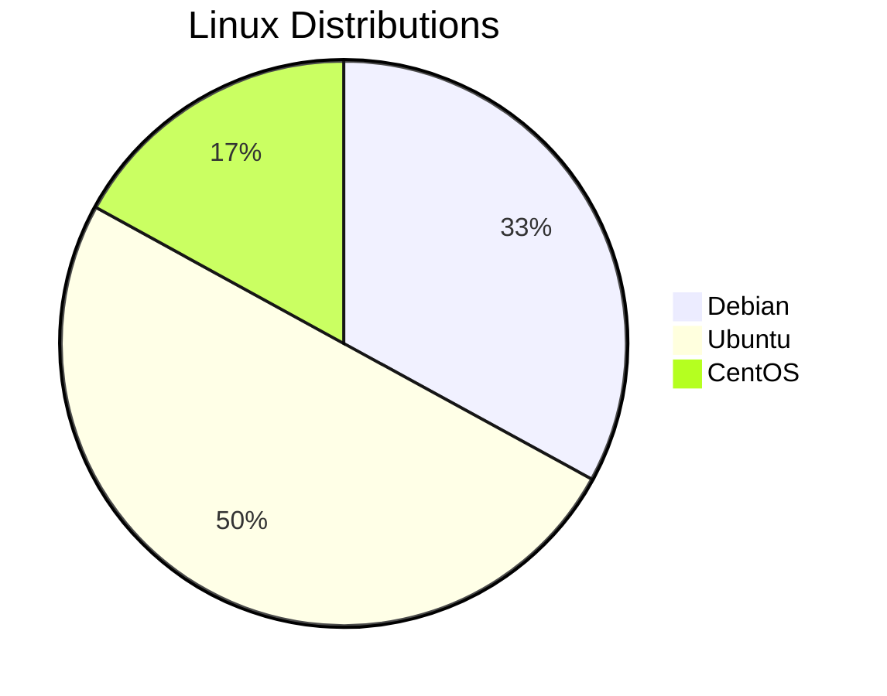
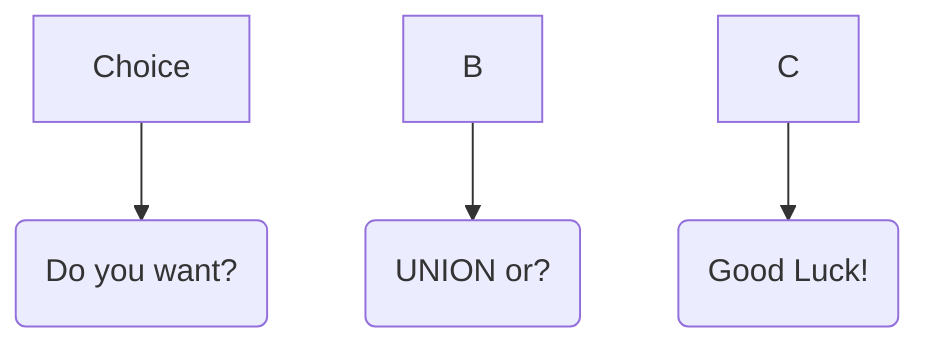
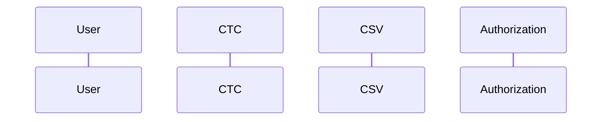
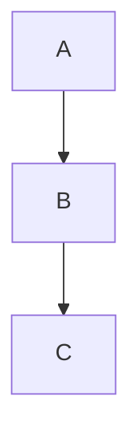

截图显示了使用 Visual Code 的 Mermaid 扩展对 `vscode.md` 进行的预览效果。

## 创建饼图

Mermaid 可以轻松地创建饼图，并可以为你提供关于切片数量的计算结果。要创建一个饼图，你需要让 Mermaid 块以 `title` 开始，后面跟上标题文本。之后，你需要编写用于生成饼图的数据集。每个切片都是一个不同的条目，包含一个标签，后跟一个正数值。标签文本应该用双引号括起来，而饼图标题文本则不需要。

以下展示了 Mermaid 变体中饼图的定义：

## 这是一个 Mermaid 饼图



之前的代码保存在 `flowchart.md` 文件中 - 渲染即可查看其输出。

## 创建流程图

流程图以 `flowchart` 关键字开头，随后是方向（LR 或 TD）。然后你可以按照意愿编写流程图的节点。如果你想在其中添加文本，请使用形状 `[text]`。你可以通过包含内容为节点添加任何文本。如果将文本包含在方括号中，节点为矩形；使用圆括号表示圆角节点。

以下 Mermaid 代码描述了一个流程图，可以在找到：



| C -- G(Linux or macOS?) |
| E -- G(Good Choice!) |
| E -- macOS(apple!) |
| B -- F |

这展示了 Visual Code 渲染 Mermaid。代码在单独窗口中证明。渲染后，代码会生成一个可以帮助你选择系统的流程。下一页的图表显示了借助 Mermaid 生成的流程图。

## 序图

序图描述了事物是如何执行的。当你想要描述包含许多因素的情况时，它们非常有帮助。序图以 `sequenceDiagram` 关键字开头，随后是参与者列表（每个参与者单独占一行定义）。之后，这段 Mermaid 代码生成一个序列 - 它是 `seq_diagram.md` Markdown 文件的一部分：



## Mermaid 与 Graphviz

另一个帮助你创建图表和图形的有用工具是 Graphviz (https://graphviz.org/)。这是一个用于映射图和生成布局的工具集，支持有向图和无向图，并提供了图形界面和命令行工具。Graphviz 使用它自己的语言 DOT，这种语言非常流行，因为它的语言易于学习和使用。像 Markdown 一样，你可以使用简单的文本编辑器编写 Graphviz。一个很棒的副作用是你可以轻松生成 Graphviz 代码！

所以 Graphviz 用于制作很多东西，包括文本文件和生成各种格式。然而，使用 Mermaid 时你不需要为 Graphviz 安装任何东西，你需要安装该工具套。如果你将其用于写博客或写作，Mermaid 比 Graphviz 语言更流行。正如大多数工具通常的情况，只有在使用 Graphviz 和 Mermaid 一段时间后，你才知道哪种方案最适合你。

# 终极项目

## 快速贴士

有四个参与者：`User`、`CTC`、`CSV` 和 `Authorization`。`Authorization` 参与者在 Mermaid 代码中作为 `Auth` 访问，但为了清晰起见显示 - 这是通过 `Auth` 语句实现的。循环块表示并发发生的动作。

`img/2f8aba538b6f14f7de8cb69470acb2_89_0.png`

Mermaid 的官方网站为 https://mermaid-js.io/。Visual Studio Mermaid 扩展的 GitHub 仓库位于 https://github.com/marp/vscode-mermaid-preview。你应该 Microsoft Studio Code 中使用 `seq_diagram.md` 编辑器，或者任何在线 Mermaid 编辑器，如 https://mermaid-js.github.io/mermaid-live。

## Mermaid 中的用例

让我们看看 Mermaid 如何描述用例。项目使用序图实现，这意味着它们是使用序图定义的。我们想使用 Mermaid 来描述我们的项目以及过程中涉及的程序和组件。如下代码所示：

`img/2f8aba538b6f14f7de8cb69470acb2_89_1.png`

```mermaid
sequenceDiagram
participant U as User
participant CSV
participant CTC as Auth/CTC
rect(100,0,0)
par Get Data: A Database that uses csv
CTC->>CSV: Return Usage
end
Note of CSV: REST API
CTC->>CSV: Return Usage data
```

在 https://en.wikipedia.org/wiki/Markdown 了解更多关于 Markdown 语言。

`img/2f8aba538b6f14f7de8cb69470acb2_89_2.png`

这展示了 Mermaid 可以描述用例，因此为你的项目生成文档提供了一种方法。

嵌入在 Hugo 文章中的 Mermaid 效果最好。为了在 Hugo 中显示渲染，你需要在 `layouts/shortcuts` 目录中添加一个小小的快捷方式。Hugo 使用快捷方式来添加 Markdown 无法实现的额外功能。快捷方式的名称应该是 `mermaid.html`，并且必须包含以下内容：

```html
<script src="https://cdn.jsdelivr.net/npm/mermaid/8.4.0/mermaid.min.js"></script>
<div class="mermaid">
  {{ Inner }}
</div>
```

这是一个可以从左到右或到底绘制的流程图。之前的几行定义了一个快捷方式名称 - mermaid，以便于你在 `[mermaid]` 和 `[mermaid]` 中使用快捷方式嵌入命令。Hugo 文章的部分代码如下：

`img/2f8aba538b6f14f7de8cb69470acb2_89_3.png`

使用 Hugo

关键字 `how` 用于为序图中的每个参与者附加数字。`rect(100,0,0)` 代表背景，内部包含：



这展示了 Mermaid 可以描述情况，因此为你的项目生成文档提供了一种方法。嵌入在 Hugo 文章中的 Mermaid 效果最好。为了在 Hugo 中显示渲染，你需要在 `layouts/shortcuts` 目录中添加一个小小的快捷方式。Hugo 使用快捷方式来添加 Markdown 无法实现的额外功能。快捷方式的名称应该是 `mermaid.html`，并且必须包含以下内容：

```html
<script src="https://cdn.jsdelivr.net/npm/mermaid/8.4.0/mermaid.min.js"></script>
<div class="mermaid">
  {{ Inner }}
</div>
```

这是一个可以从左到右或到底绘制的流程图。之前的几行定义了一个快捷方式名称 - mermaid，以便于你在 `[mermaid]` 和 `[mermaid]` 中使用快捷方式嵌入命令。Hugo 文章的部分代码如下：

`img/2f8aba538b6f14f7de8cb69470acb2_89_3.png`

使用 Hugo

关键字 `how` 用于为序图中的每个参与者附加数字。`rect(100,0,0)` 代表背景，内部包含：


这展示了 Mermaid 可以描述情况，因此为你的项目生成文档提供了一种方法。嵌入在 Hugo 文章中的 Mermaid 效果最好。为了在 Hugo 中显示渲染，你需要在 `layouts/shortcuts` 目录中添加一个小小的快捷方式。Hugo 使用快捷方式来添加 Markdown 无法实现的额外功能。快捷方式的名称应该是 `mermaid.html`，并且必须包含以下内容：

