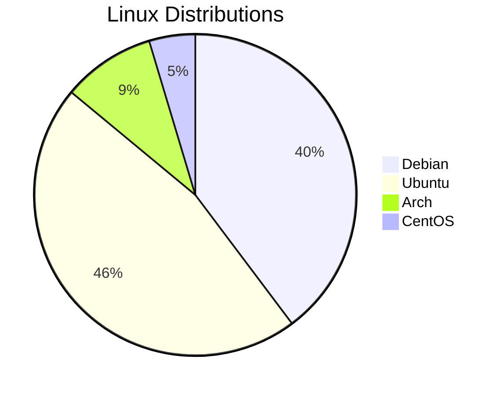
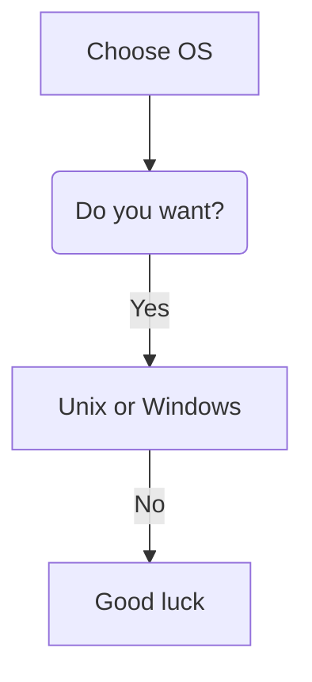

```python
if curve_map<curve_map.length:
    curve_map+=1
else:
    curve_map-=1
## 如果我们达到了增量进入后
ve the curve_increment to change the
elve_map-=1
```

```python
pygame.flip()
```

从上面可以看出，我们使用了整个目录的内容。在 Pygame 中，我们的主循环如下所示：

```python
curve_increment-=1
```

弯道出现并再次变为直路点取决于如果，或者按下上方向键。语句的第一部分将处理曲线达到最大曲率并使道路重新变直的情况。语句的第二部分将处理左弯的情况。

```python
While True
# 设置 / 控制代码
# 移动控制
keys = pygame.key.get_pressed()
if keys[K_UP]:
    road_pos+=acceleration
if road_pos>=texture_position_threshold:
    top_position+=curve_speed
# 如果我们到达弯道但还没有反转
to increment it to
if top_position[0]>=curve_map.length:
    top_position[0]-=top_segment[0][0]+top_segment[0][1]
top_position[1]-=top_segment[0][1] to exit to a
right curve
top_position[1]-=top_segment[0][1]
```

对于那些永不变的值，可能值得指出 `curve_increment-=1` 等同于 `curve_increment+=1`。这与变量 `curve_direction curve-=1` 是一样的。

# 图形渲染

为了了解此程序是如何工作的，你需要在使用它的同时遵循这条路：

```python
road_pos=0

road_acceleration=40

# 然后我们与道路纹理对话，加速-8

# 条带 "strip"

texture_position_threshold-300

# 条带值 half_texture,texture_position-texture_position-2/## 定义浅灰色或深色道路
```

如上代码所示，当按下上方向键时，道路位置增加 `road_acceleration` 增加，当 `road_pos` 的值时……

通过遵循下面的代码，你将学习如何创建道路。当你使用 IDE 时，它可以帮助你查找，按下 `Ctrl+F` 然后输入你正在查找的变量或函数名称。

这就是程序成功执行的样子。


# 经典伪 3D 赛车效果 CODING ACADEMY


## 生成丘陵

如何在 Python 脚本 `simple_hill_road.py` 中创建丘陵效果的示例。通过查看代码，你会发现了新的变量来创建丘陵效果：`position`、`height`、`velocity`、`acceleration` 和 `sharpness` 也被添加了。向上箭头的代码逻辑是相同的，但渲染过程与 `simple_road_curve_segment.py` 中创建左侧部分的某些方面略有不同。


再次，你会看到高度用于渲染到屏幕下半部分。丘陵的 `sharpness` 使用以下代码创建：

```python
hill_position += hill_velocity*sharpness
```

要增加丘陵的陡度，增加 `sharpness`，它目前设置为值 4。让道路影响丘陵的位置是不断增加的以决定是否重新生成道路的一部分或道路的深色部分。目前记录了丘陵的位置和旧位置。

为了退出到右弯，丘陵的位置是使用以下 `for` 循环生成的：

```python
for i in range(HALF_SCREEN,-1):
  if segment[i]:
    x += dx
  else:
    x += dx

  x += dx
  curve = curve_map[i]
  if texture_position>threshold:
    screen.blit(light,(0,i+HEIGHT))
  else:
    screen.blit(dark,(0,i+HEIGHT))
```

# 如何编写图表、流程图和饼图 CODING ACADEMY

接下来，我们在 Microsoft Visual Studio Code 中渲染 `vscode.md`：

## 一个包含 Mermaid 的 Markdown 文件！

```mermaid
graph LR
Root->A & B & C
A->A1->A2->A3
B->B1->B2->B3
C->C1->C2->C3
```

这段代码提供了一种创建图表的替代方法。无需标记 `<node>` 即可绘制图形。你可以编写简单的 `A->node`、`<n> & <n> A->node1->node2->n3` 来创建多个连接。在节点之间使用 `--`，`--` 只会创建更多连接。截图显示了使用 Visual Code 的 Mermaid 扩展预览 `vscode.md` 的。

# 创建饼图

Mermaid 可以轻松地列出饼图，甚至对你想要提供的切片进行计算。要创建一个饼图，你需要用 `pie` 开始块。下一行应该以 `title` 开头，后面跟着标题文本。之后，你需要为你想要生成的切片编写数据。数据集中的每个条目都是一个不同的类别和标签，后面跟着一个正数值。标签文本应该用双引号括，而饼图标题文本则不需要。

以下显示了饼图的定义

## 这是 Mermaid 中的一个饼图



之前的代码保存在 `pie_chart.md` 文件中 - 使用以下方式在你的屏幕上渲染它：

# 创建流程图

Mermaid 中的流程图以 `flowchart` 关键字开始，根据其方向（`LR` 或 `TD`）区分。然后如果你需要，可以添加流程图的节点。如果你想要带有文本的边，应该使用 `--=Text-->`。通过包含节点名称来添加节点。如果你在方括号中包含文本，节点将被绘制为矩形；使用大括号将其绘制为圆形。

接下来的内容显示了一个流程图，可以在 `flow_chart.md` 中找到 - 它描述了一个流程图：




```mermaid
C ---!> G(Good Choice!)

E -- macOS --> H(apple!)

B -- No --> F
```

渲染时，该代码生成一个可以帮助你选择操作系统的流程图。下一页图显示了借助 Mermaid Visual Code 生成的流程图。

# 序列图

序列图描述事物执行的交互。当你想要描述依赖于许多因素的序列时，它们非常有用。

序列图以 `sequenceDiagram` 开始，后面是参与者列表，使用 `()` 定义（每个参与者定义在单独的一）。之后，你需要定义参与者之间的连接，在 Mermaid 术语中称为消息（Messages）。

这段 Mermaid 代码产生一个序列 - 它是 `seq_diagram.md` Markdown 文件的一部分：

```mermaid
sequenceDiagram
participant User
participant CTC
participant CSV
participant Auth as Authorization
loop Every minute
CTC->>CSV: Keep updating!
User->>Auth: Send authorization
Auth->>User: Get authentication token
```

# MERMAID VS GRAPHVIZ
