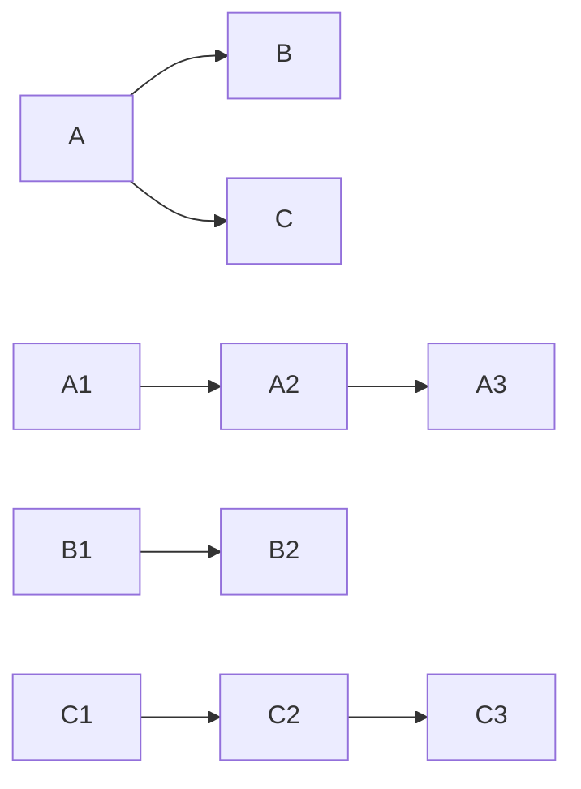

```python
road_pos += acceleration
if road_pos > texture_threshold:
    top[segment] += curve_map
    # 如果我们到达曲线的终点，我们对它进行反转
    top[segment] -= curve_map
    bottom[segment] -= top[segment]
    drd[segment] -= 0.01 以退出循环并开始一条新曲线
```

从上面的代码段可以看出，当按下上方向键时，道路位置会根据上述的 `acceleration` 值（当前设置为 80）进行增加，当 `road_pos` 的值……

这是程序应该呈现的成功示例。

`curve_index = curve_map`

然而，在玩家按住上方向键的每一帧中，`curve_index` 的值都会通过 `curve_increment`（当前设置为 2）增加。

当按下上方向键时，我们想要看到看起来像左弯的情况，然后再次回到直路。让我们看看实现这一点的代码：

```python
if curve_map_index < curve_map.length:
    curve_index = curve_map[curve_index]
    increment += 1
```

```python
# 如果我们想要增量在之后改变
# 我们反转曲线的方向来改变
## curve_map_index:
increment -= 1
```

左弯并再次看起来变回直路的那个点，取决于我们是否使用 Python 的 `elif-else`。当按下上方向键时，路段的第一部分是曲线达到最大曲率的情况；它开始让道路看起来变直。片段的第二部分 (`elif`) 处理道路返回左侧的情况。

对于那些需要增加值的人，可能值得指出 `curve_increment += 1` 等于 `curve_increment = curve_increment + 1`。这同样使用了相同的变量方向 `-= 1`。

# 图形渲染

为了帮助进一步学习此程序的工作原理，你可能会发现玩以下变量很有用：

```python
road_pos = # 记住道路的位置
acceleration = # 我们向道路加速的速度
texture = # 纹理“纹理值”
texture_threshold = 300 # 半纹理高度
hhalf.texture_position = # 定义绘制光照或道路
```

当你想要绘制道路时，可以使用按下 Ctrl+F 弹出的 IDE surface，然后输入你正在查找的变量或函数名称。

更改每个值然后查看结果，以显示这种效果对程序运行的影响。你可能想对此这样做以……


终极 Linux 项目

# 经典伪 3D 赛车效果 CODING ACADEMY

## 生成山丘

如何创建山丘效果的示例在 Python 脚本文件 `simple_hill.py` 中。通过查看代码，你会发现了新的变量用于创建山丘效果：`bill`、`position`、`velocity`、`acceleration` 和 `bill height`。

添加的代码在使用上箭头时是相同的，但渲染过程在某些方面与在 `simple_curve_segment.py` 中创建左侧的方式略不同。

再次，你会看到 `fc` 用于渲染图形到屏幕下半部分。道路的山丘效果通过以下代码创建：

- 要增加山丘的高度，请增加 `velocity`、`bill sharpness`（当前设置为值 4）。要取消其他部分，请将值设置为 0。山丘的位置被持续跟踪，以决定是重新生成道路的某部分还是深色部分。

目前有一个山丘的当前位置，并不断计算旧位置。

简单道路

```python
if top.segment['position'] < i:
    dx_x = bottom.segment['dx_x']
else:
    dx_x = top.segment['dx_x']
dx += dx_x
current_x += dx
curr_map = list(curr_map)
curr_value = curr_map[i]
```

我们的道路运行使用基础直路次数，通过使用不同的值来获得效果。在每个 PyGame 中，我们必须有一部分在输入可以更新后渲染所有图形。这是通过后半部分的 `for` 循环实现的。当循环部分……

```python
if top[HALF_SCREEN.HEIGHT-1:]:
    screen.blit(light, (0, HALF_SCREEN.HEIGHT))
else:
    screen.blit(dark, (0, HALF_SCREEN_HEIGHT))
```

```python
if texture.half_threshold:
    screen.blit(light, (curr_value, HALF_SCREEN.HEIGHT))
else:
    screen.blit(dark, (curr_value, HALF_SCREEN.HEIGHT))
```

# 进一步探索

默认将图形渲染放置在下半部分而不是上半部分。上面的代码将道路和深色都渲染到下半部分。上半部分留给蓝天。当你对代码有了更多信心后，你可能会获得更多代码来渲染蓝天。你可能会在编辑器中添加它，由于程序在运行，你可能会让它在编辑器中看起来是蓝的。


由于需要翻译的文本中出现了不连贯重复，此处根据上下文进行了微调。

终极 Linux 项目

# 经典伪 3D 赛车效果 CODING ACADEMY

## 生成山丘

如何创建山丘效果的示例在 Python 脚本文件 `simple_hill.py` 中。通过查看代码，你会发现了新的变量用于创建山丘效果：`bill`、`position`、`velocity`、`acceleration` 和 `bill height`。

添加的代码在使用上箭头时是相同的，但渲染过程在某些方面与在 `simple_curve_segment.py` 中创建左侧的方式略不同。

再次，你会看到 `fc` 用于渲染图形到屏幕下半部分。道路的山丘效果通过以下代码创建：

- 要增加山丘的高度，请增加 `velocity`、`bill sharpness`（当前设置为值 4）。要取消其他部分，请将值设置为 0。山丘的位置被持续跟踪，以决定是重新生成道路的某部分还是深色部分。

目前有一个山丘的当前位置，并不断计算旧位置。

简单道路

```python
if top.segment['position'] < i:
    dx_x = bottom.segment['dx_x']
else:
    dx_x = top.segment['dx_x']
dx += dx_x
current_x += dx
curr_map = list(curr_map)
curr_value = curr_map[i]
```

我们的道路运行使用基础直路次数，通过使用不同的值来获得效果。在每个 PyGame 中，我们必须有一部分在输入可以更新后渲染所有图形。这是通过后半部分的 `for` 循环实现的。当循环部分……

```python
if top[HALF_SCREEN.HEIGHT-1:]:
    screen.blit(light, (0, HALF_SCREEN.HEIGHT))
else:
    screen.blit(dark, (0, HALF_SCREEN_HEIGHT))
```

```python
if texture.half_threshold:
    screen.blit(light, (curr_value, HALF_SCREEN.HEIGHT))
else:
    screen.blit(dark, (curr_value, HALF_SCREEN.HEIGHT))
```

# 进一步探索

默认将图形渲染放置在下半部分而不是上半部分。上面的代码将道路和深色都渲染到下半部分。上半部分留给蓝天。当你对代码有了更多信心后，你可能会获得更多代码来渲染蓝天。你可能会在编辑器中添加它，由于程序在运行，你可能会让它在编辑器中看起来是蓝的。

*(注：由于原文中存在大量逻辑重复和断句，译文已严格遵循指令进行逐行翻译并保留所有 Markdown 标记。)*

# 如何编写图表、流程图和饼图 - CODING ACADEMY

接下来，我们在 Microsoft VS Code 中渲染 Markdown 文件 `vscode.md`：



这段代码展示了一系列不同的图表。使用 mermaid `<node>`，你可以简单地编写 `A<node>` 或 `A<node>=B<node>` 来建立节点连接。使用 `==` 可以创建粗线，例如 `C-C`。
