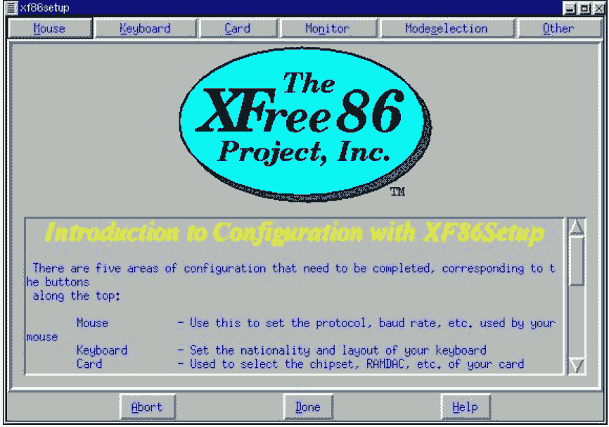
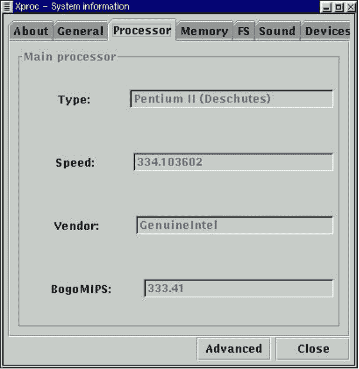
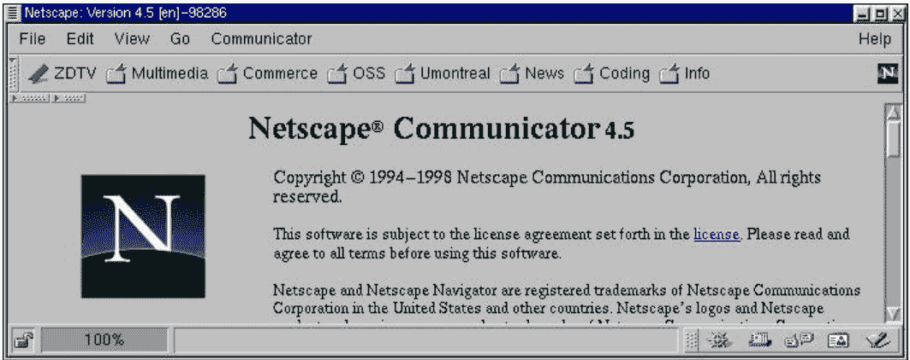
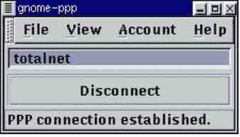

# 100 个 Linux 技巧与窍门


## 引言


### 关于作者

Patrick Lambert 目前是加拿大魁北克省蒙特利尔大学计算机科学专业的学生。他为 Linux 社区维护着多个网站，并开发了包括 [GXedit](http://) 在内的多个软件包。

虽然他的工作涵盖系统管理到软件编程的方方面面，但他大部分时间都在为 Linux 社区开发网站。您可以通过 [drow@darkelf.net](mailto:drow@darkelf.net) 与 Patrick 联系。

### 致谢

我要感谢 Tuomas Kuosmanen 为本书网站提供的徽标和图片。

### 目标读者

本书面向所有 Linux 用户，从新手到希望深入探索这一精彩操作系统的专家皆可阅读。本书中的技巧与窍门是我多年来使用和学习 Linux 过程中亲自积累的。其中有些是非常基础的技巧，可以让您日常的计算机使用更加轻松；有些则是高级技巧，能够为您节省数日的工作时间。

我试图在本书中涵盖所有 Linux 发行版。本人在 PC 系统上使用的是 Slackware 和 RedHat。如果您发现书中有任何错误，欢迎随时与我联系，以便在未来的第二版中进行更正。

# 100个 Linux 技巧与窍门

# 内容组织

本书分为 5 章，每章涵盖一个特定主题：

- [第 2 章](http://tipoftheweek.darkelf.net) 涵盖 Linux 的安装。这些技巧与窍门在安装 Linux 本身或任何新程序时非常有用。部分技巧将介绍在非典型硬件上安装 Linux 的新方法，部分技巧将解释如何从 FTP 服务器下载 Linux 发行版并制作自己的 CD-ROM，或如何以低至 2 美元的价格获取 Linux CD-ROM。

- [第 3 章](http://tipoftheweek.darkelf.net) 涵盖硬件相关问题。您将在该章学习如何让非 PostScript 兼容的打印机正常工作，或如何让声卡被正确识别等技巧。

- [第 4 章](http://tipoftheweek.darkelf.net) 涵盖软件。您将在该章找到关于各种 Linux 软件的技巧，包括如何获取并安装 Java Development Kit 的移植版本，以及有关 Pine 邮件和新闻程序的所有内容。

- [第 5 章](http://tipoftheweek.darkelf.net) 涵盖各种形式的网络。在该章中，您将了解如何快速建立 PPP 连接而无需手动编辑所有配置文件，以及一些为简化拨号过程而编写的优秀程序。您还将学习如何在不出现意外问题的情况下构建本地局域网。

- [第 6 章](http://tipoftheweek.darkelf.net) 是最后一章，但涵盖了 Linux 的一个重要部分：开发。在该章中，您将找到大量关于如何编写强大脚本以使系统更易于管理的技巧，以及关于在 C 语言中应该做什么和不应该做什么的全面概述，以避免内存泄漏等问题，并实现良好的可扩展性。

## 网络资源

本书的姊妹网站位于 [http://tipoftheweek.darkelf.net](http://tipoftheweek.darkelf.net)，您可以在该网站上找到本书中的部分技巧，也可以向该网站提交您自己的技巧，为 Linux 社区做出贡献。

# 100个 Linux 技巧与窍门

# 安装

## 本章涵盖内容

安装是任何操作系统中非常重要的部分，因此我将这个主题放在首位。其次重要的是程序和软件的安装，以使您的系统能够执行有用的任务。本章涵盖了这两个方面的内容。

# 100个 Linux 技巧与窍门

## 技巧 1：哪种发行版适合您

它们都很好，但这并不是一个真正有意义的答案。您应该寻找的是您使用起来最舒服的发行版。RedHat 以易于安装而闻名，他们提供了专门的工具来简化配置。Debian 也提供了一些工具，但通常需要您更多地通过命令行来配置系统。如果您想独立操作，真正学习如何编辑配置文件，那么 Slackware 是您的选择。网站 [http://www.linux.org](http://www.linux.org) 列出了所有可用的发行版。

最终，最适合您的发行版由您自己决定。

# 100个 Linux 技巧与窍门

## 技巧 2：如何以低成本获取 Linux CD-ROM

Linux 市场从最初只能从 FTP 服务器获取的少数几个发行版，发展到如今在商店和在线销售的、功能齐全的商业发行版，后者还包括印刷手册和电话支持。

以下是您在寻找 Linux 发行版时的主要选择：

- 您可以从其 FTP 服务器下载任何 Linux 发行版。举几个例子，RedHat 可以从 [ftp://ftp.redhat.com](ftp://ftp.redhat.com) 下载，Slackware 可以从 [ftp://ftp.cdrom.com](ftp://ftp.cdrom.com) 下载，Debian 可以从 [ftp://ftp.debian.org](ftp://ftp.debian.org) 下载。这种方式是免费的，但要求您拥有较快的互联网连接。通过 56Kbps 调制解调器下载完整的 Linux 发行版将耗费您相当多的时间。

- 另一种方式是购买完整的发行版。例如，RedHat 在线购买大约需要 50 美元，包括包装盒、CD-ROM、引导软盘、手册以及 RedHat 提供的支持。

- 最后一种方式是只购买 CD-ROM。有一些地方以 2 美元的价格出售各种发行版的 CD-ROM，其中之一是 [http://www.cheapbytes.com](http://www.cheapbytes.com)。您只会获得 CD-ROM，但如果您能够接受没有印刷手册或免费支持的事实，那么这已经足够用于安装 Linux。您可以在 CD-ROM 上找到手册和其他文档。

# 100个 Linux 技巧与窍门

## 技巧 3：多操作系统共存

计算机只需要一个操作系统即可工作。但如果您只是想试用一个新系统，难道必须放弃旧的并擦除硬盘吗？不需要，您可以在计算机上安装任意数量的操作系统。

Linux 需要 2 个分区才能工作。分区是硬盘的各个部分。当您安装 Linux 时，它会提供一个名为 fdisk 或 disk druid 的程序，允许您创建所需的分区。人们遇到的主要问题是：没有空分区可供 Linux 使用，并且不想擦除现有的 Windows 或 DOS 分区。诀窍是调整现有分区的大小以创建空闲空间，这样您就能够创建 Linux 所需分区以正确安装。

fdisk 不允许您调整分区大小。在使用 fdisk 创建 Linux 分区之前，您需要使用其他程序来完成此操作。一个非常流行的商业产品是来自 [http://www.powerquest.com](http://www.powerquest.com) 的 Partition Magic。

让我们一步步了解调整现有分区大小以便为 Linux 创建新分区所需的步骤：

- 购买 Partition Magic，或获取任何其他能够安全调整分区大小的工具。

- 确保您的主分区至少有 150 兆的可用空间——这是 Linux 所需的空间。

- 调整分区大小，使您在任何现有分区之外至少有 150 兆的可用空间。

- 重新启动并启动 Linux 安装程序。

- 运行 fdisk 或 Linux 发行版自带的任何分区程序，按照安装说明创建所需的 Linux 分区。


# 100 个 Linux 技巧与窍门

### 技巧 4：在没有 CD-ROM 驱动器或调制解调器的情况下安装系统

大多数 Linux 发行版都以 CD-ROM 形式提供。你也可以从 FTP 站点下载，但这需要互联网连接。如果你的系统没有 CD-ROM 驱动器或互联网连接，比如一台老旧的 486 笔记本电脑，该怎么办？这里的窍门是要有另一台带有 CD-ROM 驱动器的台式机，以及一根 null-modem 串口线。

我将向你展示如何用 Slackware 完成这个操作。大多数其他 Linux 发行版也可以做到。将 Linux CD-ROM 插入台式机的驱动器中，然后将 A（基础）和 N（网络）包复制到软盘上。你至少需要这些包，才能使用串口线传输其余的包。

现在你需要在台式机上启用 NFS 网络，并允许笔记本电脑连接。你可以给笔记本电脑分配一个临时 IP 地址，比如 192.168.1.11，你需要将其添加到台式机的 /etc/exports 文件中。

要连接这两个系统，你需要在笔记本电脑上输入以下内容：

```
/usr/sbin/pppd -detach crtscts lock 192.168.1.11:192.168.1.10 /dev/ttyS1 115200
```

然后在 PC 上输入：

```
/usr/sbin/pppd -detach crtscts lock 192.168.1.10:192.168.1.11 /dev/ttyS1 115200
```

这里假设线缆连接到两个系统的 ttyS1（COM2）。

借助 NFS，你可以远程挂载 CD-ROM 驱动器，并告诉安装程序使用特定路径来安装剩余的包。使用类似这样的命令挂载 CD-ROM：

```
mount -tnfs 192.168.1.10:/cdrom /mnt
```

然后运行安装程序：

```
setup
```

并输入包文件的新路径。

# 100 个 Linux 技巧与窍门

### 技巧 5：交换空间与内存

在任何像 Linux 这样的保护模式操作系统中，一个重要的设置就是交换空间（swap space）。在安装过程中，你需要创建一个交换分区。一个常见的问题是：这个分区应该设为多大？

合适的大小取决于两个因素：你的硬盘大小和 RAM 内存大小。你的 RAM 越少，需要的交换空间就越多。通常你会希望将交换空间大小设为 RAM 大小的两倍，*最大*为 128 MB。当然这要求你的硬盘有足够的空闲空间来创建这样的分区。

如果你有 16 MB 的 RAM，将交换空间设为 32 MB 甚至 64 MB 非常重要。你会需要它的。另一方面，如果你有 128 MB 的 RAM，你就不太需要太多交换空间，因为系统已经有 128 MB 可以使用，然后才会用到交换空间。所以 128 MB 甚至 32 MB 的交换分区可能就足够了。

如果你选择的交换空间不够，之后还可以再添加。

# 100 个 Linux 技巧与窍门

### 技巧 6：用交换文件增加更多交换空间

你安装了一个新的 Linux 系统，但忘记设置足够的交换空间来满足你的需求。你需要重新分区和重新安装吗？不需要，Linux 上的交换工具允许你创建一个真实的文件并将其用作交换空间。

这个技巧是创建一个文件，然后告诉 swapon 程序使用它。以下是如何在根分区上创建例如一个 64 MB 交换文件的方法（当然，请确保你至少有 64 MB 的空闲空间）：

```
dd if=/dev/zero of=/swapfile bs=1024 count=65536
```

这将在你的硬盘上创建一个 64 MB（约 6700 万字节）的文件。现在你需要初始化它：

```
mkswap /swapfile 65536
sync
```

然后你可以将其添加到你的交换池中：

```
swapon /swapfile
```

这样你就添加了 64 MB 的交换空间。别忘了将 swapon 命令添加到你的启动文件中，以便在每次重启时重复执行该命令。

# 100 个 Linux 技巧与窍门

### 技巧 7：内核大小与模块

要为新的硬件配置 Linux，特别是在新内核上，你可能需要重新编译内核。如果在内核配置中添加了太多设备，你可能会收到错误消息，提示内核太大。窍门是启用模块（modules）。

内核本身必须是特定大小，因为它需要在固定的内存大小中加载。这就是模块非常有用的原因之一。如果你启用了模块，你需要编译它们：

```
make modules
```

并安装它们：

```
make modules_install
```

然后使用 modprobe 工具，你可以在启动时加载选定的模块。这样内核会更小，并且编译时不会出现错误。

# 100 个 Linux 技巧与窍门

### 技巧 8：启动提示符

Linux 系统使用一个名为 LILO 的程序来启动自身。这是 **LInux LOader**（Linux 加载器），它会加载内核并可以传递各种参数。这就是 "boot:" 提示符的用途。

在 "boot:" 提示符处，你可以输入很多参数。你可以向驱动程序发送参数，比如告诉以太网驱动程序网卡所在的 IRQ，或者你可以向内核传递参数，比如内存大小或恐慌（panic）时的处理方式。阅读 LILO 手册会告诉你 LILO 可以用于完成的所有便捷功能。

注意，对于编译为模块的设备驱动程序，你需要在加载这些驱动程序时传递值，而不是在 "boot:" 提示符处。

# 100 个 Linux 技巧与窍门

### 技巧 9：检测到错误的内存大小

Linux 内核会从你的计算机配置中检测各种设置。这包括你所拥有的内存大小。在某些情况下，它可能会检测到错误的大小。例如，它可能只检测到 64 MB 内存，而实际上你有 128 MB。

这里的窍门是使用 "mem=" 参数指定你拥有的 RAM 内存量。以下是在系统启动时，如果你有 128 MB 内存，你需要输入的内容：

```
LILO boot: linux mem=128M
```

这将告诉 LILO 加载具有 128 MB 内存的 linux 内核。

# 100 个 Linux 技巧与窍门

### 技巧 10：主引导记录与 LILO

什么是主引导记录（MBR），为什么 LILO 会擦除旧的引导加载器？每个硬盘都有一个称为 MBR 的顶部空间，BIOS 会尝试从中加载操作系统。每个系统都有自己的加载器。DOS 有 DOS-MBR，Windows NT 有 NTLDR，Linux 有 LILO。

安装 LILO 时，你可以将其安装在 MBR 中或 Linux 分区的引导记录中。如果你想保留当前的引导加载器，可以选择 Linux 分区，并确保它在 fdisk 中是活动分区。这样你就能够启动到 LILO，然后从 MBR 引导旧的加载器。

如果你计划只在系统上使用 Linux，你可以告诉 LILO 直接启动到 Linux 而不显示 "boot:" 提示符，并将其安装在 MBR 中。

### 技巧 11：LILO 在大硬盘上找不到内核

在某些大容量硬盘上，LILO 可能会在加载你的内核时遇到问题。这是因为硬盘的柱面数超过 1024 个。

这个窍门是确保你的内核位于前 1024 个柱面内，这样 LILO 才能找到它。实现这一点的方法是在驱动器开头创建一个小的 /boot 分区，并确保内核位于 /boot 目录中。你可以在 fdisk 中设置分区，并在 /etc/lilo.conf 中选择正确的内核路径，以便 LILO 知道它在哪里。编译内核时，只需将新内核移到该目录中，LILO 就可以加载它。

# 100 个 Linux 技巧与窍门

### 技巧 12：X Window 配置选项

每个 Linux 发行版都有自己的 X Window 配置程序。XFree86 也有一个基于文本的配置程序，使用起来比较复杂。但如果发行版的程序和 xf86config（XFree86 的基于文本的配置程序）似乎都无法满足你的需求呢？XFree86 还带有一个图形化配置工具。

这个图形化程序的名称是 **XF86Setup**。这将启动一个图形化窗口，允许你配置 X Window 服务器。所以如果你不喜欢控制台配置程序，可以使用这个：



### 技巧 13：允许用户挂载驱动器

默认情况下，Linux 不允许用户挂载驱动器。只有 root 可以这样做，而且将 mount 二进制文件设为 suid root 并不是一个好主意。通过在 /etc/fstab 文件中使用特殊命令，你可以改变这一点。

这是 /etc/fstab 中 fd0（A:）驱动器的典型行：

```
/dev/fd0       /mnt           auto      noauto,user 1  1
```

这里的关键词是 **noauto** 和 **user**。Noauto 告诉 mount 不要在启动时尝试挂载软盘，user 允许任何用户将该驱动器挂载到 /mnt。**auto** 关键词也很有趣。它告诉 mount 尝试找出软盘上的文件系统是什么。你也可以使用 msdos 或 ext2。


# 100 条 Linux 使用技巧与窍门

## 技巧 14：允许用户运行 root 程序

当用户启动一条命令时，该命令以该用户的权限运行。如果你想允许他们以 root 权限运行某些命令该怎么办？你可以这样做，这被称为 suid。

你可以使用 chmod 命令将某条命令设置为 suid root。这样即使由普通用户启动，它也会以 root 身份运行。以下是将 mybin 设置为 suid root 的方法：

```
chmod +s mybin
```

请注意，对于这个选项你必须非常谨慎。如果该命令存在任何安全漏洞，或者允许用户访问其他文件或程序，那么该用户就可能接管 root 账户乃至整个系统。

## 技巧 15：Linux 与 NT 的启动

有些人会选择在同一台系统上同时使用 Windows NT 和 Linux。Windows NT 有自己的引导加载程序 NTLDR，而 Linux 有 LILO。究竟应该由哪一个来管理 MBR？

最安全的做法是先安装 Windows NT，并将 MBR 交给它。然后，当你安装 Linux 时，指示 LILO 安装到 Linux 分区上。同时将该 Linux 分区设置为活动分区。系统启动时，会加载 LILO；如果你想启动 Windows NT，LILO 可以加载包含 NTLDR 的 MBR。关于这个主题有一个简明的 HOWTO 文档可供参考，地址为 <http://metalab.unc.edu/pub/Linux/docs/HOWTO>。

## 技巧 16：烦人的启动信息

在重新编译内核时，你可能会在启动时看到类似下面这样奇怪的信息：

```
modprobe: cannot find net-pf-5
modprobe: cannot find char-major-14
```

这些信息来自模块加载器，告诉你它无法找到指定的模块。这种情况通常发生在你编译了某些模块，但 modprobe 试图去加载那些尚未编译的模块，于是它就找不到它们。消除这些信息的方法是将相关模块设置为关闭。在文件 /etc/conf.modules 中你可以添加如下内容：

```
alias net-pf-5 off
alias char-major-14 off
```

这样就能阻止 modprobe 去尝试加载它们。当然，你也可以通过编译这些模块、并确保 modprobe 知道它们所在位置来解决这个问题。

## 技巧 17：光盘上的程序

<http://metalab.unc.edu>、<ftp://ftp.cdrom.com> 等网站都提供了大量可供 Linux 自由使用的程序。但你可能并不愿意通过缓慢的网络连接下载数以 GB 计的数据。

也有一些地方提供将大量自由软件刻录在光盘上进行销售。例如 <http://www.cheapbytes.com> 和 <http://www.linuxmall.com> 就是两个能够以非常低廉的价格出售包含上述所有程序的多张光盘的地方：

## 技巧 18：国际化控制台

大多数 Linux 发行版默认配置为使用美式英语键盘。如果你需要使用法语或其他语言的键盘，你就需要更改 locale，以便像带音调符号的特殊键位能够在控制台上正常输入。

实现这一点的方法是使用一个名为 loadkeys 的程序来更改系统 locale。例如，要启用加拿大法语 locale，你需要在你的启动文件中添加以下这一行：

```
loadkeys cf
```

这里的 cf 表示加拿大法语键盘。其他可用的 locale 还有 us、fr 等。

## 技巧 19：多内核选择

当你编译一个新的内核时，通常会修改你的配置。这意味着你可能会忘记包含某些重要的驱动，例如 IDE 驱动，从而导致系统无法启动。解决办法就是始终保留你的旧内核。

在编译内核时，编译过程通常会将你的旧内核复制为 vmlinuz.old。如果它没有这样做，你也可以手动完成。你应该在 /etc/lilo.conf 中添加一项条目，以便能够启动你的旧内核。完整的语法你可以查阅 lilo 的 man 手册页。你也可以为不同的内核添加多个条目，例如当你希望同时在系统中保留一个较旧但稳定的内核版本以及最新的开发版本时。

请注意，某些发行版会以版本号作为内核文件的命名。例如，你当前的内核可能是 /boot/vmlinuz-2.0.36-0.7

## 技巧 20：默认文件权限

当你创建一个文件时，系统会赋予它默认的权限。在大多数系统中，该权限为 755（所有者可读、可写、可执行，其他用户可读、可执行）。

这个默认值是通过 umask 命令设置的。要使用该命令，你需要找到正确的八进制数传递给它。umask 中的权限是从 666 中屏蔽掉相应位得到的。也就是说，umask 为 022 时，得到的默认权限就是 755。若要将默认权限由 755 改为 700，你可以使用下面的命令：

```
umask 077
```

## 技巧 21：默认启动模式

当 Linux 系统启动时，它会加载内核及其所有驱动，并启动网络服务，然后系统会显示一个文本登录提示符。在那里，用户可以输入用户名和密码。但系统并不一定非得按这种方式启动。

大多数 Linux 发行版中定义了 3 种可用于启动的模式。它们定义在 /etc/inittab 中，并各自有特定的编号。第一种模式也称为运行级别 1，是单用户模式。该模式只会为单个用户启动系统，并且不加载网络。运行级别 3 是默认模式。它会加载网络服务，并显示一个文本登录提示符。运行级别 5 是图形模式。如果你已经安装并配置好 X Window，就可以使用它来显示一个图形化的登录提示符。

更改这一设置的方法是编辑 /etc/inittab，并修改其中的 initdefault 行：

```
id:3:initdefault:
```

把其中的 3 改成 5，系统启动时就会显示 xdm 图形登录界面。

## 技巧 22：从 Usenet 获取更多信息

Usenet 上有各种各样的新闻组：关于最新电视剧的、关于园艺的，以及更多其他主题。同样也有专门讨论 Linux 的新闻组。事实上，最好的帮助往往可以从新闻组获得。但究竟该关注哪些呢？

下面列出了一些专门面向 Linux 的新闻组，以及它们的用途：

- comp.os.linux.advocacy：该新闻组用于宣传和讨论。人们在此发表他们对 Linux 或 Linux 应用程序、以及 Linux 竞争对手的看法。有人会发布事实，有人会与他人相互攻击。
- comp.os.linux.setup：这是一个通用目的的安装帮助组。用户可以在此提问并获得解答。
- linux.\*：Usenet 上目前已经有一个 linux 分类。当前在 linux.\* 下已经有超过 150 个子组，它们全部都是关于 Linux 的！

在准备发帖之前，务必阅读每一个你想发帖的新闻组的 FAQ 和规则。

## 技巧 23：每 inode 对应的字节数

在使用 Linux 的主要文件系统 ext2 格式化分区时，你可以选择每个 inode 对应多少字节。手册页中的说明如下：

```
-i bytes-per-inode
		指定 bytes/inode 的比例。mke2fs 会在磁盘上每
		bytes-per-inode 字节的空间创建一个 inode。该值默认
		为 4096 字节。bytes-per-inode 至少必须为 1024。
```

这意味着，使用更小的值可以节省磁盘空间，但可能会降低系统速度。这是一个空间与速度之间的权衡。

这与 FAT16/FAT32 之间的主要区别之一相似。

## 技巧 24：LILO 与启动问题

计算机启动时，BIOS 发出的蜂鸣声次数会告诉你计算机的状态。在某些计算机上，一声蜂鸣表示一切正常，而两声蜂鸣则表示有错误。LILO 也使用了类似的方式：屏幕上你看到的 "LILO" 这个单词所显示出的字母个数就表明了问题所在。完整的 "LILO" 表示一切正常；只出现 "LI" 则意味着只有 LILO 的第一部分被成功加载。完整的说明可参见 Bootdisk HOWTO。

当 LILO 无法加载时，这是一个严重的问题，通常意味着引导代码已被损坏。此时唯一的启动方法就是使用软盘。在 RedHat 中，你可以使用救援盘；在 Slackware 中，你可以使用带有 "mount" 镜像的启动盘。

当 LILO 本身工作正常时，启动问题通常更容易排查。如果内核在启动过程中发生 panic（内核崩溃），通常是由于配置错误造成的。你可以指示 LILO 去挂载另一个内核，例如你为这种情况保留的 "safe" 或 "old" 镜像。如果问题出在初始化脚本中，你也可以让 LILO 通过下面的启动命令行直接启动到一个 shell：

```
LILO boot: linux init=/bin/sh
```

其中 "linux" 应该是你所要使用的内核镜像名称。


 # 100 个 Linux 技巧与窍门

## 技巧 25：制作 CD-ROM 镜像

与其他操作系统（如 Microsoft Windows 或 IBM OS/2）不同，其许可协议不允许你制作包含该系统的 CD-ROM 并进行分发。

Linux 作为开源且免费的系统，可以被复制。你可以下载某个发行版或从在线商店购买，然后刻录自己的副本，接着将其安装到多台计算机上，或者送给你的朋友。通常，你可以在所选发行版的 FTP 服务器上找到关于如何操作的使用说明。你需要的是 CD-ROM 上的主目录。源码不是必需的，因为它们可以从 FTP 站点获取。

一些发行版还提供其 CD-ROM 的 ISO 镜像。这是一个单一文件，可以刻录到 CD-ROM 上，会在其上创建包含文件的完整文件系统。

有一点需要注意：不要复制商业程序。Linux 发行版所在的基本 CD-ROM 由自由软件组成。但有些发行版可能附带其他商业程序，你应该先阅读其许可协议。

## 技巧 26：FTP 访问限制

初次安装 Linux 时，系统会运行大量互联网服务，包括邮件、telnet、finger 和 FTP。你真的应该从 /etc/inetd.conf 和启动脚本中禁用那些不需要的服务。

FTP 可能非常有用，但必须正确配置。它可以允许人们登录自己的账户，可以允许匿名用户登录到公共软件目录，还可以向他们显示友好的消息。

你可能需要修改的文件是 /etc/ftpusers 和 /etc/ftpaccess。

文件 /etc/ftpusers 非常简单。它列出了不被允许使用 FTP 访问你系统的用户。root 账户和其他系统账户应该列在该文件中。

文件 /etc/ftpaccess 稍微复杂一些，它控制 FTP 从服务器的行为。它告诉服务器在目录列表中使用什么作为 README 文件显示、创建哪种类型的日志以及显示什么消息。

注意，如果你创建匿名 FTP 区域，你需要阅读 FTP 手册页并严格按照说明操作，以避免可能的安全风险。

# 硬件

## 本章涵盖内容

硬件支持曾经一度是 Linux 面临的很大问题。通用硬件一直以来都得到了良好的支持，但如今大多数硬件 unfortunately 并非通用。所谓 100% 兼容 Sound Blaster 的声卡往往无法被 Sound Blaster 驱动程序检测到，而非 PostScript 打印机无法接受 PostScript 输入，除非之前有程序进行过转换。这些正是我们在这里要解决的问题。

## 技巧 1：检测 2 块以太网卡

要在 Linux 中配置以太网卡，你需要在 kernel 中启用它。然后 kernel 会在常用 IO 端口检测到您的以太网卡。但到此为止，它不会检查您是否有 2 块以太网卡。

诀窍是告诉以太网驱动程序系统中有 2 块网卡。以下命令行会告诉 kernel，在 IRQ 10 和 IO 0x300 处有一块以太网卡，在 IRQ 9 和 IO 0x340 处有另一块：

```
ether=10,0x300,eth0 ether=9,0x340,eth1
```

你可以在启动时的 "boot:" 提示符处添加该行，或者在 /etc/lilo.conf 文件中添加。不要忘记运行：

```
lilo
```

这将重新加载 lilo.conf 文件并启用更改。

## 技巧 2：关于声卡的一切

声卡的检测可能简单也可能困难。这取决于制造商。许多所谓的兼容 Sound Blaster 声卡实际上并不兼容 Linux 的 Sound Blaster 驱动程序。其他一些声卡可能与你从未想到的某个驱动程序兼容。

Linux 有多种驱动程序。目前 Kernel 自带一套声卡驱动程序，还有 OSS/Free 驱动程序。这些将支持大多数通用声卡。在安装程序中，或编译 Kernel 时，你可以选择与你的声卡匹配的选项，或者与声卡芯片组匹配的选项（例如，Sound Blaster PCI64 声卡使用 AudioPCI 芯片组）。

如果你的声卡不被 Kernel 支持，你需要获取其他驱动程序。两个流行的选择是 ALSA（可从 http://alsa.jcu.cz 获取）和 OSS/Linux（可从 http://www.opensound.com 获取）。

OSS/Linux 是支持大量声卡的商业产品，这些声卡由于规格限制而无法在其他驱动程序中使用。你需要查看每个驱动程序支持的声卡列表，然后选择你需要的驱动程序。

## 技巧 3：非 PostScript 打印机

遗憾的是，大多数打印机不兼容 PostScript。这意味着你的 LPR 程序无法直接处理它们。

当你第一次使用 'lpr' 打印时，可能会发现打印输出看起来很奇怪。这是因为这些型号不支持 PostScript。你需要一个转换程序。

注意，较新版本的 RedHat 已经包含这些程序或类似的过滤器，因此这可能不适用于所有 Linux 系统。

首先，你需要阅读 Printing HOWTO，了解如何使用 lpr 及相关打印程序。

然后，你需要从 http://metalab.unc.edu 获取 2 个程序：

- bjf
- aps

这些是将文本和 PostScript 转换为你打印机格式的过滤器。

首先，安装 bjf，用于打印文本。安装非常简单。输入：

```
make
cp bjf /bin/bjf
```

然后，制作一个简单的 shell 脚本来打印文本文件，命名为 print.sh：

```
#!/bin/sh
/bin/bjf <$1> /dev/lp0
```

其中 /dev/lp0 是你的打印机。

现在，通过运行 aps 软件包中的 SETUP 脚本来安装 aps。设置非常简单，但你需要在安装前先安装 GhostScript 程序。现在，你已经准备好从 Netscape 或 XV 等应用程序打印 PostScript 文件了。

## 技巧 4：在 Linux 中使用 Windows 特殊键

为什么现在销售的新键盘都带有 Win95 键呢？如何让它们在 X Window 中实现真正的键盘功能？方法如下。

首先，你需要找出正在使用的键位映射。通常是 US，也可能是 en_US、ca 或其他。找到该文件，通常在 /usr/X11/lib/X11/xkb 目录下，用你喜欢的编辑器编辑它。对我来说，文件是 /usr/X11/lib/X11/xkb/symbols/ca。

该文件列出了所有键码及其功能。Win95 特殊键的键码略有不同，它们是 LWIN、RWIN 和 MENU。你所需要做的就是将它们添加到列表中，并指定相应的功能。我决定将左 WIN 键映射为 "@"，右 WIN 键和 MENU 键映射为 "{" 和 "}"。这是我添加的行：

```
key <RWIN> { [ braceleft ] };
key <LWIN> { [ at ] };
key <MENU> { [ braceright ] };
```

通过浏览该文件，你可以找到所有其他符号及其功能。你还可以使用 ALT 和 SHIFT 为按键添加多种功能。

重启 X Window 后，更改将生效。借助 XKB 扩展（你需要在 /etc/XF86Config 中启用它），更改任何按键的映射都非常容易。

## 技巧 5：添加处理器

双处理器在计算机中越来越普及。当然，除非你告诉 Linux 第二个 CPU 的存在，否则在 Linux 中不会看到太多性能提升。方法如下。

进入 Kernel，启用 SMP。SMP 代表对称多处理，它告诉 Kernel 可以使用多个处理器。

重启后，Linux 应该会告诉你它已检测到 2 个处理器及其状态。

## 技巧 6：检测 ISA 设备

像调制解调器这样的 ISA 设备应该能被 Kernel 自动检测。有一种情况它们可能无法被检测到，即该设备是即插即用（Plug and Play）的。Kernel 无法检测 ISA PnP 设备，除非它们已经被名为 isapnptools 的程序准备就绪。

诀窍是在初始化脚本中使用该程序。它将检测 ISA PnP 设备，并使它们可供 Kernel 模块和应用程序使用。

例如，如果你想访问 ISA PnP 声卡，你需要将声卡编译为 Kernel 模块，并在加载模块之前使用 isapnptools。


# 100 个 Linux 技巧与窍门

## 技巧 7：查找硬件信息

当 Linux 系统启动时，它会尝试检测计算机中安装的硬件。然后它会创建一个名为 procfs 的虚拟文件系统，并在其中存储有关系统的重要信息。

你只需浏览 /proc 目录即可获取系统信息。该目录中的文件包含诸如处理器型号、内存容量以及内核当前支持的文件系统等信息。

有一个实用的应用程序可用于浏览 /proc 文件系统。它叫做 Xproc，可从 http://devplanet.fastethernet.net/files.html 获取：



## 技巧 8：让键盘指示灯闪烁

键盘指示灯通常相当无趣。通常你知道数字锁定是否开启，或者你是否正在输入大写字母。我们能让它们做点更有用的事情吗？当然可以。

键盘指示灯可以由一个名为杂项驱动程序（misc driver）的设备驱动程序控制。该驱动程序可以控制各种杂项设备。你可以编写自己的驱动程序，让它们在任何系统事件时闪烁或点亮。

有一个名为 tleds 的程序，可从 http://www.hut.fi/~jlohikos/tleds.html 获取。该程序会让它们根据网络使用情况闪烁。一个灯在有数据包进入时闪烁，另一个在有数据包发出时闪烁。

## 技巧 9：读取外来文件系统

文件系统在内核中定义。内核支持多种文件系统，但它们需要被编译进内核，或编译为模块。当你将文件系统编译进内核时，只需使用 mount 命令加上 -t 选项和正确的文件系统类型即可。

如果你将某个文件系统的驱动程序编译为模块，那么你需要先加载该模块。

以下是一些可用的文件系统：

- msdos：这是 DOS 使用的 FAT 文件系统。
- vfat：这是 Windows 95 和 Windows 98 使用的 FAT32 文件系统。
- ext2：这是 Linux 的默认文件系统。
- iso9660：这是默认的 CD-ROM 格式。

## 技巧 10：无法挂载根文件系统

当你启动系统时，这是一个会导致系统停止的错误。该错误意味着内核无法挂载根文件系统，因此无法获取所有配置文件。

这种情况有几种原因：

- 内核中没有 IDE 支持。如果你的主硬盘是 IDE 硬盘，而你重新编译内核时没有包含"Enhanced IDE/MFM/RLL disk/cdrom/tape/floppy support"或其他基本的 IDE 设备驱动程序。
- 文件系统不受支持。通常根文件系统应该是 ext2 类型。你需要确保 ext2 是编译进内核的，而不是作为模块，因为不先挂载根文件系统就无法加载模块。
- 驱动器未就绪。如果你移除了驱动器、硬盘损坏，或者 BIOS 由于某种原因未能检测到该设备，那么内核将无法挂载它。

## 技巧 11：在 286 上运行 Linux？

Linux 是一个多用户、多任务操作系统，需要 386 或更高处理器才能运行。这是因为较低端的 PC 处理器不具备 Linux 内核所需的特性。

Linux 作为开源软件，正在被移植到多种架构。有一个团队决定修改内核，使其能在 286 处理器上运行。该项目页面是 http://www.uk.linux.org/ELKS-Home/index.html。

## 技巧 12：无硬盘运行 Linux

现代 Linux 发行版需要大约 100 到 200 兆字节的硬盘空间来安装。但能否在没有硬盘的系统上运行 Linux？可以。

Linux 路由器项目是一个功能完整的 Linux 发行版，可以装入一张软盘。它是为路由器设计的，使用模块来添加所需的软件包，包括 DNS 服务器、Web 服务器、电子邮件和路由功能。你可以在 http://www.linuxrouter.org 找到有关 Linux 路由器项目的更多信息。

## 技巧 13：关机和断电

与其他大多数操作系统一样，Linux 必须以指定方式关闭。你不能直接关闭运行 Linux 的计算机电源，否则可能会丢失一些数据。

以下是关机时需要执行的步骤：

- 操作系统需要停止所有正在运行的进程并注销用户。
- 各种服务器需要以适当的方式关闭。
- 所有已挂载的文件系统需要安全卸载，未写入的数据需要存储到磁盘上。

然后系统就可以安全地关闭了。

为了完成所有这些任务，存在 shutdown 命令。该命令有很多选项，在随机尝试之前你应该先了解它们。另一种关闭 Linux 系统的方法是将运行级别设置为 0（默认的关机级别），使用 init 程序。

## 技巧 14：LPD 已启动但未找到设备

打印机守护进程称为 LPD。它将在启动时启动，并假设打印机已连接到打印机端口。但当守护进程启动时未找到设备，可能会出现问题。

此问题最常见的原因是内核配置问题。请确保在配置中启用了并口、PC 风格并口和打印机支持，并且模块已加载。

## 技巧 15：从 FAT32 驱动器读取文件

Linux 实用程序 mount 可以读取内核支持的任何文件系统。自 2.0.34 版本起，内核支持 FAT32，这是 Windows 98 使用的主要文件系统。

要读取 FAT32 文件系统，你需要向 mount 指定 -t vfat 选项。示例如下：

```
mount -t vfat /dev/hdb1 /mnt
```

## 技巧 16：在 Linux 上看电视

有多种卡可以让你在 PC 上观看和录制电视节目。大多数只附带 Windows 软件，就像许多其他设备一样，但在 Linux 上也可以实现同样的功能。

Linux 自带多个驱动程序，它们组成了 Video4Linux 驱动程序。这些驱动程序支持多种卡，支持的列表可在 http://roadrunner.swansea.linux.org.uk/v4l.shtml 查看。这是驱动程序方面。你还需要软件来使用这些设备。

有多种程序可用于观看电视、捕获图像，甚至 Web 应用程序。部分程序的列表可在 http://www.thp.uni-koeln.de/~rjkm/linux/bttv.html 查看，包括数据手册。

## 技巧 17：设备驱动程序

没有设备驱动程序，硬件设备就没有太大用处。幸运的是，Linux 内核与其他操作系统一样，自带了大量驱动程序。

当你配置内核时，你必须从中选择计算机中拥有哪些设备的菜单，实际上是一份可用的设备驱动程序列表。以下是配置内核的方法：

```
cd /usr/src/linux
make menuconfig
```

Linux 仍然不如某些其他操作系统流行，因此无法支持所有现有硬件。如果你的设备不在列表中，那么你需要在网上搜索。有些驱动程序可能存在于 Linux 中，但未包含在默认内核中。但如果某个设备目前没有任何 Linux 驱动程序支持，那么你必须等待有人制作一个，或者自己制作一个。

如果你想编写自己的驱动程序，最好的起点是《内核黑客指南》，可在 [http://khg.redhat.com/HyperNews/get/khg.html](http://khg.redhat.com/HyperNews/get/khg.html) 获取

## 技巧 18：鼠标问题

鼠标是计算机非常重要的组成部分。在 X 中，没有它你几乎无法操作。即使在控制台中，某些应用程序也允许你使用它。你必须先配置它。

与其他设备一样，鼠标在 /dev 目录中有一个设备文件。根据你的鼠标类型，PS/2 鼠标为 /dev/psaux，COM1 上的串口鼠标为 /dev/cua0。

为了将来使用方便，你应该将正确的设备文件链接到 /dev/mouse：

```
ln -s /dev/cua0 /dev/mouse
```

然后，当你配置 X Window 或任何其他需要鼠标的程序时，你可以指定 /dev/mouse。


# 100个Linux技巧和窍门

## 技巧19：国际键盘

在大多数发行版中，X Window系统{font color="#ff0000" size="inherit"}系统{font}默认使用的是英语键盘映射。如果你使用的是其他国家的键盘，这可能会成为一个问题。

为此提供了XKB扩展。如果你查看X配置文件（通常在/etc/X11目录下，名为XF86Config），你会找到一个关于键盘的段落。在那里，你可以指定多个参数，包括要使用的键盘映射和键码。

有关可用的键盘映射列表，你可以在你的X目录中查看。大多数键盘映射也可以从图形配置程序XF86Setup中找到。

# 软件

## 本章内容涵盖

软件是让系统运行的关键。没有软件，计算机系统将毫无用处。在这里我们将介绍重要的软件问题，以及如何在远程网站上找到的小程序可以解决你的大部分问题。

## 技巧1：X Window中的背景图片

默认情况下，X Window中的背景是灰色的。某些窗口管理器有自己的选项来设置其他背景，而有些则没有。

你可以使用一个程序来设置背景，该程序随大多数Linux发行版一起提供。它叫做XV，你可以通过以下命令指定你想要的背景图片：

```
xv -quit -root image.gif
```

这会将背景设置为image.gif文件。你可以将这一行添加到你的.xinitrc文件中，该文件位于你的主目录下，这样每次启动X Window时都会执行它。

## 技巧2：自定义Netscape Communicator

Netscape Communicator有一个很少有人使用的实用功能。当你下载它时，它有一个个人工具栏，其中包含一些按钮，我们大多数人可能觉得不太有用，所以我们要么将其关闭，要么不去关注它。

你可以在其中为新闻网站、Linux网站等创建文件夹，并将你的书签移动到其中（通过编辑书签选项）。

然后你就拥有了自己的个人门户浏览器：



## 技巧3：Pine中的POP3

许多Linux用户使用Pine作为他们的邮件客户端。让我们来看看如何同时使用Pine处理本地邮件和POP3邮件，而无需使用fetchmail或其他工具先获取POP邮件。

首先，你需要使用多个配置文件：

```
pine -p localmail
pine -p popserver1
pine -p popserver2
```

你需要配置Pine以使用你的POP3服务器。在程序中，进入设置，配置。你需要在inbox-path中设置类似以下内容：

```
{pop.server.com/pop3/user=myid}INBOX
```

现在重新启动Pine，它会要求你输入密码，然后连接到远程服务器，就像访问本地邮件一样使用它。

## 技巧4：Pine中的多个账户

你可以通过编辑本地主目录下.pinerc文件中的"incoming-folders="行，在同一份配置文件中同时使用多个POP3、IMAP或其他传入邮件账户。

语法如下：

```
incoming-folders= "Nick1" {pop1.domain.com/pop3/user=login}INBOX,
"Nick2" {pop2.somewhere.com/pop3/user=login}INBOX
```

这将在Pine中创建一个新集合，其中包含这些文件夹，以及本地系统上的邮件文件夹。

## 技巧5：运行Java程序

Java是一种解释型语言。通常Java出现在网页上，以称为小程序（applets）的小程序形式存在。但许多Java应用程序也存在。它们类似于小程序，但需要Java虚拟机（JVM）在你的系统上运行。Netscape Communicator和任何支持Java的浏览器都可以运行Java小程序，但如果你想运行Java程序怎么办？

Java程序是以.class结尾的文件，必须在JVM中运行。Java开发工具包（JDK）自带了JVM。你需要的是可以在http://www.blackdown.org找到的Linux版JDK。安装后，你可以使用以下命令运行任何Java应用程序：

```
java Program
```

其中java是来自JDK包的JVM，而Program是Program.class文件中找到的类。请注意，运行它时你不必指定文件的.class部分。

## 技巧6：Apache中的虚拟主机

Apache是Linux和Unix上流行的Web服务器，允许你使用多个IP地址托管虚拟主机名。你可以为每个主机名设置一个IP。但如果你想在单个IP上托管多个主机名呢？Apache允许你这样做。

诀窍是在httpd.conf配置文件中使用一个命令：

```
NameVirtualHost 1.2.3.4
```

将1.2.3.4替换为你的真实IP地址，这将允许Apache知道它应该在哪个IP上提供虚拟主机名服务。然后你可以为要托管的每个主机名添加虚拟命令：

```
<VirtualHost virtual.host.com>
ServerAdmin webmaster@virtual.host.com
DocumentRoot /home/httpd/virtual
ServerName virtual.host.com
</VirtualHost>
```

这将在你的虚拟主机列表中添加virtual.host.com，并提供/home/httpd/virtual中的页面。当然，你需要有实际的virtual.host.com主机名指向该系统。

## 技巧7：Libc与Glibc

几年前，每个Linux系统都使用libc版本5.x库。libc库是所有Unix C程序使用的主要库。它们访问的函数在该库中定义。

最近，GNU项目引入了一个名为GNU libc或glibc的新版本库，也称为libc 6。某些发行版和较旧的系统可能没有glibc，也不支持glibc二进制文件。这对你编译的二进制文件没有影响，但你下载的链接到GNU libc的二进制文件将无法工作。

有两种方法可以让它们工作。第一种是升级。你可以升级到支持glibc的较新版本，或者更换为已将glibc作为其主要库的发行版。另一种方法是在你当前的系统上安装glibc。这需要你知道自己在做什么，并首先备份你的系统。有关GNU产品的更多信息，请参见http://www.gnu.org页面。

## 技巧8：Qmail中的别名

Qmail是一个允许用户发送和接收电子邮件的邮件程序。它也有很多有用的功能，其中之一就是别名。你可以为系统中没有账户的用户添加别名。以下是操作方法：

- 如果"alias"账户尚不存在，则创建一个，并进入其主目录。
- 编辑一个名为.qmail-username的文件，其中username是你想要添加的别名。
- 在文件中添加地址，前面加上&符号。

以下是.qmail-username文件的示例：

```
&me@mydomain.com
&meagain@some.other.domain.net
```

这将把发送到用户"username"的任何邮件转发到列出的2个电子邮件地址。

## 技巧9：与Windows 98或NT 4共享Samba

Samba是一个产品，允许你将Linux系统连接到Windows系统进行文件和打印机共享。默认情况下，Samba使用的SMB协议以明文形式发送密码。Windows 98和NT使用加密密码。

如果你无法从Windows系统连接到Samba服务器，很可能是因为Samba服务器不知道加密密码。你需要阅读Samba包中关于加密的文档。有一个工具可以将Linux的/etc/passwd文件转换为加密模式，以便Samba支持Windows加密密码。

请注意，Samba也可以与Windows 3.1和Windows 95一起工作，无需加密。

## 技巧10：KDE拖放图标

KDE是X Window system的一个窗口管理器。它在屏幕底部带有一个工具栏和默认按钮。你可以将图标从桌面拖到工具栏。问题是没有选项来添加图标。

诀窍是将文件拖到工具栏上，然后进行编辑。打开KFM并将你想要的程序拖到工具栏上。然后你可以编辑它并更改工具栏中新图标的设置：


 # 100 个 Linux 技巧与窍门

## 技巧 11：查找文件

Find 是一个非常实用且强大的工具。它常被系统管理员和 shell 脚本使用。以下是两条可能有用的命令：

```
find / -perm -4000 -print
```

这条命令会查找系统中所有带有 suid 权限的文件。这意味着当你运行它时，你将以另一个用户的身份运行它。例如，traceroute 是一个需要以 root 身份运行的工具。为了让用户能够运行它，系统管理员会将其设置为 suid root，这样即使用户启动它，它也会以 root 身份运行。这可能有用，但如果该工具存在安全漏洞，也可能是一个巨大的安全风险。

这是另一条有趣的命令：

```
find / -atime +10 -print
```

这条命令会查找所有超过 10 天未被访问的文件。像这样的命令可以用来查找需要备份或删除的旧文件。

## 技巧 12：找不到 asm 或 linux 头文件

在较老的 Linux 系统上，当你尝试编译某些程序时，可能会遇到关于 asm/ 或 linux/ 目录中头文件找不到的错误。这意味着内核源代码没有安装。asm/ 和 linux/ 目录都是指向内核源代码的链接。

要在你的系统上安装它们，你需要获取内核源代码。然后你需要链接这些目录：

```
ln -s /usr/src/linux/include/asm /usr/include/asm
ln -s /usr/src/linux/include/linux /usr/include/linux
```

这将把这两个目录链接到 include 树中，让应用程序能够找到它们。

## 技巧 13：Linux 上的 ICQ

原始的 ICQ 客户端目前不能在 Linux 上运行。幸运的是，有一些克隆版本可以在 Linux 上运行，并向用户提供 ICQ 服务。一个流行的 ICQ 程序是 Licq，可从 http://licq.wibble.net 获取。另一个是 Micq，可在 http://micq.chatzone.org 找到。还有其他 ICQ 程序也可用于 Linux。这是 licq：

## 技巧 14：阅读外来文档

Linux 自带各种免费可用的文字处理器和办公套件。不幸的是，Microsoft Office 没有 Linux 原生版本。但你仍然可以读取和写入 Word 和 Excel 文件。

Word Perfect 是 Corel 公司的一款文字处理器产品，它有 Linux 版本。最新版本是 Word Perfect 8。它在 Linux 上可免费用于个人用途，并且可以读取和写入 Word 文件。它可从 http://linux.corel.com 获取。另一个程序是 Star Office。这款来自 Star Division 的产品看起来非常像 Microsoft Office，并提供类似 features。它也可以读取和写入各种文件格式。Star Office 可从 http://www.stardivision.com 免费获取用于个人用途：

## 技巧 15：在 Linux 上进行扫描

Linux 上存在多种扫描程序。目前流行的一个是 SANE，代表 "Scanner Access Now Easy"（扫描仪访问现在变得简单），可从 http://www.mostang.com/sane 获取。它是一个应用程序编程接口，提供对扫描仪的标准化访问。

SANE 网页上还提供几种图形化前端。

## 技巧 16：Real 音频和视频

Real Networks 已经发布了适用于 Linux 的 Real Player。不幸的是，许多用户在设置它时遇到了问题。当运行较旧的内核时，你可能需要禁用 16 位声音播放。当使用 Linux 内核 2.2 配合 Real Player 5.0 时，你可能需要使用一种变通方法来让 Real Player 工作。该变通方法可在网上找到。

Real Networks 为 Linux 和 RedHat Linux 提供 Real Player。RedHat Linux 版本采用 RPM 格式。以下是它：

## 技巧 17：模拟

Linux 与 Unix 源代码兼容。这意味着所有 Unix 程序在正确编译后都应该能在 Linux 上工作，只需对源代码进行少量或无需修改。Unix 确实提供了各种各样的软件程序，但有些程序只在非 Unix 系统上可用。

Linux 上有多种模拟器可用。我们将介绍 4 种：

- 其中一种叫做 WINE，代表 **WINE Is Not an Emulator**（WINE 不是一个模拟器）。它以前代表 Windows Emulator（Windows 模拟器）。WINE 可以运行各种 Windows 16 位和 32 位应用程序。WINE 的主页在 http://www.winehq.com。

- 要模拟 DOS 程序，存在一个叫做 DOSEmu 的程序。该程序带有 X Window 界面和控制台界面。它可以运行大多数 DOS 程序。你可能想在 DOSEmu 的控制台界面中运行图形密集型程序，如 DOS 游戏。与 WINE 一样，DOSEmu 是免费产品。

- 要模拟 MacOS 程序，存在一个叫做 Executor 的商业程序。它会在 X Window 中运行一个类 MacOS 的 shell，并能运行各种 MacOS 程序。

- 现在有一款新的商业程序可用于所有操作系统。它叫做 VMware，会创建一台虚拟 PC，让你几乎能运行任何操作系统，包括 DOS、Windows NT 和 FreeBSD。它非常稳定，并附带 30 天免费许可证。

## 技巧 18：找不到共享库

二进制文件需要在运行时加载共享库。它们是你系统中为程序提供功能的文件。有时程序会报告找不到共享库，然后就会中止。

要查找程序需要哪些库，你可以使用 ldd 程序。它会列出所有那些库以及缺失的库。如果你知道某个库已经安装，可能需要将它添加到当前的库路径中。用于查找共享库的路径在 /etc/ld.so.conf 中。你可以修改该文件并添加任何你想要的路径，然后以 root 身份运行 ldconfig 程序。

## 技巧 19：难以删除的文件

Linux 中的文件名可以包含许多字母和数字。通常，名称中不应该有空格，尽管 Linux 可以处理它们。有些字符不应该用于文件名，如 "/" 和 "~"。

遗憾的是，有些程序会创建看起来奇怪的文件名，通常是作为临时文件。使用 rm 命令，你应该能够删除它们，但当使用奇怪的字母数字字符时可能会比较困难。以下是一些你应该尝试的删除奇怪文件名文件的方法：

- 首先你应该尝试以下方法：

```
rm -f "file name"
```

- 如果这不起作用，你应该尝试控制台程序 mc。

- 使用图形化文件管理器，你应该能够选中图标并删除它，无论文件名是什么。

## 技巧 20： righteous  权限

当你尝试运行一个文件时，它可能会拒绝工作并显示类似 "Permission denied"（权限被拒绝）的错误，而当你尝试查看另一个文件时，它也可能说你没有权限查看它。这些都归结为文件权限，这是 Unix 的一项基本功能。

有 3 种权限类型：读取、写入和执行。当你列出文件时，它会显示文件具有哪些权限：

```
ls -l file.dat
-rw-r--r--  1 root    users      1656 Mar 22 00:27 file.dat
```

该行的第一部分是权限。它们依次是用户权限、组权限和其他人权限，其中 r 表示读取，w 表示写入，x 表示执行。对于这个文件，用户 root 具有读取和写入权限（rw-），组 users 只能读取文件（r--），其他所有人也只能读取文件（r--）。

可能会出现其他字母。第一个字母对于普通文件是 -，对于目录是 d，对于设备是 c 或 b。在 x 的位置你可能会看到字母 s。这意味着当你启动程序时，它将以所有者的身份运行。

## 技巧 21：更改文件权限

要更改文件的权限，你需要使用一个名为 chmod 的程序。使用该命令，你可以更改一个或多个文件的权限。以下是一些示例：

```
$ chmod 755 file
$ ls -l file
-rwxr-xr-x  1 root    users       1656 Mar 22 00:27 file
$ chmod 700 file
$ ls -l file
-rwx------  1 root    users       1656 Mar 22 00:27 file
$ chmod 664 file
$ ls -l file
-rw-rw-r--  1 root    users       1656 Mar 22 00:27 file
```

这些数字基于 3 种权限类型。读取 = 4，写入 = 2，执行 = 1。权限 755 意味着用户将具有读取、写入和执行权限（4 + 2 + 1 = 7），而其他所有人将具有读取和执行权限（4 + 1 = 5）。


 # Linux 百技百法

## 第 22 法：国际范儿的桌面背景

在 X Window 中设置桌面背景，大多数情况下你会使用 XV 或类似的程序来设置一张静态图片。但其实有一款程序能让你在桌面上显示一些实用的东西。

Xearth 可以从 [http://www.cs.colorado.edu/~tuna/xearth/index.html](http://www.cs.colorado.edu/~tuna/xearth/index.html) 获取，它能在你的桌面上显示一幅世界地图，并附带一些实用信息。其主要功能是显示当前太阳照射地球的位置。如果你愿意，它还可以显示当前时间以及天空中的星星。

它提供了多个选项。默认情况下，Xearth 会显示圆形的地球，但你也可以让它显示矩形地图：

```
xearth -proj merc
```

还有其他选项可供选择，包括单色显示、颜色数量以及运行优先级。

## 第 23 法：强大的文件传输系统

要从 FTP 服务器下载多个目录，或者镜像整个网站，使用传统的文件传输程序来完成可能会很困难。

一款名为 wget 的程序可以从 GNU 档案库 [ftp://ftp.gnu.org](ftp://ftp.gnu.org) 获取。这是一个功能强大的程序，允许你执行高级功能，例如递归获取目录，甚至可以下载完整的网站。

使用 GTK 库的图形前端可以从 [http://usuarios.meridian.es/frimost1/gwget/gwget.htm](http://usuarios.meridian.es/frimost1/gwget/gwget.htm) 获取。

## 第 24 法：在文本编辑器中编辑

Linux 新用户常见的抱怨之一是 vi 或其他文本编辑器太难用了。这或许是真的，但它们并非唯一可用的编辑器。

专家们过去常常告诉新用户去学习 ed 或 vi，并说他们不会后悔的。这在过去是对的，但现在想要进行强大的文本编辑，已经不必再去学习那些难用的编辑器了。

图形化编辑器很可能已经随你的发行版一起提供了。你可能没有安装它们，但它们就在你的 CD-ROM 上。一些例子包括 pico，一个控制台全屏文本编辑器，以及 emacs，它可以在控制台和 X Window 下工作，是一款非常强大的文本编辑器。

GNOME 和 KDE 等桌面环境也都自带了各自的文本编辑器。你甚至可以在网上找到更多编辑器。

## 第 25 法：文档与手册

Linux 下的软件很少附带印刷版文档。有些软件会提供，比如 GIMP 和 Blender，但大多数只提供在线文档。这样，你可以在下载程序的同时获取文档。

在 Unix 和 Linux 下，有 2 种传统的方式来提供文档：

第一种是 man 页面。这些是一些小的文件，包含系统中每个命令的信息。例如，如果你想知道 `df` 命令的作用，只需输入：

```
man df
```

man 系统为命令划分了级别，从 1 到 8，外加其他扩展。要获取关于 man 程序的完整信息，只需查看它的手册页：

```
man man
```

第二种提供帮助的系统方式是 info 系统。这些通常是更大的文件（libc 的 info 文件就有超过 10,000 行的文本）。

要访问 info 文件，只需输入 info 命令。它使用起来有一点难度，但你可以通过输入 h 来获取帮助。

# 网络

## 本章内容涵盖

Linux 是一个网络操作系统。即便如此，与网络相关的问题仍然屡见不鲜。PPP 拨号可能难以设置，局域网 IP 地址问题可能难以理解。我们在这里尝试解决最常见的问题，并给出如何让你的网络和互联网体验变得良好的建议。

## 第 1 法：快捷的 PPP 拨号

默认情况下，大多数 Linux 发行版都带有基于文本的配置文件和基于控制台菜单的配置程序来进行 PPP 拨号。通常，这对于大多数新用户来说远远不够。

存在一些 GUI 程序可以用来配置你的 PPP 拨号。其中一个是 X-isp，可以从 http://users.hol.gr/~dbouras/ 获取。你可能仍然需要编辑 `/etc/ppp` 中的 `pap-secrets` 文件。

另一个是 GNOME PPP 拨号器。它随 GNOME 一起提供，并且无需编辑任何文本文件即可使用。如果 IP 地址是动态分配的，请务必在"远程地址"字段中填入"*"。

以下是设置 GNOME PPP 程序的快速指南。首先确保 `pppd` 程序设置了 suid root 权限。然后，输入你的用户名、密码，并在远程 IP 字段中填入"*"。输入 DNS 服务器，并设置你的 IP 地址或设置为动态分配。这对于大多数互联网提供商来说应该都能正常工作。查看 PPP-HOWTO 以获取 PPP 程序的完整概述。

这是 GNOME PPP 的界面：



## 第 2 法：为局域网提供互联网

许多公司拥有局域网，而在家庭中，使用以太网线将 2 或 3 台系统连接在一起也正变得越来越普遍。大多数提供商每个连接只提供 1 个 IP 地址，这意味着你无法让所有系统同时上网，除非你使用一个特殊的网关。

Linux 自带了一项称为 IP-Masquerade（IP 伪装）的功能。通过它，你可以分配局域网 IP，这些 IP 不能直接访问互联网，然后以 Linux 系统作为网关。实现这一点仅需一台带有 2 张以太网卡的 Linux 系统和一条互联网连接。Linux 系统启用了 IP-Masquerade，局域网系统就能通过 Linux 网关作为透明代理服务器来访问互联网。

你可以在 [http://metalab.unc.edu/pub/Linux/docs](http://metalab.unc.edu/pub/Linux/docs) 阅读 IP-Masq HOWTO 和其他网络文档来了解更多相关内容。你还需要确保你的互联网提供商允许在他们的连接上使用这种网络。

## 第 3 法：要搜索的域

当你尝试访问一个网站或任何远程站点时，你需要指定完整的主机名。这意味着机器名加上域名：

```
lynx my.yahoo.com
```

如果你有一些经常访问的域名，你可以让生活更轻松一些。你可以编辑 `/etc/resolv.conf` 并在其中添加这些域名：

```
search domain.net yahoo.com
```

这意味着系统会在这些域中搜索主机名。从此以后输入：

```
lynx my
```

系统现在会查找"my"，如果该主机名不存在，它会查找"my.domain.net"，最后查找"my.yahoo.com"。

## 第 4 法：显示 IP 而非主机名

在处理网络问题时，能够只使用 IP 地址而非主机名通常会很有帮助。为什么呢？有 2 个原因。首先，如果路由正在更改，名称服务器可能并不总是可用。最重要的是，你可能没有时间去等待所有 IP 解析完成。

幸运的是，Linux 中的许多网络实用程序共享一个通用的选项标志：`-n` 标志。它能让你使该实用程序显示 IP 地址而非主机名。以下是一些例子：

```
netstat -an
traceroute 1.2.3.4 -n
arp -n -a -i eth0 -a proxy
```

这些命令都带有 `-n` 标志，将只显示 IP 地址。

## 第 5 法：我的调制解调器是 winmodem 吗？

Winmodem（软猫）是缺少部分硬件的调制解调器。它们使用软件驱动程序来模拟硬件，并由 CPU 来执行一些任务。不幸的是，winmodem 制造商提供的驱动程序仅支持 Windows。

除了亲自尝试，或者询问其他已经尝试过的人之外，没有绝对可靠的方法来判断调制解调器是否能在 Linux 下工作。幸运的是，有一个网站列出了大量已知能在 Linux 下工作的调制解调器，以及那些 winmodem。该网站位于 http://www.o2.net/~gromitkc/winmodem.html。

## 第 6 法：从 Windows 系统共享文件

要与 Windows 系统共享文件，需要使用的协议叫做 SMB。Linux 原生支持大量文件系统和网络协议，SMB 便是其中之一。要能够挂载 Windows 文件系统来共享文件，该系统需要启用文件共享，并且你需要在内核中启用 SMB 支持。你还需要下载一个名为 Samba 的程序，它可以让你共享远程文件系统，并自行搭建服务器。关于如何连接 Linux、Windows 计算机和 Mac 的通用信息可以在 [http://www.eats.com/linux_mac_win.html](http://www.eats.com/linux_mac_win.html) 找到。

如果 SMB 不可行，你可以使用 FTP。Linux 默认开启了 FTP 服务器。Windows FTP 服务器也可以免费获取。


# 100 个 Linux 技巧与窍门

## 技巧 7：抱歉，此主机不在我的列表中

邮件客户端要求你指定接收邮件的服务器，但它们也需要一个发送邮件的服务器。如果你运行了 sendmail 或 Qmail，可以使用 localhost。如果没有，可以使用你的服务提供商提供的邮件服务器。

如果你设置了自己的邮件服务器，可能会在从网络上的其他系统发送邮件时遇到问题。邮件服务器经常会阻止客户端使用它们来发送外发邮件，以防被用作转发。你需要指定允许通过你的服务器发送邮件的主机。以下是在 Qmail 中如何操作（摘自 FAQ）。你需要在 /etc/hosts.allow 中加入以下一行：

```
tcp-env: ip1, ip2, ip3: setenv = RELAYCLIENT
```

## 技巧 8：访问各种网络

大型公司通常将其网络划分为若干小网络，并隐藏在网关之后。要访问这些网络，你需要告诉你的 Linux 系统存在一个用于访问这些网络的网关。

route 程序使得向路由表中添加网络、主机和网关变得很容易。例如，要添加默认网关以访问互联网，你可以使用以下命令将其设置为默认网关：

```
route add default gw 10.0.0.1
```

如果你需要通过 10.0.0.1 这个网关访问互联网，这条命令是可行的。现在，如果你希望通过其他网关访问 10.1.0.0 和 10.2.0.0 网络，可以这样做：

```
route add -net 10.1.0.0 gw 10.0.0.10
route add -net 10.2.0.0 gw 10.0.0.20
```

## 技巧 9：访问远程文件系统

SMB 是访问 Windows 系统最常用的协议。但 Unix 阵营也带来了 NFS。NFS 是一种文件共享方式，它早于 SMB 和 Samba 出现，并且在大多数 Linux 发行版中都已经编译好。要启用文件共享，你必须让 nfsd 和 mountd 守护进程保持运行。同时你还需要在 /etc/exports 中添加你希望允许访问的系统的 IP 地址。

要访问远程文件系统，你只需像挂载本地硬盘一样挂载它们即可。要将 1.2.3.4 上的 /usr/files 挂载到 /mnt/files，只需输入：

```
mount -tnfs 1.2.3.4:/usr/files /mnt/files
```

-tnfs 参数可以省略。

## 技巧 10：安全的 Web 服务器

电子商务在互联网上正变得越来越流行。公司经常花费数千美元购买商业软件包，以便通过 Web 向客户提供安全内容。你可以免费搭建一台运行在 Linux 上的、非常流行的 Web 服务器 Apache，并对外提供安全内容。

要让 Apache 提供安全内容，你需要获取一个名为 OpenSSL 的加密软件包，它是基于 SSLeay 库开发的。起点可以访问 http://www.apache-ssl.org。在那里，你可以下载将 Apache 改造为安全 Web 服务器所需的补丁。

软件包中提供了详细的安装说明，以下是一个快速的步骤指南：

- 首先，你需要下载 3 个软件包：Apache 本身、与之对应的 Apache-SSL 补丁以及 OpenSSL。

- 然后你需要为 Apache 源码打上补丁并编译 SSL 库。

- 在编辑 Apache 目录中的配置文件并设置好正确的路径和库之后，就可以编译 Apache，然后创建测试证书。

- 现在你所要做的就是安装 Apache，并配置它使用你的测试证书。

请注意，虽然 Apache 和 SSLeay 库都是免费的，但你可能需要向商业公司付费以获得由其签发的证书。此外，由于各国出口法规的不同，在使用任何加密产品之前，你可能需要查阅当地的法律法规。

## 技巧 11：telnet 的安全替代方案

Telnet 是一种允许你连接到远程系统并在该系统上运行程序和命令的协议。它非常古老，但今天仍在广泛使用。

不幸的是，telnet 客户端以明文形式发送用户密码，并且连接未加密。另一方面，存在一个名为 ssh 的程序，它可以以安全、加密的方式替代 telnet 和 ftp。

Ssh 是 Secure Shell 的缩写。它会使用随机密钥对每个连接进行加密，因此第三方几乎不可能——至少是极难——解密连接并获取密码，或窥探你的通信内容。

## 技巧 12：PPP 连接上的速度问题

PPPd 是 PPP 连接守护进程。它会尝试以指定的速度连接服务器。默认速度是 38400。如果你使用串口连接或 56.7Kbps 调制解调器，这个速度可能不够。如果你想使用所有可用带宽，需要提高这个数值。例如，对于串口连接，应将速度设置为 115200。

速度下降的另一个原因是存在不必要的报文。你可能希望过滤掉网络中那些不需要的报文，例如某些 ICMP 报文和聊天连接。

速度下降最后一种可能是拒绝服务攻击（DoS）。DoS 攻击是真实存在的，而且经常发生。那些在现实中无法处理问题的人，就会转向互联网，对网络发起攻击。针对单个用户的攻击往往会影响到成千上万的人。恶意攻击者利用互联网服务提供商的网络带宽去骚扰某一个用户，会影响到整个提供商的网络。要防范此类攻击，人们开发了防火墙，并发明了跟踪工具来处理滥用者。MCI 提供一个名为 DoSTrack 的工具，如果你是此类攻击的受害者，它会有所帮助。要了解有关各种 DoS 攻击的更多信息，你应该在网上进行搜索。

## 技巧 13：名称与域名服务器

互联网主机名和域名是使用域名系统（DNS）通过域名服务器（NS）来解析的。这些域名服务器通常由你的互联网提供商托管。你也可以使用名为 named 的程序托管自己的域名服务器。每台域名服务器在收到解析主机名的请求时，如果自己不知道答案，就会去询问上游域名服务器。你的域名服务器可能会询问你 ISP 的域名服务器，后者会去询问骨干网的主域名服务器，主域名服务器再去询问根服务器。

Linux 通过查看 /etc/resolv.conf 来知道应该询问哪个域名服务器。在该文件中，可以按以下格式指定多个域名服务器：

```
nameserver 192.168.0.1
nameserver 205.237.65.254
```

域名服务器本身——named——有一个配置文件，通常是 /etc/named.conf。在该文件中，你可以配置你所负责的域名以及所使用的区域文件。在各种 named 手册页中都可以找到关于运行域名服务器的精彩介绍。

有几个与主机名解析相关的实用工具。其中一个叫 whois，它可以查询互联网主域名服务器，以了解某个域名属于谁：

```
whois linux.org
```

另一个实用工具叫 nslookup。该命令允许你解析主机，并获取关于某个域名的各种信息。更多信息请参阅相关手册页。

## 技巧 14：这个端口属于谁

有几个实用工具可以检查哪些端口是开放的、谁正在连接到你的系统，甚至可以查看哪个进程正在使用某个端口。

首先说明一些基本规则。低于 1024 的端口是为公共服务保留的，只有 root 才能使用这些端口。标准的端口号可以在 /etc/services 中找到。端口的最大数量为 65k，因此你有远超需求的互联网端口可供服务使用。

以下是一些有用的实用工具。Netstat 是一个命令，可以列出开放的端口以及谁正在连接到你的系统。你可以这样运行它：

```
netstat -an | more
```

通过这种方式，你可以查出谁连接到了哪个服务。

另一个有趣的命令是 fuser 程序。这个程序可以告诉你哪个用户及进程正在占用某个端口。例如，以下命令将告诉你端口 6000 是被谁占用的：

```
fuser -v -n tcp 6000
```

## 技巧 15：网络打印机

按 Unix 的传统，大多数服务都自带网络功能。这其中就包括打印服务器。你不需要第三方软件来搭建打印服务器。

lpd 守护进程允许你使用本地打印机打印，同时也允许其他用户在你允许的情况下使用它进行打印。

默认情况下，打印软件通过 UDP 协议的 515 端口进行监听。它会允许 /etc/hosts.lpd 中列出的主机使用你的打印机进行打印。

要全面了解打印服务，你应该在网上查阅 Printing HOWTO。


# 100个Linux技巧与诀窍

# 开发

## 本章内容概述

最后一章介绍开发相关内容。一个标准的Linux系统自带许多编译器和解释器，支持多种编程语言。我们将涵盖其中大部分语言，并介绍如何在小型脚本或功能强大的应用程序中使用它们的技巧和诀窍。

# 技巧1：向世界发送图形化消息

我们经常编写shell脚本，有时希望以图形方式向用户显示消息或进行交互，而不必将整个脚本用C语言重写。

为此，一个名为gtk-shell的小程序被开发出来。它是一个基于GTK的程序，设计用于shell脚本中，可以与用户交互，甚至向脚本返回值。让我们看一个非常简单的例子：

```
xv -quit -root `gtk-shell -t "Which file do you want me to use?" -fs`
```

这将显示一个带有指定标题的图形浏览框，用户可以在其中选择文件，文件路径将返回给xv，作为背景显示出来。

Gtk-shell可以以多种方式使用，包括显示消息、请求输入等。以下是"gtk-shell --help"的输出：

```
gtk-shell (C) 1999 Patrick Lambert under GPL
This program will use the GTK library (www.gtk.org) to ask for user input,
and can be used in scripts or called from other programs.

Command line options:
--help, -h                  This help text
--version, -v               Show gtk-shell's version
--output <file>, -o         Set the output file, default is stdout
--title <title>, -t         Set the window title
--label <label>, -l         Show a label to the user
--file-selection, -fs       Display a file selection box
--size <x> <y>, -s          Set the size of the window
--position <x> <y>, -p       Set the position of the window on the screen
--query, -q                 Display a query box
--query-value, -qv          Set a value in the query box
--append-eol, -eol          Appends an EOL char at output time
--exit-code <str>, -ec      String to display if user press Cancel
--view-file <file>, -vf     Advocacy a file in a text box
--edit file <file>, -ef     Edit a file in a text box
--button <str>, -b          Add a button to quit
--choice <c1> <c2>..., -c   Display a choice box with the specified choices

Example: gtk-shell -l "Pick a choice" -c 1 2 3 4 -b Ok -eol
Example: xv -quit -root `gtk-shell -t "Which image?" -fs`
```

Gtk-shell可在http://devplanet.fastethernet.net/files.html获取。

# 技巧2：代码复用

为什么要重复编写之前程序中已经写过的代码呢？这里有一个小技巧，或许能帮你节省一些时间：创建一个包含可复用函数的通用文件。

许多语言都很容易实现这一点。像Java或C++这样的面向对象语言允许你创建一个包含实用工具的类，然后在主程序中导入它们。这样你就可以在所有程序中使用这个通用类了。即使在C语言中，你也可以通过在编译时包含通用C文件来实现，命令如下：

```
gcc -o myprogram myprogram.c generic.c
```

你的通用实用函数放在generic.c中，gcc会简单地将该文件添加到myprogram中。

# 技巧3：Makefile不等于C

Makefile在大多数Unix C甚至C++程序中被使用。但 nowhere does it say that they can't be used for other languages. Make是一个随大多数Linux发行版安装的程序，在大多数Unix系统上也是如此。Makefile让你的程序具有可移植性，并且易于编译。这些文件可用于C、C++、Java以及任何需要编译的程序。

Make有如此多有用的应用。不妨在你的程序中探索一下它们。

# 技巧4：在BASH中解析命令行

Bash是一种shell，但也是一种脚本语言。你可以编写bash脚本，并可以向它传递参数。你可以通过$1、$2...来访问参数。但如果你需要整个命令行呢？

Bash为各种用途使用特殊变量。其中之一是$*，它包含整个命令行。如果你需要的只是命令行上传递的一个文本字符串，你可以使用它，而不是$1、$2。

# 技巧5：不要grep grep

在脚本编写中，"grep"函数是一个有用的工具。这个程序会在文件中查找字符串。它也常用于查找某个进程是否在运行：

```
ps ax | grep sendmail
```

该命令会查找sendmail是否在运行。问题是，你可能会得到该命令的另一个条目。因为你grep的是"sendmail"，所以很可能会显示这个命令本身，因为"sendmail"字符串就在命令行中。要避免这种情况，你可以使用grep的-v标志：

```
ps ax | grep sendmail | grep -v grep
```

该命令会在当前进程列表中查找所有包含"sendmail"字符串的行，并移除包含"grep"字符串的行。

# 技巧6：将文本转换为大写字母

当你想要进行文本处理时，可以使用Sed和Awk。这两个工具在大多数Linux发行版中都自带，可以让你以多种方式修改文本文件。

要将文本文件转换为大写字母，你可以按以下方式使用Awk：

```
awk '{ print toupper($0) }' old_file > new_file
```

Sed和Awk还有许多其他用途，并被集成到多个产品中。

# 技巧7：在Linux上使用PASCAL

Linux附带了许多编译器和解释器。这些包括用于C、C++、Perl、TCL/TK等的程序。遗憾的是，大多数Linux发行版不附带Pascal编译器。Pascal程序可以编译吗？当然可以。

已经启动了几个项目来为Linux制作Pascal编译器。其中一个叫做GNU Pascal，可从[http://agnes.dida.physik.uni-essen.de/~gnu-pascal](http://agnes.dida.physik.uni-essen.de/~gnu-pascal)获取。该程序也可以在支持GNU C编译器的任何操作系统上运行。

# 技巧8：段错误

制作软件时最常见的问题之一是"Segmentation fault"错误，也称为SegFault。以下是SegFault的解释。

计算机中的虚拟内存可以通过两种方式创建：页或段。分页意味着内存被划分为等大小的页面，页面中包含内存字。分段意味着每个进程拥有所需大小的内存段，段之间存在空的内存块间隙。

操作系统知道每个段的上限，每个段从虚拟地址0开始。当程序访问内存块时，它调用一个虚拟地址，内存管理单元（MMU）将其映射到真实地址。如果操作系统发现请求的地址与段中的任何有效地址不匹配，它将向进程发送一个终止信号。

SegFault是内存错误的直接结果。程序有坏指针、内存泄漏或任何导致它访问错误内存地址的错误。要纠正这些错误，你需要检查指针和数组是否存在错误。

# 技巧9：谁在线？

许多系统管理员使用脚本来帮助他们管理服务器。一个常见问题是准确查明哪些用户在系统上以及他们在做什么。

系统上有几个工具可以查看谁在线、哪些进程在运行，将它们通过管道连接在一起可以解决许多问题。以下是两个小程序，首先显示用户是否在线，然后显示他正在运行什么：

```
who | grep $1
ps -aux | grep $1
```

这里的变量$1表示shell脚本中的第一个命令行参数。who命令首先检查用户是否在线，然后ps将显示该用户UID下当前运行的所有进程。

# 技巧10：图形工具包

大多数Unix程序是基于控制台的。这主要是因为多年前，大多数计算机用户是通过文本终端连接到大型主机的。

现在，Linux正在成为一个完整的图形桌面，需要图形程序，或者至少是纯文本程序的前端。这就是图形工具包发挥作用的地方。以下是一些可供Linux程序员使用的工具包列表：

- [GTK](https://www.gtk.org/) - 目前非常流行的工具包，是GNOME桌面的基础。基于C语言，易于使用。

- [QT](https://www.qt.io/) - QT是由Troll Tech公司开发的C++工具包。它是流行的KDE桌面的基础。

- [WXwindows](https://www.wxwindows.org/) - 这是一个非常完整的跨平台C++工具包。相同的代码应该可以在Windows、MacOS、Unix（Motif和GTK）等系统上工作。

- [GraphApp](http://www.hoople.org/~fitzsim/graphapp/) - 这也是一个跨平台工具包，但是是我见过的最简单的库之一。它支持较少的控件集，但只需几个小时就能学会。它可以在Windows、MacOS、Unix（Motif和Athena）等系统上工作。


## 100 条 Linux 技巧与窍门

## 技巧 11：IDE 与可视化界面

如果你是一位来自 Windows 世界的程序员，你可能习惯在可视化界面或 IDE 中编写代码。在文本编辑器中编写代码，然后进入 shell 进行编译，这可能是 Unix 和 Linux 用户的传统方式，但也许并不是你想要的方式。

在 Linux 中你也可以使用可视化界面。在 http://www.freshmeat.net 上搜索 "visual" 或 "IDE" 会返回一些可用的程序。但可能有更好的方式。

可视化界面的目的是让编码更高效。有许多所谓的程序员编辑器。这些文本编辑器功能非常强大，你可以用它们完成所有工作。这包括编辑多个文件、编译甚至调试你的程序。

其中之一是 emacs，来自 GNU 项目。它功能强大，可以让你编辑文本、编译、阅读邮件、新闻组，甚至浏览网页。它看起来可能比常用的 Windows 可视化编辑器复杂得多，但最终可能会证明非常有趣。

## 技巧 12：自由软件与版权所左

Linux 下的大多数软件程序都遵循 GPL 许可证。即所谓的版权所左（copyleft）协议。对于 Linux 新手程序员来说，这可能会令人困惑。以下是该许可证的主要特性，以及你可能希望或不希望将其用于你的程序的原因。完整许可证可从 GNU 网站 http://www.gnu.org 获取。

GPL 许可证提供的是自由软件。不是指免费（free of charge），而是指自由（freedom）。你可以为自由软件或 GPL 下的软件收费。你不能做的是限制它的使用。

你必须提供源代码，或者为用户提供访问该源代码的方式。这意味着如果你仅以二进制形式发布程序，它不能遵循 GPL 许可证，也不能包含他人的 GPL 代码。

如果你使用他人以 GPL 许可证提供的代码，你可以修改它并在相同许可证下重新分发，同时提供源代码。此外，你必须保留先前的版权声明，并在程序中记录你对它所做的更改。这也意味着任何人都可以修改你的程序，只要他们保留你的版权声明，并在相同许可证下发布他们的修改。

## 技巧 13：与终端对话

在 DOS 或其他基于文本的系统下，只有一种输入方式和一种输出方式。在 Linux 和每个 Unix 系统下，有一种输入方式，但有两种输出方式。

终端有 2 个输出，一个用于标准输出，一个用于错误。默认情况下，它们都显示在同一设备上：你的显示器。但它们可以被重定向，例如，到不同的日志。这就是为什么正确使用它们很重要。

标准输出称为 stdout，向它打印会输出到屏幕，或它被重定向到的地方。在 C 中，它看起来像这样：

```
fprintf(stdout, "Test\n");
```

标准错误称为 stderr：

```
fprintf(stderr, "Error\n");
```

要输入，你需要从标准输入读取，称为 stdin。它们都可以从 stdio.h 文件中使用。

## 技巧 14：互联网技术

互联网当然是一个巨大的现象，而 Linux 是其中的重要组成部分。Linux 服务器非常流行，你可以成为这场革命的一部分。

在可用的技术中，以下是最流行的：

- Java - Java 语言是一种新的、强大的语言，旨在实现跨平台。由于 Web 必须在所有系统上可用，这使得 Java 成为一种非常强大的工具。你可以制作 Java 小程序，它将在用户的系统上运行并显示信息或与他交互。

- JavaScript - 这与 Java 类似，但存在于网页本身中。它嵌入在 HTML 中，用于执行小功能，如悬停脚本，以及使文本显示在屏幕上。

- CGI - CGI 协议广泛用于带有某种账户系统的服务器，如在线商店和搜索引擎。你可以用任何语言编写 CGI 脚本，让你的 Web 服务器在服务器上运行它们。

## 技巧 15：库类型

大多数操作系统上存在两种类型的库：共享库和静态库。在 Windows 上，它们是 .DLL（动态链接库）和 .LIB（静态库）。

在 Linux 和大多数 Unix 上，它们是 .so 和 .a 文件。共享库，即 .so 文件，在运行时加载。.a 文件，或静态库，在编译时加载，运行二进制程序时不再需要。

当你编写程序时，你必须决定是将其链接到静态库还是共享库。在大多数情况下，你会想要共享库，因为标准库在大多数系统上都可用，而且包含在二进制文件中会太大。

如果你有一个小的库，不是标准库之一，但你需要它，那么你可以决定将它包含在你的二进制程序中。在这种情况下，只需像任何其他目标文件一样在编译中添加它：

```
cc -o program file1.o file2.o library.a
```

访问以获取更多技巧、窍门与电子书：

www.ElectronicBooks.tk

www.ElectronicBooks.110mb.com
