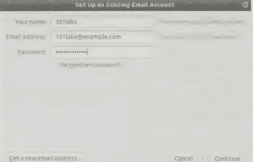
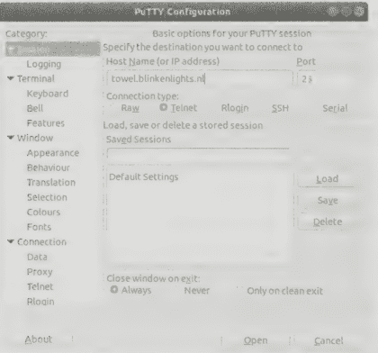

# 101 实验 - Linux LPIC1：包含 Linux 基础


## 作者简介

### Paul Browning

Paul Browning 在英国担任警察 12 年，之后转行成为帮助台技术员。他通过了多项 IT 认证，并开始在 Cisco Systems 工作，为大型企业客户支持 WAN。


他于 2002 年创办了一家 IT 咨询公司，帮助设计、安装、配置和故障排除从小型到大型公司的全球网络。随后不久，他开始教授 IT 课程，并通过他的课堂教学、在线培训和指导书帮助数万人通过 IT 考试并在 IT 行业享受成功的职业生涯。

2006 年，Paul 创办了在线 IT 培训门户 www.howtonetwork.com，该网站已发展成为领先的 IT 认证网站之一。

2013 年，Paul 与家人搬到了布里斯班。他的业余时间弹吉他、阅读、喝咖啡，并练习巴西柔术。

### Arturo Norberto Baldo


Arturo Norberto Baldo 负责本书的技术编辑工作。他是 Linux 爱好者，AS26218 的网络工程师，自 2012 年起担任自由 IT 顾问，也是 ISOC 和 IETF 成员。他拥有无法在此一一列举的众多认证。他支持的技术包括 VMware ESXi、Vcenter、Veeam Backup And Replication、Spiceworks、osTicket、Active Directory、Windows 服务器、Debian 和 Ubuntu 服务器、Web 托管面板、视频监控系统（如 Bosch BVMS、Genetec、Digifort 和 Milestone 等）以及其他技术。

他曾在多家大型公司担任网络工程师、系统管理员和安全专家。他拥有技术理学士学位（B.Tech.）和技术理硕士学位（M.Tech.）。业余时间他喜欢阅读和骑自行车。

由 Internet Archive 于 2023 年数字化，资金来自 No Sponsor

https://archive.org/details/isbn_9780992823917

### # 前言 101 Labs

欢迎阅读您的 101 Labs 图书。

当我在 2002 年开始教授 IT 课程时，我发现大多数培训手册几乎完全专注于理论知识，这让我震惊。除了几个使用命令或配置指南的示例外，你只能埋头苦读，却永远不知道如何将所学内容应用到实际设备或现实世界中。

快进 17 年，情况几乎没有改变。我仍然在纳闷，当大约 50% 的考试分数基于动手技能和知识时，为什么大多数书籍对培养你通过考试并在选定的网络、安全或云工程师职业生涯中赚钱所需技能的关注寥寥无几。

101 Labs 不是一本理论书：它的目的是将你在学习指南中学到的知识转化为作为网络工程师在入职第一天就会用到的宝贵技能。例如，我们不教 DHCP，而是向你展示如何配置 DHCP 服务器，哪些地址你不应该使用，以及你可以向主机分配哪些参数。如果协议不起作用，我们会告诉你可能的原因。这听起来有用吗？我们当然希望如此。

我们选择考试大纲中最相关的部分，并使用免费软件或免费试用版（尽可能）逐步指导你完成配置和故障排除命令。随着你信心的增长，我们会增加难度级别。如果你想成为一名卓越的网络工程师，你可以自己创建实验，添加其他技术，尝试破坏它们，修复它们，然后重做一遍。

–Paul Browning

## 101 LABS–LINUX LPIC-1：系统管理员

本书旨在巩固您在 Linux LPIC-1 学习指南或视频培训课程中阅读到的理论知识。如果您尚未学习任何理论，请查看我们的网站 https://www.howtonetwork.com，该网站还包含模拟考试。

本书的目标是显著提高您的动手技能和速度，使您能够在 Linux LPIC 考试的实操部分中取得成功，并将您的技能转移到现实世界，成为 Linux 网络工程师。我们没有空间在这里涵盖任何理论，因此请参考您的 Linux LPIC 学习指南，以充分理解每个实验背后的学习要点。每个实验都旨在涵盖一个特定的理论问题，例如 fdisk 的配置要求。

如果您希望获得 Linux LPIC-1 认证，您必须通过两项考试：

- 101-500
- 102-500

本书实际上从 Linux Essentials 大纲开始，涵盖实验 1 到 25。如果您希望参加此认证，您可以预订考试：

- 010-160

请访问 LPIC 网站了解考试主题和预订详情：
https://www.lpic.org

我们已尽力涵盖 Linux Professional Institute 网站上的考试大纲中提到的所有大纲主题。请检查他们网站上的大纲，因为它可能会发生变化。他们的网站还提供了关于每个主题区域权重的更多详细信息。

还值得注意的是，一旦我们展示如何配置某些服务或协议几次，我们就会在后续实验中停止逐步指导——以节省宝贵的空间。无论如何，您总是可以翻回几页查看它是如何完成的。

我们已尽力使拓扑尽可能简单，因此，几乎所有实验都是在运行在虚拟机上的 Ubuntu 安装（具有互联网访问）上配置的。请务必查看我们的资源页面，其中包含您可能需要的任何附加信息：https://www.101labs.com/resources

### 进行实验

除了开头的几个研究性实验外，所有实验都是动手操作型的。它们已由多名学生以及一名高级 Linux 顾问检查，因此应该没有错误。请记住，每台机器都会有所不同，因此您的输出在许多情况下将与我们的不同。如果您使用的发行版不是 Ubuntu 18.04，您的结果将与我们的有显著差异。

如果您遇到困难或事情不起作用，我们建议您休息一下，稍后头脑清醒地回到实验。那里有许多 Linux 支持论坛，您可以在那里提问，如果您也是 101labs.net 的成员，当然也可以在我们的论坛上发帖。

祝学习顺利。

–Paul Browning, CCNP, MCSE

## 101 LABS–LINUX LPIC1 视频课程

每本 101 Labs 图书都配有相应的视频培训课程。您可以观看讲师配置每个实验并逐步讲解整个过程，同时分享现实 IT 世界中有用的提示。每门课程还包含 200 道考试风格的问题，为真实的考试做准备。使用此资源并非必要，但如果您使用，请在结账页面使用优惠码 ‘101lpic’ 以获得大幅折扣，作为对您购买此书的感谢。https://www.101labs.net

### 说明

- 1. 请从头到尾遵循这些实验。如果您遇到困难，请做下一个实验，稍后再回到有问题的实验。随着您在配置软件和使用命令方面获得信心和经验的积累，您很有可能想出解决方案。
- 2. 您可以按任何顺序进行实验，但我们已尽力在过程中逐步提高您的技能水平。为了获得最佳效果，在尝试考试之前，请将所有实验重复做几遍。
- 3. www.101labs.net/resources 上有资源。
- 4. 请勿在实时网络上或属于公司或个人的设备上配置这些实验。


### 5. 请**不要**尝试在其他 Linux 发行版上配置这些实验。
我们选择 Ubuntu (18.04 LTS) 作为实验环境，是因为它是全球前 1000 个网站中最流行的 Linux 发行版，每天约有 500 个网站进入全球前 1000 万网站名单。

### 6. 你**必须**正在阅读或已经阅读过 Linux 学习指南，或观看过理论视频课程。
除了某些配置技巧和建议外，本书不会深入讲解大量理论知识；所有内容均为动手实验。

### 7. 我们不可能为本书成千上万的读者提供个别支持（抱歉！），因此请勿联系我们寻求技术支持。
每个实验都由从初学者到专家的多位技术编辑进行过测试。

## 现实出版社（REALITY PRESS LTD.）的其他著作

- Cisco CCNA 简化指南
- 60 天掌握 Cisco CCNA
- IP 子网划分——从零到高手
- 101 个实验——CompTIA A+（预计 2019 年出版）
- 101 个实验——CompTIA Network+
- 101 个实验——IP 子网划分
- 101 个实验——Cisco CCNP
- 101 个实验——Cisco CCNA
- 101 个实验——Wireshark WCNA（预计 2019 年出版）

## 技术编辑

感谢所有奉献时间检查所有实验并提供反馈的技术编辑。

- Charles L. Burkholder
- Carol Wood
- Dante J. Alarcón
- Timothy A Clark
- Tim Peel
- Elbert L Freeman
- John DeGennaro
- Steve Quan

## LPI-Linux Essentials

# 实验 1

## Linux 的发展与流行操作系统

**实验目标：**
了解什么是 Linux，各种 Linux 发行版是如何演变的，以及这些发行版的用例和目标受众。在虚拟机中安装 Ubuntu 18.04，或您选择的其他发行版。

**实验目的：**
与专有操作系统不同，Linux 的特性意味着用户在决定要在电脑上安装（或不安装）什么软件时拥有无限的选择权。如今有数百种 Linux 发行版或“distros”可供选择，但 Linux 并非一开始就是这样的。Debian、Slackware 和 Red Hat 自 20 世纪 90 年代初就存在，是仍在使用最古老的三个发行版。目前许多最受欢迎的发行版都是衍生或分叉自这三个版本之一。

**实验工具：**
一台连接互联网且支持 VirtualBox 或其他 hypervisor 软件的计算机。

**实验拓扑：**
无

### 实验详解：

### 任务 1：
查看这棵 Linux 发行版树（参见注释中的 URL）。尝试找出一些最常用的发行版：

- Debian
- Ubuntu
- CentOS
- SUSE
- Red Hat
- Linux Mint
- Scientific Linux
- Raspbian
- Android

这些发行版之间有什么关系？

### 任务 2：
如果你还没有这样做，请考虑你即将第一次安装一个 Linux 发行版。思考你在桌面、服务器或两者方面有什么需求。然后参加这个测验：https://distrochooser.de/en

### 任务 3：
记录你在任务 2 中的结果。访问任何看起来有趣的发行版的网站。它们的用例和开发理念（如果有的话）是什么？

### 任务 4：
现在是时候安装一个 Linux 发行版，用于后续的实验了。为了简单起见，我们将假设使用 **Ubuntu 18.04 LTS**。然而，如果你是高级用户，鼓励你尝试在其他自选的发行版上进行这些实验。

这里有一个很好的指南，教你如何在 VirtualBox 中安装 Ubuntu 18.04：

https://linuxhint.com/install_ubuntu_18-04_virtualbox/

**注释：**
许多发行版都有“Live USB”，你可以测试它而无需擦除计算机的硬盘。你还可以使用 VirtualBox 或其他 hypervisor 来测试任意数量的 Linux 发行版。几乎每个发行版都应该能在虚拟机中无故障运行。

在后续实验中，我们将假设使用在 VirtualBox 上运行的 Ubuntu 18.04 LTS 虚拟机。这绝非唯一的可能性，一旦你练习了几次实验，我们鼓励你尝试其他发行版！

https://upload.wikimedia.org/wikipedia/commons/1/1b/Linux_Distribution_Timeline.svg

# 实验 2

## 主要开源应用：桌面

**实验目标：**
了解常见的 Linux 桌面应用程序以及如何使用包管理器安装新应用程序。

**实验目的：**
Linux 拥有各种开源桌面软件，其功能与其他操作系统上常见的专有软件相同。在本实验中，你将了解一些流行的开源软件，以及如何使用称为包管理器的工具安装和更新这些软件。

**实验工具：**
Ubuntu 18.04（或你选择的其他发行版）

**实验拓扑：**
一台 Linux 计算机或虚拟机

**实验详解：**

### 任务 1：
默认的 Ubuntu 桌面已经安装了一些常用软件。看看你是否能找到并熟悉以下应用程序：

- LibreOffice——办公套件
- Thunderbird——邮件客户端
- Firefox——Web 浏览器

找不到这些吗？点击左下角的“显示应用程序”，然后你可以在搜索框中搜索应用程序：


### 任务 2：
仅举一例，你现在的任务是配置 Thunderbird 以连接到电子邮件账户。首次打开 Thunderbird 时，你应该会看到如下的对话框：



输入你的电子邮件账户详细信息，然后单击继续。许多常见的邮件提供商都包含在 Mozilla 自己的数据库中，无需进一步配置。例如，如果你有一个 Gmail 账户，一旦你提供了凭据，Thunderbird 会自动为你设置好。

如果你的邮件服务没有自动配置，你将不得不点击“手动配置”（在下一个屏幕上）以输入你的服务器详细信息。请咨询你的邮件提供商以获取正确的输入值。

### 任务 3：
如果你想使用一个尚未安装的应用程序怎么办？你需要安装它！幸运的是，使用 Linux 包管理器，这很容易做到。搜索“GIMP”并使用 Ubuntu Software 安装它。然后，也熟悉一下 GIMP。GIMP 是一个图像编辑应用程序。

### 任务 4：
在底层，Ubuntu Software 使用一个名为 *apt* 的包管理器。不同的 Linux 发行版使用不同的包管理器，但它们的主要目的相同——提供一个集中位置，用于安装和更新数千个常用软件包。

你能将以下发行版与其默认的包管理器匹配吗？

| 发行版 | 包管理器 |
| :--- | :--- |
| Arch | pacman |
| CentOS | yum / dnf |
| Debian | apt |
| Fedora | dnf |
| Gentoo | Portage |
| SUSE | Zypper |

**注释：**
有时，你可能需要安装一个在发行版的包管理仓库（repos）中不可用的包。在这种情况下，你需要添加额外的仓库，或者使用像 *dpkg* 这样的工具手动安装包。

# 实验 3

## 主要开源应用：服务器

**实验目标：**
了解一些通常部署在 Linux 服务器上的软件和开发工具。

**实验目的：**
在本实验中，你将调研几种常见的 Linux 服务器软件工具。虽然详细配置这些工具超出了本实验的范围，但熟悉它们的应用场景非常重要。

**实验工具：**
Ubuntu 18.04（或你选择的其他发行版）

**实验拓扑：**
一台 Linux 计算机或虚拟机

**实验详解：**

### 任务 1：
使用你 Linux 虚拟机上的 Web 浏览器研究以下一些常见的 Linux 服务器应用程序：

- Web 服务器：Apache httpd, nginx
- 数据库：MariaDB, MySQL
- 文件服务器：NFS, Samba
- 私有“云”：Nextcloud, ownCloud

在什么情况下你会部署每个应用程序？

### 任务 2：
你熟悉任何编程语言吗，例如……

- C？
- Java？
- JavaScript？
- Perl？
- Python？
- PHP？
- 其他？

如果你有软件开发经验，你可能喜欢搜索 Ubuntu Software 或其他包管理器中你最喜欢的语言工具。所有这些语言以及更多其他语言都受 Linux 支持。

### 任务 3：
现在，你将连接到一台远程 Linux 服务器。首先，使用 Ubuntu Software 安装一个名为 PuTTY 的应用程序。PuTTY 是 SSH/Telnet 客户端的图形界面版本，通常用于连接远程 Linux 服务器，尤其是从 Windows 机器连接。

运行 PuTTY 后，你将看到连接屏幕。输入“towel.blinkenlights.nl”，选择 Telnet，然后单击 Open：




好的，请欣赏！

不言而喻，这台特定的 Linux 服务器有些与众不同——不过，你在 PuTTY 或命令行中连接任何其他远程 Linux 服务器时，都会使用非常相似的过程。

### 任务 4：

最后，找到终端应用程序。当你启动终端时，它会运行一个名为 shell（外壳/壳层）的特殊应用程序。默认且最常见的 shell 是 Bash，但也有其他选择。

在实践中，你通常直接使用终端，而不是使用 PuTTY 这样的图形界面应用程序。

### 注意事项：

虽然在现代桌面计算机上这一点不太重要，但 shell 对于管理 Linux 服务器至关重要。在后续实验中，我们将深入研究 shell。

# 实验 4
## 开源软件与授权

**实验目标：**
了解开源理念以及不同形式的开源软件授权。

**实验目的：**
在处理开源软件（特别是在企业环境中）时，识别各种许可和业务模式的影响至关重要。

**实验工具：**
一台带有 Web 浏览器的设备

**实验拓扑：**
不适用

**实验步骤：**

### 任务 1：
探索 chooselicense.com 并尝试回答以下问题：

- Copyleft 许可证与 Permissive（宽松）许可证之间有什么区别？
- GPL、BSD 和 Creative Commons（知识共享）之间有什么区别？
- 在打包软件时，哪些许可证彼此兼容（哪些不兼容）？

### 任务 2：
接下来，请考虑或阅读一些潜在的开源业务模式。你能识别出以下每个企业/服务是如何将开源软件货币化的吗？

- Apple
- Canonical
- Mozilla
- MySQL (Oracle)
- RedHat
- Wikipedia
- WordPress

**注意事项：**
请记住，开源社区中的许多成员认为某些潜在的业务模式是不道德的。

# 实验 5
## 信息技术技能与在 Linux 中工作

**实验目标：**
通过进行一些基本配置并学习如何使用常见工具，使你的 Linux 虚拟机成为“你自己的”。

**实验目的：**
本实验的目标是学习如何对常见的 Linux 工具进行一些简单的定制。

**实验工具：**
Ubuntu 18.04（或你选择的其他发行版）

**实验拓扑：**
一台单台 Linux 机器或虚拟机

**实验步骤：**

### 任务 1：

打开 Firefox Web 浏览器并探索其配置。点击右上角的菜单，然后点击 *偏好设置*（Preferences）。

考虑调整 Firefox 的一些隐私和安全设置。例如：

- 默认情况下是否阻止了所有跟踪器和第三方 Cookie？
- 默认搜索引擎是什么？你对此感到满意吗？
- Firefox 会收集你的哪些数据？你想改变这一点吗？
- 历史记录和密码保存设置是什么？

### 任务 2：

现在，你可能想要为 Firefox 安装一个附加组件。使用你选择的搜索引擎查找一个可以在某些方面增强 Firefox 的附加组件。广告拦截、标签页管理、开发工具，选择很多！

### 任务 3：

如果你还没有这样做，请将 Ubuntu 中的终端应用程序添加到你的收藏夹中。你将大量使用它！

1. 点击左下角的“显示应用程序”，并搜索终端。
2. 右键点击终端应用程序，然后点击“添加到收藏夹”。

### 任务 4：

现在我们将通过命令行更改你的 Ubuntu 密码。打开终端应用程序，然后输入：`passwd`

你需要先输入当前密码，然后两次输入新密码。这些密码在输入时完全不会显示任何字符，起初这可能会让你有点吃惊！不过，最终你应该看到消息：`passwd: password updated successfully`（密码已成功更新）

**注意事项：**
在此前的实验中，你主要使用的是 Linux 的桌面形式。然而，在行业中，Linux 在服务器领域占据了更大的份额。大型科技公司和技术专业人员通常在日常工作中如何使用 Linux 和虚拟化技术？

# 实验 6
## 命令行基础：语法与引号

**实验目标：**
学习基本的 Linux 命令和 shell 语法。

**实验目的：**
Bash 命令 shell 预装在世界上数百万台 Linux 计算机上。理解这个 shell 如何工作对于使用 Linux 是一项关键技能。

**实验工具：**
Ubuntu 18.04（或你选择的其他发行版）

**实验拓扑：**
一台单台 Linux 机器或虚拟机

**实验步骤：**

### 任务 1：
打开终端应用程序，然后输入：`echo Hello World`

`echo` 命令只是打印出你提供的所有“单词”或参数。这看起来可能没什么用，直到……

### 任务 2：
现在按顺序输入以下四个命令：

```
quote='cat /etc/issue'
backquote=`cat /etc/issue`
echo $quote
echo $backquote
```

在这里，`quote` 和 `backquote` 被称为变量。在前两行中，我们将它们分别设置为值 `'cat /etc/issue'` 和 `` `cat /etc/issue` ``。（我们稍后会讲到引号和反引号之间的区别。）在最后两行中，我们在变量前加上 `$` 来引用它们，并打印出它们的内容。

### 任务 3：

为了理解单引号、双引号和反引号，输入以下内容：

```
hello="echo hello"

echo "$hello"

echo '$hello'

echo `$hello`
```

输出应该如下：

```
echo hello
$hello
hello
```

双引号允许引用变量的值。单引号始终是字面量，而反引号则*执行*引号内的命令（包括变量引用）。

### 注意事项：

在某些情况下，你可能希望使用 `${variable}` 语法来引用变量。这等同于 `$variable`，但选择其中一种而非另一种的原因超出了本实验的范围。

反引号也有另一种语法：

```
$(echo hello)
```

这种语法通常比反引号更受青睐。我们提到反引号只是为了将其与单引号区分开来，并确保差异清晰。

# 实验 7
## 命令行基础：环境变量、类型与历史记录

**实验目标：**
了解 Bash 环境变量、类型以及如何 shell 历史记录。

**实验目的：**
Bash 命令 shell 预装在世界上数百万台 Linux 计算机上。理解这个 shell 如何工作对于使用 Linux 是一项关键技能。

**实验工具：**
Ubuntu 18.04（或你选择的其他发行版）

**实验拓扑：**
一台单台 Linux 机器或虚拟机

**实验步骤：**

### 任务 1：
打开终端应用程序，然后输入：`echo $PATH`

PATH 环境变量列出了当你输入带有相对路径的命令时，Bash 将搜索的所有位置。相对路径的例子是 `bash`，而 `/bin/bash` 则是绝对路径。

还有其他环境变量。你可以使用 `env` 命令查看它们及其值。

### 任务 2：
你可以使用 `export` 添加或修改环境变量。例如：

```
export PATH=$PATH:./
```

在大多数情况下，当你退出 Bash 时，此更改将消失，但 `export` 的优势在于子进程现在可以看到新/修改后的变量。

### 任务 3：

另一个有用的 Bash 命令是 *type*。使用 **type** 来获取其他命令或函数的信息：

```
type -a date
type -a if
type -a echo
type -a ls
```

### 任务 4：

输入 **history** 以查看你输入到 Bash 中的命令历史记录。

若要重复一条命令，只需输入 `!` 然后输入相应的数字。例如，`!12` 将执行历史记录列表中的第 `#12` 条命令。

如果你不小心将密码或其他敏感信息保存到了历史记录中，你可以使用例如 `history -d 47` 从列表中删除第 #47 条命令，或者甚至使用 `history -c` 完全清除历史记录。

如果你想将当前 shell 的历史记录保存到另一个文件，请使用 `history -w filename`

### 注意事项：

如果你希望永久修改环境变量或其他 shell 设置，请查看 `.bashrc` 和 `.bash_profile` 文件。


## 实验 8：使用命令行获取帮助

**实验目标：**
学习如何从命令行阅读各种手册。

**实验目的：**
在这个拥有谷歌、Stack Overflow 和 *维基百科* 的世界里，我们有时会忘记 Linux 自带了一个文档库！

**实验工具：**
Ubuntu 18.04（或您选择的任何其他发行版）

**实验拓扑结构：**
一台 Linux 机器，或虚拟机

### 实验步骤

**任务 1：**

在 Linux 中，有三种相当可靠的方法来获取特定工具的信息。并非每个工具都提供这三种选项。`date` 命令提供这三种选项，因此我们将以它为例。

打开终端应用程序，然后输入：`date --help`

这是查找特定命令信息的快速且简洁的方法。大多数命令都支持 `-help` 或 `-h` 标志。不过，有时你会遇到不支持这些标志的命令，或者你需要比快速帮助更多的信息……

**任务 2：**

输入：`man date`

`man` 是 *manual*（手册）的缩写，是提供文档的最常见方式。与快速帮助标志不同，它不仅仅局限于命令——你可以使用 `man` 页获取关于 *系统* 和 *库* 调用、特殊文件、文件格式甚至 `man` 本身的信息（试着输入 `man man`）。

**任务 3：**

输入：`info date`

当连 `man` 都不够用时，有时你可能需要依赖 `info`。`info` 并不是最便捷的随意浏览工具，但它提供了关于 Linux 系统任何方面最详细的信息。

**注意事项：**
使用未知标志，如 `--help` 和 `-h`，可能存在风险，尤其是当命令以 root 身份运行时。你知道原因吗？

## 实验 9：使用目录和列出文件：文件

**实验目标：**
学习如何创建、删除和列出文件。

**实验目的：**
在这个实验中，你将学习如何使用 Bash shell 创建、删除和列出文件。

**实验工具：**
Ubuntu 18.04（或您选择的任何其他发行版）

**实验拓扑结构：**
一台 Linux 机器，或虚拟机

### 实验步骤

**任务 1：**
打开终端应用程序，然后输入：`touch foo`

你现在已经创建了一个文件，你可以用 `cat foo` 打印其（空的）内容。

你可以使用 `ls -lh foo` 列出关于新文件的更多详细信息。

**任务 2：**
现在创建另一个空文件：`touch .bar`

你可以单独使用 `ls` 命令来列出当前 *目录* 中的所有文件（目前应该是你的 *主目录*）。但现在这样做会发生什么？.bar 在哪里？

.bar 是一个 *隐藏文件*！使用 `ls -a` 它就会显示出来。

**任务 3：**
现在让我们清理一下。输入 `rm foo .bar` 来删除你创建的两个文件。

**注意事项：**
当你输入 `ls -a` 时，你可能注意到了一些其他奇怪的带点的条目，比如 . 和 ..——这些不是文件，而是目录，将在下一个实验中涵盖。

## 实验 10：使用目录和列出文件：目录

**实验目标：**
学习如何创建、删除、枚举和导航目录。

**实验目的：**
在这个实验中，你将学习如何使用 Bash shell 在目录之间创建、删除、枚举和导航。

**实验工具：**
Ubuntu 18.04（或您选择的任何其他发行版）

**实验拓扑结构：**
一台 Linux 机器，或虚拟机

### 实验步骤

**任务 1：**

打开终端应用程序，然后输入：`mkdir -p foo/bar`

你现在创建的不是一个，而是两个目录，一个在另一个内部。现在运行以下命令：

```bash
cd foo
ls
```

就像文件一样，你也可以创建隐藏目录：

```bash
mkdir .baz
ls
ls -alh
```

你的 *当前目录*（你用 `cd` 更改了它）是 foo，你可以用 `pwd` 确认这一点。

**任务 2：**

`ls -alh` 如预期那样列出了 bar 和 .baz，但它还列出了 . 和 ..——它们分别代表列出的目录和父目录。换句话说，. 是 foo，.. 是你的主目录，也称为 ~

现在运行：

```bash
cd .
pwd
pushd ..
pwd
popd
pwd
cd ~
pwd
```

这些命令如何影响你在目录结构中的导航？

**任务 3：**

现在运行：

```bash
cd ./foo
touch ~/foo/.baz/quux
ls -aR ~/foo
```

~ 展开为 /home/user（其中 “user” 是任何你的用户名）。因此，虽然上面的第一个命令使用相对路径名，其结果取决于当前目录，但后两个命令使用绝对路径名。无论你在哪个目录位置，这些命令的结果都将相同（当然，除非你切换用户）。

**任务 4：**

最后，让我们清理一下：

```bash
cd ~
rm -r foo
```

**注意事项：**
你可能会遇到一个“技巧”，即一个以 - 开头的文件，这会误导 Bash 认为你正在向 rm 提供一个标志，而不是要删除的文件。你能想出如何删除这样的文件吗？

## 实验 11：创建、移动和删除文件

**实验目标：**
学习如何复制、移动和管理大量文件。

**实验目的：**
在这个实验中，你将了解复制和移动文件的区别，以及简单的 shell 通配符的工作原理。

**实验工具：**
Ubuntu 18.04（或您选择的任何其他发行版）

**实验拓扑结构：**
一台 Linux 机器，或虚拟机

### 实验步骤

**任务 1：**
打开终端应用程序，然后输入：

```bash
mkdir lab11
cd lab11
touch f1 f2 f3
```

你现在有一个目录，其中包含三个空文件。

**任务 2：**

```bash
cp f1 f4
ls
```

如预期那样，`cp` 命令创建了一个第四个空文件。但是，当你执行以下操作时会发生什么？

```bash
cp f1 f3
```

f3 文件会被覆盖——希望你在里面没有重要数据！

为了防止这种情况，使用 `-i` 或 `-n` 标志。`-i` 代表 *interactive*（交互式），意味着在覆盖之前你会被提示。`-n` 代表 *no-clobber*（不覆盖），意味着目标文件永远不会被覆盖。然而，`cp` 不会就此警告你，因此建议一般 shell 使用 `-i`。

**任务 3：**

现在运行：

```bash
mv f1 f5
```

`mv` 是移动命令，所以它做你可能预期的事情，实际上是将 `f1` 重命名为 `f5`。与 `cp` 一样，`mv` 也有 `-i` 和 `-n` 标志，它们具有相同的效果。

**任务 4：**

现在运行：

```bash
mkdir foo bar
mv f2 foo
mv f3 foo
mv f* bar
```

你预测最终的目录结构会是什么样？现在用 `ls -aR bar` 检查一下——是否与你的预测相符？（参见下方 **答案 1**。）

你对 `f*` 所做的操作称为 *globbing*（通配符匹配）。该命令匹配了所有以 `f` 开头的 *和* 文件（但不是 `F`——与 Linux 中的其他一切一样，通配符匹配是大小写敏感的），所以 `f4`、`f5` 和 `foo` 都被移动到了 `bar` 中。

**任务 5：**

用 `cp bar/foo ./` 将 `foo` 复制回当前目录。

... 哎呀！发生了什么？为了复制包含其内容的目录，你必须使用 `-r` 标志（代表 *recursive*（递归））：`cp -r bar/foo ./`

**任务 6：**

最后，让我们清理一下：

```bash
cd ~
rm -r lab11
```

### 答案 1：

```text
bar:
. .. f4 f5 foo
bar/foo:
. .. f2 f3
```

**注意事项：**
小心使用 `rm -r`——该命令在未提示你的情况下删除整个目录。互联网上有很多关于人们在注意力不集中时无意中删除重要文件的恐怖故事。

## 实验 12：在命令行上归档文件

**实验目标：**
学习如何创建、提取和检查各种类型的归档文件。

**实验目的：**
在这个实验中，你将了解 zip、gzip、bzip2 和 xz 压缩归档——以及一个名为 `tar` 的工具，用于管理大多数 Linux 归档类型。

**实验工具：**
Ubuntu 18.04（或您选择的任何其他发行版）

**实验拓扑结构：**
一台 Linux 机器，或虚拟机

### 实验步骤

**任务 1：**
打开终端应用程序并运行以下命令：

```bash
mkdir lab12
cd lab12
touch f1 f2 f3 f4 f5 f6 f7 f8 f9
```

**任务 2：**
如果你接触过 Windows，你可能熟悉 ZIP 文件。ZIP 是一种常见的归档类型，既压缩又存储文件。

运行：

```bash
zip files.zip f*
unzip -l files.zip
```

你可以看到所有九个文件都包含在 files.zip 中，尽管由于它们是空的，没有可压缩的内容。你可以用 `unzip files.zip` 解压缩此归档，但你将被提示覆盖现有文件。


最后，使用 `rm files.zip` 进行清理。

### 任务 3：

虽然 ZIP 是一种常见格式且在 Linux 上支持良好，但它并不是 Linux 主要使用的压缩格式。主要的压缩格式应该是经典的 gzip：

```
gzip f*
ls
```

等一下……为什么现在是九个 gzip 压缩文件，而不是只有一个？那些原始文件去哪了？

这就是为什么 gzip 被视为一种 *压缩* 格式，而不是一种 *归档* 格式。要创建一个单一、易于使用的归档文件，我们需要不同的工具...

### 任务 4：

运行命令：`tar -cf files.tar.gz f*`

现在，在 *tar 归档器* 的帮助下，你拥有了位于 files.tar.gz 中的 gzip 归档文件... 呃，差不多吧。

通常，对于 gzip 压缩的 tar 包，你可以使用 `tar xf files.tar.gz` 来提取它，并取回所有原始文件。相反，如果你现在尝试这样做，你会得到九个 .gz 文件。

有更好的方法。让我们炸掉这些文件并重新开始：

```
rm f*
touch f1 f2 f3 f4 f5 f6 f7 f8 f9
tar -czf archive.tar.gz f*
tar --list -f archive.tar.gz
```

看！现在你看到了单一压缩 tar 包内九个文件的列表。

### 任务 5：

gzip 并不是你能与 tar 配合使用的唯一格式：

```
tar -cjf archive.tar.bz2 f*
tar -cjf archive.tar.xz f*
```

bzip2 和 XZ 格式分别更新，使用与 gzip 不同的算法，但最终结果是一样的。tar 可以通过使用 `tar -xf filename` 以相同的方式提取其所有格式。

### 任务 6：

最后，清理现场：

```
cd ~
rm -r lab12
```

### 备注：

ZIP、gzip、bzip2 和 XZ 都有各自的优势和劣势。你可以在互联网上查找基准测试...或者，作为额外的挑战，你可以尝试运行自己的基准测试！你应该已经安装了 ZIP，但如果出于某种原因没有安装，你可能需要安装它。

# 实验 13

## 从文件中搜索和提取数据：管道与重定向

**实验目标：**
学习如何在 Bash 中使用管道以及重定向输入和输出。

**实验目的：**
Bash 有两个常用的功能，称为管道（pipes）和 I/O 重定向（I/O redirection），它们让使用 Linux 变得更加容易。在本实验中，你将学习如何利用这些强大的功能。

**实验工具：**
Ubuntu 18.04（或你选择的其他发行版）

**实验拓扑：**
单台 Linux 机器，或虚拟机

**实验步骤：**

### 任务 1：

打开终端应用程序并运行：

```bash
mkdir lab13
cd lab13
echo "hello world" > hello
cat hello
```

你刚刚将 echo 命令的输出重定向到了 hello 文件。`>` 是一个快捷方式；这个命令的正确版本应该是 `1>`，其中 `1` 被称为文件描述符，它引用的是标准输出。

### 任务 2：

现在运行：

```bash
ls nonexistent 2>> hello
cat hello
```

### 任务 3：

根据 hello 文件的新内容（"ls: cannot access 'nonexistent': No such file or directory"），你能推测 `2>` 的作用吗？在这里，`2` 是 *标准错误* 的文件描述符。

有时，你想将输出 *和* 错误重定向到同一个地方。在旧时代，你不得不做一些像这样丑陋的事情：`ls foo > bar 2>&1`

然而，现代版本的 Bash 有一个易于使用的快捷方式：`ls foo && bar`

### 任务 4：

我们讨论了重定向输出，但输入呢？要了解这一点，请运行以下命令：

```
cat < hello
```

```
read foo <<< "foo"
echo $foo
```

```
cat << END-OF-FILE > goodbye
hello
goodbye
END-OF-FILE
cat goodbye
```

简而言之：`<` 从文件名重定向输入，`<<` 开始一个 here document（此处文档），而 `<<<` 从另一个命令重定向输入。

### 任务 5：

管道（`|`）允许你将一个命令的输出作为另一个命令的输入。在许多情况下（但并非所有情况），`|` 和 `<<<` 在某种程度上是彼此的逆操作。例如，以下命令的输出...

```
echo "hello world" | grep e
```

...与以下命令的输出完全相同...

```
grep e <<< "hello world"
```

在运行之前，试着预测以下命令字符串的输出（参见下方 **答案 1**）：

```
grep non hello | cut -d: -f3
```

### 任务 6：

最后，清理现场：

```
cd ~
rm -r lab13
```

### 答案 1：

No such file or directory（没有那个文件或目录）

### 备注：

grep 用于在字符串中搜索匹配的模式，而 cut 将输入分成片段。两者都是非常常见的工具，你将在后续的实验中使用更多。

# 实验 14

## 从文件中搜索和提取数据：正则表达式

**实验目标：**
学习如何使用正则表达式进行复杂的字符串模式匹配。

**实验目的：**
正则表达式是 Linux 中常用的一种工具，用于在字符串和文本文件中匹配复杂的模式。许多工具都支持正则表达式。

**实验工具：**
Ubuntu 18.04（或你选择的其他发行版）

**实验拓扑：**
单台 Linux 机器，或虚拟机

**实验步骤：**

### 任务 1：

打开终端应用程序。看看你是否能在运行之前预测此命令序列的输出（参见下方 **答案 1**）：

```
echo "foo
bar
baz
quux
frob
plugh
xyzzy" | sort | tail -5 | grep [be]
```

### 任务 2：

你能匹配右侧的哪些字符串（on the right）会与左侧的每个正则表达式（on the left）匹配吗？每个正则表达式可能有多个匹配项！请参阅下方 **答案 2** 获取解决方案。

```
^s?.*$      Hello World
^[0-9]  .*$  1, 2, 3, Go!
^. .*[a-z].*$  sayonara
^q?[a-z]*$  101labs
```

### 答案 1：

```
frob
```

### 答案 2：

第一个表达式匹配所有四个字符串。
第二个表达式匹配 “1, 2, 3, Go!” 和 “101labs”。
第三个表达式匹配所有四个字符串。
第四个表达式匹配 “sayonara”。

### 备注：

Regexr 是一个练习正则表达式的好资源。

# 实验 15

## 将命令转换为脚本：Shell 脚本编程

**实验目标：**
学习如何编写包含多个命令的简单 shell 脚本。

**实验目的：**
使用 Bash 编写脚本是许多专业 Linux 管理员的日常任务。当一项任务具有重复性时，你不希望一遍又一遍地键入相同的命令列表；你希望创建一个脚本，并且也许还要安排该脚本自动运行。

**实验工具：**
Ubuntu 18.04（或你选择的其他发行版）

**实验拓扑：**
单台 Linux 机器，或虚拟机

**实验步骤：**

### 任务 1：

打开终端应用程序，并运行你喜欢的文本编辑器，例如 `vi` 或 `nano`。（如果你从未使用过 `vi` 或 `vim`，强烈推荐使用 `nano`。）

创建一个包含以下内容的文件：

```
#!/bin/bash
for (( n=0; n<$1; n++ ))
do
    echo $n
done
echo "Output from $0 complete."
```

### 任务 2：

使文件可执行（使用 `chmod +x filename`），然后像这样运行它：

```
./filename 10
```

### 任务 3：

你应该看到数字 0-9 被逐个打印出来。现在知道了脚本的作用，你能完全理解它吗？如果你没有传递参数，或者传递了像字母这样的 "gibberish"（乱码）而不是数字，会发生什么？

不带参数运行你的脚本。然后运行：`echo $?`

`$?` 是一个引用 *退出状态* 的特殊变量。在成功的程序中，退出状态将是 0。请现在自己尝试一下。然后编辑脚本，删除最后一个 echo 语句。这样脚本在没有参数的情况下会失败，返回不同的退出状态。

### 备注：

第一行以 `#!` 开头（称为 *shebang* 或 *哈希歪杠*），表示将使用什么程序来解释你的脚本。通常是 `/bin/bash`，但也可能是另一个 shell 如 `/bin/zsh`，甚至是另一种编程语言如 `/usr/bin/python`。

在这种情况下，你可以移除 shebang 行，因为你的解释器与你当前正在运行的 shell（Bash）相同。但你总是应该包含它，因为你永远不知道什么时候可能需要与使用不同 shell 的人共享脚本。

# 实验 16

## 将命令转换为脚本：脚本练习

**实验目标：**
使用你已有的知识，从头开始编写一个简单的 shell 脚本。

**实验目的：**
使用 Bash 编写脚本是许多专业 Linux 管理员的日常任务。当一项任务具有重复性时，你不希望一遍又一遍地键入相同的命令列表；你希望创建一个脚本，并且也许还要安排该脚本自动运行。

**实验工具：**
Ubuntu 18.04（或你选择的其他发行版）

**实验拓扑：**
单台 Linux 机器，或虚拟机

**实验步骤：**

### 任务 1：

打开终端应用程序，并运行你喜欢的文本编辑器，例如 `vi` 或 `nano`。（如果你从未使用过 `vi` 或 `vim`，强烈推荐使用 `nano`。）

如果你还没有这样做，你可能希望参考实验 15。你的目标是编写一个接受一个参数（一个数字）的脚本，并一次打印两个数字，使得：

- 第一个数字从参数倒数到 0
- 第二个数字从 0 正数到该参数

示例：

```
./foo.sh 100
100 0
99 1
98 2
...
```


如果用户没有提供参数，或者提供了一个没有意义的参数（例如一个单词），你应该打印一条友好的消息，例如“请提供一个数字。”

记得在测试之前将文件设为可执行（使用 `chmod +x filename`）。关于一种可能的解决方案，请参见下面的 **答案 1**。

### 答案 1

```bash
#!/bin/bash
if ! [ “$1” -ge 0 ]
then
    echo “Please give a number.”
    exit 1
fi
for (( n=0; n<= $1; n++ ))
do
    echo $(( $1-$n)) $n
done
```

### 说明

在实验 15 中，你阅读了有关退出状态的内容。就错误检查而言：你能想出如何在脚本退出之前使用退出状态吗？

# 实验 17

## 选择操作系统

**实验目标：**  
学习如何根据你的特定目的选择操作系统。

**实验目的：**  
Windows、OS X 和 Linux 各有其优势、劣势和应用场景。在本实验中，你将复习这些内容。

**实验工具：**  
连接互联网的设备及网络浏览器

**实验拓扑：**  
不适用

**实验步骤：**

**任务 1：**  
与 Windows 和 OS X 不同，Linux 在版本或“发行版”（distros）方面提供了近乎无限的选择。Linux 由开发者社区创建，并几乎可以运行在任何现有硬件上。Linux 发行版在实验 1 中已讨论过。探索 Distrotchooser 和 Distrowatch 以了解更多关于众多 Linux 发行版的信息。

**任务 2：**  
OS X 是由 Apple 创建的专有操作系统，设计为仅在 Apple 硬件上运行。现代 OS X 的核心是 Unix，但附带了经过大量重新设计的 Apple 用户界面以及其他修改。OS X 将功能强大的图形用户界面与 Unix 管理员熟悉的许多工具相结合。

**任务 3：**  
Windows 是由 Microsoft 创建的专有操作系统。尽管是专有软件，它仍然可以在广泛的各种硬件上运行（尽管不如 Linux 那么广泛）。在管理方面，Windows 传统上较少关注命令行工具，而更多地关注图形工具。然而，近年来，随着 PowerShell 的出现，至少在 Windows 服务器版本上，这一情况已开始改变。

**说明：**  
即使 LPIC 考试专注于 Linux，作为一名 Linux 专业人士，你难免会在某个时刻被要求提供与其他操作系统的互操作性。学习 Windows 和 OS X 的基础知识，以及旨在与它们互操作的 Linux 工具（如 Samba），将有助于你实现这一点。

# 实验 18

## 理解计算机硬件

**实验目标：**  
了解构建计算机所需的硬件以及如何从 Linux 与某些硬件进行交互。

**实验目的：**  
以下是台式机和服务器计算机的主要硬件组件：

- 主板
- 处理器(s)
- 内存
- 电源供应器
- 硬盘/固态硬盘
- 光盘驱动器
- 外设

**实验工具：**  
Ubuntu 18.04（或你选择的其他发行版）

**实验拓扑：**  
单台 Linux 机器，或虚拟机

**实验步骤：**

**任务 1：**  
打开终端并运行以下命令，以检查支持你 Linux 计算机运行的部分硬件（实际或虚拟化的）：

- lscpu
- lspci
- lsusb -t
- sudo lshw
- sudo hdparm -I /dev/sd*

**任务 2：**  
现在调查一些相关的低级资源，如分区、驱动程序（内核模块）和资源使用情况：

- sudo fdisk -1
- lsmod
- df -h
- free -m

**说明：**  
如果你想要获取不知如何查找的硬件信息，一个很好的开始方式是探索 /proc 文件系统。上述大多数工具只是收集和格式化 /proc 中的信息；那里是内核呈现信息的地方。

# 实验 19

## 数据存储位置：进程和配置

**实验目标：**  
学习如何管理运行中的进程和程序配置。

**实验目的：**  
在本实验中，你将学习如何配置各种系统进程，并在这些进程运行时如何管理和监控它们。

**实验工具：**  
Ubuntu 18.04（或你选择的其他发行版）

**实验拓扑：**  
单台 Linux 机器，或虚拟机

**实验步骤：**

**任务 1：**  
打开终端并运行 `ls /boot`

内容会有所不同，但通常你会看到一个 Linux 内核文件（名称以 `vmlinuz` 开头），initrd 文件，System.map，grub 配置目录，有时还有内核配置文件的副本。

此目录中的所有内容，包括 `grub` 配置文件（`/boot/grub/grub.cfg`），都与你的系统引导过程相关——正如你可能预期的那样。除非你知道自己在做什么，否则不想乱动这个目录！

**任务 2：**  
接下来，运行：`ls /etc`

在 Linux 术语中，'etc' 代表 'editable text configuration'（可编辑文本配置）。`/etc` 是所有系统配置的主要目录树；除了少数例外，几乎所有配置都存储在 `/etc` 中，或从中链接。

少数（非用户特定的）例外可能在 /dev、/sys 或 /proc 中。这些是特殊的动态生成的文件系统。你偶尔可以从这些文件系统读取信息，但大多数时候你不应该直接写入它们。

**任务 3：**  
在终端中运行以下命令：

- free -m
- ps -ef
- top # 按 q 键退出

这是监控进程及其资源使用情况的三个常用工具。（有一个失控的进程无法正常退出吗？试试 kill 或 pkill。）

**说明：**  
/dev 包含称为设备节点的特殊文件，这些文件链接到设备驱动程序。/sys 和 /proc 分别包含内核呈现非进程相关信息和进程相关信息的文件。（实际上，这种情况更为混乱，但这是理想的状态划分。）

# 实验 20

## 数据存储位置：系统消息和日志

**实验目标：**  
学习如何查看系统消息和日志。

**实验目的：**  
在本实验中，你将学习通过查看日志消息来调试你的系统（或只是瞥一眼正在发生的事情）。

**实验工具：**  
Ubuntu 18.04（或你选择的其他发行版）

**实验拓扑：**  
单台 Linux 机器，或虚拟机

**实验步骤：**

**任务 1：**  
打开你的终端并运行 `dmesg`

`dmesg` 的 `man`（手册）页面指出它用于“检查或控制内核环形缓冲区”。简单地说，你可以使用 `dmesg` 来查看启动日志和你的发行版认为重要的其他日志。

**任务 2：**  
运行 `ls -aR /var/log`

这是所有系统日志的主存储目录（尽管见说明）。如果你浏览一些日志文件，你可能会发现一些由 `dmesg` 打印的相同日志。特别是，查看 `/var/log/syslog` 文件。

`rsyslog` 的配置超出了本实验的范围，但通过 `rsyslog`，你可以记录所有严重级别的日志，将它们写入不同的文件，通过电子邮件发送，甚至将所有用户都能看到的紧急警报消息打印到控制台。

**任务 3：**  
你可以使用 `tail` 实时监控日志。运行：`sudo tail -f /var/log/auth.log`

然后，在另一个终端窗口或标签页中，运行三次 `sudo -i`。当提示输入密码时，分别执行以下操作一次：

- 按 `Ctrl+C` 取消命令。
- 故意输错密码。
- 正确输入密码。

检查运行 `tail` 的标签页，看看由于你的操作记录了什么。这是一种简单但准确的方法来监控系统中的 `sudo` 用户。

**说明：**  
近年来，在一些发行版中，传统的日志工具已被 `systemd` 取代，它使用 `journaltctl` 来管理日志。在实践中，你应该熟悉这两种日志管理技术。

# 实验 21

## 你的计算机在网络上

**实验目标：**  
学习如何管理 Linux 计算机上的网络。

**实验目的：**  
在本实验中，你将学习如何查询重要的网络配置并收集将 Linux 计算机连接到局域网的信息。

**实验工具：**  
Ubuntu 18.04（或你选择的其他发行版）

**实验拓扑：**  
单台 Linux 机器，或虚拟机

**实验步骤：**

**任务 1：**  
打开你的终端并运行以下命令，以收集当前网络配置的信息：

- ip addr show
- ip route show
- ss -ap
- cat /etc/hosts
- cat /etc/resolv.conf

你的本地网络支持 IPv4、IPv6 还是两者都支持？

**任务 2：**  
现在关闭你的 Wi-Fi，或断开以太网线，或禁用到你 VM 的网络连接。然后再次运行上述命令中的前三个。  
发生了什么变化，为什么？


### 任务 3

重新连接你的网络，并收集有关 101labs 的一些信息：

```
host -v 101labs.net
```

你能 *ping* 101labs.net 吗？如果不能，你该如何诊断这个问题？

### 任务 4

运行 `ip route show | grep default` 并复制输出内容。你稍后会用到它！

现在，确保停止你可能正在执行的重要操作... 然后运行：`sudo ip route del default`

恭喜，你通过删除默认路由刚刚断开了你的互联网连接。你可以尝试使用 Firefox 浏览互联网来确认这一点。在实际场景中，你可以通过运行 `ip route show` 并注意缺少默认路由来诊断此问题。

要修复你的连接，请运行：`sudo ip route add <extra>`，其中 <extra> 是你之前复制的输出。

**注意事项：**

包含 `netstat`、`ifconfig` 和 `route` 等工具的 `net-tools` 软件包已被视为弃用。尽管如此，你可能会遇到只有这些工具的系统，因此你应该对它们有一定的了解。

## 实验 22：基本安全与用户类型识别

**实验目标：**
学习如何识别 root 用户、标准用户和系统用户之间的区别。

**实验目的：**
在这个实验中，你将学习 Linux 用户的不同类型以及用于识别和审计它们的若干工具。

**实验工具：**
Ubuntu 18.04（或你选择的其他发行版）

**实验拓扑：**
单台 Linux 机器，或虚拟机

**实验操作指南：**

### 任务 1
打开终端并运行：`cat /etc/passwd`

此文件是你系统上所有用户的清单。passwd 文件是一个数据库，包含七个字段，由冒号分隔：

- 用户名
- 加密的密码（实际上几乎不使用——见下文）
- 用户 ID
- 组 ID
- 注释
- 主目录
- 默认 shell

请注意 *root* 用户，它应列在第一行。这是管理用户，也是系统中唯一可以无条件执行任何操作的用户。通过运行以 `sudo` 开头的命令，你实际上是以 root 用户的身份运行该命令。（你也可以使用 `sudo -i` 或 `su` 直接访问 root shell。）

如果你查看用户 ID，你会注意到在默认系统中，大多数 ID 都低于 1000。这些是 `system` 用户，通常用于运行特定服务，而不是以 root 身份运行这些服务，后者可能会带来安全问题。在大多数系统中，人类用户的 ID 从 1000 或 500 开始。

你可以轻松使用以下命令查看你当前用户的 `passwd` 信息：`grep ^$USER /etc/passwd`

### 任务 2

现在运行：`sudo cat /etc/shadow`

`shadow` 文件是一个敏感数据库，包含经过散列的密码以及其他信息。请小心处理此文件的内容！它包含九个字段，同样由冒号分隔——然而，在默认的 Ubuntu 安装中，只有前三个字段可能具有重要意义：

- 用户名
- 加密的密码
- 上次密码更改的日期

其他字段包含账户过期日期以及密码最小/最大年龄等信息，这些在默认系统中未进行配置。更多信息请参阅 `man 5 shadow`。

你可以使用以下命令查看你当前用户的此信息：`sudo grep ^$USER /etc/shadow`

### 任务 3

现在运行：`cat /etc/group`

不出所料，这是系统中所有组的数据库。它包含由冒号分隔的四个字段：

- 组名
- 加密的组密码
- 组 ID
- 成员用户列表

运行 `groups` 以了解你的用户属于哪些组。你可以使用 `id` 命令获取更多信息，包括组 ID。

### 任务 4

最后，这里有几个用于审计用户登录的命令：

- `who`
- `w`
- `last`
- `last $USER` # 针对你自己的用户

### 注意事项

在下个实验中，你将学习如何添加常规用户和系统用户。在实际操作中，你很少需要手动添加系统用户——这些用户通常随使用它们的服务一起添加。

## 实验 23：创建用户和组

**实验目标：**
学习如何创建和自定义用户和组。

**实验目的：**
在这个实验中，你将学习如何创建用户和组，以及如何为它们设置密码。

**实验工具：**
Ubuntu 18.04（或你选择的其他发行版）

**实验拓扑：**
单台 Linux 机器，或虚拟机

**实验操作指南：**

### 任务 1
打开终端并运行：

```
sudo sh -c 'echo "Hello World" > /etc/skel/hello.txt'
```

在这里，你正在向 `/etc/skel` 目录中添加一个文件，该目录决定了新用户主目录中的默认文件。

现在：

- `sudo useradd -m foo`
- `sudo cat ~/foo/hello.txt`

你应该看到输出 "Hello World"。发生的情况是，你创建了一个名为 foo 的新用户（使用 `-m` 开关确保创建主目录）。然后 `/etc/skel` 中的每个文件都被复制到新用户的主目录中。

最后，使用以下命令为此用户设置初始密码：`sudo passwd foo`

### 任务 2

现在让我们添加一个系统用户。运行：`sudo useradd -r bar`

添加系统用户时，`useradd` 不会添加任何账户或密码老化信息，并设置适合系统用户的用户 ID（通常低于 1000）。除非你指定了 `-m`，否则它也不会创建主目录。

### 任务 3

现在让我们创建一个组并将我们的新用户添加到其中：

- `sudo groupadd baz`
- `sudo usermod -a -G baz foo`
- `sudo usermod -a -G baz bar`

使用以下命令验证是否已添加用户：`grep ^baz /etc/group`

### 任务 4

最后，清理工作：

- `sudo rm /etc/skel/hello.txt`
- `sudo userdel foo`
- `sudo userdel bar`
- `sudo groupdel baz`
- `sudo rm -r /home/foo`

### 注意事项

`usermod` 是一个非常有用的命令，用于管理用户。除了将用户添加到组中或从组中删除外，它还允许你管理账户/密码的过期时间以及其他安全功能。

## 实验 24：管理文件权限和所有权

**实验目标：**
学习如何操作文件权限和所有权设置。

**实验目的：**
在这个实验中，你将学习如何使用 `chmod` 和 `chown`，以及如何使用 `ls` 查看权限和所有权设置。

**实验工具：**
Ubuntu 18.04（或你选择的其他发行版）

**实验拓扑：**
单台 Linux 机器，或虚拟机

**实验操作指南：**

### 任务 1

打开终端并运行（如果在上一个实验中删除了用户 'foo'，你可能需要重新添加该用户）：

```
echo "Hello World" > foo
ls -l foo
```

查看第一个字段；你应该看到 `-rw-r--r--`。

这表示用户、组和其他权限。最后九个字符，每三个一组，表示这些权限。在此例中：

- `rw-` 表示文件所有者拥有读取/写入（但没有执行）权限
- `r--` 表示拥有该文件的组拥有只读权限
- `r--` 表示所有非所有者（即“world”）拥有只读权限

第一个字符表示文件类型。在这种情况下，它是一个常规文件；目录以 `d` 开头。

此文件的所有者用户和组是谁？`ls -l` 的第三和第四字段告诉我们这一点。默认情况下，它应该是你自身的用户和主要组。

### 任务 2

现在运行：

- `sudo chown root foo`
- `ls -l foo`
- `cat foo`

你刚刚将用户所有权更改为 root，同时保留了组所有权。由于该文件具有组和其他用户的读取权限，你仍然可以看到其内容。

### 任务 3

现在运行：

- `sudo chmod o-r foo`
- `ls -l foo`
- `cat foo`

该 `chmod` 命令移除了其他用户的读取权限。然而，由于你仍然拥有该组的归属权（假设你在步骤中未更改组所有权，但这里语境略有跳跃，通常 o-r 移除的是 others 的读权限，而你如果是组成员，只要组有读权限即可读取，或者原意是说你作为文件所有者或组成员仍有权限），你可以看到文件的内容。（注：原文逻辑是“as you still have group ownership”，意指你仍属于该组，且组有读权限，因此可读。）

### 任务 4

现在运行：

- `sudo chmod 600 foo`
- `ls -l foo`
- `cat foo`

这个 `chmod` 命令显式地将权限设置为仅文件所有者具有读写权限。由于所有者是 root，我们无法再读取该文件。

### 任务 5

最后，使用 `sudo rm foo` 进行清理。

### 注意事项

执行权限也适用于可执行文件以及目录。如果用户/组无法“执行”（进入）一个目录，它就无法查看该目录或其任何子目录的内容。


## 实验 25：特殊目录和文件

**实验目标：**
学习如何使用临时文件和目录、符号链接以及特殊权限。

**实验目的：**
在本实验中，你将操作符号链接、特殊文件/目录权限以及临时文件和目录。

**实验工具：**
Ubuntu 18.04（或你选择的任何其他发行版）

**实验拓扑：**
单台 Linux 机器，或虚拟机

### 实验步骤

**任务 1：**
打开终端并运行：`ls -ld /tmp`

注意权限：`drwxrwxrwt`

末尾的 `t` 表示所谓的*粘滞位*（sticky bit）。这意味着只有拥有该文件的用户或组才能修改它。这对于全局可写目录（例如存放临时文件的目录）非常重要，可以防止用户干扰其他用户的文件。

**任务 2：**
现在运行：

- `ln -sv $(mktemp) mytmp`
- `ls -l mytmp`
- `rm mytmp`

刚才发生了什么？`mktemp` 创建了一个随机命名的临时文件。然后你为该文件创建了一个名为 `mytmp` 的*符号链接*。`ls` 的输出显示了这个链接。符号链接仅仅是对现有文件的引用。这样，你可以对单个文件拥有多个引用——编辑原始文件时，所有引用都会立即更新。这对于某些系统配置非常有用。

**备注：**

除了 `/tmp` 之外，还有 `/var/tmp`，通常用于更大和/或持续时间更长的临时文件。`/tmp` 通常在每次重启时清理；而 `/var/tmp` 则不一定如此。

## 实验 26：确定和配置硬件设置：PCI 设备与外设

**实验目标：**
学习收集 PCI 设备和外设信息以及对其进行配置。

**实验目的：**
在本实验中，你将使用 `lsub` 和 `lspci` 等工具来确定硬件资源并操作 USB 和 PCI 设备。

**实验工具：**
Ubuntu 18.04（或你选择的任何其他发行版）

**实验拓扑：**
单台 Linux 机器，或虚拟机

### 实验步骤

**任务 1：**
打开终端并运行：

```bash
for dev in $(ls /sys/bus/usb/devices/*/product); do echo - "$dev :"; cat $dev; done
```

输出将是连接到你系统的 USB 设备列表，如下所示：

```text
/sys/bus/usb/devices/1-1/product:: USB Tablet
/sys/bus/usb/devices/usb1/product:: OHCI PCI host controller
```

我们感兴趣的是第一个字段中的 USB 总线和端口。在这个例子中，有两个设备，一个位于 `1-1` 的 USB 平板电脑和一个位于 `usb1` 的 PCI 控制器。

你也可以使用 `lsub` 来收集这些设备的更多信息。

**任务 2：**
现在你可以*可选地*禁用然后重新启用上述某个 USB 设备。这是可选的，因为如果操作不当，可能会导致系统暂时无法使用，直到重启。

假设你有一个位于 `1-1.6` 的网络摄像头。禁用它是安全的。你应该运行：

```bash
sudo sh -c 'echo 1-1.6 > /sys/bus/usb/drivers/usb/unbind'
```

测试你禁用的设备，以确认它不再可用。要重新启用该设备，只需运行：

```bash
sudo sh -c 'echo 1-1.6 > /sys/bus/usb/drivers/usb/bind'
```

*(注：原文中包含 `1.1-6`，这很可能是 `1-1.6` 的 OCR 错误，基于标准的 Linux 设备命名惯例。虽然严格遵循“不删除/不总结”原则并纠正明显错误：对于 bind/unbind echo 来说，`1.1-6` 在语法上很奇怪。然而，查看上下文“位于 1-1.6 的网络摄像头”，echo 应与设备路径后缀匹配。我将纠正明显的拼写错误 `1.1-6` 为 `1-1.6`，因为它指的是特定提到的设备。)*

**任务 3：**
运行：`lspci -v`

这是你的 PCI 设备列表。注意列出了内核模块的设备，在最后一行以 "Kernel modules" 开头。你可以使用 `lsmod` 获取当前加载的内核模块列表，以确认这些模块已加载。

现在你将移除并重新加载其中一个模块。如上一步所示，你需要小心选择要移除的模块，因为选错可能会导致系统暂时无法使用。

移除音频模块，例如 `snd_seq_midi`，是安全的。运行：

```bash
sudo modprobe -r snd_seq_midi
```

你可以使用以下命令确认模块已被移除：`lsmod | grep snd_seq_midi`

根据你选择的模块不同，这可能会也可能不会对功能产生明显影响。典型的系统上加载了许多 Linux 内核模块，当然，除非你知道它们的作用，否则最好不要动它们！

使用以下命令重新加载模块：`sudo modprobe snd_seq_midi`

**备注：**

了解 `/proc` 和 `/sys` 文件系统是很好的——如果你知道在哪里查找，所有有关 USB 和 PCI 设备的信息都存储在那里。下一个实验将深入探讨这些文件系统。

## 实验 27：确定和配置硬件设置：文件系统和存储

**实验目标：**
学习收集存储设备和特殊文件系统的信息以及对其进行配置。

**实验目的：**
在本实验中，你将学习如何区分各种类型的块存储设备，并了解 sysfs、udev 和 dbus。

**实验工具：**
Ubuntu 18.04（或你选择的任何其他发行版）

**实验拓扑：**
单台 Linux 机器，或虚拟机

### 实验步骤

**任务 1：**
打开终端并运行 `ls /sys/block`

这将给你一个系统中块设备的列表。至少，你应该有一个像 `sda` 或 `xvda` 这样的设备。这些是你的标准磁盘设备，如硬盘和 USB 驱动器。你可能还有一个光学驱动器，如 `sr0`，以及可能的一个或多个环回设备。

要获取更多有关这些设备的信息，运行 `lsblk`

这将列出所有这些设备，以及它们的大小、类型和挂载点。你的硬盘应标记为“disk”，分区为“part”，环回设备为“loop”，光学或其他只读设备为“rom”。

**任务 2：**
从上述列表中选择一个设备；例如，`/dev/sda`。

运行：`udevadm info /dev/sda`

Udev 是一个处理硬件事件（如插入和拔出 USB 键盘）的 Linux 子系统。在这里，我们使用另一个工具来收集有关硬盘设备（或你选择的另一个设备）的信息。

注意输出的第一行，以“P:”开头。关联到 sysfs，这是该设备在 `/sys` 文件系统下的路径。你可以通过 `ls /sys/[path]` 来确认这一点，其中 `[path]` 是上面第一行输出的内容。

Udev 还负责在每次启动时生成 `/dev` 中的设备节点。如果你运行 `ls /dev`，你将看到之前发现的所有设备——还有许多其他设备。

**任务 3：**
D-Bus 是一种进程间通信（IPC）机制。运行 `dbus-monitor`，然后打开像 Thunderbird 这样的应用程序。你将看到大量消息在各个进程之间来回发送。你可能需要使用 CTRL + C 或 q 来退出。

**备注：**
挑战：你能想办法仅通过向 sysfs 下的某个文件回显一个值来挂起系统吗？

## 实验 28：启动系统：启动序列

**实验目标：**
学习如何管理启动选项并理解启动序列。

**实验目的：**
在本实验中，你将练习向引导加载程序发出命令，并更深入地理解 Linux 启动过程，从 BIOS/UEFI 到完成。

**实验工具：**
Ubuntu 18.04（或你选择的任何其他发行版）

**实验拓扑：**
单台 Linux 机器，或虚拟机

### 实验步骤

**任务 1：**
打开终端并运行：

```bash
sudo sed -i -bak -e 's/GRUB_TIMEOUT=0/GRUB_TIMEOUT=10/' -e 's/GRUB_TIMEOUT_STYLE=hidden/GRUB_TIMEOUT_STYLE=menu/' -e 's/GRUB_CMDLINE_LINUX_DEFAULT="quiet splash"/GRUB_CMDLINE_LINUX_DEFAULT=""/' /etc/default/grub
sudo update-grub
```

你在这里做的是修改 GRUB 引导加载程序，以便你可以看到启动菜单和各种日志。

运行 `dmesg | grep ATA`——你正在寻找一行指示你的硬盘，以类似 `ata2.00` 或 `ata3.00` 的内容开头。记下这个数字以备后用。

最后，重启你的计算机或虚拟机。

**任务 2：**
启动时，你应该看到一个 GRUB 菜单。按 `c` 进入 GRUB 提示符。在这里，你可以运行各种引导加载程序命令。使用 `ls` 探索你的分区；格式看起来有点不同，例如，`(hd0,msdos1)`。还有像 `lsmod`、`lspci` 和 `parttool` 这样的命令。这些看起来熟悉吗？运行 `help` 获取完整列表。

然后，按 `ESC` 返回启动菜单。

**任务 3：**
在启动菜单中，按 `e` 进入一个可以修改启动命令的屏幕。根据你的实现不同，这里可能有很多内容，但你要找的是以 `linux*` 开头的行。这是加载 Linux 内核的行，也是编辑启动选项时最常修改的行。

在该行的末尾添加 `libata.force=[number]:disable`，其中 `[number]` 是你上面记下的数字，例如 `3.00`。

现在，按 `Ctrl+X` 启动你的计算机。

**任务 4：**
几分钟后，你可能会注意到出了问题！你禁用了主要硬盘，导致 Linux 无法启动。最初它可能*看起来*像是在启动。这是因为启动过程的下一步是加载*初始 RAM 磁盘*（initrd），在加载内核之前。initrd 成功加载了，而内核步骤失败了，这就是为什么你应该最终到达 `(initramfs)` 提示符。

简而言之，Linux 启动过程如下：

1. BIOS/UEFI 枚举硬件并从配置的启动设备加载代码（非 Linux 特定）。
2. GRUB 引导加载程序加载，解析启动命令和选项。
3. 加载 initrd，引导各种文件系统和模块，然后加载内核。
4. 启动 init 进程，进而执行在 Linux 中配置的所有启动进程。

输入 `reboot` 重启你的计算机/虚拟机并恢复正常。


如果你想撤销步骤 1 中对 GRUB 所做的更改，只需运行：

```bash
sudo mv /etc/default/grub1.bak.1
sudo update-grub
```

### 备注：

使用初始 RAM 磁盘（initramfs）的原因是，Linux 是一个通用操作系统，旨在运行于各种各样的硬件和磁盘配置之上。如果必须在内核中直接启用针对所有这些配置的检查，内核将会变得比实际需要的大得多。因此，使用临时文件系统来处理所有特殊情况，然后再加载正确的模块和内核。

# 实验 29

## 启动系统：SysVinit 和 Systemd

**实验目标：**
学习如何管理 SysVInit 和 Systemd，并理解它们之间的区别。

**实验目的：**
SysVinit 和 Systemd 是管理 Linux 启动进程的两种不同方式。SysVinit 被认为是“经典”方法，而如今在许多发行版中已被 Systemd 取代。

**实验工具：**
Ubuntu 18.04（或你选择的其他发行版）

**实验拓扑：**
一台单独的 Linux 机器，或虚拟机

### 实验步骤：

*任务 1：* Ubuntu 18.04 是已切换至 Systemd 的发行版之一。然而，许多基于 SysVInit 的脚本仍然存在且处于活动状态：

```bash
ls /etc/init.d
```

此目录中的每个文件都是一个脚本，用于启动、停止、检查给定服务的状态以及可能的其他功能。你可以使用以下命令查看哪些脚本在哪些*运行级别*（runlevels）中被启用：

```bash
ls -lR /etc/rc*
```

查看 /etc/rc5.d 下列出的符号链接。运行级别 5 是默认的启动运行级别，当正常启动进入带有显示管理器的桌面环境时使用。运行级别 0（位于 /etc/rc0.d 下）包含计算机关机时运行的脚本链接。

*任务 2：*

现在运行：

```bash
systemctl list-unit-files --state=enabled
```

这些是在 Systemd 中启动时启用的服务，应与 /etc/rc* 下列出的服务有所不同。请使用 CTRL + C 或 q 退出。

虽然 SysVInit 依赖标准的 shell 脚本，但 Systemd 使用具有自定义格式的单元文件。仅举一个例子，请查看：

```bash
cat /lib/systemd/system/rsyslog.service
```

Systemd 单元文件可以有许多选项。更多信息请参阅 man systemd.unit。

*任务 3：*

最后，使用以下命令查看这些系统日志：

```bash
journalctl -xe
```

journalctl 是 Systemd 对经典 syslog 的替代。然而，Ubuntu 仍然拥有相当多处于经典文本格式的日志——请参见 /var/log。

### 备注：

Ubuntu 曾使用 Upstart 作为 SysVInit 的替代。然而，该项目目前处于维护模式，不再进行更新。Ubuntu 已迁移到 Systemd 作为 Upstart 的替代。

# 实验 30

## 更改运行级别/启动目标以及关机或重启系统：运行级别和启动目标

**实验目标：**
学习如何设置和更改 Linux 运行级别和启动目标。

**实验目的：**
标准的 Linux*运行级别*（runlevels）如下：

- 0: 关机
- 1 (或 S): 单用户模式
- 2: 多用户模式，无网络
- 3: 多用户模式，有网络
- 4: 未使用，或运行级别 3 + 显示管理器
- 5: 未使用，或运行级别 3 + 显示管理器
- 6: 重启

**实验工具：**
Ubuntu 18.04（或你选择的其他发行版）

**实验拓扑：**
一台单独的 Linux 机器，或虚拟机

### 实验步骤：

*任务 1：*

确保你的所有工作已保存。然后，你将从终端进入单用户模式（救援模式）：

```bash
sudo telinit 1
```

你会看到一个 root 命令提示符——这是原始的 Linux！顾名思义，此模式通常用于救援操作。如果你忘记 root 密码（且根分区未加密），这就是重置密码的方法。

从这里，输入 `reboot` 以重启机器进入 GRUB 菜单。（如果在 实验 28 中你无法看到 GRUB 启动菜单，请回顾该实验。）

*任务 2：*

从 GRUB 启动菜单，输入 'e' 编辑启动命令。在以“linux”开头的行末尾添加 3，然后按 Ctrl+X 启动。

你会发现自己被提示通过命令行登录，而不是你习惯使用的图形界面登录提示。登录后，你将拥有一个 shell，就像你打开了终端应用程序一样。

现在运行 `sudo telinit 5` 以启动显示管理器。

你也可以使用 `init` 达到相同的目的。

### 备注：

应该指出，根据 Ubuntu 18.04 中 `telinit` 的手册页，“SysV 运行级别的概念已过时”。过去，你也可以使用 `/etc/inittab` 来设置默认运行级别——这在 Ubuntu 18.04 中已被移除。

# 实验 31

## 更改运行级别/启动目标以及关机或重启系统：Systemd 和进程

**实验目标：**
学习如何管理 Systemd 并正确关闭/重启服务。

**实验目的：**
在本实验中，你将练习使用 Systemd 管理正在运行的服务，以及优雅地停止和启动进程。

**实验工具：**
Ubuntu 18.04（或你选择的其他发行版）

**实验拓扑：**
一台单独的 Linux 机器，或虚拟机

### 实验步骤：

*任务 1：*
打开终端并运行：

```bash
systemctl status rsyslog
```

你应该收到一些基本的状态输出，显示 rsyslog 服务确实正在运行。

**现在：** `sudo systemctl restart rsyslog`

再次检查日志，你会看到刚才 rsyslog 的启动消息。

*任务 2：*
运行：`ls /lib/systemd/system`

这些是 Systemd 单元文件（有很多）。作为 SysV 运行级别的等价物，这些单元文件从 /etc/systemd/system 中的各种*目标*（targets）通过符号链接进行链接。运行：

```bash
ls -/ /etc/systemd/system
ls -/ /etc/systemd/system/multi-user.target.wants
```

*任务 3：*
Acpid 是一个用于管理硬件事件（如睡眠或按下电源按钮）的 ACPI 守护进程。要检查你的系统上 ACPI 是否处于活动状态（它可能是活动的）：

```bash
acpi_available && echo yes || echo no
```

如果是，那么你可以运行 `acpi_listen`，然后按下电源或睡眠按钮，或关闭屏幕，以触发并查看 ACPI 事件。

### 备注：

一个经典命令称为 `wall`，曾用于通知用户系统维护和其他事件。实际上，它现在很少使用，但在大多数 Linux 系统中仍然存在。

# 实验 32

## 设计硬盘布局

**实验目标：**
学习如何设计磁盘分区方案。

**实验目的：**
在本实验中，你将了解磁盘分区、分区类型，以及如何使用 *fdisk* 等工具设置分区。

**警告：** 在本实验中，你将开始使用 *fdisk* 对你的主磁盘进行分区。只要不使用 write 命令，这些更改将仅保留在内存中，你的数据将是安全的。作为额外的预防措施，你可能希望 *fdisk* 在次要驱动器上运行，或为此目的创建另一个虚拟机。

**实验工具：**
Ubuntu 18.04（或你选择的其他发行版）

**实验拓扑：**
一台单独的 Linux 机器，或虚拟机

### 实验步骤：

*任务 1：*
打开终端并运行 *sudo fdisk /dev/sda*——如果 *sda* 不是正确的设备，请替换为你的硬盘设备名。

输入 p 查看当前分区布局。如果你选择了主磁盘，你应该至少看到一个分区，以及其大小、类型，以及它是否为引导分区。例如，在以下输出中：

```text
/dev/sda1 * 2048 41940991 41938944 20G 83 Linux
```

磁盘包含一个 20GB 的单一分区，类型为 83——Linux 文件系统（输入 i 列出所有类型）。

*任务 2：*
现在让我们删除（再次，*仅从内存中*）任何现有的分区。输入 d 并按照提示操作，直到没有分区剩余。

然后：

- 输入 n 添加一个新分区。这应该是一个主分区，编号为 1，大小为 100M。它将挂载在 /boot。
- 对交换分区重复此操作。使其大小为 4G，或者是系统 RAM 的两倍。输入 t 将此分区类型更改为 82（Linux 交换分区）。交换空间是“备份 RAM”，当系统 RAM 用完时使用磁盘作为次要内存。
- 对 /var 文件系统重复此操作。使其大小为 4G，或者根据你的磁盘大小觉得合适的大小。
- 创建一个扩展分区以填满磁盘的剩余空间。在此扩展分区内，你将创建 /home 和 / 的分区。
- 为 /home 文件系统创建一个分区。使其大小为 4G，或者根据你的磁盘大小觉得合适的大小。
- 对 / 文件系统重复此操作。它将填满磁盘的剩余部分。
- 输入 a 以切换分区 1 的可启动标志。
- 再次输入 p 以查看你的结果将会是什么。
- **重要：** 输入 q 以退出而不写入分区表。

在大多数情况下，你可能不需要这么多分区，如果需要，你会改用逻辑卷管理器（LVM）。LVM 提供了一种比分区更灵活的方式来管理逻辑卷。在 LVM 中，你会创建一个由一个或多个物理卷（磁盘）组成的*卷组*，然后在其上创建逻辑卷以取代分区。

### 备注：
某些系统包含 EFI 系统分区。这在 `fdisk` 中显示为 GPT 分区，通常不应删除，特别是如果你有一台双启动机器。


# 实验 33

## 安装引导管理器

**实验目标：**

学习如何安装和配置引导管理器。

**实验目的：**

在本实验中，你将了解 GRUB 以及如何对其进行配置。

**实验工具：**

Ubuntu 18.04（或你选择的其他发行版）

**实验拓扑：**

一台独立的 Linux 机器或虚拟机

**实验步骤：**

**任务 1：**

传统上，要编辑 GRUB 配置，你会手动修改 grub.cfg、menu.lst 及其他文件。在 Ubuntu 18.04 中，配置是根据 /etc/grub.d 和 /etc/default/grub 的内容自动生成的。

打开终端，使用你喜欢的编辑器编辑 /etc/default/grub：

- 将 GRUB_TIMEOUT_STYLE 改为 menu。
- 将 GRUB_TIMEOUT 改为 10 或其他你偏好的值（以秒为单位）。
- 将 GRUB_CMDLINE_LINUX_DEFAULT 改为 ""，或者尝试其他值作为默认的引导选项。
- 通过将 GRUB_BACKGROUND 设置为你选择的精美图片来更改背景。
- （如果你难以找到一个可用的 /etc/default/grub 文件，请参阅下方的参考答案 1。）
- 最后，关闭编辑器并运行 `sudo update-grub`

**任务 2：**

查看一下 /boot/grub/grub.cfg。这是一个相当长的文件，但如果你完成了实验 28 并自定义了 GRUB 引导命令，你应该能认出其中的一部分。

如果你是在一个已完全安装好的 Linux 系统上运行此实验，下一步将不是必需的。但是，如果你希望引导第二块磁盘，你可能需要在那块磁盘上运行 `grub-install`。`grub-install` 将 GRUB 安装到磁盘的主引导记录（MBR）中，以便 BIOS 能够成功引导。

**任务 3：**

最后，重启你的计算机/虚拟机，查看/聆听你崭新的 GRUB 引导菜单。从这里你可以按 e 编辑引导命令，或按 c 进入命令提示符，如实验 28 中所述。

### 参考答案 1：

```
GRUB_DEFAULT=0
GRUB_TIMEOUT_STYLE=menu
GRUB_TIMEOUT=10
GRUB_DISTRIBUTOR=`lsb_release -i -s 2> /dev/null || echo Debian`
GRUB_CMDLINE_LINUX_DEFAULT=""
GRUB_CMDLINE_LINUX=""
GRUB_INIT_TUNE="480 440 1"
# This file must be placed in the /boot/grub directory first
GRUB_BACKGROUND="/boot/grub/image.png"
```

**注意事项：**

曾经存在多种常见的引导加载器，包括 LILO 和 GRUB Legacy。GRUB2 是当今最常见且推荐的引导加载器。

## 实验 34

### 管理共享库

**实验目标：**

学习如何识别和安装共享库。

**实验目的：**

共享库为一个或多个（往往更多）Linux 应用程序提供通用功能。在本实验中，你将学习如何管理这些非常重要的库。

**实验工具：**

Ubuntu 18.04（或你选择的其他发行版）

**实验拓扑：**

一台独立的 Linux 机器或虚拟机

**实验步骤：**

**任务 1：**

打开终端并运行：

```bash
cat /etc/ld.so.conf ../d/*
```

（上述语法是 "/etc/ld.so.conf /etc/ld.so.conf.d/*" 的简写）

这些文件用于定义将由 `ldconfig` 使用的共享库目录。以 root 身份运行时，`ldconfig` 会创建指向这些目录中最新库（用于链接新程序时）的链接和缓存，以及 /lib、/usr/lib、/lib64 和 /usr/lib64 这些“可信”目录。

**任务 2：**

现在运行 `ldd $(which passwd)`

该命令告诉你 `passwd` 工具链接了哪些共享库。结果因实现而异，但至少每个程序都应链接到 `libc.so.6` 等多个其他库。

偶尔，如果你从包管理器之外下载软件，可能需要手动安装其运行时共享库。你可以对二进制文件使用 `ldd` 来确定其依赖项，然后在包管理器中搜索这些依赖项。

**注意事项：**

你可以使用 `LD_LIBRARY_PATH` 环境变量来启用额外的库目录，而不是使用 `ld.so.conf`。但是，在大多数情况下，不建议这样做。

## 实验 35

### 使用 Debian 包管理：Apt

**实验目标：**

学习如何使用 Apt 包管理器安装、升级、搜索和卸载软件包。

**实验目的：**

Apt 包管理器是一组旨在用于基于 Debian 的发行版安装和管理基于 DEB 的软件包的工具集。

**实验工具：**

Ubuntu 18.04（或你选择的其他发行版）

**实验拓扑：**

一台独立的 Linux 机器或虚拟机

**实验步骤：**

**任务 1：**

打开终端并运行：

```bash
grep -v -e ^# -e ^$ /etc/apt/sources.list
cat /etc/apt/sources.list.d/*
```

这些文件决定了 Apt 将使用哪些软件源。有许多信誉良好的第三方软件源（也有许多信誉不佳的），你可以通过将这些软件源添加到这些文件之一来启用它们，但我们现在将坚持使用默认设置。

Apt 使用需要定期更新的缓存。现在请执行：`sudo apt update` 进行更新。

然后让我们运行所有系统更新：`sudo apt -y full-upgrade`

即使你很久没检查过了，可能也没有更新：`apt list --installed | grep unattended-upgrades`

Ubuntu 18.04 应该默认安装并配置了此软件包。

**任务 2：**

现在安装一个有用的软件包：`sudo apt install apt-file`

然后：`sudo apt-file update`

假设你下载了某个新型且出色的应用程序的源代码。在尝试编译时，代码抱怨缺少“libvorbis.so”。现在你可以使用 `apt-file` 查看是否有包含它的可用软件包：`apt-file search libvorbis.so`

事实证明有好几个，其中最相关的是 libvorbis-dev（你可以运行 `apt show libvorbis-dev` 来确认这是正确的软件包）。如果你安装了该软件包，然后你就可以编译你的应用程序了。

**注意事项：**

你可能熟悉 `apt-get` 和 `apt-cache` 等经典工具。apt 尚未完全取代这些工具，但对于交互使用而言比脚本更合适。

## 实验 36

### 使用 Debian 包管理：Dpkg

**实验目标：**

学习如何使用 dpkg 包管理器安装、卸载软件包并获取软件包信息。

**实验目的：**

Dpkg 是用于安装基于 Debian 的软件包的工具。它不像 Apt 那样使用软件源或具有自动依赖项解析功能，但它对于管理你可能在官方软件源之外下载的软件包非常有用。

**实验工具：**

Ubuntu 18.04（或你选择的其他发行版）

**实验拓扑：**

一台独立的 Linux 机器或虚拟机

**实验步骤：**

**任务 1：**

打开终端并运行：`dpkg -l`

这个冗长的列表当然就是你已安装软件包的列表。要获取有关特定软件包的更多信息，请尝试：

- `dpkg -s sudo`
- `dpkg -l sudo`
- `dpkg -p sudo`

某些软件包有可以重新运行的配置脚本，使用：

```bash
sudo dpkg-reconfigure [package]
```

要手动安装软件包，你需要下载 .deb 文件并运行：

```bash
sudo dpkg -i [file]
```

不过，同样地，你必须先手动安装依赖项。完成使用后，若要删除该软件包：`dpkg -P [package]`

**注意事项：**

尽管 `dpkg` 非常适合信息收集，但在实践中，通常通过单个中央数据库来管理已安装软件包更好。这可能意味着添加第三方软件源，或者下载软件包然后手动将其添加到 Apt 中。

## 实验 37

### 使用 RPM 和 YUM 包管理：YUM

**实验目标：**

学习如何使用 YUM 包管理器安装、升级、搜索和卸载软件包。

**实验目的：**

YUM 包管理器是一组旨在用于基于 RedHat 的发行版安装和管理基于 RPM 的软件包的工具集。

> **重要提示：** Ubuntu 未预装 YUM，它可能无法正确安装。在这种情况下，我们建议使用基于 RedHat 的发行版（如 CentOS）设置另一台虚拟机。

**实验工具：**

基于 RedHat 的发行版，如 CentOS。不建议在此实验中使用 Ubuntu。

**实验拓扑：**

一台独立的 Linux 机器或虚拟机

**实验步骤：**

**任务 1：**

打开终端并运行：

```bash
grep -r -v -e ^# -e $ /etc/yum.conf{,.d/*}
cat /etc/yum.repos.d/*
```

这些文件决定了 YUM 将使用哪些软件源。有许多信誉良好的第三方软件源（也有许多信誉不佳的），你可以通过将这些软件源添加到这些文件之一来启用它们，但我们现在将坚持使用默认设置。

让我们从运行所有系统更新开始：`sudo yum -y update`

如果你选择了 Fedora，你将使用较新的工具：`sudo dnf -y update`


# 实验 38

## 使用 RPM 和 YUM 包管理：RPM

**实验目标：**

学习如何使用 RPM 包管理器来安装、卸载包以及获取包的信息。

**实验目的：**

RPM 是用于安装基于 RPM 的包的工具。它不使用仓库，也不像 YUM 那样具有自动依赖解析功能，但它对于管理你从官方仓库之外下载的包非常有用。

> **重要提示**：Ubuntu 并未预装 RPM，且它可能无法正确安装。在这种情况下，我们建议使用基于 RedHat 的发行版（例如 CentOS）设置另一个虚拟机。

**实验工具：**

基于 RedHat 的发行版，例如 CentOS。不推荐在本实验中使用 Ubuntu。

**实验拓扑：**

一台单一的 Linux 机器或虚拟机。

**实验步骤：**

### 任务 1：

打开终端并运行：`rpm -qa`

这个长长的列表当然是你已安装的包的列表。要获取特定包的更多信息，请尝试：

- `rpm -qs sudo`
- `rpm -q --dump sudo`

若要手动安装包，你需要运行：

```bash
sudo rpm -i [file], where [file] can be either a downloaded .rpm or a URL.
```

不过，同样地，你必须先手动安装依赖项。当完成使用该包后，要移除包请运行：`rpm -e [package]`

### 任务 2：

另一个有用的工具是 `rpm2cpio`。该工具将 .rpm 文件转换为 cpio 归档并将其输出到标准输出。这使得在不依赖 RPM 的情况下访问内部文件变得容易。例如：

```bash
rpm2cpio package.rpm | cpio -diium
```

### 备注：

虽然 `rpm` 在信息收集方面表现出色，但在实践中，通常最好通过单一的中心数据库来管理你安装的包。这可能意味着添加第三方仓库，或者下载一个包然后手动将其添加到 YUM/DNF 中。

---

DNF 是一个较新的工具，正在一些发行版中取代 YUM。如果你使用的是这些发行版之一，你可以安全地将本实验中的所有 `yum` 实例替换为 `dnf`。

### 任务 2：

假设你下载了某个新颖且令人惊叹的应用程序的源代码。在尝试编译时，代码抱怨缺少“libvorbis.so”。你可以查找是否有包含它的包可用：`yum provides */libvorbis.so`

事实证明有几个包包含它，其中最相关的是 `libvorbis-devel`（你可以运行 `yum info libvorbis-devel` 来确认这是正确的包）。如果你使用 `sudo yum -y install libvorbis-devel` 安装该包，那么你就可以编译你的应用程序了。

### 备注：

为了尝试第三种主要的包管理器，称为 `Zypper`，建议使用第三个发行版，称为 `OpenSUSE`。这超出了本实验的范围，但如果你在使用 `Apt` 和 `YUM` 之后使用 `Zypper`，你很可能发现命令和语法非常熟悉。

---

# 实验 39

## Linux 作为虚拟化来宾

**实验目标：**

学习如何在虚拟化的背景下管理 Linux 桌面和服务器。

**实验目的：**

如果你按顺序完成了之前的实验，你很可能正在虚拟机中运行本实验。除了桌面虚拟化外，随着“云计算”和 IaaS 的出现，服务器虚拟化已经成为专业 Linux 管理员日常生活中的重要组成部分。

**实验工具：**

Ubuntu 18.04（或你选择的任何其他发行版）

**实验拓扑：**

在 VirtualBox 上运行的一台单一 Linux 虚拟机

**实验步骤：**

### 任务 1：

打开你用于本实验的虚拟机的 VirtualBox 设置。如果可能，请通过以下操作增强虚拟机（如果你没有足够的系统资源，则相反减少分配给虚拟机的资源）：

- 为虚拟机分配额外的 RAM 和额外的处理器
- 创建另一个虚拟磁盘映像并将其分配给虚拟机
- 为虚拟机分配额外的网络适配器

现在重启虚拟机，看看你能否检测到额外的资源。内存是否显示在 `free` 中？你是否能用 `lscpu` 看到额外的处理器？`lsblk` 是否显示了另一个磁盘？对于网络，`ip link show` 又如何？

这个练习的重点是学习改变虚拟化计算机的资源比改变物理机容易得多。在服务器领域也是如此。

### 任务 2：

在 VirtualBox 中，创建此虚拟机的一个克隆。启动它，访问终端，并运行：`ip addr show`

将结果与原始虚拟机进行比较。IP 地址和 MAC 地址是相同的，还是被自动更改了？（根据你的设置，两种情况都有可能。）

在多台机器克隆到同一网络的云场景中，确保每个实例的网络信息是独特的至关重要。对于一些与安全相关的信息，如 SSH 主机密钥和 D-Bus 机器 ID，也是如此。

### 任务 3：

最后，重要的是要理解，来宾虚拟机必须具有超越通用 Linux 安装之外的某些功能，才能使其作为虚拟机可用。为了说明这一点，请运行：

```bash
lsmod | grep vbox
```

你可能会看到几个与 VirtualBox 相关的内核模块，例如 `vboxguest`、`vboxsf` 或 `vboxvideo` 等。此外，还需要特定的内核配置：`grep GUEST /boot/config*`

### 备注：

Cloud-init 是云服务器环境中常用的包，用于处理映像部署首次启动时的独特单服务器配置。

---

# 实验 40

## 在命令行上工作：命令和引号

**实验目标：**

学习基本的 Linux 命令和 shell 语法。

**实验目的：**

Bash 命令 shell 预装在全球数百万台 Linux 计算机上。理解这个 shell 的工作原理是操作 Linux 的一项关键技能。

**实验工具：**

Ubuntu 18.04（或你选择的任何其他发行版）

**实验拓扑：**

一台单一的 Linux 机器或虚拟机

**实验步骤：**

### 任务 1：

打开终端应用程序，然后输入：`echo Hello World`

`echo` 命令简单地打印出你给它的所有“单词”，即参数。这似乎并不太有用，直到……

### 任务 2：

现在依次输入以下四个命令：

```bash
quote='cat /etc/issue'
backquote=`cat /etc/issue`
echo $quote
echo $backquote
```

这里，`quote` 和 `backquote` 被称为*变量*。在前两行中，我们将它们分别设置为值 `“cat /etc/issue”` 和 `` `cat /etc/issue` ``。（我们稍后会解释引号和反引号之间的区别。）在最后两行中，我们在变量前加上 `$` 来引用变量，并打印出它们的内容。

### 任务 3：

为了理解单引号、双引号和反引号，请输入以下内容：

```bash
hello="echo ""hello"""
echo "$hello"
echo '$hello'
echo `$hello`
```

双引号允许引用变量的值。单引号始终是字面量，而反引号则*执行*引号内的命令（包括变量引用）。

### 任务 4：

现在运行以下命令：

- `pwd`
- `which pwd`
- `uname -a`

你能猜出这些命令的作用吗？如果不能，还有另一个命令——*man*——可以帮助你获取一些信息。

运行 `set -v`，然后再次运行上述命令。你刚刚在 Bash 中设置了详细标志，它会在你运行时重复每一个命令。要取消设置它，只需运行 `unset -v`...

开玩笑的！*取消设置* `-v` 标志完全不符合直觉的方式是运行 `set +v`——运行 `set --help` 以获取更多关于 Bash 可用于自定义内容的信息；内容相当多。

`unset` 实际上有不同的目的，即取消设置变量。观察：

- `foo=123`
- `echo $foo`
- `unset foo`
- `echo $foo`

**备注：**

在某些情况下，你将希望使用 `${variable}` 语法来引用变量。这与 `$variable` 等效，但选择其中一个而非另一个的原因超出了本实验的范围。

反引号还有另一种替代语法：

```bash
$(echo hello)
```

这种语法通常优于反引号。我们提到反引号只是为了将其与单引号区分开来，并确保差异清晰明了。


# 实验 41

## 命令行操作：环境变量、类型与历史记录

**实验目标：**
了解 Bash 环境变量、类型以及如何查看 shell 历史记录。

**实验目的：**
Bash 命令 shell 预装在全球数百万台 Linux 计算机上。理解该 shell 的工作原理是使用 Linux 的关键技能。

**实验工具：**
Ubuntu 18.04（或您选择的其他发行版）

**实验拓扑：**
一台 Linux 计算机或虚拟机

**实验步骤：**

**任务 1：**
打开终端应用程序，然后输入：`echo $PATH`

`PATH` 环境变量列出了 Bash 在输入带有*相对路径*的命令时会搜索的所有位置。*相对路径*的一个例子是 `bash`，而 `/bin/bash` 则是一个*绝对路径*。

还有其他环境变量。您可以使用 `env` 命令查看所有变量及其值。

**任务 2：**
您可以使用 `export` 添加或修改环境变量。例如：

```bash
export PATH=${PATH}:../
```

在大多数情况下，这种变更在您退出 Bash 时将消失，但 `export` 的优势在于子进程现在将能够看到新/修改后的变量。

例如：

- `foo=123`
- `export bar=456`
- `bash`
- `echo $foo $bar`

这将输出 456，因为子 shell 只能看到 bar。

**任务 3：**
另一个有用的 Bash 命令是 `type`。使用 `type` 获取其他命令或函数的信息：

```bash
type -a date
type -a ff
type -a echo
type -a ls
```

`type` 会告诉您命令/ shell 函数是二进制文件（如 /bin/date）、shell 内置命令（如 help）、别名（可以通过 `alias` 查看）还是 shell 关键字（如 `if` 或 `while`）。

**任务 4：**
输入 `history` 查看您输入到 Bash 的命令历史记录。

要重复某个命令，只需输入 `!` 然后加上相应的编号。例如，`!12` 将执行历史记录列表中的第 12 个命令。

如果您不小心将密码或其他敏感信息保存到了历史记录中，可以使用例如 `history -d 47` 从列表中删除第 47 个命令，或者甚至使用 `history -c` 完全清除历史记录。

如果您想将当前 shell 的历史记录保存到另一个文件，请使用 `history -w filename`。

Bash 保存历史记录到文件的默认文件名是 `.bash_history`。然而，默认情况下，它只在会话结束时保存。如果您的会话崩溃，或者您打开了多个会话等，那么您的 shell 历史记录可能会变得不完整或顺序混乱。

**注意事项：**
如果您希望永久修改环境变量或其他 shell 设置，请查看 `.bashrc` 和 `.bash_profile` 文件。

# 实验 42

## 使用过滤器处理文本流

**实验目标：**
学习如何使用小型文本过滤程序来获取命令输出。

**实验目的：**
在本实验中，您将通过一系列实用命令发送文本文件和输出。

**实验工具：**
Ubuntu 18.04（或您选择的其他发行版）

**实验拓扑：**
一台 Linux 计算机或虚拟机

**实验步骤：**

**任务 1：**
打开终端并运行：

```bash
echo "foo
BAR
Baz
Quux123
456plugh
7xyBzz9y0
Hello
gooBye" | nl -n ln > lab42.txt
```

这里，您正在创建一个简单的文本文件——通过管道传递给 `nl` 后，文件将带行号创建。使用 `cat` 和 `less` 检查文件内容。

**任务 2：**
`head` 和 `tail` 对于获取文件的前 n 行或后 n 行非常有用：

- `head -3 lab42.txt`
- `tail -3 lab42.txt`

**任务 3：**
现在您将获取该文件的*哈希值*。哈希使用单向算法来验证文件（或密码）的完整性；如果两个文件的哈希值匹配，那么这些文件理论上完全相同。分别获取 MD5、SHA256 和 SHA512 哈希值：

- `md5sum lab42.txt`
- `sha256sum lab42.txt`
- `sha512sum lab42.txt`

这三个命令的输出应分别为：

```text
e18bce7fb26d0394587e6692106c99b3  lab42.txt
970468127af90d4edeed6fd7e85461bcf02ac49910959fccb2179c2bc5e41d87 lab42.txt
9fd0c523be2951ecd683e53b79feceec8004aa31bdf29065458268794ff5f85bbd7f6 ecdd944bbb68693d65ac39c23c69438d23ba3d306df413aa240c13a629  lab42.txt
```

如果您的哈希值不匹配，您可能存在拼写错误！

**任务 4：**
`cut` 是一个有用的工具，用于从结构化平面文件中仅获取所需的字段。例如，比较以下两个命令输出的差异：

- `cut -f1 lab42.txt`
- `cut -f2 lab42.txt`

第一个命令列出行号，而第二个仅列出单词。

您可以使用 `sort` 以各种方式对输出进行排序；例如，将其反转：

```bash
sort -r lab42.txt
```

还有一个名为 `uniq` 的命令，它可以忽略或统计某些行或字段的重复实例。（`sort` 也有 `-u` 开关可以一步完成此操作）。

有时，您可能还需要获取文件在八进制或其他格式下的字节级表示。如果文件包含终端无法读取的字符，这可能很有用：

```bash
od lab42.txt
```

最后，使用 `wc` 统计字符、单词和行数：

- `wc -c lab42.txt`
- `wc -w lab42.txt`
- `wc -l lab42.txt`

您分别得到了 109、16 和 8 吗？

**任务 5：**
现在您将使用 `tr` 过滤器来修改输出并将所有数字替换为下划线：

```bash
cat lab42.txt | tr [0-9] _
```

`sed` 是另一种更复杂但功能更丰富的完成相同任务的方法：

```bash
sed 's/[0-9]/_/g' lab42.txt
```

关于 `sed` 语法的全面讨论超出了本实验的范围，但它能做的远多于 `tr`，是一个值得学习的工具。

最后，将此文件拆分为四个文件，每个文件两行：

- `split -l2 lab42.txt lab42`
- `ls lab42*`
- `cat lab42aa`

**任务 6：**
现在使用 `rm lab42*` 进行清理。

**注意事项：**
除了 `cat`，您还可以直接查看压缩文件的内容。分别使用 `zcat`、`bcat` 或 `xzcat` 处理 gzip、bzip2 或 LZMA 格式。

# 实验 43

## 执行基本文件管理：文件和目录

**实验目标：**
学习如何复制、移动和管理大量文件和目录。

**实验目的：**
在本实验中，您将学习如何管理文件和目录，包括递归操作。

**实验工具：**
Ubuntu 18.04（或您选择的其他发行版）

**实验拓扑：**
一台 Linux 计算机或虚拟机

**实验步骤：**

**任务 1：**
打开终端应用程序，然后输入：

```bash
mkdir lab43
cd lab43
touch f1 f2 f3
```

您现在有一个包含三个空文件的目录。

**任务 2：**

```bash
cp f1 f4
ls
```

正如预期，`cp` 命令创建了一个第四个空文件。但是，当你执行以下操作时会发生什么？

```bash
cp f1 f3
```

`f3` 文件被覆盖——希望里面没有重要数据！

为了防止这种情况，使用 `-i` 或 `-n` 标志。`-i` 代表*交互式*，意味着覆盖前会提示。`-n` 代表*不覆盖*，这意味着目标文件永远不会被覆盖。然而，`cp` 不会警告您这一点，因此建议在日常 shell 使用中使用 `-i`。

**任务 3：**
现在运行：

```bash
mv f1 f5
```

`mv` 是移动命令，因此它执行了您可能预期的操作，实际上将 `f1` 重命名为 `f5`。与 `cp` 一样，`mv` 也有 `-i` 和 `-n` 标志，效果相同。

**任务 4：**
现在运行：

```bash
mkdir foo bar
mv f2 foo
mv f3 foo
mv f* bar
```

你预测最终的目录结构是什么样的？现在用 `ls -aR bar` 检查一下——与你的预测相符吗？（见下方答案 1。）

你对 `f*` 所做的操作称为*通配符*。该命令匹配所有以 `f` 开头的*文件和*目录（但不包括 `F`——与 Linux 中的其他一切一样，通配符区分大小写），因此 `f4`、`f5` 和 `foo` 都被移动到了 `bar` 中。

**任务 5：**
使用 `cp bar/foo ./` 将 `foo` 复制回当前目录。

... 哎呀！发生了什么？为了复制目录及其内容，必须使用 `-r` 标志（代表*递归*）；`cp -r bar/foo ./`

**任务 6：**
最后，让我们清理一下：

```bash
cd ~
rm -r lab43
```


**回答 1：**

```
bar:
. .. f4 f5 foo
bar/foo:
. .. f2 f3
```

**注意事项：**

小心使用 `rm -r`——该命令会在不提示您的情况下删除整个目录。在互联网上可以找到许多关于人们在未集中注意力时意外删除重要文件的恐怖故事！

# 实验 44

## 执行基本文件管理：查找与通配符扩展

**实验目标：**
学习如何在 Bash 中使用高级文件名展开，以及使用 *find* 命令来定位并对特定文件执行操作。

**实验目的：**
在本实验中，您将学习 shell 通配符扩展，以及如何根据类型、大小等使用 *find* 命令定位文件，并对这些文件执行命令。

**实验工具：**
Ubuntu 18.04（或您选择的其他发行版）

**实验拓扑：**
一台 Linux 计算机，或虚拟机

**实验步骤：**

### 任务 1：
理解以下观点很重要：尽管 shell 通配符扩展与正则表达式有一些共同点，但 Bash 本身并不识别完整的正则表达式语法。相反，Bash 只是识别并展开通配符。

打开 **终端** 并运行：

- `mkdir lab44`
- `cd lab44`
- `touch a1 a2 a12 b1 b2 b12 c1 c2 c12`

### 任务 2：
为了理解高级通配符扩展是如何工作的，运行以下命令并观察输出（右侧）：

- `ls a?` a1 a2
- `ls a*` a1 a12 a2
- `ls [ab]?` a1 a2 b1 b2
- `ls [ab]*` a1 a12 a2 b1 b12 b2
- `ls [^ab]*` c1 c12 c2
- `ls ?[1-2]` a1 a2 b1 b2 c1 c2
- `ls ?[1-2]*` a1 a12 a2 b1 b12 b2 c1 c12 c2

### 任务 3：
现在，应用这种 shell 通配符扩展来查找并在一组特定文件上执行命令（以下操作无法通过复制粘贴完成）：

```bash
find . -name "c?" -execdir ls -l {} \;
```

此命令的功能是在当前目录（递归地）搜索所有名为 "c?" 的文件，在本例中匹配 c1 和 c2。然后，它实际上在每个找到的文件上执行 `ls -l [file]`。`{}` 语法引用文件名，而转义的分号表示 `ls` 命令参数的结束。

进一步尝试 `find`：

- `sudo find / -not -type l -perm -o+w`
- `sudo find / -perm -u+s -user root -type f`

上述两个命令对于安全审计目的都非常有用。第一个搜索（非符号链接的）所有用户可写文件。第二个搜索“setuid root”文件，换句话说，即非 root 用户以 root 权限运行的文件。

### 任务 4：
清理：

- `cd ..`
- `rm -r lab44`

**注意事项：**
另一个有用的命令是 `file`，它可以告知您给定文件的类型。您能想出如何使用 `file` 结合 find 来定位主目录中的所有文本文件吗？

# 实验 45

## 执行基本文件管理：归档与解归档

**实验目标：**
学习如何创建、提取和检查各种类型的归档文件。

**实验目的：**
在本实验中，您将了解 gzip、bzip2 和 xz 压缩归档，以及两个用于管理大多数 Linux 归档类型的工具：`tar` 和 `cpio`。

**实验工具：**
Ubuntu 18.04（或您选择的其他发行版）

**实验拓扑：**
一台 Linux 计算机，或虚拟机

**实验步骤：**

### 任务 1：
打开终端应用程序并运行以下内容：

```bash
mkdir lab45
cd lab45
touch f1 f2 f3 f4 f5 f6 f7 f8 f9
```

### 任务 2：
尽管 ZIP 是一种常见的格式并且在 Linux 上得到很好的支持，但它并不是 Linux 使用的主要压缩格式。Linux 主要使用的是经典的 gzip：

```bash
gzip f*
ls
```
等等……为什么现在有九个 gzip 压缩的文件而不是一个？原始文件发生了什么？

这就是为什么 gzip 被认为是一种*压缩*格式而不是*归档*格式的原因。要创建一个单一且易于使用的归档文件，我们需要另一个工具……

### 任务 3：
运行：`tar -cf files.tar.gz f*`

现在，在 tar 归档器的帮助下，您拥有了 gzip 压缩的归档文件 files.tar.gz……或者这么说吧。

通常，对于 gzip 压缩的 tar 包，您可以使用 `tar -xf files.tar.gz` 对其进行提取，并恢复所有原始文件。相反，您可以现在尝试一下，您将得到九个 .gz 文件。

有一种更好的方法。让我们把这个清理掉并重新开始：

```bash
rm f*  
touch f1 f2 f3 f4 f5 f6 f7 f8 f9  
tar -czf archive.tar.gz f*  
tar --list -f archive.tar.gz
```
瞧！现在您可以看到您的单个压缩 tar 包内的九个文件列表。

### 任务 4：
gzip 并不是您可以与 tar 一起使用的唯一格式：

```bash
tar -cjf archive.tar.bz2 f*  
tar -cJf archive.tar.xz f*
```
bzip2 和 XZ 格式分别是较新的格式，使用与 gzip 不同的算法，但最终结果相同。tar 可以通过使用 `tar -xf filename` 以相同方式提取其所有格式。

### 任务 5：
cpio 是另一个归档工具，最值得注意的是在 RPM 软件包管理器和 initramfs 中使用。运行：

- `find . | cpio -o > lab45.cpio`
- `cpio -t < lab45.cpio`
- `rm f1`
- `cpio -i -d f1 < lab45.cpio`
- `rm f*`
- `cpio -i -vd < lab45.cpio`

简而言之，您在这里做的是创建一个归档，列出该归档（使用 -t），提取 f1 文件，然后提取所有文件。

### 任务 6：
备份的另一个有用命令是 `dd`。通常这用于整个磁盘或分区的块级复制，但它也可以用于普通文件：

```bash
dd if=f1 of=f1.bak
```
当然，如果您只是做这些，您可以直接使用 `cp`。更典型的使用方法类似于以下内容（请勿实际运行此命令）：

```bash
dd if=/dev/sda1 of=/dev/sdb1
```
假设您已经连接了备份驱动器，这将把整个 /dev/sda1 分区复制到该驱动器上。

### 任务 7：
最后，清理：

```bash
cd ~
rm -r lab45
```

**注意事项：**
如果仅使用压缩而不使用 tar 进行归档，每种格式都有自己的压缩和解压缩命令。分别使用 gzip/gunzip、bzip2/bunzip2 和 xz/unxz 来处理 gzip、bzip2 和 LZMA 格式。

# 实验 46

## 使用流、管道和重定向：重定向与文件描述符

**实验目标：**
学习如何在 Bash 中重定向输入和输出。

**实验目的：**
Bash 拥有一个常用的功能，称为 I/O 重定向，这使得使用 Linux 变得更加容易。在本实验中，您将学习如何利用这一强大功能。

**实验工具：**
Ubuntu 18.04（或您选择的其他发行版）

**实验拓扑：**
一台 Linux 计算机，或虚拟机

**实验步骤：**

### 任务 1：
打开终端应用程序并运行：

```bash
mkdir lab46
cd lab46
echo "hello world" > hello
cat hello
```
您刚刚*重定向*了 `echo` 命令的输出到 hello 文件。`>` 是一个快捷方式；这个的完整版本是 `1>`，其中 `1` 被称为*文件描述符*，它引用*标准输出*。

### 任务 2：
现在运行：

```bash
ls nonexistent 2>> hello
cat hello
```
根据 hello 文件的新内容（'ls: cannot access ‘nonexistent’: No such file or directory'），您能推断出 `2>>` 的功能是什么吗？在这里，2 是标准错误的文件描述符。

### 任务 3：
有时，您希望将输出和错误都重定向到同一个位置。在旧时代，您不得不做像这样丑陋的事情：`ls foo > bar 2>&1`

然而，现代版本的 Bash 提供了一个易于使用的快捷方式：`ls foo >& bar`

### 任务 4：
我们讨论了重定向输出，但输入呢？要了解这一点，请运行以下命令：

```bash
cat < hello

read foo << "foo"
echo $foo

cat << END-OF-FILE > goodbye
hello
goodbye
END-OF-FILE
cat goodbye
```
简而言之：`<` 从文件名重定向输入，`<<` 开始一个 here document（此处文档），`<<<` 从另一个命令重定向输入。

### 任务 5：
您还可以创建自己的文件描述符。观察：

- `exec 3> foo`
- `echo "Hello World" >&3`
- `cat foo`
- `exec 3>&-`
- `echo "fail" >&3`
这做的是打开文件描述符 3（用于读取和写入），使用文件 foo，并将输出发送到该描述符。第四行关闭文件描述符，导致最后一个 echo 命令失败。


### 任务 6

最后，进行清理：

```bash
cd ~
rm -r lab46
```

### 注意事项

若要仅用于读取打开文件描述符，可以使用 `exec 3< file`；或者若仅用于写入，则使用 `exec 3> file`。

---

# 实验 47
## 使用流、管道和重定向：管道

**实验目标：**
学习如何在 Bash 中使用管道，将一个命令的输出作为另一个命令的输入。

**实验目的：**
Bash 拥有一个常用的功能，称为管道（pipes），它能简化在 Linux 中的使用体验。在本实验中，你将学习如何利用这一强大功能。

**实验工具：**
Ubuntu 18.04（或你选择的其他发行版）

**实验拓扑：**
单台 Linux 机器或虚拟机

**实验步骤：**

### 任务 1
管道（|）允许你将一个命令的输出作为另一个命令的输入。在许多情况下（并非所有），| 和 << 在某种程度上是相互逆向的。例如，以下命令的输出...

```bash
echo "hello
world" | grep e
```

...与以下命令的输出完全相同...

```bash
grep e << "hello
world"
```

在运行以下命令字符串之前，请尝试预测其输出（参见下方的**答案 1**）：

```bash
grep non hello | cut -d: -f3
```

### 任务 2
在实验 46 中，你学习了如何重定向命令输出。现在运行：

```bash
echo "Hello World" | tee hello
cat hello
```

这里发生了什么？*tee* 命令将输出重定向到一个文件，同时也将其发送到标准输出。你可以使用特殊的 `|&` 管道来同时重定向标准输出和标准错误：

```bash
rm hello
ls hello |& tee hello
cat hello
```

*tee* 还有一个 `-a` 开关，用于向文件追加内容而不是覆盖它。

### 任务 3
虽然管道将一个命令的输出作为另一个命令的输入，但 *xargs* 将一个命令的输出作为另一个命令的*参数*传递：

```bash
echo hello | xargs cat
rm hello
```

*xargs 手册页* 描述了许多有用的参数，包括设置分隔符以及强制对每个参数进行交互式提示。

### 答案 1
没有这样的文件或目录

### 注意事项
*挑战：* 串联一系列命令，这些命令使用了以下每一项：*管道、ls、xargs* 以及至少一次重定向。

---

# 实验 48
## 创建、监控和终止进程：前台和后台任务

**实验目标：**
学习如何在前台和后台运行任务。

**实验目的：**
有时，你希望在 Linux 中运行一个进程，然后离开，或者将任务隐藏在后台，这样你就看不到它了。在本实验中，你将学习如何做到这一点。

**实验工具：**
Ubuntu 18.04（或你选择的其他发行版）

**实验拓扑：**
单台 Linux 机器或虚拟机

**实验步骤：**

### 任务 1
打开终端并运行 `sleep 10000`，然后按 Ctrl+Z。现在运行：

- `jobs`
- `bg`
- `jobs`
- `fg`

按 Ctrl+C 取消 sleep 任务。

当你最初运行 `sleep` 命令并按下 Ctrl+Z 时，该命令被*停止*了（尽管“停止”这一术语可能会产生误解——“暂停”更准确）。当被停止时，任务不再运行，不再计时秒数，也不再执行它本应执行的操作。`bg` 命令改变了这一状态，使任务在后台运行。你可以使用 `jobs` 查看运行中任务的列表，并使用 `fg` 将最近的后台任务调回前台。请注意，你也可以对已停止的任务运行 `fg`；你不需要先让它们开始运行。

若要直接在后台运行任务，只需在末尾添加 &，例如：`sleep 10000 &`

### 任务 2
运行 `sleep 10000 &`，然后完全退出终端，通过关闭窗口来退出（不要使用 `exit` 命令）。

当你打开一个新终端时，运行 `ps -ef | grep sleep`，你应该会发现你的 sleep 进程已经终止。即使关闭 shell 会话后仍希望任务继续运行，请在 `nohup` 下运行该命令：

```bash
nohup sleep 10000 &
```

如果你现在退出终端并稍后回来，你仍会发现该进程正在运行。`nohup` 使命令忽略所谓的 `hangup`（挂起）信号。

### 任务 3
有时，你可能需要运行一个普通的前台进程，但希望即使你离开后它仍保持运行。这在服务器上更为常见，管理员通过 OpenSSH 连接，希望将正在运行的进程与其自身的 shell 解耦，同时仍能监控问题。

有两个工具，`screen` 和 `tmux`，可以帮助解决此问题，但在默认配置下，你需要先安装它们：`sudo apt -y install screen tmux`

`screen` 和 `tmux` 的操作方式略有不同，但原理是相同的。从 `screen` 开始：

- `screen`
- `i=0; while true; do i=$((i+1)); echo $i; sleep 1; done`

现在按 Ctrl+A，然后按 D。这些按键组合将从你的 `screen` 会话中分离并返回到你的 shell。你可以使用 `screen -list` 查看这些会话。现在：

- `tmux`
- `j=0; while true; do j=$((j+1)); echo $j; sleep 1; done`

现在按 Ctrl+B，然后按 D。同样，这将从会话中分离并把你带回到 shell，但你的进程仍在运行。你可以使用 `tmux ls` 查看这些会话。

最后，分别使用 `screen -x` 和 `tmux attach` 返回到每个会话。（在它们之间按 Ctrl+C 并运行 `exit` 以终止进程。）如果有多个会话，系统会提示你选择一个；否则，命令将重新连接到正在运行的会话。

**注意事项：**
`screen` 和 `tmux` 具有多种选项，在某些方面类似于文本编辑器。它们都没有绝对的“优劣”之分，但你可能会想探索这两个工具并决定你更喜欢哪一个。

---

# 实验 49
## 创建、监控和终止进程：进程监控

**实验目标：**
学习如何监控进程及其资源使用情况。

**实验目的：**
在本实验中，你将学习如何监控前台和后台进程的若干项指标。

**实验工具：**
Ubuntu 18.04（或你选择的其他发行版）

**实验拓扑：**
单台 Linux 机器或虚拟机

**实验步骤：**

### 任务 1
如果你在实验 48 中没有小心终止所有的 sleep 进程，可能会有一两个遗留的进程正在运行。让我们来看看：

```bash
ps -ef
```

嗯，输出内容很多！你可以通过 `| grep sleep` 进行过滤，或者使用不带参数的 `ps`，但有一种更好的方法：

```bash
pgrep -a sleep
```

`pgrep` 支持正则表达式，并提供许多匹配选项，以确保你找到正确的进程。

### 任务 2
sleep 进程不会使用太多的系统资源，但许多其他进程可能会。了解如何监控这些资源非常重要。

查看一下 `free -h`。这会给出系统内存使用的输出。这里最通用的列是“total”（总计）、“used”（已用）和“available”（可用）。“available”列提供了可用于启动新进程而无需交换内存的内存估算值。这与“free”（空闲）内存不同，后者在 Linux 系统中通常较低。这是因为操作系统可以利用这些内存以提升性能，同时仍将其视为对用户进程“可用”的状态。

`free` 有一个 `-s` 开关，可以每 N 秒自动打印输出。这本身很有用，但你不希望每个命令都有这种功能吗？那么 `watch` 可能适合你！`free -h -s 10` 等同于 `watch -n 10 free -h`

最后，看一下 `top` 命令。运行 `top` 会打开一个不断变化的、略显混乱的输出屏幕，但其最有用的功能之一可能仅仅是按 CPU 或内存使用率对进程进行排序。在 `top` 中，使用 `<` 和 `>` 键将排序列切换到你感兴趣的指标。在上方面板中，你还可以看到系统负载、运行中进程的数量以及一些 CPU 和内存指标。最后，按 'q' 退出。

强烈建议花一些时间阅读 `top` 手册页，因为它是默认安装的最功能丰富的系统监控工具之一。

### 注意事项
`uptime` 尽管名称如此，却是获取系统负载的另一种快捷方式。然而，`top` 也显示这些信息，以及许多其他有用的信息。


# 实验 50
## 创建、监控和终止进程：发送信号

**实验目标：**
学习如何在 Linux 中向进程发送信号。

**实验目的：**
在本实验中，你将了解信号，包括但不限于 kill，以及如何向进程发送这些信号。

**实验工具：**
Ubuntu 18.04（或你选择的其他发行版）

**实验拓扑：**
一台 Linux 机器，或虚拟机

**实验操作指南：**

*任务 1：*
有时，在 Linux 中，事物并不如表面所示。以下命令序列将说明这一点：

- `sleep 10000 &`
- `kill -19 $(pgrep sleep)`
- `jobs`
- `kill -18 $(pgrep sleep)`
- `jobs`

这里发生了什么？与其名称相反，`kill` 命令并不一定终止进程。相反，它向进程发送一个*信号*，该信号可能是也可能不是 `SIGKILL`（立即终止进程的的信号）。事实上，默认情况下，`kill` 甚至不发送 `SIGKILL`——它发送的是 `SIGTERM`（优雅终止），这基本上是计算机在说“请结束你正在做的一切……否则我就得发送 `SIGKILL` 了。”

在这个序列中，你首先发送了信号 19，即 SIGSTOP（停止），随后发送了信号 18，即 SIGCONT（继续）。结合 `jobs` 的输出，现在这应该更清晰了。

你可以使用 `kill -L` 查看所有信号的列表。

### 任务 2：

如果你尚未创建，请现在创建几个 sleep 进程，并使用 `killall` 或 `pkill` 通过单条命令终止它们。这两个命令具有相同的一般功能，只是参数略有不同，因此值得实验并阅读两者的手册页（man pages）。

### 注意事项：

`pkill` 和 `pgrep` 具有完全相同的搜索/匹配语义。这意味着你可以在实际执行操作之前，使用 `pgrep` 作为“试运行”来查找你想要发送信号的进程。

# 实验 51
## 修改进程执行优先级

**实验目标：**
学习如何管理已启动和正在运行的进程的优先级。

**实验目的：**
在本实验中，你将学习如何获取正在运行的任务的优先级，改变其优先级，以及设置即将运行的任务的优先级。

**实验工具：**
Ubuntu 18.04（或你选择的其他发行版）

**实验拓扑：**
一台 Linux 机器，或虚拟机

**实验操作指南：**

*任务 1：*
打开终端并运行以下命令：

- `nice -n 19 sleep 10000 &`
- `ps -l`
- `sudo renice -n -20 $(pgrep sleep)`
- `ps -l`
- `pkill sleep`

你在这里所做的是启动了一个“nice”值为 19 的 `sleep` 进程。这是一个进程所能达到的最“nice”的值——换句话说，就是在优先级方面要求最低。然后，你使用 `renice` 将其优先级更改为最“mean”的可能值 -20，即在优先级方面要求最高。所有用户进程的默认优先级为 0，且你必须拥有 root 权限才能运行具有更高优先级的进程。`ps -l` 将列出正在运行的进程及其优先级。

**注意事项：**
你也可以使用 `top` 来列出进程并按其优先级值进行排序。

# 实验 52
## 使用正则表达式搜索文本文件：基础正则

**实验目标：**
学习如何使用基础正则表达式进行复杂的字符串模式匹配。

**实验目的：**
正则表达式是 Linux 中常用于匹配字符串和文本文件中复杂模式的工具。许多工具都支持正则表达式。在使用基础正则时，某些元字符前面需要反斜杠。

**实验工具：**
Ubuntu 18.04（或你选择的其他发行版）

**实验拓扑：**
一台 Linux 机器，或虚拟机

**实验操作指南：**

*任务 1：*
打开终端应用程序并首先创建一个文本文件（复制粘贴对于以下内容无效）：

```bash
echo "abc123
456def
<html>
Hello World!
password
01234567890
A1B2C3D4E5
6F7G8H9I0J
Quoth the raven: "Nevermore." > lab52.txt
```

**任务 2：**
现在，在运行每个命令之前，尝试预测其输出（见下文 **答案 1-7**）：

- `grep [0-3] lab52.txt`
- `grep [e68] lab52.txt`
- `grep "^[0-9a-zA-Z]\+$" lab52.txt`
- `grep "[^0-9][A-Z][0-9]" lab52.txt`
- `grep "<\\.>" lab52.txt`
- `grep -v "." lab52.txt`
- `fgrep -v "." lab52.txt`

最后一个命令有点棘手。`fgrep`（`grep -F` 的简写）将表达式视为字符串字面量，而不使用正则匹配。因此，它排除所有包含字面量 `.` 的匹配项——当然，这里没有任何匹配项。

**答案 1：**
```text
abc123
01234567890
A1B2C3D4E5
6F7G8H9I0J
```

**答案 2：**
```text
456def
Hello World!
01234567890
6F7G8H9I0J
Quoth the raven: 'Nevermore.'
```

**答案 3：**
```text
abc123
456def
password
01234567890
A1B2C3D4E5
6F7G8H9I0J
```

**答案 4：**
```text
abc123
456def
01234567890
A1B2C3D4E5
6F7G8H9I0J
```

**答案 5：**
```text
<html>
Quoth the raven: 'Nevermore.'
```

**答案 6：**
（无输出）

**答案 7：**
```text
abc123
456def
<html>
Hello World!
password
01234567890
A1B2C3D4E5
6F7G8H9I0J
Quoth the raven: 'Nevermore.'
```

**注意事项：**
Regexr 是练习正则表达式的绝佳资源。有关你的发行版支持的更多信息，请参阅 man 7 regex。

# 实验 53
## 使用正则表达式搜索文本文件：扩展正则

**实验目标：**
学习如何使用扩展正则表达式进行复杂的字符串模式匹配。

**实验目的：**
正则表达式是 Linux 中常用于匹配字符串和文本文件中复杂模式的工具。许多工具都支持正则表达式。在使用扩展正则时，元字符不需要反斜杠。

**实验工具：**
Ubuntu 18.04（或你选择的其他发行版）

**实验拓扑：**
一台 Linux 机器，或虚拟机

**实验操作指南：**

*任务 1：*
打开终端应用程序并首先创建一个文本文件：

```bash
echo "abc123
456def
<html>
Hello World!
password
01234567890
A1B2C3D4E5
6F7G8H9I0J
Quoth the raven: 'Nevermore.'" > lab53.txt
```

**任务 2：**
现在，在运行每个命令之前，尝试预测其输出（见下文 **答案 1-7**）：

- `egrep [0-3] lab53.txt`
- `egrep [e68] lab53.txt`
- `egrep "^[0-9a-zA-Z]+$" lab53.txt`
- `egrep "[0-9][A-Z][0-9]" lab53.txt`
- `egrep "[;:]" lab53.txt`
- `egrep v ".*" lab53.txt`
- `egrep "[ls]i2i" lab53.txt`

`egrep`（`grep -E` 的简写）使用扩展正则，而不是默认的基础正则。

**任务 3：**
最后，将你学到的一些正则表达式知识应用于这些 `sed` 替换命令。再次，输出会是什么（见下文 **答案 8-10**）？

- `sed -E 's/[A-Z]/_/g' lab53.txt`
- `sed -E 's/^[a-z]+$/[omitted]/' lab53.txt`
- `sed -E 's/([a-z]+)/1/g' lab53.txt`

**答案 1：**
```text
abc123
01234567890
A1B2C3D4E5
6F7G8H9I0J
```

**答案 2：**
```text
456def
Hello World!
01234567890
6F7G8H9I0J
Quoth the raven: 'Nevermore.'
```

**答案 3：**
```text
abc123
456def
password
01234567890
```

**答案 4：**
```text
abc123
456def
01234567890
A1B2C3D4E5
6F7G8H9I0J
```

**答案 5：**
```text
<html>
Quoth the raven: 'Nevermore.'
```

**答案 6：**
（无输出）

**答案 7：**
```text
Hello World!
password
```

**答案 8：**
```text
abc123
456def
<html>
_hello _orld!
password
01234567890
_1_2_3_4_5
6_7_8_9_0_
_ooth the raven: '_evermore.'
```

**答案 9：**
```text
abc123
456def
<html>
Hello World!
[Omitted]
01234567890
A1B2C3D4E5
6F7G8H9I0J
Quoth the raven: 'Nevermore.'
```

**答案 10：**
```text
abc123
456def
<html>
He**o World!
pa**word
01234567890
A1B2C3D4E5
6F7G8H9I0J
Quoth the raven: 'Nevermore.'
```

**注意事项：**
Regexr 是练习正则表达式的绝佳资源。有关你的发行版支持的更多信息，请参阅 man 7 regex。

# 实验 54
## 基本文件编辑：vi 导航

**实验目标：**
学习如何打开、关闭和导航 *vi* 编辑器。

**实验目的：**
在本实验中，你将了解 Linux 经典的（但对新手用户来说往往晦涩难懂的）文本编辑器之一，*vi*。

**实验工具：**
Ubuntu 18.04（或你选择的其他发行版）

**实验拓扑：**
一台 Linux 机器，或虚拟机

**实验操作指南：**

*任务 1：*
打开终端并运行 *vi /etc/passwd*。假设你没有以 root 身份运行此命令，*vi* 应该在底部提示该文件是只读的。这没关系，因为你现在不会做任何更改。相反，只需探索在 *vi* 中导航：

- 使用 h、j、k 和 l 键，或方向键，在字符和行之间导航光标。
- 输入 */username* 或 *?username*，分别向前和向后搜索你的用户名。使用 n 或 N 分别跳转到下一个/上一个匹配项。
- 输入 10G 跳转到第 10 行。然后只需输入 G 跳转到文件底部。
- 最后，输入 :q 退出。或者如果你不小心做了更改，输入 :q! 强制退出不保存。如果你处于插入模式，先按 Esc，然后当光标出现在左下角时，按 : 再按 q!

**注意事项：**
EDITOR 环境变量定义了请求编辑器的程序（如 *sudoedit*）所使用的编辑器。默认情况下，它可能设置为 *nano*。如果你能熟练使用 *vi*，你可能想要更改此变量。


# 实验 55
## 基础文件编辑：vi 模式

**实验目标：**
学习如何在 vi 编辑器中使用各种模式。

**实验目的：**
在本实验中，您将了解 Linux 经典文本编辑器之一——vi（虽然对新用户而言往往显得晦涩难懂）。

**实验工具：**
Ubuntu 18.04（或您选择的其他发行版）

**实验拓扑：**
一台单节点 Linux 机器，或一台虚拟机

### 实验步骤：

### 任务 1

打开终端并运行 `vi Tab55.txt`。现在，探索 vi 的各种模式：

- 输入 `i` 进入插入模式，输入几行文本。输入 `ESC` 退出该模式。
- 导航到行的中间位置，输入 `a`，在光标位置后一个字符处进入插入模式。输入更多文本或按 `ESC` 退出模式。
- 导航到行的中间位置，输入 `I`，在该行的开头插入文本。按 `ESC` 退出插入模式。
- 输入 `A`，在当前行的末尾添加文本。同样，按 `ESC` 退出。
- 导航到某一行，输入 `o`，在其下方添加一行文本。按 `ESC` 退出插入模式。
- 输入 `O`，在光标所在行的上方添加一行文本。同样，按 `ESC` 退出。
- 使用 `y` 复制（"yank"）文本；例如，使用 `y$` 从光标处复制至行尾，或使用 `yy` 复制整行。然后，按 `p` 进行粘贴。
- 使用 `d` 删除文本；例如，使用 `d$` 从光标处删除至行尾，或使用 `dd` 删除整行。多按几次 `x` 以删除光标下的几个字符。
- 最后，使用 `:q!` 退出；或者，如果您写了一些有用的内容，使用 `:w!` 保存。您也可以使用 `:wq`、`:x` 或 `ZZ` 来保存并退出。

**备注：**
希望您可以看到 `vi` 命令之间存在对称性——`a`/`A`、`o`/`O`、`y`/`yy` 和 `d`/`dd` 等。既然您现在是 `vi` 高手了，请安装并尝试其改进版本 `vim`！

# 实验 56
## 创建分区和文件系统

**实验目标：**
学习如何配置磁盘分区和文件系统。

**实验目的：**
在本实验中，您将学习如何使用诸如 `parted` 等工具对磁盘进行分区，以及使用诸如 `mkfs` 等工具创建文件系统。

注意：`fdisk` 已在实验 32 中广泛介绍，因此这里不再赘述。建议进行实验 32 以了解更多关于 `fdisk` 的内容。

**实验工具：**
Ubuntu 18.04（或您选择的其他发行版）

**实验拓扑：**
一台单节点 Linux 机器，或一台虚拟机

### 实验步骤：

### 任务 1

第一步是创建一个虚拟块设备，供实验其余部分使用，以免擦除机器上的实际数据。打开终端并运行：

```bash
dd if=/dev/zero of=block.img bs=100M count=10
```

此文件的大小仅为 1GB。它不需要很大，但如果您有更多空间，可以将其做得更大以增加灵活性。现在运行：

- `sudo losetup -fP block.img`
- `losetup -a | grep block.img | cut -d: -f1`

这应该会打印出一个设备名称，例如 `/dev/loop0`。这是回环块设备，在实验其余部分中，凡是看到 `[dev]` 的地方都应替换为此设备。

### 任务 2

现在将对这个新的块设备进行分区。`gdisk` 是创建 GPT 分区表的实用工具。它基于 `fdisk`，语法几乎相同，因此请参考实验 32 来了解 `gdisk`。目前，请改用 `parted`：

```bash
sudo parted [dev]
```

您可以非交互式地使用 `parted`，但在此处，请在交互模式下运行以下命令：

- `mklabel gpt`
- `mkpart primary ext4 0 50%`
- `mkpart primary linux-swap 50% -1s`
- `quit`

这些更改可能会提示一些警告；在这种情况下它们并不重要，您应予以肯定回复。

值得注意的是，与 `fdisk` 和 `gdisk` 不同，`parted` 不会将所有更改存储在内存中并在最后写入，而是在您进行操作时立即写入每一项更改。因此，它可能被认为不如前两者安全。

### 任务 3

现在在块设备的第一个分区上创建一个 ext4 文件系统。名称应以“p1”结尾——例如，如果您的块设备是 `/dev/loop0`，则第一个分区应为 `/dev/loop0p1`：

```bash
sudo mkfs.ext4 [dev]p1
```

最后，创建一个交换分区：`sudo mkswap [dev]p2`

如果您正在实际设置一个新系统，接下来会使用 `swapon` 激活交换分区，但在这种情况下您不应这样做。如果您愿意，还可以挂载 `[dev]p1` 分区，并将其用作普通的 ext4 文件系统。

### 任务 4

清理：

- `sudo losetup -d [dev]`
- `rm block.img`

### 备注

在本实验中，您只创建了一个 ext4 文件系统——ext4 是当今 Linux 上最常用的文件系统之一，但远非唯一选择。在什么情况下您可能会选择 XFS、VFAT、exFAT 或 Btrfs？

# 实验 57
## 维护文件系统完整性

**实验目标：**
学习如何验证文件系统完整性并修复基本问题。

**实验目的：**
在本实验中，您将使用诸如 `fsck` 和 `xfs_repair` 等工具查找文件系统问题，并学习如何监控空闲空间和 inode。

**实验工具：**
Ubuntu 18.04（或您选择的其他发行版）

**实验拓扑：**
一台单节点 Linux 机器，或一台虚拟机

### 实验步骤：

### 任务 1

首先，设置一个虚拟块设备，供实验其余部分使用：

- `dd if=/dev/zero of=block.img bs=100M count=10`
- `sudo losetup -fP block.img`
- `losetup -a | grep block.img | cut -d: -f1`

这应该会打印出一个设备名称，例如 `/dev/loop0`。这是回环块设备，在实验其余部分中，凡是看到 `[dev]` 的地方都应替换为此设备（忽略您可能会看到的所有 `parted` 警告）。

继续执行：

- `sudo parted [dev] mklabel gpt`
- `sudo parted [dev] mkpart primary ext4 0 50%`
- `sudo parted [dev] "mkpart primary xfs 50% -1s"`
- `sudo mkfs.ext4 [dev]p1`
- `sudo apt -y install xfsprogs`
- `sudo mkfs.xfs [dev]p2`
- `mkdir lab57-ext4 lab57-xfs`
- `sudo mount [dev]p1 lab57-ext4`
- `sudo mount [dev]p2 lab57-xfs`
- `sudo dd if=/dev/urandom of=lab57-ext4/random bs=1M count=500`
- `sudo dd if=/dev/urandom of=lab57-xfs/random bs=1M count=500`
- `md5sum lab57-{ext4,xfs}/random`

您刚才做的操作是在块设备上创建了两个文件系统，并用一个包含随机数据的文件将其填满。然后您获取了每个文件的 MD5 哈希值，应将其保存以备后用。

### 任务 2

现在，您将做一些在实时系统上绝不会做的事……故意造成损坏！

- `sudo umount [dev]p1 [dev]p2`
- `sudo dd if=/dev/urandom bs=1 count=10M of=[dev]p1 seek=1M`
- `sudo dd if=/dev/urandom bs=1 count=10M of=[dev]p2 seek=1M`

您刚才对两个文件系统造成了相当严重的损坏，但不幸的是，由于这种损坏的性质，结果无法预测。您应该做的是尝试重新挂载这两个文件系统并再次获取 MD5 和：

- `sudo mount [dev]p1 lab57-ext4`
- `sudo mount [dev]p2 lab57-xfs`
- `md5sum lab57-{ext4,xfs}/random`

然而，`md5sum` 甚至 `mount` 可能会在一个或两个文件系统上失败。确保文件系统再次被卸载，然后运行：

- `sudo fsck [dev]p1`
- `sudo xfs_repair [dev]p2`

此时您应该能够再次挂载文件系统。但是，您可能会注意到您的“重要”数据的 MD5 和已被永久改变。这是文件系统损坏带来的不幸事实——并非所有内容总能被保存下来。

### 任务 3

使用以下命令检查两个文件系统上的磁盘空间：

- `du -hs lab57*`
- `df -h [dev]*`

它们是否仍然已满，或者由于损坏，您的其中一个或两个文件实际上已被删除？

### 任务 4

最后，清理：

- `sudo umount lab57*`
- `sudo losetup -d [dev]`
- `rm block.img`
- `rmdir lab57*`

### 备注

ext4 和 XFS 都具有针对各种需求的高级调优参数。请参阅 `tune2fs`、`xfs_fsr` 和 `xfs_db` 的手册页。


# 实验 58
## 文件系统挂载与卸载的控制：手动挂载

**实验目标：**
学习如何手动挂载和卸载 Linux 文件系统。

**实验目的：**
在本实验中，你将学习如何手动挂载/卸载文件系统，以及如何通过标签和 UUID 识别文件系统。

**实验工具：**
Ubuntu 18.04（或你选择的任何发行版）

**实验拓扑：**
单台 Linux 机器或虚拟机

**实验步骤：**

**任务 1：**
打开终端并运行：

- `lsblk -f`
- `blkid`

这两个命令可以获取你块设备的标签和 UUID 信息。默认情况下，你的根文件系统和其他文件系统可能没有标签——如果有标签，`lsblk -f` 会打印出这些标签，然后可以将它们传递给 `blkid`。

**任务 2：**
现在运行 `mount` 以识别当前挂载的文件系统。如果你有一个外部 USB 驱动器，可以插入它，使用 `lsblk -f` 识别它，然后使用 `mount` 和 `umount` 进行挂载/卸载。

**注意事项：**
有关默认文件系统的信息，请参阅 `/etc/fstab` 文件和 `man fstab`。

# 实验 59
## 文件系统挂载与卸载的控制：自动挂载

**实验目标：**
学习如何自动挂载 Linux 文件系统。

**实验目的：**
在本实验中，你将学习如何使用 /etc/fstab 文件在 Linux 系统启动时自动挂载文件系统。

**实验工具：**
Ubuntu 18.04（或你选择的任何发行版）

**实验拓扑：**
单台 Linux 机器或虚拟机

**实验步骤：**

*任务 1:*
首先，你需要另一个要挂载的文件系统。这可以是一个外部磁盘，或者你可以为此目的创建的循环块设备（参见实验 56）。识别该设备的标签或 UUID，然后使用你喜欢的编辑器打开 /etc/fstab。识别 UUID 的一种方法是使用 `sudo lsblk -f`。

为这个新设备添加一行。详细信息将根据设备而异，但这里有一个模板：

```
UUID=01234567-89ab-cdef-0123-456789abcdef  /mnt/mydevice  vfat  defaults  0  2
```

我的光驱（sr0）的 UUID 如下所示：

```
sda
L-sda1  ext4              39584296-303a-4700-a8cd-8386f2f792cb  /
sr0    iso9660  VBox_GAs_5.2.18 2018-08-14-11-58-42-18            /
media/paul/VBox_GAs_5.2.1
```

然后，我将下面这一行应用于 `/etc/fstab`：

```
UUID=2018-08-14-11-58-42-18 /media iso9660 defaults 0 2
```

如有疑问，请查看手册页：`man fstab`

保存并关闭文件，重启你的机器，并使用 `mount` 检查已挂载的文件系统。如果你做的一切都正确，你的设备应该已被挂载！

**注意事项：**
拥有网络文件系统（如 NFS）经验的用户可能希望阅读有关 `autofs` 的内容，它是一个在需要时自动挂载文件系统的工具。

# 实验 60
## 文件权限和所有权的控制：文件权限

**实验目标：**
学习如何操作文件的权限和所有权设置。

**实验目的：**
在本实验中，你将学习使用 `chmod`、`chown` 和 `chgrp`，以及 `umask`。

**实验工具：**
Ubuntu 18.04（或你选择的任何发行版）

**实验拓扑：**
单台 Linux 机器或虚拟机

**实验步骤：**

**任务 1：**
打开终端并运行：

```bash
echo "Hello World" > foo
ls -l foo
```

查看第一个字段；你应该看到 `rw-r--r--`。

这表示用户、组和其他权限。最后九个字符，每三个一组，表示这些权限。在此情况下：

- `rw-` 表示文件所有者具有读/写权限（但没有执行权限）
- `r--` 表示文件所属组具有只读权限
- `r--` 表示所有非所有者（即“world”）具有只读权限

第一个字符表示文件类型。在这种情况下，它是一个常规文件；目录以 d 开头。

这个文件的用户和组所有者是谁？`ls -l` 的第三和第四字段会告诉我们。默认情况下，应该是你自己的用户和主要组。

**任务 2：**
现在运行：

- `sudo chown root foo`
- `ls -l foo`
- `cat foo`

你刚刚将用户所有权更改为 root，同时保留了组所有权。由于该文件具有组和 world 的读权限，你仍然可以查看其内容。

**任务 3：**
现在运行：

- `sudo chmod o-r foo`
- `ls -l foo`
- `cat foo`

该 `chmod` 命令从 foo 中移除了读权限。然而，由于你仍然拥有组所有权，你仍然可以看到文件的内容。

**任务 4：**
现在运行：

- `sudo chgrp root foo`
- `sudo chmod 600 foo`
- `ls -l foo`
- `cat foo`

这个 `chmod` 命令显式设置权限，仅限所有者具有读写权限。由于所有者是 root，我们现在无法读取该文件。

**任务 5：**
新创建文件的默认权限可以通过 `umask` 进行调整。它的作用是在位级别“屏蔽”新文件不应具有的权限。运行以下命令：

- `u=$(umask)`
- `umask 0777`
- `touch bar`
- `ls -l bar`
- `umask $u`

bar 文件应该没有设置任何权限——你用 umask 屏蔽了所有权限。

**任务 6：**
最后，使用 `sudo rm foo bar` 进行清理。

**注意事项：**
chmod 的第一个八进制位处理 setuid 和 setgid（以及目录上的粘性位）。当设置这些位时，可执行文件将作为用户/组所有者运行，而不是运行该可执行文件的用户。这会带来安全风险，特别是当程序由 root 所有时。因此，大多数系统会忽略设置在 shell 脚本上的 setuid/setgid 位。

# 实验 61
## 文件权限和所有权的控制：目录权限

**实验目标：**
学习如何操作目录的权限和所有权设置。

**实验目的：**
在本实验中，你将学习使用 `chmod`、`chown` 和 `chgrp`，以及 `umask`，及其对目录的影响。

**实验工具：**
Ubuntu 18.04（或你选择的任何发行版）

**实验拓扑：**
单台 Linux 机器或虚拟机

**实验步骤：**

**任务 1：**
打开终端并运行：

```bash
mkdir foo
echo "Hello World" > foo/bar
ls -la foo
```

查看第一个字段；你应该看到 `drwxr-xr-x`

这表示用户、组和其他权限。第一个 ‘d’ 仅表示目录。最后九个字符，每三个一组，表示这些权限。在此情况下：

- `rwx` 表示文件所有者具有读/写/执行权限
- `r-x` 表示文件所属组具有读/执行权限
- `r-x` 表示所有非所有者（即“world”）具有读/执行权限

这个文件的用户和组所有者是谁？`ls -la` 的第三和第四字段会告诉我们。默认情况下，应该是你自己的用户和主要组。

**任务 2：**
现在运行：

- `sudo chown root foo`
- `ls -la foo`
- `cat foo/bar`

你刚刚将用户所有权更改为 root，同时保留了组所有权。由于该目录具有组和 world 的读权限，你仍然可以查看其内容。

**任务 3：**
现在运行：

- `sudo chmod o-r foo`
- `ls -la foo`
- `cat foo/bar`

该 chmod 命令从 foo 中移除了读权限。然而，由于你仍然拥有组所有权，你仍然可以查看文件的内容。

**任务 4：**
现在运行：

- `sudo chgrp root foo`
- `sudo chmod 711 foo`
- `ls -ld foo`
- `cat foo/bar`

你现在的设置使你对 foo 目录仅具有执行权限，这是一个有趣的场景。你不再拥有查看目录内容或向其中添加新文件的权限……但是如果你已经知道某个文件的存在，你对该文件的权限仍然允许你对其进行操作。在这个例子中，你可以查看 foo/bar 的内容，甚至可以继续修改它！这也适用于 foo 下的任何子目录。

**任务 5：**
现在运行：

- `sudo chmod 2777 foo`
- `touch foo/baz`
- `ls -l foo/baz`


### 你做的是为这个目录设置了 setgid 位

你所做的就是为这个目录设置了 setgid 位，这会导致在该目录下创建的文件拥有与目录本身的相同组所有权。实际上，这是一种确保共享文件的用户组不必过多担心权限问题的方法。

### 任务 6

新创建文件的默认权限可以通过 `umask` 进行调整。这用于在位级别上“掩蔽”新文件不应拥有的权限。运行以下命令：

```bash
u=$(umask)
umask 0777
mkdir bar
ls -ld bar
umask $u
```

bar 目录应该没有任何权限设置——你通过 `umask` 将它们全部掩蔽了。

### 任务 6

最后，使用 `sudo rm -r foo bar` 进行清理

### 备注

目录特有的另一个特殊位称为 sticky 位，这在实验 25 中有介绍。在 world-writable（全局可写）目录上设置此位，可以确保用户只能删除或修改他们自己拥有的文件。这在 `/tmp` 目录中最为有用。

# 实验 62

## 创建和修改硬链接与符号链接

**实验目标：**
学习如何创建和管理硬链接与符号链接。

**实验目的：**
在本实验中，你将操作硬链接、符号（软）链接，并学习复制与链接之间的区别。

**实验工具：**
Ubuntu 18.04（或你选择的其他发行版）

**实验拓扑：**
一台单 Linux 机器或虚拟机

**实验操作指引：**

### 任务 1

打开终端并运行：

```bash
touch foo
ln -sv foo myfoo
ls -l myfoo
echo hello > foo
cat myfoo
rm myfoo
ls -l foo
```

刚才发生了什么？你为名为 foo 的文件创建了一个名为 myfoo 的符号链接。ls 的输出显示了该链接。符号链接仅仅是对现有文件的引用。这样，你可以对单个文件拥有多个引用——编辑原始文件，所有引用都会立即更新，如 cat 所示。

当你删除链接时，原始文件仍然存在。（如果你在保留符号链接的情况下删除原始文件，你将得到一个所谓的 *损坏的链接*，就像在互联网上一样。）这对于某些系统配置非常有用。

### 任务 2

现在运行：

```bash
ln -v foo myfoo
echo goodbye > foo
cat myfoo
rm foo
ls -l myfoo
cat myfoo
```

你刚刚创建了一种不同类型的链接，称为 *硬链接*。硬链接的行为与符号链接相似，因为当原始文件被修改时，链接也会随之更新，反之亦然。然而，如果原始文件被删除，硬链接会保留其数据。硬链接也不能跨文件系统或分区边界创建，并且目录不能进行硬链接。

### 任务 3

最后，使用 `rm myfoo` 进行清理

### 备注

在底层，硬链接实际上是对 *inode* 的操作。硬链接创建另一个指向与原始文件相同 inode 的文件。（符号链接在更高层级工作，直接指向文件或目录名称。）你可以使用 `ls -i` 查看 inode 号，或者在 `ls -l` 的第二列中查看有多少个硬链接共享给定文件的 inode。

# 实验 63

## 查找系统文件并将文件放置在正确位置

**实验目标：**
学习如何在 Linux 系统上定位文件。

**实验目的：**
在本实验中，你将学习根据文件系统层次标准（FHS）在系统上定位文件的各种方法。

**实验工具：**
Ubuntu 18.04（或你选择的其他发行版）

**实验拓扑：**
一台单 Linux 机器或虚拟机

**实验操作指引：**

### 任务 1

在之前的实验中，你使用过 `find`，这是一个可以查找符合特定规格的文件甚至在这些文件上执行命令的工具。`find` 适用于有限范围，但当你实际上不知道给定文件的位置时，它会变得难以管理，因为它必须搜索整个文件系统！还有另一种方法。打开终端并运行：

```bash
sudo updatedb
locate updatedb.conf
```

正如你可能猜测的，`locate` 操作自一个由 `updatedb` 更新的数据库。`updatedb` 命令可能需要几分钟，但一旦完成，随后的每次 `locate` 都会非常快。

在这里，你应该找到两个文件：一个是实际的 `updatedb` 配置文件，另一个是 man 手册页。如果你愿意，现在可以检查这些文件：

```bash
cat /etc/updatedb.conf
man 5 updatedb.conf
```

updatedb.conf 文件应包含一条指令，用于修剪（prune）如 /tmp/ 和 /media 等路径以及其他路径。鉴于你对 FHS 的了解：你认为从 locate 数据库中修剪这些路径是个好主意吗？为什么修剪 nfs 和 proc 等文件系统类型是个好主意？

### 任务 2

现在运行：

```bash
which which
which locate
whereis locate
whereis updatedb
whereis whereis
```

`which` 显示给定（相对）命令的绝对位置，而 `whereis` 在此基础上扩展，显示其他相关文件，如配置文件、数据库和 man 手册页。

### 备注

许多常见的 Linux 工具是相当复杂的 C 程序；`which` 是一个例外。它是一个简短的 shell 脚本，经过一点练习，你可以完全理解它。查看 /bin/which 文件，看看其中有多少内容对你来说是有意义的！

## LPIC1 Linux 管理员 – 考试 102

# 实验 64

## 自定义和使用 Shell 环境：用户配置文件

**实验目标：**
学习全局和用户配置文件。

**实验目的：**
在本实验中，你将管理 shell 配置文件，并学习哪些文件可用于自定义全局配置文件以及特定用户的配置文件。

**实验工具：**
Ubuntu 18.04（或你选择的其他发行版）

**实验拓扑：**
一台单 Linux 机器或虚拟机

**实验操作指引：**

### 任务 1

通过终端打开你喜欢的编辑器，并查看以下文件（这些文件中的一些可能不存在，这是正常的）：

- /etc/profile
- /etc/skel/bash_profile 和/或 ~/.bash_profile
- /etc/skel/bash_login 和/或 ~/.bash_login
- /etc/skel/profile 和/或 ~/.profile
- /etc/bash.bashrc
- /etc/skel/bashrc 和/或 ~/.bashrc
- /etc/skel/bash_logout 和/或 ~/.bash_logout

Bash 每次你启动 *登录* shell 时都会尝试按优先级顺序读取前四个文件，而在每次你启动 *交互式* shell 时读取后两个文件。通常，登录 shell 每次启动或每次 SSH 登录时启动一次，而交互式 shell 每次你打开终端应用程序（或其内的新标签页）时启动——但，像所有事情一样，也有例外。最后，当登录 shell 退出时，Bash 会读取 ~/.bash_logout。

你未必能立即理解这些文件中发生的所有事情。关键是，这是你可以对 shell 配置文件的各个方面进行永久性更改的地方，包括环境变量、shell 选项，甚至文本和背景颜色。

### 任务 2

通过添加一个简单的欢迎消息来测试这个理论。在你的编辑器中打开 `~/.bashrc`，并在文件末尾添加以下行：

```bash
echo "Welcome, $USER! You've successfully modified the .bashrc file!"
```

保存并退出，退出终端，然后打开一个新的终端，你应该会看到你的消息问候。

请注意，这只适用于你的用户。如果你想让它适用于其他用户，你必须修改该用户自己的 .bashrc 文件。要将其应用于所有未来用户，请编辑 /etc/skel/.bashrc，或编辑 /etc/bash.bashrc 以将其应用于所有 *当前*（以及未来）用户。

### 备注

一个值得尝试的有趣环境变量是 PS1。运行 `echo $PS1` 会打印出一堆令人困惑的特殊符号，但仅仅运行 `PS1="$ ` 就会立即表明，这实际上定义了你的提示符！

# 实验 65

## 自定义和使用 Shell 环境：别名和函数

**实验目标：**
学习 Bash 中的别名和函数。

**实验目的：**
在本实验中，你将使用 Bash 中的别名和函数来定义“快捷方式”，这可能使你的生活更轻松。

**实验工具：**
Ubuntu 18.04（或你选择的其他发行版）

**实验拓扑：**
一台单 Linux 机器或虚拟机

**实验操作指引：**

### 任务 1

打开终端并运行：

```bash
alias mkhello="t=$(mktemp); echo 'Hello World' > $t; echo $t; unset t"
mkhello
```

你刚刚创建了一个可能在早期实验中会希望拥有的别名。这个新的 `mkhello` 命令只是创建一个包含我们最喜欢的文本的临时文件，然后打印文件名供你使用。

你很可能已经为你定义了一些别名——查看 `grep alias ~/.bashrc`


**任务 2：**
通常你会使用 `alias` 来设置更简单的快捷方式（可以说，`mkhello` 甚至都有点太复杂了）。但如果你需要更复杂的功能怎么办？现在运行：

- function newdir { mkdir $1; pushd $1; ls -al; }
- newdir foo
- newdir bar
- newdir ~/baz

这通过给 `mkdir` 添加一些“糖衣”（额外的便利功能）创建了 `newdir` 命令。与别名不同，函数可以直接使用参数。还有另一种更类似于 C 语言的方式来编写这个：

```bash
newdir() { mkdir $1; pushd $1; ls -al; }
```

**任务 3：**
最后，清理环境：`cd ~; rm -r foo baz`

**备注：**
还有一个 shell 技巧是 `source`，或者 `.`（句点，在 Bash 中它是 `source` 的同义词）。你通常不会在交互模式下使用它，而是在脚本或 shell 初始化文件中从另一个文件读取命令。主要区别在于，`source` 将这些命令读入*当前* shell，而不是启动一个新的 shell，这就是为什么通常不用于独立的脚本。

# 实验 66
自定义或编写简单脚本：标准语法

**实验目标：**
学习特定于脚本设置的标准 shell 语法。

**实验目的：**
在本实验中，你将学习标准的 shell 脚本语法，例如测试和控制流。

**实验工具：**
Ubuntu 18.04（或你选择的任何其他发行版）

**实验拓扑：**
一台 Linux 机器，或虚拟机

**实验操作指引：**

***任务 1：***
通过终端打开你喜欢的编辑器，创建一个名为 lab66.sh 的文件：

```bash
#!/bin/sh
i=0
while test $i -lt 5
do
    echo $i
    i=$((i+1))
done

for file in $(ls /etc)
do
    test -r /etc/$file && echo "$file is readable by $USER."
    test -s /etc/$file || echo "$file has size zero!"
    if test -d /etc/$file
    then
        echo "$file is a directory."
    fi
done
```

这个高度人为构造且不太实用的脚本包含许多重要特性。第一个是 test，它可以根据其标志测试多种条件，并返回 0 或 1（真或假）的退出状态。该退出状态反过来可以被控制流语法使用——例如 if 语句，或 for 或 while 循环。一种更简单的 if 语句是 `&&` 或 `||` 语法，分别是布尔 'and' 或 'or'。

如果你愿意，可以通过以下方式运行脚本来测试它：

- chmod +x lab66.sh
- ./lab66.sh

你应该看到打印出的数字 0–4，随后根据 /etc 目录中包含的内容，会有大量的文本输出。

### 备注

这是一个比较罕见的情况，使用 /bin/sh 和 /bin/bash 作为解释器可能会产生不同的结果。Bash 有用于变量递增的 `((++var))` 语法，这在标准的 Bourne shell 中是非标准的。`[[ ]]`（一种测试语法）和 C 风格的 for 循环语法也是如此：`for ((i=0; i<5; i++))...`

# 实验 67
自定义或编写简单脚本：其他工具

**实验目标：**
学习更多实用的脚本命令，例如 `read`、`seq` 和 `exec`。

**实验目的：**
在本实验中，你将学习如何使用 `read` 读取脚本输入，使用 `seq` 打印数字序列，以及使用 `exec` 替换当前 shell。

**实验工具：**
Ubuntu 18.04（或你选择的任何其他发行版）

**实验拓扑：**
一台 Linux 机器，或虚拟机

**实验操作指引：**

*任务 1：*
打开终端并运行：

- `read -p "What is your name? " name`
- `<输入你的名字>`
- `echo $name`

这是 `read` 的一个简单用法，但也可以用来从文件描述符而不是标准输入中读取。更多信息请参阅 man 手册页。

*任务 2：*
`seq` 是另一个相当容易理解的命令。运行以下内容：

- `seq 5`
- `seq 3 5`
- `seq 0 2 5`
- `seq 0 0.5 5`

你应该看到数字 1-5、3-5、0-4（步长为 2）和 0-5（步长为 0.5）。

*任务 3：*
*exec* 比前两个稍微复杂一些。它的行为取决于是否向其传递参数。

如果传递了参数，它会像 'exec' 不存在一样执行这些命令，但会用新命令替换当前 shell。实际上，这意味着 shell 脚本中位于 *exec* 之后的任何命令都不会被执行（除非 *exec* 在子 shell 中运行）。

打开一个新的终端并运行 `exec ls`——你永远看不到输出，因为终端会先退出！

如果不是参数，而是 *exec* 后面跟着重定向，那么该重定向将应用于脚本/shell 的其余部分。例如，如果你打开一个新的终端并运行：

- `exec > exec.log`
- `echo "Where is my echo?"`
- `ls nonexistent`

在你打开 exec.log 之前，你不会看到 *echo* 语句打印的任何内容，但你会看到来自 *ls* 的错误消息。如果你运行 `exec 8> exec.log`，所有输出和错误都会发送到日志文件。

### 备注

*exec* 常用于包装脚本中。这些脚本可能会修改参数或简化另一个程序的运行。以这种方式使用时，包装脚本完成其处理过程，然后使用 *exec* 调用主程序，意味着它“退到一旁”。如果没有 *exec*，包装脚本将保持运行，占用资源，并可能让想要终止该进程的用户感到困惑。

# 实验 68
自定义或编写简单脚本：脚本练习

**实验目标：**
利用你已有的知识，从零开始编写一个简单的 shell 脚本。

**实验目的：**
使用 Bash 编写脚本是许多专业 Linux 管理员的日常任务。当一项任务是重复性的时，你不想一遍又一遍地输入相同的命令列表；你希望创建一个脚本，甚至可能安排该脚本自动运行。

**实验工具：**
Ubuntu 18.04（或你选择的任何其他发行版）

**实验拓扑：**
一台 Linux 机器，或虚拟机

**实验操作指引：**

*任务 1：*
打开终端应用程序并运行你喜欢的文本编辑器。

如果你还没有这样做，可以参考实验 66 和 67。你的目标是编写一个接受三个参数的脚本——一个目录路径，以及两个传递给 *test* 的标志。该脚本应检查目录中的每个文件（非递归地），如果同时通过*两个*测试，则打印该文件的名称。

示例：

```bash
./foo.sh ~/mydir -f -w
myfile
```

在这个例子中，脚本在 ~/mydir 中寻找是常规文件且授予了写权限的文件。myfile 通过了这些测试。

所有错误情况都应打印友好的消息并以状态 1 退出。例如，如果没有传递三个参数，或者传递的目录不存在，或者其中一个 *test* 参数无效。请参见下方 **答案 1** 获取一种可能的解决方案。

作为额外的挑战，你可以打印所有文件，但根据它们通过测试的数量进行排序。

### 答案 1：

```bash
#!/bin/bash

test $# -eq 3 || { echo "Exactly three arguments are required."; exit 1; }
test -d $1 || { echo "Not a directory."; exit 1; }
files=$(ls $1 2>/dev/null) || { echo "I can't read that directory."; exit 1; }

for f in $files; do
   test $2 $1/$f 2>/dev/null
   rc1=$?
   test $3 $1/$f 2>/dev/null
   rc2=$?

   test $rc1 -gt 1 && { echo "First test argument is invalid."; exit 1; }
   test $rc2 -gt 1 && { echo "Second test argument is invalid."; exit 1; }
   test $rc1 -eq 0 && test $rc2 -eq 0 && echo $f
done
```

### 备注：

请记住，使用 */bin/sh* 作为解释器可能会产生与 */bin/bash* 不同的结果！了解使 *Bourne 兼容* shell 的特性，以及 Bash 中可用的非 Bourne 兼容附加功能是很重要的。

# 实验 69
安装和配置 X11

**实验目标：**
学习 X11 窗口系统及其配置方法。

**实验目的：**
在本实验中，你将探索 X11 配置的各个方面。

**实验工具：**
Ubuntu 18.04（或你选择的任何其他发行版），以及一个正在运行的 X11 系统。如果你不确定你的系统是否运行 X11，请用 `sudo ps -ef | egrep -i x11\xorg` 进行测试

**实验拓扑：**
一台 Linux 机器，或虚拟机

**实验操作指引：**

***任务 1：***
打开终端并尝试查看 `/etc/X11/xorg.conf` 或 `/etc/X11/xorg.conf.d.`。这些路径可能不存在——在默认的 Ubuntu 18.04 VM 安装中，它们并不存在。如果不存在，请运行 `startx` 并在那里查看——例如在 `/usr/share/X11/xorg.conf.d`。你只是试图查看一些示例 Xorg 配置文件。

典型的 X11 配置将有一个或多个部分，每个部分处理单个设备；例如，监视器、图形卡或输入设备。在一个部分内，给定设备可能有多个指令，如指定驱动程序或设备各种选项。

如果你正在新服务器上设置 Xorg，可以运行 `Xorg -configure` 来生成新的配置。这不建议在重要的机器上使用，因为很容易搞乱。（不过应该会自动创建备份。）


### 任务 2：

现在运行：

- `echo $DISPLAY`
- `xhost`
- `xauth list`

这些命令将分别打印出你的 Xorg 显示编号、授权主机和授权条目。在绝大多数情况下，第一个输出应该是 `:0`，而第二个输出应该是类似 `SI:localuser:ubuntu` 的内容。只有当你的机器被用作远程 X 服务器，特别是当你通过远程方式连接到 X 时，情况才会有根本性的不同。（实际上，这种情况很少见——大多数 Linux 专业人士仅通过 SSH 管理远程服务器。）第三个输出列出了每个显示的授权条目，或称为“魔术 cookie”。

### 注意事项：

Wayland 是一种更新的窗口系统，旨在取代 X11。Ubuntu 在 17.10 版本中曾将 Wayland 设为默认，但由于存在缺陷，在 18.04 版本中又转回了 X11。理解 Wayland 和 X11 两者都是很有价值的。

# 实验 70

## 图形化桌面

**实验目标：**
了解不同的 Linux 显示管理器和桌面环境。

**实验目的：**
在本实验中，你将通过在实验机器上安装并使用另一个桌面环境来学习 Linux 桌面环境。

**实验工具：**
Ubuntu 18.04（或你选择的其他发行版）

**实验拓扑：**
一台 Linux 机器，或虚拟机

### 实验指导：

***任务 1：***
在本实验中，你的挑战是选择、安装并使用一个你以前未曾使用过的桌面环境。在默认的 Ubuntu 系统中，正在使用 GNOME 和 GDM，因此不要选择那个。推荐 XFCE4，但也有其他选择。要在当前系统上安装它：`sudo apt install xfce4`

这需要一些时间，完成后你应该注销。这样做后，系统应该会提示你选择一个显示管理器并重新登录。

如果没有看到新选项，不知道如何修复，或者不想冒搞乱实验机器的风险，还有一个替代方案：在另一台虚拟机上安装 Xubuntu。Xubuntu 是一个 Ubuntu 衍生版，预装并配置了 XFCE。

**注意事项：**
这篇文章提供了一份不错的桌面环境汇总，虽然可能不是 100% 完整，但值得你考虑。

https://www.makeuseof.com/tag/linux-desktop-environment-best-personality/

# 实验 71

## 无障碍功能

**实验目标：**
学习如何在 Linux 中配置无障碍功能。

**实验目的：**
在本实验中，你将检查 Linux 桌面中的各种无障碍设置。

**实验工具：**
Ubuntu 18.04（或你选择的其他发行版）

**实验拓扑：**
一台 Linux 机器，或虚拟机

**实验指导：**

*任务 1：*
打开设置应用程序，然后点击左侧边栏中的“通用访问”（Universal Access）。

尝试以下设置：

- 高对比度
- 大文本
- 光标大小
- 缩放
- 屏幕阅读器
- 屏幕键盘
- 重复按键
- 鼠标按键（选择此选项后，查看右上角的菜单）

**注意事项：**
某些无障碍功能需要特定硬件。例如，手势在触摸屏设备或使用外部绘图板时显然更有意义。

# 实验 72

## 管理用户和组账户及相关系统文件：用户

**实验目标：**
学习如何添加、修改和删除用户。

**实验目的：**
在本实验中，你将学习不同类型的 Linux 用户以及添加、修改和删除它们的几种工具。

**实验工具：**
Ubuntu 18.04（或你选择的其他发行版）

**实验拓扑：**
一台 Linux 机器，或虚拟机

**实验指导：**

*任务 1：*
打开终端并运行：`cat /etc/passwd`

此文件是系统上所有用户的清单。passwd 文件是一个数据库，包含七个字段，由冒号分隔：

- 用户名
- 加密密码（实际中几乎不使用——见下文）
- 用户 ID
- 组 ID
- 注释
- 主目录
- 默认 shell

请注意 *root* 用户，它应该列在第一行。这是管理用户，是唯一可以无条件在系统上执行任何操作的用户。通过运行以 **sudo** 开头的命令，你实际上是以 root 用户身份运行该命令。（你也可以直接使用 `sudo -i` 或 `su` 访问 root shell。）

如果你查看用户 ID，你会发现，在默认系统上，大多数 ID 低于 1000。这些是*系统*用户，通常用于*运行*特定服务，而不是以 root 身份运行这些服务，后者可能会带来安全问题。在大多数系统上，人类用户的 ID 从 1000 或 500 开始。

你可以轻松查看你自己的 *passwd* 信息：`grep ^$USER /etc/passwd`

### 任务 2：

现在运行：`sudo cat /etc/shadow`

*shadow* 文件是一个敏感数据库，除了哈希用户密码外，还包含其他信息。请小心该文件的内容！它包含九个字段，同样由冒号分隔——然而，在默认 Ubuntu 安装中，可能只有前三个字段具有重要性：

1. 用户名
2. 加密密码
3. 上次密码更改日期

其他字段包含账户过期日期和密码最小/最大年龄等信息，这些信息在默认系统中未配置。更多详细信息请参阅 `man 5 shadow`。

你可以使用以下命令查看你自己的用户信息：`sudo grep ^$USER /etc/shadow`

### 任务 3：

现在运行：

```
sudo sh -c 'echo "Hello World" > /etc/skel/hello.txt'
```

在这里，你正在向 `/etc/skel` 目录中添加文件，该目录决定了新用户主目录中的默认文件。

现在：

- `sudo useradd -m foo`
- `sudo cat ~/foo/hello.txt`

你应该看到输出“Hello World”。发生的情况是，你创建了一个名为 foo 的新用户（使用 -m 开关确保创建主目录）。然后，/etc/skel 中的每个文件都被复制到了新用户的 home 目录中。

最后，使用以下命令为该用户设置初始密码：`sudo passwd foo`

### 任务 4：

最后，进行清理：

- `sudo rm /etc/skel/hello.txt`
- `sudo userdel foo`
- `sudo rm -r /home/foo`

### 注意事项：

`usermod` 是一个非常有用的用户管理命令。除了将用户添加到组或从组中删除用户外，它还可以管理账户/密码过期和其他安全功能。`usermod` 将在接下来的两个实验中进行讨论。

# 实验 73

## 管理用户和组账户及相关系统文件：组

**实验目标：**
学习如何添加、修改和删除组。

**实验目的：**
在本实验中，你将学习 Linux 组以及添加、修改和删除它们的几种工具。

**实验工具：**
Ubuntu 18.04（或你选择的其他发行版）

**实验拓扑：**
一台 Linux 机器，或虚拟机

**实验指导：**

**任务 1：**
打开终端并运行：`cat /etc/group`

正如你可能预料的那样，这是系统上所有组的数据库。它包含四个由冒号分隔的字段：

- 组名
- 加密组密码
- 组 ID
- 成员用户列表

运行 `groups` 以了解你的用户属于哪些组。使用 `id` 命令可以获得更多信息，包括组 ID。

### 任务 2：

现在让我们创建一个组并将自己添加进去：

```
sudo groupadd foo
sudo usermod -a -G foo $USER
```

使用以下命令验证你的用户是否已添加：`grep ^foo /etc/group`

### 任务 3：

你可以使用 `groupmod` 更改组的属性，例如其名称：

```
sudo groupmod -n bar foo
grep ^bar /etc/group
```

最后，使用 `sudo groupdel bar` 进行清理

### 注意事项：

`/etc/login.defs` 中的多个指令会影响 `groupadd` 和 `groupmod` 的行为。更多信息请参阅 `groupadd`、`groupmod` 和 `login.defs` 的手册页。

# 实验 74

## 管理用户和组账户及相关系统文件：专用账户

**实验目标：**  
学习如何管理专用用户账户。

**实验目的：**  
在本实验中，你将了解专用和受限用户账户，以及如何创建和管理它们。

**实验工具：**  
Ubuntu 18.04（或你选择的其他发行版）

**实验拓扑：**  
一台 Linux 机器，或虚拟机

### 实验指导：

*任务 1：*  
打开终端并添加一个系统用户：`sudo useradd -r foo`

添加系统用户时，`useradd` 不会添加任何账户或密码老化信息，并设置适合系统用户的用户 ID（通常低于 1000）。除非你指定 -m，否则它也不会创建主目录。

`getent` 是从 `passwd`、`group` 和其他管理数据库中提取条目的更清洁的方式。使用以下命令检查新用户：`sudo getent passwd foo`

`getent --help` 将告诉你可以使用哪些数据库。


### 任务 2

现在添加另一个用户账户，我们将对其施加一些限制：

```
sudo useradd -s /usr/sbin/nologin bar
```

你创建了一个使用特殊 shell 的账户，该 shell……好吧，它根本不是 shell。它只会显示一条消息，提示该账户不可用。（可以通过 `sudo su bar` 进行测试）。你可以结合 -r 标志使用此方法，创建一个非交互式的系统用户，专门用于运行守护进程或其他特定进程。

### 任务 3

现在运行以下命令：

- `sudo usermod -s /bin/bash bar`
- `sudo passwd bar`
- `<为用户设置密码>`
- `sudo chage -E1 bar`
- `su bar`

在此处，你已切换到有效的 shell 并更改了用户 bar 的密码，但随后使用了 `chage`（更改账户有效期）将该账户设为过期状态，因此你再次无法登录。

有时你可能希望锁定用户的密码，但保留账户本身（例如保留 root 或 SSH 密钥的访问权限）。你可以使用 `sudo usermod -L bar` 来实现这一点。

### 任务 4

最后，进行清理：

- `sudo userdel foo`
- `sudo userdel bar`

### 备注

建议查看 `/etc/login.defs` 文件，以全面理解可以应用于 Linux 账户的限制和权限。

# 实验 75

## 通过计划任务调度自动执行系统管理任务：Cron

**实验目标：**
学习如何使用 cron 工具调度自动化的系统任务。

**实验目的：**
在本实验中，你将使用经典的 cron 工具来管理自动化的系统任务。

**实验工具：**
Ubuntu 18.04（或你选择的任何其他发行版）

**实验拓扑：**
单台 Linux 计算机或虚拟机

### 实验步骤详解：

***任务 1:***
打开终端并运行：`cat /etc/crontab`

在这个文件中，你通常会看到几行在特定时间运行的命令。前五列分别指定了给定任务运行的分钟、小时、月之日、月份和星期几。接着你会看到用户（通常是 root），最后是实际执行的命令。有关 crontab 格式的完整描述，请参阅 `man 5 crontab`。

在默认的 Ubuntu 安装中，/etc/crontab 应包含用于从其他文件运行 cron 任务的“元”命令——/etc/cron.hourly、/etc/cron.daily 等。接下来查看这些目录：

```
ls /etc/cron.{hourly,daily,weekly,monthly,d}
```

正如你可能猜到的，这些目录包含每小时、每天、每周、每月或以其他间隔运行的任务。检查几个文件，查看你的系统上定期运行的任务。

在某些系统中，使用基于用户的 crontab。在这种情况下，使用 `run crontab -l` 和 `sudo crontab -l` 查看任务。这些任务存储在 /var/spool/cron/crontabs 中。

### 任务 2

运行 `crontab -e` 并为你的用户添加一个 cron 任务：

```
* * * * * date > ~/foo
```

然后执行：`sleep 60 && cat ~/foo`

你应该会看到你的 cron 任务已运行（每分钟一次），并将日期打印到文件 foo 中。使用 `crontab -e` 进行清理，删除你添加的行，并执行 `rm foo`

### 备注

/etc/cron.allow 和 /etc/cron.deny 控制用户对 `crontab` 的访问。在默认的 Ubuntu 系统中，这些文件可能不存在——根据手册页，这意味着只有 root 应该有权访问 `crontab`，但默认的系统配置允许 *所有* 用户访问。请参阅 `man crontab` 以了解这些文件的工作原理。

# 实验 76

## 通过计划任务调度自动执行系统管理任务：At 和 Systemd

**实验目标：**
学习如何使用 *at* 和 Systemd 工具调度自动化的系统任务。

**实验目的：**
在本实验中，你将使用 Systemd 管理自动化的系统任务，并使用 *at* 安排定时任务。

**实验工具：**
Ubuntu 18.04（或你选择的任何其他发行版）

**实验拓扑：**
单台 Linux 计算机或虚拟机

**实验步骤详解：**

*任务 1:*
打开终端并运行：`sudo apt install at`

与 *cron* 不同，*at* 用于在未来某个时间运行一次性任务。

现在运行：

- `echo "touch foo" | at now + 1 min`
- `atq`
- `sleep 60 && ls foo`
- `rm foo`

你安排了一个 *touch foo* 命令在未来运行；*atq* 显示此任务（如果你愿意，可以使用 *atrm* 删除它）。不过有一个小注意事项——当使用此语法时，*at* 不一定会在 *确切* 的一分钟后调度你的任务。秒会被截断，因此实际上它可能在“现在”之后不到一秒就运行，at 通常不用于需要这种精度的场景！

与 *cron* 类似，*at* 可以通过 `/etc/at.allow` 和 `/etc/at.deny` 文件进行用户限制。在 Ubuntu 中，默认设置了黑名单——使用 `cat /etc/at.deny` 查看。

*任务 2:*
任何 Systemd 服务都可以配置定时器，例如可以使用 OnCalendar 指令来模拟 *cron*：

```
[Timer]
OnCalendar=*-*-* 03:30:00
Persistent=true
```

更多信息请参阅 `man systemd.timer`。

你还可以使用 `systemd-run` 创建类似 *at* 的瞬态定时器单元：

```
systemd-run --on-active=60 touch ~/foo
```

这将在 60 秒后触摸一个文件。这也可以用于现有的服务，例如，如果你有一个名为 *myunit* 的单元：

```
systemd-run --on-active="12h" --unit myunit.service
```

**备注：**
虽然 Systemd 可以有效地替代 *cron* 和 *at*，但它并非没有问题。与在 crontab 文件中添加单行命令相比，在 Systemd 中设置类 Cron 任务需要花费多得多的时间。

# 实验 77

## 本地化和国际化：时区

**实验目标：**
学习如何配置时区设置。

**实验目的：**
在本实验中，你将学习 Linux 中时区的工作原理以及如何配置它们的设置。

**实验工具：**
Ubuntu 18.04（或你选择的任何其他发行版）

**实验拓扑：**
单台 Linux 计算机或虚拟机

**实验步骤详解：**

*任务 1:*
打开终端并运行：

```
cat /etc/timezone
ls -i /etc/localtime
file /usr/share/zoneinfo/$(< /etc/timezone)
```

这些命令只是打印一些关于你配置好的本地时区的信息。`/etc/timezone` 包含一个标识符，而 `/etc/localtime` 应该是 `/usr/share/zoneinfo` 下某个文件的符号链接。如第三个命令所示，这不是一个人类可读的文件，但 `file` 命令仍可以提供一些关于它的信息。

*任务 2:*
现在运行：`tzselect`

通过此交互过程，最后会打印出你的时区（希望它已经配置好），并说明如何通过设置 TZ 环境变量将其永久应用于你的用户。

最后，使用 `timedatectl` 打印出一些额外信息，并使用 `date` 获取当前时间。这两个命令的手册页中描述了更多选项。

**备注：**
如果你的实验机器是运行在经常进入睡眠或休眠状态的硬件上的虚拟机，你可能会发现你的虚拟机 RTC 时间发生了漂移。要修复这个问题，你可以在虚拟机中启用 NTP：

```
systemctl enable --now systemd-timesyncd
```

# 实验 78

## 本地化和国际化：区域设置

**实验目标：**
学习如何配置区域设置。

**实验目的：**
在本实验中，你将学习 Linux 中区域设置的工作原理以及如何配置它们的设置和环境变量。

**实验工具：**
Ubuntu 18.04（或你选择的任何其他发行版）

**实验拓扑：**
单台 Linux 计算机或虚拟机

**实验步骤详解：**

*任务 1:*
打开终端并运行：`locale`

你应该看到许多变量，其中第一个是 `LANG`——正如你可能猜到的，这是你默认语言的区域设置。下面列出了其他几个变量，指定了日期/时间、电话号码、货币和其他指定的设置。

要查看系统当前支持的区域设置：`locale -a`

要查看支持的字符映射：`locale -m`

你的默认区域设置可能是 `UTF-8` 的某种变体，这是 Linux 上的标准字符映射。

*任务 2:*
如果你胆子够大（不建议这样做），你可以使用 `update-locale` 将你的设置更改为截然不同的语言和/或字符映射。例如，`sudo update-locale LANG=<setting>`

`LANG=C` 在脚本编写中非常有用——它禁用本地化并使用默认语言，以确保输出的一致性。

**备注：**
你可以使用 `iconv` 在字符编码之间转换文本。


# 实验 79
## 维护系统时间：NTP

**实验目标：**
学习如何维护系统时间，并使用 NTP 同步时钟。

**实验目的：**
在本实验中，你将了解经典的网络时间协议（NTP）及其用于同步系统时钟的设置。

**实验工具：**
Ubuntu 18.04（或其他你选择的发行版）

**实验拓扑：**
单台 Linux 机器，或虚拟机

**实验步骤：**

**任务 1：**
打开终端并运行：`sudo apt install ntp ntpdate`

现在使用以下命令查看主要的 NTP 配置文件：`cat /etc/ntp.conf`

NTP 通过树形拓扑同步时间——你的实验机器从一个特定于发行版的服务器池获取时间，该池由“pool”指定（例如，*ubuntu.pool.ntp.org*）。Ubuntu 自己的服务器从某些上游源获取时间，依此类推，直到全球实验室中的原子钟系统。

**任务 2：**
现在运行：
- `sudo systemctl stop ntp.service`
- `sudo ntpdate ntp.ubuntu.com`

（当然，你可以使用不同的时间服务器来代替 ntp.ubuntu.com。）

几秒后，你应该会看到输出，表明 `ntpdate` 已更新系统时间，并记录时间来源及偏移调整值。

`ntpdate` 可用于在每次启动时更新系统时间，有时是在 `ntpd`（NTP 守护进程）接管之前，或者用于在通常互联网访问受限或无互联网访问的服务器上手动同步时间。除此之外，建议使用 `ntpd` 而不是通过 `cron` 运行 `ntpdate`。

**备注**

`ntpq` 是一个主要用于调试的命令，可用于向 NTP 服务器查询各种信息。

# 实验 80
## 维护系统时间：Chrony

**实验目标：**
学习如何维护系统时间，并使用 Chrony 同步时钟。

**实验目的：**
在本实验中，你将了解 Chrony，这是 NTP 的一种较新的实现，及其用于同步系统时钟的设置。

**实验工具：**
Ubuntu 18.04（或其他你选择的发行版）

**实验拓扑：**
单台 Linux 机器，或虚拟机

**实验步骤：**

**任务 1：**
打开终端并运行：
- `sudo apt install chrony`
- `sudo systemctl start chrony`

现在使用以下命令查看主要的 Chrony 配置文件：`cat /etc/chrony/chrony.conf`

你应该能认出它与实验 79 中 NTP 配置文件的一些相似之处。

**任务 2：**
现在运行 `sudo chronyc`。你将进入交互式提示符。你现在可以实验 `chronyc` 工具：
- tracking
- activity
- ntpdata

在此提示符处运行 `help` 以查看你可以做的事情的列表，或运行 `quit` 退出。

与 `ntpdate` 相比，chrony FAQ 页面指出：“如果你的计算机每次只连接互联网几分钟，网络连接经常拥塞，你经常关闭或暂停计算机，时钟不是很稳定（例如温度变化快或它是虚拟机），或者你想在没有硬件参考时钟的隔离网络上使用 NTP，`chrony` 可能更适合你。”

**备注：**

`hwclock` 可用于检查硬件时间，它不一定与系统时间相同（特别是当硬件时钟使用不同时区时）。运行 `sudo hwclock` 后接着运行 `date`——它们一致吗？

Chrony FAQ 页面的网址是：
https://chrony.tuxfamily.org/faq.html#_how_does_code_chrony_code_compare_to_code_ntpd_code

# 实验 81
## 系统日志：Rsyslog

**实验目标：**
学习如何配置 `rsyslog` 日志守护进程。

**实验目的：**
在本实验中，你将了解 `rsyslog` 的基本配置及其不同的日志记录选项。

**实验工具：**
Ubuntu 18.04（或其他你选择的发行版）

**实验拓扑：**
单台 Linux 机器，或虚拟机

**实验步骤：**

**任务 1：**
打开两个终端窗口/选项卡。

在第一个中运行：`tail -f /var/log/syslog`

在第二个中运行：`logger "Hello World"`

现在回到第一个选项卡。你的友好信息出现在系统日志中了吗？按 Ctrl+C 退出 `tail`。

> `logger` 是一个通用实用程序，用于向日志记录守护进程（包括 `rsyslog` 和我们在实验 83 中讨论的 `journal`）发送日志。

**任务 2：**
现在查看配置：

```bash
grep -v -e ^# -e ^$ /etc/rsyslog.conf /etc/rsyslog.d/*
```

这可能因发行版而异——一旦你找到正确的文件，你可能希望用文本编辑器打开它们。

最终，你要寻找像 *50-default.conf* 或类似的文件，它定义了哪些设施记录到哪些文件。在 Ubuntu 上，此文件应包含如下一行：

```
auth,authpriv.* /var/log/auth.log
```

在此文件顶部添加以下行：

```
*.* /var/log/allthelogs
```

然后重启守护进程：`systemctl restart rsyslog`

等待几分钟（或使用 *logger* 创建自己的日志），然后检查 */var/log/allthelogs* 的内容。这应该是正在写入许多其他日志文件的所有日志的混合体。

**任务 3：**
通过删除你添加到 *rsyslog* 配置中的行来清理，并运行 *systemctl restart rsyslog*

**备注：**
除了大多数发行版因 Systemd 而迁移使用的 *journald* 外，还有其他日志守护进程，如 *syslog* 和 *syslog-ng*。虽然一些守护进程有自己的配置格式，但所有至少都支持经典的 *syslog* 配置格式（这应该就是你之前在 *rsyslog* 自己的配置中看到的内容）。学习该格式，你就已经学习了所有主要日志守护进程的配置。

# 实验 82
## 系统日志：Logrotate

**实验目标：**
学习如何配置 logrotate 以轮换系统日志。

**实验目的：**
logrotate 是一个常用的工具，用于轮换日志，即每隔 X 天/周归档一次，每隔 Y 周/月删除一次。在本实验中，你将学习如何配置它。

**实验工具：**
Ubuntu 18.04（或其他你选择的发行版）

**实验拓扑：**
单台 Linux 机器，或虚拟机

**实验步骤：**

**任务 1：**
打开终端并运行 `cat /etc/logrotate.conf`
这是主要的 logrotate 配置文件，包含默认指令。你可能会看到像这样的行：

```
weekly
rotate 4
create
```

结合这些行，它们将每周保存某个日志文件的归档，保留每个归档四周，并在轮换旧文件后创建一个新空日志文件。

此外，你很可能有一个名为 `/etc/logrotate.d` 的目录，其中存储了一些特定于包的配置。Ubuntu 有一个用于 apt，因此查看 `/etc/logrotate.d/apt`，或你选择的另一个文件。

你可能会在这里看到像 `rotate 12`（保留 12 周而不是 4 周，如果包含 *monthly* 则为 12 个月）、`compress` 用于压缩归档，或 `notifempty` 用于忽略空日志等指令。

有关更多详细信息，请参见 `man logrotate`。

**任务 2：**
现在，使用 `sudo`（或 `sudoedit`）打开文本编辑器，创建一个名为 `/etc/logrotate.d/mylog` 的文件，内容如下：

```
/var/log/mylog.log {
    hourly
    su root syslog
    rotate 2
    create
    compress
    missingok
}
```

然后：`sudo touch /var/log/mylog.log`

通常，你必须至少等待一小时才能看到任何轮换发生，但你可以通过 `-f` 开关强制这种情况发生。运行：
- `sudo logrotate -fv /etc/logrotate.d/mylog`
- `ls -al /var/log/mylog*`

你应该会看到原始文件的压缩归档，作为 `mylog.log.1.gz`，以及一个名为 `mylog.log` 的新日志。再运行第一个命令两次。第二次运行时将创建第二个归档文件，但在第三次运行时，你应该在底部看到一行“removing old log /var/log/mylog.log.3.gz”，这符合配置文件。

**任务 3：**
最后，清理：`sudo rm /etc/logrotate.d/mylog /var/log/mylog*`

**备注：**
通常，`logrotate` 通过每日 cron 作业运行。你能找到你的系统上配置此 cron 作业的位置吗？（提示：参见实验 75！）


## 实验 83：系统日志：Journald

**实验目标：**
学习如何管理和读取来自 `journald`（Systemd 日志记录器）的数据。

**实验目的：**
在本实验中，你将了解 `journald`，这是 Systemd 的日志系统，正在大多数 Linux 发行版中逐渐取代传统的 `syslog` 变体。

**实验工具：**
Ubuntu 18.04（或你选择的其他发行版）

**实验拓扑：**
单台 Linux 机器或虚拟机

**实验详解：**

### 任务 1

打开两个终端窗口/标签页。

在第一个中，运行：`journalctl -f`

在第二个中，运行：`systemd-cat echo "Hello World"`

现在回到第一个标签页。你友好的信息出现在系统日志中了吗？按 Ctrl+C 退出。

`systemd-cat` 是一个便捷的工具，类似于 `logger`，可以直接将输出发送到 `journald` 日志。

### 任务 2

现在查看配置：`cat /etc/systemd/journald.conf`

在默认的 Ubuntu 18.04 系统上，你可能会看到……很多被注释掉的行。这只是默认配置，但仍然可以告诉你很多信息。你可以从 `man journald.conf` 中了解这些选项的含义，该手册页方便地按照配置文件中的顺序排列。

使用任务 1 中的两个标签页，如有必要，请打开第二个标签页。在第一个标签页中运行 `tty`，然后保存它打印出的值以备后用。

在第二个标签页中，以 root 身份打开 /etc/systemd/journald.conf 进行编辑（通过 `sudo` 或 `sudoedit`）。在文件底部添加以下两行：

```text
ForwardToConsole=yes
TTYPath=[tty]
```

... 其中 `[tty]` 是另一个标签页中 `tty` 打印的值。保存并退出编辑器，然后运行：

- `sudo systemctl restart systemd-journald`
- `systemd-cat echo "Hello World"`

现在再次回到第一个标签页。你应该会看到日志直接打印到你的控制台！这对于监控系统日志通常很有用，而无需保持一个进程运行。

### 任务 3

清理：

- 再次编辑 /etc/systemd/journald.conf 并删除你添加的两行
- 运行 `sudo systemctl restart systemd-journald`

**备注：**

当持久存储在磁盘上时（这通常是你想要做的，与仅在内存中存储日志相对），`journald` 日志存储在 /var/log/journal。然而，如果你尝试读取这些文件，你会很快注意到它们不是你熟悉的文本日志！有点不方便的是，`journald` 以二进制格式存储其日志，只有 systemd 相关工具可以读取。

## 实验 84：邮件传输代理（MTA）基础：别名和转发

**实验目标：**
学习如何执行基本的邮件转发和别名配置。

**实验目的：**
在本实验中，你将使用 Postfix MTA 进行实验，以了解别名和邮件转发。

**实验工具：**
Ubuntu 18.04（或你选择的其他发行版）

**实验拓扑：**
单台 Linux 机器或虚拟机

**实验详解：**

### 任务 1

首先，安装 Postfix：`sudo apt install postfix mailutils`

在 Ubuntu 上，系统会提示你询问如何初始配置 Postfix。选择“仅本地”选项，其他选项保持默认即可。

你已设置了一个仅用于向其他本地用户递送消息的邮件服务器。这意味着在本实验的剩余部分，通常看到电子邮件地址的地方（格式如 this.com），你将只会看到用户名。

### 任务 2

现在运行 `cat /etc/aliases`

这是一个用于邮件重定向的全局别名列表。目前该文件可能只有一行，告诉 Postfix 发送给 ‘postmaster’ 的邮件应转给 root。

添加你自己的别名：

- `sudo USER=$USER sh -c 'echo "mymail: $USER" >> /etc/aliases'`
- `sudo newaliases`

别名存储在一个数据库中，`newaliases` 会刷新该数据库。现在你可以向 'mymail' 用户发送一条消息，它会被转发给你：`echo "Hello World" | sendmail mymail`

你可能想知道 `sendmail` 在那里做什么。Sendmail 是早期的 Linux MTA 之一，融入了互联网早期的织物中——但这并不是你上面安装的 MTA。由于 Sendmail 在许多年里在 Linux 电子邮件中处于核心地位，大多数主要的开源 MTA，包括 Postfix，都为其提供了一个仿真层。

### 任务 3

现在，确认你收到了发送给 'mymail' 的消息：

- 运行：`mail`
- 你将看到你的收件箱，以文本格式显示。理想情况下，你发送的消息是第一条，但这并不重要。输入 `1` 阅读收件箱中的第一条消息（包括头部，你通常可能看不到——不要被此迷惑）。
- 完成后，输入 `q` 退出。

### 任务 4

除了全局邮件转发外，用户可以通过在其主目录中添加 .forward 文件来控制自己的邮件转发。请自己试一试：

- `echo root > ~/.forward`
- `echo "Forwarding enabled" | mail -s "A forwarded message" mymail`
- `mail`
- `sudo mail`

如果你操作正确，第一个 `mail` 命令应该打印“[username] 没有邮件”；或者至少显示一个没有你刚才发送的消息的收件箱。root 的收件箱应该显示该消息。

### 任务 5

最后，清理：

- `rm ~/.forward`
- `sudo sed -i '/mymail:/d' /etc/aliases`
- `sudo newaliases`

**备注：**

你可能会发现 `mail` 命令的收件箱有点难以导航。当然，这就是人们安装并使用自己的邮件客户端的原因。即使是在 Linux 命令命令行上，你通常也会使用像 `mutt` 或 `alpine` 这样的工具。

## 实验 85：邮件传输代理（MTA）基础：其他 MTA

**实验目标：**
了解其他主要的 MTA，如 Sendmail 和 Exim。

**实验目的：**
在本实验中，你将使用 Postfix（在实验 84 中介绍）以外的 MTA 进行实验。

**实验工具：**
Ubuntu 18.04（或你选择的其他发行版）

**实验拓扑：**
单台 Linux 机器或虚拟机

**实验详解：**

### 任务 1

首先，安装 Exim：`sudo apt install exim4`

与 Postfix 一样，Exim 也有经典 Sendmail 的仿真层。如果你查看像 `newaliases` 或 `mailq` 这样的命令的手册页，你会看到 `exim4` 的手册页。

你可以使用 Exim 做你在实验 84 中做的所有事情，包括别名和使用 `sendmail` 发送邮件。（`mail` 命令实际上是另一个软件包 `mailutils` 的一部分。）

### 任务 2

现在，安装久负盛名的 Sendmail：`sudo apt install sendmail-bin sendmail`

这是经典的 MTA，所以它没有仿真层……尽管它可能会让你觉得有，仅仅因为某些命令的运行时间可能很长。（例如，比较 Sendmail 下和 Postfix 下 `newaliases` 的运行时间。）

### 任务 3

最后，采取本实验中最重要的一步，即移除 Sendmail。Sendmail 因其安全问题而众所周知，因此即使在实验机器上，最好也不要保留超过必要的时间：

- `sudo apt remove sendmail-bin sendmail`
- `sudo apt autoremove`

**备注：**

使用别名可以做的另一件事是将邮件转发到文件，而不是转发到另一个用户。然而，Exim 默认不允许这样做——你需要深入研究配置才能做到这一点。

## 实验 86：管理打印机和打印

**实验目标：**
学习如何使用 CUPS 管理打印任务。

**实验目的：**
在本实验中，你将学习如何使用 CUPS 和 LPD 兼容性接口管理打印队列和任务。

**实验工具：**
Ubuntu 18.04（或你选择的其他发行版）

**实验拓扑：**
单台 Linux 机器或虚拟机

**实验详解：**

### 任务 1

为了消除打印机硬件方面的 variability 及其带来的所有问题（以防你手边没有打印机），本实验将假设打印到 PDF 文件。如果你想打印到真正的打印机，请忽略此步骤。否则，运行 `sudo apt install printer-driver-cups-pdf`（你可能需要运行 `apt-get update --fix-missing` 才能正确安装 `cups-pdf`）。

通过 `ls -l /var/spool/cups` 进行验证——你应该在输出中看到“device for PDF: cups-pdf:”的部分。或者，如果你插入真正的打印机，它应该会被自动检测。（如果没有，那么为了本实验的目的，打印到 PDF 会更容易。）

最后，检查你的文件应该打印到哪里：`grep "OutputFile" /etc/cups/cups-pdf.conf`。

你可能看到类似 `${HOME}/PDF` 的目录，你的“打印”文件最终会出现在那里。如果你愿意，可以更改此设置；如果这样做，请用 `sudo systemctl restart cups` 使其生效


### 任务 2

你大概能猜到接下来会发生什么：

- `echo "Hello World" | lpr`
- 在上一步识别的目录中找到该文件（它的名字可能很奇怪，例如 stdin__tu_PDF-job_1.pdf），然后在 PDF 阅读器或 Web 浏览器中打开它。

你应该会找到一个通用的 PDF 文件，你的文本打印在左上角。如果你没有更改任何设置，这应该位于你主目录下的 PDF/ 文件夹中。

### 任务 3

现在是一些其他有用的命令：

- `lpr -T gibberish`
- 输入一些乱码，然后按 Ctrl+C 取消。（-T 标志还会影响打印后的文件名。）
- `lpq`
- 上面的命令应该会告诉你排队中的作业编号（第三列）。然后运行：`lprm [number]`
- 你取消了该作业（如果你动作够快——存在超时限制），但它仍然会通过 `lpstat -W completed` 显示为“已完成”。

### 备注

可以使用 `lpadmin` 添加和配置那些未被自动检测到的打印机。例如，你可以手动添加一个 cups-pdf 打印机，命令如下：

```
sudo lpadmin -p cups-pdf -v cups-pdf:// -E -P /usr/share/ppd/cups-pdf/CUPS-PDF-opt.ppd
```

# 实验 87
## 互联网协议基础：端口与服务

**实验目标：**
学习如何在 Linux 系统上收集有关端口和服务的信息。

**实验目的：**
在本实验中，你将使用一些 Linux 命令行工具来检查一些常见的网络原则，即端口和服务。

**实验工具：**
Ubuntu 18.04（或你选择的其他发行版）

**实验拓扑：**
一台 Linux 机器或虚拟机

### 实验操作指南

*任务 1：*
打开终端并运行：`sudo ss -Saputrn`

这是你机器上当前打开的连接和监听端口的列表。这里有很多输出，但你主要感兴趣的是第一列和最后三列。

第一列列出了每个连接遵循的协议。这很可能要么是 UDP，要么是 TCP，你或许还记得，它们分别对应*快/无连接*和*更可靠/面向连接*。

第 5 列和第 6 列列出了你的 IP:端口 和远程主机的 IP:端口。实验 89 将讨论 IP 编址，但你在这里关注的是端口号。TCP 和 UDP 各有 65,535 个可用端口，其中一些被分配给各种服务（无论是通过 IANA 正式分配，还是通过通用非正式使用分配）。

查看端口号，并尝试识别哪些服务正在使用每个“服务器”端口。服务器端口很重要，因为客户端端口（客户端首次发起连接所使用的端口）通常是动态的。查看第 7 列可能有助于了解你机器上的哪个进程正在使用该连接。

### 任务 2

程序通常使用 */etc/services* 文件将服务名称映射到它们应监听或连接的端口。不过，该文件对人类是可读的，因此你应该亲自查看。

通过浏览 */etc/services*（使用 `cat /etc/services`），你能识别出在任务 1 中你的机器正在监听或连接到哪些服务吗？你能识别出常见服务（如 HTTP、SSH、LDAP、SNMP 和 SMTP）使用哪些端口吗？

### 任务 3

另一种非常常见的协议，你找不到任何监听端口……因为它没有端口！这就是 ICMP，又称“ping”（尽管实际上，它用于远不止 ping 的功能）。

打开两个终端窗口/选项卡。在第一个中，运行：`sudo tcpdump -n -i any icmp`

在第二个中，运行：`ping -c 5 localhost`

回到第一个选项卡，你应该能看到你 ping 的请求和响应——如果你运气好，可能还会看到一些其他 ICMP 流量。

### 备注

如果在上一个任务中你看不到任何流量或无法获得任何 ICMP 响应，你机器上的防火墙可能是罪魁祸首。像这样不加区分地阻塞 ICMP 流量是一种糟糕的做法，因此弄清楚如何稍微放开一些是学生需要练习的课题。（提示：`iptables`）

# 实验 88
## 互联网协议基础：子网划分

**实验目标：**
学习如何在 Linux 系统上收集有关子网的信息。

**实验目的：**
在本实验中，你将使用一些 Linux 命令行工具来检查一些常见的网络原则，即子网划分。

**实验工具：**
Ubuntu 18.04（或你选择的其他发行版）

**实验拓扑：**
一台 Linux 机器或虚拟机

### 实验操作指南

*任务 1：*
IP 子网划分的教程不在本实验范围内，但如果你已经做了很多相关练习，你可能希望有一个工具来帮助你处理计算（也许你甚至已经拥有了这样一个工具）。Linux 就有这样一个工具！

运行：`sudo apt install sippcalc`

要使用 `sippcalc`，你首先需要知道你自己的 IP 地址。使用以下命令获取：`ip addr show`

该命令会打印出某种树状结构，每个网络接口都是一个“根”。你可能至少有两个接口：一个名为 'lo' 的本地接口，以及一个以太网接口（或在非虚拟机的笔记本电脑上是 Wi-Fi），名为 'enp0s3' 或类似的名称。在这些下面，你需要寻找以 'inet' 和 'inet6' 开头的行——这些就是你的 IP 地址。

你可以将它们输入 `sipcalc` 并获取诸如网络掩码、广播地址和可用网络范围等信息：

`sipcalc 127.0.0.1/8`

它也适用于 IPv6 地址。

### 备注

有一种比 `sipcalc` 更花哨的替代方案，叫做 `ipcac`。不过，`ipcac` 不支持 IPv6。

# 实验 89
## 互联网协议基础：IPv4 和 IPv6

**实验目标：**
学习如何在 Linux 系统上收集有关 IP 编址的信息。

**实验目的：**
在本实验中，你将使用一些 Linux 命令行工具来检查一些常见的网络原则，即 IPv4、IPv6 及其差异。

**实验工具：**
Ubuntu 18.04（或你选择的其他发行版）

**实验拓扑：**
一台 Linux 机器或虚拟机

### 实验操作指南

*任务 1：*
在实验 88 中，你安装了 `sipcalc` 并使用它来收集有关你机器 IP 地址的信息。现在你将使用相同的工具，但更仔细地检查其输出，并将其与系统中的其他配置进行比较。

你的系统应该至少有两个 IP 地址：一个私有 IPv4 地址和一个链路本地 IPv6 地址。你可能没有同时拥有 IPv4 和 IPv6 的公网地址，因此本实验将使用私有地址。按照实验 88 中讨论的方法获取它们：`ip addr show`

比较以下命令的输出：

- `sipcalc -a [IPv4]`
- `sipcalc -a [IPv6]`

你也许知道 IPv4 和 IPv6 之间有很多差异，但即使子网划分的输出也反映了这一点。

在系统管理方面，当你可能没有意识到时，也存在一些细微的差异。例如，像你在实验 87 中那样运行此练习：

- 打开两个终端窗口/选项卡
- 在第一个中，运行：`sudo tcpdump -n -i any icmp`
- 在第二个中，运行：`ping6 -c 5 ipv6-localhost`

如果一切正常，你应该能看到 ping 响应。但当你回到第一个选项卡时会发生什么？ICMP 数据包在哪里？

答案，如你可能已经发现的，是使用 `icmp6` 而不是 `icmp`。但即便如此也不是通用的——`ip6tables`（`iptables` 的 IPv6 版本）称之为 `ipv6-icmp`……尽管 `ip6tables` 本来只处理 IPv6 流量。

简而言之：如有疑问，请阅读 man 手册页。

### 备注

有一种比 `sipcalc` 更花哨的替代方案，叫做 `ipcac`。不过，`ipcac` 不支持 IPv6。

# 实验 90
## 持久性网络配置：网络配置

**实验目标：**
学习如何配置 Linux 主机上的网络。

**实验目的：**
在本实验中，你将学习如何使用各种文件和工具将 Linux 主机配置为网络客户端。

**实验工具：**
Ubuntu 18.04（或你选择的其他发行版）

**实验拓扑：**
一台 Linux 机器或虚拟机

### 实验操作指南

*任务 1：*
打开终端并使用 *cat* 或你最喜欢的文本编辑器查看以下文件的内容：

- /etc/hostname
- /etc/hosts
- /etc/resolv.conf
- /etc/nsswitch.conf

很可能这些文件的管理已经被 Systemd 接管了，但理解每个文件的作用（或曾经的作用）仍然很重要。

它们按简洁程度递减的顺序列出。/etc/hostname 只是列出你机器的主机名——实际上，要*更改*主机名，你会使用 *hostname* 或 *hostnamectl*。

/etc/hosts 是在 DNS 出现之前的 DNS。它是将主机名映射到 IP 地址的文件，对于本地地址、小型网络很有用，有时 DNS 服务器也会出现在这里。


### `/etc/resolv.conf` 列出了你的 DNS 服务器 IP 地址，可能还有一些其他相关选项。（正如文件注释中所提到的，现在这已由 systemd-resolved 接管。）

### `/etc/nsswitch.conf` 稍微超出了本实验的范围，但这里相关的行是以 `hosts:` 和 `networks:` 开头的行。这些行中的下一个词应该是 `files`，这意味着某些应用程序在查找该信息时将参考你刚刚查看的文件。如果你连接到集中式身份验证（例如，当应该查询 LDAP 服务器而不是 /etc/passwd 获取信息时），你可能需要对 nsswitch.conf 进行重大编辑。

### 任务 2：

你已在之前的实验中使用过 `ip` 来获取网络信息，但值得再次强调。它是一个功能强大的工具，用途广泛：

- `ip address`
- `ip link`
- `ip route`
- `ip netconf`

### 注意事项：

在下一个实验中，你将学习如何使用 NetworkManager 更改当前的 IP 设置。

# **实验 91**

## 持久网络配置：NetworkManager

**实验目标：**

学习如何使用 NetworkManager 配置 Linux 主机上的 TCP/IP。

**实验目的：**

在本实验中，你将学习如何使用 NetworkManager 将 Linux 主机配置为网络客户端。

**实验工具：**

Ubuntu 18.04（或你选择的其他发行版）

**实验拓扑：**

一台单独的 Linux 机器或虚拟机

**实验步骤：**

*任务 1：*

虽然你可能已经熟悉作为 GUI 工具的 NetworkManager，但本实验将侧重于命令行版本 `nmcli`。

打开终端，获取网络信息的清晰视图，所有信息集中在一处：
`nmcli`

假设你的网络连接现在运行正常……所以让我们把它弄断：
`nmcli n off`

这只是接管了整体网络控制并将其关闭。具体但有效。使用以下命令重新开启：`nmcli n on`

你也可以禁用单个链接、Wi-Fi 无线电等。但现在专注于修改值。首先，获取正确的设备：`nmcli d`

你应该有一个通过有线或无线连接连接的设备；从第一列获取该设备名称并在下方使用它：

```
nmcli d show [device]
```

现在从第二列获取你的 IP 地址和网关，并将其保存以备后用。

### 任务 2：

现在修改你的 IP 设置：

```
nmcli d mod [device] ipv4.method manual ipv4.addresses [address/netmask] ipv4.gateway [gateway]
```

理想情况下，你应该为 [address/netmask] 和 [gateway] 选择与你已有的不同但略微接近的值。如果你更改了两个值，你的网络几乎肯定会断开（请自行测试）。

如果需要，你可以再次使用 `nmcli` 恢复以前的值；该命令会根据你是否使用 DHCP 而有所不同。然而，修复连接最简单、最可靠的方法是做你之前做过的事情……经典的“关闭再开启”：

- `nmcli n off`
- `nmcli n on`

### 注意事项：

另一个用于管理网络配置的极佳工具是 `netplan`。它对客户端的用处较小，对具有更复杂设置的服务端更有用。

# 实验 92

## 基本网络故障排除：现代工具

实验目标：
学习如何使用 iproute2 排除 Linux 上的网络问题。

实验目的：
在本实验中，你将体验最新的 Linux 网络工具，其中一些是 iproute2 软件包的一部分。

实验工具：
Ubuntu 18.04（或你选择的其他发行版）

实验拓扑：
一台单独的 Linux 机器或虚拟机。为了使这些工具正常工作，必须在实验中启用 IPv6，否则所有步骤都会返回“网络不可达”错误。

实验步骤：

任务 1：
打开终端并运行以下命令，以收集当前网络配置的信息：

- `ip addr show`
- `ip route show`
- `ss -ap`
- `hostname -f`
- `nmcli`

# **任务 2：**

安装 traceroute：`sudo apt install traceroute`

现在运行一些额外的命令，以验证你与 101labs.net 之间的端到端连接性，并跟踪中间的路由。

- `ping 101labs.net`
- `traceroute 101labs.net`
- `sudo traceroute -I 101labs.net`
- `tracepath -b 101labs.net`

这里的第一个 `traceroute` 和 `tracepath` 命令使用的是 UDP，而第二个 `traceroute` **使用的是 ICMP**。有时这些方法会产生不同的结果；有时则不会。

如果你具有 IPv6 连接性，你还可以尝试这些工具的那些版本。（在撰写本文时，101labs.net 没有 IPv6 地址。）

- `ping6 example.com`
- `traceroute6 example.com`
- `tracepath6 -b example.com`

# **注意事项：**

对于任何非平凡的网络故障排除，了解 `netcat` 都是一个有用的工具。它可以作为 TCP、UDP 或 UNIX 域套接字的任意客户端或服务器，并支持 IPv4 和 IPv6。

# 实验 93

## 基本网络故障排除：传统工具

实验目标：  
学习如何使用 *net-tools* 排除 Linux 上的网络问题。

实验目的：  
在本实验中，你将体验一些经典的 Linux 网络工具，它们是 *net-tools* 软件包的一部分。

实验工具：  
Ubuntu 18.04（或你选择的其他发行版）

实验拓扑：  
一台单独的 Linux 机器或虚拟机

实验步骤：

任务 1：  
首先，如果你尚未安装 *net-tools* 软件包，请安装它：

```
sudo apt install net-tools
```

现在运行以下命令，以收集当前网络配置的信息：

- `ifconfig -a -v`
- `sudo netstat -tlnp`
- `route -v`
- `ip addr show`
- `arp -ve`

由于这些工具已被弃用，完成后最好将它们卸载：`sudo apt remove net-tools`

**注意事项：**
`net-tools` 软件包大约十年来一直没有积极更新。虽然变化缓慢且它在大多数软件包仓库中仍然可用，但显而易见的是，`ifconfig` 及其同类工具将不会回归。`ipaddr` 已被 `ip address` 取代。

# 实验 94

## 配置客户端 DNS：dnsutils

**实验目标：**
学习如何使用经典的 Linux 实用工具配置客户端 DNS。

**实验目的：**
在本实验中，你将使用诸如 `dig` 等经典工具来配置和故障排除 DNS 解析。

**实验工具：**
Ubuntu 18.04（或你选择的其他发行版）

**实验拓扑：**
一台单独的 Linux 机器或虚拟机

**实验步骤：**

*任务 1：*
在旧时代，人们只需 `cat /etc/hosts /etc/resolv.conf` 即可收集所需的所有 DNS 信息。不幸的是，现在情况已不再如此。相反，运行 `nmcli` 以查明你当前的 DNS 服务器是什么（参见底部的“DNS 配置”），然后保存这些以供后续使用。你可能有两个名称服务器，在下方将被称为 [dns1] 和 [dns2]。

*任务 2：*
现在，你将使用 `dig` 进行实验，它是常见的且非常有用的 DNS 故障排除实用工具之一：

- `dig 101labs.net`
- `dig 101labs.net MX +short`
- `dig CNAME www.101labs.net [dns1]`
- `dig AAAA example.com [dns2] +short`

还有更多可用选项，其中大多数你可能永远不需要——但一如既往，查阅 man 页面是值得的。

### 任务 3：

不甘落后的 host 可以做 dig 所做的许多相同的事情：

- `host -v -t A 101labs.net`
- `host -t MX 101labs.net`
- `host -v -t CNAME www.101labs.net [dns1]`
- `host -t AAAA example.com [dns2]`

看到相似之处了吗？

### 任务 4：

默认情况下，Ubuntu 18.04 使用本地缓存名称服务器。如果你在此运行非递归查询（使用 dig 选项 +norecurse），它将一无所获：

```
dig 101labs.net +norecurse 127.0.0.53
```

在你的一个主要名称服务器上运行此命令，它将起作用。

### 注意事项：

resolvconf 是以前在 Ubuntu 中用于管理 resolv.conf 的工具。不再默认安装，它似乎已被 systemd-resolved 取代。

对于某些用户，AAAA 记录的 dig 和 host 命令在“example”地址前需要加‘www’。


# 实验 95

## 配置客户端 DNS：systemd-resolved

**实验目标：**  
学习如何使用 Systemd 工具配置客户端 DNS。

**实验目的：**  
在本实验中，您将使用 Systemd 配置和排查 DNS 解析问题。

**实验工具：**  
Ubuntu 18.04（或您选择的其他发行版）

**实验拓扑：**  
单台 Linux 机器或虚拟机

**实验步骤：**

*任务 1：*  
打开终端并运行：`systemd-resolve --status`

这是 Systemd 提供另一种获取 DNS 服务器地址及其他信息的方式。请记下这些名称服务器地址，以便后续使用。

通常情况下，您的 DNS 服务器会被列为主网络接口下的本地服务器，而不是全局服务器。您可以通过以下方式为全局名称服务器进行编辑：

- 在 `/etc/systemd/resolved.conf` 中添加一行，例如 `DNS=1.2.3.4 5.6.7.8`
- 运行：`sudo systemctl restart systemd-resolved`

但在这种情况下，您也可以直接更改当前接口（您应在上述步骤中识别出接口名称，例如 enp0s3）关联的 DNS 服务器：

```bash
systemd-resolve --set-dns=1.2.3.4 --set-dns=5.6.7.8 --interface=[interface]
```

现在，如果您直接运行该命令，您的 DNS 将会失效，因为，当然，这些地址并不是真实的 DNS 服务器。您可以将这些 IP 地址替换为真实的公共名称服务器。

无论哪种情况，您可能都希望恢复之前的设置：

```bash
systemd-resolve --set-dns=[dns1] --set-dns=[dns2] --interface=[interface]
```

注意：`systemd-resolve` 也可以像 `dig` 一样用于发起 DNS 查询，但在这方面它的选项要有限得多。

# 实验 96

## 执行安全管理任务：用户审计

**实验目标：**  
学习如何管理和审计用户及用户限制。

**实验目的：**  
在本实验中，您将回顾用于管理用户并通过限制其权限来维护安全的多种工具。

**实验工具：**  
Ubuntu 18.04（或您选择的其他发行版）

**实验拓扑：**  
单台 Linux 机器或虚拟机

**实验步骤：**

*任务 1：*  
在大部分实验中，您都使用 `sudo` 为特定任务授予自己 root 权限。现在，终于到了学习如何配置它的时候了：

- `sudo useradd luser`
- `sudo visudo`
- 在“用户权限说明”下方，添加以下行：
  ```text
  luser            ALL=NOPASSWD:/usr/sbin/useradd
  ```
- `sudo su luser`
- `sudo useradd luser2`
- `exit`

在此序列中，您使用 `visudo` 安全地编辑了 `/etc/sudoers` 配置文件（您应该始终这样做——sudoers 文件中的语法错误可能会让您被锁定在自己的系统之外！）。添加的内容意味着 'luser' 用户可以以 root 身份运行 `useradd`，且无需输入密码提示。此处的“ALL”意味着它可以在“所有”系统上运行，在本例中由于您未连接到 NIS 域，因此只有一台。

切换到 *luser* 后，您应该能够无缝添加另一个用户，而无需提示。如果您尝试其他 `sudo` 命令，系统会提示输入密码，并且命令将会完全失败。

*任务 2：*  
现在运行以下命令（第一个命令应全部位于同一行）：

- `sudo sh -c 'echo "luser hard nproc 2" >> /etc/security/limits.conf'`
- `sudo su luser`
- `ulimit -a`
- `sleep 10000 &`
- `sleep 10000 &`
- `exit`

尝试运行第二个 `sleep` 时，您应该会看到一个关于“无法创建进程”的神秘错误。这是怎么回事？您的第一个命令将 'luser' 用户的用户进程数量限制为 2。Shell 算作一个进程，这意味着 luser 在那之后几乎什么都做不了！这就是为什么第一个 `sleep` 成功而第二个失败的原因。

在继续之前，请从 `/etc/security/limits.conf` 中移除 luser 的进程限制。

*任务 3：*  
现在，执行几条用于审计用户活动和登录的命令：

- `who -a`
- `w`
- `lastlog`

*任务 4：*  
最后，进行清理：

- 运行 `sudo visudo` 并删除您添加的 'luser' 行
- `sudo userdel luser`
- `sudo userdel luser2`

注意：  
有关如何限制用户密码有效期及其他类似功能的更多信息，请参阅实验 74。如果在实验结束时无法删除用户“luser”，因为该用户仍被某个进程使用，您可以找到正在调用的 PID 并将其终止。luser 在删除前需要注销。

# 实验 97

## 执行安全管理任务：系统审计

**实验目标：**  
学习如何管理和审计端口、进程及其他系统方面。

**实验目的：**  
在本实验中，您将回顾用于管理服务、端口、文件权限及其他功能的多种工具，以维护安全的 Linux 系统。

**实验工具：**  
Ubuntu 18.04（或您选择的其他发行版）

**实验拓扑：**  
单台 Linux 机器或虚拟机

**实验步骤：**

*任务 1：*  
打开终端并运行：

```bash
sudo find / -perm /u+s,g=s -type f -exec ls -l {} \; 2>/dev/null
```

这是一条繁琐的命令，所以让我们拆解一下。在这里，您正在查找系统中所有设置了 setuid 或 setgid 位（或两者都设置）的文件，这些是普通文件（而非目录）或其他特殊文件。然后您对每个这样的文件执行 `ls -l`。`2>/dev/null` 只是为了静默一些关于 /proc 等特殊文件系统的琐碎错误。

最终结果应该是系统中可能存在“不安全”文件的详细列表——这些文件在运行时使用的是其属主和/或所属组的权限，而不是执行该文件的用户的权限。

*任务 2：*  
在之前的实验中，您使用过 `ss` 来列出打开的端口。然而，还有其他方法。  
安装 nmap 端口扫描器：`sudo apt install nmap`

现在运行标准的 nmap 扫描：`sudo nmap -v -sU -sS -p1-65535 localhost`

此命令可能需要相当长的时间。它将对您系统上的每个端口执行标准的 UDP 和 TCP SYN 扫描。从远程主机运行 nmap 扫描（您在此并未这样做）是从外部视角查看系统中打开端口的绝佳方式。

注意：  
`fuser` 和 `lsof` 是两个可用于关联文件和进程的工具，但它们的工作方式不同。`fuser` 更便于回答“哪个进程打开了这个文件？”的问题，而 `lsof` 则更适合回答“这个进程打开了哪些文件？”

# 实验 98

## 设置主机安全：用户安全

**实验目标：**  
学习如何使用登录相关功能来增强 Linux 主机的安全性。

**实验目的：**  
在本实验中，您将回顾影子密码和登录限制功能，以增强 Linux 主机的安全性。

**实验工具：**  
Ubuntu 18.04（或您选择的其他发行版）

**实验拓扑：**  
单台 Linux 机器或虚拟机

**实验步骤：**

*任务 1：*  
我们在之前的实验中讨论过 `/etc/shadow` 文件，但现在我们要更仔细地查看它。给定 shadow 文件条目的第二个字段是密码，该密码通过单向哈希算法进行了混淆。大多数用户可能是系统用户，因此没有密码，但您的用户应该有。

查看 `man 3 crypt`——这就是那些哈希值的生成方式。手册页指出，哈希值被分成 3 个部分，由美元符号分隔。第一个部分是标识加密方法的 ID。再次查看您的 shadow 哈希值——第一个字段中的 ID 编号是多少？如果是 6，则您的密码是使用 SHA-512 哈希的，您处于良好状态。如果是 5，您的哈希是 SHA-256——不是最好的，但仍然相当不错。以 1 开头的密码哈希是 MD5，只有当哈希是从旧系统复制过来时才可能出现。（如果您有类似的哈希，您应该为这些用户运行 `passwd` 来更改它们。）

*任务 2：*  
现在运行：`man 5 nologin`

`/etc/nologin` 文件禁止非 root 登录，并向这些用户显示文件中包含的消息，这对于将系统置于紧急维护模式非常有用。除此之外，您可能不希望该文件存在！

注意：  
cracklib 是一个可用于与 shadow 和 PAM 等工具配合使用，以强制执行安全密码实践的密码破解库。


# 实验 99

## 设置主机安全：网络服务

**实验目标：**
学习如何在 Linux 主机上限制网络服务。

**实验目的：**
在这个实验中，你将学习如何安全地配置并关闭未使用的网络服务。

**实验工具：**
Ubuntu 18.04（或你选择的其他发行版）

**实验拓扑：**
一台单独的 Linux 机器或虚拟机

**实验步骤：**

### 任务 1：

安装 xinetd：`sudo apt install xinetd`

`xinetd` 是一个通用的网络服务守护进程，或者称为“超级服务器”；它在多个端口上监听，并在需要时筛选连接并启动相关服务的监听器。

查看一些默认配置，例如 `/etc/xinetd.d/echo`。这些是内部服务，默认是禁用的；你可能会发现一些 man 页面示例很有帮助，它们说明了如何使用 `xinetd` 运行任意服务器（通过 shell 脚本等）。

### 任务 2：

你的 `ss` 和 `nmap` 输出是否不够干净？你从实验 85 中是否还留有一个孤立的邮件服务器在运行？现在，你将查找并关闭其中一些不必要的服务。

假设在你的 `ss -aptu` 输出中，有一个 `sendmail-mta` 进程在运行，但它不应该在那里。（你应该运行该命令并自行选择一个不必要的服务。）

这里没有绝对正确的答案，因为步骤很大程度上取决于你的系统和你的服务，但以下是一些通用的指导原则：

- Systemd 服务的状态是什么（如果存在）（`sudo systemctl status ________`）？
- 你是否通过包管理器卸载了相关的软件包？如果是，请运行 `sudo updatedb && sudo locate ________`——不完整的卸载可能会留下文件。
- 一旦文件被删除，你可以使用 `kill -9 [pid]` 杀死该进程
- 如果你希望保留该服务但不希望它自动启动，请尝试：`sudo systemctl disable ________`

### 备注：

`systemd.socket` 单元类似于 `xinetd`，特别是在其配置中使用 `Accept=True` 时。Systemd 套接字旨在监听网络套接字，替代那些资源密集型的服务，直到这些服务真正被需要时。`xinetd` 仍然普遍使用，因此 Systemd 套接字尚未完全取代它。

# 实验 100

## 使用加密保护数据：SSH

**实验目标：**
学习如何操作 OpenSSH 以创建安全的网络隧道。

**实验目的：**
在这个实验中，你将了解 OpenSSH，这是一种创建到/自 Linux 服务器的安全连接和隧道的常见工具。

**实验工具：**
Ubuntu 18.04（或你选择的其他发行版）

**实验拓扑：**
一台单独的 Linux 机器或虚拟机

**实验步骤：**

### 任务 1：

首先，安装 openssh-server：`sudo apt install openssh-server`

现在运行：`ssh-keygen -t ed25519`

你可以将用户的 SSH 密钥保存在默认位置，但务必选择一个密码——你稍后会用到它。

将公钥复制到 `authorized_keys` 以允许你自己通过 SSH 访问：`cp .ssh/id_ed25519.pub .ssh/authorized_keys`

最后，获取你的机器的主机密钥：
`ssh-keyscan localhost | ssh-keygen -lf -`

将底部的三行保存在某处；这些是你的主机密钥指纹，采用不同的格式，你稍后会使用其中一个。

### 任务 2：

现在运行：

- `eval $(ssh-agent)`
- `ssh-add`
- 输入你的密码。这会将你的**SSH 私有密钥**缓存到 `ssh-agent` 中，以便你在本次会话期间无需再次输入密码（同时保持其安全性）。

最后，通过**SSH**连接：`ssh localhost`。

系统会提示你确认一个先前未知的主机密钥。将此密钥与你在任务 1 中保存的三个主机密钥进行比较；其中一个应该匹配。（如果不匹配，说明某些地方出错了。）假设匹配，请确认连接，你现在应该已经通过 SSH 在本地连接成功，无需再次输入密码。

### 任务 3：

运行 `exit`，然后再次运行 `ssh localhost` 以确保你可以无提示地连接。

现在运行：

- `exit`
- `kill $SSH_AGENT_PID`
- `ssh localhost`

这次你是否需要输入密码来解锁你的密钥？

### 备注：

确保你能够跟随并理解这个相当复杂过程中发生的所有步骤：

- 安装 OpenSSH 服务器。此步骤会自动生成主机密钥。
- 为你的用户生成密钥对，并通过创建包含公钥的 `authorized_keys` 文件来授予自己访问权限。
- 获取服务器的主机密钥指纹以便后续验证。
- 初始化 `ssh-agent` 缓存工具并将你的私有密钥添加到其中。
- 通过**SSH**连接（即使是到 localhost），验证主机密钥并永久保存指纹。

# 实验 101

## 使用加密保护数据：GPG

**实验目标：**
学习如何操作 GPG 进行数据加密和验证。

**实验目的：**
在这个实验中，你将了解 GnuPG，这是一种用于加密、解密、签署和验证文件、电子邮件和软件包更新等数据的工具。

**实验工具：**
Ubuntu 18.04（或你选择的其他发行版）

**实验拓扑：**
一台单独的 Linux 机器或虚拟机

**实验步骤：**

### 任务 1：

打开终端并运行：`gpg --generate-key`
系统会提示你输入姓名和电子邮件地址，然后 GPG 会完成其余工作。之后，再次运行 `gpg --generate-key` 为另一个虚构的人创建第二个密钥。
使用 `gpg -k` 列出你创建的密钥
最后，查看 `~/.gnupg`。在此目录中，你应该看到信任数据库（`trustdb.gpg`）和公钥环（`pubring.kbx`），以及用于撤销证书的 `openpgp-revocs.d` 目录和包含你私有密钥文件的 `private-keys-v1.d` 目录。

### 任务 2：

现在让我们尝试在你的两个虚构 GPG 用户之间发送一条秘密消息：

- `echo "Hello World" > secret`
- `gpg -se -r [email1|2] secret`
- `file secret.gpg`
- `gpg -d < secret.gpg`

在此场景中，文件是从 [email1] 发送到 [email2]。你签署了文件，然后用第二个用户的公钥对其进行了加密；结果是 secret.gpg，正如 file 命令告诉你的那样，这是一个 PGP RSA 加密的会话密钥。最后，你解密此文件，会显示一个加密头，然后是消息本身，接着是一个签名（GPG 会通知你该签名有效）。

### 备注：

在现实场景中，你将从第三方直接导入密钥，或者从公共密钥服务器导入，然后为它们分配信任值。“信任”在 GPG 术语中意味着“你有多信任此人能正确验证其他人的密钥后再签署它？”建议研究：信任网。

Made in the USA
Coppell, TX
10 October 2020


39600376R00144

*专家认为我们只记住阅读的 10%，但记住实践的 90%。这可能解释了为什么大多数 IT 考试的全球通过率仅为惨淡的 40%。这正是 101 Labs 系列书籍可以发挥作用的地方。*

*101 Labs 的使命是通过实践而非阅读将您培养成 IT 专家。我们的专家会牵着你的手，带你深入了解协议和技术的方方面面。我们分享配置技巧和小窍门，以及如何避免许多初级工程师容易犯的错误，这些错误可能会迅速终结职业生涯。*

*读完本书，你配置的协议和服务数量将超过大多数网络工程师在五年内所处理的。你将准备好应对棘手的 Linux LPIC1 和 Linux Essentials 考试题目、实际操作场景、技术面试，当然还有在工作中遇到的实际问题。*

*自 2002 年以来，我们一直帮助像你一样的人通过 IT 考试，并在 IT 行业享受有回报的职业生涯。让我们也来帮助你。*

# 101 Labs – Linux LPIC1 旨在帮助你通过考试，并为实际的网络互连世界做好准备。

它被划分为 LPI Essentials，然后是两门 LPI Administrator 考试。你将学习如何：

- 配置文件和目录
- 使用管道和重定向
- 配置系统日志记录
- 管理文件权限
- 安装启动管理器
- 创建、监控和杀死进程
- 编写简单脚本
- 维护系统时间
- 排查网络问题
- 管理打印机和打印错误
- 配置 IPv4 和 IPv6
- 配置 DNS
- 使用 SSH 保护数据
- 等等

## 作者简介

2004 年，Paul Browning 结束了他在执法部门的职业生涯，并通过他的书籍、课堂课程和网站启动了一家 IT 咨询和培训公司，已培训了来自各行各业的数万人。

**Arturo Narváez Bello**
Linux 爱好者，KLA 的网络工程师，T1/2，IxiaNet II，自 2014 年起担任顾问，NOC，以及 IETF 贡献者。

