# 电子商务实战指南

由畅销书

《网络防御攻击》(HACK PROOFING YOUR NETWORK) 的作者倾

我们的 MCSE、MCSD、CompTIA 和 Cisco 学习指南印量已超过 1,500,000 册，我们继续寻找更好地服务读者信息需求的方法。其中一种方法就是倾听。

像你这样的读者告诉我们，他们希望有一项基于互联网的服务，能够扩展并增强我们书籍的价值。根据读者的反馈和我们的战略计划，我们创建了一个网站，希望它能超出您的预期。

`Solutions@syngress.com` 是一个互动式的有用信息宝库，专注于我们的书籍主题及相关技术。网站提供以下功能：

- 针对因供应商产品升级导致的内容过时提供一年保修。您可以访问任何受影响章节的在线更新。
- “咨询作者”™ 客户查询表，让您可以向我们的作者和编辑提问。
- 独家每月邮件，我们的专家将在其中对读者问题提供解答并对复杂材料进行清晰解释。
- 定期更新的链接，由我们的编辑专门挑选的网站，为关键主题增加额外的可靠信息。

最棒的是，您现在手中的这本书就是进入这个奇妙网站的钥匙。只需访问 `www.syngress.com/solutions`，并在注册验证您的购买之前随手备好此书。

感谢让我们有机会为您需求提供服务。如果还有其他我们可以做的事情来帮助您从投资中获得最大价值，请务必告诉我们。我们在倾听。

`www.syngress.com/solutions`

# 致谢

我们感谢以下人士的友善，使本书成为可能：

Global Knowledge 的 Richard Kristof 和 Duncan Anderson，感谢他们在设计世界级网络课程方面的宝贵见解。

Callisma 的 John 和 Ralphpe 团队，感谢他们的支持。

# 贡献者

**Ryan Russell (CCNA, CCNP)** 是畅销书《网络防御攻击》(Hack Proofing Your Network, ISBN-15-6) 的作者。他是 SecurityFocus.com 的信息经理，曾担任安全专家证人，并为某主要软件供应商进行内部调查。Ryan 在 IT 领域工作了超过11 年，多年来一直是 BugTraq 等安全邮件列表的活跃参与者。Ryan 为四本关于网络主题的书籍做出了贡献。他拥有计算机科学学士学位。Ryan 感谢美国能源部的 Karen Mathews 为准备第10章提供的帮助。

**Mark S. Merkow (CCP)** 一直在各个行业担任信息系统专业人员。自1975年以来，过去12年一直在亚利桑那州菲尼克斯的一家财富50强金融服务公司工作。Mark 拥有亚利桑那州大学商学院的决策与信息系统硕士学位，并在完成亚利桑那州大学教育学院的教育技术硕士学位，专注于开发远程课程。如今他担任电子商务安全顾问，为内外部 Web 设计师和开发者提供服务。Mark 自1990年以来编写了六本关于计算机技术的书，包括《突破技术术语》、《构建交易SET应用程序》、《浅析 Thin Clients》、《Virtual Private Networks for Dummies》、《网络安全完全完全指南》以及《ePrivacy Imperative》。此外，Mark 还是几份地方、国家和国际印刷出版物的计算机专栏作家，也是 Internet.com 托管的电子杂志作家。

**Robin Walshaw (MCSE, DPM)** 是《Mission Critical Windows 2000 Server Administration》(ISBN-16-4) 的作者，是一位独立顾问，为大型企业设计安全和基础设施解决方案。

全球各地的企业。通过结合商业触觉和技术洞察，Robin 能够设计并交付可扩展的解决方案，旨在让企业有效利用技术。他在为不同客户开发战略性 IT 解决方案方面极具天赋，曾在 8 个国家的计算机领域工作过，并在过去的 10 年里访问了 30 多个国家。作为众多全球项目的老兵，Robin 在各种业务、平台和技术领域磨练了自己的技能。在安全、网络操作系统、开发和研究领域，他曾一度苦思挠腮并显得略微困惑。

走遍全球并见证了世许多奇观后，Robin 仍然被那令他屏息的事物所吸引——他的妻子 Natalie。她是黑暗中的光亮，是一个微笑就能融化最寒冷之心的佳人。

Teri Bidwell (GCIA) 担任分析师、工程师和管理员，参与网络安全领域已超过 10 年，是 SANS 认证的 GCIA 入侵分析师。她的职业生涯始于科罗拉多大学的 Unix 网络，随后继续担任 Sybase, Inc. 的 Cisco 网络工程师和 DNS 经理。如今，Teri 是总部位于弗吉尼亚州雷斯顿的一家公司的安全分析师。她是公司战略的关键贡献者，也是电子商务开发的顾问。她的专业领域包括企业环境的策略制定、漏洞评估、渗透测试和入侵检测。

Teri 获得科罗拉多大学的计算机科学学位，并担任 SANS GCIA 委员会成员。她目前与家人 Clint、West 和 Michael 一住在并工作于科罗拉多州博尔德市（Boulder, CO）。

Michael Cross (MCSE, MCP+I, CNA) 是微软认证系统工程师、微软认证产品专家、微软认证专业人员 + 互联网，以及认证 Novell 管理员。Michael 是尼加加拉地区警察局（Niagara Regional Police Service）的网络管理员、互联网专家和程序员。他负责网络安全和管理、应用程序编程，并担任该警察局官方网站（`www.nrps.com`）的网站管理员。他曾咨询并协助处理计算机/网络犯罪案件，是信息技术团队的一员，该团队为超过 800 名民用和制服用户提供支持。他的理论是：当用户带着枪时，你解决他们问题的动力会更强。

Michael 拥有 KnightWare 公司，该公司提供咨询、编程、网络、网页设计、计算机培训和其他服务。他曾担任加拿大安大略省伦敦市私立学院和技术学校的讲师。他已担任多年自由作家，在书籍和选集中发表过二十多篇文章。Michael 目前与他美丽的未婚妻 Jennifer 住在加拿大安大略省圣凯瑟琳斯（St. Catharines, Ontario Canada）。

**Oliver Steudler** (CCNP, CCDP, CSE, CNE) 是南非开普敦 iFusion Networks 的资级系统工程师。Oliver 专攻路由、交换、安全，在复杂网络的咨询、设计、实施和故障排除方面拥有超过10 年的经验。他撰写过关于 TCP/IP、网络、安全和数据通信的文章，并合著了 Syngress 出版的书籍《Managing Cisco Network Security》（ISBN: 1-928994-17-2）。

**Kevin Ziese** 是思科系统公司的一名计算机科学家。在加入思科之前，他是 Wheelgroup 公司的高级科学家兼创始人，该公司已于 1998 年 4 月被思科系统收购。在创立 Wheelgroup 公司之前，他是空军信息战中心高级反措施小组的负责人。

L. Brent Huston 于 1994 年毕业于俄亥俄州哥伦布斯的德弗里技术学院（DeVry Technical Institute），获得电子学应用科学学位。他在 IT 领域拥有超过10 年经验，主要涉及网络安全测试、网络监控、扫描协议、防火墙、病毒及病毒防护格式、安全补丁和黑客技术。作为他自己信息安全公司 MicroSolved 的总裁兼首席执行官，他及其员工为财富 500 强公司和各级政府设施提供系统和安全检查服务。他精通所有主流安全工具和设备的使用与实施。在过去，Brent 开发了“Passys”——一种用于 Unix 的被动入侵检测系统，并识别了 Ascom 路由器、Windows NT 和 Linux 操作系统中此前未知的安全漏洞。

Brent 是一位出色的计算机和信息安全演讲者，发表了许多关于安全相关主题的白皮书。最近，他参与了其公司位于俄亥俄州中部设施的对主要防火墙设备的实验室测试。这些测试旨在证明每台设备的价值，以及其母公司尚未确定的可能漏洞。他分别向各个产品公司报告了结果，并在国家安全行业介绍会上做了报告。Brent 目前任职于俄亥俄州哥伦布斯的独立监督与性能保证办公室（Office of Independent Oversight and Performance Assurance）。他负责为该办公室设计并实施了一个先进的网络安全测试研究实验室，几个能源部（DOE）国家实验室利用了他的专业知识进行网络渗透和检测服务。此类服务要求 Brent 具备高级安全许可。Brent 是互联网安全系统认证工程师、Sidewinder 防火墙认证管理员、IBM 安全网络网关认证管理员以及 Phoenix 防火墙认证管理员。

# 前言

- 保护消费者在购买点的隐私。
- 保护客户信息在存储和处理过程中的隐私。
- 保护客户、供应商和员工的身份隐私。
- 防止公司遭受浪费、欺诈和滥用。
- 防止公司信息资产被发现和泄露。
- 维护组织信息资产的完整性。
- 确保消费者与公司开展业务所需的系统和流程的可用性。
- 确保公司与供应商和合作伙伴开展业务所需的系统和流程的可用性。

## 引言

### 安全作为基础

#### 机密性

#### 完整性

#### 可用性

### 让安全不仅仅是一个口号

### 电子商务的安全目标

#### 带有安全规划

#### 开发阶段的安全

#### 实施解决方案

#### 管理与维护

### 安全环境

### 对现有站点应用

### 一切始于风险

### 优先修复风险

### 补丁过程中的管理

### 补丁对生产系统的影响

### 永无变化的循环

### 制定迁移计划

### 如何证明安全预算的合理性

#### 标准法

### 安全作为限制

### 安全作为赋能器

### 总结

### 解决方案快速通道

### 常见问题

### 损害与防御侧边栏提供有关减少风险的额外信息

#### 引言

##### 什么是 DDoS 攻击？

###### 基础知识：DDoS

###### 资源消耗攻击

###### 畸形包攻击

###### DDoS 攻击剖析

###### 2000年2月的攻击

###### 为什么电子商务网站是 DDoS 的首要目标？

###### 不断增长的问题

###### 媒体如何助长循环

###### 什么动机驱动攻击者破坏公司？

###### 道德黑客：自相矛盾？黑客主义

###### 被蔑视的黑客之愤怒

###### 要钱！

###### 恶意意图

###### 哪些工具用于 DDoS 攻击？

###### Trinoo

###### 理解 Trinoo 的工作

###### 损害与防御...配置管理

引发 DDoS 的一种方法是更改关键设备（如路由器和服务器）的配置。路由表、注册表数据库和 UNIX 配置文件只是用于攻击业务的潜在数据库。因此，所有面向互联网的设备都应经过严格的变更控制程序，并提供最后一个已知可用配置的备份。

## 如何保护我的网站免受这类攻击？

### 基础保护方法

#### 使用出站规则成为更好的“网络邻居”

#### 防御互联网上的 SYN 攻击

#### 定位和移除僵尸网络的方法

## 总结

### 解决方案快速通道

### 常见问题

## 了解你代码中可能存在的风险

每个隐藏标签都可以用于你网站上的表单，并包含一个名称（`name`）和一个值（`value`）。当表单被提交时，隐藏字段中的名称和值将随结果一起隐藏。例如，下行代码显示了一个与变量 "`cost`" 关联的 $100.00 输入。

```html
<input type=hidden name="cost" value="100">
```

使用文本编辑器或 HTML 编辑程序，黑客可以更改值，使其变为较低的金额。例如，可以将 $100 更改为 $1。这将允许买家以显著降低的金额购买产品。

## 引言

### 选择 Web 服务器

#### Web 服务器与 Web 服务

#### 考虑 Web 服务器的成本和支持的操作系统

#### 比较 Web 服务器的安全特性

### 身份验证

#### 使用 SET 协议

#### 设置权限

#### 使用 CGI 应用程序

### 各侧的安全特性

### 安全网站设计的基础

#### 创建安全计划

#### 防御内部威胁

#### 在 Web 服务器之外添加安全层

#### Apache 对比 Internet 信息服务 (IIS)

#### 安装：第一步

#### 安装和配置 Apache 1.5.2

#### 安装和配置 Internet Information Server 5.0

#### Windows 2000 Server 和 Internet Information Server 5.0 安全

#### 加固服务器软件

#### 安装补丁，禁用不需要的端口、服务和组件

#### 删除不需要的脚本和文件

#### 系统整体加固

#### 密码破解与分析工具

#### HTML 代码中的信息

#### 在 HTML 代码中使用服务器端包含 (SSI)

#### Java、JavaScript 和 Active X 指南

##### 理解 Java、JavaScript 和 ActiveX 及其产生的问题

##### 防止 Java、JavaScript 和 ActiveX 产生的问题

#### 编写安全脚本

#### 理解代码签名

##### 代码签名的优势

##### 代码签名过程中的问题

#### 理解所需的技能

#### 外包设计工作的优缺点

##### 工作量

##### 安全

##### 合同与成本

#### 无论由谁设计，在实施之前请双检

## 引言

### 为什么安全策略对电子商务网站很重要？

### 什么是安全策略？

### 所提供的安全服务的价值风险

### 安全的成本与不安全的成本

### 拥有安全保障：我从何开始？

### 我的安全策略应该涵盖哪些元素？

#### 机密性和个人隐私策略

#### 身份验证的要求

#### 保护客户信息的要求

#### 隐私策略

#### 信息完整性策略

#### 质量保证策略

#### 通过技术确保信息完整性

#### 服务可用性策略

### 网上有预先写的安全策略吗？

### 所有组织都是不同的——它们的策略也如此

### 示例策略和框架

### 关于策略开发外包说明

### 我如何使用我的安全策略来实施技术解决方案？

### 我如何告知我的客户我的安全策略？

#### 通过披露建立客户信任

#### 将安全作为卖点

### 总结

### 解决方案快速通道

### 常见问题

## 引言

### 电子商务网站组件简介

### 实施安全区域

### 引入非军事化区 (DMZ)

### 多重需求等于多个区域

### 多区域网络的问题

### 理解防火墙

### 探索你的防火墙规则集

### 从对端口常用的“拒绝所有”态度开始

### 通信

#### 将伪代码转换为防火墙规则

#### 协议与风险：做出决策

#### 我如何知道应该放在哪里？

#### 按风险对系统进行分析

#### 建立风险控制要求

#### 通过需求分组创建安全区域

### 实施入侵检测

#### 什么是入侵检测？

#### 你在入侵检测中的选择

#### 基于主机的 IDS

#### 选择外包合作伙伴

## 引言

### 理解基于互联网的支付

#### 卡系统：信用卡、储蓄卡或借记卡：有什么区别？

#### 销售点 (POS) 处理

#### 改变卡片的差异

#### 引入因素

#### 捕获与结算

#### 基于互联网的支付步骤

#### 卡交易

#### 通过互联网支付的方法

#### 商业支付解决方案的选项

#### 安全支付环境

#### 额外的服务器控制

#### 应用层控制

### 理解密码学

#### 方法论

#### 替换法

#### 置位法

#### 置位示例

#### 密钥在密码系统中的作用

##### 对称密钥

##### 非对称密钥

#### 密码学原理

#### 理解哈希

#### 数据摘要

#### 数字证书

#### CCITT X,509

#### 检查电子商务密码学

##### 哈希密码

##### 分组密码

##### PPK 密码学的实现

#### SSL 协议

#### 传输层安全 (TLS)

#### 极佳隐私 (PGP)

#### S/MIME

#### 安全电子交易 (SET)

#### XML 数字签名

#### 虚拟 POS 实现

##### ICVERIFY

#### 替代支付系统

##### 基于智能卡的解决方案

###### EMV

###### MONDEX

###### Visa Cash

###### 通用电子钱包规范 (CEPS)

##### 代理卡支付

###### PayPal

### 对第三方商户 POS 系统的完整覆盖。

ICVERIFY 的功能包括：

- 从其他 PC 应用程序、电子表格或数据库导入信用卡交易数据。
- 离线群组模式，一次性提交批量交易进行授权。
- 支持地址验证系统 (AVSS)、零售 AVSS、CVV2 和 CVC2s，以帮助减少因盗窃或欺诈卡片导致的欺诈。
- 对导入文件进行错误分析。

Amazon Payments

虚假货币

Beenz

Flooz

解决方案快速通道

常见问题

## 工具与陷阱、安全警报、损害与防御侧边栏，确保你没有漏掉任何细节：

### 引言

#### 预测各种类型的攻击

##### 拒绝服务攻击

##### 信息泄露攻击

##### 文件访问攻击

##### 误信息攻击

##### 特殊文件/数据库攻击

##### 权限提升攻击

#### 对你的网站进行风险分析

##### 确定你的资产

##### 为什么攻击者可能威胁你的网站以及如何找到他们

#### 对网站进行漏洞测试

##### 确定测试技术

##### 研究你的漏洞

##### 绘制 Web 服务器地图

##### 使用自动化扫描工具

##### 聘请渗透测试团队

#### 总结

#### 解决方案快速通道

#### 常见问题

蜜罐（在信息安全语境下）是一个被设计用于被攻破的系统。设置蜜罐将为你提供研究攻击者的机会，并可能在此过程中捕获一两次攻击。自然地，攻击者不应该意识到他已经进入了蜜罐，他应该认为自己进入了一台没有特殊监控的普通机器。事实上，蜜罐机器周围通常有极其严密的监控，无论是通过机器本身还是通过网络。为了让蜜罐发挥作用，必须尽可能收集有关攻击者的信息。

## 引言

### 什么是灾难恢复计划？

### 构建灾难恢复计划

### 数据或商业秘密丢失

Q：当我遭受损失时，电子商务保险是如何赔付的？

答：保险赔付条款分为“代付”与“补偿”。代付是在被保险人产生费用时负责支付，类似于房屋主保险。如果保单涵盖了你在诉讼中的辩护费用，法律费用将在产生时支付。补偿则是补偿被保险人已经产生的涵盖费用，类似于传统的医疗保险。你先支付涵盖费用，然后由被保险人报销。大多数电子商务保险产品都是“代付”类。

Q：密码（`password`）和短语（`passphrase`）有什么区别？

答：短语包含空格并由多个单词组成。“`exmpl3`”是一个密码，而“`4 c0re & s3v3n ye4r5@go`”是一个短语。


- 丢失物理系统的访问权限 431

- 人员或关键技能流失 436

- 执行质量标准的合规性 436

- 确保信息的安全备份与恢复 438

- 备份与验证的性 439

- 备份旋转流程示例存储区域网络 440

- 保护敏感信息的备份：用户认证 442

- 数据加密与控制：密钥管理 445

- 硬件故障或服务中断的计划 447

- 单点故障问题 448

- ISP 冗余 449

- 网络硬件冗余 451

- 系统硬件冗余 451

- 扩大解决方案的范围 453

- 我如何防止自然灾害？454

- 热备机：恢复的备用路径 455

- 我如何选择热备机？456

- 测试流程 456

- 理解你的保险选择 457

- 错误与遗漏覆盖 458

- 知识产权责任 459

- 第一方电子商务保护 460

- 确定你需要的覆盖范围：财务需求 461

- 微妙的平衡：保险与底线 464

- 可能不需要的覆盖总结 466

- 解决方案快速通道 常见问题 472

- 引言 476

- 如果我的网站人气超过了我的预期怎么办？476

- 确定你网站的负载 478

- 确定路由器负载 479

- 确定交换机负载 483

- 确定负载均衡器负载 484

- 确定 Web 服务器负载 485

- Web 服务器的性能调优 488

- 我如何管理带宽需求？493

- 带宽签约 493

- 估算所需的服务水平 496

- 我如何知道何时需要更多带宽？497

- 获取按需带宽 498

- 负载均衡简介 499

- 什么是负载均衡？500

- 更改目的地 501

- 修改 IP 地址 502

- 使用代理服务器 503

- 寻找聚类解决方案 504

- 确定负载 504

- 负载均衡的优缺点 505

- 安全 505

- 总结 509

- 解决方案快速通道 510

- 常见问题 512

- 引言 516

- 为什么事件响应很重要？516

- 如何处理事件 517

在大多数情况下，负载均衡器不会改变很多，实际上可以增强安全性。然而，在少数情况下可能会被破坏。如果攻击者获得了负载均衡器的控制权，他们可能会通过将流量重定向到他们选择的页面导致“虚拟篡改”。

维护证据链 518

正确的政策 524

事件响应总结 525

- 建立事件响应团队 525

- 攻击者越界 526

- 理解证据链 529

- 建立事件响应流程 530

- 取证计算简介 531

- 事件跟踪 538

- 资源 542

- 法律/政府/执法 542

- 备份/取证 542

- 事件跟踪系统 543

- 其他 544

- 总结 545

- 解决方案快速通道 546

- 常见问题 550

引言 554

使用 LocalDirector 提高安全性 555

- LocalDirector 技术概述 555

- LocalDirector 产品概述 556

- LocalDirector 安全功能 557

- 访问流量过滤 557

- 针对 SYN 攻击的防护 557

- 使用网络地址转换隐藏真实地址 559

- 限制对 LocalDirector 的 Telnet 访问权限 560

- 谁拥有（保管）证据？

- 证据在哪里？

- 该地采取了哪些安全措施？

- 当时有哪些证据？

DistributedDirector 技术概述 563

DistributedDirector 产品概述 565

DistributedDirector 安全功能 565

- 限制 DRP 查询源 565

- DistributedDirector 与 DRP 代理之间的认证 566

- 密码保护 568

- 日志记录 570

使用 Cisco 内容交换机提高安全性 570

- 内容交换机技术概述 571

- 内容交换机产品概述 572

- 内容交换机安全功能 573

- FlowWall 安全 573

- 使用网络地址转换隐藏真实地址 574

- 防火墙负载均衡 575

- 密码保护 576

- 禁用 Telnet 访问 577

- 日志记录 578

- 已知安全漏洞 578

- 总结 580

- 常见问题 581

# 前言

编写《电子商务网站防护》（Hack Proofing Your E-Commerce Site）是为了响应我们第一本书《网络防护：互联网网络战术》（Hack Proofing Your Network: Internet Tradecraft）读者的请求。许多人要求我们提供更多如何保护电子商务网站的细节，因为考虑到此类网站给组织带来的独特风险和暴露。我们希望这本书能够回答你对该主题的所有问题，甚至更多。如果你的组织从事电子商务，你将发现这本书是无价之宝，特别是如果过去的安全工作一直处于被动应对状态。如果你是一个资深安全专业人员，我们认为书中的细节水平在涵盖客户隐私政策和保护金融交易等主题方面非常有帮助。

作为从业人员，我们会遇到两类网络：尚未被黑客攻击的和已经被攻击过的。我们的目标是为你提供工具和资源，避免让你的网络成为后者的一员。为此，本书具有很强的实用性。我们意识到，要做“正确”的事情——例如建立法医实验室并停止生产以细致入微地调查每次违规——超出了大多数员工资源的范围，因此，我们提供了现实的解决方案，帮助你在自己的范围内接近这一理想目标。

我们认为，为了使本书具有实用性，它还涵盖灾难恢复、负载均衡和性能优化等主题。我们努力避免推荐定义模糊的“黑盒”硬件解决方案的陷阱，这是该领域其他书籍经常掉入的陷阱。

这本书与许多 Syngress 出版有一个共同点：它不仅教“为什么”，还教“怎么做”。这在信息安全领域尤为关键，因为技术的演进速度极快，而且极其多样。构建一个电子商务网站的方法与电子商务网站本身一样多。我们无法预判任何特定读者的配置。我们呈现的材料旨在引发你的思考。我们希望你能够获取所提供的信息并将其适应到你的实际情况下。

我们真心希望你喜欢这本书。你会注意到，Syngress 在其网站上为购买本书的读者提供了“问作者”（Ask the Author）功能。请充分利用这一功能；我们乐于听到你的反馈。

—Ryan Russell, CCNA, CCNP

www.syngress.com

- 总结

- 常见问题解答

## 引言

互联网虚拟世界的安全性比我们所处的现实世界更令人困惑。行业术语和营销炒作只会增加谜团。供应商和免费产品随处可见，但根据专家说法，互联网世界每天变得越来越危险。这为什么会呢？来自许多方向的这些解决方案为什么没有解决基本问题呢？

答案并不简单，因为问题是复杂的。安全很难被创建和维护。安全是混乱的。问题在于在线世界是围绕一套协议和规则系统建立的，遗憾的是，这些规则并不总是被遵守。今天计算机系统和软件应用程序的复杂性往往会产生运行方式与互联网运营指南预期之外的程序。在此基础上，再加上几个坚持要测试规则并故意做出出人意料行为的人，你就拥有了一个巨大的潜在风险。

获得并维持适当的安全水平也需要资源。它需要平衡技术技能和业务技能的人才。它需要时间、精力，当然还有金钱。安全并不便宜。从短期来看，产品、培训和以正确的方法做事通常比走捷径和偷工减料要贵，但从长远来看，安全保护了组织赖以生存的资产。

考虑到所有这些动态，安全概念可以被视为一个不断变化的理想，它涵盖了这些威胁并随着它们的变化而调整，就像一个生命过程一样。安全无疑是一场旅程，而非终点。

在本章中，我们将讨论如何从一开始就关注安全，它应该扮演什么角色，以及如何将其纳入项目预算。我们还讨论了如何证明其持续存在的合理性并衡量其成功。对于你们中负责防御现有电子商务网站或其他网络存在的人来说，我们将探索你们在组织中应该扮演的角色，以及你们改进网站安全态势的过程。

创建安全环境最简单（也是许多人认同的）方法是从安全开始的。这意味着将安全运行原则作为基础，项目的其余部分将建立在其之上。安全的首要原则是机密性、完整性和可用性。为了取得成功，项目必须在所有阶段和应用中解决这些原则。

机密性是这些原则中最为人知的。自商业开始以来，企业一直在处理机密性。今天，消费者的一个基本预期是他们的个人信息将受到保护免于泄露。供应商也期望某种机密性，以保护他们与贵公司交易的定制定价、定制计划和合同细节。然而，尽管机密性的概念被广泛接受，但执行起来仍然很困难。公司经常出现在新闻中，是因为关于客户、供应商或业务关系政治状况的信息已为人知。

2000 年末，美国的一家知名医院发现其安全基础设施被破解，5000 份患者记录的机密性遭到侵犯。对机密性的风险不仅限于对数据的访问；信用卡详情从面向互联网的系统中被非法获取，然后以惊人的频率被使用或售卖。一些分析师估计，全球在线信用卡诈骗造成的损失每年达 90 亿美元。信息可能是大多数公司拥有的价值最高的资产之一；失去它或疏于维护它可能导致灾难，甚至可能导致破产。

如果你的公司暴露了这些客户的记录，对你底线的损害将有多大？你的公司将如何处理这种情况？

完整性可能是最难实现的原则，但它是三者中最至关重要的。企业必须管理和维护受托信息的完整性。即使是这些数据最微小的损坏也会导致混乱。基于完整性的无数决策从基础业务运营到企业的长期增长计划不等。几个世纪以来，演化出了多种构建和维护信息完整性的方法。双式记账系统、创建编辑和校对员职位，以及现代的校验和方法，都是在创建完整性方面取得的进展。然而，有了这些完整性工具以及多年对该过程的关注，完整性仍然是我们最担心的问题之一。完整性是我们几乎认为理所当然的。我们假设我们使用的数据库系统会正确维护销售记录。我们相信我们的账单系统足够智能，可以在客户账单上添加项目。如果没有某种形式的完整性检查，这两种情况都不可能真实。信息的完整性对组织的影响可能更大。想象一个计算机病毒感染了你的会计系统并修改了你 Excel 中所有的 7，变成 3。这些非法修改对你的业务意味着什么？你的组织将采取哪些步骤来恢复正确的数字，你又是如何发现损害的？

最后，也是三项原则之一是可用性。可用性是任何业务的命脉。如果消费者无法接触你的业务购买商品，你的业务很快就会失败。在电子商务世界中，每一刻都可能直接转化为数千美元

在销售领域，即使少于一小时的停机也会给公司造成巨大的财务损失。想象一下，如果您的网站无法访问四小时，这会对您的公司造成多大的损害——在互联网出现之前，这是大多数供应商作为周转时间标准的时间。正如我们在第2章将看到的，电子商务中的此类故障可能会导致数万美元的损失。如果您的业务被破坏，您的公司还能继续经营多久？如果不进行在线业务，您的机构每小时会损失多少钱？

安全还涉及评估、修订和实施变更的三步过程（见图1.1）。这种持续的评估和反馈过程对于使流程和产品适应不断变化的在线世界是必要的。

# 图 1.1 持续的安全评估过程

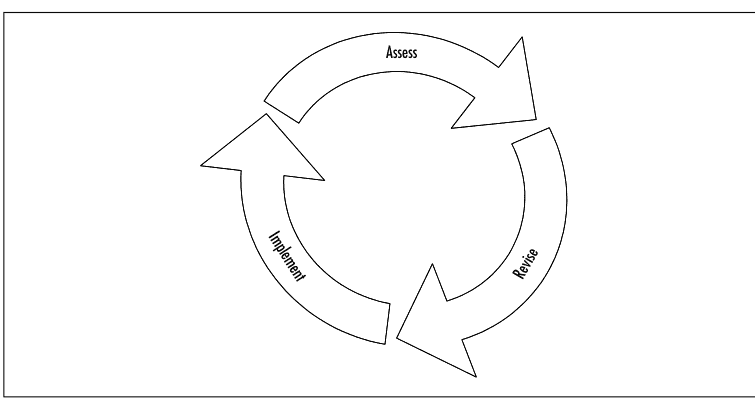

基于这些思想以及当这三个原则管理不当时可能发生的场景，你可以明白为什么从零开始构建安全是如此重要。将这三个原则建立到业务中显然需要工作和规划。安全并没容易实现，也不容易维护，但只要关注得当，它是可持续的。

## 将安全视为不仅仅是一个口号

当所有员工都关注可能导致客户面临危险或网站遭受损害的情况时，安全的效果最好。实现这种意识水平的关键是教育。教育是用来解除那些利用误解、设计不当的流程和员工冷漠的攻击者的武器。此类攻击通常被黑客称为“社会工程学”，对公司及其声誉可能是灾难性的。

防御此类攻击的最佳方法是教育员工了解有关安全和客户隐私的政策。他们还需要看到团队中的所有成员（从管理层到入门级员工）遵守这些政策。每当程序发生变化时，他们都需要提醒、复习和定期的更新。换句话之，安全必须是一种从自上而下的态度。高层管理人员必须支持政策及其执行，以实现并维持长期成功。

## 工具与陷阱……

### 社会工程学

- **密码**：过于复杂的密码通常被写下来并易于获取。然而，更容易记忆的密码往往是更大的风险，因为简单的密码（如丈夫的第一个名字）很容易被猜到。一些公司采用强身份验证，要求用户使用密码和用户所持有的特殊令牌（token）生成的数字组合。

- **支持服务**：当用户致电帮助热台或网络工程师寻求支持时，用户的真实性往往被认为是理所当然的。疏忽的帮助台可能会轻易响应用户账户更改密码的请求，而没有保证拨打者就是其本人。在这种情况下，黑客通常利用电话或电子信息提供的匿名性。利用类似的角度，黑客可以伪装成支持服务的一部分，并在虚假的“支持”电话期间获取用户的登录ID和密码。

- **物理访问**：如果没有充分的物理安全，黑客甚至是一个举止得体的非技术犯罪分子可以直接走进办公室并开始使用计算机系统。事实上，中国报道的一起案例详细说明了一个男人如何伪装成员工进入一家证券公司，并使用未安全的终端影响了股价和上海证券市场的稳定。

由于社会工程学是攻击者工具箱中如此危险的武器，因此对它进行自我教育是有意义的。以下是一些你可以了解更多关于社会工程学的网站：

- www.netsecurity.about.com/compute/netsecurity/cs/socialengineering

- www.cert.gov/advisories/CA-1991-04.html

- www.pacbell.com/About/ConsumerInfo/0,1109,157,00.html

记住，社会工程学可能被用于攻击不仅仅是计算机安全的内容。

## 秉持安全意识进行规划

从安全的起点开始构建基础是非常重要的。因此，这三个原则必须从规划的早期阶段开始就应用到整个过程中。审查业务计划并应用机密性、完整性和可用性方面。向你的员工和自己提出此类问题，例如：

- 我们将如何确保客户的机密性？

- 我们将如何保护业务信息不被泄露？

- 我们正在采取哪些步骤来双检数据收集的完整性？

- 我们正在使用哪些流程来确保数据随时间推移保持性？

- 我们如何保护自己免受可用性损失？

- 我们对故障事件有什么计划？

当业务计划开始成型时，将这三个原则应用到其中。持续贯穿这些原则，你会发现你的问题会催生出场景，而这些场景又会引导出解决方案。

花时间思考你网站面临的威胁。分析可能攻击的流特征，并确定其成功的可能概率。例如，如果攻击者想要收集客户的财务信息，他是否可以简单地攻破你的 Web 服务器并获得访问权限？已有无数这样的例子，本应只是简单的 Web 服务器被破解，结果导致敏感的客户数据暴露给攻击者。如果那些信用卡号和其他信息存储在独立的机器上，或者更好，存储在更受保护的网段中，攻击者可能无法获取它们。避免单点故障。确保单个网络组件的损坏不会危及你的整个运营。将这些场景应用到计划的每一步，并不断修订，直到你解决了明显的问题。

该过程的一个示例场景可能如下：如果攻击者利用最新的 Web 漏洞获取了你 Web 服务器的权限，还有哪些系统很容易被破解？在最近的一个案例中，这种情况发生时客户来电。攻击者利用 Unicode 漏洞（访问 Rain Forest Puppy 的页面 www.wiretrip.net/rfp/doc.asp?id=57&iface=6 了解更多关于 Unicode 的信息）针对我客户的 Web 服务器获取了对文件系统的访问权限。在上传木马程序后，他们迅速地获取了修复密码文件并破解了系统的管理员访问权限。遗憾的是，对于我的客户来说，攻击者攻破了他们指定为 DMZ 中所有 Web 服务器域控制器的系统。他们明智地选择部署 Windows 域，以便更方便地管理 Web 服务器以及允许供应商从其网站提取订单的服务器。此外，同一域的成员还使用了他们的主电子邮件服务器和 FTP 服务器。这些系统每一个都被攻击者攻破了。当发现损害时，这些每一个系统都必须停止服务并完全重建。他们的合作伙伴被告知了损害，他们损失了宝贵的时间和金，更不用说合作伙伴对他们公司的信心。迄为止，这种将每个系统设为 Windows 域成员而不是独立服务器的单一错误，已经让他们花费了数千美元，并让他们的 IT 经理丢了工作。即使是微小的误判也可能对安全产生巨大影响。

要理解，对于你想到的每一个场景和威胁，未来可能还有几十个其他威胁存在或将出现。如果你觉得已经想到了最基本的威胁，不要惊慌。这种准备和场景开发的行为将使你对这三个原则所涵盖的问题产生大量的意识。此外，随着你对业务流程细节越来越熟悉，你的团队未来处理安全事件的能力也将提高。

在该过程结束时，你应该对你的网站有一份基本计划。组织这些计划信息的最佳方法之一是使用图表详细列出你的风险以及你计划如何缓解这些风险。表 1.1 显示了一个示例。这些示例是基础性的，你无疑应该比这多得多，但作为一个开始，它们可以给你一个框架的思路。

| 电子商务阶段 | 风险说明 | 风险缓解策略 |
| --- | --- | --- |
| 消费者结账 | 攻击者可能监控信用卡和消费者数据的传输。 | 我们将使用 `SSL` 加密来保护在互联网上传输的信息。 |
| 信用卡数据传输到 ISP 信贷系统 | 攻击者可能在我们每小时将文件传输到 ISP 卡系统进行处理时，监控我们的信用卡批处理文件。 | 我们将使用 `SecureFTP` 通过 `SSH` 隧道发送数据，以防止嗅嗅探攻击。 |
| 任何阶段 | 攻击者可能威胁我们用于存储客户个人信息和购买历史的数据库服务器。 | 我们通过删除未使用的服务和安装文件系统校验和来保护服务器，以便在发生变化时提醒我们。还将服务器位于独立的 DMZ 网段，并仅允许通过 SQL 代理进行加密以与系统交互。 |
| 任何阶段 | 攻击者可能试图通过泛洪我们的网络来关闭系统。 | 我们将通过使用冗余服务器和负载均衡路由器来保护自己。我们还准备好通过拨打他们的帮助热线在 ISP 路由器上实施流量拦截访问控制规则。 |

将建立的计划转化为实际产品和流程的步骤对安全原则可能非常危险。通常，为了配合预算、时间和技术要求，必须做出妥协。很多时候，这些妥协会影响项目的整体安全性。

确保项目底层安全在开发阶段保持完好的唯一最佳方法是持续参与。当定义每个流程或产品时，将这三个原则应用到其中，并修订定义以回答规划过程中产生的场景。如果必须对项目的安全性做出妥协，请仔细分析这些更改，并创建其中涉及的风险清单。这份风险清单在实施阶段将变得重要，因为它为通过技术、政策和意识相结合解决的问题提供了工作表。通常，关键领域的妥协会对尝试保护其他相关领域产生重大影响。确保在构建底层组件时节省资金的尝试，不会在修补上方组件时付出代价。


从头到尾。在将各种离散过程组合成整体产品的过程中，往往会通过信息的通信和存储无意中产生安全漏洞。两个组件本身可能并不安全，但在它们相互作用时可能会产生漏洞。例如，两个电子商务系统，它们都将信息存储在加密数据库中，但它们之间进行交互时，通过未加密的链路传输相同的信息。在这个例子中，漏洞不在于数据库服务器，而在于用于相互通信的方法。请仔细检查检查此类类型的安全问题。再次，根据需要修订流程，或者在实施阶段记录已接受的风险以进行缓解。

当你的业务进入实施阶段时，最需要记住的一点是：只有在系统经过充分测试并确认为安全后，才将其上线。此阶段面临的最大危险是系统在未经过充分评估之前就被仓促投入运行。在系统上线后进行安全加固可能会导致你处于脆弱状态的时间足够长，足以让攻击者留一个后门以便日后攻击，或在当时破坏系统。对已经被破解的设置进行安全加固不仅是徒劳，而且往往难以检测。这个故事的教训是：在确定它已准备好面向世界之前，不要让它上线。

对你系统的评估涉及第 8 章概述的工具和流程。主要流程是根据三个原则对你的实际实现进行测试。使用自动化工具检查每个组件，并确定与之相关的风险和弱点。漏洞可能是通过配置、最后的的技术修订或软件程序或硬件设备的不可预见问题而产生的。修复这些漏洞可能包括应用补丁、重新设计流程或网络段，或其他更改。根据周围的安全状况评估这些修改中的每项都是非常重要的，并在应用它们后从头开始重新评估系统。

一旦你成功地保护了你的环境和流程并将其降低到可接受的风险水平，就是时候通过技术、政策和意识的结合来缓解问题了。首先，利用你的已接受风险列表来创建一个待处理的策略。安全策略是你防御系统的骨干。这些策略是确定行动、系统配置以及你将用于保护网络的设备类型的依据。这些策略应该由你的安全人员结合人力资源部门团队成员、法律团队以及负责开发和实施网站的团队共同制定。让这些团队参与政策的制定不仅能建立一种信任感，还能建立一个更开放的政策。建立一个限制性的、严酷的安全策略是容易的，但要创建一个既能平衡公司、技术和法律因素，又能允许业务执行其所需功能的策略是非常困难的。

确保将所有这些问题都添加到你的安全策略中，然后实施技术系统来实时执行策略。诸如防火墙、入侵检测系统和监控工具等系统可以缓解你已接受为流程固有组成部分的风险。

一旦你缓解了风险，你就可以开始将系统上线并向公众提供访问。许多网站选择分阶段部署其在线版本，而另一些网站则一次性发布整个网站。这种选择取决于你的网站以及你拥有的处理突发状况的人力资源水平。在网站变得流行时，请保持关注。继续根据三个原则评估你的性能。记住，安全是一段旅程，而不是一个终点。

## 在安全环境中管理和维护系统

电子商务网站周围最复杂的问题之一是涉及系统的安全管理和维护。随着程序员修复安全和功能性问题，软件系统需要定期打补丁。硬件设备可能也需要补丁以及物理维护。日志文件必须进行监控，必须执行备份，并且系统必须进行日常运行管理。此外，预计所有这些事件将在不损害安全或影响业务运营的情况下发生。

在互联网之前的时代，数据系统有计划的停机时间来处理维护和管理。然而，在当今 24 小时的在线消费者环境中，电子商务网站必须随时可用，否则将影响业务，这通过更强大的硬件、更快的网络以及关键系统的冗余得以实现。

### 损害与防御……为管理员提供镜像实现

在没有创建镜像环境的情况下，要实现零停机几乎是不可能的，以便管理员测试他们的补丁、修复和修改。理想情况下，这个镜像环境应该与你的生产站点完全一致。测试设置与真实站点之间的差异越小，出现问题或不可预测行为的机会就越小。虽然构建镜像实验室的成本是一个因素，但长期收益通常是巨大的。

# 将安全原则应用于你的电子商务 · 第 1 章

我有过协助一个使用 `Windows NT` 的客户，他们在应用服务包之前忽视了使用测试床的。他们将服务包应用到了一个服务器上，在该服务器上他们使用了 `Partition Magic` 扩展主分区。在安装服务包之前，一切运行良好；之后系统无法启动。发生的情况是：`Partition Manager` 将磁盘大大，以至于新版本的 `Windows NT` 软件无法访问它们，从而无法找到 `NT` 的内核文件。虽然在这种情况下解决方案是简单地将分区调整为小于最小值的大小，但还需要将数据移动到新的扩展分区并重新配置多个应用程序。该系统的停机时间超过了两个小时，这对公司来说是一个昂贵的时间。然而，他们吸取了昂贵的教训。

补丁和升级往往会产生意外的影响。使用测试床或镜像站点允许你在将其应用于真实站点之前，仔细测试流程和所有修改的行为。

日常管理主要由在远离关键系统上的自动化过程执行，以利用速度优势并减少人为错误的危险。安全隧道在我们的网络中记录文件和其他监控信息，以防止未经授权的观察和发现。设备通过突发将事件传回公共监控站，以提醒操作人员和管理员发生了事件或需要注意。管理员可以通过这些安全隧道远程访问系统，或者在需要时物理访问机器。

适用于各种情况的软件。此外，网络组件的任何微小变化也可能对您网站的安全产生巨大影响。当管理员为了维护而更换设备，或用新版本替换组件或应用程序时，可能会无意中向您的网站引入配置错误或其他漏洞。

避免这些问题的方法是根据已知的基准对您的网站进行持续评估。如果出现了新的漏洞或风险，可能是由于发现了了新漏洞，或者是由于对其中任一者进行了更改。无论何种情况，都必须通过修复或管理立即缓解这些漏洞。确保网站长期安全的唯一方法是持续对其进行评估、重新审视并实施缓解风险所需的更改。为了帮助您维护这一过程，可以参考图1.2所示的流程图。

安全是一个既宽又深的领域。当你刚开始时，会有很多内容需要涵盖，很多地方可以寻找良好的信息。以下是你可能想要访问的一些网站、邮件列表和杂志，以开宽眼界或学习门道。

- `www.securityfocus.com`：提供通用安全新闻的网站，也是著名的新漏洞邮件列表。`SecurityFocus`拥有一个非常有用的漏洞数据库。
- `www.securityportal.com`：另一个跟踪安全动态的绝佳网站。他们还有针对初学者的优秀文章，涵盖了安全和黑客的基础知识。
- `atstake.com/security_news/`：从黑客角度提供的安全新闻。
- `http://phrack.com/com/`：`Phrack Online`，拥有多年的黑客历史、技术和见解。阅读所有内容，学会洞察你的敌人的思维。
- `www.defcon.org`：全球最大的黑客聚会每年在拉斯维加斯举行。关注该网站的动态，或者更好的是与真正的黑客面对面。
- `www.sans.org`：`SANS`页面详细介绍了可供安全专业人员提供的培训，并提供了对全球威胁状况的洞察。
- `http://packetstorm.security`：最流行的黑客工具和利用程序网站。这些工具对管理员和安全专业人员可能非常有用，但请谨慎使用。
- `www.astavista.com`：一个组织松散的搜索引擎，用于从网上寻找黑客工具、利用程序和盗版软件（warez）。再次提醒，谨慎使用你的发现，因为其中某些程序的木马属性可能大于实用属性。

虽然从安全角度开始考虑是最理想的，但将机密性、完整性和可用性这三个原则应用于已运行的网站也是可能的。事实上，由于大部分开发工作已经完成，这些网站能够投入更多的时间、精力和资金来确保其环境的安全。

应用于现有网站的过程与新网站略有不同，但许多概念是相同的。显然，原则本身不会改变，持续安全评估周期也不会改变。然而，改变的是这些工具开始应用的位置。例如，在现有网站上启动评估过程可能会损坏您的生产系统，因此大多数网站从测试开发环境或专门为测试目的而创建的生产环境镜像开始。然后，他们在这些测试系统上应用修订和补丁，在对生产网站进行这些更改之前，检查其影响。但请始终记住，安全修复是一场与时间的赛跑，因为在您测试修复时，攻击者正在探测那些漏洞。这里的要工作是在不给网站造成损害的情况下，限制这一机会窗口。

无论你选择从测试环境开始，还是承担审计生产网站的风险，应用原则的起点都是识别风险。再次使用第8章中的工具对您的流程和应用程序进行审计，以确定已经存在哪些漏洞和风险。这些每一项都必须经过检查，并对您的网站进行修复或修订以提供缓解。

根据网站的复杂性、性质和规模，您可能会发现几个漏洞或数千个漏洞。访问 `www.cve.mitre.org` 查看已知漏洞字典。这些漏洞中的每一个重要性可能不相同，从允许攻击者获取有关您网络的信息到允许他人以最高权限访问您最关键的系统。执行审计的工具详细解释了与漏洞相关的风险。请记住，在某些情况下，中小型漏洞可能被用于在您的网站内部制造重大问题，甚至可以用于创建拒绝服务（`DoS`）状态。

### 漏洞链

漏洞链（`Vulnerability chaining`）是指某些漏洞在与其他漏洞结合时变得更加重要的情况。这方面一个例子是经典的 echo/charge 攻击。

`Echo` 是大多数 `UNIX` 系统上默认运行的服务。它的行为正如预期：发送到 echo 端口的字符会被简单回显。`Charge` 也是一项基础 `UNIX` 服务，在连接到其端口时会持续生成字符。虽然任何一个服务的存在构成的风险很小，但它们结合可以被用于导致简单的拒绝服务攻击。

要执行攻击，攻击者伪造两个服务之间每个服务的输出，并将其重定向到另一个服务，创建一个快速扩展的流量旋涡。本质上，系统开始消耗内存和处理器功率，最终导致整个设备对用户命令无响应。

通过链联两个微小的漏洞，攻击者为目标系统制造了严重问题。存在许多此类组合。您的漏洞扫描器在为漏洞分配风险级别时，应该考虑这些情况。

一旦你获得了漏洞报告并检查了发现结果对你环境的影响，就开始根据风险级别对修复它们所需的操作进行排序。

你如何知道每个漏洞的风险水平？很简单。将风险与需要保护的资产联系起来。通过花时间识别资产，风险评估过程将变得容易。花时间思考你的公司及其经营的业务。公司拥有哪些对其有价值的资产？这些资源位于何处？如何保护？使用评审过程创建这些资产的详细列表，并将风险与列表联系起来。如果任何漏洞有损害资产的可能性，则风险将获得最高优先级。必须满足多个条件才能影响资产的风险定为中等水平，而对任何关键资产影响极小的风险则为最低。再次，使用评审确保你对所开发的风险优先级有一个准确的看法。

……级别和版本。请特别关注 `DNS`、`HTTP`、`SMTP`、`SNMP`、`FTP`、`POP`、`IMAP` 等热门服务，以及防火墙或入侵检测程序等安全相关应用程序。

通过修复最高风险，您正在帮助您的网站保护其任务关键型信息和系统。在确定漏洞优先级时，请务必考虑其他缓解策略，以及受影响系统及其数据的关键性。换句话说，如果审计工具报告某个非任务关键系统、或不处理任务关键数据、和/或已受防火墙充分保护的系统上存在高风险漏洞，那么与一个允许攻击者访问数据库的漏洞相比（该数据库在收集和初始处理期间短暂存储客户信息，但可以从互联网访问），后者的优先级可能会更高。因此，必须通过对比对您环境的实际影响，对审计工具的信息进行解析。

在完成工作排序后，开始在自己的环境中应用修复和修订。记住，在将更改复制到生产环境之前，留出足够的时间、流量和使用量，以衡量更改的影响。然后按照列表，对各个受影响的系统应用更改。完成并记录工作后，再次开始该流程，以确保您的修改没有产生新问题。

测试缓解风险所需的修改，其首要原因是计算机程序和系统的不可预测性。许多时候，供应商或程序员发布的软件或硬件修复会在非常深层次上影响这些系统的运行。事实上，所需的更改可能会影响系统的核心流程或例程。正如此，这些更改实际上可能会增加额外的安全风险，或导致系统以新的方式运行。

已经出现了许多案例，供应商为修复漏洞而创建的软件补丁未能解决问题、解决得不彻底或创建了额外的安全问题。关于这些问题的讨论已出现在 `Buggroups` 和 `Usenet` 等许多公共论坛上。这里的道理是，每个补丁确实需要经过评估，每个系统在修复后都需要测试。未能遵循这一模型可能会导致灾难！

对生产系统应用补丁并不一定是一个巨大的风险。解决方案创建一个镜像生产站点的环境并首先测试修复。然而，在某些情况下，漏洞可能变得需要立即行动可能会损害您的客户和业务。在这种情况下，可能需要直接对生产系统应用补丁——仅在没有其他选择时才这样做。如果可能，请在暂备机上测试安装程序，这通常只需要很短的时间。

在必须在没有对修复进行充分测试的情况下修复生产系统时，这里有一些步骤可以帮助您管理面临的一些风险：

- 首先，在应用补丁之前，对整个系统进行完整备份。
- 同样在应用补丁之前，使用加密签名或哈希和来验证补丁代码的真实真实性。木马补丁并非闻未闻。
- 应用补丁后，密切监控 `CPU` 使用率、内存统计和服务器的总体运行至少一周。这将为系统留出时间体验流量波动以及可能存在的问题。
- 应用补丁后，立即对系统进行自动扫描，寻找新的漏洞或意外行为（记住在扫描期间监控上述统计数据）。
- 5. 如果补丁运行不符合预期，或者软件行为发生了令人担忧的变化，请从步骤 1 重新加载备份数据。在下次尝试之前，请研究补丁并再次测试软件。

只要您觉得系统以意外的方式运行，或者补丁没有立即解决安全问题，请停止并联系供应商或程序员寻求问题支持。

有一点是可以肯定的：补丁和安全漏洞将一直存在。随着我们的系统和软件程序在功能和花哨上日益强大，它们的复杂性也随之增加。由于今天有大量的代码和这么多程序员在开发产品，错误和漏洞是肯定的。随着供应商和程序员在发现安全问题时急于应对，他们在更短时间内发布补丁的压力越来越大。有些供应商通过发布未经过完全测试的修复，或简单地隐藏问题而不是解决问题来应对。

虽然您无法完全确定补丁或修改的影响，但您可以通过对补丁过程实施适当的控制来对冲风险。诸如创建镜像测试网络、在安装补丁之前验证其来源，以及与您的供应商和员工建立良好的沟通渠道等步骤，将带您走向安全之远方。

一家大型跨国金融机构正准备将其全球防火墙基础设施升级为另一种产品。他们将稳定性放在首位，决定实施成熟但不是最新版本的防火墙。在全球范围内部署期间，发现了一个新的意料之外的漏洞，使该机构暴露在风险之中。现在的问题是，是停止当前的升级周期并修复新安装的防火墙，还是继续实施并在部署后启动补丁机制。在部署完成之前，就需要一个更改周期！

通过评估风险并应用基本安全原则，该公司得出结论：他们的最佳选择是完成部署并在完成后修复防火墙。事实证明这个决定是正确的，这很大程度上是因为他们理解如何修复他们的基础设施以及他们的受影响程度。

为在您的系统中执行这些补丁和修改制定一个计划。实施一个测试补丁的框架，并为在生产系统实施更改之前必须完成的测试制定规则。此类政策被称为迁移计划。

迁移计划也从风险开始，就像评估一样。计划概述了您的站点哪些系统和组件被认为是任务关键的，并定义了属于较低类别的系统。迁移计划用于确定最紧急的漏洞何时出现或何时位于队列中。从那里开始，计划说明了管理员应该如何处理每一类系统的补丁和修改。它定义了验证补丁和备份系统需要遵循的步骤，以及补丁被批准在生产站点实施之前所需的测试。它可能还需要对补丁系统的更改进行同行评审，或者供系统管理组存档的更改记录。迁移计划仅仅是管理员在组织中进行更改的指南。

今天存在许多迁移计划框架，可以作为模板，为您的站点定制流程。微软提供了一些基础模板，使用其产品来开发和发布迁移计划。微软工具可在 `www.microsoft.com/technique/iis/enforest.asp` 获取。使用 `Google` (`www.google.com`) 等搜索引擎，可以轻松搜索适用于您环境的迁移规划工具。其他资源包括关于该主题的书籍以及通过交互式或电子模板为您创建计划的软件模板。

将安全原则应用于您的电子商务 • 第1章 27

以及策略。无论你打算如何发布它，请确保它的存在，并且你的员工正在遵守。

## 如何证明安全预算的合理性

在任何组织中实施安全最常见的问题是找到足够的预算来获取人员、工具和时间来执行流程。安全人员的薪酬通常很高。安全工具和产品通常昂贵。在许多组织中，将安全应用于流程中所需的时间被认为是令人望不起的。当安全措施正常运行时时，管理层通常不需要担心它们。在“新经济”时代，抢占市场或准时交付在短期内比确保安全更有利。面对所有这些障碍，你如何能为引入和维护站点安全所需的预算提供合理性呢？

多年来，人们尝试了多种方法。有些成功了，但许多失败了。在很多情况下，最终带来安全预算的是攻击者。在大多数组织中，对安全事件的直觉反应是向问题投入金钱。然而，这不是我们应该遵循的模型。首要问题是，损害通常已经以某种形式造成了，而且该事件很可能是一场毁灭性的事件，会导致消费者信心的巨大损失和巨额财务损失。

更好的解决方案是使用下一节描述的策略之一；这些策略建立了建立对安全问题的意识，并为信息安全在组织中的持续存在提供理由，尽管这两种方法都可能产生负面影响。我们将第一种称为“准绳法”（yardstick approach），第二种称为“恐惧策略法”（fear tactic approach）。

### 准绳法

我在这一方面取得了最大的成功。在这种策略中，我们使用安全和风险作为准绳，来衡量安全措施为组织带来的收益。基本上，我们试图将已经创建的安全流程转换为金额，即如果我们在接受了这些风险而未进行缓解的情况下，本可能面临的损害金额。金额似乎效果最好，尽管我也尝试过工时和其他计量单位。

这一过程的第一步是为你的站点创建一个真实的概况。通过检查从互联网流向你站点的流量来实现。一种常见方法是在防火墙之外部署入侵检测系统（`IDS`），并用它创建你每周看到的扫描、探测和攻击的基准。推算这些数据，并将这些数字计算为你想要使用的任何时间跨度。

接下来，审查入侵检测系统（`IDS`）看到的攻击，并估计如果这些攻击得手，可能会给组织造成多大损害。记住，`IDS` 就像扫描器；它们必须频繁更新才能有效。估计损害最简单的方法是估计发生泄露事件时的时间。如果被攻击的设备是关键任务设备或处理敏感数据，请特别注明，作为附带损害。你可能会惊讶地发现实际上发生的攻击数量是如此巨大。我见过有些站点每分钟都会被探测几次！

最后，将你的站点在过去一年左右可能经历的任何安全事件或损害的实际估算数字也加入其中。这些数字具有额外的杠作用，因为你的管理层可能已经对这些事件和遭受的损害深有痛之感。对于这些情况，展示你已经实施或计划用于缓解这些风险防止再次发生的流程。尽可能使用真实数字而不是估计值。


现在，获取这些数字并将它们与你现有的安全预算进行对比。将细节发展成一份完整的演示文稿，并面对高层管理人员解释。如果你的数字结果像大多数情况那样，那么你将能够证明，通过你已经采取的风险缓解步骤产生了巨大的节省。不要忘记解释关键任务系统或数据暴露于攻击可能造成的损害。画出最坏的情况并提到它们，但不要强调得太强烈。你在这里的策略仅仅是为你的预算提供商业理由，而不是引起恐惧或怀疑。图 1.3 是此类图表的示例。

将安全原则应用于您的电子商务 • 第1章 29

图 1.3 来自 PowerPoint 的安全预算准绳幻灯片

使用这种方法为安全预算建立商业理由已经在各种规模和市场的公司中发挥作用。通过清晰、简洁且基于事实的信息引起组织的财务流程，我们让我们了更好的安全状况，而且我们没有引起恐惧和怀疑，这有时会对安全团队适得其反。

## 准绳法案例研究

我曾使用准绳法帮助一位合作的客户增加安全预算。该客户是某所大型大学的网络设施，他们不断遭受大量的攻击。他们部署了基本的安全措施来保护学校的学生、教职工和业务信息，但希望获得额外资金来扩大安全团队，并为他们正在建立的一个新的合作伙伴研究设施建立一些保护系统。

他们已经在组织中部署了基本的防火墙和一些内部 IDS 系统，这些工具缓解了大部分攻击。他们经历过的唯一事件是部门邮件系统被攻破，以及其非军事化区（DMZ）段 Web 服务器的简单 Web 页面篡改。

第1章 • 将安全原则应用于您的电子商务

我遵循了在防火墙之外部署 IDS 的流程，并发现了一些有趣的现象：

- 他们平均每半小时遭受一次攻击的扫描和探测。
- 他们 DMZ 中的一个 UNIX 系统被攻破，并被用作盗版软件的分发站点。
- 他们的内部路由器和防火墙配置错误，正将不可路由的互联网协议（IP）地址传递到公共互联网。

虽然最后一项仅仅是网络规范性问题，但他们正在泄露防火墙后面使用的地址方案。然而，真正的价值在于检测到的攻击的频率，以及他们正处于一个泄露事件中，这可能会给学校及其员工造成大量的负面声誉和尴尬。

我们使用了之前提到的公式，估计过去一年中，针对学校的攻击导致大学损失了大约百万美元的时间和劳动成本。我们将此与防火墙和内部保护系统的近似成本，加上工资、税费和福利（总计约 13 万美元）相对比。我们根据这些数字创建了简短的演示文稿并在下次预算会议上提交。结果令人惊讶。大学几乎翻了一倍下一年的安全预算，并为聘用两名额外的团队成员提供了资金。这是一次完全的胜利。

## 失败的可能

并不是所有使用准绳法的尝试都是成功的。有时，这种方法会导致管理层认为安全团队效率并不高。有时数字显示安全预算超过了威胁水平和受保护资产的价值。如果是这样，展示

# 将安全原则应用于您的电子商务业务 • 第一章

向管理层展示数据可能会对你的团队造成损害。你还需要重新审视曾用于保护网站的策略，以确定哪些成本因素过高，并评估随着时间的推移维持这些解决方案成本。

这种方法失败的另一个方面是会导致你的安全团队士气低落。他们可能会觉得被管理层低估或未得到应有的。应对这种局面的最佳方法是在未来的一年里真正下苦功夫提高安全意识。你可能需要在团队内部培养一名“安全布道者”，并派遣他或她去激发公司其他成员的热情并对他们进行教育。

这种策略失败的副作用通常比较容易处理。它们的影响范围通常比恐惧恐吓法要小。此外，这种策略的失败通常为下一个预算周期留下了再次尝试的机会，你可能会发现即使在第一年失败后，也能取得持续的胜利。似乎这种方法在管理人员看来是合理的，而且他们往往对此给予积极回应。考虑在你的网站上尝试这种方法，并在尝试恐惧恐吓法之前使用它。

## 恐惧恐吓法

我用来证明安全预算合理性的第二种策略是恐惧恐吓法。我已将这种方法视为一种有时必要的恶。这是一种非常常见的方法，如果这种策略未能说服管理层，可能会导致非常糟糕的局面。此外，我甚至见过即使成功使用了这种技巧，也会导致某些组织中其他人职业的终结。

这种策略的核心在于利用恐惧来提高意识。成功取决于管理层在面对恐怖场景或画像时的反应——预期的结果是产生本能反应，提供资源来消除该场景。但偶尔也会发生相反的情况，管理层会追究“传信者”，理由是安全团队未能保护他们免受这些情况的影响。

尽管这种策略增加了组织内部恐惧、不确定性和怀疑（DUD），但它在提高意识水平方面通常非常成功。渗透测试、现实安全事件和信息战争场景等工具是这种策略的基础。这里的底线是搞清楚什么会伤害组织，并且如果可能，要么利用它，要么解释它。最坏的情况通常用最基础的术语就能很容易理解，而且它带来预期结果的次数往往要得多。

### 注意

仅在作为最后手段或当管理层对其他方法不予回应时才使用恐惧法。这种方法所产生的结果通常具有争议，如果过程没有经过仔细的管理、监控和控制，可能会对安全团队造成政治损害。虽然渗透测试和信息战争技术等工具看起来很华丽，但如果它们被误用或失去控制，可能会是危险的。对于此类活动，务必选择合格的团队，创建定义明确的工作范围，并与参与者保持定期沟通。

## 恐惧法案例

几年前，我有一位客户尝试过许多不同的方法来提高公司内部的安全意识。他是某软件公司信息技术部门的高级主管，直接向副总裁汇报。他的公司是一家快速增长的企业，主要通过收购竞争对手来实现增长。安全对于他们的组织来说一直是一个事后才考虑的问题，他他担心事情已经失控了。

在公司内部，几个小组创建了自己的网络和到互联网的私有连接。此外，随着他们收购新公司，这些小组被迅速连接到内部网络，并被允许维持自己的互联网连接。设备在公司网络上以每天几个系统的速度不断涌现，他们对部署完全没有控制，也不知道外面到底有什么东西。更糟糕的是，他们没有部署任何内部控制方法，被收购公司的许多员工公开表现出敌意，而且他们正被赶着推出一种新的电子商务产品。我的客户觉得在重大损害发生之前情况必须发生变化。

他的团队曾尝试使用标准方法提高意识，但都失败了。他们创建了用户组，举行了内部交流会议，为开发者举办了外展研讨会等等。最后，作为一种手段，他们决定需要进行漏洞分析和渗透测试，以向公司提供他们面临的公共互联网风险的示例。

测试在所有合同定稿、测试范围完成并达成共识后开始。立立刻，风险变成了漏洞，在几小时内，许多系统就被攻破了。一个软件开发小组让他们的系统处于无保护状态并连接到了互联网。这些系统被用作攻击内部网络的起点。在接下来的几天里，我的团队攻破了许多系统和数千个账户，最后捕获并破解了他们新部署的电子商务系统。

在之后的几周里，我们创建了报告并向他们的许多管理团队和 IT 人员进行了演示。虽然出现了一些政治问题，但总的来说，管理层在面对事实时是有回应的。安全小组获得了额外的资金，增加了人员，并补充了顾问。在接过去的一年里，该主管重建了网络，以更安全的方式部署了电子商务系统，今天他正处于恢复控制和建立安全管理的良好进程。新系统在没有适当迁移规划的情况下不再被添加到网络中，连接性正在变为集中化管理。他们增加了完整的事件响应流程和入侵检测措施。虽然并非这种策略的所有应用都取得了成功，但这是一个结果向向的案例。

## 失败的可能结果

恐惧恐吓法并非没有缺点。正如前面提到的，有时使用这种方法会反噬安全团队本身，管理层最终会觉得他们没有正常履行职能，并将当前的问题归咎于他们。虽然这并不常见，但在处理这种策略时，这无疑是一个风险。

政治问题通常也源于这种方法。被暴露脆弱性的小组往往会被指责造成损害，或者在未来可能变得难以合作。控制这种副作用的最佳方法是不断强调个人没有错，而是整个过程需要改变和更好的控制。对受影响的小组建立关系的额外努力以及提供修复方面的协助通常也有帮助。

## 将安全原则应用于您的电子商务业务 • 第1章

尽管这种方法可能会带来许多负面影响，但它仍然是组织内提高意识最常用的方法。这通常会导致管理层对其结果和方法论产生不信任，因为他们听过许多类似的场景，并且经常觉得安全团队在“虚报狼警”。如果是这种情况，你必须能够演示能够导致网站及其客户遭受严重损害的真实世界演练。此外，如果他们提供资金，你必须能够交付解决方案，否则你可能会发现自己正在修饰简历。

## 作为限制的安全

如今安全团队面临的最大挑战之一是他们如何如何被感知的本质。在许多组织中，安全团队的历史与物理安保人员的角色交织在一起。许多安全团队在同事眼中甚至还不如所谓的“网络警察”或“电脑守卫”。此外，由于安全团队成员的角色通常是在出现使用问题时与人力资源部门合作，其他员工——有时——会以负面的眼光看待安全团队。

这些印象和认知对安全流程造成了损害。通过疏远其他员工，安全团队执行其职责将变得更加困难。团队成员获得的合作会越来越少，并无法与其他小组进行良好的对接。

这种情况之所以发生是因为向其他员工传达了错误的印象。这种印象是安全是一种限制。通常，这种情况发生在实施控制措施或监控软件之后，而这些软件是为了更好地管理业务时间段的网络资源使用或性能。虽然这些技术并非根源，但它们通常被视为“老大哥”模式的症状。没有人喜欢自己的隐私被侵犯，请记住在为客户提供保护的同时，也要为你的员工提供保护。这样做可以让你避开扮演“网络警察”的危险。

如果用户犯了错并落入社会工程攻击的陷阱，了自己的密码，你希望他们能够告诉你，而不是害怕惩罚。

## 作为促进者的安全

为了克服对安全的限制性观点，要改变团队的整体形象，使其被视为“促进者”。安全作为促进者在安全团队充当组织其他成员的顾问时表现得最好。当安全以这种方式呈现并具备了适当水平的意识时，你会发现其他小组开始实际上将你的团队纳入其项目的规划和开发阶段。

通过承担顾问角色，你的团队能够与其他小组建立关系，并成为他们可以依赖的资源。通常，创造这种局面的最佳方法是持续开展意识提升和宣传。为其他小组创建非正式挑战来教授安全原则（请参见“最后的密码守护者”侧边栏的趣味挑战示例）。

> 工具与陷阱…… 最后的密码守护者竞赛。为了帮助一组用户理解选择强密码的理念，为他们创建了这个参加的比赛：设置一台 Windows NT 工作站，允许用户为自己创建账户并选择他们心中的强密码。一旦你的小组选择了密码，使用 L0pth Crack 导出密码并开始破解它们。（未完续）

- L0phtrack 可从 www.securitysoftwaretech.com 获取。
- 在一个关于选择密码的简短研讨会上，为该工具破解的最后一个密码颁奖。

有几家公司使用这种方法来提高对这种最基本的安全问题之一的意识。使用这种方法的大多数公司发现，员工使用的密码质量有了大幅提高。事实上，在一年后再次尝试该比赛的一个案例中，他们发现破解用户密码的平均时间增加了一倍以上！

安全被视为促进者的另一种方式是，让员工意识到安全环境如何协助他们完成工作的意识。解释诸如 Secure Shell (`SSH`) 和虚拟专用网络 (`VPN`) 等工具如何让他们远程履行职责。通过演示和解释技术解决方案，通过包含安全隧道和强身份验证，使开发小组能够执行更广泛的服务。当其他团队开始将安全视为一种为他们的项目创造选择的灵活工具，而不是他们必须遵守的严苛规则时，你就为你的团队创造了一个合作伙伴的形象。

将你的团队描绘为促进者会让你的团队成员执行任务变得容易得多。存在此类伙伴关系的组织其事件发生率低得多，工作满意度高得多。被视为促进者而不是“网络警察”，你将在电子商务世界中获得更多的成功。

## 总结

理解电子商务安全的基本原则是通往可持续保护业务之程的第一步。通过将安全的三大原则（机密性、完整性和可用性）应用于你的电子商务模型，你可以开始理解你网站上的不同场景。此外，通过为你的网站增加持续评估和修订的系统，你可以跟上网络世界瞬息变化的环境，甚至将这些原则扩展到你的日常业务流程。最后，通过为安全设定目标并将其整合到项目的规划、开发和实施阶段，你可以确保可持续的安全态势。随着时间的推移，维持这种态势需要一个管理和监控你系统的流程。

在现有的电子商务网站上添加安全原则的方法与从零开始的方法非常相似。它始于风险评估，然后设定修复网站中最关键漏洞和弱点的优先顺序；这允许你将安全态势提升到更高水平，而不影响日常运营。迁移策略用于管理我们生产网络中的变更过程，并确保通过添加这些风险缓解和漏洞修复，不会影响我们的业务。

# 第 1 章 将安全原则应用于你的电子商务业务

安全还涉及评估、修订和实施更改的三步过程。这种持续的评估和反馈过程对于使流程和产品适应不断变化的在线世界环境是必要的，因为黑客会检查现有的软件和硬件系统，并发现新的漏洞。

一旦你成功保护了你的环境并达到了你可接受的风险水平，是时候通过技术、策略和意识的结合来缓解这些问题了。首先，利用你的可接受风险列表创建一套处理这些问题的策略。一旦你缓解了风险，就可以开始将系统上线并向公众提供访问。

# 将原则应用于现有站点

对现有站点应用机密性、完整性和可用性这三个原则的过程与新站点相比略有不同，但许多概念是相同的。不同的是这些工具开始应用的位置和时间。例如，在你的现有站点上启动评估过程可能会损坏你的生产系统，因此大多数站点从测试其开发环境或专门为测试目的创建的生产环境镜像开始。

优先修复风险最高的漏洞。通常，当你的员工努力实施补丁和修改时，通过额外手段（如在防火墙或边界路由器上阻止适当的端口）来缓解这些风险是一个好主意。特别关注如 DNS、HTTP、SMTP、SNMP、FTP、POP、IMAP 等常用服务，以及防火墙或入侵检测程序等安全相关应用程序。

迁移计划也像评估一样，从风险开始。该计划概述了你站点中哪些系统和组件被认为是任务关键的，并定义了属于较低类别的系统。迁移计划用于确定漏洞何时具有最紧迫的性质，或者它在队列中的位置较低。从那里开始，计划说明了管理员应该如何处理每一类系统的补丁和修改。它定义了验证补丁和备份系统需要遵循的步骤，以及补丁在生产站点获得实施实施前所需的完成的测试。

## 如何为安全预算提供合理性依据

- **衡量标准法**使用安全和风险作为尺子，来衡量安全措施为组织带来的收益。尝试将你已经创建的安全流程转换为美元金额，并与我们在未采取缓解措施的情况下接受这些风险时可能面临的损害金额进行对比（或使用其他衡量单位，如工时）。
- **恐惧策略法**针对组织内部恐惧、不确定性和怀疑的水平，在提高意识水平方面非常成功。渗透测试、真实的安全事件和信息战场景等工具是这一策略的基础。这里的底线是弄清楚什么会对组织造成伤害，如果可能，要么利用它要么解释它。

## 安全作为限制

- 公司对安全被视为限制的感知，会在实施控制或监控软件后立即出现，这些软件用于管理办公期间的网络资源使用或性能。虽然这些技术不是根源，但它们通常被视为“老大哥”模式的症状。这些意象和感知会对安全过程造成破坏。

## 安全作为赋能者

- 为了克服对安全的限制性观点，改变你团队的整体形象，使其成为赋能者。安全作为赋能者的最佳表现方式是安全团队充当组织其他成员的顾问角色。当其他团队开始将安全视为一种灵活的工具，能为他们的项目创造选择，而不是一套他们必须遵守的严苛规则集时，你就为你的团队创造了一个伙伴式的形象，并且你会发现其他小组开始实际上将你的团队纳入他们项目的规划和开发阶段。

将安全原则应用于你的电子商务业务 • 第 43 章

## 常见问题解答

以下常见问题由本书作者回答，旨在衡量你对本章所提概念的理解，并帮助你在现实生活中实施这些概念。要让作者回答关于本章的问题，请浏览至“咨询作者”。

- Q: 如何在组织内部建立更好的安全意识？我尝试过张贴海报，但似乎不起作用。
- A: 教育是建立意识的主要手段。你需要对每一位成员进行教育。从高层经理、开发团队以及客户服务人员，都需要意识到安全的影响。访问 syngress.com 获取更多信息。他们需要理解你的隐私政策。考虑一些将安全实践与教学的方法，这些方法对提高意识的成功率很高。

- Q: 执行评估需要哪些类型的工具？应该由我的团队做，还是我应该聘请外部人员？
- A: 有关此问题的更多细节请参见第 8 章，但至少需要漏洞扫描器、网络监控工具、数据包分析仪以及对你所使用的操作系统的熟悉。内部评估与聘请团队通常是一个复杂的问题。使用内部团队对于初步查看和测试非常好，但从长期来看，聘请团队评估你的站点可能避免麻烦。此外，根据你的业务领域，某些法规要求由认证团队进行独立评估。确保你仔细阅读并理解适用于你业务的法规。这类问题的一个例子是处理配电系统等。这些系统被认为是国家基础设施的一部分，需要定期进行评估以满足美国政府的要求。

- Q: 我可以在哪里获得更多关于创建我的安全策略的信息？
- A: 本书的第 4 章详细说明了如何制定安全策略。其他良好的起点是网站：www.sans.org、cs.purdue.edu/coast 和 csc.nist.gov。

- Q: 恐惧策略法作为预算依据是否风险太大？
- A: 在某些情况下是这样的。然而，我建议你将这种策略作为最后手段。它往往会让许多经理感到反感，并且难以作为长期的依据。此外，如果你决定使用这种策略，在选择渗透团队时要格外小心。如果你从公司外部聘请，确保签署了适当合同并在并在之前对团队进行背景调查。

- Q: 我正试图聘请一个渗透团队，当我要求提供参考时，他们说不能透露为他们工作的人的名字。我该怎么办？
- A: 不要离开那个小组——逃离他们。正规的渗透测试团队能够提供可验证的参考，并拥有完整的合同、范围文件、商业保险和示例报告。如果没有，我建议你去别处做业务。

## 第2章

## DDoS 攻击：意图、工具与防御

本章解决方案包括：

- 什么是分布式拒绝服务攻击？
- 为什么电子商务网站是 DDoS 的首要目标？
- 是什么促使攻击者破坏公司？
- 攻击者使用哪些工具来实施 DDoS 攻击？
- 我如何保护我的网站免受此类类型的攻击？
- 总结
- 解决方案快速通道
- 常见问题解答

## 引言

许多专家将当前时代描述为信息时代——一个光明新未来的黎明。在这个时代，通信屏障被打破，允许跨越全球的虚拟社区得以形成。企业现在有能力将自己的影响力扩展到正常的地理限制之外，使其能够触及几年前由于必然性而忽略的市场。互联网的休闲用户几乎可以即时与世界另一端的人们分享信息和经验。互联网技术的应用及相关机会似乎是无尽的。而这正是问题所在。

每一次机会都伴随着风险。在互联网世界中，这种风险往往以安全的形式具体化。互联网与安全是密不可分的——两者应该始终形影相随。在使用互联网时，安全应该一直是一个准则，但一些人认为，我们越使用或越整合互联网，就越失去了获得安全的能力。

安全是一个不断演变的领域，好人似乎总是比坏人慢一步。安全人员或管理员可能需要应对的安全风险列表读起来像一本科幻小说。在单周内，他们被预期要应对由高传染性病毒、木马和蠕虫带来的威胁，甚至还要受到“僵尸”的攻击。最近，安全人员词汇中新加入的术语之一是广为人知的分布式拒绝服务攻击（DDoS）。


# DDoS 攻击：意图、工具与防御

1999 年底带来了一个全球安全专家早已预测到但希望不会发生的场景。一种用于在互联网上对大规模范围实施拒绝服务（DoS）攻击的新工具被发布到了互联网上。这些新工具由于其分布式特性，被称为 DDoS 工具。它们允许攻击者通过单个客户端程序，从分布在世界各地的客户端机器（通常称为*僵尸*）协调对互联网网站发动攻击。只要有足够的僵尸机器，攻击者就可以让任何网站陷入瘫痪。

DDoS 攻击：意图、工具与防御 • 第 2 章 47

当安全社区忙于向世界警示这些工具所制造的危险时，攻击开始了。在短短短的时间内，一些最大的互联网网站的基石就被大规模的协同攻击所动摇。为攻击铺平舞台的条件已经存在了一段时间。带宽已成为一种商品，宽带接入通过电缆调制解调器和数字用户线路（DSL）提供了高速互联网连接。大多数计算社区对此处于无所知的状态，不知道他们所面临的危险。渗透开始以惊人的速度发生，留下了大量的 DDoS 僵尸网络以备日后之用。此外，互联网上许多最大的网站未能实施一些最基础的保护机制。技术进步与环境的这种汇合，让孤独的“大卫”能够用一颗强力的石子击败好几个“歌利亚”——这就是 DDoS。

## 什么是 DDoS 攻击？

要理解 DDoS 攻击及其后果，我们首先需要掌握 DDoS 攻击的基础知识。从理解 DoS 到理解 DDoS 的演变非常基础，尽管两者之间的区别至关重要。根据其名称，DoS 攻击的目标直指并旨在确保计算基础设施通常提供的服务在某些方面受到负面影响，这并不令人意外。这种类型的攻击并不涉及侵入目标系统。通常，成功的 DDoS 攻击会以某种可衡量的程度降低所提供服务的质量，往往到 DoS 攻击的目标基础设施无法提供服务的程度。

一种常见的观点是 DoS 攻击的目标是服务器，尽管并非总是如此。DoS 攻击的基本目标是降低服务，无论该服务是由单个服务器托管的还是由整个网络基础设施提供的。

www.syngress.com

### 注意

攻击的定义在过去的二十年里发生了很大变化。最初，攻击等同于黑客行为。黑客完全意识到安全考虑已转移到更高级协议和应用程序。试图修复这一问题导致了 IP 第六版本（`IPv6`），它包含了一种通过身份验证头来验证数据源及其完整性的方法。黑客在网络上进行活动时，通常是为了利润、个人利益或恶意。另一方面，黑客代表了黑客社区的黑暗面。对于本章而言，黑客涵盖了所有这些定义。

## 准备工作：DoS

在 DDoS 攻击达到几乎令人震惊的规模之前，DoS 攻击已经通过编写程序恶意降低网络服务水平。在这些技术的演变过程中，DoS 攻击通常通过不断产生进程来消耗系统资源。对于管理员来说，不可预测的行为通常意味着系统挂起或崩溃。不幸的是，不可预测的行为通常会导致系统崩溃。

DoS 攻击有多种形式，其中某些形式难以检测或偏离。在某种新攻击出现的几周或几个月内，相同主题的微妙变体开始在其他地方出现。此时，不仅要为主要攻击部署防御，还要为其远程亲戚部署防御。

## DDoS 攻击

许多 DoS 攻击跨越网络进行，攻击者试图利用当前互联网协议（IP）第四版本（`IPv4`）中缺乏集成性的漏洞。DoS 攻击不仅源于远程系统，也源于本地机器。本地 DoS 攻击通常更容易定位和修复，因为问题的空间参数是定义良好的（本地主机）。本地 DoS 攻击的一个常见示例包括不断产生进程以消耗系统资源的派生炸。虽然 DDoS 攻击本身不会对机密或敏感数据产生风险，但它们可以作为一种有效的工具，掩盖同时发生的更具侵入性的活动。当管理员和安全人员试图修复他们认为的主要问题时，真正的渗透可能正在其他地方发生。在伴随系统崩溃和完整性破坏的混乱和冲击中，经验丰富的黑客可以在无人察觉的情况下溜。

有效的 DoS 攻击对财务和公众的影响很难衡量——最好的情况下是尴尬的，最坏的情况下是致命的。在电子商务世界，客户的忠诚是转瞬即逝的。如果网站无法访问或没有响应，另一个虚拟商店仅几点击。依赖互联网流量和在线购物的公司面临 DoS 和 DDoS 攻击的特殊风险。网站是

## 第 2 章 • DDoS 攻击：意图、工具与防御

它是电子商务的引擎，客户的留存完全取决于网站的可用性和速度。黑客无论动机如何，都清楚伤害电子商务企业的真正要害是通过某种方式影响其在互联网上的存在性。遗憾的是，DoS 攻击可能是实现这一目的的有效手段；接下来的章节将介绍两种基础类型的 DoS 攻击：资源消耗攻击（如 SYN 洪水攻击和放大攻击）以及畸形数据包攻击。

### 资源消耗攻击

计算资源本质上是有限的（尽管我们希望事实并非如此！）。全球的管理员都管理着网络带宽、CPU 周期、RAM 和次级存储。这些资源的匮乏往往会导致计算基础设施向客户端交付的服务出现某种形式的退化。当攻击被精心策划以消耗这些宝贵的资源时，资源有限的现实性更加凸显。

资源消耗（在此例中，带宽被视为一种资源）涉及通过定向攻击来减少无论性质如何的可用资源。最常见的 DoS 形式之一是针对网络带宽。特别是互联网连接和支持设备，由于其带宽有限且对互联网其他社区的可可见性，是这类攻击的首要目标。极少数企业处于带宽过剩的幸运位置（这种事存在吗？），当一个企业依赖快速高效地处理客户请求的能力时，带宽消耗攻击就能直观地展示如何有效地利用带宽让公司陷入瘫痪。

资源消耗攻击主要来自本地网络之外，但不能排除攻击来自内部的可能性。这些攻击通常表现为大量指向受害者的包，这种技术通常被称为“洪水”（flooding）。

当攻击者的可用带宽比受害者多，并用纯的暴力淹没受害者时，目标网络也会被淹没。如果目标是一个中型电子商务网站，这种情况在对一的情况下不太发生，因为在大多数情况下，他们拥有的“管道”比攻击者大。另一方面，宽带连接的普及性已将高速互联网带入全球用户的家庭。随着家庭用户用模拟调制器替换为 DSL 和电缆调制器技术，这种类型攻击的可能性增加了。

消耗带宽的另一种方法是利用配置松散的网络协助，导致它们发送指向受害者的流量。如果有足够的网络被误导产生这种行为，受害者的网络就可以很容易被淹没。这类攻击通常被称为放大攻击。

其他资源消耗形式可以包括减少合法用户可用连接的数量，以及减少主机操作系统本身可用系统资源的数量。拒绝服务是一个非常宽泛的术语，由于其表现环境的原因，某些利用程序跨越了 DDoS 攻击的边界。这种场景的一个经典例子是 Melissa 病毒，它的扩散速度之快，消耗了网络资源，在某些情况下导致了 DoS。简而言之，互联网上有大量的 DoS 攻击，但为了本章的目的，我们只讨论最臭名昭著且直接的种类。

损害与防御……

### 配置管理

引发 DoS 的方法是更改关键设备（如路由器和服务器）的配置。路由表、注册表数据库和 UNIX 配置文件只是可以攻击业务的潜在配置数据库的一部分。不言而喻，所有面向互联网的设备都应该经过严格的变更控制程序，并且应该根据需要提供最后已知良好配置的备份。

### SYN 洪水攻击剖析

1996 年 9 月，一次 DoS 攻击导致纽约的一家 ISP（互联网服务提供商）无法使用近一周。停机影响了近 6000 名用户和 1000 家公司。该攻击利用了传输控制协议/网协议 (`TCP/IP`) 中一个已存在已的技术漏洞，它是首批利用 SYN 洪水攻击的高知名攻击之一。

SYN 洪水攻击通过操纵 TCP 连接建立的机制来实现其预期影响。与用户数据报协议 (`UDP`) 不同，通过 TCP 协议建立的通信流是面向连接的。这意味着在交换数据之前，必须在源计算机和目标计算机之间建立会会话。建立会话涉及三次握手，每一步只有在完成上一步后才会开始。

两台机器（客户端和服务器）之间 TCP 三次握手涉及的步骤描述如下：

- 1 客户端机器向服务器发送一个 SYN。从客户端机器的端口向服务器上等待客户端连接的特定端口发送一个 SYN（同步）包。数据包中还提交了一个初始序列号 (`ISN`)。TCP 是一种可靠的协议，因此需要一种机制来恢复传输失败并帮助数据包重组。ISN 帮助接收者正确地对数据包排序。
- 2 服务器向客户端发送一个 SYN/ACK。服务器通过回传客户端 ISN 加 1 来响应客户端。服务器的 ACK 确认了客户端的 SYN；服务器的 SYN 向客户端表示它可以与客户端建立会话。从服务器发送到客户端的 SYN 包含服务器自己的 ISN，这与客户端的 ISN 不同。
- 3 客户端向服务器回传一个 ACK。客户端对服务器的 SYN/ACK 响应发送一个包含服务器 ISN 加 1 的 ACK。客户端和服务器已建立 TCP 连接。

在正常构建 TCP 会话期间，会遵循这三步处理流程，如图 2.1 所示。SYN 洪水攻击通过通过发送 SYN 启动 TCP 握手来工作。SYN 洪水攻击通过向目标服务器发送 SYN 来启动 TCP 握手。源地址是伪造的，这种 SYN 与源自合法用户的 SYN 最大的区别在于该 SYN 的源地址被伪造了。IPv4 的本质确保了伪造地址离开源主机后被路由到另一个地址，通常是为了恶意或隐蔽的目的。追踪其来源非常困难，使其成为黑客喜爱的技术。

图 2.1 TCP 三次握手

现在，这意味着黑客在握手的第 1 步期间从机器发送的 SYN 不包含其真实地址。用于伪造 SYN 的地址通常是一个不存在的地址或不可路由地址。IP 地址在互联网上不可路由的地址包括 A 类范围 10.0.0.1 到 10.255.255.254、B 类范围 172.16.0.1 到 172.31.255.254 以及 C 类范围 192.168.0.1 到 192.168.255.254。

接收伪造 SYN 的服务器随后尝试对不存在的地址响应 SYN/ACK。由于网络连接（有时不可靠的特性，许多 TCP/IP 协议栈的实现被配置为等待一段时间，然后假设 SYN/ACK 不收到响应。因为初始 SYN 中的源地址是伪造的不存在地址，服务器永远不会收到 ACK。换句话说，图 1.1 中的第 3 步在 SYN 洪水攻击中永远不会发生。连接被留在所谓的半打开状态。

连接队列负责管理服务器上的连接，允许建立一定数量的半打开连接，之后对该端口的尝试将被丢弃。分配给任何时候可以队列的 SYN/ack 数量的资源有限，连接队列会迅速耗尽，合法用户无法建立 TCP 连接。成功的 SYN 洪水攻击确保发送到服务器的伪造 SYN 数量多于连接队列释放的数量，从而有效地导致连接队列溢出。

SYN 洪水通常涉及大量数据包指向目标服务器，导致缓冲区过载。遗憾的是，SYN 洪水攻击可能非常有效，主要因为它由资源有限的黑客发起，并具有从根本上隐藏来源的额外优势。

SYN 洪水攻击的其他巧妙变体包括在第 1 步中使用合法的可路由地址伪造 SYN 的源地址。观察到这种行为的管理员随后可能被迫过滤来自该伪造地址的流量，尽管他们实际上并不是攻击的起源者。这意味着管理员可能面临过滤来自分支机构、合作伙伴或合法用户流量的任务。

### 放大攻击的剖析

放大攻击通过利用其他作为攻击放大器的网络来提高其效性。这使得资源有限的黑客能够大幅增加资源来针对受害者。在放大攻击中使用的网络通常对其在整个过程中的作用一无所知。放大攻击的两个例子是命名奇特的 Smurf（蓝精灵）和 Fraggle（碎冰）。不幸的是，这些攻击中唯一的无辜元素是攻击者。

Smurf 攻击的名称源于一个利用这种特定攻击方法的程序。Smurf 攻击是由配置松散的网络和互联网控制消息协议（ICMP）结合而成的。正如大多数管理员所知，IP 设计之初并非为了可靠性，因此需要一种提供状态和错误信息的方法。这就是 ICMP 介入的地方。ICMP 主要用于错误控制等。无处不在的 `ping` 命令通过向目标主机发送 ICMP 回显请求来判断主机是否存活。如果主机已运行并带有 TCP/IP 栈，它就会做出响应——令人惊讶的是——以 ICMP 回显应文的形式。

Smurf 攻击通过伪造初始 ICMP 请求的源地址来利用这种看似简单的对话。该过程的第一步是攻击者将受害者的 IP 地址放在 ICMP 回显请求的源地址字段中。ICMP 回显请求的目标可以是任何“松散”的网络，该网络具有一个向其子网广播的路由器，同样，还包括在通过路由器后会对网络广播地址上的回显做出响应的主机。

这本身听起来可能相对无害，但有几个因素加剧了问题。首先，攻击者发送 ICMP 回显不是发送给特定的 IP 主机，而是发送给配置松散网络的广播地址。向网络的广播地址发送 ICMP 回显请求会导致该网络上的每台机器都处理该回显。

为了说明这一点，请考虑以下场景：五十个主机被分配了 IP 范围 192.0.1.1 到 192.0.1.254 之间的网络地址，子网掩码为 255.255.255.0。如果执行以下简单命令，此网络上的所有机器将以 ICMP 回显应文响应：

```
ping 192.0.1.255
```

单个 ping 命令触发了 50 个指向被认为发出命令的客户端的响应。换句话说，原始消息被放大了 50 倍！

这种放大形式与 Smurf 攻击有什么联系？配置松散网络上的机器将直接向伪造地址发送 ICMP 回显应文来响应 ICMP 回显。换句话说，受害者变成了 ICMP 回显响应的接收者。其次，攻击者通常会确保发送多个 ICMP 回显。受害者随后接收到的 ICMP 回显应文数量等于黑客发送的原始 ICMP 回显数量乘以广播地址上的主机数量（见图 2.2）。如果广播地址上有两百个主机，攻击者就可以将单个 ICMP 回显放大为 200 个 ICMP 回显应文。

### 图 2.2 Smurf 攻击

## DDoS 攻击：意图与防御 • 第2 章

注意，在我们的示例中，我们简化了攻击背景，假设黑客使用了一个配置松散的网络作为放大器；如果攻击者使用多个网络，产生的流量将更大、更多样（因此更难过滤）。

Fraggle 攻击是 Smurf 攻击的变体，通过将 UDP 包指向网络广播地址来利用类似的放大方法。Fraggle 依赖于很大程度上未使用的 UDP 服务 `charge` 和 `echo`。Fraggle 攻击使用的放大网络通过向伪造地址发送 UDP 消息来响应 UDP 包。

放大攻击的副作用是它们会影响两个受害者：放大器和伪造地址的所有者。攻击者弹出的 ICMP 回显可能会让最终受害者面临类似的问题，例如网络拥塞、响应缓慢以及可能导致完全拒绝服务。

### 畸形包攻击

操作系统（OS）因受到最微小的挑衅就会崩溃而臭名昭著。考虑到现代操作系统的各种用途，它们的表现非常好。好吧，也许只是表现良好——尽管它们经过了严格且的测试周期，但在非标准事件发生时，它们可能会出现意料之外的行为。对于对 DoS 攻击感兴趣的海客来说，意外情况会乐于导致资源竞争或系统崩溃。

畸形包攻击通常由少数指向目标服务器或设备的数据包组成。数据包的构造方式使得目标在接收到包时发生恐慌（panic）。当设备或操作系统进入可能导致系统崩溃的不稳定状态时，就认为发生了 *panic*。

一种经典的 DoS 畸形包攻击是“死亡之 ping”（Ping of Death）。大多数网络硬件和软件供应商已经加固了这种曾经是互联网社区噩梦的威胁。死亡之 ping 在于使用 **ping** 命令生成一个巨大的 ICMP 回显，但包的大小必须超过 65535 字节——这是 IP 数据包的最大大小——或包含 65507 字节的数据。ICMP 包不会“原样”传输，并可能因为底层传输具有较小的最大包大小而被拆分。例如，以太网的最大包大小通常为 1500 字节。在目标端重组时，ICMP 回显会溢出 OS 缓冲区（它没有预期大于 65535 字节的包），导致机器崩溃或变得不稳定。

### 注意

作为一种利用手段，缓冲区溢出并不新奇。关闭 10% 连接到互联网系统的互联网蠕虫的成功，部分归于对 finger 服务中缓冲区溢出的利用。缓冲区是用于存储相同类型类型的连续内存部分。许多 DoS 攻击（如死亡之 ping）试图以某种方式溢出缓冲区。

典型的死亡之 ping 命令可能像所示：

```
Ping -l 65515 victims.address.com
```

与死亡之 ping 类似的变体正在流传中，许多供应商已为它们提供了修复程序。列表包括：

- Teardrop：这种攻击利用了在目标主机上重组 IP 包期间的漏洞。大包被分组成较小的包，需要在目标处重组。碎片包含一个指向第一个包开头的偏移量，以便整个数据包能够重组。在 Teardrop 攻击中，偏移量被更改，导致目标系统无法重组数据包。
- Bonk/Boink：这种攻击利用了畸形 UDP 数据报的重组。
- Land：这种攻击在 TCP 三次握手建立期间发送畸形包。初始 SYN 发送到目标，并将受害者的地址详细列为源和目的。
- **畸形 RPC**：这种攻击利用畸形 RPC 包禁用 RPC 服务。

第 2 章 • DDoS 攻击：意、工具与防御

### DDoS 攻击剖析

尽管某些形式的 DoS 攻击可以通过多个中间节点进行放大，但 DoS 攻击的第一步源于单台机器。DDoS 攻击让这一难题向前了一个更痛苦的步骤。DDoS 攻击已经演变了单层（SYN洪水攻击）和双层（Smurf攻击）。现代攻击方法现在已经引入了分布式多层计算的世界。DDoS 攻击方法的一个显著区别是它包含两个不同的阶段。在第一阶段，攻击者入侵整个互联网的计算机并在上面安装专用软件以协助攻击。在第二阶段，这些被攻的主机（被称为“僵尸”）通过中间节点（被称为“控制端/Master”）接收指令开始攻击。

勤奋的黑客可以招募数百甚至数千个僵尸参与攻击。使用控制软件，这些僵尸中的每一个都可以被用来对目标发起自己的 DDoS 攻击。僵尸攻击的累计效应是通过海量流量或耗尽连接队列等资源来使受害者崩溃。

此外，这种攻击掩盖了原始攻击者（即僵尸群的指挥官）的来源。DDoS 攻击的多层模型及其伪造数据包和加密通信的能力，使得追踪真正的违规者变成一个极其痛苦的过程。

支持 DDoS 攻击的命令结构可能非常复杂（见图 2.3），很难确定一个能清晰描述它的术语。以下是关于 DDoS 攻击结构和涉及组件的较易理解的命名规范之一。DDoS 攻击中的软件组件包括：

-   **客户端 (Client)**：黑客用于发起攻击的控制软件。客户端向其从属主机发送命令字符串。
-   **守护进程 (Daemon)**：运行在僵尸上的软件程序，接收传入的命令字符串并据此采取行动。守护进程是负责实际执行下述攻击的进程。

参与 DDoS 攻击的主机包括：

-   **控制端 (Master)**：运行客户端软件的计算机。
- **僵尸 (Zombie)**：运行守护进程的从属主机。
-   **目标 (Target)**：攻击的接收者。


# DDoS攻击：意图、工具与防御 • 第2章

为了攻击招募主机，在某些情况下，以某种形式连接到互联网的安全性的机器会被公司的安全基础设施检测到。根据黑客的能力水平，手动检查可能更难识别，因为攻击者可以调整其方法，但也会消耗更多时间。老练黑客理解的首要任务是擦除系统已被入侵的证据，并确保被入侵的主机能够通过粗检。用于确保这些任务成功的工具有时被称为 `rootkits`。某些被入侵的主机变成了控制端，而另一些则注定成为僵尸。控制端安装了客户端软件副本，并作为攻击者与其负责的僵尸之间的中间节点。可用网络带宽对主机来说不是优先级，因此低带宽网络和高带宽网络同样适用。在未指定为控制端的主机上，黑客安装软件（称为守护进程）来发送攻击流并发起针对受害者的攻击。守护进程在僵尸后台运行，等待利用并启动此类攻击，如 `UDP` 或 `SYN` 洪水。结合使用伪造的能力，守护进程可以证明是一个非常灵活且强大的攻击工具。在攻击者招募了其认为足够数量僵尸并确定了目标后，攻击者可以连接控制端（通过其自己的方法或随 DDoS 攻击提供的特殊编写程序）并指令它们启动特定的攻击。控制端随后将这些指令传递给多个僵尸，由它们开始 DDoS 攻击。在攻击网络就绪后，只需几秒钟即可启动分布式攻击。以相似的速度，黑客也可以停止攻击。攻击的基本流程随后变为：

- 主机：攻击者 -> 控制端 -> 僵尸 -> 目标
- 软件：攻击者 -> 客户端 -> 守护进程 -> 目标

为了给 DDoS 攻击可能的规模提供背景，可以考虑由僵尸对明尼苏达大学发起的攻击，该攻击导致数千用户无法访问网络并持续了三天。事实上，在本书的编写期间，微软成为下一个遭受成功 DDoS 攻击的企业。DDoS 程序的使用和开发引起了政府、企业和安全专的兴趣，这很大程度上是因为这是一种新型攻击，它极其有效，同时又难以追踪。

## 2000 年 2 月的攻击

在 2000 年 2 月的前几周，媒体的热度盖过了一种新型互联网攻击——DDoS 的到来。包括 Amazon、eBay、CNN、Yahoo! 和 Buy.com 在内的许多互联网巨头成为这种新型互联网攻击的首批著名受害者，这种攻击导致了他们的互联网下降，在某些情况下甚至临时性关闭。关于停机时间的实际数据尚不明确，但报告显示 Yahoo! 无法访问三个小时，其他网站经历了更长时间的停机。

在对其加利福尼亚数据中心进行恶意攻击高峰期间，Yahoo! 接收到每秒超过 1GB 的流量，而 Buy.com 的首席执行官报告说，他们的网站收到的流量接近其总容量的八倍。这些攻击被认为是 `Smurf` 和 `SYN` 洪水攻击。

对 Yahoo! 和其他知名互联网网站攻击产生的恐惧-不确定-怀疑（FUD）因素是压倒性的。受害者的痛苦因攻击随后的媒体狂热而进一步加剧。诸如“网络战争！”之类的毁灭色彩的预言占据了头条新闻，目标公司获得了大量的报道——尽管全是出于错误的原因。

### 时间线

- **1998年1月5日** `CERT` 发布了关于 `Smurf` DDoS 攻击的告警。
- **1999年10月21日** David Dittrich 发布了对 DDoS 程序 `TFN` 和 `triino` 的全面分析。
- **1999年12月20日** DDoS 报告进入了主流 IT 媒体的视野。
- **1999年12月28日** `CERT` 发布了关于新 DDoS 工具的告警。
- **2000年1月3日** `CERT` 发布了关于 DDoS 进展的告警；发现了了多个“僵尸”网络。
- **2000年2月7日** Yahoo! 遭受 DDoS 攻击。网站宕机至少三小时。
- **2000年2月8日** CNN、eBay、Buy.com 和 Amazon 遭到 DDoS 攻击。
- **2000年2月7日至11日** DDoS 攻击被归于一名使用化号为“Mafiaboy”（黑手党小子）的黑客所有。
- **2000年2月14日** 媒体狂热不断升级。
- **2000年4月15日** 一名15岁的少年因涉及网络攻击被捕。
- **2001年1月18日** 被告承认自己是“Mafiaboy”，并对55项扰乱罪指控认有罪。

## 第2章 • DDoS攻击：意图、工具与防御

2000年2月的这次攻击通过一系列端口发送 `SYN` 数据包，对 CNN 的路由器进行了轰炸。每一个被检查的这些数据包都导致了缓冲区溢出。由于无法处理如此巨大的流量，路由器开始不断重启，导致了拒绝服务（`DoS`）。

在第一次攻击之后，eBay 从中吸取了经验，并在其路由器上安装了额外的过滤器。随后的攻击在相同过滤器的帮助下被击退。

当硝云散去后，FBI 和其他调查机构采取行动。调查人员发现了关于攻击者的大量意想不到的数据。这些发现是一个惊喜，因为任何高明的黑客都会试图清理所有可用日志并模糊审计轨迹，以引导调查人员进入错误的歧径。更糟糕的是，该黑客在网络相对聊天（`IRC`）上炫耀他的成就。加利福尼亚大学圣地芭拉分校发现的日志与 `IRC` 对话相结合，引导调查人员捕获了一名15岁的加拿大少年。这名青少年并不具备与真实黑客相关的特定技术技能（事实上，他被认为是一个 `script-kiddie`，一个拥有有限知识但拥有强大自动化黑客工具的伪装黑客）。

这类场景（例如2000年2月的真实闹剧）有潜力利用互联网作为工具而非技术游乐场，向大众传递许多种可能的信息。这些信息可能是电子商务尚未成熟，或者可能是它是不安全的。更糟糕的是，参与此类停机的公司是无能的。通过有效的保护、检测和响应，你可以确保你的网站不会被一一同论。

## 工具与陷阱

## 新的战线：信息战的崛起

在互联网上发起的攻击中，其涉及的可能远不仅仅是个人或商业动机。这听起来像詹姆斯·邦德式的电影，但互联网可能成为现代冷战大规模杀伤性武器的另一种传递机制。武装分子、军队和政府机构可以通过 DDoS 攻击严重影响敌对国家或组织。

互联网和 DDoS 在军事和政治行动中被利用能力的简短尝试，通过南哥斯拉维亚战争期间北约（`NATO`）硬件的宕机得到了证明。这次涉及的硬件不是飞机，而是一个被塞尔维亚人 DDoS 攻击击倒的北约服务器。从军事活动到恐怖主义的转变，在某些人看来确实是极小的一步。网络恐怖分子理论上可以使用 DDoS 程序攻击政府、银行，甚至航空交通控制系统。随着企业、政府和军队对互联网依赖程度的增加，DDoS 攻击可能成为新世纪的下一枚巡航导弹。

## 为什么电子商务网站是 DDoS 的首要目标？

许多公司可能认为其网站是通往其他世界的门户。对电子商务的需求和创新商业 Web 活动的数量日益增长，驱动着高度复杂的技术和海量数据涌向互联网。网站会无缝地增长，包含了来自公司内部多个领域的信息和机会。增加的机会为本就难以维护的网站带来了更大的复杂性。

网站越复杂，其使用的技术越复杂，维持激进的安全防护就越困难。管理控制对于大型网站来说可能特别棘手，每一次变化都可能引入漏洞；如果技术是复杂且前沿的，那么在不久将来发现新漏洞的概率几乎是肯定的。即使是成熟的技术也无法不受漏洞的影响，可以说，无论成熟程度如何，所有软件和网络设备的漏洞发现将持续存在。

电子商务网站成为热门攻击目标有许多原因。正如前面介绍的，网站的复杂性可能会由于人为错误、设计缺陷或不成熟的技术实现而降低安全覆盖。电子商务网站规模庞大且易于访问。

## 一个日益增长的问题

先例已经建立，战线已经划定。DDoS 攻击增加的概率很高，部分原因是由于计算能力前所未有的增长。海量主机连接到互联网，使其无处不在。无线网络和小型化设备正被推入我们生活的每一个侧面。

对软件的需求增加以及开发周期的快速缩短，意味着新版本的软件安装速度更快。这通常导致安全性的松懈。即使是安全良好的系统也无法免受攻击。

涉及技术违规行为和犯罪的法律正难以跟上互联网的发展。未成年人和外国公民经常涉及网络犯罪，对罪者的起诉可能是一个漫长而痛苦的过程。考虑到许多 DDoS 程序是开源的，并处于大量令人震惊的人手中，“你生活在一个有趣的时代”这句谚言对现代安全专业人员可能变得非常真实。

## 媒体如何推动循环

当媒体报道计算机相关的安全问题时，不可避免地在技术准确性和娱乐价值之间存在某种权衡。媒体通过使用“撒旦病毒”和“WWW——世界大战”等领先性报道，推高了公众对攻击严重性的感知，有时还会浪漫化黑客在电子犯罪和不当行为领域扮演的角色。或者在光谱的另一端，他们试图将电子取证活动变成一场猎巫。

媒体在持续的 DDoS 故事中继续着重要但无意的角色。2000年的攻击不仅受到了 IT 媒体的密切关注，还受到了每个电视台、报纸和杂志的关注。戏剧性的头条报道了跨国公司如何被老练黑客的一系列攻击击至瘫痪。消息在全球范围内几乎同时爆发——没有人能错过。

现在，请将目光投向那些急切学习黑客基础白皮书的互联网学习者。要找到在全国各地的宽幅报纸和杂志中提到的 DDoS 工具包，只需要在每个搜索引擎上花费几分钟。仅拥有最基础的技能，他们就能策划媒体上报道的知名攻击。意识到许多网站已经针对现有工具部署了修复或变通措施，他们正在等待更新、更……

`Mafiaboy` 炫耀他在网络上的攻击成果，沉浸在成就的余晖中。毕竟，他曾让许多国际性公司在电子领域面前瘫痪。其他潜在的黑客对他的技术和胆量惊叹不已，而媒体则在蚕食互联网留下的“网络尸体”时不断煽风助水。

现在，请将你的目光投向那些急于阅读《黑客入门 101》白皮书的沉默网络潜伏者……循环就这样开始了。

## 是什么驱动攻击者破坏公司？

许多人对主 DDoS 攻击以及黑客行为的动机发表了见，心理学家、经济学家和学者曾试图提出宏大的理论。现实是，动机与攻击背后的每个个体一样独一无二，只有少数通用陈述在大多数情况下成立。

试图将互联网社区几乎划分为明确的类别，显然与其构成的思想和人物的混乱网络格格不入。我们还必须意识到，好事背后往往伴随着坏事，甚至是极其丑陋的事。事实是不可否认的——攻击正在增加。根据 Attrition.org 的数据，1995 年仅有5 个网站被篡改；这个数字在 1998 年增加到令人担忧的 245 个，在 1999 年达到 3746 个，直到在 2000 年飙升至惊人的 5823 个。换一种说法，如果你搜索“hacking（黑客）”一词，会产生近乎 62 万次的搜索结果。大多数公司考虑的不是是否会被攻击，甚至不是何时攻击，而是如何攻击以及为什么要攻击。

## 道德黑客：自相矛盾的概念？

黑客行为的起源部分源于对知识的追求，以及对内在技术好奇心的满足。许多黑客通过引用这种精神为自己的活动辩护，暗示他们揭示了安全领域的缺陷和缺点。

## 成为危言论者的重要性

读完这一章，你可能会认为安全和互联网的境是一个不可解决的难题，那么最初何必费力防止 DDoS 攻击呢？不幸的是，这是职业的一种失败。安全人员和管理员从本质上就是危言论者（而且必须如此）。工作职责的一部分就是要保持偏执和悲观，并考虑最坏的情况。我们是那种认为当一切看起来顺风顺水时，一定有人在搞鬼的人。

你可能会想，如果媒体助长了攻击循环，那么这本书算什么？这本书的目的是为专业人士提供有关安全的实以及保护电子商务网站的现实。在正确的论坛中进行充分披露和信息共享，可以建设性地帮助防御恶意黑客活动。

受监管的常规职业行业有明确的行为准则（和/或伦理），描述了在执业时哪些被认为是可以接受的。公众和行业可以信，遵守这些准则的职业成员可以受到其同行的评价，甚至受到法律的起诉。其他的准则（如最初的黑客精神）则更为非正式且缺乏结构。大多数被标记为黑客的人实际上并不遵循大多数最初的黑客精神，他们倾向于出于追求知识和提高安全意识之外的其他原因针对网站。

道德黑客以提高安全意识为意图攻击网站。这类活动仍然被标记为攻击，因为黑客使用该网站并非出于其预期用途。此外，他们的活动（即使是良性的）也可能对目标网站产生意想不到的后果。这在某种程度上也是一些人认为“道德黑客”一词自相矛盾的原因。

## 黑客行动主义 (Hacktivism)

自诞生以来，互联网一直被视为言论和表达的堡垒。黑客行动主义是言论和表达权的电子延伸，结合了现代活动。某些个人和团体通过采取直接行动将表达理想和信念的能力更进一步，这通常涉及破坏或攻击具有冲突观点的网站。这种策略由于此类攻击可以产生的知名，通常被黑客行动主义者认为是可以接受的。大多数行动主义者认为，媒体的关注会对他们的事业产生兴趣。

黑客行动主义目前的例子包括以色列和阿拉伯黑客之间的在线争议。一个名为“统一（Unity）”的阿拉伯黑客联盟在所谓的“网络圣战”中针对以色列网站，引起了以色列网络地下世界的关注，作为回应，他们试图提高以色列的意识。黑客行动主义不仅包括对政治议程的积极推动，还涵盖了人权侵犯、环保运动、工人不满和技术问题。

围绕黑客行动主义的争议不仅在于此类行为的伦理，还在于其有效性。在任何道德背景下，攻击网站是否永远正当，是一个远超本书范围的意识形态斗争。然而，可以确定的是，他们伤害机构、政府机构以及——最近的企业的有效性。企业界必须面对这样一个现实：黑客在意识形态上反对他们的追求，并将使他们成为黑客行动主义运动不受欢迎的接收者。

## 十五分钟成名

这可能是一个极大的概括，但大多数人——无论多么谦虚——都有自己的15分钟成名时刻。对于某些主要在互联网阴影中行动的个人来说，成为关注焦点可能特别甜蜜。在大型电子商务网站上发起成功的攻击无疑是成名的一种，或者更准确地说，是声名狼藉。

天真的“脚本小子（script-kiddies）”也将成功攻击的想法视为在黑客社区中建立立足点。这在某种程度上通常会适得其反，因为更有成就的黑客并不认同使用预包装的、点点即用的类型攻击。熟练的黑客试图通过不使用普通的黑客工具，而是通过使用创新和原创攻击技术来获得认可。

接受对策划良好的攻击的赞誉对黑客来说是一把双刃剑。它可能为调查人员提供一个起点，使他们尝试通过黑客的在线身份进行追踪。

## 被蔑视的黑客没有更的愤怒

对于商界感到不满的人来说，开启了全新的不愉快电子途径。利用互联网的匿名性，他们可以通过攻击来发泄愤怒，而这种攻击可能不会被归于他们。

就像大多数人的愤怒一样，通过电子手段报复的尝试通常是瞬即逝的。如果攻击者无法以相对快速的方式满足复仇欲望，那么他们的动力就会因为意识到需要投入大量的时间和计划来破坏网站而受挫。

## 见钱！

许多攻击并非出于智动机或愤怒，而是出于对利益的渴望。互联网开启了许多种赚钱——亏钱的方法。DDoS 攻击可以很容易被用来分散公司对正在发生的黑客活动的注意力。通过将企业的注意力集中在恢复正常运行上，黑客可以通过另一种途径入侵网站并获利。

例如信用卡信息和银行账户详情等信息。这些细节随后可以在互联网上转售，或由黑客个人使用。

某些黑客曾尝试利用电子攻击作为手段，来推高或压低股价。这些攻击可能针对他们希望操纵股价的 la（或针对其竞争对手）。在过去的一年里，Astrom、PairGain 和 Emulex 等公司的员工通过向投资者发布虚假在线新闻稿等策略操纵了股价，这在其中一个案例中导致股价飙升了 30%，在另一个案例中导致下跌了 60%。

DDoS 攻击背后的其他两种未来可能动机倾向于勒索和市场主导地位。攻击威胁（以 DDoS 的形式）可以被用来勒索全球的公司，其意图信息是：要么付钱，要么承担后果。

利用 DDoS 影响竞争对手的服务也可能是这些工具未来的另一种不光彩应用。某些公司反对对竞争对手使用“武装战术”，而使用 DDoS 程序可能是这些战术在未来电子领域的等效手段。考虑一家大型电子商务公司面临的后果——如果在一个重大产品的发布当天，他们的网站成为成功 DDoS 攻击的受害者。损失可能总计数百万，而竞争对手网站的利润可能会飙升。

## 恶意意图

社会的每个阶层都有其不满分子，他们的主要目标是尽可能地制造混乱和痛苦。在计算机领域，少数人通过无差别地攻击网站来表达他们智力上的匮乏。这些攻击通常伴随着某种形式的公开可见声明，形式为被篡改的网页。

许多人推测，互联网提供的匿名性鼓励黑客投射威胁性人格，并沉溺于奢华且侵略性的扮演。要确定纯粹出于毁容或破坏意愿而发起的攻击背后的逻辑是不可能的；企业能做的最好就是在防御和维护领域保持最佳实践，以努力防止潜在攻击。

## 攻击者使用哪些工具来执行 DDoS 攻击？

互联网上免费获取的 DDoS 程序数量正在不断增加。其中几个较流行的版本沿着与主流商业软件类似的开发周期进行修改和微调。然而，DDoS 工具的开发者正在采用一种许多商业软件公司无法采用的开发技术——开源模型。

开源模型背后的理念是，开发程序所需的代码可以免费用于修改和重新分发。这为攻击者带来了许多便利，也为安全专业人员带来了许多担忧。使用开源模型允许大量人员为 DDoS 工具的新变体和版本的开发做出贡献。来自不同背景的黑客的贡献使得代码能够有机地朝着出人意料的方向发展。此外，编程新手可以分析用于特定攻击的源代码，以磨炼和完善自己正在萌芽的技能。

DDoS 软件已经成熟到不再仅供技术高精的人士使用的程度。正如 2000 年 2 月的攻击惨痛地证明的那样，不同的程序已准备好面向大众市场。在接下来的章节中，我们将研究一些流行的 DDoS 攻击工具。其他工具也可用，但 `trinoo`、`TFN2K` 和 `Stacheldrecht` 最为流行。

这些工具的一个共同点是，主机必须以某种形式被攻破。显然，这意味着确保你的网络安全是至关重要的。本文未讨论主机如何被攻破以安装后续章节中描述的 DDoS 攻击中的任何软件的细节，但后面的章节将涵盖可以有助于 DDoS 防护和检测的技术与工具。

### Trinoo

`Trinoo` 是最早公开的 DDoS 程序之一，为后续其他广泛使用的分布式工具开辟了道路。`Trinoo`（也写为“trin00”）遵循大多数分布式攻击的三层设计，使用攻击者 -> 客户端 -> 守护进程链（见图 1.3）。它在 1999 年 8 月成名，并曾成功对明尼苏达大学发动过攻击（在本章前面提到）。数十台机器用 `UDP` 数据包淹没了该大学的网络，造成了严重的干扰。`Trinoo` 没有伪造攻击源，管理员能够将攻击追溯到这些守护进程。该攻击的困扰因素仅仅是，被追踪到的守护进程正在被关闭，攻击者又带来了更多的僵尸加入攻击中！

在早期，`trinoo` 仅发现于 `Linux` 和 `Solaris` 主机，但很快就开发了基于 `Windows` 的版本。与更现代的 DDoS 软件相比，`trinoo` 被认为是危险的，因为它只能启动一种类型的攻击，并且相对容易被识别和追踪。

### 理解 Trinoo 如何工作


与多层 DDoS 攻击一样，`trinoo` 攻击的早期阶段涉及攻击者攻破机器成为主节点（`masters`）。主节点接收若干实用程序、工具以及当然还有 `trino` 控制和守护进程程序的副本。然后，主节点列出一具有特定漏洞（可能涉及 RPC 服务中的缓冲区溢出）的机器列表，目标是在即将到来的攻击中作为僵尸。随后安装并配置 `trino` 守护进程运行在被攻破的主机上。

使用 `telnet`，攻击者连接到主节点上的 TCP 端口 `27665`。主节点可以联系的所有守护进程列表包含在主节点上的一个隐藏文件中。使用该文件，指令可以加密后通过 UDP 端口 `27444` 转发到运行在僵尸上的守护进程。从僵尸返回主节点的通信通过 UDP 端口 `31335` 进行。当攻击开始时，受害者会被发送到 UDP 端口的 UDP 数据包轰炸。所有 UDP 数据包具有相同的源端口并包含四个字节。程序的两个主要执行组件分别是 `master` 和 `ns`，即客户端和守护程序。

如果攻击者连接到主节点（通过 TCP 端口 `27665`），而主节点检测到另一个连接，该连接的 IP 地址将传递给攻击者。换句话说，连接活动的主节点时要小心，因为这种行为可能会让攻击者意识到他的活动已被发现。

不出乎意料，`trino` 的 Windows 版本被称为 `Wintrino`。与 Cult of the Dead Cow 的 Back Orifice 等程序结合，大量的主机可以被攻破。由运行程序 `service.exe` 安装的 Windows 守护进程在执行后会将自身复制到 `windows\system` 目录。它还插入了一个注册表项，导致每次重启机器都会运行 `service.exe`。`Wintrino` 守护进程期望通过 UDP 端口 `34555` 主节点的通信，而守护进程到主节点的通信通过 UDP 端口 `35555` 进行。表 2.1 提供了 `trino` 攻击层级中使用的所有端口详情。

#### 表 2.1 Trino 通信端口

| 起点 | 终 | 使用端口 | 注释 |
| --- | --- | --- | --- |
| 攻击者 | 主节点 | 27665/TCP | 攻击者通常使用 telnet。 |
| 主节点 | 僵尸 | 27444/UDP | 主节点可以联系的守护进程列表存储在文件 ... (省略)。 |
| 僵尸 | 主节点 | 31335/UDP | 守护程序通常编译为文件 ns，但可以根据需要重命名，或在执行后从磁盘上删除以进一步隐藏踪迹。 |

# TFN2K: 便携式怪兽

Tribe FloodNet 2K (`TFN2K`) 是 TFN 的继者，由黑客 Mixter 开发。许多安全专业人员（以及 Mixter 本人）认为 `TFN2K` 的开发是 DDoS 代码日益复杂和精细的例子。尽管它不是经典的三层架构，但其设计遵循了之前图 2.3 所示的基本多层 DDoS 架构。

根据开源模型，`TFN2K` 的代码免费可用。攻击者唯一需要做的工作是在所选的目标平台上编译该代码。`TFN2K` 具有对多个平台的移植性，这为攻击者创造了大量机会。即使是相对新手的学者，也可以在 Linux、Solaris 或 Windows NT 上编译 `TFN2K`。

# 理解 TFN2K 的工作原理

编译后，`TFN2K` 的主要组件是两个二进制文件，即 `tfn` 和 `td`。使用定义的语法，客户端程序（`tfn`）向安装在受感染主机上的 `TFN2K` 守护进程（数量不受限制）发送命令。守护进程（`td`）随后执行由客户端引导的命令。在最基础层面，`tfn` 指令 `td` 开始或停止攻击。

`TFN2K` 的命令语法设计能够容纳更复杂的攻击指令。`tfn` 客户端不仅可以指示多个僵尸攻击目标（使用 `td`），还可以指定要使用的攻击方法。`tfn` 客户端可以指示 `td` 使用以下攻击：

- **UDP 洪水攻击**：向目标倾入大量的 UDP 数据包。
- **SYN 洪水攻击**：通过伪造发送到目标的数据包的源地址，操纵 TCP 三次握手的建立。
- **ICMP 回显响应攻击**：向目标主机发送大量的 ICMP 回显（echo），主机将做出响应。
- **Smurf 攻击（呆鱼攻击）**：一种放大攻击，向放大网络发送 ICMP 回显。ICMP 回显的构造方式使其将受害者的 IP 地址替换为源地址。当放大网络接收到 ICMP 回显时，它通过向受害者发送 ICMP 回显响应来做出响应。
- **混合攻击 (Mix Attack)**：按 1:1:1 的比例组合 UDP、SYN 和 ICMP 数据包来构造受害者。
- **Targa3**：使用无效或意外的头部值、分片、TCP 段、偏移量和数据包大小构造特别定制的 IP 数据包。

此外，`tfn` 客户端还可以指示守护进程在目标计算机上执行程序，或允许进入特定端口的 Shell 连接。客户端与守护进程之间的通信是单向的——不会向客户端返回命令已由守护进程接收，这使得检测变得更加困难。

`tfn` 客户端在主机上需要管理员（root）权限才能运行。在主机上，`TFN2K` 客户端程序（`tfn`）是非侵入性的，不需要更改系统。随后在主机上使用 `tfn` 客户端向受感染的僵尸主机发布命令。在指示僵尸开始或停止攻击时，`tfn` 客户端会将攻击封装在多个发往僵尸主机的数据包中，其理论是至少会有部分数据包到达目的地。

如前文所述，通信是单向的——从主机到僵尸——为了进一步增加检测的概率，客户端会通过 TCP、UDP 和 ICMP 随机发送指令。消息内容使用 `CAST-256` 算法加密，使用编译时定义的密钥并进行 `base64` 编码。针对僵尸的命令夹杂着伪装流量，试图掩盖攻击指令的发送。

`TFN2K` 非常多功能；它可以在多个平台上运行——甚至可以在使用 `vmware` 和 `cygwin` 等 UNIX Shell 的 Windows 平台上运行。图 1.4 展示了针对 Windows 2000 主机的三组不同攻击数据包的简单总结。该攻击是使用受感染的 Linux 主机和一组 Linux 僵尸发起的。数据包捕获显示了在 `TFN2K` SYN 洪水攻击、混合攻击和 ICMP 洪水攻击期间发送给受者的数据包子集。图 2.4 数据包捕获中显而易见的细节是，所有源地址都是伪造的。

# 图 2.4 使用 TFN2K 实施攻击的数据包捕获

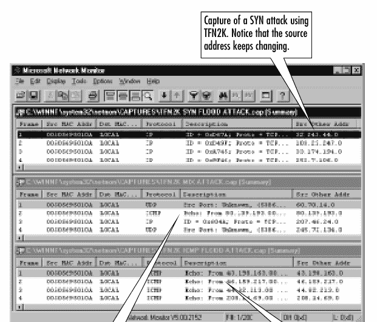

图 2.5 提供了从主机到僵尸的单向通信流视图。数据中的一个特定特征变量是，从 `fn` 客户端发送到 `td` 守护进程的所有命令在数据包末尾包含随机数量的 As (`0x41`)。

# Stacheldra——铁丝网攻击

在 1999 年后期，发现了一种名为 Stacheldra（德语：铁丝网）的 DDoS 程序被使用。Stacheldra 结合了其他 DDoS 工具的功能，并包含了客户端与主节点之间的加密。Stacheldra 以源码形式发布，可以在 Solaris 和 Linux 上编译。Stacheldra 的一个有趣特性是它的与系统无关性。

# Stacheldra 的工作原理

编译后，Stacheldra 的主要组件是三个二进制文件，即 `client`、`mserv` 和 `td`。使用定义的语法，客户端程序向安装在受感染主机上的 `mserv` 守护进程（数量不受限制）发送命令。`mserv` 守护进程随后执行客户端引导的命令，这可能涉及指示安装在僵尸主机上的 `td` 守护进程。在最基础层面，客户端指示 `td` 开始或停止攻击。

命令语法的设计能够容纳更复杂的攻击指令。客户端不仅可以指示多个僵尸攻击目标（使用 `td`），还可以指定要使用的攻击方法。客户端可以指示 `td` 使用以下攻击：

- **UDP 洪水攻击**：向目标倾入大量的 UDP 数据包。
- **SYN 洪水攻击**：通过伪造发送到目标的数据包的源地址，操纵 TCP 三次握手的建立。
- **ICMP 回显响应攻击**：向目标主机发送大量的 ICMP 回显，主机将做出响应。

此外，客户端可以指示守护进程在目标计算机上执行程序，或允许进入特定端口的 Shell 连接。客户端与守护进程之间的通信是单向的——不会向客户端返回命令已由守护进程接收，这使得检测变得更加困难。

客户端在主机上需要管理员（root）权限才能运行。在主机上，`TFN2K` 客户端程序是非侵入性的，不需要更改系统。随后在主机上使用客户端向受感染的僵尸主机发布命令。在指示僵尸开始或停止攻击时，客户端会将攻击封装在在多个发往僵尸主机的数据包中，其理论是至少会有部分数据包到达目的地。

如前文所述，通信是单向的——从主机到僵尸——为了进一步增加检测的概率，客户端会通过 TCP、UDP 和 ICMP 随机发送指令。消息内容使用 `CAST-256` 算法加密，使用编译时定义的密钥并进行 `base64` 编码。针对僵尸的命令夹杂着伪装流量，试图掩盖攻击指令的发送。

`TFN2K` 非常多功能；它可以在多个平台上运行——甚至可以在使用 `vmware` 和 `cygwin` 等 UNIX Shell 的 Windows 平台上运行。图 1.4 展示了针对 Windows 2000 主机的三组不同攻击数据包的简单总结。该攻击是使用受感染的 Linux 主机和一组 Linux 僵尸发起的。数据包捕获显示了在 `TFN2K` SYN 洪水攻击、混合攻击和 ICMP 洪水攻击期间发送给受者的数据包子集。图 2.4 数据包捕获中显而易见的细节是，所有源地址都是伪造的。

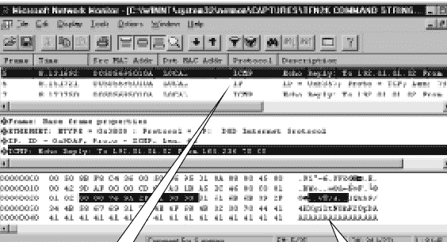

# DDoS 攻击：意图、工具与防御


# 图 2.6 Stacheldra 攻击层级


继续

# DDoS 攻击：意图、工具与防御 • 第2章 85

# 表格 2.2 继续

| 源自 | 目标 | Stacheldraht v1.1 使用端口 | Stacheldraht v4 使用端口 | 注释 |
| --- | --- | --- | --- | --- |
| 僵尸控制机 (Zombies Masters) | 65000/TCP + ICMP Echo Reply | 65513/TCP + ICMP Echo Reply | 进程检查加密文件以获取控制机的 IP 地址。否则使用默认 IP。 |

# 图 2.8 td 进程启动的包捕获及产生的通信流

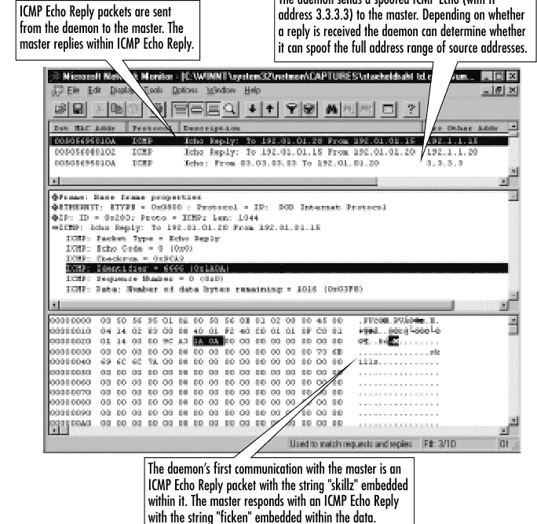

# 第 2 章 • DDoS 攻击：意图、工具与防御

请记住，DDoS 程序处于不断开发中，因此不同版本的工具可能具有不同的能力和配置。例如，较新版本的 Stacheldra 包含了更多的攻击类型和更好的混淆技术。

## 安全警报！

> 本章讨论的攻击详细列出了许多进程名称和端口号。极其重要的一点是，源代码是免费获取的，这些参数可以很容易更改。例如，在编译之前，可以修改 Stacheldra 的 `config.h` 和 `td.c` 文件来更改进程名称、端口号，甚至与发布的命令相关的数值。大多数攻击者都有轻松更改许多用于 DDoS 攻击工具数值的能力。不要认为这些值是理所当然的！

## 更多 DDoS 家族

互联网地下世界中正在开发许多 DDoS 工具。Trinoo、TFN2K 和 Stacheldra 只是流传较流行的几种。此外还需注意以下 DDoS 程序：

- Mstream: 这种攻击将 `stream2.c` DoS 攻击转换为三层分布式攻击工具。受害者成为 TCP 数据包的接收者，这些包具有随机的源 IP 地址和随机的目标 TCP 套接号。该工具的早期版本没有 Stacheldra 和 TFN2K 等 DDoS 软件先进。

- Trinity: 一种通过 IRC 控制的攻击工具。当在 Linux 主机上安装时，运行可执行进程 `/usr/lib/idle`，trinity 会连接到端口 `6667` 的 Undernet IRC 服务器。该进程随后通过 IRC 通道发送命令。提供多种攻击方式，如 UDP 洪水、SYN 洪水攻击和空洪水攻击（null floods）。

- Shaft: 一种可以通过多层攻击体系发起各种攻击的 DDoS 程序。Shaft 通过 TCP 端口 `20432` 从客户端通信到控制机，通过 UDP 端口 `18753` 从控制机通信到进程，并通过 UDP 端口 `20433` 从进程返回到控制机。

每种 DDoS 工具都有其与其配置和操作相关的特定特征。仅仅因为它们没有被详尽介绍，并不意味着它们不那么危险——记住，所有这些在现实中已以不同程度被发现过。

## 我如何保护我的网站免受此类攻击？

目前还没有一种方案可以对 DDoS 攻击带来的威胁提供完全的保护。与其他安全事件（如新病毒的传播）不同，DDoS 没有绝对的解毒剂或治疗方法。正如本章早期提到的，一次成功的 DDoS 攻击可能不是因为你的企业缺乏准备或远见，而是因为其他网站未实施安全措施。

即使考虑到这一点，你也可以采取许多防御性措施来减轻 DDoS 攻击的影响。此外，你可以使用 Zombie Zapper、远程入侵检测 (`RID`) 和 `nmap` 等工具，为你的网站提供大量的“检测与保护”功能。

防御网站免受 DDoS 需要安全团队采取一致且集中的方法。特别是关注当前的安全问题和新的攻击方法尤为重要。确保合理的安全配置是一个持续且动态的过程，需要不断完善和考虑。大多数 DDoS 防御措施分为三营，可以松散映射到安全三大准则：保护、检测和响应。

- **降低可能的 DDoS 攻击的效率** 涉及确保考虑了流量整形、负载均衡、应用代理、入站过滤、防止网络映射、牺牲主机、拆分 DNS 和应急响应策略。

- **检测 DDoS 攻击** 正确识别 DDoS 攻击既是艺术也是科学。它可能涉及理解网站的基准流量模式、不同 DDoS 家族的机制以及全面的日志分析（保持适当的怀疑）。现代 DDoS 工具的灵活性确保了你无法准确预测它们的行为，从而削弱了防火墙等基于规则的系统的保护/检测能力。即使考虑到这一点，IDS 和某些防火墙确实对 DDoS 攻击体系中主机之间的大多数通信流包含模式识别。例如，网络 IDS 可以检测攻击模式，而基于主机的 IDS 则可以检测攻击的模式和影响。

- **确保主机未被攻破并招募攻击体系** 过度过滤限制了攻击者利用被攻破站点进行协调攻击的能力（这应被视为预防性措施而非反应性措施）。确保主机和网络使用最新的安全更新得到充分保护至关重要。这还包括理解在主机被攻破时需要采取哪些行动，例如使用 `find_dos`、`RID` 和 Zombie Zapper 等工具。

风险与成本风险取决于视角，只有通过理解缓解风险的成本与可接受暴露水平之间的权衡，才能完全界定。在构建有效的对抗 DDoS 攻击计划并最小化其影响之前，请考虑有关业务及其基础设施结构的几个问题。以下是一些值得思考的问题：

- 业务对的依赖程度如何？可以采取哪些非技术手段来减少这种依赖？

- DDoS 攻击和其他安全问题是否在公司保险范围内？

- 认为什么暴露水平是可以接受的？我们需要做到何种程度？这应该被纳入灾难恢复吗？

- 当前的安全配置是否为人知？如果不是，如何获取？

- 政策是否经过了审查？需要什么样的人员配备和技术能力？

- 高层管理是否认可这些政策？技术人员是否理解如何操作？

在接下来的章节中，我们将介绍保护和偏离 DDoS 攻击的有用策略。

### 损害与防御

假装报羊
当业务遭受服务拒绝时，并不总是由于第三方的参与。服务拒绝的发生更多是由于合法事件的结果，而不是阴险的黑帽黑客的结果。例如，一个接收高量流量的网站。当流量超过某些阈值时，其他用户将被拒绝访问该网站。这仍然是 DoS，但不是 DDoS 攻击。

作为管理员，在向业务部门通报你感知的恶意针对性黑客攻击时，要非常小心。真实的 DDoS 攻击数量惊人，但也存在大量误认的情况。确保你拥有充分的证据，并遵循正确的升级程序。

频繁地得出结论或发出虚假警报是企业业务失去对你诊断安全威胁信任的简单方法。这甚至导致业务将信息安全视为一种为了尽职调查目的而进行的事实或实践，而不是开展电子商务的促进器。换句话之，如果你忽视了遵循每一种可能解释的正确路径，业务将开始认为你是一个作了太多谎的小男孩。

## DDoS攻击：意图、工具与防御 • 第2章

防火墙很难停止像 TFN2K 这样的 DDoS 工具，因为该工具不通过特定端口进行通信或攻击。防火墙的配置可能是一项复杂且令人沮丧的任务。在不涉及防火墙配置机制的情况下，建立有效规则集的通用方法是假设所有流量都是可疑的，并仅开启必要的端口。流量的状态检测（Stateful inspection）提高了防火墙管理连接的能力，许多防火墙还具备检测管理员定义的恶意活动的能力。

可以主动采取许多防御措施，但其中某些并不适用于所有环境。以下列表提供了一些减少 DDoS 暴露的可用选项：

- **保持安全配置文件的最新**：实施一种流程，将最新的补丁和配置应用于主机和网络设备；作为通用的安全考量，这非常重要，而不仅仅针对 DDoS。例如，操作系统应配置为忽略广播、包含 SYN 洪水攻击韧性、建立强密码，并关闭所有不必要的服务。记住，只有当存在安全性薄弱的主机或网络可供破解时，攻击者才能创建攻击网络。

- **流量模式分析**：如果不了解进出流量的正常分布和特征，就试图判断是否发生了攻击是非常的。例如，如果某些类型的 ICMP 流量出现峰值，如果没有基准进行比较，这些信息将很难解释。

- **划分 DNS 基础设施**：将内部和外部 DNS 基础设施分离将使基础网络足迹变得难以追踪。因此，在防火墙的“干净”侧扩散僵尸变得更加困难。

- **负载均衡**：提供具有韧性和容错能力的站点是任何电子商务网站成功的关键。通过使用负载均衡，不仅提高了可用性和速度，还提高了对 DDoS 攻击的防御力。这一主题的一个微妙变体是使用 Akamai Technologies (`www.akamai.com`) 等分布式托管服务。通过 DNS 和其他机制将站点分布在分布式网络中，可以提高站点对 DDoS 攻击的防御能力。

- **出站和入站过滤**：确保只有定义的流量组进入和离开网络，可以减少站点成为僵尸网络的概率以及主机被破解。应要求 ISP 实施入站过滤，这有助于识别僵尸网络。（详情请参阅“使用出站规则成为更好的‘网络邻居’”章节。）

- **收紧防火墙配置**：默认情况下，所有可访问互联网的服务器都应处于 DMZ 中。对规则修改实施严格的变更，并确保防火墙仅允许最少量的端口和协议通过。例如，考虑防火墙的出站 ICMP 回显包，以及时间戳、回复、信息请求、信息回复和超时数据包。通常，大多数站点应该从开放 TCP 80 端口开始，然后从那里逐步扩展。开启防火墙自带的任何防御能力，例如缓冲 TCP 连接过程或检测恶意活动的能力。启用日志并将数据重定向到 `syslog`（尽管在攻击期间这可能证明是非常消耗资源的）。

- **加固边界设备并使用流量整形**：对于进入和离开边界设备的流量，需要适当的裁量访问控制。允许通过这些设备的协议和端口限制需要与防火墙配置结合开发。开启设备自带的保护机制，例如 Cisco 路由器的 TCP 拦截和速率限制。（详情请参阅后文章节。）

- **实施 IDS**：实施良好的 IDS 可以为管理员提供检测某些客户端/主控/代理对话的能力。同时实施基于主机和基于网络的 IDS。

- **实施漏洞扫描器**：漏洞扫描器是 IDS 必要的伴侣，它负责报告主机和网络设备上存在的漏洞。将漏洞扫描器（以及 IDS）更新为最新的漏洞列表是至关重要的。

- **实施代理服务器**：配置进入或离开网络的流量通过代理，可以减少 DDoS 攻击。在攻击发生后，代理服务器也可以作为有用信息的来源。

- **对现有配置进行快照和完整性检查**：由于配置更改可能导致拒绝服务（DoS），因此确保尽可能多的配置可以进行集中备份是明智的。此外，在主机之间定期运行完整性检查。完整性检查的目的是将主机的当前状态与其基准进行比较。通过这种方法，管理员可以验证文件和目录的完整性，并突出攻击者做的更改。此类 UNIX 工具的示例是 Tripwire (`www.tripwire.com`)。

- **配置牺牲主机**：创建旨在误导攻击或收集有关潜在攻击者信息的主机是一个有争议的话题，在实施之前需要考虑许多因素。例如，是否有足够的的技术资源来分析数据，以及这种配置是否会引起不受欢迎的关注？

- **加强网络和主机管理**：通过监控网络和主机的资源利用率，与正常操作相比，可以标记出 DDoS 的影响。许多管理程序可以提供主机上运行的软件和服务的详细信息。

## 第2章 - DDoS 攻击：意图、工具与防御

- **维护响应程序**：解决 DDoS 攻击所需的所有讨论都应该在攻击发生之前进行。务必熟悉您的 ISP、路由器和防火墙的能力。了解 ISP 响应 DDoS 攻击的能力至关重要。确定 ISP 可以在何处增加价值：
  * 他们是如何进行入站过滤的？
  * 他们的事件响应程序完整性如何？
  * 他们是否实施了定向广播？
  * 他们能有效地记录和跟踪流量吗？
  应该开发并维护一份包含此类信息及其他信息的业务响应程序。

- **部署更安全的技术**：已经开发出许多技术可以对 DDoS 及其相关漏洞提供某些保护。IPv6、IP 安全 (`IPSec`) 和安全 DNS 等技术比目前的实现提供了更大的保护。

即使在投入大量精力和资金防御站点遭受 DDoS 后，风险仍然没有消除。如果发生攻击，你应该有一个定义良好的响应程序，规定行动计划、升级程序和联系详情。考虑纳入响应过程的某些要点包括：

- **信息收集**：如何收集和解释与攻击相关的信息？它是否回答了如什么、何时、何地和如何等基本问题？哪些设备和软件可以进行查询？

- **联系 ISP**：请求 ISP 为您的站点调查异常程序，并黑名单潜在的僵尸网络。

- **应用更激进的过滤器**：更改访问控制列表和过滤器，丢弃来自和指向攻击网络的数据包。应用速率限制规则以确保

## DDoS 攻击：意图、工具与防御 • 第2 章

确保正确类型的流量获得适当的带宽。确保只有最少的协议和端口进入和离开网络。即使实施了更激进的过滤，攻击的影响也可能无法削弱；需要足够的带宽余量（高于攻击者使用的带宽），以确保合法流量能够到达目标服务器。检查边界设备的基线配置。

- **应用不同的路由选项** 尝试更改入站流量可用的路由选项。

- **尝试停止攻击** 使用如 Zombie Zapper 等现有工具，可以指示僵尸网络停止攻击。（详情请参阅后文章节。）

- **更改目标系统的 IP 地址** 对于许多网站站来说，这可能不是一种合适的策略，且收益存疑。如果更改了地址，你必须确保 DNS 更改需要时间在互联网上同步。注意，如果运行在僵尸网络上的进程配置的是主机名而非 IP 地址，这种策略可能完全无效！

- **启动事件调查** 与相关机构（无论是 ISP 还是政府机构）合作，开始收集信息。不要重建充当过僵尸或主机的主机——它们包含了重要信息。

## 改进出站规则，成为更好的“网络邻居”

在大多数情况下，DDoS 攻击受害者遭受的损害不仅取决于害者的安全性，还取决于其他网络的缺乏安全性。减少 DDoS 攻击扩散的方法之一是成为更好的“网络邻居”——我们的意思不仅是指允许进入网络的流量，还包括允许离开网络的流量。通过使用出站规则（egress rules），可以对离开网络的流量进行控制。

96

第2 章 • DDoS 攻击：意图、工具与防御

出站规则是一组管理流出网络流量指令，而入站规则（ingress rules）则管理进入网络的流量。通常，大多数网络管理员关注保护网络免受入站流量的影响，但攻击者仍可以通过多种方式破坏这些保护机制，并损害网络或主机。假设攻击者获取了主机的访问权限，他就可以（没有出站规则的情况下）让受害主机参与伪造数据包攻击。由于没有法律限制从该特定网络发出的包性质，伪造的数据包会被路由到其指定目标，就好像一切无事。

可以利用此类网络配置的攻击示例是 Smurf 攻击（小精灵攻击）。快速回顾一下，Smurf 攻击通过向放大网络发送 ICMP 回显包来实现预期效果，其源地址被伪造为受害者的地址。放大网络随后向它认为的原始 ICMP 回显源（已改为受害者地址）做出响应。这种攻击基于这样一个假设：伪造的 ICMP 回显包离开原始网络进入放大网络时，其源地址不是其合法地址空间的一部分。

类似的情况也适用于 SYN 洪水攻击（SYN flood attack）。初始的 TCP SYN 被发送到伪造地址，或者发送到一个不属于攻击者的合法地址。只有当数据包离开网络时其源地址并非源网络合法地址空间内的地址时，这种类型的攻击才能成功。

如果原始网络有相应的规则，仅允许源 IP 地址位于合法地址空间内的数据包离开网络，那么这些场景就可以被防止；换句话说，如果它使用了出站规则。通过成为一个良好的邻居，你可以减少你的网络被用于攻击的可能性。开始实施出站规则永远不为晚——预防胜于治疗。

瓶颈点（Choke points）通常是应用出站规则或过滤的绝佳位置。需要出站过滤的瓶颈点包括防火墙、路由器和拨号服务器上的所有内部接口。

## DDoS 攻击：意图、工具与防御 • 第2 章 97

## 启用出站规则并强化思科路由器以防御 DDoS

转述请求注释（RFC） `2827`《网络入站过滤的最佳当前实践》，通用路由器的出站规则基本上可以总结为：

```
IF

outgoing packet source address within the networks

legitimate address space

THEN

route as appropriate

ELSE

deny route and do other (log, alert)
```


许多供应商已提供论文详细说明了加固路由器和网络以防御 DDoS 的策略。为了简洁起见，本节仅包含了思科建议的一些配置更改的摘要，因此请检查您的路由器以获取最新的深度 DDoS 防护信息。

## DDoS 攻击：意图、工具与防御 • 第2 章 97

在大多数情况下，DDoS 攻击受害者遭受的损害不仅取决于害者的安全性，还取决于其他网络的缺乏安全性。减少 DDoS 攻击扩散的方法之一是成为更好的“网络邻居”——我们的意思不仅是指允许进入网络的流量，还包括允许离开网络的流量。通过使用出站规则（`egress rules`），可以对离开网络的流量进行控制。

出站规则是一组管理流出网络流量指令，而入站规则（`ingress rules`）则管理进入网络的流量。通常，大多数网络管理员关注保护网络免受入站流量的影响，但攻击者仍可以通过多种方式破坏这些保护机制，并损害网络或主机。假设攻击者获取了主机的访问权限，他就可以（没有出站规则的情况下）让受害主机参与伪造数据包攻击。由于没有法律限制从该特定网络发出的包性质，伪造的数据包会被路由到其指定目标，就好像一切无事。

可以利用此类网络配置的攻击示例是 Smurf 攻击（小精灵攻击）。快速回顾一下，Smurf 攻击通过向放大网络发送 ICMP 回显包来实现预期效果，其源地址被伪造为受害者的地址。放大网络随后向它认为的原始 ICMP 回显源（已改为受害者地址）做出响应。这种攻击基于这样一个假设：伪造的 ICMP 回显包离开原始网络进入放大网络时，其源地址不是其合法地址空间的一部分。

类似的情况也适用于 SYN 洪水攻击（`SYN flood attack`）。初始的 TCP SYN 被发送到伪造地址，或者发送到一个不属于攻击者的合法地址。只有当数据包离开网络时其源地址并非源网络合法地址空间内的地址时，这种类型的攻击才能成功。

如果原始网络有相应的规则，仅允许源 IP 地址位于合法地址空间内的数据包离开网络，那么这些场景就可以被防止；换句话说，如果它使用了出站规则。通过成为一个良好的邻居，你可以减少你的网络被用于攻击的可能性。开始实施出站规则永远不为晚——预防胜于治疗。

瓶颈点（`Choke points`）通常是应用出站规则或过滤的绝佳位置。需要出站过滤的瓶颈点包括防火墙、路由器和拨号服务器上的所有内部接口。

## 启用出站规则并强化思科路由器以防御 DDoS

转述请求注释（RFC） `2827`《网络入站过滤的最佳当前实践》，通用路由器的出站规则基本上可以总结为：

```
IF

outgoing packet source address within the networks

legitimate address space

THEN

route as appropriate

ELSE

deny route and do other (log, alert)
```

许多供应商已提供论文详细说明了加固路由器和网络以防御 DDoS 的策略。为了简洁起见，本节仅包含了思科建议的一些配置更改的摘要，因此请检查您的路由器以获取最新的深度 DDoS 防护信息。

## 第 2 章 • DDoS 攻击：意、工具与防御

启用 Linux SYN Cookies，请输入：

```
echo 1 > /proc/sys/net/ipv4/tcp_synccookies
```

## 微软的 SYN 方法

默认情况下，Windows NT 会以 3, 6, 12, 24 和 48 秒的间隔重传 SYN/ACK 五次。必须经过完整的 96 秒，主机才会关闭半打开连接（总计 189 秒）。Windows NT 4 和 Windows 2000 具有许多防止 SYN 攻击的配置参数。例如，在 `HKEY_LOCAL_MACHINE\SYSTEM\CurrentControlSet\Services\Tcpip\Parameters` 中添加或修改以下内容：

- `SynAttackProtect`：如果认为正在遭受 SYN 洪水攻击，此项将强制连接队列具有更短的超时时间。类型为 REG_DWORD，取值为 0–2。默认值为 0；无保护。将值设置为 1 提供 SYN 洪水保护，而设置为 2 则在提供 SYN 洪水保护的同时，在 TCP 握手完成之前不向 AFD（支持 Windows Sockets 应用程序的驱动程序）发送信号。

- `TcpMaxHalfOpen`：半打开连接的数量超过此项的值后将启用 `SynAttackProtect`。类型为 REG_DWORD。

- `TcpHalfOpenRetried`：此值决定了在 `SynAttackProtect` 之前，至少进行过一次 SYN 传输的半打开连接数量。类型为 REG_DWORD。

- `TCPMaxConnectResponseRetransmissions`：此值控制服务器响应 SYN/ACK 的次数。该项类型为 REG_DWORD，默认值为 3。将值设置为 3 将在 3、6 和 12 秒后重传 SYN/ACK，并在 24 秒后进行清理（总计 45 秒）。将值设置为 1 将在 3 秒后传输 SYN/ACK 并在 6 秒后进行清理（总计 9 秒）。

`backlog`（队列）是 Windows 用于存放半打开连接队列的术语。可以通过修改 `HKEY_LOCAL_MACHINE\SYSTEM\CurrentControlSet\Services\AFD\Parameters` 中的某些键来适当配置此队列。

- `EnableDynamicBacklog`：如果服务器正遭受 SYN 攻击，应将此 REG_DWORD 项设置为 1，以便允许队列动态增长。

## 安全警报！

在生产环境中使用 Windows SYN 保护功能之前，务必仔细测试任何配置更改——某些配置会导致故障或其他安全风险！

## 思科的 SYN 方法

Cisco 提供了一种名为 TCP Intercept（TCP 拦截）的功能来保护网络免受 SYN 洪水攻击。使用拦截模式，路由器捕捉匹配某些规则的 SYN 数据包。路由器代表背后的服务器对客户端的 SYN 响应 SYN/ACK，有效地接管了 TCP 三次握手的服务器端。如果路由器成功接收到客户端的 ACK，则会将原始 SYN 发送到服务器。随后，客户端与路由器之间、路由器与服务器之间的半形成连接将合并，形成客户端与服务器之间的单一合法连接。但如果路由器向客户端的原始 SYN/ACK 失败，则路由器将丢弃连接。

TCP Intercept 可以配置为不具侵略性，并在观察模式（`watch mode`）下积极监控握手。如果连接尝试在给定时间内未能圆满解决，路由器将终止半打开连接。TCP intercept 可以配置为适用于所有路由数据包或符合特定源目的标准的数据包。

这里显示了启用 TCP Intercept 的基本命令示例，但关于“TCP Intercept”更完整的文档（关于模式、计时器、丢弃和统计数据），请访问 `www.cisco.com`。

```
ip tcp intercept list 101

!
access-list 101 deny ip 10.0.0.0  0.255.255.255
```


## 其他设备如何处理 SYN

其他边界设备（如防火墙）也可以提供针对 SYN 洪水的某些保护，例如 Check Point Software Firewall-1 `SYNDender`。它提供了两种 SYN 洪水保护方法，分别名为 `SYNDender Relay` 和 `SYNDender Gateway`。与 `TCP Intercept` 类似，`SYNDender Relay` 在三次握手完成之前充当中间人。只有在收到 Firewall-1 的 `SYN/ACK` 回复后，才会向防火墙后的服务器。

`SYNDender Gateway` 解决方案采用了不同的方法，让 `SYN` 直接通过防火墙到达服务器。当服务器发送 `SYN/ACK` 时，`SYNDender` 响应 `ACK`。这意味着服务器认为握手已完成，随后连接就会被移出连接队列。

> 你是蓝精灵（Smurf）攻击吗？为了确保您的网络不是 Smurf 攻击的违愿参与者，请在边缘设备上配置适当的出口和入站过滤器。对于 Cisco 设备，IOS 版本...

## 定位和移除僵尸连接的方法

有许多工具可以协助识别和恢复。还有人编写了停止攻击的程序。好消息是，这些工具大部分都是免费的。

## DDoS 攻击：目的、工具与防御

`TFN2K` 客户端、`TFN2K` 守护进程、`trino` 守护进程、`trino` 主、`TFN` 守护进程、`Stacheldrakt` 守护进程、`Stacheldrakt` 客户端以及 `Trinity v3`。

该工具通过将文件与 DDoS 程序进行对比，甚至可以检测是否有程序正在运行。与大多数软件一样，它并不是 100% 万无一失，可能会产生误报，但它仍然是一个非常有价值且值得投入的工具。你可以从 `www.nipc.gov` 下载 `Find_ddos`。

## 使用 Zombie Zapper

`Zombie Zapper` 由著名的安全公司 `Bindview` 开发，它为管理员提供了一种简单的方法，可以指令正处于攻击中的守护进程停止运行。`Zombie Zapper` 有两个版本——一个适用于 UNIX，另一个适用于 Windows。

通常情况下一样，UNIX 版本是命令行驱动的，而 Windows 版本具有图形化前端。`Zombie Zapper` 可以指令 `trino`、`TFN`、`Stacheldrakt`、`Wintrinoo` 和 `Shaft` 守护进程停止攻击。使用 `Zombie Zapper` 有几点注意事项，如下：

- 它假设在编译相关二进制文件时使用了默认密码。
- 它会完全停止 `trino` 守护进程，但对于所有其他守护进程，它只是停止正在进行的攻击（这有助于定位这些守护进程）。
- 它不支持 `TFN2K`。
- 如果你是攻击的接收者，并尝试关闭第三方网络上的守护进程，请记住，由于数据包欺骗，你可能误将 `Zombie Zapper` 指向了错误的网络，或者 `Zombie Zapper` 发出的指令可能会被路由器和防火墙等安全设备过滤。
- 它需要 `libnet 1.0` 或更高版本。`Libnet` 是一系列例程和函数，便于创建感知网络状态应用程序和实用程序。

请参阅图 2.9 查看 `Zombie Zapper` 的 UNIX 版本。UNIX 版 `Zombie Zapper` 二进制文件名为 `zz`，具有多个参数可以微调其运行。Windows 版本提供了一个友好的界面，但经验丰富的管理员可能更倾向于查看使用 `-vv` 提供的详细信息。使用 UNIX 版本，你甚至可以伪造 `Zombie Zapper` 生成的守护进程包（非常调皮！）。

可以从 `www.packetfactory.net/libnet` 下载 `libnet`，从资源丰富的 `Bindview Razor` 团队的 `razor.bindview.com/tools` 下载 `Zombie Zapper`。

### 图 2.9 Zombie Zapper 的 UNIX 版本

执行此命令提供所有 `Zombie Zapper` 参数的完整列表。

编译 `Zombie Zapper`，请安装 `libnet 1.0` 或更高版本。完成后，运行截图所示的命令来编译 `Zombie Zapper`。

```
C:\Windows\system32>cmd 12:15

gcc 24March2002 -I/include -`libnet-config --defines -o zz zz.c -linet

24March2002 -I/include -o zz zz.c -linet

Zombie Zapper

Bugs/comments to the zombierazzer.bindview.com

More information is available at http://www.bindview.com/razor/bindview.com

Copyright (c) 2000 Bindview Development

./zz [-a 0-5] [-c class C] [-d de] [-h] [-n host] [-s src] [-u udp] [-v] hosts

  -antiddos type to kill

    - all

    - blackhole

    - trident

    - cronos

    - windows

  - class C in x.v.w form

  -f time all packets (default 0)

  - grab host IP from them (default 0)

  - help

  - show (details, only one host)

  - spoof source address (cast in case)

  - mid-address target for more targets

  - use mask mode (for more verbosity)

  - host and then handle (ending -c)

24March2002 -zz -c class C 192.168.1.1

Bugs/comments to the zombierazzer.bindview.com

More information is available at http://www.bindview.com/razor/bindview.com

Copyright (c) 2000 Bindview Development
```

使用 `-option` 允许 `Zombie Zapper` 瓦灭整个 C 类网络。

## 使用 tfn2kpass

`TFN2K` 编译时的一个选项使其不受 `Zombie Zapper` 及其类工具的影响。在编译 `TFN2K` 时，它会要求一个密码用于加密，允许 `TFN2K` 绕过 `Zombie Zapper` 的默认密码漏洞。但别担心，`tfn2kpass` 提供了随随随帮助。

`tfn2kpass` 由 `Simple Nomad` 开发，以源码形式分发，可以在 `Solaris`、`Linux` 和 `FreeBSD` 上编译。编译后的代码可从 `TFN2K` 二进制文件或 `tfn` 中提取密码。这在许多场景中非常有用：

- 如果你发现网络上的主机已被攻破，可以使用恢复的密码重新编译一组新的 `TFN2K` 二进制文件。使用这个新编译的 `tfn` 版本，管理员可以命令运行守护进程 `td` 的主机停止攻击。
- 在信息收集阶段，密码可以作为证据，或者可能被攻击者用于其他受密码保护的代码。

`tfn2kpass` 的源码可以在 `http://razorbindview.com/tools/` 下载。通过运行以下命令可以轻松实现源码的编译和运行：

```
gcc -o tfn2kpass tfn2kpass.c
```


## 其他工具

一种用于检测或缓解 DDoS 攻击的工具。有一些可用的工具，其细节详细列如下：

- 如果你发现你网络上的主机已被攻破，可以使用恢复的密码重新编译一组新的 TFN2K 二进制文件。使用这个新编译的 `tfn` 版本，管理员可以命令运行守护进程 `td` 的主机停止攻击。
- 在信息收集阶段，密码可以作为证据，或者可能被攻击者用于其他受密码保护的代码。

## 总结

DDoS 攻击旨在确保计算基础设施受到负面影响。虽然这种攻击不涉及电子资产盗窃，但对业务的影响可能是巨大的。互联网上有许多 DDoS 工具，许多工具的设计初衷是易于使用。因此，DoS 工具的使用已超出了纯技术人员，扩展到了网络新手手中。

DDoS 攻击主要源于远程系统，但也可能发生在目标主机上。DoS 攻击的影响非常广泛，对企业形象也有损害。

资源消耗攻击和畸形数据包攻击是 DDoS 攻击的两个类别。资源消耗攻击通过定向攻击来减少可用资源。这些攻击会消耗内存、CPU、连接队列或带宽等网络资源。资源消耗攻击的常见例子是 SYN 洪水和 Smurf 攻击。

SYN 洪水攻击通过干扰 TCP 连接的建立机制来实现其预期影响。建立 TCP 连接的基本步骤涉及客户端向服务器发送 SYN 包。服务器对客户端的 SYN 响应 ACK 和它自己的 SYN。SYN/ACK 的组合从服务器发送到客户端，客户端请求三次握手的最后部分——ACK。SYN 洪水攻击工具利用这种握手，通过发送带有伪造源地址的初始 SYN。伪造源地址产生的后续结果是服务器响应的 SYN/ACK 从未得到回答。

攻击者发送大量的 SYN 以耗尽允许的半开放连接数量。服务器可以响应的 SYN 数量是有限，最终连接队列将溢出，服务器开始拒绝合法客户端的连接请求。

## 第 2 章 · DDoS 攻击：意图、工具与防御

小烟雾攻击 `Smurf attack` 利用了某些网络对定向广播做出响应的非预期能力。攻击者使用伪造的源地址向这些网络发送定向广播。攻击者在定向广播的源地址中替换为受害者的地址。放大网络上的所有主机都会对广播做出响应，发送指向受害者的 ICMP Echo 回文。这可能导致带宽耗尽和拒绝服务。

第二类攻击类型——畸形包攻击 `malformed packet attack`，通过构建专门定制的网络包，导致目标系统产生意料之外的行为。示例包括水滴攻击 `Teardrop` 和陆地攻击 `land attacks`。

DDoS 攻击是 DoS 攻击演变的下一步，由多个攻击源组成。

无论是启动还是停止攻击，TFN2K 都非常强大；它可以在多个平台上运行——甚至可以在使用 `vmware` 和 `cygwin` 等 UNIX shell 的 Windows 平台上运行。

编译 `Stacheldraft` 源代码会生成三个二进制文件。这三个二进制文件分别是 `client`、`mserv` 和 `td` 分别用于攻击模型中的不同层级。`mserv` 是客户端软件，因为它运行在主控机。被攻破的主机用作僵尸，或者被配置为运行 `td` 二进制文件，该文件包含组合攻击数据包和流量流的实际代码。运行客户端二进制文件时，它会与运行 `mserv` 程序的主机建立类似于 telnet 的会话。Stachelrecht 使用了基于 64 位块密码的免费可用 Blowfish 加密算法。

### 如何保护我的网站免受此类攻击？

- DDoS 缓解措施包括对伪造地址进行出口过滤和对广播数据包进行入站过滤。出口过滤包括对出站流量的过滤，而入站过滤涉及传入网络流量的过滤。您的互联网服务提供商 `ISP` 应该被实施入站过滤，这有助于识别僵尸网络。
- 最小化 DDoS 暴露的选项包括：保持安全配置更新；分析流量模式；拆分 DNS 基础设施；使用负载均衡；收紧防火墙配置；保护边界设备并使用流量整形；实施入侵检测系统 `IDS`、漏洞扫描器和/或代理服务器；对现有配置进行快照并进行完整性检查；配置牺牲主机；加强网络和主机管理；维护响应程序以及部署更安全的技术。

### 网络防御要点

- 网络瓶颈 `choke points` 通常是应用出口规则或过滤器的理想位置。需要出口过滤的瓶颈包括防火墙、路由器和拨号服务器上的所有内部接口。
- 操作系统应配置为忽略定向广播、包含 SYN 洪攻击抗性、建立强密码，并关闭所有不必要的服务。
- 有许多工具可以帮助识别和恢复参与 DDoS 攻击的网络，包括 `Nmap`、`Find_redos`、`Zombie Zapper`、`tfn2kpass`、`RID`、`DDosPing`、`Ramenfind`、`DDS`、`GAG` 和 `Tripperwire`。
- 发生攻击时，您的响应程序应包含信息收集；联系 ISP；应用更激进的过滤器；应用不同的路由选项；尝试停止攻击；更改目标系统的 IP 地址以及开始事件调查。

### 常见问题

以下由本书作者回答的常见问题，旨在衡量您对本章介绍概念的理解程度，并帮助您在现实生活中实施这些概念。

问：我应该查看哪些网站以获取最新的 DDoS 工具和安全信息？

答：许多优秀的网站提供了大量信息。表 2.3 提供了可用网站的简要示例。

表 2.3 DDoS 工具和安全信息来源

| 网站名称 | 链接 |
| --- | --- |
| David Ditrich 的 DDoS 网站 | www.washington.edu/people/dad |
| Security Focus | www.securityfocus.com |
| Bindview’s Razor maine | http://razor.bindview.com |
| Internet Security Systems X-Force | http://xforce.iss.net |
| 国家基础设施保护中心 | www.npc.gov |
| Packet Storm | http://packetstorm.security.com |
| Hideaway.Net | www.hideaway.org |
| Attrition.org | www.attrition.org |
| Linux Security | www.linuxsecurity.com |
| Windows IT Security | www.ntsecurity.net |
| Technotronic.com | www.technronic.com |
| 卡内基梅隆软件学院 | www.cert.org |

问：我想配置我的 UNIX 主机不响应定向广播。我该如何做？

答：禁用广播是减少成为放大网络几率的好开端。如果您不确定边界设备是否禁用了定向广播，则可以在操作系统层级禁用它们。请注意，使用这种方法花费的时间比正确配置边界设备要多得多。

可以通过以下命令配置 Linux 忽略定向广播：

```
echo 1 > /proc/sys/net/ipv4/icmp_echo_ignore_broadcasts
```

在 Solaris 上停用定向广播，请使用以下命令：

```
ndd -set /dev/ip ip_forward_directed_broadcasts 0
```


问：我的网络已被攻破，并在多个主机上安装了 Stacheldraft。已经在边界设备上应用了出口规则。这是否意味着伪造数据包无法离开我的网络？

答：不是。即使 Stacheldraft ICMP 回显测试失败，最低的八位仍然是伪造的。

问：我的网络已被攻破，并在多个主机上安装了 Stacheldraft。我已经在边界设备上应用了出口规则。这是否意味着 Zombie Zapper 无法关闭？

答：网络可能没有足够的带宽。在使用 DDoS 工具时要非常小心。

## 第3章：安全网站设计

本章解决方案解决方案：

- 选择服务器
- 安全网站设计基础
- Java、JavaScript 和 Active X 指南
- 安全脚本编程
- 代码签名：解决方案还是更多问题？
- 我应该外包网站设计吗？

- 总结
- 快速上手
- 常见问题

## 引言

保护您的电子商务网站不仅仅是规划和实施安全的网络架构。虽然这些是良好的起点，但最可见且经常受到攻击的组件是网站本身。事实上，在过去的几年里，网络黑客行为已如此普遍，以至于一些网站已经开始遭受篡改。针对网络服务器的攻击非常常见，在许多情况下它们是最容易实施的攻击。

保护您的网站免受网络攻击必须从网站设计开始。选择并正确安装 Web 服务器软件，随后应用适当的加固技术，适用于设计的每一个网站。修改、补丁和升级也可能影响安全基线，这些也必须考虑。但设计安全网站的第一步是选择适合您组织需求的服务器。这需要了解许多类型 Web 服务器的功能，以及软件成本。这将为您提供有关多种类型 Web 服务器的信息，特别是安全功能。我们还将详细研究两个最流行的服务器：Apache Web 服务器和 Internet 信息服务 (IIS)。

### 选择 Web 服务器

建立一个良好且安全的网站的第一步是选择合适的 Web 服务器。你所选择的 Web 服务器类型取决于对各项标准的评估，例如成本、数据的敏感性、所使用的平台、谁需要访问这些数据，以及你对服务器系统要求的安全选项。

在选择 Web 服务器时，请记住这一点重要点：为你的组织选择合适的 Web 服务器是主观的。对于某家企业来说可能是极佳的选择，在你的公司可能效果并不如预期。你可能会发现你的公司不需要某些功能；某个特定的 Web 服务器无法在正在使用的操作系统上运行；或者服务器的价格超出了你的预算范围。确定同类公司和网络正在使用什么对你的决策非常有价值；但归根结底，你会发现你选择的服务器将是一个独立且个性化的决策。

你应该花时间确定哪些内容可以通过你的 Web 服务器进行访问，并识别哪些数据是敏感且必须保护的。例如，你可能希望所有用户都能访问介绍你网站的默认主页，并允许他们查看公司销售的产品，但你并不希望他们访问用户数据库或信用卡号。你可能允许用户访问 Web 服务器本身上的所有内容，但你不希望他们访问这台机器之外的、位于你内部网络上的任何文件。此外，你的组织可能面临外部团体设定的要求（例如要求特定安全设置的政府机构）。通过识别你的安全需求，你将能够对对 Web 服务器的预期做出更明智的决策。

## Web 服务器与 Web 服务

在评估你组织的需求时，你可能会发现你并不需要 Web 服务器。许多组织需要网络存在感，但决定不会通过网站提供任何敏感数据。该网站将没有安全或私有区域，也不会通过该网站进行销售。安全性并不是迫切的，因为任何通过 Web 可用的信息都对所有人可见。例如，一家酒店或餐厅可能希望通过网站投放广告并展示他们提供的服务。如果他们不接受预订，那么他们就不需要大量的安全工作。如果网站被黑客入侵且内容被更改，这仅仅是将 HTML 文档和图形重新上传到服务器，或从备份中恢复的问题。在这种情况下，在 ISP 的 Web 服务器上获取空间可能是明智的。这台服务器将与业务内部网络隔离，没有任何通过 Web 服务器访问任何敏感数据的可能。这种选项还消除了沉重管理的需要，因为网站管理员的角色将主要是生成和维护内容。

拥有私人服务器的成本很高，需要与其带来的收益进行平衡。尽管 IT 员工可能觉得拥有自己的 Web 服务器的前景令人兴奋，决策者也可能喜欢它带来的声望，但其成本通常会高于在 ISP 服务器上租用空间。记住，租用此类空间消除了购买服务、软件、连接互联网的 T1 线路等费用。如果这些设备出现问题，将由 ISP 负责修复，这为你节省了处理问题的责任。

遗憾的是，通过 ISP 进行托管服务，你也将失去许多优势。安装在服务器上的任何安全措施、服务或额外软件都将由第三方决定。这正是你选择一个符合或超过你企业需求的 Web 服务器时变得至关重要的时刻。

## 考虑 Web 服务器的成本和支持的操作系统

在考虑使用哪种 Web 服务器时，你将面临大量的选择。为了缩小范围，你首先应该确定哪些服务器是你网络已使用的操作系统所支持的，或者是你的 IT 员工有经验的。通过使用你的员工已经熟悉的平台，他们错过那些可能在其他操作系统中已经意识到的安全漏洞的概率就会降低。选择一个被 IT 人员熟悉的操作系统可以降低培训成本。成本在准备 Web 服务器时是一个主要问题。由于互联网对于许多决策者来说仍然是新颖且不熟悉的领域，你可能会发现为特定的 Web 服务器支付开支是合理的。记住，成本和支持的操作系统是两个考虑因素。安全特性将在下一节专门讨论。

## 表 3.1 Web 服务器对比

| Web 服务器 | 网站 | 成本 | 支持的平台 |
| --- | --- | --- | --- |
| America Online AOLServer 3.3 | www.aolserver.com | 0 | Windows 9x, Windows NT/2000, Digital UNIX, SCO, HPUX, Linux, FreeBSD, IRIX, Solaris |
| Apache Web Server 1.3.7 | www.apache.org | 0 | Windows 9x, Windows NT/2000, Novell NetWare 5, Solaris |
| GoAhead 2.1 | www.goahead.com | 0 | Windows CE, Linux, NetWare 5, VxWorks |
| Hawkeye 1.3 | www.hawkeye.net | 0 | Linux |
| i-Planet Server | www.iplanet.com | 1495 | AIX, HPUX, IRIX, Solaris |
| Microsoft Server 4.0 | www.microsoft.com/ntserver/web | 0 | AIX, BSD, Digital UNIX, SCO |
| Microsoft Information Services 5.0 | www.microsoft.com/windows2000/guide/server/overview/default | 0 | Windows 2000 |
| Netscape Server 3.6 | http://home.netscape.com/enterprise | 1295 | AIX, Digital UNIX, HPUX, IRIX, Solaris, Reliant Unix |
| Novell Enterprise Server | www.novell.com | 0 | NetWare 5.1 |
| TinyWeb | www.ritlabs.com/tinyweb | 0 | Windows 9x, Windows NT |
| WebStar 4.3 | www.starnine.com | 599 | Macintosh |

## 表 3.1 Web 服务器对比（续）

| Web 服务器 | 网站 | 成本 | 支持的平台 |
| --- | --- | --- | --- |
| IBM HTTP Server (一个基于 Apache，另一个基于 Domino) | www.ibm.com | 0 | AIX, BSD, Digital UNIX, Embedded, FreeBSD, HPUX, Linux, Lynx, OS/390, QNX, Solaris, Sun, Unix |

将保护你的系统不受已知病毒的侵害。这些每一项都将与 Web 服务器协作，创建一个安全的网站。

## 损害与防御……

## 研究 Web 服务器

你可以找到许多资源来研究某些 Web 服务器与其他服务器相比的功能和优势。行业杂志提供了有关不同 Web 服务器的重要信息，是选择产品的成熟方法。新闻群组（Newgroups）和聊天室允许你讨论其他组织在服务器软件方面遇到的问题和成功经验。这些还允许你向其他 IT 专业人士提问，并根据个人经验获得答案。除了这些资源外，你可能发现以下网站对你的研究很有用：

- [Netcraft Web 服务器调查](www.netcraft.com/survey)
- [ServerWatch](http://serverwatch.internet.com/webservers.html)
- [Web Server Compare](http://webservercompare.internet.com)

在你完成比较并缩小范围后，你应该访问短名单上 Web 服务器的网站。在这些网站上，你将看到产品的详细功能，并可能查看有关已知安全问题的信息。这将允许你从短名单中选择一个产品，并通过经过明智的排除过程做出最终决定。

## 比较 Web 服务器的安全功能

虽然防火墙、防病毒软件和良好的操作系统对于设计安全网站至关重要，但这绝不削弱 Web 服务器本身安全功能的重要性。Web 服务器是电子商务网站的基础，每个 Web 应用程序都与其协作，并且大多数内容都通过它查看。这意味着你需要找到最适合你需求的最安全的 Web 服务器。

在你确定了安全需求、愿意花费的金额以及愿意在哪些平台上运行 Web 服务器之后，你就可以着手比较不同服务器提供的安全功能了。然而，成本和操作系统不应是唯一的（或首要的）考虑因素。你应该在这些与安全性和功能之间取得平衡。

在做决策时，你应该保持灵活性。如果一个 Web 服务器提供了你所寻找的所有功能，那么这将比之前讨论的话题更重要。毕竟，如果你能保持网站安全并避免日后进行损害控制，那么省这点小钱是毫无意义的。与丢失数据或必须重建严重受损网站的代价相比，服务器的开支是微乎其道的。

在查看各种服务器时，你应该密切关注许多功能，特别是控制身份验证、使用安全电子交易（SET）协议、设置权限和许可以及使用通用网关接口（CGI）应用程序的功能。

### 身份验证

身份验证对于你的内网和互联网网站的安全至关重要，因为它证明了用户、服务或应用程序的有效性。换句话之，你正在验证尝试访问内容或资源的用户的身份，或者正在验证正在安装的消息或应用程序的完整性。如果没有安全的身份验证方法，用户可能会成功访问系统的各个部分并进入你的本地网络。身份验证通常通过运行 Web 服务器的操作系统提供，但某些身份验证方法也可以通过 Web 服务器或通过网站访问的程序提供。有多种方法可以身份验证，包括以下：

- 密码
- 安全套接层 (SSL)
- Windows 挑战/响应 (Windows Challenge/Response)
- 数字签名和证书
- 智能卡
- 生物识别
- Cookie

在接下来的段落中，我们将讨论这些每种方法，然后查看可能支持或可能不支持这些方法的各种 Web 服务器。

## 密码

密码是今天 Web 和网络上最常见的身份验证形式。它们涉及在字段中输入单词、短语或代码。密码将与用户账户最初设置时输入的密码进行比较。如果密码匹配，则允许用户继续。在大多数情况下，密码会与用户名结合，以便在用户通过身份验证之前用户名和密码都匹配。

有许多涉及密码的不同类型身份验证，其可用类型通常取决于使用的 Web 服务器和操作系统。这些包括：

- 匿名 (Anonymous)
- 基础或明文 (Basic or clear text)
- 带 SSL 加密的基础认证 (Basic with SSL Encryption)
- Windows 挑战/响应

正如你在接下来的段落中看到的，每种方法都可能用于不同的目的，并根据所使用的操作系统、Web 服务器或客户端浏览器可能有用。

匿名用户像游客帐户一样工作，允许任何用户访问。这通常用于让你的网站访问访问公共信息，例如显示待售产品的 Web 页面。因为允许所有人访问，所以对使用的客户端类型没有要求。

虽然匿名用户不需要用户输入用户名或密码，但这并不意味着你应该免费提供他们。在设置好 Web 服务器后，你应该使用具有最严格访问限制的匿名用户，并允许他们访问用于公开展示的目录中的文件。许多服务器（如 Microsoft IIS）默认允许完全访问服务器，需要进行配置以便匿名用户无法访问你不希望他们看到的数据。

基础或明文是一种未加密的身份验证方法。用户会看到一个对话框，要求他们输入有效的用户名。这会被发送到服务器，允许他人查看内容。因为没有加密，它可能会受到嗅探的攻击。

带 SSL 加密的基础认证与明文类似，不同之处用户名和密码在发送之前经过了加密。这防止了黑客获取账户信息。SSL 是由 Netscape 开发的主要协议，允许 128 位加密。它内置在许多不同的浏览器中。如果用户使用 SSL 2.0 或 3.0，当服务器向浏览器发送公钥时，SSL 会话就会开始。浏览器使用它向服务器发送一个随机密钥，以便安全交换数据。它通常用于需要安全交易的会员网站。

Windows 挑战/响应是一种由运行在 Windows NT 或 Windows 2000 上的 Web 服务器使用的身份验证方法，如 IIS 4.0 或信息服务服务。在 IIS 5.0 中，这种方法被称为集成 Windows 身份验证。在这种方法下，用户最初不会看到输入信息的对话框。相反，使用哈希技术根据存储在用户计算机上的信息来建立用户身份。当用户登录域时，这些信息会被提交服务器。如果发送这些信息的尝试失败，用户将看到一个对话框，允许其输入用户名和密码。如果仍然失败，用户将无法访问。

由于 Windows 挑战/响应需要使用 NT 服务器或 2000 服务器，它可能对你的特定 Web 服务器不可用。例如，如果你在服务器上使用 Novell NetWare，那么这种方法对你的用户将不可用。此外，只有运行 Internet Explorer 2.0 或更高版本的用户才能使用这种方法。另一个缺点是，与其他方法不同，这种方法无法跨代理服务器或防火墙使用。如果网络上使用了代理服务器或防火墙，那么它们将在哈希中使用自己的 IP 地址，从而将错误信息传递到运行 Web 服务器的 Windows NT 或 2000 操作系统。如果你正在使用 Windows NT 或 2000，且用户运行兼容版本的 IE，这种方法可能对公司内网有用。

## 数字签名与证书

数字签名和证书是另一种身份验证方法。这些方法用于证明文档、文件和消息确实来自声称发送它们的用户或组织，并证明它们没有被修改过。通过数字签名，可以使用加密信息来保护发送的内容。数字签名实际上是所发送文本的加密摘要。当接收到签名时，会对该摘要进行解密并与收到的文本进行比较。如果两者匹配，则证明消息是真实的。如果文档在发送后被修改，那么解密后的摘要（即签名）将不会匹配。此外，可以使用数字证书代替数字签名。

数字证书是识别发送方并证明文件未曾被篡改的另一种方法。它们被用于验证你收到的文件确实是由其创建者分发的。证书机构（CA）根据证书所有者提供的信息颁发证书。用户被授予一个由 CA 数字签名的公钥。当文件发送给接收者时，证书会随加密消息一起发送，以验证发送者确实是拥有证书的个人或组织。接收者使用 CA 的公钥解密发送者的公钥，然后使用该公钥来解密实际消息。

数字证书可以由第三方发行，这在互联网上被广泛使用；也可以使用运行在你自己的 Web 服务器上的证书服务器发行。这让你能够生成自己的证书，并验证通过你的服务器分发的文件。正如你将看到的，许多 Web 服务器都集成了证书服务器，允许你提供这种服务。数字证书和代码签名将在本章后面进行深入的讨论。

## 智能卡

数字证书的一个最新变体是使用 Fortezza 标准。在这种身份验证方法中，智能卡上存储了一个 56 位的公钥和证书。智能卡是一种嵌入芯片的塑料卡，用于持有各种类型的数据。将卡片插入插槽后，它会读取这些信息。遗憾的是，这种方法有许多缺点。Fortezza 标准只能在符合标准且安装了智能卡读器的客户端计算机上使用。此外，由于证书和公钥都存储在卡上，如果卡片丢失或被盗，你就需要申请另一个证书。然而，使用卡片需要 PIN 码，如果卡片丢失或被盗，没有 PIN 码将无法使用。

## 生物识别

生物识别是识别用户的另一项近期创新。它基于生物识别进行身份验证。

## Cookies

最后，Cookies 是另一种识别用户的方法。Cookies 由 Web 服务器发送并存储在客户端计算机上。当浏览器再次访问该网站时，这些信息会呈现给 Web 服务器。Cookies 的一个常见用途是表单输入会员信息时。当你访问一个网站时，可能需要输入你的姓名、地址、选择用户名、密码等。Cookie 可以存储在用户的计算机上，当他或她再次访问该网站时，Cookie 就会呈现给 Web 服务器，这样用户就不需要每次访问都不断输入这些信息了。另一个例子是你的电子商务网站需要记住人们放入购物车的物品，或者用户偏好的收货方式。

浏览器通常具有允许用户拒绝 Cookie 的功能，这样它们就不会被存储在计算机上。这是因为 Cookie 可能会被用于恶意目的。黑客可能访问 Cookie 中的信息并获取有关用户的个人信息。Cookie 也可能返回比你实际想要的更多的信息。例如，你可能注意到电子邮箱收到了未经请示的推销邮件（垃圾邮件），尽管你从未订阅过电子杂志或网站的额外信息。这通常是因为 Cookie 被用来将存储在你的计算机上的信息返回到你的电子邮箱，然后该邮箱地址被添加到了邮件列表中。正如你所看到的，Cookies 可能会带来安全风险，它们发送的信息可能比你实际想要的更多。遗憾的是，许多网站将不会与不允许 Cookie 的浏览器进行适当的交互。

## 使用 SET 协议

安全电子交易（SET）是一种由微软、Netscape、Visa 和万事达开发的开放协议。它的开发是为了解决互联网上的信用卡欺诈问题，并用于处理在线信用卡交易。通过 SET，交易中的每一方（客户、信用卡发行机构、商户和商户银行）都通过证书进行身份识别。

通过 SET，交易的元素是分离开开的，以使得没有任何一个单方（持卡者除外）能够获有关购买的所有信息。电子商务商户可以获得所购物品的信息以及信用卡支付是否获得批准，但接收不到任何关于支付方式的信息。信用卡发行机构获得有关价格的信息，但没有关于购买物品种类的任何信息。

然而，SET 也有缺点，因为并不是所有支持它的浏览器都拥有使用它的软件。某些电子商务商户可能要求客户拥有 SET 证书。此外，浏览器必须有一个符合 SET 标准的钱包，用于进行购买。使用 SET 的电子商务网站可以提供这种钱包，或者也可以从各个银行的网站获取。

## 设置权限

我们讨论的许多服务器都支持设置权限，或者它们与其所在的操作系统协同工作，以便在目录/或文件上设置权利和权限。这允许你控制用户能够访问的内容，并防止未经授权的用户访问文件和目录。你必须正确设置这些权限，并只赋予用户执行你希望他们做的事情所需的权利。例如，你可能希望匿名用户能够读取 HTML 文档，但不能修改你的 Web 页、上传病毒等。

许多 Web 服务器还将根据你设置的安全规则隐藏文档的部分。这允许向用户显示 Web 页面的一部分，从而保护你不想让匿名用户看到的敏感数据。

## 使用 CGI 应用

支持 CGI 是 Web 服务器的另一个常用功能。CGI 用于将请求传递给应用程序。数据可以通过 HTML 文档的形式返回给用户。CGI 应用通常用于处理表单。正如你将在本章看到的看到的使用 CGI 有一些缺点，正如前面讨论的许多功能。

## 安全功能对比

既然我们已经查看了 Web 服务器的许多功能，现在让我们来看看市上的某些 Web 服务器。

### 表 3.2 不同服务器的安全功能对比

功能键说明：
- A=支持的协议
- B=具有按域名、IP 地址、用户和组阻止访问的能力
- C=可以按目录或文件阻止访问
- D=可配置的用户组，以及无需重启服务器即可更改控制列表的能力
- E=基于目录的分的分级权限
- F=具有要求密码获取访问的能力
- G=安全规则可以基于 URL
- H=具有根据安全规则隐藏文档部分的能力
- I=基本和摘要访问验证
- J=CGI 执行和内置 T 脚本语言能力
- K=集成证书服务器
- O=其他

| Web 服务器 | 功能 |
|---|---|
| AOL 的 AOLServer 3.3 | A (S-HTTP 和 SSL); B; C; D; E; G; J A (SSL); B; F; G; J (仅限 CGI 执行); K |
| Apache Web Server 1.3.7 | |
| IBM HTTP Server | A (SET, SSL, S-HTTP); B; C; D; E; F; G; H; J (仅限 CGI 执行); K |
| Novell 的企业 Web 服务器 | A (LDAP, SSL, RSA 密钥/公钥加密、安全身份验证服务、智能卡和 X-509v3 证书); O: 与 NetWare 目录服务集成; 购买了 Novell NetWare 5.1 的用户可以免费获得 IBM WebSphere Application Server 3.5 for NetWare (标准版)。 |

第 3 章 • 安全网站设计

## 表 3.2 续表

| Web 服务器 | 特性与注释 |
| :--- | :--- |
| GoAhead WebServer 2.1 | A (SSL, S-HTTP); B; C; D; E; F; G; J (仅支持 CGI 执行); K |
| Hawkeye 1.3.6 | B (仅限用户和组); D; E; F; G; J (仅支持 CGI 执行) |
| i-Planet Web Server | A (SSL, LDAP, SNMP, X.509 数字证书)。O: 用户可以在无需管理员干预的情况下访问自身；支持密码策略、动态组和委托管理。与 Netscape Enterprise Server 的功能类似；配合 iPlanet Directory Server 使用 |
| Microsoft Internet Information Server 4.0 | A (SET, SSL, S-HTTP); B; C; D; E; F; G; H; I (仅支持身份认证); J (仅支持 CGI 执行); K |
| Microsoft Internet Information Services 5.0 | A (SET, SSL, S-HTTP); B; C; D; E; F; G; H; J (仅支持 CGI 执行); K。O: 设计旨在更易地管理涉及安全性的管理任务 |
| Netscape Enterprise Server 3.6 TinyWeb | A (SET, SSL, S-HTTP); B; D; E; F; G; H; K A (SSL); O: 安全功能有限 |
| WebSTAR 4.3 | A (SSL); B; C; D (可配置用户组：不可用); F; G; H |

## AOLServer

AOLServer 是由美国在线（America Online）创建的 Web 服务器。它专为大型网站设计。由于这是 AOL 自身在其网站上使用的 Web 服务器，因此已被证明能够无故障地处理大量访问。它具有可扩展性，允许你在无需重新构建服务器的情况下添加功能，并提供了许多强大的安全特性。它的 S-HTTP 和 SSL 允许你根据 URL 设置安全规则。它还允许通过指定要阻止的域名、IP 地址、用户或组来禁止访问。它允许你配置用户组而不仅仅是用户账户，并提供了在不重启服务器的情况下更改用户访问列表的能力。AOLServer 允许通过禁止访问目录和文件来保护敏感数据，并允许为基于目录的文档设置层次权限。

## Apache Web Server

Apache 长期以来一直是 Web 服务器的热门选择。自 1996 年以来，它一直是互联网上最流行的 Web 服务器。其受欢迎的很大原因在于价格：免费。它是一个名为 Apache Project 的企业的产物，该项目由组成 Apache Group 的志愿者开发者维护。贡献者对服务器的更改提出建议，并由核心成员小组进行投票决定。然而，考虑到大型组织在选择 Apache 之前可以负担起任何 Web 服务器的费用，因此其优势显然已超出了价格范围。

Apache Web Server 的源代码免费提供，允许 Web 管理员分析它是如何构建的，以及如何扩展服务器的功能。这些信息对于你组织中的程序员来说可能有用，他们可以在构建 Web 应用程序和数据库时使用这些低级信息。Apache 的可扩展性通常使用 Perl 编程语言实现（服务器中嵌入了一个 Perl 解释器）。由于 Apache 是开源的，使用该 Web 服务器的人可以分析代码并发现安全问题，然后针对这些问题开发补丁。通过这种方式分发代码，第三方开发者有能力创建可以集成到你的 Web 服务器中的模块。然而，黑客也可以访问源代码，并利用它发现新的漏洞。

Apache 受欢迎的另一个重要因素是它支持的系统数量。如表 3.1 所示， 1.3 版本可以在以下平台上运行：Novell NetWare 5、Solaris、OS/2、Macintosh、UnixWare、HP HPE/ix、IBM 的 FreeBSD、Digital UNIX、BSDI、AI、SCO、HPUX、Be OS、Linux、FreeBSD、IRIX、Windows 9x、Windows NT 和 Windows 2000。你不需要担心服务器软件是否与你现有的网络兼容。

Apache 的一个主要缺点是它是最不可友好的 Web 浏览器之一，这使得不熟悉服务器的人更容易出错并损害安全。Apache 不提供基于浏览器或 GUI 管理，其 Web 服务器的设置和维护都是通过命令行脚本工具完成的。

## IBM HTTP Server

IBM HTTP Server 提供两种变体。其中一种基于 Apache HTTP 服务器，另一种基于 Lotus Go Webserver。虽然 Apache 仍在市场上，并不断创建和支持新版本，但 Lotus 已经停止制造 Domino Go Webserver。Lotus Go Webserver 的功能已整合到 IBM HTTP Server 中，后者仍然可用并受支持。

IBM HTTP Server 是其他 IBM Web 产品运行或工作的基础。它包含一个集成缓存服务器，并支持 SET、SSL 和 S-HTTP。它允许你在 URL 上设置安全规则，并通过域名、IP 地址、用户和组禁止访问。使用这些规则，你还可以隐藏文档的一部分，使得只有授权查看内容的人才能看到。它具有可配置的用户组以及在不重启服务器的情况下更改用户访问控制列表的能力。

## NetWare Enterprise Server

NetWare Enterprise Server 与 NetWare Directory Services 集成，允许你通过 NetWare Administrator 设置安全设置来控制对文件的访问。运行此操作系统的将已经熟悉此工具，这使得安全管理变得简单。该服务器的另一个重要特性是它通过 SSL 加密密码。它还支持 RSA 私钥/公钥加密、安全身份验证服务、智能卡和 X509v3 证书来保护服务器上的信息。

Enterprise Web Server 与 NetWare 操作系统的集成可能是该 Web 服务器在安全方面最大的优势。Novell NetWare 在设计时考虑了安全性，并用于许多安全关键型网络。通过在该平台上构建 Web 服务器，你能够创建一个安全的网站。这意味着未经授权访问几将会降低。

Enterprise Web Server 包含在 NetWare 5.1 中。该版本的 NetWare 还包含用于 NetWare 的 WebSphere Application Server 3.5（标准版）和 WebSphere Studio（入门版）。WebSphere 是 IBM 的 Java 应用程序服务器，而 WebSphere 是一个用于为你的网站开发应用程序的工具集。除了这些，还有许多 NetWare 产品允许用户访问你网站上的内容。它包括用于创建 FTP 站的 NetWare FTP Server，用户可以从那里下载文件。NetWare News Server 允许你创建和维护新闻组，以便用户可以使用标准新闻程序参与线程式讨论。NetWare Search Server 用于索引你的网站，以便用户可以搜索内容。如你所见，尽管它局限于运行 NetWare 的网络，但它具有许多可以增强你网站的强大功能。

## GoAheadWebServer

与 Apache 类似，GoAheadWebServer 是另一款开源且提供惊人功能的产品。GoAheadWebServer 支持微软的活动服务器页面 (ASP)，允许你根据用户输入显示动态内容。它还支持嵌入式 JavaScript、进程内表单和标准 CGI。它支持 SSL、摘要身份验证 (Digest Access Authentication)、S-HTTP，并允许你设置密码以获取访问。为了额外的安全性，你可以使用集成的证书服务器来生成和维护证书。它允许你根据域名、IP 地址、用户和组禁止访问，并允许你可以在 URL 上设置安全规则。它允许你在不重启服务器的情况下配置用户组并更改用户访问控制列表。它还允许对基于目录的文档设置分级权限，并提供了按目录或文件禁止访问的能力。

## Hawkeye

Hawkeye 是另一个局限于单一平台的 Web 服务器。在这种情况下，Hawkeye 仅运行在运行 Linux 系统的服务器上。尽管你可能需要切换操作系统才能使用它，但 Hawkeye 提供了其他流行 Web 服务器中的许多功能。它允许你根据用户、组和基于 URL 的安全规则禁止访问。它具有可配置的用户组，并提供了在不重启服务器的情况下更改用户访问控制列表的能力。它还支持对基于目录的文档进行分级权限。

## Internet Information Server

除了 Apache 和 Netscape 外，Web 服务器的另一个主要参与者是 IIS。IIS 4.0 通过安装 NT Option Pack 为 Windows NT 4.0 服务器免费提供，该包可以在微软网站下载。Internet Information Server 5.0 在 Windows 2000 中被称为 Internet Information Services (IIS)，是 Windows 2000 Server 自带的 Web 服务器。它是一个集成 Web 服务，用于提供 Web 和 FTP 支持以及对 FrontPage、ASP、事务、数据库连接和接收发布的支持。通过安装此软件组件，你的 Windows 2000 服务器上将拥有一个完整的 Web 服务器。
```


www.syngress.com```

IIS 的最佳功能之一是它具有用于安装和维护 Web 服务器的 GUI 界面。这为管理你的网站提供了一种用户友好的方法。它还支持 ASP、开放数据库连接 (ODBC) 和微软应用程序接口 (APIs)。ASP 提供了一种通过 HTML 文档返回信息的动态方法。ODBC 允许你创建连接到各种类型数据库的页面。该 Web 服务器的一个问题是它只支持 Windows NT 或 Windows 2000；它不支持市场上的其他平台。

虽然 IIS 5.0 构建在 IIS 4.0 的许多功能基础上，但主要的区别在于简化常用任务的新型向导。权限向导允许你设置和维护 Web 和 NTFS 安全设置。服务器证书向导用于获取和安装服务器证书，证书信任列表向导用于创建和修改证书信任列表。

IIS 5.0 扩展了对许多标准的支持，包括 Fortezza、使用 SSL 3.0 的传输层安全和摘要认证。Fortezza 是美国政府使用的一种新型安全标准；摘要认证是一种信息哈希处理的方法。

## Netscape Enterprise Server

Netscape Enterprise Server 专为大型网站设计，是 Netscape 用于其自身网站的 Web 服务器。该服务器的一个有趣特性是它可以将 Adobe PDF 文件转换为 HTML。它还带有一个集成的证书服务器，有助于为你的网站提供增强的安全性。它提供了一个用于设置和维护服务器的 GUI。

Netscape Enterprise Server 非常注重安全性。它支持 SSL、S-HTTP 和 LDAP。它包含一个集成的证书服务器，并具有在防火墙中常见的功能。你可以根据域名、IP 地址或用户帐户和组禁止访问。你甚至可以根据你设置的安全规则隐藏文档的部分。

尽管在本文编写期间 Netscape Enterprise Server 仍可供下载和使用，但 Netscape 已经成为 i-Planet Web Server 开发的一部分。该服务器由 Sun–Netscape 联盟推出，具有与 Netscape Enterprise Server 类似的功能。正如你在与 Sun 的合中中预期的那样，i-Planet Web Server 包含许多基于 Java 的工具和应用程序。i-Planet Web Server 支持 SSL、LDAP、SNMP 和 X.509 数字证书，允许用户在没有管理员干预的情况下访问。i-Planet Web Server 还支持密码策略、动态组和委托管理。i-Planet Web Server 的一个优点是它附带 iPlanet Directory Server 的运行时版本。

## TinyWeb

TinyWeb 仅适用于运行 Windows 9x 和 Windows NT 的系统，是用于在局域网内分发信息的有用工具。它的安全性功能有限，不建议企业将此软件作为 Web 服务器使用。尽管有局限性，但它是免费且快速的。它是一个小型程序，消耗资源有限，使其成为本地网络上发布文档的工作站的良好选择。

## WebSTAR

WebSTAR 是用于 Macintosh 平台的 Web 服务器，不可用于任何其他类型的计算机。如果你的 Web 服务器将运行在 Macintosh 服务器上，那么你将从其易安装和管理能力中受益。它提供了集成的基于 GUI 和基于浏览器的管理，如果你是管理 Web 服务器的新手，它将是一个不错的选择。

WebSTAR 的安全功能也令人印象深刻。它允许你根据域名、IP 地址、用户和组禁止访问，并设置 Web 服务器需要密码以获取访问。它允许你根据 URL 设置安全规则，并根据这些规则隐藏文档的部分。如果用户列表发生了更改，不需要重启服务器即可使更改生效。WebSTAR 还支持 SSL，为资源和内容提供安全访问。

## 第 3 章 章 安全网站设计

- **确定哪些内容需要安全**：通过识别哪些数据、软件、服务和媒体需要被保护，你将能够实施适当的安全措施。
- **确定受保护内容的价值**：由于价值不同，你网站上的某些内容比其他文件需要更多的保护。同样，你应该确定用于维持网站运行的硬件的价值。通过确定数据、硬件、服务和软件的价值，你将能够就应该在安全实施、保险等方面等方面投入多少金钱和精力做出明智的决策。
- **识别网站涉及的风险**：通常情况下，这取决于你的组织、系统和业务。如果你的 Web 服务器运行在其他人可以访问的网络服务器上（如网络管理员、程序员等），那么你面临更大的风险，被他人蓄意或无意地修改网站及其安全性。
- **识别风险的暴露程度**：识别你之前指出的风险，并确定不同风险演变成实际问题的概率。如果某个服务器发生了大规模黑客攻击潮，而你的公司正在使用该服务器，那么你遭受攻击的风险更大。如果硬盘故障，而你没有备份数据的习惯，那么当硬盘故障时，你将面临永久丢失数据的更大风险。可能演变成实际问题的风险应被赋予更高的优先级，然后你应该采取措施来处理它们。
- **实施计划**：实施你在计划中概述的安全步骤。这应该包括对数据进行定期备份并将副本存储在异地。它还应该包括定期更新防病毒文件和软件，并确保应用了最新的补丁和服务程序包。
- **建立重复的时间表以更新风险评估**：这是一个持续的过程，需要频繁地重复以确保有效。

保护你的 Web 服务器还应包括硬件和软件。你应该将服务器放在一个安全的房间里，让用户无法从物理上访问它。通常，这需要将服务器锁在房间或机柜内。你还应该考虑备用电源；停电对你网站的影响与任何黑客尝试一样有效。几年前，一家互联网网站经历过这种情况，一名清洁工的吸尘器过载了电气系统，导致公司服务器房停电。这导致网站宕机两个半小时。对于某些网站来说，这可能会导致巨大的利润损失。

## 防御内部威胁

网站的损害不仅可能来自黑客和病毒，还可能来自公司内部。通过这种方式损害网站的常见方法包括数据篡改（data doodling）和逻辑炸弹（logic bombs）。

数据篡改所需的计算机或其输入知识非常少。拥有合法权限访问你的 Web 服务器以及/或存储于你网站上的文件和数据库的人，可能会破坏或篡改信息。例如，数据录入员可以更改与商品相关的成本，这样当用户购买该商品时，收取的费用较低（或完全不收费），从而导致你的金钱损失。

数据篡改可能更加复杂，需要软件或编程技能来实施犯罪。互联网上的许多程序可以在数据输入之前对其进行修改，其中一种名为“zapper（清除器）”的程序。1997年，魁北省的一些店主使用 zapper 来修改他们的销售数据。该 zapper 扣留了高达 30% 的收据，欺骗了政府估计数百万美元的税款。如你所见，修改数据的结果可能导致重大损失（在这种情况下，是对加拿大纳税人的损失）。

数据篡改很容易被视为既有问题或潜在威胁而忽视。如果公司的小额资金或敏感数据在一段时间内不规律地修改，公司可能永远不会察觉。然而，通过执行定期审计并实施检查员工工作和录入系统数据的策略，可以很容易解决这一问题。

从公司内部发生的另一种常见攻击是逻辑炸弹。逻辑炸弹是带有代码的程序，在特定的日期和/或时间运行会导致非预期和/或未经授权的功能，例如更改或损坏服务器上的数据。在许多情况下，心不满的员工（例如收到解雇或辞职通知的人）会创建和/或安装该软件。在其他情况下，毫无防备的用户会将程序安装在网络计算机或服务器上，而不知道其中含有恶意代码。当特定时间到达时，炸弹就会爆炸。

逻辑炸弹通常在设置执行之后以及数据被更改或损坏之后被发现。在内部用户安装逻辑炸弹的情况下，管理层可能出于出于良好的意图而忽略了他对业务或工作环境的不满，或者他可能存在个人问题。通过处理该人员并限制其对网络和 Web 服务器的访问将降低逻辑炸弹攻击的风险。在用户诚实地认为该程序无害并安装它的情况下，可以通过实施禁止安装未经授权软件的策略来解决问题。你还可以通过实施安全功能和软件降低逻辑炸弹的威胁。通过使用防病毒软件，你可以在逻辑炸弹执行之前检测到它们。你还可以使用防火墙删除文件附件，使得网络用户永远不会收到包含逻辑炸弹的程序。

## 在 Web 服务器之外添加安全层

你还应该意识到，Web 服务器不应作为主要的安全防护措施。多层设计中的其他组件可以用于保护整个电子商务业务，包括应用程序服务器、数据库服务器和防火墙。与实施良好的 Web 服务器结合时，这些其他工具可以建立起针对攻击者的强大防御。

在实施安全措施时，你可能会认为出于安全考虑应该实施代理服务器。代理服务器的首要目的不是为了保护你的网络，而是为了帮助互联网连接。它们允许对经常访问的 Web 页面缓存，通过代理服务器而不是互联网提供页面，从而提高用户的浏览速度。然而，代理服务器通常可以提供 Web 服务器应用程序本身未发现或易于配置的安全措施。微软的 Internet 安全与加速服务器及其前版本 Microsoft Proxy Server 2.0 就是示例，提供了入站和出站访问控制、包过滤和拨号访问控制。

### 注意

代理服务器通常用于连接互联网的网络。它作为网络用户工作站与互联网之间的中介，因此访问互联网资源（如 Web 页面）的请求首先通过代理服务器。当代理服务器接收请求时，它会检查网站或 Web 页面是否经过过滤。它会将之前的请求存储在缓存中，并在缓存中查找该页面是否已存储。如果是，它将向用户返回存储页面，这样请求就不会通过网络到达互联网（从而节省时间）。尽管它可能具有与防火墙重复的功能，但绝不应被视为替代品。

更多关于代理服务器的信息，请访问以下网站：

- [ServerWatch](http://serverwatch.internet.com/proxyservices.html)
- [Microsoft Internet Security and Acceleration Server](https://www.microsoft.com/isaserver)
- [Netscape Proxy Server](http://home.netscape.com/proxy/v.5)
- [i-Planet Proxy Server](https://www.iplanet.com/products/infrastructure/dir_security/proxy_server)

端口和数据包过滤是防止未经授权访问你的网络或防止内部网络用户访问互联网及互联网某些区域的有效方法。数据包过滤允许你根据 IP 头部中包含的信息来过滤数据包。这允许你根据源地址、目的地址、源端口号和/或目的端口号来控制访问。端口过滤允许你过滤特定的端口，从而阻止特定的协议或应用程序。例如，如果你想过滤 Telnet 流量，可以在端口 23 上设置过滤器。这将会阻止任何 Telnet 请求。表 3.3 显示了可以使用端口过滤拦截的端口地址列表。

## 表 3.3 常用端口

| 协议 | TCP 或 UDP | 端口 |
| --- | --- | --- |
| DNS | TCP | 53 |
| FTP | TCP | 20 和 21 |
| HTTP | TCP | 80 |
| HTTPS over SSL | TCP | 443 |
| IdentId | TCP | 113 |
| IMAP v4 | TCP | 143 |
| LDAP | TCP | 389 |
| NNTP | TCP | 119 |
| POP3 | TCP | 110 |
| SMTP | TCP | 25 |
| Telnet | TCP | 23 |
| RIP | UDP | 520 |
| TFTP | UDP | 69 |
| Finger | TCP/UDP | 79 |

你应该评估将用于你的网站的安全策略，并保持尽可能的限制性（有关创建安全策略的信息请参见第 4 章）。请记住，安全性是一种权衡。用户需要必要的访问权限来查看内容并与提供的页面程序交互，但应被阻止访问之外的任何内容。在检查用户可以访问的内容时，你应该使用匿名用户账户以及与其他用户账户相同权限的账户对站点进行检查。这将让你直观地看到用户可以和不能进入什么。

讨论完所有这些问题后，有一点应该显而易见：Web 服务器的实现（也应该）需要大量时间。它可以成为网络中至关重要且价值部分——也可能是黑客面临的挑战门户。在部署之前，优先妥善地规划和研究其实现。在完成初步规划步骤后，你就可以开始 Web 服务器安装的“第一步”了。

> 安全警报！
请意识到，没有任何站点设计是完全安全的。随着时间的推移，黑客使用的工具将不断进步，安全漏洞也将暴露。在设计早期将安全性放在首位可以最大限度地降低风险。站点上线后，你必须遵循本章提供的建议，持续关注安全。

## Apache 对比 Internet Information Services

在接下来的章节中，我们将介绍安装市场上最流行的两个 Web 服务器：Apache Web Server 和微软 Internet Information Services。根据大多数调查，Apache 是全球领导者，其运行的网站数量多于任何其他 Web 服务器。它是一个免费、安全且稳定的产品，在发现问题时会快速发布补丁和错误修复。微软 Internet Information Server（从 5.0 版本开始称为 Internet Information Services）也产生了巨大影响，运行在数百万台服务器上。与 Apache 一样，它是免费的；包含在微软 Windows 2000 Server 中，该系统基于 NT 技术（具有备受推崇的稳定性和特性）。

## 第 3 章 • 安全网站设计

正如本章开头提到的，Apache 的一个优点是它适用于各种平台。Internet Information Services 则不然，因为它是一个运行在 Windows 2000 Server 上的服务。它不适用于任何其他平台。

表 3.4 比较了这两个服务器的功能和特性，允许你对想要使用哪种 Web 服务器做出明智的决定。对于两者之间不提供任何建议；在决定部署之前，你应该对这些和其他 Web 服务器进行深入研究。

## 表 3.4 Apache 和 Internet Information Services 功能对比

| 支持的功能 | Apache | IIS |
| --- | --- | --- |
| 多个硬件虚拟服务器使用独立 IP 地址的能力 | 是 | 是 |
| 将多个 Web 服务器管理为单台服务器 | 是 | 是 |
| 基础身份验证（明文） | 是 | 是 |
| 浏览器管理 | 是 | 否 |
| 内置图像映射处理 | 是 | 是 |
| 内容过期 | 是 | 是 |
| 自定义错误消息 | 是 | 是 |
| 自定义 HTTP 标头 | 是 | 是 |
| 文档页脚 | 是 | 是 |
| GUI 管理 | 是 | 否 |
| GUI 设置 | 是 | 否 |
| 常用任务的 GUI 向导 | 是 | 否 |
| HTTP 1.1 标准 | 是 | 是 |
| HTTP 重定向 | 是 | 是 |
| ISAPI | 是 | 是（发行版中提供第三方编写的 ISAPI 模块。支持 ISAPI 扩展，但不支持 ISAPI 过滤器。） |
| 日志（可以写入多个日志） | 是 | 是 |
| 日志到 ODBC 数据库 | 是 | 是（需要额外的插件） |
| 按目录和/或文件限制访问 | 是 | 是 |
| 按域名限制访问 | 是 | 是 |
| 按组限制访问 | 是 | 是 |
| 按 IP 地址限制访问 | 是 | 是 |
| SNMP (简单管理协议) | 是 | 是 |
| SSL 2.0 和 3.0 | 是 | 是 |
| 支持多服务器 | 是 | 是 |
| Web 服务器管理 | 是 | 是 |
| WebDAV (Web 授权和版本控制) | 是 | 是 |

## 安装：第一步

在设置网站时，确保你的服务器已妥善安装和配置非常重要——而且在安装之前仔细规划配置是关重要的。在执行安装或安装完成后，可能会出现很多问题。花时间阅读服务器的手册将对此大有帮助。最后，你应该为安装、配置和测试留出充足的时间。

只安装你的网站所需的服务是非常重要的。例如，如果你不想使用提供用户传输文件和交换消息的服务，那么要么不要安装它，要么在安装完成后将其禁用或移除。记住，在在你的系统上实现的任何额外服务都可能成为黑客的切入点或获取信息的途径。至少，它是又一个可能出错或与你需要的和使用的其他服务或应用程序产生冲突的问题。简单地删除或移动服务器上的脚本和文件将防止这种情况的发生。

允许你选择将包含在服务器中的模块，并允许你设置在安装期间如何配置操作系统。在选择了要包含的模块并设置好配置信息后，就可以继续安装了。

该脚本允许你为操作系统配置 Apache。此类配置将在安装期间进行。通常情况下，你不会因为这个原因修改文件，除非你正在添加需要额外库文件运行的模块。当脚本运行时，它会创建一个 `Makefile`。输入 `MAKE` 将编译源文件，`SRC` 目录下会出现一个名为 `HTTPD` 的二进制文件。

`HTTPD` 文件包含在 Apache 的二进制发行版中。如果你想避免自己编译 Apache，可以从 Apache 网站下载二进制发行版。这提供了一种更简单的 Apache 安装方法。Apache 的安装取决于所使用的操作系统；在这里我们讨论的是在 Windows 平台上安装 Apache 服务器。

## 在 Windows 2000 上安装 Apache Web 服务器

与 Apache 网站上的源代码文件一样，也可以二进制可执行文件。下载这些文件后，通过双击可执行文件开始安装过程。这将解压安装文件并启动安装向导。

## 第 3 章 • 安全网站设计

- 1. 向导的第一个屏幕欢迎你进入设置过程。它警告你应该退出任何其他应用程序。要退出安装，你可以点击向导中此屏幕或任何其他屏幕上的 *Cancel*（取消）按钮。点击 *Next*（下一步）按钮继续。
- 2. 屏幕提供了许可协议，你必须同意才能继续安装过程。如果你点击 *No*（否）按钮，安装过程在此停止，设置向导将关闭。点击 *Yes*（是）按钮允许你继续。
- 3. 下一个屏幕是选择位置屏幕，允许你指定 Web 服务器的安装位置。你可以接受默认位置并点击 *Next* 继续，也可以使用 *Browse*（浏览）按钮指定另一个位置。如果你点击 *Browse* 按钮，会弹出一个窗口允许你浏览硬盘并选择安装 Apache 的文件夹。点击 *OK* 返回到上一个屏幕，你可以在那里点击 *Next* 移动到下一个屏幕。
- 4. 接下来是设置类型，允许你选择 Apache 的安装方式。此屏幕上有三个选项：**Typical**（典型）、**Compact**（紧凑）和 **Custom**（自定义）。**Typical** 安装带有最常用组件的 Apache Web 服务器，适用于大多数软件用户。**Compact** 安装 Apache Web 服务器运行所需的最小组件。如果你的硬盘空间有限，应使用此项。最后，**Custom** 允许你选择将安装哪些选项。通过点击选项旁的单选按钮来选择使用的 **Setup Type**（设置类型）。点击 *Next* 开始这种安装方法。
- 5. 如果选择 *Custom* 并点击 *Next*，将出现一个允许你选择安装哪些组件的屏幕（见图3.1）。有五个可以安装的组件：
- Web Server Application Files（Web 服务器应用程序文件）：运行 Apache Web 服务器所需的set文件。
- Web Server Source Code（Web 服务器源代码）：Apache 服务器及其支持工具的源代码文件。如果开发目的不需要这些文件，可以取消勾选此组件。
- Web Server Manual（Web 服务器手册）：Apache 服务器的文档。这对于服务器管理有用。
- Web Server Additional Modules（Web 服务器附加模块）：用于扩展服务器功能的附加模块。
- Web Server Icons（Web 服务器图标）：Web 服务器目录索引的图标。

选择好想要安装的组件后，点击 *Next* 继续到下一个屏幕。

## 图 3.1 Apache Web 安装向导的组件选择屏幕

接下来看到的是选择程序文件夹屏幕。这允许你选择放置图标的文件夹，该文件夹将用于启动 Apache Web 服务器和其他实用。默认情况下，它名为 Apache，但如果你愿意，也可以为文件夹输入不同的名称。点击 *Next* 开始安装所选组件，并让向导对你的系统进行基本配置。

## 第 3 章 • 安全网站设计

- 7. 配置完成后，你会看到 Setup Complete（设置完成）屏幕。此屏幕有一个复选框提供了查看 Readme 文件的机会。如果你不想阅读此文件，点击复选框取消勾选，然后点击 *Finish*（完成）。安装完成后，开始菜单的 Programs 文件夹下会出现一个新文件夹。该文件夹名为 Apache Web Server，它包含了用于 Apache 的文件夹和图标。
- 8. 安装完成后，你需要配置 Apache Web 服务器以便使用。这些配置文件位于安装服务器的 `CONF` 目录中。这里有一个名为 `httpd.conf` 的文件，你可以在其中配置服务器的指令。`httpd.conf` 是 Apache 服务器的主配置文件，它包含了指示 Apache 如何执行的指令。此文件中的指令分为三个部分：
- Global Environment（全局环境）：控制 Apache 的环境并决定其运行方式。
- Main Server Configuration（主服务器配置）：设置默认服务器参数并为虚拟服务器提供默认值。
- Virtual Hosts（虚拟主机）：确定虚拟服务器的设置。

这些指令如表 3.5 所示，用于配置 Apache 服务器。

## 表 3.5 用于配置 Apache Web 服务器的指令列表

| 指令 (Directive) | HTTP.CONF 部分 | 描述 (Description) |
|---|---|---|
| ServerType | Global Environment | 决定服务器是独立运行还是 inetd。Inet 仅适用于运行在 UNIX 平台上的服务器。 |
| ServerRoot "<pathname>" | Global Environment | 这是目录树的根目录。在此根目录下，存放配置、错误和日志文件。默认情况下，它是 Apache 安装的目录。 |
| PidFile | Global Environment | 用于指定 Apache 在启动时记录其进程标识的文件。 |
| ScoreBoardFile | Global Environment | 用于指定用于存储进程信息的文件。 |
| ResourceConfig | Global Environment | 用于指定资源配置文件的处理。默认情况下，此选项被注释，值为 `conf/srm.conf`。 |
| AccessConfig | Global Environment | 用于指定访问配置文件的处理。默认情况下，此选项被注释，值为 `conf/access.conf`。 |
| Timeout | Global Environment | 指定请求超时前的秒数。默认设置为 300。 |
| KeepAlive | Global Environment | 指定是否允许多个请求连接。默认设置为 "On"（开启）。 |

## 表 3.5 延续

| 指令 (Directive) | HTTP.CONF 部分 | 描述 (Description) |
|---|---|---|
| MaxKeepAliveRequests | Global Environment | 指定持久性连接中允许的最大请求数。默认设置为 100。要允许无限量请求，应设置为 0。 |
| KeepAliveTimeout | Global Environment | 指定等待客户端发送下一个请求的秒数。默认设置为 15。 |
| MaxRequestsPerChild | Global Environment | 指定一个子进程在终止之前可以处理的请求数。默认设置为 0 表示无限。 |
| ThreadsPerChild | Global Environment | 指定服务器允许的并发请求数。默认设置为 50。 |
| Listen | Global Environment | 用于将 Apache 绑定到其他 IP 地址和/或端口。默认情况下，此选项被注释。 |
| BindAddress | Global Environment | 用于指定要监听的 IP 地址。默认情况下，此选项被注释。 |
| ExtendedStatus | Global Environment | 指定生成完整还是基础状态信息。默认设置为 OFF 以生成基本信息。 |

## 表 3.5 继续

| 指令 | HTTP.CONF 节 | 描述 |
|---|---|---|
| ServerAdmin | '主'服务器配置 | 指定显示在错误文档和其他由服务器生成的页面上的电子邮件地址。 |
| ServerName | '主'服务器配置 | 指定返回给客户端的注册 DNS 名称（例如 www.microsoft.com）。 |
| DocumentRoot <pathname> | '主'服务器配置 | 指定存储提供给服务器用户文档的目录。 |
| AllowOverride | '主'服务器配置 | 指定 Apache 中的 .htaccess 文件可以覆盖的选项。这可以设置为 NONE、ALL 或不同选项的组合。默认情况下，设置为没有任何选项均可被覆盖。 |
| Order allow,deny All from </Directory> | '主'服务器配置 | 指定谁可以访问服务器。 |
| UserDir | '主'服务器配置 | 指定附加在用户主目录末的目录。此选项仅在 Apache 接收到 ~user 请求时生效。默认情况下，设置为 Apache 安装目录下的 USERS 目录。 |

| 指令 | HTTP.CONF 节 | 描述 |
|---|---|---|
| DirectoryIndex | '主'服务器配置 | 指定用户访问网站上的目录时提供的默认 HTML 文档。默认设置为 index.html。 |
| AccessFileName | '主'服务器配置 | 指定 Apache 用于检索每个目录访问控制信息的文件。默认文件为 .htaccess。 |
| CacheNegotiatedDocs | '主'服务器配置 | 指定 Apache 是否会请求代理服务器缓存文档。默认情况下，文档不缓存。 |
| UseCanonicalName | '主'服务器配置 | 指定 Apache 是否将使用客户端提供的端口或指向来源服务器的 URL。默认情况下，设置为使用 ServerName 和 Port 形成规范名称。 |
| TypesConfig | '主'服务器配置 | 指定 mime.types 文件在服务器上的位置。默认情况下，设置为 Apache 安装目录下 CONF 目录中的 mime.types 文件。 |

| 指令 | HTTP.CONF 节 | 描述 |
|---|---|---|
| DefaultType | '主'服务器配置 | 指定用于文档的默认 MIME 类型。默认设置为 text/plain（用于文本或 HTML 文档）。如果经常发送应用程序或图像，请将其设置为 application/octet-stream。 |
| MIMEMagicFile | '主'服务器配置 | 指定 Apache 用于收集文件类型信息的文件。默认情况下，它位于 Apache 安装目录下 CONF 目录中的 magic 文件。 |
| HostnameLookups | '主'服务器配置 | 指定记录的是客户端名称还是仅记录其 IP 地址。默认设置为 OFF，表示仅记录 IP 地址。 |
| ErrorLog | '主'服务器配置 | 指定错误日志文件的位置。默认情况下，错误将记录在 Apache 安装目录下 LOGS 目录中的 error.log 文件。 |
| LogLevel | '主'服务器配置 | 指定记录到 error.log 文件的消息数量。 |

| 指令 | HTTP.CONF 节 | 描述 |
| --- |---|---|
| CustomLog | '主'服务器配置 | 指定访问日志的路径和格式。默认是 Apache 安装目录下 LOGS 目录中的 access.log。 |
| ServerSignature | '主'服务器配置 | 指定是否在任何由服务器生成的页面中添加服务器版本和虚拟主机名称。默认设置为 ON。其他选项可以是 OFF 或 EMAIL（以也添加 ServerAdmin 指令指定的电子邮件地址）。 |
| ScriptInterpreterSource | '主'服务器配置 | 启用 Windows 特有的行为。默认被注释掉，以启用 Unix 特有的行为。 |
| Alias | '主'服务器配置 | 指定别名。 |
| ScriptAlias | '主'服务器配置 | 指定包含脚本的目录。 |
| ScriptAliases | '主'服务器配置 | 指定被视为应用程序的项目的别名。 |
| Defaulticon | '主'服务器配置 | 当文件没有显式设置图标时显示的图标。 |
| AddDescription | '主'服务器配置 | 指定在服务器生成的索引中文件后的简短描述。 |

| 指令 | HTTP.CONF 节 | 描述 |
|---|---|---|
| IndexIgnore | '主'服务器配置 | 指定目录索引应忽略且不包含在列表中的文件名。 |
| AddEncoding | '主'服务器配置 | 用于允许浏览器自动解压缩信息。 |
| AddLanguage | '主'服务器配置 | 指定文档的语言。 |
| LanguagePriority | '主'服务器配置 | 用于设置某些语言相对于其他语言的优先级。 |
| Action | '主'服务器配置 | 指定在调用匹配文件时执行脚本的媒体类型。 |
| MetaDir | '主'服务器配置 | 指定包含元信息的目录。 |
| MetaSuffix | '主'服务器配置 | 指定包含元信息的文件的名称后缀。 |
| VirtualHost | 虚拟主机 | 为包含多个域名或主机名的站点指定 VirtualHost 容器。 |

例如，搜索 ServerAdmin 指令，并将旁边的值更改为 ServerAdmin 指令指定的电子邮件地址。

## 安装和配置 Internet Information Server 5.0

如果您对 Windows 2000 执行了清洁安装，那么 IIS 默认已经安装了。然而，如果您是从之前的版本升级的，那么它在升级过程中可能没有安装。如果您在之前的 Windows 中安装了 Internet Server，则它将升级到 IIS 5.0。如果您的系统没有安装 IIS，则您必须手动安装。

## 在 Windows 2000 上安装 IIS

1. 将 Windows 2000 安装光盘插入服务器的 CD-ROM 驱动器。从开始菜单选择“设置”文件夹，然后点击“控制面板”图标。
2. 双击“添加或删除程序”。打开此应用程序后将看到一个提供新程序选项的对话框。选择“添加或删除组件”用于安装 IIS——这会启动 Windows 组件向导。
3. 滚动组件列表直到看到“Internet 服务 (IIS)”。已安装的组件旁边的复选框内有勾选。
4. 如果此项目旁边的复选框没有标记，说明它尚未安装。在这种情况下，点击复选框然后点击“下一步”按钮。向导将开始安装必要文件并配置系统。
5. 配置完成后，点击“完成”按钮完成安装。

您也可以通过 Windows 2000 的“配置您的服务器”启动 IIS 的安装，它位于开始菜单的“程序 | 管理工具”文件夹中。当“配置您的服务器”启动时，选择对话框左侧的“Web/媒体服务器”项。这将展开显示两个项目：“流媒体服务器”和“Web 服务器”。点击“Web 服务器”项目后，窗口主面板中有两个选择。其中一个允许您了解更多关于 IIS 的信息，另一个则启动 Windows 组件向导。如果您使用了“配置您的服务器”，可以在安装完成后返回此工具，然后点击“下一步”按钮启动 Microsoft 管理控制台 (MMC) 并管理 IIS。

166 第 3 章 • 安全网站设计

- 6. 配置 IIS 是通过带有“Internet 服务管理器”色阶的 MMC 完成的。MMC 是一种通过加载执行不同任务的各种色阶来管理 Windows 2000 服务器的工具。要启动 MMC，点击 Windows 开始菜单中的“运行”命令，然后输入 MMC。点击“确定”，MMC 就会打开。
- 7. 现在只需加载相应的色阶。从 MMC 的“控制”（Console）菜单中，点击名为“添加/删除节点”（Add/Remove Snap-in）的项。这将显示“添加/删除节点”对话框。
- 8. 在此屏幕上，点击标记为“添加”（Add）的按钮。这将显示可用结的列表。在列表中，选择名为“信息服务”（Information Services）的项目并点击“添加”按钮。这会将该项添加到你已安装的色阶中，但你需要点击“关闭”（Close）按钮退出对话框。
- 9. 检查“Internet 信息服务”（Internet Information Services）是否出现在要添加到 MMC 的节点列表中。如果没有，请重复上一步。
- 10. 要完全安装该色阶并开始管理 IIS，最后点击“确定”即可完成。

如图 3.3 所示，MMC 显示了组成你网站的元素列表。通过此控制台，你可以修改默认目录并设置各种属性。通过右键点击元素，你可以选择属性来配置特定元素，从而配置你的网站。配置 Web 网站的重要点是你需要设置 Web 服务器的默认属性。在 MMC 左侧窗格中右键点击“默认 Web 服务器”（Default Web Server）文件夹并选择“属性”，将弹出执行此操作的属性表。对话框包含多个选项卡，允许你更改资源的默认目录、网站的 IP 地址、连接超时、TCP 端口等。有关配置 IIS 的更多信息，你需要检查随“Internet 信息服务”附带的帮助文档。


# 图 3.3 带有 Internet 服务管理器色节点的微软管理控制台

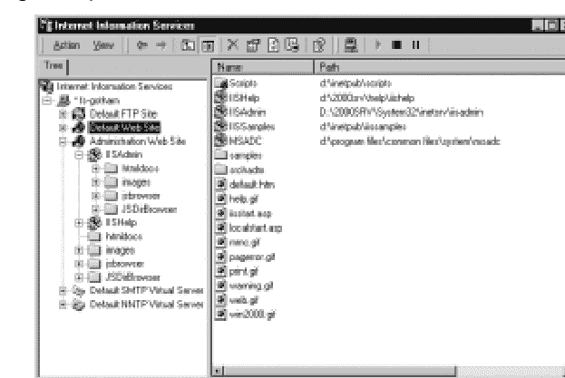

IIS 还允许你通过 HTTP 或 HTTPS 连接远程管理你的 网站。如图 3.4 所示，IIS 提供了 Internet 服务管理器的 HTML 版本。这允许你通过 Internet Explorer 或 Netscape Navigator 等浏览器执行管理任务。HTML 版本可以通过两种方式之一访问。首先，你可以在带有“Internet 服务管理器”色阶的 MMC 中选择**管理网站**（**Administration Web Site**）节点，然后从“操作”（Action）菜单中选择**浏览**（**Browse**）。你可以通过在 Internet 浏览器的地址字段中指定服务器名称、分配给网站的 TCP 端口号以及管理网站地址（[https://example.org](https://example.org)）直接访问此管理工具。这将显示允许你执行管理任务的 IIS 页面。

# 图 3.4 通过 浏览器访问的 Internet 服务管理器 HTML 版本

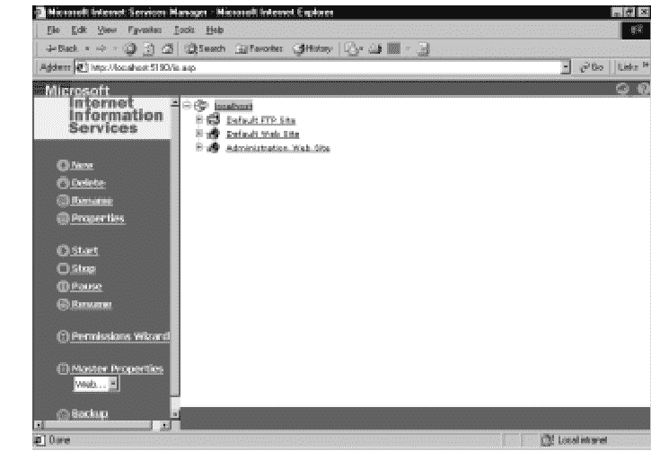

## Windows 2000 服务器和 Internet 信息服务器 5.0 安全

在设置 IIS 时，你需要记住，应对 IIS 和托管你网站的 Windows 2000 服务器都进行某些配置。你应该检查用于匿名连接的帐户，并确保它根据你的需求进行了正确配置。你还应该确定是否有必要对服务器、组和账户进行其他配置。

必须使用“活动目录用户和计算机”（Active Directory Users and Computers，另一个 MMC 色阶）来配置 Windows 2000 服务器上的帐户。当安装 IIS 时，系统会自动创建一个名为 IUSR_computername 的账户（其中 computername 代表你的服务器名称）。该账户是 Web 匿名用户使用的账户，并在安装 IIS 时自动添加。你可能想要修改此账户，并限制它对网络上资源的访问权限。

# 安全网站设计 • 第 3 章 169

- 1. 要修改 IUSR_computename 账户，你需要打开“活动目录用户和计算机”。你可以通过启动 MMC 来打开此工具。点击 Windows 开始菜单上的**运行**（**Run**），输入**MMC**，然后点击**确定**（**OK**）。
- 2. 从 MMC 的“控制”（Console）菜单中，点击名为**添加/删除节点**（**Add/Remove Snap-in**）的项显示一个新的对话框。点击**添加**（**Add**）显示可用节点列表，然后选择名为**活动目录用户和计算机**（**Active Directory Users and Computers**）的项目。
- 3. 点击**添加**（**Add**）添加到此色阶，点击**关闭**（**Close**）返回上一个对话框，然后点击**确定**（**OK**）确认。“活动目录用户和计算机”现在出现在 MMC 控制台中。
- 4. 在控制台的左侧窗格中，你需要打开标识你服务器的文件夹到另一个名为 **USERS** 的文件夹。该文件夹是创建 IUSR_computename 帐户的文件夹。通过选择用户文件夹，控制台右侧窗格中会出现用户帐户列表。
- 5. 双击 IUSR_computename 帐户将显示其属性，你可以对其进行配置。
- 6. 如图 3.5 所示，此对话框提供了许多选项卡，允许你修改帐户，包括帐户的能力。**帐户**（**Account**）选项卡尤为重要，因为它允许你设置是否需要预身份验证。**所属组**（**Member Of**）选项卡是另一个重要区域，因为它允许你查看帐户所属的组。无论操作系统或软件如何，都不应赋予用户超过其所需的权限。


# 图 3.5 IUSR_computename 属性

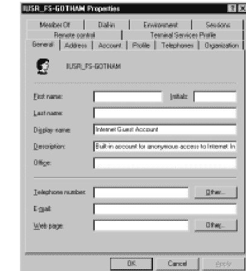

这意味着用户能够修改 Web 页面、破坏或攻击你的 Web 服务器。对于 Windows NT 和 Windows 2000，你应该使用 NTFS 作为你的文件系统。这将允许你控制对文件和文件夹的访问。除了管理 Windows 2000 的工具外，信息服务器提供了许多引导你完成安全设置的向导。这些向导包括权限向导、Web 服务器证书向导和列表向导。虽然向导执行的任务也可以手动完成，但向导简化了你的网站。

权限向导允许你配置服务器上的权限和身份验证。该向导用于设置用户对服务器上文件夹的访问权限，但它限于控制用于发布到互联网的文件夹。

- 1. 通过带有“信息服务”色阶的 MMC 启动权限向导。你可以通过选择控制台右侧窗格中的 Web 或 FTP 网站，然后点击“所有任务”文件夹中的权限向导项来实现。你也可以通过 Internet 服务管理器的 HTML 版本启动它。在这里启动向导，在浏览器窗口中选择 Web 或 FTP 网站，然后点击 页面左侧框架中的权限向导链接。
- 2. 权限向导屏幕欢迎你使用向导。点击“下一步”将显示安全设置屏幕（图 3.6）。此屏幕上的第一个选项允许你设置从父网站或虚拟目录继承的权限。第二个选项允许你从模板选择新的安全设置。如果你选择第一个选项并点击“下一步”，将告知你应用哪些安全设置。如果你选择第二个选项并再次点击“下一步”，将到达向导的最后一个屏幕。如果你选择第二个选项并点击“下一步”，系统将向你提出关于网站的问题。

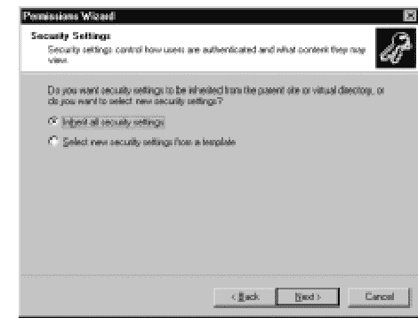

# 图 3.6 权限向导的安全设置屏幕

www.syngress.com


3. 在从模板选项选择“从模板新建安全设置”并点击“下一步”后，你会看到“站点场景”屏幕。这允许你选择最适合你网站的场景。如果你选择“公共网站”（Public Web Site）作为场景，用户将能够浏览你网站上的内容。这将应用跨浏览器兼容的安全设置。无论使用何种浏览器或用户是否在站点上拥有账户，任何用户都能使用你的网站。如果选择了“安全网站”（Secure Web Site），则只有具有有效 Windows 2000 账户的用户才能访问该站点。

4. 选择所需的项并点击“下一步”后，你将到达最后一个屏幕。点击“完成”应用你的设置并退出向导。

Web 服务器证书向导用于在你的站点上设置和管理证书。（尽管我们在本章稍后的部分将详细讨论证书，但你应该知道证书用于身份验证。）此向导可以识别信息的来源，并允许你安全地交换数据。它允许你设置启用 SSL 的站点，你可以使用 SSL 加密和客户端证书验证。通过使用此向导，你可以创建并管理 Web 服务器在服务器和客户端之间传输信息时使用的证书。

- 通过 MMC 配合 Internet Information Services 节点启动 Web 服务器证书向导。通过点击 Web 站点属性页“目录安全”选项卡上的“服务器证书”按钮，将启动向导并显示初始欢迎屏幕。点击“下一步”将显示图 3.7 所示的“服务器证书”屏幕。
- 点击屏幕上的第一个选项允许你创建一个新证书，你的内网或 Internet 站点用户可以使用它。如果你已有证书，则应该选择第二个选项。如果你希望从备份文件导入证书，请选择第三个选项。

## 图 3.7 Web 服务器证书向导的服务器证书屏幕

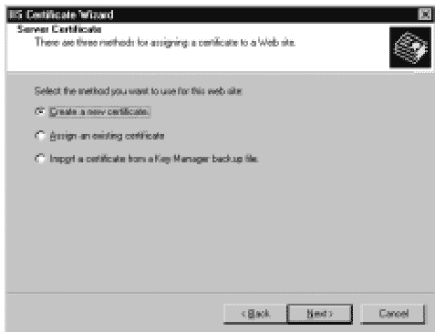

- 3. 选择选项后，按照向导进行操作，然后点击“完成”应用设置。

证书信任列表向导是我们在此处提到的第三个 IIS 向导。此向导用于配置证书信任列表（CTLs）以识别信任的 CA（证书颁发机构）。CA 是管理证书的供应商，将公钥与申请证书的用户相关联。CTL 允许你指定站点信任这些供应商中的哪些，这对于在单个服务器上运行多个站点的 ISP 特别有用。在这些情况下，不同的站点可能信任不同的 CA。

## 加固服务器

安装完成后，你应当对 Web 服务器进行加固。基本上，这指的是初始安装后，服务器在安全性和可靠性方面可能是“软弱”的。在初始发布后，可能会发现某些错误或安全漏洞。如果简单地安装服务器并让其在线，这些问题将继续存在，并可能以后引起问题。加固服务器软件并不困难，但为了满足你的预期，这是必要的。

## 安装补丁

安装服务器后，你应该立即确定该软件的任何补丁。访问制造商的网站将允许你检查是否发布了任何服务包或错误修复。该网站还可能提供建议，指导你如何通过某些修改来增强服务器的安全性。

## 禁用不需要的端口、服务和组件

在本章前面，我们提到了端口过滤对于控制对 Web 服务器的访问非常有用。我们还看到服务器使用已知端口来监听来自客户端的请求。如果你不提供客户端服务，则应该关闭这些端口。例如，如果将使用 FTP 服务，则应该关闭 20 和 21 端口。因为这些是不需要的，它们不会影响你网站的可用性，但关闭它们将提高你网站的安全性。你可以参考表 3.2 来确定关闭哪些不需要的端口。你不希望在站点上运行的服务应该被删除或禁用。例如，如果你在站点上不提供 FTP 服务，则应该禁用它们。这也适用于 TFTP、Gopher 以及任何可能已安装的服务。这将涉及检查 Web 服务器文档以查看默认安装了哪些内容，但也应包括服务器本身。如果 Web 服务器提供管理界面，请确定哪些服务是激活的。在删除或禁用服务时，你不应让服务处于那里。如果服务被设置为自动启动，那么这些服务在下次系统重启时将再次可用。


仅仅将服务设置为手动启动是一个不太理想的替代方案。如果服务仍然留在系统中，黑客可能会使用命令重新启动它。未使用的服务应该被完全卸载或禁用。

删除不必要的组件是创建安全站点的另一个重要步骤。正如我们在 Apache 中看到的，可以使用许多模块来增强此 Web 服务器的功能。其他类型的 Web 服务器可能提供可安装的类似组件或插件。通过允许不必要的组件留在你的硬盘上，就存在黑客可能访问你的系统并加载它们的可能性。如果这些组件不需要但在 Web 服务器上运行，它们可能被用于获取对你系统的各种能力。组件中的任何安全漏洞都可能被用于执行未经授权且不受欢迎的功能。

## 删除不需要的脚本和文件

当安装 Web 服务器时，它们通常会安装一组示例脚本，你可以使用它们来配置你的系统或执行与服务器相关的常见任务。如果这些脚本留在服务器上，黑客可能能够访问并修改它们。如果这些脚本不需要但 Web 服务器上运行，它们它们可能用于执行关闭服务器。。组件中的中的漏洞漏洞漏洞可以用于用于执行执行执行授权。。。。。 Web Web，检查这些文件，， Web Web功能。如果你不需要特定的脚本，应该删除删除它们或者将它们移动到仅允许管理员访问的权限目录。。因为用户用户用户并上传它们。

除了脚本脚本，你应该你应该检查 NTFS  权限。默认情况下，Windows 为“Everyone”组分配了完全控制的 NTFS 权限以

 执行程序或脚本，并且你应该确保 NTFS 权限阻止授权用户执行程序或脚本，这将使得设置审计变得容易。脚本需要解释器来运行和处理其中包含的命令。例如，运行基于 Perl 的 CGI 脚本需要 Perl 解释器。因此，如果你在站点上不使用 Perl 进行 CGI 脚本，你应该移除该解释器。

## 加固整体系统

在加固 Web 服务器之外，你还需要加固整个系统。与 Web 服务器软件一样，操作系统和运行在服务器上的其他软件可能会发现错误和安全漏洞。为了解决这些问题，在安装光盘上市后可能会发布服务包、补丁和错误修复。你应该检查操作系统制造商的网站，以及运行在你系统上的任何其他软件的网站。

# 安全网站设计 • 第3章 177

新的共享资源，包括新的文件夹。你将希望确保匿名用户对这些资源的访问是有限的。

权限是安全网站设计中的一个重要问题。存储 HTML 文档的位置（如文档根目录）以及存储日志和配置文件的位置（如服务器根目录）应该保持保密。换句话说，不要让任何人知道这些目录的位置。服务器根目录应该设置权限，使得只有管理员可以写入配置目录、日志目录及其内容。除了管理员或管理员组成员外，任何人都不应该拥有这些读取权限，否则其他人可能会查看其中的信息。

文档根目录的权限应不同服务器根目录，因为网站的访问者需要读取该目录。如果他们没有读取权限，将无法通过浏览器加载并查看你的页面。管理员和管理员组成员应该具有写入该目录的能力，因为这将用于网站上传新内容。

CGI 程序通常存储在一个名为 CGI-BIN 的目录中，并具有与之不同的权限。由于用户可能会运行其中的脚本，此目录需要对所有用户或想要运行 CGI 程序的用户可读可执行的。在任何情况下，都不应该允许管理员或管理员组成员以外的任何人写入此目录。

你还应该确保管理员或管理员组成员使用的密码难以猜测。尽管这经常被 IT 成员所强调，但他们可能会忘记或在密码上粗心。你应该记住定期更改密码，特别是在 IT 成员离开组织后。如果你不确定自安装以来管理员密码是否更改，或者过了很长时间，你应该以此为信号更改密码。

在物理安全方面，你应该确保你的服务器存储在安全的地方。这可以是一个锁好的房间或服务器机柜。在采取了许多保护你系统的措施之后，你不希望服务器被修改。如果公司内的用户在你或其他管理员登录时坐在你的工作站前，好奇并开始对其进行更改，就会发生问题。

# 安全警告！

管理员未能定期更新 Web 服务器以及包、补丁和漏洞修复程序——这种情况非常常见。管理员可以尽可能地将软件升级到最新版本，但可能在版本之间的升级过程中出现问题。如果黑客发现了没有修复问题的站点，他就可以利用漏洞攻击你的系统。

# 密码破解和分析工具

密码似乎是一个基本问题，但通过另一个用户的帐户和密码访问网站或网络是最常见的破解方法。在设置密码策略保护你的账户和网站免受密码破解时，你应该记住以下几点：

- 设置良好密码类型的策略。
- 为密码设置时间限制并频繁更改密码。
- 保持密码秘密。
- 不要让终端或服务器无人看。
- 维护帐户策略并经常检查用户帐户。
- 限制管理员组成员并限制管理员密码的权限。
- 通知用户报告疑似问题。

# 安全网站设计 • 第3章 179

告知用户如何选择难以破解的密码。很多时候，用户会使用配偶、孩子或宠物的名字，或者与其生活相关的个人、地点或物品。在许多情况下，你可以通过查看他们桌上或办公室内的物品（对他们显然有价值的东西）破解某人的密码。理想密码将包含大小写字母（A-Z, a-z）、数字（0-9）和特殊字符（-=[]|\;:'/~!@#$%^&()_+{}?）。你能做的最坏事情是用另一个容易猜的密码替换密码。

密码应该设置时间限制。用户拥有密码的时间越长，有人知道它的风险就越大。你应该记住经常更改管理员密码，特别是在员工离开时。

另一个常见问题是用户共享密码。与其等待获取权限，他们会找另一个用户提供密码。在某些情况下，这可能发生在 IT 成员之间，将管理员密码提供给不该拥有它的人。

电脑无人看管是另一个问题，如果公司内的用户在你或其他管理员登录时坐在你的工作站前，可能会影响你的站点。你可以坐在电脑前添加一个具有高访问权限的新帐户，或修改自己的帐户以设置实施破坏或调查你站点隐藏区域所需的权限。同样适用于未存储在安全区域、没有密码保护的保存器或未锁定的服务器。由于用户未经授权访问管理员帐户或管理员组成员帐户的威胁，你应该将其限制在该组内，并限制谁可以访问管理员帐户。

通过定期检查用户帐户，你可以确定任何用户是否不再被允许访问某些目录或文件。你应该检查授予给用户的权利和权限（特别是匿名帐户），因为可能创建了这些用户具有完全访问权限的新目录。要这种方式监控用户帐户，你应该开启审计，并监控安全策略何时发生更改（以及是谁更改的）。

# 第3章 • 安全网站设计

最后，你应该明确表示你感谢对疑似滥用帐户的报告或对安全问题的观察。许多时候，用户可能比你更早发现破解尝试、数据被篡改或安全漏洞的开启。因为他们担心被归咎于问题，例如，一个用户在访问你的站点时发现了一个后门并偶然发现了敏感数据。通过让用户知道你感谢此类信息，你就可以在恶意用户破解之前修复该安全漏洞。

## 安全网站设计 • 第 3 章

## 图 3.8 LOPhthCrack 是用于泄露密码的工具

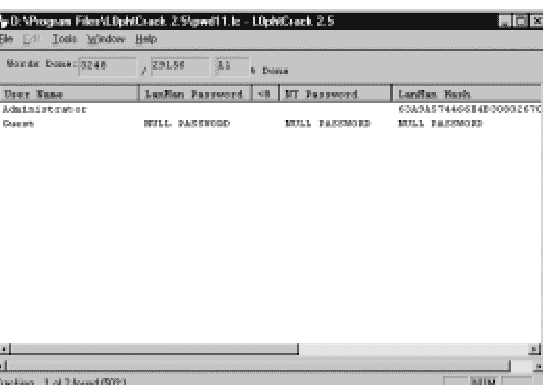

当操作系统运行时，你可以从备份、紧急修复磁盘（Emergency Repair Disk）或系统硬盘上的修复目录访问 SAM 文件。

-   **SMB 数据包捕获**（工具菜单），允许你捕获网络中包含密码哈希值的数据包。

获取这些内容后，你从“工具”菜单中选择“选项”（Options），并确定破解密码的攻击级别。设置好后，你可以按 F4 键或从“工具”菜单中选择“运行破解”（Run Crack）。这将开始密码审计过程。

另一个可以用于收集用户和密码（以及更多）信息的工具是 Cerberus 互联网扫描器（CIS），它由 Cerberus Information Security, Ltd. 开发。该工具可以从 www.cerberus-infosec.co.uk/cis.shtml 下载。它将在你的系统上运行约 300 项测试，包括 Web 、FTP、SMTP、POP3、Windows NT、NetBIOS 和 MS-SQL。测试完成后，它将以 HTML 文档的形式提供详细信息，如图 3.9 所示。

从对 Web 服务器的扫描结果中可以看出，CIS 提供了全面的信息列表。如图 3.9 所示，这可能包括泄露管理员密码。


CIS 提供的其他信息还可以更改你系统中的组（以及这些组的成员）、注册表设置、操作系统上运行的服务、各种 Web 服务安全问题，以及 FTP 是否允许匿名登录。

## 图 3.9 通过 浏览器显示的 Cerberus 互联网扫描器结果

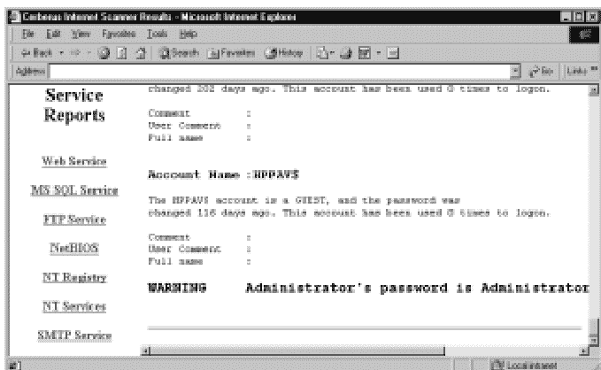

要使用 CIS 获取系统信息，请完成以下步骤：

-   CIS 运行后，点击“文件”菜单上的**选择主机**（Select Host）。
-   当对话框出现时，输入你想要测试的服务器名称或 IP 地址，然后点击**确定**（OK）。
-   点击“文件”菜单上的**选择模块**（Select Modules）。
-   当对话框出现时，选择你想要测试的内容（如 **Web** 或 **FTP**），然后点击**确定**。
-   点击“文件”菜单上的**开始扫描**（Start Scan）。
-   当所有检查完成后，点击**查看报告**（View Reports）来分析结果，结果将显示在你计算机的默认 Web 浏览器中。

与这些或其他任何工具一样，它们既可以被用于分析你自己的网站的安全漏洞，也可以被他人用于获取可能导致未经授权访问的信息。因此，你需要使用此类工具对你的系统进行适当分析，以便在他人利用这些问题之前发现它们。

## 处理 HTML 代码的 Web 设计问题

由于你网站的大部分内容由 HTML 文档组成，黑客利用 HTML 并不令人意外，它应该包含在你的安全计划中。用于创建 Web 页面的 HTML 可能包含重要信息，泄露你网站上敏感可用可用、文件路径以及黑客可能从中获益的其他各种数据。正如我们在后续章节中看到的，处理 HTML 代码的 Web 设计问题要求你执行以下操作：

1. 查看发布到你网站上的所有 Web 页的 HTML 代码。
2. 删除或修改 HTML 代码中包含的敏感信息。
3. 确保网站上的目录具有正确的权限。
4. 确定服务器包含（SSI）是否对你的网站构成潜在威胁。
5. 确定是否应该禁用某些服务器包含，或者是否不应在网站上允许服务器包含。

## HTML 代码中的信息

在第二次世界大战期间，一句常见的口号是：“言多失”（loose lips sink ships）。这是警告不要泄露可能被敌人用于攻击的信息。尽管这种智慧领先了互联网几十年，但这种警告在今天和那时一样有价值：敌人对你的了解越多，他们造成伤害的机会就越小。因此，你不应该通过 Web 页面泄露超过你想透露的信息。

www.syngress.com

黑客会查看网站的 HTML 代码，寻找漏洞和信息。可以通过 Internet Explorer 的“查看”菜单中选择“源代码”（Source），或在 Netscape Navigator 中选择“页面源代码”（Page Source）来查看此类源码。黑客可能会逐页浏览网站，查看每个页的源代码，以寻找如何破解网站安全性的线索。HTML 中的信息可能包括给开发者和 Web 作者的注释。此类注释可能提供关于谁创建了网站的见解（例如其姓名和联系方式）、服务器信息，以及脚本如何工作或其目的是什么。代码中的漏洞也可能被发现并用于攻击网站。通过 HTML 代码易于获取的其他信息还包括 IP 地址、目录结构、电子邮件地址、域名等。为了说明，让我们来看一个简单的 Web 页面：

```


<!-- 给开发者的注释，请使用以下目录结构

/inet/html

/inet/cgi-bin

/inet/dev

-->

<HTML>

<HEAD>

<META HTTP-EQUIV="Content-Type" content="text/html; charset=UTF-8">

<TITLE>Welcome</TITLE>

</HEAD>

<BODY>

<P>Welcome to our site</P>

</BODY>

```
*(注：HTML 块的 OCR 文本严重损坏。我根据提供的文本片段重构了一个标准的 HTML 结构。）*
```

## 安全网站设计 • 第 3 章

内容，SSI 会由服务器解析并运行 SSI。如果你的网站没有访客簿，你可能希望保持原样。

在黑客攻击中最常用的 SSI 命令中，有三个脱颖而出。它们是 `echo`、`include` 和 `exec`。虽然其他 SSI 命令也可以用于攻击网站，但这些命令通常被用来攻击网站。

`echo` 命令指示服务器将某些信息打印到返回给客户端浏览器的 Web 页面，通常与 SSI 一起使用。为了查看常见效果，让我们来看 HTML 标签：

```
current date is <#echo var="DATE_LOCAL"> ->
```

当服务器读取这段代码时，它会看到一个井号 `#`，这表示后面跟着一个 SSI 命令。它会看到一个由代码 `var=` 定义的变量将被返回。在这种情况下，变量为 `DATE_LOCAL`，告诉服务器返回当前日期和时间。

通过使用 `echo` 命令，黑客可以修改此变量以从你的服务器返回其他信息。例如，只需将变量从 `DATE_LOCAL` 改为 `DOCUMENT_NAME`（另一个 SSI 常用的变量），黑客就可以返回当前文档的路径和文件名，从而暴露你目录结构的一部分。

另一个用于攻击的常用 SSI 命令是 `include`。如下 HTML 文档所示，它被用于将另一个文件中的信息添加到你的 Web 页面中。页面中要包含的文件由 `file=` 参数指定。

```html
<html>
<head>
<title>Demo Page</title>
</head>
<body>
<h1>Our Home Page</h1>
<!-- ... content ... -->
</body>
</html>
```

如果你有任何意见或建议，请联系网站管理员。

```html
<!--#include file="email.htm-->
See you later!
</body>
</html>
```

正如你通过这个示例看到的，一个名为 `email.htm` 的文件被添加到文档中，然后显示给用户。这段代码的问题在于——如果没有设置适当权限，且 Web 浏览器允许你指定任何想要的路径——黑客就可以更改指定文件的路径，并调出你网络上可以访问的任何文件。这可能包括敏感文档、密码列表等等。

由于我们讨论的第三个 SSI 命令是 `exec`，它允许你执行各种任务，类似于可执行文件。通过此命令，你可以打开文件、返回输出、运行名为脚本的批处理文件或在系统上执行其他程序。使用 `exec` 命令的示例如下：

```
<!--exec cgi="cgi-bin/test.pl"-->
```

许多 Web 服务器要求 SSI 可执行文件具有 `.CGI` 扩展名才能执行指定的文件。然而，你应该检查你的服务器文档以确认情况是否确实如此。与其他命令一样，黑客通过此命令获得的大部分功能取决于服务器上是否正确设置了权限。如果你不需要 SSI 或此命令，应该将其禁用。

如果权限配置不当，SSI 可能会成为一个大问题。例如，如果所有用户都对文件具有读取权限或对服务器具有完全访问权限，则可以使用 SSI 来读取这些文件或执行各种程序。如前所述，你需要评估授予给用户的权限，并确定授予新创建目录的默认权限是什么。

在许多 Web 服务器上，在使用 SSI 功能之前必须先开启它，你应该检查你的 Web 服务器以确定它是否默认启用。如果你的网站没有使用 SSI，你应该将其关闭。某些 Web 服务器（如 Apache）提供了禁用可以传递给服务器的 SSI 类型的功能。如果你的 Web 服务器不提供此项功能，你可以使用防火墙阻止 SSI，或者可以使用预解析脚本在 SSI 传递给服务器之前移除未经授权的 SSI。

## Java、JavaScript 和 ActiveX 指南

Java、JavaScript 和 ActiveX 组件经常被忽视为网站的潜在威胁。这些是客户端脚本和组件，运行在客户端。在查看这一已确定的问题时，你可能会发现任何问题都会影响用户的计算机。如果 applet 被设计为从客户端机器提取信息，可能会获取用户名和密码并用于攻击你的网站。此外，如果客户端机器被恶意 applet 以任何方式损坏，用户只会知道他或她访问了你的网站并遇到了问题。这将影响公众对你网站可靠性的认知以及你公司的形象。

### 理解 Java、JavaScript 和 ActiveX —— 以及它们引起的问题

Java 是一种由太阳微系统公司开发的编程语言，用于制作互联网应用程序（applet）以及独立单机程序。Applet 嵌入在 HTML 文档中，并在用户浏览器将文档加载到内存时运行。在编写 applet 时，Java 提供了许多与安全相关的功能。代码编译时，编译器会提供类型和字节码验证，以检查代码是否存在任何错误。在此过程中，Java 防止了某些内存区域被代码访问。在 Netscape 的 JVM 中，一个问题是某些条件导致 JVM 不检查正在加载的代码。由于所有代码都没有经过检查，这允许运行绕过 Java 类型验证的代码。在 Netscape Communicator 中发现该问题后不久，在 Internet Explorer 中也发现了了类似的问题。

ActiveX 是微软对 applet 的实现，使用 `<OBJECT>` 标签嵌入到 HTML 文档中。ActiveX 控制提供了多种功能。如果用户访问带有 ActiveX 控制的 HTML 文档，它将检查该控件是否已存在于计算机上。如果没有，它将被下载，Web 页面将显示，并且 ActiveX 代码将加载到内存中并执行。

由于 ActiveX、Java 和 JavaScript 运行在客户端，你在处理用户机器与服务器之间的交互时会遇到许多问题。1999 年发现了一个关于 ActiveX 的问题，当时一个名为“脚本安全”（Safe for Scripting）的安全性漏洞可以设置“脚本安全”标记，导致他们的 ActiveX 控件在运行之前无需经过“身份验证”（Authenticate）签名的检查。微软的 Authenticate 用于通过代码签名对控件进行验证，我们将在稍后讨论这一点。当使用 Authenticate 时，ActiveX 代码将由第三方进行签名和验证。这确保了代码自创建以来没有被修改过。当启用“脚本安全”标记时，代码检查就会被绕过，导致用户可以在用户未察觉到问题的情况下运行该控件。随 IE4 附带的两个存在此问题的控件是：Scriptlet.typelib（它具有在用户硬盘上创建、编辑和覆盖文件的能力）和 Eyedog.ocx（它具有从注册表中收集信息的能力）。这是一个重大的安全问题，因为黑客会从这种漏洞中受益。为了解决这个问题，微软网站提供了一个补丁，修复了该问题。

JavaScript 与 ActiveX 和 Java 的不同之处在于它没有被编译成程序。JavaScript 使用了一些与 Java 相同的语法和函数。当用户访问包含 JavaScript 的 HTML 文档时，它会通过解释器运行。这比程序已经编译成机器可以理解的语言要慢。由于这个原因，JavaScript 的运行速度比 Java 小程序（applets）慢。

在作为脚本语言方面，JavaScript 与 ActiveX 和 Java 的不同之处在于，但黑客仍然可能使用脚本来获取有关你网站的信息，或使用代码攻击网站或客户端计算机。

### 预防 Java、JavaScript 和 ActiveX 产生的问题

如果提前采取了预防措施，防止包含在你的网站上的脚本、小程序和其他组件出现问题并不是不可避免的。首先，不要包含那些你不完全理解或不信赖的组件。如果你不确定某行代码中的特定脚本在做什么，就不要将其添加到页面中。同样，你应该使用提供源代码的小程序和 ActiveX 组件。如果你有一个想要使用的特定小程序或组件，但又没有可用代码，请确保它是由受信任的源创建的。例如，你可以找到市售的各种刻录光盘（CD-Rs），里面装满了各种小程序、脚本和组件。知名公司不希望因销售带有危险代码的产品而损害企业形象，因此创建了许多此类产品。此外，微软等许多公司在其网站上提供了代码示例，这些示例可以在网站上安全且成功的使用。

确保你检查代码是否有任何缺陷，因为你不希望用户成为第一个发现它们的人。一种常用方法是将网页和组件上传到网站，但不要将该页面链接到任何其他页面。这将阻止不知道该页面的用户访问它。另一种方法是使用测试服务器，该计算机的配置与你的 Web 服务器相同，但与网络的其余部分隔离开。通过测试服务器，如果你的网站遭受了破坏，真实网站将不受影响。之后，使用将用于查看小程序、组件或脚本的用户账户来访问网站是明智的。例如，如果该内容供所有人使用，请使用匿名用户账户查看你的网站。这将允许你有效地测试各种问题。

黑客会利用其优势的一个常见问题是关于信任用户输入的脚本和程序。在我们讨论如何使用访客板运行 SSI 命令并可能损坏你的网站时，就提到了这个问题。在这些情况下，我们看到用 Perl 编写的 CGI 程序可以运行批处理文件。脚本语言也可以用于运行 shell 函数。通过编写得当且执行良好的脚本，可以运行 `cmd.exe`。

在创建小程序（applets）、组件和脚本时，您应该记住并非所有浏览器都支持这些组件。此外，某些脚本可以在 Internet Explorer 或 Netscape Navigator 上运行，但无法在两者或其他浏览器上同时运行。您应该提供一套不使用这些组件的备用 Web 页面，或者添加代码来确定用户的浏览器类型和版本，并根据这些类型和版本信息允许执行。如果不支持某个脚本或小程序，您可以设置 HTML 代码以允许其跳过。为了演示这一点，让我们来看以下几个函数：

```
navigator.appName()
navigator.appVersion()
```

第一行用于获取正在使用的浏览器名称；第二行用于获取浏览器的版本。通过使用这些函数，您可以判断脚本或小程序是否运行。具体如下如下：

```
if (navigator.appName == "Netscape") {
  Insert code here;
} else if (navigator.appName == "Microsoft Internet Explorer") {
  Insert code here;
} else {
  document.write("Internet Explorer or Netscape is required to view this page");
}
```

在 JavaScript 中防止发生错误的另一种方法是使用注释，这可以防止不支持脚本语言的浏览器产生错误。为了说明如何这样做，让我们来看下面这段 HTML 代码：

```
<SCRIPT LANGUAGE="JavaScript 1.1">
<!--
  // -> insert JavaScript here
-->
</SCRIPT>
```

逐行查看这段代码，您会发现第一行指定了脚本使用的语言。如果使用的是不支持脚本标签的旧版浏览器，它将忽略该标签。如果它支持该语言，则此标签将告诉浏览器的解释器需要解释哪种语言。下一行显示了开始注释。如果不支持 JavaScript 的旧浏览器读取到它，那么开始和结束注释之间的任何 JavaScript 代码都被忽略。如果支持 JavaScript，它将开始处理您的脚本。

尽管最佳做法是仅使用由您创建的小程序和脚本，但这可能并不可行。您可能不知道如何创建 Java 小程序、JavaScript 或 ActiveX 组件，或者需要某些任务超出您编程能力的组件。虽然避免使用不可信或未知个人创建的小程序和脚本是一个好主意，但您可能觉得不得不这样做。尝试在自己的公司寻找具有脚本或编程技能的程序员，或者从现有来源购买或获取现有的脚本和小程序。如果源代码可用，或者您正在使用脚本，请查看它是如何创建的并确定它的实际作用。这将为您在运行过程中节省大量问题。

## 编写安全的脚本

在上一节中，我们查看了运行在用户机器上的客户端程序和脚本。在本节中，我们将查看运行在 Web 服务器而非用于浏览网站的机器上的服务器端程序和脚本。服务器端程序和脚本提供了多种功能，包括处理数据库、根据关键词搜索网站文档，以及与用户交换信息的其他方法。

服务器端脚本的一个优势是任何源代码对用户都是隐藏的。使用 JavaScript 时，用户可以通过浏览器查看源代码看到任何脚本。虽然这对于某些脚本不是问题，但服务器端脚本可能用于访问机密。您最不想做的就是暴露访问公司数据库信息的方法。

CGI 允许互联网应用程序与您的 Web 服务器之间建立通信链接，允许用户通过 Web 访问程序。过程始于用户使用浏览器请求 CGI 脚本或程序。例如，用户可以在 Web 页面上填写表单并提交。处理表单的请求发送到 Web 服务器，由服务器在服务器上执行脚本或应用程序。应用程序处理输入后，Web 服务器随后将脚本的输出返回给浏览器。

CGI 使用 TCP/IP 协议族中的 HTTP 协议。因为应用程序是在超链接的 URL 或表单标签中指定的。此类标签的示例显示代码所示：

```
<FORM METHOD=POST ACTION=http://www.microsoftolved.com/cgi-bin/myprog.pl>
```


在此任务中，表单数据被发送到 `.microsoftolved.com` 的 Web 服务器，服务器将其传递给用 `PERL` 编写的 `CGI` 程序。

`PERL` 是另一种使用解释器执行各种函数和命令的脚本语言。它在语法上与 `C` 语言相似。它在 Web 应用程序中非常流行并被广泛支持。`Apache` Web 服务器就是这种支持的例子，因为它具有可以将 `PERL` 永久加载到内存中的插件。通过加载到内存，`PERL` 脚本的执行速度更快。

微软通过 `ASP` 提供了 `CGI` 和 `PERL` 的替代方案——即嵌入了脚本的 `HTML` 文档。这些脚本可以用多种语言编写，包括 `JavaScript`。

## 第 3 章 • 安全网站设计

- `.EXE`，这是一种可执行程序。
- `.CAB`，是箱体文件，通常用于应用程序的安装和设置。这些文件包含许多在箱体文件中压缩的文件。
- `.CAT`，包含用于保证文件完整性的数字指纹（数字签名）。
- `.OCX`，是 `ActiveX` 控件。
- `.DLL`，是动态链接库文件，包含可执行的函数。
- `.STL`，包含证书信任列表列表。

当人员下载带有数字证书的文件时，将通过证书颁发机构检查该证书的状态。如果证书无效，用户将收到警告。如果发现证书有效，将出现一条消息说明其具有有效证书。该消息将包含额外信息，并显示证书的所属者。当用户同意安装软件时，安装程序将开始。

## 代码签名的优势

数字签名可用于保证文件的完整性，并确保包是真实且未被修改过的。该签名附带在下载的文件上，它识别了文件的分发者，并证明这些文件自创建以来未被变动过。证书有助于防止恶意用户冒充他人。

这是代码签名的主要益处。它为用户提供了软件创建者的身份。它让你知道是谁制造了该程序，并为你提供了决定是否信任该个人或该公司的选项。当浏览器准备下载该组件时，会显示警告消息，允许你选择是安装还是将其加载到内存中。这把运行它的选择权交到了用户手中。

## 代码签名过程中的问题

代码签名的一个大问题是你必须依赖第三方来检查真实性。如果程序员向 `CA`（证书颁发机构）伪造虚假信息，或盗取另一个个人或公司的身份，那么就可能在互联网上有效地分发恶意程序。这里的决定性因素是证书颁发机构在申请证书时检查其提供信息的能力。

另一个问题是，如果向 `CA` 有效信息，但证书被附在带有错误或恶意代码的软件上。代码签名问题的示例可以在 `Internet Exploreroder` 中看到，这是一个由 `Fred McLain` 编写的 `ActiveX` 控件。该程序员通过 `VerSign` 获得了 `Authenticode` 证书。当运行高级电源管理的 `Windows 95` 用户运行 `Internet Exploder` 代码时，它会执行系统的正常关闭。该控件的证书已被撤销。

证书吊销列表（`CRL`）存储了吊销证书列表，也可能被认为是问题的。网络浏览器和互联网应用程序很少检查证书吊销列表，因此一个程序可能在证书被吊销后仍被使用。如果证书被吊销但没有检查其状态，那么该软件看起来可能没问题，尽管它已经被破解。

在谈到代码签名的问题时，它并不一定适用于任何特定的 `CA`。证书也可以通过 `Microsoft Certificate Server` 等软件在你的内网中使用。通过使用此服务器软件，你可以创建用于在网络上使用的自己的数字证书。这允许某些使用自己的 `CA` 对代码进行自签名，并产生代码有效且安全的假象。因此，在接受任何文件之前，你应该验证 `CA` 的有效性。通过确保 `CA` 是有效且信誉良好的，你可以避免将黑客的代码安装到你的系统中。

对于在互联网上分发的应用程序，代码签名的另一个缺点是用户必须猜测并选择他们信任或不信任谁。浏览器将显示消息告知创建者是谁、关于下载任何类型数据危险的简短信息，然后将是否安装交给用户。浏览器无法验证代码。

> 工具与陷阱...
> 代码签名的问题
存在代码可能具有有效证书或使用恶意的自签名代码的情况。此类代码的名称可能与有效证书颁发机构相似，但与该 `CA` 没有任何关联。例如，你可能会看到用 `VerySign` 供应商名称签名的代码，由于误读为 `VeriSign` 而允许其安装。人们很容易快速扫一眼警告并允许证书通过，因此你应该记住在允许其安装之前阅读证书信息。

## 我应该外包网站的设计吗？

外包是聘请第三方来执行可能超过公司已雇人员技能的工作。这是一项重大决策，即使员工中中有全职的 `Web` 管理员也是如此。毕竟，制作你网站的人可能可能是创建内容方面的天才，但他们可能缺乏安装和有效配置 `Web` 服务器和防火墙的必要技能。

在公司内部，决定外包工作通常是一个具有争议的话题。仅仅是考虑外包，意味着意识到你自己的员工缺乏完成工作所需的技术和经验。这可能会打击自尊心，并花费额外的费用。硬币的另一面是知道这项工作将（可能，希望）被正确完成。你的最终选择通常是一个经常从事这项工作并拥有多年经验的人。外包在短期内可能节省费用，但请确保在发生安全漏洞时，安全责任有清晰的界定。

## 理解所需的技能

> 注意
花时间规划你想要什么，以确定外包是否是一个可行的解决方案。这需要分析你公司的个人需求，并从各个部门和个人收集意见。如果你确定这不是一个选项，那么你就可以将此信息应用于项目，并制定一个如何让现有员工完成工作的计划。

你外包工作给任何人，所需的技能取决于你对网站的期望和要求。你可能需要提供的 `Web` 服务器软件，或者可能已经有了。你可能需要安装并有效配置 `Web` 服务器和防火墙的技能。你可能需要花时间来确定你想要什么。

# 安全网站设计 • 第3章 205

然而，在许多情况下，外包工作就像是你的团队中增加了临时员工。你需要与承包商紧密合作，投入精力和精力管理他们，以确保他们正确完成工作。

## 安全性

外包设计工作的另一个缺点是可能导致安全性受损。即使只是向项目中引入额外一个额外人员，也必须考虑额外的安全问题。你应该确定承包商完成其工作需要哪些信息，同时确保不会损害你网络的安全性。你还应该确定 `Web` 服务器将使用何种安全策略，以防止承包商访问未经授权的数据（以及这些策略是否会影响现有的策略）。

外包中的一个真实复杂之处在于，你雇用的人可能并不是实际执行工作的人。许多公司可能会竞标这项工作，并提供你所希望的一切——但当真正要开始工作时，他们可能会将其分包给另一个个人或公司。在决定聘佣谁时，你应该询问他们是会自己完成工作，还是会使用外部承包商。

> 损害与防御……
### 检查背景调查
你应该检查任何承包商的背景。像任何其他工作一样，人们可能会在简历上稍微造假，称自己拥有比实际更多的经验或知识。他们也可能有经验，但由于工作能力不精，导致了严重的问题。询问该个人或公司可能执行过哪些合同，然后给他们打电话询问他们对该承包商的看法。最近，其中一位作者被问及某人，那人称他维护着作者担任网站管理员的网站。这个人从未在该机构的网站上工作过，也没有为该机构工作过。没有人听说过他，但这个人正在申请工作并冒他人的成果。

同样重要的是，对待任何申请外包工作的人都应该像对待其他任何承包商一样。你可能听过一些杂杂工拿了工钱却不干事的恐怖故事。这种情况在与互联网相关的工作也会发生，即所谓的“专业人士”正在进行诈骗。检查之前的客户将有助于揭露这类行子。

在某些情况下，安全性可能是如此令人担忧，以至于你可能无法外包工作。这可能不仅涉及网络上的数据，还涉及行业性质。例如，某些政府情报和法律执法机构可能需要高级别的安全许可。如果你外包工作来搭建 `Web` 服务器，政策可能会禁止这些人员进入服务器房或建筑的某些区域。即使在允许这样做的情况下，`IT` 团队的成员也可能在该人员工作期间进行监督。此类成员无法履行其日常职责的损失需要在外包的成本和要求中予以考虑。

## 合同与成本

外包可能成为问题的其他原因可能围绕合同和成本。工会合同可能会禁止或限制从组织外部招聘人员。在其他情况下，外包工作的成本可能高于培训员工的成本。如果有足够的时间培训一名 `IT` 团队成员，且该个人具备学习的可迁移计算机技能，那么让此人去学校进修可能是更明智的。虽然你会失去一个经常从事外包工作的人的经验，但你的公司将获得一位关于如何安装、维护和管理 `Web` 服务器的现场专家。

## 无论是谁设计的，在实施前请双重检查

无论你是外包工作还是自己完成，在实施之前对工作进行双重检查和测试都是关重要的。在不检查是否存在现有的安全漏洞或问题的情况下接受他人的设计是愚蠢的。尽管你可能不是一个老练的黑客，但检查工作将显示用户可能会误入不属于他们的区域。

检查这项工作虽然单调但是必要的。你需要浏览网站的每一页。当你打开每一页时，查看源代码并观察其包含的内容。确定正在显示哪些信息，以及这些信息是否代表安全威胁。

如前所述，你可以通过在 `Internet Explorer` 菜单中选择“源代码”或在 `Netscape Navigator` 中选择“源代码”来检查 `HTML` 文档的源代码。这不仅会显示 `HTML`，还会显示添加到页面中的任何 `JavaScript`（或其他脚本）。如果你看到任何你不理解的代码，你可能想与代码作者讨论或向次要来源核实。这可能涉及询问你公司 `IT` 团队的另一成员、向新群组或聊天室中的其他开发人员咨询，或聘请第三方查看为你的网站创建的内容。

在审查内容时，密切关注通过 `Web` 页面提供的信息。这可能包括给开发者和网页页面作者的注释、代码用途的说明、服务器信息、目录层次结构等。你希望确保公开发布的信息没有超过所需的范围。

浏览每个 `Web` 页面并从用户的角度对其进行检查。这包括查看页面并点击每一个超链接。如果使用了表单或 `Web` 应用程序，你应该输入数据并测试其是否正常运行。检查页面上信息的拼写错误和清晰度。尽管程序可能运行正常，但如何使用它的说明可能会令人困惑。

在测试网站时，你应该使用与典型用户访问特定文档、文件或程序时相同的账户。例如，如果使用了运行特定 `applet` 的页面，你应该确保它运行正常。在将网站公开之前，你应该确保它在不同的浏览器中都能正常工作。

你还应该确保机器上的任何软件都应用了最新的补丁。如果在软件发布后发现了漏洞，这些补丁将修复它们。在检查内容时，你还应该记住网站是你公司形象的反映。错误会影响你的业务。考虑外包你的测试：独立验证与确认（`IVV`）在客户发现问题之前非常有效。

安全网站设计 • 第3章 209

## 总结

安全设计涵盖了各种问题，从你决定使用自己的 `Web` 服务器而不是使用 `ISP` 提供的服务器开始。它需要精确的计划，并留出足够的时间完成项目，以免仓忙并损害安全性。

### 解决方案快速通道
### 选择 Web 服务器
- 拥有私有 `Web` 服务器的费用通常比在 `ISP`（互联网服务提供商）服务器上租空间更高。记住，租用此类空间可以消除购买服务器、软件和连接互联网的 `T1` 线的费用。如果设备出现问题，由 `ISP` 负责修复。然而，任何关于安全、服务或安装在服务器上的额外软件的选择都将由第三方决定。
- 通过使用员工已经熟悉的平台，可以减少他们遗漏安全漏洞的概率，因为他们可能在其他操作系统中了解过这些漏洞。
- 由于 `Web` 服务器像任何其他软件一样运行在操作系统之上，具有更好安全特性的操作系统将提高您的 `Web` 服务器的安全性。例如，虽然可以使用 `Windows 95` 运行 `Apache Web` 服务器，但在 `Windows NT Server` 上运行 `Apache` 会更安全。`Windows 95` 的安全功能比 `NT` 且，且文件系统的安全性也更低。
- 在查看各种服务器时，请密切关注某些功能，特别是控制身份验证、`SET` 协议使用、权利和权限设置以及 `CGI` 应用程序使用的功能。

### 安全网站设计的基础
- 在开发网站时，您应该制定包含以下步骤的安全计划：识别哪些需要安全；识别受保护内容的价值；识别与网站有关的风险；识别对这些风险的暴露情况；实施该计划。
代理服务器可以提供 `Web` 服务器应用程序本身未提供或无法轻松配置的额外安全措施，例如提供入出站访问控制、数据包过滤和拨入访问控制。端口和数据包过滤是防止未经授权访问您网络的有效方法。
许多 `Web` 服务器要求 `SSI` 可执行文件具有 `.CGI` 扩展名，以便执行指定的文件。然而，您应该检查服务器文档以确认情况是否确实如此。黑客通过此命令获取的大部分功能取决于服务器上是否正确设置了权限。例如，如果所有用户对所有文件都具有读取权限，或对服务器上的程序具有访问权限，那么就可以使用 `SSI` 来读取这些文件或执行各种程序。评估授予用户的权限，并确定赋予新创建目录的默认权限是什么。
处理 `HTML` 代码的 `Web` 设计问题将要求您：审查发布到网站上所有 `Web` 页面的 `HTML` 代码；删除或修改 `HTML` 代码中包含的敏感信息；确保网站上的目录具有适当权限；确定服务器包含（`Server Side Includes`）是否对您的网站构成潜在威胁；确定是否应该禁用某些服务器包含，或者您的网站是否不应允许服务器包含。

## Java、JavaScript 和 Active X 指南
`Java applet` 通常经过数字签名或采用独立格式，当它们嵌入 `Web` 页面时，可能会绕过这一要求。黑客可以编写 `applet` 在机器上执行代码，以便检索信息或破坏、修改信息。记住，`applet` 是一个程序，它具有在您的系统上执行恶意活动的能力。


黑客利用的一个常见问题是信任用户输入的脚本和程序。脚本语言可以用于运行 `shell` 函数。通过编写良好且执行良好的脚本，可以使用 `cmd.exe` 在 `Windows NT` 或 `2000` 系统上运行其他程序。除了用户输入外，您还需要编写程序和脚本，确保任何来自客户端的输入都是不可信任的。

由于 `Java applet`、`JavaScript` 或 `ActiveX` 组件对网络安全或攻击机器存在潜在损害，许多公司会过滤掉 `applet`。防火墙可以配置为过滤 `applet`、脚本和组件，以便将其从 `HTML` 文档中移除。通过防止元素显示，网页的显示效果将与作者的意图不同，但任何通过防火墙的内容将是安全的。在客户端，许多浏览器也可以配置为过滤内容。通过更改 `Web` 浏览器的设置，您可以防止此类程序被加载到客户端计算机的内存中。从您的网络访问互联网的用户将获得 `HTML` 内容，但不会看到这些任何程序化功能。

## 编程安全脚本
`Active Server Pages (ASP)` 的问题与客户端脚本中的问题类似。通过将脚本嵌入网页中，这允许好奇和恶意的用户查看 `ASP` 代码。黑客可能获取用户名、密码并识别代码中的漏洞。

网站上提供的任何程序和脚本在发布到 `Web` 之前都应该经过彻底测试。通过多次使用确定脚本或程序是否运行正常。如果您使用数据库，请输入并检索多条记录。让 `IT` 团队成员亲自尝试脚本或程序，因为他们可能会以不同的顺序输入数据或以不同的方式尝试任务。

## 代码签名：解决方案还是更多问题？
- 数字签名可用于保证文件的完整性，并确保正在安装的包是真实且未修改过的。该签名附加在下载的文件上。签名标识了谁在分发文件，并显示它们自创建以来未被修改过。证书有助于防止恶意用户冒充他人。
- 代码签名的一个主要问题是您必须依赖第三方来检查真实性。如果程序员向 `CA`（证书机构）提供了虚假信息，或盗取了另一个个人或公司的身份，那么就可以在互联网上有效地分发恶意程序。另一个问题是提供给 `CA` 的信息有效，但带有恶意代码。
- 使用如 `Microsoft Certificate` 等软件，您可以为网络使用创建自己的数字证书。这允许人们对代码进行自签名，使其看起来有效且安全。
- 数字签名可用于在接受黑客代码之前验证文件的有效性。

## 我应该外包网站设计吗？
- 您确定需要为承包商的信息，以不损害您的网络安全。
- 外包的一个非常现实的问题是您聘佣的人可能并不执行工作。在决定雇用谁时，您应该询问他们是自己完成工作还是使用外包人员。


在不检查是否存在漏洞或问题的情况下接受他人的设计是愚蠢的。您需要检查网站的每一个页面以查看源代码并确定其是否代表安全威胁。

在发布网站之前，您应该在测试服务器上查看 `Web` 内容、运行脚本、`applet`、组件和其他程序。您还应该使用多种浏览器检查网站。最后，您应该确保机器上的任何软件都应用了最新的补丁和安全包。

### 常见问题
以下常见问题由本书作者回答，旨在衡量您对本章所述概念的理解，并帮助您在现实生活中实施这些概念。如需回答有关本章的问题，请访问 www.syngress.com/solutions 并点击“询问作者”表单。

- 我听说服务器包含总是安全风险，不应包含在 `Web` 页面中。这是真的吗？
- 服务器包含可以被黑客利用，就像网站可能提供的许多其他功能一样。确保各种目录的权限设置正确，禁用某些 `SSH` 命令并防止用户提供输入（例如留言板）——在执行了这些步骤后，您就可以安全地使用服务器包含了。
- 我想为有特殊需求的业务客户为网站创建一个会员专属区域。我计划弹出一个对话框询问用户名和密码。是否有安全的访问控制方法？

## 安全网站设计 • 第 3 章

**答：** 使用加密身份验证方法，例如 `SSL`。如果使用明文进行身份验证，那么黑客可能在用户名和密码传输期间访问这些信息。

**问：** 我负责创建一个内网站点，并将在今年晚些时候成为一个电子商务网站的 `Web` 管理员。我从没有安装和配置过 `Web` 服务器。我熟悉几种操作系统，在维护这些系统的安全性方面没有问题。我应该选择哪种 `Web` 服务器？

**答：** 尽管你可以在许多 `Web` 服务器中进行选择，但不熟悉 `Web` 服务器的安装和配置可能会产生安全漏洞。你可能会发现提供 `GUI` 界面的 `Web` 服务器——用户友好的功能会更易使用。然而，如果一个不提供这些功能的 `Web` 服务器更符合你的安全需求，请确保在内网服务器上正确设置了权限，并将其作为学习的测试场。内网的安全至关重要，与管理互联网站点相比，你遭遇恶意攻击和病毒的概率较小。你可能还应该认真考虑将内网和电子商务网站的 `Web` 服务器安装和配置外包，并将专注于内容创作。

**问：** 我的公司想要实现自己的 `Web` 服务器，我负责选择我们将要使用的服务器。我的选择应该基于什么？

**答：** 选择 `Web` 服务器基于许多问题。你应该首先对公司的需求和愿求进行战略规划，并衡量他们愿意花费的资金。你还应该考虑 `Web` 服务器将运行的平台。请记住，`Web` 服务器可能并不支持你计划使用的操作系统。在确定需求后，将这些需求与每台服务器提供的功能进行比较。最重要的一点是，你应该将安全放在首位。不同的 `Web` 服务器提供不同的安全特性，并非所有特性都适用于你的需求。此外，如果另一个操作系统提供更好的安全性，那么你应该在另一个系统上运行你的 `Web` 服务器。最后，你应该考虑使用前几章提到的其他工具（如防火墙、病毒扫描器等）来补充你的网站，因为与这些工具相比，许多 `Web` 服务器提供的安全特性是有限的。

**问：** 我听过 `Java` 是 100% 安全的。如果事实如此，我为什么要担心我的网站使用了或我的互联网网络用户访问了哪些 `Java Applets` 呢？

**答：** 没有任何程序或编程语言是 100% 安全的。`Java` 是为你网站用户提供程序的一种非常安全的方法，但与任何程序一样，它也可以被用来伤害或帮助用户。由于 `Java` 实现了虚拟沙箱并严格限制了对文件系统的访问，它比 `PERL` 等替代方案更安全。

**问：** `CGI`、`PERL` 和 `Active Server Pages` 之间有什么区别？

**答：** `CGI` 是作为 `Web` 服务器和 `Web` 应用程序之间中间人的接口。它本身不是一种真正的脚本语言，而是使用如 `PERL` 等脚本语言。`Active Server Pages (ASP)` 是微软开发的 `CGI` 替代方案。在 `ASP` 中，代码被嵌入页面中。

**问：** 我已将设计工作外包给了另一公司。在我的网站上线之前，我应该做些什么吗？

**答：** 复检查完成的所有工作。你应该检查代码，并尝试在服务器上使用的代码、安全策略或软件中寻找任何漏洞。

**问：** 在哪里可以找到常见的 `Web` 服务器可利用漏洞？

**答：** 调查你的 `Web` 软件制造商的网站。这些网站显示了漏洞可能存在的地方，以及你如何防止它们变成问题。你还应该研究提供 `Web` 服务器信息的行业杂志以及如 `Microsoft TechNet` 这样的技术材料。此外，互联网上的几个漏洞数据库提供了关于已知漏洞的大量信息。其中一个数据库位于 `Security Focus` 的网站 (www.securityfocus.com)。

- **问：** 是否有可以检查我网站安全的自动化工具，我应该使用它们吗？
- **答：** 网页上有许多可以自动化安全和管理任务的工具。然而，你应该只从你信任的网站下载工具。某些脚本或程序可能提供详细的分析或任务自动化，但它们的设计可能是将你的系统信息发送到电子邮件。

## 第 3 章 安全网站设计网站

## 安全网站设计 • 第 3 章

217

**问：** 如果我一直应用最新的补丁，我真的需要升级吗？

**答：** 你可能避免升级到新版本，但请记住，旧版本的支持时间是有限的。

## 第 4 章

# 安全策略的设计与实施

本章解决方案：

- 为什么安全策略对电子商务网站很重要？
- 我的安全策略应该涵盖哪些元素？
- 互联网上是否有任何预写的安全策略？
- 我如何使用我的安全策略来实施技术解决方案？
- 我如何告知客户我的安全策略？

- 总结
- 解决方案快速通道
- 常见问题

219

安全策略的设计与实施

## 引言

任何组织主要且最基础的安全工具都是其安全策略。安全策略是整个运营的骨干，因为它定义了业务开展的规则。创建安全策略是一项巨大的工程，但通过对细节的关注以及对可能出现的情况的预见，这是一项可以管理且有意义的任务。安全策略应该被视为一份“活文档”，因为它会随着新经验的积累和组织的演变而不断修订和完善。

安全策略还应用于协助防火墙、入侵检测系统 (`IDS`) 等技术工具的创建、实施和配置。这些技术解决方案在运行时都应该反映安全策略。它们应该严格执行策略设定的接受规则，并禁止策略认为不恰当的行为。

### 为什么安全策略对电子商务网站很重要？

希望你阅读这本书的原因是为了理解如何保护你的电子商务网站，以便你的组织能从运营中获利。如果没有策略，最初进入互联网贸易领域是不现实的。本章侧重于创建导致盈利的业务策略，通过为网站实施具有成本效益的安全解决方案来增加销售并减少收入损失。

未能实施成本效益的安全解决方案将从多个角度影响网站的盈利能力。安全性不足可能导致因停机、诉讼或数据丢失产生的开支；过于极端的安全措施可能会抑制生产力、限制客户互动或

# 设计与实施安全策略 • 第 4 章 221

在管理成本方面的要求过高。盈利能力处于中间某个位置，而这个位置对于每一个电子商务企业来说都是不同的。

遗憾的是，电子商务业务倾向于走向安全的极端才能维持运行，因此理解你对安全所做出的决策如何影响网站的整体盈利潜力至关重要。作为网站架构师，你并不是独立做出这些决策的；需要许多开发人员、系统管理员、网络工程师、营销人员、经理和政策制定者的共同努力，才能确保电子商务网站的安全。因此，在安全方面做出良好的决策意味着在许多人之间沟通这些需求，以便每个人都能充分理解他们被期望达到的安全目标。组织的安全策略通过明确说明其他人在做出技术实施决策时需要了解的内容，为理解工作创建了通用的语言。对于那些没有参与决策的人员，安全策略则规定了员工在使用公司设备和服务时的行为预期，以确保安全性和可用性正如决策者所预期的那样得到维护。

## 什么是安全策略？

意见征询（`RFC`）第2196号将安全策略定义为：“……对于访问组织技术和信息资产的人员必须遵守的规则的正式陈述。”这是一个简洁的描述。它意味着人们确切知道他们想如何使用技术，以及如果你以不同的方式使用它时会发生什么。然而，事实并非总是如此。与其将安全策略视为一份不允许做的某事的严格列表，不如将其视为一种业务工具、一种确保流程正常运行的方法、一种帮助人们更高效协作的辅助手段，以及实现利润的推动因素。

安全策略的建立是为了帮助他人做出良好的决策，而不是阻碍生产力。摧毁你创建安全策略努力的最可靠方法就是让它们过于极端。极端的安全策略在“没有安全时的风险成本”与“拥有安全时的生产力损失成本”之间寻求平衡。许多拥有忠诚理想的安全经理，由于不理解需要将自己的目标（至少在短期内）限制在当前情况下可以实现的现实范围内，导致他们的工作徒劳无。。政治是一台运行缓慢的机器。

电子商务安全保护的是信息，但信息安全不仅仅是计算机安全。设置网站的安全将需要审查几项权衡，并在企业文化、业务需求、风险现实和生产力之间取得平衡。这种平衡很少在第一次就能实现，而且无法维持长久。策略始终在演变，并根据业务当时的需要进行修改。

## 价值与风险

任何销售组织（无论是电子商务还是实体店）的最佳安全水平取决于受保护资产的价值以及组织对这些资产损失的容忍度。具有效益的安全措施在保护资产上的花费不会超过该资产对业务的价值，尽管其对特定业务的价值可能高于或低于实际的市场或街道价值。一些传统的实体业务经理可能无法完全理解源代码等无形资产的价值。然而，确切了解要保护什么——防止什么威胁以及对业务产生多大成本——必须在实施保护措施之前完成。否则，你无法知道某种安全软件或硬件解决方案是否满足你的需求。安全策略的很大一部分仅仅是分析并记录下公司想要保护的资产、它认为有效的防御的针对这些资产的威胁，以及这些资产的可接受使用的定义是什么。

## 安全与所提供的服务

在计算机系统上运行的几乎每种服务都带有固有的缺陷以及与之相关的可能泄露风险。在运行给定服务的计算机系统上每增加一个用户，都会增加可能导致错误的机会。限制提供的服务和允许访问服务的用户，可以减少导致泄露的情况数量。然而，限制向用户提供的服务也会影响用户可以进行的工作类型和数量，从而降低生产力。安全通常与生产力成反比关系，但如果两者都被推向极端，都会导致成本增加。当对安全的微小改进对易用性产生巨大影响时，即使安全改进的成本相对较小，生产力损失中也存在巨大的隐藏成本。

这并不是为了 sake生产力而忽视安全的许可，尽管某些人可能那样认为。相反，这表明需要最大限度地减少安全措施对用户完成工作能力的影响。如果用户因为安全太严密而无法访问其工作所需的信息而无法完成工作，那么他就会找到绕过你的安全措施的方法，以便他完成工作。当他这样做时，你的安全措施的有效性就降到了零。如果你能为每个用户、每一个系统、针对每一个漏洞提供100%的安全，那么这就不会是一个问题了。但100%的安全是不可能的。如果你想防止用户绕过安全，请确保他们有安全的方法来工作。审查这种权衡无疑会为你的安全策略增加几条内容。

例如，考虑一家公司，由于电话线和设备的成本，停止了员工的远程访问服务。几位经理需要员工远程工作。经理们要求为员工安装调制调器，但IT部门以安全策略为由拒绝了。经理们从自己的部门预算中购买了调制调器并让用户安装，这种做法非常不安全，导致了泄露，给公司带来的损失比运行一个安全的访问服务还要多。

## 安全成本与拥有安全的成本

似乎显而易见，拥有安全与不拥有安全之间的成本是一种权衡，区分了可能涉及的成本类型。这些成本并不总是金钱。例如，提供快速加密的软件包的美元成本看起来很高，直到发现缓慢加密对网站性能的影响导致了更多金额的损失。一次性密码认证的成本看起来很高，直到交易的不可否认性成为你公司的法律问题。隐私的损失是对客户和你的网站的一种种成本，必须与销售或发布信息的需要之间进行权衡。

有时安全根本不需要任何成本。对业务流程进行细小的改变可以在减少电子商务风险方面取得巨大进展。例如，开启软件已有的强制机制以确保每90天更改一次密码，这花费只需更改密码的时间，但防止泄露的弱密码可以节省大量资金。

## 感知高于一切

由于互联网仍处于婴儿阶段，许多电子商务网站仍然像街头小贩而非大型商业实体。一些较小的网站确实只是这样：街头小贩。但如果你的网站是企业对企业（B2B）业务，如果你的终端用户是大型公司，或者你销售的产品是电子商务产品的关键组件，那么你挂在互联网上面临的风险比那个在家里用电脑卖草药的人要大得多。法律和全球政策正越来越多地介入，像在其他地方一样治理互联网商业。公司律师将安全策略看作不仅仅是质量保证工具。他们将其视为雇主与员工之间的合同、生产者与消费者之间的协议、网络与黑客之间的威慑手段，以及法庭上引用的证据。

## 设计与实施安全策略 • 第 4 章

一个旧的网络传闻提到，有一个计算机入侵者无法被起诉，因为该系统没有说明谁可以使用该系统的登录横幅，而且登录信息只写着“欢迎”。被告成功地辩称，他是受邀登录系统的，因此不应被视为未经授权的用户。由于该公司没有制定要求登录横幅的安全策略，他们输掉了了官司。该公司立即在所有系统系统中添加了登录横幅，告知未经授权的用户不要进入。但如果不小心遗漏了某个系统并在随后遭到攻破，公司可以使用其安全策略（现在规定了横幅要求）作为证据，证明该入侵者是不受欢迎的。

在你的网站上发布安全策略（或至少是摘要）可以作为防止业余入侵尝试的有用工具，并增加客户对你们保护其数据所努力的意识。讽刺的是，你的网站不需要 100% 安全就能避御某些入侵，但它必须看起来是安全的，以便业余人员决定去其他地方寻找乐趣。当然，听起来具有威胁性可能会产生适得其反的效果，变成对入侵者的挑衅，因此声明应当坚定但客观。

## 我从哪里开始？

如果你的组织是一家首次尝试互联网的传统公司，你应该调查是否已经有一项适用的安全策略，或者该策略可能需要为了适应电子商务的严苛性进行调整。如果没有策略，你将需要从零开始创建一个。无论如何，征求经理、技术支持人员、人力资源部门和法律部门的意见是至关重要的，以确保该策略规定了一套适当、可行的准则，并获得公司整体的支持。如果整个公司不全力支持该策略，它将无法执行。

从互联网上可以的模板或建议开始，通过征求关键经理和员工的几轮意见，开发出适合你业务的定制策略。在创建策略时，要尽量保持简洁。策略越长，用户阅读的可能性就越低。然而，所有相关主题都需要涵盖，因此它需要足够长。策略需要是清晰的、在你的环境中可行且可执行的。

## 第 4 章 • 设计与实施安全策略

在创建基础策略草案后，让法务部门根据需要进行审查和编辑，直到准备好分发审批。在管理层批准后，通过让高级经理在手册、广播邮件或内网网站文章中公开背书来教育用户了解策略。背书将让每个人知道认真对待策略并按照其准则操作的重要性。图 4.1 显示了制定安全策略的示例流程图。

## 图 4.1 策略创建工作流

## 损害与防御……

## 获取法律建议

你的法律顾问看起来可能是你的盟友，也可能是敌人，这取决于律师。有些律师似乎理解需要像合同那样列出细节的必要性。另一些人似乎希望有大量的灰色地带，作为在法庭上辩论的余地。你可以措辞你的策略，使其无论何种情况下都能发挥作用，但要确保所有内容都通过你的法务部门或外部法律顾问的批准，他们了解策略中条款的影响。

请注意，到目前为止我们讨论的策略的概念是必须执行的*什么*，而不是*如何*执行的——这是刻意为之的。通常情况下，如果策略规定了*做什么*而没有指明*如何做*，那么支持部门将获得更大的空间来开发问题的创新解决方案，同时仍遵循整体安全目标。例如，你的安全策略可能会说：“必须 7x24 小对网络进行入侵监控。”这是*必须做的事*。如果策略规定“必须使用基于控制台的产品 X 对网络进行 7x24 小时的监控”，那么这些细节（如何做）可能会排除你的入侵检测专家可能知道的更具创新且可能成本更低的解决方案。当然，如果 X 是唯一集成到你环境中的软件，那么规定其使用（即*做什么*）是合适的，至少目前是这样。但总有一天，它可能会有竞争对手，你将相应地修订你的策略。

在编写策略的过程中建立几条基本规则是有用的。最好不要根据它们必须实现的目标来规定解决方案（此处原文英文表达存在逻辑错误）。例如，如果策略说“必须使用状态检测包过滤防火墙”，那么负责实施防火墙的网络组就被锁定在特定的供应商组合中。在互联网速度下，供应商每天都为了市场份额而互争胜负，今天的技术并不总是最佳解决方案。更好的说法是：“防止未经授权的流量进入网络”，并包含网络工程师在决定什么种流量是授权的时可以使用条款。在使用这些词汇之前用简单的术语定义它们，可以防止以后的解读。如果你需要为策略提供基本的背景，可以在简单的陈述之后附上更详尽的注释，向实施策略的人解释策略的意图。使用我们的防火墙示例，你可以在防火墙要求之后加上注释，解释它预计不允许的流量类型，或者你整合入侵检测系统的意图。

理想情况下，安全策略应该在开发开始之前建立、获得管理层批准并传给所有开发网站的人。这样，安全就可以从一开始就构建到网站产品中，因为它的功能需求正首先被识别。在产品开发过程中，安全策略将在软件选择、编码和网络构建期间提供指导，当人们问出“我们应该使用哪种加密？”以及“这个数据文件应该如何存储？”当网站完成后，质量保证测试将自动包含安全测试，因为测试套件通常是从功能需求创建的。在推出后应对新挑战时，灾难恢复计划（见第 8 章）将指导任何必要的恢复工作。以下章节将介绍安全策略的一些特征。

## 我的安全策略应该包含哪些元素？

一个全面的安全策略实际上由几个单独策略组成，每种策略都针对业务流程的独特方面。这些方面必须在网站提供的每个层级中单独考虑，例如边界安全、网络安全和主机应用安全，因为每个策略在每个层级上都不同。

## 设计与实施安全策略 • 第 4 章

- **术语定义**：包括“机密”数据与“普通”数据的术语。
- **责任声明**：定义了角色和程序所有权。该策略定义了安全委员会或团队的范围以及各部门的执行机制。
- **可使用策略**：设定了访问控制、警告横幅和使用责任的预期。它定义了允许的协议、身份验证机制、流量以及什么构成入侵。
- **隐私策略**：定义了隐私预期，包括收集哪些类型的数据、谁可以访问这些信息以及如何披露违规。
- **管理策略**：描述了系统加固程序和变更控制。该策略规定了如何进行远程管理以及如何外包 IT 任务。
- **审计策略**：描述了确保满足策略要求的执行要求，包括日志、监控和入侵检测。
- **可用性策略**：定义了资源可用性、维护窗口、事件响应和灾难恢复的要求，以及磁带备份和备件库存的要求。
- **采购策略**：说明了软件和硬件采购所需的安全特性。软件必须支持的加密级别和类型、获取未经授权软件的程序以及维护软件的规范都包含在内。

我们将通过研究这些策略如何协同工作以为网站的每个安全层级实现三个垂直保障来讨论这些单独策略。这些保障是策略在之前讨论的权衡限制内的最终目标。如果不能

## 第 4 章 • 设计与实施安全策略

通过直接实施有效地降低成本，它们可能可以通过保险进行补充，将在后的章节中讨论，作为将提供此类保障的成本分摊到时间上的机制。每个安全层级的三个保障是：

- 信息资产的机密性。
- 信息资产的完整性。
- 信息资产的可用性。

## 机密性与个人隐私策略

在电子商务的背景下，“资产”一词包括无形资产，如客户数据、身份验证机制、软件代码等。你的策略首要任务是定义“需要特殊处理的数据”的含义，然后对处理不同类型的数据提出要求。我们无法列出可能遇到的所有数据类型，例如“信用卡号”或“电话号码”；尝试做到如此具体不可避免地遗漏某些内容。相反，应该定义具有通用特征的数据类别，以便开发人员和管理员能够对数据进行分类，同时又足够具体以区分不同的类别。

例如，一个典型的电子商务网站可能会收集隐私信息（如社会安全码），以及可能不需要保密的信息（例如指示特定 Web 页面请求时间的日志）。通常情况下，如果私有数据公开，将会损害某些人，特别是当数据清楚地标识了与之关联的人时。因此，对数据的一种可能定义是将“正常”数据（无法以任何方式与其创建者关联或无法被识别为特定所有者的公开特征）与“机密”数据（可以关联）区分来。应用“理性人”测试来判断普通人是否认为该数据是机密的。

在此语境下，机密数据显然包括客户医疗信息、诊断结果、处方号、购买历史和财务表格，这可以在简单策略声明后的注释中进行说明。机密信息是代表他人持有的，或提供了对代表他人持有的内容的访问。机密性带来了保护数据免受盗窃或破坏的伦理义务。让员工将业务数据视为属于业务且受托由他们照顾的资产至关重要。正常数据没有这一要求；普通人不会因为向非员工公开正常数据而被终止雇关系。

既然我们已经对需要保护的数据有了了定义，让我们研究一些我们用来保护它的策略。

## 身份验证要求

传统上，对应用程序的用户进行身份验证是创建账户和密码的问题。应用程序运行在连接到终端的主机上。密码通过安全网络输入，并需要防止来自外部的截获或破解。今天，身份验证用户的需求大不相同。部署在 Web 上的客户端/服务器应用程序带来了保护客户端与服务器之间会话的需求。网站甚至可能有多个应用程序要求客户在使用之前进行身份验证。在互联网上为其中任何一个应用程序发送明文密码，都存在被截获和被侵入的风险。

在如今的许多支持 Web 的应用程序中，客户端是 Web 浏览器，服务器端包括提供以适应电子商务网站定制的现成软件。该软件可能有各种管理用户身份验证的机制，在你的网站开发过程中，应调查这些机制在你特定环境中的适用性。开发人员在对网站需要哪些软件功能做出决策时，需要审查安全策略。显然，安全策略无法涵盖所有软件软件包的所有可能功能。但策略可以提供必须满足的指南，以为为客户端和服务器提供充分的身份验证。

例如，Web 开发人员使用安全套接层 (`SSL`) 加密作为保护用户登录的标准方法，通过加密客户端浏览器与 Web 服务器之间的会话来实现。如果你需要更多关于 `SSL` 的信息，一个良好的来源是证书提供商，例如 `Verisign` (www.verisign.com)。对于本次讨论，关于 `SSL` 需要知道的重要点是，“服务器”证书安装在服务器上，它们向客户端验证服务器的身份，并在它们之间建立安全会话。如果你的网站将接受客户的信用卡，客户可能想确切知道他没有将信用卡号发送给冒充你网站的站点，因此你的网站需要通过使用由受信任的证书机构 (`CA`，如 `Verisign`）颁发的服务器证书来提供保障。任何涉及客户输入隐私信息的 Web 页面都应该使用 `SSL` 进行加密。你的安全策略应该规定一种确定哪些页面需要 `SSL` 服务器身份验证的方法，并定期审计以确保它们仍然需要。通常情况下，如果页面允许客户输入或查看其机密信息，它就应该使用 `SSL`。

## 客户端身份验证

如果你的网站需要用户登录以便你维护有关他的信息，例如药店网站、医疗服务网站或用户可以从你那里获取财务信息的财务网站，标准的登录方法传统上是创建到一个 Web 页面，客户在用户使用站点证书生成的 `SSL` 会话中输入其用户名和密码。许多安全策略规定登录屏幕必须使用站点 `SSL` 证书保护，但对于某些网站和某些类型的数据来说，仅此是不够的。站点证书没有提供关于客户端的任何信息，而客户端可能是在冒充你。服务器端 `SSL` 确保的只有会话被截获，而不是客户端的身份已知。验证你的客户的一种方法是使用 Web 服务器软件内置的访问机制。然而，这些机制依赖于可重复的密码，并受到可重复密码带来的问题的困扰。你的网站如何知道密码是由你的客户使用的还是由冒充者使用的？如果你的网站只需要单个可重复密码，并且不对用户执行强密码策略，那么密码就很容易被猜测、通过侧后窥视或其他不涉及会话截获的恢复方法破解。`SSL` 服务器身份验证本身不能防止建立一个可以暴力破解登录页的安全通道。它不能防止在 Web 咖啡馆或自助亭使用“返回”按钮查看之前使用该系统的客户会话。

为了确保你的网站没有将机密信息交给冒充者，你应该对客户进行强身份验证，同时也向他们确保网站的身份。目前，这涉及使用客户端证书作为数字 ID 来识别客户。大多数电子商务网站尚未要求使用数字 ID，因为这需要客户采取难以解释的行动（“你的意思是在这个窗口里输入密码是不安全的，但在另一个窗口里输入就是好的吗？”）。功能电子商务 Web 的未来取决于能够在客户和应用程序之间建立双向信任，现在在你的网站中构建这种能力将有助于实现。

你的安全策略应该根据你的网站所从事的业务类型规定正确的 `SSL` 实现。如果你的电子商务网站是企业对企业（B2B）网站或外网，即你网站的数据需要免受客户数据的侵害，这一点尤为真实。你的网站需要根据合作伙伴的身份提供不同的访问控制。`Gartner` (www.gartner.com) 建议应用程序服务用户进行双因素身份验证。

因素验证涉及检查客户端知道的因素（如密码），以及他们拥有的因素（如客户端证书或一次性密码令牌设备）。`Verisign` 有一篇信息量丰富的白皮书描述

如果您对了解更多关于实现个人证书感兴趣，可以在其网站（www.verisign.com/repository/clientauth/ent_ig.html#clientauth）上实施客户端身份验证。

## 密码要求

对于那些无法避免使用标准可复密码的应用程序，安全策略应该规定确保这些密码足够健壮且管理安全的策略。例如，您的“口令策略”应维持允许的最小长度，并规定除字母字符外是否还应包含数字或特殊字符。良好的做法是要求密码至少为八个字符，并包含至少一个数字或标点符号，以及至少一个大写字母。欧洲核子研究组织（`CERN`）有一个网页描述了如何选择一个良好的密码，地址为 www.cern.ch/pde/ose/security/cern/documentation/password.html。麻省理工学院（`MIT`）也有一个，地址为 //web.mit.edu/answers/accounts/accounts_choose_password.html。

如果密码中允许非字母字符，应将其限制在少数几个字符上，如 0–9、“_" 和 "-"，以防止某些应用程序产生可能的误解。例如，`UNIX` 系统对“”、“|” 和 “” 字符赋予了含义（用于启动进程），因此当您的网站将输入解析为表格、`URL` 或 `Web` 页面时，应禁用这些字符。假设用户将输入类似“mypass//bin/cat /etc/passwd”的内容作为密码。如果您的 `Web` 页面将密码传递给处理不当的 `UNIX` 应用程序，密码文件可能会显示在浏览器上。也许这在您的应用程序中不起作用，但可能存在漏洞并导致问题。通过适当的输入验证（即规定允许哪些字符）来防止这种情况很容易，而不是列出所有被禁止的字符。这样，就不会无意中遗漏。

密码过期是策略中应该涉及的另一个主题。客户需要通过易于使用的机制更改密码，并在需要更改时提醒他们。在一段时间后如果未更改密码则强制禁用密码是良好的安全措施，尽管这往往会让他们感到反感。这个问题可以通过提前提供足够的警告来解决，以确保使用户不会感到措手不及。

在位于 `DMZ`（非军事化区）的外部系统上管理密码，与在内网或内部系统上管理密码面临的是不同的问题。对于在两个位置工作的管理员和开发者，在内部和外部使用不同的密码是非常重要的。这样，如果管理员在外部系统上的密码被泄露，默认情况下就不会提供对数据库等内部系统的访问。事实上，在外部使用无法与内部账户匹配的不同账户名称是一项可以帮助保护数据的额外措施。

这一概念适用于账户密码、默认系统密码、应用程序密码等，这些密码应在安装时从默认设置更改。简单网络管理协议（`SNMP`）在这方面经常被忽视，且通常对只读访问保持为“public”，对写访问保持为“private”。熟悉 `SNMP` 的人员如果发现它在运行，可能会在尝试入侵时首先尝试这些默认密码，因为 `SNMP` 在提供有关系统方面的信息方面非常有用，可以为随后的针对性攻击做准备。然而，许多系统管理员并不使用 `SNMP`，可能没有意识到留下默认密码的影响。在策略中要求所有系统在安装时更改默认密码，将有助于确保这一点不被遗漏，无论该系统是路由器、计算机、应用程序还是门卡门禁。

某些密码管理方法本质上太不安全，不适用于外部 `DMZ`，应在策略中予以禁用。允许内部的 `NIS` 或 `NT` 域跨越到外部不是一个好主意。目标是在保持可维护性的同时，尽可能使密码管理独立化。在 `UNIX` 系统上实现这一点的方法是使用加密会话复制到 `Web` 服务器的密码文件并在管理服务器上进行内部管理。由于会话是加密的，文件在传输过程中没有被截获的危险。由于它们是在内部管理的，像 `/passwd` 这样的密码维护工具可以完全从外部系统中删除，这有助于防止在外部系统被攻破时安装后门的尝试。良好的策略是要求对外部系统实施加密的密码更新程序，并让管理员就如何实施提供建议。

## 保护客户信息的要求

保护存储在网站的信息的首要考虑因素是充分了解影响您业务的政府法规。如果您的网站以任何方式涉及医疗或健康相关服务，您可能需要遵守《健康保险可流动性与责任法》（`HIPAA`）。`HIPAA` 对未能在 `Web` 提供服务时充分保护医疗信息的医生、医院和保险公司施以处罚。您可以在 http://aspe.hhs.gov/adminsnip 了解更多关于 `HIPAA` 的隐私要求。

您所在州的其他法规可能会影响您的网站是否可以在没有客户加入许可的情况下收集客户的电子邮件地址。根据垃圾邮件的大多数定义，如果您在没有要求客户点击按钮许可的情况下收集并保留客户的电子邮件地址，那么在向他们发送产品资料时，您就是在向客户发送未经请求的商业垃圾邮件（`UCE`）。美国的一些州还限制了业务在被定义为“垃圾邮件”之前可以发送的商业营销邮件的数量和格式。内华达州禁止发送未经请求的商业邮件，除非通过在主题行中插入“`ADV`”字母使其易于识别为此类邮件。您的策略需要处理发送给客户的邮件的法律要求。

客户数据传输到您的网站后，网站有义务保护它。遗憾的是，某些网站使用 `SSL` 加密客户端和服务器之间的数据，但随后在数据穿越外部网段时未提供足够的保护。大多数网站数据被窃是因为数据没有经过适当加密，或者以明文存储在内部数据库中，或者发送到应用程序服务器进行进一步处理。如果 `Web` 应用程序编写得不当，恶意用户可以利用其漏洞，导致 `Web` 服务器将数据暴露给客户端浏览器。

这类攻击可能涉及利用编写不当的 `cgi` 脚本或应用程序，或者仅通过精心构建 `URL`。您的策略应该为检查代表网站客户存储的数据类型提供指南，并检查有关在处理各个阶段加密机密数据的州要求。例如，它可以规定在客户端和服务器之间需要 `SSL`，`Web` 服务器和应用程序服务器之间需要应用程序加密，以及在数据写入数据库后需要数据库加密。它应该规定由防火墙强制执行的安全区域，并且数据库必须始终位于防火墙之后以获得额外保护。

## 工具与陷阱……

### 会话管理
有时被忽视的客户信息暴露源于客户端会话的方式。大多数电子商务网站都希望为客户提供启动会话、离开然后稍后回来完成会话的能力。跟踪客户在这个过程中的位置是复杂的，已经演变出了许多不同的方法来解决这个问题。一种方法是在 `URL` 中使用 `cookie` 或会话标识符来告诉服务器客户端正在访问哪个页面，以及完成会话独立于时间。`cookie` 通常包含有关可以使用它可以访问哪些 `Web` 页面的信息，因此任何获得 `cookie` 的人都可能查看他人的信息。

238 第4章 • 设计与实施安全策略

当在 `URL` 中使用另一个用户的标识符时，可能会推测出另一个用户的标识符并查看该会话有效的页面。或者，共享系统上的后退按钮可能会通过向后续浏览器用户显示内容而泄露客户数据。管理会话状态的更好方法是在数据库中对每个用户进行跟踪，但这依赖于能够正确识别终端用户的能力。身份验证策略与会话管理紧密配合，以为客户信息提供最佳保护。

## 与合作伙伴共享客户信息

数据被窃最常见的原因是具有数据内部访问权限的信赖人员。对于你的外网或其他企业对企业（B2B）业务，你的业务合作伙伴的员工对你数据的威胁可能与你公司自己的员工一样大。保护每个伙伴的数据免受相互干扰可能是一项艰巨的任务（或是不可能完成），除非数据被妥善分段，以便为每个分段和用户单独实施访问控制。数据分段的一个示例是单个应用程序内的数据库表。除非经过正确控制，精明的买家可能利用共享应用程序的某些功能，访问一个充满了“属于”另一个业务伙伴的数据表。从一开始就考虑到这一点设计数据存储控制，可以帮助防止以后合作伙伴访问或覆盖对方数据的情况。你的策略应该规定，共享应用程序中的合作伙伴不能访问彼此的数据。

该想法的一个实际示例是：如果你的电子商务网站为几家拥有自己电子商务网站的业务公司提供库存处理服务。你的网站可能通过互联网与他们的网站在虚拟上连接，以处理已提交的订单。如果没有适当的数据控制，某家业务可能会通过他们与你网站应用程序的相互连接，访问另一家业务的客户信息。安全策略需要考虑合作伙伴之间访问数据的可能性，并需要规定处理任何发现存在的潜在问题所需的控制措施。在特定情况下，你的策略可能要求来自不同合作伙伴的数据必须存储在不同的数据库中，或至少存储在应用独立访问控制的单独表中。

在合作伙伴之间共享数据时，另一个考虑因素是传输机制。如今，许多公司将第三方收集的信息整合到其内部应用程序中，或者向其互联网上的客户提供服务的应用程序中。一家知名的信用卡公司为合作伙伴提供应用程序供应商，而客户公司为员工报销报告提供数据馈送。他们支持的一种传输方法是通过互联网使用安全（加密）文件传输协议（`SFTP`）发送批量数据文件。`SFTP` 等同于在安全外壳（`SSH`）上运行常规的未加密的 `FTP`。或者，也可以在点对点 `VPN` 上使用常规 `FTP`。安全策略需要规定，机密数据在离开内部网络范围并往合作伙伴所在地时，必须使用某种安全传输方式。

## 隐私策略

隐私策略可能是说明公司立场如何根据是否涉及客户或内部员工而有所不同的绝佳例证。例如，大多数公司保留了检查员工计算机系统和电子邮件以寻找违规行为证据的权利。为了保护这一点，安全策略必须规定，公司不对比存储在公司所有计算机上的隐私数据向员工提供隐私保证。公司需要保留随时监控和检查存储在任何地方的计算资源和数据的权利。

这不仅仅是为了助长公司方面的偏执。一些法规正在出台，要求公司必须准备好报告其员工和客户在互联网上的活动。备受争议的《国际网络犯罪条约》，无论所有国家是否通过它，将要求个人和公司披露加密密钥并为执法官员提供访问权限。有关国际条约可能如何影响你的电子业务的更多信息，请查看网站 http://conventions.coe.int/treaty/en/projets/cybercrime.htm。

240 第4章 • 设计与实施安全策略

这种对隐私保证的缺乏与电子商务网站客户在保护隐私信息方面的预期形成鲜明对比。想要看到隐私的客户所描述的是，你的网站所采取的措施，以确保他们信息不被出售或自由分发。隐私政策（注：此处原文似乎存在重复或逻辑偏离，根据上下文翻译）。这不仅仅是为了助长公司方面的偏执。一些法规正在出台，要求公司必须准备好报告其员工和客户在互联网上的活动。备受争议的《国际网络犯罪条约》，无论所有国家是否通过它，将要求个人和公司披露加密密钥并为执法官员提供访问权限。有关国际条约可能如何影响你的电子业务的更多信息，请查看网站 http://conventions.coe.int/treaty/en/projets/cybercrime.htm。

（注：由于原文在此处存在明显的文本重复和混乱，翻译已按原意进行了对应处理）

这种对隐私保证的缺乏与电子商务网站客户在保护隐私信息方面的预期形成鲜明对比。想要看到隐私的客户所描述的是，你的网站所采取的措施，以确保他们信息不被出售或自由分发。隐私政策（注：此处原文似乎存在重复或逻辑偏离，根据上下文翻译）。这不仅仅是为了助长公司方面的偏执。一些法规正在出台，要求公司必须准备好报告其员工和客户在互联网上的活动。

（注：此处跳过原文中重复的段落翻译，以保持文档连贯性）

## 信息完整性策略

确保信息完整性意味着确保维护在网站上的信息未被篡改。在组织的各个层级确保数据完整性有许多方面，我们可以从不可否认性的角度来看。不可否认性证明收到的数据与发送的数据完全一致，发送者已知且不可否认，接收者已知且不可否认。

使用 `SSL` 从服务器发送数据到客户端，确保了服务器发送的数据与接收的数据相同，并提供了传输机制。从操作系统的角度，跟踪二进制文件的校验和确保了它们在入侵期间没有被木马替换，实现了对数据的妥当处理。使用强加密方法进行身份验证提供了交易源者的不可否认性。然而，取决于所使用的身份验证方式，身份可能会被盗取，100%的不可否认性仍然只是可能性而非确定性。生物识别技术很有前景，但没有任何系统是完全免受破坏的。

241 设计与实施安全策略 • 第4章

保护存储在你的网站上的信息意味着通过定义安全服务器（或固化主机）的样子来保护服务器。固化主机是经过特殊修改的计算机，增强了其抵抗攻击的能力。操作系统最初安装时，需要修改以安装安全功能并移除有助于破坏的功能。系统加固文档规定了从初始操作系统生成固化主机的步骤。预期需要由安全策略设定。

描述如何进行系统加固的所有细节超出了本章范围，但互联网上的许多资源可以作为编写你网站安全策略要求的指南。

- Microsoft (Windows NT) www.microsoft.com/ntiserver/security
- Microsoft (IIS) www.microsoft.com/technet/security/iischk.asp
- IBM (Securing AIX 3) www.alphahorks.ibm.com
- Securityportal (Securing Sun Solaris) www.securityportal.com

## 质量保证策略

虽然某些安全策略是程序性的（例如要求防火墙保护内部系统），但其他策略的目的是为整体安全模型提供执行。执行策略为你的安全实施所实现的质量提供了保证，并且提供了检测安全漏洞区域的机制。在网络上部署防火墙的要求实际上是执行业务安全策略的手段。策略允许了协议、传输和流量，而防火墙执行了该策略。

# 第 4 章 安全策略的设计与实施

同样，安全策略规定了允许用户远程访问网络时的身份验证和行为要求，但该策略是通过设置在远程访问服务器上的控制措施来执行的。

最被忽视的质量执行策略之一涉及在网站运行后对其进行更新、维护和配置更改。你的安全策略应该要求建立一套变更控制系统，以确保生产系统的维护和升级在部署之前经过了测试、验证和控制。这说起来容易做起来难，可能需要业务部门之间的大量协作，这也是为什么它有时会被忽视的原因。

对生产系统的更改需要提前获得受影响方的批准（或至少是知情），并在更改完成后需要通过某种审计机制验证其更改的正确性。如果没有配置和变更控制，管理员可能会出错，导致导致数据丢失或停机的安全漏洞事件。配置管理可以减少这种可能性，并为你的服务可用性提供一种有效的执行机制。你的策略可以规定，例如，操作系统补丁在部署之前必须在模拟生产网站的环境中进行测试。它还可能规定，对于每位执行工作的管理员，都应有另一人跟进验证工作是否已完成且正确。在工作过程中保留文件副本或移动文件也是必要的，以防更改需要回滚。

## 审计与入侵检测

另一项质量保证策略规定了网站的审计控制。当网站中的某些进程或对象被访问时，应该记录哪些？如果文件发生变化，应该记录哪些？日志将存储在何处？如果日志文件处理不安全，入侵者可以编辑它们并删除任何关于入侵的证据。动态监控 `CPU` 利用率、网络利用率、磁盘状态等，通常可以在硬件完全故障之前标记间歇性故障，从而提高整体运行时间。

`Windows NT` 提供了审计你指定的所有文件访问的能力，以及登录尝试、应用程序错误和其他系统事件。`UNIX` 系统可以审计进程，并将系统和应用程序事件记录到你指定的本地或远程服务器上的任何日志文件中。将审计和日志文件的副本存储在内部系统中是一个好主意，在那里（希望如此！）入侵者是无法访问的。如果无法实现，请将审计日志存储在只写一次 `CD` 介质上，并安排频繁更换介质。

日志的生成、存储和分析只是所有入侵检测策略的一部分。入侵检测系统（`IDS`）应该覆盖你网站的所有安全层级。在主机端，`IDS` 收集日志并在发生关键系统或访问事件时发出警报。在网络端，`IDS` 传感器监控网络流量，寻找与已知特征匹配的模式。在中间层，日志分析提供有关运行时间和关键事件的趋势数据。你的 `IDS` 可能还需要提供对 `Web` 或电子邮件流量的扫描，以检测并隔离恶意内容。病毒扫描在 `IDS` 中也扮演着角色。

`IDS` 的目标是比日志分析提供的速度更快地检测出入侵。如果入侵者在收集实施目标攻击所需的必要信息时被检测到，你可能可以在攻击发生前采取措施防止其破坏性部分的发生。配置 `IDS` 在关键事件发生时发出警报，并对这些警报做出恰当响应，是整体事件响应策略的一部分。`IDS` 可以与你的防火墙绑定，关闭涉及匹配入侵特征流量的会话。

如果你的网站维护有一个网络运营中心（`NOC`），策略应该规定将来自 `IDS` 的警报发送到 `NOC` 进行立即检查。如果没有人检查 `IDS` 产生的警报，`IDS` 就没有任何用处。然而，`IDS` 并非万无一失，而且充满了误报，这些误报必须被追踪并整合到配置中。安全程序应规定处理误报的方法，以避免“狼来了”的效应。一段时间后，人们倾向于忽略 `IDS` 产生的一系列警报，因此将误报率降至最低有助于识别发生的真实事件。

## 通过技术确保信息完整性

我们在本章中目前为止讨论的所有主题都可以通过软件结合起来，帮助根据公司的安全策略管理整个环境。策略管理器（Policy managers）是特殊的软件，允许管理员在高级别阐述安全策略。策略管理器将公司的高级策略转换为用于执行 `VPN` 硬件、路由器和防火墙等执行机制的低级配置。

例如，配置策略器允许网络仅使用 `TCP/IP`，这将导致 `IDS` 系统中的入侵特征不再费力去寻找涉及 `IPX` 的入侵，从而比你自己抽筛所有规则更快地为你的环境优化 `IDS`。如果策略管理器连接到你的防火墙，防火墙规则将自动生成，以遵循在策略管理器中配置的策略。通常，策略管理器是专有的，且仅与同一供应商的设备或软件配合工作，因此你可能将策略管理器的功能视为购买执行策略的解决方案的一部分。

策略管理器软件也可以帮助维护基于主机的入侵检测软件。一个例子是用于生成关键应用程序文件校验和的软件。校验和是每个文件唯一的数字签名，它由密码学强机制（如 `MD5` 消息摘要）产生。`Tripwire` (www.tripwire.com) 是提供此类服务的商业软件。如果文件发生任何方式的更改，`Tripwire` 会产生一个带有有关更改相关信息的警报。如果你的网站有 50 台服务器，且都需要类似的配置来管理校验和日志，`Tripwire` 策略管理器可以通过指定适用于所有服务器的策略来使任务变得简单得多。

## 服务可用性策略

服务可用性要求通常基于服务提供者和与其消费者之间的某种服务水平协议（`SLA`）。在电子商务领域，客户对运行时间的预期与公司能够负担提供的服务水平协议运行时间之间存在权衡。安全策略中规定了可接受的机时间限制，以便在这些限制内为实施整体策略所需的服务设定预期。

服务可用性策略解决了内部员工可以预期提供其工作的服务的时间/天数。它包含了关于用户何时以及如何预期获得某些可用服务的指南。例如，某些公司不允许内部员工在午休时间以外上网，并要求他们每天下班时关闭所有工作站。在这种情况下，服务可用性策略将规定网络仅在午休时间可用。关闭工作站的要求可能由可接受使用策略或服务可用性策略涵盖。执行服务可用性要求的规定包含在管理和审计策略中。

如果你的电子商务网站最终成为入侵的目标，在起诉罪犯方面的成功与否取决于你的员工在法医方法方面的培训程度，以便进行调查并保存证据以供日后法庭审查。安全策略应涵盖创建事件响应团队、通知经理和管理员的程序、处理介质的策略以及事后的恢复程序。在需要一个之前建立有效的灾难恢复策略，将通过减少从事件中恢复的停机时间和收入损失来提高你网站服务的质量。

## 网上有预先编写的安全策略吗？

当然，你可以在网上找到许多预先编写的安全策略——但坏消息是，它们并不是为你量身定制的。然而，互联网上的许多其他资源可以帮助你创建一个适用于你业务业务的安全策略。

如果你需要一份安全策略但没有时间自己编写，你有很多选择。在费用昂贵的一端，你可以聘请安全公司来为你完成这些基础性工作。从规定应涵盖的项目大纲开始，顾问可以安排经理会议、清点流程、数据收集以及策略制定（后者是整个过程中最耗费时间的部分）。大多数人都会乐意在提供策略的同时，为你的网站销售一些漏洞测试，甚至还有一些保险。

在费用较低的一端，一些安全公司提供咨询服务，帮助你理解策略在你的特定业务环境中可能产生的影响。例如，如果你不确定你的网站设计是否存在应该尽早解决的固有漏洞。在构建之前对设计进行审计，可以避免以后发现需要重大更改而导致资金损失，而有时最快的方法就是进行外部设计审计。

## 所有组织都各不相同——它们的策略也是如此

实施安全策略最成功的公司是那些避免了“做完就忘”心态，并以某种方式说服员工：安全属于每个人，安全是业务运营的一项持续性功能，而且公司的成功取决于此。此外，安全策略的内容变异程度与业务本身一样大。

成功的策略实施将是理解“一线”问题的技术人员与有权要求执行某些流程的高级经理之间的伙伴关系。最后一部分至关重要。如果没有公司内部高层的支持，策略将无法成功。在创建安全策略时，基层底的努力是行不通的，无论“下属”对问题的理解有多深，或者他们的观点多么正确。管理层必须喜欢它、想要它并对其背书。这听起来可能违反直觉，但与其从头到执行一个糟糕的策略，也比拥有一个因为管理层不100%认同而无人使用的优秀策略要好。至少你能够了解自己的弱点在哪里，并据此制定计划。

## 示例策略与框架

如果你决定在内部完成工作，请从策略中某处必须涵盖的项目大纲开始，在获得他人的必要输入后开始细化。以下是几个提供优秀指南和大纲的网站，可以帮助你入门。

系统管理员协会 (www.unix.org/sage) 是 `Usenix` (www.unix.org) 的一个特殊技术小组，`Usenix` 致力于“展示和讨论有关计算系统各方面方面进展的最先进信息”。`SAGE` 在 www.usenix.org/sage/publications/policies/fr_template.html 提供了一个极佳的安全策略模板，描述了安全策略的本质元素、推荐元素和可选元素。该模板是你开发自己的安全策略的推荐起点。

`SANS` 网站 (www.sans.org) 有一组模型化安全策略的链接，这些策略是预先编写好的，你可以将自己的名字代入其中。策略包括：

- 计算机使用指南
- 可接受使用声明
- 特殊访问策略与协议
- 网络连接策略
- 安全事件的升级程序
- 事件处理程序
- 合作伙伴连接策略

## 第 4 章 • 设计与实施安全策略

> 注意
> 网站 www.faqs.org/rfcs/rfc2196.html 是一个名为《站点安全手册》（Site Security Handbook）的 `RFC`。它是任何首次尝试创建安全策略的人的圣经。

## 关于策略开发外包的几句话

如果安全顾问试图向你推销现成的安全策略，而没有花费大量时间研究你的业务文化、管理目标和独特的业务特征，请尽快离开，因为你正在浪费钱。某公司了解你公司的人可能会批准，另一家公司的管理层可能就不会。在一种业务文化中有效的东西，在另一种中可能无效。但并不意味着你必须自己完成所有工作。

创建安全策略是一项巨大的工程。让所有工作白费岂不是太遗憾了？如果部门经理不同意这些策略怎么办？策略的成功取决于支持部门的认可。为了提高接受度，允许顾问或其他外包服务使用模板作为指南，但要求他们花费足够的时间从各个部门获取有关正在开发的策略的意见。你制定一个有效策略的机会只有一次，请务必重视。

## 如何使用我的安全策略来实施技术解决方案？

你如何知道你的安全策略已经完成？在你完成策略开发后，它应该代表业务未来在安全目标（及其成本）方面的完整愿景。你网络中的每一层安全实施都需要符合策略，或者在被证明无法实现时对策略进行调整。执行策略的任务从实施技术解决方案开始，以便在公司的每个安全层级上执行强制。

我说的“安全层级”是什么意思？让我通过图 4.2 来解释，该图显示了针对你电子商务系统之一的外部攻击是如何进行的的。从外部角度来看，入侵者首先会进行大量的侦察工作，向你的网站发送大量流量以准备针对性攻击。边界安全解决方案通过允许许可流量通过（无论是通过防火墙、访问列表还是路由表）来执行安全策略。

## 图 4.2 技术解决方案从安全策略自然产生

通过边界安全的流量随后将受到网络监控、基于网络的入侵检测以及其他分段或内部访问控制，这进一步降低了渗透成功的概率。如果入侵者要到达主机的操作系统，可能会被基于主机的入侵检测、基于主机的访问控制和应用程序级安全阻止。

由于实施过程中每个步骤（或层级）连续失败，入侵者可能会违反公司的可接受使用策略，从而在针对性攻击中成功。

# 设计与实施安全策略 • 第4章

## 损害与防御……

## 当你无法负担执行技术的成本时

没有策略与拥有未通过技术执行的策略之间是有区别的。你的电子商务企业可能无法负担执行理想安全策略所需要的所有开销。当然，某些事情是不可妥协的，例如使用防火墙或进行磁带备份。但某些事情可能超出了公司目前的财务能力，例如客户身份验证。如果贵公司管理层评估了风险并认为这种风险值得承担，那么保险可能比强制执行昂贵的策略条款更具成本效益。安全策略的目标是将其作为确保你所在地安全的工具。这种保证可以通过直接实施安全措施来实现，也可以通过对未执行这些措施可能带来的风险进行投保来实现。正因如此，如今许多安全公司已开始提供针对入侵的保险。

## 我该如何向客户告知我的安全策略？

作为银行的客户，你期望银行保护你的资金安全。作为酒店的客户，你期望在一天结束回来时，你的财物还在房间里。作为电子商务交易的客户，你期望在考虑交易时，你的信用卡和个人信息能得到保密。其他所有电子商务客户也是如此。尽管在2001年的今天，仍有许多人在能够确保数据安全之前不会在互联网上进行交易。

传统上，企业将安全视为一种“必要的恶”，是通往理想目标的障碍。实体店通常不会因为客户的需求而投资安全基础设施，因为购买行为是为了保护他们自己的资产。当他们确实投资时，也绝不会将其作为卖点：“在这里买你的沙发吧，我们会防止你在出门的路上路遭抢劫！”谈论安全暗示了缺乏安全，这会让人们望而却步，因为他们在购物时可能并没有考虑过物理安全。但房屋建设商通过推销封闭式社区的内置警报功能来售卖房屋，因为他们推销的是安心感——那么，当在线盗窃成为头条新闻时，为什么网站不能通过平息买家对信用卡数据丢失的恐惧来售出更多产品呢？

## 通过披露建立客户信任

电子销售仍然是销售，本质没有变化。客户仍然会对友好的面孔、对产品的诚实解释、公平的价格以及便利的购买地点做出积极反应。电子商务完美地适用于除了客户推门而入时的第一印象之外的一切。。无论如何，你的网站必须展现出一个值得记忆的面孔。披露安全策略是通过在网站的至少一部分展现出友好、温和的面孔来建立客户信任的方法。

在这方面，安全披露的一个很好的例子是 `Amazon.com` (www.amazon.com)。他们专门用了几个网页来解决客户对购买的顾虑。他们在“安全购物保证”中用非常肯定的措辞表示客户体验是安全的。他们的隐私声明详细描述了网站将收集有关客户的哪些信息、这些信息将如何被处理，以及客户从第三方可能面临的风险。`Amazon` 通过发布有关电子商务交易安全的信息，实际上承担了风险。如果事实证明属实，他们将面临诉讼。他们必须对自己的安全实施非常有信心才能做出这样的保证，客户也深知此点。

通常，好过头并非好事，因此 `Amazon` 在其主页底部有一个小链接，引导你进入关于隐私、可接受使用和信息安全的更详细信息。

设计与实施安全策略 • 第4章

设计与实施安全策略 • 第4章

# 解决方案快策

## 为什么安全策略对电子商务网站非常重要？

-   未能实施具有成本效益的安全解决方案将从多个方面影响您网站的盈利能力。安全性不足可能导致因停机、诉讼或数据丢失产生的费用；而过度的安全可能会抑制生产力、限制客户互动，或产生过高的管理成本。盈利能力介于两者之间，而这个“中间位置”对于每家电子商务企业都是不同的。
-   安全策略的存在是为了帮助他人做出正确的决策，而不是阻碍生产力。具有成本效益的安全意味着保护资产的开支不会超过其对业务的价值，尽管其对特定业务的价值可能高于或低于实际的市场价值或街头价格。安全性的提升通常与生产力成反比，但如果将其推向极端，两者最终都会产生成本。
-   在制定策略时，尽量保持简洁。策略越长，用户阅读的可能性就越低。策略需要清晰、在您的环境中可行，且具有可执行性。通常情况下，如果策略规定了“做什么”而没有规定“怎么做”，则支持部门将获得更大的自主权为问题开发创新解决方案，同时坚持整体安全目标。在使用之前用简单的术语定义单词，可以防止以后出现不同的解释。

## 我的安全策略应该涵盖哪些元素？

-   一个全面的安全策略实际上由若干个单独策略组成，每个策略都针对网站业务流程的独特方面。这些策略共同工作，为网站提供三个基本保障：数据的机密性、完整性和可用性。
-
为了确保您的网站不会向冒充者泄露机密，您应该对客户进行身份验证，同时向他们证明您网站的身份。网站 `SSL` 证书不会告诉服务器客户端的身份，而客户端可能是伪造您的真实客户。安全策略定义了您网站的客户端认证要求。
-   网站数据被外部盗取是因为在 `Web` 服务器接收数据后，未对其进行适当的加密或存储。安全策略应明确在处理每个阶段（从客户端浏览器到 `Web` 服务器、应用服务器再到数据库）的加密要求。策略需要要求会话管理，防止他人查看属于另一个用户会话的页面。
-   保护存储在网站上的信息，意味着通过具体定义什么是安全服务器（或堡垒机）来保护服务器。堡垒机是一台经过特殊修改的计算机系统，加固了其抵御针对性攻击的能力。安全策略规定了从初始操作系统开始制作堡垒机的步骤。
-   质量保证策略规定了执行机制，包括变更控制、审计、报告和入侵检测。服务可用性策略规定了运行时间要求、可接受使用指南和灾难恢复程序。

## 网上是否有任何预先写好的安全策略可供选择？

-   实施安全策略最成功的公司是那些能以某种方式避免“做完就忘”心态的企业，他们说服了所有员工安全属于他们每一个人，安全是业务经营的持续功能，而且公司的成功取决于此。除此之外，安全策略的内容将像业务本身一样产生巨大差异。
-   如果您决定在内部完成这项工作，请从策略中某处必须涵盖的项目清单大纲开始，并在获得他人的必要建议后开始完善它。互联网是寻找模板以启动该过程的良好资源。如果您没有时间编写，可以聘请安全公司来为您完成基础性工作。如果某个安全顾问在没有花费大量时间研究您的业务文化、管理目标和独特业务方面的情况下就试图向您推销策略，请尽快逃离，因为你在浪费钱。

## 我如何使用我的安全策略来实施技术解决方案？

-   执行策略的任务始于通过技术解决方案在公司内部每个安全层级执行这种强制措施。边界安全主要涉及较低的协议层，可以通过限制这些层上的流量流来执行策略。主机和应用安全代表较高的的协议层，可以在那里使用扫描和应用安全来进行执行。网络安全机制填补两者之间的任何空隙，并执行日志和审计功能。
-   如果策略要求特定的网络传输，执行机制包括位于边界的防火墙、内部网络路由器上的访问控制列表，以及主机或应用程序上基于会话的控制。

## 我如何告知客户我的安全策略？

-   电子销售仍然是销售，并无二致。电子商务完美地契合销售的所有方面，除了客户推门而入时第一眼看到的那些之外。披露安全策略是建立客户信任的一种，通过为您网站的至少一部分展现更友善、更温和的面孔来达到这种目的。
-   披露您网站安全策略中能够确保客户交易安全的组成部分，但不要大张旗鼓地这样做。一个很小的链接将客户带到一个详述他们想知道信息的页面，即可满足需求而又不会显得过头。
-   客户倾向于与那些成功塑造出以下形象的公司做生意：成为引导他们的得力手、站在他们这一边的人、能够满足他们的需求并值得信赖的人。最终，成功的电子商务企业将是那些向客户推销这种形象的企业，其推销力度与他们购买的实体产品或服务一样坚定且快速。

### 常见问题

以下常见问题由本书的作者回答，旨在衡量您对本章所提概念的理解，并帮助您在现实生活中实施这些概念。如需让作者回答您关于本章的问题，请访问 www.syngress.com/solutions 并点击“询问作者”表单。

-   问：我的客户需要下载关于其账户活动的文件，这些文件太大，无法通过 `http` 高效传输。我想使用 `FTP` 来节省开支，因为我们的 `DMZ` 中已经有一个 `FTP` 服务器了。这从安全角度来看会产生问题吗？
-   答：如果数据是机密的，那么会，因为 `FTP` 传输跨越了互联网。当你访问 `FTP` 服务器时，你的密码也会跨越传输并可能被拦截。另一个问题是，`FTP` 服务器一直受到漏洞的困扰，因此是入侵者经常攻击的目标。更好的解决方案是通过 `SSH` 会话使用 `SCP` 或 `SFTP` 传输文件。至少数据会被加密，且会话可以使用比常规 `FTP` 更强的公钥/私钥认证机制。
-   问：我们的系统管理员想要安装一套磁带备份系统，该系统将使用专用网络备份 `DMZ` 中的服务器。外部服务器将是多网的，一个接口位于这个专用备份网络上。我们认为通过使用同一台服务器备份内部主机，可以节省一些开支。这主好主意吗？
-   答：不。因为如果其中一台外部服务器被攻破，备份网络将引入一种绕过防火墙的方法。
-   问：什么是反向代理？我为什么需要它？
-   答：反向代理代表外部客户端向内部系统建立连接。它与普通代理相反，普通代理是代表

代表内部客户端与外部互联网系统的连接。反向代理的核心思想是：客户端浏览器连接到你的反向代理，反向代理调用内部的应用程序或数据库服务器，接收数据并进行加密，然后将其传回给客户端浏览器。由于浏览器直接连接到应用程序服务器或数据库服务器，因此入侵内部系统的难度更大。如果你需要使用要求服务器和数据库位于同一系统上的应用程序，但数据过于敏感，不允许服务器位于 `DMZ`（非军事化区），那么反向代理就特别有用。因为服务器位于防火墙内部，除非使用反向代理，否则你必须在防火墙上开一个洞来允许互联网用户访问它。

**Q：** 我知道我的业务需要正式的安全策略，但我似乎无法说服我那位非技术的老板这个想法。有什么建议吗？

**A：** 从小处着，将这一概念转化为财务术。除非你解释清楚，否则非技术管理人员并不总是理解安全如何为他们省钱。有时候，你必须努力落实一两项策略，暂时搁置其他部分。但重要的部分是公司取得进展。尝试为影响你网站的最坏风险估算一个美元成本，并准确描述实施你想要的策略将如何减轻这项费用。专注于先修复一个风险，并尝试通过你的成功来建立信誉。如果你所做的一切都没有用，就记录下你的担忧，不要为此失眠。有些人必须通过惨痛的方式才能学东西。

# 第 5 章

## 实现安全的电子商务网站

本章解决方案包括：

- 实现安全区域
- 理解防火墙
- 我应该将组件放置在什么位置？
- 实现入侵检测
- 系统的管理与监控
- 我应该自己做还是外包我的网站？

- 总结
- 解决方案快速通道
- 常见问题解答

## 引言

到目前，你已经学习了如何设计电子商务 `Web` 呈现，以及保护它需要哪些策略。你还应该了解管理电子商务网站涉及哪些工作，以及你安全人员的基本职责。

本章解释了如何创建实际的基础设施来构建、管理和维护你的网站。根据你的业务想法和涉及的物流，你的实际实现可能与此处包含的设计略有不同，但基本概念是保持的。无论你的网站是基础实现，还是带有所有各种功能的先进系统，维护客户和业务的安全性都应该是一项基本原则。

我们将探讨根据安全需求将系统分组到公共区域的过程。这些分组和安全区域将由你部署在网站中的控制系统（如防火墙和路由器）进行监管。它们还将通过部署在环境中的入侵检测系统（`IDS`）和工具对攻击进行监控。

对任何网站进行持续的管理和监控都是至关重要的。不存在“即插即忘”的解决方案或神奇的银弹丸。在电子商务领域，保持警惕并对周围发生的事件了如指将有助于你确保成功。

最后，本章涵盖了在项目此阶段将网站外包给合作伙伴的一些选项和考虑。我们将研究如何选择合适的合作伙伴和合适的外包解决方案以满足你的需求，并探索你可以使用的各种解决方案。

## 电子商务网站组件简介

电子商务网站通常由几个整合组件组成，包括普通的网络组件，如路由器、集线器和交换机。但你可能对其他组件不太熟悉：防火墙、`IDS`、`Web` 服务器、负载均衡器、数据库服务器和财务处理服务器。

- **防火墙**：防火墙是一种用于为网络或分段提供访问控制的设备。将此系统想象成网络交通警察，根据请求者的身份和他们请求的连接类型，允许或禁止流量进入网络。
- **入侵检测系统 (`IDS`)**：`IDS` 可以基于网络、基于主机，或两者兼有。这些工具非常灵活；它们监控数据并做出内容过滤决策。
- **Web 服务器**：这是电子商务中最常见的服务器。该系统的任务是在你的网站请求时提供消费者正在使用的 `Web` 页面或内容。
- **负载均衡器**：这些专用设备用于调节到 `Web` 服务器的流量，确保工作负载在执行你网站功能的多个系统之间保持平衡。
- **数据库服务器**：这些系统用于存储网站业务所依赖的信息，包括目录、产品描述、消费者数据以及你业务所需的其他位位信息。如果这些服务器上有消费者信息，它们必须比仅向 `Web` 提供网站数据的系统更仔细地受到保护。
- **财务处理服务器**：这些服务器用于存储和处理客户和供应商的财务信息。它们通常是大多数攻击者的最终目标，因此必须比网络上的任何系统都更加关注。丢失这些服务器中的信息可能意味着你业务的终结，请以极其尊重的态度对待这些系统。

你的网站可能有额外的组件，或者这些类型设备的冗余set，但这些是基本的共同点。在本章中，我们使用这些组件来详细说明电子商务网站布局和安全措施的基本理解。


## 实现安全的电子商务网站

随着你的网站功能和利润率的增长，你可能会发现自己在为网站添加更多功能。你可能会创建这些系统的冗余集，或设计更快速、更准确的方法来执行功能。所有更改都可能影响网站的安全性，因此经常回顾第 7 章，并关注第 7 章描述的安全审计流程，以确保你不会无意中向设计引入漏洞。记住保持安全区域相互清晰，不要随着网站的增长而混合功能和访问需求。使用本章作为指南，确保你的新设计仍然符合你的安全需求。

## 实现安全区域

思考安全区域最简单的方法是将它们想象成具有共同要求的网段，例如它们处理的信息类型、使用的用户，以及保护数据所需的安全级别。它们可能是相同类型的操作系统，也可能是完全不同的操作系统。它们可能是 `PC`、服务器，甚至是大型机。

在业务连接互联网的早期，开发第一个安全区域是为了将公开互联网的系统与组织内部的私有系统隔离开。它们通过防火墙设备进行隔离。防火墙是一种根据防火墙管理员建立的规则过滤流量的计算机或硬件设备。它就像交通警察，允许互联网上的某些系统与组织内部的某些系统通信，但前提是对话符合预定义的规则。它保护内部计算机不被互联网大众访问，但仍允许组织内部的用户访问互联网资源。见图 5.1 防墙概念的可视化表示。

现代防火墙是功能丰富且复杂的设备，但至少必须具备：

- 根据某些规则阻止流量。这些规则可以阻止不需要的、未经请求的、虚假的或恶意的流量。


# 构建安全的电子商务网站 • 第 5 章

- 向外部世界隐藏网络或主机的存在。防火墙还可以确保外部世界无法获取有关内部网络结构的非必要信息。
- 记录并维护入站和流量的审计日志。
- 提供额外的身份验证方法。

## 图 5.1 基础防火墙安装

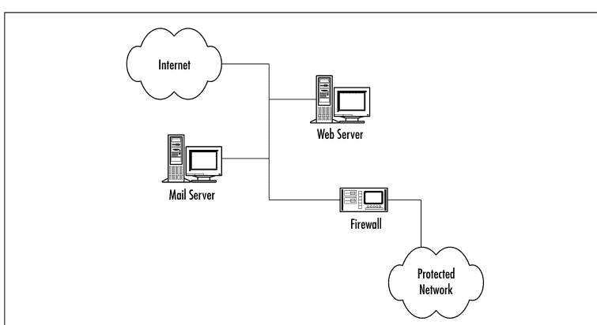

一些较新的防火墙包含了更高级的功能，作为集成的虚拟专用网络（`VPN`）应用程序，允许远程用户通过更安全的加密通道访问您的本地系统。某些防火墙现在是“自适应”的，它们将入侵检测系统（`IDS`）集成到产品中，并根据网络网关检测到的可疑事件更改防火墙规则。（有关 `IDS` 产品及其使用的将在本章后面详细介绍）。这些新技术极具前景，是创建“深度防御”策略的理想选择，但请记住，防火墙支持其他功能的工作越多，这些额外工具对防火墙设备吞吐量的影响就可能越大。此外，当这些新功能实现在任何单一设备（特别是防火墙）上时，如果该设备被破解，将为成功的攻击者提供巨大的机会。如果您选择了这些新型混合信息安全设备之一，请务必格外警惕应用补丁，并并在风险缓解计划中考虑如何处理该设备落入攻击者控制的情况。

尽管这种安装保护了组织的内部系统，但它对那些向公共互联网开放的系统不起作用。需要一种不同的实现方式来为这些供公共使用的系统添加基本保护。因此，非军事化区（`DMZ`）的概念引入了。

## 引入非军事化区

`DMZ` 是一个军事术语，指两个国家之间不允许部署军队或进行军事区域。在计算机安全中，`DMZ` 是一个网络段，存放公共互联网可访问的系统并提供某些基本的攻击防护。

这些 `DMZ` 网段的创建通常有两种方式。在许多情况下，系统被放置在两个具有不同规则集的防火墙设备之间，这允许互联网上的系统连接到 `DMZ` 系统提供的服务，但无法连接到组织内部系统的计算机（通常称为受保护网络）。图 5.2 显示了使用这种分层方法的常见安装。

实现 `DMZ` 网段的另一种方法实际上是为防火墙添加第三个接口，并将 `DMZ` 系统放置在该网段上。请看图 5.3 这种安装方法的图片。这允许同一台防火墙管理互联网、`DMZ` 和受保护网络之间的流量。使用一个防火墙而不是两个降低了硬件成本，并使网络规则集集中，使其更容易管理和排查故障。目前，这种多接口设计是创建 `DMZ` 网段的主要方法。

## 图 5.2 分层 DMZ 实现

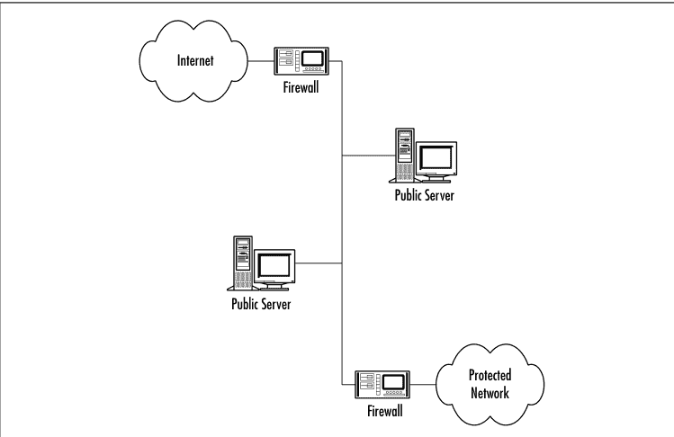

在任何一种情况下，`DMZ` 系统在保持其提供的特定服务可访问的同时，都受到了来自互联网的某种程度的保护。此外，内部网络受到防火墙以及 `DMZ` 系统的保护。由于 `DMZ` 系统仍然提供公共访问，它们更容易被破解，因此受保护网络中的系统对它们是不信任的。这种场景在提供公共服务的同时，仍然保持了对攻击的某种防护。

防火墙在所有这些场景中的作用仅仅是管理网络网段之间的流量。基本思想是允许互联网上的其他系统仅访问 `DMZ` 系统已公开的服务。如果互联网系统尝试连接未公开的服务，则防火墙将丢弃该流量并记录有关该尝试的信息。受保护网络上的系统允许根据需要访问互联网，它们也可以访问 `DMZ` 系统以管理计算机、收集数据或更新内容。通过这种方式，系统仅暴露于针对其所提供服务的攻击，而不暴露于可能运行在它们上的底层进程的攻击。

## 图 5.3 多接口防火墙 DMZ 实现

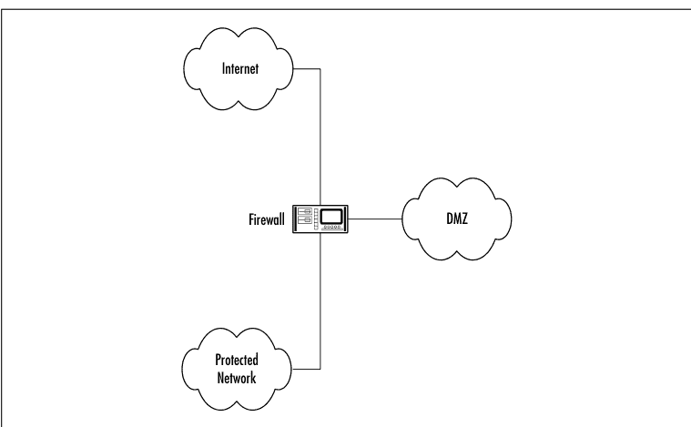

无论何种，`DMZ` 中的系统都可以为互联网提供电子邮件、`ftp`、`gopher`以及最终的万维网访问以及大量服务。对业务应用程序的需求在激增，这些基础实现方式也变得更加复杂。随着电子商务的出现，必须更加关注消费者与其使用的网站之间、以及电子商务企业之间流动的交易信息的安全性。客户姓名、地址、订单信息，特别是财务数据需要更细心的关注和处理以防止未经授权的访问。我们通过创建类似于 `DMZ` 的专用网段（称为安全区域）来实现这一点。

## 多重需求等同多个区域

存储客户信息和财务数据的需求与业务习惯的普通信息不同。构建安全的电子商务网站 • 第 5 章

然而，由于这些数据需要处理，但大部分是在互联网上进行的，因此需要创建更多的结构。许多网站选择实现多个网段以更好地保护其信息。可以根据特定目的添加新的网段。通常，财务网段受到互联网以及设置中所有其他网段的保护。

## 图 5.4 现代电子商务实现

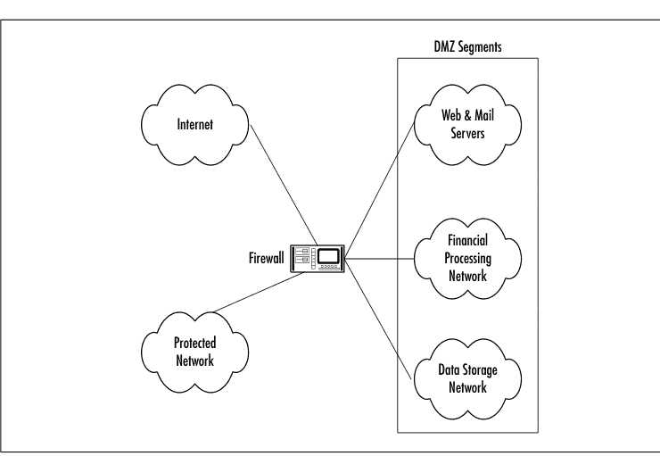

图5.4所示包含两个区域：数据存储网络和财务处理网络。数据存储区域用于存储电子商务应用程序所需，如库存、定价和其他细节。`DMZ` 中的 `Web` 服务器是客户的接口，它们访问这些系统以收集请求。当下单时，这些数据库中的业务信息将更新以反映销售情况。订单的财务信息被传输到财务网段。在这里，系统执行验证客户信息的任务，并处理向信用卡公司、银行或交易结算中心发送的付款请求。信息处理后，它被存储在数据库中以便批量传输到受保护网络，或者根据设置进行实时传输。这创建了另一层攻击者可能会渗透以收集财务信息的障碍。

访问控制还规范了网络会话发起的方式。例如，如果财务系统能够以“存储并转发”模式处理其信用卡信息，它们可以将这些细节分批处理供受保护网络中的系统检索。为了管理这种情况，防火墙仅允许来自受保护网络的系统与财务网段建立连接。这防止了攻击者在发生破解时能够直接访问受保护网络。另一方面，如果财务系统必须使用实时传输或来自受保护网络计算机的数据，那么财务系统就必须发起这些会话。在这种情况下，如果发生破解，攻击者可以利用财务系统通过某些通道攻击受保护网络。理想情况是 `DMZ` 系统不发起到更安全区域的连接，而是由具有更高安全要求的系统发起这些网络会话。

# 构建一个安全的电子商务网站 • 第5章

在设计网络分段和驱动网站的流程时，请记住这一点。

在大型部署中，你可能会发现这些分段在位置和/或实现方式上有所不同，这仅用于通说明该过程背后的理念。你的实际实现方案可能与此设计有所不同。例如，你可能希望将所有财务处理系统放置在受保护的网络上。只要配备了必要的安全工具以充分保护信息，这样做是可以接受的。我曾见过将业务信息放置在 `DMZ` 扩展区，以及为开发和测试设置了独立的 `DMZ` 分段。你的技术需求将影响你的实际部署，因此请根据需要偏离之前所示图表。

## 多区域网络的问题

这些多区域网络确实存在一些常见问题。从本质上讲，它们的实现、保护和管理都非常复杂。防火墙规则集通常非常庞大、动态且混乱，实施过程可能既艰辛又耗资源。

创建和管理如防火墙规则、`IDS` 签名和用户访问条例等安全控制措施是一项巨大的任务。请尽可能保持这些流程简洁，同时不要损害安全性或易用性。从“拒绝所有”策略开始，仅允许使网站运行所需的服务和网络事务。仔细管理网站性能，并对访问控制进行微调，以便更方便地管理规则集。使用这些指南，你应该能够快速让网站运行起来，而不会在系统中产生明显的安全漏洞。

随着你网站的增长和新功能的提供，可能需要创建新的区域。重复上述过程来创建管理这些新分段的规则，你应该不会遇到太大的麻烦。务必始终对任何更改进行审计和检查，并保留旧规则集的备份，以防在紧急情况下需要回滚它们。

## 了解防火墙

如今市场上有成百上千防火墙产品。有加载在 `Windows NT` 或 `Solaris` 等商业操作系统之上的商业产品。甚至还有与 `Linux` 和 `Free BSD` 一带的开源产品。而过去几年变得流行的新一代设备型防火墙，管理起来也更加容易。

无论你考虑哪种防火墙，市面上几乎所有的防火墙都属于两个不同的类别：数据包过滤器或基于代理的防火墙。这两项技术是驱动这些设备的底层平台。关于哪种类型的防火墙最安全，存在许多观点，我建议对每种类型进行了解，决定哪种最符合你的需求。作为你决策的参考，请思考以下因素：

- 数据包过滤器只能对源地址、目的地址和端口号的组合进行操作。为这些设备定义的规则只能基于 `IP` 头部的内容。
- 如果攻击者突破了数据包过滤器，整个网络通常会面临滥用的风险。
- 数据包过滤防火墙上的日志可能会令人混乱。
- 代理防火墙往往比数据包过滤器慢，通常无法跟上当今更快网络带宽的需求。
- 代理防火墙的设置和规则集维护可能非常复杂，有时会导致配置错误和安全漏洞。
- 价格在供应商和平台之间可能差异巨大，并且可能反映解决方案的整体安全性或产品具备的功能集。

## 探索你的防火墙选项

数据包过滤防火墙根据传输数据包报头中的源和目的信息来决定是否通过网络流量。如果规则集允许数据包的源地址与数据包目的地的主机通信，且通信使用的端口也是被允许的，防火墙将通过数据包并允许通信。如果源地址、目的地址或通信使用的端口被防火墙规则集拒绝，则防火墙将丢弃数据包并记录该尝试的信息。某些数据包过滤防火墙还会跟踪网络连接的状态信息，并根据这些信息解析数据包，以防止不符合连接的非法数据包被接受。这些设备被称为状态数据包过滤器或活动状态过滤器，意味着它们维护正在进行的连接的状态记录。

基于代理的防火墙也根据数据包的源目的地址以及通信使用的端口做出决定。如果规则集拒绝了其中任何一项，防火墙将丢弃数据包并记录该尝试。代理防火墙的额外工作是它会检查包的数据负载部分，并尝试判断数据是否符合此类连接的代理要求。这些可能包括使用的应用程序类型、数据包包含的命令，甚至是关于数据负载可能包含的某些规则。虽然这为通信增加了一个额外的测试层面，但并非没有代价。最大的权衡是，由于额外的处理，代理无法处理数据包过滤器可以处理的高网络吞吐量。

这两种技术的混合体也已经出现，如果你渴望代理级的控制和数据包过滤器的速度，它们可能适合你的组织。这些防火墙设备集成了代理和数据包过滤技术，创建监控数据负载并实现高吞吐速度的解决方案。这些混合设备允许你在安全需求优先于吞吐速度的服务上实施代理验证。此外，它们足够灵活，可以在需要高速率的地方允许数据包过滤规则作为保护方法。某些产品甚至创建了特定的代理（如 `SQLNet`），仅允许通过防火墙保护发布某些命令。其中一些产品已非常流行，现有数据包过滤系统的供应商已将代理工具集成到其设备中，以适应这一新类别。为你的组织选择混合防火墙，请寻找将你的服务集成到其代理机制中的系统。在网上阅读更多关于这些技术和防火墙产品的知识。你可能会找到完全符合网站需要的的产品。

## 工具与陷阱……

## 一些常见的防火墙及其网站

以下是一些常见防火墙产品及其相应网站的列表。使用此类网站来比较可用防火墙产品的功能，以决定哪种最符合你的需求。记住要根据你的安全需求、网站所需的吞吐速度，当然还有购买和维护成本进行比较。你可能会发现，某些知名的防火墙更符合你的需求和预算。

- CheckPoint FW-1 (https://www.checkpoint.com/products/firewall-1) 本书出版时防火墙市场的领军者。
- Cisco Pix Firewall (https://www.cisco.com/warp/public/cc/pd/fw/sqf500) Cisco 的防火墙解决方案。
- Gauntlet Firewall (https://www.pgp.com/products/gauntlet) 一种流行的基于代理的解决方案。
- Symantec Raptor Firewall (https://enterprisesecurity.symantec.com/products/products.cfm?ProductID=47&PID=3505192) 另一种流行的基于代理的解决方案。

# 构建一个安全的电子商务网站 • 第 5 章

- Secure Computing 的 Sidewinder 防火墙 (www.securecomputing.com/index.cfm?skey=232) 一种基于受信任操作系统和代理概念的广受关注的防火墙解决方案。
- WatchGuard 设备防火墙 (www.watchguard.com) 一种基于 `Linux` 的防火墙设备。

几本杂志——如《Network Computing》、《PC Week》和《Information Security Magazine》——也会定期定期对防火墙进行审查和比较。请记住，不要仅根据这些审查来做决定；“根据杂志进行管理”会迅速导致糟糕的决策。请亲自测试防火墙，或者让独立的实验室或顾问也提供建议。

在为您的站点选择好合适的防火墙产品后，就可以开始规划将防火墙系统实施到您的网络中。如果您选择的防火墙需要额外的系统来进行控制和/或日志管理，您需要充分考虑这些设备将放置何处，以及防火墙与这些组件之间的通信如何确保安全。与您的防火墙供应商合作，确保将这些系统放置在目标位置不会影响防火墙及您网络的性能或安全性。在规划好防火墙系统和您的站点将使用的安全区域后，您必须开始规划防火墙的规则集。

## 设计您的防火墙规则集

防火墙规则集的实际处理过程和语法会随产品而异。某些防火墙必须通过精美的图形用户界面 (`GUI`) 接收规则集配置，而另一些则可以使用从命令行输入或导入的简单纯文本文件进行配置。其他防火墙产品可能还有默认规则集，这些必须作为起点，并根据您站点的特定需求进行微调。无论情况如何，设计规则集的基本过程都是相同的。

## 它始于“拒绝所有”的态度

任何防火墙规则集的设计过程都应该始终从“拒绝所有”的态度开始，这意味着您从开始就让防火墙拒绝任何您未显式允许的连接。因此，从零开始，您可以添加各个安全区域之间所需的连接，以允许这些网段上的系统执行您的工作并进行管理，但除此之外的任何内容都不允许。这有助于防止允许不必要的服务和额外的网关，从而防范攻击者入侵您的服务器。

那么，话如此，您如何为每个组件添加所需的服务呢？答案当然是分析！每个系统和网段都必须针对其执行功能所需的服务和连接进行完全分析。虽然这很难，但如果您的公司要继续从事电子商务业务，这是创建客户所预期安全性的最佳方法。

## 常用通信的常用端口

要确定每个服务器和网络网段所需的端口和协议，您应该回到第 1 章中制作的规划文档和图表。如果您找不到它们，请重新开始流程，检查每个系统并详细说明其执行的功能。然后，利用这些功能来确定每个功能运行所需的端口和协议。使用端口和协议信息为规划和实施文档创建一个伪代码规则集。下面是一个非常基础的电子商务设置的伪代码规则集示例。请记住，您的防火墙可能有其他选项用于处理匹配规则的数据包，而不仅仅是允许或拒绝。这些选项中的可能是重定向、拒绝、转发或封装。请参考您的文档获取有关这些规则设置的具体信息，规则即数据包如何被处理。阅读您的防火墙手册或联系您的供应商获取有关您的防火墙如何处理其规则集的特定信息。

```


# 电子商务网络防火墙伪代码规则集

## 格式说明

`#允许或拒绝, 源地址, 源端口, 目的地址, 目的端口`

`#` 井号表示注释

`# DMZ` 网络是 `10.1.0.0/24`

`# 数据库网络` 是 `10.2.0.0/24`

`# 财务处理网络` 是 `10.3.0.0/24`

`# 公司内部网络（受保护网络）` 是 `10.4.0.0/24`

## 规则集

`#允许内部网络流量访问所有地方，除数据库和财务网络`

```
deny 10.4.0.0/24 all 10.2.0.0/24 all
deny 10.4.0.0/24 all 10.3.0.0/24 all
allow 10.4.0.0/24 all all all
```

`#允许世界通过端口 80 (http) 和 443 (https) 访问 Web 服务器`
`# 如果可能，您也应该将其锁定到特定的主机`

```
allow any any 10.1.0.0/24 80
allow any any 10.1.0.0/24 443
```

`#允许主 Web 服务器通过定义的端口与数据库服务器通信`

```
allow 10.1.0.0/32 10092 10.2.0.0/32 10092
```

`#允许数据库服务器通过 SSH 隧道与财务服务器通信`

```
allow 10.2.0.0/32 any 10.3.0.15/32 22
```

`#允许 SMTP 和 Pop3 进入 DMZ 用于邮件处理`

```
allow any any 10.1.0.15/32 25
allow any any 10.1.0.15/32 110
```

`#拒绝所有其他“清理规则”`

```
deny any any any any
```


显然，这是一个非常基础的规则集，但它可以作为伪代码的示例。请记住，您的防火墙可能有其他选项用于处理匹配规则的数据包，而不仅仅是允许或拒绝。这些选项中的可能是重定向、拒绝、转发或封装。请参考您的文档获取有关这些规则设置的具体信息，规则即数据包如何被处理。阅读您的防火墙手册或联系您的供应商获取有关您的防火墙如何处理其规则集的特定信息。关于（此处原文存在重复性错误，跳过）

## 将转换为规则

如果您遗漏了某些内容或犯了错误，不要担心。这就是为什么在投入生产之前要进行测试。花点时间评估、做出更改并重新评估规则，直到您感到满意。使用策略、IDS 和其他工具来降低您的业务接受的风险。

## 协议与风险：做出明智决策

在您对站点的规则集达成一致后，您需要确保只允许必要的协议，且仅允许到所需的服务器。例如，如果您开放了一个规则允许安全 Shell `SSH` 访问您的服务器，该规则应仅允许传输控制协议 `TCP`。用户数据报协议 `UDP` 在当前版本的 `SSH` 中不支持，因此它们应该被防火墙拒绝。遵循此示例，检查每个规则以确保您已经限制了协议并允许了您工作所需的协议。

对于防火墙规则，争议最大的协议是互联网控制消息协议 `ICMP`。这是 `ping` 程序和大多数 `traceroute` 实现（某些使用 `UDP`）使用的协议。虽然这种协议对于管理员和一般的互联网监控非常有用，但攻击者利用该协议进行从网络制图到拒绝服务 `DoS` 的各种活动。在某些情况下，与木马程序和黑客恶意软件的通信被隐藏在 `ICMP` 数据包中，以逃避检测并绕过系统。通常，站点管理员决定他们愿意接受的风险以及允许哪些 `ICMP` 包类型进入网络。至少，来自公共互联网的通过 `ICMP` 进行的所有信息请求都应在防火墙或边界路由器处被拒绝。永远不要允许枚举主机掩码或计时设置的 `ICMP` 数据包从互联网进入您的网络。

如果您的系统或管理人员需要 `ICMP` 协议，请务必再次遵循基本的 *拒绝* 模式，并仅允许所需的 `ICMP` 类型进入您的网络，并限制系统到

# 第5章 • 实现一个安全的电子商务网站

这些连接可能会建立到所需的特定主机。请注意，绝不应允许 `ICMP` 从公共互联网进入你的数据库分段或从你的财务网络流出。允许攻击者以任何方式访问这些主机，在未来都会埋下隐患！

要了解更多关于每个协议和端口的危险性，请咨询你的 `IDS` 供应商，询问他们在这些协议上使用了哪些攻击。自己研究这些问题的极佳网站是 `www.networkice.com` 的建议部分，或者 `www.securityfocus.com` 的漏洞数据库和论坛。

## 我如何知道将组件放置在什么位置？

在你对实现方案将需要哪些分段有了大致想法后，下一步是确定如何对你使用的系统进行分组，并确定将它们放置在哪个分段中。最好的方法是根据风险建立系统的画像，这些风险与常见标准相关，例如用户组、它们将处理的信息敏感性、将托管哪些应用程序，以及你的设置中涉及特定系统时存在的风险水平。

对系统进行画像分析后，选出共同点并创建具有相似特征的系统组。然后将这些组映射到相应的网络分段，以确定你的安全区域。你通过本地用户控制和防火墙规则相结合来控制对每个系统和分段的访问。

## 按风险划分系统画像

一切从风险开始。该过程的第一步是创建一个包含以下常见标准的电子表格：

- 用户
- 数据敏感性
- 外部可见性
- 需要的内部访问控制
- 加密需求

根据你网站的具体需求，你可能还有额外的标准，但这些是很好的起点。

第一个标准是用户。谁将是该系统的主要用户？是通过互联网的普通公众，还是你的财务人员？主要用户是你的组织外部人员，还是该系统是供外部使用的，抑或它主要供客户、合作伙伴或供应商使用？这些问题的答案将让你能够创建一个经常与系统交互的人员基准。

接下来，定义系统将处理或存储的信息的敏感性。数据是公开使用的吗？它具有业务敏感性吗？它是必须不惜代价保护的财务信息吗？创建三个或更多级别（例如），然后将数据归入这些类别中。

系统的外部可见性是下一个要评估的内容。这里简单的问题是：系统需要从公共互联网访问吗？如果系统必须保持可见，那么它需要被放置在具有公共访问权限的分段中。永远不要将需要从互联网发起的公共访问系统放置在具有高安全要求的分段中。如果可能，始终确保任何需要较高安全水平的系统都放置在只有该分段成员才能与其他系统发起交易的区域中。这可以防止攻击者直接与那些系统交互。

接下来评估系统将需要的内部控制。这里的标准是操作系统或你构建的应用程序内置的访问控制类型。在此因素基础上，加上你计划在系统上使用的任何基于主机的安全工具所建立的控制。系统的访问控制越多，如果配置得当，这些控制通常会增加更多的安全性。

加密需求也是一个标准。如果与系统交互的主要手段是通过加密会话（如安全套接层 `SSL` 或类似协议），这将极大地限制基于网络的 `IDS` 的有效性，因此必须使用不同的方法进行补偿。同样，这里简单的“是”或“否”即可。

最后，定义任何你可能没有将其纳入标准的其他风险。例如，如果你知道特定的应用程序必须在特定版本的操作系统上运行，并且在任何其他版本上都不支持（这是一个非常糟糕的情况，但我见过），那么你就知道涉及的系统可能存在已知漏洞，或者在将来可能会遇到漏洞，而没有任何机会进行补丁或升级。在这种情况下，你会记录这一点，并被迫将该系统位于你网站中保护非常严密的分段，或者更改你的实现方案以替换此组件。

## 建立风险控制需求

现在你已经创建了标准并评估了每个系统，下一步是开始建立控制机制来强制它们的隔离。在系统将提供公共访问的情况下，这可能简单地为管理员定义特定的用户账户，并使用防火墙规则管理仅对公众开放特定服务的连接。强烈建议你禁用系统上所有不必要的服务，以便在攻击者绕过你的主要保护方法时缩小收受攻击的网关。

利用你的标准，你现在应该能够决定哪些系统将主要由防火墙保护，哪些系统将依赖内部身份验证方法，哪些系统将需要额外的工具来保护免受未经授权的访问。

从创建一个草图开始，显示哪些服务（以及使用哪些端口）需要与其他系统和用户通信。记住之前讨论过的关于发起会话的规则。这张草图将成为你创建防火墙规则的模板。它还将被用于调整你的 `IDS` 和日志监控工具，以便更好地管理和控制你的风险水平。

## 通过需求分组创建安全区域

在你创建了会话图后，是时候将系统分组并将它们分配到网络分段了。要做到这一点，请寻找共同点并将这些系统放在一起。当你定义每个系统的位置时，对会话图进行任何必要的更改。

很多时候，你会发现某些系统在需求上看起来非常相似，但某些细微的差异让你对将它们与同类系统放在一起感到不安。如果是这样，考虑使用基于主机的工具（如 `IDS`、日志监控或自定义配置）来解决这些问题。如果问题大到无法通过这一步纠正，那么可能需要为该系统以及其他其他系统专门创建一个网络分段。实施这种方法的成本远低于将系统暴露在意外威胁下的风险。

现在你已经放置了系统，使用你的会话图来创建防火墙规则集。请参考你的手册获取有关防火墙的具体说明。通常，从“未明确允许的一律拒绝”的基本原则开始，然后添加你需要允许的会话。你可能会漏掉一些网站运行所需的连接，但你的防火墙会记录这些尝试，在你确认它们是必要的之后，你可以将它们加入规则中。细调始终是需要的，并且应该是你在发布前测试网站运行的重要部分。

## 实现入侵检测

毫无疑问，入侵检测是当今安全领域的一个热点。事实上，除了防火墙，`IDS` 是最常用的安全产品。多年来，供应商一直希望 `IDS` 的神奇作用，尽管产品随着时间的推移有所改进，但通常情况下它们未能满足其承诺的许多期望。

## 284 第 5 章 • 实现一个安全的电子商务网站

商业世界并非 `IDS`（入侵检测系统）产品的唯一来源。开源社区已经开发出与商业产品相媲美、在某些方面甚至超过商业方案的解决方案。诸如 `Snort!`、`Shadow` 和 `PortSentry` 等开源工具也为 `IDS` 引入了市场。一些免费安全工具拥有完善的文档、在线支持以及大量的附加组件、插件和扩展。例如，为了补充 `Snort IDS`，用户们编写了新的规则集、报告引擎、管理界面以及许多其他工具，使 `Snort` 的使用更加简单且更符合用户习惯。

无论你选择商业级 `IDS`、开源产品还是两者的结合，请记住，入侵检测是一种工具。它像防火墙或防病毒软件一样，并不是万灵妙药，也不能保证你的网站不会被攻破。它仅仅是安全拼图中的另一块。如果使用得当，它可以发现许多问题；如果使用不当，它不过是虚假的安全感。

## 工具与陷阱……

## IDS 产品

`IDS` 产品的选择包括以下商业、开源和免费解决方案：

- `Snort!` 是一个由 Martin Roesch 编写的网络级 `IDS`，可在 `www.snort.org` 获取。
- `Shadow` 是一个由美国政府和系统管理、网络与安全（`SANS`）学院赞助的网络级 `IDS`，可在 `www.nswc.navy.mil/ISSEC/CID` 获取。
- `PortSentry` 是一个由 Psionic Software 编写的主机级 `IDS`，可在 `www.psionic.com` 获取。
- `Tripwire` 是一个在 Linux 上免费使用的商业工具。它由 Tripwire 公司拥有，可在 `www.tripwire.com` 获取。

网络上关于 `IDS` 信息的来源非常丰富。有关涉及技术的通用信息可以在网上或当今市面上的许多书籍中找到。在 `Amazon.com` 上搜索可以发现许多关于这些令人兴奋的工具的书，详细程度不异。热门在线参考包括：

- `www.whitehats.com`
- `www.networkintrusion.co.uk`
- `www.networkvice.com`
- `www.sans.org/newlook/resources/IDFAQ/ID_FAQ.htm`

最后一条记录 `SANS IDS` 常见问题列表是解答关于 `IDS` 产品和技术的大多数基础以及许多高级问题的绝佳资源。

## 什么是入侵检测？

入侵检测是指一类产品的名称，这些产品被部署用于寻找网络或系统上发生的可疑事件。当工具注意到符合其对“可疑”定义的事件时，它将执行某些操作，例如记录详细信息、警告管理员、终止流量和/或更新防火墙等设备以防止问题再次发生。

仅通过记录详细信息和/或告警事件发生来响应事件的 `IDS` 系统是被动式入侵检测系统。这些工具主要用于收集取证信息或攻击细节。由于它们不会阻止攻击本身，攻击者仍然可能攻破目标系统。

尽管这无疑不是一个完美的解决方案，但它比完全不知道自己已被攻破要好。去年在 ways，每隔 11 分钟就有一个家庭或企业被闯入。根据同一时间段内各个响应团队的信息，计算机攻击和入侵每秒发生超过一次。

以中断攻击并防止攻击者造成进一步损害的方式响应事件的 `IDS` 是主动式入侵检测系统。当它们看到事件时，通常会在记录和告警的同时，还会执行诸如重置攻击者连接或通知防火墙丢弃来自可疑主机的包等操作。

某些 `IDS` 工具功能非常强大，而另一些可能非常难以配置，并且无法识别创建者预设之外的模式。大多数 `IDS` 系统会将流量或用户模式与已知攻击指纹和特征数据库进行对比。在选择 `IDS` 时，你应该问的首要问题之一是向数据库添加特征有多简单。在某些情况下，你可能向数据库中添加特征。某些 `IDS` 工具非常灵活，而其他可能非常难以配置。在选择你的 `IDS` 时，首先要考虑这些因素。

# 构建一个安全的电子商务网站 • 第 5 章

仅执行在你的环境中安全的的操作——并注意不要为自己创建一个新的拒绝服务 `DoS` 攻击。

基于网络的入侵检测系统（`IDS`）平台存在若干几个问题。大多数网络 `IDS` 工具对加密流量是盲目的，因为它们无法实时解密数据。数据分片问题也会影响某些基于网络的系统。在这种情况下，工具无法重组被其他网络系统分片的数据包，并无法将流的完整信息与签名数据库进行比对。相反，工具仅比较未分片的数据包，由于模式不完整，这些包可能无法匹配任何签名，从而以这种方式漏掉许多攻击。

基于网络的 `IDS` 工具的另一个问题是它们在交换机网络环境中运行存在困难。在这种情况下，由于交换机仅将网络流量传播到特定端口，`IDS` 看到其所在端口的流量。管理员通过创建镜像端口（`span` or `mirror port`）来克服这一困难，该端口可以显示交换机上的全部或大部分流量。方法的缺点是，如果流量水平高到 `IDS` 无法处理，工具将开始丢失流中的包，这可能导致其错过攻击。

基于网络的 `IDS` 工具传感器的放置对于成功至关重要。常见的放置区域是防火墙后、各种 `DMZ`（脱化区）段以及受保护网络的高敏感区域。放置思路请参见图 5.5。防火墙后的传感器用于检测任何可能绕过防火墙防御的非法活动。它还会提醒你运行在自己的受保护网络上的恶意流量，防止你的员工成为“网络坏民”。放置在 `DMZ` 的段负责监控超出你正常使用模式的流量。

一些站点选择在防火墙之外放置额外的 `IDS` 传感器，以持续监控其威胁水平或收集取证信息。我建议如果你选择这样做，请仅将该传感器用于信息获取，不要对它告警的事件做出响应。如果你的防火墙工作正常，外部 `IDS` 生成的告警将比部署在其他系统的多得多。然而，许多站点发现该传感器很有参考价值，我在此提到它是为了防你可能需要此类数据。

图 5.5 网络 `IDS` 传感器的典型部署

总体而言，尽管存在相关问题，基于网络的 `IDS` 仍然是管理员工具箱中的主要工具。只要放置、管理和配置得当，网络 `IDS` 将是巨大的帮助。

## 基于主机的 IDS

基于主机的 `IDS` 工具在选项和能力上差异很大。基本原理是这些工具驻留在主机上，并从计算机操作系统的视角监控事件。当事件发生时，它们会将这些事件与规则库进行比对，如果发现匹配，就会发出告警并/或采取行动。

某些基于主机的工具监控文件系统。它们定期对文件布局、关键文件和/或文件内容进行快照。它们使用一种称为“校验和”`checksum` 的技术来验证是否发生了变化。校验和是一种数学算法，它对文件中每个字符分配的数学值进行求和。如果文件的单个字符或任何其他部分被修改，则更改后该文件的校验和将发生变化。`IDS` 程序在首次运行时会创建一个文件及其关联校验和的数据库。之后，`IDS` 程序定期运行，并根据数据库重新检查其发现的结果。如果任何校验和不匹配，系统将向管理员告警或按照其配置做出响应。

其他基于主机的工具通过监控指向它们的网络流量来运行。它们在系统上打开各种端口并等待连接。由于这些连接指向系统中并未实际使用的端口，从定义上说它们是可疑的。使用这些工具的常用策略是开放通常会被攻击的端口，例如远程过程调用或 `RPC` `111`、`NetBIOS` `135-139` 以及常见的 `73337` 和 `12345` 等木马端口。其他有用的端口还有零 `0` 和一 `1`，可用于检测端口扫描。当程序注意到非法连接后，它可以像其他工具一样响应或告警。

还有工具会监控用户活动并寻找可疑事件，例如尝试访问其没有权限访问的文件、尝试向系统加载软件，以及数百种其他被认为可疑的签名。其他产品通过用户通常访问系统的时间和日期对用户进行建模，如果其账户在此模式之外被使用，则会告警。某些 `IDS` 工具甚至对用户的打字速度和典型错误进行建模，并在这些模式发生变化或差异时告警。

基于主机的 `IDS` 工具的最终目标是熟悉用户的正常行为模式，从而检测出细微的变化，这意味着他人正在使用他们的账户。这些工具的有效性不断提高，但要实现其全部承诺还有很长的路要走。

仔细评估你对基于主机工具的需求，并将其广泛应用于你的系统。它们可以提供细粒度的控制，并将成为你工具箱中不可或缺的工具。

## 基于网络的 IDS 示例

`ISS` 也制作了一个 `RealSecure` 版本，它是基于网络的 `IDS`。它被分为两个部分：网络传感器和管理控制台。该系统作为 Nokia 或 Solaris 的即插即用设备提供。引擎部署在你希望监控的网络段上。它监控网络流量并根据签名对其进行解析。图 5.6 显示了管理控制台。

图 5.6 `RealSecure` 事件控制台

`RealSecure` 支持用户通过管理控制台和图形界面创建自己的签名。传感器还支持在与数据库进行比对之前重组分片流量。`ISS` 定期对签名文件发布更新，并为用户提供技术支持。网络传感器可以将告警发送给多个管理器或 `Tivoli`、`HP View` 等工具。它还可以向任何支持 `SNMP` 通知的系统或程序发送简单网络管理协议 `SNMP` trap。

## 基于主机的 IDS 示例

`ISS` 还制作了一个 `RealSecure` 版本，它是基于主机的产品。它有两种不同的配置，分别称为 `RealSecure OS Sensor` 和 `RealSecure Server Sensor`。这些产品支持 Windows NT、Solaris、AIX 和 HP UX 操作系统。这些基于主机的 `IDS` 工具可以与网络传感器共享同一个管理控制台，从而提供一种易于监控的解决方案。

`OS Sensor` 是一个传统的基于主机的 `IDS` 产品。它监控操作系统日志并对文件系统进行校验和监控。如前所述，它还会在系统上打开监听端口并等待这些端口的连接。`OS Sensor` 更进一步，向连接起源报告虚假的横幅信息。如果发生事件或系统文件更改，它会向管理控制台告并将并将记录在数据库中。它还可以以更主动的方式做出响应，采取终止用户连接甚至挂起账户以防止进一步使用的行动。

## 294 第 5 章 • 实现安全的电子商务网站

`Server Sensor` 产品是 `IDS` 市场的一款新工具。它本质上是对 `OS Sensor` 能力的升级。`Server Sensor` 执行 `OS Sensor` 执行的所有所有工作，并增加了监控内核级别的工具以检测木马程序，以及了更便于检测分布式扫描的逻辑。新产品还引入了响应功能，可以将攻击者的违规地址添加到数据库中，拒绝该主机向受保护系统发送的所有后续流量。

所有 `ISS` 传感器都会将数据报告回中央管理控制台，并在该控制台上监控所有事件并生成报告。传感器也从同一个控制台进行配置（见图 5.7），这使得能够从单一位置控制许多基于主机或基于网络的传感器。

## 图 5.7 RealSecure Server Sensor 配置屏幕

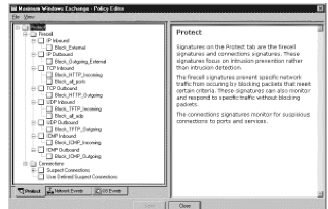

有关 `RealSecure` 产品线的更多信息，请访问：`www.iss.net/securing_e-business/security_products/index.php`。

`www.synergy.com`

实现安全的电子商务网站 • 第 5 章 295

## 管理和监控系统

运营电子商务网站最大的工作之一将是管理和维护其系统和网络组件。系统管理员的任务非常多样，而且通常非常深入。必须定期对计算机系统的所有方面进行监控，以便以快的速度解决任何问题。

此外，新的补丁、修复和升级通常以很快的速度发布，这会占用你更多的时间和资源。这些修改中的每一个都必须经过测试、研究、验证并最终安装。系统管理可能是一项耗费精力的任务。自动化各种日常任务将随着时间的推移对你有所帮助，但在开始阶段要准备应对崩溃。

## 我可以预期执行哪些类型的管理任务？

管理网站所需的日常任务在具体细节上各不相同，但它们有许多共同点。每个网站管理员每天都必须花时间检查系统和应用程序日志。他们必须在这些日志中搜索指示系统问题的错误消息。其中某些问题可能与安全问题有关，但大多数将是指示常见问题的消息，例如日志文件或数据库接近最大容量，或者指示备份系统在上次尝试备份网络驱动器时遇到错误的消息。每条消息都必须经过检查，并处理和解决它们所描述的问题。

管理系统备份是网站经理的另一个常见任务。虽然存在更换磁带或其他介质的设备，且软件处理备份过程的调度和其他要求，但它们并非没有问题。介质会随着时间的推移而老化变质，网络发生错误，其他问题也会干扰备份过程。尽管这些问题并非每天发生，但防范它们却是每天的工作。你可以预计将花费大量时间来处理备份问题，无论你为网站选择什么种硬件或软件设备。

如前所述，每天还必须花时间确保你的系统运行着当前版本的操作系统和应用程序。随着新安全问题和其他问题的发现和修复，必须应用补丁、热修复程序和变通方案。这些修订中的每一个都必须经过验证、测试，并需要对你网站的安全态势进行重新验证。这个过程非常耗时，而且由于变化非常快，通常会令人沮丧。

网站内容和功能的更改也将是你持续关注的问题。互联网上成功的网站会频繁地更改，以保持其新鲜感，并保持客户的兴趣。网站会不断添加新功能以提高其易用性并以新的方式帮助客户。这些更改和功能的每一个都有可能为你的网站带来新问题。例如，对网站的通用网关接口 `CGI` 脚本进行细微修改也可能带来性能和安全问题。将命令解释器（如 `perl`）放置在错误的位置可能会导致服务器甚至整个网络被完全攻破。由于风险极高，你必须将大量时间花在审查这些更改，并仔细评估它们对你的网站可能产生的影响。

许多其他问题和职责将会出现并消耗你的时间，但这些是常见且基本的想法。问题会定期出现和离开，因为它们会被解决、接受或缓解。只需保持警惕，并记住每天的各项职责即可。

## 我应该执行哪些类型的监控？

监控是网站管理的大部分工作。处理这些职责可以通过许多方式完成。如果你运行一个小型电子商务网站，你可能可以手动执行系统监控，通过直接物理访问每个系统，或者通过网络连接远程执行进程。然而，在大型网站中，这通常是不可能的，因为通常没有资源来手动观察每个系统。在这些情况下，经常使用自动化监控工具和网络管理系统。

自动化工具（或代理）位于被监控的主机计算机上，并通过网络连接与管理控制台通信。代理程序监控使用模式、进程负载、日志文件、磁盘空间和其他项目是否存在问题迹象。如果发生问题，代理将向管理控制台发送带有详情的消息。这允许管理员对状态获得警。某些管理系统还会跟踪详细信息用于趋势分析和其他类型的报告。

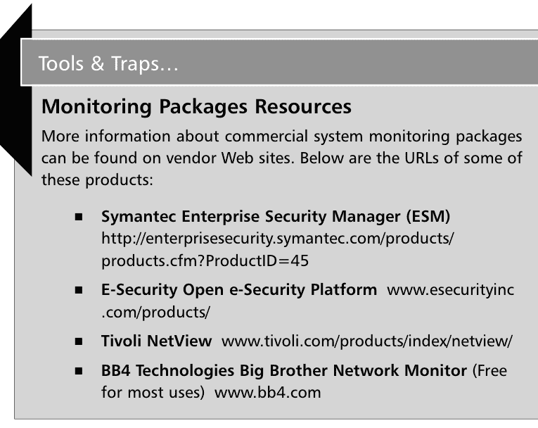

## 监控资源

有关商业监控软件包的更多可以在供应商网站上找到。以下是其中一些产品：

- Symantec Enterprise Manager `ESM`: `http://enterprisescurity.symantec.com/products/products?ProductID=45`
- eSecurity Platform: `www.esecurity.com/products/`
- Tivoli NetView: `www.tivoli.com/products/index/netview/`
- BB4 Technologies Big Brother Network Monitor: `www.bb4.com`

`www.synergy.com`

第 5 章 • 实现安全的电子商务网站

许多工具都面向监控和管理非安全问题。它们还为一般的操作问题、用户问题和许多其他数据点提供帮助。所有规模的网站都发现这些工具是不可缺的。即使是小型网站也可以从部署与其对应产品具有类似功能的开源解决方案中获益。对于这些任务，在商业和开源领域都有无数工具可供。

无论你选择手动执行监控过程，还是依赖自动化工具协助工作，监控都将成为管理员的日常任务。

基础系统监控

监控系统的基本活动和需求涉及观察诸如使用水平、可用资源和给定系统的整体状况。取决于你选择的操作系统，你可能会发现它们内置了工具可以轻松地提供这些信息。监控这些系统状态指标通常是在管理系统安全的过程中完成的，因为这些资源影响设备的整体运行，并可能是安全相关问题的症状。

例如，遭受 `SYN` 洪水攻击的系统可能会显示出高处理器负载以及内存和其他系统资源的耗尽。通过监控这些变化，管理员可能在系统崩溃或停止响应之前获得警报。这允许管理员在处理攻击和缓解其再次发生的风险时具有更大的灵活性。

手动执行这些操作可以使用操作系统内置的各种工具完成。例如，在 Windows 系统中，任务管理器显示许多此类数据，而在 UNIX 系统中，则通过使用“`uptime`”或“`top`”等工具进行观察。

前一节侧栏中提到的每种商业产品都包含了用于执行这些功能的自动化程序。同样，也可以使用开源工具来实现这些监控任务的自动化。

## 监控你的安全设备

监控你的安全设备可能比监控服务器和网络组件需要更多的关注。因为这些系统充当了门禁和守卫的角色，你需要密切关注它们的日志和警报。

手动监控这些日志文件可能是一项巨大的工程。你的每个工具可能都有自己的日志文件格式，这使得情况变得更加糟糕。虽然可以使用脚本和处理工具对监控安全日志进行一些基础功能处理，但更高级的数据分析通常需要商业应用程序和专门的系统来长期存储信息。

在最简单的情况下，这些日志文件必须至少检查一次，并用于判断是否发生了需要干预或响应的安全事件。（这正是你的安全策略再次发挥作用的地方！）如果发生了事件，必须收集更多信息，以创建响应事件所需的数据。如果没有，可以简单地丢弃这些数据或将其记录下来进行整体分析。要记住，随着时间的推移，你需要分析的数据越多，你的视野就越广，也就越可能捕捉到扫描和长期探测。

将这些过程自动化通常是一个好主意，因为人类会参与过程中，以评估自动化警报和输出，并定期检查缺失的事件。此外，如果你选择将安全日志检查过程自动化，请确保你有多个层级的安全设备观察你的流量。例如，确保在你的防火墙后面放置一个 `IDS`（入侵检测系统），这样即使一个系统被攻破，你在需要时整个警报流程也不会掉链子。

## 日志文件管理

处理日志文件最常见的问题是记录了过的信息，以及不知道为了数据分析应该保留多少代的文件。这些问题无处不在，无论系统是服务器、网络组件还是安全设备。显然，答案取决于你的环境。

神奇的解决方案是找到合适的日志级别，让你能够捕捉到风险状况和网站运行情况。适当的日志量恰好能提供所需的信息，而不会产生误报，也不会在此过程中遗漏任何内容。保留代数取决于你创建大图的需求。过于细粒的方法可能会导致你错过探测，而过于宽泛的方法可能会让你花费太多时间去追幻。

要确定你的网站需要执行什么种级别的日志记录，请为你正在监控的每个系统建立明确的目标。你需要知道每次有人浏览你的网页吗？如果你想创建使用统计数据，答案可能是“需要”。在你的 Web 服务器上记录日志，并确保你的 `IDS` 也没有记录每个 Web 浏览器。你真的需要记录每次 Web 服务器被 `ping` 的情况吗，还是你真的只想在发生 `ping` 洪泛（`ping flood`）时才收到通知？如果你只关心 `ping` 洪泛，请依赖你的 `IDS` 进行通知，不要在服务器上记录数据。这些都是简单的例子，但它们定义了一个概念，即确保你正在使用正确的系统生成正确的日志，这有助于消除过度记录。

确定要保留的日志文件代数并不容易。它主要取决于你所拥有的资源，以及你随时间解析所保留数据的流程。对于许多缺乏资源进行长期数据分析的网站，他们会将压缩格式的日志文件保留九十天。在这些九十天的日志文件集中，只有约两周保持在线状态供分析，其余部分归档以备不时之需或在发现事件时使用。具有存储和处理能力进行长时间跨度日志文件分析的网站，可以将日志保留十二到三十六个月，然后将其归档到长期存储介质中！这主要适用于具有高度机密信息的系统，或银行和其他主要金融机构等大型电子商务业务。这些日志文件会与新日志文件对比解析，以创建威胁基准和风险分析信息，这对于大多数电子商务网站来说可能是多此了。底线是保留足够的数据让你感到放心，并在以后需要参考时归档剩余部分。日志在事件发生很有用，所以请保持可用以备不时之需。

关于入侵管理或事件响应的更多信息，请参考本书的第十章，该章节涉及了这些主题以及管理安全事件涉及的流程。

## 我应该自己做还是外包我的网站？

正如本书之前的章节所讨论，在部署你的电子商务网站时，你可能面临外包部署或管理网站的选择。你可能认为自己创建运行网站的基础设施超出了你的预算范围，因此你想考虑将网站运营外包给应用程序服务供应商 `ASP` 的选项。在任何一种情况下，外包的相同规则适用于项目中的所有其他环节。你必须考虑培训一名或多名员工执行这些功能的成本，与聘佣已具备这些技能的人员为你服务的成本进行对比。你还必须查看网站的安全需求，并确定你的策略和流程是否允许外包给雇佣人员。然而在很多情况下，你可能会发现自己需要协助设置安全系统，并且你可能希望对你的计划和实施获得外部意见。在这些情况下，外包可能是你组织的绝佳选择。

`ASP` 公司在过去几年中已成为流行的解决方案，其业务量在持续增长。对于大多数 `ASP` 公司，整个网站的实现和管理完全由 `ASP` 完成。通常，`ASP` 还会与客户一起完成网站的大部分规划。通过支付费用，网站的日常运营和监控由 `ASP` 的员工执行，而电子商务公司主要提供客户所需的内容和支持。尽管 `ASP` 承担了提供和维护你网站安全的责任，但如果你选择这种外包，请确保你拥有审计和检查其安全流程的权利。对你的网站和 `ASP` 本身进行定期漏洞评估将确保你的策略得到执行。

外包网站的优缺点

显然，外包部署和管理网站既有优点也有缺点。在缺点方面，你失去了对日常运营的控制，你必须信任供应商的安全，并依赖他们的员工完成高质量工作。在优点方面，你释放了资源专注于常规业务需求，而不必担心网站的行政问题；你拥有合同和供应商的声誉来防止其表现问题。

## 托管：一种可能的解决方案

如果你认为将网站的整个安装和管理外包对自己来说太可怕或成本太高，那么你可能希望考虑另一种名为托管（`co-location`）的可能解决方案。托管是许多供应商提供的服务，允许公司共享建立带宽和其他基础设施组件（如信用卡处理系统等）的费用，同时让他们能够拥有自己的服务器和支持系统的自由。

对于那些希望对网站的日常管理和运营拥有控制权，但可能无法负担或无法管理电子商务网络的公司来说，托管是一种流行的解决方案。这些公司通常会租用、出售或租赁服务器给希望利用其现有电子商务支持系统的公司。有些公司只需允许公司提供自己的服务器，并接入其框架以获取电源、带宽和其他需求。托管公司随后对使用其支持系统和资源收取费用，而网站所有者则负责自己系统（或从提供商处租赁/租赁的系统）的所有支持、监控和管理。

托管可以是降低投资和资源要求的极佳方法，同时让贵公司的电子商务变得可行。然而，在所有其他外包情况下，都是“买者自负”。确保你的合同清晰，并且你的预期已经过沟通并记录。定期审计、检查并关注托管服务，以确保你的环境中的操作符合你的要求。

## 选择外包伙伴或 ASP

在选择外包伙伴时，价格往往是决定性因素。公司根据价格而非质量做出决定，这是一件遗憾的事。这导致他们选择了那些偷工减料过多的供应商，可能会让他们的网站暴露在如果他们自己运行网站时绝不会感到安全的风险之中。虽然我不反对廉价购买服务，但我认为你通常物一值分钱。

# 第 5 章 • 实现安全的电子商务网站

在明智选择外包伙伴时，最强大的工具是参考文献。始终向供应商索要特定的参考文献客户，以及他们为这些公司执行过的服务。下一步非常简单：检查向你推荐的人，并询问他们对供应商以及所执行工作的工作的满意度。利用互联网搜索对他们服务、安全性和声誉的评论。在相关的邮件列表和 Usenet 组中发帖询问特定的供应商。对你考虑的每个供应商都执行此操作，然后评估回复以选择你的伙伴。

除了参考文献之外，务必让你的律师审查所有的外包合同和协议。确保合同中包含一个流程，如果供应商的服务在通知期后仍未满足你定义的标准，则终止供应商关系。这种终止合同的流程是你的保险，确保供应商必须按照你的标准执行或修复你发现的任何问题，否则将面临失去业务的风险。在这个过程中需要律师的参与，因为这是你正面临风险的业务，请务必使用他们并保护你自己。

外包并不一定具有风险或令人不适。在选择伙伴时给予妥善考虑，并在创建协议时正确关注细节，你会发现外包对你的网站有很大的帮助。仔细选择你的伙伴，然后让他们为你工作，创造出互联网上最棒的网站！

## 总结

本章涉及了部署运行你的电子商务网站所需的系统和网络组件。通过仔细检查你的系统及其使用需求，你可以创建具有共同需求的组件组，并将它们放置在安全区域中。通过使用防火墙、`IDS` 和其他安全措施，你可以独立地执行每个安全区域所需的规则，从而创建一个用于安全执行电子商务的整体流程。

我们还学习了市场上提供的各种类型防火墙系统和 `IDS` 工具。这些工具增加了电子商务世界中至关重要的控制和监控能力。通过结合不同类型工具的优势，我们可以创建一个深层防御的整体策略。

监控防火墙、系统和其他安全工具可能是一项巨大的工作，但自动化和中心化流程可以使大型环境下的这些任务变得更容易。操作系统内置的工具和常用的插件也使得较小网站和创建自己电子商务业务的个人能够管理这些工作。

最后，我们讨论了在部署阶段外包网站或由 `ASP` 全权管理时涉及的决策。组织有许多选择可以帮助降低电子商务的成本和资源需求。这些某些解决方案（例如使用 `ASP` 或托管）在某些情况下可能被证明是合适的。此外，本章还涵盖了在外包伙伴中寻找什么，以及如何根据质量和经验——而非主要根据成本在供应商之间进行选择。

# 实现快速通道

# 实现安全区域

- 安全区域是具有共同要求的离散网络分段，例如它们处理的信息类型、使用人员以及保护其数据所需的安全层级。它们可能是相同类型的操作系统，也可能是完全不同的操作系统。它们可以是 `PC`、服务器，甚至是主机。

- `DMZ` 系统从公共互联网提供服务，同时它们对于其提供的特定服务仍保持可访问状态。此外，内部网络受到防火墙以及来自 `DMZ` 系统的保护。由于 `DMZ` 系统仍然提供公共访问，它们更容易受到攻击，因此不受保护网络中系统的信任。这种场景允许公共服务存在，同时维持某种程度的保护。

- 客户姓名、地址、订单信息，特别是财务数据通过创建称为安全区域的专用分段来免受未经授权的访问。许多网站选择实施多分段结构以便更好地管理。

- 访问控制还规定了连接建立的方式。最好 `DMZ` 系统不要发起进入更安全区域的连接，而是让具有较高安全要求的系统发起这些连接。

- 创建和管理安全控制（如防火墙规则、`IDS` 签名和用户访问）是一项艰巨的任务。从“拒绝所有”策略开始，只允许使网站运行所需的服务。仔细管理网站的性能并进行小改动。（注：原文此处截断，翻译保持对应）

## 理解防火墙

- 软件包过滤防火墙根据传输中数据包标头中的源和目的信息，对是否通过网络流量做出决定。

- 基于代理的防火墙也根据数据包的源和目的地址以及会话所使用的端口做出决定。代理防火墙执行的额外工作是它检查数据包的数据负载部分，并尝试判断数据是否符合代理对此类会话的要求。

- 这两种技术的混合体也已经出现，如果你渴望代理级别的控制和数据包过滤器的速度，它们可能适合你的组织。这些防火墙设备集成了代理和数据包过滤技术，创建出监控数据负载并实现高吞吐量的解决方案。

- 为任何防火墙设计规则集的流程将始终从“拒绝所有”态度开始。这意味着你首先让防火墙拒绝任何你没有明确允许的连接。因此，从零开始，你可以添加每个安全区域之间所需的连接，以允许这些分段中的系统执行其工作并进行管理，但不限于此。这有助于防止允许不需要的服务以及供攻击者入侵你的服务器的额外网关的可能性。

- 在你接受了网站运行的规则集后，你需要确保只允许了所需的协议，并且仅限这些所需的服务器或分段。

# 我如何知道将我的组件放置在哪里？

- 使用用户、数据敏感性、外部可见性、所需的内部访问控制以及加密需求来评估你的系统。

308 第 5 章 • 实现安全的电子商务网站

- 使用这些标准，决定哪些系统将主要由防火墙保护，哪些系统将依赖内部身份验证方法，以及哪些系统需要额外的工具来防止未经授权的访问。

- 通过寻找共同点并将它们放在一起，对系统进行分组并分配到网络分段。还要考虑使用基于主机的工具，如 `IDS`（入侵检测系统）、日志监控，或者由于某种原因某个系统不应与与其同类的系统放在一起，则可以专门为该系统创建另一个网络段。

- 部署好系统后，创建你的防火墙规则集。通常，从一个基本原则开始：所有未被明确允许的均被拒绝，然后添加你想要允许的会话。

## 实现入侵检测

- 侵入检测是指一类部署用于查找网络或系统上发生的可疑事件的产品的名称。当工具检测到符合其对“可疑”定义的事件时，它将执行某些操作，如记录细节、告警管理员、终止流量或进程，并/或更新防火墙等设备以防止问题再次发生。

- 基于主机的 `IDS` 工具驻留在主机上，从计算机操作系统的视角观察事件。随着事件发生，它们会将这些事件与其规则库进行比较，如果发现匹配，它们将发出告警并/或采取行动。基于网络的 `IDS` 产品监控网络流中的可疑流量模式。系统充当传感器，读取线路上的数据流并对照模式数据库进行解析。

- 尽管某些 `IDS` 工具功能非常全，但其他工具可能非常难以配置，并且无法识别其创建者编写到程序之外的模式。大多数 `IDS` 将流量或用户模式与已知攻击指纹或签名的数据库进行比较。在选择 `IDS` 时，你应该问的一个主要问题是，向数据库中添加签名有多容易。

- 开源工具如 `Snort!`、`Shadow` 和 `PortSentry` 也已进入市场。一些免费安全工具具有完善的文档、在线支持以及大量的加载项、插件和扩展。

## 管理和监控系统

- 当新的安全问题和其他问题被发现并修复时，必须应用补丁、热修复和变通方案。这些修订版本都必须经过验证和测试，并需要对你网站的安全态势进行重新验证。网站内容和功能的更改也需要持续评估。

- 使用驻留在被监控主机计算机上的自动化工具（或代理），通过网络连接与管理控制台通信。代理监控使用模式、处理器负载、日志文件、磁盘空间和其他项目以寻找问题迹象。如果发生问题，代理将向管理控制台发送带有适当细节的消息。管理控制台通常会向相应的管理员分配后续任务并通知他们该状况。某些管理系统还会跟踪过程直到解决，并记录收集的信息以进行趋势分析和其他类型的报告。

- 自动化监控过程通常是一个好主意，只要在过程的某个环节有人参与，以评估自动化告警和输出，并定期检查缺失的事件。此外，如果你选择自动化安全日志检查过程，请确保你有多个层级的安全设备在观察你的流量。

## 我应该自己做还是外包我的网站？

- 考虑培训一名或多名员工执行这些功能的可行性，与聘佣已具备这些技能的人为你执行的成本进行对比。还要查看网站的安全要求，并确定你的策略和流程是否允许外包给聘佣人员。

- 如果 `ASP`（应用程序服务提供商）承担提供和维护你网站安全的责任，请确保保留审计和检查与你合作的 `ASP` 安全流程的权利。对你的网站和 `ASP` 本身进行定期的漏洞评估，将确保你的策略正在被执行。

- 托管（`Co-location`）是许多供应商提供的一种服务，允许公司共享建立带宽和其他基础设施组件（如信用卡处理系统等）的成本，同时让它们拥有拥有服务器和支持系统的自由；对于那些想要控制网站日常管理和运营，但可能无法负担或独立管理整个电子商务网络的公司来说，这是一种流行的解决方案。

### 常见问题

以下常见问题由本书作者回答，旨在衡量你对本章所呈现概念的理解程度，并帮助你在现实生活中实施这些概念。如果你有关于问题的问题希望由作者解答，请访问 `www.syngress.com/solutions` 并点击“提问作者（Ask the Author）”表单。

- Q：当我们定义安全区域时，在你的示例中我们得到的分段或多或少。我们做错什么了吗？
 A：可能没有。我们在书中使用的示例是为了解释安全区域的概念。在实际应用中，你可能会发现你的网络状况与我们的示例不同。只要你遵循了流程并为你的网站创建了所需的区域，这就是好的。记住使用基于主机的安全工具来满足单个区域内已分组系统之间的细微差异。

- Q：我们应该如何决定哪种类型的防火墙或入侵检测系统符合我们的需求？
 A：这是一个令人困惑的任务，由于许多可能性和产品，这不是一个容易回答的问题。使用供应商提供的资源，但要警惕炒作和销售术语。利用互联网搜索参考和案例研究。像服务合作伙伴一样，向供应商索要参考并检查它们。还可以在线询问你正在考虑的产品，并从安全社区获得反馈。

- Q：我如何知道我在系统上是记录了太多信息还是太少的信息？
 A：记录你认为为了做出良好决策所需要的信息。如果你在筛选日志以定位问题时遇到困难，并且接受了适当培训，那么你需要消除那些未用于决策的日志条目，或者使用自动化工具只选择你感兴趣的条目。如果你对系统的运行和用户行为没有概念，那么说明你记录的信息太少了。

Q：我没有技能或资源来自己创建电子商务网站，而你介绍的外包方案对于我的预算来说太贵了。我的替代方案是什么？
 A：其他替代方案。例如，你应该研究与现有电子商务网站合作，作为分销商通过他们的网站提供你的产品。你也可以通过这些和其他网站安排以寄售的方式销售你的产品或服务。在线世界也有合作社（Co-ops），通过（低于外包整个网站的费用）你可以在这些系统上设置一个销售区域。在任何情况下，请务必在签署任何内容之前阅读并理解合同语言，并由律师进行审查。

# 第6章

## 确保金融交易安全

本章解决方案：

- 理解基于互联网的支付卡系统
- 商业支付解决方案的选项
- 安全支付处理环境
- 理解密码学
- 检查电子商务加密
- 虚拟 POS 的实现
- 替代支付系统
- 总结
- 解决方案快速通道
- 常见问题

## 引言

消费者对通过互联网进行业务的安全性和可靠性的信心，是当今电子商务面临的最单一重要的问题。基于互联网的信用卡欺诈已达到流行规模，当由于过度的欺诈和退单成本导致商户银行关系被终止时，这种欺诈正将数百家在线企业推向灭绝的边缘。根据高纳集团（`www.gartner.com`）的数据，互联网上的欺诈率是面对面交易或邮购/电话订单（`MOTO`）物理世界的 12 倍。`Cybersource`（`www.cybersource.com`）报告称，83% 的在线商家抱怨他们在遭遇信用卡欺诈扣款时遇到了问题。

互联网正在从根本上改变我们经营业务的方式。随着技术的演进，市场和消费者的传统观念已演变为以前所未闻的模式。互联网也在改变我们对货币的认知。新的支付形式不断涌现。这些非传统货币中的一些为企业和消费者带来了新的挑战和新的回报。但正如俗话所说，物在变，本质不变——犯罪分子像在物理世界中一样存在，而且许多人正拼命工作试图击败系统。

当你观察未来几年通过互联网进行的预计业务量时，安全和信任问题变得更加严峻。国际数据公司（`IDC`）等行业专家估计，2002 年全球通过互联网的支出将达到 220 亿美元，远高于 1997 年的 26 亿美元。过去两个圣诞季的销售记录说明了一切——根据美国商务部人口调查局的数据，2000 年美国的在线支出增长了 67%，第四季度互联网销售额达到 86 亿美元。

在互联网上确保支付信息安全是一项挑战性工作，但它是可行的。通过适当的关注、对细节的重视以及选择和使用正确的工具，电子商务网站管理员确实可以确保员工和客户数据的隐私性和完整性。请记住，任何安全解决方案都需要持续的关注，否则它可能会变成问题本身。

由于互联网销售的性质，在任何进行电子商务的地方，忽视传统信用卡及其亲戚——借记卡和账单卡是不可能的。在寻找改进支付卡数据在线信任与安全环境的方法之前，理解一些基本操作原理和常见操作实践对于更好地定义安全努力的重点至关重要。

## 理解基于互联网的支付卡系统

凭借如今的智能销售点（`POS`）设备、高速通信网络和隐藏的后台主机系统，扣款处理对于外行来说可能看起来简单、透明且直观的，但实际上，当你考虑到大量的系统和高额的扣款时，参与者的介入和处理步骤远非易事。技术上的复杂性源于同样复杂的“信任”概念的基础。

信用卡、账单卡、银行卡、支付卡，无论你如何称呼它们，都与一组支付选项有关，这些选项涉及根于信任和诚信的关系。你信任发卡的金融机构会为你购买的商品和服务向商户付款。商户信任卡发行行会尽快向他们付款，而卡发行行信任你每月按时支付账单，以偿还他们为你预付的资金。

## 信用卡、账单卡或借记卡：它们有什么区别？

虽然大多数人通常认为它们是相同的，但信用卡和账单卡在工作方式以及与之相关的协议上有所不同。许多此类支付卡在几个方面彼此有显著差异。

通常情况下，信用卡代表一个由卡发行机构设立的预设支出限额的账户，该限额是根据发行时获得的信贷额度建立的。有些是签名信贷额度，而另一些是担保信贷额度，其中存款的资金限制了扣款金额，并在未付扣款时作为信用卡的抵押品。

此外，针对该信贷额度的账户余额可以一次性付清，也可以分期支付。因此，月底留有的未付余额将产生融资费用，其利率为发行时设定的固定年化利率（`APR`），该利率可能会随时间变化，也可能不变。`Visa` 和 `万事达` 是最常见的信用卡示例，它们由特定银行或其他金融机构发行，这些机构从品牌协会处许可使用 `Visa` 和 `万事达` 商标。

账单卡（如美国运绿卡、金卡和白金卡）并不与循环信贷额度挂钩——它们没有预设限额，月底需全额还，且在正常使用下不产生利息或融资费用。`Diner Club` 和 `Carte Blanche` 是另外两个账单卡产品。

相反，借记卡与储蓄账户挂钩，可以代替支票进行支付。一旦底层储蓄账户的余额耗尽，使用关联借记卡的付款请求将被拒绝，除非有其他安排（例如透支信贷额度贷款、储蓄账户资金转账等）。这些安排通常在借记卡发行前已完成，或者在账户状态良好时添加。借记卡的另一个独特特征是存在个人识别码（`PIN`），以便在自动取款机（`ATM`）上使用该卡。卡片和 `PIN` 共同形成了所谓的双因素认证，其中卡片是第一个因素（你拥有的），而 `PIN` 是第二个因素（你知道的）。到此为止，电子商务系统在商户看来都在模拟 `ATM` 的工作，使用借记卡的支付与信用卡支付一样。

在不考虑互联网何时介入扣款处理之前，让我们让我们追踪：你在 Apollo Marketplace 购物，已经完成了选择，并将商品带到结账处。你选择使用由巴克斯银行（发行行）发行的万事达信用卡。Apollo Marketplace 已从国家银行（收单行）办理了商户服务，并乐意接受你的卡付款。虽然国家银行为任何注册的商户提供商户服务，但他们太小，无法运行处理所需的昂贵系统；他们将工作交给第三方处理商。假设 Delphi 处理服务代表国家银行处理该工作。Delphi 处理服务也是该市场 设置设备的供应商。

## 销售点处理

想象你正在 Apollo Marketplace 购物，完成了挑选，并来到收银台结账。你选择使用由巴克斯银行发行的万事达卡。 Marketplace 的收银员在 `POS` 终端上刷过你的万事达卡，输入金额，并点击发送。这启动了授权请求的第一步。根据卡中包含的数据（即账户号码），`POS` 终端知道请求需要路由到哪里。由于它们具有一定的智能（即可编程），`POS` 终端通常支持称为分拨号的功能，以处理多个卡品牌。有了路由信息后，终端向 Delphi 处理服务发起通话，后者通过银行交换网络查找巴克斯银行的账户记录。账户的可用额度将经过审查，如果足够支付请求的交易，将提供授权代码以允许交易完成。这一授权步骤在假设扣款将在未来某个时间结算的情况下，在你的账户中创建了临时债务。这些债务防止你超过信用限额，直到发生两个事件之一：要么发送扣款结算，要么债务过期，释放并将请求的金额返回可用额度。

`POS` 终端随后打印出销售收据作为扣款记录（`ROC`）。收银员将其撕下，你签字，检查卡背面的签名是否匹配，并将客户联存交给你，一份

登记收据、你的卡片和你的商品。虽然你无法亲眼看到费用记录在账单上的具体过程，但你信任这些费用会送达。

当这些费用授权发生时，商户终端会收集所谓的“捕获记录”`capture records`，这些记录唯一标识了交易。这些记录构成了所谓的“批量结算文件”`Batch Settlement File`。该结算文件可能包含数十条、数百或数千条唯一的捕获记录，等待通过该批次内相应账户发卡的银行进行处理。当批次被认为规模足够大（按数量或总金额计算）时，提交、捕获和结算流程就开始。

## 记账卡引入的差异

记账卡（`charge cards`）和借记卡的处理步骤与信用卡相同，不同之处在于授权请求和结算处理中涉及的机制。由于记账卡不是基于预设的支出限额，因此“可用额度”`open-to-buy` 的概念并不相关。相反，卡系统使用其他手段来授权或拒绝扣费请求。某些公司使用风险模型、启发式算法、消费模式或人工审核。

当前系统的复杂性还允许卡片公司在 `POS` 交易授权处理期间检测欺诈。由于消费购买习惯可以被建模为模式，任何偏离模式的支出可能被视为可疑。如果卡片可疑（根据银行的标准），并进入了所谓的“转授权状态”`referral status`，`POS` 软件只需将其转换为拒绝，并附带信息让持卡人线下联系其银行。通常情况下，商户被要求致电授权员（人工），授权员会向商户提问或要求与持卡人通话。在互联网上，这几乎是不可能的。`Cookies` 不会被用于防止欺诈扣费。

支付世界中的另一个重要概念是开环系统和闭环系统。当金融机构通过交易处理在持卡用户与接受其卡片的商户之间担任经纪人时，它被称为闭环系统。换句话说，同一公司同时拥有持卡人和商户关系，并作为所有卡片使用的中间人。美国运通（`American Express`）、`Discover` 和 `Diners Club` 都是闭环示例。这里有一家美国运通、一家 `Diners Club`（现由花旗银行所有）和一家 `Discover` 公司。

当一个持有 Bank A 银行卡的持卡人使用账户在 Bank B 的商户进行交易，且交易通过不同的第三方处理时，这被称为开环系统。使用 `Visa` 和 `MasterCard` 的银行系统就是开环系统的示例。事实上，`Visa` 和 `MasterCard` 公司都不直接向消费者发行卡片。相反，它们依赖于其成员银行在自己的业务组合中建立线路，并设定消费者信贷和借记的条款。它们还依赖银行提供商户服务，以便零售商能够接受其卡片作为支付形式。通常，商户银行会在为零售商提供其他银行服务的同时，提供此类服务。

`Visa` 和 `MasterCard` 作为“品牌协会”`Brand Association`，建立并维护着规范其 Logo 使用的章程以及与其成员银行之间的相应协议。`Visa` 和 `MasterCard` 都声称在全球范围内有 20,000 多家成员银行组成其特许经营网络。

在闭环系统中，持卡人和商户账户通常在同一系统上运行。结算（下一节）随后变为对系统的一侧进行贷、对另一侧存贷，无需访问银行网络，除非从任何可能处理闭环系统品牌费用的其他收单行收取费用。

## 捕获与结算

在结算批次时，卡片处理器必须首先接收它。Apollo Marketplace 终端中的软件启动传输，通过私有线路发送到 Delphi 的卡片处理服务（Card Processing Service）。在 Delphi，批次将根据银行识别码（或 `BIN`，账户号码中包含的一种信息）进行排序，为捕获处理做准备。每组具有相同 `BIN` 的交易都会发送给银行。

如你所见，在流程的每一个步骤中，有人在伸手索费。商户被要求为接受支付卡片的便利性支付费用，并通常将其视为经营成本。当客户索赔并报告某项使用丢失或被盗卡片产生的费用时，支付的也是商户。在这些情况下，银行会向其商户账户开具我们我们所谓的“拒付回单”`chargeback`，撤销对账户的原始贷方分录。在拒付回单之外，商户银行将收取一笔手续费，有时还会收取额外的“骚扰费”，以鼓励商户在接受卡片时更加谨慎。这种情况与支票账户客户发生跳票行为时被收取的巨额费用相似。如果强行发生拒付回单或跳票，你的银行将开始重新评估与你的关系，并可能终止该关系。

在销售点（`POS`）世界中，采取充分措施来防止拒付（例如检查签名或照片身份证）相当容易；但在今天的在线世界中，这项任务要困难得多，到目前为止，银行在帮助商户获得在线接受支付卡的信心方面做得很少。

正如你在本章后面的部分看到的，正在开发用于互联网的各种方法和替代支付系统，以扭转欺诈和拒付增加的趋势，并营造一种互信的氛围。

## 基于互联网的支付卡交易步骤

让我们重新回到 Apollo Marketplace，但这次我们将互联网引入场景，看看有什么不同。在此过程中，我们还将指出一些吸引黑客的、风险更高的环节。

几个月来，Apollo Marketplace 的业务呈爆炸式增长。客户厌倦了收银台频繁的长队，开始要求 Marketplace 提供带有快速送货服务的居家购物购服务。

几个月前，Delphi 的卡片处理服务开始为其服务的商户提供支付接受服务。它构建了虚拟 `POS` 软件，商户可以通过互联网访问以处理授权请求和结算步骤。Market 决定实施这项在线服务。

在发生任何交易之前，商户电子商务需要在自己的服务器上运行特殊软件与虚拟 `POS` 交互。假设商户系统已准备好此类支付处理——我们将其称为阶段 0。后续阶段概述了市场流程的演进。

- 阶段 0：所有商户电子商务软件和需求系统已就绪。Apollo Marketplace 网站 `www:Apollo-market.com` 正在运行。Marketplace 通过几个按钮的简单点击即可销售全线产品，并在两小时内进行当地送货。该网站是客户服务的典范。流量正在增加，销量也是如此。上周，仅网络销售额就超过了 95,000 美元！

- 阶段 1：购物体验。在 Apollo 的“网络市场”，客户还得到帮助准备结账。Marketplace 在页面上使用了超链接和内容来吸引人们在那里使用塑料卡进行购物。他们链接了隐私政策、可见的安全与信任保证，甚至链接到了银行的网站。

提供信用卡服务。只需点击 Apollo Marketplace 首页上的“立即购物”按钮，购物者就可以浏览海量的商品目录、查看产品详情并决定想要购买的内容。

- 阶段 2：商品选择。当购物者选择商品时，他们通过 Marketplace 商户服务器使用的购物车软件将商品加入，该软件会动态计算销售额。每个商品都是通过产品照片和价格下方的链接添加的。

- 阶段 3：结账。就像购物者将购物车推向收银台一样，当消费者点击每个页面都能看到的“结账”图标时，商户服务器会做出响应。购物车软件会将其中的商品汇总、销售税以及交付和处理费，并向客户展示商品列表和总额。如果客户对订单满意，则进入支付选择阶段。

- 阶段 4：支付方式的与与输入——风险区域 1。屏幕上显示订单总额后，消费者可以选择支付选项。客户可以从万事达（`MasterCard`）、`Visa`、美国运（`American Express`）和发现卡（`Discover`）中选择。客户还可以选择货到付款（`COD`）或在订单交付前通过电话支票支付。就我们而言，让我们选择万事达作为支付形式。客户将看到一个表单，在其中输入支付卡号，或者如果他们愿意，输入一个电话号码进行办理。

- 风险描述。未受保护的数据以超文本传输协议（`HTTP`）明文形式在互联网上传输——网络中任何从源到地传输数据包的设备（路由器、网关、数据包嗅探器等）均可见。这与使用电子邮件传输敏感或机密数据成为糟糕选择的原因相同。请参见本章后面关于安全套接层（`SSL`）协议的章节，以降低这种风险。

- 阶段 5：支付启动处理——风险区域 2。当 Apollo Marketplace 商户服务器收回带有支付和购买信息的表单时，软件开始准备一条电子消息，发送给 Delphi 卡片处理服务的虚拟 `POS` 端，该服务代表国家银行商户服务运行该系统。此消息包括商户身份识别信息、支付卡片、持卡人姓名、有效期、扣款金额和其他识别信息。银行还提供额外服务（需支付费用或成本）来帮助减少欺诈和退单。其中一项服务被称为地址验证服务（`AVS`），用于验证所提供的账单地址是否与记录中的地址匹配。为了在拥挤的市场中脱颖而出，其他卡处理器提供各种增值服务以帮助减少欺诈和退单。

- 风险描述。在接收 `HTTP Post` 操作时，Apollo Marketplace 的 Web 服务器持有敏感和机密信息。如果 Web 服务器对这些数据处理不当（无论是存储在自己的文件系统中还是调用后台服务器进行存储和处理），其被盗窃的风险模型就会改变。通常情况下，在 Web 服务器上存储任务关键应用程序所需的任何数据都是一个坏主意。

- 阶段 6：支付授权请求与响应——风险区域 3。Delphi 卡处理服务根据销售金额详情、请求的商户账户和支付卡信息来决定将请求发送到哪里。在 Delphi 系统上，使用软件创建银行标准授权请求（以 `ISO8583` 为指南），并将其放在银行的交换网络上，该网络定位你在巴克斯银行（`Bacchus Bank`）的账户。在获得巴克斯银行的批准代码以继续交易后，国家银行的软件会向 Delphi 系统上的虚拟 `POS` 发回消息，授权 Apollo Marketplace 商户软件完成交易。Marketplace 系统通过销售确认做出响应，生成电子版收据或扣款记录，并存储该记录以便最终的捕获和结算处理。

- 风险描述。包含支付卡号、有效期、持卡人姓名和账单地址的数据库是外部黑客和内部不满分子不可抗拒的目标，你必须采取措施，防止来自各个角落的对这些数据进行攻击。

- 阶段 7：货物交付。一个小时半过去了，客户听到了门声。作为顶级客户，Apollo Marketplace 始终为该客户提供最优质的服务。客户在交付单上签字并接受了货物箱，Marketplace 确保了客户满意且交易完成。

- 阶段 8：捕获与结算——风险区域 4。凭借阶段 6 成功的授权代码，Apollo Marketplace 的商户软件接收并存储了一笔捕获记录。随着销售完成和货物交付，Marketplace 商户软件可以启动捕获请求，以与 Delphi 卡处理系统完成交易结算。随着每个捕获响应的产生，结算文件不断建立，等待 Marketplace 决定将这些收据存入国家银行的商户账户，以进行资金转账。除非你销售的是可以通过互联网立即交付的商品（软件、图像等），否则你别无选择，只能等到发货给客户后才能结算费用。银行协会规则禁止对邮购/电话订单（`MOTO`）商户进行授权、结算和捕获。

- 风险描述。结算记录数据库在存储时存在风险（见上述区域 3），并且在往返处理器的传输过程中也存在风险。作为批文件，你可以考虑使用文件传输协议（`FTP`）进行发送和接收，但 `FTP` 无法保护传输期间的内容。因此，你需要另一个通道来共享这些数据，或通过加密技术保护互联网通道。

# 有毒数据无处不在！

如你所易见的，当扣款通过互联网和私有网络传输时，支付卡数据会流过许多不同的系统。有时数据落入错误的人手中。

326 第6章 确保金融交易安全

## 损害与防御……

## FBI 警告：有组织的信用卡盗窃团伙

联邦调查局（`FBI`）的国家基础设施保护中心（`NIPC`）在2001年3月发布了一项警告，称来自东欧的信用卡盗贼正针对美国脆弱的电子商务网站，他们已经盗取了超过一百万个信用卡号。

来自俄罗斯和乌克兰的黑客群体正针对未安装最新补丁的 Microsoft NT 系统，这些补丁本可以关闭他们能够利用的漏洞。黑客试图向商户索要数据赎金，如果要求得不到满足，他们就会公共网站上发布这些卡号。

在 `NIPC` 警告出现后，互联网安全中心（Center for Internet Security）发布了 Steve Gibson 的 PatchWork 工具，作为一种免费工具帮助商户确定其系统是否安装了 `FBI` 列出的所有抵御攻击的必要补丁。PatchWork 还可以审计商户系统，检查是否存在任何之前被攻破的迹象。访问 `www.cisecurity.org/patchwork.html` 下载 PatchWork 工具。

## 互联网支付方法

互联网上的消费者非常方便。所有围绕支付卡的银行法律都倾向于消费者，这种政策短期内不太可能发生变化。与此同时，商户的退单率（`chargeback rates`）正在飙升，风险也在增加。在过去一年里，`Visa` 和 `MasterCard` 收紧了商户账户在向商户银行收取费用之前可以处理的退单次数。商户甚至可能完全失去其商户账户。

退单通常按交易额的百分比衡量。如果你的商户账户一个月流过 100,000 美元，有 1,000 美元被退单，你的退单率就是 1%。1% 这个魔法数字是银行希望看到的目标。327

然而，在网络世界，欺诈是目前最大的问题。银行卡协会报告称，欺诈造成了一个无法维持的局面，需要立即采取解决方案。`Visa International` 亚太区新兴技术总监 Mark Cullimore 声，尽管只有 2% 的 `Visa` 信用卡交易是通过互联网获取的，但争议和发现的欺诈有 50% 发生在这一领域。

“在过去的六个月里，这已成为我们行业的一个重大问题，”他说，“这完全归结于身份验证问题，而这已成为金融行业最重要的问题。”

凭借我们目前在互联网支付卡处理方面积累的经验，欺诈和退单问题的新解决方案几乎每天出现在市场上。这些系统中许多依赖于技术的先进应用进行风险管理，包括预测模型、信誉评分等。

在下一节中，我们将看看正在采取哪些措施来帮助商户确信，他们接受的信用卡是合法的并且在合法用户手中。

## 商业支付解决方案的选择

如果客户真的想要你在线商店提供的商品或服务，但他们在你的产品目录实现中或使用你的购物车软件时发现了 Bug，或者发现你的网站导航不太方便，他们可能会原谅你并继续购买。如果他们在你的支付处理中发现 Bug 或问题，你可以确定再也见不到他们了。想象一下，一个满意的客户会告诉 4 或 5 个朋友，但不满意的客户会告诉 10 个或更多。你的职责是确保你的网站是可靠的，并确保他们的隐私信息安全无虞。

支付系统被视为两大类：你在拥有或控制的设备上运行系统（如前文描述的第 4、5、6 和 8 阶段），以及由第三方提供商代你运行的系统。354

接下来的章节将探索这些系统及其子类。首先，决定你想选择的路线至关重要。

在选择路线之前，请考虑你的整体业务目标。如果你负担得起，运行自己的业务可能是你的最佳选择。如果你更倾向于“试水”并从在线销售中获得经验，或者你维护的目录较小或销售量较低，那么你可能无法为内部系统所需的投资或安全严密性提供理由。

## 商业服务器提供商

专门为中型在线销售社区定制的互联网服务提供商（`ISP`）正在全球范围内涌现。这些商业服务器提供商（`CSP`）将向你租赁系统访问权限，分配磁盘空间来维护你的产品，可能提供多种支付处理选项，甚至可能提供强大的站点报告功能和基于 Web 浏览器的易于维护界面。其中许多在安全可靠的环境下运行，甚至可能提供 Web 网站设计服务。但要注意，并非所有的 `CSP` 都提供相同水平的服务或相同的支付处理费用结构。如果你的 `CSP` 是本地 `ISP`，客户可能会认为你的网站太慢而无法忍受，因为你正在与拨号 `PPP` 用户以及本地托管的内容或交易网站共享资源。当你仔细阅阅 `CSP` 列表时，请决定你是否愿意使用 `CSP` 提供的所有服务，还是“自备服务”。如果选项更多，你可能会在支付处理方面找到更划算的交易。你可能还想为客户提供混合支付类型，以增加那些不能或不愿使用信用卡者的订单。例如，你可能希望 `CyberCash` 处理你的信用卡费用，由你自己来处理在线支票，并让 `Qpass` 处理微支付（针对文章、剪贴画和共享软件等小额购买）。

`CSP` 更有可能关注互联网销售环境中的已知安全问题。为了保护电子商场，`CSP` 运营商在网络和人员基础设施上投入了巨资，以满足安全要求并密切监控其托管站点的使用情况。355

当你寻找合适的 `CSP` 时，确保在投入服务之前询问棘手的问题。要探索的领域包括：

- 停时间时间和频率
- 性能和安全的服务水平协议（`SLA`）
- 与外部收单方和处理机构的关系
- 费用结构
- 商户服务器软件与你的后台系统及数据库的兼容性
- 商店管理员功能和特性
- 声誉
- 你可以联系获取关于 `CSP` 意见和经验的其他客户

增加了职责，对你的计算机设备和员工带来了更大的压力。

为了使情况更加复杂，上述提到的所有选择并不一定是互斥的。你可以混合使用它们，以最大限度地提高客户满意度并优化你的利润。不过要小心——随着网站复杂性的增加，隐藏的支持成本也会增加。

在内部支付处理器的类别中，某些系统通过通过软件完成原本由物理设备和卡片完成的任务，将现实世界的 `POS` 技术带到了虚拟世界。一些市用系统的小样包括：

- `Cybercash` 的 `ICVERIFY` (`www.cybercash.com`)
- `Verifone vPOS` (`www.verifone.com`)
- `Authorize.net` (`www.authorize.net`)
- `Verisign Payflow` (`www.verisign.com`)

在下一节中，你将看到 `POS` 服务器是如何融入到电子商务服务器架构中的。在随后的章节中，我们将深入探讨 `Cybercash ICVERIFY` 系统的内部结构，看看它是如何支持支付处理要求的。

任何支付处理环境的一个核心共同主题是进行支付发生的环境的安全性。要对支付卡处理系统进行加固防护，既需要安全的架构来确保网络和基于服务器的安全性，又需要运行在网络之上（主要是应用层）的复杂加密协议。今天大多数支付协议都在其功能中集成了多种形式的应用加密。

在第 5 章中，你学习了用于网络段离散处理（数据存储、Web 服务器群等）的安全区域，并学习了如何根据其安全需求对功能进行分组。支付处理系统必然需要一个远离互联网连接的安全区域。创建区域的最佳方法是使用所谓的**三架构或 n 层架构**。

## 确保金融交易的安全性

当你准备好将仅提供信息的 Web 网站扩展为具有电子商务能力的网站并决定全方位投入时，你将希望从一个安全的处理环境开始，而不是尝试在以后再添加安全性（这永远是行不通的！）。除了运营数据中心（无论大小如何）相关的其他问题外，网络架构的选择可能决定成败。为了帮助减少电子商务所面临的许多威胁，三层网络实现应运而生。三层或 n 层架构通过通过在 Web 服务器、应用服务器和数据库服务器之间分配工作，分为不同的抽象层。

安全专家在互联网、内网和外网应用中广泛采用三层系统。当这三层存在时——Web 服务器、应用服务器和数据库服务器——它们极大地减少了对生产后台系统和网络的许多威胁，并使你能够出色地完成“边界保护”。这些概念源于行业最佳实践以及来自全球安全专家的建议。因为根据定义，你的电子商务网站必须“具有安全意识”，建议你在自己的设计中尽可能利用这些原则。图 6.1 展示了一个非常适合电子商务和支付处理应用的 n 层网络架构示例。

## 安全支付处理环境

三层系统使组织中的每个人都受益，特别是 IT 部门的人员。三层模型对于企业级分布式事务处理应用极具吸引力，因为它具有以下优势：

- **集中化**允许 IT 使用已经被接受的、类主机的、可扩展、可预测且易于监控的环境来控制和保护程序及服务器。

- **可靠性**得到了增强，因为设备位于受控环境中，可以很容易地复制或移动到容错系统中。

- **可扩展性**变得更容易，因为可以添加服务器或处理器来达到可的性能水平。当持续监控能够预防并快速检测服务器或网络问题时，集中式数据库服务往往是最佳的。

- **灵活且定义良好的软件层**允许 IT 对变化的业务需求具有最高程度的响应。由于客户端桌面需求非常轻量且廉价，可以随时对桌面系统进行大规模更改，而不会对程序层或数据库层产生任何影响，允许公司快速采用技术的改进。此外，可以随时使用非 PC 客户端（例如 `POS` 设备、语音响应单元、手持设备等），因为与应用程序的接口基于开放行业标准，并且对开发者来说是定义良好的。

- **现有的主机服务**可以通过灵活数据层的优势被重用。主机服务可以设计得像任何其他数据服务层一样，从而保留主机的事务处理能力。这具有重要意义，因为主机往往是高大量事务处理的最佳环境。

- **基于开放行业标准的系统**允许公司迅速将新技术纳入运营，而不必担心基于专有方案的产品中互操作性问题。

图 6.1 向你展示了当流量越过 Web 服务器进入更深层次时，增加安全性是可能的。当你穿过内部防火墙时，可以关闭不属于那里的协议。你还可以强制使用受信任主机来帮助防止意外请求的处理。

### 图 6.1 “具有安全意识的支付处理环境”

通过三层方法，你可以开始看到如何在每一层之间和内部添加更多层级的安全性。在外部防火墙之前，考虑使用入侵检测系统来扫描已知攻击特征，并实时向负责网络的人告警（见第 5 章）。在不重写程序的情况下，在传输层和应用层使用加密进行安全也是可能的。你将看到用于信息加密通信的安全套接层 `SSL` 协议和用于信用卡信息的安全电子交易 `SET` 协议——运行在所述架构之上——如何帮助将你的电子商务网站变成一座真正的堡垒。

（注：OCR 文本包含破碎的句子，这些可能是伪影或 OCR 错误。）


[root@ns1 rc3.d]# `nmap -vv -sU -sT -O -P0 -e eth0 66.38.151.22`

```
Starting nmap V.2.53 by fyodor@insecure.com
( www.insecure.org/nmap/ )

Initiating TCP connect() scan against ns2.securityfocus.com
(66.38.151.2)

Adding TCP port 22 (state open).

The TCP connect scan took 855 seconds to scan 1541 ports.
Initiating FIN,NULL, UDP, or Xmas stealth scan
ns2.securityfocus.com (66.38.151.2)

- Too many drops ... increasing senddelay to
- Too many drops ... increasing senddelay to 100000
- Too many drops ... increasing senddelay to 200000
- Too many drops ... increasing senddelay to 400000
- Too many drops ... increasing senddelay to 800000

adjust_timeout: packet supposedly had rtt of 810232 microseconds.
Ignoring time.

adjust_timeout: packet supposedly had rtt of 810259 microseconds.
Ignoring time.

The UDP or stealth FIN/NULL/XMAS scan took 2501 seconds to scan
1541 ports.
For OSScan assuming that port 22 is open and port 53 is closed
and neither are firewalled

Interesting ports on ns2.securityfocus.com (66.38.151.2):
(The 3078 ports scanned but not shown below are in state: filtered)

| Port | State | Service |
| :--- | :--- | :--- |
| 22/tcp | open | ssh |
| 53/tcp | closed | domain |
| 53/udp | open | domain |
| 113/tcp | closed | auth |
```

# 破解自己的网站 • 第 7 章

401

TCP Sequence Prediction: Class=random positive increments Difficulty=42998 (Worthy challenge)

Sequence numbers: 76B1034E 76B8D998 76BEE1B2 76C50F02 76CC2ED6 76D20FF

Remote operating system guess: Sun Solaris 8 early access beta through actual release

OS Fingerprint:
TSeq(Class=RIgcd=1%SI=A7F6
T1(Resp=Y%DF=YW=6DA%ACK=S++Flags=AS%Ops-NTNWWM
T2(Resp=N)
T3(Resp=N)
T4(Resp=Y%DF=YW=0%ACK=0%Flags=R%Ops)
T5(Resp=Y%DF=YW=0%ACK=S++Flags=AR%Ops)
T6(Resp=Y%DF=YW=0%ACK=0%Flags=R%Ops)
T7(Resp=Y%DF=YW=0%ACK=S%Flags=AR%Ops)
PU(Resp=N)

Nmap run completed - 1 IP address (1 host up) scanned in 3411 seconds

Without trying to repeat all of the instructions for `nmap`, let's go over the options we used in this case briefly. `-vv` 用于额外的详细日志输出，它会显示 `nmap` 执行过程中执行的某些步骤；`-sU` 告诉它进行 UDP 扫描；`-sT` 告诉它进行全连接 TCP 扫描；`-O` 告诉它进行操作系统指纹识别；`-P0` 告诉它不要通过 ping 检查主机是否在线；`-e eth0` 告诉它使用哪个网卡；最后是目标 IP 地址。完整的选项列表可以在手动帮助页（`man` page）中找到，或者直接运行不带参数的 `nmap`，它将生成一个选项说明的短列表。


# 第 7 章 • 破解你的网站

你可以看到这次扫描花费了一些时间（它是跨越互联网完成的）。它确定的操作系统是“Sun Solaris 8 early access beta through actual release”；实际上它是 Solaris x86 第 8 版本。`Nmap` 无法确定它查看的是哪种处理器架构，因此你必须使用其他方法来确定。如果你正尝试进行缓冲区溢出，该信息至关重要。它还报告了 TCP 序列的可预测性，如果你打算尝试 TCP 欺骗（`spoofing`），这一点很重要。

暂时假设 `nmap` 返回的端口列表是准确的（这并不总是一个安全的假设，因为扫描器并不总是完美的，其他情况可能会影响你的扫描，例如丢包）。在这种情况下，涉及的机器似乎没有运行很多程序，或者某些防火墙在起，或者两者兼有。看起来我们可以访问 `22/TCP` 和 `53/UDP`。

为了彻底分析这台机器，让我们尝试找出我们能访问的软件版本号。这里是针对 SSH（端口 22）的一种方法：

```
[root@ns1 /root]# telnet 66.38.151.22

Trying 66.38.151.22...

Connected to 66.38.151.22.

Escape character is '^'

SSH-2.3.0

telnet> quit

Connection closed.
```

大多数 SSH 守护进程都会提供它们的类型和版本（它们会告知客户端支持协议）。在这种情况下，是 OpenSSH 2.3.0。端口 53 是 DNS。如果远程服务器是 BIND，你通常可以让它告诉你版本：

```
[root@ns1 /root]# nslookup -q=txt -class=CHOS 66.38.151.2

Can't find server for address 66.38.151.2: No response from server
```

# 破解自己的网站 • 第 7 章

403

默认服务器不可用。在这种情况下我们没有得到回答，所以没有帮助。正常情况下是这样的：

```
[root@ns1 /root]# nslookup -q=txt -class=CHOS 66.38.151.2

Server: www1.securityfocus.com

Address: 207.126.127

VERSION = "BIND 8.2.3-REL"
```

通常情况下，这种通过标志扫描（banner scanning）来确定运行什么软件的方法对于 TCP，等同于连接到给定端口并查看你获得的输出。但对于 UDP 则困难得多。许多 UDP 服务是围绕数据报格式组织的。虽然可以使用 Telnet 等简单工具连接许多 TCP 服务并获取某些输出，但这通常不适用于 UDP（具体来说，Telnet 完全不适用于 UDP）。对于 UDP，你必须发出正确的请求并查看你得到了什么输出（如果有的话）。然而，如果你试图确定是哪个服务，你不知道该发送哪种请求——这是一个鸡生蛋蛋的问题，所以你必须进行一些猜测或关联其他信息。在这种情况下我们无法确定运行的是哪个 DNS 软件（如果事实上，那里监听的是它）。我们可能猜这种情况下是 `tinydns` 包。如果这对你的测试真的很重要，你可能可以开发各种 DNS 服务器如何回答，并与你获得的响应进行比较。原理相同 

# 第 7 章 • 破解你的网站

`nmap` 用来确定操作系统。或者如果你恰好搜索邮件列表，可能会注意到我在不久前发表过许多关于实现 DNS 的帖子并据此做出推断。无论何种情况，对于这台机器，你得到的可以攻击的信息非常有限。因为 SSH 是开启的，你始终可以选择破解用户名和密码。然而，如果目标网站在密码策略方面做得还可以，这将证明是徒劳的。你还可以尝试一些 BIND 漏洞。如果你不试图隐蔽，你将没有任何损失。

此时，DNS 没有已知漏洞，该版本的 SSH 也是如此。这意味着你可以移动到不同的机器（如果有的话），或者搜索 SSH 和 DNS 的源码寻找新漏洞以编写原始漏洞。SSH 和 DNS 的开发者都很有安全意识，所以我会把它放在我的列表上。

让我们来看稍微容易处理的机器：

```
Starting nmap V. 2.53 by fyodor@insecure.org

( www.insecure.org/nmap/ )
```

Interesting ports on (x.x.x.x):

(The 1512 ports scanned but not shown below are in state: closed)

| Port | State | Service |
| :--- | :--- | :--- |
| 21/tcp | open | ftp |
| 23/tcp | open | telnet |
| 79/tcp | open | finger |
| 80/tcp | open | http |
| 98/tcp | open | linuxconf |
| 113/tcp | open | auth |
| 513/tcp | open | login |
| 514/tcp | open | shell |
| 1024/tcp | open | kdm |
| 5680/tcp | open | canna |
| 6667/tcp | open | irc |

# 破解自己的网站 • 第 7 章

405

TCP Sequence Prediction: Class=random positive increments Difficulty=3267068 (Good luck!)

Remote operating system guess: Linux 2.1.122 - 2.2.144

Nmap run completed - 1 IP address (1 host up) scanned in 20 seconds

在这种情况下我隐藏了地址以保护受害者。不是我的主意，你——这台机器通过扫描我的端口 111 触发了我的 IDS（入侵检测系统）。某些机器运行 IRC 服务器似乎很奇怪（或者 `nmap` 是这么说的，`6667/tcp`）。然而，Telnet 到该端口时显示的标志是：

SSH-1.5–1.2.227

这是一个 SSH 服务器。任何 Linux 根内核都会在某些高端口安装 SSH 或 telnet 替代品，留给攻击者以后回来。这台 Linux 机器几乎被攻破了，这就是为什么它在扫描我。它可能正在扫描整个互联网。让我们看看其他开启端口上的某些标志。

21/tcp

220 looks FTP server (Version wu-2.6.0(1) Fri Jun 23 09:17:44 EDT
2000) ready.

23/tcp

Red Hat Linux release 6.2 (Zoot)
Kernel 2.2.14-5.0 on an 1686
login:

## 第7 章 • 破解你自己的机器

没有人登录。

```
80/tcp

(HTTP 服务器不会自动发送数据；我输入了 "HEAD / 

HTTP/1.0[cr]")

HTTP/1.1 302 Found

Date: Tue, 20 Feb 2001 03:34:24 GMT

Server: Apache/1.3.12 (Unix) ApacheJServ/1.1

Location: http://x.x.x.x/servlet/st?rw=

Connection: close

Content-Type: text/html; charset=iso-8859-1
```

其他端口在你按下回车时只会产生错误，或者在不产生任何输出的情况下断开你的连接。显然，了解正确的协议将允许你对它们进行探测。

所以，看起来我们有一个 Red Hat 6.2 机器被攻入了，可能是被蠕虫入侵的，并安装了 rootkit。它现在正在寻找其他的受害者。有趣的是，由于这看起来像是一个完全完全默认的 Red Hat 6.2 安装，你会预期发现 portmapper、lpr 和 BIND 正在运行。我们在这里没有显示 UDP 扫描，但对这些特定端口的快速检查显示它们没有在监听。Red Hat 6.2 中许多已知的远程漏洞如果这些服务正在监听，是可以被利用的。看起来在攻击者进入后，他们进行了清理。某些 Red Hat 蠕虫对此是知的。

但考虑到入侵机器的问题，快速检查 SecurityFocus.com 漏洞数据库显示该版本的 wuftp 存在漏洞。攻击之一（例如 Ramen 蠕虫使用的）需要登录才能运行，通常启用了匿名登录。在这种情况下并没有启用，这更多地证明了 Ramen 已经进入并关闭了它身后留下的漏洞。然而，该版本 wuftp 中至少还有另一个漏洞看起来仍然可行。（如果你能猜出登录名，第一个漏洞也是可行的，在这种情况下你可能可以直接 Telnet 连接到它，尽管 wuftpd 漏洞可以直接获得 root 权限。在获得 shell 后，你可以使用许多本地漏洞。）

我不会破解这台机器，因为我没有显式许可。端口扫描被认为是不礼貌的，并可能违反某些 ISP 的可接受使用政策，但我所在的地区这并不违法。实际上真的闯入是违法的，尽管我只是想加入聚会。此外，你永远不知道它是否是蜜罐，或者执法部门是否正留那里等攻击者回来。

## 绘制 Web 服务器地图

在简要接触了确定机器上运行什么内容的通用方法后，让我们更详细地查看通过特定服务可以获得的内容。HTTP 服务器特别有趣，因为在一个功能齐全网站上，你可能可以通过 HTTP 与几个完整的应用程序交互。功能越多，出现问题以及你进入的机会就越大。

我们已经触及了关于 Web 服务器的一点研究。大多数 Web 服务器在被询问时会主动提供关于自己的几项信息。例如：

```
[root@nsl /root]# telnet slashdot.org 80

Trying 64.28.67.150...

Connected to slashdot.org.

Escape character is '^'.

HEAD / HTTP/1.0

HTTP/1.1 200 OK

Date: Tue, 20 Feb 2001 04:52:35 GMT

Server: Apache/1.3.12 (Unix) mod_perl/1.24

Connection: close

Content-Type: text/html

Connection closed by foreign host.
```

`slashdot.org` 的 Web 端提供了它在 UNIX 上运行 Apache 1.3.12，并且加载了（可选的）`mod_perl` 版本 1.24。如果你熟悉 Slashdot，这些都不是新消息，但它们说明了问题。所使用的命令是 `HEAD / HTTP/1.0`，后面跟着两个回车（按两次回车）。如果你用 Telnet 客户端手动操作，不能有任何拼写错误，不能退格。如果你搞砸了，断开并重试。

但这只是标志扫描（banner scanning）。要真正深入研究 Web 服务器，你需要一种方法获取尽可能文件的列表。具体来说，你想要那些进行某种处理或包含敏感信息的文件。然而，因为你可能没有好的方法只获取这些文件，你可能会获取所有文件并对其进行筛选。

轻松获取整个网站的一种方法是使用 `wget`（可以从本地 GNU 归档获取）。这绝不隐蔽。取决于你尝试获取的 Web 网站的大小，可能需要极长的时间，并且可能会导致你访问的 Web 服务器切换，特别是如果它成功进入了包含大量动态内容的 Web 网站部分。但是，如果你愿意处理这些问题，这是一种相当完整的获取搜索和检查所需内容的方法。

我们在这里不会详细介绍如何去混淆（de-obfuscate），但值得注意的是，许多现代网站使用混淆来从简单的扫描器面前隐藏其真实结构。然而，对于基本目的来说，上述方法足够开始你的调查了。

一旦你有了文件，下一步是寻找目录。许多 Web 服务器配置时启用了目录列表（directory listing），这可以是信息的金矿。如果被禁用了，你可以寻找如 `index.html`、`index.php` 或 `index.asp` 等索引文件。如果这些文件缺失，你可能仍然浏览目录结构。

另一个要寻找的是配置文件。这些文件通常包含敏感信息，如数据库凭据、API 密钥或内部路径。寻找扩展名为 `.config`、`.ini` 或 `.xml` 的文件。最后，你应该寻找脚本本身。通过分析这些脚本的代码，你可能会发现 SQL 注入、跨站脚本 (`XSS`) 或远程代码执行等漏洞。

# 渗透你自己的网站 • 第7章 411

组。经过快速检查，在我看来，我似乎控制了位于他们网络内部的一台机器。


我立即给我的前同事打电话报告了我的发现。我扫描的每台机器都开启了非防火墙机器所预期的所有监听端口，而且我可以从互联网访问它们。我告诉他们急需一个防火墙。他们告诉我他们有一个防火墙。我解释说我完全没有看到任何防火墙的迹象，我能访问一切。事实证明他们的网络比我想象的要大，发生的情况是他们在防火墙上做了 NAT。他们确实有一个防火墙（至少他们有一个侧面画着“firewall”字样的盒子），但他们做的是将外部地址翻译为内部地址，并向该盒子开放端口。他们完全没有 DMZ（非军事化区）。

我有点震惊。我告诉他们，希望他们的承包商不要太不满，因为在他离开之前，他们是不会修复这些问题的

最后，他们修复了设置。这个故事的重点不是要忽视那些你认为人们一百年也不可能做的愚蠢蠢事。自动化扫描工具是确保你不会犯这些错误的方法之一，因为你可以让它去尝试那些愚蠢的事。

自动化扫描工具涵盖了功能、复杂性和成本的整个频谱。特定的工具可能针对某个特定领域，例如 Web 服务器漏洞，或者它可能会尝试发现尽可能不同类型的漏洞。复杂度可能从非常简短的“服务 X 易受攻击 Y 的影响”到多层级的报告、历史和趋势。成本从免费到昂贵不等。

一些最流行的扫描器有 Nessus、Internet Security Systems 的 Internet Scanner、Network Associates 的 CyberCop、Axent 的 NetRecon、BindView 的 HackerShield、Cisco Secure Scanner，以及网络分析安全管理员工具 `SATAN` 的各种后继版本，例如安全管理员研究助手 `SARA` 和系统分析集成网络工具 `SAINT`。如果你

# 第7章 • 渗透你自己的网站

对某些差异感到好奇，在 `www.networkcomputing.com/1201/1201flb1.html` 上有一篇最近的评论。

（顺便提一下，那篇评论倾向于 Nessus，它是免费扫描器之一。这项评估是基于让每个扫描器在若干台已知漏洞的系统上运行，并统计每个扫描器发现了多少个。）在上述列表中，Nessus、`SATAN`、`SARA` 和 `SAINT` 是免费的。你可以从大多数商业供应商那里获得演示版本。

让我们以 Nessus 为例来看一下。扫描部分运行在 UNIX 上，而 GUI 可以运行在 UNIX、Windows 或 Java 上（可能意味着任何具有完整 Java 实现的操作系统）。这里显示的示例扫描来自 Windows GUI。

图 7.1 显示了 Nessus 在扫描过程中的状态，即在你已经安装、登录到扫描服务器并选择了一范围的 IP 地址或名称进行扫描之后的状态。端口扫描是由 `nmap` 作为外部进程完成的，因此在整个端口扫描完成之前，Portscan 栏显示为 0 已完成，然后跳到 100%。Attack 进度条会随着每次攻击而推进，正在进行的攻击显示在“Security check”（安全检查）旁边。这个示例花了几个小时才完成。

## 图 7.1 扫描期间扫描状态

扫描完成后，屏幕会显示已扫描的 IP 地址以及发现的任何漏洞或警告（见图 7.2）。

## 图 7.2 Nessus 报告界面

这种 Nessus 界面是漏洞扫描器的典型特征。它们通常有一套红/黄/绿评分系统（在这种情况下是红色和橙色）。在这里，`66.38.151.3` 被标记了一个红球。如果我们选择该 IP 地址，右侧会显示一个短列表。我点击加号展开了几个标记为“holes”（漏洞）的项。Nessus 似乎并没有发现出这是一个 Real Server，但它确实发现了一个 Real Server 特有的“漏洞”。当然，IIS 漏洞完全不适用。事实证明 GET admin/includes 漏洞已经在该服务器上被修复了。尽管如此，有误报也比有漏报好。如果你得到大量的漏报，那么这个工具就帮助不大了。这个特定的网络是一个生产网络，所以我们所知没有任何漏洞。

其余的项它都被标记为无害。图 7.3 中显示了一个示例。

## 图 7.3 Nessus“橙色”警告

安全设计在理想情况下应该是分层失效保护的。即使防火墙不存在，或者配置错误，你仍然是安全的吗？如果攻击者设某种方式控制了你财务 DMZ 分段上的某台机器，这对于他们进入其他机器来说能提供多大的筹码？这种测试可以通过与审计人员协调，并将他们的审计机器插入测试每个阶段的相应网络分段来完成。这假设他们最初没有从互联网侧进入。如果他们实际上成功控制了 DMZ 分段上的某台机器，那么重新打补丁的问题就不存在了。对于内部审计员，他们可以根据需要将自己放置在合适的位置。

请注意，如果你打算同时进行内部和外部审计，先进行内部审计可能是明智的。理想情况是先解决掉任何简单的问题，这样你就能从外部审计团队那里获得最大的价值。如果他们一眼无法发现任何简单的问题，他们就必须更加努力、更加透彻一些。

## 总结

攻击你网站的目标是评估你的安全设计优劣以及实施程度。为了成为一名有效的攻击者，你需要了解哪些类型的攻击可以针对你。这些包括拒绝服务攻击（DoS）、信息泄露、文件访问、错误信息、特殊文件访问和权限提升。最终，攻击者想要在你的系统上获得更高级别的权限。

为了有效保护你的网站，你必须知道你的风险是什么。风险的三个要素是漏洞、威胁和资产。如果你有需要保护的资产且漏洞或威胁很高，那么你的风险就很高。资产通常是固定的，因此你的目标是最小化漏洞和威胁。

衡量威胁可能是挑战性的，因为你正试图评估从未见过的攻击者的意图。弄清会有什么样的攻击者针对你的最佳工具是关于他们尝试进行哪些攻击的日志。通常，机会性攻击会针对服务，而不是扫描大范围或端口号。IDS 系统可以帮助从常见攻击中剔除出更具持续性的攻击，因为它们可以识别扫描模式。你还需要关注各种邮件列表，获取有关最新蠕病毒和脚本小子（script kiddie）工具的信息。

评估你的漏洞水平要容易一些。这是一个技术问题，需要技术专业知识。除了日常管理之外，评估漏洞的主要方法是通过渗透测试。渗透测试是为了查看你的网站是否可以被攻破。你可以使用内部或外部渗透团队来完成测试。无论哪种情况，你都应该获得一份报告，说明做了哪些工作以及哪些攻击（如果有的话）成功了。

渗透测试者的辅助工具之一是自动化扫描工具。这些工具可以执行人类可能会忽略或没有时间完成的繁琐任务。自动化扫描工具有各种形状、大小和价格。大多数用于评估（有些是免费的），帮助你决定哪种适合你。

### 解决方案快速通道

### 预判各种类型的攻击

- 信息泄露攻击是对机密性的攻击。信息泄露问题的经典例子是 finger 服务。在很久以前，大多数 UNIX 机器都运行着一个名为 finger 的服务。有一个匹配的 finger 客户端命令，可以提供特定机器上特定用户的信息。这种信息不会直接导致被破解，但用户的密码与其用户名匹配的频率之高确实令人沮丧——finger 是收集某些用户名的快速方法。

- 文件访问攻击是针对机密性和完整性的攻击。文件访问下有许多子类，例如读取访问、写入访问和删除权限。读取访问直接影响机密性，而其他权限允许修改，从而影响完整性。例如，基于 UNIX 和 DOS/Windows 的操作系统使用 `..` 来表示当前目录的父目录，因此进入 `cd ..` 会带你进入一个目录级——某些服务器软件未能考虑到这一点，并允许在文件请求中使用 `..`，允许攻击者跨越边界。

- 错误信息攻击旨在误导防御者。它是针对完整性的攻击——不是针对系统本身的完整性，而是针对防御者关于系统的信息。错误信息攻击的一个例子是 `nmap` 扫描，它会产生针对你主机的额外流量，与真实的扫描数据包一同运行。

- 网站很多有趣的内容存储在数据库中。这对于电子商务网站尤为如此。开发者在开发网站时经常犯的一个常见编程错误是未能正确地转义或过滤用户提供的数据，给攻击者提供了向数据库发送 SQL 命令的机会。

- 权限提升攻击是对安全结构完整性的攻击，尽管它通常会导致其他破解。如果攻击者能够获得超出他们本应拥有的进一步能力，那么某处的安全机制就被破坏了。这种机制的破坏可能是由于设计不当、漏洞，或者仅仅是因为管理员实现该机制的方式不当。

## 对你的网站进行风险分析

- 风险资产可能包括资金和财务信息、客户信息、产品、知识产权、员工和声誉。

- 通过仔细观察防火墙和 IDS 日志，你开始理解“尝试过的人”和“留守的人”之间的区别。你可能成功避开雷达，也许通过慢扫描。

- 蜜罐（honeypot）是一个被设计用来被攻破的系统。设置蜜罐将给你一个研究攻击者战术的机会。你的蜜罐将是最容易渗透的机器。要让蜜罐产生用处，必须对取证技术、日志分析和协议分析有一定的熟悉。

## 测试你网站的漏洞

- 良好的变更控制流程有助于最小化风险。每次进行更改时，应尽力确定哪些部分会受到影响，并报告更改。

- 任何工具或测试方法都可能导致假阴性，但盲目运行利用程序会导致极高的误报率。如果你被机会性攻击捕获，那么你需要严格检查跟踪新漏洞和应用厂商补丁的程序。

- 你应该利用的知识类型包括：信任关系、所有网络分段的 IP 地址、所有软件的品牌和版本、使用的网络设备以及所有软件源代码（特别是自定义软件）。

- 攻击者可能会尝试使用一些隐身技术来规避检测。这可能包括进行某些类型的隐身扫描（这些用途有限，因为几乎任何网络 IDS 都能识别它们）。其他技术是慢扫描（随时间缓慢进行端口扫描，以免触发 IDS 阈值并让端口扫描报警灯亮起）、碎片（对许多 IDS 系统有效），最后是各种类型的错误信息攻击。

- 针对已知漏洞并下载现有利用程序所需的信息包括 IP 地址、名称、开放端口、操作系统版本、软件版本、网络结构和防火墙配置。

- 标志扫描（Banner scanning）是通过查看其提供的信息来尝试确定运行什么软件的方法，类似于连接到给定端口并查看输出结果。这对于 TCP 效果良好，但 UDP 则困难一些。虽然可以使用简单的

## 第 7 章 • 破解你自己的网站

就像使用 Telnet 客户端到许多 TCP 服务并获取输出一样，对于 UDP，你必须发出正确的请求类型并查看你会获得什么种的输出（如果有的话）。

- 任何 Web 服务器附带的默认文件通常不会被删除，而且在许多情况下，这些文件存在漏洞。例如，所有的 IIS 4.0 Web 服务器都包含一个名为 `showcode.asp` 的示例文件——其目的是显示 .asp 文件的源代码而不是运行它，这是任何攻击者梦寐以求的功能。

- 即使自动化扫描工具达到 100% 的准确率，大多数工具并不会实际进行渗透测试，它们只会尝试确定网站是否存在漏洞。实际利用这些漏洞将取决于你的操作。

## 聘请渗透测试团队

- 在进行外部审计时，你应该预期获得执行审计的人员的参考资料和简历。你应该预期签署一份协议，免除他们因成功渗透而可能导致的任何后果。你应该详细列出你想要什么以及不希望执行什么。你应该获得一份针对所请求工作的估价，以及一份协议：如果需要额外时间，他们将联系你并获得批准。你应该获得一份发现报告，包括尝试过但失败的内容，以及成功的内容。

- 如果你的内部人员具备相关技能，没有理由他们不能像外部团队一样进行同样的审计。同样，没有理由你不要求他们提供从外部审计中获得的相同文档。

- 如果你打算同时进行内部和外部审计，先进行内部审计可能是明智的。理想做法是先消除任何简单的问题，这样你就能从外部审计团队那里获得最大的价值。

### 常见问题

以下常见问题由本书作者解答，旨在衡量你对本章所介绍的概念的理解程度，并帮助你在现实生活中实施这些概念。如果你对本章有任何问题想让作者回答，请访问 `www.syngress.com/solutions` 并点击“向作者提问”表格。

- Q：商业扫描器与免费扫描器相比有什么优势？

- A：你支付的是支持、运行稳健的工具（易于安装和运行）、通常功能更强大的报告系统，以及供应商为你维护和更新测试。虽然没有什么能保证你的供应商会一直存在，但许多人认为，如果他们有财务义务，他们就会继续维护和增强他们的产品。最终，重要的是你是否能够使用该产品满足你的需求。如果免费产品因为成本原因通常是理想选择但不能满足你的需求，那么商业产品的成本对你来说是否值得？值得注意的是，许多商业产品与该供应商的其他产品相接，可能为你提供更完整的解决方案。

- Q：聘佣某个自神秘黑客的人怎么样？他曾破解过美国国家航空航天局（NASA）。

- A：抛开信任问题不谈，你必须意识到，能够破解某些知名网站并不等同于具备执行专业渗透测试的正确技能。获取一个最近发现的漏洞并尝试针对 1000 个知名网站进行测试，并获得一定比例的成功其实并不困难。这并不表明攻击者理解该特定漏洞的工作原理。此外，你从渗透测试中获得的很大一部分是一份体面的报告以及可能的关于如何清理安全问题的建议，而这通常不是“打完就走”的攻击者所习惯做的。如果你真的想要一个名头响亮的审计员，可以尝试聘佣那些聘用过这类人的公司，并询问他们判断技能水平的标准。你也不应该仅仅因为某人有一个代号就假设他是那种会破解 NASA 的人。

**Q：** 我可以在哪里找到一些免费的扫描工具？

**A：** 查看以下位置：

- Nessus `www.nessus.org/`

- SAINT `www.wwdsi.com/saint/`

- SARA `www-arc.com/sara/`

- SATAN `www.fish.com/satan/`

- Whisker `www.wiretrip.net/rfp/`

# 第 8 章

## 灾难恢复规划：最佳防御

本章解决方案：

- 什么是灾难恢复规划？

- 确保信息的安全备份与恢复

- 硬件故障或服务丢失的规划

- 我如何防止自然灾害？

- 理解你的保险选择

- 总结

- 解决方案快速通道

- 常见问题

## 引言

你已经编写了合适且稳固的安全策略，你的电子商务服务器已打补丁，你的软件编写良好，并且你定期监控 Web 服务器以防止入侵。但你的其中一台服务器宕机了。现在该怎么办？无论是由天灾、系统故障、安全违规还是管理意外导致的，避免服务停机是不可能的。导致停机的灾难并不一定完全出意之外。在危机发生之前思考该做什么是业务中必要的一部分，被称为灾难恢复规划。

这帮助你创建灾难恢复计划，以便你识别预防措施可以避免灾难的关键区域（或至少最小化停机风险），并且你知道在发生任何类型的损失时该如何进行。确保你的备份和恢复系统是最优的。为你的网站添加容错能力可以消除配置中的单点故障。最后，我们探讨了相对较新的保险领域。

## 什么是灾难恢复规划？

《灾难恢复日志》`www.drj.com` 是一本专门针对业务连续性的电子期刊，它将*灾难*定义为“任何导致组织无法提供业务功能的事件”。同样，*灾难恢复规划*被定义为“为了减少损失而进行的预先规划和准备”。任何导致电子商务业务离线一段时间影响利润的情况都是灾难。

## 灾难恢复规划：最佳防御

灾难恢复计划的主要目标是防止支持人员在评估紧急情况和决定如何进行上浪费时间。在进行过程中制定恢复计划会消耗掉本可以用于实际恢复工作的时间。DRP 应该在需要恢复之前说明如何操作的细节。在紧急情况下，员工可能无法获得做出最佳决策所需的信息，DRP 必须将关键的恢复信息收集到一个处。在发生火灾等灾难性事件时，通信系统的故障会导致员工无法就恢复进行交流，因此 DRP 必须在这些情况下指定替代通信方法。如果发生安全漏洞，除非支持人员提前做好取证准备，否则他们可能会无意中破坏成功诉讼犯罪者的证据。

许多业务经理从未考虑过即使是重大服务中断对运营可能产生的影响。考虑 1992 年 4 月 13 日芝加哥市中心的洪水。水漫溢了芝加哥河岸，并淹没了该市金融区的地下室。电力被切断。地下机房被淹没。芝加哥期货交易所被迫关闭，导致全球贸易市场损失以十亿计。准备更充分的经理可能会计划将风险区域的中心设置在地面以上。1990 年 1 月，AT&T 的一个电话交换机发生了间歇性故障，导致了美国电话网络范围内的大范围服务中断。该故障后来被确定是一个程序错误。今天，备用无线电话网络可以在发生类似中断时维持业务通信，尽管许多企业尚未准备好有效利用无线技术在主电话服务不可用时与客户保持联系。

## 第 8 章 · 灾难恢复计划：最佳防御

灾难恢复计划（DRP）必须规定如何处理调查，以保护公司起诉犯罪活动的能力。

最形式的灾难恢复计划可能仅仅是一个包含相关电话号码并分给员工信息的电子表格。或者，它也可以像一份已发布的业务计划一样复杂，提供运行在持续待机模式下的设备完备的备份数据中心，随时准备好部署。显然，这两个极端之间在成本和实用性上存在巨大差异，大多数电子商务企业将介于两者之间。但随着业务的增长，调整和重新思考灾难恢复计划的需求也会随之增长。由于它是不断演变的，因此不需要在第一次就做到完美。最重要的是开始行动，将想法写在纸上，计划进行练习，然后执行该计划。

## 制定灾难恢复计划

大多数与电子商务相关的灾难具有三个共同元素之一的特征。良好的灾难恢复计划涵盖了这三个领域：

- 商业机密或关键数据的丢失

- 硬件和软件系统访问的丧

- 人员或关键技能组合的丢失


这三者的共同点是需要识别负责应对紧急情况的关键员工、应如何联系他们、他们的权限级别应该是多少，以及在什么情况下需要他们他们。为了防止误解，DRP 应指定一个人作为主要负责人，另一个人作为备份负责人，并应指定在紧急情况下如何与高层管理保持联系。

为了说明为什么这，让我们考虑一下你的电子商务网站被入侵且信用卡号被盗会发生什么。首先，一个具有适当调查法医学技能的事件响应团队在恢复网站上线的同时，保护证据至关重要。与参与调查的各方保持最低度的通信是重要的；入侵者实际上可能是某名员工。但是，快速且安全地向管理层传达损害范围是至关重要的，他们更有能力处理公关问题，并向股东通报发生的情况。DRP 应列出发生不同类型的灾难或入侵时应联系哪些人。DRP 应规定，事后通信不应涉及电子邮件，因为邮件可能会被入侵者拦截并读取。你可能还希望加入有关事件响应团队的条款，用于调查和从入侵中恢复，并作为预防措施对团队成员进行法医学方法的培训。最后，如果确定了入侵者并寻求起诉，DRP 需要为联系法律实体提供清晰的角色和职责，在异常情况下不一定遵循遵循正常流程。

### 数据或商业机密的丢失

数据或商业机密的丢失可能是由于入侵者的窃取、员工的误删、不满员工的故意破坏或第三方的无意访问导致的。知识产权的丢失是一项非常昂贵的损失。软件代码是入侵者的目标，他们想要寻找用于扩大用户权限的弱点。信不信，绝大多数数据丢失实际上是由于在没有适当制衡机制的情况下员工造成的损坏。根据 FBI 和计算机安全协会（Computer Security Institute）进行的一项调查，来自内部人员的威胁概率大于 60%。有时系统管理员会犯错。防止内部数据事故的唯一方法是建立控制措施，挑战所有员工进行更改的权限，并对他们所做的任何更改进行双检。当事故发生时，你最好准备好高质量的数据备份。DRP 应提供有关如何恢复软件和数据的信息，优先考虑先恢复的关键系统，并集中备份位置以及可执行这些任务的人员。有关数据备份特定程序的更多信息将包含在本章的后后部分。

当缺乏适当的安全控制导致外部入侵者造成数据丢失时，DRP 可以确保这种情况不再发生。在对其新扩展的电子商务网站进行性能测试期间，信用卡号从网站被盗，一个文件由于不安全的权限留在那里，导致入侵者能够访问未经授权的信息。该团队行动迅速，关闭了网站，并开始通知客户该问题。他们做对了所有事情，除了没能防止入侵的发生。

在这种情况下，灾难恢复计划的工作是为授权更改生产环境系统的网站开发人员、测试经理和 IT 人员提供正确的反馈。凭借有关攻击如何发生的信息，这些团队可以对程序实施得更好的控制措施，改进测试实验室，并开发其他内部策略以防止事件再次发生。恢复工作的目标不是隐藏发生过的事情或指责某人，而是最大限度地从中学习以更好地改进业务。为了实现这一目标，DRP 规定了事后的信息共享流程。它应该提供一个在恢复完成后执行的灾难分析报告模板。该模板可能涉及分析中应包含的重要元素，例如收集的证据、关键的因果信息（而不会对可能犯错的员工进行指责）、如何实现恢复、任何以后必须修复的临时方案，以及事件时间表。可能还会包含一份应查看该分析的经理分发列表。负责维护公司安全策略的安全团队也应包含在分发列表中，以便根据可能导致入侵的异常调整网站策略。如果涉及内部员工，人力资源团队将审查此事，因此 DRP 中也可能包含人力资源参与的条款。

### 物理系统访问丢失

物理系统访问的丢失可能发生在火灾或洪水等自然灾害期间、由于互联网服务提供商（ISP）的网络不可用、对你的网站进行拒绝服务或其他攻击，或者仅仅通过硬件或软件故障。为这种损失提前计划的最佳方法是在系统中建立容错性作为预防措施。提高容错性的一种方法是实现硬件和软件的高可用（HA）功能。在 HA 配置中，安装了多个硬件并配有特殊的软件配置，能够检测一个或多个设备是否可用。软件消除了整个系统对单个设备的依赖。冗余概念可以扩展到多个系统、多个数据中心和多个 ISP。有关系统和站点冗余的更多信息包含在本章。

### 物理安全

在发生大型灾难时，你需要知道数据中心的电源、空调和灭火系统是否足以容纳恢复过程中额外的服务器和人员。记录物理设施的容量限制，并在需要它们的恢复情况下提供替代设施，都是 DRP 的功能。

另一个考虑因素是物理安全系统以及它是否记录了员工的物理访问。例如，如果系统被关闭，你将如何识别最后进入机房的人？如果断电了，系统管理员能在 UPS 耗尽之前进入机房以正常关闭关键系统？如果恢复工作涉及更换

硬件方面，DRP 可以通过收集支持提供商、服务协议、关键联系人、关键安装程序、文档和备件库存等信息，为快速获取替换硬件和软件提供。DRP 的副本应存储在异地，以防发生物理灾难时，这将成为你重建系统的主要起点。

## 拒绝服务攻击

如果你的网站不幸成为一次拒绝服务（DoS）攻击的受害者，你可能还需要记录你计划如何处理这种攻击。正如我们在书中早早部分所看到的，DoS 攻击会发送大量无用流量以过载你的系统，并防止合法用户访问。你可以采取措施来处理这些流量。如果攻击使用 ICMP 协议的流量填满了互联网连接——由于 ICMP 并非 Web 服务的关键组件——你可以请求你的 ISP 临时停止向你的站点发送 ICMP 流量，从而减轻主路由器和防火墙的负载。你不希望在攻击结束后一切仍然保持在某种状态，但你和 ISP 的快速行动可以使这种攻击对你的客户来说更加透明。正如我们在随后的章节中看到的，取决于你拥有的电信设备类型和连接方式，你的 ISP 可能还可以帮助你临时增加互联网连接的带宽，以帮助你度过攻击。你的 ISP 还可以通过防止网络内部伪造 IP 地址来防止攻击。如果你的站点是 DoS 攻击的受害者，事后报告应记录可以采取哪些步骤以防止未来再次发生。

如果 DoS 直接针对你的站点，你可能可以通过路由、Web 重定向和域名解析服务（DNS）更新采取一些技巧，将流量从主 Web 服务器引导。如果你的站点涉及 Web 重定向器，你的主站主机名（www.website.com）将对应重定向器的 IP 地址，而重定向器会将 Web 流量负载均衡到几个成在一起用于冗余和负载共享的 Web 服务器。如果主站点的 IP 地址突然被某种流量过载（你的网络连接可以处理流量但你的服务器不能），如果你迅速识别出攻击中使用的流量类型，你可以调整网络路由、DNS 记录和/或集群中的本地重定向配置，将流量发送到集群中的某一台服务器，并将剩余流量发送到其他系统。如果你无法通过协议或目的地隔离 DoS 流量，但可以识别出攻击者软件的源 IP 或源端口，你可以在流量进入你的站点之前将其拦截。所有这些操作都需要对攻击进行快速调查，随后采取联系 ISP 或在你的站点拦截流量的，但这些操作并不一定非由你来完成。你的公司可能已经聘请入侵分析师作为员工，他们定期分析入侵流量，并可能有一个管理你防火墙和路由器的网络部门。在恢复规划方面，你将希望考虑如何处理外部攻击，并通过与你的 ISP 以及任何其他管理网络部门的提前安排，为快速恢复奠定基础。随后，DRP 应该记录程序和联系信息以备日后参考。

> 制定灾难恢复计划（DRP）的第一步是了解你的脆弱性。确定最可能的风险，估计其对电子商务业务的影响，并制定恢复措施以防止最关键的业务状况发生。在全球电子商务时代，公司的整个公众形象可能取决于其在互联网上的存在，而电子商务可能代表了公司的全部收入来源，几分钟的停机就可能产生毁灭性的影响。

- 如果你的电子商务网站宕机一小时会发生什么？一天？一周？
- 如果客户无法就你所售的产品获得技术支持，会产生什么影响？
- 停机期间由于销售损失，每天或每小时会损失多少收入？
- 如果你保留的关于客户或产品的数据被盗，会产生什么影响？
- 股东或业务所有对系统停机会有何反应？媒体会如何反应？
- 在什么情况下，业务将无法恢复？

第二步是对电子商务业务的风险进行排序。准备一份涉及你电子商务网站的通信和设备清单，以及每种类型设备或服务的数量，以及你与供应商和服务提供者签署的协议简要。邀请公司管理层参与决定业务容忍不同类型故障或停机的能力。为每个系统和支持功能分配优先级——记住，在发生洪水等灾难性损失时，并非所有系统或功能都能立即恢复到全部容量。针对支持你电子商务网站的人员、设施和系统问自己问题：

- 硬件供应商是否在几小时内提供上门服务，还是备件有延迟运输时间？
- 数据中心是否位于易受区域？物理上安全吗？
- 设施是否有足够的电力和空调来容纳额外的服务器？
- 是否有备份带可以恢复关键数据？
- 重建关键数据需要多久？
- 你的站点是否依赖于单一 ISP？
- 关键人员是否有后盾帮助？
- 创建应急响应小组，或决定为每种紧急情况如何创建小组
- 提供硬件、软件的物理位置
- 编写针对介质的程序
- 练习从数据恢复软件
- 练习安全违规等紧急演练
- 为每项活动分配一个主要负责人和一个备份人员
- 讨论应该在何处改进

更昂贵的措施可能包括保留备件、扩大服务协议和创建冗余服务器。邀请高层管理参与量化采取进一步措施以确保电子商务网站可用性的价值。

## 人员或关键技能流失

人员流失意味着由于裁员、自愿离职或物理灾难导致的知识产权和关键技能流失。为了减少人员流动的影响，你的 DRP 需要为每个恢复过程指定一个主要和一个备份人员。定期审查你的站点流程，例如应用软件补丁、执行数据库维护和安装配置管理软件，以确保有人员可以执行。在发生地震等区域性灾难时，关键管理人员可能无法旅行，恢复过程中的功能将需要临时替代。让多人可以执行每项恢复任务将减轻这种风险。从预防的角度来看，你不应该允许任何个人了解或访问你电子商务网站的任何部分。这样做无异于邀请该人在离开公司时通过安装后门或执行其他破坏性行为来破坏站点。如果无法避免让单个人访问站点的所有部分，那么你的灾难规划应确保在该人员离开公司时具有足够的日志和监控能力。要求所有更改由他人进行准确性检查也是一个好主意。新的眼光往往能在问题变得关键之前发现错误。

## 遵循质量标准

如果你的电子商务业务计划追求符合国际标准组织（ISO）设定的质量标准，准备灾难恢复计划将是 ISO 认证过程中不可或缺的一部分。ISO 是 1947 年在瑞典成立的标准组织，旨在解决业务许多不同方面的国际质量和兼容性问题。截至目前，ISO 标准适用于所有类型的业务流程，因为它们允许业务定义自己的质量标准，记录创建该标准的流程，

# 灾难恢复规划：最佳防御 • 第 8 章

然后通过定期的外部审计证明质量标准正在得到维护。电子商务企业的 ISO 认证过程可以帮助你的公司制定自己的 Web 服务标准，其中包括网站安全、客户数据隐私、运行时间最大化等考量因素。制定一份可行且有记录在案的灾难恢复计划，并包含如何以及何时执行数据备份的详细细节，是 ISO 9000 认证过程中的必要步骤。如果你的电子商务网站是企业对企业（B2B）网站，你可能会发现，与海外组织（尤其是欧洲的组织）开展业务需要 ISO 认证。然而，即使你的电子商务企业规模很小，或者你现在还不想追求 ISO 认证，对自己的电子商务质量标准进行自审计仍然是明智的商业做法，预测明天可能发生的情况，并制定今天就可以采取的步骤来预防和应对紧急情况。

这段谈论的质量保证与灾难恢复规划有什么关系？简单。最容易恢复的灾难是那些没有发生的灾难，因为质量保持在尽可能高的水平。在分配预算和人员来维护质量之前，必须确定要维护什么种质量标准。越在前期强调质量，后期对恢复的强调就越少。灾难恢复的区别在于，灾难恢复的成本可能会高得多，特别是当涉及诉讼时。因此，灾难恢复规划是质量控制过程的一个螺旋上升分支，它以公司安全策略为基础，在起草电子商务网站需求的同时，贯穿整个软件审查、硬件实现和入侵分析。你的最终恢复计划应该仅涵盖在对电子商务网站进行大量测试、审查、测试以及更多测试之后，仍然存在的这些风险和漏洞。

## 确保信息的安全备份与恢复

当计算机硬盘故障、数据库损坏或发生安全泄露导致你的在线数据完整性受到怀疑时，你最后的恢复防线是从存储在离线的、已知良好的数据备份副本重新开始。建立一个有效的数据备份程序可能是电子商务网站整体灾难恢复计划中最重要的步骤之一。如果没有高质量的数据备份副本，系统故障可能会导致有关客户或产品关键信息的永久丢失。可能需要数小时甚至几天时间，通过它们最初创建时的过程逐一重建软件和系统。自上次备份以来输入到电子商务网站的数据可能无法恢复。数据备份的频率越高，当系统崩溃时丢失的数据就越少。

记录执行数据备份和恢复的过程是灾难规划的重要组成部分，因为备份和恢复程序在不同系统之间略有不同。例如，知道在备份之前必须停止哪些软件是非常重要的。如果在软件程序向某个文件写入数据时对其进行备份，备份镜像可能会损坏。出于此原因，建议在备份过程中将关键系统从网络断开，特别是当磁盘远程挂载到另一个计算机系统上，或者用户频繁写入被备份磁盘上的文件时。大多数数据库软件在备份数据库之前必须停止，否则备份镜像可能会损坏。你在恢复时最不需要的就是损坏的备份介质，因此你应该为这种可能性做好计划。

记录已备份的硬盘分区类型和大小在恢复时也有用。如果将来必须恢复整个磁盘，手头拥有备份镜像创建时系统中存在的磁盘分区大小的文档，可以避免在恢复到一个小到无法容纳备份介质上数据的硬盘时浪费时间。在必须重建大量系统的情况下，从备份恢复数据的任务可能需要外包或交给通常不参与该任务的人员，在这种情况下，文档记录对于恢复的成功至关重要。

## 备份与验证的必要性

确保数据备份完整性并不是简单的复制一份并忘记它那么简单。例如，向数据库写入数据的应用程序在备份开始之前可能需要保存其状态并完成事务，否则最后一个事务可能会丢失且未被备份。恢复在事务中途备份的数据库可能会导致其损坏且无法使用。某些操作系统在文件关闭之前无法读取文件进行备份，因此向这些文件写入数据的软件必须在备份开始之前停止。其他操作系统在执行备份之前如果不进行手动同步，可能不会将数据从内存同步到磁盘。磁带在使用一段时间后也会变旧，如果不损坏将无法不再保留其数据。RAID 磁盘在硬盘故障后可能会发生损坏，使备份副本变得不可替代。任何备份介质都可能被火灾或洪水破坏。

得知备份数据没用的糟糕时刻就是需要它进行恢复的那一刻。在恢复时确保数据备份质量的最有效方法是在备份时对数据进行例行验证，通常是将全部或部分数据恢复到磁盘并与原始数据进行比较。大多数备份软件提供了一种自动机制，用于验证写入备份介质的数据是磁盘上数据的精确副本，但可能需要备份操作人员来确保该功能开启。使用验证进行备份需要更长的时间。

在你确定有一份良好的副本后，必须保护它以保持完好。不同的介质对环境存储有不同的寿命要求，因此请务必阅读标签。如果备份介质是磁盘，可以通过跨网络执行备份将其存储在另一个位置。定期将备份磁带发送到不同的地点，以确保它们不会在导致它们需要的灾难中被毁。如果你的备份磁带在洪水中浸水或受烟损坏，提供数据恢复服务的公司可能挽救介质并检索数据，但这些服务可能昂贵。如果可能，通过轮换介质来预防损坏。在现场和离现场之间轮换介质的方法被称为备份循环过程。

### 示例备份过程

你可以从许多不同的数据存储程序中选择。最简单的是每天获取一次数据的完整镜像并存储在某些介质上，无论是硬盘、光盘、DLT 4mm 或 8mm 磁带或 CD-ROM。当需要执行恢复操作时，你只需要回到昨天的介质获取要恢复数据的完整镜像。每天，在备份今天的镜像时，昨天的介质都会被发送到离线存储设施，确保只有一天的数据面临火灾或洪水导致永久丢失的风险。每周五，将周五的磁带发送到现场，周一至周四的磁带在下周带回并使用，因此只有周五的磁带永久留在现场。当你拥有大量从一天到第二天几乎完全变化的数据时，这是一个极佳的策略。当你没有时，相同的数据可能每天被复制到另一种介质上，可能会推高介质成本。图 8.1 显示了自上周同日备份以来所有的数据变化。

## 图 8.1 每日全量备份

# 灾难恢复规划：最佳防御 • 第8 章 441

在数据变化不频繁的情况下减少介质浪费的一种策略是使用介质轮转，即每周执行一次完整镜像，在之间的日期进行部分镜像（见图 8.2）。在两次全备之间的日期里，唯一备份的数据是自上一次全备备份以来发生变化的数据。在全备之间拍摄的镜像被称为增量备份。要在这样的轮转方案中进行恢复，你需要最后一次全备的介质（其时间可能长达一周），加上昨天的增量介质（该介质包含了自上次备份执行以来发生的所有数据）。每当执行全备时，都可以将上周的备份介质发送到异地存储设施，以确保在灾难性损失情况下，只有本周的数据面临风险。如果上周的增量介质物理状况仍然完好，则在本周进行重复使用。

## 图 8.2 周五全备，并带每日增量备份（自上次全备以来）

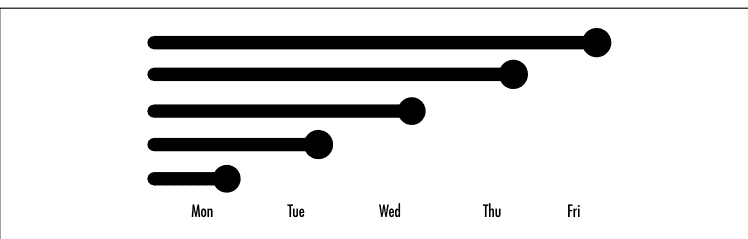

利用增量备份的另一种方法是仅针对前一天的数据变化进行增量，，每周执行一次全备镜像发送到异地（见图 8.3）。在 във轮转方案中，只有周五的磁带被送到现场，而周一至周四的磁带每周重复使用。当在周四进行恢复时，你需要先恢复周五的磁带，然后按照日期恢复本周周一至周三的磁带。

作为一个实际示例，让我们考虑一家拥有大型数据库的公司，数据库作为动态内容为 Web 服务器。提供动态内容的应用程序位于第二台服务器，而数据库位于第三台服务器。在这个示例中，如果使用第一种备份方案

www.syngress.com

第8 章 • 灾难恢复规划：最佳防御

## 图 8.3 周五全备，并带每日增量系统（自上次增量备份以来）

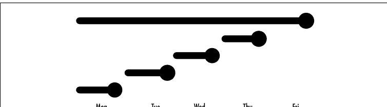

将对所有三台服务器进行每日全备。因为 Web 服务器没有静态内容，它不包含任何变化的内容，因此软件和操作系统的镜像相当稳定。每天对该系统拍摄完整镜像将是对介质的浪费（参考图 8.1）。另一方面，数据库是极具动态性的，因为它经常有产品更新，或者在每个订单时都有客户更新。对数据库拍摄完整镜像更有意义，特别是因为涉及到敏感的客户数据（参考图 8.2）。事实上，大型客户数据库可能甚至需要每天进行多次增量备份，并每天执行一次全备（参考图 8.3）。

# 存储区域网络 (SAN)

由于应用程序向数据库写入数据，应用程序的镜像可能必须与数据库镜像在同时拍摄，以确保事务状态被正确保留。在这种情况下，存储区域网络（SAN）可能会提供最佳结果。SAN 由一组通过高速网络连接的大型数据设备组成。磁盘可以条带化，看起来像一个大磁盘，或者分成两个等大小的组。一组可以作为主磁盘存储分区，另一组可以是第一组的镜像。镜像意味着为了冗余而写入数据。向 SAN 写入数据的计算机系统每次对主盘进行写入操作时，都会将数据复制到镜像中。每天，可以断开镜像足够的时间将数据流传输到磁带设备，这

www.syngress.com

# 灾难恢复规划：最佳防御 • 第8 章 443


数据流传输到磁带后，镜像将恢复并填充数据，直到下一次备份操作。或者可以有两个镜像，一个用于活动镜像，另一个用于流向磁带的备份镜像。就此而言，磁带设备和备份镜像不需要现场，它们可以托管在远程数据存储设施。廉价且大型磁盘阵列的普及为 SAN 作为数据备份未来铺了道路，尽管异地 SAN 技术仍然相对不成熟并存在问题。情况因人而异。

# 保护敏感信息的备份

我们在本章中花了大量时间讨论灾难恢复以及在灾难期间恢复丢失数据的方法。其中一种灾难是入侵者在入侵期间窃取或破坏数据。安全漏洞不仅发生在网络上。如果我决心偷取你的数据，我可能会从每个角度秘密检查你的操作，并考虑所有替代方案，包括偷取你的备份磁带。如果我可以从某人的桌子上拿走备份磁带并直接读取其中的数据，我为什么要花时间破解登录密码呢？如果承包商有访问你内部网络的权限，而你将备份磁带整齐地堆放在一个在线磁带库中，他可以通过网络访问它们，那么他就可以从磁带中复制数据（这是不通过网络共享磁带设备的良好理由）。如果他是一个外部数据窃贼，进行一些社交工程可能在时间和金钱上更廉，，并说服异地设施他是你为你公司工作的承包商，需要一个磁带来执行恢复。他将如何发现你的异地存储设施在哪里？不要假设你的备份受保护了，只因为你付钱让异地设施去取它们。你认为你发送了良好的备份，但实际上里面什么用的都没有。我们需要一种在发送数据之前进行加密的软件软件包，而不是之后。


第8 章 • 灾难恢复规划：最佳防御

对于你位于各地的站点，每个管理员负责自己的备份。假设他们都使用相同的软件软件包将数据流传输到远程备份服务器，然后该服务器在存储到磁带之前对数据进行加密。数据在磁带上受保护，但在网络传输过程中不是。角落里的人可以从网络上嗅探，因为它是明文发送的。让我们看看管理员在决定哪种备份软件最保护电子商务网站敏感数据时可能会采取的步骤。

# 用户验证

首先，我们购买了一个声称可以加密的良好软件包，并将其安装在每台服务器上，使其由特权管理员账户运行。管理员每天登录并启动关键数据的备份。之后，每天为这项任务设置软件变得陈旧乏味。当需要恢复时，管理员登录并点击一组文件，软件在从远程磁带库传输文件时对其解密。

现在想想在这种情况下必须发生什么。管理员使用备份软件不需要 NT 登录密码之外的额外密码，或者密码存储在磁盘的某处，并在备份期间从该位置检索。如果运行软件不需要额外密码，那么远程备份服务器如何知道角落里的人写入它是不可以的？如果任何人都可以写入文件，那么任何人都可以用垃圾填充磁带，阻止你合法的备份在夜间发生。或者，可能有人在你第二天上班之前覆盖了你的某个良好备份或删除了已备份的文件。我们需要一种在向网络发送数据之前要求用户进行身份验证的软件软件包，以便只有授权的用户才能写入磁带库。

# 灾备规划：最佳防御 • 第 8 章 445

如果软件已经需要独立的运行时密码，并以人类可读的形式存储在磁盘上，或许我可以远程挂载存储文件的磁盘并读取它（修复：永远不要向所有人共享你的 C 盘），或者从注册表中获取（修复：配置你的系统，不允许除管理员以外的任何人远程读取注册表）。如果密码经过了模糊处理，它必须以某种方式存储，以便在你不在场时备份软件可以检索它，这意味着没有使用单向哈希。如果密码经过了加密，那么它在某个时刻必须被解密，解密密码的密钥也必须存储在磁盘的某处，可能在注册表中，也可能在与软件相关的配置中（修复：别买那种软件）。为了防止在磁盘上存储密钥和密码，我们都需要一个为每个用户使用不同密码并使用安全验证方法进行检查的软件包。

## 数据加密与控制

我们推销软件并发现了一个可以独立验证每个用户的新软件包。它所使用的身份验证和加密算法的强度让我们留深刻。。我们可以选择 3DES 或 Blowfish 来加密文件，这应该很不错，对吧？软件在安装时生成一个强加密密钥，并复制到每个服务器上，在数据发送到网络之前进行加密。这个软件包有什么问题呢？除非每个用户的文件都使用不同的密钥加密，否则经过验证的用户仍然可以解密并读取其他用户的文件。破解一个用户的口令或获取私钥就足以授予访问所有服务器数据的权限（尽管可能需要伪造用户 IP 地址才能将备份数据从网络传出）。如果我们考虑在 DMZ（解 Implementation区）上备份主机，而磁带服务器位于防火墙内部，这个问题就表现得最明显了。如果 Web 服务器被攻破，从备份带访问应用程序服务器的数据库本应该是可能的，但除非每台服务器使用不同的密钥进行备份，否则如此。显然，每个备份用户都需要经过唯一的身份验证，并且每个服务器的数据在发送到网络之前需要经过唯一的加密。我们的软件还需要允许我们在 DMZ 被攻破时防止将其恢复到 DMZ。

如果系统损坏严重到需要恢复的程度，应该将其脱离网络、取回、修复并返回 DMZ。允许恢复通过防火墙出去无异于自讨苦吃。防止这种情况的一种方法是购买一种在一个端口执行备份并在另一个端口执行恢复的软件，然后在防火墙上封锁恢复端口。

## 密钥管理

现在我们决定消除备份过程中的自动化，我们拥有了可以验证每个用户并为每台服务器使用不同密钥加密数据的软件，而且防火墙允许恢复到 DMZ。但我们还没有完全脱险。所有六位管理员都使用他们知道的密码和或口令。其中一人离开公司时，没有告诉任何人恢复用其私有加密密钥备份的数据所需的口令。使用丢失密钥加密的数据，由于由于无法在恢复时进行解密，现在已经变得毫无用处。如果远程备份存储了私钥的副本，它们是否存储在安全的数据库中？数据库是否了备份？你是否有能力在没有关联密码或口令的情况下检索私钥？

如果存在一个可以访问所有秘密密钥的管理员账户，它就是一个可能易于利用的漏洞点。如果没有，当口令被忘记或无法恢复时，你可能无法恢复文件。即使你能够检索私钥，管理许多私钥也可能是困难的，特别是当你保持良好的安全性并频繁更改它们时。我们需要一个密钥管理基础设施，或者我们需要尽力减少手动管理密钥的难度。如果你的业务规模较小，这样做可能更具成本效益，所以我们决定只让两个人全职负责备份，而不是兼职。他们的经理现在每 90 天为他们生成新密钥，并保留旧密钥及其使用日期以备日后需要恢复。密钥副本存储在防火墙内部的服务器服务器上，并频繁备份到另一个备份服务器，以防止单点故障。如果我们从一开始就实施了这种解决方案，就能为我们节省两个软件包的钱。

保护极其敏感的数据需要调查你的企业正在使用的备份过程和软件、谁参与其中、密钥的安全性如何、如何执行身份验证和加密、数据存储在何处、如何传输等。将执行备份的人数减少到最少可能有助于物理访问、密钥管理和频繁更改密钥的问题。依赖仅在远程端进行加密的软件甚至不如使用本地进行双端加密。远程存储公司提供数据存储服务，允许你加密数据并将其流传输到他们的服务器，在那里如果他们的服务器被攻破且你的口令很弱，数据会被加密。当然，你的数据安全取决于你与远程数据站点连接的安全性，但话说回来，你也不需要担心数据是如何进行物理传输的。另一种策略是在备份时分离身份验证功能。

## 硬件故障或服务丢失规划

没有任何计算机系统是在构建时没有固有缺陷的，这些缺陷会（并且！）会在最糟糕的时候表现出来。大多数电子商务网站由复杂的服务器阵、重定向器、应用程序软件、数据库、防火墙和电信设备组成，通常位于不同的地点。任何组件的故障都有可能导致终端用户体验的停滞。提前对设备故障进行规划，意味着通过向你的站点引入尽可能多的容错能力，来最大限度地减少成为单点故障受害的机会。

大多数企业都有本地电话线，可以在正常网络服务不可用时用于拨号备份解决方案。如果你使用租用线路作为网络连接，连接到你内部网络的数据业务单元（DSU）也可以进行拨号备份。拨号备份也不一定依赖于有线电话服务。你可以实施无线网络或无线调制解调器，在正常网络提供商受到影响时自动拨出。

## 单点故障问题

作者的一家公司为一个通过广域网（WAN）链路连接到总部的办事处做过工作。附近郊区的另一个办事处也通过从不同网络商租用的第二个 WAN 链路连接到总部。使用不同的网络提供商是刻意的，为了避免单点故障。网络工程师知道每个 WAN 链路对于所服务的办公室来说都是单点故障，因此他在两个办公室之间建立了冗余链路，如果一条 WAN 链路故障，另一个将处理两个办公室的流量。他甚至为办公室之间的链路获取了第三个本地提供商以增加额外的冗余。但他没有意识到，这两个 WAN 链路提供商在离开城市时都将流量交给了同一个长途运营商。当运营商由于施工现场附近的光纤断裂而宕机时，两个办公室都无法向总部发送流量。

这个例子说明了单点故障可能会引入到最精心规划的高可用性配置中。如果你正在实施高可用性配置，必须检查你电子商务网站每个组件之间每个端到端的每个点是否存在单点故障。让我们来看看一些常见的高可用性解决方案类型，以及它们如何解决你站点不同部分的单点故障问题。

灾难恢复计划：最佳防御 • 第 8 章

## 损害与防御……

如果你的站点与客户签订了服务水平协议（SLA），那么其中可能包含了对客户可以期望的站点运行时间的解释。在营销文献或合同说明中，运行时间长度通常用可用性的“几个9”（Number of Nines）来表示，但这个术语是什么意思呢？

如表 8.1 所示，如果你的站点实现了两个9的可用性，那么每年因计划或非计划故障导致的不可用时间将少于 87小时。如果你的站点实现了三个9，停机时间将减少到每年不足8小时。对于互联网服务提供商（ISP）和大型数据中心，对几个9的要求可能是六个或更多。一个9之差就会对你的 ISP 保证的服务水平产生巨大影响。

表 8.1 可用性预期（“几个9”）

| 可用性百分比 (%) | 允许停机时间 |
| --- | --- |
| 99.9999 | 32 秒 |
| 99.999 | 5.3 分钟 |
| 99.99 | 53 分钟 |
| 99.9 | 8.7 小时 |
| 99.0 | 87 分钟 |

## ISP 冗余

如果你通往某个 ISP 的线路某天中断了，你希望有一个第二个冗余 ISP 准备好立即切换以接替。你可以与这个第二个 ISP 签约，使其向你的站点发布低优先级路由，而让第一个 ISP 发布高优先级路由。如果第一个挂机了，另一个将自动接管流量。如果你的站点无法负担两个网络服务提供商，最好的办法是安装两条通往同一服务提供商的独立物理线路，或者安装两个将流量路由到本地环路的服务提供商。

为了说明这个观点，假设你的业务与 Gee Whiz ISP 签约作为网络服务提供商。Gee Whiz 向当地公司订购了一条将租用线路连接到你的建筑中。安装完成后，你的新 ISP 将通过电话公司（即本地环路提供商）将客户的流量路由到你的站点。如果由于某种原因流量无法从客户传输到 Gee Whiz，但只要客户能够连接到另一个具有本地环路路由的服务提供商，客户仍然有可能连接到你的站点。假设你还与 Golly ISP 签约作为冗余提供商。在这个例子中，当 Gee Whiz 无法向你路由流量时，Golly 开始工作，客户永远不需要知道你的一条互联网链路中断了。在这个例子中，当地电话公司是一个单点故障，但只要 ISP 之间不共享任何上游链路，它们就没有问题。

假设一下，Gee Whiz 和 Golly 都是小型服务提供商，它们在离开你的城市时将流量发送到 WorldCom 或 Sprint 等相同的骨干提供商公司。这种情况可能发生的一个例子是：骨干提供商在你的城市内只有一个网络接入点。任一 ISP 连接到该提供商的唯一方法都是将流量发送到唯一的网络接入点。在这种情况下，拥有两个 ISP 仅为城市内的客户提供冗余，以防骨干运营商没有收到来自任何 ISP 的流量。如果光纤在网络接入点附近断裂，就会发生这种情况。你的大多数客户在市外，在这种情况下拥有冗余 ISP 可能对你帮助不大。更好的解决方案是调查你的 ISP 如何接入互联网骨干网，并选择一个使用不同骨干提供商的冗余 ISP。例如，如果一个使用 Sprint，另一个使用 WorldCom，那么两者同时故障的概率远低于单独任何一个故障的概率。

## 网络硬件冗余

网络设备也具有你可以实现的高可用性（HA）功能。一个 HA 路由器配置可能是两个相同的 Cisco（www.cisco.com）路由器，运行 Cisco 的热备用协议（HSRP）。HSRP 是两台路由器检测另一台是在线还是离线的手段。HSRP 将虚拟路由器地址发布为网络网关。两个物理路由器具有不同的地址，并进行协商决定由哪台活动路由器实际上为虚拟地址路由流量。非活动路由器会定期检查以确保另一台仍然在线。如果不是，它将开始处理该虚拟地址的流量。由于客户端将流量发送到虚拟路由器，它们永远不知道现在是另一台物理路由器在处理它们的流量。第一个路由器可以完全从网络中移除、进行维修并重新安装，而第二个路由器则无缝地接收流量。

防火墙具有类似的功能，允许你将几个防火墙聚在一起进行负载均衡和高可用。例如，诺基（www.nokia.com）使用虚拟路由器冗余协议（VRRP），其功能与 HSRP 对 Cisco 路由器的作用类似。多达 256 台诺基亚设备可以使用 VRRP 以串方式连接，显示为一个单一的公共防火墙。这么多路由器对于高可用性来说可能过剩，但如果你想在它们之间均衡大量流量，这可能会大派用用场。

## 系统硬件冗余

从 CPU 的角度来看，Sun（www.sun.com）Enterprise 10000 是从一开始就设计到硬件中的高可用概念示例。该系统有多个 CPU 板，可以配置为像不同的系统。这些板是热插拔的，这意味着可以在不使系统离线的情况下拔出并更换。不同的 CPU 可以分配给不同的任务，这样一个应用程序的负载就不会影响另一个。

即使你的预算不允许购买像 E10000 这样的顶级解决方案，你也可以购买带有多个 CPU 的服务器并将它们分配给不同的任务。例如，如果你有一个存储应用程序所需数据的数据库服务器，你可以配置数据库软件使用一个 CPU，应用程序软件使用另一个。如果主板上有三个 CPU，所有其他系统任务可以使用第三个。还有许多基于集群的解决方案。这些解决方案通常允许你将几台服务器配置为网络上的单一虚拟服务器。

冗余磁盘阵列（RAID）为需要消除磁盘存储解决方案单点故障的人提供了多种冗余选项。RAID 指定了同时向多个驱动器写入数据的方法，称为“条带”（striping）。条带级别提供了不同的冗余选项：

- RAID 0：数据跨多个磁盘进行条带，但不提供副本。提高了数据吞吐量，但无法防止磁盘故障时的数据丢失。速度快，但如果磁盘损坏则没有容错能力。
- RAID 1：数据写入两个或多个不同的驱动器或驱动集。通常被称为镜像，一组驱动器上的数据与另一组完全相同，通过始终保留数据的备份副本来提供冗余。
- RAID 2：数据处理方式类似于 RAID 1，但为没有内置错误检测的驱动器提供了错误校验码。对于已经具有错误检测的 SCSI 驱动器没有用。
- RAID 3：数据按字节跨多个驱动器进行条带，保留一个驱动器以包含写入其他磁盘的每个字节的校验位。由于校验位可以被确定，任何一个驱动器的故障只会丢失一个位，该位可以通过其他位和校验位计算出来。两个或多个驱动器的故障是无法恢复的。字节级条带需要特殊硬件才能高效运行，但这种级别的 RAID 非常适合大数据读取（例如数据库）。
- RAID 4：数据条带方式与 RAID 3 类似，但是按块而非字节。读取效率与 RAID 0 相似，但写入速度较慢，因为每次都必须更新校验位，因此校验驱动器成为瓶颈。如果丢失一个硬盘但不是两个或更多，则可以保证冗余性。
- RAID 5：数据条带方式与 RAID 4 类似，但校验位也分布在所有磁盘上。这防止了因校验驱动器导致的减速。小规模写入速度有所提高，但在写入大连续数据块时并不会提供速度提升。同样，只有在一个硬盘故障时才能保证冗余性。

Web 服务器的服务器冗余方案通常允许你将高可用性和负载均衡作为解决方案的一部分。在服务器上加载集群软件，或将服务器放置在能够将流量重定向到负载最低服务器的网络设备后方，可以让你使用多台服务器来模拟单个服务器的操作以提供冗余。Windows 2000 内置了网络集群功能，用于将多个物理服务器管理为一个虚拟 IP 地址。如果你有一台平均可用时间为“四个9”的服务器，它会有 10% 的时间处于宕机状态。如果你增加第二台服务器，两者同时宕机的概率将降到 1%。增加第三台可以使你的网站达到“五个9”的可用性。

## 扩展解决方案的范围

如果你的网站需要提供“五个9”的可用性，而你通过安装三台平均可用时间为 90% 的冗余服务器来实现这一要求，请考虑当其中一台故障时会发生什么。在修复服务器并将其重新上线期间，你的网站仅由两个系统运行，在任何给定时刻一个系统故障的概率为 10%，两个系统同时故障的概率为 1%（.1 x .1 = .01）。这远低于“五个9”的可用性；它只是“两个9”（99%）。如果你必须随时保证“五个9”，你应该计划在至少至少有一个系统故障的情况下维持“五个9”的水平。这样，即使在例行硬件故障或计划内升级期间，你的保证也能得到满足。

www.synergy.com

## 第8章 • 灾难恢复规划：最佳防御

目前为止，我们的讨论一直是关于在故障期间自动接替另一个系统的热备系统。如果此选项对你的预算来说太贵，另一种替代方案是实施热备或冷备系统。热备的一个示例是一个与当前活动系统保持恒一致的系统，但在活动系统离线时不会自动进行故障转移。它可能被安装在机架上、已开启，并持续通过实时数据的副本进行磁盘镜像同步，但需要人工干预才能转换为热备状态，例如将其 IP 地址更改为故障系统的 IP 地址。冷备的一个示例是存放在架子上的备用硬件单元，准备好安装任何必要的软件以替换故障系统。显然，备用系统越“冷”（离实时副本系统越远），恢复时间就越长。另一方面，冷备系统可以加载不同类型的软件，使其成为五种不同类型服务器的替代品，而在热备方案中，你必须购买五台等同的备用系统。冷备可以便宜得多，并且仍为你提供相当快速的恢复选择。通过将你的冗余硬件备机与热备或冷备替换硬件相结合，你可以缩短可用性数字低于预期“9”的数量的时间。

## 我该如何防止自然灾害？

在某个时刻，国家的每个部分都会受到洪水、地震或龙卷风等自然灾害的袭击。正如本章前面讨论的，你的灾难恢复计划需要详细说明如何处理这类灾害。但让我们看看如何防止自然灾害对你的业务造成全性灾难。正如硬件和网络冗余有助于为你的网站建立容错能力，数据中心冗余可以为你的业务运营提供容错能力。如果你的业务无法负担整个数据中心的备份副本，你仍然可以采取措施，规划需要额外的数据中心空间来执行恢复工作。无论你决定仅租赁额外空间、仅为该空间配备环境设施，还是为其配备计算机和系统，你现在采取的步骤在将来需要时可以为你节省精力和精力。


## 热备场：恢复的替代路径

可以完全作为你的主站运行的备用数据中心被称为热场（hot site）。在业务功能完全不可用的情况下，热场准备好以极短的停机时间（例如48小时）启动替代服务。根据你需要执行的恢复功能，热场可能提供计算设施、设备、服务、安全以及关键人员的住所。它可以是你公司拥有的建筑内的一个小围栏空间、由你的 ISP 运营的托管设施，也可以是存储在代表你执行热场服务的供应商拥有的硬件上的磁盘空间和应用程序。某些站点服务公司会在时将卫星天线和移动数据中心拖车带到你的所在地。无论如何，将它位于远离你主数据中心的地方是一个好主意，也许在另一个城市或州，这样它就不会受到导致主站不可用的同一事件的影响。

与热场形成对比的是热备场（warm site）。热场可能包含一组功能完全的硬件、和服务数据，而热备场需要进行一些工作才能运行。热备场可能提供充足的空间、空调和电力，但请考虑你的需求，因为这些设备并不一定已经安装在那在那里。这种想法的进一步极端情况是冷备场（cold site），它可能只是存储备用硬件的仓库空间，以备应急使用。

## 我如何选择热备场？

选择热备场的第一步是确定你希望它执行的服务。该站点是一个包含所有工资和支持服务的完全冗余数据中心，还是仅仅是用于销售的冗余网站？你需要在那里部署多少服务器，运行它们需要多少空间、空调和电力？你的呼叫是哪个关键组成部分？为你为灾难计划准备的关键服务器清单将有助于回答这些问题。

在你确定了寻找的规模和容量后，首先检查你公司内部可能提供这些要求的地点。同一公司的远程办事处是理想的热备场，因为资本已经投资了这些地点。通常，远程办事处有一个空闲的会议室或办公室，通过增加更好的通风处理和便携式 UPS 可以轻松转换为机房。如果你的公司很小且没有远程办事处，许多 ISP 提供托管服务。这些建筑是你可以在锁定的围栏内放置计算设备，由 ISP 提供网络访问、电力提供环境控制。ISP 可能或不提供系统管理、停车和员工的办公空间，然而，在查看托管站点时请考虑你的需求。如果你决定采用托管路线，请选择一个设施位于你所在地附近但不易发生自然灾害的地区的供应商。

## 测试流程

在选定热备场并安装设备后，是时候测试它是否正常工作了。应该每年进行一次模拟灾难演习，以确保你的灾难恢复计划（DRP）已保持最新，每个人都知道他们恢复系统和软件所需的部分。虽然并非非要将服务切换到你的热备机，但你会希望像真实发生一样练习切换过程。或者，如果你想完全测试热备机的能力，可以设置具有虚假名称的服务器，并指派几个人充当虚假客户在切换后进行访问。如果你选择了一个在发生火灾时人员应集合的备用地点，你可以指示他们假装火灾刚刚发生，他们现在必须恢复业务。这可能显得有些戏剧化，但灾难演习会迫使人们思考他们平时不会问的问题。

## 了解你的保险选择

即使是准备最充分的公司也会购买保险来保护自己免受其控制之外事件的影响，但直到几年前，大多数业务责任保险单尚未对电子商务相关的风险提供足够的保障。从历史上看，实体企业一直维持着通用责任险，以防止对有形财产的损害。这种保单涵盖了公司财产内意外伤害或由于公司运营导致的结果损害索赔，通常还包括业务广告背景下的诽谤、中伤或名誉损害索赔。然而，互联网引入了财产、损害和收入损失的新定义，这些定义简单与传统通用责任险的条款无法契合。结果是？本以为损失获得覆盖的公司发现自己不得不花费巨额法律费用来迫使其保险公司理赔，而在许多情况下，保险公司赢了。为了解决这些传统保单在承保方面的缺陷，过去二到三年中出现了一些新的保险产品，针对各种类型电子商务业务的需求。

一些新的保险产品是安保与保险的混合体，旨在降低承保保险的风险。例如，伦敦劳士德（`www.loyds.com`）和 SafeOnline（`www.safeonline.com`）是电子商务保险承保商，他们已与 Counterpane 系统合作，对其客户进行持续的安全监控。这些承保人要求在保险涵盖剩余风险之前，必须进行安全审计并安装 Counterpane 的安全监控服务。劳士德还与 Tripwire（`www.tripwire.com`）合作，如果安装了入侵检测软件，将为其期两年的产品 E-Comprehensive 提供 10% 的折扣。INSURETrust（`www.insuretrust.com`）提供针对电子商务风险管理的评估服务和保险产品。IBM 已与大型保险经纪人 Sedwick 合作，为电子商务提供数据保护保险，由 IBM 执行安全审计作为保险资质的一部分。Marsh and McLennan Company（`www.mmc.com`）为包括电子商务在内的企业各个方面提供风险评估和保险服务。许多其他保险公司也要求一次安全评估作为资质流程的一部分。

新的电子商务保险产品可以分为几大类，尽管产品线随着知识产权和电子商务法律的发展不断进化。大多数电子商务保险公司拥有涵盖三个主要领域的产品：

- 专业责任，也称为专业服务错误与遗漏险。
- 与出版相关的责任保障，例如商标和版权侵权。
- 针对公司和/或第三方的电子商务财产和收入保护。

## 错误与遗漏险

专业责任保险（E&O）保护医生、律师、工程师和设计顾问等专业人员在为客户提供服务时造成的损害。这些保单涵盖了法院定义的疏忽代理人和遗漏错误。许多在 Web 网上提供服务的医生或律师发现，当他们的服务通过 Web 交付时，传统的医疗执业险已不再涵盖这些服务了。聘用顾问的软件开发公司也希望针对因其执行的工作缺陷导致的索赔获得保护。然而，软件直接造成的损害或软件未能正常运行导致的损害不在通用保单范围内，因为软件不被视为有形财产，其本身不会引起伤害。因此，许多软件公司现在要求承包商和顾问提供 E&O 保障证明以保护自己。

作为专业责任的一个例子，考虑这种情况：如果一个 Web 设计师为客户公司创建一个电子商务网站，并在过程中建议公司购买特定的软件来运行网站，但在交付时发现该软件与公司的硬件不兼容。如果顾问犯了规格错误，他的 E&O 保单将涵盖公司更换软件的费用。如果硬件或软件供应商在自己的网站上不当推宣传了其产品功能，则由供应商的保单涵盖该费用。即使错误不是你的错，E&O 保单通常也会涵盖辩护期间产生的法律费用。这种保障对于负担不起巨额费用却发现自己被迫防御无理或毫无根据的诉讼的小型公司和个人承包商来说是不可或缺的。请记住，E&O 保障不包括破产或市场状况恶化导致的业务失败，也不会涵盖被发现是由于糟糕业务决策导致的费用。

## 知识产权责任

仅仅为实体公司产品广告的电子商务网站在电子商务创业中风险最低，但它们的风险并不一定被传统保险产品涵盖。在互联网出现之前，公司在印刷手册中侵犯商标的行为，赔偿金额受限于手册的发行量。今天，网站上的商标违规行为可能会产生全球范围内的赔偿。互联网还为传统公司带来了电子邮件风险。如果员工发送讨论客户的电子邮件，且该邮件包含被发布到新闻组或以其他方式公开的私人细节，他们可能会成为诉讼的目标。由于通用责任险不将电子邮件视为广告或营销，如果没有特殊的电子商务特别条款和背书，这些赔偿将是不被涵盖的。

## 第一方电子商务保护

电子商务保护通常包括涵盖黑客、DoS 攻击、计算机病毒、员工恶意行为、知识产权损失以及对第三方系统损害的风险。通常情况下，直接针对电子商务业务的综合保险产品还包括专业错误与遗漏的背书，并且还涵盖版权和商标问题。如果你的网站向其他公司销售 Web 服务，综合保险包中的 E&O 条款将成为你在无法满足预期时保护业务的重要考虑。特种电子商务保单可能涵盖对保险人的损害、对第三方的损害或两者兼有，且具体条款不同承保人之间差异很大。

对专门电子商务保险的需求可以通过研究传统商业保险产品如何涵盖导致保险公司收入损失的灾难来来说明。传统的灾难是指地震、火灾和洪水，这些因素会导致企业在几天或几周内无法营业，并在影响后续之前可能有几天的等待期。如果电子商务网站遭受几小时的 DoS 攻击，保障延迟可能意味着完全没有保障，然而如果该网站是公司主要的业务来源，即使几小时也意味着巨大的收入损失。遭受服务中断的精简且资金紧张的点公司可能不得不依靠保险公司的保障来支付公关和恢复影响的突发费用，而无法等待保障延迟。

考虑电子商务保障的最大理由可能是针对知识产权被盗或损失的条款。高科技公司日益意识到，存储在计算机系统中的数据价值远高于系统本身。然而传统的商业财产保险产品并不涵盖实物财产，也不会涵盖由不满的员工或侵入者造成的盗窃或损坏的费用。员工的故意破坏性行为（例如在软件中植入后门或在编码期间故意禁用软件产品）属于违法行为；这哪种保险产品都不涵盖实施该行为者的法律费用。然而，如果雇佣该个人的公司正面临诉讼，并且能够证明其并不知或未参与该非法活动，那么该公司可能在电子商务保险的保障范围内。

数据泄窃并不是你可能需要覆盖的唯一损失类型。因专利或版权侵权而产生的法律费用可能会在案件解决之前就让你破产。域名名称经常被频繁注册为商标，但你可能注册时可能并并知这一点。除非你能证明自己是出于诚意，否则法院对网络盗版（即故意注册他人认为自己拥有权利的域名）所裁定的赔偿金额范围从 1,000 美元到 100,000 美元（来源：美国知识产权法协会，1999；`www.aipl.com`）。网络犯罪背书还可能涵盖如果侵入者使用你的网站进行犯罪金融交易时，你可能在报销、调查和起诉中遭受的损失。

## 确定你需要的覆盖

决定需要什么覆盖的第一步是检查被覆盖的企业，并详细列出电子商务运营包含的内容。大多数承保人在你申请保单时会要求提供此类详细的电子业务描述。你需要提供业务财务报表。如果公司成立时间较短，承保人可能还会要求所有者或高管理层的领导或简历信息。

仔细检查你想要保险的风险set，并列一份清单，以便你针对你认为关键的项目查看建议的保单覆盖。到目前，不同保险公司提供的保单存在巨大差异；你应该仔细检查保单以看看它是否符合你的需求。例如，如果你的网站是仅宣传型的网站，只发布广告而不参与在线销售产品，你将需要关注与发布此类商标侵权、版权保护和诽谤相关的风险。然而，某些电子商务保单如果广告网站已被你的通用责任险涵盖，则会排除这些网站。如果你的网站收集客户数据并投放广告，通用责任保单将不会涵盖数据的损坏或损失。如果你想确保拥有这项覆盖，可能需要申请可选的背书。

如果你的网站是一个不同的业务伙伴共享数据或交叉开发的外网，那么公司之间传播病毒或木洛马的风险可能会对现实情况构成重大风险。Reality Research (`www.realityresearch.com`) 报告称，美国公司因计算机病毒和安全入侵导致生产力损失和停机的成本为 2,660 亿美元（美国）。这占国民生产总值的 2.5%，总停机时间的 3.2%（来源：普华永道）。某些保单排除由你网站产生的病毒对第三方系统造成的损害，因此你应该检查保单或购买可选的背书以确保你获得覆盖。

另一个考虑因素是你的公司是否聘用了顾问和承包商。保险保单在覆盖方面可能会区分员工、顾问和临时工。即使你的公司要求顾问提供 E&O（错误与遗漏责任）覆盖，但如果公司与顾问一起被列为诉讼被告，这些保单可能不会涵盖公司的费用。请仔细考虑保单的条款，并在必要时购买可选的背书为顾问提供覆盖。

如果你购买了 E&O 覆盖并在随后被起诉，保单可能会规定由你的保险公司为你选择法律顾问来辩护案件。如果你希望保留选择自己顾问的权利，你可能需要提出此项要求。

接受信用卡，你可能并不希望有商户欺诈保险条款，来保护那些在你的网站上使用欺诈信用卡的客户。如果你是一名网页设计师，当你主要兴趣在于防止客户公司的疏忽和遗漏时，全面的电子商务产品可能大材小用，但你可能对额外的商标侵权附加条款感兴趣，以保护你免受意外事故。

许多保险公司提供全面的保险包，其中由几项你可以单独选择的小型产品组成。单个产品通常可以通过可选的附加条款进行定制以满足你的需求。为了获得特定的附加条款，你可能需要考虑几家保险公司的产品，找到合适的一个。某些保单包含了全球范围覆盖条款，如果你的客户仅在美国，你可能可以排除这些条款。

在购买旨在覆盖业务地点的伞保险时，需要考虑的因素之一是涵盖惩罚性赔偿的标准条款是否适用于你开展业务的所有州。某些州通过法律将惩罚性赔偿排除在保障范围之外，因此你应该在保单中排除这些内容。

另一个考虑因素是保单如何涵盖间接伤害。某些保单规定，如果你的业务在无意中提供了缺陷产品，导致第三方在使用时发生伤害，则包含涵盖。一个例子可能是，如果你的公司在其网站上提供了一个财务计算器，另一公司用它来计算工资支出，由于你的计算器中有一个未知错误，导致另一公司误算了几名员工的工资。这些员工将遭受由你的计算器软件造成的间接伤害。如果你的保单涵盖此类伤害，但你的网站没有参与任何可能导致此类索赔的活动，那么排除该条款将是浪费的。

你还可以购买针对可能导致责任索赔的事件的覆盖，但它并不涵盖网站宕机时的收入持续性。前者是第三方覆盖的示例，而后者是第一方覆盖。你的业务可能需要保单中的第一方覆盖条款。如果是这样，你可以通过购买仅涵盖第三方索赔的保单来节省费用。

## 总结

在本章中，我们从电子商务的角度涵盖了灾难恢复的基础知识。我们查看了良好的灾难恢复计划的各种组件，以及某些公司在没有此类计划时的表现如何。灾难恢复的某些组件涉及规划如何处理丢失机密、丢失对关键系统的访问权限以及丢失关键人员。规划可以帮助识别可能在灾难发生前通过预防来避免的领域。对于无法预防的事件，仍然可以检查最小化停机风险的方法。某些质量保证程序可以协助企业创建灾难恢复计划。质量的重要性无论如何强调都不为过，因为最大的正常运行时间就是对客户的服务的质量。在规划过程中让高层管理尽早参与对于为宕机和预算容忍度提供指导也是至关重要的。

当灾难发生且必须恢复数据时，高质量的备份至关重要。在本章中，我们研究了离线存储备份介质的重要性，并讨论了几种离线轮换方案。免费实施最适合你业务的混合方案，但请记住保留你的离线磁带足够的时间，以恢复可能需要的所有内容。某些公司有保留多年数据的协议，这应该被纳入保留计划中。根据你的安全策略分类为敏感的数据备份需要加密，以防止数据被盗取。我们讨论了备份软件提供加密的几个功能、它们如何使用以及为什么这些功能非常重要。

为你的网站增加容错能力可以消除硬件和软件配置中的单点故障，这些故障可能是导致宕机的原因。我们讨论了增加冗余硬件、软件、网络服务以及终端数据中心热备件的几种方法，以便在某或多个系统发生灾难性故障时作为备用。如果预算太小无法实施热备选项，温备和冷备硬件及数据中心也提供益处。每年选择一或两次练习演练来测试切换能力。

在完成所有规划后，仍然会发生你未曾规划的灾难。你的电子商务业务最不需要的就是意外情况导致破产，因此购买保险可能是涵盖此类风险的最佳选择。保险可以被视为一种分摊灾难发生成本的方式，通过证明业务在发生灾难时不会失败，从而为你的客户提供一种保证。

## 解决方案快线

### 什么是灾难恢复规划？

- 灾难恢复计划的最简单形式可以是一份包含相关电话和信息的表格。相反，它也可以复杂到像一个持续运行并随时准备部署的完备业务连续计划。
- 一个良好的灾难恢复计划涵盖以下三个领域：机密或数据的丢失；对硬件和系统的访问丢失；人员或关键技能的丢失。所有这些共同点是需要识别负责应急的关键人员、如何联系他们、他们的权限级别，以及在什么情况下会召唤他们。
- 如果你的电子商务网站是企业对企业（B2B）网站，你可能会发现与外国机构（尤其是欧洲国家）做生意需要 ISO 认证。然而，如果你的电子商务业务规模较小，或者你现在不想追求 ISO 认证，自审电子商务质量标准仍然是明智的，考虑明天可能发生的情况并制定你可以采取的步骤。

## 确保信息安全

### 备份与恢复

- 在恢复时确保数据备份质量的最有效方法是在备份时进行常规验证，通常是将全部或部分数据恢复到磁盘并与原始数据进行比较。大多数备份软件提供一种自动机制，以验证写入备份介质的数据是磁盘数据的精确复制，但可能需要备份操作人员确保开启了该功能。使用验证程序进行备份需要更长时间，但这些额外的时间是非常值得的。
- 记录执行数据备份和恢复的过程是灾难规划不可或缺的一部分，因为备份和恢复程序在不同系统中可能会略有不同。例如，哪些软件在备份之前必须停止很重要。大多数数据库软件在备份数据库之前必须停止，否则备份镜像可能会损坏。你在恢复时最不需要的就是损坏的备份介质，因此你应该对这种可能性做好提前准备。
- 你的软件还需要允许你在 DMZ 被攻破时防止恢复到那里。如果一个系统损坏到需要恢复的程度，它应该脱离网络、带入内部、修复后再返回 DMZ。允许恢复通过防火墙出去是自讨麻烦。防止这种情况的一种方法是购买一种在一个端口执行备份并在另一个端口执行恢复的软件，然后在防火墙上拦截恢复端口。

灾难恢复计划：最佳防御 • 第8章 469页

- 如果你有两个备份操作员，其中一个知道认证密码，另一个知道加密短语，且需要两个人共同才能完成备份或恢复，那么单人就能损坏备份数据的风险就降低了。

## 针对硬件故障或服务丢失的规划

- 大多数企业都有本地电话线路，在正常网络服务不可用时可以用于拨号备份方案。如果你使用租用线路作为网络连接，那么连接到你内部网络的 DSU 很可能也能进行拨号备份。拨号备份并不依赖于有线电话服务。你可以实施备份无线网络或无线调制解调器，在你的网络服务供应商出现故障时自动拨出。
- 如果你正在实施高可用（High Availability）配置，必须检查电子商务网站每个组件之间的每个端到端连接是否存在单点故障。
- 如果某天通某个 ISP 的线路中断了，你可能希望第二个冗余 ISP 准备好立即切换接管。你可以与这第二个 ISP 签约，让它向你的网站发布低优先级路由，而让第一个 ISP 发布高优先级路由。如果第一个掉线，另一个将自动接管流量。如果你的网站负担不起两个网络供应商，次优方案是安装通往同一服务商的两条独立物理线路，或者两条流向同一服务环路的服务线路。
- 磁盘冗余阵列（RAID）为需要消除磁盘存储解决方案中单点故障的用户提供了多种冗余选项。RAID 提供了同时向多块硬盘写入数据的方法，这也称为“条化”（striping）。不同的条化级别提供了不同的 RAID 冗余选项。

## 我如何防止自然灾害？

- 仅仅硬件和网络冗余就能为你的网站建立容错能力，而数据中心冗余则为你的整个业务运营增加了容错性。在关键业务功能不可用的情况下，备用数据中心（热备）准备以极少的停机时间启动替代服务，为关键支持人员提供计算设施、设备、服务、安全保障和宿舍。将其位于远离主数据中心的地方，使其免受导致你主站不可用的同一事件的影响。
- 应该进行实际的灾难演习，以确保你的灾难恢复计划（DRP）是最新的，并且每个人都知道自己在恢复系统和软件时需要扮演的角色。灾难演习迫使人们思考他们通常不需要问的问题。

## 了解你的保险选择


- 互联网引入了财产、损害和收入损失的新定义，这些定义无法适用于传统通用责任保单的条款。为了弥补这些传统保单覆盖范围的不足，出现了新的保险产品，针对各种类型电子商务业务的需求。一些新的保险产品是安全与保险的混合体，旨在保险承保前降低风险。

- 如果你的网站向其他公司转售 Web 服务，那么当你销售的服务不符合客户预期时，综合电子商务包中的错误与遗漏（E&O）条款将是保护你业务的重要考虑因素。特殊的电子商务保险可能涵盖对被保险人的损害、第三方的损害或两者兼有，且具体条款在不同承保人之间存在巨大差异。

- 考虑电子商务保险最大的理由可能是针对知识产权被盗或丢失的条款。高科技公司正日益意识到，存储在他们的计算机系统中的数据价值远高于系统本身。

- 某些保单排除了源自你网站的病毒对第三方造成的造成的，因此你应该检查保单或购买可选附加条款以确保你获得覆盖。

- 所谓的“黑客保险”（涵盖安全违规期间造成的损害）在某些保险公司未包含在电子商务责任险中，但另一些公司则将其作为自动条款包含。

- 许多承保人在销售电子商务保险之前会要求安全审计，但如果结果符合预期，可能会提供涵盖整个审计费用的保险折扣。安全审计的费用可能高达 20,000 美元，取决于供应商。如果你是为客户构建电子商务网站的顾问或承包商，可能会被要求提供专业责任证明。

- 许多保险公司提供由多个可选单个产品组成的综合保险包。单个产品通常可以通过附加条款根据你的需求定制。

### 常见问题

以下由书作者解答的常见问题旨在衡量你对本章概念的理解程度，并帮助你在现实生活中实施这些概念。如果你有关于本章的问题，请访问 `www.syngress.com` 并点击“提问作者”表单。

- Q：是否有在线资源可以帮助创建灾难恢复计划？

- A：查看 `www.fema.gov/library/bizindex.htm`，这是 FEMA 网站提供的帮助各种类型企业创建灾难恢复计划的指南。MIT 也有一个 DRP 模板：`http://Web.mit.edu/security/www/pubplan.htm`。灾难恢复杂志（`www.drj.com`）也有供阅读的示例方案。

- Q：密码和短语有什么区别？

- A：密码是用于认证的字符字符串，而短语是一组更长的单词，更难破解但通常更容易记忆。在此背景下，数字线性磁带是 DLT，数字音频带是 DAT。

- Q：当我产生费用时，电子商务如何支付？

- A：如果你的网站过载，客户可能会遇到加载速度缓慢或超时，导致销售损失和品牌声誉损害。

- Q：DLT 和 DAT 哪种更适合备份？

- A：DLT 通常更适合备份，因为它的传输速度（高达 6MB/s）高于 DAT（高达 4.8MB/s），而且由于使用线性记录而更加可靠。

连接重置。更糟糕的是，如果是连接性问题，网站对你来说看起来正常，但你的客户可能会遇到问题。

一个典型的电子商务基础设施包括 Web 服务器、数据库服务器、电子邮件服务器、域名解析系统（DNS）服务器、网络设备，以及可能的一些其他专用服务器，如媒体服务器或金融交易服务器。如果这些组件中的任何一个达到了容量上限，你的整个网站就无法正常工作。对于大多数网站来说，一组核心组件构成了你网站最关键的部分。如果你的电子邮件延迟了 30 分钟，可能不是大问题——也许你可以容忍客户信用卡在两个小时内不被扣费。你可能无法容忍客户半天无法下单。

对于大多数网站来说，关键核心将是 Web 服务器、部分数据库服务器和网络设备。你的 Web 服务器可能依赖于中央文件服务器。如果这些任何一个部分宕机，整个网站就会宕机。你应该编制文档之一是列出运行你网站的哪些功能需要哪些组件。这可能简单如“Real 媒体服务器——需要 Real Server 运行且互联网正常。”也可能是一份详尽的列表，列出哪些 Web 服务器、数据库服务器、路由器、交换机和负载均衡器需要运行。

设备完全宕机是一回事，但设备过载是另一回事。不同之处在于，症状并不一定是网站无法访问。它可能是速度非常慢，或者其中一些可以运行而另一些不能。也许某一秒还好好用，下一秒就坏了。

过载设备通常比完全宕机的设备更难排故障——因为你的某些测试在过载设备上可能会通过，但在宕机设备上将失败。例如，如果你有一个脚本 `ping` 你的所有机器以确保它们“在线”，那么 `ping` 可能会发现一台 Web 服务器进程已几乎占满 CPU 的机器，但它不会在另一台电源故障的机器上找到任何结果。在这种情况下，`ping` 是一个相当糟糕的测试，但正是问题所在。你必须有一套测试或程序来涵盖你真正感兴趣的条件。对于 Web 服务器来说，你并不关心机器本身是否“在线”，你感兴趣的是它是否能在 n 秒内提供 Web 页面。一个糟糕的测试可能会导致你在测试过程中跳过出现问题的设备。

那么，什么是负载？当你的网站运行尚可时，你负荷了多少负载？你是如何衡量它的？多少才算过载？

## 确定你网站的负载

从负载和性能方面来说，你的工作就是追逐瓶颈。你的网站将有一个瓶颈——即某些组件是限制因素。根据定义，你无法处理无限的负载，某些部分会先达到极限。你可以简单地升级并重新调整当前的瓶颈，使得其他部分现在成为限制因素，但整体负载更高。（严格来说，同一个组件可能仍然是瓶颈，但你已经做了一些事情来改变它。）

为了讨论负载，让我们看一个通用网站的示例图（图 9.1），或者说，是它的某部分：提供主 Web 页面所需的组件。

### 图 9.1 简单的 Web 网站组件图

这些部分是互联网连接、接入/过滤路由器、负载均衡器、一个交换机、一组 Web 服务器和一个数据库服务器。流量需求非常小的小网站可能只有一台 Web 服务器，且没有负载均衡器，但这种设置非常典型。

“负载”一词统指网络吞吐量、CPU 利用率和 I/O（通常使用磁盘或内存）的组合（网络吞吐量在技术上也是一种 I/O，但在这种语境下它应该有独立的类别）。）如果这些项目中的任何一个达到极限，其余的就不太重要了，因为机器不会运行得更快了。这有一点过度泛化，因为一台机器可能是 I/O 限制的，并处理某些仅依赖 CPU 和 RAM 中内容的请求，但机器整体将处于容量上限。

外部症状是机器“慢”。自然，在你确定了哪台机器慢之后，你必须比这多进行一些量化，因为你必须修复它。修复它的范围从重新配置到升级硬件不等。

## 确定路由器负载

让我们通过查看一些简单的组件开始确定瓶颈是什么。你如何知道你的互联网连接是否达到了容量？大多数路由器都提供特定接口的平均吞吐量、输入和输出。图 9.2 是 Cisco 路由器的示例，使用了 `show interface` 命令：

### 图 9.2 Cisco 路由器上 `show interface` 命令的输出

```
FastEthernet0/0 is up, line protocol is up
Hardware is AmdFE, address is 0002.b95e.eb70 (bia 0002.b95e.eb70)
Internet address is 192.168.1.24
  encapsulation is ARQ,  keepalive is 0
```

```
FastEthernet0/0 is up, line protocol is up
Hardware is AmdFE, address is 0002.b95e.eb70 (bia 0002.b95e.eb70)
Internet address is 192.168.1.24
  encapsulation is ARQ,  keepalive is 0
 seconds
```

### 图 9.2 Cisco路由器上 `show interface` 命令的输出

```
FastEthernet0/0 is up, line protocol is up
Hardware is AmdFE, address is 0002.b95e.eb70 (bia 0002.b95e.eb70)
Internet address is 192.168.1.24
  encapsulation is ARQ,  keepalive is 0
```

```
FastEthernet0/0 is up, line protocol is up
Hardware is AmdFE, address is 0002.b95e.eb70 (bia 0002.b95e.eb70)
Internet address is 192.168.1.24
  encapsulation is ARQ,  keepalive is 0
0 ignored, 0 throttles
0 errors, 0 collisions
0 late, 0 buffer output 0000000000000000000000000000000000000000000000000000000000000000
0000000000000000000000000000000000000000000000000000000000000000
0000000000000000000000000000000000000000000000000000000000000000
0000000000000000000000000000000000000000000000000000000000000000
... (此处省略重复零)
```

### 图 9.2 Cisco路由器上 `show interface` 的输出

```
FastEthernet0/0 is up, line protocol is up
Hardware is AmdFE, address is 0002.b95e.eb70 (bia 0002.b95e.eb70)
Internet address is 192.168.1.24
  encapsulation is ARQ,  keepalive is 0
```

```
FastEthernet0/0 is up, line protocol is up
Hardware is AmdFE, address is 0002.b95e.eb70 (bia 0002.b95e.eb70)
Internet address is 192.168.1.24
  encapsulation is ARQ,  keepalive is 0
seconds
```

### 图 9.3 `show process` 的输出

| PID | Qty | Runtime (ms) | Invoked | uSecs | Stacks | TTY |  |
|---|---|---|---|---|---|---|---|
| 1 | Csp 603A1CB8 | 44 | 626627 | 0 | 2600/3000 | | Load Marker |
| 2 | M* | | 1340 | 36 | 36222 | 5336/6000 | 226 | SSH Process |
| 3 | Lst 6038BD30 | 1315420 | 3804 | 5636/6000 | | Check heaps |
| 4 | Cwe 60380530 | 0 | 1 | | 5568/6000 | | Chunk Manager |
| 5 | Cwe 6038EEE8 | 76 | 269 | 282 | 5592/6000 | | Pool Manager |
| 6 | Mst 602FB590 | | 2 | 0 | 5564/6000 | | Timers |

你必须知道你的配置是100，全双工。这只是一个简短示例；IOS 进程和统计列表跨越多页。我们感兴趣的项目在第一行——CPU 利用率。在这种情况下，我们可以看到它相对较低。此项目也可以通过某种网络管理包进行监控，该包可以记录时间并可能提供图表。这台路由器主要是过滤路由器，因此它的大部分时间都花在处理访问列表（包括静态和反射列表）上。通过仔细的排序和重写可以显著提高性能。

# 第 9 章 • 处理大量网络流量

访问控制列表。你可以做的一个明显的改变是将匹配更频繁的规则放在列表前面。我还可以添加一些静态匹配规则，以防止回退到反射性访问控制列表（reflexive access lists），从而将其规模保持在可控范围内。

如果你不熟悉不同类型的访问控制列表，值得花点时间解释一下它们。路由器是最早的防火墙类型之一。在大多数路由器上，你可以编写所谓的访问控制列表：列出允许和禁止的类型流量的列表。你可以使用的规则非常简单：你要么允许数据包通过，要么不通过；你用于编写此决策时可用的标准包括 IP 地址、协议类型（传输控制协议 TCP、用户数据报协议 UDP、互联网控制消息协议（或 ICMP））以及端口号（如果适用）。

这些类型的访问控制列表被称为静态列表，对某些情况有效，但对另一些情况则不然。对于像具有回程连接组件的文件传输协议（FTP）这样的协议，你最终不得不在访问控制列表上开出巨大的漏洞才能让它正常工作。随着安全性的提高，人们意识到静态访问控制列表无法满足许多安全需求。与此同时，专用的防火墙程序能够执行所谓的状态数据包过滤（stateful packet filtering）。本质上，这允许它们避免像 FTP 等协议所造成的巨大漏洞。

Cisco 有至少三种新的访问控制列表类型。一种是反射性访问控制列表，它允许双向连接。例如，如果 DNS 服务器从端口 1024 向某些外部服务器的端口 53 发起请求，反射性访问控制列表将允许从端口 53 到 1024 的回复。在此之前，静态访问控制列表要求你允许来自端口 53 的任何 UDP 数据包，这留下了一个巨大的漏洞。反射性访问控制列表消除了这个漏洞。

最后是动态访问控制列表，它非常类似于状态数据包过滤，与低端防火墙相当。Cisco 将这种功能称为其路由器防火墙set。动态访问控制列表与反射性访问控制列表相似，只是智能一点。它们可以监控应用层信息并对此做出反应。这最终解决了 FTP 问题，例如。

# 处理大量网络流量 • 第 9 章 483

然而，所有这些能力并非没有性能影响。你使用的访问控制列表功能越强大，路由器处理它的速度就越慢。因此需要明智地混合使用访问控制列表类型。你希望编写访问控制列表，让静态列表处理尽可能多的流量，仅在需要时调用反射性访问控制列表。列表增长非常快。这可能导致路由器内存不足而崩溃。通常规则是，你可以将静态访问列表用于入站（即到你的去军事化区，或 DMZ）TCP 和 UDP 连接。你可以允许任意流量进入开启的端口，并允许任意流量（回复）出去。如果你的 DMZ 机器需要作为 Internet 的客户端（例如，为了交付或发送 DNS 请求），你必须考虑到这一点。对于 TCP，你可以允许标记为已建立（established）的数据包进入，风险极小。允许标记为已建立的数据包将允许某些类型的 TCP 端口扫描发生，攻击者将无法启动任何扫描。

对于 UDP（通常是 DNS），你可能必须开始使用反射性访问控制列表。因为 UDP 是无状态的，没有“已建立”指示可以检查。在这种情况下，你做的是通过反射性访问控制列表允许连接出去，而回复将被允许回来。

# 确定交换机负载

链中的下一项将是交换机（在某些情况下是集线器）。通常情况下，交换机没什么会出错的。大多数现代交换机在线速通信方面不会有问题，除非你开启了许多功能或正在进行大量的过滤或类似操作。某些交换机将显示与上述 Cisco 路由器接口显示类似的信息。例如，Cisco 2900 系列交换机使用相同的交换机命令，并显示几乎相同的信息。

除了确保交换机上的任何接口都没有过载或出现异常数量的错误外，你还可以快速了解哪些接口承载的流量最多，这可能指示了哪里寻找问题。


# 484 第 9 章 • 处理大量网络流量

如果你有一个不可管理的交换机或集线器，测量网络流量将会有些困难。你可以连接到网络上的每台机器，提取每个接口的类似统计数据，并进行一些操作。例如，如果你有一个 10Mbps 的以太网集线器，连接到该集线器的机器所有接口的流量总和接近 6 或 7 Mbps，那么你就达到了共享半双工 10Mbps 以太网的限制。如果你在使用其中一种较便宜的交换机，并且遇到了某些性能限制，你可能没有简单的方法告诉你你无法确定交换机处于何种负载下。你会希望尽快移动到可管理的网络设备，但显然的权衡是成本。

如果你有一个带有 100Mbps 端口的可管理交换机，并且已经达到了一个或多个接口的吞吐量限制，那么显然你只能升级到具有异步传输模式（ATM）接口或千兆以太网接口的交换机了。当然，如果你拥有能够持续填满 100Mbps 管道的服务器，那么你可能已经在服务器上投入了大量资金，并希望高端网络交换机的开销不会是太大的负担。

# 确定负载均衡器负载

在不详细讨论什么是负载均衡器的情况下（因为我们将在本章稍后部分讨论），让我们简要介绍如何检查负载均衡器的负载。

在不谈论实际产品的情况下，要具体说明如何检查负载均衡器相当困难。市场上有很多不同的负载均衡器，绝大多数的工作方式都不同。某些负载均衡器通过运行在每个 Web 服务器上的软件代理工作。某些负载均衡器像二层交换机一样工作。其他通过某种形式的网络地址转换（NAT）工作。

在任何情况下，检查负载通常是直观的。像路由器或交换机一样，你通常可以通过接口等检查 CPU 负载。此外，负载均衡器通常会告诉你它对你的 Web 服务器响应时间的看法。这不仅很有帮助（因为可能为你节省一些故障排除步骤），而且负载均衡器对 Web 响应时间的测量控制了处理最多流量的 Web 服务器的选择。负载均衡器不应该是瓶颈，但这种可能性存在。

Web 服务器是最容易过载的组件之一（数据库服务器之外）。它们在配置方面最灵活，在测量方面最复杂。由于 Web 服务器几乎总是通用型服务器，你可以以几乎无限的方式对其进行配置。而这是在你接触 Web 服务器软件、任何 Web 应用以及自己的代码之前。

在下一节中，我们将查看确定 Web 服务器组件导致缓慢的基础技术。

# 确定 Web 服务器负载

让我们概述识别 Web 服务器内部瓶颈的基础知识。首先，任何现代操作系统都提供获取系统整体负载粗略测量的方法，而无需具体是什么原因。对于 UNIX 风格的操作系统，可以使用 `uptime` 和 `top` 等命令（见图 9.4）：

# 图 9.4 UNIX 系统上的 `Uptime` 和 `Top` 命令输出

```
$ uptime
```


10:01pm up 41 day(s), 11:26, 3 users, load average: 0.02, 0.13, 0.27

# top

```
last pid: 14176; load averages: 0.07, 0.12, 0.25

50 processes: 48 sleeping, 1 zombie, 1 on cpu

CPU states: 99.5% idle, 0.0% user, 0.5% kernel,  0.0% iowat, 0.0% swap

Memory: 512M real, 33M free, 44M swap in use, 470M swap free
```


# 第 9 章 • 处理大量的网络流量

## 图 9.4 续

| PID | THR | PRI | NICE | SIZE | RES | STATE | TIME | CPU | COMMAND |
|---|---|---|---|---|---|---|---|---|---|
| 14164 | root | 1 | 48 | 0 | 1788K | 1076K | cpu0 | 0:00 | 0.41% top |
| 6845 | dnscache | 1 | 58 | 0 | 25M | | sleep 220:45 | 0.07% dnscache |
| 164 | qmails | 1 | 58 | 0 | 992K | 312K | sleep 37:24 | 0.04% qmail-send |
| 166 | qmail1 | 1 | 58 | 0 | 1360K | 304K | sleep 155:38 | 0.02% splogger |
| 157 | root | 7 | 31 | 0 | 1704K | 496K | sleep 302:57 | 0.02% syslog-ng |
| 192 | dsnlog | 1 | 58 | 0 | 752K | 212K | sleep 61:06 | 0.02% multilog |
| 168 | root | 1 | 44 | 0 | 764K | 204K | sleep 40:44 | 0.02% qmail-lispawn |
| 14147 | root | 1 | 48 | 0 | 236K | 232K | sleep 0:00 | 0.02% sh |
| 160 | qmoid | 1 | 58 | 0 | 1364K | 200K | sleep 36:53 | 0.01% tcpserver |
| 169 | qmail | 1 | 58 | 0 | 768K | 240K | sleep 21:16 | 0.01% qmail-spawn |
| 170 | qmail | 1 | 58 | 0 | 744K | 184K | sleep 72:32 | 0.01% qmail-clean |
| 5339 | root | 1 | 58 | 0 | 2480K | 360K | sleep 0:01 | 0.01% ssh |
| 159 | root | 1 | 58 | 0 | 1352K | 296K | sleep 64:57 | 0.00% splogger |
| 1 | root | 1 | 58 | 0 | 1864K | 100K | sleep 3:43 | 0.00% init |
| 22923 | root | 1 | 58 | 0 | 2160K | 600K | sleep 3:37 | 0.00% ssh |

> 注意：图 9.4 中并没有说明清楚，但 `top` 命令并不总是随着它运行的 UNIX 系统全屏显示，并且每 5 秒更新一次自身，直到你停止它。你可以在 www.gnu.org/top 获取它。

`uptime` 命令对负载提供了一个非常粗略的估计。如果你频繁使用它，你就能了解在一切正常工作时负载是怎样的。当它超过“正常”水平的 2 倍或更多时，你就知道出问题了。例如，我们管理的一台 MySQL 服务器，正常负载大约是 0.5。当情况变糟时，它会升到 3，甚至高达 5。它没有告诉我具体出了什么问题，但它很快就确认了确实有异常。相比之下，`top` 程序要远深入得多。简而言之，它会告诉你（基于 5 秒的快照）CPU 时间空闲、用户态和内核态的百分比。它会告诉你等待 I/O 和交换的时间百分比。它还会从最忙到最不忙对进程进行排序。因此，一眼看上去，如果机器很忙，你可以判断是哪个进程在消耗你的 CPU 时间，以及它是 I/O 密集型还是内存不足（即交换问题）。当然，这是 100% 准确的，但它提供了一个关于去哪里查看的重要线索。Windows 用户有性能监视器（perfmon）来提供此类信息，并有任务管理器提供快速的 CPU 利用率。任务管理器如图 9.5 所示，perfmon 如图 9.6 所示。

### 图 9.5 任务管理器中的 CPU 占用率

(img/9631eac7e42188f738763d536cc0651_513_0.png)

任务管理器中的“性能”选项卡让我们快速查看机器在负载和内存方面的状况。目前，这台机器并没有做什么，并且有充足的可用内存。

(img/9631eac7e42188f738763d536cc0651_513_0.png)

### 图 9.6 性能监视器中的资源监控

(img/9631eac7e42188f738763d536cc0651_513_0.png)

# 处理海量网络流量 • 第9 章 491

故障点，但只要你维护得当，它（希望）是不会宕机的。

接下来，当存在多个 Web 服务器时，Web 服务器是如何维护状态的？某些 Web 服务器软件包含内置功能，用于在跨越无状态的超文传输协议（HTTP）跟踪访问者的状态。这可以通过 cookies、隐藏表单变量或特殊的 URL 实现。通常情况下，这些内置机制会在内存中或可能的本地磁盘上保留一小部分信息。那么，如果由于你的负载均衡机制，访问者从 Web 服务器 1（嵌入了状态信息）获取了一个请求，然后尝试从 Web 服务器 2 获取下一个请求，会发生什么？Web 服务器 2 将对 Web 1 上包含的状态信息一无所知。

解决此问题的方案不多。其一，如果你的负载均衡方案支持，它可以确保同一个访问者在整个访问期间进入同一个 Web 服务器。这种方法的缺点是，他们可能会被困在一个缓慢的 Web 服务器上，或者他们的服务器在途中宕机。另一个选择是在他们首次连接时将其重定向到另一个 Web 服务器（也就是说，他们访问 www.example.com 然后被随机重定向到 www5.example.com）。这就是 Hotmail 的工作原理。它面临与同一个用户每次都访问同一个 Web 服务器相同的问题。另一个选择是将状态信息保留在共享挂载点上。这种方法的唯一缺点是性能可能比其他方案略差，并且防止你让 Web 服务器将挂载点设置为只读。

最后，还有将状态信息保留在数据库中的选项。这在概念上与将其保存在共享驱动器上相似，具有相同的缺点。另一方面，与向驱动器写入文件相比，它的性能会更好，而且所有潜在的文件锁定问题通过使用数据库已经解决。数据库的性能更好，因为它们是为此类工作设计的，并且内置了缓存。你还拥有索引功能，这会让状态信息的查询更快。如果需要维护状态信息，大多数网站都会选择这种数据库方法。

还有另一种选择，即不要求服务器维护任何状态信息。然而，如果你需要任何种的身份验证，你实际上无法避免系统保留状态数据。问题的点在于，当你迁移到第二个 Web 服务器后，你可能需要重新检查此类依赖关系，以及这些冗余问题对你的网站带来的安全性影响。

## 工具与陷阱……

### 从外部衡量你的性能

我们提到过，如果你通过某种局域网（LAN）连接访问你的网站，通常你获得的网站性能会比客户好。你如何发现你的网站在他人看来的表现如何？（当然，除了等待投诉之外。）

你可以订阅此类监控的商业服务。Keynote (www.keynote.com) 是提供此类服务的较知名公司之一。基本上，在签订服务合同后，相关公司会从互联网的几个关键位置检索你提供给他们的页面，例如每小时一次。监控多少个地方、频率如何以及监控多少页面，完全取决于你支付的金额。在收集完数据后，可以对其进行图表化和处理，以便查看和分析。某些服务还允许你在监控自己网站的同时监控竞争对手，或者将自己与你网站的综合体进行比较。

这些企业在世界各地的各个位置放置计算机，并设置它们远程收集所需的统计数据。正如你想象的，这些服务可能相当昂贵，每月数百到一千美元不等，这取决于所需的服务。

你可以在这里找到这些服务的评论：www.informationweek.com/784/metrics.htm。

### 我如何管理我的带宽需求？

在章的开头，我们提到寻找瓶颈的一个地方是你的互联网连接。你拥有什么种类型的连接，更具体地说，它提供多少吞吐量，口俗上被称为“带宽”。通信工程师可能会对该术语的误用表示反对，但它流传了下来。对于大多数人来说，带宽就是你的连接速度。

真正的问题仍然是：你需要多少？需要时如何获得更多？成本和可靠性又如何？

#### 带宽签约

几乎每家公司（运营商除外）都必须从某种互联网提供商（ISP）购买互联网连接。正如书中前面提到的，这种带宽可以传输到你的场所，也可以可能是以交付到托管数据中心的形式存在。两者之间的主要区别在于成本和便利性。托管选项通常更便宜，但便利性较差。将带宽传输到你的所在地是非常方便的，因为你的员工就在那里，但它可能非常昂贵，特别是当你需要大量带宽时。你可能还想要通常在托管数据中心获得的空气调节、空调以及电池和发电机备用，因此你必须自己提供这些。

你可以以什么形式获得带宽？

[...剩余文本根据提供的 OCR 页面继续...]

无论如何，许多人认为 DSL 无法达到“业务级”质量；尽管这些问题可以通过冗余来解决（在本章后部分讨论）。

T1 和 DSL 服务之间的价格通常存在巨大差异。业务 DSL 的价格通常每月 150 美元起步，范围在 500 美元左右，取决于速度、保证和 IP（互联网协议）地址的数量。T1 线路每月费用 1000 美元或更多（不含服务费）。T1 线路根据距离定价，因此在给定位置可能会更高，而且 T1 价格最近有所下降，可能是由于 DSL 和调制带解调器的竞争。T1 接入的常见总成本每月 2000 美元。就像 DSL 线路可以复用一样，拥有 T1 的运营商更习惯于复用安排。在欧洲，他们使用 E1 代替 T1，速度为 2Mbps，但所有其他信息相同，尽管价格与美国给出的差异很大。

在 T1 之外，下一个选项通常只有 T3。T3 线路（准确地说是 DS3 线路）是一种能够的数字电信线路。

# 处理海量网络流量 • 第9 章 495

容量可达 45Mbps。这种尺寸的线路是大多数严肃电子商务网站应该考虑的最低配置。遗憾的是，这些线路可能非常昂贵。在美国，仅 T3 线路每月通常花费 8,000 至 15,000 美元，且不包含 Internet 服务。在此基础上，Internet 服务取决于所提供的服务，每月可能花费数千美元。从成本角度来看，多条 T1 与一条 T3 的平衡点通常在 6 到8 条 T1 左右。也就是说，你可以花费一条 T3 的费用实现大约 6 到8 条 T1 线路。

除了 T3 速度外，某些运营商还可以提供 OC-3 或 OC-12 速率。OC-3 是速率为 155Mbps 的 ATM。OC 代表光传输（光纤），数字 3 指 T3 的承载能力。换句话说，OC-3 可以承载 3 条 T3 加上开销。OC 及以上的速率几乎总是必须通过光纤传输，因此安装成本可能非常大。OC-12 是 622Mbps。虽然存在像 OC-48 这样更高的速率，但到目前它们专门供运营商和大型 ISP 用于承载其所有的聚合流量。在写作此时，我不认为互联网有任何部分比 OC48 快，而且这种部分寥寥无几。电信运营商拥有 OC192 线路来汇总其所有流量（语音、数据和视频）。OC-3 及以上均为面向客户计费的服务，并且很大程度上取决于你部署线路的位置。

那么，托管（co-location）的成本如何呢？通常非常不错。许多托管数据房将为你提供机架空间、私有机柜、空调、电池备用电源（带有用于长时间停电的发电机）以及每月几千美元提供几兆比特的快速以太网交接服务。与自己拉线路并构建等效环境的成本相比，这些成本非常有吸引力。由于规模效应（托管数据房在一个地方有大量客户），目前并不清楚如果纯从成本考虑，你在内部自建（例如使用 T3）是否会有盈亏平衡点。托管数据房的成本可能比你自己的操作更便宜。

这意味着人们选择自建（in-house）还有其他原因。这些包括上述的员工问题（如果你的站点每天需要多次人工维护，而托管点在 100 英里外怎么办？你的部分员工将成为那些分配到托管点坐天的不满者）。其他原因是安全考虑、频繁的设备更换率、备份以及对问题更快速响应时间的需求。如果这些能满足你的需求，某些托管中心会提供其中一些服务。托管最大的问题之一是，通常用于 DMZ 的机器需要与网络内部的机器通信。

## 估算所需的服务水平

在选购服务时，你需要回答的问题之一是你需要多少带宽。这并不总是容易估计，特别是当使用的主要协议是 HTTP 时。你既不想因为带宽不足无法服务客户，也不希望支付超过所需的费用。

你如何为新站点规划带宽？某些服务（如媒体传输）有固定的带宽需求。例如，如果你想运行 RealAudio 服务器，并能够以 56Kbps 的速度处理 100 个并发用户，那么你需要大约 5.6Mbps 的带宽来处理峰值。如果你想运行 FTP 服务器来支持多达 100 个用户、每用户 100Kbps，那么你需要 10Mbps 来处理峰值。

HTTP 流量的计算并不那么平滑。它倾向于许多小型的、爆发式的传输，而不是少数的大型、长时间传输。HTTP 使用 TCP 进行传输，TCP 有“慢启动”功能，如果连接良好，它会开始使用较少带宽，并随着过程推移使用越来越多。如果你观察一个大文件的 FTP 传输，你会看到传输速率增加并通常在某处达到平稳。HTTP 传输足够短，它们永远不会离开传输的慢速阶段。当 TCP 开始加速时，传输已经结束了。这产生了两个影响：第一，通过 HTTP 发送的多个 50K 文件将比通过 HTTP 发送的一个 500K 文件要慢得多；第二，如果发生任何丢包（可能是因为带宽不足），短 HTTP 传输的停顿时间往往比大文件传输更长。

因此，通过测量组成超文本标记语言（HTML）页面的所有文件的总字节数，并乘以并发用户数并不是那么简单。首先，由于文件是较小的、独立分块，因此会有更多的协议开销。其次，你需要额外的带宽来处理突发流量以防止数据包丢失。一个好的经验法是：取每页字节总数乘以你需要支持的并发用户数的乘积，然后翻倍。

## 我如何知道何时需要带宽？

带宽以两种方式出售：一种，在特定速度上设置上限；二，根据协议约定。即使你的带宽是“无限制”的，上限也是管道的最大速率。你签约的带宽量在较大的管道（如 10Mbps）上起作用。ISP 并不期望你使用全部，除非你为此付了费。例如，如果你有一条 T3，但约定的是平均值，大多数 ISP 会有一个采样率，并在类似这些样本的第 95 百分位处检查。对于平均方案，如果你超过平均值，也会产生费用。如果你超过了平均值，你通常会在月底通过一张更贵的账单发现它，除非你也在跟踪自己的流量水平。另一个选择是设置带宽上限。这等同于拥有相应大小的管道。尝试使用超过该限制的带宽将导致丢包。硬上限的优点是你的成本也是固定的。

如果你要把 T3 限制在 6Mbps，那么拥有 T3 有什么意义？为什么要浪费钱呢？4 条 T1 不就能做同样的事情吗？区别在于你做出更改的速度快慢，这是一个关键点。如果你有一个受限的 T3，当你需要时，你可以相对地将其更改为其他值，当然成本更高。但如果你有 4 条 T1 且已满载，你就必须引入额外的线路，或者升级到 T3。获取新线路的典型交付时间从几周到几个月不等。如果你有一个受限的 T3，那么你的服务商可以在无需运营商干预的情况下为你更改。更改通常几天几天完成，取决于你的服务商需要什么文件。

## 按需获取带宽

如果你是按平均值付费，那么超出你的正常水平并不是问题，它只是会消耗额外的带宽，并向你收取额外费用。尽管如此，你仍然需要监控你的使用水平，因为让它自动超过你约定的水平会比你设置更高的阈值要贵得多。例如，如果你支付 6,000 美元购买平均 6Mbps 的带宽，而该月你最终达到了 8Mbps，你可能需要为超过 6Mbps 的部分额外支付 1.50 美元/Kbps。你当月的费用将达到 9,000 美元左右。然而，预先约定 8Mbps 的合同价格可能仅 8,000 美元。这与手机公司的工作原理类似：你每月支付固定数量的分钟数，但如果超出了，将按高得的单价付费。如果你购买更多的分钟，总账单会更便宜。你的目标是找到“甜点位”以使费用最小。而服务商的目标是让你预付更多费用。这有助于他们更好地规划你的整体带宽需求，而且如果你没有用完当月支付的所有流量，他们就盈利了。

显而易见，只有当你的连接具有空余容量时，才能从任何按需带宽安排中获益。这种灵活性对许多公司来说是值得的。在等待新线路期间，你能在带宽不足的情况下生活过一个月吗？

在托管数据中心增加带宽通常也不是问题。你通常只需要通过更改计费方式来获得更大的带宽，当然，这受限于其线路的容量。再次，请咨询你的托管服务商关于他们的变更政策，并以此此作为选择托管服务商的比较基点。

## 负载均衡简介

到目前为止，我们已经在书中多次提到了负载均衡。负载均衡器值得详细介绍，因为它们通常是电子商务网站不可或缺的一部分。在本节中，我们将详细查看负载均衡器，包括它们的工作原理以及它们能为你提供什么。

## 什么是负载均衡？

我们已经讨论过对多台 Web 服务器的需求。我们甚至讨论了一种可以用于某种负载均衡的方法，即 Hotmail 使用的方法，它动态地将客户端重定向到不同的 DNS 名称。许多公司在花费资金购买或构建负载均衡器之前尝试的另一种方法是轮询 DNS（Round DNS）。

轮询 DNS 的概念非常简单。通常，你有一个 DNS 名称（例如 www.example.com），指向一个单 IP 地址（例如 192.168.1.1）。通过轮询 DNS，让同一个名称指向多个 IP 地址，例如 192.168.1.1 和 192.168.1.2。你的 DNS 服务器在被查询名称时会以随机顺序返回答案。因此，一次会返回 192.168.1.1 和 192.168.1.2，另一次返回 192.168.1.2 和 192.168.1.1。请求地址的机器决定如何处理多个地址。通常，它将只列表中的第一个（这就是为什么它们按随机顺序返回的原因）。这种想法是让你让互联网上的客户端使用你的两台服务器。这样，某些客户端会部分使用 .1，另一些客户端会部分使用 .2。

那么，这种方案有什么问题呢？有几个问题，最大的是维护。DNS 记录与其关联有缓存时间。为了避免每次发出请求时都查找 DNS 地址，中间 DNS 服务器以及客户端本身都会缓存查询结果。它们应该缓存多久呢？DNS 协议中内置了名称应缓存的最大时间，以及在多长时间后应该再次询问 DNS 服务器的时间。这由拥有原始答案的 DNS 服务器控制。例如，它可能会缓存名称超过 5 天，但在 2 天后再次询问。

那么这对维护意味着什么？这意味着当两台 Web 服务器之一宕机进行维护（无论是计划内的还是意外的）时，由于 DNS 缓存，仍有一半客户端会想要与已宕机的服务器通信。

## 处理大量网络流量

此外，轮询 DNS 不能反映每台 Web 服务器的相对负载。某台 Web 服务器的响应速度可能是另一台的两倍，可能是因为慢的那台正在处理资源密集型请求，也可能只是它的硬件较慢。轮询 DNS 仍然会尽可能均匀地分配负载，让较慢的 Web 服务器陷入挣扎，而较快的服务器则在度过空闲时间。

因此，轮询 DNS 有助于分配负载，但它无法动态地从轮中移除无法工作的机器，也无法根据服务器的响应时间动态分配负载。

这就是外部负载均衡器大显用场的地方。

泛来说，负载均衡器允许你配置一个代表所有 Web 服务器的虚拟 IP 地址，这就是你为 DNS 名称填入的地址。负载均衡器测量各种 Web 服务器之间的相对响应时间（即，测量出服务器 1 的响应速度比 Web 2 快 50%）。当负载均衡器接收到虚拟 IP 地址的连接时，它决定由哪台 Web 服务器处理该请求。它将连接“传递”给它选中的 Web 服务器。

连接如何传递给 Web 服务器可能相当复杂，这是所有负载均衡器供应商之间的主要区别点之一。有些供应商通过修改介质控制 (MAC) 地址工作，有些通过修改 IP 地址工作，有些通过代理工作，有些通过 Web 服务器上的自定义软件工作。

## 修改目标 MAC 地址

一种更简单的负载均衡器机制是维护一个客户端表，并在帧通过负载均衡器时更改目标 MAC 地址。为了让这种方式运行，每台 Web 服务器必须将虚拟 IP 地址配置为别名。你还需要防止 Web 服务器回答虚拟 IP 地址的地址协议 (ARP) 请求，因为负载均衡器需要虚拟 IP 地址的 MAC 地址。

例如，客户端（如 10.0.0.1）向虚拟 IP 地址（名为 www.example.com）发出请求。负载均衡器获取 10.0.0.1 地址并将其与所选 Web 服务器的 MAC 地址放入表中。然后它将帧的目标 MAC 地址更改为该 Web 服务器，并将帧发送到线路上。Web 服务器像接收任何正常请求一样接收数据包，并做出相应响应。

这种安排的配置非常简单。你需要在每台 Web 服务器上配置虚拟 IP，并配置它们不响应 ARP；这在 NT 上可以通过安装环回适配器、将虚拟 IP 地址绑定到该适配器并修改路由表来实现。你的负载均衡器供应商会为每个操作系统提供说明。你需要在负载均衡器上配置每台 Web 服务器的 IP 地址，以便它通过 ARP 获取它们的 MAC 地址，以便负载均衡器发出自己的 HTTP 请求。

## 修改 IP 地址

引导请求到达正确 Web 服务器的另一种方法是修改 IP 地址。大多数以此方式工作的负载均衡器对其他网络组件就像局域网交换机或路由器。这类负载均衡器通过在数据包通过时更改目标 IP 地址来工作。这本质上是网络地址转换。

但大多数人习惯的 NAT 是转换地址（至少是在外出去时）。你可以将其视为反向 NAT，但内部软件基本上是相同的。

如果客户端 10.0.0.1 向虚拟 IP 192.168.0.1 发出请求，负载均衡器会在表中添加该 TCP 连接项，将 IP 转换为 192.168.0.5，并将其转发到 192.168.0.5 的正确 MAC 地址。当回复从 192.168.0.5 回到 10.0.0.1 时，它将（现在的）源地址更改为 192.168.0.1 并将其传回互联网。

这种负载均衡的优势之一是它对 Web 服务器是透明的，不需要在 Web 服务器上进行特殊配置

# 处理海量网络流量 • 第9 章

需要服务器。负载均衡器必须被告知使用哪个虚拟 IP（带有 Web 服务器的 IP 地址），以及使用何种均衡指标。

## 使用代理服务器

类似于 Web 代理服务器处理网络发出的外部 HTTP 请求的方式，你可以获得各种类型的代理，将请求分配到多个 Web 服务器之间。你可能将此视为反向代理。

当请求来自客户端 10.0.0.1 的请求时，它会被发送到代理 192.168.0.1 的 IP 地址（这在概念上等同于其他负载均衡器的虚拟 IP 地址）。然后代理决定由哪一个 Web 服务器处理该请求，并请求文件本身。Web 服务器 192.168.0.5 进行回复，在代理收集到文件（或部分文件——代理可以在获取完整文件之前向原始请求者响应）后，它从其 192.168.0.1 地址回复 10.0.0.1。

这不需要在 Web 服务器上进行任何特殊配置。然而，Web 日志现在显示所有 HTTP 请求都来自 192.168.0.1，而不是原始客户端（在我们的示例中为 10.0.0.1）。许多网站使用 Web 日志衡量访问数据。这些日志现在本质上存储在代理服务器上，而不是 Web 服务器上。这可能还是一个优势，因为 Web 管理员以前必须汇总各种 Web 服务器的日志才能获得全貌，而现在它们集中在一个地方。

在同等硬件上，与主要依靠巧妙的帧和数据包地址的解决方案相比，代理的运行速度会慢一点。这是因为它们执行的工作量更多。但是，如果你的硬件足以处理你的需求，这实际上并不是一个主要因素。如果代理服务器还能进行一些缓存，它可能会加快请求速度。

## 寻找自定义软件/聚类解决方案

作为剩余解决方案的统称，各种自定义软件解决方案和操作系统特性允许进行负载均衡，或实现类似的结果（可用性、负载分布和易于维护）。

例如，可以编写自定义的 Web 服务器软件运行在多台机器上，这些软件将监听所有的 Web 服务器，以决定由哪一个处理特定的请求。当请求到达共享的 Web 服务器段时，将选举 Web 192.168.0.5 来响应来自 10.0.0.1 的当前请求，所有写入的数据包头部都写为来自 192.168.0.1 的回复。

某些操作系统具有聚类功能，允许它们表现为单个 IP 地址但共享处理负载。负载均衡解决方案可能需要也可能不需要特殊的 Web 服务器软件。

## 确定负载

无论使用何种方法分配请求，负载均衡器必须具备某种机制来确定 Web 服务器的负载并发现它们何时宕机。主要方法是测量请求时间、推断和软件代理。

测量请求时间在概念上是简单的。负载均衡器启动计时器，向 Web 服务器请求 Web 页面、图形文件或其他内容，并检查服务器响应了多长时间。时间越长，当时该 Web 服务器越慢，负载均衡器为其发送的请求就越少。你加载的 URL 决定了检查多少功能。如果你给它一个简单的静态文件，它就检查该文件。如果你给它一个依赖数据库服务器的页面，那么该页面基本上会被检查。

推断方法通过测量正常客户端产生的响应来工作，可能结合某种方法确定给定服务器是否在线。请求来自互联网，当负载均衡器传递它时，会启动计时器。这种方法的一个问题是，请求可能是一个非常长的页面或一个非常短的图形。在这种情况下，绝对时间没有用，但大小/时间的比例可能有用。

软件代理方法涉及在每台 Web 服务器上装载一个软件代理，该代理通常会衡量许多你自己排查 Web 服务器性能时通常会查看的项目。最终，它将得出一个指标来指示服务器的繁忙程度，并传回负载均衡器。这些代理通常是专有的，如果你的负载均衡器需要这些代理，可能会限制你为 Web 服务器可使用的操作系统。

## 负载均衡的优缺点

总结来说，负载均衡的优缺点非常直而易见。优点包括：

- 允许在一组 Web 服务器之间分配负载
- 可以衡量相对负载并据此采取行动
- 可以自动将故障的 Web 服务器移出轮
- 允许执行维护工作

负载均衡的缺点是：

- 单点故障
- 可能引入一些延迟
- 可能需要额外的配置工作
- 潜在的瓶颈
- 可能引入安全问题

## 负载均衡与安全

注意上一节列出的缺点中的最后一项提到了安全。在大多数情况下，负载均衡器不会改变安全性。像你网络上的任何产品一样，你应该保持警惕。在极少数情况下，负载均衡器可能会让攻击你的网站变得更容易。最近有宣布路由器具有极可预测的初始序列号 (ISN)。这使得伪造 TCP 连接变得非常容易。然而事实证明，路由器后的设备可能会继承弱的 ISN。虽然负载均衡器产品似乎没有这个问题，但这是一个可能出现问题的示例。

## 商业和自建负载均衡解决方案

市面上有哪些产品，它们使用什么方法？是否有免费解决方案？让我们来看几个选项。

Cisco 曾提供过一种名为 LocalDirector 的产品，最近收购了 Arrowpoint 公司，该公司生产竞争产品。Cisco 已采用 Arrowpoint 负载均衡器作为其负载均衡解决方案，现在称为内容服务交换机（CSS）（本书的附录 B 概述了使用 LocalDirector、DistributedDirector 和 CSS 的负载均衡解决方案）。CSS 产品看起来像快速以太网交换机（带有一些千兆端口）。然而，一旦配置，它们将会将传入 HTTP 请求的目的 IP 地址转换为相应的 Web 服务器。为了完成这项工作，Web 服务器必须连接到交换机上，这意味着所有数据包都通过它传输。为了确定负载，CSS 将向 Web 服务器请求管理员定义的 Web 页面（或发送 HEAD 请求）。它具有根据所请求的 URL 采取行动的能力，重定向到另一个 URL 或仅位于部分 Web 服务器上的特定页面集。你可以在 www.cisco.com/unvercd/cc/td/doc/pcat/11000.htm 找到更多信息。

IBM 提供了一种名为 WebSphere Edge Server 的软件产品，它源于早期的 WebSphere Performance pack 产品。该软件是一个自定义的 Web 服务器软件包，带有额外的软件组件来处理负载均衡和缓存。因此，它只支持特定的操作系统和硬件平台。IBM 的软件非常详尽，包含了许多我们在此讨论范围之外的其他功能。一个有趣的功能是，它可以在多个位置之间负载，而许多负载均衡器则不能。

负载均衡解决方案需要局域网连接。您可以在 www.ibm.com/software/websservers/edgeserver/about.html 找到更多信息。

如果您运行 Windows NT 服务，可以查看 Microsoft Windows NT 负载均衡服务 (WLBS)。如果您已经有了 Windows NT 企业版许可证，那么它是免费的。您可以在 www.microsoft.com/ntserver/nts/downloads/winfeathers/WLBS/default.asp 获取它。这是一种集群解决方案，微软声称它还将为 HTTP 的其他服务（如 FTP 和数据库服务器）提供冗余和负载共享。

如果您想尝试自己构建，可以使用 Linux 虚拟服务器 (LVS) 软件，该软件可以在 www.linuxvirtualserver.org/ 获取。LVS 有几种不同的模式，包括一种类似于 NAT 负载均衡的模式，以及另一种类似于 MAC 地址翻译负载均衡的模式。

您可以在 www.nwfusion.com/reviews/0614rev.html 找到对许多负载均衡器相当完整（尽管有些过时）的评。

## 总结

成功的电子商务网站面临的问题之一是拥有足够的容量。如果链条中的某个组件出现故障，结果通常是客户看到一个缓慢、无法访问或功能完全正常的网站。对于电子商务网站来说，这可能是致命的。

大多数电子商务网站都有相互依赖的组件链，因此其中任何一个组件的故障都会导致整个网站无法使用。这些组件通常是 Web 服务器、数据库、负载均衡器、交换机、路由器、集线器和互联网连接的组合。

这些任何一个组件都可能决定哪一个出了问题以及如何缓解问题。运行电子商务网站的主要任务之一是追逐瓶颈。链中总有一个组件是最慢的，您需要确保它有足够的容量来跟上需求。

几乎所有组件都有一组类似的资源，可以通过测量这些资源来确定负载。这些包括内存、CPU 负载、I/O 和带宽。就像组件链一样，如果其中任何一个达到极限，该组件的性能可能无法比过载资源所允许的更快了。所有组件都提供了一种衡量这些资源利用率的方法，以查看哪些已达到容量。

必须仔细维护的最大部分之一是您的互联网连接带宽。您希望有足够的带宽以便在峰值时段也能正常运行，但又不想支付超过所需的费用。存在大量的带宽交付机制，但主要的决定是将连接直接引到您的所在地，还是进行托管托管（co-locate）。两者各有优缺点，但主要因素是成本和便利性。托管选项通常更便宜，但不那么方便。连接到您场所的线路更贵，但更方便。

大多数电子商务网站的另一个关键是某种负载均衡解决方案。负载均衡器允许您让一组 Web（或其他）服务器看起来像单个 IP 地址。这允许在服务器之间分担工作，并允许您在向池中添加和删除服务器时具有最大的灵活性。负载均衡器通过几种机制工作，价格范围也很大。某些负载均衡器需要在 Web 服务器上加载软件。另一些则作为网络设备工作，对 Web 服务器是透明的。

### 解决方案快速通道

### 如果我网站的人气超过了我的预期怎么办？

- 典型的电子商务基础设施包括 Web 服务器、数据库服务器、电子邮件服务器、DNS 服务器、网络设备，以及可能的其他专用服务器，如媒体服务器或金融交易服务器。如果这些组件中的任何一个达到容量极限，那么您的网站整体就无法正常运行。

- 过载设备通常比完全正常的设备更难排除故障——您的某些测试在过载设备上可能会通过，但在正常设备上会失败。

- 根据定义，您无法处理无限负载，总会有某个部分达到极限。“负载”一词通常统指网络吞吐量、CPU 占用率和 I/O 的组合。

- 确定哪个组件是当前的瓶颈。Web 服务器是最易过载的组件之一（数据库服务器之外）。它们在配置选项方面最灵活，测量起来也最复杂。确定路由器当前的流量——为了进行主动监控，您将希望使用某种网络管理包。

### 我如何管理我的带宽？

- 假设您已经完成了对客户端交付硬件的调优。

- 尝试提前预估带宽需求是多少。

- 为您的“管道”留出增长空间。

## 负载均衡简介

- 负载均衡允许您为多个服务器使用一个 IP 地址。连接请求如何传递给 Web 服务器是所有负载均衡厂商之间的主要区别之一。其中一些通过修改 MAC 地址，有些通过修改 IP 地址，有些通过代理工作，有些通过 Web 服务器上的自定义软件或集群进行工作。

- 服务器的相对无缝添加和删除。

- 负载均衡器的缺点是它们引入了额外的单点故障或瓶颈，而且它们像网络上的任何其他系统一样，容易受到攻击者的渗透。

### 常见问题

以下由本书作者回答的常见问题旨在衡量您对本章所介绍概念的理解程度，并帮助您在现实生活中实施这些概念。如需关于本章的问题，请访问 www.syngress.com/solutions 并点击“Ask the Author”表单。

Q：有哪些免费软件包可以监控我的带宽使用？

A：最流行的包之一是 MRTG（访问 http://ee-staff.ethz.ch/~oetik/webtools/rtrg）。MRTG 通过 SNMP 从路由器收集并存储统计数据，并构建图表显示在 Web页面上。它几乎可以自动完成您监控带宽使用的所有工作。

Q：我基础设施中的哪些部分最可能损坏？

A：根据个人经验，通用设备（例如运行在标准 PC 硬件上的完整操作系统）比专用硬件和软件（即“专用设备”）故障频率更高。这更多是对软件而非硬件的指责。加载的软件越多，尝试的任务越多，Bug 就越多，故障也就越频繁。专用硬件通常是按照更好的规格设计的。

通用 PC 硬件通常具有运动部件较少和冗余电源等特性。因此，在通用电源服务器（如您的 Web 服务器）上增加一些冗余是有意义的。

**Q：我该如何设置冗余数据库服务器？**

**A：**这个问题比目前为止讨论的大多数问题都要困难，而且非常取决于特定的供应商。每个数据库供应商都有不同的实现方法，从对每个事务进行双重提交到设置某种必须手动切换的热备机等不等。目前没有一个好的简短答案，但如果你需要此功能，在选择数据库软件时就得格外挑剔。以下是一些流行的数据库供应商及其复制/高可用方案的链接：

- **Oracle**: http://technet.oracle.com/products/oracle7/htdocs/rep/section.htm
- **Sybase**: www.sybase.com/products/eaimiddleware/replicationserver
- **Informix**: www.informix.com/informix/products/technologies/extensibility/replication/index.html
- **MySQL**: www.mysql.com/doc/R/e/Replication.html

**Q：我该如何设置冗余 Internet 连接？**

**A：**这对于大型网站来说相当常见。其目的是保护你免受线路中断和 ISP 问题等事件的影响。基本上，你必须有一组可移动的地址（不绑定到你的 ISP）以及与多个 ISP 的连接。如果你真的要实现冗余，每条连接都必须能够负载全部流量，但在正常运行期间你可以使用所有连接来获得更好的性能。为了实现向另一个提供商的动态故障转移，你需要与你的 ISP 运行路由协议，很可能是 BGP。

## 第10 章

## 应急响应、取证与法律

本章解决方案：

- 为什么应急响应策略很重要？
- 建立应急响应团队 (IRT)
- 设定起诉边界
- 建立应急响应流程
- 取证计算学导论
- 跟踪事件
- 资源

- 总结
- 解决方案快速通道
- 常见问题解答

## 引言

只要你构建它，它们就会到来——这里指的是攻击。请预料你的网站每天至少会被探测、刺探、拨弄、测试和扫描几次。如果你是一个热门网站，预计在某些方面每小时会被受到攻击几次。

应急响应过程的重点在于从“噪声”中分离出“信号”。简单来说，在这么多事件中，你如何知道哪些是真正的威胁，哪些是你的防御系统正在处理的？嗯，通过适当应用事件跟踪和事件策略，你可以确保在需要时做出响应，并过滤掉大多数无关的问题。

应急响应还取决于人员。人员需要培训、通信渠道以及一个需要遵循的适当流程。本章将解释如何创建一个用于处理安全事件的团队，以及如何制定策略以确保事件得到正确的跟踪和处理。最后，本章将解释在可能需要执法部门协助时如何与执法官员接洽。

## 为什么应急响应策略很重要？

应急响应策略 (IRP) 的重要性与安全策略的重要性相同；即它规定了当情况发生时你如何反应。为了说明，让我们来看一些示例场景。

### 恐慌还是冷静：由你决定

想象你是某个电子商务网站的网络工程师之一。在你的公司，网络组负责安全。周六晚上你正在家里，你的呼机器响了。那是你公司帮助台的私人号码。你是这个周末的值班人员，所以你有义务接听电话。你拨通帮助台的电话，假设有些网络问题，并希望不需要开车过去。

帮助台的人员报告说她接到一个电话，说你的网站被“篡改了”，当她检查时，那确实不是正常页面。帮助台的人员问你：“我们被黑了吗？”你回答说你会看看，并立即给她回电话。

你满头大汗，启动电脑并加载 Web 浏览器。果不其然，你的启动页上有一条消息，说也许你的公司应该修复其安全问题——随后是一群你从未听过的名字的“问候”。

你应该回电给帮助台并告诉他们如何进行。你打算告诉他们怎么做？如果你犯了错误，等到重大事件发生后才考虑如何处理它（这是大多数公司都会犯的错误），那么你现在必须决定该做什么。

你可以立即想出许多必须做出的决定。你需要联系管理层或法律部门吗？也许可以联系公关部门来处理任何有关入侵的查询？如果他们也进入了数据库怎么办？我们需要做什么才能让网站恢复正常？我们应该关闭它让人们看不到篡改的内容吗？我应该告诉帮助台说什么？你能找到系统管理员和数据库管理员来帮助你清理吗？

## 如何不处理事件

帮助台的人员报告说她接到一个电话，说你的网站被“篡改了”，当她检查时，那确实不是正常页面。帮助台的人员问你：“我们被黑了吗？”你回答说你会看看，并立即给她回电话。

你满头大汗，启动电脑并加载 Web 浏览器。果不其然，你的启动页上有一有一条消息，说也许你的公司应该修复其安全问题——随后是一群你从未听过的名字的“问候”。

你应该回电给帮助台并告诉他们如何进行。你打算告诉他们怎么做？如果你犯了错误，等到重大事件发生后才考虑如何处理它（这是大多数公司都会犯的错误），那么你现在必须决定该做什么。你可以立即想出许多必须做出的决定。你需要联系管理层或法律部门吗？也许可以联系公关部门来处理任何有关入侵的查询？如果他们也进入了数据库怎么办？我们需要做什么才能让网站恢复正常？我们应该关闭它让人们看不到篡改的内容吗？我应该告诉帮助台说什么？你能找到系统管理员和数据库管理员来帮助你清理吗？

帮助台的人员报告说她接到一个电话，说你的网站被“篡改了”，当她检查时，那确实不是正常页面。帮助台的人员问你：“我们被黑了吗？”你回答说你会看看，并立即给她回电话。

帮助台的人员报告说她接到一个电话，说你的网站被“篡改了”，当她检查时，那确实不是正常页面。帮助台的人员问你：“我们被黑了吗？”你回答说你会看看，并立即给她回电话。

帮助台的人员报告说她接到一个电话，说你的网站被“篡改了”，当她检查时，那确实不是正常页面。帮助台的人员问你：“我们被黑了吗？”你回答说你会看看，并立即给她回电话。

在在断开网络电缆并直接向控制端口连接终端后，系统管理员重启了系统。系统报告了几个磁盘错误，而 SA 让程序去修复。在 SA 登录后，他发现原始的 index.html 文件被重命名为 index.bak 并被替换了。他还在密码文件中看到了一个不该有的条目，并将其删除了。你让他把机器上的任何日志复制一份供你以后查看，并把原始的 index.html 文件放回去。你执行了 netstat 命令来查看是否有异常端口开启。你没有发现明显的异常。

你仍然没有管理层或法律部门的意见。你拨打电话恢复了网站，并插回网络电缆。

## 适当的策略会有回报

让我们再次看同样的假设情况，但这次有了应急处理策略。假设在这个过程中，你已经知道了步骤是什么，可能是因为你帮助编写了该策略，或者因为你作为值班工程师可以获取副本。我们重新开始，回到你在家里刚刚结束与帮助台的初始通话，并确认你的网站被篡改了。

你回电给帮助台，告诉他们，任何拨打网站电话的人都将被告知网站目前正在维护，并对不便表示歉意。如果他们专门询问安全问题，帮助台工作人员应说他们目前无法评论，但提议记录他们的姓名、职称和电话号码。你知道断然否认在稍后确认确实入侵后会变得更糟，但目前

# 事件响应、取证与法律 • 第 10 章 519

在有机会对损害进行全面评估并联系公关部门之前，不要发表评论。

你还告诉帮助台拔掉 Web 服务器的网络线，但不要关闭电源。你意识到 RAM 中存有重要证据，一旦断电这些数据将会丢失，而且系统在未正常关机的情况下随时可能发生正常的磁盘损坏。你告诉帮助台派一名专员对机器进行物理守卫。你在通话时，记录了该人员的姓名。你与他交谈了几刻，并告知他在在你到达之前，他不得离开机器，并且根据事件处理小组的授权，不得允许任何人触碰机器或以任何方式访问控制台。你知道维护**监管链链（chain of custody）**非常重要，如果处理不当，收集到的任何证据可能无法在法庭采用。

你告诉帮助台你将在半小时后到达。你还告诉他们，稍后 DMZ 区域的其余机器将开始报告无法访问，因为你将隔离 DMZ 网络段。在你之前，连接到总部，并关闭连接 DMZ 段与网络其余部分的防火墙接口。你知道如果 Web 服务器被攻破，那么攻击者将更有利于攻击 DMZ 上的其他机器。由于攻击者通过网页篡改表明了身份，他不太可能造成更大的破坏，但你无法确定。始终存在一种可能性：他已经在你的系统中潜伏了数周，而篡改只是最后的动作，而非第一个。采取轻率行动是没有意义的。

在去办公室的路上，你拨了值班系统管理员的电话。你告诉他尽快赶到，并提前为破坏他的周末道歉。你告诉他准备调出一台备用机器，并从最后的 Web 服务器备份中向该机器上进行完整恢复。

到达工作后，你首先取出你的事件处理工具包，然后前往机房。从事件处理工具包中，你拿出监管链表格，并让帮助台员工签名，证明自事件发现以来，他是唯一接触过该机器的人，且在此期间没有人操作过。你帮助了帮助台员工，并允许他回到日常工作中。

接下来，从工具包中取出你的便携式证据收集电脑。使用交叉网线将其直接连接到 Web 服务器的网端口。在重新配置便携式电脑使其显示与 Web 服务器处于同一子网后，你登录到 Web 服务器，并发布一系列命令，将 Web 服务器上每个磁盘分区逐扇复制（sector-by-sector copy）到便携式电脑中。由于复制的文件太大，无法放入便携式电脑本身，当你被迫将镜像存储在远程计算机时，便携式电脑上有第二个网络接口。你知道逐扇复制是非常重要的，因为可能需要恢复被删除的文件或文件部分，还可能由于应用了某种 rootkit 而导致存在隐藏文件。

复制完成后，你执行了崩溃转储（crash），将 RAM 的内容写入为该用途指定的磁盘分区。这将允许你之后梳理 RAM，同步磁盘，防止由于磁盘文件表与内存中文件表不匹配导致的损坏。

随后，你关闭 Web 服务器的电源，并将 Web 服务器和便携式电脑都移至一个带锁门的办公室。你将设备放在室内，并在门上贴一张“调查中——请勿入内”的牌子，离开办公室时锁上门。

你访问了帮助台，向他们指出，他们负责为你跟踪损害、公关和管理工作。（显然，你一段时间内会忙得没时间去追踪攻击者）。根据程序，你的下一个任务是评估攻击是如何完成的、何时发生的，以及是否有其他机器也被攻破。

你坐在桌前，准备开始调查。你首先要检查的是安全日志机器。这台机器是为了接收其他 DMZ 机器的日志而设置的，以防损坏。攻击者可以删除本地日志，除非也攻破这台机器，否则无法删除上面的日志。你的程序最终还会检查防火墙日志，但那作用较小。你的防火墙允许特定端口进入，且不记录 URL。最好的情况下，你可能会看到来自 Web 服务器的异常出站尝试。

梳理日志后，你看到的唯一明显异常的是大约四小时前 Web 服务器软件的重启。你记录下了时间，到目前为止，这是指示攻击发生时间的最早证据。它发生在四小时之前的某个时刻（假设这就是重启的原因，看起来非常有可能）。

日志中明显缺失了任何其他 DMZ 机器被探测的迹象。没有失败的登录尝试（实际上，今天根本没有登录），没有应用程序错误，没有守护进程。你搜索日志，果真，你发现了几条来自同一客户端 IP 的记录。你再次搜索，发现从攻击者最初探测之后的所有请求都是针对一个特定的 CGI 脚本，这必须是验证的。该脚本旨在从 Web index.bak 发送电子邮件，看起来攻击者能够在其中一个变量中传递垂直线（管道）字符，并让 Web 服务器执行以下管道命令。

你第三次搜索日志，寻找所有请求 CGI 脚本的情况。带有管道符的请求大约六小时前开始。最后一条是一个 `echo` 命令，将新网页放置在 index.html 中。你现在有了一个看起来可行的开始时间，并且知道漏洞在哪里。看起来攻击者并没有试图在你的日志中隐藏行踪。

为了安全起见，你登录了存储归档 Web 日志的机器。（日志每周移动一次以进行处理
（用于使用统计。）在那台机器上，你用 `grep` 同时搜索 CGI 脚本和管道符。你发现了一条大约六周前的条目。当时执行的命令只是一个目录列出命令。可能是当时其他人知道你存在漏洞，但决定不采取任何行动，或者这只是某些攻击者的侦察工作。这两个实例中的 IP 地址似乎没有关系。

所以，合理的假设是你在今天早些时候之前还没有被攻破，这意味着昨晚的备份是干净的，希望你可以较快地回到生产环境。说到这里，系统管理员几小时前探出头来告诉你他就在那儿，他将开始恢复工作。你已经告诉他，在将机器投入使用之前要等候你的批准，以防原始机器在今天之前就已经被攻破了。如果是这样，那么昨晚备份中的镜像也会[被]污染。此外，在重新回到生产环境之前，你还需要弄清楚哪个漏洞是[产生原因]。即使备份是干净的，同样的漏洞仍然在那里。显然，外面至少有一个攻击者知道这个漏洞并愿意利用它。把一台带有相同漏洞的替换机器重新上线将是浪费时间。

你找到了系统管理员，他说恢复还需要大约一个小时。你许可他将替换系统投入生产，但要删除那个违规的 CGI 脚本。你特别强调，在该 CGI 脚本在进入 DMZ（非军事化区）之前必须删除。Web 部门的人可以在周一上班后再考虑用修复版本替换该脚本。

在离开系统管理员之前，你问他到目前为止花了多少钱，预计在回家前还要花多少。你记下了这些数字，并要求他在完成后给你发邮件告知最终数字。你向帮助人员索要了通话日志副本，以记录有多少个电话是询问网站中断的。你需要所有这些数字来计算损失金额。当然，这还包括你自己的时间，你正在记录这些。

你回到办公桌开始编写初步报告。包括事件初始迹象的页面（网页被篡改）、事件时间线、相关日志章节、原因跟踪编号、执法部门案件号（如果获得以及何时获得）以及最终损失金额（将随你的进展进行更新）。

尽管技术方面的工作已经完成，但你知道后续还有很多事情。管理层和可能的公关部门将想要与你会面，以了解发生了什么。你可能需要联系合适的执法部门（根据你的流程，这一决定取决于法律部门）。如果你向执法部门报案，你将不得不提供正式声明。甚至有一种极小的可能是案件会上法庭，你必须作证。

在未来的某一天，你必须决定何时将旧 Web 服务器的硬件重新投入资源池。

## 应急响应政策回顾

显然，如果你有一份经过深思熟虑的应急响应政策，要求你做所有“正确的事”，那么当事件发生时，你将会要做很多额外的工作。这不应该让人意外；按正确的方式做事情通常是费功夫的。

当你之前阅读那两个极端情况时，你可能在心里想：“任何一个安全人员都知道他或她不会犯下这些错误。”这在某些技术点上可能是事实，但在任何政治性问题上都不能假定如此；例如，你被允许邀请谁来帮助，或者必须联系谁来做决定。制定政策并不是因为你不知道自己在做什么；而是因为并不是每个人都会认同你的做事方式。如果你处理某事的方式“错误”，特别是当管理层处于震惊状态时（因为他们一直幻想着这种事情永远不会发生在他们身上），那么你可能会遇到很大的麻烦。然而，如果你提前获得了所有相关方的签字，并遵循了概述的程序，那么想要归你的你的错将变得困难得多。一份编写良好的政策会告诉你你的职责是什么，以及其他人需要承担什么责任。在某些情况下，它会告诉你你什么时候结束工作可以回家（至少在那些没读完整个报告的人最终搞清楚发生了什么并可以打电话向你提问之前）。

顺便问一下，在这个情景中最初哪里出了问题？为什么网站可以被篡改？在这个案例中，是因为一个 CGI 脚本存在漏洞。如果这在先前的任何时候被发现，它在变更控制过程中就会被拒绝。如果脚本在事先由专业人士审查过，问题完全可能被发现。然而，由于在类似用途中使用了大型源码程序，这并不总是可能的。对于大多数网站来说，维护准确的软件清单并关注漏洞公告就是你所做的全部了。

## 建立应急响应团队

正确处理事件的关键在于一个准备充分的应急响应团队（IRT）。你可能有世界上最好的政策，但如果没有执行它，它将毫无用处。需要注意的是，“团队”一词并不总是指一个大群体。你建立的团队可能由一个人组成，或者可能是与外部公司达成协议，在紧急情况下提供专业知识。尽管如此，让我们来看看什么可以被认为是全职 IRT。你需要以下类型的人：
- 编写并维护政策
- 管理路由器和防火墙
- 执行系统管理
- 与其他部门对接
- 与执法部门对接

即使是 IT 部门较小的公司，通常也会有网络人员和系统管理员，如果每各不止一个的话。你可能需要法律部门或律师事务所的代表。系统管理员或专门的安全工程师可以处理取证工作。最后，你需要一个专门的安全职能作为团队的核心并将其联系在一起。这可能是一个专人，或者是某人的部分时间，但责任必须属于：

- 召开会议
- 确保所有相关组织的代表出席
- 协调政策编写并达成一致
- 根据需要安排培训
- 在情况发生时推动实际响应

这可能显而易见，但值得提到：有人需要随时待命以处理任何发生的事件。希望你有足够的团队成员可以轮轮值。这还意味着存在某种检测事件的机制，例如 IDS（入侵检测系统）或人们可以用来报告问题的邮箱地址。

## 设定诉讼边界

在事件期间的某个时刻，将做出决定，即你是否希望采取法律或民事行动，或者只是向提供商或第三方机构报告事件。这不是一个微不足道的决定。追求诉讼是昂贵的，你必须考虑能从中获得什么。

## 攻击者越界

你必须划定的第一条线是尝试与事件之间的界限。无论你是谁，无论规模大多小，你都会收到渗透你网站的尝试。这些尝试中有些是完全无用的或愚蠢的——事实上，大多数都是如此。这包括对 Unix Web 服务器尝试 NT 漏洞攻击，或者对 Windows NT 数据库服务器尝试。在一家大型软件公司中

# 应急响应、取证与法律 • 第 10 章 527

我负责防火墙，每天都有超过 1000 次针对主 Web 服务器的 Telnet 尝试——全天候，每天如此。每一次尝试都被防火墙拦截并记录。人们不禁在想，如果他们能够成功连接，会尝试做什么呢？尝试以访客身份登录吗？

不幸的是，之所以尝试这些愚蠢的事情是因为许多主机对此非常脆弱。攻击者可能会发现，他尝试的主机中有 5% 存在某些愚蠢的配置错误或漏洞，那么尝试一下又有什么损失呢？

因此，一整天你都会收到探测和扫描。这些是那些正在尝试新工具的人，或者是正在收集情报信息的潜在攻击者，甚至是自动化的蠕虫。你每天可能会收到几十甚至几千次这样的尝试。你不可能将它们全部视为完整的安全事件，因为没有人有时间去处理它们。

你需要一套标准来决定如何处理特定事件。你的可能采取的响应从忽略它们到采取法律行动不等。之间还有一些选择，例如通知攻击者的 ISP 或公司。你的应急响应团队（或者负责制定该策略的人）必须决定每种响应的边界在哪里。

对于相对良性的尝试（除了忽略它之外），相当常见的响应是将这些尝试报告给相应的 ISP、公司或其提供商。这可能花费大量时间，而且可能无法从你报告的组织获得太多回复。某些 IDS 软件包含报告机制，可以帮助生成报告并定位合适的联系邮箱地址。还有一些服务，例如 SecurityFocus.com 提供的 ARIS 服务（注意，作者参与了 ARIS 项目），它允许用户提交日志，并协助他们制作事件报告并邮寄。报告可以使用多种语言编写，取决于报告发往的地址。这项服务是免费的。

另一种补救措施是将事件发布到社区邮件列表，该列表也由 SecurityFocus.com 托管。“Incidents”列表的许多订阅者能够确认其他人也看到了同样的扫描，或者获得关于攻击者在寻找什么的答案。过去，发到此类列表的大部分流量由“我看到了这种扫描……”以及随其后的几行 IDS 或防火墙日志组成。看起来像 ARIS 这样的服务最终将接管多用户之间攻击关联的机械功能，而邮件列表将作为建议和讨论论坛。

剩下的需要决定的是何时进入全面的应急响应模式。显然，在发生实际入侵的情况下，这几乎总是符合条件的。入侵将意味着攻击者获得了你本打算留给他或留自己的更高权限。你可能也想以类似的方式处理重大的拒绝服务（DoS）攻击。是否存在某些情况，你想要对未成功的实际入侵尝试也采取行动？可能吧，如果攻击者在持续地进行密码破解——即反复尝试用户名和密码——你可能想花精力追踪他或她。对于大多数人来说，这可能必须是一个特别执着的攻击者——例如，如果你封锁了攻击者所使用的 IP 地址或范围，而她又从另一个地址开始。从互联网上其他地方显然被攻破的机器向你发起的攻击者是另一个你想要追踪的案例（对于后者，你需要确保流量似乎具有某些人类智能的特征。野外有许多蠕虫会从你受感染的机器发出，但它们到目前为止非常单一。）

你应该考虑书中讨论的所有类型攻击和风险，并对每每种攻击决定你应该如何对其做出响应。这无疑也包括不同的严重程度。例如，你可能会发现自己接收了大量来自 Smurf 放大器的流量，但它可能根本没有影响你的服务。

需要讨论如何计算损失。在损失中包含哪些内容是合理的？大多数情况下，仅仅是处理事件所花费的时间。这包括调查、会议、准备文档等。拥有记录的每日收入金额的企业，如果这些收入在服务恢复后无法大部分收回，则可以将这部分损失包含在赔金中。例如，一个每个交易日进行某些金额交易的在线经纪商，如果因为一次 DDoS 攻击损失了整个交易日，他们可能会索要该金额作为赔金。然而，如果这发生在市场关闭的周末，他们可能就无法索赔。

# 应急响应、取证与法律 • 第 10 章 529

## 理解证据链（Chain of Custody）

证据链简单来说定义了在整个调查过程中，谁有权访问证据。其基本原因是为了防止篡改（此处笔误：它也确保了证据不会丢失）。从确定证据存在的那一刻起，就需要记录谁访问过证据的日志。

如果可能，你还应该追溯到证据首次出现的时间（通常是追溯到渗透发生时）。这并不总是可能的；例如，某些证据可能是几个月前的。在这一章之前的假设场景中，根据政策进行调查时，保留了仔细的记录。然而，其中一项次要证据是在六周前收集的。

事件响应、取证与法律 • 第 10 章 531

取证工具包和技能，以及你的事件跟踪系统，我们将在后续章节中介绍。

整个事件处理过程中最具技术性的部分是取证方面。对于许多安全工程师来说，这是最有趣的部分。然而，与大多数工作一样，事件处理只有 20% 是有趣的工作，80% 都是苦力活。

调查中取证部分之所以如此有趣的原因之一，可能是因为它具有挑战性。计算机取证要求深入理解你正在调查的操作系统是如何运作的。你需要理解文件是如何存储在磁盘上的、进程是如何交互的、所有软件是如何配置的，以及你可以获得哪些日志信息。对于你需要调查的每种操作系统，你都必须了解这些。

操作系统、应用程序和配置的组合几乎是无限的。每一个新应用程序都为收集取证信息提供了新机会。本节尝试提供计算机取证的介绍，作为进一步学习的基础。

一旦你写好了事件响应程序，并准备好了工具、清单和一些培训，你就需要一个系统来跟踪发生的事件。这超出了检测入侵和你调查的案件的范围，还应该包括 IDS 捕获的尝试和有趣的流量模式。

## 计算机取证简介

任何取证调查的第一步都是在可能的情况下，对所有可用的信息进行备份。遗憾的是，这不仅仅意味着备份驱动器。在进行此操作之前，你决定如何检查到达时内存中可能存在的内容。内存中可能存在你想获取的证据，而且所有的操作系统都提供了将 RAM 转储到磁盘的机制。即使对于那些具有该功能的系统，你通常也需要提前进行配置。

作为调查员，你将面临一个基础性问题：你需要对一台受攻击者控制的机器进行某些操作。在大多数情况下，一切都是简单直接的，你不需要担心。内存中没有任何特殊内容，你可以在不丢失任何东西或造成损坏的情况下关机。然而，你的系统可能会被一个非常特殊的攻击者攻破，他们非常在意自己留下的证据。

在这种情况下，对机器进行调查极其棘手。你可能可以登录并移动；但是，攻击者控制了你对现实的认知。复杂的攻击者甚至可以替换操作系统的部分并存在于内存中。攻击者可以隐藏进程、文件或他想要的任何东西。只要你依赖于运行中的操作系统来为你提供信息，攻击者就可以给你提供谎言。

取决于使用了哪些技巧，这些技巧可以被部分应对。例如，某些 rootkit 会安装一个允许被利用程序不被检测到的模块。当你运行 MD5 哈希计算工具时，显示的是原始文件且检查通过。但当你运行该文件时，运行的是替换版本。

Dominique Bezinski 在 1999 年的 Black Hat Briefings 上对这些主题进行了演讲。该演讲已在线供公开查看，可以在 www.blackhat.com/html/bh-media-archives.html 找到。搜索页面“Building a Forensic Toolkit that Will Protect You from Evil Influences”。这种情况可能是陷入了“进退两难”的险险境地。一种选择是关闭系统并启动你自己的操作系统来进行调查，从而消除了受害操作系统改变你对现实认知的可能。然而，如果攻击者设计了一个陷阱，会在你尝试关机时擦除所有内容呢？或者，你可以保持机器开启并尝试进行交互式调查，但你受制于操作系统，并且面临着每输入一个命令就可能可能破坏数据和时间戳的风险，且没有任何备份。

即使是断开网络也可能触发陷阱。如果攻击者设计或其入侵的软件在停止接收来自外部的特定信号时擦除所有内容怎么办？那可能是一个你无法复制的信号，因为它是加密的。

你可以监控进出机器的流量，但这将非常耗时。

没有唯一的正确答案。根据大多数现有取证工具的工作原理，最佳实践是直接拔掉机器插头。这允许以后进行备份，并且没有给执行操作提供关机机会。这完全取决于真正聪明的攻击发生的频率（更具体地说，是不发生的频率）。这个观点随着时间的推移可能会很容易改变，并在很大程度上取决于最先进的 rootkit。过去曾有过病毒加密硬盘的 FAT 表格，使得在病毒运行的情况下很难检查硬盘。rootkit 可以以类似的方式运行，但到目前为止，还没有一个做到。

## 事件响应、取证与法律 • 第 10 章 533

简而言之，rootkit 是一种设计为安装在受害机器上的软件，允许攻击者隐藏。rootkit 是特定于操作系统的，它们需要挂钩（hook）很多函数，等等。以下是几个流行 rootkit 的示例：

- Windows rootkit: rootkit.com
- Unix 分析：securityfocus.com/focus/rootkits
- 大型 Unix 集合：packetstorm.se/penetration/rootkits
- Linux rootkit: securify.com/rootkits/chkrootkit.org（那里有一组很好的链接）

## 534 第 10 章 • 事件响应、取证与法律

重申一下，备份至关重要。你应该先备份，后调查。遗憾的是，这并不是一个非常容易解决的问题。好吧，让我们限定一下：如果你想在关机前获取备份，这并不容易解决，特别是在 Windows 上。如果你可以将机器启动到你的操作系统，那么对硬盘进行扇区备份通常是相当的。

在关机之前备份受损系统的通用问题是，使用受损系统会在某种程度上损害证据。显然，如果你觉得需要在关机前进行备份，你必须尽力减少损害。你还需要尽可能地依赖已安装的支持库，以防其中某些被替换为修改版本。对于大多数操作系统，这意味着静态编译的二进制文件（没有动态库）。你可能希望从 CD-ROM 或类似的只读介质运行。

对于 Unix 系统，如果你提前准备了静态二进制文件，就可以以最小的损害实现备份。你可以结合 dd 和 netcat 来获取整个分区的副本，包括文件系统指示没有数据的“空”扇区。正如本节侧栏所示，这种方法被 Honeynet Project 在他们的取证挑战中使用。与这种方法相关的权衡在侧边栏的答案中得到了很好的总结；特别是，证据链在这里变得模糊了一些，因为事实会不断变化。如果原始计算机被收集作为证据，而执法部门进行了自己的取证分析，将对差异产生疑问。取证挑战并不关心这一点，因为诉讼并不是他们的目标。

获取运行中的 Windows 备份可能更加困难。目前，我发现的所有 Windows 预包备份工具都需要安装步骤，并且它们是基于文件的，这意味着它们不会获取“空”驱动器空间。它们也不会注意不修改被备份的文件系统，并且会执行诸如

...修改最后访问时间和归档位。有零星报道使用用于 Windows 版本的 dd 端口来执行与我们的“蜜罐”侧边栏中所示类似的备份，但没有人为它的使用编写清晰的程序，而且 dd 似乎不支持 Windows 上的所有驱动器类型，至少对于目前的端口如此。

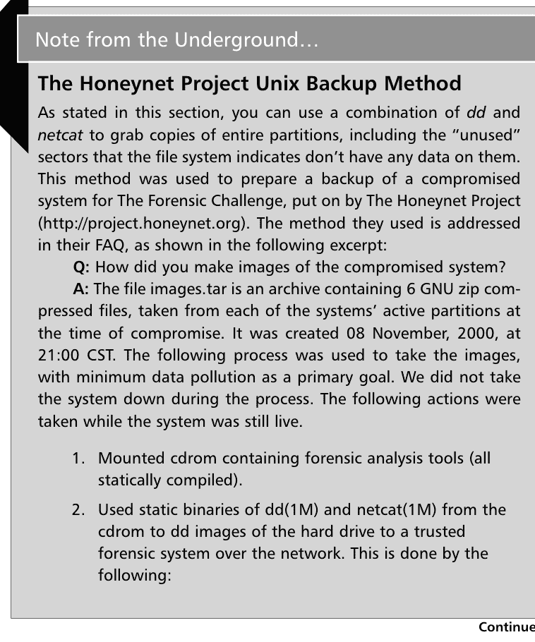

# 来自地底的笔记...

# Honeynet 项目 Unix 备份方法

如本节所述，你可以结合 dd 和 netcat 来获取整个分区的副本，包括文件系统指示这些扇区上没有数据的“未使用”扇区。该方法被用于为由 Honeynet 项目（http://project.honeynet.org）举办的“取证挑战”准备受损系统的备份。他们使用的方法在他们的常见问题解答（FAQ）中介绍，如下文所示：

> 问题：你们是如何制作受损系统的镜像的？
> 回答：images.tar 文件是一个包含 6 个 Gnu 压缩文件的归包，这些文件是从入侵时每个系统的活动分区中提取的。它于 2000年11月8日 CST 时间 21:00 创建。使用以下过程来获取镜像，以尽可能地减少数据污染为首要目标。我们在过程中没有关闭系统。在系统仍在运行期间采取了以下操作。

- 挂载包含取证分析工具的光盘（全部为静态编译）。
- 使用来自光盘中的 dd(1M) 和 netcat(1M) 静态二进制文件将硬盘的 dd 镜像通过网络传输到受信任的取证系统。通过以下方式实现：

继续


536 第 10 章 • 应急响应、取证与法律

受信任系统：使用 netcat 在受信任系统的 10000 端口上启动监听守护进程：

```


`nc -l -p 10000 > honeypot.hda.dd`

受损系统：使用 `dd(1)` 复制硬盘的每个分区，然后将硬盘的 `dd` 镜像通过网络传输到监听 `10000` 端口的受信任系统 (`192.168.1.1`)：

```
/cdrom bs=1024 < /dev/hda8 | /cdrom/nc 192.168.1.1 10000 -w 3
```


此过程对硬盘上的每个分区（包括交换分区）重复。现在我们在受信任取证系统中有了每个分区的镜像。此时产生了 MDS 校验和以便与随后的副本进行比较。然后将这些镜像合并为一个文件以便传输，由于同样的原因也进行了校验和。

注意，使用这种方法无法与硬盘上的原始分区内容进行直接比较。

“取证挑战”的 FAQ 可以在 `http://project.honeynet.org/challenge/faq.html` 找到。Honeynet 项目的 Lance Spitzer 邀请本书读者阅读他们的论文《了解你的敌人：蜜罐网络》，其中详细介绍了他们的某些设置，类似于此处引用的问题。它可以在 `http://project.honeynet.org/papers/honeynet` 找到。

`www.syngress.com`

# 应急响应、取证与法律 • 第 10 章 537

因此，似乎对于 Windows，目前的最佳实践是突然停止系统（可能通过明智地拔掉电源），然后在之后进行备份。好消息是，一旦你启动了自己的操作系统或移除驱动器，在 PC 硬件上有许多选项可以执行备份和分析。

某些工具旨在“镜像化”系统以将其恢复到特定状态。这些工具可以用于课堂环境，例如，在每周新学生到来时将系统恢复到已知的状态。这些工具还可用于创建受损系统设计的镜像。其优势是，其中许多工具被设计为从 DOS 启动并跨网络发送镜像。这包括 Symantec 的 Ghost、Innovative Technologies 的 CodeBlue 以及 Stac 的 Replica（据报道 Replica 能够进行逐扇区的镜像制作）。Winternals Software 的 Remote Recover 设计用于通过从软盘启动远程机器并跨网络访问它来允许访问远程驱动器。这可以与备份软件结合创建镜像。

最后，还有专业的取证程序。这些包括 NTI 的 SafeBack、Tech Assist 的 Byte Back、ASR DATA 的 SMART、Guidance Software 的 EnCase 以及 Fred Cohen & Associates 的 ForensX。最后一组工具专门用于取证目的，功能往往要强大得多。

因此，似乎对于 Windows，目前的最佳实践是突然停止系统（可能通过明智地拔掉电源），然后在之后进行备份。好消息是，一旦你启动了自己的操作系统或移除驱动器，在 PC 硬件上有许多选项可以执行备份和分析。

某些工具旨在“镜像化”系统以将其恢复到特定状态。这些工具可以用于课堂环境，例如，在每周新学生到来时将系统恢复到已知的状态。这些工具还可用于创建受损系统的镜像。其优势是，其中许多工具被设计为从 DOS 启动并跨网络发送镜像。这包括 Symantec 的 Ghost、Innovative Technologies 的 CodeBlue 以及 Stac 的 Replica（据报道 Replica 能够进行逐扇区的镜像制作）。Winternals Software 的 Remote Recover 设计用于通过从软盘启动远程机器并跨网络访问它来允许访问远程驱动器。这可以与备份软件结合创建镜像。

最后，还有专业的取证程序。这些包括 NTI 的 SafeBack、Tech Assist 的 Byte Back、ASR DATA 的 SMART、Guidance Software 的 EnCase 以及 Fred Cohen & Associates 的 ForensX。

# 第 10 章 • 事件响应、数字取证与法律

- 受影响系统的系统管理员
- 地点
- 对正常业务的关键性
- 安全区域（DMZ、内部网络等）
- 当前分配的 IRT（事件响应小组）成员（如适用）
- 案件优先级（低、中、等）
- 关于案件的消息/备注
- 证据类型
- 证据位置
- 监管链链
- 法院/执法部门案件流水号
- 通知状态（管理层、法务、人力资源部等）

你可能还想要添加一些自定义字段。我们来简单讨论一下你如何组织这些信息。显然，某些字段适合放在传统的数据库中，而另一些则不然（例如，你不想将一个 8GB 的磁盘镜像文件挤进大多数数据库中）。你可能会发现，为那些容易放入数据库的项目维护一个传统数据库，并维护另一个更灵活的数据库来存放电子证据是非常有用的。

与 IT 问题一样，获取一个 ITS（事件跟踪系统）可以归结为“购买还是构建”。这个决定在很大程度上取决于你可能已经拥有或未来需要的其他工单或跟踪系统。例如，如果已经存在现有的帮助台工单系统或包含你计算机信息的关系型数据库，你将希望将它们整合。

有趣的是（虽然并不意外），大学在 ITS 领域似乎做了相当的工作。大学提供了一些可用的的 ITS，或者至少有关于如何构建它们的信息。俄亥州立大学的服务器上有一组幻灯片，描述了他们选择 ITS 时所经历的过程（他们决定自己构建）。他们的幻灯片可以在 `www.net.ohio-state.edu/security/2000-04-26_building_an_incident_tracking_system/SecWOG-000426.htm` 找到。

如果该 URL 对你来说太长了，那么请访问 `www.net.ohio-state.edu/security/talks.html` 并滚动到 2000 年 4 月 26 日。在那里，你也可以顺便查看其他演示文，其中一些与本章的主题高度相关。关于从哪里寻找免费和商业 ITS 的建议，请查看本章末尾的“资源”部分。

一旦你确定了如何将其放入 ITS，你就需要弄清楚在手动输入数据的情况下该如何操作，这非常显而易见；你将使用 ITS 界面并输入数据。然而，你的绝大多数事件将是极其微小的事情，你可能不会做得太多。这类事件会有很多，你不会希望手动输入它们。这些项目是从你的防火墙和 IDS 日志中获取的，你需要一种脚本方法来处理它们，以便它们自动输入你的 ITS。

这部分内容可能将为你定制的软件，因为世界上没有其他人拥有与你完全相同的 DIS 和 IDS/防火墙组合集、你的 ITS，以及你对什么构成值得跟踪的事件的看法。你的 IDS 产生的很多内容将是误报，但这完全取决于你的特定环境。你需要花一些空闲时间仔细研究你的 IDS，调整规则以尽可能减少误报，并对那些你无法完全消除的规则进行记录。稍后，当少数几个误报进入你的跟踪系统时，你可以识别并关闭它们。

之前提到过 SecurityFocus 的 ARIS 项目。它不适合作为主要的 ITS 使用，主要因为数据最终会被归档。但是，如果你决定向相应的组织和 ISP 报告那些不太严重的事件，那么 ARIS 是实现此目的的极佳工具。它也是学习更多关于单个 IDS 签名含义、它们的常见程度以及它们产生误报的倾向程度的好方法。

# 资源

此处列出了互联网上关于本章所讨论主题的一些可用资源。我们建议你花时间浏览这些内容，并记录下最符合你需求的资源以便日后参考。

## 法律/政府/执法部门

`www.cybercrime.gov` 网站是计算机入侵法律方面的极佳资源。他们维护我见过的最好的案件列表之一（在“Cases”部分）。除了计算机犯罪外，他们还有针对知识产权犯罪的类似资源。该网站由美国司法部（DOJ）的计算机犯罪与知识产权部门（CCIPS）维护。

美国国家基础设施保护中心（NIPC，`www.nipc.gov`）拥有有关当前问题的信息、相关法律的链接以及原始出版物和公告。你可以向美国政府提交事件报告的地方之一。

CERT 是一个由联邦资助的研发中心，在卡内基·梅隆大学（`www.cert.org`）运行。他们发布关于广泛发安全事件的公告，并收集公司的事件报告。他们还发布论文并提供培训。

## 备份/取证

SafeBack（`www.forensics-intl.com/safeback.html`）是专为取证备份目的设计的程序之一。NTI（此处引用了网站）提供了许多取证工具，该网站值得探索。他们还在 `www.forensics-intl.com/download.html` 提供了免费工具。

ForensiX（`www.all.net`）是专为取证备份目的设计的程序之一。

应急响应、取证与法律 • 第 10 章 545

## 总结

如果你在没有既定响应策略的情况下处理入侵和安全事件，将会犯下许多错误并陷入许多麻烦。应急响应策略将规定你如何应对入侵，并将你组织内相关方之间的所有协议规范化，并明确由谁负责。

应急响应团队（IRT）是你组织中在事件发生时提供协助响应的人员小组。它可能包括来自安全团队、网络团队、系统管理、法务、人力资源和管理层人员。该团队负责响应事件报告。很可能，安全团队的某人将成为报告的第一联系人，并在时引入其他成员。该团队的某些成员需要精通取证调查，或者你可能与一个可以提供这些技能的外部实体建立关系。

安全工作中的取证方面对于技术思维型的人来说是最有趣的内容之一。取证涉及利用可用证据构建发生情况的蓝图，并可能将其追溯到源头。计算机取证调查要求对操作系统和应用程序软件有深入了解。你必须首先确定什么是正常行为，以便在证据表明发生异常时进行判断。

任何取证调查的第一步都是对证据进行备份。核心问题在于是尝试对运行系统进行备份，还是关机并启动不同的操作系统以制作镜像备份。目前有多种工具可用于备份。某些工具不会抓取磁盘上的碎片空间（slack space），因此在选择工具时要记住这一点。有些公司销售全面的取证工具包。如果你需要该类工具包提供的所有功能，可能可以考虑投资其中一个此类包装套件。

你执行工作时所需的另一个组件之一是事件跟踪系统。事件跟踪系统用于跟踪典型公司在正常运行过程中看到的各种探测和事件。你跟踪的项目包括你可能直接忽略的轻微探测，或者可能将其报告给发送这些探测所属的互联网服务提供商（ISP）。更严重的事件将被分配更高的优先级，系统将用于跟踪相关的通信记录和证据位置。

## 为什么应急响应策略很重要？

- 应急响应策略可以帮助你回答在危机中出现的对政治、物流和物理安全问题至关重要的问题。你需要联系管理层或法务部门吗？你需要联系公关部门来处理有关入侵的任何查询吗？攻击者进入数据库了吗？我们需要采取什么来恢复网站？我们是否应该关闭它以防止人们看到篡改内容？我们是否能找到系统管理员和数据库管理员来帮助我们清理？

- 应急响应策略的存在并不是因为你不知道自己在做什么；而是因为并非每个人都会同意你处理问题的方法。如果你提前获得了所有相关方的签字认可，并按照列出的程序进行操作，那么想要追究你的责任将变得困难得多。一份编写良好的策略将告诉你的责任是什么，以及其他人承担了哪些需要承担的责任。

## 建立应急响应团队 (IRT)

- 你可能需要涉及一名网络人员和一名系统管理员。你可能需要一名来自法务部门或律师事务所的代表。系统管理员或专职安全工程师可以处理取证工作。

- 你需要一个专门的安全职能作为团队的核心并将其整合在一起。这可能是一个专职人员，也可能是某人工作中的部分时间，但该责任必须属于一个或多个个人。核心人员的责任将是召开会议、确保所有相关组织的代表出席、协调策略的编写并达成策略共识、根据需要安排培训，并在机会出现时推动实际的应急响应。

## 设定起诉边界

- 你必须划出的第一条线是“尝试”与“事件”之间的界限。你一整天都会收到探测和扫描。这些人是正在尝试新工具的人，或者是潜在攻击者在收集情报，甚至甚至是蠕虫。你每天可能会收到几十到数千次这样的探测。

- 证据留链（chain of custody）定义了在整个调查过程中谁有权访问证据。维护证据链列表并不困难；你只需要记录几项内容：谁保管（占有）了证据、证据在何处、该地采取哪些安全措施以及当时存在哪些证据项。每当这些情况发生变化时，你都必须写一条新记录。

## 建立应急响应流程

- 对于相对无害的尝试，一种常见的响应方式是将这些尝试报告给相应的 ISP、公司或其提供商。某些入侵检测系统（IDS）软件包含报告机制，以帮助生成报告并定位联系的正确电子邮件地址。

- 一旦你有了规定在事件发生时如何响应的策略，你就需要建立一套流程来支持你的响应。这涵盖了从轻微攻击到完全入侵的范围。

- 你首先需要了解文件是如何存储在磁盘上的、进程是如何相互作用的、软件是如何配置的，以及你可以获得哪些日志信息。而且，你对所需的每个不同操作系统都必须了解这些。

## 取证计算简介

- 任何取证调查的第一步都是在可能的情况下，对你获得的所有可用信息进行备份。遗憾的是，这不仅仅意味着备份驱动器。在到达这一点之前，你必须决定如何检查到达时内存中可能的内容。内存中可能存在你需要获取的证据，而并不是所有的操作系统都有将 RAM 储到磁盘的规定。

- 在关机之前备份受损系统的一个般性问题是，对受损系统的任何使用都会在某种程度上损坏证据。

- 有些工具旨在将系统“镜像”到特定状态。这些工具可以创建受损系统磁盘的镜像。优点是许多工具被设计为从 DOS 启动并通过网络发送镜像。

- 大多数取证备份程序都包含 MD5 校验功能以验证数据完整性。某些工具是整个取证工具包，功能远超仅仅磁盘镜像。某些工具甚至包含了完整的脚本语言以帮助自动化其功能的使用。

## 跟踪事件

- 事件跟踪系统（ITS）是一组旨在帮助应急响应团队管理其环境中发生的事件的程序。这些程序的范围从你完全不理会的简单端口扫描，到具有适当法律文件的全面诉讼案件。

- 构成事件跟踪系统的各种产品和程序分为三大类：协助帮助机功能的软件，以及跟踪软件开发环境中 Bug 的软件。

- 你的 IDS 报告的许多内容将是误报，但这完全取决于你的特定环境。你需要为你的 IDS 花费高质量的时间，调整规则以尽可能减少这些误报，并对你无法完全消除的部分进行记录。

- ITS 必须提供许多必须跟踪的项目，包括受影响系统的 IP 地址、攻击者的 IP 地址（如果已知）、被扫描的端口/服务、安全区域（DMZ、内网等）、当前分配的 IRT 成员（如适用）以及证据链。

### 常见问题

以下常见问题由本书作者解答，旨在衡量你对本章所介绍的概念的理解程度，并帮助你在现实生活中实现这些概念。如你对本章有任何问题，请访问 `www.syngress.com/solutions` 并点击“向作者提问”（Ask the Author）表格。

- 问：我可以购买商业应急硬件吗？
- 答：几家公司提供硬件套件，通常还附带软件。有来自 Digital Intelligence (`www.digitalintellect.com`) 的证据恢复设备（“FR.E.D.”）、Forensic-Computers.com (`www.forensic-computers.com`) 以及 `www.computer-forensics.com` 上的 DIBS 系列。

- 问：这些看起来要做的事情非常多。有什么方法可以外包这些功能吗？
- 答：是的，有名为托管服务提供商（MSP）的公司。提供的服务范围各异，但大多数公司都提供管理防火墙、监控日志、为你跟踪事件以及代表你制作报告的组合服务。此类公司的示例包括 Counterpane (`www.counterpane.com`)、Guardent (`www.guardent.com`)、@stake (`www.atstake.com`) 和 METASEs (`www.metasess.com`)。

- 问：我可以在哪里学习更多关于取证的知识，或者提问？
- 答：我过的最好的地方之一是由 SecurityFocus 维护的取证邮件列表。你可以在这里找到存档存档：`http://securityfocus.com/forums/forensics/intro.html`。

- 问：需要时，我可以在哪里找到人为我进行取证调查？
- 答：大多数大型会计师提供此类服务，许多 MSP 也是如此。一些取证软件供应商也提供服务。小型调查类公司的一个目录可以在 `http://expertpages.com/experts/competence.htm` 找到。

# 附录 A

# 用于内容交付的 解决方案

附录中的解决方案：

- 使用 Cisco LocalDirector 提高安全性
- 使用 Cisco DistributedDirector 保护地理分散服务器集群
- 使用 Cisco Content Services Switch 提高安全性
- 总结
- 常见问题

## 引言

在过去，公司的前台是公司的窗口；他们是人们与公司第一次接触的人。想象一下，如果前台接到的电话超过了处理能力——电话会被挂断，客户会感到沮丧，资金也将损失。如今的现实是，你的网站已成为你进入公司的窗口。同样，如果你的网站访问量过大，也会发生同样——访问会被拒绝，客户会感到沮丧，资金也将损失。

随着万维网的发展和公司在互联网上影响的扩大，对扩展互联网流量（特别是 Web 流量）的需求也随之增长。思科系统开发了一系列产品，统称为内容交付设备，允许你将互联网流量扩展到大规模量。

虽然思科的内容交付设备不是帮助你扩展互联网流量的唯一产品，但它们是最具创新且使用最广泛的产品之一。通过让你了解这些产品的安全功能及其应用和实现，本附录解释了你可以使用的选项，以保护你的系统免受黑客的攻击。

> 损害与防御...
> Cisco 系统安全公告
> Cisco 系统发布了一份互联网安全公告列表，以及一份影响其产品的漏洞公告列表。你可以在 `www.cisco.com/warp/public/707/advisory.html` 找到此列表。

# 使用 Cisco LocalDirector 提高安全性

Cisco LocalDirector 是一个允许你在多个本地服务器之间负载均衡分配互联网资源请求的产品。人们通常使用此解决方案作为服务器集群的前端，位于相同位置，并将 Web 流量负载均衡到最合适的服务器上。

使用这项技术，LocalDirector 允许你发布单个 Web 地址，并使用单一地址将 Web 流量引导到最合适的服务器。

# LocalDirector 技术概述

LocalDirector 使用 OSI（开放系统互连）第 4 层（传输层）技术，通过跟踪会话确定最合适的服务器。它允许你发布单个 Web 地址，并使用单一 IP（互联网协议）地址进行负载均衡。

这项技术可以减少你的服务响应时间并增加服务可靠性。因为 LocalDirector 监控 URL 或 IP 地址并响应资源请求。

在这项技术出现之前，你必须知道每个服务器的名称或 IP 地址，或者使用与单个地址相关的多个 IP 地址。这些技术对用户并不友好，也不可靠，因为没有尝试验证服务器的完整性。

思科的 LocalDirector 可以被比作电话世界中的自动呼叫器（ACD）。入站电话被路由到代理池，并在代理可用时进行响应。

# 附录 A • 用于内容交付的 解决方案

图 A.1 描绘了一个典型的 LocalDirector 实现。LocalDirector 为服务器集群提供前端并将请求重定向到最合适的服务器。

# 图 A.1 典型的 LocalDirector 实现

# LocalDirector 产品概述

LocalDirector 产品有两种范围：

- LocalDirector 416 这既是入门级产品也是中型产品。它支持高达 90Mbps 的吞吐量和每秒7000 次连接。
- LocalDirector 430 这是高端产品。它支持高达 400Mbps 的吞吐量和每秒30000 次连接。

为了额外的性能，LocalDirector 可以与 Catalyst 6000 交换机的加速服务器均衡（ASLB）结合使用，将吞吐量提高到每秒1500 万包（mpps）。

# LocalDirector 安全功能

有关 LocalDirector 安全功能的信息将帮助你更好地理解它使用的安全机制，并让你配置或更改这些功能。

# 流量过滤

由于 LocalDirector 维护并跟踪所有客户端的状态，它可以根据接入 IP 地址或服务（端口号）过滤或控制对特定服务器的访问。这允许你通过限制请求允许访问的资源来增加安全性。

LocalDirector 通过仅允许特定流量在虚拟和真实服务器之间通过来保护你的网络。这限制了外部和内部访问。提供了几种选项：

- SecureAccess 允许你根据源 IP 地址操作连接。流量可以指向特定的虚拟服务器或直接丢弃。
- SecureBind 允许你限制流量到特定端口。指向未端口的 TCP 流量是重置包（TCP RST）。这不适用于 UDP 流量。
- SecureBridging 如果端口配置为桥接，客户端通过注册的 IP 地址直接访问真实服务器。可以关闭桥接，强制客户端流量通过 LocalDirector 虚拟地址。
- Secure IP address 这允许 LocalDirector 将真实服务器的 IP 地址翻译为虚拟 IP 地址，从而隐藏真实服务器的 IP 地址。

# 使用 LocalDirector 防御 SYN 攻击

SYN 攻击是一种拒绝服务（DoS）攻击形式，发生在黑客发送了无法处理的连接量时，这些

# 附录 A • 用于内容分发的 Cisco解决方案

完成。这会导致连接队列溢满，从而拒绝为法的 TCP 连接提供服务。

在主机系统上（例如 Web 服务器上），你还应该采用一些技术来减少 SYN 攻击的影响。其中一种技术是增加连接队列（SYN ACK 队列）的大小，以便让 SYN 攻击有更多的时间和资源来产生问题。另一种方法是确定你的主机软件供应商是否有任何帮助防止 SYN 攻击的补丁。许多厂商产品（包括 IBM 的 AIX、Microsoft 的 NT 和 Sun 的 Solaris）现在都有此类补丁。通过使用 `syn-guard` 功能，你可以设置在进入保护模式之前允许的未响应 SYN 的最大数量。

当此功能禁用时，默认值为 0，并且可以在启用该功能之前配置允许的最大 SYN 数量。

使用以下语法配置 `synguard` 功能（在配置模式）：

```


## `synguard virtual_id count`

其中 `virtual_id` 是虚拟服务器的 IP 地址或名称和端口（如果是端口绑定的服务器），`count` 是在进入 `synguard` 模式之前允许的未响应 SYN 的数量。

要禁用 `synguard`，请将 `count` 回 0，或使用 `no` 命令：

```
no synguard virtual_id count
```

注意，`synguard` 命令对虚拟 IP 地址提供的 SYN 攻击保护有限。该功能激活后，LocalDirector 开始保护真实网络和服务器免受 SYN 攻击。

以下是一个说明使用 `synguard` 的示例：

```
LocalDirector(config)# show synguard

Machine Port SynGuard Status

  www.test.com default 0

LocalDirector(config)# synguard www.test.com 500
```

```
LocalDirector(config)# show synguard

Machine      Port      SynGuard      Status

www.test.com   default   500

LocalDirector(config)# show syn

Machine      Port      Conns      Syn Count

www.test.com   default   648       176
```

以下示例显示 `synguard` 激活状态。注意状态如何变为 `Active`：

```
LocalDirector(config)# show synguard

Machine      Port      SynGuard      Status

www.site.com   default   500       Active

LocalDirector(config)# show syn

Machine      Port      Conns      Syn Count

www.site.com   default   892       500

LocalDirector(config)#
```

## 使用网络地址翻译隐藏真实地址

LocalDirector 支持网络地址翻译 `NAT`。这允许你在内部网络（通常是服务器池）上使用未注册的 IP 地址，并防止黑客直接目标准真实服务器的 IP 地址。

请求注释 `RFC 1918` 预留了三个地址范围（通常称为私有、内部或未注册地址范围）供内部使用。这些地址范围在互联网上不路由，数据包在发送到互联网之前需要转换为已注册的 IP 地址。`NAT` 执行从私有 IP 地址到注册 IP 地址的转换，反之亦然，允许设备访问互联网以及从互联网访问。这还节省了注册的 IP 地址。

通过 `NAT` 隐藏内部 IP 地址范围并增加潜在黑客访问你的网络内部结构的难度，从而提供了更高的安全性。

图 A.2 显示了执行 `NAT` 的设备示例。如果不通过 `NAT` 转换过程（将注册 IP 地址范围转换为私有 IP 地址范围），`10.0.0.x` IP 地址范围无法通过互联网访问。

### 图 A.2 NAT 转换过程

| 10.0.0.x 地址 | 执行的设备 | 196.26.19.x 地址 |
|---|---|---|
| 内部（私有地址范围） | NAT | 外部（注册范围） |
| RFC 1918 | | |

## 限制对 LocalDirector Telnet 访问的权限

你可以指定谁授权访问 LocalDirector 的 Telnet。这可以是 IP 地址的形式，也可以是网络地址的形式。限制谁可以 Telnet 进入 LocalDirector 是防止黑客尝试获取访问或对你的系统造成破坏的简单且非常有效的方法。

使用以下语法配置谁拥有 telnet 权限（在配置模式）：

```
telnet ip mask
```

其中 `ip` 是授权访问 LocalDirector Telnet 管理接口的主机 IP 地址或网络，`mask` 是此命令中指定的网络的子网掩码。如果你指定了 IP 地址，请使用 `255.255.255.255`。

要停用此功能，请使用 `no` 命令：

```
no telnet ip mask
```

你可以使用以下语法查看允许的 IP 地址或网络：

```
show telnet
```

## 附录 A • 用于内容分发的 Cisco 解决方案

完成。这会导致连接队列溢满，从而拒绝为法的 TCP 连接提供服务。

在主机系统上（例如 Web 服务器上），你还应该采用一些技术来减少 SYN 攻击的影响。其中一种技术是增加连接队列（SYN ACK 队列）的大小，以便让 SYN 攻击有更多的时间和资源来产生问题。另一种方法是确定你的主机软件供应商是否有任何帮助防止 SYN 攻击的补丁。许多厂商产品（包括 IBM 的 AIX、Microsoft 的 NT 和 Sun 的 Solaris）现在都有此类补丁。通过使用 `syn-guard` 功能，你可以设置在进入保护模式之前允许的未响应 SYN 的最大数量。

当此功能禁用时，默认值为 0，并且可以在启用该功能之前配置允许的最大 SYN 数量。

使用以下语法配置 `synguard` 功能（在配置模式）：

```
synguard virtual_id count
```

其中 `virtual_id` 是虚拟服务器的 IP 地址或名称和端口（如果是端口绑定的服务器），`count` 是在进入 `synguard` 模式之前允许的未响应 SYN 的数量。

要禁用 `synguard`，请将 `count` 回 0，或使用 `no` 命令：

```
no synguard virtual_id count
```

注意，`synguard` 命令对虚拟 IP 地址提供的 SYN 攻击保护有限。该功能激活后，LocalDirector 开始保护真实网络和服务器免受 SYN 攻击。

以下是一个说明使用 `synguard` 的示例：

```
LocalDirector(config)# show synguard

Machine Port SynGuard Status

  www.test.com default 0

LocalDirector(config)# synguard www.test.com 500
```

```
LocalDirector(config)# show synguard

Machine      Port      SynGuard      Status

www.test.com   default   500

LocalDirector(config)# show syn

Machine      Port      Conns      Syn Count

www.test.com   default   648       176
```

以下示例显示 `synguard` 激活状态。注意状态如何变为 `Active`：

```
LocalDirector(config)# show synguard

Machine      Port      SynGuard      Status

www.site.com   default   500       Active

LocalDirector(config)# show syn

Machine      Port      Conns      Syn Count

www.site.com   default   892       500

LocalDirector(config)#
```


通过 NAT 隐藏内部 IP 地址范围并增加潜在黑客访问你的网络内部结构的难度，从而提供了更高的安全性。图 A.2 显示了执行 NAT 的设备示例。如果不通过 NAT 转换过程（将注册 IP 地址范围转换为私有 IP 地址范围），`10.0.0.x` IP 地址范围无法通过互联网访问。

## 限制对 LocalDirector Telnet 访问的权限

# 附录 A • Cisco 内容分发解决方案

Cisco 的 DistributedDirector 可以比比电信世界中的区域性免费热电话。DistributedDirector 类似于区域性免费热电话，拨向单一国家免费热电话号码的接入电话将路由到与免费热电话源地相同的地区代理，从而节省了在中心化位置接听电话本应产生的长途费用。

图 A.3 展示了典型的 DistributedDirector 实现。Web 请求被发送到 DistributedDirector，由它将请求重定向到最合适的 Web 服务器。通常情况下，这是距离客户最近的服务器。例如，旧金山的 Web 服务器可能更好地服务来自客户 1 和客户 2 的 Web 请求，而伦敦的 Web 服务器可能更好地服务来自客户 3 的 Web 请求。

图 A.3 典型的 DistributedDirector 实现

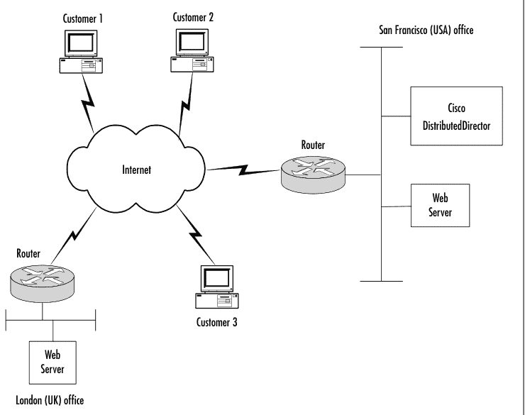

## DistributedDirector 产品概述

DistributedDirector 产品提供三种不同的范围：

- **DistributedDirector 2501/2502**：这是入门级产品。DistributedDirector 2501 具有以太网接口，而 DistributedDirector 2502 具有 Token Ring。
- **DistributedDirector 4700M**：这是中级产品，提供具有以太网、快速以太网、Token Ring 和 FDDI 接口的模型。
- **Cisco 7200 系列路由器**：这是高端产品。该产品基于模块化的 Cisco 7200 路由器，并带有 DistributedDirector 功能集。

## DistributedDirector 安全功能

以下关于 DistributedDirector 安全功能的信息将让您更好地了解它使用的安全机制，并允许您配置或更改这些功能。

### 限制 DRP 查询源

通过限制 DRP 服务器代理对具有特定源 IP 地址设备的访问，可以增加安全性。这是使用标准的 Cisco 访问控制列表 `ACL` 配合 `ip drp access-group` 命令实现的。

如果未实现此功能，黑客可能会利用伪造的 DRP 查询并提供错误的 DRP 信息来破坏正常的 DRP 过程。系统还提供了针对伪造 DRP 查询的 DoS 攻击防护，因为不是源自授权 DRP 源的 DRP 查询在处理之前就会被丢弃。

使用以下语法配置此功能（在全局配置模式）：

```
ip drp access-group access-list-number
```

其中 `access-list-number` 是标准 IP 访问列表。


### DistributedDirector 与 DRP 代理之间的认证

为了增加安全性并帮助防止基于 DRP 数据包的 DoS 攻击，支持对 DistributedDirector 与响应响应协议（DRP）代理之间的 DRP 查询和响应进行认证。

通过使用 DRP 认证，DistributedDirector 可以阻止黑客伪造 DRP 查询并破坏或干扰服务请求重定向功能。此认证基于密钥消息哈希 `HMAC` – 消息摘要 5 `MD5` 数字签名。使用以下语法配置此功能（在配置模式）：

```
ip drp authentication key-chain key-chain-name
```

其中 `key-chain-name` 是包含一个或多个认证密钥的密钥链名称。密钥链名称是不带空格的字符串。

要禁用此功能，请使用 `no` 命令：

```
no drp authentication key-chain key-chain-name
```

> **安全警报！**
> 为了额外的安全性，请在密钥链中使用多个密钥，以便您可以使用 `accept-lifetime` 和 `send-lifetime` 命令根据时间使密钥过期。

您还需要配置一个包含密钥和密钥字符串的密钥链。为了实现这一点，以下是 `key chain`、`key` 和 `key-string` 命令的概述。

#### key chain 命令

密钥链（key chain）是将认证密钥和密钥字符串结合在一起的结构。使用以下语法配置此功能（在全局配置模式）：

```
key chain name-of-chain
```

其中 `name-of-chain` 是密钥链的名称。

要禁用此功能，请使用 `no` 命令：

```
no key chain name-of-chain
```

使用以下语法验证密钥链信息：

```
show key chain
```

#### key 命令

密钥（key）是一个用于标识密钥字符串上认证密钥的数字。使用以下语法配置此功能（在密钥链配置下）：

```
key number
```

其中 `number` 是密钥链上认证密钥的标识数字。密钥的范围是 0 到 2147483647。密钥数字不需要连续。

要禁用此功能，请使用 `no` 命令：

```
no key number
```

#### key-string 命令

密钥字符串（key-string）用于标识密钥的认证字符串。使用以下语法配置此功能（在密钥链配置下）：

```
key-string text
```

其中 `text` 是认证字符串。该字符串可以包含 1 到 80 个大小写字母和数字，但第一个字符不能是数字。


要禁用此功能，请使用 `no` 命令：

```
no key-string
```

要禁用此功能，请使用 `no` 命令：

```
no key-string
```

以下是一个使用密钥链、密钥、密钥字符串以及 `accept-lifetime` 和 `send-lifetime` 进行 DRP 认证的示例。示例中，`barracuda` 密钥始终有效。`marlin` 密钥将在 1 月 14 日的 15:30 到 17:30（7200 秒）之间被接受。`swordfish` 密钥将在 1 月 14 日的 16:00 到 17:00（3600 秒）之间工作。

```
ip drp authentication key-chain fish

!
key chain 1
key-string barracuda
key 2
key-string marlin
accept-lifetime 15:30:00 Jan 14 7200
send-lifetime 16:00:00 Jan 14 3600
key 3
key-string swordfish
accept-lifetime 16:30:00 Jan 14 7200
send-lifetime 17:00:00 Jan 14 3600
```

### 密码保护

由于 DistributedDirector 运行的是 Cisco 交互系统 `IOS` 的修改版本，在 DistributedDirector 上更改密码的方法与常规 IOS 相同。DistributedDirector 支持三种密码保护：`enable secret`、`enable` 和 `telnet`。

#### enable secret 密码

`enable secret` 是最安全的加密特权级密码。即使配置了 `enable` 密码，此密码也会生效。使用以下语法创建 `enable secret` 密码（在配置模式）：

```
enable secret password
```

#### enable 密码

`enable` 密码是安全性的非加密特权级密码。当不存在 `enable secret` 密码时使用此密码。使用以下语法创建 `enable` 密码（在配置模式）：

```
enable password password
```

#### telnet 密码

`telnet password-is-the-password` 级是一个用户级密码，允许您查看某些配置信息，但不能更改任何配置。默认情况下，不允许 telnet 且没有默认 telnet 密码。您需要同时配置 telnet 和 enable 密码才能 telnet 登录到 DistributedDirector。

以下语法用于配置 telnet 密码（在 vty 配置模式下）：

```
password password
```

其中 `password` 是 telnet 密码。

### Syslog 日志

很多时候，了解攻击情况与采取保护免受攻击的措施同样重要。这正是 syslog 发挥重要作用的地方。由于 DistributedDirector 运行的是 Cisco 互联操作系统 `IOS` 的修改版本，因此将日志配置到外部 syslog 服务器（称为 `host`）的步骤与普通 IOS 相同。

以下语法用于配置 syslog 功能（在配置模式下）：

```
logging ip
```

其中 `ip` 是日志主机的 IP 地址。

要禁用 syslog，请使用 `no` 命令：

```
no logging ip
```

使用以下语法查看缓冲区中的 syslog 消息：

```
show logging
```

# 使用 Cisco 内容服务交换机提高安全性

内容服务交换机（Content Services Switch）使用内容切换（content switching）来智能地将请求重定向到合适的服务器。负载均衡与内容切换之间的关键区别在于，内容切换是根据第 4 层到第 7 层的信息（包括 URL、主机标签和 Cookie）做出决策的，而不仅仅是像 LocalDirector 和 DistributedDirector 那样的第 4 层信息。

你们中的许多人可能知道该产品名为 ArrowPoint Content Smart Switch。Cisco Systems 于2000 年 6 月收购了 ArrowPoint Communications，并将其产品和技术整合到 Cisco 的系列中。

该技术的一种常见实现是让服务提供提供两种 Web 服务。第一种服务面向签约的服务水平协议（SLA）客户，第二种面向非 SLA 客户。通过这种方式，拥有 SLA 的客户可以获得比非客户更快的 Web 响应时间。这通常通过 Cookie 实现。内容服务交换机识别 Cookie 并通过 SLA 策略将该流处理到最合适的服务器。SLA 策略指定的 Web 服务器可能比非 SLA 策略更多。

## 内容服务交换机技术概述

从初看，内容服务交换机的功能似乎与 LocalDirector 或 DistributedDirector 相似（如果你为内容服务交换机添加了增强功能）。

虽然这一观察部分正确，但 Web 切换使用的是与负载均衡完全不同的技术，而 LocalDirector 和 DistributedDirector 都是基于此。负载均衡使用 OSI 第 4 层（传输层）技术，而内容切换则基于 OSI 第 5 层到第 7 层（会话层、表示层和应用层）技术。

内容切换通过利用 OSI 第 5 层到第 7 层的信息来更好地将 Web 请求引导到最合适的服务器，从而优化 Web 流量。通过这种方式，内容切换可以使用 URL、主机标签和 Cookie 来优化内容交付。

OSI 第 3 层和第 4 层（网络和传输层）切换并未针对 Web 流量进行优化。首先，Web 流量在很大程度上是非称的，从 Web 服务器返回给客户的流量远大于入流量。它在会话不断建立和销毁的方式上也非常不同，通常涉及的数据较少，但并发连接非常多。

图 A.4 展示了典型的内容服务交换机实现。内容服务交换机将 Web 请求重定向到最合适的服务器。需要增强功能集才能使内容服务交换机具备使用不同位置服务器的能力。

# 图 A.4 典型的内容服务交换机实现

内容服务交换机产品提供三种不同的范围：

- `CCS 11050`：这是入门级产品，适用于小型 Web 网站以及接入点（PoPs）。它的设计吞吐量高达 5Gbps，并具有固定端口配置。用于最多八个 Web 服务器或缓存。
- `CCS 11150`：这是中级产品，适用于中小型 Web 网站。它的设计吞吐量高达 5Gbps，并具有固定端口配置。使用最多 16 个 Web 服务器或缓存。
- `CCS 11800`：这是高端产品，适用于大型、高流量 Web 网站和 Web 托管基础设施。它的设计吞吐量高达 20Gbps，并具有模块化端口配置。

Cisco Web 网络服务（Web NS）是运行在这些交换机上的软件，基础功能集的副本与交换机绑定。还提供增强功能集。关键区别在于，增强功能集包含了多站点内容路由和站点选择、所有内容复制功能以及内容分发和交付服务。

## 内容服务交换机安全功能

以下关于内容服务交换机安全功能的信息将让你更好地了解它允许的安全机制，并使你能够配置或更改这些功能。

### FlowWall

`FlowWall` 是一种集成防火墙，提供对内容请求的线速逐流过滤，且不会产生性能损失。它提供防火墙服务，如防火墙规则、`ACL` 和流准入控制。
使用 `ACL`，可以针对匹配某些或全部以下内容的流量创建策略（包括包含/绕过/阻塞操作）：

- 源 IP 地址
- 目的 IP 地址
- TCP 端口
### 主机标签
- URL
- 文件扩展名

### 使用网络转换隐藏真实地址

内容服务交换机支持网络转换（NAT）。如 LocalDirector 节所述，这允许你在服务器场中使用未注册的 IP 地址，并防止黑客直接针对服务器。

### 防火墙负载均衡

内容服务交换机可以通过在多个防火墙之间负载均衡流量来增强安全性。这不仅消除了瓶颈，还防止了单点故障。这通常通过在防火墙的前后部署内容服务交换机来实现。这样，给定流的流量将通过相同的路径。图 A.5 展示了负载均衡均衡的均衡内容服务交换机实现。这种设计不仅提供了负载均衡，还提供了冗余，同时维护了所有的安全功能。

### 密码保护

内容服务交换机支持两种访问级别：*User* 和 *SuperUser*，以及最多 32 个用户名，包括管理员和技术员。

#### User 级别

这是用户级。这种访问级别允许你访问一组限制命令，用于监控和显示参数但不进行更改。以下语法用于创建用户账户（全局配置命令）：

```
username name [des-password|encrypted-password|password]
```

其中 `name` 是你想创建或更改的用户名（支持最多 16 个字符）；其中 `des-password` 使用数据加密标准（DES）对密码进行加密（仅在你创建用于脚本或启动配置的文件时使用。该密码是敏感的，且长度在 6 到 64 个字符之间）；其中 `encrypted-password` 对密码进行加密（仅在你创建用于脚本或启动配置的文件时使用）；以及其中 `password` 是密码，长度必须在 6 到 16 个字符之间。

#### SuperUser 级别

这是特权用户级。这种访问级别允许你既可以监控和显示参数，也可以更改它们。默认的特权用户名为 `admin`，默认密码为 `system`。

以下语法用于创建 SuperUser 账户（全局配置命令）：

```
username name [des-password|encrypted-password|password] password
superuser
```

使用 DES 加密密码（仅在您创建用于脚本或启动配置文件时使用此选项；密码区分大小写，且长度在 6 到 64 个字符之间）；其中 `encrypted-password` 加密密码（仅在您创建用于脚本或启动配置文件时使用此选项）；其中 `password` 是密码，长度必须在 6 到 16 个字符之间；其中 `supervisor` 可选，创建一个具有超级用户权限的用户。如果不指定此最后一个命令，用户将作为普通用户创建。

列出现有用户名的语法：

```
username ?
```

删除用户的语法为：

```
no username username
```

> **安全警报！** 一个经常犯的安全错误是不更改内容服务交换机（Content Services Switch）的默认管理员密码。请确保在部署内容服务交换机之前将其。

#### 禁用 Telnet 访问

尽管对于许多在多个位置部署了内容服务交换机的客户来说并不可，但禁用这些交换机的 telnet 访问可以极大提高安全性。访问将通过物理控制台连接进行。

禁用 telnet 访问的语法为：

```
telnet access disabled
```

#### Syslog 日志

通常，了解攻击与采取措施保护自己不受攻击同样重要。这就是日志记录发挥重要作用的地方。如果配置了 syslog 服务器，内容服务交换机会将错误和事件消息记录到外部 syslog 服务器（称为 `host`）。

使用以下语法配置 syslog 功能（在配置模式下）：

```
logging host ip
```

其中 `ip` 是日志主机的 IP 地址。

要禁用 syslog，请使用 `no` 命令：

```
no logging host
```


## 已知安全漏洞

内容服务交换机存在两个已知的安全漏洞。详细文档可以在 Cisco 网站 `www.cisco.com/warp/public/707/arrowpoint-cli-filesystem-pub.shtml` 上找到。

## Cisco 漏洞 ID `CSCdt08730`

该漏洞允许具有非特权用户级账户的人导致异常事件，导致交换机重启，这将导致正常功能中断达 5 分钟。该漏洞可以在 DoS 攻击中持续触发。

该漏洞在 Cisco WebNS 软件版本 `4.01(12s)` 和版本 `3.10(71s)` 中已解决。

## Cisco 漏洞 ID `CSCdt12748`

该漏洞允许具有非特权用户级账户的人访问内容服务交换机上其不应具有权限的文件。

目前该漏洞没有解决方案，尽管变通包括使用访问列表限制 telnet 访问以及禁用 telnet 访问。

## 损害与防御……

我的系统是 100% 安全的！

组织经常告诉我他们的系统是 100% 安全的。我认为他们错过了重点。我不相信存在 100% 安全的系统。

安全是一个过程，而不是最终结果。组织需要理解安全漏洞可能对它们的生存构成重大威胁，并采取措施尽力减少对这些威胁的暴露。

我经常被告知，他们的系统是安全的，因为他们购买了最新的科技产品。真正的安全并非来自任何特定的设备或技术，而是通过安全策略，该策略规定了组织的安全需求，并通过部署许多设备、功能、技术、方法论和程序来执行该策略。

以下是计算机安全领域专家 Eugene Spafford 教授对安全的见解：

> “唯一真正安全的系统是关闭电源、浇在混凝土块中并密封在带武装守卫的铅衬房间里——即便如此，我仍深怀疑。”

580 附录 A • 内容交付的解决方案

## 总结

Cisco 的内容交付设备提供了强大且多功能的技术，可以帮助您扩展互联网流量并提高针对 DoS 攻击和其他系统遭破坏的安全防护措施。

随着时间的推移，我们对互联网应用程序和技术的依赖日益广泛，安全漏洞的风险变得更大。我们对抗安全攻击最大的武器是信息。为了保护自己免受黑客和网络恐怖分子的侵害，我们必须跟上最新的安全威胁，并不断根据我们系统的安全性评估这些威胁。

只需将黑客挡在系统之外的时代已经了。现在，你必须阻止他们敲你的门。通过用无用的服务请求淹没你的系统，黑客可以有效地关闭您的系统，将您的服务响应时间降低到这种程度。

我希望本附录为您提供了关于安全的见解，并帮助您正如托马斯·杰斐逊所言，“永远警惕是自由的代价。”

### 常见问题

以下由作者回答的常见问题旨在衡量您对所介绍概念的理解程度。

- 问：安全会减慢您的网络流量吗？
  答：不会，它是为了提供安全而设计的，不会减慢您的网络流量。
- 问：我可以在哪里获取 syslog？
  答：syslog 守护程序是大多数版本的标准配置。
- 问：是否有组织可以帮助我获取安全威胁信息？
  答：有的，有几个。查看：
  - `cert.org`
  - `first.org`
  - `securityfocus.com`
- 问：我们的管理层认为在安全上花钱价值不大。我如何改变这种情况？
  答：向他们解释攻击后果对业务意味着什么，无论是金钱还是非货币方面。许多组织由于攻击遭受了巨大的资金损失，通常不是直接造成的，而是由于客户失去信心或普遍的负面市场感知。

保护我的系统需要花费大量的资金吗？

不需要，保护您的系统最有效的工具之一是信息。这些信息通常是公开的，不需要您花费大量的资金。然而，根据您的特定需求，可能会建议咨询专业人士。

附录 B

## 电子商务网站安全快速通道

本附录将为您提供对本文涵盖的最重要概念快速且全面的回顾。

## 第 1 章：将安全原则应用于您的电子商务

## 安全作为基础

- 安全的主要原则是机密性、完整性和可用性。
- 信息可能是许多人拥有的最有价值的资产之一；丢失或疏于维护可能会导致灾难，甚至可能导致失败。对机密性的风险不仅止于数据访问；信用卡详情从面向互联网的系统中被非法获取，然后以惊人的频率被使用。
- 我们假设正在使用的数据库系统将正确维护销售记录。我们相信我们的账单系统足够智能，可以在客户账单上添加项目。如果没有某种形式的完整性检查，这两种都不可能。
- 可用性是任何企业的生命线。在电子商务世界中，每一刻都可以直接转化为数千美元的销售，即使是小于一小时的停机也会给公司造成巨大的财务损失。
- 安全还涉及评估、修订和实施变更的三步骤。这种持续的评估和反馈过程对于使流程和产品适应不断变化的在线世界环境是必要的，因为黑客会检查现有的软硬件系统并发现新的漏洞。
- 一旦您成功将环境和流程落实到您可接受的风险水平，就是时候通过技术、政策和意识相结合来缓解问题了。通过使用您的接受风险列表创建一个策略来处理它们。一旦您缓解了风险，就可以开始将系统上线网络并向公众提供访问。

# 电子商务网站黑客防护快道 • 附录 B 585

# 第 1 章（续）

## 将原则应用于现有网站

将机密性、完整性和可用性这三项原则应用于现有网站的过程，与新网站的网站相比略有不同，但许多概念是相同的。不同的是这些工具开始应用的时机和方式。例如，对您的现有网站进行评估的过程可能会破坏您的生产系统，因此大多数网站都从测试其开发环境，或专门为测试目的而创建的生产环境镜像开始。

优先修复那些风险最高的漏洞。通常，在您的员工努力实施补丁和修改的同时，通过额外手段（例如在防火墙或边界路由器上阻止相应的端口）来缓解这些风险是一个好主意。请关注 DNS、HTTP、SMTP、SNMP、FTP、POP、IMAP 等常用服务，以及防火墙或入侵检测程序等与安全相关的应用程序。

迁移计划也像评估一样，从风险开始。该计划概述了您的网站中哪些系统和组件被视为任务关键型，并定义了属于较低类别的系统。迁移计划用于确定何时漏洞是最迫切的，或者它在队列中的优先级何时降低。从这里开始，计划说明了管理员应该如何处理每一类系统的补丁和修改。它定义了验证补丁和备份系统需要遵循的步骤，以及补丁在获得批准并在生产网站上实施之前所需的测试。

## 如何为安全预算提供合理性

标尺法利用安全和风险作为衡量标准，用以衡量安全措施为组织带来的收益。尝试将您已经创建的安全流程转换为金额，并将其与我们在不进行缓解的情况下接受这些风险时可能面临的损害金额进行对比（或使用人工工时等其他衡量单位）。

- 战术法提高了组织内部的恐惧、不确定性和怀疑（FUD）的水平；它在提高意识水平方面通常非常成功。渗透测试、真实安全事件和信息战争场景等工具是这一策略的基础。这里的底线是弄清楚什么会伤害组织，如果存在可能，要么利用它，要么解释它。

## 安全作为限制

- 在实施控制措施或监控软件以更好地管理工作时间期间的网络资源使用或性能后，公司内部对于“安全是限制”的认知会随之产生。虽然这些技术并非根源，但它们通常被视为“老大哥”监控模式的症状。这些形象和认知会对安全流程造成损害。

## 安全作为赋能者

- 为了克服对安全的限制性，请改变团队的整体形象，使其成为赋能者。安全作为赋能者扮演组织内其他成员的顾问角色。当其他团队开始将安全视为一种灵活的工具，为他们的项目创造选择，而不是他们必须遵守的严苛规则时，你就为你的团队创造了一个伙伴形象，你会发现其他小组开始实际上将你的团队纳入他们项目的规划和开发阶段。

## 第 2 章：DDoS 攻击：意图、工具与防御

## 什么是 DDoS 攻击？

- DDoS 攻击试图降低网站为客户（无论是物理用户还是计算机系统等逻辑实体）服务的能力。这可以通过过载目标网络或服务器处理流量的能力，或者通过发送导致目标系统和网络产生不可预测行为的网络包来实现。

## 附录 B · 电子商务网站防护快读

## 第 2 章 续

- `Trino` 是最早公开的 DDoS 程序之一，它在 1999 年 8 月因成功攻击明尼苏达大学而声名噪。与大多数多层 DDoS 攻击一样，trino 攻击的早期阶段涉及让攻击者承诺机器成为主节点（masters）。主节点接收多个实用程序、工具以及——当然，还有 trino 控制和守护进程程序的副本。然后，主机会编译出一份具有特定漏洞的机器列表（可能涉及 RPC 服务中的缓冲区溢出），目标是在接下来的攻击中作为僵尸（zombies）。随后，将 trino 守护进程安装并配置运行在受感染的主机上。

- `TFN2K` 编译后的主要组件是两个二进制文件，即 `tfn` 和 `td`。使用定义的语法，客户端程序 `tfn` 向安装在受感染主机上的 TFN2K 守护进程发送命令。守护进程 `td` 根据客户端指示执行命令。

## 第 3 章：安全网站设计

### 选择 Web 服务器

拥有私有 Web 服务器的费用通常比在 ISP 服务器上租用空间昂贵。

### 安全网站设计的基础

在开发网站时，你应该创建一个包含以下步骤的安全计划：识别哪些需要安全；识别受保护内容的价值；识别你的网站涉及的风险；识别对这些风险的暴露程度；执行计划。

## 代码签名：解决方案还是更多问题？

- 数字签名可用于保证文件的完整性，并确保正在安装的包是真实且未被修改过的。

## 第 4 章：安全策略的设计与实施

## 为什么安全策略对电子商务网站很重要？

- 未能实施具有成本效益的安全解决方案将从多个方面影响你网站的盈利能力。

## 第 5 章：实现安全的电子商务网站

## 实现安全区域

- `DMZ` 系统在保持其提供的特定服务可访问性的同时，受到来自公共互联网的某种程度保护。

## 理解防火墙

- 包过滤防火墙根据传输数据包包头中的源和目的信息，来做出是否通过网络流量的决策。

## 第 6 章：确保金融交易安全

### 理解基于互联网的支付卡系统

- 黑客之所以喜爱信用卡数据有许多原因：它容易被盗取，容易转卖，而且很难被发现。

## 第 7 章：黑入自己的网站

## 预判各种类型的攻击

- 信息泄露攻击是针对机密性的攻击。

## 第 8 章：灾难恢复计划：最佳防御

# 什么是灾难恢复计划？

- 最简单形式的灾难恢复计划可能仅仅是一个包含相关电话号码和信息分发给员工的电子表格。

## 第 9 章：处理海量网络流量

### 如果我的网站流行程度超过了预期该怎么办？

- 典型的电子商务基础设施包括 Web 服务器、数据库服务器、电子邮件服务器、DNS 服务器、网络设备，以及可能的某些其他专用服务器。

### 负载均衡简介

- 负载均衡允许你为多个服务器使用一个虚拟 IP 地址。

## 第 10 章：事件响应、取证调查与法律

### 为什么事件响应很重要？

- 事件响应策略帮助你回答在危机中出现的对政治、物流和物理安全至关重要的问题。

### 建立事件响应团队 (IRT)

- 你可能需要涉及一名网络人员和一名系统管理员。

## 索引

3DES. 参见 三重数据加密标准 (Triple DES)

# A

- 活动服务器页 (ASP), 140, 197, 212
```
