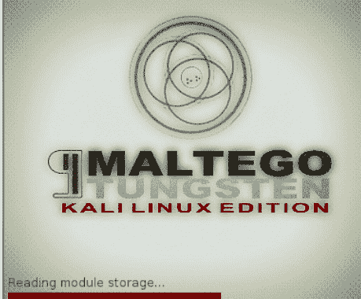

# 20 款强大的 Kali Linux 工具


在开始渗透测试和安全审计之前，请记住最好的工具是你自己的大脑。`Kali Linux` 是一套旨在帮助收集信息和利用漏洞的工具集，但逻辑决策和分析取决于你自己。在攻击的技术方面之外，保持冷静和有组织比任何事情都对你有帮助。此外，确保你对渗透测试涉及的网站拥有直接许可或所有权。一旦你将风险限制在不当影响之外，就可以开始渗透测试的第一阶段了。非法工具和行为必须被视为攻击者可能实施的武器。

> 完整且充分的渗透测试涉及对组织网络内外部系统的渗透非法活动。组织必须理解，在大多数情况下，执行测试的渗透测试人员正在违反法律。
> 
> —— SANS 关于渗透测试的研究

`Kali Linux` 拥有一套非常棒的工具用于收集有关目标的数据。第一阶段的最终目标是获得一张目标网络的逻辑地图，包括人员和机器。现在发现的任何信息都可能是以后横移的关键，因此详尽是你的盟友。此阶段的大多数工具都非常安静，所以如果时间不是你攻击的关键因素，那么现在就是缓慢移动并深挖的最佳时机。你现在流的汗越多，以后流血就越少。

## 1. DNSenum

组织网络的第一幅高层地图将来自定位其 DNS 服务器。从这里建立良好的基础将帮助你找到稍后需要的关键立足点。`DNSenum` 是一个高级工具，通常是绘制目标网络地图的第一步。使用以下格式：

```
./dnsenum -enum [TARGET DOMAIN NAME]
```

我们可以开始对目标可高层服务器进行枚举。

```bash
-f, --file <file>    从此文件中读取子域名以进行破解。
-u, --update <a|g|r> 使用 -f 关的指定文件更新为有效的子域名。
a (all)              使用所有结果进行更新。
g                    仅使用 google 爬虫结果进行更新。
r                    仅使用反向查找结果进行更新。
z                    仅使用 zonetransfer 结果进行更新。
-rf, --recursion     对子域名进行递归，对所有发现具有 NS 记录的主机进行破解。
WHOIS NETRANGE OPTION  查询之间等待秒的最大值，值随机定义，默认：35。
-w, --timeout        在类网络范围上执行整个查询。
  "Warning": 这可能会产生巨大的网络范围，并且花费大量时间进行反向查找。
REVERSE LOOKUP OPTIONS:
-s, --exclude        排除匹配反向查找结果正则表达式的 PTR 记录，对无效的主机有用。
OUTPUT OPTIONS:
-o, --output <file>  以 XML 格式输出。可以导入到 MagicTree (www.growwall.com)。
```

终端中的 DNSName

## 2. dmitry - 网络路径引导者

一旦你的 DNSName 信息返回，你将获得目标使用的一系列 IP 服务器。`dmitryfinder` 的目标是找出哪些服务器使用了哪些 IP。这是通过使用 TCP traceroute 命令完成的，该命令可以多线程，并使用 `dmitry` 命令以图形方式显示。

## 3. Nmap

`Nmap`（网络映射）项目以其独立应用程序和开源代码闻名。`Kali Linux` 中的 `Nmap` 工具用于判断主机是否存活、活跃，并在一次快速扫描中提供丰富的其他信息。`Nmap` 是快速收集任何活动机器特定详细信息的必用工具。

> Nmap 以新颖的方式使用原始 IP 数据包来确定网络中有哪些可用主机、这些主机提供哪些服务（应用程序名称和版本）、它们运行什么操作系统（以及操作系统版本）、使用了什么类型的数据包过滤器/防火墙，以及数十种其他特征。


更美的是，`Nmap` 扫描只需以这种方式投掷少数数据包即可收集所有这些信息，且这种方式比许多其他可用工具更安静。

## 4. Maltego

`Maltego` 是来自 `Paterva technologies` 开发团队的一款出色的内置工具。它的设计独特，只要花一点时间学习如何最好使用它，`Maltego` 就会迅速成为任何中大型渗透测试的必用工具。该系统可以是一个名称、DNS 服务器、IP 地址、WHOIS 查询或任何许多其他信息。`Maltego` 将确定环境中参与者之间的关系，并通过一些根源生成一个视觉显示这些关系的逻辑地图。对于关键的渗透测试人员来说，这些逻辑地图是无价之宝，将为混乱的局面提供光明，或确认怀疑的关系链接。



一旦将从 `DNSenum`、`dmitry` 和 `Nmap` 收集的所有信息倒入并过滤到 `Maltego` 中，一张清晰的目标地图就形成了。

## 5. 社会工程工具包

社会工程工具包 (`SET`) 的设计初衷是帮助渗透测试人员针对人类因素工作。通过各种工具，`SET` 允许攻击者发现安全弱点。

```bash
root@kali: ~ 首页：www.trustedsec.com
欢迎使用社会工程工具包 (SET)。
加入我们：irc:freencode.net
社会工程工具包是 TrustedSec 的产品。
访问：https://www.trustedsec.com
从菜单中选择：
1) 社会工程攻击
2) 快速路径渗透测试
3) 第三方模块
4) 更新 Metploit 框架
5) 更新社会工程工具包
6) 更新配置
7) 帮助、关于
9) 退出
```

人是系统中最脆弱的环节。通过社会工程获得的信息可以迅速转化为巨大的优势。可以通过打开终端访问`SET`。使用 java applet 的经验将对 `SET` 有帮助。

## 6. Nessus - 漏洞处理

利用来自 `Maltego` 的逻辑地图以及通过花费时间收集的大量技术信息，现在是寻找目标系统漏洞的时候了。`Nessus` 接管了下一步，寻找本地系统、本地网络以及 Linux 和 Windows 环境中的漏洞。在检查网络漏洞时，`Nessus` 比大多数工具都要详尽。尽管 `Nessus` 可以在 Kali 上运行，但它没有包含在下载中，需要下载并解包到 Kali OS 上。运行此工具还需要通过 `Nessus` 网站注册。

## 7. OpenVAS - 源漏洞评估系统

`OpenVAS` 随 `Kali Linux` 捆绑，但它没有它的兄弟那样精致。`OpenVAS` 和 `Nessus` 都致力于发现本地系统、网络和操作系统的漏洞。在运行所有收集的信息之一或两者后，你将获得一个漏洞列表，这对于进入目标系统至关重要。利用我们在第一阶段收集的目标数据，你可以设置 `OpenVAS` 扫描目标网络中的每台机器。在进行详细扫描后，你可以扫描目标网络本身的漏洞。漏洞列表既长又多样，将为攻击者提供关键数据，以帮助针对特定的漏洞。

- 暴力破解、远程获取 shell
- 缓冲区溢出、通用
- CISCO、恶意软件
- 合规性、Netware
- 凭据、NMAP NSE
- 数据库、点对点文件共享
- 默认账户、端口扫描器
- 拒绝服务、权限提升
- FTP、产品检测
- 指纹滥用、RPC
- 防火墙、远程文件访问

> 来自《Kali Linux 烹饪指南》的 OpenVAS 可发现的各种类型漏洞列表

## 渗透尝试

在此阶段，渗透测试人员将利用环境的逻辑映射图，以及在第一、第二阶段收集的待利用漏洞列表。在攻击者团队中，这是简短休息和收集工具的绝佳时机。在此之前，大多数工具都是相对静默且非侵入性的，虽然 `Kali Linux` 通常是一套非常安静的工具集，但从现在开始的攻击模式不可避免会变得嘈杂，这很大程度上取决于防御的质量。如果攻击团队准备就绪，下一步就是选择击中哪种攻击向量。

### 8. Aircrack-ng

`Aircrack-ng` 是一个向活动网络注入无线数据包的有力工具。该工具依赖于攻击者对攻击机和目标机上无线网卡的了解。在你的攻性环境中部署 `Aircrack-ng` 之前，请确保你已获得第一阶段所需的相关信息。

一旦激活，`Aircrack-ng` 还可以通过收集无线嗅探的数据包来恢复 802.11 WEP 和 WPA-PSK 密钥。WEP 攻击至少从 2007 年起就在安全社区为人所知且记录良好，但由于网络通信的本质，注入攻击仍然是获取网络的流行方法。

### 9. Burp Suite

`Burp Suite` 是一个用于 Web 应用程序安全测试的集成平台。它的各种工具无缝协作工作，支持整个测试过程，从对应用程序攻击面的初始映射和分析，到发现和利用安全漏洞。`Burp` 赋予你完全控制权，让你将先进的人工技术与顶尖的自动化相结合，使你的工作更快、更高效、更有趣。

### 10. Hydra

Web 漏洞利用是全球防御性安全团队日益头疼的源头。`Hydra` 是一款极其快速的密码破解工具，支持 50 多种不同协议的攻击。然而，由于 `Hydra` 攻击模式的性质，它比其他密码破解方法嘈杂得多。暴力破解密码的方法非常有效且速度极快，但在高安全环境中，这应该被视为备用工具，因为它会增加你被发现的概率。

目前该工具支持：Asterisk, Cisco, Cisco AAA, Cisco enable, CVS, Firebird, FTP, HTTP-FORM-GET, HTTP-POST, HTTP-GET, HTTP-PROXY, HTTP-FORM-GET, HTTP-FORM-POST, HTTPS, GET-HEAD, HTTP-PROXY, IQ, IMAP, IRC, LDAP, MS-SQL, MySQL, NCP, NTP, Oracle Listener, Oracle SID, Oracle, PC-Anywhere, CNAPS, CNOP3, POSTGRES, POP, Rexec, Rlogin, SSH, R-3-300, SAP/3, SIP, SMB, SMTP, SMTP Enum, SNMP, SOCKSS, SSH (v1 and v2), Subversion, Teamspeak (TS52), Telnet, Vmware-Auth, VNC and XMPP。

### 11. Owasp - ZAP

对于关注安全的人来说，`Owasp` 应该是一个熟悉的名字。开放应用安全项目（Open Application Security Project）作为互联网上最受尊重和活跃的开源项目之一而闻名。`Owasp` 团队于 2001 年作为非营利组织成立，活跃于信息安全、渗透工具开发和数字自由运动。`ZAP` 是“Zed Attack Proxy Project”。该工具对于新手渗透测试人员来说足够简单，对于专业环境来说足够稳健。它内置了被动和主动扫描器，如果没有直接指向待检测文件的链接，则可以使用暴力破解攻击来入侵并搜寻文件。

### 12. John The Ripper

`John The Ripper` 以别号 “John” 闻名，作为一种通用攻击工具，它是一个开发良好的密码攻击工具。能够调用不同的密码猜测方法库，使用字典攻击来破解其他工具中使用的复杂的暴力破解方法，`John` 是密码猜测软件中的全能型。

### 13. Pass the Hash Toolkit

`John` 直接针对密码以尝试揭示它，而 `Pass the Hash Toolkit` 允许攻击者从已接受的密码中收集哈希，并在密码被接受后使用这些数据进入系统，而无需使用嘈杂且缓慢的密码猜测技术。在 SANS 学院的一份非常有信息价值的白皮书中，我们对 PtH 技术有了良好的概述，以及它在与其他渗透工具的上下文位置。

这是任何渗透测试的核心。上述所有工具都用于获取信息和访问系统。一些具有攻性思维的安全专业人员认为渗透测试的早期阶段是枯燥且乏味的。我认为前三个阶段不像下国际象棋，而第四阶段是在获得回报之前对你复杂计划的最终执行。漏洞利用是你对系统映射和打开大门所做一切工作的证明。不仅如此，在此之前，你必须小心不要造成损坏，并在展示你的发现时，要对安全状态保持清晰和诚实。对系统造成永久性损害是专业渗透测试人员导致自己失业且无法就业的捷径。

### 14. Metasploit Framework

通过 `Metasploit Framework` 控制台运行的 `Metasploit Framework` 是 `Kali Linux` 工具中最先进的工具之一。`Metasploit` 团队是传奇性的，他们在攻性信息安全领域的工作是无与伦比的。`Kali Linux` 本身基于开发一个包含所有 `Metasploit` 工具的操作系统。


### 15. BeEF

虽然不是直接的攻性工具，但 `Kali Linux` 构建的漏洞数据库是获取最新可用漏洞的最佳位置。根据描述、作者、平台、类型、语言或端口，EDB 在编写时拥有超过 30000 个已知漏洞。

### 16. Armitage

忽略网站的奇特风格，`Armitage` 实际上对于发现和执行漏洞是非常先进的。与 `Metasploit` 绑定，`Armitage` 看起来像是脚本小子的工具。

### 17. Yersinia

这是一个由 S21Sec 团队在 2005 年推出的较旧的工具。`Yersinia` 作为一种攻击二层网络系统的可靠工具重新获得了关注。与 ARP 投毒或缓存攻击等传统攻击不同，`Yersinia` 能够针对交换机和集线器。由于许多网络防御有限或配置不当，`Yersinia` 是攻击目标最薄弱处工具的典型示例。

### 20. RecordMyDesktop

在使用上述所有工具工作时，我们跨越了安全与非法的界限，直接使用可能轻易破坏业务的工具。渗透测试的目的是以受控的方式攻击环境，以便防御者能够获得关于其弱点的准确且诚实的信息。攻击性安全是一种防御工具。尽管漏洞利用（exploits）可能非常华丽，但你进攻武器库中的一切归根结底都是模拟攻击。兵演演习的好坏完全取决于最后吸取的教训。`RecordMyDesktop` 是此列表中技术性最低的工具，但在我看来，它是最重要的。准确地展示漏洞利用是如何运作的，并对攻击发生的过程进行清晰、客观的记录，对于渗透测试完成后的分析和清理阶段至关重要。

在产生疑问时请记得提问。这里列出的工具可能被用于巨大的恶，而这正是它们被包含在内的原因。知彼知己者胜之一。

注意安全，祝黑客愉快。
