# 401.6 – Linux 安全入门指南

`SEC401_6_C02_03`

**注意：** 由于第 6 天没有延长课时，Linux 实验已在本周的第 1-4 天内覆盖。


本模块讨论了理解如何配置和保护 Linux 系统所需的基础性内容。它还提供了操作系统和移动市场的概述。为了奠定基础，它对基于 Linux 的不同操作系统进行了概述。

此第一个模块提供了理解第 6 天所有其他模块所需的所有信息。涵盖了以下主题：

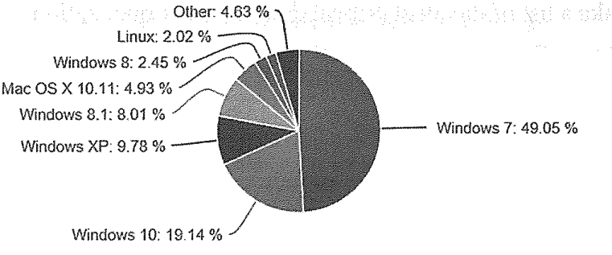

**注意：** 这些信息每天变化。请查看笔记中的 URL 以获取最新百分比。

最近的一项研究发现，占据了超过 80% 的市场。关键结论是，尽管 Windows 在安装量中占据主导，但 Linux 在环境中通常是关键系统。

- 1. `https://www.netmarketshare.com`
- 2. `https://www.netmarketshare.com/operating-system-share`
- 为组织列出关键数据
- 确定关键过程

**提示：** 大多数设备运行 Linux

对于安全来说，重要的不是数量，而是质量。当你实施安全措施时，始终关注数据。如果系统被攻击但没有数据，影响是微小的。如果有数据，影响就是巨大的。

因此，识别关键数据、映射到过程并确定哪些系统是重要的。问题是“哪些操作系统”。许多情况下，Linux 系统较少，但它们通常是最关键的。

| | 2012 年 | 2017 年 | 复合年增长率 (CAGR) |
|---|---|---|---|
| 商业 Linux | 6.3% | 5.0% | 8.6% |
| 开源、免费且公开可用 | 56.2% | 64.7% | 16.7% |
| 开源、免费且公开的实时操作系统 | 7.6% | 5.5% | 6.2% |
| 商业许可嵌入实时操作系统 | 29.9% | 24.8% | 9.3% |
| 总计 | 100.0% | 100.0% | |

**注意：** 超过三分之一的嵌入式项目没有正式操作系统或使用自开发的操作系统，这些未在上述图表中表示。


Linux 一直是设备和安全设备中流行的操作系统。然而，随着物联网（IoT）的持续增长，Linux 作为该市场的选择操作系统之一仍在持续增长。尽管商业 Linux 显示出下降趋势，但被开源 Linux 的增长所抵消。预计 Linux 将继续扩大其开发者群体，更多的供应商将继续进入物联网市场。

- 1. `https://www.linux.com/news/embedded-linux-keeps-growing-amid-disruption-says-study`
- 必须记住，尽管 Windows 的安装量要大得多，但 Linux 通常安装在最重要、任务关键的系统中。
- 如果按价格排序，最贵的系统通常是基于 UNIX 或 Linux 的。
- 大多数安全设备也运行 Linux。
- 对于安全分析、评估和渗透测试，许多安全团队在使用其他操作系统外，还会使用 Linux。


在进行评估时，许多客户经常说他们没有任何 Linux 系统。学生有时也会做出类似的陈述，认为 Linux 那么重要，因为系统数量较少。事实上，两种操作系统都很重要，但 Linux 的重要性比大多数人想象的要高。

在走过数据中心时，听到有人说“我们没有 Linux 系统”总是很有趣的。在这种情况下，指着他们的防火墙、IDS 和 IPS，并开始说“Linux、Linux、Linux”是很重要的。许多人并没有意识到，但几乎所有的设备都运行 Linux。

同样重要的是，尽管 Linux 系统较少，但它们通常是对你的企业最关键的系统。大多数桌面电脑运行 Windows，但运行 Linux 的关键服务器是不容忽视的。

- 超过 80% 的电脑运行 Windows
- 大多数人都用过 Windows，许多人仅使用 Windows
- Windows 起始于桌面操作系统，但现在是一个备受推崇的服务器平台
- 旧式：单用户平台
- 新式：同时为多个用户运行多个进程
- UNIX 采取了相反的路线
- 旧式：安装在有许多并发用户的服务器上
- 新式：作为桌面操作系统使用


熟悉现今最常用的操作系统（OS）至关重要，但了解其他系统也有充分（某些是关键的）理由。人们对于哪种操作系统比另一种更好总有争论的空间，但底线是它们都有自己的优势、局限性和缺陷。由于它们都汇聚在大型、快速的网络上，它们会产生相互威胁，具有安全意识的人需要了解并防范这些威胁。

选择哪种操作系统取决于你想用电脑做什么，这是熟悉所有可用系统的另一个原因。Windows 已经演变成了一个你可能觉得像在个人桌面电脑上运行服务器一样的操作系统，它以前并不总是这样。

Windows 的商业生涯始于一个桌面操作系统，供一个人一次只做（基本上）一件事，直到任务完成。供办公室里某人为某个项目写报告或写信的人使用。

随着事态的发展，今天可能有几个人需要运行一个项目，这要求他们都运行（或至少远程运行）相同的操作系统。由于人们有协作并将所有文件保留在一起的需求，微软促使开发了 Windows 服务器版本，能够同时为多个用户执行多个任务。因此，突然之间，你可以在你的桌面电脑上运行桌面版本的 Windows，在服务器上运行服务器版本的 Windows，后者会调度并同步所有人的请求。

有趣的是，UNIX 开发了方向相反的相同线路。UNIX 构想于 1969 年，被设计为一种运行在许多用户同时做不同事情的服务器上的操作系统。该操作系统不仅需要管理这些用户及其进程，还需要管理最初让这些进程提供给用户的后台程序。它变得稳定且可靠，人们开始建立业务，只编写和维护 UNIX 版本作为他们的主要收入来源。甚至有人编写了自己的版本并分享给世界，而不收取费用。

- 1. `http://en.wikipedia.org/wiki/Unix`
- 2. `http://www.freebs.org/docs/intro.html`

`11`

- Mac OS (BSD)


Windows 并不是唯一既有桌面版又有服务器版本的操作系统。大多数 UNIX 变体都有相应的桌面版本。桌面和服务器操作的区别在于，服务器操作系统设计用于高效的多任务和多处理，并且通常没有文字处理或电子邮件等客户端功能。

有很多不同的 UNIX 发行版。这些发行版是软件和工具的集合。许多这些解决方案和工具也有自己的。在 Cygwin 等 UNIX 发行版中，软件和工具被移植到了 Windows。苹果的 Mac OS 是一个流行的 UNIX/BSD 变体。最后，为了许多目的创建了一些 Linux 包，有些不需要安装即可从光盘运行。

- 1. `http://www.kernel.org/doc/linux/`
- 具有许多变体的开源操作系统
- 最初为个人电脑开发，但已移植到其他平台
- 许多安全工具可用且通常运行在 Linux 上
- 将 Linux 内核作为操作系统的“大脑”


20 世纪初，一位名为 Linux Torvalds 的芬兰软件工程师开始了一个新爱好：从零开始重写“Minix”操作系统（一种 UNIX 工具），适用于 Intel386 平台。他创建的是运行在个人电脑上的类 UNIX 操作系统之一。Torvalds 并不想要；他愿意将他的想法源代码交给世界，让其他人使用、改进并传给可能需要的人。这为解放计算机世界铺定了道路。

GNU 项目已经作为此类想法的仓库和发布点运行。此时，Torvalds 的想法——Linux——落地了并向任何感兴趣的人开放。世界上伟共生关系之一：GNU 为 Torvalds 提供了一个向世界传播工作的平台，而 Torvalds 为 GNU 提供了一个运行平台——一个健壮且完全开放的系统。GNU 项目采用了 Torvalds 的工作，并使其成为完善 GNU 并使其移植的最后拼图。

无需说明，Linux 的想法和 GNU 项目火了。世界各地的程序员注意到并向 Linux 内核贡献。尽管 Torvalds 最初是自己编写内核的，但今天，他的代码仅占内核的约 2%！很多人做出了贡献！

- 1. `www.linux.org/info/linux.html`
- 2. `www.gnu.org/software/linux/linux.html`
- 3. `http://en.wikipedia.org/wiki/Linux_Torvalds`

| 基于 Debian Linux | 基于 Red Hat Linux |
|---|---|
| 提供桌面版和服务器版 | 安装程序让用户选择：桌面、服务器或其他 |
| 基于 APT 的包管理 | 使用 yum 的 RPM 包管理 |
| 默认未启用防火墙 | 默认包含并启用防火墙 |
| 包含许多功能和内置特性 | 包含许多功能和内置特性 |


Ubuntu 是一个 Linux 发行版。它的名字来自一个非洲单词，大致翻译为“对他人的”。Mark Shuttleworth 通过一家互联网公司赚了数十亿美元，并且是一家南非公司的所有者，现在是 Ubuntu Linux 的驱动（以及统一）力量。你可以下载 Ubuntu 的桌面版或服务器版以及任何专注于教育、开源许可、多媒体工作或特定桌面环境（窗口管理器）的“衍生品”。

Ubuntu 基于 Debian 发行版，该发行版自 1993 年以来一直存在。Debian 最为人知的可能是它的包管理系统——高级软件包工具（APT）。Debian 一直追求稳定性，并避免不符合依赖优先级的软件。Ubuntu 继承了 Debian 的稳定环境，APT 使通过以下命令轻松安装软件：

```
apt-get install <package name>
```

APT 调查涉及的包，查看该包可能需要的库和其他程序（这些被称为依赖项），去互联网下载它们，安装它们，向用户呈现任何配置选择，并检查其工作——这一切都是自动完成的。

对于某些人来说，Ubuntu 的安全性并不健壮（例如，它没有自带防火墙或防火墙的图形化控制）。此外，一些人批评 Debian 将稳定性置于创新的软件之上。

Ubuntu 提供服务器版和桌面版，以及少数用于教育或多媒体工作的衍生品。它在 Linux 桌面社区中支持非英语语言方面处于领先地位。

目前，Fedora 是第三受欢迎的发行版。Fedora 项目基于红帽 Linux（Red Hat Linux），红帽是世界上最获利且规模最大的 Linux 公司之一¹。红帽维护了一系列商业产品，最著名的是红帽企业级 Linux（Red Hat Enterprise Linux）。Fedora 存在营利方面的这一事实是某些批评者眼中痛点，他们认为 Fedora 仅仅是红帽企业发行版的测试平台。

红帽开发了红帽包管理器（RPM），它在安装时解决依赖关系就像 APT 为 Debian 和 Ubuntu 所做的那样。

Fedora 还使用了一种名为 `yum` 的较新包管理器，它通过命令行运行，并在过去几年中变得非常流行³。Fedora 还带有一个默认启用的防火墙⁴。它还有一个图形化配置组件，可以以易于理解的格式向用户展示规则是如何生成的。

- 1. `http://distrow.com/dwres.php?resource=major`
- 2. `www.news.com/Red-Hat-releases-new-hobbyist-Linux/2100-7344_3-5103510.html`
- 3. `http://fedoraject.org/wiki/Legacy/FAQ`
- 4. `http://tinyurl.com/35mcm9`

- Cygwin 不是 Linux
- 包含许多 Linux 命令和实用程序
- 不是 Linux 模拟器
- 你可以为 Windows 编译服务器软件
- 不是在物理硬件或虚拟机上运行 Linux 的替代方案
- Windows 内部强大的脚本功能
- Windows 可以轻松与 Linux 服务交互


对于那些在 Linux 世界成长的人来说，Cygwin 项目是一个帮助过渡 Microsoft Windows 的完美解决方案。Cygwin 为 Windows 系统增加了许多 Linux 提供的功能。许多 Linux 库已经移植到 Cygwin 中，但 Cygwin 项目已经明确，你无法利用 Linux 提供的所有功能。

Cygwin 可在所有版本的 Windows CE 上安装并获得支持。Cygwin 界面允许你访问在设置时配置 Cygwin 安装的所有 Linux 移植库和程序。它可以安装一小组命令以提供基础 Linux 命令行界面，或者可以安装 Cygwin Setup 来安装整个开发套件，让你拥有 Linux 开发的所有强大功能。这些开发的工具中有许多被用于 GNU 项目。具体来说，如果你不是程序员，也没关系；你安装的 Linux 实用程序在 Windows 系统上非常有用，而许多此类实用程序在 Windows 上是无可比拟的。

Cygwin 是一个在安装时启动的小型应用程序。它通过一个菜单欢迎你，允许你选择安装哪些实用程序、开发工具和其他 Linux 二进制文件。由于二进制文件数量巨大，你很容易占满硬盘空间。建议不要安装所有内容，因为安装将花费很长时间，并且可能会填满你的硬盘。大多数人不需要许多包，调试信息（debuginfo）和源代码库就足够了。

对于只需要基础 Linux 实用程序的人，会安装一个基础版本；它为你提供了一组很棒且很小的包，你可以通过再次运行 `Setup.exe` 添加新的实用程序和包。在 Linux 内部，你可以找到成千上万供 Cygwin 使用的二进制文件和实用程序。虽然有很多移植的二进制文件，但如果你需要的实用程序没有被移植，你就需要找到源代码并将其编译为 Cygwin 二进制文件格式。

并不是所有你想编译成 Cygwin 基础二进制文件的源代码都能在 Cygwin 中运行。其中许多因素决定了你想要为 Cygwin 编译的实用程序是否有效，而你无法控制。如果你必须为要在 Cygwin 中运行的应用程序寻找源代码，你就必须知道如何编译应用程序，而在 Linux 中，处理依赖关系和库时这可能是一项挑战。

Cygwin 不能取代 Linux，它也不是 Linux 的模拟器。在某些情况下，对于由于政治、政策等原因无法在环境中安装完整 Linux 发行版的人来说，Cygwin 是一个完美的解决方案。在这种情况下，Cygwin 是一个很好的折中方案。

# 参考文献

- 1. `http://cygwin.com`
- 2. `http://x.cygwin.com/`
- 3. `https://en.wikipedia.org/wiki/Cygwin`
- 第二流行的操作系统
- 使用 BSD 作为底层系统
- 符合 POSIX 标准的操作系统
- 构建在 XNU 内核之上
- 设计为内置安全性
- 许多功能无法禁用
- 默认禁用大多数网络服务


# Mac OS

Mac OS 是如今市场上第二种常见的操作系统。Mac OS 在 2001 年首次推出时，与其前身相比是一个重大变化，从一开始就引入了许多安全功能，并随着版本的推出引入了更多功能。

## 核心特性

- 第二流行的操作系统
- 使用 `BSD` 作为底层系统
- 符合 `POSIX` 标准的操作系统
- 构建在 `XNU` 内核之上
- 设计为内置安全性
- 许多功能无法禁用
- 默认禁用大多数网络服务


Mac OS 拥有许多内置功能：

- **`Password Assistant`（密码助手）**
- **`FileVault`（文件加密）**
- **`OpenSSH`**
- **`Firewall`（防火墙）**
- **`Sandbox`（沙箱）**：Mac OS 拥有许多内置安全功能。为了提供安全环境，Mac OS 重点关注安全性。

大多数网络服务是默认禁用的。

## 安全防护机制

- **沙箱**：用户下载潜在的不可信软件，或系统中的现有软件可能被攻击者破坏，这种情况并不罕见。沙箱机制允许应用程序在隔离环境中运行，如果软件尝试执行恶意活动，它可以保护系统。
- **运行时保护**：攻击者的操作手段变得越来越隐蔽。传统的安全措施依赖于扫描文件来判断其是否具有恶意。如今，这种软件无法检测到恶意软件，只能通过监控软件的运行过程来检测。
- **反钓鱼**：越来越多的攻击通过各种形式的钓鱼针对用户。从本质上说，这是一种社会工程学。在这种攻击中，用户会收到一封看起来真实的电子邮件，在点击链接后，系统就会感染。能够识别并最小化钓鱼攻击是保护系统的关键组成部分。
- **下载保护**：虽然反钓鱼可以防御电子邮件攻击，但另一种需要防护的破坏形式是基于网络的攻击，用户被诱骗下载恶意内容，或者内容通过路旁下载（`drive-by downloading`）静默下载到其系统中。
- **`iCloud` 设备定位**：如果设备丢失或被盗，能够找到或定位设备至关重要。

### 加固建议

- 开启防火墙以控制对服务的访问
- 关闭不需要的服务
- 限制服务共享
- 设置安全文件共享
- 严密监控访问列表
- 使用密码助手进行更强效的验证

| | |
|---|---|
| 安全全球范围通信 | 互联网 |
| 安全应用程序 | 应用程序 |
| 安全网络协议 | 网络 |
| 安全服务 | 操作系统 |
| 安全启动/“锁定” | 硬件 |

对于包括 Mac 在内的任何操作系统，持续思考安全问题并寻求额外的加固措施是至关重要的。以下是你可以用于加固 Mac 的一些额外项目：

1. 开启内置防火墙，以正确过滤并控制对系统上运行服务的访问。虽然防火墙非常有价值，但保护服务的最佳方法是将其关闭。因此，如果服务处于开启状态，请验证其是否必要，然后使用防火墙管理访问。
2. 如果需要文件共享，请确保设置了安全文件共享并严格控制访问。与上一段的主题类似，如果不需要文件共享，请限制或关闭它。
3. 设置访问列表很重要，但监控并保持访问列表的更新同样重要。工作需求和访问权限会随时间改变。今天有人需要访问并不意味着该人在一个月后仍然需要。

## 参考文献

1. Mac OS Security
2. The Mac Security Blog, "OS X Security: Under the Hood Features That Protect Your Mac," https://www.intego.com/mac-security-blog/os-x-security-under-the-hood-features-that-protect-your-mac/
3. Mac OS X Security Configuration Guides, https://www.apple.com/support/security/guides/
4. Mac OS X Security Configuration, https://www.apple.com/support/security/guides/docs/SnowLeopard_Security_Config_v10.6.pdf
5. Mac OS X Server Security Configuration, https://www.apple.com/support/security/guides/docs/SnowLeopard_Server_Security_Config_v10.6.pdf

# 操作系统对比

## 常用操作系统

人们经常问的一个问题之一是：“哪种操作系统最安全？”当你被问到这个问题时，答案应该是“是的”。如果你从事安全工作，你必须精通许多操作系统，包括 `Windows` 和 `Linux`。这就是当你离开教室后，实验用的虚拟机大派用场的地方：因为你在隔离的虚拟机中同时拥有可运行的 `Windows` 和 `Linux` 版本，你可以在两个环境中进行实验和工作。

- 为了精通安全，建议你同时拥有 `Windows` 和 `Linux` 系统
- 许多安全工具仅在 `Linux` 上运行
- 大多数安全发行版都是基于 `Linux` 的
- 若干关键安全工具仅适用于 `Linux`
- 微软已开发了 `Linux` Windows 子系统 (`WSL`)
- 虚拟机的强大在于你可以同时运行多个操作系统


`Windows` 很好，因为许多组织在他们的环境中运行它，所以了解它的工作原理非常重要。然而，许多工具仅在 `Linux` 上运行。因此，熟悉 `Linux` 同样至关重要。此外，许多运行 `Linux` 变体的关键服务器也需要安全防护。

由于某些工具仅适用于 `Linux`，因此有必要提到微软已经开发了 `Linux` Windows 子系统 (`WSL`)。这些组件允许 `Linux` 二进制文件在 `Windows` 上运行。你可以在 https://blogs.msdn.microsoft.com/wsl/2016/04/22/windows-subsystem-for-linux-overview/ 找到更多信息。

## 移动操作系统

尽管 `iOS` 拥有庞大的用户群，但从移动系统的角度来看，`Android` 拥有最大的安装量。

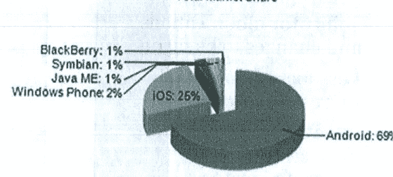

注意：此信息每天变化。请检查备注中的 URL 以获取最新百分比。

连接并使用网络的设备类型正在迅速从桌面电脑和其他非移动操作系统转移，特别是出于公司目的。当我们谈论互联网上连接设备的统计数据时，`Android OS` 是最常用的设备；`iOS` 是第二常见的操作系统。这意味着大多数人将 `iOS` 或 `Android` 设备作为他们的移动系统。

### 对比

| `Android` | `iOS` |
| --- | --- |
| - 开放标准，允许进行修改和更改 | - 第三方无法修改或更改的闭源软件 |
| - 锁定程度较低，可配置性更高 | - 锁定程度较高，配置选项较少 |
| - 近期更关注安全 | 始终专注于安全并集成功能 |


在比较 `Android` 和 `iOS` 时，理解最重要的区别是开放与闭源操作系统。因为 `Android` 是开放的，因此有很多变体和更改。`iOS` 是闭源的，无法被修改或更改。

开放标准的巨大优势是允许进行更改以添加新功能并增强用户体验。然而，这为恶意内容植入设备打开了大门。多年来，`Android` 设备中的嵌入攻击和恶意内容越来越多。

这个讨论很有趣，因为可以有两种观点。我们可以认为，因为 `Android` 占据了三分之二的市场，它会获得更多关注。另一种观点是，苹果的封闭生态系统验证了启动循环的所有方面，要难以得多。

### `Android` 安全演变

- 通常被视为一个功能性强而安全性较低的操作系统
- `Android Nougat` 显著关注安全性
- 更多的内置安全功能并尝试与 `iOS` 相似
- 仍是开放操作系统，但有更多嵌入安全功能
- 现在聚焦于“开箱即用的多层安全”

`Android` 安全在发布 `Android Nougat` 后发生了显著变化。`Android` 的开放架构通常被视为更侧重于功能性的活性，而安全性关注较低。然而，重点已经改变，现在正大力推动对安全的关注。

不再是插件式安全，`Android` 现在拥有嵌入式安全功能，重点不仅是保持设备安全，还保护设备上的关键数据。

最新版本的 `Android` 具有更强的内置安全性。观察它的演变非常有意思，因为 `Android` 的安全特性看起来越来越像 `iOS` 的安全性了。

让我们来看看 `Android` 的安全特性：

- **应用安全**：应用程序在提供下载之前，会对其进行严格的安全测试。它不再是那种任何应用程序都可以下载带有流氓或恶意功能的旧模型，而是通过执行严格的策略和安全检查，最大限度地减少有害内容的运行。虽然这并不完美，但它为过滤危险应用程序增加了一层额外保护。
- **主动扫描**：当应用程序运行时，会对其进行监控以检测可疑活动。即使对应用程序进行了检查，安全性并非完美，恶意内容仍可能被安装。因此，当应用程序运行时，会进行监控，如果检测到可疑活动，将停止应用程序并控制损害。
- **`Android Pay`**：安全支付选项不会暴露信用卡数据。`Android` 正在尝试与 `Apple Pay` 竞争。`Android Pay` 的关键功能之一是信用卡信息绝不会被传输。该功能通过虚拟账户号码，可以在保护敏感数据的同时允许交易发生。
- **虚拟沙盒**：关键数据被沙箱化或与应用程序隔离，以最大限地减少暴露。沙箱是传统操作系统中使用的一种强大技术，现在也被应用于移动应用程序。当关键数据被隔离时，即使安装了恶意内容，它也能受到保护。
- **设备管理器**：允许对远程设备进行定位和安全擦除。包含敏感设备的可能会被盗或丢失。因此，`Android` 具有定位设备的能力，并在适用的情况下可以擦除设备以保护敏感信息不被暴露。
- **内置加密**：内置了加密功能以保护静态数据和传输中的数据。保护敏感信息的最佳方法是通过加密。

### `iOS` 安全特性

- 以安全为核心设计
- 除非有人越狱（`jail break`）手机，否则采用封闭模型
- 安全集成到整个架构中
- 大多数安全性对用户是透明的
- 关键安全（即加密）无法禁用或关闭

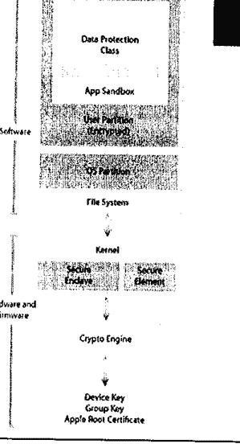

当我们想到 `iOS` 时，我们大多数人都会想到 `iPhone` 和技术的惊人进步。`iPhone` 以其惊人的功能彻底改变了手机市场。大多数人并没有考虑安全性；然而，安全性是 `iOS` 设计和实现中的关键组件。

正如你从图表（摘自 `Apple` 文档）所示，安全性集成到了硬件和软件中。当你打开 `iPhone` 并启动的那一秒起，安全控制就会到位，以验证 `iOS` 没有被更改或修改。

对有效安全至关重要的两个关键实现细节是**透明性**和**自动性**。`iOS` 的许多安全特性是透明的，用户并察觉不到正在发生。大多数用户不知道什么是内核（`kernel`），更不用说什么是安全隔区（`secure enclave`）了。这里有一个需要学习的关键点：安全性越透明，它就越有效。第二个关键方面是安全性是自动的，而不是可选的。许多核心安全特性始终在运行且无法关闭。

#### 核心类别

- **系统安全**：支持架构以及在系统上运行应用程序的硬件和安全特性
- **加密与数据保护**：如果设备被盗或尝试未经授权的访问，保护关键数据，保护静态数据
- **网络安全**：辅助数据保护并为传输中的数据提供安全保障
- **应用安全**：创建一个平台，允许第三方应用程序在安全环境中运行

`Apple` 拥有许多安全特性，并对所有核心组件及其工作原理提供了详细文档。在这里，我们查看 `iOS` 中安全特性的核心类别。

## 参考文献

1. `iOS` 安全指南，https://www.apple.com/business/docs/iOS_Security_Guide.pdf

# Shell 命令

## 用于 UNIX

- `Bourne Shell` (`sh`)
- `C Shell` (`csh`)
- `Bourne-Again Shell` (`bash`)
- `Korn Shell` (`ksh`)
- `Extended C Shell` (`tcsh`)

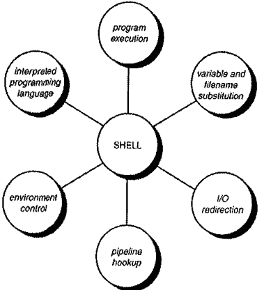

## 用于 DOS

- `Command.com`

## 用于 Windows

- `Cmd.exe`
- `Powershell.exe`


这张幻灯片描述了 UNIX 环境中用到的一些常用 Shell，并识别或演示了 Windows 中类似的组件。

不同 Shell 之间的主要区别在于每个 Shell 内置的嵌入脚本/编程语言。每个 Shell 都有不同的特性和可用的不同编程选项。如需详细比较，请参阅 https://en.wikipedia.org/wiki/Comparison_of_command_shells。

| DOS | UNIX | 描述 |
|---|---|---|
| `dir/w` | `ls` | 列出目录内容 |


# Linux 命令与文件系统基础

## DOS 与 Linux 命令对应

以下列表展示了 DOS 命令行功能与 Linux 命令之间的对应关系，适用于熟悉 DOS 的用户：

| DOS 命令 | Linux 命令 | 描述 |
| :--- | :--- | :--- |
| `ls -l` | `ls -l` | 详细列表；显示属性 |
| `ls /a` | `ls -al` | 列出隐藏文件和普通文件 |
| `cd` | `cd` | 更改工作目录 |
| `rename` | `mv` | 重命名文件 |
| `attrib` | `chmod` | 修改文件属性 |
| `md` | `mkdir` | 创建新目录 |
| `rd` | `rmdir` | 删除目录 |
| `del` | `rm` | 删除文件 |
| `copy` | `cp` | 复制文件 |

### 常用 Linux 命令简介

- `cat`：连接并查看文件
- `pwd`：打印工作目录
- `more`：一次查看一页
- `man`：读取帮助手册
- `find`：查找特定文件
- `grep`：执行字符串搜索
- `su`：切换用户账户
- `sudo`：为用户授权

### 管道与重定向

- 使用 `|` 字符进行管道操作
- 使用 `>` 创建输出文件


在分析事件和定位物品时，最常用的命令是 `grep` 和 `find`，它们将在稍后进行演示。

## 操作系统核心组件

### 内核 (Kernel)

操作系统直接与硬件接口的内存驻留部分称为内核。


任何操作系统的概述都从对关键元素的高层视角开始。Linux 的三个关键元素是：

- **内核**：操作系统的核心组件，通常被称为系统的“大脑”
- **Shell**：用户和进程直接交互的操作系统部分
- **硬件**：物理组件的集合，例如实际 CPU 和内存芯片

理解这些组件如何相互作用，有助于确定保护工作的重点。例如，为了防止权限提升操作，可以将保护工作放在 Shell 和内核之间的交互上，将进程或用户限制在各自的操作范围内。

内核管理硬件和执行中的进程，其服务包括：

- 文件系统
- 低级网络协议支持（例如 IP）
- 内存和进程管理

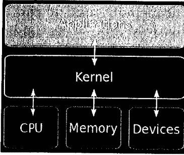

内核是 Linux 操作系统或任何操作系统最重要的部分。没有内核，操作系统无法运行。内核负责所有硬件和软件的排序、指令以及系统完整的交互。破坏内核将使系统毫无用处；而破坏用户或应用程序只会影响有限的功能，操作系统的其余部分仍可运行。

任何操作系统的内核通常在启动时加载到内存中。这允许所有组件之间进行快速交互，但它在内存中必须有一个专用空间而不移动。

### 文件系统结构

主要目录说明：

- `/`：根文件系统；目录层次结构的顶端
- `/dev`, `/devices`：包含用于与系统设备通信文件的目录
- `/usr`：主要操作系统目录；只读
- `/var`：包含日志文件、队列等
- `/bin`, `/usr`, `/usr/local`, `/opt`：可执行程序；某些 SUID/SGID
- `/home`, `/export/home`：用户主目录


现代 Linux 变体使用相同的通用文件系统布局。文件系统树的顶端是根目录。在此目录之下是重要的子目录树。

- `/dev` 包含了特殊的设备文件，运行系统上的程序使用这些文件与由操作系统内核控制的硬件设备进行通信。源自 AT&T System V (SYSV) UNIX 标准的 UNIX 系统通常将这些设备文件放在 `/devices` 目录中，但也通常有一个 `/dev` 目录以保持兼容性。
- `/usr` 是操作系统大多数关键组件所在地，包括系统二进制文件、程序库和工具；在操作系统安装后，该目录结构是只读的。
- `/var` 是经常变化数据的地方，例如日志文件和用于电子邮件和打印服务的队列。

虽然系统中的程序位于 `/usr/bin` 和 `/usr/sbin` 等目录中，但在系统中找到其他程序。一种标准做法是将从网上获取的第三方软件放在 `/usr/local`。SYSV 开发的系统（如 Solaris 和 HP-UX）通常将第三方软件（特别是商业软件）放在 `/opt`。不同的站点可能为软件选择不同的目录命名方案，例如 `/pkg` 或 `/sw`。

用户目录通常位于 `/home`。对于大型网络，home 通常是一个 NFS 挂载目录，而 `/export/home` 是文件所在地。再次，存在许多本地习惯。某些人喜欢使用 `/users` 或 `/u1`、`u2`。

### 分区与安全

逻辑文件系统特征：

- 由多个磁盘组成
- 磁盘分区挂载在不同的点上
- 每个挂载点可以设置不同的安全选项

注意：这是 Linux 的关键组件：安全可以集成到安装过程中。


分区的第二个原因是使备份更简单。某些分区如 `/usr` 很少需要备份，因为它们的变化频率极低。另一方面，用户目录可能需要每晚都进行备份。

第三，也是从安全角度来看最重要的一点，将 UNIX 文件系统拆分为不同的分区，允许管理员对文件系统的不同部分设置不同的安全选项。虽然机器的确切分区方案会因系统和站点的不同而异，但将根文件系统 `/usr` 和 `/var` 分为独立分区至关重要，以便对各种操作系统目录实施适当的安全措施。非操作系统数据（用户数据、主目录和应用程序数据）以及非由操作系统供应商提供的第三方应用程序通常应该放在它们自己的分区中，这样它们就不会“污染”操作系统的目录。

| 文件系统 | 1k-块 | 已用 | 可用 | 使用率% | 挂载点 |
| :--- | :--- | :--- | :--- | :--- | :--- |
| `/dev/hda5` | 3099260 | 2383084 | 558744 | 82% | `/` |
| `/dev/hda1` | 38859 | 3485 | 33368 | 10% | `/boot` |
| `/dev/hda7` | 5486908 | 20 | 5208164 | 1% | `/home` |


管理员可以使用 `df` 命令显示当前挂载的分区。`df` 是“disk free”的缩写，因为该命令实际上创建是为了帮助管理员找到磁盘空间耗尽的分区。

第一列显示与分区相关的磁盘设备以及已使用的磁盘空间，而可用空间并不等于以千字节（KB）为单位的总容量。最后一列显示分区对应的逻辑文件系统部分。

`df` 输出的中间列显示分区的总大小、已使用的磁盘空间和可用空间。请注意，已用字节加上可用字节数通常预留了总文件大小的 5% 到 10%。当分区达到 90% 时，除了 `root` 用户外，任何用户都不允许向文件系统写入数据。注意，`df` 输出倒数第二列中的容量数字考虑了这些预留空间。因此，当分区实际填充率为 90% 到 95% 时，`df` 显示为 100% 满。

注意，`df` 只显示当前挂载的文件系统。通常，机器有一个专门用于虚拟内存系统的“交换空间”（swap space）分区。这是一个“原始磁盘”分区，没有挂载到逻辑 UNIX 文件系统中。然而，这个交换分区在 `/etc/fstab` 文件中有记录。也可以使用 `swap -s` 命令获取当前正在使用的交换分区的信息。

### 文件系统安全目标

当你考虑文件系统安全时，记住几个重要的目标是有用的：

- 保护 `/usr` 中的操作系统二进制文件
- 防止引入 SUID 程序和未经授权的设备
- 允许安装其他软件
- 防止 DoS 攻击

攻破系统的攻击者可能想要安装 `rootkit`，这是一组二进制文件，可以为攻击者提供进入系统的后门，并帮助其逃避系统管理员的检测。通常，攻击者替换的二进制文件是 `/usr/bin` 和 `/usr/sbin` 目录下的操作系统程序，保护 `/usr` 文件系统非常重要。

管理员还应该尝试阻止人们在机器上创建或引入未经授权的 `set-UID` 和 `GID` 程序。未经授权的设备文件同样危险，因为它们可能允许普通用户获得通常只有磁盘驱动器、系统内存等的特权访问，从而绕过正常的系统访问控制。

相反，系统管理员需要对操作系统应用补丁并更新安装在机器上的软件。如果他们无法做到，随着新的无法修复的漏洞被发现，系统的安全性就会降低。

此外，为了避免拒绝服务（DoS）攻击，管理员应该仔细划分分区。其中，这意味着合理地拆分文件系统；例如前面的示例，将 `/var` 独立分区，以便系统过载不会影响整个机器。然而，管理员还应该注意为频繁使用的分区提供足够的剩余空间，以应对意外增长。

文件系统挂载选项：

- `ro`: 文件系统以只读方式挂载（文件和目录不可修改）
- `nousuid`: 忽略文件系统中所有程序的 SUID/SGID 位
- `nodev`: UNIX 设备文件无效


合理的分区和在 `/etc/fstab` 文件中适当使用文件系统挂载选项可以提供帮助。

## 磁盘加密 (LUKS)

- `LUKS` 是 Linux 硬盘加密的标准
- 通过标准化实现兼容性
- 针对低熵攻击具有安全性
- 支持多个密钥
- 有效的口令撤销
- 免费


`LUKS` 是 Linux 硬盘加密的标准。通过提供一种磁盘上的格式，它不仅促进了不同发行版之间的兼容性，还提供了对多个用户密码的安全管理。与现有解决方案相比，`LUKS` 将所有必要的设置信息存储在分区头中，使用户能够无缝地传输或迁移数据。

尽管大多数磁盘加密软件实现了不同且不兼容的未记录的格式，但 `LUKS` 指定了一种跨平台的标准磁盘格式，供各种工具使用。这不仅促进了不同程序之间的兼容性和互操作性，还确保了它们都以安全且有记录的方式实现密码管理。

`Cryptsetup` 是基于 `DMCrypt` 内核模块方便地设置磁盘加密的实用工具。这些包括普通 `dm-crypt` 卷、`LUKS` 卷、`loop-AES` 和 `TrueCrypt` 格式。

### 设置加密分区示例

```bash
cryptsetup --verbose aes-xts-plain64 --key-size 256 --hash sha512 --iter-time 5000 --use-random /dev/sda
```
创建加密设备

```bash
cryptsetup open --type luks /dev/sda3 root
```
解锁设备映射器

```bash
mkfs.ext4 /dev/mapper/root
```
创建文件系统

```bash
mount -t ext4 /dev/mapper/root /mnt
```
挂载设备以传输数据

```bash
umount /mnt
```
卸载设备

```bash
sysctl --write vm.drop_caches=3
```
清除副本并缓存缓冲区

使用 `LUKS` 设置加密可以非常简单，但始终记住所有解决方案都有优缺点很重要。虽然保护 Linux 服务器上的关键数据非常重要，但只有在有适当的密钥管理的情况下，加密解决方案才能起作用。组织通常认为加密等同于安全，但只有在正确配置和设置时这才是如此。此外，任何需要访问数据的人都需要访问密钥。因此，对于大型服务器来说，管理可能是一场噩梦。

在开始加密时，第一步是确保有一个不包含任何数据的分区。当你设置加密分区时，驱动器上的任何信息都可能会丢失。你需要通过创建加密设备和解锁设备映射器来设置分区。完成后，你需要创建文件系统。此时，驱动器已挂载，数据已复制到驱动器上。数据复制完成后，需要卸载并清除缓存和缓冲区。

### 替代配置示例

```bash
cryptsetup --verbose --cipher aes-xts-plain64 --key-size 512 --sha512 --iter-time 5000 --use-random /dev/sda3
```
创建加密设备

```bash
cryptsetup open --type luks /dev/sda3 root
```
解锁设备映射器

```bash
mkfs.ext4 /dev/mapper/root
```
创建文件系统

```bash
mount -t ext4 /dev/mapper/root /mnt
```
挂载设备以传输数据

```bash
umount /mnt
```
卸载设备

```bash
sync; echo vm.drop_caches=3
```
清除副本并缓存缓冲区

## UNIX 文件权限

### 权限表示方法

- 表示权限的两种通用方法
  - 符号模式
  - 绝对模式
- 符号模式使用字母来表示权限，如 `RWX`
- 绝对模式将权限表示为数字
- 在 Linux 系统上更改权限，你将使用 `chmod` 命令

在 Linux 中，表示权限的两种通用方法是符号模式和绝对模式。在符号模式下，你使用字母来表示权限。例如，`R` 表示读访问，`W` 表示写访问。为了以更紧凑的方式表示权限，你也可以使用绝对模式。在绝对模式下，你使用数字来引用权限而不是字母。例如，`4` 等同于 `R` 或读访问，`2` 等同于 `W` 或写访问。转换的实际细节将在下一张幻灯片中介绍。

在 Linux 中，当你想要更改对象的权限时，你将使用 `chmod` 命令来修改权限。你可以对 `chmod` 使用符号模式或绝对模式。

### 权限详解

UNIX 文件系统权限表：

| 类别 | 写权限 | 执行权限 | 读权限 | 特殊位 |
| :--- | :--- | :--- | :--- | :--- |
| 所有者 | r | w | x | s |
| 组 | r | w | x | s |
| 世界 | r | w | x | t |
| **数值** | 4 | 2 | 1 | 4 |

*注意：上述表格为简化示意，实际 `ls -l` 输出中顺序通常为 所有者(rwx)、组(rwx)、其他(rwx)。*

详细权限说明：

| 权限类型 | 读 (r) | 写 (w) | 执行 (x) | 特殊 | 说明 |
| :--- | :--- | :--- | :--- | :--- | :--- |
| 所有者 | 4 | 2 | 1 | - | 文件/目录所有者权限 |
| 组 | 4 | 2 | 1 | 2 | 组权限 |
| 世界 | 4 | 2 | 1 | 1 | 所有用户权限 |

常见组合值：
- 所有者权限：`7` (4+2+1)
- 组权限：`7` (4+2+1) 或 `5` (4+0+1)
- 世界权限：`4` (4+0+0)


UNIX 操作系统为文件和目录存储了多个属性。当你在终端中执行 `ls -l` 命令时，它会提供当前目录下所有文件及其关联属性的列表。

可以设置三种基本权限：读、写、执行。
- 读权限 (`r`)：允许你查看文件或目录的内容，或者本质上可以将文件复制到设置了写权限的位置。
- 写权限 (`w`)：允许你修改文件。
- 执行权限 (`x`)：允许你将文件作为程序运行。


# UNIX 文件与目录权限基础

UNIX 操作系统为文件和目录存储了多个属性。当你在终端中执行`ls -l`命令时，它会提供当前目录下所有文件及其关联属性的列表。可以设置三种基本权限：读、写、执行。

- **读权限** (`r`)：允许你查看文件或目录的内容，或者本质上能够将文件复制到设置了写权限的位置。
- **写权限** (`w`)：允许你修改文件。
- **执行权限** (`x`)：允许你将文件作为程序运行。

## 特殊位

特殊权限位包括 Set-UID、Set-GID 和粘滞位 (Sticky)。

| 类别 | 权限位 | 值 | 说明 |
| :--- | :--- | :--- | :--- |
| 所有者权限 | 读 (`r`) | 4 | 允许所有者读取 |
| 所有者权限 | 写 (`w`) | 2 | 允许所有者写入 |
| 所有者权限 | 执行 (`x`) | 1 | 允许所有者执行 |
| 组权限 | Set-UID | 4 | 执行时获得文件所有者权限 |
| 组权限 | 读 (`r`) | 4 | 允许组读取 |
| 组权限 | 写 (`w`) | 2 | 允许组写入 |
| 组权限 | 执行 (`x`) | 1 | 允许组执行 |
| 其他权限 | Set-GID | 2 | 执行时获得文件所属组权限 |
| 其他权限 | 粘滞位 (`t`) | 1 | 目录中仅所有者可删除文件 |

*注：在八进制表示法中，特殊位通常作为第四位（百位），例如 `4` 代表 Set-UID，`2` 代表 Set-GID，`1` 代表粘滞位。*

### 特殊位行为详解

- **用户 ID 标志 (Set-UID)**：允许程序以其所有者的权限运行。因为密码程序（如`passwd`）由`root`所有，所以它可以在设置此标志的情况下执行。
- **组 ID 标志 (Set-GID)**：工作方式与 Set-UID 相同，它给访问程序的用户提供额外的访问权限，就像该程序需要为打印作业进行溢吐一样。
- **粘滞位 (Sticky)**：开发于 UNIX 的早期版本，当时系统较慢。其原始目的是让程序在执行完毕后保留在内存中。如今，在应用于目录时，其含义变为只有所有者可以删除该目录中的文件。

## 权限模式：绝对模式与符号模式

在绝对模式下，可以在三个初始八进制数字前面放置第四个八进制数字，表示特殊权限标志。

- 领先的八进制数字：
  - `4`：Set-UID
  - `2`：Set-GID
  - `1`：粘滞位 (Sticky)

这种八进制表示法完整指定了文件的所有权限位，被称为文件的**绝对模式**。而在显示中使用 `r-w-x` 符号则被视为文件的**符号模式**。大多数 UNIX 命令都能同时处理这两种模式。

| 权限行为 | 文件 | 目录 |
| :--- | :--- | :--- |
| 读取 | 读取文件内容 | 目录列表 |
| 写 | 修改文件内容 | 创建/删除文件 |
| 执行 | 执行文件 | 访问目录中的文件 |
| Set-UID | 以文件所有者的权限执行 | 不适用 |
| Set-GID | 以文件所属组的权限执行 | 继承文件的组所有权 |
| Sticky | 不适用 | 仅允许所有者删除文件 |

权限标志的行为取决于它们是被应用于文件还是目录。

- 如果对目录设置了**读取权限**，你就可以获取该目录的列表。
- 如果对目录设置了**执行权限**，用户可以进入该目录并执行其中的文件，但不能显示目录列表。
- 通常情况下，目录需要设置执行位才有实际意义，但在某些情况下，不给这些目录提供读取访问是实用的，特别是对于组和其他类别的权限。
- 目录上的写权限允许用户更改目录的元素，包括重命名文件、添加文件和删除文件。在 Windows 中，这些是独立的权限，而在 UNIX 中，它们被处理为单一的写权限。

### 世界可写目录与安全

- 世界可写目录（如`/tmp`）被程序用于存储中间结果。
- 风险：如果攻击者破坏了你程序的临时文件并替换为他自己的文件，会导致严重安全问题。
- 黄金法则：
  - 尽可能避免使用世界可写目录。
  - 为世界可写目录设置粘滞位 (`sticky bit`)。

Linux 系统通常有许多世界可写目录，这意味着对其他人都开启了写权限。这类目录通常配置为对三个所有权类别都开启所有权限（读、写、执行）。这意味着系统中的**任何人**都可以在这些目录中创建、重命名和删除文件。此类目录的示例是标准的 UNIX`/tmp`和`/var/tmp`目录。

历史上，世界可写目录导致过巨大的安全问题。例如，UNIX C 编译器在编译过程中会将中间文件存储在`/tmp`中。攻击者可以迅速用一个包含恶意代码的文件替换编译器扫描期间创建的文件，从而导致程序中出现病毒或木马。

因此，确保所有世界可写目录都设置了粘滞位是至关重要的，因为这是系统目录（如`/tmp`和`/var/tmp`）的默认设置。有了粘滞位，攻击者将无法删除或重命名用户的中间文件来替换攻击者的木马代码。

如今，许多程序直接避开了像`/tmp`这样的目录，而是使用它们自己的私有临时目录，系统上的普通用户对这些没有写权限。例如，`Sendmail`邮件服务器将包含正在处理的消息的临时数据写入名为`/var/spool/inqueue`的私有目录，该目录只有`root`用户可以访问。

### SUID/SGID 的安全风险

- **双刃剑**：
  - 没有 SUID/SGID 程序，你无法运行 UNIX。
  - 然而，恶意的 SUID/SGID 程序可以轻易破解机器。
- **跟踪**：需要跟踪操作系统提供的 SUID/SGID 程序。
- **警报**：如果出现新的或意外的 SUID/SGID 程序，请警报。

Set-UID 和 Set-GID 程序在历史上一直是攻击者利用以获取 UNIX 系统特权访问的最常见漏洞之一。例如，攻击者可能通过光盘或 U 盘驱动器将一个带有 Set-UID `root`权限的 UNIX 命令 `shell` 带入系统。当用户执行此 `shell` 时，无需提供密码即可立即获得权限。具有缓冲区溢出或其他编码错误的 Set-UID 程序可能允许攻击者“逃逸”正在运行的程序并获得交互式 `shell`。

在安装机器时，列出系统中所有的 Set-UID 和 Set-GID 程序列表可能是一个好主意。当出现新的 Set-UID 或 Set-GID 程序时，要引起重视。

# 权限管理：Umask 和 Chmod

## Umask

- `umask` 设置新创建文件的默认权限掩码。
- `umask` 可以读取现有 `umask` 设置。

`umask` 允许设置系统的掩码，以便用户创建的文件具有特定的权限，减少了意外暴露。

使用 `umask`，你可以指定使用符号模式还是绝对模式。

- **符号模式**：
  - `u`：表示所有者
  - `g`：表示组
  - `o`：表示其他人
  - `+`：允许指定的用户类启用指定的权限。
  - `-`：禁止指定的用户类启用指定的权限。
  - `=`：只允许启用指定的权限，所有其他在创建时被禁用。
  - 可以同时进行多个更改，必须用逗号分隔。

示例：

```bash
umask u-x,g=r,o-w
```

上述命令禁止为文件所有者设置执行权限（保持其他所有者权限不变），为组开启读取权限，禁止组的写和执行权限，并禁止其他人的写权限（保持其他其他人权限不变）。

**绝对模式**示例：

```bash
umask 132
```

在 UNIX 中，默认权限值为普通文件为`666`，目录为`777`。当你创建一个新文件或目录时，内核获取此值，“减去” `umask` 值，并赋予新文件相应的权限。

- 如果 `umask` 值为 `022`：
  - 任何新文件的默认权限将为 `644` (`666 - 022`)。
  - 任何新目录的默认创建权限为 `755` (`777 - 022`)。

## Chmod

`chmod` 命令全称为 "change mode"（更改模式），用于通过修改文件的权限来定义文件的访问方式。`chmod` 命令带有权限选项，以及要更改权限的文件名。`chmod` 也可以用符号和绝对模式编写。

示例：

```bash
chmod u=rwx,g=rx,o=r filename
chmod 754 filename
```

`chmod` 有一个递归选项`-R`，用于用一个命令更改目录树中许多文件的权限。

# 所有权管理：Chown 和 Chgrp

- `chown` 更改文件所有权（用户和组）。
- `chgrp` 更改组所有权。
- `chown` 可以同时更改用户和组所有权。
- `chown` 将使用用户 ID、组 ID 或它们的名称。

示例：

```bash
chown user1 /home/user1
chgrp support /home/user1
```

仅仅更改文件或目录的权限不足以限制访问；必须更改所有权，以对文件和目录创建有效的访问控制。

- 使用 `chown` 命令更改文件的所有权。
- 使用 `chgrp` 命令更改文件或目录的组所有权。

在 UNIX 系统大多数情况下，`chown` 命令可以同时更改组和用户所有权。使用 `chown` 更改用户和组所有权的格式为`user:group filename`。

通常，超级用户是唯一允许 `chown` 文件和目录的用户。允许普通用户 `chown` 文件存在风险：具有所有者权限的普通用户可以将执行权限更改为 Set-UID 并所有者为`root`；在这种情况下，用户可以启用或获得其`root`权限。由于这是一个严重的配置漏洞，允许普通用户 `chown` 文件的 UNIX 系统会在对文件运行 `chown` 后移除 Set-UID 和 Set-GID 位，以防止该场景发生。

我们还提到，如果允许普通用户 `chown` 文件并设置了磁盘使用配额，普通用户将能够将文件所有权设置为其他用户。这样，创建的文件就可以被 `chown` 以使用另一个用户的配额。

UNIX 系统上的每个用户和组都有一个对应的数字；它们是用户 ID (UID) 和组 ID (GID)。`chown` 命令可以接受用户和组的 ID 以及组名。

# Linux 用户账户

## 用户账户和组

- 用户名和密码区分大小写。
- 用户名和组名是为了人类方便。
- UNIX 系统使用用户 ID (UID) 和组 ID (GID) 存储所有权信息。

在 UNIX 系统上，所有用户都有与其相关的用户名和密码。这些用户名和密码区分大小写，因此用户名`Userl`和`User`是 UNIX 系统中两个不同的用户。为了防止混淆，通常的最佳实践标准是配置用户名仅使用全小写字母。

每个用户和组名都有一个对应的数字 ID。用户、用户 ID (UID) 和密码存储在系统账户数据库中，通常是两个文件：

- `/etc/passwd` 文件存储用户名、UID 以及其他各种信息，如路径和默认组。
- `/etc/shadow` 是密码数据库。

在 UNIX 系统中，UID 和 GID 值是重要的，而不是用户名或组名。例如，如果你从 UNIX 系统中删除一个用户，创建的任何文件都将显示 UID 值作为文件的所有者，因为系统无法再为显示的 UID 查找有效的用户名。

这与 Windows 上的 SID 不同；区别在于 SID 总是唯一的，而 UID 和 GID 并不唯一，在不同的独立的 UNIX 系统上可能是相同的。因此，系统之间的文件共享存在问题，因为两个具有不同用户名的完全不同的用户可能拥有相同的 UID 值，这意味着他们都可以访问彼此的文件。

## 超级用户

- 二分类安全模型：
  - 普通用户
  - 超级用户
- 超级用户控制所有文件、进程和设备。
- 超级用户通常称为`root`。
- 超级用户账户的 UID 始终为`0`。
- 除了`root`账户外，可以存在多个 UID 为`0`的账户。
- UID`0`账户的创建或访问是任何攻击者的目标。

UNIX 的安全模型分为两类：普通用户（可以访问自己的文件）和超级用户（可以在系统上做任何事情）。

这种“全有全无”的安全模型多年来一直是一个安全隐患，因此诸如`SELinux`等 Linux 机制正在开发和维护，以便在操作系统的内核中内置基于角色的访问控制。

超级用户通常称为`root`，但不必一定如此：UNIX 系统真正关心的是 UID 和 GID，而超级用户 UID 是`0`。如果超级用户是`happyadmin`，它的 UID 必须是`0`。超级用户账户等同于 Windows 系统中的管理员账户。

对于 UNIX 系统上的用户权限问题，用户的 UID 设置为`0`并不罕见。由于系统只真正关心 UID 和 GID，超级用户 UID 是`0`。如果超级用户是`happyadmin`，它的 UID 必须是`0`。

为了审计目的，审计日志将记录是哪个用户做了什么。

## 权限提升

- 永远不要以`root`登录。
- 匿名登录是非常危险的。
- 以 UID`0`登录无法提供审计依据。
- 始终作为普通用户登录。
- 利用`su`或`sudo`提升权限。


你可以通过三种方式合法地提升你的超级用户权限。第一种方法是直接作为 `root` 账户登录系统。这种登录方式被称为匿名登录，因为无法在审计日志中追溯到特定用户。最佳实践是不允许直接 `root` 登录，因为没有审计。作为灾难恢复和业务连续性计划或应急处理计划的一部分，你可能需要以 `root` 登录。只允许在控制台使用 `root` 账户，而不应在非加密通道（如 `Telnet`）上使用。

获取超级访问的第二种方法是使用 `su` 命令，它位于 `/bin/su` 或 `/usr/bin/su` 路径。该命令允许普通用户切换到系统中的任何用户，但在大多数情况下，它会切换到 `root` 账户。事实上，如果你单独运行该命令，它将默认切换到 `root` 账户。以 `root` 登录确保了对 `root` 账户的所有活动都可以追溯到切换到 `root` 账户的用户。

第三种获取超级访问的方法是通过使用 `sudo` 命令。`sudo` 命令允许普通用户执行 `sudo` 命令，前提是他们在 `/etc/sudoers` 文件中。与 `su` 命令相比，使用 `sudo` 命令有很多优点。`sudo` 命令只需要普通用户的密码，因此普通用户不需要知道 `root` 密码。控制粒度也更细，因为可以列出特定的命令，这些是用户允许使用 `sudo` 运行的唯一命令。使用 `sudo` 命令的日志更详细。

© 2017, Secure Anchor Consulting 63

# “系统”账户

- UNIX 操作系统通常会带有许多用于各种应用程序的系统账户
- 通常，这些账户具有较低的 `UID` 数字（`UID` < 100, 500, 1000）
- 攻击者有时会激活这些账户作为进入系统的“后门”
- 如果你没有使用特定的服务或应用程序，请删除（或禁用）该账户

UNIX 系统通常会带有若干账户，这些账户与系统上的特定应用程序相关，而不是与个人相关。例如，`NFS` 使用特殊的“nobody”用户。`Oracle` 需要一个“oracle”数据库管理员账户，而系统可能设置了“apache”或“www”用户来运行 Web 服务器。这些账户通常被赋予较低的 `UID`，以将它们与密码文件中的其他区分离开来。`Red Hat` 要求预留所有小于 `500` 的 `UID` 用于“系统”类型账户，而 `Debian Linux` 系统使用小于 `100` 的 `UID`。其他 UNIX 系统（如 `Solaris`）则预留 `0-99` 的 `UID`。

通常情况下，供应商提供的默认 `/etc/shadow` 文件会将这些账户设置为禁用的并带有无效的 shell，攻击者经常尝试在 `/etc/passwd` 的这些条目中插入有效密码作为后门。在 `/etc/passwd` 中为这些账户设置无效 shell 是一个好主意，可以定期审计系统和 shadow 文件以检查账户的变化。禁用账户比删除账户更好。在大多数情况下，这些系统账户“拥有”系统上的一个或多个文件和目录。如果从 passwd 和 shadow 文件中完全删除该账户，该原始 `UID` 可能会被分配给不同的用户。通过为新用户重新分配 `UID`，管理员创建了一种让新用户拥有系统文件的情况。如果这些是关键配置文件、目录或设备，用户可能会获得更高的权限。

类似的参数，当用户离开组织或不再访问系统时，阻止账户而不是删除账户，这可以用于了解用户离开很久后他们留下的某些文件和目录。当然，在 passwd 和 shadow 文件中存在大量禁用的账户使得审计这些文件变得困难，因此某些站点选择在用户离开很久后清理旧账户和数据。同样，如果系统确定某个账户不再拥有任何文件。

# Passwd 文件

在早期的 UNIX 中，加密密码存储在 `/etc/passwd` 中，并带有用户信息。每个人都可以读取加密密码，但破解一个良好的密码太慢了。

| 登录 ID | GID | 目录 |
| :--- | :--- | :--- |
| `jsmith:x:144:12:/home/staff/jsmith:/bin/csh` | | |

| 加密密码或 Shadow | UID | 登录 Shell |
| :--- | :--- | :--- |
| `GECOS` 信息 | | |

# 安全训练营风格 45

最初，UNIX 系统将用户的单向加密密码留在 `/etc/passwd` 文件中。许多工具（如 `ls`）用于显示文件所有权等。由于该文件是全局可读的，带来了潜在的安全风险，因此 UNIX 引入了 shadow 文件来存放加密密码。

密码文件中的每个字段用冒号（`:`）隔开，如下：

- 第一字段：用户 ID
- 第二字段：加密密码（通常为 `x` 表示已 shadow 化）
- 第三字段：用户标识符
- 第四字段：用户主组
- 第五字段：`GECOS` 字段（备注）
- 第六字段：用户家目录
- 第七字段：登录时发生（通常是一个进程）

# Shadow 文件

`username:passwd:last:may:must:warn:expire:disable:reserved`

`username:Npge08pfz4wuk:9479:0:1000:::`

| 字段 | |
| :--- | :--- |
| `Username` | 匹配 `/etc/passwd` 文件中的条目 |
| `Password` | 加密密码以及盐值和加密类型 |
| `Last` | 自 1970 年 1 月 1 日以来更改密码的天数 |
| `May` | 再次更改密码前的天数 |
| `Must` | 必须更改密码的天数 |
| `Warn` | 更改密码前的天数，以便用户收到警告消息 |
| `Exp` | 密码过期前的天数 |
| `Disable` | 账户被禁用的天数 |
| `Reserved` | 当前未使用 |


# Shadow 文件

`username:passwd:last:may:must:warn:expire:disable:reserved`

- `Username`：匹配 `/etc/passwd` 文件中的条目
- `Password`：加密密码以及盐值和加密类型
- `Last`：自 1970 年 1 月 1 日以来更改密码的天数
- `May`：再次更改密码前的天数
- `Must`：必须更改密码的天数
- `Warn`：更改密码前的天数，以便用户收到警告消息
- `Exp`：密码过期前的天数
- `Disable`：账户被禁用的天数
- `Reserved`

## 启用年龄限制

- 配置文件
    - `/login.defs`
        - `PASS_MAX_DAYS`：密码有效的最大天数。默认值为 9999。
        - `PASS_MIN_DAYS`：自上次更改后可以更改密码的最少天数。默认值为 0。
        - `PASS_MIN_LEN`：密码最小长度（在 Linux 中此值为 0）。
        - `PASS_WARN_AGE`：开始提醒密码的天数。默认值为 7。
    - `/default/useradd`
        - `INACTIVE`：账户过期后被禁用的天数。值为 -1。
        - `EXPIRE`：账户过期日期，格式为 `YYYY-MM-DD`。默认值无。


## 启用有效期

在大多数 UNIX 系统上，密码过期和轮功能是禁用的。要启用这些功能，你只需对配置文件应用值。

## PAM 简介

- PAM 代表可插认证模块（Pluggable Authentication Modules）
- 系统库处理 Linux 认证
- 四个管理组
    - 认证（Authentication）
    - 密码（Passwords）
    - 会话（Sessions）
    - 账户（Accounts）
- 位于 `/etc/pam.d`

| 请求 | 应用 | 成功或失败 | 配置文件： |
| :--- | :--- | :--- | :--- |
| | | `auth aaa.so requisite aaa.so account sufficient ccc.so` | |
| | | `password required 222.so` | |


可插认证模块（PAM）是处理 Linux 认证及其与之相关的许多任务的系统库。PAM 最初由太阳微系统发明，现在已演变成一种强大的技术，通过为许多需要认证服务的各种应用程序提供独立模块，简化并加强了 Linux 系统的安全性。

PAM 采用四个管理组来处理特定类型的认证请求：

- 认证（auth）：用于建立用户身份并可能确定组身份
- 密码（password）：当用户提供密码作为认证凭据时使用
- 会话（session）：协助实施与用户认证相关的服务和任务
- 账户（account）：用于执行不基于认证的操作

这里是一个 PAM 文件的示例（针对文件 `/etc/pam.d/su`）：

```
%%PAM-1.0
auth sufficient pam_rootok.so
## 注消以下行以隐式信任 "wheel" 组中的用户。
#auth sufficient pam_wheel.so trust use_uid
## 注消以下行以要求用户位于 "wheel" 组。
#auth required pam_wheel.so use_uid
auth include system-auth
account sufficient pam_succeed_if.so uid = 0 use_uid quiet
account include system-auth
password include system-auth
session include system-auth
session optional pam_xauth.so
```

## 强制更强密码

要开始执行，通过修改 `/etc/pam.d/system-auth` 文件并添加以下内容：

| 命令 | 控制 | 模块 | 参数 |
| :--- | :--- | :--- | :--- |
| `password` | `requisite` | `/lib/security/$ISA/pam_cracklib.so` | `retry=3 minlen=8 lcredit=-1 ucredit=-1 dcredit=-1 ocredit=-1` |

- `pam_cracklib` 模块会根据字典单词和其他约束对密码进行检查

Linux 系统上的密码强制执行通过 PAM（可插拔认证模块）管理。主要配置文件维护在 `/etc/pam.d` 目录下。

系统范围的密码强制执行主要由 `system-auth` 配置控制。要设置最小密码要求，你必须设置以下变量：

- `minlen=$`：密码的最小长度必须为 $。
- `lcredit=$`：小写字母的最小数量必须为 $。
- `ucredit=$`：大写字母的最小数量必须为 $。
- `dcredit=$`：数字的最小数量必须为 $。
- `ocredit=$`：其他字符的最小数量必须为 $。

## 限制使用旧密码

编辑 `/etc/pam.d/system-auth` 文件并添加/更改以下内容：

- `pam_cracklib` 参数：

```
"password requisite /lib/security/$ISA/pam_cracklib.so retry=3 minlen=-8 lcredit=-1 ucredit=-1 dcredit=-1 ocredit=-1 difok=3"
```

- `pam_unix` 参数：

```
"password sufficient /lib/security/$ISA/pam_pwhistory.so nullock use_authtok md5 shadow remember=6"
```

以下变量设置了重用策略：

- `difok=$`：与旧密码相比必须不同的字符数量 $。
- `pam_pwhistory`：模块记住旧密码的使用情况。
- `remember=$`：此值是记录的旧密码数量。

如果 `/etc/security/opasswd` 不存在，你需要创建该文件。

## 在多次登录失败后锁定账户

编辑 `/etc/pam.d/system-auth` 文件并添加/更改以下内容

- `pam_tally` 模块统计失败登录：

```
auth required /lib/security/$ISA/pam_tally.so onerr=fail no_magic_root
```

```
account required /lib/security/$ISA/pam_tally.so per_user deny=5 no_magic_root reset
```

默认情况下，UNIX 系统在达到登录尝试次数后不会锁定账户。通过设置此值，你可以防止暴力破解密码攻击。不要应用于 `root` 账户，因为这会导致管理员遭受拒绝服务（DoS）。

`pam_tally` 模块在多次失败的登录尝试后锁定单个账户。

`onerr=fail` 告诉系统在达到一组 `fail=lock` 账户时该做什么。

`No_magic_root` 告诉系统锁定 `root` 账户。这防止了针对 `root` 账户的 DoS 攻击。

`per_user` 记录每个单独的使用情况。

`deny=$` 是账户锁定之前进行的尝试次数。

`faillog -u <user>` 列出当前的错误登录次数。

`faillog -u <user> -r` 解锁账户。

`faillog -u <user> -m -1` 关闭特定用户被锁定时的锁定功能。

你可以使用这些命令解锁账户：

- `passwd -d <user>`
- `usermod -L <user>`
- `passwd -u <user>`
- `usermod -U <user>`

## 使用 OpenLDAP 的 LDAP 支持

- LDAP 是轻量级目录访问协议
- LDAP 是用于定位网络中资源（如文件）的软件协议
- OpenLDAP 主要专注于解决组织内部的认证和授权问题
- 中心化用户管理
- 无 GUI
- 与许多应用程序集成
- 不支持 Active Directory


可插拔账户管理器是管理一或两个 UNIX 系统的很好的解决方案，但要管理几十甚至上百个系统，确保所有密码设置相同将变得难以应对。在这种情况下，PAM 变成了一个不那么吸引人的解决方案。

OpenLDAP 项目由 Kurt Zeilang 于 1998 年启动。该项目通过从密歇根大学克隆 LDAP 参考源代码开始，那里有一个长期运行的项目支持 LDAP 协议的开发和演进，直到该项目在 1996 年最终发布。OpenLDAP 主要专注于解决组织内部的认证和授权问题。OpenLDAP 解决方案的管理通过命令行进行，并需要一些时间来配置，因为它功能丰富。

一个常见的误解是认为 LDAP 将支持 Active Directory，事实并没有这回事。

## 总结

- UNIX 概览
- UNIX 类型
- 安全基础
- Linux 服务启动
- 服务加固与安全
- PAM
- 中心化用户管理
- 无 GUI
- 与许多应用程序集成
- 不支持 Active Directory

## Upstart

- 传统的 `init` 方案过于僵化，且缺乏系统管理员需要的重要功能
- 已经开发多种解决方案
- 其中一种解决方案是 Upstart
- Upstart 支持服务的并行启动
- 它支持系统的实时更改
- 它监控服务的状态
- 它是一个可选的插件


大多数熟悉 Linux 的用户都了解并欣赏 `init` 启动过程。遗憾的是，它对于启动系统和任务来说并不是非常动态的解决方案。在运行 Linux 系统的现代环境中，更严格的要求使得系统和相关服务能够保持持续一致性且不中断。由于需要更好的服务运行时间（uptime）和可用性，用户开始开发功能丰富的启动解决方案。其中一种解决方案就是 Upstart。

Upstart 引入了 `init` 中不具备的新概念。这些概念包括作业（jobs）、事件（events）和触发事件（emitting events）。作业是需要持续运行系统活动的进程。例如，如果你需要某个服务一直运行或可用，一个作业就会系统上运行。作业利用事件来允许并引发系统活动。例如，假设你需要一个服务在特定时间运行。在这种情况下，你会运行一个作业，而一个针对当天时间的事件会触发该作业。

如所述，作业可以发送或引发事件来触发其他作业。这个过程被称为“触发（emitting）”，它非常适用于创建一个事件链过程，即在第二个作业启动之前，一个作业依赖于另一个。

Upstart 支持以下动作：

- `Waiting`（等待）：表示进程的初始状态
- `Starting`（启动中）：表示作业即将启动
- `pre-start`：指定 `pre-start` 部分加载的位置
- `spawned`（派生）：表示启动脚本即将运行的位置
- `post-start`：指定 `post-start` 操作发生的位置
- `running`（运行中）：表示作业完全运行的位置
- `pre-stop`（停止前）：表示 `pre-stop` 操作发生的位置
- `stopping`（停止中）：指定作业正在停止
- `killed`（杀死）：表示作业已停止
- `post-stop`（停止后）：指定 `post-stop` 操作发生的位置；用于清理

参考

1. Digital Ocean, "The Upstart Event System: What It Is and How to Use It," https://www.digitalocean.com/community/tutorials/the-upstart-event-system-what-it-is-and-how-to-use-it,

© 2017, Secure Anchor Consulting

## Systemd (1)

- `Systemd` 是 `init` 守护进程的名称，也是围绕它的整个软件包
- `Systemd` 主要功能


# Systemd

- 全系统系统和服务管理器
- 一个软件平台
- 提供由内核提供的功能的接口
- 支持并行处理
- 启动后监控服务
- 支持设备热插拔

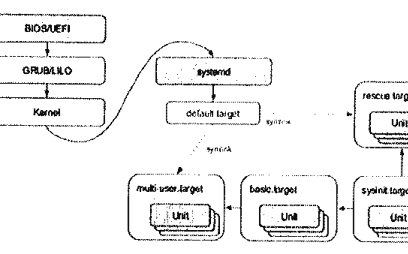


`Systemd`是一个软件单元的名称；在许多功能中，它取代了`init`守护进程，后者负责在`Linux`中启动和运行进程及服务。作为一个相对友好的解决方案，`systemd`允许你管理系统启动时运行的服务。许多`Linux`倡导者认为`systemd`正在解决并不存在的问题，并无必要地增加了`Linux`后端的复杂性。`Systemd`构建在许多主流流行发行版中，不太可能消失。通过大规模采用，`systemd`已成为`init`的替代品。

`init`守护进程旨在初始化`Linux`内核启动后启动的`Linux`系统进程。它还用于在`Linux`系统运行时管理`Linux`服务和服务守护进程。`Systemd`通过将服务和守护进程作为“单元（`units`）”处理来管理它们，而单元是系统使用的资源。你可以通过后缀`.service`识别单元文件。`Systemd`还可以管理`Linux`系统的许多属性，将其作为单元处理。这些单元根据它们代表的资源类型分组，并定义在所谓的单元文件（`unit files`）中。你可以像服务单元一样通过后缀识别这些单元。通过读取单元文件的后缀，你可以看到单元文件定义了哪种类型的资源。

整体而言，`systemd`提供的功能比`init`多。以下是其中一些：

- 你可以监控服务并在它们由于任何原因停止时重新启动它们。
- 你可以使用并行处理同时启动多个进程。
- 在系统运行时，`systemd`帮助插拔服务和设备，因此你不需要重启。此功能允许系统管理员在不重启系统的情况下为`Linux`系统服务并添加功能，从而允许系统处于任何运行状态，而如今运行时间是至关重要的。

## 参考

1. `Systemd`, https://en.wikipedia.org/wiki/Systemd

## 常用命令

```
systemctl start name.service
systemctl stop name.service
systemctl restart name.service
systemctl reload name.service
systemctl status name.service
systemctl is-active name.service
systemctl list-units --type service
```

| `systemd` 工具 | 描述 |
| :--- | :--- |
| `systemctl` | 管理`systemd`单元和单元文件 |
| `journalctl` | 查看`systemd`日志 |
| `notify` | 通知`systemd`关于服务状态 |
| `analyze` | 分析`systemd`配置 |
| `cgl` | 控制组限制工具 |
| `ctop` | 查看资源使用情况 |
| `loginct` | 登录控制 |
| `inspawn` | 内嵌进程生成器 |

| `systemd` 守护进程 | `systemd` Targets |
| :--- | :--- |
| `journal` | `multi-user.target` |
| `networkd` | `graphical.target` |
| `boot mode` | `user.target` |
| `dbus` | `reboot.target` |
| `loginuser` | `shutdown.target` |
| `session` | `dbus` |

如所述，作业可以发送或引发事件来触发其他作业。这个过程被称为“触发（`emitting`）”，它非常适用于创建一个事件链过程，即在第二个作业启动之前，一个作业依赖于另一个。

整体而言，`systemd`提供的功能比`init`多。以下是其中一些：

- 你可以监控服务并在它们由于任何原因停止时重新启动它们。
- 你可以使用并行处理同时启动多个进程。
- 在系统运行时，`systemd`帮助插拔服务和设备，因此你不需要重启。此功能允许系统管理员在不重启系统的情况下为`Linux`系统服务并添加功能，从而允许系统处于任何运行状态，而如今运行时间是至关重要的。

（注：此处原文包含大量 `OCR` 错误和重复片段，译文已根据核心逻辑进行整合和清理。）

# Cron

- 调度动作守护进程
- 在预设时间（在后台）启动操作
- 也可以供用户使用
- 使用`crontab`文件存储将要运行的作业
- `Cron`守护进程(`crond`)与系统时钟完全同步


除了讨论的方法外，你还可以使用`cron`按照设置的时间间隔启动服务。

`cron`守护进程(`crond`)与系统时钟完全同步。每分钟，`crond`都会遍历`/etc/crontab`文件，查看在预定时间是否有需要执行的任务。该文件中的一个条目由特定或循环的时间、系统应执行该任务的用户，以及命令本身或脚本路径组成。请注意，`cron`执行的任何任务都是在后台运行的。这里是`crontab`文件中一个条目的示例：

```
2 5 6 *** /usr/bin/apt-get update
```

该行的前五个字段代表执行命令的分钟、小时、日期、月份和星期。这种时间格式在`crontab`的`man`（手册）页中有解释：

| 字段 | 允许的值 |
| :--- | :--- |
| 分 | `0-59` |
| 小时 | `0-23` |
| 日期 | `1-31` |
| 月份 | `1-12`（或名称，见下文） |
| 星期 | `0-7`（或`7`代表周日，或使用名称） |

一个字段可以是星号(`*`)，它始终代表第一个到最后一个。

在这个示例中，命令应在每月每天的凌晨 6:00 之后 25 分执行；星号(`*`)是通配符。系统将以`root`用户身份启动此命令；它是用于基于`Debian`的系统的，因为这是更新本地系统`APT`仓库内容的命令。

如果管理员允许，普通用户可以使用自己的`crontab`文件，该文件通常位于他们的家目录中，名为`crontab`。此功能允许用户在对其账户施加常规限制的情况下，使用与`/etc/crontab`文件相同的语法在预设时间启动程序或脚本。

# 参考

1. http://man.cx/crontab(5)

# Linux 配置管理

本页故意留白。

# 软件包最小化

- 减少系统中的软件包数量是一项常见做法
- 最小化在较小环境中运行的存储需求
- 减少攻击面对于安全至关重要
- 减少包数量
    - 使用`XFCE`代替`gnome`
    - 丢弃不必要的包

> 提示：整个`X11`子系统是一个可选包，如果不需要可以将其删除。

减少系统中的软件包数量是一项常见做法。这通常是为了减少`Linux`发行版的存储需求，使其能够在更小的环境中运行。减少`Linux`安装和内核占用的额外益处是，由于显著减少了威胁面而提高了安全性；随着时间的推移，易受攻击的应用程序和包会更少。

减少包大小的一种方法是使用`XFCE`而不是`gnome`，因为它占用的空间更少、资源更少。此外，你可以检查发行版中的每个包并移除你不需要的。

# 配置管理工具

- 配置管理工具是提高`UNIX`环境整体安全性的重要方面
- 保持系统配置一致
- 市场上有许多不同的参与者
- 既有开源和商业选项


配置管理工具是提高你的`UNIX`环境整体安全性的重要方面。在大型`UNIX`环境中，确保所有`UNIX`系统都符合组织设定的加固标准同样重要。配置管理解决方案使得一次性加固所有`UNIX`系统的任务变得简单得多。在许多方面，这非常像`Windows`组策略，你可以在其中设置加固标准、控制软件包并控制包更新。

如今市场上有许多参与者，提供开源和商业选项。每种方案在易用性、用于控制现有软件的预构建包数量、支持的`Linux`发行版以及成本方面各有优缺点。

## Puppet

- 最初是一个开发运维工具
- 开源版本和商用版本
- 有限的预构建支持
- 商业版本功能最丰富
- 用`Ruby`语言编写
- 配置需要一些技能
- 对`Windows`系统提供某些支持


`Puppet`是该系列中第一个集中配置管理工具；它也是市场上最流行的解决方案之一，同时提供商用和开源版本。最初作为一个开发运维工具，`Puppet`随着时间的推移自然地变成了配置管理工具。它确保环境中的多个系统中软件和配置以一致的方式进行安装和设置。

恶意攻击者只需要找到一种进入你环境的方法。通过使用`puppet`等工具，系统管理员可以控制和管理系统的配置。通过这种方式，他们可以减少漏洞的总数。`Puppet`还对`Windows`系统提供了一些支持。

`Puppet`用`Ruby`语言编写的，配置需要一些技能。系统管理员可以使用`puppet`来控制并管理系统的配置。通过这种方式，他们可以减少漏洞的总数。`Puppet`还提供了免费版本，其功能集足够管理受影响的系统。

### 参考

1. `Puppet`，https://puppet.com/
2. `Puppet` 如何工作，https://www.puppet.com/how-puppet-works
3. 选择正确的配置管理工具，http://www.tomsitpro.com/articles/configuration-management-tools,2-920.html

## cfEngine

- 最老的配置管理工具
- 同时有开源和商用版本
- 易于使用
- 从关注本地数据中心转向基于云
- 与监控配对的自动化框架


`cfEngine`是一个存在已久的配置管理工具；它同时提供开源和商用版本；易于使用；从关注本地数据中心转向基于云。

`CFEngine`是一个存在已久的配置管理工具之一，并且持续更新。它最初的重点是本地数据中心；但它现在更基于云，使其比其他开源配置管理解决方案更灵活。

`CFEngine`框架将监控和建模集成到自动化引擎中。你可以轻松创建配置。要这样做，只需确定偏好的安全配置并创建一个模型，确定你需要做的更改，然后在需要时将其设置为自动修复，`CFEngine`的库将帮助你构建状态并正确管理配置。

### 参考

1. 选择正确的配置管理工具，http://www.tomsitpro.com/articles/configuration-management-tools,2-920.html

## Ansible

- 用于配置计算机的免费软件平台
- 执行软件部署、任务执行和配置管理
- 通过 管理节点
- 使用控制机和节点
    - 控制机执行编排和管理
    - 节点正在被管理
    - 通信通过`JSON`协议


`Ansible`是一个功能丰富的免费配置管理工具。如果组织需要一个比`puppet`功能丰富且比`puppet`稍微易管理的免费替代方案，就会使用它。该工具包含了提高任何组织`Linux`系统安全态的若干功能；它们包括软件部署、任务执行和配置管理。`Ansible`还为大型环境提供了一种可扩展的方法。`Ansible`确保环境中的`Linux`系统是一致、稳定且整体安全的。

`Ansible`设计用于通过一个主控制机来控制机器，被控制的机器称为节点。控制机是通过`SSH`使用`JSON`协议管理每个受管理节点的管理器。`Ansible`开发者的主要目标是提供一种高安全性且对受管理系统影响最小的配置管理工具。

### 参考

1. `Ansible`，https://en.wikipedia.org/wiki/Ansible_(software)

## Chef

- 开源软件
- 自动化基础设施的软件代理
- 允许对基础设施进行快速配置、管理和调整
- 将基础设施转化为代码
- 关键组件：
    - `Chef` 开发包 (`Chef Development Kit`)
    - `Chef` 服务器 (`Chef Server`)
    - `Chef` 客户端 (`Chef Client`)

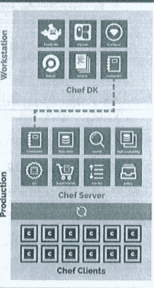


`Chef`是一种开源管理的`DevOps`工具，可以推送并控制正在开发和部署的配置版本。它允许你根据业务需求动态管理、设置和更改系统配置。`Chef`通过为`IT`基础设施添加抽象层并将其转换为代码段来实现，这些代码在部署之前可以进行版本控制、读取和测试。`Chef`可以在本地、云端或两者的结合环境中工作。

`Chef`由三个主要部分组成：

- 提供工具，用于在`Chef`服务器上本地开发、测试和管理配置代码。
- 在更改和测试完成后，`Chef`可以将代码推送到`Chef`客户端的生产环境。
- `Chef`管理系统并使用配置策略，确保环境中的所有系统都符合`Chef`服务器设置的配置标准。

### 参考文献

1. "Chef", https://www.chef.io/chef/
2. "Chef", https://assurity.co.nz/services/technologies/chef/

## SaltStack

- 允许对数据中心、基础设施和应用程序进行配置和管理
- 为云的速度、规模和复杂性而构建
- 利用快速的远程执行引擎
- 为系统管理提供灵活且可扩展的方法

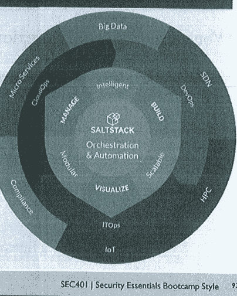

`SEC401` | 安全基础引导样式

`SaltStack`是一个高度模块化且可扩展的配置管理解决方案。全球许多大型机构都在运营中使用它。它从零开始为速度、可靠性和安全性构建。`SaltStack`使用公钥加密来确保配置服务器与`SaltStack`管理的客户端服务器之间的双向通信。

`SaltStack`本身的文档并不详尽。然而，该领域许多经验丰富的`DevOps`人士对其进行了大量的描述。通过使用这些指南、书籍和教程，系统管理员可以成为其安装和功能的专家。尽管`SaltStack`可以集成到`Salt Cloud`的任何环境中，这极大地加快了托管云内系统的部署和管理过程。

以下是`SaltStack`的模块：

- 执行模块 (`Execution modules`)：执行远程操作。
- 状态模块 (`State modules`)：整合配置管理系统的后端。
- 颗粒 (`Grains`)：收集系统的静态信息。
- 渲染模块 (`Render modules`)：收集传递给`Salt`系统的信息和细节。
- 返回 (`Returns`)：提供由远程执行调用返回并收集的信息。
- 运行器 (`Runners`)：运行由`salt-run`命令执行的应用程序。

### 参考文献

1. "SaltStack", https://en.wikipedia.org/wiki/Salt (software)
2. "SaltStack", https://saltstack.com/saltstack-enterprise/
3. "SaltStack", https://docs.saltstack.com/en/dev/ref/runners/index.html

## 关闭不需要的端口

你可以通过多种方式控制和关闭不需要的端口：

```
/etc/inetd.conf
在列出服务的行前添加 # 号进行注释
```

```
/etc/xinetd.d
找到服务文件名；在文件中将 disable 选项设置为 yes
```

```
/etc/rc.conf
注释掉相关行或将值从 YES 更改为 NO
```


你可以通过许多方式控制和关闭不需要的端口。然而，在重启守护进程之前，这些更改将不会生效。

### inetd

如果服务由`inetd`管理，你可以通过找到`/etc/inetd.conf`文件中对应服务的行，并在行首添加`#`将其注释掉来关闭端口。

### xinetd

由于`xinetd`是大量网络服务的单一入口，它可以提供访问控制和日志功能。这项传统上使用包装器(`wrappers`)等附加服务来处理。然而，除了添加附加服务外，`xinetd`的创建是为了`inetd`的替代品。除了该功能外，它还内置了安全特性，因此不再需要附加软件。

当你使用`xinetd`时，与`inetd`不同，你无法通过注释配置文件中的行来关闭端口。`xinetd`服务器包含`/etc/xinetd.d`目录，其中包含与它管理的不同服务相关的文件。你必须单独修改每个文件以禁用相应的服务。

### Rc.d

并不是所有服务都由`inetd`或`xinetd`管理。如果系统未使用互联网服务器，或者服务器进程在启动时激活，则这些由`rc`管理，以便它们独立运行。

### 参考

1. "在 `Unix`/`Linux` 系统上关闭不需要的端口"

# Bastille

- `Bastille` 一系列脚本来更改你的`Linux`系统配置，以按照最佳实践对其加固
- 审计并确保系统的安全性
- 它不仅允许

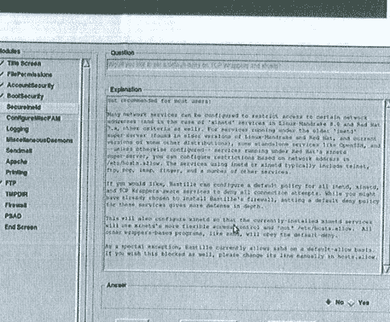


`Bastille`最初由一组关注系统的心的管理员开发，现在已发展并支持许多操作系统。

`SEC401` | 安全基础引导样式

## Lynis

- 审计许多合规性框架：`Basel II`, `GLBA`, `HIPAA`, `PCI DSS` 和 `SOX`
- `Lynis` 审计的项目：
    - 可用的身份方法
    - 过期的`SSL`证书
    - 过时的软件
    - 无密码的用户账户
    - 错误的权限
    - 防火墙审计


Lynis 对 Unix 系统进行补丁管理、漏洞和恶意软件扫描。它可以在无需安装的情况下运行。以下是它检查的关键项目：

- 可用的身份方法
- 过期的 SSL 证书
- 过时的软件
- 无密码的用户账户
- 错误的权限
- 防火墙审计

### 参考

1. "Lynis 2.2.0 Released – Security Auditing and Scanning Tool for Linux Systems", `www.tcmint.com/linux-security-auditing-and-scanning-with-lynis/`

## SSH 多因素身份认证

- 密码可能会被盗取或破解
- 多因素身份认证增加了另一层验证
- 对于 SSH 等关键服务，必须使用多因素身份认证
- SSH 多因素身份认证有多种选择：
  - SSH 密钥
  - Google Authenticator
  - FreeOTP
  - Authy
  - Duo
- 有些是免费的，另一些是商业性的但成本较低

密码的使用已经几十年了，你可以轻松部署多因素身份认证，特别是对于 SSH 这种远程管理协议。考虑到许多关键服务的首道也是唯一的防线是密码，尤其是经常更改的密码，这令人担忧。因此，对于 SSH 等关键服务，必须使用多因素身份认证。

SSH 多因素身份认证有多种选择，包括：

- SSH 密钥
- Google Authenticator
- FreeOTP
- Authy
- Duo

有些是免费的，另一些是商业性的但成本较低。

Google Authenticator 是一个流行的开源解决方案，支持跨发行版和所有手机平台的客户端应用程序。因此，你可以使用手机作为 RSA 令牌。

# SSH/TLS 密钥管理

- SSH 密钥管理通常是随意的
- 你的 SSH 私钥通常存储在本地计算机上，对它们的保护安全措施极少（如果完全的话）
- 有相应的解决方案可以集中管理 SSH 密钥
- KeyBox 基于 Web 的 SSH 管理器
  - 管理用户角色
  - 管理密钥
  - 管理跨会话的并发 SSH 会话
- Puppet 也可以管理 SSH 密钥

使用 SSH 密钥是一种传统的双因子认证方法。使用这些密钥可以增加安全性，但也会带来其自身的风险。你的 SSH 私钥通常存储在本地计算机上，对它们的保护安全措施极少（如果完全的话）。这可能会导致问题。此外，如果你使用集中密钥管理解决方案，你现在将所有的 SSH 密钥都放在同一个地方，而不仅仅是每个用户的驱动器上。

SSH 密钥管理通常是随意的。这使得密钥管理变得困难。诸如 KeyBox 等解决方案可以集中管理所有用户的 SSH 密钥及其会话，并集成了安全功能。KeyBox 是一个开源解决方案，在 Web 界面中与 Google Authenticator 和 FreeOTP 双因子集成。

Puppet 是另一个可以管理 SSH 用户及其关联 SSH 密钥的解决方案。

# Sudo 和 Sudoers

- `su`（switch user，切换用户）通常用于提升到 `root` 用户
- 记录用户切换到另一个用户的操作
- 没有其他控制；用户拥有所有的 `root` 权限
- 所有用户都知道 `root` 用户的密码

`sudo` 提供了执行权限的细粒度控制

- 用户仅知道自己的密码
- 仅允许执行 `sudoers` 文件中指定的命令

| 可以用 `sudo` 设置的安全策略 |
| :--- |
| 有效用户 ID |
| 有效组 ID |
| 环境变量列表 |
| 工作目录 |
| `umask` |
| SELinux 角色 |
| 调度优先级 |


在 Linux 环境中，多个管理员知道 `root` 密码是常见现象。以 `root` 身份登录无法提供审计，因为没有方法可以将登录追溯到特定用户。因此，在正常运行期间，系统未配置允许直接以 `root` 身份登录。每个管理员必须登录自己的账户。传统上，为了获得 `root` 权限，管理员会使用 `su`（代表 switch user）将其权限提升到 `root`。虽然这种方法有效，但任何使用 `su` 变为 `root` 的用户都获得了完全的 `root` 权限，而不是完全的控制。例如，如果你想让 Admin A 能够创建账户但不能更改文件权限，他们是无法做到的。然而，这个问题可以通过 `sudo` 解决。

`sudo` 是 `su` 的替代方案；它提供了更细粒度的控制。通过 `sudo`，你可以配置系统，使得 Admin A 使用 `sudo` 时，她只能创建账户，而不允许获得其他 `root` 权限。此外，通过 `sudo`，每个用户都有自己的密码，因此不再有像使用 `su` 那样的单一共享密码了。

# Linux 加固

本页特意留白

## Sysctl 加固

- Sysctl 用于在运行时修改内核设置
- 运行 `sysctl` 显示系统所有的变量
- Sysctl 配置网络和系统设置
  - IPv4 和 IPv6 设置
  - Execshield
  - 网络攻击防护
  - 攻击日志记录
  - 地址空间布局随机化 (ASLR)
- 编辑变量的推荐方法是编辑 `/etc/sysctl.conf` 文件

`sysctl` 工具可以在 Linux 系统运行期间动态更改设置。或者，它可以将更改提交以在跨重启后依然有效。在操作 `sysctl` 时，你可以通过几种方式对 Linux 系统内的进程读写变量。通常，`sysctl` 导出为 `/proc/sys` 目录下的配置的一部分；因此，某些变量只能通过访问 `/proc/sys` 目录下的文件本身来读取。否则，你可以通过切换 `/etc/sysctl.conf` 文件或运行带有 `-a` 参数的 `sysctl` 命令来显示变量。

要更改 Linux 系统上的变量，运行带有 `-w` 参数并指定变量及对应值的 `sysctl` 命令。如果你想在不更改设置的情况下观察系统行为，这种方法非常有用。要提交更改，请在 `sysctl` 配置文件中更改设置；这种方法最好，因为更改在重启后会持续存在。要查看系统所有的变量，运行 `sysctl -a`。要使用 `sysctl` 命令写入变量，输入 `sysctl -w variable=value`。`-w` 选项告诉 `sysctl` 将值写入变量。

编辑变量的推荐方法是编辑 `/etc/sysctl.conf` 文件。这种方法将永久提交变量的更改，使其在启动时加载；而在系统运行期间使用 `sysctl` 命令进行的更改只会影响内存中的设置，并在重启后丢失。

### 引用

1. "Sysctl", `http://linuxquestions.com/Sysctl`

## Sysctl 加固 - 源路由

- 源路由 (Source routing)
- 允许数据包发送者部分或完全地指定数据包通过网络时的路由
- 危险在于它允许双向伪造通信
- Linux 系统可能成为源路由路径的一部分
- 将 `net.ipv4.conf.default.accept_source_route` 设置为 `0`

```
## Disable source routing
net.ipv4.conf.all.accept_source_route = 0
net.ipv4.conf.eth0.accept_source_route = 0
net.ipv4.conf.default.accept_source_route = 0
net.ipv6.conf.all.accept_source_route = 0
net.ipv6.conf.default.accept_source_route = 0
net.ipv6.conf.eth0.accept_source_route = 0
```


你可以使用 `sysctl` 管理用于网络和内核设置的 TCP/IP 栈设置。需要控制的重要设置是 IP 源路由。你应该禁用 IP 源路由，因为它可以允许双向伪造通信。要禁用对源路由的接受，你必须将 `net.ipv4.conf.default.accept_source_route` 设置为 `0`。

```
root@kali:/root# sysctl -a | grep source_route
net.ipv4.conf.all.accept_source_route = 0
net.ipv4.conf.default.accept_source_route = 1
net.ipv4.conf.eth0.accept_source_route = 1
net.ipv4.conf.lo.accept_source_route = 1
net.ipv6.conf.all.accept_source_route = 0
net.ipv6.conf.default.accept_source_route = 0
net.ipv6.conf.eth0.accept_source_route = 0
```

## Sysctl 加固 – IPv6

### IPv6 加固设置包括：

- 禁用路由器公告
  - `net.ipv6.conf.all.accept_ra = 0`
  - `net.ipv6.conf.default.accept_ra = 0`
- 启用 IPv6 隐私扩展
  - `net.ipv6.conf.all.use_tempaddr = 2`
  - `net.ipv6.conf.default.use_tempaddr = 2`
- 速率限制
  - `net.ipv6.icmp.ratelimit` – 时间限制（ms），默认值为 `1000`


IPv6 是一个经常被忽视的加固和安全协议。某些国家仍然在使用 IPv4，但它们同时也支持 IPv6。Sysctl 内核模块允许系统管理员控制 Linux 主机接口上的 IPv6 操作和功能。

为了提高 Linux 系统上 IPv6 安全性，你可以做三件事。首先，禁用路由器公告。这一步是建议的，但有一个问题：路由器公告有助于判断是否在同一个子网内。此外，路由器公告配置了 Linux 系统的 MTU、邻居发现和 DNS。虽然禁用路由器公告可能会增加 IPv6 的安全性，但如果你的基础设施没有针对禁用路由器公告导致的功能丢失进行设计，这将带来困难。

其次，防止默认的自分配 IPv6 地址，这包含了分配给 IPv6 地址的网络网卡的 MAC 地址。当 IPv6 地址是自分配时，MAC 地址在二层网络中是可见的。此外，所有与该系统通信的网络都可以看到系统的 MAC 地址。

第三，调整速率限制。这通过限制可用资源有助于防止服务攻击。`sysctl` 工具在配置 IPv6 方面的功能不如 IPv4 丰富；这是因为并不是所有的控制都已经迁移过来。

## Sysctl 加固 – 地址空间布局随机化

- 地址空间布局随机化 (ASLR)
- 随机化进程内存地址空间
- 使成功的漏洞利用以及随之而来的执行控制变得更加困难
- ASLR 的有效性受可用熵的限制，该熵值随平台而异
- 为了使 ASLR 有用，进程内存空间的所有段都必须经过随机化
- 可以使用 `setarch` 按应用程序禁用 ASLR
- 建议从加固的系统中移除 `setarch` 工具

地址空间布局随机化 (ASLR) 对进程的地址空间进行随机化。其目的是帮助防止那些需要特定进程函数（如返回函数）使用已知地址位置的利用攻击。ASLR 的有效性取决于随机化地址空间的大小。随机化的地址空间越多，成功创建漏洞利用的可能性就越低。请注意，用于随机化的可用熵在不同平台之间是存在差异。

如有必要，你可以为单个程序启用或禁用 ASLR。你应该移除 `setarch` 工具，或者不允许任何用户拥有使用 `setarch` 的权限。移除访问权限会让破解 ASLR 变得更加困难，因为你无法简单地获得一个可以使用 `setarch` 禁用应用程序 ASLR 设置的用户权限。

## 使用 Modprobe 禁用不需要的内核模块

- `modprobe` 用于向内核添加加载内核模块 (LKM) 或从内核中移除它们
- `modprobe` 存在于 `/etc/modprobe.d` 目录下
- 禁用或黑名单不需要的内核模块
  - 减少受到攻击的风险
  - 减少代码复杂度
- `modinfo` 允许你查看模块的功能
  - 这提供了有关其他依赖模块的信息，有助于判断应该禁用或黑名单化哪个模块


作为 Linux 系统加固过程的一部分，你通常需要使用 `modprobe` 工具向内核添加或移除内核模块 (LKM)。使用模块通常是获取内核访问的最简单方法，这将是放置根内核 (rootkit) 的良好位置。你可以在启动时轻松地将 `rootkit` 作为内核模块加载。因此，良好的做法是将模块列入黑名单或禁止它们在启动时加载。通过将模块列入黑名单或禁用，你有效地阻止了它们的运行。然而，请注意依赖模块，这将帮助你决定在黑名单化时需要多具体的程度。

要返回所有包含指定名称的模块，请运行以下命令。通过这种方式，你可以找到需要黑名单或禁用的模块。

```
find /lib/modules/ uname -r -name *modename*
```

要禁用模块，请使用 `install` 选项重定向你想禁用的模块；但是，如果你将模块定义为 `/bin/false`，该模块将不会加载。设置为 `/bin/false` 是一个很好的规范，因为你可以更容易地看到某些操作是不允许的。

### 参考

- “内核加固：禁用和黑名单 Linux 模块”，`https://linux-audit.com/kernel-hardening-disable-and-blacklist-linux-modules/`

## 启动后禁用动态加载

- Linux 内核可以拥有内置模块或可加载的动态模块
- 为内核提供了灵活性
- 不需要为遇到的每种情况都重新编译内核
- 启动后保留动态加载的风险是，具有任何功能的 rootkit 都可以以 `root` 权限插入内核
- 禁用可加载内核模块严重限制了恶意攻击者注入恶意内核模块的向量


SEC401 | 安全基础知识训练营风格 **104**

我们已经讨论了 `rootkit` 通过可加载内核模块加载到内核的风险。请注意，动态加载模块甚至更加危险；它们允许 `rootkit` 在无需重启的情况下注入到正在运行的内核中。

当涉及到使用静态内核且不允许动态加载内核模块时，请记住动态内核引入了极佳的灵活性。静态内核仍然可能被注入恶意代码。因此，禁用动态加载能力是一个良好的开始，但不能保证你将受到保护；然而，它限制了这种机会。

### 参考

1. ”在不使用动态内核模块的情况下增加安全性？”
   `http://security.stackexchange.com/questions/5659/increase-security-without-using-dynamic-kernel-modules`

106 © 2017, Secure Anchor Consulting

## 操作系统增强

本页特意留白。

## SELinux

- Security Enhanced Linux (SELinux) 是一种专门用于安全的加载内核模块
- 为强制访问控制 (MAC) 提供访问控制策略
  - 策略与强制的分离
  - 对进程初始化、继承和执行的控制
  - 可许多控制措施
- 大多数现代 UNIX 版本都支持 SELinux 内核模块
- 总体控制程序可以执行的操作


SEC401 | 安全基础知识训练营风格 108

SELinux 是一种使用强制访问控制 (MAC) 机制加固 Linux 系统的强大解决方案。它需要详细的配置和高技能水平的部署和管理。

SELinux 使用强制访问控制，这允许管理员控制系统上所有的软件交互。该安全模型基于最小权限原则，并从用户没有任何权限开始。管理员必须通过使用安全策略授予用户访问权限。

原始 Linux 发行版遵循自主访问控制 (DAC) 概念。DAC 赋予用户对其安装和拥有的应用程序拥有完全的安全访问权限。如果用户账户被破解，这可能会导致系统产生安全风险。

SELinux 设计并不是为了取代 Linux 现有的安全机制。它仅仅是为了增强它。

## DAC SELinux 策略 MLS/MCS

| 自主访问控制 (DAC) | 多级安全 (Multilevel Security) |
| :--- | :--- |
| - 拒绝访问 | 范围写为 |
| - 不对对象使用 SELinux 访问 | - 低级和高级级（如果级别不同）|
| | - 低级（如果级别相同，即 `so=so`）|
| - 允许或默认 | 多分类安全 (Multi-Category Security): |
| - 应用 SELinux 访问策略 | - `so=0=CompanyConfidential` |
| | - `so=1=PatientRecord` |
| | - `so=2=Unclassified` |
| | - `so=3=TopSecret` |
| | - `so:1,c3=CompanyConfidential` |


大多数 Linux 变体使用称为自主访问控制 (DAC) 的安全措施。DAC 允许系统管理员所有用户管理他们拥有的文件的安全性。这种方法有一个缺陷，即允许访问系统的漏洞，因为任何潜在用户都可能提升自身或其拥有的进程权限并绕过安全。SELinux 取了这种安全控制，并通过提供强制访问控制 (MAC) 能力来增强了默认的 DAC。这意味着什么？如果系统使用 DAC 并设置了默认拒绝访问，则不需要使用其他安全措施，SELinux 也不是用之地。然而，如果默认是允许，并且你对文件、目录和进程的安全权限和访问有更精确的控制，SELinux 就是答案。


标签是多级安全 (MLS) 和多分类安全 (MCS) 的属性。每个级别都是敏感性-类别对，其中类别是可选的：

- 使用类别时，级别写为敏感性:类别集。
- 不使用类别时，级别写为敏感性。

类别可以缩写。例如，`c0,c3` 等于 `c0,c1,c2,c3`。

MLS 强制 Bell-LaPadula 强制访问模型，它被用于标记安全保护配置文件 (LSPP) 环境。

## Grsecurity (I)

- `Grsecurity` 是一组用于 UNIX 内核的补丁，旨在增强安全性
- 支持基于角色的访问控制（RBAC）的 MAC 工具
  - 用于管理 RBAC 的 `gradm` 实用
- PaX 内存保护
  - 用于管理 PaX 的 `maxitld`
- 文件系统加固
- 内核审计
- 可信路径执行 (TPE)


`Grsecurity` 于 2000 年引入开源市场，尽管它现在是闭源的，但目前仍在活跃开发中。`Grsecurity` 引入了真正的基于角色的访问控制，旨在比普通的 Linux 访问控制列表（ACL）提供更严格的系统访问限制。其目的是创建一个完全特权的系统，其中用户和进程仅拥有正确运行所需的最小权限，而没有其他权限。

文件系统加固包含了额外的审计日志功能。PaX 是一个内核内存保护补丁，它提供了许多不同的内存保护机制。

内核补丁并非没有风险。最近，`grsecurity` 包含一个会导致内核崩溃（panic）的漏洞；该漏洞可能由任何用户引起。

## Grsecurity (2)

- `Grsecurity` 也包含 PaX
- 防止内存被覆盖
- 提供内存损坏防护
- 提供 NOEXEC 和运行时代码执行
- 在可执行文件头部设置标志位

```
Grsecurity -->
PaX ---
[ ] 启用密钥保留支持
[KEYS]
[ ] 启用 /proc/keys 文件以便查看密钥
[ ] 限制非特权用户对内核 syslog 的访问
[ ] 启用不同的安全模型
[ ] 启用安全文件系统
默认安全模块（Unix 任意访问控制）
```

PaX 通过包含包含许多 `grsecurity` 缓解措施来防止内存损坏。PaX 还改进了地址布局随机化（ASLR），此外，它加强了内核与用户空间代码之间的隔离，并消除了各类的信息泄露。

PaX 提供针对以下攻击的保护：

- 任意代码执行。
- 以不同顺序执行原始代码
- 执行带有恶意代码的原始代码

当你在 `grsecurity` 中使用 PaX 时，`MPROTECT` 和 `RANDMAP` 缓解措施要求你设置异常，以便某些应用程序能够运行。此外，在没有 `grsecurity` 的情况下运行 PaX 不是一个好主意，因为许多 `grsecurity` 特性与 PaX 紧密集成。PaX 继续开源，但 `grsecurity` 是一个商业解决方案。

### 参考

- 1. “PaX”, https://wiki.archlinux.org/index.php/PaX

## Grsecurity (3)

- 为你的发行版下载 `grsecurity`
- 使用 `menuconfig` 进行自定义
- 编译并安装
- 安装 `gradm` 和 `paxetld`
- 为 admin 和关机设置密码
- 启动学习模式 `gradm -F -L/etc/grsec/learning.logs`
- 应用输出文件策略 `gradm -F -L/etc/grsec/grsec/learning.logs -O/etc/grsec/policy`


当你使用其内置菜单时，配置和部署 `grsecurity` 非常简单。它有一个内置的模式模式，可以帮助你自动构建安全策略；你在安装后启动它。此外，你还可以选择安全级别并针对你的特定环境进行自定义。自定义策略允许你充分利用现有的功能。

在 `grsecurity` 中，你可以自定义以下通用领域：

- `PAX`：控制并标记系统要使用的二进制文件。
- 地址空间保护：管理如何保护系统上的内存；这包括对溢出和变量存储的控制。
- 基于角色的访问控制 (RBAC) 选项：控制角色配置以及管理访问控制的方法。
- 文件系统保护：配置文件系统的选项以及对用户对文件系统进行操作的限制。
- 内核审计：控制系统上的审计内容以及存储的详细程度。
- 执行保护：控制可以创建哪些二进制文件以及对现有二进制文件进行哪些更改。
- 网络保护：管理 `TCP/IP` 协议栈的变化及其工作原理。
- `Sysctl` 支持：允许在运行时修改设置。
- 日志选项：控制执行的日志量和级别。

## Grsecurity (4)

```
$ grad --help
grsecurity GRSBAC 管理和策略分析工具
用法: grad [option] ...
选项:
  -E          启用 GRSBAC 系统
  -d          禁用 GRSBAC 系统
  -s          检查 GRSBAC 系统状态
  -f          启用所有系统事件日志
  -r          为 GRSBAC 管理创建报告
  --reload     在学习模式下重新加载 GRSBAC 系统
  --output     指定学习模式的输出文件名
  --policy     指定从文件或 URL 加载的策略
  --mode       指定学习模式
  --auth       提升到需要认证的特殊角色
  --roles      验证到不需要认证的特殊角色
  --whoami     通过 EBM 自动到特殊角色
  --policy     指定策略发布和审计系统
  --help       显示此帮助
  --version    显示版本和 GPL 许可证信息
```

- `grad -S`
- `grad -E`
- `grad -D`
- `grad -C`
- `grad -u`
- `grad -F`

当你使用其内置菜单时，配置和部署 `grsecurity` 非常简单。它有一个内置的模式模式，可以帮助你自动构建安全策略；你在安装后启动它。此外，你还可以选择安全级别并针对你的特定环境进行自定义。自定义策略允许你充分利用现有的功能。

## Grsecurity (S)

- 优点
  - 兼容大多数发行版
  - 角色管理
  - 策略语法
  - 策略不宽松
  - 内存保护
- 缺点
  - 所有内容在一个文件中
  - `Grad` 不写入
  - 策略学习模式
  - 仅提供测试代码
  - 稳定版本


`Grsecurity` 为加固系统提供了强大的工具。然而，它最大的缺点是它不再开源，且仅提供测试代码。

## grsecurity, AppArmor 和 SELinux 的对比

| 特性 | AppArmor | SELinux | Grsecurity | 特性（续） | AppArmor（续） | SELinux（续） | ... |
|---|---|---|---|---|---|---|---|
| 允许/拒绝策略 | 是 | 是 | 是 | 较少的依赖项 | 是 | - | 是 |
| 分级域域 | 是 | 是 | 是 | 自动化执行 | 是 | - | 是 |
| 对象类型 | 是 | 是 | 是 | 学习模式 | 是 | - | 是 |
| 账户管理 | | 是 | 是 | 自主管理框架，具有交互性 | 是 | | |
| 服务管理 | | 是 | 是 | 应用程序编程接口 | | | |
| 网络管理 | | 是 | 是 | 指令检测系统 | | 是 | 是 |
| 访问控制列表 | 是 | 是 | 是 | 日志记录 | 是 | 是 | 是 |
| 基于角色的访问控制 | | 是 | 是 | 报告生成 | 是 | 是 | 是 |
| 安全上下文 | | 是 | 是 | 入侵防御系统 | 是 | 是 | 是 |
| Linux 内核模块 | 是 | 是 | 是 | 恶意软件保护 | 是 | 是 | 是 |
| 语言 | | | | | | | |
| 统一配置 | 是 | | | | | | |
| 不限制其他应用程序和工具 | 是 | | | | | | |


学生经常问及 `AppArmor`、`SELinux` 和 `Grsecurity` 之间的区别。此图表显示了每种不同解决方案支持的差异和特性。

### 参考/图片

1. "AppArmor", http://1dbjr.blogspot.com.au/search?q=Apparmor

## 总结

- 服务是如何启动的
- `Upstart` 配置与管理
- `systemd`
- 配置管理工具
- 关闭不需要的端口
- 为常用服务的替代端口
- `SSH`
- `TLS/SSH` 密钥管理
- `sudo/sudoers`
- `sysctl` 加固（源路由、`IPv6` 和地址空间随机化）
- 通过 `modprobe` 禁用不需要的内核模块
- 启动后禁用动态加载
- `SELinux`
- `Grsecurity`
- `AppArmor`

在本模块中，我们介绍了通过控制和管理运行在系统上的服务来减少 Linux 系统攻击面的方法。由于安全是一个重点且活跃的领域，新的技术和方法不断涌出来。因此，继续研究各种保持 Linux 系统安全的方法至关重要。

## SEC401.6 安全基础训练营风格

## SANS 模块 32: 监控与攻击检测

此页面故意留。

## 目标

- 配置和监控日志
- `Syslog` 及其替代方案
- `Grep`, `sed`, `awk` 和 `cut`
- `Auditd`

本模块涵盖了以下关键领域：

- 配置和监控日志
- 使用 `syslog` 和替代方案记录日志
- 使用 `grep`, `sed`, `awk` 和 `cut` 解析和过滤日志
- 使用 `Auditd` 进行监控和审计

## 日志聚合与 SIEM

此页面故意留。

## 日志聚合与 SIEM

### 聚合和关联日志

- 集中你的日志
- 规范化日志
- 根据时间关联日志
- 确保有一个集中使用的时间服务器
- 如果跨越多个时区，使用 `UTC` 是最佳选择


为你的网络和系统建立基准的最佳方法之一是聚合网络上的所有日志，并对其进行关联，以分析网络行为。在网络中集中日志是开始关联聚合和分析的第一步。

在集中日志之后，你应该复制它们，以便原始日志的副本经过规范化和关联。你应该这样做，是因为当你收集日志时不仅是为了检测威胁，还为了满足某些监管执法或合规性要求。这些法规要求你在发生安全事件时能够追溯原始日志。如果你进行了关联，意味着日志已经经过了规范化，换句话说，这些日志已被更改，在需要进行诉讼时，可能无法在法庭上作为证据。这个故事的道理是要准备一个独立的日志聚合器和关联服务器。

当日志被规范化后，你就可以跨多个系统和平台开始关联，以理解全天候环境中发生了什么。这有助于你快速判断是否存在异常。用于此类聚合和关联的解决方案被称为 `SIEM`，全称为安全事件和事件监控。

日志的关联不仅可以通过规范化日志实现，还因为你环境中的系统应该使用相同的时间源以保持运行时间完全一致。为了减少混乱，请确保所有系统都配置为使用相同的时区。如果你的系统物理上跨越多个时区，建议使用 `UTC`；否则，你的日志将变得难以处理，因为现在比较日志时必须调整时区差异。

## SIEM – 概览

- `Splunk`
- `Alien Vault`
- `LogRhythm`
- `QRadar`
- `Logstash`
- `Graylog2`
- `LOGGalyze`


今天管理日志关联的良好方法是使用 `SIEM`。如果你希望在集中服务器上管理，这些技术可以聚合你环境中的所有日志。

安全事件监控市场变得非常激烈，因为许多参与者提供了广泛的功能和优势。某些方案如 `Splunk` 提供了免费版本，但限制了解析日志的数量。其他方案如 `LogRhythm` 和 `QRadar` 是完全商业许可，没有免费选项，除非你购买该解决方案。还有开源解决方案，如 `Logstash` 和 `Graylog2`，它们功能强大，但需要大量的技术技能来配置和维护。

## SIEM – 概述

## Splunk

- 流行且有很多第三方支持
- 只要日志不多，就具有成本效益
- 费用基于每日日志量
- 可扩展性强
- 支持 `Windows` 和 `Linux` 代理
- 支持任何源
- 临时搜索
- 构建自开源平台


`SEC401` | 安全基础风格 123

`Splunk` 起于开源解决方案；它仍然提供免费解决方案，在其中每日日志量有限且无法创建报警或生成报告。作为商业解决方案，它与许多平台集成。`Splunk` 是一个日志关联器，但你可以查看单个技术的日志来分析这些技术本身的健康状况，例如 `IIS` Web 服务器日志分析器或 `Juniper` 日志解析器。缺点是这些第三方插件仅仅是插件，并不罕见它们是由个人而非公司创建的。

`Splunk` 具有良好的扩展性，并提供了分布式日志收集和分布式日志搜索功能。如果你偏离典型的日志聚合模式，部署起来会很困难。

`Splunk` 的另一个缺点是其定价模型，可能会变得非常贵，因为它是基于每日日志量的。如果你根据监管要求保留安全日志（例如），且你的数据库产生大量噪音，那么只需几个小时，数据库访问日志就会超过你的每日日志量。

### 参考

- 1. 安全信息事件管理, https://en.wikipedia.org/wiki/Security_information_and_event_management
- 2. 安全信息事件管理 (SIEM), http://searchsecurity.tearget.com/definition/security-information-event-management

## SIEM – Alien Vault

- `Alien Vault`
- 无论日志量大小都极具成本效益
- 提供的功能
  - `SIEM`
  - 文件完整性监控 (FIM)
  - 主机入侵检测系统 (HIDS)
  - 网络入侵检测 (IDS)
  - 漏洞扫描
- 基于开源平台
- 预置警报
- 访问开放威胁交换 (Open Threat Exchange) 数据馈


`Alien Vault` 是市场上一个非常有吸引力的参与者，特别是对于中型组织。它提供了一个具有大量预置自动化功能的廉价解决方案，你不需要聘请才华的安全分析师来职监控 `Alien Vault` 以发现威胁。`Alien Vault` 通过其 Open Threat Exchange 提供了这种能力，该平台包含它已识别并创建签名的威胁馈，同时也捆绑了多个其他数据馈。

`Alien Vault` 不仅仅是一个 `SIEM`，还具有文件完整性监控、主机入侵检测系统、网络入侵检测系统和漏洞扫描功能。`Alien Vault` 然后关联来自所有这些事件源的信息，以确定环境中的问题。

`Alien Vault` 的局限性在于它是基于开源平台构建的商业解决方案，其中某些平台优于其他平台。然而，日志聚合和关联是 `Alien Vault` 的专利技术。

### 参考文献

- 1. AlienVault, https://www.alienvault.com/products

## SIEM – LogRhythm

- `LogRhythm`
- 高端 `SIEM`
- 基于数学和某些人工智能提供智能解析的日志
- 成本基于每秒消息数（mps）
- 提供文件完整性监控
- 配置复杂
- 维护复杂


`LogRhythm` 可以被认为是当今市场上顶级的 `SIEM` 解决方案之一。`LogRhythm` 针对你的系统和网络上的日志事件建立基准，通过使用专有算法和人工智能，能够在创建的活动基准中发现离群值。

`LogRhythm` 是一个非常棒的工具，但确实有巨大的学习曲线，并且真的需要专门的人来使用和维护它，才能从中获得价值。它是一个配置和维护非常复杂的平台，但在异常检测方面提供了前所未有的结果。

`LogRhythm` 还提供一个文件完整性监控代理，可以额外付费配合其 `SIEM` 平台使用。

### 参考文献

- 1. LogRhythm, https://logrhythm.com/

## SIEM – QRadar

- `QRadar`
- `IBM` 的 `SIEM` 解决方案
- 高级感知分析引擎（Advanced Sense Analytics Engine）用于检测高级威胁
- 配置有些困难
- 维护简单
- 分析所有数据中的威胁、网络流量、漏洞、日志和网络包


`QRadar` 是 `IBM` 对市场对 `SIEM` 需求的回答。`QRadar` 是一个严格的 `SIEM` 解决方案，带有高级感知分析引擎，通过网络上的异常来检测高级威胁。它在使用启发式方法检测网络异常的能力方面与 `LogRhythm` 类似，但它没有使用 `LogRhythm` 那种程度的数学来进行检测。

`QRadar` 配置有些困难，但对于那些在日志分析和 `SIEM` 操作方面几乎没有培训的人来说，也相对容易使用和维护。`QRadar` 接收并根据网络系统的漏洞、接收到的日志、从数据包嗅探器收集的网络包，以及从交换机、路由器和防火墙收到的网络流数据进行威胁分析。

### 参考文献


# QRadar

1. QRadar, http://www-03.ibm.com/software/products/en/qradar

## SIEM – Logstash

- `Logstash`
- 开源解决方案
- 与 `elastic search` 协同完美，具有惊人的速度和可扩展性
- 本身没有前端；最好配合 `Kibana` 使用
- 部署有些困难
- 与 `Kibana` 和 `elastic search` 使用时，可获得灵活的实时视图
- 无预置的自动异常检测


`Logstash` 本身不是 `SIEM`，而是可以被用 `SIEM` 的组件之一。`Logstash` 是一个用于日志聚合、管道处理和存储的完全开源解决方案。`Logstash` 的开发者还创建了 `Kibana`，这是一个独立的基于 Web 的仪表板，允许灵活的实时报告、数据切片和 `elastic search`。`Kibana` 数据搜索引擎专门为处理海量数据而设计，以保持敏捷和极速。它是为了大数据分析设计的。当你将 `Logstash`、`elastic search` 和 `Kibana` 结合时，你就得到了一个相当健壮的 `SIEM` 解决方案。

局限性在于 `Logstash` 很难部署，因为它有多个独立的运行部分。幸运的是有一个大型社区支持这项技术，因此支持良好且文档丰富。此外没有预置的异常检测规则、警报或搜索；你必须自己创建这些。你需要一名熟练的日志/安全分析师来创建这些，才能从 `Logstash` 及其相应的工具中获得巨大的价值。

**参考文献**

1. `Logstash`, https://www.elastic.co/products/logstash

## SIEM – Graylog

- `Graylog`
- 开源解决方案
- 具有内置仪表板、搜索功能
- 易于部署
- 无预置的自动异常检测


`Graylog` 是另一个易于部署的开源解决方案，具有内置的仪表板和搜索。这些开源解决方案的共同问题是没有预置的异常检测规则、警报或搜索；你必须自己创建这些。你需要一名熟练的日志/安全分析师来创建这些，才能从 `Graylog` 中获得巨大的价值。

**参考文献**

1. `Graylog`, https://www.graylog.org

## SIEM – Logalyze

- `Logalyze`
- 开源解决方案
- 易于部署
- 具有内置仪表板、搜索


`Logalyze` 是一个易于部署的开源解决方案，具有内置的仪表板和搜索。这些开源解决方案的共同问题是没有预置的异常检测规则、警报或搜索；你必须自己创建这些。你需要一名熟练的日志/安全分析师来创建这些，才能从 `Logalyze` 及其相应的工具中获得巨大的价值。

**参考文献**

1. `Logalyze`, http://www.logalyze.com/

## 日志文件

本页特留空。

## 感兴趣的日志文件

- `utmp`: 提供终端登录、注销、系统事件、系统当前状态、启动时间
- `wtmp`: 提供 `utmp` 的历史数据
- `btmp`: 记录失败的登录尝试
- `dmesg`: 是显示或驱动消息
- `messages`: 包含全局系统消息
- `maillog`: 包含邮件服务器的消息
- `secure`: 包含系统中所有安全相关的消息


`UNIX` 系统使用多个关键日志文件，其中某些文件无法通过任何类型的文本解析直接查看，必须使用它们特定的日志查看工具。

- `utmp`: 提供终端登录、注销、系统事件、系统当前状态和启动时间的完整视图。
- `wtmp`: 提供 `utmp` 的历史数据。
- `btmp`: 记录失败的登录尝试。
- `dmesg`: 是显示或驱动消息。用于检查或控制内核环形缓冲区。
- `messages`: 包含全局系统消息，包括系统启动期间记录的消息。`/var/log/messages` 中记录了几项，包括 `mail`、`cron`、`daemon`、`kernel` 和 `auth`。
- `maillog`: 包含系统中运行的邮件服务器的消息，如电子邮件。
- `secure`: 包含系统中所有安全相关的消息。包括身份验证失败、可能的入侵尝试、`SSH` 登录、失败的 `SSH` 注销以及无效的用户账户。

# 关键日志文件 - utmp, btmp

| 命令/来源 | 用户 | 终端 | 主机/备注 | 时间/时长 | 状态 |
|---|---|---|---|---|---|
| `last` | `root` | `pts/1` | `192.168.0.14` | 周三 10月19 14:22 - 23:55 (66:91) | |
| | `root` | `pts/2` | `192.168.0.14` | 周三 10月19 14:19 - 14:23 (00:03) | |
| | `root` | `pts/1` | `192.168.0.14` | 周三 10月19 13:47 - 14:19 (00:32) | |
| `last -f/var/log/wtmp` | `root` | `tty2` | `192.168.0.14` | 周三 10月19 13:35 - 已退出 (`logout`) | |
| `last -f/run/utmp` | `reboot` | `system boot` | `4.6.0-kalli-686` | 周三 10月19 13:35 - 仍在运行 | |
| | `reboot` | `pts/3` | `192.168.0.14` | 周三 10月19 12:32 - 已关 (01:03) | |
| | `reboot` | `pts/2` | `192.168.0.14` | 周三 10月19 11:27 - 已关 (02:18) | |
| | `reboot` | `pts/1` | `192.168.0.14` | 周三 10月19 10:49 - 已关 (02:52) | |
| | `reboot` | `tty1` | | 周三 10月19 10:43 - 已关 (02:56) | |
| | `reboot` | `system boot` | `4.6.0-kalli-686` | 周三 10月19 10:37 - 已关 (00:05) | |

## utmpdump

`utmpdump /run/utmp`

```
root@kalli:~# utmpdump /run/utmp
Utmp dump of /run/utmp
[1] (00000) [reboot] [4.6.0-kalli-686] [Wed Oct 19 13:35:33 2016 (CDT)]
[1] (00053) [utlogin] [4.6.0-kalli-686] [Wed Oct 19 13:35:35 2016 (CDT)]
[7] (01016) [tty2] [0.0.0] [Wed Oct 19 13:35:46 2016 (CDT)]
[8] (01700) [pts/1] [pts/1] [:] [192.168.0.14] [Tue Oct 25 23:55:09 2016 (CDT)]
```


`Utmp` 和 `btmp` 是两个主要文件；它们无法被任何文本编辑器或文本阅读程序读取。必须使用 `last` 或 `utmpdump` 命令来读取。

该命令仅从 `utmp` 文件读取并显示当前谁登录了系统。然而，`last` 命令可以读取 `utmp`、`wtmp` 和 `btmp`。单独运行该命令将会在屏幕上给你谁登录了、何时登录的、以及何时退出的，以及其他有用信息；而且它是历史数据。本质上，当你不带任何参数运行 `last` 时，你将看到 `utmp` 文件的输出，如果你传递了 `last -f` 参数，你也可以告诉它从 `utmp` 或 `btmp` 文件读取。

`utmpdump` 是一个程序，你向它传递想要转储数据的 `utmp` 文件路径。它的输出是一个没有表头的表格。列从左到右：

- 记录类型 (`ut_type`)
- 登录进程的 `PID` (`ut_pid`)
- 终端名称，或 `term(5)` `ID` (`ut_id`)
- 用户名 (`ut_user`)
- 设备名称或 `tty` - `"dev/tty"` 或线路
- 远程登录的主机名，或内核版本 (`ut_host`)
- 远程主机的 `Internet` 地址 (`ut_addr_v6`)
- 条目创建的时间 (`ut_time` 或实际 `ut_tv_sec`)

这些信息可以通过 `Linux` 的 `utmp` 手册页获取。

你也可以也可以运行 `last` 命令来转储 `btmp` 文件，以显示发生的失败。

```
Wed Oct 19 14:23 - 23:55 (06:09:31)
Wed Oct 19 14:19 - 14:23 (00:03)
Wed Oct 19 14:19 - 14:19 (00:02)
Wed Oct 19 13:47 - no logout
Wed Oct 19 13:35 - still running (01:03)
Wed Oct 19 13:32 - down (01:03)
Wed Oct 19 11:27 - down (02:18)
Wed Oct 19 10:49 - down (02:52)
Wed Oct 19 10:43 - down (00:05)
Wed Oct 19 10:37 - down (00:36)
```

`192.168.0.14`

`192.168.0.14`

`192.168.0.0`

`4.6.0-kalli-686`

`192.168.0.14`

`192.168.0.0`

`4.6.0-kalli-686`

```
root pts/1
root tty2
root system
root pts/3
root pts/2
root pts/1
root tty2
root system
```

`wtmp begins 1019 10:16:27:2016`

```
[8] (07198) [224] [btmp]
[8] (07018) [root] [btmp]
[8] (08023) [root] [utmp666]
[8] (08023) [root] [btmp00]
[8] (08028) [root] [utmp606]
* /utmp666 - last
```

## 关键日志文件 - dmesg

### dmesg

```
root@kali:~# dmesg

000000: Linux version 4.6.0-kali-686 (kali) (gcc version 5.4.0 2016069 (Debian 5.4.0-6)) #1 SMP

000000: Linux Legacy FPU detected.

000000: /dev/fpu: using 'eager' FPU context.

000000: e80s:020: provided RAM map

000000: e80s:020: mem 0x0000000000000000-0x000000ffff usable

000000: e80s:020: mem 0x0000000074000000-0x000000ffff reserved

000000: e80s:020: mem 0x0000000080000000-0x000000ffff reserved

000000: e80s:020: mem 0x00000000c0000000-0x000000ffff reserved

000000: e80s:020: mem 0x0000000100000000-0x000000ffff reserved

000000: e80s:020: mem 0x00000001c0000000-0x000000ffff usable

000000: e80s:020: mem 0x00000003c0000000-0x000000ffff ACPI Data Table detected

000000: e80s:020: mem 0x00000003f0000000-0x000000ffff ACPI RSDT to Shell Go In Chain

000000: e80s:020: mem 0x0000000400000000-0x000000ffff usable

000000: e80s:020: mem 0x00000004e0000000-0x000000ffff reserved

000000: e80s:020: mem 0x00000005e0000000-0x000000ffff reserved

000000: e80s:020: mem 0x00000005f0000000-0x000000ffff reserved

000000: NX (Execute Disable) protection: active

000000: BIOS: Where, Inc. VMware Virtual Platform/440X Desktop Platform, BIOS 6.00 09/20/2012
```


`dmesg` 是特殊的日志以及读取它的命令。正如 `messages` 文件中提到的，`dmesg` 严格包含从启动点到加载完整个操作系统的启动过程信息。如果你在启动期间遇到了异常活动，`dmesg` 会记录这些信息。


```
Oct 19:36:28 kali kernel: [0x00000000] Registered memory: 0x00000000
Oct 19:36:28 kali kernel: [0x00000000] Registered memory: 0x00000000
Oct 19:36:28 kali kernel: [0x00000000] Registered memory: 0x00000000
Oct 19:36:28 kali kernel: [0x00000000] Registered memory: 0x00000000
Oct 19:36:28 kali kernel: [0x00000000] Registered memory: 0x00000000
Oct 19:36:28 kali kernel: [0x00000000] Registered memory: 0x0000c000
Oct 19:36:28 kali kernel: [0x00000000] Registered memory: 0x0000c000
Oct 19:36:28 kali kernel: [0x00000000] Registered memory: 0x0000d000
Oct 19:36:28 kali kernel: [0x00000000] Registered memory: 0x0000d000
Oct 19:36:28 kali kernel: [0x00000000] Registered memory: 0x0000e000
Oct 19:36:28 kali kernel: [0x00000000] Registered memory: 0x0000e000
Oct 19:36:28 kali kernel: [0x00000000] Registered memory: 0x0000f000
Oct 19:36:28 kali kernel: [0x00000000] Registered memory: 0x0000f000
Oct 19:36:28 kali kernel: [0x00000000] Registered memory: 0x00010000
Oct 19:36:28 kali kernel: [0x00000000] Registered memory: 0x00010000
Oct 19:36:28 kali kernel: [0x00000000] Registered memory: 0x00011000
Oct 19:36:28 kali kernel: [0x00000000] Registered memory: 0x00011000
Oct 19:36:28 kali kernel: [0x00000000] Registered memory: 0x00012000
Oct 19:36:28 kali kernel: [0x00000000] Registered memory: 0x00012000
Oct 19:36:28 kali kernel: [0x00000000] Registered memory: 0x00013000
Oct 19:36:28 kali kernel: [0x00000000] Registered memory: 0x00013000
Oct 19:36:28 kali kernel: [0x00000000] Registered memory: 0x00014000
Oct 19:36:28 kali kernel: [0x00000000] Registered memory: 0x00014000
Oct 19:36:28 kali kernel: [0x00000000] Registered memory: 0x00015000
Oct 19:36:28 kali kernel: [0x00000000] Registered memory: 0x00015000
Oct 19:36:28 kali kernel: [0x00000000] Registered memory: 0x00016000
Oct 19:36:28 kali kernel: [0x00000000] Registered memory: 0x00016000
Oct 19:36:28 kali kernel: [0x00000000] Registered memory: 0x00017000
Oct 19:36:28 kali kernel: [0x00000000] Registered memory: 0x00017000
Oct 19:36:28 kali kernel: [0x00000000] Registered memory: 0x00018000
Oct 19:36:28 kali kernel: [0x00000000] Registered memory: 0x00018000
Oct 19:36:28 kali kernel: [0x00000000] Registered memory: 0x00019000
Oct 19:36:28 kali kernel: [0x00000000] Registered memory: 0x00019000
Oct 19:36:28 kali kernel: [0x00000000] Registered memory: 0x0001a000
Oct 19:36:28 kali kernel: [0x00000000] Registered memory: 0x0001a000
Oct 19:36:28 kali kernel: [0x00000000] Registered memory: 0x0001b000
Oct 19:36:28 kali kernel: [0x00000000] Registered memory: 0x0001b000
Oct 19:36:28 kali kernel: [0x00000000] Registered memory: 0x0001c000
Oct 19:36:28 kali kernel: [0x00000000] Registered memory: 0x0001c000
Oct 19:36:28 kali kernel: [0x00000000] Registered memory: 0x0001d000
Oct 19:36:28 kali kernel: [0x00000000] Registered memory: 0x0001d000
Oct 19:36:28 kali kernel: [0x00000000] Registered memory: 0x0001e000
Oct 19:36:28 kali kernel: [0x00000000] Registered memory: 0x0001e000
Oct 19:36:28 kali kernel: [0x00000000] Registered memory: 0x0001f000
Oct 19:36:28 kali kernel: [0x00000000] Registered memory: 0x0001f000
Oct 19:36:28 kali kernel: [0x00000000] Registered memory: 0x00020000
Oct 19:36:28 kali kernel: [0x00000000] Registered memory: 0x00020000
Oct 19:36:28 kali kernel: [0x00000000] Registered memory: 0x00021000
PCI devices: SMP configuration
ACPI: HPET (MADT) Using 0x806a0f01 base: 0xffed000
ACPI: HPET (MADT) Following 32 CPUs, 30 hotplug groups
ACPI: HPET (MADT) Registered memory: 0x0000c000
ACPI: HPET (MADT) Registered memory: 0x0000c000
ACPI: HPET (MADT) Registered memory: 0x0000d000
ACPI: HPET (MADT) Registered memory: 0x0000d000
ACPI: HPET (MADT) Registered memory: 0x0000e000
ACPI: HPET (MADT) Registered memory: 0x0000e000
ACPI: HPET (MADT) Registered memory: 0x0000f000
ACPI: HPET (MADT) Registered memory: 0x0000f000
ACPI: HPET (MADT) Registered memory: 0x00010000
ACPI: HPET (MADT) Registered memory: 0x00010000
ACPI: HPET (MADT) Registered memory: 0x00011000
ACPI: HPET (MADT) Registered memory: 0x00011000
ACPI: HPET (MADT) Registered memory: 0x00012000
ACPI: HPET (MADT) Registered memory: 0x00012000
ACPI: HPET (MADT) Registered memory: 0x00013000
ACPI: HPET (MADT) Registered memory: 0x00013000
ACPI: HPET (MADT) Registered memory: 0x00014000
ACPI: HPET (MADT) Registered memory: 0x00014000
ACPI: HPET (MADT) Registered memory: 0x00015000
ACPI: HPET (MADT) Registered memory: 0x00015000
ACPI: HPET (MADT) Registered memory: 0x00016000
ACPI: HPET (MADT) Registered memory: 0x00016000
ACPI: HPET (MADT) Registered memory: 0x00017000
ACPI: HPET (MADT) Registered memory: 0x00017000
ACPI: HPET (MADT) Registered memory: 0x00018000
ACPI: HPET (MADT) Registered memory: 0x00018000
ACPI: HPET (MADT) Registered memory: 0x00019000
ACPI: HPET (MADT) Registered memory: 0x00019000
ACPI: HPET (MADT) Registered memory: 0x0001a000
ACPI: HPET (MADT) Registered memory: 0x0001a000
ACPI: HPET (MADT) Registered memory: 0x0001b000
ACPI: HPET (MADT) Registered memory: 0x0001b000
ACPI: HPET (MADT) Registered memory: 0x0001c000
ACPI: HPET (MADT) Registered memory: 0x0001c000
ACPI: HPET (MADT) Registered memory: 0x0001d000
ACPI: HPET (MADT) Registered memory: 0x0001d000
ACPI: HPET (MADT) Registered memory: 0x0001e000
ACPI: HPET (MADT) Registered memory: 0x0001e000
ACPI: HPET (MADT) Registered memory: 0x0001f000
ACPI: HPET (MADT) Registered memory: 0x0001f000
ACPI: HPET (MADT) Registered memory: 0x00020000
ACPI: HPET (MADT) Registered memory: 0x00020000
ns setup_percpu: nr=32_nr_cpus_bits=32
```

`10月 19:36:28 kali 内核: [0x00000000] 已注册内存: 0x00000000`

`10月 19:36:28 kali 内核: [0x00000000] 已注册内存: 0x00000000`

`10月 19:36:28 kali 内核: [0x00000000] 已注册内存: 0x00000000`

`10月 19:36:28 kali 内核: [0x00000000] 已注册内存: 0x00000000`

`10月 19:36:28 kali 内核: [0x00000000] 已注册内存: 0x00000000`

`10月 19:36:28 kali 内核: [0x00000000] 已注册内存: 0x0000c000`

`10月 19:36:28 kali 内核: [0x00000000] 已注册内存: 0x0000c000`

`10月 19:36:28 kali 内核: [0x00000000] 已注册内存: 0x0000d000`

`10月 19:36:28 kali 内核: [0x00000000] 已注册内存: 0x0000d000`

`10月 19:36:28 kali 内核: [0x00000000] 已注册内存: 0x0000e000`

`10月 19:36:28 kali 内核: [0x00000000] 已注册内存: 0x0000e000`

`10月 19:36:28 kali 内核: [0x00000000] 已注册内存: 0x0000f000`

`10月 19:36:28 kali 内核: [0x00000000] 已注册内存: 0x0000f000`

`10月 19:36:28 kali 内核: [0x00000000] 已注册内存: 0x00010000`

`10月 19:36:28 kali 内核: [0x00000000] 已注册内存: 0x00010000`

`10月 19:36:28 kali 内核: [0x00000000] 已注册内存: 0x00011000`

`10月 19:36:28 kali 内核: [0x00000000] 已注册内存: 0x00011000`

`10月 19:36:28 kali 内核: [0x00000000] 已注册内存: 0x00012000`

`10月 19:36:28 kali 内核: [0x00000000] 已注册内存: 0x00012000`

`10月 19:36:28 kali 内核: [0x00000000] 已注册内存: 0x00013000`

`10月 19:36:28 kali 内核: [0x00000000] 已注册内存: 0x00013000`

`10月 19:36:28 kali 内核: [0x00000000] 已注册内存: 0x00014000`

`10月 19:36:28 kali 内核: [0x00000000] 已注册内存: 0x00014000`

`10月 19:36:28 kali 内核: [0x00000000] 已注册内存: 0x00015000`

`10月 19:36:28 kali 内核: [0x00000000] 已注册内存: 0x00015000`

`10月 19:36:28 kali 内核: [0x00000000] 已注册内存: 0x00016000`

`10月 19:36:28 kali 内核: [0x00000000] 已注册内存: 0x00016000`

`10月 19:36:28 kali 内核: [0x00000000] 已注册内存: 0x00017000`

`10月 19:36:28 kali 内核: [0x00000000] 已注册内存: 0x00017000`

`10月 19:36:28 kali 内核: [0x00000000] 已注册内存: 0x00018000`

`10月 19:36:28 kali 内核: [0x00000000] 已注册内存: 0x00018000`

`10月 19:36:28 kali 内核: [0x00000000] 已注册内存: 0x00019000`

`10月 19:36:28 kali 内核: [0x00000000] 已注册内存: 0x00019000`

`10月 19:36:28 kali 内核: [0x00000000] 已注册内存: 0x0001a000`

`10月 19:36:28 kali 内核: [0x00000000] 已注册内存: 0x0001a000`

`10月 19:36:28 kali 内核: [0x00000000] 已注册内存: 0x0001b000`

`10月 19:36:28 kali 内核: [0x00000000] 已注册内存: 0x0001b000`

`10月 19:36:28 kali 内核: [0x00000000] 已注册内存: 0x0001c000`

`10月 19:36:28 kali 内核: [0x00000000] 已注册内存: 0x0001c000`

`10月 19:36:28 kali 内核: [0x00000000] 已注册内存: 0x0001d000`

`10月 19:36:28 kali 内核: [0x00000000] 已注册内存: 0x0001d000`

`10月 19:36:28 kali 内核: [0x00000000] 已注册内存: 0x0001e000`

`10月 19:36:28 kali 内核: [0x00000000] 已注册内存: 0x0001e000`

`10月 19:36:28 kali 内核: [0x00000000] 已注册内存: 0x0001f000`

`10月 19:36:28 kali 内核: [0x00000000] 已注册内存: 0x0001f000`

`10月 19:36:28 kali 内核: [0x00000000] 已注册内存: 0x00020000`


# 启动日志

```
10月 19:36:28 kali 内核: [0x00000000] 已注册内存: 0x00020000
10月 19:36:28 kali 内核: [0x00000000] 已注册内存: 0x00021000

PCI 设备: SMP 配置

ACPI: HPET (MADT) 使用基址 0x806a0f01: 0xffed000

ACPI: HPET (MADT) 遵循 32 个 CPU，30 个热插拔组

ACPI: HPET (MADT) 已注册内存: 0x0000c000
ACPI: HPET (MADT) 已注册内存: 0x0000d000
ACPI: HPET (MADT) 已注册内存: 0x0000e000
ACPI: HPET (MADT) 已注册内存: 0x0000f000
ACPI: HPET (MADT) 已注册内存: 0x00010000
ACPI: HPET (MADT) 已注册内存: 0x00011000
ACPI: HPET (MADT) 已注册内存: 0x00012000
ACPI: HPET (MADT) 已注册内存: 0x00013000
ACPI: HPET (MADT) 已注册内存: 0x00014000
ACPI: HPET (MADT) 已注册内存: 0x00015000
ACPI: HPET (MADT) 已注册内存: 0x00016000
ACPI: HPET (MADT) 已注册内存: 0x00017000
ACPI: HPET (MADT) 已注册内存: 0x00018000
ACPI: HPET (MADT) 已注册内存: 0x00019000
ACPI: HPET (MADT) 已注册内存: 0x0001a000
ACPI: HPET (MADT) 已注册内存: 0x0001b000
ACPI: HPET (MADT) 已注册内存: 0x0001c000
ACPI: HPET (MADT) 已注册内存: 0x0001d000
ACPI: HPET (MADT) 已注册内存: 0x0001e000
ACPI: HPET (MADT) 已注册内存: 0x0001f000
ACPI: HPET (MADT) 已注册内存: 0x00020000

ns setup_percpu: nr=32_nr_cpus_bits=32
```

# Syslog 概述

- 消息日志的标准
- 系统的任何部分（包括应用程序、驱动程序和其他守护进程）都可以创建日志
- 使用设施代码（`facility code`）指定记录消息的程序类型
- 不同设施的消息可以采取不同的处理

Linux 日志系统的核心是系统日志守护进程，或 `syslog`。该守护进程通常在系统进入运行级别 1 时从系统启动 (`rc`) 脚本启动。一旦它运行，系统的任何部分（包括应用程序、驱动程序和其他守护进程）都可以创建日志。甚至还有一个命令行界面，以便你从脚本或任何地方创建日志。

`Syslog` 是 Eric Allman 在 20 世纪 80 年代作为 `Sendmail` 项目的一部分编写的。它很快被其他应用程序采纳，并从以来一直成为类 Unix 系统的标准日志解决方案。在其他操作系统上也存在各种实现方式，并且也常见于路由器等网络设备。

**参考文献**

1. https://en.wikipedia.org/wiki/Syslog

# Syslog 消息格式

```
October 20 11:22:32 epilon disk-health[34792]: [ID 613022 user.error]

my:SY-mon-full-500; CH: partition health measures for /var did not

suffice - still using 98% of partition space
```

| 列 | 内容 | 说明 |
|---|---|---|
| 列 1 | "October 20 11:22:32" | 时间戳 |
| 列 2 | "epilon" | 日志主机 |
| 列 3 | "disk-health[34792]:" | 应用/进程 |
| 列 4 | "[ID 613022 user.error]" | Syslog 设施.级别 |
| 列 5 | "my:SY-mon-full-500" | 消息 ID |
| 列 6 | "CH: partition health..." | 可能包含许多其他信息的消息 |


此示例显示了一个来自系统的 `Syslog` 消息，该系统 `/var` 挂载分区的空间即将耗尽。`Syslog` 文件有六个主要部分，消息以时间戳开头。

`Syslog` 消息格式和规定消息格式的 `RFC` 之间有趣的之处在于，它是一个松散的标准。标准规定了每列应该包含什么，但没有规定数据在每列中应如何格式化，而且还有什么地方比时间戳更关键呢？放置时间戳的列仅规定时间戳必须放在第一列，而没有规定时间戳的格式。因此，许多不同的厂商以不同的方式表示日期和时间来发送 `Syslog` 消息。有些使用数值格式的日期，另一些使用月份和日期，还会更改顺序和文本。

下一列是日志名（`logname`），即发送日志的主机名称。第 3 列是发送日志的进程，有时也是进程 ID。第 4 列是设施级别（`facility level`），我们将在下一张幻灯片介绍。共有 24 种设施级别，关于它们如何使用有一个大致的标准，但在不同厂商之间的使用方法绝对并不通用，这增加了困惑性。

第 5 列是消息 ID，对于生成它的进程是特定的。第 6 列是日志的实际内容，详细说明了日志的原因。

# Syslog 设施代码

| 设施代码 | 关键字描述 | 设施代码 | 关键字描述 |
|---|---|---|---|
| 0 | `kern` | 内核消息 | 12 | `NTP` 子系统 |
| 1 | `user` | 用户级消息 | 13 | 日志审计 |
| 2 | `mail` | 邮件系统 | 14 | 日志警报 |
| 3 | `daemon` | 系统守护进程 | 15 | `cron` 调度 |
| 4 | `auth` | 安全/授权消息 | 16 | `local0` 使用 (`local0`) |
| 5 | `syslog` | `syslog` 内部生成的消息 | 17 | `local1` 使用 (`local1`) |
| 6 | `lpr` | 打印机子系统 | 18 | `local2` 使用 (`local2`) |
| 7 | `news` | 网络新闻子系统 | 19 | `local3` 使用 (`local3`) |
| 8 | `uucp` | `UUCP` 子系统 | 20 | `local4` 使用 (`local4`) |
| 9 | `clock` | 时钟守护进程 | 21 | `local5` 使用 (`local5`) |
| 10 | `authpriv` | 安全/授权消息 | 22 | `local6` 使用 (`local6`) |
| 11 | `ftp` | `FTP` 守护进程 | 23 | `local7` 使用 (`local7`) |


SEC401 | 安全基础训练 |

设施代码用于指定记录消息的程序类型。带有设施的消息可能会被不同的处理。设施代码与关键字之间的映射在不同操作系统和不同的 `Syslog` 实现之间并不对应的。因此，许多设施代码（尤其是 `local0` 到 `local7`）将由厂商根据意愿使用。这是解析、归一化 `Syslog` 并在多个平台之间关联它们非常困难的原因之一。

最常用的设施代码是 `kern`、`user`、`daemon`、`auth`、`syslog` 和 `authpriv`。这些通常与创建日志消息的实际进程对应。`local0` 到 `local7` 也经常被使用，但它们完全不对应任何特定的应用程序，特别是在 Windows 事件日志中。

# Syslog 严重级别

| 数值 | 级别 | 关键字 | 描述 |
|---|---|---|---|
| 0 | 紧急 | `emerg` | 系统不可用 |
| 1 | 警报 | `alert` | 应立即修正 |
| 2 | 严重 | `crit` | 严重状况 |
| 3 | 错误 | `err` | 错误状况 |
| 4 | 警告 | `warning` | 如果不采取行动可能发生错误 |
| 5 | 注意 | `notice` | 异常事件但非错误状况 |
| 6 | 信息 | `info` | 无需操作的正常运行消息 |
| 7 | 调试 | `debug` | 有助于调试 |


严重性级别表示消息的重要性。数值越小，消息越关键。这些级别用于过滤日志，以便只看到重要信息。

# Syslog 安全考量

## 安全 (I)
- 发送者身份验证
- 消息机密性
- 消息交付

## 安全 (II)
- 拒绝服务
- 不可靠交付
- 消息优先级与区分

# Syslog 配置

- 配置文件为 `syslog.conf`

```
# standard logfile
destination auth {file("/var/log/auth.log"); };
destination cron {file("/var/log/cron.log"); };
destination daemon {file("/var/log/daemon.log"); };
destination kern {file("/var/log/kern.log"); };
destination lpr {file("/var/log/lpr.log"); };
destination mail {file("/var/log/mail.log"); };
destination syslog {file("/var/log/syslog.log"); };
destination user {file("/var/log/user.log"); };
destination unicp {file("/var/log/unicp.log"); };
```


对于 `syslog` 的服务器端和客户端，`syslog.conf` 文件都会告知 `syslog` 从哪些设施（`facility`）捕获哪些日志，以及它们应该存储在何处。这里也是配置 `syslog` 远程接收日志或发送日志到远程的地方。

`syslog.conf` 条目包含两个部分：设施（`facility`）和操作（`action`）。过滤器可以同时使用设施代码和严重级别（`severity level`）将日志消息重定向到日志文件。如果没有指定严重级别，则意味着所有级别都会转发到指定的日志文件。某些 `syslog` 守护进程要求为设施代码指定严重级别，如果你想要特定设施代码的所有严重级别，只需使用星号（`*`）作为通配符来匹配所有项。它看起来应该是这样：

```
destination auth.* { file("/var/log/auth.log"); };
```

使用 `syslog.conf` 的注意事项：对于包括 `FreeBSD` 在内的 UNIX 系统，它们可以读取由空格分隔的设施命令，但并非所有的 `syslog` 守护进程都能做到。它们都能够读取由制表符分隔的文件，因此建议你使用制表符（`tabs`）来分隔你添加到 `syslog.conf` 文件中的规则，以确保其始终有效。

# Syslog-NG

| | 客户端主机 | | | |
|---|---|---|---|---|
| | 应用程序 #1 | 应用程序 #2 | 应用程序 #3 | |
| | | | | 网络接口 |
| | 来源 #1 | 来源 #2 | 来源 #3 | 日志路径 |
| | 大路径 | 过滤器 | 目标 | 日志目标 |
| | | `syslog-server` | | |

- `Syslog` 的替代品
- 开发用于为远程系统日志添加额外的安全性
- 额外的过滤
- 通过 `TCP` 发送数据

SANS SEC401 | 安全基础引导风格 | 145

`syslog` 的某些局限性导致了其他 `syslog` 日志包的发展。`Syslog Next Generation`（`syslog-NG`）的开发是为了为远程系统日志添加额外的安全性，并为日志文件提供额外的过滤选项。它还设计用于支持多种操作系统，包括 `Microsoft Windows`，使其能够成为整个异构环境中的日志解决方案。

`syslog-NG` 是 Linux 和 UNIX 系统自带的传统 `syslog` 的直接替代品。许多 Linux 变体在它们的发行版中包含了 `syslog-NG` 软件包，但默认并不安装它。例如，在 `Fedora` 中，管理员可以从命令行运行 `yum install syslog-ng`，并运行 `chkconfig --add syslog-ng`。要切换到 `syslog-NG`，请运行 `syslog` 守护进程并启动 `syslog-daemon`。`syslog-ng` 的配置位于 `/etc/syslog-ng`，并使用默认 `syslog` 相同的设施和属性。可以使用多种代理服务器来收集数据并转发到中央日志。

除了按设施和优先级过滤外，`syslog-NG` 还允许管理员按主机名（`hostname`）和日志消息实际文本的正则表达式进行过滤。它通过首先创建目标（即文件）、根据设施、优先级、主机名以及字符串的存在（或不存在）创建过滤器来实现；然后根据这些过滤器和目标创建日志规则。例如：

> # 这将创建一个别名为 "messages" 的目标，该目标将数据发送到 `/var/log/messages` 目标文件；`:/var/log/messages`

**参考文献**

- `Syslog` 首页，https://www.balabit.com/network-security/syslog-ng/
- 使用 `Syslog-NG` 记录日志，http://www.sial.org/howto/logging/syslog-ng/
- `Syslog-NG` 示例，http://www.cudeso.de/linuxdoc/syslog-ng.php
- https://www.balabit.com/documents/syslog-ng-ose-latest-guides/en/syslog-ng-ose-guide-admin/html-single/index.html

# Rsyslogd

- 支持本地和远程日志
- 支持 `syslog.conf`
- 支持用于高级过滤的正则表达式 (`Regex`)
- 使用配置文件 `/etc/rsyslog.conf` 或 `/etc/rsyslog.d/*.conf`

```
## 将内核消息记录到控制台。

## 记录太多内容会让屏幕很乱。

## *. /dev/console

## 记录任何级别或更高级别的（邮件除外）。

## 不要记录私有的认证消息！

## *.info mail.none /var/log/messages

## authpriv 文件有访问限制。

## /var/log/secure

:msg,startwith,"iptables": "
```


对于本地和远程日志，替代 `syslog` 的方案是 `rsyslog`。`Rsyslog` 支持 `syslog.conf`，支持用于高级过滤的正则表达式，使用配置文件 `/etc/rsyslog.conf` 或 `/etc/rsyslog.d/*.conf`

```
## 将内核消息记录到控制台。

## 记录太多内容会让屏幕很乱。

## *. /dev/console

## 记录任何级别或更高级别的（邮件除外）。

## 不要记录私有的认证消息！

## *.info mail.none /var/log/messages

## authpriv 文件有访问限制。

## /var/log/secure
```


:msg,startwith,"iptables": "

```


`logrotate` 的配置在名为 `/etc/logrotate.conf` 的路径中。`logrotate.conf` 开始了一些全局选项。这些选项将作为后续条目的默认值。`logrotate.conf` 的顺序很重要。后定义的定义会覆盖先前的定义。这意味着，如果你喜欢，可以设置全局值，紧接着是你希望应用的条目，然后设置新值，最后是更多文件条目。然而，请记住文件越复杂，越容易出错。`logrotate` 有一个包含指令，允许将配置命令放在多个文件中并读取它们。这可以降低复杂度。你可以命名要读取的目录，所有文件将按字母顺序读取。Linux 软件包期望能够在 `/etc/logrotate.d` 目录下包含 `logrotate` 配置，因此 `logrotate` 通常在全局选项之后包含。`logrotate` 的条目是用于轮转的文件名（或名称），后面跟着大括号 `{}` 内的任何特定指令。为了让你看到它是如何工作的示例，这里包含了默认的 `/etc/logrotate.conf`。除了这里提到的项目，它还包含了两个非系统、非包日志 `/var/log/wtmp` 和 `/var/log/btmp` 的轮转条目。

参考

- 1. https://linux.die.net/man/8/syslog

# Logrotate

- `/etc/logrotate.conf` 指令
- `include`
- `daily`, `weekly`, `monthly`, `size`
- `missingok`
- `rotate <n>`
- `create <perms> <owner>`
- `<group>`

- 关闭并重新打开日志文件
- `postrotate ... endscript`
- `sharedscripts`

- Remove
`/etc/cron.daily/syslog`
针对压缩和发送文件的附加指令


## 软件包将日志轮转信息放入此目录
`include /etc/logrotate.d`

## 没有软件包拥有 wtmp 或 btmp -- 我们在这里对其进行轮转
```
/var/log/wtmp {
  missingok
  monthly
  create 0664 root utmp
  rotate 1
}

/var/log/btmp {
  missingok
  monthly
  create 0664 root utmp
  rotate 1
}
```

## 系统特定的日志可能在此处配置

此示例中的某些指令没有在注释中解释。例如，`missingok` 告诉 `rotate` 如果文件确实存在则继续处理下一个文件，而不是带错误退出。`create` 指令允许在轮转后创建文件的权限、所有者和组。`rotate` 指令告诉保留多少份日志副本。

此示例展示了两个指定保留文件时间的指令：`weekly`（每周）和 `monthly`（每月）。还有 `daily`（每日）和 `size` 指令，后者指定当文件达到特定大小时应进行轮转。`size` 指令后面跟着字节单位的大小（可以使用 `k` 指定千字节，使用 `M` 指定兆字节）。例如，`300M` 表示当 `logrotate` 运行并发现文件大于 `300` 兆字节时轮转该文件。

## 用于 Syslog 文件的 logrotate.conf

在 UNIX 系统中，打开了文件的程序将继续向该文件写入，即使它被移动或删除。许多程序在启动时打开日志文件，并在关闭前不关闭它们。大多数长时间运行的程序（包括 `syslog`）都有一种关闭日志文件的方法。这通常涉及发送一个 `HUP` 信号（`kill -pid`）。`Logrotate` 具有许多选项，允许你在轮转文件之前运行命令，这些命令可以用于实现此操作。对于 `syslog` 文件，您希望使用 `postrotate` 指令发送一个命令向 `syslog` 发送 `HUP`。然后，您使用 `endscript` 指令。如果你为所有 `syslog` 文件使用一个条目，可以使用 `sharedscripts` 指令运行一次此命令。

在非 Red Hat 的系统上，若要替代 `/etc/cron.daily/syslog` 来管理 `syslog` 文件，请在 `logrotate.conf` 文件的末尾添加以下：

```
/var/log/syslog /var/log/messages {

create 0640 root

daily

rotate 7

sharedscripts

postrotate

/bin/kill -HUP 'cat /var/run/syslog.pid 2> /dev/null || 2'

endscript

}
```

包含 `/usr/sbin/syslogd-listfiles` 列出的所有文件并删除 `/etc/cron.daily/syslogd`。此示例使用了与 `/etc/crontab.daily/syslogd` 相同的轮转调度。请根据您的系统随时进行修改。确保 `cron` 调用 `logrotate` 的频率至少达到您希望轮转文件的频率。

`Logrotate` 还有许多其他影响日志文件处理方式的指令。特别感兴趣的是影响文件如何压缩以及在删除前向文件发送电子邮件的指令。还有用于测试和调试 `logrotate` 的选项。有关这些及其他选项的更多信息，请查看 `logrotate` man 页面，其中包含了所有指令的描述和其他示例。

# 集中日志记录

- 防止日志被擦除
- 存在拒绝攻击的可能性
- 大型环境需要大量磁盘
- 一台机器持有大量敏感信息
- 易于搜索和扫描

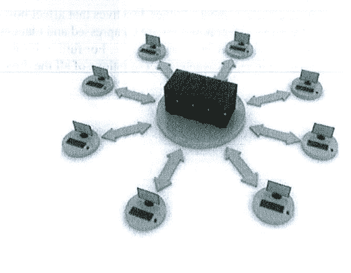

SEC401 | 安全基础：Bootcamp 风格 159


在任何多机器环境中，你都应该检查集中日志记录。这不仅极大简化了系统管理员的工作，还增加了安全优势，可以防止恶意攻击者清除足迹（除非他们攻破了日志服务器）。

集中日志记录的主要优势是它让远程攻击难以擦除或损坏系统日志。它们生成的任何日志都会立即发送到另一台机器，由那里存储数据。使用 `syslog` 服务器意味着在被黑客入侵时，信息仍然可以被系统管理员发现并用于恢复过程。

这种设计的一个漏洞是，它可能导致 `syslog` 客户端发送大量的日志数据使中央服务器崩溃，或者攻击者可以向中央 `syslog` 服务器发送虚假消息来干扰日志。这意味着中央 `syslog` 服务器应该配置为仅接收来自合法发送日志的机器的系统日志，并且应该由防火墙防止所有机器的访问。

防止发送大量信息的客户端的唯一方法是让 `syslog` 服务器拥有大量磁盘来存储这些信息。如果需要，可以更快地轮转日志，并可以使用多个分区用于日志，以降低导致环境中所有日志记录崩溃的风险。系统中内置了一些机制来聚合重复的消息。也就是说，`syslog` 将字符串显示为“最后一条消息重复 X 次”。最终，防止恶意用户导致日志溢出的保护措施是使用防火墙阻止攻击者进入环境、更快地轮转日志，或拥有足够的磁盘来抵御攻击。

集中日志记录的后果是所有日志现在都位于一个地方。许多日志包含可能提供有关环境中重要信息线索的内容。某些日志甚至包含特权信息。当所有信息都在一个地方时，这台机器变成了一个非常有价值的目标。保护它至关重要。它应该只运行接收消息的日志服务，并让 `SSH` 守护接受来自少量 `IP` 地址的有限数量登录。

150 ©2017, Secure Anchor

如果所有系统日志都在一个地方

# 参考文献

- 第 1 部分2：企业日志管理工具，https://www.linkedin.com/pulse/20140807122848-3754494-part-2-enterprise-log-tools

# 日志解析

此页留空。

## CLI 日志解析概述

Linux 系统可以使用多种工具解析和过滤日志，从简单的过滤器到复杂的表达式过滤器：

- `grep`
  - `cut`
  - `sed`
  - `awk`


SEC401 | 安全基础：Bootcamp 风格 159

在任何多机器环境中，你都应该检查集中日志记录。这不仅极大简化了系统管理员的工作，还增加了安全优势，可以防止恶意攻击者清除足迹（除非他们攻破了日志服务器）。

集中日志记录的主要优势是它让远程攻击难以擦除或损坏系统日志。它们生成的任何日志都会立即发送到另一台机器，由那里存储数据。使用 `syslog` 服务器意味着在被黑客入侵时，信息仍然可以被系统管理员发现并用于恢复过程。

这种设计的一个漏洞是，它可能导致 `syslog` 客户端发送大量的日志数据使中央服务器崩溃，或者攻击者可以向中央 `syslog` 服务器发送虚假消息来干扰日志。这意味着中央 `syslog` 服务器应该配置为仅接收来自合法发送日志的机器的系统日志，并且应该由防火墙防止所有机器的访问。

防止发送大量信息的客户端的唯一方法是让 `syslog` 服务器拥有大量磁盘来存储这些信息。如果需要，可以更快地轮转日志，并可以使用多个分区用于日志，以降低导致环境中所有日志记录崩溃的风险。系统中内置了一些机制来聚合重复的消息。也就是说，`syslog` 将字符串显示为“最后一条消息重复 X 次”。最终，防止恶意用户导致日志溢出的保护措施是使用防火墙阻止攻击者进入环境、更快地轮转日志，或拥有足够的磁盘来抵御攻击。

集中日志记录的后果是所有日志现在都位于一个地方。许多日志包含可能提供有关环境中重要信息线索的内容。某些日志甚至包含特权信息。当所有信息都在一个地方时，这台机器变成了一个非常有价值的目标。保护它至关重要。它应该只运行接收消息的日志服务，并让 `SSH` 守护接受来自少量 `IP` 地址的有限数量登录。

150 ©2017, Secure Anchor

# 参考文献

- 第 1 部分2：企业日志管理工具，https://www.linkedin.com/pulse/20140807122848-3754494-part-2-enterprise-log-tools

# 日志解析

此页留空。

## CLI 日志解析概述

Linux 系统可以使用多种工具解析和过滤日志，从简单的过滤器到复杂的表达式过滤器：

- `grep`
  - `cut`
  - `sed`
  - `awk`


SEC401 | 安全基础：Bootcamp 风格 153

`grep` 是一个 UNIX 命令，允许你根据指定的模式搜索字符串；然后它会打印匹配的行。`Grep` 期望匹配文本，它对输入长度的限制仅限于可用内存，并且它可以匹配行内的任意字符。如果文件末尾不是换行符，`grep` 会静默地替换一个。由于换行符也是模式列表的分隔符，因此无法在文本中匹配换行符。

- `-v` 告诉 `grep` 显示所有不匹配指定模式的内容。
- `-w` 告诉 `grep` 仅显示全词匹配的结果，其中单词可以包含字母、数字和下划线。
- `-x` 告诉 `grep` 只显示与模式完全整行匹配的行。

`Grep` 为你提供了一些选项，用于控制 `grep` 过程中发现的信息的输出：

- `-c` 切换告诉 `grep` 仅显示模式在搜索中匹配的次数。
- `-L` 当你同时搜索多个文件时，`-L` 命令会打印出不包含指定模式匹配项的文件名。相反，`-l` 会显示所有确实匹配指定模式的文件名。
- `-m` 切换告诉 `grep` 仅打印指定行数的输出。
- `-o` 切换告诉 `grep` 打印匹配行中匹配的非空部分，每个部分单独占一行输出。
- `-s` 切换告诉 `grep` 抑制在对文件（或多个文件）进行搜索过程中产生的所有错误信息。

# 参考文献

- 1. http://www.gnu.org/software/grep/manual/grep.html

## 命令行工具日志解析 – cut

## Cut

- 语法：`cut <option>`
- 仅使用一个开关 (`-b`, `-c` 或 `-f`)
- 如果未指定文件，`cut` 将从标准输入读取
- 通过管道 `|` 将 `grep` 的输出作为输入

- `-b` 或 `--bytes`（字节）
- `-c` 或 `--characters`（字符）
- `-d` 或 `--delimiter`（分隔符）
- `-f` 或 `--fields`（字段）
- `-s` 或 `--only-delimited`（仅限分隔符）

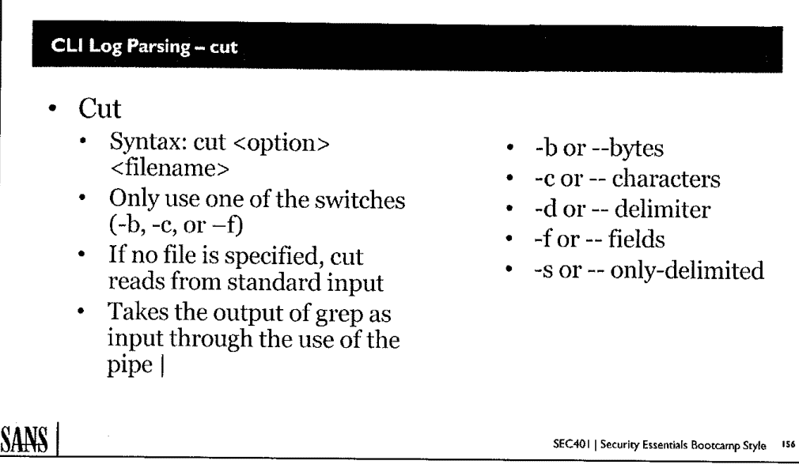

假设你已经通过 `grep` 找到了你寻找的数据。唯一的问题是 `grep` 返回了匹配模式的整行，但你不需要整行；你只想显示行的某一部分，因为你想将每行结果中的唯一值提取到另一个程序中。这就是 `cut` 的用武所在。`Cut` 用于提取文件或文件中行中的指定部分。

调用 `cut` 时，请使用 `-b`、`-c` 或 `-f` 选项（仅使用其一）。如果没有指定文件名，`cut` 将从标准输入读取。例如，`cut` 可以通过管道字符 (`|`) 接受 `grep` 的输出作为输入。`Cut` 为大多数管理员提供了无需过多技巧即可过滤日志所需工具。

- `-b` 切换根据列表指定仅选择每行中的字节。列表可以指定一个字节、一组字节或一个字节范围。
- `-c` 切换根据列表指定仅选择每行中的字符。列表可以指定一个字符、一组字符或一个字符范围。
- `-d` 切换在告诉 `cut` 查看列字段时，指定除制表符以外的字符作为分隔符。
- `-f` 切换仅选择每行的这些字段，除非指定了 `-s` 选项，否则将打印不包含分隔符的行。列表指定一个字段、一组字段或一个字段范围。
- `-s` 切换告诉 `cut` 不要打印不包含分隔符的行。

## 命令行工具日志解析 – cut 示例

## Cut示例
```bash
real cat data.txt

one two three four five

green blue orange red purple

real cut -f 3 data.txt

three

orange

two three four

blue orange red

real cut -f 2-4 data.txt

cut -f 1-2,4-5 data.txt

one two four five

green blue purple

real cut -f 3 data.txt

three

orange red purple

real -c 3-12 data.txt

e two three

een blue

real cut -b 3-12 data.txt

two three

een blue

real - |
```


在这个示例中，数据指定为 `data.txt`，它有五列数据。现在你想查看第三字段/列中的任何内容。在这种情况下，你执行 `cut -f 3 data.txt` 来仅显示数据的第三字段或列。

现在，如果你想让 `cut` 显示一个字段范围，例如第 2 到第 4 字段。你会执行 `cut -f 2-4 data.txt`，使 `cut` 只显示第 2 到 4 字段。

尽管数据集有五个字段，但你想显示除第一个以外的所有字段。为了这样做，你会执行 `cut -f 1-2,4-5 data.txt`，告诉 `cut` 仅显示字段 1、2、4 和 5。

在某些情况下，你不知道有多少个字段，或者它们是否按行变化，但你知道你想看到从第三字段开始包含的所有字段。在这种情况下，你会执行 `cut -f 3- data.txt` 来查看包括第三字段在内之后的所有字段。

现在你想根据字符位置而不是字段来列出。你只想为每行打印第 3 到 12 个字符。为了实现这一点，你会执行 `cut -c 3-12 data.txt`。记住，每个单词中的空格实际上是制表符，所以输出的两行都显示了字符和制表符字符。

现在你想计算字节而不是字符，这对于非字母数字字符有用。你只想看到字节 3 到 12 的结果。你会执行 `cut -b 3-12 data.txt`。在这种情况下，由于处理的是非字母数字字符，这很有用。

```bash
real cut -f 3 data.txt

three

orange red purple

blue orange

real cut -f 2-4 data.txt

cut -f 1-2,4-5 data.txt

one two four five

green blue purple

real cut -f 3 data.txt

three

orange red purple

real -c 3-12 data.txt

e two three

een blue

real cut -b 3-12 data.txt

two three

een blue

real - |
```

## 命令行工具日志解析 - cut

## 分隔符
```bash
root@kali:~ # cat passwd

root:x:0:0:root:/root:/bin/bash

daemon:x:1:1:daemon:/usr/sbin:/usr/sbin/nologin

bin:x:2:2:bin:/bin:/usr/sbin/nologin

sys:x:3:3:sys:/dev:/usr/sbin/nologin

sync:x:4:6:sync:/dev:/usr/sbin/nologin

games:x:5:60:games:/usr/games:/usr/sbin/nologin

man:x:6:12:man:/var/man:/usr/sbin/nologin

lp:x:7:7:lp:/lp:/usr/sbin/nologin

lp:x:8:8:mail:/var/spool/lpd:/usr/sbin/nologin

mail:x:9:9:mail:/var/mail:/usr/sbin/nologin

uuc:x:10:10:uuc:/var/uuc:/usr/sbin/nologin

proxy:x:13:13:proxy:/root:/usr/sbin/nologin
```


## 命令行工具日志解析 - `cut`

## 分隔符

```bash
root@kali:~ # cat passwd

root:x:0:0:root:/root:/bin/bash
daemon:x:1:1:daemon:/usr/sbin:/usr/sbin/nologin
bin:x:2:2:bin:/bin:/usr/sbin/nologin
sys:x:3:3:sys:/dev:/usr/sbin/nologin
sync:x:4:6:sync:/dev:/usr/sbin/nologin
games:x:5:60:games:/usr/games:/usr/sbin/nologin
man:x:6:12:man:/var/man:/usr/sbin/nologin
lp:x:7:7:lp:/lp:/usr/sbin/nologin
mail:x:9:9:mail:/var/mail:/usr/sbin/nologin
uuc:x:10:10:uuc:/var/uuc:/usr/sbin/nologin
proxy:x:13:13:proxy:/root:/usr/sbin/nologin
news:x:38:38:news:/var/cache/news:/usr/sbin/nologin
data:x:33:33:data:/var:/usr/sbin/nologin
backup:x:34:34:backup:/var/back:/usr/sbin/nologin
irc:x:38:38:irc:/var/run/ircd:/usr/sbin/nologin
list:x:38:38:list:/var/listlist:/usr/sbin/nologin
uats:x:39:39:uats:/var/uats:/usr/sbin/nologin
irc:x:42:
nobody:x:65:65:nobody:/nonexistent:/usr/sbin/nologin
_system:x:999:999:_system:/system:/usr/sbin/nologin
```

制表符是 `cut` 用来确定什么是字段的默认分隔符。因此，如果你的文件字段已经是制表符分隔的，你不需要指定不同的分隔符，但通常日志是用制表符以外字符分隔的，如空格、逗号或冒号。

在这个示例中，你想只显示 `/passwd` 文件中的用户名。你可以看到，它是用冒号分隔的。因此你告诉 `cut` 使用冒号作为分隔符，并执行 `cut -f 1` 仅显示第一个字段。

使用分隔符开关的一个注意事项是，`cut` 使用单引号，除非你需要使用单引号作为分隔符；在这种情况下，你需要在单引号周围加上双引号。

```bash
root@kali:~ # cat passwd

root:x:0:0:root:/root:/bin/bash
daemon:x:1:1:daemon:/usr/sbin:/usr/sbin/nologin
bin:x:2:2:bin:/bin:/usr/sbin/nologin
sys:x:3:3:sys:/dev:/usr/sbin/nologin
sync:x:4:6:sync:/dev:/usr/sbin/nologin
games:x:5:60:games:/usr/games:/usr/sbin/nologin
man:x:6:12:man:/var/man:/usr/sbin/nologin
lp:x:7:7:lp:/lp:/usr/sbin/nologin
mail:x:9:9:mail:/var/mail:/usr/sbin/nologin
uuc:x:10:10:uuc:/var/uuc:/usr/sbin/nologin
proxy:x:13:13:proxy:/root:/usr/sbin/nologin
news:x:38:38:news:/var/cache/news:/usr/sbin/nologin
data:x:33:33:data:/var:/usr/sbin/nologin
backup:x:34:34:backup:/var/back:/usr/sbin/nologin
irc:x:38:38:irc:/var/run/ircd:/usr/sbin/nologin
list:x:38:38:list:/var/listlist:/usr/sbin/nologin
uats:x:39:39:uats:/var/uats:/usr/sbin/nologin
irc:x:42:
nobody:x:65:65:nobody:/nonexistent:/usr/sbin/nologin
_system:x:999:999:_system:/system:/usr/sbin/nologin

root@kali:~ # cut -f 1 -d ':' passwd
root
daemon
bin
sys
sync
games
man
lp
mail
uuc
proxy
news
data
backup
irc
list
uats
irc
nobody
_system
```

# CLI 日志解析

- `sed`（流编辑器）
  - 解析文本并转换文本
  - 支持正则表达式
  - 语法：`sed <选项> <文件名>`

如果你需要解析日志文件，`Grep` 和 `cut` 就能为你提供帮助。然而，`Sed` 具有从标准输入或文件等输入流中逐行对文本进行过滤和转换的能力。它转换文本的能力使其成为一种更强大的全能型解析解决方案。

`Sed` 是一个用于解析和转换文本的 `UNIX` 实用程序。它开发于 `1973` 年到 `1974` 年之间，基于交互式编辑器 `ed` 的脚本功能。`Sed` 是最早支持正则表达式的工具之一。

参考意图

1. https://en.wikipedia.org/wiki/Sed

## CLI 日志解析 – `sed` 打印文本

```bash
root@kali:~# sed -n '1,5p' license.txt
Apache License
Version 2.0, January 2004
http://www.apache.org/licenses/
TERMS AND CONDITIONS FOR USE, REPRODUCTION, AND DISTRIBUTION
root@kali:~# sed -n '1,4p' license.txt
Apache License
Version 2.0, January 2004
http://www.apache.org/licenses/
TERMS AND CONDITIONS FOR USE, REPRODUCTION, AND DISTRIBUTION
root@kali:~# sed -n '1-2p' license.txt
Apache License
http://www.apache.org/licenses/
TERMS AND CONDITIONS FOR USE, REPRODUCTION, AND DISTRIBUTION
1. Definitions.
"License" shall mean the terms and conditions for use, reproduction,
"Legal Entity" shall mean the union of the acting entity and all
control with that entity. For the purposes of this definition,
direction or management of such entity, whether by contract or
outstanding shares, or (iii) beneficial ownership of such entity.
root@kali:~#
```


`Sed` 会隐式地打印所有发送给它的内容，但当你使用 `p` 命令时，它会显式地打印文件中的行。结果，它会隐式地打印这些行，而显式打印的结果行会被打印两次。要停止这种行为，请使用 `-n` 选项在你尝试打印想要的行时抑制 `sed` 的隐式打印功能。

假设你有一个许可证文件要查看，但你只想查看前五行。你可以通过执行 `sed -n '1,5p' license.txt` 来实现这一点。在此过程中，你提供了一个作为范围的 `sed` 列表，而 `p` 告诉只打印许可证文件中的这些行。你可以通过执行 `sed -n '1,+4p' license.txt` 实现完全相同的行为，其中你是在告诉 `sed` 打印第 `1` 行再加上四行。

如果由于某种原因，你想看到许可证文件中每隔一行打印的内容，你可以执行 `sed -n '1~2p' license.txt`。这样做，你是在告诉 `sed` 打印第 `1` 行，然后使用波浪 `(~)` 告诉它每显示两行。

```bash
root@kali:~# sed -n '1,5p' license.txt
Apache License

TERMS AND CONDITIONS FOR USE, REPRODUCTION, AND DISTRIBUTION
Version 2.0, January 2004
http://www.apache.org/licenses/

root@kali:~# sed -n '1,4p' license.txt
Apache License

TERMS AND CONDITIONS FOR USE, REPRODUCTION, AND DISTRIBUTION
Version 2.0, January 2004
http://www.apache.org/licenses/

root@kali:~# sed -n '1,2p' license.txt
Apache License

TERMS AND CONDITIONS FOR USE, REPRODUCTION, AND DISTRIBUTION
1. Definitions.
http://www.apache.org/licenses/

"License" shall mean the terms and conditions for use, reproduction,
copyright owner that is granting the License.
Legal Entity shall mean the union of the acting entity and all
control with that entity. For the purposes of this definition,
direction or management of such entity, whether by contract or
outstanding shares, or (iii) beneficial ownership of such entity.

root@kali:~#
```

## CLI 日志解析 – `sed` 删除文本

```bash
root@kali:~# sed '1-2d' license.txt
Version 2.0, January 2004
```

以及根据本文第 `1` 节到 `9` 节定义的发行。

“许可方”是指由版权所有者或获得授权的实体，

这些其他实体控制、被这些实体控制或与该实体共同

控制的

“控制”意味着 `(i)` 直接或间接的权力，导致

否则，或对其中百分之五十 `（50%）` 或更多的所有权。

```bash
root@kali:~# sed -i /license/the/d license.txt
以及根据文档第 1 节到 9 节定义的发行。
```

“许可方”是指由版权所有者或获得授权的实体，

这些其他实体控制、被这些实体控制或与该实体共同

控制的，(i) 直接或间接的权力，导致

该实体的方向或管理，无论是通过合同还是

发行股，或 (ii) 对该实体百分之五十（50%）或更多的所有权。

```bash
root@kali:~# sed -i.bak /license/the/d license.txt
```


`164 |` 安全训练营

现在你想看到许可证文件中每隔一行打印的内容，你可以执行 `sed -n '1~2p' license.txt`。这样做，你是在告诉 `sed` 打印第 `1` 行，然后使用波浪 `(~)` 告诉它每显示两行。

```bash
root@kali:~# sed -n '1,5p' license.txt
Apache License

TERMS AND CONDITIONS FOR USE, REPRODUCTION, AND DISTRIBUTION
Version 2.0, January 2004
http://www.apache.org/licenses/

root@kali:~# sed -n '1,4p' license.txt
Apache License

TERMS AND CONDITIONS FOR USE, REPRODUCTION, AND DISTRIBUTION
Version 2.0, January 2004
http://www.apache.org/licenses/

root@kali:~# sed -n '1,2p' license.txt
Apache License

TERMS AND CONDITIONS FOR USE, REPRODUCTION, AND DISTRIBUTION
1. Definitions.
http://www.apache.org/licenses/

"License" shall mean the terms and conditions for use, reproduction,
授予许可的版权所有者。
Legal Entity shall mean the union of the acting entity and all
control with that entity. For the purposes of this definition,
direction or management of such entity, whether by contract or
outstanding shares, or (iii) beneficial ownership of such entity.

root@kali:~#
```

## CLI 日志解析 – `awk`

- 文本处理器和脚本语言
- 包含在大多数现代操作系统中
- 语法：`awk '/模式过滤/ { 匹配动作; 额外动作; }' 文件名`
- 拥有内置和自定义变量
- 可以创建函数

以及根据本文第 `1` 节到 `9` 节定义的发行。

“许可方”是指版权所有者或获得授权的实体，

这些其他实体控制、被这些实体控制或与该实体共同

控制的

否则，或对其中百分之五十 `（50%）` 或更多的所有权。

现在 `sed` 无法为你提供的日志提供过滤功能。你需要一种更具扩展性、更灵活的东西，类似于脚本语言的东西。这就是 `awk` 的用场。`awk` 是一种为文本处理设计的编程语言，通常用作数据提取和报告工具。`awk` 在 `20` 世纪 `70` 年代诞生于贝尔实验室，其名称源于作者的姓氏——`Alfred Aho`、`Peter Weiner` 和 `Brian Kernighan`。

`awk` 可以作为完整的脚本来使用，如果你需要为脚本输入多行，`Linux` 通常会切换到 `awk` 解释器提示符，以便你完成多行脚本的输入，正如我们将在未来的示例中看到的。

你在 `awk` 中使用的主要且常用的命令是 `print` 命令，因此在文本解析和过滤完成后，它将完成的输出打印到屏幕或文件中。

## CLI 日志解析 – `awk` 示例 (1)

```bash
root@kali:~# awk '^UUID/ {print $1;}' /etc/fstab
UUID=ef70e08f-6236-4e1d-acbe-7fe7e845a7f1
UUID=58e69442-0f3b-406a-9dff-8ba04ecc5c4a4
root@kali:~# awk 'BEGIN { FS=":"; }\n{ print $1;}' passwd
avahi
sshd
colord
saned
speech-dispatcher
pulse
king-fisher
Debian-gdm
dradis
beef-xss
```

`Awk` 允许你快速过滤你想要的重要信息并将其打印到屏幕上进行简单查看。例如，使用 `awk` 命令查看 `fstab` 中所有挂载设备的 `UUID` 号，执行 `awk '^UUID/ {print $1;}' /etc/fstab`。在这种情况下，你是在告诉 `awk` 在文件中查找 `UUID` 术语并仅打印每行的内容。


你之前曾使用 `grep` 和 `cut` 过滤过 `/etc/passwd`，但现在你可以使用 `awk` 的单个命令和程序来实现。执行 `awk 'BEGIN { FS=":"; } {print $1;}' passwd`。在这里，你是在告诉 `awk` 将其字段分隔符变量 `FS` 设置为冒号，因为 `passwd` 是一个以冒号分隔的文件，然后打印每行的第一个字段（在这种情况下是用户名）。由于你使用了变量，你必须指定 `awk` 你从文件开始的 `BEGIN` 开始开始，并根据指定的操作进行处理。由于此示例在完成文件解析后没有其他要运行的命令，因此 `END` 是隐含的。

```
root@kali:~# awk '/UUID/ {print $1;}' /etc/fstab
UUID=ef70e68f-586e9442-0f3b-406a-9dff-7f7e8445a7f1
root@kali:~# awk 'BEGIN { FS=":" } 
{ print $1; }' passwd
avahi
sshd
colord
speech-dispatcher
pulse
King-phisher
Debian-gdm
dradis
beef-xss
```

## CLI 日志解析 – `awk` 示例 (2)

```
root@kali:~# awk -FS=":" print "User\t\tUID\tGID\tShell\n--------------------------------------------------------------------------------"; \
> {print $1,"\t",$3,"\t",$4,"\t",$6,"\t",$7};
> END {print "----------------Completed------" }
```

| 用户 | UID | GID | Shell |
|---|---|---|---|
| avahi | 125 | 131 | |
| sshd | 126 | 65534 | |
| colord | 127 | 132 | |
| saned | 128 | 134 | |
| speech-dispatcher | | 139 | |
| pulse | 130 | 135 | |
| king-fisher | | 131 | |
| Debian-gdm | | 132 | |
| dradis | | 140 | |
| beef-xss | 133 | 141 | |

```
Shell
/bin/false
/usr/sbin/nologin
/bin/false
/bin/false
/bin/false 29
/bin/false
/bin/false
/bin/false
```


现在你想使用 `awk` 显示 `/etc/passwd` 的格式化版本，使其易于阅读并仅显示用户名、UID、GID 和 shell 路径。通过执行以下命令来实现：该命令告诉 `awk` `BEGIN` 输出表头并将 `FS` 设置为冒号。然后你告诉 `awk` 在每列名称之前使用 `\t`（制表符），同时也告诉 `awk` 打印字段 `1`、`3`、`4` 和 `7`，尽可能地对齐到表头。你还使用 `\t` 来格式化显示字段并尽可能对齐到表头。最后在处理完 `passwd` 文件之前告诉 `awk` 执行 `END` 操作并打印完成报告。

```
awk -FS=":" print "User(UID|GID|Shell)------------------------------------------------";n{print $1,"\t",$3,"\t",$7};
END {print "----------Completed------" }
```

此内联脚本允许你进入 `>` 指定的 `awk` 提示符。`awk` 可以处理几乎任何输出和文本。你可以按照想象的任何方式对其进行转换。这个示例说明了这种可能性。

```
cut -d: | awk '{FS=":"; print "User\tUID\tGID\tShell--"; } 
> {print $1;"t"$3;"t"$7;}
> END { print "\nCompleted" } passwd
```

| 用户 | UID | GID | Shell |
|---|---|---|---|
| avahi | 125 | 131 | /bin/false |
| sshd | 126 | 65534 | /usr/sbin/nologin |
| colord | 127 | 132 | /bin/false |
| saned | 128 | 134 | /bin/false |
| pulse | 130 | 135 | /bin/false |
| speech-dispatcher | | 29 | /bin/false |
| king-fisher | | 131 | /bin/false |
| Debian-gdm | | 132 | /bin/false |
| beef-xss | 133 | 141 | /bin/false |

## Auditd (I)

- `auditd`

- 命令执行日志

- 文件访问日志

- 目录访问日志

- 网络连接日志

- 针对 `CIS`（互联网安全中心）的大量规则

- 由 `audit.rules` 或 `auditctl` 控制的规则

- 有一套工具可以查看生成的日志：`ausearch`, `aureport`

`Audit` 子系统是 `Red Hat` 开发并维护的 `Linux` 访问监控和计数解决方案。此外，它设计用于与内核密切集成并监控系统调用。此外，它还用作 `SELinux` 的记录器。`Audit` 在内核级别运行，为你提供了任何要监控的操作钩。你可以在特定系统调用发生时写入日志。你可以监控任何文件的访问以及所有网络流量。`Audit` 非常详细，过滤级别粒细。`Audit` 本身是一个日志系统，因此不使用 `syslog`。因此你必须使用工具 set 来管理所有的审计日志。任何形式的远程收集或存档可能无法与这些文件配合。`Audit` 有远程日志的解决方案，尽管它们不像 `syslog` 那样容易管理和解析。

审计规则集可以是简单的或复杂的，但现实是对于大多数人来说，规则集可以非常简单，只需要几个命令。为了让肉眼更容易查看，你可以运行 `aureport` 作为独立命令，或者将审计结果管道给它。

参考：

1. http://security.blogoverflow.com/2013/01/a-brief-introduction-to-auditd/

## Auditd (2)

`auditd` 规则文件示例

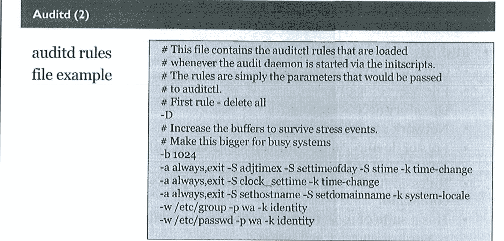

```
# 此文件包含当通过 initscripts 启动守护进程时加载的 auditctl 规则。
# 规则只是传递给 auditctl 的参数。
# 第一条规则 - 删除
-D
# 增加缓冲区以应对压力事件。
# 对于繁忙的系统将其调大
-b 1024
-a always,exit -S adjtimex -S settimeday -S stime -k time-change
-a always,exit -S clock_settime -k time-change
-a always,exit -S sethostname -S setdomainname -k system-locale
-w /etc/group -p wa -k identity
-w /etc/passwd -p wa -k identity
```


`Auditd` 有一个名为 `audit.rules` 的文件，包含示例中的规则。规则文件的存在是为了确保审计规则在重启后依然有效。你通常可以在 `/etc/audit/rules/audit.rules` 找到该文件。

注意每一行都是你使用 `auditctl` 命令运行 `auditd` 时使用的命令。此规则文件会在每当以下任何系统调用退出时（`adjtimex`, `settimeday`, `stime`, ...）生成一条日志消息。当 `group` 或 `passwd` 文件被写入时，它还会创建一个日志消息。任何井号（`#`）后的项目或文本都会被忽略。

- `auditd-L`: 列出所有正在运行的审计规则。

- `auditd-S`: 显示 `auditd` 守护的当前状态。

- `auditd-B`: 设置未决审计缓冲区的最大数量。如果所有缓冲区满了，内核将承受失败。

- `auditd-F`: 将标志设置为 `0`、`1` 或 `2`。此选项允许你确定内核如何处理严重错误。如果设置为 `0`，审计消息将不会记录并被直接丢弃。如果设置为 `1`，将触发内核崩溃（panic）。

- `auditd-R`: 允许从指定文件读取审计规则。此功能在你测试某些规则并想使用 `audit.rules` 中的旧规则时非常有用。

- `auditd-D`: 删除 `auditd` 守护所有规则。

当向 `audit -e` 命令传递 `0` 时，它将临时禁用 `auditd`。当传递参数 `1` 时，它将启用审计。要锁定审计配置，请传递参数 `2`。这将使当前的规则变为不可更改。规则无法再添加、移除或删除，守护进程也无法停止。锁定配置只能通过重启服务器来更改。

## Auditd (3)

- `ausearch`
  - `ausearch -k`
  - `ausearch -m LOGIN --start today -i`
  - `ausearch -a 7618`
  - `ausearch -f /etc/ssh/sshd_config`
- `autrace`
  - `autrace /usr/bin/find`
- `auditport`
  - `auditport -x -summary`
  - `auditport -failed`
  - `auditport -f`


至此，你已经部署了审计规则，用于记录系统上进程对文件的访问以及执行的系统调用的事件。如果你想查看这些日志，你需要两个主要工具：`ausearch` 和 `auditport`。`ausearch` 允许你根据以下内容查阅日志：

- 消息类型，`-m`

- 日志发生的时间，`-start`

- 由规则标记日志的关键短语，`-k`

- 审计事件 ID，`-a`

- 文件名，`-f`

`-i` 选项允许 `ausearch` 将数字实体解释为文本，因为字段通常是数字，而完全不是文本。

`audit` 输出的日志非常详尽且数量很多。如果你将 `audit` 的输出通过到 `audit` 命令中，你可以获得日志的摘要，或者将日志格式化为更易读的样式，以便你关注你正在寻找的内容。

`Autrace` 允许你在执行时对执行文件进行跟踪，以便了解它执行了哪些系统调用。因此，你可以为你认为应该审计和跟踪的感兴趣系统调用构建审计规则。

## Auditd (4)

`Auditd` 示例

- `auditctl -w /etc/sysconfig/ -p rwa -k sysaccess`
- `auditctl -w /sbin/modprobe -p x -k kernel_modules`
- `auditctl -W /sbin/modprobe -p x -k kernel_modules`
- `auditctl -a always,exit -F arch=b64 -F "aid>=1000" -S rename -S renameat -k rename`


上面的第一个示例添加了一个规则，监控 `/etc/sysconfig/` 及其下方的所有文件和目录的任何读、写或属性更改访问。它还会记录带有自定义键 `sysaccess` 的消息。

第二个示例添加了针对执行 `/sbin/modprobe` 命令的规则。正如课程早些讨论的那样，该命令动态地将内核模块注入内核中，这可能是一个非常危险的操作，因此应该被密切监控。

第三个示例删除了示例 2 中添加的 `modprobe` 规则。要删除文件或系统调用规则，你只需使用大写字母——在本例中是大写的 `W`——来表示你想移除匹配的规则。对于系统调用规则，你使用大写的 `A`。

最后一个示例是一个规则，它始终监控系统调用（`always`），并且当它们退出时，仅针对 64 位进程。它会查找任何 `UID` 为 `1000` 或更小的运行进程，并且被监控的系统调用是 `rename` 系统调用。如果系统调用被记录，此规则将在日志中放入关键短语 `rename`，以便使用 `ausearch` 在日志中搜索。

## 总结

| 建立系统基准 |
|---|
| 跟踪异常 |
| 日志配置 |
| 日志监控 |
| 关键日志文件 |
| Syslog |
| Syslog 替代方案 | 日志解析命令行工具：`grep`, `sed`, `awk`, `cut` Auditd |
| 命令执行日志 |
| 文件和目录访问日志 |
| 网络连接日志 |


`SEC401` | `Security Essentials Bootcamp Style` 175

本模块涵盖了以下关键领域：

- 建立系统基准
- 跟踪异常
- 日志配置
- 日志监控
- 关键日志文件
- `Syslog`
- `Syslog` 替代方案
- 日志解析命令行工具：`grep`, `sed`, `awk`, `cut`
- `Auditd`
- 命令执行日志
- 文件和目录访问日志
- 网络连接日志

## 模块 3：安全实用工具

此页故意留白。

## 目标

- 使用内置命令和安全功能
- 配置完整性检查器
- 集成基于主机的防火墙并进行管理以提供安全
- 使用加固脚本
- 部署包管理
- 检查可以增强和增加 `Linux` 系统整体安全性的额外工具


## 增强整体安全性

- 已为 `Linux` 构建了许多工具
- 增强操作系统安全性的目标
- 更好的可见性
- 减少攻击面
- 控制损害
- 早期检测
- 始终识别出将降低的整体风险
- 确定解决方案是否是降低风险最有成本效益的方法


技术人员使用 `Linux` 的原因之一是具有许多功能。从内置脚本到安全命令，它是一个用于发现、跟踪和最小化损害的强大操作系统。

- 许多工具是为 `Linux` 构建的
- 增强操作系统（OS）安全性的目标
- 更好的可见性
- 减少攻击面
- 控制损害
- 早期检测
- 始终识别出将降低的整体风险
- 确定解决方案是否是降低风险最有成本效益的方法

技术人员使用 `Linux` 的原因之一是它具有许多功能。从内置脚本到安全命令，它是一个用于发现、跟踪和最小化损害的强大操作系统。

技术人员使用 `Linux` 的原因之一是它具有许多功能。从内置脚本到安全命令，它是一个用于发现、跟踪和最小化损害的强大操作系统。

技术人员使用 `Linux` 的原因之一是它具有许多功能。从内置脚本到安全命令，它是一个用于发现、跟踪和最小化损害的强大操作系统。

技术人员使用 `Linux` 的原因之一是它许多许多功能。从内置脚本到安全安全，它，的的、、，的的的。。

- 许多工具是 `Linux Linux Linux` 构建的
  增强操作系统安全性的目标
- 更好的可见性
- 减少攻击面
- 控制损害
- 早期检测
- 始终识别出将降低的整体风险
- 确定解决方案是否是降低风险最有成本效益的方法

技术人员使用 `Linux` 的原因之一是它具有许多功能。从内置脚本到安全命令，它是一个用于发现、跟踪和最小化损害的强大操作系统。

技术人员使用 `Linux` 的原因之一是它具有许多功能。从内置脚本到安全命令，它是一个用于发现、跟踪和最小化损害的强大操作系统。

技术人员使用 `Linux` 的原因之一是它具有许多功能。从内置脚本到安全命令，它是一个用于发现、跟踪和最小化损害的强大操作系统。

技术人员使用 `Linux` 的原因之一是它具有许多功能。从内置脚本到安全命令，它是一个用于发现、跟踪和最小化损害的强大操作系统。

技术人员使用 `Linux` 的原因之一是它具有许多功能。从内置脚本到安全命令，它是一个用于发现、跟踪和最小化损害的强大操作系统。

在整个课程中，特别是在本节中，不要关注一个工具不是为了什么而被设计进去的。你可能会听到对书中的某些工具的批评，人们说某个工具没有这些功能。反驳意见是，该工具只需要 20 分钟进行配置，就能捕获 5% 的所有攻击。对于我们今天面临的威胁，这应该被视为一次胜利。

为了成为一名有效的专业人员，你需要在工具箱里有很多工具。并不是每个工具都适用于所有情况，但拥有替代方案和选项是好的。对于许多客户，你只会使用工具的一个子集，但拥有可用选项仍然很好。

最后的警告是，新的开发一直在不断发生，`Linux` 的许多方面并没有改变。然而，不要看一个工具的创建日期——说它是过时的——就得出结论它是没用的或信息已经过时。许多安全专业人员使用年前的工具，因为它们有效，而且没有免费的解决方案可用。

在网络防御方面，请记住，预防完全取决于创造力和保持开放的心态。如果你要拒绝一个工具，请确保你是出于正确的理由这样做的，并且你做了研究。

# 内置命令

- `Linux` 拥有许多实用的内置命令
- 安全关乎可见性、基线准化和自动化；这三者都是 `Linux` 中非常强大的组件
- 了解系统上运行着什么以及系统正在发生什么至关重要
- 不存在所谓的“隐形敌手”
- 当 `Linux` 拥有庞大的能力范围时，许多人总在寻找第三方工具


在涉及到安全时，每个人都想要第三方工具，但我们经常忘记 Linux 拥有许多强大的内置命令。虽然第三方工具具有价值，但要真正成为一名安全专家，掌握你手头现有的内置命令至关重要。攻击者会留下线索。他们无法在不留任何痕迹的情况下侵入系统。当系统被入侵时，你必须对系统进行更改。

寻找基于主机威胁的一种有力方法是使用操作系统内置的工具。基于主机的威胁猎包括寻找系统上可能存在的敌手迹象。正如我们多次所说的，可见性是发现敌手并控制损害的关键。

使用内置命令来理解安装了什么、运行了什么以及在安全方面发生了什么，是至关重要的。如果你没有这个基础，保护系统将变得困难。

## Linux 内置命令 – 简单而强大

- 不要忽视显而见的事
- 始终建立稳实的基础
- `ls` 是一个简单但强大的命令
- 对核心文件建立基线是发现异常活动的关键组件
- 不要忽视其他提供基础信息的命令
- 基础信息的结合可以提供极佳的可见性

| 权限 | 所有者 | 组 | 大小 | 日期 | 时间 | 名字 |
| :--- | :--- | :--- | :--- | :--- | :--- | :--- |
| `drwxr-xr-x` | `root` | `root` | 48 | 10月12 | 00:23 | `at-password` |
| `drwxr-xr-x` | `root` | `root` | 6 | 10月12 | 00:21 | `fix.progress` |
| `drwxr-xr-x` | `root` | `root` | 660 | 10月12 | 00:21 | `generator` |
| `drwxr-xr-x` | `root` | `root` | 640 | 10月12 | 00:21 | `archive` |
| `d---------` | `root` | `root` | 48 | 10月12 | 00:21 | `inaccessible` |
| `drwxr-xr-x` | `root` | `root` | 205 | 9月20 | 15:44 | `ads` |
| `drwxr-xr-x` | `root` | `root` | 60 | 10月12 | 00:21 | `init` |
| `drwxr-xr-x` | `system-network` | `system-network` | 120 | 10月16 | 02:20 | `optif` |
| `drwxr-xr-x` | `root` | `root` | 60 | 10月12 | 00:21 | `pki` |
| `drwxr-xr-x` | `root` | `root` | 6 | 10月12 | 00:21 | `private` |
| `drwxr-xr-x` | `root` | `root` | 120 | 10月12 | 00:21 | `sessions` |
| `drwxr-xr-x` | `root` | `root` | 120 | 10月12 | 00:21 | `system` |
| `drwxr-xr-x` | `root` | `root` | 120 | 10月12 | 00:21 | `users` |


SEC401 | 安全基础训练营风格 182

适用于安全领域的一个关键格言是“简单更好”。我们经常轻视简单的事情，并让解决方案变得比实际需要的更复杂。

如果几乎每个敌手都会安装添加、更改和删除文件的程序，那么了解系统上有哪些文件难道不重要吗？当然，`ls` 并不是完美的，它不应该是你使用的唯一命令，但通过使用 `ls` 了解系统上有哪些文件是一个很好的开始。

一种简单但有效的技术是建立基线。在建立基线后，验证这些文件以确保系统尚未被入侵。当你有了一个可验证的基线时，按固定间隔检查系统，寻找任何新活动并调查是否有被入侵的迹象。

© 2017, Secure Anchor Consulting

182

## `root@kali:/run/systemd# ls -l`

| 权限 | 所有者 | 组 | 大小 | 日期 | 时间 | 名字 |
| :--- | :--- | :--- | :--- | :--- | :--- | :--- |
| `drwxr-xr-x` | `root` | `root` | 2 | 10月40 | 12:21 | `ask-password` |
| `drwxr-xr-x` | `root` | `root` | 1 | 10月0 | 12:21 | `ffsck.progress` |
| `drwxr-xr-x` | `root` | `root` | 20 | 10月468 | 12:21 | `generator` |
| `drwxr-xr-x` | `root` | `root` | 5 | 10月640 | 12:21 | `generator.inaccessible` |
| `drwxr-xr-x` | `root` | `root` | 5 | 10月640 | 12:21 | `generator.inaccessible` |
| `drwxr-xr-x` | `root` | `root` | 20 | 10月468 | 12:21 | `generator` |
| `drwxr-xr-x` | `root` | `root` | 5 | 10月640 | 12:21 | `generator.inaccessible` |
| `drwxr-xr-x` | `root` | `root` | 20 | 10月468 | 12:21 | `generator` |
| `drwxr-xr-x` | `root` | `root` | 50 | 10月0440 | 12221 | `generator` |
| `drwxr-xr-x` | `root` | `root` | 20 | 10月468 | 12:21 | `generator` |
| `drwxr-xr-x` | `root` | `root` | 50 | 10月440 | 1222 | `generator` |
| `drwxr-xr-x` | `root` | `root` | 20 | 10月468 | 12:21 | `generator` |
| `drwxr-xr-x` | `root` | `root` | 5 | 10月640 | 12:21 | `generator.inaccessible` |
| `drwxr-xr-x` | `root` | `root` | 20 | 10月468 | 12:21 | `generator` |
| `drwxr-xr-x` | `root` | `root` | 5 | 10月640 | 12:21 | `generator.inaccessible` |
| `drwxr-xr-x` | `root` | `root` | 20 | 10月468 | 12:21 | `generator` |
| `drwxr-xr-x` | `root` | `root` | 5 | 10月640 | 12:21 | `generator.inaccessible` |
| `drwxr-xr-x` | `root` | `root` | 20 | 10月468 | 12:21 | `generator` |
| `drwxr-xr-x` | `root` | `root` | 20 | 10月468 | 12:21 | `generator` |
| `drwxr-xr-x` | `root` | `root` | 2 | 10月40 | 12:21 | `ask-password` |
| `drwxr-xr-x` | `root` | `root` | 1 | 10月0 | 12:21 | `ffsck.progress` |
| `drwxr-xr-x` | `root` | `root` | 20 | 10月468 | 12:21 | `generator` |
| `drwxr-xr-x` | `root` | `root` | 5 | 10月640 | 12:21 | `generator.inaccessible` |
| `drwxr-xr-x` | `root` | `root` | 20 | 10月468 | 12:21 | `generator` |
| `drwxr-xr-x` | `root` | `root` | 5 | 10月640 | 12:21 | `generator.inaccessible` |
| `drwxr-xr-x` | `root` | `root` | 20 | 10月468 | 12:21 | `generator` |
| `drwxr-xr-x` | `root` | `root` | 5 | 10月640 | 12:21 | `generator.inaccessible` |
| `drwxr-xr-x` | `root` | `root` | 20 | 10月468 | 12:21 | `generator` |
| `drwxr-xr-x` | `root` | `root` | 2 | 10月40 | 12:21 | `ask-password` |
| `drwxr-xr-x` | `root` | `root` | 1 | 10月0 | 12:21 | `ffsck.progress` |
| `drwxr-xr-x` | `root` | `root` | 20 | 10月468 | 12:21 | `generator` |
| `drwxr-xr-x` | `root` | `root` | 5 | 10月640 | 12:21 | `generator.inaccessible` |
| `drwxr-xr-x` | `root` | `root` | 20 | 10月468 | 12:21 | `generator` |
| `drwxr-xr-x` | `root` | `root` | 5 | 10月640 | 12:21 | `generator.inaccessible` |
| `drwxr-xr-x` | `root` | `root` | 20 | 10月468 | 12:21 | `generator` |
| `drwxr-xr-x` | `root` | `root` | 2 | 10月40 | 12:21 | `ask-password` |
| `drwxr-xr-x` | `root` | `root` | 1 | 10月0 | 12:21 | `ffsck.progress` |
| `drwxr-xr-x` | `root` | `root` | 20 | 10月468 | 12:21 | `generator` |
| `drwxr-xr-x` | `root` | `root` | 5 | 10月640 | 12:21 | `generator.inaccessible` |
| `drwxr-xr-x` | `root` | `root` | 20 | 10月468 | 12:21 | `generator` |
| `drwxr-xr-x` | `root` | `root` | 5 | 10月640 | 12:21 | `generator.inaccessible` |
| `drwxr-xr-x` | `root` | `root` | 20 | 10月468 | 12:21 | `generator` |
| `drwxr-xr-x` | `root` | `root` | 2 | 10月40 | 12:21 | `ask-password` |
| `drwxr-xr-x` | `root` | `root` | 1 | 10月0 | 12:21 | `ffsck.progress` |
| `drwxr-xr-x` | `root` | `root` | 20 | 10月468 | 12:21 | `generator` |
| `drwxr-xr-x` | `root` | `root` | 5 | 10月640 | 12:21 | `generator.inaccessible` |
| `drwxr-xr-x` | `root` | `root` | 20 | 10月468 | 12:21 | `generator` |
| `drwxr-xr-x` | `root` | `root` | 5 | 10月640 | 12:21 | `generator.inaccessible` |
| `drwxr-xr-x` | `root` | `root` | 20 | 10月468 | 12:21 | `generator` |
| `drwxr-xr-x` | `root` | `root` | 2 | 10月40 | 12:21 | `ask-password` |
| `drwxr-xr-x` | `root` | `root` | 1 | 10月0 | 12:21 | `ffsck.progress` |
| `drwxr-xr-x` | `root` | `root` | 20 | 10月468 | 12:21 | `generator` |
| `drwxr-xr-x` | `root` | `root` | 5 | 10月640 | 12:21 | `generator.inaccessible` |
| `drwxr-xr-x` | `root` | `root` | 20 | 10月468 | 12:21 | `generator` |
| `drwxr-xr-x` | `root` | `root` | 5 | 10月640 | 12:21 | `generator.inaccessible` |
| `drwxr-xr-x` | `root` | `root` | 20 | 10月468 | 12:21 | `generator` |
| `drwxr-xr-x` | `root` | `root` | 2 | 10月40 | 12:21 | `ask-password` |
| `drwxr-xr-x` | `root` | `root` | 1 | 10月0 | 12:21 | `ffsck.progress` |
| `drwxr-xr-x` | `root` | `root` | 20 | 10月468 | 12:21 | `generator` |
| `drwxr-xr-x` | `root` | `root` | 5 | 10月640 | 12:21 | `generator.inaccessible` |
| `drwxr-xr-x` | `root` | `root` | 20 | 10月468 | 12:21 | `generator` |
| `drwxr-xr-x` | `root` | `root` | 5 | 10月640 | 12:21 | `generator.inaccessible` |
| `drwxr-xr-x` | `root` | `root` | 20 | 10月468 | 12:21 | `generator` |
| `drwxr-xr-x` | `root` | `root` | 2 | 10月40 | 12:21 | `ask-password` |
| `drwxr-xr-x` | `root` | `root` | 1 | 10月0 | 12:21 | `ffsck.progress` |
| `drwxr-xr-x` | `root` | `root` | 20 | 10月468 | 12:21 | `generator` |
| `drwxr-xr-x` | `root` | `root` | 5 | 10月640 | 12:21 | `generator.inaccessible` |
| `drwxr-xr-x` | `root` | `root` | 20 | 10月468 | 12:21 | `generator` |
| `drwxr-xr-x` | `root` | `root` | 5 | 10月640 | 12:21 | `generator.inaccessible` |
| `drwxr-xr-x` | `root` | `root` | 20 | 10月468 | 12:21 | `generator` |

(注：由于表格中存在重复行，已按要求仅翻译内容)

## 内置命令（`netstat`, `ps`, `tail`）

常用的内置命令：几乎每个敌手都会安装添加、更改和删除文件的程序。

寻找基于主机威胁的一种有力方法是使用操作系统内置的工具。基于主机的威胁猎包括寻找系统上可能存在的敌手迹象。正如我们多次所说的，可见性是发现敌手并控制损害的关键。使用内置命令来理解安装了什么、运行了什么以及在安全方面发生了什么，是至关重要的。如果你没有这个基础，保护系统将变得困难。

## 从网络视角理解正在发生的事情命令行工具

## `netstat`

一个简单但强大的内置命令：

- `netstat`: 几乎每个敌手都会安装添加、更改和删除文件的程序。
- `ps`: 几乎每个敌手都会安装添加、更改和删除文件的程序。
- `tail`: 几乎每个敌手都会安装添加、更改和删除文件的程序。

(注：由于原始文本中存在大量重复的表格行，翻译时已根据指令要求进行了处理)

## `Netstat` 战术 (1)

### 显示所有端口

### `netstat -a`


```
root@local:~/usr/sbin# netstat -a
Active Internet connections (servers and established)
Proto Recv-Q Send-Q Local Address         Foreign Address         State
tcp        0      0 0.0.0.0:::80            0.0.0.0:*               LISTEN
tcp        0      0 0.0.0.0:::443           0.0.0.0:*               LISTEN
Active UNIX domains (servers and established)
Proto Type                                State         Path
unix       2      [ACC] LISTENING                 /run/dbus/system
unix       2      [ACC] LISTENING                 /var/run/dbus
unix       2      [ACC] LISTENING                 /run/system/private
unix       2      [ACC] LISTENING                 /var/run/dbus
```

## 显示所有监听端口

### `netstat -l`

```
root@local:~/usr/sbin# netstat -l
Active Internet connections (servers)
Proto Recv-Q Send-Q Local Address         Foreign Address         State
tcp                                                                LISTEN
Active UNIX domains (servers)
Proto Type                                State         Path
unix       2      [ACC] LISTENING                 /run/dbus/system
unix       2      [ACC] LISTENING                 /var/run/dbus
unix       2      [ACC] LISTENING                 /run/system/private
unix       2      [ACC] LISTENING                 /var/run/dbus
```


SEC401 | 安全基础自引导风格

Linux 命令的威力之一在于你能够识别并关注你正在寻找的特定信息。对于我们涵盖的每一个命令，我们强烈建议你不仅要运行命令，还要尝试各种选项以充分发挥命令的威力。请记住，如果你遇到任何困难，可以使用`man`或`manual`命令来查找更多细节。例如，如果你输入`netstat`，你将收到关于所有可用选项及其使用方法的详细信息。

使用的第一个选项是`-a`选项，它显示所有网络连接。检查每个连接以创建基准是非常关重要的。在创建基准时，务必验证所有连接，以确保没有已经发生活动连接。创建基准后，你可以将其作为审计工具来识别系统中的更改。

使用的第二个选项是`-l`选项。开放的端口有助于识别和控制通道，而监听端口有助于识别他人可能用来连接到你的潜在暴露点。攻击者将侵入内部系统并向组织横向移动。开放的端口可以成为攻击者破坏或侵入系统的途径。你应该检查所有监听端口，并关闭任何不需要的端口。

注意：显示的内容仅是输出的一小部分。当你运行命令时，在后面加上`| more`运行它是有帮助的，这样可以查看更长的输出。这就是你运行它的原因之一，以便一次接收一页输出。

```
root@kali://run/systemd# netstat -a

Active Internet connections (servers and established)
Proto Recv-Q Send-Q Local Address Foreign Address
tcp6 0.0.0.0:0 0.0.0.0:**\udp
Active UNIX domain sockets (servers and established)
Proto Refct Flags
unix 2
unix 2
unix 2
```

| State | I-Node | Path |
|---|---|---|
| LISTENING | 12560 | `/run/rpcbind.sock` |
| LISTENING | 12562 | `/run/uuid/request` |
| LISTENING | 9493 | `/run/systemd/notify` |

Active UNIX domain sockets (only servers)

Proto Refct Flags

unix 2

unix 2

unix 2

| State | I-Node | Path |
|---|---|---|
| LISTENING | 12568 | `/run/uuid/request` |
| LISTENING | 12562 | `/run/systemd/private` |
| LISTENING | 12565 | `/var/run/pcsd/pcsd.` |

# `Netstat` 实战 (2 of 2)

## 显示所有 TCP 端口

### `netstat -at`

```
root@kali:~# netstat -at

Active Internet connections (servers and established)

Proto  Recv-Q Send-Q Local Address         Foreign Address         State

tcp4    0       0 0.0.0.0:80             :::                    LISTEN
```

```
netstat -at
```

## 显示所有 UDP 端口

### `netstat -au`

```
root@kali:/root# netstat -au

Active Internet connections (servers and established)

Proto  Recv-Q Send-Q Local Address         Foreign Address         State

udp    0       0 0.0.0.0:0
```

```
netstat -au
```

## 显示每个协议的统计信息

```
root@kali:/var/log# netstat -s

IP:

    Forwarding 0

    399 total packets received

    399 with invalid addresses

    0 errors

    55 incoming packets delivered

    44 requests sent

    28 dropped because missing route
```

```
netstat -s
```


SEC401 | 安全基础自引导 | 189

当你分析端口时，有时需要区分 TCP 和 UDP 端口。后续命令将显示如何操作。分析 TCP 端口使用`-at`选项，它只显示运行中的 TCP 端口。由于`netstat`可以生成大量的端口列表，此选项有助于理解特定类型的端口。分析 UDP 端口使用`-au`选项，它只显示运行中的 UDP 端口。最后一个命令`-s`显示每个协议的统计信息。这些信息不仅有助于流量，还能建立正常活动的基准。当攻击者外泄时，网络流量会大幅增加。因此，当你使用此选项时，如果看到某个协议的流量增加了 40%，那可能是问题的象。

```
root@kali:/run/systemd# netstat -at

Active Internet connections (servers and established)

Proto Recv-Q Local Address Foreign Address State

tcp6             0 [::]*               LISTEN
```

```
root@kali:/run/systemd# netstat -au

Active Internet connections (servers and established)

Proto Recv-Q Local Address Foreign Address State

udp              0 0.0.0.0:http
```

```
root@kali:/run/systemd# netstat -s

Forwarding: 2

    399 total packets received

    399 with invalid addresses

    0 Forwarded

    55 incoming

    44 requests sent

    28 dropped of route
```

# `Ps`

### 基础但重要的工具
- 显示运行中的进程
- 显示 CPU 使用、内存使用信息

```
root@kali:/run/systemd# ps

PID TTY TIME CMD

1450 pts/1 00:00:00 bash

30863 pts/1 00:00:00 top

30869 pts/1 00:00:00 top

30873 pts/1 00:00:55 top

31726 pts/1 00:00:00 ps
```


可见性不仅对于保护系统至关重要，对于发现受侵害的系统也至关重要。主动威胁狩正成为有效安全的重要部分。因此，发现异常活动的工具是任何安全工程师需要的关键组件。跟踪系统进程的关键活动之一是当攻击者侵入系统造成破坏时，你需要运行系统进程。此外，为了维持持久化，恶意进程会在系统启动时运行。因此，通过仔细监控进程，你可以检测恶意活动。虽然`ps`非常基础，但它是必不可少的工具；`ps`不仅可以查看进程，还可以创建基准。通过验证所有进程，你可以轻松检测恶意进程。

## `Ps` 实战

## 显示所有运行进程

### `ps -ef`

```
root@kali:/root/systemd# ps -ef

UID PID PPID C TTY

root 1 0 00:00:05 /sbin/init

root 2 0 00:02:31 (

root 5 2 00:02:31 [kernel/0]

root 7 2 00:02:31 [rcu_sched]

root 8 2 00:02:31 [rcu_wq]
```

## 按名称显示进程

### `ps -C apache2`

```
root@kali:/root/systemd# ps -C apache2

PID TTY TIME CMD

1693 7 00:00:00 apache2

1693 7 00:00:00 apache2

1694 7 00:00:00 apache2

1695 7 00:00:00 apache2
```

## 按 CPU 利用率排序

### `ps --sort=pcpu`

```
root@kali:/root/systemd# ps --sort=pcpu

PID TTY TIME CMD

1450 2 00:00:00 bash

30863 pts/1 00:00:00 top

30869 pts/1 00:00:00 top

31756 pts/1 00:00:00 tail

31809 pts/1 00:00:00 ps
```


与所有命令一样，选项允许你释放命令的威力并真正关注特定信息。要创建一个系统的基准，你需要知道所有运行的进程。第一个示例显示了如何创建此系统上所有运行进程的列表。你可以从验证的角度使用这些信息，即检查每个进程并验证其是合法的。你也可以从审计的角度使用它定位系统上的恶意进程。

第二个示例显示了如何按给定的进程名进行排序。通常在调查和威胁狩猎中，你会发现想要了解详细信息的程序。例如，假设系统上安装了一个新的可执行文件，你想查看它是否作为进程运行。在这种情况下，你将使用`-C`选项来查找特定程序的详细信息。

```bash
root@kali://run/systemd# ps -ef

| UID | PID | PPID | C | TTY |
|---|---|---|---|---|
| root | 1 | 0 | 02:31 | ? |
| root | 2 | 0 | 02:31 | ? |
| root | 3 | 2 | 02:31 | ? |
| root | 5 | 2 | 02:31 | ? |
| root | 7 | 2 | 02:31 | ? |
| root | 8 | 2 | 02:31 | ? |
```

```bash
root@kali://run/systemd# ps -C apache2

| TIME | CMD | PID | TTY |
|---|---|---|---|
| 00:00:03 | apache2 | 807 | ? |
| 00:00:00 | apache2 | 1694 | ? |
| 00:00:00 | apache2 | 1695 | ? |
```

```bash
root@kali://run/systemd# ps --sort=pcpu

| TIME | CMD | PID | TTY |
|---|---|---|---|
| 00:00:00 | bash | 1450 | pts/1 |
| 00:00:00 | top | 30863 | pts/1 |
| 00:00:00 | top | 30869 | pts/1 |
| 00:00:00 | tail | 31756 | pts/1 |
| 00:00:00 | ps | 31869 | pts/1 |
```

| TIME | CMD |
|---|---|
| 00:00:05 | `/sbin/init [kthreadadd]` |
| 00:00:00 | `[ksoftirqd/0]` |
| 00:00:00 | `[kworker/0:0H]` |
| 00:00:05 | `[rc_sched]` |
| 00:00:00 | `[rc_bh]` |

## 三剑客：`ls`, `ps`, `netstat`

| 大多数对手在入侵系统时会： | 三个实用的命令： |
|---|---|
| - 安装程序 | - `ls` | 显示系统上的文件列表，并帮助识别文件的修改或更改 |
| - 运行守护进程/服务 | - `ps` | 提供运行服务的列表以及有关服务的详细信息 |
| - 建立出站连接 | - `netstat` | 显示网络连接，包括出站连接和建立连接的服务 |
| 最近加载或安装的、作为服务运行且正在建立出站连接的新文件具有极高的恶意活动迹象 | |


从事安全工作时，有时会发现一些最简单的技术反而是最强大的。此外，你对系统运行方式的了解越高，就越容易发现并定位异常。攻击方法及其运作变体非常多。在大多数情况下，无论你是在查看基础攻击还是高级威胁，它们都会向系统上传文件，通常作为后台任务运行进程，并建立出站连接，这通常被称为 `C&C`、`C2` 或命令控制通道。

一种强大且相当简单的防御技术是通过观察系统上有哪些文件或可执行文件来建立系统基准，其中哪些文件正作为服务运行，以及哪些服务正在建立出站连接。要做到这一点，你可以使用`ls`、`ps`和`netstat`工具对系统上的文件建立基准，重点关注用于恶意目的的可执行文件或内容。建立文件基准后，你可以定期运行此操作，寻找系统中最近添加或更改任何新文件。你可以对`ps`执行类似的过程，对运行中的进程建立基准，并识别任何现在作为进程运行的新文件。最后，通过`netstat`重复该过程，寻找任何作为进程运行并建立出站连接的新文件。

这是在环境中执行基础狩猎（hunting）的一种方法。在威胁猎（threat hunting）中，你主动寻找入侵指标（IoC），以便在攻击过程早期发现对手。由于这种方法是定期运行，它可以快速发现感染并允许及时响应，以最大限度地减少整体影响。

## `ls`, `netstat` 的实战

```bash
root@kali:~/run/systemd# ls -l

total

drwxr-xr-x 2 root 40 Oct 02 12:21 ask-password

drwxr-xr-x 2 root 8 Oct 02 12:21 fail.progress

drwxr-xr-x 20 root 460 Oct 02 12:21 generator

drwxr-xr-x 2 root 640 Oct 02 12:21 late

d---- 2 root 257 Oct 02 12:21 inaccessible

drwxr-xr-x 2 root 323 Oct 02 12:21 Inhibit


`drwxr-xr-x 2 root 68 Oct 02 12:21 journald`

`drwxr-xr-x 2 root 128 Oct 02 12:21 machines`

`drwxr-xr-x 2 root 80 Oct 02 12:21 system-network`

`drwxr-xr-x 2 root 80 Oct 02 12:21 notify`

```bash
root@kali:~$ ls -ef | grep syslog

root 569 1 08:21 Debian- target-syslog

root 1465 1450 08:24 pts/
```

会显示系统上的文件和创建日期

`ps` 会显示哪些文件作为进程运行

`netstat` 会显示哪些进程正在建立连接

| Proto | Flags State | I-Node | Path |
|---|---|---|---|
| unix | DGRAM | 569 | /run/system/notify |
| unix | DGRAM | 502 | /run/system/dev-log |
| unix | DGRAM | 517 | /run/system/syslog |
| unix | DGRAM | 6844 | /run/user8/notify |
| unix | DGRAM | 5526 | /run/user8/socket |
| unix | DGRAM | 15510 | /run/user13/system/notify |


## 安全要素

`ls`、`ps` 和 `netstat` 这三者在调查中非常强大，特别是跟踪以下内容时：

1. 一个被修改的新文件
2. 该新文件是系统上运行的示例
3. 该文件也在建立出站连接

为了增加分析的清晰度，你还可以查看该文件是否在每次系统启动时都运行。对手在系统中具有持久性；他们希望你拥有它。因此，他们喜欢在每次系统启动时运行恶意活动；这对于关键任务的 UNIX/Linux 系统很重要。另一个额外的领域是观察出站连接，正常用户传统上使用域名；与此相反，对手会直接连接到 IP 地址。

```bash
root@kali:/run/systemd# ls -l
| Type | State | I-Node | Path |
|---|---|---|---|
| DGRAM | | 9491 | 40 Oct 02 12:21 /run/systemd/notify |
| DGRAM | | 9502 | 0 Oct 02 12:21 /run/systemd/dev-log |
| DGRAM | | 882 | 460 Oct 02 12:21 /run/systemd/journal/syslog |
| DGRAM | | 9517 | 640 Oct 02 12:21 /run/systemd/journal/syslog |
| DGRAM | | 16344 | 480 Oct 02 12:22 /run/systemd/journal/notify |
| DGRAM | | 9524 | 320 Oct 02 12:22 /run/systemd/journal/socket |
| DGRAM | | 15510 | 40 Oct 02 12:21 /run/systemd/journal/notify |
```

```bash
root@# ps -ef | grep syslog
| Proto | RefCnt Flags |
|---|---|---|
root 1 00:02:21 ? 00:00:00 /usr/bin/pulseaudio -start -lo |
root 1 00:02:21 ? 00:00:24 pty/1 |
Debian+ 882 00:00:00 00:00:00 grep syslog |
dr-xr-x 2 root 40 Oct 12 00:21 n-system-network systemd-network
dr-xr-x 20 root 320 Oct 12 00:22 inctl |
dr-xr-x 5 root 180 Oct 12 00:21 journal |
dr-xr-x 2 root 40 Oct 12 00:21 machines |
dr-xr-x 3 root 80 Oct 12 00:21 notify |
drwxrwxrwx 1 root 1465 0 Oct 12 00:21 |
```

## 了解你的系统：top

- `top` 命令显示处理器活动
- 可用于建立系统基准并发现异常
- 它显示运行进程的详细信息以及相关的 CPU 和内存利用率

| PID | USER | PR | NI | VIRT | RES | SHR | S | %CPU | %MEM | TIME+ | COMMAND |
|---|---|---|---|---|---|---|---|---|---|---|---|
| 22 | root | 0 | 0 | 25968 | 11344 | 10175 | S | | | | |
| 23 | root | 0 | 0 | 16164 | 5163 | 4038 | S | | | | |
| 966 | root | 0 | 0 | 20968 | 14732 | 3563 | S | | | | |
| 1014 | root | 0 | 0 | 13114 | 3036 | 3038 | S | | | | |
| 1083 | root | 0 | 0 | 163338 | 3133 | 368 | S | | | | |
| 1089 | root | 0 | 0 | 216208 | 25564 | 2254 | S | | | | |
| 1174 | root | 0 | 0 | 274092 | 8713 | 8712 | S | | | | |
| 1184 | root | 0 | 0 | 143144 | 2048 | 2048 | S | | | | |
| 1431 | root | 0 | 0 | 155552 | 2048 | 2048 | S | | | | |

`top` - 05:39:04 up 13 min, 1 user, load average: 0.06, 0.20, 0.25

tasks: 164 total, 1 running, 163 sleeping, 0 stopped, 0 zombie

%cpu(s): 2.8 us, 0.0 ni, 85.8 id, 3.0 wa, 0.0 si, 0.0 st

kib: 496128 total, 11544 free, 135808 buff/cache

kib mem: 1324028 total, 1017256 free, 306772 used, 129920 avail Mem

| PID | 用户 | PR | NI | VIRT | RES | SHR | S | %CPU | %MEM | TIME+ | 命令 |
|---|---|---|---|---|---|---|---|---|---|---|---|
| 7 | root | 0 | 0 | 269888 | 14772 | 3884 | S | 2.9 | 0.0 | 00:01:30 | rcu sched |
| 20 | root | 0 | 0 | 42416 | 3716 | 3068 | S | 0.0 | 0.0 | 00:05:28 | kswad/2 |
| 966 | root | 0 | 0 | 3692 | 3884 | 3068 | R | 1.0 | 0.7 | 00:01:17 | korg top |
| 1089 | root | 20 | 0 | 2162608 | 135806 | 3672 | S | 0.7 | 27.3 | 00:35:30 | gnome-shell |
| 1174 | root | 20 | 0 | 274092 | 8713 | 8712 | S | 0.7 | 2.0 | 00:02:45 | websocket |
| 184 | root | 0 | 0 | 9716 | 3036 | 3038 | S | 0.0 | 0.12 | 00:01:12 | workerer/1 |
| 1431 | root | 0 | 0 | 446728 | 135752 | 3672 | S | 0.3 | 4.1 | 00:04:64 | gnome-term-1 |
| 2 | root | 0 | 0 | 20184 | 20 | 0 | S | 0.7 | 0.0 | 00:04:18 | systemd |
| 3 | root | 0 | 0 | 20 | 0 | 0 | S | 0.0 | 0.0 | 00:00:24 | kthread/0 |
| 5 | root | 0 | 0 | 20 | 0 | 0 | S | 0.0 | 0.0 | 00:00:00 | ksoftirqd/0:+ |

# 通过 top 选项的力量

- 大多数命令都有选项
- 选项允许你利用命令的威力
- `top` 有许多棒的可用选项
- 选项允许你使用 `top` 进行即时分析

| 名称 | 描述 | 名称 |
|---|---|---|
| `top` | 显示 linux 进程 | `top` |
| `ps` | 报告任何基于用户或 ID 的快照 | |
| | 传统的切换开关 - 和空格是选项 | |

> `top` 命令显示正在运行系统的视图。它也显示系统摘要，以及当前正在运行的进程列表。它可以对进程和用户进行排序、过滤和显示信息。
>
> 该程序提供了一个用于管理进程和运行 shell 命令的交互式界面。

```
1. 命令行选项
top 的命令语法由以下组成：
top [options] [n] [user-or-id-based] [filter]
(可选的强制性开关 "-") 和空格会被忽略
-h [帮助]
显示库版本和用法打印，然后退出。
-b [批处理模式]
以批处理模式启动 top，这对于发送...
```


在此之前，我们强调了内置命令的重要性和价值。虽然 Linux 命令很有价值，但真正的威力来自于使用每个命令中内置的命令选项。

通过运行 `man` 后接命令，你可以看到所有选项。在 Linux 中，输入命令 `man top` 即可查看所有强大的选项。

## 用户命令

### `TOP(1)`

**名称**

**概要**

`top` 显示 Linux 进程

`top -hvi-bchois -d secs -n max -u user p-pid -o fd [cols]`

**描述**

传统的切换开关 .. 和空格是可选的。

该程序提供了运行中内核的动态实时视图，以及显示信息的进程列表，以及显示的系统摘要类型，以及为进程和配置显示的所有用户可配置信息……涵盖了其运行的每一个方面。本文全文提到 `top`。

该程序提供了一个用于进程管理的有限交互式界面，以及用于配置的更广泛界面。

**更多**

`top -hvi-bchois -d secs -n max -u user p-pid -o fd [cols]`

通常的强制性开关 (`--`)，甚至是空格也是可选的。

1. **命令行选项**

`top` 的命令行语法由以下组成：

- `b` : 批处理模式操作
- `h` : 显示库版本和用法提示，然后退出。
- `h` | `v` : 帮助/版本

批处理模式操作：以批处理模式启动 `top`，这对于发送

## 使用 top 的一些小技巧 (l)

允许进程进行颜色编码

在 `top` 运行时，按下 `c` 以显示文件的路径

| PID | 用户 | PR | VIRT | RES | SHR | S | %CPU | %MEM | TIME |
|---|---|---|---|---|---|---|---|---|---|
| 956 | root | 20 | 305668 | 14772 | 3884 | S | 0.7 | 0.0 | 00:09.76 | `Xorg` |
| 10866 | root | 20 | 216628 | 37116 | 3068 | R | 0.7 | 0.4 | 00:06.46 | `klog` |
| 583 | root | 20 | 205124 | 3380 | 3068 | S | 0.3 | 0.0 | 00:01.21 | `kworker/u:` |
| 14809 | root | 20 | 2166208 | 135752 | 3672 | S | 0.3 | 2.4 | 00:38.36 | `gnome-shell` |
| 1174 | root | 20 | 272517 | 25528 | 7334 | S | 0.1 | 0.1 | 00:01.25 | `vncalloc` |
| 1175 | root | 20 | 681548 | 14942 | 6708 | S | 0.3 | 2.1 | 00:06.56 | `nautilus` |
| 2 | root | 20 | 2490 | 0 | 0 | S | 0.0 | 0.0 | 00:00.01 | `kthread` |

| PID | 用户 | PR | VIRT | RES | SHR | S | %CPU | %MEM | TIME |
|---|---|---|---|---|---|---|---|---|---|
| 956 | root | 20 | 305668 | 14772 | 3884 | S | 0.7 | 0.0 | 00:09.76 | `/usr/lib/Xorg` |
| 10866 | root | 20 | 216628 | 37116 | 3068 | R | 0.7 | 0.4 | 00:06.46 | `klog` |
| 583 | root | 20 | 205124 | 3380 | 3068 | S | 0.3 | 0.0 | 00:01.21 | `kworker/u:` |
| 14809 | root | 20 | 2166208 | 135752 | 3672 | S | 0.3 | 2.4 | 00:38.36 | `/usr/bin/gnome-shell` |
| 1174 | root | 20 | 272517 | 25528 | 7334 | S | 0.1 | 0.1 | 00:01.25 | `vncalloc` |
| 1175 | root | 20 | 681548 | 14942 | 6708 | S | 0.3 | 2.1 | 00:06.56 | `nautilus` |
| 2 | root | 20 | 2490 | 0 | 0 | S | 0.0 | 0.0 | 00:00.01 | `kthread` |


现在你理解命令的价值并进一步意识到选项的威力，让我们来看看 `top` 的一些小技巧。

前两个选项是在 `top` 运行时按下 `z` 或 `c`。

在 `top` 运行时，如果按下 `z`，将显示不同进程的颜色编码。这些颜色允许你对已知进程进行编码，以便未知进程以不同的方式编码。

运行 `top` 时，如果按下 `c`，将看到导致进程运行的文件完整路径。这个选项非常强大，因为当进程运行时，知道其位置对于理解一个进程是合法的还是 root 的非常有价值。

| PID | 用户 | PR | NI | VIRT | RES | SHR | S | %CPU | %MEM | TIME+ | 命令 |
|---|---|---|---|---|---|---|---|---|---|---|---|
| 966 | root | 20 | 0 | 269688 | 14772 | 3884 | S | 0.3 | 0.7 | 00:00.97 | `/usr/lib/x8+` |
| 30865 | root | 20 | 0 | 42416 | 3716 | 3068 | R | 0.0 | 0.3 | 00:01.40 | |
| 583 | root | 20 | 0 | 2085124 | 137523 | 3368 | S | 0.3 | 2.3 | 00:01.21 | |
| 1089 | root | 20 | 0 | 2162608 | 135806 | 3672 | S | 0.3 | 2.7 | 00:33 | `gome-shell` |
| 1174 | root | 20 | 0 | 217532 | 10452 | 7334 | S | 0.3 | 2.1 | 00:02.56 | `vmtolsd` |
| 1175 | root | 20 | 0 | 681584 | 10492 | 6708 | S | 0.0 | 0.7 | 00:00.00 | `nautilus` |
| 2 | root | 20 | 0 | 20184 | 0 | 0 | S | 0.7 | 0.0 | 00:04.18 | `systemd` |
| 3 | root | 0 | 0 | 20 | 0 | 0 | S | 0.0 | 0.0 | 00:00.24 | `kthread/0` |
| 5 | root | 0 | 0 | 20 | 0 | 0 | S | 0.0 | 0.0 | 00:00.00 | `ksoftirqd/0:+` |

我们将下一个技巧是在 `top` 运行时按下 `Shift-p`。这将按内存使用排序输出。

| PID | 用户 | PR | NI | VIRT | RES | SHR | S | %CPU | %MEM | TIME |
|---|---|---|---|---|---|---|---|---|---|---|
| 966 | root | 20 | 0 | 269688 | 14772 | 3884 | S | 0.3 | 0.7 | 00:00.97 | `/usr/lib/x8+` |
| 30865 | root | 20 | 0 | 42416 | 3716 | 3068 | R | 0.0 | 0.3 | 00:01.40 | |
| 583 | root | 20 | 0 | 2085124 | 137523 | 3368 | S | 0.3 | 2.3 | 00:01.21 | |
| 1089 | root | 20 | 0 | 2162608 | 135806 | 3672 | S | 0.3 | 2.7 | 00:33 | `gome-shell` |
| 1174 | root | 20 | 0 | 217532 | 10452 | 7334 | S | 0.3 | 2.1 | 00:02.56 | `vmtolsd` |
| 1175 | root | 20 | 0 | 681584 | 10492 | 6708 | S | 0.0 | 0.7 | 00:00.00 | `nautilus` |

我们将看到的最后一个技巧是在启动 `top` 时使用 `-u` 选项后接用户名。这将显示由该用户运行的所有进程。

| PID | PR | NI | VIRT | RES | SHR | S | %CPU | %MEM | TIME+ | COMMAND |
|---|---|---|---|---|---|---|---|---|---|---|


## 进程列表

| PID | USER | PR | NI | VIRT | RES | SHR | S | %CPU | %MEM | TIME+ | COMMAND |
|:---|:---|:---|:---|:---|:---|:---|:---|:---|:---|:---|:---|
| 966 | root | 20 | 0 | 296888 | 14772 | 3864 | S | 1.0 | 3.0 | 00:10:25 | /usr/lib/xb+ |
| 1431 | root | 20 | 0 | 446728 | 20452 | 8612 | S | 0.7 | 4.1 | 00:05:37 | /usr/lib/gb |
| 3086 | root | 20 | 0 | 42416 | 3672 | 3008 | R | 0.7 | 0.7 | 00:01:41 | [kworker/0+ |
| 1089 | root | 20 | 0 | 2166208 | 135824 | 23036 | S | 0.3 | 27.4 | 00:36:87 | [kworker/0+ |
| 21 | root | 20 | 0 | 2751220 | 9872 | 7348 | S | 0.3 | 2.0 | 00:03:11 | /usr/bin/v+ |
| 1431 | root | 20 | 0 | 498516 | 30272 | 18144 | S | 1.7 | 6.1 | 00:06:36 | gnome-term+ |
| 30873 | root | 20 | 0 | 42416 | 3704 | 3044 | R | 0.7 | 0.7 | 00:00:04 | top |
| 1089 | root | 20 | 0 | 2166208 | 135036 | 23388 | S | 0.3 | 27.2 | 00:01:73 | kworker/0:1 |
| 21 | root | 20 | 0 | 186740 | 3620 | 2440 | S | 0.3 | 0.7 | 00:38:93 | systemd-shell |
| 2 | root | 20 | 0 | 0 | 0 | 0 | S | 0.0 | 0.0 | 00:00:01 | kthreadd |
| 3 | root | 20 | 0 | 0 | 0 | 0 | S | 0.0 | 0.0 | 00:00:24 | ksoftirqd/0 |

## 查找数据：tail

- 读取文件的最后几行
- 可用于监控或基准测试
- 典型的默认值为最后十行
- 可以可以通过选项更改默认设置
- 有于查看日志文件

```bash
root@kali:/var/log/messages$ tail /var/log/messages
Oct 12 05:55:12 kali kernel: [604.314832] usb 1-2.1: Manufacturer: WMR
Oct 12 05:35:17 kali kernel: [604.314832] usb 1-2.1: SerialNumber: 0005026832
Oct 12 14:20:52 kali kernel: [956]: ** (evolution for-usb) 1-2.1: new full-speed USB device, dw0
Oct 12 16:02:46 kali kernel: [3259.306241] usb 1-2.1: new USB device, dw0
Oct 12 16:02:46 kali kernel: [3259.310267] usb 1-2.1: New USB device, WMR
Oct 12 16:02:46 kali kernel: [3259.310272] usb 1-2.1: New USB device strings: M
Oct 12 16:02:46 kali kernel: [3259.317275] usb 1-2.1: Product: Virtual Bluetooth Adapter
Oct 12 16:02:46 kali kernel: [3259.331921] usb 1-2.1: SerialNumber: 0005026832
```

`tail` 是一个用于分析的简单但强大的工具。许多文件会随着时间的推移而变得很大。打开一个大文件可能会消耗大量资源，而且数据量可能会让人无从下手。从分析的角度来看，能够查看最近添加的内容非常有帮助。`tail` 是读取文件最后几行的完美命令。

`tail` 是进行抽检和寻找异常的极佳工具。例如，如果系统运行不正常，可以使用 `tail` 进行检查。尽管 `tail` 可以用于任何文件，但由于日志文件可能非常大，因此它经常被用于日志文件。默认情况下，`tail` 会显示文件的最后十行。然而，通过选项，你可以更改行数。始终建议通过 `tail` 命令查看可用的条目。`tail` 让你查看新添加的内容。

## grep 的实战

| USER | PID | %CPU | %MEM | T | COMMAND |
|:---|:---|:---|:---|:---|:---|
| Debian | 826 | 0 | 0 | tty | /usr/bin/dbus-daemon --session -n |
| Debian | 834 | 0 | 0 | tty | /usr/lib/systemd/power-ups |
| root | 835 | 1 | 0 | tty | /usr/lib/systemd/network-managerd |
| Debian | 862 | 0 | 0 | tty | /usr/lib/at-spi-core-at-spi-bus |
| Debian | 863 | 0 | 0 | tty | /usr/lib/dbus/message-bus |
| root | 872 | 0 | 0 | tty | /usr/lib/systemd/user-manager --user - |
| root | 876 | 0 | 0 | tty | /usr/lib/systemd/logind --session |
| root | 895 | 1 | 0 | tty | /usr/lib/dbus/machine-daemon |
| root | 901 | 0 | 0 | tty | /usr/lib/packagekit/packagekit-daemon |
| root | 902 | 0 | 0 | tty | /usr/lib/getd |
| color | 925 | 1 | 0 | tty | /usr/lib/systemd/timesync-n |
| root | 946 | 0 | 0 | tty | /usr/lib/systemd/resolved |
| root | 955 | 0 | 0 | tty | /usr/lib/dbus-getd |
| root | 958 | 0 | 0 | tty | /usr/bin/dbus-daemon --session - |
| root | 965 | 0 | 0 | tty | /usr/lib/systemd/session-manager |
| root | 974 | 0 | 0 | tty2 | /usr/lib/systemd/session-manager |
| root | 992 | 0 | 0 | tty2 | /usr/lib/systemd/session-manager |

寻找一个潜在的恶意程序可能非常困难，而 `grep` 允许我们进行针对性的过滤。

```bash
ps -ef | grep rtkit
```


```bash
rootkit:/usr/bin/ps -j01.ps -ef | grep rtkit
root 817 0 0 10 tty 00:00:00 /usr/lib/rtkit/rtkit-daemon
root 5320 373 0 22:52 pts/1 00:00:00 grep rtkit
```

为了展示 `grep` 的强大，让我们来看一个假设的示例。假设已经发现了一个名为 `rtkit` 的恶意进程。在其他系统中，该进程被发现已被恶意代码感染。如果你在标准系统上运行 `ps` 命令，它可能会产生数百条输出。检查所有的输出不仅耗时，而且容易出错，并且无法产生可靠的结果。

相反，如果你可以将 `ps` 的输出通过管道传给 `grep`，现在就可以查找特定的代码——在这种情况下，是 `rtkit`。正如幻灯片所示，通过使用这个技巧，你不需要翻阅数百行代码，而是获得了只显示符合标准结果的整洁输出。

## 文件完整性检查

本页特意留。

## 文件完整性管理器：tripwire, samhain, OSSEC

| Tripwire | Samhain | OSSEC |
|:---|:---|:---|
| - 开源版和商业版 | 开源 | 开源 |
| - 专注于文件完整性检查 | 文件完整性检查加其他功能 | 运行在多个不同的操作系统上 |
| - 将警报写入日志 | 可以进行集中管理和控制 | 丰富的功能和能力 |
| | 检查端口和可执行文件 | |


在 Linux 上进行文件完整性检查，你有许多选择。我们希望提供几个选项，让你了解目前存在的不同类型。建议测试几种工具，看看哪种工具在你的环境中效果最好。

你会发现，尽管某些工具专门用于执行文件完整性检查，但大多数工具都将文件完整性检查集成在名为**主机入侵检测**的套件中。

在接下来的几页幻灯片中，我们将详细查看这些工具。

## Tripwire

### 通过完整性检查进行入侵检测

- 两个版本
  - 商业版
  - 开源版
- 创建属性的“安全”数据库
- 可以包含 SHA 签名用于验证


完整性检查器是有价值的工具，它们使管理员对系统进行平衡检查，并呈现可能发生的任何修改快照。

`Tripwire` 既是商业也是开源的完整性工具。它为文件和目录创建数字快照。这是一个移动数据库。数据库应存储在外部并确保安全。如果发生了事件，或者组织想要审核系统，`Tripwire` 可以快速查看快照拍摄以来系统的所有更改。这样，响应人员就可以立即突出系统的更改。

更新和维护完整性数据库与外部存储快照同样重要。如果对系统进行了必要的更改，必须对完整性数据库进行更新。但是，建议在任何更新之前执行完整性检查验证，以确保系统未被破坏且权限正常。然后，你可以对系统进行更新，随后更新完整性数据库以建立新的基准快照。

## Samhain 概述

| Samhain 是一种基于主机的入侵检测系统 (HIDS) | 功能 |
|:---|:---|
| 包含多种用于防御和检测攻击的功能 | 文件完整性检查 |
| 可以监控多个操作系统 | 恶意可执行文件检测 |
| 开源多平台应用程序 | Rootkit 检测 |
| | 端口监控 日志文件分析与关联 |


## OSSEC

- 集成基于主机的入侵检测
- 全方位保护
- 文件完整性检查
- 日志监控
- Rootcheck
- 进程监控
- 发送电子邮件告报和告报日志
- 与 SIEM 集成


`OSSEC` 是一款适用于 Linux 的全集成基于主机的入侵检测工具。尽管它提供了文件完整性检查，但它还有其他机制来保护和确保主机安全。其核心重点在于跟踪和识别入侵指标（Indicators of Compromise）。例如，修改文件和运行额外的进程是攻击者在攻破系统时采取的操作。

当关键文件被修改时，`OSSEC` 还具有主动告警能力。除了传统的告警外，它还可以生成电子邮件告报。随着越来越多的组织运行安全运营中心（SOC），`OSSEC` 可以将其告报与现有的安全信息和事件管理（SIEM）系统集成，以实现活动关联分析。

216 © 2017, Secure Anchor Consulting

# 防火墙

本页特意留。

## 安全防火墙

- 防火墙是管理和过滤流量的关键
- 网络防火墙提供边界防御
- 需要基于主机的防火墙来补充网络防火墙
- 使用 Linux，相同的软件可以同时提供网络和基于主机的防火墙
- 使用相同的软件可以在企业范围内实现更好的控制、管理和可扩展性

尽管防火墙无法防止所有攻击且需要进行检测，但配置良好的防火墙仍然是有效防御的关键部分。此外，设计良好的防火墙可以提供入站预防和出站检测。Linux 为创建网络和基于主机的防火墙提供了极佳平台。

网络防火墙适用于在不同网络之间建立边界和/或控制敏感网络的进出流量。然而，网络防火墙只保护防火墙后的系统。由于移动式笔记本电脑的使用，需要通过基于主机的防火墙对计算机进行额外的保护。虽然基于主机的防火墙可以进行定制，但在大型组织中可能难以管理。

通常，基于 Linux 的防火墙软件如果在网关环境中设置，可以提供网络过滤；如果安装在单个系统中，则可以提供主机过滤。对两种类型的防火墙使用相同的软件可以实现集中化管理和控制。

## Linux 防火墙

- 一个共同的主题是 Linux 对世界的看法比 Windows 更简单
- 在 Windows 中，存在基于主机和基于网络的防火墙——它们通常由不同的供应商制造，彼此关系极小
- 然而，以下是真实的区别：
  - 两个防火墙都接收数据包
  - 两个防火墙都检查数据包
  - 如果被规则集拒绝，两个防火墙都会丢弃数据包
  - 唯一的区别在于数据包是否被接受；基于主机的防火墙会将数据包向上堆栈发送，而网络防火墙将将其路由到接口

尽管防火墙无法防止所有攻击，但它们仍然是深度防御策略的关键部分，因为它们可以阻止某些攻击。目标是在环境中的所有段之间部署防火墙。购买所有这些防火墙可能很贵。但是，通过利用 Linux 设备，你可以以极具效益的方式部署大量的防火墙。

除了网络防火墙，部署基于主机的防火墙也至关重要。Linux 的美之处在于，用于保护网络的相同软件也可以用于主机保护。这样做的一个有价值的处是，在构建、维护和部署规则集时，你现在拥有更具扩展性的解决方案。

对主机和网络使用相同的软件提供了更具扩展性的部署，因为两者之间没有太大区别。两个防火墙都接收数据包并通过规则集对你进行分析。如果规则集说丢弃（`drop`），你就丢弃数据包。唯一的区别在于数据包是否被允许。网络防火墙会将数据包路由到网络接口，而基于主机的防火墙将将其传递给协议栈。

## IP Tables

| Linux 内置的基于主机的防火墙 |
|:---|
| 功能强大且可定制 |
| 提供了许多免费脚本和 GUI 可用于简化配置和维护 |
| 具有 NAT 能力的状态检测防火墙 |

- Linux 内置的基于主机的防火墙
- 功能强大且可定制
- 提供了许多免费脚本和 GUI 可用于简化配置和维护
- 具有 NAT 能力的状态检测防火墙

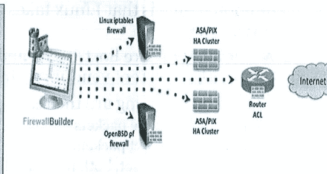

像 `Firewall Builder` 这样的工具可以帮助管理 `IP Tables` 等防火墙。

SEC401 | Security Essentials Bootstrap Style 239

Linux 内核包含 `IP Tables`，这是一种内置防火墙，其功能等同于现代商业防火墙产品，尽管在商业现货（COTS）硬件上的 `IP Tables` 可能无法处理与专用防火墙平台相同的数据包吞吐量。事实上，许多用户使用运行 `IP Tables` 的 Linux 机器来代替商业防火墙产品。你只需要在带有多个网卡的硬件上运行 Linux，并让有人了解如何配置 `IP Tables` 以执行你想要的策略即可。

在过去的几年里，许多站点已将 `IP Tables` 视为保护单个系统的基于主机的防火墙。因为 `IP Tables` 是一个完整的数据包检测系统，所以你可以实现比 `TCP Wrappers` 提供的简单源地址过滤更强大的过滤器。问题是，所有强大的功能都伴随着巨大的复杂性。

### 基础 IP 规则选项

- `-L`: 列出当前过滤规则。
- `-m`: 允许过滤规则根据连接状态进行匹配。允许使用 `--state` 选项。
- `--state`: 定义规则匹配的状态列表。有效状态有：
  - `NEW`：连接尚未出现。
  - `RELATED`：连接是新的但与已允许的连接相关。
  - `ESTABLISHED`：连接已建立。
  - `INVALID`：无法识别流量。
- `-A`: 将此规则附加到链。你可以操作的链有 `INPUT`、`FORWARD` 和 `OUTPUT`。

```bash
## 清空现有规则
iptables -F
```

# 设置默认策略为丢弃

```bash
iptables -P INPUT
iptables -P OUTPUT
iptables -P FORWARD
```

220 © 2017, Secure Anchor

# 不要干扰环回

```bash
iptables -A INPUT -lo - ACCEPT
iptables -A OUTPUT -lo - ACCEPT
```

# 入站规则：允许 SSH

```bash
iptables -A INPUT -p tcp --dport 22 -j ACCEPT
iptables -A INPUT -p tcp -m state --state ESTABLISHED - ACCEPT
iptables -A INPUT -p udp -m state --state ESTABLISHED - ACCEPT
iptables -A INPUT -p icmp -m state --state ESTABLISHED - ACCEPT
```

## 出站规则：任何 TCP, UDP, ICMP


```
iptables -A OUTPUT -p tcp -m state --state NEW,ESTABLISHED - ACCEPT

iptables -A OUTPUT -p udp -m state --state NEW,ESTABLISHED - ACCEPT

iptables -A OUTPUT -p icmp -m state --state NEW,ESTABLISHED - ACCEPT
```

# 引用

- `FirewallBuilder` 网站，http://www.fwbuilder.org/

# `IP Tables` 规则：基于主机的防火墙

```
iptables -A INPUT -p tcp --dport ssh -j ACCEPT
```

1. 将此规则附加到输入链（`-A INPUT`），查看输入流量
2. 检查是否为 TCP（`-p tcp`）
3. 如果是，检查输入是否指向 SSH 端口（`--dport ssh`）
4. 如果是，接受该输入（`-j ACCEPT`）


链中的规则使 `IP Tables` 开始工作。所有数据包都会沿着链向下移动，直到找到匹配的规则（可以是另一个链或接受/拒绝操作）。

# `IP Tables`：设置服务网络——基于网络的防火墙

```bash
iptables -A FORWARD ... -j ACCEPT around each:

-m state --state ESTABLISHED,RELATED

-d web -p tcp --dport 80

-d web -p tcp --dport 443

-d mail -p tcp --dport 25

-s mail -p tcp --dport 25

-d dns -p udp --dport 53

-d dns -p tcp --dport 53

-s dns -p udp --dport 53

-s admin -d 10.2.30.0/24 -p tcp --dport 22

iptables -A FORWARD -j DROP
```

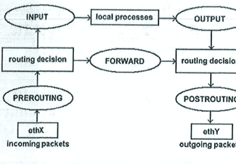

SANS SEC401 | Security Essentials Bootcamp Style 221

这是一组用于设置服务网络的防火墙规则示例。该网络包含一个 Web 服务器、DNS 服务器和邮件服务器，每个服务器在防火墙的 `/etc/hosts` 文件中都有自己的行（例如 `192.168.1.7 web`）。

在 `IP Tables` 中，`ESTABLISHED` 匹配属于现有会话的数据包——即 TCP 或 UDP 会话中的第二个、第三个以及任何额外的包。`RELATED` 数据包是指与现有会话有连接的包；例如，FTP 数据通道和 ICMP 错误消息。你可以先允许这些包，因为这条规则就能匹配防火墙中的绝大多数流量。将其放置会让防火墙的效率高得多。

对于其余部分，你可以专注于连接的初始包。`--dport 80` 和 `--dport 443` 是 HTTP 和 HTTPS 流量进入 Web 服务器。对于邮件服务器，你需要允许 SMTP 邮件既进又出，因此你设置了针对 SMTP 入站（`-d mail`）和出站（`-s mail`）的规则。DNS 也需要针对进出 DNS 机器的流量规则。由于 DNS 流量同时通过 TCP 和 UDP 传输，因此你需要设置四条规则。

你通过 SSH 管理系统，因此你允许来自名为 `admin` 的单台机器的 SSH 流量（`--dport 22`）访问整个子网 `10.2.30.0/24`。最后，你阻止任何其他流量。

这不是一个完整的防火墙，但它展示了设置服务网络的标准部分。

© 2017, Secure Anchor Consulting 223

## `Firewalld`

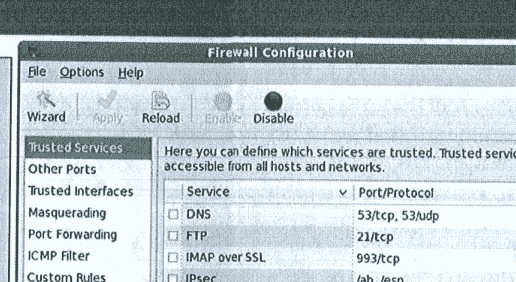

- 动态管理的防火墙
- 支持为每个接口设置区域级信任级别
- 可以在运行时进行更改
- `Firewalld` D-Bus 允许应用程序适配防火墙设置

该防火墙已启用。

Linux 防火墙另一种选项是 `Firewalld`。这是一个动态管理的防火墙，支持通过区域为每个接口定义不同的信任级别。除了指定接口，还可以为每个接口和出站流量开发自定义规则集。

为了让应用程序、服务和用户能够防火墙设置，防火墙使用了 D-Bus 接口。该接口也用于防火墙配置工具，如 `firewall-cmd`、`firewallctl`、`firewall-config` 和 `firewall-applet`。

`Firewalld` 被用 Linux 发行版的默认防火墙管理工具，包括 `RHEL 7`、`CentOS 7`、`Fedora 18`，也适用于其他几个发行版。

# 参考文献

- 1. Linux Firewall (`iptables`, `system-config-firewall`), https://oracle-base.com/articles/linux-firewall
- 2. `Firewalld`, https://fedoraproject.org/wiki/Firewalld
- 3. `Firewalld`, http://www.firewalld.org/
- 4. Fedora Documentation, https://docs.fedoraproject.org/en-US/Fedora/11/html/Security_Guide/Security_Guide-Firewalls-Basic_Firewalld_Configuration.html

## 防火墙功能

| IPv4 和 IPv6 支持 | 定时防火墙规则 |
| :--- | :--- |
| 防火墙区域 | 拒绝包日志 |
| 预定义区域列表 | 应用程序白名单 |
| 伪装、端口转发和源地址处理 | 自动加载 Linux 内核模块 |
| 用于灵活和复杂规则的丰富语言 | 与 Puppet 集成 |
| | 图形化配置工具 |

`Firewalld` 是一个功能齐全防火墙，提供了许多功能以便在 Linux 操作系统上实现防火墙。其许多功能之一包括：

- IPv4 和 IPv6 支持
- 防火墙区域
- 预定义区域列表
- 伪装、端口转发和源地址处理
- 用于灵活和复杂规则的丰富语言
- 定时防火墙规则
- 拒绝包日志
- 应用程序白名单
- 自动加载 Linux 内核模块
- 与 Puppet 集成
- 图形化配置工具

参考文献

- 1. `FirewallD`, http://www.firewalld.org/
- 2. Fedora, https://fedoraproject.org/wiki/FirewallD

## `nftables`

- Linux 内核的子系统，用于提供数据包的分类和过滤
- 代替 `netfilter`
- 更少的代码重复和更高的吞吐量
- 使用 `nft` 配置

丢弃目标地址为 `10.10.10.10` 数据包的示例命令：

```bash
nft add rule ip filter output ip daddr 10.10.10.10
```

丢弃目标地址为 `10.10.10.10` 数据包的示例命令：

```bash
nft add rule ip filter output ip daddr 10.10.10.10
```


## CIS 加固指南

| 描述 | 项目 | 评分 | | |
| --- | --- | --- | --- | --- |
| | 通过 | 失败 | 实际 | 最大值 |
| 1 补丁、软件包和更新 | 2 | 1 | 7.407 | 11.111 |
| 2 最小化未使用的网络服务 | 6 | 0 | 8.333 | 11.111 |
| 3 最低版本 | 11 | 5 | 8.667 | 11.111 |
| 4 内核调优/参数修改 | 0 | 2 | 0.000 | 11.111 |
| 5 日志 | 7 | 2 | 5.456 | 11.111 |
| 6 目录访问、认证与授权 | 2 | 0 | 2.449 | 11.111 |
| 7 用户账户与环境 | 5 | 0 | 4.669 | 11.111 |
| 8 警告横幅 | 0 | 0 | 0.000 | 11.111 |
| 9 密码策略 | 0 | 0 | 0.000 | 11.111 |
| 10 防病毒考量 | 0 | 0 | 0.000 | 11.111 |
| 11 移除备份文件 | 0 | 0 | 0.000 | 11.111 |
| 总分： | 30 | 43 | 36.240 | |

- 共识指南提供了使系统安全的步骤
- 加固工具、评分工具
- 免费供您使用
- 提供了如何正确加固系统的详细信息


`SEC401` | 安全基础引导训练营 218

如果能把世界上保护 `Windows`（`Linux`、`IOS`、`VMware` 等）的专家们都聚在一个房间里，让他们制定出安全平台的步骤并发布该列表，那该有多好？

互联网安全中心（`CIS`）是一个恰好在这些事的志愿者项目。安全专家们在邮件列表上共同工作，制定他们认为在保护该平台时应该遵循的步骤。

生成的文档包含了他们可以在很大程度上达成共识的步骤。该指南需要是保守的；建议的更改不应在所有情况下引起严重问题。为此，那些更激进的安全设置不应有禁用所需功能的风险，因此应被排除在外。最后，好的结果是：人们可以信任这些建议。

对于某些平台，`CIS` 还发布了加固工具，可以自动执行部分或全部建议的更改。在您进行了锁定性更改后，可以运行评分工具，希望分值有所上升。绝对数值没有直接意义，但它允许在系统之间进行相对比较。

所有的指南、加固工具和评分工具都是免费供您使用，只需注明出处。

### 参考文献

1. 互联网安全中心 (`CIS`), https://www.cisecurity.org/

## Rootkit 检测器

本页特意留空。

## Rootkit 检测器

- 寻找 `rootkit` 运行方式中的入侵指标
- `Rootkit` 的隐蔽性越强，检测就越不准确
- 通常用于内核级 `rootkit`
- 适用于文件级 `rootkit`，但通常在文件完整性检查时最有效
- 已知会产生误报，因此作为初始指标很有用，但不能作为结论性判断

攻击者用于在系统中维持持久化的方法之一是在计算机上安装 `rootkit`。与名称相反，`rootkit` 并不提供 `root` 权限，但一旦攻击者获得了 `root` 权限，`rootkit` 的作用就是隐藏他们的踪迹并以秘密方式访问。`rootkit` 的核心前提是不被发现；因此，检测非常困难。

对关键文件进行文件完整性检查可以检测文件级 `rootkit`，因为 `rootkit` 会修改文件。技巧在于文件完整性检查软件的配置程度。如果攻击者找到一个未被软件验证的文件，他们就可以利用它来托管自己的 `rootkit`。内核级 `rootkit` 更难检测，因为没有签名。普通的 `rootkit` 检测器在捕获内核级 方面更有价值。

尽管 `rootkit` 检测器具有价值，但无法保证它们能找到所有的 `rootkit`。通常，`rootkit` 越隐蔽，越越被检测。因此，`rootkit` 检测器经常产生误报。尽管它们并不完美，但作为初始分检工具仍然具有价值。

## rkhunter

- `Rkhunter` (`Rootkit Hunter`)
- 检测 `rootkit`、后门和某些本地漏洞利用
- 将重要文件的哈希值与包含已知良好哈希值的在线数据库进行对比
- 支持白名单功能
- 发现警报会发送邮件给您
- 建议通过 `crontab` 或定时器设置定期检查
  - `rkhunter --update`
  - `rkhunter --propup`
  - `rkhunter --enable all --disable none`
  - `/var/log/rkhunter.log`

`SANS SEC401` | 安全基础训练营风格 233

`Rkhunter` (`Rootkit Hunter`) 是一种基于 `UNIX` 的工具，用于扫描 `rootkit`、后门和本地漏洞利用。它通过将重要文件的哈希值与已知良好哈希值的在线数据库进行对比，搜索可疑字符串来实现这一点。

`Rkhunter` 带有最新的签名。建议通过 `crontab` 或定时器设置定期检查，例如 `rkhunter --update`，`rkhunter --propup` 以及 `rkhunter --enable all --disable none`。日志位于 `/var/log/rkhunter.log`。`Rkhunter` 在发现警报时也会发送邮件给您，并具备白名单功能。作为一个初始分检工具很有用，尽管它并不完美可能会产生误报。

### 参考文献

1. `Rkhunter` (`Rootkit Hunter`), https://rkhunter.org/

## Rootkit 检测器

- `Rkhunter` (`Rootkit Hunter`)
- 这里的 `rootkit` 
- 这里的 `rootkit` (`rootkit`)
- 输出是。

### 参考文献

1. `Chkroot`, https://en.wikipedia.org/chkroot/

# Chroot、容器与虚拟化

本页特意留空。

## 什么是 chroot()

- 应用程序可以调用 `chroot()` 来隔离自身
- 如果应用程序被攻破，攻击者只能获得有限的访问
- 对于其他应用（如 `Apache`），使用 `chroot()`

`UNIX chroot()` 限制是一项在应用程序层面启用的隔离功能。应用程序开发者可能需要在程序中显式调用 `chroot()`，通常在应用程序接受用户请求之前的设置和配置阶段。当应用程序调用 `chroot()` 时，它基本上指定了文件系统中应用程序想要隔离的内核目录。这就是 `chroot()`。从那时起，内核执行这种隔离，并不允许应用程序访问指定目录之外的任何文件系统。对于应用程序来说，该根目录及其下面的所有子目录和文件现在就是所有的文件和目录。

从安全角度来看，优点是如果应用程序漏洞被发现并利用，攻击者只能访问应用程序隔离的文件系统部分。这防止了攻击者修改主操作系统的其他配置文件和二进制文件。事实上，攻击者的利用可能会完全失败，因为它依赖于 `chroot()` 目录中不存在的其他操作系统。这对于 `BIND` 和 `SSH` 等同样面向互联网的应用程序特别有用，它们非常复杂，尽管随着时间的推移可能会发现更多漏洞。在 `chroot` 限制下运行应用程序有助于减轻未来安全事件的潜在损害。

例如，`TFTP` 允许从系统未经身份传输文件，因此管理员希望限制 `TFTP` 从某些授权的目录提供服务。这就是为什么 `TFTP` 守护进程会 `chroot` 到类似 `/ftp` 的目录，以便它们只从该区域提供文件。

然而，重要的是意识到，使用 `chroot()` 的决定取决于个人应用程序开发者。你可能想对你的 `Apache` Web 服务器使用 `chroot()`，以保护自己免受目录遍历攻击，这种攻击允许外部人员逃离你的标准 `HTML` 文档树并访问系统上的其他文件。遗憾的是，`Apache` 开发者尚未在应用程序中包含 `chroot()` 功能。对于这类应用程序，操作系统包含一个名为 `chroot` 的“包装器”类型程序。在 `Apache` 的情况下，你运行 `chroot` “包装器”程序，并告诉它你希望执行 `chroot()` 的目录，并指定 `Apache` 的正常命令行调用方式。`chroot` 程序执行 `chroot()` 系统调用，然后在这个隔离环境中启动 `Apache` 守护进程。

## chroot() 的问题

- 必须发现并拷贝所有应用程序依赖项到 `chroot()` 目录中：辅助程序和共享库
- 应用程序和系统配置文件
- 设备文件（处理起来复杂）
- 寻找操作系统提供的预配置目录（`BIND`, `FTP`）
- 具有复杂依赖关系的应用程序可能无法 `chroot()`

为什么不是每个应用程序默认都在 `chroot()` 限制下运行？这种僵化的隔离难道不会提高系统的整体安全性吗？答案是肯定的。这会提高安全性，但困难在于，配置应用程序将进行 `chroot()` 的目录结构涉及大量的行政管理工作。

请记住，对于应用程序而言，`chroot()` 目录及其下方的目录就是整个文件系统。如果应用程序需要运行另一个程序、读取配置文件或访问系统设备，则必须在 `chroot` 目录结构下方，按照应用程序期望的相同相对文件位置提供该程序、配置文件或设备的副本。例如，如果一个 `BIND` 服务器 `chroot` 到 `/var/named/chroot` 并想要查看其 `/etc/named.conf` 配置文件，管理员必须创建 `/var/named/chroot/etc/named.conf`。如果同一个程序想要访问 `dev/null` 系统设备，管理员必须创建该设备的副本 `/var/named/chroot/dev/null`，依此类推。

要识别依赖项，你可以使用名为 `ldd`（列出动态依赖项）的工具，它将向你显示列表。

好消息是，启动者为常用应用程序提供了预配置的 `chroot()` 区域。例如，每个 `UNIX` 系统上的 `TFTP` 守护进程都设置为在 `/ftpbase` 中运行 `chroot()`。`Red Hat` 提供了一个预配置的 `/var/named/chroot` 区域用于安全运行 `BIND`，尽管 `Red Hat` 下的 `BIND` 默认未配置使用这种设置。

最终，一个应用程序可能有许多外部依赖项，以至于为应用程序创建一个工作的 `chroot()` 目录树基本上意味着在 `chroot()` 目录下创建一个几乎完整的操作系统副本。在这些情况下，只需将应用程序隔离在自己的服务器上几乎等同。虚拟机技术（如 `VMware` 或 `Xen`）是另一种你可以采用的机制，可以为特定应用程序提供隔离的“沙箱”类型系统。


# Linux LXC/容器

| 容器系统的 LXC 接口 | 使用以下内核特性： |
| --- | --- |
| 允许创建和分发容器 | 内核命名空间 (`ipc`, `uts`, `mount`, `pid`, `network`, and `user`) |
| `chroot` 与虚拟化环境之间的中间地带 | `Apparmor` 和 `SELinux` 策略 |
| 创建运行在单个内核上的隔离环境 | `Seccomp` 策略 |
| 操作系统容器 | `Chroots` (使用 `pivot_root`) |
| 内核能力 | `CGroups` |

`LXC` 是一种强大的开放标准，用于在 `Linux` 环境中创建容器。它是一个包含一系列应用程序编程接口 (`API`) 的用户界面，这些接口用于创建容器。`LXC` 提供了一种强大的方式来创建一个包含运行应用程序所需的所有组件的容器。

`LXC` 的很棒的组件之一是它提供了安全性以实现应用程序的隔离。它利用若干内核特性来实现适当的保护级别。

`LXC` 通常被视为 `chroot` 和虚拟化环境之间的中间地带。

`chroot` 将可执行文件隔离到给定的目录或位置。当涉及共享库或组件时，这个问题变得变得困难。`LXC` 允许应用程序在隔离环境中运行，但它包含了所有所需的组件，因此它可以克服 `chroot` 的局限性。

虚拟机允许完全独立的操作系统来运行应用程序。这提供了完全的隔离并包含了所有所需的组件。问题是虚拟机操作系统很大且消耗大量资源。`LXC` 允许在内核级别对操作系统进行隔离，因此它可以运行在单个操作系统上。这实现了隔离，但使用的资源少得多，且效率更高。

# 参考文献

1. `LinuxContainers`, https://linuxcontainers.org/
2. `What's LXC?`, https://linuxcontainers.org/lxc/introduction/
3. `LXC`, https://en.wikipedia.org/wiki/LXC

## 容器的核心：cgroups 和命名空间

| cgroups | namespace |
| --- | --- |
| - `Google` 开发 | - `IBM` 开发 |
| - 控制系统资源的隔离 | - 获取所需的系统资源 |
| - 管理系统资源 | - 向应用程序呈现资源 |
| - 关键资源是 `CPU` 和内存 | - 看起来是为应用程序专用 |
| - 控制一组进程的资源 | - 单个进程的隔离 |


`SEC401` | `Security Essentials` 240 © 2017, `Secure Anchor`

# 容器的比较：LXC 到 docker

| LXC | docker |
| --- | --- |
| - 原始 `Linux` 容器 | 单应用 `LXC` 容器 |
| - 操作系统级虚拟化 | 更具移植性和灵活性的容器 |
| - 允许在单个主机上进行多个操作系统虚拟化 | 易于部署、复制和移动工作负载 |
| - 关键特性 `cgroups` 和 `namespace` | 单进程和无状态 |

有人尝试比较 `LXC` 和 `docker`，但实际上，`docker` 是 `LXC` 的演进。`LXC` 是 `Linux` 中创建容器的原始系统，专注于操作系统容器。`docker` 是 `LXC` 的增强，专注于单应用容器。值得注意的是，尽管 `Docker` 最初使用 `LXC`，但它已经放弃了使用 `LXC`，转向使用基于 `Go` 自己的 `libcontainer` 框架。

### 参考
1. `Docker`, https://www.docker.com/

## Docker

- 基于开放标准
- 容器领域的领导者之一
- 创建一个包含应用程序及其运行所需所有组件的文件系统
- 应用程序将在所有环境中以相同方式运行
- 应用程序相互隔离以达到某种安全级别

`Docker` 是容器软件的领导者之一，基于开放标准。因此，容器可以在 `Linux`、`Windows` 以及大多数其他操作系统上运行。因此，应用程序可以在大多数环境和配置中运行。

通过容器，应用程序将在使用相同内核的相同操作系统上运行。由于只有一个操作系统，它的可扩展性更高。因此，任何人都可以创建一个在所有系统中以一致且相同方式运行的应用程序。

`Docker` 容器包含了应用程序以及运行软件所需的所有相关组件。这提供了一种自动部署应用程序的方法。

## 容器 vs 虚拟机 (1 of 2)

- 容器和虚拟机在隔离和资源分配方面非常相似
- 它们使用不同的架构方法
- 容器更加紧凑且易于迁移
- 虚拟机包含整个操作系统
- 容器包含应用程序和相关文件

当我们关注可移植性和动态环境时，容器正是一个正受到越来越多的关注的领域。传统上，如果你需要实现隔离和资源分配，你会使用虚拟机。这涉及到安装一个包含所有所需应用程序的完整操作系统。尽管这种方法有效，但虚拟机通常非常大，并且需要运行一个整个操作系统。

如果有人想移动特定的应用程序并使其以一致的方式运行，虚拟机的效果并不好。容器的引入解决了这个问题。容器包含了应用程序和所有依赖项，使应用程序能够在不同平台上以一致的方式运行。

## 容器 vs 虚拟机 (2 of 2)

| APP 1 | APP 2 | APP 3 |
| --- | --- | --- |
| `BINS`/`LIBS` | `BINS`/`LIBS` | `BINS`/`LIBS` |
| `GUEST OS` | `GUEST OS` | `GUEST OS` |
| | | `DOCKER ENGINE` |
| | `HYPERVISOR` | `HOST OPERATING SYSTEM` |
| | `HOST OPERATING SYSTEM` | |
| | `INFRASTRUCTURE` | `INFRASTRUCTURE` |

`SANS`
`SEC401` | 安全基础训练营风格 244

这些图表为展示容器和虚拟机的区别提供了很好的参考。第一个重要区别是虚拟机在操作系统级别执行隔离，而容器在应用程序级别执行隔离。此外，由于整个操作系统很大，因此虚拟机更大，且没有容器那么紧凑。

容器的一个大区别是每个容器都共享同一个内核。应用程序作为隔离的进程运行，它们运行在单个宿主机操作系统上。虚拟机每个都有不同的客户操作系统，运行在单个宿主机操作系统上。而在容器中，每个应用程序都运行在单个宿主机操作系统上。与虚拟机的另一个大区别是，每个虚拟机中的每个应用程序都使用不同的独立内核。而在容器中，所有应用程序共享同一个内核。

- 参考文献
1. `Docker`, https://www.docker.com/what-docker

244 2017, `安全锚点咨询公司` (`Secure Anchor Consulting`)

## Linux-VServer

- 为 `Linux` 提供虚拟化能力
- 利用内核级隔离
- 可以同时运行多个虚拟化环境
- 提供安全控制以正确隔离每个虚拟机
- 使用分段路由、`chroot`、扩展配额和其他一些标准工具

虚拟化是运行数据中心和利用安全实验室的关键方面。虚拟化允许数据中心的硬件具有更具扩展性的使用。由于大多数服务器的利用率不足，虚拟化允许对已购买的服务器进行更具效益的使用。此外，虚拟化对于建立虚拟实验室也非常重要。正如你在这门课程中看到的，虚拟化是实验和学习新工具极佳方法。

`Linux-VServer` (`vserver`) 是一种允许在 `Linux` 系统上进行虚拟化的开源软件。`Vserver`允许 `Linux` 系统运行多个客户操作系统。此外，`vserver` 使用安全控制来正确隔离每个虚拟机。在使用虚拟机技术时，逃逸虚拟机始终是一个担忧。`Vserver` 通过分段路由、`chroot`、扩展配额和其他一些标准工具帮助降低风险并实现这种安全性。

包管理工具解决维护问题。包管理工具通过监控更新并提供自动升级软件应用程序的方法解决了这个问题。

## Linux 包管理——特性

`Linux` 包管理工具的关键特性：

- 下载验证：验证下载有效且来自信任源
- 依赖项安装：确定依赖项并确保它们已安装
- 二进制格式：安装预编译的应用程序，以尽量减少对源代码的处理
- 标准的安装位置：使用标准在常用位置安装文件，以便重用代码（如库）
- 用户体验组件：添加功能以使用户更方便并增强用户体验
- 安装验证：验证安装是否正确完成并确保安装是稳定的


让我们看看包管理软件的关键组件。记住，包管理软件的目的是让用户安装软件变得更简单、更方便、更快。

第一个组件是验证软件包是从信任源下载的。特别是对于 `Linux`，许多网站都提供软件，但许多是流氓网站，可能会感染系统。因此，确保其稳定性是至关重要的。

第二个组件是确定并安装依赖项。安装失败要原因之一是缺少依赖项。

第三个组件是以二进制格式交付软件。编译源代码可能非常痛苦。

第四个组件是标准安装位置。这允许重用库等代码。

第五个组件是增强用户体验。

最后一个组件是验证安装是否正确。有时安装时会出现问题。

### 参考文献
1. https://www.linux.com/tools/package-management

# 包管理

本页留空。

## 高级软件包工具 (APT)

- `Debian` 包管理基于工具 `dpkg`
- 常见的包管理解决方案是 `APT`
- 软件包扩展名为 `.deb`
- 通常兼容 `Ubuntu`（注意依赖关系）
- 易用的语法和命令


# apt-get

## 帮助信息

```
root@debian:~# apt-get --help
apt-get 1.2.1 (manual)

Usage: apt-get [option] command
apt-get [option] install remove [pkg ...]
apt-get [option] source [pkg ...]
```

`apt-get` 是获取软件包及其来源、配置、升级和删除软件包的命令行工具。

## 常用命令

- `update`：获取包列表
- `upgrade`：升级软件包
- `install`：安装软件包
- `remove`：移除软件包
- `purge`：移除软件包及配置文件
- `dist-upgrade`：发行升级，使用 `apt-get`
- `autoremove`：移除未使用的依赖项
- `check`：检查是否存在损坏的依赖
- `clean`：清理下载的存档文件
- `download`：将二进制包下载到当前目录
- `show`：显示软件包详情

参阅 `apt-get(8)` 获取更多可用命令的信息。
配置选项位于 `sources.list`。
有关如何配置源见 `sources(5)`。
软件包版本可以在 `apt-preferences(5)` 中指定。
安全详情请参考 `apt-secured(8)`。


## 示例

```
root@kali:~# apt-get
```

## 语法

```
apt-get options command
```

```
apt 1.2.1 (amd64)
```

## 最常用的命令

- `update` - 获取软件包列表
- `upgrade` - 执行升级

`apt-get` 是一个命令行界面，用于从经过验证的源检索软件包及其信息，
用于安装、升级和删除软件包及其依赖项。

```
apt-get options install|remove pkg1 [pkg2 ...]

source pkg1 [pkg2 ...]
```


## APT 常用选项

- `install` - 安装新软件包（`pkg` 为 `lib6` 还是非 `lib6.deb`）
- `purge` - 移除软件包
- `remove` - 自动删除所有未使用的软件包
- `dist-upgrade` - 发行版升级，参见 `apt-get(8)`
- `select` - 遵循选择
- `build-dep` - 为源包配置构建依赖
- `clean` - 删除已下载的存档文件

有关可用命令的更多信息，请参阅 `apt-get(8)`。
有关如何配置源的信息可以在 `sources(5)` 中找到。配置选项和版本选择可以通过 `apt_preferences(5)` 表示。
安全细节可以在 `apt-secure(9)` 中找到。

- `check` - 验证没有损坏的依赖关系
- `Download` - 将二进制包下载到当前目录
- `changelog` - 下载指定软件包的变更日志

此 APT 拥有超能力。

以下是 APT 的一些常用选项：
- `apt-get install package-name`: 安装指定的软件及其所有相关依赖项。
- `apt-get remove package-name`: 移除指定的软件但不移除依赖项。
- `apt-get update`: 更新可用软件更新系统数据库。
- `apt-get upgrade`: 升级所有带有更新的软件。

## 漏洞管理

本页特意留白。

## 漏洞评估

- 安全的核心在于缓解和控制风险
- 利用威胁来计算风险
- 利用漏洞来降低风险
- 主动识别漏洞是实现有效 Linux 安全的关键

### 风险 = 威胁 x 漏洞

SEC401 | 安全基础强化训练营风格 213

安全的核心在于理解、缓解和控制对关键数据的风险。因此，首要步骤之一是了解你组织的关键数据是什么，并确定它们位于哪些系统上。识别系统后，确定发生可能性最高的威胁，并将它们映射到会产生最大影响的漏洞。

因此，识别漏洞并主动修复它们是降低风险的关键部分，而漏洞扫描器是安全的关键部分。

## OpenSCAP—审计、修复与快乐

- OpenSCAP 提供了丰富的资源来提高安全性。

- 提供了跨领域的资源：
  - 工具
  - 安全策略
  - 标准

- 安全合规性
- 漏洞评估


OpenSCAP 提供了丰富的资源来提高组织的安全性。重点是提高组织的安全防御并降低风险。该组织的格号是“审计、修复并快乐”。

OpenSCAP 在几个不同领域提供了资源。第一个领域是工具。工具有助于识别暴露或漏洞，并帮助组织修复漏洞。这些工具还可以用于审计和验证整体安全状态。第二个领域是安全策略。安全策略为选择可接受的安全水平和保护组织的方法提供了指导。第三个是标准。大多数其他专业领域都有必须遵循的标准，但安全是一个一直缺乏标准的领域。OpenSCAP 提供了某些政府机构必须遵循的标准，并为商业机构提供了良好的参考。

OpenSCAP 的关键关注领域是安全合规性和漏洞评估。这些领域侧重于确保满足基础安全水平，并识别和修复关键漏洞。

参考：

- 1. OpenSCAP, `https://www.open-scap.org/`

254 2017, Secure Anchor Consulting

## OpenSCAP 工具

- `OpenSCAP Base`: 扫描命令行漏洞
- `OpenSCAP Daemon`: 根据定义的策略持续评估基础设施的合规性
- `SCAP Workbench`: 创建自定义策略并远程扫描
- `SCAPTimony`: 为 `SCAP` 结果提供中央存储
- `OSCAP Anaconda Add-on`: 验证是否符合安全配置文件的合规性


为了进行漏洞评估，OpenSCAP 提供了多种可用工具。这些工具可以独立使用或结合使用以提供集成解决方案。OpenSCAP 提供的工具可以用来识别漏洞、验证策略合规性，并集中存储结果。

工具如下：

- `OpenSCAP Base`: 扫描命令行漏洞。
- `OpenSCAP Daemon`: 根据定义的策略持续评估基础设施的合规性。
- `SCAP Workbench`: 创建自定义策略并远程扫描。
- `SCAPTimony`: 为 `SCAP` 结果提供中央存储。
- `OSCAP Anaconda Add-on`: 验证是否符合安全配置文件的合规性。

## 总结

- 有用的内置命令
- 完整性配置
- 基于主机的防火墙的集成及其管理
- 加固脚本的使用
- 部署包管理
- 了解其他增加安全的工具


在本模块中，我们学习了提高 Linux 整体安全性的额外工具。虽然第三方工具非常有价值，但内置工具同样重要。Linux 拥有许多内置工具可以提供可见性。在使用内置工具时，你可以发现并控制损害。最有效的方法是建立基线。

## 课程总结

核心原则
- 最小权限
- 纵层防御
- 预防是理想的，但对于任何操作系统，始终记住功能与安全之间存在平衡。实现这一点的第一步是了解哪些是计算机上的关键资产，其次是确保系统已打好补丁并使其尽可能安全。

# 索引

`/etc/login` 6:67
`/etc/passwd` 6:61, 6:64-66, 6:167, 6:169, 6:172, 6:52, 6:64
`/etc/shadow` 800-53
`802.1` 2:114, 1:162, 1:71, 1:177-179, 1:181, 1:183, 1:196, 1:201-203, 1:207, 5:209, 5:216
`802.15-4` 1:175, 1:108, 1:110, 1:179-180, 1:195, 1:198-199, 1:178
`802.1X`
`802.2 LLC` 1:126, 1:129, 1:131, 1:154, 2:3, 2:20, 2:26, 2:83-85, 2:87, 2:98, 2:112, 3:88, 4:94, 5:54, 5:96, 5:109, 5:126, 5:175, 5:181, 5:218, 5:239, 5:247, 5:298, 5:306, 5:312, 6:109, 6:169, 6:174
`Academia` 1:125, 1:165-166
`Acceptable Use Policy (AUP)` 2:66, 2:77, 3:193
1:32, 1:53, 1:61, 1:86-87, 1:106-108, 1:135, 1:187-188, 1:194, 1:224, 1:227, 1:231, 1:237, 2:23, 2:23-25, 2:28-31, 2:37, 2:52, 2:299, 2:179, 2:183, 3:62, 3:103, 4:103, 4:125, 5:23, 5:29, 5:32, 5:45, 5:89, 5:91-92, 5:94-96, 5:109, 5:132, 5:140, 5:162, 5:216, 5:235, 6:43, 6:51-53, 6:59, 6:62, 6:296, 6:94, 6:108-110, 6:112, 6:643
`Access Control`
`Access Control Entries (ACEs)` 5:96-98
`Access Control List (ACL)` 1:32, 1:135, 2:30, 3:163, 5:29, 5:32, 5:95-96, 5:109, 5:119-120, 5:140, 6:51-53, 5:296, 6:110, 6:643
`Access Points (APs)` 1:108, 1:164, 1:166-167, 1:171, 1:178-179, 1:181, 1:185, 1:187-188, 1:191-194, 1:196, 1:198-202, 2:34, 3:32-34, 3:49, 4:218, 5:165

# ACK

`确认 (ACK)`

`主动防御 (Active Defense)`

`主动防御先驱分发 (ADHD)`

`活动目录 (AD)`
1:140-143, 2:124-128, 3:22, 3:66-68, 3:220
1:140-143, 1:154, 1:178, 2:124-218, 3:22, 3:66-68, 3:220
3:399-216, 3:218, 3:220, 3:222-227, 3:229-231, 3:234, 3:242
1:179, 2:33, 4:141, 4:57, 5:31-36, 5:38-40, 5:43-54, 5:573, 5:91-93, 5:103-107, 5:119-121, 5:124, 5:126, 5:128, 5:131, 5:136-137, 5:140, 5:160, 5:164-165, 5:172, 5:175-177, 5:188, 5:204, 5:208, 5:213-214, 5:216, 5:221, 5:225, 5:227, 5:231, 5:235-236, 5:251-258, 5:265, 5:271, 5:276, 6:73, 5:294
`活动目录联合服务 (ADFS)`

`活动主义者 (Activist)`

`地址解析协议 (ARP)`

`地址空间布局随机化 (ASLR)`

`ADM/ADMX 模板`

`管理员权限`
5:159
1:224, 2:99, 5:59, 5:177, 5:180, 5:182-183, 5:193, 5:221, 5:226, 5:281, 5:307, 5:320
1:171, 1:176, 1:183, 1:192, 4:27, 4:73-74, 4:76, 4:79, 4:88, 4:102, 5:131-132, 5:216, 5:225, 5:235, 5:246, 6:46

`高级加密标准 (AES)`

`高级包工具 (APT)`
1:17, 2:23, 2:158-160, 2:162, 2:165-172, 2:174, 2:176-178, 2:181-183, 2:189, 6:58, 6:249, 6:251

`高级持续性威胁 (APT)`
1:16-17, 1:55, 2:158-160, 2:162-163, 2:165-172, 2:174, 2:176-179, 2:181-183, 2:189, 3:539, 3:65, 6:14-15, 6:249, 6:251

`AGULP`
5:102-104

`物理隔离 (Air-gap)`
2:108

`Airrack-ng`
1:3, 1:203-205, 1:207

`Alien Vault`
6:122, 6:124

`本地允许并记录`
5:127

`通过远程桌面服务允许日志`
5:124, 5:127

# 分析 (Analytic)
2:46, 3:176, 3:178, 3:183, 3:189, 4:83, 6:126, 6:205

`分析报告`
3:178

`Android Pay`
6:28

`年度任务`
3:195

`年度预期损失 (ALE)`
4:210, 4:212, 4:223, 4:227

`Ansible`
6:91

`反钓鱼`
6:20-21

`Apachesyslog`
3:181

`AppArmor`
6:115-117, 6:239

`应用层`
1:117-120, 1:176, 2:147, 3:311

`应用程序编程接口 (API)`
5:7, 5:147, 5:178-179, 5:190
`apt-get`
6:14, 6:84, 6:251

`arpserver`
5:79, 5:89

`火弹术`
3:224, 3:226

`非对称`
2:35, 2:188-189, 4:5, 4:14, 4:26-29, 4:31-32, 4:37, 4:46, 4:50, 4:59, 4:62, 4:67, 4:77, 4:79, 4:85, 4:110, 4:122

`反击攻击`
3:203-204, 3:207, 3:225, 3:229

`溯源分析`
3:203-206

`审计策略`
5:50, 5:149, 5:207, 5:294-295

`审计设置`
5:50, 5:88, 5:121, 5:126, 5:149, 5:294-295, 5:298, 5:303
`auditl`
6:171-172, 6:174

`auditd`
6:119, 6:175

`身份验证`
1:144, 1:132, 1:164, 1:108, 1:125, 1:130, 1:147, 1:171, 1:176, 1:178-180, 1:188-189, 1:194-196, 1:198-199, 1:201, 1:210, 1:216, 1:218, 1:224-225, 1:227, 1:230, 1:234, 1:237, 2:234, 2:28-29, 2:32-33, 2:35, 2:243, 2:247, 2:51-28, 2:333, 3:34, 3:173, 3:175-176, 4:16, 4:31-33, 4:61, 4:85, 4:87-88, 4:96-103, 4:122, 4:125, 4:149, 5:11-13, 5:30, 5:32, 5:35-36, 5:38-39, 5:45-46, 5:48, 5:50, 5:53, 5:59, 5:124-125, 5:133, 5:140, 5:166-167, 5:172-173, 5:175-177, 5:197, 5:207, 5:212-213, 5:215-216, 5:220-221, 5:225, 5:227-228, 5:231, 5:235-236, 5:239, 5:246-250, 5:252-253, 5:255-258

# 身份验证与授权报告
3:176

`身份验证头 (AH)`
4:97-101, 5:214-215, 5:221-222

`身份验证协议`
1:179, 1:195, 2:83, 5:35-36, 5:38-39, 5:50, 5:53, 5:207

`身份验证协议`
1:179, 1:195, 2:83, 5:35-36, 5:38-39, 5:53, 5:207

`身份验证服务器`
1:180, 3:34

`身份验证器`
1:180, 1:229, 5:546, 5:257, 6:97-98

`授权`
1:15, 1:119, 1:180, 1:188, 1:128, 2:24, 2:28-30, 2:32, 3:41, 3:45, 3:48, 3:88, 3:176, 3:190, 3:192, 4:219, 5:30, 5:53, 5:91, 6:73, 6:140

`运行`
5:276, 5:309, 5:312

`可用性`
1:12, 1:14, 1:18, 1:23, 1:25, 1:50, 1:61, 1:124, 2:35-26, 2:9-11, 2:22, 2:26, 2:119, 2:187, 3:0, 3:37, 3:42, 3:120, 3:185, 4:103, 4:116, 4:128, 4:138, 4:140, 4:157, 4:175, 4:203, 4:217, 6:79, 6:82, 6:119, 6:153, 6:166-167, 6:169, 6:175, 5:4, 5:11, 5:13, 5:45-49, 5:77-78, 5:85, 5:228, 5:230, 5:251-260, 5:265

`awk`

# Azure
`Azure 备份` 5:57-78

# B
`备份与目录`
5:124, 5:129

`后门`
1:171, 1:223, 1:225, 2:199, 2:294, 2:219, 2:150, 2:252, 2:356, 2:173, 3:22-23, 3:40, 3:109, 3:144, 3:146, 3:163, 4:149, 4:218-219, 6:263

`备份和 NetBackup`
5:79

`备份 Express`
5:79

`备份`
1:150, 2:231, 2:669, 3:177, 3:195, 4:148, 4:152, 4:197, 5:53, 5:61, 5:64, 5:75-78, 5:82, 5:88-89, 5:114, 5:124, 5:126, 5:129, 5:136, 6:18, 6:41, 6:451, 5:252, 5:254, 5:302, 5:313

`基线`
1:45, 1:74, 1:108-109, 2:19-21, 2:60, 2:66, 2:71, 2:82, 2:90, 2:109-111, 2:114, 2:135, 3:18-19, 3:82, 3:86, 3:129-130, 3:133-134, 3:150, 3:179, 4:159, 5:3, 5:76, 5:80, 5:89, 5:141-143, 5:145, 5:152, 5:261, 5:282

# C
`Cain`
`载波多接入 (CSMA)`
`载波多接入/冲突检测 (CSMA/CD)`
`案例研究`
`CDP 操纵`
`互联网安全中心 (CIS)`
`证书机构 (CA)`
`证书吊销列表 (CRL)`
`CFEngine`
`cgroups`
`证据链`
`挑战/响应`
`变更控制委员会 (CCB)`
`变更报告`
`字符集`
`Rootkit 检查 (chkrootkit)`
`检查清单测试`
`校验和`
`Chef`
`chgrp`
`chmod`
`chown`
`chroot()`
`CIA 完整性保护`
`CIDR`
`加密算法`
`密码块链接模式 (CBC)`
`密码反馈模式 (CFB)`
`思科发现协议 (CDP)`
2:3, 2:83-85, 2:87, 5:39, 5:54, 5:130, 5:172
1:22-23
1:23
2:106, 2:117, 2:120, 2:150
1:20
5:151-152, 5:300, 6:171, 6:230
2:114, 4:88, 4:113-116, 4:118, 4:122, 4:124, 4:126, 4:138
4:116, 4:120, 5:180
6:90
6:239-241
4:159, 4:163
2:50
5:283
2:41-42
1:123, 1:133-134, 1:142, 1:146, 5:79, 6:92
6:59, 6:50, 6:57-58
6:235

# Bastille
`BC/DR 计划`
`二进制镜像`
`生物识别`
`生日攻击攻击`
`生日悖论`
`BitLocker`
`黑盒`
`黑洞工具包 (BET)`
`蓝色加密`
`Bluefish`
`蓝屏 (BSOD)`
`蓝牙漏洞攻击`
`蓝牙入侵`
`蓝牙嗅取`
`蓝牙`
`蓝牙网络封装协议 (BEP)`
`蓝牙配对`
`布尔`
`边界路由器`
`边界防御`
`桥接`
`桥接网络`
`暴力破解攻击`
`btmp`
`缓冲区溢出`
`业务连续性 (BC)`
`业务连续性计划 (BCP)`
`业务影响分析 (BIA)`
5:286, 5:289, 5:305, 5:308, 5:313
4:217, 4:189, 4:190, 4:192, 4:194, 4:197, 4:199, 4:201, 6:63
4:173, 4:174, 4:181, 4:185-188

`企业对业务 (B2B)`
4:112

## 配置管理

1:14, 1:222-223, 2:20-21, 2:119, 2:169,
3:18, 3:127, 3:142, 5:283, 6:86, 6:88-91,
6:93, 6:117

## 包含
## 内容发现
`cookie`

1:66, 4:142-143, 4:148, 4:153, 4:163, 6:239
1:60
1:210, 1:216-218, 1:229, 2:232-234, 2:64,
2:148, 5:184, 5:189

## Cortana
## 带有 CBC-MAC 的计数器 (CCM)
## 计数模式/CBC-MAC 协议 (CCMP)

5:12-13, 5:529
1:176
1:179, 1:183
5:98-101, 5:519
1:63, 1:180, 1:194-195, 1:201, 1:225, 1:228,
2:33, 2:41, 2:51, 2:173, 2:315, 5:527, 5:530,
5:33, 5:44, 5:130, 5:167, 5:177, 5:181-182,
5:235, 5:247, 6:068

## 创建者所有
`凭据`

## 刑法
## 关键安全控制
## 跨站请求伪造 (CSRF)
## 跨站脚本 (XSS)
### 密码分析分析
# 密码学

3:40, 4:155-156, 4:158
2:89-92, 2:95-97, 2:99-100, 2:102, 2:106,
2:113-15
5:80, 5:103-104, 6:82, 6:84-85, 6:131,
6:140, 6:144, 6:146-149, 6:233, 6:249
1:15, 1:18, 5:189
2:46, 4:7-8, 4:69, 4:82-83
1:81, 1:173-174, 2:236, 2:38, 3:92, 4:210,
4:24-20, 4:26-27, 4:31, 4:34-35, 4:37,
4:39, 4:41-42, 4:50-51, 4:58-62, 4:64-66,
4:73, 4:77, 4:85-88, 4:90, 4:101, 4:106,
4:108, 4:122, 4:128, 4:130, 4:165, 6:93

# 密码学
## 自定义成员
## 自定义权限
`cut`

4:7-8
5:50, 5:149
5:152, 5:129, 5:149
1:152, 2:124, 2:145, 5:277, 6:119,
6:153, 6:157, 6:159, 6:161, 6:175
# 网络
## 网络间谍
1:15-17
1:16
6:12, 6:17

## DAD
## 每日任务

3:181
3:190

## 损害评估
## 数据分类 2:24, 2:26-27
3:71
## 数据加密 (DES) 2:40, 4:14, 4:68-73, 4:76, 4:79
## 数据泄露 2:173, 4:49
## 数据流 1:7-11, 1:19, 1:27, 2:182
## 数据分段 1:60-61
## 数据链路 (DCI) 1:86
## 数据层 1:86, 1:116, 1:178
## 数据泄露防护 (DLP) 1:60-61, 3:116, 5:256, 5:258
## 数据泄露防护 (DLP) 1:60-61, 3:316, 5:252, 5:255-256, 2:59
## 数据迁移 1:60-61
## 调试程序 1:60, 2:99, 3:117, 6:130
## 解密 3:224, 3:228
## 诱饵端口 3:220, 3:222, 3:227
## 默认密码 1:99
## 默认规则 3:63, 3:70, 3:81, 5:79
## 防御系统 (DISA) 5:151-152
### 深度防御 (DiD) 1:17, 1:28, 1:312, 1:189-190, 2:5, 2:9, 2:12-17, 2:19, 2:22, 2:188, 3:62, 3:74-75, 3:108, 3:118, 3:156, 3:234, 3:236, 4:6, 6:219, 6:257
### 拒绝服务 (DoS) 1:15, 1:118-120, 1:102, 1:118, 1:191, 1:194, 1:196-197, 1:199-200, 1:202, 1:222, 1:235, 2:93, 2:119, 2:214, 2:187, 3:30, 3:33, 3:37, 3:64, 3:83, 3:105, 3:109-112, 3:118, 3:179, 4:138, 5:165, 5:247, 6:40, 6:43, 5:259, 6:72, 6:103, 6:143, 6:150
### 拒绝通过网络访问计算机 5:127
### 本地拒绝日志 5:125, 5:127
### 远程桌面服务拒绝日志 5:125, 5:127
### 目的地址 1:80, 1:127-129, 3:68-69, 3:80, 3:85, 4:97, 4:100, 6:226
### 检测 1:23-24, 1:27, 1:32, 1:51, 1:60-61, 1:82, 1:105, 1:107, 1:139, 1:188, 1:192, 1:196-199, 1:220, 1:235, 2:7, 2:14, 2:21-22, 2:97, 2:112, 2:131, 2:135-136, 2:138, 2:150-151, 2:161, 2:167-169, 2:171, 2:178-179, 2:181, 2:183, 3:11, 3:22, 3:27, 3:29, 3:32-33, 3:48, 3:56-58, 3:62, 3:64, 3:74-75, 3:77-78, 3:83-84, 3:89-92, 3:95-98, 3:100, 3:110-113, 3:116-118, 3:127-128, 3:133-134, 3:140-142, 3:143-145, 3:147, 3:154, 3:156, 3:174, 3:184, 3:205, 3:211-213, 3:223, 3:224, 3:230, 3:234-236, 3:242, 4:46, 4:49, 4:82, 4:104, 4:146, 4:203, 4:215-216, 5:3, 5:217, 5:252, 5:261, 5:282, 5:313, 6:43, 6:121, 6:124-129, 6:178, 6:197, 6:213-216, 6:218, 6:232
## 确定范围
## 驱动回滚
## DevOps
## DHCP 欺骗
## 饮食攻击
## 差异
## 线性差异
## 迪菲-赫尔曼
### 数字签名 3:41, 5:8, 5:89, 6:92-93, 1:20, 1:229, 2:43-44, 2:48, 2:52, 4:83, 4:219, 4:14, 4:27, 4:29, 4:31, 4:65, 4:108, 4:14, 4:27, 4:31, 4:37-38, 4:65, 4:77-78, 4:106, 4:118, 4:122, 4:125, 4:129, 4:133, 4:160, 5:132, 5:138, 5:180, 5:225, 1:55
### 直接存储器访问 (DMA)
### 定向广播
## 指令
### 灾难恢复 (DR) 1:99, 1:102, 2:66, 2:68, 5:152, 6:147-149, 1:41, 1:50, 6:144-145, 4:171-176, 4:188, 4:190, 4:192-198, 5:171, 5:76, 5:82, 5:89, 5:94, 6:63
### 灾难恢复计划 (DRP)
### 任意自主访问控制 (DAC)
### 任意自主访问控制列表 (DACLs)
### 满的员工
### 特殊名称 (DN)
### 分布式拒绝服务 (DDoS)
## dm-crypt
## DMCrypt
### dmesg 1:41, 4:33, 4:144-145, 4:170-182, 4:187, 4:199, 4:201
2:30, 5:95-96, 5:109, 6:108-109
5:95-96, 5:198, 5:101, 5:108-109, 5:513, 5:518, 5:140, 5:307
1:18-19
4:115, 4:118
1:18, 2:187, 3:221
6:46-47
6:131, 6:634, 6:136

## Docker
### 文档基线域控制器

2:24, 6:241-242, 6:244
2:66
4:22, 5:6, 5:16-18, 5:22, 5:26-27, 5:30,
5:32-36, 5:38-40, 5:43-45, 5:51-53, 5:104, 5:107, 5:119, 5:128, 5:160, 5:161, 5:170, 5:172, 5:174, 5:176-177, 5:188, 5:200, 5:211, 5:213, 5:233, 5:257, 5:278, 5:287, 5:294
## 双 DES
## Dropbox
### 翻桶搜索 4:69, 4:71
1:59, 3:46, 5:253
### E
### 局域网扩展认证协议 (EAP)
## 窃听
## 输出过滤
### 电子密码本 (ECB)
## 椭圆曲线
### 椭圆曲线系统 (ECCs)
### 封装安全负载 (ESP)
## 加密备份 1:180
1:171, 1:191-193, 1:196, 1:200, 1:202, 1:217,
3:43, 4:36, 4:41, 4:102, 4:104, 4:122, 4:125, 4:128-129, 4:133, 4:144,
5:11-12, 5:18, 5:36, 5:76, 5:78, 5:84, 5:92
## 指数运算
### 扩展认证协议 (EAP) 1:179-180, 1:195, 5:11
### F
### Facebook 算法
### 因子分解
### 故障与严重错误
### 假阴性 2:106, 5:13, 5:46, 5:253
4:14, 4:64-65
1:161, 1:66-167, 1:185, 3:32, 4:197, 5:84, 5:133, 5:138
3:177, 3:211, 3:218
3:76-77, 3:79, 3:99, 3:110, 3:112, 3:139, 3:79, 3:81
8:82, 3:399, 3:101, 3:103-104, 3:107, 3:110,
3:112-113, 3:115, 3:117-118, 3:139, 3:145,
3:147, 3:150, 3:154, 3:156, 3:174, 3:184,
3:205, 3:234-235, 3:240, 5:258, 6:233-234
### 假阳性

## 联邦桌面核心配置 (FDCC)

5:152
### 文件生成

4:45
### 文件历史

5:61, 5:86-87, 5:89
### 文件完整性监控

3:50, 6:124-125
### 文件权限

2:30, 3:41, 6:50-51, 6:57, 6:59, 6:96,
6:18
### 文件传输协议 (FTP)

1:138-139, 1:147, 1:239, 1:242, 5:36, 5:96,
5:172, 5:236, 5:230, 5:238-239, 6:44,
5:287, 5:290, 6:140, 6:223, 6:236, 6:238
6:18
### 文件保险库
`file-integrity`

1:235, 2:107, 3:144, 3:152
## FileVault

6:20
## FIN_WAIT1

3:68
### FIN
## 财务
## 结束 (FIN)
`防火墙`

## 支持结束节点

5:246-247, 5:249, 5:255-255, 6:46-47,
5:259-260, 5:265, 6:66, 74
5:9
1:23-24, 1:27, 1:32, 1:51, 1:60-61, 1:82, 1:105, 1:107, 1:139, 1:188, 1:192, 1:196-199, 1:220, 1:235, 2:7, 2:14, 2:21-22, 2:97, 2:112, 2:131, 2:135-136, 2:138, 2:150-151, 2:161, 2:167-169, 2:171, 2:178-179, 2:181, 2:183, 3:11, 3:22, 3:27, 3:29, 3:32-33, 3:48, 3:56-58, 3:62, 3:64, 3:74-75, 3:77-78, 3:83-84, 3:89-92, 3:95-98, 3:100, 3:110-113, 3:116-118, 3:127-128, 3:133-134, 3:140-142, 3:143-145, 3:147, 3:154, 3:156, 3:174, 3:184, 3:205, 3:211-213, 3:223, 3:224, 3:230, 3:234-236, 3:242, 4:46, 4:49, 4:82, 4:104, 4:146, 4:203, 4:215-216, 5:3, 5:217, 5:252, 5:261, 5:282, 5:313, 6:43, 6:121, 6:124-129, 6:178, 6:197, 6:213-216, 6:218, 6:232
## 实体关系图 (ERD)
## 遍历
## 遍历与利用阶段
## 清除

2:109
1:15, 2:150, 3:39, 3:41, 5:167, 5:171
3:39, 3:206, 4:142-143, 4:149-150, 4:153, 4:163
1:19, 1:108, 1:140, 1:143, 1:144, 1:189, 1:234
2:39, 2:73, 2:97-98,
## 已建立
## 事件收集器
## 事件日志
## 感兴趣事件 (EOI)
### 异或或 (XOR)

5:503
5:50, 5:149
3:76, 3:79-80, 3:99, 3:144
6:209
4:18-19, 4:74
2:161, 2:163, 2:165, 2:172-173, 2:176, 3:5,
3:36, 3:41-42, 3:47, 3:54, 4:207

# 泛洪 (Flooding)
- `流量标签 (Flow Label)`
- `分片偏移 (fragment offset)`
- `分片 (Fragmentation)`
- `频率分析 (frequency analysis)`
- `全盘加密 (FDE)`
- `全卷加密密钥 (FVEK)` 
- 1:18-20, 1:102, 2:125, 3:64, 4:140, 5:299-300
- 1:129
- 1:123, 1:127-128
- 1:60-61, 1:123, 1:127-128, 1:133, 1:178-3:85
- 4:22-23
- 4:20, 4:88, 4:107
- 5:132, 5:137

# G
- `获取访问 (Gaining Access)`
- `全局目录 (GC)`
- `全球定位系统 (GPSs)`
- `gnome`
- `GNU 隐私卫 (GPG)`
- `Graylog`
- `grep`
- `组策略 (Group Policy)`
- `组策略管理控制台 (Group Policy Management Console)`
- `组策略对象 (GPO)`
- `组策略对象 (Group Policy Objects)`
- `组策略对象 (GPOs)` 
- `Grsecurity`
- 3:4, 3:39-40, 3:95, 4:88, 5:40, 5:103, 5:213
- 4:3, 4:88, 4:105-106, 4:108-110, 4:118, 4:128-131, 4:133
- 6:122, 6:128
- 3:183, 3:36, 5:20, 5:277, 6:82, 6:119, 6:153-156, 6:161, 6:167, 6:175, 6:195, 6:209-210, 6:234
- 5:4, 5:7, 5:31, 5:33, 5:39, 5:44, 5:48, 5:50-64, 5:65, 5:70, 5:73, 5:118, 5:123-124, 5:129, 5:135-138, 5:140, 5:147-148, 5:153, 5:155-157, 5:160-164, 5:173-174, 5:179, 5:181-182, 5:185-186, 5:189-190, 5:203-204, 5:208, 5:210-211, 5:216, 5:220, 5:223-224, 5:227-228, 5:231, 5:247, 5:249-250, 5:278, 5:294-295, 5:300, 5:303, 6:688
- 5:33, 5:50-52, 5:724, 5:135, 5:137, 5:147, 5:155-163, 5:165-167, 5:173-180, 5:182, 5:185-186, 5:188, 5:190, 5:203-204, 5:208, 5:223, 5:228, 5:278
- 5:33, 5:50-52, 5:147, 5:152, 5:155-157, 5:160-162, 5:179, 5:185, 5:190, 5:278
- 6:110-114, 6:116-117

# H
- `反击 (Hacking Back)`
- `黑客行动主义 (Hacktivist)`
- `加固 (Hardening)`
- 3:207
- 1:17
- 1:14, 1:74, 1:87, 1:99-109, 1:209, 1:237, 2:20, 2:66, 2:71, 2:94, 2:133, 2:169, 2:183, 3:75, 3:108, 3:117, 3:127, 3:142, 3:154, 3:158, 5:89, 5:151, 5:190, 6:33, 6:22, 5:230, 5:260, 6:75, 6:81, 6:88, 6:95-96, 6:100-105, 6:108, 6:110, 6:117, 6:227-230, 6:256
- `哈希冲突 (Hash Collisions)`
- `哈希函数 (hash function)`
- `健康 (Healthcare)`
- `直方图 (Histograms)`
- `蜜蜜獾 (Honey Badger)`
- `Honeyds`
- `蜜罐 (Honeypot)`
- 4:35, 4:84, 2:41, 4:34-35, 1:165, 2:175, 1:177, 5:19, 1:215, 1:233-234, 1:215, 1:232-233, 4:46, 4:43, 5:1, 5:13, 3:224, 3:229, 3:211, 3:215, 2:188, 2:300, 2:305, 3:211-216, 3:219, 3:222, 3:226, 3:230-241, 4:219, 5:176-177, 1:29
- `跳跃数限制 (Hop Limit)`
- `基于主机的入侵检测 (Host-based intrusion system (HIDS))`
- 1:32, 2:135, 2:138, 3:92, 3:125, 3:138, 3:140-141, 3:143-150, 3:153, 5:177, 5:303, 6:215
- `基于主机的入侵防御系统 (Host-based intrusion prevention system (HIPS))`
- `HOSTID`
- `热 (Hot Site)`
- `热补丁 (Hotfix)`
- 1:86, 4:195, 2:200, 5:45, 4:222, 5:3, 5:9-10, 5:61-64, 5:67-69, 5:71-74, 5:89, 5:197, 5:225, 5:249, 5:260, 5:286, 5:290
- `热补丁 (hotfixes)`
- 4:222, 5:3, 5:9-10, 5:61-64, 5:67-69, 5:71-74, 5:89, 5:197, 5:225, 5:249, 5:260, 5:286, 5:290
- `探测 (ping)`
- 3:3, 3:199-221, 3:48, 3:159-161, 3:163, 3:219, 1:9, 1:20, 1:25, 1:77, 1:79-81, 3:557, 3:90, 4:145, 5:11, 5:13, 5:19
- `混合攻击 (Hybrid attack)`
- `Hyper-V`
- 2:43, 4:22, 5:4, 5:6, 5:11, 5:13-14, 5:16, 5:18, 5:64, 5:90, 5:232, 5:252, 5:265, 5:275
- `超文本标记语言 (HTML)`
- 1:210, 1:212-215, 1:228, 1:237, 2:145, 3:23, 4:44, 4:46, 5:234, 5:236, 5:267, 5:290, 5:299, 5:317-318, 5:320, 6:237
- `超文本传输协议 (HTTP)`
- 1:15, 1:99, 1:138-139, 1:201, 1:210, 1:212-213, 1:215-216, 1:219, 1:228, 1:232, 1:237, 2:148, 3:23, 3:101, 3:177-178, 3:221, 4:122, 4:124, 5:114, 5:36, 5:73, 5:96, 5:172, 5:199, 5:212, 5:216, 5:236, 5:239, 5:287, 6:223
- `虚拟机管理器 (hypervisor)`
- I
- `iCloud 设备 (iCloud device)`
- `iCloud 密钥 (iCloud key)`
- `ICMP 校验和 (ICMP Checksum)`
- `ICMP 代码 (ICMP Code)`
- `ICMP 负载 (ICMP Payload)`
- `ICMP 类型 (ICMP Type)`
- `ICMP 字段 (ICMP field)`
- `标识符 (Identification)`
- 6:20-21, 6:20
- 1:134
- 1:134
- 1:134-136, 3:80, 5:221, 3:212, 5:19-20, 2:28-29, 2:167, 2:182-183, 3:20-21, 3:27, 3:43, 3:554, 3:104, 3:112-113, 4:106, 4:115, 4:118, 4:122, 4:142-143, 4:146, 4:148, 4:153, 4:184, 4:188, 4:207, 4:221, 4:224, 4:227, 6:65, 6:253
- `IEEE 802`
- `802.15-4`
- `802-16`
- `IIS 日志 (IIS Logging)`
- `应急响应 (Incident Response)`
- 1:175, 1:178-179, 1:181, 1:183, 1:195, 5:132, 5:238
- 1:27, 1:41, 1:66, 2:11, 2:299, 2:215, 2:231, 3:86, 3:103, 3:139, 3:184-185, 3:203, 3:206, 3:228, 4:136, 4:138, 4:141, 4:143, 4:145, 4:205
- `应急响应 (IR)`
- 1:27, 1:41, 1:66, 2:11, 2:299, 2:215, 2:131, 3:37, 3:86, 3:103, 3:139, 3:184-185, 3:203, 3:206, 3:228, 4:136, 4:138, 4:141, 4:143, 4:145, 4:205
- `工业 (Industrial)`
- `inetd`
- 1:17, 1:165-166, 1:175, 2:175, 5:6, 5:19, 5:153, 6:94
- `索引 - 16 (Index - 16)`
# 以信息为中心 (Information centric)
- 2:13
- `信息收集 (Information Gathering)`
- 3:5, 3:39, 4:1, 3:207
- `信息收集阶段 (Information Gathering phase)`
- 3:39
- `信息管理 (Information management)`
- 1:59
- `基础服务 (Infrastructure as a Service (IaaS))`
- 1:59, 1:64, 1:66, 5:45, 5:251, 5:254
- 3:64
- `入站过滤 (Ingress filtering)`
- 6:78-80, 6:82-83
- `init`
- 1:15, 1:61, 2:105, 2:140-142, 2:145-47, 2:150, 3:3, 3:150, 3:243-245, 3:247, 4:45-46, 5:31, 5:130, 5:16
- `注入 (Injection)`
- 2:140-141, 2:143, 3:243
- `输入攻击 (Input Attacks)`
- `完整性 (integrity)`
- 1:12, 1:25, 1:179, 1:183, 1:219, 1:235, 2:9, 2:19, 2:22, 2:26-27, 2:38, 2:41, 2:52, 2:107, 2:219, 2:215, 2:187, 3:10, 3:37, 3:138-139, 3:144, 3:150, 3:152, 3:182, 4:61, 4:80, 4:16, 4:34, 4:46, 4:38, 4:61, 4:85, 4:87, 4:96-98, 4:100-102, 4:112, 4:144, 4:218, 5:33, 5:169-170, 5:210-211, 5:214-216, 5:221, 5:225, 5:228, 5:233, 5:235, 5:237, 5:245, 6:38, 5:252, 5:254, 5:258, 5:286-290, 6:81, 6:307, 5:275, 5:277, 5:252, 6:61, 6:143, 6:150, 6:195, 6:220, 6:233
- `完整性检查 (Integrity Check (ICV))`
- 4:97
- `知识产权 (Intellectual Property (IP))`
- 1:12, 2:14, 2:16, 2:28, 2:63, 2:81
- `国际加密 (International Encryption (IDEA))`
- 4:14, 4:27
- `国际标准 (International Standards (ISO))`
- 1:44, 1:116, 2:114, 5:56
- `互联网控制协议 (Internet Protocol (ICMP))`
- 1:18, 1:199, 1:112, 1:127, 1:129, 1:131, 1:136, 1:151, 1:153-155, 1:198, 3:20, 3:22, 3:59, 3:68, 3:80-81, 3:85, 3:101, 3:104-105, 3:107, 3:109, 3:111, 3:115, 3:134, 3:141, 3:159-161, 3:163, 3:177, 3:202, 3:206, 3:219-220, 3:222, 3:227-229, 4:94, 4:96-98, 4:100-102, 4:112, 4:144, 4:218, 5:33, 5:169-170, 5:210-211, 5:214-216, 5:221, 5:225, 5:228, 5:233, 5:235, 5:237, 5:245, 6:38, 5:252, 5:254, 5:258, 5:286-290, 6:81, 6:307, 5:275, 5:277, 5:252, 6:61, 6:143, 6:150, 6:195, 6:220, 6:233
- `互联网层 (internet layer)`
- `物联网 (Internet of Things (IoT))`
- 1:70, 1:175, 3:217, 5:516, 5:220, 6:9, 1:12, 1:14, 1:19, 1:20, 1:231, 1:40, 1:46, 1:77, 1:80, 1:86-97, 1:99, 1:103, 1:109-110, 1:112, 1:118-120, 1:122-124, 1:126-128, 1:130-131, 1:133-134, 1:138, 1:146, 1:148, 1:153, 1:155, 1:164, 1:213, 1:229, 1:238, 2:28, 2:119, 2:124-126, 2:137, 2:150, 2:172, 2:178, 2:188, 3:19-21, 3:24-27, 3:31, 3:33-34, 3:39, 3:59, 3:68
- `互联网协议 (Internet Protocol (IP))`
- 3:80-81, 3:85, 3:101, 3:104-105, 3:107, 3:109, 3:111, 3:115, 3:134, 3:141, 3:159-161, 3:163, 3:177, 3:202, 3:206, 3:219-220, 3:222, 3:227-229, 4:94, 4:96-98, 4:100-102, 4:112, 4:144, 4:218, 5:33, 5:169-170, 5:210-211, 5:214-216, 5:221, 5:225, 5:228, 5:233, 5:235, 5:237, 5:245, 6:38, 5:252, 5:254, 5:258, 5:286-290, 6:81, 6:307, 5:275, 5:277, 5:252, 6:61, 6:143, 6:150, 6:195, 6:220, 6:233
- `互联网协议安全 (Internet Protocol Security (IPSec))`
- `关联与密钥管理协议 (AKMP)`
- `互联网服务商 (ISP)`
- 5:215, 5:225, 4:101
- `入侵检测系统 (Intrusion Detection System (IDS))`
- 1:31, 1:135, 1:165-166, 3:161, 3:109, 4:259, 1:32, 1:82, 1:188, 1:196-200, 1:220, 2:7, 2:135-136, 2:138, 2:150, 2:219, 4:218-219, 5:112
- `入侵防御系统 (Intrusion Prevention System (IPS))`
- 2:144, 3:358, 3:107-110, 3:115-116, 3:154, 3:189, 3:193, 4:216, 4:218-219, 5:112, 6:10, 1:166, 1:207, 2:099, 2:104, 2:107-112, 2:114, 3:118, 3:104, 3:121, 5:127, 5:256
- `库存 (Inventory)`
- `IP 头部字段 (IP header fields)`
- `IP 版本 (IP Version)`
- `IPSec`
- 1:127, 1:112, 1:127, 1:125, 1:192, 3:692, 3:181, 4:96-98, 4:100-102, 4:112, 4:128, 5:36, 5:550, 5:197, 5:206, 5:212, 5:214-216, 5:220-228, 5:249, 5:260, 5:272, 5:275-276, 5:307, 5:309, 5:311
- `IPv4`
- 1:112, 1:124-127, 1:129-130, 5:216, 5:237, 6:101-103, 6:225
- `IPv6`
- 1:112, 1:124-125, 1:129-130, 1:133, 5:216, 5:221, 5:275, 6:101, 6:103, 6:117, 6:225
- `IPv6 头部 (IPv6 Header)`
- `不可逆加密 (Irreversible encryption)`
- 2:35-36, 2:114
- `ISO 27002:2013`
- 索引 - 18

# 特定问题策略 (Issue-specific policy)
# J
- `监狱 (Jail)`
- 3:211, 3:216-217, 3:222, 4:158, 6:229
- `监狱环境 (Jailed Environments)`
- 3:211, 3:216, 3:222
- `John the Ripper`
- 2:3, 2:39, 2:52-55, 2:57
- `JTAG`
- 5:12
# K
- `肯伯协议 (Kerberos)`
- 5:33, 5:7, 5:30, 5:33, 5:35-39, 5:44, 5:50, 5:53-54, 5:91, 5:125, 5:140, 5:149, 5:162, 5:166, 5:172-173, 5:176, 5:190, 5:212-213, 5:216, 5:221, 5:225, 5:227-228, 5:231, 5:235, 5:265
- `肯伯罗斯破解器 (Kerberos Cracker)`
- `肯伯罗斯策略 (Kerberos policies)`
- `密钥发行中心 (Key Distribution Center (KDC))`
- `密钥长度 (Key Length)`
- 1:31, 2:41, 4:13, 4:27, 4:34, 4:66, 4:69, 4:71-72, 4:77-80, 4:103, 4:108
- `密钥服务器 (Key Servers)`
- 4:13, 6:10
- `密钥盒 (KeyBox)`
- `密钥空间 (Keyspace)`
- 4:11-13, 4:68-69

# 第二层

# 层级

# LDAP 注入

- 最小权限

# 最小权限原则

# 事件处理的若干方面
- 学习的经验教训

# 轻量级目录访问协议 (LDAP)

# 线性

- `Linux` 命令

# Linux 统一密钥设置 (LUKS)
- 基于列表的访问控制

# LISTEN 状态

# 可加载内核模块 (LKM)
- 本地账户

# 日志汇总
- 日志管理

# 日志服务器

# LOGalyze
- 对数

- 逻辑设计
- 登录尝试
- 登录失败

# LogPP
- 1:27, 1:131, 1:133, 1:146, 1:148, 1:153, 1:176, 1:178, 1:188, 1:192, 1:200, 1:219, 2:5, 2:7, 2:16, 2:77, 2:147, 2:185, 2:187, 3:57, 3:59, 3:62, 3:70, 3:72, 3:80, 3:83, 3:85, 3:105, 3:107, 3:117, 3:228, 4:6, 4:17, 4:77, 4:85, 4:90, 4:94, 4:122-124, 4:146, 4:192, 5:151, 5:215, 5:225, 6:27-28, 5:235, 5:237, 5:247, 5:286, 6:88, 6:692, 6:97, 6:103, 6:109, 6:122, 6:124, 1:23, 1:84, 1:86, 1:89-90, 1:93, 1:95-96, 1:110, 1:117, 1:178, 1:200, 5:215, 6:103, 1:25, 1:128, 1:131, 1:155, 1:114, 1:116-119, 1:176, 1:188, 1:200, 2:16, 2:77, 3:357, 3:59, 4:146, 4:192, 5:151, 5:267, 6:88, 6:122, 1:25, 1:106, 1:224, 2:28-29, 3:117, 5:392, 5:101, 5:519, 6:108, 6:257, 4:136, 4:154, 4:155, 4:163, 2:76, 2:117, 2:138, 2:150, 4:142-143, 4:151-153, 4:163, 4:198, 1:15, 1:179, 2:33, 3:34, 4:115, 5:34, 5:36, 5:44, 5:572, 5:207, 5:212, 5:233, 6:73-74, 1:59, 4:112, 4:62, 4:83, 6:78, 6:16, 6:35-36, 6:187, 6:199, 6:46-47, 6:74, 6:105-6:108, 5:22, 5:26, 5:32, 5:34-35, 5:167, 5:175, 5:221, 5:236, 5:287, 5:289, 5:294, 3:3, 3:165, 3:172, 3:174-175, 3:185-187, 3:194, 6:128, 6:151, 3:100, 3:170, 3:172, 5:40, 5:304, 6:122, 6:143, 6:150-151, 6:122, 6:129, 4:32, 4:65, 1:7, 1:9, 2:48, 2:80, 3:17, 6:12, 6:131, 3:190, 3:190, 3:12
- `Logrotate`
- 3:172, 6:147-149
- `Logstash`
- 6:122, 6:128
- `loop`
- 6:239, 6:241
- `Lysis`
- 6:96
- `MAC` 地址
- 1:18, 1:20, 1:33, 1:17
- `MARS`
- `伪装`
- `最大段段 (MSS)`
- `最大可忍时间 (MTD)`
- 4:73, 5:303-304
- 1:191, 1:194, 1:197, 1:201-202, 4:116, 6:225
- 1:142, 3:101
- 4:186

# MD5

- `媒体控制 (MAC)`
- 1:228, 2:40, 4:14, 4:80-81, 4:160, 4:164, 4:168, 5:180, 6:71, 5:309, 5:312
- `MARS`
- `伪装`
- `最大段段 (MSS)`
- `最大可忍时间 (MTD)`
- 4:73, 5:303-304
- 1:191, 1:194, 1:197, 1:201-202, 4:116, 6:225
- 1:142, 3:101
- 4:186

- `微软 Azure 目录 (MAAD)`
- `微软基线安全分析 (MBSA)`
- `微软管理控制 (MMC)`
- `微软资源工具包`
- `微软 Surface`
- `微软系统中心管理器 (MOM)`
- `Minix`
- `错误配置`
- `任务声明`
- `尼米克-志村攻击`
- `监控`
- 1:35, 3:19, 3:47
- 5:45, 5:53, 5:253
- 5:3, 5:141-143, 5:145, 5:286-291
- 6:13
- 1:62, 1:184-185, 1:187, 1:189, 1:202
- 2:60, 2:64-66, 2:75-76, 2:82
- 2:118
- 1:27, 1:53, 1:55, 1:60-61, 1:66-71, 1:77, 1:105, 1:147, 1:164, 1:171, 1:175, 1:235-237
- 2:32, 2:99, 2:214, 2:182, 3:7, 3:34, 3:34, 3:48, 3:56, 3:58, 3:74-75, 3:78, 3:80, 3:90, 3:96, 3:98, 3:103, 3:105, 3:108, 3:111, 3:130, 3:140-141, 3:144, 3:146-148, 3:150, 3:152-153, 3:155, 3:168, 3:179, 3:184-185, 3:187, 3:189-190, 3:192-195, 3:226, 3:235, 3:238, 3:240, 4:216, 4:219, 4:225, 5:64, 5:167, 6:3, 5:216-217, 6:21, 5:240, 5:252, 6:90, 6:118, 6:119, 6:121-122

- `消息摘要 2 (MD5)`
- 4:34
- `Metasploit`
- `恶意软件活动报告`
- `强制访问控制 (MAC)`
- `恶意软件`
- `恶意内部者`
- `恶意软件`
- `恶意入侵防御系统 (NIPS)`
- `从未出现 (SNS)`
- `下一代防火墙 (NGFW)`
- `iptables`
- `网络映射`
- `网络混淆`
- `虚拟化反侦测 (VA)`
- `网络分段`
- `网络时间协议 (NTP)`
- `网络入侵检测系统 (IDS)`
- `nsyslog`
- `空用户会话`
- `迪菲-赫尔曼密钥`
- `MARS`
- `伪装`
- `最大段段 (MSS)`
- `最大可忍时间 (MTD)`
- `媒体控制 (MAC)`
- `消息摘要 2 (MD5)`
- `Metasploit`
- `微软 Azure 目录 (MAAD)`
- `微软基线安全分析 (MBSA)`
- `微软管理控制 (MMC)`
- `微软资源工具包`
- `微软 Surface`
- `微软系统中心管理器 (MOM)`
- `Minix`
- `错误配置`
- `任务声明`
- `尼米克-志村攻击`
- `监控`
- `组织单元 (OU)`
- `组织犯罪`
- `OS` 命令注入
- `OSI` 模型
- `OSSEC`
- `OSSIM`
- `Outlook.com`
- `输出反馈 (OFB)`
- `数据包`
- `数据包误路由`
- `数据包嗅探`
- `被动分析`
- `密码过期`
- `密码破解`
- `密码长度`
- `密码策略`
- `数据包助手`
- `数据包长度`
- `补丁`
- `PaX`
- `有效负载长度`
- `支付卡行业 (PCI)`
- `PC` 刷新
- `PC` 重置
- `同行评审`
- `罚款`
- `渗透测试`
- `每核许可`
- `服务权限`
- `排列`
- `持久性 Cookie`
- `钓鱼攻击`
- `物理设计`
- `物理层`
- `明文`
- `可插拔模块 (PAM)`
- `销售点 (POS)`
- `点对点隧道协议 (PPTP)`
- `策略`
- `端口转发`
- `端口触发`
- `Posix`
- `Powershell`
- `预计算穷力破解攻击`
- `准备`
- `表示层`
- `预防`
- `旧版本`
- `质数数字`
- `过程`
- `进程强制`
- `进程资源管理器`
- `进程黑客`
- `程序策略`
- `受保护的区`
- `受保护区`
- `Proxy`
- `ps`
- `public key`
- `Public Key Infrastructure (PKI)`
- `Puppet`
- `Push (PSH)`
- `Radar`
- `Qualitative`
- `Quality of Service (QoS)`
- `Qualys`
- `Quantitative`
- `Quarterly Tasks`
- `Rainbow Tables`
- `RANDMAP`
- `Rapid7`
- `Rc.d`
- `RC4`
- `RC6`
- `Read-Only Domain Controller (RODC)`
- `Reconnaissance`
- `Recovery`
- `Recovery Point Objective (RPO)`
- `Recovery Time Objective (RTO)`
- `Recovery Window`
- `Red Hat Package Manager (RPM)`
- `Red Team`
- `Registry`
- `Rijndael`
- `风险分析矩阵`
- `风险评估`
- `风险，定义`
- `非法接入点 (Rogue APs)`
- `基于角色的访问控制 (RBAC)`
- `Rootkit`
- `Rootkit` 探测器
- `Rootkit Hunter (rkhunter)`
- `RootKitRevealer`
- `ROT-13`
- `旋转密码`
- `职责分离 (Rotation of duties)`
- `路由`
- `路由表投毒 (Routing table poisoning)`
- `RSA`
- `RST`
- `syslog`
- `基于规则的访问控制 (RSBAC)`
- `运行级别 (Runlevel)`
- `S/MIME`
- `SAFER+`
- `加盐哈希 (Salted hashes)`
- `SaltStack`
- `Samhain`
- `沙箱 (Sandboxing)`
- `SCADA (数据采集与监控系统)`
- `扫描 (Scanning)`
- `扫描阶段 (Scanning phase)`
- `扫描阶段 (Scanning stage)`
- `范围 (Scope)`
- `安全编辑 (Secedit)`
- `秘密 (Secret)`
- `密钥 (secret key)`
- `安全启动 (Secure Boot)`
- `安全代码 (secure code)`
- `安全配置 (Secure Configurations)`
- `安全哈希算法 (Secure Hash Algorithm (SHA))`
- `安全 Shell (Secure Shell (SSH))`
- `安全配对 (Secure Pairing (SSP))`
- `安全套接层 (Secure Socket Layer (SSL))`
- `安全访问令牌 (Security Access Token (SAT))`
- `安全即服务 (Security as a Service)`
- `安全配置与分析 (Security Configuration and Analysis (SCA))`
- `安全增强 Linux (Security Enhanced (SELinux))`
- `安全标识 (Security ID (SID))`
- `安全事件与监控 (Security Incident and Event Monitoring (SIEM))`
- `安全运营中心 (Security Operations (SOC))`
- `安全策略 (security policy)`
- `安全态势 (security posture)`
- `安全实施指南 (Security Implementation Guides (STIGs))`
- `安全模板 (Security Template)`
- `职责分离 (Separation of duties)`
- `Serpent`
- `服务器块 (Server Block (SMB))`
- `服务器包 (Server Pack)`
- `服务集标识符 (Service Set Identifier (SSID))`
- `会话攻击 (Session Attacks)`
- `会话 Cookie (session cookie)`
- `会话层 (session layer)`
- `会话跟踪 (Session Tracking)`
- `Set-Cookie-SHA`
- `SIEM`
- `签名分析 (Signature analysis)`
- `简单网络管理协议 (SNMP)`
- `模拟测试 (Simulation testing)`
- `单一预期 (Single Expectancy (SLE))`
- `单点登录 (SSO)`
- `小企业服务器 (SBS)`
- `SMART`
- `Snare`
- `嗅探 (Sniffing)`
- `Snort`
- `社会工程 (Social Engineering)`
- `软件定义网络 (Software Defined Network (SDN))`
- `软件限制 (Software Restriction (SRP))`
- `跨越 (Spanning)`
- `鱼叉式攻击 (Spear Phishing)`
- `Splunk`
- `基于堆栈的通信 (stack-based communication)`
- `启动选项 (Startup options)`
- `SQL` 注入 (`SQL Injection (SQLi)`)
- `结构化语言 (Structured Language (SQL))`
- `结构化测试 (Structured walk-through testing)`
- `隧道 (stunnel)`
- `替换 (Substitution)`
- `supplic (Supplicant)`
- `表面集纽 (Surface Hub)`
- `交换机 (switches)`
- `对称密钥 (Symmetric key)`
- `Syn` 攻击 (`Syn Flood`)
- `SYN_ACK`
- `SYN_RECV`
- `SYN_SENT`
- `同步 (Synchronization)`
- `Tcpdump`
- `tcpdump`
- `Telnet`
- `密钥完整性协议 (TKIP)`
- `Tenable`
- `测试`
- `威胁主体`
- `威胁枚举`
- `威胁向量分析`
- `生存时间 (TTL)`
- `令牌`
- `基于令牌的访问控制`
- `基于令牌的身份验证`
- `top`
- `绝密`
- `拓扑`
- `总拥有成本 (TCO)`
- `TPM`
- `流量分类`
- `传递性信任索引 - 38`
- `传输控制协议 (TCP)`
- `传输控制协议/IP (TCP/IP)` 传输
- `传输层 (TLS)`
- `置换`
- `三重 DES (3DES)`
- `Tripwire`
- `简单易传输协议 (TFTP)`
- `木马`
- `真阴性`
- `真阳性`
- `TrueCrypt`
- `信任`
- `信任区域`
- `可信平台模块 (TPM)`
- `Twofish`
- `u-d`
- `UEFI`
- `UEFI` 安全启动
- `UltraBac`
- `umask`
- `未分类`
- `统一扩展固件接口 (UEFI)`
- `统一保护`
- `美国政府基线 (USGB)`
- `统一命名规范 (UNC)`
- `更新汇总`
- `更新`
- `启动`
- `紧急 (URG)`
- `用户控制 (UAC)`
- `用户数据报协议 (UDP)`
- `有效性`
- `垂直市场`
- `虚拟桌面基础设施 (VDI)`
- `虚拟机`
- `虚拟专用网络 (VPN)`
- `虚拟服务器`
- `虚拟私存储`
- `虚拟化`
- `VLAN` 绕过
- `虚拟机权限`
- `卷存储加密`
- `漏洞扫描`
