# 555 条交叉绣短句

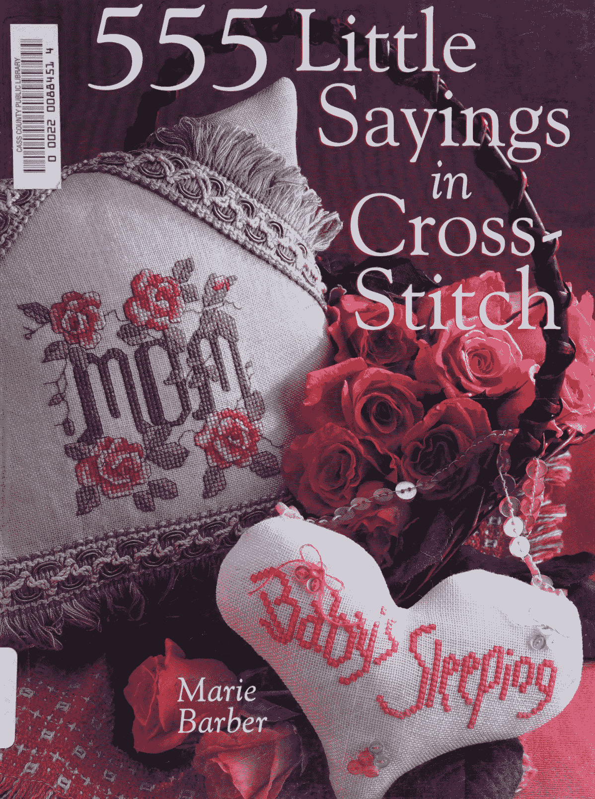

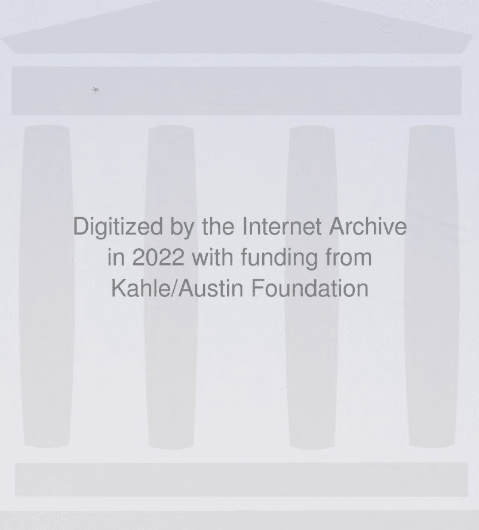

Jo Packham

编辑

Karmen Quinney

职员

Ann Bear, Areta Bingham, Cash Burchett,

Rebecca Christensen, Brenda Dounce,

Dane Drury, Marilyn Goff, Holly Hollingsworth,

Susan Jorgensen, Barbara Milburn, Linda Orton,

Leslie Rinder, Cindy Stoeckel, Gina Gapping

Kevin Dilley/Hazen Photography

## 关于作者

玛丽·巴伯（Marie Barber）出生并成长于瑞典的克里斯蒂安斯德，现与丈夫和三个孩子住在阿拉罗巴马州拉格兰的库萨萨河畔。

玛丽说，她一直很喜欢绘画和插画。14岁时，她是她在已故的 Göran Trönnberg 博士指导下学习油画的最年轻学生。

她于1983年作为交换生来到美国，并在1987年在被亚特兰达艺术学院录取后回到。她曾担任一家瑞典周刊物的自由小说插画师，她的作品曾在阿拉罗巴马州的 Loretta Goodwin 画廊展出。尽管探索过多个艺术领域，但玛丽说她在1993年开始设计十字绣时发现了自己的热情。

 (OCR有重复，已根据文本修正)

## 友谊

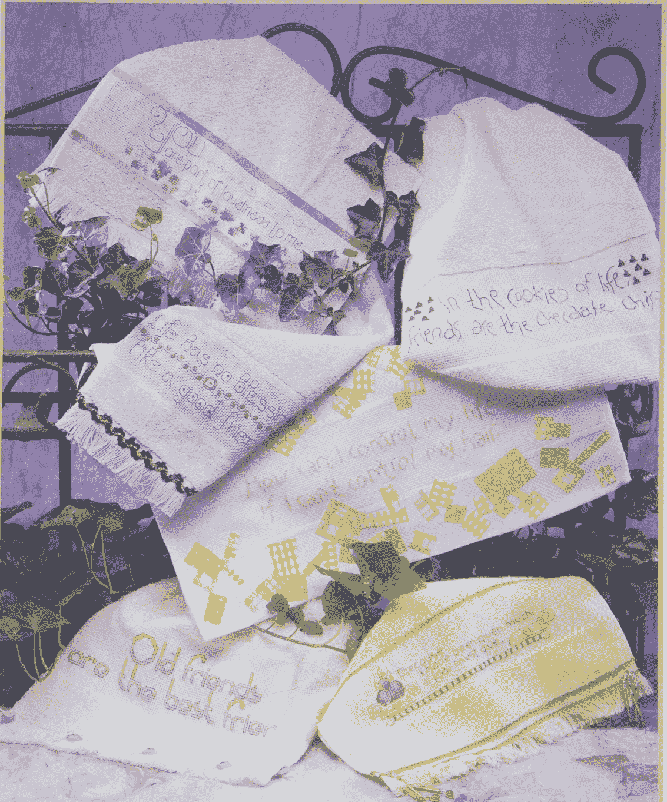

## 友谊是生命的宝藏之一。

## 你对我而言是美丽的。

## 没有什么比好朋友更好的。

| DMC 绣线 | XS | BS | FK | DMC 绣线 | XS | BS | FK |
|---|---|---|---|---|---|---|---|---|
| 894 | | | | 327 | | | |
| 893 | | | | 322 | | | |
| 504 | | | | 581 | | | |
| 603 | | | | Lemon or DMC 666 | | | |
| 305 | | | | | | | |
| 223 | | | | Sugar or DMC 334 | | | |
| 372 | | | | 2024 | | | |
| 316 | | | | | | | |
| 5 | | | | | | | |
| 211 | | | | | | | |
| 210 | | | | Mill Hill | | | |
| Caron Collection Waterlilies | | | | | | |

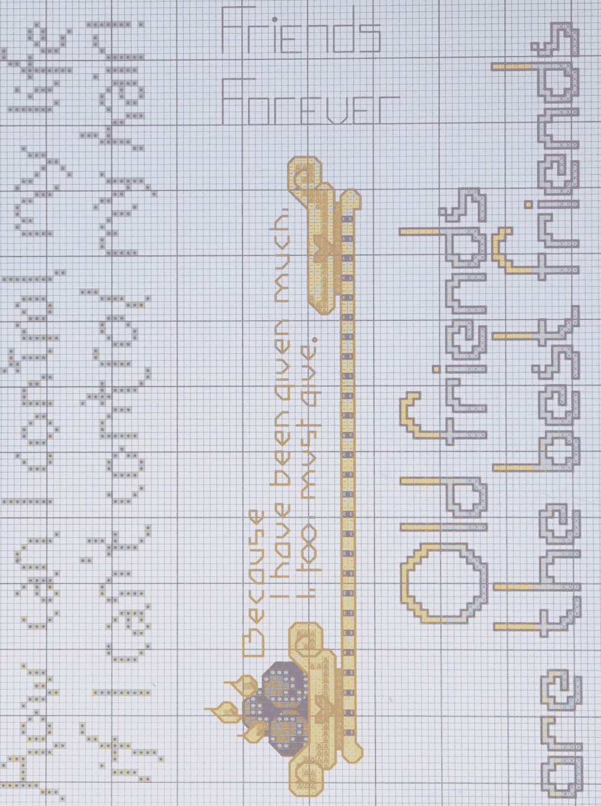

## 快乐是内心微笑的感觉。

与我一起变老吧！

最好的还在后面。

生活的饼干里，朋友就是巧克力豆。

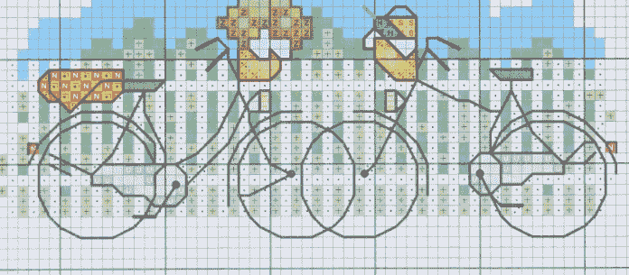

| DMC 绣线 | XS | BS | FK | DMC 绣线 | XS | BS | FK | DMC 绣线 | XS | BS | FK |
|---|---|---|---|---|---|---|---|---|---|---|---|
| White | | | | 221 | | | | 437 | | | |
| 745 | | | | 747 | | | | 436 | | | |
| 445 | | | | 3325 | | | | 420 | | | |
| 725 | | | | 824 | | | | | | | |
| 676 | | | | 368 | | | | 844 | | | |
| 3822 | | | | 320 | | | | 888 | | | |
| 3829 | | | | 504 | | | | 3787 | | | |
| 782 | | | | 3819 | | | | 3072 | | | |
| 951 | | | | 3011 | | | | 648 | | | |
| 350 | | | | 472 | | | | 646 | | | |
| 3608 | | | | 471 | | | | 3021 | | | |
| 3607 | | | | 469 | | | | Lemonade for DMC 368 | | | |
| 718 | | | | | | | | | | | |
| 3803 | | | | | | | | | | | |

## 挚友圈

爱

一棵可以抵风的坚实大树

朋友如风中的叶子。

> 与其说是朋友帮助我们，不如说是我们对他们会帮助我们充满信心。

## 一句说出的善意言语，

一个动作，或一滴泪水，

往往能治愈破碎的心，

让友谊变得真诚。

唯有你找到了

我灵魂的窗户，

并将其向向打开，

你帮助我

看见了光。

| 米色 | XS | BS | FK |
|---|---|---|---|
| 3823 | | | | |
| 676 | | | | |
| 729 | | | | |
| 3829 | | | | |
| 353 | | | | |
| 350 | | | | |
| 817 | | | | |
| 778 | | | | |
| 3722 | | | | |
| 316 | | | | |
| 3689 | | | | |
| 3687 | | | | |
| 3803 | | | | |
| 902 | | | | |
| 3756 | | | | |
| 3325 | | | | |
| 3755 | | | | |
| 334 | | | | |
| 3750 | | | | |
| 772 | | | | |
| 3348 | | | | |
| 3345 | | | | |
| 472 | | | | |
| 470 | | | | |
| 989 | | | | |
| 367 | | | | |
| 500 | | | | |
| 739 | | | | |
| 738 | | | | |
| 3827 | | | | |
| 977 | | | | |
| 3826 | | | | |
| 975 | | | | |
| 922 | | | | |
| 921 | | | | |
| 919 | | | | |
| 644 | | | | |
| 611 | | | | |
| 3781 | | | | |
| 898 | | | | |

## 如果没有你，

我不知道今天我会变成什么样。

## 你是我一辈子的朋友

| DMC 绣线 | XS | BS | FK |
|---|---|---|---|
| 白色 | | | | 333 |
| 712 | | | | 554 |
| 745 | | | | 550 |
| 3822 | | | | 775 |
| 727 | | | | 791 |
| 726 | | | | 472 |
| 676 | | | | 520 |
| 951 | | | | 541 |
| 945 | | | | 772 |
| 761 | | | | 3348 |
| 351 | | | | 3347 |
| 349 | | | | 3316 |
| 3716 | | | | 893 |
| 962 | | | | 3364 |
| 3706 | | | | 3502 |
| 3705 | | | | 501 |
| 776 | | | | 829 |
| 899 | | | | 833 |
| 335 | | | | 850 |
| 309 | | | | 758 |
| 223 | | | | 482 |
| 209 | | | | 436 |
| 208 | | | | 869 |
| 315 | | | | 3781 |
| 3802 | | | | 3061 |
| 3740 | | | | 310 |

## 生命之始，爱永无止。

## 友谊

## 关怀

## 珍惜

## 信任

## 笑声

## 好朋友

## 你分享我的梦想

## 有趣

可靠

理想

友善

亲爱

甜美

我生命中所拥有的一切，都归于你那从未放弃我的希望。归于你那始终如初的爱。

## 真诚 贴心

## 你点亮了我的日子

想要感谢你做我的朋友，需要一辈子的时间。

## 友谊

温暖人心。

我不知道你了解多少，直到我知道你有多么在乎。拥有一个朋友是一份幸运。

| DMC 绣线 | XS | BS | FK | DMC 绣线 | XS | BS |
|---|---|---|---|---|---|---|---|
| 白色 | | | | | 349 | | 470 |
| 712 | | | | | 733 | | 335 |
| 745 | | | | | 383 | | 924 |
| 3822 | | | | | 703 | | 954 |
| 727 | | | | | 676 | | 328 |
| 726 | | | | | 365 | | 90 |
| 676 | | | | | 375 | | 869 |
| 951 | | | | | 778 | | 471 |
| 945 | | | | | 766 | | 402 |
| 761 | | | | | 702 | | 838 |
| 351 | | | | | 351 | | |
| 349 | | | | | | | |
| 3716 | | | | | | | |
| 962 | | | | | | | |
| 3306 | | | | | | | | |
| 3705 | | | | | | | | |
| 776 | | | | | | | | |
| 899 | | | | | | | | |
| 335 | | | | | | | | |
| 309 | | | | | | | | |
| 223 | | | | | | | | |
| 209 | | | | | | | | |
| 208 | | | | | | | | |
| 315 | | | | | | | | |
| 3802 | | | | | | | | |
| 3740 | | | | | | | | |

## 朋友是生命的之花

友谊是珍贵的礼物

友谊是喜悦与忧伤

| DMC 绣线 | XS | BS | FK | BD |
|---|---|---|---|---|
| 3731 | | | | |
| 3740 | | | | |
| 3756 | | | | |
| 799 | | | | |
| 798 | | | | |
| 796 | | | | |
| 590 | | | | |
| 4002 | | | | |

## 文章

面对阴影揭示了光。与其说我们拥有多少，不如说我们享受多少。相信他人能让花朵盛开。草枯花谢，但友谊将永恒。和平，喜悦，送给所有来到这里的人。在十二月的黑暗中听见鸟鸣，是一件神奇且令人难忘的事。

草枯花谢，

但友谊将永恒。

美无处不在。

相信玫瑰能让花朵盛开。

| DMC 绣线 | XS | BS | FK | DMC 绣线 | XS | BS |
|---|---|---|---|---|---|---|---|
| 3822 | | | | | 3350 | | 501 |
| 3820 | | | | | 3968 | | 927 |
| 729 | | | | | 315 | | 305 |
| 3723 | | | | | 793 | | 3052 |
| 3731 | | | | | 823 | | 3362 |
| 3354 | | | | | 502 | | 420 |

## 善行

## 愿你在这里

## 记忆

对万物友善

## 我想念你

距离使人更深。面对阴影揭示了光。

| DMC 绣线 | NS | RS | FK | NS | RS | BD |
|---|---|---|---|---|---|---|---|
| 712 | | | | 799 | | | |
| 3978 | | | | 792 | | | |
| 677 | | | | 791 | | | |
| 676 | | | | 336 | | | |
| 729 | | | | 823 | | | |
| 3820 | | | | 907 | | | |
| 945 | | | | 472 | | | |
| 783 | | | | 502 | | | |
| 354 | | | | 738 | | | |
| 3733 | | | | 436 | | | |
| 3350 | | | | 976 | | | |
| 3688 | | | | 975 | | | |
| 3985 | | | | 774 | | | |
| 3727 | | | | 772 | | | |
| 316 | | | | 809 | | | |
| 3726 | | | | 839 | | | |
| 3803 | | | | 3781 | | | |
| 333 | | | | 62031 | | | |
| 3325 | | | | | | **最美山**

与其说我们拥有多少，不如说我们享受多少。你永远会在我心心中。我在十二月的黑暗中听见鸟鸣，是一件神奇且令人难忘的事。甜美的生活是美好的！心灵的礼物

愿你拥有月星。画出属于自己的彩虹。愿喜悦多，忧愁少。

## 心灵的记忆

愿愿拥有翅膀承载你的梦想。

## 微笑。

它是开启每个人心锁的钥匙。

## 微笑是心灵的拥抱。

## 随从你的心

| DMC 绣线 | XS | BS | FK | LS |
|---|---|---|---|---|
| 白色 | | | | |
| 米色 | | | | |
| 3625 | | | | |
| 744 | | | | |
| 444 | | | | |
| 725 | | | | |
| 677 | | | | |
| 676 | | | | |
| 783 | | | | |
| 781 | | | | |
| 951 | | | | |
| 945 | | | | |
| 605 | | | | |
| 604 | | | | |
| 603 | | | | |
| 601 | | | | |
| 3609 | | | | |
| 3608 | | | | |
| 3607 | | | | |
| 3685 | | | | |
| 211 | | | | |
| 210 | | | | |
| 3747 | | | | |
| 341 | | | | |
| 340 | | | | |
| 3746 | | | | |
| 3740 | | | | |
| 828 | | | | |
| 794 | | | | |
| 3807 | | | | |
| 471 | | | | |
| 470 | | | | |
| 3808 | | | | |
| 739 | | | | |
| 335 | | | | |
| 434 | | | | |
| 937 | | | | |
| 420 | | | | |
| 899 | | | | |
| 938 | | | | |
| 801 | | | | |
| 644 | | | | |
| 642 | | | | |
| 844 | | | | |

## 幸福是一种内在的修养。

## 纽带

和平，喜悦，送给所有来到这里的人。

母亲牵着孩子的手只是，但他们的心是永远的。

甜美的谦逊

## 在冬、夏、春和秋，

当你来访时，我们很快乐。

## 你的拥抱

让我的心获得生命

| | XS | DMC 绣线 | BS | FK | DMC 绣线 | XS | BS |
|---|---|---|---|---|---|---|---|
| 712 | | 351 | | 501 | | | |
| 3078 | | 554 | | 553 | | | |
| 2822 | | 754 | | 924 | | | |
| 2789 | | 775 | | 738 | | | |
| 3328 | | 501 | | 3827 | | | |
| 3326 | | 469 | | 977 | | | |
| 3771 | | 435 | | 975 | | | |
| 3350 | | 501 | | 801 | | | |
| 3687 | | 936 | | 839 | | | |
| 3685 | | 454 | | 3771 | | | |
| 333 | | 371 | | 3772 | | | |
| 791 | | 336 | | 809 | | | |
| 648 | | 402 | | 839 | | | |
| 647 | | 438 | | 3781 | | | |
| 841 | | 438 | | 62031 | | | |

# 真正的财富在于你，而不是你所拥有的。

## 家是心之所在

## 财富在于你，而不是你所拥有的。

## 核心与灵魂

你掌握着我心的钥匙

| DMC 线 | XS | BS | FK | SS | AE |
|---|---|---|---|---|---|
| 原米色 | | | | | |
| 677 | | | | | |
| 3822 | | | | | |
| 951 | | | | | |
| 945 | | | | | |
| 3689 | | | | | |
| 3688 | | | | | |
| 3687 | | | | | |
| 3803 | | | | | |
| 747 | | | | | |
| 3761 | | | | | |
| 794 | | | | | |
| 3802 | | | | | |
| 807 | | | | | |
| 806 | | | | | |
| 3808 | | | | | |
| 3819 | | | | | |
| 472 | | | | | |
| 470 | | | | | |
| 469 | | | | | |
| 524 | | | | | |
| 3363 | | | | | |
| 3362 | | | | | |
| 422 | | | | | |
| 869 | | | | | |

## 善行行为

无论多么微小，永不虚度。

将我的心交给你。

你为我的心带来微笑，将我的心交给你。

## 随从你的

善良的话语可以简短而易说，但它们的回响真正无穷无止。

## 我宁愿桌子上满玫瑰，也不愿脖子上戴钻石。

| DMC 线 | XS | BS | FK | DMC 线 | XS | BS | FK | SS | LD | BD | TR |
|---|---|---|---|---|---|---|---|---|---|---|---|
| 712 | | | | 738 | | | | | | | |
| 746 | | | | 437 | | | | | | | |
| 677 | | | | 422 | | | | | | | |
| 679 | | | | 869 | | | | | | | |
| 951 | | | | 1341 | | | | | | | |
| 945 | | | | 1344 或 DMC 341 | | | | | | | |
| 3803 | | | | 1344 或 DMC 3746 | | | | | | | |
| 3756 | | | | 1345 | | | | | | | |
| 827 | | | | 或 DMC 333 | | | | | | | |
| 823 | | | | 1844 或 DMC 5362 | | | | | | | |
| 793 | | | | Crystal Bay 或 DMC 598 | | | | | | | |
| 791 | | | | | | | | | | | |
| 3809 | | | | 或 DMC 3810 | | | | | | | |
| 472 | | | | 云杉色或 DMC 3364 | | | | | | | |
| 470 | | | | 02016 | | | | | | | |
| 469 | | | | 12208 | | | | | | | |
| 937 | | | | | | | | | | | |
| 739 | | | | Caron Collection 睡莲 Kreinik 丝线线 Mill Hill 珠子与宝藏 | | | | | | | |

## 爱是连接两颗心的桥梁。

## 有心。有你，我可以做任何事。心心相印。

## 全心投入

# 孩子是另一个母亲的 ❤ 悦

宝宝认为世界应该继续运行的酷意见。

婴儿开启了未来的大门。

| DMC 线 | XS | BS | FK | SS |
|---|---|---|---|---|
| 712 | | | | |
| 3078 | | | | |
| 3822 | | | | |
| 783 | | | | |
| 353 | | | | |
| 352 | | | | |
| 351 | | | | |
| 350 | | | | |
| 828 | | | | |
| 827 | | | | |
| 813 | | | | |
| 3348 | | | | |
| 3345 | | | | |
| 470 | | | | |
| 936 | | | | |
| 502 | | | | |
| 501 | | | | |
| 758 | | | | |
| 437 | | | | |
| 422 | | | | |
| 420 | | | | |
| 898 | | | | |
| 452 | | | | |
| 451 | | | | |

## 爱的唯一条件就是无条件地去爱。愿上天每天报答你。为了我永远无法报答的爱。两心一心，对你的心忠诚。

## 庆祝

## 空气中的魔法

## 祝冬季时光愉快

## 喜悦

## 平安与幸福

## 祝福这个季节

## 欢快的狂喜

## 愿和平

## 圣夜

## 圣诞快乐

## 节日问候

## 装饰你的殿堂

## 庆祝这个季节……

## 相信

| DMC 线 | XS | BS | FK | DMC 线 | XS | BS | FK |
|---|---|---|---|---|---|---|---|
| 5821 | | | | 797 | | | |
| 5820 | | | | 823 | | | |
| 729 | | | | 505 | | | |
| 666 | | | | 皇室珠宝 | | | |
| 321 | | | | 201 | | | |
| 917 | | | | 501 | | | |
| 3685 | | | | | | | |
| 333 | | | | 500 | | | |
| 5760 | | | | | | | |

## 庆祝生活的每个季节都有值得庆祝的事。游行！

## 毕业

特别送你好运。

| DMC 线 | XS | BS | FK | DMC 线 | XS | BS | FK | DMC 线 | XS | BS | FK |
|---|---|---|---|---|---|---|---|---|---|---|---|
| 746 | | | | 3811 | | | | 422 | | | |
| 3822 | | | | 598 | | | | 420 | | | |
| 744 | | | | 793 | | | | 869 | | | |
| 445 | | | | 792 | | | | 977 | | | |
| 676 | | | | 3750 | | | | 3826 | | | |
| 951 | | | | 3819 | | | | 3776 | | | |
| 945 | | | | 472 | | | | 301 | | | |
| 3328 | | | | 471 | | | | 400 | | | |
| 352 | | | | 470 | | | | 300 | | | |
| 351 | | | | 3011 | | | | 938 | | | |
| 350 | | | | 320 | | | | 3721 | | | |
| 349 | | | | 219 | | | | 840 | | | |
| 224 | | | | 501 | | | | 839 | | | |
| 223 | | | | 500 | | | | 838 | | | |
| 3985 | | | | 738 | | | | 647 | | | |

## 甜蜜十六岁

## 问候你

## 圣诞节爱

## 感谢

| DMC 线 | XS | BS | FK | LS | BD |
|---|---|---|---|---|---|
| White | | | | | 340 |
| 422 | | | | | □ |
| 3823 | | | | | □ |
| 3822 | | | | | □ |
| 744 | | | | | □ |
| 3820 | | | | | □ |
| 451 | | | | | □ |
| 345 | | | | | □ |
| 758 | | | | | □ |
| 818 | | | | | □ |
| 776 | | | | | □ |
| 733 | | | | | □ |
| 351 | | | | | □ |
| 399 | | | | | □ |
| 3687 | | | | | □ |
| 3803 | | | | | □ |
| 3722 | | | | | □ |
| 221 | | | | | □ |
| 902 | | | | | □ |
| 3041 | | | | | □ |
| 3740 | | | | | □ |
| 333 | | | | | □ |
| 341 | | | | | 0411 |

## 庆祝！每一天的假期

## 冬日仙境

## 新年之愿

随着雪花。

| DMC 线 | XS | BS | FK | DMC 线 | XS | BS | DMC 线 | XS | BS | DMC 线 | XS | BS | BD |
|---|---|---|---|---|---|---|---|---|---|---|---|---|---|
| White | | | | 721 | | | | 3756 | | | | 644 |
| 712 | | | | 342 | | | | 775 | | | | 429 |
| 3822 | | | | 351 | | | | 518 | | | | 402 |
| 676 | | | | 349 | | | | 5807 | | | | 3776 |
| 744 | | | | 298 | | | | 291 | | | | 391 |
| 726 | | | | 298 | | | | 807 | | | | 841 |
| 725 | | | | 333 | | | | 806 | | | | 801 |
| 972 | | | | 3747 | | | | 368 | | | | 898 |
| 783 | | | | 341 | | | | 367 | | | | 0123 |
| 951 | | | | 3746 | | | | 500 | | | | 0967 |

## 班聚

## 祝贺

## 祝福

## 万圣节快乐

| DMC 线 | XS | BS | FK | DMC 线 | XS | BS | FK | DMC 线 | XS | BS | FK | LS |
|---|---|---|---|---|---|---|---|---|---|---|---|
| Ecru | | | | 335 | | | | 3746 | | | | 904 |
| 3822 | | | | 3350 | | | | 792 | | | | 739 |
| 3907 | | | | 3685 | | | | 791 | | | | 355 |
| 3441 | | | | 992 | | | | 997 | | | | 3331 |
| 3240 | | | | 327 | | | | 906 | | | | 310 |
| Peach Melba 或 DMC 3688 | | | | | | | | | | | |

## 节日快乐

圣诞快乐，我们想要一切光明教节。

| DMC 线 | XS BS LS | XS BS FK | DMC 线 | XS BS FK | DMC 线 | XS BS FK BD |
|---|---|---|---|---|---|---|
| Ecra | | | | 3688 | | | 927 | | | 319 |
| 677 | | | | 3687 | | | 3768 | | | 739 |
| 628 | | | | 666 | | | 734 | | | 758 |
| 729 | | | | 721 | | | 733 | | | 425 |
| 726 | | | | 815 | | | 3364 | | | 435 |
| 3820 | | | | 341 | | | 3663 | | | 869 |
| 722 | | | | 340 | | | 3362 | | | 3031 |
| 351 | | | | 3746 | | | 320 | | | 00556 |

Mill Hill

## 让我们庆祝

## 欢聚

## 祝你

## 往事如烟

## 派对时间

## 结束即是开始

## 新起点

## 家与爱

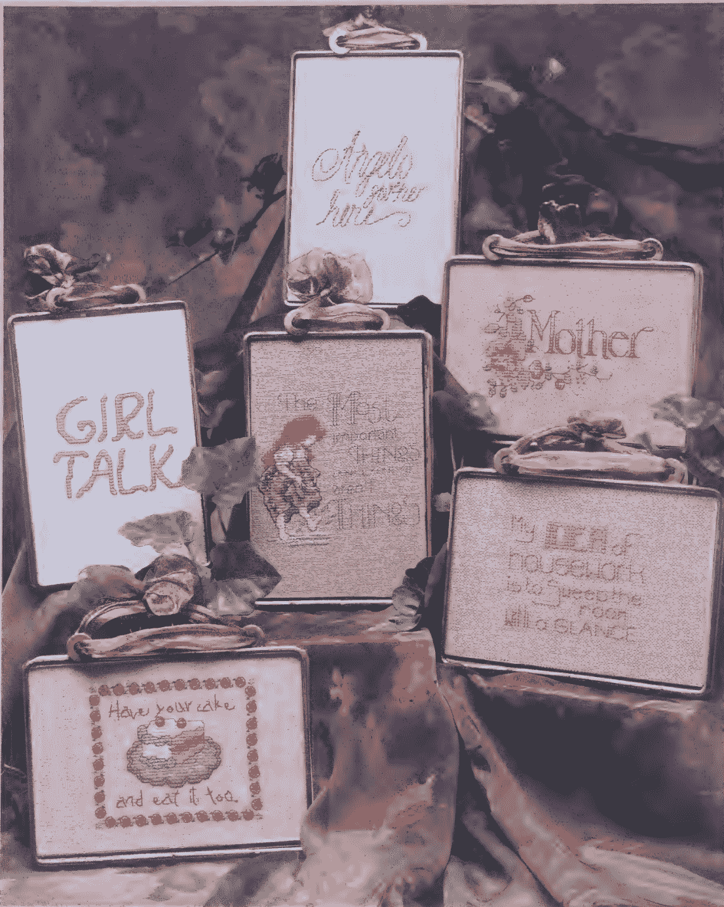

天使在此。

女孩话话。

最重要的事情是……

妈妈。

我的家务秘诀是`扫视一眼`就能打扫房间。

鱼和兼得又要兼得。

## 鱼和兼得又要兼得。

| DMC 线线 | XS | BS | FK |
|---|---|---|---|
| 白色 743 | | | |
| 676 | | | |
| 352 | | ■ | |
| 351 | | ■ | |
| 817 | | | ■ |
| 812 | | | ■ |
| 604 | | ■ | |
| 602 | | ■ | |
| 210 | | ■ | |
| 3740 | | ■ | |
| 3701 | | ■ | |
| 272 | | ■ | |
| 3347 | | ■ | |
| 703 | | ■ | |
| 307 | | ■ | |
| 3810 | | ■ | |

## 欢迎亲爱的朋友们

# 我对家务的理解是`扫视一眼`就能打扫房间

## 女孩话话，天使在此聚集

## 父亲，母亲的爱

妈妈。

姐妹。

兄弟。

永无止境。

## 家庭至上

有些人进入我们的生活，又匆匆离开。有些人留了一段时间，在我们心中留下了脚印。而我们再也回从从。

# 上是完美的父母

朋友是那个伸向你的手，却触动你内心的人。

## 奶奶姥母很伟大

## 妈妈

带着快乐的心情进入最清楚。

| DMC 线线 | XS | BS | FK | DMC 线线 | XS | BS | FK | DMC 线线 | XS | BS | FK | DMC 线线 | XS | BS | FK | DMC 线线 | XS | BS | FK |
|---|---|---|---|---|---|---|---|---|---|---|---|---|---|---|---|---|---|---|---|
| 3078 | | | | 352 | | | | 3727 | | | | 827 | | | | 472 | | | |
| 3822 | | | | 350 | | | | 316 | | | | 798 | | | | 471 | | | |
| 3820 | | | | 817 | | | | 315 | | | | 931 | | | | 470 | | | |
| 782 | | | | 225 | | | | 3609 | | | | 3811 | | | | 436 | | | |
| 951 | | | | 961 | | | | 211 | | | | 807 | | | | 469 | | | |
| 3824 | | | | 3326 | | | | 206 | | | | 3364 | | | | 838 | | | |
| 722 | | | | 335 | | | | 208 | | | | | | | | | | |
| 353 | | | | 326 | | | | | | | | | | | | | | |

## 幸福的家

## 家是心所在之处

完美的妻子是会帮丈夫洗碗的人。

男人带儿子去钓鱼是令人赞佩的，但带女儿购物的父亲在天堂有一个特殊的位置。

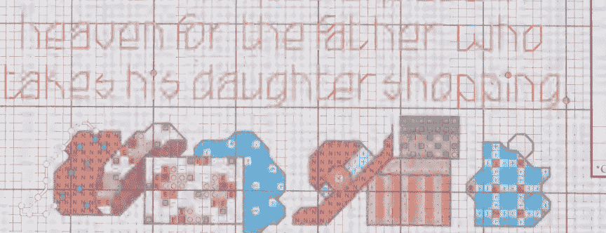

| DMC 线线 | XS | BS | FK |
|---|---|---|---|
| 白色 | | | |
| 米白色 | | | |
| 3822 | | | |
| 676 | | | |
| 3778 | | | |
| 776 | | | |
| 3326 | | | |
| 351 | | | |
| 350 | | | |
| 梨火色或 DMC 350 | | | |
| 3705 | | | |
| 3350 | | | |
| 3803 | | | |
| 210 | | | |
| 3041 | | | |
| 3740 | | | |
| 775 | | | |
| 334 | | | |
| 792 | | | |
| 3807 | | | |
| 747 | | | |
| 3706 | | | |
| 518 | | | |
| 3811 | | | |
| 597 | | | |
| 3810 | | | |
| 3509 | | | |
| 722 | | | |
| 704 | | | |
| 3819 | | | |
| 3013 | | | |
| 976 | | | |
| 3776 | | | |
| 3777 | | | |
| 422 | | | |
| 400 | | | |

| 3850 | | | |
|---|---|---|---|
| 4331 | | | |
| 648 | | | |
| 647 | | | |
| 646 | | | |
| 3021 | | | |
| 收藏 | | | |

道路的尽头是同样的面团揉成的，但不是同一个烤箱里烘的。

只需雇用你的脚。

蜂蜜在家里！

## 吻厨师

## 退休了

请

| DMC 线线 | XS | BS | DMC 线 | XS | BS |
|---|---|---|---|---|---|
| 3827 | | | 3808 | | |
| 722 | | | 371 | | |
| 598 | | | 3777 | | |
| 993 | | | 435 | | |
| 3810 | | | 133 | | |

## 木屋热

## 居家烹

## 海边小屋

家有炉火所在。

抱怨或咖啡时间。

## 请进

未来属于那些为其做好准备的人。

对万物保持耐心，但首先对自己对自己。

| DMC 线线 | XS | BS | FK | XS | BS | FK |
|---|---|---|---|---|---|---|
| 712 | | | 824 | | |
| 822 | | | 3810 | | |
| 3823 | | | 924 | | |
| 3078 | | | 907 | | |
| 744 | | | 906 | | |
| 951 | | | 905 | | |
| 945 | | | 320 | | |
| 350 | | | 319 | | |
| 211 | | | 976 | | |
| 209 | | | 386 | | |
| 3042 | | | 975 | | |
| 3411 | | | 376 | | |
| 3740 | | | 938 | | |
| 519 | | | 644 | | |
| 827 | | | 612 | | |
| 826 | | | | | |

好日子和坏日子的唯一区别在于你的态度！

我们通过所得到的生存，通过所给予的生活。

## 拥抱与私语

## 生活中最重要的不是东西

## 依靠家庭

## 忙碌的手快乐的心

## 系好安全带！

## 甜蜜的家

| DMC 线线 | XS | BS | FK | LS | SS | LD | BD |
|---|---|---|---|---|---|---|---|
| 米色 | | | | | | | |
| 745 | | | | | | | |
| 728 | | | | | | | |
| 783 | | | | | | | |
| 945 | | | | | | | |
| 722 | | | | | | | |
| 921 | | | | | | | |
| 349 | | | | | | | |
| 962 | | | | | | | |
| 326 | | | | | | | |
| 3722 | | | | | | | |
| 221 | | | | | | | |
| 3755 | | | | | | | |
| 334 | | | | | | | |
| 380 | | | | | | | |
| 791 | | | | | | | |
| 3819 | | | | | | | |
| 3348 | | | | | | | |
| 368 | | | | | | | |
| 320 | | | | | | | |
| 267 | | | | | | | |
| 508 | | | | | | | |
| 3809 | | | | | | | |
| 3024 | | | | | | | |
| 422 | | | | | | | |
| 420 | | | | | | | |
| 610 | | | | | | | |
| 3031 | | | | | | | |
| 3020 | | | | | | | |
| 收藏 | | | | | | |

享受时刻。

孩子们不是东西。他们是珍贵的。

| DMC 线线 | XS | BS | FK | DMC | XS | BS | FK |
|---|---|---|---|---|---|---|---|
| 718 | | | 349 | | | 341 | | | 333 |
| 722 | | | 350 | | | 371 | | | 338 |
| 593 | | | 317 | | | 377 | | | 336 |
| 742 | | | 316 | | | 346 | | | 346 |
| 722 | | | 316 | | | 346 | | | 346 |
| 729 | | | 310 | | | 306 | | | 360 |
| 740 | | | 309 | | | 305 | | | 364 |
| 743 | | | 311 | | | 315 | | | 381 |
| 782 | | | 315 | | | 313 | | | 381 |
| 951 | | | 321 | | | 313 | | | 400 |
| 341 | | | 325 | | | 313 | | | 402 |
| 352 | | | 326 | | | 315 | | | 401 |
| 351 | | | 327 | | | 315 | | | 401 |
| 349 | | | 327 | | | 315 | | | 401 |

## 母亲的甜蜜爱

大橡树长于小橡实。

我的心爱。

上帝佑我们的家。

活的思考。

## 生活

在一个活在当下，而非追求完美的时代！

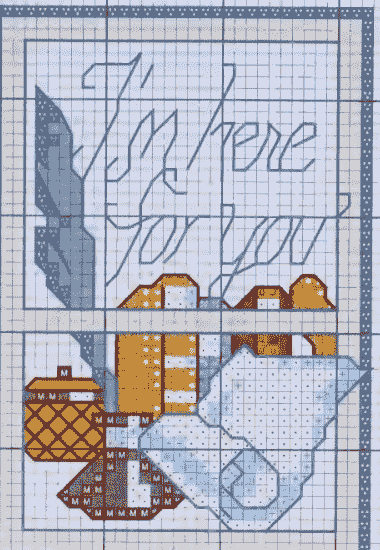

生活是不确定的，像猫穿越沙漠一样。

温暖的微笑是善良的语言。

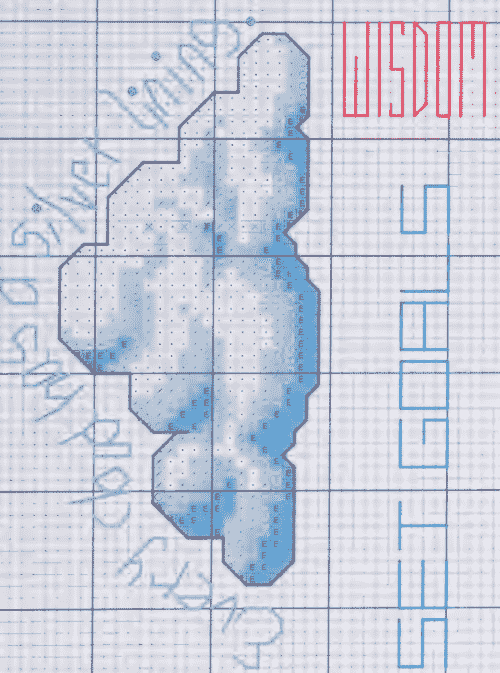

如果你能梦想，你就能实现。

| DMC 绣线 | XS | BS | FK | DMC 绣线 | XS | BS | FK |
|---|---|---|---|---|---|---|---|
| 白色 | | | 930 | | | |
| 712 | | | 924 | | | |
| 3823 | | | 963 | | | |
| 3820 | | | 502 | | | |
| 783 | | | 910 | | | |
| 334 | | | 927 | | | |
| 775 | | | 976 | | | |
| 3325 | | | 420 | | | |
| 828 | | | 400 | | | |
| 827 | | | 840 | | | |
| 815 | | | 839 | | | |
| 826 | | | 376 | | | |
| 3761 | | | 838 | | | |
| 3765 | | | `001HC` 或 DMC 317 | | | |
| 931 | | | | | | |

## 给予比受受有福

## 一切都是美好的生活

## 我们无法改变风向，但可以调整风帆。

## 每一天都至重要

## 内在谨慎，外在行动

## 保持喜悦的心

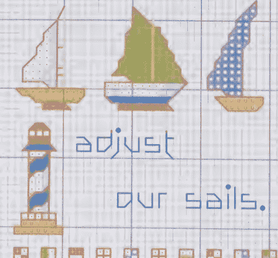

## 如果你想快乐，那就快乐吧。

婴儿来到这个世界时，手里握着快乐。

## 当他们张开小手指时，

整个世界的供应再次得到了补充。

## 生活的悲剧不在于它结束得太早，而在于我们等待了太久才开始。

| DMC 绣线 | XS | BS | FK | SS | DMC 绣线 | XS | BS | FK | SS | DMC 绣线 | XS | BS | FK | SS | DMC 绣线 | XS | BS | FK | BD |
|---|---|---|---|---|---|---|---|---|---|---|---|---|---|---|---|---|---|---|---|
| 白色 | | | | | 腮红色或 DMC 316 | | | | | 3011 | | | | | 831 | | | | |
| 712 | | | | | 315 | | | | | 471 | | | | | 3827 | | | | |
| 744 | | | | | 3761 | | | | | 581 | | | | | 437 | | | | |
| 676 | | | | | 519 | | | | | 520 | | | | | 3828 | | | | |
| 729 | | | | | 3769 | | | | | 常青绿或 DMC 501 | | | | | 420 | | | | |
| 3821 | | | | | 3228 | | | | | 561 | | | | | 869 | | | | |
| 783 | | | | | 3111 | | | | | 2089 | | | | | 829 | | | | |
| 351 | | | | | 3653 | | | | | | 834 | | | | | 648 | | | | |
| 350 | | | | | | | | | | 833 | | | | | 02001 | | | | |
| 817 | | | | | | | | | | | | | | | | | | | | |
| 3727 | | | | | | | | | | | | | | | | | | | | |

## 善行长存

善行从不无报。

| DMC 绣线 | XS | BS | FK | ES | DMC 绣线 | XS | BS | FK | ES |
|---|---|---|---|---|---|---|---|---|---|
| 712 | | | | | 794 | | | | |
| 746 | | | | | 793 | | | | |
| 677 | | | | | 792 | | | | |
| 3822 | | | | | 792 | | | | |
| 3821 | | | | | 930 | | | | |
| 726 | | | | | 3364 | | | | |
| 3046 | | | | | 3363 | | | | |
| 3045 | | | | | 472 | | | | |
| 3774 | | | | | 906 | | | | |
| 950 | | | | | 368 | | | | |
| 3441 | | | | | 320 | | | | |
| 352 | | | | | 367 | | | | |
| 351 | | | | | 738 | | | | |
| 321 | | | | | 977 | | | | |
| 902 | | | | | 828 | | | | |
| 3830 | | | | | 975 | | | | |
| 209 | | | | | 869 | | | | |
| 3743 | | | | | 612 | | | | |
| 3042 | | | | | 611 | | | | |
| 3041 | | | | | 632 | | | | |
| 800 | | | | | 3031 | | | | |
| 809 | | | | | | | | | |

会今天，没有意义。

那些我们第一次看到的东西……再次看到。

云朵或花朵。这两者都有意义。

一个人跪下帮助孩子时，并不显得高大。

## 相信

## 停下来闻闻花

## 信仰。爱。

## 童话会成真

# 快乐

| DMC 绣线 | XS | BS | FK | XS | BS | FK |
|---|---|---|---|---|---|---|
| 712 | | | 311 | | |
| 712 | | | 991 | | |
| 3825 | | | 3819 | | |
| 744 | | | 470 | | |
| 742 | | | 581 | | |
| 3820 | | | 733 | | |
| 945 | | | 732 | | |
| 352 | | | 989 | | |
| 351 | | | 987 | | |
| 347 | | | 320 | | |
| 3689 | | | 367 | | |
| 3687 | | | 316 | | |
| 319 | | | 500 | | |
| 315 | | | 739 | | |
| 3743 | | | 738 | | |
| 327 | | | 436 | | |
| 341 | | | 434 | | |
| 3746 | | | 422 | | |
| 3811 | | | 3828 | | |
| 3761 | | | 420 | | |
| 3765 | | | 869 | | |
| 3810 | | | 3776 | | |
| 799 | | | 3777 | | |
| 798 | | | 3826 | | |
| 797 | | | 898 | | |

## 生活是美好的

## 幸福

去想象 是一一切

把你的马车系在星辰上。

不要让生活消磨你：每一个取得今天成就的人都曾从起点开始。

## 在平凡与卓越之间

## 晚安睡眠

## 分享尽情生活的快乐。

| DMC 绣线 | XS | BS | FK | DMC 绣线 | XS | BS | FK | 3011 | XS | BS |
|---|---|---|---|---|---|---|---|---|---|---|
| 712 | | | | | 210 | | | | | |
| 445 | | | | | 3041 | | | | 501 | | |
| 3822 | | | | | 796 | | | | 3768 | | |
| 3821 | | | | | 472 | | | | 402 | | |
| 729 | | | | | 471 | | | | 869 | | |
| 301 | | | | | 471 | | | | 839 | | |
| 776 | | | | | 3347 | | | | 3024 | | |
| 224 | | | | | | | | 8844 | | |
| 3721 | | | | | | | | 3839 | | |

春天已经回来。大地像一个没有边界的孩子。

愿你度过生命的每一天。

报答美好时刻最好的方式就是享受它，当你听我说话时，我看到它们成真。

生活——去生活吧！

不要随年龄增长而变老，要每天都更新。心态决定功劳。

笑声没有外国口音。

我们内心永远是一样的年纪。

| DMC 绣线 | XS | BS | FK | DMC 绣线 | XS | BS | FK |
|---|---|---|---|---|---|---|---|
| 白色 | | | 3013 | | | |
| 米色 | | | 3012 | | | |
| 3821 | | | 3011 | | | |
| 676 | | | 3819 | | | |
| 680 | | | 581 | | | |
| 782 | | | 472 | | | |
| 950 | | | 471 | | | |
| 352 | | | 3362 | | | |
| 3705 | | | 911 | | | |
| 816 | | | 3365 | | | |
| 210 | | | 833 | | | |
| 208 | | | 832 | | | |
| 553 | | | 435 | | | |
| 550 | | | 434 | | | |
| 3743 | | | 869 | | | |
| 3942 | | | 841 | | | |
| 3041 | | | 648 | | | |
| 3740 | | | 3371 | | | |
| 3746 | | | 310 | | | |

## 思想才是关键

| DMC 线 | XS | BS | FK | DMC 线 | XS | BS | FK | DMC 线 | XS | BS | FK |
|---|---|---|---|---|---|---|---|---|---|---|---|
| 白色 | | | | 3727 | | | | 472 | | | |

| 712 | | | | 319 | | | | 471 | | | |
|---|---|---|---|---|---|---|---|---|---|---|---|
| 740 | | | | 3726 | | | | 420 | | | |
| 744 | | | | 3802 | | | | 469 | | | |
| 3820 | | | | 3687 | | | | 3364 | | | |
| 676 | | | | 3902 | | | | 853 | | | |
| 729 | | | | 3041 | | | | 729 | | | |
| 686 | | | | 3740 | | | | 437 | | | |
| 951 | | | | 747 | | | | 3790 | | | |
| 352 | | | | 598 | | | | 610 | | | |
| 350 | | | | 3746 | | | | 3031 | | | |

生命充满了可能，正如天空中的繁星一般。

不会爱的人，就不能真正生活。

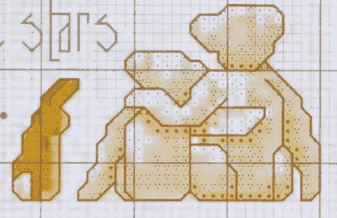

无论你认为你可以行，还是认为你不能，你都是的。

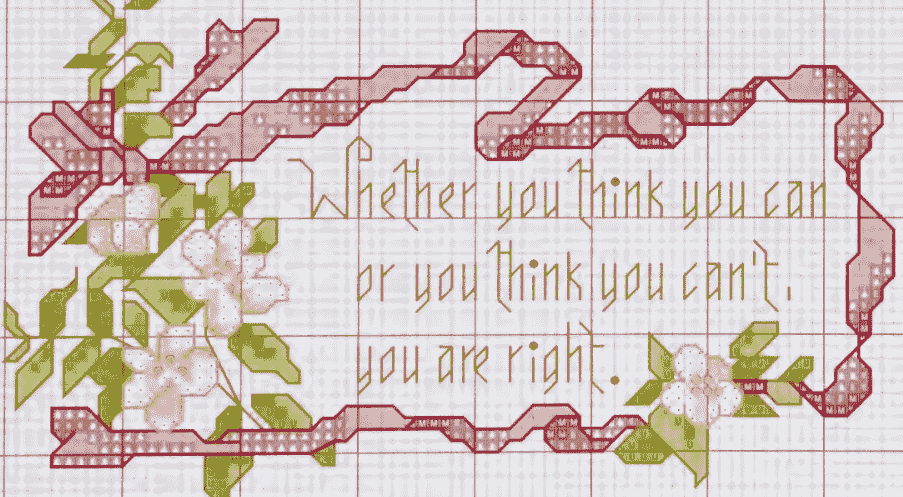

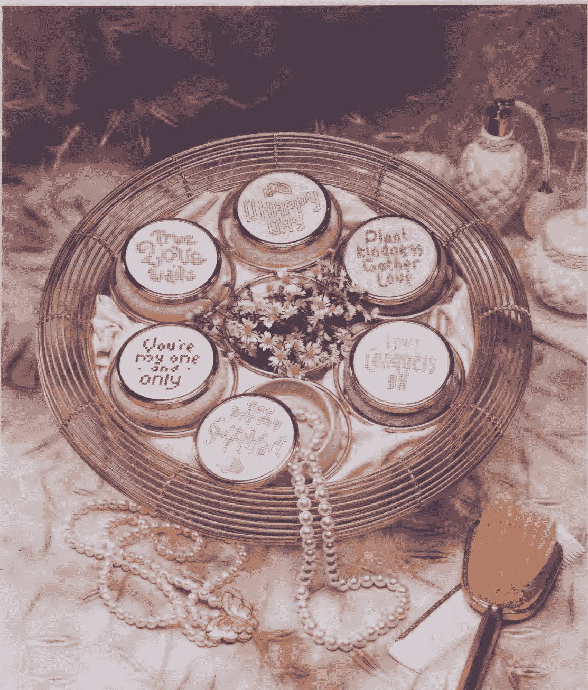

## 你是我的唯一

## 绽放的心

## 爱战胜一切

## 播种善良收获爱

## 真爱无等待

## 教会即爱

## 你是我的心肝

## 快乐的一天

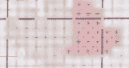

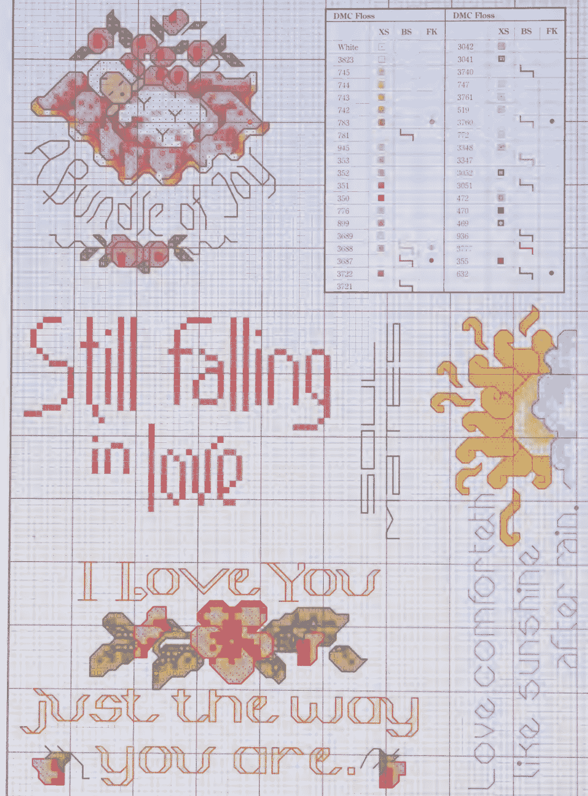

| DMC 线 | XS | BS | FK | DMC 线 | XS | BS | FK |
|---|---|---|---|---|---|---|---|
| 白色 | | | | 3042 | | | |
| 3823 | | | | 3041 | | | |
| 745 | | | | 3740 | | | |
| 744 | | | | 3747 | | | |
| 743 | | | | 3751 | | | |
| 742 | | | | 3519 | | | |
| 783 | | | | 3760 | | | |
| 781 | | | | 3772 | | | |
| 945 | | | | 3348 | | | |
| 353 | | | | 3347 | | | |
| 352 | | | | 3032 | | | |
| 351 | | | | 3051 | | | |
| 350 | | | | 472 | | | |
| 776 | | | | 470 | | | |
| 899 | | | | 469 | | | |
| 3689 | | | | 936 | | | |
| 3688 | | | | 375 | | | |
| 3687 | | | | 355 | | | |
| 3722 | | | | 632 | | | |
| 3721 | | | | | | | |

## 如果我知道什么是爱，那是因为你

## 爱是生命的源泉

为了永远和永恒

我爱你，幸福之源

## 从今天以后起……

## 我生命中的爱。

## 我们的手，我们的心，我们的灵魂——

完美契合

## 在这一天

做你你自己

我在此宣誓

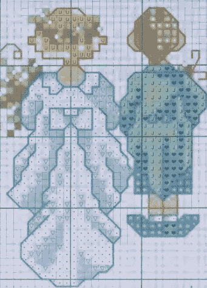

……从此二者合一……

## 新娘

## 婚快乐

## 新郎

## 成为我的

## 我所爱的近在咫尺

## 我爱你

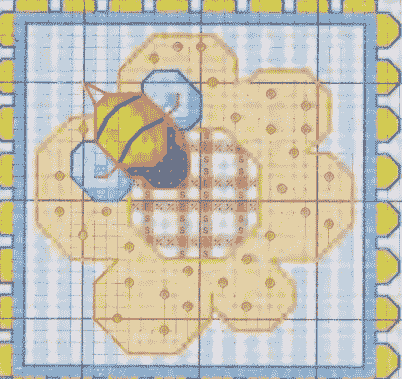

## 蜂蜜

## DMC 线

## DMC 线

| XS | BS | FK | XS | BS | FK |
|---|---|---|---|---|---|
| 白色 | | | 315 | | |
| 米白色 | | | 3802 | | |
| 746 | | | 902 | | |
| 745 | | | 3761 | | |
| 3821 | | | 813 | | |
| 725 | | | 312 | | |
| 676 | | | 927 | | |
| 927 | | | 3768 | | |
| 950 | | | 924 | | |
| 761 | | | 3819 | | |
| 370 | | | 732 | | |
| 3712 | | | 729 | | |
| 3328 | | | 989 | | |
| 353 | | | 987 | | |
| 347 | | | 3052 | | |
| 3801 | | | 3051 | | |
| 819 | | | 472 | | |
| 3326 | | | 471 | | |
| 3721 | | | 370 | | |
| 3354 | | | 3348 | | |
| 3350 | | | 3347 | | |
| 815 | | | 504 | | |
| 3689 | | | 502 | | |
| 3685 | | | 388 | | |
| 3803 | | | 422 | | |
| 3685 | | | 3828 | | |
| 3722 | | | 420 | | |
| 221 | | | 869 | | |
| 778 | | | 823 | | |
| 325 | | | 975 | | |
| 316 | | | 610 | | |
| 326 | | | 310 | | |

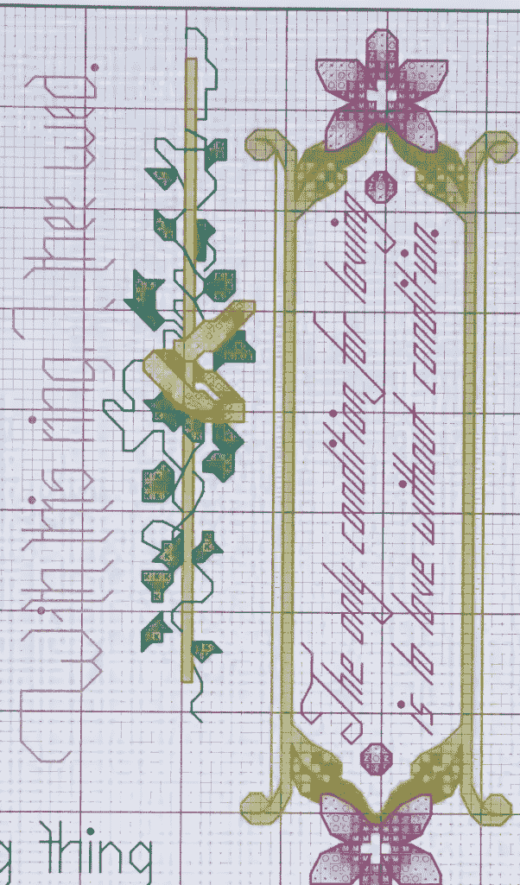

## 爱是一种给予

列表

我爱你，因为你

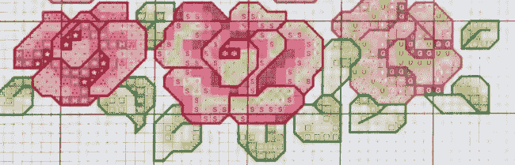

## 婚姻——爱​​的开始

爱的部分 爱的核心

| DMC 线 | XS | BS | FK | DMC 线 | XS | BS | FK |
|---|---|---|---|---|---|---|---|
| 745 | | | 341 | | | |
| 744 | | | 340 | | | |
| 727 | | | 319 | | | |
| 381 | | | 734 | | | |
| 781 | | | 733 | | | |
| 3824 | | | 732 | | | |
| 3713 | | | 3364 | | | |
| 3716 | | | 3012 | | | |
| 351 | | | 3011 | | | |
| 390 | | | 3561 | | | |
| 3705 | | | 471 | | | |
| 3354 | | | 470 | | | |
| 498 | | | 469 | | | |
| 221 | | | 470 | | | |
| 209 | | | 589 | | | |
| 3041 | | | 567 | | | |
| 915 | | | 420 | | | |
| 550 | | | | | | |

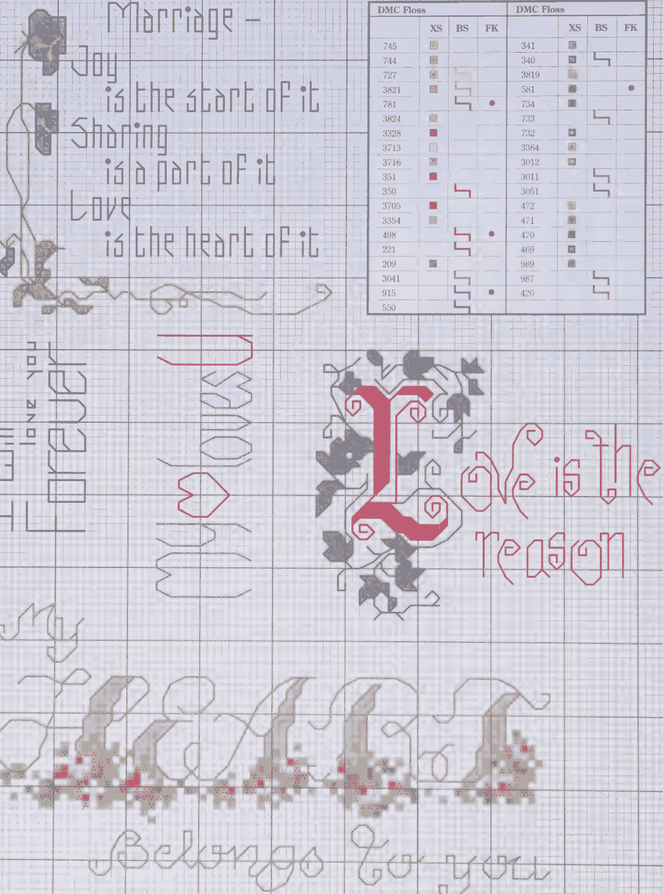

每天被爱都是一份礼物。

这就是为什么他们称之为礼物。

## 没有星星如此明亮 如我的喜悦

我交我的手，我交我的心

失去过爱远比从未爱过要好。

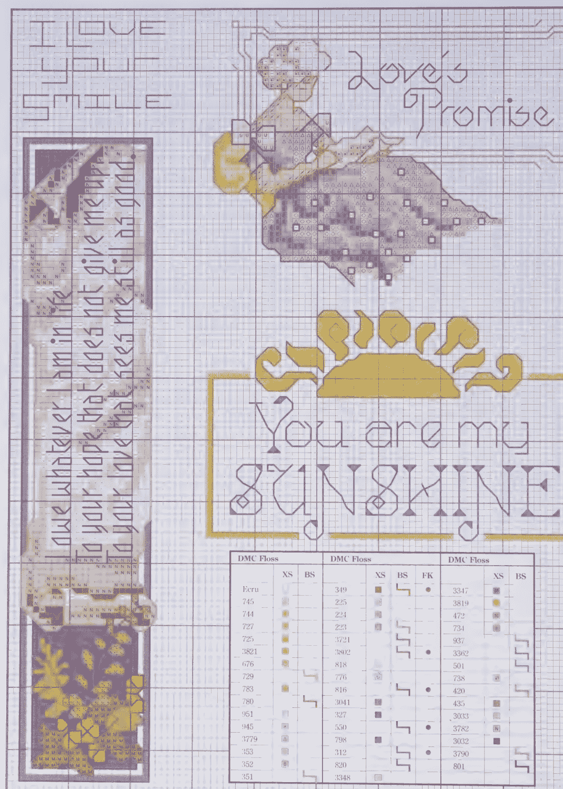

无论你希望放弃什么，你的爱依然看我是好的。

| DMC 线 | XS | BS | XS | BS | FK | DMC 线 | XS | BS |
|---|---|---|---|---|---|---|---|---|
| 米白色 | | | | 349 | | | 3347 | |
| 745 | | | | 225 | | | 3819 | |
| 744 | | | | 221 | | | 472 | |
| 727 | | | | 223 | | | 734 | |
| 725 | | | | 3721 | | | 937 | |
| 3821 | | | | 3802 | | | 3362 | |
| 676 | | | | 818 | | | 501 | |
| 729 | | | | 776 | | | 738 | |
| 783 | | | | 716 | | | 420 | |
| 780 | | | | 3041 | | | 435 | |
| 951 | | | | 327 | | | 3033 | |
| 945 | | | | 550 | | | 3782 | |
| 3779 | | | | 798 | | | 3032 | |
| 353 | | | | 312 | | | 3790 | |
| 352 | | | | 820 | | | 801 | |
| 351 | | | | 3348 | | | | |

## 婴儿在睡觉

爱让周围的世界改变

为了给予，为了分享，

你被爱着

生命是为了快乐，

笑声是快乐，

但主要是——是为了爱。

心中充满爱的人总有东西可以给予。

## 给孩子两件事：根与翅膀

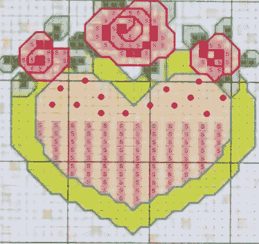

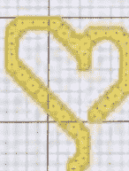

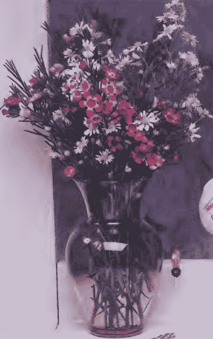

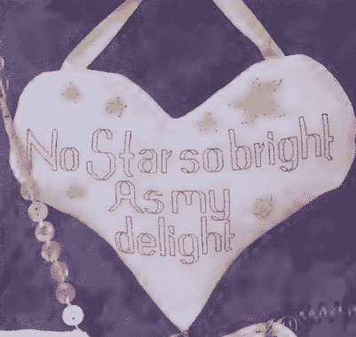

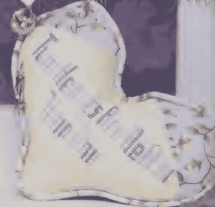

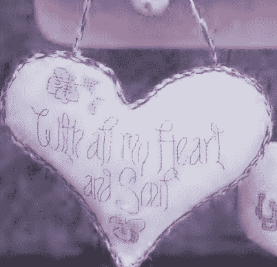

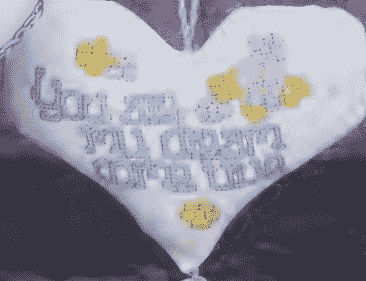

## 两个心胜过一个

| DMC 线 | XS | BS | FK | DMC 线 | XS | BS | FK |
|---|---|---|---|---|---|---|---|
| 745 | | | 341 | | | |
| 744 | | | 340 | | | |
| 727 | | | 319 | | | |
| 381 | | | 734 | | | |
| 781 | | | 733 | | | |
| 3824 | | | 732 | | | |
| 3713 | | | 3364 | | | |
| 3716 | | | 3012 | | | |
| 351 | | | 3011 | | | |
| 390 | | | 3561 | | | |
| 3705 | | | 471 | | | |
| 3354 | | | 470 | | | |
| 498 | | | 469 | | | |
| 221 | | | 470 | | | |
| 209 | | | 589 | | | |
| 3041 | | | 567 | | | |
| 915 | | | 420 | | | |
| 550 | | | | | | |

## 爱是一种给予

列表

我爱你，因为你

## 婚姻——爱的开始

爱的部分 爱的核心

| DMC 线 | XS | BS | FK | DMC 线 | XS | BS | FK |
|---|---|---|---|---|---|---|---|
| 745 | | | 341 | | | |
| 744 | | | 340 | | | |
| 727 | | | 319 | | | |
| 381 | | | 734 | | | |
| 781 | | | 733 | | | |
| 3824 | | | 732 | | | |
| 3713 | | | 3364 | | | |
| 3716 | | | 3012 | | | |
| 351 | | | 3011 | | | |
| 390 | | | 3561 | | | |
| 3705 | | | 471 | | | |
| 3354 | | | 470 | | | |
| 498 | | | 469 | | | |
| 221 | | | 470 | | | |
| 209 | | | 589 | | | |
| 3041 | | | 567 | | | |
| 915 | | | 420 | | | |
| 550 | | | | | | |

## 两个心胜过一个

| DMC 线 | XS | BS | FK | DMC 线 | XS | BS | FK |
|---|---|---|---|---|---|---|---|
| 745 | | | 341 | | | |
| 744 | | | 340 | | | |
| 727 | | | 319 | | | |
| 381 | | | 734 | | | |
| 781 | | | 733 | | | |
| 3824 | | | 732 | | | |
| 3713 | | | 3364 | | | |
| 3716 | | | 3012 | | | |
| 351 | | | 3011 | | | |
| 390 | | | 3561 | | | |
| 3705 | | | 471 | | | |
| 3354 | | | 470 | | | |
| 498 | | | 469 | | | |
| 221 | | | 470 | | | |
| 209 | | | 589 | | | |
| 3041 | | | 567 | | | |
| 915 | | | 420 | | | |
| 550 | | | | | | |

## 两个心胜过一个

| DMC 线 | XS | BS | FK | DMC 线 | XS | BS | FK |
|---|---|---|---|---|---|---|---|
| 745 | | | 341 | | | |
| 744 | | | 340 | | | |
| 727 | | | 319 | | | |
| 381 | | | 734 | | | |
| 781 | | | 733 | | | |
| 3824 | | | 732 | | | |
| 3713 | | | 3364 | | | |
| 3716 | | | 3012 | | | |
| 351 | | | 3011 | | | |
| 390 | | | 3561 | | | |
| 3705 | | | 471 | | | |
| 3354 | | | 470 | | | |
| 498 | | | 469 | | | |
| 221 | | | 470 | | | |
| 209 | | | 589 | | | |
| 3041 | | | 567 | | | |
| 915 | | | 420 | | | |
| 550 | | | | | | |

## 愿你的善行如金阶般灿烂。

## 好好生活，常怀爱。

## 幸运青睐等待者。

| DMC 绣线 | XS | BS | FK | DMC绣线 | XS | BS | FK |
|---|---|---|---|---|---|---|---|
| 米白色 | | | 312 | | | |
| 3823 | | | 924 | | | |
| 3822 | | | 3819 | | | |
| 3821 | | | 581 | | | |
| 3820 | | | 471 | | | |
| 727 | | | 470 | | | |
| 445 | | | 469 | | | |
| 307 | | | 834 | | | |
| 783 | | | 370 | | | |
| 780 | | | 3052 | | | |

| 347 | | | | 523 | | | | |
|---|---|---|---|---|---|---|---|---|
| 3354 | | | | 520 | | | | |
| 3731 | | | | 3364 | | | | |
| 3685 | | | | 3962 | | | | |
| 209 | | | | 3828 | | | | |
| 341 | | | | 869 | | | | |
| 340 | | | | 612 | | | | |
| 790 | | | | 610 | | | | |
| 3807 | | | | 858 | | | | |
| 3325 | | | | 3021 | | | | |
| 334 | | | | | | | | |

## 仅仅如此

万物在最后的终结之前都是美丽的。

## 如果你不从错误中吸训，那么犯错就没有意义。

## 过好每一天。

## 欢快跳跃

不要等待你的船进港。

我不畏惧风暴，因为我正在学习如何航行我的船。

划桨出海，迎接它。

## 尽情释放！

去努力吧。

尽管去做吧。

- H.E. 射中了。
- H.E. 得分了！

小黄鱼。

三打出。

## 成功是一段旅程，而非终点。

## 当一扇门关闭，另一扇门就会开启。

## 饮水之时要记源泉。

## 你激励了我的心。

## 不要循着小路走走。要去没有路的地方，留下你的足迹。

| DMC 绣线 | XS | BS | FK | DMC绣线 | XS | BS | FK |
|---|---|---|---|---|---|---|---|
| 白色 | | | | 503 | | | |
| 951 | | | | 3012 | | | |
| 945 | | | | 3011 | | | |
| 3825 | | | | 472 | | | |
| 251 | | | | 469 | | | |
| 693 | | | | 581 | | | |
| 600 | | | | 934 | | | |
| 3967 | | | | 922 | | | |
| 718 | | | | 921 | | | |
| 327 | | | | 3777 | | | |
| 747 | | | | 729 | | | |
| 3761 | | | | 420 | | | |
| 519 | | | | 436 | | | |
| 518 | | | | 648 | | | |
| 813 | | | | 646 | | | |
| 826 | | | | 645 | | | |
| 824 | | | | 641 | | | |
| 3089 | | | | 3790 | | | |
| 924 | | | | 3031 | | | |
| 504 | | | | 310 | | | |

## 梦想

## 信任你自己。早安。

## 常笑光光焕发。去做吧！

## 不要在白日梦中浪费时间，下决心开始。

## 没有什么是解不开的。

| DMC 绣线 | XS | BS | FK | DMC绣线 | XS | BS | FK |
|---|---|---|---|---|---|---|---|
| 3078 | | | | 3807 | | | |
| 3116 | | | | 791 | | | |
| 3802 | | | | 3761 | | | |
| 3756 | | | | 598 | | | |
| 800 | | | | 3810 | | | |
| 809 | | | | 3348 | | | |
| 799 | | | | 936 | | | |
| 797 | | | | 472 | | | |
| 820 | | | | 471 | | | |
| 794 | | | | 469 | | | |

## 大笑与幽默。

## 四月雨带来花朵。

## 放松并享受。

| DMC 绣线 | XS | BS | FK |
|---|---|---|---|
| 744 | | | |
| 351 | | | |
| 350 | | | |
| 602 | | | |
| 718 | | | |
| 327 | | | |
| 597 | | | |
| 798 | | | |
| 3819 | | | |
| 3768 | | | |

## 脱掉你的鞋 每一天都提供自己的礼物。

| DMC 绣线 | XS | BS | FK | DMC绣线 | XS | BS | FK | DMC绣线 | XS | BS | FK |
|---|---|---|---|---|---|---|---|---|---|---|
| 米白色 | | | | 3755 | | | | 470 | | | |
| 712 | | | | 322 | | | | 739 | | | |
| 745 | | | | 312 | | | | 738 | | | |
| 676 | | | | 3768 | | | | 437 | | | |
| 783 | | | | 924 | | | | 435 | | | |
| 951 | | | | 523 | | | | 422 | | | |
| 950 | | | | 520 | | | | 420 | | | |
| 3733 | | | | 3817 | | | | 869 | | | |
| 3731 | | | | 3816 | | | | 976 | | | |
| 3743 | | | | 502 | | | | 920 | | | |
| 3042 | | | | 3347 | | | | 610 | | | |
| 3802 | | | | 937 | | | | 3781 | | | |
| 547 | | | | 472 | | | | 3031 | | | |
| 598 | | | | 471 | | | | 413 | | | |

## 春光

园林如画，园丁如心。

在花园里人离上帝最近。

## 去钓鱼了 生活是简单的快乐

## 相信你可以飞翔

## 地上的天使

## 许个愿

## 多么美好的生活！

## 春之

最浪费的一天是没有笑过的一天。

## 多么美好的生活！

春天的气息。

地上的天使。

相信你可以飞翔。

最浪费的一天就是没有笑过的一天。

| DMC 绣线 | XS | BS | FK | DMC绣线 | XS | BS | FK |
|---|---|---|---|---|---|---|---|
| 445 | | | | 581 | | | |
| 397 | | | | 3448 | | | |
| 3822 | | | | 472 | | | |
| 729 | | | | 834 | | | |
| 772 | | | | 370 | | | |
| 柠檬青色或 DMC 390 | | | | 3816 | | | |
| 3819 | | | | 502 | | | |
| 合花 | | | | 501 | | |

| DMC 绣线 | XS | BS | FK | LD |
|---|---|---|---|---|
| 米白色 | | | | |
| 445 | | | | |
| 3822 | | | | |
| 729 | | | | |
| 783 | | | | |
| 720 | | | | |
| 3705 | | | | |
| 326 | | | | |
| 3804 | | | | |
| 371 | | | | |
| 725 | | | | |
| 598 | | | | |
| 366 | | | | |
| 柠檬青色或 DMC 390 | | | | |
| 772 | | | | |
| 309 | | | | |
| 504 | | | | |
| 3817 | | | | |
| 3816 | | | | |
| 501 | | | | |
| 500 | | | | |
| 919 | | | | |
| 310 | | | | |
| DMC 绣线 | | | | |

## 勇气

## 智慧在于知真。

| DMC 绣线 | XS | BS | FK | DMC绣线 | XS | BS | FK |
|---|---|---|---|---|---|---|---|
| 712 | | | | 798 | | | |
| 3078 | | | | 797 | | | |
| 744 | | | | 793 | | | |
| 5822 | | | | 792 | | | |
| 3020 | | | | 791 | | | |
| 972 | | | | 906 | | | |
| 783 | | | | 504 | | | |
| 945 | | | | 3013 | | | |
| 3706 | | | | 3012 | | | |
| 3705 | | | | 907 | | | |
| 3712 | | | | 581 | | | |
| 347 | | | | 3051 | | | |
| 3326 | | | | 3346 | | | |
| 815 | | | | 3345 | | | |

# 将你的珍宝贴心收藏

## 珍惜每一刻

## 爱你的邻舍

若没有欢笑，一天就虚度了。

被祈祷包裹的一天，不容易散乱。

## 相信

## 有信心

如果没有希望，心就会破碎。让你的心充满爱。互相帮助。

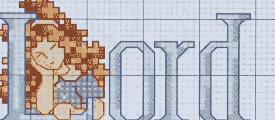

赐我耐心。

| DMC 绣线 | XS | BS | FK | SS | XS | BS | FK | SS | BD |
|---|---|---|---|---|---|---|---|---|---|
| 3823 | | | | | 987 | | | | |
| 678 | | | | | 504 | | | | |
| 951 | | | | | 563 | | | | |
| 945 | | | | | 561 | | | | |
| 225 | | | | | 739 | | | | |
| 327 | | | | | 492 | | | | |
| 3746 | | | | | 122 | | | | |
| 340 | | | | | 3828 | | | | |
| 3746 | | | | | 869 | | | | |
| 824 | | | | | 301 | | | | |
| 932 | | | | | 300 | | | | |
| 3756 | | | | | 546 | | | | |
| 3266 | | | | | 10206 | | | | |
| 3769 | | | | | 130945 | | | | |
| 472 | | | | | 40123 | | | | |
| 581 | | | | | | | | | |

## 上帝保佑

## 因为赐给我们一个孩子

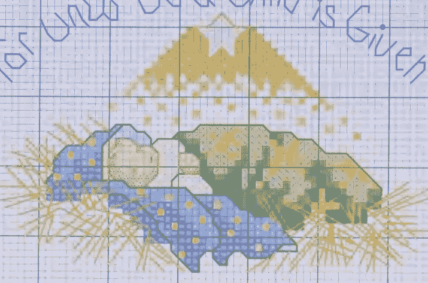

## 幸福的结合

## 彼此相爱

## 幸运的救主

## 心纯洁的谦卑

## 随从内心

## 愿与你同在。

## 愿神赐你丰盛

| DMC 绣线 | XS | BS | | XS | BS | FK |
|---|---|---|---|---|---|---|
| 米米色 | 794 | | | | | |
| 3822 | 793 | | | | | |
| 3820 | 3897 | | | | | |
| 744 | 792 | | | | | |
| 725 | 472 | | | | | |
| 676 | 3348 | | | | | |
| 729 | 3347 | | | | | |
| 783 | 3363 | | | | | |
| 951 | 367 | | | | | |
| 945 | 593 | | | | | |
| 604 | 501 | | | | | |
| 699 | 977 | | | | | |
| 316 | 3826 | | | | | |
| 3726 | 420 | | | | | |
| 3802 | 842 | | | | | |
| 3803 | 840 | | | | | |
| 3761 | 3781 | | | | | |
| 418 | 414 | | | | | |

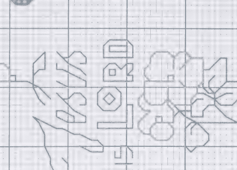

## 和马亚

## 喜悦到世界

## 求你赐给我们

我们日用的用粮。

## 温顺谦卑

这一日是主所造的。

让我们欢喜、快乐吧。

## 上帝是爱

## 要有光

## 恩典

## 寻求神的同在比寻求祂的礼物更有价值。

## 上帝是爱

## 在我们之中的天使

## 全地平安。祈祷。

| DMC 绣线 | DMC 绣线 | DMC 绣线 | DMC 绣线 |
|---|---|---|---|
| XS BS | XS BS FK | XS BS FK | XS BS FK LD |
| 白色 | 3354- | | | 828 | 367 |
| 3827 | 917 | 3752 | 471 |
| 3821 | 3866 | 930 | 3053 |
| 3829 | 3743 | 517 | 3345 |
| 729 | | 797 | 437 |
| 951 | 333 | 336 | 435 |
| 776 | 775 | 368 | 420 |

## 信心。慈爱

## 道路。真理与光

## 上帝的时间

| DMC 绣线 | DMC 绣线 | DMC 绣线 | XS | BS | XS | BS |
|---|---|---|---|---|---|---|
| 白色 | | | 3687 | | | |
| 米米色 | | | 917 | | | |
| 3822 | | | 315 | | | |
| 3821 | | | 340 | | | |
| 729 | | | 793 | | | |
| 愿与你同在 | | | | | | |

## 喜悦到世界

## 上帝

## 和马亚

## 接受我的感谢，我无言以对。

向天本身就是祈祷。

| DMC 绣线 | XS | BS | FK | DMC 绣线 | XS | BS |
|---|---|---|---|---|---|---|
| 白色 | | | | 3746 | | | |
| 822 | | | | 471 | | | |
| 3822 | | | | 3051 | | | |
| 3727 | | | | 3264 | | | |
| 316 | | | | 301 | | | |
| 3726 | | | | 833 | | | |
| 3802 | | | | 320 | | | |
| 3041 | | | | 319 | | | |
| 3749 | | | | 944 | | | |
| 550 | | | | 3790 | | | |
| 340 | | | | | | |

感恩是灵魂绽出的最美的花。

助人的的手使心灵快乐。

## 你太友好了

感恩是储存在心中，而非脑中。

| DMC 绣线 | XS | BS | FK | BD |
|---|---|---|---|---|
| 746 | | | | |
| 677 | | | | |
| 676 | | | | |
| 729 | | | | |
| 781 | | | | |
| 951 | | | | |
| 945 | | | | |
| 3689 | | | | |
| 3688 | | | | |
| 3687 | | | | |
| 3685 | | | | |
| 740 | | | | |
| 3746 | | | | |
| 596 | | | | |
| 597 | | | | |
| 3809 | | | | |
| 3808 | | | | |
| 3012 | | | | |
| 472 | | | | |
| 171 | | | | |
| 3051 | | | | |
| 937 | | | | |
| 936 | | | | |
| 3776 | | | | |
| 3777 | | | | |
| 869 | | | | |
| 7122 | | | | |
| 或 DMC 400 | | | | |
| 632 | | | | |
| 838 | | | | |
| 62012 | | | | |

## 感谢

Kreinusk #4 编织 Mill Hill 珠。

## 你的善良不胜感激

教我如何感谢你。

凡事感谢感谢。

有时我感激涕表。

我想要找个人一起大笑 - 我该如何感谢你？

## 感谢你成为真朋友

## 感恩的心

## 非常感谢你

## 不胜感激

## 非常感之

## 感谢你保守守秘密。

# 绣线与针法说明

| DMC 绣线 | XS | BS | FK | DMC 绣线 | XS | BS | FK | DMC 绣线 | XS | BS | FK |
|---|---|---|---|---|---|---|---|---|---|---|---|
| 002C 或 DMC 3820 | | | | 797 | | | | 503 | | | |
| 3712 | | | | 823 | | | | 3808 | | | |
| 3328 | | | | 3814 | | | | 061C 或 DMC 356 | | | |
| 3712 | | | | 797 | | | | | | | |
| 3822 | | | | 823 | | | | | | | |
| 632 | | | | | | | | | | | |
| 838 | | | | | | | | | | | |

## 简介

## 描述

## 股数

## 十字绣

## 准备

## 完成尺寸

## 通用说明

## 绣线

## 清洁成品

## 图案居中

## 阿及利亚锁线针（AE）

## 交叉绣（XS）

针法按行完成，或在需要时在某一区域内逐针完成。

1. 将针头插入 A 处的织物线之间。
2. 从 B 处向下。围绕中心绕几次，每次将针向下。
3. 从 C 处起针并在 D 处向下，以此类推。
4. 要完成形成“X”的顶部针法，从 E 处起针并在 B 处向下，从 C 处起针并在 F 处。所有的顶部针法应保持相同的方向。

## 回针绣（BS）

1. 将针头插入 A 处的织物线之间。
2. 从 B 处向下，向右一个开口。
3. 从 C 处起针。
4. 从 A 处向下，向右一个开口。

## 锁眼绣（ES）

1. 将针头插入 A 处的织物线之间。

## 珠子固定（BD）与饰物固定（TR）

珠子和饰物的朝向应与顶部针法相同。

1. 完成交叉绣的一半。
2. 将针头插入 A 处的织物线之间。
3. 在 B 处向下之前穿过一颗珠子，从 A 的斜向开口。
4. 为了加固针法，再次从 A 处起针，再次穿过珠子，或分开线使其绕过珠子后从 B 处向下。

## 法国结（FK）

1. 将针头插入 A 处的织物线之间，使用两股线。
2. 将线松散地绕在针上。
3. 从 B 处向下，位于 A 的相对对面。当针穿过织物时拉紧线。
4. 将线引到作品背面的两个线结之间。

## 长针绣（LS）

1. 将针头插入 A 处的织物线之间。
2. 从 B 处向下，跨越两根线。重复 A-B 完成每一步针。针法可以是如示例 1、2 和 3 所示的水平、垂直或斜线。针的长度应与图谱所示的长度一致。

## 缎绣（SS）

## 半交叉绣（HC）

针法从左到右水平按行完成。

1. 将针头插入 A 处的织物线之间。
2. 从 B 处向下，形成一个直针。
3. 从 C 处起针并在 D 处向下，形成另一个紧贴第一针针的平滑直针，覆盖该区域。针法之间不应重叠。

## 墨西哥加菊绣（LD）

1. 将针头插入 A 处的织物线之间。
2. 从 B 处向下，使用与 A 相同的开口。
3. 从 C 处起针，跨过下方两根线。穿过时将线保持在针下方形成一个环。
4. 从 D 处向下，跨过一根线。
5. 重复以填充设计区域。

## 丝线技巧

- 线段长度应为 12"–15"。
- 混色线之间的颜色差异以及丝线在织物上的褪色是丝线的常见现象。
- 丝线可以在同一作品中与棉线混合使用。
- 使用变色线时，应逐针制作每处针法，而不是在整行的反面跨越针法。
- 丝线交叉绣作品应干洗而非手洗。

## DMC 转换表

| DMC = Kreinik | DMC = Kreinik | DMC = Kreinik | DMC = Kreinik |
|:---|:---|:---|:---|
| 雪白色 Blanc | 367 | 1835/342 | 554 | 3312 | 725 |
| 米白色 Ecru/F2/F13 | 368 | 1832/1842 | 561 | 146 | 726 |
| 208 | 1334/3334 | 369 | 1841 | 562 | 143 | 727 |
| 209 | 1342/3334 | 370 | 2214 | 563 | 143 | 729 | 234/45 |
| 210 | 3334 | 372 | 3883 | 564 | 141 | 730 |
| 211 | 3333 | 400 | 4141/421 | 580 | 516 | 731 | 2216 |
| 221 | 4623/4624 | 402 | 632/2622 | 581 | 2124 | 732 | 2124 |
| 223 | 4622 | 407 | 4611 | 597 | 132 | 733 | 2221 |
| 224 | 4621 | 413 | 3445 | 598 | 1721/1723 | 734 | 2211 |
| 225 | 1011 | 414 | 3442 | 602 | 3014 | 738 | 3821/4112 |
| 300 | 4142 | 415 | 3451 | 603 | 3013 | 739 | 424 |
| 301 | 2625 | 420 | 526 | 604 | 3021 | 740 | 624 |
| 304 | 9433/1026 | 422 | 3812 | 605 | 3021 | 741 | 611/624 |
| 307 | 543 | 433 | 4116/4122 | 606 | 915/935 | 742 | 545 |
| 309 | 2934/2945 | 434 | 4516 | 608 | 635 | 743 | 536 |
| 310 | Noir | 435 | 4236 | 610 | 3835 | 744 | 2532 |
| 311 | 1716 | 436 | 4235 | 611 | 4534 | 745 | 2542 |
| 312 | 1715 | 437 | 4234 | 612 | 3833 | 746 | 2541 |
| 315 | 4646 | 444 | 536 | 613 | 3832 | 747 | 1723 |
| 316 | 4634 | 451 | 3414 | 632 | 4143 | 754 | 1012 |
| 317 | 3445 | 452 | 4512/3414 | 640 | 3830 | 758 | 2912 |
| 318 | 3442 | 453 | 3512/3413 | 642 | 3713 | 760 | 1013/2932 |
| 319 | 1845 | 469 | 2125 | 644 | 3422 | 762 | 3641 |
| 320 | 1830 | 470 | 245/2125 | 645 | 3844 | 772 | 2113 |
| 321 | 941/943 | 471 | 2114 | 646 | 3843 | 775 | 1441 |
| 322 | 4922 | 472 | 2122/2123 | 647 | 1734 | 776 | 2941 |
| 326 | 1026 | 498 | 945/1026 | 648 | 3841 | 777 | 4631/4634 |
| 327 | 3315 | 500 | 1846 | 666 | 915/935 | 778 | 3810/3862 |
| 333 | 1344 | 501 | 1841/3426 | 672 | 2242 | 781 | 2824 |
| 334 | 1434 | 503 | 1843 | 677 | 2141 | 782 | 2244 |
| 335 | 3014 | 504 | 1822 | 680 | 524 | 783 | 2244 |
| 336 | 1423 | 517 | 1446/1725 | 699 | 225 | 791 | 1345 |
| 340 | 1343 | 518 | 1444 | 700 | 226 | 793 | 4913 |
| 341 | 1433 | 519 | 1942 | 701 | 235 | 794 | 1434 |
| 347 | 2924 | 520 | 3726 | 702 | 224/236 | 796 | 116 |
| 349 | 915/935 | 522 | 1832/1842 | 703 | 223 | 797 | 4924 |
| 350 | 914/934 | 523 | 1841 | 704 | 221 | 798 | 4923 |
| 351 | 924 | 524 | 3423 | 712 | Brut | 799 | 4922 |
| 352 | 932/933 | 535 | 3844 | 718 | 1043 | 800 | 4921 |
| 353 | 921/2913 | 543 | 3431 | 720 | 634 | 801 | 4915 |
| 355 | 2636 | 550 | 3336/3315 | 721 | 645 | 801 | 115 |
| 356 | 4612 | 553 | 3313 | 722 | 633 | 806 | 126 |
| 807 | 125 | 907 | 244 | 973 | 536 | 3350 | 3025 |
| 809 | 1434 | 909 | 225 | 975 | 4215 | 3354 | 2021/3011 |
| 813 | 1443 | 910 | 226 | 976 | 4212 | 3362 | 3726 |
| 814 | 2926/4625 | 911 | 214 | 977 | 611/2546 | 3363 | 1832/1833 |
| 815 | 2925 | 913 | 213 | 986 | 1845 | 3364 | 1831/3723 |
| 816 | 946 | 917 | 103 | 4534 | 2136 | 373 | 3136 |
| 817 | 916 | 918 | 412 | 3835 | 2115 | 3609 | 1312 |
| 818 | 2942 | 919 | 263 | 3836 | 233 | 3825 | 3024 |
| 819 | 1011 | 920 | 265 | 3826 | 231 | 3687 | 3026 |
| 820 | 116 | 921 | 2615 | 399 | 3012 | 3688 | 1042 |
| 821 | 942 | 922 | 33 | 3 | 3 | 3 | 3689 | 3031 |
| 822 | 3711/3831 | 922 | 644 | 3993 | 3689 | 3031 |
| 823 | 163/1425 | 924 | 205 | 995 | 114 | 3705 | 9134 |
| 824 | 115 | 926 | 996 | 133 | 3706 | 932 |
| 825 | 1446 | 927 | 1744 | 3011 | 516 | 3708 | 1022 |
| 826 | 113 | 928 | 1742 | 3012 | 124 | 3712 | 2914 |
| 827 | 1442 | 930 | 1715 | 3013 | 322 | 3716 | 3021 |
| 828 | 1721 | 931 | 1714 | 3021 | 325 | 3722 | 4615 |
| 829 | 526 | 932 | 1712 | 3023 | 3422 | 3727 | 3031 |
| 830 | 2214 | 934 | 3726 | 3024 | 3821 | 3731 | 3013 |
| 831 | 2214 | 935 | 2126 | 3031 | 4115 | 3733 | 3022 |
| 832 | 2235 | 937 | 516 | 3032 | 4534 | 3743 | 3322 |
| 833 | 2233 | 938 | 4124 | 3033 | 3711 | 3746 | 1343 |
| 834 | 2242 | 939 | 165 | 3041 | 4635 | 3747 | 4911 |
| 835 | 4124 | 945 | 2632 | 3042 | 4633 | 3750 | 1712 |
| 839 | 3433 | 946 | 634 | 3045 | 3742 | 3752 | 1712 |
| 840 | 3345/3334 | 948 | 2911 | 3046 | 2361 | 3755 | 1152 |
| 841 | 3341 | 950 | 2912 | 3047 | 2541/2542 | 3760 | 1645 |
| 842 | 3431/4531 | 951 | 4241 | 3051 | 2126 | 3761 | 1722 |
| 844 | 3844/3846 | 954 | 1431 | 3052 | 3723 | 3765 | 1226 |
| 869 | 526 | 955 | 141 | 3053 | 3722 | 3766 | 125 |
| 890 | 1836/1845 | 956 | 1024 | 3064 | 4111 | 3768 | 1745 |
| 893 | 1014 | 957 | 1022 | 3072 | 111/1813 | 3770 | F13 |
| 894 | 1022 | 958 | 5013 | 3078 | 2521 | 3772 | 4611 |
| 895 | 1845 | 959 | 5012 | 3326 | 3021 | 3774 | 2911 |
| 898 | 4131/4124 | 961 | 3013 | 3328 | 2915 | 3778 | 2642 |
| 899 | 2933 | 962 | 3022 | 3340 | 2912 | 3779 | 2912 |
| 900 | 635/636 | 963 | 2942 | 3341 | 2911 | 3787 | 3344 |

## 单位换算表

`mm`-毫米，`cm`-厘米。英寸转换为毫米和厘米。

| 英寸 | 毫米 | 厘米 | 英寸 | 厘米 | 厘米 |
|---|---|---|---|---|---|
| ¼ | 3 | 0.3 | 9 | 22.9 | 30 | 76.2 |
| ½ | 6 | 0.6 | 10 | 25.4 | 31 | 78.7 |
| ¾ | 10 | 1.0 | 11 | 27.9 | 32 | 81.3 |
| 1 | 13 | 1.3 | 12 | 30.5 | 33 | 83.8 |
| 1½ | 16 | 1.6 | 13 | 33.0 | 34 | 86.4 |
| 1¾ | 19 | 1.9 | 14 | 35.6 | 36 | 88.9 |
| 2 | 22 | 2.2 | 15 | 38.1 | 36 | 91.4 |
| 2¼ | 25 | 2.5 | 16 | 40.6 | 37 | 94.0 |
| 2½ | 32 | 3.2 | 17 | 43.2 | 38 | 96.5 |
| 2¾ | 38 | 3.8 | 18 | 45.7 | 39 | 99.1 |
| 3 | 44 | 4.4 | 19 | 48.3 | 40 | 101.6 |
| 3¼ | 51 | 5.1 | 20 | 50.8 | 41 | 104.1 |
| 3½ | 62 | 6.4 | 21 | 53.3 | 42 | 106.7 |
| 3¾ | 76 | 7.6 | 22 | 55.9 | 43 | 109.2 |
| 4 | 89 | 8.9 | 23 | 58.4 | 44 | 111.8 |
| 4¼ | 102 | 10.2 | 24 | 61.0 | 45 | 114.3 |
| 4½ | 114 | 11.4 | 25 | 63.5 | 46 | 116.8 |
| 4¾ | 127 | 12.7 | 26 | 66.0 | 47 | 119.4 |
| 5 | 152 | 15.2 | 27 | 68.6 | 48 | 121.9 |
| 6 | 178 | 17.8 | 28 | 71.1 | 49 | 124.5 |
| 7 | 203 | 20.3 | 29 | 73.7 | 50 | 127.0 |

## 索引

- 阿及利亚针法（AE）124
- 关于作者 3
- 回针法（BS）124
- 珠子固定（BD）和宝藏固定（TR）124
- 流线运针 123
- 庆祝活动 30-41
- 居中设计 123
- 完成作品的清洁 123
- 交叉绣（XS）124
- 锁眼针（ES）124
- 交叉绣用布料 122
- 完成作品尺寸 122-123
- 绣线 123
- 法国结（FK）125
- 友谊 4-15
- 一般说明 122-125
- 半钩针法（HC）125
- 感人 16-29
- 家庭与生活 30-56
- 引言 122
- Kreinik 换算表 126-127
- 散步花针（LD）125
- 生命之线 58-73
- 长针法（LS）125
- 爱情 74-87
- 励志 88-95
- 交叉绣用针 123
- 线股数 122
- 准备布料 122
- 缎面绣（SS）125
- 固定 123
- 丝线技巧 123
- 简单快乐 96-103
- 精神世界 104-115
- 目录 3
- 感谢 116-121
- 丝线描述 122

用交叉绣诉说吧！

每当你有一个交叉绣项目时，都可以从`555`个小短语和精美图案中选择，每个人都会知道你的感受是发自内心的。你是在为新婚装饰毛巾吗？在为圣诞树设计装饰品吗？还是在为母亲节制作装裱画？无论是送给特别的人的礼物，还是点缀家的装饰，这些图案都能为你增色添彩。
