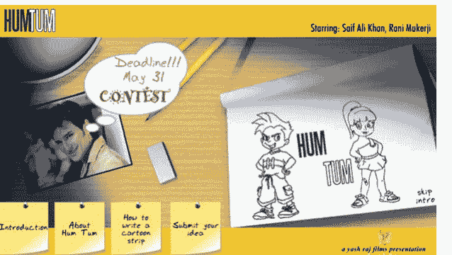

# 媒体作者身份指南：Gray／媒体作者身份指南

## 撰稿人简介

**赫克托·阿马雅 (Hector Amaya)** 是弗吉尼亚大学媒体研究的副教授。他致力于研究政治身份的文化生产，以及文化流动和移民改变民族国家的复杂方式。他是 *Screening Cuba: Film Criticism as Political Performance During the Cold War* 和 *Citizenship Excess: Latinas/os, Transnationalism, Media, and the Ethics of Nation* 的作者。

**梅根·萨普纳·安克森 (Megan Sapnar Ankerson)** 是密歇根大学传播研究的助理教授。她在 *New Media and Society*、*NMediaC* 以及包括 *Convergence Media History*、*Web History* 和 *Digital Confidential* 在内的选集中发表过文章。她正在撰写一本探索互联网泡沫期间网页设计产业的商业发展、生产文化和美学的书。

**Olufunmilayo Arewa** 是加州大学欧文分校法学院的法律与人类学教授。她的研究重点是创意产业、版权和技术。她撰写过关于非裔美国音乐和尼日利亚 Nollywood 电影产业的各种主题，目前正在进行两个关于 Nollywood 和非裔美国音乐全球影响的独立书籍项目。

**大卫·布里斯宾 (David Brisbin)** 担任过 20 多部电影的场景设计，涵盖了从激进的独立电影（*《药店牛仔》(Drugstore Cowboy)*、*《我的私人爱达荷》(My Own Private Idaho)*、*《切口》(In The Cut)*、*《单次射击》(A Single Shot)*）到流行的“大制作”商业片（*《暮光之城：新月》(The Twilight Saga: New Moon)*、*《地球停转之日》(The Day The Earth Stood Still)*）。他还导演了一部关于柬埔寨的纪录长片，并在温哥华的卡皮拉诺大学和香港演艺学院教授场景设计。

**科林·伯内特 (Colin Burnett)** 是圣路易斯华盛顿大学电影与媒体研究的助理教授。他目前正在撰写一部名为 *The Invention of Robert Bresson: Auteurism and Cinephilia in Postwar France* 的书稿。

## 贡献者简介

**Kristina Busse** 是一位独立学者和活跃的媒体粉丝，发表过多篇关于同人小说（fan fiction）和粉丝文化的论文。她是 *Fan Fiction and Fan Communities in the Age of the Internet* 和 *Sherlock and Transmedia Fandom* 的共同编辑，同时也是开放获取国际同行评审粉丝研究期刊 *Transformative Works and Cultures* 的创始共同编辑。

**John T. Caldwell** 是加州大学洛杉矶分校的电影与媒体研究教授。他的著作包括 *Production Culture: Industrial Reflexivity and Critical Practice*、*Televisuality: Style, Crisis, and Authority in American Television*、*Production Studies: Critical Studies of Media Industries*（共同编辑）、*New Media: Theories and Practices of Digitality*（共同编辑）以及 *Electronic Media and Technoculture*。

**Mia Consalvo** 是蒙特利尔康考迪考大学（Concordia University）游戏研究与设计的加拿大研究主席。她是 *Cheating: Gaining Advantage in Videogames* 的作者，目前正在撰写一本关于日本对电子游戏产业和游戏文化影响的书籍。她曾在麻省理工学院（MIT）、俄亥俄大学、日本中部大学以及威斯康星大学密尔沃基分校任职。

**Brian Ekdale** 是爱荷华大学新闻与大众传播助理教授。他关于新媒体、国际大众传播和媒体制作的研究发表在 *New Media & Society*、*Information, Communication & Society* 和 *Africa Today* 等期刊上。他曾导演并编辑过获奖纪录片。

**Ian Gordon** 是新加坡国立大学历史学副教授。他是 *Comic Strips and Consumer Culture* 的作者，并编辑了 *Comics & Ideology* 和 *Film and Comic Books*。近期的论文包括发表在 *La bande dessinée: une médiaculture* 中的 “La bande dessinée et le cinéma: des origines au transmédia”。

**Jonathan Gray** 是威斯康星大学麦迪逊分校的媒体与文化研究教授。他是 *Watching with The Simpsons: Television, Parody, and Intertextuality*、*Television Entertainment; Show Sold Separately: Promos, Spoilers, and Other Media Paratexts* 的作者；并与 Amanda Lotz 合著了 *Television Studies*。他还是 *Fandom: Identities and Communities in a Mediated World*、*Battleground: The Media* 以及 *Satire TV: Politics and Comedy in the Post-Network Era* 的共同编辑。

**John Hartley** 是西澳大利亚科廷大学（Curtin University）文化科学教授及文化与技术中心主任。他是 ARC 创意产业与创新卓越中心的共同创始人，以及 *International Journal of Cultural Studies* 的编辑。近著包括 *Digital Futures for Media and Cultural Studies*、*A Companion to New Media Dynamics*（编）和 *Key Concepts in Creative Industries*。

**Daniel Herbert** 是密歇根大学屏幕艺术与文化助理教授。他的研究致力于理解媒体产业、地理位置与文化身份之间的关系。他的论文发表在多个合集和期刊中，包括 *Canadian Journal of Film Studies*、*Film Quarterly*、*Millennium Film Journal* 和 *Quarterly Review of Film and Video*。

**Matt Hills** 是英国卡迪夫大学媒体与文化研究高级讲师（Reader）。他著有五本书，包括 *Fan Cultures* 和 *Triumph of a Time Lord*。Matt 在邪典媒体（cult media）和粉丝领域发表了大量著作，目前正在为 I.B. Tauris 出版社完成一项关于 *Torchwood* 的研究。

**Michele Hilmes** 是威斯康星大学麦迪逊分校的媒体与文化研究教授，兼任传播艺术系主任。她的近期出版物包括 *Only Connect: A Cultural History of American Broadcasting*（第三版）和 *Network Nations: A Transnational History of British and American Broadcasting*。她目前的项目是与 Jason Loviglio 共同编辑的 *Radio’s New Wave: Global Sound in the Digital Era*。

**Lindsay Hogan** 是威斯康星大学麦迪逊分校媒体与文化研究的博士候选人。她的研究兴趣包括电视与新媒体产业、明星与名流，以及定性的受众研究。她的论文探讨了年轻明星如何调解青少年/前青少年（teen/tween）身份实践与媒体巨头经济改编之间的关系。

**Catherine Johnson** 是诺丁汉大学文化、电影与媒体讲师。她是 *Branding Television* 和 *Telefantasy* 的作者，以及 *Transnational Television History* 和 *ITV Cultures* 的共同编辑。她目前的研究旨在考察为屏幕产业制作宣传材料的更广泛的创意产业部门。

**Derek Johnson** 是威斯康星大学麦迪逊分校媒体与文化研究助理教授，其工作重点是理解媒体产业内的制作文化、文化等级和创意身份。他是 *Media Franchising: Creative License and Collaboration in the Culture Industries* 的作者，并在 *Media, Culture & Society*、*Cinema Journal* 和 *Popular Communication* 等期刊上发表过文章。他还是即将出版的 *Intermediaries: Management of Culture and Cultures of Management* 的共同编辑。

**Aswin Punathambekar** 是密歇根大学传播研究助理教授。他是 *Global Bollywood* 的共同编辑，著有 *From Bombay to Bollywood: The Making of a Global Media Industry*，并在多种期刊和选集中发表过文章。

**Katrien Type** 是一位人类学家，她的博士论文研究金沙萨的电视连续剧制作，随后作为牛顿研究员在金沙萨研究新闻业与记忆。她目前是麻省理工学院（MIT）和鲁汶大学（KU Leuven）的玛丽·居里研究员，研究金沙萨老年人群体生活世界中的媒体。她是 *The Making of the Pentecostal Melodrama: Religion, Media and Gender in Kinshasa* 的作者。

**Anamik Saha** 是利兹大学传播研究学院的传播研究讲师，此前曾获得 ESRC 博士后研究奖学金。他还曾在三一学院（康涅狄格州）和麻省理工学院担任访问研究员。他的作品发表在 *Media, Culture & Society*、*Ethnic and Racial Studies* 和 *Popular Music in Society* 等期刊上。

**Suzanne Scott** 是欧西得胶大学（Occidental College）数字学习与研究中心的梅隆数字学术博士后研究员，也是 *Transformative Works and Cultures* 的董事会成员。她的作品出现在 *Cyclons in America: Critical Studies in Battlestar Galactica*、*The Participatory Cultures Handbook*、*How to Watch Television* 以及 *Textual Poachers: Television Fans and Participatory Culture* 的周年纪念版中。

**Louisa Ellen Stein** 是米德伯里学院（Middlebury College）的助理教授。她的工作重点是媒体文化中的跨媒体创作、性别与世代。她是 *Teen Television* 和 *Sherlock and Transmedia Fandom* 的共同编辑。她是“娱乐之未来”研究员，并担任 *Cinema Journal* 的书评编辑。她目前的书籍项目 *Millennial Media* 探讨了千禧一代的数字创作和粉丝行为。

**Stephen Teo** 是新加坡南洋理工大学 Wee Kim Wee 传播与信息学院播送与电影研究分部副教授兼主任。他是 *Hong Kong Cinema: The Extra Dimensions*、*Wong Kar-wai, Director in Action: Johnnie To and the Hong Kong Action Film* 和 *Chinese Martial Arts Cinema: The Wuxia Tradition* 的作者。

# 1

## 导论

### 媒体作者身份的问题
Derek Johnson 和 Jonathan Gray

既然关于媒体作者身份（media authorship）似乎已经有了如此多的讨论，为什么还要写一本关于这个主题的书呢？也许我们最好转向 Facebook，例如，我们的新闻推送经常被关于流行文化背后创意从业者及其对屏幕呈现之意义的讨论所占据。“大卫·柯南伯格拍摄的是奇怪的电影，”某位编辑熟人分享的一篇文章的第一行这样宣布。¹ 往下翻两项，另一位朋友的一张图片绘制了许多美国热门电视节目的写作团队，并将乔斯·韦登（Joss Whedon）视为所谓的“父亲”般的人物。韦登在另一位朋友的帖子中再次出现，该帖子链接到一篇关于 *The Avengers* 的《纽约时报》评论，其标题大胆地宣布“电影的超级英雄包括导演”，² 并进一步链接到关于“乔斯·韦登的工作”的幻灯片演示。

然而，在这一天——5月4日，或者对某些人来说是“星球大战日”——韦登的光芒被许多讨论乔治·卢卡斯的条目掩盖了。其中一些赞美他作为大师级讲述者的美德，许多则对他“干涉”自己的电影表示失望，还有许多将他与克里斯托弗·诺兰、J.K. 罗琳、J.R.R. 托尔金和苏珊·柯林斯等其他特许经营作者形象进行比较。其他帖子则在辩论或热情地评论各种报纸专栏作家和媒体专家在早晨或前一晚发表的评论。还有另一条链接到了在线作者兼演员 Felicia Day 的最新视频。

在点击这些链接的同时，许多随附的广告利用其作者来销售：例如，一个侧边栏将 *The Five Year Engagement* 宣传为“来自 *Bridesmaids* 的制片人”，而另一个将 *The Lucky One* 宣传为“来自备受赞誉的畅销书 *The Notebook* 和 *Dear John* 的作者”，而另一个关于新 *Walking Dead* 电子游戏的广告则提供了一条更复杂的作者线索，指出它既基于罗伯特·柯克曼（Robert Kirkman）的漫画系列，也基于 AMC 的电视系列剧。在同一个推送中，电视学者 Jason Mittell 甚至宣布他刚刚发表了一个章节（关于电视作者身份的，

（数量不少！）他正在创作的书 *Complex TV* 的部分内容，这是一次持续同行评审的实验，其中米特尔（Mittell）鼓励读者发表评论（从而在某种程度上成为“共同作者”），以便他在纸质版出版前对书稿进行修改。此类项目不仅引起了人们对媒介作者身份（authorship）的关注，还引起了对作者身份如何被媒介化（mediated）的关注，在这种情况下，我们在创作过程中使用的技术和平台似乎使社会化和协作式的文化生产形式成为可能。因此，虽然一位恰好在编辑一本关于作者身份的书的 Facebook 用户的动态信息流肯定受到了一定程度的自我筛选影响，但至少可以合理地推断，关于作者身份的广泛论述已经在流通，也许这本书并不需要专门用来引起我们对媒介作者或媒介作者身份重要性的关注。

然而，这本书能做的是，指出在我们日常生活周围的所有关于媒介作者身份的论述和议题中，那些经常被省略的部分。在当今几乎任何媒介产品的宣传或营销中，如果没有引用至少一个作者形象，这在现在是很罕见的。然而，每一个产品都承载着未被提及的作者之魂。例如，《五年约会》（*The Five Year Engagement*）可能出自《伴娘》（*Bridesmaids*）制片人之手，但谁导演了它？谁写了剧本？在关于“星球大战日”（*Star Wars Day*）的一位朋友的 Facebook 帖子下，有人评论称《星球大战》（*Star Wars*）在很大程度上借鉴了约瑟夫·坎贝尔的《千面英雄》（*The Hero with a Thousand Faces*）³，而另一个人则注意到《新希望》（*A New Hope*，1977年）多次借鉴了《隐形的要塞》（*Hidden Fortress*，1958年）。此外，关于改编的讨论经常导致对“毁掉”纯洁原作以及文本不忠的指责，因此，引用《笔记本》（*The Notebook*）和《亲爱的约翰》（*Dear John*）那位“备受赞誉的畅销书作者”，不仅奇怪地召唤了一个没有名字的作者，而且旨在引起人们对糟糕改编以及偏离“作者原意”的担忧。而在上述每一个文本背后，我们可以列出至少数十个，甚至数千个其他“英雄作者”的面孔，他们是为文本的创造、构思和实现做出贡献，但名字未被列出的个体。以《星球大战》为例，除了指出坎贝尔和《隐形的要塞》导演黑泽明明显的影像，我们还可以询问其他导演、编剧、制片人、演员、美术指导、特效设计师、遮罩艺术家（matte artists）、音效设计师、拟音师（foley artists）等人的作者权力。其中一些人物在流行文化中本身已经获得了作者或伪作者的地位，比如《星球大战》音乐的作曲家约翰·威廉姆斯（John Williams）、音效设计师本·伯特（Ben Burtt），或者演员凯莉·费雪（Carrie Fisher），她后来成为了编剧，因此经常被描述为写了部分对话。然而，其他人仍然未被推崇，除非是由最忠实且知情的粉丝和/或制作社群所提及。

在某种程度上，对作者的不断引用揭示了文化对他们的痴迷，以及被赋予他们的超级权力。媒介传递的叙事——无论是虚构的还是非虚构的——成为了我们清醒和睡眠生活中如此多讨论和思考的资源，因此，我们经常发现自己热衷于找出是谁制作了它们以及如何制作的，这也就顺理成章了。作者作为一种形象，通常被设定为创造产品的个体，他或她是我们可以感谢或责备的对象，也是随后将产品“给予”我们的人（注意文本被描述为“来自”某位作者的语言，就像一封邮寄的包裹）。因此，作者被想象成站在创造力、创新、奇迹和魔力与我们——所有在日常平凡空间中体验并享受媒介文化的人——之间的门户和门槛上。如果我们想要理解那个奇迹和魔力的世界是如何运作的，作者通常被设定为我们必须捕捉和研究的形象。我们为什么不想知道魔术师是谁，以及他的把戏是如何表演的呢？

在另一个层面上——以免所有关于奇迹和魔力的谈论让读者皱起愤世嫉俗的眉头——这种对作者身份的广泛兴趣也揭示了文化对于他们究竟有多么“神奇”的一种怀疑。我们不应将这整套由创造力、平凡性以及处于两者之间的“魔术师作者”构成的系统视为理所当然，而应将其视为一种论述建构（discursive construct）。将世界分为神奇与平凡，服务于谁的利益？如果作者是中介形象，那么谁有权力创造这个形象并将其安置在那个门槛上？换句话说，将作者普遍视为魔术师意味着什么，而将某个特定个体视为“作者-魔术师”又意味着什么？如上所述，每一位被指名的作者背后都有大量的幽灵作者，他们的名字没有被提及——无论是通过广告活动、评论还是被质疑的粉丝。那么，在某种环境下推销一个作者（“《伴娘》的制片人”），在另一种环境下推销另一个作者（“来自备受赞誉的畅销书作者”）的战略原因是什么？谁有权决定谁“算数”，谁在为此争论，以及我们为什么会为此争论？作者的名字被期望发挥什么样的文化作用？

让我们简要跟进乔治·卢卡斯（George Lucas）的案例。当卢卡斯影业（Lucasfilm）或二十世纪福克斯（Twentieth Century Fox）将他推销为一个杰出的作者形象时，他们显然有其理由。在一个电影数量远超任何一个人能看完的世界里，宣布这部电影很特别，它来自一个真正的远见卓识者，旨在让卢卡斯的任何电影在其他电影中脱颖而出。在这个意义上，媒介作者身份的作用与“明星制”（star system）非常相似：它是好莱坞营销和推广机器生产的一种产品差异化形式，用于在拥挤的市场中区分产品。当然，这种相似性也帮助我们意识到事情并非如此简单，因为卢卡斯影业和福克斯实际上将电影推销为“多作者”作品，指向其他演员和工作人员，我们同样被鼓励将他们的工作视为完全独特、开创性的且神奇的。这给那些参与“乔治·卢卡斯电影”的人带来了实际挑战，因为需要建立一个关于谁控制什么的层级结构。如果一大群人都拥有所谓的独特远见能力，那么如何将他们全部聚集在一起？在任何需要协作的艺术形式中——就像几乎所有形式的大众媒介一样——作者身份不仅需要神奇的想法，还需要相当 amount 的管理。换句话说，卢卡斯、卢卡斯影业和福克斯如何确保约翰·威廉姆斯能写出最好的音乐，哈里森·福特能提供最好的表演，劳伦斯·卡斯丹能写出最好的剧本，等等，同时让他们能结合在一起，形成某种不仅仅是相互冲突的创意行为的嘈杂集合体？但这些个体及其营销团队必须执行的持久管理同样是论述性的。除了实际的谁做什么之外，卢卡斯、卢卡斯影业和福克斯（以及现在的迪士尼）会鼓励我们将某些作者视为比其他作者更活跃。控制和价值的层级不仅在片场是必要的，在新闻报道和大众对“什么是创造力”的想象中也是必要的。

在此可以见证卢卡斯影业与一些《星球大战》粉丝之间的博弈。后者经常质疑《星球大战》“属于”卢卡斯影业，因此觉得可以自行对其进行“创作”。一些粉丝创作粉丝电影或粉丝小说，加入新角色，或改造已有的角色或事件。这样做就是挑战卢卡斯影业和卢卡斯垄断魔力领域的观念，因为粉丝们现在将自己定位在魔力与平凡的门槛上，允许自己自由移动，而不是将自己完全视为来自卢卡斯影业认可作者的馈赠的接收者。有时，卢卡斯影业通过不对粉丝行为的合法性提出挑战而“允许”这一点，通常这种允许发生在卢卡斯影业认为其经济和符号利益未受挑战时，即它不会失去收入，也不会失去对《星球大战》特许经营权含义及其运作的控制。然而，当其利益受到挑战时，就像好莱坞的大多数公司一样，它会迅速调用关于作者身份、权利和所有权的法律论述，以否认粉丝的作者权利。此外，它的做法并非简单的反应式，它还通过新闻发布会、“制作特辑”、蓝光附加资料、授权商品和书籍等投入大量资本，来精确决定谁算作作者，以及算作多少，以至于如果真的发生战场冲突，这场战斗是在一个不公平的竞技场上进行的。

因此，作者身份不仅关乎创造力和创新，更关乎控制、权力以及对意义和人员的管理。这使得作者身份成为现代媒介和文化中最重要的过程之一。作者是一个节点，美学、真理、意义和价值的论述必须经过这个节点，同时，资金、权力、劳动力和文化控制也必须经过这个节点，并且它经常作为站在大型组织（如卢卡斯影业或福克斯）与观众之间的中介形象。难怪学术界和普通公民都对作者产生无尽的痴迷。也难怪我们如此频繁地讨论作者，因为关于创作、美学、观众、生产、文化工业化、劳动力以及意义与金钱流动的争论，经常会用作者身份来表达。

由于作者在社会中承担着如此多实际的和论述性的角色，因此理解作者身份如何运作至关重要，而作者身份是考察媒介文化如何运作的关键切入点。在新型媒介和数字媒介时代，这些问题变得更加有趣。因为如果我们拥有

在上面简要讨论了像 *星球大战* 这种系列作品的作者身份后，让我们也思考一下引导我们进入这场讨论的入口，并询问在像 Facebook 这样的平台上，作者身份是什么样的。谁在创作我们的 Facebook 动态或 Twitter 流？这些是大规模的协作产物，它们挑战了单一英雄式作者身份的概念，并且更要求我们去质疑管理——无论是组织（Facebook）、个人（马克·扎克伯格或某个 Facebook 好友）、政策（Facebook 那臭名昭著且不断变化的、决定我们能看到什么和不能看到什么的隐私设置），还是算法和代码。即使是个人的状态更新或推文，也经常挑战一些简单的作者身份概念，因为它们一方面可能将发布者的文字与他人的文字相结合（转发或嵌入），另一方面则以某种方式构建链接内容，从而将发布者的声音添加到被链接主题的文字中。

因此，归根结底，虽然过去一百年左右的时间在西方社会是一个极度崇拜并执拗地相信单一作者的时期，但随着 Facebook、Twitter、Final Cut Pro、博客、YouTube 和 Pinterest 等平台的出现，协作的、融合的、混剪的作者身份变得更加明显且常态化。现在看来，正是一个极佳的时机，让我们停下来审视作者究竟是什么，以及作者身份是如何运作的。在赋予日常创作可能性的同时，数字时代或许已经扫除了一些浪漫主义和对魔法的迷信，而这些此前往往使关于作者的讨论陷入了单纯的美化之中。这是我们的希望，也是我们现在提供一系列关于媒体作者身份新陈述的原因。

在学术界，关于作者是什么、他们对文本拥有多少权威（或者说多少作者在行使权威）、我们作为分析者的实践赋予了他们多少权力、我们应该或不应该赋予他们多少权力、他们与文本的关系是什么、他们为文本做了什么以及对文本施加了什么，以及研究他们意味着什么，一直存在着激烈的争论。本集中的章节重新审视了这些问题，以提供新鲜的答案。无论我们关注的是艺术还是工业，创作还是接收，生产还是消费，文本还是理论，文化还是美学，或者以上所有，作者总会像个挥之不去的问题一样重新出现，等待被解决。然而，如果作者需要被“解决”，这也意味着关于作者身份如何运作的新答案、理论和理解，可能会对我们理解艺术、文本、生产文化、观众、权力、身份、美学和意义如何运作产生显著的连锁反应。

我们努力收集来自不同学科、针对各种媒体产品的作者的声音。因此，章节涵盖的作者身份范围极广：从罗伯特·布列松（Robert Bresson）的电影到 Square Enix 的电子游戏，从迪士尼对希拉里·达夫（Hilary Duff）的机构化作者身份到音乐制作的协作文化，从作为作者的视频店店员到作为自身及公民作者的国家，从内罗比贫民窟的业余视频叙事到宝莱坞广告与推广的商业策略，从 Twitter 上的作者身份到董事会里的作者身份，以及从漫画书的撰写到粉丝、音乐协调员、美术指导、演职人员、学者等人的作者实践。作者身份过去通常在高度封闭的环境中被研究，而我们汇集如此多样的主题、作者和学科框架的目标，就是通过比较来挖掘一些关于作者身份的基石真相。我们没有关于作者是什么 Definitive（最终）答案，在本次引言中也没有一个可以被划线或高亮从而激励读者开启后续旅程的简单陈述。相反，我们希望接下来的章节能挑战读者去思考作者身份运作的多种不同方式：作为美学和意义的媒介，作为权力与控制的行为，作为工业策略，作为某种需要去实践、去争夺、去赢得、被授予、被否认、被推迟和/或被共享的东西。总而言之，这意味着解决媒体作者身份问题的过程，既在于提出批判性的问题，也在于提供具体的答案。

## 章节摘要

虽然本书中的每个章节都提供了关于媒体作者身份的独特视角，但一组共同的研究问题将它们统一了起来。尽管我们 Facebook 动态（以及其他构建作者身份话语的站点）中的流行话语似乎暗示我们只要看到就能认出它，但本集中的章节首先将“什么是作者身份”这一问题问题化。这意味着不仅要接受对实践的默认定义和对创造力构成要素的默认假设，还要对所有这些文化生产是如何被想象并被赋予意义地进行批判性思考。媒体作者身份是通过什么样的论述和文化过程产生的？不同媒体的作者身份——以及更广泛的作者身份中介化——如何要求我们将注意力集中在创意主体及其实践展开并获得文化可理解性的语境中？这意味着不仅要思考媒体作者身份来自哪里，还要思考这种作者身份是围绕谁构建的、如何构建的、由谁构建、在什么样的文化空间中以及为了什么目的而构建。因此，作者身份不仅是一个艺术和个人表达的问题，也是一个管理文化生产的社会和制度结构的问题，这些结构在赋能、强制和授权某些形式的同时，限制了其他形式。

通过将作者身份视为一种文化——并因此将其视为我们可以同时构建和解构的东西——我们能够做的不止是在那些 Facebook 动态中证明那些值得关注的创意天才的合法性；相反，我们可以探索我们所做的作者归属和权威主张如何赋予中介化日常生活的实践（无论是创意性的还是非创意性的）以特定的价值和意义。我们可以进行实地研究，探索作者身份是如何被呈现为可见或不可见的。我们可以理解作者身份并非一种自然现象，而是一套在不同历史时刻和地理位置上被灵活调动的文化价值和关切。我们可以思考作者身份如何帮助构建媒体之间的等级制度，思考文学和电影如何通过对个人导演（auteurs）的天才和愿景的主张而获得合法性，而与之相对的是电视、电子游戏和新兴数字媒体中被标记为更具商业性或协作性的文化生产形式——在这些领域，相互竞争的作者身份主张现在正致力于构建新的创造力结构、实践和理想。在审视其与斗争和权力的关系时，我们可能无法以一种整洁、系统的方式定义作者身份，但我们可以开始理解支撑它的文化，以及它反过来所支持的文化。询问关于作者身份的问题，而不仅仅是产生关于作者身份的新主张，是触及这种文化的最佳方式。

### 引言

带着这些共同的问题，本书中展示的作者们能够在广泛不同的语境中研究作者身份，并产生一次集体干预。他们在尝试解决作者身份问题时提供的答案具有多样化的语调和基调，但正是这种多样化的方法和案例研究，产生了一种让最有价值的想法相互增强的和谐感。同样，这次集体贡献并不是对媒体作者身份的定义，而是一种超越定义并将该主题保留为开放性问题的尝试；本书作为一个整体，并非提供一个单一的定论，而是提出一个计划，探讨在创意实践及其学术研究中，媒体作者身份可以如何被进一步问题化。从这个视角来看，媒体作者身份可以被理论化和历史化为一个论述上的、法律上的和实践上的现象；它可以被视为多个主张权威的参与方之间权力斗争的场所而被质疑；它可以被纳入文化生产的结构和制度之中被工业化；它可以扩展到包含新的劳动类别、新兴的创意场所以及对观众不断变化的理解；它也可以被重新定位在零售、营销、国家，甚至神圣领域等常识性创意范围之外。

因此，本书的第一部分“第一部分：作者身份的理论化与历史化”旨在展示这种作者身份的理论化和历史化可能是什么样子。在理论层面，该部分的章节都延伸自对权威（authority）和能动性（agency）的共同关注，寻求理解作者身份如何作为一个概念被部署以调解两者之间的紧张关系。在历史层面，这些章节试图理解创意实践本身就是动态的、变化的现象，但它们共同承认，在什么样的语境下什么样的实践被视为作者身份，同样是一个流动和变化的问题。

在这些章节的第一篇中，约翰·哈特利（John Hartley）试图区分创造力（creativity）和作者身份（authorship），他认为在历史用法中，“作者”这个词“从未是指一个单一的个体，而是指将系统层面或制度权威引导至文本的人”（原文为斜体）。虽然他的章节触及广泛——将作者身份与涌现、公共领域、工业化和产权联系起来——但事实上，哈特利是从……开始的

上帝的形象被视为创造力的权威来源，并通过“作者身份”（authorship）的概念使其变得强大。Hartley 将作者视为系统的代理人，而非个人意图和能动性的来源，从而以批判的眼光审视“自我叙事”，以及 DIY 出版和社交媒体如何让每个人都承担起参与创作的责任。Kristina Busse 延续了这些关注，探讨了作者身份的伦理基础，探讨谁是文本背后的作者如何以及为何至关重要。通过考察文学界对作者的理解，以及罗兰·巴特（Roland Barthes）和米歇尔·福柯（Michel Foucault）的观点，她将焦点集中在特定生产和接收语境下的作者责任、特权和身份等具体问题上。从对嘻哈种族主义（hipster racism）到粉丝文化的考察，她认为不仅是谁在创作文化至关重要，而且我们用来理解该作者身份的语境也同样关键。为了补充这些伦理视角，Olufunmilayo Arewa 随后从法律角度考察了作者身份，同样关注版权历史、音乐形式以及种族和民族。Arewa 认为，西方古典音乐传统与基于非洲音乐形式（如蓝调、爵士、福音音乐、灵魂乐和说唱）的协作、借鉴或复制的创造力模型相冲突。通过揭示种族和阶级等级如何塑造作者权利，她有力地论证了版权法的不足，并呼吁建立另一种结构，以“将借鉴视为一种规范，并更好地界定可接受借鉴的范围，以及建立能更好认可创作中分享与协作现实的补偿机制”。

Jonathan Gray 在对版权种族等级的批判之后，尝试揭示作者身份话语的偶然性和选择性。Gray 试图理解作者身份的时间性，将对文本的权威视为一个移动的目标，它在特定的论述环境下被构建，但在随后的时刻中可以被重新配置和重构。他的论点最终集中在“作者流动性”（authorial flux）的概念上，即作者身份和权威的集群在不断地被构建和重建。Colin Burnett 同样关注这种流动性的概念，他在研究电影导演罗伯特·布列松（Robert Bresson）与其经常合作的摄影师莱昂斯-亨利·布雷尔（Léonce-Henri Burel）的协作时，对固定作者愿景和世界观的 notion 提出了质疑。通过研究生产资料，Burnett 理论化了布列松作品中的一种“意图流动性”（intentional flux），这种流动性可以解释个体创作者的意图被协商以及创意问题的解决方案被找到的历史和社会条件。Burnett 指出电影以及电视和电子游戏中“运作的隐藏之手”，打破了通常被假设为作者身份基础的“意图”概念，同时密切关注在社会关系中工作的个体代理人所做出的具体选择。总之，这五个章节促使我们从不断变化的社会关系、特定语境和权力系统的角度来理解作者身份。

### 引言

本书的第二部分，《第二部分：争夺作者身份》（Part II: Contesting Authorship），在这些理论干预的基础上，将作者身份设定为一个竞争领域。这意味着要修正关于创造力和自由表达的乌托邦式修辞——特别是在由社交媒体和参与式文化定义的数字时代——并探讨基于所有权、创作限制、竞争性限制、权威，以及最重要的是在经常标志着媒体作者身份文化的等级制度中的边缘化等冲突问题。这些章节相互配合，将作者身份视为在工业和其他社会机构的权力关系中被主张的东西，其中多种关于作者身份的主张在紧张关系中循环。

Derek Johnson 审视了当代媒体文化被理解为消费者-用户共同创作、参与和协作场所的方式，思考了协作的政治学，并询问在这种术语下对观众的论述想象如何将他们及其创作实践重新纳入主导的等级制度和合法性标志之中。Johnson 将玩具/电视财产《我的小马宝宝》（My Little Pony）在性别上的贬值，与围绕制片人 Lauren Faust 以及该特许经营权的参与式观众的作者身份主张相结合，用一个“观众功能”（audience function）补充了福柯的“作者功能”概念，在这种功能中，某些特定性别、性取向和年龄的观众在构建和想象作者合法性的过程中充当了道具。Brian Ekdale 继续对参与的乌托邦修辞进行修正，认为即使脱离了好莱坞的工业领域，边缘化和差异依然存在。Ekdale 关注内罗毕贫民窟中非营利性自我代表媒体的年轻制作人，将作者身份描述为创造力与限制之间的战斗，其中个人故事并非由个人或社区生产或拥有，而是“在个人自主、个人历史、现有故事和环境的交汇点上构建而成的”。因此，即使在自我代表媒体中，作者身份也是一种在生产限制中争取和协商而来的东西。

回到商业领域，Michele Hilmes 在她的章节中提供了一次历史考察，研究广播行业中如无线电作家协会（Radio Writer’s Guild）等贸易组织如何归属和仲裁作者身份的主张。除了与当今关于序列性和为广播媒体写作的辩论相关外，Hilmes 的历史研究还揭示了面对旨在实现创意工作的制度结构和形式时，作者身份是如何被主张的。在广播领域，她识别出一种她称之为“流媒体序列性”（streaming seriality）的出现，其中持续的生产和缺乏封闭的个体文本困扰了传统的原创性和作者身份概念。从广播历史转向当代时刻，Matt Hills 探讨了他所谓的“反作者身份”（counter-authorship）话语，其中竞争性的电视作者身份主张是在应对行业权力关系时出现的。Hills 认为，“以这种方式分析电视作者身份的过程，意味着不应从最终产品的演职员表中开始，而应探讨一系列作者在过程中被有效地剔除或选择退出地旅程”。通过对 BBC 系列剧 *Torchwood* 的案例研究，以及归属于像“缺席地主”Russell T. Davies、剧集负责人（showrunner）“租客”Chris Chibnall 以及 FOX 等美国网络的作者身份主张，Hills 认为频道、节目和作者的身份如果不经过妥协、争端和斗争，无法全部对齐。本节由 Ian Gordon 对漫画书中多重作者身份的分析收尾，他认为工业结构被设定为否认像 Joe Shuster, Jerry Siegel 和 Jerry Robinson 等对超人和蝙蝠侠等角色拥有道德主张的人物的作者身份，而倾向于对其他方的合同义务。Gordon 讲述了道德作者身份、法律真空以及围绕被长期雇佣劳动者共享的企业所有资源的协商。通过将作者身份定位为一个多元场所，并详细描述权威权利是如何分配的，Gordon —— 就像本节中的每位作者一样 —— 将媒体作者身份理解为一个文化紧张的场所。

虽然上述许多章节将作者身份认作是由工业力量使其具有意义的现象，但本书的第三部分，**第三部分：作者身份工业化**（**Part III: Industrializing Authorship**），旨在进一步推动这些观察，重点关注企业结构如何塑造作者身份以及被作者身份塑造。这意味着这些章节旨在重新思考我们关于作者身份的一些普遍假设，拒绝认为它可能与脱离工业限制的艺术挂钩，或者认为最商业化的流行文化在其市场驱动的目的中没有作者。相反，这些章节将作者身份与文化的商品化和社会身份的具体化直接联系起来；它们将协作定位为妥协和制度控制的场所；它们将作者身份视为一种适合产生差异化的身份；最重要的是，它们将作者身份视为一种与商业和制度需求捆绑在一起的策略和实践。

为了开启这场讨论，Anamik Saha 探讨了在文化工业对生产进行商品化的过程中，离散主体如何发现他们的作品被削弱，而他们关于文化差异的替代性或对立性叙事被具体化。通过对英国南亚剧院文化生产的民族志研究，并批判那些将文本研究与生产语境分离的文化研究作品，Saha 认为在西方工作的非白人剧作家和剧团发现他们的作品受到阻碍和颠覆，以至于我们必须将那些工业结构本身视为作者力量。为了将 *工业定位为作者*，Saha 认为“当代文化生产日益标准化和理性化的过程限制了创作自由，从而使其本身具有了作者权力”。继 Saha 之后，Stephen Teo 同样寻求理解文化生产发生在高度理性化的系统内时会发生什么，探讨了电影导演李汉祥在 20 世纪 50 和 60 年代香港邵氏兄弟电影公司系统中的工作。由于不满足于基于作者论（auteurism）或集体协作的方法，并试图解释非西方的...

在电影作者身份的模式方面，Teo 将李在邵氏电影公司拍摄的色情电影理论化，认为这并非“浪漫主义作者身份”，而是“犬儒主义作者身份”——在这种身份中，李并非孤独的天才，而是一个其作者身份与“系统问题”紧密相连的人。Teo 将李的作者身份置于制片厂和类型限制的双重关系中，其对协作的理解将协商后的妥协视为“作者身份的固有元素”，而非对立面。

从电影制片厂转向电视网络，Catherine Johnson 的章节将作者身份视为一个上演广播和电视节目所有权与权威冲突的场所。她将品牌化电视频道视为一个核心的副文本，通过“标识（idents）”和其他标记，为电视节目构建一种身份，并在这一过程中将其“作者化”。在这种意义上，作者身份是对现有节目及其体验的一种“增强”——它塑造了节目，并使其在某些方面具有可识别性。通过追踪网络品牌化从有线/卫星时代到当代数字融合时刻的历史，Johnson 展示了 MTV、FOX 和 ITV 的品牌化如何提供清晰的作者之声，并服务于这些网络的商业需求以吸引观众。

Lindsay Hogan 同样关注品牌化，她在章节中审视了迪士尼用来培养年轻女星阵营并将其作为针对“tween（前青春期）”观众元素的“明星机器”。这使得作者身份不仅与品牌化的公司身份产生张力，还与品牌化的明星文本产生张力——迪士尼在品牌实践中试图维持并管理这些互文性的张力。Hogan 将焦点集中在迪士尼帝国不同子公司和部门内部的具体动机和策略上，描绘了公司为了维持主导地位而进行的斗争，将公司作者身份视为“在争夺控制权的各种群体（或作者）之间不断进行意义生产的过程”。

公司层级和品牌在 Mia Consalvo 的章节中也起着至关重要作用，她思考了日本开发商 Square Enix（《*Final Fantasy*》和《*Dragon Quest*》系列游戏的开发商）如何在跨国层面处理产品的创建、销售、分销和营销。Consalvo 认为公司作者身份不仅与全球化相关，而且具体处于一种将混合主体位置视为理想状态的“世界主义”倾向之中。她主张，这种公司世界主义提供了一种“多态愿景”，在这种愿景中，游戏被构想为可以针对不同语境进行“重新作者化”的事物。

这些关于作者身份体制的批判性研究还辅以对 Ivan Askwith 的访谈，他是一位跨媒体叙事和平台的制作人。这次访谈深入探讨了作者身份如何融入由机会成本、管理原则、架构、话语以及控制访问权之价值所定义的公司战略中。

如果说作者身份一直是相互竞争的主张和垄断夺取的对象，那么我们在本书的第四部分，**第四部分：扩展作者身份（Part IV: Expanding Authorship）**中，提供了一个可以重新思考作者身份边界并使其更加宽广的视角。事实上，如果作者身份可以被视为一种对创意和文化权威的囤积，那么这一部分可以被想象成是对这种通常存在问题的习惯的一种“真人秀式”干预。这些章节致力于在文化生产的空间和工作常规中，为我们对创意贡献的认可带来包容性和多样性，而这通常是与否定这些贡献的“作者论（auteurism）”及其他主导的作者身份话语相对立的。这些章节共同扩展了我们寻找创意、权威和合法性的场所与实践范围。然而，除了指出新的作者，这些章节还关注协作的创意快感之理论化，并将其与本书第三部分中强调的冲突相对比。这里特别关注的是观众的角色，既作为与专业媒体工作者（及其周围的话语）互动和协作的场所，也作为其自身作者活动的场所。

John Caldwell 试图通过观察好莱坞生产文化中底层（below-the-line）的手工艺和技术工人的劳动来扩展我们对作者身份的研究。在这些领域，表达控制权和创意身份的构建与运作，可能与编剧、导演和制片人等顶层（above-the-line）认可的“作者”相对立。通过研究合同、行业政策以及以“作者资本”支付过度劳动的实践，Caldwell 将作者身份视为由工业结构决定，但同时通过专业仪式和日常工作常规产生并协商的事物。通过考量工人利用从宣传片（sizzle reels）到推文等文本提出的作者主张，Caldwell 将底层劳动视为一种“作者身份经纪”，工人试图在这种身份中确认其创意能动性，即便这种能动性正被自上而下的力量模糊和抹除。

身处这些力量之中的专业美术指导 David Brisbin 提供了他自己的观点，将注意力集中在一个被传统顶层作者论主张所忽视的具体劳动场所。但 Brisbin 并没有将美术设计与作者论对立起来，而是指出“*作者*（auteur）的概念中隐含着共享作者身份”（原文为斜体），将导演与美术指导的关系比作婚姻。然而，Brisbin 挑衅性地暗示这种婚姻经常涉及导演与视觉效果主管的“外遇”，从而捕捉到了在响应新技术的过程中，随着新工业关系形成而出现的协作关系中的张力；此外，他将美术设计确定为导演持续依赖的场所，因为设计师能够想象参与式观众日益需要的世界和空间。

Louisa Stein 的章节将这种可能性推向逻辑终点，将更多的创意代理人置于协作者的角色中：包括专业领域的演员，以及草根文化生产领域的粉丝观众。通过研究邪典电视剧《*Supernatural*》，Stein 探讨了如果不参考社交网络平台 Twitter，就无法理解其作者身份。该平台既被常驻演员 Misha Collins 用作演绎某种反作者身份的手段，也被粉丝用来参与该身份的持续共创。Stein 将 Collins 的表演解读为一个允许粉丝在其中嬉戏的边缘场所，在这种情况下，“大多数女性粉丝演绎并因此将其自己的粉丝人格作者化为叛逆的、攻击性的且公开带有性意味的，但同时又是知识分子化的、熟练的且具有自我意识的。”然而，Stein 通过将这种表演性的作者身份与编剧和制片人的纪律权力相对立，使之复杂化，揭示了在这种新的共创前沿中，被授权者与未被授权者之间的一种推拉关系。

观众同样是 Suzanne Scott 关注的核心问题，她研究了《*Watchmen*》和《*Sucker Punch*》的导演 Zach Snyder 的作者身份，是如何与观众被设想进入或被排除在霸权文化生产形式之外的方式联系在一起的。Scott 将 Snyder 定义为几位“粉丝男孩作者（fanboy auteurs）”之一，他被认为跨越了专业制作人和业余粉丝之间的界限，并在过程中协商了多种文化矛盾。她主张，粉丝男孩作者是一种性别化的表演，允许粉丝男孩作者“同时规避粉丝身份的女性化污名和作者的家长式傲慢”。通过提供一种“在商业与亚文化、大众与分众、可识别与互文性之间的张力中繁荣”的作者身份愿景，Scott 的案例研究探讨了我们可以考虑的新的、扩展的作者身份模型，同时也对其可能性保持批判态度。

随这四个章节而来的还有两场额外的访谈，旨在扩展我们未来继续进行此类批判性研究的视野。第一场是与 Bear McCreary 的访谈，他是一位以创作《*Battlestar Galactica*》和《*The Walking Dead*》等电视剧音乐而闻名的作曲家。与 Brisbin 的章节一样，这次访谈将我们的注意力转向一个经常被忽视的创意工作类别；但它还将专业身份的构建、在协作媒体中工作的快感，以及通过博客和其他被媒体专业人士日益采用的数字媒体实践与粉丝观众互动的动态，与作者身份联系起来（且往往产生张力）。

Megan Sapnar Ankerson 对数字研究学者 Molly Wright Stevenson 的访谈，旨在从网络创意（networked creativity）的角度思考作者身份。因为网页制作——无论是专业的还是业余的——都涉及大量的重混（无论是在代码层面还是内容层面），网页工作在延伸作者身份极限的同时，也依赖于知识产权的传统基础。因此，这次访谈有助于我们理解网页作者身份可能是什么，以及它如何定位在代码、基础设施以及 Twitter 和 Pinterest 等新通信形式的层面。

通过指出我们可以寻找作者身份的新在线空间，我们可以过渡到本书最后的一组批判性干预，即我们可以将作者身份构想为某种需要被“重新定位”的事物。这个问题“我们在哪里可以找到作者身份？”似乎像任何其他问题一样具有地理属性，因为考虑作者身份的空间范围从南亚到北美再到非洲。然而，我们并没有将“第五部分：重新定位作者身份（Part V: Relocating Authorship）”定义为

并不意味着“全球化”，或者至少在这个部分并不比本书其他部分更强调全球化（因为我们在全书中一直致力于追求国际和跨国的多样性）。相反，本节可以被视为一次尝试，旨在将“作者身份”（authorship）定位在传统的、常识性的创造力和生产文化边界之外。我们可以将对媒体作者身份的研究转移到哪些其他的——无论是物理的还是概念的——空间中？本节的各章节提供了广泛的可能性：从在零售交换场所思考媒体作者身份，到推广者和营销人员的办公室，到国家的法律和司法领域，到全能神圣的空间，以及自我反思地回归到学术研究本身这一领域。

本节首先由 Aswin Punathambekar 对孟买印地语电影工业的考察开始，探讨了在过去二十年中，内部营销部门、公共关系公司和广告代理公司如何上升至权力与权威的地位。尽管在 20 世纪 90 年代之前，这些媒体劳工类别在该行业中相对边缘，但新技术和新媒体平台的兴起带来了一套变化的工业关系。在其中，这些新兴的专业领域能够凭借其“促成电影、电视和广告专业人士之间互动与交流的能力——尽管这些行业被定义为具有不相容的价值体系和观众认知模式”而将自己重新定位为核心重要角色。Punathambekar 具象化了前一节及本书其他部分探讨的作者身份与观众之间的关系，他指出，观众在话语层面上的作用在于使新阶层的劳动者合法化，并想象出新型的作者身份和权威——甚至对于那些处于创意领域之外的人也是如此。

Dan Herbert 采取了类似的举措，但他将作者身份定位在的不是观众本身，而是那些组织独立录像店货架的媒体工作者的实践中。在 Herbert 的分析中，作者身份是零售空间内的一个组织类别，它将导演定位为“作者”（auteurs）；因此，电影导演的作者身份是通过这些商业空间运作和传播的，就像制作电影本身一样。因此，Herbert 将录像店店员的工作视为一种基于挑选、设计组织方式并使作品产生意义的作者身份——尽管他同时指出，像昆汀·塔伦蒂诺（Quentin Tarantino）这样的导演随后将录像店主张为构建其自身作者身份的一种手段。通过这种方式，Herbert 令人信服地将录像店文化定位为“当代作者论实践的共同构建者”。

Hector Amaya 将关于作者身份的讨论进一步推离了电影、电视或新媒体生产文化中关于创造力、个体性和能动性的问题。相反，他试图以法律方式定义作者身份，“即将其定义为确立法律责任和合法权威的行为所有权”。他的案例研究关注墨西哥的 *narcocorridos*（一种叙述毒贩生活的嘻哈形式），由于这些作品将毒品暴力正常化，一直受到国家的审查。Amaya 询问这种审查告诉了我们关于民族国家什么的，并最终得出结论：审查在试图定义司法和美学形式的肯定性尝试中，充当了国家构建“公民身份”的一种手段。但 Amaya 认为，虽然“民族国家在构建公民”，但这种作者身份/审查机制之所以失败，是因为我们与媒体的跨国关系往往与特定的国家认同脱节。

虽然 Katrien Pype 转向将媒体作者身份的研究与神圣话语相结合——这一转向指向的文化权威在某些人看来甚至高于国家——但她仍然将我们对媒体作者身份的考察带回了 John Hartley 开始的地方。通过对刚果电视连续剧制作的参与式民族志研究（她在金沙萨最受欢迎的表演剧团 CINARC 中亲自演出），Pype 探讨了即兴形式中的所有权、原创性和灵感问题，解释了在这种语境下，这些是如何被归功于一种神圣且圣洁的力量的。在分析中，Pype 努力应对西方学者对非洲作者身份的归属方式，这种方式既复制了关于“原始主义”的刻板印象，又将西方的关注点和价值强加于该文化生产之上。然而，Pype 并没有将这种作者身份的归属呈现为某种“他者”的古怪迷信——或使高阶力量的作者身份观念合法化——而是让我们将作者身份视为一种情境性的、社会构建的东西，我们可以在批判性研究中对其进行“去自然化”。

因此，与本节的其他章节一致，本书鼓励我们将作者身份视为一种并非固有地与工业结构中的创造力、实践和个体能动性挂钩的东西，而是一种我们经常在其中以及在许多其他文化领域中将其想象出来的东西。最后，对 Kathleen Fitzpatrick 的一次采访——她是探索数字技术如何增强学术生产的先驱——为我们提供了一个自我反思的视角，让我们得以窥见学术本身是如何被“著写”的，以及这种作者身份在未来可能会如何改变。Fitzpatrick 主张改变通过新兴通信技术传播学术的方式，她指出知识生产正处于转型之中，并引导我们思考，我们所有关于媒体作者身份的主张，其本身就是一种被中介化的作者实践。

## 为一本关于作者的书著写……且由多位作者参与

为了进一步触及作者身份的表层，并在接下来的章节详细展开之前，将这些问题和概念视角付诸实践，让我们首先将本书作为一个“著写产品”来思考，以及它如何挑战我们去考虑协作的政治学、谁才是“真正”的作者，以及为什么这很重要。

作为一部编辑合集，而非“单作者”巨著，其作者身份是彻头彻尾的协作结果。然而，即使是这种协作也带有权力线索和等级制度。作为编辑，我们在选择谁来贡献内容方面起到了关键作用；在收到初稿时，我们有权要求修改，并含蓄地威胁如果贡献内容不符合我们设定的基调，就将其剔除。每位贡献者给我们一份初稿，然后我们对其进行评论。有时这个过程涉及到建议我们认为应该包含在章节中的想法，这给了我们在他们的章节中加入我们自己声音的机会。在其他时候，我们发现自己不同意作者的论点，或得出了不同的结论，这迫使我们决定是介入并更坚定地插入我们的作者身份，还是退后并尊重作者的作者身份。

此外，这种协作式修订过程本身就是一个被中介化的作者身份过程，它通过电子邮件、文字处理软件中的嵌入式批注等通信技术进行，并延伸到社交媒体平台上的对话中。毫无疑问，这种中介化地塑造了我们的建议——虽然我们的意图是将其作为推动生产性转型的助力，但对方可能会将其解读为来自干涉管理者的傲慢或限制性笔记。不过从实际情况来看，特别是在学术写作这样一个对大多数书面工作几乎没有直接报酬的领域，我们能要求的修改次数终究有限：如果要求过多，某些作者肯定会产生厌烦心理，从而放弃与我们的合作。因此，我们提到自己的“权力”并非为了在此主张对组成章节的作者身份，而是为了指出一种相互作用。这种相互作用也延伸到了我们两人之间，因为我们从未达成完全一致，经常需要就意见或策略的分歧进行激烈的讨论——同样，该过程的中介化既促进了解决，也限制了解决。

与此同时，Wiley-Blackwell 作为出版商，拥有设定整体字数、对贡献者构成提出要求的权力；而当我们敲下这些文字时，我们知道他们在理论上可以拒绝这些文字并拒绝印刷。我们也知道他们的审稿人同样可以扮演这样的角色，因为审稿人要求删除整个章节是很常见的。我们没有预料到的是，Wiley-Blackwell 要求我们将该合集首选的作者顺序——Derek Johnson 和 Jonathan Gray——反转为你在封面上的顺序。在手稿提交后，出版社基于 Jonathan 是更资深且发表作品更多的作者，因此认为他更具市场竞争力，坚持要求 Jonathan 的名字排在前面。

我们的编辑解释说，对于像 Wiley-Blackwell 这样的商业出版社，市场竞争力是决定作者顺序以及谁被认为处于领导地位的关键考虑因素。我们关于 Derek 实际上投入了更多心血进行编辑的激烈争辩没有得到认可，我们剩下的选择要么是接受“Gray and Johnson”的排序（同时在此插入这段话，并通过在本书“导论”部分将 Derek 的名字排在前面来给予他应有的认可），要么尝试解除与 Wiley-Blackwell 的合同并寻找另一家出版社。因此，我们亲身体会到，归属权不仅仅是谁做了什么，因为（被感知到的）话语价值

关于“格雷”的定义掩盖了约翰逊为这些篇章带来的更大的生产价值和知识价值。相反，面对（且可以说是由）两种完全不同的归属逻辑，我们的作者身份在很大程度上是一场关于权力、权威以及知识工作政治学的斗争。

此外，我们所有的作者行为都发生在一个更广泛的制度背景之中，该背景决定了我们可能说什么以及如何说。例如，资深贡献者发现更容易同意按照自己的意愿撰写内容，而我们与初级贡献者的初步沟通则充满了担忧（无论是他们的担忧还是我们的担忧）——他们担心自己有其他项目或声明已预定提交给同行评审期刊或专著，需要优先处理，或者他们需要为这类平台保留部分素材。对于不了解情况的读者来说，在学术界，对于招聘和终身教职委员会而言，存在着一个关于哪些平台“分量”更重的严格等级制度（这是由于我们所经历的商业考量等原因），不仅论文被认为比盲审期刊文章的分量轻，而且商业出版社偶尔被认为不如大学出版社那样享有盛名。因此，我们的一些贡献者受到了制度力量对其作者身份的严重影响，而其他潜在贡献者的作者身份则受到了如此强烈的冲击，以至于从一开始就未能实现。

我们也意识到发行在塑造这本书的作者身份中所起的作用。Wiley-Blackwell 将对这本书的初版精装本进行定价，而这个价格并不利于日常销售，甚至不利于课堂销售。作为一家出版社，他们也具有一定的形象。因此，我们一直意识到可能的受众，并且有时是针对该受众进行写作的。在现在到书籍出版之间的某个时间点，Wiley-Blackwell 将设计一个封面，我们可能对封面的抗议能力有限，但封面将在向受众传达这本书的主题方面发挥自身作用，从而参与到这本书的“创作”中。与许多作者行为一样，封面无论是有意还是无意，都会宣称某种权威。与此同时，封底将列出我们的机构隶属关系以及我们出版的其他书籍，以强调我们的作者分量，以及一种特定类型的作者分量（如果那些简短的简介列出我们两人都在好莱坞工作了五年，或者将我们列为马戏团工人，且其他书籍是关于马戏团的笑话集，你的感受会有多么不同？）。在会议上，Wiley-Blackwell 会将本书与其他书籍放在一起，从而暗示它属于某种类型的书籍。他们可能会发送电子邮件通知宣布出版，而他们选择哪个邮寄名单、向谁发送通知、列出哪些代表性作者以及如何描述我们，本身就在构建关于这本书的认知中发挥作用。换句话说，围绕这本书创建的作者话语将旨在演绎它是什么，并对其价值、意义和相关性做出众多主张。

然而，也许你阅读的不是 Wiley-Blackwell 或我们所倾向的版本的书籍。也许你拥有的是一个复印版本，或者仅是部分章节的复印件，从而使得封面或其他章节的意义变得无关紧要。如果真是这样，从理论上讲，Blackwell（及其母公司 Wiley）可能希望采取措施来保护他们和我们的“作者权利”，因为他们（非常字面地）投资于书籍的某个特定版本，而这个版本与一种特定的作者身份概念紧密相连并由其引导。但与此同时，我们随后可以询问是谁重新编辑了这本书，如何编辑的，以及为了什么目的？为什么某些章节被省略而另一些被突出？也许一位对本书有特定用途的讲师决定仅将服务于该用途的章节拼凑在一起。此外，这些章节现在可能已被从其“原始”语境中抽离，并被放入一个包含其他材料的读本中，就像那位假设的讲师在创作另一个选集时将它们包含在内一样。

总而言之，我们的作者身份不仅仅是我们自己的作者身份。现在我们在写作时并非如此，这本书付梓时也不会如此，未来的任何时间点亦然。如果一本拥有众多贡献者的学术书籍是这种情况，那么这些贡献者所分析的所有产品就更如此了。当我们转向媒体工业的产品时，我们经常看到由数百人共同完成的项目。这些个体不仅将在权力等级制度中上级设定的约束下工作，而且他们在进行作者行为时，深知自己正受到上级、潜在雇主、朋友等的监视。如果我们在本书中的作者行为在具有表演性的同时受到限制，那么他们的行为也是如此，而且大多数人工作的权力、协作和监视网络比目前这本书内部要复杂和错综得多。然而，正如对本书作者身份的每一次修改都会引发“为什么——为什么进行这次修改，它服务于什么目的？”以及“如何——谁有权修改作者身份，在什么情况下？”的问题一样，这些问题同样可以且应当被问向媒体工业。通过研究这本书的作者身份，可以了解到很多关于学术界权力等级以及创造力和价值概念的信息（关于学术作者身份的更多讨论，请参阅本卷中对 Kathleen Fitzpatrick 的采访），虽然这项探索对任何特定读者来说可能有趣程度不一，但我们都应该关心去了解围绕并支持当今媒体工业生产文化的权力等级以及创造力和价值概念。这些产业服务于数百万人，并希望服务于更多的人，产生数十亿美元的收入，且通常是任何社会中的关键产业。它们网络化了巨大的权力，其产品在表演性地成为了最突出、最知名、最普遍的共同信息和故事。询问它们的作者，就是询问这些产业如何运作、它们在做什么、怎么做，以及受众为何关注它们。

*

正因为我们的作者身份不仅仅属于我们，我们想在引言的结尾感谢那些与我们共同创作的许多人。就像夏季大片的结尾一样，我们很想让一份很长的演职员表滚动起来。但我们简单地对大家说声谢谢，并特别点名本选集的贡献者们，与他们的合作是一件乐事，他们是极其专业的专业人士，Wiley-Blackwell 的编辑团队在独一无二的 Jayne Fargnoli 的带领下同样如此。Jennifer Smith 对校对和格式的细心关注也值得称赞，此外，我们还要感谢我们的家人、同事以及愿意与我们共同探讨这些想法的研究生们。

### 注释

- 1 Russ Fischer, “‘Cosmopolis’ Clip: What, Exactly, is Haunting the World?” *Slash Film* May 3, 2012, http://www.slashfilm.com/cosmopolis-clip-haunting-world/.
- 2 Dave Itzkoff, “A Film’s Superheroes Include the Director,” *New York Times* April 11, 2012, http://www.nytimes.com/2012/04/15/movies/joss-whedon-directs-the-avengers.html?r=1&smid=fb-share.
- 3 Joseph Campbell, *The Hero with a Thousand Faces*, 3rd edn (Novato, CA: New World Library, 2008).

# 第一部分：作者身份的理论化与历史化

## 2：作者身份与自我叙事
John Hartley

### 引言：三幕剧

本章遵循 Frances Taylor Patterson 推荐的情节方案，她是 20 世纪 20 年代哥伦比亚大学默片剧本创作的讲师，她将其概括为：第一幕——把一个人弄上树；第二幕——向他扔石头；第三幕——把他弄下来。¹

在这种情况下，所讨论的这个“人”就是“作者”。第一幕见证了我们的英雄在历史上从神圣地位（在口头媒体中）转变为经济制度（在印刷媒体中）；第二幕通过质疑是否根本需要这样一个角色（在现代视觉媒体中）来“扔石头”；第三幕通过描述作者的回归——现在扩展到整个群体（在当代数字媒体中）来恢复某种程度的叙事平衡。

这种情节结构使得能够在三个标题下对作者身份进行概念和文本探讨：上帝是作者（莎士比亚）；没有人是作者（Vogue）；每个人都是作者（Jefferson Hack）。这些表面上互斥的命题可能同时为真，且同样具有可争议性，这正是本章整体所探讨的问题。

可以认为，这个简短的情节姿态所暗示的悠久历史表明，作者身份所创造的东西发生了深刻转变：自然、世界和真理（前现代）；知识产权以及由此带来的经济财富（现代）；自我（当代）。与所有优秀的剧情一样，这个情节包含了一次诞生（第一幕）、通过婚姻解决的冲突（第二幕），以及死亡随后的重生（第三幕）。

### 第一幕：上帝——或者说是玛门？——是一位作者

“我认为，随着我们社会的改变……作者功能将会消失，” 米歇尔·福柯²

#### 生死之理

在作者身份的核心中潜藏着一个古老的谜团——关于生命与死亡的谜团。在前现代社会，起源的奥秘属于神灵；作者身份从神灵那里获得了自身的生存空间与权威。作者像神一样，是生命的赋予者。但在现代社会，神灵已经死去.³ “作者之死”也被宣告。⁴ 然而，正如马克·吐温几乎说过的那样，关于这些死亡的报道可能被夸大了。⁵ 作者依然鲜活地存在着，比神灵活得更久，并保留着某种创造性的神秘感。如果我们想要理解当代作者身份，我们需要留意这种关于起源的神话，因为它持续地驱动着该术语运行的、本已极具制度化和经济色彩的语境。

尽管这里暗示了诸多谜团——生命、死亡、神灵、永恒、重生——但有一种相当直接的方法可以证明神灵与作者之间的关系，只需观察这个词进入英语语言的方式即可。从原始拉丁语单词 “augere”（意为“使生长、起源、促进、增加”——想想 “augment” [增强] 这个词），“author” 一词意味着“使任何事物起源或赋予其存在的人”。⁶ 它于 1380 年左右出现在约翰·威克里夫（神学家和圣经翻译家）和杰弗里·乔叟（英国诗人）的著作中：

> 乔叟 (约 1374年)：“但噢，朱庇特，噢，自然之本源！”⁷
> 
> 威克里夫 (约 1380年)：“如果圣经是虚假的，那么作为其作者的神确实也是虚假的”⁸

因此，“作者”是一个极古老的概念，将凡人与神圣的永恒属性以及自然界重新创造的能力联系在一起。它是单一起源的拟人化：是所有被创造之物的开端或第一原因为；也是自然界本身的化身，具有萌发、生长和增加的赋能或生成特性。这种神秘感在以下观念中依然产生共鸣：作者身份使作家永恒，且作者有能力使其创造的角色永恒，无论我们的主角是真实还是虚构的。因此，作为因果代理的作者身份，保证了那个能用文字将想象世界带入现实的人的永恒；它赋予了永恒，即没有死亡的生命。

在犹太-基督教传统中，上帝不仅被理解为万物的“作者”，而且正如威克里夫的引用所表明的，也被视为特定书面文本的字面作者，这些文本简称为《书》（源自希腊语 βιβλία；因此有了 Bible [圣经]），被基督徒称为“圣经”。在这种神圣或起源的模型基础上，一种更世俗的作者含义出现了，即“阐述书面陈述的人；论文或书籍的撰写者或作者”。⁹

#### 作者身份与自我叙事

这样一个存在虽然是凡人，但依然被赋予了某种神圣原初的神秘感，这一点毋庸置疑。在中世纪的修辞学中，否认个人原创性是标准做法。在那个时代，这种否认的另一个名称是 *异端*；因为这对作者来说可能会产生致命的后果。从阿伯拉尔（卒于 1142年）和埃洛伊丝（卒于 1162年）的情书到乔叟的《坎特伯雷故事集》（卒于 1400年），将思想与系统中的权威人物联系起来至关重要，通过将这些思想归于古老的或受推崇的作者，由教会或国家认可其为言论和行动的权威。而“权威”（Authority）反过来是指“强制服从的力量”，¹⁰ 但其词源与 “author” 相同——一种属于上帝但可以由他人（如教皇）代表的权威，因为 “authority” 包括 “衍生的或委派的权力；授予的权利或头衔；授权”。¹¹

因此，这个词 *本身* 的历史就表明，一个“作者”从来不是一个简单的个体，而是一个将系统级或制度性权威 *引导* 进入文本的人。正如《牛津英语词典 (OED)》所言，“阐述书面陈述的人”被赋予了由写作文本系统本身所授予的“权威”，这种权威通过之前的宗师追溯到其自然且最终是神圣的起源。

#### “阐述”中的冒险家

在所有凡人作者中，威廉·莎士比亚或许是英语世界中最著名的“阐述者”。尽管他产出的“书面陈述”相当之少，但他依然获得了这一地位。他的大部分作品是剧本，而这些剧本的出版版本在出处和文本准确性方面一直充满争议。在他生前利用其名声权威发表的一组“书面陈述”，于 1609 年以《莎士比亚十四行诗》(*Shake-speares Sonnets*) 为题出版。¹² 第一版中有一段神秘的题词，人们认为这并非由莎士比亚本人撰写（尽管无法确定），而是由该书的出版商托马斯·索普 (Thomas Thorpe, “T. T.”) 撰写的：

> 献给
> 这些随后的十四行诗的
> 唯一产生者
> W. H. 先生
> 愿所有的幸福
> 以及那位
> 我们永恒的诗人
> 所承诺的
> 永恒
> 由这位
> 阐述之中的
> 祝愿
> 冒险家
> 赠予。
> T. T.

这段奇怪的献词似乎保留了作者神格的承诺：“唯一产生者”（呼应基督教上帝的“独生子”）；以及由我们同样永恒或“长存”的诗人所“承诺的永恒”。但与此同时，这段题词充满了对其自身以及十四行诗作者身份的怀疑，对作者身份的质疑（“W. H. 先生”是威廉·莎士比亚吗？），甚至是对词义的质疑——这种不确定性支撑了 400 年未解的推测。¹³ 似乎作者的权威与永恒都被其表达方式本身所损害和削弱了：我们通过可靠的权威得知作者是永恒的；但我们并不真正知道作者是谁，即便他是史上最著名的作者。

为什么有人会如此粗心，明明永恒的手段就在指尖，却未能利用它？威廉·莎士比亚在这方面具有启发性。他生活在中世纪与现代之间动荡的转型期，虽然他可能作为一名“长存的诗人”赢得不朽的声誉，但实际上，他靠的是作为商业演艺人员而非作者来维持生计。

这个早期现代时期见证了许多如今熟悉的、处于上升期的市场经济特征在组织上的出现，尽管它仍保留着强烈的中世纪特征和信仰。莎士比亚同时展现了中世纪和现代的特征。

他写作，但很少以古典学术传统的出版作者身份写作。他的出版书籍——《十四行诗》、《维纳斯与阿多尼斯》以及《卢克丽莎的强暴》，是对宫廷之恋变迁的诗意沉思。有人说 “W. H. 先生” 是彭布罗克第三代伯爵威廉·赫伯特，他本人也是一名诗人，后来在 1623 年赞助出版了莎士比亚作品的第一 the First Folio；或者认为是英俊的南安普顿第三代伯爵亨利·赖特利，后者是《维纳斯与阿多尼斯》和《卢克丽莎的强暴》的献词对象，且后者写得极其谄媚。在所有这些中，莎士比亚的作者模式是贵族式的、业余的，并且是支撑显赫家族的宫廷赞助网络的一部分。

作为一名作者，他保持着一种粗心的中世纪风格，在很大程度上满足于理查德·兰汉 (Richard Lanham) 所称的（针对后世的）“注意力经济”¹⁴ ——在这种经济中，文学名望和声誉被看重，但不能直接兑换成现金。因此，莎士比亚书籍的价值是文化上的而非金钱上的，将他的名字与既定的基于地位的学术和贵族文化联系起来，而这种文化在这一时期本身正在转型，从中世纪的武装（剑）转变为现代的管理（笔），这促使一些贵族赞助人将像莎士比亚这样的诗人作为他们的装饰。莎士比亚对他作为出版物的书籍几乎没有个人兴趣，除非在瘟疫关闭剧院、收入可以通过出版来增加的艰难年份，正如 1609 年瘟疫年出版的《十四行诗》那样。¹⁵

如果这种作者身份就是莎士比亚的全部，他或许能获得诗歌的永恒，但我们大多数人可能从未听说过他。

### 戏才是关键

当然，莎士比亚并非只有这一面。他的剧作是他长久声誉的来源，但在当时，从实际操作层面来看，这些剧作是*无作者的*。它们是为演出而非出版而写的，并在像彭布罗克剧团（Pembroke’s Men）或大臣剧团（Lord Chamberlain’s Men）这类获得许可的专业剧团体的“品牌名称”下上演。在他生前，只有一半的作品被出版，且通常是基于演员或提示员的副本（被称为“草稿/脏稿”）的盗版版本。莎士比亚作为一名著名的演员，也是上演其剧作的剧团的共同所有者，似乎并未直接参与其中任何一部作品的出版；而由同行演员编辑的第一部作品集直到他去世七年后才出版。

作为剧作家的莎士比亚不是一名*作者*，而是一名*媒体制作人*。在这方面，他完全是现代的。他是英国首批资本主义股份公司之一的股东，他与其他人——作家、演员、企业家和股东——合作，通过向匿名消费者提供商业娱乐以获取利润。简而言之，他是那些在文化商品化过程中获得先发优势的人之一。我们倾向于称这类人为“资本家”而非“作者”。

那个时代出现的新特征之一是对财产和作者身份的新概念化，这最终导致了现代“知识产权”概念的产生$^{16}$。在欧洲中世纪文化中曾被视为“公共池资源”$^{17}$的东西——包括公共土地、通用学习（拉丁语）和大众文化的共同储备——开始被“圈占”$^{18}$，从而产生了表达方式（以及地产）的个人所有者这一概念。

正如詹姆斯·汉密尔顿（James Hamilton）所指出的，伦敦的伊丽莎白时代剧院开创了商业组织的新模式，并且对市场需求具有极高的敏感度，因为“票房收入每晚都会被收集并统计，从而立即将收入与观众人数联系起来，而当时现有的印刷模式无法做到这一点”$^{19}$。这使得单部剧作的商业价值能够立即被实现（在这个词的双重含义上）。这种能力直到今天在流行戏剧中依然存在，电视收视率和电影首周末票房依然在主导生产决策，其效率是出版商永远无法比拟的，至少直到 2001 年尼尔森 BookScan 启动之前如此。

当时与现在一样，观众规模受作者身份以外的多种因素影响——吸引力包括剧院、剧团、演员、剧作以及剧作家的名声。然而，对单部作品的即时反馈确实加速了“写作的专业化”，这种专业化“仅在作者将自己视为拥有有价值的商品且据此行事，且法律、经济和文化框架能够支持这种认可时才出现”$^{20}$。换句话说，莎士比亚作为一名剧作家在竞争中处于领先地位，但作为一名作者却处于落后地位：他在流行商业剧院中作为一名企业家-演员-作家的身份赚到了钱，而且是很多钱——足以让他获得绅士地位——而不是通过作为作者的图书销售。

莎士比亚追求在当时流行媒体中获得成功，实际上是在追随金钱。或许这也是他忽视自己文学作者身份的原因。文学出版几乎没有钱可赚，至少对作者而言如此。真正的“出征冒险家”是出版商，比如托马斯·索普（Thomas Thorpe），他可能得到了也可能没得到作者的同意就出版了《莎士比亚十四行诗》。没有人知道莎士比亚本人是否得到了报酬。当时图书贸易尚未像伦敦剧院那样发展成为一个流行的商业产业，很大程度上是因为阅读大众群体规模较小（尽管在扩大）。纸张昂贵，因此书籍的价格根据页数而定，没有规模经济，也没有根据需求定价。与剧院相比（一部剧每天可能吸引一千名或更多付费客户，每人一便士），书籍是稀少的、缓慢的且昂贵的$^{21}$。

有些书是有利润的，包括那些被出版成书的流行剧作。但在这里，作者并不一定是作品集的组织者，甚至不是特定剧作意义的主导者。扎卡里·莱瑟（Zachary Lesser）认为，一些出版商试图为自己争取这种地位。他们希望因某种类型的剧作（无论作者是谁）而闻名，因此他们的目录“形成了一个语料库，就像任何作者的作品一样”$^{22}$。在莎士比亚时代，文字序列仅由作家继承并因此能以其名义交易的观念尚未成熟，这大概就是为什么他没有采取行动来保护他的抑扬格五步诗。然而，出版商反应更快。

### 文化的圈占与清理

继亨利八世解散修道院以及十七世纪公共土地加速圈占之后，地主阶层（例如来自沃里克郡的 W. 莎士比亚$^{23}$）中的“私有财产”迅速扩展。它包含了在此前共同持有并耕作的土地上张贴“禁止入内”通知的权利。其效果不仅是将土地产出（主要是羊毛）私有化，而且通过强迫共同耕作者成为雇员来“巩固主仆关系”$^{24}$。圈地运动是现代工业劳动力的重要催化剂，它将工作与土地分离，创造了一个可用劳动力池。

同样地，在同一时期，“知识产权”开始成形，赋予了将心智创作私有化并排除他人使用该财产的权利。这里开始了极其现代的、将非所有者从有形和无形财产中“清理”出去的过程，包括此前被视为公共池资源的资产，导致“生产者”（被解读为积极的、所有者的、增长的生成代理人、公司）与“消费者”（被视为个体的、产品的被动接收者，他们可以购买但不能将其据为己有）之间日益脱节。

#### 作者身份与自我叙事

这一过程并非由作家主导，而是由代表作者行事的出版商主导。该系统的核心是一个（法律上的）虚构概念——即将作者视为创作的代理人——因为真正的“生产者”是出版公司。事实上，“生产者-消费者”的配对并不能很令人信服地映射到“作者-读者”这一对上。与被转让权利的法人机构相比，作者在建立知识产权方面起的作用非常有限；而读者并不会“用完”（即消费）他们读过的内容。但这是一个必要的虚构，旨在将从创作到消费的因果链条组织为一种财产权利。从此，作者被解读为创作的代理人；消费者和读者则是结果。这种生产者与消费者之间的分工，以抽象、世俗和经济的形式，再现了古代神与人、中世纪主与仆之间的地位差异。从而，一种前工业时代的神秘感——以及神秘化——在现代制度系统中得以保留。

作者身份进入现代性，并非作为人的属性，而是作为一种市场高效运作的机制。换句话说，作者是一个限制而非扩展意义的机制，将任何文本或论述仅仅还原为其指定创始人的意图，包括其金钱意图；这与前现代作者……以及后现代读者那如神般多义的慷慨恰恰相反$^{25}$。

这种被福柯称为“作者功能”$^{26}$的东西，本身就是一种商品化系统的产物。即便它限制了指涉，但它极大地提高了写作领域的生产力，就像土地清理提高了土地的经济生产力一样，带来了记录（书面）历史上前所未有的更多出版物、更多作者、更多主题和更多读者。现在的首要代理人不是作者，而是通过作者这一人格行事的出版商。随着十七和十八世纪商业图书贸易的发展，出版商“发现，主张作者享有劳动成果的权利，是掩盖其自身利益的一个方便的掩护”$^{27}$。因此，现代性的标志是将作者身份作为一种经济制度的企业化。出版业需要“作者”这个概念，将其视为某种可以作为私有财产而被剥削之物的创始人。

一旦建立，到了约翰逊博士（Dr Johnson）时代，作者身份变成了一个日益根深蒂固的社会制度，由为了公众声望或商业市场（有时两者兼顾）而工作的专业精英组成。什么才算作“作者身份”变得更加专业化且抽象化。作者与读者之间的关系本身也是高度中介化的，因为作者的专业工作通常伴随着其他增强其效果但从未被“计入”作者身份的技能，包括字体设计的细节和其他书籍制作工艺、平面设计、插图和排版，一直到营销和分发，如果没有这些，很少有书能获得其应有的成功。

“作者”只不过是这个工业化系统中的一部分，而且是一个抽象的部分，因为作者的标志（封面上的名字）其作用不在于识别一个具体的人，而是一种针对特定市场定位的品牌设备。

### 第二幕：没有人是作者

> “作者是意义增殖过程中的节约原则。”
> 米歇尔·福柯²⁸

从早现代社会转向“晚现代”社会，但在讨论大众娱乐时，我们必须从文字出版物转向如杂志等图文出版物，转向如电影、电视和数字媒体等视听形式，以及新闻、科学、电影和游戏等非文学体裁。在这里，尽管人们承认这些形式和体裁依赖于作者的才华，但“作者身份”（authorship）的概念却萎缩到了毫无意义的地步。在最富产、最流行且最无处不在的报刊和广播媒体中，*没有人是作者*。看来，“作者之死”可以被观察为一个经验事实。因此，在这里暂停下来，探讨现代媒体如何在缺失作者的情况下运作，或许是有价值的。在继续讨论作者如何以另一种面貌“回归”——即随着具有不同动力机制的“新”媒体出现（见第三幕）——之前，这是必要的。

尽管当代媒体中最突出的是电视和电影等视听媒体，但为了本章的目的，我将专注于报刊，仅仅是为了证明在这里，作者的概念同样在蒸发，而且恰恰是在你预期它会被主张的地方，即资本投资最高的地方。当一份印刷出版物能够处于专业创造力和名牌才华的顶尖水平，而不需要通过“作者”概念来组织读者对文本的反应时，作者身份便开始动摇。

> “那些山丘里有金矿”

我正在看 2011 年 9 月号的《Vogue》（美国版）。²⁹ 拥有 758 页的它毫无疑问是一本书，而且当然是以出版形式呈现的：《Vogue》的印刷形式仍然占据主导地位。在线版本被用来诱导浏览者购买充满广告的印刷版（尽管据说时代在改变）。封面宣称这里有“适合每个人的东西”（SOMETHING FOR EVERYONE），从而（用阿尔都塞的话说）“召唤”*每个人*作为读者——这一行为并非占有性的*围封*（enclosure），而是新闻业的*揭露*（disclosure）。随后所有内容的权威——以及在版权法意义上的法定作者——是《Vogue》，它拥有自己精心培育的身份、积累的“观点”、在读者预期中的地位……以及覆盖每一期全部内容的 © 标志。³⁰

尽管封面通过那个熟悉的刊头对*读者*进行了召唤，但正如巴特所预言的那样，³¹ 没有人指望在这里能找到*一位作者*。事实上，这个封面所触及的意义（更不用说其内部释放的意义）之原点的掩盖或无尽的位移，恰恰证明了一个普遍观点：在当代媒体中，*创造生成的因果主体*（即此前被称为“作者”的主体）已经变得多么转瞬即逝。

这并不是说这里没有具备作者地位的候选人（如果这意味着页面文字和图像背后的创作天才），相反，是候选人太多了。这里有太多的故事——这本应是作者的传统领地，尽管主要的传播媒介是视觉和图形。虽然这些故事和图像是由富有创造力的个人制作的，其中许多人的名字在时尚界赫赫有名并在杂志中被仔细标注，但他们中没有一个人符合“作者”的定义。

将负责意义创造的人分为商业端（出版商）和编辑端（“西装族”或创意人员）是不明智的。在孔德·蒙特罗斯·纳斯特于 1909 年收购《Vogue》一个多世纪后，双方都理解并服务于对方的需求。因此，在商业端，有八十多岁的亿万富翁、Advance Publications（孔德纳斯特的母公司）的共同所有者 Si Newhouse。⁵² 在 2011 年 9 月号中，他被列为董事长，与 CEO Charles Townsend 和新任总裁 Robert Sauerberg 并列。⁵³ 这些企业巨头聘请了 Susan Plagemann 担任《Vogue》杂志的出版人，她曾在《Marie Claire》、《Cosmopolitan》、《Esquire》和《Mademoiselle》的商业端工作。

尽管这些人是真正的老板，但《Vogue》的读者不会太熟悉他们，他们也不直接制作杂志。他们不是杂志的“作者”，尽管他们拥有生杀予夺的神力：他们促成了该刊物的诞生，且有权将其关闭。在这些极端之间，他们在市场上创造其“叙事”，决定其作为企业资产的定位、策略和表现。他们还是其“商誉”的企业托管人——即公众心中由《Vogue》的品牌名称和声誉多年积累而成的“故事”。

《Vogue》在孔德纳斯特的方程式中处于什么位置——它作为一项商业主张的“意义”是什么？CEO Townsend 最近在接受《Women’s Wear Daily》采访时提到公司策略的转变：从依赖印刷广告（占收入 70%）转向广告与来自“消费者”的直接收入 50/50 平分：

> 简而言之，出版公司现在希望尽可能多地挖掘“我们的消费者利润生成潜力”，Townsend 告诉 *WWD*。[ . . . ] “我交给 [Sauerberg] 的任务是领导公司创建一种新的商业模式，这种模式是以技术为支撑、以消费者为中心，并关注消费者关系的货币化。” [ . . . ] 他强调了该模式中数字化举措的重要性。[ . . . ] “那些山丘里某个地方有金矿，”Townsend 说，“我该如何挖掘它？”⁵⁴

这个问题仍悬而未决，但就目前而言，时尚出版业的“金本位”仍然是报摊上的 9 月号。

#### 9 月号

9 月号对所有光面月刊都至关重要，因为它开启了时尚年。它面向未来并引领趋势。在广告方面（这也是填充那数百页的大部分内容），它可以创纪录。对于企业化的《Vogue》来说，这是其核心：这是对杂志编辑方向之信心的声明，也是一种投资。《Vogue》制作“9 月号”的方式在 R.J. Cutler 2009 年同名电影中被永恒记录。³⁵ 该片记录了 2007 年 9 月号的制作过程。以 832 页的篇幅，那是迄今为止出版过的最大的时尚杂志。

每期杂志的制作工作由总编辑 Anna Wintour 负责，她的名气远大于她的企业老板。她出身于一个新闻世家，是一位英国女性，自 1988 年起一直担任该职。³⁶ Wintour 本身已成为一名名人，部分原因是两部电影的刻画：Cutler 的纪录片以及《穿普拉达的恶魔》（一部基于 Lauren Weisberger 的揭秘小说改编的浪漫喜剧，而 Weisberger 是这个故事中唯一的作者，但未必因此受人钦佩）。³⁷ 在电影中，Meryl Streep 饰演像 Wintour 一样的“Miranda Priestly”——虚构的《Runway》杂志的冷酷编辑，而 Anne Hathaway 饰演一名需要学习很多东西的纯真女孩。这部电影出人意料地成为了票房大 hit。Streep 对 Hathaway 说的关于一件蔚蓝色毛衣的演讲，因其充满轻蔑而闻名遐迩：

> [Miranda 和一些助手在为一套服装挑选两根相似的腰带。Andy 偷笑，因为她觉得它们看起来一模一样]：
>
> Miranda Priestly [Meryl Streep]: 有什么好笑的？
>
> Andy Sachs [Anne Hathaway]: 没有。没有，没有。没什么……您知道，只是这两根腰带在我看来完全一样。您知道，我还在学习这些东西，而且，呃……
>
> Miranda Priestly: “这些……东西？哦。好吧。我明白了。你认为这与你无关。你去你的衣柜里挑选……我不知道……比如那件臃肿的蓝色毛衣，因为你想告诉世界，你太把自己当回事，以至于不在意身上穿什么。但你不知道的是，那件毛衣不只是蓝色，它不是绿松石色，不是青金石色。它实际上是蔚蓝色（cerulean）。而且你还天真地不知道，在 2002 年 Oscar de la Renta 做了一系列蔚蓝色的礼服。然后我想是 Yves Saint Laurent，对吧，展示了蔚蓝色的军装夹克？我认为这里需要一件夹克。然后蔚蓝色迅速出现在八个不同设计师的系列中。然后它，呃，通过百货商店下沉，最后滴落到某个可悲的 Casual Corner 店里，毫无疑问，你就是从某个清仓箱里把它翻出来的。然而，那个蓝色代表了数百万美元和无数的工作岗位，而你竟然认为你做了一个让自己脱离时尚产业的选择，这简直滑稽，因为事实上，你穿着的正是这个房间里的人从一堆……‘东西’中为你挑选的毛衣。”³⁸

这段演说被广泛引用，认为它准确地描述了时尚体系的运作方式：它依然像中世纪那样将神圣的权威向下传递给个体，以至于即使是时尚的“门外汉”也无法逃脱其影响。这不仅仅是指进入*杂志*的内容是由“房间里的这些人”决定的；更重要的是，消费者的整体造型，以及随之而来的个人特质，可能并非由她自己的选择决定，而是由他们决定。这种“作者身份”远超于文字串的创作。除非你记得这个词在现代之前的起源，否则“作者”这个词其实无法真正捕捉其精髓。

真实的安娜·温图尔（Anna Wintour）以对发表在*Vogue*上的照片拥有严密控制而闻名，³⁹ 尤其是封面照——这是一个在她首期杂志中被重新定义的内容类别：

在进入*Vogue*的第一年，温图尔给杂志做了次“整容”。与[前任编辑格蕾丝]·米拉贝拉（Mirabella）所青睐的那些大多是金发模特且平淡无奇的头像照不同[...]，温图尔的封面很新鲜：构图几乎总是向后推，以包含模特更多的身体部分，而且拍摄本身经常是在户外自然光下完成的。⁴⁰

简而言之，温图尔拥有一种“标志性”风格，杂志的封面一眼就能认出是她的作品，包括目前我们讨论的 2011 年 9 月号，它完全符合上述规范。甚至标题在 23 年间也呈现出重复的对比：温图尔 1988 年的处女秀封面故事名为“色彩流行（Color Catches On）”，⁴¹ 而 2011 年 9 月号则名为“如何穿着色彩（How to Wear Color）”。她会提前决定封面将“讲述”什么，细致到色彩、构图和平面设计的每一个细节；包括氛围和妆容；以及服装、造型师和摄影师。但她并不是这幅作品的“作者”，就像她的 Condé Nast 上司或她的虚构分身一样。需要一个由才华横溢的创意人员组成的大团队才能将这一现实创造出来。

从读者的角度来看，最重要的元素是那位体现并具象化本月造型的“封面女郎”⁴²。你可能会认为，尽管凯特·莫斯（Kate Moss） 37 岁，已远高于当代时尚模特的平均年龄，但她仍然是一个稳妥的选择。自从 1990 年在*The Face*出道以来，莫斯已在全世界无数封面亮相，包括在她家乡英国的 31 本 *Vogue*。⁴³ 尽管现在她已涉足商业的其他领域，但她依然是时尚界最知名的面孔之一——一个“偶像”。她本身就是一个繁荣的商业品牌。她的公司 Skate 在 2010 年的税前利润达到了 2,400,000 英镑。⁴⁴

她被选中作为至关重要的 9 月号封面，并非仅仅因为她的偶像价值。这一次，莫斯具有新闻价值，因为她刚刚结婚，而 *Vogue* 拿到了独家报道。封面文案理所当然地宣称：“独家：凯特·莫斯，年度最浪漫婚礼的内部视角。”这是一个相当大胆的主张，考虑到正如温图尔惯常的“编辑信”中所说，“她并不是今年唯一结婚的名叫凯特的人”，⁴⁵ 另一位则是嫁入英国王室的凯特·米德尔顿。但基调已经定好了：这个词不是“王室（royal）”，而是“浪漫（romantic）”。

凯特·莫斯嫁给了一位名叫杰米·欣斯（Jamie Hince）的音乐家。她的女儿莉拉·格蕾丝（Lila Grace）在婚礼上担任花童，并在时尚拍摄中担任重要模特。莉拉·格蕾丝的父亲杰斐逊·哈克（Jefferson Hack），他本人是时尚圣经 *Dazed & Confused* 和 *An Other Magazine* 的编辑，在 *Vogue* 的在线照片库中以客人的身份出现——但并未出现在印刷版中——并与 *Vogue* 作者汉娜·鲍尔斯（Hannah Bowles）同行。文中并未提及他与莫斯或她们女儿的关系。他的标题仅被标注为“记者”。⁴⁶ 我们将在第三幕中以另一个身份再次见到他。

#### 一个由公司共同创作的救赎故事

模特母亲嫁给音乐家：那又怎样？虽然没有个体作者，但一个清晰的故事线依然浮现。在她的编辑信中，温图尔沉思于“经历”的浪漫：“仅仅参与真实生活就能引导我们走向某种愉悦而神奇的地方。”⁴⁷ 具体来说，它可以引导至杂志主时尚板块中对仪式及相关时尚的广泛报道。⁴⁸ 在这里，我们看到了 *Vogue* 封面没有展示的东西，即婚纱。⁴⁹ 封面上唯一的婚礼信号是莫斯昂贵订婚戒指的一瞥。她穿着的不是新娘白的婚纱，而是一件由 Alexander McQueen 设计的栗色手工撕边欧根纱和鸵鸟羽毛礼服。⁵⁰ 然而在内页中，她试穿了几套婚礼套装，这些套装是专门为这次拍摄创建的，旨在致敬以往标志性的婚礼照片。正如一家名人博客在这一“备受期待”的期号出版前报道的那样：“安娜告诉大约 10 位设计师为凯特挑选他们心中理想的礼服。[ . . . ] 既然是安娜提出的要求，这意味着他们必须为此拼尽全力。”⁵¹

这一切看起来都预料之中的平庸，但这恰恰掩盖了故事的真正含义。事实上，“真实生活”显得有些过于粗粝，无法呈现在封面上，因为凯特·莫斯实际的婚纱是由英国设计师约翰·加利亚诺（John Galliano）制作的。这同样具有极高的新闻价值，但并非以“浪漫”的方式。在婚礼和 *Vogue* 出版之时，加利亚诺正因为被指控“基于原籍、宗教信仰或种族发布公众侮辱”而在法国等待审判；换句话说，就是在那国法律中非法的反犹太主义和反亚裔的仇恨言论。⁵² 这个著名的故事在 2011 年 3 月被英国默多克的报纸《太阳报》（The Sun）抢先报道，已经导致加利亚诺失去了迪奥（Dior）首席设计师的职位。法国法院在 9 月对此进行审理，而 9 月号本身当时仍摆在世界各地的报摊上。加利亚诺被定罪。

*Vogue* 如何处理这样一个棘手的故事？关于加利亚诺的种族滥用行为，它保持绝对的*沉默（schmut）*：对此案只字不提。但正是由于尴尬，加利亚诺的礼服才没有出现在封面上，其细节也没有出现在惯例的供应商名单中。⁵³ 我们永远不会注意到。然而，丑闻并未被忽视：一种非常特定且由*公司共同创作*的含义被构建在 *Vogue* 的不同元素中——封面、编辑信、专题故事和时尚拍摄。凯特的婚纱成了加利亚诺的*救赎之手*。莫斯穿着它，而加利亚诺本人在旁边撑起面纱。⁵⁴ 在由哈米什·鲍尔斯（Hamish Bowles）撰写的随附专题中，我们得知：

在婚前忙乱的疯狂和紧张之中，唯一能让凯特保持理智的是这件礼服。凭借她特有的忠诚，她请求她陷入困境的朋友约翰·加利亚诺来操刀。凯特说：“当我穿上这件礼服时，我真的很开心。我忘记了一切。”⁵⁵

这个单一的词——“陷入困境（beleaguered）”——是这期 *Vogue* 中对“真实生活”故事唯一的妥协。礼服的浪漫似乎魔力般地让每个人都“忘记了一切”。而凯特的“忠诚”为加利亚诺带来了一场重生：“‘她挑战我重新成为约翰·加利亚诺，’这位设计师告诉我。我曾无法拿起铅笔。这就是我的创意康复治疗。”⁵⁶ 显然，这件礼服在婚礼和招待会上都发挥了魔力。用鲍尔斯的话来说：

- [在婚礼上]：当凯特穿着她的加利亚诺华服出现，身后跟着一群穿着 Bonpoint 礼服的花童和伴娘时，教堂里响起了口哨声和掌声。⁵⁷
- [在招待会上]：当凯特的父亲彼得感谢约翰·加利亚诺提供“这件美丽的礼服”时，每位客人都自发地起立鼓掌，约翰眼含泪水。⁵⁸

那么，这次经历的最终受益者不是新任的“杰米·欣斯夫人”，⁵⁹ 而是约翰·加利亚诺。

在将加利亚诺的故事讲述成一个浪漫的救赎故事时，*Vogue* 显得独树一帜。更典型的是，当他被判处象征性的罚金和诉讼费，而无需在监狱中度过 6 个月时，大众的反应普遍是敌视的。《太阳报》抨击法院的宽容：“对身价 2000 万英镑且与包括凯特·莫斯在内的顶级模特关系密切的英国人加利亚诺的轻判，在昨晚引发了轩然大波。”⁶⁰ 加利亚诺被定罪的消息在“时尚之夜”当天传到纽约，而这正是 9 月号作为“圣经”所指引的本季的高潮。⁶¹ 尽管有其编辑路线，*Vogue* 在机构层面上依然守口如瓶。《纽约》杂志的一名记者采访了包括 *Vogue* 摄影总监伊万·肖（Ivan Shaw）在内的人员的反应：

- 问：今天 *Vogue* 办公室在加利亚诺判决后的氛围如何？
- 答：我无法告诉你。
- 问：杂志计划报道这个故事吗？
- 答：无可奉告。⁶²

正如莎士比亚所知，其余的，皆是沉默。

#### 作者身份与自我叙事

#### “照片将永恒”

回到本季的“活力与乐观”⁶³以及《Vogue》的封面，如果需要某种“节俭原则”⁶⁴，那么不同的人可能都具备成为其潜在权威的资格。其中最重要的人物是秘鲁摄影师马里奥·特斯蒂诺（Mario Testino），他负责拍摄封面照片、“Kiss Me, Kate”专题以及凯特的婚礼作品集。与温图尔（Wintour）和莫斯（Moss）一样，特斯蒂诺本身也是一名名人，知名度之高，以至于据称莫斯“将（为了）配合他的日程安排，将（婚礼）日期从周六改到了周五；她以一名模特精明的逻辑推断，仪式只能持续几分钟，但照片将永恒。”⁶⁵

特斯蒂诺并非作者，尽管艺术/摄影出版社 Taschen 最近出版了一本名为 *Kate Moss by Mario Testino* 的其摄影作品集。该书的在线简介引用了特斯蒂诺讲述他第一次见到身穿 Galliano 的凯特的故事。马里奥说：

> 我很早就认识凯特了。在她的第一场 Galliano 秀后不久，我走到后台向她表示祝贺，结果发现她在哭：她很失望，因为在这次秀中她只被安排了一套服装。我对她的回答是：“生活中分为香水和古龙水。古龙水因为香味容易消散，所以你需要大量喷洒；而香水只需一滴就能维持一夜。你就是香水，你会持久长久。”我当时怎么也没想到，这句话会变得如此真实！而且我因此结交了一位终身的朋友。”⁶⁶

在《Vogue》中，汉米什·鲍尔斯（Hamish Bowles）重复了同样的故事：

> 马里奥从她还是一个脆弱的十六岁少女、在约翰·加利亚诺（John Galliano）第一场巴黎秀后台哭得撕心裂肺时起就认识她。在那个模糊而遥远的过去，模特的成功是以她在演出中更换服装的次数来衡量时，凯特只被分到了一套衣服，感到不被宠爱。马里奥安慰她。“你知道，生活中，有香水也有古龙水，”他告诉她，“古龙水你得每十五分钟喷一次。香水，你滴一滴就能维持一周。你就是香水。”⁶⁷

在这里，我们遇到了另一种形式的“作者身份”——鲍尔斯对特斯蒂诺出版书中文字进行了相当自由的演绎。鲍尔斯将特斯蒂诺的个人轶事重新塑造为一次对自己进行的采访。他在《Vogue》中的故事继续写道，“马里奥”说：“他记得，他见过她出门，她身上没有任何‘流浪女’的影子。”⁶⁸ 在 Taschen 的在线简介中，这句话则出自凯特·莫斯本人之口，她报告说：“他是第一个说‘噢，她相当性感。我见过她出门！我知道她不只是邋遢，不只是邋遢’的人。”⁶⁹ 在学术作者身份中，这种行为看起来可能像可疑的剽窃，但在《Vogue》中这仅仅是推广，因为鲍尔斯在下一段末尾为特斯蒂诺的书做了广告，而特斯蒂诺则成为了那个创造了凯特·莫斯形象的人。⁶⁹ 尽管如此，特斯蒂诺并不是九月封面的“作者”。像任何专业人士一样，特斯蒂诺是根据任务书工作的：这一次，在安娜·温图尔的指令下，基调要是“浪漫的”。在另一种场合，他可能会被要求敦促他的模特们“看起来像英国人（Breetesh）！”⁷⁰

协助他完成任务的是一支由专家组成的小型军队，其中部分人的贡献得到了《Vogue》的认可。最重要的人是选择服装的造型师（在温图尔的监督下），在本例中是《Vogue》的特约时尚编辑卡米拉·尼克森（Camilla Nickerson）。Rimmel 化妆由夏洛特·蒂尔伯里（Charlotte Tilbury，来自 Art Partner）负责，发型由萨姆·麦克奈特（Sam McKnight，来自 Pantene）负责，美甲由索菲·罗布森（Sophy Robson，来自 Streeters）负责。技术层面的工作包括 10-4 Inc. 的制作和吉迪恩·庞特（Gideon Ponte，来自 Magnet Agency）的布景设计。负责平面设计和印刷的人员未被署名；唯一提供的信息是该杂志“在美国印刷”。⁷¹

因此，就像我们这个时代的任何其他商业媒体产品一样，《Vogue》的封面就像一个中世纪的权势人物，身边簇拥着大量专业且昂贵的人才；他们都在各自领域享有盛名，有些人是名人，许多人由同样在该领域有利益关系的机构代理。每个人都是创造者；每个人都在谋取利益，毫无节俭可言。他们都协助讲述了这个故事，但其中没有一个人是作者。

### 第三幕：每个人都是作者

> “谁在说话又有什么区别？”米歇尔·福柯⁷²

有死亡的地方，往往也有诞生。罗兰·巴特在同名影响力深远的论文中宣布了“作者之死”。⁷³ 这种死亡被证明具有极强的传染性：在整个复杂的学科群和整整一代评论家中，“作者”被终结了，其中之一的简·加洛普（Jane Gallop）观察到：“巴特宣言的最后一句被视为关于作者问题的决定性陈述——不仅是巴特的，而且是后结构主义的。”⁷⁴ 通过引用肖恩·伯克（Seán Burke）⁷⁵，她将其视为“现代以来关于作者身份问题最具影响力的单一沉思”。

它“如此完美，以至于被视为定论”。⁷⁶ 然而，这种死亡并非那么彻底。即使在最初宣布时，巴特也没有将其宣布为一个独立的事件。他在那个“决定性”的最后一句中实际写到的是关于一次诞生：“我们知道，为了给写作赋予未来 [……] 读者的诞生必须以作者的死亡为代价”⁷⁷（强调为译者所加）。

加洛普将巴特的“宣言”视为一种批判行动的号召——“评论家不应再关注作者；作者应该对我们而言已经死亡”⁷⁸（强调为译者所加）；这一号召在先锋后现代主义的话语实验中得到了响应。但我想要考虑一种思考巴特挑衅的不同方式：将其视为对“写作”和“读者”类别的一种解放式的扩展（尽管是以牺牲作者为代价），原则上将每个人都纳入其中。

在宣布死亡的同时，巴特是在面对未来；写作的未来。他感兴趣的是一次诞生；读者的诞生。自从他的介入以来，写作和读者都以一种惊人的方式取代了作者：部分得益于他那个时代难以想象的、与数字媒体、在线连接和互联网相关的颠覆性技术发展；部分得益于在里根-撒切尔主义以及冷战结束之后，个人主义在经济和政治上的崛起。这些时代性的变化对作者身份产生了影响，因为现在，有史以来第一次，所有与数字媒体相关的人（包括所有之前被局限在读者或消费者地位的人），在他们在网上发表的*每一次言论*中——从闲聊到精巧的艺术创作——都被赋予了*出版者*的能动性。

在这种背景下，作者身份——作为对发布写作内容之*负责人*的标志——扩展到了毫无意义的地步。当原则上*每个人*都是作者时，与现代社会经济制度中的作者身份相关的积累假设都被归零了。在这种情况下，价格必须依赖的稀缺价值在哪里？这给出版商的投资留下了什么空间？版权会如何？作者如何可能保持专业地位？这些都是经济问题，而出版业的动荡告诉我们，答案仍处于实验阶段。

#### 诸神黄昏场景；或公民作者？⁷⁹

在文化方面，个人与网络上每个人的直接连接（现在已成为可能）造成了同样巨大的混乱：“我们在历史上第一次生活在一个全球互联群体的成员身份对大多数公民来说是常态的世界中。”⁸⁰ 数以十亿计的人成为了作者，⁸¹ 创作的作品数量超过了任何人的想象、存档或分类能力，更不用说“消费”了。其中许多言论是在社交网络的界限内发布的，无论是像家人和朋友这样的小型世界群体，还是像 Facebook、YouTube 或 Twitter 这样的大规模运作平台，这些平台本身并非由任何单一个人创作，但依然与用户共享创意能动性。然而，原则上，数以十亿计的人也是其中任何一项出版物的市场。

符号生产力从作者转移到读者，再转移到系统，并在他们之间共享。读者（用户）为文本生产意义、解释和用途，而这些与作者本人或作者所在的场所都没有因果联系。相反，可以认为话语或文本系统——复杂的动态语言网络——在我们在谈论它们的同时，也在“谈论我们”。在这里，正如巴特和福柯所说，一部特定作品的意义——它在读者心中的解读——不再由作者决定；它是系统的效应，其中作者和读者都是代理人，而系统本身规定了游戏的规则。简而言之，*出版*已开始呈现出语言而非行业的特征。

因此，我们正在见证另一个“个人的一小步，人类的一大步”时刻；这种生产力的增加规模甚至超过了莎士比亚时代的现代化圈地运动。那时，结合了

### 作者身份与自我的叙事

印刷技术、出版业和作者功能曾旨在根据工业模式提高文本系统的生产力。而现在，在线移动技术、复杂系统与用户功能的结合，则根据网络模式提高了表达的生产力。事实上，在将人类分别从物理宇宙和生物宇宙中心推向边缘的哥白尼革命和达尔文革命之后，由结构主义者预告的这场新兴的文化革命，已将个体从“精神宇宙”中去中心化$^{82}$。意义的产生并非个体意图（无论是作者意图还是其他意图）的结果。方法论个人主义——这一基于能够识别行为和意义之“作者”的分析体系——正是在微观生产者（个体）的能动性从少数特权专业人士扩展到涵盖整个群体的那一刻，失去了其掌控力。

不出所料，作者身份向全体人群的扩展让许多观察者感到不安。难道更多意味着更糟吗？克莱·舍基（Clay Shirky）如此评价：

> 这种“包容性的冲击”（shock of inclusion），即专业媒体让位于二十亿业余爱好者的参与（我们今年将跨过这个门槛），意味着公共思想的平均质量已经崩溃；当任何人可以在任何时间说任何话时，怎能不如此？如果这种业余人士涌入带来的结果仅仅是破坏了生产高质量内容的现有模式，那么我们将处于另一个黑暗时代的开端。$^3$

舍基在这里描述的“包容性的冲击”，当然是由现代工业系统的现有受益者感受到的，而非“涌入的业余爱好者”本身。他们并非执意要“破坏现有模式”，而仅仅是在行使新发现的“参与”机会。因此，如果一个关于现有模式的熊彼特式“创造性破坏”过程正在进行，这并非是由于“创业型”（或“作者型”）个体的刻意为之；也没有人在寻求加速“公共思想”的衰落与垮台，或带来另一个“黑暗时代”。

有趣的是，那些似乎最热衷于采纳这种“诸神黄昏”剧本的人，恰恰是作者和出版商。这里有一个典型的样本，来自作者尤安·莫里森（Ewan Morrison）$^4$在爱丁堡图书节上的发言：

> 我们所熟知的书籍会走到尽头吗？是的，绝对会。在25年内，数字化革命将导致纸质书的终结。但更重要的是，电子书和电子出版将意味着“作家”作为一个职业的终结……数字化革命不会解放作家，也不会开启一个创意的新时代，它将意味着作家们几乎不花钱或免费提供他们的作品。写作作为一种职业将不复存在。$^5$

面对这种哀叹，一位不以为然的读者评论道：“好吧，那干脆放弃算了。[……] 或者 [……] 用用你那该死的想象力。据我所知，作家应该非常擅长这个。”$^6$

除了我们所认知的世界末日，我们还能想象其他可能性吗？如果那数十亿的新作者不是“城门外的蛮族”，而是*公民*呢？与作者身份不同，公民身份是一个通常认为参与度越高越有价值的概念。但与作者身份一样，公民身份在技术和社会动态的影响下也正在经历激烈的变革$^{87}$。这里同样在发生一种*新兴的*变化，它在取代某些现有或*精致的*现代主义表现形式的同时，大规模地扩展了公民身份的实践。

齐齐·帕帕查里西（Zizi Papacharissi）关注到了“数字赋能公民的新兴模式”$^{88}$，这种模式相对于“当代公民现实”而言是“流动的且具有反思性的”，但同时也“脱离了过去的公民习惯”$^{89}$。帕帕查里西主张对公共领域（哈贝马斯传统将作者置于其中）进行重新概念化，并将其重新定位到曾经的私人领域（人们此前仅在其中寻找业余爱好者和消费者）。她写道：

具有公共范围的私人封闭活动，如在线阅读新闻、潜水观察政治对话，或关注意见领袖的博客或推文，发生在私人领域的轨迹之中。面向公共的活动，如发布博客、分享政治观点、投票或签署请愿书以支持某项事业，或在YouTube上上传独家新闻内容，也日益在数字化装备的私人领域轨迹中实现。$^{90}$

需要注意的是，这两类活动——“私人封闭”和“面向公共”——分别就是*阅读*和*写作*：它们是作者身份这枚硬币的两面，且同样被剥离了与攫取知识产权（IP）的出版商之间的关联。也就是说，公共和私人并非两个对立的系统，每个人都可以同时实践两者。帕帕查里西进一步论证，*数字素养*在私人领域而非公共领域被实践得具有“更大的自主性、灵活性和表达潜力”，这“挑战了这样一个基本假设：人类为了成为社会性的，并因此成为政治性的，必须拥有公共面孔”。$^{91}$

在传统观念的私人领域中，人们更多地被视为消费者而非公民；但现在，为了实践数字赋能的公民身份，*人们必须同时成为消费者*。帕帕查里西研究了“消费在新兴公民行为中的中心地位，使个体能够通过拥有商品来主张公民身份，从而模糊了民主与资本主义的叙事”。$^{92}$ 在这个世界里，“公共面孔”和私人身份是同一回事。

由此可以推论，作者身份同样在演进，它不再需要“公共面孔”……以及出版商。这是另一个看似悖论的现象：公民身份、公共领域、作者身份和政治，全部在曾经被认为是冒险、业余、个人消费的私人空间中进行。新颖之处在于，这个身份的私人空间成了数字赋能微生产的场所，在这里，个人的创造力可以通过数字连接实现规模化。

#### 打造面孔：自我著述的身体

在这种环境下产生的商品之一就是个人身份。当你借助《Vogue》等消费渠道广告中的产品来“打造面孔”时，你正在创造一个身份，并同时将自己设定为一个在数字赋能社交网络中的行动者，这个网络既是你自己的，也是“那个”公共领域。作为一本时尚杂志，《Vogue》属于一个更广泛的生活方式和时尚新闻世界，它占据了公共生活与私人生活之间的中介空间。这不是前线的政治新闻，尽管政治可能会出人意料地扰动其光鲜的表面（如第二幕）；它也不是小说，即一个内部的虚构世界（在那里你可能会发现一个被遗忘的作者）。

从*读者*的角度来看，风格新闻将这些外部和内部世界聚集在一起（即调解）。因此，在这个程度上，《Vogue》是“私有化”公民身份实践的参与者。外部的社交性、名人效应和风格，以及随之而来的地位竞争、寻求关注以及沉浸在时间与趋势的流动中，与内部身份相结合——这不仅是个人风格的形成，而是一个拥有自身“公共面孔”的自我的形成，而这反过来又使自我能够与世界相连。《Vogue》在世界与自我之间起中介作用，为每一位读者（如果他们愿意的话）提供关于*一种新兴的自我叙事*的“社会学习”线索$^{93}$。不仅每个人都是作者，他们更是*自我的作者*。

这种作者身份正日益专业化。正是在这里，“精致的”（专业的）作者实践与“新兴的”（用户创建的）品种相结合——各种专家随时待命，教导无数的新兴自我如何“刻写”自己的故事，无论是直接刻在身体上，还是通过在线网络的中介。朱迪斯·巴特勒（Judith Butler）认为：“如果性别的内在真理是一种虚构，如果真实的性别是一种被直觉感知并刻在身体表面上的幻想，那么性别似乎既非真也非假，而仅仅是作为一种关于主要且稳定身份的话语的‘真理效应’而被生产出来的。”$^{94}$ 身体表面本身——正是《Vogue》的主题——在每个个体的身体上被文本化为自我著述话语的一个“真理效应”。

在这种表面上写什么以及怎么写，在“新兴/精致”这一对概念的两端都变得专业化了：对于专业作家来说，这是一个商业机会；对于公民作者来说，这是一场竞争激烈的军备竞赛，每个人的信号传递表现都受到评判，因此需要专业地指导自我提升。

哲学和宗教中笛卡尔式的“转向自我”$^{95}$遇到了消费主义中的“自我生产”。从由此产生的文本化中，“自我著述”（self-authorship）应运而生。它结合了来自“自上而下”的风格指南和自助媒体（其中自我由名人塑造）的经验，以及“自下而上”或 DIY 的数字素养（其中人们利用文本资源在摸索中塑造自己）。普通自我被按照专业知识的形象重新塑造，这种专业知识就像管家 Jeeves 一样，在每一次家政努力的身边提供支持，从身体的克制与护理到时尚的装点，并不断向烹饪等领域延伸，

唱歌、买房、育儿、约会和园艺。⁹⁶ 因此，改造媒体成了贵族仆人的虚拟版本：就像吉夫斯（Jeeves）——或者莎士比亚——他们比他们服务的人知道得更多，但必须在竞争性个人主义的游戏中博弈的是赞助人/客户。

在这个过程中，笛卡尔的二元论被克服了：身体与意识合而为一。现在，自我意识是执行动作和交互的自创生（autopoietic）结果，被铭刻在身体之中、之上并由身体产生，包括其语言表演，通过一个创造性的过程——利用饮食、生活方式、锻炼、服装、发型、妆容及其他方面，以及在线媒体的语篇、文本和视听可供性（affordances），通过文本、博客、电子邮件、Facebook、Twitter 等，产生关于自我的叙事的日常表演。用户分散在数字设备和在线网络中，建立了一个跨媒体的、公私兼有的“云端自我”，它以不可预测的方式与身体自我交互，需要不断的更新和调整，并受到内部和外部监控的审视。被“数字化赋能”的公民致力于将意识和肉体整合到故事中，这是一个微观生产创造力的竞争过程。

自我作者身份（self-authorship）的专业化本身并不是一种新现象。例如，前卫电影导演让-吕克·戈达尔（Jean-Luc Godard）——巴特和福柯的同代人——在他 20 世纪 60 年代的电影中，让银幕上的角色在剧情推进中自我塑造（例如，《男性-女性》(1966) 中的让-皮埃尔·莱奥）。新在的是，这种对心理现实主义的背离在多大程度上被市场和道德力量共同驱动并普及到整个社会中：如果你的“真实”自我不够好，那就换一个新的。

不仅有积极的榜样（通常是名人）提供帮助，还有人教我们一个管理良好的自我不能逾越的界限，而后者通常由真人秀 contestants 来具象化。在这里，贝芙·斯凯格斯（Bev Skeggs）认为，关于大嗓门女性的论述和节目，包括“白垃圾电视（White Trash TV）”、对 chavs 或 Essex Girls 的媒体描绘⁹⁷，甚至是在城里狂欢的单身女派对（hen-parties），都是英国阶级斗争的当代体现：“我们现在拥有了一个喧闹、白皙、过度、醉酒、肥胖、粗俗、令人厌恶、参加单身女派对的女性，她的存在就是为了将历史上与工人阶级相关的所有道德执念凝聚在一个身体中：一个被赋予了性别治理（boyvernance）特征的身体。”⁹⁸ 种族政治在美国产生了一个不同的失控主体（例如，杰瑞·斯普林格），尽管其话语目的相同。斯凯格斯认为，此类描绘不仅仅是在嘲讽某些审美取向；它们还通过将这些女性置于得体界限之外，给旁观者提供了一个“审判位置”来设定得体的界限：“这不仅仅是用工人阶级文化的一些方面来提升自身价值的问题，更在于维持那个赋予价值的审判位置，从而将他人定义为不道德的、令人反感的、卑微的、毫无价值的、恶心的，甚至是可以抛弃的。”⁹⁹

这里的教训是，违背审美界限的失控式自我创作是要付出代价的。这种代价可能是公开的，引发过时的分而治之的政治，为那些“不配”获得福利而“理应”被削减福利的穷人提供一个方便的形象。¹⁰⁰ 那些被针对的人可能会反过来将粗鲁的行为炫耀为一种共主体性的抵抗标志。另一方面，那些“超出治理范围”的人为其他人提供了负面激励，鼓励旁观者通过“治理”自己的自我叙事，进一步将自我责任专业化。这就是“风险自我的泛化”，其中“生活现在取决于如何处理‘可能发生的一切’与‘更有可能发生之事’之间的距离；它取决于对可能性的限制。”¹⁰¹ 在这里，以及在创意产业的其他领域，个人选择是由他人的选择决定的。¹⁰² 福柯的“节俭原则”被实践在自我创作的身体之上。

#### 作者身份与自我叙事

你如何“编写”自己的剧本，以告诉他人你 *紧跟时尚但面向未来？幸运的是，凯特·摩丝女儿的时尚指南可以帮到你。* 《伦敦标准晚报》的一篇特写告诉我们：杰弗森·哈克（Jefferson Hack）是“那个认识所有人，且所有人想认识的人”。《卫报》最近在问“他是不是英国最酷的人？”时并非在开玩笑。哈克属于“数字一代，在这个世代中，学科与功能之间的界限已经崩溃，生产者、消费者、商业赞助商和评论家形成了‘新关系’”。¹⁰³ 作为 $\text{Dazed \& Confused}$ 的联合创始人及 $\text{Another Magazine}$ 的主编，哈克知道这一代人需要什么：“在这个‘后后现代’世界中，”他说，“……‘持续的故事’正在网络空间中竞争。然而，在‘信息过载’的时代，消费者比以往任何时候都更需要像 $\text{Another}$ 这样的过滤器。”¹⁰⁴ 这种指南不像 $\text{Vogue}$ 那样为你写好故事。它“过滤”（编辑）数字过载，而你为自己创造“持续的故事”。这个故事关乎的不是审美歧视——也就是所谓的 chavs 与 non-chavs 之间的区别——而是更结构性的东西：“我们一直在谈论的故事，是拥有者与无拥有者之间更大的分歧，”他说。…… $\text{Another}$ 的使命“不是告诉读者通过购买他们买不起的东西来让自己感觉更好，而是通过阅读体验提供价值”。¹⁰⁵

为什么你应该通过哈克来“过滤”你的“阅读体验”？因为他行其所言：他在前进的过程中自我塑造，并且他“在虚空中生存”。¹⁰⁶ “但不可否认的是，他的前卫态度使他能够发挥出远超其本身量级的影响力。”¹⁰⁷ 杰弗森·哈克是一种新型的“模特”：即自我作者（self-author）。他的个人、生活和事业都代表了他自己的故事。但就像任何形式的时尚模特一样，给旁观者的启示并非关于他本人。他的自我创作刺激了自我创作的竞争市场。传递的信息是：你——亲爱的读者——也可以让自己“成长、原创、提升、增加”。曾经像神一样地“成为发起或赋予任何事物存在的人”的力量已经民主化，变成了每个人的责任，并且是可以交易的。

### 注释

- 1 Frances Taylor Patterson, *Cinema Craftsmanship: A Book for Photoplaywrights* (New York: Harcourt, Brace & Co., 1920), 8.
- 2 Michel Foucault, “What is an Author?” in *The Foucault Reader*, ed. Paul Rabinow (New York: Vintage, 1984), 119.
- 3 Friedrich Nietzsche, *Thus Spoke Zarathustra*, trans. Adrian del Caro, ed. Robert Pippin (Cambridge: Cambridge University Press, 2006).
- 4 Roland Barthes, “The Death of the Author,” in *Image-Music-Text*, trans. Stephen Heath (London: Fontana, 1977), 142–8; Michel Foucault, “What is an Author?”
- 5 Seán Burke, *The Death and the Return of the Author: Criticism and Subjectivity in Barthes*, 2nd edn (Edinburgh: Edinburgh University Press, 1998); Jane Gallop, *The Deaths of the Author: Reading and Writing in Time* (Durham, NC: Duke University Press, 2011).
- 6 *Oxford English Dictionary* (online version: www.oed.com), “author,” sense 1.
- 7 Troilus and Criseyde iii. 1016
- 8 John Wylie, *English Words* (London: Trübner & Co., 1880), 267. Spelling updated: the quotations are given in the OED as: ‘if holy wright be felts, cartis god cur perś of is’ (Wyclif) and ‘Out bou i loue, u outoure nature!’ (Chaucer).
- 9 *Oxford English Dictionary*, “author,” sense 3.
- 10 *Oxford English Dictionary*, “authority,” sense 1.
- 11 *Oxford English Dictionary*, “authority,” sense 2. The earliest OED quotation for this sense is from c. 1375: “Reprovende him sharpli bi autorite of God.”
- 12 See http://www.gutenberg.org/cache/epubi/1041/pg1041.html for the sonnets.
- 13 See http://www.shakespeare-sonnets.com/dedication and http://www.folger.edu/template.cfm?cid=926 for discussion of the dedication and the work. And see Wikipedia for a helpful summary: http://en.wikipedia.org/wiki/Shakespeare%27s_sonnets.
- 14 Richard Lanham, *The Economics of Attention: Style and Substance in the Age of Information* (Chicago: Chicago University Press, 2006).
- 15 The London theatres were closed throughout 1609, when the *Sonnets* were published; see http://www.globe-theatre.org.uk/globe-theatre-closed.htm.
- 16 James W. Hamilton, “Remaking Media Participation in Early Modern England,” *Journalism* 4(3) 2003, 293–313.
- 17 Elinor Ostrom, *Governing the Commons: The Evolution of Institutions for Collective Action* (Cambridge: Cambridge University Press, 1990).
- 18 Christopher May, *A Global Political Economy of Intellectual Property Rights: The New Enclosures*, 2nd edn (London: Routledge, 2010).

### 作者身份与自我的叙事

28 赋柯，“什么是作者？”，118。

29 我在此类分析中具有“形式”。我的著作《流行现实：新闻业、现代性、流行文化》（Popular Reality: Journalism, Modernity, Popular Culture，伦敦：Arnold，1996）在第五章中对由纳尔逊·曼德拉客座编辑的一期《Vogue》（巴黎版）进行了广泛分析。此后，我在英国和中国发表了数篇关于时尚新闻业和摄影的文章。参见 John Hartley 和 Ellie Rennie，“关于一个女孩”：作为新闻摄影的时尚摄影”（“About a Girl”: Fashion Photography as Photojournalism,” Journalism 5:4 (2004), 458–79）；John Hartley 和 Lucy Montgomery，“作为消费创业的时尚：新兴的风险文化、社交网络市场以及《Vogue》在中国发行”（“Fashion as Consumer Entrepreneurship: Emergent Risk Culture, Social Network Markets, and the Launch of Vogue in China,” Chinese Journal of Communication 2:1 (6–2009), 61–76）；John Hartley，“记录凯特·莫斯：时尚摄影与新闻摄影的可能性”（“Documenting Kate Moss: Fashion Photography and the Possibilities of Photojournalism,” Journalism Studies 8:4 (2007), 555–65）。

30 参见《Vogue》，2011年9月，757。

31 巴特，“死亡”。

32 参见 http://www.forbes.com/profile/samuel-newhouse。

33 参见《Vogue》，314。

34 Nick Axelrod，“Robert Sauerberg 被任命为 Condé Nast 总裁”。《Women’s Wear Daily》，2010年7月23日，http://www.wwd.com/media-news/fashion-memnonpad /robert-sauerberg-named-conde-nast-president-3193144。

35 参见《九月刊》（The September Issue, 2009），http://www.artp.tv/production.html?production=septsissue。

36 维基百科有关于安娜·温图尔（Anna Wintour）的完整条目，依赖于 Oppenheimer (2005) —— 见注39。

37 大卫·弗兰克尔的《穿普拉达的恶魔》（The Devil Wears Prada, 2006; http://www.imdb.com/title/tt0458352/）基于劳伦·魏斯伯格 2003 年的同名小说，而该小说又基于魏斯伯格担任安娜·温图尔实习生的经历。关于对该书支持温图尔的评论，请参阅共同作者 Lauren McLaughlin 的博客：http://www.laurenmclaughlin.net/2006/01/26/the-devil-is-an-ungrateful-brat-who-should-be-so-lucky/。

38 参见 http://www.imdb.com/title/tt0458352/quotes。

39 Jerry Oppenheimer, 《前排：Vogue 主编的酷行与热潮》（Front Row: The Cool Ride and Hot Times of Vogue’s Editor In Chief，纽约：Martin’s Press，2005），244。

40 Amanda Fortini，“捍卫 Vogue 的邪恶天才”，Slate，2005，http://www.slate.com/id/21123728/。

41 参见 http://upload.wikimedia.org/wikipedia/en/thumb/e/e6/November_1988_Vogue_cover.jpg/250px-November_1988_Vogue_cover.jpg。

42 《Vogue》，218。

43 莫斯最近一次登上《Vogue》英国版封面是在 2011 年 8 月，同样由马里奥·特斯蒂诺拍摄。查看所有封面请访问 http://www.vogue.co.uk/magazine/archive/search/Model/Kate%20Moss。

44 莫斯的公司 Skate 在 2011 年 2 月申报的 2010 年销售额为 320 万英镑（税前利润 240 万英镑）。参见 http://www.vogue.co.uk/news/2011/02/14/kate-moss-profits-and-sales-for-2010。

45 《Vogue》，234。

46 参见 http://www.vogue.com/magazine/article/kate-moss-kiss-me-kate/#/magazine-gallery/kate-moss-wedding-23。

47 《Vogue》，218。

48 *Vogue*，“吻我吧，凯特”，676–91。

49 *Vogue*，682–3。

50 *Vogue*，172, 356。

51 参见 http://www.hollywoodlife.com/2011/07/25/kate-moss-vogue-september-issue-wedding-dress-spread-sex-and-the-city-carrie-bradshaw/。

52 参见 http://www.independent.co.uk/news/world/europe/john-galliano-found-guilty-of-racial-abuse-but-escapes-jail-and-fines-2351642.html。

53 *Vogue*，757。

54 *Vogue*，682–3。

55 *Vogue*，686。

56 *Vogue*，686。

57 *Vogue*，691。

58 *Vogue*，755。

59 *Vogue*，691。

60 Nick Parker 和 Dan Sales，“Dior 在开玩笑：年薪 2000 万英镑的 Galliano 因种族主义言论被罚款 2.64 英镑”，*The Sun*，2011年9月9日，http://www.thesun.co.uk/homepage/news/3804233/Dior-havin-a-laugh.html。

61 圣经般的地位既能激发崇拜，也能引发愤恨。关于一名造型师的叙述，请参阅 Alison Jane Reid，“Vogue：时尚圣经，还是真理报？” http://www.ethical-hedonist.com/vogue-fashion-bible-or-pravda_380.html。

62 “模特、演员和设计师对约翰·加利亚诺审判裁决的反应”，*New York* 杂志，2011年9月9日，http://nymag.com/daily/fashion/2011/09/galliano_reactions.html。

63 *Vogue*，280。

64 赋柯，“什么是作者？” 118。

65 *Vogue*，681。

66 马里奥·特斯蒂诺拍摄的《凯特·莫斯》（Kate Moss by Mario Testino，柏林：Taschen，2010），http://www.taschen.com/pages/en/catalogue/photography/all/06344/facts.kate_moss_by_mario_testino.htm。

67 *Vogue*，681。

68 *Vogue*，681。

69 在没有点名已故的 Corinne Day 的情况下，Bowles、Testino 和 Moss 都在重新发明历史，以赋予 Testino 对莫斯作为颓废且“浪漫”之人的“作者”权利，从而将她与在 1990 年让她因“病弱”或“垃圾风”而闻名的摄影师拉开距离。参见 Hartley 和 Rennie，“‘关于一个女孩’”，Hartley，“记录”。

70 马里奥·特斯蒂诺在英国版 *Vogue* 封面拍摄现场指导模特（2002年1月：100）；参见 Hartley 和 Rennie，“‘关于一个女孩’”，477。

71 *Vogue*，757。

72 赋柯，“什么是作者？”，120。

73 巴特，“死亡”，3。

74 Gallop, *Deaths*, 30。

180 Clay Shirky, 《认知盈余：连接时代的创造力与慷慨》（Cognitive Surplus: Creativity and Generosity in a Connected Age，伦敦：Penguin，2010），24。

181 2010年，拥有网络访问权限的人数超过 20 亿，拥有手机的人数达 30 亿（Clay Shirky，“包容的冲击”，The Edge, World Question Center, http://www.edge.org/q2010/q10_1.html#shirky）。

182 Yuri Lotman, 《心灵宇宙：文化符号学理论》（Universe of the Mind: A Semiotic Theory of Culture，布鲁明顿：印第安纳大学出版社，1990）。

183 Shirky，“冲击”。

184 参见 http://ewanmorrison.com/。

185 Ewan Morrison，“书已死去，作者还能生存吗？”《卫报》在线版，2011年8月22日，http://www.guardian.co.uk/books/2011/aug/22/are-books-dead-evan-morrison。

186 Morrison，“书已死去吗？”

187 参见 John Hartley, 《文化与媒介研究的数字化未来》（Digital Futures for Cultural and Media Studies，马尔登，MA：Wiley-Blackwell，2012），第 6 章。

188 Zizi Papacharissi, 《私人领域：数字化时代的民主》（A Private Sphere: Democracy in a Digital Age，剑桥：Polity Press，2010），19。

189 Papacharissi, 《私人领域》，19。

190 Papacharissi, 《私人领域》，20–1。

191 Papacharissi, 《私人领域》，21。

192 Papacharissi, 《私人领域》，19。

193 Doug Thomas 和 John Seely Brown, 《新学习文化：在不断变化的世界中培养想象力》（A New Culture of Learning: Cultivating the Imagination for a World of Constant Change，CreateSpace，2011），http://www.newcultureoflearning.com/newcultureoflearning.html。

194 Judith Butler, 《性别麻烦：女权主义与身份的颠覆》（Gender Trouble: Feminism and the Subversion of Identity，伦敦：Routledge，1990），136。

195 Peter Simpson, “亚里士多德的自我观念”，《价值探究杂志》（Journal of Value Inquiry）35:3 (2001), 309。

196 Lisa Taylor, 《园艺品味：阶级与性别实践》（A Taste for Gardening: Classed and Gendered Practices，奥尔德肖特：Ashgate，2008）。

197 Owen Jones, 《工人阶级：被妖魔化的底层》（Chavs: The Demonization of the Working Class，伦敦：Verso，2011）。

198 Bev Skeggs, “通过可视化道德主体形成而构建的阶级与性别”，《社会学》（Sociology）39:5 (2005), 965。

199 Skeggs, “构建阶级与性别”，977。

200 Skeggs, “构建阶级与性别”，968。

201 Paulo Vaz 和 Fernanda Bruno, “自我监视的类型：从异常到高风险个体”，《监视与社会》（Surveillance & Society）1:3 (2003), 287。

202 Jason Potts, Stuart Cunningham, John Hartley, 和 Paul Ormerod, “社交网络市场：创意产业的新定义”，《文化经济学杂志》（Journal of Cultural Economics）32 (2008), 167–85。

203 《伦敦标准晚报》，“Jefferson Hack：与凯特·莫斯有个孩子让我成为了男人”，2011年2月21日，http://www.thisislondon.co.uk/lifestyle/article-23925003-having-a-kid-with-kate-moss-made-jefferson-hack-a-man.do。

204 《伦敦标准晚报》“Jefferson Hack”。

205 《伦敦标准晚报》“Jefferson Hack”。

206 Charles Leadbeater, 《生活在稀薄的空气中：新经济》（Living on Thin Air: The New Economy，伦敦：Viking，1999）。

207 《伦敦标准晚报》，“Jefferson Hack”。

### 作者的回归

#### 气质与身份政治

Kristina Busse

> “谁在说话又有什么关系？”
> （萨缪尔·贝克特，《虚无之文》）

#### 充满矛盾的作者身份及其伦理含义

Binjamin Wilkomirski 1995 年的小说《碎片》（*Fragments*）宣称自己是一部幸存者记录，描述了作者对他早年生活在纳粹集中营中破碎且被找回的记忆。起初，它被誉为伟大的大屠杀记录之一，评论家将 Wilkomirski 的回忆录与 Elie Wiesel、安妮·弗兰克（Anne Frank）和保罗·策兰（Paul Celan）相媲美，并授予该小说多种文学奖项。

然而，仅仅三年后，Wilkomirski 就被揭露为一名骗子，那些所谓的“找回的记忆”被证明是对他人恐怖创伤经历的虚构挪用。虽然许多支持者最初基于“大屠杀幸存者往往无法证明或确认他们的故事”而为 Wilkomirski 辩护，但进一步的调查削弱了 Wilkomirski 对其陈述的坚定辩护。

评论家对他小说的评价发生了转变，从赞美其简单的残酷坦诚转变为批评其缺乏技巧。这部小说从一部“小杰作”^1、“绝佳的见证”^2 和“强有力的小说”^3 变成了结结巴巴且并非杰作之作^4，充满了生硬的散文和令人作呕的感伤^5。最终，在 1999 年，出版社将该小说在书店的所有副本全部撤回，现在该文本仅随 Stefan Mächler 的研究报告一同提供，该研究是由 Wilkomirski 的出版社委约完成的，其结论是 Binjamin Wilkomirski 的故事是一个骗局。^6

在整个辩论中最有趣的是，对这部小说的压倒性批评在文本被认为是自传体时是被压抑或忽略的。突然之间，评论家们发现，他们此前描述为富有想象力、诗意、天真且神奇的写作，实际上是业余的且

### 作者的回归

简单的过度雕琢的意象。于是，于是“作者”的概念强势回归，作者的人格、背景和可信度成了衡量任何批评方法的最终标准。我在下文中建议，虽然 Wilkomirski 的案例在题材和批评反应方面都较为极端，但作者身份的伦理共鸣确实非常强烈。通过回顾作者概念的历史演变，我认为，当前的阅读实践远非摒弃了作者及其意图，而是在其阐释过程中需要作者身份的支持。

在文学理论领域，20 世纪 60 年代后期经历了一场关于作者角色范式的转移。此前，作者及其创作的文本是文学分析的中心；而诸如米歇尔·福柯（Michel Foucault）和罗兰·巴特（Roland Barthes）等后结构主义哲学家开始关注阐释性阅读的过程。这种从“作者意图”向“读者阐释”的转移，在巴特 1968 年发表的同名影响力深远的论文后，常被誉为“作者之死”⁷，与此同时，米歇尔·福柯通过关注“作者功能”重新定义了作为人的作者。⁸ 然而，尽管在过去的四十年里，“作者之死”一直是一个理论上的至理名言，但小说阅读的实际操作却截然不同：从作者访谈（其中其意图显然仍然是焦点），到将美学特质与作者身份挂钩的文学丑闻，作者在关于艺术及其含义的讨论中远未被摒弃；此外，当这些问题进入伦理领域时，作者变得至关重要。在本章中，我想建议学术界可能在对此过于抗拒，因为作者及其意图确实已被重新纳入，并成为各种话语模式的核心。然而，旧的问题 *“作者的意思是什么？”* 已被一个关于身份的问题所取代：*“这个作者是谁？”* 换句话说，关注点已从作者的意图以及思想和信仰如何创造意义，转移到了作者的身份以及文化处境如何塑造意义。从当代剧集中对“文青种族主义”（hipster racism）的讨论，到对讽刺手法的恰当（且有效）运用，从作者虚构身份的丑闻，到粉丝群体的社会公正辩论，作者不仅作为文本建构，而且作为社会主体的角色，依然处于争议之中。

在接下来的内容中，我将结合几个世纪以来关于作者的概念以及一系列学科方法，以追踪作者责任与特权、作者权威与身份、文学阐释与意义生产的模式演变，以及在所有这些问题中读者和上下文环境所扮演的角色。从 18 世纪作者作为法律、社会和意识形态建构的形成，到 20 世纪大部分时间里作者意图在文学批评中受到的质疑，我认为今天的作者观念是一个争议之地，在这里，后结构主义的“作者功能”与读者对“作者特质”（authorial ethos）的需求相遇。

作者身份已成为我们分析文本（无论是虚构文本还是评论文本）并阐释意义的核心焦点。通过借鉴政治、流行文化和同人作品，我将提供一些例子，展示当代读者虽然可能会摒弃作者的意图，但在阅读公众言论时仍可能依赖作者的身份。这种被集体要求并建构的特质（ethos）即便在作者身份保持隐藏时依然存在，许多在线匿名创作者的情况便是如此。最后，我将探讨同人作者（fan authorship）这一具体案例。同人创作者既是最具后现代色彩的无名读者写手，又是承担个人责任最重的作者，他们体现了作者的困境，以及权威、思想所有权和责任感如何交汇。事实上，同人社区提供了一个典范，展示了意义生产如何在读者和作者之间进行协商，以及作者特质如何继续成为文本阐释的核心。通过用同人作者来结束这篇关于作者身份的论文，我并不是想暗示同人圈取代了传统的创意出口，而是想说明作者身份话语中固有的许多裂痕和矛盾在同人作者身上最为明显且表现得最清晰。因此，粉丝们通常扮演着读者和作者的双重角色，并且对他们的文本被写作、阅读和阐释的阐释社区有着特殊的认识，他们可以证明我们对作者的理解如何从一个看似统一的实体转变为一个更复杂且多变的实体。此外，同人社区中作者和读者通常采取匿名的特质，为我们深入了解公众领域中作者特质的复杂角色提供了视角。

### 作者的诞生

尽管 18 世纪通常被认为是西方作者成为法律、社会和意识形态实体的历史时刻，⁹ 但也有令人信服的论点支持更早的时间点：一些批评家将作者的诞生定位于西德尼（Sidney）、¹⁰ 莎士比亚（Shakespeare）¹¹ 或弥尔顿（Milton）¹²，而另一些人则将其视为印刷机的结果¹³，或者认为是由于 *auctor*（权威者）权威的丧失和个体意识的兴起，尤其是在面对中世纪晚期新发现的情况时。¹⁴ 我跟随 Woodmansee 等人将作者的完全发展定位于 18 世纪，是因为当时法律、经济和文化环境的特殊结合，产生了一种对“原创性”神话的需求并由此创造了它。事实上，基于对华兹华斯（Wordsworth）和浪漫主义者的普及化解读，大多数现代美学理论都寄托在原创性神话之上，正是基于这种思维方式，我们继承了这种普遍信念——即便我们早已进入机械复制时代，创造力往往采取完全不同的形式，但我们依然在衡量原创性的价值。

当然，18 世纪之前的并非所有写作都是集体或匿名的，但“作者”与其作品之间的特定关系在那段时间经历了实质性的变化。¹⁵ 这在很大程度上与艺术家经济状况的转变以及法律保护个人创作的需求直接相关。在赞助制度的世界里，艺术家由其赞助人支持，进而可以进行创作并分享其作品。特别是在文学领域，文字的来源与赞助并非直接挂钩。支持更为广泛，而不是按篇、按词的报酬。然而，随着市场经济的改变和中产阶级读者群的迅速增加，18 世纪的作家越来越多地开始依靠作品生活，因此要求对其写作进行法律保护。与此同时，在 18 世纪初开始出现的版权观念，为作家建立其文字的所有权并获得生计提供了途径。在此之前，版权根本不存在，或者即便存在，也掌握在印刷商而非作者手中。1709 年的《安妮法令》（Anglo-American 背景下的第一部作者版权法）及其 14 年的独占所有权，清晰地重新定义了艺术作品创作者的角色。这就是将作者视为作品唯一所有者的版权理论的开端。¹⁶

因此，版权法拥护且在某种程度上需要一种强调个体及其创作的美学理论，这并不奇怪。在一个强调个人及其权利和能力的时代，这两种观念——“原创天才”和“知识版权”——脱颖而出也并不奇怪。为了从理论上证明其文学创作的所有权，这种新概念下的“作者”使他成为书中文字的唯一创造者和所有者，并将作者权利法确立为一种自然法。玛莎·伍德曼西（Martha Woodmansee）在她关于该主题的核心著作《作者、艺术与市场》（*The Author, Art, and the Market*）中描述了此时的灵感瞬间如何“越来越多地被归功于作者自身的天才”，从而“将作家转化为一个独特的个体”。¹⁷ 这确实是对中世纪 *auctor* 的巨大转变，后者的核心角色不是创新而是保存，并且“为这些不同的学科建立了基础规则和原则，并更广泛地认可了中世纪文化的道德和政治权威”。¹⁸ 新的作者被认为不仅独立于更高的权力，而且独立于其社会政治环境，特别是独立于他的读者：真正的艺术在创作过程中不依赖也不取决于任何事物或任何人。

在英国文学中，作者这种特殊地位最著名的代表毫无疑问是著名的浪漫主义诗人威廉·华兹华斯（William Wordsworth）。正如他的同事约翰·济世（John Keats）所称，他具有“自恋的崇高”（Egotistically sublime），华兹华斯创建了一套聚焦于想象力和原创性的浪漫主义美学理论。即使在他承认外部刺激和灵感的地方，诗歌天才在创作和塑造艺术作品中仍然处于核心地位。¹⁹ 在 1815 年为其开创性著作《抒情歌谣序言》（*Preface to the Lyrical Ballads*）所做的补编中，华兹华斯将天才定义为“向知识宇宙引入一个新元素”。²⁰ 因此，他将那些激进的新颖和不同、即是对旧思想进行原创而非转化的思考和写作定义为最有价值的。他显然需要这样一个定义，以便将作者确立为思想的所有者——将思想视为可以被拥有和出售的商品。

在一种奇特的结盟中，华兹华斯在 19 世纪初实际上与国会议员托马斯·努恩·塔尔福德爵士（Sir Thomas Noon Talford）合作，旨在延长作者去世后的版权保护期。塔尔福德将华兹华斯视为“真正原创天才”的绝佳典范。$^{21}$ 与此同时，华兹华斯支持塔尔福德为作者提供持久版权保护的尝试，并在此过程中确保自己获得更多的经济保障。因此，作为版权延长倡导者的华兹华斯，有趣地将一项法律诉求与一种特定的美学方法结合在一起，而这种方法通常与将真实艺术家视为“原创天才”的概念相关联。

更广泛地说，个体作品在美学和法律地位上的这种转变，无疑也与“艺术作品作为商品而非贵族壮丽展示的流通”紧密相连。$^{22}$ 法兰克福学派哲学家西奥多·W·阿多诺（Theodor W. Adorno）将浪漫主义意识形态与早期的艺术实践（当时素材更容易被重新利用）进行对比，强调了原创性概念的历史元素及其社会经济联系，因为原创性“纠缠在历史的不公正之中，纠缠在资产阶级商品的主导地位之中，这些商品必须将永远相同的东西粉饰成永远新鲜的东西，以赢得客户”。$^{23}$ 在这里，“新”的概念与经济考量错综复杂地绑定在一起，就像版权法为了解决经济相关问题而建立美学标准一样。$^{24}$

### 作者之死

整个 19 世纪和 20 世纪初的文学批评继续质疑、讨论和评估这一新建立的作者概念，并将解释和美学价值的问题与艺术作品的命名且具体的创造者——即作者——紧密联系在一起。因此，随着版权法的不断延伸，作者权利的法律和经济地位有所提高，$^{25}$ 但作者身份的理论模型在整个 20 世纪的文学理论中成为了争议的焦点：大多数批评方法——从俄国形式主义和新批评，到后结构主义和解构主义，再到接受美学和文化研究——都集中在文本和读者，以及生产和接受的语境上，而很少关注作者的身份，或其写作的意图和目的。

新批评派试图通过形式主义框架建立更客观的解释，将主要的意义产生从作者和/或读者转移到对文本本身的细读（close readings）上，即便意义仍然存在于文本中而非解释过程中。一个早期的表述可见于 T.S. 艾略特 1910 年的《传统与个人才能》，他在文中将诗人描述为一种催化剂，旨在“将兴趣从诗人转移到诗歌上”。$^{26}$ 尽管如此，他也很清晰地将诗歌视为存在于一个抽象领域，并且始终包含其所有可能的意义；事实上，当他描述“现存的丰碑在它们之间形成一种理想的秩序”时，他声称所有现存的诗歌之间存在一种抽象的美学秩序。$^{27}$

### 作者的回归

然而，赋予这一理论方法名称的核心文本来自威廉·K·维姆萨特（William K. Wimsatt）和门罗·比尔兹利（Monroe Beardsley）1954 年的《意图谬误》，该文通过论证“作者的设计或意图既不能作为、也不适合作为判断一件文学艺术作品是否成功的标准”，从而将作者完全从诗歌分析中剔除。$^{28}$ 这种理论依然具有诱惑力：作者可能是自己文本的读者，但在关于意义的权力斗争中，他们在放弃对作品的控制与文化和心理影响的介入之间，往往会失去阵地。在文学系中，这种关于“作者谬误”的胜利主义不仅在各种以文本为中心的文学理论中延续，而且仍然深深植根于中等和高等文学课程中，反过来教导每一代新读者：在解读文本产物时，作者及其意图几乎是无关紧要的。

讽刺的是，罗兰·巴特以及在一定程度上的米歇尔·福柯对作者的后现代主义摒弃，实际上早于英美批评中的主流文学理论。但从另一个层面来看，由巴特宣布并由福柯挑战且延续的所谓“作者之死”，确实已成为理论争论的焦点，因此，作者及其相关问题必须在任何关于人文科学中作者角色的讨论中占据中心位置。

巴特在 1968 年那篇奠定基调并命名为《作者之死》的论文中，描述并宣告了一种新型的写作方式，它创造的文本是以一种不断地自我重构和重新定义的方式而“没有作者”的。他赞美这些“开放文本”是未来的写作，它不被宣告意图的单一“作者-上帝”所禁锢，而是一种更民主的、以读者为导向的文本，其意义是多元的，并随着每一个新读者的出现而被重新铭刻。他说：“一旦作者被移除，解读文本的企图就变得相当徒劳。给文本一个作者，就是给该文本施加一个限制，为其提供一个最终的能指，从而关闭写作。”$^{29}$

同样，在 1971 年的《从作品到文本》中，巴特区分了“可读文本”（readerly texts）和“可写文本”（writerly texts），前者描述的是封闭的、仅需由读者解释的作品，而后者则是随着每一次阅读过程而构建的文本。$^{30}$ 与此类似，朱莉娅·克里斯蒂娃（Julia Kristeva）区分了有限文本和无限文本，再次将这一特质定义为文本本身的属性，而非批评家或读者的功能。$^{31}$ 换句话说，不同于不顾文本而强调阅读和观看过程的读者反应批评或受众研究，这些理论最终是文本理论，作者的角色被铭刻在文本本身之中。

相比之下，福柯重新关注作者的角色，尽管他明确地将该角色从实际的人重新定义为一种更抽象的东西，他称之为“作者人格”（author persona）。事实上，他通过审问作为专有名词的作者及其与具体作品的关系，涉足了形而上学的领域，$^{32}$ 他通过将作者定义为一种“话语功能”（function of discourse），即“作者功能”来解决这个问题。$^{33}$ 在这种将作者视为话语实践产物的理论中，福柯保留了作者的角色，但重新定义了作者相对于文本的角色和功能。

作者功能的重要之处在于它既不是不可改变的，也没有明确的定义，因此始终存在于与其周围文化的特定关系之中。有趣的是，正是福柯在伦理层面定义了关于作者的争论，他指出“当代写作的基本伦理原则……主导着作为持续实践的写作，并轻视了我们习惯上对最终产物的关注”。$^{34}$ 因此，将作者简单地视为话语功能过于片面——福柯意识到，作者对文本、观众以及他自己依然承担着责任。

在巴特和福柯发表论文后的几年里，“作者之死”以及“意图谬误”在流行文化研究中几乎变得司空见惯，但这并不一定反映了我们大多数人的阅读方式，而更多地反映了我们“应该”如何阅读。毕竟，作者朗诵会、作者访谈和作者研究在流行媒体中依然极其受欢迎且广受认可，而自传体小说——包括文学名家的作品——一直可能是畅销书。奥普拉读书会会邀请作者引导读者阅读其文本，而带有作者问答环节的读书会编辑在许多中产阶级畅销书中依然很受欢迎。

文学因此分叉为两部分：一部分由作者驱动并攀登各类畅销书排行榜，另一部分则摒弃作者，但在中等和高等学校之外几乎没有影响力。电影研究的“作者电影理论”（auteur theory）与之不完全平行，它遵循了文学理论的路径，先是赞美然后摒弃原作者，直到 20 世纪 90 年代才重新发现电影作者身份是核心的创造驱动力。因此，电影和电视由于在更明显程度上依赖于协作创作，在整体上似乎不那么热衷于“杀死”其作者，即便后结构主义影响了其对电影创作者的概念化。$^{35}$

### 后现代主体与身份为何重要

然而，我们这里的关注点不应在于有时围绕畅销书作者而产生的作者崇拜，而应在于“意图性”和“权威性”在关于作者身份的理论争论中所扮演的角色。为此，我想探讨福柯的问题如何继续成为我们文学和文化分析的核心。

福柯认可巴特的“作者之死”，但同时修正了其影响：在这次对权威和作者身份的后现代挑战中，并非所有的作者行为都被摧毁，而只有某些类型的作者、某些形式的作者文本。通过将作者承认作“作者-文本-读者”模型中知识构建的一部分（当然，所有这些都在文化框架内作为话语运作），福柯允许问题从“（作者）在语言中揭示了他最深层的自我吗？”转移到“他来自哪里；它是如何流传的；谁在控制它？”或者，正如我在本文开头所写的，从“作者是什么意思？”转移到“作者是谁？”

### 作者的回归

对于边缘群体——即那些不占据中上层阶级、白人、男性、异性恋、身体健全、顺性别、西方位置的人来说，作者身份依然是一个核心关注点。事实上，20世纪80年代和90年代的许多文学批评都在探讨如何将身份政治与后现代主义及解构主义的理论见解相结合。毕竟，就在女性和其他少数群体终于开始进入经典文学殿堂的时刻，“经典性”的概念遭到了攻击，而作者的特权地位也被拆解了。或者，正如南希·K·米勒（Nancy K. Miller）直截了当地描述的那样，“后现代主义关于‘作者已死’以及主体随之而去的决定……并不必然适用于女性，并且过早地封锁了关于她们能动性的问题。”$^{36}$ 有色人种评论家、酷儿学者、后殖民主义学者以及女性主义者等，一次又一次地重新构建这个问题，试图将亟需的对现代性及其中心主义原则的批判，与建立身份、发出在西方文化中大多被掩盖的声音的政治需求联系起来。

我想将“作者的回归”定位在这里，但不是将其定位为作者意图的制造者，而是将其定位为“特质”（ethos）的位置——即作者身份赋予写作以伦理动力和道德权威特性的地方。亚里士多德在《尼各马可伦理学》中提出了稳定性格和意识选择的概念，即 ethos。在他的修辞研究中，他将 ethos 确立为三大核心要素之一，另外两个是 pathos（情感）和 logos（逻辑）。实际上，这与 Kinneavy 的“作者-文本-读者”三元模型相匹配，其中 ethos 被置于作者一方。$^{37}$ 因此，ethos 即是作者的身份，既包括他们是谁，也包括他们所做的选择，以及他们的著作、言论及其整体性格的集合。如果我们忽略 ethos，那么无论维尔科米尔斯基（Wilkomirski）在童年是否经历过奥斯威辛集中营，他的小说都是有效的；我们也应该在不考虑奥德雷·洛德（Audre Lorde）的种族、民族、性别和性身份的情况下阅读《主人的工具永远无法拆除主人的房子》。$^{38}$ 如果我们忽略 ethos，那么在阅读《存在与时间》时，马丁·海德格尔的纳粹过去就无关紧要，而在欣赏《迷胎》、《唐人街》和《影子写手》时，无需记得罗曼·波兰斯基曾强奸一名十三岁少女。

#### 嘻普斯特种族主义与“其他亚洲人”

我认为，作者重新回到文本阐释的前沿，并非通过阐释特权或对写作意义的唯一掌控，而是通过他们的身份，以及该身份如何影响阅读和写作实践。同一个种族主义表达、笑话或故事，在白人作家手中与在有色人种手中发挥的作用截然不同。这在日常对话中相当明显，但在电影和视听文本中同样适用。用互联网的话说，许多此类事件属于反种族主义博客 *Racialiced* 的卡门·范·克科霍夫（Carmen Van Kerckhove）所定义的“嘻普斯特种族主义”（hipster racism）。$^{39}$ 嘻普斯特种族主义定义了一种讽刺立场，即处于种族特权地位的人认为自己是非种族主义者且足够开明，因此被允许以讽刺的方式开种族主义笑话。博主 s.e. smith 如此描述其所谓的意图与实际效果：“使用被视为煽动性或不恰当的语言，本意是为了突破界限并让某人看起来前卫，但这只有在认同该系统的人看来才是这样。对其他人来说，这纯粹就是种族主义。”$^{40}$

嘻普斯特种族主义有趣之处在于，作者/创作者的身份至关重要，但其意图却无关紧要。在意义产生过程中，取而代之的是受众的接收，以及对作者立场和 ethos 的感知。这个问题在 2008 年 7 月《纽约客》奥巴马封面引发的截然不同的反应中得到了直接体现。封面上，奥巴马夫妇被置于燃烧的美国国旗和本·拉登的图像背景前，巴拉克·奥巴马穿着中东服饰，米歇尔·奥巴马则顶着爆炸头并携带机枪。创作者显然打算通过这个封面嘲讽关于奥巴马夫妇的刻板印象，将自己定位为足够地“色盲”且反对种族主义，以至于能开这种种族主义玩笑，结果当观众的反应不积极时，他们感到惊讶和被冒犯。

在接受 PBS 采访时，社会学家迈克尔·埃里克·戴森（Michael Eric Dyson）表示：“我相信奥巴马夫妇毫无疑问地认为，美国出版界的巨头之一大卫·雷姆尼克（David Remnick）心怀好意……但我认为，当嘲讽的意图被围绕艺术品的繁琐解读所掩盖，且这种解读并非以启发或提升的方式呈现时，底线就被逾越了。”$^{41}$ 戴森阐明的不不仅是作者意图的无关性，同时也指出了创作者的责任。尽管他在提到《纽约客》编辑雷姆尼克的卓越名声时援引了 ethos，但他仍然展示了这种名声是如何被实际的接收情况，以及在特定语境下由艺术品反向创造出的作者形象所掩盖的。

这最终就是福柯的“作者功能”所实现的：作者再次变得重要，但不是在真空中，而是作为一个历史的、政治的、国家的、社会的、具有性别和性征的存在，在特定语境中，针对特定的历史政治和社会经济事件进行写作并被阅读。相同的图像或事件，取决于谁在何时、何地、对谁以及以何种方式表达，其结果截然不同。Ethos，即作者的背景、名声和身份，非常重要且会影响读者的反应。在《华盛顿邮报》的菲利普·肯尼科特（Philip Kennicott）论证时就提出了这一点，他认为“其幽默是面向一个相对封闭、志同道合的读者群的：即《纽约客》的订阅者，一个据信具有强烈奥巴马倾向的都市受众”。$^{42}$ 然而，肯尼科特在论证中显然忽略了种族。这个封面对非裔美国人来说具有特定的冒犯性，因为它在米歇尔的塑造中采用了非常具体的符号和参照。奥巴马的装束仅仅参照了右翼对他所谓穆斯林宗教和非美国出生证明的反复指责，而米歇尔的爆炸头、迷彩服和机枪则唤起了美国黑人历史上更具体的时刻。通过忽视这些种族标记，该封面未能承认非裔美国人的潜在读者群，这种失败可能确实是其创作者和肯尼科特共同的。

在描述一个截然不同的事件时，《大西洋月刊》的高级编辑塔-内西·科茨（Ta-Nehisi Coates）解释了为什么非裔美国观众对重复要求奥巴马提供出生证明的看法，与大多数要求公民身份证明的人截然不同：“攻击非裔美国人公民权的传统，从奴隶法典、全州范围内的黑人居住禁令、黑人法典、债务奴役、读写能力测试，一直延伸到剥夺重罪犯的选举权。你简直可以从美国公民权的起源之初，一直追踪到今天的对黑人公民权的攻击。”$^{43}$

作者意图的失效继续困扰着围绕流行媒体的公共讨论。例如，《欢乐合唱团》（*Glee*）一方面因尝试表现种族、性取向和能力而受到赞赏，另一方面又因其执行方式而受到批评。该剧显然认为自己通过精心挑选的演员阵容展示了多样性，正如路透社在宣布该剧获得 2009 年多元文化电影协会多样性奖时所描述的，“在一家不酷的高中合唱团中，出现了一系列学生，包括一名坐轮椅的男孩、一个书呆子女孩、一名男学生，以及一名亚洲女孩和一名超重的非裔美国女孩”。$^{44}$ 但与此同时，该剧因其在处理多样性时的不恰当而受到批评，从有色人种角色缺乏剧情线且不断被忽视（亚裔美国人 Mike Chang 在第一季的剧集和周边材料中被反复称为“其他亚洲人”），到恐跨性别的情绪和诋毁（尤其是在《摇滚恐怖之夜》改编剧集中），以及对使用轮椅的 Artie 的问题化描绘（既使用了身体健全的演员，又在剧情中经常出现能力主义倾向）。$^{45}$ 因此，本文最终想要论证的是，即使在以读者为中心的框架内，作者依然处于核心地位。

### “女性的工作”与正视

事实上，尽管这是一篇关于作者、意图和身份的文章，但它最终同样是一篇关于读者以及读者如何通过他们对作者的认知来过滤文本的文章。接收研究中最有用的概念之一就是“阐释共同体”（interpretive communities）的想法。有趣的是，读者反应理论家斯坦利·费什（Stanley Fish）将阐释共同体定义为“由那些共享阐释策略的人组成，这些策略不是为了阅读（传统意义上的），而是为了‘写作’文本，为了构建其属性并赋予其意图”。$^{46}$ 就像巴特和许多后结构主义者一样，费什将阅读重新定义为一个（集体的）写作过程，将重心从作者转移到读者，但更重要的是，他指出文本只有在被阅读时才具有意义，而且这种阅读过程绝不仅仅是被动的，也不是仅由作者和文本决定的。

与费什（Fish）不同——在他看来，阐释共同体是指一组阐释策略而非真实的读者——同人小说（fan fiction）的读者和作者创造了*真实的共同体*。有趣的是，费什选择的术语在同人社区中变得具体化了，也就是说，同人作者在真实的共同体中通过写作来阅读文本，从而将费什的隐喻具象化了。在同人社区中写作的作者经常利用隐含的潜在预期，并以出版作家通常无法做到的方式依赖于特质（ethos）。事实上，在同人圈（fandom）中，我们经常能看到与我上述描述相反的情况，即某些文本如果在脱离语境的情况下阅读可能会被认为是冒犯性的，但作者的身份和立场却能引导出更积极的解读。

一个典型的例子是，根据对作者身份及其创作社区的认知不同而产生不同解读的同人文本：Luminosity 和 Sissabet 创作的“Women’s Work”，这是一个以 Hole 乐队的《Violet》为配乐的 *Supernatural*（《邪恶力量》）同人视频（fanvid）。⁴⁷ 这部关于两兄弟猎杀超自然生物的电视剧 *Supernatural* 常因其对女性的厌恶（misogynist）呈现而受到诟病，任何熟悉并认同这一解读的粉丝都会将“Women’s Work”视为该批评的放大版。通过对无数被袭击女性（通常在经历惨烈而缓慢的死亡）图像的精心剪辑，这段视频剧烈地向我们呐喊，镜头色情地在她们濒死的身体上徘徊。在同人社区内部，这段视频不需要额外的“对齐”（squaring up）。“Women’s Work”的制作、传播和接收都处于同人圈之内，因此对于粉丝来说，它显然是可以理解的。

对于另一个受众来说，歌曲和歌词可能不足以向他们发出信号，表明这实际上是对这些图像的清晰批判。其美学选择和呈现方式确实可能暗示一种男性凝视，在欣赏这些半裸、匿名且受苦的女性。然而，在一个多次探讨过通用类型剧集（尤其是 *Supernatural*）中厌女倾向的、具有浓厚女性主义色彩的媒体同人社区中，不再需要更多解释。此外，重要的是，原文本是一部同人剧集——而且是创作者明确表示热爱的剧集——而不是一部仅被厌恶和批评的文本。通过这样做，社区本身执行了一种框架化（framing），有效地提供了恰当的阐释框架，也就是一种“对齐”。

“对齐”在 20 世纪 40 和 50 年代的剥削电影（exploitation films）中很流行，当时在电影放映前会先放一段胶片，声明电影将要探讨的问题。⁴⁸ 通过这种方式，“正确”的解读将与有问题的文本一同提供。一方面，这使得有问题的电影可以在没有被误解的风险下展映；另一方面，它让观众在有效地观看性与暴力内容的同时，不会感到过于内疚；他们可以通过意识到问题的存在而感到自己品德高尚，但同时依然能够接触到有问题的文本。⁴⁹ 我认为，作者身份通常可以起到一种“对齐”或阐释框架的作用，使我们能够正确地阅读文本。对于讽刺（irony）、戏仿（parody）和讽刺文学（satire）而言尤其如此，所有这些文本都要求读者有意识地违背文本表面意图地去阅读。

任何教过乔纳森·斯威夫特（Jonathan Swift）《一个谦卑的建议》（A Modest Proposal）的作文老师，可能都遇到过这样的学生：他严肃地阅读这篇文章，认为斯威夫特真的在建议杀死并食用婴儿可能是解决爱尔兰饥荒的方案。同样，如果有人在 1925 年《我的奋斗》（*Mein Kampf*）出版时阅读它，却没把希特勒的种族灭绝计划仅仅视为一种比喻，我们可能会觉得很有趣。在文学中，我们经常要求文本自带阐释方向，但有时副文本（paratextual）框架是必要的，无论它是通过实现“对齐”、共同的社区假设，还是作者的特质（ethos）。

当作者和副文本框架缺失时，阅读那些使用引用实践来批判（或不批判）的矛盾文本会有明显的困难。朱莉·莱文·鲁索（Julie Levin Russo）描述了将 slash 视频（男男同人视频）脱离其原始语境时，如何引起与亚文化解读（以及作者意图）截然相反的反应：

> 尽管伪造的《断背山》（*Brokeback Mountain*）预告片和 slash 视频都编辑截取素材以突出同性恋潜台词，但它们的导向完全不同：前者是戏仿且公开的，后者是真诚且属于亚文化的。我甚至认为，《断背山》的戏仿作品通常体现了对同性情欲爆发的恐同反应。如果一段同人视频被强行 thrust 进这种环境下，很可能会根据这些主流惯例被解读，从而与原产社区的价值观相背离。⁸⁰

在“Women’s Work”和《断背山》预告片的案例中，作者很重要，但这不在于他们想做什么（因为正如我们之前看到的，作者不一定能控制文本的全部含义，更不用说潜在的接收方式了），而在于他们是谁——或者更准确地说，他们在意义层面上被解读为是谁。我想比鲁索走得更远，我认为有些《断背山》预告片确实是对主流文本的酷儿化挪用，批判性地突出了从《星际迷航》（*Star Trek*）和《壮志凌云》（*Top Gun*）到《救救贝尔》（*Saved by the Bell*）和《办公室》（*The Office*）等流行影视剧中的同性社交（homosocial）而非同性情欲关系。在没有明确标示视频含义的文本线索时，作者的身份就成了读者核心的阐释线索，而这一点在 YouTube 上往往完全缺失。

#### 笔名与在线身份

大多数在线同人材料的一个问题是写作的匿名或使用笔名的性质。然而，一旦我们从那些鼓励匿名以允许在无需负责的情况下发表冒犯性言论的空间转移出来，作者和读者很快就开始创造身份。无论是在聊天室、邮件列表，还是在博客或论坛中，一致的身份被视为有价值且重要的。事实上，笔名往往像真实姓名一样起到作者标识的作用。毕竟，我们大多数人对马克·吐温（Mark Twain）、乔治·艾略特（George Eliot）或詹姆斯·蒂普特里（James Tiptree, Jr.）的了解，即使不比对塞缪尔·L·克莱门斯（Samuel L. Clemens）、玛丽·安·埃文斯（Mary Anne Evans）或爱丽丝·谢尔顿（Alice Sheldon）多，也差不多。作者功能通过文本赋予身份，而与该作者身份关联的名字并不如一致性重要。事实上，虽然早期的互联网理论赞美在线身份的自由流动，⁵¹ 但现实证明这远没那么令人兴奋：建立一致的身份需要时间和精力，而且即使媒介纯粹基于文本，最终我们也很少能完全抛弃我们的肉身及其对思维的影响。

当然，困难在于作者可以伪装成他们在现实生活中并非如此的样子，而我在本文开头提到的文学欺诈案例表明，这并不局限于网络空间。此外，如果作者功能最终是一种构建的共同创作，那么在线的连续身份加上读者的反应会创造出进一步的身份。正如詹姆斯·J·布朗（James J. Brown, Jr.）在对维基百科作者身份的研究中所建议的：“关于特质（ethos）的讨论不是关于稳定来源的讨论，而是一个持续的‘成为作者、成为讲述者、成为写作者’的过程。”⁵² 的确，鉴于连续笔名的盛行，在线话语显然是以作者特质运行的。阿马迪普·辛格（Amardeep Singh）在讨论“匿名性、作者身份与博客伦理”时指出：“尽管博客在恢复那个被后结构主义理论广泛攻击的旧形象——‘作者-上帝’方面作用不大，但我将在此论证，博客文化中盛行的对原创性、集体伦理和作者人格的强烈强调，加强了写作与作者‘签名’之间的伦理关联。”⁵³ 每当一个人使用笔名发布或评论时，这种作者特质就在起作用；而正是这些帖子和评论的集合（易于检索，且除非被明确屏蔽，否则甚至可搜索）构成了笔名作者的全部写作，从而建立了他们的在线身份和特质。

然而，基于上述讨论，线下标记是人们极力守护且永远重要的。毕竟，如果身份至关重要，那么它也应该影响在线作者身份。与此同时，在线作者能够选择突出某个身份标记而忽略另一个，这赋予了他们一种权力。这些选择为作者提供了一种在现实生活中经常缺失的能动性——在现实中，某些身份（种族和性别）通常被认为是主要的，而其他身份（能力、性取向）可能是隐形的，即便它们可能是某个特定文本的驱动身份标记。⁵⁴ 如果作者身份实际上关乎权威和控制，那么选择不揭露信息可能与揭露信息同样重要。在线笔名允许作者为自己创造他们选择的特质，并强迫他们不断地重新建立这种特质。⁵⁵

#### 同人文本中的权威与性别

作者身份的问题与控制权密切相关，更重要的是，与对自己知识产权的所有权相关，而这正是我想要

作为总结。Brown 认为，“关于知识产权的讨论源于这样一个问题：文本的文本的起源是什么？通常，这个问题最终会将我们引向身份问题，因为我们试图将文本与作者联系起来。”⁵⁶ 我认为反之亦然：身份问题导致了知识产权问题。或者换句话说，我们的身份往往影响着我们拥有自己文字和想法的可能性。事实上，人格特质（Ethos）既取决于一个人的个人成就和造诣，同样也取决于其阶级、种族、民族、性别、性取向等因素。即使对于使用笔名的作者来说，人格特质是个人的决定，但在不同群体对待笔名的方式上，仍然存在集体性的差异。这在以女性为主的粉丝写作群体中尤为明显，因为使用笔名的文化存在多种原因。女性在网络上整体上是一个更为脆弱的群体，更容易被单独挑出来受到骚扰，这是使用笔名的一个核心原因。⁷ 此外，同人小说社区继承了一种女性写作传统，她们淡化自己的作者角色，而将写作视为一种集体性的、家庭式的消遣。

简要回到 18 世纪：一个普遍承认的事实是，小说并非由塞缪尔·理查森和亨利·菲尔丁发明，而是在此之前有着更长久的女性写作历史。然而，这些“涂鸦女性”（正如内森尼尔·霍桑后来轻蔑地称呼女性作家那样）并不被认为是在创作艺术。⁸ 直到男性开始写小说，这种家庭爱好才变成了一种公共职业。Woodmansee 描述了女性作者身份中与新创建的“作为原创天才的作者”相悖的方面：“从其想象的起源和相当狭隘的实用目的来看，小说似乎缺乏文学‘艺术’的标志。它是闲暇时间的产物，并非旨在销售给阅读大众，而严格用于家庭内部。”⁹ 换句话说，女性创作艺术的方式在多个维度上都被认为是错误的：她们创作不是为了赚钱，也不是为了在公共空间分享，而且强调的是工艺和业余状态，而非任何原创天才感。她们的作品实际上必须被忽视，因为创作这些作品的意识形态背景直接反对男性为了证明拥有并出售其文字的合理性而需要创建的审美模型。

这与如今同人作者（通常以女性为主）所处的情况并不十分相似。拒绝同人产出潜在商业化的倾向在媒体粉丝圈中有着深厚的历史，这种倾向既基于媒体产权，也基于一种亚文化的半私密社区感。与此同时，诸如说唱、嘻哈等混剪作品以及 Machinima 和同人电影等用户生成内容的商业可行性，引发了一个问题：(女性) 粉丝是否确实在让自己失去经济机会。Fan Cupidsbow 在一篇标题挑衅地名为《同人小说如何让我们变穷》的文章中认为，“同人小说如此容易被轻视的部分原因在于我们对其进行了如此严格的监管，将我们的作品与其他女性手工艺品一起留在（通常是无偿或低薪的）贫民窟中。”⁶⁰ 同样，Karen Hellekson 认为，“粉丝坚持礼物经济而非商业经济，但这不仅仅是为了躲避大公司及其律师和停止并终止函的自我保护尝试。”⁶¹ Abigail DeKosnik 则指出，“同人小说可能根本无法货币化，在这种情况下，没有人——尤其是女性作者——能从同人小说日益增长的人气中获得经济回报。”她进一步担心，“如今免费写作同人小说的女性，可能会使未来所有从事这种艺术的女性在补偿缺失方面制度化。”⁶²

通常给出的同人圈仅作为非营利礼物经济运作的核心原因是所有权和版权，即谁是特定同人小说的作者，以及谁拥有对所用角色的权威。但与此同时，其更为理想主义的支持者将其视为一种逃离版权法限制和思想意识形态所有权的途径。正如我们之前讨论的，这些观念在 18 世纪变得盛行，但版权持有者正通过不断扩大版权法的期限来继续攫取权力。因此，同人创作者只是被卷入作者身份及其权利之争的一小群人。我认为他们是一个深刻的（如果不是典型的）案例，展示了当前作者身份观念的复杂性，以及人格特质与社会、法律和经济地位之间紧密联系的方式。性别不仅影响粉丝作者选择笔名以隐藏其女性身份，还影响他们作为作者的整体声誉。事实上，同人作者就是 19 世纪“涂鸦女性”以及弗吉尼亚·伍尔夫笔下女性作家的直接后裔，他们仍然没有获得报酬，在紧密的粉丝社区之外也没有获得多少尊重。

### 粉丝读者/作者互动

本文探讨了人格特质（Ethos）和作者身份不断变化的角色，特别是使用笔名且集体化的读写粉丝社区如何挑战传统的定义和界限。特别是 Brown 将作者身份定义为“成为作者的过程”⁶³，这一点在同人小说社区中读者与作者之间不断变化的关系，以及粉丝读者对已出版文本采取的积极角色中得到了体现。同人作者是后现代的，因为他们——通常以笔名——在进行最激进形式的阅读：通过巴特式的将任何文本转化为“可写文本”的方式，他们成为了该文本的作者，在页边空白处涂写，并引导角色、世界和情节进行新的尝试。与此同时，粉丝之间通常紧密的社区允许读者和作者互动，创造了一个经常共享想法和集体创作的环境，同时也让作者变得触手可及，并能为其文字和想法负责。粉丝在协商读者和作者身份，并集体创建解读和转换文本时，不断挑战甚至削弱了作者身份的清晰界限。此外，在接触媒体产品时，粉丝对作者控制权表现出同样矛盾的关系。当我们观察影视行业时，权威和所有权的存在感日益增强，粉丝继续表现出顺从，在每个故事面前否认所有权，并将节目统筹和编剧视为单一的权威，对文本的所有方面予以赞美或指责。然而，正是这些文本在粉丝创作中被采纳、改编、分享和颠覆，从而最终否定了“掌权者”对其创作物的权威。

### 作者的回归

事实上，读者和作者在多种方式上进行权力协商，不仅体现在对解读的竞争上，还体现在呈现、阅读和反馈故事的实际过程中。反馈（Feedback），即读者向作者描述故事正负面以及情感特质的评论，往往是作者在同人圈中拥有的唯一“货币”。作者在一定程度上可以控制反馈，无论是通过恳求还是通过将部分故事作为人质来要求一定数量的反馈进行“敲诈”。分章节发布不仅可能迫使读者与作者进入对话，还允许作者控制阅读实践。

同人作者还通过控制访问权限来控制读者，例如使用好友锁定日志、网站密码保护或发布到私密邮寄列表。然而，读者通常被视为权力较低的一方，受作者的心血支配；但在另一个层面上，读者拥有终极控制权：故事可以被保存、打印、编辑、粘贴、出售或剽窃，除了社区惯例外，没有什么能保护作者。作者在写作和发布时总是在一定程度上暴露自己，而读者可能潜水多年而从未参与任何对话。粉丝往往倾向于批判自己作为读者和作者的角色，这并非因为他们不知道，而是因为他们知道自己已经从原作者的作者控制中夺走了权力。粉丝不断地将解读权力从作者以及彼此之间转移，从而颠覆并强化作者权威，并持续转移意义产出的矛盾地带。通过这样做，粉丝承认、挑战并重新协商了人格特质在在线互动中对读者和作者所起的作用，以及人格特质被用来建立并不断重新定义作者权威的方式。

### 作者的人格特质

当我们观察粉丝时，我们可以窥见作者的现状，这涵盖了文本所有权、作者对思想的控制、共享的世界观构建以及读者的协作问题。更重要的是，我们能够持续且直接地接触到关于作者整体人格特质（Ethos）的问题。无论粉丝是在讨论原著文本中存在问题的呈现方式，并质疑像 *Glee* 这样的商业文本的底层意识形态，还是作者和读者在讨论像 “Women’s Work” 这样的同人作品并思考其中可能复制的意识形态意象——修辞上的作者立场始终是任何分歧的核心。即使在使用笔名且甚至

当人们在网络上脱离肉身存在时，粉丝的对话反映了关于作者身份更广泛的文化概念转变，例如关于思想所有权的疑问、混剪（remixing）的价值以及集体创作集体的潜力。

作者身份一直是一个充满矛盾的类别，文本创作始终在差异与重复之间、在引用现有作品与重新创造和想象之间寻求平衡。在当前的文化中，尽管版权法通过日益严格的知识产权法来制衡这种创作上的“大乱斗”，但转换变得越来越容易，也越来越被认可。在这种文化中，作者既必须是真实的个体（其经验和身份塑造了他们的作品），也必须是产生于作者副文本、行业营销和观众接纳之中的“作者功能”。因此，虽然作者显然没有“死亡”，但围绕作者的特质（ethos）和身份政治，最终只能是作者、读者、制作人和观众共同创造的“作者功能”所产生的影响。

### 注释

- 1 Daniel Goldhagen 引用自 Stefan Mächler, *The Wikomirski Affair: A Study in Biographical Truth* (New York: Schocken, 2001), 116.
- 2 James E. Young 引用自 Mächler, *Wikomirski Affair*, 117.
- 3 Lawrence L. Kong 引用自 Mächler, *Wikomirski Affair*, 117.
- 4 Leon De Winter, “Die Erfundene Hölle,” *Der Spiegel*, September 28, 1998.
- 5 Daniel Ganzfried, “Die Geliehene Holocaust-Biographie,” *Weltwoche*, August 27, 1998.
- 6 更近期的例子包括 James Frey 的 *A Million Little Pieces* (New York: Doubleday, 2003) 以及 Greg Mortenson 和 David Oliver Relin 的 *Three Cups of Tea* (New York: Viking, 2006)。这两部关于所谓自传事件的虚构叙述最初因其真实性和道德教训而受到赞誉，但当其真实性受到质疑时，陷入了丑闻。
- 7 Roland Barthes, “The Death of the Author,” 载于 *Image/Music/Text*, trans. Stephen Heath (New York: Hill and Wang, 1977), 142–7.
- 8 Michel Foucault, “What is an Author?,” 载于 *Language, Countermemory, Practice: Selected Essays and Interviews* by Michel Foucault, ed. Donald F. Bouchard, trans. Donald F. Bouchard and Sherry Simon (Ithaca, NY: Cornell University Press, 1977), 116.
- 9 参见 Martha Woodmansee, *The Author, Art, and the Market: Rereading the History of Aesthetics* (New York: Columbia University Press, 1994); Donald E. Pease, “Author,” 载于 *Critical Terms for Literary Study*, ed. Frank Lentrischia and Thomas McLaughlin (Chicago: University of Chicago Press, 1990), 105–117; Andrew Bennett, *The Author* (New York: Routledge, 2005).
- 10 Andrew Fleck, “The Father’s Living Monument: Textual Progeny and the Birth of the Author in Sidney’s Arcadias,” *Studies in Philology* 107.4 (2010): 520–47.
- 11 Richard Dutton, *Licensing, Censorship, and Authorship in Early Modern England* (New York: St Martin’s Press, 2000).
- 12 Stephen B. Dobranski, *Readers and Authorship in Early Modern England* (Atlanta: Georgia State University, 2005).

### 作者的回归

- 13 Elizabeth Eisenstein, *The Printing Press as an Agent of Change* (New York: Cambridge University Press, 1979).
- 14 在 *Medieval Theory of Authorship: Scholastic Literary Attitudes in the Later Middle Ages*, 2nd edn (Philadelphia: University of Pennsylvania Press, 2009) 中，Alastair Minnis 描述了 auctor 的角色，他所处的位置不同于 scriptor（后者的角色仅仅是复制重要文本）。另一方面，auctor 持有一种权威，允许他对现有文本进行扩展并做出陈述性声明。Minnis 从词源学上支持这一论点，指出：“该术语的含义源于四个主要来源：auctor 被认为与拉丁语词汇 *augere*‘行动或执行’、*augere*‘生长’和 *auie*‘系结’相关，以及希腊语名词 *automen*‘权威’相关 (10)。”
- 15 我特意使用男性作者，不仅是因为在我在此时描述的大部分美学传统中，男性作者显然被视为默认角色，还因为在作者身份的概念中存在明显的性别差异，我将在下文中讨论。
- 16 关于安妮法令（Statute of Anne）及随后的版权立法详情，参见 Lionel Bentley, Uma Sothernsanen, and Paul Torremans, eds, *Global Copyright: Three Hundred Years Since the Statute of Anne, From 1709 to Cyberspace* (Cheltenham: Edward Elgar, 2010).
- 17 Woodmansee, *Author*, 38.
- 18 Pease, “Author,” 106.
- 19 M.H. Abrams 在 *The Mirror and the Lamp: Romantic Theory and the Literary Tradition* (New York: Oxford University Press, 1971) 中描述了主流美学的这一转变，他将前浪漫主义者青睐的“对着自然的镜子”与浪漫主义作家由天才点亮的“灯盏”相对比。
- 20 William Wordsworth, “Essay, Supplementary to the Preface” (1815), 载于 *The Complete Poetical Works of William Wordsworth in Ten Volumes*, Vol. 10 (Boston: Houghton Mifflin, 1911), 104.
- 21 Thomas Noon Falford, 引用自 Richard Swartz, “Wordsworth, Copyright, and the Commodities of Genius,” *Modern Philology* 89.4 (1992), 482.
- 22 Mark Rose, “Nine-Tenths of the Law: The English Copyright Debates and the Rhetoric of the Public Domain,” *Law and Contemporary Problems* 66 (2003), 76.
- 23 Theodor W. Adorno, *Aesthetic Theory*, trans. Christian Leonardh (London: Routledge, 1984), 226.
- 24 事实上，18世纪圈地运动将公共共有地转为私人所有，这与突然将此前共同分享的思想赋予所有权的“知识共有地”之间存在明显的平行关系。法学教授及知识共享（Creative Commons）倡导者 James Boyle 将当前的版权扩张描述为第二次圈地运动 (James Boyle, *The Public Domain: Enclosing the Commons of the Mind* (New Haven: Yale University Press, 2008))。通过这样做，他支持一种观点，即共享的知识思考创造并支持了一个公共共有地，而这个共有地正受到个人所有权法律保护的威胁。
- 25 例如，参见 Lawrence Lessig, *Free Culture: How Big Media Uses Technology and the Law to Lock Down Culture and Control Creativity* (New York: Penguin, 2004); James Boyle, *The Public Domain: Enclosing the Commons of the Mind* (New Haven: Yale University Press, 2008); 以及 Mario Biagioli, Martha Woodmansee, and Peter Jaszi, eds, *Making and Unmaking Intellectual Property: Creative Production in Legal and Cultural Perspective* (Chicago: University of Chicago Press, 2011).
- 26 T.S. Eliot, “Tradition and the Individual Talent,” 载于 *Selected Prose of T.S. Eliot*, ed. Frank Kermode (New York: Harcourt Brace Jovanovich, 1975), 44.
- 27 T.S. Eliot, “Tradition and the Individual Talent,” 38.
- 28 W.K. Wimsatt, Jr. and C. Monroe Beardsley, “The Intentional Fallacy,” 载于 *The Verbal Icon: Studies in the Meaning of Poetry* (Lexington: University of Kentucky Press, 1954), 3.
- 29 Barthes, “Death,” 147.
- 30 Roland Barthes, “From Work to Text,” 载于 *Image/Music/Text*, 155–64.
- 31 Julia Kristeva, *Desire in Language: A Semiotic Approach to Literature and Art*, ed. Leon Roudiez, trans. Thomas Gora et al. (Oxford: Blackwell, 1980).
- 32 这样做，他探讨了关于专有名词的本体论探究，这在哲学文本中通常通过作者来举例。
- 33 Foucault 论文中的一个重要观察是，在科学和人文领域中，历史上对作者权重的强调有所不同。他认为，在大多数文学文本还是匿名的时候，科学领域过去强调权威；而如今，科学文本都能够独立存在，而在人文领域中，作者的人格特质已不再重要。
- 34 Foucault, “What is an Author,” 116.
- 35 例如，参见 David A. Gerstner, “The Practices of Authorship,” 载于 *Authorship and Film*, ed. David A. Gerstner and Janet Staiger (New York: Routledge, 2003), 4–25 以及 Janet Staiger, “Authorship Approaches,” 载于同卷, 27–57.
- 36 Nancy K. Miller, “Changing the Subject: Authorship, Writing, and the Reader,” 载于 *Subject to Change: Reading Feminist Writing* (Ithaca, NY: Cornell University Press, 1988), 106.
- 37 James L. Kinneavy, *Theory of Discourse* (New York: Norton, 1980).
- 38 Audre Lorde, “The Master’s Tools Will Never Dismantle the Master’s House,” 载于 *Sister Outsider: Essays and Speeches* (Crossing, NY: Crossing Press, 1984), 110–13.
- 39 Carmen Van Kerckhove, “The 10 biggest race and pop culture trends 2006,” *Racilicious*, January 1, 2007, http://www.racilicious.com/2007/01/15/the-10-biggest-race-and-pop-culture-trends-of-2006-part-1-of-3.
- 40 s.e. smith, “Hipster Racism,” *This Ain’t Livin*, July 16, 2009, http://meloukia.net/2009/07/hipster_racism.html.
- 41 Michael Eric Dyson and Eric Bates, “New Yorker Cover Satirizing Obama Raises Controversies,” *PBS Newshour*, July 14, 2008, http://www.pbs.org/newshour/bb/politics/july-dec08/obamacover_07-14.html.
- 42 Philip Kennicott, “It’s Funny How Humor Is So Ticklish,” *The Washington Post*, July 15, 2008, http://www.washingtonpost.com/wp-dyn/content/article/2008/07/14/AR2008071402445.html
- 43 Ta-Nehisi Coates, “The Longest War,” *The Atlantic*, May 4, 2011, http://www.theatlantic.com/national/archive/2011/05/the-longest-war/238334.
- 44 “Glee Cast to get Hollywood Diversity Award,” *Reuters*, October 31, 2009, http://www.reuters.com/article/content/2009/10/31/gs-uE-gldUSTRE59U1SV20091031.

Kociemba 的论文 “This Isn’t Something I can Fake”（《变革作品与文化》第 5 卷 (2010) http://journal.transformativeworks.org/index.php/twc/article/view/125/185）；以及 Alex Blaze 的文章 “Glee Neuterons Rocky: 'Tranny' Is OK but 'Trans-sexual' Isn’t”（《哈芬顿邮报》2010 年 10 月 28 日, http://www.huffingtonpost.com/alex-blaze/glee-neuterons-rocky-tranny_b_775227.html）。

- 46 Stanley Fish, “Interpreting the Vorpalbunny,” in Is There a Text in this Class? The Authority of Interpretive Communities (Cambridge: Harvard University Press, 1980), 171.

- 47 该视频可见于 http://www.vidder.com/explore/Luminosity/videos/2/。关于粉丝视频及其相关讨论的深入探讨，请参阅 Micolle, “Women’s Art and ‘Women’s Work,’ Ambling Along the Aqueduct, August 29, 2007, http://aqueductpress.blogspot.com/2007/08/womens-art-and-womens-work.html.

- 48 Eric Schaefer, Bold! Boring! Shocking! True!: A History of Exploitation Films, 1919–1959 (Durham, NC: Duke University Press, 1999) 以及 Kathleen Carr, “The Long Square-up: Exploitation Trends in the Silent Film,” Journal of Popular Film 3 (1974), 107–29.

- 49 这种情况在课堂阅读有争议的文本（如《哈克贝利·芬恩历险记》和《黑暗之心》）时会出现。将这些文本与其评论结合起来——例如 Chinua Achebe 在《黑暗之心：权威文本、背景与来源评论》第 3 版 (London: Norton, 1988), 251–61 中提出的后殖民主义评论 “An Image of Africa: Racism in Conrad’s Heart of Darkness”——使得教师在维持经典现状的同时，也能感觉到自己“正在提供”适当的批判种族理论。

- 50 Julie Levin Russo, “User-Penetrated Content: Fan Videos in the Age of Convergence,” Cinema Journal 48.4 (2009), 129.

- 51 例如，请参阅 Howard Rheingold, The Virtual Community: Homesteading on the Electronic Frontier (Reading, MA: Addison-Wesley, 1993); Sherry Turkle, Life On the Screen: Identity in the Age of the Internet (New York: Simon and Schuster, 1995); 以及 Mark Poster, The Second Media Age (New York: Simon and Schuster, Blackwell, 1995).

- 52 J.J. Brown, Jr., “Essjay’s Ethos: Rethinking ‘Textual Origins and Intellectual Property,’ College Composition and Communication 61.1 (2009), 241.

- 53 Amardeep Singh, “Anonymity, Authorship, and Blogger Ethics,” symplokē 16.1–2 (2008), 21–2.

- 54 虽然在 queer 身份方面，确实存在我曾在 “My Life is a WP on My LJ: Slashing the Slasher and the Reality of Celebrity and Internet Performances” (Fan Fiction and Fan Communities in the Age of the Internet, ed. Karen Hellekson and Kristina Busse (Jefferson, NC: McFarland, 2006), 207–24) 中讨论过的边界监管，但我认为，必须被认为最重要的是身份的一致性，即一个人的特质（ethos）。

- 55 当然，就像我开头举的例子一样，依然存在被收编（co-optation）的危险。正如 Lisa Nakamura 所创造的“身份旅游”（identity tourism）一词，这种现象在最近的一次事件中被最露骨地揭露：一个发布由叙利亚女同性恋者 “Amina Abdallah Arraf” 撰写文章的博客，实际上是由美国白人男性 Tom McMaster 撰写的。更多详情请参阅 Lisa Nakamura, “Syrian Lesbian Bloggers, Fake Geishas, and the Attractions of Identity Tourism,” Hyphen Magazine, July 15, 2011, http://www.hyphenmagazine.com/blog/archive/2011/07/syrian-lesbian-bloggers-fake-geishas-and-attractions-identity-tourism.

- 56 Brown, “Essjay’s Ethos,” 240–1.

- 57 关于性别角色和假名重要性的讨论，请参阅 Susan C. Herring, “Gender and Power in Online Communication,” Center for Social Informatics Working Papers, WP-01-05 (2001), https://scholarworks.iu.edu/dspace/bitstream/handle/2022/1024/WP01-05B.html。近期，随着 Google+ 禁止使用除法定姓名以外的任何名称创建账户，围绕假名文化的冲突被凸显出来。关于这些“命名之战”（nym wars）中所引发问题的综述，请参阅 danah boyd, “ ‘real Names’ Policies are an Abuse of Power,” aphenopia, August 4, 2011, http://www.zephoria.org/thoughts/archives/2011/08/04/real-names.html.

- 58 当然，霍桑实际上是在谈论他 19 世纪的女性付费同事，这进一步强调了这样一个观点：女性作家即使在获得报酬时依然处于边缘地位。事实上，在文学批评中，女性文本几乎被完全忽视，并被排除在任何文学经典之外，而这些经典倾向于带有强烈的偏见去评估“男性”话题，或者如 Nina Baym 所贴切地描述的，“倾向于将捕鲸船，而非缝纫圈视为人类社区的象征” (Women’s Fiction: A Guide to Novels By and About Women in America, 1820–70 (Ithaca, NY: Cornell University Press, 1978), 14)。

- 59 Woodmansee, Author, 106.

- 60 Cupidsbow, “How Fanfiction Makes Us Poor,” Livejournal, April 26, 2007, http://cupidsbow.livejournal.com/239587.html.

- 61 Karen Helleskon, “A Fannish Field of Value: Online Fan Gift Culture,” Cinema Journal 48.4 (2009), 114.

- 62 Abigail DeKosnik, “Should Fan Fiction Be Free?” Cinema Journal 48.4 (2009), 124.

- 63 Brown, “Essjay’s Ethos,” 241.

## 4 音乐创作：版权法与创作过程

Olufunmilayo B. Arewa

最早的版权法保护书籍和其他著作。尽管版权后来被应用于包括音乐、电影和舞蹈在内的广泛艺术领域，但关于作者身份性质的不完整且有时错误的观念，在创作过程的版权考量中继续发挥着重要作用。¹ 这些假设在音乐领域尤为明显，因为在音乐领域，版权充其量只能勉强适配主导的音乐创作形式。² 未能考虑到音乐实际创建的过程，因此成了音乐版权中持续紧张的根源。

版权法深受浪漫主义作者观和其他创作观念的影响，这些观念倾向于将艺术创作视为个体创作者自主行为的产物。此类观念强调个体创作者独特且天才般的贡献，³ 而在很大程度上未能承认大多数创作作品在其产生的传统中所具有的协作性质。⁴ 在音乐方面，受浪漫主义作者影响的创作视角未能充分考虑到在各种音乐传统和时期中作为音乐实践特征的、对现有音乐的普遍重复利用。

关于音乐的法律讨论通常将西方古典传统中的创作实践（被认为不涉及复制）与当代音乐中的创作实践（一些评论者认为涉及性质根本不同的复制）区分开来：

> 一个被广泛接受的常识似乎是，积累的丰富创作作品 [...] 为每一代新作品奠定了基础。在版权历史的大部分时间里，[...] 这一常识对大多数人来说是相当可以接受的，因为它表达的是微妙的灵感和创造性转化的规范，而非对原始创意表达的整体搬运。然而，随着 [...] 嘻哈音乐的出现，[...] 这一基础概念通过未经授权的数字采样实践，[被提升] 到了一个从微妙常识到显著口号的高度。⁵

关于音乐制作的版权假设通常基于对西方古典音乐传统中音乐创作的错误认知，这些认知含蓄地推崇具有专业技能或天才的个人的创造力。例如，一个法庭案例指出：“在 14 小时内，莫扎特可以写一部钢琴协奏曲，J.S. 巴赫可以写一部康塔塔，或者狄更斯可以写一周量的《荒凉山庄》[ . . . ] 这些都是可以获得版权保护的。”⁶

法律中对音乐创造力的观点含蓄地假设西方古典音乐代表了基于个人主义浪漫主义作者的创作形式之典范。然而，在西方古典音乐传统历史的大部分时间里，音乐创作的现实与此类创造力观念截然不同。尽管如此，这些观念并非完全没有依据。相反，法律上的音乐创造力概念源于西方古典音乐传统内部的实践，而这些实践在 19 世纪末变得日益主导。西方古典传统内部音乐实践的变化，对于理解音乐作者身份的版权假设之起源，以及审视摒弃协作性的创造力观念的影响至关重要。

在考量法律对音乐创造力的理解时，“借用”是一个重要的切入点。与许多法律评论者的假设相反，音乐借用（包括逐字复制）一直是跨越各种传统和时代的音乐作曲中的普遍特征。⁷ 借用和其他形式的复制在西方古典音乐中非常广泛，尤其是在 19 世纪末之前。此类复制涉及从模糊的影响到对音乐短句的逐字复制等各种实践。⁸

本章首先探讨 19 世纪音乐创造力观念的变化，重点关注欧洲古典音乐传统。在这一时期，与其他艺术领域整体的“神圣化”趋势一致，西方古典音乐从作为日常生活中活生生的音乐传统织物的一部分，转变为一个更为纯粹且不可触碰的领域。由于这种转变，借用和即兴演奏等赋予表演者更改音乐权力实践变得日益不受欢迎。此外，该传统内的音乐实践日益反映出一种强调严格遵守书面音乐（将其视为作者意图的权威表达）的特质。

神圣化的西方古典传统中的音乐创作愿景，与版权法中的作者身份观念有着显著的相似之处。因此，西方古典传统中神圣化的后果对版权产生了重大影响。古典音乐的神圣化导致西方古典音乐作为一种充满活力的、活生生的流行音乐传统的衰落，并使其演变为一种博物馆式的传统，专注于在极其注重保留原真性的情况下演奏已故作曲家的作品。⁹ 然而，在 20 世纪的过程中，发生了一次音乐接管，基于非洲的音乐成为了流行音乐的主导基础。基于非洲的音乐地位的变化证明了这一点。

这种接管辖权的接管以及随之而来的挑战，在多个层面上质疑了关于音乐创作权的版权假设。以非洲为基础的音乐形成了一些生存传统的基石，这些传统已成为全球音乐创新的载体。版权法与源自非洲传统或受其影响的音乐之间的相互作用，凸显了“语境”的作用。版权法提供了过滤创造力的语境。版权法还可能反映社会文化语境中的重要方面，包括种族主义和其他不平等现象，这让人严重质疑版权在多大程度上能实现其既定目标，尤其是在那些不符合版权法关于创造力主导假设的创作语境中。本章最后将探讨学习过去事件如何能够且应当影响未来版权法的形态。

### 音乐愿景：神圣化与 19 世纪创作观念的演变

在其历史的大部分时间里，西方古典音乐是一种生存的音乐传统，其参与程度远高于今天。此外，许多现在被推崇为伟大作曲家的人同时也是造诣极高的演奏家：“在 18 世纪，所有的作曲家都是演奏家，且几乎所有的演奏家都从事作曲。”$^{10}$ 作为一种生存的音乐传统，西方古典音乐包含了一些实践，这些实践与当代音乐形式的相似程度远超许多法律评论员的认知。例如，即兴创作直到 19 世纪末一直是西方古典音乐不可或缺的一部分，甚至在之后仍保留在管风琴音乐中。$^{11}$ 早期文艺复兴音乐涉及大量的即兴创作，其音乐实践与 20 世纪爵士乐和蓝调等音乐形式相关联的实践非常相似。$^{12}$ 在 19 世纪末之前，歌剧中的咏叹调插入实践允许演奏者在曲谱原有的咏叹调之外，表演他们偏好的咏叹调，或者用其替代原曲。$^{13}$

在 19 世纪，西方古典音乐传统的创作规范开始发生转变，并日益受到“神圣化”创造力观念的影响，而这类观念正是目前版权法中关于创造力主导假设的来源。这些关于创造力的观念反映了一种普遍的、趋向于加强神圣化的趋势，这涉及对创造力定义的改变。神圣化导致高雅文化的创造形式被进一步隔离到一个特定的空间，在这个空间里，此类作品日益被视为不可触碰的“神圣作品”；而在此之前的时代，此类作品并不被视为崇拜的对象。神圣化绝不仅仅限于音乐，它反映了美国及其他地区一个更广泛的社会转变，即到 19 世纪末，某些文化类别开始被定义为“高雅文化”。$^{14}$ 例如，莎士比亚作品和歌剧等被置于高雅文化类别中的娱乐形式，在 19 世纪的大部分时间里在美国仍是普及的娱乐方式。$^{15}$ 神圣化伴随着丰富的共享公共文化的衰落以及文化形式等级制度的建立。$^{16}$ 由于这些过程，莎士比亚、狄更斯等文化产物以及歌剧，以及博物馆等场所，日益与更广泛的日常文化世界分离，这种文化形式的配置从那时起变得如此习以为常，以至于其偶然性往往不被质疑。

神圣化过程还涉及音乐创作权观念的重大变化。在 19 世纪末之前，对“高”文化审美形式的修改是很常见的。因此，莎士比亚的作品和严肃歌剧会被删节、混编，并在广泛的观众面前表演。歌剧作品被作为客厅音乐演奏，乐谱选集将贝里尼与斯蒂芬·福斯特及其他流行作曲家并列。$^{17}$ 在更广泛的音乐领域，神圣化提高了作曲家的权力和威望，而在 19 世纪之前，作曲家的名字经常在音乐会节目单中被省略。$^{18}$ 由于神圣化以及对音乐创作权的日益强调，演奏者“不得不越来越多地坚持遵循伟大大师们的‘神圣文本’”。到 19 世纪末，歌剧作曲家已获得权力，可以阻止演奏者和歌剧院进行咏叹调插入。$^{19}$ 同样，像删节这样的实践（此前并未干扰过莫扎特和肖邦等作曲家），变得与现在赋予书面音乐作品的圣洁性日益不相容。到 19 世纪末，出现了一种新的创作实践，要求在关注音乐纯洁性和真实性的总体基调下，忠实于乐谱和作者意图。$^{20}$ 不出所料，即兴创作在很大程度上从西方古典音乐传统中消失了。$^{21}$

### 神圣化、版权中的创造力观念与非洲基础音乐的兴起

神圣化的音乐创造力观念与版权法中更普遍的创作观念有着惊人的相似之处。考虑到随着神圣化创造力观点的扎根，音乐版权成为了一个日益主导的力量，这种相似性并不令人意外。作曲家和新兴的乐谱出版业都是版权法的强力支持者。$^{22}$

正如在神圣化的古典音乐传统中所见，版权法也开始将重点放在书面音乐上。在乐谱的世界里，这种对记谱的关注是有意义的，因为书写和人类记忆是保存、传递和复制音乐的主要手段。在 20 世纪，一场音乐技术革命导致了一系列技术的引入，从录音技术开始，使得音乐能够以非视觉形式（即非书面形式）进行保存、传递和复制。这些技术使得书面音乐传统与口头音乐传统能够以一种持续挑战版权法的方式进行互动。随着这些技术的引入，关于版权应如何适用于这些新技术的困惑甚至争议时有发生。一种普遍的“视觉-文本偏见”成为了版权法考量创造力的特征。这种视觉-文本偏见导致音乐版权持续关注音乐书写，并形成了一种根植于神圣化音乐创造力观念的假设。

### 音乐创作

神圣化以及随之而来的对书面记谱音乐的关注，导致了西方古典音乐作为一种生存音乐传统的衰落$^{23}$，这对于基于神圣化创造力观念的版权假设具有重要影响。美国版权法的一个目标是促进“科学和实用艺术的进步”$^{24}$，部分是通过鼓励创作具有社会价值的作品。通过优先考虑反映神圣化创作过程的创造力类型，版权理论具有压制某些类型创造力的巨大潜能。西方古典音乐传统作为一种充满活力的、生存的音乐传统的衰落表明，关于创造力的主导假设（包括受版权法启发的影响）可以塑造创作实践本身。在该传统内部的评论员含蓄地承认了神圣化观点在西方古典音乐领域产生的影响，并建议将 19 世纪的创作实践重新引入，可能有助于振兴古典音乐传统。$^{25}$ 不出所料，这些潜在的振兴实践反映了一种非神圣化的音乐创作愿景。此外，即兴创作现在正重新回到古典音乐学院和某些领域的古典表演实践中。$^{26}$

在生存音乐传统（包括 19 世纪末之前的古典音乐传统）中显而易见的音乐实践，凸显了版权法关于创造力之假设的可疑之处。一个特别的紧张点是“复制”在创造力中的作用。版权法关于复制的假设在许多方面与不同时期和音乐体裁的典型音乐创作形式相违背，尤其是涉及借用和其他形式复制的常见音乐创作实践。此外，流行音乐形式基础的变化加剧了这种紧张关系。在 20 世纪的大部分时间里，随着西方古典音乐作为流行音乐形式的衰落，以非洲为基础的音乐形式成为了流行音乐领域音乐实践的主导基础。

非裔美国音乐在 20 世纪的日益突出代表了一次音乐上的“接管”，这对美国及全球产生了深远影响。源自非裔美国文化语境或受其显著影响的音乐，在塑造全球音乐和文化方面发挥了至关重要的作用。一系列音乐流派，包括拉格泰姆（ragtime）、蓝调（blues）、爵士（jazz）、节奏蓝调（R&B）、福音音乐（gospel）、嘟喔普（Doo-Wop）、灵魂乐（Soul）、摇滚（rock）、雷鬼（reggae）、放克（funk）、迪斯科（disco）和说唱（rap），已经“给一代又一代人的生活留下了不可磨灭的印记 [ . . . 作为] 流向今日音乐最重要的一支tributary（支流）”，而这正是其功能

关于“在这些习俗中工作的音乐家展现出非凡的活力、创造力和力量。”²⁷ 创新型非洲基础音乐日益占据主导地位，特别是在 20 世纪期间，导致了“在西方文化中，非洲基础音乐取代了欧洲音乐。”²⁸ 这对作曲产生了深远的影响。

尽管版权通常在功利主义层面被视为一种鼓励创作新作品的有益工具，²⁹ 但关于版权如何影响创作者的激励机制，实际上人们知之甚少。³⁰ 此外，关于版权的讨论往往未能充分考虑版权与社会文化背景之间的纽带关系。³¹ 这种法律与背景的联系，在将版权应用于在非裔美国文化背景中创作或受其显著影响的音乐时，显得尤为重要。

版权对受非裔美国影响的音乐的处理方式，例证了在将版权应用于广泛的现存音乐传统时持续存在的紧张关系。然而，如果将今天的版权创作规范应用于 19 世纪晚期之前的西方古典创作语境，类似的紧张关系同样会出现。因此，当前的版权创造力观念对于西方古典音乐传统中的许多创作者来说也将是有问题的，包括巴赫、贝多芬和莫扎特等古典大师。对比古典创作者与当代创作者的音乐创作实践，可以证明音乐实践在时间维度上具有显著的延续性。

即兴创作（Improvisation）和借用实践（borrowing practices）是当代版权讨论中存在错误假设的两个音乐创作方面。直到 19 世纪，即兴创作对于专业音乐家来说仍是一项不可或缺的能力。³² 在被有效地从欧洲古典音乐传统中剔除之前（除了在管风琴音乐等有限的音乐领域），即兴创作既是表演和许多音乐家作曲实践的重要组成部分，也是音乐家之间备受推崇的技能：“莫扎特的演出旨在展示他作为即兴演奏家、钢琴家和作曲家的才华（这是他的同代人对他天赋的排序）。”³³ 不能即兴演奏的钢琴家实际上会背诵看似即兴的添加部分，以便让观众相信他们具备即兴能力。³⁴

19 世纪晚期之前，即兴创作在西方古典传统中的突出地位与后期的处理方式形成了鲜明对比。即兴创作是理解许多如今标志性的古典作曲家实际创作音乐之音乐语境的重要因素。这些作曲家的实际作曲实践与后来关于音乐创造力的主导假设并不一致。因此，广泛的古典作曲家的音乐实践揭示了一种与浪漫主义之后影响的创造力观念相去甚远的音乐环境。例如，在约翰·塞巴斯蒂安·巴赫时代，一名出色的音乐家被期望能够即兴创作完整的伴奏。³⁵ 约翰·塞巴斯蒂安·巴赫和贝多芬都是极高水平的即兴演奏家，有些人认为贝多芬的即兴作品与他的正式作品相当，甚至更胜一筹。³⁶ 巴赫最后一部完成的大作《音乐的祭献》（*The Musical Offering*）就是基于他为腓特烈大帝进行的即兴演奏。³⁷

除了出色的表演和即兴能力，许多古典作曲家在创作作品时广泛使用现有音乐。乔治·弗里德里希·亨德尔大量借用他人的作品，随着 19 世纪西方古典音乐创作规范的转变，这导致一些人质疑他的创作实践。³⁸ 即使是比亨德尔借用程度较低的作曲家，也会抄录其他作曲家的音乐。虽然 J.S. 巴赫在生前是一位管风琴 virtuoso 和音乐教师，但他不像同时代的其他作曲家（包括泰勒曼）那样有名。³⁹ 巴赫在去世后变得更加出名，特别是在他去世半个多世纪后的 1801 年《平均律钢琴曲集》（*Well-Tempered Clavier*）出版，以及 1829 年费利克斯·门德尔松复兴《马太受难曲》（"St Matthew Passion"）之后。⁴⁰ 正如音乐创作者的情况一样，巴赫的创作与他的同代人和前辈创作者的活动紧密相关。正如贝拉·巴托克所指出的：

> 巴赫的作品是对在他之前的一百多年音乐的总结。他的音乐素材是他的前辈们使用的主题和动机。我们可以在巴赫的动机技巧中，追踪到弗雷斯科巴尔迪以及巴赫前辈中的许多其他人也曾使用过的乐句。这是抄袭吗？绝非如此。对于一名艺术家来说，将其根源植根于之前的某个时代的艺术不仅是正确的，而且是必要的。⁴¹

因此，巴赫从其他作曲家的作品中获得了创作激励。他的作曲实践涉及大量的借用，并使用了他自己以及其他作曲家（包括泰勒曼、维瓦尔第、阿尔比诺尼和弗雷斯科巴尔迪）的既有音乐。⁴² 以这种方式，巴赫及西方古典传统中其他作曲家的音乐实践，与后来其他音乐传统中的创作者表现出了显著的延续性。此外，在很长一段时期间，广泛的古典作曲家在创作音乐时采用了多样化的借用实践，包括海顿、古诺、莫扎特、贝多芬、舒伯特、理查德·施特劳斯、马勒、德彪西、勃拉姆斯、瓦格纳、门德尔森、艾夫斯、巴托克、格里格、科普兰、科达伊、沃恩·威廉姆斯、法亚和穆索尔格斯基、格什温、维拉-洛博斯、勋伯格、斯特拉文斯基、韦伯恩、雷斯皮吉、贝尔格、普契尼、科普兰、肖斯塔科维奇和拉赫玛尼诺夫。⁴³

如果版权能更好地理解古典传统中音乐创作的实际语境，它将能更有效地应对 21 世纪持续存在的音乐挑战。不幸的是，这种更广泛的理解并未成为版权法的一个显著特征，而版权法在 20 世纪的应用和范围得到了显著扩大。由于版权中对创造力概念的理解不完整，广泛流行的非洲基础音乐形式以及非视觉音乐复制技术的出现，继续挑战着版权关于音乐作者身份（authorship）的假设。

### 版权、借用与布鲁斯

20 世纪版权与音乐作者身份之间的互动模式在布鲁斯时代开始出现。布鲁斯音乐不仅是一种流行的非洲基础音乐形式，而且主要通过录音发行。⁴⁴ 因此，布鲁斯提供了一个早期案例，展示了版权与技术创新，以及源自或受非裔美国文化显著影响的音乐创新之间的互动。对布鲁斯音乐家的版权处理还反映了将版权作为一种财产规则应用于音乐形式（包括布鲁斯）时固有的困难，因为这些形式的特点是普遍存在且往往未被充分承认的借用。⁴⁵ 在布鲁斯音乐的情况下，布鲁斯艺术家的经历证明了版权如何影响创作实践——而布鲁斯被公认为是 20 世纪最具活力和影响力的音乐形式之一。⁴⁶

布鲁斯音乐具有鲜明的美国特色，并成为 20 世纪广泛音乐形式的重要元素，包括爵士乐、乡村音乐、节奏布鲁斯、摇滚乐和说唱。布鲁斯由一个“可定义的音乐元素或特质集合组成，这些元素继承自非洲和欧洲传统，构成了许多 20 世纪美国音乐风格的基础语言。”⁴⁷ 布鲁斯的社会意义远超音乐领域。此外，布鲁斯音乐所代表的意义远比其音乐特性的清单所暗示的要多。例如，休斯顿·贝克将布鲁斯描述为“文化理解中的一个强力矩阵 [……其] 表演者提供了对体验之体验的诠释。”⁴⁸ 其他人则认为布鲁斯充当了“美国 20 世纪大部分黑人音乐历史中的一种比喻（trope）。”⁴⁹

布鲁斯的起源仍然模糊，⁵⁰ 虽然许多人将布鲁斯的根源追溯到非洲音乐以及非裔美国人的民歌和工作歌曲。⁵¹ 最早可辨识的布鲁斯通常被追溯到 19 世纪末至 20 世纪初。⁵² 布鲁斯流行的第一个主要时期与广泛分发的录音出现相吻合，其中布鲁斯构成了一个重要类别。在当时，布鲁斯是一种在整个美国南部创作的非裔美国方言音乐，其中密西西比三角洲成为了一个极具影响力的布鲁斯音乐流派的主要来源。⁵³

正如西方古典传统中的许多作曲家一样，早期的布鲁斯音乐家创作、改编并演奏的音乐，至今仍在塑造和影响广泛的音乐家和音乐流派。布鲁斯音乐传统上反映了一种基于借用的美学，布鲁斯艺术家既从共同传统中借用，也相互之间借用。⁵⁴ 协作和重复是非裔美国某些文化传统的特征。布鲁斯和其他形式的非裔美国文化产出涉及通过协作和重复进行创作⁵⁵；而在布鲁斯中，对各种音乐影响的重复、修改和综合通常是创作的核心环节。

以及创新。⁵⁶ 蓝调音乐反映了对通用歌词、音乐和音乐形式的借鉴。例如，在民俗学家艾伦·洛马克斯（Alan Lomax）对马迪·沃特斯（Muddy Waters）的录音中，沃特斯演唱了他版本的著名密西西比三角洲歌曲，他称之为《乡村蓝调》（“Country Blues”）。⁵⁷ 桑·豪斯（Son House）和罗伯特·约翰逊（Robert Johnson）都录制了同一首歌，但分别将其命名为《我的黑妈妈》（“My Black Mama”，桑·豪斯）和《漫步蓝调》（“Walkin’ Blues”，罗伯特·约翰逊）。⁵⁸ 这三位艺术家对同一首歌的不同演绎，反映了蓝调作曲中一种普遍的创作传统，即在加入新诗节的同时对现有音乐进行重新编排。⁵⁹ 蓝调表演者之间也会互相借鉴曲调和歌词。例如，威利·迪克森（Willie Dixon）的歌曲《胡奇·库奇男人》（“Hoochie Coochie Man”）与约翰·布林（John Brim）的《艰难时光》（“Tough Times”）旋律相同，而查克·贝里（Chuck Berry）则借鉴了博·迪德利（Bo Diddley）的《我是个男人》（“I’m a Man”）的轮廓来创作自己的作品《无需预付》（“No Money Down”）。⁶⁰ 罗伯特·约翰逊的创作反映了对多种来源的借鉴，包括勒罗伊·卡尔（Leroy Carr）、科科莫·阿诺德（Kokomo Arnold）、斯基普·詹姆斯（Skip James）和桑·豪斯。⁶¹

后来的艺术家，尤其是摇滚乐手，也大量借鉴蓝调传统，其中就包括查克·贝里，他的音乐“牢牢根植于蓝调传统”。⁶² 同样地，20 世纪 50 和 60 年代的大量英国摇滚艺术家也广泛借鉴蓝调传统并与其有着深厚的联系，包括披头士（the Beatles）、滚石乐队（the Rolling Stones）、齐柏林飞船（Led Zeppelin）、奶油乐队（Cream）、埃里克·克莱普顿（Eric Clapton）和舰队麦金托什（Fleetwood Mac）。⁶³ 几十年来广泛的艺术家对蓝调的大规模借鉴，证明了蓝调这一体裁的活力与灵活性。蓝调所促进的音乐创新也反映了一种属于版权法宪法目标范围内的文化生产。然而，与此同时，版权法在蓝调音乐家语境下的运作，反映了关于创造力的假设，而这些假设并未充分考虑蓝调的创作实践，以及导致蓝调及其表演者在社会文化等级制度中处于底层的更广泛的社会种族主义。⁶⁴

早期非裔美国蓝调艺术家的版权结果反映了版权理论的一个根本缺陷，即未能充分考虑更广泛的“借鉴”之重要性。版权法中的主导假设缺乏足够细致的创造力概念。相反，版权理论中关于创造力的讨论可能与某种创造力的表征相绑定，将对现有文本的复制和各种形式的借鉴视为缺乏原创性的标志。⁶⁵ 尽管音乐领域关于创造力的这些假设是基于对欧洲古典音乐传统和古典音乐作曲的根本性误读，但它们深刻影响了版权法对待大量源自或受非裔美国文化传统影响的音乐的方式，例如蓝调和嘻哈音乐。⁶⁶

在许多情境下，版权作为一种默认的财产规则运作，除非适用如“合理使用”（fair use）之类的适用原则，否则后来的使用者必须获得现有作品创作者的许可。⁶⁷ 合理使用原则由法院制定，现已编入《版权法》第 107 条⁶⁸，它通过允许某些未经授权的使用来限制版权所有者权利的范围。⁶⁹ 然而，合理使用并不能真正兼容各种形式的音乐借鉴。⁷⁰ 因此，不完整的创造力概念和创作实践继续塑造着版权理论。⁷¹ 这种假设如果应用于西方古典音乐传统的作曲家，将会严重阻碍他们的创作。在 20 世纪的音乐环境下，版权法中的创造力概念在许多情况下导致了关于新作品应如何创作的规范性假设，这些假设轻视了将“重复”与“修正”作为核心美学的非裔美国文化产出。关于创作的版权假设可能与创作实际发生的方式截然相反（至少在某些情境下如此），这给广泛的文化文本带来了巨大问题，包括许多反映非裔美国重复与修正美学的作品。

在蓝调的语境中，对某些非裔美国音乐传统核心美学的隐含轻视，与普遍存在的文化、权力及品味等级制度相结合，共同塑造了音乐产业的商业结构以及对广大艺术家的版权对待方式。例如，种族和性别等级显著影响了蓝调和其他艺术家。蓝调女王在蓝调早期的商业成功中发挥了关键作用，但随着蓝调逐渐成为一个以埃里克·克莱普顿等男性吉他演奏大师为中心的音乐传统，她们的贡献在后来被淡化了。⁷² 在蓝调早期时代，非裔美国和白人音乐家都受到录音产业种族分类的严重限制——将白人乡村音乐家归入“山区人”（hillbilly）类别，而将非裔美国乡村音乐家归入“种族”（race）类别⁷³，尽管音乐上的交叉融合证明了许多音乐家能够且确实演奏广泛类型的音乐。

虽然如今种族与特定音乐体裁的联系已根深蒂固，但早期录音产业时期的音乐场景并非如此清晰地划分。此外，音乐营销本身起到了固化“种族美学认同”的作用。⁷⁴ 种族录音类别被用来营销唱片，随着 20 世纪早期录音技术的广泛传播，消费者在家中越来越容易获得这些唱片。⁷⁵ 由于“种族”唱片类别的存在，包括蓝调艺术家在内的非裔美国音乐家被录制并营销为被认为适合较小的非裔美国消费者市场的音乐，而不是面向整个更广泛的市场。⁷⁶ 录音产业在 20 世纪 20 年代开始锁定“种族”唱片类别，并使用“种族”音乐（“race” music）一词来指代由非裔美国人表演并面向非裔美国人营销的音乐类别。⁷⁷ “种族”唱片类别在定义何为“黑人”音乐的过程中发挥了持续影响，这在许多方面限制了白人和黑人音乐家。⁷⁸

“种族”唱片类别掩盖了经常塑造音乐创作、表演和实践语境的音乐多样性。像“种族”和“山区人”音乐这样的体裁和类别反映了主导的种族假设，其创建是为了对唱片进行归档和营销。然而，在录音时代之前，音乐表演是现场的、多样化的，并且与后来按种族划分的音乐分类并不完全一致。在录音技术广泛使用之前，音乐家在现场表演环境下需要满足潜在的广泛音乐口味。⁷⁹ 因此，非裔美国音乐家演奏的音乐范围很广，从古典体裁到后来被认定为“黑人”音乐的类型。同样，白人蓝调音乐家的早期历史在很大程度上被关于“正统”蓝调音乐“真正”创始人的主导假设所掩盖。⁸⁰

### 音乐创作

“种族”音乐类别的狭隘以及非裔美国音乐家日益严重的音乐“贫民窟化”（ghettoization），与非裔美国音乐家在历史上（特别是美国境内）所扮演的角色形成了鲜明对比。在录音时代之前，非裔美国音乐家在美国演奏过广泛的音乐体裁。例如，在殖民时代，南北方的“黑人音乐家为所有阶层的殖民者提供了大部分舞曲”，为乡村舞蹈、舞会和舞蹈学校演奏。⁸¹ 这一广泛范围还包括古典音乐。⁸² 尽管乡村音乐的历史被重构以尽量减少非裔美国人的贡献，但蓝调音乐家也积极地为后来成为乡村音乐传统的艺术做出了贡献，且优秀的黑人班卓琴和提琴演奏者绝非罕见。⁸³

在早期的录音和广播时代，这种多样化的表演能力遭遇了录音产业的商业结构和版权规范，这些结构和规范产生的激励机制可能削弱了现有音乐风格和表演者的多样性。例如，录音产业星探的选择“使黑人弦乐团陷入了两难境地：他们因为是黑人而被禁止进入‘山区人’目录，又因为演奏山区人音乐而被禁止进入‘种族’目录”。⁸⁴ 因此，种族及其他等级制度显著塑造了对广大白人和黑人艺术家的对待方式。执行版权表演权的集体权利组织，如美国作曲家、作家和出版商协会（ASCAP），同样植入了社会等级制度，将黑人和乡村西部作者排除在外。⁸⁵ ASCAP 的竞争对手广播音乐公司（BMI）成立于 1939 年，其竞争手段部分在于将“版权保护扩展到‘蓝调音乐家’和‘山区人’”。⁸⁶

通过决定接纳与排除的模式，种族类别也显著影响了音乐借鉴。例如，被归类为“黑人”音乐的非裔美国表演者通常不被允许为“流行”及其他“白人”市场细分领域录制音乐。⁸⁷ 相反，“黑人”市场中的热门歌曲经常被白人艺术家为主流市场重新录制成“翻唱版本”（cover versions），由“另一位在风格上被认为更适合主流市场的艺术家[ . . . ] 歌曲被翻唱的表演者大多数是黑人”。⁸⁸ 版权法中的强制许可条款促进了翻唱版本的创建。⁸⁹ 种族类别在各种情境下定义了排除和接纳的模式，包括现场广播，在那里“存在一种被广播电台共享的规范惯例，即不广播黑人表演者的节目”。⁹⁰

因此，音乐产业的商业结构导致了某些商业惯例以及版权在广大非裔美国艺术家身上的应用，而这些做法被批评为具有剥削性。⁹¹ 对蓝调音乐家的版权处理以及蓝调借用（borrowings）的各种语境，反映了种族与权力的社会文化等级制度的影响，而这种等级制度同样塑造了音乐产业的商业结构。当蓝调主要由非裔美国表演者为非裔美国观众创作时，借用行为发生的语境与后来摇滚乐艺术家在不同时代从蓝调音乐中进行的借用截然不同。对蓝调的借用突显了在不同语境下，“挪用（appropriation）行为——这种文化中普遍且核心的元素——可能会产生截然不同的含义。随着蓝调创作和表演语境的转变，以及蓝调从其南部起源地扩散到全世界，⁹² 新的蓝调艺术家既选择了早期蓝调的特定代表性偶像，又从其借用行为中获得了巨大的商业回报；而早期的蓝调艺术家由于社会种族与权力等级制度的原因，被剥夺了这些回报。20世纪80年代和60年代蓝调的复兴伴随着一种叙事，将蓝调概念化为一种原始且真实的非裔美国表达形式，其受众达到了全球规模。随着新叙事的出现，爵士乐评论家等人对早期蓝调艺术家的遗产进行了重新评估。

在摇滚乐语境下对蓝调的借用发生在极具种族化且存在显著种族不平等社会和音乐产业背景中。因此，蓝调借用的语境引发了关于公平性和分配价值的问题，这对版权而言具有根本重要性。⁹³ 关于版权奖励分配的问题绝非蓝调音乐独有，而是反映了版权领域中日益受到关注的普遍问题。⁹⁴ 当借用作为许多艺术家审美实践之核心特质的根本属性尚未得到充分认可时，在普遍存在的借用语境中分配法律权利是非常困难的。

对于早期蓝调艺术家来说，被归类为“种族”（race）录音组影响了他们获得版权及其从中获益的能力。大多数艺术家受困于剥削性的“种族”录音合同，他们获得“一笔固定的录音费”，作为“放弃其作品权利”的交换。⁹⁵ 在某些情况下，出版权被“不诚实的录音官员”篡夺，他们通过“窃取歌曲的作曲者署名以获取出版版税”来欺骗蓝调音乐家。⁹⁶ 由于主导的产业商业惯例，蓝调歌手将权利转让给录音公司，且其所得报酬通常低于白人音乐家。⁹⁷ 对蓝调的借用突现了对艺术素材的积极借用和重复利用，这可能是活态音乐传统的特点。然而，此类活态音乐传统需要一种将借用视为常态的版权结构，并纳入对可接受借用范围的更好界定，以及能够更好地认可创作中共享与协作现实的补偿机制。

现有的版权框架中的权利分配在涉及大量借用的蓝调等语境中往往难以适用。⁹⁸ 此外，许多创作者并不具备处理复杂版权法律的能力。例如，很少有蓝调艺术家为蓝调作品获得或续展版权。早期蓝调作品受 1909 年《版权法》条款的约束，该法要求续展才能获得全期限的版权收益。1998 年，根据 1909 年法案创作的作品，版权全期限最长延长至 95 年，⁹⁹ 而对于某些时段创作的作品，续展在 1992 年变为自动续展。¹⁰⁰ 20 世纪版权期限的延长导致 1978 年 1 月 1 日之前创作的作品的版权期限追溯性增加，原最大期限为 56 年（包括 28 年的首期和 28 年的续展期）。¹⁰¹ 因此，即便蓝调艺术家为音乐作品申请了版权（尽管许多人没有），如果那些以乐谱形式发行且未续展版权的歌曲，在今天通常不再受到版权保护。¹⁰²

### 结论

在古典音乐和蓝调传统中创作音乐，强调了适当的创意版权概念的重要性。在这些及其他传统中的音乐创作还说明了创作者背后更广泛的音乐和社会语境的重要性。对蓝调艺术家的版权处理以及对古典音乐创作传统的认知，揭示了等级制度塑造并持续塑造版权应用的各种重要方式。版权的应用对非裔美国音乐创作者的影响尤为深远，因为自 20 世纪初以来，非裔美国文化语境一直是美国音乐创新的关键。此外，在 20 世纪的大部分时间里，非裔美国人在种族与权力的社会文化等级制度中大多处于底层。这种特殊的格局导致非裔美国艺术家（尤其是音乐家）在后来的使用者借用或受其创意启发时，未能获得充分的报酬或署名。目前需要对版权的运作及其与社会文化语境的相互作用有更好的情境化理解。对蓝调的借用突显了在实际创作语境中，地域与地位之间潜在的复杂相互作用。在版权中更好地理解语境，可能使我们能更好地利用历史教训，以塑造未来的版权结构和运作。此外，由于版权在创意领域继续充当主要的“把关”机制，在活态音乐传统的语境下，版权的内在局限性应在更大程度上被承认。

蓝调和西方古典音乐传统内部的借用，强调了利用现有作品作为后续创新“燃料”的关键重要性。与此同时，蓝调借用引起了人们对不公平现象的关注，在某些情况下，后期的使用方式会对早期的创作者产生不利影响。版权中的权利分配应更好地考虑借用实践和创作的社会文化语境。承认音乐中语境和借用的方法，应能更好地平衡过去、现在和未来创作者的权利相对范围及其补偿方式。这种平衡可能会促进充满活力的活态文化传统的发展，使其既能认可也能适当地补偿所有对有价值文化产品做出贡献的人。

一个更好的版权系统应当将借用和重复利用视为一种常态。目前的版权法是一种财产规则（property rule），反映了关于创意的过时假设。由于这些过时的假设，那些寻求借用或重复利用现有作品的人通常必须寻求版权所有者的许可。虽然诸如“合理使用”（fair use）之类的法律原则可能允许在无需许可的情况下进行此类使用，但合理使用并不太适用于借用等行为，且在实践中难以预测。¹⁰³ 因此，如果在很大程度上引入“责任规则”（liability rules）来管理新作品创作的版权法，可能会建立起一个能更好地适应多样化创意景观的框架。责任规则可能允许在未经版权所有者事先同意的情况下，出于借用等目的进行使用，尽管版权所有者通常会根据相关法规获得一定水平的补偿，且在某些情况下可能有权阻止某些使用。¹⁰⁴ 尽管版权所有者可能有权获得补偿，但在某些责任规则框架下，此类所有者控制其作品未来使用的能力将会降低。¹⁰⁵ 然而，责任规则绝对不是解决版权难题的万灵药。例如，在现行版权法框架的责任规则下，允许的翻唱录音许可在 20 世纪对非裔美国音乐家产生了负面影响。

版权所适用的创意景观之复杂，以及版权领域多样化的创作模式和商业模式，意味着解决持续存在的版权紧张局势没有简单的途径。至少，版权框架应更多地考虑艺术家的结果以及更广泛的创意景观多样性。此类框架还应采取灵活的方法，使非律师艺术家能够理解他们被要求做什么以及如何最好地保护自己的权利。最终，一个更好的版权系统将从历史中学习，确保过去的错误不会掩盖未来的创意努力。

### 注释

- 1 Keith R. Sawyer, *Explaining Creativity: The Science of Human Innovation* (Oxford: Oxford University Press, 2006), 311.
- 2 Olufunmilayo B. Arewa, “From J.S. Bach to Hip Hop,” *North Carolina Law Review* 84 (2006), 555—7.
- 3 Martha Woodmansee, “On the Author Effect: Recovering Collectivity,” in *The Construction of Authorship: Textual Appropriation in Law and Literature*, ed. Martha Woodmansee and Peter Jaszi (Durham, NC: Duke University Press, 1994), 21.

4 Peter Jaszi, “当代版权与集体创意 (Contemporary Copyright and Collective Creativity),” 载于 *作者身份的构建：法律与文学中的文本挪用 (The Construction of Authorship: Textual Appropriation in Law and Literature)*, Martha Woodmansee 与 Peter Jaszi 编 (Durham: Duke University Press, 1994), 40.

5 Susan J. Latham, “牛顿诉戴蒙德：衡量未经授权的作曲采样之合法性——一个被掩盖且模糊的线索 (Newton v. Diamond: Measuring the Legitimacy of Unauthorized Compositional Sampling — A Clue Obscured and Obscured),” *Hastings 通讯与娱乐法杂志 (Hastings Communication and Entertainment Law Journal)* 26 (2003), 121.

6 Rockford Map v. Directory Serv. 1985. 768 F.2d 145–150 (第七巡回法院).

7 J. Peter Burkholder, “借用 (Borrowing),” 载于 *新格罗夫音乐与音乐家词典 (New Grove Dictionary of Music and Musicians)*, Stanley Sadie 编 (London: Oxford University Press, 2001), 33.

8 Arewa, “来自 J.S. 巴赫 (From J.S. Bach),” 598–602.

9 Arewa, “来自 J.S. 巴赫 (From J.S. Bach),” 591.

10 Robert Levin, “即兴创作莫扎特：艺术、教育与社会 (Improvising Mozart: Art, Education, and Society),” Gabriel Bolis 与 Bruno Nettl 编 (Urbana: University of Illinois Press, 2009), 143.

11 Derek Bailey, *即兴创作：其在音乐中的本质与实践 (Improvisation: Its Nature and Practice in Music)* (New York: Da Capo Press, 1992), 29–38.

12 Peter van der Merwe, *古典之根：西方音乐的流行起源 (Roots of the Classical: Popular Origins of Western Music)* (New York: Oxford University Press, 2007), 73.

13 Hilary Porris, *改变乐谱：咏叹调、首席女高音与表演的权威 (Changing the Score: Arias, Prima Donnas, and the Authority of Performance)* (London: Oxford University Press, 2009), 5.

14 Lawrence Levin, *高雅与通俗：美国文化等级制度的出现 (High Brown, Low Brow: The Emergence Of Cultural Hierarchy in America)* (Cambridge: Harvard University Press, 1990).

15 Robert R. Roberts, “流行文化与公众品味 (Popular Culture and Public Taste),” 载于 *镀金时代 (The Gilded Age)*, H. Wayne Morgan 编 (Syracuse: Syracuse University Press, 1970), 275–6.

16 Russel Nye, *坦然的缪斯：美国的流行艺术 (The Unembarrassed Muse: The Popular Arts in America)* (New York: Dial Press, 1970), 245.

17 Charles Hamm, *昨日：美国的流行歌曲 (Yesterdays: Popular Song in America)* (New York: W.N. Norton & Co Inc, 1983), 76.

18 Levin, *高雅与通俗 (High Brown)*, 137.

19 Porris, *改变乐谱 (Changing the Score)*, 11, 15, 17–24.

20 Levin, *高雅与通俗 (High Brown)*, 139, 167.

21 Robin Moore, “西方艺术音乐中即兴创作的衰落：一种变化的诠释 (The Decline of Improvisation in Western Art Music: An Interpretation of Change),” *国际美学与社会评论 (International Review of Aesthetics and Society)* 23 (1992), 62–3; Philip Tagg, “公开信：‘黑人音乐’、‘非裔美国音乐’与‘欧洲音乐’ (Open Letter: ‘Black Music,’ ‘Afro-American Music’ and ‘European Music,’),” *流行音乐 (Popular Music)* 8 (1989), 290.

22 Reebee Garofalo, “从音乐出版到 MP3：二十世纪的音乐与产业 (From Music Publishing to MP3: Music and Industry in the Twentieth Century),” *美国音乐 (American Music)* 17 (1999), 321.

23 Tagg, “公开信 (Open Letter),” 290.

24 美国宪法 (US Constitution), 第一条, 第八节, 第八款.

25 Porris, *改变乐谱 (Changing the Score)*, 12.

28 Susan McClary, “说唱，极简主义 (Rap, Minimalisim),” 294.

29 Twentieth Century Music Corp. v. Aiken, NYtes, 1951. 720 151.175-170 (美国最高法院).

30 Julie E. Cohen, “网络空间中的洛克纳：‘权利管理’的新经济正统 (Lochner in Cyberspace: The New Economic Orthodoxy of ‘Rights Management mensagens),” *密歇根法律评论 (Michigan Law Review)* 97 (1998), 505 n.160; Ruth Towse, *创意、激励与奖赏：信息时代版权与文化的经济分析 (Creativity, Incentive and Reward: An Economic Analysis of Copyright and Culture in the Information Age)* (London: Edward Elgar Publishing, 2001), 21.

31 Arewa, “来自 J.S. 巴赫 (From J.S. Bach).”

32 Bailey, *即兴创作 (Improvisation)*, 27–8.

33 Levin, “即兴创作莫扎特 (Improvising Mozart),” 143–4.

34 Valerie Woodring Goetzmann, “搭建舞台：克拉拉·舒曼的前奏曲 (Setting the Stage: Clara Schumann’s Preludes),” 载于 *在表演过程中：音乐即兴创作世界研究 (In the Course of Performance: Studies in the World of Musical Improvisation)*, Bruno Nettl 与 Melinda Russell 编 (Chicago: University of Chicago Press, 1998), 239–40.

35 Arthur Mendel, Christoph Wolff, and Hans T. David 编, *新巴赫读者：通过书信与文献看约翰·塞巴斯蒂安·巴赫的一生 (The New Bach Reader: A Life Of Johann Sebastian Bach In Letters And Documents)* (New York: W.W. Norton & Co Inc, 1999), 8.

36 Oscar George Theodore Sonneveld, *贝多芬：同时代人的印象 (Beethoven: Impressions By Contemporaries)* (Mineola, NY: Dover Publications, 1967), 15, 22, 28, 30–1; Paul F. Berliner, *爵士思考，无限的即兴艺术 (Thinking In Jazz, The Infinite Art Of Improvisation)* (Chicago: University of Chicago Press, 1994), 774.

37 Carol S. Gould and Kenneth Keaton, “即兴创作在音乐表演中的核心作用 (The Essential Role of Improvisation in Musical Performance),” *美学与艺术批评杂志 (The Journal of Aesthetics and Art Criticism)* 58.2 (2000年春), 143–8.

38 Ellen T. Harris, “亨德尔音乐中的完整性与即兴创作 (Integrity and Improvisation in the Music of Handel),” *音乐学杂志 (The Journal of Musicology)* 3 (1990年秋), 302–3.

39 Laurence Dreyfus, *巴赫与创作模式 (Bach and the Patterns of Invention)* (Cambridge: Harvard University Press, 1996), 9; Stanley Goodman, “泰勒曼：巴赫与亨德尔被遗忘的朋友 (Telemann: A Forgotten Friend of Bach and Handel),” *音乐时报 (The Musical Times)* 91 (1950), 135.

40 Peter Mercer-Taylor, “重新思考门德尔松的历史主义：来自圣保罗的启示 (Rethinking Mendelssohn’s Historicism: A Lesson from St. Paul),” *音乐学杂志 (The Journal of Musicology)* 15 (1997年春), 208–10.

41 Béla Bartók, “农民音乐对现代音乐的影响 (The Influence of Peasant Music on Modern Music),” *Tempo* 14 (新系列) (1949–50年冬), 23.

42 Norman Carrell, *巴赫：借用者 (Bach The Borrower)* (Westport, CT: Greenwood, 1967), 13; James Ladewig, “巴赫与第一实践：弗雷斯科巴尔迪对《平均律键盘曲集》中一首赋格的影响 (Bach and the Prima Prattica: The Influence of Frescobaldi on a Fugue from the Well-Tempered Clavier),” *音乐学杂志 (Journal of Musicology)* 9 (1991), 358; Michael Talbot, “进一步从阿尔比诺尼借用：C大调赋格 BWV 946 (A Further Borrowing from Albinoni: The C Major Fugue BWV 946),” 载于 *约翰·塞巴斯蒂安·巴赫早期作品 (Das Frühwerk Johann Sebastian Bachs)*, Karl Heller 与 Hans-Joachim Schulze 编 (Cologne: Studio, 1995), 142; Steven John 与 Ian Payne, “巴赫、泰勒曼以及 BWV 1056/2/(156/1) 中的转化模仿过程 (Bach, Telemann, and the Process of Transformative Imitation in BWV 1056/2/(156/1)),” *音乐学杂志 (The Journal of Musicology)* 27 (1999年秋), 547–8.

43 Arewa, “来自 J.S. 巴赫 (From J.S. Bach),” 598–602.

44 Elijah Wood, *逃离三角洲：罗伯特·约翰逊与布鲁斯的发明 (Escaping the Delta: Robert Johnson and the Invention of the Blues)* (New York: Amistad/Harper Collins, 2004), 3–42.

45 Arewa, “来自 J.S. 巴赫 (From J.S. Bach).”

46 Olufunmilayo B. Arewa, “布鲁斯生命：音乐版权的承诺与危机 (Blues Lives: Promise and Perils of Musical Copyright),” *Cardozo 艺术与娱乐法杂志 (Cardozo Arts & Entertainment Law Journal)* 27 (2010), 574–619.

47 Richard J. Ripani, *新蓝调音乐：1950–1999年节奏蓝调的变化 (The New Blue Music: Changes in Rhythm & Blues, 1950–1999)* (Oxford, MS: University Press of Mississippi, 2006), 16.

48 Houston A. Baker, Jr., *布鲁斯、意识形态与非裔美国文学：一种方言理论 (Blues, Ideology and Afro-American Literature: A Vernacular Theory)* (Chicago: University of Chicago Press, 1984), 7.

49 Guthrie P. Ramsey, Jr., *种族音乐：从比博普到嘻哈的黑人文化 (Race Music: Black Cultures from Bebop to Hip-Hop)* (Berkeley: University of California Press, 2003), 45.

50 Eileen Southern, *黑美国人的音乐：历史 (The Music of Black Americans: A History)*, 第3版 (New York: W.W. Norton & Company, 1997), 332.

51 Paul Oliver, *歌者与圣徒：种族唱片上的声乐传统 (Songsters and Saints: Vocal Traditions On Race Records)* (Cambridge: Cambridge University Press, 1984), 260; Robert Palmer, *深沉布鲁斯 (Deep Blues)* (New York: Penguin, 1982), 25–37; William F. Danaher, “布鲁斯女王的影响，1921至1929年 (The Influence of Blues Queens, 1921 to 1929),” *美国民俗 (American Folklore)* (2005年夏), 1454.

52 Palmer, *深沉布鲁斯 (Deep Blues)*, 44; Danaher, “影响 (Influence),” 1454.

53 Southern, *音乐 (Music)*, 332–3, 338; Wald, *逃离三角洲 (Escaping the Delta)*, xiii.

54 David Evans, “盲柠檬·杰斐逊布鲁斯中的音乐创新 (Musical Innovation in the Blues of Blind Lemon Jefferson),” *黑人音乐研究杂志 (Black Music Research Journal)* 20 (2000) 83.

55 Baker, *布鲁斯 (Blues)*, 172; Henry Louis Gates, Jr., *寓意猴：非裔美国文学批评理论 (The Signifying Monkey: A Theory of African-American Literary Criticism)* (New York: Oxford University Press, 1988), xxiv; James A. Snead, “论黑人文化中的重复 (On Repetition in Black Culture),” *黑人美国文学论坛 (Black American Literature Forum)* (1981), 149–50.

56 Evans, “音乐创新 (Musical Innovation),” 98.

57 Palmer, *深沉布鲁斯 (Deep Blues)*, 4.

58 Palmer, *深沉布鲁斯 (Deep Blues)*, 4.

59 Wald, *逃离三角洲 (Escaping the Delta)*, xx; John Cowboy, “真正的行走布鲁斯：Son House, Muddy Waters, Robert Johnson 与传统布鲁斯的发展 (‘Really the Walking Blues’: Son House, Muddy Waters, Robert Johnson and the Development of a Traditional Blues),” *流行音乐 (Popular Music)* 1 (1981), 58.

60 Paul H. Fryer, “ ‘棕眼帅哥’：查克·贝里与布鲁斯传统 (‘Brown-Eyed Handsome Man’: Chuck Berry and the Blues Tradition),” *Phylon* 42 (1981), 63.

61 Wald, *逃离三角洲 (Escaping the Delta)*, 131, 133, 142, 150.

62 Fryer, “棕眼 (Brown-Eyed),” 62, 71.

63 Peter Wicke and Richard Devoson, “摇滚音乐：一项音乐美学研究 (Rock Music: A Musical-Aesthetic Study),” *流行音乐 (Popular Music)* 2 (1982), 222; Bruce Tucker, “ ‘把消息告诉柴可夫斯基’：后现代主义、流行文化与摇滚乐的兴起 (‘Tell Tchaikovsky the News’: Postmodernism, Popular Culture, and the Emergence of Rock ‘N Roll),” *黑人音乐研究杂志 (Black Music Research Journal)* 9 (1989), 282; Charles George Power, “披头士音乐中美国风格的来源 (Sources of American Styles in the Music of the Beatles),” *美国音乐 (American Music)* 15 (1997), 210; Palmer, *深沉布鲁斯 (Deep Blues)*, 235–6.

64 Baker, *布鲁斯 (Blues)*, 11; Christopher Small, *通用语言的音乐：非裔美国音乐中的生存与庆祝 (Music of the Common Tongue: Survival and Celebration in Afro-American Music)* (Hanover: University Press of New England, 1987), 350.

65 Arewa, “来自 J.S. 巴赫 (From J.S. Bach).”

71 Julie E. Cohen, “版权理论中的创意与文化 (Creativity and Culture in Copyright Theory),” *UC Davis 法律评论 (UC Davis Law Review)* 40 (2006), 1152.

72 Wald, *逃离三角洲 (Escaping the Delta)*, 255–6; Danaher, “影响 (Influence).”

73 William G. Roy, “美学认同、种族与美国民俗音乐 (Aesthetic Identity, Race, and American Folk Music),” *定性社会学 (Qualitative Sociology)* 25 (2002), 459–69.

74 William G. Roy, “美学认同 (Aesthetic Identity),” 464.

75 David L. Morton, Jr., *录音：一项技术的生命故事 (Sound Recording The Life Story of a Technology)* (Baltimore: Johns Hopkins University Press, 2006), 29.

76 Perry A. Hall, “非裔美国音乐：挪用与创新的动力学 (African-American Music: Dynamics of Appropriation and Innovation),” 载于 *借来的力量：关于文化挪用的论文集 (Borrowed Powers: Essays on Cultural Appropriation)*, Bruce Ziff 与 Pratima V. Rao 编 (New Brunswick, NJ: Rutgers University Press, 1997), 38.

77 Timothy J. Dowd, “音乐社会学中的生产视角 (Production Perspectives in the Sociology of Music),” *Poetics* 32 (2004), 242–3; Ramsey, *种族音乐 (Race Music)*; David Brackett, “名称带来的差异：非裔美国流行音乐的两个实例 (What a Difference a Name Makes: Two Instances of African-American Popular Music),” 载于 *音乐文化研究：批判性导论 (The Cultural Study of Music: A Critical Introduction)*, Martin Clayton, Trevor Herbert 与 Richard Middleton 编 (New York: Routledge, 2003), 241; Stephen Calt, “ ‘种族’音乐标签的解剖：Mayo Williams 与 Paramount 唱片公司 (The Anatomy of a ‘Race’ Music Label: Mayo Williams and Paramount Records),” 载于 *节奏与商业：黑人音乐的政治经济学 (Rhythm and Business: The Political Economy of Black Music)*, Norman Kelley 编 (Brooklyn: Akashic Books, 2002), 87; Oliver, *歌者与圣徒 (Songsters and Saints)*, 1–17.

78 Wald, *逃离三角洲 (Escaping the Delta)*, 52.

79 Levine, *高雅与通俗 (High Brow)*, 70.

80 Wald, *逃离三角洲 (Escaping the Delta)*, 18.

81 Southern, *音乐 (Music)*, 43–4.

82 Wald, *逃离三角洲 (Escaping the Delta)*, 46.

83 Wald, *逃离三角洲 (Escaping the Delta)*, 47; Southern, *音乐 (Music)*, 43; Rebecca Thomas, “白人布鲁斯中蕴含的大量色彩：乡村音乐的选择性记忆与身份挑战 (There’s a Whole Lot O’ Color in the white Man’s Blues: Country Music’s Selective Memory and the Challenge of Identity),” *Midwest Quarterly* 38 (1996), 61.

84 Wald, *逃离三角洲 (Escaping the Delta)*, 52.

85 Reebee Garofalo, “自主性在何种程度上是相对的：流行音乐、社会形成与文化斗争 (How Autonomous is Relative: Popular Music, the Social Formation and Cultural Struggle),” *流行音乐 (Popular Music)* 6 (1987), 77.

86 Garofalo, “自主性在何种程度上是相对的 (How Autonomous is Relative),” 77.

87 Garofalo, “自主性在何种程度上是相对的 (How Autonomous is Relative),” 81.

88 Reebee Garofalo, “跨界：从节奏蓝调到摇滚乐 (Crossing Over: from Rhythm & Blues to Rock ’n’ Roll),” 载于 *节奏与商业：黑人音乐的政治经济学 (Rhythm and Business: The Political Economy of Black Music)*, Norman Kelley 编 (New York: Akashic Books, 2005), 128–9; Hall, “非裔美国音乐 (African-American Music),” 44.

89 Arewa, “版权 (Copyright).”

90 William Barlow, “爵士时代广播中的黑人音乐 (Black Music on Radio During the Jazz Age),” *非裔美国评论 (African-American Review)* 29 (1995), 326; Derek W. Vaillant, “白色的声音：1921–1935年芝加哥的本地广播、种族形成与公共文化 (Sounds of Whiteness: Local Radio, Racial Formation, and Public Culture in Chicago, 1921–1935),” *美国季刊 (American Quarterly)* 54 (2002), 29.

91 Siva Vaidyanathan, *版权与版权之错：知识产权的兴起及其如何威胁创意 (Copyrights and Copywrongs: The Rise of Intellectual Property and How It Threatens Creativity)* (New York: New York University Press, 2001), 117–48; Hall, “非裔美国音乐 (African-American Music),” 37–51.

92 Clyde Woods, *发展停滞：密西西比三角洲的布鲁斯与种植园权力 (Development Arrested: The Blues and Plantation Power in the Mississippi Delta)* (New York: Verso, 1998), 103–4, 115.

93 Keith Aoki, “Distributive and Syncretic Motives in Intellectual Property Law (with Special Reference to Coercion, Agency, and Development),” *UC Davis Law Review* 40 (2007), 717–802.

94 Anupam Chander and Madhavi Sunder, “The Romance of the Public Domain,” *California Law Review* 92 (2004), 1351; Margaret Chon, “Intellectual Property and the Development Divide,” *Cardozo Law Review* 27 (2006), 2821.

95 Calt, “Anatomy,” 103.

96 Calt, “Anatomy,” 103.

97 Candace G. Hines, “Black Musical Traditions and Copyright Law: Historical Tensions,” *Michigan Journal of Race & Law* 10 (2005), 480.

98 Jennifer L. Hall, “Blues and the Public Domain – No More Dues to Pay?” *Journal of the Copyright Society U.S.A.* 42 (1995), 215.

99 1976年版权法，美国法典第17卷，第304条。

100 1992年版权修正案，公共法 102–307, 1992；美国版权局，通告 15：版权续展，2006, 1.

101 1909年版权法，关于版权法案的修订与统一法案，第320章，35 Stat. 1075, 第24条。

102 Hall, “Blues,” 216.

103 Arewa, “Copyright.”

104 Arewa, “Copyright.”

105 Arewa, “Copyright.”

## 5 谁是作者？（何时才是作者？）
### 乔纳森·格雷 (Jonathan Gray)

尽管罗兰·巴特 (Roland Barthes) 为文化理论界贡献颇多，但人们对他最深刻的记忆或许是他在1967年策划的一场阴险的“谋杀案”。巴特担心，除非文本能从作者这个庞大身影的束缚中解脱出来，否则就无法形成一套充分的文本性理论。因此，他在《作者之死》中提议“杀死”作者，以便让读者能够生存并繁荣。¹ 巴特的这一计划在人文科学领域持续受到如此多的关注，而没有被简单地视为古怪的夸张之词，这一事实表明，作者既至关重要，同时在文本研究中又是一个如此具有争议的实体。作为文本创作概念的核心人物，作者对意义、美感和权力的论述拥有巨大的控制力。因此，虽然学者们很少以策划谋杀而闻名，但许多关于意义如何产生以及文本在生活中扮演何种角色的理论和理解，都生活在这个身影的阴影之下，以至于巴特的计划被许多人视为是对一个残酷暴君的反抗。然而，与所有弑君、宫廷政变和暗杀案件一样，我们必须询问：当作者离去后，谁或什么将取代作者。关于这一点，巴特地有些含糊。虽然他指出“读者的诞生必须以作者的死亡为代价”，² 但他并没有完全明确读者是会取代并篡夺作者的位置，还是读者仅仅是在作者缺席的情况下能够自由呼吸，成为一个更好的读者。事实上，如果人们在讨论作者身份时仍然经常引用巴特，这可能表明我们尚未想清楚当作者死去时（无论是被谋杀还是自然死亡）该如何处理。

显然，仍然需要某种文本创意模型，而且显然，权威（即便不是作者身份）仍将被那些比他人更像“他人”的人所掌控。因此，本章旨在描绘一个“后作者”世界可能的样子，并提出一个始终在运作、处于流动中且永不完结的“作者集群” (authorial clusters) 概念。我想指出，将作者视为控制者和创造者的理论中存在一个关键的时间性问题：人们错误地将文本想象为“既成之物”，而非“生成之物”。然而，如果我们将文本视为始终处于生成过程中，我们不仅可以用一种不赋予该人物过多权力的方式来重新定义传统作者在其中的角色，还能被鼓励去寻找并审视在许多其他时刻赋予文本作者身份的许多其他人物。换句话说，询问“作者何时存在”，可能有助于我们回答那个更棘手的问题——“什么是作者”。

首先，我将通过对批判理论中近期关于作者身份辩论的简要、选择性概述来铺陈背景。然后，为了突破这一僵局，我将提出一个类比：我认为，文本的意义类似于一个人的身份。由于近年来文化理论家在“我们每个人如何‘构建’自己的身份”这一问题上比在“文本作者身份”概念上达成了一致，那么通过探索这个类比，或许能找到关于文本作者角色的简单答案。由此，我提出了“作者集群”的概念以及一个文本性的现象学模型，该模型将散文创作定位为始终在过程之中，而将作者定位为始终在场。在前一个分句中，“复数”形式至关重要——虽然我可能会使用“作者”一词来讨论集体中的个体，但事实上没有任何文本拥有唯一的作者。通过提出“作者集群”，我的目的是将注意力从“确定哪个作者‘算数’”这种乏味的博弈中转移出来，转而执行一项更有成效的任务：审视作者身份是如何被争夺、授予、主张、否认、争端或共享的。作者身份是随时间推移而发生的，而不是在文本生命之初的一次创意爆发中完成的。如果我们承认这一点，我们就能在更大程度上讨论作者身份的多个节点及其社会性。如果研究作者时认为只有一个作者，那么我们需要弄清楚他/她何时出生、青少年时期发生了哪些改变生活的事件等等；而一个随时间运作的“作者集群”概念则要求我们审视作者之间的社会紧张关系、权力差异、相互挤压、管理和协作，并且不仅要关注任何特定作者或集群的传记，还要关注“同一”文本作者之间的互动以及生产文化。正如罗兰·巴特在《从作品到文本》一文中指出，艺术作品在被他人使用之前是没有意义的，此时它才真正成为文本，³ 同样，作者在被利用之前也是没有意义的。这种利用如何发生以及何时发生，正是本章讨论的主题。

### 作者的近期历史

巴特可能提议了作者之死，但在他的论文发表时，作者在大学中的境遇已经相当艰难。美国的“新批评” (New Criticism) 和英国的“实用批评” (Practical Criticism) 都淡化了作者的作用，并在1946年达到了一定的顶峰。当时，W.K. 维姆萨特 (W.K. Wimsatt) 和门罗·比尔兹利 (Monroe Beardsley) 在他们著名的文章《意图谬误》中提出，“作者的设计或意图既不能作为判断作品成功的标准，也不应作为标准。”⁴ 他们进一步指出，批判性探究“并非通过咨询神谕而解决”，⁵ 因此他们主张，对于试图确定意义的评论家来说，作者的意图毫无用处。换句话说，在作者被杀死之前，维姆萨特和比尔兹利已经暗示作者其实不过是一个幽灵。

随后的后结构主义理论浪潮进一步动摇了作者对“其”文本的掌控，因为文本的存在被认为在很大程度上归功于其互文性的前辈，而那个关于“伟大的作者向世界宣讲真理与美”的浪漫主义神话被斥为胡言乱语。如果说珀西·比希·雪莱 (Percy Bysshe Shelley) 此前在浪漫主义的亢奋中注意到作者是一个更高层次的存在，是一把由神灵亲自演奏的“风琴”（或风之竖琴），意义通过它进入世界，⁶ 那么后来的一长串评论家和理论家则反驳称，所有文本都是借鉴其他文本并在此基础上构建的。对于朱莉娅·克里斯蒂娃 (Julia Kristeva) 来说，文本是“引文的马赛克”；⁷ 对于雅克·德里达 (Jacques Derrida) 来说，所有意义都构建在“差异”⁸ 系统之中，因此其构建过程在文本之外且超出作者的控制，且程度超过了两者本身。⁹ 或者，对于约翰·弗罗 (John Frow) 来说，文本“不是存在之结构，而是他者性的痕迹和轨迹。它们由其他文本结构的重复和转换所塑造。”¹⁰ 以《哈姆雷特》为例，威廉·莎士比亚的情节是借用/抄袭的，他的角色具有原型共鸣，使我们能够理解他们，且在莎士比亚使用之前，每一个被说出的词在其他文本和语境中都有其历史；但文本在莎士比亚参与之后继续积累互文性的价值和意义，因为随后对情节或角色的调用和借用、对原型的开发以及词汇的演变，在莎士比亚与我们的阅读或观看之间建立了联系，极大地丰富了其中的意义。只有当我们愚蠢地想象文本没有过去或未来时，才能将莎士比亚视为《哈姆雷特》唯一的作者。这种后结构主义的、互文性的意义模型极大地削弱了作者，往往使他或她变得像个麻烦。

然而，作者幸存了下来并坚持存在。他/她或许可以感谢那些预言其死亡的散文中所使用的晦涩语言，因为那种冗赘限制了这些文字进入高中艺术和文学课堂，而在那里，作者依然可以至高无上。尽管被高等教育机构的理论家们轻视、忽视或阴谋对待，但作者在许多高中关于莎士比亚、济慈或其他“伟大的思想家”的家庭作业或教学计划中依然占据主导地位。作者们或许还应该感谢人文科学中新兴的学术学科（如电影研究），因为作者被证明是确立该媒介艺术性、进而确立研究该媒介之合法性的有用工具。后来被称为“作者电影理论” (Auteur theory) 的观点，生长于弗朗索瓦·特吕弗 (François Truffaut) 和安德烈·巴赞 (André Bazin) 在《电影手册》 (*Cahiers du Cinéma*)¹¹ 上的文章，旨在提出真实电影背后存在着具有连贯愿景的单一艺术天才。电影需要——或者说看起来需要——作者/电影作者 (auteurs) 来规避关于……的指责。

### 作者何时出现？

既然它更倾向于大众文化，因此电影研究给了作者第二次获得幸福生活的机会。¹¹

当然，其他的人文科学并没有完全屈服于像巴特（Barthes）、温萨特（Wimsatt）和比尔兹利（Beardsley）、克里斯蒂娃（Kristeva）、德里达（Derrida）以及弗罗（Frow）这些人。一些人坚决拒绝接触批判理论，倾向于维持现状；而另一些人则提供了保留作者身份的充分理由。最值得注意的是，许多女性主义、反种族主义和后殖民主义批评家认为，女性、有色人种或（后）殖民主体的写作在文本的政治性和读者的阅读体验中都至关重要；毕竟，所谓的“作者之死”（authoricide）冒着在这些此前被边缘化的作家和创作者终于变得可见之时，再次将其噤声的风险。南希·K·米勒（Nancy K. Miller）注意到，巴特通过解构对“父权——实际上是男权——的作者权威（例如弥尔顿的权威）的去稳定化，为女性主义批评者提供了一种赋能的手段”，随后她将作为权力与权威历史受益者的男性/“普适”作者，与完全不同的实体——女性作者——区分开来：

我认为，后现代主义者希望“作者已死”以及主体随之消亡的愿望，并不必然适用于女性，而且这过早地封死了她们关于能动性（agency）的问题。因为女性在历史上的身份认同与起源、制度、生产的关系并不像男性那样，所以我认为，她们（集体地）并没有感受到被过多的“自我”、“自我意识”（Ego）、“我思”（Cogito）等所累。由于女性主体在法律上被排除在城邦（polis）之外，因此被去中心化、“去起源化”、去制度化等，她与完整性及文本性、欲望与权威的关系，在结构上呈现出与那种普适位置截然不同的重要性。¹²

正如本卷中克里斯蒂娜·布塞（Kristina Busse）所建议的，在许多情况下，谁在写作/拍摄/创作在政治和伦理上是非常重要的，因此，或许有些作者需要被“杀死”，而另一些作者我们仍有其用武之地。

米歇尔·福柯（Michel Foucault）在反驳巴特等人的排除作者尝试时指出，无论我们如何对待实际的作者及其意图，作为批评家，我们不应忽视读者及广大社会对作者的巨大需求。在论述“作者功能”（the author function）时，福柯指出作者是一种投射而非现实，¹³ 但我们进行投射的原因需要被严肃对待：“仅仅宣布我们应该抛弃作家（作者）是不够的，”他写道。¹⁴ 他举例说明，我们利用作者来指示“一个恒定的价值水平”、“一个概念或理论的连贯领域”、“一个风格上的统一体”，以及“一个处于若干事件交汇点上的历史人物”。¹⁵ 换句话说，作者为我们中介并包含了文本。而且我们需要作者来实现约束功能，以便我们知道在广大的世界中，该由谁来承担荣誉或被追究责任。亨利·詹金斯（Henry Jenkins）将福柯的理论应用于《星际迷航》（Star Trek）的“作者”人物吉恩·罗登贝里（Gene Roddenberry），他认为，对罗登贝里的援引有助于观众共同界定什么才算是《星际迷航》，什么不是；有助于在罗登贝里的这部及其他作品中看到价值观、主题和审美倾向的一致性；并要求该剧达到一定的质量水平。詹金斯写道：“将《星际迷航》视为单一创作者吉恩·罗登贝里艺术愿景的反映，从而使粉丝能够将其与绝大多数被认为是没有面孔、公式化、缺乏审美和意识形态完整性的商业电视节目区分开来，”¹⁶ 因此，正如电影研究利用作者/作者论（auteurs）来将其自身合法化为一门学科一样，人们可以说，一些观众利用作者来使《星际迷航》合法化，以划定文本边界并为文本创造意义。诚然，几乎每一种媒介的合法化斗争——从电影（如 D.W. 格里菲斯或谢尔盖·爱森斯坦），到漫画书（如斯坦·李或弗兰克·米勒），从电视（如诺曼·利尔或斯蒂文·博科），到电子游戏（如席德·梅尔或宫本茂）——都伴随着多个作者人物的提名。

显然，此时参与巴特的“谋杀计划”就太草率了。我共情他希望超越关于天才人物的浪漫主义叙事、将其置于批判审视之下、并将文本从单一作者的权力中解放出来的愿望。但所有这些都可以在不流血的情况下实现。事实上，追随众多前辈的脚步，我提出的不是作者的削减，而是作者的**多元化**（pluralization）。没有一个文本只有单一作者，任何不想在自己的鞋带上绊倒的作者身份理论，必须首先承认作者身份的深刻倍增。然而，虽然这一观察通常仅意味着制作一部电影、电视节目、电子游戏甚至一部小说需要不止一个人，但我希望超越这一点，将文本讨论为一个随时间而产生的、持续的实体，因此，只要它存在，就需要、邀请并受制于作者的干预。许多关于作者身份的理论（无论是杀戮式的还是赞美式的）的一个根本问题在于，它们将作者设定为创世之源；但如果我们意识到文本创作从未完成，因此作者身份是持续的，我们可能会找到更好的方式将作者想象为那些以不同方式维护或增强文本的人，而不仅仅是将他们视为用笔触、镜头或二进制代码将其织就而生的创造者。在阐述这一文本性理论之后，我将指出作者在此过程中的角色，随后考虑如何研究我所描述的这类作者。

### 多位作者

虽然这绝不是解决所有关于单一作者天才理论疑虑的快速方案，但作者倍增理论显著地改进并深化了我们对受众的思考。这些理论或许通过电影、电视或电子游戏这样高度协作的媒介最容易得到阐明。如果说作者论假设镜头后有一个孤独的人物，那么生产文化研究则给了我们一个关于电影如何制作的、更为复杂且详尽的图景。将作者身份归功于导演，需要对剧本作者、摄影师、演员、剪辑师以及无数其他个人和团队产生一种奇怪且无法辩护的遗忘（例如，参见本卷中 Brisbin 讨论的场景设计师，Johnson 对音乐作曲家 Bear McCreary 的采访，或 Caldwell 讨论的“线以下”工作人员）。同样，即使在撰写一本旨在通过关注制片人来“打破电视制作匿名性”的电视书籍时，霍拉斯·纽康布（Horace Newcomb）和罗伯特·艾利（Robert Alley）在推介《开放：制片人的媒介》（*Open The Producer’s Medium*）时也十分小心，建议不要将电视视为这些人物的专属特权，而是指出它是一个“高度协作的媒介”。¹⁷ 近年来，媒体和文化研究在生产方面的研究呈指数级增长，随之而来的是学者们纷纷指出创作过程中的各种贡献者。与此同时，围绕我们的参与式文化、混剪文化（mash-up cultures）以及数字多层新媒体环境，无疑引发了对网络化作者身份和协作创造力的探索热潮。¹⁸

然而，正如杰克·斯蒂林格（Jack Stillinger）在《多元作者身份与孤独天才的神话》（*Multiple Authorship and the Myth of Solitary Genius*）中所指出的，协作和作者身份的倍增对于那些看似更孤独的艺术形式同样是现实。斯蒂林格挑战了许多文学上的“神圣牛”（不可触碰的禁忌），详细记录了约翰·济世（John Keats）的借用与协助、哈丽特·米尔斯（Harriet Mills）在她丈夫约翰·斯图尔特·米尔（John Stuart Mill）写作中的核心作用、塞缪尔·泰勒·柯勒律治（Samuel Taylor Coleridge）的抄袭、埃兹拉·庞德（Ezra Pound）对 T.S. 艾略特（T.S. Eliot）《荒原》的贡献、莎士比亚的众多贡献者等等。在结论中他指出，尽管意图论的捍卫者、反意图论者和“作者驱逐者”在思考时似乎都统一地认为只有 *一个* 作者，但允许存在多位作者反而能带来更复杂的意义和意图。¹⁹ 事实上，如上所述，互文性理论也深刻挑战了这样一种观念：即任何人能够“单独”写作某物，或者即便他们找到了方法，其产出在消费时（其他作者的）文本、结构和意义在解释中不发挥关键作用。所有作者都向无数他人学习并受其影响，有意识地或无意识/微妙地向其借用，而读者将在他们已知知识的语境中理解眼前之物。正如米哈伊尔·巴赫金（Mikhail Bakhtin）所写，没有一个说话者“是第一个说话者，那个打破宇宙永恒沉默的人”，²⁰ 因为所有思想都必须源自他人并构建在他人之上。

没有任何东西只有单一作者。然而，尽管这一认知很重要，但它只是基于我们必须参与的一种更深刻修正而得出的自然结论。即：作者行为不能被定位在任何一个时间或地点，相反，它们始终是一个在时间上延续、在空间上跨越的过程。注意到协作，至少就是注意到一个文本在至少两个创作实体之间来回移动，并在移动的行为中由其构成，而且这一过程很可能要复杂得多。巴特关于文本只有在拥有读者时才真正生成的观点²¹ 同样暗示了一种传递模型，其中创作发生在两种或多种力量之间。

因此，并不存在某种简单的“既定”文本；只有那些*生成中*且将持续生成的文本。我们可能会发现，讨论一个文本在任何给定时刻、在任何特定的地点和语境中“是什么”是便捷且有帮助的，但那个文本将始终保持流动和生成。因此，如果将作者身份（authorship）视为一种创造行为，一旦我们意识到文本从未停止被创造，并且尊重文本性的现象学，那么自然而然地，文本的创造者——即作者——就存在于文本的整个生命周期之中。作者的角色并不局限于文本的“开始”，除非我们承认没有一个文本能真正完结，这意味着文本永远处于永恒的开始之中，从未超越这个发展阶段。

在这里，将文本与后现代主体进行比较可能会有所帮助。我们可以将作者本身视为后现代主体，而这样做会使他们的想法、愿景和意图变得模糊，因为我们不再将他们视为不可改变的，而是简单地接受他们会随时间而改变，但更复杂的是，即便在任何一个时间点上，他们也可能存在冲突且缺乏连贯性。然而，目前我感兴趣的不是*作为后现代主体的作者*，而是作为后现代主体的文本。关于身份的后现代和后结构主义理论认为，身份从未被定死，而是一个持续进行的项目。正如斯图亚特·霍尔（Stuart Hall）所写，后现代主体：

> 没有固定、本质或永久的身份。身份变成了一种“可移动的盛宴”：在与围绕我们的文化系统中我们被代表或被称呼方式的关系中，不断地形成和转换。它是历史性的，而非生物性的定义。主体在不同时间承担不同的身份，这些身份并非统一在某个连贯的“自我”周围。我们内部存在着相互矛盾的身份，向不同方向拉扯，因此我们的认同在不断地转移。[……] 完全统一、完整、安全且连贯的身份是一个幻想。相反，随着意义系统和文化代表形式的增加，我们面临着令人困惑且转瞬即逝的多种可能身份，我们至少在临时状态下可以认同其中任何一个。²²

我今天的样子并不决定我明天的样子。此外，自我必须被“表演”，而表演构成了身份。我们存在于自身生成的行为之中。重要的是，发展心理学家可能会指出生成过程中特别丰富、重要的时刻，社会学家和教育理论家可能会指出我们特别容易受到父母、教师或环境“塑造”（authoring）的时刻，而像朱迪丝·巴特勒（Judith Butler）这样的文化理论家提醒我们，我们的表演是被限制和界定的，以至于我们时刻意识到“那些最终产生了其预期现象的‘预期’”。²³ 但永远没有一个时刻是我们简单地完结了、被塑造完了且被写定了。

文本亦然。当一个作家坐下来写一首诗时，这确实是其创作的一个重要时刻，就像导演和其他人员投入数月拍摄电影，或者开发一款视频游戏的漫长过程一样。但作为一个后现代主体，文本将永远继续生成。毕竟，与人一样，文本本质上是社会实体，因此它们的意义和影响是社会性和文化性的，*并且是由社会和文化确立的*。文本也必须表演其身份，并且必须由他人来表演，而这些表演证明了它们是谁以及是什么。然而，其表演发生的语境，在很大程度上（如果不是显著更多的话）是由文本最初出现之后的塑造行为所界定和决定的，而非出现之前的行为。认为一首诗在诗人写完后就确定了，或者一部电影在导演撤离后就定型了，这就像认为一个人在受精那一刻就决定了其一生一样，是极其误导的。

*银翼杀手*（*Blade Runner*）的情况在这里尤其具有说明性。在 2005 年的一项早期研究中，我考察了当时在我看来很奇怪的现象——*银翼杀手*的粉丝们团结在这样一个观点周围：即 1982 年电影真正的导演剪辑版从未发行。电影所谓的“导演剪辑版”被揭露并非导演雷德利·斯科特（Ridley Scott）偏好的版本，粉丝们长期以来一直在动员，鼓励该片的各项版权持有者允许发行一个“最终”的导演剪辑版。虽然这个所谓的剪辑版最终在 2007 年通过 DVD 和蓝光发行，并冠以傲慢的标题《银翼杀手：最终剪辑版》（*Blade Runner: The Final Cut*），但在我研究这些粉丝时，我们面对的是一个悖论：一群对电影极其忠诚且长期的粉丝，却在主张这部电影从未真正发行过。

然而，这一事件说明了文本是如何永远开放、永远在生成中的。*银翼杀手*于 1982 年发行，但显然许多观众直到 2007 年才认为它“完工”了。不仅在中间的 25 年里存在一个生成过程中的文本，而且它仍在继续生成。随着对*银翼杀手*的每一次重新定义、每一次重新编辑（针对电视或飞机放映）、关于重拍的讨论或评论，这个剪辑版本在继续生成并产生更多意义，且其意义与之前不同。²⁴ 虽然这种文本生成过程在*银翼杀手*、其他“导演剪辑版”或乔治·卢卡斯（George Lucas）对《星球大战》系列的持续修补中尤为明显，但对于任何文本来说也是如此。当然，系列作品、重拍和改编进一步发展了文本，但在其生命周期中，任何事物都可以改变其意义和价值。例如，电视剧集每周一次地优美地展示了文本的生成，而随后的每一次播映又将其重新定位。因此，正如德里克·康佩尔（Derek Compare）所知，播放同一部电视剧的每个有线频道都会为了适应其品牌目的而重新定义其意义，每次 DVD 的发行进一步转化了剧集的意义，在某些情况下将其从平凡的电视节目提升为“电视遗产”的一部分。²⁵ 此外，即便这个过程看起来完全是商业驱动的，安妮特·库恩（Annette Kuhn）对八旬老人讨论他们从青少年时期就喜爱的电影明星的研究表明，观众在文本中不断创造或发现新的意义，并不一定在某个时间点就对它们“完结”了。²⁶

在这方面，遵循“文本作为后现代主体”的类比，社会学作为一个学科，在接受“人是被塑造的且在生命周期中持续塑造自身”这一点上，比文本研究中的许多学科要成熟和复杂得多，后者顽固地坚持认为构思和初次出现是绝大部分的关键。诚然，当我们考虑到人的能动性和不可预测性时，人与文本之间的类比似乎失效了，因为文本确实缺乏感知、情感和自由意志。文本不会做选择。然而，如果社会科学整体证明了什么，那一定就是自由意志、能动性和选择只能解释一部分问题。一个文本可以被认为具有一个目的，最初由其初始作者编码，并且它不太可能像后现代主体那样完全充满活力地与环境互动。但就像后现代主体的决定、表演和身份在很大程度上是由外部压力和条件构建的一样，文本同样被许多潜在的作者所包围，并受到一方面影响其意义和用途，另一方面影响其表演和呈现的过程的影响。在*银翼杀手*的案例中，版权持有者、为“最终剪辑版”奔走的粉丝、赞誉该片并要求更多版本的评论家、DVD/蓝光制作团队以及其他人，在塑造这个文本方面扮演的角色与雷德利·斯科特一样重要。

批判理论中充满了主体、社群和文本作为一种过程在时间维度上被塑造并获得身份的例子，而不仅仅是在构思之初。关于身份和代表，斯图亚特·霍尔提醒我们，代表性（representation）是构成性的，它为身份和认同设定了参数。²⁷ 爱德华·赛义德（Edward Said）在他著名的后殖民学术著作《东方主义》（*Orientalism*）中详细提供了一个关于这一观念的极其尖锐的例子。赛义德指出，“东方人”是如何被西方以及无数小说家、旅行作家、政治家、学者等创造并禁锢的。赛义德认为，这种对东方人的塑造在很大程度上是为了反过来通过对比来塑造西方。换句话说，阿拉伯人的思想被描述为无法处理复杂问题、倾向于野蛮且天生阴险，从而使欧洲人的思想相比之下显得具有理解复杂事物的天赋，文明且人性化，理性且公正。

中东和亚洲变成了“一个附属于欧洲的剧院舞台”²⁸，将欧洲主体和文化的讨喜形象反射回自身。然而，经过几个世纪此类隐喻的重复，一个关于东方人和阿拉伯人的形象凝固了，变成了一个可知的客体——一个被世界主要大学东方研究项目的“专家”们，以及定期为政府制定中东政策提供建议的人所定义的客体。正如加亚特里·查克拉沃蒂·斯皮瓦克（Gayatri Chakravorty Spivak）在其论文《底层类能够说话吗？》（“Can the Subaltern Speak?”）中所探讨的，殖民地主体的声音被剥夺了，因为西方认为自己能够代表他们说话。²⁹ 换句话说，塑造权不再属于阿拉伯人自己，相反，一整群所谓的专家和知识分子创造了一种大众话语来塑造阿拉伯人。赛义德写道，东方主义者的“努力就是否认东方文化被生成的权利，除非是在语言学实验室中以人为的方式生成”³⁰，从而为东方人提供了一个有限的领域

在其中运作：无论一个东方人如何逃离周围设置的围栏，他*首先*是一个东方人，*其次*是一个人类，而*最后*最后*又回到了一个东方人。”³¹ “是欧洲在阐述东方；这种阐述并非傀儡师的特权，而是一个真正的创造者的特权，其赋予生命的权力代表、激活并构成了那个在熟悉边界之外原本沉默且危险的空间。”³² 让我们意识到，人们可能会简单地通过主张这种论述是“错误的”来予以回应并将其撇开，但正如赛义德在解释这种论述如何成为军事和政治行动及控制的合法理由时所指出的，其影响是非常真实的。或者，在《*黑皮肤，白面具*》中探讨更私密、更个人的影响时，弗朗茨·法农探索了被教导去厌恶并与其文化背景脱节的殖民地主体所遭受的心理伤害。³³

那么，此类研究向我们展示的是，个体永远不是其唯一的作者。个体之外的力量、个人和群体在塑造自我及其认同、限制其活动自由方面始终发挥着构成性作用，且有时——如法农所指出的——会直接从个体手中劫持对认同的控制权。朱迪斯·巴特勒注意到在性别认同的构建中也存在类似的运作过程，其中“关于性别生活中什么是可能的这种思考本身，就被某些习惯性和暴力的预设所封锁”，以至于我们永远无法完全控制我们是谁。巴特勒特别关注的是这些主导的性别构建如何限制任何具有非 conforming 性身份的人，正如她观察到的，“一些人在‘成为同性恋’过程中所遭受的恐怖和焦虑，[以及]担心失去自己在性别中的地位，或担心如果与表面上‘同’性别的人睡觉将不再知道自己是谁。这构成了在性取向和语言层面上所经历的一种本体论危机。”³⁴ 当然，有些人会解决或以其他方式度过这场危机，并且/或者找到精明的方法来颠覆强加在他们身上的标签和期望。但如果认为认同是我们独立决定自己的东西，那将是一个极其天真的想法，因为相反，我们周围的人在决定我们被允许成为谁方面发挥了至关重要的作用。

转向文本的认同，批判理论在阐明认同总是像由内部创造一样由外部创造方面同样坚定。例如，皮埃尔·布尔迪厄的《*区分*》探讨了关于文本、体裁或实践的判断是如何产生的，他将显著的作者价值归功于盛行的阶级制度。³⁵ 因此，某些文本、体裁和媒体被编码为*低端*，而其他则被视为高端。这些判定将永远超出个体创造者的能力，并且将永远削减意义的可能性。例如，一部肥皂剧或青少年剧如果想要被认为是“伟大艺术”，它所面临的攀登坡度要比一部古典音乐作品或一部独立电影要陡峭得多。然而，正如杰森·米特尔提醒我们的，体裁本身甚至不是固有的，因为它同样是社会和话语构建的³⁶，因此，仅仅将某物称为“肥皂剧”或“独立电影”，就是将某些并非文本本身固有的期望和宽容叠加在其之上。将《*火线*》或《*迷失*》称为肥皂剧（事实上，两者都具有高度的情节剧色彩，专注于一组特定群体的社会关系），人们就会给它们套上一套截然不同的期望，那么它们可能更容易地传达某些意义，而比将其称为复杂剧集时更难以传达其他意义。换句话说，意义和价值往往是被赋予文本和体裁的，而不仅仅是随之而生的。事实上，在回应关于什么是艺术、什么不是艺术这个棘手问题时，霍华德·贝克尔给出了一个被广泛引用的回答：艺术就是艺术界所定义为艺术的任何东西。³⁷ 将某物称为艺术，所唤起的认同与将其称为非艺术截然不同，因此贝克尔的表述再次提醒我们，认同、价值和意义——*文本性*——总是由外部决定的，而不仅仅是内部。

显然，学术界已经非常严肃地对待这些外部过程；然而，我在这里主张的是，我们应该开始更严肃地将它们视为“作者性的”。我会将此称为“事后作者身份”，除非因为后现代主义坚持认为除了条件性和情境性的事实之外没有事实，因此为了避免无意中将早期的作者时刻特权化为产生“事实”的时刻。我们甚至必须小心避免将随后的作者行为称为“重新创作”，以免再次使早期的行为特权化并将其排在更重要的位置。作者身份永远是不完整的，因此它永远无法被“重新完成”。

### 不完整的作者身份

需要明确的是，我不认为自己构思或创造了这个作者身份的概念。我可能是在以某种方式阐述它、构建它并将其情境化，但与所有文本一样，这个概念在其他地方也拥有多重的痕迹、先例和前辈。换句话说，我对这个想法的作者身份，正是我所主张的那种在构思和诞生行为之外极为普遍的作者身份。

在这里，后现代民族志学者编著的《*书写文化*》选集是一个特别有帮助的先例。³⁸ 虽然文学和其他文本研究已经完全被关于作者身份的讨论所饱和，但这群学者是从一个在他们的选集中强有力地主张过、且一直忽视并假定作者权力的学科切入作者身份话题的。因此，该选集探讨了书写民族志的政治学和诗学。在此过程中，作者们回应了来自赛义德、斯皮瓦克和法农等人的后殖民批评，后者经常指责民族志和人类学是深层的种族主义剥削。如上所述，后殖民批评者所关注的并非西方知识分子竟敢谈论他人的观念，而恰恰是关于*权威*的问题：一方面，这些知识分子*声称*拥有作者的权利，自认为“了解”被殖民的主体及其文化，并经常将自己定义为唯一具有足够“专业知识”在语言中构建该主体的人；另一方面，读者赋予了他们这种权威，对于读者而言，被殖民的主体在阅读过程中被字面意义上地“创造”了出来。在《书写文化》选集的开篇中，詹姆斯·克利福德同样谴责了一种“单声权威”，即一种“声称代表文化的科学”。³⁹

因此，克利福德及其《书写文化》同事们面临的挑战是，观察民族志和人类学在发生此类“罪行”之后是否能够或应该继续存在。克利福德坚持认为优秀的民族志有潜力捕捉到某种真相，但如他所指出的，“所有构建的真相都由排斥和缄默的强大‘谎言’才成为可能。但即使是最优秀的民族志文本——严肃的、真实的虚构——也是真相的系统或经济。权力与历史在其中运作的方式，其作者无法完全控制。因此，民族志的真相本质上是局部的——是有倾向且不完整的。”⁴⁰ 在克利福德看来，作者身份的很大一部分“罪行”在于试图成为唯一作者的“单声”尝试，因此他认为对话式的作者身份模型更为理想。克利福德号召民族志学者邀请受访者成为共同作者，并认为对话式作者身份在接近真相方面有更大的希望。正如他后来总结的，他的理论尝试是“移走那些个人和群体安全地代表他人的基础。一个在含义上具有‘构造板块偏移’意义的概念转变已经发生。现在，我们将事物奠基于一块移动的土地之上。”⁴¹

将克利福德的理论移植并应用于文本可能会显得笨拙甚至冒犯，因为文本并非人类，在他人选择成为其作者时，文本不会遭受符号上的或现实的暴力。当我们讨论那些表面上不进行真相主张的文本——即虚构作品——的作者身份时，这种笨拙可能尤为明显，因为其再现模式可能与试图或不试图捕捉内在真相的民族志学者截然不同。然而，克利福德的答案在应用于其他形式的作者身份时同样具有说服力，且大部分理论依然适用。毕竟，他的理论基于这样一种观念：作者身份注定是不完整的。正如他所指出的，一切都是真相的系统或经济，故事永远有延伸的空间，永远有更多可讲述的内容，且这些内容是仅凭之前的讲述者无法传达的。

至于看似更棘手的虚构作品案例，虚构文本仍然有其自身需要讲述和代表的真相，即使这些真相更多是主题上的而非事实上的。在情节层面，没有任何文本能够穷尽任何给定的一组角色及其叙事世界的潜能和饱满度。同时，在主题层面，如果暗示任何作者捕捉到了一个主题的完整真相，那将是纯粹的自大。因此，以《哈利·波特》为例，J.K. 罗琳在撰写《哈利·波特与魔法石》时，面对的并非代表一个已经存在的哈利、赫敏和霍格沃茨的艰巨任务。但在情节层面，在七本长篇小说之后，仍然可以讲述更多故事，其角色的“真相”远未耗尽。在主题层面，无论我们假设这些书是关于勇气、关于成长，还是关于遭遇……

以及在面对差异并达成共识，或者关于任何其他相关事项时，罗琳并没有针对其中任何一个问题写过书（甚至在七本书中也没有！）。因此，她试图呈现的内容在某种程度上仍然是无止境地不完整的。此外，在这里引用一系列文本会增加另一个复杂维度，即当罗琳动笔创作该系列的第二部及后续作品时，人们可能会认为那些角色、情节、世界和主题已经拥有了先前确立的“真相”，而她可能会对此产生误传。如果假设罗琳作为一名作家能够保持绝对且完全的一致性，那就太宽容了；事实上，对于任何系列作品——我的意思是包括续集、前传、特许经营作品、改编作品以及所有其他类型的互文链接——我们必须允许创作者或个人在捕捉已设定的“真相”时存在不精确之处。因此，就像克利福德的后现代民族志学者一样，我们再次面对的是那些“不完整的作者”。

将克利福德关于民族志的讨论应用于文本时，我们甚至可以认为他的观点在文本上的适用程度比在活生生的人类身上更高。与努克人或特罗布里恩群岛的岛民不同，文本仅以文本形式存在。然而，正因为它们首先是通过被一个或更多人使用而天然地成为文本，我们与其将此视为应用克利福德思想的障碍，不如将其真相视为更具可塑性的，即始终是已经不完整的，且从未被完全定格。没有任何一个人能够捕捉到其使用价值的全部，因此它们同样是不完整的，需要额外的作者，并等待着这些作者的到来。文本同样存在于“变动的土地”之上，始终在运动且从未真正稳定。任何希望在坚实地面上运作的作者身份模型，最多只能告诉我们关于一个给定文本在极其具体、特定时间点的情况；但如果我们希望了解它在变动土地上的进一步旅程，我们不仅必须允许读者的存在，还必须允许更多作者的介入。

### 许多读者还是许多作者？

现在必须探讨作者与读者之间的紧张关系，以及两者之间可能缺乏的界限，以免我看起来是在主张所有阅读行为都是创作行为。在巴特的上述臭名昭著的文章《作者之死》中，作者与读者之间的紧张关系得到了最清晰的证明。巴特写这篇文章是出于对文学研究一直以来如何“专制地以作者为中心”的忧虑，但他坚持认为“说话的是语言，而不是作者”⁴²，因此“从语言学上讲，作者绝不仅仅是写作的实例”⁴³。在这里，巴特部分地唤起了巴赫金/德里达关于所有文本都已经通过互文性被写就的观念，即文本是多维空间，“各种写作在其中融合与冲突，且没有一个是原创的”⁴⁴。但他的核心关切似乎在于，作者如何通过对文本的定位、固定其含义并将其冻结在时间中，从而限制了文本。相反，他更倾向于“开放的文本”，即意义可以被不断重新创造的文本。他在时间维度上指出，“文本的统一性不在于其起源，而在于其目的地”，在于读者如何处理它，以及读者创造了什么样的意义。随后，他以修辞性的华彩结束了文章，声明读者需要“作者之死”⁴⁵。由此，一种权力转移被提出了，读者接管了作者的部分权力，承担起作者此前在意义中心所扮演的角色。

### 何谓作者？

既然跟随巴特的逻辑，那么为什么还要费心讨论作者，为什么不将每个人都视为读者，而没有人是作者呢？首先，如前所述，我们仍然需要作者。因此，在某种程度上，我们无法杀死作者，因为大批的评论家、读者和其他人经常自愿充当其“人体盾牌”。此外，福柯指出了作者持续存在的论述价值。只要作者仍被使用、被讨论和被倾听，如果我们严肃地对待文化研究，就必须研究他们；如果我们创造一个作者不存在的替代现实，我们就冒着陷入某种陈旧学术妄想（academic vogon）的风险。

但在另一个层面上，我仍然认为区分作者和读者具有重大价值。并非所有读者都主张权威，也不是所有读者都被他人赋予权威，而这正是读者与作者之间的一个关键区别。正如巴特、约翰·费斯克、詹妮斯·拉德威、亨利·詹金斯⁴⁶以及许多其他人所展示的，读者不断地为文本创造意义，其方式远远超出了文本最初作者所设定的表面解读。但在面对所有这些积极的受众行为时，我们发现自己仍然能够与许多其他人讨论文本，且这种讨论通常基于一种默认的尊重协议。如果我将文本的本体论和现象学比作后现代主体的身份，那么我们应该意识到，文本的“身份”同样是公开且被表演的，而非完全私有的。斯坦利·费什指出，人们可以将一首诗解读为绝对的任何意思，但大多数文本由于“解释共同体”的权威而具有“正常”或预期的含义和解读方式。对于费什来说，解释共同体是：

> 由那些共享解释策略的人组成的，这些策略不是为了阅读（传统意义上的），而是为了编写文本，为了构建其属性并赋予其意图。换句话说，这些策略在阅读行为之前就已存在，因此它们决定了被阅读内容的形状，而不是像通常假设的那样，由阅读行为决定。⁴⁷

但在创造“解释共同体”这个术语时，费什显得很圆滑，他既没有建议人们从哪里开始，也没有思考此类共同体的内部动态。不过，按照我在这里的定义，作者是指那些在解释共同体内部拥有权威的人，因此他们具有更强的能力来确立文本的含义并为该文本附加意义。此外，这种权威和能力将随着时间的推移，以一种进化的、过程化的方式波动，因为它们被共同体的各种成员或其他共同体所争夺、主张、赠予和质疑。我认为作者并不需要整个阅读群体来尊崇或听从其权威，但他们是那些在给定的（哪怕是短暂的）时刻，能够以某种方式向某个读者共同体或潜在读者共同体改变文本，并为他人及自己创造意义的人。

### 作者身份集群

如上所述，我在这里采用的是一个隐含的福柯式权力观，即权力是论述性的⁴⁸。文本是论述实体，因此它们随时间而变化。要理解一个文本的权威，我们必须进行一次权力谱系研究，考察该文本随时间推移的论述转移和流动。作者是指那些在文本的生命周期中行使特定权力以改变其含义和特质的人物。杰弗里·尼伦在阐述福柯的变革理论时指出，我们被引导去关注权力的“强化者”和“变异者”，而非关注论述本身的“创造”，而作者正是文本的关键强化者和变异者⁴⁹。

因此，我们可以寻找作者可能出现的多个场所。这项任务肯定应包括那些惯常的嫌疑人——诗人、导演、剧集主创（showrunners）等——但由于他们已经得到了足够的关注，我将首先讨论其他集群。尽管学术界习惯于将诗人、导演和主创视为作者故事的起点，但如果一个文本只有在被阅读、观看、聆听、消费和/或参与其中时才成为文本，那么事实上，诗人、导演和主创往往是晚到派。相反，我们必须询问受众首先在何处接触到文本。虽然这个问题的答案各异，但几乎总是涉及“副文本”（paratexts）。副文本由杰拉尔·热内特创造，用于描述围绕文本但通常不被视为“文本本身”的多种文本片段⁵⁰，副文本包括从书封到电影海报、杂志广告到预告片、评论文章到平行现实游戏、特别版 DVD 到衍生玩具、路边广告牌到同人小说和电影等等。并非所有这些都会引导我们与文本互动，但相当一部分确实如此。正如我在 *Show Sold Separately: Promos, Spoilers, and Other Media Paratexts* 中所论证的，文本的意义、权力和价值往往始于副文本，因为它们在我们在“文本本身”中接触到角色、情节、类型归属、主题和观念可能性之前，往往就已经确立了这些元素⁵¹。虽然我对“文本本身”加了引号，这是因为副文本挑战我们去意识到，虽然它们可能不是*作品*（work）的一部分，但它们不仅是*文本*（text）的一部分：它们往往是其构成部分。例如，在看了电影预告片、阅读了《娱乐周刊》中的评论和“幕后”抢先看、看到了电视和公交候车亭的广告、看了深夜脱口秀中演员的采访以及访问了官方网站之后，一个人很可能已经产生了一种强烈的预期感，文本的解读和认同很可能已经开始了。本章已经论证了从现象学角度接近文本性的重要性，即观察它是如何“生成”的，而不是愚蠢地相信它简单地“存在”；而副文本往往是在创造文本过程中至关重要的第一前哨。

### 谁是作者？

考虑到副文本（paratexts）的重要性，以及它们在设定我们对文本的初步预期和理解框架方面所具有的显著潜力，副文本的创作者往往构成了强大的“作者集群”（authorial clusters）。一部预告片可能会告诉我们一部作品“属于”什么类型，向我们介绍几个角色并为我们如何看待他们奠定基础，为故事世界创造一种基调和色彩，并在更广泛的层面上向我们暗示这部作品“关于”什么。$^{52}$ 因此，我们应该更多地询问预告片是如何创作的，谁制作了它们，以及关于说什么、展示什么和暗示什么的选择是如何做出的。或者在单个副文本之外，我们可能会询问整个发行策略和营销计划是如何制定的，将副文本结合在一起，使它们各自创造价值和意义的行为能够协调且互补。在发行之前，这些策略在定义文本方面拥有相当大的权力，正如本卷中 Aswin Punthambekar 所进一步阐述的那样。

当然，看到围绕在电影周围及其之前的炒作和副文本性的人，肯定会比看到电影本身的人更多；因此，这部电影的流行意义和公众意义往往更多地源于其副文本随从，而非电影本身，从而使得导演在定义公众文本方面所扮演的直接角色，比长期以来人们所假设的要小。作者身份（Authorship）本质上关乎权威，对于某些读者来说，暗示一名预告片剪辑师对文本拥有权威可能显得很奇怪。但如果文本即其意义，那么预告片剪辑师和其他副文本创作者就对其拥有显著的权威。或者更确切地说，他们被赋予了权威，这要求我们询问是谁赋予了这种权力，他们设定了什么样的参数（如果有的话），以及他们反过来如何控制这些副文本的发行、放映和/或流通。因此，很大一部分作者身份将在合同和公司的职能流程图中决定，并将在内容产业的营销和管理部门中决定——当评论家、学者和观众试图确定作者身份时，这些部门长期以来被视为完全次于创作部门。

作者身份可以被视为聚集在电影、诗歌、电视剧等作品之前的副文本周围，但它也聚集在之后体验到的副文本周围。以电视剧的 DVD 评论轨道为例，可能很少有观众在看剧之前体验这个，它很少会是我所称的*入口副文本（entryway paratext）*。$^{53}$ 相反，它更有可能出现在*故事进行过程中（in medias res）*，即在我们已经看了许多集，并被触动去购买或租赁 DVD 并花时间听评论轨道之后。但评论轨道改变我们对文本理解的潜在能力并不亚于预告片。毕竟，评论轨道可能会提出理解某个角色的新方式，解释剧情漏洞，暗示更深层的共鸣，甚至可能引导我们背离之前的解读。在每种情况下，文本在我们观看时都在发生变化。如果文本对我们和其他观众在发生变化，我们可以再次将其视为一个作者身份的时刻，此时 DVD 评论轨道重新创造或转化了意义。

因此，DVD 评论轨道的创作者——那些发言者、记录材料的人、编辑并选择放入轨道内容及其位置的人，以及最初委托并出资的人——构成了另一个作者身份集群。Derek Kompare 从这个角度审视了主创（showrunner）的播客，并以此将针对连续剧作家的常见批评（即他们是“边写边编”）重新利用，以论证他们确实打算通过这类渠道进行写作并“编撰”。⁵⁴

我所提供的对作者身份的理解显著扩大了“被计算在内”的人员名单，不仅包括电影演职员表中的所有人，还增加了被委托对文本进行定位或重新定位的营销团队。然而，我并不是暗示作者身份完全存在于一个整洁、协调的生产领域之内。相反，我们经常会看到作者身份集群之间相互制衡、冲突和/或目标相悖。我们还将看到观众被赋能为作者。副文本可以由观众创建，而且它们经常是以明确意图生产或分享的，旨在对抗其他作者身份集群，并夺取对一部剧的作者控制权。粉丝研究不断地证明，观众如何通过同人小说（fanfic）、视频（vids）、角色扮演、讨论论坛和其他手段，以他们自己的方式定义文本。⁵⁵

对我特别感兴趣的是粉丝术语“fanon”（粉丝共识），它指的是源自粉丝而非官方制作人、且被其他粉丝广泛接受和熟知的文本部分或理解方式。Fanon 即是粉丝的“正典”（canon）。我认为，如果一个意义、角色或主题能够变得如此广为人知和被接受，以至于它不再仅仅是个人的反应，那么这就是具有作者性的，因此我们可以研究个人反应如何变成共同反应，以及 fanon 如何变成作者性的过程。那么，除了内容产业自身的副文本创作者外，粉丝视频创作者、“大名鼎鼎的粉丝”（Big Name Fans）、著名的同人小说作家、诸如 Television Without Pity、The Onion AV Club 等网站的官方回顾者和评论员，以及管理他们的多种系统和个人，都应该被视为作者身份集群。

我一直试图扩大谁被视为作者的“万神殿”，但我并不打算将那些“常规嫌疑人”推到边缘，因为他们通常也构成了关键的作者身份集群。诗人、主创、导演、游戏设计师、录音艺术家以及传统定义下的其他作者，通常被赋予了对文本意义和价值极大的权力与控制，以至于作为分析者的我们，如果认为可以将他们与这种权力分开，那就太天真了。有人可能会抱怨，听 Joss Whedon 谈论他的电影和电视剧给了他太大的权力，因此可以选择忽略他对权威的主张。但这种主张被其他人听到了（在 Whedon 的例子中人数相当多！）。因此，他的意图、公开声明和传记在探索文本意义时变得具有话语有效性和重要性。我对巴特（Barthes）希望移除这个人物以便让观众自己的观点获得更多权威和有效性的（象征性）杀意表示同情，但只要其他观众让他“活着”，只要观众给予他定义意义的特殊权威，假装他已经“死去”就是轻率的。

因此，某些作者身份研究在方法论层面上（即便理论基础不尽相同）应继续追随许多已经针对作者和“作者导演”（auteurs）开展的工作。询问这些人物从哪里获得灵感以及他们旨在如何传达这些灵感，仍然是重要且有价值的尝试。然而，我们不能将对这些人物作者角色的理解局限于写一首诗、拍一部电影、写一部电视剧等封闭的创作行为，还必须探索他们如何在文本的整个生命周期中继续主张作者权力，以及哪些其他个人或组织在不同程度上赋予他们这种权力、代表他们管理这种权力，或者挑战并试图夺走这种权力。我的模型要求我们不要“杀死”这些人物，而是去观察为什么在大多数坚定的“作者天才”捍卫者早已抛弃作者并认为其职责已完成之后，他们往往依然具有相关性。作者在撰写文本时可以行使权力，但在与营销团队、被许可方、粉丝和其他作者身份集群互动时，他们同样可以行使同等甚至更多的权力。

沿着这一论点，Warren Buckland 甚至假设，当代电影制作者必须参与一些此类任务才能仍被视为一名“auteur”。他写道，“在当代好莱坞”，一名 auteur “是指能够控制电影制作所有阶段的导演：不仅是电影制作，还包括发行和放映。换句话说，他或她试图将电影制作的各个阶段进行纵向整合（或重新整合）”。⁵⁶ 借鉴 Susan Gillman 对出版业的分析，⁵⁷ 他进一步指出，“在大规模生产时代，内部作者身份——对写作过程的掌控——是必要的，但在创造作者身份方面已不再充分。外部控制——即对直接组织和经济环境的控制——也是必要的”。⁵⁸

因此，Buckland 将目光转向像 Steven Spielberg 这样能够对其电影行使大量“外部”控制的人物。但 Spielberg 肯定不是亲自执行所有这些任务，甚至 Spielberg 也无法控制整个经济；尽管他被赋予的作者控制权远高于上文提到的假设的预告片剪辑师，但他也只是被赋予了某些权力，而非全部。因此，虽然 Buckland 本人没有明确说明，但他的工作最终暗示了任何一个人都无法维持绝对的作者权力。他的工作还提出了一个问题：为什么只有当纵向整合实践由导演这个单一人物执行时，才被视为具有作者性？如果发行、广告和推广在由 Spielberg 执行时具有作者性，那么当由他人执行时（无论他们是代表 Spielberg、违背他的偏好，还是在他不知情的情况下）同样具有作者性。因此，我不认同他对“孤独的 auteur”的重新巩固，尽管这个版本比早期的版本权力更大。然而，他正确地将我们的注意力吸引到这些其他的作者行为和集群上，他对 Steven Spielberg 的案例研究为我们提供了一个例证，即某些人物在……时能够聚集多少更多的作者权力。

他们意识到营销、发行和垂直整合作为作者身份（authorship）场所的重要性。克里斯汀·汤普森（Kristin Thompson）在*《佛罗多特许经营》*（*The Frodo Franchise*）中提供了另一个这样的例子，她指出彼得·杰克逊对*《指环王》*拥有广泛的作者权力，这种权力延伸到了参与 DVD 花絮资料、电子游戏等的制作中；而丹尼斯·曼（Denise Mann）则将当代的电视节目主创（showrunner）视为品牌经理，而不仅仅是“一名”编剧/制片人。⁵⁹

然而，鉴于我在此提出的对作者身份的理解关注的是那些*被赋予权威*的个体，这就要求我们将重心转移到探讨：是谁决定他们获得权威，他们或代表他们工作的人使用了什么方法来获取该权威，获得权威有哪些既定流程，以及哪些机构垄断了权威。同样，由于在这一作者身份的理解中，传统的作者形象被简化为众多作者中的一个，我们也被邀请将作者身份视为一种被争夺的状态，且这种职责随时间而转移，观察在文本的生命周期中谁作为作者崛起或陨落，并寻找除美国编剧工会（Writer’s Guild of America）或导演工会（Director’s Guild of America）之外作者身份“发生”的场所。由于这是一个要求对生产文化进行大量研究的理论，我们可以观察权威在内容产业中是如何被授予、主张或让出的，文本是如何被维护的，以及谁被授予了对文本的监护权。但这也是一个将观众研究视为至关重要的解释共同体（interpretive communities）理论。如果我提出了作者与读者之间的区分，我们必须询问谁能够“跨越”界限以及他们如何达到这一点，读者如何提名作者权威，以及他们如何与作者互动。因此，权威的管理是一个首要的研究领域。

同样，我们还必须观察谁被限制成为作者。通过将作者身份定义为需要一个解释共同体作为观众，我并非要削弱个体读者解读的重要性。相反，我希望这一方案能将注意力引导至某些读者获得权威而某些读者被拒绝获得权威的过程上。近年来，指出“参与式文化”（participatory cultures）存在这一趋势已成为时尚——在这种文化中，粉丝上网发布关于剧集的帖子，参与平行实境游戏（alternate reality games），并以细微的方式引导他们所热爱文本的未来走向。但同样时尚的，是斜眼看待参与式文化，将其视为免费的研发、无偿劳动，以及被严格限制和管控的互动。但如上所述的作者身份理论在读者和作者之间进行了更细粒度的区分，因此它询问在这些人中，谁真正能够为更广泛的观众地塑造一个文本。

遵循福柯（Foucault）关于作者身份主要是话语性的，以及作者（或他所谓的“作者功能”）仅在有用时才存在的观点，我们也可以继续在媒介研究的生产文化研究中已经开展的令人印象深刻的工作，审视作者身份的话语是如何构建的，以及它们如何制定作者身份的规则。哪些场所“算作”作者性的，哪些不算，随着时间的推移，我们在这些配置中看到了什么样的变化？

### 什么时候是作者？

在任何给定的时间点以及在整个历史进程中，存在哪些反话语（counter-discursive）的举措，用来提出关于谁是作者的新配置，这些配置赋予了这些人物什么样的权力，以及这预设了他们与观众之间什么样的关系？在简单层面上，在任何给定的文本中，谁被讨论为作者，为什么？换句话说，关注那个个体起到了什么作用？例如，当乔斯·韦登（Joss Whedon）在关于*《缓冲吸血鬼》*（*Buffy the Vampire Slayer*）、*《萤火虫》*（*Firefly*）、*《天使》*（*Angel*）和*《娃娃屋》*（*Dollhouse*）的粉丝和学术讨论中如此突出时，这是为什么？当一群学者成立一个名为“韦登研究协会”（The Whedon Studies Association）的组织，并拥有自己的期刊和会议时，“乔斯”在这里起到了什么样的对话功能，而这种行为在表达关于电视美学、学者、文本与好莱坞之间权力关系的什么内容？

回答这些问题需要广泛的方法，并覆盖同样广阔的领域。作者身份关乎权威、权力和意义，因此，一项关于作者身份如何被归属和定义的研究必须覆盖所有意义构建的场所。例如，一方面，人们可能会考虑德里克·约翰逊（Derek Johnson）和我尝试为本合集采访一些行业内部人士的努力，其中一些尝试因为雇主对于他们可能告诉我们什么的偏执，以及随后坚称与我们交谈将违反合同中的保密协议（NDAs）而受阻。讽刺的是，在某些情况下，我们希望采访这些人正是为了开拓关于谁是作者的概念，但他们字面上被禁止成为作者。因此，保密协议、其运作方式、谁必须签署以及在什么情况下允许违反保密协议，可能成为分析作者身份的一个成熟场所。或者，美国国会近期尝试为互联网时代重写版权法的行为，对于他们定义谁是作者以及何时成为作者，值得进行细致分析。或者，我们可以观察围绕“伟大作者”讨论而建立的整个教育机制，分析围绕经典形成（canon formation）的品味文化、阶级、种族和性别政治。或者，既然我们在这里并非开创先河，让我们分析在许多不同学科中已经就这些问题开展的优秀工作，并将它们整合在一起。

### 集群流动：结语

如果结论传统上是为了提供答案，且考虑到本章将出现在一个充满精彩答案的合集开头，我反而希望以讨论问题和结论的缺失来结束。最终，我在本章中提出的是，虽然长期以来关于作者身份的争论一直围绕着“谁是作者？”和“什么是作者？”，但这两个问题通过询问“什么时候是作者？”和“作者身份如何发生？”可能会得到更富有成效的解答。由于文本不仅仅是一个物质对象（用巴特的术语来说是“作品”⁶⁰），而是一个“文本”，任何文本永远是开放的，从未结束或完成，因此，任何基于“文本已经创建完毕”这一假设的作者身份概念都是有问题的。

相反，文本将持续发生，这要求我们询问它何时发生，以及在这些时刻参与其创建的个体、团队和/或共同体是谁。此外，由于作者身份不仅关乎意义，而且更重要地关乎权威、控制和权力，这个“何时”的问题要求我们同时询问“如何”。谁赋予权威？谁主张权威？权威又是如何被管理、分配、垄断和共享的？同样，权威又是如何被过度挑战、剥夺和争夺的？我提出“作者身份集群”（clusters of authorship）这一概念——其构成处于不断的流动之中——以将注意力集中在任何给定文本所涉及的多重作者身上，以及他们的活动在文本生命周期中特定时刻和时间点周围的聚集：即其作者身份发生的时刻。文本的身份永远不是固定的，因为文本并非全部早已存在。文本的其余部分如何产生、谁将之放入、谁被允许将其放入、它如何与已存在的部分互动，以及这一过程发生的时刻和地点，所有这些问题都引导我们去寻找那些永远在变动的作者。

### 注释

- 1. Roland Barthes, “The Death of the Author,” in Image/Music/Text, trans. Stephen Heath (Glasgow: Fontana-Collins, 1977), 142–8.
- 2. Barthes, “Death,” 148.
- 3. Roland Barthes, “From Work to Text,” in Image/Music/Text, trans. Stephen Heath (Glasgow: Fontana-Collins, 1977), 155–64.
- 4. W.K. Wimsatt, Jr., and Monroe Beardsley, “The Intentional Fallacy,” in W.K. Wimsatt, Jr., The Verbal Icon (Lexington: University Press of Kentucky, 1954), 3.
- 5. Wimsatt and Beardsley, “The Intentional Fallacy,” 18.
- 6. Percy Bysshe Shelley, A Defence of Poetry, in Criticism: Major Statements, 3rd edn, ed. Charles Kaplan and William Anderson (New York: St Martin’s Press, 1991), 311.
- 7. Julia Kristeva, “Word, Dialogue, Novel,” in Desire in Language: A Semiotic Approach to Literature and Art, trans. Thomas Gora et al., ed. Leon Roudiez (Oxford: Basil Blackwell, 1980), 66.
- 8. Jacques Derrida, Of Grammatology, trans. Gayatri Chakravorty Spivak (Baltimore: Johns Hopkins University Press, 1998).
- 9. John Frow, “Intertextuality and Ontology,” in Intertextuality: Theories and Practices, ed. Michael Worton and Judith Still (Manchester: Manchester University Press, 1990), 45.
- 10. See André Bazin, “On la Politique des auteurs,” trans. Peter Graham, in Cahiers du Cinéma: The 1950s, Neo-Realism, Hollywood, New Wave, ed. Jim Hillier (Cambridge: Harvard University Press, 1985); Jim Hillier ed., Cahiers du Cinéma: The 1950s, Neo-Realism, Hollywood, New Wave (Cambridge: Harvard University Press, 1985); David A. Gerstner, “The Practices of Authorship,” in Authorship and Film, ed. David A. Gerstner and Janet Staiger (New York: Routledge, 2003).

## 	## 谁是作者？

11 关于美国作者论的理论，另见 Andrew Sarris，《美国电影：导演与方向，1929–1968》（纽约：E. P. Dutton & Co., 1968）。

12 Nancy K. Miller，《易变之主体：阅读女性主义写作》（纽约：哥伦比亚大学出版社, 1988），104–6。

13 Michel Foucault，“什么是作者？”，载于《文本策略：后结构主义批评视角》，José V. Harari 编（伊萨卡：康奈尔大学出版社, 1980），150。

14 Foucault，“什么是作者？”，144。

15 Foucault，“什么是作者？”，151。

16 Henry Jenkins，“‘无限组合中的无限多样性’：‘星际迷航’中的类型与作者身份”，载于 John Tulloch 和 Henry Jenkins，《科幻观众：观看‘神秘博士’与‘星际迷航’》（纽约：Routledge, 1995），188。

17 Horace Newcomb 和 Robert S. Alley，《制作人的媒介：与美国电视创作者的对话》（牛津：牛津大学出版社, 1985），xii。

18 例如，参见 John Caldwell，《生产文化：电影和电视中的工业反思与批判实践》（北卡罗来纳州达勒姆：杜克大学出版社, 2008）；Don Tapscott 和 Anthony D. Williams，《共创经济：大众协作如何改变一切》（纽约：Portfolio, 2006）；Axel Bruns，《博客、维基百科、第二人生及其他：从生产到产消》（纽约：Peter Lang, 2008）；Mark Deuze，“创意产业中的融合文化”，《国际文化研究杂志》10.2 (2007), 243–63；Terry Flew，“创造力、新人文主义与文化研究”，《Continuum：媒体与文化研究杂志》18.2 (2004)；john Hartley 编，《创意产业》（马萨诸塞州马尔登：Blackwell, 2005）；David Hesmondhalgh 和 Sarah Baker，《创意劳动：三种文化产业中的媒体工作》（纽约：Routledge, 2011）；Henry Jenkins，《融合文化：新旧媒体碰撞之地》（纽约：纽约大学出版社, 2006）；Derek Johnson, Derek Kompare, 和 Avi Sento 编，《中间人：文化管理与管理文化》（纽约：纽约大学出版社, 2014）；Derek Johnson，《媒体特许经营：文化产业中的创意许可与协作》（纽约：纽约大学出版社, 2013）。

19 Jack Stillinger，《多重作者身份与孤独天才的神话》（牛津：牛津大学出版社, 1991），193。

20 Mikhail Mikhailovich Bakhtin，《话语体裁及其他晚期论文》，Caryl Emerson 和 Mikhail Holquist 译（奥斯汀：德克萨斯大学出版社, 1986），69。

21 Barthes，“从作品到文本”；另见 Stanley Fish，《这门课有文本吗？解释共同体的权威》（剑桥：哈佛大学出版社, 1980）；Wolfgang Iser，《阅读行为：审美反应理论》（伦敦：Routledge and Kegan Paul, 1978）。

22 Stuart Hall，“文化身份问题”，载于《现代性及其未来》，Stuart Hall, David Held, 和 Tony McGrew 编（剑桥：Polity, 1992），277。

23 Judith Butler，《性别麻烦：女性主义与身份的颠覆》（纽约：Routledge, 2006），xv。

24 参见 Jonathan Gray，“扫描复制人文本”，载于《银翼杀手体验：一部科幻经典的遗产》，Will Brooker 编（伦敦：Wallflower, 2006），111–23。

25 Derek Kompare，《重播之国：重播如何创造了美国电视》（纽约：Routledge, 2005）。

26 Annette Kuhn，“‘那一天让我的一生都变成了最后的一个我’：电影记忆与持久的粉丝文化”，载于《识别好莱坞观众：文化身份与电影》，Melvyn Stokes 和 Richard Maltby 编（伦敦：BFI, 1999）；另见 Barbara Klinger，《超越多厅电影院：电影、新技术与家庭》（伯克利：加州大学出版社, 2006），第 4 章。

27 Stuart Hall，“表征的工作”，载于《表征：文化表征与符号实践》，编者（米尔顿凯恩斯：Open University Press, 1997）。

28 Edward Said，《东方主义》（纽约：Vintage, 1979），62。

29 Gayatri Chakravorty Spivak，“底层民众能说话吗？”，载于《马克思主义与文化阐释》，Cary Nelson 和 Lawrence Grossberg 编（贝辛斯托克：MacMillan, 1988），271–313。

30 Said，《东方主义》，148。

31 Said，《东方主义》，102。

32 Said，《东方主义》，57。

33 Frantz Fanon，《黑皮肤，白面具》，Richard Philcox 译（纽约：Grove, 2008）。

34 Butler，《性别麻烦》，viii, xi–xii。

35 Pierre Bourdieu，《区分：审美判断的社会批判》，Richard Nice 译（伦敦：Routledge and Kegan Paul, 1984）。

36 Jason Mittell，《类型与电视：从美国文化中的警匪剧到动画片》（纽约：Routledge, 2004）。

37 Howard Becker，《艺术界》（伯克利：加州大学出版社, 1984）。

38 James Clifford 和 George E. Marcus 编，《书写文化：民族志的诗学与政治学》（伯克利：加州大学出版社, 1986）。

39 James Clifford，“导论：部分真相”，载于《书写文化：民族志的诗学与政治学》，James Clifford 和 George E. Marcus 编（伯克利：加州大学出版社, 1986），15。

40 Clifford，“导论”，7。

41 Clifford，“导论”，22。

42 Barthes，“死亡”，143。

43 Barthes，“死亡”，145。

44 Barthes，“死亡”，146。

45 Barthes，“死亡”，148。

46 例如，参见 John Fiske，《理解流行文化》（伦敦：Unwin Hyman, 1989）；Janice Radway，《阅读浪漫小说：女性、父权制与流行文化》（伦敦：Verso, 1987）；以及 Henry Jenkins，《文本盗猎者：电视粉丝与参与式文化》（纽约：Routledge, 1992）。

47 Fish，《有文本吗？》，171。

48 特别参见 Michel Foucault，《规训与惩罚：监狱的诞生》，Alan Sheridan 译（纽约：Vintage, 1995）。

49 Jeffrey Nealon，《超越福柯的福柯：1984年以来的权力及其强化》（帕洛阿尔托，加州：斯坦福大学出版社, 2007），特别是第 2 章。

50 Gerard Genette，《副文本：阐释的门槛》，Jane E. Lewin 译（剑桥：剑桥大学出版社, 1997）。

51 Jonathan Gray, *Show Sold Separately: Promos, Spoilers, and Other Media Paratexts* (纽约：纽约大学出版社, 2010)。

52 参见 Lisa Kerman, *Coming Attractions: Reading American Movie Trailers* (奥斯汀：德克萨斯大学出版社, 2004)。

53 Gray, *Show Sold Separately*。

54 Derek Kompare, “More ‘Moments of Television’: Online Cult Television Authorship,” in *Flow TV: Television: the Age of Media Convergence*, ed. Michael Kackman, Marnie Binfield, Matthew Thomas Payne, Allison Perlman, Bryan Sebok (纽约：Routledge, 2011), 95–113。

55 特别参见 Jenkins, *Textual Poachers*; 以及 Karen Hellekson 和 Kristina Busse 编, *Fan Fiction and Fan Communities in the Age of the Internet* (杰斐逊，北卡罗来纳州：McFarland, 2006)。

56 Warren Buckland, “The Role of the Auteur in the Age of the Blockbuster: Steven Spielberg and DreamWorks,” in *Movie Blockbusters*, ed. Julian Stringer (纽约：Routledge, 2003), 84。

57 Susan Gillman, *Dark Twins: Imposture and Identity in Mark Twain’s America* (芝加哥：芝加哥大学出版社, 1989)。

58 Buckland, “Role,” 86。

59 Kristin Thompson, *The Frodo Franchise: The Lord of the Rings and Modern Hollywood* (伯克利：加州大学出版社, 2008); Denise Mann, “It’s Not TV, It’s Brand Management TV: The Collective Author(s) of the Lost Franchise,” in *Production Studies: Cultural Studies of Media Industries*, ed. Vicki Mayer, Miranda J. Banks, and John Thornton Caldwell (纽约：Routledge, 2009), 99–114。

60 Barthes，“从作品到文本”。

## 6 运作中的隐形之手
### 作者身份、意图流变与协作动力学

Colin Burnett

### 引言

对作者身份的研究不仅将电影和其他媒体提升为个人表达的手段，还推广了一种解释作者作品的特定方式。¹ 在作者身份的批评和学术研究中，人们通常声称作者始于一个完整的想法——无论是艺术的、政治的还是宗教的——然后利用某种媒介将其表达出来。在关于作者意图的标准方法中，隐含着这样一种观念：作者的意图——一种个人世界观或哲学承诺——为产生作品提供了完整的蓝图，并能全面地解释为何最终作品具有其特有的特征。

然而，仅凭作者的“愿景”或“世界观”来进行分析，可能会导致对艺术生产产生一种相当静态、甚至空洞的认知。吸引我们许多人研究作者的原因，是对幕后动态的好奇——即那些定义作者工作方法的构思、准备和执行阶段。毕竟，没有任何意图是简单地生存的；有些意图在创作过程中保持相对稳定，但考虑到生产的复杂性，这几乎就像是一个在野外生存的故事。其他意图则不那么幸运；它们被完全摒弃，或者经历了巨大的转变。最终，一个最初的意图如何通过创意实践进行筛选，意图如何在拍摄现场被时刻调整，这不仅仅是强迫症者的好奇心；这些转变和细化——即意图如何流动——比“愿景”或“世界观”更能为作者作品中更细微的方面提供可靠的解释。

因此，一个更恰当的作者身份模型应该考虑所谓的作者的“意图流变”（intentional flux）。如果作者身份的批评家和学者希望将作品归功于掌舵者的个体感悟，他们也可以从中获益

从理解作者的初步立场如何与具体项目中的制作人员形成动态关系开始。一个作者的电影并非简单地“表达”预先形成的想法或承诺；相反，作者的最初意图是催化剂，仅在部分程度上“产生”了作品。艺术创作的实践阶段——从与技能习得、协作以及细粒度局部创新相关的意图时刻——介入在初始立场与最终作品之间，而对这些阶段的考量使我们能够更接近作者及其团队实际上所意图实现的目标。

评论家和学者经常研究像罗伯特·布列松（Robert Bresson）这样的*作者*（auteurs）的采访和著作，以获取导致电影产生的意图——即世界观、愿景或承诺——但这种方法只能揭示故事的一部分。在 1934 年至 1983 年间的多次采访中，布列松一贯地将他的电影宣传为一种禁欲主义或极简主义叙事的实验，作为对传统电影中“摄影剧场”的一种替代方案。但这些采访和著作仅在它们作为制作起点或终点的标记时才有用。当我们考虑其他材料时（例如与合作者的访谈），会形成一个截然不同的印象，这些材料展示了布列松对极简或克制叙事的广泛承诺是如何转化为一套全新的意图的。

本章特别关注布列松如何与摄影师莱昂斯-亨利·布雷尔（Léonce-Henri Burel）合作，将作者对电影的克制构思转化为《乡村司祭日记》（*Journal d’un cœur de campagne/Diary of a Country Priest*，1951）中具体的摄影解决方案。他们的合作展示了作者意图的流动性：布列松依赖布雷尔的技能和专业知识，以寻找去除图像中华丽效果的新方法——换句话说，为布列松在随后的制作中设定新的目标。布列松实现简约外观的初步立场指导了他们的实践，但与之相关的具体问题和解决方案在他们的合作过程中不断发生变化。

通过“意图流动”（intentional flux）范式，电影和媒体专业的学生可以继续将电影、电视节目和电子游戏归功于一个规定其广泛美学承诺的单一主导代理人；但他们也可以开始欣赏在作者艺术中发挥作用的那些“隐藏之手”。

#### 作者的意图流动：一种低空理论

电影或媒体历史学家就像一名抵达犯罪现场的侦探。侦探收集现有的线索，并推断代理人（凶手、窃贼等）如何以及为何实施犯罪行为。如果没有监控摄像头的录像，侦探无法直接接触到事件过程。她必须对其进行重建或模拟，以了解犯罪者在到达现场之前的意图、如何策划犯罪以及其行为的特征和效果。电影和媒体历史学家同样寻找线索——这次是关于作品创作的线索。通过作品本身及其产生的影响、对电影制作人或节目主创的采访、创意人员留给后人的文档等，历史学家试图对作品进行“逆向工程”。

电影或媒体历史学家的侦探工作取决于对意图本质的理解。正如哲学家诺艾尔·卡罗尔（Noël Carroll）所论证的，从评论者的角度来看，艺术品是“艺术家代理权的展示”。¹ 将作品视为个人意志的产物，有助于评论者制定关于作品的预期并开始理解作品。

针对发现艺术意图的历史侦探工作，通常会提出至少两个相关的反对意见。第一个是“不可触及论”（inaccessibility argument），该论点认为艺术意图最终是无法获取的.³ 无论艺术家在世还是已故，无论我们是否能获得艺术家的详细制作笔记或直接接触艺术家本人，促使艺术家进行创意活动的原始想法仍然难以触及。但这一反对意见忽略了他人的意图通常是多么容易被感知。认知心理学家已经证明，在日常生活中，我们经常对他人的意图进行推断。“读心”是我们进化发展的一项基本技能。⁴ 当观众为演讲者鼓掌时，演讲者会推断观众意在表达赞赏。当一名司机挥手示意行人通过时，行人会推断司机意在发出可以安全过马路的信号。没有理由认为艺术意图的感知难度会更高。

一个相关的反对意见是名副其实的“意图谬误”（intentional fallacy），它指出从作品中可以汲取的含义并不限于艺术家所规定的含义.³ 换句话说，艺术家关于其意图的陈述不能限制或决定观众所发现含义的合法性。该谬误针对的是在观众产生的大量可能解读之上强加的不合理结构，并认为作者的预期含义不应必然被赋予首要地位。

历史解释——历史学家的侦探工作——是一种特殊的意义构建活动。其目标意味着从一开始就接受某些限制。很难想象一个历史学家在不特别关注激发作品创作的动机的情况下，如何能为作品提供解释。毕竟，如果没有这些动机，我们就没有作品可谈。在这种情况下，赋予艺术家意图以优先权是合理的，因为这些意图是历史学家侦探工作中可靠的指南。当然，艺术家的意图不能单独解释一部作品——历史学家的侦探工作还涉及考虑背景因素。除了作者的意图外，许多美学、社会、经济、技术和意识形态的规范与输入都可能影响其团队的决策。但正如一位电影历史学家所评论的，仅凭像“时代精神”（zeitgeist）这样宽泛的非人格化力量，无法按下摄像机的开关。⁶ 因为像艺术家的意图这样的心理事件确实会推动制作电影和其他媒体所涉及的物理事件，因此这些引导性意图在历史学家为作品寻找的解释中占据一席之地。

意图谬误之所以有限，是因为它预设了艺术作品的含义是单一且静止的意图之产物。针对首次描述意图谬误的 W.K. Wimsatt 和 Monroe Beardsley，哲学家伊万·索尔（Ivan Soll）写道：

> 在将作者与作品含义的关系表述为关于作者“意图”的问题时，他们将意图视为总是在作品执行前由作者有意识地构思的、发育完全的计划。这种对意图之本质及其运作方式极其天真且狭隘的刻画，被用来使他们拒绝作者“意图”与作品解读和评价的相关性变得更加合理。艺术作品和其他人类努力通常——事实上可能绝大多数时候——是在没有预先蓝图或完整计划的情况下进行的。将意图过度地误认为此类完整且预先存在的计划，造成了一种错觉，即意图在这些作品的构建中所起的作用比实际要小。⁷

如果艺术意图是可触及的，且它们并非规划最终作品明确路线的详细蓝图，那么我们该如何理解它们？

意图谬误的最后一个问题——即艺术意图并非最终作品的硬性或明显蓝图这一事实——表明，为了执行推断电影或电视剧集解释的侦探工作，电影和媒体艺术专业的学生将受益于将意图视为一种“不断演变的现象”。艺术历史学家迈克尔·巴克桑达尔（Michael Baxandall）将意图描述为心理事件——例如“实地拍摄”或“通过电影表达自己的历史观”——这些事件构成了历史学家面对的“移动目标”。以此方式看待的意图，仅仅是一个推动产生艺术作品之活动的心理事件。⁸ 通常，一部作品是由一系列心理事件的序列——即一种*流动*（flux）——产生的结果。或许是因为揭示时刻之意图转变的困难，学者们通常倾向于采用一种更易于处理的、静态的意图与最终作品之间关系的图景（其中“I”代表意图，“W”代表由此产生的结果作品）：

I = W

按照这种逻辑，原始意图在作者构思作品的瞬间就已完全形成，并一直维持到作品完成。正如巴克桑达尔所解释的，静态的意图概念假设的是“仅仅是一个初步立场，而最终产品或多或少地符合这一立场”。⁹ 作品被简化为“一个未被完美实现的概念或理想艺术”。¹⁰

某种类似于静态意图的概念长期以来一直是关于罗伯特·布列松电影评论的固定观点。布列松对电影艺术的贡献经常被讨论为是对一种省略式叙事理论（elliptical narrative theory）的创新。¹¹ 因为布列松希望展示这一理论，他的电影省略了故事中“无关紧要”的事件，

使得叙事在某些地方更加精简，而在其他地方则更加间接或具有暗示性。布列松省略理论的一个经典表达可见于 *扒手*（1959）中，那是法国电影史上最著名的省略片段之一。

电影的主角米歇尔（马丁·拉斯尔 饰）是一个孤独的窃贼，在某个时刻为了躲避法律而逃离巴黎。他买了一张火车票，走向站台准备登车（图 6.1）。一旦他上了车，镜头便切到一段以过去时写就的日记条目，他在其中讲述自己在英国纵情挥霍的两年时光（图 6.2）。随后，镜头切到米歇尔返回巴黎的画面（图 6.3）。一个较为传统的电影制作者可能会通过一个精心编排且剪辑的蒙太奇序列来描绘米歇尔的冒险经历，但布列松将其省略了，将情节削减为角色通过书面记录的回忆（并通过角色的旁白增强）。

布列松的这个版本将电影视为电影制作者省略原则或多或少完美的体现。电影制作者始于一种削减戏剧性必要元素和冗余部分的公理化承诺 (I)，而历史学家则致力于展示这些电影 (W) 如何向观众揭示这种承诺。

一种更成熟的方法不会抛弃布列松持有初步立场（即他的决定）这一观点，而是去揭示他的意图在创作过程中经历的修改或精炼。对于巴克桑德尔而言，当艺术家创作画作或电影制作者拍摄电影时，“不仅存在一个意图，而是一系列无数个不断发展的意图时刻——I¹ → I² → I³ → ... ”¹² 但逐笔追踪绘画的创作或逐镜头追踪电影的拍摄既不可能，也并非完全必要。一份关于片场决策的纪实记录并不能提供一种解释。相反，人们尝试去定位初步意图在拿起摄影机或画笔后是如何被精炼或修正的。

在意图流模型中，解释作者风格涉及追踪一个可控的意图序列——从初始意图的产生（或者我将其称为“前构思承诺”，即 PC），经过生产过程中出现的问题 (PR)，到导演及其合作者创新的解决方案 (S)（或者，我们可以称之为“作品”）：

PC → PR → S

前构思承诺仅仅是第一个意图阶段；为了让它们产生作品中细粒度的方面，它们必须成为动态意图序列的一部分，被转化为在生产过程中解决的具体意图（或问题）。

换句话说，如果历史学家接受“这个 *扒手* 的省略片段直接源于作者的叙事理论”这一说法，并将其视为对这个涉及多个镜头、跨越巴黎与英国序列的充分解释，那么他便让大量的解释性侦查工作处于未完成状态。许多使这个特定省略与布列松 *作品集* 中其他省略相区别的显著元素仍然没有得到解释。为了更接近这个序列——为了开发一种具有更强指称力、能解释场景旁白、马丁·拉斯尔先向左后向右的调度、米歇尔在两年间隔后态度惊人的一致性等的描述——人们必须重建布列松及其团队在将他的省略叙事理论落实到屏幕上时所面临的问题情境。省略序列不能简化为一个初始意图；相反，该序列的具体特质取决于意图的流动，即从使用省略的一般意图，转向至少两个与拍摄该特定场景相关的截然不同的意图事件：

- 1. 一个前构思承诺；
- 2. 在拍摄剧本中给定场景时，识别该承诺所导致的艺术问题的意图；以及
- 3. 产生这些问题解决方案的意图。

此外，这些事件很可能进一步细分为离散的微事件，涉及一系列都有其历史的额外意图：(1) 潜在地包括 (a) 该承诺在之前作品中的表达起源，(b) 在新作品之前向媒体的陈述，(c) 在作品期间向合作者的陈述，等等。(2) 和 (3) 中意图序列的问题和解决方案阶段也可能“分散”为如下微事件：(a) 作者本人对问题的认识，(b) 作者在与创作人员协商时对问题的精炼，(c) 在前期制作阶段测试期间对一系列解决方案的尝试，等等。

意图流模型的含义相当容易理解。利用这个工具，电影和媒体研究者可以避免对作者的初始意图、其稳定性以及它们如何影响电影制作做出仓促的假设。解释和欣赏作品的过程——从 *法国作者* 让-吕克·戈达尔在 *电影之史* (1988–98) 中关于电影之死的论题，到制片人兼导演弗兰克·达拉邦在 *行尸走肉* (2010–) 中将后启示录僵尸类型转化为连续剧的尝试——涉及收集关于项目初始想法、作者持有的承诺和原则的证据，以及这些想法和承诺如何演变为作者在生产过程中打算解决的问题。这种方法能够更全面、更丰富地欣赏其中涉及的艺术性，欣赏实际上表征作者及其团队活动的意图的流动性和变动性，欣赏在作者 *作品集* 记述中经常被忽视的共同责任网络和集体努力的复杂性，而且或许最重要的是，能够欣赏作品本身更细粒度的方面。

我们讲述的关于布列松省略的意图故事是一个相当简单且假设性的故事。现在让我们考虑一个涉及布列松及其团队之间创作协作动态的复杂案例。我们将看到，意图流模型允许我们发现即使是作者风格中最细微方面的来源——而这些方面在标准的、静态的作者意图模型中往往被忽视。

### 初步立场：布列松对视觉简约的前构思承诺

作者经常利用媒体采访来表达其艺术的宏观意图。布列松的许多意图是明确的 *形式* 上的，甚至可以说在 *理论* 上的。他在 1962 年的一次采访中解释了他如何发展关于电影的“理论”：

> 有些人将我视为理论家。事实确实如此，考虑到电影的复杂性，我认为反思一部刚刚完成的作品是有益的，以便尝试理解为什么我在某些方面成功了，而在另一些方面失败了。
> 
> 如果这些反思产生了理论，那是因为它们帮我感到自由——正因为这些理论的存在，我才感到自由。$^{13}$

这些“理论”帮助布列松追踪自己的艺术发展并获得个人选择自由感，因此，它们也帮助历史学家理解他风格的演变。

布列松的意图之一——他的前构思承诺之一——是追求一种剥离了奇观的、即视觉上简约的电影。他希望证明电影将从一种更微妙、更克制的方法中获益，这一点在他 1975 年出版的 138 页电影制作格言集 *电影摄影师笔记* 中可见一斑。其中一些格言尤为引人注目，它们表达了对那种强调特定镜头及其内部含义的炫技式摄影的厌恶：

- 致力于不重要的（非显著的）图像。$^{14}$
- 使我的图像扁平化（如同熨烫一样），但不要使其削弱。$^{15}$
- 图像和声音必须相互支撑。没有独立的图像或声音。$^{16}$
- 不是漂亮的摄影，不是漂亮的图像，而是必要的图像和摄影。$^{17}$

作者意图标准方法的拥护者，或许觉得这些是布列松摄影选择背后的最终动机，现在可能会拿起这些电影，寻找作者“表达”了这些……

其中的承诺。但对于一个对作者意图转变较为敏感的人来说，这些格言发表于 1975 年这一事实，应当让人怀疑它们在解释例如 20 世纪 50 年代完成的项目决策时的实用性。布列松是在什么时候 formulating 这些观点的——是在他 50 年代的电影创作之前、期间还是之后？追踪作者的意图流（intentional flux）需要密切关注心理事件的精确顺序。在希望解释的电影出炉数十年后才出现的书籍和访谈，并不是证明激发项目的意图的最佳证据来源。

在 20 世纪 40 年代和 50 年代初，布列松经常表示他偏好电影风格上的简化统一。他的前两部故事片——*Les anges du péché / 罪恶天使* (1943) 和 *Les dames du bois de Boulogne / 布洛涅森林的贵妇* (1945) ——是在德国占领时期的艰苦条件下在制片厂拍摄的，在那个时期，巴黎的电影制作人尤其必须应对人员的突然变动以及因停电导致的漫长制作周期。在拍摄完这些电影后，他趁机对其取得的成就进行“理论化”。在 1946 年的一次采访中，他将自己的电影观念与现状相对立：“在电影中，存在一种对简约的偏见。每当有人打破这种偏见时，其效果都是极其令人动容的。”$^{18}$ 在布列松看来，近期的技术发展（如彩色电影拍摄）被视为简约的障碍：

> 颜色的问题并不是颜色的问题。它是完全另一回事。一部电影的颜色是好是坏并不重要。只要一个人意识到它是一个糟糕的工具，总能找到使用这个糟糕工具的好方法。这就是优秀工匠与糟糕工匠的区别：*优秀工匠知道如何选择他的工具，而且经常选择糟糕的工具*。但这并不是问题所在。问题在于颜色具有迷惑的力量；它那种分散注意力、让人分心的力量，阻碍了它在当下的戏剧和悲剧中的应用。$^{19}$

这些陈述是一种微妙的作者品牌化形式，布列松通过评论其他电影制作人和技术，将自己的作品与特定的价值观和承诺联系起来。对于 1946 年的罗伯特·布列松来说，那些令观众目眩神迷的技术忽略了那些更有效、最终是极简的手段，而这些手段才能将人物的戏剧冲突讲述给观众。奇观干扰了电影制作人的目标，即发现他所谓的戏剧的“内在必然性”以及关系的微妙博弈，而这在布列松看来才是电影的真正艺术：

> 电影首先是关系，*因为（电影的）微妙之处——必须在关系中寻找*。演员之间的关系，演员与周围物体和布景之间的关系，行动与图像节奏之间的关系，等等。$^{20}$

布列松的电影观念相当复杂，但就我们的目的而言，重要的是他对简约的审美承诺，或者说他拒绝那些会“分散”或使用于创造镜头间节奏和关系的组成部分变得“分心”的技术。

在公开表达对简化风格和叙事的承诺后，他在阐述其反奇观“使命”方面又进了一步：只有当图像被统一处理时——即剥离那些吸引注意力在单个镜头而非镜头间关系上的显著构图元素时——图像才能服务于这种审美。到 1951 年，在他第一部战后电影 *Journal d’un curé de campagne / 乡村牧师日记* 上映后，他主张如果单个图像要产生节奏或关系效应，它们必须发展出一种“交换价值”。$^{21}$ 他认为，如果单个图像独立于其他图像，这将无法实现。相反，图像必须具有“共同点”——它们必须“共同参与一种统一”。$^{22}$

简化的中立性并非这位导演的短暂兴趣。到 50 年代中期，布列松改变了他的推广措辞，声明致力于一种去魅力化、反剧场式的现实主义电影风格。他现在明确批评当时的流行电影，并将自己的承诺呈现为一种可行的替代方案。1955 年，他告诉 I.D.H.E.C.（巴黎电影制作学校）的学生们：

> 我们至今看到的电影不是电影，而是毫无例外地被拍摄的戏剧，其表达手段是剧场式的——也就是说，演员的手段，带有拟人化、肢体动作。电影如果想成为电影，必须绝对废除所有剧场式的表达，包括演员的表达。一旦表达变成了剧场式的，就没给电影表达留下空间。图像必须具备一种品质，一种对于图像之间进行的交换至关重要的中立性，因为电影不仅由图像组成，还由图像的链接和关系组成，就像一种颜色本身缺乏价值，只有在与其他颜色的关系中才能获得价值一样。$^{23}$

1957 年，在完成他的第二部战后作品，关于越狱的电影 *Un condamné à mort s’est échappé / 逃狱者* (1956) 后，他批评了法国电影工业的现状，认为其给艺术自由设置了太多障碍：“我们遇到的障碍是不可逾越的。我们越来越不自由（资本、常规、明星）。目前的模式（编剧、改编者、对话作者和导演之间互不协调）堵死了所有路径。”$^{24}$ 他对电影商业化的批评包括对那些将电影视为“一种复制手段（拍摄的戏剧）而非一种表达手段”的人的否定。$^{25}$ 如果电影仅被用于捕捉和传递明星的形象，那么它就不能成为一种个人艺术。他同样批评那些提供“现实主义”替代方案但依然同样炫耀的电影制作人，比如奥逊·威尔斯在 *Citizen Kane / 公民凯恩* (1941) 或 *The Magnificent Ambersons / 壮丽的安伯逊家族* (1942) 中使用的华丽布景、视觉效果和广角镜头：“我的希望是我的布景和服装不被注意到。[...] 对我来说，现实主义不是目的，而是一种手段。”$^{26}$ 那些绘画特质吸引观众眼球的单个图像使得图像之间的关系变得不可能。正如他在 1962 年对历史学家乔治·萨杜尔（Georges Sadoul）所说，“[如果你想让电流通过，你必须剥掉电线的绝缘层]”。$^{27}$

如果仅仅依赖他 1975 年的文本 *Notes on the Cinematographer / 电影摄影师笔记*，我们可能会倾向于追溯性地应用他关于视觉简朴的想法——假设因为布列松是一个具有一致“世界观”的 *auteur*（作者），这些想法在他的整个职业生涯中一直驱动着他的风格。相反，我们发现，尽管布列松使用的词汇与他在 1975 年格言中偏好的不同——他在 40 年代和 50 年代偏好“简约”、“统一”和“中立”等词，而 1975 年则偏好“非显著的”、“扁平的”和“必要的”——但剥离图像多余部分的潜在直觉被证明是或多或少一致的。

那么，如果这种一致的、前构思阶段（precompositional）对视觉简朴的承诺确实驱动了他的电影实践，它是如何驱动的？再一次，意图流模型对于艺术实践中不同意图时刻和阶段之间的关系几乎不作假设。它们必须被追踪。

### 布列松与布雷尔：“剥电线”中的问题与解决方案

在布列松发展出“剥电线”承诺——即削减图像中闪亮或剧场式多余部分的整个期间，他一直与著名的电影摄影师莱昂斯-亨利·布雷尔（Léonce-Henri Burel）合作，布雷尔最著名的作品可能是他在阿贝尔·冈斯（Abel Gance）电影 *Mater Dolorosa / 沉默的折磨* (1917)、*La roue / 轮轴* (1923) 和 *Napoléon / 拿破仑* (1927) 中的工作。一个支持作者意图标准方法的人可能会认为我们在本节采取的步骤是多余的。毕竟，我们已经证明布列松旨在拍摄追求简约、图像统一或摒弃炫目效果的电影。通过在解释中加入另一个参与者的意图，我们难道不会面临将问题复杂化或减轻作者对最终作品控制权的风险吗？

现在问题很明显：前构思承诺——或布列松的“理论”——并不是全部故事。它们只揭示了布列松作为作者发展过程的一部分。为了让前构思承诺在解释单个电影外观的侦查工作中发挥作用，必须结合它们所驱动的艺术实践（即随后的意图）来审视。

例如，如果一名布列松的崇拜者声称他的电影——比如 *Journal d’un curé de campagne* ——仅仅是他初步立场或理论的产物（在这种情况下，是指关于传统电影的冗余及其相关的反奇观替代承诺）。那么这位崇拜者将难以解释 *Journal d’un curé de campagne* 中许多显著的效果。认为他的电影简单且一致地表达了他对视觉简朴承诺的观点，可能会导致人们忽略电影外观中一个不易被纳入“简朴”概念的方面：该片具有画派主义（Pictorialist）的视觉风格。画派主义，

一种兴起于 20 世纪 10 年代的摄影风格，它通过使用纱布和遮光网形式的镜头与灯光扩散，以及特定的显影技术，来柔化并由此“美化”摄影图像，使其足以具备合法艺术的地位。在电影史上，画意主义（pictorialism）通过 20 世纪 20 年代所谓的“柔光风格”（soft style）进入了德国，随后进入了好莱坞电影制作。²⁸ 最终，这种方法与女星们迷人的特写镜头联系在一起。值得注意的是，我们在 *Journal d’un curé de campagne*（见图 6.4, 6.5 和 6.6）中看到了这种风格的证据。

由于布列松（Bresson）和比雷尔（Burel）在摄影上的选择，背景中的蜡烛闪烁（图 6.4），从门窗流入标题中那位神父（Claude Dayu）公寓的光线“渗入”到周围的画面中（图 6.5），而一棵扭曲的表现主义风格树木的轮廓线变得模糊（图 6.6）。如果单独审视，这些决定似乎让故事中贫穷且受苦的乡村神父的形象显得相当丝滑且精致。神父简陋的衣着与居所，与摄影中那种空灵质感之间的对比几乎令人分心，因为单个镜头的美感吸引了我们的注意力——这种冲动违背了布列松在预构思中对简化、统一且实用或中立而非追求美感的图像的承诺。布列松的崇拜者在这个阶段是否被迫承认该作者艺术中的矛盾？

在拍摄 *Journal d’un curé de campagne* 之前，布列松对视觉节制（visual austerity）的观念包括谴责彩色电影会分散注意力；但据我们所知，他并未认为“柔光风格”的效果具有同样的潜在干扰。因此，他在 20 世纪 40 年代和 50 年代初阐述的预构思承诺，与画意主义技术并不矛盾。布列松对实验持开放态度。

创作 *Journal d’un curé de campagne* 视觉外观的艺术问题可以从制作情况中推断出来。该片改编自乔治·贝尔纳诺斯（Georges Bernanos）1936 年同名小说。正如小说标题所示，神父以日记形式讲述其生活中的事件。除了少数例外，小说中的每个情节发展都通过主人公的内心想法过滤。我们通过这位年轻神父的视角，了解到他抵达新教区的经历、改善教区居民生活的尝试、资深神父给予他的建议、他与村里有影响力的伯爵夫妇之间日益增加的隔阂、他祈祷的困难以及他的绝症。正如我在其他地方所示，许多条件促使布列松严格遵循小说——在法国放映市场允许的约两小时银幕时间内，尽可能地进行忠实的改编。²⁹

布列松及其团队面临的问题可以被表述为一个疑问：如何在不使用传统电影华丽技巧的情况下，将小说的第一人称形式转化为银幕语言？布列松对夸张的构图策略的厌恶，意味着在神父身心健康恶化时，用华丽编排的主观视角镜头或明显的梦境、幻觉序列来点缀电影是绝不可能的。毕竟，他正寻求实验统一中立性的艺术潜力。布列松和他的摄影师面临的问题在于，如何通过稀疏且统一的手段来呈现神父的主观性。

**图 6.4, 6.5 和 6.6** *Journal d'un curé de campagne* 中精致的画意主义效果，Union Générale Cinématographique, 1951。

### 幕后的无形之手

意图流动模型（intentional flux model）的信奉者不会惊讶地发现，在电影进入前期制作阶段时，布列松并不确定如何解决这个问题。在这种情况下，他的能动性是一位艺术家在寻找具体的解决方案，而非个人表达。我们从其摄影师比雷尔的回忆录中得知，在实践中，作者的预构思承诺并不是最终电影的完整蓝图，而是关于艺术实验可能导向何方的构思。比雷尔分享了他初次与这位 *auteur*（作者）接触的第一手经验：

> 我到达巴黎。布列松和我一起吃了早餐 [...] 然后他带我去看了电影 *The Third Man* [Reed, 1949]，并向我示意：“你看，这就是我想做的那种风格。”那部片的摄影极其硬朗，对比度很高。我向他表达了我的惊讶，因为他竟然想给 *Curé* 使用这种摄影风格：这种暴力感、这些刺眼的白色，似乎并不适合这个故事。不过，我还是答应他，如果他需要，我会尝试进行这类测试。 [...] 随后我们共进晚餐并花了一整个晚上讨论此事；他告诉我，想法是开发一种几乎模糊、非常扩散，但又非常含蓄、非常平坦、没有对比度的摄影。我提醒他，这与我们看到的电影恰恰相反！也许他在这期间重新考虑过了 [...] 他非常有办法”³⁰

虽然布列松从未提供他那一侧的说法，但我们也没有实质性的理由怀疑比雷尔对事件的描述。事实上，正因为他是一名行业匠人，而非被布列松作者名声所吸引的电影迷，比雷尔的观点正是我们所寻找的：他更致力于讲述决策采取的实际开发过程，这使他成为了观察布列松意图流动的可靠证人。

特别深刻的是比雷尔对第二天的叙述，当时他和布列松决定采用合适的技巧（其中一些本质上是画意主义的）来使 *Journal d’un curé de campagne* 的图像变得平坦且柔和。他们希望在避免剧烈对比的同时，依然保持画面中最亮的高光和最暗的阴影之间广泛的色调范围。比雷尔在巴黎没有他通常的制作团队来执行布列松要求的测试，因此他与制片厂提供的一名摄影机操作员和一名助手合作。他为电影决定了一个镜头，并进行了实验。作者的作品有时是由合作者的能动性以及偶然性塑造的：

> . . . 当布列松问我打算使用什么样的镜头时，我说我在考虑 50mm。它提供的景深不多，而这显然是他并不想要的，而且它能集中动作。我还告诉他，我会使用相对强力的扩散镜，以获得他喜欢的极端对比度。当时，我带了专为我定制的扩散镜，实际上是圆柱形附加镜。我们使用 50mm 和 75mm 镜头进行了各种测试。但充当助手的那个人不习惯使用这些扩散镜，他在更换镜头时一定把它们换掉了，而且装反了。当我看到素材时，我惊呆了；它不是扩散，而是失焦了。就在这时，布列松兴奋地冲上来，说：“就是这个！你做到了，我亲爱的比雷尔。这正是我为我的电影想要的。”³¹

最终，我们在电影中看到的是意图交换的结果；比雷尔继续道：

> 我喜欢扩散效果，不喜欢高清晰度，但我不能拍一部完全失焦的电影。不过，我们一起吃了午餐，讨论，一遍又一遍地查看那些素材。最后，他说也许我们可以妥协，在他想要的和我拒绝做的事情之间取一个折中点。 […]
>
> 所以我全程使用 50mm 镜头拍摄，除了扩散镜外，还使用了一层极薄的纱布。但既然布列松对我提出了要求，我也对他提出了要求。我告诉他，我想象中的电影完全没有光影对比，像某种相当不真实或非物质的东西，我想在没有任何阴影暗示的情况下处理它。他说，好，但怎么做？既然他有预算，而且北方通常没什么阳光（电影完全在加来海峡省实景拍摄），我建议我们在没有阳光的时候拍摄，做所有人都做相反的事，在出太阳时在室内拍摄。我认为这样我们可以给电影一种质感、一种风格，一种全新的感觉。³²

布列松和比雷尔几乎在黎明前完成了所有拍摄，比雷尔最终赞扬了作者给出的方向：“他提出拍摄一部具有强对比但同时具有强扩散的电影（扩散通常会抵消对比度——如果你大量扩散，就需要高对比度照明，否则图像将没有体积感），这是一个很好的想法。它创造了一种非常特殊的摄影风格。”³³

让我们用图表形式考虑布列松在 *Journal d'un curé de campagne* 中的意图流动：

| 阶段 | 描述 |
| :--- | :--- |
| **作者的预构思承诺 (PC)** | 视觉节制（表现为简化的统一性） |
| $\downarrow$ | |
| **该承诺带来的艺术问题 (PR)** | 在讲述一个来自主人公视角的 कहानी 的同时，保持节制的统一性 |
| $\downarrow$ | |
| **在协作实践中创新的解决方案 (S)** | 在整部电影中一致地使用画意主义技巧 |

至此，我们对《乡村司祭日记》（*Journal d'un curé de campagne*）视觉风格的解释和描述，比单纯将其视为布列松（Bresson）最初意图立场之完美体现的观点要丰富得多。我们需要根据其意图的流动来探讨布列松的初步立场。布雷尔（Burel）的意图也参与其中；他的专业知识为这位作者提供了具体的手段，将一个致力于简化统一的最初意图，转化为一个使用画意主义（pictorialist）效果）的意图——这是布列松在项目执行过程中产生的意图。如果孤立地看，影片的镜头可能具有潜在的、令人分心的美感，但布雷尔坚持使用 50mm 镜头、他专利的镜头扩散片和轻薄的纱网，并建议全片在低光照条件下拍摄，最终造就了一种让这种微妙的美感在几乎每一个镜头中都变得普遍的视觉效果。布列松和布雷尔找到了能够创造出图像之间某种“统一感”的解决方案，而这种统一感正是作者在影片宣传措辞中所讨论的。这些方案还实现了一个目标：向观众传达出，这个关于乡村司祭与外界进行精神斗争的故事，是从一个始终如一的视角——通过一个因孤立而导致对周围环境理解相当受限的角色之眼——来讲述的。那些限制空间深度并使图像细节变得模糊的画意主义方案，表达了一个深陷精神斗争之中的角色的内心世界。

### 结论：电影与媒体研究交汇处的意图流动模型

人们通常认为神秘感存在于艺术的源头。有些人认为，在作品的起点可以发现灵感中难以捉摸的复杂性。但本章主张一种更有用的方法，即追踪作者实际意图的流动。由迈克尔·巴克桑德尔（Michael Baxandall）提出的“意图流动模型”，将作者身份研究引导向艺术社会学家杰里米·坦纳（Jeremy Tanner）所称的“文化实践的微观社会学”。在罗伯特·布列松的案例中，我们扩大了探究领域，将作者意图内部的动态纳入其中，并在作者与其创意人员之间机构代理权（agencies）交换的背景下对其进行审视。这种不断演变的艺术意图与实践的节点，证明了它是其视觉风格发展中一个显著的直接因素。

这表明，要理解一位作者的艺术，我们必须追踪具体意图的流动；在此过程中，我们的解释应当考虑到那些隐藏在归功于执掌者的个人感悟之下的“隐形之手”。这种替代标准静态作者意图研究的方法，如果能用于回答作者研究中一些新旧问题（特别是与历史解释相关的问题），可能会成为电影和媒体研究者的福音。

目光转向电影之外，尤其是电视和电子游戏学者经常对“作者身份”这一概念本身表示担忧，因为作为一个分析和解释模型，它似乎难以应用于（或完全无法应用于）这些高度协作的普及艺术。电视学者杰里米·巴特勒（Jeremy Butler）在解释“被拆穿的作者理论”如何导致一种“精英主义”时表达了这一观点，这种精英主义规定了一个“拜伦式的作者”，其风格之所以有价值，仅仅是因为“它是作者愿景的表达”。他反对这种观点，认为电视“非常像一座中世纪大教堂”，因为它“通常是数十名工作者共同努力的产物”。埃斯本·阿尔赛斯（Espen Aarseth）怀疑是否能一贯地通过研究游戏其表面作者所表达的信息来分析游戏，他认为在独立游戏制作人威尔·赖特（Will Wright）创作的《模拟城市》（Sim City, 1989）或《模拟人生》（The Sims, 2000）中，“玩家被给予了一个操场和一些工具，一套规则以及构建相当开放的结构、情境和对象的自由。没有明确的信息或目标主导游戏玩法。”除了避讳特定信息或统一愿景外，即使是最独立的游戏制作人也会承认，“他们受制于一个强大的工业体系，在这个体系中，个人的愿景几乎没有分量，重大决定是在董事会会议室而非游戏设计工作室中做出的。”高度协作、不对个人表达开放或不用于个人表达、受制于使艺术成为可能的工业体系之反复无常——电视制作、编剧、导演以及游戏制作似乎都不是研究作者意图的合适对象。

然而，意图流动模型的一个启示是，电影和媒体研究者可以将作者身份拆分为两个方面。一方面，可以研究一个作品或系列作品被归属的个人名声的发展（通常是为了使某种媒介或执掌该媒介的艺术家合法化）。另一方面，可以研究我所称的“隐形之手”——即被观众或游戏社区定位为作者的人物在发明过程和协作实践中的心理与物理事件。前者探讨与作者身份相关的相关话语，以及它们对媒介感知或个体在市场中持续工作能力的影响；后者则探讨定义作者的初步立场在创意工作开始后如何驱动艺术决策。

最终，意图流动模型建议电影和媒体学者追求若干研究路径，这些路径无疑将改变我们对作者的理解。其中，它建议将作者构想为创意的“管理者”，以便深化我们对作者及其团队之间实际意图流动的感知。人们不必将电视或游戏的作者视为追求纯粹自我表达的拜伦式个人主义者；相反，在艺术生产的背景下，可以研究作者如何与团队沟通并引导团队解决问题。例如，我们可以将我们在布列松和布雷尔之间观察到的作者-协作关系，以及游戏和电视制作中类似的动态，沿着沟通风格、个人与集体创造力程度等维度进行分类。

**图 6.7** 作者管理风格。

布列松以*家长式*的方式管理他的预构承诺（precompositional commitments）和布雷尔的代理权：《乡村司祭日记》的风格是布列松为布雷尔设定目标，然后与摄影师协作开发解决方案的结果。作者也可能是：

- *独裁式*：将承诺和首选方案向下传达给团队，团队仅按指令执行；
- *民主式*：预构承诺以及作品的解决方案通过集体协商达成；
- *放任式*：团队中的每个重要成员（包括导演、剧本作者、摄影师和剪辑师）以相对平等的方式进行“水平”沟通，但在各自的生产领域以高度个人化的方式工作。

审视这些艺术管理风格如何应用于电视和媒体艺术，以及为什么某些管理方法在某些艺术形式或特定时期比其他方法更常见，将进一步细化我们在这些普及的协作形式中对作者代理权的理解。

通过解决媒体和电视学术研究中的一个主要方法论阻塞，并推动对作者及其剧组之间群体动态的研究，意图流动模型还试图细化我们对作者可能持有的初步立场的感知。正如我们在电子游戏作者身份中所简要看到的，许多电影和媒体研究者假设，作者身份在定义上就意味着利用某种媒介来表达一个预先形成的信息。如果观众能检测到这个信息，那么导演、节目统筹（showrunner）或游戏制作人就具备了作为作者的资格。

事实上，节目统筹大卫·西蒙（David Simon）在描述他与共同创作者埃里克·欧弗迈尔（Eric Overmyer）所共有初步立场时，就采用了这一假设：

HBO剧集*Treme*（2010– ）。该剧背后的初衷之一是向观众传达新奥尔良在文化上的独特性：

> [新奥尔良] 是美国最后几个原汁原味的地方之一。它与任何其他地方都不同，因此孕育了一种独特的文化。我们想制作一部关于文化意义的剧集。文化是一种非常微妙且细致的东西，它并不总是像在新奥尔良那样直接呈现出来。[ . . . ] 它揭示了我们作为美国人的身份，以及是什么让我们与众不同。39

与许多剧集主创（showrunners）和电影制作者一样，西蒙（Simon）将他的作品视为一种文化信息的表达——即“关于新奥尔良”。但那些驱动电影导演、剧集主创和游戏制作人活动的其它承诺和问题又当如何——那些与叙事（连续剧或剧集形式）、视觉设计以及协作人员的创意能动性相关的问题？西蒙指出，将电视剧视为作者信息的表达具有局限性：“问题在于 [ . . . ] 如果我能告诉你这部剧是关于什么的，那么就没必要拍这部剧了。我必须通过拍摄这部剧来向你展示。”40 正如布列松（Bresson）的电影一样，不能预先假设政治或文化信息的表达本身就能解释*Treme*。如果这样假设，就意味着忽略了“拍摄剧集”本身的含义——即那些只有通过完整的解释才能说明的视觉、听觉和叙事解决方案。

通过这种方式，追踪作者的意向流（intentional flux）将电影和媒体研究者从简单的“初步立场/预设信息 = 最终作品”的作者身份研究方法中解放出来。只要意向流模型对那些不涉及信息表达的作者艺术形式保持开放，它就能帮助我们扩展我们归于电影和媒体作者的初步承诺和立场的范围。作者的意向流通常始于制作前被接受的一组复杂的承诺和立场：

- 1. 作者管理（authorial management）——作者如何向团队传达其意图并协调其艺术活动；
- 2. 信息表达（message expression）——作者打算如何利用其作品来传达某种社会、政治、文化、历史或理论上的“观点”、“论点”或“论证”；
- 3. 形式或体裁的忠诚或实验（formal or generic allegiance or experimentation）——作者打算如何利用其作品来创造某种效果，以显示对特定叙事、风格或体裁形式的忠诚，或在这些层面上进行实验。

这三种类型的立场或承诺——关于作者的管理方式、作者希望传达的信息，以及引导作者创作过程的形式或体裁——对于每位作者的重要性并不相同。有些作者，就像布列松在创作*乡村司铎日记*（*Journal d’un curé de campagne*）期间一样，比起传达政治信息，他们更关注形式和叙事的实验。确定作者初步立场或承诺的性质是至关重要的一步，因为这决定了我们对随后艺术意向流及其产出作品的理解。

### 注释

- 1 在电影和电视剧集等创意实体的语境下，“作品”（works）与“文本”（texts）之间的区别值得思考。严格来说，“文本”是由文字（书面或口头）组成的。当应用于整部电影或电视剧集时，它被用作一种文学或语言上的隐喻，因为电影或剧集中描述的所有方面并非都可还原为语言（原声带中的对话以及书面字幕或标志是例外）。正如哲学家佩兹利·利文斯顿（Paisley Livingston）所论证的，电影更准确地被描述为“视听呈现”；参见其“On the Appreciation of Cinematic Adaptations,” Projections 4.2 (Winter 2010), 104–27。其他人也采用了这个术语；参见 Carl Plantinga, “Emotion and Affect,” in The Routledge Companion to Philosophy and Film, ed. Paisley Livingston and Carl Plantinga (New York: Routledge, 2009), 93。电影和剧集是视听刺激的复杂网络；它们的快感和功能不仅仅是“文本式”的。

就我们的目的而言，“作品”一词已足够。在我的构想中，作品是一个由有意图的创意活动产生的具体的人造物。从概念角度来看，“作品”优于“文本”，因为 (1) “作品”意味着实践的有形产出，且 (2) 作品在逻辑上先于文本，也就是说，文本是评论者在理解艺术家和制作者创造的作品时所构建的实体。而这里令我们感兴趣的是后者（艺术家和制作者的实践），而非前者（对作品的症状式解读）。

- 2 Noël Carroll, On Criticism (New York: Routledge, 2009), 66.

- 3 Carroll, On Criticism, 68.

- 4 Alvin J. Goldman, Simulating Minds: The Philosophy, Psychology and Neuroscience of Mindreading (New York: Oxford University Press, 2006).

- 5 W.K. Wimsatt, Jr., and Monroe Beardsley, “The Intentional Fallacy,” in W.K. Wimsatt, Jr., The Verbal Icon: Studies in the Meaning of Poetry (London: Methuen, 1970), 2–18.

- 6 David Bordwell, Figures Traced in Light: On Cinematic Staging (Berkeley: University of California Press, 2005), 40.

- 7 Ivan Soll, “On the Death of the Author: A Premature, Postmodern Postmortem,” The Dialogue, Yearbook of Philosophical Hermeneutics 2 (2002), 151–2.

- 8 Michael Baxandall, Patterns of Intention: On the Historical Explanation of Pictures (London: Yale University Press, 1985), 63.

- 9 Baxandall, Patterns, 63.

- 10 Baxandall, Patterns, 63.

- 11 Jean-Louis Provoyeur, Le cinéma de Robert Bresson: D l’effet réel à l’effet de sublime (Paris: L’Harmattan, 2003).

- 12 Baxandall, Patterns, 63.

- 13 Georges Sadoul, “Robert Bresson à Georges Sadoul: ‘Si l’on veut que passe le courant électrique, il faut dénouer les fils . . . ’ ” Les lettres françaises, March 7, 1963, 9.

- 14 Robert Bresson, *Notes on the Cinematographer*, trans. Jonathan Griffin (Copenhagen: Green Integer, 1997), 21. 原著出版为 *Notes sur le cinématographe* (Paris: Gallimard, 1975).

- 15 Bresson, *Notes*, 22, 原文强调。

- 16 Bresson, *Notes*, 83, 原文强调。

- 17 Bresson, *Notes*, 92.

- 18 Jean Queval, “Dialogue avec Robert Bresson,” *L’écran français* 72.12 (November 1946), 12, 原文强调。

- 19 Queval, “Dialogue,” 原文强调。

- 20 Queval, “Dialogue,” 原文强调。

- 21 Hommage à Georges Bernanos et débit sur le film “Journal d’un curé de campagne” (Paris: Centre catholique d’enseignements français, 1951), 32.

- 22 Hommage à Georges Bernanos, 32, 原文强调。

- 23 Robert Bresson, “Une mise-en-scène n’est pas un art : Robert Bresson rencontre les étudiants de l’Institution des hautes études cinématographiques (décembre 1955),” *Cahiers du cinéma: Hommage: Robert Bresson* (February 2000), 4.

- 24 “Entretien avec Robert Bresson,” *Unifrance* film 45 (December 1957), 1.

- 25 “Entretien,” 1.

- 26 “Entretien,” 2.

- 27 Sadoul, “Robert Bresson à Georges Sadoul,” 9.

- 28 Kristin Thompson, “The Major Technological Developments of the 1920s,” in *The Classical Hollywood Cinema: Film Style and Mode of Production to 1960* (New York: Columbia University Press, 1985), 287–93.

- 29 Colin Burnett, *The Invention of Robert Bresson: Style and Taste in the French Cultural Marketplace for Cinema, 1934–1999* (PhD diss., University of Wisconsin-Madison, 2011).

- 30 L.H. Burel and René Prédal, *Souvenirs de L.H. Burel* (Paris: Avant-scène, 1975), section B10, n.p. *The Third Man* 于1949年10月20日在巴黎上映。*Journal d’un curé de campagne* 的拍摄于1950年3月6日开始。

- 31 Rui Nogueira, “Burel & Bresson,” in *Robert Bresson*, ed. James Quandt (Toronto: Cinematheque Ontario 1998), 515. 我根据对 Burel and Prédal, *Souvenirs de L.H. Burel*, section B10, n.p. 中类似段落的阅读，对 Nogueira 的文本做了微调。

- 32 Nogueira, “Burel & Bresson,” 515–16.

- 33 Burel and Prédal, *Souvenirs*, section B10, n.p.

- 34 Jeremy Tanner, “Michelle Baxandall and the Sociological Interpretation of Art,” *Cultural Anthropology* 4.2 (July 2010), 242.

- 35 Jeremy Butler, *Television Style* (New York: Routledge, 2010), 18.

- 36 Butler, *Television Style*, 18.

- 37 Espen Aarseth, “The Game and Its Name: What is a Game Auteur?,” in *Visual Authorship: Creativity and Intentionality in Media*, ed. Torben Grodal, Bente Larsen, and Iben Thorbing Laursen (Copenhagen: Museum Tusculanum Press, 2005), 263–4.

- 38 Aarseth, “The Game,” 268.

- 39 James Poniewozik, “I Believe in Arguing: David Simon Treme Interview Excerpts,” *Tuned In: A Blog about Television by Time’s TV Critic James Poniewozik*, April 9, 2010, http://tunedin.blogs.time.com/2010/04/09/david-simon-treme-interview-excerpts-and-highlights.

- 40 Poniewozik, “I Believe.”

# 第二部分
# 争论作者身份

## 7 参与即魔法
### 协作、作者合法性与受众功能

德里克·约翰逊 (Derek Johnson)

虽然本书中的许多章节都在审视那种过时的作者观——即认为作者身份是孤独天才通过个人艺术表达来塑造文化的领域——但这种学术干预可能仅被理解为人们对文化社会化和集体化生产这一更广泛流行兴趣的一部分。那些将目光从个体转向更广泛的集体结构和过程的媒体作者身份理论，或许在由亨利·詹金斯 (Henry Jenkins) 等人所称的“参与式文化”原则主导的社交媒体时代才会成为必然——在这种文化生产和体验模式中，“粉丝和其他消费者被邀请积极参与内容的创建和传播”。¹ 在此背景下，媒体理论家们致力于重新思考文化生产已演变成什么样子，将创造力重新定义为并非作者的专属领域，而是由一个更分散的协作参与者群体所掌控的领域。例如，阿克塞尔·布伦斯 (Axel Bruns) 主张，基于等级制度和控制的传统工业生产模式在互联网空间中已让位于新形式的“产消合一”（produsage，即生产 production + 使用 usage 的结合），在这种模式下，对媒体文化的使用在其持续的再生产和再循环中发挥了重要作用。在包括维基百科 (Wikipedia) 和《第二人生》(Second Life) 在内的社交媒体空间中，使用便构成了作者身份。² 约翰·班克斯 (John Banks)、萨尔·汉弗莱斯 (Sal Humphreys) 和马克·多兹 (Mark Deuze) 也提出了类似的观点，要求彻底改革我们对媒体作者身份的理解，探讨媒体产业中“协同创造劳动”（co-creative labor）的出现，在这种情况下，消费者群体的生产力和情感投入成为了电子游戏产业和其他数字市场在资本主义实践中利用的一种资源。³ 为了使“消费者参与可被简化为对‘免费劳动’的剥削”这一主张复杂化，这些思想家将消费者进入工业生产实践视为具有意义且具有创造性的协作关系，认为这些关系需要根据其自身的条款被认真对待。结合其他学者以及我个人的观点，即受众已被“邀请进入”工业劳动的空间，那么考虑其对作者身份产生的影响似乎是审慎的，因为创造力领域以及对创造能动性的制度化主张似乎已经得到了极大的扩展。⁴

然而，业余爱好者/消费者/用户与专业工业生产者之间的参与式协作，并未剥夺媒体作者身份的区分权力，及其在创作过程中对等级、权威和权力的主张。虽然我们可能越来越多地参与到媒体文化的生产中，但我们仍不能在同一层面上被认可为作者。即便作为协同创造者，专业生产者与社交媒体用户之间持久的差异也没有被抹平。因此，在本章中，我想将作者身份与参与、产消合一和协同创造联系起来，以便让我们能够识别其中的延续性与变化，而首要目标是审视协作的政治学。

为此，我想在一个根据传统创造力和艺术标准来看可能不太可能的场所，探索作者身份所传达的合法性和文化价值：即由 *My Little Pony*（我的小马宝莉）媒体特许经营权构成的电视与玩具营销的交汇点。自 1984 年起由玩具分销商孩之宝 (Hasbro) 管理，这个针对年轻女性消费者的、将淡色塑料小马叙事化的营销机器，一直被其商业化和性别化的过度特质所决定；因此，有些人肯定会将其视为“无作者”的，认为它受市场驱动的逻辑影响，与那些被话语权定义为男性化的创造力、人类能动性和个人表达领域过于遥远，以至于不值得考虑其文化合法性或作者归属。然而，随着其最新一轮的电视制作——一部名为 *My Little Pony: Friendship is Magic* (2010–) 的动画剧集——该特许经营权在协同创造、参与式、产消合一文化的背景下传播，随着受众日益成为这一企业财产文化生产的协作方，新的作者身份问题被推到了前台。通过首先观察这种协作在 *Friendship is Magic* 案例中是如何运作的，观察围绕其产生的广为人知的“brony”（男粉丝）亚文化，以及它生成的无数互联网模因（memes），我们可以更好地将参与式文化理解为一个协同创造的场所，其特点是关于作者身份的新思考方式和主张方式。但与此同时，通过研究专业劳动力在传统工业生产领域如何协商、构建并赋予这种协作以意义，我们其次可以看到，受众的话语想象（不仅在于其行为，还在于其被感知到的构成）如何将作者身份的概念牢牢地重新刻写在文化等级、对更高合法性的主张以及社会区分的标志之中。我并不单纯关注粉丝文化本身的社区和实践，而是将 bronies 探索为一种想象的、话语性的现象，一个行业内部劳动力可以构建并表达关于电视制作的意义和价值的场所。因此，布伦斯所指的那些——看似在工业和等级制度之外的——生产者的参与式协作，可以被动员为工业生产文化的一部分，以及其中专业人士对文化生产权威所提出的主张。

本案例研究并非为了研究 *My Little Pony* 本身，而是旨在就我们在参与式文化背景下如何理解作者身份和创造力提出两项理论干预。一方面，我为“作者功能”（author function）这一概念引入了一个概念补充，米歇尔·福柯 (Michel Foucault) 将作者身份定义为一种话语，它主导了文本的生产和消费被赋予意义和价值的方式。⁵ 例如，话语中感知到的作者意图和身份起到了调节文本应该如何解释以及不应如何解释的作用，而作者话语的存在可能会塑造一个文本被理解为艺术和文化，而不是被视为商业利益的产物。然而，在作者功能之外，我想定义一个“受众功能”（audience function）。尽管艺术和文学研究的评论家曾使用过这个词来描述受众的解释视野如何定义并限制他们可能从作品中产生的潜在意义，⁶ 但我在此时对该词提供了不同的表述，即正如福柯主张作者功能不必指代任何血肉之躯的个体一样，我也希望我们将受众的功能视为一个话语性和想象性的构建，它超越了经验消费者对文本可能做出的解释。广义上说，这并不是一个新的理论举措，因为像伊恩·昂 (Ien Ang) 和艾琳·梅汉 (Eileen Mehan) 等学者已经向我们展示了媒体机构在将观众构建并衡量为商品的过程中，如何在话语上定义受众。⁷ 但我想将这一见解与我们将作者视为类似话语构建的理解结合起来。如果想象中的作者主导了受众如何产生意义并赋予文化作品合法性，那么同样想象中的受众——在本例中被理解为参与式的——可能会主导生产者如何将自己定位为作者，并主张其作品的文化合法性。

另一方面，我旨在将协同创造参与的政治学理论化，将“协作”（collaboration）重新思考为一个能够阐明工业媒体生产中的权力动态和等级制度的概念（而不是将其建议为一种脱离这些传统权力结构的乌托邦替代方案）。虽然在流行话语和媒体研究中，我们更倾向于将协作创造理解为一种高效的、互惠的伙伴关系，但我旨在恢复这个词有时被遗忘的内涵，即协作涉及在占领政权中的政治参与。我认为，我们不仅应该关注协作发生在谁之间（例如专业生产者和业余消费者之间），同样应该关注这种协作共谋了什么样的文化结构、社会等级和价值模式。这些概念共同帮助我们理解，参与式媒体的作者身份不仅与协同创造绑定，还与持久的等级制度、工业生产的机构和文化绑定，而这一切通过受众被想象成什么样，以及他们被想象成什么样的参与者而变得有意义且合法。

### 每匹小马都是作者？

正如在从 *4chan* 和 *Reddit* 等社交媒体平台到《纽约时报》和《华尔街日报》等传统新闻报道等流行话语场所中所神话的那样，围绕《我的小马：友谊就是魔法》（*My Little Pony: Friendship is Magic*）的参与性现象始于 2010 年秋季该系列在初创的 The Hub 网络首播前不久。孩之宝（Hasbro Toys）最近将有线频道 Discovery Kids 收购并转型为该网络，目标是将 The Hub 作为营销玩具产品的平台，包括其自身的《我的小马》。然而，这部新的动画系列重新构思了《我的小马》可以成为的样子。它保留了 20 世纪 80 年代许多核心角色，但将之前版本的粉色和紫色淡彩色替换为更鲜艳的配色方案，并在关爱、友谊和社会性的主题基础上，增加了像 90 年代末和 2000 年代在 Cartoon Network 播出的《飞天小女警》（*Powerpuff Girls*）和《武士杰克》（*Samurai Jack*）等节目中典型的更具动态感的动作和冒险叙事。

虽然深深植根于女孩电视节目和玩具的历史，但《友谊就是魔法》仍然挑战了此类编程可能包含的内容边界。然而，在关于电视和质量的主流话语中，该系列在第一集播出前就面临着几项损害其认可合法性的因素：它采用了通常用于网络视频的廉价 Flash 动画矢量图形制作；通过其支持的电视和玩具工业之间的交叉推广关系，它被宣传为商业驱动而非美学驱动；并且由于其对年轻女性消费者的吸引力，它被赋予了极度女性化的性别色彩。我指出性别话语与节目感知质量之间这种关系的意图，并不是为了验证这种关联，而是为了将这种感知置于一段漫长的历史之中——在这段历史中，媒体在被嘲讽和去合法化的过程中被贴上了女性化的标签，反之亦然。² 由于该节目被贴上了同样的女性化话语标签（这种话语在历史上经常被用来使电视在内容和整体媒介层面被去合法化），并且被排除在美学化、技术化和男性化的话语之外（Michael Newman 和 Elena Levine 认为，在当代融合时刻的一些电视节目通过这些话语被区别开来，并作为该历史的例外而被合法化）³，许多处于这些话语中的评论家和电视动画粉丝对《友谊就是魔法》几乎不抱热情。

然而，伴随着预料之中的“反对者”（neigh-sayers，这里是双关语，neigh为马叫声），还出现了“Bronies”——这些粉丝声称对该系列拥有真诚的、非讽刺性的热爱，并通过创作自己的 *Pony* 内容参与到参与式生产中。正如在 Wikipedia 和 *Know Your Meme* 等网站上的流行传说中所刻画的那样，Bronies 的出现经常被描述为对围绕该系列的负面、去合法化话语的直接反应，其中一篇发布在动画门户网站 *Cartoon Brew* 上的文章被认为是这场文化运动的导火索。⁴ 在回应这篇文章时，评论员 Amid Amidi 声称该系列代表了电视动画创作的破产，读者们在评论区为该剧辩护，嘲讽对其的批判性摒弃，并将其讨论延伸至动画粉丝的另一个平行兴趣站点 *4chan* 的外部讨论版上。

在 *4chan* 上，这种对该系列的对抗性拥抱与另一组文化实践产生了对话，因为该网站的用户曾帮助推广了许多互联网“迷因”（memes），包括“lolcat”和臭名昭著的“Rickroll”。作为一种令人想起由用户在点对点之间复制并传播的传统文化表达形式，这种迷因传统提供了一套工具，使《友谊就是魔法》的维护者能够广泛地表达他们的兴趣，以对抗电视动画中被合法化的口味。正如在线参与空间中爆发了无数将猫的图像与各种语法欠缺的标题重新组合的图片（从“I can has cheezburger”到“moderator kitten disapproves ur subminshz”；见图 7.1, 7.2 和 7.3），以及无数将 unsuspecting 浏览器误导至 Rick Astley 1987 年《Never Gonna Give You Up》音乐视频的链接一样，《友谊就是魔法》的粉丝也采用了 *4chan* 等空间原生的迷因形式，作为表达他们对该系列拥抱的一种方式。

用户采用该系列的语言、图像、马类图腾以及关于善良的主题，将其作为持续的、集体的图像生产素材，在网络空间中重新组合并传播。像 lolcat 一样，小马图像可以通过诸如“I’m gonna tolerate & love the SHIT outta you”（见图 7.4）之类的标题产生新的意义——并带有文化对抗的潜流。讽刺的是，考虑到 *4chan* 曾参与传播 lolcat 和诱导转向的 Rickroll 等文化形式，*4chan* 在 2011 年开始致力于停止这些实践的传播，对用户可以发布 Pony 相关内容的地点设定了严格限制，论坛版主威胁要封禁不遵守规定的用户。为了回应这种制度性的反粉丝行为，新的重组图像出现了：“Mods are Asleep. Post Ponies”（版主在睡觉。发小马图）（见图 7.5）。

在流行传说中将这种与电视互动的复杂参与历史结晶化时，像 *Know Your Meme* 这样的网站以及我这里的简短概述，所遮蔽的可能比揭示的要多得多。然而，无论产生这种对《友谊就是魔法》参与性兴趣的复杂动机、社交网络和互动模式如何，这些迷因揭示了这个特定的观众群体是一个重要的文化生产场所——至少足以引起 *4chan* 等网站的反击和约束。但除了这种反应性的应对之外，这些用户似乎还证实了一些学术上的怀疑，即在融合的参与文化中，创造力的民主化和去中心化。

首先，Bronies 模拟了 Bruns 的“产消合一”（produsage）理论，因为他们参与到“为了进一步改进而对现有内容的协作式和持续性构建与扩展”中，并非创造作为“离散、完整包”存在的作品，而是参与到永恒且在社会中持续进行的创造过程中。¹¹ 这些用户实践还让人想起 Bruns 提到的“互创性”（intercreativity）结构——由万维网设计者 Tim Berners-Lee 创造——据此，“用户（通常在大型社区中）协作开发和扩展共同感兴趣的共享信息资源，而不仅仅是与已有的素材进行交互。”¹² 同样地，我们可以将这种集体生产置于法律学者 Lawrence Lessig 所描述的“混剪”（remix）文化中，在这种文化中，文化重复利用和共享的经济在社区层面促进了协作。¹³ 甚至，这些实践引起了对 Henry Jenkins, Sam Ford 和 Joshua Green 提出的“可传播媒体”（spreadable media）理论的关注，该理论认为迷因和其他新的文化生产模型基于这样一个假设：媒体内容可以在不同的使用语境中被本地化和重制。¹⁴ 无论一个人倾向于使用什么样的词汇，似乎在围绕《友谊就是魔法》这类参与文化背景下，任何关于作者身份的阐述都将受益于

***

**图 7.1, 7.2 和 7.3** 像 “lolcat” 这样的迷因展示了共同创造的文化参与者的集体重复利用、修订和重组，每张后续图像都在既定惯例内运作以调整现有用途，产生持续的变体和复制。虽然在 *4chan* 等网站上流行，但像 “I Can Has Cheezburger”、“Moderator Kitteh Disapproves Ur Submishinz” 和 “Uz No Uze Interwebz Til I Getz Cheezburger” 这样的图像现在在 lolcat 网站 *I Can Has Cheezburger* (http://icanhascheezburger.com) 等空间中被广泛地重新传播和分享。

**图 7.4 和 7.5** 围绕《友谊就是魔法》的参与文化依赖于迷因形式来转换剧集内容，传达其粉丝身份，并支持跨社交网络的集体文化生产与交换。虽然由于重新传播次数过多而无法准确追溯来源，但这两个小马迷因也体现了部分观众在回应该系列被去合法化以及参与其中时所采取的对抗基调。

一种基于社会创造力和协作重用的文化生产理解。在这些模型中，创造力并不位于单一的天才个体或中央权威之处，而是分布在网络的每一个节点上。

因此，用《*友谊就是魔法*》（*Friendship is Magic*）中的语言——其中的角色（以及现在的粉丝）用“pony”（小马）代替代词“one”——或许可以推论出，在这些新的创作形式中，“everypony”（每匹小马/每个人）都成为了作者。然而，随着围绕《*我的小马*》（*My Little Pony*）的文化生产（或者由于缺乏一个更好的区分术语而称为“produsage”，即产消合一）在流行话语中被理解和合法化，并非“everypony”都得到了这样的认可。由于我在此关注的是关于作者身份的话语——不仅是参与用户在创作层面做了什么，还包括这种创作行为如何被赋予意义并被理解——因此，思考这些用户是如何被想象的，以及这种想象允许什么样的身份和创作能动性，是一个值得探讨的生产性问题。

或许最明显的是，这种文化和创意现象的复杂性——本章仅对其进行了简要描述——通过话语对这些生产者/混剪者/传播者的社会身份与该剧目标观众之间区别和脱节的强调，被进一步简化和本质化了。在《*纽约时报*》、《*华尔街日报*》、《*连线*》（*Wired*）等媒体的想象中，这些粉丝被主要理解为成年异性恋男性——因此出现了“brony”（男马迷）这个合成词来描述他们。一方面，这种女性化内容与男性兴趣之间的脱节被视为庆祝 brony 现象的原因。例如在《*连线*》中，将 brony 视为一种男性现象的想法表明，“无论是有意还是无意，他们可能正在挑战那些被认为是‘给女孩’或‘给男孩’的性别社会化认知。”同样，《*华尔街日报*》描述了一名大学生，他的墙上贴着小马海报，同时还装饰着重金属图像，他对自己的性别认同足够自信，以至于能够声称：“我不在乎向世界展示我是一个男性。”⁵ 从这个意义上说，brony 被想象成了一种向更进步的性别理解迈进、以及瓦解性别化口味等级制度的举措。

但正如预料的那样，这种想象上的突破并非没有矛盾或病理化倾向。《*连线*》在开篇将其第一个 brony 受访者描述为失业者，而《*华尔街日报*》则在故事中堆砌了大量关于角色和周边商品的晦涩细节，使得这些男性在非圈内人看来显得十分古怪。最能体现流行想象中将 brony 病理化倾向的或许是：至少有一位粉丝声称有人接触他，邀请他出演有线电视频道 TLC 的癖好“纪录片”《*我的奇怪上瘾*》（*My Strange Addiction*），这一举动促使粉丝网站 *Equestria Daily* 开始推广有意识地管理 brony 与大众媒体的互动。⁶ 因此，尽管人们不断保证这些男性的常态性——包括反复强调“绝大多数是异性恋”以及这些行为与“他们的性取向或性别无关”——但在这些话语中被想象出的 brony，透露出一种对于该剧的流行解读、4chan 模因（memes）以及围绕它们的亚文化的矛盾心态，这种心态根植于年龄、性别、性取向与媒体内容之间这些不稳定的关系之中。

### 从胶水工厂到电视工厂

然而，作为一个作者身份问题，将这些随之而来的创作实践想象成几乎是成年异性恋男性的专属领域，限定了协作创造力在公众心中被构建和理解的方式。无论被常态化还是被病理化，这些被想象出的 brony 的行为，在电视连续剧本身的工业生产语境中，被进一步叙述为协作的和共同创作的。最显著的是，许多试播集的观众注意到背景中有一个小马角色，其眼睛被动画师意外地画成了斗鸡眼，他们集体为她起名为“Derpy Hooves”，并为她塑造了一个人格——尽管这是一个令人不适的、带有能力歧视（ableist）色彩的人格，利用贬义词“derp”来暗示并表达该角色非规范身体特征所带来的“愚蠢”。

随后，Derpy 在剧中的出镜率越来越高，据报道这是制作人向该剧在线粉丝的一次“致敬”，一些关于剧集制作的话语进一步将作者身份归功于被想象出的 brony 的参与能动性。²⁰ 2011 年 3 月在 PonyChan 的讨论版上，系列制作人 Jayson Thiessen 解释道：

> D[D]erpy 确实来自粉丝 [...] 我们非常喜欢这个反响，以至于在定稿剧集时，只要我们能看到背景中的那匹灰色小马，我就会要求修改她的眼睛，让它们变成 DERP 状态，这就是为什么直到几集之后你才[再次]看到它们是斗鸡眼 [...] 在她“出生”之前，我们已经完成了一大批剧集。¹⁸

在这种对作者身份的说明中，Derpy 直到被粉丝们“交付”才真正“出生”。到 2012 年 1 月的剧集《最后的集结》（The Last Roundup）中，Derpy 变成了一个有台词的角色，并在一个以她为主角的故事中占据重要位置。

该剧集在 iTunes 上的发布将这种对粉丝作者身份的归属推到了前台，因为孩之宝（Hasbro）——对能力歧视的指控十分敏感——采取行动重新调整 Derpy，修改了她的声音，减轻了斗鸡眼的程度，并删除了对她名字的引用。随后引发的粉丝反弹构成了一种对该角色的道德所有权主张，而大众想象中关于 brony 的争议叙事证实了这种归属。例如，在在线八卦门户网站 Gawker 看来，brony 们被描绘成“正在进军”，而这种特权感被解释为源于创作能动性。Adrian Chen 写道：“在《我的小马》的塞拉斯（Celestia）幻想王国的所有小马中，没有谁比 Derpy 更受 brony 喜爱，因为是他们创造了她。”¹⁹ 因此，brony 的话语将这场争议塑造为一场关于作者权利的争端。

此外，这种对协作作者身份的归属有助于专业人员规避这些能力歧视的指控。在回应争议并要求 brony 保持冷静时，一名参与该剧的动画师肯定说，Derpy “不仅仅是剧中的一个花哨彩蛋。虽然 Derpy 是在工作室里创造的，但她的角色是由粉丝创造的。”²⁰ 然而，通过将作者责任转移给 brony，其他专业人员（如《最后的集结》编剧 Amy Keating Rogers）就可以否认自己的责任。Keating Rogers 解释说，名字和角色——以及它们对精神和身体残障人士的潜在代表性——来自粉丝，因此她可以声称不知道“derp”可以被用作一种侮辱性词汇。²¹ 作为协作者，brony 被暗示在推动电视呈现中存在问题的维度方面具有真实的能动性。因此，brony 不仅被想象为已产出内容的参与式混剪者和传播者，还被想象为电视生产工业结构内的共同创作协作者。

然而，由于被想象在往往不稳定但始终排他的“成年异性恋男性”条款之下，这种与剧集的协作参与被构建为与被此话语排除在外的女性、非成年或酷儿（queer）用户的对立。brony 不仅被想象在极窄的身份类别范围内，而且所有关注点都集中在模因、混剪和拼贴的创作实践上，这有助于将这种参与置于技术化的“融合”（convergence）话语中，从而使围绕一个极度女性化剧集的参与现象，更容易被同化进男性化价值和合法性的主导领域。

Julie Levin Russo 在对围绕《友谊就是魔法》的参与式文化的马克思主义分析中，借鉴了非物质劳动（immaterial labor）和酷儿实践理论，认为对媒体内容的情感消费在本质上同时具有生产性。Levin Russo 将围绕该剧的生产性消费定义为一种“未经请求且不驯的劳动”（unsolicited and unruly labor），其中出现了性别灵活的和酷儿的主体性。²² 然而，她强调这些灵活的身份正是那些知识、身份和情感被管理和表演的后工业经济中最容易被适应的类型。因此，她将 brony 那种未经请求且不驯的劳动置于与工业整合、营销话语和主导解读的紧张关系之中：他们的劳动和身份并不完全与“电视工厂”兼容或可被其整合，但仍然在与这些工业结构的关系中循环。²³

虽然她将 brony 理解为酷儿似乎与我对其在男性化、异性恋正统话语中被想象的分析相抵触，但 Levin Russo 完全意识到了 brony 相关话语中存在的排斥现象，并指出许多相关的不驯劳动实际上来自“青少年、女性、媒体粉丝和酷儿”。她的区分触及了一个关键的作者身份问题——即无论什么样的非物质甚至是酷儿的创作劳动在推动电视工厂运转，都被归功于一个在话语上被构想为更符合规范的（男性、异性恋且成年）观众群体。围绕 brony 的协作话语，被表达为与男性化、异性恋正统的话语相结合...

### 参与即魔力

他们由此被赋予了参与式实践者的合法性，但这使得 Levin Russo 所识别的酷儿实践（queer praxes）变得不可见。这正是理解劳动力模式与文化生产（正如 Levin Russo 所擅长的那样）与审视作者身份领域之间的区别——在后者中，那些创意和劳动实践被赋予（或被剥夺）权威与意义。

因此，从共同创作的协作劳动和作者身份这两个维度来理解 Bronies（成年男性《彩虹小马》粉丝），意味着需要同时思考参与行为发生的工业生产结构，以及参与行为被想象的意识形态意义结构。在之前的研究中，我旨在将协作的政治问题化，探讨在参与已被代码化的创意和经济环境中，是否存在颠覆的可能性。虽然新兴媒体研究将协作视为非等级制文化生产的承诺，但我们可以从政治历史甚至流行叙事中以不同的方式来审视协作：在这种视角下，协作意味着对主导政权统治的物质性参与（与拒绝参与的抵抗行为相对）。因此，在协作之中，制度政权下的参与者尽管处于那些占据主导的结构中，仍有可能以异质的方式扭曲文化的再生产；但与此同时，这种参与也可能在服务于该政权并使其合法化——正如 Levin Russo 在她的酷儿批判中精辟地解释的那样。Erika Rand 在研究芭比的“酷儿配件”时，也帮助我们用酷儿视角理解这种协作：那些参与芭比现象的人，一方面参与了对芭比未经授权的酷儿化，而另一方面，通过将其酷儿解读塑造为叛逆和对立的，他们反而成为了加强芭比固定异性恋特质的意想不到的盟友。²⁴ 对于 Levin Russo 和 Rand 而言，文化协作潜在的酷儿性与其潜在地服务于主导政权之间存在着一种紧张关系。

被赋予作者身份后，在话语想象中的 Bronies 以类似的方式服务于电视和玩具产业。被认可并被归为共同创作者，Bronies 提供了可能被资本转化为价值的情感和劳动：不仅作为新内容的潜在来源，更在话语层面上，成为了一个用来想象内容起源的场所，从而增强、合法化或保护其价值。然而，作为一种基于年龄、性别和性取向的作者身份归属，这种关于 Bronies 的话语在这种情况下的作用，不仅在于使《彩虹小马》酷儿化、动摇其周围的社会身份类别，而且还将任何酷儿作者身份置于规范性的价值等级制度之中。将 Bronies 想象为共同作者的话语，将参与式文化的创造力排他性地归于男性、成年且异性恋的身份，同时暗示该系列剧集和玩具线的正统、非参与式消费者可能仍然是小女孩（或许还有男同性恋者）。因此，这种基于 Bronies 的协作作者身份的想象和归属，不仅构成了与文化生产的工业等级制度的协作，也构成了与身份生产的社会等级制度的协作。被认可为作者，Brony 观众在文化产业内部参与式媒体生产的性别化、性征化和年龄化过程中，既发挥了劳动功能，也发挥了意识形态功能。

### 直接来自马口的作者身份

然而，Bronies 并非这里流通的唯一话语想象中的作者形象。在伴随产消合一（produceage）、互联网模因（memes）和可传播媒体的混剪参与式文化的作者身份话语之外，我们还必须承认传统工业作者等级制度的持久存在。即使在社交媒体及其协作内涵的背景下，个人天才和创意愿景的神话依然存在——在《友谊就是魔法》的案例中，资深电视动画师、系列开发人员以及整个特许经营权的管理人 Lauren Faust 被塑造为一个清晰的作者（甚至是“作者导演/auteur”）形象——并且在她 2011 年退出剧集的日常制作之后，依然继续发挥这种功能。尽管 Faust 仅在剧集的第一季担任执行制片人，随后便离开去追求其他项目，但她仍然是想象该系列及其制作并赋予其意义的关键纽带，甚至她的继任者 Jason Thiessen 采取措施向粉丝保证，这部剧将继续是“Lauren 的剧”。²⁵ 理解围绕 Faust 的作者身份话语，要求我们不仅要看她与行业内其他劳动者之间如何想象等级制度，还需要考虑 Bronies 如何在想象中进入这些话语，因为在这里，成年异性恋男性的协作观众概念同样在为边缘化的创意实践赋予规范性意义和价值方面发挥着至关重要的作用。

在 2010 年她的新系列首播之前，Lauren Faust 声称自己已为负面评价做好了心理准备，预计评论家和观众会“立即将其贴上女性化、愚蠢、低廉、幼儿化或[作为]邪恶公司广告的标签”。²⁶ 由于制作了一部既针对小女孩又深深卷入过度商业化动机的电视系列剧，像 Faust 这样的制片人无法指望为其劳动赢得太多的文化合法性。然而，在通过使女性粉丝（无论年龄大小）不可见来突出异性恋成年男性在剧集中看到的价值时，Brony 话语尽管如此，却使关于剧集观众构成的假设问题化，并重新开启了 Faust 曾担心早已尘埃落定且被定型的文化合法性问题。因此，我们可以利用这个关于工业和文化合法性的问题，来探讨 Brony 观众在媒体专业人士主张那种最合法化的劳动身份——作者身份——的能力中所扮演的角色。在这个意义上，我们可以将 Bronies 置于电视动画的“生产文化”中，询问在被幼儿化和女性化的工业空间中，从业者如何为自己构建有意义的身份，并结合这种关于积极观众参与的话语构建来主张文化合法性。²⁷ 这意味着要研究为什么作者身份的概念对于围绕《友谊就是魔法》制作的劳动身份尤为重要，探讨该剧的工业营销和接收在其他方面是如何贬低该制作的。此外，我们可以追踪作者形象 Lauren Faust 在 John Caldwell 所谓的关于制作过程的“管理式自我披露”中所构建和表演的特定作者身份。²⁸ 在整个过程中，Bronies 在这种作者身份的构建中扮演了关键角色，既是参与者，也是主张文化合法性的道具。被话语构建为成年异性恋男性的这个观众群体，通过提供专业合法性和权威的相反证据，起到了缓解商业文化对小女孩而言被贬值的作用。通过观察 Bronies 如何进入像 Lauren Faust 这样的人对作者身份的自省式构建和表演，我们可以理解边缘化的专业媒体工作者如何通过关于观众的复杂主张，来协商其工业劳动的性别化、年龄化和性征化价值。

在电视和玩具产业内部，围绕新剧《友谊就是魔法》的含义在开始时就是被过度定义的，因为分众营销逻辑在文本、制作以及随之而来的劳动身份层面，将该系列幼儿化和女性化。虽然营销人员和高管将 The Hub 网络的定义定位于他们所谓的 6-12 岁儿童及其父母的“共同观看”观众，但《友谊就是魔法》的目标群体则缩小到了 3-6 岁、且其母亲在 1980 年代童年时期就熟悉《彩虹小马》的小女孩。²⁹ 因此，尽管 Hasbro Studios 总裁 Stephen David 声称 The Hub 总体上拥有跨代、跨性别的“广泛观众”，但营销人员特别将《友谊就是魔法》视为触达更年轻、更排他性女性观众的工具。³⁰ 例如，Shout! Factory 的营销人员 Brian Ward 在回应消费者要求提供该系列完整季 DVD 套装的要求时解释道：“零售商考虑的观众规模并不比其目标受众大，而这部剧的目标受众，不管你喜不喜欢，就是儿童。而且当年轻儿童的 DVD 放在大碟数套装中时，销售情况并不好。”³¹ 虽然他没有像强调年龄那样明确地提及性别，但他对为什么像《星球大战：克隆战争》这样其他儿童友好型动画系列确实能推出完整季版本的对比解释，揭示了跨代营销中潜在的性别裂痕：“任何带有‘星球大战’品牌的东西都不是完全为孩子制作的 […] 这就是为什么该系列的大部分内容倾向于更成熟的写作和叙事水平。”³² 虽然 The Hub 的共同观看策略将《友谊就是魔法》同样推向跨代化，但这位营销人员拒绝在文化成熟度的同一维度上认可它与《星球大战》相当。性别虽然未被明说，但一个二元对立被创造了出来：被男性化的儿童文化被认为具有跨代吸引力的成熟度，而通过其对小女孩的吸引力而被女性化的文化则不具备。

然而，在关于该剧制作及媒体工作者身份的工业和流行讨论中，该系列的性别化贬值变得更加显露。具有启发性的是，同一位 DVD 营销人员在主张缺乏成熟度时认可了 Lauren Faust 的劳动，但采用了最性别化的措辞，

（对方）忽略了她的名字，仅将她认可为“《飞天小女警》（这部游走在儿童与成年人边缘的剧集）的制作人 [Craig McCracken] 的妻子”。³³ 虽然 Faust 确实参与了该剧集的制作，但此处被允许的唯一创意身份就是“Craig McCracken 夫人”。包括 Brian Goldner 在内的 Hasbro 和 Hub 高管们也采取了同样的抹杀手段，在他们关于《友谊就是魔法》的行业宣传中，将她在《飞天小女警中的角色与 McCracken 的角色混淆。³⁴ 这种对创意身份的抹杀同样发生在流行话语中。在与该剧首播同步发表于网络门户网站 Cartoon Brew 的文章《电视动画中创作者驱动时代的终结》中，Amidi 承认了 Faust 的创意能动性和独立的从业经历。然而，他利用这一身份将《友谊就是魔法》定性为电视动画创意的一种“认输”，宣称她的才华被公司对“成熟产权而非原创想法”的偏好所抵消。³⁵ 在性别问题再次被心照不宣的情况下，Amidi 将 Faust 在商业化的《我的小马ie》中的共谋，与 Bruce Timm 等动画师更具“创作者驱动”性质的作品进行了不利的对比，后者最著名的成就是将 DC 漫画的《蝙蝠侠》和《正义联盟》带到电视荧幕上。在这里，针对男孩和男性的玩具和漫画交叉推广的动画，其复杂的创意身份得到了认可，但在触达女孩和女性的类似尝试中，这种身份却被否认。此外，Hub 主席 Margaret Loesh（Marvel Entertainment 和 Fox Kids Network 的资深人士）在 Amidi 的描述中扮演了一个反派角色，被理解为指挥“苦力”去完成“延长版的玩具广告订单”，且未被认可为曾为 Timm 的创作者驱动的《蝙蝠侠》作品提供过任何支持（尽管该作是在她的管理下为 Fox Kids 制作的）。³⁶

讽刺的是，这篇文章后来被神话为 brony 粉丝圈的一个奠基时刻，成为了集体拥护 Faust 并为《友谊就是魔法》辩护的集结号。即便如此，这种对面向年轻女孩及其母亲的电视动画创意的否定，在某种程度上为评估该剧的文化合法性铺平了道路。这种关于电视劳动创意非法性的论调，是通过将制作人的身份与媒体特许经营的商业过度扩张挂钩而起作用的。此外，这一主张的子集在于对特许经营的一种矛盾理解：当面向男孩和男性时，它被视为有价值的；而当面向女孩和女性时，它则被贬低。或者更准确地说，在 Amidi 的描述中，只有在面向女性受众时，特许经营才被视为特许经营（而非被推崇的创意原创）。在由父权文化层级构建的媒体产业中，这一切或许并不令人惊讶。然而，正是在这种背景下，我们才应理解 Lauren Faust 等媒体工作者为重新肯定其创意身份并就作者身份提出话语反主张而做出的努力。因此，除了制作电视连续剧外，Faust 还塑造了一系列关于她自身、剧集制作以及她作为媒体工作者身份的叙事。通过利用行业话语、传统的推广渠道以及与参与式文化的互动，她构建了一个作者身份，以协商她与特许经营的共谋关系，以及被赋予该关系的性别化含义。

与被排除在“创作者驱动”工作之外相反，Faust 将《我的小马ie》重新定位为她个人愿景和声音的出口。面对该节目的特许经营状态，Faust 在一次 brony 粉丝采访中将自己呈现为一名“创意管家（creative steward）”，她对该产权的重新构思不仅将设定电视节目的议程，还将影响一系列文化产业。³⁷ 这种头衔将她作为电视节目统筹（showrunner）的参与，从企业品牌管理重新定义为一次创意尝试而非经济行为，正如 Denise Mann 在讨论《迷失》（Lost）等黄金时段剧集时所讨论的那样。³⁸ Faust 声称，Hasbro 决定授予她该头衔代表了公司希望寻找“能够重新定义并为其他产权注入独特声音的人才”，但她也做出了自己的文化区分，暗示在动画领域，开发过程“最终偏离你的愿景数英里之远”的情况要常见得多。³⁹ 同样，Faust 利用她在 deviantART（一个艺术家分享和讨论作品的在线社区）上的公开日志来产生并表演这种创意身份（见图 7.6）。虽然 Faust 的日志经常讨论《我的小马ie》，但它经常指向她的其他独立项目，例如 *Milky Way and the Galaxy Girls*，这是一个由她自己创建并缝制的娃娃系列，后来与 FAO Schwartz 合作生产。通过这种方式，她将自己的特许经营劳动重新纳入一个更广泛的讨论空间，并将其定义为“我个人作品的出口。一个发布想法和涂鸦并获得少量反馈的地方”。⁴⁰ 因此，当《友谊就是魔法》出现在她的 deviantART 页面上时，通常是为了突出她独立、原创的创意身份，而不是为了对特许经营本身进行外部推广。有时，这仅仅是为了澄清作者身份，并解释她实际上并没有创作《飞天小女警》。⁴¹ 在其他时候，例如在 2011 年日本地震之后，Faust 将原创制作草图用于慈善拍卖。⁴² 在为 Give2Asia 筹集 15,000 美元救灾资金的过程中，她将自己定位为不仅是一个心怀善意的名人，而且是一个创造了在机械复制之外具有原创性和价值的文化人工品的创作者。与那些通过特许经营将《我的小马ie》低端化的工业和流行话语形成鲜明对比，Faust 以一种重新肯定创意身份和价值的方式管理着对作者身份的主张。

**图 7.6** 除了展示自己的原创草图并将她在 *《友谊就是魔法》* 中的工作置于更广泛的创意轨迹中，Lauren Faust 的 deviantART 页面还通过一种服务于女孩的女性主义诉求来构建她的作者身份。在这里，她强调了她自己给媒体的一段话：“想想那些女孩 [ . . . ] 她们需要相信，她们喜欢的东西并不是愚蠢的。”（“LA Weekly 采访”，“fyre-flye on deviantART, May 16, 2012, http://fyre-flye.deviantart.com/# /d5062gy”）。

与此同时，这种对作者身份的表演协商了基于性别和年龄而对其劳动的隐形贬低。在 deviantART 和多次公开声明中，Faust 将她对电视动画的创意愿景阐述为关注于“推广‘成为女孩有很多不同方式’这一想法”。⁴³ 作为作者，Faust 在《Ms. Magazine》博客等场所将自己定位为一名“终身女性主义者”，在作品中“一直努力深入挖掘女性和女孩的需求”。⁴⁴ 在她的日志以及所有的媒体和粉丝采访中，Faust 质问“为什么‘为女孩设计’ = ‘糟糕’”，并批评好莱坞“以男孩为中心”的侧重。⁴⁵ 通过反复指出“女孩动画很糟糕”这一有问题的假设，她将自己呈现为拥有解决方案和创意愿景的作者，能够证明事实恰恰相反。⁴⁶ 在某种程度上，这种专业知识通过抵消对媒体特许经营和面向女孩营销的贬低而起作用，因为 Faust 解释了她对自己对原版《我的小马ie》系列如何“未能反映我玩玩具的方式”感到失望，以及大多数女性角色如何被“善良”同质化到令人无法产生共鸣且枯燥乏味。⁴⁷ 因此，她通过将自己呈现为能够终结所有这些糟糕现状、并制作出“不必是黏糊糊、可爱得过分、循规蹈矩的泥潭”的女孩动画的作者，来肯定自己的创意身份。⁴⁸ 这种将创意管家职能视为女性主义行动的主张，对那些构建了 Faust 及其他电视动画从业者劳动的常识性假设——或 Timothy Havens 称之为“行业传说”的东西——提出了挑战。⁴⁹ “我认为人们对于什么适合女孩有点过于谨小慎微了，”她建议道，并更强有力地指出，“问题在于一个极其古老的（行业假设）：女孩会看关于男孩的节目或电影，但男孩不会看关于女孩的节目。从媒体中获利的人需要保护他们的投资，他们知道如果默认‘面向男孩’，就能获得更大的观众群并赚更多的钱。这仍然是女孩类产品不被制作的最常见原因。”⁵⁰ 在构建她的作者身份时，

通过这种女权主义视角审视身份，福斯特（Faust）将自己定位为电视行业的活动家和批评者，指责该行业未能服务于年轻女孩，尽管她本人就在该行业内部工作。

### 掌握主导权

在思考“布洛尼”（bronies，指成年男性《小马宝莉》粉丝）在这一作者身份构建中所扮演的角色时，我最初的假设是：专业人士会利用布洛尼的协同创作劳动与协作，来主张一种比传统面向年轻女孩的动画片所允许的更前卫、更成熟的文化生产模式。这在逻辑上是说得通的，因为早前讨论过，布洛尼的参与在剧集的创意选择中确实起到了至少有限的作用，而且福斯特在构建基于创意权威的自身身份时，也大方承认了电视动画内部的专业协作。例如，她宣称从分镜师到音乐人，“每个参与者都为世界的演变做出了贡献”。⁵¹ 因此，布洛克比（bronies）可以被纳入一个类似的叙事中，被视为来自孩之宝（Hasbro）特许经营领域之外、且非玛格丽特·洛斯（Margaret Loseh）手下这类底层员工的协同创作合作者。事实上，福斯特确实在一定程度上承认了他们对剧集制作的能动性，承认在 Derpy Hooves 这个角色上，他们的参与促使她改变了对该角色的原始计划（包括原定将其命名为 Ditzy Doo 的意图）。⁵²

然而，在将自己的作者身份叙事化时，劳伦·福斯特最终淡化了布洛尼对实际制作以及剧集创意所产生的协同创作影响。虽然福斯特将自己的创作过程置于参与式文化之中，将《友谊就是魔法》（*Friendship is Magic*）的开发归功于她在 deviantART 社区对自己此前粉丝艺术作品收到的反馈，但她否认密切关注布洛尼的文化产出，而是将其传统地呈现为一种偶然影响的来源，因为这种影响可能会让人质疑她自己的创意愿景和声音。事实上，deviantART 的空间在这方面显得很重要；虽然它不一定是一个能让她与被想象为男性化的参与式布洛尼中心拉开距离的性别化空间，但该网站在文化生产的业余成果与专业或商品化艺术世界之间维持的一种微妙平衡，使得福斯特既能获得进入粉丝空间的社交准入，又能保持作为作者/艺术家的独特身份。因此在这个空间里，她既能与参与式文化互动，又能将自己与之区分开（或者至少让自己处于中心位置）。例如，尽管她鼓励同人小说（fanfic），但她在这个空间里将其幼稚化，称“如果我在很小的时候就有互联网，我自己也会成为一个相当狂热的同人小说作者”。⁵³ 在由粉丝维持的作者话语空间中，她也进行了类似的创意区分尝试。在 2011 年结束对剧集制作的积极参与时，福斯特通过追溯制作时间线地声称，除了 Derpy 之外，布洛尼在制作过程中出现得太晚，以至于对第一季或随后到来的第二季早期部分没有产生任何可衡量的影响。⁵⁴

其他制作人（如 Jayson Thiessen）也将这种参与式文化与福斯特的创意权威置于紧张关系之中。在提到 Derpy 现象时，他指出“实际上我们是在没有劳伦认可的情况下这么做的，我有点担心她会如何反应”。⁵⁵ 同样，那位承认粉丝根据 Derpy 拥有对真实性拥有道德主张的动画师也暗示，粉丝内容“危及了剧集的身份/本质”，并提醒布洛尼不要用篡夺 Derpy 的要求去骚扰专业人士：“你可能不会从中获得太多好处。”⁵⁶ 这种矛盾心理为将布洛尼从剧集的共同作者地位上除名留下了空间，即便他们被认可为合作者。

然而，布洛尼作为成年异性恋男性的可见性，在构建劳动身份时仍被用作一种话语支撑，这是福斯特试图将女孩动画从“无聊”转向“热门”尝试的一部分。一方面，布洛尼提供了一种来自观众群体的认可，而这个群体的合法性裁决能力比她那些被女性化和幼稚化的核心观众更强。虽然大众报道也将布洛尼“他者化”，但对其品味文化的强调以及对其成年异性恋身份的坚持确认，使其被标记为比通常被用“女孩”这类屈尊称呼的目标观众更具文化成熟度和合法性。一个典型的例子是在《Maclean's》杂志中被引用的布洛尼，他通过将福斯特的创作才华与华纳兄弟和迪士尼工作室时代的“经典卡通笑话”长久传统联系起来，来赞美她的作者身份。⁵⁷ 主流的布洛尼话语诉诸于视觉风格和美学传统，它们并非在识别和庆祝女性特质，而是在男性化的质量和艺术传统中回收那些被幼稚化和女性化的内容生产，将福斯特置于这些等级制度之中，而非颠覆它们。因此，布洛尼通过证明小女孩和母亲可以观看由一些深陷参与式技术和融合形式的成年异性恋男性所接纳的同一套节目，从而服务于一种合法化的话语。

在福斯特自身的自我反思性披露中，想象中的布洛尼观众经常通过证明她洞察市场并成功制作跨代、跨性别动画节目的能力，来验证她的女权主义创意领导力。根据名人八卦博客 *Oh No They Didn’t!* 的报道，福斯特曾利用她的 deviantART 论坛来挑战那些认为目标年轻女孩群体之外的观众是非规范的、“性压抑的男童”的人。⁵⁸ 针对这些主张，福斯特在肯定该剧营销逻辑的同时也对其进行了修正，称“我不是为小女孩创作这部剧的，我是为小女孩和他们的父母——包括男性父母——创作的”。她将自己的创意意图界定为比 The Hub 频道营销重点更具跨性别性，并利用后见之明来确认她的创意直觉。然而，在补充说“没有孩子的成年动画粉丝也可能喜欢它，这是理所当然的”时，她将布洛尼现象想象成了她所认同的女权主义创意领导力的延伸。事实上，她的作者天才似乎提供了一种新的常识——“这是理所当然的”——以对抗行业中规定性别隔离营销的既有传闻。⁵⁹

## 参与即魔法

因此，布洛尼的话语功能不仅在于将该剧置于主导的文化价值等级制度中，还在于合法化福斯特的作者专业知识以及她所主张的跨性别营销的可行性。事实上，可以认为布洛尼对电视制作文化的真正贡献不在于共同制作剧集，而在于重构关于该劳动的意义叙事：福斯特对布洛尼主张了一种反常的作者身份，就像布洛尼可能对她主张作者身份一样。“我偶尔会参与讨论，甚至为了好玩泄露几个剧透——为匿名欢呼”，她写道。⁶⁰ 因此，在将自己的创意实践与布洛尼的影响隔离开来的同时，福斯特在那个为她的作品带来价值和可见度的想象观众群中主张参与和协同创意，同时又讽刺地主张自己在制作该作品方面拥有反常的专业知识。

因此，参与式文化的可见性及其与工业制作文化的碰撞，为像劳伦·福斯特这样的创意工作者提供了进行自身“混剪”和“重用”的机会。通过参照一个由成年异性恋男性组成的想象观众群，福斯特将媒体特许经营中被女性化和幼稚化的劳动，与创意真实性和成熟度概念之间的对立问题化。参与式文化成为了制作文化能够协商并挑战那些将其工作界定为不合法的主导话语的场所。然而，尽管被定义为女权主义创意领导力，但使《友谊就是魔法》合法化的作者身份并非在拒绝性别和年龄逻辑，而是将其重新引入，通过参照现有的文化等级和社交权力结构，使特许经营劳动变得有意义且有价值。为了实现福斯特“为女孩制作像男孩娱乐产品一样受重视的伟大娱乐节目”的目标，这种作者话语将技术化的、异性恋规范的成年男性气质作为一种价值标志。⁶¹

### 结论：马力全开

正如劳伦·福斯特决定在自己持续的作者项目中寻找新的创意机会一样，这里探讨的关于媒体作者身份的问题，从长远来看可能会远超《小马宝莉》本身。围绕该剧的激烈参与式文化是否能持续吸引学术或大众的关注（即使被视为一种奇闻）绝非定论，而此处延续的关于作者身份的对话可能会迅速且高效地转移到思考其他创意实践和身份构建的场所。然而，《友谊就是魔法》这个具体案例确实指向了作者身份、参与式生产形式及其文化估值之间更广泛的动态关系。无论未来关于协同创意、协作及其话语构建的研究转向何方，我们都应在未来的工作中继续关注这一点。

虽然 Bronies（男粉）本身可能是一个由社会关系网络和具体实践定义的复杂亚文化，但他们在作者身份的层面也发挥着一种话语的作用——这是一个想象性的联结，在此，共同创意以及参与文化生产的概念得到了探讨和理解。通过观察这类参与式文化，我们不仅可以看到协作创意的全新结构，还可以看到关于作者身份以及如何通过作者身份主张权威的全新常识性思考方式。因此，正如我们在这里所见，我们可以将像 Bronies 这样的受众视为一个与权力问题紧密相连且由其构成的文化形态。由于是在男性化、技术化、年龄化和异性恋正统主义的术语中被话语构建的，像 Bronies 这样的参与式受众成为了一个汇聚点，协作与共同创意可以在其中被重新铭刻在现有的等级制度和合法性标志之内。在进一步研究诸如产消合一（produsage）、混剪（remix）、可传播媒体以及融合所提供的所有其他生产新前沿（无论其是否处于玩具小马的领域）背景下的作者身份时，我们有必要（这里是一个双关语，故意的）记住，作者身份仍然与我们关于谁的创意能动性应该或不应该被验证的观念交织在一起。

因此，本章旨在为此开发一些概念工具。虽然福柯写到了“作者功能”（author function），即作者形象被用来赋予文本意义和价值，但我在这里展示了“受众功能”（audience function）的运作——即在话语中被想象的受众，以及他们所处的文化等级，赋予了作者的创意实践和身份以意义和价值。从这个意义上说，即使是立足于工业和文化生产的作者身份研究，也可能会从更多关注受众及其话语构建如何塑造创意的权力关系中获益（正如 Aswin Punathembekar 在本卷的前文中所做的那样）。与此同时，我致力于挑战我们关于协作的假设，希望这个词不仅能被用来想象某种乌托邦式的、非等级制的创意形式，还能用来探讨一些艰深的问题：即新型的文化参与形式如何可能与旧有的权威形式共谋。归根结底，对于社交网络新数字时代的共同创意研究而言，像“作者身份”这样一个相当传统的概念，其价值或许就在于：它提醒我们需要思考参与如何可能在想象创意过程中扩展权力的作用。

### 注释

- 1. Henry Jenkins, *Convergence Culture: Where Old and New Media Collide* (New York: New York University Press, 2006), 331.
- 2. Axel Bruns, *Blogs, Wikipedia, Second Life, and Beyond: From Production to Produsage* (New York: Peter Lang Publishing, 2008).
- 3. John Banks, “Gamers as Co-Creators: Enlisting the Virtual Audience – A Report from the Netface,” in *Critical Readings: Media and Audiences*, ed. Virginia Nightingale and Karen Ross (Maidenhead: Open University Press, 2003), 268–78; John Banks and Mark Deuze, “Co-Creative Labour,” *International Journal of Cultural Studies* 12.5 (2009), 419–31; John Banks and Sal Humphries, “The Labour of User Co-Creators: Emergent Social Network Markets?” *Convergence* 16.4 (2008), 401–18.
- 4. Derek Johnson, “Inviting Audiences In: The Spatial Reorganization of Production and Consumption in ‘TV III’,” *New Review of Film and Television Studies* 5.1 (2007), 61–81.
- 5. Michel Foucault, “What is an Author?,” in *Textual Strategies: Perspectives in Post-Structuralist Criticism*, ed. Josué V. Harari (Ithaca: Cornell University Press, 1980), 150.
- 6. Kathy Cawsey, *Twentieth-Century Choral Critics: Reading Audiences* (Farnham: Ashgate, 2011), “The Death of the Audience: A Conversation with Pierre Bal-Blanc,” *E-Flux* (2010), http://www.e-flux.com/journal/the-death-of-the-audience-a-conversation-with-pierre-bal-blanc/.
- 7. Ien Lang, *Desperately Seeking the Audience* (London: Routledge, 1991); Eileen Meheen, “Why We Don’t Do Count: The Commodity Audience,” in *Logics of Television*, ed. Patricia Mellencamp (Bloomington: Indiana University Press, 1990), 119–37.
- 8. 关于这一历史衔接的一种描述，请参阅 Andreas Huyssen, “Mass Culture as Woman: Modernism’s Other,” in *Media Studies: A Reader*, ed. Sue Thornham, Caroline Bassett, and Paul Marris (New York: New York University Press, 2009), 124–137.
- 9. Elena Levine and Michael Newman, *Legitimating Television: Media Convergence and Cultural Status* (New York: Routledge, 2011).
- 10. Amid Amidi, “The End of the Creator-Driven Era in TV Animation,” *Cartoon Brew*, October 19, 2010, http://www.cartoonbrew.com/ideas-commentary/the-end-of-the-creator-driven-era.html.
- 11. Bruns, *Blogs*, 21.
- 12. Bruns, *Blogs*, 21.
- 13. Lawrence Lessig, *Remix: Making Art and Commerce Thrive in the Hybrid Economy* (New York: Penguin, 2008).
- 14. Henry Jenkins, Sam Ford, and Joshua Green, *Spreadable Media* (New York: New York University Press, 即将出版).
- 15. Vauhini Vara and Ann Zimmerman, “Hey, Bro, That’s My Little Pony! Guys’ Interest Mounts in Girly TV Show,” *The Wall Street Journal*, November 4, 2011, http://www.onsj.ws/article/SB10001424059270203707504571120141105109104.html.
- 20. Kreoss, “Derpy,” Kreoss on deviantART, February 25, 2012, http://kreoss.deviantart.com/journal/Derpy-287023334.
- 21. Sethisto, “Amy Keating Rogers Response.”
- 22. Julie Levin Russo, “Queer Labor? Online Workers in the Television Factory,” presentation at Marxism and New Media Conference, Durham, NC, February 17, 2012, http://prezi.com/pgqomoc_u9xh/queer-labor-my-little-pony/
- 23. Russo, “Queer Labor?”
- 24. Erica Rand Barbie, *Queer Recoveries* (Durham, NC: Duke University Press, 1995), 85. 另见 Derek Johnson, *Media Franchising: Creative License and Collaboration in the Culture Industries* (New York: New York University Press, 2013).
- 25. Sethisto, “Jayson Thiessen’s Message to the Bronies,” *Equestria Daily*, September 28, 2011, http://www.equestriadaily.com/2011/09/jaysons-thiessens-message-to-bronies.html.
- 26. Lauren Faust, “My Little NON-Homophobic, NON-Racist, NON-Smart Shaming Pony: a Rebuttal,” *Ms. Magazine Blog*, December 24, 2010, http://msmagazine.com/blog/blog/2010/12/24/my-little-non-homophobic-non-racist-non-smart-shaming-pony-a-rebuttal.
- 27. 关于从生产研究角度对媒体工业的更多研究，请参阅 John Caldwell, *Production Culture: Industrial Reflexivity and Critical Practice in Film and Television* (Durham, NC: Duke University Press, 2008); Vicki Mayer, Miranda Banks, and John Caldwell, eds, *Production Studies: Cultural Studies of Media Industries* (New York: Routledge, 2009).
- 28. John Caldwell, “Cultures of Production: Studying Industry’s Deep Texts, Reflexive Rituals, and Managed Self-Disclosures,” in *Media Industries: History Theory and Method*, ed. Jennifer Holt and Alisa Perren (Malden, MA: Wiley-Blackwell, 2009), 199–212.
- 29. “Bronies Galloping off with my Little Pony Products,” *License Magazine* (November/December 2011), 18; Sam Thielman, “Kids Club Hubbub,” *Variety* 420.8 (2010), 12; Vara and Zimmerman, “Hey, Bro.”
- 30. Mansha Daswani, “Exclusive Interview: Hasbro Studios’ Stephen Davis,” *WorldScreen.com*, January 10, 2012, http://worldscreen.com/articles/printarticle/32870.
- 31. Brian Ward, “RE: ‘My Little Pony Friendship is Magic’,” Shout! Factory Community Forums, November 9, 2011, http://www.shoutfactory.com/community/4119/thread.aspx#xzz1EQ29FN.
- 32. Ward, “RE: ‘My Little Pony’”.
- 33. Ward, “RE: ‘My Little Pony’”.
- 39. Tekaramity, “Exclusive Season 1 Retrospective Interview.”
- 40. Lauren Faust, “Who Are the Galaxy Girls?,” frye-flye on deviantART, June 22, 2011, http://frye-flye.deviantart.com/journal/Who-are-the-Galaxy-Girls-215540494.
- 41. Lauren Faust, “Galaxy Girls, My Little Pony and 2010,” frye-flye on deviantART, January 2, 2010, http://frye-flye.deviantart.com/journal/Galaxy-Girls-My-Little-Pony-2010-228911207911; Lauren Faust, “I am Not the Creator of Powerpuff Girls,” frye-flye on deviantART, December 16, 2011, http://frye-flye.deviantart.com/journal/I-am-not-the-Creator-of-Powerpuff-Girls-276214331#.
- 42. Lauren Faust, “Buy Original MLP Art and Help Japan,” frye-flye on deviantART, March 17, 2011, http://frye-flye.deviantart.com/journal/buy-original-MLP-art-and-help-Japan-220111226; Lauren Faust, “Holy. Guac. Amole.,” frye-flye on deviantART, April 28, 2011, http://frye-flye.deviantart.com/art/Holy-Guac-Amole-219114308.
- 43. Faust, “Who are the Galaxy Girls?”
- 44. Faust, “My Little NON-Homophobic.”
- 45. Lauren Faust, “Rapunzel, Rapunzel... That’s Your Name, Right”, frye-flye on deviantART, March 30, 2010, http://frye-flye.deviantart.com/journal/Rapunzel-Rapunzel-that-s-your-name-right-22739285.
- 46. Lauren Faust, “THANK YOU!!!”, frye-flye on deviantART, May 8, 2011, http://frye-flye.deviantart.com/journal/THANK-YOU-2118911691#offset=20; Faust, “My Little Non-Homophobic”; Tekaramity, “Exclusive Season 1 Retrospective Interview.”
- 47. Faust, “My Little NON-Homophobic.”
- 48. Faust, “My Little NON-Homophobic.”
- 49. Timothy Havens, “Universal Childhood: The Global Trade in Children’s Television and Changing Ideals of Childhood,” *Global Media Journal* 6.10 (2007), http://lass.purdue.edu/cma/gcm/sp07/gmp/sp07-havens.htm.
- 50. Tekaramity, “Exclusive Season 1 Retrospective Interview.”
- 51. Tekaramity, “Exclusive Season 1 Retrospective Interview.”
- 52. Daswani, “Exclusive Interview”; Lauren Faust, “FAQ,” frye-flye on deviantART, December 27, 2011, http://frye-flye.deviantart.com/journal/FAQ-276161988.
- 53. Lauren Faust, “FAQ.”
- 54. Tekaramity, “Exclusive Season 1 Retrospective Interview.”

## 在讲述谁的故事？
### 重新审视内罗毕贫民窟自我呈现媒体中的作者主体性

Brian Ekdale

在的一月烈日下，CNN 的 David McKenzie 小心地在内罗毕最大的贫民窟——基贝拉（Kibera）的土路上行走。McKenzie 来到基贝拉是为了报道基贝拉电影学校，这是一个半正式的电影项目，旨在培训基贝拉青年学习讲述故事和视频制作的艺术。当他走在金属简易房和好奇的旁观者之间时，McKenzie 与 Hot Sun 基金会的管理信托人 Nathan Collett 进行了交谈，该基金会是一家总部位于基贝拉、赞助该电影学校的组织。几年前，Collett 将短片 *《基贝拉之子》（Kibera Kid）* 作为他在南加州大学电影艺术学院的毕业项目执导。这部影片在基贝拉拍摄，由基贝拉居民出演，随后在多个国际电影节上获奖。

“电影结束后，人们很感激这次机会，”Collett 告诉 McKenzie，“但随后他们也问，‘我们该如何开始拍摄自己的电影？我们想拍自己的电影，讲述自己的故事。你能帮我们实现吗？’”为了响应居民的兴趣，Collett 从加利福尼亚搬到了肯尼亚，帮助成立了 Hot Sun 基金会，并最终创办了基贝拉电影学校。

在报道的结尾，McKenzie 进一步阐述了 Collett 的主张，即这个项目在某种程度上是一种信念之举，他指出，“[这]是一种信念之举，它帮助创办了基贝拉电影学校，并能为第一代基贝拉电影制作人提供一个讲述自己故事的机会。”

这种由 Collett 和 McKenzie 共同表达的观点——即这些青年正在学习“讲述自己的故事”——是一个人们耳熟能详的概念。虽然边缘化的状况和传播媒介可能有所不同，但“给予弱势群体媒体技术的培训和接触权限，使他们能够‘讲述自己的故事’”这一观念在公共讨论中反复出现。除了 CNN 的报道外，记者和该组织领导者在描述 Hot Sun 基金会的工作时也反复使用这个词组。然而，这个词组的普遍性引发了一个问题：讲述自己的故事究竟意味着什么？

在本章中，我通过考察边缘群体在媒体制作过程中面临的多重限制，挑战了流行讨论中关于自我呈现媒体中具有强大作者主体性的暗示。虽然弱势群体讲述自己故事的想法令人兴奋且值得赞赏，但学者们一致发现，媒体制作是一个复杂且充满争议的过程，受多种因素影响，包括意识形态、组织政策和惯例。我通过考察居住在内罗毕两个最大贫民窟（基贝拉和马塔雷）的年轻媒体制作人来探讨这些观点。虽然他们的媒体制作活动与经常被理论化且被妖魔化的好莱坞工业力量相去甚远，但这些活动仍然受到多种因素的干扰，包括非营利行业内部、制作人所在的社区、其组织以及他们自身内部存在的限制。此外，我挑战了故事的所有权模型——即故事属于个人或某个特定社区——并主张故事是在个人自主权、个人历史、现有故事和具体环境的交汇点上构建的。最后，我讨论了无论在何种环境下，媒体制作活动都不可避免地受到限制，并解释了为什么制作限制的普遍存在并不一定导致绝望。

### 自我呈现媒体制作

自我呈现媒体与参与式视频（participatory video）密切相关，后者是一种诞生于 20 世纪 70 年代参与式发展运动的体裁。早期的发展模式强调通过自上而下的方案解决全球问题，并基于两个假设：首先，经济欠发达国家的居民被“传统生活方式”所束缚；其次，大众媒体可用作将传统社会转化为现代社会的工具。这些模式此后因其家长式作风以及假设西方发展范式适用于所有全球文化而受到批评。参与式运动的支持者认为，不存在普适的发展路径；相反，每个社区的成员都应参与确定该社区最合适的发展目标和策略。在参与式发展中，那些传统上被边缘化到社会边缘的人们成为了自身改善生活的贡献者。

这一运动的一个流行产物就是参与式视频项目，其直接根源可追溯到 20 60 年代加拿大的“变革挑战”（Challenge for Change）计划。在“变革挑战”的制作过程中，制作人与纪录片拍摄对象建立了一种协作关系，所有参与者都被邀请贡献故事创意，并在编辑决策中拥有话语权。同样在 20 世纪 60 年代，Sol Worth 和 John Adair 启动了一个创新项目（记载于 *《通过纳瓦霍之眼》（Through Navajo Eyes）* 中），旨在带领一群处于美国社会边缘的人并教会他们如何制作电影。从那时起，这类参与式和自我呈现项目在全球范围内激增。这些项目受到赞赏，既是因为制作媒体的过程对于参与者具有意义，也是因为最终的媒体产品让观众接触到了在主流媒体中无法获得的议题和观点。

由于协作机会对于原本被边缘化的群体至关重要，一些支持者对参与式视频的解放潜能描绘了浪漫主义愿景。例如，White 主张：“通过视频，任何人都可以表达想法，阐述观点或表达重要意见，而没有身份或后果的障碍。”这类乐观的说法将参与式视频项目呈现为高度平等且具有普适赋权作用的，认为参与者在制作工作中几乎没有受到任何限制。其他一些人则更为谨慎，指出此类主张忽视了参与式项目在实际操作中出现的复杂问题。例如，Wheeler 写道，在里约热内卢贫民窟的一个参与式视频项目并非没有冲突；相反，它在长期的紧张局势和不平等中运行。她写道：

> 在视频制作过程中，关于谁控制技术、摄像机存放在哪里、谁有权使用、何时可以使用、社区的哪些部分在何时被拍摄等问题产生了争议。在这些争端中，出现了由于性别、年龄和在社区中的位置而产生歧视的各种指控。

人类学家 Terence Turner 在与巴西卡雅波人（Kayapo）合作分配制作职责时，描述了类似的政治和社会紧张局势。同样，Odutola 在对内罗毕一个乐施会（Oxfam）参与式视频项目的研究中指出，项目协调人在社区参与之前就对制作做出了几个重大决定。虽然乐施会的大部分项目是协作性的，但 Odutola 认为权力差异依然存在。因此，对参与式项目的批判性审查表明，复杂的权力关系和权威层级在这种工作中并未消失；相反，持久的边缘化和差异问题依然存在。在媒体制作的新职责、技能和技术的复杂化影响下，这些差异影响了不同参与者的协作，进而影响了最终的媒体产品。

此类批评与媒体制作学者数十年的研究一致，他们发现媒体内容是在结构性力量和个体力量之间复杂的互动中构建的。一些研究人员，特别是那些追随 Horkheimer 和 Adorno 等法兰克福学派理论家的新马克思主义传统的研究者，强调了媒体的结构决定因素

内容涵盖了媒体所有权、监管和流动的政治经济学。托德·吉特林（Todd Gitlin）是一位以从批判视角研究媒体专业人士和从业者而著称的学者。在*《全世界都在关注》（The Whole World is Watching）*中，吉特林运用葛兰西的霸权理论，探讨了新闻常规如何决定了对“新左派”的新闻报道。²⁰ 虽然吉特林承认个体记者确实拥有一定的自主权，但他主张，他们的能动性被紧紧地束缚在强化现有制度结构的专业规范和常规之中。随后，在*《黄金时段内部》（Inside Prime Time）*中，吉特林认为，娱乐媒体专业人士同样受到行业追求最大观众量（进而追求最大利润）而规避财务风险之欲望的制约。²¹ 通常，这种追求导致媒体制作人依赖已知的故事公式和刻板角色，而不是承担创意风险。吉特林声称，这些维护现状和追求利润的策略引导了高层决策，从而决定了哪些节目能够播出，以及这些节目如何被塑造以迎合所谓的观众口味。

其他人则反驳了将媒体内容生产者定位为“公司意识形态传导管”的媒体生产理论。²² 借鉴伯纳德·米耶格（Bernard Miège）对霍克海默和阿多诺的批判²³ 以及斯图亚特·霍尔（Stuart Hall）的编码/解码模型²⁴，这些学者更倾向于一种将媒体生产者视为积极能动者的媒体生产理论，认为他们参与到接受、拒绝和协商主导意识形态的过程中。作为与政治经济学研究方法最鲜明的对比，纽康和艾利在*《制作人的媒介》（The Producer's Medium）*中认为，电视界最成功且最具影响力的制作人应被视为电视的“作者”，就像作者电影理论将导演视为电影的作者一样。²⁵ 然而，大多数生产研究学者避开了这两个极端，转而关注媒体内容的结构性决定因素与媒体工作者的创意贡献之间的紧张关系。²⁶ 围绕着“生产研究”（production studies）²⁷，这一研究群体在工业和文化决定因素的背景下，认真对待从事媒体生产创意和技术工作的个体的作用。例如，多恩菲尔德（Dornfield）将媒体作者身份概念化为一种协作 venture，其中权力差异决定了在媒体文本创作过程中，多个利益相关者的贡献如何通过协商而达成。²⁸ 此外，斯塔尔（Stahl）指出，版权等行业框架决定了谁被视为作者，同时也使“创意类”的线之上（above-the-line）工作者与“技术类”的线之下（below-the-line）工作者之间的区别具体化。斯塔尔认为线之下工作者经常做出创意贡献，并指出某些特权和区别“并不反映在创意方面可观察到的、无争议的差异，而实际上起到了产生和/或维持特定的权力（不）平衡的作用”。²⁹ 生产研究学者还主张，生产工作需要在劳工和专业化的语境下被理解，特别是随着媒体行业走向更严重的劳动力碎片化，以及“非创意”媒体工作者变得越来越隐形。³⁰

海文斯（Havens）、洛茨（Lotz）和蒂尼克（Tinic）提出在结构性方法和文化方法之间寻找一个富有成效的中地带，呼吁在媒体生产的批判性行业研究中进一步深化能动性的理论化和方法论开发。作者认为，批判性的媒体行业研究应强调中层实地调研，以捕捉主导媒体行业如何影响生产实践，以及特定的媒体文本和专业人士如何重塑行业知识和文化。³¹ 基于这一方法，我提出了一种多层级的媒体生产分析法，以解释影响媒体内容生产的全方位因素。³² 虽然多层级分析很容易变得失去焦点、笨重且因此缺乏成效，但我的方法专注于在分析层级之间及层级内部运作的一种单一动态：创意与制约之间的紧张关系。作为媒体生产研究中的一个主导主题，“创意”描述了个体和群体通过媒体自由表达其艺术愿景的能力，无论这种愿景多么创新或令人反感；而“制约”则是限制、调节和禁锢可能的或可接受的生产活动及媒体产品范围的限制因素。³³ 创意和制约不应被视为截然相反，也不应被视为宏观结构和微观能动性的代名词。相反，我的研究表明，创意和制约在每个分析层级上都在起作用，并且两者以令人惊讶的方式相互影响。制约并不总是限制创意，而创意也不仅在没有制约的情况下才能繁荣。正如埃特玛（Ettema）、惠特尼（Whitney）和瓦克曼（Wackman）所指出的，制约可以通过为媒体生产者建立特定的边界，让他们“在边界之内、围绕边界以及通过边界工作，以实现其创意目的”，从而增强创意。³⁴ 因此，创意与制约既可以协同工作，也可以发生冲突。

因此，在我对内罗毕贫民窟中自我呈现的媒体制作人的考察中，我探索了在多个分析层级之内及层级之间运作的创意与制约之间的紧张关系，以便在该类型中重新定义作者的能动性。与本案例最相关的四个分析层级是：行业层级、社区层级、组织层级和个人层级。虽然之前的模型在行业、组织和个人影响的重要性上达成了一些共识³⁵，但大多数模型没有考虑到社区层级对媒体内容的决定性作用。尽管社区影响在商业媒体中可能相对较小，但对于非营利和基于社区的媒体制作人来说至关重要，因此，它是理解内罗毕贫民窟年轻媒体制作人的生产活动的核心。本研究基于 2009 年 1 月至 2010 年 7 月期间，在基贝拉（Kibera）和马塔雷（Mathare）进行为期 10 个月的实地调研所收集的访谈、观察记录和文本。

#### 研究背景

考虑到其人口数量以及在东非地区的显著地位，内罗毕作为一个城市空间的历史较为短暂。这座城市由英国殖民政府于 1899 年建立，当时殖民政府选择不在该市建立工业基地，意图将其保留为非非洲人和临时非洲工人的居住地。³⁶ 但随着受认可的非洲人住房变得稀缺，大量“未经授权”的非洲移民为了寻找有偿劳动而移居内罗毕，非正式定居点在全市各地出现。³⁷ 最初，基贝拉被指定为曾在英国东非军队服役的苏丹退伍士兵的定居点，但随着受英国青睐的苏丹人开始将房产出租给来自各个族群的肯尼亚人并与其通婚，这里的人口变得多样化。³⁸ 随着基贝拉的扩大，英国殖民政府以及后来的肯尼亚独立政府都提出了遏制甚至清理贫民窟的策略，但均未成功。农村地区机会的减少和城市的诱惑继续吸引非洲移民前往内罗毕，而由于政府官员和私人投资者缺乏开发一个被官方指定为非法定居点区域的动力，生活条件不断恶化。在城市的另一边，马塔雷谷（Mathare Valley）在 20 世纪 40 和 50 年代成为了茅茅起义（Mau Mau）反叛者的非正式定居点。当英国政府在所谓的“紧急状态”期间镇压这次起义时，当局清理了马塔雷的非法定居者。但在 1960 年紧急状态结束且肯尼亚于 1963 年独立后，数以千计的肯尼亚人涌入马塔雷谷，到 1971 年，马塔雷已有近 3 万名违章建筑者。³⁹ 马塔雷曾是内罗毕人口最多的贫民窟，后来在规模上被基贝拉超越。⁴⁰ 诚然，基贝拉和马塔雷在历史、地理、族群、政治和社会特征上有所不同，但它们在人口过剩、边缘化和市政服务匮乏方面的相似之处，使其与内罗毕的中产和上层阶级社区形成了鲜明对比。

**图 8.1** 热阳基金会（Hot Sun Foundation）的成员正在排演一个场景。照片由 Brian Ekdale 拍摄。

从2009年1月到2010年7月，我先后三次前往内罗比进行研究调研，总共花费了10个月时间开展实地考察。在此期间，我结识了基贝拉（Kibera）和马塔雷（Mathare）的几位媒体制作人和社区媒体组织。这些项目大多专注于培训贫民窟居民使用视觉媒体来捕捉他们自身以及周围社区的经验、视角和想象。由于感到肯尼亚国内及国际媒体对贫民窟社区的报道不足且存在误导，这些新兴的媒体制作人渴望学习视觉叙事技巧并获得使用媒体技术的机会。

除了基贝拉电影学院（Kibera Film School），我还参与了另一个名为基贝拉电视（Kibera TV）的 Hot Sun 基金会项目，该项目专注于在社区内制作关于社区的短视频新闻故事。我还花时间参与了一个独立的视频报道项目——基贝拉新闻网络（Kibana News Network, KNN），该项目隶属于一个开源社区地图绘制计划。⁴¹ 在马塔雷，我与 Mwelu 基金会合作，这是一个基于摄影的培训组织，当时该组织正将其活动扩展到更多的视频制作工作中。除了这三个组织，我还接触到了这两个贫民窟中一些从事视频制作活动的非正式团体和独立个人。

与这些不同的媒体制作人一起，我观察并参与了制作过程的各个阶段：我旁听并协助领导培训工作坊；我阅读故事提案和剧本的草稿；我走访了短片、新闻故事和音乐视频的拍摄现场；我还观察编辑如何剪辑素材并最终完成用于 DVD 和网络的视频。接下来的分析借鉴了这次实地考察的多个方面：这是一次关于内罗比贫民窟居民学习和制作视觉媒体的媒体制作民族志研究。

#### 自我呈现媒体制作的分析维度

##### 产业维度

与 Gitlin 对娱乐媒体的研究一样⁴²，许多产业维度的研究认为，关于商业媒体内容的行业规范和实践是由经济力量驱动的：即如何降低财务风险、复制已知的成功模式、吸引受众以及吸引广告商。但大多数产业维度的研究都集中在好莱坞等主导性的商业媒体产业，而忽略了非营利媒体的产业影响。虽然非营利媒体产业同样受到经济力量的塑造，但大多数非营利媒体制作人并不通过广告商和受众的消费市场获得资金；相反，他们依靠捐赠者和志愿者的资源及人力支持。因此，在产业维度上，非营利媒体最大的考量之一是如何吸引那些愿意为其活动提供资金和机构支持的个人与组织。

由于这种需求，内罗比贫民窟中的正规媒体组织被迫在拥挤的发展援助市场中竞争资源。Collett 告诉我，这种环境使得基于媒体的项目难以生存。“艺术永远不会进入发展议程，”他说，“永远是食物优先：食物、生计、健康和技术修复。”即使这些组织能够吸引到捐赠资金，他们经常还得等待承诺的资金到账，以便团队能够继续开展项目。

在其他时候，团体负责人努力在组织目标与捐赠者设定的具体要求之间寻找平衡。例如，在我的实地考察期间，Hot Sun 基金会的领导者希望将部分捐赠资金重新定向，用于在电影学院开设高级课程，但捐赠者拒绝了这一请求，并指示该组织按照原定计划使用资金。虽然一些领导者告诉我，他们明白妥协是与捐赠者合作的必要部分，但另一些人则感到沮丧，因为他们无法完全追求他们认为最符合社区和组织利益的路径。

捐赠关系以及成员对捐赠依赖性的认知也会影响制作决策。在 Hot Sun 基金会，前来访问的捐赠者和媒体组织通常希望看到基贝拉的青年“正在制作中”。由于成员大部分时间都在上课、开会、写剧本或剪辑，组织偶尔会为访客安排一些表演性的制作环节。⁴³ 在一次捐赠者访问期间，该团体决定发起一个全新的项目，主因是希望在捐赠者在基贝拉期间有事可做。在最初的构思挣扎后，该团体决定制作一条关于性暴力的公益广告。随后，在一次策划会议上，一名成员建议他们可以为这条公益广告（PSA）拍摄一个描绘强奸场景的片段。一名工作人员迅速否决了这个想法，并询问在座的任何人是否认为让捐赠者站在旁边看着青年拍摄强奸戏码是个好主意。因此，向捐赠者和支持者展示一个具有吸引力——或者至少是不冒犯的——形象的需求，可能会导致媒体内容的自我审查。

除了组织对捐赠者的依赖，内罗比贫民窟的个体媒体制作人还依赖个人网络来获取完成制作所需的物质和人力资源。由于大多数此类制作不产生任何利润，且制作人自身的可用资源有限，这些媒体制作人经常依赖朋友和熟人捐献时间和才干来担任演员和工作人员。许多志愿者渴望参与，而另一些人则不靠谱，或者坚持要求获得某种形式的报酬。这种对他人的依赖限制了媒体制作人在没有干扰的情况下完成作品的能力。例如，Hot Sun 基金会的一名成员在拍摄第一天不得不紧急寻找新演员，因为之前同意参演的朋友没有出现。由于导演已经准备好了工作人员并租赁了当天的设备，他在被迫完全放弃拍摄之前，费尽心思地在最后一刻说服其他朋友和同事提供帮助。

除了从捐赠者和支持网络获取资源的挑战外，非营利媒体制作人还面临着如何分配、使用和维护这些资源的难题。虽然这并非非营利媒体产业特有，但在大多数情况下，非营利媒体在财务和资源上的限制远大于商业媒体专业人士。因此，内罗比贫民窟的媒体制作人必须在有限的资金和工具下发挥创造力。正如一名年轻人告诉我，缺乏资金是他讲述心中故事面临的最大挑战。他说，当媒体制作人不得不根据资源匮乏的现实来调整愿景时，“作为一名作者和导演，你不会感到满意。”

内罗比贫民窟的媒体制作人还面临着一个许多商业媒体制作人认为理所当然的关键生产资源：电力。在基贝拉和马塔雷，停电频繁，且具有破坏性的电涌对电子制作设备构成了严重威胁。在我的实地考察期间，基贝拉和马塔雷一次停电数天是很常见的。此外，Mwelu 基金会曾因为电涌烧毁电路而损失了几台电脑显示器。由于电力状况不稳定，Hot Sun 基金会购置了一台燃气发电机，以便成员在停电时能继续工作，但基贝拉新闻网络和 Mwelu 基金会的成员则被迫暂停活动，直到电力公司恢复服务。这对于 KNN 的记者来说尤其令人沮丧，因为他们渴望尽快发布新闻故事。

除了物理限制，大多数基贝拉和马塔雷的居民接触电脑的机会有限，因此他们不熟悉基础电脑程序的使用，更不用说像 Final Cut Pro 这样技术密集型的视频制作软件了。对于缺乏经验的电脑用户来说，数据管理也相当成问题。⁴⁴ 由于文件经常被放错位置或丢失，这些组织的成员有时会相互指责对方恶意破坏工作。在基贝拉新闻网络的一次类似事件中，一名记者指责另一名记者删除了自己的视频项目。被指责者否认有任何不当行为，但指责者坚信他的文件是在一场蓄意的个人攻击中被删除的。结果，他们的报道小组分道扬镳，两人停止了合作。

虽然捐赠者和资源要求经常限制媒体制作，但产业维度的因素也可以激发创造力。例如，2010年，BBC 世界服务广播公司举办了一场视频竞赛，邀请业余媒体制作人提交以“我的世界”为主题的短视频。竞赛指南在可接受的时长、内容和主题材料方面非常具体。尽管有这些限制，Hot Sun 基金会的几名成员决定参加比赛，并制作了比他们之前作品更加个人化的视频。组织的领导者对此感到非常满意...

由此产生的视频促使他们根据竞赛指南设计了一项电影学院的作业。一名参赛成员表示，竞赛的具体约束条件有助于他集中精力进行创作，这使得该作业成为了电影学院学员们一个很好的起点：“你从自身出发，讲述自己的故事，然后你就知道如何讲述他人的故事了。”因此，BBC竞赛的约束条件激发了参与者的创造力，结果，学校采用了相同的约束条件，希望以此鼓励进一步的创造力。

##### 社区层面

当然，在基贝拉（Kibera）和马塔雷（Mathare）从事媒体制作的居民对个人发展和个人机会感兴趣，但我遇到的大多数居民同时也被建设当地社区以及突出反映社区成员多样化经验和观点的愿望所驱动。此外，他们利用社区内的人员和资源，制作关于其社区的故事。因此，内罗比贫民窟的媒体制作与那些产生这些媒体、讲述这些媒体以及（据称）代表其发声的贫民窟社区紧密交织在一起。这种社区影响通过社会文化特征体现出来，这些特征决定了谁参与媒体制作、参与的方式，以及社区成员与制作者的合作程度。

毫无疑问，贫民窟居民的生活经历比媒体中通常呈现的关于这些社区的内容要多样和复杂得多。虽然居民们在与贫困、恶劣的卫生条件和犯罪作斗争，但他们也认可社区中令他们欣赏的特点，包括活跃的社会环境、值得信赖的社区关系以及低廉的生活成本。然而，不可逃避的现实是，大多数贫民窟居民在维持自身及家庭生计方面十分困难。因此，这些社区的媒体制作人必须在媒体制作工作和创收活动之间分配时间。例如，基贝拉新闻网络（Kibera News Network）的一位负责人表示，他的团队面临的最大挑战是志愿者必须在对组织的承诺与寻找获取“温饱”的机会之间取得平衡。他说：“他们不再过度集中在频道上，而是采取 50-50 的分配方式。有时他们不来，是因为得去寻找食物以维持基本生存需求。”在组织的周会上，几位记者谈到，当有付费工作出现时，他们需要去接职，这使得他们难以承诺一个规律的新闻采集时间表。

这些媒体制作组织在吸引和留住女性成员方面也面临困难。在基贝拉和马塔雷，女性和女孩承担着更大的责任，这使得她们难以在创收和照顾家庭责任之外投入其他活动。⁴⁵ 烈日基金会（Hot Sun Foundation）的一名原工作人员表示，该组织过去在留住女性成员方面存在困难，“因为你会发现她们会来到这里，成为成员，但随后她们必须回家做饭、打扫、洗屋子，以及做所有她们应该做的事情。”许多生活在内罗比贫民窟的女性也很难在媒体制作中看到自己的未来。在基贝拉电影学院的录取过程中，申请男性的人数是女性的两倍，尽管领导层已尽力尝试录取同等数量的男女学生。基贝拉新闻网络在留住女性成员方面也遇到了困难。虽然最初的培训课程吸引了男女双方，但许多女性成员由于其他事务或缺乏持续兴趣而停止参与。因此，尽管这些组织都在寻求性别平衡，但社会和文化特征使得这一目标的实现变得困难。

内罗比贫民窟媒体制作的另一个社区层面约束是，许多贫民窟居民不信任携带相机的人。多年来，外国人进入这些社区，拍摄居民、他们的房屋、学校、孩子和厕所。居民们对这些摄影师和摄像师产生了怀疑和愤恨，认为这些外来者在收集并出售贫民窟及其居民的照片，而没有与镜头前的被拍摄者分享利润。因此，许多居民现在坚持要求在出现在照片和视频中时获得报酬，即使是面对为肯尼亚电视台工作的记者也是如此。虽然这种做法是为了在摄影者和被拍摄者之间建立更大的平等，但它限制了像基贝拉新闻网络和基贝拉电视（Kibera TV）这样的社区新闻项目的努力，因为这些团体没有资金向受访居民支付报酬。尽管这些项目寻求从基贝拉居民的角度报道关于基贝拉的新闻，但仍有几个人拒绝在没有获得回报的情况下参与。正如一名 KNN 记者解释的那样，“你想采访某人，[而]他问你，‘你会给我钱吗？’ 当他觉得没有可以给作为象征的报酬时，情况就变得有些具有挑战性。”

这并不是说所有社区成员对同为贫民窟居民的媒体制作都反应消极。一名基贝拉新闻网络的记者告诉我恰恰相反的情况：“每天当我们与社区民众见面时，他们对我们所做的事情感到高兴，并希望这个项目能够扩大，成为一个能帮助整个社区的宏大事业。”其他人也表示，社区成员很高兴在镜头背后看到熟悉的面孔。正如一名年轻男子所说，“社区认可并赞赏我所做的一切，他们感到非常自豪，因为我是他们中的一员。”尽管一些贫民窟居民犹豫不决，但其他人则欣然接受这些项目，并且在看到邻居们学习成为摄像师、导演和记者时深受鼓舞。他们也很高兴地得知，反映社区成员视角的真实新闻和虚构故事正在被制作并向世界公开。例如，在肯尼亚 2010 年宪法全民公投筹备期间，基贝拉新闻网络和基贝拉电视的记者制作了几篇报道，描绘了居民为自己的诉求而宣传、耐心排队投票或对组织混乱的投票工作人员表达担忧的场景。这些关于基贝拉居民和平且积极参与民主进程的描绘，为肯尼亚 2007 年总统大选失败后的国家和国际新闻报道提供了一个重要的平衡点，在后者的报道中，关于基贝拉的故事将该贫民窟描绘成一个混乱和暴力的场所。⁴⁶ 在 2010 年公投筹备期间，基贝拉居民渴望向世界展示他们的社区是和平且具有前瞻性的，而这些社区新闻组织为居民提供了这样的机会。

因此，尽管基贝拉和马塔雷的一些社会文化特征限制了媒体制作人的成就，但认为自己对社区产生积极影响的信念激励了我实地调研期间遇到的绝大多数制作人。记者们还解释说，他们从社区成员那里收到的不一致反应，反映了在人们对低效且腐败的非政府组织（NGO）产生怀疑的地方，启动任何新举措时都会经历的成长之痛。虽然这些年轻的媒体制作人并不责怪社区成员的谨慎，但他们希望他们的视频最终能赢得怀疑者的认可。因此，这种社区层面的约束反而成为激励媒体制作人继续讲述社区故事的动力。任何社区媒体组织的成功都取决于该团体与它渴望服务的社区建立高效关系的能力。反过来，这种与社区的关系可以限制并赋能制作活动，且往往是同时发生的。

##### 组织层面

由于大多数基贝拉和马塔雷居民在经济上挣扎，那些促进媒体制作的组织为渴望学习如何制作新闻、纪录片和虚构视频的贫民窟青年提供了最大的机会。因此，内罗比贫民窟的媒体制作受到组织因素的影响，例如组织间的关系、招募和成员政策、成员的社会化以及编辑控制系统。虽然这些组织影响内容，但值得注意的是，在我的实地调研期间，这些团体及其政策远不如那些典型的媒体组织研究关注的对象那样正式化。⁴⁷ 这些组织的项目太新且太动态，尚未产生可靠的重复性和可预测的行为。然而，烈日基金会、基贝拉新闻网络和姆韦卢基金会（Mwelu Foundation）仍然具有独特的组织结构、政策和实践，影响着团体成员的媒体制作活动。

塑造团体活动的一个结构性特征是组织成员政策。例如，由于资源限制，基贝拉电影学院每期只能招收 10-12 名学员，且这些学员被要求在整个 6 个月的课程期间全时就读。Collett 向我解释道

其目标是培养那些将媒体制作视为专业追求而非业余爱好的认真居民。但由于这一政策，基贝拉（Kibera）的一些青年认为该组织过于排外，且对社区其他成员不够友好。科莱特（Collett）表示，这绝非领导者的初衷，但他们正苦于如何在服务于那些全力投入者与那些投入程度较低但仍希望参与的人之间取得平衡。

当基贝拉新闻网络（Kibera News Network, KNN）刚启动时，他们采取了开放的会员政策，因为领导者们渴望鼓励感兴趣且充满好奇心的居民参与其中。但随着时间的推移，KNN 最忠诚的成员开始感到沮丧，因为投入较少的成员可以毫无后果地随意进出，而新成员在加入时无需经过任何正式的引导流程。最终，该组织实施了新的会员政策，规定新成员每月只能加入一次，并且在被分配到报道小组之前，必须参加正式的引导课程。

Mwevu 基金会同样在如何管理那些参与度极低的成员方面感到困扰。在一次周会上，一名与会者询问如何获得组织身份证，但领导者表示，该小组首先需要区分活跃成员和“幽灵成员”。在同一次会议的稍后阶段，有人建议为新成员提供另一次摄影培训，但培训师犹豫是否要承诺。他表示，他经常花时间为新成员安排培训，但培训结束后不久，这些新“成员”就停止参与了。因此，采取开放会员政策的小组通常觉得这种开放性导致了低效以及时间和资源的浪费，而采取封闭政策的小组则面临着精英主义的批评。因此，虽然更严格的会员政策使各小组更容易实现其目标，但这些规则也限制了哪些居民被允许参与媒体制作。

对媒体内容产生更直接影响的是组织领导者行使的编辑控制权。例如，在基贝拉新闻网络的周会上，小组成员会观看本周制作的所有新闻故事。这些放映旨在让成员及时了解组织的活动，并鼓励记者学习彼此故事中的长处与不足。但偶尔，成员和领导者会决定某些视频在公开在线发布前应进行修改。虽然这些建议的修改更多地侧重于提高质量和清晰度而非内容审查，但有时很难区分审美需求与意图操纵。此外，在一次会议上，主编告诉记者，他们关于基贝拉非政府组织（NGO）计划活动的报道太多了。成员们对此感到沮丧，因为他们觉得自己的新闻判断受到了质疑，但编辑坚持认为，该小组需要专注于在社区中挖掘硬新闻故事。无论此类指导是否符合社区和组织的最佳利益，编辑方向都会限制那些被认为是可以接受或理想的故事类型。

有时，对媒体内容的编辑控制甚至更加直接。在基贝拉电影学院，一名学员制作了一部名为《困境》（Dilemma）的虚构短片，讲述了一名在贫民窟工作的电影制作人被不认可她工作的贫民窟居民绑架、强奸并杀害的故事。在观看完《困境》后，一名领导者表示担心该片的传达信息与组织的使命相悖。学员坚持认为她的意图并非要打击在基贝拉的电影制作，但领导者难以看到其他合理的解释。结果，领导者指示学员修改影片，学员勉强照做了。当我后来询问该学员这段经历时，她表达了极大的沮丧，问道：“当我的故事被否决时，我该如何讲述自己的故事？”尽管领导者对组织使命与影片信息之间的冲突有合理的担忧，但她要求学员大幅修改影片的决定，导致最终的故事在学员看来已不再是她“自己的”故事。

虽然组织在很大程度上决定了谁来制作媒体以及制作什么内容，但它们也为贫民窟居民进行媒体制作提供了极大的可能。诚然，如果不是因为这些组织的工作，我接触的大多数基贝拉和马塔雷（Mathare）居民将无法获得媒体制作技术，或缺乏使用这些技术所需的技能。这些团体提供的培训计划有助于培养创造力，而其资源则帮助贫民窟居民克服了昂贵制作技术带来的财务障碍。与此同时，研究人员需要认识到，这些团体也可能在某种程度上限制其成员的媒体制作。

##### 个人层面

个人层面分析最大的挑战之一是区分个人能动性（individual agency）与环境强制的活动，因为所有层面的媒体内容决定因素都在媒体制作现场交织在一起。虽然 Dimnick 和 Coit 认为将两者分开很重要，但构建媒体制作者个人行为和决策的谱系是一项困难甚至是不可能完成的任务。⁴⁸ 这假设学者能够理清各种影响之线，而实际上，这些因素被紧紧地地绑定在磨损且融合的结中。与其在这一巨大的纠结中挣扎，我将个人层面的媒体制作能动性置于对个人决策和行为受外部影响的理解之中。对于内罗毕贫民窟的媒体制作者来说，这种语境包括其他活跃主体、个人风格、个人经历和技能水平。

回顾 Dornfeld 的观点，⁴⁹ “多声部”作者身份（“polyphonic” authorship）是基贝拉和马塔雷媒体制作的核心组成部分。在我的田野调查期间，媒体制作者们通过相互协作，创作关于他们贫民窟社区的虚构电影、纪录片和新闻故事。即使媒体制作者拥有“自己的”项目，这些视频也是通过多个贡献者的参与和投入而构建的。例如，在基贝拉电影学院，学员经常被布置个人视频作业。然而，在这些“个人项目”的制作过程中，学员们在剧本开发、场景布置以及通过剪辑构建叙事等方面，寻求同伴和导师的建议。每位编剧兼导演还会寻找一个他或她信任的演职人员团队来贡献新颖且不同的想法。这种协作式的媒体制作模式在 Hot Sun 基金会成员的视频制作中变得如此基础，以至于当一名成员提出完全独立完成制作时，遭到了其他成员的强烈反对。尤其是其中一个人对该成员的提议表示异议，告诉他的朋友没有人能独立拍电影。“如果你一个人写剧本，那么你最后也就一个人看，”他告诫道。

虽然这些作品的作者身份是多元的，但在贡献深度和责任权重上并不一定公平地共享。协作关系建立在信任之上，因此，处于权力位置的人可以行使控制权，决定谁应该是被信任的人。例如，一名马塔雷青年决定拍摄一部关于同社区居民的短纪录片，尽管对方因小儿麻痹症失去了一条腿，但仍梦想成为职业足球运动员。在拍摄纪录片期间，导演经常退到后面，让摄影师决定如何拍摄影片中的重要场景。“感觉非常好，因为我信任他，”导演在谈到负责摄像的朋友时这样告诉我。导演愿意与摄影师共享作者控制权，是因为他信任摄影师的能力和创意愿景。在随后的采访中，导演再次高度评价他信任的摄影师，说：“我无法与其他人合作，因为我知道他们无法交付我想要的效果。”虽然导演愿意与那位摄影师建立协作关系，但他也暗示，如果同样的位置上是一个不够信任的人，他会要求更苛刻且思想更封闭。

尽管这些作品有多个作者，但每个项目通常会将责任推给某一个体。作为一种简写，一个项目经常被简称为“杰夫的电影”或“玛莎的纪录片”，而不是使用其正式标题。被指定的人通常是编剧兼导演（如马塔雷足球纪录片的情况），或者是为了完成作业要求而提交作品的学员（如电影学院的情况）。尽管每部作品都融入了多个贡献者的创意投入，但被指定的人承担了最终的作者责任，以及随之而来的荣誉或批评。然而，这种简写掩盖了他们媒体制作的协作性质，并强化了人们感知中“创意”工作者与“技术”工作者之间的区别。编剧兼导演被指定为作者，而其他参与者则被视为辅助贡献者。这种区分既反映也巩固了多个贡献者与被指定持有作者控制权的人之间的权力关系。就像

**图 8.2** 在马塔雷（Mathare）拍摄纪录片。照片由 Brian Ekdale 拍摄。

Stahl 主张，知识产权法创造了一些区分，从而掩盖了底线工作人员（below-the-line workers）的创意贡献⁵⁰；这种将作品以个人所有格命名的简便做法，掩盖了可观察到的“多声部作者身份”（polyphonic authorship）实践。

此外，看似独立和自主的决定可能会受到个人意识控制之外因素的影响，例如媒体曝光和个人经历。例如，制作《困境》（Dilemma）的那位电影学校学员告诉我，她构思故事想法的方法之一是借鉴他人的作品并对其进行改编。特别是，她喜欢看暴力电影，而这正是她作为一名电影制作者想要创作的电影类型。同样，另一位学员表示，当他刚开始为电影学校写故事时，他的倾向是复制好莱坞动作电影的情节。他说，为了开始构思关于自己社区的故事，而不是模仿他喜欢观看的好莱坞电影，他付出了额外的努力。另一位被雇佣为 Collett 从事商业制作工作的 Hot Sun 基金会成员表示，他的剪辑风格源于发现了一种 Collett 给予积极反馈的审美。这位剪辑师说，因为 Collett 对慢节奏缺乏耐心，所以他学会了在镜头之间进行快速切换。他补充说，他现在只喜欢观看具有类似剪辑风格的电影，并指出他很难观看肯尼亚电视行业制作的那些情节剧节目。

个人的叙事风格同样受到个人经历的影响。这一点在 Vincent 身上尤为明显，他是电影学校的学员之一，从不缺乏故事点子。在我的田野调查期间，Vincent 编写了多个剧本，并为纪录片、虚构电影、电视剧和音乐视频提出了更多的故事想法。尽管 Vincent 的想法很多，但大多数叙事都围绕着一些共同的主题，例如从青少年向成年的转变、爱情与忠诚，以及那些因自私行为损害子女未来的父亲形象。不出所料，这些主题中的每一个都与 Vincent 的个人生活有关。Vincent 的母亲在他年幼时去世，而他的父亲疏忽且具有虐待倾向，因此 Vincent 在童年时期离开了父亲的家庭，与外祖母生活在一起。由于无法依赖父亲，Vincent 没有办法支付中学的学费，在小学毕业后就不得不开始工作。在我的田野调查期间，Vincent 二十岁出头，正处于人生重大变革的关头。他开始思考与长期女友的未来，并质疑自己获得稳定职业的前景。因此，Vincent 生活故事中的每一个主要主线，无论是有意还是无意，都被编织进了他的虚构和非虚构剧本以及故事点子中。

最后，值得注意的是，很难将独特的艺术选择与有限的技术能力表达区分开来。当然，如果一个人不知道如何使用媒体制作技术，他们将受到无法制作媒体的严重限制。然而，一旦一个人掌握了制作视频所需的基本技能，就并不总是能清楚地分辨哪些制作元素源于明确的设计，而哪些则源于制作方的有限技能集。因此，个人的创意表达并不总是意味着制作选择是有意挑选并执行的。此外，自主表达并不等同于创新，因为媒体制作人可以选择复制已知的故事情节和公式。此类制作元素可以在不推高创意叙事边界的情况下被自由选择。

### 自我代表性媒体的作者身份

在本章中，我详细阐述了内罗毕贫民窟中存在于多个分析层级的自我代表性媒体的主要决定因素。在讨论过程中，我主张“个人拥有一个故事”的观念是对故事构建这一复杂过程的过度简化。我观察到的自我代表性故事是行业、社区和组织影响的产物，以及多个以不同程度的创意能力做出贡献并承担不同程度作者责任的代理人的共同结果。此外，个体代理人的贡献需要将其个人经历、叙事影响以及叙事和技术技能放在具体语境中来考察。因此，认为一件作品属于某个特定个人的观点，忽略了每个个体行为都是自主性、历史和文化的结合体，且许多内容决策是由他人贡献的，而每个人都有自己的自主性、历史和文化影响。那么，自我代表性媒体的媒体作者身份，最好被理论化为：在多个分析层级的创意和限制力量场中，以及与相关媒体制作人和特定媒体制作条件相关的环境因素共同作用下，由多个作者代理人所创造的产物。

## 在讲述谁的故事？

此外，自我代表性媒体制作的概念——即边缘群体可以使用视觉媒体“讲述他们自己的故事”——本身已成为一种制作限制。虽然这种限制看似反直觉，但并不令人意外。什么样的制作形式能够体现这一类媒体尚不明确，因此，行业、社区、组织和个人对此有不同的解释。例如，BBC 的“我的世界”（My World）竞赛只对完全由参赛者独立制作的自传式视频感兴趣。在两名电影学校学员提交视频后，竞赛组织者回信要求参赛者删除提交视频中非其原创的音乐和艺术作品⁵¹。虽然这些参赛者在整个视频制作过程中融入了他人（在摄像工作和故事建议方面）的贡献，但为了安抚竞赛组织者，他们必须掩盖这些贡献，伪装成单一作者身份。这种元限制在围绕争议性电影学校视频《困境》的冲突中也显而易见。对于这部电影，该学员将“讲述她自己的故事”解释为制作她想要制作的电影，而不管电影中关于她本人或她社区的内容是什么。对她而言，重要的是这是她的愿景和她的制作。然而，负责人认为，学员的视频应该呈现非居民无法看到的基贝拉（Kibera）的一面。对于这位负责人来说，“讲述你自己的故事”意味着从社区成员的角度提供独特的见解，从而有助于建设社区。这两种解释在学员的电影制作过程中产生了冲突，而权力差异决定了负责人的解释（以及随之而来的评判）比学员的解释具有更大的分量。因此，关于制作自我代表性媒体意味着什么的个人和系统性解释，决定了哪些故事和技术被认为适用于这类媒体制作。就这样，“讲述你自己的故事”这一概念本身限制了它的实践。

因此，认识到制作限制是不可避免的至关重要。尽管许多人乐观地赞扬边缘群体利用媒体技术“讲述他们自己的故事”的能力，但本章讨论了制作自我代表性媒体这一复杂且充满争议的过程。即使是内罗毕贫民窟中远离好莱坞霸权影响的媒体制作人，其制作活动也受到在多个分析层级上运作的制作决定因素组合的限制。这并不代表自我代表性媒体实践的失败；相反，它表明没有任何制作环境是毫无限制的。每一个媒体制作人和制作环境都受到其控制之外因素的影响。

无论这些决定因素是源于工业、社区、组织、个人还是其他层面。与此同时，值得重复强调的是，约束并不总是会对创造力产生反作用。当然，约束可能会限制创造力，而创造力也可以克服约束。但通常情况下，这两种力量会以复杂且令人惊讶的方式相互作用。虽然 BBC 的“我的世界”竞赛在长度、主题和制作考量方面提出了明确的约束，但这些限制反而帮助一些参赛者集中精力进行创造性表达。虽然部分贫民窟居民对媒体制作人持有怀疑态度且不愿合作，但许多社区媒体制作人将这种不信任作为动力，制作出更多、更好的关于他们社区的故事。因此，约束可以促进、磨炼甚至赋能创造力。尽管所有媒体制作中必然存在约束，但其产生的影响却是不确定的。

### 注释

- 1 在肯尼亚，“青年”（斯瓦希里语中的 kijana [单数] 和 vijana [复数]）是一个常用的类别，广义上描述 15 至 30 岁的人群，“肯尼亚国家青年政策”（内罗毕：青年事务部，2006年）。
- 2 David McKenzie, “Filmmaker Starts School In Slum,” CNN, February 16, 2010, http://www.cnn.com/video/video/#/video/showbiz/2010/06/20/mckencana.kibera.filmerschool.cnn?iref=allsearch.
- 3 McKenzie, “Filmmaker Starts School.”
- 4 McKenzie, “Filmmaker Starts School.”
- 5 例如，这个短语或其轻微变体出现在有关无家可归者的戏剧的新闻报道和学术讨论中，该剧由无家可归和有风险的青年演员出演 (Joshua Armstrong, “Homeless Kids Tell Their Own Stories,” Anchorage Daily News, May 16, 2010, http://www.adn.com/2010/05/16/1280992/homeless-kids-tell-their-own-stories.html)；关于加拿大城市离家出走儿童的纪录片 (John Haslett Cuff, “Challenging Directories Let Streets Kids Tell Their Own Story,” The Globe and Mail, September 9, 1987, Lexis Nexis Academic Universe)；由一组美洲原住民策划的关于美洲原住民的博物馆展览 (Robin Poggen, “For American Indians, a Chance to Tell Their Own Story,” New York Times, March 12, 2008, LexisNexis Academic Universe)；以及 ActionAid 作为其全球教育权利运动一部分的参与式视频项目 (Gay Clair, Marjorie Mayo, and Marilyn Taylor, “Globalization From Below: Implications for the Community,” Community Development Journal 35.4 (2000): 323–335)。
- 6 Piotr Cieplak, “Kenya, Kibera and the Power of the Image,” Vertigo Magazine, 4.2 (2006), www.closeupfilmcentre.com/vertigo_magazine/volume-4-issue-2-winter-spring-20091/filming-in-hot-sun-kenya-kibera-and-the-power-of-the-image/ / Ken Eisner, “Vancouver International Film Festival Turns the Spotlight on Africa,” Straight.com, September 28, 2010, http://www.straight.com/print/350340; Tomi Oladipo, “Kenya’s Kibera Kid Savours Stardom,” BBC News, August 20, 2007, http://news.bbc.co.uk/2/hi/6935607.stm.
- 7 虽然我试图深化我们对媒体自我呈现项目的理解，但我的目标并非是对这项工作持愤世嫉俗的态度。与许多人一样，我认为这些项目对于为新媒体制作人创造有意义的体验，以及提供挑战那些使边缘化永恒化的观点和结构的媒体内容至关重要。但批判性地审视这类项目很重要，以便更好地理解什么是可能的，什么是实际可行的，以及在基层实际上发生了什么。
- 7. 值得注意的是，参与式传播和参与式视频与 Jenkins 等人讨论的参与式文化具有不同的谱系（参见 Henry Jenkins, *Textual Poachers: Television Fans and Participatory Culture* (New York: Routledge, 1992); Henry Jenkins, *Convergence Culture: Where Old and New Media Collide* (New York: New York University Press, 2006)）。然而，这两个概念都重视那些此前因社会地位和/或“旧媒体”限制而无法接触和利用制作技术的人们在媒体制作和分发方面获得的新机会。由于这种共同的框架，许多对参与式视频的批评同样适用于参与式文化。特别是，意识到权力差异限制了参与式视频项目的民主和平等性质，应该给那些乐观地预告参与式文化出现的人们提供警示。
- 8. Daniel Lerner, *The Passing of Traditional Society* (New York: Free Press, 1958); Wilbur Schramm, *Mass Media and National Development* (Stanford: Stanford University Press, 1964).
- 9. Peter Golding, “Media Role in National Development: Critique of a Theoretical Orthodoxy,” *Journal of Communication* 24.3 (1974), 39–53.
- 10. Jan Servaes, “Development Communication – For Whom and For What?” *Communicatio: South African Journal for Communication Theory and Research* 21.1 (1995), 39–.
- 11. Su Braden and Marjorie Mayo, “Culture, Community Development and Representation,” *Community Development Journal* 34.3 (1999), 191–204.
- 12. Kevin Howley, *Community Media: People, Places, and Communications Technologies* (New York: Cambridge University Press, 2005).
- 13. Sol Worth and John Aadua, *Through Navajo Eyes: An Exploration in Film Communication and Anthropology* (Bloomington, IN: Indiana University Press, 1972).
- 14. Keith Anderson, “Participatory Video in Community Development,” *Media in Education and Development* 21.4 (1988), 163–8; Pat Aufderheide, *In the Battle for Reality: Social Documentaries in the U.S.* (Washington, DC: Center for Social Media, 2003), http://www.centerforsocialmedia.org/sites/default/files/Battle_for_Reality3.pdf.
- 15. Shirley A. White, *Participatory Video: Images that Transform and Empower* (Thousand Oaks, CA: Sage, 2003), 64.
- 16. Joanna Wheeler, “‘The Life that We Don’t Want’: Using Participatory Video in Research Violence,” *IDS Bulletin* 40.3 (2009), 64.
- 17. Terrence Turner, “Defiant Images: The Kayapo Appropriation of Video,” *Anthropology Today* 8.6 (1992), 5–16.
- 18. Kole Ode Adotunla, “Participatory Use of Video: A Case Study of Community Involvement in Story Construction,” *Global Media Journal, 2.2* (2009), http://lass.purdue.edu/cga/cgj/sp03/graduatesp03/gnmj-sp03kold-grad-kole.htm.
- 19. Max Horkheimer and Theodor Adorno, *Dialectic of Enlightenment*, trans. John Cumming (New York: Herder and Herder, 1972).
- 20. Todd Gitlin, *The Whole World is Watching* (Berkeley: University of California Press, 1980).
- 21 Todd Gitlin, *Inside Prime Time* (New York: Pantheon Books, 1983).
- 22 Barry Dornfeld, *Producing Public Television, Producing Public Culture* (Princeton, NJ: Princeton University Press, 1998), 13.
- 23 Bernard Miège, *The Capitalization of Cultural Production* (New York: International General, 1989).
- 24 Stuart Hall, “Encoding/Decoding,” in *Culture, Media, Language: Working Papers in Cultural Studies, 1972–79*, ed. Stuart Hall et al. (London: Hutchinson, 1980), 128–38.
- 25 Horace Newcomb and Robert S. Alley, *The Producer’s Medium: Conversations with Creators of American TV* (New York: Oxford University Press, 1983).
- 26 Mark Deuze, *Media Work* (Malden, MA: Polity Press 2007); John Hartley, *Creative Industries* (Malden, MA: Blackwell, 2005); David Hesmondhalgh and Sarah Baker, *Creative Labour: Media Work in Three Cultural Industries* (New York: Routledge, 2011).
- 27 Vicky Maier, Miranda J. Banks, and John Thornton Caldwell, *Production Studies: Cultural Studies of Media Industries* (New York: Routledge, 2009).
- 28 Dornfeld, *Producing Public Television*.
- 29 Matt Stahl, “Privilege and Distinction in Production Worlds: Copyright, Collective Bargaining, and Working Conditions in Media Making,” in *Production Studies: Cultural Studies of Media Industries*, ed. Vicky Maier, Miranda J. Banks, and John Thornton Caldwell (New York: Routledge, 2009), 65.
- 30 John Thornton Caldwell, *Production Culture: Industrial Reflexivity and Critical Practice in Film and Television* (Durham, NC: Duke University Press, 2008); Vicky Maier, “Guys Gone Wild! Soft-core Video Professionalism and New Realities in Television Production,” *Cinema Journal*, 47.2 (2007), 97–116; Hartley, *Creative Industries*; Stahl, “Privilege and Distinction.”
- 31 Timothy Havens, Amanda D. Lotz, and Serra Tinic, “Critical Media Industry Studies: A Research Approach,” *Communication, Culture, and Critique* 2 (2009): 234–53.
- 32 这种多层次的媒体制作研究方法与 Horace Newcomb 和 Amanda D. Lotz 推荐的整体方法一致，见 “The Production of Media Fiction,” in *A Handbook of Media and Communication Research*, ed. Klaus Bruhn Jensen (New York: Routledge, 2002), 62–77.
- 33 James S. Ettema and D. Charles Whitney, *Individuals in Mass Media Organizations: Creativity and Constraint* (Beverly Hills: Sage, 1982); James S. Ettema, D. Charles Whitney, and Daniel B. Wackman, “Professional Mass Communicators,” in *Handbook of Communication Science*, ed. Charles R. Berger and Steven H. Chaffee (Newbury Park, CA: Sage, 1987), 747–80. 其他媒体制作学者也讨论过类似的动态，尽管使用了不同的术语，例如创新与控制 (Paul DiMaggio and Paul M. Hirsch, “Production Organizations in the Arts,” *American Behavioral Scientist* 19.6 (1976), 735–5) 或策略与战术 (Havens, et al. “Critical Media Industry Studies”)。
- 34 James S. Ettema et al., “Professional Mass Communicators,” 761.
- 35 参见 John Dimnick and Philip Coit, “Levels of Analysis in Mass Media Decision Making: A Taxonomy, Research Strategy, and Illustrative Data Analysis,” *Communication Research* 9.1 (1982), 3–32; James S. Ettema et al., “Professional Mass Communicators”; Horace Newcomb and Amanda D. Lotz, “The Production of Media Fiction”; 以及 Pamela J. Shoemaker and Stephen D. Reese, *Mediating the Message: Theories of Influences*

关于*大众媒体内容* (New York: Longman, 1991) 中关于媒体制作研究分析层级的几种模型。

- 36 Luise White, *The Comforts of Home: Prostitution in Colonial Nairobi* (Chicago: University of Chicago Press, 1990).
- 37 Kinuthia Macharia, “Slum Clearance and the Informal Economy in Nairobi,” *The Journal of Modern African Studies* 30.2 (1992): 221—36.
- 38 Timothy Parsons, “ ‘Kibera is Our Blood’: The Sudanese Military Legacy in Nairobi’s Kibera Location, 1902—1926,” *The International Journal of African Historical Studies* 30.1 (1997), 87—122.
- 39 Andrew Hake, *African Metropolis* (New York: St Martin's Press, 1977).
- 40 奈洛比贫民窟的人口数据存在很大争议。高估值将基贝拉（Kibera）的人口定在 100 万以上，马塔雷（Mathare）高达 75 万，但没有数据支撑这些夸大的数字。根据对基贝拉的系统性人口调查，其人口最可能接近 20 万，马塔雷则更少。参见 Muchirir Karanja, “Myth Shattered: Kibera Numbers Fail to Add Up,” *Daily Nation*, September 3, 2010, www.nation.co.ke/Kenya/Kibera%20numbers%20fail%20to%20add%20up/%1056/1004/304/- /13ga38sz/- /index.html; Stefano Marras, “Mapping the Unmapped,” http://mapkiberaproject.yolasite.com/resources/Kibera_mapping_the_unmapped.pdf.
- 41 Erica Hagen, “Mapping Change: Community Information Empowerment in Kibera,” *innovations* 6.1 (2011), 69—94.
- 42 Todd Gitlin, *Inside Prime Time*.
- 43 在注2提到的CNN报道期间，年轻人决定重新拍摄他们最近完成的一部短片中的一个场景。虽然这些素材对该机构没有用处，但年轻人“在制作中”的b-roll（空镜头/辅助素材）被贯穿使用了整篇CNN报道。David McKenzie, “Filmmaker Starts School in Slum.”
- 44 数据管理描述了文件命名、组织和存储的策略。由于视频文件体积较大，且这些组织在每台机器上都有多个用户，因此数据管理涉及使用外部硬盘进行文件存储和备份。当硬盘发生故障、感染计算机病毒或充斥不必要的数据时，情况变得更加复杂。
- 45 Christine Bodehews, “Civil Society and the Consolidation of Democracy in Kenya: An Analysis of a Catholic Parish’s Efforts in Kibera Slum,” *The Journal of Modern African Studies* 48.4 (2010), 547—71; Elizabeth Swart, “Words Are a Place to Stand: Journals by Young Women in Kibera, Kenya,” *Afilia* 24.1 (2009), 19—30.
- 46 Jeffrey Geltteman, “Disputed Vote Plunges Kenya into Bloodshed,” *New York Times*, December 31, 2007, http://www.nytimes.com/2007/12/31/world/africa/31kenya.html?pagewanted=all&r_0=2; John Makeni, “Kibera’s Rail as a Protest Tool,” *Daily Nation*, May 2, 2009, http://www.allvoices.com/news/3122301-kibera-s.
- 47 Nina Eliasoph, “Routines and the Making of Oppositional News,” *Critical Studies in Mass Communication*, 5 (1988), 313—34; Catherine A. Lutz and Jane L. Collins, *Reading National Geographic* (Chicago: University of Chicago Press, 1993); Philip Schlesinger, *Putting “Reality” Together: BBC News* (New York: Methuen, 1978); Lee Sigelman, “Reporting the News: An Organizational Analysis,” *American Journal of Sociology* 79.1 (1973), 132—51.
- 48 Dimmick and Coit, “Levels of Analysis.”
- 49 Barry Dornfeld, “Producing Public Television.”
- 50 Stahl, “Privilege and Distinction.”
- 51 在一段视频中，参赛者必须删除一段显示他与他人共同绘制的艺术作品的剪辑。在另一段视频中，参赛者必须删除另一名实习生哼唱原创旋律的音频录音。这两位参赛者被告知，只有在他们是唯一创作者/表演者的情况下，才能包含艺术作品和音乐。

## 永不结束的故事
### 作者身份、序列性和广播作家工会

米歇尔·希尔梅斯 (Michele Hilmes)

序列化叙事与故事讲述本身一样古老，但在过去的两个世纪里，一些发展极大地复杂化了序列化故事的创作、传播和体验方式。第一次重大变化发生在 19 世纪末，随着印刷过程的机械化、识字率的提高，以及针对不断扩大的中产阶级市场（主要是女性）的序列出版物的相应增加，这意味着连续的、分多部分的叙事在利润丰厚的新渠道中找到了狂热的读者。到 20 世纪之交，一名图书作者从报纸和杂志的序列化出版以及向剧院出售戏剧权利中获得的收入，往往高于书籍的版税；事实上，在这一时期，“书籍继续作为杂志的附属品”。 19 世纪末著名的作家、具有影响力的《大西洋每月》杂志编辑威廉·迪安·豪威尔斯（William Dean Howells）宣布，作家的主要回报在于“序列出版，而非书籍”；而且，正如文学工业历史学家威廉·查瓦特（William Charvat）所报道的，像亨利·詹姆斯（Henry James）这样受尊敬的作家也“痛苦地抱怨被‘谴责到序列化的经济条件中’”。

尤其是小说，通常先出售给杂志和报纸进行序列出版，就作家和出版商的利润而言，书籍出版则远在其次。这在很大程度上是由于美国缺乏统一的版权法。现有的规则不适用于进口的文学财产，而英国文学的广泛盗版削弱了美国作者的市场。不仅英国作者和出版商感到苦恼，美国作者以及书籍和杂志出版商也游说通过立法，以允许美国出版业稳定并增长。第一步是在 1887 年成立英国作者协会（The British Society of Authors），鼓励英国作家在海外主张其版权。在美国，1891 年《普拉特-西蒙兹法案》（Platt-Simonds Bill）的通过终于使进口文学受到了版权保护。于是，美国出版业蓬勃发展，杂志、报纸和图书出版商激增，提供面向广泛阅读公众的产品，从高端文学到流行的 10 分和 15 分周刊。查瓦特报道说，到 1914 年，“如果一名作家了解并不轻视所有读者共有的最大公约数，他可能会将他的小说以十两种形式卖给同样数量的不同受众”。

这种文本和受众的分裂，以及出版业作为一种产业的剧烈增长，开始削弱前一时代盛行的将“文雅作者”视为个体天才的浪漫主义概念。随着作者身份成为一种繁荣的商业职业，出版商在文学财产的构思和创作中开始扮演更重要的角色。当时担任 Doubleday 杂志和图书出版商阅读员的弗兰克·诺里斯（Frank Norris）担忧地写道：

> 任何没有与那些较大的、更重要的“出版房”密切联系的人，都无法想象出版商对现代小说的影响力。实际上，根据订单创作的小说数量远超公众的认知。出版商一次又一次地挑选人选……建议主题，并在创作期间在某种意义上行使指导教师的所有职能。

对序列叙事的高需求是这一现象的核心。与此同时，序列出版的利润开始支撑图书市场，尤其是在文化阶梯的高端，在 20 世纪的前几十年里，美国文学文化开始繁荣。在文学金字塔的顶端，一批非常成功的作家能够组织起来，以保护其独立角色和经济利益，于 1912 年成立了美国作者联盟 (ALA)，以保护自己免受剥削并就权利问题向他人提供建议。该团体后来成为了战前其他三个主要作家工会的母体：1920 年成立的剧作家工会 (DG)、1933 年成立的编剧工会 (SWG) 和 1937 年成立的广播作家工会 (RWG)。

广播作家工会是最后加入这场盛宴且最先离开的——它在 1955 年淡出舞台——且在很大程度上已被遗忘。但它短暂且坎坷的生命揭示了关于序列性作为一种形式，与作者身份的表演和管理之间至今依然纠缠不清的关系。广播（以及后来的电视）为序列叙事创造了一个极大地扩张的领域。即便在某些语境下序列形式被认为退化或被怀旧地看待（正如我将在下文讨论的），特别是在美国，广播声音那种转瞬即逝、飘忽不定的世界，由于缺乏视觉或物质的固定性，似乎需要序列结构那种绑定时间的特性。广播将其最基本的文本结构发展为一种我在此称之为“流式序列性”（streaming seriality）的技术：生产互相关联的剧集叙事，现场表演并在特定日期的特定时间广播，在诞生瞬间便消失在太空中，永远无法再次听到。由于在印刷品、舞台、醋酸纤维或胶片上没有固定的物理存在，只有故事本身和表演者的声音记忆得以保留。演职员名单在很大程度上...

未被提及，或者被刻意隐藏在主持人或明星的“虚假作者身份”背后。⁸ 没完没了的剧集稀释了任何单一的创作声音，而由薪资制编剧组成的制作“工厂”在主张所有权方面几乎无能为力。

广播生存环境中的一切都在致力于抹除作者身份；面对所有竞争性的主张，广播作家工会（Radio Writers Guild, RWG）英勇地奋斗，试图将作品归功于在纸上写字的人。在这里，我将讨论“流式连载”（streaming seriality）作为一种文化形式的出现，以及这一新颖且极具影响力的创新给广播艺术中众多参与者中的一个特定创作主体——编剧——带来的困难。然而，广播文本模糊的本体论并不是广播作家工会其短暂存在期间面临的唯一障碍；RWG 与其他工会之间、自由撰稿人与薪资编剧之间、东海岸与西海岸之间，以及团体内部政治派系之间的紧张关系，同样占据了成员们的注意力，正如他们与雇佣他们的网络、广告代理公司和“包装商”之间的斗争一样。最重要的是，广播编剧在与该职业根深蒂固的两项条件作斗争：工业化“雇佣作品”（work-for-hire）作者身份的问题，以及在连载文本中定义和划定原创性的困难。最终，电视在物质形式上更具固定性的出现导致了 RWG 的解散，不过在此之前，双方就电视作为媒介的本质产生了一次最后的剧烈冲突，这直接导致了如今美国编剧工会（Writers Guild of America）两个分支机构的形成。

### 作为文化形式的流式连载

美国商业广播如此迅速地采用了流式连载的受众绑定原则，以至于我们今天很难想象广播节目可能会以其他方式组织。然而，它的两个基本原则——联动剧集叙事、在固定的日期和时间播出的计划——直到 20 世纪 30 年代中期才出现在英国广播中。在那之前，英国非商业的国家垄断网络 BBC 坚决抵制他们所谓的“定点”排期和连载组织，而倾向于一种更具“剧场感”的模型：在可变时间排播的独立节目，或者围绕某个主题组织、或改编自文学作品的短系列，旨在进行简短且不定期排播的运行。观众被期望查阅他们的 *Radio Times*，并有选择地规划每周的听播计划，而不是变成 BBC 轻蔑地称之为“水龙头听众”（tap listeners）的人——即依赖以可预测方式交付的熟悉节目的人。这种组织方法由在 BBC 担任戏剧主管超过 30 年的瓦尔·吉尔古德（Val Gielgud）激烈地捍卫，它确实将作者的权利和感受置于听众之上。BBC 依赖一种编剧/制作人制度，既向自由撰稿人委任节目（随后将其分配给一名内部制作人），又在内部雇佣编剧，让他们负责掌控某个节目或短系列的整体方向。对于 BBC 来说，广播是一种作家的媒介，传统文学意义上的作者身份得到了尊重和保留。

吉尔古德坚信，连载和系列节目（他深知这种形式在美国盛行）不仅代表了一种低级的文学创作模式，而且给个人编剧和制作人带来了过大的压力。正如他在 1948 年所写：

> 我坚持认为，将每日连载渗透到我们的节目中是一件彻头彻尾的坏事……我认为它们通过对“普通人”自我的极度奉承而导致社会腐化，这一点可能并不重要。但不可否认的是，它们的制作过程对于相关的演员、作者和制作人来说是摧残灵魂的。

他还认为，长篇连载剧中的主要演员会与他们的角色产生如此紧密的认同，以至于他们获得了作者般的地位，这使得他们对叙事方向（以及他们的薪酬率）拥有比其他创作人员大得多的权力。

> 当你考虑到被雇用的演员类型将是大约三流的——因为没有人会接受这类聘约——显而易见，他们会认为自己获得了一种舒适的生计，最终，他们将能够要求相当于我们剧团中顶尖人员的薪水。这将不可避免地使我们对艺术家的整个支付标准陷入混乱。

对于主创编剧来说也是如此，尽管他们幕后的地位使他们更容易被替换。这违背了 BBC 低薪的“剧团剧场”式安排，并且将资源捆绑在少数几个长篇连载剧中，而这些资源本可以用于更广泛的节目。直到战后时期，BBC 才开始按照美国模式制作连载剧；除了战争激发的《前线家庭》（*Front Line Family*，后更名为《罗宾逊一家》*The Robinsons*）——该剧始于北美服务频道，战后移至国内服务频道——最初的两个是冒险导向的《特工迪克·巴顿》（*Dick Barton, Special Agent*，1946-1951）和长篇家庭剧《戴尔太太的日记》（*Mrs Dale’s Diary*，1948-1959）。这一转变部分受到了离岸电台卢森堡广播电台（Radio Luxembourg）竞争的启发，该电台采用美国式节目覆盖了英国大部分地区，并开始严重侵蚀 BBC 的听众人数。

与此同时，在大西洋的另一边，连载已成为一项几乎铁律的规定。在 20 世纪 20 年代末网络组织成立之前，各独立电台雇佣自己的写作团队来制作数量日益增加的连载叙事节目；今天最被铭记的一些作品（因为它们演变成了长期的网络节目）包括《萨姆和亨利》（*Sam and Henry*）——《艾莫斯与安迪》（*Amos ‘n’ Andy*）的前身——以及伊尔玛·菲利普斯（Irma Phillips）的第一部肥皂剧《绘梦》（*Painted Dreams*），两者均在芝加哥 WGN 电台播出。这种影响在很大程度上来自报社拥有的电台，如 WGN 及其竞争对手 WMAQ，它们长期习惯于在出版物中刊登连载故事和漫画。

## 永不结束的故事

随着 NBC 和 CBS 在 20 世纪 20 年代末和 30 年代初开始向附属台提供全国性的节目计划，流式连载不仅成为一种文化形式，更成为一种商业模式，成为了该行业的骨干，就像杂志连载之于出版业一样。即使是独立的戏剧通常也被作为系列的一部分制作，例如在《哥伦比亚工作室》（*The Columbia Workshop*）和《空中水星剧场》（*The Mercury Theater on the Air*）中，通过主持人、主要演员、关注点，当然还有日期和时间来构建一个链接框架。BBC 不需要担心其听众人数，也不需要为了广告商制作特定形式的节目（尽管英国无线电制造商对其帮助创立的组织保持着一定的压力），但美国网络极度需要系列和连载节目提供的规律性和可预测性；他们的业务变成了向广告商出售特定的时间段。随着广播制作进入广告代理公司的管辖范围，代理公司开始建立内部写作团队并支付薪水，与此同时，像伊尔玛·菲利普斯以及弗兰克和安妮·胡默特（Frank and Anne Hummert）这样的连载企业家建立了“肥皂剧工厂”，使连载剧（尤其是日间剧）的高度组织化生产变得理性化和常规化。

虽然如今很少被探讨，但值得花点时间思考一下，广播究竟为这种如今随处可见的独特文化形式的快速发展和普及贡献了什么。在广播出现之前，观众当然是以连载形式体验艺术并接收信息的；事实上，我们可以认为连载在历史上是通过两种呈现惯例组织的：作者/表演者的概念（承诺一种某些分离但统一的作品的持续流动，且断断续续地交付），以及更古老的发行商/场馆概念（无论是剧院、音乐厅、出版社、博物馆还是村庄广场）。收音机的购买开启了一个巨大的新型隐形舞台，在这个舞台上，许多发行商（电台和网络）可以呈现各种材料，极大地扩展了个人可获得的文化资源，无论他们身在何处，且无需忍受出门的麻烦。报纸和杂志也做到了这一点，但广播不仅将创意从印刷和图形转移到了声音中，还指数级地扩展了通过声音和表演来表达的连载剧的可能性。

在这种开启之后，一系列创作决策随之而来，广播发展出了自己的独特语言，就像电影一样。一种声音呈现艺术出现了，它被组织成准时剧集的结构，实时流播，并逐渐发展出涉及录音室布置、麦克风使用、声音混合与融合、表演风格以及听觉模式的审美和文本惯例。广播的连载叙事结构——从最松散的选集剧系列到日间时段紧密交织的连续连载剧——开发了许多特征技术（直接对话、旁白叙述、故事回顾、音乐过渡、秒级节奏、表现惯例、录音室观众等），这些技术独特地适用于这种新型的作者身份和呈现媒介。流式连载的许多技术后来被转移到电视上，并一直延续至今。

这场创意创新爆发的核心是作者，他们经常以一种现代媒体许多类型的典型混合形式出现：编剧兼制片人，而且通常还兼任演员、导演和经理，或者上述任何职位的组合。早期广播早期的历史充满了那些在实践中摸索并创造出一种艺术形式的极具创意之人的发明。一个很好的例子就是连续剧创新者 Irma Phillips，她的职业生涯的核心也包含了关于作者身份的法律和专业争议——这种创意企业家能够确保自己的权益，而广播作家协会（Radio Writers Guild）正是为了调解此类争议而成立的。Phillips 曾在西北大学、威斯康星大学和伊利诺伊大学接受过演讲和戏剧训练，是一名学校教师。1930 年 6 月，她被芝加哥论坛报（Chicago Tribune）旗下的 WGN 电台经理 Henry Selinger 聘请，在一个名为 *Everybody’s Hour* 的“励志”综艺节目中演出。9 月，Phillips 开始创作被后世铭记为第一部“肥皂剧”的作品：一个在白天时段面向女性观众播出的连续叙事剧，讲述女性的艰辛与苦难，本剧围绕一名爱尔兰移民母亲、她的女儿 Irene 以及房客 Sue Morton展开。这部名为 *Painted Dreams* 的连续剧于 1930 年 10 月开播，除周日外每天播出 15 分钟，起初没有赞助商。Phillips 编写了所有剧本，并饰演主角 Moynihan 母亲以及其他辅助角色。作为 WGN 的员工，她最初的报酬是每周 25 美元，后来增加到 75 美元。

该节目取得了成功。最初提出白天连续剧构想的 Selinger 证明了其预判的正确性：女性观众对广播连续剧形式的喜爱程度与她们对报纸连载小说的喜爱程度一样高。大约一年后，即 1931 年 9 月，该电台成功将节目卖给了一家赞助商；这似乎促使 Phillips 采取了前所未有的举措，将她的前十集节目剧本在 美国专利局版权局 注册，并声称自己是“在 WGN 雇主不知情或未通知的情况下……成为作者和所有者”。次年 4 月，出于从未完全公开的原因，WGN 将 Phillips 从这部连续剧中解雇，但继续以相同的标题制作该剧，由他人编写，且在很大程度上偏离了 Phillips 的最初构思。Phillips 转而前往竞争对手 WMAQ 电台，创建了一部紧紧基于原剧的新连续剧，名为 *Today’s Children*，主角为 Moran 母亲、她的女儿 Eileen 和房客 Kay Norton。这一次，Phillips 坚持采用自由职业协议，前四周由她自己出资，随后直接与赞助商签约，赞助商向她支付了大幅提高的费用，每周 500 美元。

1932 年 4 月，在离开 WGN 后不久，Phillips 对该电台提起诉讼，“以禁止被告广播名为‘Painted Dreams’的连续广播节目并要求损害赔偿”，声称该作品是由她创作的，且属于她的财产而非电台的。她的申请被驳回，理由有二：首先，作为 WGN 的员工，该连续剧属于“雇佣作品”（work-for-hire），因此是电台的财产；其次，该系列的整体构思基于 Selinger 的想法，因此如果有人是作者，那应该是他。这两个基本问题成为了未来几年关于广播作者身份争论的焦点。

Phillips 对这一裁决提出了上诉。她的反驳基于两个主要论点：一是赋予所有权的是她详细的剧本以及数月之久的精心推敲和演绎，而非 Selinger 给她的基本构思；二是事实上，她在为 WGN 工作的前几集剧本创作期间，其身份是表演者而非编剧。因此，尽管她后来因制作这些剧本而获得报酬，但由于她在撰写剧本时并非 WGN 的编剧员工，这些作品不应被视为“雇佣作品”。针对她的上诉，WGN 详细阐述了 Selinger 对该剧作者身份的主张，称不仅是基本创意——“一个涉及爱尔兰母亲、女儿及其女儿朋友的家庭式白天连续剧”——而且相当大一部分的场景、情节和人物刻画都出自他之手。他的主张得到了一个大纲的支持，据称他在 Phillips 编写任何剧本之前就给了她这个大纲，该大纲原本是为之前一个未制作的节目 *The Sudds* 开发的。法律文件将大纲与早期剧本逐点对比，这成为一项关于如何定义连续媒介中“创造力”之复杂性的迷人研究。

此案拖延了十年之久，最终在 1941 年以 Phillips 的彻底失败告终——此时她自己已成为一名连续剧企业家，像 WGN 对待她那样主张对其他作者的作品拥有所有权。其曲折的审议过程揭示了连续叙事生产中作者身份概念的所有复杂性，特别是在一种转瞬即逝的媒介中，故事情节在长度和深度上都远远超过了其基本构思，且剧本页上的文字无法完全说明在虚拟作品的呈现和制作中所投入的创造力，也无法涵盖支持它的无数种作者类型。此外，鉴于 20 世纪 30 年代中期广告代理公司制作的节目大规模扩张，“雇佣作品”的界定问题也变得日益具有争议。Phillips 的案件在广播作家圈引发了警觉，并有助于证明需要某种形式的有组织救济。

### 作者身份的组织

*Phillips vs. WGN* 一案精准地指出了促使广播作家协会成立并使其在整个存在期间持续困扰的两个主要因素：一是*所有权*问题，在这样一个被分为自由撰稿人和被电台、网络和代理公司支付报酬的“雇佣工作”员工的行业中；二是*原创性*问题，即如何精确地定义和量化创造力，以解释产生一部长达千小时、多线索、短暂且由表演呈现的作品的条件，其复杂程度已远超任何个体的能力范围。前者指向了由于作者身份与工业生产融合而导致的个体作者角色的消解；后者则指向了由广播流式连续结构所产生的封闭、个体文本的消解——而这一切都发生在福柯和后结构主义出现前的几十年。

广播作家协会在 1937 年涉足这些深水区，但承认并处理工业作者身份这两个方面的举措早已存在。在 1912 年美国作者联盟（Authors League of America）成立后的最初几年，《作者联盟公告》中“刊登了十几篇关于连续剧权利的文章，所有文章都警告说，杂志社经常声称拥有故事或文章的所有权利，尽管他们只支付了首次连载的费用”。当时还没有制定出版税制度；小说家在连载权方面获得的是一笔总额，无论出版商传播该作品的范围或频率如何。该联盟的首要任务是建立一项“最低基本协议”（Minimum Basic Agreement，简称 MBA，很快成为所有创意工会的根本工具），将版权交到作者手中并建立版税制度。这一尝试取得了不同程度的成功，对于处于领域顶端、需求量大的作者效果较好，而对于那些在底层劳作、靠工资维生的作者则效果不佳。

1920 年，ALA 分为两组：面向书籍和杂志作家的作者工会（The Authors Guild）以及一个新成立的戏剧作家工会（The Dramatists Guild），以解决剧作家和词曲作者的特殊问题。剧场演员在 1919 年就已组织起来，演员公平协会（Actors Equity）为戏剧作家提供了一个高效的模型，即便此时电影工业对作家生计的威胁已超过了舞台剧。1926 年，戏剧作家工会谈判达成了一项 MBA，规定了基础版权和版税权利，限制了期权时间，控制了剧院管理者的分成，并规定管理者“未经作者同意，不得在剧本中进行任何增加、删除或任何形式的修改”。此外，与银幕演员工会（Screen Actors Guild）类似，它强制执行“封闭式店铺”（closed shop，即成员制）；这确实是一次重大胜利，是其他领域的作家永远无法实现的。这种由舞台和音响技术人员以及演员采用的工会组织模式，本可以帮助解决困扰广播和电影作家的许多“雇佣作品”问题。但将作者身份视为“文雅”职业的残余观念，导致作家们对这种策略产生了坚决的抵制。作者联盟在 1916 年就拒绝了一项加入美国劳工联合会和工业组织联合会（AFL/CIO）的提案，其分支机构也延续了这一拒绝态度。

随着电影和广播在 20 世纪 20 年代中期发展成为成熟产业，戏剧作家工会扩大了规模，纳入了针对编剧和广播剧作家的内部部门，但它们更多的是社交俱乐部而非有效的工会。与此同时，电影艺术与科学学院（AMPAS）设立了针对作家、演员、导演和制片人的独立分支，旨在担任电影工业关系的首席调解员。然而，由于 AMPAS 由制片厂主导，对于处于底层的人员来说，并没有取得太多成就。

## 永不终结的故事

权力光谱；正如多萝西·帕克（Dorothy Parker）精辟地指出：“指望学院派来代表你，就像试图在母亲家里发生关系一样。总有人在客厅里看着。”到1933年，受电影工业持续向有声电影转型而引发的编剧涌入好莱坞，加上大萧条深化带来的减薪和技术工会罢工，激励了美国作者联盟（ALA）的编剧分支摆脱其沉闷的俱乐部状态，成长为一个独立的力量。编剧工会（SWG）与 ALA 协商，以“附属”组织的身份获得独立地位，并选出了首任主席约翰·霍华德·劳森（John Howard Lawson）。各大制片厂从一开始就拒绝承认 SWG 为谈判单位，并在1936年支持成立了一个竞争对手组织——剧本作者协会（Screen Playwrights），并在1937年与后者签署了集体谈判协议。由于内部的分歧以及外部的反对，即便得到了国家劳工关系委员会（NLRB）的支持，SWG 直到1941年才在制片厂中获得正式地位或为编剧争取到最低基本协议（MBA）。

广播领域则一直处于地下状态。与 SWG 同时成立于1933年的屏幕演员工会（SAG）开始鼓励广播演员和导演加入其行列。然而，到1937年，商业广播的迅猛增长促成了一个新实体的诞生——美国广播艺术家联合会（AFRA），它将广播表演者和导演从那些倾向于屏幕的兄弟组织中分离出来，形成了一个非常成功的组织，到当年12月成员数已超过2000人。许多广播剧作者加入了这个团体，尤其是那些在连续剧生产占主导地位的西海岸和芝加哥的作者，这反映了广播的另一个独特方面：作者/演员的共存。像菲利普斯（Phillips）这样的广播剧作家在自己的作品中担任各种角色或担任主持人并不罕见；在综艺（尤其是喜剧）、“信息类”节目和新闻等特定形式中，作者兼表演者是常态。由于担心将庞大的广播演员/作者群体失去给 AFRA，作者联盟在1936年启动了广播分支的成立。他们成功动员了一群驻纽约的作家，1937年12月，广播作家工会（RWG）正式申请加入 ALA，并于1938年2月在东39街的 ALA 总部举行了第一次会议。肯尼斯·韦伯（Kenneth Webb）被选为首任主席；董事会成员包括亚历山大·伍尔科特（Alexander Woolcott）、埃里克·巴诺（Erik Barnow）、凯瑟琳·西摩（Katharine Seymour）、欧文·赖斯（Irving Reis）和雷蒙德·奈特（Raymond Knight）等人。然而，由于缺乏来自西海岸和中西部作家的显著代表，RWG 已经显现出日后将困扰它的裂痕之一。

### 驱猫而行 —— 无形的猫

广播创作所面临的诸多条件都违背了有效组织和主张权利的原则，以至于 RWG 能够启动就已经令人惊讶了。第一个问题是招募成员；在成立的第一年结束时，只有 115 名作家加入。仅仅是找到他们就很困难，正如肯尼斯·韦伯在他的第一份报告中抱怨的那样：

> 争取成员的一个困难在于，很少有广播节目会列出作者，而且许多代理公司不愿提供所需的信息。事实上，有一家代理公司让其作家签署合同，约定他们永远不能泄露这个大秘密，而该代理公司的剧本编辑最近却出现在报纸上，吹嘘自己是播出的节目数量最多的作者。

肥皂剧作者从未在公开场合获得署名；正如一名代理公司主管解释的那样，“这会破坏幻象——我们的听众相信这些故事是真的。”事实上，在广播中准确定义什么是“作者身份”，谁可以被归入哪个类别以及拥有什么权利，占据了 RWG 早期的许多年。不过到1948年，会员人数已达到1200人，其中大部分在纽约。

地理问题——正如约翰·奥尔巴赫（John Auerbach）最近感叹的那样，至今仍然存在——冷漠地地摆在面前。大多数早期的 RWG 成员生活和工作在东海岸，而商业广播生产的大部分重心却在向西漂移。长期担任工会成员的赫克托·切维尼（Hector Chevigny）回忆起东海岸那些遥远的关注在陷入困境的好莱坞广播工作者看来是怎样的：

> 在纽约可能很难意识到……那里普遍存在的情况。录音节目的流行费率是每份剧本 10 美元，员工作家在网络节目中的周薪为 35 美元，要求作家在没有保证的情况下投机工作是常态，而且通常他们会失去对所有创作内容的权利。早期组织工会分支的尝试几乎没有成功，作家们没有钱，但他们寻求某种补偿手段，因此他们加入 AFRA 并不奇怪。事实上，AFRA 在这里的最初组织者就是一名作家，最初的特许会员名单中就包含几位作家的名字。说服作家离开 AFRA 加入工会是一场……艰苦的战斗。

芝加哥同样是广播生产的重要中心，但被沿海的同行们孤立并经常被忽视。直到1939年，在 SWG 的大银幕兄弟们的鼓励下，RWG 成功说服了洛杉矶的广播作家脱离 AFRA，成立了 RWG 的西部分区。一个总部设在芝加哥的中西部分区也随之建立。东部分区负责人肯尼斯·韦伯成为了整个工会的主席。每个分区都有自己的副主席，相当独立地运行该团体，每项决定都要向主董事会汇报——这是一个笨拙且耗时的系统。直到1943年，三个分支的首次联合会议才在芝加哥举行。

最后，内部政治从一开始就使工会脆弱的联系变得紧张。20世纪30年代和40年代的动荡导致左倾成员倾向于与劳工工会合作，并采取一种更激进的方式，倾向于发布针对其职业中低层劳动者的主张。成功的、高收入的作家倾向于集中在政治光谱的保守端，他们更关心创作控制权和版税问题，而不倾向于与那些受雇于人的同事寻找共同点。在战争初期的短暂相对统一之后，反共黑名单的灾难抬头，在40年代几乎将该团体分裂为两半，并削弱了它在即将到来的电视创作组织化方面的地位。“共产主义影响”的指控和对忠诚誓言的要求使得统一行动变得困难。

### 定义并捍卫广播作者身份

尽管如此，广播作家工会（RWG）依然坚持了下来。在1939年至1954年间，在经历上述坎坷地貌的同时，RWG 在制定许多基本条款和条件方面取得了相当大的进展，这些条款后来被延续到了电视领域——尽管工会本身并未完成这次转型。美国广播史上具有开创性的历史学家、本身也是一名广播作家的埃里克·巴诺（Erik Barnouw），作为创始执行委员会成员以及后来在最关键几年的 RWG 主席，在这个过程中发挥了重要作用。他的行动帮助解决了自由职业/受雇写作的僵局，并推动了作家最低基本协议（MBA）的采用，这反过来又有助于在连续剧的语境中阐明和定义原创作品的性质——即便此时广播已经开始不可逆转地改变。

1936年的《瓦格纳法案》赋予了雇员集体谈判的权利，这既为组织作者群体提供了动力，也造成了独立自由撰稿人（主要关注文学权利）与那些在少数关于早年历史记录中被不幸地称为“吃肉者”（pork choppers）的人（关注工资、小时数和工作条件的员工作家）之间持续的利益冲突。作者联盟在1916年拒绝了工会附属关系，并继续抵制将自由撰稿人视为工会雇员的观念，这使得其成员组织难以进行有效的谈判。正如休·琼斯（Hugh Jones）所说，直到1943年的一次投票程序重组，RWG 才获得了足够的独立性，使其不再受母工会的过度限制，从而允许员工作家的利益开始在组织中占据主导地位。然而，尽管自由撰稿人反对被视为雇员，“……雇员身份虽然令人厌恶，但提供了影响力。它使工会为广播作家赢得了宝贵的权利：获得作者署名权；参加排练；获得重复使用费；获得改编为其他媒体的费用；以及在需要修改时拥有首选修改权。”

这些权利是 RWG 在1939年至1945年间敲定的最低基本协议（MBA）的一部分，取代了之前约束力较弱的“实践声明”。到1947年，各大网络和大多数独立电台已经签署了 MBA 并同意其原则，覆盖了他们制作的大部分非赞助的“维持”节目。但主要的

尽管讨论自 1941 年起就一直在进行，但美国广告代理商协会（AAAA）始终是拒绝加入的一方。这是一个非常巨大的缺失，因为绝大多数的广播剧写作都是在这些代理机构的支持下完成的。广播商业端分散的结构不利于 RWG 的目标：赞助商、代理商以及与他们签约的独立制作人分布在全国各地；AAAA 声称，由于担心违反反垄断法，它无法在具有约束力的仲裁中无法代表其客户；还有一些人认为 RWG 的要求是由其内部的“共产主义者”鼓动而起的，旨在煽动当时的政治火焰。

1948 年至 1950 年担任 RWG 主席的埃里克·巴诺（Erik Barnow）讲述了 1948 年剧作家罢工的威胁如何促使广播业中两名最有权势的系列剧制作人弗兰克·胡默特（Frank Hummert）和安·胡默特（Ann Hummert）突破这一僵局。1948 年 10 月，在宣布即将罢工后不久，胡默特夫妇邀请巴诺及其东部副主席彼得·里昂（Peter Lyon）共进午餐，并在席间表示他们有意成为 RWG 的成员。弗兰克·胡默特给出了理由：“我们希望能够对我们的赞助商说，‘我们是工会成员。’ 现在有了这次罢工投票，我们必须随大流，别无选择。”

这是一个惊人的转变，因为胡默特夫妇的公司 Air Features, Inc. 以其剥削性的工作条件而臭名昭著，他们在保留其日间系列剧帝国的全部所有权的同时，仅向职员编剧支付最低金额来“填充对话”。夫妇两人均以个人编剧身份加入，随后鼓励其公司总裁也签署工会的 MBA（基本协议）。巴诺报告称，这些举措在整个行业引起了共鸣，有效地结束了代理机构对 MBA 的抵制。这可能部分是因为胡默特夫妇发现了一种“鱼与熊掌兼得”的方法。通过以编剧身份加入，他们确认了对自己众多系列剧拥有原创作者身份的主张，尽管在贡献这些作品的众多编剧所处于的是匿名的、雇佣作品（work-for-hire）的条件下。Air Features 签署 MBA 正好为胡默特夫妇提供了这种法律保障。到 1951 年——随着电视的崛起——该协议正式生效，广播编剧终于获得了涵盖自由职业者和职员编剧在内的合同保护。

然而，界定系列剧制作中创意作者身份的性质仍然始终棘手。1939 年《实践声明》（Statement of Practices）的初稿包含五类广播文本作者身份，反映了当时该媒介的主流实践：

- 1. 原创“单集”剧集
- 2. 原创系列剧剧本 —— 由作者构思并编写
- 3. 原创系列剧剧本 —— 由作者编写，但由客户或其代理人构思并命名
- 4. 改编自其他作者此前已出版或制作的作品
- 5. 协作编写的剧本（无论是单集还是系列剧）

在随后的草案中，第 2 类和第 3 类持续需要最详细的阐述并引发了不断的争论。旧有的作者身份观念或许能用来阐明“单集”剧剧、改编剧以及协作的概念。但系列剧的作者身份需要进一步定义在工业化系列剧制作的新世界中，“构思”、“编写”、“命名”以及其他工具性词汇的含义，并研究剧本如何包含需要进一步拆分的组成部分——如“情节”、“人物”、“人物塑造”——以及这些元素在不同类型之间如何有所差异。

到 1955 年，针对广播自由编剧的 MBA 已经达到了极高的详尽程度，例如在尝试定义某种“可剥离材料”（extricable material）时，即使在系列剧或多作者文本中，也可以为此授予部分作者权利。这段内容值得详细引用（尽管不是全文）：

- 6. 分集剧集与系列剧的人物
    在分集剧集和系列剧的情况下，人物和人物塑造仅在满足以下条件时才被视为可剥离材料：
    a. 每个此类人物（应包括其人物塑造）……本质上是雇员唯一的原创创作，并被写入分集剧集或系列剧的材料中（视情况而定）；
    b. 每个此类人物……具有独特性和可识别性，即它体现了一组特征组合，这组组合在整体上不常见，因此将其与任何其他人物整体区分开来。如果一个人物……体现了一个或多个原雇员创作的人物所不具备的基本特征，或者不具备原雇员创作的人物所具备的一个或多个基本特征，则该人物……不应被视为由雇员最初创作的人物。
    c. 雇员在交付其为剧集或系列剧编写的、且其中引入该人物的材料之前……必须以书面形式向公司提交其主张为原创创作的任何人物的详细人物塑造，包括该人物与剧集或系列剧中其他人物之间的互动。
    d. 在系列剧的情况下，除非该人物按照下文规定被提取，否则雇员对此类人物不享有任何权利……

接下来的一个长章节详细规定了此类可剥离材料可能出现的所有可预见场景的报酬。这种试图将系列剧和剧集文本拆解，以释放其组成部分从而支持多个原创作者主张的尝试，到 1955 年已经受到了电视迅速兴起的影响，以及随之而来的编剧与广播编剧利益融合的影响。这与电影片尾名单（credit）和所有权谈判中常见的合同区分更为相似，而不再是此前在广播领域盛行的模式。

与此同时，尽管赞助商及其代理机构在一段时间内仍将主导广播和电视制作，但两种媒介都在发生变化。广播将在接下来的十年中失去大部分戏剧节目；电视系列剧的制作将越来越多地成为独立电影制作人的业务，这实际上扩展并增加了新媒介作者身份中“自由职业”的方面，并减少了其雇佣作品的基础；而且电视将暂时把重点从日间连续剧转移到黄金时段的系列剧制作上。电视编剧在 newly integrated（新整合的）媒体宇宙中的地位成为了广播编剧工会面临的最后一场争议，从而也为本章画上了句号。

### 作者身份的整合

正当 RWG 将自己巩固为一个真正的全国性组织，且电影工业经历其最盈利的几年时，电视在地平线上若隐若现。广播的流动系列性与电影的视觉性和固定性相交而带来的紧张局势，不仅会重新唤醒各行业工会之间以及不同地理区域之间的斗争，还会引入一个全新的分裂来源：“现场”作者身份与“电影”作者身份之争。

1944 年 7 月，为了前瞻未来，一个由所有主要创意工会代表组成的电视附属委员会成立，以探讨这个明显兴起的媒介将如何影响行业关系和创作条件。其中一个结果是，1945 年出现了两个独立的编剧团体。首先，SWG 和 RWG 的西海岸分部跨越媒介界限结盟，在洛杉矶成立了电视编剧组织委员会。作为回应，为了维护自身的结构并防止西海岸主导这一新媒介，作者联盟（Authors League）在 1946 年成立了一个电视委员会（ALTC），其代表来自所有三个工会（AGA、SWG 和 RWG），且主要来自东海岸。

这就是未来麻烦的雏形。那些更成功、地位更稳固的东海岸编剧，安于现状且在政治立场上与洛杉矶的同行不一致，几乎没有采取行动解决电视问题；然而，编剧工会在西海岸的主导地位让广播编剧担心，广播媒介的特殊需求将无法得到满足。

由于缺乏中央指导而感到沮丧，1948 年，一群由广播剧作家德怀特·泰勒（Dwight Taylor）领导的、常驻好莱坞的 RWG 成员在 RWG 内部重启了电视编剧组织委员会，主张广播对当时仍以现场直播为主的电视作者身份拥有更优先的权利。意识到这对自身权威的威胁后，ALA 在 1949 年投票决定正式将电视的管辖权从 RWG 中移除，并将其交由一个新的平行分支机构：电视编剧……

工会。然而，由于编剧工会（Screenwriters Guild）拒绝放弃其在西海岸电视电影领域的管辖权，作者联盟（Author’s League）在1951年决定，最好的方案是接受“直播/录像”的区分，即便这意味着通过将电视编剧一分为二来使沿海地区和工会之间的裂痕具体化：将东海岸电视编剧（主要从事直播制作）的组织权保留在其自身的电视编剧工会（Television Writers Guild）名下，而将西海岸电视编剧（主要为录像制作撰稿）的组织权交给编剧工会。到1952年，编剧工会声称代表了70%的电视编剧。

这一举动激怒了被晾在外的广播编剧工会（RWG），不仅在他们与傲慢的作者联盟（ALA）之间造成了敌意，也让他们对编剧工会这一“入侵者”产生了敌视。诚然，作者联盟一直觉得，相比于好莱坞那个狂野且混乱的编剧世界，他们更倾向于纽约那种“严肃的”、具有文学色彩且受戏剧影响的电视直播写作。一名广播编剧愤怒地表示：“作者联盟之所以这么做，可能是因为我们的许多小说家和剧作家认为，广播和电视写作是当今存在的最卑贱的艺术形式——除了在屋外厕所墙上写字之外。”⁵⁶ 矛盾在1952年达到了顶峰，当时作者联盟和编剧工会的电视团体联合威胁要针对电视电影制片人联盟（Alliance of Television Film Producers）就剩余收益权（residual rights）发起罢工，而广播编剧工会拒绝支持，尽管所有广播编剧都将从争议的权利中获益（但该工会后来妥协了，编剧们罢工了14周）。³⁷ 这促使由迪克·鲍威尔（Dick Powell）领导的一组有影响力的电视编剧成立了一个独立组织，该组织对广播编剧工会友好，但不隶属于它或任何其他工会，且拒绝沿海和工会的划分：即美国电视编剧协会（Television Writers of America, TWA）。1953年，在全国投票后，国家劳工关系委员会（NLRB）认证TWA为全美电视编剧的主要代表机构.³⁸

受挫的作者联盟在当年秋季召开了一次重组会议，以敲定至今仍管理美国广播、电视和电影创作的结构。1954年，一个全新的独立组织——美国编剧工会（Writers Guild of America, WGA）将这三组编剧（广播、电影和电视）合并，并将其组织为美国编剧工会东部（WGAE）和美国编剧工会西部（WGAW），以密西西比河为分界线.³⁹ 广播编剧工会和编剧工会均不复存在，被并入新组织。这两个组织都包含一个面向电影编剧的“电影分支”和一个面向广播编剧的“广播-电视分支”，以承认这两个行业之间虽然许多编剧兼职，但依然存在根本性的差异。作者联盟保留了其剧作家和作者工会，但完全洗手不再干涉争吵不断的媒体创作领域。埃里克·巴恩豪斯（Erik Barnhouse）在1955年成为 WGAE 的首任主席，并在1957年被选为 WGA 的首任全国主席。

此时，广播制作的“流式序列性”（streaming seriality）与电影的“固定文本性”相遇，创造了一个新的关注类别，且这一类别至今仍是编剧谈判的核心：关于重播和剩余收益的问题。⁴⁰ 随着电视逐渐被录像制作主导，电影长片和广播节目都发现自己陷入了一种习惯性的重复机制中，即通过辛迪加（syndication）和重播（re-runs）实践，将用电影拍摄的节目部署在电视的流式序列结构中——这种结构继承自广播。⁴¹ 这对于两个行业来说都是一个新的转折，而随着数字平台给旧协议带来新挑战，这一问题在今天重新受到关注。

另一个转折是，WGA 的西海岸分支很快成为了大多数电视编剧的聚集地，而电影编剧“不再被安置在制片厂地盘上”，转而向东海岸分支聚集：好莱坞的序列性与纽约对独立文本的关注继续共存。⁴² 正如约翰·奥尔巴赫（John Auerbach）最近所解释的，这一区分随后引发了一系列差异，呼应了旧有的分歧：自由职业者与雇佣作品之分（大多数电视编剧在工会的最低基本协议 MBA 下工作，或承担不受工会规则涵盖的“制片人”头衔，而大多数电影编剧是以自由职业者的身份获得高于标准的报酬）；剩余收益率与最低基本协议哪个更重要（电影看重剩余收益，电视看重 MBA）；以及政治差异再次出现（发生反转），东海岸的人被认为政治上更激进，而好莱坞分支则更具公司思维。事实上，关于数字剩余收益权以及在各种新平台上作者身份性质的争论，与早年进行的许多战斗非常相似，而序列性作为一种形式，继续主导着所有平台上的文化生产。

弗兰克·诺里斯（Frank Norris）和威廉·迪安·豪威尔斯（William Dean Howells）可能认不出今天的文本，也不理解今天的技术，但今天的作者在什么样的基本条件和矛盾下劳作，对他们来说将是非常熟悉的。如果说广播编剧工会的第一项任务仅仅是揭示那些“不可见的”广播编剧（他们的作品缺乏印刷品、电影或实体表演的物质事实，在迭代瞬间就消失在太空中），那么它很快就意识到，赢得“作者”身份在一定程度上有助于解决其成员的问题。在序列性条件下——尤其是流式、直播序列性下——作者身份本身仍然是一个不稳定的概念，不断被文本的不稳定性、生产环境的复杂性以及叙事的无尽变换所削弱。瓦尔·吉尔古德（Val Gielgud）无疑是对序列形式最刻薄的贬低者之一，他在回顾担任全球最具影响力的广播机构之一的戏剧主管30年之久的自传中总结了他的观点：

> 对于肥皂剧……我只能感到羞愧并低头。我从未掩饰我的观点，即这类节目在美学上令人不齿，在社会学上具有腐蚀性。它们将演员、制片人和编剧一样地锁在相当于囚犯劳工队的枷锁中，用安全感和稳定就业作为诱饵，同时通过残酷的常规程序将他们身上所有的美德榨干，这种程序不需要才华或个性，只需要机械地执行。⁴³

既然序列剧已成为几乎所有媒体平台上占据主导地位的叙事形式，吸引了欣赏的观众和评论家，并让那些在剧本和制作中辛勤工作的人获利，我们也许可以嘲笑吉尔古德傲慢的摒弃。但约翰·奥尔巴赫在最近的 2007 年写道：

### 注释

- 1. William Charvat, “Literature as Business,” in *Literary History of the United States*, 4th edn, ed. Robert E. Spiller, Willard Thorp, Johnson H. Johnson, Henry Seidel Canby, and Richard M. Ludwing (New York: Macmillan, 1974), 664.
- 2. Charvat, “Literature.”
- 3. Charvat, “Literature,” 965.
- 4. Quoted in Charvat, “Literature,” 963.
- 5. 关于各工会之间相互关系的简要概述，请参阅 Richard Fine, *James M. Cain and the American Authors' Authority* (Austin: University of Texas Press, 1992)。
- 6. 为了澄清术语，我广泛使用“序列性”（seriality）一词来指代链接的顺序分集呈现的一般实践。这包括通常被称为“系列”节目——综艺、音乐、戏剧、纪录片、喜剧和新闻——它们在单一标题下组织不同的材料，且实际的叙事连续性最少（尽管在演员阵容、布景、背景、主题等方面通常具有相当的连续性）。我使用“序列剧”（serial drama）一词来指代链接分集叙事更极端的形式，具有连续的、长期的故事情节，在每集之间传递大量素材，如肥皂剧以及如今的大多数黄金时段剧集。
- 7. 许多剧本在不同的电台、时区或国家被再次表演，使用相同的剧本，但通常由不同的演员和制片人完成。但一般来说，听众不能期待我们现在所称的“重播”，除了少数例外节目。直到二战期间极少有节目被录音，之后也只有极少数。
- 8. 我在 *Radio Voices* (Michele Hilmes, *Radio Voices: American Broadcasting 1922–1952* (Minneapolis: University of Minnesota Press, 1997), 212–29) 中写过关于广播的“伪作者身份”，是指许多节目习惯于围绕主持人或节目主角创建虚构的“作者人格”，从而掩盖编剧、演员和其他创意人员的劳动，以及节目背后其他力量（如赞助商、广告公司等）的存在。
- 9. 电视与电影一样，以一种广播无法实现的方式“固定”了作者身份，这首先是因为它能够简单地在屏幕上显示编剧的演职员表（广播节目

（很少给除主角以外的任何人口头认可），其次，是为了建立一个经过表演和记录的文本“授权”版本，使其在随后不能被更改，这与基于剧本的现场广播不同，后者在不同场次之间以及不同年份之间可能会有很大差异。

这一点也延伸到了对剧本程序的严格遵守，甚至在谈话和讨论类节目中也是如此。谈话和讨论通常是经过预先排练、编写剧本，然后在广播中朗读的。

Val Gielgud, “Considerations Relevant to Broadcasting Drama Based Upon Experience in the Years 1929 to 1938 by Head of Drama,” June 19, 1948 (R19/276), BBC Written Archives Centre.

Memo from DFD (Gielgud) to Maurice Gorham, June 14, 1945 (R19/1047/2), in Gielgud, “Considerations Relevant to Broadcasting Drama.”

关于 BBC 早期连续剧历史的更多内容，请参阅 Michele Hilmes, “Front Line Family: Women’s Culture Comes to the BBC,” Media, Culture & Society 29.1 (2006), 5–29.

这段简短的总结必然过于简化；BBC 在战前为了响应 1938 年开始的新听众研究工作，已经开始更定期地安排时间表，并将部分节目组织成系列。请参阅 Michele Hilmes, Network Nations: A Transnational History of British and American Broadcasting (New York: Routledge, 2011).

Selinger 之前就具有创造性的先见之明，他邀请杂耍表演者 Freeman Goshen 和 Charles Corlett 创作一部在很大程度上基于报纸漫画概念的喜剧连续剧。这产生了《Sam and Henry》，它是后来《Amos ’n’ Andy》的前身。

Irna Phillips vs. WGN Inc. “Petition for Leave to Appeal,” Supreme Court of Illinois, February 1941, 3– Box 63, Irna Phillips Papers, Wisconsin Historical Society (Phillips).

Irna Phillips vs. WGN Inc., 2.

Irna Phillips vs. WGN Inc., 2.

“Answer to Petition for Leave to Appeal,” Irna Phillips vs. WGN, Supreme Court of Illinois, February 1941, 5–6, Box 63, Phillips. WGN 在关于 Phillips 作为雇佣员工的论点上获胜，因为在她撰写该剧前几集期间，她确实从电台领取工资（然而她声称，该工资是由于她的表演而非写作；法院并未支持这一区分）。至于损害赔偿问题，尽管新版《Painted Dreams》一直持续在 WGN 播出至 1939 年，但法院认定，Phillips 在主流领域的成功表明，她并没有因为听众认为该剧是她的作品而遭受职业声誉的损害。

“Answer to Petition for Leave to Appeal,” Appendix, 1–iv.

Fine, James M. Cain, 62–63.

Fine, James M. Cain, 70.

引自 Nancy L. Schwartz, The Hollywood Writers’ Wars (New York: Knopf, 1982), 13.

许多研究探讨了 SWG 错综复杂的政治，尤其是当它在 20 世纪 40 和 50 年代与冷战黑名单纠缠在一起时。请参阅 Schwartz, Hollywood Writers’ Wars; Fine, James M. Cain.

“Report of the President,” November 7, 1938, Box 178 F3A, Radio Writers Guild Collection, Lincoln Center Performing Arts Library, New York Public Library (RWG).

此外，Webb 在同一份报告中指出：“另一个困难在于，在每个设有广播电台的城市都能找到广播作者。在纽约、芝加哥和洛杉矶这三个主要中心组织作者应该不难，但要将所有其他作者纳入其中将需要花费大量的时间和精力。”

- 26 Erik Barmouw, *Media Marathon* (Durham, NC: Duke University Press, 1996), 114.
- 27 John Auerbach, “Writers United” *Cinema Journal* 45.2 (2006), 95–101.
- 28 Hector Chevigny 致 Miss Scheureman 的信，1940 年 10 月 17 日，Box 176 F5, RWG。Chevigny 是这段历史中的一个有趣人物：他的职业生涯始于 CBS 的剧本编辑，随后成为日间连续剧 *Portia Faces Life* 的主笔，因此他对员工和自由撰稿人的关注点都十分熟悉。他是 RWG 的最后一任主席，监督了其在 1954 年被 WGA 兼并。
- 29 以及认为作者 James M. Cain 在 1946 年成立的美国作家协会（American Writers’ Authority），该协会本可以将各种类型的作者统一在一个类似于 ASCAP 的权利组织体系中。请参阅 Fine, James M. Cain; James M. Cain, “An American Authors’ Authority,” *The Screen Writer* 2.2 (1946), 1–18.
- 30 Hugh N. Jones, “The Government of the Radio Writers’ Guild” (MA thesis, University of Chicago, 1951), xiii. 这种分歧也反映了广播中存在的多种作者身份；正如 Jones 所解释的，“例如，新闻作者和连续剧作者在很大程度上认为他们的文字产品是短暂的，基本上没有持久的文学价值，因此在重复使用后他们无法从中获得经济收益”(9)。他们的作者权益与主要关注文学权利、所有权和版税的传统作者模型发生了冲突。
- 31 Barmouw, *Media Marathon*, 121.
- 32 正如 Barmouw 所述，Hummertts 夫妇主要是 Air Features, Inc. 的股东，同时仍作为员工在工资单上。
- 33 Barmouw, *Media Marathon*, 119–20.
- 34 “Objectives Committee: Drafts of Objectives 1939” Box 197 F 19, RWG.
- 35 “1955 WGA Radio Freelance Minimum Basic Agreement,” Box 1 F4, Writers Guild of America West Collection, Wisconsin Center for Film and Theater Research (WGAw).
- 36 Charles Isaacs, “Birth of a Baby,” *The TV Writer* (Los Angeles: Television Writers of America, December, 1952), Box 377 F7, RWG.
- 37 “TV Strike Spurred by Radio Writers,” *The New York Times*, August 18, 1952, 24.
- 38 “TV Writers Group Wins N.L.R.B. Vote,” *The New York Times*, June 13, 1953, 10.
- 39 Thomas M. Pryor, “Screen Writers Back New Union,” *The New York Times*, May 21, 1954, 18. 出于某种原因，该组织的缩写拼写为：小写 w 的 WGAw 和大写 E 的 WGAe。
- 40 这些是作品在首次放映后，在不同场馆被重复广播或展出时，创作贡献者收到的款项。
- 41 这些发展已被 Derek Kompare 在 *Rerun Nation: How Repeats Invented American Television* (New York: Routledge, 2005) 中精准地追溯。
- 42 Auerbach, “Writers United”
- 43 Val Gielgud, *Years in a Mirror* (London: The Bodley Head, 1965), 85.
- 44 Auerbach, “Writers United”, 96.

## 10
## 从克里斯·奇本尔到福克斯
### 《星战特工队》的边缘化作者与电视作者身份的反叙事

马特·希尔斯 (Matt Hills)

*Torchwood* (2006– ) 最初由拉塞尔·T·戴维斯为英国数字频道 BBC Three 创作，紧随 *Doctor Who* (2005– ) 在 BBC Wales 取得成功之后，形成了电视奇幻剧被认为具有高度市场价值的一个时机。事实上，作为一部类型剧，*Torchwood* 在 BBC Three 的小众观众中取得了相当大的成功，并在 BBC America 的海外市场表现良好。自 2006 年首播以来，它在 BBC Three、BBC Two 和 BBC One 频道之间迁移，而 *Torchwood: Miracle Day* (2011) 则由美国有线频道 Starz 和包括其商业部门 BBC Worldwide 在内的 BBC 各部门共同制作。

因此，不寻常的是，*Torchwood* 经历了一段高度流动且破碎的电视生涯¹，从一个小众的非地面频道，迁移到“少数口味”的地面频道 BBC2，然后进入 BBC 的主流频道 BBC1，并在第四季进一步迁移到“Starz 原创”品牌下。在某种意义上，并不存在一部名为 *Torchwood* 的单一文本：该剧作为电视品牌被反复重新定义、重新定位和重新打造。由于它明显缺乏统一性，有时甚至缺乏叙事或人物的一致性，人们可能会认为 *Torchwood* 落在作者身份讨论的范围之外。对于一些学者来说，情况确实如此，苏·肖特 (Sue Short) 将该系列描述为缺乏任何可辨识或独特的身份。

由 [拉塞尔·T.] 戴维斯创建，克里斯·奇本尔担任联合制片人和主笔，该剧大量借鉴其他剧集，而没有形成自己坚固的身份。其 [最初] 的设定最贴切的描述可能是“在卡迪夫拍摄的《X档案》”，重点关注渗透进威尔士首府的外星人和监管他们的特遣队。[ . . . ] 卡迪夫是 [ . . . ] 一个时空“裂缝”所在地——相当于《Buffy》中地狱之口的宇宙等效物。²

被视为通用电视奇幻套路与互文引用之碰撞的 *Torchwood* 在这里缺乏一种强大的作者话语。戴维斯和奇本尔是

虽然 Short 给予了认可，但仅将其视为先前电视节目的碎片与残余的借用者。然而，在本章中，我将把该系列精确地作为一个电视作者权的个案研究来探讨。³ 关于 *Torchwood*（《火炬屋》），我特别感兴趣的是，尽管它被指是聚集了 *Buffy the Vampire Slayer*（1997–2003，《吸血鬼猎人巴菲》）的片段和 *The X-Files*（1993–2002，《X档案》）的碎片，但它却与戴维斯（Davies）作为一名“作者”（auteur）的论述强有力地结合在一起，从而边缘化了其他创意人员（如克里斯·奇本纳尔 Chris Chibnall）的投入（以及经验性的、血肉之躯的）写作。

作者权不仅没有在学术和观众的兴趣中衰退，反而成为电视行业一个日益重要的因素，美国式的“剧集主创”（showrunner）模式已被许多高知名度的英国剧集所采用，*Torchwood* 便是其中之一。社交媒体也使“作者时刻”⁴ 激增，电视编剧和执行制片人现在能够在剧集播出时进行实时推特互动。例如，五集的联合执行制片人兼（联合）编剧简·埃斯彭森（Jane Espensen）在 *Torchwood: Miracle Day*（《火炬屋：奇迹日》）的英国播出期间就这样做过，而该剧的创作者兼主创罗素·T·戴维斯（Russell T. Davies）则坚决不参与社交媒体及其所有副文本，而是将他的作者性和推广评论仅限于官方媒体采访。

关于媒体作者权的学术工作倾向于引用巴特（Barthes）和福柯（Foucault），其中后者的影响通过将作者权分析为一种行业和观众论述而占据主导地位。⁵ 然而，正如丹尼斯·曼（Denise Mann）所指出，既然“作者”这一理论范畴在很大程度上已被巴特、福柯等人的后结构主义 [...] 理论所颠覆，那么“媒体学者为何坚持将作者权归于节目创作者和/或剧集主创，这一点并不总是很明确”。⁶ 在接下来的讨论中，我想通过论证对戴维斯作为 *Torchwood* “主创”的强调未能解决该剧的制作过程，来使这种在 *Torchwood* 学术研究中显著存在的归因变得复杂化。我认为，即使是批判性的福柯式作者权论述分析，如果它们始于电视创作的副文本鸣谢（即仅与官方的、经过认证的作者权论述接轨），也会产生偏差。这类描述过于将电视视为一种“产品”，而不够将其视为一个“过程”。我想说，他们通常将电视的“作者功能”与获得鸣谢的创作者/主创联系起来，而不是探索那些甚至可能没有出现在官方鸣谢和官方推广中的血肉之躯编剧所扮演的角色。相比之下，我的目标是开启一个关于 *Torchwood* 作者权的更具过程性的模型。这意味着将作者论述探索为多元的且可能存在冲突的，不仅借鉴官方的生产记录，还借鉴非官方的和行业的反论述。⁷

除此之外，我还将尝试在电视研究中做一件相对新颖的事情：进行一项“反作者权”（counter-authorship）分析。由于从电视鸣谢开始，关于作者权的研究往往过于接受工业权力关系，而不是质疑谁被赋予了鸣谢以及原因，并考虑谁未被鸣谢以及谁的作品甚至没有出现在屏幕上。*Torchwood* 作为一个不断被重写、重新定义的剧集，这意味着为了有效地分析其作者权过程——而不仅仅是声称的作者时刻——我们需要关注的不仅是“线之上”（above-the-line）或“线之下”（below-the-line）的工作人员，还要关注“跨线”（across-the-line）的编剧，例如那些曾为第三季 13 集剧集做出贡献、但在剧集被重新格式化为五部分连续剧时被剔除的人，以及那些受委约但剧本从未进入制作的人。在媒体机构层面也存在反作者——例如，第四季在被 Starz 选中之前，曾短时间在美国 Fox 电视台进行开发。作为一个当代电信奇幻（telefantasy）特许经营项目，*Torchwood* 的标志是品牌管理和维护的逻辑，这些逻辑抵制某些文本的迭代或创新。

以这种方式分析电视作者权的过程，意味着不再从最终产品的鸣谢开始，而是探讨一系列作者在过程中被有效地剔除或选择退出之旅。这意味着重新开启并审视反作者权——那些“本可能存在”的东西——以阐明电视文本本身结构性的缺失、空白、省略和借用。罗斯·凯恩（Roz Kayenne）将其称为“厚文本”（thick text），它带有制作决策、重写和策略的痕迹：“文本不仅是创作过程的产物，而且像伤疤或退化器官一样，在其内部包含了该过程的所有阶段。”⁸ 仅仅将电视作者权视为一个“福柯式的作者功能”并不足以开启并参与到作者权过程中，因为这些过程在官方电视行业副文本中通常被论述得模糊不清，甚至不可见。即使采用了批判性视角，福柯式的分析仍面临因过度认可或夸大单一主创的重要性，从而模糊“学术写作风格与流行、新闻写作风格之间界限”⁹ 的风险。

因此，在接下来的内容中，我想仔细思考那些使得某些电视作者权归因得以实现而阻碍其他归因的行业权力关系。我将从一个由学术界和粉丝强调罗素·T·戴维斯作为 *Torchwood* 主创-作者而产生的边缘化现象开始：任何关于“克里斯·奇本纳尔的 *Torchwood*”的感觉都怎么了？正是奇本纳尔在第一季和第二季中担任首席编剧/日常主创，正是奇本纳尔在剧本方面负责将戴维斯的试播集开发成一个可行的剧集，而且正是奇本纳尔帮助构思了 *Torchwood: Miracle Day* 的故事情节（关于最后一点，他仅在《奇迹日》第十集的片尾鸣谢中被官方认可一次，而他的名字在剧集的推广和宣传中基本缺失）。随后，我将探讨两个“跨线作者权”的案例：一个是由西·斯宾塞（Si Spencer）为第一季受委约编写、但在制作期间付费后被剔除的剧集，以及 Fox 参与开发后来成为 *Torchwood: Miracle Day* 的案例。不过首先，*Torchwood* 拥有多位主创的可能性如何？主创之间的关系以及作者论述之间的关系，如何与 *Torchwood* 的制作过程相结合来理解？

### 战术性作者权：作为主创“租客”的克里斯·奇本纳尔

正如乔纳森·格雷（Jonathan Gray）所观察到的，主创在电视历史上的可见度或许比以往任何时候都高。^{11} 然而，这种新获得的显赫地位可能也倾向于掩盖一系列其他制作声音。克里斯蒂娜·科尔内亚（Christine Cornea）在论述 BBC 的幕后制作节目 *Doctor Who Confidential* 和 *Torchwood Declassified*（其编辑版本作为 DVD 附加内容提供）时认为，罗素·T·戴维斯在这里的角色是以一种特定方式被情境化的：

> [戴维斯] 作为整个特许经营项目的领袖和“创意力量”的推广，在 *Doctor Who Confidential* 和 *Torchwood Declassified* 系列中作为解释性锚点这一角色中得到了进一步巩固。 [...] 虽然剧集编剧、演员、导演和技术人员经常在准街头采访式的访谈中详细讲述他们的参与情况，但通常是戴维斯较为稳重的评论为每部推广纪录片设定了基调。^{12}

我们或许可以认为，关于作者权的讨论总是，并且本质上是副文本的——作为观众，我们通过“入口”或“在场”的副文本（即片头或片尾鸣谢）而意识到被指名的编剧/执行制片人及其作品。^{13} 同样，我们也可以通过 *Torchwood Declassified* 等官方副文本了解到制作人员，但电视作者权唯一无法做到的是在“文本”内部完整地标记或宣布自己；对作者的认知总是盘旋在文本的框架边缘，即使在有罗德·塞林（Rod Serling）的介绍或拉尔斯·冯·特里尔（Lars Von Trier）面对镜头谢幕的情况下也是如此。但如果作者权在某种程度上总是一个副文本信息问题，那么这里的关键问题在于 *Torchwood* 在多大程度上被定位为“属于”罗素·T·戴维斯，从而将其与其在“母舰” *Doctor Who*（《神秘博士》）中的工作相对齐，并在主题上将其链接回 *Queer as Folk*（1999–2000，《酷儿之歌》）。在 *Torchwood* 第四季的推广采访中，戴维斯本人夸大并强调了这一血统：

> 我就是有这种习惯，把一切都设定在我的家门口 . . . 我一直这么做。就像前几天你们 [对约翰·巴罗曼说] 在威尼斯海滩拍摄时，我想 “噢，我的天啊”，那离我现在住的地方真的就只有转角之遥。这是唯一的做法，我在 *Queer as Folk* 中就是这么做的，我想 “那里有运河街 . . . ” 然后把 *Torchwood* 移到了卡迪夫，因为我当时住在那里。^{14}

其隐含之意是，就像 *Queer as Folk* 和 *Manchester* 一样，*Torchwood* 发生在卡迪夫，然后被搬到洛杉矶，是因为戴维斯作为血肉之躯的作者在地理上存在于这些地方。因此，各种故事世界被等同于，或被解读为戴维斯具身存在的反映——作者直接利用他的周围环境来为电视戏剧“落地”。*Miracle Day* 的推广副文本强调它“本质上是一部罗素·T·戴维斯式的科幻剧”，^{15}

虽然戴维斯（Davies也将该剧系列与他的特定世代（出生于二战结束约20年后）以及他的地理位置联系起来。^{16} 而目前仅有的关于《火炬之木》（*Torchwood*）的学术研究在很大程度上延续了这种“根植于”作者的功能，而未对其提出质疑。

*Torchwood* 尤其令人惊叹的一点在于，尽管在 [奇迹日前] 的31集 *Torchwood* 中，戴维斯仅编写或共同编写了其中四集，但该剧同样消解了戴维斯那无可匹敌的影响力和风格化触感。然而，该剧仍然展现出那种典型的作者电影（auteur）特质，即其创作者内在的“个人因素”，尤其是那部狂热且在性方面坦率的《同志 the Queer as Folk》的痕迹。^{17}

这是一个奇怪的断言：它利用戴维斯的作者功能，将一致性和连贯性归于一部实际上被色调转变所撕裂的剧集。而且，尽管戴维斯编写（或共同编写）的剧集寥寥无几，且在第三季之前几乎没有参与剧集的日常运作，但该论点仍将该系列解读为带有“个人因素”的烙印。通过关注官方的编剧署名以及强调戴维斯个人标志的官方副文本（paratexts），李·巴伦（Lee Barron）似乎也误算了戴维斯的贡献剧集数量，因为根据《神秘博士杂志》（*Doctor Who Magazine*）和《作家的故事》（*The Writer’s Tale*）等面向粉丝的副文本，戴维斯在没有片尾署名的情况下重写了至少一集，并为第二季开篇集《亲亲砰砰》（“Kiss Kiss Bang Bang”）贡献了片头序列（同样被低估了署名）。^{18} 事实上，戴维斯在1.09集《随机鞋》（“Random Shoes”）中是否有官方署名本身就是一个争议点，因为《广播时报》（*Radio Times*）将此集共同归功于戴维斯和雅克塔·梅（Jacquetta May），尽管电视播出的演职员表省略了戴维斯的名字。^{19} 尽管戴维斯并没有重写第一季和第二季的每一集——克里斯·奇布诺尔（Chris Chibnall）负责监督并广泛重写了 *Torchwood* 第三季和第四季的剧本，这使得仅凭屏幕署名无法量化其在剧本创作中的参与度。因此，巴伦极大地淡化了奇布诺尔对该剧的贡献，同时基于“入门副文本”将戴维斯的参与度固定在一个较为随意的水准上，最终过分地将 *Torchwood* 塑造为一部由戴维斯主导的系列剧。

巴伦甚至在副标题中使用了“*Torchwood* 与罗素·T·戴维斯的科幻宇宙”。^{20} 这种对克里斯·奇布诺尔的边缘化在编辑集《揭秘火炬之木》（*Illuminating Torchwood*）中同样存在，尽管该书主要关注第一季和第二季，但索引中没有奇布诺尔的条目^{21}，并将该剧试播集中的角色对话解读为罗素·T·戴维斯的声音在“与观众博弈”。^{22} 奇布诺尔被反复地隐形化，而戴维斯的创作角色被强调。导致奇布诺尔作者身份在副文本中被噤声的另一个原因是，正如琳内特·波特（Lynnette Porter）所观察到的，在第三季重新调整方向（此时戴维斯夺回了剧集的控制权）之前，*Torchwood* 很少在媒体上受到赞扬，在学术上也很少被研究。^{23}

## 从克里斯·奇布诺尔到福克斯

相比之下，克里斯·奇布诺尔作为“首席编剧兼共同制片人”的角色，在他为《火炬之木：官方杂志》$^{24}$（第1、3、6期）撰写的专栏中得到了强调。奇布诺尔与第一季和第二季的一位制片人理查德·斯托克斯（Richard Stokes）共同主持了这个专栏（该专栏运行了杂志的前九期）。类似于罗素·T·戴维斯为《神秘博士杂志》撰写的“制作笔记”专栏，这个 *Torchwood* 的副文本提供了一个洞察制作过程的窗口，奇布诺尔的专栏重点关注“走向第二季的历程，从最初的策划会议直到2007年Comic-Con的宣传活动”。$^{25}$ 在这个面向小众粉丝的阵地写作时，奇布诺尔提供了关于 *Torchwood* 实际开发和制作过程的具体细节：

我们关于第二季的第一次正式会议 [...] 系列剧的“跑步机”模式意味着，你在开始时落后的一天，将在以后持续困扰你。[...][...] 现在回过头来看，什么变了，什么没变？海伦·雷诺（Helen Raynor）的那集一直被标记为“利子故事”（Toshiko Story），而凯特·特雷根娜（Cath Tregenna）心中一直想着亚当（Adam）。哦看，罗素·T·戴维斯写的一集关于... 不，他以后会在某个时间、某个地方用那个点子的。我对第六集的想法后来被移到了第12集。而第一集则完全改变了。$^{26}$

然而，即便他暗示了制作秘密，奇布诺尔的角色似乎在一定程度上更偏向于组织管理而非完全的作者主义，比如提到的“系列剧的跑步机”以及对他自己剧集的调整。在他最后一篇“制片人”专栏中，奇布诺尔对2.11集《漂流》（“Adrift”）给出了一个更符合传统作者主义的叙述，将其孕育过程理解为“关于我作为一个新晋父亲的恐惧。[...] 这是那些罕见而美好的时刻之一，让你在其中认识到自己作为一个人和一个作家的样子。这是我职业生涯中最喜爱的一部作品”。$^{27}$ 因此，这篇专栏将奇布诺尔在 *Torchwood* 中的写作维度与他的个人传记联系起来，在话语上将《漂流》定位为极具个人色彩的，而非仅仅是类型化的。相对于学术解读和宣传副文本，这构成了一种短暂的反向话语，因为后者仍然将 *Torchwood* 归功于单一的罗素·T·戴维斯作者功能。

戴维斯选择性地讲述了第一季和第二季制作过程中的某些方面，他认为1.04集《赛博女人》（“Cyberwoman”）在第一季中出现得太早了，并观察到他在计划后期更改了剧情线，使得欧文（Owen）和伊安托（Ianto）在第二季中被杀死。$^{28}$ 尽管提出了具体的批评，但戴维斯表示：

> 你会发现我在这些访谈中有些含蓄，因为有时我像个“不在场的房东”，我不打算回头去批评租客们做了什么，因为那是我的错！[...] 我们可以坐下来剖析每一集，谈谈哪些地方行不通，但同样地，我对自己的名声非常自豪，你不会发现我对 [...] 我参与过的任何其他节目这么做。我认为那样很不专业。$^{29}$

这种含蓄与一种默认相关联，即戴维斯当时太忙于《神秘博士》（*Doctor Who*），无法以全面的节目统筹（showrunner）身份监督 *Torchwood* 第一季和第二季：

> 时间根本不够。我记得克里斯·奇布诺尔来卡迪夫与我和朱莉 [加德纳] 会面，当时感觉如果我们没请他来主持这部剧，我们就死定了。我们需要一个节目统筹，一旦他加入，我所有的压力都消失了。我敢肯定对他来说我一直是个讨厌鬼，我也敢肯定有些时候他一定想杀了我。$^{30}$

在这里，正是奇布诺尔明确地填补了对节目统筹的需求，从而让戴维斯能专注于母剧。这种“不在场房东”统筹与“租客”统筹之间的关系也被描绘为潜在的冲突关系：在最终决定权上，奇布诺尔必须遵循戴维斯的指示，但他显然也拥有相当大的操作空间。事实上，戴维斯将奇布诺尔在第二季中的工作归功为启发并引导了他回归更活跃的统筹职责后所采取的方向，无论是在取消“枢纽”（The Hub）$^{31}$ 方面，还是在更多关注主角家庭生活方面：

> 将 *Torchwood* 的角色写成真实的人，拥有家庭、世仇、酸楚和痛苦，这是多么美好。这就是我一直希望第三季采取的方向。回到家，回到壁炉边。克里斯·奇布诺尔在第二季末写了非常美的东西，他在《碎片》（*Fragments*）中为每个角色写了一个前传故事，并在《漂流》（*Adrift*）中写了一个以格温（Gwen）为中心的精彩故事。他真的铺平了道路。他向我展示了该往哪里走。他说，回家吧，回家吧。$^{32}$

作为戴维斯这个“不在场房东”的隐喻性“租客”，奇布诺尔在 *Torchwood* 第一季和第二季制作中的结构位置，类似于约翰·菲斯克（John Fiske）在关于日常实践与创造力的名篇分析中确定的“战术性”（tactical）房客。借鉴米歇尔·德·塞托（Michel de Certeau）的理论，菲斯克认为房东拥有一种“战略性”（strategic）权力，因为他们拥有住所，而租客仅拥有基于“勉强维持”并将所有者的空间转化为自身目的的“战术性”权力：

> 他们在穿行于这些空间时，只要需要或必须，就暂时地将这些地方变成自己的。一个战略运作的地方；进入其中的游击队员将其变成了他们的空间；空间是被实践的地方。[ . . . ] 房东提供了我们居住的建筑。[ . . . ] 但在房东的地方居住时，我们将其变成了我们的空间；居住的实践是我们的，而不是他的。$^{33}$

同样，作为制片人和首席编剧的“居住”实践意味着克里斯·奇布诺尔必须受制于戴维斯的否决权或指令，但与此同时，他通过在戴维斯的试播集和角色草图基础上进行开发，使 *Torchwood* 变成了他自己的作品。即便他的工作缺乏某种完全自主的、

## 从克里斯·奇本尔到福克斯

尽管奇本尔是一位富有远见的剧集主创（showrunner）或作者，但他绝不仅仅是一个遵循戴维斯《火炬之木》（*Torchwood*）蓝图的雇佣工。他作品与菲斯克（Fiske）研究的共鸣表明，我们需要思考超越单一“作者功能”的电视剧创作过程。《火炬木》的第一季和第二季既带有戴维斯的（战略性）概念化印记，也包含奇本尔对此的（战术性）执行与细化——而这反过来又影响了第三季和第四季。因此，这种“房东-租客”式的创作搭档关系去中心化了任何关于“唯一且真实的剧集主创”的认知，使得《火炬木》的主创运作呈现出多样性，潜藏着冲突，并标志着战略与战术之间模糊的权力关系。

粉丝研究的经典著作将“战略”与媒体制作者挂钩，将“战术”（将“他们的空间变成我们的空间”）与粉丝读者挂钩，但《火炬木》第一、二季中日常主创角色的委派表明，电视创作即便是在高级层面上，其本身也可能在战术上被限制，但在战略上拥有权力（例如奇本尔监督并指导其他编剧的剧本）。因此，“罗素·T·戴维斯的科幻宇宙”$^{24}$在《火炬木》中的存在，部分是克里斯·奇本尔做出创作决策的结果；奇本尔在学术评论中被忽略的事实，证明了人们缺乏对电视创作中的协商与战术的关注。

在这种情况下，克里斯·奇本尔被边缘化仅是话语分析可能出现偏差的一种方式——即过于关注产出的艺术效果（或受限的作者功能），而没有考虑创作的工业流程。奇本尔的作者身份在“入口”类副文本或演职员表中正式存在，尽管在屏幕上的“联合制片人”署名在《火炬木：官方杂志》$^{25}$中被补充为“首席编剧”，而他在某些场合也被罗素·T·戴维斯等人描述为“剧集主创”。但这种多样化的副文本定位并未能阻止克里斯·奇本尔的作者功能通常被作为该剧创作者的戴维斯所取代。关于奇本尔创作的话语（短暂地）出现在副文本中，例如在“制片人”专栏以及《编剧故事》（*The Writer’s Tale*）的提及中。但这些作者身份的时刻在很大程度上是反话语的，规模有限，且与一种更具文化权力的推广战略相抵触——在该战略中，《火炬木》被定位为戴维斯的愿景，其对流动性性倾向的呈现被与他早期作品的文化政治相一致$^{36}$。

如果连有署名的联合制片人都可能被边缘化，那么那些作者角色被排除在正式署名之外、且其剧集未能最终播出的“线后”（across-the-line）编剧又如何？在接下来的部分中，我将讨论一个极不寻常的副文本：一份自出版的剧本（原为第一季委约但随后被取消制作）及随附的揭秘文章，这两者都对《火炬木》官方的推广副文本进行了回应。这代表了另一种层面的“战术性”作者反话语，它源自于“作为流动者的作者”而非“作为租客的作者”。就像挑战对克里斯·奇本尔工作的轻视一样，将《火炬木》的反作者身份理论化，提供了一种更严谨地思考创作过程的方法。

### 行业反话语中的作者笔名：介绍 Amos Crumpsall, Stone D. McFerris 和 Webley Wildfoot

如果电视创作在正式署名和推广活动方面都具有强烈的副文本属性，那么这就开启了一种可能性：批判性副文本可能会质疑官方叙事和话语进程。这类声音可能不如品牌化副文本那样强大，其触达的受众远少于那些被记者反复阐述的主创解读。而且，来自行业内部的批判性副文本也相对罕见，因为公开批评剧集主创可能被视为一种职业自杀——这是一种象征性的“作者之死”，与巴特的定义截然不同。

然而，鉴于邪典电视节目（cult TV shows）能吸引密集的副文本$^{37}$，并拥有对制作历史细节感兴趣的内置粉丝群，这是一个批判性副文本可能出现领域。我认为，针对粉丝的分众媒体在某些情况下领先于电视研究对作者身份的解读，因为粉丝群体在处理反作者身份、分析未制作剧本、故事开发和草稿版本方面已经有很长的历史。粉丝们习惯于这种观点，即创作发生在“线后”，存在于制作文档或 BBC 的书面档案中，而不仅仅是通过屏幕内容和正式署名。因此，电视创作研究可以借鉴粉丝群体的做法，意识到“电视研究并非简单地由研究电视来定义”$^{38}$，从而认识到非电视类副文本——包括针对粉丝的“幕后”文献以及未制作的电视剧本——构成了探索作者话语的重要场所。

然而，《火炬木》的粉丝群得到的资源不如《神秘博士》粉丝多，因为还没有出现大量针对这部衍生剧的制作回忆录和研究。著名的粉丝档案员安德鲁·皮克斯利（Andrew Pixley）在《火炬木：官方杂志》第 17 期$^{39}$中开始详细研究《火炬木》的制作文档，但在杂志停刊前，他仅能覆盖第三季以及第二季的部分剧集。尽管如此，《火炬木》粉丝群还是获得了一些探讨反作者身份的关键副文本，包括詹姆斯·戈斯（James Goss）的文章《失落的剧集》$^{40}$，以及 Webley Wildfoot 出版的《火炬、木头与农民：英国科幻冒险》（*Torch, Wood & Peasants: Adventures in British Sci Fi*）$^{41}$。后者是以笔名发表的，其古怪的头韵暗示了一种潜在的作者自毁行为，因为“Webley Wildfoot”在语感上暗示了混乱地“射了自己的脚”（弄巧成拙）。

《火炬、木头与农民》讲述了一个虚构的故事：一名被雇佣创作名为《外星性爱军团》（Alien Sex Comps）衍生剧的编剧发现，尽管他的名字已被分众媒体公布，但他的剧本却被取消制作。书中使用 throughout 的笔名很容易被识别为指代《火炬木》第一季的具体制作人员；而书中收录的未制作剧本《血》（Blood），读起来像是去掉了所有版权材料的《火炬木》——例如乔尼·汉克斯中尉（Lieutenant Jonny Hanks）和希安（Sian）等角色探索通过加地夫“孔径”（aperture）而来的外星实体。因此，Wildfoot 针对像《火炬木解密》（*Torchwood Declassified*）这样官方且赞美性的副文本，提出了一种相当惊人的反话语。当然，它的批判性并不比其他行业副文本更具私心，但它通过接触那些会被官方副文本排除在外的“事件”，有效地表达了那些不可言说之事。作为一种非官方的制作话语——一种“伪装副文本”（paratext à clef）——它在话语上重新定义了《火炬木》的作者协商过程。

在《剧本：作者身份、理论与批评》（*The Screenplay: Authorship, Theory and Criticism*）中，史蒂文·普赖斯（Steven Price）指出，像作者署名这样的副文本偶尔可以通过设定虚构的作家，将虚构内容引入现实世界。然而，在“正常情况下，浏览一下版权页”就足以将这种虚构的俏皮转化为事实$^{42}$，而《火炬、木头与农民》的版权属于一位名为 Si Spencer 的人。罗素·T·戴维斯在 2006 年宣布了 Spencer 参与《火炬木》的情况：

> 团队中还有 Si Spencer，他拥有出色的电视资历，同时也是一名优秀的漫画编剧——作品包括《战时生活》（*Life During Wartime*）——这为剧本带来了全新的能量和态度。他的想法是所有方案中最大胆的之一！此外还有许多其他联合委约，因为我们正在尝试一些新编剧（原文为粗体）。$^{43}$

官方副文本再未讨论过 Spencer 在该剧中的工作，在这次初步宣布之后，他在公众领域的副文本中实际上从《火炬木》的制作历史中消失了。在这种背景下，Webley Wildfoot 关于其《外星性爱军团》剧本被取消制作的描述，似乎与 Spencer 的经历相平行。Wildfoot 描述了与一名“Amos Crumpsall”共事——这是一个虚构人物，据称与克里斯·奇本尔有某些相似之处——以及同样虚构的“Stone D. McFerris”，一名“屡获殊荣的作家且是著名的情圣……他……凭借《魔术师卡廖斯特罗》、《达芙妮与达芙蒂》以及……威尔士异性恋色情闹剧《像戴一样直》（Straight as a Dai）获得了极高收视率，并通过‘起用严肃演员’克莱门特·阿塞尔斯通（Clement Athelstone）将 70 年代科幻剧‘水星斯蒂尔’某种程度上复兴到了 21 世纪”。$^{44}$

Wildfoot 的剧本也与戴维斯将 Spencer 的作品宣传为“最大胆的想法之一”相呼应，因为该剧本塑造了一个像基督一样拥有超能力的人物，他通过“孔径”穿越回过去，以守护其一名祖先的诞生。这个无名剧本包含许多令人震撼的意象，例如利文斯顿（Livingstone，即基督形象）在加地夫湾行走在水面上，并施行其他吸引媒体关注的奇迹。剧中还有一个类似于犹大的人物，而“麦迪”（Maddy）这一形象可以被解读为抹大拉的玛利亚的编码。这一集同样可以融入戴维斯的作者功能（让人想起《第二次降临》的元素），并且与《火炬木》最终对宗教的立场相共鸣。虽然它从未投入制作，但《血》得到了报酬，且附带一项“补充条款，即他们有权 [在以后日期使用它……] 无论是否经过我的许可”。$^{45}$ 这一条款也将使得

剧本中包含的想法被挪用并被其他编剧或节目主创（showrunners）使用，而无需违反 Spencer/Wildfoot 的版权。本质上，剧本的开发过程以及与之相关的讨论都成为了剧集制片人的财产。

Wildfoot 讲述了《外星性警》（Alien Sex Cops）第一季的情况，他的最初构思在与 Crumpsall、McFerris 等人的会议中不断演变。其中一次会议的地点十分不寻常，是在一家“摄政风格的海滨酒店”，这与 Chris Chibnall 在“制片人”专栏中的观察相吻合，他提到“在第一季中，Julie Gardner 和 Russell T. Davies 必须在布莱顿推销《神秘博士》，所以我们利用这个机会安排了大量的剧本会议”。$^{46}$ Wildfoot 对据称是虚构的会议记录描述如下：

> 某人建议基督可能太渺小了，我们实际上应该引入某种复仇心的旧约上帝——一个旧约的、科幻的、毁灭星球的上帝，让外星性警与之战斗并将其击败，这张桌子因此陷入了激烈的讨论。[ . . . ] 我离开时带着一页笔记 [其中包括] “为了展示他的力量，死亡将停止五分钟”。$^{47}$

事实上，其中许多想法在随后出现在剧集中，且似乎是由对 Spencer/Wildfoot 的基督故事情节的讨论所激发的——Chris Chibnall 在其第一季大结局《末日》（End of Days）中使用了“旧约上帝”的概念，而死亡停止则构成了第四季《火炬之塔：奇迹之日》（*Torchwood: Miracle Day*）的主要前提。Wildfoot 对制作过程的窥见表明，确定作者身份的主张存在极大的困难。即使在《火炬之塔》第一季和第二季没有正式的“编剧室”制度的情况下，想法也是经过讨论、传递和协作开发的，而不是由一位主创作者（showrunner-auteur）完整地创造出来。正是这种支付未制作剧本费用的工业逻辑，使得其中的想法可以在没有法律后果的情况下被抽取并进一步重新开发，尽管未制作剧本的作者所投入的劳动通常被掩盖，并从官方制作话语中剔除。因此，探讨“反作者身份”（counter-authorship）在很大程度上解构并动摇了关于节目主创的“伟人”叙事（通常就是这种叙事），将电视作者身份准确地阐明为一个集体重新起草、修改、精炼和重新开发的过程。虽然从技术上讲，Spencer/Wildfoot 并没有为《火炬之塔》撰写剧本，但他对他剧本开发过程的（掩饰拙劣的）描述暗示了第一季制作期间所做的结构性决策——即该剧必须具有“规模感”，因此使用一个像基督一样的人物会缺乏科幻规模，而利用像“异常移交”（rendition）这样的主题则“太具有时效性”$^{48}$，这意味着该剧追求的是一种“永恒”的感觉，而非一种“截取自头条新闻”的能量。这种情况在第二季重新调整时显然发生了变化，例如在 Chris Chibnall 的《碎片》（Fragments）中，异常移交最终也构成了《奇迹之日》情节机制的一小部分。

Wildfoot 在提到 “Amos Crumpsall” 时措辞严厉，而对 “Stone D. McFerris” 的描述则大多是积极的。Wildfoot 提到关于 McFerris “对第二季方向的看法”$^{49}$ 的“传闻”，并多次贬低 Crumpsall 的工作$^{50}$，例如在以下例子中：

> 我被引导进入 [ . . . Crumpsall 的] 小办公室，其中一面墙上摆满了《巴菲》的纪念品和 DVD。[ . . . ] 我是该剧“猎手”的忠实粉丝 [ . . . ] 但我确实努力尝试不去刻意地整篇剽窃该剧的台词，而且我肯定不会认为起用该剧的前成员并剽窃台词让他来说是明智的。$^{51}$

在 Crumpsall 这一几乎没有掩饰的化身中，Chris Chibnall 承受了 Spencer/Wildfoot “略带酸楚基调”$^{52}$ 的 brunt，这表明 Chibnall 作为节目主创“租户”的尴尬位置，使得在非官方的工业术语中更容易对他进行批评。Davies 被认为是一个过于强大且遥远的人物；在职业生涯方面，攻击他的作品或他的剧本记录将不仅是不明智的，而 Crumpsall/Chibnall 则被认为是 Wildfoot 愤恨的合适目标，因为他也是与之接触最多的制作人员。但如果说 Chibnall 的文本权力仅限于根据 Davies 的试播集并按照其意愿开发《火炬之塔》，那么 Si Spencer 的“文本权力更加有限”$^{53}$，他只是一个像 Webley Wildfoot 一样在展会上签名的人，并且“（让这些商品 . . . ] 完全失去了价值 [因为上面有 . . . ] 一个没有写过《外星性警》的人的签名”。$^{54}$

在《火炬之塔》中——毫无疑问在许多其他系列电视剧中——还有许多其他反作者身份的例子，因为超额委约（over-commissions）通常授予少数、甚至从未尝试过未经测试的编剧。经验丰富的专业人士不太可能接受超额委约，但对于寻求专业化的初级、无权编剧来说，这种做法提供了一种进入行业的可能途径，甚至是一种指导形式，正如新编剧 Joseph Lidster 的情况那样：

> “超额委约”[ . . . 是] 一集被保留在储备中的剧集，以防其他剧集出现问题。“为电视编写剧本是我的抱负 [ . . . ] 只做这件事，而且是为了一部我热爱的剧集，这简直太棒了。对我来说，[起初] 它是一个超额委约并不重要，我只要能参与其中就太开心了” [Lidster 说道]。$^{55}$

事实上，在完成了一个关于诡异超市的“超额委约”剧本《结账》（Checkout）之后，Lidster 最终将其中一个场景发展成了播出的剧集《死亡的一天》（A Day in the Death）的框架故事：

> Russell 对 [《结账》] 中 Lanto 和 Maggie 在超市屋顶的一个场景构思印象深刻，并要求他 [Joe Lidster] 将其用于一集围绕他们关系的剧集中——一个死人帮助一个悲痛的女人生存下去。“我喜欢两个人在夜晚的屋顶上，俯瞰城市并交谈的想法。这感觉非常‘火炬之塔’，”Joseph 说道。$^{56}$

在第三季突然从 13 集改为 5 集连播时，一些未制作的剧本也被重新用作《火炬之塔》的媒介衍生品。Davies 在一次采访中挑衅地表示，当他获得 BBC1 制作《地球之子》（Children of Earth）的机会时，“那 13 集可以滚蛋了”。$^{57}$ 但其他渠道（如原版《火炬之塔》小说和广播剧）允许一些未制作的电视剧本（根据 Chris Chibnall 的笔记）为不同媒体重新开发，例如 Phil Ford 的《死线》（The Dead Line）和《SkyBound》。$^{58}$ 在分析“剧本的本体论”$^{59}$ 时，Price 认为“剧本的最终目的地是否像看起来那样明显是值得怀疑的。在许多 [ . . . ] 情况下，剧本被写完后实际上并没有 [ . . . 电视剧集] 被制作 [ . . . ] 最多，剧本是对 [一集剧集] 的文本召唤”。$^{60}$ 而《火炬之塔》中反作者身份的“最终目的地”不仅在于未制作的剧本，还在于衍生品、新编剧完成某种学徒期后的不同委约，以及由内部创意人员（例如 Chris Chibnall）利用已付费但未制作的剧本而开发的无关剧本。将电视作者身份系列——尤其是像这样既有衍生范围又有电视输出的特许经营项目——仅仅视为事实上的制作名单和官方庆祝性副文本，未能触及粉丝学者工作的批判维度（通过该工作，作者身份的过程被揭开），也未能考虑诱发反话语的罕见副文本提供。这些反话语可以突出想法开发过程中的冲突，而不是在《火炬之塔解密》（Torchwood Declassified）中通过话语强化的和谐团队合作或浪漫化的作者主义。Si Spenser 在这方面并不孤单；在他（几乎）公开指责 Chris Chibnall 涉嫌模仿《巴菲》的地方，Andrew Cartwright 也对他未制作的第三季故事《厄运》（The Jinx）中剧本编辑 Gary Russell 的笔记进行了抨击，认为 Russell 将一个看起来真实的人物变成了一个“常规的反派”。$^{61}$

“跨线”（Across-the-line）作者身份对于恢复这些（罕见的）反话语非常有用，从而能够以更批判的方式看待官方副文本。但它在许多其他方面也很重要：它促进了将电视作者身份视为更符合“模糊利益”$^{62}$ 而非“定义清晰的来源”的思考，在这种利益中，专业编剧利用、改造并补充与类型相关的想法储备。正如《火炬之塔》编剧 Phil Ford 所指出的，“好的想法永远不会死去”，$^{63}$ 这些“不死”的想法在那个被官方名单坚持复活并在官方副文本中被持久浪漫化的“不死作者”形象中、通过该形象以及围绕该形象循环。$^{64}$ 但将作者身份视为一个过程也产生了一些积极影响，而不仅仅是动摇副文本和作者产品。它促使人们关注对编剧的指导（mentoring），这种实践有时以幸福结束（如 Joseph Lidster 和 Dan McCulloch/Paul Tomalin 在《火炬之塔》中的情况），有时则以不幸结束（如 Si Spenser 或 Andrew Rattenbury）。$^{65}$ 生产文化的主要理论家 John Thornton Caldwell 指出，“指导涉及公开关于生产工艺或专业知识的关键批判性和实用知识。其对立面——神秘化——则是关于掩盖生产 [ . . . ] 办公室的逻辑。然而，当赋予制片人更大的 [ . . . ] 控制权时，这个概念运行得很好”。$^{66}$

通过超额委约过程指导初级或缺乏经验的编剧——虽然这使得一个超额委约究竟如何转化为正式剧本变得不清晰

进入制作阶段——这意味着执行制片人可以完全掌控生产中的各种意外情况。与此同时，投资于未来的编剧意味着这种“反作者身份”（counter-authorship）模式涉及一种对“天才”的文化再生产，这与其说是“作者之死”，不如说是一场工业化常规且持续的“作者之诞生”。同样，如果仅关注那些有署名、在宣传中流通的作者身份功能，将无法触及这些工业化的作者身份运作过程。BBC威尔士的《神秘博士》（Doctor Who）和《 Torchwood》（火炬之塔）不仅关乎“品牌管理”；$^{67}$ 它们还将反作者身份作为一种作者管理工具，在第一季中指导 Dan McCulloch 和 Paul Tomalin，在第二季中指导 Joseph Lidster，在第三季中指导 James Moran，在第四季中指导 Ryan Scott 等新晋电视编剧。

到目前为止，我考虑的是与血肉之躯的编剧相关的反作者身份；在最后一部分中，我想在制度层面探讨“跨线”作者。因为除了未完成的 13 集第三季外，《Torchwood》的历史还包括一部从未登上荧幕的第四季，那是计划与美国福克斯（Fox）网络共同制作的作品。研究粉丝对这种反作者身份的反应，可以阐明频道品牌在当代电视特许经营权关系中是如何被解读为一种“作者”的。

### 那个没能实现的美英合拍版《Torchwood》：作为“邪恶”/“可爱”的 Fox

2010 年 1 月 19 日，《好莱坞报道》（The Hollywood Reporter）爆料称，Fox 将与 BBC Worldwide 合作开发一部美英合拍的《Torchwood》。$^{68}$ 这一消息引发了观众对该节目可能被“美国化”的担忧，例如在《卫报》电视与广播博客（The Guardian TV & Radio Blog）的在线评论中，立即提出了一个问题：“美国版的《Torchwood》能行得通吗？”$^{69}$ 然而，通常困扰粉丝观众的并非“美国化”本身。（事实上，可以认为《Torchwood》极其成功的第三季《地球之子》（Children of Earth）通过借鉴 Fox 的《24 小时》等作品作为互文，重新调整了其类型的混合性$^{70}$）。相反，粉丝的批评集中在 Fox 这个品牌及其被感知到的特质上。Lynnette Porter 将粉丝的担忧总结为：“如果杰克船长变成了 Fox 系列的一员，资深粉丝担心他的性取向会被淡化，以使其对更保守的观众‘可以接受’。”$^{71}$ 杰克这个角色激发粉丝“投入”$^{72}$ 的复杂性，被认为因 Fox 的文化政治及其产生“主流”电视的倾向而受到威胁。正如 Elizabeth Evans 所指出的，网络和频道的品牌实践意味着我们可以考虑“在制度层面运作的作者身份”$^{73}$，而这正是粉丝在批评 BBC Worldwide 与 Fox 交易时所发生的。粉丝最担心的并非必然是“美国化”，而是《Torchwood》被“主流化”为一个异性恋化、缺乏特质的资产。在谈到 90 年代 Fox 合拍的《神秘博士：电影》（Doctor Who: The Movie）时，Peter Wright 指出，在这种情况下发生了网络的“主流化”：

当“文化帝国主义[通常]被理解为一种国家文化强加于另一种国家文化之上”时，《神秘博士：电影》表明的是将大部分西方流行文化的惯例和价值观强加于一个可识别的[ куль fan] 亚文化之上，而该亚文化此前一直追随一部与这些价值观相冲突的剧集。⁷⁴

同样，《神秘博士》论坛 Gallifrey Base 的粉丝无法将《Torchwood》构想为一部美国网络电视节目，并主张将其在 FX 频道播出会更好，从而允许该剧保持分众化和前卫感。⁷⁵ 粉丝还认为 Fox 不是《Torchwood》理想的归宿，因为他们认为 Fox 过早地取消了之前的科幻剧，Gallifrey Base 的一些发帖者简单地表示“Fox 是邪恶的！”⁷⁶ 无论如何，此类粉丝评论预见到了《Torchwood》在 Fox 开发进程的破裂，因为该网络放弃了其选择权，导致该剧在高级有线频道 Starz 找到了新家。或许不出所料，这个关于 Fox 的虚拟事实在官方副文本中被轻描淡写地处理了，观察结果认为，Steven Spielberg 的系列剧《新地球》（Terra Nova, 2011–12）“自然而然地”胜过了《Torchwood》：

所以我们确实去了 Fox —— 我写了一个剧本，最初我们把它带到了 Fox，他们支付了所有的开发费用，他们非常可爱 [ . . . ] 然后 Steven Spielberg 带着一个巨大的、耗资数百万美元的恐龙剧来了，力度如此之强，以至于我们被挤出去了，我想不出为什么。 [ . . . ] 但他们真的很可爱。有时候 [ . . . ] 当他们支付了开发费后，他们不允许你把它带到其他地方，但他们非常可爱地表示“没关系，祝你好运，你可以自由地与其他频道共同开发。”⁷⁷

在某些粉丝眼中，考虑到他们担心的“主流化”、去性化或异性恋化的剧集版本，Fox 可能并不那么“可爱”，但官方副文本坚决地拒绝详细说明这些问题是否与 Fox 拒绝该系列有关。根据 Davies 的说法，他一直将《奇迹之日》（Miracle Day）计划为一个 10 或 13 集的故事弧线。他补充说，如果运行到 22 周（美国网络剧的传统长度），它将会被“耗尽”，⁷⁸ 这暗示 Fox 想要遵循 22 集的模式。然而，BBC Worldwide 的节目与制作执行副总裁 Jane Tranter 在《奇迹之日》的宣传中提供了更具启发性的评论：

《Torchwood》拥有内置粉丝群这一事实 [ . . . ] 对于像 Starz 这样的高级有线频道来说是一个绝对的优势。但像 Fox 这样的美国网络“需要一切都被真实地品牌化，感觉就像这部剧的核心里有他们的 DNA。而《Torchwood》已经在其他地方拥有了所有权和历史。”⁷⁹

作为一个独立存在的既有品牌，《Torchwood》因此超越并突破了 Fox 品牌——在作为制度作者的 Fox 与作为已被 BBC 威尔士“创作”的剧集《Torchwood》之间存在着必然的紧张关系。鉴于 Davies 和 Tranter 关于 Fox 作为网络要求的这些评论，一个开发协议曾被考虑甚至签署，似乎令人惊讶。这种在制度层面的反作者身份，揭示了节目身份不仅由制作团队和节目统筹（showrunners）塑造，而且还受到网络/频道品牌价值的影响。

## 从 Chris Chibnall 到 Fox

这一过程在《Torchwood》的 BBC 版本中已经显现，旨在作为 BBC1 连续剧运行的《地球之子》舍弃了“枢纽”（The Hub）以及该剧最初作为 BBC Three 分集系列剧构思时的许多配套设施。Davies 本人注意到该剧在 BBC1 的重塑中，“我们去掉了[它的]基地和形式，因为它最初是为 BBC Three 创建的一个非常容易预算的形式化剧集，它从未、也永远不会、不适合，它从未想过留在那个枢纽里。”⁷⁸ 尽管他承认该剧的创建内化了某些 BBC Three 的要求，但 Davies试图在话语上将《Torchwood》定位为超越这些制度参数——“它从未适配”——从而重新肯定他作为 auteur（作者）的地位。John Thornton Caldwell 指出，“创作者品牌经常伪装成制度的对立面”，⁸¹ 但 Davies 将《Torchwood》（以及他自己）定位为不仅是对抗制度品牌，而且是在响应公司环境的同时又在超越它们。Christine Cornea 认为 Davies 在 BBC 威尔士的作者人格标志着一种“[在扮演]某种新浪漫主义作者与 [ ... ] 公司代表人[之间的] 紧张关系”。⁸²

Fox 的反作者身份表明这种紧张关系存在极限或断裂点——公司和艺术的话语（或品牌）可以被表达和重新表达，但“个人”作者身份的话语意味着存在某些临界点，一旦超过，一个“典型的 Russell T. Davies 式科幻剧”为了被同化进 Fox 品牌的“DNA”就必须做出改变。Fox 的开发过程进一步凸显了工业副文本中缺乏对这些极限进行实质性反思的结构性缺失。这种缺失意义重大，因为它在很大程度上维持了一种幻象，即频道、作者和节目品牌可以在没有妥协、争论和斗争的情况下和谐地或“自然地”结合。Davies 的人格——在其中 Fox 是“可爱的”——在话语上抹杀了作者身份层级与品牌化之间工业冲突的暗示。因此，Fox 的反作者身份鲜明地衬托出 BBC Worldwide-Starz 合作伙伴关系所实现的目标：品牌的话语协调。Starz 总经理 Carmi Zlotnik 在《Broadcast》杂志中表示：

> 我们想要 [ ... ] 那种观众会将其与 Starz 频道联系在一起而与其他任何地方都无关的事件类制作 [具有] 强大的可宣传元素，无论是在演员知名度还是主题方面。 [ ... ] 我们的观众 [ ... ] 我们称之为“成年青少年”（adultescent），因为尽管他们属于较年长的群体，但仍然喜欢青年文化。 [ ... 我们的电视剧] 必须比现实更宏大，提供足够的真实感和奇观，以便在嘈杂的竞争中脱颖而出。⁸³

因此，《奇迹日》（Miracle Day）充当了“事件级”电视节目（就像之前的《地球之子》一样），同时这部美英合拍剧保留了此前《火炬之塔》（Torchwood）的基调混合——它在主题和性取向上显得很“成年”，但在使用“fuck”这个词来刺激观众（1.01，“一切都在改变”）时却显得像青少年；或者在通过暗示男性自慰场景（1.02，“第一天”）试图制造冲击，以及围绕科幻类药物服用构建故事情节（《地球之子》）时亦然。《火炬之塔》可以说一直处于一种“成年青少年”的状态，将类型化的电视奇幻与在文化上更尴尬、更具挑战性的想法相结合，而《奇迹日》通过呈现隐含的集中营以及一名名人恋童癖，强烈地肯定了这一点。在提供戏剧性“真相”的同时，它还自觉地通过各种“每周不死生物”来追求行业奇观，例如一个脱离身体的有意识头部（4.01），或者一个被汽车压碎机压扁的角色（4.04）。戴维斯（Davies）暗示道：

> 也许如果你现在从零开始创作《火炬之塔》，你会说，“这些元素行不通”，但因为它们是依托于《神秘博士》的成功而有机生长出来的，所以它们被焊接在一起，尽管如此，它们在某种程度上还是奏效了。而且它从未忘记事情的动作面和趣味面……始终存在着那种表演者的一面，即“把它变成一个有趣的剧本”。⁸⁴

因此，像“直升机在海滩上追逐人们！”这样的表演者式奇观，与“讨论当下的社会”结合在一起。但戴维斯沉思道，《火炬之塔》这种“有机”的或历史沉积的组合，可能不是你现在重新开始设计该剧的方式，这似乎流露出了 Fox 交易失败的短暂痕迹。《火炬之塔》的过去意味着，在不丧失文本真实性且不疏远自身粉丝群的前提下，戴维斯和 BBC 能够采取的重新部署选项非常有限。因此，制度上的“作者逻辑”⁸⁵不仅关乎作者、频道和节目品牌的战略协调——这种协商后的衔接还必须包含一种内含的感知，即（粉丝）观众会对文本真实性的界限产生怎样的容忍。而“反作者身份”（counter-authorship）证明了这些过程绝非工业既定事实或有机结果——开发协议同样可能停滞并崩溃。尽管如此，处理 Fox 对《火炬之塔》认知的官方副文本相对缺乏，这表明电视工业在话语投资上倾向于将作者身份的物质过程去物质化，转而将“剧集主创-作者”（showrunner-auteur）的概念自然化。

### 结论

迄今为止，尽管媒体粉丝群体对电视作者身份的完整过程感兴趣，且粉丝学者一直在寻找关于未拍剧本和制作冲突的信息，但“反作者身份”在电视研究中鲜有分析。通过停留在“主创作者功能”这一层面，或从荧幕上的编剧署名和播出的剧集中开始分析，学术研究未能触及那些永远无法被电视化、但却敏锐地揭示了电视作者身份的工业逻辑与实践的剧集版本——无论这种实践是新编剧的指导、为了让主创使用其中的创意而购买过量订购的剧本，还是试图协调创作者与网络品牌的统一。

更多地关注“反作者身份”——即仅通过非电视副文本而非通过电视媒介本身来执行的电视作者身份——将使电视研究能够采取一种更具过程性的方法来审视创意的“模糊互文”，而非单纯地推崇创作者品牌。讽刺的是，社交媒体正越来越多地促进一种对工业创意的过程性视角，例如，简·埃克斯彭森（Jane Expenson）在推特上实时直播《奇迹日》，并为 After Elton 网站撰写专栏，在其中她指出了由罗素·T·戴维斯撰写（但未署名）的对话。⁸⁶ 然而，这种对过程模型的工业整合是有限的；它倾向于压缩或使官方制作署名复杂化，仅仅是为了进一步神话主创的权威。⁸⁷ 相比之下，对边缘作者身份和反作者身份的学术分析可以探讨被排除在《火炬之塔》作者功能之外的主创“租客”的战术作用，分析那些剧本被放弃而具有更“有限文本权力”的编剧的贡献（如“Webely Worldfoot”），并思考那些无法与创作者/节目品牌对齐的“制度作者身份”。所有这一切意味着需要从面向粉丝的副文本和粉丝学者档案员那里学习，并去自然化“主创-作者”的话语。

或许，与其将作者视为不死之身或复活之人——鉴于《火炬之塔》对永生的关注⁸⁸，这些意象可能截然相反——不如将电视作者身份视为一个混乱的、协商的且通常在工业上被遮蔽的过程，而非通过生死之类的大宏大隐喻来思考。这一过程要求我们——以批判性的、反话语的且通过副文本的方式——去进行比单纯研究电视官方文本/署名/宣传片的三角研究更深入的探讨。

### 注释

- 1 参见 Matt Hills, “BBC Wales’ Torchwood as TVI, II and III: Changes in TV Horror,” Cinephile 6.2 (2010), 23–9.
- 2 Sue Short, Cult Telefantasy Series (Jefferson, NC: McFarland, 2011), 179.
- 3 亦见 Matt Hills, “Torchwood,” in The Essential Cult TV Reader, ed. David Lavery (Lexington: University Press of Kentucky, 2010), 275–81.
- 4 Derek Kompere, “Moments of Television: Online Cult Television Authorship,” in Flow TV: Television in the Age of Media Convergence, ed. Michael Kackman, Marnie Binfield, Matthew Thomas Payne, Allison Perlman, and Bryan Sebok (New York: Routledge, 2011), 97.
- 5 Jonathan Gray, Show Sold Separately: Promos, Spoilers, and Other Media Paratexts (New York: New York University Press, 2010); Matt Hills, Triumph of a Time Lord: Regenerating Doctor Who in the Twenty-first Century (London: I.B. Taurus, 2010).
- 6 Denise Mann, “It’s Not TV, It’s Brand Management TV: The Collective Author(s) of the Lost Franchise,” in Production Studies: Cultural Studies of Media Industries, ed. Vicki Mayer, Miranda J. Banks, and John Thornton Caldwell (New York: Routledge, 2009), 102.
- 7 Christine Cornea, “Showrunning the Doctor Who Franchise: A Response to Denise Mann,” in Production Studies: Cultural Studies of Media Industries, ed. Vicki Mayer, Miranda J. Banks, and John Thornton Caldwell (New York: Routledge, 2009), 115–22.
- 8 Roz Kayenne, From Alien to the Matrix: Reading Science Fiction Film (London: I.B. Tauris, 2005), 5.
- 9 Hills, Triumph.
- 10 Mann, “It’s Not TV,” 104.
- 11 Gray, Show Sold Separately, 108.
- 12 Cornea, “Showrunning,” 116.
- 13 Gray, Show Sold Separately, 72.
- 14 Davies in Darren Scott, “Jack’s Back: On Set in L.A. With Torchwood,” Gay Times, August 2011, 45.
- 15 Tranter in Craig McLean, “Captain America,” Radio Times, July 9–15, 2011, 19.
- 16 Davies in Ian Berriman, “Immortal Combat,” SFX 210 (2011), 56–7.
- 17 Lee Barron, “Invaders from Space, Time Travel and Omnisexuality: The Multi-Layered Narrative of Torchwood,” in British Science Fiction Film and Television, ed. Tobias Hoeckscher and James Leggott (Jefferson, NC: McFarland, 2011), 191.
- 18 Davies in Benjamin Cook, “Brave New Worlds,” Doctor Who Magazine 373, September 13, 2006; 31 Russell T. Davies and Benjamin Cook, The Writer’s Tale: The Final Chapter (London: Ebury Publishing, 2010), 104.
- 19 Stephen James Walker, Inside the Hub: The Unofficial and Unauthorised Guide to Torchwood Series One (Tolworth: Telos Publishing, 2007), 176.
- 20 Barron, “Invaders,” 190.
- 21 Andrew Ireland, ed., Illuminating Torchwood: Essays on Narrative, Character and Sexuality in the BBC Series (Jefferson, NC: McFarland, 2010), 236.
- 22 Andrew Ireland, “Playing to the Crowd: Torchwood Knows We’re Watching,” in Illuminating Torchwood: Essays on Narrative, Character and Sexuality in the BBC Series, ed. Andrew Ireland (Jefferson, NC: McFarland, 2010), 13.
- 23 Lynette Porter, Tarnished Heroes, Charming Villains and Modern Monsters: Science Fiction in Shades of Grey on 21st Century Television (Jefferson, NC: McFarland, 2010), 239.
- 24 Chris Chibnall, “The Producers: The Great Escapes,” Torchwood: The Official Magazine 1 (2008), 64–65; Chris Chibnall, “The Producers: Script, Crackle and Plot,” Torchwood: The Official Magazine 3 (2008), 65; Chris Chibnall, “The Producers: The Doors of Perception,” Torchwood: The Official Magazine 6 (2008), 65.
- 25 Chibnall, “The Producers: The Great Escapes,” 64–65.
- 26 Chibnall, “The Producers: The Great Escapes,” 64.

31 戴维斯，见于奥布莱恩，《传递火炬》，第39页。
32 戴维斯和库克，《作者的故事》，第401页。
33 约翰·费斯克，《理解流行文化》，第2版（纽约：劳特利奇出版社，2010年），第27页。
34 巴伦，《入侵者》，第190页。
35 另见沃克，《中心内部》，第100页。
36 科内亚，《剧集统筹》，第117-118页；巴伦，《入侵者》，第191页。
37 格雷，《节目单独出售》，第114页。
38 乔纳森·格雷和阿曼达·洛茨，《电视研究》（马尔登，马萨诸塞州：Polity，2012年），第3页。
39 安德鲁·皮克斯利，“地球之子：逐日记录》，《火炬屋：官方杂志》第17期（2009年），第75-81页。
40 詹姆斯·戈斯，“丢失的剧集》，《火炬屋：官方杂志》第24期（2010年），第32-43页。
41 怀尔德富特，《火炬、木头与农民：英国科幻冒险》（伦敦：Lulu出版，2010年）。
42 史蒂文·普莱斯，《剧本：作者身份、理论与批评》（贝辛斯托克：帕尔格雷夫·麦克米伦，2010年），第60页。
43 罗素·T·戴维斯，“加利弗雷守护者：火炬屋起飞》，《神秘博士杂志》第368期，2006年4月26日，第9页。
44 怀尔德富特，《火炬》，第5页。
45 怀尔德富特，《火炬》，第96页。
46 奇布纳尔，“制片人：伟大的逃脱》，第64页。
47 怀尔德富特，《火炬》，第91-92页。
48 怀尔德富特，《火炬》，第96页。
49 怀尔德富特，《火炬》，第96页。
50 怀尔德富特，《火炬》，第89, 94, 96, 97页。
51 怀尔德富特，《火炬》，第94页。
52 怀尔德富特，《火炬》，第97页。
53 M.J. 克拉克，“媒体联动小说的严苛迷宫》，《传播、文化与批判》2.4 (2009年)，第450页。
54 怀尔德富特，《火炬》，第93页。
55 戈斯，“丢失的剧集》，第35页。
56 戈斯，“丢失的剧集》，第35页。
57 见戴维斯，见于奥布莱恩，《传递》，第38-39页。
58 戈斯，“丢失的剧集》，第37, 43页。
59 普莱斯，《剧本》，第43页。
60 普莱斯，《剧本》，第48页。
61 戈斯，“丢失的剧集》，第41页。
69 丹尼尔·马丁，“美国版《火炬屋》能成功吗？》，*卫报电视与广播博客*，2010年1月19日，http://www.guardian.co.uk/tv-and-radio/tvandradioblog/2010/jan/19/will-us-torchwood-work.
70 见巴伦，《入侵者》，第189-190页。
71 波特，*失去光芒的英雄*，第214页。
72 简·埃斯彭森，“欲擒故纵——如何创作邪典电视”，载于*邪典电视之书*，斯泰西·艾伯特编（伦敦：Telseidon: I.B. Tauris, 2010年），第49-50页。
73 伊丽莎白·埃文斯，*电视观众：新媒体与日常生活*（纽约：劳特利奇出版社，2011年），第33页。
74 彼得·赖特，“异乡人！异乡人！《神秘博士》电影与多文本的商业协商”，载于*英国科幻电影与电视*，托比亚斯·霍赫斯特夫和詹姆斯·莱戈特编（杰斐逊，北卡罗来纳州：McFarland, 2011年），第142页。
75 马修·麦金太尔，帖子 #110，“火炬屋美国”，2010年1月19日；LorrieK，帖子 #173，“火炬屋美国”，2010年1月20日。
76 疯狂先知，帖子 #7，“火炬屋美国”，2010年1月19日；毒药博士，帖子 #44，“火炬屋美国”，2010年1月19日。
77 戴维斯，见于斯科特，“杰克回来了”，第45页。
78 戴维斯，见于麦克林，“美国队长”，第19页。
79 戴维斯，见于麦克林，“美国队长”，第19页。
80 斯科特，“杰克回来了”，第45页。
81 卡德威尔，*制作文化*，第206页。
82 科内亚，《剧集统筹》，第119-120页。
83 卡米·兹洛特尼克，“美国广播公司想从英国人那里得到什么：Starz》，*广播*，2011年2月11日，第31页。
84 戴维斯，见于贝里曼，“不朽之战”，第57页。
85 卡德威尔，*制作文化*，第201页。
86 简·埃斯彭森，“简对《火炬屋》第八集‘路之尽头’的看法》，*After Elton*，2011年8月29日，http://www.afterelton.com/tv/2011/08/jane-espenson-torchwood-miracle-day-eight.
87 戴维斯和库克，*作者的故事*，第173-177页。
88 格雷，*节目单独出售*，第113页；爱尔兰，“迎合观众”，第13页。

## 11 漫画、创作者与版权

### 关于多作者连载叙事的所有权

伊恩·戈登

托尼·本内特和珍妮特·伍拉科特在他们1987年的开创性著作*邦德及其之后*中，引用了安东尼奥·葛兰西的话作为卷首语。葛兰西写道：

> “大众对流行文学最典型的态度之一是：作家的名字和个性并不重要，但主角的个性很重要。当他们进入人们的知识生活后，流行文学中的英雄就脱离了他们的‘文学’起源，获得了历史人物的真实性。”¹

本内特和伍拉科特作品的精妙之处在于，他们剖析了流行英雄特工詹姆斯·邦德是如何获得历史人物真实性的。此后，人们对邦德以及其他具有类似地位的长期连载叙事主角（如《神秘博士》、超人、蝙蝠侠）进行了大量研究。或许在1937年他去世时，葛兰西对于大众对流行文学创作者（或至少是某些流行文学创作者）不感兴趣的看法是正确的。但在20世纪30年代末到40年代，漫画作者，尤其是像超人和蝙蝠侠这样极其受欢迎的角色创作者，经常受到赞誉。然而到了50年代，大多数作品都缺乏署名。在60年代，像斯坦·李这样通过个人魅力来推销漫画的人物，其不懈的自我推广在一定程度上将天平重新向创作者、编剧和艺术家倾斜，为了本章的讨论，我将统一称他们为“作者”。

60年代粉丝文化的兴起同样增强了人们对创作者的意识，尽管像杰克·基比、史蒂夫·迪特科和尼尔·亚当斯这样的艺术家比除斯坦·李之外的大多数编剧更出名。共同创作的漫画其作者身份往往是争议的焦点，例如，关于斯坦·李与杰克·基比在创作《神奇四侠》时，以及斯坦·李与史蒂夫·迪特科在创作《蜘蛛侠》时，协作的程度和性质一直存在激烈辩论。这些辩论往往带有某种道德愤怒，认为李从其角色中获得的经济利益远超基比和迪特科。一个焦点在于，像基比和迪特科这样的艺术家经常通过艺术创作来构思故事情节，而李的作用仅仅是为对话气泡编写台词。² 但漫画书的作者身份问题超出了编剧/艺术家的二元复杂性，因为大多数超级英雄漫画在多年时间里拥有多位作者。就超人而言，除了创作者杰里·西格尔和乔·舒斯特，还有许多作者参与了该角色的塑造。对于非漫画迷来说，这些名字可能不像西格尔和舒斯特那样熟悉，但像奥托·宾德、爱德华·汉密尔顿、埃略特·S·马金和马克·韦德等编剧，以及韦恩·博林、库尔特·斯万和亚历克斯·罗斯等艺术家，都为超人的故事做出了贡献。迄今为止，关于多作者连载叙事（尤其是漫画超级英雄）及其如何影响作者身份观念的研究还很少。

斯坦福·卡彭特就单个作者创建的漫画角色如何通过在“多代”中的“创意循环”使用而演变成不同于最初构想的样子，提出了一些初步看法。卡彭特研究了由托尼·伊莎贝拉创作的DC漫画角色“黑闪电”，并重点强调了公司所有权以及该角色在通常被称为“DC宇宙”的角色星系中所处的位置，在塑造和重塑该角色方面起到的作用。卡彭特展示了黑闪电的性格和外貌如何取决于创作者（编剧和艺术家）的融合、故事线及其对特定角色类型的需求，以及影响DC神话的各种叙事臃肿危机。³ 虽然他讨论了不同作者塑造角色的方式，但卡彭特的焦点是黑闪电，而不是作者身份的问题。然而，作者身份的问题仍然困扰着托尼·伊莎贝拉。虽然他是通过与DC的合伙协议而非雇佣劳动（work-for-hire）创作了黑闪电，但他觉得公司将他排除在参与自己创作的角色之外。⁴ 伊莎贝拉并不是唯一一个觉得被漫画出版社亏待的创作者。众所周知，超人的创作者杰里·西格尔和乔·舒斯特（好吧，主要是杰里·西格尔及其继承人）与DC就知识产权问题进行了长期且至今仍在进行的斗争。在这些关于作者身份主张的斗争中，有两个核心问题：一是为公司赚了数百万美元的作者缺乏经济回报，二是某些作者的贡献（超出金钱回报之外的部分）缺乏认可。这种认可的缺乏属于知识产权法中关于“精神权利”（moral rights）的范畴，这一概念为分析作者身份提供了一种略有不同的方式，我将在下文详细讨论。

本章探讨了当“作者”概念应用于多作者、长期且由公司拥有的漫画角色时的含义。除了版权和商标的法律问题外，作者身份的概念如何应用于像超人和蝙蝠侠这样已经存在超过七十年并经过...

经过无数作者——包括作家和艺术家——之手？这两个角色在漫画页以及广播、电视和电影等其他媒体中都经历了重大的重新塑造。两者都是粉丝的最爱，而对这些角色的解读往往依赖并借鉴粉丝的知识。这种知识本身就是一种作者身份的形式，因为粉丝在遇到该角色的任何特定个体实例时，会将来自多个版本的不同角色关联带入其中。虽然人们可能会倾向于将这些角色更多地视为由大公司定位和营销的品牌，而非文化创造物，但他们的很大一部分价值源于其文学性质以及观众对该虚构作品的投入。那么，如果我们通过作者身份的概念来审视这些角色，是否存在一个超人（Superman）和一个蝙蝠侠（Batman），或者更确切地说，是一系列超人们和蝙蝠侠们？西格尔（Siegel）和舒斯特（Shuster）的超人是否比理查德·多纳（Richard Donner）电影中的超人或约翰·拜恩（John Byrne）的超人更关键？蝙蝠侠是鲍勃·凯恩（Bob Kane）的（也就是说，是凯恩和比尔·芬格（Bill Finger）的蝙蝠侠，因为芬格编写了大部分原始剧本），还是弗兰克·米勒（Frank Miller）的、蒂姆·波顿（Tim Burton）的，或是克里斯托弗·诺兰（Christopher Nolan）的？这里的重点不在于回答这些问题，而是在于思考它们如何开启关于作者身份的概念。多作者的连续叙事破坏了传统的作者概念。

像超人和蝙蝠侠这类超级英雄角色的连续叙事的作者身份采取多种形式。这些形式大致可以分为三个大流派：精神权利（moral rights）、经济权利（economic rights）和观众组建（audience assembly）。这三者之间存在动态关系。例如，大多数（如果不是全部）被 DC 雇佣以获取薪水的作家，在某个时间点都曾是组建自己对角色产生不同关联的读者。此类关系具有包容性，并将这三股流派结合在一起。但 DC 对超人的经济权利（这构成了一种作者身份）并不赋予其精神权利。DC 要么拥有极其模糊的组建关联的能力（一家公司，尽管在法律上是“法人”，如何阅读漫画并部署各种现有的关联），要么拥有某种统领能力，即它控制谁来写故事，以及超人或蝙蝠侠等角色的哪些元素可以使用，从而形成了一种更具排他性的作者身份概念。本章通过这三个流派审视作者身份，并非为了建立僵硬的作者分类，而是为了展示它们之间的相互作用如何塑造了超人和蝙蝠侠的叙事。

#### 作者的精神权利

作者的精神权利在美国并不太被重视。这些权利被载入美国及其所有其他主要国家均签署的《伯尔尼公约》版权协议中。相关条款规定：“独立于作者的经济权利，且即使在上述权利转让之后，作者仍有权主张其对作品的作者身份，并有权反对任何对其作品的歪曲、篡改或其他修改，或与该作品相关的其他贬损行为，只要此类行为会损害其荣誉或名誉。”⁵ 尽管有此条款，精神权利在美国很少被提及。例如，我从 Bloomsbury 出版社购买的杰弗里·尤金尼德斯（Jeffrey Eugenides）作品《中西部》（Middlesex）英版封底包含两项声明：“版权 © 2002 杰弗里·尤金尼德斯”以及“作者的精神权利已得到主张”。而 Farrar, Straus, and Giroux 出版的美版则省略了第二项。鉴于作者保留了其作品的版权，主张精神权利似乎无关紧要。但在作品或角色权利已转让给公司（如超人和蝙蝠侠）的情况下，主张精神权利的能力即意味着能够主张一种超越经济所有权的所有权形式；例如，有权将自己的名字列为作者。

这里对精神权利和经济权利的区分很有用，因为我们可以将它们视为两种类型的作者身份，但两者仍相互关联。作者可以像尤金尼德斯那样同时持有精神权利和经济权利，也可以将经济权利转让给他人。版权法的起源在于 1709 年英国的《安妮法令》（Statute of Anne）。该法令的基础是为具有社会益处的行为提供补偿，或者如法令所述，“为了鼓励学者创作和编写有用的书籍”。基本上，如果有人投入时间和精力创作一件艺术作品，他们需要能够从中获得收入，否则谁愿意花时间创作这样的作品？由于此类作品在法令的作用下变成了财产，而财产的价值之一就是能够交易，版权迅速变成了除保护个人之外的东西，并发展成为一套财产权利制度。主张作者精神权利的能力（这种权利不能由公司持有）随后重新肯定了除作品经济价值之外的东西。⁶ 在将超人和蝙蝠侠视为文学创造而非 DC 漫画拥有的财产的讨论中，从精神权利的角度思考作者身份开启了一个不同的分析维度，使我们能够将关于所有权的法律关注与关于创作过程的讨论分开。⁷

将西格尔和舒斯特描述为超人的创造者似乎是一个准确的描述，既没有贬低他们的角色，最重要的是，也没有在超人的作者身份上为他们主张过多。作为一项独立于经济权利的精神权利，“创造者”是一个完全恰当的描述。在针对 DC 和时代华纳（Time Warner）的诉讼中，西格尔的家人主张，超人的关键元素——克拉克·肯特是一名记者，他倾心于露易丝·莱恩，并穿着标志性的红蓝服装（配有披风和胸前徽章）——在《动作漫画》（Action Comics）第 1 期中就已经出现。借鉴传奇漫画创造者詹姆斯·斯特兰科（James Steranko）的证词，西格尔家族认为，观众在观看任何版本的超人时，“都会运用其所有预先存在的超人关联，而这些关联在很大程度上源自并由《动作漫画》第 1 期所建立的超人神话标志性核心所驱动”。⁸ 斯特兰科在该案中的专家报告支持了一项法律策略，即确立超人的关键特征已出现在《动作漫画》第一期中，因为想法（ideas）不能被版权保护——只有其在艺术作品中的实现形式才能被保护。但更重要的是斯特兰科对观众的看法：观众不是面对文本的被动接收者，而是在构建关于超人的更宏大视野及其作者身份过程中的积极代理人。考虑到超人近 75 年的历史，可以相当肯定地说，不同的观众会有不同的“预先存在的超人关联”，从而以不同的方式构建这个角色（或者如果你愿意，可以称之为“创作”这个角色）。

#### 作者的经济权利

2008 年和 2009 年的法院裁定确认，杰里·西格尔（Jerry Siegel）和乔·舒斯特（Joe Shuster）是自发创造了超人的，随后西格尔的继承人能够回收出现在《动作漫画》第 1 期、报纸漫画 strip 的前两周以及其他一些早期实例中超人元素的版权。⁹ 这一长期案件的转折点在于西格尔和舒斯特在 1933 年至 1938 年间创造超人的证据。在案件审理过程中，西格尔家族发现了一些长期“失踪”的文件和样本，显示西格尔在 1934 年曾与另一位艺术家罗素·基顿（Russell Keaton）合作，试图开发超人的漫画 strip 版本。现有材料包括样本漫画 strip 和一个故事剧本，该剧本后来在《动作漫画》第 4 期的超人故事中被大致复制。这些材料的法律意义在于，它增强了西格尔在没有 DC 参与的情况下创造超人的主张，并为另一个早于与 DC 签署任何合同的超人故事提供了确凿证据。¹⁰ 因此，尽管案件将创造权牢牢归功于西格尔和舒斯特，但它也提醒我们，作者身份是一个过程，而基顿在其中扮演了极小的角色，为此他永远不会获得精神权利，更不用说经济权利了。

1938 年超人的成功促使 DC 寻找另一个可能同样受欢迎的漫画超级英雄。年轻的鲍勃·凯恩向 DC 编辑文·沙利文（Vin Sullivan）展示了一些名为“蝙蝠人”（the Bat-Man）的角色概念草图，并获得了一份合同。与超人的经验不同，DC 从未在法庭上为其对蝙蝠侠版权的所有权进行辩护。因此，关于这份合同的资料很少，关于蝙蝠侠创造的故事具有一种类似 *罗生门*（Rashomon, 1950）的特质，但有一个例外：每个版本的故事都暗示鲍勃·凯恩美化了事实。虽然法院已裁定西格尔和舒斯特是自发而非作为雇佣作品创作了超人的首次亮相，且确实是西格尔和舒斯特而非 DC 创造了超级男孩（Superboy，1940 年代加入的以男孩时期的超人为主角的角色），但蝙蝠侠的作者身份从未经过法律检验，不过看来凯恩与 DC 的合同给了他署名权，显然还有一些所有权。凯恩是两个不同故事的来源

关于他与 DC 的合同。资深漫画迷兼专业人士 Catherine Yronwode 在 1996 年写道：

凯恩本人曾告诉我，他与 DC 签署的第一份合同与西格尔（Siegel）和舒斯特（Shuster）的《超人》合同不同，因为他的父亲从事报业，知道连环画创作者和报纸专栏作家能赚很多钱。由于鲍勃（Bob）当时尚未成年，他父亲代表鲍勃进行了谈判，并写入了一项关于附属权利的条款，承诺如果蝙蝠侠被用于其他形式（电影、电影、漫画条、书籍、玩具），鲍勃将获得额外的资金或分成。凯恩告诉我，他之所以获益颇丰而西格尔和舒斯特没有，是因为他的父亲照顾了他，而他们的父母没有——并且他父亲当年谈判的早期合同成为了后来重新谈判合同的基础。$^{11}$

另一位资深粉丝兼专业人士 Mark Evanier 则提供了另一个版本的故事：

凯恩关于蝙蝠侠的特殊协议并非在角色创建时谈判确定的。当第一个故事出现时，凯恩在与其他人相同的协议下工作，这意味着他每页获得固定费用，而公司认为他们拥有这些页面上所描绘之内容的所有形式的所有权利。几年后，同样在基本相同的安排下创作《超人》的西格尔和舒斯特提起诉讼，称条款含糊且不公。在起诉后不久，凯恩重新谈判了他与 DC 的协议。$^{12}$

Gerard Jones 讲述了后者的故事，并补充说，凯恩之所以能够重新谈判合同，是因为他告诉 DC，他在签署原始合同时由于是未成年人，因此合同无效。正如 Jones 所指出的，凯恩很可能在年龄上撒了谎，事实上他当时已经足够大，可以签署原始合同。$^{13}$ DC 在持续进行的《超人》案件中提供了大量与西格尔和舒斯特的往来信件和合同，因此其商业档案中可能持有能够澄清此事的文档，但这些文档不太可能出现，因为角色的所有权并不是 DC 与凯恩继承人之间的争议点。但关于蝙蝠侠早期创作权的其它方面仍然存在争议。

1965 年，韦恩州立大学自然科学教授、资深漫画迷 Jerry Bails 在一份同人杂志上发表了一篇文章，阐述了比尔·芬格（Bill Finger）对包括首篇在内的许多蝙蝠侠故事的创作权。Bails 认为，芬格确实创造了蝙蝠侠中的许多关键角色和特征。清单包括：面罩和披风、多功能腰带和护腕、蝙蝠侠服装的最终形态，以及罗宾、小丑、戈登局长、阿尔弗雷德、企鹅人和猫女。$^{14}$ 鲍勃·凯恩大发雷霆，向另一本同人杂志写了一封长达六页的打印信，捍卫他对比蝙蝠侠的唯一所有权以及对起源故事的创作权。尽管如此，凯恩的信中含蓄地承认芬格编写了蝙蝠侠的大部分冒险故事，而芬格现在在再版 edition 中获得了署名。这封信还暗示了凯恩咄咄逼人的原因，因为他在信中提到了即将播出的蝙蝠侠电视剧集，凭借许可协议，他将从中获得巨额经济回报，而这些协议在 1965 年时应该已经到位。$^{15}$ 任何关于凯恩并非该系列唯一合法创作者的暗示都可能危及这笔意外之财。当然，如果凯恩利用未成年合同无效这一伎俩的故事是真的，那么他可能会担心 DC 以他仅是共同创作者且无权签署合同为由撕毁他的合同。但 DC 若要这样做，需要有其他坚实的基础来确保其对比蝙蝠侠的权利。

因此，一次又一次，漫画书超级英雄的创作权与知识产权体系紧密相连，而这些体系的核心在于抵制任何对多元影响力与协作的承认。多年来，DC 倾向于将《超人》的创作概念构建在西格尔和舒斯特周围，将《蝙蝠侠》构建在凯恩周围。连载叙事形式的漫画超级英雄是一项极具协作性的工作，给他们设定清晰的作者身份可能更有利于推广这些角色。$^{16}$ 此外，对于 DC 来说，西格尔、舒斯特和凯恩是将角色版权转让给公司的作者，正是因为这种版权转让，DC 才能聘请许多作者以“职务作品（work for hire）”的形式创作其他蝙蝠侠和超人故事，而无需过多担心失去对角色的控制。事实上，许多人都为塑造这两个角色的神话体系做出了贡献。

### 塑造关联

作者 Tom De Haven 曾写过一部关于超人的小说和一篇书籍形式的长文，他认为，“最致力于将该角色确立为体现普通正直、文明和民主理想的美国偶像——其人格融合了正直、文明和民主理想”的人，极有可能是广播和电视制片人/编剧 Robert Maxwell。$^{17}$ Maxwell 为 1940 年至 1951 年播出的《超人》广播剧编写剧本并担任制片。他还担任了 1952 年首播、由 George Reeves 主演的《超人历险记》电视剧第一季的制片人和编剧。Maxwell 负责让超人在 1946 年 6 月和 7 月的“烈火十字军”剧集中对抗三 K 党，这显然在三 K 党内部造成了严重的士气问题，并在 2005 年被《魔鬼经济学》提及。$^{18}$ 正是这部广播节目命名了《每日星球报》及其编辑 Perry White。而广播剧也将“氪石”引入了超人的神话体系。广播剧产生了 De Haven 所称的“超人的招牌套话”，例如“比飞行的子弹还快”以及“看，在天上！是一只鸟，是一架飞机，是超人！”$^{19}$ 最重要的是，广播剧在节目的开场白中塑造了超人战斗的格言——“为了真理、正义和美国方式而进行一场永无止境的战斗”。诚然，一位名叫 Olga Duce 的年轻编剧在那句令人难忘的话中加入了“美国方式（the American way）”，部分开场内容来自 1941 年的 Fleischer 超人动画系列。但在 Maxwell 的监管下，这段开场白才得以成型，而 Maxwell 随后开发的电视剧集也使用了同样的开场。$^{20}$ 而这部电视剧集至今仍是婴儿潮一代的基准，其开场片段衍生出的口头禅出现在无数个超人版本中——以至于 2006 年电影 *《超人归来》* 中缺失了“美国方式”这一表述，令年迈的婴儿潮一代 Bill O’Reilly 感到十分不安。$^{21}$

对于任何不仅仅是走马观花了解超人的人来说， 20 世纪 50 年代的电视剧及其主演可能足够熟悉，但除了学者和粉丝，很少有人意识到 Robert Maxwell 以及他在塑造一个能与 21 世纪观众产生共鸣的超人关联中的作用。查看 YouTube 上上传的开场片段可以看到，没有人提到 Maxwell，尽管许多人记得节目的开场白。$^{22}$ 诚然，Maxwell 在每集播出的节目中都获得了署名，他在电视剧的 DVD 盒装版中也获得了署名，西格尔和舒斯特同样如此，尽管他们的名字在剧集本身的演职员表中被省略了。然而，重点不在于超人的哪些部分是谁写的，而在于观众在消费任何一个给定的超人故事时，是如何将不同的关联结合在一起的。通过将西格尔和舒斯特的名字放在盒装版上，DC 强调了他们作为创作者的作者身份，而淡化了 Maxwell，将其简化为一名经济权利有限的职务作品作者。在 Maxwell 的案例中，观众的态度在很大程度上符合葛兰西（Gramsci）的观点，即他们为了角色而忽视作者。这种遗忘有利于对作者身份进行工业化构建，并有利于 DC，因为 DC（而非任何特定的作者）从而成为了故事生产中唯一的不变量。

不过，公平地说，我将讨论的重点从漫画书转移到了广播和电视媒体。超人的影响力如此之广，以至于在不考虑这些媒体的情况下很难考虑这个角色。同样，Christopher Reeve 在 80 年代同名电影中饰演的超人给观众留下的印象如此深刻，以至于它掩盖了编剧作者的光芒，包括以《教父》闻名的 Mario Puzo，以及未署名、曾编写过数部邦德电影剧本的 Tom Mankiewicz。这些超人文本的大多数作者在参与超人作品制作时都获得了应有的署名，因此在狭义上，他们作为作者的人格权得到了满足。但西格尔和舒斯特在为 DC 工作时获得了应有的署名，直到他们于 1947 年起诉 DC 后，他们的名字才从漫画中被移除（从 1948 年 4 月的刊号开始）。事实上，在那时，大多数作家和艺术家在匿名状态下工作，而且无论如何，西格尔和舒斯特早已不再是故事的唯一创作者。如果西格尔和舒斯特一直拥有某种作者的人格权，那么为什么其他对超人神话体系做出重大贡献的人，在超出其直接创作范围的情况下却没有这种权利？例如，Bryan Singer 的 *《超人归来》* (2006) 只有在被视为 1980 年 *《超人 II》* 的续集时才具有意义，该片使用了 John Williams 的配乐并给予了应有的署名，但在冗长的演职员表中并没有...

文中提到了早期版本的编剧，但西格尔（Siegel）和舒斯特（Shuster）依然得到了应有的认可。²³

多年来，许多人参与了超人的故事创作、绘图和上墨。事实上，早在1939年，乔·舒斯特就使用了未署名的艺术家来帮助完成制作进度。1943年中期，由于杰里·西格尔在美军服役，唐·卡梅伦（Don Cameron）写了许多故事并以杰里·西格尔的名义署名。²⁴ 早期的成功和巨大的产量意味着多年来有许多人为超人做出了贡献。在尝试从创作团队中寻找超人的作者时，*作者*（auteur）理论可能会建议寻找一个相当于电影导演的人物，而对于漫画书来说，编辑很可能就是那样的人。封面日期为10月的《动作漫画》（*Action Comics*）第41期宣布，惠特尼·埃尔斯沃思（Whitney Ellsworth）出任DC系列漫画的编辑。大约同一时期的《星期六晚邮报》（*Saturday Evening Post*）的一篇文章将埃尔斯沃思描述为负责约束西格尔那种“极具个人色彩”的散文风格的人。²⁵

然而，没有人像莫特·魏辛格（Mort Weisinger）那样完全掌控超人，他从1957年到1970年担任超人系列漫画的编辑。魏辛格在20世纪30年代初开始他的科幻粉丝生涯，随后在1941年加入DC之前，他为科幻小说作家开设了一家文学代理机构。在担任电视剧故事编辑之后，魏辛格于1957年接管了超人的工作，当时埃尔斯沃思永久离开了DC编辑部前往好莱坞工作，此前他已在那里加入马克斯韦尔（Maxwell）参与超人电视节目的制作。关于魏辛格的大多数描述（且数量众多）都认同两点：他启动了一系列创新的超人漫画故事情节，并且他是一个脾气暴躁、粗鲁的人。魏辛格的创新包括引入了超级女孩（Supergirl）、超级英雄军团（Legion of Superheroes）、不同形式的氪石、孤独堡垒（Fortress of Solitude）、比扎罗（Bizarro）以及想象故事（imaginary tale）。

魏辛格在开发这些创意中的具体角色尚不明确。杰拉尔德·琼斯（Gerald Jones）讲述了魏辛格将作者的故事创意据为己有，并将其传递给另一位作者的故事。²⁶ 但或许使用他人的创意并将其包装成自己的，正是*作者*在*拼贴*（bricoleur）风格中所做的事情。无论魏辛格对超人做出了什么贡献，他从未写过一篇《超人》故事。魏辛格、马克斯韦尔和其他人都创造了与超人的关联，观众在观看该角色时会带入这些关联。然而，将他们标记为超人的作者需要一种特殊的作者观，特别是由于他们中没有人为漫画书写过故事。看待他们作为超人作者的最清晰方式是通过排除法。如果没有马克斯韦尔和魏辛格引入的元素，超人会变成什么样？一些婴儿潮一代的人可能会放弃“美国方式”（the American way），尤其是我们这些美国以外的人，但如此多的元素构成了很大一部分观众心目中的超人，以至于像《超人前传》（*Smallville*，2001–11）这样刻意剔除这些元素的电视剧，也不得不通过一些巧妙的双关语来提及它们，比如让克拉克·肯特以“真理与正义”为政纲竞选学生会主席。

在多年来参与超人创作的众多作家中，约翰·拜恩（John Byrne）脱颖而出，因为他在1986年对该角色进行了重大翻新。拜恩的六期漫画书《钢铁之躯》（*The Man of Steel*）在当时被宣传为“世纪漫画事件”，在贸易平装本中被宣传为“传奇的重塑”，它重新推出了超人，并成为了后来重启或追溯性连续性（retroactive continuity）练习的典范。考虑到超人首次在漫画中出现仅在四十八年前，将这部作品称为“世纪漫画事件”无疑是修辞上的过度，因此按照任何逻辑，这次事件至多是本世纪第二重要的事件，除非第二次到来确实更为重要。

贸易平装本的开篇页包含了拜恩的如下声明：“新的超人有许多父亲和母亲。他诞生于五十年的孕育期。他的性格元素来自于几乎所有曾出现过的对该角色的诠释。”随后，拜恩列举了三十八位以某种方式影响其作品的人。同样，拜恩讲述了他在20世纪50年代在英国通过电视剧和黑白重印本与超人的最初接触。不出所料，拜恩的名单中包括西格尔和舒斯特，但他也包括了里夫斯（Reeves）、里夫（Reeve）和莫特·魏辛格。²⁷ 作为一名作家和铅笔画师，拜恩为超人提供了一个独特的愿景，正如他所说，这在很大程度上归功于之前的作品。但除了《动作漫画》第一期中存在的通用概念外，它对西格尔和舒斯特的依赖很少。超人的整体外貌、艺术风格、叙事方法和对话，以及对未来主义氪星的愿景，都与西格尔和舒斯特的创作有所不同。

从法律上讲，拜恩的超人与西格尔和舒斯特在1938年将权利转让给DC的同一个角色是相同的，但如果将两者并排摆放，并将1938年版本的超人、克拉克·肯特、露易丝·莱恩、斗篷以及胸前的标志去掉，除非调用许多其他关联，否则很难立即看出联系。这种观点反对由西格尔和舒斯特创建的法律财产，这一观察表明，超人的关键就在于这些东西：角色名称、斗篷和胸前的标志，因为从西格尔和舒斯特到拜恩，角色发生了如此多的变化，但由于这些统一因素，超人依然是超人。

在某种意义上，我认为超人的这些方面充当了关键的参照点，其他关联围绕这些参照点形成。这些参照点中最重要的是“超人”这个名字。事实上，DC在1938年8月27日提交了一个艺术化版本的“Superman”单词进行商标注册。²⁸ 但任何通过观看《超人前传》电视剧而接触超人漫画的人（该剧仅在笑话中使用超人这个名字——比如让拉娜·朗询问正在阅读尼采的克拉克，他是一个人还是“超人”）都会难以建立这些联系，除非他们能够调用一套更广泛的关联。事实上，正如我在其他地方论证的那样，《超人前传》纳入了许多对其他版本超人的参照，以便将该剧牢牢根植于超人神话中，而无需直接唤起“超人”这个名字或服装。²⁹

如果观众将关于超人的不同关联结合起来，以指导他们对该角色任何特定剧集的阅读，那么这种行为就是在进行某种形式的“作者创作”，而这依赖于各种各样的作者，而不仅仅是西格尔和舒斯特。这些其他作者在他们具体创建的材料上被列为作者的道德权利有限，且经济权利有限，或者权利仅限于一份薪水。尽管如此，他们创造了观众用来构建他们心目中角色版本的那种关联。

格拉姆希（Gramsci）对这种作者身份有着相当前瞻性的见解，他认为当续集作者让一个角色复活时，这“给公众带来了巨大的满足，他们的热情被重新唤起，并*重新创造英雄的形象，用提供给他们的新素材来扩展它*（斜体为原作者强调）”。³⁰ 扩展一个角色的不仅是除原作者之外的作者，还有参与某种*拼贴*（bricolage）形式的积极观众，他们通过组装角色的关联来实现。

在针对DC的所有者时代华纳（Time Warner）的案件中，斯特兰科（Steranko）提供了专家证词，为西格尔家族提出了观众组装关联的观点，该案寻求恢复杰里·西格尔在超人版权中的份额。此案涉及的不是道德权利，而是经济权利。西格尔家族在2008年的这场诉讼中取得了部分胜利，但到目前为止尚未能执行他们重新获得的权利。³¹ 到目前为止我讨论的几乎所有作家的道德权利在出版时都得到了满足，而对于西格尔和舒斯特，在1975年之后，只要在实际可行的情况下，他们在所有超人作品中被识别为创作者的权利都得到了满足。

但是，像读者带入超人的关联这样无形的东西如何才能被认可？这里是否有一些法律应该尝试表达的道德或经济权利？虽然DC对超人没有道德权利，但根据法律原则，当人们购买带有超人标志的授权产品（如悠悠球或漫画书）时，DC能够从人们带入该角色的关联中获利。如果西格尔家族最终能够执行他们的权利，他们可能会分得这些利润的一部分。但约翰·拜恩和许多其他创造了关联的作者则不能。对于除了凯恩（Kane）及其继承人以外的蝙蝠侠创作者来说也是如此。

蝙蝠侠多年来是多人协作的产物，这一点可以从凯恩在1965年的信函中提到的名单中得出，他在信中认为这些人得到了不当的认可：芬格（Finger）、杰里·罗宾逊（Jerry Robinson）、卡迈因·英凡蒂诺（Carmine Infantino）、杰克·希夫（Jack Schiff）、朱利叶斯·施瓦茨（Julius Schwartz），以及一些被他遗漏的名字，如加德纳·福克斯（Gardner Fox）和谢尔顿·莫尔多夫（Sheldon Moldoff）。比尔·芬格和参与蝙蝠侠创作的许多人现在通常被赋予了他们作为作者的道德权利。对于1974年去世的芬格来说，这种认可的重要性难以衡量。但对于杰里·罗宾逊来说，这种重要性是可见的，他质疑鲍勃·凯恩和比尔·芬格作为小丑创始人的主张，并强烈主张该角色是由他构思的。这些权利以及利用它们来塑造读者对蝙蝠侠的关联，从而使他获得应有认可的欲望，对罗宾逊来说至关重要。2008年，时年86岁的罗宾逊在圣迭戈动漫展上坐了几个小时，为他创作的小丑形象签署8x10英寸的黑白亮面照片。他免费将这些照片分发给排长队的粉丝，并根据要求进行个性化签名。他...

当时他并没有在推广任何特定的书籍，看来他出现在那里是为了向尽可能多的（大约 10 万名）参展者确立自己作为作者的地位。罗宾逊当时与 DC 签订了创意顾问合同，在 2008 年的电影 *《黑暗骑士》* 中，他也以该身份被列名。如果他 2008 年在动漫展（Comic Con）上的露面是该片（该片于前一周上映）推广活动的一部分，那么这种方式非常低调，甚至可以说几乎不存在，这可能是因为饰演小丑的演员希思·莱杰在当年早些时候去世了。但考虑到罗宾逊与许多漫画创作者不同，他通过各种艺术事业以及在去世前几年频繁出席其他漫画展已经实现了经济稳定，因此他最可能是为了主张自己作为作者的道德权利。他对小丑所有权的主张并非基于经济需求的绝望恳求，而是一种安静的坚持。如果这种对作者身份的主张能产生收入，对于将政治漫画家生涯视为最自豪时刻的罗宾逊来说，那很可能只是次要的奖励。$^{32}$ 当罗宾逊于 2011 年 12 月去世时，报道该消息的漫画迷网站和许多大众媒体都称“小丑的创作者”去世了。

当蝙蝠侠的读者和粉丝将既有的蝙蝠侠认知带入到任何一个蝙蝠侠实例中时，其中很可能包含对他宿敌小丑的概念。至少有三位作者主张自己是这个角色的主要原创者，这揭示了漫画作者身份认定中存在的问题。与超人一样，蝙蝠侠经历了一系列媒体形态的演变，其中一些认知来源于漫画之外。有些认知确实可能与饰演该角色的特定演员相关（虽然对主角的影响可能较小，而对反派的影响较大）。 20 世纪 60 年代的 *《蝙蝠侠》* 电视剧以其坎普（camp）美学追求幽默，但即便如此，其痕迹在其他蝙蝠侠实例中依然可见。蒂姆·波顿 1989 年的电影 *《蝙蝠侠》* 试图将许多不同的蝙蝠侠版本融合在一起，包括电视剧版以及弗兰克·米勒 1986 年更冷峻的漫画版 *《黑暗骑士回归》*。例如，波顿电影中杰克·尼科尔森饰演的小丑在外观和风格上很大程度上借鉴了电视剧中塞萨尔·罗梅罗的小丑。在两个版本中，小丑都穿着一件颜色艳丽的外套，配有背心和像领结一样系着且末端下垂的克拉瓦特领巾。这套服装在一定程度上唤起了人们对电视剧的记忆，但小丑的性格则更符合在不同时期出现在漫画书中的阴森版本。希思·莱杰在 *《黑暗骑士》* (2008) 中对小丑的演绎，巩固了他与该角色之间的联系，而莱杰的去世使这种联系更具深意。实际上，莱杰的小丑重启了该角色，而这个版本的作者身份属于导演兼编剧克里斯托弗·诺兰、联合编剧乔纳森·诺兰和戴维·S·戈耶，以及（至少在演职员表中）鲍勃·凯恩。具有讽刺意味的是，杰里·罗宾逊曾为恢复西格尔和舒斯特对超人的道德作者权做了这么多工作，但尽管他是电影的创意顾问，却无法正式恢复他以及可能包括比尔·芬格在内的名字作为小丑的作者。

虽然利用这些认知可能会获得利润，但它们并不容易控制或拥有，因为构成漫画受众的个体是在私下形成这些认知的，但这并非完全脱离了明星效应、营销和粉丝话语等工业结构的权力与影响。贾内特·默里指出，这些受众带着一种“渴望转换和重新组装故事中独立元素的冲动，以及在脑海中保留同一虚构世界多个替代版本的能力”。$^{353}$ 媒体学者费兰·帕克利用默里的研究主张，漫画及其角色的各种迭代之所以吸引粉丝，是因为它们允许粉丝参与到组装和重新组装角色的游戏中。$^{354}$ 因此，将特定作者与特定吸引力的形成联系起来的能力，是这种游戏的一部分，而不仅仅是对归属作者身份或授予经济权利的渴望。目前，鼓励这种游戏似乎是 DC 在长期衰退的市场中销售漫画的一种好方法。例如，自从 1986 年拜恩重启超人以来，该角色在 2003 年、2009 年再次重启，并在 2011 年与 DC 的其他角色一起再次重启，更不用说他在 1992-93 年的死亡与重生。在所有这些变化中确定超人的所有权，并确定超人究竟在多大程度上依赖于《动作漫画》第 1 期中受版权保护的元素，是一项艰巨的任务。判定权利已回归西格尔一方的法官建议各方通过协商解决该问题，而不是进行详尽的枚举。此事仍未解决，DC 采取了两项反制措施：该公司一方面反诉西格尔的律师签署了“非法协议”，且根据律师兼漫画迷杰夫·特雷克斯勒的说法，DC 正在开发一种“对创意变革的战略强调”，以最大限度地减少可能由共同持有的版权而引起的索赔。也就是说，DC 重新推出了该角色，在服装和连续性方面做了大量修改。与此同时，杰里·西格尔的妻子乔安娜已经去世，由其女儿劳拉继续该诉讼。$^{355}$

### 结论

从分析的角度来看，讨论作者的道德权利具有将归属权与所有权及经济回报分离的优势。在法律上，杰里·罗宾逊没有权力主张小丑的作者身份，但在作品重印时在艺术作品上列名，可以让人们认可他在创作中的作用。然而，由于鲍勃·凯恩有一份合同规定他创造了蝙蝠侠，且小丑是在创作蝙蝠侠故事的过程中被创造出来的，因此凯恩及其继承人获得了 DC 从该角色中提取并与创作者分享的任何经济价值。当 DC 恢复西格尔和舒斯特对超人的署名时，他们在法律上不欠对方任何东西，而支付养老金的安排是一种公关举措，旨在消除即将上映的超人电影可能面临的负面宣传。创造一个以你的名字作为道德权利附署的作品、塑造一个让受众在接触该角色其他版本时仍带有特定认知的角色版本，以及尝试一个角色的荧幕呈现，这些都是作者身份的形式。像超人和蝙蝠侠这样的漫画角色历史证明了其作者身份的多样性。然而，作者身份的经济回报则是另一回事。据报道，杰克·尼科尔森在每件印有他在波顿 *《蝙蝠侠》* 中饰演的小丑形象的商品销售中获得 17.5% 的分成，据某些估计，仅小丑商品的收入就近 900 万美元，而来自电影及其相关商品的总收入高达 6000 万美元。$^{36}$ 而杰里·罗宾逊在那个电影版本的小丑中没有得到一分钱。

如前所述，杰里·西格尔的妻子乔安娜于 2011 年 2 月去世，其女儿劳拉继续该案。他与第一任妻子所生的儿子迈克尔于 2006 年去世。迈克尔曾警告乔安娜和劳拉不要与他们的律师马克·托伯罗夫打交道，后者显然通过一项协议将乔·舒斯特的继承人与其潜在的版权利益绑定在了一起。DC 漫画基于从托伯罗夫办公室泄露的文件（在 2012 年 4 月的一次裁决后，这些文件现在可在法庭上采信）指称，托伯罗夫通过与继承人的协议控制了西格尔和舒斯特版权利益中最大的单一份额（47.5%），且这些协议是非法的。如果这些指控被证明正确，那么即使在死后，西格尔和舒斯特作为作者的经济利益也受到了损害。$^{37}$

### 注释

- 1 Tony Bonnetty 和 Janet Woollacott，《邦德及其超越：一个流行英雄的政治生涯》（伦敦：麦克米伦，1987），v。引用内容来自安东尼奥·葛兰西，《文化写作选集》（马萨诸塞州剑桥：哈佛大学出版社，1985），350。
- 2 Charles Hatfield，《烈火之手：杰克·科比的漫画艺术》（杰克逊：密西西比大学出版社），2011。第 2 章通过探讨李和科比在 20 世纪 60 年代的共同创作，对这些问题进行了最清醒的审查。另见 Jonathan Ross 在 BBC 纪录片 *《寻找史蒂夫·迪特科》* (2007) 中的内容，http://www.youtube.com/watch?v=CjqXPozfWNQ，其中展示了迪特科在 1966 年 2 月的 *《神奇蜘蛛侠》* 第 33 期中通过艺术进行构思的实例。
- 3 Stanford Carpenter，“黑闪电的故事”，载于 Pat Harrigan 和 Noah Wardrup-Fruin 编，《第三人：创作与探索宏大叙事》（马萨诸塞州剑桥：麻省理工学院出版社，2009），275–6。
- 4 Jamie Coville，“采访托尼·伊莎贝拉”，*《收藏家时代》*，2000 年 5 月，http://www.collectortimes.com/2000_05/_Clubhouse.html。
- 5 《保护文学和艺术作品伯尔尼公约》，http://www.wipo.int/treaties/en/ip/berne/berne/trtdocs_wo001.html#P123_20726。
- 6 版权和商标都是知识产权制度，但其目的和起源不同。正如 1881 年以及更关键的 1905 年法案中所规定的，商标允许公司注册独特的标志作为其象征性代表

商品和服务，其理由是此类标志为公民提供了一种确定性保证，至少在产品供应商方面如此，并且据推测还能保证质量的统一性。该法案在进步主义时代通过国会，在一定程度上是 1906 年《纯净食品和药物法》等消费者保护立法的推论。尽管如此，它创造了独特标志和符号的财产权利，而且这种财产权利不像版权那样会过期。

- 7 精神权利的概念对于蜘蛛侠的共同创作者史蒂夫·迪特科（Steve Ditko）来说似乎尤为重要，由于他拥有自己的权利，因此并不因缺乏回报而感到愤愤不平，但他希望人们承认他是该角色的共同创作者。斯坦·李（Stan Lee）写了一封信承认了这一点，但同时也暗示迪特科对经济权利没有任何主张。见 Jeet Heer，“Steve Ditko”，National Post，2003年5月3日，http://www.jeeteemer.com/columns/ditko.htm。另见 Ross, In Search。
- 8 Siegel v. Time Warner et al., 美国加利福尼亚州中区法院——东分区。案件编号 CV 04–8400 SGL (RZx), 原告提交文件, 2008年7月21日提交, 23–24; Sternfort 在 Siegel v. Time Warner et al. 中的专家报告，美国加利福尼亚州中区法院——东分区。案件编号 CV 04–8400 SGL (RZx), Keith Adams 支持原告备忘录的声明, 2008年7月21日提交, 63–4.
- 9 Siegel v. Warner Bros 542 F. Supp., 2d 1098; Siegel v. Warner Bros. Ent’s, Inc., 658 F. Supp, 2d 1036.
- 10 Siegel v. Time Warner et al., 美国加利福尼亚州中区法院——东分区。案件编号 Case CV 04–8400 RSWL (RZx) 文件 368, 2008年9月23日提交。
- 11 见存档在 Google Groups 的讨论：http://groups.google.com/group/rec arts.comics.misc/msg/14eg9406c0if43fa2d.
- 12 Google Groups 讨论。
- 13 Gerard Jones, Men of Tomorrow: Geeks, Gangsters, and the Birth of the Comic Book (New York: Basic Books, 2004), 246–7.
- 14 Jerry Bails, “If the Truth Be Known, or, A Finger in Every Plot!” CAPA-Alpha 12 (1965年9月), 引用自 Bill Schelly, “Batmania: First Of On An On-Going Series On The Best Of The 1960s Fanzines,” Alter Ego 2 (699), 62–9.
- 15 Bob Kane 1965年9月14日的信函，转载于 Schelly, “Batmania,” 66–9.
- 16 例如见 John Kobler, “Up, Up and Away! The Rise of Superman Inc.,” Saturday Evening Post 213 (1941年6月21日), 73–6, 该文关注的是 Siegel 和 Shuster，尽管是以一种逐渐消失的方式。
- 17 Tom De Haven, Our Hero: Superman on Earth (New Haven: Yale University Press, 2010), 104–5.
- 18 Steven D. Levitt 和 Stephen J. Dubner, Freakonomics: A Rogue Economist Explores the Hidden Side of Everything (New York: William Morrow, 2005), 63–5.

两个版本的开场白在 YouTube 上：http://www.youtube.com/watch?v=p0B1ufyXODs，在撰写本文时有 400,941 次观看、182 条评论和 266 个赞；以及 http://www.youtube.com/watch?v=p0B1ufyXODs，有 211,771 次观看、181 条评论和 232 个赞。

关于 2006 年电影与 1980 年电影之间的联系，见 Matty Yokey, “Somewhere in Utopia: and the Return of the Superman,” *The Velvet Light Trap* 61 (2008), 26—37.

Action Comics 62 (1943年7月); Superman 23 (1943年7-8月).

Kobler, “Up, Up and Away!”, 74.

Gerard Jones, *Men of Tomorrow*, 290. 另见 De Haven, *Our Hero*, Guy H. Lillian III, “Mort Westing: The Man Who Wouldn’t Be Superman,” *The Amazing World of DC Comics* 7 (1951年7月, superman.nu/thepages/creators/westinger_interview), 5–21; Phil Murray, “The Driving Force That Made DC Great,” *Alter Ego* 3 (2010年12月), 5–21; 以及 Joyce Kaffel, “Digging Up Superman,” *Alter Ego* 3 (2010年12月), 5–22.

John Byrne, *Superman: The Man of Steel* (New York: Ballantine Books, 1988).

美国专利商标局，注册号：0371803.

Gordon, “Smallville.”

Antonio Gramsci, *Selections*, 350.

2011 年 12 月下旬，该案件仍在进行中。在 Siegel 夫妇重新夺回 Jerry Siegel 在 *Action Comics* #1 及其他一些早期故事中出现的超人版权份额后，DC 起诉了 Siegel 夫妇的律师 Marc Toberoff，指控其诱导 Siegel 夫妇签署了一系列他们所谓的非法协议，从而使 Toberoff 掌握超人的控制权。目前，这些事务因法律技术细节而在法院中陷入僵局。“‘Superman’ Lawsuit Delayed by Appeal,” *Hollywood Reporter*, 2010年10月18日, http://www.hollywoodreporter.com/blogs/thr-esq/superman-lawsuit-delayed-appeal-31344.

Geoff Boucher, “Joker’ Creator Jerry Robinson Reflects on Gotham and the Golden Age,” *Los Angeles Times* 2009年5月6日, http://herocomplex.latimes.com/2009/05/06/joker-creator-jerry-robinson-reflects-on-gotham-and-the-golden-age/.

Janet Horowitz Murray, *Hamlet on the Holodeck: The Future of Narrative in Cyberspace* (New York: Free Press, 1997), 40.

Felan Parker, “Official Apocrypha: Elseworlds, What If... ? and the Transmedia Franchise,” 2010年5月在多伦多新叙事会议（New Narrative Conference）上发表的论文。

“‘Superman’ Lawsuit”: Jeff Trexler, “Super-Style and the DCU Relaunch,” http://comicsbeat.com/the-legal-view-super-style-and-the-dcu-relaunch/.

Anita M. Busch, “Riddle Us This: Who will be a ‘Batman 3’ Villains?” *The Hollywood Reporter*, 1994年2月28日; Boucher, “Joker Creator.”

Jeff Trexler, “The Legal View: Retconning the Siegel Case,” The Beat, http://www.comicsbeat.com/2012/04/18/4-17-part-2/; Daniel Best, “Superman and The Toberoff Timeline’ Part II,” *20th Century* Danny Boy, http://ohdannyboy.blogspot.sg/2012/04/superman-toberoff-timeline-part-ii.html.

## 第三部分
## 作者身份的工业化

### 12
### “本尼·希尔剧场”
### “种族”、商品化与代表政治
**Anamik Saha**

本章关注的是在西方工作的少数族裔作者的经历，这与斯图亚特·霍尔（Stuart Hall）所称的代表政治（politics of representation）相关¹。我指的是由少数族裔背景的人士创作的文化文本（无论是书籍、电影、电视节目、音乐、戏剧等）的“政治”潜力，旨在挑战对“他者”的退步且刻板的代表，并在这一过程中产生更具进步性的多元文化形式²。然而，本章特别关注那些令人困扰的例子，即少数族裔作者似乎是产生关于“种族”的有问题且刻板代表的幕后推手。当面对此类文本时，评论者常用的修辞手段是质疑作者个人的政治立场，指责其为了商业利益而抛弃伦理（即所谓的“出卖灵魂”）。然而，社会和文化理论家通常更为宽容，他们试图通过强调少数族裔作者如何容易受到“代表负担”的影响来解释这些情况，这种负担让他们承受着必须讲述某种特定叙事的期望。根据这种观点，此类叙事被限定在由（白人）媒体把关人的资产阶级和民族中心主义世界观所定义的、狭隘且还原主义的种族化比喻范围内。

后一种解读可见于受后殖民批评文学分析影响的文化理论子领域。这一传统的理论家主要通过对个人创作的文化作品进行文本分析，来探讨代表问题和文化政治。然而，此类文化研究的问题在于，它们倾向于将文本视为存在于真空之中，将其与生产背景脱离。本章的主张是，赋予作者*过多的*能动性是危险的，因为这在过程中转移了注意力，使人们忽略了当代文化生产中日益标准化和限制性的合理化过程是如何限制创作自由的。

从而使他们自身承担起作者的权力。特别是在关于“代表性的负担”（burden of representation）方面，人们很少关注强制执行这一负担的制度环境，而我认为，这一系统同样承担了一种作者式的权威。

本章重点探讨当代工业文化生产如何阻碍少数族裔作者，并颠覆他们想要讲述的故事，因此，这种生产方式本身就形成了一种作者权力。这一论点的基础是一个更广泛的主张，即文化作品不仅是作者个人艺术才华和技巧的产物，更是通过文化工业而形成的。本文旨在证明，尽管非白人文化生产者在西方工作时意在反其道而行之，但文化工业的流程和运作如何引导他们的实践，从而产生出极其简化（reductive）的关于“种族”和差异的呈现。与那些对离散群体表达文化较为赞美的解读相反，本文的重点将放在文化工业如何以“族群化商品”（ethnicized commodities）³的形式复制种族和民族刻板印象，特别是在该行业向市场化和新自由主义生产模式⁴转型的背景下。首先，我将更详细地阐述关于“种族”和代表性政治的讨论，强调其在未能关注少数族裔作者的文化工业背景方面的局限性。接着，我将引用一项关于英国南亚裔⁵文化生产的民族志研究，以及对剧场从业者的访谈，以证明在这个日益商业化的领域中，生产文化如何以非常具体且简化的方式影响亚洲剧作家和剧团的工作。因此，我们可以感受到，在文化工业中工作的离散主体，其作品如何被理性化和标准化的生产文化所削弱，而矛盾的是，他们试图创作关于差异的对抗性叙事的尝试，竟被转化为刻板且具象化的“种族”和民族形式。

#### 定位代表性的负担

在研究种族主义的文化形式以及流行文化在生产种族化知识中的作用时，美学、作者身份和文化生产的问题至关重要。这类研究是由斯图亚特·霍尔（Stuart Hall）具有开创性的论文《新族裔》（New Ethnicities）⁶引发的，该文是对 20 世纪 80 年代和 90 年代在英国兴起的第二代黑人和亚洲艺术家及文化从业者（尤其是从事电影、文学和音乐领域的人员）的新运动的回应。正是这场新的艺术和文化运动所具有的特定美学吸引了霍尔和其他学者的想象，⁷ 这种美学自觉地具有杂糅性（hybrid），⁸ 解构并去本质化地看待西方对非白人文化以及（白人）国家认同本身的规范性种族主义理解。在英国的背景下，哈尼夫·库雷希（Hanif Kureishi）和萨尔曼·鲁西迪（Salman Rushdie）的著作，艾萨克·朱利安（Isaac Julien）和古林德·查达（Gurinder Chadha）的电影，以及 Soul II Soul 和 Asian Dub Foundation 的音乐，因表达了一种此前被正式否认的族群认同而受到赞誉，但关键的是，这种认同是在“身为英国人”的语境下阐述的（而非与之相对立）。⁹

然而，在全面赞美之余，人们也注意到，这种新的差异文化政治¹⁰的从业者在商业流行文化的领域中很容易受到特定意识形态力量的影响。正如吉尔罗伊（Gilroy）所言：“在种族政治的讽刺环境下，那些遭受最残酷对待的人往往也是最具创造力的人，而‘艺术家是代表性的公众人物’这一观点已成为他们必须承担的额外负担。”¹¹ 事实上，这种“代表性的负担”在种族文化政治的讨论中被广泛提及，指的是少数族裔作者实际上被要求成为其特定民族或种族群体的发言人。¹² 这基于两个具有严重问题地假设：首先，黑人和亚洲文化生产者凭借其特定的艺术能力，现在完全有资格代表并表达其所属种族或族群的观点；其次，种族和族群是同质的，拥有单一的经验和世界观，以至于最初可以用一个人来代表。与本章特别相关的是，鲁帕·胡克（Rupa Huq）¹³考察了英国亚洲文化生产者（尤其是音乐家）所经历的代表性负担，她强调“新亚洲流行音乐的执行者承担了巨大的期望：远超过他们的白人同行，后者不需要承受持续提供自我证明的压力”。基于对英国亚洲音乐家的访谈，她举例说明了他们如何对必须代表——或面向——一个实际上是异质群体的负担表达愤慨，即便对于那些音乐听起来并不怎么“亚洲”的艺术家也是如此。此外，且与本章高度相关的是，胡克描述了代表性负担如何与媒体呈现内在绑定，“因为大众媒体在文化生产的正当化中起到了作用”。¹⁴

胡克的最后一点至关重要，如果我们想思考文化生产者如何逃避和打破代表性负担，就必须解决这个问题。但在这些文献中，关于媒体实际上如何强制执行这种负担的讨论很少。关于“新族裔”研究——或者说它所衍生出的基于文本的文化研究领域¹⁵——存在的一个问题，以及为什么近年来的讨论陷入停滞的原因，就是它没有充分处理非白人在西方从事文化工作时的文化工业背景。由于它源自后殖民文学研究领域，正如 Born 和 Hesmondhalgh 所指出的，人们倾向于关注高级艺术话语，“而牺牲了对商业流行文化在殖民主义和新殖民主义体系中显著作用的系统性说明”。¹⁶ 从本质上讲，受那些倾向于特权化文学和剧场等高级艺术形式的研究领域影响，存在一种（精英主义的）倾向，认为这些文本存在于商品体系之外。¹⁷ 因此，该研究领域缺乏足够的概念或方法论工具来充分解析*文化*商品化的问题——而我认为，如果我们想要衡量离散流行文化在代表性政治中的真实潜力，这就是关键问题。

根据马克思主义理论，商品化是指将此前未被视为经济项的服务、对象或生活方面转化为具有交换价值的商品。随之而来的文化商品化以及文化产品的广泛激增，随后在以下方面受到批判：社会精英如何利用权力将文化工作转化为其私有财产并限制他人访问（主要通过版权法），或者商品拜物教如何掩盖其生产过程中对劳动的剥削。¹⁸ 在更批判的文化视角下，人们强调商品化的意识形态维度，即它如何影响文化对象的象征形式，特别是那些由离散主体创作的作品。这里的论点是，商品化将少数族裔作者的作品转化为种族刻板印象，目的是维持种族等级制度并肯定现状。

例如，约翰·胡特尼克（John Hutnyk）在挑战对英国亚洲文化生产解读中对“杂糅性”的推崇时认为，由于对“他者性”持久的殖民欲望，特别是南亚文化“仍然是一个充满神秘、香气、色彩和异国情调的场所”，¹⁹ 于是，英国亚洲文化形式的杂糅构成反而矛盾地成为了被异国情调化并作为产品独特卖点进行营销的特质。作者贝尔·胡克斯（bell hooks）同样认为，“在商品文化中，族裔变成了香料，一种可以激活主流白人文化这一乏味菜肴的调味料”。²⁰ 胡克斯特别强调，商品化是对与差异进行性接触的幻想的生产，这呼应了斯图亚特·霍尔的评论，即全球后现代主义最热爱的是“一点点他者”。²¹ 保罗·吉尔罗伊在对“企业多元文化主义的图像世界”的批判中提供了类似的描述，其中“理想黑人身体的肉体图式已被‘黑人文化的企业贩子’商品化”，²² 复制并维持了曼尼教式的殖民差异观和绝对的种族类型。重申一次，对于胡克斯以及上述每位作者来说，对他者的商品化不仅仅是对差异的一种轻佻口味，而是一个维持现状和非白人群体边缘化的意识形态过程，它与一种渴望原始他者的“帝国主义怀旧”²³ 紧密相连。正如阿什·夏尔马（Ash Sharma）所言，正是“霸权文化工业主义的运作”将潜在的具有颠覆性的杂糅身份重新配置和塑造为一个本质化的、完全种族化的主体。²⁴ 通过商品化，西方离散群体的表达文化和关于差异的对抗性叙事，矛盾地被转化为绝对种族差异的象征。

根据胡克斯的观点，即便是有色人种试图通过创造符号来产生反话语和对抗性叙事的尝试也是有限的。正如她所言，“当他们被商品化时，他们点燃批判意识的能力就被分散了”。²⁵ 我认为，对于文化政治而言，这是一个紧迫的切入点。

非白人文化生产者作品的差异性及其作品的政治潜力。事实上，如果我们以在英国文化产业中工作的英国出生的南亚裔为例，我们可以看到 hooks 的观点在某种程度上得到了验证：尽管在媒体中工作并获得进入机会的亚裔人数不断增加，但媒体中对亚洲文化的负面刻画依然根深蒂固。²⁶ 与前述 Hutnyk 的观点相呼应，Vijay Prashad 将西方长期以来对印度次大陆“幽灵般的、绝美的神秘感”²⁷ 的痴迷描述在案；直到今天，我们仍能看到无论在何种媒介中，对南亚民众的刻画都被配置为要么是美丽的（宝莱坞、印度婚礼、瑜伽和灵性），要么是恐怖的（恐怖主义、强迫婚姻、荣誉杀戮、任何与伊斯兰教相关的事物等）。而且，正如所言，这种情况发生在媒体中亚裔代表性不断增加的背景之下。更令人不安的是，我们经常发现，正是亚裔文化生产者本人在制造这些关于“亚洲特质”的刻板印象，即便他们定义其职业生涯的初衷正是希望产出相反的作品。

因此，如果我们想要推进关于少数群体作者身份的文化政治讨论，迫在眉睫需要解决的问题是：非白人文化生产者如何自身地成为了刻板的“种族”形式生产的共犯。或者更准确地说，文化生产中标准化的、理性化的流程如何形成了其自身的作者权威。因此，新的差异文化政治能否取得成功——就挑战本质主义的“种族”和族裔形式、产出更具进步意义的多文化主义而言——不仅是一个关于作者身份和故事讲述的美学甚至质量问题，更关键的是文化产业的语境问题。正如我所暗示的，种族文化政治的潜力已被文化理论家所谓的“代表性的负担”（burden of representation）所困扰。但是，如果黑人或亚裔文化生产者*确实*想要做一些具有挑战性和进步性的尝试，却发现其努力被文化生产流程所削弱，这种情况又当如何？简而言之，如果我们思考离散流行文化（以书籍、电影、音乐、戏剧、电视节目、电脑游戏等形式呈现）的文化政治规模，我认为我们的关注点需要超越个人作者身份和技艺的问题，深入探讨文化产业、商品化以及生产政治的问题。这正是本章旨在通过对英国亚裔戏剧从业者的个案研究来论证的内容。

#### 英国亚裔戏剧生产的政治学

以下案例取自一项更广泛的民族志研究，该研究对象是活跃在三个行业（戏剧、电视和出版）的英国亚裔文化生产者。在上一节中，我批评了某个深受后殖民批评影响的文化研究领域，因为它过于推崇文学和戏剧等“高雅艺术”——这些作品被定义为艺术品而非文化商品，从而回避了围绕商品化和工业化文化生产影响的棘手问题。因此，为了论证我的观点，我将重点放在戏剧上，以证明形式化的文化生产如何约束在 Hesmondhalgh 所描述的“边缘文化产业”（以非工业化生产形式为特征²⁸）中工作的少数作者，其程度与在更“商业化”的领域中同样深。尽管我的重点是戏剧，但这里真正的核心问题是体现在理性化和标准化文化生产中的商品化。事实上，我在本章余下部分介绍的故事，尽管其政治经济学背景截然不同，但我发现它们与我对广播和出版业的研究产生了共鸣。

将商品化的概念应用于戏剧生产似乎是一个令人惊讶的 notion，特别是在英国，戏剧“产业”大部分由国家（具体而言是艺术委员会）补贴和支持，这理应使其免受市场力量的影响。此外，戏剧并不面对“大众”观众，也不像书籍或 CD 那样大规模生产商品；其“商品”是现场表演本身，因此其复制基于非工业或半工业方法，这在理论上应使作者身份成为一种个人主义且自主的追求。正因如此，David Hesmondhalgh 更倾向于将戏剧描述为一种“边缘”文化产业，因为它没有经历像广播和出版等其他领域那样程度的工业化。²⁹ 然而，随着整个文化产业向新自由主义经济模式转型，戏剧也发现自己承受着日益增长的商业和经济压力。谈到英国戏剧，Bennett 强调了“在本质上已经成熟且静态的市场中，竞争在近年来大大加剧”。³⁰ Peacock 将转变的时刻定在 20 世纪 80 年代，当时玛格丽特·撒切尔在推动英国媒体去监管化和市场化，补贴戏剧被迫通过“推行商业管理方法，以及将艺术总监的角色重心从美学转向管理”来采用商业戏剧的价值观。³¹ Fraser 提出了类似的观点，他强调“英国补贴戏剧的政策正朝着要求基于市场的计划方向移动，重点在于增加观众数量和扩大接触面”。³² Fraser 实际上将英国目前的戏剧生产状态比作公共服务广播公司 BBC，即它“发现自己是在与越来越多的商业产品竞争，而不是开发那种私营部门无法企及的节目”。³³ 正如 Peacock 所言，“补贴戏剧现在就像商业部门一样，是一种可以购买的商品”³⁴（强调为译者所加）。因此，必须认识到，文化商品化的过程——特别是整个文化产业典型理性化技术的日益采用——同样适用于戏剧生产，就像适用于那些更明确的市场驱动领域一样。

#### “本尼·希尔戏剧”与亚裔戏剧的商业化

我的论点是，英国戏剧日益增强的商业化对英国亚裔戏剧从业者的工作产生了特殊影响，限制了他们讲述想要讲述的故事的能力，且事实上将其作品引导向了非常糟糕的方向。英国亚裔制作的戏剧历史可以粗略地刻画为：从不可见，到获得认可，再回到不可见。³⁵ Kaur 和 Terracciano 梳理了英国“南亚戏剧”的历史：从世纪初的殖民时期的作品，到 20 世纪 70 年代更强烈的南亚美学（主要由在英亚裔演出的印度剧作组成）。³⁶ 在 80 年代和 90 年代，一种更具自觉意识的英国*亚裔风格*出现了，其起点是 Tara Arts——这是一家由一群年轻的印度移民（来自印度和澳大利亚）于 1977 年成立的公司，旨在回应伦敦西部一名亚裔青少年被种族主义杀害的事件。Tara 引发了新一波英国出生的南亚裔剧作家（如 Meera Syal, Rukhsana Ahmad, Parv Bancil 和 Tanika Gupta）的涌现，他们希望挑战对亚裔的刻板刻画，强调英国亚裔社区的多样性、混合性和流动性。这一新“阵地”在 1994 年至 2004 年间获益匪浅，期间艺术委员会获得的国家补贴增加，且在 1996 年开启了一个新阶段，使戏剧对“BME”³⁷（黑人、少数族裔）社区更具包容性。然而，在更近期的时间里，我们看到了艺术资金的严重削减，要么是通过保守党-自民党联盟领导的紧缩措施，要么是因为资金被挪用到 2012 年伦敦奥运会，这不可避免地对南亚戏剧公司产生了负面影响，导致其资金被削减（Tara Arts 是最著名的牺牲者之一）。但撇开削减不谈，亚裔戏剧从业者受到了前述戏剧部门生产文化变化的负面影响，许多人抱怨日益严重的商业主义，以及一种更具普适性的全球宝莱坞美学如何被置于英国亚裔戏剧严肃、批判的一面之上。这种情况是如何发生且为何发生的，是我与亚裔戏剧从业者访谈中的关键主题，并具体通过两种方式进行了探讨，两者都与商品化的概念相关。

解释这一问题的第一种形式，是一种相当可预测且粗糙的——但尽管如此却很常见——将商品化等同于“背叛/出卖”（selling out）的叙事。这里，重点在于某些亚裔戏剧公司为了经济利益，刻意采用高度商业化、大众化的美学，从而损害了代表性的政治。这种论点在剧作家 Parv Bancil³⁸ 为 *Asians in Media* 网站（*AIM*）撰写的一篇臭名昭著的挑衅性文章中被明确提出，该文章在英国亚裔戏剧从业者中引发了巨大争论。这篇文章实际上是在我进行田野调查期间发表的，随后它成为了受访者们...

他们围绕戏剧制作的经验构建自己的叙述——无论直接还是间接。

在文章中，Bancil 对英国亚裔戏剧的状态以及那些采用更具大众化、商业化风格的剧团感到绝望。正如他所言：

> 目前有两种类型的[亚裔]戏剧：一种是你希望能参与到一种能够挑战你的思维方式，或者让你洞察那些令人不安的世界或关系的体验中，这些是你可能从未思考过的情况。但这些故事是关于人类的，我们越是对这些不同的体验敞开胸怀，我们的心胸就能越宽广。

另一种类型则是你将大脑留在寄存处，观看某种相当于由亚裔演员出演的“本尼·希尔”（Benny Hill）式表演。但两者都至关重要，观众应该有多样化的选择。我唯一的抱怨是，目前舞台上出现过且依然存在太多的“本尼·希尔”式戏剧。$^{39}$

由此可见，在 Bancil 看来，“本尼·希尔戏剧”由那些采用商业化戏剧风格的英国亚裔剧团组成，他认为这种风格将南亚文化漫画化，利用简化主义的刻板印象来达到喜剧效果。对英国喜剧演员本尼·希尔的引用本身就隐含了一种特定类型的英国式、轻佻的、“海边明信片”式的幽默；这再次唤起了斯图亚特·霍尔（Stuart Hall）的评论，即全球后现代主义最热爱的是“一点点异域风情”。$^{40}$ Bancil 的论点基于在这种大众风格与一种更严肃、具有颠覆性的、挑战观众的美学之间划定明确界限——他认为后者这一子类型资金不足且被忽视。

在一篇同样发表在 AIM 上的反驳回应中，研究员 Chandrika Patel 拒绝这种二分法，将英国亚裔戏剧的地貌描述为一种“复杂的景观，不可能像《本尼·希尔秀》的特征那样被简单定义”。$^{41}$ 我绝对认同这一观点；如果一个人考虑英国亚裔剧团（如 Tara Arts, Rasama, Rasa, Conspirators Kitchen, Naach 和 Rifco）的作品，将它们划分为 Bancil 所概述的两个独立阵营将是一项艰巨的任务。然而，尽管 Bancil 的框架具有简化主义且有些粗糙，但在我的研究中，许多受访者在谈到他们的美学时，也围绕着这种“严肃、批判性风格”与“更大众、商业化形式”之间的紧张关系展开，且大多数人倾向于前者。当然，这种论述并非英国亚裔文化生产所独有，它重演了艺术和文化实践批判方法中已有的编排，即在纯艺术与大众文化、精美艺术与流行文化、“出卖灵魂”与“保持真实”之间进行二分。这些二元对立中的每一个都基于创造力与商业之间的一种根本紧张关系，而这实际上产生了一种相当简单化的商品化解读以及文化生产政治学。$^{42}$ 无论如何，这种论述是受访者界定其作品的方式，因此需要被严肃对待。通过考察这种编排在我所指的特定辩论中是如何被重新演绎的，我们可以初步感受到商业主义对英国亚裔创作身份和文化政治的影响。

虽然受访者并不总是具体提到“本尼·希尔戏剧”，但他们使用了其他本质上表达相同含义的标签。例如，出现了（带有贬义的）对“纱丽与萨莫萨（saris and samosas）戏剧”、“填满座位的戏剧（bums-on-seats theatre）”和“BME 戏剧”的指代。一位受访者模仿了一个笨拙的印度服务员的漫画形象，将这种大众风格描述为“那种 哒-哒-哒（buttbuttbutt）的买卖”（“哒-哒-哒”部分是以一种类似于《辛普森一家》中 Apu 那种刻板的印度口音说出的）。虽然其中许多指代是半开玩笑的，但它们仍然暗示了亚裔戏剧从业者如何看待自身美学与其他戏剧风格的关系，以及普遍的英国亚裔文化政治。他们对这类戏剧的批评在于，它主要是由商业驱动的。这一点在一位亚裔制作人使用的标签“填满座位的戏剧”中显而易见，她将此等同于 Bancil 的“本尼·希尔戏剧”概念。在英国戏剧中，“bums-on-seats”是一个常用的俗语，指尝试吸引观众（即让他们的“屁股坐在座位上”）的过程。然而，正如受访者所意图的，这个词带有负面含义，描述了一种将吸引最大规模观众置于创意创新和艺术表达之上的大众戏剧风格。最近，这种风格被等同于一种特定的全球宝莱坞美学，正如一名总部位于英格兰北部的亚裔戏剧公司制作人在评估吸引英国亚裔观众的困难时所表达的：

> 亚裔人不看戏剧。口述戏剧并不是一种真正的历史文化遗产——他们喜欢的是舞蹈、音乐 [...] 基于文本的戏剧并不是一种……它不一定有深厚的历史根基，能让人们因为有演出就冲过去。所以这也关乎于如何鼓励[亚裔]观众。现在，问题在于几年前人们将宝莱坞视为实现这一目标的关键——让我们把宝莱坞搬上舞台，这样人们就会进门——是的，这奏效了，确实奏效了，并且希望能让人们进门之后留下来观看其他作品，但现在是否依然如此，我并不清楚。

这段引文提出了几个问题，尤其是它暗示的“勾选项目（tick-boxing）”现象，以及亚裔戏剧是如何被专门委托创作以吸引亚裔群体的，而这些群体被以特定的方式构建（受访者试图将其合理化为他们对口述戏剧的文化上缺乏兴趣）。迫在眉睫的问题是，该受访者认为一种大众化的、口语化的宝莱坞风格美学被认为是诱导[亚裔]观众“进门”并切实让其“填满座位”的最佳方式。正是这种受宝莱坞影响的子类型被 Parv Bancil 贴上“本尼·希尔戏剧”的标签。虽然该受访者试图通过讨论强调宝莱坞风格戏剧是以鼓励那些传统上不去剧院的亚裔观众参与的方式，从而给出一个更平衡的解读，但他的评论中仍隐含着一种暗示，即这种策略是功利且愤世嫉俗的。随后，根据上述呈现了“填满座位的戏剧”漫画形象的戏剧制作人的观点，人们认为尤其是对宝莱坞戏剧的狂热，将商业成功置于她随后描述的“戏剧想象力”之上。

与本合集特别相关的一点是，正如这位受访者所表达的，更大众化的英国亚裔戏剧形式“迎合最低公分母”。这开始揭示商业主义、美学与创作身份之间的关系。在这种对“最低公分母”戏剧的指代中，所暗示的是此类剧作为了吸引最大数量的人群，实际上将戏剧想象力简化为了最基础的人物塑造和故事讲述。对于许多受访者来说，更商业化戏剧形式的危险不仅在于它优先考虑观众人数而非艺术创新，而是在此过程中，它做出的美学选择具有更深层且潜在危险的政治影响。我此前提到，尽管 Parv Bancil 承认“本尼·希尔戏剧”有其生存空间，但仍然暗示此类戏剧通常基于对南亚文化的简化刻板印象。几位受访者更明确地讨论了这一点。例如，当我请一名年轻的亚裔女性剧作家对“本尼·希尔戏剧”的概念做出回应时，她以 *Rafta Rafta* 为例，这部由英国巴基斯坦剧作家 Ayub Khan-Din（他还写了后来被改编为非常成功的电影的剧作 *East is East*）创作的大型剧作在采访时正在伦敦国家剧院上演，她回答道：

> 我赞成我们需要将亚裔故事搬上剧院和电视；我们需要向世界展示它们。但当你那样做（像“[本尼·希尔戏剧]”那样）时，我觉得这并没有让我们前进。我无法解释……以 *Rafta Rafta* 为例，那只是极其夸张的演技，感觉就像一个白人被委托去研究印度人然后写了一出戏。感觉如此不真实、夸张、刻板。就像 <模仿刻板的印度口音> “让我们跳邦格拉舞（Bhangra）吧！” 感觉就是那样，而这并非我们的全部。它感觉很像宝莱坞，而且很俗气。《弯道球》（Bend It Like Beckham）虽然在打趣我们，但同时背后有严肃的东西。而当它只是呈现我们穿上衣服跳舞时看起来多么傻时，我觉得那是居高临下的，这让我们退步了。

最后一种观点呼应了另一位作家的采访，他强调这种大众风格的戏剧损害了其余的“亚裔艺术群体”，导致该群体随后被“视为一个只会让你发笑的群体；一群穿着绚丽彩色衣服走来走去的笨蛋”。

有趣的是，之前的受访者将 *Rafta Rafta* 等同于“本尼·希尔戏剧”，而这并不是所有受访者的共同观点。同样，Gurinder Chadha 的电影《弯道球》被同一位受访者描述为“背后有严肃的东西”，但却被我的一些受访者具体批评为延续了关于压迫的同样陈旧的刻板印象

亚洲家庭。这简洁地说明了文化政治问题，以及什么构成正面或负面代表，从来不是非黑即白的。尽管如此，相关受访者的观点是很普遍的；她所理解的“本尼·希尔剧院”（Benny Hill Theatre）是基于宝莱坞、邦拉舞（Bhangra）和异域服装这些常见的原型，她将此归结为一种典型的、带有白人亲印倾向的对南亚文化的凝视。当我采访 Parv Banci 时，他进一步延伸了这一点，并在使用另一个称呼来描述本尼·希尔风格的制作时加入了烹饪元素：“纱丽与萨莫萨剧院”（saris and samosas theatre）。本质上，这些引语突显了那种被认为过于大众化的本土美学中所蕴含的新东方主义维度，其中南亚文化被简化为被拜物化（fetishized）的符号，且通常围绕着服装、食物、亲属关系和仪式等人类学主题。事实上，将亚洲人描述为以“灿烂的特艺彩色”（glorious Technicolor）出现，生动地捕捉到了南亚文化在这种方式下的异域化。

### 作者身份与生产文化

虽然我认为，正如 Negus⁴³ 所言，严肃对待“出卖灵魂”（selling out）的叙事很重要，因为受访者正是通过这种方式来理解他们的艺术以及他们所处的行业，但关于“本尼·希尔剧院”的争论依赖于一种相当简单且决定论的商品化版本，将其简单地概念化为资本主义对文化的挪用。遵循文化产业对文化商品化论题的批判⁴⁴，我认为这种话语过于频繁地陷入一种经济决定论，未能正确意识到商业力量作用于文化政治的复杂方式。事实上，它无法准确解释剧院制作中对“种族”的简化代表为何会持续存在。在本章的其余部分，我将远离 Hesmondhalgh 所称的“商业/创意辩证法”⁴⁵ 这种粗糙的概念化（这种辩证法支撑了关于“本尼·希尔剧院”的叙事），并更密切地观察商业主义在符号创造过程中实际上如何影响英国亚洲文化生产者的美学和政治。通过这种方式，我们可以更深入地理解，那些出于好意且具有政治参与感的亚洲从业者是如何在无意中参与到一种特定的、简化的“种族”建构之中的。为了进一步揭开这一点，我们需要回到前文所述的代表性负担（burden of representation）问题。

尽管我的许多受访者感到有一种伦理冲动去反击关于“亚洲性”的刻板和简化的形象，但他们同样感到沮丧，因为他们觉得“亚洲性”是他们被允许书写的唯一内容。在代表性政治的阴影中，潜藏着一个棘手的真实性（authenticity）问题，即谁能为谁而写。我的受访者经常谈论真实性，以及哪些叙事比其他叙事感觉更真实。例如，受访者之前对 *Rafta Rafia* 的评论，以及它如何“感觉像是一个白人被委任去研究印度人并创作一部剧”，这体现了一种较为可预见的真实性政治话语。然而，我发现更有启发性的是，许多受访者如何感到被禁锢在真实性之中——不仅体现在感受到代表其社区的压力，而且体现在对真实性的要求如何阻止他们跳出族裔身份进行发声。当我采访 Parv Banci 时，他在讨论 *Rafta Rafia* 的作者 Ayub Khan Din 时触及了这个主题，他认为 Din “必须写亚洲问题才能被看见”，因为他暗示，“他们对他写的任何其他内容都不感兴趣 […] 无论是关于英国白人还是关于人类故事的。” Parv 提到的“他们”并未具体指明，但他显然是指剧院权势阶层，他们被描绘成决定产生什么叙事以及由谁生产的守门人。Parv 在这段话中暗示，作者权力位于文化产业的高层（由属于某个特定“族裔”和社会群体的人员主导），而不是在剧作家本人手中。

这导致英国亚洲文化生产者被绑定在一个族裔生态位（ethnic niche）中，这是一个他们难以逾越的位置。正如我的一位受访者（一名亚洲剧作家）所详细阐述的：

> 我真的很想问英国亚洲作者的一件事是，为什么你们从不写科幻小说？换句话说，为什么涉及到我们时，我们就被认为是“就让我们探索我们自己”？例如，人们从未期望哈罗德·品特（Harold Pinter）应该只写一部关于犹太人的剧，或者扮演一个犹太人。人们期望的是，无论在那个特定时间点你对什么主题感兴趣，你是否写了一部好剧？我们甚至还没达到那个阶段。我们还没到那个阶段。我们目前达到的阶段是，我们是亚洲人，这就是我们的宿命。[…] 比如，我的热情之一，一个极客式的热情是太空——你知道的，登月之类的事情。所以如果我写一部关于登月的剧——名义上这与身为亚洲人毫无关系。如果我把它寄给场馆、艺术委员会（Arts Council）或任何机构，他们可能会说的一件事就是：亚洲故事在哪里？亚洲视角在哪里？如果愤世嫉俗地想，我可以想象场馆方会说：嘿伙计，纱丽在哪里？萨莫萨在哪里？那些我们可以盯着看的漂亮女孩在哪里？尼尔·阿姆斯特朗是怎么回事？把那些东西留给白人吧！所以我们在自己的想象力方面似乎如此受限。

这位受访者关于未能“达到那个阶段”以能够脱离“亚洲性”进行写作的叙事，概括了主导英国亚洲文化政治领域的某种紧张关系。虽然他在这段引语的结尾暗示问题的一部分在于亚洲剧作家自身及其有限的戏剧想象力，但我认为，上述描述更确切地表明，无法超越某些故事是艺术资助治理术（governmentalities）调节种族叙事的结果，将这些叙事简化为常见的拜物化族裔符号（“纱丽”、“萨莫萨”以及印度女性的性感形象），这一点我稍后会回到。与“本尼·希尔剧院”争论中所体现的较为粗糙的商品化描述相反，我发现这个叙事特别有趣的地方在于，它描述了商品化运作的一种温和且潜移默化的方式（我认为），诱使从业者以一种特定的——简化的——方式来讲述关于“亚洲性”的故事。

如前所述，这项关于戏剧的研究源于一项对在文化产业工作的英国亚洲人的更广泛研究，正是在我对出版行业的调研中，我遇到了诗人 Daljit Nagra，他在一首名为 “Booking Khan Singh Kumar” 的诗中恰恰探讨了这个主题。我请 Daljit 解释一行似乎与我的戏剧受访者叙事产生共鸣的诗句：“*你是为了填补市场空白而创造了我/还是我为了填补市场空白而创造了我？*” 他回答道：

> 对于我来说，那行诗的意义之一在于，之前似乎没有任何亚洲诗人，我觉得自己被吸进了这个真空，我想我是被诱导（coaxed）进去的。诱导的一种方式是，如果我想的话，我可能只要写这个就能发表诗歌。这显然是一个信号，不是吗？所以如果我写其他东西，比如写一段没有棕色面孔或名字的英国经历，发表起来可能会更艰难。

我发现 Daljit 的评论最有趣的地方，以及我在此语境中使用它的原因，是它描述了他如何被“诱导”去写关于“亚洲性”的内容，将其作为一种几乎能保证发表的方式，以满足（通过东方主义话语产生的）对“真实族裔”的需求。这段话突显了市场在控制和管理作者在话语中定位的作用。正如所述，这与细分领域中的亚洲经验产生了共鸣，我们在其中看到了通过经济手段实施的类似强制形式。来自一家总部位于格拉斯哥的剧团的亚洲制作人的以下故事表明，亚洲文化生产者是如何在制度上被固定在族裔生态位中的：

> 多年前我刚成立公司时在伦敦参加了一个会议，很多人说：“我不想再被视为一个南亚人；我想被视为一名艺术家，”我认为是的，这应该是我们的目标，让人们不再仅仅将你视为一名分众（niche）艺术家。但我认为，只有当我们停止玩那些为了获得资助而玩的游戏时，这才会实现。我认为这是一个双重困境（double bind）。

这段引语在提到资助“游戏”时提出了一个尤为突出的观点：在争夺资助的竞争中，许多英国亚洲艺术家发现自己必须进入一个族裔生态位，以满足艺术委员会某个特定的勾选项，从而获得艺术委员会为“文化多样性”艺术而预留的资金。危险之处在于，随着他们依赖于为此预留的资源，他们发现自己被固定在这个生态位中。Cornel West 同样提到这种“双重困境”，即黑人文化评论家和艺术家“在将他们的活动与这些制度的根本性结构改革联系起来的同时，[...] 往往在经济上仍然依赖于这些制度”。⁴⁶ 亚洲戏剧从业者正是以这种方式体验代表性的负担；我认为这种负担与艺术资助的治理术有着不可分割的联系。

但这并非唯一的危险。亚洲戏剧从业者不仅承受着一种双重困境——即被迫仅依赖于基于作者族群身份的艺术机构，从而将他们定位在特定的族群生态位中，限制他们讲述除“亚洲”故事之外的任何内容。而且，这种依赖还限制他们只能讲述关于“亚洲人”的特定类型的故事，这些故事强调其叙事的文化多样性，以符合艺术委员会（Arts Council）对“文化多样性”之定义的特定理解。因此，我们开始理解与“本尼·希尔剧院”（Benny Hill Theatre）相关的亚洲特质刻板印象为何如此持久——即基于习俗、食物、仪式、服饰等人类学符号的叙事。

人们可能会立刻认为，受访者以负面方式谈论艺术委员会对资助文化多样性戏剧的强调是具有讽刺意味的。尽管近年来文化多样性剧目被纳入计划的机会大大增加，但由于经济压力，场馆倾向于委托亚洲戏剧中大众化/商业化的一端——或者更准确地说，是那些具有特定“亚洲倾向”的剧目。例如，在我们的访谈中，上述受访者批评某场馆在应对艺术委员会关于文化多样性作品的新优先级时，仅通过上演那些已知商业成功的、处于亚洲戏剧大众化端的作品，而非更具挑战性的作品——她将此称为一场“非常愤世嫉俗的游戏”。

事实上，普遍认为艺术委员会的职能无意中促进了一种特定的美学，即呈现一种清晰（甚至是被过度决定）的差异化代表，以确保勾选上某个特定的“多样性复选框”。正如一名剧作家继续说道：“场馆的问题之一[ . . . ]是对英国亚裔作品应该是怎样的存在一种预期。所以，如果出现一部剧出现但并不符合这种预设的、关于英国亚裔作品应该怎样的预期，那么就场馆而言，这就有点麻烦。”一名制片人重申了这一点，他告诉我他的剧团曾被告知“不够亚洲”，或者说，其美学是基于一种被认为几乎没有商业价值的亚洲特质呈现，尤其是与宝莱坞美学相比。他进一步阐述道：

> “过去当我们努力想让一部作品上演时，我得到的回复是，你没做宝莱坞那种东西。你几乎能感觉到场馆在说，你没做宝莱坞的内容——我不确定我们能不能和你合作，或者怎么推销你。”

这些叙事镜像了我从其他行业中提取的类似故事，它们暗示了代表性的政治是如何通过商业力量介导的，而这往往损害了作者原有的美学和文化政治。上述受访者关于其公司并非某种“能够销售”之物的评论，使戏剧制作作为“商品化”的概念及其过程中的意识形态维度变得清晰可见。因此，我们看到种族化的治理术（racialized governmentalities）——即东方主义的监管、政治和代表维度——是如何支撑戏剧制作的委托或排期阶段的。

更准确地说，在艺术资助和场馆提供的结构中，隐含着一种关于英国亚裔剧团应该制作什么样的剧目的预期。正是在这种方式下，我认为在文化产业中，少数文化生产者发现其权威被文化生产中极度理性化和标准化的过程所削弱，而这些过程嵌入在一种新殖民逻辑之中，这种逻辑决定了在西方工作的非白人主体被允许创作什么样的叙事。正如保罗·吉尔罗伊（Paul Gilroy）所言：“族群绝对主义最不健康的想法占据主导，并[…]被纳入到黑人艺术政治运作的结构中。那些已成为黑人文化商品化内在组成部分的象征主义、赞助主义和裙带关系，绝对依赖于一种绝对的族群差异感。”

解构这种“黑人文化的商品化如何与族群绝对主义/文化本质主义意识形态不可分割地绑定在一起”的概念，需要成为种族文化政治和文化多样性艺术学者的核心任务。在结束本节之前，我想强调一点：将“代表性的负担”置于文化产业的背景下，可以揭示它是如何通过经济文化机构（无论是市场还是国家资助机构）的存在而实施的。从这个意义上，我认为代表性的负担是资本主义通过商品化试图治理“差异之反叙事”的一种方式。因此，与支撑“本尼·希尔剧院”论述中那种相当粗糙且简单的商业主义理解相反，将文化政治的讨论重新语境化为对商品化的深入阅读，能让人更敏锐地感知商业性如何影响作者身份以及英国亚裔文化生产的政治。

### 结论

当我们试图重新包装继承之物时会发生什么？当你清理自己的文化并使其适合新观众时，你的政治心态是怎样的？

这段来自一名常驻曼彻斯特的南亚作家兼女演员的引用，概括了本章对少数作者身份政治的关注。“重新包装”和“清理”我们的遗产或族群身份这一概念，在受访者对本章所述工作的反思中，无论是隐晦地还是明确地反复出现。它暗示了商业性是文化和艺术实践中不可否认的一个维度；受访者所描述的“重新包装”实际上可以用“商品化”一词来替代。正如在“本尼·希尔剧院”一节中所强调的，对文化的批判性方法经常被框架在“创意”与“商业”之间普遍存在的二元对立之中，将文化文本分裂为其商品化之前的“纯粹”艺术形式，以及最终（被抽干政治性的）商品形式。这种论述的危险之处在于，它实际上允许那些希望将自己的作品与大众风格区分开来的人，基于一种认为真正艺术工艺能超越市场的浪漫主义观念，避开关于商业主义的棘手问题。但事实是，在当代的文化生产中，商业主义不可避免地影响着所有形式的创意实践。

需要强调的是，我并不是在暗示族群身份在商品化之前存在于某种纯粹、原真的状态。相反，我同意德怀尔（Dwyer）和克朗（Crang）的观点，他们强调身份恰恰是通过文化生产本身的社会和物质过程而再生产的。然而，德怀尔和克朗倾向于对商品文化的政治结果保持“开放式裁定”，而我的观点是，在一个文化产业进一步向市场化和新自由主义市场模型转移的时期，少数作者发现自己越来越被诱导去产生关于“种族”和族群的极度简化之呈现。

本节开篇受访者评论的特殊意义在于，它将离散文化文本的作者身份——无论是基于前工业/传统生产模式（如戏剧和出版），还是完全的工业形式（如广播电视）——框架为一种文化商品的生产行为。这段引用表明，文化政治的形式恰恰体现在亚洲文化如何为观众/市场而“重新包装”。因此，本章认为，对少数作者身份的研究需要超越技巧和文本问题，将离散文化政治置于工业文化生产（即使是在所谓的“非工业”领域）的背景下。我的主张是，族群化商品的文化政治范围绝对取决于少数文化生产者如何协商商业化过程，而这些过程试图将族群化文化文本中所体现的、具有潜在颠覆性的（混合）反叙事，套用保罗·吉尔罗伊的话来说，简化为一种绝对的族群差异感。

### 注释

- 1 Stuart Hall, “New Ethnicities,” in Stuart Hall: Critical Dialogues in Cultural Studies, ed. David Morley and Kuan-Hsing Chen (New York: Routledge, 1996), 441–9.
- 2 Paul Gilroy, After Empire (New York: Routledge, 2004); Michael Keith, After the Cosmopolitan? Multicultural Cities and the Future of Racism (New York: Routledge, 2004).
- 3 Claire Dwyer and Philip Crang, “Fashioning Ethnicities: The Commercial Spaces of Multiculture,” Ethnicities 2:3 (2002), 410–30.
- 4 David Hesmondhalgh, The Cultural Industries, 2nd edn (Thousand Oaks, CA: Sage, 2007).
- 5 在本章中，“英国亚裔”或“亚裔”特指出生于英国或居住在英国的南亚离散群体成员（源自印度次大陆，包括孟加拉国、印度、巴基斯坦、斯里兰卡）。

6 Hall, “New Ethnicities.”（霍尔，《新族群》）

7 Paul Gilroy, The Black Atlantic: Modernity and Double-Consciousness (London: Verso, 1993); Les Beck, New Ethnicities and Urban Cultures: Racisms and Multiculture in Young Lives (London: UCL Press, 1996); Kobena Mercer, Welcome to the Jungle: New Positions in Black Cultural Studies (New York: Routledge, 1994); Cornel West, “The New Cultural Politics of Difference,” Out There: Marginalization and Contemporary Cultures, ed. Russell Ferguson, Martha Gever, Trinh T. Minh-ha, and Cornel West (Cambridge: MIT Press, 1990), 19—38.（保罗·吉尔罗伊，《黑色大西洋：现代性与双重意识》（伦敦：Verso, 1993）；莱斯·贝克，《新族群与城市文化：青年生活中的种族主义与多元文化》（伦敦：UCL Press, 1996）；科贝纳·默瑟，《欢迎来到丛林：黑色文化研究的新立场》（纽约：Routledge, 1994）；康奈尔·韦斯特，《差异的新文化政治》，收录于 Russell Ferguson, Martha Gever, Trinh T. Minh-ha, 及 Cornel West 主编之《在那之外：边缘化与当代文化》（剑桥：MIT Press, 1990），第19—38页。）

8 Jan Nederveleen Pieterse, “Globalization as Hybridization” in Global Modernities, ed. Mike Feathersonstone, Scott M. Lash, and Rold Robertson (Newbury Park, CA: Sage, 1995); John K. Bhabha, The Location of Culture (New York: Routledge, 1994).（扬·内德韦莱恩·皮特斯，“全球化即杂交”，收录于 Mike Feathersonstone, Scott M. Lash, 及 Rold Robertson 主编之《全球现代性》（加利福尼亚州纽伯里公园：Sage, 1995）；霍米·K·巴巴，《文化的定位》（纽约：Routledge, 1994）。）

9 Sanjay Sharma, “Noisy Asians or ‘Asian Noise’?” in, Dis-Orienting Rhythms: The Politics of the New Asian Dance Music, ed. Sanjay Sharma, John Hutnyk, and Ashwani Sharma (London: Zed, 1996), 40.（桑杰·夏尔马，“喧闹的亚洲人还是‘亚洲噪音’？”，收录于 Sanjay Sharma, John Hutnyk, 及 Ashwani Sharma 主编之《迷失方向的节奏：新亚洲舞曲政治学》（伦敦：Zed, 1996），第40页。）

10 West, “New Cultural Politics.”（韦斯特，《新文化政治》。）

11 Paul Gilroy, Small Acts: Thoughts on the Politics of Black Cultures (London: Serpent’s Tail, 1994), 98.（保罗·吉尔罗伊，《微小行动：关于黑色文化政治的思考》（伦敦：Serpent’s Tail, 1994），第98页。）

12 Stuart Hall, “What is ‘This Black’ in Black Popular Culture?”, in Stuart Hall: Critical Dialogues in Cultural Studies, ed. David Morley and Kuan-Hsing Chen (New York: Routledge, 1996); Mercer, Welcome; Paul Gilroy, There Ain’t No Black in the Unjan Jack (London: Hutchinson, 1987); Gilroy, Small Acts.（斯图亚特·霍尔，“黑色流行文化中的‘这个黑色’是什么？”，收录于 David Morley 和 陈宽兴 主编之《斯图亚特·霍尔：文化研究中的批判对话》（纽约：Routledge, 1996）；默瑟，《欢迎》；保罗·吉尔罗伊，《Unjan Jack 中没有黑色》（伦敦：Hutchinson, 1987）；吉尔罗伊，《微小行动》。）

13 Rupa Huq, “Asian Kool? Bhangra and Beyond,” in Dis-Orienting Rhythms: The Politics of the New Asian Dance Music, ed. Sanjay Sharma, John Hutnyk, and Ashwani Sharma (London: Zed, 1996), 61—80.（鲁帕·胡克，“亚洲酷？邦拉舞及其延伸”，收录于 Sanjay Sharma, John Hutnyk, 及 Ashwani Sharma 主编之《迷失方向的节奏：新亚洲舞曲政治学》（伦敦：Zed, 1996），第61—80页。）

14 Huq, “Asian Kool?”, 67.（胡克，《亚洲酷？》，第67页。）

15 Stuart Hall himself despairs at the route the discussion has taken. See Claire Alexander, “Stuart Hall And ‘Race,’” Cultural Studies, 23.4 (2009), 473—4.（斯图亚特·霍尔本人对讨论的发展方向感到绝望。参见 Claire Alexander，“斯图亚特·霍尔与‘种族’”，《文化研究》，23.4 (2009), 473—4。）

16 Georgina Born and David Hesmondhalgh, “Introduction” in Western Music and its Others: Difference, Representation and Appropriation in Music, ed. Born and Hesmondhalgh (Berkeley: University of California Press, 2000), 7.（乔治娜·博恩和戴维·赫斯蒙道夫，“导论”，收录于 Born 和 Hesmondhalgh 主编之《西方音乐及其他者：音乐中的差异、表征与挪用》（伯克利：加州大学出版社, 2000），第7页。）

17 Born and Hesmondhalgh, “Introduction.”（博恩和赫斯蒙道夫，“导论”。）

18 see David Hesmondhalgh, “Cultural and Creative Industries,” in The Sage Handbook of Cultural Analysis, ed. Tony Bennett and John Frow (Thousand Oaks, CA: Sage, 2008), 55—8.（参见戴维·赫斯蒙道夫，“文化与创意产业”，收录于 Tony Bennett 和 John Frow 主编之《Sage 文化分析手册》（加利福尼亚州千橡市：Sage, 2008），第55—8页。）

19 John Hutnyk, “Adorno at Womad: South Asian Crossovers and the Limits of Hybridity Talk” in Debating Cultural Hybridity: Multi-Cultural Identities and the Politics of Anti-Racism, ed. Pnina Werbner and Tariq Modood (London: Zed, 1997), 120.（约翰·胡特尼克，“Womad 节上的阿多诺：南亚跨界与杂交论述的局限”，收录于 Pnina Werbner 和 Tariq Modood 主编之《辩论文化杂交：多元文化身份与反种族主义政治》（伦敦：Zed, 1997），第120页。）

20 bell hooks, Black Looks: Race and Representation (Boston: South End Press, 1992), 21.（贝尔·胡克斯，《黑色凝视：种族与表征》（波士顿：South End Press, 1992），第21页。）

21 Hall, “What is ‘This Black’?”, 467.（霍尔，“‘这个黑色’是什么？”，第467页。）

22 Paul Gilroy, Between Camps: Nations, Culture and the Allure of Race (London: Allen Lane, 2000), 255.（保罗·吉尔罗伊，《阵营之间：国家、文化与种族的诱惑》（伦敦：Allen Lane, 2000），第255页。）

23 hooks, Black Looks, 25.（胡克斯，《黑色凝视》，第25页。）

24 Ashwani Sharma, “Sounds Oriental: The (Im)possibility of Theorizing Asian Musical Cultures,” in Dis-Orienting Rhythms: The Politics of the New Asian Dance Music, ed. Sanjay Sharma, John Hutnyk, and Ashwani Sharma (London: Zed, 1996), 17.（阿什瓦尼·夏尔马，“东方之声：亚洲音乐文化理论化的（不）可能性”，收录于 Sanjay Sharma, John Hutnyk, 及 Ashwani Sharma 主编之《迷失方向的节奏：新亚洲舞曲政治学》（伦敦：Zed, 1996），第17页。）

25 hooks, Black Looks, 33.（胡克斯，《黑色凝视》，第33页。）

26 Sarita Malik, “Keeping it Real’: The Politics of Channel 4’s Multiculturalism Mainstreaming and Mandates,” Screen 49.3 (2008), 343–53.（萨里塔·马利克，“保持真实”：第四频道多元文化主义主流化及其指令的政治，《Screen》 49.3 (2008), 343–53。）

27 Vijay Prashad, The Karma of Brown Folk (Minneapolis: University of Minnesota Press, 2000), 32.（维杰·普拉萨德，《棕色人种的业报》（明尼阿波利斯：明尼苏达大学出版社, 2000），第32页。）

28 Hesmondhalgh, Cultural Industries, 13.（赫斯蒙道夫，《文化产业》，第13页。）

29 Nevertheless, he emphasises how commercial theatre, such as big budget musicals, replicates the same production structures and processes as the core cultural industries.（尽管如此，他强调商业剧场（如大预算音乐剧）如何复制与核心文化产业相同的生产结构和流程。）

30 Roger Bennett, “Ticket Sales Forecasting Methods and Performance of UK Theatre Companies,” International Journal of Arts Management 5:1 (2002), 49.（罗杰·贝内特，“英国剧团的门票销售预测方法与表现”，《国际艺术管理杂志》 5:1 (2002), 49。）

31 D. Keith Peacock, Thatcher’s Theatre: British Theatre and Drama in the Eighties (Westport, CT: Greenwood, 1999), 216.（D. 凯斯·皮科克，《撒切尔的剧场：八十年代的英国剧院与戏剧》（康涅狄格州威斯特波特：Greenwood, 1999），第216页。）

32 Iain Fraser (2004), “The Marketing of Theatre,” in Arts Marketing, ed. Finola Kerrigan, Peter Fraser, and Özbilgin Özbilgin (London: Elsevier Butterworth Heinemann, 2004), 48.（伊恩·弗雷泽 (2004), “剧场营销”，收录于 Finola Kerrigan, Peter Fraser, 及 Özbilgin Özbilgin 主编之《艺术营销》（伦敦：Elsevier Butterworth Heinemann, 2004），第48页。）

33 Fraser, “The Marketing of Theatre,” 46.（弗雷泽，“剧场营销”，第46页。）

34 Peacock, Thatcher’s Theatre, 217.（皮科克，《撒切尔的剧场》，第217页。）

35 See Naseem Khan, The Arts Britain Ignores: The Arts of Ethnic Minorities in Britain, The Arts Council of Great Britain Report (London: Calouste Gulbenkian Foundation and Community Relations Commission, 1976); Naseem Khan, Towards a Greater Diversity: Results and Legacy of the Arts Council of England’s Cultural Diversity Action Plan (London: Arts Council England, 2002).（参见 Naseem Khan，《英国忽视的艺术：英国少数族裔的艺术》，大不列颠艺术委员会报告（伦敦：Calouste Gulbenkian 基金会与社区关系委员会, 1976）；Naseem Khan，《迈向更大的多样性：英格兰艺术委员会文化多样性行动计划的结果与遗产》（伦敦：英格兰艺术委员会, 2002）。）

36 Ruminer Kaur and Alda Terracciano, A. “South Asian/BrAsian Performing Arts,” in A Postcolonial People: South Asians in Britain, ed. N. Ali, V.S. Kalra, and Siddiq Sayyid (London: Hurst & Co., 2006), 343–57.（Ruminer Kaur 和 Alda Terracciano, A. “南亚/英亚表演艺术”，收录于 N. Ali, V.S. Kalra, 及 Siddiq Sayyid 主编之《后殖民民族：英国的南亚人》（伦敦：Hurst & Co., 2006），第343–57页。）

37 “BME” stands for “Black Minority Ethnic” and is a term used in policy to describe those belonging to minority communities.（“BME”代表“黑色少数族裔”，是一个在政策中用于描述属于少数族裔群体人士的术语。）

38 Parv Bancil, “There is Too Much ‘Benny Hill Asian Theatre,’ ” Asians in Media, July 2, 2007, http://www.asiansinmedia.org/news/article.php/theatre/1668.（Parv Bancil，“有太多的‘本尼·希尔式亚洲剧场’”，《媒体中的亚洲人》，2007年7月2日, http://www.asiansinmedia.org/news/article.php/theatre/1668。）

39 Bancil, “Benny Hill.”（Bancil，“本尼·希尔”。）

40 Hall, “What is This ‘Black’?”, 467.（霍尔，“‘这个黑色’是什么？”，第467页。）

41 Chandrika Patel, “A Response to Parv Bancil on ‘Asian Theatre,’ ” Asians in Media, July 10, 2007, http://www.asiansinmedia.org/news/article.php/theatre/1674.（Chandrika Patel，“对 Parv Bancil 关于‘亚洲剧场’的回应”，《媒体中的亚洲人》，2007年7月10日, http://www.asiansinmedia.org/news/article.php/theatre/1674。）

42 Simon Freight and Howard Horne, Art into Pop (New York: Methuen, 1987).（Simon Freight 和 Howard Horne，《艺术转流行》（纽约：Methuen, 1987）。）

43 Keith Negus, Popular Music in Theory: An Introduction (New York: Routledge, 1996), 47–8.（基思·内格斯，《流行音乐理论：导论》（纽约：Routledge, 1996），第47–8页。）

44 Vincent Mosco, The Political Economy of Communication (Newbury Park, CA: Sage, 1996); Nicholas Garnham, ‘Contribution to a Political Economy of Mass-Communication,’ in Media and Cultural Studies: Keyworks, ed. Meenakshi Gigi Durham, Douglas M. Kellner (Malden, MA: Blackwell, 2001).（文森特·莫斯科，《传播的政治经济学》（加利福尼亚州纽伯里公园：Sage, 1996）；Nicholas Garnham，“对大众传播政治经济学的贡献”，收录于 Meenakshi Gigi Durham, Douglas M. Kellner 主编之《媒体与文化研究：关键著作》（马萨诸塞州马尔登：Blackwell, 2001）。）

45 Hesmondhalgh, Cultural Industries.（赫斯蒙道夫，《文化产业》。）

46 West, “The New Cultural Politics.”（韦斯特，《新文化政治》。）

47 Gilroy, Small Acts, 110–11.（吉尔罗伊，《微小行动》，第110–11页。）

48 Dwyer and Cang, “Fashioning,”（Dwyer 和 Cang，“塑造”，）

49 Dwyer and Cang, “Fashioning,” 412.（Dwyer 和 Cang，“塑造”，第412页。）

## 13 犬儒主义作者身份与香港制片厂制度
### 李翰祥及其邵氏色情电影

Stephen Teo（史蒂芬·特欧）

#### 更宽光谱中的作者身份

詹姆斯·纳雷莫尔在其名为《作者身份》的论文中告诉我们，“对作者的批判性研究已不再是一项核心活动”，而且当今关于电影的学术写作“倾向于在关于好莱坞‘机制’的大规模论述与关于类型或特定观众的研究之间摇摆”。¹ 然而，电影中的作者身份问题远未解决，正如本卷所示，它一直是一项学术追求。此外，可以合理地认为，在涉及“好莱坞‘机制’”和类型研究时，作者身份依然参与其中且需要被重新讨论，因为它拒绝被埋没或隐藏在“机制”之中，或被类型的惯例所掩盖。正如保罗·塞勒斯提醒我们的那样，“作者身份是电影研究中一个简单地无法消失的问题”。² 将导演视为电影作者（或者严格来说，视为*唯一*作者）的理论之所以持久，与其说它是一种神话，不如说它是一个问题，因为评论家们一直在寻求某种形式的解决方案来确定导演的地位。因此，作者身份研究继续思考作者身份问题，但由于这种观点的顽固和持久，研究的重点与其说是作者身份*本身*，不如说是“导演是电影作者”这一核心观念。由于该媒介创作行为的协作性质，关于谁是作者、是否存在单一作者以及电影是否由集体创作的问题一直存在。³

本章将提出“犬儒主义作者身份”（Cynical authorship）的概念，将其作为一种理论手段，以开辟关于作者论（auteurism）与协作（collaboration）交汇点的新空间。协作与犬儒主义作者身份相互关联，尤其是当协作成为制片厂制度的必然要求时。在制片厂制度下，许多可能的作者必须通过协商他们的才华和技巧来参与制作，从而推动了集体作者身份的主张。本文建议在犬儒主义作者身份的框架下理解作者身份的性质（我将在下文详细阐述），同时兼顾作者论和集体作者身份的立场。集体作者身份的问题还可进一步延伸为对好莱坞制度（全球电影工业所采取的典范）以及对“类型”的反思——类型被视为一种前置的、系统性的集体作者身份形式，在任何具体作者被识别之前，它就已经作用于电影文本之上。⁴ 因此，本章的前提是探讨在类似于好莱坞的制片厂制度下，色情类型电影中围绕作者论和协作而展开的作者身份问题。

作者身份研究，或者如纳雷莫尔所言，*对作者的批判性研究*，其问题不在于如何识别作者，也不在于该主题被其他关注点所干扰，而在于它未能从一个更广泛的战线上讨论作者身份，即未能考虑更宽光谱的作者——我的意思是，首先是地理上的东西方光谱。当前关于作者身份的文献中的大多数研究和争论不可避免地集中在欧洲和美国作者身上，实际上将非西方作者边缘化了。毫无疑问，有必要像纳雷莫尔所暗示的那样，将文献扩展到对非西方作者的常规规模研究中，以此作为开发替代性主体性和身份概念的手段。⁵ 但或许同样重要的是，开发关于非西方电影中作者身份如何实现或实践的替代性范式。这些研究应采取东西方范式之间详细比较研究的形式，因为电影界目前极其缺乏此类比较研究。

试图纠正非西方作者被边缘化现象的努力，可以重新探讨“导演作为作者”的问题，从而作为促使人们更充分欣赏非西方电影的一步。这种重新聚焦也将作为一个平台，用于在集体层面进一步探讨作者身份。传统上，将导演视为作者的研究已经开始推动承认关键协作者的作用，如演员、编剧、音乐家、摄影指导、美术指导、录音师、剪辑师，甚至制片人。相反，对这些其他创意协作者的研究似乎致力于证明导演并非其电影的作者。⁶ 于是，作者导演成为了认可生产所有方面和协作创意的催化剂，尽管与此同时，这种认可可能会削弱导演作为作者的观念，并引发关于作者身份的质疑。然而，由于非西方导演在目前的作者身份文献中实际上被边缘化了，如果期望作者身份问题能集中在那些比导演更不为人知的创意人员身上（除了少数明星、音乐家或摄影师的名字），似乎还为时过早。因此，关于谁是作者的问题，可能并不利于人们更好地理解和欣赏那些不属于好莱坞和欧洲范式范畴的电影。当这些争论和结论处理欧洲或好莱坞模式时，通常被认为是普适的，而这些模式是...

被视为各地电影媒介中作者身份的典范的标准。因此，关于作者身份的论述通常忽略并忽视了其他模式——例如亚洲电影，比较而言，它包含了当今世界上规模最大的一些电影工业，包括印度、中国和日本，以及虽然规模相对较小但吸引了大量评论关注的工业，包括伊朗、香港、台湾、韩国、马来西亚和泰国。因此，亚洲电影构成了继欧洲电影和好莱坞之后一个重要的电影板块，但在“导演-作者”（director-auteur）的层面上，关于亚洲作者身份的概念或主张的著述并不多，即便亚洲作者在国际电影节上崭露头角并获得认可。

虽然已有针对亚洲作者的研究（例如 Bordwell 对小津、Richter 对黑泽明、Robinson 对萨蒂亚吉特·雷的研究），$^7$ 但鉴于该大陆上诸多多样且不同的电影工业和风格，以及长久以来不断涌现的被认可的亚洲作者，全面评估亚洲电影中的作者以及作者身份概念的需求依然持续存在。承认亚洲电影作为一个独特电影板块的存在，不可避免地会给西方的作者身份范式带来一套不同的矩阵，考虑到亚洲地区极具多样性的语言和文化细微差别，甚至可能会在某种程度上改变这一范式。例如，在作者身份问题上，亚洲工业（如中国大陆、香港和台湾）中关于导演角色的语言表达具有独特的细微差别，其中用来表示导演的中文词汇“*daoyan*”（导演），意指指导（*dao*）表演（*yan*）的人。既然一部电影从始至终都是在“表演”的（不仅是由演员表演，尽管主要由他们完成），显然 *daoyan*（导演）是负责电影的关键人物，监督所有的表演。事实上，他可以被视为一种操纵木偶的人，牵动着线，甚至替演员发声（在某种意义上，他通过指导表演来“表演”这部电影）。$^8$ 如果将一部电影整体视为一场表演，那么导演（*daoyan*）实际上就是作者；而且在演员表演电影的情况下，其他关键技术人员（如作曲家、剪辑师、美术指导）显然并未对表演发挥明显的作者主导作用。

传统上，导演的角色是指导演员，但 s/he 对生产的所有方面都发挥监督作用。在日本电影中，源自中文“监督”的词汇 *kantokku* 被用来指代导演，意为监督和管理之人（这在韩国电影中也是相同的术语）。作为监督者和管理者的导演当然可能具有强势的个性，而且如果此人兼具创造力，那么他/她几乎可以对生产的所有方面行使绝对控制权。$^9$ 例如，黑泽明就以“天皇”著称，这足以让人对导演这个专制甚至独裁的人物形象有一个直观的认识。在西方的作者身份论述中，导演这种监督和管理角色并不被如此强调，这或许是因为其意图是通过以更民主的方式突出个体关键创作者的作用，从而否定导演作为单一作者的功能：将每个个体视为其各自专业领域的作者。而日本电影（以及韩国电影）中的导演或 *kantokku* 则会扮演一个更具控制力的角色，其导演特权延伸至涵盖所有生产职能——正如中文的 *daoyan* 在监督电影这一“表演”过程时所做的那样。

但鉴于亚洲电影工业是以好莱坞为蓝本的，那么问题在于，制片厂制度是如何影响在其中工作的导演角色的？关于这一主题的文献关注极少。对于在电影制作过程中协作的其他工艺从业者来说，情况也是如此。本章旨在通过研究导演李汉祥（1926–96）的作品来探讨亚洲电影中的作者身份问题，他从 20 世纪 50 年代中期起直到 80 年代一直于香港电影的制片厂制度下工作。对香港导演的作者研究倾向于集中在当代大师如王家卫、吴宇森、徐克和杜琪峰身上，$^{10}$ 而忽视了 50 和 60 年代的旧式制片厂导演，因为过去倾向于跳过那些被认为过于商业化的亚洲电影工业。例如在印度电影中，在宝莱坞体系下工作的导演传统上被忽视，而像萨蒂亚吉特·雷这样在宝莱坞体系之外工作的导演，则被认为值得大量的评论关注和研究。事实上，正如 Paul Sells 所定义的，雷可以被视为亚洲电影中“浪漫主义导演”概念的典范，而这正是作者电影理论的核心。Sells 指出，作者主义“根植于浪漫主义的作者概念”，且浪漫主义的作者观念是“根深蒂固的”。$^{11}$

基本上，雷虽然不是一名实验电影制作人，但他属于现代主义前卫诗人与艺术家的传统，这些人在商业和工业化电影制作形式所维持的体系之外工作。$^{12}$ 我们需要通过思考他如何不适应该体系，来更具体地定义雷的浪漫主义地位——并且在某种意义上，挑战适用于雷的浪漫主义作者概念（我回到之前提出的观点，即亚洲的作者身份可能会强加一个不同的矩阵）。引用 Sells 的话：“浪漫主义作者被构想为一个孤高的、独特的天才，他处于社会之外，天生被赋予艺术成就的灵感。”$^{13}$ 我认为，雷是一个处于*制片厂制度*之外而非社会之外的孤高且独特的天才，因此，他可能并不严格意义上是一个浪漫主义者。那么，单一作者的问题更多地与制片厂制度下的作者身份考量相关，而非与一个在象牙塔中独自工作的浪漫主义作者概念相关。事实上，雷远非象牙塔艺术家；他对社会的承诺天生激发了他的艺术成就，这在他许多电影的社会现实主义风格中显而易见，包括《阿普三部曲》（1955–9）、《大都市》（1964）以及他的所谓“加尔各答三部曲”，包括《对手》（1971）、《有限公司》（1974）和《中间人》（1976）。雷绝对是一个天才：他编写并执导自己的剧本，担任自己的制片人，并创作自己的音乐。如果雷必须在制片厂制度下工作，据推测他将不会被视为浪漫主义作者，而且人们会假设他将不再是一个孤高独特的天才，因为他的创造力会降低，并且被迫与他人分享创作责任（如制片和作曲）。近来，电影研究的趋势是承认，像宝莱坞这样在印度电影中运作的制片厂制度，事实上也产生了一些孤高且独特的天才，如 Guru Dutt, Mehboob Khan 和 Raj Kapoor。这些导演也是浪漫主义作者吗？在这里为这些特定导演进行论证超出了我们的讨论范围，但我们研究的对象——导演李汉祥，在此被提议作为一种“犬儒主义”而非“浪漫主义”导演的典范。

## 犬儒主义作者身份与香港制片厂制度

通过将“犬儒主义”与“浪漫主义”相对立，我试图强调在思考电影作者身份问题时隐含的某些倾向。犬儒主义和浪漫主义作为哲学传统，都有着长久且多样化的谱系——就犬儒主义而言，它可以追溯到公元前四世纪的古希腊。$^{14}$ 犬儒哲学学者将现代犬儒主义者与如第欧根尼（Diogenes）和克拉底（Crates）等古希腊犬儒主义者区分开来。$^{15}$ 现代犬儒主义者对人性持有愤世嫉俗的看法，将所有人类理想庸俗化，并在文明的掩盖下肆无忌惮地操纵他人。而古希腊犬儒主义者对人性持有更乐观的看法，认为不受家庭或财产束缚的自由、简单的生活是人类幸福的途径。$^{16}$ 他们力求按照自然的本意生活。$^{17}$ 犬儒主义者通常采用黑色幽默、尖刻的机智和讽刺来嘲弄社会习俗和文明价值观。古希腊犬儒主义者走得更远，他们以自己的流浪生活为例，证明财富和财产对于恰当生活的冗余，甚至采取粗俗的姿态和行为来震惊公众，使其摆脱自满。关于犬儒哲学的文献中充斥着第欧根尼通过挑衅行为颠覆当时文化习俗的轶事，例如在公共场合禁食和自慰。$^{18}$ 据说克拉底和他的女性伴侣希帕基亚（Hipparchia，同样是一名犬儒主义者）通过在公共场合同居而蔑视社会习俗。$^{19}$

与犬儒主义者对身体功能和性的这种质朴、动物性的态度相反，浪漫主义者“将性灵 etherealized（空灵化），使其成为灵魂而非身体的事务”。$^{20}$ 可以说，犬儒主义者拥抱身体，而浪漫主义者拥抱精神。以李汉祥为代表的电影中的犬儒主义作者，继承了古希腊犬儒主义者对动物本能的强健态度：他处理的是性而非浪漫之爱。然而，与古希腊犬儒主义者不同，犬儒主义作者的动力并非来自哲学信念，而是来自挑逗观众的欲望。

犬儒主义者对传统的漠视也延伸到了他们的文学风格中。根据 Desmond 的说法，古希腊犬儒主义者在语言使用上极具创造力，采用多种形式和风格的折衷混合写作，改造旧体裁并将其重塑以适应自己的目的：“许多犬儒主义者延伸语言，使用双关语，创造新词，拼凑新隐喻，甚至……
创造新的诗歌格律和文学体裁，仿佛他们正努力冲破常规语言的束缚，以塑造属于他们自己的、犬儒主义的（Cynic）沟通形式。”$^{21}$ 这种犬儒风格的创新与颠覆倾向，在电影中的犬儒主义作者身份中同样可以被识别。犬儒主义作者（例如李韩祥）在多种形式和风格的混合体中进行创作；他将不同的时期并置，而不 terlalu 在意历史的真实性；他将主题和叙事糅合在一起，这一切都是为了满足制片厂制度的商业需求。

当犬儒主义者将人类简化为其动物本能时，浪漫主义者则强调人类通过“创造性响应想象”的个人努力，超越身体机能的需求，因为正是通过这种主观努力，人类的可能性才能被构想并实现。$^{22}$ 因此，浪漫主义视野下的作者，是指那些试图在想象作品中实现其内在愿景的人，例如诗歌中的华兹华斯、音乐中的贝多芬，或电影中的萨蒂亚吉特·雷。然而，电影中的犬儒主义作者则是与他人协作工作的；虽然他可能是团队的负责人，但他仍然是一个团队成员，而非个体天才。他的工作与其说是为了实现内在愿景，不如说是为了迎合市场。

通过将李韩祥呈现为一名犬儒主义导演，我拟将李的作者身份视为一种系统性的固有问题。导演可能并非电影的唯一作者，但这并不是因为他没有尝试。电影是一种创作媒介，导演是具有创造力的人，如果可以选择，他们肯定希望成为浪漫主义作者，在创作自己的作品并以个人愿景创造性地响应世界这个意义上。然而，电影与许多其他创作媒介不同，它需要协作。除此之外，还有制片厂制度及其带来的所有因素。事实上，正因为导演试图成为唯一作者（因为这能让他们对制作拥有更多控制权），系统有效地将他们变成了犬儒主义者（展现这一倾向的经典好莱坞电影可能是文森特·米内利 1962 年的 *Two Weeks in Another Town*）。$^{23}$ 因此，我将李的作者身份置于他所处且制约其电影制作的类好莱坞机制之中。通过这种方式处理作者身份问题，我将通过（制片厂）系统和类型（在本例中为色情电影）的棱镜重新评估“导演-作者”（director-auteur）的概念，但更重要的是，我寻求通过一个与大多数关于作者或作者身份的西方学术写作不同的文化和国家语境（香港国语电影）来讨论作者身份，从而对电影作者身份的本质提供一些思考。

### 作为电影中犬儒主义作者模型的李韩祥

犬儒主义作者的概念与浪漫主义作者相反，但它是对作者理论的一种修正，因为犬儒主义根植于电影的作者身份创作过程中。创作过程越是协作化且由制片厂制度支撑，就越迫使人们需要协商与妥协；既然电影艺术是一种协作媒介，犬儒主义就是作者身份中一个先天存在的元素。

### 犬儒主义作者身份与香港制片厂制度

当出现像李韩祥这样的情况时，这一点尤为突出：在系统下拥有过一段或多或少作为浪漫主义作者的早期经验后，经历了一段独立工作但最终以失败和幻灭告终的阶段，随后进入第三阶段——重新受雇于导演起步时的同一个制片厂制度。在这里，犬儒主义作者的概念是作者理论的一种结果，因为犬儒主义与浪漫主义截然相反。在集体作者身份的概念中，浪漫主义似乎被大大打折了，而对于那些在集体事业中协作的人来说，在表达关于个体创造力的浪漫主义想法时，谨慎或许是最好的策略。因此，犬儒主义可以被视为系统本身固有的，而在系统内工作的人不可避免地会在不同程度上被其标记。

犬儒主义作者的概念可能意味着这类作者的电影具有“犬儒主义的功绩”，但这是对犬儒主义作者身份的概念及其过程的误解。犬儒主义作者身份并不一定会降低电影的价值，这种价值与其创作语境一样，也存在于其内容之中。制片厂制度本身就是犬儒主义作者身份的语境温床，而电影的价值正源于这种生产语境。我将具体回到对李韩祥电影的制片厂语境的讨论，以确定赋予这些电影的犬儒主义色彩。

李韩祥是香港国语电影中最卓越的导演之一，他一生大部分时间都在邵氏兄弟制片厂（Shaw Brothers Studio）工作。本质上，本章可以通过重新审视李在制片厂制度下的作品，将其视为一次尝试修正对香港电影作者身份理解的尝试。该制片厂实行泰勒-福特式的规模化生产系统，并以通过系统掌控导演、大规模产出产品而著称。相应地，李韩祥既是一位高产的导演，也是一位极具天赋的人才。他年轻时曾在北京学习艺术，1948年进入香港电影业后，先后担任演员、场景设计师和助理导演，随后开始编剧和导演。他的导演生涯与邵逸夫（Run Run Shaw）管理下的邵氏兄弟制片厂紧密相连，该厂成立于1957年（在此之前他曾为邵氏兄弟中的另一位，邵 Runde 经营的 Shaw and Sons 工作）。他以执导历史古装片和大制作史诗片而闻名，如 *江山美人 / The Kingdom and the Beauty* (1959)、*倩牛幽魂 / The Enchanting Shadow* (1960)、*梁山伯与祝英台 / The Love Eternal* (1963) 和 *武则天 / The Empress Wu* (1963)。

李韩祥对邵氏电影的掌控，提供了一个有趣的模型：一位导演的艺术和愿景在香港国语电影的鼎盛时期，从根本上奉献给了制片厂制度的服务。他于1963年离开邵氏，在台湾成立了自己的制片厂，命名为“国联”（英文名为 Grand Motion Picture Studio）。他沿用了在邵氏早期阶段获得成功的同一套大古装片公式（尤其是 *The Love Eternal*，这部片在台湾票房大卖，促使李移居台湾创办自己的电影公司），$^{24}$ 尽管他在国联时期拍摄的一部较优秀作品是 *冬暖 / The Winter* (1967)，这是一部相对小规模的社会现实主义通俗剧。然而，国联电影公司因财务管理不善而以失败告终，为了避免破产，李被迫于1972年回归邵氏兄弟制片厂，重启其导演生涯。$^{25}$ 他留在邵氏，以其不可遏制的风格一部接一部地产出电影，仿佛他将泰勒-福特原则铭记于心并将其个人化，直到该制片厂在1983年关闭其电影制作业务以专注于电视事业。

本章重点讨论李韩祥与邵氏兄弟制片厂的关系，以及在20世纪70年代变得极其流行的色情电影类型。这一类型的流行在很大程度上归功于李在自己的电影公司失败后回到邵氏之后的创作努力。这些电影成为了李的某种“专长”（尽管事实上，他并不是制片厂中唯一从事色情类型的导演）。李撰写并执导了一系列此类色情电影，包括：

- *风月奇谈 / Legends of Lust* (1972)
- *北帝艳志 / Faces of Love* (1973)
- *风流云史 / Illicit Desire* (1973)
- *金瓶双桃 / The Golden Lotus* (1974)
- *神切潜魔 / Sinful Confessions* (1974)
- *港澳传奇 / Forbidden Tales of Two Cities* (1975)
- *捉奸曲事 / That’s Adultery!* (1975)
- *东方艳史 / Wedding Nights* (1976)
- *年画热闹 / Crazy Sex* (1976)
- *骗财骗色 / Love Swindlers* (1976)
- *风花雪月 / Moods of Love* (1977)
- *紫玉梅：市色幸夜 / Sensual Pleasures* (1978)

李还执导过其他属于色情范畴的电影，但这里列出的标题构成了他所构思的色情电影形式与结构最典型的例子，并体现了他在国联时期后的创作精力。这些电影也构成了李的“犬儒主义作者身份”的核心，因此有必要考虑这些电影如何背离了犬儒主义的美学或道德。

通常，这些电影在中文里被描述为李韩祥的“风月”系列，这是“风花雪月”一词的缩写，在古典中文文学中指的是一种浪漫色情故事的类型。“风月”这一称谓也是理解李韩祥色情电影中犬儒主义的关键，因此从现在起我将称它们为“风月片”。对性描绘的过度依赖（包括大量女性裸露），无疑是20世纪70年代香港电影更加自由时代的标志，受到了欧洲艺术电影和软色情浪漫喜剧的影响，但它也透露出一种哲学上的犬儒主义，因为李的电影更多地处理性的艳情和肮脏方面，而非浪漫的爱情。

如果说李曾是一名浪漫主义艺术家，那么他早期的电影如 *The Kingdom and the Beauty* 和 *The Love Eternal* 最能代表他的浪漫主义。这些电影是以中国戏曲风格（即“黄梅调”）演唱的音乐电影，侧重于将浪漫爱情视为一种纯净的解药，用以抵御压在主角身上的社会病灶（包括奴隶制、封建主义、阶级意识和女性的低地位）。

## 犬儒主义作者身份与香港制片厂制度

并采取行动来遏制他们的联合（可以说，支持这些爱情故事的音乐类型也起到了一种缓冲社会忧虑的作用）。例如，在*《生死之恋》*中，一个地主家庭的女儿必须女扮男装才能上大学，因为当时存在女性受教育的禁忌。*《生死之恋》*（李汉祥在票房和持久流行度方面最成功的电影）的浪漫核心在于：爱可以治愈社会疾病，并消除沉重地压在相爱男女肩上的棘手社会负担。有趣的是，在电影的作者身份方面，虽然李汉祥被列为导演，但实际上他依赖另外两位导演胡金铨和高李拍摄了片中许多场景。胡和高都被列为“副导演”（由于工作日程的原因，李被强制要求与合作者共同工作：他同年还在执导另外三部电影）。因此，我们可以说，关于孤独导演在工作中潜心创作的浪漫 notion 在李的职业生涯中从未成为现实，甚至从未被在意；作为一名导演，他意识到了与其他创意人员合作的必要性。

与*《生死之恋》*及其他早期电影相反，20世纪70年代的“风月”电影不再对社会忧虑和问题如此天真。它们实际上在沉溺于商业主义、物质主义、自私自利、性、恋物癖以及对肉欲贪得无厌的满足等主题。色情主题和素材带有某种犬儒主义（Cynicism）色彩，一些评论家可能会说，这很大程度上源于一种绞刑架下的幽默（gallows humor）。其基调是拉伯雷式的（Rabelaisian）和狂欢节式的。从作者身份话语的角度来看，李的犬儒主义是他表达对华语世界人类行为看法的一种方式，并将其引导离开现代主义或前卫电影的浪漫 notion——即那种“既具有政治能动性又具有批判性自我反思”的电影，正如纳博尼（Narboni）和科莫利（Comolli）在1968年发表于*《电影手册》*（Cahiers du cinéma）的《电影/意识形态/批评》一文中所概述的宣言那样。²⁶ 有人可能会争辩说，李的犬儒主义具有批判性的自我反思，但那仅仅是因为犬儒主义本身可以是批判性和自我反思的。在最好的情况下，这种犬儒主义可能起到一种对人类行为以及香港社会物质主义的社会评论作用，从而在目的上更具寓言色彩。

“风月”电影在另一个方面也具有独特性，这使其区别于李在1957至1963年间为邵氏拍摄的早期历史史诗电影和时代剧（如*《生死之恋》*），后者均涉及历史人物（多为女性）且叙事更为集中。而“风月”电影的结构要松散得多；事实上，它们大多是片段故事的选集。在结构上，这些电影要么采取综合电影（omnibus）形式（由三四个短剧组成），要么采取表面上单一但由围绕前场人物展开的离散（且令人分心的）剧集组成的叙事形式。李作为自己剧本的作者，在借鉴经典文学资源（例如他对17世纪色情小说《金瓶梅》改编的*《金莲》*）的同时，发挥了极大的创造力。他对时间跨度的处理随心所欲，经常混合并插入不同时期设置的剧集——因此，一个设定在王朝时期的历史剧集之后，可能会接一个当代设置的剧集，然后再接一个设定在20世纪初民国时期的剧集，如*《这就是通奸！》*和*《疯狂性爱》*等电影所示。

就其色情电影的漂移式片段结构及其色情内容而言，李可能受到了帕索里尼*《十日谈》*（1971）的影响，他的电影唤起了帕索里尼式的一些关于粗俗与荒诞的感知。它们还展示了围绕色情主题的一系列相同的感官和品味，旨在得出人类行为受性驱动的结论，同时触及道德和伦理，因为这些故事可被视为警世寓言，警告观众远离恶习、贪婪、色欲、不忠和变态（许多故事涉及性丑闻，但也结合了赌博、偷窃、欺骗、诈骗和谋杀的主题）。然而，由于“犬儒主义作者身份”这一概念，李的“风月”电影已演变成一个独特的亚类型，这是李对性和道德的一种独特符号化定义。

*《情欲之都》*（Moods of Love）的第一集代表了李在“性作为人类天生恶习并因此需要道德警示”这一主题上的犬儒主义作者身份。在这里，一名禅僧在县新任知县的命令下被一名妓女诱惑。知县认为禁欲是不人道的且违背自然的，他对这位僧侣作为“活佛”的名声持犬儒态度，决心证明他终究是个凡人。于是僧侣被诱惑，结果死亡，且显然达到了涅槃状态。这个故事的犬儒主义围绕着“诱惑”这一噱头展开，展示了僧侣与常人一样容易陷入色欲。“风月”电影的犬儒主义在于它们对人性毫不掩饰的展示和表演。

然而，可以说这些电影是浪漫主义作者身份概念失败的累积结果。这些电影背后的犬儒作者自觉地意识到了“更高自我”的存在。这些电影不仅粗俗、接地气，而且往往具有文学气息且出人意料地富有诗意——有些片段甚至与性没有直接关系，例如*《非法欲望》*（Illicit Desire）的第一集，讲述了书生萧逸如何利用他的学识和文化，从一名僧侣的宝库中偷走书法家王羲之的一幅极具价值的原作卷轴的传奇故事。显然，犬儒主义并没有覆盖自我的本质，甚至没有覆盖其精神和智力成就，但它将自我呈现为性与欲望之自然本能的生理组成部分。尽管如此，*《非法欲望》*中萧逸片段的文学兼诗意特质，展示了犬儒主义作者身份作为一种受过教育的、有文化之艺术家或“文人”的状态。犬儒作者是有文化和知识的，而这些特质仅是达成目的的手段。

犬儒主义的下一个标志将是电影的形式：它们不再是完整的、单一叙事的电影，而是电影之中的许多个小电影，拥有多个主题，并将现代和古代场景简单且随机地拼凑在一起。这种松散的片段形式使得将这些电影作为整体来评估变得困难。至多，评论家或学者可能会从一部电影中挑选一个片段进行分析，并建议将其视为电影更大叙事设计的缩影（正如我在上文中使用*《情欲之都》*第一集示例所尝试的那样），但这可能是徒劳的，因为其核心理念可能正是：不存在更大的叙事设计，故事是转瞬即逝的，而人类角色在尘世间不过是无常且短暂的存在。

例如，*《情欲之都》*从第一集妓女诱惑僧侣的故事开始，随后便漂移到关注其他拥有各自故事的妓女角色。如果性有某种含义，那就是人类的情感是碎片化且短暂的（片段结构镜像了这一现实）；如果片段结构作为犬儒主义的标志具有意义，那么它是为了证明没有什么能保持不变，万物必将转化为另一种形式。（片段结构还涉及电影作为文本的概念，因为它采用了短篇小说的形式和特征，这种形式在当今电影中并不常见，至少在长篇电影的限制之内如此。）

因此，这些经过犬儒主义审美分析的电影构成了一个迷人的作品集，可据此进一步评估李作为作者的身份，或者根据他职业生涯过去的成就评估他的“作者”（auteur）地位：*《魅影》*、*《王国与美女》*、*《生死之恋》*、*《武则天》*、*《西施：美女之美》*（1965）、*《冬日》*。“风月”电影与这些早期作品形成了鲜明对比，在某种通俗意义上，它们常被认为艺术价值较低，且更具商业性和犬儒色彩，是李为了重建自己的职业生涯并确保财务稳定而构思的个人项目。

### 李汉祥与制片厂：谁的作者身份？

我们现在继续将李的“风月”电影视为对“作者理论”或李的“作者”地位的一种修正主义构思，将其看作是导演李汉祥与制片人及制片厂大亨邵逸夫（通常被名义上列为电影制片人）双方对艺术犬儒主义的操纵。作者身份的问题涉及到在这种情况下应用于李汉祥及其与邵逸夫关系的作者理论，这显然取决于一个问题：在李执导、邵制片的系列色情电影中，谁才是真正的作者。

虽然作者身份研究已经承认了制片人在作者话语中的作用（如马修·伯恩斯坦在《作为作者的制片人》一文中所述），但对于香港电影工业中像邵逸夫这样的制片人，尚未有严肃的研究将其假设并探讨为一名“制片人-作者”。在评估李汉祥的作者身份时，分析邵逸夫作为制片人-作者，甚至主张邵逸夫是“风月”电影的主要作者，已超出了本章的范围。然而，我将处理在李与邵逸夫关系背景下的作者身份问题。邵逸夫不仅是李的制片人，同时也是邵氏兄弟制片厂的所有者和首席执行官。因此，作者身份的探讨触及了以下问题：李是否可以被认为是其“风月”电影的唯一作者，或者这些电影是在邵逸夫的监督下集体创作的。

在某种程度上，人们也可以提出这样一个问题：这些电影是否实际上是由香港电影的制片厂制度创造的，正如托马斯·沙茨（Thomas Schatz）在他对好莱坞制片厂时代的研究中所提出的“制度的天才”（the genius of the system）之论点。²⁸ 有人可能会提出“制片厂即作者”的概念，但显然，只有当我们把制片厂视为“隐含作者”而非“真实作者”时，这种概念才有用。这当然又引发了一个问题：谁才是真实作者？诚然，制片厂指向的是一群在制度下工作的多个作者；在李韩祥导演的大多数*风月*电影中，我们应当提到摄影师林超、置景师陈景申、录音师王永华、剪辑师姜兴龙、作曲及编曲弗兰基·陈（Frankie Chan，后成为导演）、服装设计师刘继友，以及制片厂旗下签约的一批常驻演员（包括主演和性格演员）的贡献，李韩祥经常雇用他们出演自己的电影。

贝里斯·高特（Berys Gaut）建议，电影应该进行多重分类，“根据演员、摄影师、剪辑师、作曲家等等”，并且“所有电影艺术家的职业路径都需要被追踪，以展示他们的工作如何适应新的环境，证明每一次互动如何改变了这部电影‘大杂烩’的成分和风味”。²⁹ 这就产生了一个实践性问题。作者电影理论至少在将导演单独列为作者方面具有实用性，而追踪导演的职业路径在将统一的主题和基调归于一部或一组电影时，问题相对较少。追踪一部或一组电影中涉及的所有电影艺术家的职业路径是不切实际的，因为这些路径总是发散的，且该过程将变得混乱，从而在理解电影作品的意图方面适得其反。在最好的情况下，高特的建议适用于对单部独立电影的分析，但在考量一个整体作品集时可能作用较小。就李韩祥的*风月*电影而言，仅仅追踪李韩祥与邵逸夫的职业路径，以证明他们的互动如何产生了这里讨论的电影，就已经是一个相当繁琐的过程。邵逸夫的职业路径可以追溯到 20 世纪 20 年代的上海，以及他移居东南亚在新加坡和马来西亚（当时的马来亚）建立电影院链，作为上海天一公司（由其兄长邵逸纤创立）³⁰ 的海外基地；而李韩祥的路径直到 1957 年才与邵逸夫相交。*风月*电影始于 1972 年，或许可以说，两条职业路径在这些电影的制作中汇合就足够了。如果这些电影主要是基于邵逸夫作为制片人的资历而由其主导创作的，那么现在看来，考虑李韩祥在这些电影的成功中贡献了什么正是时候。

由于作者理论经常被应用于李韩祥的整个职业生涯，因此必须在邵逸夫掌控的强势制片厂制度的雇佣背景下重新评估李韩祥的作者身份。当然，李韩祥的整个职业生涯不仅涵盖他在邵氏兄弟工作期间，还包括他在自己的大亚电影公司（Grand Studio）时期的半独立工作阶段；然而，正如我们下文将看到的，即使在大亚时期，李韩祥在很大程度上仍然处于制片厂制度的影响和风格之下；在他职业生涯的最后阶段，在邵氏电影制作规模缩减后，李韩祥独立工作，主要是在中国。在这里，我们可以将邵逸夫视为李韩祥*风月电影*的作者，因为这些电影显然展示了一种可以说主要由邵逸夫设计、或者反映其个性的“公司风格”（house style）（这种风格本身具有不可遏制的活力，以开阔的镜头移动、移动拍摄、变焦、快速剪辑、动作、幽默和机智为特征）。邵氏兄弟的公司风格强加于制片厂的所有作品之上，每一部邵氏电影中都注入了一种清晰可辨的视觉效果和物质实质，以至于拍摄这些电影的导演会自觉地向这种公司风格靠拢。邵逸夫期望他的导演们遵循公司风格。邵逸夫作为制片厂绝对统治者的名声众所周知，他控制导演的方式之一，就是将他认为拍摄未达标准或由不听话、违背其意愿的导演拍摄的电影底片剪碎。⁵¹

邵逸夫在李韩祥和胡金铨职业生涯早期曾与他们有过磨合挣扎，⁵² 但也有证据表明，邵逸夫能与某些导演和谐共事（例如张彻、徐鹏年或楚原）。事实上，李韩祥在 20 世纪 70 年代被重新雇佣期间为制片厂的工作似乎是在和谐的条件下完成的，尽管我在本章中的观点是，李韩祥拍摄的色情及其他电影代表了一种对其艺术以及整个制片厂制度的“愤世嫉俗”的态度，这是他在大亚电影公司失败后职业生涯这一阶段的标志。因此，虽然邵逸夫可以被提议为可能的作者，但“愤世嫉俗”的内涵更多是李韩祥在此期间如何向制片厂制度妥协并重新调整自己的标志。制片厂作为隐含作者，实际上意味着数量巨大的作者群体。在掌控这套制度的过程中——首先是职业早期的邵氏工作，随后在台湾创立自己的制片厂——我认为李韩祥至少代表了作为监督和 overseeing 电影制作之导演的最低限度的作者标准。

根据叶和戴维斯（Yeh and Davis）的说法，李韩祥 1963 年离开邵氏建立大亚公司是为了实现一个理想，即“建立一个由执业电影制作者组成的管理层，其决策是协作的而非独裁的”。⁵³ 李韩祥的愿景是建立一家“导演兼制片人”的公司，（从而）允许导演在制作中拥有更多话语权。⁵⁴ 然而，正如叶和戴维斯告知我们的，大亚公司在很大程度上就像是“缩小的邵氏兄弟”，尽管文化上更民主。李韩祥在上述提到的《冬日》等电影中的创造力，似乎反映了他作为邵氏导演所积累的某种美学优势，这在叶和戴维斯描述他在《冬日》中工作风格的这段文字中得到了证明：

> 李韩祥完全控制着场景设计、声音和动作的指导，以及摇臂和跟踪镜头的执行。这部电影最初展现了全方位制片厂电影技术的出色协调，让人想起 20 世纪 30 和 40 年代好莱坞制片厂的导演，如乔治·史蒂文斯（George Stevens）和威廉·惠勒（William Wyler）。这部电影中对台北的呈现如此地人工美化且精致。⁵⁵

那么，在很大程度上，考虑到《冬日》可能是他的杰作，李韩祥证明了他在塑造和打造电影时无法脱离制片厂制度，即使是在自己公司这样有利的条件下也是如此。

这或许就是制片厂制度的*机制*（apparatus）在起作用，而且显而易见，李韩祥在很早之前就爱上了制片厂的电影制作模式，这是他在邵氏兄弟担任导演训练的一部分。在离开大亚公司后回到邵氏重启职业生涯，李韩祥只是为了确保自己能继续导演——但他再也不能拍摄他在职业生涯早期拍摄的那类电影了，比如《王国与美女》和《爱之永恒》，因为这些风格在 20 世纪 70 年代已经过时。邵氏制片厂最具商业价值的产品是武侠片，以迎合香港电影工业及其出口市场对功夫热潮的需求。李韩祥通过成为一名“愤世嫉俗的作者”，在这一更新的职业阶段事实上重塑了自己。

诚然，*风月*电影是利用时机的商业产品，它们振兴了李韩祥的事业，但在注入了李韩祥的愤世嫉俗精神后，它们带有他的个性特征：高昂、务实且不矫揉造作。我将这些电影的片段式结构定义为“愤世嫉俗”的标志，但电影的生动性、其嘉年华般的特质、群众场面的密集度、表演的群演精神，以及纯粹的“景观社会”，都是李韩祥热爱制片厂制度的标志，或者可能是制度天才的标志，即“制度力量的融合”。³⁶ 李韩祥的电影作品是该制度及其内部个体能动性的表达。*风月*电影实际上是对制度本身的评述，我们将其理解为嵌入电影核心的“愤世嫉俗作者身份”的标志。凭借这种愤世嫉俗的作者身份，这些电影提出了作者身份本身的问题。李韩祥是*风月*电影的主要作者吗？作为系统的一部分，答案只能是，如果他不是主要作者，那么他至少是最低限度的作者。愤世嫉俗的作者身份是团队协作的必然要求，或是导演必须成为团队成员而非个人天才的压力所导致的结果。在这一愤世嫉俗的作者实践中，李韩祥对制度的理解和协调能力不可低估（当然应当记住，李韩祥在经营自己的制片厂时，本身就具有制片人和某种大亨的经验），而这只会增加作者身份的复杂性，因为在这样一个显然倾向于集体创作的制作系统中，李韩祥的角色似乎显得越来越重要。

### 结论

我们在讨论李韩祥*风月*电影时关于作者身份的问题，是围绕着“愤世嫉俗作者身份”（Cynical authorship）这一概念构建的。我想在本章最后，对这一作者身份概念做进一步的简要评述，将其作为从亚洲电影（香港电影）视角出发，对作者身份论述的一次修正主义贡献。

（如邵氏兄弟所代表的）制片厂制度）。犬儒主义作者论（Cynical authorship）与浪漫主义作者论（Romantic authorship）相对立，在后者中，作者主要是在系统之外作为个体进行创作。Sellors 将浪漫主义作者比作那些从事先锋电影的电影制作者，他们的意图在电影中体现为试图“研究电影的属性[……]不仅是为了（理解）媒介，而且是为了（探索）现代性本身”。$^{37}$ 因此，*风月*电影中的犬儒主义作者论是制片厂式电影协作经验主义的体现。电影中的色情内容是一个大众化且商业化的组成部分，这进一步增强了犬儒主义作者论的概念，因为其目的不在于理解媒介或探索现代性，而在于通过迎合人类天性的基本本能来为电影观众提供娱乐。

从根本上说，所讨论的电影（以及事实上所有电影制作）的协作性质是我们理解犬儒主义作者论的关键。作者论的核心在于定位意义或意图。Sellors 告诉我们，“协作式的商业生产并不等同于意识形态决定论”，因为“涉及生产和集体作者身份的协商系统只是将电影表达的定位分散在相关个体之间，但通常是不均等的”。$^{28}$ 换句话说，一部电影的意识形态意义是通过系统协商的，由“相关个体”以非均等但具有类别性的方式分散并表达。这是询问“谁是作者”的另一种方式；如果我们按照浪漫主义的表述来理解电影作者论，将很难精准地定位作者。另一方面，如果我们按照犬儒主义的表述来理解作者论，就能开始理解作者论的本质——在这种视角下，意识形态决定论隐喻地成为了一个通过相关个体之间协商而实现的系统过程。在 *Film Authorship* 中，Sellors 实质上将作者论讨论为在作品中定位意义和意图的过程，从而定位作者。这里的*风月*电影被视为犬儒主义作者论的一个模型；虽然这些电影传递了某种人生哲学，但其片段式的结构使得评估其意义变得更加困难，无论是在一部独立的电影内部，还是在整个作品集中。犬儒主义作者论不仅分散了意义，还可能舍弃意义，甚至李汉祥本人可能也很难证明这些电影具有任何深层的哲学意义。这些电影的主要设计目的是娱乐，从这个意义上说，人们甚至可以说观众也参与了电影的创作。

如果说意识形态决定论通常与作者论概念相关，那么*风月*电影凭借其极其松散的结构和系列化的叙事形式，提供了一个“去中心化意义”的案例，即意义（如果存在的话）是由观众来发现的。这里没有寻找深层意义的迫切需求。故事中的角色在行动时仿佛被自己的本能和对生活的激情所驱动，就像那些来看这些电影的普通人一样。这些电影告诉我们，意义可能无处不在，也可能无处寻觅，因为就像性一样，意义是短暂且虚幻的。随后便迅速回归虚无。然而，这并不意味着作者身份被否定了，因为作者论涉及“自我”。从“谁是作者？”这个问题出发，人们可以进一步询问“我是谁？”虚无始于自我。作者论是一种自我强化，一种冥想——是对作者论过程本身的冥想。犬儒主义作者论考虑到了过程，而这个过程本身就是一个涉及协作的经验性和物理性的过程。协作并不排斥自我；它诱导自我与他人合作，并且取决于一个人的精神修行和觉悟，通往涅槃之路或许仍能实现。这也许是李氏*风月*电影关于电影作者论本质所给出的启示。

### 注释

- 1. James Naremore, “Authorship,” in A Companion to Film Theory, ed. Toby Miller and Robert Stam (Malden, MA: Blackwell, 1999), 20.
- 2. Paul Sellors, “Collective Authorship in Film,” The Journal of Aesthetics and Art Criticism 65.3 (2007), 263.
- 3. 参见 Paul Sellors, Film Authorship: Auteurs and Other Myths (New York: Wallflower, 2010), 以及 Sellors, “Collective Authorship in Film.” 另见 Berys Gaut, “Film Authorship and Collaboration,” in Film Theory and Philosophy, ed. Richard Allen and Murray Smith (Oxford: Oxford University Press, 1997), 149–172, 以及同一卷中的 Paisley Livingston “Cinematic Authorship,” 132–148.
- 4. 与 Berys Gaut 不同，后者宣称“电影不是文本”（见 Gaut, “Film Authorship and Collaboration,” 167），这似乎是对电影作为动态图像的特质和本质过于字面化的解读。我的观点是，电影具有文本的特征和维度，类似于中文的卷轴书画（可以包含文字）。事实上，如果一部电影是叙事，那么它必须具有类似文本的维度才能作为叙事在时间中推进，否则，电影就仅仅是一系列动态图像。
- 5. Naremore, “Authorship,” 22.
- 6. 这一趋势或许在 Pauline Kael 的论文 “Raising Kane” 中得到了集中体现，该文旨在证明 Herman J. Mankiewicz 而非 Orson Welles 才是《公民凯恩》(1941) 的作者。
- 7. David Bordwell, Ozu and the Poetics of Cinema (London: BFI, 1988); Donald Richie, The Films of Akira Kurosawa, 3rd edn (Berkeley: University of California Press, 1999); Andrew Robinson, Satyajit Ray: The Inner Eye: The Biography of a Film-Maker (London: I.B. Tauris, 2004).
- 8. Berys Gaut 反对将作者想象为“能够像操纵木偶一样操纵[……]表演者”的人，并指出这种能力“远远超出了人类的能力”，将这样的作者描述为“一种超智能的章鱼，其触手控制着电影的无数机器并深入到演员的灵魂深处”（Gaut, “Film Authorship and Collaboration,” 160–1）。Gaut 以一种自利的方式夸大了情况，目的是反对导演作为首要任务是指导演员的作者角色。事实上，许多导演（他们通常本身也是演员）会通过演绎表演者的角色来作为一种导演方法，而且如果一个导演能够深入演员的灵魂以激发出伟大的表演，这并没有什么特别令人不安的，因为这终究是导演的功能。Gaut 还宣称电影不能被“表演”（不像书可以被朗读），因为电影中的表演“是作品内部的：表演的记录是构成电影本质的一部分”（Gaut, “Film Authorship and Collaboration,” 162）。然而，电影在某些条件下是可以被表演的，例如在日本，默片是口头的，可以并且仍然由名为“弁士”（benshi）的舞台口头表演者进行表演，他们为默片演员配音，并提供实时评论以解释叙事，充当一种现场字幕表演者。
- 9. 与将导演视为工头（foreman）的观点形成对比：见 Livingston, “Cinematic Authorship,” 144.
- 10. 参见 Stephen Teo, Wong Kar-wai (London: British Film Institute, 2005); Peter Brunette, Wong Kar-wai (University of Illinois Press, 2005); Lisa Morton, The Cinema of Tsui Hark (Jefferson: McFarland, 2001); Kenneth Hall, John Woo: The Films (Jefferson: McFarland, 1999); Stephen Teo, Director in Action: Jonnie To and the Hong Kong Action Film (Hong Kong: Hong Kong University Press, 2007).
- 11. Sellors, Film Authorship, 11, 12.
- 12. 关于 Ray 作为现代主义、先锋艺术家的身份，见 Keya Ganguly, Cinema, Emergence, and the Films of Satyajit Ray (Berkeley: University of California Press, 2010).
- 13. Sellors, Film Authorship, 87.
- 14. 关于犬儒主义者的前身和接纳，见 R. Bracht Branham and Marie-Odile Goulet-Cazéz (eds), The Cynics: the Cynic Movement in Antiquity and Its Legacy (Berkeley: University of California Press, 2000); 以及 William Desmond, Cynics (Berkeley: University of California Press, 2008).
- 15. 参见 Desmond, Cynics, 2–3.
- 16. Desmond, Cynics, 3.
- 17. 参见 Branham and Goulet-Cazéz (eds), The Cynics 中的 “Introduction”, 26.
- 18. Desmond, Cynics, 122.
- 19. Desmond, Cynics, 10.
- 20. Rupert Christiansen, Romantic Affinities: Portraits From An Age, 1780–1830 (London: Sphere Books, 1988), 99.
- 21. Desmond, Cynics, 122.
- 22. Charles Larmore, The Romantic Legacy (New York: Columbia University Press, 1996), 7.
- 23. Minnelli 的电影在“导演即作者”这一概念上非常明确，这也许正是这部好莱坞经典电影令人震惊的地方（诚然，它拍摄于作者电影理论的鼎盛时期）。事实上，它理所当然地认为导演（由 Edward G. Robinson 饰演）是他所拍电影的作者。饰演过气演员的 Kirk Douglas 在某处看着他们合作的一部电影中自己的表演片段（实际上是截自《坏与美》）时，对 Robinson 饰演的导演 Maurice Kruger 说：“Kruger，你太伟大了！”，Robinson 点头回应：“我确实很伟大。”这次对话总结了导演作为作者的概念（甚至明星演员也承认自己的表演不是自己的作品，而是导演的作品），同时，Robinson 的反击总结了导演作为犬儒主义作者的概念。
- 24. 关于李汉祥移居台湾建立大电影公司的经历，见 焦雄平 (Peggy Chiao), 《李汉祥：台湾电影产业的开拓先锋》(Li Hanxiang: A Pioneer of Taiwan’s Film Industry) (Taipei: Yeshengwen Xinhua, 2007).

25 李氏的财务危机在 1968 年就已显现，当时台湾的一家法院因他签发空头支票而判处其 8 个月监禁。参见 *Yinhe yunhao huabao*（《银河云号画报》）127, 册，1968 年 10 月，第 14-17 页。

26 参见 Naremore, “Authorship,” 19。

27 Matthew Bernstein, “The Producer as Auteur,” 载于 *Auteurs and Authorship: A Film Reader*, ed. Barry Keith Grant (Malden, MA: Blackwell, 2008), 180–9。

28 Thomas Schatz, *The Genius of the System: Hollywood Filmmaking in the Studio Era* (London: Simon and Schuster, 1988)。

29 参见 Gaut, “Film Authorship and Collaboration,” 165。

30 关于邵氏兄弟故事演变与发展的精彩讨论，请参见 Lily Cong, “Shaw Cinema Enterprise and Understanding Cultural Industries,” 载于 *China: the Shaw Brothers and Diasporic Cinema*, ed. Poshek Fu (Urbana, IL: University of Illinois Press, 2008), 27–56。另见 Darrell Davis, “Questioning Diaspora: Mobility, Mutation, and Historiography of the Shaw Brothers Film Studio,” *Chinese Journal of Communication* 4.1 (2011), 40–59。

31 导演兼编剧陈婉于 1950 年代后期在邵氏粤语片组工作，她在 1995 年的一次访谈中透露了这一信息，我当时在场。

32 胡金铨是李氏在邵氏电影公司的后辈同事，曾担任演员和导演。他后来因武侠剑片而闻名，包括为邵氏拍摄的 *Da zuixia / 来来相见* (1966)，以及为台湾联邦电影公司拍摄的 *Longmen xiezhan / 龙门客栈* (1966) 和 *Xianfu / 侠女* (1971)。在邵氏期间，胡金铨在《天之骄子》(1963) 中担任副导演，由李氏担任总导演。

33 Emilie Yueh-yueh Yeh and Darrell William Davis, *Taiwan Film Directors: A Treasure Island* (New York: Columbia University Press, 2005), 43。

34 Yeh and Davis, “Taiwan Film Directors.” 在大多数大刚制片作品中，李氏的身份并非制片人，而是“策划导演”(*cehua daoyan*)，这表明其角色类似于负责制片战略和战术规划的执行官。李氏解释说，这种称谓是必要的，因为公众将他视为导演而非制片人，且他的名字具有足够的商业价值来推销作品：参见 Jiao Xiongping, *Li Hanxiang: Taiwan danying chanye de kaituo xianfeng*（《李汉祥：台湾电影产业的开拓先锋》）, 82。

35 Yeh and Davis, *Taiwan Film Directors*, 45。

36 Schatz, *The Genius of the System*, 6。

37 Sellors, *Film Authorship*, 87。

38 Sellors, *Film Authorship*, 87。

## 电视频道的作者功能
### 增强与身份

Catherine Johnson

关于作者身份（authorship）的争论往往集中在创作和生产问题上，探讨原创作品的创作之所在，以及创作和起源如何被社会和文化因素决定和塑造。然而，“作者”（author）一词的词源为讨论作者身份提供了一个有趣的替代视角。根据 Donvellan, Fjellestadt 和 Lunden 的观点，大量证据表明，“author”一词的根源在于拉丁语动词 “augere”，意为“增加、增强、强化已存在之物”以及“提升、修饰、丰富”。^1 在这里，作者身份与创作和起源的关联较少，而更多地与对既有事物的“增强”相关。虽然这与后结构主义将单个艺术作品的作者视为一种社会构建的表述相一致，但它也引导我们超越原创作品的创作，去思考作者身份是否可能位于那些增强、修饰和丰富此类作品的“框架”之中。

就电视而言，存在多种增强电视节目的框架。在本章中，我想重点讨论其中一个特定的框架：电视频道。电视频道是一个有趣的切入点，因为自 20 世纪 30 年代以来，它一直是向观众传递节目的主要手段。然而，电视频道的功能远不止于一个分发平台。正如 Julie Light（在唯一一项将电视频道作为研究对象的持续分析中）所主张的，“频道与节目和类型并存，是电视组织其内容及其与观众关系的一种方式。”^2 正如宣传片或播客充当副文本，框架化我们与相关节目的互动一样，^3 频道是电视作为一种媒介的核心副文本。在框架化我们与电视的互动时，频道修饰并增强了播出的电视节目，实际上在“创作”观看电视的体验。我们将看到，它通过多种方式实现这一点：通过节目的委约和排期，通过插播广告、标识（logos）和台标（idents）的使用，以及通过推广和品牌塑造。所有这些策略的功能都是为了创造一种超越观看单个节目的体验，而这种体验可以归功于频道本身。

然而，电视频道的作者功能并非简单。电视频道位于广播机构和节目之间，经常成为所有权和权力冲突的演练场。为了突出电视频道执行其作者功能的多种方式，本章将引用电视历史中以及美国和英国的例子。通过这样做，本章将证明电视频道在创作我们的电视观看体验中发挥的核心作用，同时这种作用也取决于历史和地理环境。

### 广播时代的作者身份之张力

在电视广播的早期几十年里，电视频道的数量由电磁频谱的限制决定。因此，广播时代（大约从 20 世纪 30/40 年代到 80 年代）通常以电视频道的稀缺为特征。⁴ 然而，这种历史化通过将广播机构（BBC, ITV, NBC）与频道等同起来，掩盖了频道作为概念对象的复杂性。在电视历史的早期，频道就不能简单地直接等同于广播机构。

在美国和英国，电视的发展都与现有的广播结构紧密相连。在美国，许多最早的电视执照是由广播电台申请的，“广播业务为电视的运行模式奠定了基础。”⁵ 这意味着电视执照被发放给当地电台，以便向特定的地理区域广播。大多数地区由独立地方电台（广播综合播映节目和本地制作节目）以及附属电台或直属电台（此外还携带由其中一个网络提供的全国性节目）共同服务。正如 Michele Holmes 在论述美国广播时所言，“虽然网络拥有并经营部分电台，但所有附属电台都是获得许可服务于特定地理区域的地方电台，其中大多数由当地企业或社区其他组织拥有。”⁶ 因此，美国广播时代的电视频道需要从地方电台的角度来理解，而不是从全国网络来理解。那么，这并非一个稀缺的时代，事实上，在美国广播时代存在大量电视频道，每个地区至少有三个与美国网络附属的地方频道，在较大地区还设有独立频道。⁷

这些频道在广播时代增强并创作电视观看体验的一种方式，是在播出的节目周围使用显性的框架装置。Roger M. Grace 在回忆洛杉矶时提到……

## 电视频道的作者功能

2002 年的洛杉矶当地电视台 KTTV 特别关注一位主持傍晚儿童节目的当地主持人：

在我们那个时代长大的人中，没有人能忘记那位亲切的约翰警长（Rovick），他于 1952 年开始在电视上主持傍晚的“卡通快车”（Cartoon Express）。（原主持人因为被孩子们认为太可怕而在一周后被解雇。）不久后，约翰警长在自己的日程中增加了正午的“午餐旅团”（Lunch Brigade），以及晚间的“约翰警长俱乐部”（Sheriff John’s Clubhouse）。他播放旧卡通片并播报商业广告词。你还记得他那欢快的开场曲吗？一起唱吧…… 8

KTTV 在白天的节目中还使用屏幕上的名人来介绍电影和其他综合节目。正如 Grace 所描述的：“20 世纪 50 年代 KTTV 的白天节目依赖于名人与电影。到那个年代后期，该电视台已经形成了一套成熟的体系：由一张熟悉的面孔来介绍电影、朗读广告，并提供一些其他的闲聊。” 9 这种带有专属开场曲和主持风格的名人重复出现，使得这些元素成为了与该电视台相关的核心愉悦点，而不仅仅是播出的节目本身，正如 Grace 提到人们对“约翰警长俱乐部”的共同记忆所暗示的那样。通过这种方式，名人的使用增强了播出的节目，有助于将频道本身构建为所提供之特定电视观看体验的“创作者”。

当地电视台的名称在其作者功能中也起到了关键作用。例如，另一家 1949 年启动的洛杉矶当地电视台 KECA-TV，是以洛杉矶广播先驱厄尔·C·安东尼（Earle C. Anthony）的名字命名的，并从他手中买下。这个名称使得该台能够利用观众对安东尼这个人物以及与其姊妹广播电台 KECA 预先存在的期待和关联（早期美国电视台复制其姊妹广播电台的呼号是很常见的）。 10 当 KECA-TV 在 1954 年成为 ABC 的自有并运营台（owned-and-operated station）时，它被更名为 KABC-TV，将关联点从当地先驱和广播电台转向了国家网络。

然而，这并没有导致身份从当地电视台到网络的简单转变。相反，KABC-TV 采用了双重身份，既是国家网络（ABC），又是当地电视台（KABC-TV / 7 频道），正如一段旨在传达更名信息的宣传片所示。在宣传片中，“ECA”字母被重新排列成“AEC”。随后一个动画角色走进屏幕将“E”变成了“B”，然后转身挥舞一面写有“美国广播公司”（American Broadcasting Company）的旗帜横跨屏幕（见图 14.1）。然而，宣传片结束时，同一个角色正拉着一个印有“7 频道”（Channel 7）的大气球飘走。事实上，尽管更名了，但在该频道的推广中，KABC-TV 更常被 referred as 7 频道。在 20 世纪 60 年代，ABC 决定为其自有并运营台制作一个圆圈内含数字 7 的标志（被称为“Circle 7”标志），再次强化了这一点。该标志被用于当地新闻节目（新闻播报员佩戴的徽章和胸针、麦克风、布景设计和图形）以及更广泛的频道标识中。

然而，虽然当地节目（如 KABC-TV 的当地新闻节目 *Eyewitness News*）$^{11}$ 带有强烈的 Circle 7 标志品牌化，且主持人将该台称为“7 频道”，但网络节目（如 *ABC World News Tonight*）则将该频道称为 ABC，并在其图形、演播室设计和宣传片中使用 ABC 网络标志。

**图 14.1** 20 世纪 50 年代 KABC-TV 的频道标识。

ABC 的自有并运营之“7 频道”电视台的例子揭示了广播时代网络电视频道在构建作者身份时存在的一种紧张关系。如果说电视频道的作者功能在于其增强和界定电视观看体验的方式，那么对于像 KABC-TV 这样的网络电视台来说，这种作者功能被分成了两个不同的组织：当地附属台和国家网络。这种紧张关系既出现在节目内部，也出现在节目之间的间隙中。例如，在全国网络节目之中和之间播发当地广告和当地新闻节目的宣传片，其作用是将电视体验的作者同时标定为当地电视台和国家网络，这潜在地揭示了地方利益与国家利益之间的紧张关系。

当地电视台与国家网络名称之间的紧张关系，还凸显了电视频道身份构建与其作者功能之间的关系。上述的增强手段（如使用主持人、频道名称/标志）有助于构建频道的身份，使观众能够将电视观看体验归功于所观看的频道。将 KECA-TV 更名为 KABC-TV 是试图将频道提供的体验（频道作者身份的来源）归于 ABC 作为一个网络的身份，而非 KECA 作为一个当地电视台的身份。因此，要理解电视频道试图如何创作电视观看体验，我们还需要关注频道和网络构建并主张其身份的（通常存在争议的）方式。

广播时代的英国商业电视提供了一个有用的例子，尤其是节目编排与广播公司之间在电视频道作者身份构建过程中出现的紧张关系。英国的商业电视始于 1955 年 ITV 的启动，它是一种由独立电视管理局（ITA）监管的一系列区域特许经营权组成的公共服务广播。ITA 向区域特许经营商授予执照，他们负责服务英国境内特定的地理区域。到 1962 年，随着区域公司的全面部署，ITV 由在 14 个不同地理区域运行的 15 个区域特许经营商组成，并由提供全国新闻给所有区域节目公司的独立电视新闻（ITN）作为补充。

在第一轮执照分配中，较大的都市区被分为工作日服务和周末服务：
- 伦敦在周末由联合电视公司（ATV）服务，工作日由联合-红 diffusione（Associated-Rediffusion）服务。
- 中部地区在周末由 ABC 电视公司服务，工作日由 ATV 服务。
- 英格兰北部在周末由 ABC 电视公司服务，工作日由格拉纳达电视公司（Granada Television）服务。

这四家公司因主导了 ITV 网络的节目制作而被称为“四大巨头”。电视制作的成本使得所有区域特许经营商共享节目在经济上具有吸引力。作为最早且最大的节目公司，四大巨头处于最有利的位置，能够为各区域特许经营商提供网络化节目，这一做法得到了 ITA 的支持，ITA 认为较小的特许经营商应将制作重点放在专门针对其区域的节目上。$^{12}$ ITV 实际上变成了一个由区域节目公司组成、提供网络节目和当地节目混合内容的网络。

然而，由于每个 ITV 频道都是一个具有服务当地社区特定公共服务职责的区域特许经营商，因此节目组合是其身份和角色的一项重要方面。$^{13}$ 节目编排在构建 ITV 频道身份中的作用，对某些区域特许经营商来说尤其成问题。例如，威尔士西部和北部的区域特许经营商 Teledu Cymru (WWN)，一直致力于在服务非威尔士语观众的同时，提供能够维护威尔士语言和文化的节目。然而，为了产生足够的收视率以吸引广告收入，当地制作的威尔士语节目经常被推迟到深夜时段，而网络节目则填充了黄金时段。$^{14}$ 的确，当 WWN 宣布将威尔士语和威尔士兴趣节目的提供时间延长至每周 10 小时时，“它向观众保证，他们不会错过受欢迎的网络节目，例如

“《街道冠冕》（Coronation Street）或《10号急诊室》（Emergency Ward 10）。”¹⁵ WWN 指出，节目编排在电视台的作者功能中扮演着互惠的角色。节目构成了特定频道的身份标识。例如，可以认为在许多方面，WWN 的身份正是围绕其威尔士语和威尔士兴趣节目而构建的。然而，与此同时，该频道在通过委约、引进和编排来构建这些节目方面也发挥着重要作用，比如 WWN 决定保留《街道冠冕》和《10号急诊室》。事实上，在 ITV 网络中，全国性网络节目的编排在各地区之间存在显著差异是很常见的，因此，编排成为了地区频道通过创造差异化观看体验来彰显自身身份的一种方式。

如果地区特许经营权的身份与全国性网络节目以及地区制作节目紧密相连，那么缓解这种紧张关系的一种方式就是构建“台标动画”（idents）：这些短小的动画图形通常伴有号角声，象征着每个地区特许经营权的身份。这些台标动画通常借鉴地区观众所熟悉的当地文化身份元素。例如，苏格兰北部的地区特许经营频道 Grampian 在 20 世纪 60 年代初设计了一个台标，描绘了岩石山丘转化为苏格兰旗帜的图形，并使用了截取自苏格兰传统歌曲《勇敢的苏格兰人》（Scotland the Brave）的号角声。负责英格兰西南部的 Westward 使用的台标则描绘了一艘大帆船，从 60 年代中期起，该图案采用了停泊在德文郡布里科姆的弗朗西斯·德雷克爵士著名的“金鹿号”模型复制品（见图 14.2）。虽然这些例子代表了名称和身份与所在地区密切相关的特许经营频道，但情况并非总是如此。例如，尽管 Granada 的台标包含一个指向北方的箭头（表示其负责英格兰北部地区），但该频道的名称源自 Bernsteins 家族拥有的全国电影院和剧院连锁店 Granada Theatres Ltd，而该频道是其全资子公司。

台标动画被用于节目之间的过渡时段，以引导进入每个新播出的节目，从而成为电视观看体验中熟悉且常规的一部分。因此，台标动画在构建电视观看体验方面发挥了核心作用，从而强化了频道作为该体验创造者的作者存在感。然而，由于在节目结束时会使用制作该节目的地区特许经营权的台标，台标动画在主张频道作者身份方面的功能受到了削弱。结果，当节目在所有地区特许经营频道中网络化播出时，观众会先看到制作该节目的特许经营权台标，然后看到他们正在观看的频道台标。因此，尤其是“四大巨头”（Big Four）的台标，可能会成为其他地区观众观看体验中的常规部分。

因此，与美国的频道一样，英国 ITV 组成频道的作者功能中也存在紧张关系。虽然地区特许经营权可以通过台标和编排来强化频道的作者存在感，但“四大巨头”在全国性网络节目中的主导地位，使得这些特许经营权能够发展出一种挑战前者的作者身份，这种身份与其创造的全国性网络节目一样，与其提供的频道服务密切相关。

**图 14.2** 20 世纪 60 年代中期的 Westward 频道台标。

### 有线/卫星时代的品牌化电视频道

在广播时代这两个不同频道案例中发现的紧张关系，部分源于网络系统，在这种系统中，两个或更多作者（在美国是地方台和全国网络；在英国是地区特许经营权、“四大巨头”以及作为网络的 ITV）共同参与增强电视观看体验。相比之下，20 世纪 80 年代美国有线电视的扩张见证了分众频道的出现，这些频道在构建时特意赋予了鲜明的作者声音和独立的品牌身份。1981 年启动的美国有线频道 MTV 提供了一个尤为清晰的例子。MTV 由 Warner Amer Ex Satellite Entertainment 拥有，该公司是由美国运通（American Express）和华纳通讯（Warner Communications）¹⁶ 这两家著名公司成立的合资企业，随后 Viacom（另一家著名公司）在 1985 年购买了 MTV Networks 的多数股权。¹⁷ 然而，MTV 在启动时就拥有一个清晰的身份和个性，脱离了其所属公司的身份，并增强了其工作的所有方面，从编排到宣传片、台标动画、广告，甚至员工的劳动。¹⁸

MTV 比广播时代的商业电视频道拥有更清晰的作者声音，原因有多种。MTV 是一个有线频道，无法希望在观众收视率上与美国网络台竞争。因此，MTV 提供了一种差异化且高度针对性的服务：提供一个面向 15-34 岁人群、播放音乐视频的分众类型频道。MTV 的策略是赋予频道一个能用目标受众自己的语言直接与之对话的身份。该频道通过多种方式实现了这一点。从启动之初就使用了经过处理的 1969 年登月片段，频道采用了不羁且俏皮的基调，这种基调贯穿于连接歌曲的 VJ（视频主持人）和台标动画中。MTV 传输的演示内容（音乐视频）与增强这些节目的过渡内容（VJ、台标、宣传片）之间的界限变得模糊，使得 MTV 能够公开地被塑造成一个高度连贯的观看体验的作者。从本质上讲，MTV 被构建为一个品牌：一个基于通过编排、设计和推广传达的一组价值观而具有清晰身份的频道，且专门为了吸引（并产生忠诚度）目标受众而构建。¹⁹

将 MTV 构建为品牌，对于吸引其目标受众以及说服广告商和有线电视运营商使其相信它“懂”这个受众至关重要。事实上，MTV 在最初启动时，需要能够说服有线电视运营商将其作为频道接入，才能触及足够大的受众，从而对广告商产生吸引力。MTV 在免费广播网络上开展了一场创新的宣传活动，将其作为一种“号召”，旨在动员观众成为频道的倡导者。在广告中， 80 年代初的流行明星（如大卫·鲍伊、米克·贾格尔和辛迪·劳帕）号令全国：“美国，给你的有线公司打电话，告诉他们‘我要我的 MTV！’”。虽然这次活动大胆的风格与频道周围正在发展的独特不羁身份相得益彰，但它还试图通过宣称 MTV 属于美国的年轻人，在观众心中注入一种对频道的所有权感和忠诚感。在将频道构建为品牌的过程中，MTV 不仅传达了一个高于播出节目且区别于其企业所有者的身份，而且还充当了“行动框架”，²⁰ 在其目标受众中培养了一种所有权感和归属感，将其定位为一个目的地以及他们日常生活的中心部分。事实上，保罗·滕波拉（Paul Temporal）认为，“年轻人与 MTV 产生联系并感到自己是其中的一部分，以至于他们被定义为‘MTV 一代’或‘MTV 国家’。”²¹ 因此，MTV 发展出了一个清晰且连贯的身份，延伸至与频道相关的所有活动，试图塑造观众与频道的互动，并公开地将频道定位为所提供观看体验的作者。

作为频道品牌，MTV 既发挥了服务功能（为观众提供节目），又作为一种产品被销售给有线电视运营商并扩展到新市场。正如朱莉·莱特（Julie Light）所论证的，“品牌倾向于通过使用一个构成系列（在最广义上）一部分的产品来推广同一系列中的其他产品”

系列。”²² 在 20 世纪 80 年代，卫星开始成为一种在欧洲传播电视的新手段。虽然 Viacom 最初计划通过卫星将美国的 MTV 频道引入欧洲来利用这一趋势，但它随后改变了策略，创建了一个品牌延伸：MTV Europe。²³ 正如 Huijc 所论证的，

有两个因素使得 MTV 特别适合进行跨国扩张：一是音乐这一主题的选择——这种文化形式在语言和文化多样化的地区很容易被理解；二是将“青年”——这一对通过新通信技术传播的外国节目接受度最高的群体——作为其目标受众。²⁴

Huijc 进一步认为，MTV 将其观众定义为一个分享进步且国际主义的“欧洲大都会愿景”的“特权俱乐部”成员。²⁵ 这样一来，MTV 品牌便适应了一种特定的全欧感性，在这种感性中，“在 MTV 上成为大都会人士，在政治变革前所未有的时代，成为了成为欧洲人的代名词，并引发了一波狂热。”²⁶ MTV 在推出 MTV Europe 时采取的广泛策略，即使品牌适应当地观众的需求，在随后扩展到其他新市场（如 MTV Africa²⁷ 和 MTV Arabia²⁸）时也被该网络沿用。在这种“全球本土化”²⁹ 策略中，频道的作者身份被用作一种“传达品牌延伸如何满足当地观众需求的手段”。

将频道构建为品牌此后在美英两国的有线和卫星电视行业中变得普遍。到 80 年代末，美国网络和英国地面频道越来越意识到这些新兴行业所采取的新频道品牌策略，以及它们现在开始对国家广播机构的观众份额构成的竞争。研究表明，尽管 80 年代和 90 年代电视频道的数量大幅增加，但观众仍然倾向于将观看时间集中在 5-8 个频道上。³⁰ 因此，对于广播机构来说，不仅在日益拥挤的市场中脱颖而出变得至关重要，而且试图将自己定位为少数几个常规观看频道之一也同样关键。拥有清晰且可识别的身份并培养忠诚的观众，成为了美英广播业的关键策略。美国和英国的商业广播网络都试图加强对其频道身份的控制。Fox 在美国率先采取了这一举措，成为第一个采用有线和卫星电视品牌策略的网络。³¹ 然而，与现有的美国网络一样，Fox 并非单一频道，而是一个拥有多个当地加盟频道的网络，这导致了上文所述的作为广播时代网络电视特征的弥散性频道身份。Fox 试图在 1991-92 季度解决这个问题，通过说服其加盟商将呼号改为 Fox，后接频道传输编号，并在所有宣传环节中使用 Fox 名称。基于品牌理论的两个基本原则，Fox 试图通过品牌传播中的*重复*和*一致性*来增强其电视网络的品牌资产。³² 由于 Fox 与观众沟通的主要阵地是其加盟频道，因此，为了实现“在公众心中巩固网络的永久形象”³³，使用和重复统一的网络身份成为了一个紧迫的问题。WNYW-TV（5 频道）是第一个更名（改为 Foxn）³⁴ 的加盟商。虽然许多地方台对其身份的这种“Fox 化”持怀疑态度，但在尝试者发现效果显著后，大多数台也纷纷效仿。³⁵ 1994 年，NBC 效仿 Fox，其所有自有并经营的地方台均采用“NBC”加上频道号作为呼号，并使用统一的标志。

与此同时，网络公司开始加强对所制作节目的控制。1970 年引入的《财务利益与辛迪加规则》（通常称为“fin-syn 规则”）是为了防止网络公司在所制作的节目中拥有财务股权。fin-syn 规则的前提是，在三个网络（NBC, CBS 和 ABC）占据主导地位的时代，全国网络节目的播出渠道稀缺。然而，在 80 年代末，随着卫星和有线频道的兴起增加了电视内容的发行渠道，网络公司开始游说取消这些规则。联邦通信委员会 (FCC) 于 1991 年开始放宽 fin-syn 规则，并于 1995 年将其完全废除，使网络公司能够拥有其播出的节目。与此同时，企业兼并将负责创建节目的制片厂和负责播出的网络公司置于同一业务体系内。以 Fox 网络最成功的剧集之一 *The Simpsons*（《辛普森一家》）为例。*The Simpsons* 由 20 世纪福克斯电视公司和 Gracie Films 制作，最初在美国 Fox 网络播出，通过 Fox Filmed Entertainment 在全球发行，并由 20 世纪福克斯家庭娱乐发行 DVD。除 Gracie Films 外，所有这些公司均由新闻集团所有。fin-syn 规则的改变使内容创作成为频道品牌化的核心部分，不仅是对网络公司而言，对它们拥有的其他频道也是如此。例如，*The Simpsons* 不仅体现了 Fox 网络年轻、前卫且与其它网络截然不同的品牌身份，它还被用作新闻集团加强其在英国刚起步的卫星服务 Sky Television 战略的核心部分，该剧的新集在 Sky1 播出，而 *The Simpsons* 的角色则装饰在 Sky Television 的服务车上。

与美国一样，英国在 90 年代放宽媒体所有权规则也促进了整合，因为广播机构在观众和广告收入方面面临着来自有线和卫星电视日益激烈的商业竞争。到 1997 年，ITV 的区域特许经营权主要分布在三家公司之间：Granada, Carlton 和 United News and Media (UNM)。³⁷ ITV 的结构在 1990 年《广播法》之后也发生了变化，该法设立了 ITC（独立电视委员会）作为一个更具距离感的监管机构，并成立了 ITV 网络中心负责委约和排定在整个 ITV 网络播出的节目。³⁸

## 电视频道的作者功能

1997 年，面对观众份额下降的局面，John Hardie 被任命为 ITV 网络中心首位营销与商业总监。Hardie 将网络的宣传活动集中化，使得所有针对节目内容的线上和线下营销在所有区域特许经营输出中保持一致。³⁹ 此外，Hardie 为网络启动了一场品牌运动，试图将区域特许经营权的身份统摄到整体网络身份之下。⁴⁰ Hardie 在 1998 年启动的“From the Heart”运动包括在全网播放的一部短宣传片，以及一个基于“心”主题的 ITV 网络新标识（ident）的构建。然而，区域特许经营方对此产生了抵触，担心这种网络品牌化会淡化他们自身的区域频道身份。新的 ITV 标识与区域频道的标识共同使用，而苏格兰和北爱尔兰的特许经营方则完全拒绝使用新标识。⁴¹

事实上，直到 2002 年 ITV 为其地面频道推出新视觉形象时，ITV 网络身份才开始主导区域频道身份。在所有英格兰地区，新的 ITV 网络标识被用于节目之间的衔接处（尽管带有当地的连续播报），而区域频道身份现在仅在当地节目之前使用。事实上，伦敦地区已经完全没有了自己的区域标识。⁴² 区域频道身份逐渐被整合进全网单一身份的过程，与这一时期所有权日益集中有关，2003 年的《通信法》移除了建立统一 ITV 的监管障碍，使得 2004 年成立的 ITV plc 能够包含除 Scottish Television, Grampian, Ulster 和 Channel 之外的所有 ITV 区域特许经营商。然而，这也与电视行业的更广泛发展有关，特别是数字电视的出现，这为英国的地面广播机构提供了开发卫星、有线和地面数字服务新频道的机会。就像 ITV 将其品牌身份和声誉作为新频道延伸的基础一样，ITV 分别在 1998 年推出了 ITV2，2004 年推出了 ITV3，以及 2005 年推出了 ITV4。正如这些名称所示，ITV 推出的新数字频道直接借鉴了整体 ITV 网络身份，而非区域频道的身份。为了使这些延伸产品在吸引观众方面取得成功，观众需要对 ITV 代表什么、意味着什么有所感知。该网络在 90 年代末和 21 世纪初构建品牌身份的尝试，旨在向观众传达一套与 ITV 相关的价值和特征，这些特征高于区域特许经营方，也高于播出的具体节目。这本质上是一种尝试，旨在传达 ITV 如何增强或“创作”（author）观众观看 ITV 区域特许经营频道的体验，并确保这种体验被归功于 ITV。对于 ITV 而言，要实现其数字抱负，提升整个网络的作者身份至关重要。

因此，在 20 世纪 90 年代，美国和英国的商业网络采用了有线电视率先发起的品牌战略，试图将区域电视频道的身份纳入国家网络广播公司的身份之中。虽然有线/卫星电视时代的一大特点是有线、卫星以及随后的数字电视频道大量涌现，但另一方面，这也是一个通过构建新品牌来削弱地方和区域电台多重身份的时代，这些新品牌试图将附属频道的身份统一在整个网络的权威身份之下。

然而，美国网络和英国地面频道在采用频道品牌化进程的方式上存在显著差异，这影响了各自语境下频道的权威功能。尽管美国网络确实试图将网络品牌强加给其附属机构，但网络品牌的使用在更广泛的行业内部存在一定的不确定性。当 ABC 在 1997 年推出新的品牌活动“ABC yellow”时，许多评论人士认为这种品牌化对于美国主流网络来说是不恰当的。《*Advertising Age*》声称，频道品牌化并非适用于这些网络的适当策略：

> ABC、CBS 和 NBC（暂时不包括 Fox）是多层级、多时段的节目运营机构，它们将早晨和日间时段针对家庭主妇的节目，衔接至傍晚的新闻节目，最后进入至关重要的黄金时段大戏。这种多样性使得“三大网”在形象上很难被“品牌化”。主要广播网络为此做出的努力仅在零星情况下取得成功。NBC 曾围绕其周四黄金时段的喜剧阵容建立了一场形象活动，将其品牌化为“Must See TV”。但随着《*Seinfeld*》的完结，这一努力基本化为泡影。与此同时，Fox 在早期将自己品牌化为面向年轻都市成年人的黄金时段节目力量。但一旦 Fox 成为“四大网”的正式成员，拥有包括周日下午橄榄球赛在内的完整节目单后，它就失去了那种狭窄的聚焦。最终，整体品牌并不如单个节目重要。开发优质节目并进行有效推广，就无需为了一个巧妙的品牌形象而心生嫉妒（turn yellow with envy）。⁴³

在这里，网络传输的节目被视为成功的关键，而非构建一个可能塑造观众对频道参与度和感知的权威品牌。观察 20 世纪 90 年代中期美国网络利用屏幕时间传递权威身份的方式，似乎支持了这一观点。对 20 世纪 90 年代和 2000 年代美国网络电视晚间节目的抽样分析显示，几乎没有协调一致的在播品牌活动证据。⁴⁴ 尽管 ABC 和 NBC 在 90 年代加入了一些特殊的短片段，但这些片段的图形风格在节目内部和节目之间的停播时段中并未被一致使用。事实上，在所有网络中，网络节目宣传使用单个节目的标题图形要常见得多，网络标志仅在最后一帧短暂出现。因此，对于美国网络而言，推广单个节目的品牌身份似乎比为广播该节目的频道推广一个统一的权威身份更为重要。

Eastman、Ferguson 和 Klein 认为，由于面对来自新有线、卫星和数字服务的日益激烈竞争，美国网络承受着更大的关注底线（利润）的压力，因此频道品牌化对它们来说更具挑战性。网络在节目之间或节目内部使用的任何时间都意味着潜在的广告收入损失。因此，

[网络]所有者现在将推广视为一项必须在账簿的利润端产生直接而非间接效益的支出。结果，该行业已经远离了国内品牌化工具，转而强调短期利润。⁴⁵

虽然美国网络也使用品牌化（例如 NBC 最近的“more colorful”品牌活动⁴⁶），但它往往集中在特定的关键节目周围。例如，NBC 著名的“Must See TV”品牌活动聚焦于 90 年代周四晚上排播的一系列特定喜剧和正剧，而 ABC 则利用其旗舰真人秀节目《*Extreme Makeover: Home Edition*》将自己定位为一个具有关怀心的企业公民。⁴⁷

这与同一时期英国频道发生的变革形成鲜明对比。在为 ITV 构建统一品牌身份的同时（至少在英格兰和威尔士），BBC 在 20 世纪 90 年代也日益采用频道品牌化。1996 年，BBC 为其地面电视频道揭晓了“理想品牌感知”：

> “我们的 BBC1”应成为一个具有广泛吸引力的频道，成为国家的首选频道；它应该被感知为有趣的、迷人的、值得信赖的、权威的、现代的、温暖的、受欢迎的、优雅的等等。“我的 BBC2”则相反，应该被感知为具有时效性和相关性的、多样化的、俏皮的、现代的、具有挑战性的、令人惊喜的、敢于冒险的，是一个思想的频道。某些价值观——如易于接近、创新、睿智和时尚——被重复为两者的理想特征。⁴⁸

这些身份通过在节目间隙使用的标识（idents）和图形包在播出的过程中传达，为每个频道创造了统一的风格和形象。与 ITV 类似，随后一系列新的数字频道相继推出，包括 1997 年的 BBC News 24，1998 年的 BBC Choice（2003 年 2 月重新命名为 BBC3），1999 年的 BBC Knowledge（2002 年 3 月重新命名为 BBC4），以及 2002 年的 Cbeebies 和 CBBC。⁴⁹

英国所有的地面频道都使用标识（idents）引导进入下一个节目，包括一段短促的音乐片段和一名衔接播音员的旁白。⁵⁰ 与美国网络使用的极其简短的台站“ID”（本质上是动画标志）不同，这些标识在 20 世纪 90 年代演变成了短小的娱乐片段。BBC2 在 1991 年推出的标识便是其典范，其中一个无衬线体的“2”被描绘成各种场景中的角色（如一只会吠叫并跳到空中的毛绒玩具狗，一辆遥控车，或一个茶壶）（见图 14.3）。

**图 14.3** 1991 年推出的 BBC2 标识。

这些标识旨在传达频道“精明、诙谐且时尚”的身份。标识的多样性增强了其娱乐功能，同时也允许其适应所播节目的基调。因此，标识可以在传达频道个性的同时，适应英国公共服务广播机构混合节目单中的基调转变。虽然美国网络构建和传达频道品牌身份的趋势是围绕特定节目或节目板块，但在英国，所有地面频道都为其频道创建了独立于所播节目的视觉和听觉身份。

考虑到其混合节目单中包含的节目范围远为广泛，英国地面电视频道能够形成如此强有力且清晰的品牌身份，这似乎令人惊讶。然而，这种节目的广泛性恰恰是品牌化对英国地面频道如此重要的原因之一。公共服务广播的核心理念（即使是在像第四频道这样具有支持创新和服务其他频道未覆盖受众的特定职责的频道上）就是传输广泛不同类型的节目，从时政新闻、单本剧、纪录片到问答节目和宗教节目。因此，英国地面电视播出的节目多样性远高于美国频道。这种多样性使得英国地面频道在特定播出的节目之上，构建并传达清晰的频道身份变得更为重要。相比之下，美国网络的身份...

倾向于围绕其播出的节目来构建。⁵² 事实上，传统上美国的网络电视台主要通过在每季开始时制作的网络宣传片来推广其身份，且这些宣传片通常大量依赖于该季在网络上播出的节目。⁵³

因此，英国采用频道品牌化（channel branding）的一个核心决定性特征是公共服务广播。事实上，英国地面频道的品牌身份对于向观众以及政府等关键利益相关者传达其价值观至关重要。正如朱莉·莱特（Julie Light）所主张的，BBC 采用营销手段与 1996 年其特许状（Charter）的更新相吻合：“在公众以及舆论引导者（尤其是政府内部人士）中获得对其活动认可的焦虑感非常强烈。”⁵⁴ 莱特接着引用了 BBC 1999 年的一篇演讲，其中明确了营销的作用是“完成那个良性循环，将[对 BBC 节目的]消费与对 BBC 的认可联系起来，并最终获得对特许费（licence fee）的批准。”⁵⁵ 因此，对于公共服务广播机构而言，使其被视为通过其频道提供的观看体验的“作者”对其持续生存至关重要。

### 数字时代的电视频道

数字时代为电视节目的分发带来了新平台，如互联网和便携式媒体设备，这些平台威胁到电视频道作为电视观看发生地的中心地位。此外，电视分发地点的增加增加了对内容的需求。与此同时，美国的媒体企业兼并意味着能够从内容中获利的多个业务（从制片厂、广播网络、辛迪加发行商到出版和消费产品）现在都由同一家公司所有。结果，电视节目在美国电视行业中变成了一种日益增值的商品，内容的重新利用成为了媒体集团的核心收入来源。⁵⁶ 此外，数字时代的新技术为将节目与观众之间的关系货币化提供了新可能性，美国集团试图通过创建延伸电视节目参与度的“节目品牌”、通过解绑（unbundling）、创建网页/移动内容和论坛以及授权辅助商品来实现这一点。⁵⁷ 这些策略旨在通过将节目内容放置在观众经常访问的站点（如 YouTube）来吸引观众，通过鼓励观众与节目建立更深层的关系来留住观众，并通过为广告商提供与目标受众互动的新方式，将与电视观看相关的活动货币化。

“这些变化导致了电视频道定位的重新调整，因为美国网络电视台投资了新的电视内容分发平台，例如 Hulu。Hulu 是由 NBC Universal 和新闻集团（News Corporation）于 2008 年 3 月推出的合资企业（ABC-Disney 随后加入）。虽然 NBC、ABC 和 Fox 都有自己的网络品牌站点提供视听内容，但 Hulu 代表了美国电视网络首次尝试将互联网作为分发长篇电视节目的重点平台。该站点提供各广播公司过往目录中的剪辑、电影、整集甚至部分节目的全系列，以及包括除 CBS（CBS 开发了竞争服务 TV.com）以外的所有美国主要电视制作公司在内的 150 家内容提供商的内容。⁵⁸ 特别令人惊讶的是，鉴于 Hulu 是由两家拥有美国网络的公司开发的，频道品牌化在网站首页上完全缺失，没有任何迹象表明 Hulu 与 NBC、Fox 和 Disney/ABC 之间的关系。如果你点击主页顶部的‘TV’标签，你会被引导至一个可以浏览电视标题的页面，只有在那时你才会看到一个允许按网络浏览的菜单。所有这些都表明，Hulu 并不期望其观众将频道品牌化作为在站点上寻找所需内容的初级方式。⁵⁹

虽然英国在数字时代经历了与美国许多相同的演变，但这些演变对频道的“作者功能”（authorial function）产生的影响并不相同。事实上，英国所有地面频道仍然利用在播广播时间向公众传达清晰的身份和个性。尽管 ITV 和第四频道（Channel 4）由广告资助，但它们可以承载的广告数量受 Ofcom 监管，因此在利用插播环节进行推广和品牌化方面，并没有像美国那样面临同样的财务压力。⁶⁰ 然而，新的媒体格局确实给英国的电视频道带来了新挑战。一方面，电视频道数量的迅速增加（Ofcom 在 2011 年发放其第 10,000 个频道执照）加强了构建可识别的频道品牌以鼓励观众忠诚度的需求。另一方面，互联网和便携式媒体设备为电视节目的分发提供了新地点，导致人们对电视频道在未来能保留多少重要性产生不确定性。尽管英国地面广播机构正在尝试使用非专有分发平台（如 YouTube，在这些平台上电视节目往往比电视频道更占据主导地位），但他们也都推出了点播媒体播放器，在这些播放器中，频道仍然发挥着重要作用。例如，在 BBC 的点播服务 iPlayer 上，频道仍然作为一种框架装置存在，频道标识（idents）引导节目开始，且频道被提供作为寻找节目的一种手段。这使得频道能够在电视机之外的新媒体平台上保留其作者功能。

### 结论

如果说大多数媒体生产的协作性质使作者身份问题复杂化，那么本章则认为，增强我们与媒体产品互动体验的“框架”可能也具有作者功能。电视频道通过调度、委约和节目制作、插播与标识/标志以及推广/品牌化，增强了观看电视节目的体验，有效地构建了电视观看体验。然而，为了让频道具有作者功能，观众必须能够将这种观看体验的创造归功于频道，而不仅仅是归功于一方面播出的单个节目，或另一方面拥有该频道的公司。因此，为了主张其作者功能，频道需要构建并传达一个清晰的身份，以便观众将作者身份归于此。

在广播时代，美国和英国的频道使用一系列策略将自己定位为作者（从主持人到电台 ID、标识和标志）。然而，两国的商业电视网络结构意味着频道的身份往往是多方面的，在国家和地方节目以及不同的公司身份之间切换。结果，任何一个频道内的作者归属通常分布在多个潜在作者之间。事实上，直到有线电视的出现和频道品牌化的采用，电视频道才被构建出一种一致的作者声音，这种声音延伸至其所有的产出和活动。虽然 MTV 的例子证明了这是通过针对特定受众的分众节目（niche programming）实现的，但随后英国地面电视的综合节目频道采用品牌化，表明为电视频道构建清晰的作者身份并不依赖于分众定位。事实上，本章认为频道品牌化对英国的公共服务广播机构具有特殊价值，因为电视频道成了他们向所有观众（包括政府和新闻界的舆论引导者）传达其价值观和目标的场所。在这种背景下，赋予频道一个清晰的作者身份，成为广播机构证明其履行公共服务职责的主要手段，并确保他们提供的公共服务被归功于其频道。

相比之下，美国电视行业的发展削弱了网络电视台中频道作者身份的价值。现在作为规模更大的集团的一部分，节目的经济价值高于频道，网络电视台倾向于更多地利用频道来推广节目观看和维持份额，而不是推广一个高于播出的单个节目的、清晰且一致的作者身份。造成这种情况的原因有很多，但核心原因在于美国电视的历史，即网络电视台从未真正成为纯粹的“电视频道”。网络电视台试图将附属台（affiliates）的身份纳入网络品牌中的尝试仅取得了部分成功，而随着绕过电视频道的新在线交付形式使网络电视台与附属台之间的关系紧张，人们呼吁地方台重新主张其独特的频道品牌。⁶¹ 在许多方面，网络电视台已经...

从来都不是频道，而更多是节目包的发行商，因此在这种语境下，节目品牌化而非频道品牌化更容易被采用，或许也就不足为奇了。

因此，将电视频道理解为电视观看体验的“创作者”的方式，在历史和地理上具有偶然性。尽管研究表明电视频道仍然是获取电视内容的核心手段，但在数字时代，分发电视内容的地点已变得极其多样。与电视频道一样，这些新站点（如点播服务和文件共享网站）也增强了，并潜在地塑造（author）了观看电视的体验。因此，电视业正在发生的变革要求我们对电视观看平台（从电视频道到互联网）如何增强并塑造我们的观看体验，建立一种更为细致的理解和历史认知。

### 注释

- 1 Stephen Donovan, Danuta Fellgestadt, and Rolf Lundén, “Introduction: Author, Authorship, Authority, and Other Matters,” in Authority Matters: Rethinking the Theory and Practice of Authorship, ed. Donovan, Fellgestadt, and Lundén (Amsterdam: Rodopi, 2008), 2.
- 2 Julie Light, Television Channel Identity: The Role of Channels in the Delivery of Public Service Television in Britain, 1996–2002 (PhD diss., University of Glasgow, 2004), 7.
- 3 Jonathan Gray, Show Sold Separately: Promos, Spoilers, and Other Media Paratexts (New York: New York University Press, 2010).
- 4 关于“匮乏时代”，见 John Ellis, Seeing Things: Television in the Age of Uncertainty (London: I.B Tauris, 2000)。关于电视历史的不同分期讨论，见 Catherine Johnson, Branding Television (New York: Routledge, 2012), 6–10.
- 5 Mike Murray and Don Godfrey, “Introduction,” in Television in America: Local Station History from Across the Nation, ed. Murray and Godfrey (Ames: Iowa State University Press, 1997), xiii.
- 6 Michele Hilmes, “NBC and the Network Idea: Defining the ‘American System,’ ” in NBC: America’s Network, ed. Michele Hilmes (Berkeley: University of California Press, 2007), 16.
- 7 例如，1949 年的洛杉矶有七个电视台/频道。见 Mark Williams, “History in a Flash: Notes on the Myth of TV ‘Liveness,’ ” in Collecting Visible Evidence, ed. Jane Gaines and Michael Renov (Minneapolis: University of Minnesota Press, 1999), 286.
- 8 Roger M. Grace, “Channel 11: Power-Packed From the Start,” Metropolitan News-Enterprise, October 17, 2002, http://www.metnews.com/articles/reminiscing0110702.htm.
- 9 Roger M. Grace, “Films With Live Intros Marked KTTV in the Daytime,” Metropolitan News-Enterprise, February 6, 2003, 14, http://www.metnews.com/reminiscing.htm.
- 10 Gregory Paul Williams, The Story of Hollywood: An Illustrated History (Los Angeles: BL Press, 2006), 292.
- 11 Eyewitness News 最初是模仿另一家 ABC 拥有并运营的附属台——纽约 WABC-TV 的一种形式。见 Craig Allen, “Tackling the TV Titans in their Own Backyard: WABC-TV, New York City,” in Television in America, ed. Murray and Godfrey, 3–18.
- 12 Catherine Johnson and Rob Turnock, “From Start-Up to Consolidation: Institutions, Regions and Regulation Over the History of ITV,” in ITV Cultures: Independent Television Over Fifty Years, ed. Johnson and Turnock (Maidenhead, Berkshire: Open University Press, 2005), 15–35.
- 13 Bernard Sendall, Independent Television in Britain: Volume 1, Origin and Foundation, 1946–62 (London: Macmillan, 1982) 概述了 1958 年 5 月 11 日那一周由 ABC（周末）和 Granada（工作日）为英格兰北部提供的节目安排。除了提供多种类型外，该频道还提供来自多种渠道的节目，包括其他 ITV 特许经营台（如 ATV 的 Emergency-Ward Ten）和美国广播公司（如 Wagon Train）。由于服务区域广泛且分散，通过节目构建清晰的区域认同变得更加复杂，这在加入少量威尔士语节目中可见一斑，而专门针对北部地区的节目往往被安排在非黄金时段。
- 14 在 18 个月内，WWN 被 TWW 接管，后者是威尔士其余地区和英格兰西部的特许经营台。见 Jamie Medhurst, A History of Independent Television in Wales (Cardiff: University of Wales Press, 2010).
- 15 Jamie Medhurst, “Mammon’s Television: ITV in Wales, 1959–63,” in ITV Cultures, ed. Johnson and Turnock, 101.
- 16 Mark Tungate, Media Monoliths: How Great Media Brands Thrive and Survive (London: Kogan Page, 2004).
- 17 见 “Viacom History,” http://www.viacom.com/aboutviacom/Pages/history.aspx.
- 18 Johnson, Branding Television, 17–21.
- 19 关于电视品牌的更详细讨论，见 Johnson, Branding Television.
- 20 Adam Arvidsson, Brands: Meaning and Value in Media Culture (London: Routledge, 2006), 8.
- 21 Paul Temporal, The Branding of MTV: Will Internet Kill the Video Star? (Singapore: John Wiley & Sons, 2008), 26.
- 171 Johnson, Branding Television, 22–3.
- 172 Walter McDowell and Alan Batten, Branding TV: Principles and Practices (Burlington, MA: Focal Press, 2005), 40–1.
- 173 Daniel M. Kimmel, The Fourth Network: How Fox Broke the Rules and Reinvented Television (Chicago: Ivan R. Dee, 2004), 112.
- 174 Jonathan Davies, “Guerrilla Marketing,” The Hollywood Reporter Special Issue Fox 10th Anniversary March 23, 17, 13 May 1997, S32.
- 175 见 Kimmel, The Fourth Network, 113。各电台通常将 Fox 的名称和标志与自己的呼号相结合。例如，参见新闻集团网站上费城 WTXF-TV 29 的标志，http://www.newscorp.com/operations/tvstations.html.
- 176 John Thornton Caldwell, Production Culture: Industrial Reflexivity and Critical Practice in Film and Television (Durham, NC, Duke University Press, 2008), 248–9.
- 177 到 1997 年，Carlton 拥有 Central，United News and Media 拥有 Meridian, Anglia 和 HTV，Granada 拥有 LWT 和 Yorkshire Tyne Tees。
- 178 Johnson and Turnour, “From Start-Up to Consolidation,” 28.
- 179 Harriet Marsh, “Agenda: Is ITV’s Marketing Hitting the Right Buttons?” Marketing October 29, 1998, http://www.marketingmagazine.co.uk/news/64706/.
- 180 ITV 在 1987 年试图通过新的宣传活动和设计方案为整个网络构建单一的品牌认同。见 Paul Bonner with Lesley Aton, Independent Television in Britain, Volume 5: ITV and IBS, 1981–92: The Old Relationship Changes (London: Macmillan, 1998), 254。这包括一个标识（ident），它从区域特许经营台自己的标志开始，然后演变为 ITV 的标志，并将区域标志的元素融入 ITV 的 “V” 之中。然而，网络品牌的采用程度并不均匀，这支持了当时的一般正统观点，即如 Bonner 所言，区域特许经营台的身份“比整个网络的身份更重要，而且通常更受欢迎”。
- 181 Stephanie Bentley, “ITV Reinforces Network Identity,” Marketing Week, August 19, 1999, http://www.marketingweek.co.uk/itv-reinforces-network-identity/2014493.article.
- 182 值得注意的是，这仅限于英格兰和威尔士地区，苏格兰、北爱尔兰和海峡群岛的特许经营台保留了各自的区域标识。
- 183 “Nets ‘Yellow’ with Envy,” Advertising Age, November 9, 1998.
- 126 见 Johnson, Branding Television, 138–9.
- 127 关于 OBC 利用 Extreme Makeover: Home Edition 构建其企业认同，见 Laurie Ouellette and James Hay, Better Living Through Reality TV (Malden, MA: Blackwell, 2008).
- 128 Georgina Born, Uncertain Vision: Byrt, Dyke and the Reinvention of the BBC (London: Secker and Warburg, 2004), 259.
- 129 BBC 在收购了原在有线电视上运行的 Parliament Channel 后，于 1998 年推出了 BBC Parliament。最初 BBC Parliament 是纯音频服务，2002 年增加了视觉内容。
- 130 这在英国的卫星和有线电视中也很常见。
- 131 Martin Lambie-Nairn, Brand Identity for Television: With Knobs On (Phaidon: London, 1997), 129.
- 132 当然，英国也有围绕特定节目构建频道品牌认同的例子，美国也有取代播出的节目而独立存在的频道品牌认同。我在这里指出的是自 20 世纪 90 年代以来，美国网络频道和英国地面频道在主要策略上的更广泛差异。
- 133 美国网络频道近期尝试在一年中的不同时间点开启节目季度，这可能会改变网络频道利用宣传片构建认同的方式。
- 134 Light, Television Channel Identity, 139.
- 135 Light, Television Channel Identity, 139.
- 136 Derek Kompare, Rerun Nation: How Repeats Invented American Television (New York: Routledge, 2005).
- 137 Catherine Johnson, “Tele-branding in TVIII: The Network as Brand and the Programme as Brand,” New Review of Film and Television Studies 5.1 (2007), 5–24.
- 138 Noreen O’Leary, “Searching for Life on Hulu,” Adweek, May 25, 2009, http://www.adweek.com/news/technology/searching-life-hulu-112364.
- 139 这并不意味着 Hulu 的用户没有意识到网络品牌。尽管该网站上的网络品牌化相对缺乏，但 Hulu.com/discussions 上的讨论论坛有时仍会提到节目最初播出的网络。
- 140 Mike Grant et al., “An Econometric Analysis of the TV Advertising Market: Final Report.” Analysis Mason and Brand Science for Ofcom, March 11, 2010, http://stakeholders.ofcom.org.uk/binaries/research/tv-research/report.pdf.
- 141 McDowell and Batten, Branding TV.
- 142 Ofcom and GfK, The Consumer’s Digital Day, Ofcom, December 14, 2010, http://stakeholders.ofcom.org.uk/binaries/research/811898/consumers-digital-day.pdf. 第 4 页提供的证据表明，在英国，大多数电视观看仍然是通过电视频道进行的计划播送。Max Dawson, “Television Between Analogue and Digital,” Journal of Popular Film and Television 38.2 (2010), 98 提供了电视机在美国持续处于中心地位的证据。

## 迪士尼的纸牌屋

### 迪士尼青少年偶像与机构作者身份之问

琳赛·霍根 (Lindsay Hogan)

13 岁时，希拉里·达夫 (Hilary Duff) 在迪士尼频道的情景喜剧 *《莉齐·麦格瑞》 (Lizzie McGuire)* 中饰演初中生莉齐这一主角。到 15 岁时，达夫已经录制了两张 *《莉齐·麦格瑞》* 的原声带，主演了票房大作 *《莉齐·麦格瑞：电影版》*，在迪士尼的 Hollywood Records 厂牌下发行了一张全长个人专辑，开展了一场全国巡回演唱会，并与迪士尼的 Buena Vista Home Entertainment 合作发行了 DVD *《希拉里·达夫：全方位通行证》 (Hilary Duff: All Access Pass)*。在 *《莉齐·麦格瑞》* 首播后的 10 年里，其他几位年轻表演者也追随达夫的迅猛脚步，在迪士尼的多媒体帝国中崭露头角。围绕希拉里·达夫、迈莉·赛勒斯 (Miley Cyrus) 或乔纳斯兄弟 (Jonas Brothers) 等年轻表演者打造盈利能力强的特许经营系列，成为了这家“老鼠屋”（迪士尼）最获利且最著名的战略之一。“迪士尼培养最好的天才，毫无疑问，”迪士尼频道全球首席创意官加里·马什 (Gary Marsh) 在 2008 年告诉广告商时如此说道。¹ 鉴于类似的推广策略以及迪士尼频道聚光灯下年轻演员相对较高的更替率，贸易出版物和主流媒体一致将迪士尼这种由明星驱动的内容战略描述为“新鲜面孔工厂”、“青少年偶像机器”或“儿童娱乐铸造厂”。² 幽默杂志 *《洋葱》 (The Onion)* 甚至在洋葱新闻网的一段网络视频中嘲讽了该公司看似无穷无尽的多平台儿童明星流：一名“迪士尼遗传学家”穿着白色实验服，拿着试管，在一段假新闻片段中解释该公司如何“通过工程学设计他们的大脑，使其具备先进的歌舞能力，甚至能摆拍照片”，并补充道，“我们为所有明星使用完全相同的 DNA 结构。”³

无论是贸易出版物还是 *《洋葱》*，将迪士尼青少年偶像定性为工厂生产的产品，为我们理解这种显眼的名流文化符号提供了一种方式——将其视为商业系统的产物，或由行业创作的“文本”。⁴ 这种“明星机器”的论述当然有着悠久的历史，特别是与经典电影制片厂时代（大约 1931-50 年）相关。历史学家、学者以及行业从业者本身都反思过好莱坞在那个时代采用的福特式大规模生产原则，认为这是其成为美国主要产业的关键。从带有道德条款的长期合同，到分配艺名和修改发际线的“星女学校”，再到由宣传部门策划的婚姻，明星的人设经常被构建并被严密控制，作为大制片厂的商品资产。

将明星概念化为由好莱坞企业机器生产的产物，仅揭示了事情的一半；然而，当一个年轻的纯真少女走过制片厂的装配线，却远未获得巨大的名气或商业成功时，情况就不同了。“新鲜面孔工厂”的概念让创造明星看起来轻而易举，但尽管好莱坞（或任何其他行业）做出了最大努力，商业成功和观众的认可永远无法保证。多种因素在同时起作用，在企业“明星机器”内部、对抗其或与其并行，包括个体观众的口味、社会层级和其他历史背景。造星过程中的其他因素还包括明星自身的欲望或个性，这些并不总是与他们工作的工业利益相一致。与明星机器论述一样普遍的，是关于磁性人格、特殊天赋，或某个“天生明星”、注定成名的人内在“特质” (it factor) 的神话，仿佛明星是由其人格和某种由更高力量赋予的无形特质共同创作的，而制片厂的努力对于获得名声来说微不足道。正如珍宁·贝辛格 (Jeanine Basinger) 所主张的，最标志性的制片厂高管——那些构建了经典时代好莱坞明星机器的人——理解这些紧张关系。她写道，最好的制片厂学会了如何接纳它，“意识到造星过程中总会存在未知、抽象且不可预测的部分。他们总是试图调和对立元素并承担巨大风险，在客观的商业计划和主观的观众反应之间走钢丝。”⁶

虽然商业利益与观众反应之间的空间仍然是意义争夺的关键阵地，但在这两个元素内部也存在着显著的意义斗争。在当今由高度垂直和水平整合的公司主导的媒体格局中，“商业利益”不再是一家严密控制的公司的单一指令，而更多是不同的子公司、企业部门或授权合作伙伴（每个部门都有自己的具体商业利益）在一个大型项目上共同协作的产物。希拉里·达夫和迪士尼的“新鲜面孔工厂”提供了一个有用的例子，这是这家长期以来以利用其在电影、电视、消费产品和主题公园的持有资产来增加底线利润的跨国巨头最新的协同尝试。迪士尼的《莉齐·麦格瑞》系列与 2000 年代初达夫的明星形象之间的关系，体现了当代媒体文化中明星地位的争议领域，在这里，明星形象的管理必须越来越多地考虑特许经营品牌知识产权网络的管理。在这些相互竞争的元素中，迪士尼的企业品牌在大多数年轻明星驱动的系列（如 *《莉齐·麦格瑞》*）中，在很大程度上依然保持着一个一致的“作者之声”—— *《洋葱》* 关于迪士尼遗传学家的讽刺观念就证明了这一点。迪士尼的品牌是如何以及为什么成为主导的作者组件的？在它的企业品牌、特许经营品牌以及年轻表演者的个体明星文本之间，这种紧张关系是如何被管理的？

在本章中，我将探讨调和这些对立元素的过程，询问这些内置的紧张关系如何在媒体文化中体现，以及它们能告诉我们关于明星政治和文化生产的什么信息。明星既是文本，也是商品，更是人，既充当作者，也被创作。因此，我将“作者身份”理解为各种竞争控制权的群体（或作者）之间一个持续的意义生产过程。这个过程由交织在一起的努力组成，旨在突出某些作者之声，并赋予与这些利益相一致的意义以特权。那么，思考关于明星和经济利益的作者身份，意味着思考那些使文本和作者角色复杂化的竞争张力。为此，我首先探讨明星地位的文本性，以及将品牌化视为构建明星人设的一种驱动凝聚力的概念。其次，我将迪士尼频道及其可以说首位“青少年”明星希拉里·达夫作为案例研究，分析迪士尼的企业品牌和协同指令如何尝试通过战略性的推广活动和生产实践，在明星互文性 (intertextuality) 的内置紧张关系中维持一定的连贯性；换句话说，本章旨在探讨迪士尼如何以及为何尝试协商其作为企业品牌、特许经营品牌及其相关青少年偶像文本的机构作者角色。

#### 明星与明星品牌的（互）文本性

琼·克劳馥 (Joan Crawford) 曾说：“当我意识到自己是个明星时，是[米高梅的路易·B.] 迈耶命令宣传部门让我出现在每一本粉丝杂志和八卦专栏中，并确保我与合适的男人约会的时候。”⁷ 克劳馥触及了一个在各种定义明星地位的尝试中反复出现的重要因素：一种在舞台和银幕表演之外也能引起关注的人设。克里斯汀·格莱德希尔 (Christine Gledhill) 等学者认为，当电影和电视演员的银幕外私生活对粉丝来说比他们的角色或表演能力更重要、更具新闻价值时，他们就成为了明星。⁸ 尽管这种明星观念通常根植于电影和戏剧表演，但它延伸到了其他领域，无论是体育、音乐、舞蹈还是拼字比赛——成为一名明星意味着成为一个化身为超越其最初为人所知的创作作品的人物。在对明星研究和名流研究最具影响力的贡献之一中，理查德·戴尔 (Richard Dyer) 引入了 *明星文本 (star text)* 的概念，将明星形象视为一个跨越多种媒体和文化实践形成的互文构建，它能够干预特定电影或艺术作品的意义，但本身也值得作为一篇文本进行分析。⁹ 根据戴尔的观点，明星形象是由来自四个关键地点的媒体文本组合而成的，包括推广

（制片厂关于该明星的公告，在特定电影、节目或活动中推广该明星的素材）；宣传（新闻采访，八卦专栏）；影视角色（该明星饰演的角色）；以及评论（评论家和作家的评论、评述，以及对该明星的其他解读或赏析）。$^{10}$ 因此，当我们作为公众想到希拉里·达夫（Hilary Duff）时，我们将她理解为“希拉里·达夫”——这是一个由我们与她作为迪士尼频道角色 Lizzie McGuire 的互动、各种宣传资料、新闻采访、八卦专栏、电影角色、评论家评述以及大量其他互相关联的文本之总和而构建起来的“明星文本”。

约书亚·甘森（Joshua Gamson）在其研究详尽的著作 *《成名主张：当代美国的名人》* (*Claims to Fame: Celebrity in Contemporary America*) 中，有力地分析了参与名人生产的各个群体，从经纪人、记者到直播工作室观众。$^{11}$ 甘森认可读者在赋予明星人格（star personas）意义过程中的重要性，但他并未像巴特（Barthes）那样完全否定作者的地位，而是主张明星人格是由复杂的结构化工作者以及这些结构与工作者之间的互动共同产生的。他识别出两组主要的“作者”：1）那些生产明星并从中获利的人，包括名人及其团队（公关、经纪人、造型师等）；2）呈现和再现明星的大众媒体机构（指任何通过报道该明星赚钱的实体，如电影制片厂、新闻机构、小报、八卦博客等）。这两组“作者”不断地在内部以及彼此之间进行协商，由于各种竞争利益在争夺控制权，这一过程充满了冲突。甘森写道：“名人产业就像许多其他产业一样，‘商业的不确定性导致推销名人的人们和报道名人的人们之间产生相互依赖、相互收编、斗争与协商。[...] 利益分歧，工作者在整个生产过程中积极地相互斗争；所创造的文本充满了它们诞生时的冲突。”$^{12}$ 因此，明星文本在各种个人和机构作者的手中经历着一个持续的生产过程。

希拉里·达夫和迪士尼提供了一个在当代媒体景观中考察这一运作过程的机会。在这里，两组作者的碰撞不仅在于明星人格的含义，还在于该明星人格如何影响这一跨界推广和企业集团化领域中日益具有影响力的相关文本。在经典制片厂时代，明星及其人格被制片厂利用，作为一种有价值的产品差异化和推广形式。在这一体系中，甘森所描述的两组作者通过典型的纵向一体化好莱坞制片厂结构中的内部宣传部门和长期合同而被公开地结合在一起。监管压力、人口迁移以及其他世纪中叶因素的共同作用，导致好莱坞各大制片厂将其业务重心从“内部完成所有工作”的模式转向增加对发行的关注。制片厂将拥有生产设施的风险和成本转移给其他公司，但通过担任关键的财务资助者（能够对最终产品提出意见）来维持对独立制作的控制。珍妮特·斯泰格（Janet Staiger）将此称为“包裹单元”（package-unit）生产体系，在这种体系中，生产是围绕单个电影（或电视节目、唱片等）而非制片厂或公司来组织的；$^{13}$ 换句话说，单个电影或娱乐资产成为了系统的协调力量，而非单一制片厂的中央所有权和利益。

在“包裹单元”体系中，随着明星人格更多地成为一种品牌机制，在每个项目的基础上为电影和/或娱乐内容赋予价值和可信度，新的平行产品差异化和推广形式随之发展。随着进一步的集团化趋势将电视、电影、音乐、印刷和交互式领域各级生产与发行统一到少数几个横向一体化公司中，明星形象的互文性（intertextuality）为跨界推广和协同效应提供了充足的机会，正如杰夫·金（Geoff King）在分析 20 世纪 90 年代末的威尔·史密斯（Will Smith）时所阐述的那样。基于从 recording artist 到电视演员的成功转型（及其被证明的广泛吸引力），史密斯在 90 年代末不仅意味着明星力量，还意味着索尼娱乐（Sony Entertainment）项目的协同效应。由索尼旗下的哥伦比亚影业发行的《黑衣人》（*Men In Black*, 1997）的票房收入，得到了史密斯在哥伦比亚唱片公司发行的冠军单曲的巨大补充，该单曲充当了电影的推广曲。金认为，作为主流好莱坞明星和白金唱片艺术家，威尔·史密斯“是公司协同效应的化身”。$^{14}$

当然，从电影跨界到音乐（或从音乐跨界到电影）的职业生涯并非新鲜事；像埃尔维斯·普雷斯利（Elvis Presley）、弗兰克·辛纳曲（Frank Sinatra）和多丽丝·戴（Doris Day）这样的明星在银幕与唱片机的深度跨界中声名鹊起。然而，威尔·史密斯在《黑衣人》中的角色具有重要意义，因为它证明了即使在当代的“包裹单元”体系中（电影被视为由集团化驱动的营销事件），制片厂时代的推广策略依然存在。这就是格雷厄姆·特纳（Graeme Turner）在其著作 *《理解名人》* (*Understanding Celebrity*) 中描述的，在迅速变化的媒体景观中，明星工业效用发生转变的缩影。在今天的媒体环境下，不仅仅是在脱口秀或印刷采访中推广一部电影、电视节目或专辑，而是出现了一种新的“名人作为品牌机制的重要性”。$^{15}$ 对于像索尼这样纵向和横向一体化的公司，正如特纳解释的，它们“扩展到新的媒体形式，以便营销最初为另一种媒体形式开发的产品”，此时，作为品牌机制的明星是一个关键元素，有助于在不同媒体格式和交付系统之间进行流畅的转化。$^{16}$

随着横向一体化的增长，发展的另一种生产差异化形式是：起转换格式作用的不一定是明星，而是被称为“媒体特许经营”（media franchises）的品牌角色资产。无论是《蝙蝠侠》、《变形金刚》还是《指环王》，担任这些主角的知名明星为布鲁斯·韦恩或甘道夫等既定角色带来了不同的演绎色彩，他们是在利用特许经营前作已经积累的既有含义，而不是像在非特许经营角色中那样对新角色行使更明显的控制权。$^{17}$ 特许经营长期以来一直是迪士尼公司的核心业务；从主题公园和电视节目到动画长片和原声带，该公司利用内容的能力已被珍妮特·瓦斯科（Janet Wasko）和亨利·吉鲁（Henry Giroux）等学者详细记录。$^{18}$

然而，通过希拉里·达夫和其他迪士尼频道明星，这家“鼠标之家”（Mouse House）将此提升到了另一个水平，开发出的媒体特许经营同时引入并维持了角色品牌和明星品牌。《Lizzie McGuire》是一个获利丰厚的特许经营项目，它依赖于达夫以及她在 2000 年代初期的初创明星形象——当达夫拒绝签署《Lizzie McGuire》第二季或电影续集合同时，迪士尼并没有重新选角来继续该特许经营，而是通过扩大达夫在其他迪士尼子公司（如她与好莱坞唱片公司的合约）的持续工作，将其作为特许经营明星的资产转化为其他迪士尼自有渠道的利益。迪士尼不仅围绕角色，还围绕饰演这些角色的孩子们的明星人格来构建特许经营，这提供了一种另一种推广途径，有可能将品牌内容推向单个特许经营项目之外。

更重要的是，迪士尼不仅将明星和角色特许经营作为统一多平台内容的工具，还将它们作为协同提升公司更大规模的企业品牌的工具。迪士尼的企业品牌被视为神奇乐观主义以及孩子们喜爱、父母认可的“有趣、家庭娱乐”的象征，这一品牌极大地影响了其青少年明星人格的构建，反之亦然。威尔·史密斯在音乐和电影方面的重叠努力提升了索尼的利润，但可见的协同效应主要围绕史密斯的明星形象和《黑衣人》构建，而非哥伦比亚影业或其母公司索尼。相比之下，希拉里·达夫、迈莉·赛勒斯（Miley Cyrus）和赛琳娜·戈麦斯（Selena Gomez）不仅被视为“明星”，还被视为“迪士尼明星”。为了建立这种联合品牌，迪士尼不仅利用其长期建立的跨界推广优势，还开发了一套特定的商业模式来构建和管理这些年轻表演者的形象。

#### 协调达夫、迪士尼与美元符号

用迪士尼频道高管加里·马什（Gary Marsh）的话说，迪士尼最近致力于“开发最顶尖的人才”，这是为了构建一个在公司业务部门以及迪士尼核心品牌价值（有趣、讲述故事、创新、质量、社区和乐观）方面保持一致的明星人格而进行的共同推动。马什表示，他和他的迪士尼频道团队在 2000 年代初期有意识地决定追求这种由明星驱动的战略，当时像布兰妮·斯皮尔斯（Britney Spears）、'N Sync 和克里斯蒂娜·阿奎莱拉（Christina Aguilera）等年轻流行音乐家的现场演唱会重复录像在放学后的时间段内，在极具吸引力的 9-14 岁受众群体中持续获得稳健的收视率。在马什看来，通过这些演唱会系列，“我们通过帮助他们的才艺获得超级巨星地位，为其他唱片公司创造了巨大的机会”，尽管其中一些表演者得到了

他们在迪士尼频道的起步之作是*《全新米老鼠俱乐部》*（*The All New Mickey Mouse Club*，1989–94）。马什在2010年表示：“我们意识到，在那个时间点，我们拥有6000万，也许是7000万（基础有线电视订户），我们可以创建由自己驱动的特许经营品牌，从而使公司获益。因此，这一战略在2001年正式开始，推出了一部名为*《莉齐·麦格瑞》*（*Lizzie McGuire*）的剧集，由一名美丽、年轻的13岁女孩希拉里·达夫主演。”19

事实上，希拉里·达夫在2000年代初期的明星形象反映了这种试图通过协同文本在体制上塑造明星品牌的共同尝试。在参与社区剧院和少量商业广告后，达夫在2001年因出演*《莉齐·麦格瑞》*（*Lizzie McGuire*，2001–4）而首次成名。这部迪士尼频道的“轻喜剧家庭剧”讲述了“一名七年级学生在应对男孩、暗恋和爱管闲事的父母时的喜剧困境”。20 2002年，华特迪士尼唱片公司发行了*《莉齐·麦格瑞》*原声带，其中包含“热门电视剧中的歌曲”，这也成为了达夫的音乐处女作，她演唱了歌曲《I Can’t Wait》。这张单曲是达夫与迪士尼唱片公司签署的一项更大规模协议的一部分，其中还包括在至少一张其他迪士尼专辑中“客串”以及制作一张圣诞专辑。21 达夫的《I Can’t Wait》在迪士尼电台（Radio Disney）被大量播放，并在2002年秋季期间频繁在迪士尼频道和DisneyChannel.com以音乐视频的形式出现，帮助原声带的销量突破了100万大关。几个月后，*《莉齐》*电影在全国上映，票房位列第二，并配有另一张原声带——这一次包含了达夫在电影中演唱的两首演唱曲目（《Why Not》和《What Dreams Are Made Of》）。与此同时，大众媒体将莉齐·麦格瑞视为一个“真正的流行文化现象”，大量文章不仅报道了该剧创纪录的收视率和周边商品的成功，还报道了达夫迅速发展的音乐事业，使她赢得了“青春期少女女王”（Queen of Tweens）的称号。22

从迪士尼频道到迪士尼唱片，从迪士尼电台到迪士尼电影，达夫的公众形象在与*《莉齐·麦格瑞》*特许经营品牌及其母公司的紧密联系中显现。然而，她成功跨界进入音乐领域的关键，不仅在于制作和分发渠道的共同所有权，还在于像迪士尼电台这样的展示场所——这是一种垂直整合模式，极具经典制片厂时代的既视感。迪士尼电台成立于1996年，是由迪士尼媒体网络部门（与运营迪士尼频道的部门相同）拥有并运营的一系列主要为AM频道的电台组合。这些电台带有浓厚的迪士尼品牌色彩（电台呼号通常是Minnie或Mickey的某种衍生，如KMYK, KMYM, KMIC等），最初播放的是家庭友好型Top 40热门金曲以及各种迪士尼卡通剧和电影的歌曲，但到2000年代初中期，它越来越多地成为了像达夫这样由迪士尼频道签约的艺人原创音乐的主要传播渠道。迪士尼音乐集团主席罗伯特·卡瓦洛承认，垂直和水平整合对于其厂牌签约的年轻明星的成功至关重要。他在2007年告诉《Variety》杂志：“我很早就意识到，我们需要利用迪士尼频道来克服我们的艺人在（非迪士尼）电台缺乏播放机会的问题。希拉里·达夫就是典范。她成了频道明星，并制作了一张销量390万张的主流专辑。这真正地为我们扭转了局面。”23 卡瓦洛的评论阐明了迪士尼旗下资产之间交叉推广的重要性，并将达夫刻画为协同成功的典型案例。凭借巨大的全国影响力以及不断增长的年轻观众（及其父母），迪士尼拥有且带有迪士尼品牌的媒体出口可以作为一套独立的明星培养生态系统。而品牌一致性是该生态系统的关键，因为交叉推广既实现了平台间的流畅流动，也依赖于此。

凭借金色的长发、灿烂的白色笑容以及像《What Dreams Are Made Of》这样欢快的歌曲，希拉里·达夫的明星形象与她扮演的那个古灵精怪、可爱的中学女生莉齐以及迪士尼那种家庭导向的娱乐品牌高度吻合。在采访中，达夫经常谈到她的“现实生活”与荧幕角色之间的相似之处，即家庭作业、朋友和家人构成了日常生活的关注点。她总是面带微笑，谈论“做一个普通的孩子”，保持自信，并与家人保持亲密关系。大多数电影和电视评论家对此深信不疑，称赞达夫“真实”、“接地气”且“迷人”。在这种将达夫构建为“真实”、“纯洁女孩”的过程中，推动角色与明星之间界限崩塌的不仅是迪士尼明显的协同品牌推广，还有对童年的广泛文化估价。正如许多学者所主张的，迪士尼品牌之所以如此普及，部分原因是它符合某种主导意识形态，即将白人中产阶级的童年幻想为一个纯真神奇之地，一个被赋予成年生活所缺乏的和谐与愉悦之所。24 作为一个拥有传统核心家庭的白人中产阶级女孩，达夫很容易成为这种投射的对象；而由于她的母亲担任她的经纪人，达夫的专业团队同样符合这一设定。换句话说，达夫作为年轻、纯洁且“真实”的明星形象之所以能产生共鸣，是因为它契合了参与其中的各种“创作者”的某些经济和意识形态利益，包括达夫本人、达夫的父母，以及那些在迪士尼频道上寻找榜样给孩子看的观众父母。

就约书亚·加姆森（Joshua Gamson）定义的两组创作者而言——一组是制作明星并从中获利的人（包括名人及其公共关系团队、经纪人、造型师等），另一组是呈现和再呈现明星的大众媒体机构（任何通过报道明星赚钱的媒体，如电影制片厂、新闻机构、小报、八卦博客等）——在希拉里·达夫早年与迪士尼及莉齐系列的合作中，这两组创作者之间出现了显著的重叠和一致。但正如加姆森所指出的，明星人格创作权的统一并非决定性或永久性的，它总是充满经济和意识形态上的紧张关系。尽管在达夫出演《莉齐·麦格瑞》的头几年里，达夫的明星形象、迪士尼公司乐观家庭娱乐的品牌以及理想化童年的文化概念 all 达成了一致，但当迪士尼试图延长达夫在迪士尼频道和*《莉齐》*电影的合同时，潜在的竞争性创作利益便浮出水面。据报道，在达夫母亲要求的授权协议分红比例出现分歧后，经过2003年的数周谈判，迪士尼既未能与希拉里·达夫续签该热门剧集的后续季度，也未能就《莉齐·麦格瑞》电影续集的条款达成一致。迪士尼很快希望邀请希拉里·达夫主演电影*《青春戏剧女王的告白》*（*Confessions of a Teenage Drama Queen*，2004），但由于迪士尼据报道拒绝了达夫的经纪人（其母亲）提出的关于手机、制片人署名（她解释说这是为了帮助女儿学习业务）以及无限额分红协议的要求，该交易也告失败。“他们想限制她的收入，但他们没有限制制片厂能赚多少钱。迪士尼喜欢把父母塑造成反派，但他们对我女儿并不公正，”苏珊·达夫在2003年告诉《Television Week》。25

迪士尼与达夫母亲之间的裂痕标志着集团公司寻求协同的战略与按项目签约的“包装单元”（package-unit）系统之间的冲突。到迪士尼频道寻求延长其*《莉齐》*特许经营合同时，达夫已经获得了其他公司的项目，这些公司希望利用她日益增长的针对儿童、家庭品牌的明星效应，包括在米高梅电影*《特工科迪·班克斯》*（*Agent Cody Banks*，2003）中与《Malcolm in the Middle》明星弗兰基·穆尼兹共同担任主角，以及在二十世纪福克斯的家庭电影*《十二个孩子》*（*Cheaper By the Dozen*，2003）中出演一个角色。作为针对儿童的家庭友好型电影，这些角色既利用了达夫现有的明星形象，也为其做出了贡献，且没有显著挑战她的迪士尼人格；事实上，这与迪士尼在达夫合同结束后，继续通过在迪士尼频道和ABC周六早晨重播《莉齐》来获益的方式十分同步。然而，非迪士尼的电影项目减轻了达夫在明星形象中对所谓迪士尼品牌的依赖，并使她及其母亲在与迪士尼协商（并最终拒绝）进一步协议时拥有了筹码。虽然包装单元系统通常允许明星在自己的明星形象上拥有更多的决策权和权威，但对于儿童或青少年明星来说，情况较为复杂，因为他们的未成年身份意味着其能动性往往被那些声称代表他们工作的人所掩盖或利用。在达夫的案例中，她的母亲扮演了塑造女儿形象的权威声音的领导角色，既是父母又是经纪人，并负责聘用或解雇希拉里的经纪人。事实上，苏珊·达夫在2003年被《Advertising Age》评为年度娱乐营销人员之一，该杂志赞扬苏珊·达夫在经纪人和父母角色之间取得了平衡。26 在面对母亲是否应该担任孩子专业经纪人的问题时，苏珊·达夫强调了代表年轻表演者工作的人所面临的特殊紧张关系和利益冲突，并捍卫了父母角色高于雇佣行业管理者的地位。苏珊·达夫问道：“如果不是父母，谁应该为一名15岁的孩子做决定？难道我们要把孩子交给那些拥有大量客户的经纪人和经理人吗？还是说，我应该为我的女儿做出尽可能最好的决定？”27 尽管在苏珊·达夫的评论中没有明确提及，但考虑到……，性别问题在这里也起到了作用。

## 鼠标屋之纸牌屋 (The Mouse House of Cards)

为年轻女星设定了一套复杂的双重标准。正如伊拉娜·纳什（Ilana Nash）和其他女性主义媒体学者重要地指出，西方对青少年女性特质的构建，要求她们在性吸引力和纯真无邪这两个相互竞争的概念之间同时寻求平衡，这在协商其公众形象时，往往强化了保护主义的话语。²⁸

然而，明星与系列作品之间的互文关系，有时能为新含义提供空间，而这些含义并不总是与主流解读一致。正如德里克·约翰逊（Derek Johnson）在分析伊恩·麦克莱恩（Ian McKellen）的明星形象及其对其饰演的既定系列角色进行“酷儿化”处理时所解释的，“无论在系列作品系统中多么边缘化，明星地位的持久性使得品牌化的知识产权对替代性的意义管理保持开放。”²⁹ 约翰逊指出，麦克莱恩将其长期且受人尊敬的演艺生涯以及成熟的酷儿政治历史，带入了那些通常被塑造为具有更强异性恋规范男性气质的角色之中，例如《指环王》中的甘道夫和《X战警》中的万磁王。但与伊恩·麦克莱恩不同，希拉里·达夫（Hilary Duff）在进入《利兹·麦奎尔》（Lizzie McGuire）之前并没有一个既定的明星人格。她的明星人格与角色人格是同步发展的，深受迪士尼家庭友好品牌的强调以及易于转移的青少年女性文化概念的影响。达夫当时的其他角色（无论是在迪士尼还是非迪士尼拥有的媒体中）在很大程度上依赖于她在《利兹》中那个能引起共鸣、以家庭为中心的初中生角色的相似性；即使达夫后来的角色和录制歌曲从青少年之前的情景喜剧演员转向青少年流行偶像，也是在文化脚本的界限内进行的——她的首张个人专辑 *Metamorphosis* (2003)³⁰ 的构思和推广在很大程度上是为了促进其标题所暗示的隐喻，其中的曲目如“So Yesterday”、“Come Clean”和“Workin’ It Out”被作为分手、转型和自我发现的流行赞歌，但达夫后来告诉《芝加哥太阳报》，她在音乐和歌词的创作或制作中几乎没有发挥作用。³¹ *Metamorphosis* 与其说是达夫对替代意义的诠释，不如说正如《滚石》杂志所言，它是“一套精巧的流行歌曲集，经过大师级打造以吸引大量年轻人”。³²

因此，在达夫的案例中，她或其明星形象本身似乎较少有空间像麦克莱恩那样，赋予《利兹》系列角色以挑战或批判该角色的含义。我不想由此推断达夫完全缺乏塑造其职业生涯或明星形象的自主权或能动性，也不认为她完全没有空间去抵制青少年女性特质的保护主义话语，但她作为公众领域年轻女性的身份，使其在协商这种自主权和/或抵制时处于更不安的境地。这一点在行业媒体的构建方式中显而易见：他们将达夫拒绝续签《利兹·麦奎尔》合同的驱动力构建为她的母亲，而非达夫本人。

尽管无法继续与希拉里·达夫在《利兹·麦奎尔》中合作，迪士尼频道的高管们仍然将达夫视为一种“模范”，这种“明星驱动战略”催生了一系列利润丰厚的年轻表演者，如麦莉·赛勒斯（Miley Cyrus）和赛琳娜·戈麦斯（Selena Gomez）。在行业媒体、大众媒体以及投资者会议上，迪士尼高管将他们与达夫的合作讨论为一个成功故事，使用了诸如“初创资产”、“商业模式”和“原型”之类的词汇——这种话语极大地促成了将迪士尼构建为明星打造过程中“企业作者”的形象。³³ 但迪士尼是如何在此基础上进一步发展的？在试图重新创建由达夫所体现的战略模型时，采用了哪些策略？从增加合同条款、起用家族成员，到与迪士尼子公司开发非系列项目，迪士尼频道在尝试让迪士尼企业品牌在相互竞争的文本、含义和作者之间通过曲折的协商获得特权时，借鉴了经典制片厂体系的许多制度实践。

### 构建迪士尼的作者身份策略

尽管迪士尼频道采用的是一种有限的赞助模式，仅在选定时间播放少量商业广告（这是其首播有线电视时代“家庭友好、无广告”剪辑的遗留），但该频道已成为华特迪士尼公司日益关键的收入来源。该频道提供了来自有线电视分销商的稳定传输费，并且作为协同系列作品的构建区，能够支撑公司其他财务部门。³⁴ 2011年，迪士尼频道的首席创意官加里·马什（Gary Marsh）承认，“在过去五年中 [...] 该频道已成为整个公司构建新系列作品的人才孵化器。”³⁵ 事实上，根据公司年报的数据，早在2002年，迪士尼频道就贡献了当年迪士尼有线电视网络10亿美元营业收入的大约一半（包括Lifetime, E!, A&E等频道，不包括ESPN频道），尽管它仅带来了约五分之一的50亿美元营收。³⁶ 在公司2008年的股东信中，首席执行官罗伯特·艾格（Robert Iger）将该集团整体财务健康归功于迪士尼频道的 *Hannah Montana* 和 *High School Musical* 系列作品。³⁷ 公司的其他部门也认可迪士尼频道的贡献；在评论电视在迪士尼整体底线中的新角色时，迪士尼全球消费者产品总裁安迪·穆尼（Andy Mooney）解释道，“多年来，迪士尼一直采取另一种方法。我们总是从大银幕开始，然后从那里扩展，”但“基于 *Lizzie McGuire* 的成功，迪士尼频道未来可能会负责我们所有消费者产品中50%以上的份额。”³⁸ 正如穆尼所暗示的，迪士尼已稳步成为一家由其有线电视资产推动的公司，这种转变使得为迪士尼频道明星形象建立统一的作者声音成为一项首要任务。

这种商业模式要求迪士尼进行某些调整，特别是从由动画角色驱动的系列作品转向由年轻表演者驱动的真人系列作品。这给迪士尼带来了新的开发和推广挑战，因为年轻明星涉及合同收益、年龄增长以及能动感等问题，而这些是受版权保护的动画角色通常不具备的；

## 鼠标屋之纸牌屋 (The Mouse House of Cards)

希拉里·达夫比米老鼠或팅克贝尔（Tinkerbell）要难控制得多。可能由于在与达夫合作续展《利兹·麦奎尔》系列时遇到的挑战，迪士尼频道近年来开发了一系列策略来减轻这些紧张局势，旨在重新确立自己作为年轻明星形象的主导作者，以弱化那些与公司利益相冲突的文本和含义。其中第一项策略涉及人才、公司部门以及参与创建和推广迪士尼明星载体的其他专业人员之间的合同和安排。

短期、基于项目的合同是当代行业“套装单元系统”（package-unit system）的关键，但对于像迪士尼这样试图利用其企业品牌来“开发”人才的公司来说，这构成了障碍。短期、单一项目的合同使得公司在人才成名后，难以继续从其启动明星的投资中获益。尽管如此，在儿童媒体业务中，短期合同在某些方面可以成为管理人员更替的有用工具，因为表演者会长大，但目标受众的年龄保持不变。在过去十年中，迪士尼频道与年轻表演者的合同策略已有所演变，试图平衡这两个因素；现在，大多数迪士尼频道的人才合同涉及跨多个平台的短期和中期承诺相结合，以最大化迪士尼品牌化和开发努力的回报。根据行业媒体，这被大多数青少年人才经纪人视为一项红利。“我认为迪士尼在经历了布兰妮·斯皮尔斯（Britney Spears）和克里斯蒂娜·阿奎莱拉（Christina Aguilera）参加 *The Mickey Mouse Club* 之后变聪明了，当时他们没有给她们签合同，”来自 Osbrink Agency 的经纪人辛迪·奥斯布林克（Cindy Osbrink）说道，她的客户分布在 Discovery Kids, the N 和 Nickelodeon 的节目中。“现在，迪士尼在交易中包含多个组成部分。他们想要全套方案，”奥斯布林克告诉《好莱坞报道》.³⁹ 著名的青少年人才经纪人、联合人才经纪公司（United Talent Agency）儿童部门负责人米切尔·戈塞特（Mitchell Gossett）也推动他的客户与主要的儿童有线频道签署协同协议。“对于 Nickelodeon 和迪士尼来说，关键词是‘协同’（synergy）。[...] 这些是拥有电影部门、音乐和电视的企业巨头，聪明的经纪人知道如何正确地操纵这种协同效应，”曾在麦莉·赛勒斯出演 *Hannah Montana* 最初几年担任其经纪人的戈塞特解释道。⁴⁰

协同效应的承诺对许多年轻表演者具有吸引力，因为它是进入娱乐业的一种便捷的“全包式”方式，但它也让经纪人在寻求利用不断增长的青少年娱乐业务时在经济上获益。在 A 级成年明星的高薪和补偿协议逐渐减少之计，⁴¹ 儿童有线频道的增长和年轻表演者的多平台交易为人才经纪公司转化为一种新的现金流。迪士尼频道和其他面向儿童的网络中真人节目的增加，意味着对年轻演员的稳步且增加的需求，以及为大型人才经纪公司带来的多样化收入。因此，许多经纪人在塑造前青少年（tween）明星形象时的角色，不仅包括争取试镜、撮合交易，以及就为了职业发展而选择哪些角色给人才提供建议，还包括……

将与迪士尼等大型企业集团的协同交易优先化，这在某种程度上是基于经纪人自身的经济利益。

这些多平台协同交易对迪士尼而言同样有利；然而，迪士尼的策略是强调为其新签约的人才安排电视角色，以此来试水并建立知名度。“很多人来找我们，他们想要的不仅仅是迪士尼提供的全套方案，”迪士尼频道首席创意官加里·马什（Gary Marsh）表示，“我们必须告诉他们：‘一步一个脚印。让我们帮你发掘才华。’因为必须先从[迪士尼频道]开始才能带动吸引力。一旦你拥有了基础的认知度，我们就可以讨论延伸拓展的方向，而对于合适的人才，前景将是无限的。”⁴³ 迪士尼通过客串角色、跨剧联动以及其有限的赞助模式，逐渐构建表演者的形象。在这种与经典制片厂制度实践极其相似的模式下，迪士尼频道让新人先以短期合同作为现有情景剧的客串明星来试水，然后将那些被认为有潜力成功的人选投入到他们自己的独立剧集中，并签署更全面的合同。例如，在主演迪士尼频道的*Wizards of Waverly Place*（魔法师）或领衔白金销量乐队 Selena Gomez and the Scene（隶属于迪士尼的 Hollywood Records 厂牌）之前，塞莱娜·戈麦斯（Selena Gomez）首次在迪士尼频道亮相是在 2006 年*The Suite Life of Zack and Cody*（查克与科迪的全家福生活）的一集中饰演小角色格温（Gwen）（集名“A Midsummer’s Nightmare”），以及在 2007 年*Hannah Montana*（汉娜·蒙塔娜）的两集中担任经常性客串角色米凯拉（Mikayla）（集名“That’s What Are Friends For?”和“I Want You To Want Me . . . To Go To Florida”）。这些角色让迪士尼频道的制作团队在 2007 年将戈麦斯选入*Wizards*的试播集之前，能够先对她有一个初步了解。

让新人在迪士尼频道起步，不仅实现了马什所讨论的试运行和知名度构建，而且还充当了一种在制作和推广方面经济风险相对较低的开发工具。通过在现有节目中使用客串角色，迪士尼在评估年轻人才的实际表现时，其成本显然比单纯的试镜要低得多；即使拍摄一个由新人主演的迪士尼频道试播集，其初始财务风险也低于公司其他部门，无论是 ABC、迪士尼华特记录公司（Walt Disney Records）还是长片电影业务。绝大多数迪士尼频道的试播集由迪士尼子公司 It’s A Laugh Productions 以较低的预算制作，并且由于有线电道的收视期望较低，且在有限赞助模式中广告商的影响力较小，因此它们被正式采用的机会要大得多。而且，即使项目没有走红，迪士尼频道仍凭借多年协议中确定的巨额有线分销费收入而拥有一定的缓冲空间。与广播网络、音乐产业或长片电影业务不同，迪士尼频道提供了一个能够触达 1 亿个家庭且沉没成本较低、现金流可靠的绝佳机会。

对于那些通过临时合同成功晋升为主角的表演者，迪士尼会迅速采取行动以确保某种一致性。根据行业报告，在迪士尼频道处理过达夫（Duff）的案例并导致在为《莉齐》（Lizzie）第二季重新签约时遇到麻烦后，迪士尼现在针对主角和常驻角色的合同协议中经常包含限制条款，禁止儿童在一定时期内从事该剧以外的工作。⁴³ 迈莉·赛勒斯（Miley Cyrus）在 2006 年首次饰演汉娜·蒙塔娜后的两年内，没有出演过任何非迪士尼频道的角色，而且即便后来出演，也只是迪士尼动画长片*Bolt*（机器人宠物，2008）中的一个配音角色。事实上，赛勒斯直到 2011 年才出现在非迪士尼制作的产权项目中，此前整整五年她都在从事与迪士尼相关的电影、电视节目、录音专辑、演唱会巡演和图书项目。虽然一些迪士尼频道的明星会出现在其他制片厂的项目中，但这些角色的曝光度通常较低，且通常严格控制在健康、适合儿童的迪士尼品牌范围内。例如，回顾塞莱娜·戈麦斯在主演*Wizards of Waverly Place*的第一年里在迪士尼之外的作品，仅发现她在华纳首映公司直接发行 DVD 的电影*Another Cinderella Story*（另一个灰姑娘故事，2008）中扮演了一个角色，以及在*Horton Hears a Who*（霍顿听见谁，2008）中担任了一个次要配音角色。尽管这些项目与*Wizards*无关，但它们几乎没有挑战她当时刚刚建立的迪士尼品牌人格。

虽然这在一定程度上是为了管理拍摄计划和可用时间，但此类合同条款和项目限制在迪士尼的战略中具有几个重要功能：

-   首先，它代表了维持对表演者形象控制的尝试，将其仅限于单一的迪士尼系列剧，并在构建明星形象时赋予迪士尼品牌优先权。当希拉里·达夫（Hilary Duff）仅出现在迪士尼品牌环境或一致的家庭友好角色中时，更容易将她视为一名“迪士尼之星”；如果她扮演，比如说，*Poltergeist*（鬼入侵）重制版中被附身的人类女儿，那么她可能很难在同时担纲《莉齐·麦格赖尔》电影的同时，在她的明星人格中调和如此迥异的文本。
-   其次，该条款旨在规避潜在的高利润外部交易，因为这些交易可能会阻碍明星延长与迪士尼的合同或同意续集条款。当二十世纪福克斯公司提供一个无上限的后期分红协议时，迪士尼在相关项目上的收益上限可能看起来就没那么有吸引力了。
-   第三，限制剧集之外的工作还允许迪士尼迅速进入全平台推广模式，因为他们意识到，对于那些可能很快因为年龄增长而失去对年轻群体的吸引力，或无法维持在迪士尼家庭友好品牌范围内的明星来说，速度和饱和度是关键。

这种紧迫感也驱动了生产策略。对于展现出潜力的才俊，迪士尼频道会订购大量剧集并快速拍摄，以免演员在角色中成长到产生明显违和感。在剧集制作期间，迪士尼还经常拍摄宣传材料，如音乐视频、幕后特辑、短片，或与其他节目的客串/联动。一旦所有剧集及配套材料拍摄完毕，迪士尼就可以按照自己的节奏播出，即使他们不再与演员续签后续季。这种生产策略还允许他们在公司的各个频道上播放首播和辛迪加（syndicated）剧集，以吸引新观众，而无需在演员在迪士尼宇宙之外获得更高知名度时增加其报酬（标准的分红除外）。*Lizzie McGuire*就是这种情况，其加速的制作进度意味着迪士尼能够在达夫的合同结束后的近一年内继续播出该剧的新剧集，将 18 个月的原始制作期延长到了三年的“新鲜”剧集和八次 DVD 发行（每次仅含 4-6 集）。⁴⁴ 此外，这种制作进度有助于降低高人员流动率的风险，并维持潜在人才的储备管道。

2008 年，迪士尼频道全球总裁里奇·罗斯（Rich Ross）向《Brandweek》解释说，迪士尼电视品牌经历了三个生命阶段：启动、构建和维持。“关键在于保持新鲜感，”他说。⁴⁵ 换句话说，迪士尼将经典产品生命周期的五个阶段——开发、引入、增长、成熟和衰退——压缩成了三个，而青少年明星在迪士尼生命周期中的“寿命”直接与其青春期相关。这种生命周期战略还体现在迪士尼经常围绕每位表演者构建新剧（并最终形成系列品牌），而不是在现有系列角色中重新选角。没有了希拉里·达夫，莉齐就不会继续；没有了迈莉·赛勒斯，汉娜·蒙塔娜也将不复存在。这使得迪士尼频道的内容通过新剧和新星保持“新鲜”，同时使每位新表演者的形象能够与迪士尼品牌系列同步独立发展。

尽管迪士尼的企业话语经常将迪士尼频道的才俊驱动策略称为“开发”或“孵化”年轻明星——这些词汇暗示的是一个更具关怀、缓慢且稳定的过程——但迪士尼设立的包揽式合同和快速的制作进度说明了压缩产品生命周期所需的快速饱和，尤其是当他们与表演者签署系列合约后。这些相互矛盾的话语揭示了迪士尼面临的挑战：它试图在为了自身经济利益而控制年轻明星品牌的作者权的同时，又表现出是在为年轻明星的最佳利益行事。为了缓解这种紧张关系，迪士尼高管们用一种“现在就做，否则就没机会”的语气，利用人们对年龄的焦虑和儿童市场高流转率的心理，来回绝任何关于匆忙过度生产或企业控制的指责。在讨论公司的包揽式交易和明星品牌塑造时，迪士尼频道首席创意官加里·马什主张：“并不是说我们拥有你，但这个模式是非常显而易见的，可以追溯到希拉里·达夫。我们创造的交易无人能及。我们告诉我们的才俊：‘在接下来的 30 年里你会慢慢变老，所以要利用好你现在拥有的优势。’”⁴⁶ 这样的评论将压缩的生命周期和迪士尼品牌的主导地位构建成同样符合明星最佳利益的策略。在这里，马什在拼命尝试将迪士尼的企业作者权构建成一种非威胁性的力量，并试图掩盖 Gamson 所描述的两组作者之间任何可见的差异。

### 结论

尽管并非没有任何互文构建中固有的挣扎，但希拉里·达夫在迪士尼的早期职业生涯最终产生了一个在各个平台上产生并维持的协同明星品牌，这在很大程度上是由……所创作的

一个纵向和横向一体化的跨国媒体集团的一致性。从合同条款到在行业媒体中将特许经营过程构建为“儿童友好型”，“米老鼠之家”（迪士尼）所采取的策略 all 帮助其协调了公司品牌、特许经营品牌以及相关的青少年明星文本。这一套推广策略和制作实践，体现了在媒体生产中将作者身份（authorship）与各种相互竞争的经济利益相对接的艰苦努力。迪士尼各媒体部门之间的协商、达夫（Duff）在 Lizzie 系列中的角色，以及她（及其母亲）建立独立明星品牌的努力，突显了工业结构和流程在现代明星制度中持续且多方面的作用。

诚然，媒体公司和机构仅仅是作者身份产生的一个场所；明星文本和人格肯定也受到其他方的塑造，例如小报、家长，当然还有年轻粉丝本身。然而，观察机构之间交织的动机和策略（无论它们多么复杂）仍然至关重要，以便理解哪些含义被开启和/或关闭，并见证对该空间的争夺。作为媒体文化的学者和参与者，我们必须对公司作者身份以及机构在流行文化中的地位保持批判态度。但正如达夫的母亲提醒我们的那样，公司利益绝非媒体文化中唯一的作者力量。作者身份是各种竞争控制权的群体之间不断进行意义生产的过程；因此，尽管“米老鼠之家”在其由年轻明星驱动的特许经营产品中，继续谨慎地突出其公司品牌中有趣、家庭友好的含义，但明星制度本身的互文性意味着，一个连贯的形象依然像纸牌屋一样脆弱。

### 注释

- 1 引用自 Anne Becker, “Upfront and Center: Disney Pits Her Star-Making Powers,” 2008年4月8日, http://www.broadcastingcable.org/article/95261-UPFRONT_CENTER_Disney_Pits_Its_Star_Making_Powers.php.
- 2 例如，参见 Peter Sanders, “Disney Revs Up Tween Star Machine,” The Wall Street Journal, 2008年6月17日, B1; Julia Boorstin and Alynda Wheat, “Disney’s Tween Machine,” Fortune, 2003年9月29日, 110–114; Joe Caramanica, “Tween Princess, Tweaked,” The New York Times, 2009年7月19日, A R1; Anne Becker, “Hannah Montana Superstar,” Broadcasting & Cable, 2007年3月26日, 3.
- 3 http://www.youtube.com/watch?v=YZrGx_7kv18.
- 4 虽然在某些情况下，“star”（明星）和“celebrity”（名人）具有不同的内涵（“star”通常指与创造力或某种天赋相关的更传统类型的名声，而“celebrity”倾向于作为一种更灵活的名声概念，例如真人秀明星、网络红人等），但在本章中，我将“star”和“celebrity”基本互换使用。
- 5 名人话语中关于“it factor”（特质）的这种神话，与政治理论家马克斯·韦伯（Max Weber）提出的作为维持政治权力方式的一种“魅力”（charisma）概念产生了重要共鸣；对于韦伯来说，领导者的魅力是政治权力合法化和再生产的一种方式，人们因为领导者如此而相信并以某种方式行动。关于韦伯、魅力、明星制度的更多内容，请参阅 Richard Dyer, *Stars*, 新版 (London: British Film Institute, 1998), 30–3.
- 6 Jeanine Basinger, *The Star Machine* (New York: Alfred A. Knopf, 2007), 8.
- 7 Roy Conquest, *Conversations with Joan Crawford* (Indiana: Citadel Press, 1980), 14.
- 8 Christine Gledhill, *Stardom: Industry of Desire* (London: Routledge, 1991), xiv.
- 9 Dyer, *Stars*, 60–3.
- 10 Dyer, *Stars*, 60–3.
- 11 Joshua Gamson, *Claims to Fame: Celebrity in Contemporary America* (Berkeley: University of California Press, 1994).
- 12 Gamson, *Claims to Fame*, 106–7.
- 13 Janet Staiger, “The Paralgold Mode of Production 1930–1960” in David Bordwell, Janet Staiger, and Kristen Thompson, *Classical Hollywood Cinema: Film Style and Mode of Production to 1960* (London: Routledge, 1985), 309–37.
- 14 Geoff King, “Stardom in the Millennium,” in *Contemporary Hollywood Stardom*, ed. Martin Baker and Austin Thomas (London: Arnold, 2004), 87.
- 15 Graeme Turner, *Understanding Celebrity* (London: Sage, 2004), 32.
- 16 Turner, *Understanding Celebrity*, 64.
- 17 关于明星形象和特许经营角色的更多内容，请参阅 Derek Johnson, “A Knight of the Realm vs. the Master of Magnetism: Sexuality, Stardom, and Character Branding,” *Popular Communication: The International Journal of Media and Culture* 6.4 (2008), 214–30.
- 18 Janet Wasko, *Understanding Disney: The Manufacture of Fantasy* (Cambridge: Polity, 2001); Henry Giroux, *The Mouse That Roared: Disney and the End of Innocence* (Lanham, MD: Rowman and Littlefield, 1999).
- 19 迪士尼公司 2010 年年度投资者会议记录, http://www.corporate.disney.go/investors.
- 20 Laura M. Holton, “Lizzie McGuire’ Has Become Hot Disney Brand,” *The New York Times*, 2002年12月2日.
- 21 “Walt Disney Records to Release ‘Lizzie McGuire’ Soundtrack; Series Star Hilary Duff Makes Musical Debut on Disc,” *Business Wire*, 2002年8月12日, 1.
- 22 Hilary Frey, “How Hilary Duff Made Off with Your Daughter,” *The New York Times*, 2003年4月27日, 13.
- 23 Adam Sandler, “Bob Cavallo’s Disney’s Music Chairman Keeps His Head Straight,” *Variety*, 2007年10月4日, 9.
- 24 参见 Patricia Holland, *Picturing Childhood: The Myth of the Child in Popular Imagery* (London: I.B. Tauris, 2004); Jane O’Connor, *The Cultural Significance of the Child Star* (New York: Routledge, 2004).
- 25 “Hilary Duff’s Mom Makes No Apologies,” *Television Week*, 2003年3月24日, 2.
- 26 Jennifer Pendleton, “Susan Duff: Hilary Duff,” *Advertising Age*, 2004年3月1日, 2.
- 27 “Hilary Duff’s Mom,” 2.
- 28 参见 Ilana Nash, “Nowhere Else to Go: Gidget and the Construction of Adolescent Femininity,” *Feminist Media Studies* 2.3 (2002), 541–56.
- 29 Johnson, “Knight,” 227.
- 30 *Metamorphosis* 由迪士尼的 Hollywood Records 发行，是达夫的第二张录音室专辑（继她的节日翻唱集 *Santa Claus Lane* 之后），但被宣传为她的“首张专辑”。
- 31 Jim DeRogatis, “Is She for Real?,” Chicago Sun-Times, 2005年7月19日, 39.
- 32 Mark Binelli, “Teenager of the Year,” Rolling Stone, 2003年9月18日, 40–1.
- 33 参见 Carole Horst, “Judy Taylor: Disney VP of Casting Seeks Out Today’s Youth,” Variety, 2007年10月8日, http://www.variety.com/article/VR1179773420; Michael Lemonorth, “Disney with News on ‘Tween Star,’” Variety, 2006年2月20日, 18–20; 迪士尼公司 2010 年年度投资者会议记录; 迪士尼公司 2007 年年度报告和收益报告。
- 34 根据行业报告，迪士尼频道（The Disney Channel）在有线电视业务中拥有最高的订阅费，每位订阅者每月贡献超过 50 美分。参见 Brian Stelter, “Next Up on Cable Tv: Higher Bill for Consumers,” The New York Times, 2010年1月3日 http://www.nytimes.com/2010/01/04/business/media/04cable.html.
- 35 Rebecca Ascher-Walsh, “Showbiz Symbiosis,” The Hollywood Reporter, 2011年11月15日, 40.
- 36 参见 Boorstin and White, “Disney’s Tween Machine.”
- 37 迪士尼公司 2008 年致股东信和年度报告。
- 38 Boorstin and White, “Disney’s Tween Machine.”
- 39 Ascher-Walsh, “Showbiz Symbiosis,” 40.
- 40 Ascher-Walsh, “Showbiz Symbiosis,” 40.
- 41 参见 Chris Barth, “Make It Drizzle: Movie Stars’ Salaries Drying Up,” Forbes.com, 2011年2月1日 http://www.forbes.com/cites/chrisbarth/2011/02/01/make-it-drizzle-movie-stars-salaries-drying-up/.
- 42 Cynthia Littleton, “Disney, Nickelodeon Mint Child Stars,” Variety, 2007年10月4日, http://www.variety.com/article/VR1179773397refCatId=14.
- 43 迪士尼的人才合同由于不公开，当然很难详细确认。然而，儿童媒体业务中的选角代理人、公关人员等在行业媒体中讨论过他们与迪士尼合同的经验。参见 Todd Longwell, “The Kids Aren’t Alright,” The Hollywood Reporter, 2010年10月28日, 7–9.
- 44 该剧于 2001 年 1 月 12 日至 2004 年 2 月 14 日播出；迪士尼与达夫在 2003 年 5 月就 Lizzie 的续集在合同上分道扬镳。但在那时，达夫确实延长了她与迪士尼音乐集团（Disney Music Group）的录音合同，后者编写、制作并发行了达夫的首张个人专辑 *Metamorphosis*。
- 45 Becky Ebenkamp, “Hannah and Her Boosters,” Brandweek, 2008年9月8日.
- 46 Ascher-Walsh, “Showbiz Symbiosis,” 40.

## 16 创作的跨媒体架构
### 访谈 Ivan Askwith
**Jonathan Gray**

在纽约大学获得学士学位后，Ivan Askwith 在麻省理工学院（MIT）获得了比较媒体研究的硕士学位，并在那里撰写了关于跨媒体和融合的学术论文。随后，他进入一家名为 Big Spaceship 的数字创意机构工作，为《安德罗美达菌株》（2008）和《2012》（2009）创建了平行实境游戏（ARGs），并参与了大量其他创新数字和社交媒体营销活动。2010 年，他被卢卡斯电影公司（Lucasfilm）聘为数字媒体高级总监，目前负责该公司的在线业务。2011 年 9 月，他在旧金山接受了面对面采访。由于 Askwith 签署了保密协议，限制了他直接讨论在卢卡斯电影公司工作细节的程度，因此读者不应将他的回答等同于卢卡斯电影公司的官方的立场；相反，我们约定就跨媒体开发的宏观话题进行探讨。

**Jonathan Gray**：首先，请介绍一下你的职位以及具体的工作内容。

**Ivan Askwith**：我在卢卡斯电影公司的职责涉及几乎所有的数字参与渠道，但除去了主机端视频游戏，因为有一个专门的部门（LucasArts）负责为 PC 和主机开发游戏。除此之外，我们在数字空间所做的一切——无论是 Web 端、移动渠道还是社交网络，在所有这些领域中，我都以不同程度参与地制定战略，并负责后续的创意执行，以将这些想法变为现实。

**JG**：广义地说，这是如何运作的？

**IA**：和大多数制作环境一样，方式多种多样，且一直在演变。在某些情况下，在线团队会提出应该做些什么的想法，因为那些东西很有趣或很酷。如果这些想法也符合我们更大的商业目标，团队就会执行其中的一部分。与此同时，公司其他部门也有各种数字需求。当电影即将上映，或者 DVD 或视频游戏即将发布时，我们会与市场部门合作，确保我们的数字渠道支持该计划。这可能意味着协助协调一家代理公司来开发数字营销活动，或者通过 starwars.com 或我们的各种社交渠道提供内容支持。在其他时候，我团队的代表会更早地介入到“上游”环节，这样我们最终能获得的是一种跨平台、跨渠道的体验，而不是在另一种媒介中已经有了“真实”的内容或产品，而我们只是恰好在数字端为其添加内容或进行推广。在数字领域，这是最理想的情况。

**JG**：但在当今行业中，作为一名跨媒体制作人，一个人能进入到多么“上游”的环节？

**IA**：这差异很大，而且因为你并不总是知道你试图进入上游的每一个环节，所以情况更复杂。你能做的最好的事情就是与所有项目起始的团队、公司或个人建立强大的关系，然后让他们信任你，当他们让你尽早介入时，能意识到其中蕴含的优势和机遇。花大量时间与市场部门打交道通常是明智的，因为他们经常有需要传达的信息；同时与公关部门沟通也很重要，因为他们非常关注品牌整体的表达方式。但只要有可能，直接与创意团队和个人合作也是极其宝贵的。部分过程是一个教育过程，即帮助各个利益相关者理解数字渠道能做些什么，以及这对他们意味着什么。但创意团队通常被他们的日常工作榨干了精力，没有空间去思考更多的事情。你永远不想给他们增加持续性的工作量，否则什么都无法真正实现。因此，大量的精力在于预先让利益相关者感到兴奋，让他们批准我们在整个过程中的参与，然后在整个过程中的特定时刻向他们咨询，以获得创意方向，这样你才能真正地说：“这是核心创意团队协助构思的作品。”

然后就是与过程中其他环节的人建立联系，比如管理资产制作流水线的人。例如，像动画电视节目这样复杂的作品，其制作早在电视播出前很久就开始了，因为剧本编写、渲染、CG 制作、后期制作都需要时间。这非常好，因为它让你在面对电影和现场电视节目时拥有一个非常特殊的优势——在后者中，如果你想制作一个原创组件，可能只有几个月的时间，因为资产不会提前提供。在动画中，如果运气好，我可能提前近一年就能拿到资产，这实际上足够在数字端制作出实质性的内容。所以，问题就变成了在主制作流程的时间线和约束条件下弄清楚什么是可能的，然后从正确的人那里得知：“我们什么时候能完成初步情节，什么时候能完成背景并交给你们”，这样你就可以利用这些资产来创建一个希望与节目集数同步推出的游戏或体验。

情况各异。但你希望从一开始就参与对话，也就是说，一旦确定某件事将要发生，你就要尝试制定数字制作的时间线。如果你运气好，制作人会说：“我们将在哪里锁定数字概念，最后期限是什么时候，以便我们确定是否需要在平面广告中插入 URL、关键词、密码或代码”等等。显然，你希望在执行中涉及的平台和媒介越多，你就必须越早开始，因为不同平台之间有太多细节和时间线需要协调。

**JG**：你提到一些创作者并不真正想参与其中，但我相信你在工作中体验到了他们不同程度的接纳和参与。在参与不同项目的职业生涯中，这是一个变量过程吗？即在某些项目中你得到了绿灯，而在其他项目中几乎没有施展空间？

**IA**：在不谈论卢卡斯电影公司的情况下，我的普遍经验是，更多传统的制作人已经意识到，如果不加大对跨平台体验和数字执行的投入，将是一个错失的机会。但讽刺的是，我想说，在没有创意团队认可的情况下去做一些事情并使其看起来像“官方”内容的自由度，有时甚至超过了我的心理舒适区。我的观点是，如果我们真的都在努力创建更具吸引力的跨媒体叙事执行，那么一个处于创意链条较下游、不属于创意愿景或故事核心的人，仅凭说“噢，这里有一个关于那个故事的新元素想法，似乎不会干扰他们想要表达的内容”是不够的。在某种程度上，这没问题，但这是一个层叠过程，所以当你这样做时，你得到的是那些不属于核心创意愿景的人在后期对其进行即兴发挥。但如果一个数字扩展是观众体验到的第一件东西，并且它旨在将观众引导回核心叙事，而如果这个扩展完全是由那些并非因为特定创意愿景而被雇佣、或并非为了公司树立良好形象而雇佣的人创建的，那么让这样的人做出决定，塑造人们接触和体验我们最重要作品的整个方式，这似乎很奇怪。

如果有人构思了一个促销活动，将一个关于三个角色的电视节目集数背景化，但你在观看该集之前，已经体验了一个由一个与节目无关的人构思的、关于一个在剧中仅出现十秒钟的次要角色的深度支线情节，那么当你观看该集时，你看到那个角色，你会认为他们是

这很重要，它会改变你的整个体验。对我来说，这相当于给予了某人大量的创意权限——而且很多时候是不恰当的创意权限——而这个人并没有以更核心的方式参与到核心创意过程中。这并不是说这样做不能产生好的作品，但它肯定不是剧集主创（showrunners）所预期的作品。它从根本上根本性地改变了最终产品。因此，我认为尊重核心作品所追求的创意意图至关重要。

考虑到我学习跨媒体和粉丝文化的背景，对我来说很重要的一点——也许这是一个非常以男性为中心的观点，因为我在过去几年的对话和会议中意识到了这一点——就是关于“正典性”（canonicity）和“权威性”的概念。对我来说，剧集主创的参与至关重要，因为我认为如果他们不参与，人们对产品的感知在质量层面上会有所不同。归根结底，你可以讲述一个非常精彩的故事，而主创对此一无所知，但对于真正关心这个故事的人来说，“主创对此一无所知”这个事实本身就具有某种意义。即便主创并不在意，产生某种统一的、统领全局的创意意图也是至关重要的。在很多情况下，主创和营销团队会对数字机构或跨媒体制作人说：“你们就自己去搞些东西吧，我们回头看，如果有问题我们会告诉你们。”而我们必须向他们解释我刚才向你阐述的同一个答案：愿景必须在某种程度上来自他们，因为这关乎叙事的公信力和价值。

JG：这引导出了另一个问题：你如何看待跨媒体制作作为一个创意任务？或者说，你是否将其视为一个创意任务？它与管理任务是截然不同的，还是交织在一起的？

IA：甚至在进入卢卡斯电影公司（Lucasfilm）之前，当我还在代理公司代表品牌和客户进行类似叙事的数字制作时，我就一直觉得在我的语境下，“创意”这个词非常有意思，因为人们对创意的理解有很多种方式。在某些方面，我会说我不觉得我的工作是一份创意工作，如果创意是指“因为我有天赋，所以我能够构建世界，构思出引人入胜、令观众惊喜的丰富角色和情节，并讲述那些处于我们制造和销售的产品核心之上的故事”。另一方面，我认为自己从根本上来说更偏向于战略性的，因为我倾向于从问题、情境、响应模式等方面来看待一切。我会说，我的很多工作是非常有创意的，甚至表现为思考如何将不同媒体链接在一起、如何在跨平台建立体验或创造新机会的架构结构。这些工作实际上触发并激励了公司里那些传统意义上的创作者和叙事者，但我所做的是在架构层面的工作。

我帮助构思机会。我帮助构思叙事者将如何做事以及为什么要这样做的策略，然后我将这些机会呈现给那些真正精通叙事艺术的人，而这显然不是我被雇佣的原因。我认为我的工作是有创意的，但它是“受约束”的创意。这就是艺术（art）与设计（design）的区别，我一直认为两者没有高下之分。艺术可以更侧重于唤起反应、发表声明或表达某种东西，而设计的定义则是为了完成某些非常具体且预期的目标而承担某种责任。我有额外的战略责任，如果我没有达成这些目标，那么我就没有完成我的工作。所以，我认为我们所做的事情更多地受限于大局。它是创意，但是在战略意义上的创意，而不是在艺术/工艺/叙事意义上的创意。

JG：你认为自己是一位“作者”吗？

IA：在日常工作中，我肯定不会用这个词来定义自己，我也不会说在日常工作中将团队中的大多数人视为作者。对我来说更合适的词是“合作者”，或者可能是作者身份的“赋能者”。这有点像漫画书的模型：有人写故事，但等到作品呈现时，已经有人画了铅笔稿，有人勾线，有人打磨对话，有人上色，还有人扫描并进行后期处理。这些在流程下游的人都是“作者”吗，因为他们塑造了故事最终呈现在观众面前的部分方式？还是说，这个故事唯一的作者是编写脚本的人？这里实际发生的工艺水平和作者身份处于什么程度？对于一部漫画，或者一部需要数百人才能实现一个人的愿景并将其推向市场的电影——这其实不是数字媒体或跨媒体特有的问题，它是主观的，可以应用于任何这类大规模协作的领域。但问题是：作者身份从哪里开始，到哪里结束？所有这些人都是作者吗？或者他们如何适配作者这个角色？

JG：那么，使用“作者”这个概念是否还有意义？

IA：回到我关于主创以及为什么我认为将他们的愿景置于中心很重要的回答……无论“作者”这个概念是否成立，我认为“作者电影/导演”（auteur）的概念比以往任何时候都更有意义：即一种将事物凝聚在一起的统一创意愿景和感触。尤其是当跨媒体作品变成数百个碎片或散布在大量媒体中时，这些内容的完整性很大程度上取决于一个扮演特定功能的人，为了保持一致性，这个功能必须由一个核心人物或核心团队来承担。这并不是说当你让很多人共同创作、协作并给予他们更多权力时不能产生有趣的作品，但那时你得到的是对原意的多种解读。我认为这与成为一个核心单一故事的作者是不同的。

JG：卢卡斯电影公司有趣的一点是，它最著名的作品是《星球大战》和也许还有《印第安纳琼斯》系列，有人会说这两者在你进入公司之前就已被“定义”好了。在多大程度上你觉得自己在它们如何被创作或走向何方方面有发言权？它们是已经写好了而你的工作是延续它们，还是有更好的看待方式？

IA：已经有太多被视为正典（canonical）的文字了，显然粉丝们——也许比公司内部更甚——觉得必须忠于这些正典，因此这确实会限制你选择从哪里开始讲述新故事。我不认为这是我的团队或我独立面对的问题，而是整个公司作为一项深度扩展资产的保管者每天都必须面对的问题。当然，重新从零开始诠释《星球大战》，然后说“好了伙计们，针对 2012 年，让我们完全重新思考韩·索罗并从头开始”这不是我的权限，你不能那样做。

JG：嗯，但 DC 漫画就这么做了 [他们在 2011 年“重启”了许多角色]。

IA: 没错，但 DC 漫画能这么做是因为他们有董事会，他们看着下滑的销量然后说，“我们不够成功，让我们重启吧。”而卢卡斯电影公司只有一个股东。它是一家私有公司。归根结底，乔治·卢卡斯就是底线。他可以做出，而且经常做出基于商业驱动的决定。但他也能够，且经常做出由他试图讲述的故事的创意构想所驱动的决定，无论观众是否愿意为那个故事花钱。我知道很多愤世嫉俗的人认为乔治是一个剥削性的、只在乎钱的人，一遍又一遍地发布相同的电影好让人们花钱。但讽刺的是，一些粉丝认为是在敛财的行为，大部分其实源于他喜欢钻研、想要用不同的方式讲述故事细微差别的欲望。比起确保人们花更多的钱，他更感兴趣的是讲述他想讲述的故事。我们刚刚发布了蓝光套装，一些网友评论说，只有在光盘中包含原始版本时他们才会购买。如果我们只想尽可能多地卖出光盘，我们本来可以把那些早期版本放进去。但这并不是一个关于销售的商业决定——我认为这归结于乔治说：“原始版本讲述了一个我不感兴趣讲述的故事，所以我们要讲述那个我感兴趣的故事。”

JG：那么粉丝在其中扮演什么角色？毕竟，粉丝通常对你可能从事的作品有一种巨大的所有权感。数字媒体和跨媒体的一大承诺是，它们将允许粉丝进入那些他们原本只能作为旁观者的结构和故事中。既然你在管理很多此类事务，你认为你与粉丝的关系是什么？你是否认为跨媒体承担着响应他们及其兴趣的角色？跨媒体制作人在多大程度上应该听取粉丝的意见？还是他们应该简单地做自己的事情，做他们认为正确的事，然后顺其自然？

IA：我坚持的一个观点是，公司的数字团队不能有自己的议程，不能有一套独立的创意想法然后将其强行附加到公司正在做的其他事情上。数字或跨媒体团队通常处于前线...

创作者在打算与观众互动时，有很多需要考虑和思考的问题，而这些在过去是完全不需要考虑的。在 1977 年或 1983 年，你不需要问我们的故事在网上会是什么样子，或者人们将如何融入其中。现在既然已经数字化了，就有大量的问题需要解答，而且像任何其他公司一样，卢卡斯电影公司（Lucasfilm）也必须面对这些问题。但正如我之前所说，这在一定程度上变成了一个教育问题，我认为这是跨媒体制片人工作的重要组成部分：与其他利益相关者和创意人员合作，帮助他们理解机会在哪里，风险是什么，什么不能做，什么应该做，以及为什么要这么做。然后与他们共同协作，为在那个空间如何吸引粉丝制定议程。

显然，我有许多自己的看法，尤其是通过与亨利·詹金斯（Henry Jenkins）合作以及身处学术界，对于与粉丝互动的理想方式有着自己的见解。我认为，我能产生粉丝共鸣并理解其含义是非常有用的。作为一名粉丝，我知道我希望被如何对待，以及我希望如何与我关心的事物进行互动。当我们尝试决定推进到什么程度时，能将这种视角带入讨论是非常有益的。我们是否允许粉丝创作品牌的一部分？我们允许他们如何制作粉丝电影？如果他们想将其商业化，我们要尝试阻止他们吗？这些都是现在娱乐行业每个人都在苦恼的问题。许多旧观念，比如“这是我的。其他人如果愿意可以消费它，但他们不能对其做任何处理”——显然，这些观念不再适用。因此，只要有可能，我会专注于帮助人们理解数字化如何改写了这类事物的预期和规则，而不是预先地宣布：“这就是新的立场。粉丝可以做 X、Y 和 Z。”

当你作为代理商端制作跨媒体内容时，情况也是如此。有很多机会可以成为粉丝利益的捍卫者，但首先你必须理解你的客户想要做什么，这样你才能提出适度的建议，并思考如何将粉丝利益与之结合，而不是说“忘掉客户的议程吧，粉丝想要这个，我们就这么做。”

JG：既然我们在聊粉丝，你提到了与亨利·詹金斯合作的经历，这引发了我一些其他有趣的问题。鉴于你的工作，你从关于作者身份（authorship）和跨媒体的学术研究中带入了什么样的概念？这个问题的另一部分是，你认为其中一些概念在哪些地方可能失效了？是否有你觉得学术讨论没有帮助的地方？

IA：针对第二个问题，我想起前几天在网上看到的一幅图。那是一个韦恩图，其中一部分是“作者所说：窗帘是蓝色的”，另一部分是“你的文学老师说作者试图表达的是：蓝色代表了作者在巨大挣扎时期感受到的深层抑郁和更大的焦虑”，而第三部分是“作者真正的意思：窗帘他妈的就是蓝色的”。这并不是说人们过度思考，因为过度思考可能总是有某种真相的，但在日常生活中，人们可能并不是这样思考的。当我在学术界时，我对人们能做出什么样的酷事有很多想法。我记得在 MIT 读研究生期间，我采访了《迷失》（*Lost*）的一位主创，我问了他很多关于跨媒体带来的机遇，以及为什么他们不利用这些新的收入流之类的问题。他看着我的眼神就像在看一个大脑受损却不自知的人，大概说了这样的话：“你根本不懂这玩意儿怎么运作，对吧？这离我们的想法最远。”当时我认为他很天真，因为他没有看到新的机遇。但其实他并不天真。他也是对的，我当时没有意识到，在日常工作中，有太多事物、太多变量和利益相关者，在大多数碎片化的偶然分析中是永远无法被察觉的。一个看起来像创意决定方案的东西，很可能反映了 25 个不同部门的顾虑、市场部认为你能负担得起什么、创意相关方说他们想做什么、投资该剧的广告商愿意为此支付多少，以及你在任何一集节目中拥有的制作预算。以决定在哪个地点拍摄某个场景为例，结果可能简单到：“该死，我们在上一个场景耗费了太多日光，没时间按原计划拍摄了。我们怎么才能让它能成？”然后学者们会拿最终的成品来分析其意图。

然而，如果观察一个需要大量协作、制作预算和所有这些支撑的媒介，而不考虑制作限制，不意识到一切都是创意意图、主观因素和制作预算之间的妥协，可能会导致对所见之物的极其糟糕的解读。你会假设存在某种可能根本不存在的雄心。那么，它在何处失效？这就是为什么实习极其宝贵（如果你能获得的话），不仅是对那些真正想进入这个行业的人，对教授也是如此：花一点时间身处其中，意识到事情并非全部是理性的，而是因为错综复杂的理由而发生的，你自然会学会何时放宽要求，并意识到分析应该增加——或减少——某些维度。所以，如果要研究作者身份，就需要意识到所有那些让情况复杂化的其他因素。

至于你的第一个问题，我现在做事情时并不会直接搬出某个具体的理论家，因为如果你说“你知道，德里达（Derrida）把这一点说透了，我们应该采用这个模型”，那简直就是自杀。但我将自己视为一个生活在这些空间边界上的人——这三个空间分别是：品牌与广告世界、娱乐、制作与文化世界，以及学术分析世界。最重要的是，我认为我的价值在于帮助每一个空间用他们自己的语言，去翻译源自其他空间的价值之物。因此，我花很多时间利用我在学术界习得的思考方式，然后弄清楚这些在日常决策瞬间意味着什么。我从学术工作中获得的是某种敏感度、价值体系和审美。我认为正因为有这样的背景，我非常深切地关注粉丝会对事物产生怎样的反应。这不仅是为了商业原因，因为我知道那种感觉，而且我认为这就是我们工作的完整性所在。

JG：回到之前，我们谈到了你对《迷失》主创的采访，以及你当时带着关于如何开发和改进跨媒体的强烈想法。现在你已经意识到了所谓的“多重约束”，实现那些想法的可能性有多大？

IA：有些方面我之前确实天真。比如，我会觉得如果角色在某个场景中穿的 T 恤可以在网上商店买到，那很酷，因为这能加深你与故事的联系。我错了吗？没有。但最近有人在 Facebook 上发了一句很精辟的话：“业余者到处看到可能性。专家只能看到少数几种可能性。”我意识到这其实是一回事：任何人都可以对如何让跨媒体体验变得极其酷炫地提出绝妙的想法。但仅仅因为你能做某件事，并不意味着你就应该去做。你所做的任何事情都伴随着各种成本——制作、时间、机会成本——而你的精力有限。对我来说一直很清晰的一点是，我参与的任何项目永远没有足够的时间：每一天感觉都像是我经历过最忙的一天，感觉发生的事情比以往任何时候都多，而且我开始怀疑以后每一天都会如此。所以，这真正关乎于如何筛选和选择将精力和时间花在最有效的地方。这不是一个“我要做什么”的问题，因为对我来说，所有选项都在桌面上，而问题简单地变成了“在前往目标的路上，我们接下来要啃下哪一块？”因此我认为，我之前关于跨媒体的很多想法，即便很绝妙，有些也是不切实际的，但我之前容易陷入细枝末节中。但当每一个细节只能引起 0.1% 观众的共鸣时，你又该追求哪些细节呢？

JG：切换一下话题，我们想知道你在卢卡斯电影公司工作的体验与在 Big Spaceship 的体验有何不同。在 Big Spaceship，你的工作是基于客户的，而现在是内部运作。这是否改变了你能够做的事情？

IA：这是巨大的差别。有点像从学术界转型，这产生了几个非常大的变化。其中一点是，我敏锐地意识到并尊重（这在代理商世界里是做不到的）有多少

客户方存在许多复杂情况。在代理公司方，你并不了解客户日复一日面对的是什么，也不了解所有的利益相关者。因此，你只会思考那个宏大的创意，并沉溺于你认为会非常酷的东西之中。在代理公司的世界里，一切都像是一种令人沮丧的妥协，因为你始于一个理想状态，然后感觉它被不断地削减，直到剩下残羹冷炙。当你来到客户方，必须与那些你曾经认为在“削减”创意的人一起工作时，你会意识到代理公司在不理解所有实际运作因素方面可能是极其天真的。这样一来，就更容易理解事情为何会以这种方式发生。

另一方面，我之前提到过在创意上“向上游移动”，这在公司内部以一种在代理公司世界无法实现的方式发生。因为代理公司必须按小时和按项目收费，你永远不会被邀请参加那些可能（或可能没有）需要你处理事务的会议，仅仅为了坐在那里参与对话并偶尔抛出一些想法。而在客户方，你可以出现在正确的时间和场合，插入想法，更早地学习，并了解你的目标是什么。因此，你可以足够早地参与到流程中，从而产生真正的影响力和深远的意义，而这是代理公司根本无法做到的。

## 17：为噪音配音
**Square Enix 与电子游戏的企业化创作**

**Mia Consalvo**

### 引言

在 2012 年《大西洋月刊》（*The Atlantic*）的一篇文章中，开发者 Jonathan Blow 因其备受赞誉的解谜游戏《Braid》以及即将发布的《The Witness》而受到关注。然而，这篇文章最引人注目的是其论述方式——具体来说，它选择将 Blow 塑造为：不仅仅是一个获得成功的才华横溢的创作者，而是一个“致力于改变我们对游戏和叙事思考方式的特立独行者”。¹ 文章将他描绘成一个孤独的开发者，多年来独自潜心于单一作品，不遗余力地将 Blow 刻画成一个拥有远见的人，一个在挑战常规、独自追求将游戏转化为艺术的人。尽管文章承认有其他人员帮助 Blow 构建他的最新游戏，但将其定义为“他的”游戏的倾向依然存在，例如：

> ……他付出了巨大的个人代价，以其他开发者从未尝试过的方式，努力传达一种关于人类存在意义的深层真实愿景。在他的两款游戏中，Blow 力求利用电子游戏的独特语言，传达他在生活中艰难获得的人生智慧。²

虽然文中从未直接使用这个词，但 Blow 被塑造出的形象正是一个*auteur*（作者/电影作者），一个拥有强大愿景的作者，这种愿景驱动他在将那些“显然”是艺术作品的东西赋予意义时保持几乎绝对的专注。因此，Blow 被描绘成一个独特的人，创造着一种不同的游戏，拥有超越“纯粹”娱乐的崇高希望。在游戏创作者或作者的角色中，Blow 被描绘成拥有“能动性”（agency）——事实上，他是一个理想的代理人，能够对其行为行使完全的控制，似乎不受其文化、政治和社会背景的限制和偏见的影响。

然而，目前绝大多数正在创作的电子游戏是多人协作的产物——人数从数十人到数百人之多。当前的重大发行作品，如 BioWare 的《质量效应 3》（*Mass Effect 3*），依赖于庞大的团队来构建游戏引擎、创建艺术资产、动画和全动态视频（FMV）、编写对话并构思故事、开发战斗系统，以及为游戏世界设计视觉外观和感觉。这种资源密集型项目使得识别引导该工作的单一创意力量变得具有挑战性，甚至是不可能的。相反，人们更容易将像 Blow 这样的开发者视为拥有愿景的“作者”；而将大型游戏归入一种非人格化的企业生产模式，就像大多数当代媒体创作那样。

然而，就像轻易地否定 Clark 对 Blow 的夸大描绘一样，认为大型游戏背后或内部没有“真实”的创意力量也过于简单化。电影理论家重新思考了“作者”模式，对该概念进行了猛烈抨击，并最终重新构建了关于作者身份的观点。正如 Caughie 所解释的，这种转变的一部分是拒绝将“作者”视为脱离更大限制的存在，转而考虑诸如“作者在机构（工业、文化、学术）中的地位”或“……作者被商业构建的方式”等问题。³

尽管 Clark 和其他人最近试图勾勒出“一种新型的奋斗中的独立艺术家：独立游戏设计师”（或者说正是为了回应这种尝试），同样的批判也应应用于我们讨论游戏创作的方式。因此，与其试图识别具有创意的游戏导演或扮演作者/auteur 角色的人，我们更有益地关注那些构建游戏的工作室和公司，以及他们在试图对复杂流程行使能动性和控制权时必须应对的特定工业和文化语境。在这个意义上，公司致力于（遵循 Hall 的理论⁴）为游戏编码特定的含义和概念形式，并且通过同一个过程，他们也在创造一个具有特定身份、历史和语境的公司品牌。

Square Enix 是一家创建并发行多样化产品的跨国公司，并在许多创意方向上进行了扩张，但在西方，它最著名的可能是其自 1987 年开始并持续发行的《最终幻想》（*Final Fantasy*）系列角色扮演游戏。该系列目前的数量已达两位数，公司继续定期推出该系列游戏的迭代版本，并重新访问旧作以便在 Apple 的 iOS 或通过 DeNA 等日本网络平台重新发行，其创意组合已远超单一的类型或系列。尽管如此，《最终幻想》依然是一个能引起玩家共鸣的标题。正如 Fujii 在谈到日本销售情况时所写：“根据 CESA 的报告，在 1983 年至 2002 年间总出货量前 30 名的作品中，包括了 Square 和 Enix 发行的 13 款 RPG 作品，仅次于任天堂在各种类型中的 14 款作品。”⁵

本章详细分析了 Square Enix 在努力保持全球市场竞争力时采取的一些策略和决定。Square Enix 是日本和西方最古老且最成功的游戏公司之一，因此其方法可以作为理解游戏生产和销售全球背景的一个基准。分析这个问题有多种途径，本文的重点在于公司随时间推移所采用的商业策略——包括其营销和开发决定——而非对游戏本身的探索。虽然一家电子游戏公司看起来可能仅仅专注于产品的创建（游戏本身），但这类公司实际上必须考虑玩家、社会、群体和文化，以便进行跨国发行。这是许多公司感到吃力的地方，Square Enix 也不例外。但他们一直是开发创新策略的活跃参与者，这些策略有成功也有失败，分析这段历史对于更好地理解不仅是个体如何创建电子游戏，而且是大型公司如何为当代文化做出关键贡献具有启发意义。

探讨这一主题有多种方式，但本章引入了几个关键概念来聚焦分析。首先是“世界主义”（cosmopolitanism）的概念，这可以成为思考公司及个人行为的一种有用方式，特别是如果我们考虑像 Square Enix 这样的企业必须如何将自己塑造（并随后演绎）为一个世界主义实体——旨在制造并销售在全球范围内获得成功的产品。为了进行这项分析，我利用了 John Urry 的世界主义倾向模型，以及 Mark Peterson 的跨国“文化掮客”（culture broker）形象，来证明 Square Enix 如何随时间推移发展其战术和方法，尤其是在本地化方面的优势。为了进一步充实这一结构，文中采用了“噪音”（noise）和“配音”（dubbing）的概念。简而言之，为了进入全球市场并销售跨国产品，Square Enix（以及类似的公司）必须克服文化产品中固有的噪音——这些产品使用了特定的语言以及可能不易跨境的文化、政治和社会语境。因此，创意控制的一部分工作——Square Enix 的作者行为——就变成了通过“配音”行为来管理（并在一定程度上）消除这些噪音，使陌生变得熟悉（同时质疑真实性和真实起源的概念），同时确保每款游戏以及每一次企业沟通和品牌塑造都能进一步强化 Square Enix 的特定身份。

### 企业、全球化与世界主义

在考虑全球工业企业时，许多相关理论建立在全球化等概念之上。早期的全球化学者识别出了似乎在特定方向上使更广泛的文化选择同质化的跨国力量。正如 Polly Toynbee 讽刺地解释的那样：

> “文化全球化”通常只是“美国化”的同义词。在美国好莱坞制片人那些被可口可乐冲昏的头脑中创造出来的美国电影已经变成了普世的

全球梦想的故事板——甜腻且感伤，暴力且色情，充斥着美女和幸福的结局，好人总是获胜，美国也同样如此。这种思维上的“奶昔”正跨越国界、文化和语言四处处溢出，将其路径上的一切都“迪士尼化”。看来只有塔利班才能将其阻挡。10

约翰·汤姆林森（John Tomlinson）写道，许多人对进口文化产品兴起的恐惧，是因为它们“被认为会传递其包含的价值观及其提供的社会愿景”。11 然而，到目前为止，实证研究并未证明存在 such 关联。一项关于美国电视国际接受度的最佳研究之一（重点关注晚间肥皂剧《达拉斯》）发现，观众与“美国文化的权力或消费资本主义的价值观之间并没有必然的联系”。12 针对影响效果不明显的发现，关于西方媒体在全球传播的论述，通过更仔细地考量全球化如何与媒体产业相关联，以及观众如何根据自身的文化、价值观和信仰来协商这些产品，从而得到了增强。13

但即便全球化产生的相关论述变得更加成熟，全球化作为一个以生产为导向的概念，仍然暗示着某种形式的人造物或文化的同质化。而某些公司或产品的成功可能会助长这种简化思维。例如，在任天堂通过 NES 在西方占据主导地位期间，“任天堂”这个名字成了通用游戏机的代名词，以至于许多人将任何系统游戏称为任天堂，将在其上运行的游戏称为“任天堂游戏”。

但作为关键词的“全球化”，在帮助我们理解全球游戏产业方面，除了对全球分销和销售最泛泛的理解外，最终起不到太大作用。因此，尽管我们知道像《恶魔城》或《合金装备2：自由之子》等游戏的全球销售数据，但这类数据无法告诉我们有多少玩家享受这些游戏，或者玩到了结局，以及本地化工作在多大程度上增强或削弱了他们的体验。

#### 从全球化到全球本土化（Glocalization）

较新的理论已经意识到全球贸易日益增加的复杂性14——承认全球产品并非简单地以原始形式出现在世界各地的市场中，广泛销售，并（通过源自旧大众传播理论的类似“皮下注射”的过程）征服当地人的思想和想象力。相反，在对全球游戏开发商和发行商 Electronic Arts（EA）的分析中，Dyer-Witheford 和 de Peuter 指出了此类过程运作的复杂方式：

因此，EA 通过对地域差异（文化传统、经济发展以及游戏技能的差异）的细致管理来实现跨国化。在文化传统方面，EA 利用区域体育文化来构建全球游戏市场，这就是“帝国文化复杂性”的一个例子。[. . .] 尽管 EA 确实是一家美国公司，但其业务战略必须超越美国主题的强加：它必须在一个差异化的领域中运作，同时将本地化主题转化为“洗涤、漂洗和重复”循环的素材。在这种方式下，EA Sports 的做法是典型的“全球本土化”实践，即全球化通过本地化来运作，在进行差异化的同时实现同质化。15

为了创建他们希望吸引数百万人的游戏和系列，跨国游戏公司现在必须以多种方式使产品适应不同地区或场所。当然，没有可以遵循的固定公式，具有跨越多个市场和语言潜力的不同系列和作品需要大量的方法。这可能包括不同程度的本地化，从简单的“包装和文档”翻译（游戏包装盒上的文字以及随附的说明书等文档），到文本和语音对话的全语言翻译，以及对游戏设计、图形或游戏玩法的修改。16 它还可能涉及基于当地习惯的平台转换（例如 PC 与主机之分），或不同的广告和营销策略。虽然“全球本土化”这个术语比笼统的“全球化”更有用，但它仍无法让我们区分是全盘同化的力量、不同公司的选择性方法，或者除了单纯为了获得更高利润外，做出特定决策的原因。

虽然 Dyer-Witheford 和 de Peuter 在解读 EA 将潜在的多元素材贴上可识别的 EA 标签（不仅是标题或标签，还是一种呈现体育的方式）的倾向时是正确的，但目前尚不清楚他们记录的这种同质化倾向是否超出了劳动力生产或包装的相似性。虽然利润流向同一个源头，但玩家和文化群体是如何将 EA 及其游戏概念化的？就像可口可乐进入全球市场并慢慢成为具有不同关联的“本地”产品一样，游戏公司及其产品可能也是如此。

因此，全球本土化可以帮助我们看到全球业务日益增长的复杂性，但它没有提供一个分析视角来比较不同公司的方法，或评估其选择的原因。因此我们可以说，例如，Square Enix 和竞争对手 Level-5 在全球本土化日式角色扮演游戏（JRPGs）的方法以及商业哲学上大相径庭，但我们没有办法在理论上区分这些差异。我们需要更高粒度的工具，让我们能够绘制出每家公司做出或未能做出的选择。这些工具使我们能够识别不同级别和类型的控制以及能动性。例如，我们可以映射每家公司在多大程度上参与本地化实践，在多少个地区以及在多长时间内进行。这种能力将帮助我们在概念上区分 Square Enix 和 Level-5 如何为全球观众差异化地创作其作品——或者未能做到这一点。

#### 从全球本土化到世界主义：多种立场

分析 Square Enix 实践的一种更有效的方法是通过世界主义（Cosmopolitanism）的视角。 “世界主义者”这个概念传统上被用来描述个人和群体的信仰、活动和实践——即人的行为。它通常指的是一种存在状态——一个人之所以是世界主义者，是因为他是世界旅行者，或者是一个（自愿或非自愿地）生活在祖国之外的人，适应于将世界视为一个多语言、多文化的空间。17 这种描述通常陷入“是或不是世界主义者”的二元论，并且该词通常具有规范性，暗示当地人演变成了更精明或成熟的世界公民，倡导所有人的公民权利。然而，已有研究探讨如何通过世界主义的视角来审视公司，这对于本项目可能很有用，具体体现在概念化 Square Enix 的战略如何随时间演变。

#### 企业世界主义

Peterson 解释了谁在承担使公司世界主义化的工作。他解释说，为了取得成功，全球组织必须雇用*文化中间人*（culture brokers），即“那些将自己定位为能够识别文化差异、在这些差异之间进行诠释、采用或创造能够跨越差异的符号，并将这些符号转化为可执行实践（无论是在生产、管理还是营销中）的人”。18 在某种程度上，这些中间人的工作就是试图将由误导或误解的沟通（通过产品和服务）所产生的“噪音”在不同国家、文化和地区之间进行“配音”（dub）。19 我们可以将噪音理解为沟通问题——特别是当游戏采用了所有潜在玩家无法立即理解的语言、文化和语境时。作为一种潜在的解决方法，Tom Boellstorff 的“配音”产生的产品中，“不存在底层的‘真实’版本，一切都恰到好处。[...] 翻译被其不可避免的失败所困扰，而配音则在‘足够好’和‘永远不完整’中获得快乐”。20

像 Square Enix 这样的公司必须不断地在这一界线上行走——试图保留足够多的游戏原始内容以维持其身份，但与此同时又要让许多玩家能够接触到。我们可以将游戏本地化者的工作视为这种“配音”过程的组成部分，揭露了“预配音‘原版’表面上的无缝状态，表明它本身也是一个配音版本，其‘传统’是具有自身假设和不平等的社会环境的产物”。21 事实上，强烈倡导这种实践的本地化人员意识到了其复杂性，认为这不仅仅是对书面或口头对话或游戏文本的简单翻译——它涉及文化知识以及对幽默或流行文化等文化特定元素如何翻译、删减或保持原样的理解。简而言之，这是一个充满...

这需要一定的判断力，除了需要持续地熟悉被本地化的目标语言（这些语言本身也不是静态的）之外，还需要大量的创意实践。

例如，对 *《最终幻想 X》* (*Final Fantasy X*) 的本地化工作所需的能力远超对日语和英语的基础流利度。对于本地化人员 Alexander O. Smith 而言，这类项目“与其说是翻译工作，不如说更像是一项写作工作，因为你必须将自己代入角色，[ . . . ] 让角色按照他们自己的方式行事。”²² 从日文版到英文版最著名的改动之一是结尾处的转变，尤娜（Yuna）的台词从“谢谢”（arigato）变成了“我爱你”。正如 Smith 所解释的：

> “‘谢谢’和‘我爱你’在各自的语言中可以起到非常相似的作用。[ . . . ] 它们都是极佳的场景收尾词。[ . . . ] 并且西方观众期待一种外显的爱情宣言，尽管这可能很不‘日本’。[ . . . ] 意识到这在某种程度上会引起争议，因为这将是《最终幻想》系列中首次有人说出‘我爱你’，于是我向野岛（Nojima）确认了 [ . . . ] 他批准了这一改动，很乐意给人们提供一个讨论的话题。”²³

因此，即使是看似简单的语言，在传递给对角色“应该”如何表现以及故事“必须”包含什么或看起来像什么样的预期截然不同的受众时，也需要重新构思。如果翻译过于死板，结果可能会产生“噪音”。玩家虽然能识别游戏对话或文本的字面意思，但无法体会其更深层的含义，从而使其重新转化为令人困惑的噪音。

本地化人员和文化化专家遇到的“噪音”可以从简单的到复杂的不等。基础语言差异是最明显的元素，但在实际操作中绝非简单。随着本地化本身成为一个产业，它已从事后的游戏翻译演变为一个与开发完全整合的跨国、多语言运作模式。因此，噪音可能涵盖书面对话、配音、电影过场对话、背景音乐中的唱词、整合在图形图像和环境中的文本、俚语、幽默、特定的文化引用、文件大小和配音对话的可用时间、政治和法律限制，以及关于宗教、种族、游戏玩法和视觉风格的考量。本地化人员的工作有助于对游戏进行（重新）排序，从而质疑任何一个版本是“唯一真实”或“正确”版本的观点。这种理论化开始帮助我们理解电子游戏行业如何随着时间的推移适应全球商业流，尽管它也有助于我们将公司视为具有声音和目标的行动者，就像个体公民一样，但拥有更大的触达力、影响力和（现金储备）。

### 世界主义倾向 (The cosmopolitan disposition)

最后，Urry 对“世界主义倾向”概念的开发也非常有用：它识别了身份的各个维度，以及个人或群体可能认同或为自己塑造的不同行为和信念。它还帮助我们观察倾向如何随时间而转移——从对不同文化的认同感较低转变为较高。它允许对可能或可能不具备此类特质的群体进行更深入的实证探索。因此，世界主义倾向框架有助于让我们看到个人如何理解其利益和世界的细微差别与复杂性，以及他们如何塑造包含这些元素的身份。

Urry 的表述包含几个核心组成部分，没有特定的排序或差异。他的框架涵盖了一个人对待自己以及对待他人的态度。首先是了解自我和语境的重要性（你的国家或文化在世界上的历史和地缘政治位置；具备解读他人图像/历史的能力），在此基础上，人们可以进行比较。接下来是旅行能力（虚拟的、想象的），显然这需要具备相应的手段。随着这种旅行，还随之而来几个附加组成部分：对那些空间保持好奇心，尝试冒险的遭遇，对所见之物（包括语言和文化）保持开放态度，并能够欣赏另一种文化的元素。最后，人们必须能够根据自身的语境来解读所见之物，并能够对不同的文化和地点进行反思和判断。²⁴

尽管 Urry 将这些元素分开列出，但在本项目中可以将其浓缩为以下几点：

- 1. 自我认知以及探索其他社会和文化的批判能力；
- 2. 对“他者”的旅行、消费和体验；
- 3. 对新经验和新情境的（重新）解读并将其重新整合到自我之中。

显然，如果刻板印象和传统陈词滥调出现且未被质疑或审视，某些体验和情境可能并不具有启示性。但总体而言，这些元素可以让我们看到一家公司如何发展出世界主义倾向，以及这在商业战略和类型考量方面如何体现。

### 开发者的自我发展：Square Enix

Square Enix 在日本境内外的游戏开发和游戏发行领域拥有悠久且深远的影响力。正如大多数 JRPG 粉丝所记得的，Square Enix 最初由两家独立公司——Square 和 Enix 组成，它们分别凭借各自的 RPG 系列 *《最终幻想》* (*Final Fantasy*) 和 *《勇者斗恶龙》* (*Dragon Quest*) 竞争多年。正如 Fujii 所解释的，“DQ 和 FF 的创作者都是热衷的计算机爱好者，且对 RPG 非常了解。他们相信 RPG 在未来会吸引更多的人群。他们也意识到 RPG 游戏系统非常复杂，需要熟练的创作者和细致的项目管理。”²⁵

然而，即便两家公司通过某种程度上相似的产品竞争销量，它们在制作以及营销和销售游戏方面采取了截然不同的方法。这种多样性表明，游戏开发并没有唯一且单一的路径，而且两种方法都取得了巨大的成功。

Enix 成立于 1975 年，最初名为 Eidansa Boshu Service Center，出版小报杂志，直到创始人福岛康弘在 1982 年将公司更名为 Enix 并开始制作电子游戏。²⁰ 其 1983 年发布的初版 *《勇者斗恶龙》* 旨在：

> ……让玩家接触到“成为”主角的概念，通过与怪物战斗获得经验和金币，并获得新的能力、更强的力量和更好的武器。[ . . . ] 这与 *《超级马力欧兄弟》* (*Super Mario Bros.*) 等游戏形成对比，因为马力欧在整个游戏中始终是同一个马力欧。²¹

虽然 1986 年首次发行时销量极低，但通过谨慎的推广以及与人气日本漫画 *《周刊少年Jump》* (*Shonen Jump*) 的联动，激发了人们的兴趣，该游戏最终售出了 200 多万份。²² 该系列的下一作 *《勇者斗恶龙 II》* 于 1987 年发行，立即售罄并售出 240 万份。该系列后续的游戏表明 RPG（或 JRPG）拥有可持续的市场：一年后的 *《勇者斗恶龙 III》* 售出 380 万份，²³ 而 *《勇者斗恶龙 IV》* 在初次发行时售出超过 310 万套，并且在为新系统重新发行时继续售出惊人的数量。³⁰ *《勇者斗恶龙》* 系列的普及程度之高，以至于日本国会最终“法令规定，此后 *《勇者斗恶龙》* 系列游戏仅限在周日或法定节假日发行”，以避免儿童为了在发行时购买和玩游戏而逃学。³¹ 正如 Fujii 所指出的，从历史上看，“Enix 最大的贡献是将这种游戏模式移植到一个具有简单界面和动态图形处理器的儿童友好型平台上”，从而使游戏得到了更广泛的普及，尽管其受众不仅仅是儿童。³²

受西方电脑 RPG *《巫术》* (*Wizardry*) 的影响，该系列随时间推移保持了相当的稳定性，其特点包括“诅咒道具、玩家必须节省资源才能通过的连续地牢、困难的 Boss 怪物，以及总体乐观的氛围”。³³ 虽然它在日本依然非常受欢迎，但一些西方玩家质疑该系列的机制，认为该游戏除了时间投入外别无价值，因为它奖励的是玩家的坚持而非进步（这一特质与许多大型多人在线游戏 (MMOGs) 相似）。³⁴ 但尽管存在批评，这些游戏依然强劲销售，且 *《勇者斗恶龙 X》* 正在开发中，尽管它在一定程度上背离了原系列的机制——它将在 Wii 上发行，并且更像是一款 MMOG 而非单人游戏。³⁵ 到目前为止，该游戏仅计划在日本发行，但 *《勇者斗恶龙》* 系列很可能会以某种形式继续成为一个全球性的特许经营品牌。

### 掩盖噪音 (Dubbing the Noise)

尽管 Enix 控制着 *Dragon Quest*（勇者斗恶龙）品牌的开发和授权，但该公司实际上从未亲自开发过这些作品，而是倾向于雇佣外包开发团队来创建游戏。例如，*Dragon Quest* 的创作者之一堀井雄二解释说，“他们组织内部没有编程能力。他们甚至将游戏概念和剧本也外包出去”，因此该公司与其说是像 Square 这样的开发商，不如说更像是一个发行商。$^{36}$ 他们的第一部作品是由堀井及其团队 Armor Project 创建的，随后的作品则由 Chunsoft、Heartbeat、Artepiazza 以及最近的 Level-5 等公司创建$^{37}$，不过堀井仍然担任该系列的剧本导演。参照 Urry 的分类法，我们可以说 Enix 不太愿意花时间去了解“他者”，而是倾向于采用一种旨在限制游戏创建相关风险的策略（外包开发）。

两家公司在运营方式上的其他差异还包括生产流程和日常工作常规方法的不同。例如，与 Square 相比，“据说 Enix 对成本非常敏感”$^{38}$，尽管该公司在项目管理方面有严格的会计原则，但他们“从未修改政策以允许[游戏]承包商自由支配时间”。$^{39}$ 虽然该公司的整体游戏阵容更广，但其 *Dragon Quest* 系列在生产速度上最终落后，在发行数量上慢慢被 Square 和 *Final Fantasy*（最终幻想）超越。当然，这并没有削弱该系列的受欢迎程度，但确实导致了 *Dragon Quest* 游戏数量减少，并可能导致收入下降。然而，即使 Enix 没有在内部进行创意生产，他们对该系列的影响也使其与特定的游戏系列和玩法风格产生了强烈的关联。当然，这种关联在日本最为强烈，尽管 Enix 做出了一些本地化努力并尝试更广泛地销售，但与他们的主要竞争对手——Square 有限公司相比，Enix 对全球视野的投入较少。

#### Square 与 Final Fantasy

在 Enix 成立大约十年后，Square 作为一家名为 Den-Yu Sha 的电力公司的衍生企业开始起步，该公司由 Square 创始人宫本正文的父亲所有。宫本于 1983 年在公司的一个部门开始开发电脑游戏，并在接下来的几年中“在相关专业知识成为常态之前，就雇用了经过培训的图形设计师、熟练的程序员和专业的剧本作家”。$^{40}$ 该公司为任天堂的 Famicom 系统发布了多款作品，*Final Fantasy* 于 1987 年发行，销量达 510,000 份。$^{41}$

与 Enix 相反，Square 倾向于在内部开发其游戏，依赖内部人才，如系列创作者坂口博信、音乐总监植松伸夫以及天野喜孝等艺术家。坂口创作第一部 *Final Fantasy* 在一定程度上是为了对当时的其他 RPG 做出声明，他表示希望该系列更加阴暗、更成人化，并具有更宏大的故事情节。$^{42}$

正如 Kohler 所详述的，*Final Fantasy* 游戏拥有当时主机 RPG 中从未见过的设计元素。例如，游戏并非从标题界面开始，而是立即让玩家参与到展开的故事中。虽然第一部作品与后来的作品相比包含的故事元素较少，但该系列演变成了一个关联松散的世界，玩家在其中通常会遇到“会说话的生物、魔法咒语、破坏魔、闹鬼的神庙和剑斗”。$^{43}$ 多年来，特定游戏的元素在不断变化，但增强的是对叙事的关注，以及对每部游戏图形能力的重视，特别是使用 FMV（全动态视频）以将玩家吸引到每个游戏的世界中。这种关注也是将 Square 与 Enix（以及市场上的其他公司）区分开的一种方式，而对 CG 技术的追求成为了 Square 方法的标志。这种紧迫感在 1990 年代末促使 Square 与任天堂分手，以便在发行 *Final Fantasy VII* 时利用索尼 PlayStation 卓越的图形和处理能力。$^{44}$ 通过将这种重点明确化，Square 不仅让 *Final Fantasy*，而且让 JRPG 与高质量图形作为该类型的一个附加元素联系在一起。

几年后，该公司成立了 Square Pictures 电影工作室，旨在将 *Final Fantasy* 带到大银幕上。然而，2001 年发行的 CG 长篇电影 *Final Fantasy: The Spirits Within*（最终幻想：灵魂之还乡）给公司带来了灾难性的影响。Square 为这部电影投资了 1.37 亿美元，但电影未能获得足够的收入来覆盖成本，工作室随后不久便解散了。

2003 年，Square 和 Enix 合并。或者更准确地说，虽然媒体上将其描述为合并，但实际上是 Enix 收购了 Square 的大部分股票，换股比例为 1 股 Square 股份兑换 0.85 股 Enix 股份。$^{45}$ Square 从 Enix 的这笔资本注入中获益，据报道 Enix 是因为 Square 最近的亏损而勉强同意的。然而，Square 向 Enix 保证其底线是稳固的，事实上此后没有再发行过长篇电影，尽管该公司通过较低风险的尝试重新涉足动画领域，例如 2005 年的 *Final Fantasy VII Advent Children*（最终幻想 VII：天降序曲），这是对极其受欢迎的 *Final Fantasy VII* 世界观的补充。

Square Enix 继续为最新的主机发布 *Dragon Quest* 和 *Final Fantasy* 的新迭代版本，承认其旗舰品牌在维持公司身份以及财务健康方面的重要性。但即使记录个别的发展很重要，这些离散的事件也无法帮助我们看到该公司是如何将自己设想（并重新设想）为一个全球公司，为远超最初构成其中心市场的传统主机的用户生产游戏（及其他媒体）。

两家公司最初都创作了各自系列的游戏以及其他作品，不过 Square 倾向于更专注于 *Final Fantasy* 及其他 RPG，而 Enix 的覆盖范围要广得多。但两家公司在很早之前就开始考虑日本以外的受众，尽管他们在参与全球贸易的具体细节上再次截然不同。Square 和 Enix 早期对全球市场的关注还表明，从创立之初，这些游戏和系列在设计时就考虑到了多个公众，尽管每家公司在决定其产品阵容中哪些游戏最适合销售以及需要多少工作量才能使其“准备好”面对不同受众时，做出了不同的选择。这些考量提醒我们，创作一部作品（至少在商业行业中）不仅仅是关于创意表达，还关于考虑受众，而受众在文化背景、人口统计特征、平台偏好以及许多其他因素方面可能有所不同。因此，在 JRPG 类型开始传向日本境外并成为一种独特的视频游戏“种类”时，Square 和 Enix 在持续推广该类型方面都做出了有价值的贡献。

#### Square Enix 的世界主义倾向

Square Enix 可能不会将自己描述为一个企业世界主义的实例，即使它对全球化以及如何最好地吸引多个市场和受众有着浓厚的兴趣。相反，该公司在创建产品时将自己设想为具有一种“多态愿景”，并将其描述为“在多个平台上提供知名财产，使产品能够接触到尽可能广泛的受众”。$^{46}$ 这方面的例子包括支持 *Final Fantasy VII* 故事世界的各种游戏和作品，以及与其他开发者的合作，例如为 Ignition Entertainment 的主机游戏 *El Shaddai* 出版画册和漫画。$^{47}$

然而，世界主义倾向的想法可以很好地应用于 Square Enix 多年来的行动。回顾一下，其核心三个组成部分包括：
- 具备批判性思维能力的对自我和他者的认知；
- 能够在身体上和虚拟上旅行，并能够在过程中承担风险并对新体验保持开放的态度；
- 最后，能够将这些知识重新解释并整合回自我之中。

在接下来的章节中，将结合 Square Enix 在过去十年中的行动和策略讨论这三个要素。

##### i. 冒险生意：知识 + 批判性思维

像 Square Enix 这样的企业必须承担风险才能保持盈利。规模经济决定了这类公司需要全球销售（以及全球产品）才能获得成功。虽然 Square 和 Enix 最初都为日本市场生产游戏，但 Square（比 Enix 更快地）认识到了跨越国界地价值（和必要性）。当 Enix 外包其游戏开发时，Square 拥有大型内部团队来创建其游戏。而且 Enix 的产品多样化程度高于 Square，后者至少在早期阶段将自己限制在主要创建 RPG 上。因此，他们的策略虽然不同，但两家公司都承认全球贸易——程度虽有不同——是成功企业的一个要素。

为了更好地追求其跨国利益，并更多地了解“了解对方”（此处定义为北美，随后是欧洲），两家公司都注册了公开交易的股票：Enix 在 1991 年注册，Square 在 1995 年注册。从那时起，尽管方式各异，两家公司都迅速开始通过全球贸易来追求各自游戏的开发与发行（以及 JRPG 类型的进一步发展）。例如，Square 在 1995 年创建了 Square LA Inc.，并于 1998 年与 EA 建立了合作伙伴关系（Square EA LLC），而 Enix 直到 1999 年才开设了自己的子公司 Enix America。到那时，Square 已经通过 1998 年开设 Square Europe LTD 进军欧洲。

开设分公司是确保日本游戏在海外市场更顺畅地发行和销售的一种相对简单的方式，但这类努力还受到其他动机的引导。最核心的是，日本游戏制造商正在寻求关于如何最好地营销其产品的见解，这不仅是通过专门的广告或营销手段，还包括仔细考虑诸如针对特定受众的本地化等元素，而这些受众所在的国家或文化被他们认为与自己的群体截然不同。除了本地化工作和不同的营销策略外，Square 和 Enix 还试图扩大其产品线的范围，甚至在 *Final Fantasy*（最终幻想）、*Dragon Quest*（勇者斗恶龙）以及 JRPG 宇宙/元素内部进行扩展。这在一定程度上是通过部署“媒体组合”（media mix）实现的——即在日本流行文化中发展起来的、基于 *Final Fantasy* 以及 Square 和 Enix 品牌的跨媒体内容。因此，他们不仅在突破单一类型的限制，而且还在证明像 *Final Fantasy* 这样的作品在特定的游戏形式之外可能呈现出什么样的样子。然而，他们的尝试成败参半。虽然在其他国家设有办公室以及与 EA 等公司达成授权销售协议是有帮助的，但整体的系列作品和产品仍然保持不变。

Square 还开始考虑如何通过采用西方品牌来更深入地打入西方市场。2002 年，Square 宣布与华特迪士尼公司合作创建 *Kingdom Hearts*（王国之心）系列，截至 2012 年初，该系列包含七款游戏，全球销量已超过 1400 万份。通过利用迪士尼以及 *Final Fantasy* 的角色，*Kingdom Hearts* 成为了电子游戏中东西方融合的一个有趣尝试，除了在日本和西方市场的强劲销售外，还获得了绝大多数正面评价。在创建此类合作时，Square（现为 Square Enix）通过直接与对方合作，通过一个新的系列来接洽其产品、兴趣和专业知识，从而加速了其“了解对方”的方法。通过这样做，他们更多地了解了西方市场、西方玩家以及如何最好地触达他们。

##### ii. 虚拟与现实旅行及其（不）满

回到 Urry 的分类法，世界主义倾向的另一个重要元素是旅行的能力，无论是字面意义上的旅行还是虚拟旅行。几乎从成立之初，Square Enix 就将走出日本视为其战略的一部分，认为这是理想且必要的。随着时间的推移，公司在北美、欧洲以及近期的亚洲开设并运营了办公室。但仅仅开设办公室并不能保证成功——Enix 和 Square 都开设了海外办公室，然而 *Dragon Quest* 系列在西方的受欢迎程度从未像在日本那样（过去和现在一样）。

因此，这里涉及的不仅仅是“前往”世界其他地方开设店面或向当地公司购买广告。作为旅行的一部分，Urry 还提出了消费不同地点和环境的能力。“消费”是一个具有多重含义的挑衅性术语。它可能意味着不加思考的消费——吸收奇异之物，为了维持自身而夺取所需，而不考虑对他人的影响。它还意味着某种多样性；因此，是指前往或体验多样化场所的力量或能力。就 Square Enix 而言，他们可以在各种市场雇用劳动力来创建和分发其产品。同样，在尝试将熟悉之物重新包装并销售给多个地点的个人时，他们也会采样当地的口味和兴趣，例如在 *Final Fantasy X* 的设计中整合了多种“世界文化”背景线索。⁴⁸ 这与对他人、他地和异文化的好奇心相契合。因此，像 Square Enix 这样的公司一直试图理解“西方市场”及其所有复杂性。

下一个组成部分或步骤可能是收购“原生”（即西方）公司。Square Enix 在 2009 年以 1.23 亿美元收购了 *Tomb Raider*（古墓丽影）、*Deus Ex*（杀出格格）和 *Hitman*（杀手）系列的制作商 Eidos Ltd，其具体目的就是为了获取那些能“自然”地吸引西方市场的游戏。⁴⁹ 增加几个吸引西方市场的关键游戏系列显然对公司具有巨大的吸引力，使其能够从比传统创建和发布的更广泛多样化的游戏中获利。然而，此次收购还让 Square Enix 获得了关键区域的开发工作室：美国、丹麦、加拿大和英国。这些资源是其整体战略的关键——寻找进入全球市场更有效的途径。因此，虽然 *Final Fantasy* 将继续吸引全球特定的受众，且通过 iPhone 或 iPad 应用购买可能会增加新玩家，但该公司现在还可以从那些人们绝不会将其与日本公司联系起来的发行作品中获得收入——例如 Eidos Montreal 在 2011 年推出的热门作品 *Deus Ex: Human Revolution*，在游戏初次发行不到一个月后就出货超过 200 万套。⁵⁰ 这款游戏如此成功，以至于公司已经宣布计划在该城市开设第二个工作室以进行未来的创作。⁵¹ 这样的热门作品不仅提供了可以资助更具实验性或风险性项目的收入，还鼓励了 Square Enix 跨国工作室及其各自团队之间更多的协作。例如，Eidos 的首席技术官 Julien Merceron “被任命为整个公司的全球技术总监”，并且“从去年开始学习日语，以方便协作和沟通”。⁵² 因此，最初是对知识产权的收购以及对西方开发者的接洽，最终导致了公司内部更广泛的对话，使 Square Enix 更接近于更好地理解西方市场的目标。

旅行也可以是虚拟的，即使风险并不因此降低。2002 年，Square 将 JRPG 带入了新的虚拟领域，这次是通过与 MMOG（大规模多人在线游戏）类型的融合。在日本发行 *Final Fantasy XI*，随后在北美和欧洲发行，这款游戏创造了一种不同形式的东/西混合：它具有传统 *Final Fantasy* 宇宙的游戏元素，但将玩家本身混合在一起，将来自日本、北美和欧洲的个人放在公共服务器上，而不是像大多数其他 MMOG 传统上那样将他们隔离开来。为了进一步尝试融合，Square 使游戏平台多样化——能够在 PC 上运行，然后是 PS2，接着是 Xbox 360。这款游戏从未达到其单机作品那样的成功水平，但在其巅峰时期拥有约 50 万名付费订阅者，并且在发行十年后的 2012 年仍在运营。为了继续追求虚拟旅行的成功，Square Enix 在 2004 年与 Sony Online Entertainment 达成协议，在日本发行 *Everquest II*，将另一款 MMOG 带入了一个对该类型不太熟悉的市场。⁵³ 2005 年，位于北京的 Square Enix China Co LTD 成立，部分目的是为未来的项目铺路，例如将在（尚未）确定日期在中国发行的 *Final Fantasy XIV*。⁵⁴

除了 MMOG，Square Enix 还通过关注移动游戏市场来继续追求虚拟游戏，于 2004 年在日本为 NTT DoCoMo 的 FOMA 服务发布了完全移植版的 *Dragon Quest* 和 *Final Fantasy*。⁵⁵ Square Enix 通过建立 Square Enix Mobile Studio Co LTD 继续在移动游戏领域追求利润，以集中其内容服务，其中包括为手机重新发行旧游戏（升级版和原版），以及开发新游戏、新 IP 并尝试不同的营收模式。⁵⁶ 除了大量移植到移动设备的 *Final Fantasy* 作品外，公司在 2010 年发布了 *Chaos Rings*，这是一个拥有全新 IP 故事的 RPG。尽管对于一款移动游戏来说，其 12.99 美元的定价高于平均水平，但它在 15 个国家的 Apple iTunes 商店中成为了畅销书，并促成了 2011 年初发布的前传 *Chaos Rings Omega*⁵⁷ 以及 2012 年 3 月发布的第三款游戏 *Chaos Rings II*。

公司在确定子公司的最佳用途方面也必须保持灵活，有时不得不将重点从一个潜在市场转移到另一个市场——从而在追求不断处于流动状态的不同受众时承担风险。这些决定让我们看到 Square Enix 如何构思自身的公司形象，以及它如何行使其对选择创建内容的控制权。2005 年，公司以 6.1 亿美元收购了 Taito，旨在通过 Taito 的街机业务使其产品范围多样化。⁵⁸ 近年来，由于日本街机行业正处于衰退之中（就像二十多年前在西方发生的那样），这给 Square Enix 带来了巨大损失。然而，呼应这种多样性...

在其母公司的影响下，Taito 使其自身业务多样化——通过与西方公司 PopCap Games 合作，正式进入移动社交游戏领域。⁵⁹ 这两家公司计划在日本推出名为 Pop Tower 的“专用移动社交游戏服务”，该服务将托管 PopCap 的热门作品修改版，包括 *Bejeweled*、*Chuzzle* 和 *Zuma*。转向移动游戏对 Taito 来说并不新鲜，因为它已经发布了六款成功的移动端游戏。然而，这次包括建立 PopCap 东京办公室在内的合作，将加强双方在日本移动市场的地位，也是两家公司更广泛的亚洲市场计划的一部分。⁶⁰ 这些举措表明，像 Square Enix（及其子公司）这样的公司是如何选择创作特定类型的游戏而非其他类型的。这些高层决策，加上关于本地化和营销的更细颗粒度决策，进一步将 Square Enix 固化为一种特定类型的游戏创作者（或作者）以及一个特定类型的公司。这包括使其在具备跨国性的同时具备多模态特征，但这种结合仅限于经过仔细考虑的、互补的方式。

##### iii. 翻译中发现的：诠释与整合

当 Urry 谈到世界主义倾向（cosmopolitan disposition）时，他似乎在暗示，一个人在经历并与新文化、新地点和新人群互动之后，如果这种经历被认为是成功的，那么这个人应当在这一过程中发生改变。旅行、好奇心和冒险精神可以带来对世界和对自我的新理解。如果一家公司也采取了此类行动，我们能否对其及其潜在的世界主义“自我”得出同样的结论？衡量标准之一是观察 Square Enix 的旅行和冒险如何随着时间的推移潜在地改变了其实践。我们已经可以看到一些起作用的元素。该公司继续在国际地点购买并开设工作室，并尝试将知识产权进行新的组合，以及探索新型平台和接触玩家的新方式。

例如，它对 Eidos 及其蒙特利尔工作室的投入，说明了它对那些与其原始产品线相去甚远的游戏的支持。同样，它对 iOS 平台等新渠道的追求——通过移植 *Final Fantasy* 系列以及为该平台创建新标题——证明了它试图迎合更广泛的玩家群体：不仅包括希望在手机上重玩该系列的原始 JRPG 迷，还包括那些拥有智能手机且对游戏作为一种（对他们而言是新的）休闲活动之潜力感到好奇的潜在新玩家。同样，Square Enix 在寻求新的开发技术平台方面也表现得十分认真。最近有报道称，该公司正在使用 Unity 3D 平台开发一款动作 RPG，这表明其“对第三方开发解决方案的偏好日益增加”，同样，它在多个项目中使用西方创建的 Unreal Engine 3。⁶¹ 对于一家以自主研发著称、且日本公司普遍倾向于不使用西方工具的公司来说，这类消息令人惊讶。Square Enix 对此类工具的接纳表明，它确实已将其他系统和文化的知识整合到其企业文化中，并认定必须继续此类实验才能获得全球性的成功。

在将对他者知识的重新诠释和重新整合回自身方面，Square Enix 持续脱颖而出的一个领域是，它在众多游戏标题中日益成熟的本地化运用。本地化已经远远超出了在项目结束时找一名翻译人员，把游戏交给对方并要求其在几周内完成翻译的阶段。早期的尝试导致了一些如 *Final Fantasy II* 等游戏的翻译被认为“令人发笑”且“几乎无法理解”。⁶² 目前的流程涵盖了多种语言和配音，同时还考虑游戏角色和虚拟形象的面部及肢体表情。由于追求同步发行的压力，这种情况变得更加复杂，而过去则是“日版领先，9 到 12 个月后推出美版，欧洲版则可能在之后一年才推出（如果能推出的话）”。⁶³ 为了管理如此复杂的项目，需要更周详的计划以及专门的工具。Square Enix 现在依赖于其专用软件工具“Moomle”（以存在于所有 *Final Fantasy* 游戏中的 Moogle 命名），该工具“允许团队跟踪大型游戏的剧本和音频更改”。⁶⁴ 而一个大型游戏可能意味着“超过 50 万个日文字符——相当于近 140 万个英文单词，这还没涉及到该游戏 [*Final Fantasy XIII-2*] 被翻译成的其他五六种语言”。⁶⁵ 另一个挑战在于，游戏本地化人员在工作时，原始版本本身尚未完成。由于同步或近同步发行的压力，本地化版本必须与原版同步创建。这导致了这样一种情况：“对话和其他游戏内文本在不断变化；有些台词被删去，而另一些则在毫无预警的情况下更改了位置和语境”。⁶⁶ 即使没有这些限制，本地化也不能仅仅是语言之间的简单翻译。

例如，随着 2011 年 PSP 游戏 *Tactics Ogre: Let Us Cling Together* 的发行，其本地化工作非常广泛，且游戏原开发团队与本地化团队之间存在“大量隐含的信任”。这确保了本地化版本不仅准确，而且在内部逻辑上连贯，在忠实于原著的同时拥有独特的风格。正如本地化专家 Alexander O. Smith 所解释的，“如果只是拿一个日本游戏直接在上面贴上英语，而不先尝试理解和诠释其背后的世界，我认为这是对原著的一种亵渎。你最终会得到一个‘弗兰肯斯坦’：一个披着英语外衣的日本世界，缺乏内在的一致性”。⁶⁷

这一切表明，本地化现在在多个成熟度层面上运行，而一家公司对待本地化的方式可以表明其在开拓特定市场方面的投入程度。虽然 Square Enix 并非对其所有游戏或所有市场都投入如此巨大的精力，但它致力于创建更好的本地化，并将该过程视为游戏发布不可或缺的一部分，这体现了其成为一家完全跨国公司的更广泛努力。

### 倾向的光谱

一般来说，公司在世界主义倾向方面也处于一个光谱之上。在平庸且缺乏反思的一端，是那些简单地将产品“原样”运往世界其他地区的公司。如果产品能卖出去，对公司就有利，但他们不会刻意去重塑产品，或减轻其在其他文化中被接受的难度。沿着量表进一步移动，则是某种积极的世界主义——在这里，公司会为其全球分发的产品进行一定的本地化。这可能针对的是较大的市场，且可能仅是表面处理（包装和文档），或者可能是对游戏本身更实际的本地化，包括文本翻译以及一些文化元素的翻译。

再进一步，可能会出现更广泛的本地化过程，其中可能包括重新录制游戏配音、更细致的文化适配（culturalization）、更深层次地渗透到其他国家和语言，以及更具针对性的产品目标营销。还可能会出现一些交叉推广。公司可能会与外国公司合作，帮助其产品在全球范围内销售。

接近光谱另一端的是参与度更高企业世界主义。公司将与其他地区的开发工作室签约以协助内容创作，希望将不同的文化考量融入游戏中。这种情况主要发生在雇佣西方游戏开发人员以帮助创建具有更多“西方”风味游戏的日本工作室中。广泛的本地化和文化适配也属于这一类别。此外，公司还设立了全球办公室和工作室，用于决定专门为特定地区开发哪些产品。这可能涉及更大的全球品牌，甚至是原创 IP，但将通过当地的类型偏好、硬件偏好和/或社会经济地位来锁定当地人群。最后，或许会涉及到世界主义政治规范（cosmo-political norms），公司不再将自己仅仅视为一家企业，而是一个全球公民。一个例子是，Square Enix 在意识到此类责任后，宣布在 2011 年 3 月东日本大地震后向地震救援基金捐赠 1 亿日元，同样地，还从其在线游戏的玩家中募集捐款以援助救援工作。⁶⁸

将企业世界主义放在这样一个滑动量表上，可以帮助说明各种公司相对于彼此的地位；它还可以展示公司随时间演进（或退化）的路径。正如个人可以处于不同位置一样，跨国电子游戏公司也是如此。产品同样可以针对一个市场、几个市场或许多市场。因此，Square Enix 可能始于针对北美和西欧，但已演变为涵盖东欧、东南亚和中国。

### 结论

虽然可以说 Square Enix 已经发展出了一种相当成熟的世界主义倾向，但这如何能帮助我们理解它对其 *Final Fantasy*（最终幻想）和 *Dragon Quest*（勇者斗恶龙）系列游戏以及不断扩大的其他作品和产品组合的创作权（authorship）？在充满诸多限制和挑战的全球生产体系中，它是如何设法发挥能动性并实施控制的？像 Square Enix 这样致力于游戏开发的公司通过多种方式来实现这一目标，并在其历史进程中不断演进和完善其实践。除了持续开发具有有趣故事、引人入胜的画面和不断扩展的技术能力的全新游戏外，Square Enix 还必须考虑平台、受众、营销、发行计划、联动产品以及许多其他问题。

Square Enix 需要理解，一种语言中极其出色的对话在另一种语言中可能会变成令人沮丧的“噪音”——并且能够据此做出调整。它还需要知道在多大程度上对游戏进行文化化或改编，以及这些改动会对哪些玩家产生吸引力。显然，在这个过程中没有完美的方法，但 Square Enix 的方法到目前为止相当成功。它已经从在游戏完成后雇佣个人作为本地化人员，转变为拥有完整的团队，利用专门的技术工具在多种语言中进行同步本地化。这些工作人员充当了文化中间人——他们不仅翻译游戏的语言，还帮助重新聚焦对话、故事和游戏语境，以使游戏在多种文化环境下都显得“熟悉”。在这个过程中，他们不仅仅是将游戏从一个版本“配音”成另一个版本，也不一定是为了消除异域文化的噪音——相反，他们迫使我们思考游戏的原始版本究竟是什么或可以是什么，因为这些版本沿着一条语境符号链滑动，而这些符号可以被更换、改编、裁剪和粘贴，以最适配市场需求和艺术需求。

Square Enix 在全球市场上建立了一家以角色扮演游戏著称的公司。他们的活动在许多方面都体现了世界主义：他们积极进入多个市场、扩大本地化应用、收购西方工作室以及不断扩展的产品组合，证明了他们致力于前往多种土地、了解他人、承担风险并在过程中实现转型的决心。所有这些都促成了他们在创作游戏中的角色，通过限制和可能性塑造了他们已经完成的、尝试完成的以及失败的事情。

当然，没有人能永远成功。近期发布的 *Final Fantasy XIII-2* 和 MMOG *Final Fantasy XIV* 让许多记者、评论家和开发者对 Square Enix 未来的实力产生怀疑。这些游戏在玩法和陈旧套路的运用方面受到了强烈批评，销量也未能达到以往作品的水准。有人在质疑 *Final Fantasy* 品牌是否仍然具有竞争力，或者其时代是否已经过去。目前无法确定，而且这可能不是 Square Enix 将面临的最后一个挑战。但它如何应对将有助于决定我们何时才会最终见证那部“最终”的 *Final Fantasy*，以及该公司的命运是否与那个结局绑定在一起。

### 注释

- 1 Taylor Clark, “The Most Dangerous Gamer,” The Atlantic, May 2012, http://www.theatlantic.com/magazine/archive/2012/05/the-most-dangerous-gamer/8928/?single_page=true.
- 2 Clark, “The Most Dangerous Gamer.”
- 3 John Caughie, ed., Theories of Authorship: A Reader (London: Routledge & Kegan Paul, 1981), 2.
- 4 Blinkworks, “About,” Indie Game: The Movie (2012), http://www.indiegamethemovie.com/about/.
- 5 Stuart Hall, “Encoding/Decoding,” in Culture, Media, Language: Working Papers in Cultural Studies, 1972–79, ed. Stuart Hall, Dorothy Hobson, Andrew Lowe, and Paul Willis (London: Hutchinson, 1987), 128–38.
- 6 Daiji Fujii, “Entrepreneurial Choice of Strategic Options in Japan’s RPG Development,” International Research Workshop on R&D, Patents and Technological Progress in North-East Asia, Okayama University, 2006, 10.
- 7 John Urry, “The Global Media and Cosmopolitanism,” published by the Department of Sociology, Lancaster University (2006), http://www.lancs.ac.uk/fass/sociology/papers/urry-global-media.pdf; Mark Peterson, Connected in Cairo: Growing Up Cosmopolitan in the Modern Middle East (Indianapolis: Indiana University Press, 2001).
- 8 Mia Consalvo, “Lag, Lingo, and Language: Theorizing Noise in Online Games,” in The Video Game Theory Reader 2, ed. Mark Wolf and Bernard Perron (New York: Routledge, 2008), 295–312.
- 9 Tom Boellstorff, “Dubbing Culture: Indonesian Gay and Lesbi Subjectivities and Ethnography in an Already Globalized World,” American Ethnologist 30.2 (May 2003), 225–42.
- 10 Polly Toynbee, “Who’s Afraid of Global Culture?” in Global Capitalism, ed. William Hutton and Anthony Giddens (New York: New Press, 2000), 191.
- 11 John Tomlinson, Cultural Imperialism (Baltimore: Johns Hopkins University Press, 1991), 44.
- 12 Tomlinson, Cultural Imperialism, 46.
- 13 Marwan Kraidy, Hybridity: The Cultural Logic of Globalization (Philadelphia: Temple University Press, 2005).
- 14 See Koichi Iwabuchi, Recentering Globalization: Popular Culture and Japanese Transnationalism (Durham: Duke University Press, 2002).
- 15 Nick Dyer-Witheford and Greig depeuter, Games of Empire: Global Capitalism and Video Games (Minneapolis: University of Minnesota Press, 2010), 51, original emphasis.
- 16 Heather Chandler, The Game Localization Handbook (Burlington, MA: Jones & Bartlett Learning, 2011).
- 17 David Miller, “Cosmopolitanism,” in The Cosmopolitan Reader, ed. Garratt Wallace Brown and David Held (Cambridge: Polity, 2010), 377–92.
- 18 Peterson, Connected in Cairo, 187.
- 19 Boellstorff, “Dubbing Culture”; Consalvo, “Lag, Lingo, and Language.”
- 20 Boellstorff, “Dubbing Culture,” 12.
- 21 Boellstorff, “Dubbing Culture,” 13.
- 22 Alexander O. Smith, personal communication, 2012.
- 23 David Ward, “Alexander O. Smith Interview,” RPG Site, November 8, 2011, http://www.rpgsite.net/interviews/337-alexander-o.-smith-interview.
- 24 Urry, “Global Media and Cosmopolitanism.”
- 25 Fujii, “Entrepreneurial Choices,” 17.
- 26 Chris Kohler, Power Up: How Japanese Video Games Give the Arcade an Extra Life (Indianapolis: Pearson, 2005).
- 27 Kohler, Power Up, 86.
- 28 Kohler, Power Up, 87.
- 29 Fujii, “Entrepreneurial Choices,” 14.
- 30 Magic Box, “Square Platinum Game Chart,” Magic Box (2012), http://www.the-magicbox.com/Chart.JPPlatinum.html.
- 31 Kohler, Power Up, 87.
- 32 Fujii, “Entrepreneurial Choices,” 14.
- 33 John Harris, “Game Design Essentials: 20 RPGs,” Gamasutra, July 2, 2009, http://www.gamasutra.com/view/feature/132457/game_design.
- 34 Nick Simberg, “Dragon Warrior: Aging Disgracefully,” The Damn Lag, January 17, 2012, http://www.damnlag.com/dragon-warrior-aging-aging-disgracefully//.
- 35 Chris Pereira, “Dragon Quest X Beta Details Emergence,” 1UP.com, November 7, 2011, http://www.1up.com/news/dragon-quest-x-beta-details-emergence.
- 36 Fujii, “Entrepreneurial Choices,” 13.
- 37 Bryan Loulette, “Square Enix: Irrelevant Dinosaur or Rightful Market Leader?” RPGamer (2006), http://www.rpgamer.com/editor/2006/03/080706aca.html.
- 38 Fujii, “Entrepreneurial Choices,” 15.
- 39 Fujii, “Entrepreneurial Choices,” 16.
- 40 Fujii, “Entrepreneurial Choices,” 11.
- 41 Fujii, “Entrepreneurial Choices,” 12.
- 42 Kohler, Power Up.
- 43 Kohler, Power Up, 100.
- 44 Kohler, Power Up, 100; Fujii, “Entrepreneurial Choices.”
- 45 Gamasutra Staff, “Square Founder Opposes Merger with Enix,” Gamasutra, January 14, 2003, http://gamasutra.com/view/news/92598/Square_Founder_Oppo.
- 46 Square Enix, “Square Enix Announces Compilation of Final Fantasy VII,” PR Newswire, September 24, 2004, http://www.prnewswire.com/news-releases/square-enixtm-announces-compilation-of-final-fantasyvii-73916642.html.
- 47 Leigh Alexander, “Interview: Beautiful, Creative El Shaddai is Daring to be Weird,” Gamasutra, May 17, 2011, http://www.gamasutra.com/view/news/34410/Interview_Beautiful.
- 48 Mia Consalvo, “Console Video Games and Global Corporations: Creating a Hybrid Culture,” New Media and Society 8.1 (2006).
- 49 David Jenkins, “Square Enix Promises to Retain Eidos Brand,” Gamasutra, April 27, 2009, http://gamasutra.com/view/news/114310/Square_Enix_Promises_To_Retain_Eidos_Brand.php.
- 50 Eric Caocli, “Deus Ex, Social Games Drive Square Enix Revenue and Profit Growth,” Gamasutra, February 3, 2012, http://gamasutra.com/view/news/129426/Deus_Ex_social_games_drive_Square_Enix_revenue_and_profit_growth.php.

- 51 Christian Nutt, “采访：深入了解 Square Enix 在蒙特利尔的大规模扩张,” *Gamasutra*, 2011年11月21日, http://www.gamasutra.com/view/news/128292/Interview_Inside_Square_Enixx_Major_Montreal_Expansion.php.

- 52 Christian Nutt, “Square Enix 国际技术协作的艺术,” *Gamasutra*, 2010年2月17日, http://www.gamasutra.com/view/feature/4281/the_art_of_intern.

- 53 Justin Calvert, “Square Enix 将《无尽的任务 II》引入日本,” *Gamespot*, 2004年5月11日, http://www.gamespot.com/news/square-enix-signs-everquest-ii-for-japan-6097097.

- 54 Christian Nutt, “GDC 中国：Square Enix 的田中详细阐述陷入困境的 MMO 的潜在修复方案,” *Gamasutra*, 2010年12月6日, http://www.gamasutra.com/view/news/31857/GDC_China_Square_Enixx_Tanaka_Details_Potential_Fixes_For_Beleaguered_MMO.

- 55 Vincent Diamante, “GDC Mobile 2005 明信片：手机版《最终幻想》案例研究,” *Gamasutra*, 2005年3月8日, http://www.gamasutra.com/view/feature/130631/postcard_from_gdc_mobile_2005_php.

- 56 John Tanaka, “Square Enix 成立手机工作室,” *IGN*, 2008年2月18日, http://wireless.ign.com/articles/852/8572903p1.html.

- 57 Keith Andrew, “Square Enix：《混沌之环》已成为顶尖 iPhone RPG,” *Slidetoplay*, 2010年4月28日, http://www.slidetoplay.com/story/square-enix-chaos-rings-already-the-top-iphone-rpg.

- 58 David Jenkins, “Square Enix 出价收购 Taito,” *Gamasutra*, 2005年8月22日, http://www.gamasutra.com/php-bin/news_index.php?story=6284.

- 59 Eric Caoli, “PopCap 与 Taito 将推出日本手机社交游戏服务,” *Gamasutra*, 2010年11月11日, http://www.gamasutra.com/view/news/31497/PopCap_Taito_To.

- 60 Caoli, “PopCap, Taito.”

- 61 Nathan Brown, “Square Enix 详述基于 Unreal 引擎的动作 RPG,” *Edge Online*, 2011年12月1日, http://www.edge-online.com/news/square-enix-details-unreal-powered-action-rpg.

- 62 Jeremy Parish, “Square Enix 的本地化展望未来,” 1up.com, 2012年3月6日, http://www.1up.com/news/square-enix-localization-future.

- 63 Parish, “Square Enix Localization.”

- 64 Parish, “Square Enix Localization.”

- 65 Parish, “Square Enix Localization.”

- 66 Parish, “Square Enix Localization.”

- 67 Jeriaska, “深度解析：Kajiya Productions 谈《皇家骑士团》本地化艺术,” *Gamasutra*, 2011年2月15日, http://www.gamasutra.com/view/news/123442/InDepth_Kajiya_Productions_On_The_Art_Of_Localizing_Tactics_Ogre.php.

- 68 Square Enix, “Square Enix 集团支持日本地震和海啸救援工作,” 2011年3月17日, http://release.square-enix.com/na/2011/03/17_01.html.

## 第 IV 部分
## 拓展作者身份

### 线下工作人员的作者身份
约翰·T·考德威尔 (John T. Caldwell)

当在公开场合被问及对一部故事片或黄金时段剧集的个人艺术贡献时，好莱坞的制作人员通常会回答，他们经验丰富且擅长自己的“工艺”，其主要目标是以故事所需的任何方式来“服务”于整体故事。这种官方立场意味着服从于他们的导演、部门主管或制片人。然而，一旦制作开始，许多这类工作人员不可避免地会面临许多漏洞和空白——这些是制片人和导演的控制方案中未预料到的——他们会将自己的风格想法和技术解决方案作为工作习惯注入其中。这种谦逊但矛盾的、在低调状态下的姿态——在片场习惯性地进行艺术创造和贡献，但在公开场合否认——触及了一个值得更详细讨论的核心问题：在管理层（即制片人或导演）之下，“作者身份”、“美学控制”和“表达性创造力”在多大程度上能被认为在发挥作用；以及工艺人员的表达性创造力与被赋予传统“作者”（auteur）身份的人相比，有何异同？

本章概述了一些机制，通过这些机制，“作者身份”和“创造力”在美国电影和电视产业的“工艺”、“技术”和“线下”（below-the-line）工作人员中被间接调用、在工业上被激励、在管理上被分散，并被有利地搜集。我的研究特别强调，创造力是如何根据长期的工艺区分、工会合同和工业惯例被系统性地分布和收获的。虽然在制作公司和剧组等集体组织内部，工作人员的作者身份显然是含蓄的，但工艺人员很少会在公开场合明确地主张个人作者身份（出于政治和职业原因），而是会将功劳归于并服从于“线上”（above-the-line）的制片人和导演，后者习惯性地、常规性地垄断了任何故事片或黄金时段制作中数百名专业人员的创意功劳。这种作者身份的流失为何发生以及如何发生，对于试图理解许多制作人员日益在其中工作的新型“灵活创意产业”的人来说具有一定的相关性。

理解工作人员的作者动态意味着要处理一系列力量：好莱坞工艺起源于泰勒制（Taylorism）和福特制（Fordism）；作为引导背景的导师义务和礼仪；剧组成员之间“隐形”且“象征性”的劳动经济；剧组内部的性别和性政治；个人为了职业晋升而战略性地出卖艺术功劳的方式；摄影、剪辑和特效社区内艺术功劳实践的差异；“熟练工”（journeyman）身份的本质和获得；以及工会与非工会工作环境之间的差异。在基础层面，作者身份和艺术功劳是由工会政策和劳动合同决定的“工业”问题。然而，在其他方面，作者身份和艺术功劳是制作过程中明确的“文化”现象，通过广泛的社会职业仪式和习惯性的工作日常在人际间和集体中进行协商。我的目标是将一方面更广泛的工业方案和劳动条件，与另一方面在实际剧组、工作组和外包创意团队中发现的更复杂且充满争议的文化领域联系起来，以理解剧组的艺术贡献。²

### 引言

“线下”（“BTL”）通常指参与工会化故事片和电视节目“实体制作”的所有工作人员，他们以固定的时薪工作，从属于“线上”（“ATL”）的“人才”和管理层。该术语的流行用法——例如“被认为处于线下的人员除了根据导演的决定外，对电影的创意方向没有任何官方影响”——在定义上自信地将线下工作人员设定为非作者，从而使他们显然不适合出现在像本书这样关于“作者身份”的著作中。³ 然而，这种去作者化的假设掩盖了实体制作在实践中具有作者属性的基本方式。也就是说，对于大多数制作工艺人员来说，每日成功的就业必然意味着要寻找方法，在构思和生成文本及风格组件（即使是微小的组件）时具有创造力，而这些组件在拍摄前由制片人、编剧或导演公布的制片方案中并未计划或预见。意识到创造力在剧组中的分布之广，对于工人、管理层以及（希望如此的）媒介研究学者来说也具有一定的意义。这种将某些工人贬低为非作者的文化降级，是行业早期由管理层建立的基本二元对立的遗产：“艺术”与“工艺”；“创造力”与体力“劳动”；“表达愿景”与“剧组工作”。在这些二元对立中，风格和叙事创新据称发生在导演和编剧精英的“线上”世界，而“线下”剧组成员的存在仅是为了制造和“呈现”他人的创意愿景。这种观点充其量是短视的，因为采用这种观点的学者们错过了一大片他们试图描述的作者表达领域。

在接下来的篇幅中尝试详细阐述实体工作的作者维度时，有一点警告值得提前承认：对“这个行业”进行概括是一件棘手的事情，因为制作世界远非某些人想象中的单一整体。因此，我在这个短章中所说的大部分内容，适用于某些制作部门的方式与其他部门不同，并且需要考虑到行业中具体的局部差异（工会与非工会；黄金时段剧集与辛迪加现实电视节目；故事片与直接发行录像带等）。洛杉矶（我二十多年实地考察地）日益碎片化的工业状况使得理论概括变得难以捉摸，但尽管如此，这仍然值得追求。

在具体考察制作实践之前，有两个基础问题值得牢记。第一个问题似乎违背直觉：学者们如何在一个对观众和评论家都明显“过度生产”作者身份的行业中定位作者身份？首先，由于如今公司对实现“整合”工业反思性的基本需求，在那些我曾在别处详述的密集且“迁移”的副文本（paratexts）的更迭中，作者身份的过度生产几乎不可避免：DVD评论、花絮片段、幕后制作、预告片、幕后节目，以及电影节和回顾展上的问答环节。⁴ 面对这些过度生产作者身份的反思性副文本的激增，行业中这种热情洋溢的作者身份自我披露，是对学者的馈赠——一种由行业免费提供且用户友好的预先批判性分析？或者它们仅仅是市场部门铺设的烟幕？其次，如果作者身份假设艺术作品是有“签名”的（显式地、隐式地或比喻性地），那么 BTL 的艺术“签名”会是什么？如果签名传统上是指书面自我归属的形式，那么学者将特别关注行业对作者身份的文本和副文本主张。另一方面，如果我们从不同的角度看待制作签名——遵循弹道残留或未熄灭的灼烧痕迹的隐喻，将其作为起始条件的证据（这是我的倾向）——那么辨别线下作者身份确实是一个更复杂的分析问题。

虽然文本分析（针对主屏幕文本，如图形标题序列，以及次要副文本，如幕后制作和导演的 DVD 评论轨道）表明，媒体公司倾向于引导并利用“显式签名”，但实地调研（参与观察、访问片场或分析剧组工作互动）可以阐明并使“隐式签名”进入更清晰的焦点。目前 ATL 导演或制片人在片场使用 Twitter 的流行做法（为了让忠实粉丝了解并跟上“幕后” “实际发生了什么”），是一种显式的自我归属和作者签名形式。另一方面，不满的剧组成员未经授权的 BTL 推特发布、泄密或博客写作（通过短信、发布到社交媒体或使用伪名上传）则可以起到签名抵消的作用。

针对制作人和导演的诉讼。⁵ 即使 BTL（线以下）工作人员的推特或博客发帖并非旨在公开削弱 ATL（线以上）的作者身份，但他们在网络空间的出现本身，就将作者的证据和价值在生产食物链中使其碎片化和分散化。至少，BTL 工人在网络和社会媒体上的存在，以及来自工作人员的泄密，清楚地表明，创意能动性（creative agency）不再是导演和学者（这对奇怪的伙伴）习惯性地将其描述的那种单一事业。尽管一些文学学者（如本集中的 Kristina Busse）认为学术界长期以来一直将“作者之死”视为理所当然，但我认为，电影研究领域在很大程度上只是对这种所谓的作者之死在口头上表示“赞同”。也就是说，尽管后结构主义在学术理论中早已表面上掩盖了作者特权，但“电影发烧友”（cinephilia）、“粉丝学者”（fanboy-scholars）和“跨媒体”研究仍然分别将这个“死者”复活，作为邪典观影、粉丝亚文化和大制作电视特许经营的核心。⁶

### 集体性的问题

刚才描述的这种竞争——在官方的 ATL 推文与“泄密”（旨在作品完工前进行病毒式或预先营销）之间，以及非官方的 BTL 推文与生产人员的“剧透”（有时因为工作人员或员工的不满而匿名且秘密地泄露）之间——清楚地表明，媒体作者身份的主张并不是学者必须费力寻找的东西。相反，明确的作者主张和反主张是学者在最初阶段可能应该将其排除在判定证据之外的东西，以便更好地将生产系统作为一个整体来理解。关于如何分离并将“能动性”分配给生产个体或生产群体的问题，触及了我们研究生产文化的核心。随着其发展，“生产研究”（production studies）代表了一个不可避免的跨学科纽带，连接着广泛的学科（电影与媒体研究、政治经济学、产业研究、组织社会学、文化人类学等）。因此，个体与集体的紧张关系代表了 BTL 生产研究的一个基础性问题。来自人文学科（电影与媒体研究和文化研究）的学者在描述生产过程时，往往倾向于将能动性归于个体。而社会科学研究者则倾向于集体性解释（因为他们习惯于将能动性定位在组织、群体或系统中）。也就是说，学者们倾向于找到他们的领域最初在寻找的东西。

考虑一下针对美学/人文学科的个体能动性假设而产生的方法论压力和广泛的学科模型。这些包括：政治经济学的“分工”模型；电影历史的“生产模式”⁸；认知科学的“分布式认知”⁹；生产研究的“分布式创意”¹⁰；“情境化”或“嵌入式认知”¹¹；组织社会学的“行动者网络理论”¹²；传播学的“创意与约束研究”¹³；数字媒体研究的“网络智能”¹⁴；以及创意产业管理研究的“众包”¹⁵。所有这些集体主义/分布主义模型都能有效地为当前关于电影和媒体生产文化的研究提供启发并产生共鸣，因为它们提供了精确的术语，允许评论家或理论家比形式主义或作者美学更详细地描述和解释媒体生产的复杂性。我并不是在论证社会科学方法在任何方面都优于批判性人文学科方法；而是在于，将社会科学的理论范式和方法整合到批判性人文和美学研究中，可以为理解媒体文本及其生产的巨大复杂性提供一个更有用的基础。

我希望在三个领域深入探讨，以阐明上述集体主义/分布主义模型在更好地理解 BTL 作者身份方面的用处： “知识产权”（IP）的法律背景；BTL 生产文化的经济条件；以及 BTL 生产工作的物质条件。

### BTL 作者身份的法律与合同约束

美国电影和电视行业的创作者很少拥有法律授予其他紧密相关（甚至结盟）的创意行业（如音乐、图书或出版）创作者的知识产权（IP）。这种电影/电视与其他艺术和媒体之间的 IP 脱节现在显得尤为奇怪，因为电影、电视、音乐和出版部门在每个媒体巨头内部都是整合且跨部门运作的。具体而言，经典好莱坞制片厂强迫编剧和导演放弃作者的法律权利，以换取“雇佣作品”（work-for-hire）合同。¹⁶ 公平地说，编剧和导演接受了这一方案——从而充当“合同劳工”——部分原因是他们在经典时代和网络时代为其作品获得了极高的报酬。回顾来看，今天放弃 IP 作者权以换取合同费用的做法显得更可疑，主要有两个原因。首先，在辛迪加（syndication）和无尽重复利用的时代，屏幕内容现在有可能为 IP 权利持有人提供永久的“收入流”。由于联邦版权法以及美国编剧工会（WGA）/美国导演工会（DGA）与制片厂之间长期存在的合同约定都将电影和电视公司（而非自然人）定义并认定为“作者”，因此制片厂和网络公司（而非个人编剧或导演）得以开采屏幕内容这种“无尽的附属来世”。其次，考虑到非工会制作的激增、创意劳动力过度供应以及电影和媒体创作的技术重构，1930 年代和 1940 年代向 WGA 编剧提供的高额费用和隐含的工作保障，不再被视为失去版权的公平权衡。编剧和导演不再能指望早期行业寡头垄断时期的优厚待遇，也无法再控制其创意劳动力 的稀缺性（从而提高其经济价值）。

尽管这种“公司即个人作者（及版权持有者）”对比“编剧/导演作为雇佣劳工”的模型主导了*线以上*（above-the-line）世界的法律安排，但该模型也预先为电影和电视中所有处于精英之下的创意工作者设定了模具。这就是为什么作者权从未出现在摄影师、剪辑师和音效设计师的谈判桌上。事实上，BTL 工人更倾向于使用“日雇工”或“熟练工”等隐喻来描述自己。如果一名 ATL 创作者或荧屏人才需求量大，他们可以协商“超标准”的薪酬（超过工会要求的费率）和“分红”（residuals，或整个制作的股权百分比，使他们能永久分享发行利润）。对于这些 ATL 个体来说，分红是“源源不断的礼物”。然而，BTL 部门的分红并非如此，因为由国际舞台雇员联盟（IATSE）成员工会协商的任何分红都被支付给全行业养老金和医疗基金，而不是支付给个人工人。因此，即便联邦 IP 和版权法干净利落地抹去了个人工人的作者身份，协商后的劳工合同也确保了所有 BTL 人员在官方上也同样被剥夺了作者能动性。正如我在本章后面讨论的，尽管工会表面上肯定工作的集体性质和生产，但工会本身也并非没有那种源于早期 IP 法和 ATL 先例的“去作者化”冲动。相反，作为合同谈判的结果，他们实际上在使其自身的作者权丧失合法化方面扮演了共犯的角色。

### 经济刺激与 BTL 作者话语

除了好莱坞（从顶层）这些“战略性”的 IP 抹除和法律约束之外，不断变化的经济条件有助于解释一种反向力量：即 BTL 作者身份在电影和电视中被复活、提及和交换的根本性“战术性”方式（从底层）。也就是说，实际的 BTL 工作条件和社会职业实践经常削弱或动摇来自管理层（其本身是通过长期制片厂、联邦法律和工会合同勾结而 concocted）的 BTL 作者身份的一般战略性抹除。至少有九种普遍的经济和劳工实践似乎激励着 BTL 工人将艺术性和作者身份作为生产群体中经常出现的文化活动进行反思和讨论（图 18.1）。

两种广泛的情况——*合格劳动力与志向者的过度供应*以及*专业人员的就业不足*——不仅仅是给成功的从业者带来压力，迫使他们降低工资和报价以赢得合同工作。在庞大且焦虑的工人池中，这些相互关联的因素还促使行业采取了一种文化姿态，推动了一个规模相当巨大的电影/电视元产业或“影子产业”的发展，该产业擅长从狂热且过度拥挤的志向者群体中挖掘财力。我经常开玩笑说，靠写关于剧本创作和在洛杉矶“出人头地”的“指南”类书籍而生活的人，比真正从事这些工作的人还要多。

| 条件 A | 条件 B |
|---|---|
| • 劳动力与追梦者的过剩 | • 专业人员的就业不足 |
| • 合同劳务与外包 | • 署名与去署名 |
| • 互惠关系 (Quid pro quo) | • 以物易物（“投机”作品，免费劳动力） |
| • 缴纳会费 | • 潜在的、非正式的或账外出资者 |
| • 被抹除的家族资本（裙带关系） | |

## 图 18.1 推动 BTL（线下制作）作者身份文化表述的经济条件。

……实际能成功进入该行业的专业编剧人数。似乎那些向绝望的追梦者出售制作相关产品（服务、活动、出版物、会员资格、研讨会、DVD）的“专家”更多，他们承诺将“揭秘”新型数字制作工具隐藏的美学和技术技巧；而真正利用这些工具获得体面收入的专业人士反而更少。

尽管在这个影子产业中有大量资金流动，但实际上并没有生产出任何东西——除了关于技术本质、如何实现突破性表演、如何获得代表权，或者如何在“零预算”的情况下创作出足以进入圣丹斯电影节的时尚首部长片等没完没了且周而复始的评论与理论反思。我并非因为这是一个追梦者必须付费才能进入的市场而摒弃这个影子制作产业，相反，我主张正是追梦者和该行业对影子制作的过度投资，使得这个世界成为了学者们进行研究的有价值场所。¹⁷

构成这个辅助制作世界的昂贵研讨会、贸易手册和半专业仪式，实际上提供了有说服力的、自下而上的视角，用以观察和理解整个行业。影子产业中显而易见的规律是：创意工作的机会越少，关于创意工作的讨论就越多。毕竟，拥有工作保障的劳动者几乎不需要证明或不断地将他们所做的事情及其原因理论化，也不需要声称自己是艺术家或“作者”。

然而，就业不足的劳动者和失业的追梦者则陷入了一项令人不安的任务：必须不断地向他人证明他们如何以及为什么是艺术家；为什么尽管他们没有工作，但其技能依然出众；以及为什么他们的创造力是一种区分度，并值得被雇佣。也就是说，在缺乏实际工作的情况下，这个运转良好的影子产业通过收费，刺激庞大的追梦人群去精通修辞上的正当化理由、想象中的作品以及个人作者的“品牌”。这不仅仅是粗糙的推销和自我宣传，这种“职业作者主义”处于这一如今已成为强制性规则的核心——即制作环节中的每一个人都应该发展一个“个人品牌”。

尽管追梦者和就业不足者通过这些方式努力掌握作为自我宣传的职业作者主义，以便从好莱坞的影子产业进入“真实产业”，但如今，即使是成功的、过度雇佣或过度劳累的专业人士，也必须越来越多地进行“自我作者化”的表演。

具体而言，将 FX（特效）和 CGI 工作*外包给*非工会的数字和后期制作“工作室”的做法，改变了该领域手工艺工作与“此类工作具有艺术性”的修辞正当化之间的传统平衡。尽管编剧在 20 世纪 30 年代为了丰厚的报酬放弃了知识产权，但许多 CGI 艺术家、动画师、剪辑师和特效师由于在好莱坞的非工会“离岸世界”工作，接受了高额的日薪。也就是说，至少在好莱坞及其北美和西欧合作伙伴中，动画和特效劳动力对工人来说可以极其赚钱，即使是对二十多岁或三十多岁的数字艺术家而言也是如此。

结果，组织起来并要求获得认可（哪怕只是简单的署名）的压力很少能超出初步阶段。此外，正如我在其他地方详细描述的，这些“工作室”越来越被视为“血汗工厂”，部分原因是针对长时间工作和高压环境的保护措施极少。¹⁸ 由于这个庞大的非工会劳动力群体在很大程度上是不可见的，被隔离在数十家分包公司中，这些公司采取了一系列创新的管理措施，旨在通过强调这些工人是“艺术家”而非“劳工”来对抗匿名感和异化感。

这些旨在说服公司内部工作“人才”留在“团队”中的美学管理社会专业仪式包括：
- 在公司工作站上提供自由时间进行“实验”
- 在工人之间举办创作非赞助投机项目的竞赛
- 小型电影节和作品比拼
- 允许“倦怠”的 26 岁数字员工通过休假重新发现他们作为艺术家的内心愿景。

正如反工会的华特·迪士尼在古典时代象征性地赋予工人“艺术家”身份以换取低薪一样，当代的外部的分包商将他们高薪但过度劳累的员工培养成由个人愿景定义的“纯粹”非商业艺术家。在这个压力巨大的领域中，明显的管理逻辑是：产出的工作越匿名，就越需要用艺术性和作者身份的标志和个人区分度，来补偿工人们在异化加班中付出的代价。在这种文化上的“加班”方案中，用“作者资本”支付的报酬补偿了经济资本薪酬的不足。

与这种通过“作者归属感来补偿外包匿名性”的管理趋势直接相关的是，好莱坞中普遍存在的“署名与去署名”之间的紧张关系。几十年来，制片厂与工会之间的签署协议详细规定了谁在片头序列中获得屏幕署名。合同外包严重削弱了明确的、共识性署名的可预测性，使得屏幕上的认可变成了一个逐项目谈判的问题。

结果，大量外包的特效、动画和后期制作工人很少能获得屏幕署名——即使是在那些表面上由拥有工会合同的大制片厂制作的作品中。在这种署名不安全感的影响下，许多工人非常注重制作、编辑并尽可能广泛地传播他们的“作品集”（comp reels，即他们声称参与过的作品片段的简单选取），或“Demo”（演示片，即展示工人作为剪辑师、声音设计师、斯坦尼康操作员、特效师等独特风格技能的关键序列剪辑）。我在其他地方将这些行业产物描述为“嵌入式文本”，它们是理解一个“灵活”且不断重新结盟的劳动力群体如何必须不断地重新确认并推销个人区分度和个体能动性，以求生存并再次获得工作的关键。¹⁹

虽然这种文化劳工实践为隐藏在非工会剧组、数字血汗工厂和“服务器农场”中的雇员构建并恢复了标志性身份，但同样的动态在制作食物链的最底端地带表现得更加焦虑且徒劳：即在窗户紧闭、远离公众的工作室里，为电视中最廉价（因此利润最高）的类型片之一——真人秀工作的“素材记录员”（tape loggers）。²⁰ 与他们之前的入门级行业前辈（无薪实习生和低薪制片助理 PA）不同，真人秀素材记录员如果没有极其巨大的努力，将永远无法从这些实际的血汗工厂中脱身并在行业中“出头”。

至少入门级 PA 传统上在物理距离上靠近“真正的”制片人和导演。因此，他们有可能通过观察学习行业技巧，如果足够成功且幸运到被导师认可或提拔，他们自己也能开启行业生涯。真人秀素材记录员既没有这种近距离接触，也没有与合法“内部人士”的任何联系。然而，不出所料，真人秀素材记录员坚决的物理隔离和异化并没有阻止这些大学毕业生和刚出社会的追梦者撰写“投机”剧本，策划制作零预算长片，以及参加好莱坞那个在很大程度上是象征性和虚拟的影子产业中昂贵的“如何出头”研讨会。

或许作为一种补偿性的生存疗法，像这样的职业绝望感和行业死胡同，实际上成了激发人们绝望地开发个人作者愿景的肥沃土壤。对于好莱坞行业最低阶层的“贱民”来说，这类虚拟或想象的作者身份练习可能是心理生存的必要条件。

互惠关系的建立和维护也在推动 BTL 作者身份的文化表演中发挥了作用。BTL 的雇佣很少是长期的，几乎总是“针对特定项目”的，持续时间仅为拍摄（或剪辑）当前作品所需的天数或周数。剧组工作尤其容易引发焦虑，因为工人们在开始当前工作的同时，必须不断寻找下一份工作。

由此产生的“开始-停止-寻找就业”的过山车模式，创造了一个高度灵活的迁移劳动力群体。这种“启动/收尾”循环产生了一种雇佣更替，要求工人做一些超出简单找工作、为朋友推荐工作或通过雇佣工人来报答过去帮助过他们的人之上的事情。迁移的更替还要求对任何潜在工人对每个新公司/项目的艺术价值进行不断的集体反思。在远低于 ATL（线上制作）和制片厂营销的层级上，领导每个 BTL 制作和工艺部门的“关键”员工，不断地（即使是含蓄地）协商他们带到每次拍摄或制作中的、缓慢演变的同事和下属家族或网络的审美与技术价值。

最后四个有助于促使艺术和作者能动性文化主张的经济条件，都可以有效地在制作业“不可见经济”的更广泛框架下被理解。毫无疑问，预算数字和数学……

行业刊物中报道的生产成本报告很少能代表真实情况。而这一因素已经超出了“好莱坞会计”这一术语的范畴——后者带有讽刺意味，预设了制片厂习惯于将长期（非特定项目）的基础设施成本伪装成特定项目制作预算中的明细项目成本，从而进行隐藏和计费。我在这里指的，是制片人在当今使电影或电视剧在经济上可行时所利用的所有无名形式的“社会资本”（来自社会网络、组织和人际关系的价值）和“文化资本”（来自文化区分标志、阶级出身和教育背景的价值）。高管、制片人和他们的会计师从未在公开场合量化这些无形的社会和文化经济，也从未承认它们的存在。但它们确实存在。

以物易物（Barter-and-trade）的劳动实践为广泛的制作项目提供了一种无形资本。由于就业市场过度饱和且竞争激烈，加上培养非正式雇佣网络的重要性，许多工作人员自愿或捐赠他们的工作或专业知识给那些可能满足以下条件的制作项目：(1) 能给他们带来更高的文化区分标志（例如，旨在参加圣丹斯电影节的低预算艺术长片，或具有获奖潜力的社会议题纪录片）；或 (2) 隐含地要求其捐赠劳动的接收者在未来通过提供制作劳动力或专业知识来回报（即成为未来的预先给予者）。前述的影子行业和现实行业都充斥着“投机”项目（在没有资金的情况下撰写或制作）和免费劳动力（提供给项目，有时以餐食和演职员表署名为交换，或者仅仅是为了丰富个人简历或作品集）。会计师并不将这些源自社会关系和互动的价值转化为经济资本，尽管社会和文化资本显然提升了制作价值的水平。

另一种职场实践——“缴纳入行费”（dues-paying），同样产生了可以被搜集并用于增强制作的过剩价值。其背后的职业前提是：现在无止尽地卑躬屈膝和忍受痛苦，是为了以后获得大获成功的机会。正如 Erin Hill 所记录的，入门级的“助理”为了获得学习 ATL（Above-The-Line，线 above-the-line，指主创人员）创作秘密的长期机会，让自己陷入制片人和经纪人的过度驱动和虐待之中。²¹ 然而，由于很少有助理能真正晋升到行业顶层并获得预期的薪酬和回报，其中一些制片人助理掌握了自我合理化，以证明他们这种相互剥削的困境是正当的。关于“缴纳入行费”的一个不可否认的教训是，制作中几乎每一个 ATL 参与者都由更多无形的、低级别的、实际从事 ATL 工作的随从支撑着。

潜在的、非正式的或账外资金代表了第三类无形的生产经济。在洛杉矶，数以万计的年轻到中年的追梦者之所以能够生存并追求延迟的职业满足感，是因为他们得到了不被承认的赞助人的秘密支持。除了“信托基金继承人”和“被包养者”之外，这一类别还包括有期望的父母的孩子、舞台母亲（及父亲），以及女友、男友和工作配偶的伴侣。生产公司能够获得如此庞大的劳动力群体，正是因为大量不被承认的、且从未在生产账目中列明的账外资本在无处不在地注入。

生产无形经济的第四种也是最后一种变体，是以被抹去的家族资本形式出现，通常由于裙带关系而嵌入在制作预算中。这种情况屡见不鲜，尽管裙带关系几乎总是被否认。如果家族资本被承认，它通常被解释为某种比裙带关系没那么阴险的东西，被视为一种幸运的相互学习或非正式学习效应。

这九种经济和社会文化实践都表明，BTL（Below-The-Line，线 below-the-line，指制作人员）工作部门在比喻意义上充当了一种“创作经纪”。在这种范式下，人们通过利用以下手段来追求“价值”（经济资本）：
- (A) 文化资本（个人区分标志、署名和稀缺性）；以及
- (B) 社会资本（基于赞助和回报的非正式网络）。

这种 BTL 创作确认的“战术性”世界必须放在它运作的更广泛系统背景下看待：也就是说，它是作为一套制衡行动，用以抵消整个系统中 ATL 人物对个人签名不断的模糊化和战略性抹除。

### 物质条件：创作失序的力量

影响 BTL 创作在底层如何分配的第三个广泛领域涉及物理制作的物质条件。由采用新数字技术引发的物理制作的三项变化，直接影响了 BTL 创意能动性的相对程度。数字技术带来了许多革命性的突破和风格上的益处，但它们几乎总是作为业务上的“捷径”，扰乱了传统的工艺组织。正如我在其他地方详细描述的，²² 三个衰退趋势特别凸显了数字化的破坏力：模糊且崩溃的工作流、加速的现场工作速度以及多任务处理的预期。

制作与后期制作之间的传统工作流涉及一个线性的、串行的离散任务序列和进度基准。拍摄在场景搭建和布光之后，记录在录音或拍摄之后，精剪在粗剪之后，特效在后期的末尾添加，依此类推。数字技术通过模糊和崩溃的工作流扰乱了这种顺序，允许后期活动渗透到早期的制作阶段，而制作活动则渗透到传统的后期制作环境中。现在，视觉效果（VFX）主管通常在项目的剧本开发最早阶段就与制片人和导演会面并制定计划。随着后期职能对前期制作的这种先发制人的入侵，现在谁能声称对“制作的整体视觉效果”负责？传统上，这个角色由两种长期工艺标准化并主张（以不同方式）：摄影指导（DP）和美术指导（或艺术总监）。然而，将 VFX 主管加入前期制作，意味着现在经常有三位“厨师”在厨房里争夺风格食谱——因此有三大力量在争夺 BTL 创作权。

讽刺的是，后期的计算机化效率和速度也提高了拍摄节奏和片场的工作速度。只要制作工作流与 35mm 胶片绑定，摄影指导和导演通过掌握较低的拍摄比（使用更少的镜头）来推进职业生涯。这种效率允许在片场进行公式化的覆盖拍摄，并在后期进行可预测的剪辑。然而，计算机化的 AVID 以及后来的 FCP 系统，允许同样规模的剪辑团队查看、处理和管理远大量原始素材。这种后端的大容量能力鼓励导演和摄影指导在许多黄金时段剧集的片场进行更多实验和拍摄——使用多个手持摄像机和长镜头。

讽刺的结果是，剧集制作变得更像即兴剧，以纪录片模式进行（过度）拍摄，并因其前卫的电影感（或 Ethan Thompson 称之为“喜剧真实主义”²³）特质而受到电视评论家的赞赏。然而，这种新型的、缩短且加速的即兴拍摄模式只有在导演愿意将更多构图决定（创作能动性）分配或委托给手持操作员，将更多镜头选择（创作能动性）委托给剪辑师时才能奏效。两种力量——剪辑的计算机化复杂性与降低物理制作成本、缩短拍摄天数和进度的衰退压力——使得导演极难实时控制制作的所有方面（从而控制艺术能动性）。

第三，数字化创造了更大的行业压力，要求制作人员进行多任务处理。随着后期制作和特效工作缩减到计算机“工作站”规模，数字拍摄和日报（dailies）演变为数据管理，使用新设备的人员面临着在旧劳动协议下闻所未闻的选择。像往常一样，工会继续推动将任务在后期制作人员之间隔离和分配（从而将创作能动性原子化），使得粗剪员负责剪辑，声音设计师负责声音，特效师制作特效，调色师调色，在线编辑完成节目母带。然而，最近，一种相反的力量开始反弹。硬件和软件公司在每个计算机工作站和软件包中加载了令人眼花缭乱的选项和曾经被隔离的任务。虽然顶级的电影/电视工艺人员通过展示其狭窄的专业领域获得成功，但大量处于低端类型片和低预算制作中的其他生产人员则不断跨越并模糊曾经隔离的艺术任务界线。

物理制作这三项变化的结果因地点和环境而异。一些制作模式在系统中继续维持高度的创作等级制度，其中 BTL 创作被淡化。这些包括好莱坞工会化的制片厂长片制作，以及网络电视中的“大制作剧集”，它们在面对工作流、工作速度和工作范围变化时，警觉地维持其系统。其他制作模式则通过“扁平化”传统的创作等级制度，转向各种形式的公开集体创作，从而使 BTL 创作变得更加重要。这些包括：
- 直接发行到视频的独立剥削电影（其中一半剧组可能是边干边学的初学者，通过跨工艺线学习）；
- 非营利纪录片团体（如芝加哥的 Kartemquin Films）；
- 公共广播系列剧（将剧本委托给...

### 线下作者身份（Below-the-Line Authorship）

正如 Dornfeld 所研究的$^{24}$，从面向国家人文基金会（NEH）和公共广播公司（CPB）系列顾问委员会的大规模制作，到直接发行到视频或首播综合播映的低俗真人秀（如 Mayer 在《野蛮女友/Girls Gone Wild》中所记录的）$^{25}$。

鉴于物理制作实践的范围如此之广，研究 BTL（线下/制作层）作者身份的最佳方式，并非寻找某种本质的 BTL 作者特质或概况，而是将每次制作视为一个动态过程，其中包含“战略性”ATL（线上/管理层）“控制方案”与“战术性”BTL“反制措施”之间的紧张关系和斗争。新技术的出现通常带来了将艺术代理权进一步下放到部门或剧组的潜力。然而，媒体公司不可避免地会寻找方法来约束这种分布并创建委派机制，以维持作者控制权。从“视频辅助”（video-assist）到“视频村”（video village）的转变就是一个典型的例子。

最初，视频辅助技术的发展允许片场中的其他人“看到”摄像机在拍摄时所看到的内容。因此，实时“观看”曾是摄像师独有的特权，因为即使是导演在第二天观看日戏（dailies）之前，也无法确定镜头是否“奏效”。最初，这种观看权的委派允许许多部门主管监控镜头是否达到了其部门的目标，从而增强了创意工作分布在整个剧组中的感觉。最终，广泛存在的视频辅助监视器被圈禁在所谓的“视频村”中（一个设有多个视频辅助监视器以及供导演、其他 ATL 人物及其随从就坐的成排椅子的限定区域）。虽然最初的视频辅助在拍摄期间分散了观看的代理权（一种 BTL 动态），但视频村将这些观看行为重新聚合并局部化，使其本质上成为了一个 ATL “指挥与控制”中心，并对谁能进入该区域及其观看权限设有严格规定。

即使是前面提到的那种疯狂的、多机位“群像”拍摄模式，虽然将艺术代理权碎片化并分布给了片场更多的角色，但也被 ATL 的“视频村”给圈禁了——这个词听起来开放且具有集体主义色彩，但实际上已成为另一个由制片人、导演和摄影指导（DP）监管的封闭式片场等级区域。历史上，导演关注的是调度和指导演员，而如今视频村中的许多导演仅盯着他们的视频监视器，似乎对与场景中的演员进行直接或人际的互动毫无兴趣。由于多个摄像机同时拍摄长镜头，可以说“视频村近视症”是导演能够实际监控摄像机前发生的所有事情、确保哪些镜头和素材符合要求的唯一方式。在某些方面，视频村取代了传统电影“日戏”的使用——日戏曾通过集体和回顾的方式让制作团队中的“所有人达成共识”（即达成导演的共识）。从这个意义上说，在一个看似日益复杂且处于过度委派和失去控制边缘的系统中，视频村实现了最大程度的自上而下的控制。

这种视频辅助（分散/平权）与视频村（指挥/控制）之间的紧张关系，为更广泛的 ATL 与 BTL 作者紧张关系提供了一个有用的隐喻。除视频村之外的其他实践倾向于将作者代理权保留在顶端，即 ATL 管理层中，这些可以被视为“战略性作者控制方案”（以下简称 SACS）。这些战略动作可以根据制作阶段进行映射。

例如，在前期制作期间，制片人和导演以“预先拦截”的方式“引导”故事或项目的开发，通过分镜脚本（storyboards）、试播集（pilots）、剧集设定集（series bibles）和“修改意见”（notes）严格控制开发并缩小选项。所有这些都起到了严格控制措施的作用，BTL 工作者若敢偏离则将面临风险。因此，杂乱的集体前期制作过程被关键的预先拦截贸易产物所“锚定”。

然而，一旦进入制作阶段并开始拍摄，ATL 高管通过“放牧”创意工作者的流动集体来维护其作者身份地位。这种第二阶段的 SACS 策略更多地基于面对面的互动（高管/制片人视察片场、编剧现场修改剧本等），而非旨在在前期的前期制作阶段“锁死”ATL 愿景的预先物理产物（分镜脚本、设定集等）。

最后，即使是后期制作阶段也涉及 ATL 控制方案。例如，虽然与导演工会（DGA）的合同要求制片人允许黄金时段剧集的导演拥有“导演剪辑版”（director’s cut），但这最终被证明只不过是制片人和高管所容忍的一项不幸的义务。这种象征性的尊重或被容忍的义务更多地适用于电视导演（在艺术上受到创意执行编剧/制片人的沉重控制和约束），而非故事片导演（许多导演在制作的所有方面确实像创意独裁者一样）。在给予电视导演履行合同义务所需的几天时间后，剧集主创（showrunner）和制作人员会将其赶走，由他们自己重新编辑、圈禁并重新创作该集或该剧的最终剪辑版本。

通过这些方式，ATL-SACS 并非微妙或隐秘的现象。我在这里选择畜牧业的隐喻（引导/herding、放牧/riding herd、圈禁/corralling）来描述战略性作者控制方案，因为它们能引起许多拍摄现场持久的焦虑和不安全感——这种不确定性、阻碍和过激行为始终威胁着控制权，使得所有制作都可能成为潜在的“脱缰之马”。在本文概述的每个制作阶段（前、中、后期）中，SACS 都在通过具体且象征性的方式重新锚定并试图锁死 ATL 的作者身份。

- **a. 聚集（Rounding Up）：预先拦截/前期制作**（例如：分镜脚本、试播集、剧集设定集、修改意见）
- **b. 放牧（Riding Herd）：实时/制作中**（例如：高管/制片人视察片场、编剧现场修改剧本）
- **c. 圈禁（Corralling）：回顾性改写/后期制作**（例如：剧集主创和制作人员“容忍”义务性的“导演剪辑版”以履行 DGA 规则，然后将导演赶走，由他们自己重新创作最终剪辑版本）。

#### 图 18.2 ATL 战略性作者控制方案 (SACS)
我在本模型中选择使用的隐喻（与畜牧业和牛仔文化相关）并未被从业者自觉地表达出来，尽管工作人员非常清楚这些控制方案在制作工作空间中部署时所产生的组织影响。

当然，即使 ATL 的策略和控制方案设计得再完美，也无法完全抹除 BTL 的作者身份，尽管它们一直在为此努力。瓦解自上而下方案的是一系列大多非预期的 BTL “战术性作者反压”（以下简称 TACP，见图 18.3），包括：*制作缺口填补*、*现场问题解决*以及*低于技能水平的怨恨*。

首先，在非常普遍的层面上，快速的制作节奏创造了大量不可预见的“缺口”，允许（或隐晦地召唤）剧组人员用创意想法和举措来“填补”。例如，在前面描述的狂躁的多机位群像制作模式中，随着拍摄速度的加快，必须不可避免地将更多控制权委派给他人。这种 BTL 作者缺口填补以一种像时钟一样精准且在雷达监测之外的方式，作为工作日习惯的一部分而进行。

其次，物理制作——根据定义和历史惯例——需要持续的现场“问题解决”。在这种意义上，灯光、外景拍摄和调度方案在拍摄开始之前，不过是 ATL 执行干部的一种愿望清单。在那之后，除非大量剧组人员在物流、风格和叙事问题解决上取得成功，否则没有任何事情能够完成，或者高效地完成。制片厂将成功的制片人和导演定义为那些每天能完成更多“灯光设置”或“相机设置”，并使制作在预算内或预算以下完成的人，而如果没有广泛的委派式问题解决，这是无法实现的。

最后，片场和制作公司里的每个人都认为他们的工作远低于其“技能水平”，并且工资水平不公正。例如，许多纽约大学校友和哈佛毕业生在他们的职业路线图预计他们应该晋升很久之后，“仍在帮人买咖啡”并担任低薪助理。这导致了普遍的个人不满和怨恨——这反过来在制作过程中创造了一种往往心照不宣的敌对压力潜流。就像碎屑一样，这些战术性 ATL 压力可以秘密地掩盖或削弱高层的控制方案和作者幻想。

最后，在许多成功的拍摄中，制片厂或制作公司与他们雇佣的工人之间往往会形成一种共生关系。雇佣个体工人的“关键人物”或部门主管需要帮助来管理：

1. BTL “制作缺口填补”
2. BTL “现场问题解决”
3. BTL “低于技能水平的怨恨”

### 图 18.3 BTL 战术性作者反压。

BTL（线 below-the-line，制作线以下）劳动力不可避免的无序性，以及随之而来的刻意或无意的反向压力。反过来，签约工会通过尽可能地让所有工人“各就其位”并保持“隔离”，为制片厂和部门主管提供了这种（去作者化的）稳定性。因此，将工会解读为一种“作者身份制造企业”是错误的。与泰勒主义不同，我所提议的那种集体、集体且分布式的作者能动性，并不一定服务于工会的长期利益，因为工会的利益包括尽可能维持更多工艺人员的就业。在这个意义上，讽刺的是，工会有时反而会共谋于 ATL（above-the-line，制作线以上）战略性的自上而下的作者控制方案，而非支持其成员从底层提出的 BTL 战术性反向压力。

我在本节中概述的 BTL 基础战术性作者反向压力在很大程度上是匿名且像熟练工一样默默进行的，因此大多不为人所知，直到某些激烈的跨工种争端或冲突爆发在网络空间，从而使 BTL 的艺术贡献被更广泛的公众关注。当克里斯蒂安·贝尔在拍摄 *《终结者：救世之战》* 期间陷入一种近乎精神病般的愤怒，并无情地攻击他的摄影师时，其他 BTL 剧组人员将这段恶劣的言语攻击和羞辱过程的录音发布到了网上。²⁶ 结果如何？ATL 工人和公众在很大程度上对摄影师产生了同情，并谴责 ATL 的傲慢。在网络抵制的压力下，贝尔及其公关人员被迫在娱乐圈报道、新闻发布会和行业账户中经历了一段长时间的伪装 *mea culpa*（认错）和危机公关。最终的结果是，公众集体反思了两种作者模式的区别：一种是自上而下的控制模式（艺术性即自恋），另一种是从底层出发的蓝领模式（创意工作即人际协商）。

最后，考虑另一个被泄露并曝光的关于作者身份的 ATL 与 BTL 之间的纠纷。这次纠纷涉及一份在网上广泛传播的停止并终止（cease and desist）命令，旨在向任何不法地八卦剧组或制作公司成员的 BTL 不满者发出明确警告，因为那些人的创作显然超出了他们的薪资级别：

> 我们是彼得·杰克逊、弗兰·沃尔什和菲莉帕·博因斯的法律顾问。我们注意到，未经我们客户同意，一份《可爱骨架》的剧本副本被非法放置在这个追踪版块上，导致我们客户拥有版权的作品被非法利用。剧本的每个副本中都嵌入了[原文如此]一个秘密 ID 词，我们目前正在调查泄露源头，并将采取适当行动……我们在此要求该追踪版块的管理员立即从网站上删除该剧本，且所有个人立即停止并终止进一步传播该剧本。²⁷

基于一名工人的泄密，Defamer.com 迅速发布了反击文章，用以下反驳嘲讽制片人/导演律师那种荒谬且不合逻辑的借口：

杰克逊阵营可能应该小心不要给助理们制造太大的恐慌；如果整个剧本审读（script-covering）底层阶级因为担心持有的副本中嵌入了“秘密 ID 词”（我们猜测可能是像“fucknewline”之类的内容）而变得过于偏执不敢触碰《骨架》，那么销售谈判可能会无限期停滞，因为恼怒的制片厂高管将被迫亲自阅读剧本。²⁸

这次令人遗憾但具有典型意义的交锋揭示了该行业的一种完全不合逻辑的行为：行业一方面 *刻意* 将作者信息置于一个从一开始就由疯狂转发和过度下载定义的商业病毒式环境中，另一方面却试图控制和监管这些信息。杰克逊的停止并终止案例集中体现了本章提出的许多问题，包括：首先，重要的创意工作被常规且广泛地分发给 BTL “底层阶级”的程度；其次，BTL 工人网络持续地对他们的 ATL 上司和潜在合作伙伴提供关键输入、填补空白并发表评论；最后，好莱坞的作者身份如何继续作为一块激烈争夺的工业领地而运作。一方面，几十年来，制片人们一直在将创意工作的开发众包给低级跟班（这些人通过持续、匿名的剧本审读，集体地为项目增加了未署名的价值）。另一方面，制片人们——就像许多学者一样——继续将作者身份培养（并在必要时通过诉讼维护）为一种专有的、属于 ATL 的卓越主义形式。

### 结论

在回顾电影和媒体研究中关于作者身份研究的历史和遗产时，我在想，当我们的领域为了“寻找”或在哲学上确定电影、视频文本或创意高管如何体现作者身份而回避生产劳动力问题时，我们失去了什么。生产研究可能会比批判性分析提供一个更好、更清晰、更直接的作者身份图景。将研究重心从文本分析和哲学推测转向那些实际生产出我们所苦思文本的社区实地调研，使一件事变得非常清晰：即便在低端的物理生产环境中，作者动态也是 BTL 职业技能集的基本组成部分。电影和电视中分布式创意的多种表现形式，迫使作者身份研究者至少必须认真对待体力劳动和物理生产。这些因素是任何可以被合理地解释为电影或电视制作“签名”之物的必要因素。²⁹

本章的一个目标是展示 BTL 作者身份不仅仅包括编剧室、摄影组和后期制作团队的分布式创意。由于工业、技术和经济条件的改变，BTL 工人在创意能动性和作者身份方面的公开和文化展示，已成为工艺工人职业生存的关键。*作者身份理论化*（营销、自我品牌塑造）不再仅仅是一种文本实践，也是 BTL 工人在公开场合所做的事情：为了获得工作，为了维持工作，为了建立非正式的社会招聘网络。在这个意义上，如今工人之间所有关于生产艺术性的公开谈论，都唤起了当代“创意产业”的研究和议程，在这种议程中，艺术家只有在能够创造出“投资组合式职业”（基于记录在案的连续创新、可以在不同工作间“迁移”的专业身份）时才能获得成功。然而，那种所有工人现在都追求艺术性的乐观创意产业幻想，必须结合“不稳定无产者”（precariat）理论中关于同一现象的阴暗面来看待。虽然 BTL 工人长期以来通过分布式创意安排掌握了耐心的、渐进的艺术性，但目前的经济和工业不稳定以及劳动力的过度供应，意味着这些艺术家在极其不稳定的作者环境下焦虑地劳作。

最后，福柯认为，科学中的“作者功能”与艺术和人文科学中的作者功能截然不同。³⁰ 艺术和文学将作者身份锚定并索引在显著的个性和创新证据上，而科学则恰恰相反。科学作者身份远非偏好个人卓越的行为，而是具有强烈的渐进性和集体性，每一次科学写作意味着在学科或子学科之前所有已发表的学术成果中增加一个小小的脚注。实际上，科学是超越个体的聚合式、缓慢移动的领域，它激发了新奇感和创新的突跳。个体并不“创作”这个领域——而是领域“创作”了个体。在某种程度上，文学模型反转了这一逻辑和论述。

正如我在本章中所讨论的，BTL 作者身份可以有效地映射在福柯“作者功能”模型的两极之间。一方面，BTL 工艺中传统的、隔离的工会化工作，其运作方式更像福柯关于科学而非艺术的作者身份概念。³¹ 事实上，是技术领域、“工艺”、“行当”的专业化及其历史惯例在“创作”和“书写”个体工人的产出，而非相反。在这种传统中，批评家和学者很少赋予大多数 BTL 工人作者地位，尽管这些工人履行了在科学学科中存在数世纪之久的“分布式”作者功能。相比之下，当前生产就业市场中不稳定、波动且不确定的经济条件以及劳动力的过剩，同时也激发了关于 BTL 作者身份的广泛公开和行业论述，这更符合福柯的文学作者功能模型。对于许多工人来说，今天的劳动力池包含着一个矛盾。也就是说，作为一名 BTL 生产工人生存下去，意味着要尽可能地将自己营销和品牌化为一个独特的创新者。³² 然而，在这种为了求职和维持职业的自我推销和营销带来的文化尘埃落定后，大多数 BTL 工人如果能获得某种更为临时性的认可，就会感到庆幸和幸运：那就是被认可为他们为好莱坞更大的工业集体天才和长期成就所增加的极小脚注。
hive. 因此，以一种奇怪的方式，许多 BTL（线下）工作人员通过一种默契的自贬姿态（对更广泛系统内工艺传统的顺从）来确保劳动的合法性，但在狭义的专业工艺劳动力市场中，他们又通过自夸的姿态与竞争对手抗衡，以争取职业生涯的持久性。

### 注释

- 1 特别参阅：John Caldwell, Michael Clarke, Erin Hill, and Eric Vanstrom, “Distributed and Harvested Creativity in Film and Television,” in International Handbook of Media Studies: Media Production, ed. Vicki Mayer (Malden, MA: Blackwell, 即将出版)。
- 2 出于实用目的，在应对措施中，我将书中所陈述的关注点——基于文本的术语“作者身份”（authorship）——与“艺术性”（artistry）、“创意工作”（creative work）或“创意能动性”（creative agency）相关联，有时甚至互换。这源于我长期以来对电影研究的一种怀疑，即该领域习惯于从文学理论中引入范式和理论方案，而非采用在视觉研究中更为紧密匹配的范式和视角。参阅我在《Televisionly: Style, Stress, Crisis, and Authority in American Television》(New Brunswick: Rutgers University Press, 1995) 的“后记”中，对基于文本的电影理论中“窥淫癖”（scopophilia）和“新诺斯替主义”（neo-Gnosticism）的批判。
- 3 这种将 BTL 工作定义为“非创意”的流行定义出自：http://en.wikipedia.org/wiki/Below_the_line_(filmmaking)。
- 4 参阅我的作品：“Second Shift Media Aesthetics: Programming, Branding, and User-Flows,” in New Media: Digital Textuality and Practices, ed. Anna Everrett and John Caldwell (New York: Routledge/AFI Series, 2003), 127–44; “Programproduktion som Kritisk Teori – eller TV-Teksten som Industriell Iscenesættelse,” Medie Kultur 35 (2003), 48–62; “Critical Industrial Practice: Branding, Repurposing, and the Migratory Patterns of Industrial Texts,” Television and New Media 7.2 (2006), 99–134; 以及 Production Culture: Industrial Reflexivity and Critical Practice in Film and Television (Durham, NC: Duke University Press, 2008), 274–315。
- 5 关于一个典型的先进行“签名消除”（signature-nulling）动作，随后在网上进行“签名夺回”（signature-reclaiming）反击的例子，请参阅 Stephen M. Silverman 在《People》杂志 2010 年 10 月 15 日发表的文章 “Angelina Jolie Defends Her Controversial Movie-in-Progress” (http://www.people.com/people/article/0,_2043587,00.html) 中关于匈牙利政府如何撤掉安吉丽娜·朱莉的电影以拍摄她的“导演处女作”长片（基于制作过程中利用“误导性历史”包装演员而泄露的剧本传闻），以及朱莉如何在网络辩护中进行反击的讨论。
- 6 关于后一点，我指的是当代学术研究中对“死去的作者”的复活，参阅 Denise Mann, “It’s Not TV, It’s Brand Management TV: The Collective Author(s) of the Lost Franchise,” in Production Studies, ed. Vicki Mayer, Miranda Banks, and John T. Caldwell (New York: Routledge, 2009), 99–114; 以及 Michael Clarke, “Tempotelevision” (PhD diss., UCLA, 2010) 等。
- 7 Chuck Kleinhans and Manji Pendukar, “Learning Together: Synthesizing Economic and Cultural Analysis in the Marxist Study of Third World Film and Video,” Jump Cut 33 (1988), 82–90; Toby Miller, Nitin Govil, John McMurria, and Richard Maxwell, Global Hollywood (London: BFI, 2001)。
- 8 David Bordwell, Kristin Thompson, and Janet Staiger, Classical Hollywood Cinema (New York: Columbia University Press, 1985)。
- 9 Edward Hutchins, Cognition in the Wild (Bradford: MIT Press, 1996)。
- 10 Phillip Robbins and Murat Ayedede, eds, Cambridge Handbook of Situated Cognition (Cambridge, UK: Cambridge University Press, 2009), 3–10, 55–78。
- 11 Phillip Robbins and Murat Ayedede, eds, Cambridge Handbook of Situated Cognition (Cambridge, UK: Cambridge University Press, 2009), 3–10, 55–78。
- 12 Latour, Bruno, Laboratory Life: The Construction of Scientific Facts (Princeton: Princeton University Press, 1986)。
- 13 参阅 James Ettema and D. Charles Whitney, eds, Individuals in Mass Media Organizations: Creativity and Construction (Thousand Oaks, CA: Sage, 1983)，特别是 Joseph Turow, “Unconventional Programs on Commercial Television: An Organizational Perspective,” 107–29。
- 14 Pierre Lévy, Collective Intelligence: Mankind’s Emerging World in Cyberspace, trans. Robert Bonnomo (New York: Basic Books, 1999)。
- 15 Jeff Howe, Crowdsourcing: Why the Power of the Crowd Is Driving the Future of Business (New York: Crown Business Edition, 2009)。
- 16 Matt Stahl, “Privilege and Distinction in Production Worlds,” in Production Studies: Cultural Studies of Media Industries, ed. Vicki Mayer, Miranda Banks, and John T. Caldwell (New York: Routledge, 2009), 54–67。
- 17 参阅 Caldwell, Production Culture, 316–44; 以及 John Caldwell, “Hive-Sourcing is the New Out-Sourcing: Studying Old (Industrial) Labor Habits in New (Consumer) Labor Clothes,” Cinema Journal 49.1 (2009), 160–7。
- 18 参阅 Caldwell, Production Culture, 160–7。
- 19 参阅我在 Production Culture 中的 “Appendix 1: Method”。
- 20 “磁带记录员”（tape loggers）——他们是真人秀制作中薪酬最低且最不被关注的员工——其工作是观看任何真人秀制作中产生的海量原始视频素材，并记录或详细标注最佳镜头的时码。这通常允许更高层级的制片人和剪辑师回头寻找并剪辑最佳镜头或片段，用于整集的最终剪辑（这项枯燥的记录工作类似于“大海捞针”）。
- 21 Erin Hill, “Hollywood Assisting,” in Production Studies: The Cultural Studies of Media Industries, ed. Vicki Mayer, Miranda Banks, and John T. Caldwell (New York: Routledge, 2009), 220–4。
- 22 参阅我的文章, “Breaking Ranks: Backdoor Workforces, Messy Workflows, and Craft Disaggregation,” Popular Communication: The International Journal of Media and Culture 8.3 (2010), 221–6。
- 23 Thompson, Ethan, “Comedy Verité? The Observational Documentary Meets the Televisual Sitcom,” The Velvet Light Trap 60 (2007), 63–72。
- 24 参阅 Barry Donfield, Producing Public Television, Producing Public Culture (Princeton: Princeton University Press, 1998)。
- 25 参阅 Vicki Mayer, Below The Line (Durham, NC: Duke University Press, 2011)。
- 26 [注：片段文本] 一批 ATL（线上）人士、粉丝网站和名人博主“勇敢”但谨慎地前往救援贝尔（Bale），包括《终结者：救世之战》的助理导演兼联合制片人 Bruce Franklin，他将贝尔辩护为一名“完美的专业人士”，认为贝尔对 [摄影指导] Hulburd 侵入其场景的反应并非没有道理。参阅：http://blog.zap2it.com/pop2it/2009/02/christian-bales.html。
- 27 这封停止并终止提醒被引用在 “Peter Jackson’s Lawyers Don’t Want Unapproved Assistants Reading ‘The Lovely Bones,’” Defamer.com, May 7, 2007, http://defamer.gawker.com/257257/peter-jacksons-lawyers-dont-want-unapproved-assistants-reading-the-lovely-bones 中。
- 28 “Peter Jackson’s Lawyers.”
- 29 参阅 Caldwell, Clarke, Hill, and Vanstrom, “Distributed and Harvested Creativity.”
- 30 Michel Foucault, Readings “The” Case, Counter-Memory, Practice, trans. Donald F. Bouchard and Sherry Simon, ed. Donald F. Bouchard (Ithaca, NY: Cornell University Press, 1977), 124–7。
- 31 关于这一点，我所提出的集体/分布式的作者身份在制度上是否更像科学领域而非艺术领域的作者身份，Derek Johnson 提出了一个启发性的问题：“我们能否在 BTL 和 ATL 作者身份的语境下将这个隐喻问题化？难道没有那些没有获得作者署名的实验室助手和其他 BTL 科学工作者吗？比如科学系里的办公室助理？” 当然，资本主义公司和组织的本性就是将几乎所有工人与其劳动成果异化和分离。我仅仅是在主张，媒体学者需要考虑到——或者至少承认——参与电影和电视制作的完整的人员代理网络的存在。这不仅包括我们通常认为的“线下”工艺人员（灯光师、机械师、助理摄像师、剪辑师、电工、制片助理、木工、外景勘查员等），还包括大量在公司和网络环境中匿名劳作的“文职”人员、助理和支持人员，他们获得的财务或象征资本甚至比片场或制片厂的 BTL 工作者还要少。拉图尔的“行动者网络理论”为纳入任何产品或服务（包括电影、电视或科学应用）制作中涉及的所有人类代理提供了一个可行的模型。因此，我的观点并不是通过争论其他工艺工人的作者身份是否比制片人或导演更多或更少来定论。相反，我希望继续绘制并开发一种更强大的方法——一种分布式的文化系统模型——来研究媒体创作，使我们能够更好地描述和考虑用于制作电影、电视和新媒体文本的代理、网络、机构和过程之间全方位的复杂互动。从这个意义上说，个人助理、文职人员以及各种形式的“被抹除的劳动”肯定必须被纳入任何高层级的生产文化阐述中。Vicki Mayer 在《Below the Line》中非常出色地将学术/工业界那种为了追求单一且被人为歌颂的作者形式而倾向于“抹除”实际生产劳动力的心态问题化。
- 32 实际上，长期的劳动传统和工会协议通常会掩盖个人的 BTL 签名（因为工人是系统的体现，而非相反），即使在同样的工艺领域中，长期的表达性、文化性和元批判实践通过行业社区内部的批判性推测，不断地锚定任何工艺群体或工人的价值。

## 19 场景设计与不可见的视觉艺术

戴维·布里斯宾 (David Brisbin)

人们熟悉电影。如今，很多人甚至对电影是如何制作的有一定的了解。如果你询问朋友，导演、演员、剪辑师、摄影师、编剧、作曲家、服装设计师或特技人员在电影制作中扮演什么角色——大多数人的回答都会相当准确。你那些精通技术的伙伴甚至能向你解释视觉效果监督员是做什么的。但如果你问同样的朋友场景设计师（Production Designers）是做什么的，你可能会收到许多茫然的目光。如果你认识热衷于电影的发烧友或媒体从业者，你可能会获得更多信息，但不要期望太高。相比于叙事电影的其他任何关键组成部分，场景设计在公众认知中更像是一个“黑洞”。

谁在乎呢？电影制作中有很多专业工种是对普通观众来说未知的。即使是影迷也不一定都知道 *第二助理导演 (second second)*、*灯光组助理 (best boy grip)* 或拟音师是做什么的。他们也不需要知道。电影是由大量创意技术人员共同完成的，其中一些人注定会留在阴影之中。但从一线工作者的角度来看，我认为场景设计是电影炼金术中一个至关重要且不可或缺的基础元素。ⁱ 对于所有想要了解或掌控叙事影像的人来说，我认为深入探究这个“黑洞”以理清场景设计的轮廓有两个重要原因：创作主权（scale of authorship）和巨额资金。

一个关于创作主权的古老格言是这样的：导演在一次制作过程中会经历三次“婚姻”，首先是与场景设计师，接着是与摄影师，最后是与剪辑师。这个格言的现代版本可能会加入一段与视觉效果监督员的“婚外情”。可见，场景设计师经历了两次离婚还被劈腿——也许这本身就是他们寻求躲在阴影中的理由。但考虑到创作主权的问题，请审视这个格言中的创意图表。场景设计位于开端，并且是仅有的三（或四）次结合之一。（导演与灯光组助理或第二助理导演之间的结合并非不可能，但这类结合更有可能是情感上的，而非电影艺术上的。）电影制作的挑战在于如何将巨大的创造力通过一个狭小的孔洞挤出来。这很难做到，因此核心圈子的任何核心能力都不能被浪费。所以，为了审视电影中的创作主权，我们可能会问：让创意家族的一个关键成员变得“不可见”，会丢失什么，或者获得什么？

至于巨额资金，请考虑电影制作中的一些指标。在 20 世纪的中期，场景设计师可能指导了好莱坞制作中至少 20% 的所有工作人员，并花费了约 10% 的全部制作预算。² 如果你扣除制作预算中给两三位顶尖主演的那一大块资金，设计支出在剩余份额中的占比就显得更加庞大。这本身并不代表工作的重要性或创作主权，但要把如此巨额的资金掩盖在地毯下是件尴尬的事。具体来说：作为场景设计师，在《我的私人爱达荷》(1991) 的 250 万美元制作预算中，我花费了 25 万美元；而在《地球停转之日》(2008) 的 8000 万美元制作预算中，我花费了约 800 万美元。尽管基努·里夫斯在这两部电影中都主演，但这两部电影在流程或意图上截然不同。然而，预算百分比大致相同。

虽然在电影制作内部，关键创意家族的构成和资金支出不应被忽视，但过去人们对于观众是否需要了解这些仍有争议。但在今天，随着创作者和用户之间界限的模糊，这种了解的需求正在扩散。这更有理由去理解场景设计！我甚至认为，矛盾的是，场景设计恰恰处于我们未来几年中对故事和空间的奇异体验可能演进的核心位置。因此，我想增加第三个激励因素，以便照亮这些阴暗的区域：通过研究迄今为止场景设计的创作方式，我们或许可以预见它将如何剧烈地影响我们不可避免的在线生存状态。

### 探索黑洞

在没有定义的情况下，我们不应进一步进入这个黑洞。为了便于讨论，我们可以将场景设计的创作领地定义为“摄像机前除演员身体以外的所有物理存在”。你可以通过想象你熟悉的电影中的任何一个实拍画面，然后在脑海中将所有不属于人体的部分涂黑来构思这一点。不可避免地，被涂黑的屏幕空间比人们预想的要多得多。这片涂黑区域就是场景设计的领域。

正如媒体领域任何简单的定义一样，一个人刚理解它，很快就会引发批判的海啸。但在被席卷之前，让我们仔细审视所有那些被涂黑的东西：景观；城市；建筑；空间；家具；墙上的所有东西；墙壁本身；车辆；可见的设备；电器和硬件；服装和珠宝；³ 食物和饮品；灯具；演员携带的用来给对方留下深刻印象或攻击对方的任何工具；标志；植被；每个表面的颜色、图案、纹理和反射率；阻挡光线流动的实体；允许光线通过的孔洞和透明物——所有这些都是“演员身体以外的物理之物”。简而言之，就是向观众揭示故事的整个宇宙中，所有可见的物质组成部分。

人们可能会问，为什么这个上帝规模的创造不是导演的领域？答案必须是：它是！就像剧本是导演的责任一样，尽管大多数时候导演依赖编剧来编写。导演和编剧共同拥有电影故事文本宇宙的创作主权（这意味着挑战、责任和功劳）。同样，导演和场景设计师共同拥有将所有这些文字翻译成物理宇宙的创作主权（这意味着挑战、责任和功劳）。这便是场景设计师任务的描述：将剧本的语言宇宙翻译成物理领域。场景设计师与建筑师或城市规划师的区别在于，尽管拥有共同的工具、培训和语言，只有场景设计师是为故事而生存和呼吸的。“一张图片胜过千言万语”的格言可能是对结果和观众体验的准确描述，但它对电影制作过程具有误导性。事实上，剧本中的一个词可能需要做出上千次视觉选择才能为拍摄做好准备。一个被过度引用但却深刻的例子是《乱世佳人》(1939) 其中一个剧本草稿中可疑的简短短语：“亚特兰大在燃烧”。

但让我们不要回避批判我们“所有物理之物”定义的正面浪潮：首先来自那些致力于摄像机的人的抗议。只要有可用的光线和未经修饰的生活，导演/摄影师团队为什么需要场景设计师？除非需要物理改造，否则不需要太多。但一个构图和一个瞬间，无论镜头多么清晰，对于电影中复杂的叙事来说都是不够的。安塞尔·亚当斯的一张静止照片与大卫·林场的《阿拉伯的劳伦斯》(1962) 之间存在量子级的差距。如果研究林场拍摄的绝美沙漠世界，你会发现许多物理之物——在所谓的原生态沙漠中——在林场及其场景设计师约翰·博克斯到来之前根本不存在。吞噬劳伦斯的年轻同伴道德的那个天坑就是一个简单的例子。在基本上契合故事的真实环境中，仍然需要进行无止境的物理调整，以方便演员和情节、视觉连贯性、特效、摄影机和灯光。即使在预算微小的情况下，有时也必须伪造整个场景。在《我的私人爱达荷》中，为了帮助迈克（里弗·菲尼克斯 饰）向斯科特（基努·里夫斯 饰）表白的那场营火戏的表演，我们在西雅图的一个仓库里搭建了一块带有星空背景的沙漠。当涉及到在影棚拍摄时，请

无论是漏水的仓库还是专业的摄影棚，如果美术指导（production designer）没有提供搭建的场景，摄影师能拍摄的就没多少东西，只有大量的空白空间（当然，还有演员的身体）。许多搭建场景的目标是达到一种真实感，使观众意识不到这并非真实场所。因此，这成了美术设计的一个基调——掩盖自己的痕迹，让自己的工作看起来像是从未发生过一样。人们竭力向观众隐瞒美术指导、设计师、插画师、分镜师、施工协调员、布景木工、油漆工、雕塑家、绿植师、金属加工员、布景装饰师、服装助理、平面设计师、电工、道具主管、道具制作者、停止动作制作者以及设计师团队中许多其他成员的狂热劳作。这种掩盖一旦实现，便会随之被遗忘。我们中那些更具分析精神的人，欣赏那些揭露这种掩盖之虚假性的电影（我在路易斯·布努埃尔和阿兰·雷奈的作品中有很多此类心头好），但随后我们又会奔向电影院，品味其他电影中掩盖技巧的巨大成功。

在执行工作的琐碎层面，精通这些“消失的艺术”潜藏着危险。有时残酷的现实是，无论设计师如何细腻或宏大地构建故事的物理宇宙，一部电影中非凡视觉体验的功劳主要被归功于摄影师和导演。人们可能会认为影评人会注意到掩盖背后的事实，但除非场景是外太空或遥远的世纪，否则他们很少这样做。甚至代表美术指导的行会和工会也倾向于以一种平等的方式（并非无理地）赋予支持设计师的大量人员以特权，从而掩盖了美术指导贡献的关键首要地位。

接下来的另一波批评浪潮实际上是乘着浪花而来的：法国新浪潮（French New Wave）。20 世纪 60 年代 *nouvelle vague* 电影制作的部分重点和目的就是为了摆脱使用昂贵布景的主流法国制片厂电影的成本和轻佻。*nouvelle vague* 的导演们挑战自己在巴黎未经装饰的街道和室内拍摄叙事。通过用类似纪录片的方法拍摄虚构故事，他们不仅在电影中实现了对现实的清晰刻画，还逃避了租赁摄影棚、搭建布景和向美术指导支付薪水的成本。这一趋势在随后的运动中周期性地出现。20 世纪 70 年代的一些优秀的好莱坞独立作品探索了这一模式；丹麦的 Dogme 95 热潮在他们半开玩笑的道德准则中将其法典化；而《布莱尔女巫》（*Blair Witch Project*，1999）则催生了一系列手持摄像机的变体。

但这些作品都没有规定，通过最小化布景成本来最大化电影制作人的控制力就等同于拒绝美术设计。值得注意的是，那些早期“抛弃”传统美术设计的 *nouvelle vague* 和 Dogme 95 的顶尖电影制作人，后来又（熟练地）重新寻求它的帮助。想想特吕弗的《华氏 451》（*Fahrenheit 451*，1966）和拉斯·冯·特里尔的《反基督》（*Antichrist*，2009）。如果说有什么影响的话，*nouvelle vague* 的遗产实际上培养了后来的虚构电影制作人对于打造一种“真理派”（vérité）风格设计美学的渴望。认为这种真理派风格可以轻易获取是一种危险的幻想。通常，实现它的最有效方法是通过细致的美术设计来伪造它。在实践中，美术设计的一项关键才干就是实现真实实景与搭建场景之间的无缝过渡，从而创造一个完全连贯的故事空间。

但这里仍然潜藏着矛盾，这指向了我们对“一切物理之物”定义中更本质的东西。为了更深入地探讨，请暂时忘记任何关于预算、实用主义和岗位定义的概念。

加斯·范·桑特电影《盖瑞》（*Gerry*，2002）中那个平衡岩石的场景立刻浮现在脑海。盖瑞（凯西·阿弗莱克 饰）被困在一块高耸的平衡岩上，无论是他还是另一个盖瑞（马特·达蒙 饰）都想不出怎么把他弄下来。我热爱这个片段，因为它利用材质来表现存在主义。这是一个关于“镜头前一切物理之物”的鲜明例子。画面中的“物理之物”完美地支撑了那个时刻、那个故事、那个世界中的那次体验。这是一个被发现的实景，据推测几乎没有经过装饰。尽管电影中没有标注美术指导的姓名，但它体现了美术设计的精髓。电影中标注了选址经理，也许是其中一人发现了这块岩石。但我向你保证，如果你让加斯带着相机和两名演员进入沙漠，他能够定位到这个物理之物，并准确地知道如何拍摄它才能产生共鸣。（如果你认为这很简单，那么当你拿着支持 HD 的手机冲进沙漠时，祝你能如此精准地捕捉到它。）那么美术设计体现在哪里？重点在于：美术设计不是一份工作——而是一种本能。一种关于物理之物如何显化故事，以及故事如何栖居于物理之物中的“观察”本能。

当然有具备这种本能的导演——从那些在民主化的手机视频创作中尝试的人，到彼得·威尔在史诗电影《当代名将》（*Master and Commander: The Far Side of the World*，2003）中处理 19 世纪远洋帆船队的宏大场面。同样，也有在编剧、剪辑、摄影、视觉效果和作曲方面具备卓越本能的导演。但每一个领域都需要像宙斯一般的专注——很少有导演能精通所有这些领域。创作权的某种分工是不可避免的。已故的伟大美术指导理查德·西尔伯特（Richard Sylbert）常开玩笑说，最理想的合作导演应该像荷马一样——一个像蝙蝠一样盲目的天才讲述者——将所有的“观察”工作全部交给美术指导。他是在开玩笑，他的作品中有大量证据表明他与有视觉能力的导演进行了灿烂且成功的合作。但在创意团队中，围绕这个“观察”领域不可避免地存在着某种控制权的争夺，而这种争夺甚至延伸到了导演和设计师之外。

回想一下婚姻格言中的第二个婚姻对象——摄影师。摄影师同样致力于“观察”。而且，为拍摄而创造的每一个物理元素都经过摄影师的镜头和灯光的调制。我曾与一位幽默的英国摄影师菲尔·梅休斯（Phil Mehuex）合作。面对预算或时间表带来的烦恼和不可能的任务时，他总是讽刺地耸耸肩说：“我用光作画。”我理解这一点。再加上演员说：“我演绎生活”，导演说：“我规划一场穿越存在的旅程”，而设计师的快乐和特权则是说：“我给他们一个可以实现这一切的世界。”（显然，这首先需要一个制片人说：“我设计了一套经济方案让它发生。”）诚然，管辖权的划分并不总是能简单地协商达成。

但对于大多数设计师（当然包括我）而言，最高尚的使命就是搭建舞台——你甚至可以说是在布置物理陷阱——以此引导故事揭晓。这就是我想提供给导演、演员、摄影师以及最终提供给剪辑师的东西。让物理宇宙中的每一个可见元素都承载着剧本的主要弧线；支撑情节的增量（场景）；与导演对旅程的诠释相协调；并符合故事的情感、经济和社会政治 DNA。这是美术设计的“圣杯”。这是一个同时兼具微观与宏观的过程。在银幕上，它可以是张扬且显眼的，但通常它是完全潜意识的。人们将色调（color palette）视为美术设计的核心领域——确实如此——但这只是交付完整故事空间以及交付真实感的其中一个组成部分。

有两种真实感占据主导。一种是故事内部的真实感。它可以处于一个光谱上的任何位置，从严谨的纪录片风格到完全幻想和表现主义——只要它在内部是完整且一致的。《2001:太空漫游》（*2001: A Space Odyssey*，1968）的真实感在真实的 2001 年被证明是一堆谎言。但在那部电影中，直到现在，它依然像日光一样真实。另一种主导的真实感是机械层面的真实感——在相机背后——它让光线能够被绘画，让演员能够表演，让相机能够捕捉。这在很大程度上涉及伪装、便携性、检修口和纯净声音记录等基础功能。通过这些机械手段对演员、灯光和相机进行移动和并置（Blocking）是一门高度协作的艺术。设计师将整面墙设计成“野墙”（可拆卸），以便吊臂上的相机能飞入。我们在布景中构建合适的开口，以便在布景背板上呈现出外部的广阔感。我们利用各种技巧来引导光线的流动和光辉。我们将伴随演员深入故事的私密物品偷偷放入抽屉和口袋中。我们寻找并改造实景，为整个故事织就连接组织。我们构建一个可以安装万向节（gimbal）的布景，以便控制不可控运动的外观。记住在《2001:太空漫游》的早期场景中，通过一支失重的笔被泛美航空的太空空乘员放回弗洛伊德博士的口袋里，表达了多少关于科学、生命、星系和零重力的信息（见图 19.1）。没有一句对白。正是“镜头前的一切物理之物”所引导和提供的条件，定义了可能性。这就是美术设计给电影制作带来的礼物。

### 作者-电影作者之谜（The Author-Auteur Conundrum）

*nouvelle vague* 的另一个遗产是将 *auteur* 一词应用于电影导演。这个词从法语可以粗略地翻译为“作者”（author），但这会掩盖围绕该术语的大量批评讨论。我认为，采用雅克·里维特（Jacques Rivette）的定义会更好，即“电影作者（auteur）是以第一人称说话的人”。每一份“最伟大电影”名单上都充斥着那些实现了新浪潮电影作者愿景的导演。对于一名美术指导来说，

**图 19.1** 失重的无声故事（出自斯坦利·库布里克导演的 *2001: A Space Odyssey*，米高梅，1968年）。

与导演的 *auteur*（作者）特质相结合的协作，是设计创作权中最激烈且最有趣的领域。在这个深藏于电影工业繁琐流程之中的地带，美术指导（production designer）能够为导演提供或强化视觉上的执念（visual fixation）。

以斯科特·德里克森（Scott Derrickson）为例，他是一位具有强视觉敏锐度的才华导演。在为 *The Exorcism of Emily Rose* (2005) 撰写的原版剧本中，他的写作能力也得到了充分体现。剧本展开了一个复杂的恐怖故事，探讨了信仰与理性的博弈。年轻的主角艾米莉在幻觉中经历了一场恐怖的恶魔袭击，随后又在一段崇高的序列中遇见了圣母玛利亚（她所信仰的对象）。这两场戏在剧本中都被设定在黑暗的夜晚。这符合故事的地理环境、类型规范、情节时间线和人物弧光，且完全可以通过寻找合适的拍摄地来实现。但作为斯科特的美术指导，且从视觉执念的立场出发，我极力主张将圣母玛利亚的片段设定在寒冷而神秘的白日浓雾之中。一个纯白的天上世界能让镜头前的物理环境更直截了当地地揭示艾米莉面临的精神反差：黑暗中的魔鬼，光明中的圣徒。虽然这在处理方式上较为原始，但在情感上却精准地触及了人物的核心。斯科特接受了这个想法。这并非一个简单的制作选择——为了维持稳定的日间雾效，我们必须在摄影棚里搭建一片带树的原野。但最终，在我们的棚内白雾原野中的 *Emily* 成为了这部电影的海报形象（见图 19.2）。因此，这一决定成为了共同创作的现场，充分支持了导演作为“作者”的地位。无数个像这样的决定（有些重大，有些微小）使得屏幕上的空间能够以最佳方式地服务于故事的讲述。

弗雷德里克·布鲁克斯（Frederick Brooks）在他的书 *The Design of Design* 中指出：“设计师的主要服务是帮助客户发现他们想要设计什么。”¹⁰ 布鲁克斯是从计算机科学领域出发的，但这个观点在建筑学——以及电影中同样是真理。布鲁克斯还指出导演如何帮助设计师实现目标，他表示：“伟大的设计师需要敢于要求创新的大胆领导者。”¹¹ 这种模式在导演引导演员实现表演突破的方式中屡见不鲜。作为设计师，我也给自己分配了类似演员的职责。我认为感知导演的心理状态（相对于剧本而言）是我工作的关键部分。思维上的亲密感至关重要。一个例子是我与简·坎皮昂（Jane Campion）合作的电影 *In The Cut* (2003)。故事主要设定在纽约的东村。由于简大部分生活在“南半球”（指澳大利亚/新西兰），东村在她看来是一个奇异且充满异域风情的地方。我的工作是通过布景和实景，创造一个视觉宇宙，将大众熟知的纽约世界与她心中构想的景象连接起来。在剖析她与故事的关系时，我开始注意到，我吸收了大量关于简的世界观以及她对情感生活的深刻洞察——而这些都与她想要拍摄的故事高度相关。我当时在努力工作——直到我渐渐意识到，我自己也被这位导演出色地“指导”着。

**图 19.2** 圣洁圣徒的纯白世界（*The Exorcism of Emily Rose* 海报，斯科特·德里克森导演，Screen Gems & Lakeshore Entertainment，2005年）。经 Lakeshore Entertainment/Screen Gems 许可转载。

也许正是在这里，设计过程呼应了导演与演员之间最精妙且私密的协作。而这直接触及了关于“创作权”极其复杂的核心问题。

在不否认或不削弱 *auteur* 概念中个人创作权的前提下，我们必须承认在大规模艺术创作中存在的伙伴式创作。在歌剧、戏剧、交响乐、巨星摇滚乐队、电视以及电影中，成功依赖于多位创作者，这是一个事实。将大规模创作推向公众的过程可能依赖于突出单一作者——但这并不能抹杀创作过程中的真实情况。

特伦斯·马利克（Terrence Malick）无疑在北美领域的 *auteur* 导演名单之列。想想我们对他作品的感知在多大程度上受其与演员伙伴关系的影响。很难想象没有西西·斯派克和马丁·辛的 *Badlands* (1973)，没有理查德·基尔的 *Days of Heaven* (1978)，没有尼克·诺尔特和肖恩·潘的 *The Thin Red Line* (1998)，或者没有布拉德·皮特的 *The Tree of Life* (2011)。这些都是本质上的、具有作者意识的伙伴关系。但同样难以想象，如果剥离了这些电影中可见的物理世界，它们会变成什么样。镜头前那巨大的、在每个案例中都极其强烈且独特的“一切物理实体”，是通过马利克与他的美术指导杰克·菲斯克（Jack Fisk）的合作创造的。每一次都是同一个人。在 *auteur* 的概念中，就潜含着共有创作权。

### 阴影中的权力

马丁·斯科塞斯（Martin Scorsese）曾有名言，将导演的工作比作走私者。¹² 如果这是真的，那么人们可能会将美术指导描述为提供运输工具或确保安全通过的人。很多出色的工作是在秘密中完成的。一个由少数几个人组成的小规模、可控的创意单元，可能比一个广泛包容的团体更容易将电影提升到超越常规的高度。显然，很多糟糕的作品来自委员会制。再次提到导演与演员的关系，即使是深受（委员会导向的）集体剧团（Group Theater）传统¹³ 影响的演员，也非常看重他们与导演的私下协作。根据我的经验，我最好的设计突破都发生在我的潜意识与导演最秘密的协作之间；或者发生在导演与摄影师之间——因为有时这是一个三人组而非双人组。甚至可能是不断变化的组合，包括制片人或视觉效果主管。一个人总是会被那些足够睿智且有能力的制片人所打动，他们通过在导演周围培养接连不断的良好协作关系，为这个优秀的创意团队搭建舞台。一个万无一失但常被忽视的策略是尊重配对的先后顺序。这种协作关系的一个关键资产是：在雕琢项目的过程中，拥有“犯错”的自由。甚至包括“偷窃”！我曾多次与一位敏捷且风趣的导演詹姆斯·福利（James Foley）合作，面对我的最佳创意，他总是打趣道：“布里辛，这主意太棒了！我刚才也这么想。”伙伴式创作的一个幸福礼物，就是能找到这样一个空间，让头脑风暴的风险与果实能够被在私密中享受、共享并自由碰撞。在这样的避风港里，即便导演在引领电影走向更美好方向的过程中，偶尔犯错也是安全的。

在好莱坞，人们被鼓励大声谈论电影的娱乐性，而对于故事中的政治含义则避而不谈（如果提及的话）。但历史事实是，有大量类别的电影在内容上具有鲜明的政治指向。这在许多黑色电影中确实如此，在许多科幻电影中依然如此。不可避免地，许多社会政治含义会体现在大多数故事的物理宇宙中。例如，荧幕上某人的住所是贫民窟还是豪宅，本身就是一个政治声明。电影制作中的“委员会本能”往往导致过于美化的、具有“向往感”的住所，以此诱惑观众。而一种更由 *auteur* 驱动的敏锐度，能真正地通过住所来照亮一个复杂的人物。在 *The Tree of Life* 中，布拉德·皮特饰演的角色在对话中明确地表达了对邻里住房社会经济意义的嫉妒。电影中的许多住所无声地见证了他的观察。在创意团队中探讨此类政治现实可能非常重要——而且如果是在私下解决，这似乎最有效（且对于庞大的工业机器来说最舒服）。

但亲密的创意权力基地并不总是受到资助电影的大公司的喜爱。在没有被证明能赚到天文数字之前，一旦单部电影的创意团队开始建立内部凝聚力，警告信号就会响起。这或许就是斯科塞斯将导演比作走私者的灵感来源。这是一个古老挑战，在大型艺术创作史上屡见不鲜。走私者的类比是否在傲慢地假设电影制作就是关于艺术的？这个问题超出了本文的范围，但我们应该根据美术指导（production design）的定义来审视“艺术”这个词。电影中的设计部门实际上被称为“艺术部门（art department）”。与好莱坞电影制作的其他部分一样，艺术部门尴尬地夹在表达的冲动和工业的必然之间。美术指导是一名艺术家吗？

加拿大艺术委员会（Canada Council for the Arts）作为一个所谓的创意缪斯堡垒，在其发布的定义中认为美术指导“不是”艺术家。¹⁴ 从法律上讲，美术指导的非艺术身份被编入了我们设计师在每部电影签署的合同中，其中我们放弃了任何“精神权利（*droit moral*）”。¹⁵ 这让人不禁偷偷想起文艺复兴时期的石刻工匠：大理石由赞助人提供，创作内容是为了阐释教会提供的叙事，刻画的人像是由富人选定，最终的产品被并入更宏大的意义载体中，如教堂、*piazzi*（广场）和葬礼纪念碑——而所有这些场所都由国家、商业和/或上帝的权力机构拥有、组织、维护并在需要时拆除。刻工控制极少，也不“拥有”任何东西。然而，在那个时代以及之后，该刻工仍被“认为”是一位擅长雕塑的艺术家。作为一名设计师，我创造过各种形式的完整教堂、*piazzi* 和葬礼纪念碑，包括随之而来的雕塑——但在官方定义中，我不是一名艺术家。

既然艺术界将其弃之不顾，那么更广泛的设计领域又如何？乍一看，现在似乎是一个属于设计师的时代。在 20 世纪末，各种形式的设计都变得商品化了，就像 19 世纪的绘画和雕塑一样。公众对于技术、实用性与视觉华丽感（visual bling）之融合的热情，已经饱和地占据了媒体空间和零售市场。但如果仔细观察，你会发现视觉设计师大多被隐匿了起来。每个人都能叫出那个主导了 Mac 的苹果电脑公司老板的名字。但很少有人能叫出苹果公司那位负责所有“i-产品”中“物理实体”部分设计的工业设计师（乔纳森·艾夫，Jonathan Ive）的名字。设计或许能促进销售，但——除了服装、建筑师弗兰克·盖里（Frank Gehry）和几把菲利普·斯塔克（Philippe Starck）的椅子之外——设计师本人并不具备商业号召力。当然，在好莱坞，人们同样认为美术设计（production design）能卖票。关于其对观众吸引力的潜意识影响这一论点可能是有道理的——但任何在营销会议上提出这一点的人都会被笑出房间。从电影业务的角度来看，美术设计师简直是“没有票房号召力”的。即使在奥斯卡奖上，美术设计师也带着某种“隐形”的标签。没有导演会和他的第一助理站在一起；没有剪辑师会和他的声音编辑站在一起；没有摄影师会和他的操作员站在一起。但与其他制作端的创意核心不同，美术设计师是和他们的场景布置师站在一起的。16

在官方定义中被“低估”，在商业上“无号召力”，在奥斯卡奖中被视为“以及/或”的附属——设计师们被留下了一个问题：我们的运作能力是被这种隐形状态所辅助、促进，还是被其所损害？在预算方面，这显然是灾难性的且在不断恶化。执行美术设计所需的大量人员、设备和材料都需要真金白银。随着电影制作中的每个部门都在为日益缩小的预算蛋糕争夺份额，低可见度绝非一项资产。但在创意实践中，情况则没那么绝对。我认为许多设计师珍视在阴影中能够完成的更细腻的工作，并理解作为导演作者身份的秘密分享者如何能为最优秀的电影制作做出贡献。而且，如果没有许多执行其设计的次级作者和工匠的技能与贡献，任何美术设计师都无法获得成功。事实上，设计的历史就是一个关于分层、等级化且往往是阴影化作者身份的故事。

在我自己的设计史探索之旅中，我曾被单一作者的作品感动得几乎落泪：吴哥窟的浮雕、泰姬陵门槛上的石镶嵌、亚眠大教堂的顶部窗棂。任何深思熟虑的美术设计师都会对个体工匠的天才和成就怀有敬畏之心。但人们也知道，魔法的时刻是通过魔法的聚合而产生共鸣的。亚眠大教堂中光线的神圣存在、泰姬陵中空间流转的漩涡、以及吴哥窟中节奏的力量，并非来自单一的增量，而是来自整体。这些崇高之作并非仅仅源自聚集在一起制造微小部件的无数才华，甚至并非源自埃夫拉尔·德·富伊主教的信仰、沙贾汉的爱情或苏利耶跋摩二世的权力所提供的资金和动力。那里的崇高感源于那些名字已失传或鲜为人知的设计师对物理整体的构想。想要被他们的作品迷住，并不一定非要知道那些名字。但在创作新的巨作过程中，若能将目光移向表面的署名之外，将会大有裨益。了解第一人称的表达实际上是如何分布的，并最终在巨大的作者等级制度中产生共鸣，这是非常有价值的。

### 虚拟真实

历史上充满了灿烂一时随后又消失的创意形式。希腊悲剧、中世纪的受难剧、巴洛克建筑、19 世纪的历史绘画、默片表演——它们都曾在瞬间主宰一切，然后渐渐淡出。17 电影美术设计的终结——或许是整个叙事电影的终结——很有可能已经在地平线上若隐若现。还剩下几十年，还是仅仅几年？替代力量已经出现在媒介景观中。我想到了创立社交媒体新闻网站 Mashable 的皮特·卡什莫尔（Pete Cashmore）。18 卡什莫尔在二十多岁时就是一名 *神童（wunderkind）*，到 2011 年时，他经营着全球第 10 大博客。他自豪地宣称自己没有电视也不看电影。用他的话说：“我不喜欢被动地接收广播，我想参与其中。互联网是一种参与式体验。如果我不能参与其中，我会感到沮丧，觉得我对它没有影响力，那么这样做的意义何在。”19 这是一种与历史的复杂关系，它拒绝所有无法产生影响的事物。然而，卡什莫尔并非对“整体”毫无察觉。在他心中，“整体”是指网络化的用户群、交互性以及“当下”。

电影尚未消失，但在数字技术的驱动下，已经发生了许多快速的转变，其中有些具有前瞻性，有些则是随兴而为。在关于“真实”的含义上，无论是应用于内容还是形式，地基都变得格外不稳定。对于美术设计而言，那种“摄像机前的物理实体”必须依赖实际物理构建的时代已经过去了。在《暮光之城：新月》（2009）中，我们需要一个巨大的圆形文艺复兴风格大厅作为“伏图里”吸血鬼的总部。我从零开始设计了整个室内建筑，但只有下半部分是在舞台上构建的。顶部的穹顶直接从我们的数字设计稿传到了视觉特效部门，在那里它被动画化，以便在屏幕上呈现为一个真实的坚固建筑。美术设计中一直有利用各种欺骗手段进行场景延伸的传统。而今天，从构思到执行的整个过程都可以是虚拟的。我们在目前的电影中看到的许多绝美环境，除了 0 和 1 之外，从未真实存在过。

记得在导演婚姻的格言中那个“第三者”吗——那就是视觉特效（VFX）监督。随着这段婚外情的介入，婚姻列车的每个角落都变得更加复杂。每当故事中的物理实体通过虚拟手段在屏幕上呈现时，视觉特效监督就成了作者身份的主要合伙人。导演与视觉特效监督幽会的时间点对于美术设计师来说可能是残酷的。制片人对导演与其核心合作伙伴之间婚姻关系的任何精心编排，都可能被一个事实所破坏：即与视觉特效监督的私情可能在整个过程中一直持续。出于预算、营销和高成本制作策略的考虑，视觉特效（VFX）规划可能在设计孕育阶段开始之前就已经启动。更糟糕的是，许多 VFX 的繁重工作发生在后期制作中，此时美术设计师已经完成工作，隐喻性地被“踢出了家门”。与这位被流放的伙伴之间几乎没有协作。而且在好莱坞的商业模式中，仅凭 VFX 就能卖票。执行视觉特效所需的大量合成师、预可视化艺术家、数字matte画师等分布在不同的公司和国家（且通常超出工会限制）。组织这一切的努力变成了最终的制片厂委员会冒险。聚合的数字力量掩盖了潜行的作者身份。导演的婚姻变成了一个最大规模的大家族，而阴影中许多权力在备忘录和视频会议中流失。

必须承认，视觉特效与美术设计一样，同样关乎“观看”（而且日益关乎整体性）。当 VFX 做得好时，它们会对电影的视觉特征产生良好且辉煌的影响。美术设计所做的事与 VFX 提供的东西在技术或创意上没有任何不相容之处。事实上，未来的肥沃土壤肯定涉及数字产品与设计“整体”之间的凝聚。但是，行业的组织方式可能会破坏最好的可能性。而且，就像大多数婚姻配置中的意外一样，最终金钱的冲突会导致伤害。直白地说，随着叙事电影进一步深入 VFX 领域，越来越多的制作资源被从美术设计转移到 VFX 中。近几十年来，关于数字创建空间比构建实体布景更经济的说法很多，这些说法在当时是可疑的。现在，随着虚拟空间变得越来越便宜，这些说法终于有了更坚实的基础。更深层的担忧则关乎流程和愿景。

从流程（政治）角度来看，将大量资金从美术设计（与导演的作者主义挂钩）转移到视觉特效机器（更多地与制片厂运作挂钩），似乎会让这场游戏远离作者电影，而更接近工业委员会工作。美术设计师亚历克斯·麦克道尔（Alex McDowell）的努力就是这种流程演变的一种务实方法。他做了很多优秀的工作，尤其是他在《少数报告》（2002）中的设计，在预见演进技术方面令人震惊。如今在我们现实生活中无处不在的科技屏幕，最初就是在亚历克斯的《少数报告》布景中向我们展示的。该片“预知者”实验室中“摄像机前的所有物理实体”在完整性、连贯性和优雅方面令人印象深刻。亚历克斯谈到了他们在该制作中享有的奢华且协作的设计/孕育期；毕竟，导演是斯蒂文·斯皮尔伯格。这似乎激励亚历克斯去识别并专注于大型委员会协作中的最高利益。他发起了一系列令人印象深刻的会议（名为 5-D: The Future of Immersive Design29），以探索、开发和理解许多工艺之间互锁、融合的性质——设计、
数字化及其延伸——这些都围绕着媒体制作展开。这一思路与跨媒体运动（transmedia movement）相契合，对沉浸式媒体的未来充满希望，并与当前电影制作的现实高度同步。但它也揭示了叙事电影中一个危机与机遇并存的时刻。

在远见层面，电影依然拥有的、是 Cashmore 的博客站点所无法触及的一环，即“世界构建”（world-building）的可能性。这指的是创建一个如此精细的剧内宇宙，以至于它像一个完整的、栩栩如生的生态系统。这种构建在文本形式（如托尔金的作品）、某些漫画以及卓越的电视剧集中早已实现。但电影已经进化出一种极佳的能力，能够通过任何可用手段（最近是数字化技巧），创造出最奇幻且精细的视觉故事宇宙——无论是宏大还是微观，异世界还是未来主义，超自然还是单纯的古怪有趣。

这里的矛盾在于：如今，最广阔的场景设计（production design）可能性只能通过视觉特效（VFX）的精湛技艺来实现，而视觉特效最终能否呈现出连贯且具表现力的结果，则只能依赖于优秀的场景设计的深远指导。事实证明，在那些“世界之王”级别的导演手中，这对搭档的结合可以被引导至极高的成就。但在过去几十年里，电影的许多进步依赖于微小力量的创新，而非电影界的“世界之王”。问题在于，那些具有创新精神的次级大亨制片人和导演，能否在这个新舞台上以“作者”（auteurs）的身份交付作品？无论视觉特效工具箱多么天才，它都无法替代场景设计的作者本能。

### 大融合（The Big Mash-Up）

值得关注的是当前电影中的一些案例，其中设计与视觉特效的可能性都得到了卓越的履行与整合：*《第九区》*（District 9, 2009）呈现了一个无缝衔接的反乌托邦（科幻）现在；*《血色将至》*（There Will Be Blood, 2007）提供了对九十年前美国的一种激烈透视；而*《阿凡达》*（Avatar, 2009）则打开了一扇通往奇幻未来世界的绚丽之窗。这些导演看向完全不同的时间维度，他们绝对是具有远见卓识的。（而且在三个案例中的两个，其作品是以中等预算完成的。）

对我而言，视觉统一性是这些电影共同的成就。虽然所有核心合作者都功不可没，但我想要指出这些电影中场景设计的具体成功之处。我并不敢自称知道设计本能是如何在这些创作团队的核心成员之间分配的——但我确信，场景设计师的作者意识处于极高水平。呈现在我们面前的物理世界出人意料、具体、连贯，在每个尺度上都细节丰富，在叙事内部具有历史严谨性，且在色调和调色板上十分聚焦。换句话说，我们得到了“物理实体”的极致呈现。人们几乎可以说，这种空间与故事的凝聚力，在叙事电影中已经达到了顶峰——以至于对其他媒体产生了影响。

**图 19.3** 电影*《洛城机密》*（L.A. Confidential，柯蒂斯·汉森导演，摄政企业，1997年）中的场景。

**图 19.4** 游戏*《洛圣都之梦/黑色之夜》*（L.A. Noire，Rockstar Games，2011年）中的场景截图。

Rockstar Games 在 2011 年发布的*《L.A. Noire》*伴随着大量的媒体报道，强调了游戏设计师如何参考新黑色电影（neo-noir）的精髓——尤其是电影*《洛城机密》*（1997年）（见图 19.3 和 19.4）。该片无懈可击的场景设计归功于 Jeannine Oppewall，她因此获得了奥斯卡奖提名。但设计师们知道，在打磨数量惊人的布景以使洛杉矶半个世纪的历史回溯，从而呈现一个历史准确、视觉连贯且色调正确的世界时，她面对的是一项多么艰巨的任务。

现在，她的视觉成就成为了另一种媒介的“取食场”。如果说对于场景设计师的艰苦劳动被重新利用而感到一丝暂时的遗憾，那么这种遗憾很快就会被“设计成功地滋养了文化”这一愉悦的想法所掩盖。事实上，优秀的场景设计师本身就是世界级的“挪用者”，继承了创造力的最佳传统。场景设计师总是对历史充满渴望。我可以向你保证，Jack Fisk 在设计*《血色将至》*时，以及 Jeannie Oppenwall 在设计*《洛城机密》*时，都让自己被海量的图像和描述电影设定时代的文本所包围。毫无疑问，他们像淘金者一样狂热地挖掘这些素材。虽然不那么直观但同样确定的是，Rick Carter 和 Robert Stromberg 在*《阿凡达》*中也搜寻了过去的图像，以启发他们对幻想未来宇宙的设计。一个能够组建一套彻底、扎实、物理化词汇——在拥抱故事世界的同时又不抢戏——的设计，是非常值得被“剽窃”的。

在这所有这一切之中，一个不确定因素或许是指向那个反电影的 Pete Cashmore。Cashmore 可能不看电影，但他的 Mashable 许多参与者看。*Mashable* 充满了电影评论、预测以及对电影巨头的见解。显然，驱动电影票房的观众对交互性有着极高的热情。特别是在科幻领域，粉丝参与的传统如此热烈，以至于创造了各种各样的 Mash-up（混剪）、同人志和模仿作。在*《阿凡达》*这样的案例中，詹姆斯·卡梅隆之前科幻作品的粉丝形成了足够庞大的观众基础，以至于他们的视觉词汇必须成为场景设计师创作语境的一部分。用于设计潘多拉星球的历史视觉资源库可以是人类眼睛可见的一切——但有理由去响应那些浸淫在科幻电影中的人群特有的视觉词汇。这部分观众对于“熟悉感”与“精湛技艺”以及“惊喜感”之间的胃口，是需要精准击中的关键目标。而网络工具使这些粉丝能够大声地表达他们的希望、愉悦和失望。

不仅仅是科幻粉丝将素材意识和预期带到了讨论桌上——我在设计*《暮光之城：新月》*时就见证了这一点。庞大的（且主要是女性的）粉丝群如此熟悉*《暮光之城》*的书籍，以至于任何与书写故事物理元素的偏差都会在互联网上引发分析和回应的巨浪。暮光之城的粉丝写博客、拍视频、制作混剪，其程度之深，在某些情况下甚至影响了电影系列中从一部到另一部的物理布景元素设计。一些粉丝甚至投入如此之深，以至于开发了依托于电影制作的赚钱计划。²²

在*《设计梦想：现代建筑与电影》*（Designing Dreams: Modern Architecture and the Movies）中，Donald Albrecht 描述了经济大萧条时期的场景设计如何通过魅力十足的电影布景中描绘的高端空间，向美国公众介绍了现代建筑。²³ 还有无数其他例子（当然包括服装风格），电影设计将美学直接注入了集体的设计意识中。这个过程正变得日益双向。正如 Pete Cashmore 所言，人们想要参与其中。这包括参与到设计中。

在线游戏论坛上已经出现了关于游戏版本之间视觉设计美学对比的热烈讨论。²⁴ 个人而言，在被*《暮光之城》*粉丝的参与程度所吸引后，我现在渴望尝试逻辑上的下一步：在电影场景设计的某些组件中采用“众包”（crowd-sourcing）。可以通过之前观看的电影、书籍或其他相关的跨媒体产品而拥有深厚故事知识的粉丝，来征集设计、图形、主题、物体和地点的建议。设计始终关于语境，而忠实用户的思想就是语境的金矿。想象将这种众包机制接入传统电影工业的排期、财务和版权机制中确实令人畏缩，但在创意层面，这显然是一个共同创作（shared authorship）的机会。人们会回想起亚眠大教堂（Amiens）和吴哥窟（Angkor Wat）的石匠。希望他们通过雕刻劳动获得了一些生计，但据我们所知，他们雕刻的动力同样来自信仰或忠诚；也就是说，来自参与感。

除了创作者/使用者的融合之外，我预见到一种影响更深远的融合。在*《游戏：关于算法文化的论文》*（Gaming: Essays on Algorithmic Culture）中，Alexander Galloway 敏锐地指出了游戏与电影之间的巨大鸿沟。他将游戏定义为一种空间的媒介，指出与传统电影不同，“游戏设计明确要求提前构建一个完整的空间，然后在这个空间中进行穷尽式的探索，而无需通过蒙太奇”。²⁵ 这种空间的至高地位与电影中图像的至高地位形成了鲜明对比。游戏确实在追求电影中那些特权的意象。我们在*《L.A. Noire》*中可以看到这一点，它不仅挖掘了电影素材，其展开的画面在光线、色调和构图上，与 John Register 甚至 Edward Hopper 的绝美画作有着优雅的相似之处。与此同时，电影制作也在尽其所能地暗示可探索的空间，例如在 3D、全息成像以及像*《阿凡达》*那样对超自然移动能力的描绘。要弥合的差距仍然很大。但 Walter Benjamin 指出，“艺术的首要任务之一始终是创造一种只能在随后才能被满足的需求”。²⁶ 电影和戏剧历史中所理解的叙事，将会要求可探索的空间。而可探索的空间将渴望来自痴迷于故事的“作者”之声。

考虑一下这对我们这些从事电影制作工艺的人意味着什么。在可探索空间的媒介中，用户的注意力和节奏、灵活性取代了剪辑师。在渲染的虚拟空间媒介中，用户的眼睛、兴趣和操纵杆取代了摄影指导。在具有良好旅程可能性的、被渲染的可探索空间媒介中，“作者”导演究竟如何融入，是一个非常值得思考的问题。“摄像机前的一切物理实体”在某种程度上真正变成了“一切”。是否有可能在剧本投入运行之后，最后剩下的只有视觉特效总监和场景设计师？

为了以防万一，或许现在适合带着新的目的重新审视场景设计的定义。在看到了场景设计师与其他“预见者”之间目标的交织，并承认了来自……的各种来源之后。

既然合法的设计作者身份可以从多方而来，那么让我们抛开包容性的定义，去寻求一个排他性的定义。美术设计（Production design）必须交付什么，而这些内容在逻辑上无法从其他来源获得？美术设计必须汇集、管理并交付关于生活视觉现实的知识——而这需要历史。资深粉丝是背景信息的金矿，因为他们掌握着一个特定故事世界完整的历史词汇量。人类则是这个元粉丝群，承载着数十亿视觉线索的历史知识；定义物理形态如何体现故事，以及故事如何栖居于物理空间。美术设计必须引导这一遗产。视觉效果和电影摄影可以坚定地面向未来，对历史仅保持微弱的忠诚，且依然能做得非常出色。游戏创作者同样对历史不负有责任——布鲁斯·谢利在加洛韦的书中提到，“这不是说现实主义和历史事实不重要，它们只是不是最高优先级”。$^{27}$ 但美术设计则完全不同。美术设计*必须*认知并展示人类感知与可见过去之间的纽带——即便是在描绘未来时。

### 前方的故事空间

马歇尔·麦克卢汉指出，“任何媒介的‘内容’始终是另一种媒介”。$^{28}$ 这一点在电影整体以及美术设计具体实践中得到了充分证明。但我们也可以说，在这两种情况下，作者身份（auteur-ship）的内容是另一种作者身份。

一旦我们愿意真正地审视美术设计，我们就可以探讨一个问题：嵌套在电影制作之中的设计作者身份，在现有的电影制作机制之外是否具有相关性。显然，美术设计在构建故事空间中具有关键功能。而且，随着我们在线生存状态的增加，我们对故事空间的体验注定会扩展。数字化空间一年比一年更廉价且无处不在。在空间游戏、建筑建模和 Google Earth 中，我们已经被它的体验和结果所包围；而所有这些的根源都在好莱坞之外。再次回到麦克卢汉，我们发现他的反思：“我很想知道，如果艺术突然被看作其原本的样子，即关于如何重新排列一个人的心理以预判来自我们自身延伸能力的下一次冲击的准确信息，会发生什么。”$^{29}$ 这种“准确信息”有可能来自美术设计吗？这也许有点跳跃；但话又说回来，在二十世纪中叶，想象极客的计算机编程会在二十一世纪之交交付关键的*作者（auteurs）*，在当时看来似乎也是一种跳跃。

通过科幻小说来预见未来是一种电影传统，并且得到了我们周围技术的合理支持。在考虑故事空间时，我发现尼尔·斯蒂芬森的《雪崩》（*Snow Crash*）因其敏锐的（文字）美术设计直觉而脱颖而出。$^{30}$ 斯蒂芬森预言了一个元宇宙，在这个宇宙中，由我们的（数字）分身所占据的在线虚拟世界之和汇聚成一个三维数字宇宙。那个元宇宙像我们的现实星球一样“完整”。主人公是一位名叫 Hiro 的顶级程序员/黑客。他在现实生活中的家是位于洛杉矶国际机场（LAX）飞行路径下方某个地方的破旧共享储物柜。而在元宇宙中，他的虚拟住所是位于一个高端社区内、设计精美的日式别墅。Hiro 通过这两个住所所呈现出的经济、文化、政治和社会现实，充分揭示了他的双重生活。而且总的来说，Hiro 肉身存在的强度和真实感，与他的虚拟生活相匹配。

我们正向那个地方移动。就像过去数百万人从乡村迁移到城市一样，我们生活向在线空间的迁移似乎是必然且不可阻挡的。虚拟城市必须被构建起来：每一条大街，每一栋建筑，每一个房间。我们生活中越来越多的故事将存在于那个空间中。但谁将成为那个空间的作者？美术设计的最佳直觉会被应用吗？美术设计能够提供的资源和丰饶性，是长达一个世纪的电影设计经验，以及更久的人类空间体验历史。让我们在虚拟的明天拥有这种精湛的技艺。

### 注意

关于电影制作的学术文章不可避免地会包含正式的参考文献，但讽刺的是，完整的电影作品列表（filmography）往往被省略了。遗憾的是，本卷的编辑选择不包含电影作品列表。在与他们讨论这一决定时，我发现自己面临着一个棘手的矛盾。我希望电影来源的仔细标注能像文本来源一样成为标准和预期。但困难的现实是，在出版界缓慢扎根的电影作品列表标准和格式仅识别导演和制作公司，完全没有提及处于电影制作中心的其他作者。因此，即便这里有一个格式正确的电影作品列表，也无法提供与本章关于共同作者身份相关的标注。鉴于此，我强烈建议读者自行寻找本文提及电影的完整演职员表，包括美术设计师和其他创意核心人员。这些信息可以在 imdb.com 网站上轻松找到。

### 注释

- 1 我在全文中主要提到“电影”并非为了排除叙事电视，而是为了简洁。
- 2 我在此处及通常情况下使用标准术语中的“制作（production）”，它不包括项目开发、营销和发行的成本和流程。
- 3 服装和珠宝毫无疑问属于服装设计师的领域，而服装设计师是内部创意团队中不可或缺的一员。虽然实用主义和政治因素经常使服装设计师在等级上与美术设计师持平或接近，但我倾向于基于结果地建立一个不同的创意图表。如果服装设计师的工作能够充分地参考并同步于一部电影中美术设计直觉的所在地（无论该直觉位于导演、美术设计师还是两者身上），那么电影可能会实现视觉上的统一。如果服装设计师的工作独立于上述直觉，电影将永远无法实现视觉统一。
- 4 在行业之外，美术设计师（production designers）的名称可能会引起混淆。在二十世纪上半叶，好莱坞电影的设计负责人被称为艺术指导（art director）。自从《乱世佳人》（*Gone With the Wind*，1939）以来，设计负责人的称呼越来越多地被称为美术设计师。自 20 世纪 80 年代起，这一称谓得到了统一应用。但一直以来，该领域的奥斯卡奖项一直授予艺术指导，而洛杉矶美术设计师所属的工会是艺术指导工会（Art Directors Guild）。在目前的电影名单中，“艺术指导”这一职称是指在等级制度中比美术设计师低一级的设计经理。
- 5 法国电影业中的美术设计师通常被称为 *chef décorateur*。
- 6 Dogme 95 是一个丹麦前卫电影团体，成员包括拉斯·冯·特里尔（Lars von Trier）和托马斯·温特伯格（Thomas Vinterberg）。该团体于 1995 年发布一份宣言成立，概述了类似“纯洁誓言”的准则，拒绝人造的美术设计、增加照明（除安装在摄像机上的灯光外）、特效和昂贵技术，以降低成本并专注于戏剧本身。他们还禁止导演对导演进行指导，尽管如此，当他们的电影在 1998 年戛纳电影节获奖时，冯·特里尔和温特伯格依然作为导演接受了致敬。该团体于 2005 年解散。
- 7 理查德·西尔伯特（Richard Sylbert）是美术设计的大师之一，他在设计师中非常特殊，因为他同时也是一名制片厂高管，曾在 20 世纪 70 年代担任派拉蒙公司的制作副总裁。
- 8 摇臂（Gimballing）是指构建整个场景（如飞机或船只场景），以便让整体在物理上摇晃，从而指示波浪运动、空气湍流、碰撞等。
- 9 引用自 André Bazin, “On the politique des auteurs,” trans. Peter Graham, *Cahiers du Cinéma* 70 (1957).
- 10 Frederick P. Brooks Jr., *The Design of Design: Essays from a Computer Scientist* (New York: Addison Wesley, 2010), 23.
- 11 Brooks, *Design of Design*, 238.
- 12 参见纪录片 *A Personal Journey through American Movies with Martin Scorsese*，由马丁·斯科塞斯（Martin Scorsese）和迈克尔·亨利·威尔逊（Michael Henry Wilson）执导 (British Film Institute, 1995)。
- 13 团体剧院（The Group Theatre, 1931–41）是由哈罗德·克鲁曼（Harold Clurman）和李·斯特拉斯伯格（Lee Strasberg）在纽约策划的一个剧院集体，它奠定了美国“方法派”表演法的基础。这种“方法”在战后纽约通过演员工作室（Actors Studio）以及通过前团体剧院成员斯特拉·艾德勒（Stella Adler）和罗伯特·刘易斯（Robert Lewis）等著名表演教师，以各种形式传播到美国电影表演中。
- 14 加拿大艺术委员会认为电影美术设计师、电影摄影师和剪辑师不属于艺术家，无论其经验的范围或时长如何。
- 15 *droit moral*（精神权利）一词源于法国法律，在好莱坞聘用合同中以各种形式出现并被翻译，包括“作者的精神权利”。拥有 *droit moral* 意味着拥有并控制你的创意产出。

16 场景装饰师通常由美术指导挑选、雇佣并指导，在美术指导团队中的层级与艺术总监、首席场景画家、道具主管和施工协调员等其他关键“次级作者”相当。

17 参见 Walter Benjamin, “The Work of Art in the Age of Mechanical Reproduction,” 载于 Walter Benjamin, Illuminations (New York: Schocken Books, 1968), 239.

18 参见：http://www.mashable.com。

19 Teri Evans, “14 Things You Don’t Know About Mashable’s Pete Cashmore,” The Globe and Mail, 2011年5月26日, http://m.theglobeandmail.com/report-on-business/small-business/sb-managing/leadership/14-things-you-didnt-know-about-mashables-pete-cashmore/article20324695/?service=m.oblique。

20 5-D: The Future of Immersive Design 在全球范围内举办会议。其主页为 http://www.5dconference.com。

21 《洛圣纪》（L.A. Noire）是 Rockstar Games 于 2011 年发布的一款电子游戏。它是首款在特里贝卡电影节（Tribeca Film Festival）上展出的电子游戏。

22 我在“Instant Fan-Made Media,” Perspective Magazine, 2009年12月 – 2010年1月, 54–9 中，对粉丝在《暮光之城：新月》中的参与情况提供了更详尽的阐述。

23 Donald Albrecht, Designing Dreams: Modern Architecture in the Movies (New York: Harper & Rowe, 1986).

24 关于暴雪娱乐游戏《暗黑破坏神》视觉美学的在线“艺术争议”就是一个例子。

25 Alexander R. Galloway, Gaming: Essays on Algorithmic Culture (Minneapolis: University of Minnesota Press, 2006), 68.

26 Benjamin, “Mechanical Reproduction,” 237.

27 Galloway, Gaming, 72.

28 Marshall McLuhan, Understanding Media: Extensions of Man (New York: McGraw-Hill, 1964), 23.

29 McLuhan, Understanding Media, 66.

30 Neal Stephenson, Snow Crash (New York: Bantam, 1992).

## 评分作者身份

### 对 Bear McCreary 的访谈

Derek Johnson

正如电视音乐常被视为无关紧要的背景噪音而被忽视一样，我们也经常忽视那些创作这些音乐的人的工作。因此，像 Bear McCreary 这样的一位电视作曲家，不仅因其作品而获得评论界的认可，而且能以一种与摇滚明星非常相似的方式，在粉丝话语体系和现场表演的情境中穿梭，这一点值得关注。

McCreary 曾就读于南加州大学 Thornton 音乐学院，师从著名的电影作曲家 Elmer Bernstein。他在加入 Richard Gibbs 制作的 Sci-Fi 频道 2003 年迷你剧 *《太空堡垒卡拉狄加》（Battlestar Galactica）* 之前，先是通过为短片项目配乐开始了职业生涯。当该迷你剧被续订为常规剧集时，McCreary 担任主作曲家直到 2009 年剧集完结。即使在引用 1978 年 *《太空堡垒》* 系列原始管弦乐配乐的线索时，McCreary 也采用了非西方音乐风格和乐器（太鼓、dubeeks、印度笛、甘美兰等），为新剧集打造了独特的身份，并重新思考科幻音乐——以及更广泛的电视音乐——应该是什么样的¹。围绕 *《太空堡垒》* 系列的狂热粉丝兴趣很快也延伸到了 McCreary 身上，对其配乐的关注支撑了原声带专辑的发行、在 Comic-Con 的公开亮相，甚至在日落大道著名的 Roxy 剧院进行现场演出。他的作品被改编成乐谱供私人演奏，而在 *《太空堡垒》* 系列的 DVD 发行版中，音乐和作曲家本人都被呈现为观众关注的焦点²。2009 年，他还与德国 Theaterhagen 的舞者合作，根据他为该剧创作的音乐创作了芭蕾舞剧《战争前奏》（Prelude to War）。

此后，McCreary 为许多其他电视节目创作了配乐，包括：*《终结者：萨拉·康纳的战记》*、*《人类目标》*、*《尤里卡》*、*《海角》*和*《行尸走肉》*。McCreary 还将触角延伸到电视之外的传统及新兴创意领域：为 *《休息站 2》* 和 *《舞出我色彩 3D》* 等电影配乐，以及为 《SOCOM 4: US Navy Seals》和 《Dark Void》 等电子游戏配乐。在这里，他配乐的创意意义同样得到了凸显，其中大多数项目都配套有自己的系列公开演出、DVD 特辑和原声带发行，旨在突出电视配乐本身作为一种文化客体的地位，以及可以赋予作曲家的创意身份。与此同时，McCreary 还定期在向 Freddie Mercury 和 Oingo Boingo 致敬的摇滚舞台上演出。在此期间，McCreary 一直经营着一个博客 (www.bearmccreary.com)，在其中与作品的粉丝互动，并详细地揭秘配乐过程。《好莱坞报道》称这个项目是“业内最好的博客之一。它让人着迷地审视了为影视作品创作音乐的过程，以及他在使配乐与每个角色情节的起伏相契合时所付出的心血。”¹³

这一切使得 McCreary 成为理解媒介作者身份的一个极具吸引力的样本——无论是在个体作者身份如何从电视等协作媒介中产生方面，还是在行业专业人士作为作者如何将创意工作与参与式受众联系起来并与之互动方面。他于 2012 年接受了 Derek Johnson 的电话采访。

Derek Johnson：作为电视、电影和游戏项目的作曲家，您如何想象或描述您在创作过程中的角色？您能否向我们介绍一下您典型的创作职责和经验？

Bear McCreary：任何类型的多媒体项目的作曲家通常都是在过程快结束时被请进来的，尽管情况并非总是如此。核心想法是，你要创作能够支撑故事并填补创作者预想但尚未实现的缺失情感重量的音乐。

在很多情况下，这涉及到在恐怖场景中制作并添加恐怖音乐，或在情感场景中添加情感音乐。有时则不那么明显。有时，你播放的音乐并不立即支持画面，而是几乎与画面形成反差，通过这样做你可以发现一些非常有趣的结果。

因此，试图将作曲家具体做的是什么给以定义是一件非常奇怪的事情，因为从定义上讲，作曲家通过音乐所增加的东西最终是无法用语言表达的。因为如果能用语言表达，那么它就直接出现在对话中了。所以，它是故事中一个某种意义上的“未知层”。

DJ：作为最后一层，您需要知道多少信息，以及您通常能了解到多少关于您所配乐的内容？在真正开始为项目写音乐之前，您对该项目了解多少？

BM：嗯，你必须知道很多。你必须知道所有事情。你必须知道事情的发展方向。你必须知道创作者希望或预想节目走向何方。特别是在电视剧的情况下，这更具挑战性，因为你在为特定的某一集写音乐。在这一集内部，你必须从微观和宏观两个层面来看。你不仅要逐场景观看，还要逐镜头观看，寻找面部表情的细微变化和戏剧性的表演，寻找非常微妙的东西。

然后你观察这些如何塑造整个场景。这些场景走向哪里？它们如何与不同角色互动？他们在那个场景中试图做什么？那个场景如何融入整个剧集？然后——这是最棘手的部分——那一集如何融入整个季度的弧线，以及最终，融入整个剧集的弧线？

有些事情是你无法预知的，因为即使是编剧在开始时也不一定知道剧集必然会走向何方。因此，在音乐方面会有一定程度的即兴和改编。就像写作团队在改变角色、进行改编，或者根据演员的反馈或选角产生新想法一样，音乐也会随着故事情节的演进而改编、交织和演变。

DJ：当您开始创作时，您面前是否总有一个场景或剪辑好的画面，还是说您的创作能力在看到其他创作者的作品之前就开始了，比如您可能已经讨论过剧情走向？

BM：两种都有。但最终，我需要面前有画面才能真正开始创作有实质内容的东西，因为画面决定了剧集需要什么。你必须把剧集看作像是一幅铅笔画，而你要为其添加色彩。

在此之前，进行草绘并构思主题素材当然是可能的，这确实是我创作过程中很重要的一部分。我被雇佣到项目中的时间越早，结果就越好，因为我有更多时间思考并开发素材。但最终，在拿到锁定画面或半锁定画面之前，我无法写出任何重要的东西。

DJ：所以当您说“半锁定画面”时，是否意味着画面有时会根据您的音乐而改变？这之间是否存在某种程度的相互影响？

BM：确实有，这种情况经常发生，尤其是在电视剧中，我会与编剧、演员、导演和制片人保持一种不断演进的协作关系。我在 *《太空堡垒卡拉狄加》* 中的工作就是我职业生涯中的一个典型例子。起初，我是每集结束时被请进来观看并创作一些音乐素材。

而到了最后一季结束时，我在编剧开发最后几集剧本时与他们密切合作，不仅帮助一个音乐家角色设计对话，还帮助研究如何让飞船和舰队在最后一集中到达最终目的地。这实际上是一项相当大的责任，因为他们需要音乐来帮助讲述故事。

我当时在片场与演员们一起工作。我也在片场与道具部门合作，帮助导演选择乐器，处理并采样这些乐器，以便我们稍后能将它们融入到配乐中。在过程的早期阶段，我参与得非常深。值得注意的是，这种情况相对罕见，但这正是让 *Battlestar Galactica*（《太空堡垒卡拉狄加》）如此独特的原因之一。

DJ：很高兴你提到这一点，因为我想问你的问题之一就是，你如何看待创作工作中的“作者身份”（authorship）。我想知道在这种特殊的、非典型的情况下，与你过往的其他创作经历相比，你在 *Battlestar* 后期的工作中是否感觉自己更像一名“作者”？

BM：这是一个有趣的问题，我其实从未真正思考过作者身份的角色，因为我是在一种协作媒体中工作的。每个人都在为一个更大的整体贡献时间、精力和才华，所以我并不像你描述的那样，以传统的意义去思考作者身份。

当然，当一名艺术家觉得他们参与其中，觉得拥有一定的发言权和创作责任时，就我个人而言，我发现这总是能带来更好的结果。也许这就是一种作者身份的感觉，但确实有一种“参与感”能够激励艺术家在职责描述之外，为作品贡献更多的东西。

所以，也许这就是在 *Battlestar Galactica* 中发生的事情。我被雇佣最初只是为这部电视剧写背景音乐，但随着剧集的展开，我参与进来的创作意义变得深远得多。这确实让我对自己所贡献的内容产生了一种作者身份的感觉，但最终，我始终意识到，且现在依然认同，我所做的是一个宏大整体中的一小部分。

DJ：那么你是否认为，传统意义上的作者身份作为一个概念，在某种程度上与这种协作创作过程的理念是相冲突的？

BM：不，完全不是。我认为协作过程正是人类创造出超越自身之物的途径。我的意思是，即便你看微观层面，只看我的音乐。

DJ：因为音乐本身确实是独立的。

BM：没错。但除此之外，还有演奏音乐的音乐家，他们为我的音乐带来了真正独特的东西；还有配器师，他们帮我充实愿景，帮我将想法转化为现实。混音工程师也是如此。这些人都在通过自己的投入，帮我创作音乐。

当然，在 *Battlestar* 第一季中，很多这些工作是我自己完成的。但随着配乐变得更有野心，参与的人越来越多，你可以听到第一季、第二季、第三季，以及最终第四季的配乐是如何变得更加宏大且令人满足的。

所有这些人贡献的想法、精力和热情营造出了一种深度。所以对我来说，这就是艺术追求中最大的快感之一：你坐在工作室里想象，然后将其产出。而为了实现这一点，你需要大量的帮助。

DJ：那么你是否认为，为了让作者身份这个概念在电视、电影和游戏等协作媒体中具有意义，我们需要重新思考它？我们需要重构我们传统的作者身份观念吗？

BM：我不确定。在许多方面，现代技术时代将所有这些问题推到了前台。但说到底，这仍然是一种存在了——可以说——数千年（但为了简单起见，我们称之为几百年）的创作模式。

如果你去看剧本、交响曲，或者任何由一个人或一组人编写，然后由另一个人将其赋予生命并表演的戏剧作品，我认为现在出现灰色地带的是“改编他人作品”的想法。由于信息的全球化，这件事正呈现出相对新的维度。如果有人能拿一张披头士的专辑并将其与其他东西混剪（mash up），那么，谁才是作者？

然后你还会遇到一些在获得许可或未经许可的情况下完成的作品。这变得有点模糊。让我举一个我可以根据经验讲述的例子。在我的职业生涯中，有好几次机会我为参与的剧集改编他人的作品。其中一次又是 *Battlestar Galactica*，我有机会引入作曲家 Stu Phillips 为 70 年代原版剧集创作的经典主题曲。

我所做的是，不仅引入了原曲主题，还真实地尝试将其融入到我一直在开发的配乐语言中。所以，如果你愿意这么称呼的话，这感觉非常像我的配乐与 Stu Phillips 配乐的一次“混剪”。这件事显然是在版权所有者和 NBCUniversal 的许可下完成的。但除此之外，我实际上亲自找到了 Stu Phillips，请求他的个人祝福和参与。从法律上讲，我没有任何义务这么做，但我希望确保如果我要改编他的配乐，我会忠实于原著，并且恭敬地对待，因为我非常钦佩他在老剧集中的成就。

所以这是那种原作者直接参与到我的改编中的情况。他对作品产生了影响，与我共同协作。在最终定稿前，我播放给他听并征求他的认可。另一个例子则恰恰相反：在我创作 *Terminator: The Sarah Connor Chronicles*（《终结者：莎拉·康纳的战记》）时，我有机会使用 Brad Fiedel 为前两部《终结者》电影创作的主题。在这种情况下，我没有机会联系 Brad（尽管他最终听到了），因为当时没有时间这样做。我获得的机会是采取他创造的节奏特性，将其与我创作的旋律内容以及我开发的新声音相结合——这些新声音是我对《终结者》音乐神话的一种个人诠释。最终，如果你听 *Terminator: The Sarah Connor Chronicles* 的主标题音乐，我觉得它有点脱节。我看它时可以清晰地说，这里是 Bear McCreary 的部分，而在后半段，那是 Brad Fiedel 的部分。这在所有权上产生了一种分裂，并非法律意义上的，而是在于我的作者意识适用于哪里。

而在 *Battlestar Galactica* 中，这种感觉要模糊得多。有些部分明显属于 Stu Phillips，但存在一种融合感。当你听整体作品时，你无法准确指出 100% 纯粹的 Stu Phillips 素材从哪里开始，能够做到这一点让我感到非常兴奋。

DJ：这很有意思，因为随后你的作品也被许多其他人采用了，如果我们转向粉丝群体或其他挪用你作品的人。我想知道：这些经历如何塑造了你对这种“未经授权的重复利用”的看法？

BM：嗯，讨论这种重复利用对我来说是一个复杂的问题。我的意思是，确实很多次我会意识到粉丝在利用我的音乐，这让我感到很荣幸。而且，甚至在我成长过程中，虽然那时还没有 YouTube，但如果有的话，我一定会用我的 VHS 摄像机拍一些小电影，然后配上 Jerry Goldsmith、John Williams 和 Elmer Bernstein 的音乐。我也会做完全一样的事情。我身上有那样一面，所以当我看到这些东西时，我的极客之心会感到愉悦。但与此同时，有时我的音乐被用于一些我完全不认同的事情上。这变成了一个非常危险的滑坡，因为如果你告诉一个人可以，而告诉另一个人不可以，你就会开始卷入这些人的项目中，最终你将失去控制。

人们会根据自己的意愿去使用它。在涉及知识产权方面，互联网就像是一个“狂野西部”，所以最终我理解人们为什么这么做。每当有机会，每当有人联系我或向我展示他们所做的事情时——如果作品出色，我会告诉他们很棒。

但在任何情况下，我都会说，让事情变得更好方法是去寻找一位作曲家为你创作原创作品。每当有人问“我可以在我的短片或学生电影中使用你的音乐吗”，我内心的一部分也会想：“你知道，外面一定有下一个 Bear McCreary 正在寻找可以配乐的学生电影。”我们应该找到这些人，给他们像我当年那样协作并学习行业工具的机会。

DJ：你所说的话中令我触动的一点是，你非常支持并鼓励听众参与到你的音乐之中的欲望。例如，你对德国 *Three Faces* 芭蕾舞剧的支持。那么，是什么促使你产生支持那个项目的兴趣？具体来说，在那个项目中，你认为自己是一名作者，还是一个赞助人？你会如何描述你与这类项目的关系？

## 评分作者身份

BM：那个项目有点不同，因为那确实是一个别人找我合作而由我独立完成的项目。实际上，是由我来编曲并构思这些乐曲的形态。在音乐方面，那完全在我的直接掌控之下，所以我确实觉得自己像个作者。

话虽如此，视觉部分是我完全无法控制的，而我对它的美感感到震惊。看到有人将我为一组视觉效果而创作的音乐进行诠释，并摒弃那些原有的视觉元素，构思出全新的东西，这真是一次令人惊叹的经历。那是一段不可思议的体验。

还有其他例子，有些人拿我的音乐去表演。作为一名艺术家，当你把作品发布出去，它就属于公众了，你无法控制或限制它。它就那样在外面传播。

听着，我热爱能够演奏自己想演奏的音乐这种自由。当然，我也参加过摇滚乐队，我们演过翻唱曲目；我刚刚还做了一次对弗雷迪·默丘里（Freddie Mercury）的完整致敬。我们举办了一场完整的皇后乐队（Queen）音乐会，这是我表达对皇后乐队音乐之爱的方式。我并没有询问布莱恩·梅（Brian May）、罗杰·泰勒（Roger Taylor）和约翰·迪肯（John Deacon）是否可以演奏他们的歌曲。我们就直接演了。所以，这件事是双向的。但作为一名艺术家，当我看到一部电影使用了我的音乐，或者在 YouTube 上看到有人在演奏它时，我内心总有一个极其挑剔的部分在说：“啊，那里有点跑调了，”或者“我不会那样处理的，”你懂吗？而且你不能——我不能——关掉那个开关。

DJ：有趣的一点不仅在于你的音乐如何被重新用于其他项目的配乐，还在于它如何独立存在。事实上，我认为这也是我们感兴趣地从作者身份的角度与你探讨这个原因之一。与这种粉丝参与的想法相关，我很好奇你发布 *Battlestar* 配乐谱这件事，对于电视剧配乐来说，这也许并非没有先例，但肯定不是标准操作程序。在鼓励听众以这种方式参与到音乐中时，是否有某种思考过程？我的意思是，你实际上是在教人们如何演奏你的音乐，并鼓励他们以某种特定的方式来学习演奏。

BM：出谱这本书是一个非常渐进地演变而来的想法。并不是说我某天坐下来想：“我要出一本包含所有乐谱的书。”但最终我意识到，人们在尝试摸索这些音乐。他们在弹奏，在用钢琴、小提琴和吉他去揣摩。

我记得我小时候也经常这么做。我不是说我的粉丝都是孩子，我想说的是，在我生命中的某个阶段，我没有经过音乐训练，但我很想弄清楚如何演奏主题曲。我想弄清楚如何演奏我喜爱的音乐。我记得坐在钢琴前，试图摸索杰里·戈德史密斯（Jerry Goldsmith）为 *Star Trek: The Motion Picture* 》（星际迷航：电影版）创作的主题曲，当然还有 *The Next Generation*（下一代）。这实际上有点棘手！这不是件很容易摸索的事。我尝试了又尝试，尝试了又尝试，但始终无法完全找准所有正确的音符。

所以当我看到人们在 YouTube 或其他地方演奏我的音乐时，他们虽然接近了，但丢失了一些细节。于是我觉得如果能直接告诉他们正确的音符会很酷：如果我把它们发布出来，并由我自己来做这些编曲会怎样？

这在电影或电视音乐的钢琴改编谱书中是另一件很不寻常的事：这类书极少由创作者本人亲自改编。但我想要这么做；我只是想确保它被正确地完成了，这样人们在演奏时能真正触及我在创作这些东西时的初衷。然后他们就能正确地演奏它，你懂吗？如果他们不会弹，或者看不懂谱子，那是另一回事。但至少音符在那儿，所以我就像一本“打开的书”（原词 open book，此处为双关），原谅这个谐音梗。我没有隐瞒任何东西。这里面没有魔法。这就是我写的音符，所以如果你想追溯，可以在那里找到我完整的创作过程。

DJ：既然你的粉丝群体似乎与你在任何时间点所从事的具体电视剧集是分开的，我想问问，这种粉丝的兴趣如何帮助你的作品在音乐出版以及专门呈现你音乐的音乐会上独立存在？这是否让你在某种程度上感觉更像一名作者，因为观众认同了你作为创作者的身份？

BM：简单地回答你的问题：没有。因为最终我写的音乐最初是电视剧的一部分，然后正如你所指出的，人们独立地发现了它，将其与剧集分开。人们来现场看我演奏。人们在钢琴上弹奏。但这些对我如何看待自己创作的音乐没有任何影响，因为最终我知道是我创造了它，即便没有人听到。我的意思是，真的，如果我写了一首最惊人的曲子然后把它锁在抽屉里，没有人听过，这也不会改变我知道是我完成了它的事实。

所以，这种粉丝的认可与我的作者意识完全没有关系。话虽如此，我很感激这一点，我也喜欢与粉丝互动，而且我认为我已经与我的粉丝建立了良好的关系。但他们唯一不能改变的就是我的作者意识。他们可以改变我的自豪感——让我知道我创造了一些能引起这么多共鸣的东西——但不能改变那种因为知道自己完成了某件事而产生的成就感。

除此之外，作为一个小小的补充，值得指出的是，在 *Battlestar Galactica*、《行尸走肉》（*The Walking Dead*）、《终结者》（*Terminator*）和《人间目标》（*Human Target*）中，几乎所有成为粉丝最爱、所有人们向我索要曲谱、想在婚礼上演奏、想放入自己电影中的曲目——当我回想起构思的那一刻，我写下那段旋律并在钢琴上试弹或想象它的那一刻，我心中就有一种感觉，就像是我预感到这首曲子会变得很特别。

所以回到你关于作者身份的想法，我真的不需要评论界或粉丝对我音乐的反应来判断我是否做得出色。话虽如此，有时人们会对一些我认为并不出色的片段产生共鸣。你明白我的意思吗？可能有一段音乐我自己并不太喜欢，但如果有人告诉我他们很喜欢，我会感谢他们的热情，但这不会让我因此更喜欢那段音乐。所以，归根结底，我是自己最严苛的批评者。

DJ：我们之前在随谈中几次暗示了版权问题，我想知道是否存在一个影响你对作品感知法的法律层面？我在这里思考的一点是，作为一名作曲家，你是否与摄影师或场景设计师处于相同的位置——他们同样协作创造一个更大的媒体作品，但他们可能无法在外部场合像你这样主张对自己那部分作品的所有权。你可以将你的作品转化为 CD 发行或在德国上演芭蕾舞剧。为什么作曲家能够做到这一点？你对该作品作为原著是否有某种版权主张（例如在 ASCAP 等机构下）？

BM：让我澄清几件事。艺术指导可以出版一本电影艺术设计书。服装设计师也是一样。但最终，无论是他们还是作曲家，对这些材料完全没有任何版权主张，就这么简单。

版权法中有一项叫做“职务作品”（work-for-hire）。这适用于所有情况。当你雇人完成一项工作时，他们可能拥有它的“作者身份”（authorship），这意味着他们可以为自己创作了某样东西而感到自豪。

DJ：就像是道德权利上的作者身份？

BM：没错。道德上的作者身份。但所有权（ownership）属于支付报酬的人。所以，我发行的 CD 是在所有者的配合下发行的，在 *Battlestar Galactica* 的案例中，所有者是 NBCUniversal，或者是相应的制片厂。所以我认为，让音乐看起来不同的唯一原因，就是你可以完全独立地享受音乐的那部分。

我认为下一个最好的例子可能是电影的艺术画册，但即便在这种情况下，你看着画册，可能还是会思考它如何融入电影的宏大架构中。当然，很多人在听原声带时也会这么做。

但正如你所指出的，随着人们的重新利用，比如拍自己的学生电影，或者仅仅是听音乐，完全有可能在听的时候根本不思考电影。所以音乐确实具有这种超越性，但这并不改变它的法律属性——所有权属于那个签发工资支票的人。

DJ：所以，如果法律层面是一样的，那么是否就是这种“超越性的差异”，让你能够被认可为一名作者，而摄影师或场景设计师可能无法在同样程度上被认可？

BM：我从未深入思考过这个问题，但这绝对是有可能的。我认为作曲家对媒体项目的贡献绝对是独特的。其实没有其他的类比——制作团队中没有其他人做类似的事情。所以这绝对有可能，但这在很大程度上取决于你作为一名艺术家如何看待它。

当然，当我在创作《太空堡垒卡拉狄加》（Battlestar Galactica）时，出现了一个与粉丝群体建立联系的机会，我抓住了它，并利用这个机会与人们沟通。这并不是我工作职责中必须要做的事情。显然，我不能完全忽视粉丝而不发行任何原声带，很多人确实是那样做的。所以我觉得，作为一名作曲家，这真的取决于你想如何对待你所参与的项目。

DJ：让我稍微转换一下话题。你经常在没有电影、电视或游戏关联的情况下创作音乐吗？这是你感兴趣的事情吗？它是否为你提供了不同的创作体验？

BM：你知道，次数不够多。我热爱写音乐，我尝试接手一些项目，让自己在创作上保持活力。但诚然，虽然在过去的几年里我非常幸运地一直很忙碌，但我确实没有获得我想要的那些机会。

DJ：那么你为什么寻求这些机会？为什么它们对你很重要？

BM：嗯，你要记得，在状态最好的时候，我的工作感觉几乎不像是在工作，你知道吗？我非常享受我所做的事情。我不像许多人那样觉得自己需要一个爱好。我的意思是，别误会；我投入了大量艰辛的加班时间，而且确实有一些项目的工作条件和创作投入非常糟糕。但这只是这个行业的特性。

而权衡之后，你能够参与像《太空堡垒卡拉狄加》或《人体目标》（Human Target）这样的项目，能找到你真正热爱共事的伙伴，这能给人带来能量。所以，到头来，虽然我没有太多业余时间，但我发现自己并不渴望去做其他事情。因为当一切契合、一切对齐，当我接到了合适的项目，或者为合适的人工作，并且有足够的音乐预算去做一些真正令人兴奋的事情时，我的意思是，那是一种真正的快感。

我认为任何一个自由职业的创意工作者都能完全理解这种情况。

DJ：既然你一直这么忙，是什么促使你开始写关于你工作的博客？

### 评分作者身份（Scoring Authorship）

BM：这是一个好问题。老实说，我也不太确定。我开始写博客是因为我当时在设计一个网站，我想要一些能够更频繁更新的内容。我在网站上投入了这么多心血，觉得应该有一些不断变化的内容，这样人们才会一直回来访问。

于是我开始写这些短小的博客条目，然后它们开始演变。内容变得越来越深入，我曾担心如此深度的细节会疏远读者，但相反，我发现人们对此反应非常热烈。实际上，我加入的细节越多，参与的人就越多。所以这在一种很自然的过程中演变了。接着我开始做视频博客，开始分享音频片段和更详细的音乐描述。说实话，人们对此如此享受，其反应一直让我感到惊讶。

但转念一想，我想起在我进入这个行业之前，那时我对电影原声带充满热情。如果我当时能直接访问杰里·戈德史密斯（Jerry Goldsmith）的网站，看一段他指挥的视频，学习如何处理主题之类的事情，那该有多棒？那将是非常神奇的。所以当我停下来思考时，我觉得这很合理，因为这个领域确实是人们知之甚少的地方。当你观看购买或租赁的电影 DVD 纪录片时，他们可能会提到音乐，甚至可能花五分钟讲解，但总是非常肤浅。总是像这样：“嗯，我和一位作曲家坐下来讨论了这个”，然后是“这里是录音现场的片段”。你很少能听到关于“这是如何运作的”真正的核心细节。最初与作曲家见面的简短对话是如何演变成完整的配乐的？记录我的创作过程对我来说变得很有趣，而且我非常享受其中。

DJ：除了如此出色地记录创作过程之外，我想知道，在那篇博客上发生的另一件重要事情是否在于展示你自己以及你作为作曲家的身份？

BM：这确实在很大程度上起到了一种——我不知道，“品牌”这个词太强烈了——但绝对是将我定义为一名艺术家的作用。因为它让我能把关于某个事物的“官方版本”地传达出我的想法。否则，你听某人写的音乐，你根本不知道他们是个什么样的人。

在拥有 Twitter、Facebook 和社交媒体的现代时代，我认为把一个真实的自我展现出来很重要，因为如果你不这么做，别人会代劳的。在某个博客上，有人会称你为天才，有人会说你是个垃圾。所以对我来说，就像是在说“这就是我。你可以随心所欲地解读，但这是我的过程，这是我在工作中努力的样子”。

我发现这在让人们了解我方面效果非常好。所以我认为很多艺术家应该更多地尝试这样做。

DJ：但在展示你自己和你的身份时，似乎你有时也喜欢在身份认同上开开玩笑。除了博客，我想到了 DVD 特别收录中的《揭秘：太空堡垒卡拉狄加音乐制作背后的秘密之内》（Inside the Secrets of The Behind the Making of the Music of Battlestar Galactica Revealed）。从这个标题和视频俏皮的基调来看，似乎你希望以一种非常特定的方式展现自己，同时在这个身份中寻找乐趣。

所以我想以这个问题结束：为什么会这样？你认为这体现了你作为一个创作者和作曲家的什么特质？

BM：嗯，我不知道。我想我大概是不太把我的工作看得过于严肃，我尝试在其中寻找乐趣。我非常享受的一件事就是看粉丝的互动，看人们在网上创作的视频，这几乎像是我也想成为其中的一部分。我想参与到那种对话和那种能量之中。

如果我所做的一切仅仅是一种“自上而下”的艺术，由我创造艺术然后向下渗透（显然，粉丝们会解读它、玩味它、嘲笑它或者热爱它，或者无论他们想怎么对待它），那么我觉得制作一些更有趣的视频是我参与其中的方式。你明白我的意思吗？我会自嘲，因为当然，对于我职业生涯中发生的一切，我有独特的视角。

但说实话，我当时真的没想那么多。我们有一个有趣的创意，就觉得“嘿，这会很有意思，就这么做吧”。我们真的没有停下来思考它最终会出现在 DVD 上的问题。那甚至从来不是初衷。它就像一个有趣的个人项目，我想在我举办的音乐会上播放。事后看来一切都很清晰，但回顾我现在在网上做的所有事情，我可以大致看出其中的逻辑。但当时我绝对不知道，例如，那个视频会如此走红，或者我的博客会以某种方式成为我职业生涯和网络身份的一部分。我真的没想过会变成这样，但我想这两件事确实都发生了。

### 注释

- 1 参见 Derek Johnson, *Media Franchising: Creative License and Collaboration in the Culture Industries* (New York: New York University Press, 2013)。
- 2 Bear McCreary, *Battlestar Galactica Songbook for Piano Solo* (Halmaleau: Hal Leonard Publishing, 2011)；“Evolution of a Cue”、“The Musicians Behind Daybreak” 以及 “Inside the Secrets of The Behind the Making of the Music of Battlestar Galactica Revealed”，*Battlestar Galactica: The Complete Series* (Blu-ray, NBCUniversal, 2009)。
- 3 Ann Donahue, “McCreary Carries the Tune for the ‘Battlestar’ Minions,” *Hollywood Reporter* 404 (April 17, 2008), 6。

## 俯首拜你的新神

### 米沙·柯林斯与数字时代的去中心化作者身份

Louisa Ellen Stein

如果你在选定的搜索引擎（也就是 Google）中搜索关于某位演员的信息，你可能会期望看到一份营销简介、该演员的过往履历以及目前的职业演艺工作。因此，如果你搜索某位演员的名字，结果却出现了关于一个慈善组织赞助会员在地铁上向陌生人分发鲜花的报道，或者是为了进入一场寻宝游戏而分发给个人的犀牛拼图碎片……而其中的线索涉及一个“悬挂着一块柏林墙碎片的青柠果冻模具”，这可能会让你感到有些惊讶。但除了预料之中的 Imdb.com 个人资料和 Zap2it.com 的采访之外，这恰恰就是人们在搜索米沙·柯林斯（Misha Collins）时会发掘到的资料。本章探讨米沙·柯林斯及其粉丝群体的“奇案”，不仅是为了赞叹其达达主义式的创造力，更是为了探索柯林斯和粉丝群体如何有助于我们理解跨媒体文化中不断演变的作者身份模式。

### 扩展跨媒体

通过数字媒体，我们可以追踪那些创作同人小说、视频和艺术作品，并构建集体跨媒体受众文化的粉丝的作者行为。与此同时，数字媒体也让官方制作者（包括导演、节目统筹、编剧和演员）多方面的作者工作变得可见。这种双重可见性构建了一幅集体作者身份的图景，将非官方制作者与官方制作者的劳动和创作工作统一在一起。一些处于传统权力顶端的作者可能会（有理由地）以矛盾甚至恐惧的心态面对这些转变。然而，官方生产与非官方生产的重叠，为那些处于较低位置的专业作者提供了机会，让他们进入新的作者和名流模式，在这种模式中，官方制作者与受众之间的相互依赖得到了承认甚至接纳。

本章研究了性格演员米沙·柯林斯与其粉丝之间日益增长的关系。柯林斯通过在粉丝喜爱的 CW 电视台剧集 *《邪恶力量》*（*Supernatural*，2005年至今）中饰演天使卡斯迪尔（Castiel）而获得了粉丝的关注。独立于其与任何企业财团的隶属关系，柯林斯利用一系列其他数字工具构建了一个独特的明星文本，并动员了一个积极发声的粉丝群体，帮助他塑造该明星文本。柯林斯利用数字工具开发了一个跨媒体慈善组织，创办了一家跨媒体制作公司，并协调了一场大规模、带有某种无政府主义色彩的、打破吉尼斯世界纪录的国际寻宝活动。通过包括 Twitter 和 TwitPic 在内的数字媒体，柯林斯强调他与粉丝的共同体关系，同时利用讽刺手法来承认影响受众/制作者关系的权力差异。米沙·柯林斯及其粉丝群体对数字媒体的使用，体现了一种新兴的制作者/受众关系模式，在这种模式中，媒体制作者恰恰通过承认他们在跨媒体社区中日益共享的作者地位来推动其职业生涯。

为了理解柯林斯与粉丝群体的案例，我们需要考虑柯林斯与粉丝关系演变所在的媒体环境，首先从“跨媒体”这一概念本身开始。在调查柯林斯案例的细节之前，我将探讨跨媒体定义的变化，并思考关于谁有权创作大众媒体以及以何种方式创作的认知变化。学术界对于“跨媒体”具体含义的理解处于变动之中。根据使用者及其所处环境的不同，该术语被用于不同的目的和最终目标。亨利·詹金斯（Henry Jenkins）将跨媒体叙事定义为一种“虚构作品的组成部分被系统地分散在多个传递渠道中，以创造统一且协调的娱乐体验的过程”。¹ 这一最初的定义侧重于单一意图，似乎将重点放在了官方的作者控制上，无论这种控制是在大型企业实体、小型跨媒体制作团队还是个人跨媒体创作者手中。最近，詹金斯提供了一个更开放的定义，其中跨媒体叙事被描述为一种“思考内容在媒体间流动的逻辑”。² 这种对跨媒体理解的转变，为包含受众的参与和作者身份开辟了空间。如果我们不再将跨媒体“叙事”优先视为由单一作者控制的多平台系统，我们就可以将受众作者身份的扩张识别为非线性的、不断扩展的跨媒体生产。

将受众作者身份纳入对跨媒体叙事的理解中，揭示了被“多样性”而非“统一且协调”的叙事所渗透的跨媒体故事世界。³ 如今的媒体内容必然在多个媒体平台之间流动，包括许多受众期望行使自身作者控制权的平台。在线粉丝社区充当着跨媒体实体的角色，参与者同时将故事推向多个方向，创造出同一故事世界的多种角色演绎、叙事线索和化身。粉丝研究强调了“粉丝文本”（fantext）的多价性，即一种灵活的、多作者创作的、能够容纳矛盾的文本。⁴ Kristina Busse 和 Karen Hellekson 将粉丝文本描述为提供了“大量的解释”，这些解释“通常相互矛盾但又互为补充”，并共同创造出“一种共同的（尽管是有争议且矛盾的）解释，其中大量潜在的含义、方向和结果共存”。⁵ 尽管 Busse 和 Hellekson 将粉丝文本的灵活性作为粉丝群体的特定属性来讨论，但这种集体作者身份的认知已经超出了粉丝群体。粉丝、潜在粉丝以及偶然感兴趣的访问者在接触媒体文本时，都期望自己至少在潜在意义上能作为作者参与其中，因此，任何给定的官方媒体文本必然会具有多种由观众驱动的跨媒体路径。

#### 谁有权书写？可见的作者身份

通过数字技术，受众作者身份的可见度提高，引发了劳伦斯·莱斯格（Lawrence Lessig）所称的关于“受众利用商业媒体的工具和文本进行创作在法律和伦理性质上的‘战争’”。⁶ 官方媒体制作者和内容“所有者”通常将任何受众的挪用或混剪（莱斯格称之为“读/写文化”）视为对官方作者特权地位的威胁，更不用说对利润空间的威胁了。⁷ 版权法赋予了这一观点法律权重，导致莱斯格警告称，整整一代在文化上倾向于积极重写媒体的媒体用户被不必要地刑事化。⁸

代际权力问题经常成为这些关于谁有权访问、创建和转换媒体及其方式的争论的框架。学术和流行话语推动了关于精通数字技术的青年的叙事，他们期望媒体能发挥交互工具的作用。像 Mizuko Ito 等媒体学者将这种转变描述为“与新媒体以及以青年为中心的社会和文化世界相匹配的新形式（的）媒体素养”的发展。⁹ 用 Heather Urbanski 的话来说，“数字一代似乎不再满足于仅仅作为信息的被动接收者，而是要求参与到创作之中”。¹⁰ 这种对读/写代际冲动的强调，代表了人们对受众作者身份意义认知的巨变。过去，粉丝的参与实践最多被视为边缘性的，更多时候被认为是过激的或禁忌的，而现在，“受众转变为作者”的概念已经代表了媒体的现状和预设的未来。¹¹ 受众作者身份现在与整整一代潜在具有威胁性和/或获利可能的青年实践联系在一起，而不再仅仅被归类为被贬低在粉丝展会和邮寄同人志中的小众粉丝活动。¹²

因此，尽管媒体公司与观众之间关于版权和知识产权所有权的斗争仍在继续，但从事媒体生产的人们越来越不倾向于将粉丝参与视为外围或不受欢迎的。相反，官方制作者与转变为作者的受众之间的关系是多变的、有争议且不稳定的。一些制作者、编剧和演员抵制观众（无论是粉丝还是其他人员）日益可见的发声，而另一些人则表现出与数字活跃受众互动的意愿甚至渴望，尤其是因为（想象中的）精通技术的千禧一代是一个极具吸引力的人口群体，被认为拥有可支配收入。Sharon Marie Ross 描述了嵌入在电视文本和在线平台中的多种邀请受众参与的模式，从《美国偶像》中直接号召投票，到像《迷失》（*Lost*）那样更间接地邀请人们探索复杂的叙事谜团。¹³ 同样，Jennifer Gillan 勾勒了“必须点击电视”的策略，其中广播网络在其节目中构建数字逻辑，引导观众“点击进入”其电视品牌的数字延伸部分。¹⁴ 越来越多地，制作者开始以广泛的方式争取并喂养粉丝的参与感。

这种对数字化赋能的粉丝受众的认可，并非简单的善意展示，甚至不是对忠实受众市场重要性的认可，而恰恰是制作者试图塑造和控制粉丝文化、粉丝投入和粉丝作者身份的工具。在 Derek Johnson 的

话语，即“粉丝受众对行业具有经济重要性，但必须对其进行*管理*才能发挥这一功能。”¹⁵ 制作方试图在官方所有权的空间内培养粉丝参与，或在电视上给予粉丝认可，从而将“广播电视应成为所有数字和粉丝文化追求的目标结果”这一观念铭刻其中。

作为管理粉丝文化尝试的一部分，官方制作方越来越多地模仿粉丝的审美和传统，通常是通过跨媒体副文本（transmedia paratexts）来实现。几个著名的例子包括：斯蒂芬·科尔伯特（Stephen Colbert）和劳伦斯·莱斯格（Lawrence Lessig）号召观众对他们的访谈进行混剪（remix），以及 SciFi 频道（现为 SyFy）推出的“视频制作工具包”（VideoMaker Toolkit），邀请《太空堡垒卡拉狄加》（*Battlestar Galactica*）的粉丝对预先批准的片段进行混剪，并提交至网络核心审核。朱莉·莱文·鲁索（Julie Levin Russo）认为，这种由官方发起的粉丝生产邀请，试图将“过度的粉丝生产力禁锢在所有权的商业空间内。”¹⁶ 《邪恶力量》（*Supernatural*）同样赞助了一场视频竞赛，参与者只能使用预先批准的片段；此外，CW 电视台还传播了一个（先在网上后在电波中）类似粉丝视频的宣传片，配乐是传统的阿巴拉契亚挽歌 $\text{“O Death”}$，该曲专门为该宣传片编曲，并由一位相对无名的歌手/演员演唱。这个“视频”的发布促使许多粉丝创作的视频（事实上涵盖了许多个粉丝圈）使用了同一首歌，且许多视频也被框架为“宣传片”。¹⁷ 这些生产实例充当了官方作者与非官方作者之间的副文本对话，因此起到了模糊官方生产与粉丝生产之间可辨识界限的作用，即便其文化和商业背景仍然截然不同。

此外，正如在线文化使受众的作者身份在制作方面前更加可见一样，数字网络也使企业生产的变数对观众而言更加透明。观众一直对获取生产过程的细节感兴趣，但随着数字媒体的普及，粉丝现在利用数字工具来记录并分享他们对官方生产世界的探索。例如，粉丝在手持拍摄计划表的情况下，用手机拍摄进入片场的视频。与此同时，制作方也创建了专注于生产过程的官方数字副文本，形式包括制作人博客、播客和 vlog。这些官方的数字生产叙事让观众感觉到能够接触到制作方的视角。粉丝在接触这些预先策划的生产描绘的同时，也会参考粉丝关于生产过程的报告。仅仅在十年前，粉丝们还不断重复将“最高权力者”（The Powers That Be）描述为一个单一的整体力量——这个短语（最近）源自乔斯·韦登（Joss Whedon）那些深受粉丝喜爱的故事世界中，在幕后操纵一切的、像神一样不可见的嗓音。现在，部分得益于数字工具和网络，粉丝不再频繁地传达对“TPTB”的整体化认知，而是构建起跨媒体图景中不同级别作者（编剧、演员、制作人、导演、助理制作人）之间复杂权力博弈的叙事。

正如乔纳森·格雷（Jonathan Gray, 2010）所言，这些多样化的、以生产为导向的副文本——无论是官方生产还是非官方生产——共同地不仅框架了，而且可能在本身就构成了跨媒体/电视文本。用格雷的话说，副文本（官方和非官方的）在“创造文本性方面发挥了构成性作用。”¹⁸ 此外，电影和电视作者“本身变成了副文本，被行业、创意人员和观众共同构建为价值的符号。”¹⁹ 格雷讨论了由导演和剧集主创（showrunners）等作者形象提供的副文本，但正如约翰·考德威尔（John Caldwell）在本卷中所讨论的，数字作者身份的可获得性会导致许多相互竞争的作者主张，这些主张在有时相互矛盾的副文本中传播。这样一来，Busse 和 Helleksen 所描述的这种具有弹性的“粉丝文本”（fantext）感，可以扩展到更广泛的媒体文本性概念中，将粉丝文本与多义的官方作者副文本包含在一起。

因此，在最广泛的层面上，官方生产不仅变得更加可见地多元化且不再单一；它还被置于更广泛的“读/写文化”（read/write culture）框架之内。在许多情况下，企业制作方使用的数字工具与受众成员使用的几乎相同（尽管至关重要地并非完全相同）。许多受众成员使用专业级别的编辑软件，如 Final Cut Pro 或 Adobe Premiere，或者功能稍受限但依然强大的 Final Cut Express 或 iMovie，这些编辑工具都能创作出精美且具有专业感的作品。同样，企业制作方和业余文化都部署了 YouTube.com 和 Twitter.com 的界面，但官方制作方可能拥有“认证”的 Twitter 账号，并可能在 YouTube 上赞助视频以增加可见度。这些“相同但非全部”的工具将官方生产与非官方生产对齐，模糊了两者的界限，但与此同时又阐明了这一界限本身。而且更有甚者，当一名官方关联的作者（如 Misha Collins）将自己定位为千禧年读/写文化的共同创造者、参与者和居住者时，其结果是对跨媒体竞技场被扁平化的同步感知——即官方与非官方作者身份之间的权力差异似乎消失了——以及对这些差异本身的显像化。

#### 集体创作的跨媒体明星

Misha Collins 首次出现在《邪恶力量》（*Supernatural*）中是在 2008 年秋季该剧第四季的首播集中。在前三季中，《邪恶力量》聚焦于 Sam 和 Dean 两兄弟的故事，他们开着复古的雪佛兰 Impala 穿梭于美国各地，在小镇和后街与邪恶势力作斗争。该剧通过将恐怖、黑色电影和情节剧相结合，赢得了评论界的赞誉和忠实的粉丝群。第四季（以及 Collins 的加入）标志着一次概念上的转型，因为剧集开始引入长线剧情，其中的天使在外观、谈吐和行为上就像黑色电影中的打手和私家侦探。Collins 饰演了首位登场的此类天使，在第四季首播集的结尾，他身穿一件褶皱的博格特风格风衣出现，用低沉的声音告诉主角 Dean 他“值得被拯救”。

Collins 将天使 Castiel 演绎为一个道德模糊的、非人类的纯真者，这立即赢得了粉丝的热情。考虑到《邪恶力量》的粉丝圈因反感任何抢走两位男主 Sam 和 Dean 戏份的角色而闻名，Collins/Castiel 获得如此积极的接纳具有重大意义。在出演《邪恶力量》之前，Collins 在粉丝中并不是一名著名的性格演员；有些人可能通过在《24 小时》（*24*, 2001–2010）和《整形名医》（*Nip/Tuck*, 2003–2010）中的小角色认出他，但他并没有一个可辨识或既定的“明星文本”（star text）。《邪恶力量》将他推入了一个活跃的粉丝圈轨道，这里有成熟的机制来确定和构建明星文本，并在跨媒体粉丝创作中编织角色与角色、角色与演员之间的联系。作为 2008 年可见度最高的媒体粉丝圈之一，《邪恶力量》在 Livejournal.com 和 Dreamwidth.org 等社交网络上拥有致力于角色、演员（且通常同时致力于两者）的活跃粉丝社区。²⁰

由 Collins 演绎的 Castiel 这一角色激活了长期以来在粉丝中产生共鸣的媒体原型（tropes）。Misha Collins 对 Castiel 的演绎让人想起深受（女性）粉丝喜爱的 Spock 形象，Francesca Coppa 写道，这一形象代表了“渴望的女性主体性”，同时也是“一个幽灵，一个缺失女性的影子”（对于 Spock 来说最为明显，因为如 Coppa 所言，他的角色最初被设定为柯克舰长的女性恋爱对象）。²¹ 同样，粉丝将 Castiel 视为一个能够引导（女性）观众欲望、同时又是（观众）欲望对象的异类形象。围绕 Castiel 和 Collins 的粉丝创作以博客文章、讨论、照片帖、艺术画、模因（memes）、同人小说和粉丝视频（fan vids）的形式出现；这些由粉丝创作的文本经常沉溺于一种权力博弈——绝大多数女性在线观众在认同的同时，也沉溺于 Collins 表演所带来的色情奇观之中。

因此，Collins 作为明星的最初接纳深深地受到他在《邪恶力量》中角色塑造的影响，以及已经存在的、将角色与明星融合的粉丝接纳和创作模式的影响。粉丝评论中包含此类评论：“我喜欢这个天使家伙——而且我还是个无神论者。作为一段故事线和一个角色，他很成功，真的。我希望他能一直穿着那件借来的肉身外衣，Misha Collins 做得太棒了。”²² 这里值得强调的是：该评论提到了 Collins 的名字而不仅仅是他的角色名，并嵌入了一个指向 Collins 的互联网电影数据库（IMDb）页面的链接，揭示了他的演员经历。此外，这篇评论引入了一种俏皮的粉丝欲望基调，一种半开玩笑的色情沉思框架，这后来成为了 Castiel/Collins 在线粉丝圈的许多特征。另一个例子，我们可以看向 Tumblr.com 上个人和集体粉丝创作的跨媒体空间。一篇（众多类似示例中的）标题为“为什么我们爱 Castiel”的帖子将文字叠加在图像上，从而赞美了一些矛盾的表征，例如“他是个十亿岁的处男”、“他对他漂亮的身体部位感到有趣”、“他会在你睡觉时守护你”、“他只有在饥荒时才进食，所以你不需要每天喂他”，以及“他是完美的男性奴隶，问 Dean 就知道了”，以...

仅举几例。²³ 文本和图像同时将卡斯蒂尔（Castiel）塑造为一个既强大又无力、既是欲望客体又是欲望主体的角色。

这些对卡斯蒂尔角色的解读（或书写）与柯林斯（Collins）不断发展的明星文本（star text）相互交织并反过来塑造了后者。电影与媒体研究中的明星分析将明星形象，或称“明星文本”，理解为围绕该明星的论述与表征的动态综合体。²⁴ 明星文本将演员的流行形象与他们饰演的角色层层叠加，形成一个文化文本，这种文本部分由媒体工业和受众建构共同驱动。在本卷中，林赛·霍根（Lindsey Hogan）将明星描述为“既是文本、商品，又是真实的人，同时扮演着作者和被创作对象两种角色”。²⁵ 米沙·柯林斯（Misha Collins）的明星文本强调越轨的权力游戏和边缘化的男性气质，它是工业副文本论述、写作与表演、选角选择以及粉丝的解读与创作共同作用的结果。在出演《*邪恶力量*》（*Supernatural*）之前，柯林斯的演艺经历已经暗示了他是一个某种程度上非传统的男性明星形象，是欲望与欲望客体的融合：除了在《*24小时*》（*24*）中饰演反派之子，他还曾在电影《*卡拉*》（*Karla*，2006年）中饰演一名连环杀手。在客串《*整形名医*》（*Nip/Tuck*）时，他饰演一名瑜伽教练，因为天赋过剩且身体过于灵活，导致无法停止自我抚慰。除了这些具有颠覆性的角色，柯林斯的明星文本在其他方面也极不寻常，例如他在大学期间曾在白宫实习，而且在采访中，他将自己描述为一个将演戏视为次要职业的人。²⁶ 他还是一位出版过作品的诗人，作品曾刊登在《*哥伦比亚诗歌评论*》（*Columbia Poetry Review*）上。粉丝们将柯林斯个人及创作经历中的这些可用元素，与他们对柯林斯在《*邪恶力量*》中角色的解读缝合在一起，创造出了一个在他们看来足够边缘化的综合明星文本，使其成为公开表达集体女性欲望与权力的阵地。

因此，米沙·柯林斯进入并被接纳进了一个跨媒体的游乐场，在这里，观众期望成为作者，而女性欲望和酷儿欲望不仅被接纳，而且通过粉丝创作被激进地展示出来。²⁷ 柯林斯并没有抵制这些元素，而是与之接触并接纳它们，通过 Twitter.com 的界面将它们进一步整合到他不断发展的明星文本中。他利用 Twitter 来迎合并玩弄关于欲望与权力的粉丝论述，并以此与粉丝建立一种共同体意识。

#### @mishacollins：在线协商权力、游戏与情感

伊丽莎白·埃尔塞瑟（Elizabeth Ellcessor）认为，社交媒体和社交网络界面的普及必然会影响我们理解明星身份和明星文本建构的方式。²⁸ 用埃尔塞瑟的话说，“在社交网络时代 [...] 明星文本是一个通过连接起作用的聚合代理”。²⁹ 埃尔塞瑟将“连接之明星文本”定义为“通过与他人、项目和受众建立社交媒体连接而形成”。³⁰ 在对 Twitter 上关注度最高的名人研究中，爱丽丝·马维克（Alice Marwick）和达娜·博伊德（danah boyd）观察到，名人通过向其他名人、朋友以及在某些情况下向粉丝本人发送推文，来利用 Twitter 与粉丝建立一种归属感和亲密感。³¹ 沿着这一思路，柯林斯通过 Twitter 培养归属感和亲密感，从而与粉丝建立了联系。反过来，随着他和粉丝从 Twitter 扩展到由数字界面和工具组成的网络，他利用这些连接来构建他不断展开的（连接之）明星文本。

因此，米沙·柯林斯与他的粉丝群之间不断演变的关系是一场完全的跨媒体事件，而 Twitter 在这场事件中起到了至关重要的作用。Twitter 界面的可供性（affordances）有助于让柯林斯及其粉丝群感知到共享的阵地。Twitter 宇宙将媒体从业者与受众联系在一起，使他们都成为了自己 Twitter Feed 和品牌化自我的作者。Twitter 将媒体作者及其观众聚集在一起，使得像柯林斯这样拥有更多（尽管仍有限）广播工具（如电视）访问权限的艺术家，能与那些无法通过电视进行沟通的观众共享同一个数字平台。在 Twitter 上，双方共享相同的基本数字框架和限制；名人和非名人的推文并排出现，无论作者多么有名，所有人都一样被限制在 140 个字符以内。虽然某些 Twitter 账户可能被标记为“已认证”，但已认证和未认证账户在读者的 Twitter 列表中是并列的。因此，在 Twitter 上，柯林斯和他的粉丝似乎都在使用相同的创作工具、可供性和限制共同协作。

柯林斯对 Twitter 的使用主张一种超越共享界面的连接；事实上，有些矛盾的是，柯林斯最早的几条推文通过表达对 Twitter 作为界面和文化实践的矛盾心理，向至少一部分粉丝传递了一种共同体意识。柯林斯 2009 年 5 月的开篇推文宣称：

> mishacollins: 我正在尝试学习如何使用 Twitter³²
> 
> mishacollins: 我在努力搞清楚 Twitter 到底是个什么鬼³³
> 
> mishacollins: 好了。现在我正式注册了一个高科技浪费时间设备。推特开始吧 . . . . . . 然后呢³⁴

在这些早期的推文中，柯林斯将自己呈现为一个矛盾的、业余的 Twitter 用户。他的这种矛盾心理反映了许多粉丝的观点，因为他们当时偏好的界面不是 Twitter，而是粉丝更青睐的 Livejournal。通过展现他对 Twitter 的不适，柯林斯让自己与那些跟随他来到 Twitter 的粉丝达成了一致。然而，他随后的推文（全部发布在 Twitter 使用的第一天内）打破了他仅仅是一个新用户的形象；相反，柯林斯指出了 Twitter 名人的动态——即 Twitter 名人能够迅速积累大量追随者的现象。

> mishacollins: 大家好。这整个互联网玩意儿真有点意思。12 小时就有了 412 个追随者（followers）。这个词难道没有负面含义吗？³⁵
> 
> mishacollins: 总之，我会把你们当成朋友而不是追随者。不过话说回来，也许“小跟班”（minions）是个更好的词 . . . 我再琢磨琢磨³⁶
> 
> mishacollins: 我喜欢那个词：推特名人（twelebrity）。开始被忽略吧。而且，是的，我设置了 Twitter 邮件提醒，结果导致我的账号崩溃了。我还在学习中。³⁷

这些推文依然表现出对 Twitter 的厌倦，但同时也开始建立一种与权力、奉献和欲望表演相结合的数字游戏感，其中柯林斯（讽刺地）将自己塑造为 Twitter 社交网络中的权力人物。

事实上，讽刺在柯林斯与粉丝建立亲密关系中起到了关键作用。讽刺贯穿于柯林斯在 Twitter 上的自我表演以及他与他人的互动中。在大多数情况下，柯林斯不会在推文中发布生活的私密或琐碎细节，也不会将 Twitter 作为其在其他媒体平台表演的公开广告工具（这两者通常是名人使用 Twitter 的预期模式），而是利用 Twitter 来演一套讽刺性的自我叙事。柯林斯的讽刺性自我表演经常呼应粉丝对其角色的关注，将他同时置于被赋予权力与被剥夺权力的位置。例如，在早期的一个叙事中，他分享了自己被英国女王俘虏并折磨的“冒险”，根据柯林斯的推文，女王威胁要处决他，并强迫他在没有饼干的情况下喝茶。他还利用 Twitter 吹嘘他与马哈茂德·艾哈迈迪内贾德（Mahmoud Ahmadinejad）以及米歇尔·奥巴马（Michelle Obama）之间紧张的（且人们可以假设是完全虚构的）友谊。这些讽刺叙事同时将柯林斯定位为囚徒以及权力网络的连接者，呼应了粉丝对他角色的投入，以及对他作为一名叛逆性格演员的边缘地位的认可。

柯林斯对讽刺和情感（affect）的玩弄，让人联想到 Comedy Central 的斯蒂芬·科尔伯特（Stephen Colbert）与其“科尔伯特国家”（Colbert Nation）之间更可见的主流互动，丽莎·科莱塔（Lisa Colletta）将其描述为“愤世嫉俗的洞察力和自我指涉的后现代讽刺”的典范。³⁸ 我们可以将柯林斯在 Twitter 上俏皮的自我表演视为电视及其他领域讽刺文学更广泛增长的一部分，最典型的代表就是斯蒂芬·科尔伯特和乔恩·斯图尔特（Jon Stewart）。乔纳森·格雷（Jonathan Gray）、杰弗里·琼斯（Jeffrey Jones）和伊森·汤普森（Ethan Thompson）描述了在跨媒体语境下讽刺的繁荣，在这种语境下，讽刺的“病毒特质和邪典吸引力”通过互联网得到了快速传递，“这种技术设备现在允许此类讽刺几乎瞬间地传播到电视机之外”。³⁹ 在当代跨媒体文化中，讽刺已成为获得任何形式的真实洞见地潜在必要路径。

真实性（Authenticity）也是明星文本协商中的核心关注点，因为工业界和受众都沉溺于探讨明星文本背后那个永远无法触及的“真实”个体之间的关系。埃尔塞瑟认为，数字媒体为明星提供了“独特的机会”来展示“真实性”，从而控制他们的公众形象。⁴⁰ 有人可能会认为，柯林斯恰恰是通过使用讽刺以及对权力表达的玩弄，建立了一种明星文本的真实感。

因此，虽然柯林斯（Collins）确实营造出了一种归属感和真实感，但他是通过讽刺和表演性游戏来实现的，具体来说，是一种旨在引起观众与作者之间权力差异关注的游戏形式。柯林斯利用他接触 Twitter 的机会，强化并塑造自己作为公众领导者以及在以女性为主的粉丝群体中心被（性）渴望的形象。通过这样做，柯林斯在嘲讽观众/名流关系结构的同时也对其进行了批判，因此，就像科尔伯特（Colbert）那样，他提供了格雷（Gray）、琼斯（Jones）和汤普森（Thompson）所描述的讽刺潜能，即“陌生化，使我们能够以全新的视角看待社会和科学秩序”。⁴¹

然而，科尔伯特及其粉丝主要表演并由此使一种过度的自由意志主义经验陌生化，而米沙·柯林斯（Misha Collins）及其粉丝则将越轨行为与刻板的性别表演交织在一起。尽管柯林斯扮演着男性“霸主”（overlord）的角色，但对这种权力角色的过度强调反而凸显了其构建性。与此同时，他通过一些暗示性别滑移和性别游戏的推文提供了对比。他曾讽刺性地推文说自己未能教会儿子正确的男性行为，提到自己在母亲节被误认为母亲，以及穿女装打扮。⁴² 这些关于非异性恋规范男性气质的额外表演，使得他对主导权力的演绎变得奇怪，并暗示了其反面——并非缺乏权力，而是一种非意识形态主导的权力，通过这种权力，柯林斯与女性/酷儿权力社区中的女性粉丝结成了联盟。

这种结盟并未止于柯林斯在 Twitter 上的自我呈现，而是在与粉丝的交流中演变。粉丝们积极地接过了“小黄人/随从”（minion）的担子，将其编织进自己的自我呈现、表演和创作中。柯林斯和他的粉丝都培养了一种对军事话语和权威美学的讽刺化运用，以创造一种共同的明星/粉丝特质。粉丝们将柯林斯塑造为一个由情感、越轨和过度驱动的运动领袖，而这一切都通过讽刺的语言来传达。在贯穿柯林斯自我呈现和粉丝回应的军事（失）序与情感支配话语中，性别和性取向是关键，这些话语延伸到了 Twitter 之外，进入一个由 LiveJournal、YouTube、Tumblr、Flickr、Facebook 和 Flickr 等数字接口组成的密集网络。

由 @Manic_Minion 制作的 YouTube 视频《小黄人招募广告》（Minion Recruitment Advert）提供了一个极其典型的例子，展示了粉丝如何围绕柯林斯构建的自我叙事/表演进行共同创作。⁴³ 这段视频在 Twitter 和 LiveJournal 上传播并在 YouTube 上托管，它利用宣传片和教学片的语言，将柯林斯和粉丝描绘成深谙此道的、具有民族主义色彩的粉丝忠诚表演者。视频通过剪辑来自广泛来源的各种图像，并将它们重新语境化为教学片格式，重构了柯林斯在其 Twitter 人设中表演的故事，将其呈现为一种俏皮的集体叙事。视频将“成为小黄人”的召唤想象成参与一个共同的、反叛的军事组织的机会。它挪用了女性从事军事和工业劳动的特定历史图像，但用它们来阐述一套从柯林斯刻意荒诞的推文中挖掘出的讽刺性小黄人训练实践，例如“高级算盘技能，用于计算你们被敌军以多少倍人数压制”、“应急小马解剖的精湛艺术”以及“剥夺睡眠”。列出的技能还包括一些看似更现实的在线集体威胁，包括成为“摧毁网站和网络恐怖主义的专家”。

在像这部招募视频这样的作品中，粉丝共同创作并将自己写入柯林斯的明星文本中，将柯林斯描绘成一位通过讽刺来塑造另一种男性创作模式的反叛艺术家。通过这样做，绝大多数为女性的粉丝将自己的粉丝人设演绎并创作地定义为越轨的、激进的且具有明显性吸引力的，但同时又是知识分子、精通数字技术且具有自我意识的。这种粉丝自我描绘调用随后又瓦解了关于女性粉丝过度情绪化、非语言化的刻板印象，这种性别刻板印象在粉丝圈内部以及更广泛的大众文化中都根深蒂固。⁴⁴

粉丝们将柯林斯描绘成一位尽管在《邪恶力量》（*Supernatural*）的官方创作框架以及“当局”（The Powers That Be）的限制下（或至少与之处于紧张状态）仍能创作的有才华的艺术家。在这种图景中，柯林斯成为了“作为越轨作者的粉丝”的代表，他努力在内部给《邪恶力量》留下烙印，同时通过 Twitter 以更大的自由进行创作。柯林斯作为官方创作者和名人的身份无疑推动了他在 Twitter 上的知名度，但他的个人形象和粉丝青睐同样是由其被感知到的边缘性和越轨性所塑造的。最终，粉丝和柯林斯都在表演一些凸显其构建性的角色，并暗示他们作为致力于改变媒体文化结构的非主导作者的共同立场。

**图 21.2** 这幅讽刺的民族主义图像作为《小黄人招募广告》的结尾。来源：@Magic_Minion, “Misha Collins: Minion Recruitment Advert,” http://www.youtube.com/watch?v=9pYmhKAzlWE.

#### 跨媒体权力斗争

这些由观众/生产者互动形成的全新创作模式，是为了给官方媒体产品增值，还是威胁到了其项目本身？当这些数字化情境下的生产者-粉丝共创案例变得如此可见，以至于开始影响广播媒体时，会发生什么？像《邪恶力量》这样的剧集通过在漫展（conventions）和面向粉丝的宣传活动中培养与粉丝的持续关系，从而巩固其“邪典”（cult）剧的地位；由于该剧对粉丝的重视，在线粉丝社区的发展不能被忽视，并逐渐渗透进剧集本身的文本中。在第四季和第五季中，《邪恶力量》直接承认了其在线粉丝群，最初是通过呈现在线粉丝论坛，接着描绘写 slash 同人小说的粉丝女孩 Becky，随后又描绘了一次《邪恶力量》粉丝漫展。这些关于《邪恶力量》粉丝群的电视呈现似乎结合了嘲讽与爱，而且正如丽莎·施密特（Lisa Schmidt）所描述的，这导致粉丝们对于被以他们认为的“嘲讽”和“揭露”的方式呈现而产生深层的矛盾心理。⁴⁵ 在第六季的一集中，《邪恶力量》将其双刃剑般的粉丝服务专门针对米沙·柯林斯及其粉丝群。这一高度自反（self-reflexive）的剧集将英雄们抛入了一个平行宇宙，在那里《邪恶力量》是一部电视剧，而不是他们的真实生活。⁴⁶ 在该集中，米沙·柯林斯扮演一个虚构的自己，在剧组现场向他的粉丝发送推文。过去，《邪恶力量》的自反性将充满爱意的嘲讽指向粉丝，而现在柯林斯也成了这种矛盾认知的承受者。

在将柯林斯描绘为 Twitter 名人时，《邪恶力量》显著改变了柯林斯在 Twitter 上创建的自我呈现。首先，剧集替换了“minions”（小黄人/随从）这个词，从而避开了柯林斯和粉丝之间关于权力和性别的讽刺游戏。虚构的柯林斯不再向他的“minions”发推，而是向他的“mishamigos”发推，如下所示：

- mishacollins: IMHO j&j had a late one last night. Rotflmfoa!
- mishacollins: Ola mishagoms! j2 got me good. Really starting to feel like one of the guys. !

从粉丝青睐的术语“minions”到虚构/想象的粉丝术语“mishamigos”的转变，移除了柯林斯粉丝群中至关重要的俏皮（色情）支配语言，取而代之的是将柯林斯构建为一个自大的自恋者。事实上，有人可能会认为“mishamigos”这个词将柯林斯描绘成一个不懂分寸的人，错误地将自己呈现为种族上的“他者”。此外，虚构柯林斯的推文暗示他渴望进入饰演该剧主角 Sam 和 Dean 的两位演员（Jensen Ackles 和 Jared Padalecki）的内部圈子。柯林斯是通过讽刺性的过度行为和自反性表演获得互联网名声的，而“正史”版本的柯林斯则带着急切的诚恳发推，而且他发推恰恰是希望失去其边缘/越轨地位，从而成为“他们中的一员”（one of the guys）。

然而，整个剧集本身就是讽刺，事实上，比《邪恶力量》通常的风格更讽刺，或许更符合柯林斯和粉丝在 Twitter 上经常表演的那种讽刺类型。因此，我们或许可以将这一集解读为挪用了柯林斯和粉丝群的讽刺性世界构建，并将其从粉丝和柯林斯拥有创作控制权的跨媒体空间中剥离。该剧用讽刺来惩罚柯林斯，将他描绘成一个穿着针织外套、在乞求生存时会失控痛哭的娇惯演员。在《邪恶力量》的世界里，大男子主义（machismo）和战略性地释放男性痛苦（以粉丝青睐的“一滴完美泪水”形式）是核心价值；在这种背景下，虚构柯林斯的过度情绪确实是禁忌。同样，他的虚构推文同时暗示柯林斯与粉丝过于亲近，使用了像 J2 这样的粉丝术语，并将与“J2”（《邪恶力量》明星 Jensen Ackles 和 Jared Padalecki）的准社会关系（parasocial relationship）误认为真实的亲密关系。所有这些呈现似乎都在监管并训诫柯林斯，因为他逾越了性格演员应有的位置，且/或逾越了男性气质和男性创作的适当模型。最后，就好像这些微妙的训诫还不够一样，该剧通过在平行宇宙的情节中（相当暴力地）杀死柯林斯，对他各种越轨行为进行了坚决的惩罚。

《邪恶力量》对柯林斯的呈现似乎具有矛盾的目的和效果；它公开地呈现了柯林斯的创作行为，使其在 Twitter 上的角色在电视上可见，并由此指向他的 Twitter 创作粉丝群。（在该集播出的当晚，他的 Twitter 关注数大幅上升。）然而，它同时也贬低了柯林斯的男性气质，并因其越轨行为而对他进行暴力惩罚——无论这些越轨是指通过电视以外的手段进行传播，还是指对大男子主义的违背，尽管实际上这两者是一回事；对柯林斯的呈现同样被他无处不在的智能手机和针织外套所标记，这两者都标志着他缺乏《邪恶力量》所推崇的男性气质。制作人（甚至可能是柯林斯本人，据报道他要求剧本将他塑造为一个粗鲁且自私的演员）可能会辩称，这种呈现是以嘲讽方式表达爱，且柯林斯只是该集中被戏仿的众多以演员或制作人为原型的角色之一。事实上，并非只有柯林斯遭遇了惨烈的结局：随着各种...

其他制作人员，该剧集除去了埃里克·克里普基（Eric Kripke），他是该剧前任的节目统筹，在第五季结束后离开了剧组。因此，从某种角度来看，这一集既杀死了缺席的父亲，也杀死了逾矩的儿子——即那个抛弃了自己故事的原作者，以及那个转变为叛逆的跨媒体作者的演员。如果粉丝们认同的是柯林斯极其边缘化的状态及其逾矩行为，那么这种对虚构的柯林斯的嘲讽式呈现和暴力，既是对柯林斯本人的管教，也是对粉丝的管教。德里克·约翰逊（Derek Johnson）写道，电视制作人持有“应对其制作权力挑战的特权手段”，并能“动员”电视媒介来批判或整治“不听话”的粉丝。⁴⁷ 在柯林斯的案例中，《邪恶力量》（Supernatural）的制作人似乎利用了他们的特权来惩罚自己的成员，并同时惩罚那些支持他的、不听话的潜在粉丝作者。

第六季的结尾让许多粉丝感到惊讶，因为它让柯林斯饰演的角色卡斯迪尔（Castiel）暂时成为了叙事的中心，其重要程度远超他在该季中有限的出场时间所暗示的水平；在最后的几集中揭露了卡斯迪尔在与恶魔合作，并在季终时刻将他从一个叛逆天使转变为一个自封的神。柯林斯的粉丝将卡斯迪尔角色的这种转变解读为柯林斯的“明星文本”（star text）与卡斯迪尔这个角色本身的融合。虽然柯林斯的明星文本是建立在卡斯迪尔角色的“异类感”之上的，但它已演变为包含对他作为演员-作者能力的认同，以及对夸张剧情、支配欲和极度自傲叙事的偏好。粉丝们在第六季结尾首次在屏幕上认出了柯林斯人格中的这些元素；事实上，早先那集自反性的剧集似乎有意避开了他演员-作者人格中的这些方面。

但这种认同的快感也带来了恐惧，即这种呈现可能是将柯林斯最终从《邪恶力量》中移除的一步，是对柯林斯所代表的新型作者模式和去中心化作者社区的最终否定。粉丝们心中的疑问似乎是：这种去中心化作者权的全新“神”真的能在电视上被呈现吗？还是说，柯林斯/卡斯迪尔被提升到神一般的地位，仅仅是为了因其傲慢而被处死？对柯林斯和粉丝进一步且更持久惩罚的担忧在第七季中被进一步点燃（且在一段时间内似乎成为了现实），卡斯迪尔在开篇几集中被杀死，几个月后节目统筹塞拉·甘博（Sera Gamble）才透露柯林斯最终会回归（随后柯林斯在 Twitter 上宣布：“是真的。我要回到这部关于两个开着车到处试睡破烂汽车旅馆的兄弟的真人秀中去了。有什么问题吗？”）。⁴⁸

虽然人们很容易将柯林斯暂时但漫长的缺席解读为对由柯林斯代表的多种作者权与观众权力的进一步管教，但另一种同样可行的解读是：将剧方不愿完全接纳柯林斯（至少在公开宣传中）的行为，理解为一种激起并积极争取柯林斯忠实粉丝群的手段，从而承认了柯林斯成功利用的这种新型作者/粉丝关系的力量。无论哪种情况（或者极有可能是两者兼有），柯林斯就像他的角色一样，成为了一个新的自封之神，有可能从内部威胁到根深蒂固的权力结构。

#### 去中心化的跨媒体作者权

柯林斯与粉丝的互动不仅体现了作者模式的转变，还体现了将塑造未来媒体生产与参与的基础设施的转变。虽然柯林斯在《邪恶力量》中的地位仍处于边缘与不存在之间，但他的 Twitter 粉丝（目前已超过 630,000 人）积极地赞美他对他们欣赏这部剧的重要性。粉丝们在庆祝柯林斯在 Twitter 上的亲和力以及他与他们互动的意愿的同时，也明确表示愿意追随柯林斯跨越平台、跨越系列，甚至跨越意识形态立场。

因此，对于柯林斯不断增长的明星文本和粉丝群来说，Twitter 的界面起到了一个更大规模的跨媒体竞技场核心的作用。通过 Twitter，柯林斯将他的粉丝称为“随从”（minions），而粉丝们在由 Twitter、Livejournal 和 YouTube 等多个在线界面组成的网络中接纳并传播了这个标签，戏谑地共同创作了一个关于粉丝统治世界的跨界面叙事。柯林斯与他的粉丝共同传播了一种名人/粉丝共创的序列化叙事。

在跟随柯林斯来到 Twitter 之后，粉丝们将其作为发射台，创建并运行了一个名为 Random Acts 的非营利慈善组织。这个非营利组织由柯林斯和他的粉丝通过他们自己的博客界面（http://www.therandomact.org）协作运行，组织了许多项目（其中包括定期前往海地为孤儿建造住房并解决其他社区需求）。当柯林斯和粉丝进入非营利慈善领域担任协作者时，他们并没有抛弃那种讽刺性的权力游戏，尽管随着柯林斯已两次陪同粉丝前往海地，其中确实产生了一种共融感。以下推文说明了这种戏谑讽刺与共同社会伦理的交织：

> mishacollins: 祖先们，随从们，实习生们：把你们的 Twitter 时区和位置改成“德黑兰”。这样会让人们觉得我们很关心他人。⁴⁹
> 
> mishacollins: 我和这帮猛人一起去了海地。每个人都是顶级能手；绿贝雷帽、MMA 战士、全职妈妈…… http://lockerz.s/s/11516270。⁵⁰

这个由名人背书的慈善工作乌托邦故事，看似退回到了一个熟悉的“明星人格支持慈善事业”的叙事，仅披了一层讽刺的外衣，但我认为它在涉及的集体行动以及利用讽刺在由观众和作者（以及作为作者的观众）组成的跨媒体社区中主张共同伦理的方式上，具有重要意义。在这种方式上，柯林斯和粉丝通过 Random Acts 所做的工作，与 Harry Potter Alliance 的项目有共同之处——后者是一个由粉丝发起的非营利组织，将哈利·波特粉丝的投入转化为数字化和现实世界的社会行动。⁵¹

这种对集体跨媒体伦理的同样诉求，促使柯林斯使用 Kickstarter.com 为其共同制作的名为 *Divine* 的网络剧筹集资金。Kickstarter 是一个众筹融资界面，自称为“一种新型的商业和赞助形式”。⁵² Kickstarter 通过小额捐赠进行众筹，非常像奥巴马在 2008 年大选中采用的精通网络（web-savvy）的融资策略。Kickstarter 通过要求创作者提出预算，并确保在达到预算目标之前不进行资金交付，从而为创作者和出资者提供保护。Kickstarter 将自己塑造为创新的，不仅因为其融资方式的众筹性质，还因为其在恢复和重塑作者权观念方面所做的努力。Kickstarter 采用了创意所有权的语言（“项目创建者保留对其作品 100% 的所有权和控制权”⁵³），但与此同时，它将创意作者权描绘成每个人都能在各个层面参与的事情：“每一个项目都是像你一样的人的独立创作。项目有大有小，有严肃有搞怪，有传统有实验。它们激发灵感，充满趣味，且多样得令人难以置信。”⁵⁴

因此，Kickstarter 的商业模式依赖于对作者权的一种（重新）定义，即作者权同时是个人性的和集体性的；这种对作者权的重新界定反过来又服务于 *Divine* 网络剧这个更大的项目，该剧于 2011 年开始发布剧集。在 Kickstarter 网站上，创作者柯林斯和 Maple Blood Productions 的其他成员（包括 *Divine* 的节目统筹 Ivan Hayden）描述了他们希望通过 *Divine* 改变传统广播电视制作模式的意图：

> 我们都知道互联网将是故事讲述的下一次演进，只不过那些处于旧权力塔尖的人不知道如何让它为自己服务。[...] 既然他们不尝试寻找解决方案，那么就由我们其他人来寻找这种新的商业模式，这样我们才能开始制作我们都想享受的内容。
> 
> 这就是你们发挥作用的地方。[...] 如果我们的筹款获得成功，我们可以展示结果并说，是粉丝们支付了一整集，或者两集，或者全部四集，甚至一整季的费用。那么当我们推介我们的商业模式时，“旧的金主们”就必须倾听。没人能说我们不知道如何接触新一代的爱好者，或者说我们的商业模式缺乏证明。如果我们能做到这一点，那么或许创作者们制作持续的在线娱乐内容终于会有个新的、更简单的方式。成为其中一部分难道不是一件很棒的事吗？”⁵⁵

虽然这种集体革命的语言听起来有些乌托邦色彩，但我在这里想要强调的是，柯林斯及其团队利用 Kickstarter 将自己定位为能够弥合“新一代爱好者”与传统的、等级森严的媒体生产结构之间鸿沟的作者。在不到三年的时间里，柯林斯已经从最初的

他将自己塑造为一个矛盾的 Twitter 用户，甚至需要教程才能上手。Twitter 不仅成为了他的粉丝群体和表演性明星人格的平台，还成为了通往一种跨媒体制作框架的路径，该框架旨在战略性地改变媒体格局。为了给这一叙事增加真实感，Collins 及其团队利用了他与粉丝之间被感知到的共同体关系，这种关系建立在 Twitter 及其之外。现在，为了实现共同投资于新跨媒体创作模式的目标，Collins 及其团队与粉丝们被置于与“旧钱财主”（old money men）的对立面，这种对“权势者”的表述在明显的性别和世代基调上具有冲击力。从这个角度来看，粉丝不仅通过制作粉丝视频或撰写同人小说成为生产者，还通过资助那些尚未掌控商业广播制作渠道的创意生产者的项目来成为生产者，而这些创意生产者正源于并将继续成为他们共同的数字创作网络的一部分。

然而，这里有一个问题。虽然 Collins 及其团队成功为《Divine》筹集了资金，但该剧的支持在粉丝圈中并未独立传播，粉丝的投入直到该剧发行前一直处于下降状态。虽然因果关系难以确定，但我认为《Divine》之所以未能获得粉丝的势头，可能是因为它为观众的跨媒体参与构想了特定的结构，为特定的粉丝参与模式开发了预设的空间，包括由生产者创建的粉丝论坛和金钱支持的呼吁。因此，《Divine》在一定程度上之所以失败，是因为它未能通过创作以及对创作工具的选择，促进足够的粉丝集体所有权感。

相比之下，粉丝们更热情地表达了对 Collins 最近（截至写作时）的跨媒体尝试的效忠：2011 年 11 月举行的寻宝活动 GISHWHES。在这次活动中，Collins 与合作伙伴/顾问 Jean Louis Alexander 共同协调了一场大规模的寻宝游戏，其中的任务经常引用《邪恶力量》（Supernatural）和 Collins 粉丝圈的梗和内部笑话。GISHWHES（“世界见过的最伟大的国际寻宝游戏”的缩写）缺乏《Divine》中似乎存在的跨媒体工业转型这种明确的战略，但我认为它才是更真实的共同创作跨媒体体验。

GISHWHES 通过协调作者 Collins 和 Alexander 的权力和控制力的实施而展开，他们不时发布相关信息，并在广泛的规则框架内要求粉丝在严格的时间表内采取行动。例如，一条规则规定禁止抱怨：“5. 抱怨：任何抱怨、呜咽、大喊、尖叫、哭泣、发脾气、挑战或质疑评委或比赛结果的行为都将导致立即取消资格并撤销你的 GISHWHES 公民身份。然而，在某些情况下，诱惑是被允许的。” 因此，GISHWHES延续了 Collins 粉丝圈中关于权力、情色和情感过度的游戏。同时，GISHWHES 的开放框架允许一种集体、共享的创作感，这对更广泛的粉丝圈以及 Collins 与其粉丝的特定关系至关重要。2011 年 GISHWHES 寻宝活动的参与者选择了自己的小组组织路径，在包括 Twitter、Livejournal、Facebook、Tumblr、GoogleDocs 和电子邮件在内的各种数字界面上建立网络，以协调他们参加比赛的条目。为 GISHWHES 创作的各种艺术作品现在分布在 YouTube 和 Flickr 上，例如，针对 GISHWHES 项目 #193 的许多提交作品，包括 Cabbage Patch 娃娃跳脱衣舞的定格动画，或者提供“Misha 和英国女王扮演 Jane 和 Tarsane，以及 Jane 坐在红椅子上的绘画/图画”（引用了 Collins 的‘Twitter 起源’）。⁵⁶

Collins 将 GISHWHES 的集体创作定义为一种无政府主义、违规创意的共享特质，而不是对媒体工业生产模式的战略干预：

*Gishwheshean*（GISHWHES 追随者）一词是指任何——自愿且被接受的——GISH-WHES 运动成员，他们厌恶艺术常态、社交琐事和闲聊，厌倦了我们政治和经济体系中固有的缺陷结构，并选择通过集体的艺术（以及非艺术）创造和破坏来启动变革。但话虽如此，他们创作艺术没有任何目的或意图；否则，它就不是 Gishwheshean 艺术。

Gishwheshean 的自然习惯示例包括艺术画廊、十七道菜的野餐午餐、价格过高的自然主义咖啡店以及达达主义诗歌朗诵。他们并不排斥将露骨的享乐主义作为一种娱乐运动。他们通常是杜尚展览中唯一一个披着 GISHWHES 国旗斗篷表演 Balducci 悬浮术的顾客。⁵⁷

GISHWHES 可能缺乏在 *Divine Kickstarter Project* 中发现的那种明显的工业重构语言。但通过其讽刺和表演性的、达达主义的游戏，它更充分地模拟了由官方和非官方作者组成的群体，将粉丝热情和创意投入转化为数字参与的潜力。

### 结论

我想以关于我本人在这一章节中创作身份的说明来结束。媒体研究学者中流传着这样一句话：研究当代媒体文化就像试图钉住一个移动的物体；如果确实如此，那么写关于 Misha Collins（以及粉丝圈）就像试图捕捉（华纳兄弟动画版本的）塔斯马尼亚恶魔。当我最初构思这个项目时，我的想法是写 Collins 如何利用 Twitter 与粉丝互动。从那时起，Collins 与粉丝合作推出了 RandomActs.org，共同制作并出演了网络剧《Divine》，并共同组织了国际寻宝活动 GISHWHES。

由于我的“研究”对象一直处于如此剧烈的变动之中，我非常意识到自己在通过解读构建叙事并强加“完结”含义中所扮演的角色。这就带到了关于我自身学术创作——或者或许将其称为我的“学术粉丝”（acafan）创作（acafan 是一个争议很大的术语，标志着学术与粉丝之间可能并不安稳的综合体）的更大观点。⁵⁸ 我从一开始就在 Twitter 上关注 Misha Collins 并参与了他的各种企业；我支持 *Divine* 并加入了 GISHWHES 的疯狂之举（我甚至把我的丈夫也拉进去了）。由于我的持续参与，我特别意识到 Collins 如何不断将自己呈现为一个贡献于创意网络的人。因此，他的创作身份一直是被去中心化且集体化的，并在某种程度上，使其成为了他协助促成的集体跨媒体项目的现成基础。

在媒体格局处于不确定转型的时刻，参与电视制作的人们渴望驯服数字媒体带来的威胁，将电视重新定义为一种在融入数字媒体的同时，仍能维持电视文化和审美规范及霸权中心地位的东西。⁵⁹ 在这种潜在的反动语境下，官方的电视跨媒体延伸甚至网络剧可能会考虑数字因素，但它们并没有重新想象节目形式及其本身的定义，也没有重新想象生产者与消费者之间的关系。相反，正是像数字寻宝这样的集体创作、去中心化项目，可能代表了未来跨媒体创意创作的潜力——这种创作并不否认专业与业余、内容所有者与内容转换者/混音者之间的等级制度，但其动力源泉在于所有参与者的集体协调和能动性。

### 注释

- 1. Henry Jenkins, “Transmedia Storytelling 101,” *Confessions of an Aca-Fan*, March 22, 2007, http://www.henryjenkins.org/2007/03/transmedia_storytelling_101.html.
- 2. Jenkins, “Transmedia 202: Further Reflections,” *Confessions of an Aca-Fan*, August 1, 2011, http://www.henryjenkins.org/2011/08/defining_transmedia_further_re.html. 另见：“Designing Transmedia Worlds,” “Transmedia Hollywood panel, http://www.convergenceculture.org/weblog/2010/04/transmedia_hollywood_videos_no.php.
- 3. Jenkins, “Transmedia 202.”
- 4. Kristina Busse and Karen Hellekson, “Introduction: Work in Progress,” in *Fan Fiction and Fan Communities in the Age of the Internet*, ed. Karen Hellekson and Kristina Busse (Jefferson, NC: McFarland, 2006), 7.
- 5. Busse and Hellekson, “Introduction,” 7.
- 6. Lawrence Lessig, *Remix: Making Art and Commerce Thrive in the Hybrid Economy* (New York: Penguin, 2008), 18.
- 7. Rebecca Tushnet, “Copyright Law, Fan Practices, and the Rights of the Author,” in *Fandom: Identities and Communities in a Mediated World*, ed. Jonathan Gray, Cornel Sandvoss, and C. Lee Harrington (New York: New York University Press, 2007), 60–71.

8 Lessig, Remix, 28.

9 Mizuko Ito, Heather Horst, Matteo Bittanti, danah boyd, Becky Herr-Stephenson, Patricia G. Lange, C.J. Pascoe, 和 Laura Robinson，《与新媒体共同生活与学习：数字化青年项目研究结果摘要》。约翰·D. 和凯瑟琳·T. 麦克阿瑟基金会数字化媒体与学习报告（波士顿：MIT Press, 2009），xx。

10 Heather Urbanski，《写作与数字化一代》（北卡罗来纳州杰斐逊：McFarland, 2010），3。

11 2012 年由 Francesca Coppa 客座编辑的《变革性作品与文化》(Transformative Works and Cultures) 中一篇题为“粉丝/混剪视频”的文章，探讨了粉丝视频剪辑的具体历史与过去及现在混剪文化发展之间的相互关系。第 9 卷 (2012)。

12 的确，一个书籍产业已经兴起，旨在指导年长一代如何处理并利用千禧一代的数字化预期，例如 Damian Ryan 和 Calvin Jones 的《理解数字化营销：为吸引数字化一代而制定市场战略》(Kogan Page, 2009) 以及 Frank Rose 的《沉浸的艺术：数字化一代如何重塑好莱坞、麦迪逊大道以及我们讲述故事的方式》(纽约：W.W. Norton & Company, 2011)。

13 Sharon Marie Ross，《超越盒子：电视与互联网》（马萨诸塞州马尔登：Blackwell, 2008）。

14 Jennifer Gillen，《电视与新媒体：必须点击的电视》（纽约：Routledge, 2011）。

15 Derek Johnson，“邀请观众进入：TVIII 中生产与消费的空间重组”，载于 $\text{New Review of Film and Television Studies}$ 5.1 (2007), 64。

16 Julie Levin Russo，“用户渗透内容：融合时代的粉丝视频”，$\text{Cinema Journal}$ 48.4 (2009), 127。

17 官方宣传视频已被粉丝上传至 YouTube，在撰写本文时可在 http://www.youtube.com/watch?v=ZDz-qfAmezJA 观看。与此同时，在 $\text{Supernatural}$ 以及许多不同的粉丝圈中，还有使用同一首歌的粉丝版本，包括一个 $\text{Supernatural}$ 粉丝创作的版本 (http://www.youtube.com/watch?v=hyA55JSX8Rd) 和一个 $\text{Game of Thrones}$ 粉丝创作的版本 (http://www.youtube.com/watch?v=zdU-iI1RhRdxg)。

18 Gray，《分开出售：宣传片、剧透和其他媒体副文本》（纽约：纽约大学出版社, 2010），7。

19 Gray，《分开出售》，136。

20 的确，《变革性作品与文化》的一整期都致力于探讨 $\text{Supernatural}$ 及其粉丝圈。《变革性作品与文化》第 4 期 (2010)。http://journal.transformativeworks.org/index.php/twc/issue/view/5。

21 Francesca Coppa，“女性、$\text{Star Trek}$ 和粉丝视频剪辑的早期发展”，《变革性作品与文化》第 1 期 (2008)。http://journal.transformativeworks.org/index.php/twc/article/view/44。

22 此处引用的帖子只是发布在 Tumblr.com (http://www.tumblr.com) 和 Blogspot.com (http://blogspot.com) 等站点上许多具有类似特质的帖子之一。在在线粉丝社区中，即使是公开访问的帖子也可能具有私人或半私人的封闭社区意识，因此我选择不提供这些帖子的直接链接。关于引用粉丝作品所涉及的伦理问题讨论，请参阅 Karen Hellenleckich 和 Kristina Busse 的“身份、伦理与粉丝隐私”，载于 *《粉丝文化：理论与实践》*，Katherine Larsen 和 Lynn Zubernis 编辑（纽卡斯尔：Cambridge Scholars, 2012），38–56。

23 见注 22。

24 Graeme Turner, *《理解名人》* (加州千橡市：Sage, 2004)；Richard Dyer, “一颗巨星的诞生与真实性的构建”，载于 *《巨星：欲望工业》*，Christine Gledhill 编辑（纽约：Routledge, 1991），132–40。

25 本卷中的 Hogan。

26 关于在 Collins 身边流传的副文本传记信息的示例（强调其非传统的成名之路），请参阅：http://www.buddytv.com/info/misha-collins-info.aspx。

27 Alexis Lothian, Kristina Busse, 和 Robin Anne Reid, “渴望的虚空与无限的潜力：作为酷儿女性空间的在线 Slash”，*《英语语言笔记》* 45.2 (2007 秋/冬), 103–11。

28 Elizabeth Ellcessor, “推特 @feliciday：在线社交媒体、融合与 Felicia Day 的亚文化名望”，*$\text{Cinema Journal}$* 51.2 (2012), 46–66。

29 Ellcessor, “推特”, 48。

30 Ellcessor, “推特”, 47。

31 dana boyd 和 Alice Marwick, “观看与被观看：Twitter 上的名人实践”，*《融合：新媒体技术研究期刊》* 17.2 (2011), 139–58。另见 Alice Marwick, “我诚实地推特，我激情地推特：Twitter 用户、语境崩溃与想象的受众”，*《新媒体与社会》* 13.1 (2011), 1–20。

32 Misha Collins, Twitter, 2009 年 5 月 13 日, https://twitter.com/#!/mishacollins/statuses/1781443756。

33 Misha Collins, Twitter, 2009 年 5 月 13 日, https://oauth.twitter.com/#!/mishacollins/status/1781491998。

34 Misha Collins, Twitter, 2009 年 5 月 13 日, https://twitter.com/#!/mishacollins/status/1781776590。

35 Misha Collins, Twitter, 2009 年 5 月 13 日, https://twitter.com/#!/mishacollins/status/1789654441。

36 Misha Collins, Twitter, 2009 年 5 月 13 日, https://twitter.com/#!/mishacollins/status/1789720465。

37 Misha Collins, Twitter, 2009 年 5 月 13 日, https://twitter.com/#!/mishacollins/status/1789920824。

38 Lisa Colletta, “Stephen Colbert 和 Jon Stewart 时代的政治讽刺与后现代讽刺”，*《大众文化杂志》* 42.5 (2009), 856。

39 Jonathan Gray, Jeffrey P. Jones, 和 Ethan Thompson, “讽刺的状态，讽刺的讽刺”，载于 *《讽刺电视：后网络时代的政治与喜剧》*，Gray, Jones 和 Thompson 编辑（纽约：纽约大学出版社, 2009），4。

40 Ellcessor, “推特”, 52。

41 Gray, Jones, 和 Thompson, “讽刺的状态”, 9。

42 例如，请参阅 Misha Collins, Twitter, 2011 年 5 月 8 日, https://twitter.com/#!/mishacollins/statuses/674297728034864144。

43 @Magic_Minion, “Misha Collins：小黄人招聘广告”, http://www.youtube.com/watch?v=9pYmhKAzlWE。

44 .commarts.wisc.edu/2010/08/13/geek-hierarchies-boundary-policing-and-the-good-fanbad-fan-dichotomy/.

45 Lisa Schmidt, “怪诞的情节剧：扩大情节剧认同的范围以解释对 $\text{Supernatural}$ 的负面粉丝反应”，*《变革性作品与文化》* 4 (2010)。

46 该集题为“法国错误”（第六季第十五集），于 2011 年 2 月 25 日播出。此时 Collins 已在 Twitter 上站稳脚跟，拥有超过 30 万名粉丝。

47 Derek Johnson, “粉丝对立：粉丝圈的派系、制度与建构性霸权”，载于 *《粉丝圈：媒介化世界中的身份与社区》*，Jonathan Gray, Cornel Sandvoiss, 和 C. Lee Harrington 编辑（纽约：纽约大学出版社, 2007），294–5。

48 Misha Collins, Twitter, 2011 年 12 月 5 日, https://twitter.com/#!/mishacollins/statuses/143910127601328128。

49 Misha Collins, Twitter, 2009 年 6 月 18 日, https://twitter.com/#!/mishacollins/status/2229238845。

50 Misha Collins, Twitter, 2009 年 6 月 28 日, https://twitter.com/#!/mishacollins/statuses/8588982363940956。

51 见 Henry Jenkins, “文化针灸：粉丝行动主义与哈利波特联盟”，*《变革性作品与文化》* 10 (2012 年 6 月), http://journal.transformativeworks.org/index.php/twc/article/view/305。

52 http://www.kickstarter.com/start。

53 http://www.kickstarter.com/help/faq/kickstarter%20basics。

54 http://www.kickstarter.com/help/school/defining_your_project。

55 在线地址：http://www.kickstarter.com/projects/1194035957/divine-the-series。

56 虽然 2011 年 GISHWHES 寻宝活动的规则和物品清单不再发布在官方网站上，但它们在 Tumblr.com 和 Livejournal.com 上被部分转载。

57 最初在线地址为 http://greatestinternationalsavengerhunttheworldhaseverseen.com/faq/，最后访问日期为 2012 年 5 月 4 日。自该访问日期起，网站位置和结构已更改，但截至 2012 年 10 月 20 日，更新后的 GISHWHES 常见问题解答可在 http://whatsgishwhes.wordpress.com/frequently-asked-questions/ 找到。

58 见托管在 Henry Jenkins 博客上的“学术粉丝圈及以后”系列，http://henryjenkins.org/2011/06/coming_soon_acafandom_and_beyo.html。

59 Melanie Kohnen, “在基于 Web 的电视世界中，一切新事物都再次变旧”，*$\text{Hacktivision}$*, 2012 年 3 月 11 日, http://hacktivision.org/?p=4110。

## 网络环境下的协作与共同创作

### 对 Molly Wright Steenson 的访谈

尽管 Molly Wright Steenson 目前因其在建筑史和信息史方面的学术研究而为人所知，但她本身也是早期网络产业兴起过程中的关键参与者。Steenson 于 1995 年开始从事网络相关工作，曾在 Reuters、Netscape、Scient 和 Razorfish 等多家公司任职，担任过交互设计师、内容策略师、用户体验负责人、信息架构师以及社交媒体策略师。Steenson 曾担任意大利伊夫雷亚交互设计学院（Interaction Design Institute Ivrea，现为 Domus Academy 的一部分）的教授，并领导“连接社区”（Connected Communities）研究小组；她还曾在帕萨迪纳艺术中心设计学院（Art Center College of Design）的研究生媒体设计项目中担任讲师和论文指导教师。在耶鲁大学建筑学院获得环境设计硕士学位以及在威斯康星大学麦迪逊分校获得德语文学学士学位后，她在普林斯顿大学建筑学院进行了博士研究。凭借在建筑与数字媒体研究交叉领域的专注，她于 2013 年加入威斯康星大学麦迪逊分校新闻与大众传播学院的教师队伍。

1997 年，Steenson 与 Janelle Brown、Heather Irwin 和 Rosemary Pepper 共同创立了具有开创性的流行文化女性主义网络杂志 *Maxi*，其口号是“支持女性，超越女孩”（Pro woman. Post girl.）。Steenson 还协助创建了 Estronet，这是一个由七家女性网络杂志组成的网络，其中包括 Bust.com（由 Deb Stoll 和 Marcelle Karpp在纸媒时代创立）、Minx（由 Pseudo.com 的 Melissa Huffsmith 和 Shannon O'Kelley White 开发）、gURL（由 Rebecca Odes、Esther Drill 和 Heather McDonald 创立）、Wench（由 Caterina Fake 和 Leanne Walda 创立）、Tripod 的 Women's Zone（由 Nerve.com 的主要推动者之一 Emma Taylor 领导）以及 HUES（由 Ophi 和 Tali Edut 运营）。1999 年，Estronet 加入了 ChickClick，这是一个独立女性网络杂志的伞形网络。

2012 年 5 月，Megan Sapnar Ankerson 通过 Skype 对她进行了访谈。

***

**MEGAN SAPNAR ANKERSON：** 在网页制作中，作者身份（authorship）和创造力体现在哪里，由谁掌控？你认为网站是被“创作”出来的吗？

**MOLLY WRIGHT STEENSON：** 很早我就意识到的一件事是，网站是有作者的，有时是一个明确的作者，有时是多个作者。思考这个问题的一种方式是：如果我们发现有人在没有注明出处的情况下完全抄袭了别人的设计，会发生什么？这种情况至今仍会引发愤慨。几个月前就发生过这样一件事，Curebit [一家网络推荐初创公司] 在 Twitter 上被指责抄袭了 37signals 的网店。

在 90 年代末，Fray 网站的创建者 Owen Powazek 和 Glass Dog 的 Lance Arthur 在我们相关的网络社区中做了一些非常有趣的事情。当我们发现有人抄袭他们的设计时，会出现一种公开谴责的现象。抄袭的消息会在邮件列表、网站和论坛中传播。人们会要求[抄袭]网站的所有者将其删除。经常会出现争论，对方会回应说：“那只是为了排版而放在那里的，”或者“我实际上并没有偷。”但我之所以提到这一点，是因为如果你感觉到自己的东西可以被偷走，那么你就会感觉到某些东西是由作者创作的，对吧？

**MSA：** 在网页制作中，抄袭和学习之间似乎只有一线之隔。一方面，学习 HTML [超文本标记语言]、学习如何制作网站的整个理念都依赖于网络的开放性。你可以通过“查看源代码”来弄清楚别人是如何创建某种特定的效果、样式或布局的。然而，对于什么构成了抄袭，又有一套规则。

在 90 年代，有多少网站在左侧设有包含所有链接的侧边栏？当人们认定这就是网络出版物的样子时，这成了一种常见的审美。那么，采用一种“网站应该是的样子”的风格，与走得太远去抄袭他人的创作，这两者之间的界限在哪里？

**MWS：** 是的，在最开始的时候，唯一的学习方法就是实践，所以你必须“查看源代码”地研究其他网站，以便开展自己的工作。我在 90 年代中期很喜欢 Word.com 这本网络杂志。他们在 HTML 上做了一些非常有趣且相当美观的事情。我记得我在自己的个人网站上模仿过他们的一些作品，创建了一个可以横向滚动的页面，并创建了嵌套表格使某些内容看起来像金字塔。但我标注了我获得灵感的数据来源。我不觉得我在抄袭，因为我注明了出处。最重要的是，这让我能够尝试学习一些技巧。

我想到了像可用性倡导者 Jakob Nielsen 和“用户界面工程”（User Interface Engineering）这类人。一些可用性支持者会说：“好吧，左侧导航栏在这些方面是有效的……”一方面，它开始变成一种可用性文化；另一方面，大规模的企业网站开始将一些格式问题标准化。我认为，将某种东西变成一种“惯例”（convention）与“创造性的作者身份”是两回事。惯例似乎是通过某种形式的用户测试和企业实施而产生的。例如，亚马逊最初的顶部标签页设计被广泛模仿，我不确定它因为是企业的而是否在某种意义上变得“正当”，但它确实成为了一种众所周知的惯例。从某种意义上说，当网络惯例开始发展时，这些技术也随之变得开放了。

**MSA：** 可用性与创造力之间是什么关系？

**MWS：** Nielsen 有一套规则，如果你遵循这些规则，一切都应该是完美的、有效的或“可用的”，但这并不一定是让作品变得美观或有创造力的方法。你最终两者都需要，但他是从可用性研究出发的，采用的是一种基于科学的方法来设计软件界面。而网络创意人员则来自截然不同的领域，这两者并不一定能够完全兼容。

我们在 1997 或 1998 年讨论可用性。那时我们开始听到“信息架构师”（information architect）这个术语，我也在那时开始称自己为信息架构师。当时我开始担任内容策略师。顺便说一句，Kristina Halvorson [网络内容策略机构 Brain Traffic 的创始人] 并不是这个术语的创造者。这个词已经存在很长时间了。我知道我在 1998 和 1999 年第一次使用了“用户生成内容”（user-generated content）这个词。

这些不同的角色以及思考网络创作过程的方式在迅速普及之前，已经存在了一段时间。最终，不同的设计公司为这些角色制定了规范的职位，尤其是当出现在多个城市设有办事处的大型网络公司时（大约在 1997 年左右）。例如，Scient 的用户体验团队中就有一名可用性专家、一名用户界面工程师、一名信息架构师、一名视觉设计师、一名内容策略师、一名用户体验负责人和一名前端开发人员。

在开发方面，你可能会有一名前端技术专家（负责编码的技术人员）、一名基础设施分析师。你可能会有一名技术总监、一名数据库专家、一名数据挖掘专家。你可能会将项目经理细分为不同级别的参与经理、业务策略师、业务分析师。当你涉及到数百万美元级别的网络应用程序部署时，职位真的非常之多。团队中有时会有 20 到 30 人，或者仅用户体验和设计团队就有 15 人。这种情况在 2000 年前就发生了，但那时事情正在爆炸式增长。到 1999 年，在大型上市企业中，构建网站的这些角色已经固定下来了。

**MSA：** 在所有这些不同的角色——信息架构师、前端团队、后端团队、内容策略师、文案撰稿人等等——中，是否有一种感觉，即每个职位都涉及不同的作者身份概念？

**MWS：** 我在 Maxi 所做的工作与我在 Scient 所做的工作完全不同。在 Scient，我是一名内容策略师，后来成为了用户体验负责人。在那里的作者身份实际上体现在“交付物”（deliverables）上。我负责监督一个团队。

我曾与业务团队和技术团队合作，也曾为客户工作。如果有人剽窃了客户的作品，他们并不一定是剽窃了我的工作。他们剽窃的是我客户的作品，对吧？

当那些网站上线时，我可以指着它说：“这个是我参与制作的。”但它属于我吗？不。如果我是艺术总监或创意总监，那种作者意识可能会有所不同。从这个意义上说，我不确定这是一种视觉层面的感觉还是公司体制导致的结果。所谓的“剽窃”，是指有人在没有署名的情况下，拿走了我不打算公开分享的东西。很多时候，如果有人真的剽窃了某些内容，他们做得极其糟糕，以至于令人尴尬。

另一方面，当我们四个人创建 Maxi 时，那不是为了客户。那是属于我们的。

MSA：你能聊聊在 Maxi 上协作的过程吗？你们四个人是将自己视为共同作者、共同编辑，还是共同创作者？

MWS：我们认为自己是 Maxi 的共同创始人兼共同编辑。尽管如此，我认为 Janelle [Brown] 始终是主编，虽然这一点从未被正式承认。没有人会反对 Heather [Irwin] 担任 Maxi 的创意总监，因为她负责设计工作。除此之外，我们实际上非常努力地构建一个承认我们地位平等的业务结构。我们成立了一家 LLC（有限责任公司），尽管实际上我们从未真正赚到钱。我们不能也不想让一个人高于其他人，其实我认为这种做法在实际操作中是不可持续的。但这体现了我们对 Maxi 作为一个协作项目的强烈认同，尽管在现实中情况未必总是如此。

虽然我们每个人都写过个人作品，但有些内容是以网站的整体口吻撰写的，比如我们的“Raw Nerve”板块。那是共同完成的。我们共同塑造了网站的语调——所以从这个意义上说，你可以说我们是共同作者。

Maxi 从 1997 年运行到 1999 年的某个时候，当时有人不小心覆盖了服务器上的文件。我们丢失了所有内容，这简直是毁灭性的。十多年后的今天，想到这件事依然感到痛苦。当 Maxi 的存档被抹除时，我想 Janelle 是最难过的，因为她投入最多，并且曾想过以后也许能把它改成一本书。这时就产生了一个问题：这本书会是谁的书？在 1999 年我们关闭 Maxi 大约一年后，有人提出重启 Maxi 的想法，想要接管并独立运行，但我们都拒绝了，因为那不是她的。那是我们的。而当我们意识到大部分内容已经被抹除到无法挽回时，我们就彻底结束了。

MSA：太令人难过了。

MWS：噢，那是最糟糕的事情。我简直不敢相信我们是在 15 年前（1997 年 4 月 2 日）上线的。

MSA：四个人作为共同创始人和共同编辑，你们必须协商什么样的创意分歧或愿景？

MWS：我们不断地讨论内容、标准和风格。直到第一年之后我们才开始争吵：“你们更新不够勤快，”或者“我承担了太多的工作”——这类的事情。通常情况下，如果 Janelle 说了什么，基本上就这么定了。再次强调，这是我对她作为主编的看法，但我认为如果她说：“不，真的，我讨厌这个，我不想发布它，或者这个必须重新编辑一下，”我们就会照办。Heather 是设计所有内容的人，然后由我协助实现。

我们三个住在旧金山的人每周或每两周会见面吃顿晚餐或喝杯咖啡。我们在 Morning Due 上线时每周都会见面，那是一家仍然开在旧金山 17 街和 Dolores 街交汇处的咖啡馆。然后我经常为大家做晚餐，那就会变成一次 Maxi 讨论会。我们会花几个小时把事情商量清楚。

我们一直通过电子邮件保持联系。在工作时，在家里，这成了一种常态。我知道我们有分歧，但这更多是通过讨论直到我们就如何操作达成共识。我们当时还陷入了困境，因为无法为稿件支付报酬，所以有时只能有什么接什么。而且我们也并没有在赚钱。我们从未真正赚到钱。我想在那个时间点，我们会很希望能找到一位天使投资人。我们与不同的潜在投资者进行过谈话，但从未感觉到完全合适。我们很希望能全职做这件事，至少在一段时间内。这是一个出于热爱而进行的项目，但当时还没有相应的[营收]模式。

Maxi 成功的一个要素是，其他志同道合的网络杂志在与我们相近的时间启动。我们建立了一个名为 Estronet 的网络，涵盖了一小组杂志：Bust、gURL、HUES、Minx、Wrench 以及 Tripod 的 Women’s Zone。

MSA：你们是如何与这些其他团体协作的？

有 MWS：我们创办了 Maxi，然后意识到所有我们欣赏的女性以及我们尊重其作品的人，在同一时间启动了类似的网站，于是我们创建了一个网站环（web ring）。我们联系了周围的所有相关人员，帮助我们将这些倡议链接在一起。我们认为，与当时其他一些我们不太喜欢的女性网站相比，我们的网络或环具有更好的编辑质量和更好的设计。

还要记得在 Maxi 启动之前，Janelle 和 Heather 为 Bitch 做了第一个网站。我实际上在 1996 年夏天为 Bitch 撰稿，后来她们决定双方有不同的愿景。Bitch 继续走自己的道路，我认为它一直是一个更具外部批判性的女性主义发声平台。Maxi 也有批判性，但我们也希望我们的愿景能轻盈一些，也就是说，我们想将世界描绘成第三波女性主义已经取得成功的样子。这并不意味着批判是不必要的，因为它确实必要，但这不应该是我们唯一要做的事情。我们要像那个我们渴望的世界已经到来一样去讨论它。

我们在不同的平台之间建立了一个邮件列表 Etrolist。男性也可以加入。事实上，《花花公子》（*Playboy*）的 Chip Rowe 就加入了。Chip 很有趣，因为他是个 zinester（小众刊物创作者），一个老派的 zinester。他在 80 年代后期在西北大学读本科，然后去《花花公子》工作。但他曾创办过一本著名的纸质小众刊物 *Chip’s Closet Cleaner*。他加入了 Etronet 列表，《花花公子》的另一位女性编辑也加入了。由此我们知道 Christine Hefner 了解我们的网络杂志，而且令人惊讶的是，她居然是个男人。

邮件列表是我们社区中一个重要的连接点：作家、制片人、分析师，很多人都参与其中。列表上的讨论围绕着性、女性、内容以及各种各样的话题。这是一个广泛的社区讨论，不一定是为了处理网站的日常运营。我不记得运行了多久，但我确定 1998 年时我们还在运行。那很有趣。

然后，在 1998 年 3 月，我参加了我的第一个 South by Southwest (SXSW) 节。我去是因为将有一个“网络上的女性”小组讨论，ChickClick [一个面向女性的网站网络] 的 Heidi Swanson 和几个 ChickClick 旗下的网站将进行发言。我给 South by Southwest Interactive 的总监 Hugh Forrest 打电话说：“没有 Etronet，你就不能只有 ChickClick。我们的网站更好。”他说：“好吧，你可以参加讨论。”Heidi Swanson 是我认识很多年的人。我们通过 Cyborganic 相识于 1995 年，那是一个在线/现实生活的社区，我从那时起就一直与之保持联系。

当时她在 Imagine Media 工作，并接触了 Chris Anderson（提出“长尾理论”的那位），讨论创建一个女性网站网络并寻找支持这些网络的方法。她有钱，而我们没有。她有企业赞助，而我们没有。我们喜欢 Heidi，所以我们将 Etronet 交给了她。我们加入了 ChickClick，Heather 成为了他们的创意总监。

MSA：所以这一切是通过 South by Southwest 的小组讨论凝聚在一起的？

MWS：那是她在 1998 年到 1999 年之间开始构建那个网络的时候。关于合并力量的讨论始于 South by Southwest，但就像我说的，我从 1995 年起就在网络社区里认识 Heidi 了。她一次又一次地出现在我的生活中。ChickClick 包含了一些更年轻、更面向青少年的网站，而 Etronet 在某种程度上是以“大姐姐”网站的身份加入的。总之，到 99 年中期，ChickClick 的知名度已经增长到可以赞助女性音乐节 Lilith Fair 的程度。

他们通过 Snowball 进行了 IPO（首次公开募股），那是另一个社区网站网络。这次 IPO 并不成功，随后发生了崩溃，在那之后，从某种意义上说，一切都不重要了。这就是那个网站环产生的方式，以及它如何变成一个更大网络的过程。

MSA：你提到你最初是通过 Cyborganic 认识 Heidi Swanson 的。看来很多长期的关系都可以追溯到早期的网络社区。我的意思是，东海岸和硅巷（Silicon Alley）也有好几个这样的社区。我知道 Cyborganic 在旧金山很有影响力，Jenny Collen 对此有过详尽的记录.¹ 你能跟我聊聊 Cyborganic 吗？你是如何参与其中的，以及那段经历如何影响了你当时对在网络上进行创作的思考？

MWS：我在 1990 年就读威斯康星大学一年级时认识了 Dave Steuer 和他的室友。我在德语课上认识了 Dave，在荷兰语课上认识了他的室友 Josh Dorf。1995 年初我搬到纽约市时，Dave 住在那里。Dave 的哥哥 Jonathan Steuer 创立了 Cyborganic。他们都来自密尔沃基。说来也巧，他们上的是我母亲的高中。

Jonathan 大约在 1992 年，甚至可能更早，利用他在斯坦福认识的人创立了 Cyborganic。他们搬到了旧金山 Ramona 街的一栋房子里。那是任务区（Mission district）一条只有一街区长的小路。Jonathan 当时在斯坦福攻读传播学学位，专注于虚拟现实。我记得那时，说 Jonathan 拿了虚拟现实（VR）的博士学位是很酷的一件事。

MSA：现在说这个依然很酷。

MWS：确实。我们会举办周四晚餐会。按照惯例，你随时可以出现在 Ramona 街 67 号参加“TND [周四晚餐会]”。我是在 1995 年开始了解他们的，因为在纽约，我们正在建立一个名为 CybergaNYC 的“迷你 Cyborganic”。1995 年 4 月我在西海岸时，我和 Jonathan 第一次见面，随后成为了朋友。直到现在我们还保持联系。在东海岸，我们建立了自己的 TND 版本，叫做“Dave 和 Marla 的汤厨房”。Dave 和他现在的妻子 Marla 住在西村，他们也会在周四晚上邀请人们过来。我们尝试通过网络摄像头与西海岸联线，但通常行不通。大多数时候，我们只是把人们聚集在一起，尝试互相教授关于网络的事物。在西海岸，这个规模变得非常巨大。我参加的第一次 Ramona 街 TND，记得当时有 70 个人，还有一个电视拍摄团队。John Perry Barlow 也在场。

MSA：哇。

MWS：是的，所有人都在。那是一栋只有三个卧室的小房子。他们有一条 T1 线路，通过把以太网电缆绑在鞋子上然后扔过马路，直接与 Ramona 街的邻居们共享——他们就是那样拉线的。然后他们开始做像 Cyborganic Gardens 之类的事情，这是一个托管了我第一个主页的在线社区。他们甚至开始创作自己的内容，比如 Geek Cereal，一个连载的内容和故事平台。这群人至今仍然互相认识。它依然存在且很有趣。实际上，我后来搬进了 Ramona 街那栋房子，在那里住了两年。

MSA：真的吗？

MWS：我和我现在的前男友 Mike Kuniavsky 一起搬进去的，他后来和 Liz Goodman 结婚了，现在他们拥有那栋房子。Mike 曾在 Wired 工作。很多人也与 Wired、Bianca 的 Smut Shack 或 HotWired 有联系。他们是 HotWired 最早的一批成员。当我还在威斯康星大学以及后来在东海岸时，这些人就是我最想结识的人。结果发现他们都非常平易近人，而且我与他们成了终身之交。

MSA：像周四晚餐会这类活动——以及参与一个既是虚拟的，又与你描述的这些城市和社区紧密相连的社区的整体感觉——是如何构建或影响你对创意或网络制作的思考的？那里是否有显著的社区影响？

MWS：影响极大。我的意思是，“网络”和“社区”这两个词似乎总是相伴而行。当然有 Cyborganic，但还有我 1996 年加入的 NoEnd 网络开发社区。那就像是纽约的 WWWA C [世界网络艺术联盟] 社区的西海岸版本。这两个社区是巨大的跳板——那里还衍生出其他社区——可以让人结识志同道合的人一起做事。Peter Merholz（用户体验设计公司 Adaptive Path 的联合创始人）和我就在那里相识，他帮我处理了 Maxi 上的 CGI 脚本。Maxi 由我的几位朋友托管，他们与 Janelle 关系很好。其中有两位南非人：Simon Smith（曾任 Macromedia 随后是 Adobe 的创意总监）和 Bruce Falck（目前在 Google）。这两个人真的非常友善且起到了关键作用。他们提供了服务器。Eddie Codel 和 Ryan Junell 曾是我的系统管理员。同样，这两个人直到今天我依然认识。

我们之所以能在网络上做这些事情，部分原因是这对我们来说本质上是免费的。我们有软件，因为我们拥有机器或工作机。我当时在 Netscape 工作，并为多家公司做自由职业。我们总是有带宽，由一些慷慨地托管我们的资助者支付。我们还拥有其他免费资源，所以这一切才得以结合。

NoEnd 有非常棒的周二会议，比 TND 更有组织性。会议通常在公司环境或人们的设计工作室中举行。人们会做讲座或展示他们一直在研究的东西。会议专门被设定为讨论你那一周在做什么。NoEnd 的口号是“人性化技术”。它旨在强调围绕技术工作的社交关系。它同时涵盖了邮件列表和面对面会议。

MSA：关于邮件列表，其中有多少沟通是发生在离你较近的人之间？或者这也是为了在东海岸和西海岸的网络开发者之间建立对话？

MWS：在搬到西海岸之前，我在东海岸住了一年，所以我参加过 WWWA C 的会议，认识了 Kyle Shannon 和 Can Suh [交互公司 Agency.com 的联合创始人]，并在 Agency.com 做过一些兼职。但 NoEnd 更多是为了强化加利福尼亚州内部的关系。许多协作从那里开始，许多公司也从这些互动中诞生。

Maxi 就诞生于 NoEnd。Janelle 就在 NoEnd 的名单中。这些首先都是社区，然后我们共同创立了 Maxi。

如今创业文化中奇怪的一点是，人们谈论它时会将“Founder [创始人]”这个词大写，赋予某种特殊的地位。我认为这其中可能涉及到一种“作者身份”的认同。如果他们创造的东西不是内容、应用程序或代码，那么它就是商业。他们成了“商业的作者”。

MSA：你能多谈谈创始人文化吗？你认为 Maxi 的创始人模式与今天的创始人文化有何不同？

MWS：嗯，[Facebook 创始人马克] 扎克伯格的故事或传说已经足够出名了。

当我们聚在一起时，结果发现我们对创建 Maxi 有着相同的想法。我们想创造一个类似于面向成年人的 Sassy（Jane 当时还没出现）或者 Details（当时对女性来说很不错）的东西。不想像 Women.com、Cosmo 或 Glamour 那样，因为那些都太俗气了。

我有了这个想法，然后 Janelle 和 Heather 在与 Bitch 友好分手后也想做点什么。大学毕业后我一直与 Rosemary 交流，然后突然之间，砰、砰，一切就结合在一起了。就像是，“你想做这个，我们也想做这个。四个人意味着我们可以做更多。”我喜欢与人协作。我不想创办一个单枪匹马的网络杂志，我想与多个我钦佩的人一起创办，这就是它的由来。

而现在人们谈论自己是“创始人（Founders）”的方式，尤其是在过去三到六个月里，已经不同了。它从“我想加入一家初创公司”变成了“我想成为一名创始人”，或者像我一个朋友前几天说的，“我作为一名‘创始人’加入了这家移动公司”。

MSA：你认为为什么会发生这种转变？

MWS：我真的不知道，但我从今年年初就开始注意到这一点。实际上，我觉得这很尴尬（cringeworthy）。我非常不喜欢人们用一种神圣的语气来谈论它。你成了大写的“创始人（Founder）”。你不会那样地称赞新媒体公司中的其他职位。我不确定为什么这个词在此时此刻变得盛行，为什么在过去六个月里，这种关于创始人的新说法以及像“成功退出（successful exit）”之类的术语会产生如此大的能量——对我来说，这听起来一点也不像创意作者。

MSA：那么在你的听来，它像什么？

MWS：这意味着你把它卖了。你脱身了，包装了一下，把它转手了。你完事了。你离开了。它成功了。然后你奔向下一件事。

MSA：除此之外，你认为网络上的创作是如何挑战传统的作者身份定义的？我的意思是，在所有文化产业中，协作在某种程度上都是存在的，对吧？但也许在从一开始就将超文本链接作为思考网络的首要组织原则这一点上，存在着某种特殊性。网络形式本身是否促成了一种不同于其他媒体生产形式的特定协作方式？

MWS：是的，网络在本质上就是链接的。网络是我们当时致力于开发的东西。虽然我们使用了其他通信技术来构建网络，但链接开启了一种网络化创造的形式。

今年关于将社交媒体内容策展（curation）作为一种作者身份的讨论很多。Maria Popova [博客 Brain Pickings 的创建者] 因为提出“策展人准则” [curatorscode.org] 而受到关注。该准则使用 Unicode 符号不仅为内容的原始创建者提供归属标注，还标注发现来源，在策展人准则中用 “via” [表示直接转载] 或 “hat tip” [表示间接发现]。正如她所主张的，“如果信息发现在这个新媒体景观中我们理解世界的方式中扮演如此核心的角色，那么它本身就是一种创造性劳动。然而，我们目前为这种劳动提供认可的规范模型完全不足，如果说它们真的存在的话。” ²

我认为 Maria 关于归属标注的想法很有意思，尽管许多人对将策展视为一种作者身份持怀疑态度，或者认为这种冲动是误导性的。³ [也就是说，这些规则必要吗？它们是否创造了比它们解决的更多的限制？] 策展作为作者身份与博客文化密切相关，因为 Weblogs 通常是经过策展和精心培育的链接集合。

最近我们一直在讨论“新美学”（New Aesthetic）这件事，我的朋友 James Bridle 一直在用一个 Tumblr 博客记录它。⁴ 然后在今年的 South by Southwest 活动之后，参加小组讨论的 Bruce Sterling 对此进行了猛烈抨击。⁵ 其中与创作相关的一点是，James 选择通过 Tumblr Feed 来整理这些不同的示例。他没有建立个人网站，也没有创办杂志。是 Tumblr 充当了收集他想要展示、想要策展的示例的工具。我想知道这种情况发生了多少次：某人看到一组实践，在某种意义上对它们进行了策展——定义什么是重要的，什么是不重要的——然后在一年时间里将其转化为一组，我想，集体图像。这似乎是开展这类项目的一种有趣方式。

围绕策展的讨论暗示了在“连接”层面的作者身份。这是关于通过在已经存在的事物之间建立连接来创造新事物，对吧？这其中似乎有某种 Web 文化和一般 Web 生产所特有的东西。

MSA：很有意思。这显然与混剪文化（remix culture）相关，但似乎强调了网络文化的另一种特质，即希望同时获得两种认可：一种是通过组合产生的新的创作行为，以及对原始素材的某种欣赏，至少将其作为代表网络模块化特征的核心构建块。

MWS：确实，博客Certainly 是观察这一过程的一种方式。我的意思是，这一直是博主们的关键工作之一，对吧，建立这些连接并将它们汇聚在一起。这与单纯的个人创作不同。同样，我认为这是一套被编纂为“博客”的特定实践。

MSA：那么问题是，一种特定的形式如何促成一套实践？或者，一套特定的实践如何在创建特定形式的过程中凝聚？这让我好奇作者身份的概念是如何被实现在 Web 生产软件中的，比如那些在 90 年代首次进入市场的“创作软件”——如 WYSIWYG（所见即所得）解决方案，例如 Adobe 的 PageMill 和 Macromedia Dreamweaver。

MWS：我的朋友 Andrew Beebe 曾在 NetObjects 公司工作，他试图向我们介绍这款名为 NetObjects Fusion 的网页设计软件。它可以创建非常精确的表格，但如果你尝试在代码层面进行微调，就会把一切都搞崩溃。太疯狂了。

MSA：那样的软件真的是为那些想要创作但希望绕过代码窗口的人设计的。

MWS：我更多的是使用 shell 窗口。我不怎么使用 WYSIWYG 程序。

MSA：是的，但即便如此，这也暗示了关于作者身份的某种东西，不是吗？关于你使用什么来编写网络，无论你使用的是 shell 窗口还是商业软件套装。那么，在扩大作者身份的定义时，你认为这种选择是否暗示了一种特定的创作愿景？

MWS：我觉得自己很酷，因为我知道足够的 UNIX 知识可以在 shell 中操作，并且觉得那样更容易使用。我的意思是，另一方面，我想这就像自动挡和手动挡的区别，对吧？就像能够在旧金山的斜坡上停车一样。我想这取决于你的行当，是你非常在意你的代码，还是在意其他东西。

我确信作者身份在编程中同样存在，这取决于他们使用什么样的模型。如果他们采用敏捷开发或团队编程方法，情况可能会有所不同。我不完全确定程序员如何思考这个问题，但如果有人偷了他们的代码，或者他们有一个创新方案却被抢走且没有人给予认可，我想他们不会很开心。

MSA：你认为社交媒体和用户生成内容（UGC）是否标志着人们在创造性或工业实践方面思考作者身份的方式发生了转变？

MWS：是的，而且可能并非以最好的方式转变。长期以来，人们一直批评当用户生成内容在为他人的业务提供燃料时，它究竟是什么，对吧？Facebook 成功是因为我把我的信息放在那里，因为很多人把更多信息放在那里。没有我们，他们就没有业务。有了我们，他们就拥有了可以挖掘的非常有价值的东西。你可以围绕它产生一种作者身份感——我们可能喜欢认为自己是个人资料、照片和内容的作者——但这也是有问题的，因为人们对于我们是否真正拥有上传到那里的内容感到非常焦虑。

Pinterest 很有趣，因为他们的使用条款将遵守版权法的责任推给了用户。显然，你应该已经获得了将你 Pin 的图像用于合法使用的权利。那里的作者身份是如何运作的？显然有些事情并不完全简单。这种创作或“生成”内容的维度仍然相当新颖。

MSA：凭借你在 Web 行业工作的背景和在架构方面的专业知识，对于“信息架构师”和“作者”之间的区别，你有什么看法？两者似乎都暗示了创作和设计的行为。你认为，与创作媒体相比，在创作空间的想法中是否内置了某些特定的假设？你是否将信息架构视为一种作者身份的形式？

MWS：你知道，我希望作者身份能更多地成为“架构身份”（architectureship）的一部分。在明尼阿波利斯的 EYEO 节（一个数据可视化会议）上，我遇到了许多处理信息和数据集并将其可视化的专业人士。这在一定程度上是 Flash 社区的产物。但为了让数据可视化具有说服力和价值，它们必须有语境。它们必须有一个故事。它们需要使用不同类型的修辞和教学策略才能取得成功。因此，我一直在思考数据可视化、故事讲述和架构之间的这种联系，以及这些事物如何在我的研究中结合在一起。

思考架构（architecting）和创作（authoring），两者之间有一种人们尚未关注到的有趣联系。作者身份似乎指向一个故事、艺术和角色，以及随时间展开的事物。而架构则指向一个结构，一个事物的构建——而不仅仅是一个故事。但信息架构和数据可视化关乎的是故事，以及你想要如何讲述它们，如何引导人们在其中穿行。

“数据”是目前最热门的词汇之一。关于它有很多炒作，但要做好它并非易事。它要求人们对自己的故事以及希望数据发挥什么作用有清晰的认识。同时，还负有一种不去做...

那些不恰当、不正确或错误的事情。你可能会撒谎。所以我很好奇这种情况会如何发展成什么样。

MSA： “作者身份”试图主张的一点是所有权感——知识产权——以及由此产生的原创性。而，如果我没弄错的话，信息架构似乎与某种开放性相关联，能够从不同的应用程序中提取数据并以新的方式呈现。

MWS： 我实际上认为信息架构，或者至少是在像 Boxes and Arrows [一家专注于设计和信息架构的在线期刊] 这样的网站上通常讨论的方式，并不一定更开放。它关乎流程图和信息图。我认为它实际上是非常封闭且被框定的。

MSA： 你认为网络工作，或者高科技工作，具有性别色彩吗？具体如何？

MWS： 有一些技术会议（比如我最近参加的 EYEO）对女性并不不友好，而所谓的“兄弟文化”（bro culture）和“兄弟玩家”（bromer-gamers）——他们有时被这样称呼——对女性可能非常封闭，比如长时间工作或没有假期政策。基本上，在那些要求每周工作 80 小时公司里，唯一能生存下来的人是年轻男性或没有伴侣的女性。年轻女性也可以，但如果某个时间点女性决定想要生育，那就行不通了。或者任何想要拥有家庭或健康关系的人，这都行不通。最终，它将公司文化简化为仅由年轻男性组成。

我喜欢早期网络的一点是，虽然男性比女性多，但人们是真正好奇且开放的。所以，如果那里的女性较少，并不是因为我们不受欢迎，而仅仅是因为当时没有那么多女性以那种方式使用计算机。这与那种将创业公司当成兄弟会宿舍的、具有攻击性的男性“兄弟玩家”文化截然不同。因此，我很高兴看到如今技术文化中一些真正令人兴奋的领域，即使性别比例不平等，但能同时包含有趣的人类男性和女性，而不是让人感到被排斥。

MSA： 那么根据你的经验，你是否觉得网络行业早期的性别与网络工作态度，与你今天所见到的相比，存在显著差异？

MWS： 是的。令人沮丧的是，目前没有一个很好的方式来讨论这个问题。因为创业文化要求你与工作建立一种“亲密关系”，如果你想与他人建立关系或想要一个家庭，在三十岁以后很难维持这种状态。我不知道你是否读过 Nancy Folbre 的著作——她是一位女性主义经济学家——我认为当你开始用不同的方式来表述事物时，情况会变得很有趣。6 如果我们不再以男性对女性、男人对女人、父亲对母亲的角度思考，而是开始从“家庭经济”的角度来表述，或许能跳出那些我们似乎一直在讨论的“你在排斥女性”的对话。如果你在组织一个技术会议，并希望女性演讲者参加，那么你可能需要邀请更多的人，可能需要把会议安排在周末，并且可能需要提供托儿服务，或者让伴侣能够随行。你可能需要将其选址在一些即便伴侣不参与会议，孩子们和伴侣也能去的地方的城市。由于会议是许多事物推进的地方，也是人们提升知名度的方式，因此将这些因素构建在内实际上至关重要。

这也需要成为工作文化的一部分。在像 Adaptive Path 这样的公司，人们在下午 6 点回家。创始人现在都四十多岁了，没错，公司在过去几年里发生了巨大的变化，但其中许多或大多数人现在都有了孩子。当人们开始组建家庭时，生活就改变了。你在合理的时间回家，并在工作时间内更聪明地利用时间。你不在周末工作，你的出差频率也在理智范围内。这造就了一种对女性更友好的技术文化，但它同样是对所有人都友好的文化。

### 注释

- 1. Jennifer Cool, Communities of Innovation: Cyborganic and the Birth of Networked Social Media, PhD Diss., University of Southern California, 2008 (Los Angeles: UMI, 2009, 3341717).
- 2. Maria Popova, “In a New World of Informational Abundance, Content Curation is a New Kind of Authorship,” Nieman Journalism Lab, June 10, 2011, http://www.niemanlab.org/2011/06/maria-popova-in-a-new-world-of-informational-abundance-content-curation-is-a-new-kind-of-authorship/.
- 3. 参见例如软件工程师 Matt Langer 的博文, “Stop Calling it Curation,” March 12, 2012, http://langer.tumblr.com/post/191847334567.
- 4. 参见 James Bridle, “The New Aesthetic,” Tumblr, May 6, 2011, http://new-aesthetic.tumblr.com/.
- 5. Bruce Sterling, “An Essay on the New Aesthetic,” Wired, April 2, 2012, http://www.wired.com/beyond_the_beyond/2012/04/an-essay-on-the-new-aesthetic.
- 6. 参见 Nancy Folbre, “A Theory of the Misallocation of Time,” in Family Time: The Social Organization of Care, ed. Nancy Folbre and Michael Bittman (London: Routledge, 2004), 7–24.

# 23

## 不死作者的黎明
### 粉丝男孩作者主义与扎克·施奈德的“愿景”

苏珊娜·斯科特 (Suzanne Scott)

2008 年，华纳兄弟将改编自艾伦·摩尔和戴夫·吉本斯 1987 年图形小说《守望者》的长期筹备营销活动，完全地压在了“愿景导演”扎克·施奈德 (Zack Snyder) 的肩上。在当时，施奈德仅执导了两部电影（2004 年翻拍的乔治·罗梅罗 1978 年经典恐怖片《活死人之夜》，以及 2006 年改编自弗兰克·米勒图形小说的《300》），许多人对他被贴上“愿景”导演的标签提出了质疑。有些人将《300》出人意料的票房成功归功于此，或者将《守望者》这种夸张的、以作者为中心的营销策略归咎于电影缺乏明星号召力。¹ 另一些人则将其视为一种尝试，旨在向摩尔和吉本斯这部被广泛认为“无法被电影化”的杰作² 的粉丝们保证，施奈德才是最适合这份工作的“翻译者”。实际上，施奈德的吸引力在于他精心构建的“双语能力”，即他被认为能够同时操持“愿景作者”和“忠实粉丝男孩”这两种宣传语言。《连线》杂志的 Scott Thill 得出结论：“仅仅因为他将世界上最著名的几部漫画以电影形式具体化，就称 [施奈德] 为‘愿景导演’，这比糟糕的营销更甚。这是缺乏诚意。”³ 无论好坏，制片人和消费者对施奈德寄予的信任指向了当代作者身份的一个更广泛的悖论。施奈德处于作者和观众之间的临界位置，提供了一个理想的案例，用于分析在融合文化中出现的一种新兴作者原型：粉丝男孩作者 (fanboy auteur)。

由于施奈德的导演“愿景”一直与对原著素材的粉丝般忠诚紧密相连，评论家和粉丝在面对他的第一个原创项目——2011 年电影《禁闭岛/糖果冲击》(Sucker Punch) 时，将其视为好莱坞对他作为一名崭露头角的作者在财务信心上的最终考验。通过特别关注《糖果冲击》的反响，本文将施奈德定位为一种更广泛趋势的一个可见例子，即倾向于产生更多“亲民”的作者，他们的“愿景”身份交替地被他们自我认同为粉丝的身份所削弱或增强。与大多数粉丝男孩作者一样，施奈德的临界身份主要是通过作者性和宣传性的副文本 (paratexts) 构建和评判的，例如 DVD 评论、采访和评论。基于文学理论家 Gerard Genette 关于副文本（即围绕文学作品并延伸其内容的材料，其目的“恰恰是为了呈现作品”）⁶⁴ 的研究，Jonathan Gray 提出，媒体副文本的功能既在于构建作者，又在于在文本周围营造一种真实性和唯一性的光环，“从而将一个迄今为止的工业实体转化为一件艺术品”。⁶⁵ 通过批判性地考察像施奈德这样的粉丝男孩作者如何通过这些副文本挑战（或潜在地强化）对作者身份的僵化定义，我们不仅揭示了我们对作者独特性和原创性的持久追求，还被迫思考在当前的翻拍和重启时代中，文本的“僵尸化”现象。

正如“粉丝男孩作者”这个词所暗示的，这种作者身份几乎完全是当代电影⁶⁶、电视⁶⁷和文学⁶⁸领域男性创作者的领地。粉丝女孩作者的相对匮乏将在结论中简要讨论，但目前值得详细检查这个带有性别色彩的合成词。“粉丝男孩”这个词在历史上唤起的是这样一种男性形象：他们通过与 Charlotte Brunson 称之为“大众文化的内涵女性化”⁶⁹ 的关联，被视为“社会不适者”，被女性化和/或去性化，并且在情感上被幼稚化。⁷⁰ 将女性化的“粉丝男孩”刻板印象与明显的父权制“作者”身份相结合，似乎会产生一种性别僵局，但在导航这两个极点的过程中，粉丝男孩作者在其中协商出了一个空间，使他能够同时逃避粉丝身份的女性化污名和作者身份的家长式傲慢。因此，虽然粉丝男孩作者对类型或原著文本的虔诚态度可能被视为一种比以往作者理论所提供的更“被动”（或用本质主义的话说，更“女性化”）的创作方式，但恰恰是这种虔诚的特质，使他们成为能够动员积极粉丝群体的理想当代作者。

Timothy Corrigan 提出，电影作者在 20 世纪 80 年代复兴，主要是“作为一种 *成为作者之商业运作* 的商业表演”。⁷¹ 融合时代的粉丝男孩作者的商业运作不仅仅是将自己推销为作者兼粉丝，而是将其推销为一种特定类型的作者和粉丝。作者主义的营销话语一直试图主导文本的接收，但对粉丝男孩作者的推广将这种表演推进了一步，公开支持“男性化”的粉丝消费模式。延伸 Corrigan 关于作者主义日益被用作组织观众接收的商业策略的主张⁷²，粉丝男孩作者被显著地呈现为一名“确认型”粉丝，而非“转换型”粉丝。“确认型”和“转换型”粉丝参与模式之间的区别既带有性别色彩，又由粉丝与作者之间的关系定义。⁷³

确认型粉丝通常与“男性化”的观看策略一致，主要致力于解码作者的意图，因此被认为是“原作者最愿意相处的粉丝类型，因为”

创作者掌握着一张名为“因为我才是真正了解这一切的人，所以才这样」的神奇王牌，且这种说法被视为一种正当之举。“¹⁴ 这些粉丝被认为是“被认可的”粉丝，很大程度上是因为他们优先考虑“正确”的作者诠释，因此更容易被工业体系吸纳为推广代理人。而另一方面，转型类粉丝（Transformative fans）在历史上则与对文本的女性主义反向阅读相关联。朱莉·莱文·鲁索（Julie Levin Russo）认为，这些“未获认可”的粉丝源于一个悠久的女性粉丝传统，她们看重“同人设定高于正典，挪用高于记录，以及多元诠释高于等级权威”。¹⁵ 尽管这种“肯定/转型”的二元对立容易陷入有问题的性别本质主义，但粉丝男孩作者（fanboy auteur）通常推销的那种特定男性气概，在多个方面使工业体系获益。通过优先采用并表演那种认可作者为意义来源的肯定式粉丝文本参与模式，粉丝男孩作者模塑并投射了工业体系希望粉丝与其特许经营作品之间建立的关系（即一种对艺术家和作品的虔诚尊重）。

由于大多数当代粉丝男孩作者是通过他们对邪典作品（cult properties）的改编，或是在具有“邪典”关联的类型作品中的工作而被识别，因此探讨邪典作者身份在历史上是如何被性别化的也是有益的。乔安娜·霍洛斯（Joanne Hollows）在她的论文《邪典的男性气概》（The Masculinity of Cult）中总结道：

> 如果邪典被持续地视为以抵抗、挑战和超越主流的方式为特征，而主流又被持久地性别化为女性，那么邪典似乎是在复制现有的权力结构，而非简单地挑战它们。¹⁶

同样地，虽然粉丝男孩作者这一形象可能会使粉丝文化与女性化大众文化之间的关联变得复杂，或者打破传统的男性化作者观，但它在复制作者与观众之间现有权力动态方面的频率远高于它瓦解这些动态的频率。沿着这一思路，霍洛斯指出，邪典粉丝活动的奖励（包括那些能够将亚文化资本转化为经济资本的人所获得的职业奖励）是“向那些掌握了［邪典的］男性化倾向的人开放的”。¹⁷ 作为通过获得制片人身份而掌握这种资本转换的创意领袖，粉丝男孩作者进一步将自己与被女性化的、被动的大众媒体消费者刻板印象区分开来。

## 不死作者的黎明

罗兰·巴特（Roland Barthes）在 1968 年的论文《作者之死》中，对 20 世纪 50 年代源于 *Cahiers du cinéma* 的作者电影理论提出了挑战，警示我们文化中将作者形象实体化的倾向。更重要的是，巴特呼吁“恢复读者的地位”¹⁸，将其作为文本中多种影响和意义交汇的场所。¹⁹ 由于战后法国电影俱乐部散发出的持久的“精英主义光环”，以及将作者描绘为“具有强烈的（且始终是男性化的）个性的个体”，产生作者的机制公开地拒绝了作者理论所拥护的“作者-上帝”心态。²¹ 巴特认为，指定一个作者就是给文本施加限制，²² 并在其论文结尾著名的陈述中写道：“为了给写作赋予未来，必须推翻这个神话：读者的诞生必须以作者的死亡为代价。”²³

粉丝男孩作者呈现了一种作者与读者的有趣调和，并且为巴特那种“两者不能共存”的心态提供了一个潜在的解决方案。在当代的参与式文化中，创作者与消费者、专业人士与业余爱好者之间的界限变得模糊，导致观众与文本之间产生了一种日益复杂且不断协商的关系，这使得我们必须摆脱巴特试图在象征意义上杀死的那种家长式的作者形象。康内尔·桑沃斯（Cornel Sandvoصs）在 2007 年的论文《读者的死亡？：文学理论与大众文化文本研究》中声称，一旦价值不能排他性地归于作者、文本或读者，那么“审美价值便是在这三者交互的过程中体现出来的”。²⁴ 因为粉丝男孩作者可以同时代表读者、作者以及（粉丝式的互）文本，他的文化定位证实了在当代的媒体景观中，“作者与读者的命运比巴特所暗示的更加交织在一起”。²⁵

为此，乔纳森·格雷（Jonathan Gray）提出了“不死作者”（undead author）²⁶ 这一术语，用以描述一位在巴特意义上意识到，隐喻地“杀死自己”是将自己“塑造为‘粉丝中的一员’的理想方式，尽管他在这种关系中显然拥有特权”的作者。²⁷ 格雷以深受喜爱的邪典电视文本（如《缓冲吸血鬼》和《萤火虫》）的创作者乔斯·惠登（Joss Whedon）作为第一个测试案例，认为不死作者“刻意混淆”作者与读者的角色，希望被视为与粉丝朝着同一个目标努力，而不是与他们竞争。²⁸ 格雷认为这些不死作者既是由副文本（paratexts）构建的，又是通过副文本自我构建的，他的“不死作者”概念为媒体工业和媒体观众分析粉丝男孩作者的形式提供了一个丰富的起点。

作者进行这种策略性自杀的一种动机是，他们被要求创作和推广的文本本身也是“不死”的。在目前的媒体环境下，制片人们越来越不愿意在没有预先品牌认知和忠实粉丝追随的作品上冒险，“僵尸化”的媒体作品十分普遍。就像罗梅罗笔下那些驱动消费的僵尸（这也是斯奈德导演处女作的灵感来源）一样，好莱坞由利润驱动的翻拍、重新构思和重启浪潮既诱人又令人不安，因为它们与我们熟悉的、心爱的文本有着一种不可思议的相似之处。在罗梅罗的《活死人之夜》（Dawn of the Dead）中一段著名的对话里，一个角色大声疑惑为什么僵尸似乎被购物中心吸引。她的伙伴回答道：“某种本能。是对他们曾经做过的事情的记忆。这里在他们的生命中曾是一个重要的地方。”虽然媒体评论家可能会抱怨不断袭来的“复活”作品，但“僵尸化”的特许经营系列对创作者和消费者来说同样具有一种类似的感官记忆和吸引力。那么，还有谁比不死作者更适合复活这些文本呢？他怀念青年时代的物件，并以粉丝的热忱致力于保护该作品的核心特质。

如果说“不死”作者处于复活特许经营系列的理想位置，部分原因是由于他能够体现融合文化（convergence culture）中媒体特许经营 conflicting 的性别话语。德里克·约翰逊（Derek Johnson）认为，性别对于理解当代媒体特许经营至关重要，这是一个“复杂且矛盾的性别化现象，其中序列性的女性化叙事经常通过工业理性的经济逻辑被重新评估”。²⁹ 作为这种重新评估发生的主要场所之一，粉丝男孩作者呼应（或者说扩展）了特许经营在话语定位上“看似性别中立”的特点。³⁰ 如前所述，仅仅因为粉丝男孩作者存在于“女性化粉丝男孩”和“男性化作者”这两个极点之间，并不意味着他可以声称拥有性别中立的地位。就像特许经营的话语一样，粉丝男孩作者将女性化的文化产品和主体定位赋予男性化的经济价值，同时威胁要将作者的男性化文化资本“女性化”。³¹ 与约翰逊一样，我被粉丝男孩作者这个概念的“极度混乱”所吸引，并认为对粉丝男孩作者和特许经营系列的二元概念化，以及它们在融合文化中的关系，能告诉我们很多关于性别二元论是如何被（解）构和估值的。³² 下文的分析表明，正是粉丝男孩作者的边缘身份，以及在话语上构建并评论这种边缘性的副文本相结合，为“死亡”的特许经营系列和作者论话语注入了生命。

#### 构建粉丝男孩作者

与格雷的“不死作者”一样，粉丝男孩作者处于打破生产者与消费者之间等级关系的理想位置，因为他是一个边缘人物。他的边缘性起到了“一种具体化形式的作用，在这种形式中……他是‘我们中的一员’——是他自己作品的粉丝，但同时他又是某种特殊的”。³³ 这种象征性的民主化通常是策略性的，而且有些讽刺的是，它被用来证明粉丝男孩作者拥有作者权力的地位是合理的。粉丝男孩作者深受喜爱是因为他们能引起共鸣，因此，他们的粉丝资历被不断宣传为其吸引力的核心，帮助他们避开了大多数作者论话语中潜藏的家长主义污点。例如，当乔斯·惠登观察到好莱坞过去是“一群穿着西装的老男人……现在坐在这些职位上的家伙们从小读着那些漫画书”时，³⁴ 他显然将自己（以及延伸出的其他粉丝男孩作者）与那些“西装男”区分开来，并庆祝这种权力的转移。因为粉丝男孩作者被视为

通过创作“反映其诞生之地的粉丝社区的审美传统和共同口味，并以此寻求迎合该社区的故事”⁵，他们能够培养出自己的忠实粉丝。韦顿（Whedon）声称他评价漫画电影改编作品“不仅是以一个漫画迷的身份，更是以一个讲述者的身份”⁶，这也许并非迪士尼和漫威在 2012 年聘请他执导大片 *《复仇者联盟》* 的决定性因素，但这种“粉丝/极客”与“作者/讲述者”的双重身份，在向粉丝保证该财产将免受工业干预干涉而得到“保护”，以及向投资方保证韦顿有限的电影导演经验值得一试方面，起到了核心作用。

那些正在重启或重新构思具有既有粉丝基础的邪典财产（cult properties）的“粉丝男孩”作者（fanboy auteurs），尤其意识到他们如何地部署自己的粉丝身份，暗示他们作为（再）创作者的角色是其对该财产之粉丝依恋的直接产物。例如，2008 年宣布史蒂文·莫法特（Steven Moffat）晋升为长年备受粉丝喜爱的 *《神秘博士》* 主编的新闻稿中，莫法特评论说，他的“整个职业生涯一直是一个为了获得这份工作的秘密计划”，并且他之前申请过但被拒绝了，因为“BBC 想要其他人。而且当时我才七岁。”⁵ 莫法特的这个玩笑地例证了粉丝男孩作者访谈中的一个常见套路。通过将其对该系列孩童般的狂热和长期忠诚设定为晋升的主要卖点，莫法特将曾经与“粉丝男孩”一词相关的某些青春期污名化转化为自己的优势。这类粉丝男孩的“灰姑娘”叙事——即创作者的粉丝自我认同帮助其从消费者跃升为创作者——非常普遍：Sci-Fi 频道对 1978 年剧集 *《太空堡垒卡拉狄加》* 进行著名重构的创作者罗纳德·D·摩尔（Ronald D. Moore）在访谈中经常以轶事形式讲述，他在 *《星际迷航：下一代》* 中的第一份专业写作工作，是在以粉丝身份参观片场时，将一份自荐剧本悄悄交给一名助理的结果。⁸

在莫法特的例子中，他被公开认可为 *《神秘博士》* 粉丝男孩这一点至关重要，因为他取代了另一位深受喜爱的粉丝男孩作者罗素·T·戴维斯（Russell T. Davies）。当戴维斯在 2005 年复活这部邪典剧集时，他对自己身为终身 *《神秘博士》* 粉丝的身份认同是该重启项目营销策略中不可或缺的一部分。戴维斯小心地将自己的粉丝情感呈现为一项资产而非负债，他主张他对该财产的热爱实际上促使他让该剧吸引尽可能广泛的观众。在 2009 年的一次访谈中，戴维斯通过引用自己的粉丝资历，阐述了他为该剧制定的“小众/大众”策略：

> 我是以一个粉丝的身份在说话，我几乎能列举出 50 亿个关于 *《神秘博士》* 的事实，我从 3 岁起就开始看这部剧。我拥有所有的杂志、书籍、视频和 DVD。我热爱这些东西，但我深知这可能会把人们推开。我对 *《神秘博士》* 的整个神话和历史极其忠诚，实际上，我从未反驳过其原始 26 年历史中的任何一个事实。这确实需要下功夫。但在某种程度上，大多数人不会注意到；我没有把它放在舞台中心。那只是我对这部剧的个人热爱在后台悄悄运行。⁹

戴维斯对粉丝身份的构建具有双重性：它既被描述为决定每一个微小文本细节的东西（他强调不破坏该系列数十年的连续性），又被描述为微妙地渗入并影响文本的东西，“在后台悄悄运行”而非被置于“舞台中心”，这是粉丝男孩作者中常见的一种推广策略。

因此，粉丝男孩作者的这种“阈限性”（liminality）被呈现为一系列作者层面的制衡，在特定的推广关口或作者更替时刻被调用。在 BBC 的新闻稿中，戴维斯在公开将接力棒交给莫法特时，他的背书向粉丝保证了“塔迪斯（Tardis）不会落在更不安全的手中”。⁴⁰ 这一表述强调了该系列的粉丝将保留创作控制权，但同时也敏锐地指出，莫法特“完美地融合了一名忠诚的《神秘博士》粉丝和一名真正的艺术家”。⁴¹ 戴维斯由此精炼了粉丝男孩作者的吸引力：既致力于保留该系列的完整性和精髓，又通过其独特的艺术愿景提升该财产。

在 2011 年《纽约时报杂志》为 *《 the Sucker Punch》* 上映而撰写的人物特写中，斯奈德（Snyder）通过结合上述策略，被塑造为“极客电影时代最纯粹的极客-作者”。⁴² 首先，斯奈德被设定为“极客宇宙的土生土长之子”，是在新一代“极客 A 级名单导演 [他们] 从其他非极客渠道获得资历，比如在《老友记》中扮演莫妮卡的男朋友”之中一个真实的粉丝男孩作者（这是在讽刺 *《钢铁侠》* 导演乔·法夫罗）。⁴³ 该特写认为斯奈德的“影响力实际上源于他能够在审美和推广上说极客文化的语言，以及他敢于在那个文化最神圣的领域工作的无畏精神”，⁴⁴ 同时也非常小心地将斯奈德与那些可能阻碍其成为真正艺术家的病理化“粉丝男孩”特质撇清关系。斯奈德将自己的审美描述为“进化了的”，而文章广泛地将斯奈德呈现为一名“进化后的粉丝男孩”。考虑到在目前的参与式文化中，“只要能避免成为永远单身的边缘人和同性恋等不可接受的社会类型，痴迷的粉丝行为是可以接受的”⁴⁵，斯奈德的身体条件（“英俊”且“精悍”⁴⁶）及其家庭生活都被重点强调。斯奈德可能拥有一尊 *《帝国反击战》* 中被冻在碳凝金属里的韩索罗等比例复制品，但该特写明确表示“他不是那种会把它挂在壁炉上方的人”。⁴⁷

马特·希尔斯（Matt Hill）关于“规范化”粉丝行为，或他称之为“新霸权粉丝行为”⁴⁸ 的讨论，在思考粉丝男孩作者这种经常矛盾的构建时尤其有用。根据希尔斯的观点，当代媒体粉丝行为构建了“正确”媒体消费的霸权界限，这“既在正面地表现为‘每个人都必须是某种东西的粉丝’，也在负面地表现为‘每个人都知道’粉丝是痴迷的”。⁴⁹ 对希尔斯而言，这些相互冲突的话语植根于并反映在粉丝的呈现方式中。希尔斯并没有假设过去十年中“主流化”粉丝文化的出现已经取代了曾经与粉丝相关的病理化特质，而是认为新的霸权粉丝行为“表明粉丝身份可能在保持被病理化的同时，矛盾地变得规范化”。⁵⁰ 作为这种“新霸权粉丝行为”最可见的代表之一，粉丝男孩作者的挑战在于同时体现并超越这两种定义。

为此，该特写怀旧地调用了作者理论的起源，以此进一步将斯奈德与那些为他的电影排队的痴迷粉丝区分开来。文章将斯奈德比作塞缪尔·富勒（Samuel Fuller）——那位执导了 *《南街拾遗》* (1953) 和 *《裸吻》* (1964) 等战后低俗杰作的导演，并指出虽然“美国评论家一直不知道如何评价富勒”，但“法国人崇拜他”。⁵¹ 文章有问题地引用了华纳兄弟国际营销团队作为支持证据，证明斯奈德的“愿景”只有在与《电影手册》所赞美的美国导演进行这种象征性对接时才被充分认可。斯奈德著名的密集分镜过程被呈现为其独特愿景和签名风格的基石，“即使当手头的任务是拍一部能够匹配数百万人在梦中构思多年的电影时也是如此”。⁵² 这种衔尾蛇般的意象——斯奈德在一系列分镜中构建他的“愿景”，而这些分镜反过来又汲取了他所重构财产的意象和/或粉丝文化的集体想象——完美地概括了粉丝男孩作者作为一种作者原型的紧张关系，因为他正在在消费者的文化坍塌二元论中协商自己的定位。

#### 审视《守望者》：作者副文本与 DVD 解说

正如《纽约时报杂志》对斯奈德的特写所暗示的，粉丝男孩作者被认为能够说粉丝“语言”的能力是他最大的资产之一。由于被定位为文本与观众之间的理想诠释者，粉丝男孩作者倾向于在生产者和消费者之间培养一种更具对话性的关系。这些（诚然通常是单方面的）“对话”以多种形式出现，如评论、播客、Twitter 推文、博客/vlog 条目和论坛帖子。作者副文本隐含地承诺要平衡生产者和消费者之间的权力动态，但更多时候，它们的功能是赋予粉丝男孩作者的话语特权，并将其解释设定为对文本事件唯一且“正确”的理解。作为一种利用俏皮、可爱的人设的替代性作者原型，粉丝男孩作者可能代表了对传统父权权威的一种突破⁵³，但他也经常利用这些副文本来主张并维持其作为作者的地位。⁵⁴

安德烈·巴赞（André Bazin）在他 1957 年的开创性论文《论作者策略》（On la politique des auteurs）中声称，作者理论的核心是“将艺术创作中的个人因素作为参考标准，然后假设这种因素在一部部电影中得以延续甚至进步”。⁵⁵ 结合格雷（Gray）的观点，即作者的光环越来越多地是通过副文本被赋予的，而非产生于

文本本身，⁵⁶ 对斯奈德“粉丝boy作者”（fanboy auteur）人格之“演进”的副文本分析，比讨论他从一部电影到另一部电影的风格演进更能揭示问题。因为根据定义，粉丝boy作者必须在作者人格的两面之间不断寻找平衡，因此斯奈德为 *《活死人之日》*（*Dawn of the Dead*）、*《300》*（*300*）、*《守望者》*（*Watchmen*）和 *《罪恶之击》*（*Sucker Punch*）制作的 DVD 评论，为研究其作者身份如何随时间被构建和精炼提供了一个极具吸引力的案例。基于凯瑟琳·格兰特（Catherine Grant）的观点，即 DVD 花絮为了产生一种“商业作者主义”（commercial auteurism），所销售的不仅仅是叙事含义的细微差别，⁵⁷ 我认为，正是通过斯奈德的评论，这种“粉丝boy作者”的身份被精心打造并销售。

斯奈德从一个令人喜爱的业余粉丝电影制作人演变为成熟的粉丝boy作者，这不仅体现在他的言论中，还体现在评论的形式属性上。前两部电影提供的是相对传统的音频评论，而 *《守望者》* 和 *《罪恶之击》* 的蓝光光盘则通过华纳兄弟专有的“最大电影模式”（Maximum Movie Mode）呈现斯奈德的评论。这种“最大电影模式”的评论结合了一系列交互式幕后内容（包括时间轴、与演职人员的画中画访谈，以及漫画分镜与故事板的并排对比），在形式上将斯奈德的作者控制力从“建议正确的解读”延伸到了“戏剧化地视觉化他对文本的绝对控制”。

与传统的音频评论不同，“最大电影模式”似乎为粉丝提供了前所未有的选择权，让他们可以决定在何时访问哪些补充信息。当然，唯一的例外是斯奈德本人的评论，这不仅将观众从电影中抽离（字面上来说，镜头会后拉，揭示出斯奈德身处一个带有双屏幕的录音棚中，一个屏幕播放电影，另一个显示他想讨论的任何额外内容），而且还包含斯奈德实时操纵电影的表演。通过依次检查这四部 DVD 评论，我们可以追踪斯奈德从粉丝业余爱好者，到他人愿景的“远见”翻译者，再到粉丝boy作者的演变。

斯奈德的评论（与制片人埃里克·纽曼共同录制）记录于 2004 年 3 月 19 日 *《活死人之日》* 院线公映前一天，其内容在他在新手电影制作人与粉丝这两个身份的交汇点上展开。斯奈德兴奋地指出与罗梅罗 1978 年电影的互文引用，原版电影明星肯·福里（Ken Foree）和汤姆·萨维尼（Tom Savini）的客串，以及原版电影中直升机的简短镜头——而斯奈德在电影的开场序列中迅速（且或许具有象征意义地）将这架直升机撞毁。丽莎·施密特（Lisa Schmidt）在探讨 *《超自然》*（*Supernatural*）创作者埃里克·克里普克（Eric Kripke）通过作者副文本进行的外展时认为，粉丝boy作者那种“私人且闲聊式”的基调是将粉丝视为朋友⁵⁸ 而非消费者。⁵⁹ 施密特指出，虽然克里普克与其粉丝之间的关系并非真实存在，但这种亲密感，“无论它是如何构建的，且最终是虚幻的，它仍然具有一段关系的感官和戏剧性标志。”⁶⁰ 斯奈德在这部及随后所有的评论中，通过采用类似的对话基调，帮助构建了这种亲密感。他很快就会用“太棒了”（awesome）或“酷”（cool）来描述事物，这些词像是一种能引起共鸣的口头禅一样反复出现。

尽管斯奈德的评论日益被关于 CGI 和数字电影技术细节的讨论所主导，但其随意地语言和这些重复的感叹将斯奈德与观看电影的粉丝/观众（理论上，后者在客厅里也会发出类似的惊叹）联系在一起。斯奈德还特意提到粉丝在电影讨论版上的帖子，显然他亲自花时间阅读了这些帖子，并且很高兴粉丝们开始识别出隐藏在电影各处的互文彩蛋。

当斯奈德在 *《活死人之日》* 的音频评论开头提到，他此前并不知道电影通常是非顺序拍摄时，这并没有让我们觉得他在拍片时准备不足，反而让他即便处于作者权力的新地位，仍保留了一种讨人喜欢的业余特质。弗朗西斯卡·科帕（Francesca Coppa）和克里斯蒂娜·布塞（Kristina Busse）等粉丝学者认为，将粉丝制作者定义为“业余者”提供了一种不同的作者权力维度，允许进行“激进的重新想象”，⁶¹ 这可能会培养艺术品质而非限制它。⁶² 诚然，用这些词来定义斯奈德是有问题的，很大程度上是因为科帕和布塞的论点都基于这样一个事实：即“业余”粉丝制作者的权力源于他们脱离了商业市场力量的束缚，以及他们从原著文本中获得了解放。

斯奈德的 *《活死人之日》* 重拍版显然既受财务驱动，又忠实于罗梅罗原版的内核，但这位粉丝boy作者仍然有效地唤起他的“业余”身份，以此作为重申他与粉丝制作者及其价值观之间联系的手段。因此，当斯奈德解释说，他最终发现按时间顺序拍摄电影这一业余错误其实“更自然”，让他作为导演能“随着电影的推进去体验电影”时，他象征性地保留了作为媒体消费者和粉丝的“自然”位置，即使在他开始承担创作者职责的同时，他仍在线性地体验电影。

在探讨 *《指环王》* DVD 特辑如何围绕导演彼得·杰克逊营造光环时，乔纳森·格雷（Jonathan Gray）注意到，其他评论者的声音将杰克逊等同于全知全能的甘道夫，⁶³ 同时保留了粉丝心中他作为霍比特人式“谦虚且低调的邻家极客”的形象。⁶⁴ 斯奈德在 *《活死人之日》* 的评论中偶尔会提到自己的作者触笔，例如商场喷泉里的“抽搐者”，斯奈德自豪地将其描述为“我们为僵尸传说编造的一点小东西”。

但是，正如格雷在讨论杰克逊时所言，斯奈德作为电影作者的塑造主要是通过制片人埃里克·纽曼的评论完成的。格雷认为，呈现电影制作的其他成员，仅仅是为了让他们在口头上重新确认导演才是唯一真实的作者，这表明了一种“对‘作者之死’之前世界的执着”。⁶⁵ 纽曼的评论起到了类似的作用，但由于他引用的例子证实了，在参与式文化中，“作者”的定义特质已经发生了转移，而且作为一种创作模式的“混剪/重混”（remixing）影响力在不断增强。例如，纽曼多次将斯奈德选定的临时音乐（最终成为了电影的原声带）定义为电影独特风格的核心。

自 20 世纪 70 年代以来，作者们被越来越多地鼓励将其“签名”延伸到导演选曲上。⁶⁶ 粉丝boy作者的先驱昆汀·塔伦蒂诺（Quentin Tarantino）就是这一趋势的一个明显例子。在 *《活死人之日》* 评论的案例中，将个人原声带与签名风格等同起来，强化了斯奈德的粉丝身份是其“愿景”的核心，尤其是考虑到斯奈德的职业生涯是从导演音乐录影带开始的。

考虑到 *《300》* 巩固了斯奈德作为“远见”导演的宣传定位，令人惊讶的是，斯奈德在评论（与共同编剧库尔特·约翰斯顿和摄影师拉里·方共同录制）的大部分时间里，都在详尽地记录所有直接从弗兰克·米勒（Frank Miller）的图形小说页面中截取的镜头。如果说 *《活死人之日》* 的评论将斯奈德塑造为一个粉丝式的初学者，那么 *《300》* 的评论以及 DVD 中的其他作者副文本（如“弗兰克·米勒录像带”和“准备战斗：原始测试镜头”）则侧重于斯奈德对米勒文本和美学的极尽忠诚的改编。

斯奈德作为忠实翻译者的角色在评论中被放在了突出位置，以至于他会像粉丝一样地批评一座山在画面中的位置“不正确”。细小的增加和改动被呈现为转瞬即逝的粉丝互文时刻（例如，“一个小小的《夺宝奇兵》时刻，其中一个火球滚过”），或者由媒介的局限性来证明其合理性（例如，解释说他反对在战斗序列中增加镜头，因为“弗兰克 [米勒] 不这么做”，但电影惯例和连续性剪辑要求他必须锻造米勒的表现主义手法）。

*《300》* 的评论轨道巩固了斯奈德作为视觉讲述者的作者主义品牌，重点讨论了他早期将米勒的图形小说转化为草图和故事板的过程（引用斯奈德的话，“一张图胜过千言万语”）、实现其重度 CGI 美学的过程，以及他的标志性“速度渐变”（speed ramping）镜头。斯奈德并非第一个使用这种所谓的“扎克·斯奈德效应”的人——这是一种时间操纵方法，在动作序列中反复调整镜头的帧率，以营造期待感并最大化暴力冲击力——但 *《300》* 将其确立为了他的商标。他随后的电影——*《守望者》*、他 2010 年的动画导演处女作 *《守护者传奇：盖胡尔之鸮》*（*Legend of the Guardians: The Owls of Ga’Hool*）以及 *《罪恶之击》*——都频繁使用了这一技巧。

然而，尽管评论强调了斯奈德作为作者的个人风格的表演和演进，但 DVD 的大部分特别花絮却强调了米勒和斯奈德“愿景”之间完美的同步性。在“准备战斗：原始测试镜头”中，回顾扫描米勒图形小说并删除对话气泡以创建测试场景（旨在让制片厂感受到电影的视觉风格）的过程时，斯奈德指出：

> 我从一开始就接受了弗兰克的版本，因为在某种程度上，那就是我的版本。我知道这听起来很奇怪，但当我读到它时，我说：“好吧，这就是我想讲述温泉关之战故事的方式。” 有一段时间，我们会与制片厂交谈并向他们展示这部图形小说，他们会说：“太酷了，剧本在哪里？” 然后我们就拿着图形小说，尝试从头到尾将这本书转录下来。

### “活死人黎明”之作者

一种类似的“转录”方法和论述被应用于罗伯特·罗德里格兹 2005 年改编的*罪恶之城*（*Sin City*）中，该片由他与米勒共同执导。然而，在这里，斯奈德对这部电影的“愿景”避免被描绘成完全的衍生品，他暗示米勒的审美恰好与他作为导演的个人风格相契合。米勒的版本属于斯奈德，而非反之，这使他能够维持其作者（auteur）地位。

同样，在《弗兰克·米勒磁带》（“The Frank Miller Tapes”）中，斯奈德向米勒询问影响其作品的作者和媒介文本，暗示他自己的电影改编存在于一种转化性致敬的连续体之中。这种粉丝式的亲缘关系起到了将斯奈德和米勒与制片厂高层区分开来的作用，斯奈德强调行业一再试图从商业上调整他们“独特的思考方式”，以便将他们深具“个人”色彩的作品进行大众市场营销；而米勒则开玩笑说，如果制片厂的焦点小组能随心所欲，这部电影可能会变成《300 只柯基》。在这里，长期以来将粉丝文化描绘成一种旨在规避媒体行业预设含义的战略性集体努力⁶⁷，被重新利用以暗示米勒和斯奈德在与“权势者”（The Powers That Be）的类似战斗中结成了同盟。

*守望者*（*Watchmen*）和*速激战队*（*Sucker Punch*）蓝光碟发行的“最大电影模式”（Maximum Movie Mode）评论反映了斯奈德在《300 勇士》票房成功后提升的作者地位。与他之前由制片人、共同编剧和摄影师参与的合作评论不同，“最大电影模式”将演员和工作人员的采访隔离在屏幕下方角落的一个小画中画窗口中，除非被观众“激活”，否则这些窗口保持静音。激活后，这些采访起到了与之前评论类似的作用，赞美斯奈德的“愿景”，但它们被设为可选这一事实表明，评论者的口头强化对于确立斯奈德的作者地位已不再必要。这些评论同样具有非典型性，因为它们以实体形式呈现斯奈德（穿着休闲），且斯奈德能够实时地与电影互动并对其进行操纵。传统的评论可能会通过听觉引导观众关注画面中的某些元素，或建议值得重复观看和分析的关键场景或镜头，而斯奈德一旦“激活”他的评论，他就能为观众执行这种分析。斯奈德采用类似于电视体育解说员的风格，频繁中断电影以“仔细观察”某个场景或镜头，回放或减慢电影速度，或者圈出/高亮画面的部分区域。与传统的 DVD 评论不同，“最大电影模式”允许斯奈德的作者掌控力在多个画面和语境中同时可视化（见图 23.1）。通过频繁调用斯奈德手绘的分镜脚本以及他指导演员和动作的幕后片段，该评论能够通过视觉而非口头方式，清晰地阐明斯奈德参与了生产过程的每一个环节。

虽然我们可能会将这些时刻视为斯奈德新晋的“愿景导演”身份的拟人化——即完全掌控其电影以及观众的观影体验，但这些评论仍然带有粉丝文化的底色，首先体现在对观众个性化且随意的直接对话中（例如，“稍等，我们能暂停一下吗，我想给你们看一样东西……”）。

**图 23.1** *速激战队*的“最大电影模式”评论在跨画面的视觉确认中达到了斯奈德作者地位的顶峰。

在*守望者*评论的早期，斯奈德将电影暂停在那个标志性的、沾满血迹的笑脸徽章图像上，并叠加且旋转一张来自摩尔和吉本斯漫画中的“末日之钟”图像，使时钟的指针与徽章上滴落的血迹对齐。这类时刻不仅向斯奈德作为粉丝与该作品的关系致敬，并突出了电影在文本和图像上对漫画的高度忠实，而且它们暗示，必须采用同样具有粉丝色彩的分析性阅读策略，才能充分赏析斯奈德的电影。同样，在*速激战队*的评论期间，斯奈德聚焦于女主角的剑刃，笑着说他在任何宣传材料中都小心地不放入剑的特写镜头，因为他设计的剑刃图像讲述了电影的整个故事。斯奈德将这一坦白轻描淡写为“电影制作者的偏执”，但这些例子与其作为电影制作者的身份相比，更多地揭示了他作为一名粉丝的特质。在所有这些案例中，斯奈德像粉丝那样（或者如评论所暗示的那样，应该那样）对待自己的文本：观看关键场景并解码其深层含义，他的粉丝阅读实践始终决定了他的作者写作实践。

#### 给“粉丝男孩作者”来一记速激：*速激战队*的评论反响

如果上述作者副文本绝大多数是在赞美斯奈德的双重身份，那么*速激战队*的评论反响则证实了“粉丝情感存在规范性的界限⁶⁸，而大众媒体仍在文化上强制执行这些界限”。被一位评论家贴上“给傻瓜看的《盗梦空间》⁶⁹”标签的*速激战队*，标志着扎克·斯奈德第一部基于原创剧本的电影，没有成熟的 IP 和内置的粉丝群可以依赖。*速激战队*的发行也标志着斯奈德作为“粉丝男孩作者”的身份从一个卖点变成了累赘。由斯奈德和史蒂夫·涉谷共同编剧的*速激战队*讲述了宝贝娃娃（Emily Browning）的故事，她在被虐待的继父将其送入精神病院后，与四名狱友联手，在被切除前额叶之前试图逃脱。女孩们计划的每个阶段都被设定为寻找四个辅助逃脱工具的神话任务，并被构思为宝贝娃娃脑中一个独立的幻想世界，这让斯奈德能够沉溺于与其审美同步的互文图像学和 CGI 密集型场景中。除了将女孩们的“逃脱”具体化，这些序列还详尽地代表了一系列受亚文化欢迎的类型（武士、蒸汽朋克、奇幻和科幻），创造了一场由机甲、巨龙、自动机、日本女高中生制服和兽人组成的粉丝式拼贴。最终结果是“一个令人惊讶地缺乏快乐的大杂烩，将创作者大脑中漂浮的所有粉丝男孩碎片都堆在了一起”。⁷⁰

*速激战队*于 2011 年 3 月 25 日上映，随即遭遇大批负面评价和不尽如人意的票房回报。首周票房仅 2380 万美元，未能达到制片厂的预期或斯奈德之前电影的开画水平，且尴尬地在宣传极少的续集《小屁孩日记：罗德里克法则》之后排在第二。大多数评论家认为，像“秃鹫盯着路边死尸”一样围攻斯奈德的第一部原创电影是合理的，因为*速激战队*不过是“PG-13 级的粉丝男孩色情片”⁷¹，他们通过对斯奈德作者身份的批判来传达对该片的批评。这部电影被视为一次“公开的手淫练习”⁷²，其失败被归结为斯奈德试图像“拼乐高”一样将他最喜爱的类型和系列中的图像学“拼凑”在一起的粉丝行为。⁷³

如上述引文所示，尽管媒体行业目前将“粉丝男孩”重新评估为创造者和消费者，但在文化构建中，“粉丝男孩”仍继续被幼稚化为玩耍的孩子，或被贬低为好色且冲动的青少年。大约在 2005 年，即斯奈德执导处女作的一年后，记者们开始将粉丝男孩塑造为好莱坞最新的权力人口群体，将粉丝男孩回收为“极客时髦”（geek chic）英雄。一篇预测“极客将继承地球”的《时代》杂志文章认为，“20 世纪 90 年代，在高科技和互联网驱动经济时，极客的经济霸权在某种程度上已被转化为文化‘霸权’”，并指出那些曾被认为“无可救药的极客行为——电子游戏、奇幻小说、科学幻想、超级英雄——现在不知怎么地变得酷起来了”。⁷⁴ 随后出现了一波类似观点文章，无论他们被分类为“书呆子”（nerds）、“极客”（geeks）还是“粉丝男孩”（fanboys）（这些文化构建具有不同的词源，其术语边界已被记者们模糊化），到 2007 年，粉丝男孩已被固化为“好莱坞最有影响力的品味决定者”。⁷⁵

行业也随之采取行动，将“酷”重新品牌化到传统的书呆子形象上⁷⁶，导致粉丝男孩电影⁷⁷和电视⁷⁸角色的涌入。尽管这些角色塑造中依然存在许多旧有的病理特征，但越来越多地将粉丝男孩塑造为浪漫英雄或（勉强的）动作英雄及超级英雄，可以被视为一项更广泛努力的一部分。

将粉丝男孩（fanboy）重新纳入霸权男性气概之中。⁷⁹ 这种将其表现形式重新纳入霸权男性气概的做法，与粉丝男孩在工业层面被（重新）纳入好莱坞 16 至 34 岁男性人口统计学霸权的情况精准契合，因为粉丝男孩“在某种程度上对媒体文化产生了不成比例的影响，部分原因是广告商和媒体制作人极度渴望吸引他们的注意力”。⁸⁰

德里克·康帕雷（Derek Kompare）曾主张，“作者身份不仅由表面的作者激活，也由属性赋予者（attributors）激活：即那些将特定人物和机构命名或重新命名为作者，以获取并维持其自身文化和社会地位的人”。⁸¹ 虽然上述章节表明，我们可以从媒体工业如何利用“粉丝男孩作者”来实现促销目的中学习到很多，但我们也必须考虑，当这些属性赋予者（在本例中为大众媒体）公开剥夺一名作者的身份时会发生什么。对 *《苏克普什》（Sucker Punch）* 批评反应的深入研究揭示了针对斯奈德作者人格的两大主要批评，这些批评直接针对电影，并延伸至当代媒体文化。

第一种反复出现的批评认为，尽管 *《苏克普什》* 是斯奈德的第一个原创项目，但它却是压抑的衍生品，“是一个典型的例子，说明当制片厂给一个完全没有原创性甚至没有连贯见解的电影制作人完全的自由裁量权时会发生什么”。⁸² 一位评论家将其描述为“[昆汀]·塔伦蒂诺式空虚的柏拉图式理想”，⁸³ 这种批评倾向认为，如果没有斯奈德个人深切眷恋的灵感源头文本，曾经被视为他作为作者之优势的形式特质就变得失去了焦点，导致了一个“在创意、主题和影响方面具有致命缺陷的混搭产物”。⁸⁴ 即使是那些希望奖励斯奈德脱离好莱坞趋势（即他参与固化的、基于既有媒体产权拍电影的趋势）的人，也认为 *《苏克普什》* 最终似乎基于所有这些产权。⁸⁵ 这些批评中隐藏着一种明显的不满，即媒体工业不愿在没有内置观众群的原创产权上承担风险。

针对 *《苏克普什》* 的第二种批评倾向将斯奈德与其电影粉丝群等同起来。这些批评将其交替描述为好莱坞眼中的 teenage boy's brain⁸⁶ 以及“一个发育迟缓的青少年的 Google 搜索失控”，⁸⁷ 玩弄的是长期以来对粉丝男孩的媒体刻板印象。亨利·詹金斯（Henry Jenkins）指出，无论他们在近年来获得了多少工业权力，“粉丝男孩作者”这一分类总是背负着“极客失败男性气概的神话”，并指出他们在称呼上依然被幼态化为“粉丝男孩”（fanboys），而永远无法成为“粉丝男人”（fan men）。⁸⁸ 将斯奈德描绘成“一个拥有许多玩具的大男孩”，⁸⁹ *《苏克普什》* 的批评者主要质疑斯奈德将 Babydoll 和她的朋友们呈现为不过是装饰精美的洋娃娃。一位评论家指出，“斯奈德试图在软色情剥削和女性力量女权主义之间走钢丝，但更像是他拿了一个大号的小学橡皮擦，将那根线涂抹得毫无意义”。⁹⁰ 在这里，我们开始看到粉丝男孩发育不全的性意识，与斯奈德作品中被指控的厌女症之间的滑动。

## 不死作者的黎明

在 *《苏克普什》* 的宣传之旅中，斯奈德坚称这部电影旨在庆祝女性赋权。⁹¹ 在一篇题为“《苏克普什》超越了糟糕，成为了对电影制作之死的评论”的长篇 io9 博客文章中，安娜琳·奥尔内茨（Annalene Allnetz）写下了如下反驳：

> 但它并没有赋权。它也没有特别地贬低。它只是两个空洞的刻板印象——性感娼妓和动作英雄，被强行凑在一起搞成了一团糟。看着 Babydoll 从脱衣舞娘转变为战士，感觉就像在看某人垄断一台视频游戏机。当然，看起来确实挺酷，但如果你永远无法拿起控制器并投入到在屏幕上跳来跳去的虚拟角色中，那就只是枯燥且毫无意义。⁹²

关于斯奈德的女性角色是空洞的化身、不过是为粉丝男孩消费者提供的幻想饲料的论点，呼应了一些学术界对 *《守望者》（Watchmen）* 的评价。保罗·佩特罗维奇（Paul Petrovic）在《文化构建的凝视：从艾伦·摩尔和戴夫·吉本斯的 *〈守望者〉* 到扎克·斯奈德的 *〈守望者〉*  fetishizing 女性》中，对斯奈德描绘的 Laurie Juspeczyk（又名 Silk Spectre）进行了细致的文本分析，认为斯奈德将 Laurie 渲染成了一个“无主体的客体”，破坏了她在漫画中作为一名反抗家庭和社会客体化的女性形象。⁹³ 借用劳拉·穆尔维（Laura Mulvey）关于好莱坞电影男性凝视的研究，⁹⁴ 佩特罗维奇暗示，斯奈德将自己定义为粉丝男孩，矛盾地成了电影“退步的性别政治”的源头，并允许斯奈德逃避厌女症的批评。⁹⁵ 佩特罗维奇巧妙地试图将摩尔定位为值得研究的作者，因此夸大了 Laurie 在漫画中的女权定位，但他如此轻易地将斯奈德的粉丝男孩特质与潜在的男权至上主义等同起来，反映出这个潜在的女性化作者原型已经变得多么“男性化”。

即使是极少数为斯奈德作者地位辩护的正面评论也承认了 *《苏克普什》* 的失败，称其为“CGI 动作电影中的尼采式超人”，以至于“超越了善恶之分 [……] 从而破坏了你可能对其意义或质量做出的任何美化”。⁹⁶ 当然，这并没有阻止评论家们给出裁决，或者 clinging to 作者理论的核心主张以支持他们对斯奈德作品的赞美。请看马克·拉萨勒（Mark LaSalle）在 *《旧金山纪事报》* 评论中的这段话：

> 在其他动作导演（即使是一些优秀的导演）身上，你会感觉到人们在机械地工作 [……] 但斯奈德似乎在内部且直觉地工作，因此无论动作多么强力，总有无意识灵感的空间。[……] 我希望他不要将我对 *《苏克普什》* 预期的反响误解为对其艺术性的惩罚。这仅仅是一个糟糕的剧本。并非每个人都必须成为编剧。能成为一名一流导演已经足够罕见了。⁹⁷

通过重申 *《电影手册》（Cahiers du cinéma）* 的作者理论，拉萨勒将斯奈德描绘成“直觉地”超越好莱坞机械化流水线生产的人，这种做法在赞美斯奈德创作过程的同时，同样致力于将导演重新确认地定义为电影作者。

对 *《苏克普什》* 的正面评论反映了人们对“作者”概念的持续关注，但也表明了当代作者论话语的一些显著转变。在名为《〈苏克普什〉扭曲、愚蠢的才华》的评论中，*Salon.com* 的评论家安德鲁·奥海尔（Andrew O’Hehir）简洁地总结道：“斯奈德属于一个极短的导演名单之顶端，这些人试图在光谱中最为商业化、大众市场化、注意力碎片化的极端地带，重建一种个人的、作者主义的电影愿景”。⁹⁸ 虽然这个赞美显然带有讽刺意味，但它指向了一种演进中的当代作者愿景，这种愿景在商业与亚文化、大众与分众、可识别性与互文性的紧张关系中生存。

一些评论者重申了斯奈德在当代视觉讲述者中的良好地位，称其为“少数像蒂姆·波顿那样，其深刻印记成为其标志的电影制作人之的一员”，⁹⁹ 但很难将对 *《苏克普什》* 压倒性的负面批评解读为除对“粉丝男孩作者主义”的批判之外的任何其他东西。在斯奈德的 *《苏克普什》* 之后，马丁·坎贝尔（Martin Campbell）改编的 *《绿灯侠》（Green Lantern）* 引起了类似的批评风暴，认为艺术性已被粉丝男孩式的情感所淹没。一篇题为“漫画英雄粉丝男孩拍出了糟糕的漫画英雄电影”的文章抱怨道，像斯奈德这样“现在追求主流合法性的导演，并不是那些有严格金钱目标的制片厂高管，也不是潜行的作者，他们是粉丝男孩，渴望世界其他地方能像他们一样虔诚地看待这些事物”。¹⁰⁰ 对分众和邪典产权的了解，以及与围绕这些产权的粉丝社区建立关系的能力，可能是当代作者的一种宝贵技能，但人们心中仍潜伏着一种保守的观念，认为粉丝情感与艺术性不应混为一谈。

### 结论（或者，关于女性粉丝作者的问题？）

在《今日非授权作者》中，达德利·安德鲁（Dudley Andrew）指出，在 20 世纪 70 年代之后，大多数文化评论家“抛弃了对作者甚至文本的持股，转而大量投资于观众及其构成的文化”，导致新兴作者的“价值缩水”。¹⁰¹ 上述许多将斯奈德构建为粉丝男孩作者的副文本构造反驳了这一观点，表明他与观众的契合实际上提升了他的作者价值。从这个意义上说，粉丝男孩作者的“非授权”状态既是定义他为作者的原因，也是赋予他权威的来源。斯奈德是这种更广泛尝试的一个例子，旨在一个生产者与消费者关系最不稳定的文化时刻，在作者、文本和粉丝之间建立有意义（且有利可图）的桥梁。对 *《苏克普什》* 的评论表明，文化对粉丝男孩作者的痴迷（或容忍）可能是短暂的，但

媒体工业对他作为文化和文本领袖的塑造才刚刚开始。

那么，女性粉丝作者（fangirl auteur）的情况又如何呢？¹⁰² Derek Kompare 对邪典电视创作者播客的研究表明，对男性粉丝作者（fanboy auteur）的论述构建赞美了他们的亲和力，但不可避免地会回归到“一种霸权主义的、浪漫主义的，且绝对男性化的作者身份既定准则”上。¹⁰³ 这为女性粉丝作者相对匮乏提供了一种解释，因为作者论和邪典论述在历史上都被构建为男性化的，并且在许多情况下，它们积极地将女性排除在创作者和消费者的双重角色之外。Derek Johnson 在本集中的贡献表明，特许经营（franchising）的论述在评价“女性化”属性和受众时也起到了类似的作用。通过探讨 *My Little Pony: Friendship is Magic*（《小马宝莉：友谊就是魔法》）的创作者 Lauren Faust 如何通过作者叙事来协商她的女性主义创意管理、她与粉丝圈及参与式文化的联系，以及她与特许经营的共谋关系，Johnson 认为，最终是该剧在异性恋男性粉丝（即自称的“Bronies”）中的流行，才使得 Faust 作为一名女性粉丝作者获得了合法性。无论性别如何，无论其身份多么处于边缘，粉丝作者往往在性别界线上复制文化等级制度，而非挑战它们，继续将男性气质与价值等同起来。

女性粉丝作者在被选为男性同行继任者时也面临挑战。当 Marti Noxon 在《Buffy the Vampire Slayer》（《吸血鬼猎人巴菲》）第六季接替 Joss Whedon 时，其结果远非像《Doctor Who》（《神秘博士》）中 Davies 将创意火炬交给 Moffat 那样充满共同的庆祝气氛。尽管她多年来一直是该剧稳定的创意力量，但许多粉丝试图“剥夺 Noxon 的生产权威及其与文本的特权关系”，将她描绘成一个“觊觎王位者”¹⁰⁴，而 Joss Whedon 将永远在象征意义上占据那个位置。虽然不清楚性别偏见在粉丝不愿接受 Noxon 的过程中扮演了什么样的角色（如果确实有的话），但在女性粉丝作者出现和/或接替男性同行时，这是需要留意的一点。这种“接替”逻辑本身就带有问题性的性别色彩，唤起了男性粉丝作者试图规避的那种家长主义（paternalism）。

因为可以认为，工业界对男性粉丝作者日益增加的接纳，更多是为了模仿“受众身份”而非“作者身份”，因此，女性粉丝作者没有并行崛起的事实，可能与她的“女性化”作者地位关系不大，而更多地反映了对赋予“转换性诠释快感”和阅读实践特权的担忧。由于女性粉丝在历史上对作者意图的关注较少，更倾向于彻底地解构并重新利用经典文本以反映她们自己的文本欲望或主体定位，工业界可能会不愿认可一种它无法控制或无法整齐地引导为促销内容的粉丝参与模式。虽然这种犹豫是可以理解的，但它也限制了粉丝作者有意义地挑战作者与受众之间长期存在权力失衡的能力。

### 注释

- 1 Brooks Barnes, “A Director of Two Films Is Suddenly a ‘Visionary’ by His Third,” *The New York Times*, February 16, 2009, http://www.nytimes.com/2009/02/16/business/media/16watchmen.html.
- 2 Moore 和 Gibbons 的 *Watchmen*（《守望者》）被认为是“无法电影化”的，一方面是因为其媒介特异性，充分利用了漫画作为叙事形式的能力；另一方面是因为该作品在“开发地狱”中经历了漫长而艰辛的历史。最初由二十世纪福斯公司获得版权，在 Snyder 被华纳兄弟聘用之前的二十年里，Terry Gilliam, Darren Aronofsky 和 Paul Greengrass 等导演都曾参与其中。
- 3 Scott Thill, “Is Watchmen Director Zack Snyder Really ‘Visionary’?” *Wired*, December 22, 2008, http://www.wired.com/underwire/2008/12/is-watchmen-dir/.
- 4 Gerard Genette, *Paratexts: Thresholds of Interpretation*, trans. Jane E. Lewin (Cambridge: Cambridge University Press, 1997), 1.
- 5 Jonathan Gray, *Show Sold Separately: Promos, Spoilers, and Other Media Paratexts* (New York: New York University Press, 2010), 82.
- 6 参见 Quentin Tarantino, Peter Jackson, Edgar Wright, 和 Kevin Smith 等人。
- 7 参见 Joss Whedon, Damon Lindelof and Carlton Cuse, Ronald D. Moore, Eric Kripke, Russell T. Davies, 和 Steven Moffat 等人。
- 8 参见 Nick Hornby, Ernest Cline, Jonathan Lethem, 和 Junot Diaz 等人。
- 9 Charlotte Brunsdon, *The Feminist, The Housewife, and the Soap Opera* (Oxford: Oxford University Press, 2000), 29.
- 10 Henry Jenkins, *Textual Poachers: Television Fans and Participatory Culture* (New York: Routledge, 1992), 10.
- 11 Timothy Corrigan, “The Commerce of Auteurism: A Voice Without Authority,” *New German Critique* 49 (Winter 1990), 47.
- 12 Corrigan, “Commerce,” 46.
- 13 Obsession_inc, “Affirmational fandom vs. Transformational fandom,” *Obsession_inc*, June 1, 2009, http://obsession_inc.dreamwidth.org/82589.html.
- 14 Obsession_inc, “Affirmational fandom.”
- 15 Julie Levin Russo, “Transformative? The Future of Fandom on Twitter,” (paper presented at the Flow Conference, Austin, TX, October 1, 2010).
- 16 Joanne Hollows, “The Masculinity of Cult,” in *Defining Cult Movie: The Cultural Politics of Oppositional Taste*, ed. Mark Janovicz, Antonio Lázaro Reboll, Julian Stringer, and Andy Williams (Manchester: Manchester University Press, 2003), 37.
- 17 Hollows, “Masculinity,” 48.
- 18 Roland Barthes, “The Death of the Author,” in *Image-Music-Text*, trans. Stephen Heath (New York, NY: Hill and Wang, 1978), 143.
- 19 Barthes, “Death,” 148.
- 20 Dudley Andrew, “The Unauthorized Auteur Today,” in *Film Theory Goes to the Movies*, ed. Jim Collins, Hilary Radner, and Ava Preacher Collins (New York: Routledge, 1993), 77–8.
- 21 Barthes, “Death,” 146.
- 22 Barthes, “Death,” 147.

## 不死作者的黎明

- 23 Barthes, “Death,” 148.
- 24 Cornel Sandvoss, “The Death of the Reader?: Literary Theory and the Study of Texts in Popular Culture,” in *Fandom: Identities and Communities in a Mediated World*, ed. Jonathan Gray, Cornel Sandvoss, and C. Lee Harrington (New York: New York University Press, 2007), 28.
- 25 Sandvoss, “Death,” 30.
- 26 Gray, *Show Sold Separately*, 112.
- 27 Gray, *Show Sold Separately*, 112.
- 28 Gray, *Show Sold Separately*, 112.
- 29 Derek Johnson, “Devaluing and Revaluing Seriality: The Gendered Discourses of Media Franchising,” *Media Culture & Society* 33.7 (2011), 1080.
- 30 Johnson, “Devaluing,” 1091.
- 31 Johnson, “Devaluing,” 1088.
- 32 Johnson, “Devaluing,” 1091.
- 33 Alan Wexelbrat, “An Auteur in the Age of the Internet: JMS, Babylon 5, and the Net,” in *Hop on Pop: The Politics and Pleasures of Popular Culture*, ed. Henry Jenkins, Tara McPherson, and Jane Shutte (Durham, NC: Duke University Press, 2002), 225.
- 34 Joss Whedon in Tasha Robinson, “Interview: Joss Whedon,” *The AV Club*, August 8, 2007, http://www.avclub.com/articles/joss-whedon_14136/.
- 35 Henry Jenkins, “the Guiding Spirit and the Powers That Be: A Response to Suzanne Scott,” in *The Participatory Cultures Handbook*, ed. Aaron deluxe and Jennifer Henderson (New York: Routledge, 2013), 57.
- 36 Whedon in Robinson, “Interview.”
- 37 “Steven Moffat Takes Charge: Acclaimed writer to succeed Russell T. Davies,” BBC, May 20, 2008, http://www.bebo.com/BlogView.jsp?MemberId=4339234355&BlogId=63796041826.
- 38 Ken P., “An Interview with Ron Moore,” IGN.com, December 4, 2003, http://www.ign.com/articles/2003/12/04/an-interview-with-ron-moore.
- 39 Christopher Bahn, “Interview: Russell T. Davies,” *The AV Club*, July 27, 2009, http://www.avclub.com/articles/russell-t-davies_30869/.
- 40 “Steven Moffat Takes Charge.”
- 41 “Steven Moffat Takes Charge.”
- 42 Alex Pappademas, “Hollywood’s Leading Geek,” *The New York Times*, March 18, 2011, http://www.nytimes.com/2011/03/20/magazine/mag-20Snyder-t.html.
- 43 Pappademas, “Hollywood’s Leading Geek.”
- 44 Pappademas, “Hollywood’s Leading Geek.”
- 45 Will Brooker, *Using the Force: Creativity, Community and Star Wars Fans* (New York: Continuum, 2002), 3.
- 46 Pappademas, “Hollywood’s Leading Geek.”
- 47 Pappademas, “Hollywood’s Leading Geek.”

52 Pappademas，“好莱坞的领先极客 (Hollywood’s Leading Geek)”。

53 Jenkins，“引导精神与当权者 (The Guiding Spirit and The Powers That Be)”。

54 Gray，《单独销售的演出 (Show Sold Separately)》，11110。

55 André Bazin，“论作者策略 (On la politique des auteurs)”，载于《电影手册——20世纪50年代：新现实主义、好莱坞、新浪潮 (Cahiers du Cinéma – The 1950s: Neo-Realism, Hollywood, New Wave)》，Jim Hillier 主编（剑桥，哈佛大学出版社，1985），255。

56 Gray，《单独销售的演出》，97。

57 Catherine Grant，“作者机器？作者论与DVD (Auteur Machines? Auteurism and the DVD)”，载于《DVD之后的电影与电视 (Film and Television After DVD)》，James Bennett 和 Tom Brown 主编（纽约：Routledge，2008），105。

58 Lisa Schmidt，“怪诞的情节剧：扩大情节剧认同的范围以解读对超自然现象的负面粉丝反应 (Monstrous Melodrama: Expanding the Scope of Melodramatic Identification to Interpret Negative Fan Responses to Supernatural)”，《变革性作品与文化 (Transformative Works and Cultures)》4 (2010)，http://journal.transformativeworks.org/index.php/twc/article/view/152/155。

59 Derek Kompare 在关于作者副文本的论述中提出了类似的观点，指出制作人在播客中的“准粉丝式自我呈现”在战略上使他们与宣传话语保持距离。参见“更多‘电视时刻’：网络邪典电视作者身份 (More ‘Moments of Television’: Online Cult Television Authorship)”，载于《媒介融合时代的电视 (Television in the Age of Media Convergence)》，Michael Kackman, Marnie Binfield, Matthew Thomas Payne, Allison Perlmanson, 和 Bryan Sebok 主编（纽约：Routledge，2011），103, 107。

60 Schmidt，“怪诞的情节剧”。

61 Francesca Coppa，“在空间中书写身体：媒介同人小说作为理论表演 (Writing Bodies in Space: Media Fan Fiction as Theoretical Performance)”，载于《互联网时代的同人小说与粉丝社区 (Fan Fiction and Fan Communities in the Age of the Internet)》，Kristina Busse 和 Karen Hellenesque 主编（杰斐逊：McFarland，2006），237。

62 Kristina Busse，“业余爱好者的俄语/痕迹 (amateurs ’ rus ’)，瞬时痕迹”，2007年5月5日，http://kbusse.wordpress.com/2007/05/05/amateurs-rus/。

63 Gray，《单独销售的演出》，93。

64 Gray，《单独销售的演出》，94。

65 Gray，《单独销售的演出》，100–1。

66 Claudia Gorbman，“全神贯注：库布里克的音乐 (Ears Wide Open: Kubrick’s Music)”，载于《改变曲调：预存在音乐在电影中的应用 (Changing Tunes: The Use of Pre-Existing Music in Film)》，Phil Powrie 和 Robynnell Stilwell 主编（伯灵顿：Ashgate，2006），17。

67 Jonathan Gray, Cornel Sandvoss, 和 C. Lee Harrington，“导言：为什么要研究粉丝？ (Introduction: Why Study Fans?)”，载于《粉丝文化：媒介化世界中的身份与社区 (Fandom: Identities and Communities in a Mediated World)》，Gray, Sandvoss, 和 Harrington 主编（纽约：纽约大学出版社，2007），2。

68 Kompare，“更多‘电视时刻’”，106。

69 Ty Burr，“与其说是动作片，不如说是电子游戏 (A Video Game More Than an Action Movie)”，《波士顿环球报 (Boston Globe)》，2011年3月25日，http://www.boston.com/ae/movies/articles/2011/03/25/sucker_punch_is_more_video_game_than_action_movie/。

70 Burr，“电子游戏”。

71 Richard Corliss，“《 the 糖果屋 (Sucker Punch)》评论：不要盲信 (Don’t Drink the Kool-Aid)”，《时代杂志 (Time Magazine)》，2011年3月25日，http://www.time.com/time/arts/article/0.8599,2061411,00.html。

75 “电影：喜欢玩具的男孩 (Movies: Boys Who Like Toys)”，*《时代杂志 (Time Magazine)》*，2007年4月19日，http://www.time.com/time/magazine/article/0,9171,1612687,00.html。

76 Christine Quail，“极客也时尚 (Hip To Be Square: Nerds in Media Culture)”，*《Flow》*，2009年2月7日，http://flowtv.org/?p=2383。

77 参见 *《40岁处男 (The 40 Year Old Virgin)》* (2005)、*《忘记莎拉-马歇尔 (Forgetting Sarah Marshall)》* (2008)、*《贱击 (Kick Ass)》* (2010) 以及 *《粉丝男孩 (Fanboys)》* (2009) 等。

78 参见 *《生活大爆炸 (The Big Bang Theory)》*、*《英雄 (Heroes)》*、*《查克 (Chuck)》* 以及 *《精神探案 (Psych)》* 等。

79 Lori Kendall，“极客国度：美国流行文化中的极客形象 (Nerd Nation: Images of Nerds in US Popular Culture)”，*《国际文化研究杂志 (International Journal of Cultural Studies)》* 2.2 (2009)，260–83。

80 Henry Jenkins, *《融合文化：旧媒体与新媒体碰撞的地方 (Convergence Culture: Where Old and New Media Collide)》*（纽约：纽约大学出版社，2006），23。

81 Kompare，“更多‘电视时刻’”，96。

82 Lou Lumenick，“每一镜头都显得廉价 (Cheap in Every Shot)”，*《纽约邮报 (New York Post)》*，2011年3月26日，http://www.nypost.com/p/entertainment/movies/cheap_in_every_shot_NikZGJhzG3nL270bONAM.html

83 Andrew O’Hehir，“《糖果屋》扭曲而愚蠢的才华 (The Twisted, Stupid Brilliance of ‘Sucker Punch’)”，*《Salon》*，2011年3月24日，http://www.salon.com/2011/03/25/sucker_punch/

84 O’Hehir，“《糖果屋》扭曲而愚蠢的才华”。

85 O’Hehir，“《糖果屋》扭曲而愚蠢的才华”。

86 Elizabeth Weitzman，“《糖果屋》评论：扎克·施耐德提供了一场穿越青少年男孩大脑的乏味旅程 (Sucker Punch Review: Zack Snyder Offers a Tedious Trip Through a Teenage Boy’s Brain)”，*《纽约日报 (New York Daily News)》*，2011年3月25日，http://www.nydailynews.com/entertainment/movies/2011/03/25/2011-03-25_sucker_punch_review_zack_snyder_offers_a_tedious_trip_through_a_teenage_boys_bra.html

87 Corliss，“《糖果屋》评论”。

88 Jenkins，“引导精神与当权者”，57。

89 Weitzman，“《糖果屋》评论”。

90 O’Hehir，“《糖果屋》扭曲而愚蠢的才华”。

91 A.O. Scott，“好吧，他们在这儿，无论他们在哪里 (Well, Here They Are, Wherever They May Be)”，*《纽约时报 (The New York Times)》*，2011年3月25日，http://movies.nytimes.com/2011/03/25/movies/sucker-punch-from-zack-snyder_review.html?partnerrs=tos&remc=rs。

92 Annalee Newitz，“《糖果屋》不仅是糟糕，更成为了对电影制作之死的评论 (Sucker Punch’ Goes Beyond Awful, to Become Commentary on the Death of Moviemaking)”，*《io9.com》*，http://io9.com/5785590/sucker-punch-goes-beyond-awful-to-become-commentary-on-the-death-of-moviemaking

93 Petrovic, Paul. “文化构建的凝视：从艾伦·摩尔和戴夫·吉本斯的《守望者》到扎克·施耐德的《守望者》对女性的拜物化 (The Culturally Constituted Gaze: Fetishizing the Feminine from Alan Moore and Dave Gibbons’s Watchmen to Zack Snyder’s Watchmen)”，*《ImageTexT：跨学科漫画研究 (ImageTexT: Interdisciplinary Comics Studies)》* 5.4 (2011)，http://www.english.ufl.edu/imagetext/archives/v5_4_petrovic/

99 Betsy Sharkey，“电影评论：《糖果屋 (Sucker Punch)》”，*《洛杉矶时报 (Los Angeles Times)》*，2011年3月25日，http://articles.latimes.com/2011/mar/25/entertainment/la-et-sucker-punch-20110325。

100 Matt Ealer，“漫画英雄粉丝拍出了糟糕的漫画英雄电影 (Comic Hero Fanboys Make Terrible Comic Hero Movies)”，*《The Awl》*，2011年6月17日，http://www.theawl.com/2011/06/comic-hero-fanboys-are-ruining-comic-hero-movies。

101 Andrew，“当今的非授权作者 (The Unauthorized Auteur Today)”，80。

102 一些著名的女性粉丝作者包括 Jane Espensen (*《卡普里卡 (Caprica)》*)、Lauren Faust (*《我的小马驹：友谊就是魔法 (My Little Pony: Friendship is Magic)》*)、Sera Gamble (*《超自然力量 (Supernatural)》*)、Katie Jacobs (*《豪斯医生 (House, M.D.)》*) 以及 Kelly Soulders (*《超人前传 (Smallville)》*)。

103 Kompare，“更多‘电视时刻’”，110。

104 Derek Johnson，“粉丝对抗：粉丝群体的派系、机构与构成性霸权 (Fan-tagonism: Factions, Institutions, and Constitutive Hegemonies of Fandom)”，载于 *《粉丝文化：媒介化世界中的身份与社区 (Fandom: Identities and Communities in a Mediated World)》*，Jonathan Gray, Cornel Sandvoss, 和 C. Lee Harrington 主编（纽约：纽约大学出版社，2007），292。

# 第五部分：作者身份的重定位

## 24 宝莱坞的炒作创作
**Aswin Punathambekar**

预告片、提前几周发布的歌曲、在少数几家报纸上刊登的电影剧照，以及电影上映前几天贴出的海报。直到 20 世纪 90 年代中期，孟买制作的印地语电影的副文本生产与传播在很大程度上是一件简单的事情，由一名根据制片人和导演指示工作的宣传人员负责。随着印度政府决定放宽许多经济部门的管制，印度在 20 世纪 90 年代和 21 世纪初的媒体和娱乐格局发生了变革，炒作的创作变得复杂得多。推广和营销一部宝莱坞电影获得了新的维度：为不同的电视频道量身定制宣传视频，制作创新的幕后花絮，为电影明星在不同的电视节目中协商出场机会，搭建专用网站，举办涉及跨国粉丝社区的在线聊天会，为各种手机平台提供竞赛和游戏，等等。考虑到营销和推广在印地语电影工业中历史上处于边缘地位，这是一个巨大的变化。

这种持续的变化也反映在宝莱坞电影的演职员表（credit sequence）中。虽然审查委员会的证书依然存在，但它不再直接跳转到通常的演职人员名单和名称序列。现在几乎每部电影都包含了与电视频道、广播站、点康（dot-com）公司、手机公司以及一系列时尚品牌和其他商品的合作伙伴或联动细节。此外，“宣传员”或“宣传协调员”这一角色现在伴随着诸如 “Buzz Entertainment”、“Madison Mates” 和 “Leo Burnett” 等广告和营销公司的名称。炒作的创作不再是制片人和导演的专属领域。显而易见，一群新的营销和公共关系专业人士已经在塑造副文本的生产和传播中占据了重要地位。

本章结合孟买电影业向“宝莱坞”（Bollywood）持续转型这一背景，探讨了这种转变是如何发生的，并重点分析了营销人员和公共关系代理人在创意和经济方面所产生的影响。通过概述一个独特的创意和商业实践区域的出现——包括内部营销团队、独立公关代理人、小型公关公司，以及 Lintas、Leo Burnett 和 O&M 等知名广告公司内部的电影营销部门——我将营销和推广描绘为宝莱坞一个新的“作者身份”（authorship）阵地。将电影营销与推广置于孟买媒体机构之间更广泛的历史联系中，我认为营销和公关专业人士之所以成为营造“炒作”（hype）过程的核心，在很大程度上是因为他们能够促成电影、电视和广告专业人士之间的互动与交流，尽管这些行业在价值体系和受众认知模式上看似格格不入。

正如全球其他地区关于媒体和文化产业的学术研究一样，宝莱坞的作者身份问题在很大程度上一直被认为与制片人和导演相关。基于包括 Jonathan Gray 和 John Caldwell 在内的学者的研究^1，本文关注一个新兴的专业群体和一个新兴的创意活动领域，旨在拓宽我们在印度媒体产业背景下对作者身份的理解。

### “关键在于了解你的受众”

首先，请看《印度时报》（*The Times of India*）在 2004 年 4 月开始出版的、以名为 Hum 和 Tum 的两个角色为主角的连环画。很快，全国的读者都意识到，这些连环画是 Yash Raj Films 制作并发行的一部电影营销活动的一部分。Yash Raj Films 的营销团队在当时看来较为罕见地从非常早的阶段就参与到了电影制作过程中，并决定围绕电影主角 Karan Kapoor（由 Saif Ali Khan 饰演，在片中扮演一名漫画家）展开活动^2。随着连环画成为人们讨论的话题，营销团队邀请印度国内外观众利用 Hum 和 Tum 创作自己的连环画并提交给 Yash Raj Films。官方宣布，获胜的连环画将被整合到电影中。除了连环画，Hum 和 Tum 还出现在该电影的电视宣传中。这些漫画被编织进音乐频道（如 MTV-India 和 Channel [V]）和综合娱乐频道（如 Star Plus 和 Zee）中那些标准的电影歌曲片段推广活动中，为电影营销注入了一种新颖感，而这种实践在印地语电影业中从未占据显著地位（见图 24.1）。5 月 27 日，就在电影全球发行前一天，Saif Ali Khan 以 Karan Kapoor 的身份出现在热门电视剧《Jassi Jaise Koi Nahin》中，该剧是哥伦比亚肥皂剧 *Yo Soy Betty La Fea* 的印度改编版。

**图 24.1** Yash Raj Films 为电影《Hum Tum》设立的宣传网站截图。

一年后的 2005 年秋天，我在孟买采访的每一位电影记者、营销主管和公关代理人都将《Hum Tum》视为电影业的一个关键时刻。正如一家行业报道所言，营销已成为宝莱坞的新口诀，而公司化运作的 Yash Raj Films 处于领先地位。3

“在《Hum Tum》之前，我们做的是‘香草式’（vanilla）的东西，”Yash Raj Films 的营销经理 Tarun Tripathi 宣称。所谓的“香草式”是指什么？“你知道，你只是看看有什么现成的，然后利用它做点什么。比如在 MTV 上，*ek big picture banate hain, ek love line banate hain aur jitne bhi stars huin banate hain, usmein hum apne stars ko dale hit lene aur publicity mil jayega* [让我们做一个 Big Picture，一个 Love Line，并在所有现有的节目中安排我们的明星，这样就能产生宣传效果并获得成功]。你不需要动脑筋去思考如何以特定的方式开发某种媒介。《Hum Tum》是我们意识到‘好吧，这一切够了’的转折点。” Big Picture 和 Love Line 是 MTV-India 上的热门节目，自 20 世纪 90 年代末以来，这些节目经常邀请电影明星，并作为即将上映电影的推广平台。Tripathi 指出 Yash Raj Films 制作和/或发行的其他一系列成功电影，接着就营销和推广地位的改变，以及更广泛的宝莱坞受众观念的转变发表了他的看法：

> Karan Johar 用一句标语“关键在于热爱你的父母”创造了宝莱坞最成功的电影之一。你知道，KJG。但你得意识到，Karan Johar 非常清楚，关键同样在于了解你的受众。当你谈到品牌塑造和推广时，你需要能够使用市场研究的语言。现在仅仅说 *arre sir, badiya picture hai, gaane bahut acche hain, foreign locations hain, hit hogi pakka, hum keh rahe hain* [先生，这电影太棒了，歌曲非常好听，有国外取景地，绝对会火，听我的就对了] 已经不够了。仅仅说你“觉得”电影会成功已经行不通了。你必须能够讨论目标受众、电影的关键属性、你的市场定位等等。这就是为什么像我这样拥有 IIM-Lucknow（印度管理学院）MBA 学位的营销人员会出现在 Yash Raj Films。而且让我告诉你，这里的营销部门已经迅速成为公司的重要组成部分。

Tripathi 对自己在行业顶尖公司中角色的辩护，以及他关于传统的电影推广和营销模式不再可行的论点，并非简单的自我吹嘘。毫无例外，我采访的所有记者、电视主管、公关代理人和电影制片公司的营销主管都强调，营销现在已成为电影业中一个专业化且受到高度重视的阵地和实践。随着制片人和发行商愿意将 15-20% 以上的预算分配给营销和推广（这一变化在行业媒体中得到了广泛关注和评论），毫无疑问，这是一个至关重要的转变。

正如 Tesawangi Nusti 在 20 世纪 90 年代中期的研究所示，“大热”和“大冷”（hits and flops）的话语——即评估和预测电影的票房结果——是印地语电影制作者与受众联系的主要方式；商业上的成功或失败被电影制作者视为社会态度、规范和感知的准确晴雨表，从而为获取受众知识提供基础。Ganti 同样注意到，在印度的电视、广告、出版和消费品领域驱动商业决策和生产实践的“科学”市场研究语言，在电影业中很少被提及。然而，对于我采访的营销和公关专业人士来说，“阶层/大众”、“城市/内陆”、“家庭”、“女性”等——这些基于发行区域划分、区域收入潜力评估以及电影制作者对观众文化资本假设而得出的受众分类——似乎已不再足够。

当他们与报社洽谈交易、购买各大电视频道时段、与品牌谈判赞助、签订周边产品协议，以及通过铃声和 MMS 短信片段吸引观众注意力时，这群新的专业人士也将“受众”重新构想为一个在多个不同中介场域中都具有价值的构建体，而不再仅仅根据电影在票房上的表现来定义和理解。当然，如果将这些变化构想为一种彻底的断裂，即旧的炒作模式完全让位于新模式，那是错误的。事实上，Tripathi 的描述中既提到了像 Karan Johar 这样资深的导演，又提到了 MBA 式的电影营销，这表明并非新实践取代旧模式，而是在一个由多种（有时是竞争的）价值观念定义的媒体生态系统中进行协商的必然要求。我们将看到，正是通过将自己定位为能够驾驭并在既定社会之间建立联系的中介，他们才得以……

以及金融网络，在这个过程中，孟买媒体界的营销和公共关系专业人士在制造噱头（hype）时，削弱了制片人-导演团队的中心地位，从而创造了新的资本循环。

### 重新构想观众：关于两次 Muhurats 的故事

以*Kaante*（《荆棘》，2002）为例，贸易叙事将该项目定位为一个测试场，让各利益相关者将宝莱坞设想为一个不仅在制作价值和流程上，而且最关键的是在营销策略上都类似于好莱坞的生产空间。*Kaante* 由桑杰·古普塔（Sanjay Gupta，同时也是该片的导演）、Prittish Nandy Communications（一家于 1999 年进入电影制作领域的电视制作公司）、拥有二十多年好莱坞制片经验的非居民印度人（NRI）拉朱·帕特尔（Raju Patel）以及好莱坞制片人劳伦斯·莫托夫（Lawrence Mortoff）共同投资制作。古普塔的故事大纲是昆汀·塔伦蒂诺*Reservoir Dogs*（《水库狗》）的印度化版本，随后被改编成剧本，电影本身在洛杉矶拍摄，由全美籍剧组担纲，据报道孟买的演员们每天工作 12 小时并遵守完工担保协议。*Kaante* 被宣传为印度语电影业第一部“真正的国际化”电影，是一次“将印度电影业与世界其他地区整合的先驱尝试”，随后在印度国内和海外票房表现良好，甚至进入了英国和美国的前 10 名排行榜。此外，虽然资金纯净、纪律严明和高效被认为是*Kaante*成功的理由，但该片的营销和推广策略也受到了广泛关注。“忘掉在线预告片、电视宣传片、与 Thums Up 的合作、洛杉矶的联系以及其他所有东西吧。这些确实被大肆宣传，而且起到了作用。但我认为，*Kaante* 能让每个人坐直身体并引起注意，是因为那个 muhurat，”idiotimes.com 娱乐部门负责人奥马尔·库雷希（Omar Qureshi）解释道。随后，库雷希打开了 idiotimes.com 为*Kaante*创建的网站，向我展示了一个名为“启动（launch）”的板块，其中汇集了关于 muhurat 的标题和媒体报道。很明显，*Kaante* 的启动方式与常规大相径庭。

Muhurat 指的是开始任何新事业的吉日吉时，是电影制片人为了宣布新项目而组织的一次重要的制作仪式。在孟买以及海得拉巴、钦奈等其他电影制作中心，muhurats 通常在电影实际拍摄开始前几个月举行，且在许多情况下是在五星级酒店举行的奢华活动。在典型的 muhurat 上，在制片人宣布项目以及在场的电影明星和其他知名电影人士发表简短演说后，电影的主演会表演一个被拍摄下来的场景。正如 Ganti 所解释的，“该活动的习俗性质体现在：该场景是专门为这次场合编写的，且拍摄的素材永远不会被纳入最终电影中。其目的是传达电影的精髓，因为在这一阶段，电影通常只是一个想法的雏形——剧本甚至还没有开始编写。”⁹ *mahurat* 同时也标志着电影宣传的第一阶段，制片人经常利用它通过出售发行权来筹集资金。Ganti 对其中一次 *mahurat* 进行了细致的描述，以证明亲缘关系是如何成为“行业内最重要的组织和等级原则”，并且它“在行业内发挥着文化资本、象征资本以及一种风险管理或保险形式的作用”。¹⁰

导演、制片人、明星和发行商之间长期的协会和友谊，对于任何关注该行业明星职业生涯的人来说都是众所周知的，这无疑为局外人地构筑了巨大的进入壁垒。但 Ganti 的分析也明确指出，电影业务的每一个方面，包括追踪电影收入、判定票房成败以及对“观众”产生理解等关键活动，都依赖于长期建立的人脉网和关系网。这种非正式且在很大程度上无组织的信息流网络并不令人意外，因为 Prasad 和 Ganti 关于商人资本在行业中的主导地位以及发行商-出资人纽带的描述也暗示了这一点。¹¹ 长期锻造和培养的社会关系，尤其是那些在票房成败中共同经历过考验的关系，往往定义了孟买电影业的运作方式。从某种意义上说，*mahurat* 首先是一个行业仪式，它为各种行业专业人士提供了一个重新确认联系的机会。用约翰·考德威尔（John Caldwell）的描述，这是一种“半嵌入的深层文本/仪式”，它维护、更新并有时在媒体制作参与者（制片人-导演-明星-发行商）之间，以及制作群体与贸易媒体（贸易刊物编辑及大量平面、电视和 dotcom 媒体记者）之间建立新的关系。¹²

那么，为什么 *Kaante mahurat* 会引起关注？首先，正如一位电影记者所指出的，“没有敲开吉祥的椰子，没有灯光，没有摄像机，也没有人大喊指令 […]！”¹³ 在孟买一家五星级酒店举行的这场 *mahurat* 中，在演员桑杰·达特（Sanjay Dutt）和编剧阿努拉格·卡什亚普（Anurag Kashyap）介绍后，电影的六位主演聚集在台上，通过朗读剧本片段向观众展示电影的概貌。在剧本朗读环节之后，是一个两分钟的宣传预告片和面向记者的问答环节。“它，”另一位记者惊呼道，“具有一部好莱坞电影在制作过程中的所有细节。”¹⁴ 此外，关于这次 *maurat* 的贸易和新闻报道指出，参加活动的不仅有电影业的明星和其他名人，还有基金经理和投资银行家。¹⁵ 这次 *mahurat* 肯定可以被视为对企业化呼吁的早期回应，是对采取符合全球化行业实践之必要性的认可。对该活动的报道揭示了电影业正是这样理解这次活动的，一位著名的电影导演评论道：“这样的展示改变不了任何事情 […] 宝莱坞不在于黑领结和晚宴夹克。”¹⁶ 但我认为，仅仅关注类似于好莱坞的剧本朗读和预告片放映仪式，只会分散人们对这次 *mahurat* 所预示的最重要变化之一的注意力：一个不仅由亲缘关系和长期个人纽带定义，而且通过新的资本循环定义的社会关系网络的出现。*Kaante* 的 *mahurat* 制作和营销标志着定义孟买电影制作社会世界的关系网已经扩大，纳入了那些认为电影业文化主义话语（尤其是在构思和动员“观众”形象的问题上）根本站不住脚的人和群体。毋庸置疑，我并不是在暗示这些新的资本循环已经抹除或完全取代了亲缘网络。¹⁷ 然而，让我们思考一下过去十年中发生的一些关键变化。

根据行业报告，印度工业发展银行等金融机构已为电影项目批准了 18 亿卢比（Rs.），其中 9 亿卢比已经发放。印度银行（Bank of India）为五部电影提供了 2.5 亿卢比的资金；自 2004 年 4 月以来，印度进出口银行已为九部电影提供了 5.8 亿卢比的资金，其中包括向 Yash Raj Films 提供的 4 亿卢比，用于拍摄如 *Veer Zaara* (2004)、*Hum Tum* (2004) 和 *Bunty Aur Babli* (2005) 等大预算热门片。¹⁸ 另一个重要的资金来源是大企业进入电影业务，其中最著名的是 Reliance Entertainment 的成立，该公司目前涉足电影制作、加工、放映和发行。在过去的几年里，电视行业也涉足电影制作和发行。Zee Network、Sahara Group、Balaji Telefilms、UTV、STAR 和 SONY 等成熟集团都成立了电影部门，将它们的制作价值和流程应用于电影制作。在短短五到六年的时间里，这些综合媒体公司还开发了通过其电视渠道营销和发行电影内容的创新策略。此外，到 *Kaante* 上映的 2002 年，孟买已有多达 35 家宣传机构和 4 家电影内广告公司，像 Leo Burnett、O&M 和 Lintas 这样的大型广告公司专门设立了处理电影业务的部门。¹⁹ 根据贸易报告，除产品植入和品牌推广外，平均营销支出已从 2001 年的 520 万卢比增加到 2004 年的 880 万卢比，像 UTV 这样的公司将电影预算的 15% 到 40% 拨给营销和推广。²⁰

当然，这种由孟买贸易媒体每日和每周产生并传播的行业交易记录，需要放在全球媒体产业广泛出现的“工业反思性（industrial reflexivity）”背景下去理解，而这在将“宝莱坞公司化（Bollywood Inc.）”构想为整体项目的过程中也处于核心地位。正如尼廷·戈维尔（Nitin Govil）所论证的，“数字为人们感知印度产业缺乏反思性提供了一个可能的解决方案 [ . . . ] 这种缺失在于”

准确的统计数据导致了当地和全球范围内对印度电影产业随意性质的摒弃。”²¹ 但这些贸易叙事也促使我们思考资本流动的转变如何导致产业逻辑和实践的改变。在这种情况下，关键是要意识到，这些新的融资模式不仅仅是为电影制作业务带来了“干净”的资金。

例如，像 Pritish Nandy Communications 这样的制作公司，带来了风险管理的概念和一套媒体制作机制，其中包括对“观众”的构思，这与一个习惯于“大热”和“大冷”话语体系的产业截然不同。观众不再仅仅是由典型的电影“制作-发行-放映”循环中的参与者（制作人、导演、明星和发行商）所想象，并在最终阶段通过全球有多少人在电影院观看该片来决定。这不再仅仅是发行商的推测，正如 Pritish Nandy 在一次营销研讨会上所评论的那样，他们“拥有一种不可思议的能力，能嗅出什么样的电影会在哪个地区奏效。”²² 当然，关于观众的既定假设仍然被调用。当《Kaante》的明星之一 Kumar Gaurav 被记者问到为什么电影表现不如预期时，他推论道：“它表现不佳是因为它迎合的是相当都市化的群体，而不是 aam junta（大众）。”²³ 然而，“观众”这一形象也出现在电影导演 Sanjay Gupta 与处理该片网络推广的 dotcom 公司 (Indiafilm.com) 联合创始人 Saleem Mobhani 之间；在 Pritish Nandy Communications 的创始人兼 CEO Pritish Nandy 与来自 Leo Burnett Entertainment 的广告主管 Sanjay Bhutiani 之间；在 Sanjay Bhutiani 的团队与可乐公司 Thums Up（该公司为片中植入提供了 7000 万卢比）的营销主管之间；以及最后，在电视公司和广告代理公司之间通过大量电视宣传所产生的收视率点数来定义的谈判中。因此，《Kaante》的案例清楚地表明，“观众”不再主要通过电影的票房表现来定义和理解。它被重新想象为一个在多个不同媒介站点中都具有影响力的构建物，其中最突出且最重要的一点就是广告和电视。

当我们意识到 mahurat（开机仪式）已经从一个主要面向产业内部的仪式，转变为一个通过电视节目、娱乐 dotcom 在线网络、粉丝制作的博客以及各种社交网络站点传播的公开披露的媒体文本时，电视对于“观众”重新想象的重要性变得更加清晰。事实上，电影产业并没有忽略这一转变，Zoya Akhtar 在《Luck By Chance》(2009) 中对 mahurat 的诠释清晰地揭示了这一点。²⁴ 当然，在一部展现孟买电影业生产文化的电影中出现 mahurat 场景并不令人意外。主要的仪式元素——拍摄一个涉及 Rommy Rolly 制作公司（电影《Dil Ki Aag》）男女主角的场景——在为该场合搭建的奢华布景中展开，导演、制作人、一系列制作人员、明星的朋友和家人以及媒体记者均在场。然而，这种对 mahurat 的呈现最令人惊讶之处在于，它承认了电视如何介入并在此过程中重新定义了这种生产仪式的范围和规模。具有启发意义的是，我们首先是通过一个在艰苦奋斗的女演员 (Sona) 那间单间公寓里的电视机，听到了关于《Dil Ki Aag》开机仪式（mahurat）的消息。当 Sona 在电视机前坐下时，一个名为 Glam 24 的电视频道的主持人邀请我们关注这次开机仪式，并告知我们新任女主角 (Nikki) 正是 20 世纪 70 年代超级巨星 Nikki Walia 的女儿，而男主角将一如 Rommy Rolly 的制作惯例，由 Zaffar Khan 饰演。

在这一分钟的片段结束时，男女主角走下楼梯与制作人和导演汇合，准备向来自各电视频道的一组记者提供简短的采访素材。在某种程度上，这就像任何其他电影的 mahurat 一样——一场简短但精心布置的表演，要求潜在投资者想象一个“超级大热”的局面。正如 Anna Tsing 在观察投机和当代全球金融时所指出的，这是一种同时具有经济性和戏剧性的表演。

在投机企业中，利润必须在被提取之前先被想象出来；经济表现的可能性必须像召唤灵魂一样被唤起，以吸引潜在投资者的目光。召唤的行为越壮观，投资狂热的可能性就越大。戏剧性本身就值得召唤 [ . . . ] 戏剧性的表演是经济表现的前提。²⁵

但在另一个层面上，Akhtar 对 Rommy Rolly 制作开机仪式的编排，讲述了 mahurat 的重新定义：它从一个主要是行业内部的仪式，变成了面向快速扩张的副文本宇宙（paratextual universe）的首个推广文本，这个宇宙包括电影歌曲、幕后纪录片、导演评论和其他 DVD 特典、电视脱口秀、基于网络和手机的竞赛等等。²⁶ 它还表明，通过电视而非仅仅由“制作人-发行商-明星”纽带所塑造的“观众”，现在是通过枚举逻辑（电视收视率点数、网络指标和其他市场研究技术）来想象的，这与孟买电影业的既定实践有着显著的不同。

我们还应注意到，将“观众”重新定义为一个可衡量且可知的构建物具有重要意义，因为这可以被用来为这些电影业务的新参与者创造额外收入。像 STAR、Sony 和 Zee 这样的电视公司，像 Tata (Tata Infomedia) 和 Reliance Industries (Reliance Big Entertainment) 等大公司的媒体子公司，以及由具有 IT 行业经验的风险投资家设立的像 Kaleidoscope Entertainment 这样的公司，其运作的商业逻辑要求他们证明投资的合理性。因此，在某种程度上，推动更专业化的电影营销模式以及对市场研究的强调，可以被理解为这些新参与者需要为其进入这个充满风险的行业提供正当理由。与此同时，我们不能忽视营销和推广为塑造“宝莱坞有限公司 (Bollywood Inc.)”这一项目所赋予的象征价值。风险投资家、著名的非定居印度人 (NRIs) 以及跨国广告代理公司和电视公司的主管们，当然非常欣赏那些在洛杉矶也显得毫不违和的 *mahurats* 和其他营销/推广策略。

此外，即使这种新型 *mahurat* 所激活的经济交易并不显而易见，但制作人、导演、发行商、放映商以及电影业的其他相关人员都敏锐地意识到，好莱坞式的电影营销对于构建“宝莱坞有限公司”的整体计划至关重要。除了年度 FICCI-FRAMES²⁷ 大会外，孟买的不同团体开始组织“营销研讨会”，讨论电影、电视以及广告和消费品部门如何协作，并在跨媒体平台上开发成功的推广策略。其中最突出的是由孟买广告俱乐部 (Advertising Club of Bombay) 组织的一系列“价值创造”研讨会，以及由印度电影制作人协会 (Film Producers Guild of India) 组织的“娱乐、媒体与营销论坛”。虽然这些研讨会和论坛讨论了一系列话题，但正如 Percept Advertising 的 CEO Rajesh Pant 所解释的，其核心目标是让电影业意识到“精心包装的娱乐产品无论在什么情况下都能畅销”。²⁸ 几位演讲者敦促电影业观察并学习好莱坞的营销实践，并认为“如果印度电影想要扩大其足迹和资金池，就显然需要更严肃地对待其营销业务”。²⁹

在论证行业专业人士将“观众”重新想象为一个可衡量、可知且可控的类别（可以在票房背景之外进行想象）时，我并不是在暗示基于电影的电视节目在以前从未存在过“观众商品”。事实上，印地语电影业与电视、以及随之而来的广告业的关系可以追溯到 20 世纪 80 年代初。然而，直到本世纪初，“经验主义的”、“专业的且全球认可的市场研究语言”才成为思考电影观众的语境惯例的一部分。当然，这种转变并非一夜之间发生。从 20 世纪 90 年代中期开始，电视和广告行业的现象级增长就已经在迫使电影制作者重新思考他们关于观众的假设。³⁰

### 将 MTV-India “宝莱坞化”

从 1991 年 5 月 STAR TV 开始从香港向全亚洲广播起，印度的观众能够接触到范围更广的节目，这些节目与“国家赞助网络上的经审查的新闻、受监管的纪录片、爱国歌曲和民族主义情景喜剧”截然不同。³¹ 而

### 打造宝莱坞的炒作

最初只有四个频道（Star Plus, Star Sports, BBC News 和 MTV），但到 1990 年代后期，几乎每一家跨国卫星电视公司都进入了印度市场。此外，到 1990 年代中期，诸如 SUN 和 Eenadu 等许多商业网络通过迎合庞大且有利可图的区域语言市场而站稳了脚跟。印度电视频道的这种激增是更大规模的经济自由化和去监管计划的一部分，该计划允许跨国公司进入印度经济的各个领域。因此，电视产业的扩张与消费品和广告产业同样爆发式的增长相平行并相互支持。

这些新电视频道通过一系列新节目吸引观众，但它们在运作时意识到，基于电影的内容在观众心中占据主导地位，从而也潜藏着广告收入的潜力。Zee, Star Plus 等频道推出了许多创新的基于电影音乐的节目，如 *Antakshari*、*Sa Re Ga Ma* 和 *Videocon Flashback*，以及像 *BPL Oye* 和 *Philips Top Ten* 这样的每周排行榜节目，还有评论热门电影并评估其票房表现的节目。此外，像 MTV-India 这样的频道意识到，他们不能仅靠提供欧美音乐主题的节目在印度运营，因此在 1998-98 年转向了印地语电影和电影音乐。

虽然混合性和本土化问题（这些一直是大众和学术论述的焦点）确实至关重要，但为了勾勒电影业与电视业之间的联系，这里需要注意的一点是，音乐频道转向电影内容，既是为了扩大其在英国语上层城市观众之外的受众基础，也是为了服务于电影业。从电影制片人和发行商的角度来看，早期形态的 MTV-India 被认为仅迎合了极小一部分“国民”观众。事实上，电影业当时更关注家用录像机市场的增长，以及在电影发行后几天内就播出盗版版本的有线频道的激增。电影制作人经常将有线电视的普及列为票房收入下降的主要原因。在那个时期，电视被视为对现有发行安排的一种挑战，而非一个新的推广平台。而 MTV-India 等频道正是致力于改变这种认知。

为了表明这种改造并非易事，行业高管解释说，决定从频道的“外观”（尤其是播出的宣传片）入手被证明是正确的，并且在接触孟买电影业的导演和制片人方面至关重要，因为这些人对音乐电视持怀疑甚至不屑的态度。Jiggy George 曾担任 MTV-India 的营销经理，并且是 1990 年代后期负责频道转型的核心团队成员，他举了几个热门宣传片的例子，回顾了这段转型期：

> 现在回想起来，我们那样做是为了业内人士吗？不是为了消费者 [...] 这样做是为了让业内每个人都知道我们是一个酷的地方，最重要的是，我们喜欢宝莱坞。宝莱坞。大多数宣传片——*chai wallah*（卖茶人）、*maalish wallah*（按摩师*），背景音乐播放着 *eena meena deeka*——这不仅仅是为了与年轻人建立联系。这类东西开始与电影业的人产生共鸣。

George 进一步解释说，从 1997-98 年开始，带着建立电影业联系的明确指令，MTV-India 的高管开始与印地语电影业的一系列制片人和导演展开对话。根据 George 和我接触的其他音乐频道高管的说法，电影业在对电视高管的示好做出回应之前，花费了两年的时间之久。大众和学术论述将这一转变解释为：要么指出公共音乐的持久流行及其在电视上的必然存在，要么指出音乐和卫星版权的销售成为了电影制作者的主要新收入来源。这就是 Rajadhyaksha 在分析宝莱坞票房相对重要性时提出的论点：

从经济角度来看，“高端”时尚最清晰地解释了宝莱坞所经历的转型，即电影正从票房（此前的主要收入来源）转移到一系列位于跨国地理和金融地点的生产结构中，这些结构提供文化跨界（电影销售$\to$时尚偶像销售$\to$品牌代言销售$\to$明星销售$\to$电影销售$\to$音乐销售 [...]）、战略联盟、周边商品、宣传渠道（新电视频道）以及新的电子发行替代方案。这种解释将电影的转型与 B-to-B 领域（企业服务于其他企业，而非直接面对终端消费者）的全球趋势联系在一起，或者在当前情况下，是指电影超越了早期的发行“领地”，通过出售版权而非门票赚到了更多的钱。⁴⁶

然而，电影业与国家监管网络 Doordarshan 以及像 MTV-India 这样的跨国电视频道的关系表明，电影与电视的关系不仅仅涉及版权谈判或电视成为重要新发行窗口的问题。Rajadhyaksha 认为，理解远离票房的一种方法是从“企业服务于其他企业而非直接面对终端消费者”的角度切入，这是正确的。⁴⁷ 但他的解释很少告诉我们孟买各种媒体企业之间的关系，以及新的行业专业群体如何定位自己并在行业中协商其价值。换句话说，营销和公共关系专业人士是如何在宝莱坞中获得权威地位的？标记从销售 *门票* 到销售 *版权* 的转变是重要的一步。然而，至关重要的一点是，意识到“销售版权”的概念也标志着对观众和领地想象的转变。这反过来又提出了一个问题：电影业专业人士如何开始回应那些支撑电视和广告业运作的观众召唤模式——电视收视率点数、市场研究、品牌估值等——这些模式也影响了像 Yash Raj Films 的 Tarun Tripathi 这样接受过 MBA 培训的专业人士的世界观。

#### 用 MBA 风格了解观众

John Caldwell 在分析洛杉矶电影和电视行业从业者为了“理解其特定的工作世界及其当前的创意或管理任务”而采用的不同叙事时，将“创世神话”作为一种典型的由一线创意人员讲述的故事手法。他写道，这些故事“与其说是对工作的赞美（在制作任务中的艰辛和职业生存），不如说是对起始时刻和艺术血统的赞美”。我从 Tarun Tripathi 和孟买其他营销及公关专业人士那里听到的故事无疑属于这一类。例如，当我问 Tripathi 他的电影业地位发生了怎样的变化时，他是这样回答的：

> 当我进入 Yash Raj 工作时，业界并没有在思考如何与其他媒体建立联系。那是一个黑洞。行业没有组织，没有准备好使用同样的语言。但随着情况的变化，人们开始意识到拥有像我这样背景的人是多么有价值。

Tripathi 列举了一系列由他牵头营销活动的电影，将自己定位为一名专业人士，他的工作迫使 Yash Raj Films 乃至整个电影业承认彻底改革电影营销实践的重要性。Tripathi 的回答得到了其他在 1990 年代后期和 2000 年代初期进入电影营销和推广业务的人的共鸣。虽然这些“自我肯定叙事”本身很有趣，但其中也蕴含着关于转型中媒体环境的故事，甚至是一种新的特质，即传统的想象观众的方式不再被认为是可行的。换句话说，他们指向了电影营销和推广被重新评估为一个独立的创意和商业实践领域，它不再处于电影业的边缘，而且是一种需要专业知识（例如 MBA 学位）的实践。这类叙事还表明，这种持续的转型要求制片人、导演和明星谈论其电影的方式发生改变。当我问到电影制作人与电视公司和广告公司的营销及客户执行人员的互动时，Tripathi 的回答体现了这种转变：

> 当你是一个内容提供者时，你需要问自己，为什么 MTV 要推广你的电影？你必须说服 MTV，或者像可口可乐、百事可乐这样的品牌，你的内容能够吸引观众或消费者。人们会为了你的内容而观看 MTV。当你必须向电视...

无论是面对频道还是企业赞助商，你必须能够阐述你电影的属性——你的目标受众、电影的核心特点、你的定位是什么、你期望吸引什么样的观众等等。你必须向他人进行推介。正如我所说，仅仅告诉他们你*觉得*你的电影会成功是不够的。你需要能够使用市场研究的语言。而且，你需要拥有正确培训和背景的人员。

这批新的专业人士不仅将自己确立为电影营销和推广领域的关键角色，而且在翻译两种截然不同的“受众”概念方面发挥了重要作用。在与制片人、导演和明星的对话中，营销和公共关系专业人士引入了市场研究和心理统计学语言，将其视为在媒体环境中运作不可或缺的工具；而在这种环境下，跨国电视公司和广告代理公司已将“国民家庭”重新配置为若干可计数的受众细分群体。这种对绘制“国民家庭”多部分图谱”的执念在 20 世纪 90 年代后期变得更加激烈，当时电视频道和消费品部门都在竞争中产阶级的注意力。正如 Mazzarella 所展示的，对新兴中产阶级“习惯和倾向的一项又一项研究”描绘了一系列“不断扩张的‘印度消费者’的表现形式，每一种都有自己的子类别：‘印度青少年’、‘新印度女性’等等”。⁴⁰ 因此，除了让明星和电影制作人与电视和广告行业的制片人和高管建立更直接的联系外，电视作为一种主要的新推广媒介的发展，也将电影业专业人士拉入了一种支撑电视和广告行业的收视率话语体系中。

因此，像 Tripathi 这样的营销专业人士强调，需要通过市场研究来管理电影在多个媒体平台上的推广，并认为在盛行的媒体环境下，基于收集受众口味、欲望和购买力信息而制定的推广策略是绝对必要的。当然，电视公司和广告代理公司必须在使这种为电影业召唤受众的新模式合法化方面发挥作用。考虑到有如此多的电视频道在竞争电影相关内容，以及消费品牌在寻求产品植入机会（特别是来自资深制片人和导演的机会），营销专业人士还必须证明推广策略如何转化为更好的宣传，并最终转化为电影院的观众。与此同时，详细记录电影、电视和广告部门之间互动的故事还表明，基于市场研究构建的“受众”之价值，并非源于对客观性和实证严谨性的主张。相反，它存在于“受众”作为一个“被各种形式的价值所贯穿”的构建物的本质之中。⁴¹ 在对日历图像的生产和传播分析中，Kajri Jain 认为图像的力量在于“它们作为不同价值框架之间切换点的角色，而这些框架并不全部是严格的经济价值”。⁴² Jain 的见解在处理受众问题时尤为有用。在接下来的章节中，我将结合与一家广告公司（Madison Mates）电影推广部门的观察和经验来详细阐述。

#### “你不能得罪任何人”

“过去几年情况确实发生了变化，”在我就与电影业专业人士的互动向他寻求反思时，Shashwat Bhatt 这样开始说道。他是孟买领先的广告和营销公司之一 Madison Mates 的一名持有 BBA（工商管理学士）学位的营销主管。我是在一部电影的片场见到 Bhatt 的，他的公司为该片与孟买的一家主流时尚杂志促成了一笔赞助交易。杂志主编邀请我参加这次会议，时尚杂志的代表（编辑、艺术总监和营销经理）、电影的艺术总监以及 Bhatt 打算在会上讨论“品牌与电影协同效应”的各个方面。在电影城（Goregaon —— 孟买的一个北部郊区）的一个工作室场地（11号楼），木匠、电工和其他计件工人正忙于搭建电影中的办公室空间，我们所有人都围在一张桌子旁，艺术总监在桌上搭建了一个办公室空间的模型。

艺术总监将她的茶杯、烟灰缸、一包烟以及几支笔和铅笔移到一张摆放着各种设计和绘图工具的大工作台上，花了几分钟概述她对办公室空间的设想。她提供的办公室布局描述成为了讨论什么样的“植入”对时尚杂志最有效的讨论基础——比如散落在各处的杂志实刊、装裱好的杂志封面、在建筑电梯对面墙上一个 4x6 英尺的大型杂志 Logo、印有杂志 Logo 的咖啡杯、印有杂志名称的身份证件，甚至是一个指向竞赛（在线和手机平台）的 URL，该竞赛是一个更广泛营销活动的一部分。在就各种“植入”细节谈判大约半小时并就“交付成果”达成一致（例如，时尚杂志团队何时交付装裱封面，他们何时能看到布景的详细模型等）后，我们启程返回杂志社办公室。在此过程中，Bhatt 话很少。“我只是个协调员，你们这些创意人员自己解决，”他在会议开始时这样说道。

“你认为电影导演在乎哪本杂志出现在电影里吗？”我们刚回到租的出租车里，编辑就问道。“这是他的第一部大制作电影，”编辑继续说，“他唯一在乎的是电影是否大火。而所有这些交易都是为了让制片人无论电影表现如何都能赚钱。只是这家代理公司联系了我们，我们同意了，因为我们知道这是一部大厂牌电影。”我对这种反应感到惊讶，因为我刚参加完一个每个人都高度热情地会议，电影艺术总监在谈话开始时还说她刚收到导演的消息，导演对于时尚杂志的加入感到非常激动。“而且不仅仅是这样，”杂志的艺术总监打断道：“我们的杂志不会是办公室里唯一的产品。每位明星代言的品牌也将成为空间的一部分。而且，如果他们决定杂志社的所有人都喝可口可乐，那么可口可乐将成为主要赞助商。”当我们驶出电影城时，在会议期间话不多的营销经理结束了讨论。“你们看待问题的角度都错了，”她说着，转身面对坐在出租车后座的我们三个。“听着，电影是否大火没有保证。我同意。但有一件事是肯定的——每一个电视宣传片都必须包含几组电影中办公室空间的镜头，而那里会有我们的名字。这很重要。当我需要证明为什么我们要花这么多钱和这部电影做交易时，我可以用这些 TRPs（电视收视率点）来辩护。”编辑和艺术总监不得不表示同意。“是的，你说得对，”艺术总监承认道，并继续说道，“而且你知道吗，与这位制片人建立关系是值得的。”

几天后，我在安德里西区（Andheri West）的一家 Café Coffee Day 咖啡馆见到了 Bhatt，那里距离一家大型多厅电影院不远，距离 Yash Raj Films 以及其他著名电影和电视公司的办公室仅几个街区。“那次会议是一个绝佳的例子，展示了事情是如何变化的，”他开始说道，然后解释了当制片人或导演寻求 Madison Mates 在品牌塑造和产品植入方面提供帮助时会发生什么：

> 一旦我们与品牌达成协议，比如某个品牌想在一部电影中投资 30 万卢比（300 万），我们随后会要求制片人告诉我们品牌将整合在哪些具体场景中。我们将此落实到书面上，并签署一份三方协议，包括制片人、代理公司和品牌方。我们确保品牌在任何时候都不会受到不公正对待 […] 我们为此设有各种条款。我们还处理款项支付，通常分为三个阶段——一旦签署协议，支付 50% 作为预付款，然后进行拍摄。我们会向品牌展示剪辑片段，展示品牌被放置在何处以及如何放置。如果品牌满意，我们再将接下来的 25% 交付给制片人。如果需要修改，我们会协商。最后的 25% 在电影发行时支付。这一切都非常有结构性。当然，有些人不使用剧本。在这种情况下，我们尝试在品牌与导演或制片人之间协调解决。

这些合同和协议始终具有足够的灵活性，以适应电影业长期以来建立的惯例，同时还辅以所谓的实证研究报告，旨在证明特定产品植入案例如何使电影和品牌双方受益。

呼应其他营销/公关专业人士的解释，Bhatt 同样断言，越来越多的电影业专业人士现在愿意使用此类报告所依赖的语言。他还承认，在那些强大的独立制片人和导演继续主导的行业中，协议、合同和由市场研究驱动的实践并不总是能持续下去。

拥有相当大的影响力。他解释说，他参与的业务仍然是“关系驱动的，但如今的方式略有不同”：

早些时候，感觉就像制片人在给品牌做恩惠，才愿意放入一两个产品。比如《DDLJ和Strohs啤酒。你会听到制片人说“*yeh ho jayega*”（没问题，能办成），没有合同或任何东西。现在这个方面已经改变了。但是，它仍然基于关系。这决定了你是否能获得下一份合同。所以，你服务制片人的程度与服务电影本身一样重要。我们与Red Chillies, Dharma Productions, Shree Ashtavinayak [ . . . ] 合作，你不能得罪任何人。

Bhatt 对像 Madison Mates 这样的代理机构如何设计和管理品牌塑造、营销和商品交易的思考尤其具有启发性。即使他们指出了在促成那些运行逻辑和价值定义迥异的行业之间建立联系时所面临的挑战，他们也明确表示，这种表面上的不兼容绝非不可逾越的障碍。Kajri Jain 关于在不同“价值星座”之间流动的商品流通的见解，有助于理解孟买不同媒体部门之间的谈判。Jain 认为，将像集市日历图像这样的商品“仅仅视为一个待阅读的‘文本’或符号”是没有太大成效的。相反，她主张将其视为“一个流通的或活化的对象，作为不同价值星座之间的共同元素，将它们拉入一种关系，在这种关系中，价值有可能切换轨道，从一个经济体跳转到另一个经济体，将它们的主体拉入彼此的网络”。$^{43}$ 将注意力集中在像 Bhatt 所策划的那种交换时刻上，凸显了多种且往往相互竞争的价值观念是如何在过去十年中定义孟买的媒体生态的。从电影、电视和广告行业的流通角度来审视“观众”，使我们能够将电影营销/推广理解为一种实践，这种实践使电影工业能够响应另一种投机资本的需求，并协商新的价值机制。正因为营销和公关专业人士能够导航并锻造跨越看似不相容领域的链接，他们才将自己定位为宝莱坞“制造噱头”（authoring hype）过程的核心。

### 结论

通过关注电影和电视工业之间的联系，我展示了一组新兴的营销和公关专业人士如何通过引入想象“观众”的新方式，开始在宝莱坞的制片人和导演身边主张一种权威角色。这种转变不仅在于重新思考预算，以及在制作预算中为推广和营销分配更高比例。我已经证明，营销和推广已成为一个关于观众的知识阵地，这与传统的依赖发行商和放映商来评估观众口味并衡量电影前景的做法截然不同。换句话说，营销和公关专业人士现在主张拥有那种由制片人-发行商-放映商既定网络所掌握的，关于产生和传播观众知识的“作者”角色。

在结构层面上，日益昂贵的营销和市场研究语言起到了组织保障的作用——对于那些将自己重塑为专业化和企业化实体的家族公司，以及在过去十年进入电影业务的 UTV 和 British Nandy Communications 等公司来说，这是一种风险管理技术。但在实践中，营销主管和公关专业人士在我的访谈中所谈到的“观众”，与孟买电影工业中使用的“女士”和“家庭”等类别一样，在很大程度上是抽象的。在某种程度上，一个制片人说“这是一部了不起的电影，歌曲非常好，有国外取景地，绝对会大火，相信我的话”，与一份基于在孟买等城市商场截访人群而进行的调查并预测成功的营销案例研究之间，并没有区别。像 Madison Mates 这样的公司生成的成功营销策略案例研究，确实是在“召唤”观众，是支撑电视和广告工业的一套更大规模的话语实践的一部分。因此，这其实不在于真正了解观众，而是在快速变化的媒体环境中，重新构建关于观众知识的构建和传播模式。在某种意义上，电影营销是 *mahurat*（开机仪式）的延伸，可以被视为一场在多个媒体平台上展开的戏剧性表演，旨在缓解电影制作者的焦虑，同时使他们能够利用新的收入来源。

然而，至关重要的是将涉及“观众”的这种转变以及营销和推广实践，理解为孟买媒体工业中投机模式和知识形式更广泛的重新阐述的一部分。在一个由极端的技术、财务和组织变动所定义的时期，营销和推广成为了允许电影工业协商过渡到新资本循环的实践，而这些新循环在 20 世纪 90 年代末和 21 世纪初重新定义了孟买的媒体世界。正是基于这些更大的转型，我在此尝试从“作者身份”的角度来理解营销和公关专业人士所从事的工作。

### 注释

### 宝莱坞的噱头构建

- 1 参见 John Thornton Caldwell, *Production Culture: Industrial Reflexivity and Critical Practice in Film and Television* (Durham, NC: Duke University Press, 2008); Jonathan Gray, *Show Sold Separately: Promos, Spoilers, and Other Media Paratexts* (New York: New York University Press, 2010).
- 2 “The New Marketing Mantra,” Business Today, 2005年4月16日, 134.
- 3 “The New Marketing Mantra,” Business Today, 2005年4月16日, 134.
- 4 Tejaswini Ganti, Casting Culture: The Social Life of Hindi Film Production in Contemporary India (未出版博士论文, 纽约大学, 2000), 176.
- 5 MMS 代表多媒体信息服务，指使用手机制作和传播视频片段。
- 6 BBC News, “Kaante Revives Bollywood,” 2003年1月6日, http://www.bbc.co.uk/2/hi/entertainment/2632445.stm.
- 7 《Kaante》于2002年12月20日上映，总收入为 5,753,991 美元，其中海外市场 4,712,763 美元，印度国内 1,041,228 美元。来源: http://www.boxofficemojo.com.
- 8 参见 http://www.kaante.indiatimes.com/indexframe.html.
- 9 Ganti, Casting Culture, 132.
- 10 Ganti, Casting Culture, 135.
- 11 Madhava Prasad, Ideology of the Hindi Film: A Historical Construction (New Delhi: Oxford University Press, 2000); Ganti, Casting Culture.
- 12 Caldwell, Production Culture, 346–7.
- 13 Film Information, 2001年4月28日, http://kaante.indiatimes.com/call29.html.
- 14 Complete Cinema, 2001年4月28日, http://kaante.indiatimes.com/call28.html.
- 15 关于 mahurat 的行业和新闻报告集，参见: http://kaante.indiatimes.com/callarticles.html.
- 16 Mumbai Newsline, 2001年4月20日, http://kaante.indiatimes.com/call10.html.
- 17 事实上，个人关系的中心地位即使在像《Kaante》这样的电影中也显而易见。片中的一名演员 Kumar Gaurav 与被认为是 A 级明星的 Sanjay Dutt 有亲属关系。此外，Kumar Gaurav 还是《Kaante》的制片人之一 Raju Patel 的亲戚。《Kaante》既是一次“家庭”活动，也是宝莱坞“企业化”的标志。
- 18 Anil Wanvari and Sibabrata Das, “Bollywood Banks on Corporate Route to the Big League,” Indian Television, 2006年3月21日, http://www.indiantelevision.com/special/y2k6/film-finance.htm.
- 19 Kaajal Walia, “Bollywood Spawns Film Marketing,” Times of India, 2002年3月5日, 3.
- 20 “Changing Face of Cinema,” Screen 2005年7月29日, http://www.screenindia.com/fullstory.php?content_id=10858.
- 21 Nitin Govil, “Size Matters,” Bio-Scope Studies in South Asian Media 1.2 (2010), 4.
- 22 “Bollywood Producers Need Specialised Marcom Consultants,” Indian Television, 2003年1月14日, http://www.indiantelevision.com/special/y2k3/valuecreation3.htm.
- 23 Smita Sadanandan, “Back to Films,” The Hindu, 2004年6月14日, http://www.hindu.com/mp/2004/06/14/stories/2004061402110100.htm.
- 24 由 Zoya Akhtar 导演（著名编剧 Honey Irani 和享誉盛名的作词人兼编剧 Javed Akhtar 之女），《Luck By Chance》围绕两名来到孟买、希望在电影工业大展宏图的年轻演员的奋斗展开。
- 25 Anna Tsing, Friction: An Ethnography of Global Connection (Princeton: Princeton University Press, 2005), 57.
- 26 Gray, Show Sold Separately.

28 “Need a Hit? It’s All About Marketing and Communications,” 《印度电视》（Indian Television），2002年1月14日，http://www.indiantelevision.com/special//y2k3/valuecreation.htm.

29 Archana Shukla, “Bollywood Gears Up with Filmi Marketing Formulas,” 《经济时报》（The Economic Times），2003年9月27日，http://articles.economictimes.com/2003-09-27/news/27550157_1_film-maker-film-marketing-ram-gopal-varma.

30 电影产业与跨国电视公司在 20 世纪 90 年代建立的新资本回路及投机模式之间的联系，是由 20 世纪 80 年代国家控制的电视机构与孟买电影工业建立联系的方式所塑造的。

31 Shanti Kumar, *Gandhi Meets Printmedia: Globalization and Nationalism in Indian Television*（厄巴纳：伊利诺伊大学出版社，2006），4.

32 Manjunath Pendakur 和 Jyotsna Kumar, “Think Globally, Program Locally: Privatization of Indian National Television,” 载于 *Democratizing Communication*，Mashood Baillie 和 Dwayne Winseck 编（新泽西州克雷斯基尔：Hampton Press，1997）。

33 Jocelyn Cullity, “The Global Desi: Cultural Nationalism on MTV India,” *Journal of Communication Inquiry*, 26.4 (2002), 408–25; Vamsee Juluri, *Becoming a Global Audience: Longing and Belonging in Indian Music Television*（纽约：Peter Lang, 2003）。

34 Murli Santanam, “Video Biz: Now Is The Time,” *TV and Video World*, 1988年9月, 62–5; Siraj Syed, “Video Pirates: Copyright Thieves,” *TV and Video World*, 1987年6月, 74–9.

35 参见，例如 Satish Nandgaonkar, “Producers Fret as Indian Gets Set to Beam Blockbusters,” 《印度时报》（The Times of India），1996年2月2日，A1.

36 Ashish Rajadhyaksha, *Indian Cinema in the Time of Celluloid: From Bollywood to the Emergency*（布鲁明顿：印第安纳大学出版社，2009），67.

37 Rajadhyaksha, *Indian Cinema*.

38 Caldwell, *Production Culture*, 38.

39 Caldwell, *Production Culture*, 47.

40 William Mazzarella, *Shoveling Smoke: Advertising and Globalization in Contemporary India*（芝加哥：芝加哥大学出版社，2003），73.

41 Kajri Jain, *Gods in the Bazaar: The Economies of Indian Calendar Art*（北卡罗来纳州达勒姆：杜克大学出版社，2007），34.

42 Jain, *Gods*, 35.

43 Kajri Jain, “More Than Meets the Eye: The Circulation of Images and the Embodiment of Value,” *Contributions to Indian Sociology* 36.1–2 (2002), 67.

### 录像店里的作者
丹尼尔·赫伯特 (Daniel Herbert)

一个真实的故事：20 世纪 90 年代末的一个周六，一名年轻女性在俄勒冈州尤金市的 Silverstar 录像与晒黑店工作，闲暇时在阅读《Premier》杂志。随着门铃响起，两名男子走进了店门。一人穿着长外套，另一人头上绑着头巾。在他们浏览影片时，她继续阅读。几分钟后，绑头巾的男子开始用摄像机拍摄某些东西。另一名男子走到该女性面前说：“原来你们这儿有罗伯特·罗德里格兹（Robert Rodriguez）专区。”她像典型的录像店店员那样，简单地回答了一声“Yup”，然后回到了杂志上。那名男子等了几秒钟，然后说：“呵，太有趣了。因为他就在那边——正在拍摄它。”她猛地抬头。果然，绑头巾的男子正是罗伯特·罗德里格兹，他正在记录这家店“邪典电影制作人”区域中属于他的那个专区。罗德里格兹最终走到她面前，说了声“你好”并与她握手。显然，这位导演听说这家店有一个专门展示他作品的区域，所以想来记录一下。店员猜测，这可能是罗德里格兹见过的第一个“罗伯特·罗德里格兹”专区。店员以一句简单的“很高兴认识你”结束了这次相遇，两名男子在几分钟后离开了店门。¹

自从安德鲁·萨里斯（Andrew Sarris）将作者论批评美国化并使其普及以来，已经过去了五十多年。在这种批评方式中，导演电影的质量和个性是评论者的核心关注点。尽管萨里斯风格的经典作者论作为电影研究学科内的学术发展阵地可能已经消亡，但许多评论家和学者仍然致力于描述、分析甚至赞美电影工业中特定的导演和其他创意工作者。针对这一点，达娜·波兰（Dana Polan）写道：“对导演的着迷似乎永远不会消失。”² 鉴于这种对作者的持续关注，波兰建议，基于作者的学术研究至少应该变得更具自我反思性，并注意到这类研究中固有的“收藏欲”。他主张，在最理想的情况下，未来的作者论研究可以产生“一项在最丰富意义上完全且具有财务历史性的导演作品研究”。³

为了实现这一目标，本章探讨了录像租赁文化与电影作者身份之间的交集。尽管录像店目前正在衰落，但在过去的几十年里，它们对于作者论的社会再生产至关重要。作者论不仅影响了录像租赁业务，而且在该领域被质疑和重新定义。事实上，上述那个短暂的瞬间表明，作者论的传播范围甚至超出了安德鲁·萨里斯的想象；具体来说，这个故事展示了“作者”在录像租赁店中是如何运作并被转化的。它展示了各种导演如何通过拥有专门陈列其作品的货架，在店内被定位为“作者”。它展示了浏览者和店员如何将导演的名字作为衡量作品的基准，从而在分类系统本身中寻找权力的视角。它还展示了新一代导演如何将录像租赁店视为定义自身文化地位的重要场所。

许多人已经承认并分析了家庭录像在当代好莱坞工业体系中的重要性。⁴ 然而，某些理念和实践（如作者论）在这一部门中是如何被重塑的，仍然是一个疑问。尽管媒体学术界对“录像”进行了许多深刻的分析，⁵ 但对于录像租赁店及其对更广泛媒体文化的影响关注相对较少。⁶ 蒂莫西·科里根（Timothy Corrigan）认为，从工业和文化角度来看，“作者”这一形象有助于调节媒体生产者与消费者之间的关系。⁷ 这种概念在录像店中尤为适用，因为这些空间既不是生产场所，也不是消费场所。相反，它们在生产者到消费者的媒体内容分发链条中充当了至关重要的环节。因此，录像店为研究这两个领域之间的推拉关系提供了一个绝佳的舞台。通过这一分析，我旨在增进对录像租赁店的理解，并揭示一个被忽视的作者论运作和演变的领域。此外，本分析证明，录像租赁店提供了一种替代的分发模式——不仅是商品的分发，更是理念的分发。在大多数经济过程中，分发旨在快速高效地将产品推向市场。但录像租赁店则是“存储”空间，录像带的货架寿命允许作者身份的构建、回收和重新发现。

我的分析基于 2008 年至 2012 年进行的田野调查，期间我对 20 多个州的 200 多家录像店的员工进行了观察和访谈。我访问了大都市（纽约、洛杉矶等）、设有重要大学的中型城镇（威斯康星州麦迪逊、乔治亚州雅典等）以及农村村庄（堪萨斯州休戈顿、阿拉巴马州伊娃等）的店铺。除了访问不同地点的店铺外，我还选择了代表不同所有权形式的店铺；这主要分为企业连锁店和独立所有店。然而，如下文所示，当人们看到不同店铺如何组织其货架时，所有权模式变得更加复杂，这造成了店铺文化身份的分野。我看到的许多店铺经营时间超过十年，有些甚至可以追溯到 20 世纪 80 年代初。因此，本文中提出的许多历史性主张源自对录像店员工的访谈。在必要时，我的分析还利用行业出版物文档来确认历史陈述。

本章沿三条线索展开。首先，我研究各种电影导演在不同类型的录像店中如何被定位。虽然许多案例遵循作者论的经典定义，但也有许多案例提供了不同于传统伟大导演殿堂的替代方案。其次，我研究不同的社会主体如何在录像店中主张一种“伪作者”权力；具体来说，店员和顾客在录像租赁空间中创造性地实现了作者电影文本。我强调录像租赁店根本上的社会性和互动性，并以此提醒人们，“作者”是社会建构的，而不是抽象的或纯粹的美学类别。第三，最后，我详细阐述了“录像店作者”的特质，认为录像店典型的社交性已客体化并形式化为一种特定的作者签名。我特别关注昆汀·塔伦蒂诺（Quentin Tarantino），他利用在录像店店员时期积累的文化资本，成为一名具有作者身份追求的导演。虽然关于他作为录像店员的经历已有许多记载，但我通过将他电影的风格与录像店员通常经历的社会互动相结合，重新构建这一讨论。我主张，他电影中明显的互文本性预示了对未来观看的“推荐”，类似于录像店员向顾客提供的推荐。综合来看，这三条分析线索证明了录像店文化是如何与当代作者论实践共同构成的。

#### 作者专区

与许多其他旨在购物的当代公共空间一样，录像租赁店被组织成走廊和货架。除了提供的商品类型（以客体形式存在的电影，无论是 VHS、DVD 还是其他形式）之外，录像店与杂货店等场所没有什么本质区别。正如约书亚·格林伯格（Joshua Greenberg）所指出的，在录像租赁业起步之初，录像就被整合到各种类型的业务中，⁸ 正如我在其他地方指出的，录像店在同一屋檐下从事其他商业活动，以抵消它们目前面临的困境。⁹ 因为任何结构或商业建筑都可以充当录像店，所以店内的组织形式显得最为重要。由于这种内部架构的模块化，产品可以根据单个店铺的需求进行排列。录像带传统上是根据不同电影标题之间的某种相似性来排列的；唯一的例外是那些严格按照字母顺序组织货架的店铺。通过根据相似性原则对录像进行分组，录像店在某种程度上类似于杂货店或

服装店；就像把牙膏放在汉堡面包旁边毫无意义一样，把 *卡萨布兰卡* (1942) 放在 *录像带* (1983) 旁边似乎也没什么意义。不同电影之间的相似性可以基于多种标准。走道和货架可以根据通用类别（“冒险”、“纪录片”）、主题（“节日电影”、“宗教电影”）、时代（“经典”、“默片”）、技术差异（“蓝光”、“电视剧”）或以制作导向的伪工业标记（“独立电影”）来布置。

在所有这些变化中，视频店展现出一种*分类架构*。这些走道和货架是关于电影应当如何组织，进而如何被概念化和理解的理念在物质空间上的体现。空间上的划分暗示了概念上的划分。规模可以暗示重要性。货架上的影片数量同样可以传递重要性，以及某种程度的一致性。排列方式暗示了关联性。至关重要地，在提供主题和类别划分的区域，视频店将形式标准物质化了。在此过程中，它们将原本属于美学原则的东西赋予了物质空间形式，从而将可能被理解为对象本身特质的东西物质化，使其成为一种“既成事实”。因此，视频店的走道和货架不仅仅是在组织电影，还在对其商品的特质做出主张。虽然这并非严格的等级排名，但视频货架体现了筛选，因此暗示了评价。

此时，作者（auteur）登场了。作者在视频店中最具体地体现为专门用于某些导演作品的区域，即存放由特定、有名之人物执导的电影的货架。与主题、类型或技术因素类似，导演的名字将特定货架上的电影进行了分类。在这里，作者成为了物质的空间事实，并为货架上的电影定义了属性。正如作者论批评一样，这些货架将作者变成了某种类别，暗示不同电影标题之间存在相似性，而这种相似性可能会超越任何数量的其他差异。例如，“马丁·斯科塞斯”可以跨越类型界限，从*喜剧 (After Hours, 1985)* 到 *剧情片 (The Departed, 2006)*，或者跨越技术界限，从故事片 (*Goodfellas, 1990*) 到电视剧 (*Boardwalk Empire, 2010*)。

当然，并非每家店都有按导演组织的货架，而且，不同类型的商店会有不同类型的导演。在不久前，美国有三种类型的视频店：像 Blockbuster 和 Hollywood Video 这样的企业连锁店、企业模式的独立店，以及专业或“精品”店$^{10}$。每种类型的普及程度和比例在视频租赁业务的生命周期中发生了显著变化；我在 2011 年写作，但经历了这个行业的兴起和转型，我意识到该业务所经历的历史变迁以及目前面临的危机。尽管如此，我认为在这里强调商店的不同类型比强调其历史演变更为重要，因为每种商店在电影分类总体上，以及在作者分类具体上，都采取了不同的方法。事实上，区分视频店的一种方法就是观察它们对视频商品进行分类的不同方法。

像 Hollywood Video 和 Blockbuster 这样的企业连锁店通常将电影分为定义较宽的通用类别，如“喜剧”、“动作”或“恐怖”$^{11}$。这些走道和货架通常被安置在空间的中间，而最重要的区域——“新片区”则尽可能多地占据商店的外墙。这样做可以让这些店展示同一部“热门”影片的多个副本$^{12}$，将这些电影与沿墙布置的广告海报联系起来，并诱导顾客尽可能多地在店面空间内走动。在这方面，企业连锁店在参与标准中培养了一种“越新越好”的心理，以此作为电影的分类手段。因此，企业连锁店不提供导演专区也就不足为奇了。尽管各种电影的广告海报可能会突出导演的名字，但商店本身并不为他们留出空间。作者在这样的地方根本不存在，因为这样的类别过于精细且狭窄，与那里发现的其他类别的广度不相协调。通过这种遗漏，这些商店从而降低了人类创造性表达在电影制作过程中的作用。如果说有什么影响的话，这些商店将电影明星作为个体参与创造电影吸引力的标志。在“新片”和宽泛类型的主导下，这些商店用一种概括的普罗大众主义取代了某种艺术上的区分。

相反，在模仿企业连锁店的独立店以及专业“精品”店中，可以找到导演专区。这些类型的商店通过设立更多元且定义更狭窄的区域，将自己与企业连锁店区分开来。与企业店一样，企业模式的独立店也强调“新片”，并设有像“喜剧”或“惊悚片”这样宽泛的类型区。但其中一些店有几个专门用于导演的货架。在大多数情况下，这些特定导演必须拥有足够多的作品量，才能填满至少一部分货架。此外，这些导演在其他公共领域（如电影评论或获奖情况）已被确立为独特且“高质量”的。在这种类型的商店中，人们经常能发现阿尔弗雷德·希区柯克、弗里茨·朗或昆汀·塔伦蒂诺的货架。在这方面，这些商店整合了一种伪萨里斯（pseudo-Sarrisian）的作者观，将其视为一个由选定的男性人物组成的俱乐部，其名字本身就象征着电影质量。有时，这类商店还设有面向普通观众可能不太熟悉的导演的区域，如伊利亚·卡赞或普雷斯顿·斯特吉斯。虽然这些人物可能不像其他人那样被普遍推崇，但他们的出现符合作者论批评中关于谁能成为“作者”的长期争论$^{13}$。事实上，他们的“干扰性”再次确认了这样一种信念：某些导演配得上自己的货架，而其他人则不配。

在这些独立店中，为许多外国导演设立作者货架是很常见的。在许多情况下，企业模式的独立店可能会在“外国电影”区补充几个为知名外国导演设立的货架，包括英格玛·伯格曼、维尔纳·赫尔佐格和拉斯·冯·特里尔。这种情况有几点值得立即关注：

- 首先，这表明外国导演比美国导演更容易被构想为“作者”。在这方面，这些视频店延续了国际艺术电影的一个长期传统，即个体导演被用作一种文化区分标志，从而实现与大量好莱坞电影的产品差异化；尤其是欧洲作者的名字，有助于电影获得制作资金和发行$^{14}$。
- 其次，这些外国作者通常来自欧洲，而来自亚洲、南美或其他地区的导演则出现得非常不规律。通过这种方式，这些视频店暗示作者在某些地区更为普遍；尽管这些商店将所有的“世界电影”浓缩在有限的几个货架上，但它们暗示电影艺术地理学地带存在，且该地理重心主要位于西欧。
- 第三，欧洲导演的作者式排列打乱了此类商店中的许多其他区域。在某些情况下，商店会直接展示欧洲作者，而不再设有外国电影区。在其他情况下，商店会将外国电影首先按国家划分，然后在该货架内，按该国的导演对电影进行细分。作为第三种选择，一些商店会设有专门的国家货架，但将著名导演的作品移出，在店内的另一个独立区域为其设立专区（见图 25.1）。

在精品专业店中，人们可以发现最详尽且偶尔不常规的作者组织方式，因为这些商店呈现了数量更多、种类更丰富的导演。除标准地之外：

**图 25.1** 在某些情况下，作者逻辑优先于“国家电影”。

对于欧洲大师，这类店铺可能会设有较小众的欧洲导演专区，例如安德烈·泰希内（André Téchiné）和克日什托夫·扎努西（Krzysztof Zanussi）。这些店铺也很可能为知名女性导演设有专区，例如尚塔尔·阿克曼（Chantal Akerman）、莱妮·里芬斯塔尔（Leni Riefenstahl）或玛格丽特·冯·特罗塔（Margarethe von Trotta）。除了欧洲人，这些店铺经常为来自全球电影界的导演预留书架。例如，发现莫森·马库马尔巴夫（Mohsen Makhmalbaf）、萨蒂亚吉特·雷（Satyajit Ray）或乌斯曼·塞班（Ousmane Sembène）的专区并不罕见。在美国导演中，人们可以找到涵盖众多时代、类型和“质量”定义的导演，包括罗伯特·奥特曼（Robert Altman）、乔治·库科尔（George Cukor）、艾贝尔·费雷拉（Abel Ferrera）、克里斯托弗·盖斯特（Christopher Guest）、哈尔·哈特利（Hal Hartley）、斯派克·李（Spike Lee）、悉尼·卢米特（Sydney Lumet）和约翰·斯特吉斯（John Sturges）。在东亚作者电影导演中，日本导演或许得到了最好的体现，通常能看到黑泽明（Kurosawa Akira）、沟口健二（Mizoguchi Kenji）和小津安二郎（Ozu Yasujiro）的专区，但也能发现一些当代日本导演，如是枝裕和（Kore-eda Hirokazu）和三池崇史（Miike Takashi）。此外，专业店通常提供大量香港动作片的选择，这些电影也可以按导演组织：因此，人们可以找到徐克（Tsui Hark）和吴宇森（John Woo）等人的专区。在所有这些例子中，专业店将导演作为其货架上影片组织的主要手段。

像三池崇史或吴宇森这样并未被电影精英普遍认可的导演被纳入其中，表明了专业店中作者论的主导地位是如何偏离经典作者论的。在这些店铺中，人们会发现各种各样的导演专区，它们将作者论的规则从基于高质量的萨里斯（Sarris）式神殿，转向一种更为折衷的选择，这更像是一种“准电影”（paracinematic）式的影迷情结，借用杰弗里·克隆（Jeffrey Clone）的一个术语。15 这并不是说这些店铺在整个走廊中都秉持一种准电影教条——在这种教条中，通过纳入“诸如‘烂片’（badfilm）、‘血腥恐怖’（splatterpunk）、‘蒙多’（mondo）电影、剑与凉鞋史诗片、猫王电影、政府卫生教育片、日本怪兽电影、海滩派对音乐剧以及几乎所有其他剥削电影的历史表现形式”等看似迥异的子类型，来实现对‘精英’文化的“刻意否定和拒绝”，16 尽管极少数店铺确实如此。相反，大多数专业视频店将“精英”电影作品和作者与准电影类型及作者并列放置。这些店铺将任何处于主流好莱坞之外的东西赋予价值，无论其处于电影声望光谱的高端还是低端。

在这些店铺中，作者论提供了一种电影包容性的手段，这让人想起大卫·斯雷德（David Sreder）对“艺术电影”采取类似方法的呼吁，即一部电影的“艺术”属性，无论其文化阶层如何，都是相对于给定类型的标准示例来确定的。17 因此，人们发现许多专业店将其“邪典电影”（Cult Movies）专区按导演进一步细分。例如，经常能看到罗杰·科曼（Roger Corman）、拉斯·梅耶（Russ Meyer）、约翰·沃特斯（John Waters）和艾德·伍德（Ed Wood）的专区。除了这些在某种程度上预料之中的名字，人们还能发现阿尔·亚当森（Al Adamson）、保罗·巴特尔（Paul Bartel）、拉里·科恩（Larry Cohen）、赫舍尔·戈登·刘易斯（Herschell Gordon Lewis）、泰德·米凯尔斯（Ted Mikels）和多丽丝·威什曼（Doris Wishman）等导演的货架。此外，专业店设有专门针对恐怖片导演（特别是低预算电影导演）的货架也是常有的事。

彼得·杰克逊（Peter Jackson）和山姆·雷米（Sam Raimi）的早期作品经常可以在这些区域找到。（如果这些店铺持有这些导演近期的主流热门作品，它们会被放置在店内的其他位置。）但这里也有达里奥·阿根多（Dario Argento）、马里奥·巴瓦（Mario Bava）、特伦斯·费舍尔（Terence Fisher）和阿曼多·德·奥索里奥（Amando de Ossorio）等导演的货架。在这方面，作者论成为一种机制，使得“垃圾电影”与“艺术电影”在地位上显得平等。

总而言之，这些例子证明了作者论被公开部署为视频店中一个被普遍接受的文化和商业类别，无论这个类别如何波动，或与其他的标注模式产生怎样的紧张关系。值得注意的是，尤其是在专业店中，作者被“拉低”了，经历了一个将制作垃圾片的导演提升，而将电影“大师”降至垃圾片制作人水平的过程；这与斯孔斯（Sconce）的观察一致，即准电影爱好者通常遵循与更高端文化领域中的品味引导者相似的评价原则。18 在此，作者论批评的评价性和等级倾向让位于一种不分彼此的、近乎无批判的对电影导演整体的赞美。在视频店中，一个“作者”似乎只需执导过若干部可以并排放在货架上的电影即可成为作者，而不一定需要展现形式上的卓越或获得文化声望。然而，正如同视频店中的作者被“简化”为一个视频货架一样，作者在视频店中的出现和排列方式表明，人们对人类主观性在电影制作过程中的作用仍持有信心，尽管这种信心可能与某些特定地区相关联。通过这种方式，视频店在帮助传播某种特定形式的作者论的同时，也重新塑造了作者的神殿。

#### 将作者构建为一个过程

正如福柯所描述的，作者是被“作者化”的。19 因此，仅仅存在专门针对导演的走廊和货架，并不能自然而然地将导演构建为作者。相反，正是通过各种社会代理人对这些区域的创建和使用，作者才得以产生。也就是说，按导演组织的货架证明了作者的*社会生产*。在这里，作者成为了生产者与消费者之间，以及视频店员工与顾客之间共同理解的标志。店员必须认同按作者逻辑组织货架并将迥异的作品放置其上的逻辑，而与此同时，顾客如果想要成功地浏览商店，也必须承认并认同这种分类逻辑。在这种交互中，视频店将产生作者视为一个多阶段的过程，涉及对*知识*和*商品*的收集、认可和传播。

在许多情况下，视频店根据视频分销商传达给他们的标签和类别来组织。就像企业连锁店强调“新发行”一样，像 Ingram Entertainment Inc. 和 Video Products Distributors (VPD) 这样的大型视频分销商也这样做。这些分销商定期向客户发送新闻简报，宣传可订购的即将上映的电影作品。最近，这些分销商实施了在线目录和订购系统，商店可以通过其销售点（POS）计算机终端访问，从而在分销商和商店之间建立了更加直接的关系。除了强调电影作品的新颖性，主流分销商一致地按类型定义电影。通过这种方式，他们试图使单部电影成为通用类别的具体实例，以便店员以及理想情况下由顾客轻松同化。因为主流视频分销商和企业连锁店倾向于“热门驱动”，他们主要只需要让人们知道一部大片已经上市；例如像《阿凡达》（2009）这样的电影，不需要向租赁店进行积极推广，因为其院线成功已经使其成为了抢手产品。相反，主流分销商以及随后的视频租赁店必须积极推广那些在票房上较不成功或没有易于定义的类型噱头的电影。这类电影构成了主流分销商强调电影导演的罕见情况；此时的策略是将一部较不为人知的电影与同一位导演更知名、更成功的电影挂钩。尽管如此，这种对电影导演的标注几乎从未导致分销商目录或企业店货架上出现“作者”专区。

相反，专业视频店中作者的出现是由选定视频分销商中已有的作者论所预见和引导的，这些分销商将很大一部分目录按导演分类。Kino International 和 Facets Multi-Media 是两家著名的专业分销商，这两家公司对于那些经营主流好莱坞电影之外媒体内容的商店来说都是宝贵的资源。20 Kino 的目录按类型、国家、系列和导演划分。同样，Facets 的目录主要按国家或地区组织，但同时也突出了知名导演。在这两种情况下，欧洲男性导演经常出现，这解释了他们在许多独立店和专业店中的突出地位。

虽然这可以解释视频店中作者专区的存在及其典型特征，但它未能阐明走廊中发生的创造性表达范围。诚然，视频店根据各种分类原则在空间上组织电影作品。但他们这样做是为了让这些对象能够被评估。有些顾客在进入视频店时已经知道想要租什么，但许多其他人进入时对想要的东西只有模糊的感觉，或者在寻找的作品不可用时被迫寻找其他替代品。在这些情况下，社会主体还不是（确切意义上的）顾客，而更像是浏览者。浏览者在走廊中漫步，查看许多视频盒，这些盒子充当了未来文化消费时刻的广告。通过这种方式，浏览者在店内进行了一次基于品味的移动，这种移动是

受推测、期待、评估和希望的引导。就像米歇尔·德·塞托（Michel de Certeau）笔下的城市步行者一样，视频浏览者通过一种“行走修辞”来“书写”视频店；这种书写可能会受到店内走道和货架的限制，但不能被完全决定。²¹

在设有导演专区的商店中，浏览者将“作者”转化为一个动态过程，将物质空间、身体移动和个人主体性转化为具体的关系。浏览者想要某些东西（在家里，在未来），他们会评估这个名字（阿尔弗雷德·希区柯克、昆汀·塔伦蒂诺等）是否能够满足这种欲望。这与此类似，浏览者希望来自“喜剧”区的电影能让他们发笑，或来自“惊悚”区的电影能让他们感到焦虑。在这个过程中，作者是推测的试金石，是未来体验的一种可能性。浏览者可能会浏览导演专区，在对电影质量以及随之而来的作者名声做出判断之前，先抽样观看一两部电影。这个过程可能会引导浏览者回到某个特定导演的作品，以便他们掌握该作者的全部作品（oeuvre）并填满店里的一个货架。或者，浏览者可能会前往其他区域，也许是寻找其他导演。作者的典籍和特定电影的经典地位，通过浏览者的搜寻和借阅而被重新书写，浏览者在时间和空间的推移中，最终构建了他们自己的影片“收藏”。

浏览并不总是一个轻松的过程。浏览者并不总是知道自己想要什么，有时甚至不知道该如何搜索。在这种情况下，视频店店员可以承担起知识经纪人的重要功能。²² 当他们引导浏览者穿梭于货架和走道之间时，店员获得了一种伪作者的代理权。这可能几乎纯粹是一种空间权力，因为他们可能只是为那些知道自己想要什么但不知道如何在这个店里导航的顾客指路。在这种情况下，店员是一个路标，在引导浏览者移动的程度上，他们是“空间的作者”。但同样频繁的是，店员被要求在口味方面引导浏览者。浏览者经常问诸如“你最近看了什么？”或“这部电影好看吗？”之类的问题。店员也会主动与浏览者互动，引导关于浏览者欲望和口味的讨论，旨在帮助他们找到想要租的作品。在这些互动中，浏览者根据自己的口味评估店员的品味，而店员同时也评估浏览者的品味。与记录在POS终端中的最终租赁选择不同，这些转瞬即逝的对话没有被记录下来。然而，恰恰是在这些短暂的时刻，审美口味在视频租赁店中被协商和重新制定。换句话说，口味和选择是通过一种由销售者和购物者之间互动产生的公开社会过程来定义的。²³

通过此类讨论，导演权威的问题和作者的地位被卷入店员与浏览者之间的社会关系中。根据我的访谈，看来大多数店员几乎没有接受过电影研究的正式培训，许多人甚至不是坚定的电影发烧友。²⁴

#### 视频店里的作者

尽管如此，在那些将货架组织成导演专区的视频店中，店员通常对特定导演展现出极高水平的知识；“作者”概念帮助他们将对电影历史的普遍认知与电影在货架上的具体摆放结合起来。在专业视频店中，店员的作用几乎比在其他类型的店中更重要，因为按导演组织的走道和货架要求浏览者具备更高水平的电影知识。如果浏览者在进店前对某位导演的声誉不够熟悉，他们可能无法预测该作者的名字意味着什么。在浏览者与店员的对话中，导演的名字可以成为一个锚点，用以固定原本难以捉摸的口味和判断之域，它是较大的一组社会和艺术关联中一个相对稳定的能指。如果浏览者询问是否有某位特定导演的作品是他们可能会喜欢的，店员就有责任了解该导演的全部作品、这些电影的普遍特质，并向满怀期待的购物者肯定其优点或指出其缺点。或者，店员可能会根据自己的品味而非浏览者的品味，主动建议电影和导演。在做出这些推荐和断言时，店员赋予了某些导演特定的特质，从而帮助这一人物获得“作者”地位。此外，随着店员对这些导演及其电影发表评价性评论，店员创造了一个松散且变动的价值等级体系。店员不仅是知识的经纪人，而且是一个通过其运作使“作者论”得以成形的知识代理机构。

通过引导浏览者在店内的移动以寻找特定的电影，店员基于自己的口味以及准确衡量顾客欲望的能力，塑造了一套属于他们自己的电影收藏。他们组建的是一个临时的、即兴的典籍，通常由一系列迥然不同的影片组成。虽然店员对特定的电影、类型或导演可能持有坚定的口味和态度，但这种倾向的具体表现必须根据店内的现有片目和顾客的明显需求进行调整。由店员建议的电影集合倾向于多样性，甚至是矛盾性，这与经典作者论批评中所追求的稳定性和规律性相悖。²⁵ 这种“作品集”处于不断的轮换之中。

店员的口味和权威最清晰地体现在许多独立店和专业店的“员工推荐”或“员工最爱”货架上，店员将他们喜欢并推荐给他人地电影放在这里（见图 25.2）。在这个空间里，店员不需要去适应浏览者的口味，而是将自己的口味作为一套界限清晰的电影选集呈现出来。在填充这些货架时，店员利用了他们“挑选”的电影片名和导演所积累的文化资本。就像是在说：“我可能没有导演《教父》，但我很高兴能将自己与其联系在一起。”因此，这些货架提供的不仅仅是推荐，还暗示了一种认可甚至是一种所有权的声明。店员的名字代表了一个“类型”，就像作者的名字在导演专区中所起的作用一样。

**图 25.2** 店员在他们的“员工推荐”货架上将自己的口味具体化。

在这方面，“员工推荐”货架在寻求积累价值的同时，也试图将文化资本传递给电影片名。正如同不同的店员有不同的口味并会推荐不同的电影一样，单个“最爱”货架通常也以影片之间的差异性为特征。仅仅推荐具有明显共性的电影通常是不够的，相反，店员寻求展示其口味的广度和丰富度。事实上，这些货架的逻辑不一定在于同质性或形式上的卓越，而在于折衷主义甚至惊喜感。通过这种方式，店员的名字获得了像“签名”一样的影响力，它拓展了电影典籍的宽度，同时为货架上的多样性提供了一种秩序。

虽然“员工推荐”货架宣示了店员及其口味的权力，但“视频店的书写”以及店内作者代理权的运作仍然是一个由多个参与者共同协商的过程。甚至在电影包装盒上架之前，视频分销商就已经为零售商提供了分类定义，这可能会影响商店本身的布局。然而，或许更重要的是，视频店店员和浏览者通过与空间的互动以及彼此之间的互动，在不断地书写和重新书写这个空间。这种“书写”的大部分是以身体移动、深思熟虑和对话的形式发生的。如果店员和浏览者通过以下方式发挥“作者”作用：

形成具有共同特征的电影收藏集的形成，仅仅是通过一个根本性的社会化和互动过程实现的，这使得这些收藏集和经典作品处于一种永久的延迟状态。

### 录像店作者 (Video Store Auteurs)

如果说录像租赁店延续并转化了作者论（auteurism），并且店员和顾客通过扮演社会角色获得了某种伪作者式的权力，那么这种作者论景观的迁移也影响了一些电影导演的实践和社会身份，而这些人本身就更容易被视为“作者”。在这方面，作者逻辑并非仅仅是通过一个单向、自上而下的过程在录像店中扩散。相反，发生在录像店内部的作者论转型也向外地（即便不完全是向上地）扩散，证明了录像店与作者论之间存在着双向互动。尽管可能会陷入古典作者论批评中那些印象主义、形式主义甚至反历史的问题，但我认为，两位在 20 世纪 90 年代事业兴起的导演展现出了构成“录像店作者”的特质。我的意思是，录像店中典型的社会活动——包括流行文化的闲聊和推荐电影——已成为某些作者社会表演的一部分，而且或许更重要的是，成为了他们电影中的一个形式元素。这些人就是 20 世纪 90 年代兴起并使独立电影崭露头角的几位知名导演，即凯文·史密斯（Kevin Smith）和昆汀·塔伦蒂诺（Quentin Tarantino）。²⁶ 尽管这些人并不代表当代作者论的主流形式，但他们展现了构成“录像店作者”的倾向，而这种类型恰恰在这个历史时刻出现并变得突出。

在形式层面，凯文·史密斯的电影《店员》（*Clerks*, 1994）通过将录像店员的几种倾向戏剧化，从而与录像租赁文化建立了联系。电影围绕着一名便利店店员丹特（Dante，布莱恩·奥哈洛伦饰）和一名录像店店员兰德尔（Randall，杰夫·安德森饰）之间的对话展开，灵感来自导演凯文·史密斯在便利店工作时的真实经历以及他与隔壁录像店店员的互动。虽然电影的大部分场景发生在便利店中，但片中仍有几个片段描绘了兰德尔对待录像店顾客的方式。在所有这些场景中，他对顾客说的话要么粗鲁，要么具有冒犯性，或者完全没有帮助。在这些时刻，《店员》将录像店员潜在的挫败感和失败转化为喜剧素材。然而，电影将店员与顾客之间的互动描绘为录像店体验的核心；《店员》通过围绕媒体商品的互动来定义录像店，而这种互动需要对品味进行主张和评估。

这部电影以更具代表性的录像店社交方式描绘了店员之间的互动。在许多场景中，丹特和兰德尔在闲逛时就各种话题进行俏皮的争论，其中很多话题涉及露骨的性内容或至少是庸俗的。但其中许多讨论涉及对品味和文化价值的评估。在某个时刻，兰德尔宣布他多么厌恶录像店顾客的品味；而在另一个时刻，丹特和兰德尔则详细地讨论《星球大战》（*Star Wars*, 1977）和《绝地归来》（*Return of the Jedi*, 1983）的细节。有时，便利店的顾客也会加入这些对话。当这两名店员就媒体文化中的话题和人物进行此类对话时，他们将零售店（尤其是录像店）中典型的闲聊赋予了戏剧张力。事实上，这种流畅的对话在塑造电影方面几乎超过了任何戏剧弧线、角色决策或事件。电影通过展示此类场所销售的商品与其周围的互动同样重要（甚至更重要），从而戏剧化了录像店的社会动态。虽然《店员》中对店员的描绘在细节上可能并不准确，但它展示了录像店特有的社交互动倾向。在这方面，电影将原本的一种社会环境形式化，使其成为凯文·史密斯作者签名的一个实质性组成部分。

昆汀·塔伦蒂诺则展现了“录像店作者论”的其他关键元素。即便在成为成功导演之后，塔伦蒂诺依然将自己塑造得非常像一名录像店员——只不过是一名拥有成功导演文化资本的店员。此外，这位导演还将他对电影广泛而杂糅的知识形式化为电影中的互文引用，这就像是店员的“推荐之夜”。考虑到塔伦蒂诺与录像租赁文化的紧密联系，这些作者倾向或许并不令人意外。塔伦蒂诺亲自参与塑造的传奇故事是这样的：在他执导并赢得广泛赞誉的《水库狗》（*Reservoir Dogs*, 1992）之前，塔伦蒂诺曾在加利福尼亚州曼哈顿海滩的 Video Archives 录像店担任店员，该店现已关闭。根据相关故事，塔伦蒂诺是一名充满活力的店员，能够推荐涵盖电影光谱的所有类型——无论新旧，无论流行还是冷门。²⁷ 他曾经的同事兼创意伙伴罗杰·艾弗里（Roger Avary）与塔伦蒂诺一样痴迷电影，两人杂糅的口味不谋而合。艾弗里、塔伦蒂诺、Video Archives 的其他店员甚至店里的顾客，经常就电影、导演和类型的质量展开激烈的争论。²⁸

然而，尽管这种志同道合的影迷兄弟会带来了舒适感，塔伦蒂诺和艾弗里还是寻求离开录像店去拍自己的电影，²⁹ 事实上，两人共同且分别创作了不同的剧本。正如杰弗里·斯康（Jeffrey Scone）关于准电影影迷（paracinematic cinephiles）是“自学成才者”的观察，³⁰ 塔伦蒂诺强调电影学院不适合他。³¹ 在潜心拍摄一部短片很长时间后，塔伦蒂诺幸运地获得了拍摄长片《水库狗》的机会。随着这部电影获得评论界成功以及《低俗小说》（*Pulp Fiction*, 1994）的票房大卖，这位导演被广泛赞誉为当代电影的重要力量。如果说 20 世纪 70 年代“新好莱坞”的那一代导演与正式的学术训练紧密相关，那么塔伦蒂诺的例子则证明了录像店提供了一种类似但更便宜且门槛更低的接触叙事电影史的方式。

在公众话语中，塔伦蒂诺在主张自己的“凡人”特质与声称拥有深厚的电影知识之间走了一根细线。在这方面，他塑造了一个典型专业店员的形象：他们一方面因微薄的薪水而卑微，另一方面又因百科全书式的电影知识而自豪。虽然在采访中总是准备好讨论自己的电影，但他经常通过引用许多其他电影来为自己的作品辩护。例如，在讨论《水库狗》时，他会迅速提到《谋杀》（*The Killing*, 1956）³²；在讨论《真爱至上》（*True Romance*, 1993）和《天生杀手》（*Natural Born Killers*, 1994）的剧本时，他会提到《里奥布拉沃》（*Rio Bravo*, 1959）³³；在讨论《杰基·布朗》（*Jackie Brown*, 1997）时，他会提到《福克西·布朗》（*Foxy Brown*, 1974）³⁴。最明显的例子或许是《无耻混蛋》（*Inglourious Basterds*, 2009），它借用了早期电影《无耻混蛋》（*The Inglorious Basterds*, 1978）的标题并对其进行了改编。在这些实例中，塔伦蒂诺似乎将录像店员作为电影推荐来源的逻辑内化了。

塔伦蒂诺在 90 年代中期通过成立 Rolling Thunder Pictures 公司（Miramax 的一个部门）短暂涉足家庭录像发行，从而延伸了这一逻辑（见图 25.3）。该公司发行了几部 VHS 录像带，以及后来的 DVD，重点关注艺术电影（如《重庆森林》，*Chungking Express*, 1994）和剥削电影（如《弹簧刀姐妹》，*Switchblade Sisters*, 1975）。这些作品的封面……

**图 25.3** 昆汀·塔伦蒂诺通过在其 Rolling Thunder Pictures 家庭录像厂牌下发行几部电影，打造了一个属于他自己的“员工推荐”书架。

视频中显著地出现了塔伦蒂诺的面孔和名字。塔伦蒂诺不仅通过将自己与这些影片关联而创建了一个虚拟的“员工推荐”货架，他还更进一步，直接对着摄像机为这些电影提供简短的视频介绍。在*重庆森林*（*Chungking Express*）的视频中，他首先解释了 Rolling Thunder “系列”的目的和意图，即向观众推荐他自己所喜爱的电影，无论这些电影是他曾在国际电影节上看到的，还是在成长过程中在电影院看到的。

随后，他描述了为什么他如此喜欢*重庆森林*。他提到导演王家卫的电影具有“能量”且带有“戈达尔式的影响”。通过引用这些导演的名字，塔伦蒂诺参与到了一种复杂的作者论话语中，他将这些名字与电影艺术性挂钩，同时宣称自己对这些电影和风格拥有某种所有权。他暗示了一条艺术成就与影响的链条，并将自己作为一名导演和一名作者论评论家与其联系在一起（见图 25.4）。在电影之后，塔伦蒂诺再次出现，讲述了关于该片制作的许多轶事。接着，他推荐了许多喜欢*重庆森林*的观众应该观看的电影，然后分析了演员林青霞和王菲的明星人格。

通过这些介绍和“总结”，塔伦蒂诺试图重现他以及其他像他一样的店员可能在录像店里与顾客进行的对话。比如“你知道这部片子吗？”以及“如果你喜欢这部，你应该看看那个”等等。通过这种方式，作为“作者”的塔伦蒂诺再次变回了店员，但现在他的“店员”身份得到了他作为*落水狗*（*Reservoir Dogs*）和*低俗小说*（*Pulp Fiction*）导演所积累的文化资本的增强。

**图 25.4** 昆汀·塔伦蒂诺在讨论*重庆森林*时扮演着作者论评论家的角色，该讨论被包含在电影的 VHS 和 DVD 发行版中。

这种录像店员的逻辑在塔伦蒂诺自己的电影中也能有所体现，具体表现为电影中大量且明显的互文性。许多评论家和学者提到塔伦蒂诺热衷于对现有电影、类型和风格进行无数的引用；例如，一项研究将其对塔伦蒂诺电影的分析分为“循环元素”和“伪互文性”等章节。然而，互文引用和拼贴在电影界甚至在特定导演中并非新鲜事。因此，虽然人们很容易认为塔伦蒂诺在 Video Archives 的经历为他提供了一个引用数据库，随后被他插入到电影中，但更有趣且更宽容的观点是：塔伦蒂诺将录像店员的社会地位铭刻在了他的导演手法之中。

*落水狗*中对*火线任务*（*City on Fire*, 1987）的引用，或*杀死比尔 1*（*Kill Bill Vol. 1*, 2003）中对铃木清顺电影的引用，并非剽窃或致敬。相反，它们可以被视为对未来观影的推荐。也就是说，在塔伦蒂诺电影中发现的隐喻和引用，可以被看作是店员“员工最爱”货架的形式化呈现。这样一来，塔伦蒂诺的拼贴美学就具有了社会属性，将导演和观众连接为“店员”和“浏览者”。这不仅仅是后现代主义的情感消亡，而是录像店员之间那种社交能力和电影知识，成为了塔伦蒂诺“作者效应”的一部分。

尽管史密斯和塔伦蒂诺创作的电影截然不同，但两人都为美国电影工业中当代作者论实践的特征做出了贡献。值得注意的是，这两位导演都没有在好莱坞系统的层级中一路晋升，也没有在电影学校接受过电影历史或电影实践的正式培训。在这方面，他们展示了一种“自己动手”的电影制作心态，虽然这在美国独立电影历史上并非没有先例，但它帮助定义了 20 世纪 90 年代独立电影文化的态度。电影狂热（Cinephilia）似乎是他们定义性的特质之一。而且并非任何一种电影狂热，而恰恰是那种在录像租赁店的店员和浏览者之间发展起来的、兼收并蓄、令人惊讶且非正式的电影热情。

### 结论

如上所述，录像店正在迅速关闭，美国人光顾它们的频率越来越低。它们似乎正变得类似于汽车剧院——并非完全消失，但数量大幅减少。随着这种减少，与这些店铺相关的活动和实践也随之下降。社会主体极少再扮演“录像浏览者”的角色。他们可能会浏览 Netflix 的队列、点播菜单或 Moviefone.com 上的院线电影列表，但他们对未来电影消费的考量不再产生曾经那种漫无目的的走廊漫游。同样，录像店的广泛关闭意味着录像店员数量的减少；简单的说就是工作岗位少了。因此，尽管人们可能会继续在面对面或在线上讨论电影、类型和导演的特质，但浏览者与店员之间，以及店员之间的那种独特互动在很大程度上已经消失了。

这表明，录像店对“作者”观念和实践产生的影响将在其他领域分散和转化。即使租赁店被边缘化，毫无疑问，作者在家庭录像文化中将继续占据重要地位。只要学者、评论家和观众认为导演在电影制作过程中掌握着创造力，某种版本的作者论将继续具有话语影响力。并且，只要一些媒体发行商利用导演的名字来为特定电影主张区分度，那么零售商和分发与放映链条中的其他参与者就会效仿。

人们只需看看 Mubi.com（一个最初名为“The Auteurs”的电影流媒体网站），或者 Comcast Cable 的 Xfinity On Demand 菜单，其中有一个按“选定导演”组织的章节；令人惊讶的是，其中包含了几部 Al Adamson 的电影（见图 25.5）。同样，Netflix 的在线界面允许用户通过导演的名字搜索电影。这些例子通过相同的设备促进浏览和消费，绕过了录像租赁店，证明了导演的名字在数字媒体交付环境中仍然是一个显著的基准，尽管它们降低了导演名字作为社会交互功能的程度。

**图 25.5** 点播作者。Comcast Cable 的 Xfinity On Demand 提供了按导演组织的电影选择。

### 注释

在促成美国媒体基础设施这些变化的进程中，录像租赁店通过一个动态的社交和交互过程，对于作者论的再生产至关重要。作为物理、物质空间，录像店使作者成为了一种建筑现象，因为货架按导演组织电影，从而传达出这些导演的电影具有共同特征的观念。但正是这些走廊和货架促进了浏览，使得浏览者必须通过他们的推测和移动来理解作者。

此外，录像店员还通过推荐电影以及在“员工推荐”货架上展示其多样化口味的能力，掌握了一种伪作者权力。最后，在录像店中发生的社会过程已成为几位当代导演的工业和美学倾向，昆汀·塔伦蒂诺是最著名的例子。这些因素综合在一起，似乎扩大了作者的殿堂，并将“作者”这一概念更广泛地散布在整个美国文化中。然而，这种散布并没有使“作者”这一形象变得毫无意义，因为它继续服务于重要的商业和文化目的。但对于录像租赁店来说，情况并非如此。

- 1 Shelly Swearing, 给作者的电子邮件, 2009年10月22日。
- 2 Dana Polan, "Auteur Desire," Screening the Past 12, March 2001, http://www.latrobe.edu.au/screeningthepast/freelistrelease/f0301/dp812a.htm.
- 3 Polan, "Auteur Desire."
- 4 参见 Stephen Prince, A New Pot of Gold: Hollywood Under the Electronic Rainbow, 1980–1989 (Berkeley: University of California Press, 2002); Frederick Wasser, Vent, Vidi, Video: The Hollywood Empire and the VCR (Austin: University of Texas Press, 2001).
- 5 Manuel Alvarado, ed., Video Worldwide: An International Study (London: John Libby, 1988); Roy Armes, On Video (London: Routledge, 1988); Timothy Corrigan, A Cinema Without Walls: Movies and Culture After Vietnam (New Brunswick, NJ: Rutgers University Press, 1991); Julia Dobrow, ed., Social and Cultural Aspects of VCR Use (Hillsdale, NJ: Lawrence Erlbaum, 1990); Anne Friedberg, Window Shopping: Cinema and the Postmodern (Berkeley: University of California Press, 1994); Gladys Ganley and Oswald Ganley, Global Political Fallout: The First Decade of the VCR 1976–1985 (Cambridge, MA: Harvard University Press, 1987); Lucas Hilderbrand, Inherent Vice: Bootleg Histories of Videotape and Copyright (Durham, NC: Duke University Press 2009); Barbara Klinger, Beyond the Multiplex: Cinema, New Technologies, and the Home (Berkeley: University of California Press, 2006); James Lardner, Fast Forward: Hollywood, the Japanese, and the Onslaught of the VCR (New York: WW Norton and Company, 1987); Mark Levy, ed., The VCR Age: Home Video and Mass Communication (London: Sage, 1989); Paul MacDonald, Video and DVD Industries (London: BFI, 2007); Janet Wasko, Hollywood in the Information Age: Beyond the Silver Screen (Austin: University of Texas Press, 1994).
- 6 最近一个显著的例外是 Joshua Greenberg 的 From Betamax to Blockbuster: Video Stores and the Invention of Movies on Video (Cambridge, MA: MIT)

Press, 2008)。Ann Gray 的民族志研究还包括一个关于社会主体（特别是女性）使用视频租赁店的章节。Ann Gray, Video Playtime: The Gendering of a Leisure Technology (London: Routledge, 1992)。Lardner 同样讨论了零售和商业消费逻辑。

- 7 Corrigan, A Cinema without Walls, 102–5.
- 8 Greenberg, From Betamax to Blockbuster, 64–72.
- 9 Daniel Herbert, “Home, Home (Video) on the Range,” Media Fields Journal 1 (2010), http://www.mediafieldsjournal.org/home-home-video-on-the-range.

这种商店的分类是我根据第一手观察自行设计的。它主要基于商店内部及其不同分类系统之间存在的差异。也就是说，我很大程度上是根据它们组织和展示商品的方式来对商店进行分类的。在行业内部，商店通常根据所有权形式（企业店、独立所有店和小连锁店）来分类。例如，IBISWorld Inc. 发布的市场研究报告将“连锁”或“特许经营”经营方式与“独立”商店区分开来；他们还将“大公司”视为连锁店的一个独立阶层。参见 Casey Thormahlen, “IBIS World Industry Report 53223: DVDs, Game & Video Rental in the US,” October 2010.

这种分类方案的标准化得到了 2003 年一份 Hollywood Video 员工培训手册的证实。手册列出了在“旧店”中可见的 26 个不同类别，其中最特殊的包括“奥斯卡奖”、“邪典经典”和“教学类”。手册指出，“新店”中只有 11 个类别，且全部是基于广泛类型的，其中包括一个包含 8 个子类别的“特殊兴趣”板块。手册还指出，“新片”区域是店中最重要的地方，因为其产生的收入最高。该手册中没有列出“导演”类别。Store Training Manual for Guest Service Representatives (Beverly Hills: Hollywood Entertainment Corporation, 2003), 41–4.

这种情况在 Blockbuster Video 尤其明显，因为他们在 20 世纪 90 年代与好莱坞电影制片厂达成了“收入分成”协议，同时在那些使用 Rentrak 公司提供的收入分成分发系统的独立所有商店中也是如此。

正如 Andrew Sarris 所写，“作者论本身就是一种处于不断流动之中的模式理论”。Andrew Sarris, “Notes on the Auteur Theory in 1962,” in Film Theory and Criticism, ed. Gerald Mast and Marshall Cohen (New York: Oxford University Press, 1974), 514.

- 14 Steve Neale, “Art Cinema as Institution,” Screen 22.1 (1981), 12, 36.
- 15 Jeffrey Sconce, “Trashying” the Academy: Taste, Excess, and an Emerging Politics of Cinematic Style,” Screen 36.4 (Winter 1995), 372.
- 16 Sconce, “Trashying,” 372.
- 17 David Andrews, “Toward an Inclusive, Exclusive Approach to Art Cinema,” in Global Art Cinema: New Theories and Histories, ed. Rosalind Galt and Karl Schoonover (New York: Oxford University Press, 2010), 64, 71–3.
- 18 Sconce, “Trashying,” 381.

Michel Foucault, “What Is an Author?” in Language, Counter-Memory, Practice: Selected Essay and Interviews, ed. Donald F. Bouchard, trans. Donald F. Bouchard and Sherry Simon (Ithaca, NY: Cornell University Press, 1977).

- 20 关于专业视频发行商的更详细分析，请参阅 Daniel Herbert, “From Art House to Your House: The Distribution of Quality Cinema on Home Video,” *Canadian Journal of Film Studies* 20.2 (Fall 2011), 2–18.
- 21 Michel de Certeau, *The Practice of Everyday Life*, trans. Steven Rendall (Berkeley: University of California Press, 1984), 100.
- 22 Joshua Greenberg 提出了类似的观点。Greenberg, *From Betamax to Blockbuster*, 104–6.
- 23 Matthew Puzst 描述了漫画书店中类似的一种互动，尽管这些场所受到不同文化政治的影响。正如 Puzst 所描述的，漫画店比我见过的大多数视频店更具有一种“俱乐部”氛围，并且更容易营造出一种让女性感到不受欢迎的氛围。文化精英主义和势利的问题偶尔会出现在一些精品租赁店中，但通常与任何明显的性别歧视无关。Matthew Puzst, *Comic Book Culture: Fanboys and True Believers* (Jackson, MS: University Press of Mississippi, 1999), 3–9, 23.
- 24 值得注意的是，这些发现与 Greenberg 关于行业早期视频店店员是电影系学生和电影迷的断言相冲突。Greenberg, *From Betamax to Blockbuster*, 103.
- 25 Sarris, “Notes,” 514.
- 26 关于 20 世纪 90 年代“独立”导演兴起的纪实历史，请参阅 Peter Biskind, *Down and Dirty Pictures: Miramax, Sundance, and the Rise of Independent Film* (New York: Simon & Schuster, 2004)。Sharon Waxman 在 *Rebels on the Backlot: Six Maverick Directors and How They Conquered the Hollywood Studio System* (New York: HarperEntertainment, 2005) 中也讨论了 20 世纪 90 年代反对好莱坞体制的“特立独行”的导演。
- 27 Aaron Barlow, *Quentin Tarantino: Life at the Extremes* (Santa Barbara: Praeger, 2010), 31.
- 28 Wensley Clarkson, *Quentin Tarantino: Shooting from the Hip* (Woodstock, NY: Overlook Press, 1995), 63–70.
- 29 Clarkson, *Tarantino*, 79.
- 30 Sconce, “Thrashing,” 378–9.
- 31 Tarantino, 引用自 Gerald Perry, ed., *Quentin Tarantino: Interviews* (Jackson, MS: University of Mississippi Press, 1988), 34, 127.
- 32 Tarantino, 引用自 Perry, *Interviews*, 16.
- 33 Tarantino, 引用自 Perry, *Interviews*, 62.
- 34 Tarantino, 引用自 Perry, *Interviews*, 199.
- 35 Jim Smith, *Tarantino* (London: Virgin Books, 2005).
- 36 虽然该网站允许用户对电影进行评分，但奇怪的是，它不允许根据导演评分，而是根据心情、故事情节等进行评分。

# 26

## 作者身份与国家
### 墨西哥的 Narcocorridos 与国家的新美学

Hector Amaya

暴力似乎劫持了墨西哥通往经济和民主进步的道路。随着 1994 年《北美自由贸易协定》的实施而加速的经济全球化努力，以及 2000 年 Vicente Fox 当选所预示的政治跨越，现在看来似乎已成为遥远的过去。到 2011 年底，墨西哥成了一个毒品卡特尔利用壮观的暴力形式（如炸弹、斩首、大规模屠杀）来宣传其新的经济和社会权力的场所。这种暴力构成了关于鲜血、残缺躯体、制服和枪支的崭新而怪诞的社会美学，这些元素成为了某种新型公共存在方式的舞台。由于违背了合法性和社会和谐的规范观念，其中一些新型的公开形式似乎使暴力常态化，甚至对其表示纵容。在受动荡影响深远的地区尤其如此，包括所有与美国接壤的州，此外还有 Sinaloa, Michoacan, Guerrero, Durango 和 Veracruz。这些特定的公开形式依赖于流行文化并与其共同构成；这在从墨西哥嘻哈到 narcocorridos（一种叙述毒贩生活的传统墨西哥 corrido 变体）等各种流行音乐的歌词和表演中显而易见。

一场被称为“El Movimiento Alterado”（“变异运动”，以下简称 EMA）的新 narcocorrido 运动目前在受影响最严重的地区非常流行。EMA 指的是一群专门演奏和表演 narcocorridos 的乐队和艺术家。它包括以下音乐团体或艺术家：El Komander, Los BuKnas el Culiacán, El R.M., Los Buchones de Culiacán, La Edición de Culiacán, Los 2 Primos, Los Mayitos de Sinaloa, El Jr de Culiacán, Los Favoritos de Sinaloa, La Fuerza de Tijuana, Grupo Ondoengine 和 Soul Loya (El Mazzivo)。EMA 的成员拥有独立录音事业，但他们也录制以 *El Movimiento Alterado Vol. 1* 等形式发行的编号合辑。因此，他们拥有一个既是个体又是共同体的录音身份。在 EMA 中，

**图 26.1** “El Movimiento Alterado”通过风格化的暴力意象来塑造其品牌形象。

音乐家们不断地提及有组织犯罪，身着让人联想到*narcotraficantes*（毒贩）的服饰进行表演，并驾驶经过“改装”的轿车和皮卡，以模仿毒贩车辆中常见的奢侈风格（见图 26.1）。墨西哥政府认为，这种音乐以及 EMA（El Movimiento Alterado）核心的主体性表演是对墨西哥社会和政治文化的威胁。近几个月来，墨西哥最暴力的州之一——锡那罗亚州（Sinaloa）的州长宣布，传播和表演受毒品暴力启发的大众音乐（包括 EMA）为非法。通过这一不同寻常的政治举措，锡那罗亚州正式加入了奇瓦瓦州（Chihuahua）和北下加利福尼亚州（Baja California Norte）的行列，将审查制度作为国家打击贩毒卡特尔权力和影响力的手段之一。

对 narcocorridos（毒品走私民谣）的审查是自由主义内部的一个经典问题，因为它既可以被描述为言论自由捍卫者与贪婪的政府过度干预之间的冲突，也可以被视为政府保护公民免受不良文化显在危险的必要行动。¹ 尽管观点多样，但显而易见的是，审查制度的历史与民主制度的历史一样长，且包括墨西哥在内的现代国家经常使用审查制度来监管公共文化。从苏格拉底到 narcocorridos，审查制度一直被视为合法政府行为而被接受。虽然我愿意承认有些人会认为审查纯粹是不合法的政府行为，但在这里，我以墨西哥的证据表明，对 narcocorridos 的审查已被大多数人接受。² 在这一点上，墨西哥人并不特殊。大多数发达的自由民主国家（例如加拿大、德国、英国和美国）的言论法律都 readily 接受对仇恨言论、战争通讯和/或淫秽内容的审查。

那么，我想问：一种自由主义的文化和政治理解是如何使审查合法化的？这个问题不仅仅是邀请人们就言论权利进行争论。事实是，民族国家在法律的框架内进行审查。那么，审查的合法性告诉了我们关于民族国家本质的什么信息？此外，与当前问题紧密相关的问题是，审查在当前的历史条件下是否有效？

在此，我探讨国家对 EMA 的审查，并将其讨论为民族国家与公民之间的一种自上而下的关系，这种关系指向国家构建公民的能力。这一立场并非具有革命性，因为我们长期以来一直接受马克思主义的观点，即国家利用文化来产生温顺的无产阶级；我们也接纳了更现代的变体，例如米歇尔·福柯（Michel Foucault）从民族国家与公民（法律主体）之间的纪律关系角度对治理术（governmentality）的刻画。我稍后将回到福柯的立场，但足以说明的是，尽管充满复杂性，我们已经接受了民族国家赋予公民形式这一观点。我想将这一假设稍微向前推进，主张将这种自上而下的关系刻画为一种“作者身份”（authorship）的关系。也就是说，我提出民族国家“创作”（authors）了公民。

我对“作者身份”的使用方式与本书中大多数作者不同。我并非在艺术和媒体领域思考作者身份——那将引发关于创造力、个体性、意志和结构的迷人问题——而是以一种老派的、法律的方式定义作者身份，将其定义为对行为的所有权，从而建立法律责任和合法权威。这一探究方向的意义在于，它能帮助我们将审查视为一种旨在构建认同参数的实践，这些参数在社会伦理（司法性和法律）和公共性（美学和媒体）的维度上发挥作用。我主张，审查并非简单的禁止，而是民族国家为了创作具有特定司法和美学形式的公民而采取的肯定性措施。更具体地说，民族国家塑造媒体，而媒体为我们认同为公民身份的一系列主体位置创作话语基础。回到托马斯·霍布斯的《利维坦》，我认为当霸权群体认为某些文化可能会构成与霸权主义的公民定义不符的主体性时，审查就会普遍出现。因此，EMA 对掌权的墨西哥人构成了多重挑战，因为它被认为支持着一种正在侵蚀国家权力和公民稳定性的暴力。

我将本章分为正题（thesis）、反题（antithesis）和合题（synthesis）。首先，在正题中，我展示审查制度反映了国家在现代性中所应扮演的“作者”角色。我首先将墨西哥的审查问题置于具体情境中，随后将该问题与霍布斯关于暴力和作者身份的思想，以及福柯关于司法主体性和公民身份的思想联系起来。在这一节中，我主张在现代政治传统中，国家被期望去“创作”公民，而审查制度就是国家用来塑造产生公民主体性的文化的合法工具之一。接下来的章节解释了为什么对 narcocorridos 的审查效率低下，并认为对 EMA 的审查之所以失败，是因为跨国主义与新技术的结合提供了我所称的“跨国现象学”（transnational phenomenology）的基础——一种相对脱离国家认同的现实体验方式。我的结论综合了两节的发现，并提出 narcocorridos 可能是危险的文化，但审查它们毫无益处。相反，我建议对当前的政治规范理念与由于跨国主义和技术创新而需要对其进行重新校准之间的紧张关系进行批判性探讨。

#### 正题：审查 Narcocorridos

墨西哥尝试审查 narcocorridos 的历史可以追溯到三十年前，当时像 Los Tigres del Norte 这样的音乐团体凭借《La Banda del Carro Rojo》和《Contrabando y Traición》等歌曲开始获得成功，但在过去十年左右的时间里，要求审查的呼声和实际的审查行为有所增加。³ 这些政府行为与墨西哥的自由政治传统相冲突，后者主张言论自由是一项核心的文化和公民权利。但正如帕斯卡尔·贝尔特兰·德尔·里奥（Pascal Beltrán del Rio）在墨西哥最重要的报纸之一《Excelsior》中所评论的那样，没有绝对的自由。⁴

为了证明这种务实的自由观，政府官员采取了不同的手段来禁止 narcocorridos。最常见的审查策略是政府官员说服特定的广播公司或州的广播电视工业协会（CIRT—Chamber of Radio and Television Industries，相当于州级的 FCC）“自愿”停止播放某些流派。例如，在 2002 年，米却肯州 CIRT 的主席阿尔图罗·埃雷拉（Arturo Herrera）提议禁止 narcocorridos，并矛盾地宣称：“这绝不代表一种禁止的态度，也不代表反对这些曲调作者的态度，而仅仅是一次自我监管的实践。”⁵ 埃雷拉声称国家并非意在“压制作者”，这与国家“创作”公民的方式相呼应。压制意味着创作是通过谈判或禁令实现的。埃雷拉会不同意这一点。他接着以一种非常福柯式的方式指出，CIRT 的目标是通过推广自我监管来进行纪律化。纪律化是一种生产性的治理术技术，它使用肯定性措施来构建、推广和复制特定的媒体实践。我稍后将回到这一点。

尽管禁令要求和审查呼吁在政治右翼中更为常见（在那里，毒品文化被视为不仅是对合法性文化的冒犯，也是对保守道德和健康观念的挑战），但左翼也发出了审查呼吁。例如，在由 PRD 控制的蒂华纳市（Tijuana）……

(民主革命党)，作为墨西哥政坛最大的左翼政党，在广播中禁止播发毒品走私歌曲（narcocorridos）。⁶ 除了广播禁令外，西那罗亚州州长曼努埃尔·洛佩斯·巴尔德斯（Manuel López Valdez）还禁止销售此类歌曲的音乐制品，并威胁若不停止现场演出将撤销其酒类销售许可证。目前的联邦执政党——保守派的国民行动党（Partido Acción Nacional），甚至提议对毒品走私歌曲的制作人或推广者处以三年的监禁。⁷

毒品走私歌曲通常以两种通用音乐流派编写和表演：诺特尼奥（norteño）和班达（banda）音乐，我将在接下来的章节中对其进行描述。在此，我想指出这两个音乐流派起源于受毒品文化暴力影响最严重的州。诺特尼奥源自与德克萨斯州接壤的州，包括奇瓦瓦州、塔毛利帕斯州、科阿韦拉州和新莱昂州。班达则植根于西那罗亚州，以及后来的索诺拉州，这两个西北部州共同拥有西马德雷山脉（Sierra Madre Occidental），在那里，大麻和罂粟（amapola）已经种植了一百多年。这种地理上的巧合导致大多数审查案例具有地理特异性，并集中在这些州，此外还包括蒂华纳所在的北下加利福尼亚州，以及墨西哥中东部另一个多山的毒品产区米却肯州。

例如，西那罗亚州在过去大约十年中时断时续地审查毒品走私歌曲。2001年3月，西那罗亚州的CIRT自愿停止播放这一臭名昭著的流派。同月，西那罗亚州宣布禁止毒品走私歌曲的现场演出。在西那罗亚州的带动下，北下加利福尼亚州的政治家们也开始呼吁实施类似的禁令。圣路易斯波托西州的参议员约兰达·冈萨雷斯·埃尔南德斯（Yolanda Gonzalez Hernandez）对这些禁令分析如下：“尽管我们完全认同由宪法第六条和第七条所保证的言论自由基本权利，但我们也坚定地认为，在攻击道德、侵害第三方权利以及挑唆犯罪或引发公众不安的情况下，这种思想自由具有一定的限制。”⁸ 同一年，联邦层面出现了全面禁止该流派的呼吁，但最终取得成效的是基于州政府的倡议。2002年，奇瓦瓦州“邀请”广播电台停止播放此类音乐。在未等待电台回应的情况下，该州在一个月后的2002年2月正式通过法律禁用此类音乐。新莱昂州在同年7月通过了禁令，瓜纳华托州则在11月通过。2005年，西那罗亚州的教育部长禁止学校图书馆收藏《100首走私歌曲，墨西哥之歌之魂》（100 Corridos, Alma de la Cancion Mexicana）一书，因为书中包含五首毒品走私歌曲的歌词。⁹ 因此，包括西那罗亚州对EMA广播和现场演出的禁令在内的新一波禁令，实际上是普遍且被认可的州政府惯例的延续和升级。尽管并非没有反对声音，但在受暴力影响的州，政治家们通常能成功地为审查辩护，他们强调这一流行流派具有一种非同寻常的力量，用政治家的话说，能“煽动暴力”、“将毒枭英雄化”、“传播腐败语言”，并普遍地给“年轻人灌输错误的价值观”，诱使他们对学习、工作和家庭价值观失去兴趣，从而被“快钱、堕落和恶习所诱惑”。¹⁰

#### 审查与国家形式

除了法律被用来解决公共利益问题的复杂方式之外，我在这里看到的是一个依赖于特定文化和国家理论的法律框架的体现。在这些审查案例中隐含着这样一种观念：文化具有塑造主体性并赋予社会形式的力量。这些主观和社会力量使文化成为了监管、警务和政府治理的对象，使文化不仅仅是权力的附属品，更成为了权力的工具。在下一节中，我将这种国家与文化之间的特征关系与一般的自由主义联系起来，并以此支持“国家塑造公民”这一观点。

与美国等将言论自由定义为禁止审查（尽管事实上仍有审查）的国家不同，墨西哥法律在定义言论自由的同时，也在宪法层面定义了审查。宪法第六条规定：“思想的表达不应成为任何司法或行政审查的对象，除非其攻击道德、侵害第三方权利、挑唆犯罪或扰乱公共秩序；知情权由国家保证”¹¹。很明显，上述政治家们是在提出适当且合法的法律主张，因为他们在策略上引用了法律条文，而该条文非常坦率地同时确立了言论自由的权利和审查的法律依据。在墨西哥，如果表达、文化和信息被认为是不道德的、伤害第三方的、促进犯罪的或威胁社会和谐（而社会和谐由国家维护），则可以被审查。因此，对国家的威胁也被视为对社会和谐的威胁。类似于美国传统中国家可以合法审查淫秽、诽谤和煽动行为，墨西哥传统将一套权利体系与一套禁令体系相对立，凸显了国家与公民关系之间契约性的本质。与其他自由主义民族国家一样，墨西哥利用法律来明确：自由总是与禁令相平衡的。虽然这一点很明确，但尚不明确的是，用于证明审查合理性的隐含文化理论的益处与局限，以及像EMA这样偶然的文化形式是如何与审查所隐含的特定文化观念相联系的。

审查是一个奇特的概念，它在现代主义的世界观中比在当今跨国、多民族、社交媒体化、瞬息万变且流行快闪活动的社会中更自然。审查倾向于在由制度、官僚机构、僵化的权力体系和重复性构成的生态系统中繁荣，它植根于一种福特主义（Fordist）的公民生产政治想象中，这种想象依赖于对政治文化的理性化来塑造温顺的个体。¹² 具有讽刺意味的是，正是这种福特主义现代主义容纳了关于创造性作者身份的浪漫观念，同时又严厉地规训着表达这种创造力的法律体制。通过版权法、专利法、知识产权和商标政策对创造力进行的结构化，与对文化的审查相辅相成。

也许它对使用它的政府持续具有吸引力的原因在于，审查似乎简化了原本极其复杂的事物。例如，目前这个案例可以简单地总结为：一名国家代表禁止EMA在电波（广播）、音乐商店和公开演出中出现。原因是国家担心EMA会诱导青年在禁毒战争中站在错误的一边，这一观点由州长洛佩斯·巴尔德斯、专家表达，并被媒体广泛重复。国家行为只有在一种关于文化对公民影响的还原论理论中才能成立。我们可以根据EMA对国家而言意味着什么（糟糕的文化）来理解国家的还原论，但在探讨这种可能性之前，我认为审查在自由主义中所扮演角色的核心——“合法性”这一概念——值得研究。合法的审查意味着什么？让我们从最简单的答案开始，然后尝试剖析它。

合法的审查意味着国家在法律权利范围内禁止某些文化和/或表达。推而广之，合法的审查也意味着国家保证（给予许可）某些文化的生存。因此，国家有权通过许可和禁令来塑造文化。这并不是说国家直接创造了文化；我们作为在合法机构中运作的公民，才是最终产出文化的国家代理人。就像法官可以通过签发逮捕令给予公民逮捕某人的权利一样，文化生产是代理人执行国家许可的结果。这引发了一个审查制度固有的一项重大矛盾。公民既是代表国家行动的代理人，又是禁令的目标。如果我们考虑到在民主制度中，国家同样是由公民塑造的，那么悖论就更多了。国家塑造公民；国家利用公民去塑造公民；公民塑造国家，而国家反过来利用公民去塑造公民。换句话说，剖析合法审查的问题变得困难了。如果国家像在自由民主国家中那样是由公民塑造的，为什么一些公民会接受国家的审查“权威”？

答案可能在于政府平衡许可与禁令的方式。更准确地说，审查剥夺了生产文化的许可；然而，尽管审查仍是一种禁令，但它只能在一种权力关系通过许可来表达的政治-文化想象中才具有意义。许可之于许可，就像边界之于国家领土。禁令（边界）将个体焊接在社会之中，而许可（国家领土）则松散地将其包含其中，允许活动和灵活性。因此，许可很容易被误认为是行动自由，即便人们偶尔会被最终僵化的绳索——禁令，即审查力量——猛地拉回原位。¹³ 正因为许可能被体验为自由，它们可以被用作产生稳定性的治理技术。

福柯对法律、社会和公民的这种看法，部分源于托马斯·霍布斯以及他在1651年所构想的世界。16 众所周知，霍布斯提出，主权权威的合法性源于消除无意义的战争与暴力的需求，这一理论基础与本文非常契合。他主张，一个共同体可以将产生法律和司法力量以制止暴力的权利移交给主权者。将公民、主权者和制度联系在一起的是一个契约世界，它概述了在构建和平社会的进程中，各方应当拥有并遵守的义务与保证类型。17

在霍布斯的想象中，“作者身份”（authorship）使行动者与被行动者之间的层级关系合法化并使其法律化。他将公民群体（“civitas”）定义为“共同体”（Common-wealth），由共同体创建国家，并授权国家代表公民采取行动。在被赋予这种权力后，国家可以合法地针对威胁共同体的特定个人或协会采取行动，并被允许拥有约束公民行为、引导公民走上道德之路（例如，“正义、公平、端庄、仁慈”）的权力和责任，通过强制手段使其远离天生的激情。令人惊讶的是，道德之路是一种文化产物，在个人身上体现为“公民意识”（civics），即在复杂社会中和谐共处所需的一套美德。我认为霍布斯的政治传统承认：如果和平是良好治国方略的核心目标，那么国家别无选择，只能积极地利用文化来塑造公民的主体性，使其遵守法律，将主体性的司法方面误认为是一种“常态”，并产生监督自我和他人的欲望——这种监控系统被福柯识别为“全景监狱”（panopticon）。18

为了使相互监控发挥作用，全景监狱需要能够识别“常态”与“异常”的个人和机构，从而能够识别日常行为中潜藏的司法痕迹。福柯通过引用17世纪欧洲最终遏制瘟疫的方式来阐述这一过程。他首先将瘟疫与麻风病进行对比，指出虽然麻风病是通过将感染者排除在城市之外来治疗的，但由老鼠传播的瘟疫则需要对城市进行细致的监视以及对他人的详细监控。其结果是一种纪律权力——福柯使用了“生命政治”（biopolitics）一词——它依赖于管理、组织、控制和监视，并依赖于能够感知个体或他人身体中细微但致命变化的民众。19 然而，正如霍布斯可能会指出的，在公共卫生领域中，“正常”与“异常”的含义与在那些只能勉强地与犯罪或暴力联系起来的行为中截然不同。事实是，一个人将法律内化到了使其不再被感知为法律的程度，而这根据被解读为正常或异常的行为和态度类型，会产生不同的影响。健康问题能迅速与公众利益挂钩，且通常具有显著的感知相关项，如发抖、出汗、苍白等。但那些可能成为犯罪和暴力依据的行为阵列则属于“作为道德的法律”范畴，而在这里，它们通常几乎完全被感知为道德和伦理。当一个群体（如非裔美国男性）或一个亚文化群体（如朋克）成为刑事生命政治的不公正目标时，就很难说服其他公民有必要采取更好的监控策略。他们的“异常”是在最广泛意义上的文化异常，与我们的快感、存在感、对正常的体验以及对良好社会的观念有着暧昧的联系。在我看来，尽管全景监狱并不完美，但如果没有道德话语和对道德实践的认可，很难想象全景监狱能在定义为犯罪和暴力预防的领域发挥作用。道德话语不仅允许基于司法的自我约束，还允许公民在他人身上识别出得体的公共行为，并通过对公共表现的美学评估来决定是否干预。

因此，对全景监狱和暴力的霍布斯式理解将同时关注司法层面和美学层面，以及这两个经验和话语领域如何构成公民的主体性。司法层面体现在国家利用文化政策、司法文化和政治话语来赋予文化形式，从而帮助构建公民主体性的方式上。第二点是一个美学框架，在这种情况下，它体现在公民主体性的可塑性以及使公民主体性成为感知对象的公共表现形式上。通过这样分析，我们这些墨西哥社会状况的观察者（包括大多数未直接受暴力影响的墨西哥人），可以将我们面对事件时的双重身份理解为见证者和批评者。作为见证者，我们致力于理解伦理责任（司法性）；作为批评者，我们利用感觉来识别并身体力行地体验亲缘关系的快感和/或被他者化的焦虑（美学）。

然而，如果没有国家能够合法提供的约束和惩罚系统，全景监狱是不够的。众所周知，霍布斯会用一个冷酷的公理来纠正福柯：“没有剑的契约，不过是空话。”审查制度符合霍布斯的想象，因为它是对文化生产的一种约束，旨在帮助公民走上道德之路；如果你愿意，它可以被视为文化上的“剑”，在授权并定义审查制度的墨西哥宪法中有着当代体现。但这种现代主义和机械主义的审查制度利用方式，未能从霍布斯对复杂“作者身份”系统的解释中获益，他认为该系统构成了社会（这里理解为包含国家、公民、制度和契约的系统）。

- 首先，霍布斯预见了我在上文提到的作者身份的多向性。国家利用司法系统来塑造公民。个人利用由民事政府保障的政治系统来创建国家。这种某种程度上循环的系统将责任从国家转移回了选举政府和代表的公民身上。

- 其次，除了这种相互构建的系统外，霍布斯还探讨了制度（如教会）和公司（可以从他使用“群众”一词中推断出）的作者身份，这些机构同样具有塑造公民道德生活的能力，从而复杂地与国家的生存理由（raison d'être）相联系并对其进行阐述。然而，霍布斯非常明确地指出，这些无生命之物（制度和公司）不能成为真正的作者，虽然它们采取行动，但其行动不属于它们自身。制度和公司作为民事政府的代理人行动，而民事政府授权它们采取行动。由于文化整体以及媒体特别是被置于制度和公司之中，霍布斯关于作者身份的观点应该影响我们看待媒体作者身份的方式，至少从政治理论的角度来看。文化和媒体是政府的代理人，正如审查案例向我们展示的那样，它们被委以塑造公民道德生活的重任。

- 第三，霍布斯还指出，国家是由公民赋予权威的。换句话说，国家（实际上是民事政府）在法律上是共同体的代理人。因此，国家代表不对糟糕但合法的政府行为承担法律责任，承担责任的是公民。使这一图景更加复杂的事实是，作者身份在所有方向上地发生：从公民到国家，国家到公民，国家到制度，制度到公民，以及随之而来的从公民到制度。此外，每一种作者关系在法律上都有依据，并维持在一种隐含的（尽管并非总能毫无问题地）责任认可之上。这提出了问题：谁是谁的作者？谁在担任谁的代理人？谁又是谁的作者？如果暴力落在我们身上，而制度或民事政府内部没有人负责，我们应该把“谁”关进监狱？

霍布斯帮助我们看到，这种政治思考传统所预示的，远不止一个关于文化审查制度的现代主义入门指南。我相信，霍布斯提出了一种关于国家、文化和公民的愿景，这是多种且多向的作者关系复杂交织的结果，构成了基于法律和契约的社会的核心。这一愿景预见了发达资本主义和后现代主义复杂的社会和文化结构，这些结构与去中心化的权力形式、宏大叙事的消失、经济的碎片化以及……的消除相关联。

职业保障。在某种意义上，霍布鲁斯预见了福柯，他们共同地帮助我们清晰地审视现代性中的国家。

#### 对立面：被扰动的运动 (El Movimiento Alterado)

无论是霍布斯还是福柯，都无法预测或想象像 EMA 这样的文化形式给国家带来的挑战。仔细观察就会发现，墨西哥对 EMA 实施的局部审查，是对暴力及其文化问题的一种陈旧的、以国家为中心且现代主义的反应。正如埃德加·桑切斯 (Edgar Sánchez) 在为 Terra 撰文时指出的，在 EMA 被审查后的日子里，EMA 艺术家的唱片销量在锡那罗亚州反而上升了²⁰，一方面这标志着许多墨西哥人渴望参与反霸权实践，但另一方面则表明，审查制度无法完全遏制 EMA 的传播及其普及程度。

可以预见，审查制度是无效的，因为它存在于一种（霍布斯式和福柯式）的政治与文化世界观中，而这种世界观忽视了跨国主义和新媒体技术日益增强的核心地位，正是这些技术允许音乐的制作、分发甚至表演绕过国家的法律体系。narcocorrido（毒枭走廊曲）不再依赖于受国家传统约束的听众群体，而是一种跨国文化形式，它有助于组织不受地理限制且独立于国家认可的宣传形式的听众群体。EMA 煽动了国家无法吸收的公开权力表演。同样重要的是，召唤跨国社区的可能性本身就取决于 EMA 利用新媒体技术来宣传和分发其音乐。新媒体技术帮助 EMA 绕过了其他音乐家所依赖的法律体系，例如那些构建传统广播和现场表演的体系。

#### 跨国美学

narcocorrido 的每个方面都是跨国的。它在地理上起源于北部的边界州，这使该文化形式与美国相连。在历史上，它与跨国音乐传统相连，将其与美国和德国的移民联系起来。它经常关注从墨西哥延伸到美国的事件。由于这种显著的跨国性，narcocorridos 给墨西哥政府带来了特殊的遏制难题。简单的跨国主义削弱了墨西哥政府使用法律手段（特别是审查制度）来遏制该流派对墨西哥公民产生感知影响的能力。这种无法在国家内部遏制文化影响的情况，反映了被全球化、跨国主义、移民和全球资本主义彻底改变的历史时刻。

narcocorrido 是拥有百年历史的墨西哥 corrido 的一个跨国子流派。corrido 是一种音乐民俗，通常关注冲突，从 1910 年的墨西哥革命、克里斯蒂诺战争 (Cristero war)、学生政治运动，到移民、边界战以及广义上的毒品战争²¹。Corridos 始终是一种叙述真实事件的音乐形式，并且像报纸社论一样，充当了一个受信赖的观点制造者（词曲作者）评估并适当纪念事件的场所²²。corrido 始终沿着阶级和地区的轴线运作，是墨西哥北部音乐传统的中心。当代 corridos 通常是可舞的波尔卡 (polkas)，使用多种乐器组合演奏，从铜管、弦乐和打击乐的原声组合，到包括键盘和电贝斯或电吉他在内的电声组合。

narcocorrido 是一个特殊的子流派，随着 20 世纪 70 年代毒品文化的兴起而流行。narcocorridos 通常关注毒品跨越国境的流动，将贩毒者（真实的或虚构的）神话化，这些贩毒者因能击败其他毒枭、墨西哥和/或美国当局，或以光荣的方式死去而脱颖而出。由于很大一部分毒品文化和权力位于奇瓦瓦州 (Chihuahua) 和锡那罗亚州 (Sinaloa)，大多数 narcocorridos 以 “norteño” 或 “banda” 风格演奏。

Norteño 音乐（也称为 conjunto，且与国境线另一侧的 Tejano 音乐密切相关）围绕手风琴（德国）和吉他（西班牙）组织。Norteño 音乐根植于奇瓦瓦州和德克萨斯州，是一种混合风格，例如 Los Tigres del Norte 就采用了这种风格，除了人声外，还配备了手风琴、电贝斯、萨克斯管、bajo sexto（六弦低音吉他）和鼓。Norteño 音乐在奇瓦瓦州以外的成功（Los Tigres 来自锡那罗亚州）在其他地区产生了深远且古老的影响。

在锡那罗亚州，norteño 与另一种流行的风格流派 jaranas 融合，形成了今天我们所认知的 banda 音乐。与 Norteño 音乐一样，banda Sinaloense 是墨西哥波尔卡的一个特定子流派。在锡那罗亚州和索诺拉州，它也被称为 tambora，得名于那面标志性的大低音鼓（通常是乐队唯一的打击乐器），banda 是一支铜管和木管乐团，至少包括一支小号，通常还有单簧管。Banda El Recodo 是当代 tambora 乐团的完美典范：它包括四支单簧管、三支小号、一面 tambora、一支大号、三把长号、一面 tarola（小军鼓）和两名歌手。

我在位于锡那罗亚州和奇瓦瓦州之间的纳沃霍亚 (Navojoa) 长大，在我的小镇上，这些巡回音乐家是 tambora 或 norteño 乐团。tambora 即使只有两名音乐家，也总是包括那面奇怪的大低音鼓，可能还有单簧管、吉他、小号甚至小提琴。对于 norteño 来说，你只需要一台手风琴。当时，norteño 还没有那么庞大，还没有主导广播电台和音乐商店。相比之下，tambora 仍然是锡那罗亚州和索诺拉州工人阶级的地域音乐。如今，tambora 的影响力可以说与 norteño 相当，这部分是因为 tambora 乐团遇到了一个跨国市场，使他们能够在相对富有的墨西哥裔美国移民社区中获得显著的影响力。Tambora 已经走红，Banda El Recodo 可以在蒙特雷、纳什维尔和约翰内斯堡演出，他们曾在 2010 年世界杯期间在那里举行了一场关键音乐会。成功重塑了事物，旧名称 tambora 实际上正在消失，并被更通用的名称 banda 所取代。

正如我们所说，narcocorrido 中的一切都是跨国的，一切都是混合的；然而，为了主张正统性，narcocorridos 通常声称根植于整个墨西哥，尤其是锡那罗亚州。有趣的是，大多数 narcocorrido 的录音发生在洛杉矶和圣迭戈，而且很大一部分 narcocorrido 明星，包括 Los Tigres del Norte 以及我下面将展示的 EMA 艺术家，实际上居住在加利福尼亚州。但即使这些移民使得更高水平的录音精细度和接触富有的美国拉美裔音乐消费者的能力成为可能，大多数音乐家为了可信度和正统性，必须反复声明他们的 “Mexicanidad”（墨西哥特性）。更具体地说，他们经常声明根植于库利亚坎 (Culiacán) —— 锡那罗亚州的首府，也是大多数毒品卡特尔的发源地。

无论这种对 Mexicanidad 的声明多么普遍，它们都无法可信地产生一种民族美学。《Sanguinarios del M1》是一部美化刑事反国家暴力的音乐视频。该视频由这个音乐联盟的几名成员演奏和表演，讲述了武器、火箭筒、机枪、斩首和谋杀，并试图在修辞上阐述一种民族美学，将毒品卡特尔的行为与潘乔·比利亚 (Pancho Villa) 的行为相类比。这种对比旨在将歌词和表演锚定在国家革命传统中，但这在很大程度上是对具有历史意识的墨西哥人的一个 “眨眼”暗示。在革命将军中，比利亚是唯一一个被墨西哥人与犯罪联系在一起的人。不同于基本上被视为政治圣人的埃米利亚诺·萨帕塔 (Emiliano Zapata)，比利亚被记得是一位强大的、极具男性气息的军事英雄，他以奇瓦瓦州为基地，能够利用其边缘人的技能有效指挥军队对抗墨西哥军队，并且在比利亚袭击新墨西哥州哥伦布镇后，能够躲避美国陆军（波兴将军）在墨西哥境内的顽强追捕。简而言之，该视频通过将其与犯罪、暴力和反国家主义联系起来，重构了政治。

#### 新的文化经济与新媒体分发

EMA 是 Adolfo 和 Omar Valenzuela Rivera 兄弟的音乐和商业计划，他们在音乐界被称为 “Los Twins”。从传统的媒体作者定义来看，Los Twins 可以被视为作者人物，他们将自己的美学和创意目标深深烙印在 EMA 的音乐中。但在我看来，从法律和政府的作者身份视角来看，Los Twins 是与两个国家（美国和墨西哥）相联系的社会和文化代理人，他们找到了一种绕过这两个国家法律传统的公式，并利用文化来侵蚀公民认同的美学模式。

Valenzuela 双胞胎出生在墨西哥锡那罗亚州的库利亚坎，并在 1992 年 14 岁时移民到加利福尼亚州²³。他们是音乐家 Adolfo Valenzuela 的儿子，后者曾与 Banda Tierra Blanca 合作表演，并叮嘱儿子们不要进入音乐行业，因为不可避免地要与毒品卡特尔打交道。早在 20 世纪 90 年代，普及 narcocorridos 的 banda 团体就与卡特尔的权力共生，卡特尔通常扮演富有赞助人 (Maecenas) 的角色，能够控制音乐家的发展道路。

走向成功。这对兄弟没有听从父亲的建议，很快就开始在 banda 乐队中活动，并从作曲、演奏到学习录音、制作和发行等商业环节，在各个层面组织这些乐队。他们的重大突破出现在墨西哥最受欢迎的歌手和演员之一 Thalia 决定录制一张 banda 专辑，并选择与 Valenzuela 双胞胎合作时。他们的制作业务随之增长，此后，他们位于圣迭戈的录音室成为了各类艺术家的录音地，包括 La Banda del Recodo 等 banda 资深团体，以及 Los Tucanes de Tijuana、Banda Machos、Valentín Elizalde 和 El Chapo de Sinaloa 等新锐 banda 乐队，还有 Paulina Rubio、Shakira 和 Chayanne 等流行歌手。他们的作品获得了格莱美奖、Lo Nuestro 奖和公告牌奖，使他们在边境两端都确立了领先音乐制作人的地位。他们的名声和文化影响力之大，以至于美国第二大西班牙语电视网络 Telemundo 制作了一部名为“Los Twiins”的真人秀系列剧，展示了这对兄弟的职业生活。“Los Twiins”在 Telemundo 的音乐频道 mun2 上取得了相对成功。

图 26.2 EMA 的演出在加州皮科里维拉的 Mi Hacienda 等流行拉丁舞场所非常普遍。

在 2006 年墨西哥毒品暴力开始升级后不久，Valenzuela 兄弟在加利福尼亚州创立了 LA DISCO Music & Entertainment。这家制作公司旨在接纳他们认为必然会出现的、由暴力催生的新 narcocorrido（毒品走廊曲）天才。这种新流派有时被称为 postcorrido（后走廊曲），部分是由成功制作人的美学和商业理念塑造的，他们在 2006 年将这种 postcorrido 流派命名为“El Movimiento Alterado”（扰动运动）。这种新流派将旧与新、国家与跨国相结合，利用了墨西哥 corrido 文化资本积累的艰辛过程、新技术构建人格（persona）和多重人格的独特能力，以及利用他人技术和经济资源（特别是 Google 及其明星视听传递平台 YouTube.com）来推广新媒体产品的技术可能性。

与传统的录制企业不同，EMA 绕过了唱片店，利用 YouTube.com 等互联网网站的病毒式传播能力直接销售专辑。他们的成功非常显著。“Movimiento Alterado – Sanguinarios del M1”的视频播放量已超过 1500 万次。为了理解这个数字，将其与墨西哥其他知名流行音乐人在 YouTube 上的成功进行比较会很有帮助。在传统 norteño 团体中最著名、且在很大程度上发明了现代 narcocorrido 的 Los Tigres del Norte，其播放量最高的视频为 830 万次。目前在墨西哥公告牌榜单中领先的 banda 团体 La Original Banda Limón，在 YouTube 上有两段视频的播放量分别超过 500 万和 1000 万次。“Sanguinarios del M1”的 1500 万次播放量证明了 EMA 的成功，但这在一定程度上取决于 EMA 试图接触的音乐粉丝类型：年轻、精通技术、认同传统音乐形式但愿意使用象征城市（而非乡村）身份的美学变体。相比之下，Los Tigres del Norte 和 La Original Banda Limón 继续培养能够与年长观众建立联系的音乐人格，这些观众在与传统 corrido 及 narcocorrido 的乡村根源相联系的情况下消费其作品，并使用传统的发行渠道。

在线发行的优势不仅是经济上的，也是政治和法律上的。Valenzuela 双胞胎意识到 narcocorrido 几十年来一直受到审查，而且这种审查传统上与广播、唱片店发行以及在酒吧和体育场演出相关，因此他们为 EMA 制定了一套可以绕过审查的商业计划。事实证明这一方案是成功的，他们利用网络分发 CD、销售音乐下载、投放广告，并在墨西哥和美国全境建立了粉丝社区。网络还允许他们将音乐与周边产品相联系，使 EMA 成为一种多感官体验，粉丝可以将其与生活的不同方面联系起来。EMA 的网站积极营销印有 EMA 标志的时尚服装和其他宣传 EMA 音乐和文化理想的消费品。因此，在构思一个可以通过新技术触达和塑造的受众和粉丝群体的过程中，Valenzuela 双胞胎能够将“法律性”（juridicality）这一重要维度从音乐消费者和粉丝的定义中剥离出来。互联网发行使审查制度边缘化，从而改变了我们通常与公民身份和国家认同相关联的主观组合。

如果霍布斯和福柯在强调作者身份和法律在现代公民构成中的重要性方面是正确的，那么侵蚀主观性的法律基础就重新定义了成为一个国家成员、一个公民的含义。它打破了允许人们在自己和他身上监测“正常”与“异常”的美学识别模式。如果公民身份在一定程度上是一系列被认可的关于合法性的公共表演，那么 EMA 提供了墨西哥国家无法解释也无法控制的替代方案。因此，侵蚀公民主观性的法律基础，就足以影响并可能削弱全景监狱（panopticon）运作所需的美学识别条件。在 EMA 的案例中，这种影响对应于一个国家认同薄弱的时代，在这种时代中，社会生活不再基于地理和主权的重叠概念，而是基于一种模糊的、波动的且具有显著渗透性的跨国主义体验，这种体验并非锚定在某个地区的文化和政治财富中，而是锚定在“去领土化”（deterritorialization）中。跨国主义改变了传统上与公民主观性相关联的识别协议，以至于一些墨西哥人（或许在预料之中）已不再将 EMA 的粉丝视为平等的公民，质疑他们的道德和政治操守，并将其解读为与毒品世界成员无异。 Índigo 在 2011 年 9 月为 Zocalo Saltillo 撰文时，在描述 EMA 粉丝群时创造了这种对等关系：“Pero la realidad es que existe una subcultura de la violencia que incorpora el estilo de vida reflejado por narcotraficantes”（但现实是，存在一种暴力亚文化，它吸收了毒贩所体现的生活方式）。 Índigo 的报道并没有假设粉丝群是以生活方式为中心，而是假设它是围绕暴力组织起来的。

### 结论性的简要综合

本章将文化生产和媒体作者身份置于更广泛的作者关系阵列中，这些关系已成为比传统的创意作者概念更具政治/法律色彩的保护伞。在不否认对后者进行理论探讨的战术必要性的前提下，只有通过理论化广泛的政治/法律作者结构，我们才能理解媒体作者身份与国家之间的关系。在这种复杂的法律和政治关系中，媒体制作人充当着国家的代理人，被授权在“正常”的范围内自由生产文化。当像 Los Twiins 这样的媒体制作人和作者违背这种授权时，国家可能会启动审查机制；然而，正如本文所述，移民、跨国政治经济和新技术使审查制度失去了作用。

重新理论化媒体作者身份与国家之间的关系，意味着（除其他方面外）要重新理论化自由民主国家。为此，我调用了霍布斯和福 bounts 的研究——但他们两人都无法解释当代对 EMA 持友好态度的墨西哥主体的法律基因为何被削弱。不出所料，审查 EMA 并没能减缓其在年轻、精通技术的墨西哥人中的流行度及其日益增长的影响力，这些人消费其音乐和演出，并日益迷恋音乐家所代表的那种权力。这种权力并非通过政治表达，而是与超男性气质、犯罪行为、反国家行为和超物质主义相结合的权力。如果这种权力接管社会，将会产生霍布斯认为足以证明国家权力合法性的那种无法无天且暴力的现实。

那些评论墨西哥的人喜欢指出，腐败的法律、司法、警察和军事系统如何让毒品卡特尔深深地潜入社会。其结果就是毒品卡特尔的逍遥法外，以及愤怒的观察者要求清理国家，并动用包括审查在内的所有国家手段来阻止卡特尔的影响。我认为这还不够。这两种现实（国家现代想象与跨国后现代想象）的真正综合，不仅仅是清理国家或将其强化到日益威权的地步。

真正的综合在于批判性地介入自由主义的政治文化，特别是介入我们传统的、霍布斯式的对作者身份的理解。我认为霍布斯已被证明是正确的，我们含蓄地接受了这样一种观念：公民通过政治机制授权国家，而国家通过文化和知识机构“塑造”（author）公民。正如霍布斯所预测的，其结果是一个复杂的契约系统，但也是一个复杂的豁免系统，它封锁了针对国家和机构行为者的法律以及（福柯会指出）行政措施，而这些行为者的腐败和无能通过制造贫困、政治不平等和文化边缘化，使暴力容易滋生，从而危及公民的福祉。简单来说，如果墨西哥希望将未来重新投资于政治平等主义，就必须停止将那种传统上保护掌权者免于被监督、免于被起诉和免于承担法律责任的豁免制度实体化。

然而，由此产生的政治系统不能被称为自由主义，因为自由主义依赖于国家的豁免权。我不知道这个政治系统会是什么样子，但我相信它将是一个国家问责制和公开透明的系统。目前，墨西哥国家就像一个由密室组成的复杂刺绣，是犯罪和政治豁免文化的完美环境。也许 Anonymous 组织是正确的，没有什么比透明度更激进、更强大了。但解决方案不仅是 WikiLeaks 式的公开，而是一个由公民管理和监督而成的国家。也许现在是时候将福柯关于治理术（governmentality）的问题反过来思考了。我们不应从现代国家如何完善治理艺术的问题开始，而应询问公民如何能更好地“塑造”这个国家。

我的猜测是，媒体和文化在后者中所占据的中心地位，将与它们在前者中所占据的地位一样重要。

### 注释

- 1. Laura L. Stein, *Speech Rights in America: The First Amendment, Democracy, and the Media* (Urbana: University of Illinois Press, 2006).
- 2. Excelsior 针对该主题进行了一项民意调查，发现 64% 的墨西哥人赞成审查 narcocorridos（毒品走私民谣）。Lizbeth Diaz, “Ban on Mexico drug ballads no Match for YouTube,” Reuters, June 27, 2011.
- 3. Elijah Wald, *Introduction Into the Music of Drugs, Guns, and Guerrillas* (New York: Rayo, 2001).
- 4. Pascal Beltrán del Río, “De Nazis y Buchones,” *El Excelsior de México*, May 22, 2011, A1.
- 5. “Prohiben Los Narcocorridos,” *La Jornada*, December 15, 2002, http://www.jornada.unam.mx/2002/12/15/23an2esp.php?origen=espectaculos.html.
- 6. Wald, *Narcocorrido*.
- 7. “Diputados Han Dejado Pendiente Una Reforma Para Penalizar Narcocorridos,” *El Informador de Mexico*, May 19, 2011, http://www.informador.com.mx/mexico/2011/293739/diputados-han-dejado-pendiente-una-reforma-para-penalizar-narcocorridos.htm.
- 8. Alejandro Torres and Fabiola Guameros, “Proponen Prohibir Los Narcocorridos,” *El Universal*, March 23, 2002, http://www.eluniversal.com.mx/pls/impreso/noticia?id=pnt_id=50597&tabla=nacion.
- 9. Wald, *Narcocorrido*.
- 10. Beltrán del Río, “De Nazis,” A1; Wald, *Narcocorrido*; MACO, “Movimiento Alterado Supera a Los Narcocorridos,” *El Informador*, May 30, 2011, http://www.informador.com.mx/mexico/2011/296150/6/movimiento-alterado-supera-a-los-narcocorridos-htm; NEGC, “Especialistas Afirman Que El ‘Movimiento Alterado’ Incita a la Violencia,” *El Informador*, June 20, 2011, http://www.informador.com.mx/entretenimiento/2011/30124/6/especialistas-afirman-que-el-movimiento-alterado-incita-a-la-violencia.htm; AMCM, “Poetrí Acusa a Narcocorridos de Encumbrar a Delincuentes,” *La Crónica de México*, May 19, 2011, http://lacronicademexico.com/.
- 11. 作者翻译。
- 12. Martin Jay, “Liquidity Crisis: Zygmunt Bauman and the Incredible Lightness of Modernity,” *Theory, Culture, and Society* 27.6 (2010), 95–106.
- 13. David Copp, “Hobbes on Artificial Persons and Collective Actions,” *The Philosophical Review* 89.4 (1980), 579–606.
- 14. Michel Foucault, Graham Burchell, Colin Gordon, and Peter Miller, *The Foucault Effect: Studies in Governmentality: With Two Lectures by and an Interview with Michel Foucault* (Chicago: University of Chicago Press, 1991).
- 15. 这些是我的术语，而非福柯的。
- 16. James Marshall, *Michel Foucault: Personal Autonomy and Education* (Boston: Kluwer Academic Publishers, 1996), 118.
- 17. Thomas Hobbes, *Leviathan*, Ch. 17, http://www.gutenberg.org/ebooks/3207.
- 18. Michel Foucault, *Discipline and Punish: The Birth of the Prison* (New York: Vintage, 1979).
- 19. Foucault, *Discipline*, 231.
- 20. Edgar Sánchez, “Frenan Narcocorridos y Suben Ventas En Sinaloa,” Terra, May 24, 2011, http://www.terra.com.mx/noticias/articulo/1117567/.
- 21. César J. Burgos Dávila, “Música Y Narcotráfico En México: Una Aproximación A Los Narcocorridos Desde La Noción De Mediador,” *Athenea Digital* 11.1 (2011), 98.
- 22. Herman Herlinghaus, *Violence without Guilt: Ethical Narratives from the Global South* (New York: Palgrave Macmillan, 2009), 57–67.
- 23. Jill Reploge, “Glamorizing México’s Drug War for U.S. Profits?”, *Fronteras: The Changing America Desk* (2011), http://www.fronterasdesk.org/news/2011/oct/24/corridas-cartel-narcocorrido-violence-music/.
- 24. Indigo, “El Sonido de la Violencia,” *Zócalo Satellite*, September 4, 2011, http://www.zocalo.com.mx/seccion/articulo/el-sonido-de-la-violencia.
- 25. Alejandro Madrigal, “Evoluciona Narcocorrido En ‘Movimiento Alterado,’” *Milenio*, August 1, 2011, http://impreso.milenio.com/node/9001570.
- 26. “El Niño y la Boda,” http://www.youtube.com/watch?v=9z7wtdM3lM.
- 27. “Que Me Digan Loco,” http://www.youtube.com/watch?v=ggWvKs4LMf8; “Si Tu Amor No Vuelve,” http://www.youtube.com/watch?v=SxRCx6SmK14.
- 28. “Movimiento Alterado – Sanguinarios del M1 (prod SaFarí Films) VIDEO,” http://www.youtube.com/watch?v=7x93aqiZ51w.
- 29. Gabriela Polnit Dueñas, “Amidst Weed, Dust and Lead: A Narcotour through Sinaloa in the Work of Lenin Márquez,” *Journal of Latin American Cultural Studies* 17.2 (2008), 203–20.
- 30. Indigo, “El Sonido.”

## 编写金沙萨的电视连续剧
### 关于作者身份、创意与所有权的思考

Katrien Pype

本章介绍了在当地电视连续剧（林加拉语称为 *maboke*，法语称为 *télédramatique*）语境下，刚果人对待作者身份（authorship）的方式。¹ 在刚果民主共和国的首都金沙萨，电影制作较为罕见。那里也没有生产真正意义上“肥皂剧”的公司，即那种由特定情境开始、且没有明确解决方案且长久运行、永不完结的连续剧。同样也没有本土的“剧集”（series），即一组电视节目，其中各集共享相同的情境和角色，但在情节线上彼此独立。相反，金沙萨的戏剧团体专门且持续地制作“连续剧”（serials），在这种形式中，一个故事在有明确开头和结尾的若干集中讲述完毕。本章探讨了在这种环境下作者身份是如何运作的。我首先简要讨论“作者”这一概念，并将其扩展到对“艺术家”的讨论，尽管两者并不相同。接着，我描述了电视连续剧的叙事是如何构思的，以便揭示共同构建金沙萨电视连续剧的最重要的作者声音。随后，我将转向宗教背景，这为金沙萨的电视连续剧增添了另一层——而且对于我的受访者来说是最重要的——意义和作者身份。本章的最后一部分将涉及“所有权”。

本章所基于的民族志材料收集于 2003 年至 2006 年间广泛的田野调查（17 个月）。² 补充数据则源于 2009 年和 2010 年对金沙萨的短暂访问。我与几个制作电视连续剧的戏剧团体合作，但主要材料是在金沙萨最受欢迎的剧团 CINARC 进行参与式观察期间收集的。在我的田野调查期间，该团体多次获得当地奖项，包括最佳戏剧团体、最佳男演员、最佳女演员以及最佳 kizingi（“傻瓜”，金沙萨电视连续剧中的一种典型角色³）等。作为一名人类学家，我对艺术家、他们的赞助人和支持者、电视台负责人以及精神领袖进行了访谈；我还与演员的粉丝、亲属和邻居进行了非正式互动。我在拍摄期间观察了戏剧团体，并以演员的身份参与了连续剧。此外，在访问教会团体、参加宗教集会和仪式（如洗礼、公开忏悔、守夜祷告、周日讲道，以及戏剧团体在一部新连续剧开始前进行精神准备的闭关活动）期间也收集了材料。这些宗教活动至关重要，因为对于许多金沙萨居民（Kinois）来说，（艺术上的）模仿和再现涉及精神力量的调动，而这些力量需要被引导，以确保艺术家和观众都得到保护。⁴

#### 作者身份？

正如本书每一章所承认的，“作者身份”问题非常复杂。在定义“一名作者”时，存在语言、哲学和文化上的困难。通常，我们认为“作者”就是文本、艺术品或物件的“制造者”、发起者或创造者。因此，例如作家、作曲家、作词家、编舞家和雕塑家通常被认为是“作者”。在戏剧和音乐等表演艺术中，指定“作者身份”被证明相当困难。是剧本作家吗？我们是否应该包括或排除声音和图像编辑？布景设计师和艺术总监也是“作者”吗？在处理电视节目时，摄像师和图像编辑都对文本的“制作”有所贡献。此外，自从斯图尔特·霍尔（Stuart Hall）和约翰·菲斯克（John Fiske）等文化研究领域知名专家的著作出现以来，很难在生产者和观众之间维持严格的区别。⁵ 类似的方法也影响了对非洲舞蹈、戏剧和音乐的研究。⁶ 在反思一般的非洲流行文化时，Barber 将生产和接收视为“循环中的环节”，而非一个过程两端的两个极点。⁷

在接下来的内容中，我将把“作者”定义为剧本（口头和书面）的“制造者”，即参与故事线创建的个人。因此，我将省略关于摄像人员、图像编辑、其他技术人员以及电视台负责人在电视连续剧生产中参与情况的分析。正如随后将要清楚的那样，尽管金沙萨 *maboke* 剧本的生成是代理人之间复杂互动的产物，这些人与最初提出并构思情节的个人协作，有时会超越她，甚至在精神层面升华她。

反思“作者身份”引发了关于所有权、社会身份、原创性和灵感的问题。所有这些概念虽然看似普世，但实际上是由历史、文化和技术定义的。⁸ 在非洲艺术研究中，作者身份以及原创性、创造力和艺术技巧等相关问题已被广泛讨论。转向非洲艺术研究文献的原因是，金沙萨当代电视连续剧的生产和接收虽然是通过大众媒体实现的，但在许多方面与其他学者观察到的面具、雕像、绘画和歌曲制作者的情况具有连续性。

## 编写金沙萨的电视连续剧

在非洲艺术研究中，“作者身份”（authorship）这一概念有着复杂的历史。一方面，自 20 世纪 40 年代以来，学者和艺术收藏家倾向于识别像雕刻家、音乐家和木刻师这样的艺术家，从而消除了“匿名艺术家”的刻板印象。然而，这种“匿名艺术家”的观念在学者中依然广泛存在。埃齐奥·巴萨尼（Ezio Bassani）认为，由于名字与精神力量相连，艺术家们并不总是渴望向他们遇到的陌生人透露自己的姓名。⁹ 此外，苏珊·沃格尔（Susan Vogel）等学者主张，将作者视为文化原创者的观念在非洲社会并不总是被认可；她写道，“作者身份本身在原生的非洲语境中很少是艺术作品的一个重要属性，这与艺术史和收藏界形成了鲜明对比，在后者中，艺术家的名字是首要且最核心的属性。”¹⁰ 另一些人则认为，“非洲艺术家”的匿名化是西方观察者的认识论和文化偏见的结果。正如罗斯琳·沃克（Roslyn Walker）所言，非洲艺术是由在他们生活和工作的城镇内（且通常在城镇之外）享有盛名的个人创作的。¹¹ 然而，学者和收藏家往往对创作这些作品的艺术家的姓名不感兴趣。¹² 将艺术家匿名化是一种策略，有时是在潜意识中复制了原语主义（primitivism）的刻板印象，其特征是缺乏个体自我和集体利益至上。这种“匿名艺术家”的定义现已瓦解，从而激励学者们开始为他们接触过的艺术家撰写传记。

虽然如今学者们因为“匿名非洲艺术家”所唤起的原语主义联想而强烈反对这一观点，但康斯坦丁·佩特里迪斯（Constantine Petridis）最近对处理非洲艺术时对作者的追求提出了批评，认为“为创作非洲艺术作品的艺术家命名，有时似乎更多是西方艺术史学家的关注点，而非那些在原生环境中制作和使用这些作品的人的关注点。”¹³ 佩特里迪斯将对“作者”的追求视为西方痴迷于识别物理创造者或原创者的表现。这种反思对于我们讨论金沙萨电视连续剧语境下的作者身份至关重要。因为正如我将要展示的，金沙萨电视连续剧的制作模式——其中我们必须考虑神圣现实与物质现实的交互，以及除从艺术作品中获利之外的其他目的——使得将一部剧集指定给某一个特定“作者”变得极其困难。此外，在田野调查期间，作者身份的问题从未被提及。它并不是一个用于赋予艺术作品社会意义和艺术价值的重要内部（emic）范畴。

#### 剧本的（不）稳定性

金沙萨 *maboke* 的一个特点是交织在一起的多元故事情节。在最初的几集中，展现了不同的家庭，每个家庭都有各自的困难。剧中似乎缺乏一个总体的剧情线；连续剧看起来向四面八方延伸。婚姻安排、村民与金沙萨人（Kinois）之间的紧张关系、对金钱的追求、私通、寻求医疗援助——所有这一切都发生在同一集中。这种无数交织在一起的情节线和现实，很可能是金沙萨现代性的一种特征。$^{14}$ 博古米尔·朱塞维奇基（Bogumil Jewsiewicki）在金沙萨的流行绘画（*tableaux*）中也观察到了同样多元的主题、意象和故事。他承认，对于在西方受教育的人来说，这种“视觉上的杂乱（visual cacophony）”可能是金沙萨社会最令人不安的方面。他关于金沙萨流行绘画的论述可以很容易地移植到电视戏剧（*télédramatiques*）上：“叙述和图像是同步呈现的，但因为其内容通常广为人知，人们很容易地从一个跳转到另一个，借用一种之字形的线性感。”$^{15}$

在拍摄几集后，拍摄问题、表演者的即兴特质、观众的评论、某个特定角色的受欢迎程度以及其他不可控事件，都可能影响哪个子情节应该占据主导，以及整部剧的方向。因此，金沙萨电视连续剧的剧本处于一种不断的“生成”状态。

电视戏剧组的负责人（他们通常也是电视演员）邀请演员和观众为新的情节线提供想法。最终，由他们决定使用哪些建议来制定新的剧本。通常，剧组组长一次只构思一集的剧本。剧本被写在一张纸（*canevas*，大纲）上，用几句话概括场景的关键事件。基于这些最少的信息，个体表演者必须即兴发挥他们的场景。在拍摄期间，唯一的一份 *canevas* 在演员之间共享，他们阅读自己场景的主旨。随后，艺术家们充实场景内容，且大多没有彩排。由于没有详尽的指令或预设的台词，创意过程的其余部分在很大程度上掌握在年轻演员手中。

我想通过 2005 年 CINARC 制作的一部连续剧的细节来阐明这一点。Mamy Moke 是 CINARC 的领衔女演员之一，她极好地掌握了即兴技巧。许多其他演员已经体会到了这一点。她不仅能充实一个场景，还能将情节线拉向她的方向，即使在她的角色最初被赋予次要角色的情况下也是如此。在我拍摄“我的”连续剧《回归故里》（*Back to the Homestead / Retour au Bercail*）时，我也遇到了这种情况。以下是 2005 年人类学田野调查期间，在拍摄该剧首批场景时，Mamy Moke 是如何将我的角色边缘化的总结。

Bienvenu 和 Clovis 是 CINARC 的两位负责人，他们邀请我——一名在论文研究框架下密切观察该剧组艺术工作两年的年轻白人外国女性——在他们的下一部连续剧中主演。剧组刚刚完成《卡罗琳与普莱特》（*Caroline and Poulette / Caroline et Poulette*）连续剧的倒数第二集拍摄。他们正在思考一个新的主题，并想利用我的出现。毕竟，没有其他剧组能让我如此深入地合作。在他们看来，如果某个剧组能邀请我出演，他们就比其他剧组胜出一筹。

这两个男人提出了一个雏形想法。故事将围绕刚果与欧洲生活方式的冲突展开，具体表现为 Paco 的白人配偶（我）访问金沙萨。Paco（Clovis 的化身）将向他在金沙萨的亲属介绍我，而我则被要求一次又一次地感叹西方的生活更加轻松、健康且愉快。这两个人并不清楚这部剧具体会拍多少集，但他们知道，最终金沙萨在对比中必须落败。正如他们所说，他们的主要动力是质疑当地统治者并提醒他们履行义务。Bienvenu 和 Paco 没有将他们的艺术意图框架在传教项目中，而 5 月以来拍摄的所有其他电视连续剧都是如此。他们也没有提到超自然力量或牧师的出现。我认为这在一定程度上是由我的存在决定的，因为演员们认为大多数白人不相信神灵。由于有望收集关于一部不浸淫在“天启录”氛围中的连续剧素材，我克制住了对这种超自然元素缺失的追问。

两天后，在周四祷告会结束之后，Clovis 和我在排练场进行了一些头脑风暴。其他演员已经离开了，所以我们单独构建我们的故事。我们挑选了合适的拍摄地点（机场、市中心最豪华的商店，以及位于富人住宅区 MaCampagne 的一家酒店）、合适的交通工具（Bienvenu 正在试驾的白色梅赛德斯-奔驰），以及对话的话题，因为毕竟我们被要求在场景中进行大量的交谈。我们还用非常粗略的笔触描绘了角色在职业活动和教育背景方面的传记，并为一些问题设计了答案，比如我们在哪里相遇的，我的父母对这段婚姻有何反应，以及我们的未来前景如何。

就在拍摄的第一天，CINARC 的领衔女演员 Mamy Moke 的首次出场就完全改变了情节线，并显著降低了我角色的社会地位。我们当时在城市富人区的一家酒店房间里拍摄，根据 Bienvenu 在 *canevas* 上的记录，我们要拍摄 Charlainne（Mamy Moke 的虚构名字）与我的角色之间的一次私人会面。我想 Bienvenu 当时的设想是我们的角色会成为好朋友，但 *canevas* 仅用（法语和林加拉语混合地）写道：“Charlainne 拜访，Katrien 与 Charlainne 会面。”其中没有提到她拜访的原因，因此我们必须即兴发挥。

那天，Mamy Moke 迟到了。像往常一样，她姐姐的儿子陪她一起来了。他十四岁，当剧本需要小孩时经常参与拍摄。Mamy Moke 和我没有时间讨论我们的场景。因此，当 Paco 和我结束了一段（我让他去买国际电话卡的）戏份后，我们立即开始拍摄 Charlainne 拜访的场景。Raph 既是 CINARC 的演员也是摄影师，他喊道：“Action!” Charlainne 敲了敲我酒店房间的门，我回答“请进”（法语），我的台词到此结束。Mamy Moke/Charlainne 在她表弟的陪同下愤怒地闯入了酒店房间。她大喊着她...

她来到这里是为了赢回丈夫，并将一个小男孩介绍为她离开欧洲前往欧洲前，由 Paco 所生的儿子。多年来，她一直在等待 Paco 的回归，而现在，她终于不再允许我窃取她的“丈夫”。Mamy Moke 进一步暗示，我与 Paco 的婚姻已经持续了三年且没有孩子。由于提及非洲文化对后代的重视，Charlainne 坚信 Paco 的长辈们会更倾向于他的前女友，而不是他这个不孕的妻子。我几乎没能插进一句话，只能眼睁睁睁地看着她抓起 Paco 的几件物品离开房间。这就是 Mamy Moke 在“我的”连续剧中的第一场戏的结局。

这一切可能只花了不到五分钟，但我的角色履历和剧集走向在播出一分钟之前就迅速发生了改变。

在前一周，Clovis 和我想象我们的角色作为蜜月旅行的一部分访问了金沙萨，但事后看来这是一个错误，因为其他演员并未被告知此事。Mamy Moke 对我角色履历的补充是不可逆的，因为正如常有的情况那样，时间不允许我们拍摄多个版本的场景。此外，剧团只有一盘磁带用来记录整个剧集。磁带上根本没有空间拍摄其他版本。一旦 Mamy Moke 认定我的角色不孕，我就知道我的缺乏经验地“杀掉”了我的虚构替身。随后，一些演员告诉我，Bienvenu 最初构思的是 Charlainne 与我之间的一次邂逅——她本应该向我询问关于欧洲的问题，并给我充足的台词时间。Mamy Moke 的迟到让 Bienvenu 没能指导她这一点。由于她精妙的即兴发挥、我的艺术缺陷，以及我必须在三周后离开金沙萨，我的角色与 Paco 分手了。

图 27.1 Canevas（《开启的坟墓》，第10集 —— The Open Tomb）。

金沙萨电视连续剧的剧本仅标明一周的故事情节，会根据各种外部因素不断调整，这是金沙萨当代媒体世界特殊拍摄模式的结果。大多数剧团使用廉价的数字摄像机拍摄节目，这些摄像机通常是由剧组从其工作的电视台借来的。通常，为同一个频道制作的不同剧组会共用同一台摄像机。由于金沙萨的电视频道播放由不同剧组制作的多部连续剧，因此有一套严格且僵化的方案来规定哪个剧团可以在哪些日期使用拍摄设备。然而，这些时间表经常被其他需要设备的员工打断，比如报道电视新闻或其他节目的摄像师。这些人经常打电话给剧团负责人，命令他们在几小时内将摄像机送到某个地点，从而导致剧团失去拍摄设备。这种拍摄计划的变动会对故事情节产生重要影响，因为当剧团能够继续录制时（可能是几小时或几天后），某些演员可能已经无法参加拍摄。

拍摄电视连续剧不需要太多时间：通常一集 50 分钟的剧集在一下午到一天半之间即可完成拍摄。疾病、演员之间的争吵，或者与拍摄地院落所有者的纠纷都会导致录制困难，迫使表演者以创造性和有效的方式做出响应。有些演员会迟到数小时。大雨或困难的公共交通可能使从一个拍摄地转移到另一个拍摄地变得危险，而停电经常中断拍摄计划。有时某些故事情节必须中断，虚构的关系必须改变，或者虚构角色必须被转移到新的布景中。

连续剧是在真实的房屋中拍摄的，屋主在虚构叙事中仅通过被提及及其好客被予以认可。然而，有时剧组与房屋所有者之间会发生冲突，这也导致剧组不得不中断那些“属于”该特定布景的家庭故事情节。

此外，叙事的展开是通过一个协作过程构建的，邀请观众参与情节的创作。观众在电视脱口秀（例如 *Personnes et Personnages* 和 *Théâtre de Cité / Theater in the Townships*）中对电视连续剧发表的评论、牧师对故事情节的点评，以及演员在街道和宗教场所与观众的互动（因为名人会邀请观众前往他们的教堂），都促成了故事的形成。这样一来，电视连续剧情节的演变成为了金沙萨媒体世界中不同群体成员共同努力的结果。在其他地方，我记录了连续剧《Caroline and Poupette》的完结部分源于一名粉丝与 CINARC 老板之间的一次对话。该粉丝向 Bienvenu 展现了一种浪漫的爱情愿景。对粉丝提议的思考使 CINARC 老板调整了心中预设的剧集结局。

因此，我们可以认为，对话、即兴发挥以及叙事的高度开放性是金沙萨电视虚构作品准备和表演的主要组成部分。连续剧情节的开放性源于并促成了作者的多样性，但其后果也是演员本身（通常在录制完自己的场景后就离开片场）并不知道故事情节将向哪个方向演变。通常，他们在教堂见面、参加祈祷集会或其他社交活动时，从其他演员那里获得关于剧本细微或重大变动的最少信息，而他们只有在观看广播时才能知道每周剧集的结局。此外，只有剧组负责人监督剪辑过程。糟糕的声音或图像质量可能会导致剪辑师无法将该场景纳入剧集中；剪辑师与某个特定演员之间的冲突，或者演员与组长之间产生的新冲突也可能导致某个场景被取消，这不仅破坏了故事情节，还剥夺了演员在屏幕上的可见度。

对于那些为海外侨民制作的连续剧，演员在拍摄期间掌握的准确情节信息更少，而且通常没有机会看到剪辑后的素材。有时他们甚至不知道连续剧的标题。演员对所制作连续剧缺乏所有权的情况，在我拜访已故的 Mathieu Matondo Mateya（更广为人知的名字是“Sans Soucis”，死于 2009 年）时尤为突出，他是金沙萨流行文化中的名人。他主演了为刚果海外观众制作的连续剧《Moni-Mambu》。

Sans Soucis 告诉我，一名住在布鲁塞尔的刚果制作人在 2008 年夏天来到金沙萨，召集了一群隶属于不同剧组的电视演员。在两周时间内，该男子在金沙萨选定的少量地点进行拍摄。Sans Soucis 对录制的组织工作印象深刻。每位演员都被详细告知了他们特定场景的时间和地点；他们被简要告知场景的构思，然后必须立即拍摄。Sans Soucis 对各种故事情节一无所知，也不了解其他主角。他自己的角色是一个行为像年轻人的老人，并与孩子们发生争吵。

当我拿出一张在布鲁塞尔刚果媒体商店买的 DVD 给 Sans Soucis 看时，他似乎并不在意信息的匮乏。我在 DVD 封面上认出了 Sans Soucis（见图 27.2），并被标题 *Moni-Mambu* 吸引，这指的是刚果族民俗中的一个骗子形象。在我去世前几天向 Sans Soucis 展示这张 DVD 时，起初他不知道我在说什么故事；他只能告诉我他拍摄的那些场景，而对整体情节完全不知情。他同样不能

图 27.2 DVD《Moni-Mambu》封面。

他向我解释了为什么这部剧集被赋予这个标题。刚果制作人决定了这个标题，但没有向演员提供任何信息，更不用说对其意义的解释了。这种情况反映了演员对其作品，尤其是为海外侨民制作的文化作品所拥有的权力、控制权和所有权的有限性。这个领域完全由刚果制作人掌控，他们充当金沙萨与海外刚果人之间的文化中间人，并获得这些剧集的所有著作权和所有权。

在结束关于剧本（不）稳定性这一节时，我想强调的是，尽管即兴发挥在剧集的产生过程中起到了至关重要的作用，但将这些电视剧称为“即兴的”似乎并不准确。所有剧集都应遵循一种潜在的美学。即兴发挥仅停留在场景层面，而一个基本的剧本——即“基督教关键剧本”——应当被遵守。²¹ 所有金沙萨的演员都知道，“优秀”的电视连续剧都符合这种被共同认可的叙事：好人战胜坏人；女巫要么皈依五旬节基督教，要么死去；女巫的受害者在驱魔仪式后由牧师治愈；或者魔鬼与上帝之间的无形战斗暂时由击败魔鬼爪牙（即恶灵和女巫）的基督徒军队的荣耀而告一段落。

这正是上述“我的”剧集故事情节中所发生的事情：我在叙事中的失踪被解释为由查莱恩（Charlainne）的母亲发起的神秘纽带导致的结果。这个女人渴望让 mikiliste（居住在欧洲但短期或长期回刚果居住的刚果人）成为她的女婿，于是她找了一位占卜师（nganga）来赶走女儿的竞争对手。占卜师向我的角色发送了恶魔，导致我的角色经历噩梦并看到鬼魂。由于这些超自然经历而陷入恐慌，我的角色逃回了帕科（Paco）身边，但帕科将我的痛苦误解为对非洲文化的不尊重，决定留在他的家乡并再次与查莱恩建立关系。

该剧又延续了八集。但此时，戏剧围绕着帕科和查莱恩与贪财的母亲之间的对立展开，而母亲与占卜师的关系迫使她寻找祭品。因此，归根结底，这部剧变成了一个关于神秘主义的叙事，而当母亲皈依基督教时，《回到家园》（*Back to the Homestead*）也符合了那部颂扬基督徒、牧师和圣灵的“基督教关键剧本”。²² 尽管在我们最初的头脑风暴会议中没有提到启示录，但最终故事符合了基督教关键剧本——这是一种也出现在洗礼叙事、前女巫的公开忏悔、布道以及宗教音乐场景（歌曲和音乐录影带的情节）中的象征结构。

#### 神圣作者

然而，在金沙萨的演员及其观众看来，最终的权威并不存在于物质领域，也不归属于人类。相反，神被认为是灵感、精湛技艺和所有权的最高来源。因此，排练环节和场景拍摄是通过一套召唤圣灵进入电视演员身体的仪式技巧来准备的。剧集粗略大纲的绘制和场景的填充也是如此。²³

一个传福音的戏剧小组将他们工作的首要原因定义为传播上帝的信息。这以一种非常字面的方式实现，即圣经人物和篇章被整合到虚构的故事线中，或者有时与启发故事相联系。圣经的引用和诗节经常被注入到即兴对话中。通过这种方式，演员不仅将自己塑造为精通圣经的人，而且将权威转移到了圣经上，并从中为他们通过剧集传达的信息借用真理值。

演员们进行集体和个人祷告。²⁴ 在排练和拍摄期间，祈祷的演员召唤圣灵，从而开启与神灵的直接沟通。通过祈求圣灵，演员的身体成为了神灵与金沙萨人（包括演员和观众）沟通的媒介。经过属灵准备的演员不是在为自己说话，而是将言语行为归功于神圣的 agency。他们被无形的、良性的力量所占据，可以被认为处于一种灵媒状态。

Stephanie Newell 在研究在加纳城市中心流通并就求爱和婚姻向读者提供建议的基督教小册子时，也记录了类似的作者观：“许多当代作者声称自己只是神圣 agency 的无意识载体，是媒介而非对其所呈现的‘真理’负责的代理人：页面上的文字仅仅是他们在神圣启示期间接收到的词汇的转录，而握笔的手仅仅是圣灵的载体。”²⁵ 此外，剧集中产生的词汇与加纳小册子一样，被“视为一种神圣且客观的沟通形式，独立于书写文本的作者而存在于世界上”。²⁶ 演员的语言和身体都成为了神圣的对象，从其他世界汲取力量并传递属灵信息。

经常能听到演员将梦境和梦幻状态称为另一个主要的灵感来源。²⁷ 就像祈祷一样，梦是与无形实体沟通的一种模式。某些关于非洲族群的人类学研究表明，祖先通过梦境召唤后代，并传达他们的愿望、挫折和知识。这里值得提及 David Chidester 关于“祖鲁梦境”（Zulu dreamscape）出现的研究。Chidester 指出，祖鲁人的梦境是如何通过电影、视频、音乐 CD、DVD 和互联网传播的。²⁸ 虽然 Chidester 更感兴趣的是神圣信息、大众媒体和感官之间的辩证关系，但其分析中的重点是宗教媒体制作者如何将梦不仅视为歌曲、视频叙事和网络信息的灵感来源。这些新媒体不仅提供了文化知识沟通和传播的空间，而且在最开始就使祖先的声音在场。当金沙萨的艺术家认为电视连续剧使圣灵在场时，正是同样的逻辑在起作用。此外，演员在表演过程中向神圣生物的转变，类似于面具舞和舞蹈表演中灵体的 agency，但处于一个五旬节派的框架之内。²⁹ 在金沙萨当代电视连续剧的背景下，显然五旬节派的属灵代理者（即魔鬼、恶魔和圣灵）已经取代了祖先和灵体。

回到上面对剧集《回到家园》（*Back to the Homestead*）的描述，我需要重新审视即兴技巧。根据大多数 CINARC 演员的看法，在摄像机记录时能够随时开口说话是“优秀演员”的主要素质。³⁰ 然而，这不应被视为单纯的精湛技艺。毕竟，考虑到组织稀疏的排练环节，我们不能说演员们在即兴发挥方面受过良好训练。演员们本身认为祷告是灵感的关键。因此，“优秀演员”被提升到了与牧师相同的水平，即另一类拥有特权进入神圣领域的群体。³⁰

除了关于启示录的主导想象——即上帝与魔鬼之间的属灵战争在尘世间持续进行，且每个人无论意识或潜意识地都参与其中——还存在一种信念，即在拍摄期间，除了圣灵，其他诡异的力量（如恶魔和女巫）可能会在耳边低语。那么，这样的场景或剧集就没有“神圣作者”，而是由“邪恶的属灵 agency”创作的。电视连续剧中恶魔作者身份的指标包括：故事情节中对不道德行为的夸张描写、演员在戏外体现出“坏人”（妓女、骗子、说谎者）的行为，以及观众在观看这些画面时的不安感。在这种情况下，演员会被同事和粉丝鼓励要更加努力地祈祷，咨询牧师，并重新审视他们的社会和属灵环境。³¹

#### 所有权

虽然最终的著作权和所有权存在于属灵领域，但演员们对于谁拥有故事情节也持有较为世俗的信念。

对非洲流行文化的调研表明，赞助人和其他领导者有时对于一件艺术品的声誉和意义至关重要。Jewsiewicki 在写中非艺术家时提到：

> 艺术家可能创造了形式，但这些形式并没有成为艺术家社会身份的载体。除非获得政治授权，否则艺术家不对任何形式拥有版权。例如，一名库巴（Kuba）国王可以宣布自己是其宫廷艺术家创造的任何新形式的作者。³²

Daniel Biebuyck 在研究刚果 Lega 人的艺术时，也记录了类似的赞助人远比创作者重要的实践：“最值得注意的是，艺术品现有的所有者在追溯单个作品的历史时，会提供该物体连续所有者的姓名，然后不可避免地以该作品的第一任所有者结束，而忽略或根本不知道其创作者。”³³

在当代刚果伦巴音乐的制作中，歌曲与不同的“所有者”相关联。首先，表演歌曲的音乐家是一个所有者。如果歌曲是由他人作曲和作词的，这些人通常也广为人知。但通常，“大人物”会委托创作歌曲。³⁴ 他们支付作曲家和表演者的费用，大多数金沙萨人认为这些人才是特定歌曲的“真正所有者”。³⁵ 赞助和支持也是电视连续剧制作的决定性因素，但程度不及当地音乐歌曲——在音乐中，赞助人甚至会为自己创造一部剧集。³⁶ 电视领域中的赞助...

连载剧（serials）主要指的是在连载剧创作过程中，对在资金或物流方面做出贡献的个人的姓名进行省略。

在金沙萨（Kinshasa）电视连载剧的语境下，比赞助更为重要的是表明所有权的灵感来源。虽然人们通常知道电视连载剧是由某个特定的戏剧团体制作的制作，但人们往往知道某个特定的连载剧是某个特定个体的故事。例如，上文提到的故事*Back to the Homestead*在戏剧团体和观众心目中都被认为是“卡特琳（Katrien）的故事”。CINARC 的负责人比恩韦努（Bienvenu）启动了关于西方与非洲生活方式对抗的情节，尽管他在录制过程中不断提醒演员们，是我在团体中的存在给了他灵感。此外，在电视访谈节目的公开采访中，戏剧团体的负责人通常将特定个人视为直接的灵感来源。由于这些反复对灵感的认可，连载剧被认为是某个特定个体的故事。通常，当新演员加入戏剧团体时，他们会向戏剧团负责人讲述自己的完整人生故事。负责人将演员传记中的某些事件或人物转化为可拍摄的剧本情节。原因是，金沙萨的电视连载剧对观众而言起到了道德教化作用，而对于特定演员以及经历过类似创伤的观众来说，则是心理处理的时刻。在其他地方，我描述了连载剧*Caroline and Poupette*是如何受到贝蒂（Beti）人生故事启发而创作的，而她饰演女主角卡罗琳。37 她在众多电视节目中有机会讲述自己的生活故事以及该剧与她传记之间的相似之处。她甚至可以跳过排练和祈祷环节，去参加可以讲述“她的故事”的公开会议。结果，所有金沙萨的观众都知道*Caroline and Poupette*是“贝蒂的连载剧” (*maboke ya Beti*)。演员们在拍摄时也会这样称呼这个故事。

在这种语境下，所有权并不一定是指任何经济特权（通常意义上的所有权是指赞助人因其赞助而获得尊重，或作为收取版权费的人），相反，上述的所有权维度是指灵感的来源。

#### 创意改编

对尼日利亚和美国电影、音乐视频短片以及连载剧等媒体文本的盗版行为主导了金沙萨的媒体市场。甚至电视导演的办公室里也充满了盗版 DVD，这些 DVD 被用于在金沙萨的屏幕上播放电影和其他电视节目。盗版并非一种病态，而是包括金沙萨在内的许多非洲城市中媒体形式流通的前提条件。38 在资本主义社会中，法律认可的艺术形式所有权允许个人从作品的流通和复制中获得经济和物质利益。在金沙萨，由于刚果政府缺乏主动性以及刚果艺术家和制作人的动员不足，试图建立一个认可艺术品和媒体产品版权的正式协会的尝试一次又一次地失败了。39

然而，人们依然主张相信版权制度的价值。通常，电视台负责人会在与戏剧团体的合同中规定，前者拥有素材的所有开发权。他们正式禁止该团体在其他地方分发图像或从素材中获利。但在实践中，认为自己才是连载剧真正所有者的戏剧团体领导者，会通过避开电视老板控制的渠道来复制和分发连载剧。40 有时连载剧的标题会被更改，但这并非普遍做法。41

尽管许多人（包括媒体制作人和观众）都承认个人作者身份的价值以及酬劳原创性的功绩，但金沙萨的许多电视连载剧却是其他连载剧、电影以及其他文化类型（如宗教歌曲、忏悔和布道）故事情节的结合体。42 有时这种“灵感”是直接的抄袭。目前，金沙萨的电视连载剧深受尼日利亚巫术电影的启发，这类电影在金沙萨观众中非常受欢迎。43 一些连载剧紧随尼日利亚电影的情节，以至于观众能看出其缺乏创意。例如，当金沙萨的观众讨论 2004 年年度最佳电视戏剧团体奖应该由谁获得时，许多人声称 Muyombe Gauche 团体不应获得奖杯，因为该剧团当时播出的连载剧被认为是尼日利亚电影的简单“金沙萨式”复制品。然而，从其他媒体文本中汲取灵感并不总是会导致公众不满。例如，CINARC 剧团在叙事演进和视觉效果上严重依赖尼日利亚电影，但观众却接受了它。44 许多观众认为 CINARC 的连载剧是创意的重新加工，而非简单的复制。

这种被集体接受的重新加工源于上文所述的对待艺术性和工艺的文化方式。艺术家不被视为知识和灵感的原创来源；相反，这些被归功于无形的代理力量。金沙萨的艺术家并不声称凭空（ex nihilo）制造或创造某些东西；相反，他们利用日常环境来创作歌曲、舞蹈或戏剧。45 一位从事发展目的剧作的人主张，创作一个新的文化表演意味着在已有的东西上增加一些内容：“我们从在街道上遇到的事物开始。如果不睁眼看现实，我们永远无法开始研究一个主题。我们从所见之物开始，然后对其进行改造，”他告诉我。通过这种对可见之物的重新组织，艺术家揭示了原本隐藏的东西。创意意味着在已有的东西上增加新内容，无论该内容是以相似形式（连载剧或电影）存在，还是以其他文化类型（如见证、歌曲或书籍）存在。

### 结论

在金沙萨电视连载剧语境下关于作者身份（authorship）和所有权（ownership）的具体案例研究，引发了关于广义作者身份的疑问，并要求在寻找媒体文本中的作者之声时，将其他社会和文化参与者纳入考量。显而易见的是，宗教、地方所有权模式以及对待工艺、灵感和创意的特定方法等语境传统，都以令人惊讶的不同方式产生了“作者”。即兴创作的作用、剧本的不稳定性、将个人认可为连载剧所有者、与神性的互动以及对现有叙事的创意加工，使得为像本章讨论的电视连载剧这样的电视文本指定一个特定的“作者”变得极其复杂。在金沙萨电视连载剧的空间里，所有权和作者身份是流动的能指。这些概念可能指代不同的个人，而他们都以某种方式为故事情节的产生做出了贡献。

此外，道德和良好的声誉对于一件优秀艺术品的价值而言，似乎比它产生的金钱更重要。这对作者身份和所有权的归属产生了影响。那些通过对话和即兴创作而诞生的故事情节，其灵感来源的无形实体和经历过苦难与艰辛的个人，通常被认可为情节的作者和所有者。虽然在海外市场（diasporic market）拥有连载剧的所有权可能会带来经济回报，但在金沙萨的媒体景观中并没有这种金钱收益。相反，当一名演员被公认为某个故事的灵感来源时，其公众声望可能会提升。然而，在公开露面时，这些演员被要求将最终的所有权归功于上帝和圣灵，从而将他们自己的生命和艺术成就置于精神领域——即世界剧本的起源之中。

相比之下，当连载剧进入市场（尤其是海外市场）时，商业逻辑占据主导并优先于其他作者和所有者。文化中间人（如前往金沙萨拍摄连载剧并将其出售给海外社区的媒体制作人）和当地电视台负责人试图获得素材的独家所有权。然而，这与连载剧的种子相反：金沙萨电视连载剧的情节源自多种文化和社会来源，因此是“集体所有”的。

### 注释

- 1 本研究的田野调查得到了鲁汶大学（比利时）心理学、教育科学以及社会科学学院的资金资助。本章是在我担任麻省理工学院 Marie Curie IOF 博士后研究员期间撰写的。我想

感谢 CINARK 剧团、该剧团在田野调查期间所依托的五旬节教会以及 Kongo 家族的热情款待。我还要感谢 Jonathan Gray 邀请我撰写本章并完成了初步的编辑工作。

- 2 我重新审视了关于金沙萨电视连续剧制作的民族志材料，这些材料此前分别从以下角度进行了分析：通过这些媒体文本生成的文化公共领域（Katrien Pype, The Making of the Pentecostal Melodrama: Religion, Media and Gender in Kinshasa (New York: Berghahn Books, 2012)）、宗教媒体美学（Katrien Pype, ““We Need to Open Up the Country”: Development and the Christian Key Scenario in the Social Space of Kinshasa’s Teleserials,” JAMS-Journal of African Media Studies 3.1 (2009), 101–16）、赞助关系（Katrien Pype, “Fathers, Patrons and Clients: Social and Economic Aspects in the Production of Television Drama in Post-Mobutu Kinshasa,” in Working in the Global Film Industry: Creativity, Systems, Space, Patronage, ed. Sean Holmes and Andrew Dawson (London: Bloomsbury, 2012), 123–42）、文化符号（Katrien Pype, “The Comings and Goings of Key Scenarios: TV Fiction, Culture, and Transnational Flows in Postcolonial Kinshasa,” in The International Companion of Media Studies, Vol. 2: Media Production, ed. Vicky Maier (Malden, MA: Blackwell, forthcoming), 299–321）、模拟/摹仿（Katrien Pype, “Dreaming the Apocalypse: Mimesis and the Pentecostal Imagination in Kinshasa,” Paideuma 57 (2011), 81–96），以及名人文化（Katrien Pype, “Media Celebrity, Charisma and Morality in Post-Mobutu Kinshasa,” Journal of Southern African Studies 35.5 (2009), 541–55）。

- 3 参见 Katrien Pype, “Of Fools and False Pastors: Tricksters in Kinshasa’s Television Fiction,” Visual Anthropology 23.2 (2010), 115–35.

- 4 参见 Pype, ““We Need to Open Up the Country.”” 最近，关于非洲五旬节媒体与神圣性的研究很多（例如，参见 Marlene de Witte, “The Spectacular and the Spirits: Charismatics and Neo-Traditionalists in Ghanaian Television,” Material Religion 1.3 (2005), 314–35; Birgit Meyer, “Impossible Representations: Pentecostalism, Vision, and Video Technology in Ghana,” in Religion, Media and the Public Sphere, ed. Birgit Meyer and Annelise Moors (Bloomington: Indiana University Press, 2006), 290–312; Birgit Meyer, “Religious Revelation, Secrecy and the Limits of Visual Representation,” Anthropological Theory 6.4 (2006), 431–53），以及关于非洲和其他地区其他宗教从业者的研究（其中包括，参见 Rosalind I. J. Hackett, “Charismatic/Pentecostal Appropriation of Media Technologies in Nigeria and Ghana,” Journal of Religion in Africa 28.3 (1998), 1–19; Charles Hirschkind, “The Ethics of Listening: Cassette-Sermon Auditioning in Contemporary Egypt,” American Ethnologist 28.3 (2001), 623–49; Andrew Lyons, “The Television and the Shrine: Towards a Theoretical Model for the Study of Mass Communications in Nigeria” Visual Anthropology 3.4 (1990), 429–56; Christopher Pinney, “The Indian Work of Art in the Age of Mechanical Reproduction: Or, What Happens When Peasants ’Get Hold of Images,’ in Media Worlds: Anthropology on New Terrain, ed. Faye Ginsburg, Lila Abu-Lughod, and Brian Larkin (Berkeley: University of California Press, 2002), 355–69; Dorothea Schulz, “Charisma and Brotherhood Revisited: Mass-Mediated Forms of Spirituality in Urban Mali,” Journal of Religion in Africa 33.2 (2003), 146–71; Daniel A. Stout, and Judith M. Buddenbaum, Religion and Mass Media: Audiences and Adaptations (Osax Oaks, CA: Sage, 1996); Keyan Tomaselli, “The Scientifically Unexplainable: Magic and the Electronic Cosmos,” *Media and Development* 4 (1996), 32–4; Mathijs van de Port, “Visualizing the Sacred: Video Technology,” “Televisual” Style, and the Religious Imagination in Bahian Candomblé,” *American Ethnologist* 33.3 (2006), 444–61).

- 5 Stuart Hall, “Encoding, Decoding,” *Culture, Media, Language: Working Papers in Cultural Studies*, 1972–1979, ed. Stuart Hall, Dorothy Hobson, Andrew Lowe, and Paul Willis (London: Unwin Hyman, 1980), 128–38; John Fiske, *Understanding Popular Culture* (London: Unwin Hyman, 1988).

- 6 Karin Barber, ed., *Readings in African Popular Culture* (Bloomington: Indiana University Press, 1997); Karin Barber, *The Generation of Plays: Yoruba Popular Life in Theater* (Bloomington: Indiana University Press, 2003); Frances Harding, *The Performance Arts in Africa: A Reader* (London: Routledge, 2002).

- 7 Karin Barber, “Introduction,” in *Barber, ed., Readings*, 1–11.

- 8 Karin Barber, *The Anthropology of Texts, Persons and Publics: Oral and Written Culture in Africa and Beyond* (Cambridge: Cambridge University Press, 2007); Rosemary J. Coombe, *The Cultural Life of Intellectual Properties: Authorship, Appropriation and the Law* (Durham, NC: Duke University Press, 1998); Adrian Johns, *The Nature of the Book* (Chicago: Chicago University Press, 1998).

- 9 Ezio Bassani, “Kongo Nail Fetishes from the Chiloango River Area,” *African Arts* X.3 (1977), 36–40.

- 10 Susan M. Vogel, “Known Artist but Anonymous Works: Fieldwork and Art History,” *African Arts* 32.1 (1999), 40.

- 11 Roslyn Walker, *Olhowe de Isore: A Yoruba Sculpture to Kings* (Washington, DC: Smithsonian Institution, National Museum of African Art, 1998).

- 12 Constantine Petridis, *South of the Sahara: Selected Works of African Art* (Cleveland: Cleveland Museum of Art, 2003).

- 13 Petridis, *South*, 23.

- 14 Bogumił Jewsiwiecki, “Kinshasa: (Auto)Representation d’une Société ‘Moderne’ en dé(C)onstruction: De la Modernisation Coloniale à la Globalisation,” in *La Nouvelle Histoire du Congo: Mélanges Euroafricains Offerts à Frans Bontinck*, ed. Mabiala Mantuba-Ngoma, 21.61–66. C.I.C.M. (Paris: Musée Royal de l’Afrique Centrale / L’Harmattan, 2004), 262. 五旬节教会的讲道也遵循这种相同的之字形结构。在讲道开始时，牧师和传道者会指出主题，然后长时间地偏离该主题，直到最后才偶然地回到主题上。

- 15 Jewsiwiecki, “Kinshasa,” 261（作者译）。

- 16 电视台的所有者根据一套有限的标准选择其剧团：初步的戏剧技巧和连贯的故事情节。在我采访过的电视赞助人中，没有人干涉连续剧的制作、剧本的大纲或演员的选择。演员与电视老板之间的接触通常极少，只有当剧团的人气下降或剧团犯了严重的社会错误时，频道老板才会行使他的编辑权力。

根据金沙萨几家频道的所有者所述，金沙萨电视连续剧中反复出现的五旬节信息源于一种更广泛的社会关注，这不仅影响了生活本身的体验方式，而且强加于休闲和大众艺术之上。作为企业的经营者，频道负责人认为五旬节-灵恩派基督教在电视连续剧中的主导地位能保证大量的观众。因此，制作基督教叙事的剧团会获得更多的便利，甚至在金沙萨所谓的“世俗”频道上也是如此。

- 17 为了降低对电视台机制的依赖，金沙萨一些剧团的领导者购买了自己的摄像机。在不为电视台拍摄时，他们的一些成员会被派往婚礼仪式、葬礼或其他庆典进行拍摄，从而增加剧团的收入。

- 18 Pype, “Media Celebrity.”

- 19 金沙萨连续剧的制作让人想起 Fabian 在 20 世纪 80 年代研究的加丹加演员的工作模式（Johannes Fabian, Power and Performance: Ethnographic Explorations through Proverbial Wisdom and Theater in Shaba, Zaire (Madison: University of Wisconsin Press, 1990)），或者约鲁巴剧院（Barber, Generation）。

- 20 Pype, “Fools.”

- 21 Pype, “Media Celebrity”; Pype, Making.

- 22 参见 Pype, “Comings and Goings.”

- 23 这种神圣作者身份的想法并不局限于非洲世界。相反，正如本卷中的 Hartley 所指出的，在西方世界，神性也被认可为人工制品生产的主要贡献者。

- 24 关于仪式性准备的民族志，参见 Pype, Making, Ch. 5。

- 25 Stephanie Newell, “Corresponding with the City: Self-Help Literature in Urban West-Africa,” Journal of Postcolonial Writing 44.1 (2005), 303–4.

- 26 Newell, “Corresponding,” 304.

- 27 Pype, “Dreaming.”

- 28 David S. Chidester, “Zulu Dreamscapes: Senses, Media, and Authentication in Contemporary Neo-Shamanism,” Material Religion 4.2 (2008), 136–59.

- 29 Harding, Performance; Katrien Pype, “Dancing for God or the Devil: Pentecostal Discourse on Popular Dance in Kinshasa,” Journal of Religion in Africa 36.3–4 (2006), 296–318.

- 30 关于灵感和即兴创作的模仿概念的深入讨论，以及“基督教艺术家”与牧师之间的比较，参见 Pype, Making, Ch. 4。

- 31 在 Pype, “Media Celebrity” 中，我讨论了对待模仿和表现的内部人（emic）方法，以及观众对演员表演的评价。

- 32 引用自 Vogel, “Known Artists,” 42.

- 33 引用自 Vogel, “Known Artists,” 42.

- 34 Joseph Trapido 提供了一篇关于金沙萨音乐家如何通过与赞助人的接触而创作新歌的民族志，“The Political Economy of Migration and Reputation in Kinshasa,” Africa: Journal of the International African Institute 81.2 (2011), 204–25.

- 35 一个例子是 Ferre Gola 的《Portemonnaie》，这是由钻石商人 Papy Kake 委托创作的，他为这首歌支付了 15,000 美元，大多数金沙萨人将这首歌称为“Papy Kake 的歌”。“一些金沙萨人甚至不知道歌名，而只是将其称为‘Papy Kake 的歌’。”

39 SONECA（*Société Nationale des Editeurs, des Compositeurs et des Auteurs – 国家编辑、作曲家和作者协会*）是一个旨在向注册会员支付版税的政府机构。就像许多其他国家服务机构一样，SONECA 几乎没有发挥作用。关于金沙萨的音乐界（其组织程度远高于电视演员界），鲍勃·怀特（Bob White）写道，那些在欧洲和北美外国版权机构注册的当地音乐家可能会收到版税。然而，在金沙萨，“一名普通[音乐]艺术家的年度版税支付额约为 50 美元”（Bob White, *Rumba Rules: The Politics of Dance Music in Mobutu’s Zaire* (Durham, NC: Duke University Press, 2008), 85）。由于对 SONECA 的运作缺乏信任，几乎没有任何剧团采取步骤成为其会员。

40 通常，复制行为发生在电视台的建筑内，使用的是与编辑在小屏幕上播放的主拷贝相同的技术基础设施和技术人员。

41 例如：热门电视剧 *The Devouring Fire (Le Feu Dévorant)* 在 2004 年和 2005 年由 CINARC 在当地电视台播出，随后在欧洲的非洲媒体商店中以 *Caroline, Whose Child? (Caroline, mwana ya naní?)* 的名称以 DVD 形式流通。

42 Katrien Pype, “Kinshasa’s Evangelizing Teleserials as Cultural and Religious Palimpsests: Reflections on Cosmopolitanism, Pentecostalism, and Popular Culture,” 在 ECAS 会议（瑞典，乌普萨拉）上的演讲，2011 年 6 月 15-18 日。

43 Pype, “Comings and Goings,”

44 CINARC 的剧集 *Kalaonga* 是尼日利亚电影 *Karashika*（1998 年，Ifeanyi Ipoenyi 导演）的金沙萨译本，其中主角 Kalaonga 将受害者的灵魂吹入瓶中的场景，是复制了尼日利亚电影 *Living in Bondage*（1992 年，Chris Opi Rabu 导演）中的部分场景。

45 Pype, Making.

## 28
## “我们从不单独行动”
### 关于学术著作权的访谈：对话 Kathleen Fitzpatrick
**Jonathan Gray 和 Derek Johnson**

Kathleen Fitzpatrick 是现代语言协会（MLA）的学术传播主任，同时是波莫纳学院（Pomona College）媒体研究教授（休假中）。她是 *Planned Obsolescence: Publishing, Technology, and the Future of the Academy* 的作者，该书由纽约大学出版社于 2011 年出版，此前曾在网上提供开放同行评审（http://mediacommons.futureofthebook.org/mcpress/plannedobsolescence）；她还著有 *The Anxiety of Obsolescence: The American Novel in the Age of Television*，由范德比尔特大学出版社于 2006 年出版。她是数字学术网络 MediaCommons（http://mediacommons.futureofthebook.org）的共同创始人，并在 *the Journal of Electronic Publishing*、*PMLA*、*Contemporary Literature* 和 *Cinema Journal* 等期刊上发表过文章。

MLA 的新学术传播办公室于 2011 年 7 月成立，这是协会重新思考其在支持成员各种传播实践中所扮演的角色这一过程的一部分。因此，Fitzpatrick 的职责有两个主要方面：探索协会传统出版物的数字化未来，以及开发新平台，使 MLA 和学者能够在未来几年内促进“原生数字化”的学术传播模式。

她在 2012 年接受了 Jonathan Gray 和 Derek Johnson 的邮件采访。

**Jonathan Gray & Derek Johnson：** 是什么促使您撰写 *Planned Obsolescence* 的？

**Kathleen Fitzpatrick：** 在与 Avi Santo 以及图书未来研究所（Institute for the Future of the Book）的人员合作启动 Media Commons 的过程中，我发现自己为了思考我们的项目，经常在各处写一些关于数字学术出版未来的短篇文字。在线同行评审应该是怎样的？博客带来了哪些新的协作可能性？围绕这些问题的博客文章和简短论文开始凝聚成我的一个日益增强的感受：除非学者们首先改变他们对写作和出版作品的认知方式，除非他们的机构与学术传播过程建立新的关系，否则我们试图引入传播过程中的任何技术变革都无法在学者中产生影响。换句话说，需要发生的关键变化与其说是技术性的，不如说是社会性的、智力性的和制度性的，而 *Planned Obsolescence* 成为了探索并倡导后几种变革的手段。

因此，在书中，我关注的是一个处于转型期学术界的忧虑——这个学术界在当代数字文化中遇到了相当陌生的认知方式，并试图弄清楚它所信奉的价值观是否以及如何能在接纳新知识生产模式的情况下生存下来。毋庸置疑，这个过程给许多学者带来了焦虑，但当我探索在线同行评审的结构变化、著作权观念的变化、文本形式的变化以及制度结构的改变时，我几乎在每个案例中都发现，我们的价值观与实践已经脱节，而那些看起来是激进的新实践不仅有有用的先例，而且往往具有更符合学者们所信奉的开放传播价值观的特性。

**JG & DJ：** 正如书名所示，您的第一本书——*The Anxiety of Obsolescence: The American Novel in the Age of Television*——在许多方面是关于与媒体变革相关的焦虑。在我们将自己和他人的著作权、著作权的运作方式以及它可能如何发生变化进行构想时，您认为其中交织着什么样的焦虑？

**KF：** 我们对著作权及其当前所经历变革的许多焦虑，与一套自 18 世纪以来在整个西方世界被推广的、通常是潜意识的价值观有关。这些价值观始终是人为构建的，但随着数字媒体形式的普及，认为它们是著作权之自然组成部分的幻想变得越来越难以维持。例如，尽管存在各种结构主义和后结构主义对语言如何构建意识以及互文性之必然性的探讨，我们仍然坚持认为著作权与原创性密不可分。然而，我们现在发现自己处于一个比以往任何时候都更受“复制逻辑”支配的时代，在艺术、媒体和文学领域，一些最重要的干预措施是对其他文本和人工制品的重新混编（remixes）。重混文化（Remix culture）让我们许多人感到焦虑，不仅是因为它似乎威胁到了知识产权体制，还因为我们认为“真正的”著作权需要独特的、原创的，且完全诞生于作者脑海中的想法。这种焦虑程度清楚地表明了西方文化中著作权与个人主义的交织；我们似乎认为，如果重混也可以算作著作权，那么我们都面临着被同化成“博格人”（Borg）的危险。

**JG & DJ：** 谈到我们作为学者的著作权，人文科学领域似乎将单一作者身份（single authorship）的价值远高于共同作者身份和协作。您认为这是为什么？

**KF：** 这也许是在人文科学中能找到的，关于著作权与个人主义之间看似不可分割之联系的最强例证；我们不仅推崇单一作者身份，而且以怀疑的眼光看待共同著作者的安排。正如我曾听一位同事说，“你怎么知道谁写了什么？”我们假设真正的想法是单个大脑的领域，因此我们只能且应该为自己独立完成的部分获得荣誉。讽刺之处——而且是非常巨大的讽刺——当然在于，我们作为学者*从不单独行动*；我们始终在与我们读过的文本、我们的老师以及同领域同事进行对话。如果说我们的想法是“我们的”，并以此排除他人对其发展和生产的贡献，那么我们就是在坚持那种我们在文化其他领域花费如此多时间去批判的个人主义意识形态。

**JG & DJ：** 的确，在 *Planned Obsolescence* 中，您观察到学者们：“无论我们多么批判地意识到资本主义的兴起、个人主义的主导以及传统理解的作者形象之间的历史联系，我们自己的著作权实践仍然被包含在这些制度和意识形态框架之内。”这里存在一个巨大的（尽管令人悲哀的）讽刺：那些慷慨激昂地撰写“作者之死”或“参与式文化”的人，在对待自己的作品、在人事和终身教职委员会评估同事的作品以及给学生打分时，仍然应用（尽管可能是出于要求）一种相当僵化的单一作者观念。这里发生了什么？或者换一种问法，如果挑战基于浪漫主义“孤独作者”观念的学术模式，会触及什么样的核心利益？

**KF：** 我认为触及的一个核心问题（这是一个很好的提问方式）是“功劳/信用”（credit）。这种信用在很大程度上是以引用意义运作的：谁是这一论述的创始者？但它也以一种更恰当的经济意义运作：我的*履历（vitae）*上能写什么，或者在向雇主提交的年度报告中能包含什么？尽管我们声称重视协作，但我们学生为我们做的工作也是如此；可以说，在获得工作认可时，每个人必须独立承担其份额。如果我们开始意识到，协作不仅通常能产生更好的作品，而且我们所做的大部分工作在某种程度上已经是协作性的（尽管未被承认），那么我们将不得不放弃对这些作品的部分占有欲。

**JG & DJ：** 与此相关，在任何关于我们如何构想学术著作权的讨论中，您认为关键的利益相关者是谁？您认为每个利益相关者的主要分歧点在哪里？

#### “我们从不孤军奋战”

KF：这些对话中涉及许多利益相关者：当然有希望保留其思想控制权的作者；有在努力应对出版新模式和版权范式转移的出版商；以及日益希望以动态且富有成效的方式与他们消费的文本进行互动的读者（或观众、用户）。此外，还有行政管理人员和教师委员会——那些聘用学者以及负责晋升和终身教职审核的人，他们有兴趣轻松地确定功劳应当归于谁。

JG & DJ：你认为这个过程正在发生改变吗？

KF：我绝对认为这在改变，尽管过程痛苦且缓慢。这种改变部分源于我们长期接触博客等新型学术传播形式，这些形式让我们看到，协作式、对话式的形式并不一定非要抹杀个人声音的所有美感。但这类发展极其不均衡；学术界可能会有一些领域在一段时间内几乎不受影响。

JG & DJ：如果我们认真地想要挑战这种关于作者身份的浪漫主义观念，该如何操作？一个基于更复杂作者身份概念的终身教职制度会是什么样子？而一个基于并模拟这种更复杂作者身份概念的本科生评估体系又会是什么样子？

KF：有趣的问题！一个考虑到更广泛作者身份实践的终身教职制度，不会将出版的那一刻视为学术成果从无到有的“奇点”而给予特权；它会承认学术的生产和传播是一个持续的过程，并评估学者在支持该过程的网络中的参与度。它会根据非传统形式作品本身的价值来衡量。它会意识到，在一个我们每天都被海量信息淹没的时代，编辑、策展人以及其他过滤、处理和分发他人作品的人所付出的劳动，实际上可能是学术传播环路中最有价值的，并据此给予奖励。它不会纠结于生产力的定量衡量，而是寻求理解学者的工作对该领域产生的定性影响。

同样，这样一个本科生评估体系可能会减少对每个学生个体展示其掌握了某些特定知识和技能集群的关注，而更多地关注每个学生如何贡献并参与到基于团队的知识生产模式中。它可能会像重视学生独立完成的作品一样，高度重视学生对同伴作品的响应方式。它可能会认可并奖励不同学生在不同学习模式和沟通模式中所展现的优势。

JG & DJ：因为我们对“单一作者权力”的迷信，我们究竟缺失了什么样的学术产出（以及/或者哪些产出一直被低估）？

KF：坦白说，问题最大的部分在于我们产出过多的东西：太多不该写成书的书，它们实际上是 50-100 页的文章，为了满足出书要求而被强行扩充。我们还产出了太多试图定义或重新定义领域、但论据往往不确定的文本。相应地，我们缺乏的是那些规模与论点相匹配的文本，以及真正地置身于该领域持续对话之中的论点，甚至那些*本身就是对话*的文本，允许一组共同研究某个问题的学者集体产出某种超越个体之和的成果。

JG & DJ：具体到媒体和文化研究领域呢？你认为媒体和文化研究是否格外痴迷于单一作者的浪漫主义，或者该学科是否为以更高效的方式理解作者身份提供了任何模型？（或者反之——媒体和文化研究是否在这方面责任更大？）

KF：我不认为媒体和文化研究领域的学者在延续这些过时的作者身份假设方面，比任何其他人文领域学者更有责任——除非我们大多数人都未能践行自己的主张。对于一个曾不遗余力地争取让当代媒体文本被视为值得进行智力研究的器物而受到重视的领域来说，如果随后将其自身的产出限制在同样的线性、基于印刷的形式中，这是一种相当深刻的讽刺。我们应该在思考学术成果在摆脱印刷页后可以采取的新形式、思考我们的论点如何通过“展示”而非仅仅通过“讲述”来呈现、思考允许作品在在线网络中传播的益处，以及思考学术生产如何从更集体的环境中获益方面起到引领作用。

JG & DJ：你的书中提到，一些变革和挑战是由新技术及其可能性推动的。但你避免了粗糙的技术决定论，并写道：“我们实际的数字化作者实践似乎被困在两种体制之间，一方面受限于源自启蒙时代自我观念的关于文本所有权和原创性的假设，另一方面却在使用倾向于分布式、集体性、过程导向、匿名性和混剪（remix）的技术。” 我们理解并适应学术作者新模型的能力，与我们理论化新媒体（在实践、劳动及其他经济结构，以及与知识的集体参与模式方面）的能力是如何联系在一起的？

KF：在理论上（请原谅我对这个词的使用），我们适应新作者模型的能力应该在很大程度上受益于我们对新媒体形式运作方式、它们所支持的实践、它们促进的思维习惯等知识的掌握。然而在实际操作中，我们并不太擅长将这些新形式与我们自己的工作联系起来思考。这在一定程度上与终身教职评审过程的“对话终止权力”有关：我们可以探索新的工作方式，甚至对这些形式可能促进的新型工作感到兴奋，但许多学者担心此类新工作是否能“算作”终身教职的成绩，这会让他们的实验戛然而止。我认为，这是当前的人事制度给我们造成的最大伤害：那个旨在给我们实验自由的结构，反而面临着让我们变得谨慎和保守的风险。事实上，就在我获得终身教职后，一位资深同事在祝贺我时说：“欢迎进入你的金色手铐。” 这种谨慎和保守也许不是她的原意，但我认为它依然适用；保护既得利益的欲望威胁着我们将无法承担那些能让我们成长的风险。

即便如此，如果媒体学者真的能接纳新的工作模式，我相信，我们以批判性眼光审视工作所在的媒体和网络结构的能力将给我们带来巨大的好处。这将为我们提供基础，例如，让我们能够看到作品的视觉、算法和修辞结构是如何支持所提出的论点的，意识到文本中何时出现了不被质疑的假设，以及话语网络何时威胁要变成一个回音室。理论上，我们的理论可以用作反思我们自身工作的工具，但前提是我们必须允许这样做。

JG & DJ：我们尤其欣赏你对任何事物都需要“完整”或“完结”这一观念的挑战。数字化时代强化了这一点，正如你所指出的，“对于在线发布的项目，‘完成’在某种程度上与网络的开放性相悖。博客之所以在读者和作者中迅速流行，正是因为它们随时间而变化和发展，不存在于一个静态、完整的文本中，而是一个持续的更新、增加和修订序列。” 在这样的平台上，作者身份发生了什么变化？

KF：关键的变化是，作者身份显现为关于“过程”而非“产品”；我们不再仅仅呈现被密封在某种固定状态中的最终形式文本，而是承认我们所有的想法在不同程度上始终是临时性的。我们抛出一个想法，获得一些反馈，带着另一个想法回来，就此展开讨论——尽管处于波动之中，但一种明显的作者身份实践正在发生。这些是我们都已经以不同方式在参与的实践——我们在会议上展示早期工作，我们向朋友传阅草稿——但将此作为学术持续记录的一部分，可以让读者，尤其是学生，理解这些想法是如何产生的，并以令人信服的方式追溯其脉络。我说“尤其是学生”，是因为我认为我们的许多学生被赋予了一种错误的观念，即……

所有成名学者的观点似乎都是在脑海中完整地成型，并配以精湛的文笔和详尽的引用而诞生的，因为这些最终产品是他们唯一被允许看到的东西。如果能让学生在想法发展过程中就接触到这些内容，将能为他们模拟学术参与的过程，我认为这是至关重要的。

JG & DJ：学术创作是否等同于媒介创作？它应该是这样吗？从产生流行文化的机构中能学到什么教训？如果存在差异的话，学术创作与我们认为的文化产业中的创作有何不同？

KF：学术创作在某种意义上始终是媒介创作，因为它利用某种媒介与受众进行沟通；而学者们往往对这种受众的认知不足，导致他们在清晰沟通方面遇到困难，这可能表明我们没有足够地强调自己的工作始终是被媒介化的事实。目前，除了我们之前讨论的关于协作和独立创作的问题外，学术创作与文化产业创作的主要区别可能在于：(a) 我们并不直接通过创作产品获得报酬，而是在创作过程中通过教学岗位获得间接支持，当然这是一件好事，因为很明显 (b) 绝大多数此类产品永远不会产生利润，部分原因是它们没有产生利润的兴趣或意图。（这至少是指生产链上的我们这一端；我们可以讨论商业出版商及其利润和做法，但我认为那是另一个访谈的主题。）

无论如何，由于我们的生产（令人欣喜地）脱离了利润动机，我们很少考虑我们所面对的受众，很少鼓励新人加入该受众群体，也很少将受众理解为沟通过程中的完整参与者。我最大的希望是，我们许多人现在正在创作的这种网络化学术文本——利用广泛媒介的创作形式——能够找到方法，在学术界与我们有潜力互动的广大公众之间建立联系。

### 注释

- 1. Kathleen Fitzpatrick, *The Anxiety of Obsolescence: The American Novel in the Age of Television* (Nashville: Vanderbilt University Press, 2006).
- 2. Kathleen Fitzpatrick, *Planned Obsolescence: Publishing, Technology, and the Future of the Academy* (New York: New York University Press, 2011), 52–3.
- 3. Fitzpatrick, *Planned Obsolescence*, 65.
- 4. Fitzpatrick, *Planned Obsolescence*, 68.

## 索引

2001: A Space Odyssey, 375—376, 300, 450—451
4chan, 139—140
AAAA (美国广告公司协会), 192
Aarseth, Espen, 128
ABC (美国广播公司), 277—279, 286—287, 290, 304
above-the-line (线之上/主创人员), 161, 202, 349—532, 354, 358, 361—365, 477
across-the-line (跨线), 202, 207—208, 212—213
actors (演员), 27, 120—121, 184, 188—189, 228, 232, 259, 268, 272—273n8, 298, 307, 309, 361, 372, 378, 403—404, 408—422, 528—532, 534—538
adaptation (改编), 2, 63, 76, 95, 100, 123, 183, 191—193, 265, 395, 400, 442, 450—451, 467, 537—538
Adorno, Theodor, 52, 161
advertisers (广告商), 32, 176, 185, 192, 289, 290—321
AFL-CIO (美国劳工联合会-产业工会联合会), 188
AFRA (美国广播艺术家联邦), 189—190
ALA (美国作者联盟), 182, 188—189, 191, 194, 195
Albrecht, Donald, 385
Amidi, Amid, 139, 148
Andrew, David, 491
Andrew, Dudley, 456
Ang, Ien, 137
Aristotle (亚里士多德), 55
Arts Council (艺术委员会), 244, 245, 251—252
ASCAP (美国作曲家、作家和出版商协会), 79
audience function (受众功能), 137, 154
Auerbach, John, 190, 196—197
auteur (作者/导演), 54, 90—92, 105, 113, 122—123, 128, 201, 207, 215, 257—260, 263, 267—270, 318, 324—325, 375—376, 378, 382, 386, 405, 441—442, 447, 455—456, 495—503, 518
- on demand (按需), 502
- fanboy (男粉丝), 440—457
- fangirl (女粉丝), 457
- video store (录像店), 497—501
author (作者)
- agency (能动性), 60, 125, 129, 158—176, 239, 324—325, 352, 357, 360—361, 494, 496, 535
- audience as (受众作为作者), 405—407
- death of (作者之死), 29, 37, 49, 52—55, 88—91, 100—101, 104—105, 217, 352, 442—443, 546
- as discursive construct (作为话语建构), 3–4, 91, 101–102, 106–107, 137, 150–151, 154, 492
- function (功能), 29, 49, 53–54, 56, 60, 91, 101, 106–107, 137, 201–202, 204, 366
- as magician (作为魔术师), 3
- nation-state as (民族国家作为作者), 508–515, 521–522
- and ownership (与所有权), 4, 27, 50–51, 62–63, 82, 143, 159, 175, 183, 187–188, 191, 193, 197, 233–234, 396, 433, 532–534, 536–537, 539
- sacred (神圣的), 534–536, 539
- solitary (孤独的), 5, 50, 53, 69, 89–90, 92–93, 105, 188, 260, 265, 405, 546
- television channel as (电视节目频道作为作者), 275–292, 296–311
- undead (不死之身), 443–444
Authors Guild (作者协会), 188
authorship (作者身份/创作)
- academic (学术创作), 15–17, 422, 544–550
- in African arts (在非洲艺术中), 527
- as augmentation (作为增强), 275
- of business (商业创作), 434
- of citizens (公民创作), 508–515, 521–522
- clusters of (创作集群), 102–107
- and collaboration (与协作), 5, 16, 92–93, 104, 113, 122–130, 135–154, 161, 171–174, 176–177, 257–258, 262, 268, 271–272, 315–316, 408–421, 325, 376, 378, 394, 403, 429–430, 434–436, 527, 531–532, 539, 546–547
- community constraints on (社区对创作的限制), 167–169
- contested (有争议的), 104, 106, 137, 146–154, 181–197, 201–217, 225–234
- corporatization of (创作的公司化), 29, 34, 161
- counter-claims to (对创作权的反向主张), 201–217, 332
- cynical (愤世嫉俗的), 261–263, 265–266, 269–272
- decentered (去中心化的), 403–422, 469
- and divinity (与神圣性), 24–26, 90, 534–536, 539
- ethics of (创作伦理), 49, 55–61, 63–64, 91
- and gender (与性别), 55–58, 60–62, 91, 97, 136, 143–148, 150–154, 413–414, 430–431, 438–439, 441–442, 444, 454–455, 457
- hierarchies of (创作等级), 16–17, 102–106, 108, 136–137, 144–147, 152, 154, 169–172, 316–317, 360, 406–407, 413–415, 417, 419, 444
- industry constraints on (行业对创作的限制), 160–162, 164–167, 239, 243, 246–254, 314–323
- institutional (制度化的), 298–299, 302–311, 325–343, 515
- and legitimation (与合法化), 7, 90–92, 97–98, 136–138, 142, 145–148, 152–154, 241, 453–454
- as management (作为管理), 3–4, 103–106, 108, 128–130, 149–150, 318, 321, 363, 407
- moral (道德的), 399
- as process not product (作为过程而非产品), 549–550
- and race (与种族), 55–57, 60–61, 70–71, 73–81, 91, 166, 98–99, 239–254
- rights and legalities of (创作权利与法律), 4, 29–50, 61–62, 69–82, 107, 161, 181–182, 186–189, 191–197, 222–234, 353–354, 364–365, 399, 405–406, 437, 513–514, 521–522, 528, 542–543
- Romantic (浪漫主义的), 50–61, 59, 90, 260–264, 457, 546
- of the self (自我的创作), 41–43, 94, 96–97, 411–414
- temporality of (创作的时间性), 89–92–108
Avary, Roger, 498
Avatar (阿凡达), 383, 385–386
Bach, Johann Sebastian (约翰·塞巴斯蒂安·巴赫), 74–75
*Back to the Homestead*, 528–531, 535
Bails, Jerry, 126
Baker, Houston, 76
Bakhtin, Mikhail (米哈伊尔·巴赫金), 93
Bale, Christian (克里斯蒂安·贝尔), 94
Bancil, Parv, 245–250
banda music (班达音乐), 510–517–520
Barber, Karin, 526
Barbie (芭比), 145
Barnouw, Erik, 189, 191–192, 195
Barthes, Roland (罗兰·巴特), 30, 37, 49, 53–58, 84, 91–93, 100–101, 208, 442–443
Bartók, Béla, 75
Basinger, Jeanine, 297
Bassani, Ezio, 527
Batman (蝙蝠侠), 221–227, 231–233
*Battlesat Galactica* (太空战舰), 393–396, 400, 402, 407, 445
Baxandall, Michael, 115–116
Bazin, André (安德烈·巴赞), 90, 442
BBC (英国广播公司), 166–167, 175–176, 183–184, 200, 203, 213, 215–216, 287–290
Becker, Howard, 98
Beethoven, Ludwig (路德维希·凡·贝多芬), 74–75
below-the-line (线之下/技术人员), 161, 202, 349–367, 369n31
Bend It Like Beckham (像贝克汉姆一样踢球), 248
Bennett, Roger, 244
Bennett, Tony and Janet Woollacott, 221
“Benny Hill Theatre”, 246–249
Berne Convention (伯尔尼公约), 223
Berners-Lee, Tim, 141
Berry, Chuck, 77
Bhatt, Shavshvat, 479–481
Biebuyck, Daniel, 536
Big Spaceship, 322–323
Bitch, 430
Black Lightning (黑闪电), 222
*Blade Runner* (银翼杀手), 95–96
Blockbuster Video (百视通), 480–489
Blow, Jonathan, 324
BMI (广播音乐公司), 79
Boelstroff, Tom, 329
Bollywood (宝莱坞), 465–482
Bond, James (詹姆斯·邦德), 221
book publishing industry (图书出版业), 16–18, 27–29, 48–49, 51–52, 93, 181–182
Born, Georgina and David Hesmondhalgh, 241
borrowing (借用), 2, 70, 74–82, 90, 93, 200–201, 427
Bourdieu, Pierre (皮埃尔·布尔迪厄), 97
Bowles, Hamish, 35–36
Box, John, 372
branding (品牌化), 30, 95, 106, 120, 149, 200, 202, 208, 213–215, 217, 223, 277–292, 294n40, 298, 300–301, 303, 305, 307–311, 325, 328, 341, 355, 366, 450, 467
Bresson, Robert, 113, 115–131
British Society of Authors (英国作者协会), 181
*Brokeback Mountain* (断背山), 59
bronies (小马宝莉男粉丝), 138–139, 142–154
Brooks, Frederick, 376–377
Brown, James J., Jr., 60–62
Brown, Janelle, 429–430, 434
browsing (浏览), 439–493
Bruns, Axel, 135, 139
Brunsdon, Charlotte, 441
Buckland, Warren, 105
budget (预算), 321, 357–359, 371, 373, 380, 468, 471, 481–482
Burei, Léonce-Henri, 113, 122–123, 125–129
Burke, Sean, 37
Burtt, Ben, 2
Busse, Kristina, 449, and Hellekson, Karen, 405
Butler, Jeremy, 128
Butler, Judith (朱迪斯·巴特勒), 41, 94, 97
Byrne, John, 229–231, 233
*Cahiers du Cinéma* (电影手册), 90
Caldwell, John Thornton, 147, 212, 215, 408, 466, 470, 477
Campbell, Joseph (约瑟夫·坎贝尔), 2
Campion, Jane, 377
canevas (画布/大纲), 530
canon (经典/正典), 55, 104, 107, 317, 319, 416, 494–497
Carpenter, Stanford, 222
Carroll Noël, 114
Cashmore, Pete, 381, 385
Caughie, John, 325
Cavallo, Robert, 302–303
CBS (哥伦比亚广播公司), 184–185
celebrities and stars (名人和明星), 41, 277, 296–311, 364, 403–404, 408–422, 532–533
censorship (审查), 507–512, 514–516, 521–522
*Challenge for Change*, 159–160
Channel 4 (第四频道), 288, 290
Charvat, William, 181–182
Chaucer, Geoffrey (杰弗里·乔叟), 24–25

## 索引

- Chen, Adrian, 143
- Chevigny, Hector, 190
- Chibnall, Chris, 200–207, 209–212
- ChickClick, 431
- Chidester, David, 535
- Chihuahua（吉娃娃）, 517
- Chopin（肖邦）, 72
- *重庆森林* (*Chungking Express*), 500
- CINARC, 525–538
- cinematography（电影摄影）, 119–127, 164, 374
- citizen-author（公民作者）, 38–42
- Clerks（店员）, 497, 108, 412
- Clifford, James, 99–105
- Coates, Ta-Nehisi, 57
- Colbert, Stephen, 407, 412
- Collett, Nathan, 158, 163, 175
- Collins, Misha, 403–404, 408–422
- comic books（漫画书）, 221–224, 318
- conglomeration（企业集团化）, 284, 289, 297, 300, 304, 311
- Coppa, Francesca, 449
- Copyright Act（版权法）, 77, 81
- Corporation for Public Broadcasting (CPB)（公共广播公司）, 361
- Corrigan, Timothy, 441, 486
- cosmopolitanism（世界主义）, 283, 329–331, 335–336, 339, 341–342
- Crates, 261
- Crawford, Jon, 298
- crediting and discrediting（署名与去署名）, 37, 104, 190, 201–202, 204, 217, 226, 228, 226, 355–357, 367, 388, 435, 546
- cross-promotion（交叉推广）, 300–301, 303, 309
- cultural capital（文化资本）, 358–359
- cultural commodification（文化商品化）, 27, 241–254
- Cupdowskei, 61
- CW Network, 407
- Cyrus, Miley（麦莉·赛勒斯）, 309–310

- Darabond, Frank, 119
- Davies, Russell T., 200–207, 209–211, 215–217, 415–416
- *活死人之夜* (*Dawn of the Dead*), 440, 443, 448–450
- DC Comics（DC 漫画）, 222–234, 319
- Decameron（十日谈）, 266
- De Certeau, Michel, 206, 494
- De Haven, Tom, 227
- DeKosnik, Abigail, 62
- Derpy Hooves, 143–144, 151–152
- Derrickson, Scott, 376
- Derrida, Jacques（雅克·德里达）, 90
- design（设计）, 318, 380, 386
- Desmond, William, 261–262
- DeviantArt, 149–152
- *穿普拉达的女魔头* (*Devil Wears Prada*), 32–33
- DG (Dramatists Guild)（剧作家协会）, 182, 188
- DGA (Directors Guild of America)（美国导演工会）, 353
- *乡间牧师日记* (*Diary of a Country Priest*), 113, 121–127, 129
- “Dilemma”（困境）, 171, 173, 176
- Dimmock, John and Philip Coit, 171
- Diogenes（第欧根尼）, 261
- director（导演）, 93, 95, 103, 105, 172, 189, 257–265, 272–273n8, 273n23, 353, 361–362, 370, 372–374, 376–378, 386, 440–445, 487–485, 503
- Disney（迪士尼）, 296–299, 301–311, 336
- Disney, Walt（沃尔特·迪士尼）, 356
- distribution（发行/分发）, 17, 105, 289–290, 299–301, 303, 336, 470–471, 485, 482, 486, 493, 516, 520–521, 537
- District 9（第九区）, 383
- Ditko, Steve, 222, 235n7
- Divine, 419–421
- *神秘博士* (*Doctor Who*), 200, 203, 206, 213–214, 445–446
- Dogme 95（道格玛 95）, 373, 389n6
- Dormfield, Barry, 161, 171, 361
- *勇者斗恶龙* (*Dragon Quest*), 331–333, 336
- dubbing（配音）, 329, 342
- Duff, Hilary, 296–299, 301–311
- Duff, Susan, 304
- DVDs, 95, 103–104, 147, 401–402, 441, 448–452, 532
- Dwyer, Claire and Philip Crang, 254
- Dyer, Richard, 298
- Dyer-Withreford, Nick and Greig de Peuter, 327–328
- Dyson, Michael Eric, 56

- EA (Electronic Arts), 327–328
- Eastman, Susan Tyler, Douglas Ferguson, and Robert Klein, 287
- Eliot, T. S.（T. S. 艾略特）, 52
- Ellcessor, Elizabeth, 410, 412
- Ellsworth, Whitney, 229
- EMA (El Movimiento Alternado), 506–512, 516–522
- Espenson, Jane, 201, 217
- Ettema, James, D. Charles Whitney, and Daniel B. Wackman, 162
- Eugenides, Jeffrey, 224
- Evanier, Mark, 226
- *艾米莉·罗斯的驱魔* (*Exorcism of Emily Rose*), 367–377

- Facebook, 1–2, 5, 401, 437
- Facets Multi-Media, 493
- Fanon, Frantz, 97
- fans（粉丝）, 50, 58–59, 61–63, 92, 104, 138–139, 142–154, 207–208, 213–216, 320, 221, 317–319, 320–385, 396–398, 400, 403–422, 440–457, 521, 532
    - affirmational（肯定型）, 441–442
    - fanboy auteur（男性粉丝作者）, 440–457
    - fingirl auteur（女性粉丝作者）, 457
    - fiction（小说/虚构）, 4, 58, 61, 415
    - film（电影）, 4, 61
        - transformative（转换型）, 441–442, 457
        - vid（视频）, 58–59, 407
- fashion industry（时尚产业）, 30–37, 41
- Faust, Lauren, 146–153, 457
- FCC (Federal Communications Commission)（联邦通信委员会）, 284–272
- fengyue（风月）, 264–272
- Fiedel, Brad, 395
- film（电影）, 1–4, 32–33, 42, 59, 93, 95, 102, 195–106, 112–131, 162–176, 195–196, 257–272, 298–301, 303–304, 308, 349–367, 370–388, 440–457, 465–482, 485–503
- erotic（色情的）, 264–272
- Final Fantasy（最终幻想）, 325, 330–331, 333–338, 342
- Finger, Bill, 226, 231
- FinSyn (Financial Interest and Syndication Rules)（财务利益与辛迪加规则）, 284
- Fish, Stanley, 57–58, 101
- Fisher, Carrie, 2
- Fisk, Jack, 378
- Fiske, John, 206, 526
- Ford, Phil, 212
- Foster, Stephen, 72
- Foucault, Michel（米歇尔·福柯）, 24, 29, 30, 37, 49, 53–54, 56, 66n33, 91–92, 102, 106, 137, 201, 366, 492, 508, 513–516, 522
- Fox（福克斯）, 3–4, 202, 213–216, 283–284, 289–290
- *Fragments*（碎片）, 48
    - franchise（特许经营/系列）, 4, 95, 136, 148–150, 153, 178, 279–281, 285, 296–298, 300–301, 305–306, 311, 318, 444–446, 457
- Fraser, Iain, 244
- Frown, John, 90
- Fujii, Daiji, 331–332

- Galliano, John, 34–36
- Gallifrey Base, 214
- Gallop, Jane, 37
- Galloway, Alexander, 386–387
- Gamson, Joshua, 299, 303
- Ganti, Tejaswini, 468–470
- Gao, Li（高力）, 265
- Gaurav, Kumar, 472
- Gaut, Berys, 268, 272–273n8
- Genette, Gerard, 102, 441
- genre（类型）, 58, 73, 76–79, 97–98, 103, 212, 257–258, 261, 282, 482, 491, 493, 496, 509–510, 517
- George, Jiggy, 475–476
- Gerry, 374
- Gielgud, Val, 183–184, 196
- gift economy（礼物经济）, 62
- Gillan, Jennifer, 406
- Gillman, Susan, 105
- Gilroy, Paul, 241, 242, 253
- GISHWES (Greatest Internet Scavenger Hunt the World has Ever Seen), 420–422
- Gitlin, Todd, 161
- Gledhill, Christine, 298
- Glee（欢乐合唱团）, 57
    - globalization（全球化）, 326–328, 506, 516, 518, 521
    - glocalization（全球本土化）, 283, 327–329, 475
    - God（上帝）, 24–25, 534–536, 539
- Godard, Jean-Luc（让-吕克·戈达尔）, 42, 119
- Goldsmith, Jerry, 401
- Gomez, Selena（赛琳娜·戈麦斯）, 308–309
- Gonzalez Hernandez, Yolanda, 510
- Gossett, Mitchell, 307
- governmentality（治理术）, 508, 512–513, 522
- Govil, Nitin, 471–472
- Grace, Robert, 276–277
- Grampian, 280
- Gramsci, Antonio（安东尼奥·葛兰西）, 221, 231
- Granada, 280
- Grand Studio, 268–269
- Grant, Catherine, 448
- Gray, Jonathan, 16–17, 95, 102, 203, 407–408, 441, 443, 447–448, 449, 466 以及 Jones, Jeffrey P. 和 Ethan Thompson, 412–413
- Greenberg, Joshua, 487
- Gupta, Sanjay, 469, 472

- Hack, Jefferson, 34, 43
- Hall, Stuart（斯图亚特·霍尔）, 94, 96, 239–240, 242, 526
- Hamilton, James, 27
- Hamlet（哈姆雷特）, 40
- Handel, George Friedrich（格奥尔格·弗里德里希·亨德尔）, 75
- Hardie, Polly, 285
- Harry Potter（哈利·波特）, 99–100
- Harry Potter Alliance（哈利波特联盟）, 419
- Hasbro（孩之宝）, 136, 138, 143, 148
- Havens, Timothy, 150 和 Lotz, Amanda 和 Serra Tino, 162
- Heidegger, Martin（马丁·海德格尔）, 55
- Helleksen, Karen, 62
- Herrera, Arturo, 509
- Hesmondhalgh, David, 244, 249
- Hill, Erin, 358
- Hills, Matt, 446–447
- Hilmes, Michele, 276
- hipster racism（文青种族主义）, 55–56
- Hitler, Adolf（阿道夫·希特勒）, 59
- Hobbes, Thomas（托马斯·霍布斯）, 508, 513–516, 522
- Hole, 58
- Hollows, Joanne, 442
- Hollywood Video, 488–489
- Horii, Yuji, 333
- Hot Sun Foundation, 158–159, 163–167, 172–173
- Howells, William Dean, 181, 196
- Hu, King（胡京）, 265
- Hub Network, 138, 147, 148, 152
- Hujic, Alida, 283
- Hulu, 289–290
- Hum and Tum, 466–467
- Hummert, Frank and Anne, 185, 192
- Huq, Rupa, 241
- Hutnyk, John, 242

- IATSE (International Association of Theatrical Stage Employees)（国际剧场员工协会）, 354
- idents（标识/台标）, 276, 280–282, 285–288, 291, 294n40
- I Can Has Cheezburger, 140
- improvisation（即兴）, 73–75, 529–531, 533
- Industrial Development Bank of India（印度工业发展银行）, 471
- information architecture（信息架构）, 428, 537–438
- intellectual property（知识产权）, 27–29, 50–51, 60–62, 222, 237, 234–235n6, 297, 305, 338, 353–354, 396, 406, 438, 545
- intention（意图）, 49, 53–54, 56–57, 59, 90, 105, 112–131, 268, 271, 321, 441–442, 457
- intentional fallacy（意图谬误）, 53–54, 90, 114–115
- interstitials（间插广告/片段）, 276, 280, 282, 287, 308
- In the Cut, 377
- irony（讽刺）, 55–56, 58–59
- Isabella, Tony, 222
- Ito, Mizuko, 406
- ITV (Independent Television Authority)（独立电视机构）, 279–280, 284–285, 287, 290, 294n40

- Jackson, Peter（彼得·杰克逊）, 106, 364–365, 449
- Jain, Kajri, 478–479, 481
- Jenkins, Henry（亨利·詹金斯）, 91, 135, 320, 405, 454 和 Ford, Sam 和 Joshua Green, 141
- Jewsiwicki, Bogumil, 528, 536
- Johnson, Derek, 16–17, 305, 406–407, 444, 457
- Joker（小丑）, 231–232, 234
- Jones, Gerard, 226, 229
- Jones, Hugh, 191

- Kaante, 469–472
- KABC-TV, 277–278
- Kane, Bob, 225–227, 231, 233
- Kaveney, Roz, 202
- Keating Rogers, Amy, 144
- Keaton, Russell, 225
- KECA-TV, 277
- Kennicott, Philip, 56–57
- Kibera, 158–159, 163–174
- Kibera Film School（基贝拉电影学校）, 163–174
- Kibera News Network（基贝拉新闻网）, 164, 166–174
- Kickstarter, 419
- King, Geoff, 300
- Kino International, 493
- Kinshasa（金沙萨）, 525–529, 531, 539
- Kirby, Jack, 221–222
- Kirkman, Robert, 1
- Know Your Meme, 138–139
- Kompare, Derek, 95, 104, 450, 457, 460n59
- Kripke, Eric, 417, 448
- Kristeva, Julia（茱莉亚·克里斯蒂娃）, 53, 90
- KTTV, 277
- Kuhn, Annette, 95
- Kurosawa, Akira（黑泽明）, 2, 259

- labor（劳动）, 28–29, 106, 135–136, 144–147, 151–153, 188, 191, 197, 242, 337, 350–367, 369n131, 547
- L.A. Confidential（洛城机密）, 384–385
- Lanham, Richard, 26
- L.A. Noire（洛圣都之怒）, 384, 386
- LaSelle, Mick, 456
- Latham, Susan, 69
- Lawrence of Arabia（阿拉伯的劳伦斯）, 372
- Lean, David, 372
- Ledger, Heath（希斯·莱杰）, 232
- Lee, Stan（斯坦·李）, 221–222, 235n7
- Lesser, Zachary, 28
- Lessig, Lawrence, 141, 405–407
- Levin Russo, Julie, 59, 144–145, 407, 442
- Li, Hanxiang（李汉详）, 260–272
- liberalism（自由主义）, 507–508, 512–513, 522
- Lidster, Joseph, 211
- Light, Julie, 275, 282–283, 289
- Lizzie McGuire（麦圭尔女孩）, 296–299, 301–307, 309–311
- Loesch, Margaret, 148
- Lord of the Rings（指环王）, 106
- Losi, 149, 321
- Los Tigres del Norte, 509, 520
- Los Twins (Odomfo and Omar Valenzuela), 518–521
- Love Ertene, 264–265
- Lucasfilm（卢卡斯影业）, 3–4, 314–315, 320–323
- Lucas, George（乔治·卢卡斯）, 1, 3–4, 319
- Luminosity and Sisabet, 58

- Madison Mates, 479–481
- mahurat, 469–473
- male gaze（男性凝视）, 58, 455
- Malick, Terrence, 378
- Mann, Denise, 149, 201
- marketing（营销）, 4, 103–105, 136, 147, 152–153, 285, 289, 315, 317, 332, 441, 465–482
- Marsch, Gary, 296, 301, 306, 308, 310
- Marwick, Alice, and dana boyd, 410–411
- Mashable, 383, 385
- Mathare, 159, 163–174
- Maxi, 428–429, 430, 434
- Maxwell, Robert, 227–229
- Mayer, Vicki, 361
- Mazzarella, William, 478
- McClary, Susan, 73–74
- McCracken, Craig, 148
- McDowell, Alex, 382
- McKellen, Ian（伊恩·麦克莱恩）, 305
- McKenzie, David, 158
- McLuhan, Marshall（马歇尔·麦克卢汉）, 388
- Meehan, Eileen, 137
- Meheux, Phil, 374
- Mein Kampf（我的奋斗）, 59
- memes（模因/梗）, 138–141
- Mercury, Freddie（弗雷迪·默丘里）, 397
- Mexicanidad（墨西哥身份）, 518
- Mexico（墨西哥）, 506–512, 514, 516–522
- Miller, Frank, 232, 450–451
- Miller, Nancy K., 55, 91
- Minnis, Alainset, 65n14
- Mittel, Jason, 1–2, 97
- MMOG (massively multiplayer online game)（大型多人在线游戏）, 332–333, 338
- Moffat, Steven, 445–446
- Moke, Mamy, 528–531
- Moods of Love（花样年华）, 266–267
- Mooney, Andy, 306
- Moore, Ronald D., 445
- Morrison, Ewan, 39
- Moss, Kate（凯特·摩丝）, 33–36, 43
- Mozart, Wolfgang Amadeus（沃尔夫冈·阿玛多伊斯·莫扎特）, 72
- MTV, 281–283, 285, 467, 475–476
- Murray, Janet, 233

- 音乐, 58, 69–82, 296, 300–302, 305, 391–402, 449–450, 465, 468, 475–476, 506–523, 536
    - 非裔美国音乐, 73–80
    - 古典音乐, 70–75, 80
    - 音乐的神圣化, 70–73
- 《我的小马驹：友谊就是魔法》, 136–139, 141–153, 457
- 《我的私人爱达荷》, 371–372
- 纳格拉，达尔吉特 (Nagra, Daljit), 251
- 内罗毕, 162–163, 168
- 纳尔博尼，让-吕克和让·科莫利 (Narboni, Jean-Luc and Jean Comolli), 265
- 诺里科尔多音乐 (norricordos), 506–512, 516–522
    - 班达 (banda), 510, 517–520
    - 北部音乐 (norteño), 510, 517
- 纳雷莫尔，詹姆斯 (Naremore, James), 257–258
- 纳什，艾奥娜 (Nash, Iona), 305
- 纳斯特，孔德·蒙特罗斯 (Nast, Condé Montrose), 31, 33
- 国家认同, 508–509, 511–514, 518, 522
- 民族国家, 508–515, 521–522
    - 作为作者, 508–515, 521–522
- NBC（美国国家广播公司）, 184–185, 284, 286–287, 289–290
- 尼隆，杰弗里 (Nealon, Jeffrey), 162
- 尼格斯，基思 (Negus, Keith), 249
- NEH（美国国家人文基金会）, 361
- 纽科姆，霍拉斯和罗伯特·艾利 (Newcomb, Horace and Robert Alley), 93, 161
- 纽威尔，斯特凡妮 (Newell, Stephanie), 535
- 纽曼，埃里克 (Newman, Eric), 449
- 纽曼，迈克尔和埃拉娜·莱文 (Newman, Michael and Elana Levine), 138
- 新闻, 161, 164, 166–171, 277–278
- 《纽约客》, 56–57
- 任天堂, 331–333, 336
- NoEnd, 433–434
- 噪声, 329–330
- 诺里斯，弗兰克 (Norris, Frank), 182, 196
- 北部音乐 (norteño), 510, 517
- 新浪潮 (nouvelle vague), 373
- 诺克森，马蒂 (Noxon, Marty), 457
- 奥巴马，巴拉克, 56–57
- 奥杜托拉，科尔·阿德 (Odutola, Kole Ade), 160
- OED（牛津英语词典）, 25
- 欧海希尔，安德鲁 (O’Hehir, Andrew), 456
- 洋葱新闻网, 296
- 原创性, 50–62, 60–61, 77, 100, 148, 175, 183, 187, 191–193, 197, 275, 438, 454, 538, 545
- 奥斯布林克，辛迪 (Osbrink, Cindy), 307
- 外包, 333, 336
- 奥弗迈尔，埃里克 (Overmyer, Eric), 129–130
- 《 Painted Dreams 》, 186
- 全景监狱 (panopticon), 513–514
- 潘特，拉杰什 (Pant, Rajesh), 474
- 帕帕查普西，齐齐 (Papacharpsi, Zizi), 40
- 副文本, 59, 102–104, 201, 203–204, 207–209, 212, 217, 275, 351, 406–408, 441, 447–448, 460n59, 465, 473
- 帕克，多萝西 (Parker, Dorothy), 189
- 帕克，费兰 (Parker, Felan), 233
- 参与式文化, 135–139, 142, 144–145, 148, 151, 153–154, 385, 449, 466, 546
- 帕索里尼，皮埃尔·保罗 (Pasolini, Pier Paolo), 26
- 帕特森，弗朗西斯·泰勒 (Patterson, Frances Taylor), 23
- 皮考克，D. 基思 (Peacock, D. Keith), 244
- 彼得森，马克 (Peterson, Mark), 329
- 彼特里迪斯，康斯坦丁 (Petridis, Constantin), 527
- 彼得罗维奇，保罗 (Petrovic, Paul), 455
- 菲利普斯，艾玛 (Phillips, Irma), 185–187, 198n19
- 菲利普斯，斯图 (Phillips, Stu), 395–396
- 《扒手》, 116–117
- 皮克斯利，安德鲁 (Pixley, Andrew), 408
- 普拉特-西蒙兹，比尔 (Platt-Simonds, Bill), 181
- 波兰，达娜 (Polan, Dana), 485
- PopCap Games, 339
- 波波娃，玛丽亚 (Popova, Maria), 435
- 波特，利妮特 (Porter, Lynette), 204, 213
- 后现代主体, 94–96
- 普拉萨德，维杰 (Prashad, Vijay), 243
- 普莱斯，史蒂文 (Price, Steven), 209
- Prittish Nandy Communications, 472
- 制作设计, 370–388, 389n4
- 产消合一 (produsage), 135–136, 139, 142
- 笔名, 59–62, 208–213
- 公共服务广播, 44, 279, 288–289, 291, 476
- 公共领域, 40–41
- 出版商, 182
- 《同志禁区》, 203–204
- Racialicious, 55
- 广播, 79, 182–197, 227, 276–277, 302–303, 510, 512, 517
- 卢森堡广播电台, 184
- Rafta Rafia, 248–250
- 拉贾德希克沙，阿希什 (Rajadhyaksha, Ashish), 476
- 兰德，埃里卡 (Rand, Erica), 145
- Random Acts, 418–419
- 雷，萨蒂亚吉特 (Ray, Satyajit), 260–262
- 读者, 29–30, 38–40, 41–49, 50–53, 57–58, 62–63, 88, 93, 100–101, 106, 442–443, 547, 549
- 现实主义, 42, 121, 375
- Reliance Big Entertainment, 471, 473–474
- 混剪/再创作 (remix), 6, 61, 63, 72, 139, 141, 144, 146, 153, 406–407, 436, 439, 548, 549
- 雷姆尼克，大卫 (Remnick, David), 56
- 表征, 57–58, 63, 96–99, 239–254
- 抄袭/剽窃 (rip-off), 427–429
- 里维特，雅克 (Rivette, Jacques), 375
- 罗宾逊，杰里 (Robinson, Jerry), 231–234
- 罗登贝里，吉恩 (Roddenberry, Gene), 91–92
- 罗德里格兹，罗伯特 (Rodriguez, Robert), 485
- Rolling Thunder Pictures, 487, 497–500
- 罗斯，莎伦·玛丽 (Ross, Sharon Marie), 406
- 罗，奇普 (Rowe, Chip), 431
- 罗琳, J. K., 99–100
- RPG (角色扮演游戏), 328, 331–334
- RWG (广播作家工会), 182–183, 186–195
- SAG (美国屏幕演员工会), 188–189
- 赛义德，爱德华, 96–97
- 桑索维奇，科拉尔 (Sandsovec, Corall), 443
- Sans Soucis (Mathieu Matonya Mateya), 532–533
- 萨里斯，安德鲁 (Sarris, Andrew), 485
- 讽刺, 58–59, 261, 412–414, 416, 418, 421
- 索尔贝格，罗伯特 (Sauerberg, Robert), 31
- 斯查茨，托马斯 (Schatz, Thomas), 268
- 施密特，丽莎 (Schmidt, Lisa), 415, 448
- 斯孔菲, 杰弗里 (Sconffee, Jeffrey), 491–492
- 斯科特,  Ridley (Scott, Ridley), 95
- 自我表征媒体, 159–176
- 塞林格，亨利 (Selinger, Henry), 186–187
- 塞勒斯，保罗 (Sellors, Paul), 257, 260, 271
- 符号生产力, 38
- 序列性, 104, 181–189, 192–199, 222–234, 525–539
- 莎士比亚, 威廉, 25–28, 71–72, 90
- 夏尔马, 阿什 (Sharma, Ash), 242
- 邵氏兄弟电影公司, 263–265, 267–271
- 邵逸夫 (Shaw, Run Run), 267–269
- 雪莱, 珀西·比什 (Shelley, Percy Bysshe), 90
- 舍基, 克莱 (Shirky, Clay), 39
- 肖特，苏 (Short, Sue), 200–201
- 剧集负责人 (showrunner), 63, 102, 104, 106, 129–130, 146, 149, 197, 201–203, 206–207, 210, 217, 317
- 希格尔, 杰里和乔·舒斯特 (Siegel, Jerry and Joe Shuster), 222–234
- 签名, 60, 351, 369n32
    - 签名抹除, 351–352, 367n5, 450
- 西蒙, 大卫 (Simon, David), 129–130
- 《辛普森一家》, 284
- 锡那罗亚, 507, 510, 516–517
- 辛格, 阿马尔迪普 (Singh, Amardeep), 60
- 斯凯格斯, 贝芙 (Skeggs, Bev), 42
- 史密斯, 亚历山大·O. (Smith, Alexander O.), 330, 340
- 史密斯, 凯文 (Smith, Kevin), 497–498, 501
- 史密斯, 威尔 (Smith, Will), 300–301
- 《雪崩》 (Snow Crash), 387–388
- 斯奈德, 扎克 (Snyder, Zack), 440–441, 443, 446–456
- 肥皂剧, 97–98, 184–186, 190, 196, 525
- 索尔, 伊万 (Soll, Ivan), 115
- 索尼, 300–301, 473–474
- 斯宾塞, 希 (Spencer, Si), 209–212
- 斯皮尔伯格, 史蒂文, 105
- 斯皮瓦克, 佳亚特里·查克拉沃蒂 (Spivak, Gayatri Chakravorty), 96
- 可传播媒体, 141
- Square Enix, 325–326, 328–329, 331–342
- 斯塔尔, 麦克斯 (Stahl, Max), 161, 173
- 斯泰格, 珍妮特 (Staiger, Janet), 300
- 《星际迷航》, 91–92
- STAR TV (星空卫视), 473–475
- 《星球大战》, 1–4, 147, 318–319
- Starz, 200, 214–215
- 安妮法案 (Statute of Anne), 51, 224
- 史蒂文森, 尼尔 (Stephenson, Neal), 387–388
- 斯特兰科, 詹姆斯 (Steranko, James), 224–225
- 斯图尔, 戴夫 (Steuer, Dave), 432
- 斯蒂林格, 杰克 (Stillinger, Jack), 93
- 制片厂制度, 189, 257, 260n261, 263–264, 267–271, 297–298, 299–308, 308, 353
- 《 Sucker Punch 》, 440, 446, 448, 451–456
- 超人, 221–233
- 《 Supernatural 》, 4, 404, 407–410, 414–418, 420, 448
- 斯旺森, 海蒂 (Swanson, Heidi), 431–432
- SWG (美国编剧工会), 182, 189–190, 194–195
- 斯威夫特, 乔纳森 (Swift, Jonathan), 59
- 塔福德, 托马斯·努恩爵士 (Talfourd, Sir Thomas Noon), 52
- Tara Arts, 245–246
- 塔伦蒂诺, 昆汀, 487–501
- Tata Infomedia, 473–474
- 电视, 52, 57–58, 91–93, 95, 97–98, 103–104, 107, 128–130, 136, 138–154, 196–201, 275–292, 296–311, 315–316, 349–367, 391–400, 406–410, 412–413, 415–419, 443, 445–447, 471–478, 480–481, 525–539
    - 频道, 275–292, 296–311, 474–478, 541n16
    - 作曲家, 391–402
- 电视编剧工会, 194–195
- 美国电视编剧协会, 195
- 滕波拉, 保罗 (Temporal, Paul), 282
- 《终结者：萨拉·康纳的时空线》, 395–396
- 泰斯蒂诺, 马里奥 (Testino, Mario), 36
- 文本, 38, 53–54, 59–60, 89–91, 93–108, 131n1, 202, 272n4, 407–408
    - 粉丝文本, 405, 408
    - 星级文本, 298–299, 404, 409–412, 414, 417
    - 文本僵尸化, 441, 443–444
- 剧院, 26–28, 244–254
- 《血染之地的 There Will Be Blood 》, 383
- 席森, 杰森 (Thiessen, Jason), 143, 146, 152
- 希尔, 斯科特 (Thill, Scott), 440, 152
- 汤普森, 伊森 (Thompson, Ethan), 360
- 汤普森, 克里斯汀 (Thompson, Kristin), 106
- 索普, 托马斯 (Thorpe, Thomas), 25, 28
- 《 Three Faces 》, 396–397
- 《 Through Navajo Eyes 》, 160
- 时间华纳, 224, 231
- 蒂姆, 布鲁斯 (Timm, Bruce), 148
- 汤姆林森, 约翰 (Tomlinson, John), 327
- 《火炬木》 (Torchwood), 200–217
- 汤森, 查尔斯 (Townsend, Charles), 31
- 汤比, 波莉 (Toynbee, Polly), 326–327
- 跨媒体, 314–323, 352, 303–408, 410–412, 416, 420–422
- 特兰特, 简 (Tranter, Jane), 214
- 《 Treme 》, 129–130
- 特里帕蒂, 塔伦 (Tripathi, Tarun), 467–468, 477–478
- 特吕弗, 弗朗索瓦 (Truffaut, Francois), 90
- 青, 安娜 (Tsing, Anna), 473
- 特纳, 格雷姆 (Turner, Graeme), 300
- 特纳, 特伦斯 (Turner, Terrence), 160
- 马克·吐温, 24
- 《暮光之城：新月》, 381, 385
- Twitter, 401, 408, 410–413, 415–420, 422
- 工会, 182–183, 186–192, 194–196, 349–350, 354, 356, 360, 364, 370n32, 385
- 乌班斯基, 海瑟 (Urbanski, Heather), 406
- 厄里, 约翰 (Urry, John), 330–331, 336–339
- 用户生成内容 (UGC), 61, 428, 437
- 范·克肖夫, 卡门 (Van Kerchove, Carmen), 55
- 范·桑特, 古斯 (Van Sant, Gus), 374
- 电子游戏, 128, 324–343, 384, 386–387
    - 本地化, 329–330, 340–342
- 录像带租赁店, 485–503
    - 作者, 497–501
    - 浏览者, 493–496
- 维拉, 潘乔 (Villa, Pancho), 518
- “Violet”, 58
- 视觉特效, 121–122, 381–383
- 沃格尔, 苏珊 (Vogel, Susan), 527
- 《Vogue》, 30–37, 41
- 1936年瓦格纳法案, 191
- 沃克, 罗斯琳 (Walker, Roslyn), 527
- 《行尸走肉》, 119
- 《华尔街日报》, 142
- 沃德, 布莱恩 (Ward, Brian), 147
- 《守望者》, 440, 448, 452
- 泥泞·沃特斯 (Waters, Muddy), 77
- 韦伯, 肯尼思 (Webb, Kenneth), 189–190
- 网页设计, 427–439
- 魏森伯格, 劳伦 (Weisenberger, Lauren), 32
- 魏辛格, 莫特 (Weisinger, Mort), 229
- 韦尔斯, 奥森 (Welles, Orson), 121
- 韦斯特, 康内尔 (West, Cornel), 251
- Westward, 280–281
- WGA (美国编剧工会), 195–196, 353
- WGN, 184, 186–187, 198n19
- 惠顿, 乔斯 (Whedon, Joss), 1, 104–105, 107, 407, 443, 444–445, 457
- 惠勒, 乔安娜 (Wheeler, Joanna), 160
- 怀特, 雪莉 (White, Shirley), 160
- 维基百科, 60, 135
- 怀尔德富特, 韦布利 (Wildfoot, Webley), 208–211
- Wiley-Blackwell, 16–18
- 威尔科米尔斯基, 宾雅明 (Wilkomirski, Binjamin), 48–49, 55
- 威廉姆斯, 约翰 (Williams, John), 2
- 威姆萨特, 威廉和门罗·比尔兹利 (Wimsatt, William and Monroe Beardsley), 53, 89–90, 115
- 温图尔, 安娜 (Wintour, Anna), 32–34, 36
- “Women’s Work”, 58–59
- 王家卫, 500
- 伍德曼西, 玛莎 (Woodmansee, Martha), 50–51
- 华兹沃斯, 威廉 (Wordsworth, William), 50–52
- 雇佣作品 (work-for-hire), 186–187, 191, 194, 196, 222, 225, 228, 353, 399
- 世界构建, 63, 383
- 赖特, 彼得 (Wright, Peter), 214
- 赖特, 威尔 (Wright, Will), 128
- WWN (Teledu Cymru), 279–280
- 威克里夫, 约翰 (Wyclif, John), 24
- 雅什·拉杰电影公司 (Yash Raj Films), 466–468, 477–478
- 叶, 月予和达雷尔·威廉·戴维斯 (Yeh, Yueh-yu and Darrell William Davis), 269
- YouTube, 59, 520
- 伊罗诺德, 凯瑟琳 (Yronwode, Catherine), 226
- Zee TV, 473–475
- 兹洛特尼克, 卡米 (Zlotnik, Carmi), 215
- 扎克伯格, 马克, 5

## 索引
