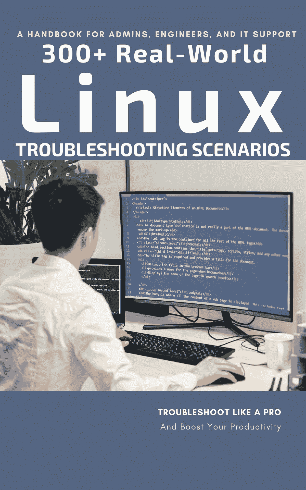

# 管理员、工程师和IT支持人员手册：300多个真实世界的Linux故障排除场景





# 介绍

“300+ 实战 Linux 故障排除场景”是一本为系统管理员、工程师、数据库管理员和 IT 支持人员设计的全面指南，旨在为解决现实世界中的 Linux 挑战提供实战解决方案。在当今动态且不断演变的 IT 领域，精通故障排除的艺术至关重要。本书旨在赋予你所需的技能和知识，以有效地诊断和解决各种 Linux 系统问题。

Linux 是无数关键基础设施的支柱，对于任何负责维护稳定高效环境的人来说，理解如何对其进行故障排除是必不可少的。无论你是在处理服务器中断、性能瓶颈、数据库连接问题或其他系统异常，本书都能为你提供实用的场景，这些场景反映了你在日常工作中可能遇到的复杂性。

书中的每个场景都经过精心设计，以提供一种实用的问题解决方法。你将发现分步骤的说明、提示和最佳实践，这些内容将使你能够信心地应对各种故障排除挑战。让我们进入 Linux 故障排除的世界，提升你保持系统顺畅运行的能力。

## 什么是 Linux 中的故障排除？

Linux 中的 故障排除（Troubleshooting）是指识别、诊断和解决可能在 Linux 操作系统或相关软件及服务中出现的问题或故障的过程。Linux 作为一种广泛使用的开源操作系统，应用于从服务器到个人电脑的各种环境中，故障排除是系统管理员、IT 专业人员以及任何负责维护 Linux 系统的人员的基本技能。

## 系统故障排除的最佳实践。

- **问题识别**：故障排除的第一步是识别问题。这可以是软件错误、硬件故障、网络问题或配置错误等任何问题。
- **诊断**：一旦确定了问题，下一步是诊断根本原因。这涉及到对导致问题的因素进行系统性调查。在此阶段，通常会使用诊断工具、日志文件和系统监控。
- **隔离**：在确定根本原因后，故障排除者会隔离问题。这可能涉及缩小问题的范围，确定其是否局限于特定的组件或子系统，并排除其他潜在原因。
- **解决**：问题被隔离后，下一步是实施解决方案。这可能涉及更改配置、应用补丁、修复代码、更新软件或采取其他纠正措施来解决底层问题。
- **验证**：一旦应用解决方案，验证问题是否已解决至关重要。这可能涉及测试系统、监控日志以问题是否再次出现，并确保所做的更改不会引入新问题。
- **文档记录**：有效的故障排除通常涉及记录所采取的步骤、识别出的问题以及所应用的解决方案。这些文档对于未来非常有价值。

# 重要的工具

## 两个日志服务：`systemd-journald` 和 `rsyslog`

最常用的工具是：

`journalctl` 跟踪所有的日志，默认保存在 `/run/log`。

```bash
journalctl -b  # 显示本次启动的日志
journalctl --boots  # 列出所有启动项
journalctl _UNIT=sshd.service  # 过滤显示 sshd 服务的日志
journalctl -n 5  # 显示最后 5 行
journalctl -p err  # 显示所有错误级别的日志
journalctl -f  # 持续查看日志
journalctl --since "today" or "yesterday"  # 显示从今天或昨天的日志
journalctl --since="date" --until="date"  # 显示指定日期之间的日志
journalctl _PID=1  # 显示 pid=1 的日志
```

## sosreport

Linux 中的 `sosreport` 命令专为 RHEL/CentOS 系统设计，用于收集全面的系统配置和诊断信息。这包括运行内核版本、加载模块以及系统和服务的配置文件。此外，`sosreport` 会执行外部程序以收集补充信息，并将所有输出存储在存档中参考。

向 Red Hat 寻求技术支持时，生成 `sosreport` 是一个关键步骤。Red Hat 支持工程师通常需要此报告来有效地解决问题。要运行 `sosreport` 命令，必须安装 `sos` 软件包。通常，该包包含在大多数 Linux 发行版的默认安装中。如果没有安装，可以使用 `yum` 命令进行安装：

```bash
rpm -q sos  # 检查是否已安装 sos
yum install sos -y  # 如果未安装则安装 sos
```

要生成 `sosreport`，打开终端并输入 `sosreport` 命令：

```bash
sosreport
```

该命令通常在几分钟内完成，并在 `/tmp` 文件夹生成压缩文件。压缩格式可能根据 Linux 版本而异（gz、bz2 或 xz）。应将此文件提供给 Red Hat 支持人员，通常作为打开工单的附件。

注意的是，运行 `sosreport` 命令需要 root 权限。此外，用户可以使用各种选项自定义命令。要查看可用模块，用户可以使用 `-l` 选项：


## sosreport -l

可以使用 `-n/--skip-plugins` 选项启用或禁用模块。例如，禁用 `kvm` 和 `amd` 模块：

```
sosreport -n kvm,amd
```

某些模块可能提供额外的选项，可以通过 `-k` 选项指定。例如，禁用 RPM 验证输出收集可以如下所示操作：

```
sosreport -k rpm.rpmva=off
```

最后，用户可以使用 `auditctl` 查看审计报告：

```
auditctl
```

这些功能为根据特定需求或偏好生成 `sosreports` 提供了灵活性和定制性。

## redhat-support-tool

它提供了一个文本控制台界面，用于访问基于订阅的 Red Hat Access 服务，需要连接互联网以访问 Red Hat 客户门户。不需要图形化界面。

在下一页中，将探索有关排查 Red Hat Enterprise Linux (RHEL) 系统各种用户相关问题的显式指南。对于每种场景，请确保您列出了问题识别、诊断、隔离、解决、验证和文档记录的步骤。

## 用户登录问题

### 场景 1：密码错误
**问题：** 用户因输入错误密码无法登录。

**排故障排除：**
- 验证用户的凭据。
```
id <username>
```
- 使用 `passwd` 重置用户密码。
```
passwd <username>
```
- 确保未激活大写锁定（Caps Lock）。
- 确认键盘布局正确。

### 场景 2：密码过期
**问题：** 用户因密码过期无法登录。

**排故障排除：**
- 使用 `chage` 检查密码过期。
```
chage -l <username>
```
- 使用 `passwd` 重置密码。
```
passwd <username>
```
- 如果使用 `LDAP` 或 `Kerberos`，确保密码策略配置正确。

### 场景 3：用户账户被锁定
**问题：** 用户在多次尝试登录失败后账户被锁定。

**排故障排除：**
- 检查账户状态：
```
passwd -S <username>
```
- 解锁账户：
```
passwd -u <username>
```
- 检查 `PAM` 配置中的账户锁定策略。

### 场景 4：不允许使用 Shell
**问题：** 用户被限制使用特定的 shell。

**排故障排除：**
- 验证 `/etc/passwd` 中用户的用户的 shell。
```
grep <username> /etc/passwd
```
- 使用 `chsh` 更改 shell。
```
chsh -s /bin/bash <username>
```

### 场景 5：文件权限问题
**问题：** 用户在尝试登录时遇到权限错误。

**排故障排除：**
- 检查用户主目录的权限。
```
ls -ld /home/<username>
```
- 确保所有权正确。
```
chown <username>:<username> /home/<username>
```

### 场景 6：账户不存在
**问题：** 系统上不存在该用户账户。

**排故障排除：**
- 验证用户是否存在。
```
id <username>
```
- 如果必要，创建用户账户。
```
useradd <username>
```

### 场景 7：PAM 配置问题
**问题：** 因 `PAM`（可插拔认证模块）配置错误导致登录失败。

**排故障排除：**
- 检查 `/etc/pam.d/` 中的 `PAM` 配置文件。
```
cat /etc/pam.d/system-auth
```
- 检查语法错误或错误的模块配置。
- 使用 `authconfig` 或 `authselect` 重新配置 `PAM` 设置。

### 场景 8：网络连接问题
**问题：** 因网络问题导致登录尝试失败。

**排故障排除：**
- 确保系统具有网络连接（`ping`、`traceroute`）。
- 检查 DNS 解析（`nslookup`、`dig`）。
- 如果适用验证 `LDAP` 或 `Kerberos` 服务器可访问。

### 场景 9：LDAP 或 Kerberos 认证失败
**问题：** 依赖 `LDAP` 或 `Kerberos` 的用户面临认证问题。

**排故障排除：**
- 检查 `LDAP` 或 `Kerberos` 客户端配置。
```
cat /etc/nsswitch.conf
cat /etc/krb5.conf
```
- 验证客户端与 `LDAP` 或 `Kerberos` 服务器的连接。
- 检查服务器日志中的与认证相关的错误。

### 场景 10：Shell 初始化问题
**问题：** 用户在登录后遇到问题，例如 shell 无法工作。

**排故障排除：**
- 检查用户的 shell 初始化文件。
```
cat ~/.bashrc
cat ~/.bash_profile
```
- 临时切换到不同的 shell。
```
exec /bin/sh
```

### 场景 11：认证服务不可用
**问题：** 用户因认证服务问题无法登录。

**排故障排除：**
- 检查认证服务的状态。
```
systemctl status sssd
```
- 检查认证服务的配置（`SSSD`、`Winbind` 等）。

### 场景 12：错误的 UID 或 GID
**问题：** 用户因错误的 `UID`（用户 ID）或 `GID`（组 ID）遇到登录问题。

**排故障排除：**
- 验证 `/etc/passwd` 和 `/etc/group` 中的 `UID` 和 `GID`。
```
grep <username> /etc/passwd
grep <groupname> /etc/group
```
- 如必要，使用 `usermod` 或 `groupmod` 修正 `UID` 或 `GID`。

### 场景 13：Shadow 文件问题
**问题：** `/etc/shadow` 文件问题导致无法成功登录。

**排故障排除：**
- 检查 `/etc/shadow` 文件的完整性。
```
pwck
```
- 确保正确的权限权限。
```
chmod 600 /etc/shadow
```

### 场景 14：双重认证问题
**问题：** 使用双重认证的用户遇到登录问题。

**排故障排除：**
- 检查双重认证配置。
- 验证第二个认证因素的可用性和功能性。

### 场景 15：审计和 SELinux 拒绝访问
**问题：** 审计日志或 `SELinux` 拒绝访问阻止用户登录。

**排故障排除：**
- 查看审计日志。
```
grep AVC /var/log/audit/audit.log
```
- 检查 `SELinux` 状态并审核 `SELinux` 拒绝访问。
```
sestatus
```

### 场景 16：与服务器的连接已关闭
**问题：** 与服务器的连接已关闭

**排故障排除：**
- 以 `root` 登录并获取用户信息。
```
lastlog -u uer1 or cat /etc/passwd | grep user1
chsh -s /bin/bash user1
```
- 退出并尝试以 `user1` 访问系统。

### 场景 17：用户无法登录
**问题：** 用户报告无法登录。

**排故障排除：**
- 验证用户密码：
```
passwd <username>
```
- 检查用户账户是否锁定：
```
passwd -S <username>
```
- 检查认证日志以查找错误：
```
journalctl -xe
```
- 确保用户的 shell 在 `/etc/passwd` 中是合法的。

### 场景 18：用户无权限
**问题：** 用户在访问文件或目录时遇到“拒绝访问”。

**排故障排除：**
- 检查文件/目录权限：
```
ls -l /path/to/file_or_directory
```
- 验证用户的组成员身份：
```
id <username>
```
- 确认 `SELinux` 上下文：
```
ls -Z /path/to/file_or_directory
```

### 场景 19：无法创建用户
**问题：** 创建新用户失败。

**排故障排除：**
- 检查 `/etc/security/limits.conf` 中的限制。
- 确保新用户的主目录有足够的磁盘空间。
- 验证用户是否已存在：
```
id <new_username>
```

### 场景 20：账户过期
**问题：** 用户因账户过期无法登录。

**排故障排除：**
- 检查账户过期：
```
chage -l <username>
```
- 延长账户有效期：
```
chage -E <new-expiration-date> <username>
```

### 场景 21：组成员身份问题
**问题：** 用户不在预期的组中。

**排故障排除：**
- 验证组成员身份：
```
id <username>
```
- 检查 `/etc/group` 以正确的组成员身份。
- 确认用户修改在 `/etc/passwd` 中持久化。

### 场景 22：密码策略违反
**问题：** 用户在更改密码时遇到问题。

**排故障排除：**
- 检查 `/etc/security/pwquality.conf` 中的密码策略设置。
- 检查 `/etc/security/pwquality.conf` 中的特定要求。
- 审核 `/etc/pam.d/passwd` 中的 `PAM` 配置中的密码模块。

### 场景 23：主目录权限
**症状：** 用户在访问其主目录时遇到问题。

**排故障排除：**
- 确保主目录的权限正确：
```
ls -ld /home/<username>
```
- 验证 `SELinux` 上下文：
```
ls -Z /home/<username>
```
- 检查 `/etc/passwd` 中准确的主目录路径。

### 场景 24：用户无法更改密码
**症状：** 用户在尝试更改密码时遇到错误。

**排故障排除：**
- 验证 `/etc/pam.d/passwd` 中的密码更改权限。
- 检查 `/etc/security/opasswd` 中的密码历史设置。


确认密码过期设置：

```
chage -l <username>
```

## 场景 25：用户配置文件问题

问题：用户在处理环境变量或 Shell 配置时遇到问题。

故障排除步骤：

检查用户配置文件中的语法错误（例如 `.bashrc`、`.bash_profile`）：

```bash
cat ~/.bashrc
```

验证必要的环境变量已正确设置。

通过手动切换到该用户来测试其 Shell：

```bash
su - <username>
```

## 场景 26：临时限制

`/etc/nologin` 文件通常被用作临时措施，防止用户在系统维护或其他关键操作期间登录。一旦维护完成，管理员通常会删除或重命名该文件以允许再次登录。

### 创建 /etc/nologin：

要创建 `/etc/nologin` 文件，可以使用 `touch` 命令：

```bash
sudo touch /etc/nologin
```

### 删除 /etc/nologin：

要再次允许登录，可以删除或重命名 `/etc/nologin` 文件：

```bash
sudo rm /etc/nologin or  sudo mv /etc/nologin /etc/nologin.bak
```

使用 `/etc/nologin` 文件时务必谨慎，以避免意外锁定用户。务必向用户告知任何计划中的限制，并确保在维护或限制期结束后及时删除该文件。

这些场景涵盖了 Red Hat Linux 系统上常见的用户登录问题。请根据问题的具体性质和您的系统配置调整故障排除步骤。此外，务必确保所做的任何更改均符合组织的安全策略和最佳实践。

## 文件系统问题

### 场景 27：磁盘空间耗尽

问题：关键应用程序失败或系统无响应。

故障排除步骤：

检查磁盘空间使用：

```bash
df -h
```

识别大目录：

```bash
du -h --max-depth=1 /
```

删除不需要的文件或调整分区大小。

### 场景 28：文件系统损坏

症状：启动期间出现指示文件系统损坏的错误。

故障排除步骤：

在文件系统上运行 `fsck`：

```bash
fsck /dev/sdXn (将 sdxn 替换为您的文件系统)
```

按照提示修复识别出的问题。

确保有最近的备份，并在时进行恢复。

### 场景 29：Inode 耗尽

症状：尽管有可用磁盘空间，但无法创建新文件。

故障排除步骤：

检查 Inode 使用情况：

```bash
df -i
```

识别包含许多小文件的目录：

```bash
find /path -type f | wc -l
```

清理或移动不需要的小文件。

### 场景 30：文件系统挂载问题

症状：文件系统在启动期间未挂载。

故障排除步骤：

检查 `/etc/fstab` 条目是否正确。

手动尝试挂载文件系统：

```bash
mount -a
```

检查日志中的挂载错误：

```bash
journalctl -xe
```

### 场景 31：只读文件系统

症状：文件系统意外变为只读。

故障排除步骤：

检查 `dmesg` 或日志中的磁盘相关错误。

运行文件系统检查：

```bash
fsck /dev/sdXn
```

调查硬件或磁盘控制器问题。

### 场景 32：文件权限问题

症状：尽管权限正确，用户无法读取或写入文件。

故障排除步骤：

使用 `ls -l` 检查文件权限。

使用以下命令验证用户权限：

```bash
id <username>
```

如有必要，使用 `chmod` 调整权限。

### 场景 33：超出配额

症状：由于超出磁盘配额，用户无法写入数据。

故障排除步骤：

检查配额：

```bash
repquota -a
```

识别超出配额的用户。

使用 `edquota` 调整配额或增加磁盘空间。

### 场景 34：文件系统挂载缓慢

症状：文件系统挂载缓慢，影响系统启动。

故障排除步骤：

检查是否存在网络或存储延迟。

在 `/etc/fstab` 中优化文件系统选项。

审阅存储设备配置。

### 场景 35：重启后文件系统丢失

症状：系统重启后文件系统丢失。

故障排除步骤：

检查 `/etc/fstab` 条目是否正确。

手动挂载文件系统：

```bash
mount /dev/sdXn /mountpoint
```

调查存储设备是否被检测到：

```bash
lsblk
```

### 场景 36：文件系统满但无大文件

症状：磁盘已满，但通过 `du` 未找到大文件。

故障排除步骤：

使用以下命令识别已删除仍开启的文件：

```bash
lsof | grep deleted
```

检查进程是否仍已删除的文件。

重启或停止持有已删除文件的进程。

## 文与日志

参考系统日志（`journalctl`、`/var/log/boot.log`、`/var/log/messages` 等）获取更多详细信息。

备份：

在进行重大更改之前，确保已对重要数据进行备份。

恢复模式：

利用 `Grub` 中提供的恢复模式进行基础故障排除。

请记住根据您的特定环境和问题性质调整这些步骤。如有疑问，请咨询相关文档或向社区论坛及 Red Hat 支持寻求帮助。

## 补丁问题

现在我们已经探索了各种用户相关场景的故障排除步骤，让我们转移到维护 Red Hat Enterprise Linux (RHEL) 系统的另一个关键方面：补丁。保持系统更新到最新的安全补丁和更新对于其稳定性和安全性至关重要。下面，我们将深入探讨 RHEL 系统上补丁问题相关的 10 常见场景，为每个场景提供分步骤的故障排除指导。

### 场景 37：由于仓库问题导致补丁失败

故障排除步骤：

验证网络连接性：

```bash
ping google.com
```

检查仓库配置：

```bash
cat /etc/yum.repos.d/
```

清理 yum 缓存：

```bash
yum clean all
```

重试更新：

```bash
yum update
```

### 场景 38：依赖解析失败

故障排除步骤：

识别缺失的依赖：

```bash
yum deplist <package>
```

通过安装缺失包解决依赖：

```bash
yum install <missing-package>
```

重试更新：

```bash
yum update
```

### 场景 39：包冲突

故障排除步骤：

识别冲突包：

```bash
yum check
```

使用 `yum remove` 移除冲突包：

```bash
yum remove <conflicting-package>
```

重试更新：

```bash
yum update
```

### 场景 40：内核更新问题

故障排除步骤：

进入之前的内核版本。

调查内核恐慌消息：

```bash
dmesg | grep "kernel panic"
```

重新安装内核：

```bash
yum reinstall kernel
```

更新 GRUB 配置：

```bash
grub2-mkconfig -o /boot/grub2/grub.cfg
```

重启系统：

```bash
reboot
```

### 场景 41：补丁中断

故障排除步骤：

检查未完成的事务：

```bash
yum-complete-transaction
```

移除任何部分安装的包：

```bash
yum remove <package>
```

清理 yum 缓存：

```bash
yum clean all
```

重试更新：

```bash
yum update
```

### 场景 42：空间不足

故障排除步骤：

检查磁盘空间使用：

```bash
df -h
```

识别大目录：

```bash
du -h --max-depth=1 / | sort -h
```

删除不需要的文件或增加磁盘空间。

重试更新：

```bash
yum update
```

### 场景 43：GPG Key 问题

故障排除步骤：

手动导入 GPG 密钥：

```bash
rpm --import /etc/pki/rpm-gpg/RPM-GPG-KEY-redhat-release
```

验证已导入的 GPG 密钥：

```bash
rpm -qa gpg-pubkey*
```

重试更新：

```bash
yum update
```

### 场景 44：仓库 URL 变更

故障排除步骤：

检查仓库配置文件：

```bash
cat /etc/yum.repos.d/repository-name.repo
```

将仓库 URL 更新为正确的地址。

清理 yum 缓存：

```bash
yum clean all
```

重试更新：

```bash
yum update
```

### 场景 45：镜像同步问题

故障排除步骤：

切换到不同的镜像：

```bash
yum-config-manager --disable <repo> && yum-config-manager --enable <new-repo>
```

清理 yum 缓存：

```bash
yum clean all
```

重试更新：

```bash
yum update
```

### 场景 46：包排除

故障排除步骤：

检查 `/etc/yum.conf` 或仓库配置文件中的包排除：

```bash
cat /etc/yum.conf
cat /etc/yum.repos.d/repository-name.repo
```

移除排除项或添加异常。

重试更新：

```bash
yum update
```


这些命令和步骤涵盖了 Red Hat Enterprise Linux (RHEL) 系统上与系统补丁问题相关的各种场景。请务必保持谨慎，特别是在生产环境中，并考虑每个步骤对您系统配置的具体影响。此外，在执行重大更新或修改之前，请确保已进行妥善备份。

## 分区与文件系统

### 场景 47：磁盘空间不足
**问题：** 系统报告磁盘空间低。
**故障排除步骤：**
- 使用 `df -h` 识别磁盘空间占用。
- 使用 `du -h --max-depth=1 /` 查找大文件或目录。
- 删除不必要的文件将其移动到另一个分区。
- 考虑调整分区大小或添加更多存储。

### 场景 48：文件系统损坏
**问题：** 文件系统错误导致异常行为。
**故障排除步骤：**
- 使用 `fsck` 检查文件系统完整性。
- 如果文件系统已挂载，请先卸载。
- 对受影响的分区运行 `fsck /dev/sdX`。
- 屏幕提示修复检测到的问题。

### 场景 49：Inode 耗尽
**问题：** 文件系统上的可用 Inode 用尽。
**故障排除步骤：**
- 使用 `df -i` 检查 Inode 使用情况。
- 使用 `find /path -type f | wc -l` 识别包含大量小文件的目录。
- 存档或删除不需要的文件。
- 如果需要，考虑重新格式化具有更多 Inode 的文件系统。

### 场景 50：无法挂载文件系统
**问题：** 文件系统无法挂载。
**故障排除步骤：**
- 检查 `/etc/fstab` 文件挂载选项是否正确。
- 使用 `fsck` 验证文件系统完整性。
- 确保该分区没有在其他地方挂载。
- 检查硬件问题，如磁盘故障。

### 场景 51：分区表损坏
**问题：** 分区表损坏导致无法识别磁盘。
**故障排除步骤：**
- 使用 `gdisk` 或 `parted` 检查分区表。
- 如必要，谨慎重建分区表。
- 使用 `smartctl` 等工具检查磁盘健康状况。
- 如果分区表无法修复，从备份中恢复数据。

### 场景 52：文件系统类型错误
**问题：** 尝试用错误的文件系统类型挂载分区。
**故障排除步骤：**
- 使用 `blkid` 或 `lsblk` 识别正确的文件系统类型。
- 使用正确的文件系统类型更新 `/etc/fstab` 条。
- 使用 `mount` 命令手动挂载分区。
- 使用 `df -h` 验证更改。

### 场景 53：配额超限
**问题：** 用户由于磁盘配额限制无法写入主目录。
**故障排除步骤：**
- 使用 `quota -u username` 检查用户配额。
- 使用 `edquota -u username` 调整配额。
- 清理不需要的文件以释放空间。
- 必要时考虑增加用户配额。

### 场景 54：RAID 阵列降级
**问题：** RAID 阵列报告降级状态。
**故障排除步骤：**
- 使用 `mdadm --detail /dev/mdX` 检查 RAID 状态。
- 使用 `cat /proc/mdstat` 识别故障磁盘。
- 用新磁盘替换故障磁盘。
- 使用 `mdadm --add /dev/mdX /dev/sdX` 重建 RAID 阵列。

### 场景 55：加密文件系统问题
**问题：** 无法访问加密文件系统上的数据。
**故障排除步骤：**
- 确保在启动期间提供了正确的加密口令。
- 使用 `lsmod` 检查加密模块是否存在问题。
- 使用 `cryptsetup luksOpen` 手动打开加密设备。
- 解密后验证文件系统完整性。

### 场景 56：启动时挂载问题
**问题：** 文件系统在启动过程中未自动挂载。
**故障排除步骤：**
- 检查 `/etc/fstab` 条目是否正确。
- 使用 `mount -a` 手动挂载 `/etc/fstab` 中的所有文件系统。
- 检查系统日志中的与挂载相关的错误 (`journalctl`)。
- 确保 `/etc/fstab` 中的关键文件系统没有 `noauto` 选项。

这些故障排除场景涵盖了 RHEL 系统上与分区和文件系统相关的系列常见问题。在更改分区和文件系统时请务必保持谨慎，并确保在尝试任何修复操作之前已备份重要数据。

## 逻辑卷管理

逻辑卷管理 (LVM) 是 Linux 系统上管理磁盘存储的强大工具。让我们探索与 Red Hat Enterprise Linux (RHEL) 系统上 LVM 问题相关的十个场景，以及每个场景的逐步分故障排除步骤：

### 场景 57：卷组未激活
**故障排除步骤：**
- 检查卷组状态：
```bash
vgdisplay
```
- 激活未激活的卷组：
```bash
vgchange -ay <VG_NAME>
```

### 场景 58：物理卷不可用
**故障排除步骤：**
- 检查物理卷状态：
```bash
pvdisplay
```
- 替换故障磁盘或恢复连接。
- 如果使用 RAID，重建 RAID 阵列。

### 场景 59：逻辑卷未挂载
**故障排除步骤：**
- 检查逻辑卷状态：
```bash
lvdisplay
```
- 尝试手动挂载逻辑卷：
```bash
mount /dev/<VG_NAME>/<LV_NAME> /mnt
```
- 检查 `/etc/fstab` 的正确性。

### 场景 60：逻辑卷大小错误
**故障排除步骤：**
- 验证预期大小：
```bash
lvdisplay
```
- 调整逻辑卷大小：
```bash
lvresize -L +2G /dev/<VG_NAME>/<LV_NAME>
```
- 调整文件系统大小：
```bash
resize2fs /dev/<VG_NAME>/<LV_NAME>
```

### 场景 61：文件系统损坏
**故障排除步骤：**
- 卸载文件系统：
```bash
umount /dev/<VG_NAME>/<LV_NAME>
```
- 检查文件系统错误：
```bash
e2fsck -f /dev/<VG_NAME>/<LV_NAME>
```
- 修复发现的任何错误。

### 场景 62：文件系统已
**故障排除步骤：**
- 识别大文件或目录：
```bash
du -sh *
```
- 删除不需要的文件或增加文件系统大小。
- 定期监控和管理磁盘空间。

### 场景 63：快照充满
**故障排除步骤：**
- 检查快照使用情况：
```bash
lvdisplay
```
- 如需要，调整快照 LV 大：
```bash
lvextend -L +1G /dev/<VG_NAME>/<SNAP_LV_NAME>
```

### 场景 64：快照损坏
**故障排除步骤：**
- 移除损坏的快照：
```bash
lvremove /dev/<VG_NAME>/<SNAP_LV_NAME>
```
- 如需要，创建新快照：
```bash
lvcreate -s -L 1G -n <SNAP_LV_NAME> /dev/<VG_NAME>/<LV_NAME>
```

### 场景 65：RAID 阵列磁盘故障
**故障排除步骤：**
- 识别故障磁盘：
```bash
cat /proc/mdstat
```
- 替换 RAID 阵列中的故障磁盘。
- 如果在 RAID 之上使用 LVM，激活卷组和逻辑卷。

### 场景 66：磁盘缺失
**故障排除步骤：**
- 识别缺失的磁盘：
```bash
pvs
```
- 恢复缺失磁盘的连接或替换它。
- 激活卷组和逻辑卷：
```bash
vgchange -ay <VG_NAME>
```

### 场景 67：无法调整逻辑卷大小
**故障排除步骤：**
- 确认可用空间：
```bash
vgdisplay
```
- 调整逻辑卷大小：
```bash
lvresize -L +2G /dev/<VG_NAME>/<LV_NAME>
```
- 调整文件系统大小：
```bash
resize2fs /dev/<VG_NAME>/<LV_NAME>
```

### 场景 68：无法扩展卷组
**故障排除步骤：**
- 检查物理卷状态：
```bash
pvdisplay
```
- 扩展卷组：
```bash
vgextend <VG_NAME> /dev/<NEW_DISK>
```

### 场景 69：多路径（Multipath）无法工作
**故障排除步骤：**
- 检查多路径状态：
```bash
multipath -ll
```
- 验证多路径配置文件。
- 重启多路径服务：
```bash
systemctl restart multipathd
```

### 场景 70：多路径设置路径故障
**故障排除步骤：**
- 识别故障路径：
```bash
multipath -ll
```
- 替换故障组件。
- 如需要，手动移除故障路径：
```bash
multipath -f <failed-path>
```

### 场景 71：重启后逻辑卷未挂载
**故障排除步骤：**
- 检查 `/etc/fstab` 条是否正确。
- 手动挂载逻辑卷：
```bash
mount /dev/<VG_NAME>/<LV_NAME> /mnt
```
- 调查系统日志中的挂载问题。

### 场景 72：无法挂载的逻辑卷
**故障排除步骤：**
- 识别占用文件的进程：
```bash
lsof | grep <VG_NAME>/<LV_NAME>
```
- 关闭或终止访问 LV 的进程。
- 再次尝试卸载 LV。

### 场景 73：无法创建快照
**故障排除步骤：**
- 验证卷组中的可用空间：
```bash
vgdisplay
```
- 创建快照：
```bash
lvcreate -s -L 1G -n <SNAP_LV_NAME> /dev/<VG_NAME>/<LV_NAME>
```


这些故障排除步骤应帮助解决 RHEL 系统上的各种 LVM 相关场景。在关键系统上执行任何操作时请务必小心，特别是在处理存储配置时。

## 系统启动问题

### 场景 74：Grub 配置错误
**症状：** 系统停留在 Grub 菜单，或在启动过程中出现错误。

**故障排除步骤：**
1. 进入 Grub 菜单。
2. 编辑启动参数（按 'e'）并纠正任何错误。
3. 使用修改后的参数启动（'Ctrl + X'）。
4. 如果成功，更新 Grub 配置：
```bash
grub2-mkconfig -o /boot/grub2/grub.cfg
```

### 场景 75：内核或 Initramfs 损坏
**症状：** 内核恐慌（Kernel panic）或指示内核/initramfs 损坏的启动错误。

**故障排除步骤：**
1. 使用救援盘或 Live CD 启动。
2. 挂载根分区。
3. 重新安装内核并重新生成 initramfs：
```bash
yum reinstall kernel
dracut -f /boot/initramfs-<kernel-version>.img <kernel-version>
```

### 场景 76：文件系统损坏
**症状：** 与文件系统损坏相关的启动错误。

**故障排除步骤：**
1. 进入救援模式或 Live CD。
2. 运行文件系统检查：
```bash
fsck /dev/sdXn
```
3. 修复任何检测到的问题。

### 场景 77：缺少或错误的驱动程序
**症状：** 系统在启动期间无法检测到硬件。

**故障排除步骤：**
1. 进入救援模式或 Live CD。
2. 检查内核日志查找驱动相关的错误：
```bash
dmesg | grep <driver-name>
```
3. 加载必要的驱动程序或更新内核。

### 场景 78：Systemd 服务失败
**症状：** 启动过程挂起或在特定服务处失败。

**故障排除步骤：**
1. 进入救援模式或 Live CD。
2. chroot 进入已安装的系统。
3. 调查失败的服务：
```bash
systemctl status <service-name>
```
4. 重启或重新安装问题服务。

### 场景 79：错误的 UUID 或 分区更改
**症状：** 与错误的 UUID 或分区更改相关的启动错误。

**故障排除步骤：**
1. 进入救援模式或 Live CD。
2. 使用正确的 UUID 更新 `/etc/fstab`。
3. 如必要，检查并更新 Grub 配置。

### 场景 80：BIOS/UEFI 配置问题
**症状：** 系统无法识别启动设备。

**故障排除步骤：**
1. 检查 BIOS/UEFI 设置中的启动顺序和安全启动（Secure Boot）。
2. 确保带有带有引导加载程序的磁盘被选为主启动设备。
3. 如果需要，禁用安全启动。

### 场景 81：缺少或损坏的引导程序
**症状：** 系统无法加载引导程序。

**故障排除步骤：**
1. 进入救援模式或 Live CD。
2. 重新安装引导程序（Grub）：
```bash
grub2-install /dev/sdX
```
3. 重新生成 Grub 配置：
```bash
grub2-mkconfig -o /boot/grub2/grub.cfg
```

### 场景 82：磁盘已
**症状：** 由于根分区满导致启动错误或系统挂起。

**故障排除步骤：**
1. 进入救援模式或 Live CD。
2. 挂载根分区并释放空间。
3. 识别并删除不必要的文件。

### 场景 83：SELinux 问题
**症状：** SELinux 拒绝导致系统无法启动。

**故障排除步骤：**
1. 进入救援模式或 Live CD。
2. 挂载根分区。
3. 在 `/etc/selinux/config` 中将 SELinux 策略更改为 permissive（许可）模式。
4. 重启并排查 SELinux 拒绝问题。

#### 提示：
* **文档与日志：** 参考系统日志（`journalctl`、`/var/log/boot.log`、`/var/log/messages`）获取更多详情。
* **备份：** 在进行重大更改之前，确保已对重要数据进行备份。
* **救援模式：** 利用 Grub 中提供的救援模式进行基础故障排除。

请记住根据您的特定环境和问题的性质调整这些步骤。如有疑问，请咨询相关文档或向社区论坛或 Red Hat 支持寻求帮助。

## 网络配置

### 场景 84：无互联网连接
**故障排除步骤：**
* **检查网络接口状态：**
```bash
ip a
sudo ifup <interface_name>
```
* **Ping 外部主机：**
```bash
ping google.com
```
* **DNS 配置：**
验证 `/etc/resolv.conf` 中的 DNS 服务器设置。
```bash
cat /etc/resolv.conf
```
使用 `nslookup` 或 `dig` 测试 DNS 解析。
* **防火墙设置：**
```bash
firewall-cmd --list-all
```

### 场景 85：SSH 连接问题
**故障排除步骤：**
* **SSH 服务状态：**
```bash
systemctl status sshd
sudo systemctl restart sshd
```
* **防火墙规则：**
```bash
firewall-cmd --list-ports
sudo firewall-cmd --add-port=22/tcp --permanent
```
* **SSH 配置：**
检查 SSH 配置文件 `/etc/ssh/sshd_config`。
```bash
cat /etc/ssh/sshd_config
```

### 场景 86：网络接口问题
**故障排除步骤：**
* **检查接口状态：**
```bash
ip a
sudo ifup <interface_name>
```
* **防火墙规则：**
```bash
firewall-cmd/list-port/<interface_name>
```
* **重启服务：**
```bash
systemctl restart sshd
```

### 场景 87：DNS 解析问题
**故障排除步骤：**
* **DNS 配置：**
验证 `/etc/resolv.conf` 中的 DNS 服务器设置。
```bash
cat /etc/resolv.conf
```
* **测试 DNS 解析：**
使用 `nslookup` 或 `dig` 测试。
* **防火墙设置：**
```bash
firewall-cmd --list-all
```
* **检查配置：**``````bash
 /etc/resolv.conf
```

### 场景 88：路由问题
**故障排除步骤：**
* **检查路由：**
```bash
ip route
```
* **测试路由：**
```bash
traceroute google.com
```

### 场景 89：防火墙拦截
**故障排除步骤：**
* **检查防火墙规则：**
```bash
firewall-cmd --list-all
```
* **允许端口：**
```bash
sudo firewall-cmd --add-port=22/tcp --permanent
```

### 场景 90：IP 冲突
**故障排除步骤：**
* **检查 IP 地址：**
```bash
ip addr
```
* **检查日志：**
```bash
tail -f /var/log/messages
```

### 场景 91：DHCP 配置问题
**故障排除步骤：**
* **检查服务状态：**
```bash
systemctl status dhclient
```
* **重启服务：**
```bash
systemctl restart dhclient
```

### 场景 92：速度/双工不匹配
**故障排除步骤：**
* **检查接口：**
```bash
ethtool <interface_name>
```
* **调整设置：**
```bash
ethtool -s <interface_name> speed 100 duplex full
```

### 场景 93：VPN 连接问题
**故障排除步骤：**
* **检查服务状态：**
```bash
systemctl status openvpn
```
* **重启服务：**
```bash
sudo systemctl restart openvpn
```


如果 Nginx 使用非标准端口，请更新 SELinux 策略。

```bash
semanage port -a -t http_port_t -p tcp <port_number>
```

为 Nginx 日志或代理配置调整 SELinux 上文。

```bash
chcon -Rv --type=httpd_config_t /etc/nginx
```

### 场景 98：自定义应用的 SELinux 拒绝

#### 故障排除步骤
1. 查看审计日志中的 SELinux 拒绝记录。
```bash
ausearch -m avc -ts recent
```
2. 创建自定义 SELinux 策略模块。
```bash
audit2allow -a -M myapp
```
3. 加载自定义模块。
```bash
semodule -i myapp.pp
```
4. 重新测试自定义应用程序。

### 场景 99：SELinux 阻塞 Sendmail

#### 故障排除步骤
1. 查看审计日志中的 SELinux 拒绝记录。
```bash
ausearch -m avc -ts recent
```
2. 如果 Sendmail 尝试使用非标准端口，请更新 SELinux 策略。
```bash
semanage port -a -t mail_port_t -p tcp <port_number>
```
3. 重新加载或重启 Sendmail。
```bash
systemctl reload sendmail
```

### 场景 100：SELinux 拒绝自定义文件访问

#### 故障排除步骤
1. 检查审计日志中的 SELinux 拒绝记录。
```bash
ausearch -m avc -ts recent
```
2. 使用 `chcon` 为文件设置正确的 SELinux 上。
```bash
chcon -Rv --type=my_custom_type /path/to/files
```
3. 如果需要，更新 SELinux 策略。

### 场景 101：SELinux 拒绝 Cron 任务

#### 故障排除步骤
1. 查看 SELinux 拒绝记录。
```bash
ausearch -m avc -ts recent
```
2. 如果 cron 任务访问特定文件，请调整文件上下文。
```bash
restorecon -Rv /path/to/files
```
3. 如必要，为 cron 任务创建自定义 SELinux 模块。

### 场景 102：SELinux 拒绝 Samba 共享

#### 故障排除步骤
1. 检查 SELinux 拒绝记录。
```bash
ausearch -m avc -ts recent
```
2. 为 Samba 共享设置合适的 SELinux 上。
```bash
semanage fcontext -a -t samba_share_t "/path/to/share(/.*)?"
```
3. 应用新上下文。
```bash
restorecon -Rv /path/to/share
```

### 场景 103：SELinux 阻塞 Docker 容器

#### 故障排除步骤
1. 检查 SELinux 拒绝。
```bash
ausearch -m avc -ts recent
```
2. 如果 Docker 使用非标准端口，请更新 SELinux 策略。
```bash
semanage port -a -t container_port_t -p tcp <port_number>
```
3. 为 Docker 相关目录调整 SELinux 上。
```bash
chcon -Rv --type=container_file_t /var/lib/docker
```

这些步骤涵盖了各种 SELinux 场景。请始终检查日志，在需要时创建自定义策略，并使用 SELinux 工具以安全的方式排查并解决问题。

# 启动程序与内核参数

### 场景 104：引导程序配置问题
**场景：** 系统无法启动，并出现与 GRUB 引导加载程序相关的错误。

#### 故障排除步骤
1. **从存盘 CD/USB 或救援模式启动：**
   使用可启动的 Live CD/USB 或救援模式访问系统。
2. **编辑 GRUB 配置文件（`/etc/default/grub`）：**
   ```bash
   nano /etc/default/grub
   ```
   根据需要检查并修改 `GRUB_CMDLINE_LINUX`。
3. **验证 `GRUB_CMDLINE_LINUX` 参数的正确性：**
   确保设置了正确的内核参数。
4. **重新生成 GRUB 配置：**
   ```bash
   grub2-mkconfig -o /boot/grub2/grub.cfg
   ```
5. **重启系统：**
   ```bash
   reboot
   ```

### 场景 105：启动期间内核崩溃 (Kernel Panic)
**场景：** 系统在引导加载程序之后立即遇到内核崩溃。

#### 故障排除步骤
1. **进入救援模式或使用 Live CD/USB 启动：**
   使用救援模式或 Live CD/USB 进行访问。
2. **检查内核崩溃信息以获取有关问题的线索：**
   检查屏幕上显示的内核崩溃信息。
3. **查看内核日志（`dmesg`，`/var/log/messages`）：**
   ```bash
   dmesg
   cat /var/log/messages
   ```
   调查日志以获取更多细节。
4. **检查硬件相关问题（内存、磁盘故障）：**
   检查硬件组件是否存在问题。
5. **如有必要，重新安装或更新内核：**
   使用 `yum` 或 `dnf` 等包管理器命令重新安装或更新内核。

### 场景 106：内核参数设置错误
**场景：** 系统由于内核参数设置错误表现出异常行为。

#### 故障排除步骤
1. **编辑 GRUB 配置（`/etc/default/grub`）：**
   ```bash
   nano /etc/default/grub
   ```
   根据需要检查并修改 `GRUB_CMDLINE_LINUX`。
2. **检查并修改 `GRUB_CMDLINE_LINUX` 中的内核参数：**
   确保设置了正确的参数。
3. **重新生成配置：**
   ```bash
   grub2-mkconfig -o /boot/grub2/grub.cfg
   ```
4. **重启并验证问题是否存在：**
   ```bash
   reboot
   ```
5. **查看内核日志中的任何错误：**
   ```bash
   journalctl -k
   ```

### 场景 107：启动在特定阶段卡住
**场景：** 启动进程在某一点停止，没有进度。

#### 故障排除步骤
1. **启动时访问 GRUB 菜单并在内核命令行添加 single：**
   编辑 GRUB 条目并在内核命令行中附加 `single`。
2. **进入单用户模式并调查问题：**
   使用 `init 1` 或 `single` 进入单用户模式。
3. **检查日志（`/var/log/boot.log`，`/var/log/messages`）中的错误：**
   ```bash
   cat /var/log/boot.log
   cat /var/log/messages
   ```
   寻找卡住阶段的错误或警告。
4. **解决卡住阶段的问题：**
   处理调查期间发现的问题。
5. **从内核命令行移除 single 以正常启动：**
   编辑配置并移除 `single`。

### 场景 108：启动进程冻结或缓慢
**场景：** 系统在启动时冻结或花费异常长时间。

#### 故障排除步骤
1. **访问 GRUB 菜单并在内核命令行添加 nomodeset：**
   编辑 GRUB 条目并在内核命令行中附加 `nomodeset`。
2. **进入单用户模式识别资源密集型进程：**
   使用 `top` 或 `htop` 等命令检查 CPU 和内存占用。
3. **检查磁盘空间、磁盘状况和 RAID 配置：**
   ```bash
   df -h
   smartctl -a /dev/sda
   mdadm --detail /dev/md0
   ```
4. **调查磁盘问题：**
   使用 `systemctl` 禁用不需要的服务。
5. **查看导致延迟的日志：**
   ```bash
   journalctl -b
   ```

### 场景 109：内核缺失或损坏
**场景：** 系统在启动时报告内核缺失或损坏。

#### 故障排除步骤
1. **从 Live CD/USB 或救援模式启动：**
   使用 Live CD/USB 或救援模式访问系统。
2. **挂载根文件系统并进入 /boot：**
   ```bash
   mount /dev/sdXn /mnt #  sdXn 为根分区
   cd /mnt/boot
   ```
3. **验证内核镜像的存在性和完整性：**
   ```bash
   ls -l vmlinuz*
   md5sum vmlinuz*
   ```
4. **如果缺失或损坏，重新安装内核：**
   ```bash
   yum reinstall kernel
   ```
5. **重新生成 GRUB 配置：**
   ```bash
   grub2-mkconfig -o /boot/grub2/grub.cfg
   ```
6. **重启系统：**
   ```
   reboot
   ```

### 场景 110：Initramfs 问题
**场景：** 系统在启动时报告 initramfs 镜像问题。

#### 故障排除步骤
1. **访问 GRUB 菜单并在内核命令行添加 rd.break：**
   编辑 GRUB 条目并在内核命令行中附加 `rd.break`。
2. **以只读模式重新挂载根文件系统：**
   ```bash
   mount -o remount,ro /sysroot
   ```
3. **检查并修复 initramfs 镜像：**
   ```bash
   chroot /sysroot
   dracut -f /boot/initramfs-<kernel-version>.img
   ```
4. **重启系统：**
   ```bash
   reboot
   ```

### 场景 111：根文件系统挂载错误
**场景：** 系统启动时无法挂载根文件系统。

#### 故障排除步骤
1. **访问 GRUB 菜单并在内核命令行添加 rd.break：**
   编辑 GRUB 条目并在内核命令行中附加 `rd.break`。
2. **以读写权限重新挂载根文件系统：**
   ```bash
   mount -o remount,rw /sysroot
   ```
3. **检查 /etc/fstab 中的根设备指定是否正确：**
   ```bash
   cat /etc/fstab
   ```
4. **确保指定了正确的根文件系统 UUID 或设备：**
   根据需要更新 `/etc/fstab`。
5. **退出紧急 shell 并继续启动过程：**
   ```bash
   exit
   ```

### 场景 112：内核模块加载问题
**场景：** 启动完成，但某些内核模块加载失败。

#### 故障排除步骤
1. **检查日志（`dmesg`，`/var/log/messages`）中的模块加载错误：**
   ```bash
   dmesg | grep <module-name>
   cat /var/log/messages | grep <module-name>
   ```
2. **使用 `lsmod` 验证内核模块：**
   ```bash
   lsmod | grep <module-name>
   ```
3. **使用 `modprobe` 或 `rmmod` 手动加载或卸载问题模块：**
   ```bash
   modprobe <module-name>
   rmmod <module-name>
   ```
4. **更新或重新安装内核模块包：**
   ```bash
   yum reinstall <module-package>
   ```
5. **确保满足模块依赖关系：**
   解决任何缺失的依赖项。


# 场景 113: UEFI 启动问题

场景：系统在 UEFI 模式启动时遇到问题。

故障排除步骤：
- 访问 UEFI/BIOS 设置并检查启动顺序：
- 验证正确的启动顺序设置。
- 验证 UEFI 相关设置的正确性：
- 检查 UEFI 设置的准确性。
- 确保系统在 UEFI 模式下启动：
- 在系统设置中确认 UEFI 启动模式。
- 检查 ESP（EFI 系统分区）中是否存在正确的文件：
- 确保存在如 `BOOTX64.EFI` 等必要文件。
- 在 UEFI 模式下重新安装引导加载程序：
```
grub2-install --target=x86_64-efi --efi-directory=/boot/efi --bootloader-id=GRUB
```
记住记录在排除过程中所所的任何更改，并在修改关键系统配置时要保持谨慎。如果不确定，请向相关文档或支持渠道寻求帮助。

## 任务自动化

### 场景 114: Cron 任务未执行
问题：计划的 cron 任务未按预期运行。

故障排除步骤：
- 检查 cron 语法并确保其正确。
```bash
crontab -e
```
- 验证用户的 crontab。
```bash
crontab -l
```
- 查看系统日志中与 cron 相关的消息。
```bash
grep CRON /var/log/syslog
```

### 场景 115: 脚本执行失败
问题：由任务自动化工具调的脚本执行失败。

故障排除步骤：
- 检查脚本是否有语法错误。
- 手动运行脚本以检查任何错误。
```bash
bash script.sh
```
- 检查脚本权限并确保它是可执行的。
```bash
chmod +x script.sh
```

### 场景 116: 任务自动化工具连接问题
问题：任务自动化工具无法连接远程主机。

故障排除步骤：
- 验证自动化服务器与目标主机之间的网络连接性。
- 检查服务器和目标主机上的防火墙设置。
- 检查身份验证配置和凭据。

### 场景 117: 软件部署失败
问题：自动化工具无法将软件部署到目标系统。

故障排除步骤：
- 检查部署脚本是否有错误。
- 检查目标系统日志以获取失败详情。
- 验证软件部署的连接性和权限。

### 场景 118: 任务在错误的时间运行
问题：周期性任务在意外的时间运行。

故障排除步骤：
- 检查 cron 计划任务或自动化工具设置。
- 验证运行自动化的服务器上的系统时间。
- 确保时区设置正确。

### 场景 119: 超过资源限制
问题：资源密集型任务由于资源限制而崩溃或失败。

故障排除步骤：
- 检查任务执行期间系统资源使用情况。
- 必要时调整用户或进程的资源限制。
- 优化任务以更高效地使用资源。

### 场景 120: 依赖问题
问题：任务由于缺少依赖而失败。

故障排除步骤：
- 确保所有所需的依赖项已安装。
- 使用包管理更新或安装缺失的依赖项。
- 调整任务脚本以显式处理依赖。

### 场景 121: 日志不完整
问题：任务自动化日志缺少足够的信息。

故障排除步骤：
- 检查任务自动化工具的日志设置。
- 调整日志配置以记录详细信息。
- 查看系统日志中任何相关消息。

### 场景 122: 身份验证失败
问题：任务由于身份验证问题失败。

故障排除步骤：
- 验证自动化工具使用的凭据。
- 检查密码过期或身份验证设置不正确。
- 查看目标系统上的身份验证日志。

### 场景 123: 任务自动化工具服务宕
问题：任务自动化工具服务未运行。

故障排除步骤：
- 检查自动化工具服务的状态。
```bash
systemctl status <service-name>
```
- 重启服务。

## 远程系统管理

### 场景 24: SSH 连接问题
问题：无法通过 SSH 连接到远程主机。

故障排除步骤：
- 验证自动化服务器与目标主机之间的网络连接性。
- 检查服务器和目标主机上的防火墙设置。
- 查看身份验证配置和凭据。

### 场景 25: 网络配置问题
问题：通过 SSH 无法访问远程主机。

故障排除步骤：
- 验证自动化服务器与目标主机之间的网络连接性。
- 检查服务器和目标主机上的防火墙设置。
- 查看身份验证配置和凭据。

### 场景 26: 防火墙阻止访问
问题：防火墙阻止了服务。

故障排除步骤：
- 验证自动化服务器与目标主机之间的网络连接性。
- 检查服务器和目标主机上的防火墙设置。
- 查看身份验证配置和凭据。

### 场景 27: SELinux 拒绝
问题：SELinux 阻止了某些操作。

故障排除步骤：
- 检查 SELinux 状态：
```
sestatus
```
- 查看 SELinux 审计日志：
```
ausearch -m avc -ts
```

### 场景 28: 包管理问题
问题：无法在远程系统上安装包。

故障排除步骤：
- 检查可用的更新：
```
yum check-update
```
- 检查安装错误：
```
yum install <package>
```

### 场景 29: 文件传输问题 (SCP/SFTP)
问题：使用 SCP 或 SFTP 在远程系统之间传输文件失败。

故障排除步骤：
- 验证 SSH 服务正在运行。
- 检查远程系统上的磁盘空间。
- 查看 SSH 配置。

### 场景 30: 用户身份验证问题
问题：无法在远程系统上身份验证。

故障排除步骤：
- 确认凭据正确。
- 检查身份验证状态（如 LDAP）。
- 查看身份验证日志：
```
journalctl -xe | grep sshd
```
或
```
/var/log/auth.log
```

### 场景 31: 远程系统资源监控
问题：需要监控远程系统的资源使用情况。

故障排除步骤：
- 在远程系统安装监控工具（如 `htop`, `nload`）。
- 使用 SSH 连接并运行监控命令。

### 场景 32: 远程系统更新
问题：需要更新多个远程系统的包。

故障排除步骤：
- 使用 `Ansible` 或 `Red Hat Satellite` 进行集中化包管理。
- 在维护窗口安排更新以减少中断。

### 场景 33: 远程系统备份问题
问题：在远程备份关键数据时面临挑战。

故障排除步骤：
- 确保备份工具支持远程备份（如通过 SSH 使用 `rsync`）。
- 验证备份地空间充足。
- 在非生产系统中测试备份和恢复过程。

这些场景涵盖了在 RHEL 上管理远程系统时的常见问题。请记住，具体的解决方案取决于环境、配置和问题的性质。始终尽可能在维护窗口进行故障排除，以减少对生产系统的影响。

## 内存与交换分区管理

### 场景 134: 进程内存占用过高
问题：特定进程消耗大量内存。

故障排除步骤：
- 使用 `top` 或 `ps aux` 识别进程。
```
top
```
# 或
```
ps aux | grep <process_name>
```
- 检查进程日志是否存在任何内存相关的错误。
- 查看系统日志（`/var/log/messages` 或 `/var/log/syslog`）以及特定的应用程序日志。
```
tail -f /var/log/messages
```
- 根据识别出的进程考虑优化进程或增加系统内存。

### 场景 135: 过度使用交换分区
问题：系统频繁交换，导致性能下降。

故障排除步骤：
- 使用 `free -h` 检查交换使用情况。
```bash
free -h
```


使用 `smem` 或 `top` 识别内存过高的进程。

```
smem -rs swap
```
# 或

```
top
```

考虑增加更多 RAM 或调整 `swappiness` 值。

检查 swappiness 值：

```
cat /proc/sys/vm/swappiness
```

调整 swappiness 值：

```
sysctl vm.swappiness=<value>
```

### 场景 136: 内存泄漏

**问题：** 系统内存占用随时间稳步增加。

故障排除步骤：

使用 `sar` 等工具监控内存使用趋势。

```
sar -r
```

使用 `ps` 识别内存占用增加的进程。

```
ps aux --sort=-%mem
```

调查并修复出现问题应用程序中的内存泄漏。

### 场景 137: 内存溢出 (OOM) 事件

**问题：** 由于内存不足，OOM killer 终止了进程。

故障排除步骤：

检查内核日志（`dmesg` 或 `/var/log/messages`）中的 OOM 消息。

```
dmesg | grep -i oom
```

识别被 OOM killer 杀死的进程。

```
grep -i kill /var/log/messages
```

考虑为特定进程调整内存限制。

### 场景 138: 内存分配效率低下

**问题：** 内存分配效率不合理，导致性能欠佳。

故障排除步骤：

分析应用程序代码和配置的内存效率。

使用 `valgrind` 等分析工具识别与内存相关的问题。

优化应用程序或考虑替代库。

### 场景 139: 交换分区耗尽

**问题：** 交换分区已满，影响系统稳定性。

故障排除步骤：

使用 `swapon -s` 检查交换空间使用情况。

```
swapon -s
```

使用 `smem` 或 `top` 识别使用交换空间的进程。

```
smem -rs swap
```
# 或

```
top
```

增加交换空间或优化内存使用。

### 场景 140: 内存碎片

**问题：** 碎片化导致内存利用率低。

故障排除步骤：

使用 `pmap` 等工具分析内存碎片。

```
pmap -x <process_id>
```

考虑使用内存紧凑技术。

定期重启系统以缓解碎片。

### 场景 141: 工作负载所需的 RAM 不足

**问题：** 系统没有足够的 RAM 来处理工作负载。

故障排除步骤：

评估系统资源需求。

考虑升级 RAM 或优化应用程序。

如果适用，实施负载均衡。

### 场景 142: 内存限制导致系统无响应

**问题：** 系统因内存占用过高变得无响应。

故障排除步骤：

使用 `top` 或 `htop` 识别内存密集型进程。

```
top
```

考虑实现内存 cgroups 以限制资源使用。

根据应用程序需求优化或扩展资源。

### 场景 143: Swappiness 设置错误

**问题：** 交换发生过于激进或不足。

故障排除步骤：

使用 `cat /proc/sys/vm/swappiness` 检查 swappiness 值。

```
cat /proc/sys/vm/swappiness
```

使用 `sysctl` 或修改 `/etc/sysctl.conf` 调整 swappiness 值。

```
sysctl vm.swappiness=<value>
```

监控系统性能以确保新设置有效。

记住根据您的特定系统配置和需求调整这些步骤。定期监控系统指标、分析日志并调整配置以保持最佳性能。

## 软件管理

### 场景 144: 包安装失败

**问题：** 无法安装所需的软件包。

故障排除步骤：

运行 `yum install <package-name>` 并记录任何错误信息。

```
yum install <package-name>
```

检查软件包是否在配置的存储库中可用。

```
yum search <package-name>
```

确保网络连接正常且存储库可用。

```
ping google.com
yum repolist
```

使用 `yum` 命令解决任何依赖关系问题。

```
yum de-plist <package-name>
yum install <dependency>
```

重试安装。

### 场景 145: 包更新问题

**问题：** `yum update` 无法更新软件包。

故障排除步骤：

运行 `yum update` 并查看错误消息。

```
yum update
```

检查是否存在冲突的软件包或依赖问题。

```
yum list updates
```

使用 `df -h` 验证可用磁盘空间。

```
df -h
```

使用 `yum autoremove` 移除过时的软件包。

```
yum autoremove
```

重试更新。

### 场景 146: 存储库配置问题

**问题：** `yum` 命令报告与存储库相关的错误。

故障排除步骤：

检查 `/etc/yum.repos.d/` 中的存储库配置。

```
ls /etc/yum.repos.d/
cat /etc/yum.repos.d/<repo-file>
```

确保存储库 URL 正确且可访问。

```
yum repolist
```

使用 `yum repolist` 测试存储库访问。

```
yum repolist
```

验证 GPG 密钥配置。

```
yum-config-manager --disable <repo-name>
yum clean all
```

```
yum-config-manager --enable <repo-name>
```

### 场景 147: 包问题

**问题：** 无法移除软件包。

故障排除步骤：

运行 `yum remove <package-name>` 并记录任何错误信息。

```
yum remove <package-name>
```

检查其他进程是否仍需要该软件包。

```
rpm -qrequires <package-name>
```

在移除软件包之前解决依赖关系。

```
yum de-plist <package-name>
```

### 场景 148: 版本冲突

**问题：** 软件包的多个版本导致冲突。

故障排除步骤：

使用 `rpm -qa | grep <package-name>` 识别冲突的包。

```
rpm -qa | grep <package-name>
```

使用 `yum remove <old-version>` 移除旧版本。

```
yum remove <old-version>
```

### 场景 149: 依赖关系损坏

**问题：** `yum` 报告依赖关系损坏。

故障排除步骤：

运行 `yum check` 识别损坏的依赖。

```
yum check
```

使用 `yum de-plist <package-name>` 查看软件包依赖关系。

```
yum de-plist <package-name>
```

### 场景 150: 包验证失败

**问题：** 安装或更新期间出现包验证错误。

故障排除步骤：

检查存储库的 GPG 密钥配置。

```
yum-config-manager --disable <repo-name>
yum clean all
```

```
yum-config-manager --enable <repo-name>
```

使用 `rpm --import` 更新 GPG 密钥。

```
rpm --import /etc/pki/rpm-gpg/RPM-GKEY-*
```

使用 `yum clean all` 清理本地缓存。

```
yum clean all
```

### 场景 151: 存储库镜像问题

**问题：** 镜像存储库未正确同步。

故障排除步骤：

检查镜像配置和 URL。

```
cat /etc/yum.repos.d/<mirror-repo-file>
```

验证镜像的状态和更新频率。

```
yum repolist -v
```

使用适当的工具（例如 `reposync`）手动同步镜像。

```
reposync -g -l -m --newest-only --download-metadata --repoid=<repo-id>
```

### 场景 152: 软件包损坏

**问题：** 软件包内的文件损坏。

故障排除步骤：

使用 `rpm -V <package-name>` 验证软件包的完整性。

```
rpm -V <package-name>
```

如果发现问题，使用 `yum reinstall` 重新安装软件包。

```
yum reinstall <package-name>
```

使用 `fsck` 和 `smartctl` 检查文件系统或磁盘问题。

```
fsck /dev/sdX
smartctl -a /dev/sdX
```

### 场景 153: 自定义存储库配置

**问题：** 自定义存储库配置问题。

故障排除步骤：

查看自定义存储库配置文件。

```
cat /etc/yum.repos.d/<custom-repo-file>
```

确保存储库 URL 正确且可访问。

```
yum repolist
```

检查配置中的拼写错误或语法错误。

```
yum-config-manager --enable <custom-repo-name>
```

使用 `yum repolist` 测试存储库。

```
yum repolist
```

## 备份与恢复

场景 154: 备份不完整：

故障排除步骤：


检查用于备份的脚本或命令是否存在错误。

```
cat /path/to/backup_script.sh
```

检查备份日志文件查看是否存在任何警告或错误。

```
cat /var/log/backup.log
```

验证备份配置中指定的路径路径和模式。

```bash
cat /etc/backup.conf
```

确保备份进程具有足够的权限访问所有必要文件。

### 示例：检查特定目录的权限

```bash
ls -l /path/to/important_directory
```

### 场景 155：备份大小异常：

#### 故障排除步骤：

检查备份配置，确保只包含必要的文件和目录。

```bash
cat /etc/backup.conf
```

检查备份过程中的压缩设置，这些设置可能会影响大小。

### 示例：检查备份脚本中的压缩设置

```bash
cat /path/to/backup_script.sh
```

验证备份进程是否排除了临时文件或不需要的数据。

### 示例：检查备份配置中的排除模式

```bash
cat /etc/backup.conf
```

检查备份日志查看是否存在与文件大小相关的警告或错误。

```
cat /var/log/backup.log
```

### 场景 156：备份调度失败

#### 故障排除步骤：

检查备份作业的 `cron` 或调度工具配置。

```bash
crontab -l
```

验证系统时间和时区设置。

```bash
date
```

检查系统日志查看是否存在与 `cron` 相关的错误。

```bash
cat /var/log/cron
```

手动运行备份命令以检查即时问题。

```bash
/path/to/backup_script.sh
```

### 场景 157：备份到远程位置失败：

#### 故障排除步骤：

验证源和目标服务器之间的网络连接性。

```bash
ping remote_server
```

检查远程备份目录的权限。

### 示例：检查远程目录的权限

```bash
ls -ld /path/to/remote_backup
```

测试到远程服务器的 `SSH` 连接性。

```bash
ssh remote_server
```

检查 `SSH` 和 `rsync` 日志查看是否存在任何身份验证或连接问题。

```bash
cat /var/log/auth.log
cat /var/log/rsync.log
```

### 场景 158：备份加密问题：

#### 故障排除步骤：

确保加密密钥或密码正确。

检查加密命令或配置中是否存在任何拼写错误或错误。

验证加密软件或工具已安装并为最新版本。

### 场景 159：备份验证失败：

#### 故障排除步骤：

使用 `md5sum` 或 `sha256sum` 等工具验证特定文件的完整性。

```bash
md5sum /path/to/file
```

检查备份日志查看是否存在报告的验证错误。

```bash
cat /var/log/backup.log
```

手动恢复几个关键文件，并将其与原始文件进行对比。

### 场景 160：备份存储空间已：

#### 故障排除步骤：

使用 `df` 监控备份存储设备的磁盘空间。

```bash
df -h
```

检查备份保留策略并删除不必要的备份。

如果空间持续不足，考虑扩展存储容量。

### 场景 161：备份压缩问题：

#### 故障排除步骤：

检查备份期间使用的压缩算法和选项。

### 示例：检查备份脚本中的压缩设置

```bash
cat /path/to/backup_script.sh
```

验证解压工具是否与压缩格式兼容。

使用少量文件集测试压缩和解压过程。

### 场景 162：数据库损坏

#### 故障排除步骤：

在启动备份之前验证数据库的一致性。

检查数据库服务器日志中是否存在任何错误或警告。

使用数据库的一个子集测试恢复过程以识别问题。

### 场景 163：恢复过程失败

#### 故障排除步骤：

检查恢复命令或脚本是否存在任何错误或拼写错误。

```
cat /path/to/restore_script.sh
```

检查恢复目的地的权限。

### 示例：检查恢复目录的权限

```bash
ls -ld /path/to/restore_destination
```

在测试环境中测试恢复过程，以识别并解决问题。

检查恢复日志查看是否存在特定的错误信息。

```bash
cat /var/log/restore.log
```

记住将占位符路径和命令替换为您环境中实际使用的路径和命令。

## 管理服务

### 场景 164：服务未启动：

**问题：** `Apache` Web 服务器启动失败。

#### 故障排除步骤：

检查 `Apache` 服务状态：

```bash
systemctl status httpd
```

查看 `Apache` 错误日志获取详情：

```bash
journalctl -xe | grep httpd
```

修正任何配置错误并重启服务。

### 场景 165：服务崩溃：

**问题：** `MySQL` 数据库服务意外崩溃。

#### 故障排除步骤：

检查 `MySQL` 日志查看错误：

```bash
journalctl -xe | grep mysql
```

使用 `MySQL` 工具验证数据库完整性。

根据需要更新 `MySQL` 或调整配置设置。

### 场景 166：端口已被占用：

**问题：** 尝试启动服务时报告端口已被占用。

#### 故障排除步骤：

识别使用该端口的进程：

```bash
netstat -tulpn | grep <port>
```

停止冲突的服务或调整其配置。

重启目标服务。

### 场景 167：依赖解析：

**问题：** 服务安装由于未解决的依赖而失败。

#### 故障排除步骤：

识别缺失的依赖：

```bash
yum deplist <package>
```

使用以下命令安装所需的依赖：

```bash
yum install <dependency>
```

重试安装服务。

### 场景 168：服务配置错误：

**问题：** `Nginx` 配置文件包含错误，导致服务无法启动。

#### 故障排除步骤：

验证 `Nginx` 配置：

```bash
nginx -t
```

修正配置文件中的语法错误。

重启 `Nginx`：

```bash
systemctl restart nginx
```

### 场景 169：服务无响应：

**问题：** 用户报告 `SSH` 服务无响应。

#### 故障排除步骤：

检查 `SSH` 服务状态：

```bash
systemctl status sshd
```

查看 `SSH` 服务器日志查看连接问题：

```bash
journalctl -xe | grep sshd
```

调查网络连接性和防火墙设置。

### 场景 170：服务版本过旧：

**问题：** 运行需要服务的更新版本。

#### 故障排除步骤：

检查服务版本：

```
<service> --version
```

或

```bash
rpm -qa | grep <service>
```

使用以下命令升级服务：

```bash
yum update <service>
```

如果可用，则调整应用程序以适配当前版本。

### 场景 171：服务自启动配置：

**问题：** `PostgreSQL` 服务在开机时未自动启动。

#### 故障排除步骤：

验证自启动配置：

```bash
systemctl is-enabled <service>
```

如果未启用，则启用自启动：

```bash
systemctl enable <service>
```

重启并确认服务自动启动。

### 场景 172：服务资源限制：

**问题：** 服务达到了资源限制，影响了性能。

#### 故障排除步骤：

使用 `top` 或 `htop` 检查资源使用。

在配置文件中调整资源限制。

重启服务以应用更改。

### 场景 173：服务更新失败：

**问题：** 尝试更新服务时出现错误或服务不稳定。

#### 故障排除步骤：

查看更新日志中的错误：

```bash
yum history
```

如果可能，回滚更新：

```bash
yum history undo <transaction-ID>
```

在再次更新之前调查并解决任何兼容性问题。

## 管理进程

### 场景 174：进程高 CPU 使用：

**场景：** 一个进程正在消耗异常比例的 CPU 资源。

#### 故障排除步骤：

使用 `top` 或 `htop` 识别进程。

检查进程详情和资源使用情况：

```bash
ps aux | grep <process-id>
```

调查进程为何消耗过量 CPU。

考虑优化进程或调整其优先级。

### 场景 175：进程无响应：

**场景：** 一个重要的应用程序进程没有响应。

#### 故障排除步骤：

使用 `ps aux | grep <process-name>` 找到进程 ID。

尝试使用 `kill -15 <process-id>` 优雅地停止进程。

如果失败，使用 `kill -9 <process-id>` 强制终止进程。

检查日志查看与无响应相关的任何错误信息。

### 场景 176：内存泄漏：


# 场景：进程随时间推移逐渐消耗更多内存

### 排排除步骤
- 使用 `top` 或 `htop` 监控内存占用。
- 识别导致内存的进程。
- 分析应用程序日志查找与内存相关的错误。
- 考虑重启进程或应用特定应用程序的内存管理调整。

### 场景 177：进程挂起或卡死
### 场景：一个关键进程似乎卡死或挂起。

### 排排除步骤
- 使用 `ps aux | grep <process-name>` 查找进程 ID (PID)。
- 使用 `ps -o state -p <process-id>` 调查进程状态。
- 检查是否存在死锁或资源竞争问题。
- 考虑重启进程或应用任何可用的补丁。

### 场景 178：打开文件过多
### 场景：由于达到文件描述符限制，进程无法打开额外文件。

### 排排除步骤
- 使用 `ulimit -n` 检查每个进程的最大文件描述符。
- 识别遇到该问题的进程。
- 查看该进程已打开的文件描述符：`lsof -p <process-id>`。
- 如果必要，使用 `ulimit -n <new-limit>` 调整文件描述符限制。

### 场景 179：进程崩溃
### 场景：应用程序间性崩溃。

### 排排除步骤
- 检查应用程序日志中的错误信息或核心转储 (core dumps)。
- 使用 `dmesg` 检查内核相关问题。
- 分析应用程序最近的更改或更新。
- 考虑使用 `gdb` 等调试工具进行更深层次分析。

## 场景 180：进程优先级错误
### 场景：关键进程未以预期的优先级运行。

### 排排除步骤
- 使用 `ps -o pid,ni,cmd` 检查进程优先级。
- 如果需要，使用 `renice` 调整进程优先级。
- 调查任何修改进程优先级的自动化程序或脚本。
- 监控系统负载并相应调整优先级。

## 场景 181：僵尸进程
### 场景：系统中积累了僵尸进程。

### 排排除步骤
- 使用 `ps aux | grep Z` 识别僵尸进程。
- 使用 `ps -o ppid= -p <zombie-pid>` 确定父进程 ID。
- 如果必要，调查并重启父进程。
- 如果父进程不是关键，使用 `kill -9 <zombie-pid>` 杀死僵尸进程。

## 场景 182：超出进程资源限制
### 场景：进程无法分配指定限制之外的资源。

### 排排除步骤
- 使用 `ulimit -a` 查看资源限制。
- 使用 `prlimit` 检查特定进程的限制。
- 识别进程并调查最近的更改。
- 如果需要，使用 `ulimit` 或 `prlimit` 调整资源限制。

## 场景 183：无法启动进程
### 场景：关键服务或应用程序启动失败。

### 排排除步骤
- 检查应用程序日志查找启动期间的错误信息。
- 验证依赖项所需的配置。
- 使用 `systemctl status <service-name>` 检查服务状态。
- 手动启动进程并观察任何错误信息。

## FTP 配置与管理

### 场景 184：FTP 服务未启动
### 症状：FTP 服务启动失败。

### 排排除步骤
- 检查 FTP 服务状态：
  ```
  systemctl status vsftpd
  ```
- 检查日志查找错误信息：
  ```
  journalctl -xe | grep vsftpd
  ```
- 正 `/etc/vsftpd/vsftpd.conf` 中的配置错误。
- 重启 FTP 服务：
  ```
  systemctl restart vsftpd
  ```

### 场景 185：连接被拒绝
### 症状：客户端无法连接到 FTP 服务器，连接被拒绝。

### 排排除步骤
- 确认 FTP 服务正在运行：
  ```
  systemctl status vsftpd
  ```
- 验证防火墙设置：
  ```
  firewall-cmd --list-all
  ```
- 在防火墙中开放 FTP 端口（默认为 21）：
  ```
  firewall-cmd --add-service=ftp --permanent
  ```
- 重新加载防火墙：
  ```
  firewall-cmd --reload
  ```

## 场景 186：匿名 FTP 问题
### 症状：无法匿名访问 FTP 服务器。

### 排排除步骤
- 检查 `/etc/vsftpd/vsftpd.conf` 中的 `anonymous_enable` 。
- 验证匿名 FTP 目录的存在和权限。
- 重启 FTP 服务：
  ```
  systemctl restart vsftpd
  ```

### 场景 187：用户权限被拒绝
### 症状：已认证的用户收到权限被拒绝错误。

### 排排除步骤
- 检查用户权限和主目录所有权。
- 验证 `/etc/vsftpd/vsftpd.conf` 中的 `write_enable` 。
- 检查用户主目录的 SELinux 上文：
  ```
  ls -Z /path/to/home
  ```
- 如果必要，调整权限和 SELinux 上文。

## 场景 188：被动模式连接问题
### 症状：被动模式连接失败或超时。

### 排排除步骤
- 验证 `/etc/vsftpd/vsftpd.conf` 中的 `pasv_enable` 。
- 在防火墙中开放被动模式端口范围：
  ```
  firewall-cmd --add-port=MIN-MAX/tcp --permanent
  ```
- 重启 FTP 服务：
  ```
  systemctl restart vsftpd
  ```

### 场景 189：FTP TLS/SSL 问题
### 症状：无法建立安全的 FTP 连接。

### 排排除步骤
- 确认 `/etc/vsftpd/vsftpd.conf` 中的 `ssl_enable` 选项设置为 `YES`。
- 检查 SSL 证书路径和权限。
- 验证配置中正确的 SSL/TLS 选项。
- 重启 FTP 服务：
  ```
  systemctl restart vsftpd
  ```

### 场景 190：连接超时
### 症状：FTP 连接超时且未成功传输数据。

### 排排除步骤
- 检查 FTP 服务器日志查找与超时相关的消息。
- 验证客户端和服务器之间的网络连通性。
- 调整 `/etc/vsftpd/vsftpd.conf` 中的 `idle_session_timeout` 和 `data_connection_timeout` 选项。
- 如果主动模式遇到问题，考虑使用被动模式。

### 场景 191：文件传输失败
### 症状：文件未能完全或持续地传输。

### 排排除步骤
- 检查服务器上的磁盘可用空间。
- 检查服务器和客户端日志查找错误信息。
- 验证 `/etc/vsftpd/vsftpd.conf` 中的 `local_umask` 和 `file_open_mode` 选项。
- 考虑使用二进制模式进行传输：
  ```
  ftp> bin
  ```

## 场景 192：IPv6 连接问题
### 症状：通过 IPv6 的 FTP 连接失败。

### 排排除步骤
- 确保 FTP 配置中启用了 IPv6。
- 验证针对 IPv6 的防火墙规则：
  ```
  firewall-cmd --list-all
  ```
- 检查服务器和客户端上的 IPv6 连通性。
- 重启 FTP 服务：
  ```
  systemctl restart vsftpd
  ```

## 场景 193：用户身份验证问题
### 症状：即使使用正确的凭据用户也无法通过验证。

### 排排除步骤
- 验证 `/etc/vsftpd/vsftpd.conf` 中的 `local_enable` 选项。
- 检查 `/etc/pam.d/vsftpd` 中的与 PAM 相关的问题。
- 检查 `/etc/vsftpd/ftpusers` 和 `/etc/vsftpd/user_list` 以查看用户限制。
- 使用 `ftp` 命令测试用户身份验证：
  ```
  ftp localhost
  ```

## NFS 配置与管理

### 场景 194：NFS 服务未启动
### 症状：NFS 服务启动失败。

### 排排除步骤
- 检查 NFS 服务状态：
  ```
  systemctl status nfs
  ```
- 检查服务日志查找错误信息：
  ```
  journalctl -xe | grep nfs
  ```
- 解决 `/etc/exports` 中的任何配置错误。
- 重启 NFS 服务：
  ```
  systemctl restart nfs
  ```

### 场景 195：挂载 NFS 共享时权限拒绝
### 症状：尝试挂载 NFS 共享时收到“权限被拒绝”错误。

### 排排除步骤
- 验证 `/etc/exports` 中的导出权限。
- 检查 `/etc/exports` 中的客户端访问权限。
- 确保服务器和客户端上都有正确的防火墙规则。
- 确认客户端上的 UID/GID 与服务器上的匹配。

### 场景 196：NFS 共享无法访问
### 症状：客户端无法访问 NFS 共享。

### 排排除步骤
- 确认从客户端可以访问服务器 (`ping`)。
- 验证服务器上的 NFS 服务正在运行：
  ```
  systemctl status nfs
  ```
- 检查网络/防火墙问题。
- 检查 NFS 服务器日志查找错误信息：
  ```
  journalctl -xe | grep nfs
  ```

### 场景 197：NFS 性能低缓慢
### 症状：NFS 文件操作比预期慢。

### 排排除步骤
- 检查服务器和客户端的资源利用率。


# 顶部

`nfsstat -c`

- 优化 NFS 挂载选项（例如 `noatime`, `rsize`, `wsize`）。
- 验证网络连接性和延迟。
-  NFS 版本和调整选项。

### 场景 198：NFS 共享文件句柄失效 (Stale File Handle)

**症状:** 收到“Stale file handle”错误。

**故障排除步骤:**
- 在客户端上卸载并重新挂载 NFS 共享。
- 检查服务器上导出文件系统是否有更改。
- 验证服务器和客户端的 DNS 和主机名解析。
- 如果问题持续，重启服务器上的 NFS 服务：
```bash
systemctl restart nfs
```

### 场景 199：NFS 挂载挂起或冻结

**症状:** NFS 挂载挂起且无响应。

**故障排除步骤:**
- 检查网络问题和连通性。
- 检查 NFS 服务器日志中的错误或超时：
```bash
journalctl -xe | grep nfs
```
- 调查服务器和客户端的防火墙设置。
- 考虑调整挂载选项（例如 `intr`, `hard`, `soft`）。

### 场景 200：文件锁定问题

**症状:** NFS 挂载目录出现文件锁定问题。

**故障排除步骤:**
- 确保用于文件锁定的 NFS 导出选项。
- 使用 `nfsstat -o` 检查失效的锁。
- 考虑使用 NFSv4 以获得改进的锁定支持。
- 验证服务器和客户端的时间已同步。

### 场景 201：NFS 共享在启动时不自动挂载

**症状:** NFS 共享在系统启动时未自动挂载。

**故障排除步骤:**
- 验证 `/etc/fstab` 中的 NFS 挂载项。
- 检查启动时的网络可用性。
- 尝试挂载 NFS 之前确保满足依赖条件。
- 考虑使用 `automount` (`autofs`) 进行动态 NFS 挂载。

### 场景 202：SELinux 导致的权限问题

**症状:** SELinux 拒绝访问 NFS 共享。

**故障排除步骤:**
- 检查 SELinux 状态：
```bash
sestatus
```
- 检查 SELinux 审计日志中与 NFS 拒绝记录：
```bash
grep nfs /var/log/audit/audit.log
```
- 为共享目录调整 SELinux 上文：
```bash
chcon -R -t nfs_t /path
```
- 考虑临时禁用 SELinux 进行测试：
```bash
setenforce 0
```

### 场景 203：NFS 服务器未导出共享

**症状:** 客户端看不到无法挂载来自服务器的 NFS 共享。

**故障排除步骤:**
- 检查 `/etc/exports` 的语法和路径是否正确。
- 确保服务器上的 NFS 服务正在运行：
```bash
systemctl status nfs
```
- 检查 NFS 服务器日志中的任何错误：
```bash
journalctl -xe | grep nfs
```
- 验证服务器防火墙允许 NFS 流量。

这些场景涵盖了系列常见的 NFS 问题，故障排除步骤应有助于识别并解决根本原因。记住在调整后记录更改并测试配置。此外，咨询 Red Hat 官方文档和社区论坛可以为特定的 NFS 相关挑战提供宝贵的见解。

# NTP 配置与管理

### 场景 204：时间同步错误

**问题:** 多台 RHEL 服务器上的系统时钟未同步。

**故障排除步骤:**
- 检查 NTP 服务状态：
```bash
systemctl status ntpd
```
- 确保已安装 NTP 守护进程：
```bash
yum install ntp
```
- 检查 NTP 配置 `/etc/ntp.conf`。
- 验证 NTP 服务器连通性：
```bash
ntpdate -q <ntp-server>
```
- 重启 NTP 服务：
```bash
systemctl restart ntpd
```

### 场景 205：NTP 客户端同步失败

**问题:** 一台 RHEL 服务器无法与配置的 NTP 服务器同步时间。

**故障排除步骤:**
- 检查 NTP 的防火墙规则：
```bash
firewall-cmd --list-all
```
- 确认 NTP 服务器的可用性：
```bash
ping <ntp-server>
```
- 确保为 NTP 流量开放 UDP 端口 `123`。
- 检查 DNS 解析问题：
```bash
nslookup <ntp-server>
```
- 重启 NTP 服务：
```bash
systemctl restart ntpd
```

### 场景 206：较大的时间偏移

**问题:** 系统时钟与 NTP 服务器之间存在显著差异。

**故障排除步骤:**
- 查看 NTP 同步日志：
```bash
journalctl -xe | grep ntpd
```
- 在 `/etc/ntp.conf` 中调整 NTP 偏移文件设置。
- 手动更新系统时间：
```bash
ntpdate -u <ntp-server>
```
- 重启 NTP 服务：
```bash
systemctl restart ntpd
```

### 场景 207：NTP 服务器不可访问

**问题:** 配置的 NTP 服务器无法访问。

**故障排除步骤:**
- 验证网络连通性：
```bash
ping <ntp-server>
```
- 检查 NTP 服务器的 DNS 解析：
```bash
nslookup <ntp-server>
```
- 测试 NTP 服务器的可达性：
```bash
ntpdate -q <ntp-server>
```
- 检查防火墙规则：
```bash
firewall-cmd --list-all
```
- 替换为已知可访问的 NTP 服务器。

### 场景 208：时间回跳

**问题:** 系统时钟意外向后跳。

**故障排除步骤:**
- 检查 NTP 同步日志中的异常情况。
- 验证 NTP 服务器的稳定性。
- 检查系统日志中的时间相关事件：
```bash
journalctl -xe
```
- 考虑在 `/etc/ntp.conf` 中使用 `tinker panic` 选项。

### 场景 209：NTP 身份验证问题

**问题:** NTP 服务器需要验证，客户端验证失败。

**故障排除步骤:**
- 验证 `/etc/ntp.conf` 中的 NTP 服务器身份验证设置。
- 确认客户端拥有正确的身份密钥。
- 检查密钥文件权限：
```bash
ls -l /etc/ntp/keys
```
- 重启 NTP 服务：
```bash
systemctl restart ntpd
```

### 场景 210：NTP 闰秒警告

**问题:** NTP 报告闰秒警告，影响时间准确性。

**故障排除步骤:**
- 检查 NTP 同步状态：
```bash
ntpq -p
```
- 检查系统日志中的闰秒警告：
```bash
journalctl -xe
```
- 更新 NTP 闰秒文件：
```bash
ntpdate -s <ntp-server>
```

### 场景 211：NTP 池配置

**问题:** NTP 池配置未生效。

**故障排除步骤:**
- 验证 `/etc/ntp.conf` 中的 NTP 池设置。
- 确认池的的 DNS 解析：
```bash
nslookup pool.ntp.org
```
- 测试 NTP 池的可达性：
```bash
ntpdate -q pool.ntp.org
```
- 重启 NTP 服务：
```bash
systemctl restart ntpd
```

### 场景 212：错误的系统时区

**问题:** 系统时间与预期的时区不符。

**故障排除步骤:**
- 验证当前时区：
```bash
timedatectl
```
- 设置正确的时区：
```bash
timedatectl set-timezone <timezone>
```
- 重启 NTP 服务：
```bash
systemctl restart ntpd
```

### 场景 213：NTP 配置文件

**问题:** 由于配置文件错误导致 NTP 失败。

**故障排除步骤:**
- 检查 NTP 配置语法：
```bash
ntpd -n -q
```
- 检查 NTP 配置中的拼写错误或无效设置。
- 使用 `ntpq` 交互式检查 NTP 配置。
- 重启 NTP 服务：
```bash
systemctl restart ntpd
```
记住将这些命令适用于您的特定环境，并在进行更改时要谨慎。

# DNS 配置与管理

### 场景 214：错误的 DNS 服务器配置

**问题:** 无法解析域名。

**故障排除步骤:**
- 检查 `/etc/resolv.conf` 中的 DNS 服务器配置：
```bash
cat /etc/resolv.conf
```
- 使用 `ping` 或 `nslookup` 测试解析：
```bash
ping example.com
nslookup example.com
```
- 更新 `/etc/resolv.conf` 以正确的 DNS 服务器 IP。

### 场景 215：DNS 服务器不可用

**症状:** DNS 解析超时或延迟。

**故障排除步骤:**
- 使用 `ping` 验证 DNS 服务器可用性：
```bash
ping dns-server-ip
```
- 使用 `firewall-cmd` 检查 DNS 流量规则：
```bash
firewall-cmd --list-services
firewall-cmd --list-ports
```
- 主服务器不可用时使用备用 DNS 服务器。

### 场景 216：主机名解析错误

**症状:** 无法解析本地主机名。

**故障排除步骤:**
- 验证 `/etc/hosts` 中的条目：
```bash
cat /etc/hosts
```
- 检查 `/etc/nsswitch.conf` 中的 `hosts` 行：
```bash
cat /etc/nsswitch.conf | grep hosts
```
- 使用 `getent hosts` 测试主机名解析：
```bash
getent hosts localhost
```

### 场景 217：反向 DNS 查询问题

**症状:** 反向 DNS 查询缓慢或失败。

**故障排除步骤:**
- 确保 IP 地址有反向 DNS 条目。
- 检查 DNS 服务器日志中的错误。
- 使用 `dig -x` 手动执行反向查询。
```bash
dig -x IP_address
```

### 场景 218：DNS 污染

**症状:** 错误或恶意的 DNS 解析。

**故障排除步骤:**
- 清除本地 DNS 缓存：
```bash
systemctl restart nscd
```
- 检查 DNS 服务器日志中的异常活动。
- 实现 DNSSEC 以增加安全性。

## 场景 219：DNS 服务器配置错误：


# 症状：DNS 服务器未响应或提供错误信息。

## 故障排除：

检查 DNS 服务器配置文件。

```bash
cat /etc/named.conf
```

检查 DNS 服务器日志以查看是否有错误或警告。

重启 DNS 服务器。

```bash
systemctl restart named
```

## 场景 220：DNS 轮询（Round Robin）问题：

### 症状：DNS 记录之间的请求分配不均。

### 故障排除：

验证 DNS 记录是否配置了正确的轮询机制。

检查 `TTL` 值以确保记录正常过期。

监控 DNS 服务器日志以发现任何异常情况。

## 场景 221：DNS 转发问题：

### 症状：无法通过 DNS 转发解析外部域名。

### 故障排除：

检查 `/etc/named.conf` 中的 DNS 转发设置。

```bash
cat /etc/named.conf
```

验证转发器（forwarders）是否可访问。

使用 `dig` 测试转发行为。

```bash
dig @forwarder example.com
```

## 场景 222：DNSSEC 验证问题：

### 症状：受 DNSSEC 保护的域名无法解析。

### 故障排除：

确保 DNS 服务器配置中已启用 `DNSSEC`。

检查 DNS 服务器日志中与 `DNSSEC` 相关的错误。

使用 `DNSSEC` 验证工具进行验证。

## 场景 223：DNS Over TCP 问题：

### 症状：DNS 查询通过 TCP 失败但通过 UDP 成功。

### 故障排除：

验证 DNS 服务器已配置为接受 `TCP` 连接。

检查防火墙规则允许 DNS over TCP（`firewall-cmd`）。

使用 `dig +tcp` 强制通过 `TCP` 进行 DNS 查询。

```bash
dig +tcp example.com
```

请将 `dns-server-ip` 和 `example.com` 等占位符替换为您的网络和配置相关的实际值。此外，请根据使用的 DNS 服务器软件调整命令。请始终参考特定 DNS 服务器的文档以获取额外的、特定的故障排除步骤。

## DHCP 配置与管理

## 场景 224：DHCP 服务器未响应：

### 症状：客户端无法获取 IP 地址。

### 故障排除步骤：

检查 DHCP 服务器状态：

```bash
systemctl status dhcpd
```

检查 DHCP 服务器日志中的错误：

```bash
journalctl -u dhcpd
```

## 场景 225：IP 地址池耗尽：

### 症状：新客户端无法获取 IP 地址。

### 故障排除步骤：

检查 DHCP 服务器日志查看是否存在地址池耗尽的情况。

在配置文件中增大 DHCP 地址池的大小。

## 场景 226：DHCP 租约时间不正确：

### 症状：客户端在租约过期前丢失 IP 地址。

### 故障排除步骤：

验证 DHCP 服务器配置中的租约时间。

如有需要调整租约时间。

## 场景 227：子网或网络配置不匹配：

### 症状：客户端收到的 IP 地址不在预期子网内。

### 故障排除步骤：

检查 DHCP 服务器设置中的子网和网络配置。

确保 DHCP 服务器和客户端子网匹配。

## 场景 228：防火墙拦截请求：

### 症状：客户端因防火墙问题无法获取 IP 地址。

### 故障排除步骤：

检查用于 DHCP 的防火墙规则：

```bash
firewall-cmd --list-all
```

为 DHCP 打开必要的端口：

```bash
firewall-cmd --add-service=dhcp --permanent
```

## 场景 229：DHCP 中继问题：

### 症状：客户端收到的 IP 地址不在预期子网内。

### 故障排除步骤：

检查 DHCP 服务器设置中的子网和网络配置。

检查中继代理（relay agent）。

## 场景 230：DHCP 服务器配置错误：

### 症状：客户端收到的 IP 地址不在预期子网内。

### 故障排除步骤：

检查 DHCP 服务器配置：

```bash
cat /etc/dhcpd.conf
```

## 场景 231：DHCP 客户端错误：

### 症状：客户端无法获取 IP 地址。

### 故障排除步骤：

检查客户端配置：

```bash
ip addr
```

## 场景 232：DHCP 服务器拒绝请求：

### 症状：客户端收到拒绝消息。

### 故障排除步骤：

检查网络配置：

```bash
ip addr
```

## 场景 233：DHCP 故障转移（Failover）问题：

### 症状：故障转移未生效。

### 故障排除步骤：

检查 DHCP 服务器状态：

```bash
systemctl status
```

# APACHE HTTPD Web 服务器配置

## 场景 234：Apache 未响应：

### 症状：无法访问 Web 服务器。

### 故障排除步骤：

检查 Apache 状态：

```bash
systemctl status httpd
```

检查 Apache 错误日志：

```bash
journalctl -xe
```

重启 Apache：

```bash
systemctl restart httpd
```

## 场景 235：端口 80 被占用：

### 症状：由于端口 80 被占用导致无法启动 Apache。

### 故障排除步骤：

识别占用端口 80 的进程：

```bash
netstat -tulpn | grep :80
```

停止冲突的服务或调整 Apache 配置。

## 场景 236：DocumentRoot 错误：

### 症状：Web 服务器提供错误的内容。

### 故障排除步骤：

检查 Apache 配置中的 `DocumentRoot`：

```bash
grep DocumentRoot /etc/httpd/conf/httpd.conf
```

纠正 `DocumentRoot` 设置。

## 场景 237：SSL/TLS 配置错误：

### 症状：无法建立安全连接。

### 故障排除步骤：

检查 SSL/TLS 配置：

```bash
apachectl configtest
```

## 场景 238：虚拟主机配置错误：

### 症状：虚拟主机未按预期工作。

### 故障排除步骤：

检查虚拟主机配置：

```bash
apachectl configtest
```

## 场景 239：403 Forbidden 错误：

### 症状：访问网页时出现“403 Forbidden” 错误。

### 故障排除步骤：

使用以下命令检查目录权限：

```bash
ls -l /path/to/directory
```

检查 Apache 错误日志：

```bash
journalctl -xe
```

## 场景 240：500 Internal Server Error 错误：

### 症状：访问网页时出现“500 Internal Server Error”。

### 故障排除步骤：

检查 Apache 错误日志：

```bash
journalctl -xe
```

检查 Apache 配置中的语法错误：

```bash
apachectl configtest
```

## 场景 241：Web 页面加载缓慢：

### 症状：Web 页面加载缓慢。

### 故障排除步骤：

监控服务器资源：

```bash
top
```

## 场景 242：Apache Worker/MPM 问题：

### 症状：服务器负载过高或不稳定。

### 故障排除步骤：

检查 Apache MPM 设置：

```bash
apachectl -V | grep MPM
```

## 场景 243：Mod_rewrite 不生效：

### 症状：URL 重写规则未达到预期效果。

### 故障排除步骤：


确保 `mod_rewrite` 已启用：

```
httpd -M | grep rewrite
```

验证重写规则的正确性。

检查是否存在冲突的规则和语法错误。

重启 Apache。

### 场景 244：ProxyPass/ProxyPassReverse 问题：

症状：反向代理配置未能正确转发请求。

排排除步骤：
- 检查 `ProxyPass` 和 `ProxyPassReverse` 指令。
- 验证后端服务器可用性以及正确的 URL 路径。
- 检查 Apache 错误日志中与代理相关的错误。
- 重启 Apache。

### 场景 245：资源限制与拒绝服务 (DoS)：

症状：服务器无响应或处于高负载状态。

排排除步骤：
- 监控服务器资源：
```bash
top
```
- 实施速率限制或反 DDoS 机制。
- 考虑使用 `mod_security` 提供 Web 应用防火墙功能。
- 优化并缓存内容以减少服务器负载。

### 场景 246：Apache 日志占用磁盘空间：

症状：Apache 日志文件占用过多磁盘空间。

排排除步骤：
- 检查日志文件大小：
```bash
du -h /var/log/httpd/
```
- 轮转并压缩日志：
```bash
logrotate -f /etc/logrotate.conf
```

### 场景 247：CGI 脚本执行问题：

症状：CGI 脚本未按预期执行。

排排除步骤：
- 检查 CGI 脚本权限：
```bash
ls -l /path/to/cgi-script
```
- 验证 Apache 执行 CGI 配置。
- 重启 Apache。

### 场景 248：自定义错误页面未显示：

症状：未显示自定义错误页面。

排排除步骤：
- 检查 `ErrorDocument` 指令的配置：
```bash
grep ErrorDocument /etc/httpd/conf/httpd.conf
```
- 确认自定义错误页的存在及其权限。
- 重启 Apache。

### 场景 249：IPv6 配置问题：

症状：Apache 绑定 IPv6 地址出现问题。

排排除步骤：
- 检查 Apache 配置中的 `Listen` 指令：
```bash
grep Listen /etc/httpd/conf/httpd.conf
```
- 确保正确的 IPv6 配置。
- 重启 Apache。

### 场景 250：多个 SSL 虚拟主机问题：

症状：多个 SSL 虚拟主机出现问题。

排排除步骤：
- 检查 SSL 虚拟主机配置。
- 确认每个虚拟主机都有唯一的 SSL 证书。
- 重启 Apache。

### 场景 251：反向 DNS 查询问题：

症状：由于反向 DNS 查询导致 Apache 访问缓慢。

排排除步骤：
- 在 Apache 配置中禁用反向 DNS 查询。
- 重启 Apache。

### 场景 252：服务器签名泄露：

症状：Apache 暴露了服务器版本和其他细节。

排排除步骤：
- 检查 Apache 配置中的 `ServerSignature` 和 `ServerTokens` 指令。
- 将 `ServerSignature` 和 `ServerTokens` 设置为 `Off`。
- 重启 Apache。

### 场景 253：安全漏洞扫描：

症状：对潜在安全漏洞存在担忧。

排排除步骤：
- 使用 `Nikto` 或 `OWASP ZAP` 等工具进行安全扫描。
- 根据扫描结果处理已识别的漏洞。

请根据你的特定环境和配置调整这些步骤。执行命令时要小心，特别是在生产环境中。在进行更改之前，始终备份你的 Apache 配置文件，并尽可能在安全环境中测试修改。在排除故障期间密切关注错误日志中的相关信息。

# NGINX Web 服务器配置与管理

### 场景 254：NGINX 服务未启动：

症状：NGINX 启动失败。

排排除步骤：
- 检查 NGINX 配置语法：
```bash
nginx -t
```
- 检查 NGINX 错误日志以查找特定问题：
```bash
cat /var/log/nginx/error.log
```

### 场景 255：域名无法解析到 NGINX：

症状：域名无法到达 NGINX。

排排除步骤：
- 检查 DNS 解析：
```bash
nslookup 
```
- 确认 NGINX 状态：
```bash
systemctl status nginx
```

### 场景 256：SSL/TLS 证书问题：

症状：SSL/TLS 握手失败。

排排除步骤：
- 检查证书有效期：
```bash
openssl x509 -in /path/to/certificate.crt -text -noout
```
- 验证证书配置。

### 场景 257：NGINX 重定向问题：

症状：NGINX 重定向未按预期工作。

排排除步骤：
- 检查 `return` 指令。
- 检查 `location` 块。

### 场景 258：网站加载缓慢：

症状：网站加载缓慢。

排排除步骤：
- 使用 Google PageSpeed Insights 识别瓶颈。
- 调整 `keepalive_timeout`。

### 场景 259：NGINX 502 错误：

症状：看到 502 Bad Gateway。

排排除步骤：
- 检查后端服务器状态。
- 分析 NGINX 错误日志。

### 场景 260：NGINX 配置未生效：

症状：对 NGINX 的更改无效。

排排除步骤：
- 检查语法错误：
```bash
nginx -t
```
- 重启 NGINX：
```bash
systemctl reload nginx
```

### 场景 261：NGINX 拒绝访问：

症状：无法访问某些文件或目录。

排排除步骤：
- 检查 `deny` 规则。
- 检查文件权限。

### 场景 262：NGINX 反向代理问题：

症状：作为反向代理的 NGINX 未能正确转发请求。

排排除步骤：
- 检查 `proxy_pass` 指令。
- 检查后端服务器配置。

### 场景 263：NGINX 负载均衡问题：

症状：负载均衡未分配流量。

排排除步骤：
- 检查 `upstream` 块。
- 验证后端健康检查。

这些排除步骤为解决 NGINX 服务器配置问题提供了通用指南。在进行更改之前，始终备份你的 NGINX 配置。查阅 NGINX 文档以获取特定指令的详细信息。

# 邮件服务器配置与管理

### 场景 264：邮件服务器无响应：

症状：用户无法发送或接收电子邮件。

排排除步骤：
- 检查邮件服务器错误日志：
```bash
journalctl -xe | grep postfix
```
- 验证邮件服务器进程正在运行：
```bash
systemctl status postfix
```
- 检查网络连接性：
```bash
telnet localhost 25
```

### 场景 265：邮件在队列中：

症状：电子邮件未送递并阻塞在队列。

排排除步骤：
- 查看邮件队列：
对于 Sendmail：
```
mailq
```
对于 Postfix：
```bash
postqueue -p
```
- 检查日志中的错误信息。
- 验证邮件服务器的 DNS 解析：
```bash
nslookup mail.example.com
```

### 场景 266：身份验证失败：

症状：用户无法验证或登录邮件服务器。

排排除步骤：
- 检查验证日志：
```bash
journalctl -xe | grep saslauthd
```
- 使用 `saslpasswd2` 等工具验证用户凭据。
- 确保认证文件的权限正确。

### 场景 267：邮件服务器性能问题：

症状：邮件操作响应时间缓慢。

排排除步骤：
- 使用 `top` 或 `htop` 监控服务器资源。
- 分析邮件服务器日志中的性能相关信息。
- 考虑优化邮件服务器配置。

### 场景 268：SSL/TLS 证书问题：

症状：用户遇到 SSL/TLS 握手失败或安全警告。


# 故障排除步骤

- 检查邮件服务器设置中的 `SSL/TLS` 配置。
- 验证 `SSL/TLS` 证书的有效性。
- 确保在邮件服务器配置中正确配置了证书。

## 场景 269：邮件过滤问题

**症状：** 邮件被错误地分类为垃圾邮件，或未按预期进行过滤。

**故障排除步骤：**
- 检查邮件服务器过滤器规则（例如 `SpamAssassin` 或 `Amavis`）。
- 检查过滤器日志是否存在任何问题：
```
journalctl -xe | grep spamassassin
```
- 根据需要调整过滤器配置和规则。

## 场景 270：邮箱配额超限

**症状：** 用户因超出邮箱配额而无法发送或接收邮件。

**故障排除步骤：**
- 检查受影响用户的邮箱配额：
```
quota -v username
```
- 使用适当的命令调整邮箱配额。
- 监控邮件服务器的磁盘空间使用情况。

## 场景 271：邮件服务器被黑名单

**症状：** 发出的邮件无法送达，服务器被列入黑名单。

**故障排除步骤：**
- 使用在线工具检查服务器 IP 是否在黑名单中。
- 识别并解决被封禁的原因（例如 `spam` 或 `abuse`）。
- 根据需要请求从黑名单中移除。

## 场景 272：邮件客户端配置问题

**症状：** 用户无法配置邮件客户端连接到邮件服务器。

**故障排除步骤：**
- 验证邮件客户端设置（`SMTP`、`IMAP`、`POP3`）。
- 检查服务器地址和端口号是否存在拼写错误。
- 使用 `telnet` 或网络分析工具测试连接性。

## 场景 273：邮件服务器版本升级

**症状：** 最近升级邮件服务器后出现问题。

**故障排除步骤：**
- 检查发布说明以查看任何影响配置的更改。
- 检查升级日志中的错误或警告。
- 如必要，回滚到之前的版本并进行测试。

请根据您使用的软件替换特定的邮件服务器命令（例如 `Postfix` 命令）。请始终咨询您的邮件服务器软件文档以获取更详细的说明，并根据您的特定环境调整步骤。此外，在对邮件服务器进行重大更改之前，请确保已备份。

# MySQL / MariaDB 服务器配置与管理

## 场景 274：MySQL/MariaDB 服务未启动

**问题：** `MySQL/MariaDB` 服务启动失败。

**解决方案：**
- 检查 `MySQL/MariaDB` 错误日志以获取详情：
```
tail -f /var/log/mysql/error.log
```
- 验证 `MySQL/MariaDB` 文件是否存在错误：
```bash
cat /etc/my.cnf # 或 cat /etc/mysql/my.cnf
```
- 检查端口冲突：
```bash
netstat -tulnp | grep 3306
```
- 确保有足够的磁盘空间。

## 场景 275：无法连接到 MySQL/MariaDB 服务器

**问题：** 应用或用户无法连接到 `MySQL/MariaDB` 服务器。

**解决方案：**
- 确认 `MySQL/MariaDB` 服务正在运行：
```bash
systemctl status mariadb # 或 systemctl status mysqld
```
- 使用 `telnet` 或 `nc` 测试连接以检查网络问题。
- 验证 `MySQL/MariaDB` 用户权限和主机限制。
- 检查防火墙规则，确保 `MySQL/MariaDB` 端口（默认：`3306`）已打开。

## 场景 276：慢查询性能低**

**问题：** 数据库查询运行速度比预期慢。

**解决方案：**
- 使用 `MySQL/MariaDB` 慢查询日志识别慢查询。
- 在配置文件中启用慢查询日志（`slow_query_log = 1`）。
- 将 `long_query_time` 参数设置为合适的值。
- 优化慢查询，考虑索引、查询结构和表设计。
- 使用 `top` 和 `htop` 等工具监控服务器资源，以识别瓶颈。

## 场景 277：MySQL/MariaDB 身份验证问题

**问题：** 用户无法对 `MySQL/MariaDB` 服务器进行身份验证。

**解决方案：**
- 检查 `MySQL/MariaDB` 用户账户和密码。
- 测试身份验证：
```bash
mysql -u <username> -p
```
- 验证使用 `mysql_native_password` 插件进行身份验证。
- 如需重置密码：
```sql
ALTER USER '<username>'@'<host>' IDENTIFIED BY 'new_password';
```

## 场景 278：数据库损坏

**问题：** 表或数据库被标记为损坏。

**解决方案：**
- 对受影响的表运行 `MySQL/MariaDB` 的 `CHECK TABLE` 和 `REPAIR TABLE` 命令。
- 示例：
```sql
CHECK TABLE <table_name>;
REPAIR TABLE <table_name>;
```
- 如果损坏严重，从备份恢复数据库。
- 调查服务器日志以查找可能的硬件问题。

## 场景 279：数据库软件过旧

**问题：** 运行过时的 `MySQL/MariaDB` 版本。

**解决方案：**
- 检查当前的 `MySQL/MariaDB` 版本：
```bash
mysql --version
```
- 使用包管理器（`yum` 或 `dnf`）更新 `MySQL/MariaDB`：
```bash
sudo yum update mariadb-server # 或 sudo dnf update mysql-server
```
- 验证升级是否成功并重启 `MySQL/MariaDB` 服务。

## 场景 280：InnoDB 或 MyISAM 存储引擎问题

**问题：** 针对 `InnoDB` 或 `MyISAM` 存储引擎的问题。

**解决方案：**
- 检查存储引擎状态：
```sql
SHOW ENGINES; # 在 MySQL/MariaDB shell 中
```
- 如果使用 `InnoDB`，监控 `InnoDB` 状态：
```sql
SHOW ENGINE INNODB STATUS; # 在 MySQL/MariaDB shell 中
```
- 如必要，在存储引擎之间转换表：
```sql
ALTER TABLE <table_name> ENGINE = InnoDB;
```

## 场景 281：二进制日志导致磁盘空间满

**问题：** 由于 `MySQL/MariaDB` 二进制日志过度增长导致磁盘已满。

**解决方案：**
- 检查二进制日志的大小：
```
SHOW BINARY LOGS;
```
- 清理旧的二进制日志：
```sql
PURGE BINARY LOGS BEFORE 'YYYY-MM-DD';
```

## 场景 282：复制问题

**问题：** `MySQL/MariaDB` 服务器之间的复制无法工作。

**解决方案：**
- 检查复制状态：
```
SHOW SLAVE STATUS;
```
- 验证主服务器的二进制日志位置和从服务器的辅助日志。
- 重启 `MySQL/MariaDB`。

## 场景 283：MySQL/MariaDB 目录不可访问

**问题：** `MySQL/MariaDB` 无法访问目录。

**解决方案：**
- 检查数据目录的权限：
```bash
ls -ld /var/lib/mysql
```
- 确保 `MySQL/MariaDB` 用户拥有相应权限。
- 使用 `chown` 和 `chmod` 修复权限。

故障排除步骤提供了通用指南，具体的命令可能会根据您的版本而异。在进行重大更改之前，请务必备份您的数据库并咨询 `MySQL/MariaDB` 文档。

# 日志服务器与日志文件配置与管理

## 场景 284：日志服务器无法访问

**故障排除步骤：**
- 检查网络连接性：
```bash
ping log_server_ip
```
- 检查两个系统的防火墙设置：
```bash
systemctl status firewalld
firewall-cmd --list-all
```
- 确保日志服务器服务正在运行：
```bash
systemctl status rsyslog
```

## 场景 285：日志量巨大

**故障排除步骤：**
- 识别日志文件：
```bash
du -h /var/log
```
- 分析大日志的内容：
```bash
tail -n 100 /var/log/<logfile>
```
- 实现日志滚动和保留策略：
```bash
cat /etc/logrotate.conf
cat /etc/logrotate.d/*
```

## 场景 286：日志文件损坏

**故障排除步骤：**
- 检查日志文件完整性：
```bash
file /var/log/<logfile>
hexdump -C /var/log/<logfile>
```
- 从备份恢复日志文件或重建。

## 场景 287：日志服务器性能问题

**故障排除步骤：**
- 识别资源密集型进程：
```bash
top
```
- 优化日志服务器配置：
检查日志服务器配置文件。
- 考虑扩展日志服务器资源或实施日志聚合工具。

## 场景 288：日志滚动失败

**故障排除步骤：**
- 检查 `logrotate` 配置语法错误：
```bash
logrotate -d /etc/logrotate.conf
```
- 手动触发日志滚动：
```bash
logrotate -vf /etc/logrotate.d/<logfile>
```

## 场景 289：日志服务器未启动

**故障排除步骤：**
- 检查日志服务器服务状态：
```
systemctl status rsyslog
```
- 查看系统日志中的启动期间错误：
```
journalctl -xe
```
- 确保日志服务器服务设置为开机自启：
```bash
systemctl enable rsyslog
```


## 场景 290：日志未反映当前事件

### 故障排除步骤：

验证系统时间：
```bash
date
```

检查日志服务器的处理能力和堆积情况。

排查磁盘空间问题：
```bash
df -h
```

## 场景 291：日志文件权限问题

### 故障排除步骤：

检查日志文件权限：
```bash
ls -l /var/log/<logfile>
```

使用 `chmod` 或 `chown` 调整权限：
```bash
chmod <permissions> /var/log/<logfile>
chown <user:group> /var/log/<logfile>
```

确保 SELinux 上文设置正确：
```bash
restorecon -R /var/log
```

## 场景 292：日志服务器配置错误

### 故障排除步骤：

检查日志服务器配置文件：
```bash
cat /etc/rsyslog.conf
```

使用配置测试工具：
```bash
rsyslogd -N1
```

修正任何语法错误或配置错误。

## 场景 293：日志被错误信息淹没

### 故障排除步骤：

通过查看日志条目调查错误的根源：
```bash
tail -n 100 /var/log/<logfile>
```

解决导致错误的底层问题。

实施过滤器或调整日志级别：
编辑日志服务器配置文件。

请记住将 `<logfile>`、`<permissions>`、`<user:group>` 和 `log_server_ip` 替换为你的系统相关的实际值。这些步骤提供了通用指南，实际命令可能会根据你特定的日志服务器软件和配置而异。在对日志配置进行重大更改之前，务必保持谨慎并考虑备份程序。

## 防火墙配置与管理

## 场景 294：防火墙服务未运行

**问题：** 防火墙服务未运行，导致网络访问不安全。

### 故障排除步骤：

检查防火墙服务状态：
```bash
systemctl status firewalld
```

如果防火墙服务未运行，请启动该服务：
```bash
systemctl start firewalld
```

设置防火墙服务开机自启：
```bash
systemctl enable firewalld
```

## 场景 295：错误的防火墙规则

**问题：** 错误或缺失防火墙规则导致网络连接问题。

### 故障排除步骤：

列出现有的防火墙规则：
```bash
firewall-cmd --list-all
```

使用 `firewall-cmd` 命令添加或修改规则：
```bash
firewall-cmd --add-port=80/tcp --permanent
firewall-cmd --reload
```

## 场景 296：阻塞关键端口

**问题：** SSH 或 HTTP 等服务的关键端口被阻塞。

### 故障排除步骤：

检查必要的端口是否已打开：
```bash
firewall-cmd --list-ports
```

打开所需的端口：
```bash
firewall-cmd --add-port=22/tcp --permanent # 将 22 替换为所需的端口
firewall-cmd --reload
```

## 场景 297：区域配置错误

**问题：** 系统处于错误的防火墙区域，导致意外之外的限制。

### 故障排除步骤：

识别当前区域：
```bash
firewall-cmd --get-active-zones
```

如果需要，更改区域：
```bash
firewall-cmd --set-default-zone=public
```

## 场景 298：伪装/NAT 问题

**问题：** 网络地址转换 (NAT) 或伪装未按预期工作。

### 故障排除步骤：

检查是否已启用伪装：
```bash
firewall-cmd --query-masquerade
```

如果需要，请启用伪装：
```bash
firewall-cmd --add-masquerade --permanent
firewall-cmd --reload
```

## 场景 299：无效的服务配置

**问题：** 由于服务配置错误或缺失，导致服务无法访问。

### 故障排除步骤：

列出可用服务：
```bash
firewall-cmd --get-services
```

将服务添加到允许列表：
```bash
firewall-cmd --add-service=http --permanent
firewall-cmd --reload
```

## 场景 300：日志配置

**问题：** 防火墙日志记录不足，难以追踪连接尝试。

### 故障排除步骤：

检查当前日志设置：
```bash
firewall-cmd --get-log-denied
```

如果必要，为被拒绝的包启用日志记录：
```bash
firewall-cmd --set-log-denied=all
firewall-cmd --reload
```

## 场景 301：IPv6 防火墙问题

**问题：** 由于防火墙规则配置错误导致 IPv6 连接问题。

### 故障排除步骤：

检查 IPv6 防火墙规则：
```bash
firewall-cmd --list-all --zone=public --ipv6
```

如果需要，调整 IPv6 规则：
```bash
firewall-cmd --add-service=http --permanent --zone=public --ipv6
firewall-cmd --reload
```

## 场景 302：富集规则（Rich Rules）配置

**问题：** 复杂规则（富集规则）未正确应用。

### 故障排除步骤：

检查现有的富集规则：
```bash
firewall-cmd --list-rich-rules
```

根据需要添加或修改富规则规则：
```bash
firewall-cmd --add-rich-rule='rule family="ipv4" source address="192.168.1.0/24" accept' --permanent
firewall-cmd --reload
```

### 场景 303：防火墙锁死

**问题：** 配置错误导致意外被锁定在服务器之外。

### 故障排除步骤：

通过控制台或其他手段访问服务器。

清除所有防火墙规则：
```bash
iptables -F
ip6tables -F
```

重启防火墙服务：
```bash
systemctl restart firewalld
```

## 服务器性能

### 场景 304：高 CPU 使用率

**问题：** 服务器正经历持续高 CPU 使用率。

### 故障排除步骤：

- 使用 `top` 或 `htop` 识别消耗 CPU 的进程。
- 检查是否有任何运行异常的应用程序或脚本。
- 优化或调整资源密集型进程的配置。
- 如果需要，考虑升级硬件或优化软件。

### 场景 305：内存泄漏

**问题：** 内存使用逐渐增加导致服务器变慢。

### 故障排除步骤：

- 使用 `free -m` 或 `htop` 监控内存使用。
- 识别内存消耗增加的进程。
- 分析应用程序代码或配置是否存在内存泄漏。
- 实施应用程序开发者提供的修复程序或补丁。

### 场景 306：磁盘 I/O 瓶颈

**问题：** 磁盘 I/O 成为性能瓶颈。

### 故障排除步骤：

- 使用 `iostat` 识别磁盘 I/O 模式。
- 检查高磁盘利用率或长磁盘队列。
- 优化或重新分配 I/O 密集型任务。
- 考虑升级存储或实施缓存解决方案。

### 场景 307：网络性能缓慢

**问题：** 用户报告网络服务响应缓慢。

### 故障排除步骤：

- 使用 `iperf` 等工具测量网络带宽。
- 使用 `ping` 检查网络拥塞或丢包。
- 使用 `firewall-cmd` 检查防火墙规则和配置。
- 优化网络设置并考虑 QoS 配置。

### 场景 308：Web 服务器变慢

**问题：** 由 `Apache` 或 `Nginx` 提供的 Web 响应缓慢。

### 故障排除步骤：

- 查看 Web 服务器日志查找错误或慢查询。
- 优化 Web 服务器配置（如工作进程）。
- 实施缓存机制或内容分发网络 (CDN)。
- 监控并调整 Web 服务器的资源分配。

### 场景 309：数据库性能问题

**问题：** 数据库查询超过预期。

### 故障排除步骤：

- 使用数据库分析工具识别慢查询。
- 优化数据库查询和索引。
- 使用 `mysqldumps` 等工具监控数据库服务器。
- 考虑数据库复制或分片。

### 场景 310：过度交换

**问题：** 服务器频繁交换，影响性能。

### 故障排除步骤：

- 使用 `free -m` 或 `vmstat` 监控交换使用情况。
- 识别导致内存内存的进程。
- 调整应用程序配置以减少内存使用。
- 如果可能，为服务器增加物理内存。

### 场景 311：低效文件 I/O

**问题：** 文件相关操作（如读取或写入）缓慢。

### 故障排除步骤：

- 使用 `df -h` 检查磁盘空间问题。
- 使用 `strace` 或 `lsof` 追踪文件相关的系统调用。
- 优化文件访问模式并考虑文件系统调优。
- 为频繁访问的文件实施缓存机制。

### 场景 312：Java 应用程序性能

**问题：** Java 应用程序（如 `Tomcat`）性能不佳。

### 故障排除步骤：

- 使用 `jvisualvm` 或 `YourKit` 等 Java 分析工具。
- 分析垃圾回收日志内存内存管理。
- 调整 Java 虚拟机 (`JVM`) 设置以获得最佳性能。
- 确保 Java 应用使用最新的 `JDK` 版本。

### 场景 313：高系统负载

**问题：** 服务器负载平均值持续处于高位。

### 故障排除步骤：


使用 `uptime` 或 `w` 系统负载。

使用 `top` 识别资源密集型进程。

分析系统日志查找任何异常事件。

考虑负载均衡或优化资源分配。

## 虚拟化

### 场景 314：虚拟机 (VM) 启动失败
**问题：** 虚拟机在虚拟机程序上无法启动。

**故障排除步骤：**
- 检查虚拟机日志以查找特定的错误信息：
  ```
  virsh console <vm-name>
  less /var/log/libvirt/qemu/<vm-name>.log
  ```
- 检查虚拟机配置文件是否存在语法错误：
  ```
  virsh edit <vm-name>
  ```
- 检查宿主机上的可用资源：
  ```
  virsh nodeinfo
  ```
- 确保必要的存储池和网络都是可用的：
  ```
  virsh pool-list
  virsh net-list
  ```
- 尝试手动启动虚拟机并监控错误信息：
  ```
  virsh start <vm-name>
  ```

### 场景 315：虚拟机程序连接问题
**问题：** 无法使用 `virsh` 等工具连接到虚拟机程序。

**故障排除步骤：**
- 验证 libvirt 服务状态：
  ```
  systemctl status libvirtd
  ```
- 检查 libvirt 守护进程是否运行并监听所需的端口：
  ```
  netstat -tulpn | grep libvirtd
  ```
- 检查 libvirt 日志中的错误：
  ```
  less /var/log/libvirt/libvirtd.log
  ```
- 确保 libvirt 守护进程通过防火墙允许：
  ```
  firewall-cmd --list-all
  ```

### 场景 316：虚拟机网络连接问题
**问题：** 虚拟机无法相互通信或与外部网络通信。

**故障排除步骤：**
- 验证虚拟机的网络配置：
  ```
  virsh dumpxml <vm-name>
  ```
- 检查网络桥接配置：
  ```
  cat /etc/sysconfig/network-scripts/ifcfg-brX
  ```
- 通过访问控制台确保虚拟机具有有效的 IP 地址。
- 检查宿主机上的 `iptables` 规则：
  ```
  iptables -L -n
  ```

### 场景 317：虚拟机资源不足
**问题：** 虚拟机性能下降或虚拟机未获得足够的资源。

**故障排除步骤：**
- 检查宿主机上的可用资源：
  ```
  virsh nodeinfo
  ```
- 检查虚拟机配置文件中的 CPU 和内存分配：
  ```
  virsh edit <vm-name>
  ```
- 使用 `top` 或 `htop` 等工具验证虚拟机内部的 CPU 和内存使用情况。
- 必要时调整资源分配并重启虚拟机。

### 场景 318：虚拟机快照失败
**问题：** 无法为虚拟机创建或应用快照。

**故障排除步骤：**
- 检查虚拟机是否正在运行并处于一致状态。
- 检查存储池的可用空间：
  ```
  virsh pool-info <storage-pool>
  ```
- 检查 libvirt 日志中的快照相关错误：
  ```
  less /var/log/libvirt/qemu/<vm-name>.log
  ```
- 验证存储池上的权限：
  ```
  ls -l /var/lib/libvirt/images/
  ```

### 场景 319：虚拟机磁盘损坏
**问题：** 虚拟机显示磁盘损坏或数据丢失的迹象。

**故障排除步骤：**
- 使用 `qemu-img check` 验证虚拟机磁盘镜像的完整性。
- 检查虚拟机日志文件中的错误：
  ```
  less /var/log/libvirt/qemu/<vm-name>.log
  ```

### 场景 320：实时迁移失败
**问题：** 无法对运行中的虚拟机进行实时迁移。

**故障排除步骤：**
- 确保虚拟机正在运行并处于一致状态。
- 检查宿主机之间的连接性：
  ```
  ping <target-host>
  virsh nodeinfo <target-host>
  ```

### 场景 321：虚拟机性能下降
**问题：** 虚拟机运行缓慢或正经历高延迟。

**故障排除步骤：**
- 使用 `top` 或 `htop` 等工具监控宿主机上的 CPU、内存和磁盘使用情况。
- 检查影响性能的错误。

### 场景 322：不支持的虚拟机硬件
**问题：** 由于硬件不支持或缺失虚拟机无法启动。

**故障排除步骤：**
- 检查虚拟机硬件与硬件的兼容性。
- 更新虚拟机配置以匹配宿主机的特性：
  ```
  virsh edit <vm-name>
  ```

### 场景 323：虚拟机程序升级问题
**问题：** 在升级虚拟机程序或迁移到新版本后出现问题。

**故障排除步骤：**
- 查看新虚拟机程序版本的发布说明和文档。
- 检查与现有虚拟机配置的兼容性。
- 确保所有必要的软件包和依赖项已安装。

