# Fedora与Red Hat Enterprise Linux实用指南

## 第七版

> “我发现这本书非常适合作为课堂教材，也是一份出色的 Linux 资源。它采用自下而上的方法教授 Linux，让学生有机会随着技能的提升而深入 Linux 世界。当被要求推荐一本坚实的 Linux 参考书时，我经常推荐这本书。”
>
> — Eric Hartwell，ITT 技术学院信息技术学部主任

Mark G. Sobell

## 《Fedora™ 和红帽企业版 Linux® 实用指南》往届版本赞誉

> “Sobell 应对了一个庞大的主题——Linux 操作系统的庞大细节，并设法使材料清晰、有趣且引人入胜……如果你想知道如何充分利用你的 Red Hat、Fedora 或 CentOS 系统，那么在我看来，这是目前可用的最佳教材之一。”
>
> — *Jesse Smith*
> DistroWatch 特约撰稿人

> “由于我身处教育环境，我发现 Sobell 书的内容非常切题，对任何管理企业 Linux 的人都非常有帮助。他的写作风格非常清晰。他层层递进地构建章节练习，我发现这些练习与用户或管理员在实际场景中遇到的问题非常相关。IT/IS 学生会发现这本书是教育的宝贵补充。大量信息平衡得极好，Sobell 设法在不使用复杂的旁白和冗长散文的情况下呈现内容。这是任何在网络环境中管理 Linux 系统的人或运行 Linux 服务器的人的‘必备品’。对于正在转向 Linux 平台的经验丰富的计算机用户，我也强烈推荐这本书。”
>
> — *Mary Norbury*
> IT 总监
>
> 丹佛大学 Barbara Davis 中心
> 摘自发布于 `slashdot.org` 的评论

> “几年前在加利福尼亚州圣路易斯奥波利的加州理工大学上学时，我有机会使用你的 UNIX 书籍。我不得不说，你的书是最好的之一！它们是高质量的书籍，教授操作系统的理论方面和应用。”
>
> — *Benton Chan*
> IS 工程师

> “尽管这本书针对的是 FC2，但它完全超出了我从许多评论中产生的期望。我在你的书中发现了一些非常罕见的东西：它读起来不像标准的技术文本，而更像是一个故事。读起来很愉快，很难放下。我说了吗？:-)”
>
> — *David Hopkins*
> 业务流程架构师

> “感谢你的工作和你写的书。真正能帮助人们成为不同工作站更高效管理者的书籍很少。我们（在俄罗斯）希望你能继续为我们带来对 Linux/UNIX 系统的新理解水平。”
>
> — Anton Petukhov

> “Mark Sobell 写了一本书，既亲切易懂又权威可信。”
>
> — *Jeffrey Bianchine*
> *倡导者、作者、记者*

> “优秀的参考书，非常适合 Linux 集群的系统管理员，或者正在考虑安装最新稳定版 Linux 的 PC 拥有者。不要被这本书庞大的篇幅吓倒。Sobell 力求尽可能全面，以预测你的系统管理需求。”
>
> — *Wes Boundville*
> *发明家*

> “*《红帽® Linux® 实用指南》* 是一本精彩的书。谢谢你 Mark Sobell。”
>
> — *C. Pozrikidis*
> *加州大学圣地亚哥分校*

> “这本书提供了我发现的关于 Linux 操作系统的最佳概述……[它] 无论读者背景如何——传统 UNIX 用户、新的 Linux 爱好者，甚至是 Windows 用户——都会非常有帮助且易于理解。每个主题都以清晰、完整的方式呈现，并且很少对读者已知的内容做假设……作为参考书，这本书极其有用，因为它包含了一个 70 页的术语表，索引也非常好。其组织方式使得读者可以专注于简单任务，而不必在阅读高级主题之前不得不费力浏览。”
>
> — *Cam Marshall*
> *Marshall Information Service LLC*
> *前 range UNIX 用户组 [FRUUG] 成员*
> *科罗拉多州博尔德*

> “总之，如果你是一个新的 Linux 用户，并且刚刚进入 RH/Fedora 世界，这就是你应该获得的**那本**书。没有其他书能讨论如此多的不同主题并深入如此之多。”
>
> — *Eugenia Loli-Quera*
> *主编*
> *OSNews.com*

## 马克·G·索贝尔其他书籍的赞誉

> “这本书是一个非常有用的工具，适合任何想要‘打开引擎盖’（意指深入内部）并真正开始利用 Linux 强大功能的人。我发现 man pages（手册页）特别令人沮丧，因为它们从不包含示例。而 Sobell 则非常清晰地概述了命令的功能，然后提供几个常见的、易于理解的示例，使得一个人可以轻松地开始自己的 shell 编程。与 Sobell 的其他作品一样，这本书简单、直接且易读。这是一本好书，将会长时间地留在书架上，触手可及。”
>
> Ray Bartlett
> *旅行作家*

> “总的来说，我发现这本书非常出色，它赢得了我书架最显眼的位置。它涵盖了 Linux 真正的‘核心’——命令行及其工具——并做得非常好。它最强的优点是出色的示例使用以及命令参考部分。强烈推荐所有技能水平的 Linux 用户使用。Mark Sobell 和 Prentice Hall 为这本出色的书做得很好！”
>
> Dan Clough
> *电子工程师和 Slackware Linux 用户*

> “与大多数 Linux 书完全不同，这本书避免了通过 GUI 讨论一切，直接让你与命令行的强大功能成为朋友。”
>
> Bjorn Tipling
> *软件工程师*
> *ask.com*

> “这是我读过的几十本 Linux 相关书籍中见过的最好的、不特定于发行版的基础 Linux 参考书。发现这本书真的是一个幸运的机会。如果你真的想理解如何在命令行完成事情，那里是免费类 UNIX 操作系统真正拥有强大功能和灵活性的地方，那么这本书是你可以找到的实现这一目标的最佳工具之一。”
>
> Chad Perrin
> *作家，TechRepublic*

> “我目前拥有你的一本书，《Linux® 实用指南》。我相信这是我读过的最全面、正如书名所说，最实用的 Linux 指南之一。我认为自己是一个新手，我一遍又一遍地回到这本书。”
>
> — Albert J. Nguyen

> “谢谢你写了一本书，帮助我摆脱 Windows XP，并且永远不碰 Windows Vista。这本书很棒；我正在学习许多新的概念和命令。Linux 确实变得更容易使用了。”
>
> — James Moritz

> “我对 Mark Sobell 能以如此可理解的方式接近复杂主题印象深刻。他的命令示例特别有用，为新手（甚至高级）管理员提供了一本关于如何在 Linux 上完成实际任务的手册。他确实是一位富有灵感的技术作家！”
>
> — George Vish II
> 高级教育顾问
> 惠普公司

> “总的来说，我认为这是一本很棒的、全面的 Ubuntu 书，将是所有技术水平人员的宝贵资源。”
>
> — John Dong
> Ubuntu 论坛理事会成员
> 后向移植团队负责人

> “JumpStart 部分确实提供了一种快速启动的方法，允许你稍后再深入研究书中的细节。”
>
> — Scott Marn
> Aztek Networks

> “我非常希望能使用这本书来教授一门课程，不仅关于 Ubuntu 或 Linux，而且关于计算机的整体。它详尽且写作良好，配以解释计算机使用重要概念的良好插图。”
>
> — Nathan Eckenrode
> 纽约地区社区团队

> “Ubuntu 的普及速度堪比禁酒时期的酒精，看到一位知名作者为最新版本撰写一本好书，实在令人欣慰。这本书不仅包含 Ubuntu 特有的信息，还涉及通用计算机相关主题，有助于普通计算机用户更好地理解后台正在发生的事情。马克，干得好！”
>
> — Daniel R. Arfsten，Pro/ENGINEER 绘图员/设计师

> “我每天都阅读大量 Linux 技术资料，但极少被技术书籍打动。我通常更喜欢在线信息源。Mark Sobell 的书籍是一个显著的例外。它们撰写清晰、技术准确、内容全面，而且读起来确实令人愉悦。”
>
> — Matthew Miller，高级系统分析师/管理员，波士顿大学 Linux 项目，波士顿大学信息技术办公室

> “这是一本为各类 Linux 用户撰写的写得出色、清晰且全面的信息指南，无论你是第一次尝试 Ubuntu 并希望了解一点相关知识，还是在使用本书作为参考来处理更复杂的任务（如设置服务器）。这本书的价值远超其售价，它将成为你书架上 Linux 板块的绝佳添头。”
>
> — Linc Fessenden，《The LinuxLink TechShow》主持人，`tllts.org`

> “作者在澄清这个细节繁多的操作系统方面做得非常出色。我拥有大量的 Unix 和 Windows 经验，这本书出色地弥合了 Linux、Windows 和 Unix 之间的鸿沟。我强烈向‘新手’和经验丰富的用户推荐这本书。做得很好！”
>
> — Mark Polczynski，信息技术顾问

> “当我刚开始接触 Linux 时，仅仅是在十年前左右，起步要比现在稍微困难一些……如今，对于社区的新人而言，网络上有大量可供使用的资源；或者，如果他们倾向于从 Ubuntu 入手，他们几乎可以在 Mark Sobell 的《Ubuntu Linux® 实用指南》单卷本中找到他们需要的所有东西。”
>
> — JR Peck
> *编辑*
> GeekBook.org

> “我确信这听起来有点夸张。一个人需要知道的一切？显然不是一切，但这本书厚度刚好不到 1200 页，涵盖的内容非常广泛且透彻，因此几乎没有遗漏。从安装到管理、网络、安全、Shell 脚本、包管理以及众多其他主题，一应俱全。GUI 和命令行工具都有涉及。书中没有真正浪费空间或冗词，只有大量的信息。在适当的地方有屏幕截图，但它们并没有占用不成比例的空间。这本书信息密度极高。”
>
> — Carmine Staffo
> *机器与流程设计师*
> 服务于制药行业

> “我一直想跳到 Linux，但一直没有勇气这样做——直到我在书店看到你那本标题熟悉的《Red Hat® Linux® 实用指南》。我买了一本，正热切地期待重获自由。”
>
> — Juan Gonzalez

> “我目前正在阅读《Red Hat® Linux® 实用指南》，终于明白了命令行的真正力量。我是 Linux 新手，你的书是一笔财富。”
>
> — Ray Lodato
> *Slashdot 贡献者*
> `www.slashdot.org`

> “总体而言，Mark G. Sobell 所著的《Ubuntu Linux® 实用指南》提供了 Linux 初级到中级用户所需的生产力相关的所有信息。书中附带 Ubuntu Gutsy Gibbon 版本的 Live DVD，使用户可以在不影响其已安装操作系统的情况下试驾 Linux。我毫不怀疑你会认为这本书物超所值。”

> *献给我的母亲，*
> *Helen L. Sobell 博士 (1918–2002)*

# 第 7 章：Linux 实用工具 215

## 基础实用工具 216

- `cat`：连接并显示文件 216

- `date`：显示系统时间和日期 218

- `echo`：显示参数 219

- `hostname`：显示系统名称 219

- `less` 即 `more`：一次显示一屏文本文件 220

- `ls`：显示文件信息 221

- `rm`：删除文件（删除链接） 222

## 文件处理 224

- `cp`：复制文件 224

- `cut`：从输入行中选择字符或字段 225

- `diff`：显示两个文本文件之间的差异 227

- `file`：显示文件的分类 229

- `find`：根据条件查找文件 229

- `grep`：在文件中搜索模式 232

- `head`：显示文件的开头部分 235

- `lpr`：将文件发送到打印机 235

- `mv`：重命名或移动文件 237

- `sort`：排序和/或合并文件 239

- `tail`：显示文件的末尾部分 241

- `touch`：更改文件的修改时间和访问时间 243

- `wc`：显示文件中的行数、单词数和字节数 244

## 文件压缩和归档 245

- `xz`, `bzip2`, 和 `gzip`：压缩和解压文件 245

- `tar`：将文件存储到归档文件/从归档文件中提取文件 249

## 显示用户和系统信息 252

- `free`：显示内存使用信息 253

- `uptime`：显示系统负载和持续时间信息 253

- `w`：列出系统中的用户 254

- `who`：列出系统中的用户 254

## 其他实用工具 255

- `which` 和 `whereis`：定位实用工具 255

- `locate`：搜索文件 256

- `script`：记录 Shell 会话 257

- `tr`：替换特定字符 258

- `unix2dos`：将 Linux 文件转换为 Windows 和 Macintosh 格式 260

- `xargs`：将标准输入转换为命令行 260

## 编辑文件 262

- 教程：使用 `vim` 创建和编辑文件 262

- 教程：使用 `nano` 创建和编辑文件 270

## 本章小结 273

## 练习 275

## 高级练习 276

# 第 8 章：网络和互联网 279

## 网络入门 280

## 网络类型及其工作原理 282

- 广播网络 282

- 点对点网络 283

    - 交换网络 283
    - `LAN`：局域网 284
    - `WAN`：广域网 287

- 通过网关和路由器进行互连 287

## 网络协议 290

- `IPv4` 292

- `IPv6` 293

- 主机地址 296

- `CIDR`：无类别域间路由 300

- 主机名 300

## 通过网络通信 301

- 邮件列表服务器 301

## 网络实用工具 302

- 受信任主机 302

- `OpenSSH` 工具 303

    - `telnet`：登录远程系统 303
    - `ftp`：通过网络传输文件 305
    - `ping`：测试网络连接 305
    - `traceroute`：追踪互联网路由 306
    - `host` 和 `dig`：查询互联网名称服务器 307
    - `whois`：查询互联网站点信息 308

## 分布式计算 309

- 客户端/服务器模型 309

- `DNS`：域名服务 310

- 端口 312

- `NFS`：网络信息协议 313

- `NIS`：网络文件系统 313

- 网络服务 313

- 常见守护进程 314

- 代理服务器 316

- `RPC` 网络服务 317

## WWW：万维网 319

- 浏览器 320

- 搜索引擎 320

- `URL`：统一资源定位符 320

## 本章小结 321

## 练习 322

## 高级练习 322

# 第三部分 系统管理 325

### 第 9 章：Bourne 再次 Shell (`bash`) 327

- 背景 328

- 启动文件 329

- 登录 Shell 330

- 交互式非登录 Shell 330

- 非交互式 Shell 331

- 设置启动文件 331

- `.` (点) 或 `source`：在当前 Shell 中运行启动文件 332

- 作为符号的命令 333

- 重定向标准错误 333

- 编写和执行 Shell 脚本 336

- `chmod`：使文件可执行 337

- `#!/` 指定 Shell 338

- `#` 开始注释 340

- 执行 Shell 脚本 340

- 控制运算符：分离和组合命令 341

    - `;` 和 `NEWLINE` 分离命令 341
    - `!` 和 `&` 分离命令并执行其他操作 342
    - `&&` 和 `||` 布尔控制运算符 343
    - `()` 组合命令 344
    - `\` 继续命令 345

- 作业控制 346

    - `jobs`：列出作业 346
    - `fg`：将作业带到前台 347
    - 挂起作业 348
    - `bg`：将作业发送到后台 348

- 操作目录栈 349

    - `dirs`：显示栈 349
    - `pushd`：将目录推入栈 350
    - `popd`：将目录弹出栈 351

- 参数和变量 352

    - 用户创建的变量 353
    - 变量属性 356
    - 关键字变量 358
    - 特殊字符 366

- 区域设置 368

    - `LC_`：区域设置变量 368
    - `locale`：显示区域设置信息 369

- 时间 371

- 进程 373

    - 进程结构 373
    - 进程标识 374
    - 执行命令 375

- 历史记录 376

    - 控制历史记录的变量 377
    - 重新执行和编辑命令 378
    - `Readline` 库 386

- 别名 392

    - 别名中的单引号和双引号 393
    - 别名示例 394

- 函数 396

- 控制 `bash`：特性和选项 398

    - `bash` 命令行选项 399
    - Shell 特性 399
    - 处理命令行 403
    - 历史扩展 404
    - 别名替换 404
    - 解析和扫描命令行 404
    - 命令行扩展 404

- 本章小结 414


- 练习 415
- 高级练习 417

### 第 10 章：系统管理：核心概念 419

- 以 `root` 权限运行命令 422
    - 特权用户的特殊权限 422
    - 获取 `root` 权限 423
    - 真实 UID 与有效 UID 425
    - 使用 `su` 获取 `root` 权限 425
    - 使用 `sudo` 获取 `root` 权限 428
    - 锁定 `root` 账户（移除 `root` 密码） 438

- `systemd` 初始化守护进程 438
    - 更多信息 439
    - 服务单元和目标单元 439
    - 运行级别 440
    - Wants 和 Requires 440
    - `/etc/systemd/system` 层级结构：控制服务和持久运行级别 441
    - 自定义服务文件 442
    - 确定 `systemd` 是否原生运行守护进程 443
    - 设置和更改运行级别 444
    - 配置守护进程（服务） 445

- SysVinit (`rc`) 脚本：启动和停止系统服务 448
    - 系统操作 448
    - 运行级别 449
    - 引导系统 450
        - 单用户模式 450
        - 进入图形多用户模式 452
    - 登录 452
    - 注销 453
    - 关闭系统 454
        - 崩溃 455
        - 救援已安装的系统 456
        - 避免木马 458
    - X 窗口系统 459

- 系统管理工具 464
    - 文本管理实用工具 464
    - 图形配置工具 470

- SELinux 472
- PAM 476
- 设置服务器 481
    - 配置文件中的标准规则 481
    - `rpcinfo`：显示关于 `rpcbind` 的信息 483
    - 服务器安全 485

- DHCP：配置网络接口 491
    - DHCP 工作原理 491
    - DHCP 客户端 492
    - DHCP 服务器 492

- `nsswitch.conf`：首先查找哪个服务 495
    - 信息 495
    - 方法 496
    - 搜索顺序 496
    - 操作项 496
    - `compat` 方法：`passwd`、`group` 和 `shadow` 文件中的 `*` 497

- 寻求帮助 498
- 本章小结 498
- 练习 499
- 高级练习 500

### 第 11 章：文件、目录和文件系统 501

- 重要的文件和目录 502
- 文件类型 514
    - 普通文件、目录、链接和 Inodes 514
    - 设备特殊文件 515
- 文件系统 519
    - `mount`：挂载文件系统 520
    - `unmount`：卸载文件系统 523
    - `du`：显示磁盘使用情况信息 523
    - `fstab`：跟踪文件系统 524
    - `fsck`：检查文件系统完整性 525
    - `tune2fs`：更改文件系统参数 526
- XFS 文件系统 527
- 本章小结 529
- 练习 530
- 高级练习 530

### 第 12 章：查找、下载和安装软件 531

- 简介 532
- JumpStart：使用 `yum` 安装和移除软件包 534
- 查找包含所需应用程序或文件的软件包 536
- `yum`：保持系统最新 538
    - 更新软件包 538
    - `yum` 命令 539
    - `yum` 软件包组 540
    - 使用 `yumdownloader` 下载 RPM 软件包文件 540
    - `yum.conf`：配置 `yum` 541
    - `yum` 仓库 542

- BitTorrent 543
    - 先决条件 544
    - `transmission-cli`：下载 BitTorrent 文件 544

- RPM：RPM 软件包管理器 546
    - 查询软件包和文件 547
    - 安装、升级和移除软件包 548
    - 安装 Linux 内核二进制文件 549

- 安装非 RPM 软件 550
    - `/opt` 和 `/usr/local` 目录 550
    - GNU 配置和构建系统 550

- 保持软件最新 552
    - 错误 552
    - 勘误 553

- `curl`：非交互式下载文件 553
- 本章小结 553
- 练习 554
- 高级练习 554

# 第 13 章：使用 CUPS 打印

- 简介 556
- 前提条件 557
- 更多信息 557
- 注释 557
- 系统自动配置本地打印机 558
- 快速入门 I：使用 `system-config-printer` 配置打印机 558
- 配置选项卡 559
- 快速入门 II：设置本地或远程打印机 560
- 使用 CUPS Web 界面 565
- 配置打印机 566
- 修改打印机 566
- CUPS Web 界面 567
- CUPS 命令行操作 568
- 共享 CUPS 打印机 572
- 传统 UNIX 打印 573
- 从 Windows 打印 574
- 使用 CUPS 打印 575
- 使用 Samba 打印 575
- 打印到 Windows 576
- 本章小结 577
- 练习 577
- 高级练习 578

# 第 14 章：构建 Linux 内核

- 下载、安装和准备内核源代码 581
- 前提条件 581
- 更多信息 581
- 下载源代码 582
- 安装源代码 582
- 准备源代码 583
- 配置和编译 Linux 内核 584
- 标记内核 584
- `.config`：配置内核 584
- 自定义内核 586
- 清理源码树 588
- 复制配置文件 588
- 编译内核映像文件和可加载模块 588
- 使用可加载内核模块 589
- 安装内核、模块及相关文件 589
- GRUB：Linux 引导加载程序 590
- 配置 GRUB 591
- `grub2-mkconfig`：生成 `grub.cfg` 文件 593
- `grub2-install`：安装 MBR 和 GRUB 文件 594
- `dmesg`：显示内核消息 595
- 本章小结 595
- 练习 596
- 高级练习 596

# 第 15 章：管理任务 597

- 配置用户和组账户 598
- `system-config-users`：管理用户账户 598
- 从命令行管理用户账户 600
- 备份文件 602
- 选择备份介质 603
- 备份实用程序 603
- 执行简单备份 606
- 计划任务 607
- `crond` 和 `anacron`：计划常规任务 607
- `at`：运行偶发任务 611
- 系统报告 611
- `vmstat`：报告虚拟内存统计信息 611
- `top`：列出使用资源最多的进程 612
- 维护系统 613
- `timedatectl`：报告并设置系统时钟 613
- `parted`：报告并分区硬盘 614
- `logrotate`：管理日志文件 618
- `syslogd`：记录系统消息 620
- 解决问题 622
- 本章小结 629
- 练习 630
- 高级练习 630

# 第 16 章：配置和监控局域网 631

- 更多信息 632
- 设置硬件 632
- 连接计算机 633
- 路由器 633
- NIC：网络接口卡 634
- 工具 634
- 配置系统 636
- `NetworkManager`：配置网络连接 637
- `NetworkManager` 小部件菜单 638
- 设置服务器 643
- Cacti 简介 645
- 配置 SNMP 646
- 设置 LAMP 646
- 启用 Cacti 轮询器 649
- 配置 Cacti 649
- Cacti 基本管理 651
- 设置数据源 652
- 本章小结 656
- 练习 656
- 高级练习 657

# 第 17 章：在本地和云中设置虚拟机 659

- VM（虚拟机） 660
- 实现方式 662
- `gnome-boxes` 662
- `QEMU/KVM` 663
- 前提条件 664
- `virt-manager`：在 `QEMU/KVM` 上安装 Fedora 665
- `virsh`：在命令行操作虚拟机 670
- VMware Player：在 VMware 上安装 Fedora 671
- 在 Linux 系统上安装 VMware Player 672
- 在 Windows 系统上安装 VMware Player 673
- 在 VMware Player 上安装 Fedora 673
- 云计算 676
- AWS：在云中设置虚拟系统 677
- 本章小结 681
- 练习 682
- 高级练习 682

# 第四部分 使用客户端和设置服务器 683

# 第 18 章：OpenSSH：安全的网络通信 685

- OpenSSH 简介 686
- OpenSSH 的工作原理 687
- 文件 687
- 更多信息 689
- 运行 `ssh`、`scp` 和 `sftp` OpenSSH 客户端 689
    - 前提条件 689
    - 快速入门 I：使用 `ssh` 和 `scp` 连接 OpenSSH 服务器 689
    - 配置 OpenSSH 客户端 690
    - `ssh`：登录或执行远程系统上的命令 693
    - `scp`：复制文件到远程系统或从远程系统复制 695
    - `sftp`：安全的 FTP 客户端 697
    - `~/.ssh/config` 和 `/etc/ssh/ssh_config` 配置文件 698

- 设置 OpenSSH 服务器（`sshd`） 700
    - 前提条件 700
    - 注释 700
    - 快速入门 II：启动 OpenSSH 服务器 700
    - 授权密钥：自动登录 700
    - `ssh-agent`：保存您的私钥 703
    - 命令行选项 704
    - `/etc/ssh/sshd_config` 配置文件 704

- 故障排除 706
    - 隧道/端口转发 707
    - X11 转发 707
    - 端口转发 709

- 本章小结 710
- 练习 710
- 高级练习 711

# 第 19 章：FTP：跨网络传输文件 713

- FTP 简介 714
    - 安全性 714
    - FTP 连接 715
    - FTP 客户端 715
    - 更多信息 715
    - 注释 716

- 运行 `ftp` 和 `sftp` FTP 客户端 716
    - 前提条件 716
    - 快速入门 I：使用 `ftp` 下载文件 716
    - 匿名 FTP 719
    - 自动登录 720
    - 二进制与 ASCII 传输模式 720
    - `ftp` 特定细节 721

- 设置 FTP 服务器（`vsftpd`） 724
    - 前提条件 724
    - 注释 725
    - 快速入门 II：启动 `vsftpd` FTP 服务器 725
    - 故障排除 725
        - 配置 `vsftpd` 服务器 726

- 本章小结 737
- 练习 738
- 高级练习 738

# 第 20 章：sendmail：设置邮件服务器、客户端等 739

- `sendmail` 简介 740
- 出站邮件 741
- 入站邮件 741
- `sendmail` 的替代方案 741
- 更多信息 742
- 设置 `sendmail` 邮件服务器 742
- 前提条件 742
- 注释 743
- 快速入门 I：在客户端上配置 `sendmail` 743
- 快速入门 II：在服务器端配置 `sendmail` 744
- 处理 `sendmail` 邮件 745
- 邮件日志 746
- 别名和转发 746
- 相关程序 748
- 配置 `sendmail` 748
- `sendmail.mc` 和 `sendmail.cf` 文件 749
- `/etc/mail` 中的其他文件 751
- SpamAssassin 753
    - SpamAssassin 的工作原理 753
    - 前提条件 754
    - 测试 SpamAssassin 754
    - 配置 SpamAssassin 756
- 其他邮件工具 758
- Webmail 758
- 邮件列表 761
- 设置 IMAP 或 POP3 邮件服务器 763
- 认证中继 764
- 本章小结 766
- 练习 766
- 高级练习 767

# 第 21 章：NIS 和 LDAP 769

- NIS 简介 770
- NIS 的工作原理 770
- 更多信息 773
- 运行 NIS 客户端 773
- 前提条件 773
- 注释 774
- 配置 NIS 客户端 774
- 客户端故障排除 776
- `yppasswd`：更改 NIS 密码 777
- 设置 NIS 服务器 779
- 前提条件 779
- 注释 780
- 配置服务器 780
- 服务器故障排除 785
- `yppasswd`：NIS 密码更新守护进程 785
- LDAP 786
- 更多信息 788
- 设置 LDAP 服务器 789
- 前提条件 789
- 注释 789
- 逐步设置 790
- 用于处理 LDAP 的工具 795
- Evolution 邮件 795
- 本章小结 798
- 练习 799
- 高级练习 799

# 第 22 章：NFS：共享目录层次结构 801

- NFS 简介 803
- 更多信息 805
- 运行 NFS 客户端 805
- 前提条件 805
- 快速入门 I：挂载远程目录层次结构 806
- `mount`：挂载目录层次结构 807
- 改进性能 810
- `/etc/fstab`：自动挂载目录层次结构 811
- 设置 NFS 服务器 811
- 前提条件 811
- 注释 812
- 快速入门 II：使用 `system-config-nfs` (Fedora) 配置 NFS 服务器 812
- 手动导出目录层次结构 814
- 系统保存 NFS 挂载信息的位置 818
- `exports`：维护导出的目录层次结构列表 818
- 故障排除 819
- `automount`：按需挂载目录层次结构 821
- 本章小结 824
- 练习 824
- 高级练习 825

# 目录

### 第 23 章：Samba：Linux 和 Windows 的文件与打印机共享

827

- Samba 简介 828
- 更多信息 829
- 注意事项 829
- Samba 用户、用户映射和密码 829
- `smbpasswd` 和 `pdbedit`：管理 Samba 用户和密码 831
- 运行 Samba 客户端 832
- 先决条件 832
- 在 Linux 中操作共享资源 832
- 在 Windows 中操作共享资源 835
- 配置 Samba 服务器 836
- 先决条件 836
- 快速入门：使用 `system-config-samba` 配置 Samba 服务器 (Fedora) 837
- `smb.conf`：手动配置 Samba 服务器 839
- 故障排除 846
- 本章总结 848
- 练习 849
- 进阶练习 849

### 第 24 章：DNS/BIND：跟踪域名和地址

851

- DNS 简介 852
- 节点、域和子域 853
- 区域 855
- 查询 856
- 服务器 856
- 资源记录 857
- DNS 查询和响应 861
- 反向名称解析 862
- DNS 工作原理 863
- 更多信息 864
- 配置 DNS 服务器 864
- 先决条件 864
- 注意事项 865
- 快速入门 I：设置 DNS 缓存 866
- 快速入门 II：使用 `system-config-bind` 设置域 (Fedora) 867
- 配置 DNS 服务器 872
- `named.conf`：`named` 配置文件 872
- 区域文件 874
- 设置 DNS 缓存 875
- DNS 胶水记录 880
- TSIG：事务签名 881
- 在 `chroot` 监狱中运行 BIND 883
- 故障排除 884
- 设置不同类型的 DNS 服务器 885
- 全功能域名服务器 886
- 从服务器 890
- 分裂视平线 (DMZ) 服务器 890
- 本章总结 895
- 练习 896
- 进阶练习 896

### 第 25 章：firewalld 和 iptables：设置防火墙

897

- `firewalld` 服务 898
- `firewalld` 配置 898
- 先决条件 900
- 快速入门：使用 `firewall-config` 构建防火墙 900
- 将 `firewalld` 置于恐慌模式 901
- 在运行时和永久配置中信任服务（开放端口） 902
- `firewall-config`：防火墙配置窗口 902
- 窗口功能 903
- 定义新服务 905
- 修改现有服务 905
- `firewall-cmd`：从命令行控制 `firewalld` 906
- 状态命令 906
- 信任服务 907
- 开放端口 908


- 直接选项 908

- `iptables` 简介 908

- 更多信息 911

- 先决条件 912

- 注意事项 913

- `iptables` 命令解析 914

- 使用 `iptables` 构建规则集 916

- 命令 916

- 数据包匹配条件 917

- 显示条件 918

- 匹配扩展 918

- 目标 921

- 将规则复制到内核和从内核复制 922

- `system-config-firewall`：生成一组规则 923

- 使用 `NAT` 共享互联网连接 924

- 将多个客户端连接到单一互联网连接 926

- 将多个服务器连接到单一互联网连接 928

- 本章总结 928

- 练习 929

- 进阶练习 929

### 第 26 章：Apache (httpd)：设置 Web 服务器

931

- 简介 932

- 更多信息 933

- 注意事项 933

- 运行 Apache Web 服务器 935

- 先决条件 935

- 快速入门：启动并运行 Apache 936

- 文件系统布局 938

- 配置指令 939

- 入门时可能需要修改的指令 940

- 上下文和容器 945

- 高级配置指令 949

- 高级配置 962

- 重定向 962

- 内容协商 962

- 服务器生成的目录列表（索引） 964

- 虚拟主机 965

- 故障排除 967

- 模块 968

- `mod_cgi` 和 `CGI` 脚本 969

- `mod_ssl` 970

- 身份验证模块和 `.htaccess` 文件 972

- 脚本模块 973

- 多处理模块 (MPMs) 974

- `webalizer`：分析 Web 流量 975

- `MRTG`：监控流量负载 975

- 错误代码 975

- 本章总结 976

- 练习 977

- 进阶练习 977

### 第五部分 编程工具

979

### 第 27 章：编程 BASH SHELL (bash)

981

- 控制结构 982

- `if...then` 983

- `if...then...else` 987

- `if...then...elif` 989

- `for...in` 995

- `for` 997

- `while` 999

- `until` 1003

- `break` 和 `continue` 1005

- `case` 1006

- `select` 1012

- Here Document 1014

- 文件描述符 1016

- 打开文件描述符 1017

- 复制文件描述符 1017

- 文件描述符示例 1017

- 确定文件描述符是否与终端关联 1020

- 参数 1022

- 位置参数 1022

- 特殊参数 1027

- 变量 1031

- Shell 变量 1031

- 环境、环境变量和继承 1032

- 扩展空变量和未设置变量 1036

- 数组变量 1038

- 函数中的变量 1039

- 内建命令 1040

- `type`：显示有关命令的信息 1041

- `read`：接受用户输入 1041

- `exec`：执行命令或重定向文件描述符 1045

- `trap`：捕获信号 1047

- `kill`：终止进程 1050

- `eval`：扫描、评估并执行命令行 1051

- `getopts`：解析选项 1052

- 部分内建命令列表 1055

- 表达式 1056

- 算术求值 1056

- 逻辑求值（条件表达式） 1057

- 字符串模式匹配 1057

- 算术运算符 1059

- 隐式命令行延续 1063

- Shell 程序 1064

- 递归 Shell 脚本 1065

- `quiz` Shell 脚本 1068

- 本章总结 1074

- 练习 1076

- 进阶练习 1078

### 第 28 章：PYTHON 编程语言

1081

- 简介 1082

- 调用 `Python` 1082

- 更多信息 1084

- 写入标准输出和从标准输入读取 1085

- 函数和方法 1085

- 标量变量、列表和字典 1086

- 标量变量 1086

- 列表 1087

- 字典 1091

- 控制结构 1092

- `if` 1093

- `if...else` 1093

- `if...elif...else` 1094

- `while` 1095

- `for` 1095

- 从文件读取和写入文件 1097

- 文件输入和输出 1097

- 异常处理 1098

- `Pickle` 1100

- 正则表达式 1101

- 定义函数 1102

- 使用库 1103

- 标准库 1103

- 非标准库 1103

- `SciPy` 和 `NumPy` 库 1104

- 命名空间 1104

- 导入模块 1105

- 导入函数示例 1106

- `Lambda` 函数 1107

- 列表推导式 1108

- 本章总结 1109

- 练习 1110

- 进阶练习 1110

### 第 29 章：MARIADB SQL 数据库管理系统

1113

- 历史 1114

- 注意事项 1114

- 语法和约定 1116

- 更多信息 1117

- 安装 `MariaDB` 服务器和客户端 1118

- 客户端选项 1118

- 设置 `MariaDB` 1119

- 为名为 `root` 的 `MariaDB` 用户分配密码 1119

- 移除匿名用户 1119

- 运行安全安装脚本 1120

- `~/.my.cnf`：配置 `MariaDB` 客户端 1120

- `~/.mysql_history`：存储您的 `MariaDB` 历史 1120

- 创建数据库 1121

- 添加用户 1122

- 示例 1123

- 登录 1123

- 创建表 1123

- 添加数据 1125

- 检索数据 1126

- 备份数据库 1128

- 修改数据 1128

- 创建第二个表 1129

- 连接（Joins） 1130

- 本章总结 1135

- 练习 1135

- 进阶练习 1135

# 第六部分 附录 1137

## 附录 A：正则表达式 1139

- 字符 1140

- 分隔符 1140

- 简单字符串 1140

- 特殊字符 1140

- 点号 1141

- 方括号 1141

- 星号 1142

- 脱字符和美元符号 1142

- 转义特殊字符 1143

- 规则 1143

- 尽可能长的匹配 1143

- 空正则表达式 1144

- 括号表达式 1144

- 替换字符串 1144

- 与号 1145

- 引用数字 1145

- 扩展正则表达式 1145

- 附录摘要 1147

## 附录 B：帮助 1149

- 解决问题 1150

- 查找 `Linux` 相关信息 1151

- 桌面应用程序 1151

- 编程语言 1152

- `Linux` 新闻组 1152

- 邮件列表 1153

- 指定终端 1153

## 附录 C：包括 GPG 在内的安全 1155

- 加密 1156

- 公钥（非对称）加密 1157

- 对称密钥加密 1159

- 加密实现 1160

- `GnuPG/PGP` 1160

- 文件安全 1161

- 电子邮件安全 1161

- `MTA`（邮件传输代理） 1161

- `MUA`（邮件用户代理） 1162

- 网络安全 1162

- 网络安全解决方案 1162

- 网络安全准则 1163

- 主机安全 1165

- 登录安全 1166

- 远程访问安全 1167

- 病毒和蠕虫 1168

- 物理安全 1168

- 教程：使用 `GPG` 保护文件 1169

- 创建密钥对 1170

- 导出和导入公钥 1172

- 签署和验证文件 1173

- 加密和解密文件 1176

- 签署和加密文件 1176

- 签署公钥 1177

- 使用密钥服务器 1178

- 安全资源 1180

- 附录摘要 1182

## 附录 D：使用 `apt-get` 保持系统最新 1183

- 使用 `apt-get` 安装、删除和更新软件包 1184

- 使用 `apt-get` 升级系统 1185

- 其他 `apt-get` 命令 1186

- 软件库 1186

- `sources.list`：指定 `apt-get` 搜索的软件库 1187

## 附录 E：LPI 和 CompTIA 认证 1189

- 更多信息 1190

- `Linux` 基础 1190

- 主题 1：`Linux` 社区和开源职业 1190

- 主题 2：在 `Linux` 系统中寻找方向 1193

- 主题 3：命令行的力量 1196

- 主题 4：`Linux` 操作系统 1198

- 主题 5：安全和文件权限 1201

- 认证考试 1 目标：LX0-101 1204

    - 101 系统架构 1204

    - 102 `Linux` 安装和软件包管理 1206

    - 103 `GNU` 和 `Unix` 命令 1209

    - 104 设备、`Linux` 文件系统、文件系统层次结构标准 1216

- 认证考试 2 目标：LX0-102 1220

    - 105 Shell、脚本编写和数据管理 1220

    - 106 用户界面和桌面 1223

    - 107 管理任务 1224

    - 108 基本系统服务 1227

    - 109 网络基础 1229

    - 110 安全 1232

# 术语表 1235

# 快速索引 1283

# 文件树索引 1285

# 实用工具索引 1289

# 主索引 1295

# 前言

无论您是最终用户、系统管理员，还是两者兼而有之，本书通过分步示例解释了如何最大化利用 `Fedora` 或 `RHEL`（红帽企业 `Linux`）系统。在 29 个章节中，本书将引导您从安装 `Fedora/RHEL` 系统，到理解其内部工作原理，再到配置在此系统上运行的安全服务器。

## 目标读者

本书旨在面向广泛的读者群体。它不要求您具有编程经验，但如果您有使用通用计算机（如 `Windows`、`Macintosh`、`UNIX` 或其他 `Linux` 系统）的经验，那确实会很有帮助。本书适合：

- 正在修读使用 `Linux` 课程的学员

- 希望设置和/或运行 `Linux` 的家庭用户

- 在工作中使用 `Linux` 的专业人士

- 需要了解 `Linux` 及其可用工具（包括 `bash` 和 `Python` 脚本语言）的系统管理员

- 正在学习 `Linux` 操作系统的计算机科学学生

- 希望打下 `Linux` 基础的技术高管

## 本书优势

《Fedora™ 和红帽® 企业 Linux® 实用指南》第七版为您提供了对 `Linux` 多个方面的广泛理解，从安装 `Fedora/RHEL` 到使用和定制它。无论您的背景如何，本书都提供了您开展工作所需的知识。读完本书，您将了解如何使用 `Linux`，并且这本书将在未来多年内保持其宝贵的参考价值。

## 本版本特性

本版本涵盖了许多主题，以帮助您使用 `Fedora/RHEL` 完成工作。

- 全面覆盖 `LPI` 的 `Linux` 基础认证学习目标，并广泛覆盖 `CompTIA` 的 `Linux+` 考试目标（附录 E；第 1189 页）

- 反映 `Fedora` 19 和 `RHEL` 7（测试版）中新特性的更新章节

- 新章节介绍设置虚拟机并在云中工作（第 17 章；第 659 页）

- 关于 `Python` 编程语言的新章节（第 28 章；第 1081 页）

- 涵盖 32 个 `Linux` 实用工具的新章节（第 7 章；第 215 页）

- 关于 `MariaDB/MySQL` 关系数据库的新章节（第 29 章；第 1113 页）

- 对 `firewall` 服务的新覆盖（第 25 章；第 898 页）

- 关于 `vim` 和 `nano` 编辑器的教程（第 7 章；第 262 页和第 270 页）

- 九个关于系统管理的章节（第三部分；第 325 页）

- 关于使用 `bash` 编写程序的章节（第 27 章；第 981 页）

- 对 `XFS` 文件系统的覆盖（第 11 章；第 527 页）

- 对 `LDAP` 的覆盖（第 21 章；第 786 页）

- 关于 `Cacti` 网络监控工具的部分（第 16 章；第 645 页）

- 对 `IPv6` 的覆盖（第 8 章；第 293 页）

- 四个索引，使查找信息更加轻松。这些索引定位表格（页码后跟字母 `t`），提供定义（斜体页码），并区分简要覆盖和全面覆盖（浅色和标准字体）。

- 快速索引（第 1283 页）列出了本书中的所有快速部分。这些部分帮助您尽可能快速地设置服务器和客户端。

- 文件树索引（第 1285 页）以层次结构方式列出了本书中提到的大部分文件。这些文件也在主索引中列出。

- 实用工具索引（第 1289 页）提供了本书中提到的所有实用工具的位置。*浅色字体* 的页码表示对该实用工具的简要提及，而常规字体表示更实质性的覆盖。实用工具索引也印在纸质书的前后封内页上。

- 修订后的主索引（第 1295 页）旨在易于使用。

## 重叠

如果您读过《Linux® 命令、编辑器和 Shell 编程实用指南》第三版，您将注意到那本书与您现在阅读的这本书之间存在一些重叠。第一章、关于实用工具和文件系统的章节、关于正则表达式的附录以及术语表在两本书中非常相似，关于 Bourne Again Shell（`bash`）的三个章节以及关于 `Python` 和 `MariaDB` 的章节也是如此。出现在本书中但未出现在《Linux® 命令、编辑器和 Shell 编程实用指南》第三版中的章节包括：第 2 章和第 3 章（安装）、第 4 章（`Fedora/RHEL`）和 `GUI`、第 8 章（网络）、第三部分（系统管理）和第四部分（服务器）中的所有章节，以及附录 C（安全）。

## 差异

虽然本书解释了如何从图形界面和命令行（文本界面）使用 `Linux`，但《Linux® 命令、编辑器和 Shell 编程实用指南》第三版 仅涉及命令行，并额外覆盖了 `Mac OS X`。它包括关于 `vim` 和 `emacs` 编辑器的完整章节，以及关于 `gawk` 模式处理语言、`sed` 流编辑器和 `rsync` 安全复制实用工具的章节。此外，它还有一个命令参考部分，提供了 98 个最重要的 `Linux` 和 `Mac OS X` 实用工具的使用示例。您可以使用这些实用工具来解决而不必求助于使用 `C` 语言编程的问题。

# 本书包含 Fedora 19（薛定谔的猫）DVD

纸质书附带一张 `DVD`，其中包含 `Fedora` 19（薛定谔的猫）的安装映像。您可以使用此 `DVD` 安装 `Fedora` 19。第 2 章帮助您为安装 `Fedora/RHEL` 做好准备。第 3 章提供了从此 `DVD` 安装 `Fedora` 以及安装 `RHEL` 的分步说明。本书指导您了解、使用和管理 `Fedora/RHEL` 系统。

## DVD 特性

该 `DVD` 包含 `Fedora` 支持的许多软件包。您可以使用它来执行图形或文本（命令行）安装，无论是图形 `Fedora` 系统还是文本 `Fedora` 系统。如果您没有互联网连接，可以使用该 `DVD` 作为软件库：安装 `Fedora` 后，您可以从 `DVD` 安装受支持的软件包。

# 针对数字版读者

如果您阅读的是本书的数字版，请参见第 46 页的“下载安装映像文件并写入/刻录安装介质”，了解下载安装映像并创建包含该映像的 `DVD` 或 `USB` 闪存盘。

## 本书特色

本书的设计和编排旨在帮助您在最少的时间里获得最大的收益。您不必按页码顺序从头到尾阅读本书。相反，当您熟悉 `Linux` 的使用后，可以将本书作为参考书使用：在目录或索引中查找感兴趣的主题，然后阅读相关内容。或者将本书视为 `Linux` 主题的目录：翻阅页面，直到某个主题吸引您的目光。书中包含许多指向网站指引，您可以从中获取更多信息：请视互联网为本书的延伸。《Fedora™ 和 Red Hat® 企业版 Linux 实用指南，第七版》具有以下结构特色：

- 在本书中，术语“Fedora/RHEL”同时指 `Fedora` 和 `Red Hat` 企业版 `Linux`。仅适用于其中一种操作系统功能将被特别标注。

- 可选章节使您能够以不同层次阅读本书，待准备深入钻研时可返回阅读更困难的内容。

- 警示框突出显示了容易出错的步骤，在遇到问题前为您提供指导。

- 提示框突出显示了通过以不同方式操作以节省时间的方法，或额外信息可能有用甚至有趣的情境。

- 安全框指出了可以增强系统安全性的地方。安全附录介绍了系统安全问题的快速背景知识，并包含 `GPG` 教程。

- 书中通过实际应用示例阐释概念。

- 每章开头都列有章节目标——列出您在阅读完该章后应能执行的重要任务列表。

- 章节总结回顾每章涵盖的重要要点。

- 每章末尾附有复习练习，供希望进一步磨练技能的读者使用。偶数编号练习的答案发布在 `www.sobell.com`。

- 词汇表定义了 500 多个常见术语。

- 涵盖服务器的章节包含 `JumpStart` 部分，帮助您快速开始使用客户端并设置服务器。一旦服务器正常运行，您可以测试和修改其配置，如这些章节的其余部分所述。

- 本书提供资源，帮助您在互联网上查找软件。它还解释了如何使用 `yum`、软件窗口和 `BitTorrent` 来下载和安装软件。它详细介绍了如何使用软件更新首选项窗口来控制自动更新。

- 本书详细描述了许多重要的 GNU 工具，包括 `Gnome` 3 桌面、`Nautilus` 文件浏览器、`parted` 和 `gnome-disks` 分区编辑器、`gzip` 压缩实用程序以及许多来自 `GNU` 项目的命令行实用程序。

- 文中各处的指引有助于从多个来源获取在线文档，包括本地系统、`Fedora/RHEL` 网站以及互联网上的其他位置。

- 多个综合索引帮助您快速轻松地查找主题。

## 本书涵盖的主要主题

本节提炼并总结了本书涵盖的信息。此外，“详情”（从第 1 页开始）描述了每章的内容。最后，目录（从第 xvii 页开始）提供了更多细节。本书：

- 描述了如何从互联网下载 `Fedora` 安装映像，并将 `Fedora` Live 或 Install 映像写入/刻录到 `USB` 闪存驱动器或 `DVD`。


- 帮助您规划系统硬盘的布局。它讨论了分区、分区表和挂载点，并指导您使用`Anaconda`或`gnome-disks`磁盘实用程序来检查和分区硬盘。

- 解释了如何设置双启动系统，以便您可以在`Windows`系统上安装`Fedora/RHEL`，并启动任一操作系统。

- 讨论了进入`live` `Fedora`会话并从中安装`Fedora`。

- 详细描述了如何使用新版`Anaconda`（`Fedora/RHEL`的安装程序）从`Install`映像安装`Fedora/RHEL`。

- 涵盖测试安装介质是否有缺陷、设置启动命令行参数（启动选项）以及创建`RAID`阵列。

- 描述了如何设置虚拟机（`VM`）并在虚拟机上安装`Fedora`。

- 解释了如何使用逻辑卷管理器（`LVM2`）设置、扩展和迁移逻辑卷，其功能类似于传统的磁盘分区。

- 介绍了`GNOME` 3标准桌面和经典桌面（`GUI`），并解释了如何使用桌面工具，包括应用程序和上下文菜单、设置窗口、`Nautilus`文件浏览器以及`GNOME`终端模拟器。

- 在三个章节中涵盖`Bourne Again Shell (bash)`，包括整整一章关于shell编程的内容，其中包含许多示例shell脚本。这些章节提供了清晰的解释和广泛的示例，展示`bash`如何既作为命令行工具用于日常工作，也作为编程语言用于编写shell脚本。

- 解释了文本（命令行）界面，并介绍了32多个命令行实用程序。

- 提供了`vim`和`nano`文本编辑器的教程。

- 涵盖网络类型、网络协议（包括`IPv6`）以及网络实用程序。

- 解释了主机名、`IP`地址和子网，并探索了如何使用`host`和`dig`在互联网上查找域名和`IP`地址。

- 涵盖分布式计算和客户端/服务器模型。

- 解释了如何使用`ACL`（访问控制列表）来微调用户访问权限。

- 由于`CentOS`操作系统与`RHEL`的兼容性，描述了`CentOS`。`CentOS` (www.centos.org) 是一个免费的`Linux`发行版，比`Fedora`具有更长期的稳定性。

- 解释了如何使用`Fedora/RHEL`图形和文本（命令行）工具来配置显示、`DNS`、`NFS`、`Samba`、`Apache`、防火墙、网络接口等。您还可以使用这些工具添加用户并管理本地和远程打印机。

- 描述了如何使用`su`以`root`权限工作（成为超级用户），以及使用提升权限工作的优点和危险。

- 详细说明了如何使用`sudo`允许特定用户以`root`权限工作，并通过编辑`sudoers`配置文件来自定义`sudo`的工作方式。

- 描述了如何使用以下工具下载和安装软件以保持系统最新并安装新软件：

    - `yum`实用程序从互联网上的仓库下载和安装软件包，保持系统最新，并在处理软件包时解决依赖关系。

    - `BitTorrent`是分发大量数据（如`Fedora/RHEL` `Install`映像）的良好选择。使用`BitTorrent`下载文件的人越多，速度越快。

- 涵盖图形系统管理工具，包括`GNOME`桌面提供的许多工具。

- 解释系统操作，包括启动过程、救援（单用户）和多用户模式，以及系统崩溃时应采取的措施。

- 详细介绍了`systemd` init守护进程的工作机制，它取代了`Upstart`和`System V` init守护进程。

- 解释了如何设置和使用`Cacti`网络监控工具来对系统和网络信息随时间的变化进行图形化显示，包括安装和设置`LAMP`（`Linux`、`Apache`、`MariaDB/MySQL`和`PHP`）栈。

- 提供了安装、设置和使用`MariaDB/MySQL`关系型数据库的说明。

- 讨论了设置和修复`XFS`文件系统。

- 描述文件、目录和文件系统，包括文件和文件系统的类型、`fstab`（文件系统表）以及自动挂载的文件系统，并解释了如何微调文件系统及其完整性检查。

- 涵盖备份实用程序，包括`tar`和`cpio`。

- 描述压缩/归档实用程序，包括`xz`、`gzip`、`bzip2`、`compress`和`zip`。

- 解释了如何定制和构建`Linux`内核。

- 帮助您使用`ssh`（安全shell）、`vsftpd`（安全`FTP`服务器）、`Apache`（Web服务器）、`firewalld`和`iptables`（防火墙）等管理基本系统安全问题。

- 包含使用`GPG`（`GNU`隐私保护）在电子邮件和文件共享中提供身份验证、保密性和消息完整性的教程。

- 描述了如何使用图形`firewall-config`实用程序来保护系统。

- 提供了使用`iptables`在`LAN`上共享互联网连接以及构建高级防火墙的说明。

- 提供了一个关于`SELinux`（增强安全性`Linux`）的完整章节，包括使用`system-config-selinux`配置`SELinux`的说明。

- 描述了如何设置`chroot`监狱以帮助保护服务器系统。

## 客户端和服务器

- 讲解如何使用`TCP`包装器来控制谁可以访问服务器。

- 讲解如何设置和使用最流行的`Linux`服务器，并为每个服务器提供一章内容：`Apache`；`Samba`；`OpenSSH`；`sendmail`；`DNS`；`NFS`；`FTP`；`firewall-config`、`firewall`和`iptables`；以及`NIS/LDAP`。

- 描述如何设置`CUPS`打印服务器。

- 讲解如何设置和使用`MariaDB/MySQL`关系型数据库。

- 描述如何设置和使用`DHCP`服务器。

## 编程

- 提供关于`Python`编程语言的一章，以及一章完整涵盖使用`bash`进行的shell编程，包含许多示例。

## 详细说明

**第 1 章**简要介绍了`Linux`的历史，并解释了一些使其成为尖端操作系统的特点。

**第一部分**，“安装`Fedora`和`Red Hat Enterprise Linux`”，讨论了如何安装`Fedora/RHEL` `Linux`。**第 2 章**概述了安装`Fedora/RHEL` `Linux`的过程，包括硬件要求、下载并刻录或写入安装介质，以及规划硬盘布局。第 26 页的“本书使用的约定”一节详细说明了本书中使用的字体和术语。**第 3 章**是安装`Fedora`和`RHEL`的分步指南；它涵盖了从安装映像和从实时会话（`Fedora`）进行安装。

**第二部分**，“使用`Fedora`和`Red Hat Enterprise Linux`”，使你熟悉`Fedora/RHEL`，涵盖登录、图形用户界面、实用工具、文件系统以及shell。**第 4 章**介绍桌面功能；描述如何使用“设置”窗口配置系统；解释如何使用`Nautilus`文件浏览器管理文件、运行程序以及连接到`FTP`和`HTTP`服务器；涵盖查找文档、处理登录问题以及使用窗口管理器；并提供了一些关于在哪里查找文档的建议，包括手册、教程、软件说明和`HOWTO`。命令行简介包括有关终端仿真器、虚拟控制台、更正命令行错误、一些基本实用工具以及如何编写和执行简单shell脚本的信息。**第 5 章**介绍`Bourne Again Shell`（`bash`），并讨论命令行参数和选项、将输入重定向到命令和将输出重定向自命令、在后台运行程序以及使用shell生成和扩展文件名。**第 6 章**讨论`Linux`分层文件系统，涵盖文件、文件名、路径名、目录操作、访问权限以及硬链接和符号链接。**第 7 章**深入介绍 32 个实用工具，并提供关于`vim`和`nano`文本编辑器的教程。**第 8 章**解释网络、网络安全和互联网，并讨论网络类型、子网、协议、地址、主机名以及各种网络实用工具。其中一节涵盖了至关重要的`IPv6`协议。关于分布式计算的一节描述了客户端/服务器模型以及您可以在网络上使用的一些服务器。（设置和使用客户端和服务器的详细内容保留至第四部分）

### 经验丰富的用户可能希望略读第二部分

**提示** 如果您以前使用过`UNIX`或`Linux`系统，您可能希望略读或跳过第二部分中的一些或所有章节。不要跳过第 26 页的“本书使用的约定”，它解释了本书中使用的排版和布局约定。第 113 页的“获取帮助”，解释了如何使用`GUI`获取帮助，以及第 128 页的“从命令行获取帮助”，都指出了本地和远程的`Linux`和`Fedora/RHEL`文档来源。

**第三部分**“系统管理”，更详细地介绍了管理系统的方面。**第 9 章**扩展了第 5 章中`bash`的内容，解释了如何重定向错误输出、避免覆盖文件以及使用作业控制、进程、启动文件、重要的shell内置命令、参数、shell变量和别名。**第 10 章**讨论核心概念，如`su`和`sudo`的使用；处理`root`权限；`SELinux`（安全增强型`Linux`）；系统操作，包括对`systemd` init守护程序的讨论；`chroot`监狱；`TCP`包装器；有关如何设置服务器的一般信息；`DHCP`；以及`PAM`。**第 11 章**解释`Linux`文件系统，详细介绍文件类型，包括特殊（设备）文件；使用`fsck`验证和修复文件系统的完整性；使用`tune2fs`更改文件系统参数；以及`XFS`文件系统及相关实用工具。**第 12 章**解释如何通过从互联网下载软件并安装来保持系统更新，包括使用`yum`执行这些任务的示例。它还涵盖了`RPM`软件包系统以及`rpm`实用工具的使用。最后，它解释了如何从命令行使用`BitTorrent`下载文件。**第 13 章**解释如何设置`CUPS`打印系统，以便您可以在本地和远程系统上打印。**第 14 章**详细说明了定制和构建`Linux`内核，并包含有关`GRUB` 2的信息。**第 15 章**涵盖额外的管理任务，包括设置用户帐户、备份文件、安排自动任务、跟踪磁盘使用情况以及解决一般问题。**第 16 章**解释如何设置局域网（`LAN`），包括硬件（包括无线）和软件配置，以及如何设置`Cacti`来监控网络。**第 17 章**描述虚拟机（`VM`）、如何设置和处理虚拟机，以及如何在云中处理虚拟机。

**第四部分**详细说明了设置和运行服务器以及使用客户端连接它们。在适当的情况下，这些章节包含`JumpStart`部分，使您能够快速开始使用客户端和设置服务器。第四部分的章节涵盖以下客户端/服务器：

- `OpenSSH`—设置`OpenSSH`服务器，并使用`ssh`、`scp`和`sftp`在互联网上进行安全通信。

- `FTP`—设置`vsftpd`安全`FTP`服务器，并使用几个`FTP`客户端之一与服务器交换文件。

- **电子邮件**—配置`sendmail`，并使用`Webmail`、`POP3`或`IMAP`检索电子邮件；使用`SpamAssassin`应对垃圾邮件。

- **`NIS`和`LDAP`**—设置`NIS`以方便局域网的系统管理，并使用`LDAP`维护数据库。

- `NFS`—在网络上系统之间共享文件系统。

- `Samba`—在`Windows`和`Linux`系统之间共享文件系统和打印机。

- **`DNS`/`BIND`**—设置域名服务器，使互联网上的其他系统了解它们可能需要接触的本地系统的名称和`IP`地址。

- **`firewalld`、`firewall-config`和`iptables`**—设置防火墙以保护本地系统，并在局域网上的系统之间共享单个互联网连接。

- `Apache`—设置`HTTP`服务器以提供网页，然后浏览器可以显示这些页面。本章包含许多增加`Apache`安全性的建议。

**第五部分**介绍了三个重要的编程工具，它们广泛地用于`Fedora/RHEL`系统管理和通用编程。**第 27 章**继续第 9 章中断的地方，更深入地讨论使用`bash`的shell编程，并通过大量示例增强讨论。**第 28 章**介绍灵活且友好的`Python`编程语言，包括对列表和字典、使用库、定义函数、正则表达式和列表推导式的涵盖。**第 29 章**涵盖广泛使用的`MariaDB/MySQL` `RDBMS`（关系型数据库管理系统），包括安装、创建数据库、添加用户、创建和修改表、连接以及向数据库添加数据。

**第六部分**包含有关正则表达式、有用的网站、系统安全（包括`GPG`）、使用`apt-get`更新软件的附录，以及一个索引`LPI` `Linux` `Essentials`认证学习目标和`CompTIA` `Linux+`考试目标到本书中涵盖每个主题的页面的地图。此部分还包含一个包含 500 多个条目的广泛术语表，以及`JumpStart`索引、文件树索引、实用工具索引和全面的主索引。

## 补充材料

作者的首页（www.sobell.com）包含本书较长程序的下载列表，以及对许多有趣且有用的万维网上`Linux`网站的指引、本书的错误更正列表、偶数编号练习的答案，以及对更正、评论和建议的征集。

## 致谢

首先，我要感谢`Prentice Hall`的总编辑`Mark L. Taub`，他在我这个项目的困难部分给予了鼓励和支持。`Mark`在我 30 多年的写书经验中是独一无二的；一位使用我所讨论的工具工作的编辑。因为`Mark`在他的家用电脑上运行`Linux`，我们共享的写作经历。马克，你的建议和指引弥足珍贵；没有你的帮助，这本书就不可能诞生。谢谢你，马克·T。

与`普林斯霍尔（Prentice Hall）`的出版团队共事是一段美妙的体验：全流程生产经理`朱莉·奈希尔（Julie Nahil）`在本书出版期间逐日与我协作，提供帮助并确保各项工作按计划推进；同时，总编辑`约翰·富勒（John Fuller）`则始终把握全局重点。感谢校对员`斯蒂芬妮·吉利斯（Stephanie Geels）`和校阅员`安德里亚·福克斯（Andrea Fox）`，她们让每一页都熠熠生辉，并找出了作者遗留的错误。

也要感谢`普林斯霍尔`帮助本书面世的诸位同仁，特别是编辑助理`金·博迪海默（Kim Boedieheimer）`，她处理了出版本书涉及的许多细节；公关人员`希瑟·莱恩（Heather Lane）`；市场经理`斯特凡·纳基布（Stephane Nakib）`；媒体开发人员`丹·谢尔夫（Dan Scherf）`；设计经理`桑德拉·施罗德（Sandra Schroeder）`；封面设计师`楚蒂·普拉萨瑟提（Chuti Praserstith）`；以及所有在幕后辛勤工作、促成本书诞生的其他人。

我还要向《*The Free On-Line Dictionary of Computing*》（简称`FOLDOC`）的主编`丹尼斯·豪（Denis Howe）`致意。`丹尼斯`慷慨地允许我使用他编纂的词条。请务必访问www.foldoc.org查阅该词典。

特别向审阅本书初稿并提出修改意见的各位朋友致以诚挚的感谢。正是他们的意见促使我重新聚焦书中那些表述不清或完全遗漏的部分：

- `尼科洛斯·西（Nicklos See）`，毕沙马克州立学院讲师；`尤金·默里（Eugene Murray）`，信息技术学院主任，`IIT`理工学院；`道格·休斯（Doug Hughes）`，`D. E. Shaw Research, LLC`；`卡尔·德雷珀（Carl Draper）`；`马克斯·索贝尔（Max Sobell）`，`Cerve Systems`；`拉胡尔·桑达兰（Rahul Sundaram）`，`Fedora`贡献者；`罗伯特·P·J·戴伊（Robert P. J. Day）`；`托尼·戈德弗雷（Tony Godfrey）`，`TT Technical Institute`，俄亥俄州斯特隆维尔；`苏珊·劳伯（Susan Lauber）`，`Lauber System Solutions, Inc.`；`萨姆·索贝尔（Sam Sobell）`，加州大学洛杉矶分校学生；`安库尔·辛哈（Ankur Sinha）`，`Fedora`项目志愿者；`玛丽亚·里波尔教授（Professor Maria Ripoll）`；`大卫·A·莱恩（David A. Lane）`，资深`Linux`用户兼系统架构师；`彼得·特拉维斯（Peter Travis）`，`Fedora`文档项目；`里卡德·科尔科（Rickard Körkkö）`，`Orc Group`；`詹妮弗·戴维斯（Jennifer Davis）`，雅虎高级生产工程师；`马修·米勒（Matthew Miller）`，红帽公司`Fedora`项目；`吉里·波佩尔卡（Jiri Popelka）`，红帽公司；`托马斯·沃恩（Thomas Woerner）`，红帽公司；`本·惠利（Ben Whaley）`，《`UNIX`和`Linux`系统管理手册》联合作者。

同时感谢以下曾协助我撰写上一本`Linux`图书的人员，这些图书为本书奠定了基础：


### 致谢

- 理查德·伍德伯里（`Richard Woodbury`），`Google` 网站可靠性工程师，他对 `IPv6` 的知识证明了极其宝贵；莱纳特·波特灵（`Lennart Poettering`），红帽公司；乔治·维什二世（`George Vish II`），`HP` 高级教育顾问；加思·斯奈德（`Garth Snyder`）；内森·汉德勒（`Nathan Handler`）；迪克·西布洛克（`Dick Seabrok`），阿纳德尔社区学院荣休教授；克里斯·卡尔（`Chris Karr`），`Audiociscos` 软件；斯科特·麦克里（`Scott McCrea`），`IIT` 技术学校讲师；约翰·董（`John Dong`），`Ubuntu` 开发人员、论坛理事；安迪·莱斯特（`Andy Lester`），《获得你热爱的技术工作：为何技能和运气还不够》（`Land the Tech Job You Love: Why Skill and Luck Are Not Enough`）作者；斯科特·詹姆斯·雷纳特（`Scott James Remnant`），`Ubuntu` 开发经理兼桌面团队负责人；大卫·奇斯纳尔（`David Chisnall`），斯旺西大学；斯科特·曼恩（`Scott Mann`），`Atak Networks`；托马斯·阿切米丘克（`Thomas Achemichuk`），曼苏图风险投资；丹尼尔·R·阿夫斯坦（`Daniel R. Arfsten`），`Pro/Engineer` 制图/设计师；克里斯·库珀（`Chris Cooper`），`HP` 教育服务高级教育顾问；萨米尔·维尔玛（`Sameer Verma`），旧金山州立大学信息系统助理教授；瓦莱里·肖（`Valerie Chau`），棕榈学院及程序员公会；詹姆斯·克劳策（`James Kratzer`）；肖恩·麦卡利斯特（`Sean McAllister`）；内森·艾克恩罗德（`Nathan Eckernrode`），纽约城市本地社区团队；克里斯特·爱德华兹（`Christer Edwards`）；尼古拉斯·梅尔琳（`Nicolas Merleine`）、迈克尔·普莱斯（`Michael Price`）；迈克·贝辛格（`Mike Basinger`），`Ubuntu` 社区及论坛理事；乔·巴克（`Joe Barker`），`Ubuntu` 论坛工作人员；詹姆斯·斯托克福德（`James Stockford`），`Systemetaktc, Inc.`；斯蒂芬妮·特罗特（`Stephanie Troett`），`Book Oven`；道格·谢泼德（`Doug Sheppard`）；布莱恩·赫尔维（`Bryan Helvey`），`OpenGeoSolutions` IT 总监；以及范恩·斯科特（`Vann Scott`），弗林特贝克学院。

此外，感谢杰西·基廷（`Jesse Keating`），`Fedora` 项目；卡斯滕·普菲费尔（`Carsten Pfeiffer`），软件工程师兼 `KDE` 开发者；亚伦·韦伯（`Aaron Weber`），小米；克里斯托夫·法尔克（`Cristof Falk`），`CritterDesign` 软件开发者；史蒂夫·埃尔格玛（`Steve Elgersma`），普林斯顿大学计算机科学系；斯科特·迪尔（`Scott Dier`），明尼苏达大学；罗伯特·哈斯卡因斯（`Robert Haskins`），计算机网络；拉斯·凯洛格-斯泰德曼（`Lars Kellogg-Stedman`），哈佛大学；吉姆·A·拉拉（`Jim A. Lala`），`PrivaTer Systems` 首席系统顾问；埃里克·S·雷蒙德（`Eric S. Raymond`），开源倡议组织联合创始人；斯科特·曼恩（`Scott Mann`）；兰德尔·莱希勒（`Randall Lechleiter`），独立计算机顾问；杰森·沃茨（`Jason Wertz`），蒙哥马利县社区学院计算机科学讲师；贾斯汀·豪威尔（`Justin Howell`），索拉诺社区学院；埃德·萨维茨基（`Ed Sawicki`），加速学习中心；大卫·默瑟（`David Mercer`）；杰弗里·比安钦（`Jeffrey Bianchine`），倡导者、作家、记者；约翰·肯尼迪（`John Kennedy`）；以及吉姆·丹尼斯（`Jim Dennis`），`Starshine Technical Services`。

还要感谢达斯汀·普尔耶尔（`Dustin Puryear`），`Puryear Information Technology`；加博尔·利帕托克（`Gabor Lipatk`），独立顾问；巴特·谢弗（`Bart Schaefer`），`Ipso` 首席技术官；迈克尔·J·乔丹（`Michael J. Jordan`），`Linux Online` 网站开发人员；史蒂文·吉布森（`Steven Gibson`），`SuperAsk` 所有者；约翰·维加（`John Viega`），安全软件创始人兼首席科学家；K·瑞切尔·特吕（`K. Rachel Treu`），`Global Crossings` 互联网安全分析师；卡拉·普ritchard（`Kara Pritchard`），`K & S Pritchard Enterprises`；格伦·怀利（`Glen Wiley`），`Capital One Finance`；卡雷尔·巴卢恩（`Karel Baloun`），`Looksmart` 高级软件工程师；马修·惠特沃斯（`Matthew Whitworth`）；戴蒙·D·韦尔奇-阿尔贝拉尼（`Dameon D. Welch-Alberanyi`），`Nokla Systems`；乔什·西蒙（`Josh Simon`），顾问；斯坦·艾萨克（`Stan Isaac`）；以及埃里克·H·赫林二世博士（`Dr. Eric H. Herrin II`），赫林软件开发副总裁。

更多感谢给予顾问洛林·卡拉汉（`Lorraine Callahan`）和史蒂夫·沃尔默（`Steve Wampler`）；罗纳德·希尔勒（`Ronald Hiller`），`Gradurn Technology`；查尔斯·A·普拉特（`Charles A. Plater`），韦恩州立大学；鲍勃·帕洛沃达（`Bob Palowoda`）；汤姆·比亚拉斯基（`Tom Bialaski`），`Sun Microsystems`；罗杰·哈特穆勒（`Roger Hartmuller`），`Network Associates` 的 `TIS Labs`；考文·刘（`Kaowen Liu`）；安迪·斯皮策（`Andy Spitzer`）；里克·施奈德（`Rick Schneider`）；杰西·圣洛伦（`Jesse St. Lauren`）；史蒂夫·贝莱诺（`Steve Bellenoit`）；雷·W·希尔特布拉特（`Ray W. Hiltbrath`）；詹妮弗·威瑟姆（`Jennifer Witham`）；格特-扬·哈格曼（`Gert-Jan Hageman`）；以及卡斯珀·迪克（`Casper Dik`）。

> `Fedora™` 和 `Red Hat® Enterprise Linux®` 实用指南》第七版，部分基于我之前的两本 UNIX 书籍：《UNIX System V：实用指南》和《UNIX 系统实用指南》。许多人帮助我完成了那些书籍，在此向以下人士致谢：帕特·珀萨甘（`Pat Persaghan`）；凯瑟琳·海威博士（`Dr. Kathleen Hemeway`）；布莱恩·拉罗斯（`Brian LaRose`）；拜伦·A·杰夫（`Byron A. Jeff`），克拉克·亚特兰大大学；查尔斯·斯特雷斯（`Charles Stress`）；杰夫·吉琳（`Jeff Girin`），朗讯科技；库尔特·霍肯伯里（`Kurt Hockenbury`）；莫里·巴赫（`Maury Bach`），以色列英特尔；彼得·H·萨利斯（`Peter H. Sales`）；拉胡尔·戴维（`Rahul Dave`），宾夕法尼亚大学；肖恩·沃尔顿（`Sean Walton`），智能算法解决方案；蒂姆·塞加尔（`Tim Segall`），计算机科学公司；贝赫鲁兹·福鲁赞（`Behrouz Forouzan`），德安扎学院；迈克·基南（`Mike Keenan`），弗吉尼亚理工大学；迈克·约翰逊（`Mike Johnson`），俄勒冈州立大学；詹德琳·普莱恩（`Jandelyn Plane`），马里兰大学；阿诺德·罗宾斯（`Arnold Robbins`）和萨蒂斯·梅农（`Sathis Menon`），佐治亚理工学院；克利夫·谢弗（`Cliff Shaffer`），弗吉尼亚理工大学；以及史蒂文·斯蒂帕内克（`Steven Stepanek`），加利福尼亚州立大学北岭分校，感谢他们审阅本书。

我仍对许多帮助我早期 UNIX 书籍出版的人员心怀感激。特别要感谢罗杰·西佩尔（`Roger Sippel`）、劳拉·金（`Laura King`）和罗伊·哈林顿（`Roy Harrington`），是他们让我接触了 UNIX 系统。我的母亲，海伦·索贝尔博士（`Dr. Helen Sobell`），在几个关键节点上对原稿提供了宝贵的意见。此外，还要感谢：艾萨克·拉比诺维茨（`Isaac Rabinovitch`）、拉斐尔·芬克尔教授（`Professor Raphael Finkel`）、兰道夫·本顿教授（`Professor Randolph Benton`）、鲍勃·格林伯格（`Bob Greenberg`）、乌多·波普教授（`Professor Udo Pooh`）、朱迪·罗斯（`Judy Ross`）、罗伯特·维罗夫博士（`Dr. Robert Veroff`）、迈克·丹尼博士（`Dr. Mike Denny`）、乔·迪马蒂诺（`Joe DiMartino`）、约翰·马希博士（`Dr. John Mashey`）、黛安·舒尔茨（`Diane Schulz`）、罗伯特·荣格（`Robert Jung`）、查尔斯·惠特aker（`Charles Whitaker`）、唐·克雷格恩（`Don Cragun`）、布莱恩·多蒂（`Brian Dougherty`）、罗伯特·菲什博士（`Dr. Robert Fish`）、盖伊·哈里斯（`Guy Harris`）、平·廖（`Ping Liao`）、加里·林德格伦（`Gary Lindgren`）、杰勒特·罗森伯格博士（`Dr. Jarrett Rosenberg`）、彼得·史密斯博士（`Dr. Peter Smith`）、比尔·韦伯（`Bill Weber`）、迈克·比安奇（`Mike Bianchi`）、斯库特·莫里斯（`Scooter Morris`）、克拉克·埃克霍尔斯（`Clarke Echols`）、奥利弗·格里尔迈尔（`Oliver Grillmeyer`）、大卫·科恩博士（`Dr. David Korn`）、斯科特·威卡特博士（`Dr. Scott Weikart`）以及理查德·柯蒂斯博士（`Dr. Richard Curtis`）。

我对本书中的任何错误和遗漏负责。如果你发现错误，或者只是想发表评论，请告诉我（`mgs@sobell.com`），我会在下次印刷时修正。我的主页（`www.sobell.com`）列出了错误清单。它还提供了书中较长脚本的副本，以及指向互联网上有趣 `Linux` 页面的链接。你可以在 `twitter.com/marksoell` 上关注我。

`Mark G. Sobell`
`加利福尼亚州，旧金山`


## 欢迎来到 Linux 世界

**本章内容**

- `UNIX` 和 `GNU-Linux` 的历史 . . . . . . . . . . . . . . . . . . . . . . . . . . . . . . . . . 2
- `Linux` 的传统：`UNIX` . . . . . . . . . . . . . . . . . . . . . . . . . . . . . . . . . . . . . . . . 2
- 开源软件与许可协议 . . . . . . . . . . . . . . . . . . . . . . . . . . . . . . . . . . . . . . . . . . . . . . . . . . . . . . . . . . . . . . . . 6
- `Linux` 有何过人之处？ . . . . . . . . . . . . . . . . . . . . . . . . . . . . . . . . . . . . . . . . . . . . . . . . . 7
- `Linux` 概述 . . . . . . . . . . . . . . . . . . . . . . . . . . . . . . . . . . . . . . . . . . . . . . . . . . . . . . . . 11
- `Shell`：命令解释器和编程语言 . . . . . . . . . . . . . . . . . . . . . . . . . . . . . . . . . . . . . . . . . . . . . 13
- `GUI`：图形用户界面 . . . . . . . . . . . . . . . . . . . . . . . . . . . . . . . . . . . . . . . . . . . . . . . . . . . . . . . . . . 16
- 选择操作系统 . . . . . . . . . . . . . . . . . . . . . . . . . . . . . . . . . . . . . . . . . . . . . . . . . . . . . . . . . . . . . . . . 19

### 学习目标

阅读本章后，你应该能够：

- 讨论 `UNIX`、`Linux` 和 `GNU` 项目的历史
- 解释“自由软件”的含义，并列出 `GNU` 通用公共许可证的特征
- 列出在选择操作系统时对你重要的三个特征
- 解释 `FOSS/FLOSS` 术语的意图；说明它与自由软件和开源软件的关系
- 解释什么是 `Linux` 发行版，并列出三种流行的发行版
- 列出 `Linux` 的特征以及 `Linux` 操作系统如此受欢迎的原因
- 列出你在选择操作系统时会考虑的三个因素
- 解释什么是桌面环境，并命名三个桌面管理器

操作系统是一种低级软件，它负责调度任务、分配存储空间以及处理与外围硬件（如打印机、磁盘驱动器、屏幕、键盘和鼠标）的接口。操作系统包含两个主要部分：**`Kernel`** 和 **`System Programs`**。`Kernel` 为计算机上运行的所有其他程序分配机器资源——包括内存、磁盘空间和 `CPU`。`System Programs` 包括设备驱动程序、库、实用程序、`Shell`（命令解释器）、配置脚本和文件、应用程序以及服务器。它们执行较高级别的杂务任务，通常以客户端/服务器关系中的服务器角色运作。许多库、服务器和实用程序均由稍后将讨论的 `GNU` 项目编写。

## Linux 内核

`Linux` *`Kernel`* 由 `Linus Torvalds` 在本科学习期间开发。他于 1991 年 9 月从他在芬兰的住所发布了 0.01 版本。他利用互联网免费向他人提供源代码。

这个新的操作系统是通过大量艰苦的工作组装起来的。世界各地的程序员迅速扩展了内核并开发了其他工具，增加了功能以匹配 `BSD UNIX` 和 `SVR4`（`System V UNIX`，第 4 版）中已有的功能，同时也增加了新功能。`Linux` 这个名字是 *`Linus`* 和 *`UNIX`* 的组合。

`Linux` 操作系统是通过世界各地众多人员的合作开发出来的，它是互联网的产物，也是一个自由（`FOSS`）操作系统。换句话说，所有源代码都是自由的。您可以自由地研究它、重新分发它和修改它。因此，代码是免费提供的——软件、源代码、文档或支持（通过新闻组、邮件列表和其他互联网资源）均不收费。正如 `GNU` 自由软件定义（`www.gnu.org/philosophy/free-sw.html`）所述：

## 免费的啤酒

> “自由软件”关乎自由，而非价格。要理解这个概念，你应该将“自由”理解为“言论自由”中的“自由”，而不是“免费啤酒”中的“免费”。

## UNIX 和 GNU-LINUX 的历史

本节介绍了 `UNIX` 与 `Linux` 之间以及 `GNU` 与 `Linux` 之间关系的一些背景知识。请访问 `www.lxenez.com/unix` 查看 `UNIX` 的详尽历史。

### Linux 的传承：UNIX

`UNIX` 系统是由那些需要一套现代计算工具来帮助他们完成项目的研究人员开发的。该系统允许在一个项目上协作的一组人共享选定的数据和程序，同时保持其他信息的隐私。

大学和学院通过“四年效应”在提升 `UNIX` 操作系统的人气方面发挥了重要作用。当 `UNIX` 操作系统在 1975 年变得广泛可用时，贝尔实验室以名义成本将其提供给教育机构。反过来，这些学校将其用于计算机科学课程，确保计算机科学学生熟悉它。由于 `UNIX` 是一个如此先进的开发系统，学生们适应了这种复杂的编程环境。当这些学生毕业并进入工业界时，他们期望在同样先进的环境中工作。随着他们在商业界中一步步晋升，`UNIX` 操作系统进入了工业界。


除了向学生介绍 `UNIX` 操作系统外，加州大学伯克利分校的 `CSRG`（计算机研究组）对其进行了重要的添加和更改。事实上，它进行了如此之多受欢迎的更改，以至于该系统的一个版本被称为 `UNIX` 系统的 `BSD`（伯克利软件发行版），或简称为 *`Berkeley UNIX`*。另一个主要版本是 `UNIX` 系统 V（`SVR4`），它源自由 `AT&T` 和 `UNIX` 系统实验室开发和维护的版本。

### 淡出至 1983 年


`Richard Stallman`（`www.stallman.org`）宣布了创建操作系统的 `GNU` 项目，包括内核和系统程序，并发布了《`GNU` 宣言》，其开头如下：

> `GNU` 代表 `Gnu’s Not UNIX`（意为 `GNU` 不是 `UNIX`），这是我正在编写的完全兼容 `UNIX` 的软件系统的名称，以便我可以将其免费赠送给每个能使用它的人。

几年后，`Stallman` 意识到这句话引起了混淆，因此为上面的句子添加了一个脚注：


> 这里的措辞很粗糙。本意是没有人需要为使用 GNU 系统的*许可*付费。但文字并没有使这一点清晰，人们经常将其解释为 GNU 的副本应始终免费或低价分发。这从未是本意；后来，宣言提到了公司提供分发服务以获取利润的可能性。随后，我学会了仔细区分“自由”（freedom）和“免费”（price）这两个概念。自由软件是用户拥有分发和修改自由权的软件。有些用户可能免费获得副本，而另一些用户付费获得副本——如果资金有助于支持软件改进，那就更好了。重要的是，每个拥有副本的人都有自由与他人合作使用它。

- 1. `www.gnu.org/gnu/initial-announcement.html`

- 2. `www.gnu.org/gnu/manifesto.html`

在宣言中，在简要解释了项目内容和迄今为止取得的成就之后，`Stallman` 继续写道：

### 为什么我必须编写 GNU

> 我认为，黄金法则要求如果我喜爱一个程序，我就必须与其他喜爱它的人分享它。软件销售商希望将用户分割开来并征服他们，让每个用户同意不与他人分享。我拒绝以这种方式破坏与其他用户的团结。我无法在良心上签署保密协议或软件许可协议。多年来，我在人工智能实验室工作以抵制这种倾向和其他不当行为，但最终它们走得太远了；我无法留待在一个违背我意愿如此行事的机构中。

>

> 为了能够继续无耻辱地使用计算机，我决定汇编足够多的自由软件，以便我能够不使用任何不自由的软件而生存下去。我已从人工智能实验室辞职，以剥夺 `MIT` 阻止我免费赠送 `GNU` 的法律借口。

### 下一幕：1991 年

`GNU` 项目朝着其目标取得了长足进步。`GNU` 操作系统的大部分功能，除内核外，已经完成。`Richard Stallman` 后来写道：

> 到 90 年代初，除了内核（我们当时也在开发一个内核，即 `GNU Hurd`，它运行在 `Mach` 之上），我们已经组装了整个系统。开发这个内核比我们要预想的困难得多，我们仍在努力完成它。……[很多人认为] 一旦 `Linus Torvalds` 写完内核，他的朋友们四处寻找其他自由软件，且没有特别的原因，构建类 `UNIX` 系统所需的大多数东西都已经可用了。

他们发现的并非偶然——那是 `GNU` 系统。可用的自由软件加起来构成了一个完整的系统，因为 `GNU` 项目自 1984 年以来一直致力于构建一个。《GNU 宣言》确立了开发一个名为 `GNU` 的自由类 `UNIX` 系统的目标。`GNU` 项目的初始公告也概述了 `GNU` 系统的一些原始计划。到编写 `Linux` 时，[GNU] 系统几乎已经完工。

- 3. `www.gnu.org/software/hurd/hurd.html`

- 4. `www.gnu.org/software/hurd/gnuchak.html`

- 5. `www.gnu.org/software/hurd/hurd-and-linux.html`

- 6. 参见 `www.gnu.org/philosophy/free-sw.html`

- 7. `www.gnu.org/gnu/linux-and-gnu.html`

如今，`GNU` “操作系统”运行在 `FreeBSD`（`www.freebsd.org`）和 `NetBSD`（`www.netbsd.org`）内核之上，具有完整的 `Linux` 二进制兼容性；并且运行在 `Hurd` 预发布版和 `Darwin`（`developer.apple.com/opensource`）之上，但不具备此兼容性。

## 代码是自由的

自由软件的传统可以追溯到 `UNIX` 以名义成本发布给大学的日子，这有助于其可移植性和成功。这一传统最终随着 `UNIX` 的商业化而消亡，制造商开始将源代码视为专有财产，使其实际上无法获取。商业版 `UNIX` 的另一个问题与它们的复杂性有关。随着每个制造商针对特定架构调整 `UNIX`，操作系统变得不那么可移植，对于教学和实验来说过于笨重。

- **`MINIX`** 两位教授为了教育目的创建了自己的精简版 `UNIX` 类似物：`Doug Comer` 创建了 `XINU`，`Andrew Tanenbaum` 创建了 `MINIX`。`Linus Torvalds` 创建 `Linux` 以弥补 `MINIX` 的缺点。每次在代码简洁性和*效率/特性*之间做出选择时，`Tanenbaum` 都选择了简洁性（为了让 `MINIX` 易于教学），这意味着该系统缺乏许多人希望具备的许多特性。`Linux` 则走向了相反的方向。

您可以通过互联网免费获取 `Linux`。您也可以通过美国邮政以低廉的材料和运输成本获取 `GNU` 代码。您可以通过购买价格较高的封装（`GNU`）代码来支持自由软件基金会（`www.fsf.org`），您也可以购买包含安装说明、软件和支持的商业封装 `Linux` 发行版。

- **`GPL`** `Linux` 和 `GNU` 软件是根据 `GPL`（`GNU` 通用公共许可证；`www.gnu.org/licenses/licenses.html`）条款分发的。`GPL` 规定您有权复制、修改和重新分发受协议保护的代码。但是，当您重新分发代码时，您还必须将相同的许可证与代码一起分发，从而使代码和许可证不可分割。如果您从互联网下载受 `GPL` 保护的会计程序的源代码，然后修改该代码并重新分发程序的可执行版本，您还必须随之分发修改后的源代码和 `GPL` 协议。由于这种安排与普通版权运作方式相反（它*赋予权利*而不是*限制*权利），因此被称为*著佐权*（`copyleft`）。（本段并非对 `GPL` 的法律解释；其目的仅是让您了解其运作方式。当您想要利用它时，请参阅 `GPL` 本身。）

`Linux` 软件，包括工具、应用程序和系统软件，是根据几种许可证之一分发的。除了 `GPL 2` 和 `GPL 3` 之外，还有许多其他可用的许可证。参见 `www.gnu.org/licenses/license-list.html#SoftwareLicenses` 获取部分列表。

## Linux 不仅仅是内核

虽然从技术上讲，`Linux` 是内核的名称，但 *Linux* 一词的含义已远远超出了这个范畴。单独的内核用处不大，因此 `Linux` 内核通常会与实用程序和应用程序一起打包分发。`Linux` 内核随附分发的许多实用程序最初是 `FSF` 的 `GNU` 项目（第 3 页）的一部分。尽管 `FSF` 更倾向于将这种程序组合称为 `GNU/Linux`，但大多数人简单地称其为 `Linux`。随着越来越多的人希望运行 `Linux`，一些团体应运而生，它们将内核与来自 `GNU` 项目、`BSD` 及其他来源的实用程序合集，以及应用程序和服务器进行打包。

这些包含内核和程序的包被称为 `Linux` 的*发行版*（*distributions*），通常简称为*发行版*或*distros*。一个发行版通常包含文字处理器、电子表格、媒体播放器、数据库应用程序以及用于安装该发行版的程序。此外，发行版还包含 `GNU` 项目的库和实用程序，以及 `X` 窗口系统的图形支持。

所有发行版都基于相同的上游代码，尽管每个发行版可能包含不同的应用程序和工具。发行版在包管理和安装工具、策略、社区和支持等方面各具特色。

`Yggdrasil` 于 1992 年首次发布，它是第一家创建基于 `CD-ROM` 的 `Linux` 发行版（也是首张 `Live CD`）的公司。`Slackware` 于 1993 年首次发布，是仍在维护的最古老的 `Linux` 发行版。如今有许多发行版，包括商业支持的发行版，如 `Fedora/Red Hat Enterprise Linux`、`Ubuntu`、`Mandriva` 和 `openSUSE`，以及社区驱动的发行版，如 `Debian`、`Gentoo` 和 `Mageia`。

一些公司获取了 `GNU/Linux` 代码，对其进行定制，并将其移植到移动设备、嵌入式设备和消费类设备中。例如，无处不在的 `Linksys WRT54G` 无线路由器、凯迪拉克 `XTS` 的 `CUE` 信息娱乐系统以及 `TiVo` 数字录像机都运行 `Linux`。`Linux` 驱动着许多机器控制、工业自动化和医疗仪器系统。分发最广泛的 `Linux` 版本是 `Android`，它是为智能手机和平板电脑设计的。请访问 `linuxgizmos.com/category/devices` 查看最新列表。

## 开源软件与许可

1998 年 1 月 22 日，`Netscape` 宣布其下一款 Web 浏览器的源代码将在互联网上免费授权。在那一个月之后，`Netscape` 组建了一个名为 `Mozilla` 的项目，以协调 `Mozilla` 应用套件的开发。`Netscape` 的决定是出于商业考量。其新闻稿的标题表明，希望利用成千上万互联网开发者的创造力（`blog.lianzdrangler.com/2008-01-22/january-22-1998-the-beginning-of-mozilla`）。`Netscape` 希望通过参与活跃社区来改进其源代码。

受 `Netscape` 这一大胆举措的启发，下一个月，一群人聚在一起举行了一次战略会议，*创建*了*开源*（*open source*）这一术语（`opensource.org/history`）。

这个术语为 `Netscape` 的方法提供了一个标签，并与术语*自由软件*（*free software*）形成对比，后者被用作一种哲学和政治标签，而非务实的标签。在那次会议上，`Bruce Raymond` 和 `Bruce Perens` 于 1998 年 2 月下旬创立了 `OSI`（开源促进会；`opensource.org`），以促进新术语的使用。

### FOSS/FLOSS

`FOSS`（自由开源软件）和 `FLOSS`（自由/libre/开源软件；*libre* 意为自由）这两个术语在 `OSI` 成立后不久便开始通用。*自由软件*是 `FSF` 创造并支持的术语（这也是该组织名称的一部分），它暗示赋予用户的自由（如同言论自由），而开源软件则暗示对等开发模式的优点。`FOSS` 和 `FLOSS` 这两个术语结合了自由软件和开源软件，使用时无需表明对其中任一词的偏好。

### 许可证与社区

一种强制你分享你创建并*改进*（`GPL`，第 5 页）的软件许可证，加上一个乐于分享软件并期望软件被分享的社区，共同构建了最好、最可靠的软件。`Netscape` 的想法是正确的。

### 赚钱

但在这种机制下如何赚钱呢？几家公司在这一环境中做得相当不错，其中尤以 `Red Hat` 为著。`Red Hat` 提供培训、自动化软件更新的订阅、文档以及对 `FOSS` 的支持。通过 `FOSS` 赚钱的另一种方式是改进或扩展现有软件，并因此获得报酬。当然，完成后软件将回归社区。尽管不符合 `FOSS` 理想，一些公司创建其软件的免费版本，并销售功能更丰富的版本（例如 `VMware`）。

### 享受乐趣

`Linux` 的两个关键词是“享受乐趣！”这些词语出现在提示和文档中。`UNIX`——现在是 `Linux`——文化浸透了幽默，这在系统中随处可见。例如，*少*即是*多*——`GNU` 用名为 *less* 的改进实用程序替换了 `UNIX` 中名为 *more* 的分页实用程序。用于查看 `PostScript` 文档的实用程序名为 *ghostscript*，*vi* 编辑器的几个替代者之一名为 *elvis*。装有 `Intel` 处理器的机器外面印有“`Intel Inside`”标志，而一些 `Linux` 机器则印有“`Linux Inside`”标志。`Torvalds` 本人也被人看到穿着印有“`Linux Inside`”标志的 T 恤。

## Linux 有何优势？

近年来，`Linux` 已崛起为一种强大且创新的 `UNIX` 类似系统。其普及程度已超过了其 `UNIX` 前身。虽然 `Linux` 在许多方面模仿 `UNIX`，但 `Linux` 操作系统在几个重要方面偏离了 `UNIX`：`Linux` 内核独立于 `BSD` 和 `System V` 实现，`Linux` 的持续发展是通过全球众多有能力的个人共同努力进行的，并且 `Linux` 使 `UNIX` 的强大功能触手可及，既适合商业用户也适合个人计算机用户。如今，熟练的程序员通过互联网向 `Linus Torvalds` 和 `GNU` 项目等开源开发者提交附加内容和改进。

## 8 第 1 章 欢迎使用 Linux

### 标准

1985 年，来自计算机行业各公司的个人联合起来开发 `POSIX`（可移植操作系统计算机环境接口）标准，该标准主要基于 `UNIX SVID`（`System V` 接口定义）及其他早期的标准化努力。这些努力得到了美国政府的支持，政府需要一种标准的计算环境来最小化其培训和采购成本。1988 年发布的 `POSIX` 是一组 `IEEE` 标准，定义了操作系统的 `API`（应用程序编程接口）、`shell` 和实用程序接口。虽然这些标准旨在用于类 `UNIX` 系统，但它们可以适用于任何兼容的操作系统。既然这些标准已获得认可，软件开发人员就能开发可在所有符合标准的 `UNIX`、`Linux` 和其他操作系统版本上运行的应用程序。

### 应用程序

`Linux` 上有丰富的应用程序可供选择——包括免费和商业的——以及各种各样的工具：图形界面、文字处理、网络、安全、管理、Web 服务器以及其他许多工具。大型软件公司最近看到了支持 `Linux` 的好处，现在拥有专门负责设计和编码 `Linux` 内核、`GNU`、`KDE` 及其他在 `Linux` 上运行的软件的在职程序员。例如，`IBM`（`www.ibm.com/linux`）是主要的 `Linux` 支持者。`Linux` 越来越紧密地符合 `POSIX` 标准，一些发行版及其他部分也符合此标准。这些发展表明 `Linux` 正在成为主流，并被视为其他流行操作系统的有吸引力的替代方案而受到尊重。

### 外围设备

吸引用户的 `Linux` 的另一个方面是它所支持的外围设备范围之广，以及新外围设备支持出现之快。`Linux` 常常在任何公司之前支持某种外围设备或接口卡。不幸的是，某些类型的外围设备——特别是专有显卡——支持滞后，因为制造商未能及时发布驱动程序规范或源代码，甚至根本不予发布。

# 软件

对用户同样重要的是可用的软件数量——不仅是源代码（需要编译），还有易于安装且随时可运行的预构建二进制文件。这些程序包括更多的自由软件。例如，`Netscape` 从一开始就支持 `Linux`，并在许多商业供应商提供之前包含 `Java` 支持。其姊妹产品 `Mozilla/Thunderbird/Firefox` 现在是一个可行的浏览器、邮件客户端和新闻阅读器，还执行许多其他功能。

### 平台

`Linux` 不仅适用于基于 `Intel` 的平台（现在包括苹果计算机）：它已移植到并运行于 `Power PC`（包括较旧的苹果计算机）（`pclinux`）、`Compaq`（原数字设备公司）基于 `Alpha` 的机器、基于 `MIPS` 的机器、基于 `ARM` 的系统、`Motorola` 基于 `68k` 的机器、各种 `32` 位和 `64` 位系统，以及 `IBM` 的 `S/390`。`Linux` 还支持多处理器机器（`SMP`；第 1275 页）。它还包含一个 `O(1)` 调度器，这极大地提高了 `SMP` 系统的可扩展性。

### 仿真器

`Linux` 支持称为*仿真器*的程序，这些程序可以运行为其他操作系统编写的代码。通过使用仿真器，你可以运行一些 `DOS`、`Windows` 和 `Macintosh`

在 `Linux` 下运行程序。例如，`Wine` (`www.winehq.com`) 是 `Windows API` 的一个开源实现，它运行在 `X` 窗口系统和 `UNIX/Linux` 之上。

## 虚拟机。

对于用户以及在其上运行的软件而言，虚拟机（`VM` 或客户机）看起来像是一台完整的物理机器。然而，它实际上是运行在单个物理机器上的众多此类虚拟机之一。更多信息请参见第 17 章。

# 硬件公司和开发人员推崇 Linux

计算机行业的两大趋势为 `UNIX` 和 `Linux` 日益增长的普及奠定了基础。首先，硬件技术的进步产生了对能够利用现有硬件性能的操作系统的迫切需求。在 20 世纪 70 年代中期，小型机开始挑战大型主机，因为许多应用中，小型机可以更便宜地执行相同的功能。最近，强大的 `64` 位处理器芯片、丰富且便宜的内存以及更低价格的硬盘存储，使得硬件公司能够在台式计算机上安装多用户操作系统。

其次，随着硬件成本不断下降，硬件制造商无法再承担开发和支持专有操作系统的费用。*专有*操作系统是由硬件制造商编写和拥有的操作系统（例如，`DEC/Compaq` 拥有 `VMS`）。当今的制造商需要一个通用的操作系统，以便轻松地将其适应到他们的机器上。

*通用*操作系统是由制造该硬件的公司外部编写的，然后出售给制造商（如 `UNIX`、`OS X`、`Windows`）或免费提供给制造商（如 `Linux`）。`Linux` 是一个通用操作系统，因为它可以在不同制造商生产的不同类型的硬件上运行。当然，如果制造商只需支付开发费用，而无需承担每台设备的成本（正如他们向微软支付每份 `Windows` 的授权费那样），他们将会处于更有利的地位。反过来，软件开发商需要降低其产品的价格；他们负担不起为许多不同的专有操作系统创建新版本的费用。与硬件制造商一样，软件开发商也需要一个通用操作系统。虽然 `UNIX` 系统曾经满足了硬件公司和研究人员对通用操作系统的需求，但随着时间的推移，随着制造商添加对其自身专有功能的支持并引入新的软件库和实用工具，`UNIX` 变得越来越专有。`Linux` 应运而生，同时满足了这两方面的需求：它是一个能够利用现有硬件性能的通用操作系统：

# Linux 具有可移植性

*可移植*操作系统是指可以在许多不同机器上运行的操作系统。`Linux` 操作系统超过 95% 的代码是用 `C` 编程语言编写的，而 `C` 语言具有可移植性，因为它是用更高级别、与机器无关的语言编写的。（`C` 编译器也是用 `C` 编写的。）

由于 `Linux` 具有可移植性，它可以被适配（移植）到不同的机器上并满足特殊需求。例如，`Linux` 被用于嵌入式计算机，如手机、`PDA` 以及许多电视顶部的有线电视接收盒中。文件结构充分利用了大型、高速的硬盘。同样重要的是，`Linux` 最初被设计为多用户操作系统——它不是事后才修改为服务于多个用户的。在多个用户之间共享计算机性能并让他们能够共享数据和程序，是系统的核心功能。

由于其适应性强且能利用现有硬件，`Linux` 运行在许多基于不同微处理器的主机上以及大型机上。基于微处理器的硬件的流行推动了 `Linux` 的发展；这些微型计算机在价格大致相同的情况下，速度总是越来越快。这种广泛的接受度使双方受益：用户不喜欢针对每个供应商的硬件都要学习新的操作系统，而系统管理员则喜欢一致的软件环境。

标准操作系统的出现推动了软件行业的发展。现在，软件制造商可以负担得起让产品的一个版本在不同制造商的机器上可用。

## C 编程语言


肯·汤普森（Ken Thompson）于 1969 年用 `PDP-7` 汇编语言编写了 `UNIX` 操作系统。汇编语言依赖于机器：用汇编语言编写的程序仅能在一台机器上运行，或者充其量只能在同一家族的机器上运行。因此，原始的 `UNIX` 操作系统无法轻松移植到其他机器上运行：它不具有可移植性。

为了使 `UNIX` 具有可移植性，汤普森从 `BCPL` 语言中开发了机器无关的 `B` 编程语言。丹尼斯·里奇（Dennis Ritchie）通过修改 `B` 语言开发了 `C` 编程语言，并在 1973 年与汤普森一起用 `C` 语言重写了 `UNIX`。最初，`C` 被称为“可移植汇编器”。修订后的操作系统可以更轻松地移植到其他机器上运行。

这一开发标志着 `C` 语言的开端。其根源揭示了一些它为何如此强大的原因。`C` 可用于编写机器无关的程序。设计可移植程序的程序员可以轻松地将程序迁移到任何拥有 `C` 编译器的计算机上。`C` 还旨在编译成非常高效的代码。随着 `C` 的出现，程序员不再需要诉诸汇编语言来生成运行良好的代码（即运行快——尽管汇编器总是比高级语言生成更高效的代码）。

`C` 是一种优秀的系统语言。你可以用 `C` 编写编译器或操作系统。它是一种高度结构化但不一定是高级的语言。`C` 允许程序员操作位和字节，这在编写操作系统时是必要的。同时，它具有高级构造，允许进行高效、模块化的编程。

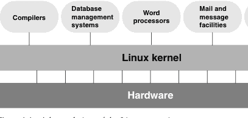

在 20 世纪 80 年代末，`ANSI`（美国国家标准学会）定义了 `C` 语言的标准版本，通常称为 `ANSI C` 或 `C89`（因标准发布的年份而得名）。十年后，`C99` 标准发布。该语言的原始版本通常被称为 `Kernighan & Ritchie`（或 `K&R` `C`，以第一本描述 `C` 语言的书籍的作者命名）。

贝尔实验室的另一位研究者 Bjarne Stroustrup 创建了一种名为 `C++` 的面向对象编程语言，它建立在 `C` 的基础之上。由于如今许多雇主都渴望拥有面向对象编程技能，`C++` 在许多环境中比 `C` 更受青睐。另一种流行的选择语言是 `Objective-C`，它曾被用于编写第一个网页浏览器。`GNU` 项目的 `C` 编译器（`gcc`）支持 `C`、`C++` 和 `Objective-C`。

## Linux 概述

`Linux` 操作系统具有许多独特而强大的功能。与其他操作系统一样，它是计算机的控制程序。但就像 `UNIX` 一样，它也是一个深思熟虑的实用程序族（图 1-1）和一组工具，允许用户连接并使用这些实用程序来构建系统应用程序。

### Linux 拥有内核编程接口

`Linux` 内核——`Linux` 操作系统的心脏——负责分配计算机资源并调度用户作业，使每个作业都能公平地获得系统资源，包括对 `CPU` 的访问；外围设备，如硬盘、`DVD` 和磁带存储；以及打印机。程序通过*系统调用*与内核交互，系统调用是具有众所周知名称的特殊函数。程序员可以使用单个系统调用与许多类型的设备进行交互。例如，只有一个 `write()` 系统调用，而不是许多特定于设备的调用。当程序发出 `write()` 请求时，内核解释上下文并将请求传递给适当的设备。这种灵活性使旧的实用程序能够与那些……

……在编写这些工具时并不存在。它还使得将程序迁移到新版本的操作系统时无需重写代码成为可能（前提是新版本识别相同的系统调用）。

## Linux 可以支持多用户

根据硬件以及计算机执行的任务类型，`Linux` 系统可以支持从 1 到超过 1,000 名用户，每位用户同时运行不同的程序集。一台可供多人同时使用的计算机的单用户成本，低于一台一次仅供单人使用的计算机。这是因为单人通常无法充分利用一台计算机所能提供的全部资源。也就是说，没有人能同时让所有打印机持续工作、让所有系统内存都处于使用状态、让所有磁盘忙于读写、让互联网连接一直处于使用状态，并让所有终端同时忙碌。相比之下，多用户操作系统允许多人几乎同时使用所有系统资源。这样可以最大化利用高成本资源，并最小化单用户成本；这是多用户操作系统的主要目标。

## Linux 可以运行许多任务

`Linux` 是一个完全受保护的操作系统，允许每个用户同时运行多个作业。进程之间可以相互通信，但彼此之间保持完全隔离，就像内核与所有进程保持隔离一样。您可以在后台运行多个任务，同时全神贯注于屏幕上显示的任务，并可以在任务之间来回切换。如果您正在运行 `X` 窗口系统（第 16 页），您可以在同一屏幕上的不同窗口中运行不同的程序，并查看所有这些程序。这种功能有助于提高用户的生产力。

## Linux 提供安全的分层文件系统

*文件* 是信息的集合，例如备忘录或报告文本、销售数字的累积、图像、歌曲或可执行程序。每个文件都以唯一的标识符存储在诸如硬盘等存储设备上。`Linux` 文件系统提供了一种结构，使文件排列在*目录*之下，目录类似于文件夹或盒子。每个目录都有一个名称，可以包含其他文件和目录。目录又排列在其他目录之下，依此类推，形成树状组织。这种结构通过将相关文件分组到目录中，帮助用户管理大量文件。每个用户拥有一个主要目录，并根据需要拥有尽可能多的子目录（图 1-2）。

**标准**。为了让系统管理员和软件开发人员的生活更轻松，一群人在互联网上聚集起来，制定了 `Linux` 文件系统标准（`FSSTND`），该标准后来演变为 `Linux` 文件系统层次标准（`FHS`）。在采用此标准之前，关键程序在不同的 `Linux` 发行版中位于不同的位置。如今，您可以坐在一台 `Linux` 系统前，期望在一致的位置找到给定的标准程序（第 189 页）。

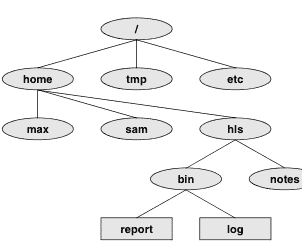

**图 1-2 Linux 文件系统结构**

**链接** *链接* 允许通过两个或更多名称访问给定文件。替代名称可以位于与原始文件相同的目录中，也可以位于另一个目录中。链接可以让同一个文件出现在多个用户的目录中，使这些用户能够轻松共享该文件。`Windows` 使用*快捷方式*术语来描述这种功能，以替代*链接*。`Macintosh` 用户可能更熟悉*别名*这个术语。在 `Linux` 中，*别名*与*链接*不同；它是 `shell` 提供的命令宏功能（第 392 页）。

**安全性** 像大多数多用户操作系统一样，`Linux` 允许用户保护其数据免受其他用户的访问。它还允许用户通过简单但有效的保护方案与特定的其他用户共享选定的数据和程序。这种安全级别由文件访问权限提供，该权限限制了可以读取、写入或执行文件的用户。`Linux` 还实现了 `ACL`（访问控制列表），为用户和管理员提供对文件访问权限的更细粒度控制，以及 `SELinux`，它为用户和管理员提供更多访问控制权限。

## 外壳：命令解释器和编程语言

在文本环境中，`shell`（命令解释器）充当您与操作系统之间的接口。当您在屏幕上输入命令时，`shell` 解释该命令并调用您所需的程序。`Linux` 有几种可用的 `shell`。四种最*流行*的 `shell` 是：

-   再次 Bourne Shell（`bash`），原始 Bourne Shell（原始 `UNIX` shell）的增强版本。

-   Debian Almquist Shell（`dash`；第 329 页），一个功能较少的 `bash` 较小版本。许多启动 shell 脚本调用 `dash` 来替代 `bash` 以加快启动过程。

-   TC Shell（`tcsh`），`C Shell` 的增强版本，作为 `BSD UNIX` 的一部分开发。

-   Z Shell（`zsh`），包含来自多个 `shell` 的功能，包括 Korn Shell。

由于不同用户可能偏好不同的 `shell`，多用户系统在任一给定时间可能同时使用几种不同的 `shell`。`shell` 的选择展示了 `Linux` 操作系统的一个优势：为每个用户提供定制接口的能力。

除了执行从键盘解释命令并将这些命令发送到操作系统的功能外，`shell` 还是一种高级编程语言。`shell` 命令可以安排在文件中以便稍后执行（`Linux` 将这些文件称为 *shell 脚本*；`Windows` 将它们称为 *批处理文件*）。这种灵活性允许用户相对轻松地执行复杂操作，通常通过发出简短命令，或者以惊人少的努力构建执行高度复杂操作的复杂程序。

## 文件名生成

当您输入由 `shell` 处理的命令时，您可以使用对 `shell` 具有特殊含义的字符构建模式。这些字符称为 *通配符*。这些模式，称为 *模糊文件引用*，是一种简写形式：您不必输入完整的文件名，而是可以输入模式；`shell` 将这些模式扩展为匹配的文件名。模糊文件引用可以节省输入长文件名或一系列相似文件名的努力。例如，`shell` 可能会将模式 `mak?*tar.gz` 扩展为 `make-3.8.0.tar.gz`。当您只知道文件名的一部分或记不清文件名的确切拼写时，模式也非常有用。

## 补全

与 `Readline` 库一起，`shell` 执行命令、文件名、路径名和变量补全：您输入前缀并按下 *TAB*，`shell` 将列出以该前缀开头的项，或者如果前缀指定了唯一项，则完成该项。

## 设备无关的输入和输出

设备（如打印机或终端）和磁盘文件对 `Linux` 程序来说表现为文件。当您向 `Linux` 操作系统发出命令时，您可以指示它将输出发送到几个设备或文件中的任意一个。这种重定向称为 *输出重定向*。

类似地，程序的输入通常来自键盘，也可以重定向以改为来自磁盘文件。输入和输出是*设备无关*的；也就是说，它们可以重定向到或来自任何合适的设备。

作为一个例子，`cat` 实用程序通常在屏幕上显示文件的内容。当您运行 `cat` 命令时，您可以轻松使其输出转到磁盘文件而不是屏幕。

## Shell 函数

`shell` 最重要的功能之一是用户可以将其用作编程语言。由于 `shell` 是解释器，它不为为之编写的程序编译，而是在每次从磁盘加载程序时进行解释。加载和解释程序可能需要时间。

许多 `shell`，包括再次 Bourne Shell，支持 `shell` 函数，`shell` 将这些函数保存在内存中，因此每次执行时不必从磁盘读取。`shell` 还将函数保存在内部格式中，因此不必花费太多时间解释它们。

## 作业控制

作业控制是一个 `shell` 功能，允许用户同时处理多个作业，并随意在它们之间来回切换。当您启动一个作业时，它通常在前景中运行，因此连接到终端。使用作业控制，您可以将正在处理的作业移动到后台并在那里继续运行，同时在前景中处理或观察另一个作业。如果后台作业需要您的关注，您可以将其移动到前景，使其再次附加到终端。作业控制的概念源自 `BSD UNIX`，在那里它出现在 `C Shell` 中。

## X 窗口系统

### X 的历史

`X` 窗口系统（也称为 `X` 或 `X11`；www.x.org）于 1984 年由麻省理工学院（`MIT`）的研究人员创建，他们当时正在从事一个分布式计算项目和一个称为 `Project Athena` 的校园分布式环境。该系统不是第一个在 `UNIX` 系统上运行的窗口软件，但它是第一个广泛可用并被接受的系统。1985 年，`MIT` 向公众发布了 `X`（版本 9），无需许可证即可使用。三年后，一组供应商组成了 `X` 联盟，以支持 `X` 的持续开发，在 `MIT` 的领导下。到 1998 年，`X` 联盟成为开放组的一部分。2001 年，开放组发布了 `X` 版本 11，release 6.6（`X11R6.6`）。

`X` 窗口系统受早期专有窗口系统中的想法和功能启发，但旨在具备可移植性和灵活性。`X` 被设计为运行在工作站上，通常连接到局域网。设计者在设计 `X` 时考虑了网络。如果您可以通过网络与远程计算机通信，在该计算机上运行 `X` 应用程序并将结果发送到本地显示是很直接的。

虽然 `X` 协议在很长一段时间内保持稳定，但其以扩展形式进行的添加非常常见。其中最有趣的一个——尽管尚未投入生产——是媒体应用程序服务器，它旨在为声音和视频提供与 `X` 为简单窗口应用程序提供的同等网络透明度。

## XFree86 与 X.org

许多 `Linux` 发行版曾使用 `XFree86` `X` 服务器，其许可证继承自最初的 `MIT` `X` 服务器，一直持续到 4.3 版本。2004 年初，就在 `XFree86` 4.4 版本发布前夕，`XFree86` 的许可证被修改为更具限制性且与 `GPL` 不兼容的版本（第 5 页）。在这一变更的影响下，许多发行版抛弃了 `XFree86`，转而采用基于 `XFree86` 4.4 预发布版本的 `X.org` `X` 服务器，该版本早于 `XFree86` 许可证的变更。`Fedora/RHHEL` 使用 `X.org` `X` 服务器，命名为 `Xorg`；它与 `XFree86` 分发的版本在功能上是等价的，因为大多数代码是相同的。因此，为其中一个服务器设计的模块也可以用于另一个服务器。

## 客户端/服务器环境

计算机网络是 `X` 设计中的核心。可以在一台计算机上运行应用程序，并在连接到另一台计算机的屏幕上显示结果；这种操作的便捷性将 `X` 与当今可用的其他窗口系统区分开来。得益于这一能力，科学家可以在另一栋大楼或另一个国家的强大超级计算机上运行和操纵程序，并在个人工作站或笔记本电脑上查看结果。更多信息请参阅第 460 页的“远程计算和局部显示”。

## GUI：图形用户界面

`X` 窗口系统为 `Linux` 可用的图形用户界面（`GUI`）提供了基础。对于支持 `X` 的终端或工作站屏幕，用户可以通过屏幕上的多个窗口与计算机交互，显示图形信息，或使用专用应用程序来绘制图片、监控进程或预览格式化输出。由于 `X` 是一个跨网络协议，它允许用户在远程生成窗口的 `CPU` 的工作站或计算机系统上打开窗口。从概念上讲，`X` 非常简单。因此，它不提供 `GUI` 中常见的一些功能，例如拖动窗口的能力。`UNIX/Linux` 的哲学是模块化：`X` 依赖于窗口管理器，而窗口管理器又依赖于桌面管理器/环境。

通常在 `X` 之上运行两层：桌面管理器和窗口管理器。桌面管理器是一种面向图形的用户界面，它允许你通过操纵图标而不是向 `shell` 键入相应命令来与系统程序交互。`Fedora/RHHEL` 默认运行 `GNOME` 桌面管理器（www.gnome.org），但 `X` 也可以运行 `KDE`（www.kde.org）和许多其他桌面管理器。

## 窗口管理器

窗口管理器是在桌面管理器下运行的程序，它允许你打开和关闭窗口、运行程序，并设置鼠标，使其根据点击的位置和方式产生不同的效果。窗口管理器还赋予屏幕个性。虽然 `Microsoft Windows` 允许你更改窗口中关键元素的颜色，但 `X` 下的窗口管理器允许你自定义屏幕的整体外观和感觉：你可以更改窗口的外观和工作方式（通过给予其不同的边框、按钮和滚动条），设置虚拟桌面、创建菜单等。当从命令行工作时，你可以使用 `Midnight Commander`（`mc`）来近似窗口管理器的功能。

`X` 和 `Linux` 下有几种流行的窗口管理器。`RHEL` 提供 `Metacity`（`GNOME` 2 下的默认）和 `kwim`（`KDE` 下的默认）。除了 `KDE` 之外，`Fedora` 还提供 `Mutter`（`GNOME` 3 下的默认）。`Mutter` 是 `Metacity Clutter` 的简称（图形库名为 `Clutter`）。还有其他窗口管理器，如 `Sawfish` 和 `WindowMaker` 也可用。第 4 章介绍了使用窗口管理器和其他 `GUI` 组件的信息。

## 桌面环境/管理器

与具有明确定义任务的窗口管理器不同，桌面环境（管理器）做很多事情。通常，桌面环境（如 `GNOME` 或 `KDE`）提供了一种启动应用程序和实用程序（如文件管理器）的方式，这些实用程序可与窗口管理器协同工作。

## GNOME 和 KDE

`KDE` 项目始于 1996 年，旨在为自由的类 `UNIX` 操作系统创建一致且用户友好的桌面环境。`KDE` 基于 `Trolltech` 开发的 `Qt` 工具包。当 `KDE` 开发开始时，`Qt` 许可证与 `GPL` 不兼容（第 5 页）。出于这个原因，`FSF` 决定支持另一个项目，`GNOME`（`GNU` 网络对象模型环境）。`Qt` 后来在 `GPL` 条款下发布，消除了 `GNOME` 存在的一部分理由。

**GNOME**

`GNOME`（www.gnome.org）是 `Fedora/RHEL` 的默认桌面环境。它提供了一个简单、连贯的用户界面，适合企业使用。`GNOME` 使用 `GTK` 来绘制控件。`GTK` 是为 `GNU` 图像操纵程序（`GIMP`）开发的，用 `C` 编写，但也可用于 `C++` 和其他语言。

`GNOME` 没有充分利用其组件架构。相反，它继续支持传统的 `UNIX` 哲学，依赖许多小型程序，每个程序都擅长执行特定任务。

**KDE**

`KDE`（kde.org）使用 `C++` 在 `Qt` 框架上编写。`KDE` 试图使用现有技术，如果可以重用的话；如果没有其他可用的或需要更好的解决方案，则创建自己的。例如，`KDE` 在 `Mozilla` 项目诞生之前就实现了 `HTML` 渲染引擎。类似地，`KOffice` 的工作开始于 `StarOffice` 成为开源的 `OpenOffice.org`（现在是 `LibreOffice`）之前很久。相比之下，`GNOME` 的办公应用程序是独立的程序，起源于 `GNOME` 项目之外。`KDE` 的可移植性由其在 `Mac OS X` 下使用其大多数核心组件（包括 `Konqueror` 和 `KOffice`）来证明。

**互操作性**

自版本 2 发布以来，`GNOME` 项目一直专注于简化用户界面，移除被认为不必要的选项，并旨在提供一组终端用户不希望更改的默认设置。`Fedora` 15 引入了

**GNOME 3**

`GNOME` 3 与 `GNOME` 2 有根本性的不同，遵循了向更简单、更图形化的桌面发展的趋势，这些桌面拥有更多的图标和更少的菜单。`KDE` 朝相反方向发展，强调可配置性。

`freedesktop.org` 组织（freedesktop.org），其成员来自 `GNOME` 和 `KDE` 项目，正在改善互操作性，并旨在产生标准，使这两个环境能够协同工作。`freedesktop.org` 发布的一个标准允许应用程序使用 `GNOME` 或 `KDE` 面板的通知区域，而无需知道它们运行在哪个桌面环境中。

## 其他桌面环境

除了 `GNOME` 和 `KDE` 之外，还有其他流行的桌面环境。有关 `WindowMaker`、`Xfce` 和 `LXDE` 桌面环境的信息和安装说明，请参见第 118 页。

## 大量有用的实用程序


Linux 包含数百个实用程序组成的家族，通常称为命令。这些实用程序执行用户普遍需要的功能。每个实用程序倾向于做一件事并把它做好。例如，`sort` 实用程序将列表（或列表组）按字母或数字顺序排列，并可用于按部件号、姓氏、城市、邮政编码、电话号码、年龄、大小、成本等排序。`sort` 实用程序是标准 Linux 系统的重要组成部分，是一种重要的编程工具。其他实用程序允许用户创建、显示、打印、复制、搜索和删除文件，以及编辑、格式化和排版文本。`man`（用于手册）和 `info` 实用程序提供 Linux 的在线文档。

## 进程间通信

### 管道和过滤器

Linux 允许用户在命令行上建立管道和过滤器。管道将一个程序的输出传递给另一个程序作为输入。过滤器是一种特殊类型的管道，它处理输入数据流以产生输出数据流。过滤器处理另一个程序的输出，并因此改变它。过滤器的输出随后成为另一个程序的输入。

管道和过滤器经常连接实用程序以执行特定任务。例如，你可以使用管道将 `sort` 实用程序的输出发送到 `head`（一个列出其输入前 10 行的过滤器）；然后你可以使用另一个管道将 `head` 的输出发送到第三个实用程序 `lpr`，它将数据发送到打印机。因此，在一行命令中，你可以一起使用三个不相关的实用程序来排序并打印文件的一部分。

## 网络实用程序

Linux 网络支持包括许多实用程序，允许你通过各种网络访问远程系统。除了向其他系统的用户发送电子邮件外，你还可以访问挂载在其他计算机磁盘上的文件，仿佛它们位于本地系统上，使你的文件可供其他系统类似访问

方式，在本地与远程系统之间复制文件，在远程系统上运行程序并在本地系统上显示结果，以及在局域网（LAN）和广域网（WAN）（包括互联网）上执行许多其他操作。

在此网络访问之上，叠加了广泛的应用程序，它们将计算机的资源扩展到全球各地。你可以与世界各地的人进行交流，收集各种主题的信息，并快速可靠地从互联网下载新软件。第 8 章讨论网络、互联网以及 Linux 网络设施。

## 系统管理

在 Linux 系统中，系统管理员通常是系统的所有者，也是唯一的用户。此人肩负许多职责。首要职责可能是安装系统、安装软件，并可能编辑配置文件。一旦系统启动并运行，系统管理员便负责下载和安装软件（包括升级操作系统）、备份和恢复文件，以及管理打印机、终端、服务器和局域网等系统设施。系统管理员还负责在多用户系统中为新用户设置账户、根据需要启动和关闭系统、监控系统以及处理出现的任何问题。

## 软件开发

Linux 最令人印象深刻的优势之一是其丰富的软件开发环境。Linux 支持许多计算机语言的编译器和解释器。除了 C 和 C++，Linux 上可用的语言还包括 Ada、Fortran、Java、Lisp、Pascal、Perl 和 Python。`bison` 实用程序生成解析器代码，使编写用于构建自动机（解析包含结构化信息的文件的工具）的程序变得更加容易。`flex` 实用程序生成扫描器（识别文本中词法模式的代码）。`make` 实用程序以及 GNU 配置和构建系统使管理复杂的开发项目变得更加容易。CVS 等源代码管理系统简化了版本控制。包括 `gdb` 和 `ddd` 在内的多个调试器可以帮助你追踪和修复软件缺陷。GNU C 编译器（`gcc`）与 `gprof` 性能分析实用程序配合使用，帮助程序员识别程序性能中的潜在瓶颈。C 编译器包含执行 C 代码广泛检查的选项，从而使代码更具可移植性并减少调试时间。


## 选择操作系统

如果你正在读这本书，你很可能至少正在考虑使用/安装 Linux；你知道 Windows（Microsoft）和 OS X（Macintosh）系统之外还有替代选择。本章详细介绍了使 Linux 成为优秀操作系统的许多特性。但你怎么决定 Linux 是否适合你？以下是选择操作系统时需要考虑的一些因素列表：

- 外观和感觉——你能舒适地使用 GUI 吗？学习曲线如何？
- 成本——操作系统的成本是多少？在该成本下包含什么内容？
- 易用性——GUI 是否易于使用？
- 捆绑软件——操作系统附带哪些软件，你还需要购买哪些其他软件？
- 硬件要求——运行操作系统以达到让你感到舒适的速度的硬件有多昂贵？
- 错误——修复错误需要多长时间，更新发布的频率如何？
- 安全性——操作系统的安全程度如何？你需要做什么才能使它足够安全以满足你的需求？你需要购买安全软件吗？你需要购买防病毒软件吗？
- 可用软件——该操作系统有多少可用软件？

Windows、OS X 和 Linux 各有其优缺点。通常，外观、感觉和易用性取决于你习惯什么。Linux 允许你对 GUI 进行比 OS X 更多、比 Windows 多得多的自定义，因此你可能可以自定义它，使你在操作时更加舒适。如果你正在更换操作系统，请给自己足够的时间来适应新系统。Linux 确实有一定的学习曲线：它会有挑战性，但回报丰厚。

Linux 最大的优势之一是你自己可以修复它；当你遇到问题时，你不必等待 Microsoft 或 Apple 发现并修复错误。在成本问题上，Linux 毫不费力地胜出：它是免费软件。此外，Linux 附带大量捆绑软件，包括 LibreOffice，这是一套完整的与 Microsoft 兼容的办公套件，以及更多内容。你还可以免费下载额外的软件。Windows 附带的软件非常少；你需要单独购买办公软件和大多数其他软件。同样，OS X 介于两者之间。

Windows 经常被称为臃肿——它需要最新、最强大的硬件才能以可接受的速度运行。OS X 仅在 Apple 硬件上运行，与运行 Windows 所需的硬件（PC 硬件）相比，这种硬件价格昂贵。Linux 运行在 PC 硬件上，但它对硬件的使用比 Windows 轻得多。在非服务器系统上，GUI 通常使用系统大部分可用的处理能力。在较旧的硬件上，你可以运行轻量级 GUI 之一（见第 118 页）来替代 GNOME 或 KDE，从而获得良好的性能。根据你正在执行的操作，你甚至可以仅使用 CLI 在最小硬件上获得出色的性能。

由于社区支持，Linux 在支持方面获得极高评价；错误修复频繁分发且易于应用。Windows 的支持已有所改善，但远未达到 Linux 支持的水平。OS X 的评价褒贬不一。而且病毒在 Linux 上几乎不存在，因此所需的支持较少。

## 本章总结

Linux 操作系统脱胎于 UNIX 传统，成为传统系统（即 Windows）在微型计算机（PC）硬件上的一种流行替代品。UNIX 用户将在 Linux 中发现熟悉的环境。Linux 发行版包含人们预期会有的 UNIX 实用程序配套，这些工具由世界各地的程序员贡献，包括作为 GNU 项目的一部分开发的一系列工具。Linux 社区致力于该系统的持续开发。对新微型计算机设备和功能的支持在硬件可用后很快添加，而 Linux 上可用的工具仍在不断精炼。鉴于许多可在 Linux 平台上运行的商业软件包以及许多在其系统上提供 Linux 的硬件制造商，显而易见，该系统已远远超越其作为本科生项目的起源，演变为学术界、商业、专业和个人用途的首选操作系统。

Linux 以发行版的形式打包，每个发行版都有一个安装程序和一组适合该发行版用途的软件包。一个发行版通常包含保持其软件最新的方法。

Linux 和许多相关软件是 FOSS/FLOSS（自由 [开放] 源代码软件）。这些术语结合了由自由软件基金会（FSF）提出的`自由软件`和起源于开放源代码促进会（OSI）的`开放源代码软件`的含义，可以互换使用而不表明对其中任何一个的偏好。

## 练习题

- 1. 什么是自由软件？列出自由软件的三个特征。
- 2. Linux 为什么受欢迎？为什么它在学术界受欢迎？
- 3. 什么是多用户系统？它们为什么成功？
- 4. 什么是 Linux？什么是自由软件基金会/GNU？Linux 操作系统的哪部分由各自提供？还有哪些人帮助构建和完善了这个操作系统？
- 5. Linux 是用哪种语言编写的？这种语言与 Linux 的成功有什么关系？
- 6. 什么是发行版？它包含什么？说出三个发行版。
- 7. `自由软件`和`开放源代码软件`这两个术语之间有什么区别？每个术语是谁提出的？
- 8. 什么是实用程序？
- 9. 什么是 Shell？它如何与内核协同工作？如何与用户协同工作？
- 10. 你如何利用实用程序和 shell 来创建自己的应用程序？
- 11. 为什么 Linux 文件系统被称为层次结构？
- 12. 多用户系统和多任务系统之间有什么区别？
- 13. 举一个你希望使用多任务系统的例子。
- 14. 大约有多少人编写了 Linux？为什么这个项目是独一无二的？
- 15. GNU 通用公共许可证（GPL）的主要条款是什么？

# 第一部分

## 安装 Fedora 和 Red Hat 企业版 Linux

- 第 2 章 安装概览 25
- 第 3 章 逐步安装指南 55

*此页故意留白*

# 2 安装概览

### 本章内容

- 本书使用的约定 . . . 26
- LPI 和 CompTIA 认证图标 . . . . . . . . . . . . . . . . . . . . . . 28
- 更多信息 . . . . . . . . . . . . . . . . . . . . . . . . . . . . 28
- 规划安装 . . . . . . . . . . . . . . . . . . . . . . . . . . . . . . 29
- Fedora 标准版本：Live、Install 和网络镜像 . . . . . . . . . . . . . . . . . . . 34
- 设置硬盘 . . . . . . . . . . . . . . . . . . . . . . . . . . . . . . 36
- LVM：逻辑卷管理器 . . . . . . . . . . . . . . . . . . . . . . . . . 44
- 安装过程 . . . . . . . . . . . . . . . . . . . . . . . . . . . . . . 44
- 下载安装镜像文件以及将安装介质刻录/写入 . . . . . . . . . . . . . . . . . . . . . . . . 46
- 下载安装镜像文件的最简便方法 . . . . . . . . . . . . . . . . . . . . . . . . . . 46
- 使用 BitTorrent . . . . . . . . . . . . . . . . . . . . . . . . . 48
- 收集系统信息 . . . . . . . . . . . . . . . . . . . . . . . . . . . . 50

### 学习目标

阅读完本章后，你应该能够：

- 选择最适合您需求的发行版和版本
- 下载 Live 或 Install 镜像（ISO）文件
- 将 Live 或 Install 镜像刻录/写入安装介质（DVD 或 USB 闪存盘）
- 使用 live 会话测试硬件并检查系统需求
- 列举磁盘分区需要考虑的因素
- 描述软件 RAID 和 LVM 分区方案的优缺点

安装 Linux 是将操作系统文件从安装介质（例如，DVD、USB 闪存盘）或网络复制到系统硬盘，并设置配置文件以便 Linux 能够在硬件上正常运行，的过程。

本章讨论了安装的一般过程：规划、对硬盘进行分区、获取安装文件、刻录或写入安装介质，以及收集有关硬件的信息，这些信息可能有助于安装和管理。第 3 章涵盖了安装 Linux 的过程。

### Anaconda

Anaconda 是一个用户友好的安装 Fedora/RHEL 的工具。对于标准硬件（任何您可以安装 Windows 的硬件），通常只需插入包含 Live 或 Install 镜像的安装介质并启动系统即可。在浏览几个屏幕后，安装就完成了。当然，有时您可能希望自定义系统，或者您正在非标准硬件上安装：Anaconda 会提供选项，允许您控制安装过程。有关安装和自定义 Fedora/RHEL 的信息，请参见“安装 Fedora/RHEL”（第 59 页）和“安装任务”（第 69 页）。

#### 升级 Fedora 系统

> **提示** 新的 Anaconda 安装程序不能将 Fedora 系统从一个版本升级到下一个版本。您必须使用 FedUp（FEDora 升级器），它适用于 Fedora 17 及更高版本。访问 fedoraproject.org/wiki/FedUp 上的 Fedora 网页以获取更多信息。

## 本书使用的约定

本书使用约定来使解释更简短、更清晰。以下段落描述了这些约定。

- **文本和示例：** 正文使用这种字体，而示例则显示在等宽字体中（也称为固定宽度字体）：
  ```
  $ cat practice
  This is a small file I created
  using a text editor.
  ```
- **您输入的项目：** 您在键盘上输入的所有内容均以粗体显示。在正文中，使用这种粗体字体；在示例和屏幕中，使用这种字体。在上面的示例中，第一行上的美元符号（$）是 Linux 显示的提示符，因此它不是粗体；第一行的其余部分是由用户输入的，因此是粗体。
- **实用程序名称：** 实用程序名称以这种无衬线字体印刷。本书引用了 `nano` 文本编辑器和 `ls` 命令（或仅 `ls`），但指示您在命令行输入 `ls -a`。通过这种方式，正文区分了实用程序（它们是程序）和您在命令行输入以调用实用程序的指令。
- **文件名：** 文件名以粗体显示。例如 `memo5`、`letter.1283` 和 `reports`。文件名可能包含大写字母和小写字母；然而，Linux 区分大小写（第 1241 页），因此 `memo5`、`MEMO5` 和 `Memo5` 是三个不同的文件。

| 字符串 | 在正文中，字符和字符串通过将它们放在粗体字体中来标记。此约定避免了在字符串前后使用引号或其他分隔符的需要。一个例子是以下由 `passwd` 实用程序显示的字符串：`Sorry, passwords do not match.` |
| :--- | :--- |

| 按键和字符 | 本书使用小型大写字母来表示三种类型的项目：<br>- 键盘按键，如 SPACE 键以及 RETURN、ESCAPE 和 TAB 键。<br>- 按键生成的字符，如 SPACE 键生成的空格。<br>- 您与 CONTROL 键同时按下的键盘按键，如 CONTROL-D。（尽管 D 显示为大写字母，您无需按下 SHIFT 键；通过按住 CONTROL 键并按 d 来输入 CONTROL-D。） |
| :--- | :--- |

| 提示符和返回 | 大多数示例都包含*shell 提示符*——即 Linux 正在等待命令的信号——显示为美元符号（$）、井号（#）或有时百分号（%）。本书中的提示符不是粗体字体，因为您不输入它。当您用本书中的示例进行实验时，请勿在键盘上输入提示符。如果这样做，示例将无法工作。<br>示例*省略*了您必须使用的 RETURN 按键以执行它们。命令行示例是 `$ nano memo.1204`。要将此示例作为运行 `nano` 文本编辑器的模型，请输入命令 `nano memo.1204` 并按 RETURN 键。（参见第 270 页的 `nano` 教程。）这种显示命令的方法使书中的示例与屏幕上显示的内容相对应。 |
| :--- | :--- |

| 定义 | 所有标记为 `DEFINITIONS` 的术语表条目均由 Denis Howe 提供，他是《免费在线计算机术语词典》（foldoc.org）的编辑，并经许可使用。该网站是一项正在进行的工作，包含定义、轶事和 trivia。 |
| :--- | :--- |

| **可选** | 标记为可选的段落出现在灰色方框中。这些材料不是章节中呈现的核心思想，通常涉及更具挑战性的概念。阅读章节时的好策略是跳过可选部分，然后在熟悉章节中呈现的主要思想后再回过头来看。这是一个可选段落。 |
| :--- | :--- |

| URL（网络地址） | 网络地址或 URL 隐式包含 `http://` 前缀，除非显示为 `ftp://` 或 `https://`。当前缀为 `http://` 时，您通常不需要指定前缀，但在浏览器中指定 FTP 或安全 HTTPS 站点时，必须使用前缀。因此，您可以按照本书中显示的方式在浏览器中指定 URL。 |
| :--- | :--- |

1. 不同的键盘使用不同的键将 `光标`（第 1245 页）移动到下一行的开头。本书始终将结束行的键称为 `RETURN` 键。您使用的键盘可能有 `RET`、`NEWLINE`、`ENTER`、`RETURN` 或其他键。每当本书要求您按 `RETURN` 时，请使用键盘上对应的键。

## 输出是什么

本书使用由包含选项 `--time-style=iso` 产生的 `ls -l` 命令的输出。该选项产生更短的行，使示例更具可读性。

## 提示、警告和安全方框

以下方框突出了在使用或管理 Linux 系统时可能有用的信息。

**这是一个提示方框**

> **提示** 提示方框可以帮助您避免重复常见的错误，或者指向额外的信息。

**这个方框警告您某事**

> **警告** 警告方框警告您潜在的陷阱。

**这个方框标记安全说明**

> **安全** 安全方框突出显示潜在的安全问题。这些说明通常面向系统管理员，但有些适用于所有用户。

## LPI 和 COMPTIA 认证图标

本书被许多大学课程用作指定教材。由于参加这些课程的学生通常寻求 LPI 或 CompTIA 认证，教师要求将认证目标映射到本书涵盖的材料。本书完全涵盖了 LPI 的 Linux Essentials 认证学习目标，并广泛涵盖了 CompTIA 的 Linux+ 考试目标。附录 E 将这些学习目标和考试目标映射到本书中的页面。整本书中使用以下图标来标记讨论学习目标和考试目标的地方。

- **LPI：** 此图标指示涵盖了 CompTIA 的 Linux+ 考试目标中的一个主题。
- **LE：** 此图标指示涵盖了 LPI 的 Linux Essentials 认证学习目标中的一个主题。


# 更多信息

除了以下参考资源外，请参阅第 128 页的“从命令行获取帮助”，并参考附录 B 获取更多资源。

* **LE+：** 此图标指示涵盖了 `CompTIA` 的 `Linux+` 考试目标中的一个主题以及 `LPI` 的 `Linux Essentials` 认证学习目标中的一个主题。

## 参考资源列表

* `web memtest86+`：`www.memtest.org`
* 分区 `HOWTO`：`tldp.org/HOWTO/Partition`（有日期）
* 分区：`www.linfo.org/partition.html`
* `LVM` 资源页（包含许多链接）：`sourceware.org/lvm2`
* `LVM HOWTO`：`www.tldp.org/HOWTO/LVM-HOWTO`（有日期）
* `Transmission` BitTorrent 客户端：`www.transmissionbt.com`
* `X.org` 发布信息：`x.org/wiki`
* 发行版：`distrowatch.com`
* 将 `ISO` 映像文件写入 `USB` 闪存盘（Windows 和 Linux）：`fedorahosted.org/liveusb-creator`（`liveusb-creator` 软件包）和 `unetbootin.sourceforge.net`（`unetbootin` 软件包）
* 硬件兼容性：`hardware.redhat.com`
* `RHEL` 版本：`www.redhat.com/products/enterprise-linux/server/compare.html`
* 升级：`fedoraproject.org/wiki/FedUp`
* 验证下载的 `ISO` 映像文件（Linux 和 Windows）：`fedoraproject.org/en/verify`
* 发行说明：`docs.fedoraproject.org/en-US/Fedora/19/html/Release_Notes`
* 交换空间：`docs.fedoraproject.org/en-US/Fedora/13/html/Installation_Guide/s2-diskpartitioning.html`
* 刻录 `DVD` 或写入 `USB` 闪存盘：`docs.fedoraproject.org/en-US/Fedora/19/html/Installation_Guide/sn-making-media.html`
* 从 `USB` 闪存盘安装：`docs.fedoraproject.org/en-US/Fedora/19/html/Installation_Guide/Making_USB_Media.html`
* `RAID`：`raid.wiki.kernel.org/index.php/Linux_Raid`
* `PXE`：`www.kegel.com/linux/pxe.html`

### 下载

* `Fedora`/`RHEL`
* 最简单的下载方式：`fedoraproject.org/get-fedora`
* 下载资源：`fedoraproject.org/get-fedora-all`
* 比特流（`Torrent`）：`torrent.fedoraproject.org`
* `Fedora` 和 `EPEL` 镜像：`mirrors.fedoraproject.org/publiclist`
* 所有资源：`dl.fedoraproject.org/pub`
* `RHEL` 额外软件包：`fedoraproject.org/wiki/EPEL`
* 转发行版（Spins）：`spins.fedoraproject.org`

## 规划安装

在规划安装过程中的主要决策是如何将硬盘划分为分区，或者在双启动系统的情况下，确定将 Linux 分区放在哪里。安装完系统后，您可以决定想向基础系统添加哪些软件包（或者是否想要移除某些软件包）。除了这些主题之外，本节还讨论了硬件要求。

## 注意事项

### SELinux

`SELinux`（Security-Enhanced Linux，安全增强型 Linux）通过在内核中实施强制访问控制策略来增强系统安全性（第 473 页）。默认情况下，`Fedora` 以强制执行模式安装 `SELinux`，该模式实施了最佳实践安全策略。尽管您可以在安装系统之前或之后将 `SELinux` 设置为宽容模式或禁用模式，但这不是一个好主意，因为 `SELinux` 保护着系统。有关 `SELinux` 的更多信息，请参阅第 473 页。如果您希望在安装系统时关闭 `SELinux`，请参阅 `selinux` 引导参数（第 72 页）。

### 图形用户界面 (GUI)

服务器系统可以通过不包含图形用户界面（`GUI`）来节省资源。在其他系统中，`GUI` 提供了拥有多个工作区的桌面环境，可以包含许多窗口。`Fedora`/`RHEL` 默认安装 `GNOME`。

## 硬件要求

### 硬件

本章和第 3 章涵盖了在 64 位处理器架构上安装操作系统的过程，例如 `AMD64` 处理器和具备 `Intel EM64T` 技术的 `Intel` 处理器，以及较旧的 32 位 `Intel` 和兼容处理器架构（包括 `AMD` 处理器）。在这些处理器架构中，`Fedora`/`RHEL` 可以运行于许多可用的硬件上。您可以在 `hardware.redhat.com` 查看兼容和受支持硬件的列表。虽然这些列表针对的是 `RHEL`，但它们为 `Fedora` 可运行的硬件提供了良好的参考。`Fedora` 发行说明也提供硬件信息。许多互联网网站讨论了 Linux 硬件；使用 Google 搜索 `linux hardware`、`fedora hardware`，或者 `linux` 加上您想了解更多信息的具体硬件（例如，`linux sata` 或 `linux a8n`）。此外，许多 `HOWTO` 文档涵盖了特定硬件。`Linux 硬件兼容性 HOWTO` 也可供查阅，尽管在阅读时它可能不是最新的。除非系统包含非常新或特殊的组件，否则 `Fedora`/`RHEL` 通常可以在 `Windows` 运行的相同系统上运行。

如果您正在旧式或极简硬件上安装 `Fedora` 并希望运行图形用户界面（`GUI`），请考虑安装 `LXDE`（第 118 页），因为它提供一个轻量级桌面，比 `GNOME` 更有效地利用系统资源。

### CPU（处理器）

至少，`Fedora` 需要 `Intel Pentium Pro` 处理器；它针对 `i686` 及更新的处理器进行了优化。文本系统的最低建议处理器速度为 500-700 兆赫兹，图形系统的最低建议为 1 吉赫兹。访问 `www.redhat.com/products/enterprise-linux/server/compare.html` 获取有关 `RHEL` 系统的信息。

### RAM（内存）

32 位和 64 位 `Fedora` 系统的内存要求相同。至少，文本（命令行）系统需要 32 兆字节 `RAM`，图形（桌面）系统需要 1 吉字节 `RAM`。在某些情况下，对于非常极简的文本安装，可以使用更少的 `RAM`。运行实时会话（来自 Live Image）至少需要 1 吉字节 `RAM`。访问 `www.redhat.com/rhel/compare` 获取有关 `RHEL` 系统的信息。

Linux 能很好地利用额外内存：系统的内存越多，运行速度越快。对于未受 `CPU` 限制的系统，增加内存是提升 Linux 系统速度最具成本效益的方法之一。

### 硬盘空间

系统所需的硬盘空间量取决于您安装的是 `Fedora`/`RHEL` 的哪个版本、安装了哪些软件包、安装了多少种语言以及用户数据（您的文件）需要多少空间。`Fedora` 操作系统通常需要 10 吉字节，尽管极简系统可以使用少得多的空间。用户数据需要额外的空间。为了确保文件系统正常操作，请保留至少 5% 的磁盘空间为空。访问 `www.redhat.com/rhel/compare` 获取有关 `RHEL` 系统的信息。

### BIOS 设置

现代计算机可以设置为从 `DVD`、硬盘或 `USB` 闪存盘启动。`BIOS` 决定系统尝试从每个设备启动的顺序。您可能需要更改此顺序：确保 `BIOS` 设置为在尝试从硬盘启动之前先尝试从 `DVD` 或 `USB` 驱动器启动。此外，如果您想在系统上运行虚拟机（第 17 章），可能需要在 `BIOS` 中启用虚拟化。有关 `BIOS` 的更多信息，请参阅第 590 页。

### CMOS

`CMOS` 是存储硬件配置信息的持久内存。要更改 `BIOS` 设置，您需要编辑存储在 `CMOS` 中的信息。当系统启动时，它会显示一条简短消息，说明如何进入系统设置或 `CMOS` 设置模式。按下指定的按键，然后将光标移动到处理系统启动的屏幕和行。通常有一个包含三个或四个设备的列表，系统会依次尝试从这些设备启动；如果第一次尝试失败，系统会尝试第二个设备，依此类推。调整该列表，使 `DVD` 或 `USB` 闪存盘成为第一选择，保存列表并重新启动。请参阅硬件/`BIOS` 手册以获取更多信息。

## 处理器架构

安装介质包含编译为在特定处理器架构（处理器或 `CPU` 类别）上运行的程序。以下列表描述了 `Fedora`/`RHEL` 所编译支持的每种架构。访问 `docs.fedoraproject.org/en-US/Fedora/19/html/Installation_Guide/ch-new-users.html#hn5-which-arch` 以查看每种架构中处理器的详细列表。由于 Linux 源代码对所有人开放，具备知识的用户可以编译 `Fedora`/`RHEL` 以在其他处理器架构上运行（第 14 章）。

### i386/i686 (Intel x86)

`Fedora`/`RHEL` 32 位 PC 安装介质上的软件编译为在 `Intel x86` 兼容处理器上运行，包括大多数配备 `Intel` 和 `AMD` 处理器的机器、几乎所有运行 `Microsoft Windows` 的机器，以及使用 `Intel` 处理器的较新的 `Apple Macintosh` 机器。`N200` 和 Z 系列 `Atom` 处理器也基于此架构。如果您不确定机器拥有哪种类型的处理器，请假设它具有此类型的处理器。

### x86_64 (AMD64 和 Intel EM64T)

`Fedora`/`RHEL` 64 位 PC 安装介质上的软件编译为在 `AMD64` 处理器上运行，包括 `Athlon64`、`Opteron`，以及集成 `EM64T` 技术的 `Intel` 64 位处理器，例如 `EM6T2 Xeon`。N 系列 `Atom` 处理器（除 `N200` 外）也基于此架构。

### Mac PowerPC (ppc)

`Fedora`/`RHEL` `PPC` 版本运行于 `Apple Macintosh` `G3`、`G4`、`G5`、`PowerBook` 和基于 `PPC` 的 `Macintosh`。

## 在支持 64 位处理器的计算机上，我应该安装 32 位还是 64 位 Linux？

> 以下信息可能有助于您决定在支持 64 位处理器的计算机上安装 32 位还是 64 位 Linux。

* `EM64T`/`AMD64` 处理器可以同样出色地运行两种版本的 Linux。
* 64 位发行版允许每个进程寻址超过 4 `GB` 的内存。更大的地址空间是 64 位发行版最大的优势。它通常仅对特定的工程/科学计算工作以及运行多个虚拟机时有用。
* 总体而言，64 位处理器并不比 32 位处理器更快；大多数基准测试显示性能大体相似。在某些情况下性能更好，而在某些情况下性能更差：两种类型的处理器都没有明显的性能优势。
* 64 位 Linux 的内存模型使得指针的大小是 32 位 Linux 中指针大小的两倍。这种大小差异会导致内存使用量增加 5% 以上，具体取决于应用程序。如果系统内存紧张，这种开销可能会使 64 位系统的性能变差。
* `ASLR`（地址空间布局随机化）在 64 位系统提供的更大地址空间下工作得更好。`ASLR` 有助于提高系统安全性。参见 `en.wikipedia.org/wiki/Address_space_layout_randomization`。
* 一些多媒体编码器在 64 位 Linux 下运行速度提升 10-30%。
* 某些专有第三方应用程序的功能在 64 位架构上不可用。
* 64 位 Linux 系统可以运行 32 位应用程序，但 32 位 Linux 系统无法运行 64 位应用程序。
* 如果不重新安装 Linux，就没有简单的方法在 32 位和 64 位版本之间来回切换。
* 如果您不确定使用哪个版本，请安装 64 位版本。

## 界面：安装程序和已安装系统

当您安装 `Fedora`/`RHEL` 时，您可以选择在安装过程中使用的界面（用于与 `Anaconda` 安装程序交互）。您也可以选择在操作已安装系统时使用的界面。本节介绍了两种基本界面：文本式和图形式。

### 文本式 (TUI/CLI)

`TUI`（文本用户界面），也称为 `CLI`（命令行界面）或基于字符的界面，显示字符和一些简单的图形符号。它是面向行的；您仅使用键盘向其发出指令。

### 图形式 (GUI)

`GUI`（图形用户界面）通常显示桌面（例如 `GNOME`）和窗口；您使用鼠标和键盘向其发出指令。您可以通过打开终端模拟器窗口在 `GUI` 中运行文本界面（第 120 页）。与文本界面相比，`GUI` 使用更多的计算机资源（`CPU` 时间和内存）。

### 伪图形式

伪图形式界面是一种利用基于文本的显示设备（如终端）上图形元素的文本界面。它还可能使用颜色。该界面使用文本元素，包括简单的图形符号，来模仿 `GUI` 窗口和按钮的粗糙框。通常，按下 `TAB` 键会将光标（高亮显示）从一个元素移动到下一个元素，而按下 `RETURN` 键则选择光标所在的元素。

### 优势

`GUI` 用户友好，而文本界面紧凑，使用更少的系统资源，并且可以在纯文本终端或纯文本连接上工作。由于效率更高，文本界面适用于较旧、较慢的系统以及内存极少的系统。服务器系统通常使用文本界面，因为它允许系统将更多资源用于执行其设定的任务，而更少资源用于取悦系统管理员。不运行 `GUI` 还可以提高系统安全性。

## Fedora、RHEL 和 CentOS

本书介绍了两种产品：`Fedora` 和 `RHEL`（红帽企业 Linux）。本节简要介绍了这些产品。

### Fedora

`Fedora` 项目由红帽赞助并得到开源社区的支持。`Fedora` 版本大约每六个月发布一次，该 Linux 发行版融入了尖端代码。它不是受支持的红帽产品，也不建议用于生产环境，因为在生产环境中软件包和功能集需要在较长时间内保持恒定。`Fedora` 旨在反映其融入的上游项目，包括内核。它被广泛认为是最稳定的“免费” Linux 发行版。相比之下，`RHEL` 包含了许多由 `Fedora` 引入的更改。

`Fedora` 项目大约每六个月分发一个新版本的 `Fedora`。每个版本都有一个编号和一个名称。例如，`Fedora 18` 名为 `Spherical Cow`（球体牛），`Fedora 19` 名为 `Schrödinger’s Cat`（薛定谔的猫）。之前的版本名为 `Lovelock`（15）、`Verne`（16）和 `Beefs Miracle`（17）。有关名称选择方法的描述，请参阅 [`fedoraproject.org/wiki/History_of_Fedora_release_names`](fedoraproject.org/wiki/History_of_Fedora_release_names)。

### RHEL

`RHEL` 通常通过包含技术支持的年度订阅销售。它比 `Fedora` 更稳定，但不如 `Fedora` 尖端。`RHEL` 提供 10 年的更新；`Fedora` 提供 13 个月。

红帽企业 Linux 有多种配置；更多信息请参见 `www.redhat.com/wapps/store/catalog.html`。有关 `RHEL` 各个版本的更多信息，请参见 `www.redhat.com/rhel/compare`。

红帽每隔几年分发一个新的大版本 `RHEL`。有关 `RHEL` 生命周期的信息，请参见 `access.redhat.com/support/policy/updates/errata`。

### CentOS

`CentOS`（`www.centos.org`）是一个免费的、与 `RHEL` 兼容的 Linux 发行版。它比 `Fedora` 具有更长的稳定性，但与 `RHEL` 不同，`CentOS` 不提供支持。由于 `CentOS` 与 `RHEL` 兼容，本书也介绍了 `CentOS`。`CentOS` 版本通常跟随 `RHEL` 版本发布。

## Fedora 标准版本：Live、Install 和 Network 镜像

`Fedora` 标准版本针对 `i386`（32 位）和 `x86_64`（64 位）架构编译，可通过 `BitTorrent`、直接下载和镜像站获取。要下载标准版本，请访问 `fedoraproject.org/en/get-fedora-all`。

### 术语：CD、DVD、安装介质和安装镜像

> `Fedora` 有三种版本：`Fedora Desktop Live Media`（`Fedora` 桌面 `Live` 介质）、`Fedora DVD` 和 `Fedora Network Install CD`（`Fedora` 网络安装 `CD`）。版本名称中的 `DVD` 和 `CD` 是惯例用语，与该版本可用的实际介质无关。这些版本中的每一个都提供为安装（`ISO`）镜像文件，可以写入 `CD`、`DVD`、`USB` 闪存驱动器或其他适当大小的介质（即安装介质）。本书使用术语“安装镜像”来指代存在于任何介质上的安装（`ISO`）镜像文件。除非上下文需要，否则它并不特指 `CD`、`DVD` 或 `USB` 闪存驱动器。

本书将 `Fedora Desktop Live Media` 称为 *Live 镜像*。`Live` 镜像运行 *Live 会话*：它在未将 `Fedora` 安装到硬盘的情况下运行 `Fedora`，尽管您可以从 `Live` 会话安装基本的 `Fedora` 系统。安装完成后，您可以使用 Internet 连接向系统添加更多软件包。

要从 `Live` 镜像启动，请确保 `Live ISO` 设置为从 `DVD` 或 `USB` 驱动器启动；更多信息请参见“`BIOS` 设置”和“`CMOS`”，均位于第 51 页。从 `Live` 镜像启动会显示 `GNOME` 桌面（如果您从 `KDE Live` 镜像启动，则显示 `KDE` 桌面）：您正在运行 `Live` 会话。当您退出 `Live` 会话时，系统恢复到从 `Live` 镜像启动前的状态。如果系统有 Linux `swap` 分区（大多数 Linux 系统都有；参见第 40 页），`Live` 会话将使用它来提高性能，但除此之外不会写入硬盘。`RHEL` 不提供 `Live` 镜像。


运行`Live`会话是测试硬件和修复无法从硬盘启动的系统的好方法。`Live`会话对于刚接触`Fedora`或`Linux`并想尝试`Fedora`或不同桌面环境但尚未准备好将其安装到系统中的人来说是理想的。

### 在 `Live` 会话期间保存文件

> 您无法将文件保存到持有`Live`镜像的`DVD`上，因为这是只读介质。在`Live`会话期间，即使您看似保存了文件，在您退出`Live`会话后，它也不会存在。要保存来自`Live`会话的数据，请将其保存到网络共享或`USB`闪存驱动器，或者通过电子邮件发送给自己。或者，您可以从具有持久存储功能的`Live USB`闪存驱动器启动。您可以使用`livusb-creator`（第 50 页）创建这样的`USB`驱动器。更多信息请参见`fedoraproject.org/wiki/How_to_create_and_use_Live_USB`。

### `Install` 镜像比 `Live` 镜像使用更少的内存

> 使用`Install`镜像安装`Fedora`系统比使用`Live`镜像安装系统使用更少的内存（`RAM`）。如果您在旧系统上使用`Live`镜像安装时遇到问题，请尝试使用`Install`镜像安装。

**安装映像** 本书将`Fedora DVD`（不一定刻录在`DVD`上），也称为安装介质，称为*安装映像*。本书的实体版本包含一张记录在`DVD`上的安装映像。在安装`Anaconda`安装程序之前，安装映像不会显示桌面。

当您从安装映像启动时，它会显示一个菜单，允许您安装`Fedora/RHEL`。您可以使用安装映像中的图形化或文本安装程序安装图形化或文本系统。与`Live`映像相比，安装映像为安装`Fedora`提供了更多选择。此外，安装映像允许您启动一个最小文本系统，可用于救援之前安装的系统（从“故障排除”菜单中选择**救援 Fedora 系统**；第 62 页）。您还可以使用网络映像来救援已安装的系统。

**网络映像** 网络映像仅包含`Anaconda`安装环境。它显示与安装映像相同的菜单。默认情况下，它从公共仓库下载软件包。当仓库在本地镜像时，此映像对于创建在首次启动时即为最新状态的系统以及仅需安装环境的情况非常有用。

## `Fedora` 衍生版

除了标准版本外，`Fedora`还发布了许多称为*spins*（衍生版）的替代版本（`spins.fedoraproject.org`）。以下是一些最受欢迎的衍生版列表。您可以安装基于衍生版的系统，也可以在稍后安装衍生版。有关安装说明，请参见第 118 页的“安装不同的桌面环境”。

- **`KDE`**——（K Desktop Environment; `kde.org`）一个使用`KDE Plasma`桌面构建的完整、现代桌面；也可用作`Live`映像；`GNOME`的流行替代方案

- **`LXDE`**——（Lightweight X11 Desktop Environment; `lxde.org`）一个快速、节能的桌面环境，适用于硬件较慢、资源较少的系统，如旧电脑、上网本和移动设备

- **`XFCE`**——（`www.xfce.org`）一个快速、轻量、用户友好的桌面环境，加载和运行应用程序迅速，且对系统资源占用极小；也可通过`EPEL`仓库用于`RHEL`

- **`MATE`**——（`mate-desktop.org`）`GNOME 2`的一个分支，使用传统隐喻提供直观且美观的桌面

- **`FSL`**——（Fedora Security Lab）一个用于安全审计、取证、系统救援以及教授安全测试方法的环境

## 设置硬盘

硬盘必须以多种方式做好准备，以便`Linux`可以对其进行读写。低级格式化是准备磁盘使用的第一步。您不需要执行此任务，因为它在制造硬盘的工厂中已完成。准备硬盘使用的下一步是为其创建分区表并在磁盘上创建分区。最后，您需要为每个分区创建文件系统。分区磁盘中未被分区占据的区域称为空闲空间。新磁盘没有分区表、没有分区，也没有空闲空间。在`Windows`中，*格式化*一词意味着在分区上创建文件系统；参见下文“文件系统”。

上一段定义了*空闲空间*为*分区磁盘中未被分区占据的区域*。在安装过程中，`Anaconda`安装程序使用*空闲空间*仅指未分区空间。因此，当`Anaconda`计算安装可用的“空闲空间”量时，它包含空磁盘。

*分区*，或*切片*，是硬盘的一个逻辑部分，具有设备名称，例如`/dev/sda1`，因此您可以将其与其他部分分开引用。对于正常用途，您必须在硬盘上创建至少一个分区。在安装`Fedora/RHEL`之前的`Live`会话中，您可以使用`gnome-disks`（`GNOME`磁盘实用程序，第 78 页）来查看、调整大小和创建现有系统上的分区。在安装过程中，您可以使用`Anaconda`图形化分区编辑器（第 72 页）创建分区。安装后，您可以使用`gnome-disks`（第 78 页）、`parted`（第 614 页）或`fdisk`来操作分区。有关设备名称的更多信息，请参见第 503 页的`/dev`。请访问`www.linfo.org/partition.html`获取关于分区的绝佳讨论。

分区表保存硬盘上分区的信息。在磁盘上创建第一个分区之前，创建分区的程序必须在磁盘上设置一个空的分区表。随着分区的添加、删除和修改，这些更改的信息记录在分区表中。如果您删除分区表，除非常手段外，您将无法访问磁盘上的信息。

默认情况下，`Anaconda`安装程序设置`LV`（逻辑卷），其功能类似于分区。使用`LV`，您可以在系统安装后通过`LVM`（逻辑卷管理器；第 44 页）轻松更改卷的大小。使用`LVM`操作`LV`比使用操作分区的工具更方便。

大多数程序在写入分区之前，需要向分区写入一种称为文件系统的数据结构（第 1245 页）。此数据结构保存`inode`（第 515 页），将存储文件的磁盘位置映射到文件名。在该数据结构的顶部是一个无名的目录。正如即将解释的那样，当文件系统被挂载时，此目录会加入系统目录结构。当`Anaconda`安装程序创建分区时，它会自动向分区写入文件系统。您可以使用`mkfs`（make filesystem；第 467 页）实用程序手动在分区上创建文件系统，它类似于`Windows`的`format`实用程序。第 519 页的表 11-1 列出了一些常见的文件系统类型。`Fedora/RHEL`通常为数据创建`ext4`文件系统；除非您有理由使用其他文件系统类型，否则请使用`ext4`。`Windows`使用`FAT16`、`FAT32`和`NTFS`文件系统。`OS X`使用`HFS+`（分层文件系统+）或`UFS`。不同类型的文件系统可以在单个硬盘的不同分区中共存，包括`Windows`、`OS X`和`Linux`文件系统。

## `LPI` 主分区、扩展分区和逻辑分区

您可以将`IDE/ATA/SATA`磁盘最多划分为 63 个分区，将`SCSI`磁盘最多划分为 15 个分区。您可以独立使用每个分区作为交换设备、文件系统、数据库、其他资源，甚至其他操作系统。

不幸的是，磁盘分区遵循很久之前为`DOS`机器建立的模板。磁盘最多可容纳四个主分区。您可以将其中一个（且仅一个）主分区划分为多个逻辑分区；这个被划分的主分区称为扩展分区。如果您希望驱动器上有四个以上的分区——您经常需要这样做——您必须设置一个扩展分区。`LVM`在很大程度上解决了这个问题，因为它允许您以一种比扩展分区更优雅的方式在一个“分区”内创建任意数量的文件系统。

典型的磁盘划分为三个主分区（通常编号为 1、2 和 3）和一个扩展分区（通常编号为 4）。三个主分区的大小是您希望最终分区的大小。扩展分区占据磁盘的其余部分。一旦建立了扩展分区，您可以将其细分为额外的逻辑分区（编号为 5 或更大），每个分区的大小都是您希望的。您不能使用扩展分区（编号 4）——只能使用其包含的逻辑分区。第 615 页的图 15-3 说明了本段描述的磁盘。有关更多信息，请参见`Linux`分区`HOWTO`（`tldp.org/HOWTO/Partition`）。

## `Linux` 目录层次结构

对于基本安装，可跳过本节

本节描述了`Linux`目录层次结构，以便您更好地理解在安装`Linux`时将硬盘划分为分区时需要做出的某些决定。您不必阅读本节即可安装`Linux`。您可以使用默认安装目标（第 67 页）来设置磁盘，并在需要时返回本节。有关`Linux`目录层次结构的更详细解释，请参见第 6 章开头。

命名空间是一组名称（标识符），其中每个名称都是唯一的。

与`Windows`机器不同，`Linux`系统呈现一个单一的命名空间，其中包含本地系统上的所有文件，包括目录。`Linux`系统命名空间称为目录层次结构或目录树。在`Windows`下，

`C:`是一个独立的命名空间，不同于`D:`。根目录为`C:`的目录层次结构独立于根目录为`D:`的目录层次结构，且两者之间不存在任何路径或连接。在`Linux`下，单个系统命名空间以`/`为根，即根目录。根目录之下诸如`bin`、`boot`、`home`和`usr`等顶级子目录。

### 绝对路径名

- `Linux`系统上的所有文件（包括目录）都有一个唯一的标识符，称为绝对路径名。绝对路径名追踪从根目录开始，经过目录层次结构，最终到达由该路径名标识的文件或目录的路径。因此，名为`home`的顶级目录的绝对路径名为`/home`。更多信息请参考第 181 页的“绝对路径名”。相对路径名在第 182 页讨论。

## 路径名中的斜杠 (/)

- 在路径名中，斜杠(`/`)跟在目录名称之后（出现在目录名称的右侧）。因此，`/home/sam`指定名为`sam`的普通文件或目录文件位于名为`home`的目录中，而`home`是根目录(`/`)的一个子目录。路径名`/home/sam/`（带有尾部斜杠）明确指定`sam`是一个目录文件。在大多数情况下，这种区别并不重要。当斜杠出现在路径名的左端，或者单独出现时，隐含指代根目录。

## `Linux` 文件系统命名空间

- `Linux`文件系统命名空间由系统目录层次结构中所有文件（包括目录）的绝对路径名集合组成。

### 挂载点

分区上的文件系统不保存关于它将挂载在目录层次结构何处的信息（文件系统的顶级目录没有名称）。当你使用`Anaconda`创建大多数分区时，你需要指定要写入该分区的文件系统类型，以及`Fedora/RHEL`与该分区关联的目录名称。

挂载文件系统会将文件系统与目录层次结构中的一个目录关联起来。你可以将文件系统挂载在目录层次结构中的任何目录上。你挂载文件系统的那个目录被称为挂载点。当你使用`Anaconda`创建分区时指定的目录即为该分区的挂载点。大多数挂载点都是顶级子目录，但也有一些例外（例如`/usr/local`，它经常被用作挂载点）。

例如，假设第一块硬盘的第二个分区的设备名称为`/dev/sda2`。要创建一个`ext4`文件系统，并希望它在目录层次结构中显示为`/home`，你必须指示`Linux`在系统启动时将`/dev/sda2`分区挂载到`/home`。一旦该文件系统挂载到其常规挂载点，你就可以像访问`/home`目录一样访问它。

### 不要在挂载文件系统之前在挂载点创建文件

> 在文件系统未挂载到某个挂载点时，不要在该挂载点目录中放置文件。当文件系统挂载到某个目录时，该目录中用于挂载点的任何文件都会被隐藏，你将无法访问它们。当文件系统卸载后，这些文件会重新出现。

## 文件系统独立性

一个文件系统的状态不会影响其他文件系统：驱动器的一个文件系统可能损坏且不可读，而其他文件系统正常工作。一个文件系统可能已满，无法写入，而其他文件系统还有充足的空间存储更多数据。

## `/etc/fstab`

保存分区与挂载点之间关联信息的文件是`/etc/fstab`（文件系统表；第 524 页）。`fstab`文件中存储的关联是系统的常规关联，但你很容易覆盖它们。当你处于恢复模式时，可能会将文件系统挂载到`/target`目录，以便修复文件系统。例如，如果你将通常挂载在`/home`上的文件系统所在的分区挂载到`/target`，那么你通常在`/home/sam`找到的目录将位于`/target/sam`。

## 命名分区和文件系统

分区及其包含的任何文件系统除了设备名称（和相关`UUID`值——见第 524 页）之外，没有其他名称或标识。相反，分区和文件系统通常通过其常规挂载点的名称来引用。因此，`/home 分区`和`/home 文件系统`指的是承载通常挂载在`/home`目录上的文件系统的分区。关于挂载文件系统的更多信息，请参见第 520 页。

## 磁盘分区

在安装过程中，`Anaconda`会设置磁盘分区。本节讨论如何规划分区大小。虽然本节使用*分区*一词，但规划和管理大小`LV`（逻辑卷；第 44 页）的工作方式相同。更多信息请参考第 72 页以及`www.tldp.org/HOWTO/Partition`上的*Linux Partition HOWTO*。

## 默认分区

如果你不熟悉`Linux`，很难恰当地规划分区大小。在安装过程中，`Fedora/RHEL`提供*默认分区*。在不询问任何问题的情况下，默认分区将分配给`Fedora/RHEL`的磁盘部分划分为三个或四个分区。一个分区是小的`/boot`分区，另一个可以是 512 兆字节到 2 或更多吉字节任意大小的`swap`分区。另一个分区被指定为`/`（根），占用多达约 50 吉字节的磁盘空间。如果有足够的磁盘空间，默认分区会创建一个指定为`/home`的分区。该分区占用剩余的磁盘空间。下一节将讨论手动分区的优势。

## `GiB` 与 `GB`

> **提示** 历史上，*吉字节* (`GB`) 可以指 `2^30` (`1,073,741,824`) 或 `10^9` (`1,000,000,000`) 字节。最近，术语*吉比字节* (`gibibyte`，吉进制字节，缩写为 `GiB`) 被用来指 `2^30` 字节；相应地，*吉字节*更常用于指 `10^9` 字节。类似地，*梅比字节* (`MiB`) 是 `2^20` (`1,048,576`) 字节。`Fedora/RHEL`分区器仍然使用兆字节和吉字节来指定分区大小。

## 手动分区：规划分区

本节讨论你可能想要创建的额外分区。在创建分区之前，考虑设置`LVM`（第 44 页）；`LVM`允许你在系统安装后轻松更改分区大小。默认情况下，`Anaconda`安装程序会设置`LVM`。如果你决定手动分区硬盘并设置除根分区 (`/`)、`swap` 分区以及可能的 `/home` 分区之外的分区，首先考虑每个顶级子目录下将发生哪些活动。然后决定是否通过创建文件系统并在其自己的挂载点挂载来隔离该子目录是合适的。创建额外文件系统的优势包括：

- 将经常变化的数据（例如 `/var` 和 `/home`）与很少变化的数据（例如 `/usr` 和 `/boot`）分离，可以减少在较少变化的文件系统中的碎片化，有助于保持最佳系统性能。

- 隔离文件系统（例如 `/home`）可以在你重新安装 `Linux` 时保留数据。

- 额外的文件系统可以简化系统上的数据备份。

- 如果所有目录都是单个文件系统的一部分，并且某个程序失控或系统成为 `DoS` 攻击（第 1248 页）的目标，整个磁盘可能会填满。可能包含告诉你出了什么问题的数据的系统记账和日志信息可能会丢失。在具有多个文件系统的系统中，这类问题通常只会填满单个文件系统，而不影响其他文件系统。有助于确定问题的数据很可能得以保留，且系统崩溃的可能性更小。

## `/` (根)

以下段落讨论将每个主要顶级子目录作为独立可挂载文件系统的优势。任何你未创建文件系统的目录会自动成为根 (`/`) 文件系统的一部分。例如，如果你没有创建 `/home` 文件系统，`/home` 就是根 (`/`) 文件系统的一部分。

## `(swap)`

当 `Linux` 没有足够的 `RAM` 来保存它正在处理的所有信息时，会临时将程序和数据存储在 `swap` 分区上。当系统休眠（挂起到磁盘）时也会使用 `swap` 分区。对于具有最多 4 吉字节 `RAM` 的系统，`swap` 分区大小应至少为 2 吉字节；对于 4-16 吉字节 `RAM` 的系统，应为 4 吉字节；对于 16-64 吉字节 `RAM` 的系统，应为 8 吉字节。考虑到最糟糕的休眠场景（主要用于笔记本电脑），所需的 `swap` 大小是 `RAM` 大小的 1.5 倍。例如，如果系统具有 4 吉字节 `RAM` 并且将要休眠，则应该有 6 吉字节的 `swap` 分区。虽然 `swap` 分区不是必需的，但大多数系统在存在 `swap` 分区时表现更好。在具有多个驱动器的系统中，在每个驱动器上拥有 `swap` 分区可以进一步提高性能。`Swap` 分区不会被挂载，因此不关联任何挂载点。有关 `swap` 的更多信息，请参见第 513 页。

## `/boot`

`/boot` 分区保存内核以及系统启动时所需的其他数据。该分区通常约为 500 兆字节，但所需空间量取决于你想保留多少内核镜像。它可以小至 100 兆字节，虽然在那个大小下它无法容纳许多镜像，但在内核更新时保留几个旧镜像是个好主意。

尽管你可以省略 `/boot` 分区，但在许多情况下它是有用的。许多管理员在此分区上使用 `ext2` 文件系统，因为其上的数据并不常变，不值得使用 `ext4` 日志所带来的开销。使用软件 `RAID`（第 42 页）或 `LVM`（第 44 页）的系统需要一个独立的 `/boot` 分区。即使是在较新的机器上，某些 `BIOS` 也要求 `/boot` 分区（如果没有 `/boot` 分区，则是 `/` [根] 分区）出现在磁盘的起始部分（第 590 页）。

## 将 `/boot` 分区放在哪里

在某些系统中，`/boot` 分区必须完全位于硬盘的 1023 柱面以下。确保符合此限制的一种简单方法是将 `/boot` 分区设为磁盘上的第一个分区之一。当系统拥有多块硬盘时，`/boot` 分区还必须位于以下位置的驱动器上：

- 多个 `IDE` 或 `EIDE` 驱动器：主控制器

- 多个 `SCSI` 驱动器：`ID 0` 或 `ID 1`

- 多个 `IDE` 和 `SCSI` 驱动器：主 `IDE` 控制器或 `SCSI ID 0`


`/var`
`var` 是 `variable`（变量）的缩写：此分区中的数据经常变化。因为它承载了大部分系统日志、软件包信息和计费数据，将 `/var` 作为独立分区是个好主意。这样，如果某个用户运行了一个耗尽所有用户磁盘空间的作业，`/var/log` 中的系统日志文件不会受到影响。对于拥有许多冗长的守护进程以及大量打印机和邮件活动的极度活跃系统，`/var` 分区可以从 500 兆字节占用到多达数吉字节（打印队列位于 `/var/spool/cups`，传入的邮件存储在 `/var/mail`）。默认情况下，Apache 内容（它提供的 Web 页面）存储在 `/var` 上；你可能希望更改 Apache 使用的存储位置。

尽管这种情况不太可能，但在 `/var` 目录下可能会创建许多文件或少数几个大文件。创建独立的文件系统来存放 `/var` 中的文件可以防止这些文件占满整个目录结构，导致系统停止运行，并可能引发恢复问题。

`/var/log`
一些管理员选择将日志目录放在独立的分区中，以将系统日志与其他位于 `/var` 目录中的文件隔离开。

`/home`
将用户主目录放在独立文件系统上是一种常见的策略。这样的文件系统通常挂载在 `/home` 上。将 `/home` 作为独立文件系统可以让你在执行全新安装时不损坏或丢失用户文件。此外，拥有独立的 `/home` 文件系统可以防止用户用她的数据占满目录结构；她充其量只能占满 `/home` 文件系统，这会影响到其他用户，但不会导致系统宕机。

## 设置分区以辅助备份

> 根据你想要备份的数据以及备份频率来规划分区。一个非常大的分区可能比几个较小的分区更难备份。

`/usr/local` 和 `/opt`
`/usr/local` 和 `/opt` 都是分离的候选对象。如果你计划安装大量软件包（例如在企业系统上），你可能希望将它们保留在独立的分区上。如果你将额外的软件安装在与用户主目录相同的分区中，例如，它可能会侵占用户的磁盘空间。许多站点将所有 `/usr/local` 或 `/opt` 软件保留在一台服务器上；然后，从那里将软件导出到其他系统。如果你选择创建 `/usr/local` 或 `/opt` 分区，其大小应与你计划安装的软件相适应。

表 2-1 提供了分区最小大小的指导原则。根据你的需求和硬盘的大小，设置其他分区（例如用于 `/home`、`/opt` 和 `/usr/local` 的分区）的大小。如果你不确定将如何使用额外的磁盘空间，你可以使用任何喜欢的名称（例如 `/b01`、`/b02` 等）创建额外的分区。当然，在安装 Linux 时，你不必对整个驱动器进行分区；你可以稍后再将额外空间划分为分区。

**表 2-1 示例最小分区大小**

| 分区 | 示例大小 |
| :--- | :--- |
| `/boot` | 200-500 兆字节 |
| `/` (root) | 最少 2-16 吉字节；取决于你安装哪些软件包以及安装多少 |
| `(swap)` | 2-8 吉字节（第 40 页） |
| `/home` | 尽可能大；取决于用户数量及其工作类型 |
| `/tmp` | 最少 500 兆字节 |
| `/var` | 最少 500 兆字节——如果你正在运行服务器则大得多 |

`a.` 此表中的大小假设你分别创建所有分区。例如，如果你创建一个 2 吉字节的 `/` (root) 分区且未创建 `/home` 分区，你可能没有足够的空间来存储所有用户文件。

## RAID

RAID（廉价/独立磁盘的冗余阵列）结合使用两个或更多硬盘驱动器或分区，以提高容错性和/或性能。应用程序和实用程序将这些多个驱动器/分区视为单个逻辑设备。RAID（可以是硬件或软件实现，Fedora/RHEL 提供了此选项）将数据分布在多个磁盘上。根据你选择的级别，RAID 可以提供数据冗余，以在硬件故障的情况下保护数据。虽然通过提高读写速度可以改进磁盘性能，但软件 RAID 会使用相当多的 CPU 时间，这可能是一个需要考虑的因素。真正的硬件 RAID 需要专门设计用于实现 RAID 的硬件，本书不涵盖此内容（但请参见下一页的“Fake RAID”）。

RAID 可以作为备份的有效补充。Fedora/RHEL 提供 RAID 软件，你可以在安装 Fedora/RHEL 系统时或作为事后补救安装它。如果分区 ID 设置为 `0xfd`（raid autodetect），Linux 内核在启动时会自动检测 RAID 阵列（分区集合）。

### RAID 不能替代备份或良好的连续性计划

**注意**

RAID 的目的是提高性能和/或在磁盘故障时最大限度地减少停机时间。RAID 不能替代备份。

- 不要使用 RAID 作为常规备份的替代品。如果系统发生灾难性故障，RAID 是无用的。地震、火灾、盗窃和其他灾难可能会导致整个系统无法访问（如果硬盘被销毁或丢失）。RAID 也不负责处理用户误删文件时替换文件的简单情况。在这些情况下，可移动介质上的备份（该介质已被移除）是恢复文件系统的唯一方法。
- 不要依赖 RAID 作为完整的业务连续性计划。是否设置 RAID、远程服务器托管、定期备份和异地备份，都是在考虑因灾难性故障导致业务持续成本时需要做出的所有决策。

内核中实现的软件 RAID 比硬件 RAID 便宜得多。这种方法不仅避免了对专用 RAID 磁盘控制器的需求，而且它既适用于较便宜的 ATA 磁盘，也适用于 SCSI 磁盘。

RAID 硬件磁盘控制器可以提高性能，并且驱动器通常可以热插拔（即，系统运行时可以更换驱动器）。

**Fake RAID** Fedora/RHEL 不正式支持基于主板 RAID（称为 `fake RAID`），但通过 `dmraid` 驱动程序集接受它。Linux 软件 RAID 几乎总是优于 fake RAID。访问 `help.ubuntu.com/community/FakeRaidHowTo` 以获取有关 fake RAID 的背景信息。

如果系统有两个或更多硬盘，Anaconda 分区编辑器允许你选择实现 RAID 级别 0、4、5、6 或 10。Anaconda 确保成员分区位于不同的驱动器上。这样，除了级别 0 以外的所有级别，如果一个驱动器故障，数据将得以保留。

- **RAID 级别 0**（`条带化`）——提高性能但不提供冗余。RAID 设备的存储容量等于成员分区或磁盘的存储容量。
- **RAID 级别 1**（`镜像`）——提供简单的冗余，提高数据可靠性，并可以提高读取密集型应用程序的性能。RAID 设备的存储容量等于成员分区或磁盘中的一个的存储容量。
- **RAID 级别 4**（磁盘`条带化及专用奇偶校验磁盘`）——提供冗余并提高性能（最显著的是读取性能）。RAID 设备的存储容量等于成员分区或磁盘的存储容量，减去其中一个分区或磁盘（假设它们大小相同）。
- **RAID 级别 5**（磁盘`条带化及奇偶校验`）——提供冗余并提高性能（最显著的是读取性能）。RAID 设备的存储容量等于成员分区或磁盘的存储容量，减去其中一个分区或磁盘（假设它们大小相同）。
- RAID 级别 6（带双奇偶校验的磁盘条带化）——在两个磁盘同时故障时保护数据，改进了 5 级 RAID。当驱动器数量较少时，6 级 RAID 效率低下。
- RAID 级别 10（镜像和条带化）——RAID 1 和 RAID 0 的组合（也称为 RAID 1+0）。RAID 10 使用镜像来提高容错能力，使用条带化来提高性能。多个 RAID 1 阵列（镜像）与一个 RAID 0 阵列（条带化）进行叠加。RAID 设备的存储容量等于成员分区或磁盘容量的一半。必须使用至少四个分区或磁盘。

更多信息请参见 [raid.wiki.kernel.org/index.php/Linux_Raid](https://raid.wiki.kernel.org/index.php/Linux_Raid)。

## LVM：逻辑卷管理器

逻辑卷管理器（LVM，本书中提及的 LVM2 简称为 LVM）允许你在运行时更改逻辑卷（LV，LVM 中相当于分区的概念）的大小。使用 LVM 时，如果你在设置 LV 时出错或需求发生变化，你无需影响用户数据即可将 LV 变小或变大。必须在安装系统或添加硬盘时选择使用 LVM；无法将其追溯应用于已满数据的磁盘。LVM 支持 IDE 和 SCSI 驱动器，以及 RAID 阵列中常见的多个设备。

LVM 将磁盘组件（分区、硬盘或存储设备阵列）分组，这些组件称为物理卷（PV），构成存储池或虚拟磁盘，称为卷组（VG）。参见图 2-1。你分配 VG 的一部分来创建逻辑卷（LV）。

LV 在功能上类似于传统磁盘分区，因为你可以对 LV 创建文件系统。然而，与分区相比，更改和移动 LV 要容易得多：当 LV 上的文件系统空间不足时，你可以扩展（增长）LV 及其文件系统到空闲或新的磁盘空间，或者将文件系统移动到一个更大的 LV。例如，你可以向系统添加硬盘，并将其纳入 LV 以扩展该 LV 的容量。LVM 的磁盘空间操作对用户是透明的；服务不会中断。

LVM 还减轻了存储迁移的负担。当 PV 容量不足或需要升级时，LVM 可以将数据移动到新 PV。要阅读有关 LVM 的更多信息，请参见第 28 页列出的资源。

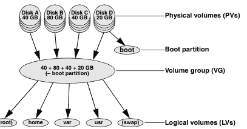

图 2-1 LVM：逻辑卷管理器

## 安装过程

以下步骤概述了从安装镜像安装 Fedora/RHEL 的过程。从其他安装镜像安装遵循类似的步骤。具体细节请参见第 3 章。

1.  确保 BIOS 设置为从 DVD 或 USB 闪存驱动器启动（第 31 页）。将包含安装镜像的安装介质插入系统，并重置计算机。计算机启动并显示安装镜像启动菜单（图 3-4，第 61 页）。
2.  你可以从安装镜像启动菜单中选择一个选项，按 `TAB` 键显示启动命令行（你可以对其进行修改），并在准备好时开始安装 Fedora/RHEL。其中一个菜单项会检查安装介质。如果你不执行任何操作，Anaconda 将在 60 秒后开始安装系统。
3.  作为启动实时会话或安装 Fedora/RHEL 过程的一部分，Anaconda 会创建 RAM 磁盘（第 1269 页），替代正常启动操作中使用的硬盘。Anaconda 将安装或从实时或安装镜像启动系统所需的工具复制到 RAM 磁盘。使用 RAM 磁盘允许安装过程在没有写入硬盘的情况下完成规格制定和设计阶段，并允许你在安装的最后一步之前放弃安装。如果你在此点之前放弃，系统将保持其原始状态。RAM 磁盘还允许实时会话不接触硬盘。
4.  你向 Anaconda 提供关于如何配置系统的信息。
5.  当 Anaconda 收集完信息后，它将操作系统文件写入硬盘。
6.  当你重启系统时，`gnome-initial-setup` 会询问设置第一个用户所需的问题（第 68 页）。
7.  系统已准备好让你登录和使用。

### 下载安装镜像文件并写入/烧录安装介质

有几种方法可以获取或创建安装介质（CD、DVD 或 USB 闪存驱动器）。Fedora/RHEL 提供作为 CD/DVD ISO 镜像文件（以定义 CD/DVD 文件系统的 ISO 9660 标准命名）的 Linux 发行版。尽管它们被称为 CD/DVD ISO 镜像，你可以将这些文件写入 USB 闪存驱动器，然后从该驱动器启动。

本节描述如何下载这些安装镜像之一并烧录 DVD 或写入 USB 驱动器。你也可以从网站购买安装 DVD。如果你无法通过其他方式获取 Fedora/RHEL，可以将浏览器指向 `fedoraproject.org/wiki/FreeMedia` 以显示包含允许你请求免费 Fedora DVD 的链接的网页。

#### 下载安装镜像文件的简单方法

本节解释了下载安装（ISO）镜像文件的最简单方法。这种技术在大多数情况下都有效；它很直观但有限制。例如，它不允许你使用 BitTorrent 下载文件。

开始操作时，将浏览器指向 `fedoraproject.org` 并点击**立即下载！**。下载很快就会开始。如果浏览器让你选择如何处理该文件，请将其保存到硬盘。浏览器会将安装（ISO）镜像文件保存到硬盘。继续阅读第 49 页的“验证安装（ISO）镜像文件”。

> **你可以在这里找到所有支持架构的安装（ISO）镜像文件**
>
> 提示：如果你找不到支持你想要安装 Fedora 的硬件类型的安装镜像文件，请访问 [mirrors.fedoraproject.org/publist](https://mirrors.fedoraproject.org/publist)。对于 RHEL，请访问 [access.redhat.com](https://access.redhat.com) 并选择下载。

#### 下载 ISO 镜像文件的其他方法

本节解释了如何下载不会自动下载安装（DVD/ISO）镜像文件或发行版，以及如何下载使你能够使用 BitTorrent 下载安装（ISO）镜像文件的 torrent 文件。有关其他可下载 Fedora/RHEL 的位置，请参见第 29 页的“下载 Fedora/RHEL”。

- **浏览器**：当你使用 Web 浏览器下载文件时，浏览器会联系 Web（HTTP）或 FTP 服务器并从该服务器下载文件。如果太多人同时从服务器下载文件，下载速度会变慢。
- **BitTorrent**：BitTorrent 高效分发大量静态数据，例如安装（ISO）镜像文件。与使用浏览器从单个服务器下载文件不同，BitTorrent

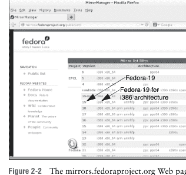

**图 2-2** mirrors.fedoraproject.org 网页

将服务器的功能分布到其客户端。当每个客户端下载文件时，它会成为已下载部分的服务器。要使用 BitTorrent，你必须下载一个称为 `torrent` 的小文件（或者让 Web 浏览器代劳）。该文件包含允许客户端彼此通信的信息，其文件扩展名为 `.torrent`。当更多人同时使用 torrent 下载文件时，下载速度会变快。使用 BitTorrent 下载安装（ISO）镜像文件将在本节稍后介绍。

许多站点镜像（保存副本）Fedora 安装（ISO）镜像文件和 BitTorrent torrent 文件。一些镜像使用 HTTP，而其他一些使用 FTP；你可以使用浏览器从这两种类型的站点下载文件。FTP 和 HTTP 站点的外观略有不同。

通过将浏览器指向 `mirrors.fedoraproject.org` 来定位镜像站点。在标题信息下方，页面显示公共活动镜像。通过点击页面右上角的镜像列表过滤器中的选择项来缩小选择范围（图 2-2）。例如，点击 `19` 以列出你可以从中下载 Fedora 19 的站点，或在以 `19` 开头的行中点击 `i386` 以列出你可以从中下载 Fedora 19 i386 版本的站点。

新显示的网页上的列表按国家代码排序。例如，`FR` 是法国，`US` 是美国。为了节约网络带宽，滚动到并下载离你较近的镜像站点。查看内容、带宽和备注列。选择合适站点的行，并点击内容列中你要使用的协议。从浏览器来看，FTP 和 HTTP 协议之间几乎没有区别，尽管使用 FTP 访问站点可能会稍快一些。

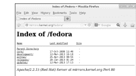

图 2-3 Fedora 镜像站点

当您点击一个协议时，浏览器会显示一个与图 2-3 类似的页面。请按照以下步骤下载您想要的安装（ISO）映像文件：

1.  点击 `releases`。浏览器将显示 Fedora 发行版列表。所有站点都有当前版本。大多数站点至少保留一两个旧版本，而有些站点则保留许多旧版本。
2.  点击您想要下载的 Fedora 发行版的版本号。浏览器将显示一个包含 Fedora 和 Live 的列表。
3.  如果您想下载 Live 映像，请点击 `Live`；如果您想下载安装映像，请点击 `Fedora`。请确保硬盘上有足够的空间存放文件：一个安装（DVD/ISO）映像文件占用超过 4 GB 的空间。
4.  点击您想要安装 Fedora 的体系结构（第 31 页）：32 位系统选择 `i386` 或 `i686`，64 位系统选择 `x86_64`。
5.  如果您正在下载安装映像，请点击 `iso`。如果您正在下载 Live 映像，请转到下一步。
6.  下载 `CHECKSUM` 文件。
7.  点击您想要下载的安装映像文件的名称，并选择下载（而不是安装）该映像。这将为您提供 `Fedora-Live-Desktop-x86_64-19-1.iso`（运行并可选项安装 GNOME 桌面）或 `Fedora-Live-KDE-x86_64-19-1.iso`（运行并可选项安装 KDE 桌面）的选择。（19-1 表示 Fedora 19 的第二次发布。）Fedora 为您提供选择下载 Install 映像或 Network Install（ISO 映像文件）的选项。

### 使用 BitTorrent

如前所述，您可以使用 BitTorrent 获取安装（ISO）映像文件。在某个新发行版刚发布后的短时间内，BitTorrent 在下载这些文件时特别有效。

要下载一个 torrent，请让浏览器指向 `fedoraproject.org/en/get-fedora-all` 或 `torrent.fedoraproject.org`，然后点击该 torrent 的文件名。您可以通过 `.torrent` 的文件扩展名来识别 torrent 文件。BitTorrent 客户端应该会自动启动，并询问将下载的文件放在哪里。您也可以手动下载 torrent。一旦您拥有了 BitTorrent 客户端，例如 `Transmission`（`www.transmissionbt.com`，随大多数 Fedora/RHEL 版本一起安装），您就可以从命令行（第 544 页）开始下载文件，或者通过在文件浏览器（如 `Nautilus`，第 102 页）中点击它来下载。

### 您可以在任何操作系统下下载并刻录/写入 DVD 或 USB 闪存盘


> 您可以下载并在任何连接到互联网、拥有浏览器、硬盘上有足够空间存放映像文件（`Live` 映像约为 `1 GB`，`Install` 映像超过 `4 GB`）且能够刻录 `DVD` 或写入 `USB` 驱动器的计算机上刻录 `DVD` 或写入 `USB` 闪存盘。通常您可以使用 `tip`（第 716 页）来下载文件，或者在 `Linux` 系统上使用 `Nautilus` 的“连接到服务器”功能代替浏览器来下载文件。

### 验证安装（ISO）映像文件

本节假设您已经在硬盘上保存了一个映像文件和一个 `CHECKSUM` 文件，并解释如何验证文件是否正确。`CHECKSUM` 文件包含每个可用安装（ISO）映像文件的 `SHA2`（第 1272 页）和。当您使用 `sha256sum` 实用程序处理文件时，`sha256sum` 会基于该文件生成一个数字。如果该数字与 `CHECKSUM` 文件中对应的数字匹配，则下载的文件是正确的。使用 `-c` 选项和 `CHECKSUM` 文件的名称，`sha256sum` 会检查 `CHECKSUM` 文件中列出的每个文件。以下示例显示 `Live Desktop` 安装（ISO）映像文件状态为 `OK`，而 `Live KDE` 映像文件不存在。关于格式不正确的行的消息指的是 `CHECKSUM` 文件中的 `PGP` 密钥；您可以忽略此消息。

```
$ sha256sum -c s-CHECKSUM
sha256sum: Fedora-Desktop-x86_64-19-1.iso: OK
sha256sum: Fedora-Live-KDE-x86_64-19-1.iso: No such file or directory
Fedora-Live-KDE-x86_64-19-1.iso: FAILED open or read
sha256sum: WARNING: 20 lines are improperly formatted
sha256sum: WARNING: 1 listed file could not be read
```

为大型文件计算 `SHA2` 和可能需要一些时间。如果 `sha256sum` 没有报告文件为 `OK`，您必须重新下载该文件。

### 写入 USB 闪存盘可能更简单

> 将安装（ISO）映像文件写入 `USB` 驱动器可能比刻录 `DVD` 更简单且更经济。此外，一些笔记本电脑没有 `DVD` 光驱，因此无法从 `DVD` 启动。

### 刻录 DVD

安装（ISO）映像文件是 `DVD` 上所需内容的精确镜像。将该映像放到 `DVD` 上是一个不同于将文件复制到 `DVD` 的过程。因此，`DVD` 刻录软件有一个专门用于刻录 `ISO` 映像的选项，其标签类似于“Record CD from CD Image”或“Burn CD Image”。请查阅您正在使用的软件的说明，了解如何将 `ISO` 映像文件刻录到 `DVD`。

### 确保软件设置为刻录 ISO 映像

> 刻录 `ISO` 映像与将文件复制到 `DVD` 是不同的。请确保您的 `DVD` 刻录软件已设置为刻录 `ISO` 映像。如果您只是将 `ISO` 文件复制到 `DVD`，当尝试安装 `Linux` 时将无法正常工作。

### 写入 USB 闪存盘

本节解释如何使用 `liveusb-creator`（fedorahosted.org/liveusb-creator）将安装（ISO）映像文件写入 `USB` 闪存盘。尽管程序名称中包含“live”一词，但您可以使用它将 `Install` 或 `Live` 映像（ISO 映像文件）写入 `USB` 驱动器。然后您可以从 `USB` 驱动器启动以安装 `Linux` 或运行 `live` 系统。

### USB 闪存盘必须足够大以容纳 ISO 文件

> **tip** 您要写入的 `USB` 驱动器必须足够大以容纳安装（ISO）映像文件。`Install` 映像大于 `4 GB`。

#### Windows

从 fedorahosted.org/liveusb-creator 下载 `Windows` 安装程序（`liveusb-creator*setup.exe`）并运行它以安装 `liveusb-creator`。

#### Linux

在 `Fedora/RHEL` 系统中，从终端模拟器输入以下命令来安装该程序。您需要输入 `root` 密码。

```
$ su -c 'yum -y install liveusb-creator'
```

在 `Ubuntu` 下，使用 `usb-creator`（`usb-creator` 软件包），它执行相同的功能。请参阅第 1184 页了解如何使用 `apt-get` 下载软件的说明。

#### 写入 USB 驱动器

`liveusb-creator` 实用程序显示 `Fedora LiveUSB Creator` 窗口（图 2-4）。在 `Windows` 下，从主菜单选择 `liveusb-creator` 以打开此窗口。在 `Linux` 下，通过在 `Enter a Command` 窗口（`ALT-F2`）或终端模拟器中输入命令 `liveusb-creator`（或 `usb-creator`）来打开此窗口：`liveusb-creator` 将要求您以 `root` 身份进行身份验证（提供 `root` 密码）。

点击“浏览”以定位您下载的安装（ISO）映像文件。程序将自动填充标记为“目标设备”的文本框；如果您有多个 `USB` 驱动器，请在此指定一个。持久存储滑块为在 `live` 系统中使用而设置 `USB` 驱动器上的存储空间。点击“创建 Live USB”。当 `liveusb-creator` 显示“完成！”时，您可以关闭窗口并移除 `USB` 驱动器。

### 收集系统信息

安装并启动一个 `Linux` 系统并不困难。然而，您在开始之前对过程的了解越多，它将越容易。安装软件会收集关于系统的信息，并可以帮助您在安装过程中做出决策。但是，当知道您希望如何分区硬盘，而不是让安装程序在没有您的输入的情况下创建分区时，系统的运行效果会更好。细节有很多，您控制的细节越多，您越有可能对最终产品感到满意。找到本节所请求的信息将有助于确保您最终拥有一个您理解并知道如何在必要时更改的系统。在越来越大的程度上，安装软件探测硬件并弄清楚它是什么。较新的设备比旧设备更有可能报告自身信息。

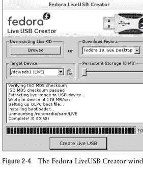

## 测试安装镜像文件和安装介质

在使用安装镜像（ISO）文件和安装介质安装 `Linux` 之前，对其进行测试是个好习惯。当你从安装介质启动系统时，`Fedora/RHEL` 会提供选项让你检查镜像文件是否存在错误（参见第 65 页的技巧提示）。安装介质中的坏文件可能不会在安装完 `Fedora/RHEL` 并系统运行之后才显现出来。到那时，找出问题所在可能既困难又耗时。测试文件和安装介质只需几分钟，但如果出现问题，可以为你节省数小时的麻烦。如果你决定只进行一项测试，请测试安装介质。

在开始之前，拥有某些关键信息至关重要。有一件事是 `Linux` 永远无法自行推断出的，那就是所有相关的名称和 `IP` 地址（除非你正在使用 `DHCP`，在这种情况下，地址会自动为你配置好）。

以下是一份你可能需要了解其信息的物品清单。尽可能收集关于每个物品的信息：制造商、型号、大小（兆字节、吉字节等）、按钮数量、芯片组（针对卡等），等等。有些物品，如网卡和声卡，可能集成在主板上。

- 硬盘

- 内存；安装不需要它，但了解情况是好事

- `SCSI` 接口卡

- 网卡（`NIC`）

- 视频接口卡（包括视频 `RAM`/内存容量）

- 声卡及其与标准（如 `SoundBlaster`）的兼容性

- 鼠标（`PS/2`、`USB`、`AT` 以及按钮数量）

- 显示器（尺寸和最大分辨率）

- `IP` 地址和名称，除非你使用 `DHCP`（第 491 页；大多数路由器被设置为 `DHCP` 服务器），在这种情况下 `IP` 地址会自动分配给系统。这些信息大多来自系统管理员或 `ISP`。

  - 系统主机名（你可以随意命名）

  - 系统地址

  - 网络掩码（`netmask`）

  - 网关地址（连接网络或互联网的连接点）或者在使用拨号连接时的电话号码

  - 名称服务器地址，也称为 `DNS` 地址

  - 域名（非必需）

# 章节总结

`Live` 镜像可以在不将 `Fedora` 安装到系统上的情况下运行一个临时的 `Fedora` 会话。你可以从 `Live` 会话安装 `Fedora`。运行 `Live` 会话是测试硬件和修复无法从硬盘启动的系统的好方法。

当你安装 `Fedora/RHEL` 时，你会从安装介质（例如 `DVD` 或 `USB` 闪存盘）复制操作系统文件到系统中的硬盘，并设置配置文件，以便 `Linux` 能正确地在硬件上运行。操作系统文件以安装（ISO）镜像文件的形式存储在安装介质上。你可以使用 Web 浏览器、`FTP` 或 `BitTorrent` 下载安装（ISO）镜像文件。在使用它安装 `Fedora/RHEL` 之前，测试下载后的镜像文件和安装介质是个好习惯。

当你安装 `Fedora/RHEL` 时，你可以让 `Anaconda` 安装程序决定如何划分硬盘（默认分区），或者手动指定你希望如何划分。

`Fedora` 项目由 `Red Hat` 赞助，并得到开源社区的支持。`Fedora` 是一个包含前沿代码的 `Linux` 发行版；不建议将其用于生产环境。`RHEL` 比 `Fedora` 更稳定。

## 练习

1. 简要说明，安装像 `Linux` 这样的操作系统涉及什么过程？

2. 什么是安装程序？`Fedora/RHEL` 安装程序的名称是什么？

3. 你会在服务器系统上设置 `GUI` 吗？为什么或为什么不？

4. 系统从硬盘启动。为了安装 `Linux`，你需要它从 `DVD` 启动。如何让系统从 `DVD` 启动？

5. 硬盘上的空闲空间是什么？什么是文件系统？

6. 什么是 `ISO` 镜像？如何将 `ISO` 镜像刻录到 `DVD` 上？

## 进阶练习

7. 给出 `RAID` 无法替代备份的两个原因。

8. 什么是 `RAM` 磁盘？它们在安装过程中如何使用？

9. 什么是 `SHA2`？它如何确保你下载的 `ISO` 镜像文件是正确的？

*此页故意留白*

# 3

# 分步

# 安装

### 本章内容

- 运行 `Fedora Live` 会话 . . . . . . . . . . . . . . . . . . . . . . . . . . . . . . . . . . . . . . . . . . . . . . . . . . . 56

- 从 `Live` 会话安装 . . . . . . . . . . . . . . . . . . . . . . . . . . . . . . . . . . . . . . . . . . . . . . . . . . . . . . . . . . . . . . . 60

- 从安装镜像安装 . . . . . . . . . . . . . . . . . . . . . . . . . . . . . . . . . . . . . . . . . . . . . . . . . . . . . . . . . . . . 60

- `Anaconda` 安装程序 . . . . . . . . . . . . . . . . . . . . . . . . . . . . . . . . . . . . . . . . . . . . . . . . . . . . . . . . 62

- 修改启动参数

  （选项） . . . . . . . . . . . . . . . . . . . . . . . . . . . . . . . . . . . . . . . . . . . . . . . . . . . . . . . . . . 70

- 高级磁盘配置 . . . . . . . . . . . . . . . . . . . . . . . . . . . . . . . . . . . . . . . . . . . . . . . . . . . . . . . . . . . . . . 72

- 手动/自定义分区 . . . . . . . . . . . . . . . . . . . . . . . . . . . . . . . . . . . . . . . . . . . . . . . . . . . . . . . . . . . 74

- 回收磁盘空间 . . . . . . . . . . . . . . . . . . . . . . . . . . . . . . . . . . . . . . . . . . . . . . . . . . . . . . . . . . . . . . . 77

- `gnome-disks`：`GNOME`

  磁盘实用工具 . . . . . . . . . . . . . . . . . . . . . . . . . . . . . . . . . . . . . . . . . . . . . . . . . . . . . . 78

- 编辑 `Kickstart` 脚本 . . . . . . . . . . . . . . . . . . . . . . . . . . . . . . . . . . . . . . . . . . . . . . . . . . . . . 83

- 设置双启动系统 . . . . . . . . . . . . . . . . . . . . . . . . . . . . . . . . . . . . . . . . . . . . . . . . . . . . . . . . . 84

### 学习目标

阅读完本章后，你应该能够：

- 运行 `Live` 会话并使用 `gnome-disks` 查看和更改磁盘分区

- 从 `Live` 会话安装 `Fedora`

- 使用安装镜像安装 `Fedora/RHEL`

- 使用启动参数修改系统行为

- 在安装过程中修改分区

- 在安装过程中选择软件

- 列出双启动配置的要求和注意事项

第 2 章涵盖了 `Fedora/RHEL` 安装的计划：确定需求；规划硬盘布局；获取安装所需的文件，包括如何下载并将安装、`Live` 和网络镜像烧录或写入安装介质；以及收集系统信息。本章重点在于安装 `Fedora/RHEL`。安装过程通常相当简单，特别是如果你已经做好了充分的计划。有时你可能会遇到问题或遇到特殊情况；本章为你提供了在这些情况下使用的工具。请根据需要阅读本章的内容；一旦你安装了 `Fedora/RHEL`，请继续阅读第 4 章，该章涵盖了开始使用 `Fedora/RHEL` 桌面和命令行。

### 新的 ANACONDA 安装程序

在 `Fedora 18` 中引入的新 `Anaconda` 安装程序已完全重写。`Anaconda` 的用户界面从线性（向导）模型变为了毂辐模型（`hub-and-spoke model`）。使用此模型意味着 `Anaconda` 可以执行后台处理（例如，在 `Anaconda` 安装软件包时，你仍然可以输入信息），并且你可以跳过与你的安装无关的屏幕。有关更多信息，请访问 fedoraproject.org/wiki/Anaconda/NewInstaller。

#### 第 17 章解释了如何设置虚拟系统

> **提示** 要在虚拟系统上安装 `Fedora/RHEL`，你需要先构建虚拟系统，然后按照本章中安装操作系统的说明进行操作。有关设置 `QEMU/KVM` 虚拟机的说明，请参见第 663 页；有关设置 `VMware` 虚拟机的说明，请参见第 671 页。

#### 升级 Fedora 系统

> **提示** 新的 `Anaconda` 安装程序不能将 `Fedora` 系统从一个版本升级到下一个版本。你必须使用 `FedUp`（`FEDORA` 升级程序），它适用于 `Fedora 17` 及更高版本。请访问 `Fedora` 网页 fedoraproject.org/wiki/FedUp 以获取更多信息。

## 运行 FEDORA LIVE 会话

正如第 2 章所述，`Live` 会话是在计算机上运行 `Linux` 会话而不将 `Linux` 安装到计算机上。在 `Live` 会话之后重启时，计算机保持原样。如果你正在运行 `Windows`，`Live` 会话结束后，`Windows` 会像 `Live` 会话之前那样启动。如果你愿意，可以从 `Live` 会话安装 `Fedora`。`RHEL` 不提供 `Live` 会话。

`Live` 会话让你有机会在不安装的情况下预览 `Fedora`。从 `Live` 镜像启动以开始 `Live` 会话，并按照第 4 章的说明操作 `Fedora`。完成后，移除安装介质并重启系统。系统将像运行 `Live` 会话之前一样启动。

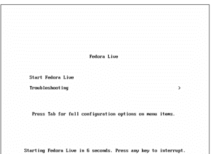

**图 3-1** 实时映像启动菜单

**保留文件** 由于实时会话不会将数据写入硬盘（如果有可用交换分区除外），因此您保存的工作在重启后将不可用。您可以使用 `USB` 闪存盘、电子邮件或其他方法将希望保留的文件传输到另一个系统。`liveusb-creator` 实用程序（第 50 页）可以在 `USB` 驱动器上创建持久存储，允许您在实时会话中写入数据。

## 启动系统

在 `Fedora` 显示实时会话桌面或安装自身到硬盘之前，必须先加载（启动）`Linux` 操作系统到内存中。这个过程在较旧、较慢的系统或内存（`RAM`）较小的系统上可能需要几分钟时间。

在大多数情况下，从实时映像启动后，无需执行任何操作即可启动 `Fedora` 运行实时会话并显示桌面。首先，将包含实时映像（标准的 `GNOME Fedora` 桌面实时介质）的安装介质插入系统，然后打开或重置系统电源。如果系统无法从 `CD`、`DVD` 或 `USB` 驱动器启动，请参见第 31 页的“`BIOS` 设置”。或者，如果 `Fedora` 无法启动或显示错误消息，请参见第 70 页的“修改启动参数（选项）”。

系统启动几分钟后，`Fedora` 会显示一个屏幕，提示“**正在 10 秒后启动 Fedora 实时版。按任意键中断。**”并从 10 开始倒计时（图 3-1）。接下来，系统显示一些消息，然后显示一个 `Fedora` 标志的图形轮廓，随着系统启动，该轮廓会被逐渐填充。屏幕会短暂变黑，然后 `Fedora` 显示“欢迎使用 Fedora”窗口。在此窗口中，您可以点击“试用 Fedora”或“安装到硬盘”。

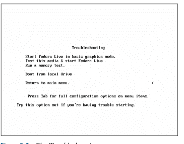

首次使用安装介质时，检查其是否存在缺陷是个好主意。为此，请在 `Fedora` 倒计时期间按空格键中断自动启动。使用向下箭头键高亮显示“故障排除”行并按回车键（此时鼠标尚不可用）。`Fedora` 将显示故障排除菜单（图 3-2）。使用向下箭头键高亮显示“测试此介质并启动 Fedora 实时版：”并按回车键。

`Anaconda` 会显示一行标记为“正在检查”的内容，显示其在验证安装介质内容时所检查磁盘的百分比。如果安装介质良好，系统将启动。


从故障排除菜单中选择“运行内存测试”将运行 `memtest86+`，这是一个针对 x86 基架构电脑的、采用 GPL 许可的独立内存测试工具。按 C 键配置测试；按 ESC 键退出并重启。更多信息请参见 www.memtest.org。

## Fedora 提供全面的安装文档

> 访问 docs.fedoraproject.org/en-US/Fedora/19/html/Installation_Quick_Start 以查看 Fedora 安装快速入门指南。要查看完整的 Fedora 安装指南，请访问 docs.fedoraproject.org/en-US/Fedora/19/html/Installation_Guide。

如果您是从 Fedora 桌面实时介质（本书所称的实时映像）启动，系统将运行 GNOME 桌面管理器；Fedora 会自动以名为 `liveuser` 的用户登录，并显示“欢迎使用 Fedora”窗口。此窗口有两个大按钮：试用 Fedora 和安装到硬盘。当您点击“试用 Fedora”时，GNOME 显示一个窗口，解释如何将 Fedora 安装到硬盘。点击“关闭”，Fedora 将显示 GNOME 桌面（图 3-3，第 60 页）。

如果您是从 Fedora KDE 实时映像启动，系统将运行 KDE 桌面管理器。当从此磁盘启动时，Fedora 接下来显示一个 KDE 启动屏幕，然后是 KDE 桌面——无需登录。

## 可选：了解启动过程中的活动

如果您好奇并希望查看 Fedora 从实时映像启动时的状态，请从启动参数中移除控制内核消息的 `quiet` 和控制图形安装程序消息的 `rhgb`（红帽图形启动）。参见第 70 页的图 3-8；屏幕上的参数列表可能与图中的不同。当显示 Fedora 实时映像启动菜单（图 3-1）且“启动 Fedora 实时版”行高亮显示时，按 `TAB` 键显示启动命令行参数。使用`左箭头`键退回覆盖——但不要删除——`rhgb` 右侧的任何单词。按`退格键`或`DEL`键退回并擦除启动命令行中的 `rhgb` 和 `quiet`。按`回车键`。现在，随着 Fedora 启动，它将显示关于其正在执行的操作的信息。文本在屏幕上滚动，但有时速度太快而无法阅读。当从安装映像启动 Fedora 或启动 RHEL 时，默认显示此信息：您无需修改命令行。

## 安装 Fedora/RHEL

您可以从实时会话（前文所述）安装 Fedora，或从安装映像安装 Fedora/RHEL。从实时会话安装更简单，但不如从安装映像安装灵活。例如，从实时会话安装时，您无法选择 Anaconda 使用的语言，也无法选择要安装哪些软件包。

### 在安装 Linux 之前检查硬盘内容（并备份）

**注意** 除非您确定正在安装 Fedora/RHEL 的硬盘上没有数据（是新磁盘）或确定磁盘不包含有价值信息，否则最好在开始安装前检查磁盘内容。您可以使用实时会话中的 `gnome-disks` 磁盘实用程序（第 78 页）来完成此任务。备份磁盘上的所有内容，即使该分区是安装程序不会写入的分区。

安装映像包含 Fedora/RHEL 支持的大量软件包。您可以从安装映像安装任何喜欢的软件包组，而无需连接互联网。但是，如果没有互联网连接，系统安装后将无法更新软件。

实时映像包含有限数量的软件包。一旦从实时映像安装，您必须连接互联网以更新系统软件并下载和安装额外的软件包。

开始大多数安装时，将包含实时映像或安装映像的介质插入系统并打开或重置系统电源。对于基于硬盘和网络安装，您可以使用安装映像或网络映像。

如果系统无法从安装介质启动，请参见第 31 页的“BIOS 设置”。


## 从实时会话安装 (Fedora)

按照第 56 页的说明启动实时 GNOME 会话。GNOME 将显示一个 GNOME 3 桌面，屏幕左上角有“活动”字样。

> **提示** Anaconda 安装程序不会修改实时环境：您从实时会话安装 Fedora 时所做的更改不会影响实时会话。例如，当您为正在安装的系统设置网络时，实时环境的网络连接不会改变。

从 GNOME 3 桌面，点击“活动”；GNOME 在屏幕左侧显示图标，并显示一个包含“输入以搜索”字样的文本框（图 3-3）。在图标底部附近，有一个描绘带有绿色勾号的硬盘的图标。当您想要安装 Fedora 时，左键点击此图标。继续阅读第 63 页的“使用 Anaconda”。

## 从安装映像安装

要从安装映像安装 Fedora/RHEL，请插入安装介质并打开或重置系统电源。片刻后，系统显示 Fedora/RHEL 启动菜单（图 3-4）以及一条显示“60 秒后自动启动”的消息。如果系统无法从安装介质启动，请参见第 31 页的“BIOS 设置”。如果 Fedora/RHEL 无法启动或显示错误消息，请参见第 70 页的“修改启动参数（选项）”。

# 图 3-4 安装镜像启动菜单

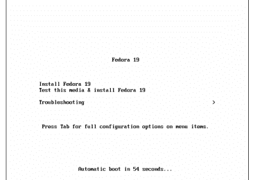

在 60 秒内按下空格键以停止倒计时。如果您未按空格键，60 秒后 Fedora/RHSEL 将开始图形安装。

- **安装 Fedora**

  使用 Anaconda 图形安装程序安装 Fedora/RHSEL 系统。

- **测试此介质并安装 Fedora**

  测试安装介质，并使用 Anaconda 图形安装程序安装 Fedora/RHSEL 系统。

- **故障排除**

  显示故障排除菜单（图 3-5）。

# 图 3-5 安装镜像故障排除菜单

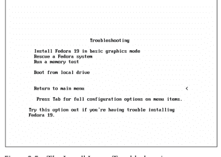

故障排除菜单包含以下选项。

- 使用图形安装程序安装图形界面 Fedora/RHEL 系统。Anaconda 不会尝试确定连接到系统的显示器类型；它使用适用于大多数显示器的基本视频驱动程序。如果在 Anaconda 显示“欢迎使用 Fedora”屏幕（第 63 页）之前安装失败，请选择此项。

- 调出一个最小化的 Fedora/RHEL 系统，但不进行安装。在检测到系统的磁盘和分区后，系统进入单用户/救援模式，并允许您挂载现有的 Linux 文件系统。更多信息请参阅第 456 页的“救援已安装系统”。

- 运行第 58 页所述的内存测试。

- 从硬盘启动系统。此选项通常与在不放置安装介质的情况下启动系统具有相同效果（具体取决于 BIOS [第 31 页] 的设置方式）。

- 显示 Fedora 安装镜像启动菜单。

# ANACONDA 安装程序

Anaconda 由 Python 和 C 编写，它能识别硬件、加载驱动程序、探测安装期间将使用的设备、构建文件系统、启动 X 服务器并安装 Fedora/RHEL 操作系统。Anaconda 可以运行在图形交互模式（默认）、有限文本模式（参见第 72 页的文本）或自动化模式（参见第 83 页的“编辑 Kickstart 脚本”）。

Anaconda 显示的确切屏幕取决于您是从实时会话、安装镜像还是网络镜像安装 Fedora；是否安装 RHEL；在安装过程中选择的哪些路径；以及在启动命令行中指定的哪些参数。除非您指示它不要这样做，否则 Anaconda 会探测视频卡和监视器，并启动原生 X 服务器。

在运行期间，Anaconda 会打开表 3-1 中所示的虚拟控制台（第 121 页）。您可以通过按下 CONTROL-ALT-FX 来显示虚拟控制台，其中 x 是虚拟控制台编号，fx 是对应于虚拟控制台编号的功能键。

**表 3-1** 安装期间的虚拟控制台分配

| 虚拟控制台 | 安装镜像 | 实时镜像 |
| :--- | :--- | :--- |
| 1 | 安装对话框 | GUI 交互式安装 |
| 2 | Shell | 登录提示符（以 `liveuser` 身份登录） |
| 3 | 安装日志 | 安装日志 |
| 4 | 存储日志 | 登录提示符（以 `liveuser` 身份登录） |
| 5 | 程序日志 | 程序日志 |
| 6 | 登录提示符 | 登录提示符（以 `liveuser` 身份登录） |
| 7 | GUI 交互式安装 | 无 |

在安装过程中的任何时间，您都可以切换到虚拟控制台 2（通过按下 CONTROL-ALT-F2）并输入命令以查看正在发生什么。请勿输入任何改变安装过程任何部分的命令。要切换回图形安装屏幕，请按下 CONTROL-ALT-F1（实时镜像）或 CONTROL-ALT-F7（安装镜像）。

## 测试安装介质

首次使用安装介质时，从启动菜单选择 测试此介质并安装 Fedora 并按下 RETURN 键以启动系统。Fedora 在显示以 Checking 开头的一行之前会显示几行。该行显示在验证安装介质内容时 Anaconda 已检查磁盘的百分比。如果安装介质正常，系统将启动。如果您再次使用同一介质，则无需测试：选择 安装 Fedora。

如果用于刻录磁盘的软件未包含填充（padding），DVD 可能会未通过介质测试。如果 DVD 未通过介质测试，请尝试使用 `nocomma` 参数启动。有关在启动命令行中添加参数的信息，请参阅第 70 页。如果您在使用 `nodma` 参数启动系统时 DVD 通过介质测试，则该 DVD 是好的；在安装 Fedora/RHEL 之前，在没有此参数的情况下重启系统。如果在您使用此参数启动后安装 Linux，内核将被设置为始终使用此参数。因此，系统的安装和运行可能会变慢。

## 使用 Anaconda


在获取到启动 X 窗口系统所需的足够信息后，Anaconda 会显示“欢迎使用 Fedora”屏幕。滚动并点击以突出显示您希望用于安装的语言。该语言不一定与已安装系统显示的语言相同。点击 继续。Anaconda 显示安装摘要屏幕。

## 安装摘要屏幕

Anaconda 需要一些时间来加载安装摘要屏幕显示的信息（图 3-6，下一页）。在加载期间，某些项会被置灰。您必须等待 Anaconda 完成加载此信息且这些项不再置灰后，才能选择这些项。您可能需要向下滚动以显示存储项。

通常，窗口底部会出现一个包含三角形内的感叹号及文字 请继续下一步之前完成带有此图标标记的项目 的橙色条。当此条显示时，标有 开始安装 的按钮会被置灰，表示它无法使用。您必须打开和修改的项仅是显示此图标的项。从实时会话安装 Fedora 时显示的项是从安装镜像安装时显示项的子集。

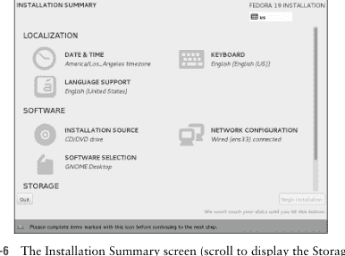

点击某项以显示允许您处理该项的屏幕。点击 **完成** 返回安装摘要屏幕。安装摘要屏幕中出现的项分为三组：本地化、软件（非实时安装）和存储。

## 您无需打开安装摘要屏幕上的大多数项

安装摘要屏幕上的每一项都显示一条关于 Anaconda 为该特定项选择的备注。如果某项设置正确，您无需打开它。例如，如果日期和时间项显示 America/Los_Angeles 时区且这是正确的，您无需打开此项。通常，您唯一需要打开的项是安装目标（第 67 页）。

# 本地化

**日期和时间**

日期和时间屏幕显示一个世界地图，允许您指定本地时区。点击本地时区中的某个城市；Anaconda 会在标有 **城市** 的旋转框中显示城市名称。或者，您可以使用标有 **区域** 和 **城市** 的旋转框来指定城市。

默认情况下，Anaconda 设置新系统使用 NTP（网络时间协议）以保持系统时钟准确。如果您不想使用 NTP，请点击标有网络时间的开关将其设置为关闭，并使用屏幕底部的控件设置系统时钟。

**键盘**

键盘布局屏幕允许您指定将连接到已安装系统的键盘类型。此屏幕左侧的框显示可用的键盘布局。列表顶部的条目是默认布局，用于安装期间和已安装系统。使用此框底部的按钮添加布局，并移除、移动和测试选中的布局。

您可以指定仅在安装期间使用的键盘，但只能指定键盘布局屏幕上列表中的键盘。使用小键盘按钮进行此更改。该按钮位于所有安装屏幕的右上角。

- 语言支持：实时安装中不可用。在语言支持屏幕中，在您要安装的语言旁边的复选框中打勾。

# 软件

实时安装中不可用。

- **安装源** 通常您从启动所用的介质安装 Fedora。如果情况如此，您无需打开安装源屏幕。此屏幕允许您：

  - 将安装源指定为您启动所用的介质（自动检测的安装介质）或网络上的位置（URL）

  - 选择验证您启动所用的介质

  - 在 Anaconda 安装系统时安装更新

  - 指定在安装期间使用的额外存储库（第 533 页）。

安装源屏幕的上半部分标有“您想使用哪种安装源？”并有两个单选按钮。默认情况下，选择了自动检测的安装介质，并显示持有安装介质的设备名称及介质上的标签。点击标有“验证”的按钮以测试安装介质上的镜像是否正常。

## 测试安装介质

在获取安装镜像时数据可能会损坏；在将镜像写入可记录介质时也可能发生瞬时错误。当您从安装介质启动时，安装源屏幕上标有“验证”的按钮允许您验证安装介质上的镜像是否不包含任何错误。测试安装介质需要几分钟，但如果因介质不良导致安装失败，它可以为您节省数小时的烦恼。

该部分的第二个单选按钮标为“在网络中”，并允许您指定 Web、FTP 或 NFS URL。当您从下拉列表中选择“最近的镜像”时，Anaconda 会找到最近的 Fedora 镜像并从该站点下载软件包；在您点击“完成”后，Anaconda 需要片刻时间来定位最近的镜像。如果在选择了“最近的镜像”后重新打开安装源屏幕，Anaconda 会恢复为使用安装介质且不安装更新。

默认情况下，Anaconda 在安装 Fedora/RHEL 时不安装更新。您在安装系统后更新软件。移除标有“不安装最新可用的软件更新”的复选框中的勾，可使 Anaconda 在安装时更新软件。

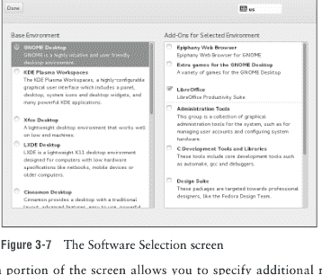

屏幕底部允许您指定 Anaconda 在安装期间可以使用的其他软件仓库（第 542 页）。

如果本地系统连接到运行 DHCP 服务器的网络（第 491 页），Anaconda 会自动配置网络，您无需打开网络配置屏幕。此屏幕：

- 显示 Anaconda 正在使用的网络连接和网络接口信息

- 允许您关闭网络连接

- 允许您重新配置网络

- 允许您为已安装的系统指定主机名

点击标有 **Configure** 的按钮时，Anaconda 会显示一个窗口，允许您修改网络连接。

在屏幕底部标有 **Hostname** 的文本框中输入已安装系统的主机名。

软件选择屏幕（图 3-7）允许您选择想要安装的环境包组以及附加包组。从网络映像安装允许您从比从安装映像安装更多的包组中进行选择。默认情况下，Anaconda 会安装 GNOME 桌面环境和 LibreOffice 生产力套件。

软件选择屏幕的左侧标有 **Base Environment**，允许您指定指定桌面环境（例如 GNOME、KDE、LXDE）或系统功能（例如 Web 服务器、基础架构服务器）的环境包组。您只能从此列中选择一个选项。所有桌面都会安装相应的网络软件和 Firefox Web 浏览器。基本桌面选项允许您在屏幕右侧指定多个桌面。最小安装选项为文本系统（无 GUI）安装尽可能少的软件包。屏幕右侧允许您选择通常与左侧选定的基础环境一起使用的包组。（Fedora；RHEL 的选择略有不同）。

## 在较旧、较慢的硬件上使用最小安装

> **提示**：基础环境列中的最后一个条目是最小安装。对于较旧、较慢的硬件，请选择此条目。此选择将安装一个没有图形用户界面（GUI），只有命令行（文本）接口的系统。如果系统内存不足以执行图形安装，请使用 `text` 启动参数（第 72 页）和 VNC（第 72 页）或 Kickstart（第 71 和 83 页）执行文本安装。

## 只能选择包组，不能选择单个软件包

> **提示**：为了简化安装过程，新版 Anaconda 允许您指定想要安装的包组，但不允许您指定软件包。您必须在安装完成后添加或删除单个软件包。请访问 ojezejlinux.wordpress.com/2013/02/07/anaconda-packaging-retrospective 获取背景信息。如果您需要更精细的软件包选择控制，请使用 Kickstart（第 71 和 83 页）。

## 存储

- 您可能需要向下滚动以显示安装目标选择。最低要求是，Anaconda 要求您确认想要安装 Fedora/RHEL 的位置，尽管此屏幕为您提供了许多更多选择。

默认情况下，对于单个空磁盘，Anaconda 会在整个磁盘上安装 Fedora/RHEL。如果磁盘非空且磁盘上有足够的可用空间（第 36 页），Anaconda 会在可用空间中安装 Fedora/RHEL。

如果此默认设置可接受，请打开安装目标屏幕；单个磁盘上方将出现一个对勾（类似于第 73 页的图 3-9）。点击 **Done**；Anaconda 显示安装选项对话框。此对话框允许您选择是否希望审查 和/或 修改默认磁盘设置，或者是否希望不审查直接继续。屏幕底部有一个复选框，允许您加密磁盘上的数据（第 30 页）。对于最简单的安装，请勿进行任何更改；点击 **Continue**。

如果没有足够的可用空间来安装 Fedora/RHEL，如果计算机有多个硬盘，如果您希望从现有分区回收磁盘空间，或者如果您希望自定义磁盘分区，请参阅第 72 页的“高级磁盘配置”。

## 开始复制文件

在对安装摘要项进行了您想要更改（以及 Anaconda 要求的更改）之后，点击标有 **Begin Installation** 的按钮。在安装 Fedora/RHEL 时，Anaconda 会将与您选择对应的 Kickstart 文件（第 83 页）放置在 `/root/anaconda-ks.cfg` 中。

安装 Fedora/RHEL 可能需要一些时间。所需时间取决于安装操作系统的硬件以及要安装软件包的数量。

## 用户设置

当 Anaconda 安装 Linux 时，它会显示用户设置屏幕。在此屏幕上，您必须为 `root` 用户指定密码并设置一个用户。


- **Root Password**

  根密码屏幕允许您为 `root` 用户（超级用户）输入密码并通过第二次输入该密码进行确认。请参阅第 136 页了解选择安全密码的信息，请参阅第 422 页了解 `root` 权限的信息。虽然您可以指定弱密码，但不建议这样做。当您指定弱密码时，`Anaconda` 会在屏幕底部的黄色条上告诉您该密码为何较弱。点击 `Done` 两次以接受弱密码，或点击一次以接受更强的密码。

- **User Creation**

  用户创建屏幕允许您通过指定新用户的姓名、用户名和密码来向系统添加用户。请参阅上文“根密码”部分了解指定密码的信息。您可以选择将该用户设为管理员（请参阅第 422 页名为“管理员”的提示），并要求为用户设置密码（请参阅第 135 页的提示，了解为什么拥有密码是个好主意）。点击标有 `Advanced` 的按钮以处理用户的主目录、`UID`（第 1278 页）、组 ID（第 1252 页）和组成员身份（请参阅第 506 页的 `/etc/group`）。

虽然 `Anaconda` 允许您跳过创建用户，但在登录之前您必须创建一个用户。例外情况是在安装最小（命令行）系统时，您可以作为 `root` 登录而无需创建用户。

## 重启系统

当 `Anaconda` 显示已成功安装 `Fedora/RHEL` 的消息并要求您重启系统时，点击 `Reboot` 并移除安装介质。

## `gnome-initial-setup`：设置用户

当系统重启时，它正在运行 `Linux`。每个用户首次登录时，`Fedora/RHEL` 会运行 `gnome-initial-setup`，该程序会在允许用户继续之前询问几个问题。

- **Welcome**

  首先，`gnome-initial-setup` 显示欢迎窗口。在点击 `Next` 之前，确保您想要使用的语言旁边有一个对勾。

- **Input Sources**

  输入源（也称为输入法）窗口允许您指定未显示在连接到系统的键盘上的字符和符号。例如，某些法语和中文字符不会出现在美国键盘上；您必须按下按键组合来输入这些字符。这些按键组合就是输入源。

如果此窗口中显示的语言合适，请点击 `Next`。否则，点击加号 (`+`) 并选择其他语言。点击键盘的小图片以显示一个键盘，您可以测试突出显示的语言。当您选择了一个合适的输入源后，点击 `Next`。

在在线账户窗口中点击 `Add Accounts` 会打开添加账户窗口。您可以从此窗口将 `Google`、`Facebook` 和其他账户添加到 `Fedora/RHEL` 系统。当您添加账户时，您需指定该账户的凭据。在线账户服务将账户信息存储在 `GConf`（一种用于存储应用程序首选项的系统）中，将密码存储在 `GNOME` 密钥环中，因此您只需输入一次此信息。点击 `Next`。

`Thank You` 窗口告知您已完成新系统的设置。点击 `Start Using GNOME 3`。

`gnome-initial-setup` 实用程序会显示一个动画演示，解释如何开始使用 `GNOME`。您可以按 `ESCAPE` 键停止演示，然后点击 `GNOME` 帮助窗口右上角的 `X` 关闭它。

## 初始化数据库和更新系统

更新新安装系统上的所有软件非常重要。您可以等待系统提示您，或者可以从虚拟终端中执行以下命令来更新软件；您需要提供 `root` 密码。请参阅第 538 页了解有关 `yum update` 命令的更多信息。根据网络连接和需要更新的软件包数量，此命令可能需要运行很长时间。

```bash
$ su -c 'yum -y update'
```

更新 `man db` 数据库可确保 `whatis` 和 `apropos` 实用程序（均在第 130 页）正常工作。同样，更新 `locate` 数据库可确保 `locate` 正常工作。（`locate` 实用程序对系统中的文件进行索引，允许您快速且安全地搜索文件。）您不必在系统安装时更新这些数据库，可以等待 `cron d`（第 607 页）更新它们，但请注意，`whatis`、`apropos` 和 `locate` 在一段时间内无法正常工作。更新这些数据库的最佳方法是手动运行通常每天运行的 `cron` 脚本。执行以下命令：

```bash
$ su -C /etc/cron.daily/man-db.cron
$ su -C /etc/cron.daily/locate
```

这些实用程序会运行几分钟，可能会抱怨找不到一两个文件。当系统显示提示符时，`mandb` 和 `locate` 数据库已是最新的。请继续阅读第 4 章。

## 安装任务

本节详细说明了在安装期间或安装后可能需要执行的一些常见任务。它涵盖了修改启动参数、使用 `Anaconda` 在安装期间对磁盘进行分区、使用 `gnome-disks` 查看和修改分区、使用 `LV`（逻辑卷）简化磁盘分区、使用 `Kickstart` 自动执行安装，以及设置一个将启动两个或更多操作系统（例如 `Windows` 和 `Linux`；双启动系统）的系统。

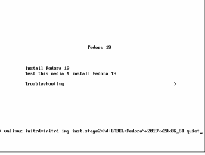

图 3-8 `Fedora` 安装镜像引导菜单，显示引导参数（选项）

## 修改引导参数（选项）

若要修改引导参数，您必须在系统倒计时时按空格键以中断自动引导过程，这通常发生在你首次从 `Live Image`（第 57 页）或 `Install Image`（第 60 页）启动时。当按下空格键时，`Fedora` 会显示 `Fedora Live Image` 引导菜单（图 3-1，第 57 页）或 `Fedora Install Image` 引导菜单（图 3-4，第 61 页）。在继续之前，请使用方向键高亮显示你要选择的选项。高亮显示所需选择后，按 `TAB` 键以显示引导命令行参数（图 3-8）。

在输入任何参数前输入一个空格。你可以指定由空格分隔的多个参数。按 `RETURN` 键引导系统。有关引导参数的更多信息，请参阅 `www.kernel.org/doc/Documentation/kernel-parameters.txt` 或使用 `Google` 搜索 `linux` 引导参数。

### 如果安装不起作用该怎么做

> 提示：在某些硬件上，安装可能会暂停长达十分钟。在尝试其他修复方法之前，请先等待一段时间。如果安装挂起，请尝试使用本节描述的某个或某几个引导参数来引导。

以下是你可以添加到引导命令行的一些参数。如果安装过程中显示器出现问题，请提供 `nofb` 参数，它将关闭显存。

这些参数中的许多可以组合使用。例如，要在分辨率为 1024 x 768 的监视器上安装 `Linux`，且不探测任何设备，请提供以下参数。

```
resolution=1024x768 noprobe
```

`noacpi` 禁用 `ACPI`（高级配置与电源接口）。此参数适用于不支持 `ACPI` 或其 `ACPI` 实现存在问题的系统。默认情况下启用 `ACPI`。指定 `acpi=off` 具有相同效果。

`noapic` 禁用 `APIC`（高级可编程中断控制器）。默认情况下启用 `APIC`。

`apm=off` 禁用 `APM`（高级电源管理）。默认情况下启用 `APM`（`apm=on`）。

`nodma` 为所有磁盘控制器关闭 `DMA`（直接内存访问）。此参数可能会使有缺陷的控制器（或驱动有缺陷的控制器）更可靠，但由于连接的器件必须运行在 `PIO` 模式而非 `DMA` 模式，因此也会导致性能非常缓慢。它可以方便测试那些未正确写入的 `DVD`。

`nofb`（无帧缓冲）关闭帧缓冲（显存）。如果安装过程的图形阶段开始时出现问题，此选项非常有用。

`irqpoll` 更改内核处理中断的方式。

`ks=URI` 指定 `Kickstart` 文件（第 83 页）的位置，用于控制安装过程。`URI` 是 `Kickstart` 文件的路径名或网络位置。将此参数与 `text` 参数（下一页）一起使用，以执行不使用 `GUI`（文本安装）的安装。

通常，`URI` 指向使用以下格式之一的 `NFS` 或 `Web` 服务器：

```
ks=nfs:server:/pathname
ks=http://server/pathname
```

其中 `server` 是服务器的 `FQDN` 或 `IP` 地址，`pathname` 是 `Kickstart` 文件的绝对路径名。例如，如果 `Max` 在 `192.168.206.1` 的系统上设置了一个 `NFS` 服务器，将一个名为 `ksmax2.cfg` 的 `Kickstart` 文件放入其主目录，并希望执行文本安装，他可能会在引导命令行末尾添加以下参数。

```
text ks=192.168.206.1:/home/max/ksmax2.cfg
```

要获取完整的选项列表，请访问 `fedoraproject.org/wiki/Anaconda/Kickstart#Chapter_6._Making_the_Kickstart_File_Available` 网站。

`noapic` 禁用本地 `APIC`。默认情况下启用本地 `APIC`。

`lowres` 以 640 × 480 像素的分辨率运行安装程序。另见 `resolution`（下一页）。

`mem=xxxM` 覆盖检测到的内存大小。用计算机中 `RAM` 的兆字节数替换 `xxx`。

`repo=URI` 指定安装源。例如，你可以使用以下参数从指定服务器开始安装：

```
repo=http://dl.fedoraproject.org/pub/fedora/linux/releases/19/Fedora/x86_64/os
```

`noprobe` 禁用所有设备（包括 `NIC`（网络接口卡）、显卡和监视器）的硬件探测。此选项强制你从列表中 `choose` 设备。使用此参数时，你必须确切知道系统使用的是哪些卡或芯片。当探测导致安装挂起或以其他方式失败时，使用 `noprobe`。此参数允许你为你指定的每个设备驱动程序提供参数。

`rescue` 将系统设置为救援已安装的系统；详情见第 457 页。

`resolution=WxH` 指定用于图形安装的监视器的分辨率。例如，`resolution=1024x768` 指定分辨率为 1024 × 768 像素的监视器。

`text` 不使用图形界面安装 `Linux`。参见相邻的提示。

### 文本安装通常并不非常实用

> 文本安装不允许你分区磁盘或指定要安装的软件包，因此通常并不非常实用。如果你想不使用 `GUI` 安装 `Linux`，可以通过 `VNC` 连接（下一项）或 `Kickstart` 文件进行安装。有关创建 `Kickstart` 文件的信息见第 83 页，有关允许你使用 `Kickstart` 文件安装 `Linux` 的 `ks` 引导参数的信息见第 71 页。若要使用 `Kickstart` 文件执行文本安装，必须在 `Kickstart` 文件中指定 `text` 参数。若要使用 `VNC` 连接执行文本安装，除了 `vnc` 外还必须指定 `text` 参数。

`vnc` 通过 `VNC`（虚拟网络计算）远程桌面会话安装 `Linux`。

提供 `IP` 地址后，你可以使用远程计算机上的 `VNC` 客户端远程控制安装。你可以从 `www.realvnc.com` 下载免费的支持多种平台的 `VNC` 客户端。使用 `yum`（第 534 页）安装 `tigerVnc` 软件包，以在 `Fedora/RHEL` 系统上运行 `VNC` 客户端。

`vncpassword=passw` 为 `VNC` 连接启用密码。此选项要求你也使用 `vnc` 选项。

`selinux=0` 在已安装系统上禁用 `SELinux`（第 473 页）；`selinux=1` 启用它（默认）。

## 高级磁盘配置

第 67 页的“安装目标”涵盖了最简单的磁盘配置情况：单个具有足够空间容纳新操作系统的硬盘。本节涵盖选择磁盘、安装选项、手动/自定义分区、回收磁盘空间以及处理 `LV`。有关硬盘和分区设置的讨论，请参见第 36 页。

`Anaconda` 安装目标屏幕提供图形化的磁盘分区功能，可以添加、删除和修改硬盘上的分区。此屏幕仅在安装期间可用；它不能独立运行。安装完 `Fedora/RHEL` 后，你可以使用 `gnome-disks`（第 78 页）、`parted`（第 614 页）或 `fdisk` 来操作分区。如前所述，如果你想要一组基本的分区，可以让 `Anaconda` 自动分区硬盘。有关 `LVM`（逻辑卷管理器）的讨论包括 `PV`、`VG` 和 `LV`，请参见第 44 页。

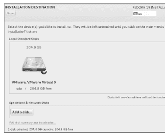

显示单个选定磁盘的安装目标屏幕

### 选择磁盘

安装目标屏幕的本地标准磁盘部分列出了连接到本地系统的磁盘。点击“专门化 & 网络磁盘”下的“添加磁盘”来处理其他类型的存储设备，包括 `SAN`（第 1271 页）设备。

如果本地系统只有一个磁盘，该磁盘上方会出现一个对勾，表示该磁盘已被选中，`Anaconda` 将把新的操作系统安装在其上（图 3-9）。如果系统有两个或更多磁盘，`Anaconda` 不会选择任何磁盘，因此不会出现对勾。点击相关的磁盘图标以选择新操作系统的一个或多个磁盘；`Anaconda` 会在磁盘图标上方放置一个对勾。`Anaconda` 不会更改没有对勾的磁盘（即你未选择的磁盘）。选择完要用于安装的磁盘后，点击完成。`Anaconda` 将显示安装选项窗口。

### 安装选项

安装选项窗口总结了安装磁盘设置，并提供适合当前情况的选项（图 3-10，下一页）。它还允许你指定分区方案（标准分区、`LVM` [第 44 页] 或 `BTRFS` [B 树文件系统]）并加密磁盘上的数据。它始终在窗口左下角显示一个标记为“取消并添加更多磁盘”的按钮。此按钮关闭安装选项对话框并重新显示安装目标屏幕。

这里的自由空间包括未分区的磁盘空间

安装选项窗口告诉你所选磁盘上有多少自由空间，并建议你如果空间不足以安装 `Fedora/RHEL`。此对话框使用“自由空间”一词来表示既有的自由空间和未分区的磁盘空间（第 36 页）。

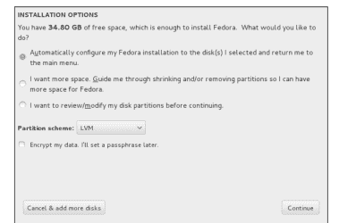

**图 3-10** 显示多个选项的安装选项窗口

当存在足够的可用空间时，安装选项窗口会让您选择自动划分磁盘分区，或者由您查看并修改磁盘分区。如果存在由其他操作系统使用的分区，而 `Anaconda` 可以删除或缩小这些分区，则会增加一个选项，引导您通过该过程回收这些空间。选择其中一个单选按钮并点击`继续`。

如果磁盘上没有足够的空间，`Anaconda` 会根据您选择的软件包（第 66 页）告知新操作系统需要多少空间。它还总结了现有可用空间的总量，以及可以从由其他操作系统使用的分区中回收的空间量。在这种情况下，它会显示两个按钮：`自定义分区`（下一页）和`回收空间`（第 77 页）。第一个按钮显示手动分区屏幕，第二个按钮显示回收磁盘空间屏幕。

## 手动/自定义分区

手动分区屏幕左侧的方框显示有关您要安装的系统的信息（例如，新 `Fedora 19` 安装）以及 `Anaconda` 在磁盘上发现的其他系统（例如，未知 [`Windows` 系统]；图 3-11）。方框底部有按钮，可用于处理分区，以及列出您在安装目标屏幕中选择的磁盘的可用空间和总空间。

每个系统条目的左侧都有一个三角形，您可以点击它来展开和折叠该条目。最初，您正在安装的系统的条目仅包含设置它的说明，以及屏幕右侧的一条注释，说一旦您设置好挂载点，它们将在此处显示。

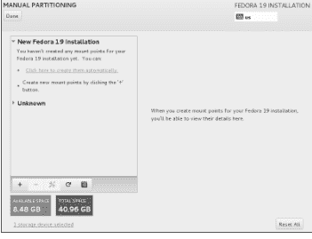

**图 3-11** 手动分区屏幕 I

### 自动分区创建

若要让 `Anaconda` 自动创建分区，请点击`在此处点击以自动创建`。`Anaconda` 创建 `swap`、`/boot`、`/` (根目录) 以及（如果空间足够）`/home` 分区，并在手动分区屏幕上显示它们，以便您查看和修改它们（图 3-12）。

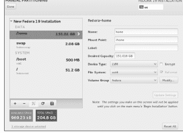

**图 3-12** 手动分区屏幕 II


**图 3-13** 添加新挂载点窗口

### 添加分区

要在硬盘上创建新分区，硬盘必须有足够的可用空间来容纳该分区；参见下一页的“回收磁盘空间”。

若要设置新的分区和挂载点（分区将挂载到的目录名称；第 38 页），请点击方框底部的加号 (`+`) 按钮；`Anaconda` 将打开添加新挂载点窗口（图 3-13）。指定新分区的挂载点和大小，然后点击添加挂载点。由于块大小限制，最终分区通常不会恰好是您指定的大小。`Anaconda` 接受 `T` 表示太字节、`G` 表示吉字节、`M` 表示兆字节的后缀。如果您留空大小字段，`Anaconda` 将使分区尽可能大。如果请求的磁盘空间不可用，`Anaconda` 将分配尽可能多的可用空间。

**提示：** 在您点击开始安装之前，`Anaconda` 不会写入磁盘。

**提示：** 在手动分区屏幕上进行的更改不会立即影响磁盘；您可以随时点击重置全部，从磁盘重新读取配置信息并恢复屏幕，使其包含最初的信息。只有当您点击开始安装时，`Anaconda` 才会写入磁盘。

### 修改分区

要修改挂载点/分区，请在屏幕左侧高亮显示挂载点，在右侧进行更改，然后点击更新设置。使用此窗口，您可以更改分区的大小或格式化为其他类型（例如，`ext3`、`vfat`、`swap` 等）。参见前一页的图 3-12。

## 删除分区

要删除挂载点/分区，请在屏幕左侧高亮显示该挂载点，然后点击方框底部的减号 (-) 按钮。

### 交换分区

如果磁盘上的其他系统有交换分区，`Anaconda` 会与正在安装的系统共享该分区。否则，为正在安装的系统设置一个交换分区是个好主意。有关交换分区的更多信息，请参见第 40 页。

### 分区位置


当 `Anaconda` 在您选择了多块磁盘的系统上创建分区时，它会决定该分区将位于哪块磁盘上。要将分区移动到另一块磁盘，请高亮显示该分区。如果 `Anaconda` 可以将高亮显示的分区移动到另一块磁盘，方框底部的工具图标按钮将是激活状态（未变灰）。点击此按钮以显示配置挂载点窗口。点击以高亮显示您希望分区所在的磁盘。如果适用，您可以在点击第二个及后续分区时按住 Shift 键来选择多个分区。

## 设置 RAID 设备

要设置 RAID 阵列（第 42 页），请点击您要更改为 RAID 设备的挂载点/分区，从标记为 `设备类型` 的下拉列表中选择 RAID，然后点击更新设置。`Anaconda` 将分区更改为 RAID 设备。然后，您可以从标记为 `RAID 级别` 的下拉列表中选择一个 RAID 设备类型。

## 回收磁盘空间

在缩小或删除分区以回收磁盘空间的几种情况中。假设您不是在干净的磁盘上安装，磁盘上任何未占满的分区都是回收空间的目标。一个典型的例子发生在使用拥有单个占满整个磁盘的分区（例如，当您通过向 Windows 系统添加 Fedora/RHEL 来设置双启动系统时，第 84 页）的硬盘上。在这种情况下，您可能能够从 Windows 分区中回收空间以安装 Fedora/RHEL。根据 `ntfsresize man` 页面，您在调整 Windows 分区大小之前不需要对其进行碎片整理。调整分区大小的过程与分区类型无关：您可以使用回收空间窗口来调整 Windows、Linux 及其他类型分区的大小。

要回收磁盘空间，请点击安装选项窗口上的 `回收空间`；`Anaconda` 将显示回收磁盘空间窗口（图 3-14）。此窗口显示一个表格，列出您在安装目标窗口（第 67 页）中选择的每个磁盘上的分区。该表格显示每个分区的挂载点、设备名称、文件系统类型、可回收空间量以及将执行的操作。表格下方有三个按钮：`保留`、`删除` 和 `缩小到`。默认操作是保留分区。

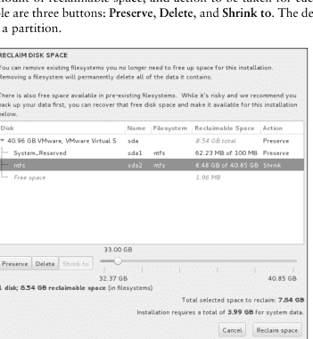

**图 3-14** 显示滑块的回磁盘空间窗口

与其他修改磁盘的说明一样，`Anaconda` 不会执行任何操作，直到您在安装摘要屏幕（第 63 页）中点击 `开始安装`。高亮显示您要处理的分区，然后点击 `删除` 以删除该分区，或点击 `缩小到` 以从该分区回收空间。为了让 `Anaconda` 从分区回收（缩小）空间，该分区不能占满数据。

当您高亮显示一个分区并点击 `缩小到` 时，`Anaconda` 会在表格下方显示一个滑块（图 3-14，前一页）。滑块的左端代表分区可缩小的最小尺寸，右端代表最大尺寸（不缩小）。滑块下方有标签显示这些尺寸；滑块上方有一个标签随滑块移动并显示选定的分区大小。您使分区越小，为正在安装的系统提供的空间就越多。点击并拖动滑块，直到分区达到您想要的大小。对您想要调整大小或删除的每个分区重复此过程，然后点击 `回收空间`。在您点击 `开始安装` 之前，`Anaconda` 不会调整分区大小。

## 处理 LVS

当您指示 `Anaconda` 使用默认布局对硬盘进行分区时，它使用 LVM（第 44 页）来设置大部分硬盘，创建 LV 而不是分区。它将 `/boot` 放在驱动器上的第一个分区上，不受 LVM 控制。LVM 创建一个名为 `fedora` 的 VG（卷组），占据剩余的磁盘空间。在此 VG 内，它创建两个或三个 LV：根目录（`/`，`fedora-root`）、交换区（`fedora-swap`），如果空间允许，还有 `/home`（`fedora-home`）。交换区 LV 占用多达几个吉字节；根目录 LV 占用多达约 50 吉字节。如果有空间供 `/home` LV 使用，它将占用 `fedora` 的剩余部分。本节解释如何使 `/home` LV 变小，以便您可以向 `fedora` 添加额外的 LV。如果您正在工作的机器上的硬盘较小，且 `Anaconda` 没有创建 `/home` LV，您可以通过改为使根目录 LV 变小来遵循此示例。

要使 `/home` LV 变小并为额外的 LV 腾出空间，首先高亮显示 `/home` LV（`fedora-home`），然后将标记为 `期望容量` 的文本框中的值更改为较小的值。图 3-15 显示 `fedora-home` LV 的大小被更改为 100 吉字节。点击 `更新设置`。

一旦您减小了 `fedora-home` LV 的大小，手动分区屏幕会显示可用空间增加。现在您可以向 `fedora` 添加另一个 LV。点击加号 (+) 以显示添加新挂载点窗口（图 3-13，第 76 页）。从标记为 `挂载点` 的下拉列表中选择一个值（或输入一个值），并在标记为期望容量的文本框中输入一个值。点击 `添加挂载点`。`Anaconda` 将新的挂载点和分区添加到屏幕左侧。当 LV 设置为您想要的方式时，点击 `完成`。

## GNOME-DISKS：GNOME 磁盘实用程序

`gnome-disks` 图形磁盘实用程序可以创建、删除和修改许多类型介质上的分区和文件系统，包括内部和外部硬盘、CD/DVD 以及 USB 闪存盘。它可以加密分区并更改已加密分区的密码。

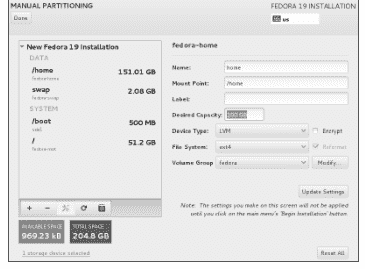

## 图 3-15 手动分区界面；调整 LV 的大小

除非您确定用于安装 Fedora/RHEL 的硬盘上没有任何数据（它是新硬盘），或者您确信硬盘上没有有价值的信息，否则在开始安装之前查看硬盘内容是个不错的主意。`gnome-disks` 磁盘实用程序是一个很好的工具，适合这项工作。通过输入 `gnome-disks` 命令打开磁盘窗口，可以在“输入命令”窗口（`ALT-F2`）或终端模拟器（见第 120 页）中执行此操作。

“磁盘”窗口分为三个部分（图 3-16）：左侧是设备部分，列出了 CD/DVD 驱动器、硬盘和其他设备；

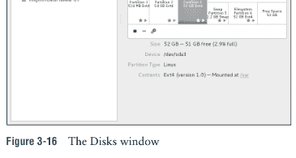

## 图 3-16 磁盘窗口

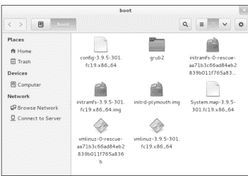

## 图 3-17 使用 gnome-disks 浏览分区

右上部分显示左侧选中的设备的信息；右下部分显示右侧中间的硬盘图形表示中选中的分区信息。

当您在左侧的“设备”部分中选择硬盘时，`gnome-disks` 会在右侧显示该硬盘的信息。单击硬盘图形表示中的一个分区，`gnome-disks` 会在右侧底部显示该分区的信息。

从此窗口中，您可以查看、创建和删除分区。如果使用 `gnome-disks` 检查硬盘，并使用 `Anaconda` 设置安装 Fedora/RHEL 的分区，您可以节省时间。

## 显示文件系统的内容

要显示文件系统的内容，请按照上述说明选择包含该文件系统的分区，并单击磁盘图形表示左下角的三角形将其挂载。上一页的图 3-16 中显示的是一个方块而不是三角形，因为该分区已经挂载。当您在窗口右侧底部单击挂载点（“内容...挂载于”后面的链接）时，`Nautilus` 将在 `Nautilus` 窗口中显示该文件系统（图 3-17；有关 `Nautilus` 的更多信息见第 102 页）。查看完文件系统的内容后，单击方块以卸载文件系统。

## 写入分区表

新硬盘没有分区表（第 36 页），外观类似于图 3-18 中选中的硬盘。在“磁盘”窗口右下角，`内容` 标签后显示“未知”

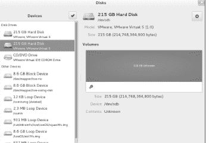

## 图 3-18 没有分区表的硬盘

且磁盘的图形表示标记为 `未知`。如果您正在操作的硬盘已经有分区表，请跳至下一节。

要对硬盘进行分区，请单击“磁盘”窗口右上角的齿轮图标（不是磁盘图形下方的那个），并从弹出菜单中选择 `格式化`；`gnome-disks` 将打开一个格式化卷窗口。除非您想明确擦除硬盘上的数据，否则请接受下拉列表中标有 `擦除` 的默认选项 `不要覆盖现有数据`。在标有 `分区` 的下拉列表中，接受默认值 `与现代系统兼容` .... 如果您愿意，可以在标有 `名称` 的文本框中输入一个名称。单击 `格式化`；`gnome-disks` 将显示另一个窗口以确认您是否想要格式化该硬盘。再次单击 `格式化`。`gnome-disks` 实用程序会花费片刻时间来格式化硬盘，并在工作时快速显示一些信息。完成后，`GUID 分区表` 显示在 `分区` 标签之后，磁盘的图形表示标记为 `空闲空间`（第 36 页），`未分配空间` 显示在 `内容` 标签之后。

如果您想创建一个占用整个磁盘驱动器的单一文件系统，请不要按照上一段的说明操作，而是单击磁盘图形表示中的齿轮图标，并从下拉菜单中选择格式化；`gnome-disks` 将打开一个格式化卷窗口。要创建文件系统，请从类型下拉菜单中进行选择，然后单击 `格式化`。

## 创建分区和文件系统

创建分区表后，您将能够创建包含文件系统的分区，将其放置在空闲空间中。选中标记为 `空闲空间` 的区域，并单击


磁盘图形底部的加号；`gnome-disks` 将打开创建分区窗口（图 3-19）。

使用窗口顶部的滑块或标有“分区大小”的上下调节框指定新分区的大小。标有“后续空闲空间”的上下调节框中的值将随分区大小变化。

### 加密以保护数据，特别是笔记本电脑上的数据

- **安全性**

对分区进行加密可以防止敏感数据被盗，尤其是笔记本电脑，因为它们容易失窃。如果您决定加密某个分区，请牢记密码：没有密码就无法找回数据。

除非您想明确擦除硬盘上的数据，否则请接受下拉列表中标有 `擦除` 的默认选项“不要覆盖现有数据”。在标有 `类型` 的下拉列表中，接受默认值 `Ext4`；如果您希望文件系统被加密（第 30 页），请选择 `LUKS + Ext4`。如果您选择加密文件系统，`Anaconda` 将会要求输入短语密码。您需要此短语密码才能登录系统。

您可以在标有 `名称` 的文本框中可选地输入磁盘标签。此名称不是磁盘的挂载点。单击 `创建`；`gnome-disks` 将创建文件系统。现在，磁盘的图形表示将被划分，以表示硬盘的划分，`内容` 对应于图形表示中的高亮显示部分（`Ext4` 或未分配空间）。如果您没有使用完所有空闲空间，您可以以相同的方式创建额外的分区和文件系统。

## 删除分区

在删除分区之前，请确保其中不包含任何您需要的数据。要使用 `gnome-disks` 实用程序删除分区，请在硬盘的图形表示中选中要删除的分区，如有必要将其卸载（单击方块），然后单击该表示底部的减号。经过询问后，`gnome-disks` 将删除该分区。

## 使用 SMART 显示磁盘性能信息

`SMART`（自监控、分析和报告技术）监控硬盘并试图预测硬盘故障。要查看系统中某个硬盘的 `SMART` 报告，请单击“磁盘”窗口右上角的齿轮图标（不是磁盘图形下方的那个），并从弹出菜单中选择 `Smart 数据 & 自检`；`gnome-disks` 将显示一个类似于图 3-20 所示的窗口。从此窗口中，您可以打开或关闭 `SMART`，启动新的自检，并滚动查看最近一次测试的信息。

## 编辑 Kickstart 脚本

`Kickstart` 是一个程序，用于自动化一台或多台机器上的安装及安装后配置。要使用 `Kickstart`，您需要创建一个脚本（文件），其中包含您在安装期间通常提供的信息。然后 `Anaconda` 将在安装过程中参考此文件。使用 `Kickstart`，您可以自动化语言选择、网络配置、键盘选择、引导加载程序安装、磁盘分区等。有关使用 `Kickstart` 脚本安装系统的说明，请参见第 71 页的 `ks` 参数。

修改现有的 `Kickstart` 脚本比从头编写一个新脚本更容易。一个好的起点是 `Anaconda` 在安装系统时生成的 `Kickstart` 脚本（`/root/anaconda-ks.cfg`）。此脚本包含可以复制您刚刚安装的系统的指令。

另一个获取示例 `Kickstart` 脚本的好来源是名为 `fedora-kickstarts` 和 `custom-kickstarts` 的软件包。安装这些软件包后，请浏览 `/usr/share/spin-kickstarts` 目录层次结构中的文件。这些文件有详尽的注释；阅读注释有助于您学习如何编写 `Kickstart` 脚本。

虽然不再支持典型的交互式文本安装，但您可以使用 `Kickstart` 文件执行文本安装。在 `Kickstart` 脚本开头附近，包含 `text` 或 `graphical` 一词的行指定了安装环境。或者，您可以使用 `VNC` 连接执行文本安装。请参见第 72 页的技巧。

`system-config-kickstart` 实用程序（`system-config-kickstart` 软件包）是一个图形化 `Kickstart` 脚本编辑器。虽然它可以创建 `Kickstart` 文件，但您可能需要编辑

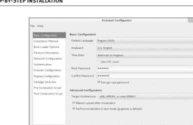

图 3-21 Kickstart 配置器窗口

手动编辑生成的文件。此工具会显示 `Kickstart` 配置器窗口（图 3-21）。要打开此窗口，请在“输入命令”窗口（`ALT-f2`）或终端模拟器中键入命令 `system-config-kickstart`。

图 3-21 展示了 `Kickstart` 配置器显示的第一个窗口。要生成 `Kickstart` 文件（默认为 `ks.cfg`），请遍历此窗口的各个部分（左侧的项目），填写答案，并在相应的复选框中打勾。一开始参考 `Anaconda` 在系统安装时生成的 `Kickstart` 安装脚本可能会有帮助（位于 `/root/anaconda-ks.cfg`）。点击菜单栏上的 `Help`（帮助）以获取完成这些任务的说明。完成后，点击 `File`（文件）→`Save`（保存）。`Kickstart` 配置器会给你一个机会，在保存文件之前审查生成的脚本。

## 设置双启动系统

`双启动` 系统是指可以启动两个（或更多）操作系统之一的系统。本节描述了如何向可以启动 Windows 的系统添加 Fedora/RHEL，从而创建一个可以启动 Windows 或 Linux 的系统。你可以使用相同的技术向运行其他版本或发行版 Linux 的系统添加 Fedora/RHEL。

在设置双启动系统之前，你需要为新 Fedora/RHEL 系统找到磁盘空间。下一节讨论了创建所需空间的几种方法。

### 在 Windows 系统上创建空闲空间

通常，你会在硬盘的空闲空间上安装 Fedora/RHEL。要向 Windows 系统添加 Fedora/RHEL，你必须在一个已持有 Windows 的系统上有足够的空闲空间。有几种方法可以提供或创建此空闲空间。以下段落按从最简单到最难的顺序讨论这些选项。

- **添加新的硬盘** —向系统添加另一块硬盘，并在仅包含空闲空间的新磁盘上安装 Linux。这种技术非常简单且干净，但需要一块新的硬盘。

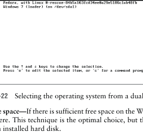

图 3-22 从双启动系统中选择操作系统

- **使用现有空闲空间** —如果 Windows 磁盘上有足够的空闲空间，你可以在那里安装 Linux。这是最优选择，但已安装的硬盘上很少有足够的空闲空间。

- **从 Windows 分区回收空间** —Windows 分区通常占用整个磁盘，这就解释了为什么从 Windows 分区回收空间是释放空间最常用的技术。Windows 系统通常使用 `NTFS`、`FAT32` 和/或 `FAT16` 文件系统。你在安装 Fedora/RHEL 时（第 77 页）可以从现有的 Windows 分区回收空间。

- **删除 Windows 分区** —如果你可以删除足够大的 Windows 分区，你可以在其位置安装 Linux。要删除 Windows 分区，你必须在 Windows 下有多个分区，并且愿意丢失要删除分区中的数据。在许多情况下，你可以通过将数据从要删除的分区移动到另一个 Windows 分区来保存这些数据。

一旦你确定某个分区不包含有用信息，你可以在安装 Fedora/RHEL 时删除它。或者，你可以使用来自实时会话的 `gnome-disks` 来删除它（第 82 页）。删除分区后，你可以在先前由该删除分区占用的空闲空间中安装 Fedora/RHEL。

## 如果在安装 Linux 后安装 Windows

> 当你将 Windows 作为第二个操作系统安装时，它会覆盖现有的引导加载程序。在这种情况下，你需要重新加载引导加载程序。有关说明，请参阅第 456 页的“重新安装 MBR”。

## 安装 Fedora/RHEL 作为第二个操作系统

在 Windows 系统上创建了足够的空闲空间后，你可以开始在你创建的空闲空间中安装 Fedora/RHEL。当你启动更新后的系统时，你将能够选择要运行哪个操作系统（图 3-22）。

## 本章摘要

安装 Fedora/RHEL 通常从 `Live` 或 `Install` 映像启动开始。当系统启动时，它会显示一条消息，说明它将在何时自动启动。在显示此消息期间，你可以输入各种命令，然后让系统继续启动。

安装 Fedora/RHEL 的程序名为 `Anaconda`。`Anaconda` 调用工具来识别硬件、构建必要的文件系统并安装 Fedora/RHEL 操作系统。`Anaconda` 可以以图形（默认）交互模式运行，也可以使用 `Kickstart` 以自动模式运行。你可以使用 `VNC` 或 `Kickstart` 执行文本安装。

`Anaconda` 包含一个图形磁盘分区设施，可以在安装过程中添加、删除和修改硬盘上的分区和 LV（逻辑卷）。`gnome-disks` 实用程序在安装前后报告和操作硬盘分区。

双启动系统可以启动两个或更多操作系统中的一个，通常是 Windows 和 Linux。在设置双启动系统时，最大的任务（假设你想向 Windows 系统添加 Linux）是找到足够的磁盘空间来容纳 Linux。Fedora/RHEL 使用 `X.org` X 窗口系统和 `GNOME` 显示管理器 (`gdm`) 来提供图形登录界面。

## 练习

- 什么是实时系统？它比已安装系统有什么优势？

- 描述 `Anaconda` 安装程序。


- Anaconda 使用的安装映像可以位于哪里？

- 为什么测试安装介质很重要？你该如何测试？

- 如果图形安装程序不起作用，你应该怎么做？

- 什么时候你会指定 `ext2` 文件系统而不是 `ext4`？

## 高级练习

- 你可以使用哪些实用程序在安装之前对硬盘进行分区？

- 在将 Fedora 安装为 Windows 机器上的第二个操作系统（以创建双启动系统）之前，你需要做什么？

- Anaconda 默认如何设置硬盘？

- 安装新系统时，如何关闭所有磁盘控制器的 DMA（直接内存访问）？

# 第二部分

# 使用 FEDORA 和 RED HAT ENTERPRISE LINUX

- 第 4 章 FEDORA 和 RED HAT ENTERPRISE LINUX 简介 89

- 第 5 章 SHELL 141

- 第 6 章 LINUX 文件系统 175

- 第 7 章 LINUX 实用工具 215

- 第 8 章 网络与互联网 279

*此页有意留白*


# FEDORA 和 RED HAT ENTERPRISE LINUX 简介

### 本章内容

- 限制你的权力（超级用户/root 权限） . . . . . . . . . . 90

- 在系统上登录 . . . . . .0 . . . . . . . . . 90

- GNOME 3 标准和经典桌面 . . . . . . . . . . . 91

- 在桌面上工作 . . . . . . . . . . . 97

- 使用 Nautilus 文件管理器 . . . . . . . . . . . . . . . . . . . . . . . . 102

- 设置窗口 . . . . . . . . . . . . . 107

- 更新、安装和删除软件包 . . . . . . . . 116

- 从命令行工作 . . . . . . . . . . . . . . . . . . . . . . . . 119

- 从命令行获取帮助 . . . . . . . . . . . . . . . . . . . . . . . . 128

- 密码安全性 . . . . . . . . . . . . . . . . . . . . . . 136

- 如果无法登录怎么办 . . . . . . . . . . . . . . . . . . . . . . 135

### 学习目标

读完本章后，你应该能够：

- 登录到 Fedora 桌面

- 理解 `root` 权限

- 更改桌面背景

- 使用 Nautilus 文件管理器处理文件

- 纠正命令行上的错误

- 解释使用窗口标题栏可以做什么

- 更新和安装软件

- 使用 `man`、`info` 和 `yelp` 查找文档

- 打开终端模拟器并从命令行运行程序

- 创建并运行一个简单的 shell 脚本

无论如何，你正坐在运行 Fedora 或 RHEL (Red Hat Enterprise Linux) 的计算机前。在描述本书使用的约定和 `root (Superuser)` 权限之后，本章将带你游览系统，让你对可以用它做什么有一些想法。该游览不会深入讨论选择、选项、菜单等；留给你实验并在本书后续章节中更详细地探索。

该游览涵盖了如何在系统上登录，GNOME 3 标准和经典桌面，在桌面上工作，Nautilus 文件管理器，设置窗口，获取帮助和安装软件。本章的最后部分介绍了一些命令行实用程序，并描述了如何从命令行工作，最后以解决登录问题和密码安全性的章节结束。

务必阅读下一节中关于滥用 `root (Super-users)` 权限危险的警告。在留意该警告的同时，请随意对系统进行实验：输入命令，创建文件，点击对象，从菜单中选择项目，遵循本书中的示例，并享受乐趣。

## 限制你的权力（超级用户/ROOT 权限）

当你以名为 `root` 的用户登录时，你被称为 `Superuser`（超级用户）或 `administrator`（管理员）；你正在使用 `root` 权限并拥有非凡的系统级权力。运行 `su` 或 `sudo` 实用程序可以赋予你类似的权限。在使用 `root` 权限工作时，你可以读取或写入系统上的几乎任何文件，执行普通用户无法执行的程序等。在多用户系统上，你可能无法运行某些程序。然而，有人——`system administrator`（系统管理员）——知道 `root` 密码或是名为 `wheel` 的管理组的一员，那个人维护着系统。当你在自己的计算机上运行 Linux 时，你在安装 Linux 时会为 `root` 分配一个密码。有关更多信息，请参阅第 422 页的“以 `root` 权限运行命令”。

**不要在使用 root 权限时进行实验**

> caution（注意）

> 当你`没有`使用 `root` 权限时，请随意进行实验。当你`正在`使用 `root` 权限时，只做你必须做的，并确保你确切知道自己在做什么。完成手头任务后，恢复为你自己操作。在使用 `root` 权限时，你可能会对系统造成如此严重的损害，以至于你需要重新安装 Linux 才能使其再次工作。

## 在系统上登录

当你启动默认的 Fedora/RHEL 系统时，`gdm`（GNOME 显示管理器）会在系统控制台显示登录屏幕（图 4-1）。屏幕中间是可以在系统上登录的用户姓名列表。右上角是允许你重新启动或关闭系统、调整音量并显示的图标


图 4-1 GNOME 登录屏幕

通用访问菜单，允许你更改辅助功能首选项（例如，放大文本或显示高对比度桌面）。

要登录，请点击你的姓名；`gdm` 将显示密码屏幕。输入你的密码并按下回车键。如果 `gdm` 显示错误消息，请再次点击你的姓名并输入密码。确保大写锁定键（CAPS LOCK）未开启（如果开启，`gdm` 会显示消息），因为验证你输入内容的例程对大小写敏感。如果你需要登录帮助，请参阅第 135 页；如果你想更改密码，请参阅第 112 页。系统需要片刻时间来设置各项内容，然后显示一个工作区。

# GNOME 3 标准桌面和经典桌面

Fedora 15 引入了 GNOME 3 和 GNOME Shell。GNOME 3 可以运行在标准模式（Standard desktop）或经典模式（Classic desktop）。GNOME 3 标准桌面与 GNOME 2 桌面有着根本的不同，它顺应了更简单、图形界面更丰富的桌面趋势，拥有更多图标和更少的菜单。从 15 版开始的所有 Fedora 版本默认都运行 GNOME 3 标准桌面。第 93 页的图 4-2 和第 94 页的图 4-3 展示了 GNOME 3 标准桌面上常用的屏幕。更多详细信息请参见下一节。

默认情况下，RHEL 7 运行 GNOME 3 经典桌面，这是一组 GNOME Shell 扩展，赋予 GNOME 3 GNOME 2 的外观和感觉，包括“应用程序”和“位置”菜单。第 97 页的图 4-5 展示了 GNOME 经典桌面。更多详细信息请参阅第 96 页的“GNOME 经典桌面”。

本书在大多数任务中使用 Linux 文本接口（CLI），包括设置服务器以及在 `bash`、`SQL` 和 `Python` 中进行编程。当本书描述 GUI 实用工具时，它会解释如何通过按下 `ALT F2` 显示“输入命令”窗口并输入实用工具名称来打开该实用工具/窗口。或者，你可以按下 `SUPER`（Windows）键显示搜索文本框，并在其中输入实用工具的名称。这些技巧在 GNOME 3 标准桌面（Fedora）和经典桌面（RHEL）上均有效。更多详细信息请参阅第 98 页的“搜索文本框和输入命令窗口”。

# 你可以在 Fedora 上运行经典桌面

> 如果你愿意，可以在 Fedora 上安装并运行经典桌面；请参阅第 95 页的“在 GNOME 3 上安装经典桌面”。

> 可选

> `gnome-tweak-tool` 你可以使用 `gnome-tweak-tool`（`gnome-tweak-tool` 包）来更改 GNOME 窗口外观和功能的许多方面。访问 `wiki.gnome.org/GnomeTweakTool` 获取更多信息。

# GNOME 3 标准桌面（Fedora）

本节简要介绍了如何使用 Fedora 默认安装的 GNOME 3 标准桌面。访问 `wiki.gnome.org/GnomeShell/CheatSheet` 获取更多信息。`extensions.gnome.org` 网站列出了 GNOME 3 的扩展。如果你正在运行 RHEL，请参阅第 96 页的“GNOME 经典桌面”。

当你在运行 GNOME 3 的系统上登录时，工作区是空的。在顶板（工作区顶部的栏）上有以下对象：单词 Activities、时钟、扬声器和网络图标，以及你的姓名（或 Live System User）。你可以点击这些对象中的一个来操作它。顶板保持不变，而其下方显示的信息会发生变化。

# 活动概览屏幕

点击工作区左上角的 Activities（或按下 `SUPER` |`Windows|` 键）以显示活动概览屏幕（图 4-2）。此屏幕包含搜索文本框（靠近顶部）、收藏夹应用程序图标（位于左侧）以及一个包含工作区缩略图的区域（位于右侧）；每个视图都包含正在运行的应用程序的实时缩略图。当只有一个工作区存在时，你需要将光标移至屏幕右侧以显示此区域。活动窗口中窗口的缩略图出现在屏幕中央。如果活动工作区为空，屏幕中央为空白。

图 4-2 显示了一个活动概览屏幕，其中活动工作区包含正在运行 Firefox 和 Files（Nautilus；第 102 页）的窗口。由于缩略图的 Firefox 窗口被选中（高亮显示），其右上角有一个圆圈中的 X。点击此 X 以关闭窗口并终止 Firefox。点击 Firefox 或 Files 窗口可关闭活动概览屏幕，并显示带有你点击窗口的活动工作区，使其位于前景。

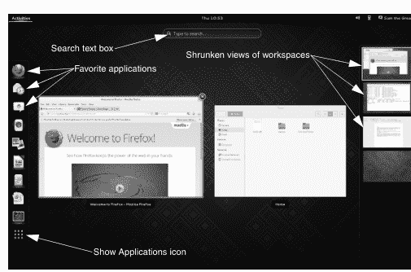

- `使工作区处于活动状态`

仍然看着图 4-2，你还可以点击屏幕右侧其中一个缩略的工作区以使该工作区处于活动状态。点击堆栈底部的空白工作区可打开一个新的空白工作区。

- `从收藏夹列表运行应用程序`

启动应用程序有几种方法。如果你想运行的应用程序图标在收藏夹列表中，请点击该图标；GNOME 将关闭活动概览屏幕，并在活动工作区中打开你点击图标的对应应用程序。

- `从搜索文本框（SUPER 键）运行应用程序`

你也可以在搜索文本框中输入（图形）应用程序的名称（例如，`gnome-terminal` 或 `gnome-disks`）或应用程序显示的窗口名称（例如，Terminal 或 Disks），然后按回车键在活动工作区中打开该应用程序。如果搜索文本框不可见，请按 `SUPER`（Windows）键显示它。

- `从输入命令窗口（ALT-F2 键）运行应用程序`

最后，你可以按下 `ALT-F2` 显示“输入命令”窗口，输入你想运行的应用程序或实用工具的名称，然后按回车键运行该应用程序。你必须从终端模拟器（如 `gnome-terminal`，你可以从“输入命令”窗口启动它）中运行文本应用程序。更多详细信息请参阅第 98 页。

# 应用程序概览屏幕

在活动概览屏幕左侧的收藏夹应用程序图标列表底部，是“显示应用程序”图标（它包含九个小方块；参见图 4-2）。


点击此图标以显示`应用程序概览`屏幕（图 4-3）。此屏幕显示应用程序图标。点击屏幕底部标有`Frequent`（常用）的按钮，仅显示你经常使用的应用程序的图标。点击`All`（全部）将显示可滚动的应用程序图标列表。并非所有应用程序或实用工具都有图标；对于没有图标的应用程序，请使用“输入命令”窗口（第 98 页）来运行它们。

左键点击图标以关闭应用程序概览屏幕并在活动工作区中打开相关应用程序。右键点击图标以显示上下文菜单，其中可能包括`Add to Favorites`（添加到收藏夹）（如果该图标不在收藏夹列表中）、`Remove from Favorites`（从收藏夹移除）（如果它已在收藏夹列表中）、`New Window`（新窗口）（即使它已经打开，也会关闭应用程序概览屏幕并在活动工作区中的新窗口中打开应用程序），以及一行标识已打开的应用程序实例（关闭应用程序概览屏幕并在其已运行的工作区中打开应用程序）。

# 应用程序切换器：更改输入焦点

具有`输入焦点`的窗口是接收你输入的键盘字符和命令的窗口。除了使用活动概览屏幕外，你还可以使用键盘更改哪个窗口具有输入焦点；这个过程称为`窗口循环`。

当桌面显示时，按下 `ALT`+`TAB`，GNOME 会在工作区中央显示应用程序切换器，这是一个包含代表桌面上窗口中正在运行的程序图标的框。它还会将输入焦点切换到当前活动窗口之前刚刚处于活动状态的那个窗口，从而轻松地在两个窗口之间来回切换。当你按住 `ALT` 并多次按下 `TAB` 时，焦点从一个窗口移动到另一个窗口。按住 `ALT` 和 `SHIFT` 并反复按 `TAB` 则朝另一个方向循环切换。

# 在 GNOME 3 上安装经典桌面（Fedora）

以下说明介绍了如何在 Fedora 下安装并运行经典桌面。RHEL 7 默认运行经典桌面。

1. 在 GNOME 运行 GNOME 3 标准桌面的情况下，点击屏幕左上角的`Activities`（活动）。输入 `terminal` 并按 `RETURN` 键。GNOME 将显示一个终端模拟器。

2. 将光标放在终端模拟器上，输入以下命令；使用 `RETURN` 键结束命令。

```bash
$ su -c 'yum -y install gnome-classic-session'
Password: ···
· · ·
Complete!
```

`su` 实用工具将提示输入 `root` 密码。一旦输入 `root` 密码并按下 `RETURN` 键，`yum` 在安装 `gnome-classic-session` 包时会显示大量信息。当 `yum` 显示 `Complete!` 且 shell 显示其提示符 ($ ) 时，即表示包已安装。有关使用 `yum` 安装包的信息，请参见第 534 页。

3. `仅限现场会话`（或者如果菜单中没有显示下一步描述的 `Log Out`），从终端模拟器中输入以下附加命令。在前两条命令中，用你的名字替换 `sam`，并在提示时输入 `root` 密码。

```bash
$ su -c 'useradd sam'
$ su -c 'passwd sam'
Changing password for user sam.
New password:
Retype new password:
passwd: all authentication tokens updated successfully.

$ su -c 'systemctl restart gdm'
```

稍等片刻，GNOME 会再次以 Live System User（现场系统用户）身份让你登录（或允许你以自己的身份登录）。

4. 通过点击屏幕右上角的你的姓名或 `Live System User`，点击 GNOME 显示菜单中的 `Log Out`，然后点击 GNOME 显示的小窗口中标记为 `Log Out` 的按钮来注销。（如果菜单中没有 `Log Out`，请遵循上一步，然后重复此步骤。）稍等片刻，GNOME 显示登录屏幕（图 4-1，第 91 页）。

5. 在登录屏幕上点击你的姓名（而不是 Live System User）；GNOME 显示密码屏幕（图 4-4，下一页）。在标记为 `Password` 的文本框下方，有一个小三角形后面跟着单词 `Session`。点击


三角形以显示 Session（会话）菜单。点击 `GNOME Classic`；GNOME 会将白点移动到你刚点击的条目。

6. 在标记为 `Password` 的文本框中输入密码，然后点击 `Sign In`。稍等片刻，GNOME 显示经典桌面（图 4-5）。如果你遵循了第 3 步添加了用户，`gnome-initial-setup` 将引导你设置该用户；请参见第 68 页。

一旦你在登录时选择了 GNOME Classic，它就是你默认的桌面；下次登录时不需要再次选择它。

# GNOME 经典桌面（RHEL 和可选的 Fedora）

本节简要描述了如何使用 RHEL 默认安装的 GNOME 经典桌面。如果你正在运行 Fedora，请参见第 92 页的“GNOME 3 标准桌面”。如果你想在 Fedora 下安装并运行经典桌面，请参见上一页的“在 GNOME 3 上安装经典桌面”。

登录时，GNOME 经典桌面显示一个工作区，其中包括顶部和底部面板（栏），帮助你轻松高效地开展工作（图 4-5）。每个面板可以容纳多个称为对象的图标和文字。

你可以从 Top 面板左端出现的 `Applications` 菜单（图 4-5）中运行应用程序。点击 `Applications` 显示应用程序菜单。当你将鼠标指针移动到该菜单中的一个选项并停留片刻（此动作称为`悬停`），菜单会显示一个子菜单。将光标移动到子菜单中的某一项并点击以选择并运行它。

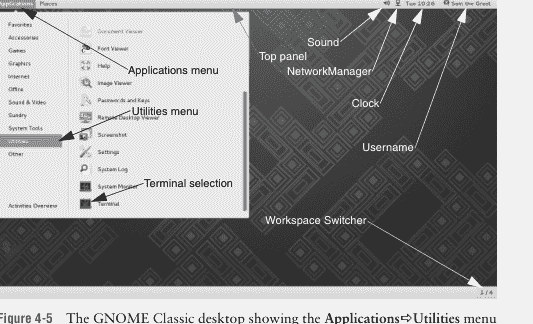

`Places（位置）菜单` Places 菜单没有子菜单；点击该菜单中的条目即可选择它。GNOME 经典桌面上的 Places 菜单与 Nautilus 文件浏览器侧边栏中的 Places 相同；更多信息请参见第 103 页。

## 在桌面上工作

本节讨论了几种你可以在桌面上工作的方法。它适用于 GNOME 3 标准桌面和经典桌面。

### 术语


- 除了本节内容，请参见词汇表，其中定义了数据输入控件（第 1281 页），如`组合框`（第 1243 页）、`下拉列表`（第 1248 页）、`列表框`（第 1258 页）和`文本框`（第 1277 页）。

- `工作区`是容纳一个或多个应用程序窗口的屏幕。活动概览屏幕（第 92 页）和应用切换器（第 94 页）使你能够显示任何正在运行的应用程序及其工作区。

- `活动工作区`是显示你可以立即进行操作的窗口的工作区。一次只能有一个活动工作区。

- `桌面`，不会全部同时显示，是所有工作区的集合。

``

图 4-6 输入命令窗口

`面板` 面板是出现在桌面上并容纳对象的栏。顶部面板出现在屏幕顶部，底部面板（如果存在）出现在屏幕底部。

`对象` `对象`是你可以通过点击选择的文字、图标或菜单。

`点击和右键点击`

> **提示** 当需要点击`左`鼠标按钮时，本书使用术语 `click`。当需要点击`右`鼠标按钮时，它使用术语 `right-click`。有关适应左手使用鼠标的方法，请参见第 110 页。

### 搜索文本框和输入命令窗口

你可以通过按下 `SUPER`（Windows）键显示搜索文本框（图 4-2，第 93 页），或者通过按下 `ALT-F2` 显示输入命令窗口（图 4-6）并输入应用程序名称，来启动图形应用程序（打开窗口）。试着输入 `firefox` 并按下 `RETURN` 来启动 Firefox。新窗口在活动工作区打开。

`你必须从终端模拟器中运行文本应用程序（实用工具）`

> **提示** 文本应用程序或实用工具需要文本环境（如终端模拟器）才能运行。搜索文本框和输入命令窗口不提供文本环境，因此无法运行文本应用程序。然而，你可以使用这两种方法之一运行 `gnome-terminal`，这是一个提供文本环境的图形应用程序。然后你可以从 `gnome-terminal` 显示的终端模拟器中运行文本应用程序。

### 应用程序菜单

许多应用程序都有一个应用程序菜单，允许你设置偏好并获取关于该应用程序的帮助。当应用程序处于活动状态（拥有焦点）时，点击顶部面板上该应用程序的对象（窗口名称）；GNOME

``

# 软件 (gpk-application) 应用程序菜单

为该应用程序打开应用程序菜单。图 4-7 显示了软件（`gpk-application`）应用程序的应用程序菜单。有关此应用程序的更多信息，请参见第 116 页的“更新、安装和移除软件包”。

### 上下文菜单

上下文菜单包含具体适用于你所点击的窗口或对象的选择。这些选择因窗口而异，也因对象而异。某些窗口没有上下文菜单。通常，右键点击会显示上下文菜单。

`右键点击以显示上下文菜单`

> 提示 右键点击对象以显示其上下文菜单。每个对象都显示其自己的上下文菜单，尽管相似的对象具有相似的上下文菜单。大多数上下文菜单都有偏好设置或属性选择。

``

图 4-8 典型窗口

### 窗口

- `窗口` 在工作区中，`窗口`是运行或受特定程序控制的区域。

- `标题栏` `标题栏`（图 4-8）出现在大多数窗口的顶部，控制其所附着的窗口。你可以双击标题栏来最大化或还原窗口。某些窗口只能通过按 `SUPER-DOWN ARROW`（`SUPER` 是 Windows 键）或从顶部面板的空白处向下拖动来还原。点击关闭按钮（`X`）关闭窗口，通常也会终止在其中运行的程序。要重新定位窗口，请左键点击标题栏并将窗口拖到所需位置。

- `窗口操作菜单` 窗口操作菜单包含你可以对任何窗口执行的操作。右键点击标题栏以显示此菜单。此菜单允许你最小化、最大化、调整大小或关闭窗口；在窗口区内移动窗口；将窗口移动到其他工作区；使窗口保持在其他窗口之上或之下；并使窗口在当前显示的工作区中始终可见。它还显示了这些操作中的一些键盘快捷键。`SUPER` 指的是 Windows 键（例如，`Super+Up` 表示按住 Windows 键并按下 `UP ARROW` 键）。

- `菜单栏` `菜单栏`（图 4-8）包含你可以用于操作窗口内容的图标。

- `工具栏` `工具栏`（图 4-8）通常出现在窗口顶部附近，包含图标、文本、小部件、菜单等。存在多种类型的工具栏。标题栏不是工具栏。

## 调整窗口大小

要调整窗口大小，将鼠标指针移动到窗口的边缘；指针会变成指向线条的箭头。当指针是指向线条的箭头时，你可以单击并拖动窗口的一侧。当将鼠标指针移动到窗口的角落时，你可以同时调整窗口的高度和宽度。有些窗口无法调整大小，有些窗口不允许从四个方向中的任意一个方向调整大小。

## 移动窗口

要移动窗口，单击并拖动标题栏。将窗口拖动到屏幕顶部会最大化该窗口。

# 使用剪贴板剪切和粘贴对象

有两种相似的方法可以剪切/复制并粘贴窗口内部及窗口之间的对象和文本。在第一种方法中，你使用剪贴板（技术上称为`复制缓冲区`）来复制或移动对象或文本。为此，你显式地将对象或文本复制到缓冲区，然后将其粘贴到其他位置。遵循用户界面指南的应用程序使用`CONTROL-X`进行剪切，`CONTROL-C`进行复制，`CONTROL-V`进行粘贴。应用程序上下文菜单通常提供这些选项。

你可能不太熟悉第二种复制和粘贴文本的方法——使用`选区`或`主要`缓冲区，该缓冲区始终包含你最近选中（高亮显示）的文本。你不能使用此方法复制对象。单击鼠标中键（如果鼠标有滚轮，则点击滚轮）会在鼠标指针位置粘贴选区缓冲区的内容。如果你使用的是双键鼠标，请同时按下两个按钮以模拟点击中键。

使用这两种技术时，首先高亮显示对象或文本以选中它。你可以拖出一个框围绕多个对象以选中它们，或者拖动鼠标指针划过文本以选中它。双击可选择一个单词，三击可选择一行或一个段落。

接下来，若使用剪贴板，请显式地复制（`CONTROL-C`）或剪切（`CONTROL-X`）对象或文本。如果你想使用选区缓冲区，请跳过此步骤。

要粘贴选定的对象或文本，将鼠标指针放置在你希望放置的位置，然后按`CONTROL-V`（剪贴板方法）或按鼠标中键（选区缓冲区方法）。

`在终端模拟器中使用 SHIFT-CONTROL-C 和 SHIFT-CONTROL-V`

> 在终端模拟器窗口中，`CONTROL-C`、`CONTROL-X` 和 `CONTROL-V` 字符不起作用，因为在终端模拟器接收到它们之前，窗口中运行的 `shell` 会截获这些字符。但是，你可以使用 `SHIFT-CONTROL-V` 替代 `CONTROL-V`，使用 `SHIFT-CONTROL-C` 替代 `CONTROL-C`。`CONTROL-X` 没有键盘快捷键。你也可以在此环境中使用 `选区` 缓冲区，或者使用菜单栏 `编辑` 选项中的 `复制/粘贴`，或使用 `上下文`（右键单击）菜单中的选项。

使用剪贴板时，只要在 `CONTROL-C` 或 `CONTROL-X` 与 `CONTROL-V` 之间没有再次按下 `CONTROL-C` 或 `CONTROL-X`，你就可以输入任意数量的命令。使用选区缓冲区时，只要在没有选中（高亮显示）其他文本的情况下，你可以在选择文本后、粘贴前输入其他命令。

## 注销

通过单击屏幕右上角你的名字或 `Live System User`（实际系统用户），然后从 GNOME 显示的菜单中单击 `Log Out`（注销），再单击 GNOME 显示的小窗口中标有 `Log Out` 的按钮，即可注销。选择 `Power Off`（关机）可以关闭或重启系统，还有其他选项。或者，你可以从输入命令窗口（`ALT-F2`）或终端模拟器中输入命令 `gnome-session-quit`。

# 使用 NAUTILUS 文件管理器

Nautilus（即“文件”程序）是一个简单而强大的 GNOME 文件管理器。你可以使用它来创建、打开、查看、移动和复制文件及文件夹，也可以运行应用程序和脚本。

Nautilus 显示文件浏览器窗口，该窗口显示文件夹的内容。`文件夹`（`folder`）和`目录`（`directory`）这两个术语是同义词；“文件夹”常用于图形界面上下文中，而“目录”可能用于文本或命令行上下文中。本书互换使用这两个术语。

本书有时在指代 Nautilus 文件浏览器窗口时，会使用 `文件浏览器窗口` 和 `文件浏览器` 这两个术语。

从输入命令窗口（`ALT-F2`）或终端模拟器中输入命令 `nautilus`，可以打开一个 Nautilus 文件浏览器窗口，显示你主目录中的文件（图 4-9）。在 GNOME 3 桌面上，你可以在“活动”概览屏幕的搜索文本框中输入 `nautilus` 或 `files`（第 92 页）。或者，你可以单击应用程序概览屏幕（第 93 页）中的文件柜图标。在经典桌面上，你可以从“位置”菜单中选择主目录。

## NAUTILUS 文件浏览器窗口

文件浏览器窗口的右侧显示视图窗格，其中包含文件对象；左侧显示侧边栏，其中包含位置、设备和网络列表。

在文件浏览器窗口处于活动状态时，单击顶部面板上的 `Files`（文件）以显示文件应用程序菜单。此菜单允许你设置文件浏览器窗口的首选项、打开位置栏以及关闭文件浏览器窗口。

视图窗格显示文件图标或文件名列表。通过点击工具栏右端附近的点或线条按钮，选择你偏好的视图。

侧边栏允许你以不同方式使用 Nautilus。按下 `F9` 可以关闭或显示侧边栏。要更改侧边栏的水平尺寸，拖动其右侧的手柄（图 4-9）。更多信息请参阅下一页的“侧边栏”。

工具栏的左端允许你在视图窗格中显示不同的目录。选择 `应用程序菜单` ⇒ `输入位置` 以打开位置栏，你可以在其中输入路径名。工具栏的右端包含图标，允许你搜索文件、控制 Nautilus 在视图窗格中呈现的显示类型，以及显示视图选项和位置选项。

``

## 侧边栏

侧边栏的“位置”部分包含你点击以更改 Nautilus 在视图窗格中显示内容的对象。主目录、文档和下载对象显示具有相应名称的目录。计算机对象显示本地文件系统。浏览网络对象显示本地网络上的系统和文件。连接服务器对象打开一个窗口，允许你输入 `URL` 以连接到 `SSH`、`FTP` 或其他类型的服务器。

- `回收站`：从对象的上下文（右键单击）菜单中选择“移动到回收站”会将对象移动到 `回收站` 目录。由于回收站中的文件会占用硬盘空间（正如所有文件一样），定期删除它们是个好主意。要显示 `回收站` 目录，请双击侧边栏中的回收站图标。

- `清空回收站`：从回收站图标的上下文（右键单击）菜单中选择 `清空回收站`，以永久删除回收站中的所有文件。（如果回收站中没有文件，此选项会呈灰色显示）。或者，你可以右键单击回收站文件浏览器窗口中的对象并选择 `删除` 以仅删除该对象（文件），或者选择 `恢复` 以将文件移动回其原始位置。你可以像对待任何文件夹一样，将文件拖放进出回收站。

- `删除文件`：你可以先不将文件发送到回收站而直接删除文件。要通过从文件应用程序菜单中选择“首选项”，然后选择“行为”选项卡，并勾选标有“包含绕过 `回收站` 的 `删除` 命令”的复选框，将“删除”添加到上下文菜单中。

## Nautilus 可以打开终端模拟器

`提示` 当你安装 `nautilus-open-terminal` 软件包（有关说明请见第 534 页）并注销后重新登录时，Nautilus 会在适当的上下文菜单中提供“在终端中打开”选项。例如，安装此软件包后，当你右键单击目录对象并选择 `在终端中打开` 时，Nautilus 会打开一个终端模拟器，并以该目录作为工作目录（第 143 页）。

## 打开文件

默认情况下，你双击视图窗格中的文件对象以打开它；或者，你可以右键单击对象并从下拉列表中选择 `打开`。当你打开一个文件时，GNOME 会通过确定文件的 `MIME`（第 1261 页）类型来确定使用何种合适工具。GNOME 将每个文件扩展名与 `MIME` 类型关联，并将每个 `MIME` 类型与程序关联。最初，GNOME 使用文件扩展名来尝试确定文件的 `MIME` 类型。如果它不识别文件扩展名，它会检查文件的 `魔术数字`（第 1259 页）。

例如，当你打开一个扩展名为 `ps` 的文件时，GNOME 调用 Evince 文档查看器，它以可读格式显示 PostScript 文件。当你打开一个文本文件时，GNOME 使用 `gedit` 显示并允许你编辑该文件。当你打开一个目录时，GNOME 在文件浏览器窗口中显示其内容。当你打开一个可执行文件（如 Firefox）时，GNOME 运行该可执行文件。如果 GNOME 使用错误的工具打开文件，该工具通常会发出错误消息。有关如何使用非默认工具打开文件的信息，请参阅第 106 页的“打开方式”。

在文件浏览器窗口内部，你可以打开一个新选项卡来显示文件夹。为此，中键单击文件夹，或右键单击文件夹并从下拉列表中选择 `在新选项卡中打开`；Nautilus 会显示一个以你单击的文件夹命名的新选项卡。点击该选项卡以显示目录内容。

## 选择对象

在文件浏览器窗口内，单击对象一次以选择它；GNOME 会高亮显示该对象。按住 `CONTROL` 键，同时单击其他对象，可选择更多对象。要选择一组相邻的对象，高亮显示第一个对象，然后按住 `SHIFT` 键，单击最后一个对象；GNOME 会高亮显示两个对象之间的所有对象。或者，你可以使用鼠标指针拖出一个框围绕一组对象。

## 对象属性窗口

对象属性窗口显示有关文件的信息，如其所有者、权限、大小、位置、`MIME` 类型、操作方式等。此窗口标题为 `文件名 属性`，其中 `文件名` 是你单击以打开窗口的文件的名称。要显示此窗口，右键单击一个对象，并从下拉列表中选择 `属性`。

``

下拉列表。属性窗口最初会显示一些基本信息。点击窗口顶部的选项卡以显示更多信息。不同类型的文件会出现不同的选项卡集合。只有在你拥有相应权限时，才能在此窗口中修改设置。本节描述了对象属性窗口中最常见的三个选项卡。

- `基本` 基本选项卡显示有关文件的信息，包括其 `MIME`（见第 1261 页）类型，并允许你为文件选择自定义图标并更改其名称。要更改文件名，请替换标有 `名称` 的文本框中的名称。如果文件名未列在文本框中，则你没有权限更改它。更改图标的一种简单方法是打开位于 `/usr/share/icons` 的文件浏览器窗口（在“输入命令”窗口 [Alt-F2] 中输入命令 `nautilus /usr/share/icons`）。沿着目录向下浏览，直到找到一个你喜欢的图标（`gnome/24x24` 中有一些有趣的图标），然后将其拖放到基本选项卡中“名称”左侧的图标上。

- `权限` 权限选项卡（图 4-10）允许文件的所有者更改文件的权限（见第 191 页），并更改文件关联的组（参见第 506 页的 `/etc/group`）为所有者所属的任何组。Nautilus 会灰显你不允许更改的项目。

``

`图 4-11` 对象属性窗口，“打开方式”选项卡，以及同一文件的上下文菜单，“打开方式”子菜单

使用下拉列表，你可以为`所有者`（在其他地方称为`用户`；参见第 194 页关于 `chmod` 的技巧）、组和其他人授予文件的读取、只读或写入权限。或者，你可以指定权限为`无`，从而禁止组和其他人访问该文件。在标有`执行`的复选框中打勾，以授予所有用户执行该文件的权限。此选项卡不提供 `chmod`（见第 193 页）那种对分配权限进行精细控制的功能。

目录的权限工作方式如第 197 页所述。所有者、组和其他人可以被允许列出目录中的文件、访问（读取以及——在适当权限下——执行）文件，或创建和删除文件。组和其他人的权限也可以设置为`无`。点击`更改内部文件权限`以更改目录中所有文件的权限。

`打开方式` 当你要求 Nautilus 打开一个不可执行的文件（通过双击其图标或右键单击并选择第一个`用所选程序打开`）时，Nautilus 会确定使用哪个应用程序或工具来打开该文件。Nautilus 使用多种技术来确定文件的 `MIME`（见第 1261 页）类型，并基于此判断选择默认应用程序。

`打开方式` 选项卡（图 4-11）允许你更改 Nautilus 用于打开该文件及其他相同 `MIME` 类型文件（通常是具有相同文件名扩展名的文件）的应用程序。滚动应用程序列表，高亮显示其中一个，然后点击`添加`按钮将其添加到应用程序列表中。右键单击一个应用程序并选择`忘记关联`可从列表中移除该应用程序。你不能移除默认应用程序。

``

当你添加一个应用程序时，Nautilus 将该应用程序添加到“打开方式”列表中，但不会更改其用于打开该类型文件的默认应用程序。高亮显示该应用程序并点击“设为默认”将使该应用程序成为 Nautilus 用于打开此类型文件的默认应用程序。

当一个文件在“打开方式”选项卡中有多个应用程序时，上下文菜单会显示一个“打开方式”子菜单（图 4-11）。

# 设置窗口

设置窗口（图 4-12）允许你自定义你的账户，以更好地满足你的需求。点击桌面右上角你的名字或“Live System User”，然后点击“设置”以显示此窗口。或者，你可以从“输入命令”窗口 (`ALT-F2`) 或终端模拟器中通过输入命令 `gnome-control-center` 来打开此窗口。本节讨论此窗口中的各项设置。点击一个项以显示其对应的窗口。

在更改设置之前，你可能需要点击“解锁”。

> **提示** 在一些窗口的右上角，有一个解锁的锁图标，旁边有“解锁”字样。参见第 111 页的图 4-16 作为示例。当你点击此图标时，GNOME 会显示一个“需要身份验证”对话框框。如果你是管理用户，该对话框框将要求你输入密码。否则，它将要求输入 `Administrator`（即 `root`）的密码。

设置窗口包含以下各项：


## 背景
—设置桌面背景。更多信息请参阅第 109 页的“桌面背景”。

## 通知
—指定哪些应用程序显示通知，以及每个应用程序在弹出窗口中包含多少信息。

## 在线账户
—添加 `Google`、`Facebook` 和其他账户的凭据，由系统安全存储。

## 隐私
—控制自动屏幕锁定、你在桌面和网络上的显示方式、最近使用情况和历史记录，以及清空回收站和临时文件的频率。

## 区域和语言
—指定语言、格式和输入源。

## 搜索
—指定当你使用“活动概览”屏幕（第 92 页）中的搜索文本框时，参考哪些应用程序。

## 蓝牙
—控制蓝牙适配器。

## 颜色
—为监视器指定颜色配置文件。

## 显示
—配置显示（监视器）分辨率。请参阅下一页的“显示”。

## 键盘
—控制按键重复与否及如何重复、光标闪烁以及键盘快捷键。

## 鼠标和触摸板
—切换右手或左手鼠标，并控制双击和指针速度。更多信息请参阅第 110 页的“鼠标和触摸板”。

## 网络
—显示控制网络连接和操作的设置窗口。有关连接 Wi-Fi 网络的信息参见第 638 页，有关此窗口的一般信息参见第 639 页。

## 电源
—控制 `GNOME` 何时使屏幕变黑以及系统在挂起之前必须空闲多久。

## 打印机
—添加、移除和配置打印机。参见第 13 章。

## 声音
—控制声音音量、平衡、配置文件和效果。在具有多个声音设备的系统上，选择要使用的设备。

## Wacom 绘图板
—设置绘图板。

## 日期和时间
—打开或关闭 `NTP`（网络时间协议；自动设置/维持系统时钟），设置系统日期、时间和时区，并让 `GNOME` 显示 12 小时或 24 小时制时钟。更多信息请参阅第 110 页的“日期和时间”。

## 详细信息
—显示硬件和软件信息，指定默认应用程序，并告诉系统在检测到可移动媒体时要做什么。

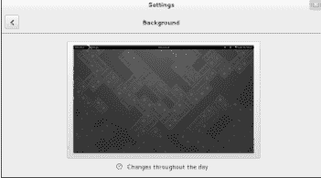

图 4-13 背景窗口

## 共享
—打开或关闭通过 `ssh` 的远程访问（第 18 章），并指定你共享的内容。

## 通用访问
—更改设置，帮助你更轻松地使用桌面。选项卡允许你控制视觉、听觉、输入和鼠标（指向和点击）功能。

## 用户
—添加、移除和设置用户。更多信息请参阅第 112 页的“用户：更改你的账户类型和密码（GUI）”。

# 桌面背景

背景窗口（图 4-13）允许你更改桌面背景。要显示此窗口，请在设置窗口（图 4-12，第 107 页）中点击 **背景**，或在桌面的任何空白处右键单击并选择 **更改背景**。最初，此窗口显示当前桌面背景的图片。点击该图片以显示“选择背景”窗口。“选择背景”窗口顶部会出现三个标有 **墙纸**、**图片** 和 **颜色** 的按钮。点击其中一个按钮，点击以高亮显示显示的某个桌面背景，然后点击 **选择** 将桌面背景更改为高亮显示的那个。背景窗口重新出现；点击 X 关闭窗口，或点击返回箭头回到设置窗口。

几个实用程序和应用程序允许你选择一张图片用作桌面背景。例如，当你在 `Nautilus` 文件浏览器窗口的图片上下文（右键）菜单中选择“设为 **墙纸**”时，`GNOME` 会将该图片设置为桌面背景。

# 显示

大多数时候，连接到系统的监视器直接就能工作：`Fedora/RHEL` 会探测监视器并自动配置 `X.org` 以正常工作。本节解释如何在需要时配置显示。

## 显示窗口

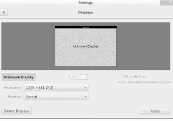

**图 4-14** **显示窗口**

**(图 4-14)** 配置监视器。请查看监视器的规格，并从下拉列表中选择合适的分辨率值。如果使用多个监视器，此窗口允许您拖动监视器以更改它们的相对位置。点击“应用”以确认您所做的更改。

## 鼠标和触摸板

**鼠标和触摸板窗口**（图 4-15）允许您更改鼠标（如果有触摸板，也包括触摸板）的特性。要显示此窗口，请点击设置窗口（图 4-12，第 107 页）中的 **鼠标和触摸板**。

**左利手鼠标** 要更改鼠标按钮的方向以供左利手用户使用，请点击标记为“左”的单选按钮。如果您更改了鼠标按钮的设置，请记住相应地重新解释本书中的描述。也就是说，当本书要求您点击左键或未指定点击哪个按钮时，请点击右键，反之亦然。关于从命令行重新映射鼠标按钮的说明，请参阅第 463 页。

**双击超时** 使用标记为“双击”的滑块来更改您必须双击鼠标按钮的速度，以便系统将您的操作识别为双击而非两次单击。您可以使用标记为“指针速度”的滑块来控制鼠标指针的速度。点击“测试您的设置”以试验鼠标设置。点击“X”关闭窗口，或点击后退箭头返回到设置窗口。

## 日期和时间

**日期和时间窗口**（图 4-16）允许您指定日期格式（12 小时制或 24 小时制时钟）、指定时区（区域），以及开启或关闭 `NTP`（网络时间协议）。要显示此窗口，请点击设置窗口（图 4-12，第 107 页）中的 **日期和时间**，或点击屏幕顶部显示的时间并选择 **日期和时间设置**。除更改日期格式外，您必须解锁此窗口才能进行更改；请参阅第 107 页的提示。

开启 **NTP** 会使系统通过网络时间服务器设置和维护其时钟。当 **NTP** 关闭时，您可以使用此窗口手动设置系统时钟。要指定时区，请点击本地时区内的城市；`GNOME` 会在标记为 **城市** 的调节框中显示该城市的名称。或者，您可以使用标记为 **区域** 和 **城市** 的调节框来指定城市。点击 **X** 关闭窗口，或点击后退箭头返回到设置窗口。

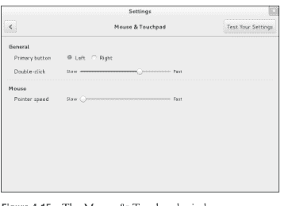

**图 4-15 鼠标和触摸板窗口**


**图 4-16 日期和时间窗口**

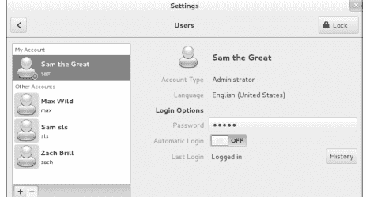

# 用户：更改账户类型和密码（GUI）

请参阅第 136 页的“密码安全性”，了解如何选择更安全的账户密码。关于从命令行更改密码的说明，请参阅第 137 页。

**用户窗口**（图 4-17）允许您添加和删除用户，并更改用户的特性，包括更改用户密码以及将用户设置为管理员（第 422 页）。要显示此窗口，请点击设置窗口（图 4-12，第 107 页）中的 **用户**。除更改您自己的密码或语言外，您必须解锁此窗口才能进行更改；请参阅第 107 页的提示。

要更改密码，请点击标记为“密码”的文本框；`GNOME` 将显示一个新窗口。您在此窗口中必须输入的第一项是您当前的（旧）密码。系统将验证此密码，以确保未经授权的试图者没有在尝试更改您的密码。还有用于输入和验证新密码的文本框。当您以相同的方式两次输入足够强度的密码后，系统将允许您点击“更改”。当您成功更改密码后，您更改了登录方式。如果您忘记密码，拥有 `root` 特权的用户可以更改它并告诉您新密码。点击“X”关闭窗口，或点击后退箭头返回到设置窗口。


## 获取帮助

`Linux` 以多种形式和格式提供帮助。本节介绍如何在图形用户界面（`GUI`）中获取帮助。关于从命令行可用的资源，请参阅第 128 页。

### GNOME 帮助窗口

**GNOME 帮助窗口**（图 4-18）由 `yelp`（`projects.gnome.org/yelp`）显示，并提供有关在图形环境中使用 `Linux` 的信息。通过从搜索文本框（`SUPER`）、“输入命令”窗口（`ALT-F2`）或终端模拟器中输入命令 `yelp` 来打开此窗口。点击此窗口中的主题以显示该主题的信息。您还可以在窗口顶部的文本框中输入要搜索的文本，然后按 `RETURN` 键。此外，大多数应用程序菜单（第 98 页）都提供“帮助”选项。

### 使用互联网获取帮助

互联网提供了许多与 `Linux` 相关的有用网站。除了提供各类文档的网站外，您还可以将在遇到问题的程序中看到的错误消息输入到 `Google`（`www.google.com`）等搜索引擎中。

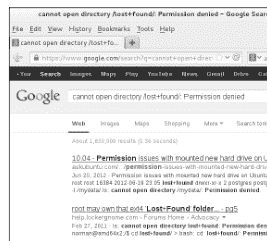

**图 4-19** **Google 报告错误消息**

搜索很可能会得到关于您问题的帖子以及解决建议。见图 4-19。

### Fedora/Red Hat 网站

`Red Hat` 和 `Fedora` 网站是丰富的信息资源。以下列表列出了可能感兴趣的地点：

- `Fedora` 文档可在 `docs.fedoraproject.org` 上获取。

- 使用 `Fedora` 获取帮助的所有方法列表可在 `fedoraproject.org/wiki/Communiting_and_getting_help` 上获取。

- 一个回答问题的有用网站是 `ask.fedoraproject.org`。

- `RHEL` 的手册和其他文档可在 `access.redhat.com/site/documentation` 和 `access.redhat.com` 上获取。

- 各种类型的支持文档和支持可在 `www.redhat.com/support` 上获取（需要免费注册）。

- 您可以在 `access.redhat.com/site` 查询 `Red Hat` 知识库（需要免费注册）。

- `Fedora`（`fedoraproject.org`）和 `RHEL`（`www.redhat.com`）的主页拥有大量信息。

- `Fedora/RHSEL` 支持论坛是在线讨论，涉及人们想要提出的任何问题。一个论坛专门面向新用户；其他论坛涉及 `Apache`、`X` 窗口系统等。请访问 `www.redhat.com/mailman/listinfo` 和 `admin.fedoraproject.org/mailman/listinfo` 浏览这些列表。

- `Fedora/RHSEL` 错误数据库可在 `bugzilla.redhat.com` 上获取。任何人可以搜索该数据库。要提交新错误或追加到现有错误，您需要注册一个免费账户。

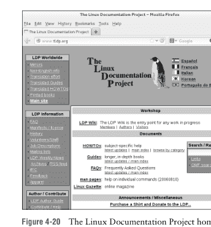

**图 4-20 Linux 文档项目主页**

- 您可以在 `fedorasolved.org` 找到社区提供的常见问题解决方案。

- `Fedora` 杂志可在 `fedoramagazine.org` 上获取。

- `RHEL` 硬件帮助可通过 `Red Hat` 硬件目录 `hardware.redhat.com` 获取。`Fedora` 支持的硬件大多是 `RHEL` 支持硬件的超集。

`GNU` 手册可在 `www.gnu.org/manual` 上获取。此外，您可以访问 `GNU` 主页（`www.gnu.org`）获取其他文档和 `GNU` 资源。许多 `GNU` 页面和资源以多种语言提供。

`Linux` 文档项目（`http://www.tldp.org`；图 4-20），其历史几乎与 `Linux` 一样悠久，收藏了完整的指南、`HOWTO`、`FAQ`、`man` 页面和 `Linux` 杂志。主页可用英语、葡萄牙语（巴西）、西班牙语、意大利语、韩语和法语获取。它易于使用，并支持本地文本搜索。该网站还提供一组完整的链接，您可以使用它们来查找与 `Linux` 相关的几乎所有内容（在搜索框中点击“链接”，或访问 `www.tldp.org/links`）。链接页面包括常规信息、事件、入门、用户组、邮件列表和新闻组等部分，每个部分包含许多子部分。

`HOWTO` 文档详细解释了如何执行与 `Linux` 相关的操作——从设置专用硬件到执行系统管理任务，再到设置特定的网络软件。`Mini-HOWTO` 提供更简短的说明。

### 类 Unix 文档项目

`Linux` 文档项目（`LDP`）网站托管了大多数 `HOWTO` 和 `mini-HOWTO` 文档。请使用 Web 浏览器访问 `www.tldp.org`，点击 **HOWTOs**，然后选择你想要使用的索引来查找 `HOWTO` 或 `mini-HOWTO` 文档。你还可以使用 `LDP` 主页上的搜索功能来查找 `HOWTO` 及其他文档。

### 更新、安装和移除软件包

软件以软件包的形式提供，其中包含所有必要的文件、说明（以便程序可以自动安装和移除该软件），以及其他依赖包的列表。有许多方法可以搜索和安装软件包。`GNOME` 会在系统上有软件更新可用时通知你。软件窗口（图 4-22）提供了一种安装软件的便捷方式。第 12 章介绍了如何从命令行处理软件包。

#### 更新软件

连接到互联网的系统被设置为每天搜索软件更新，并在有可用更新时通知你。`GNOME` 会在弹出通知窗口中显示信息 **有重要的软件更新可用**，并在有可用更新时，在顶部面板的右侧末端放置一个通知指示器（信封图标）。点击此窗口中的 **安装更新** 会打开软件更新窗口（图 4-21）。你可以通过从 `GNOME` 3 桌面的应用程序概览屏幕（第 93 页）选择软件更新图标，或者通过输入命令窗口（`ALT-F2`）或终端模拟器输入命令 `gpk-update-viewer` 手动打开此窗口。

**软件更新窗口**

当软件更新窗口打开时，它会显示信息 **正在检查更新**；检查完成后，它会显示可用更新的数目。如果没有可用更新，它会显示 **所有软件都是最新的**。

如果有可用更新，请单击 **安装更新**。当它下载和安装软件包时，软件更新窗口会显示消息和进度条。如果更新要求你重启系统或注销，软件更新窗口会提示你这样做。

**软件更新偏好设置窗口**

你可以从软件更新偏好设置窗口控制系统检查更新的频率以及它检查哪些源。通过输入命令窗口（`ALT-F2`）或终端模拟器输入命令 `gpk-prefs` 打开此窗口。

#### 添加和移除软件

软件窗口（图 4-22）允许你从系统中添加和移除应用程序。通过输入命令窗口（`ALT-F2`）或终端模拟器输入命令 `gpk-application` 打开此窗口。最大化此窗口可能使操作更容易。有关在命令行添加和移除软件的说明，请参见第 534 页。

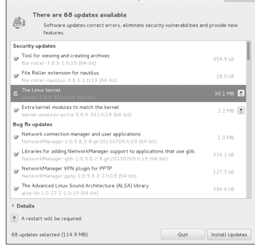

在窗口左上角的文本框中输入应用程序的名称或名称的一部分，然后按 `RETURN` 键搜索该应用程序。软件窗口会在窗口右侧的框架中显示匹配的软件包列表。或者，你可以选择窗口左侧列表中的其中一个条目，以显示相关包的列表。

滚动查看窗口右侧框架中显示的包。当你点击/选中一个应用程序时，窗口会在窗口右下角的框架中显示该应用程序的摘要。在你想要安装的每个应用程序旁边的复选框中打勾。从你想移除的应用程序中取消勾选。点击 **应用更改** 以执行你标记的更改。如果你想安装依赖于其他未安装包的包，**gpk-application** 会请求权限安装依赖包。由于你需要使用 **root** 权限来安装和移除软件，该实用程序可能会要求你输入 **root** 密码。完成后，该实用程序可能会询问你是否要运行新的应用程序。完成后关闭软件窗口。

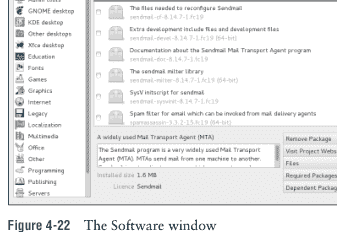

### 安装不同的桌面环境

如果你正在安装新的 `Fedora` 系统，你可以下载一个 `spin` 来安装一个具有非 `GNOME` 桌面环境的系统。有关流行 `spin` 的列表，请参见第 35 页。在已经设置好的系统上，你可以使用 `yum` 下载和安装运行不同桌面所需的软件包。当一个系统上安装了多个桌面时，密码屏幕会显示“会话”菜单（图 4-4，第 96 页），以便你选择想要运行的桌面。以下命令必须从终端模拟器运行，并会提示输入 **root** 密码，它们安装包含每个桌面所有必要软件包的软件包组：

- `XFCE` 以下命令安装 `Xfce` 桌面：

    ```
    $ su -c 'yum -y group install xfce-desktop'
    ```

- `LXDE` 以下命令安装 `LXDE` 桌面：

    ```
    $ su -c 'yum -y group install lxde-desktop'
    ```

- `MATE` 以下命令安装 `MATE` 桌面：

    ```
    $ su -c 'yum -y group install mate-desktop'
    ```

- `Security` 以下命令安装 `FSL`（`Fedora` 安全实验室）：

    ```
    $ su -c 'yum -y group install "Security Lab"'
    ```

- `KDE` 以下命令安装 `KDE` 桌面：

    ```
    $ su -c 'yum -y group install kde-desktop'
    ```

### 从命令行工作

#### 文本界面的优势

在 `GUI`（图形用户界面）出现之前，`UNIX` 随后是 `Linux` 仅提供文本（命令行）界面（`CLI`）。如今，当你从终端、终端模拟器或文本虚拟控制台登录，或者当你使用 `ssh` 登录到系统时，可以使用文本界面。

虽然这个概念可能显得过时，但文本界面在现代计算中仍有一席之地。在某些情况下，管理员可能会使用命令行工具，要么是因为不存在图形等价物，要么是因为图形工具不如文本工具强大、灵活或精致。例如，`chmod`（第 193 页）比其 `GUI` 对应物（文件浏览器对象属性窗口，“权限”选项卡；第 105 页）提供更精细的粒度。在服务器系统上，甚至可能没有安装图形界面。省略此功能的首要原因是 `GUI` 消耗大量系统资源；在服务器上，这些资源最好专门用于服务器的主要任务。此外，安全考虑要求服务器系统尽可能少地运行任务，因为每个额外任务都会提供额外的攻击向量。

你还可以使用文本界面编写脚本。使用脚本，你可以轻松地在多个系统上复现任务，从而将任务扩展到更大的环境。当你只是单个系统的管理员时，使用 `GUI` 通常是配置系统的最简单方式。当你作为许多系统的管理员，且所有这些系统都需要安装或更新相同的配置时，脚本可以更快地完成任务。使用命令行工具编写脚本通常很容易，而使用图形工具执行相同的任务可能很难甚至不可能。

#### 伪图形界面


在 `GUI` 出现之前，有远见的程序员创建了包含图形元素（如框、勾勒基本窗口的边框、高亮，以及更近期的颜色）的文本界面。这些被称为伪图形界面的文本界面，弥合了文本界面和图形界面之间的差距。`Midnight Commander` 文件管理实用程序（`mc`；`midnight-commander.org`）是一个具有良好设计的伪图形界面实用程序的好例子。

### 命令行 (`bash`) 覆盖范围

本节介绍 `Linux CLI`。第 5 章是三个专门介绍 `Bourne Again Shell` (`bash`) 的章节中的第一个。第 7 章描述了一些你可以从命令行使用的更重要的实用程序。第 9 章涵盖高级 `bash` 概念。第 27 章描述使用 `bash` 进行 `shell` 编程。本书第三部分和第四部分的大多数示例使用 `CLI`，并在有图形工具的地方添加图形工具示例。

## 从命令行运行命令

本节描述从命令行工作的三种方式：使用终端模拟器、使用虚拟控制台以及远程登录。如果本地系统没有...

支持图形界面，你别无选择：你只能从命令行工作——请跳至第 121 页的“注销”部分。

## 使用终端模拟器/`Shell`

`终端模拟器`是一个呈现 `CLI`（命令行界面）的窗口；它作为基于文本（字符）的终端运行，并显示在图形环境中。要打开名为 `Terminal`（`gnome-terminal`；图 4-23）的 `GNOME` 终端模拟器，请在一个“输入命令”窗口（`ALT-F2`）或终端模拟器中输入命令 `gnome-terminal`。由于你已登录并在桌面环境中创建了一个子 `shell`，因此不需要再次登录。

`Terminal` 在标题栏中显示你的用户名、你正在使用的系统名称以及你正在工作的`目录`（工作目录）名称。图 4-23 显示 `sam` 正在名为 `guava` 的系统上工作。他正在其主目录（第 143 页）中工作，`Shell` 使用波浪号（`\~`，第 182 页）来引用该目录。

你可以在终端模拟器窗口中运行通常会在终端或控制台上运行的基于字符（文本）的程序。你还可以从此窗口启动图形程序，例如 `gnome-calculator`。图形程序会打开其自己的窗口。

要在同一 `Terminal` 窗口中打开额外的终端会话，请右键单击窗口并从上下文菜单中选择`Open Tab`。当 `gnome-terminal` 在现有终端会话之上打开另一个终端会话时，菜单栏下方会出现一行标签页。你可以添加任意数量的终端会话；点击标签页即可在会话之间切换。

### `GNOME` 终端（模拟器）快捷键

在使用 `GNOME` 终端时，`CONTROL-SHIFT-N` 打开新窗口，`CONTROL-SHIFT-T` 打开新标签页。新窗口和标签页指向工作目录。此外，你可以使用 `CONTROL-PAGE UP` 和 `CONTROL-PAGE DOWN` 在标签页之间切换；`ALT-\x` 切换到编号为 `x` 的标签页。

从上下文菜单添加的会话使用与其打开来源相同的配置文件。当你使用菜单栏打开会话时，如果有多个配置文件可用，`GNOME` 会让你选择。你可以通过选择`终端菜单栏：File⇒New Profile` 并指定新配置文件的名称来添加配置文件。

## 使用虚拟控制台

在个人电脑上运行 `Linux` 时，你经常需要操作连接到电脑的显示器和键盘。使用这个物理控制台，你可以访问多达 63 个`虚拟控制台`（也称为`虚拟终端`）。有些被配置为允许登录；其他则作为图形显示。要切换虚拟控制台，请按住 `CONTROL` 和 `ALT` 键，然后按下对应于你要查看的控制台的功能键。例如，`CONTROL-ALT-F5` 显示第五个虚拟控制台。

默认情况下，五个或六个虚拟控制台处于活动状态，并运行着文本登录会话。当你想同时使用文本和图形界面时，可以在一个虚拟控制台上设置文本会话，在另一个上设置图形会话。默认情况下，图形会话在 1 号虚拟控制台上运行。

## 远程登录：终端仿真、`SSH` 和拨号连接

当你没有使用直接连接到 `Linux` 系统的控制台、终端或其他设备时，你可能正在通过另一系统上的终端仿真软件进行连接。该软件在本地系统上运行，通过网络（以太网、异步电话线、`PPP` 或其他类型）连接到远程 `Linux` 系统，并允许你登录。

当你通过拨号线路登录时，连接过程很直接：你指示本地仿真程序联系远程 `Linux` 系统，它拨号，然后远程系统显示登录提示。当你通过直接连接的网络登录时，你使用 `ssh`（安全；第 685 页）或 `telnet`（不安全；第 303 页）连接到远程系统。`ssh` 程序已在许多操作系统上实现，不仅限于 `Linux`。许多 `ssh` 的用户界面包含终端模拟器。从 `Apple`、`Windows` 或 `UNIX` 机器打开运行 `ssh` 的程序，并输入你要登录的系统名称或 `IP` 地址。

## 注销

要从基于字符的界面注销，请在 `shell` 提示符处按 `CONTROL-D`。此操作向 `shell` 发送一个 `EOF`（文件结束）信号。或者，你可以输入命令 `exit`。从 `shell` 注销不会结束图形会话；它只是退出你正在使用的 `shell`。例如，退出 `GNOME` 终端提供的 `shell` 会关闭终端窗口。

## `SHELL`

一旦你打开一个终端模拟器窗口，你正在与称为`shell`（命令解释器）通信。`shell` 在你与 `Linux` 的大量命令行通信中起着重要作用。当你在键盘上响应屏幕上的 `shell` 提示符输入命令时，`shell` 解释该命令并引发相应的动作——例如，执行程序；调用编译器、`Linux` 实用程序或其他标准程序；或显示一条错误消息，表明你输入命令有误。当你在 `GUI` 上工作时，你绕过 `shell`，通过点击对象或名称来执行程序。有关 `shell` 的更多信息，请参阅第 5 章。

## 特殊字符

当你在命令行上工作时，包括 `*`、`?`、`[`、`]` 和 `]` 在内的几个字符具有特殊含义。在读取第 142 页的“特殊字符”之前，请避免使用这些字符。

### 确保 `TERM` 设置正确

无论通过何种方式连接，请确保 `TERM` 变量设置为你的模拟器正在仿真的终端`类型`。有关更多信息，请参阅第 1153 页的“指定终端”。

## 你正在运行哪个 `Shell`？

本书讨论了 `Bourne Again Shell`（`bash`）。你可能正在运行 `bash`，但也可能正在运行其他 `shell`，如 `TC Shell`（`tcsh`）或 `Z Shell`（`zsh`）。当你在 `shell` 提示符（通常是 `$` 或 `%`）后输入命令 `echo $0` 并按 `RETURN` 时，`shell` 会显示你正在使用的 `shell` 的名称。该命令之所以有效，是因为 `shell` 将 `$0` 扩展为你正在运行的程序名称（第 1022 页）。此命令可能会显示如下输出：

```
$ echo $0
-bash
```

或如下所示：

```
$ echo $0
/bin/bash
```

无论哪种情况，该输出都表明你正在运行 `bash`。如果你正在运行其他 `shell`，`shell` 将显示相应的输出；如果你想运行 `bash`，请输入命令 `bash`。要永久更改登录时运行的 `shell`，请参阅第 329 页上的技巧。你可能需要安装 `bash`（`bash` 软件包），如第 534 页所述。

## 纠正错误

本节解释如何纠正你可能在命令行上输入的拼写错误和其他错误。因为 `shell` 和大多数其他实用程序在你按下 `RETURN` 之前不会解释你输入的命令或其他文本，所以你可以在按下 `RETURN` 之前轻松纠正输入错误。

你可以用几种方式纠正此类错误：一次删除一个字符、一次回退一个词，或一步回退到行首。一旦你按下 `RETURN`，就太晚了，无法纠正错误：此时，你必须要么等待命令运行完成，要么中止程序执行（下一页）。

## 删除字符

在从键盘输入字符时，你可以通过按`删除键`一次来删除一个字符，以回退并删除错误。删除键可以回退任意数量的字符。通常，它不会回退到行首之前。

默认删除键是 `BACKSPACE`。如果此键不起作用，请尝试按 `DEL` 或 `CONTROL-H`。如果这些键不起作用，请运行以下 `stty`¹ 命令，将删除和行取消（参见“删除一行”）键设置为其默认值：

```
$ stty ek
```

或者，你可以运行下一条命令将大多数终端参数重置为正常值。如果 `RETURN` 键不能将光标移动到下一行，请改用 `CONTROL-J`。

```
$ stty sane
```

## 删除单词

你可以通过按 `CONTROL-W` 来删除输入的单词。`单词`是指不包含 `SPACE` 或 `TAB` 的任何字符序列。当你按 `CONTROL-W` 时，光标向左移动到当前单词的开头（如果你正在输入一个单词）或前一个单词（如果你刚输入了 `SPACE` 或 `TAB`），从而删除该单词。

### `CONTROL-Z` 暂停程序

虽然这不是纠正错误的方法，但你可能会误按暂停键（通常是 `CONTROL-Z`）并疑惑发生了什么。如果你看到包含 `Stopped` 一词的消息，说明你刚刚使用作业控制（第 164 页）停止了你的作业。如果你输入命令 `fg` 在前台继续你的作业，你会回到按暂停键之前的状态。有关更多信息，请参阅第 348 页的“`bg: Sends a Job to the Background`”。

## 删除一行

在任何时候，只要尚未按下 `RETURN`，你都可以通过按`(line)` `kill`键来删除正在输入的行。当你按此键时，光标向左移动，在移动过程中删除字符，直到行首。默认的行取消键是 `CONTROL-U`。如果此键不起作用，请尝试 `CONTROL-X`。如果这些键不起作用，请运行“删除字符”中描述的 `stty` 命令。

## 中止执行

有时你可能想要终止正在运行的程序。例如，你可能想要停止一个正在执行长时任务的程序，例如显示长达数百页的文件内容，或者复制一个并非你意图要复制的大文件。

1. 命令 `stty` 是 `set teletypewriter`（设置电传打字机）的缩写，这是第一个运行 `UNIX` 的终端。如今，`stty` 通常被视为 `set terminal`（设置终端）的意思。

要终止从命令行运行的程序，请按下中断键（`CONTROL-C` 或有时是 `DELETE` 或 `DEL`）。按下此键后，`Linux` 内核会向您正在运行的程序和 `shell` 发送 `TERM`（终止）信号。该信号的具体影响取决于程序。有些程序会立即停止执行，有些忽略该信号，还有些执行其他操作。当 `shell` 接收到 `TERM` 信号时，它会显示一个提示符并等待另一个命令。

如果这些方法无法终止程序，请尝试向程序发送 `QUIT` 信号（`CONTROL-\`）。如果所有方法都失败了，请尝试按下挂起键（通常为 `CONTROL-Z`），输入 `jobs` 命令以验证运行该程序的作业编号，并使用 `kill` 命令中止该作业。作业编号是 `jobs` 命令显示的行左侧括号内的数字（ `[1]` ）。在下面的示例中，`kill` 命令（第 164 页和第 465 页）使用 `-TERM` 向由作业编号指定的作业发送 `TERM` 信号，该编号前面有一个百分号（`%1`）。您可以从命令中省略 `-TERM`，因为 `kill` 默认发送 `TERM` 信号。第 1047 页的表 27-5 列出了一些信号。

### 将 `KILL` 信号作为最后的手段

> **注意**

> 当终止信号不起作用时，请使用 `KILL` 信号（在示例中将 `-TERM` 替换为 `-KILL`）。正在运行的程序无法忽略 `KILL` 信号；它一定会中止该程序。

> 由于接收到 `KILL` 信号的程序没有机会在终止前清理其打开的文件，使用 `KILL` 可能会破坏应用程序数据。请将 `KILL` 信号作为最后的手段。在使用 `KILL` 之前，请给予终止（`TERM`）或退出（`QUIT`）信号十秒钟的时间生效。

以下示例演示了挂起键以及 `jobs` 和 `kill` 命令的用法。

```
$ bigjob
^Z
[1]+ Stopped bigjob
$ jobs
[1]+ Stopped bigjob
$ kill -TERM %1
[1]+ Killed bigjob
```

`kill` 命令会返回一个提示符；您可能需要再次按 `RETURN` 键才能看到确认消息。有关更多信息，请参阅第 163 页的“在后台运行命令”。

## 重复/编辑命令行

要重复上一个命令，请按 `UP ARROW` 键。每次按下此键，`shell` 都会显示更早的命令行。按 `DOWN ARROW` 键可反向浏览命令行。要执行显示的命令行，请按 `RETURN` 键。

`RIGHT ARROW` 和 `LEFT ARROW` 键会在显示的命令行上来回移动光标。在命令行的任何位置，你都可以通过输入来添加字符。使用擦除键（第 123 页）从命令行中删除字符。按 `RETURN` 键执行修改后的命令（光标在命令行上的位置无关紧要）。

你还可以使用 `!!` 重复上一个命令。如果你忘记使用 `su` [第 42.5 页] 为命令添加前缀，这种技术非常有用。在这种情况下，如果你输入 `su -c "!!"`，`shell` 将以 `root` 权限运行上一个命令。或者，如果本地系统配置为使用 `sudo`（第 428 页），你可以输入 `sudo !!`，`shell` 将以 `root` 权限运行上一个命令。

命令 `^old^new^` 会重新运行上一个命令，将字符串 `old` 的第一次出现替换为 `new`。此外，在命令行上，`shell` 会用上一个命令行中的最后一个 `token`（单词）替换字符 `!$`。以下示例展示了用户使用 `^n^m^` 将文件名 `memo` 更正为 `memo`，然后通过输入命令 `lpr !$` 打印名为 `memo` 的文件。`shell` 用 `!$` 替换为 `memo`，即上一个命令行中的最后一个 `token`。

```
$ cat memo
cat: memo: No such file or directory
$ ^n^m$
cat memo
This is the memo file.
$ lpr !$
lpr memo
```

有关更复杂的命令行编辑信息，请参见第 378 页。

## 运行基本命令行实用工具

本节介绍了一些基本的命令行实用工具。你可以在终端、`GUI` 内的终端模拟器 [第 120 页] 或虚拟控制台 [第 121 页] 中尝试这些实用工具。有关这些及其他更完整的实用工具说明，请参见第 7 章。

### `ls`: 列出文件名

使用你选择的编辑器创建一个名为 `practice` 的小文件。（参见关于 `vim` [第 262 页] 和 `nano` [第 270 页] 编辑器的教程。）退出编辑器后，你可以使用 `ls`（`list`；第 221 页）实用工具显示文件名的列表。以下示例中，`ls` 列出了 `practice` 文件的名称。（在你使用的系统上，它可能会列出系统或某个程序创建的一些文件。）

```
$ ls
practice
```

默认情况下，`ls` 列出工作目录（你正在工作的目录）中大多数文件的名称。你可以通过在命令行上提供它们的名称作为参数来列出指定文件的名称。在实用工具名称和任何参数之间放置一个空格。

```
$ ls practice
practice
```

### 参数

> **提示** 参数指定命令所作用的对象，例如文件名。参数通常出现在你调用的实用工具名称和一个空格之后。有关更多信息，请参阅第 145 页的“参数”。

你可以使用 `-l` 选项通过 `ls` 列出文件的更多详细信息。选项前也必须有一个空格。

```
$ ls -l practice
-rw-r--r--. 1 sam pubs 52 07-24 14:09 practice
```

从左到右，`-l` 选项导致 `ls` 显示文件访问权限（第 191 页）、链接（第 203 页）、所有者和组名称、大小（以字节为单位）、修改日期和时间以及名称。

## 选项

> **提示** 选项修改实用工具的工作方式。选项通常位于参数之前，并且通常指定为一个或多个由一个或两个连字符引导的字母。选项通常出现在你调用的实用工具名称和一个空格之后。有关更多信息，请参阅第 145 页的“选项”。

### `cat`: 将文本文件复制到屏幕

在屏幕上显示文本文件内容的便捷方法是输入 `cat` 命令并将文件名作为参数。以下示例显示了 `cat` 实用工具（第 216 页）显示 `practice` 的内容。`ls` 显示文件的 `名称`，而 `cat` 显示文件的 `内容`。

```
$ cat practice
This is a small file I created
using a text editor.
```

## `cp`: 复制文件

`cp`（`copy`；第 224 页）实用工具创建文件的副本。此实用工具可以复制任何文件，包括文本文件和可执行程序（二进制）文件。你可以使用 `cp` 创建文件的备份副本或实验副本。

```
$ cp practice practice.copy
$ ls
practice practice.copy
```

前面的示例将名为 `practice` 的文件复制到 `practice.copy`。点是文件名的一部分——只是另一个字符。`ls` 命令显示工作目录中有两个文件：`practice` 和 `practice.copy`。

### `rm`: 删除文件

`rm`（`remove`；第 222 页）实用工具删除文件。以下示例显示 `rm` 删除名为 `practice` 的文件。在 `rm` 删除 `practice` 后，`ls` 和 `cat` 显示 `practice` 不再存在。请谨慎使用 `rm`。

```
$ rm practice
$ ls practice
ls: cannot access practice: No such file or directory
$ cat practice
cat: practice: No such file or directory
```

### `echo`: 将其参数复制到屏幕

`echo` 实用工具（第 219 页）将其参数复制到屏幕。以下示例显示了两个 `echo` 命令。

```
$ echo Hi
Hi
$ echo My name is Sam.
My name is Sam.
```

本书广泛使用 `echo` 来演示 `shell` 的工作原理。

### `date`: 显示时间和日期


`date` 实用工具（第 218 页）显示当前日期和时间：

```
$ date
Thu Apr  3 10:14:41 PDT 2014
```

### `touch`: 创建一个空文件

`touch` 实用工具（第 243 页）创建以你指定的参数为名称的空（零长度）文件。以下示例中，`touch` 创建 `myfile`，并且 `ls` 显示该文件的长度为零字节。

```
$ touch myfile
$ ls -l myfile
-rw-r--r--. 1 sam pubs 0 07-24 14:12 myfile
```

## 编写和执行基本 shell 脚本

shell 脚本在 Windows 下称为批处理文件，是使用 shell 命令和实用工具编写的程序。本节解释了如何编写基本的 shell 脚本。有关创建和执行 shell 脚本的更多信息，请参阅第 336 页的“编写和执行 shell 脚本”。在运行 shell 脚本之前，你必须将命令放入文件中（脚本），并告诉 Linux 该文件是可执行的。你可以使用编辑器创建文件，或者输入以下命令，该命令使用重定向来创建文件。有关使用 `cat` 和重定向创建文件的信息，请参阅第 154 页。

```
$ cat > myprog
echo This is my shell script
date
who
CONTROL-D
```

这个名为 `myprog` 的 shell 脚本包含三个命令（实用工具）：`echo`、`date` 和 `who`。输入每一行以及最后的 `RETURN` 后，按 `CONTROL-D` 告诉 shell 你已完成向文件的写入；shell 显示一个提示符。

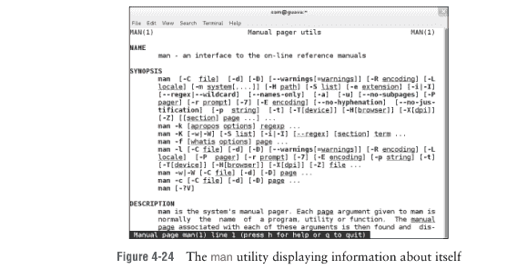

图 4-24 `man` 实用程序显示其自身信息

接下来，你需要告诉 Linux，`myprog` 是一个可执行文件。随后，`chmod` 实用程序（第 193 页）使 `myprog` 变为可读且可执行。

```
$ chmod a+x myprog
```

最后，你可以执行 `myprog` 脚本。由于 shell 查找文件的方式，你必须用点和斜杠（`./`）作为程序名称的前缀。有关绝对路径名和相对路径名的讨论，详情请参见第 149 页。在下方的例子中，shell 运行了 `myprog` 中的三个实用程序并显示它们的输出。

```
$ ./myprog
This is my shell script
Mon Jul 22 17:15:50 PDT 2013
sam pts/0
2013-07-21 13:17 (:0)
```

## 从命令行获取帮助

Linux 的发行版通常不附带纸质参考手册。然而，其在线文档一直是 Linux 的优势之一。`man`（或 `manual`）和 `info` 页面自该操作系统早期版本起就可以通过 `man` 和 `info` 实用程序访问。不出所料，随着 Linux 和互联网的不断发展，文档来源也随之扩大。本节讨论了你在使用命令行工作时查找 Linux 信息的一些地方。如果你是在图形环境中工作，请参阅第 113 页的“获取帮助”。另见附录 B。

### `man`：显示系统手册

`man`（manual）实用程序显示（`man`）系统文档页面。当你知道想要使用哪个实用程序但忘记具体如何使用时，这份文档非常有帮助。你也可以查阅 `man` 页面以获取更多关于特定主题的信息，或确定 Linux 提供哪些功能。由于系统文档中的描述通常很简练，如果你已经理解实用程序的基本功能，它们会更有用。你可以使用 `apropos` 实用程序（下一页）搜索 `man` 页面涵盖的主题。

要了解某个实用程序的更多信息，请输入命令 `man`，并将实用程序的名称作为参数。图 4-24 显示了 `man` 显示其自身信息的情况；用户在命令行中输入了 `man`。在 `man` 页面中，你可以通过输入斜杠，接着输入术语，最后按 `RETURN`（回车）键来搜索某个术语。例如，要在 `man` 页面中搜索术语 `function`，请输入 `/functionRETURN`；`man` 将突出显示所有出现的 `function` 字符串，并将光标移动到下一个出现的位置。

**`less`（分页器）** `man` 实用程序通过分页器发送其输出——通常是 `less`（第 220 页），它一次显示一屏信息。当你使用 `man` 显示手册页面时，`less` 在显示每一屏文本后，会在屏幕底部显示一个提示符 [例如，Manual page man(1) line 1...]，并等待你执行以下操作之一：

- 按 `SPACE`（空格）键显示另一屏文本。

- 按 `PAGE UP`（上页）、`PAGE DOWN`（下页）、`UP ARROW`（上箭头）或 `DOWN ARROW`（下箭头）在文本中导航。

- 按 `h`（帮助）显示 `less` 命令列表。

- 按 `q`（退出）退出 `man` 和 `less`，使 shell 显示提示符。

**手册分区** 基于 FHS（文件系统层级标准；第 189 页），Linux 系统手册和 `man` 页面分为十个部分，每个部分描述相关的工具：

1. 用户命令

2. 系统调用

3. 子例程

4. 设备

5. 文件格式

6. 游戏

7. 杂项

8. 系统管理

9. 内核

10. 新增

这种布局密切模仿了 UNIX 手册集一贯的划分方式。除非你指定了手册分区，否则 `man` 将显示你指定参数所对应的单词在手册中最早出现的位置。大多数用户在第 1、6 和 7 部分中找到所需信息；程序员和系统管理员经常需要查阅其他部分。

在某些情况下，手册包含名称相同的不同工具条目。例如，以下命令显示系统手册第 1 部分中 `crontab` 实用程序的 `man` 页面：

```
$ man crontab
```

要查看第 5 部分中 `crontab` 文件的 `man` 页面，请输入此命令：

```
$ man 5 crontab
```

前面的命令指示 `man` 只在第 5 部分查找 `man` 页面。在文档中，你可能看到该 `man` 页面被引用为 `crontab(5)`。使用 `-a` 选项可以查看给定主题的所有 `man` 页面（按 `GRETURN` 显示随后的每个 `man` 页面）。例如，输入命令 `man -a crontab` 可以查看 `crontab` 的所有 `man` 页面。

### `apropos`：搜索关键词

当你不知道执行特定任务所需的实用程序名称时，可以使用 `apropos` 配合关键词作为参数进行搜索。此实用程序在所有 `man` 页面的简短描述行中搜索该关键词，并显示包含匹配项的行。`man` 实用程序在调用时使用 `-k`（keyword）选项时，提供与 `apropos` 相同的输出。

`apropos` 使用的数据库，名为 `man-db` 或 `makewhatis`，在系统首次安装时不可用，但会由 `cron` 或 `crond` 自动构建（有关 `cron/crond` 的讨论请参阅第 607 页，手动构建此数据库的说明请参阅第 69 页）。

以下示例显示了以 `who` 为关键词调用 `apropos` 时的输出。输出包括每个实用程序的名称、包含它的手册分区以及来自 `man` 页面的简短描述。此列表包括你所需的实用程序（`who`），并标识了其他可能有用的相关工具。

```
$ apropos who
at.allow (5)      - determine who can submit jobs via at or batch
at.deny (5)       - determine who can submit jobs via at or batch
jwhois (1)        - client for the whois service
w (1)             - Show who is logged on and what they are doing.
who (1)           - show who is logged on
who (1p)          - display who is on the system
whoami (1)        - print effective userid
whos (1)          - client for the whois service
whos.jwhois (1)   - client for the whois service
```

### `whatis`

`whatis` 实用程序类似于 `apropos`，但仅查找实用程序名称的完整单词匹配：

```
$ whatis who
who (1)           - show who is logged on
who (1p)          - display who is on the system
```

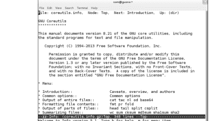

图 4-25 命令 `info coreutils` 显示的初始屏幕

### `info`：显示关于实用程序的信息

文本型 `info` 实用程序（www.gnu.org/software/textinfo/manual/info）是一个基于菜单的超文本系统，由 `GNU` 项目（第 3 页）开发并随 Linux 分发。它包含关于自身的教程（输入命令 `info info`）以及许多由 `GNU` 项目开发的 Linux shell、实用程序和程序的文档。图 4-25 显示了当你输入命令 `info coreutils` 时 `info` 显示的屏幕（`coreutils` 软件包包含 Linux 核心实用程序）。

#### `man` 和 `info` 显示不同的信息

> **提示** `info` 实用程序比 `man` 显示关于 `GNU` 实用程序更完整和最新的信息。当 `man` 页面显示由 `info` 涵盖的实用程序的简略信息时，`man` 页面会引用 `info`。`man` 实用程序经常显示非 GNU 实用程序可用的唯一信息。当 `info` 显示非 GNU 实用程序的信息时，它通常是 `man` 页面的副本。

由于此屏幕上的信息来自可编辑文件，你的显示可能与本节中显示的屏幕不同。当初始 `info` 屏幕显示时，你可以按以下任意按键：

- `h` 或 `?` 列出 `info` 命令

- `SPACE` 翻页显示

- `m` 后跟你想显示的菜单名称，或后跟 `SPACE` 显示菜单列表

- `q` 或 `CONTROL-C` 退出

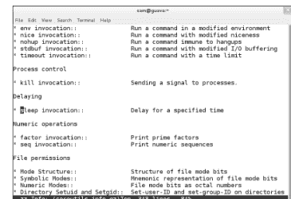

图 4-26 输入两次 /sleepreturn 后命令 info coreutils 显示的屏幕

`info` 用于描述键盘按键的符号与 `emacs` 使用的符号相同，你可能不太熟悉。例如，符号 `C-h` 等同于 `CONTROL-h`。类似地，`M-x` 表示按住 `META` 或 `ALT` 键并按 `x`。在某些系统上，你需要按 `ESCAPE` 然后按 `x` 来复制 `META-x` 的功能。

在给出命令 `info coreutils` 后，按几次 `SPACE`（空格）键翻页。输入 `/sleepRETURN` 以搜索字符串 `sleep`。当你输入 `/` 时，`info` 将光标移动到窗口的最后一行，并显示 ``Regexp search [string];``，其中 `string` 是你最后一次搜索的字符串。按 `RETURN`（回车）搜索 `string` 或输入你要搜索的字符串。输入 `sleep` 会在该行显示 `sleep`，按 `RETURN`（回车）会在 `info` 文本中显示 `sleep` 的下一个出现位置。

#### 你可能会发现 `pinfo` 比 `info` 更容易使用

> `pinfo` 实用程序类似于 `info`，但如果你不熟悉 `emacs` 编辑器命令，它更直观。此实用程序在文本环境中运行，`info` 也是如此。当 `pinfo` 可用时，它使用颜色使界面更易于使用。如果系统上未安装 `pinfo`，请按照第 534 页的说明安装 `pinfo` 包。从终端模拟器中运行 `pinfo`。

现在输入 `/RETURN`（或 `/sleepRETURN`）以搜索 `sleep` 的下一次出现，如图 4-26 所示。行左端的星号表示此条目是一个菜单项。星号后面是菜单项的名称及对该项的描述。每个菜单项都是指向描述该项的 `info` 页面的链接。要跳转到该页面，请搜索或使用 `APRO` 键将光标移动到包含该菜单项的行，然后按 `RETURN`（回车）。如图 4-26 中光标定位的那样，按 `RETURN`（回车）显示关于 `sleep` 的信息。或者，你可以在菜单命令中输入菜单项名称以查看信息：要显示信息

# 在命令行中工作

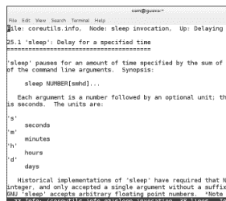

> 图 4-27 `sleep` 实用程序的 `info` 页面

以 `sleep` 为例，输入命令 `m sleep`，然后按 `RETURN` 键。当你输入 `m`（代表 `menu`，菜单）时，`info` 会将光标移动到窗口的最后一行（就像你输入 `/` 时那样），并显示 ``Menu item:``（菜单项：）。输入 `sleep` 后，该行会显示 `sleep`，按下 `RETURN` 键则会显示你所指定的菜单项的信息。

图 4-27 展示了关于 `sleep` 信息的 `top node`（根节点）。`节点` 将一组信息分组，你可以通过按空格键来翻页。要显示下一个节点，请按下 `n`。要显示上一个节点，请按下 `p`。

当你阅读本书并学习新的实用程序时，你可以使用 `man` 或 `info` 来了解有关这些实用程序的更多信息。如果本地系统可以打印 PostScript 文档，你可以使用带有 `-t` 选项的 `man` 实用程序来打印手册页。例如，`man -t cat | lpr` 会打印关于 `cat` 实用程序的信息。你还可以使用 Web 浏览器显示文档，然后从浏览器中打印所需的信息。

### `--help` 选项

你可以在命令行上使用的另一个工具是 `--help` 选项。大多数 GNU 实用程序都提供 `--help` 选项，用于显示有关该实用程序的信息。非 GNU 实用程序可能会使用 `-h` 或 `--help` 选项来显示有关自身的信息。

```
$ cat --help
Usage: cat [OPTION] [FILE]...
Concatenate FILE(s), or standard input, to standard output.

-A, --show-all           equivalent to -vET
-B, --number-nonblank    number nonempty output lines, overrides -n
-E, --show-ends         display $ at end of each line
...
```

如果 `--help` 显示的信息超出了屏幕范围，请使用管道（垂直线；第 158 页）将输出通过 `less` 分页器（第 129 页）进行查看：

```
$ ls --help | less
```

## `bash` 的 `help` 命令

`bash` 的 `help` 命令显示有关 `bash`（Bourne Again Shell）命令、控制结构和其他功能的信息。在 `bash` 提示符下，输入命令 `help` 后跟你想要查询的关键字。以下是一些示例。

```
$ help help
help: help [-dms] [pattern . . .]
Display information about builtin commands.

Display brief summaries of builtin commands. If PATTERN is
specified, gives detailed help on all commands matching PATTERN,
otherwise the list of help topics is printed.
. . .

$ help echo
echo: echo [-neE] [arg . . .]
Write arguments to the standard output.

Display the ARGS on the standard output followed by a newline.
Options:
-n do not append a newline
. . .

$ help while
while: while COMMANDS; do COMMANDS; done
Execute commands as long as a test succeeds.
. . .
```

`/usr/share/doc` 目录通常包含比 `man` 或 `info` 提供的更详细且不同的有关实用程序的信息。通常，这些信息是供那些将要编译和修改该实用程序的人使用的，而不仅仅是使用者。这些目录包含数千个文件，每个文件都包含关于单独主题的信息。如下例所示，`/usr/share/doc` 中大多数目录的名称都以版本号结尾：


```
$ ls /usr/share/doc
abattis-cantarell-fonts-0.0.12   iw1000-firmware-39.31.5.1     ncftp-3.2.5
abrt-2.1.5                          iw100e-firmware-39.31.5.1     ncurses-5.9
abrt-dbus-2.1.5                     iw105-firmware-18.168.6.1     ncurses-base-5.9
accountsservice-0.6.34            iw135s-firmware-18.168.6.1     neon-0.29.6
acl-2.2.51                          iw2000-firmware-18.168.6.1     netcf-libs-0.2.3
atc9AxX-firmware-30                 iw2030-firmware-18.168.6.1     net-snmp-libs-5.7.2
aisleriot-3.8.0 alsa-firmware-1.0.27 iw13945-firmware-15.32.2.9 iw14965-firmware-228.61.2.24 nettle-2.6 net-tools-2.0 ...
```

这些目录中的大多数都包含一个 `README` 文件，这是开始阅读有关该目录所描述的实用程序或文件的良好起点。使用星号 (`*`) 代替版本号，以便更轻松地输入文件名。下面为 `bzip2`（第 245 页）的 `README` 文件解释了如何编译源代码。

```
$ less /usr/share/doc/bzip2s/README
This is the README for bzip2/1libzip2.
This version is fully compatible with the previous public releasesses.
...
Complete documentation is available in Postscript form (manual.ps),
PDF (manual.pdf) or html (manual.html). A plain-text version of the
manual page is available as bzip2.txt.
```

## 如何构建 -- UNIX

```
Type 'make'. This builds the library libbz2.a and then the programs
bzip2 and bzip2recover. Six self-tests are run. If the self-tests
complete ok, carry on to installation:

To install in /usr/local/bin, /usr/local/lib, /usr/local/man and
/usr/local/include, type

make install
...
```

# 关于登录和密码的更多信息

有关登录的信息，请参阅第 90 页的“在系统上登录”。本节涵盖常见登录问题的解决方案、选择密码和密碼安全性，以及从命令行更改你的密码。

## 始终使用密码

除非你是系统的唯一用户，系统未连接到任何其他系统或互联网，且你是唯一拥有物理访问权限的人，否则在没有密码的情况下维护用户账户是一种不良做法。

## 如果无法登录该怎么办

如果你错误地输入了用户名或密码，系统会在你输入 `两者`：用户名和 `你的` 密码后显示一条错误消息。这条消息表明你错误地输入了用户名或密码，或者它们无效。它不会区分不可接受的用户名和不可接受的密码——这是一种旨在阻止未经授权的人员猜测名称和密码以获取系统访问权限的策略。

以下是一些常见的登录失败原因：

- 用户名和密码是区分大小写的。请确保大写锁定（`CAPS LOCK`）键已关闭，并严格按照指定设置或你设置的方式输入用户名和密码。

- 你没有在正确的机器上登录。如果你尝试在错误的机器上登录，登录/密码组合可能无效。在较大的联网系统中，你可能需要在登录之前指定要连接的机器。

- 你的用户名无效。如果你未被设置为用户，登录/密码组合可能无效。

- 文件系统已满。当对登录过程至关重要的文件系统已满时，你可能会以为自己登录成功，但片刻之后登录提示符会再次出现。在这种情况下，你必须以 `救援/恢复模式` 启动系统并删除一些文件。

- 账户已被禁用。在某些系统中，`root` 账户默认被禁用。管理员可能会禁用其他账户。通常，`root` 账户不允许通过网络登录：在这种情况下，先以你自己的身份登录，然后使用 `su` / `sudo` 获取 `root` 权限。

## 密码安全性

本节包含有关密码安全性的实用讨论；请参阅第 625 页以获取更技术的讨论。

如果是别人分配给你的密码，给自己设置一个新密码是个好主意。出于安全原因，你输入的密码不会由任何实用程序显示。

### 保护你的密码

不要让任何人得知你的密码：不要将密码放在未加密的文件中，不要允许别人观看你输入密码，也不要将密码透露给陌生人（系统管理员永远不需要知道你的密码）。你可以随时写下你的密码并将其保存在安全、私密的地方。

### 选择一个难以猜到的密码

不要使用电话号码、姓名、宠物或孩子的名字、生日、字典中的单词（即使是外语），等等。不要使用这些项目的排列组合或单词的 `l33t-speak` 变体：现代字典破解程序会尝试这些排列。

### 在你的密码中包含非字母数字字符

自动密码破解工具在尝试猜测你的密码时，首先会使用字母和数字字符。在密码中至少包含一个如 `@` 或 `#` 这样的字符，会增加破解你的密码所需的时间。

## 区分重要与非重要密码

区分重要密码和非重要密码是个好主意。例如，博客或下载访问的网站密码并不那么重要；对这些类型的网站使用相同的密码是可以接受的。然而，你的登录、邮件服务器和银行账号网站密码至关重要：切勿将这些密码用于不重要的网站，并且为每个此类账号使用不同的密码。

## 使用密码保险库

你可能想要使用诸如 `revelation`（`revelation` 包）及其命令行对应程序 `revelation`（`revelation` 包）或 `keepassx`（`keepassx` 包）等程序，这些程序可以生成并存储密码。密码保险库使维护几个重要网站的、不同的、复杂的密码变得更加容易。访问 `revelation.olaszagasti.info` 或 `keepass.info` 获取更多信息。

为了相对安全，密码应包含数字、大写字母和小写字母以及非字母数字字符的组合。它还必须满足以下标准：

- 长度至少为八位（或者如果系统管理员这样设置，则更长）。八或十个字符是易记性与安全性之间的良好折中。

- 不应该是任何语言字典中的单词，无论看起来多么晦涩。

- 不应该是一个人名、地名、宠物名或其他容易被发现的事物名称。

- 应包含至少两个字母和一个非字母数字字符。

- 不应是你的用户名、你的用户名的倒序，或你的用户名偏移一个或多个字符的结果。

只有第一项是强制性的。避免使用控制字符（例如 `CONTROL+H`），因为它们可能对系统有特殊含义，导致你无法登录。如果你正在更改密码，新密码与旧密码至少应相差三个字符。改变字符的大小写不算作不同的字符。

## `pwnG`：生成你可以挑选的密码

`pwnG` 实用工具（`pwnG` 包）生成几乎随机的密码列表。通过一点想象力，你可以发音（从而记住）其中一些密码。

## `passwd`：更改密码（CLI）

关于如何选择一个安全的密码，请参阅上一节。如果你想通过 GUI 更改密码，请参阅第 112 页。使用 `passwd` 实用工具从命令行更改密码。`passwd` 首先要求你提供当前（旧）密码。验证此密码以确保未授权的用户没有试图更改你的密码。然后系统要求输入新密码。

```
$ passwd
Changing password for user sam.
(current) UNIX password:
New password:
Retype new password:
passwd: all authentication tokens updated successfully.
```

输入新密码后，系统会要求你重新输入一次，以确保你第一次输入时没有出错。如果两次输入的新密码相同，`passwd` 将更改你的密码。如果密码不同，说明你在其中一次输入中犯了错误，`passwd` 将显示此错误消息：

```
Sorry, passwords do not match
```

如果你的密码长度不够，`passwd` 将显示类似以下的消息：

```
BAD PASSWORD: The password is shorter than 8 characters
```

当密码过于简单时，`passwd` 将显示此消息：

```
BAD PASSWORD: The password fails the dictionary check - it is too simplistic/systematic
```

多次失败后，`passwd` 将显示错误消息并退出，允许 shell 显示其提示符。此时你需要再次运行 `passwd`。

以 `root` 权限工作时，你可以不知道用户的旧密码而为系统上的任何用户分配新密码。作为管理员，当用户忘记密码时，你可以使用此技术。以下命令在请求 `Sam` 的新密码之前先请求 `root` 密码。

```
$ su -C "passwd sam"
Password:
Changing password for user sam.
New password:
...
```

# 章节摘要

与许多操作系统一样，当你登录时，你获得对 Linux 系统的访问权限。为此，你在登录屏幕上点击你的用户名，并在密码屏幕上输入你的密码。只要你处于登录状态，你可以随时更改密码。选择一个难以猜测且符合更改密码实用工具所施加标准的密码。

系统管理员负责维护系统。在单用户系统上，你是系统管理员。在小型多用户系统上，你或其他用户可能充当系统管理员，或者此职责可能由多人共享。在大型多用户系统或系统网络上，通常有全职系统管理员。

当需要额外的（`root`）权限来执行某些系统任务时，系统管理员使用 `su`（或 `sudo`）或以名为 `root` 的用户登录来获得这些权限。以 `root` 权限工作的管理员有时被称为超级用户（`Superuser`）。

不要习惯性地以 `root` 权限工作。当你必须做某件需要 `root` 权限的事情时，仅以 `root` 权限工作绝对必要的时间；尽快恢复为以你自己身份工作。

理解桌面及其组件对于充分利用 GUI 至关重要。终端模拟器允许你在图形环境中使用 Linux CLI。你可以使用终端模拟器启动文本和图形程序。

`GNOME` 环境为各种兴趣和经验水平的用户——普通用户、办公室工作者、高级用户和程序员/系统设计者——提供了一个工作空间和一套工作工具。`GNOME` 还提供现成的生产力工具以及许多定制其外观、感觉和响应的方式。`Nautilus` 是 `GNOME` 简单但强大的文件管理器。它可以创建、打开、显示、移动和复制文件和目录，以及执行程序脚本。

`man` 实用工具提供系统实用工具的在线文档。该实用工具对新 Linux 用户和经验丰富用户都有帮助，后者必须经常深入系统文档以了解实用工具行为的细节。`info` 实用工具同样对初学者和专家有帮助。它提供其使用教程和许多 Linux 实用工具的文档。

文本接口（CLI）在现代计算中仍然有它的位置。例如，有时图形工具不存在，或者可能不如其文本对应物强大、灵活或精致。服务器系统上的安全考虑要求系统尽可能运行最少的任务。由于每个额外的任务都可能使服务器更容易受到攻击，这些系统通常没有安装 GUI。

## 练习

1. 当你尝试使用错误的用户名 `或` 错误的密码登录时，系统显示以下消息：

   ```
   Login incorrect
   ```

   a. 此消息没有指示是你的用户名、密码还是两者都无效。它为什么不披露此信息？

   b. 当你提供错误的用户名或密码后，系统为什么要等待几秒钟才响应？

2. 给出三个糟糕密码选择的例子。每个有什么问题？

3. `fido` 是否是一个可接受的密码？给出几个说明原因的理由。

4. 什么是上下文菜单？上下文菜单与其他菜单有何不同？

5. 什么是工作区？工作区与桌面之间的关系是什么？

6. 你如何交换鼠标右键和左键的效果？双击速度是多少？你如何更改它？

7. 什么是应用程序菜单？它允许你做什么？

8. 什么是 `Nautilus`？它允许你做什么？

9. 描述三种方法：

   a. 更改窗口大小。

   b. 删除窗口。

10. 窗口操作菜单的功能是什么？如何显示此菜单？

11. 你如何手动设置系统时间？

12. 当你在命令行工作时，如何擦除（退格）一个字符？如何删除你正在输入的行？如何终止一个程序？

## 高级练习

13. 在命令行工作时，你得到一个包含“missing destination file operand”（缺少目标文件操作数）这些词的错误。有什么好办法可以帮助你弄清问题所在？

14. 当你移动鼠标指针到窗口边缘时，鼠标指针如何变化？当它看起来像这样时，你左键单击并拖动鼠标指针会发生什么？将鼠标指针放在窗口角落，重复此实验。

15. 什么是会话菜单？它何时何地出现？如何使用它？

16. 当你从“输入命令”窗口运行 `nano` 时会发生什么？输出到哪里去？

17. 第 130 页的示例显示 `crontab` 的手册页出现在系统手册的第 1 节和第 5 节。解释如何使用 `man` 确定系统手册的哪些部分包含具有给定名称的手册页。

18. 系统手册的“设备”子节中有多少个手册页？（提示：设备是“特殊文件”的一个子节。）

# 5

# Shell

### 本章内容

- 工作目录 . . . . . . . . . 143

- 您的主目录 . . . . . . . . . . 143

- 命令行 . . . . . . . . . . . . 144

- 标准输入和标准输出 . . . . . . . . . . . 151

- 重定向 . . . . . . . . . . . . . . . . 153

- 管道 . . . . . . . . . . . . . . . . . . 158

- 在后台运行命令 . . . . . . . . . . . . . . 163

- `kill`：中止后台作业 . . . . . . 164

- 文件名生成/路径名扩展 . . . . . . . . . . . . 165

- 内建命令 . . . . . . . . . . . . . . . . 170

### 学习目标

阅读完本章后，您应该能够：

- 列出特殊字符以及防止 shell 解释这些字符的方法

- 描述简单命令

- 理解命令行语法并运行包含选项和参数的命令

- 解释 shell 如何解释命令行

- 将命令的输出重定向到文件，覆盖该文件或追加到其中

- 将命令的输入重定向为来自文件

- 使用管道连接命令

- 在后台运行命令

- 使用特殊字符作为通配符来生成文件名

- 解释独立实用程序和 shell 内建命令之间的区别

第 119 页关于命令行的介绍描述了使用命令行相对于 GUI 的一些优点、如何使用终端模拟器、如何纠正命令行上的错误，以及如何运行一些命令行实用程序。本章将深入探讨 shell，并解释如何使用其某些功能。它讨论了命令行语法，并描述了 shell 如何处理命令行以及启动程序执行的过程。本章还解释了如何重定向命令的输入和输出，如何在命令行上构建管道和过滤器，以及如何在后台运行命令。最后一节涵盖了文件名扩展，并解释了您如何在日常工作中使用此功能。

Shell 输出的确切措辞因 shell 而异：您使用的 shell 显示的内容可能与本书中出现的内容略有不同。有关 `bash`（Fedora/RHEL 的默认 shell）的更多信息，请参阅第 9 章；有关编写和运行 `bash` shell 脚本的信息，请参阅第 27 章。

## 特殊字符

对 shell 具有特殊含义的 `特殊字符` 在第 165 页的“文件名生成/路径名扩展”中进行了讨论。此处提及这些字符是为了让您避免在理解 shell 如何解释它们之前，意外地将它们用作普通字符。请避免在文件名中使用以下任何字符（尽管 `emacs` 和一些其他程序会这样做），因为它们会使在命令行上引用该文件变得更加困难：

```
& ; | ? * ' " \ [ ] ( ) $ < > { } # / \ ! ~
```

`空白` 虽然不被视为特殊字符，但 `RETURN`、`SPACE` 和 `TAB` 对 shell 具有特殊含义。`RETURN` 通常表示命令行结束并启动命令的执行。`SPACE` 和 `TAB` 字符分隔命令行上的标记（元素），它们统称为 `空白` 或 `空格`。

`引用特殊字符` 如果需要将具有 shell 特殊含义的字符作为普通字符使用，可以将其 `引用`（或 `转义`）。当您引用特殊字符时，可以防止 shell 赋予其特殊含义。Shell 将引用的特殊字符视为普通字符。但是，斜杠 (`/`) 始终是路径名中的分隔符，即使您引用了它也是如此。

`反斜杠` 要引用字符，请在其前面加一个反斜杠 (`\`)。当两个或更多特殊字符同时出现时，必须在每个字符前面加一个反斜杠（例如，您将输入 `*\*?` 来表示 `*?`）。您可以像引用其他任何特殊字符一样引用反斜杠——在其前面加一个反斜杠 (`\\`)。

`单引号` 引用特殊字符的另一种方法是将它们放在单引号之间：`'*'`。您可以在一对单引号之间引用许多特殊字符和普通字符：`'This is a special character: >'`。普通字符按常规解释，shell 也将特殊字符解释为普通字符。

引用擦除字符（`CONTROL-H`）、行中止字符（`CONTROL-U`）以及其他控制字符（尝试 `CONTROL-M`）的唯一方法是在每个字符前面加 `CONTROL-Q`。单引号和反斜杠不起作用。请尝试以下操作：

```
$ echo 'xxxxxxCONTROL-U'
$ echo xxxxxxCONTROL-U as octal 25 (025):
```


虽然您看不到上述两个命令中第二个命令显示的 `CONTROL-U`，但它确实存在。以下命令通过管道（第 158 页）将 `echo`（第 219 页）的输出传递给 `od`（八进制显示；参见 `od` man page），以八进制 `25`（`025`）显示 `CONTROL-U`：

```
$ echo xxxxxxCONTROL-U | od -c
0000000   x   x   x   x   x   x   x   025  \n
0000010
```

`\n` 是 `echo` 在输出末尾发送的 `NEWLINE` 字符。

## 普通文件和目录文件

普通文件，或简称文件，是可以保存文档、图片、程序和其他类型数据的文件。目录文件，也称为目录或文件夹，可以保存普通文件和其他目录文件。更多信息请参阅第 177 页的“普通文件和目录文件”。

### 工作目录

当您在基于字符的界面上登录 Linux 系统时，您始终与某个目录相关联。您关联的目录称为工作目录或当前目录。有时这种关联在物理意义上被提及：“您位于（或在 ... 目录下工作）`zach` 目录中。”`pwd`（打印工作目录）内建命令显示工作目录的路径名。

```
login: max
Password:
Last login: Wed Oct 20 11:14:21 from 172.16.192.150
$ pwd
/home/max
```

### 您的主目录

当您首次登录 Linux 系统或启动终端模拟器窗口时，工作目录是您的主目录。要显示主目录的路径名，请在登录后立即使用 `pwd`。

本书使用术语 `命令` 来指代您在命令行上输入字符和触发该操作所调用的程序。

`命令行` 由简单命令（下文所述）、管道（第 158 页）或列表（第 162 页）组成。

## 简单命令

当您在 shell 的提示符后输入命令时，shell 会执行程序。例如，当您给出 `ls` 命令时，shell 会执行名为 `ls` 的实用程序。您可以以相同的方式让 shell 执行其他类型的程序——如 shell 脚本、应用程序以及您编写的程序。包含命令及其任何参数的行称为简单命令。以下部分讨论了简单命令；请参阅第 147 页以获取更技术性和完整的简单命令描述。

### 语法

命令行语法规定了命令行上元素的顺序和分隔。当您在输入命令后按下 `RETURN` 键时，shell 会扫描命令行以检查正确的语法。简单命令的语法是

```
command [arg1] [arg2] ... [argn] RETURN
```

空白（任意组合的 `SPACES` 和/或 `TABS`）必须分隔命令行上的元素。命令是命令的名称，`arg1` 到 `argn` 是参数，`RETURN` 是终止命令行的按键。命令行语法中的括号表示它们包围的参数是可选的。并非所有命令都需要参数：有些命令不允许参数；其他命令允许可变数量的参数；还有一些命令要求特定数量的参数。选项是参数的一种特殊类型，通常以一个或两个连字符（`-`）开头。

### 命令名称

一些有用的 Linux 命令行仅由不带任何参数的命令名称组成。例如，单独的 `ls` 列出工作目录的内容。需要参数的命令在缺少参数、参数不正确或参数数量错误使用时，通常会给出简短的错误消息，称为用法消息。

例如，`mkdir`（创建目录）实用程序需要一个指定要创建的目录名称的参数。如果没有此参数，它会显示一个用法消息（`operand` 是“参数”的另一个术语）：

```
$ mkdir
mkdir: missing operand
Try `mkdir --help' for more information.
```

### 参数

在命令行中，每个非空白字符序列被称为 `标记` 或 `单词`。`参数` 是命令所作用的标记（例如，文件名、字符串或数字）。例如，`vim` 或 `emacs` 命令的参数就是你要编辑的文件名。

以下命令行使用 `cp` 将名为 `temp` 的文件复制为 `tempcopy`：

```
$ cp temp tempcopy
```

参数编号从命令本身开始，即参数 0。在这个例子中，`cp` 是参数 0，`temp` 是参数 1，`tempcopy` 是参数 2。`cp` 实用程序要求命令行中至少有两个参数。参数 1 是一个现有文件的名称。在这种情况下，参数 2 是 `cp` 正在创建或覆盖的文件的名称。在这里，参数不是可选的；为了使命令正常工作，必须同时提供这两个参数。当你提供的参数数量或类型不正确时，`cp` 会显示用法信息。尝试输入 `cp` 然后按 `RETURN`（回车）键。

## 选项

`选项` 是用于修改命令效果的参数。这些参数被称为选项，因为它们通常是可选的。你通常可以指定多个选项，以多种方式修改命令。选项特定于命令行调用的程序，并由该程序解释，而不是由 Shell 解释。

按照惯例，选项是跟随命令名称的独立参数，通常位于其他参数（如文件名）之前。许多实用程序要求选项以单个连字符作为前缀。然而，这一要求特定于该实用程序，而非 Shell。GNU 长（多字符）程序选项通常以两个连字符作为前缀。例如，`--help` 会生成一条（有时非常详尽的）用法信息。

以下命令的第一个展示了没有任何选项的 `ls` 命令的输出。默认情况下，`ls` 以字母顺序垂直排列在列中，列出工作目录的内容。接下来，`ls -r`（逆序；因为这是一个 GNU 实用程序，你也可以指定 `-reverse`）选项使 `ls` 实用程序以逆字母顺序显示文件列表，仍然按列排序。`ls -x` 选项使 `ls` 以水平排序的行显示文件列表。

```
$ ls
hold      mark      names       oldstuff    temp        zach
house     max       office      personal    test
$ ls -r
zach      temp      oldstuff    names       mark        hold
test      personal  office      max         house
$ ls -x
hold      house     mark        max         names       office
oldstuff  personal  temp        test        zach
```

**组合选项** 当需要使用多个选项时，你通常可以将多个单字符选项分组为一个以单个连字符开头的参数；不要在选项之间放置空格。你不能用这种方式组合以两个连字符开头的选项。组合选项的具体规则取决于你正在运行的程序。下一个例子展示了使用 `ls` 实用程序时的 `-t` 和 `-x` 选项。这些选项组合在一起，生成按逆字母顺序排列的水平排序文件名列表。

```
$ ls -rx
zach    test    temp    personal    oldstuff    office
names   max     mark    house       hold
```

大多数实用程序允许你按任意顺序列出选项；因此 `ls -xr` 产生的结果与 `ls -rx` 相同。命令 `ls -x -r` 也生成相同的列表。

### `--help` 选项

**提示** 许多实用程序在调用时如果带有 `--help` 参数，会显示一条（有时非常详尽的）帮助信息。所有由 GNU 项目开发的实用程序（第 3 页）都接受此选项。以下是 `bzip2` 压缩实用程序（第 245 页）显示的帮助信息。

```
$ bzip2 --help
bzip2, a block-sorting file compressor.  Version 1.0.6, 6-Sep-2010.

usage: bunzip2 [flags and input files in any order]

-h  --help      print this message
-Z  --decompression      force decompression
-z  --compress  force compression
-k  --keep    keep (don't delete) input files
-f  --force   overwrite existing output files
...
If invoked as 'bzip2', default action is to compress.
as 'bunzip2', default action is to decompress.
as 'bzcat', default action is to decompress to stdout.
...
```

**选项参数** 某些实用程序有要求参数的选项。这些参数不是可选的。例如，`gcc` 实用程序（C 编译器）有一个 `-o`（输出）选项，后面必须跟随你希望 `gcc` 生成的可执行文件的名称。通常，选项的参数与其选项字符之间由一个空格分隔：

```
$ gcc -o prog prog.c
```

某些实用程序有时要求在选项和其参数之间使用等号。例如，你可以用两种方式指定 `diff` 输出的宽度：

```
$ diff -W 60 filea fileb
*或*
$ diff -W width=60 filea fileb
```

**以连字符开头的参数** 另一种惯例允许实用程序处理以连字符开头的参数，例如文件名。如果工作目录中有一个名为 `-ls` 的文件，以下命令是有歧义的：

```
$ ls -1
```

该命令可以解释为要求显示工作目录中所有文件的长列表（`-l` 选项），或者要求列出名为 `-1` 的文件。`ls` 实用程序将其解释为前者。避免创建以连字符开头的文件名。如果你确实创建了这样的文件，许多实用程序遵循以下惯例：一个 `--` 参数（两个连续的连字符）表示选项的结束（以及参数的开始）。为了解除上述命令的歧义，你可以输入

```
$ ls -- -1
```

使用两个连续的连字符来表示选项的结束是一种惯例，而非硬性规定，并且许多实用程序并不遵循它（例如，`find`）。遵循此惯例可以让用户更容易使用你编写的程序。

### 显示可读的文件大小：`-h` 选项

> 大多数报告文件大小的实用程序以字节为单位指定文件大小。当处理较小的文件时，字节工作得很好，但当处理以千兆字节或太字节为单位的文件大小数字时，阅读起来可能很困难。使用 `-h`（或 `--human-readable`）选项以千字节、兆字节、千兆字节和太字节显示文件大小。请尝试 `df -h`（磁盘剩余空间）和 `ls -lh` 命令。

对于不遵循此惯例的实用程序，还有其他方法指定以连字符开头的文件名。你可以使用点号来指代工作目录，并使用斜杠表示后续文件名指代工作目录中的文件：

```
$ ls ./-1
```

你也可以指定文件的绝对路径名：

```
$ ls /home/max/-1
```

## 简单命令

本节扩展了从第 144 页开始的关于命令行语法的讨论。

简单命令由零个或多个变量赋值后跟一个命令行组成。它由一个控制运算符终止（例如，`&`, `;`, `||`, `NEWLINE`；第 341 页）。简单命令具有以下语法：

```
[name=value ...] command-line
```

Shell 为每个名称分配一个值，并将其放置在命令行调用的程序的环境中（第 1032 页），使其可供被调用的程序及其子进程作为变量使用。Shell 从左到右评估 `name=value` 对，因此如果 `name` 在此列表中多次出现，最右侧的值优先。

**`command-line`** 可能包括重定向运算符，如 `>` 和 `<`（第 153 页）。简单命令的退出状态（第 1029 页）是其返回值。

以下命令演示了如何将值分配给名称（变量）并将该名称放入子程序的环境中；该变量对于你正在运行的交互式 Shell（父程序）不可用。名为 `echo_ee` 的脚本显示名为 `ee` 的变量的值。第一次调用 `echo_ee` 显示在运行脚本的子 Shell 中未设置 `ee`。当对 `echo_ee` 的调用前加上给 `ee` 分配值的操作时，脚本显示子 Shell 中 `ee` 的值。最后一个命令显示在交互式 Shell 中未设置 `ee`。

```
$ cat echo_ee
echo 'The value of the ee variable is: $ee'
$ ./echo_ee
The value of the ee variable is: 
$ ee=88 ./echo_ee
The value of the ee variable is: 88
$ echo $ee
$
```

## 处理命令行

当你输入命令行时，`tty` 设备驱动程序（Linux 内核的一部分）会检查每个字符，以确定是否必须立即采取行动。当你按下 `CONTROL-H`（用于擦除字符）或 `CONTROL-U`（用于终止一行）时，设备驱动程序会立即根据需要调整命令行；Shell 永远不会看到你擦除的字符或终止的行。当你按下 `CONTROL-W`（用于擦除单词）时，通常也会发生类似的调整。当你输入的字符不需要立即行动时，设备驱动程序会将该字符存储在缓冲区中，并等待更多字符。当你按下 `RETURN`（回车）时，设备驱动程序将命令行传递给 Shell 进行处理。

当 Shell 处理命令行时，它将整行作为一个整体，并`解析`（拆分）其组成部分（图 5-1）。接下来，Shell 查找命令的名称。通常，命令的名称是提示符之后命令行上的第一项（参数 0）。Shell 提取命令行上直到第一个空白符（`TAB` 或 `SPACE`）之前的第一个字符，然后查找具有该名称的命令。命令名称（第一个标记）可以在命令行中指定为简单文件名或路径名。例如，你可以用以下任一方式调用 `ls` 命令：

```
$ ls
或
$ /bin/ls
```

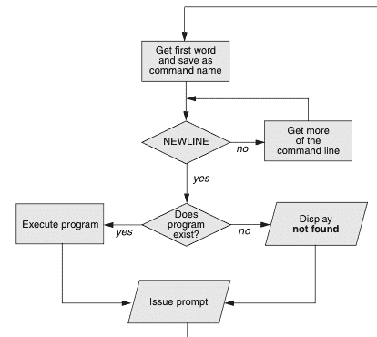

## **图 5-1** 处理命令行

- **可选内容** shell 并不要求程序名称必须出现在命令行中。因此，你可以按照如下方式构建命令行：

  ```
  $ >bb <aa cat
  ```

  此命令将运行 `cat` 程序，其标准输入来自名为 `aa` 的文件，标准输出去向为名为 `bb` 的文件。当 shell 识别出重定向符号（见第 153 页）时，它会先处理这些符号及其参数，然后再查找命令行所调用程序的名称。这是一个结构正确——尽管罕见且可能让人困惑——的命令行。

- **16 绝对路径名与相对路径名** 在命令行中，你可以通过三种方式指定希望 shell 执行的文件名：使用绝对路径名（以斜杠 `/` 开头；见第 181 页）、使用相对路径名（包含斜杠但不以斜杠开头；见第 182 页）或使用简单文件名（不含斜杠）。当你以前两种方式之一（即路径名中包含斜杠）指定要 shell 执行的文件名时，shell 会在指定的目录中查找具有指定名称且你拥有执行权限的文件。当你指定一个简单文件名（不含斜杠）时，shell 会在一个目录列表中搜索与指定名称匹配且你拥有执行权限的文件。shell 不会遍历所有目录，而仅遍历由变量 `PATH` 指定的目录。有关 `PATH` 的更多信息，请参见第 359 页。另请参见第 255 页关于 `which` 和 `whereis` 实用工具的讨论。当找不到该文件时，`bash` 会显示以下消息：

  ```
  $ abc
  bash: abc: command not found...
  ```

  某些系统配置会在你尝试运行的程序可能位于何处提供建议。shell 可能无法找到可执行文件的一个原因是该文件不在 `PATH` 变量列出的目录中。在 `bash` 中，以下命令会临时将工作目录（`.`）添加到 `PATH` 中：

  ```
  $ PATH=$PATH:.
  ```

  出于安全原因，永久地将工作目录添加到 `PATH` 是一种不良实践；请参阅下文提示以及第 360 页的提示。

  当 shell 找到该文件但无法执行它（例如，因为你没有该文件的执行权限）时，它会显示类似以下内容的消息：

  ```
  $ def
  bash: ./def: Permission denied
  ```

  有关显示文件访问权限的信息，请参阅第 191 页的“ls -l: Displays Permissions”；有关如何更改文件访问权限的说明，请参阅第 193 页的“chmod: Changes Access Permissions”。

### 尝试以 `./command` 的形式输入命令

> **提示**
>
> 你始终可以通过在文件名前加上 `./` 来执行工作目录中的可执行文件。由于 `./filename` 是相对路径名，shell 在查找 `filename` 时不会参考 `PATH`。例如，如果 `myprog` 是工作目录中的一个可执行文件，你可以使用以下命令执行它（无论 `PATH` 如何设置）：
>
> ```
> $ ./myprog
> ```

## **执行命令**

- 进程 如果找到命令行中指定名称的可执行文件，shell 将启动一个新进程。进程是 Linux 执行命令的过程（见第 373 页）。shell 会将每个命令行参数（包括选项和命令名称）提供给被调用的程序。在命令执行期间，shell 会等待进程结束。此时 shell 处于一种名为 `sleep`（休眠）的非活动状态。当程序执行完毕时，它将退出状态（见第 1029 页）传递给 shell。然后 shell 返回到活动状态（醒来），发出提示符，并等待下一条命令。

- shell 不处理参数 由于 shell 不处理命令行参数，而只是将它们传递给被调用的程序，因此 shell 无法知道对于给定的程序，特定的选项或其他参数是否有效。关于选项或参数的任何错误或用法信息都来自程序本身。某些实用工具会忽略无效的选项。


**图 5-2** 命令不知道标准输入的来源或标准输出和标准错误的去向

## **编辑命令行**

你可以重复和编辑之前的命令，也可以编辑当前的命令行。更多信息请参见第 124 页和第 378 页。

## **标准输入和标准输出**


`标准输出` 是程序可以发送信息（例如文本）的地方。程序永远不会“知道”它发送到标准输出的信息去向（图 5-2）。这些信息可以发往打印机、普通文件或屏幕。以下章节展示了 shell 默认将命令的标准输出定向到屏幕，并描述了你如何让 shell 将此输出重定向到另一个文件。

`标准输入` 是程序获取信息的地方；默认情况下，shell 将标准输入定向到键盘。与标准输出类似，程序永远不会“知道”信息的来源。以下章节解释了如何将标准输入重定向到命令，使其来自普通文件而不是键盘。

除了标准输入和标准输出外，正在运行的程序还有一个发送错误消息的地方：`标准错误`。默认情况下，shell 将标准错误定向到屏幕。有关重定向标准错误的更多信息，请参见第 333 页。

> **可选内容** 按照惯例，进程期望调用它的程序（通常是 shell）已设置好标准输入、标准输出和标准错误，以便进程可以立即使用它们。被调用的进程无需知道哪个文件或设备连接到标准输入、标准输出或标准错误。

> 然而，进程可以查询内核以获取标准输入、标准输出或标准错误所连接设备的信息。例如，当输出去向为屏幕时，`ls` 实用工具以多列显示输出；当输出重定向到文件或另一个程序时，则生成单列输出。`ls` 实用工具使用 `isatty()` 系统调用来确定输出是否去往屏幕（`tty`）。此外，`ls` 可以使用另一个系统调用来确定其发送输出所在的屏幕宽度；利用这些信息，它可以调整其输出以适应屏幕。比较单独运行 `ls` 和通过管道发送到 `less` 时的 `ls` 输出。有关如何确定 shell 脚本的标准输入和标准输出是否来自/去往终端的信息，请参见第 1020 页。

[^1]: 本书使用术语 *screen*（屏幕）来指代屏幕、终端仿真器窗口或工作站——换句话说，就是 shell 显示其提示符和消息的设备。

## 作为文件的屏幕

第 6 章讨论了普通文件、目录文件以及硬链接和软链接。Linux 还有一种额外的文件类型：`设备文件`。设备文件驻留在文件结构中，通常位于 `/dev` 目录下，并代表一个外围设备，如终端、打印机或磁盘驱动器。

`who` 实用工具在用户名后显示的设备名称是用户正在使用的终端的文件名。例如，当 `who` 显示设备名称 `pts/4` 时，终端的路径名为 `/dev/pts/4`。当你处理多个窗口时，每个窗口都有自己的设备名称。你还可以使用 `tty` 实用工具来显示你发出命令所来自的设备的名称。虽然你通常没有机会这样做，但你也可以像读写文本文件一样读写此文件。读取代表你所用终端的设备文件，会读取你在键盘上输入的内容；写入它，会在屏幕上显示你写入的内容。

## 作为标准输入和标准输出的键盘与屏幕

登录之后，shell 将你输入的命令的标准输出定向到代表终端的设备文件（图 5-3）。以这种方式定向输出会使其显示在屏幕上。shell 还将标准输入定向到同一文件，因此命令会接收你在键盘上输入的任何内容作为输入。

`cat` 实用工具很好地展示了键盘和屏幕分别作为标准输入和标准输出的工作方式。当你运行 `cat` 时，它会将文件复制到标准输出。由于 shell 将标准输出定向到屏幕，`cat` 会在屏幕上显示该文件。

到目前为止，`cat` 一直从你在命令行中指定的文件名（参数）获取输入。当你未给 `cat` 提供参数（即，当你输入命令 `cat` 后立即按下 RETURN 键）时，`cat` 从标准输入获取输入。因此，当在没有参数的情况下调用时，`cat` 逐行将标准输入复制到标准输出。

要查看 `cat` 的工作方式，在 shell 提示符后输入 `cat` 并按下 RETURN 键。什么也不会发生。输入一行文本并按下 RETURN 键。该行会出现在上一行的下方

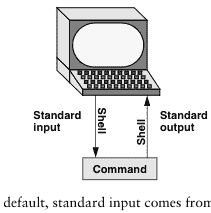

（这是你）输入的内容。`cat` 实用工具正在工作。由于 shell 将 `cat` 的标准输入与键盘关联，并将 `cat` 的标准输出与屏幕关联，因此当你输入一行文本时，`cat` 会将文本从标准输入（键盘）复制到标准输出（屏幕）。下一个示例展示了这一交互过程。

```
$ cat
This is a line of text.
This is a line of text.
Cat keeps copying lines of text
Cat keeps copying lines of text
until you press CONTROL-D at the beginning
until you press CONTROL-D at the beginning
of a line.
of a line.
CONTROL-D
$
```

`cat` 实用工具会不断复制文本，直到你在单独的一行中输入 CONTROL-D。按下 CONTROL-D 会导致 `tty` 设备驱动程序向 `cat` 发送一个 EOF（文件结束）信号。此信号告知 `cat` 它已达到标准输入的末尾，没有更多文本可供复制。然后，`cat` 实用工具结束执行并将控制权返回给 shell，shell 随后显示提示符。

## 重定向

“重定向”一词涵盖了你可以让 shell 改变命令的标准输入来源和标准输出去处的各种方式。默认情况下，shell 将命令的标准输入和标准输出分别与键盘和屏幕关联。通过将输入或输出与代表键盘或屏幕的设备文件以外的命令或文件进行关联，你可以让 shell 重定向任何命令的标准输入或标准输出。本节演示如何对文本文件和实用工具进行输入/输出重定向。

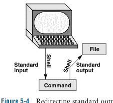

图 5-4 重定向标准输出

### 重定向标准输出

`重定向输出符号`（`>`）指示 shell 将命令的输出重定向到指定的文件，而不是输出到屏幕（图 5-4）。重定向输出的命令行语法为

```
command [arguments] > filename
```

其中 `command` 是任何可执行程序（例如应用程序或实用工具），`arguments` 是可选参数，`filename` 是 shell 将输出重定向到的普通文件的名称。

下一个示例使用 `cat` 来演示输出重定向。此示例与第 153 页的示例形成对比，在该示例中，标准输入 和 标准输出都与键盘和屏幕关联。以下示例中的输入来自键盘。命令行上的重定向输出符号导致 shell 将 `cat` 的标准输出与此符号后指定的 `sample.txt` 文件关联。

```
$ cat > sample.txt
This text is being entered at the keyboard and
cat is copying it to a file.
Press CONTROL-D to indicate the
end of file.
CONTROL-D
$
```

### 重定向输出可能会破坏文件！

在将输出重定向到文件时要谨慎。如果文件存在，shell 将覆盖该文件并破坏其内容。更多信息请参阅第 156 页的技巧“重定向输出可能会破坏文件！”。

在输入完命令并键入上一个示例中显示的文本后，`sample.txt` 文件将包含你输入的文本。你可以使用带有 `sample.txt` 作为参数的 `cat` 来显示此文件。下一节展示了另一种使用 `cat` 显示文件的方法。

前面的示例表明，从 `cat` 重定向标准输出是一种创建文件而无需使用编辑器的便捷方式。缺点是，一旦你输入一行并按下 RETURN 键，在你完成创建文件之前就无法编辑文本。在输入某一行时，擦除键和终止键可用于删除该行的文本。此步骤对于创建简短、简单的文件非常有用。

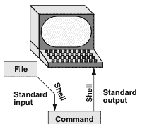

图 5-5 重定向标准输入

下一个示例展示了如何运行 `cat` 并使用重定向输出符号将几个文件*串联*（catenate，即依次连接——这是 `cat` 实用工具名称的由来）到一个更大的文件中。前三个命令显示了三个文件的内容：`stationery`、`tape` 和 `pens`。下一条命令显示了带有三个文件名作为参数的 `cat`。当你调用它并指定多个文件名时，`cat` 逐个将这些文件复制到标准输出。该命令将标准输出重定向到名为 `supply_orders` 的文件。最后的 `cat` 命令表明 `supply_orders` 包含这三个原始文件的内容。

```
$ cat stationery
2,000 sheets letterhead ordered:      October 7
$ cat tape
1 box masking tape ordered:           October 14
5 boxes filament tape ordered:        October 28
$ cat pens
12 doz. black pens ordered:           October 4
```

```
$ cat stationery tape pens > supply_orders
```

```
$ cat supply_orders
2,000 sheets letterhead ordered:      October 7
1 box masking tape ordered:           October 14
5 boxes filament tape ordered:        October 28
12 doz. black pens ordered:           October 4
```

### 重定向标准输入

就像你可以重定向标准输出一样，你也可以重定向标准输入。`重定向输入符号`（`<`）指示 shell 将命令的输入重定向为来自指定文件，而不是来自键盘（图 5-5）。重定向输入的命令行语法为

```
command [arguments] < filename
```

其中 `command` 是任何可执行程序（如应用程序或实用工具），`arguments` 是可选参数，`filename` 是 shell 从中重定向输入的普通文件的名称。

下一个示例显示了 `cat` 的输入从上一个示例中创建的 `supply_orders` 文件重定向，标准输出则去屏幕。这种设置导致 `cat` 在屏幕上显示 `supply_orders` 文件。系统会在普通文件末尾自动提供一个 EOF 信号。

```
$ cat < supply_orders
2,000 sheets letterhead ordered:	October 7
1 box masking tape ordered:		October 14
5 boxes filament tape ordered:		October 28
12 doz. black pens ordered:		October 4
```

使用从文件重定向输入的 `cat` 命令所产生的结果与使用文件名作为参数的 `cat` 命令所产生的结果相同。`cat` 实用工具是一类按此方式工作的实用工具的成员。此类实用工具的其他成员包括 `ls`、`sort`、`grep` 和 Perl。这些实用工具首先检查调用它们的命令行。如果命令行包含文件名作为参数，实用工具将从指定文件获取输入。如果没有文件名参数，实用工具将从标准输入获取输入。是实用工具或程序——而不是 shell 或操作系统——以这种方式工作。

### 重定向输出可能会破坏文件

根据你使用的 shell 以及环境设置方式，如下命令可能会产生意外结果：

```
$ cat orange pear > orange
cat: orange: input file is output file
```

尽管 `cat` 显示了一条错误消息，但 shell 破坏了现有 `orange` 文件的内容。新的 `orange` 文件将与 `pear` 具有相同的内容，因为 shell 看到重定向符号（`>`）时采取的第一个动作是删除原始 `orange` 文件的内容。如果你想将两个文件串联成一个，请使用 `cat` 将两个文件放入一个临时文件，然后使用 `mv` 重命名该临时文件：

```
$ cat orange pear > temp
$ mv temp orange
```

在下一个示例中发生的事情可能更糟。输入命令的用户想要搜索文件 `a`、`b` 和 `c` 中的单词 `apple`，并将 `grep`（第 232 页）的输出重定向到文件 `a.output`。不幸的是，用户将文件名输入为 `a output`，省略了句点并在其位置插入了一个空格：

```
$ grep apple a b c > a output
grep: output: No such file or directory
```

Shell 忠实地删除了 `a` 的内容，然后调用 `grep`。错误消息可能需要片刻时间才会出现，给人一种命令正常运行的错觉。即使你看到了错误消息，也可能需要一段时间才能意识到你已经破坏了 `a` 的内容。

### NoClobber：防止覆盖文件

shell 提供 `noclobber` 功能，可防止你使用重定向覆盖文件。使用 `set -o noclobber` 命令设置 `noclobber` 来启用此功能。带有 `+o` 的相同命令取消设置 `noclobber`。如果设置了 `noclobber`，当你将输出重定向到现有文件时，shell 会显示一条错误消息并且不执行该命令。以下示例使用 `touch` 创建一个文件，

设置 `noclobber`，尝试将 `echo` 的输出重定向到新创建的文件，取消设置 `noclobber`，并执行相同的重定向：

```
$ touch tmp
$ set -o noclobber
$ echo "hi there" > tmp
-bash: tmp: cannot overwrite existing file
$ set +o noclobber
$ echo "hi there" > tmp
```

您可以在重定向符号后添加管道符号（|）来覆盖 `noclobber`。在下面的示例中，用户通过重定向 `date` 的输出创建了一个文件。接下来，用户设置 `noclobber` 变量并再次将输出重定向到同一文件。Shell 显示一条错误消息。然后，用户在重定向符号后放置一个管道符号，Shell 允许用户覆盖该文件。

```
$ set > tmp2
$ set -o noclobber
$ date > tmp2
-bash: tmp2: cannot overwrite existing file
$ date >| tmp2
```

## 将标准输出追加到文件

### 不要依赖 noclobber

> 追加输出比前面注意事项框中描述的两步过程更简单，但你必须小心同时包含两个大于号。如果你不小心只使用了一个大于号，且未设置 `noclobber` 功能，Shell 将覆盖 `orange` 文件。即使你已开启 `noclobber` 功能，在操作文件时保留备份副本也是一个好习惯，以防出现错误。

> 虽然它可以使用重定向防止你覆盖文件，但 `noclobber` 无法阻止你使用 `cp` 或 `mv` 覆盖文件。这些实用程序包含 `-i`（交互式）选项，该选项通过在你尝试覆盖文件时验证你的意图来帮助防止此类错误。更多信息请参阅第 224 页的技巧“cp 可以破坏文件”。

追加输出符号（`>>`）使 Shell 将新信息添加到文件末尾，同时保持现有信息不变。该符号提供了一种将两个文件合并为一个文件的便捷方法。以下命令演示了追加输出符号的作用。第二个命令完成了前面注意事项框中描述的合并操作：

```
$ cat orange
this is orange
$ cat pear >> orange
$ cat orange
this is orange
this is pear
```

第一条命令显示 `orange` 文件的内容。第二条命令将 `pear` 文件的内容追加到 `orange` 文件末尾。最后一条命令显示结果。

下一个示例展示了如何创建一个包含日期和时间（`date` 的输出）以及登录用户列表（`who` 的输出）的文件。示例中的第一条命令将 `date` 的输出重定向到名为 `whoson` 的文件。然后 `cat` 显示该文件。下一条命令将 `who` 的输出追加到 `whoson` 文件。最后 `cat` 显示包含两个实用程序输出的文件。

```
$ date > whoson
$ cat whoson
Wed Mar 27 14:31:18 PST 2013
$ who >> whoson
$ cat whoson
Wed Mar 27 14:31:18 PST 2013
sam              tty1            2013-03-27 05:00 (:0)
max              pts/4           2013-03-27 12:23 (0.0)
max              pts/5           2013-03-27 12:33 (0.0)
zach             pts/7           2013-03-26 08:45 (172.16.192.1)
```

## /dev/null：让数据消失

`/dev/null` 设备是一个数据池，通常被称为“比特桶”（bit bucket）。你可以将不想保留或查看的输出重定向到 `/dev/null`，输出将消失无踪：

```
$ echo "hi there" > /dev/null
$
```

从 `/dev/null` 读取会得到一个空字符串。以下命令将名为 `messages` 的文件截断为零长度，同时保留文件的属主和权限：

```
$ ls -lh messages
-rw-rw-r--  1 sam pubs  125K 03-16 14:30 messages
$ cat /dev/null > messages
$ ls -lh messages
-rw-rw-r--  1 sam pubs  0 03-16 14:32 messages
```

另请参阅第 503 页。

## 管道


管道由一个或多个通过管道符号（`|`）分隔的命令组成。Shell 将管道符号前一个命令的标准输出（以及可选的标准错误）连接到管道符号后一个命令的标准输入。管道与将一个命令的标准输出重定向到文件，然后使用该文件作为另一个命令的标准输入具有相同的效果。管道摒弃了独立的命令和中间文件。管道的语法是

```
command_a [arguments] | command_b [arguments]
```

前面的命令行使用管道来实现与以下三条命令相同的结果：

```
command_a [arguments] > temp
command_b [arguments] < temp
rm temp
```

在前面的命令序列中，第一行将 `command_a` 的标准输出重定向到名为 `temp` 的中间文件。第二行将 `command_b` 的标准输入重定向为来自 `temp`。最后一行删除 `temp`。不仅输入起来更容易，管道的语法也更高效，因为它不需要创建临时文件。

**可选** 更准确地说，`bash` 管道由一个或多个通过 `|` 或 `|&` 控制运算符分隔的简单命令（第 147 页）组成。管道的语法如下：

```
[time] [|] command1 [|||& command2 ... ]
```

其中 `time` 是一个可选的实用程序，用于总结管道使用的系统资源；`!` 在逻辑上取反管道返回的退出状态；`commands` 是通过 `|` 或 `|&` 分隔的简单命令（第 147 页）。`|` 控制运算符将 `command1` 的标准输出发送到 `command2` 的标准输入。`|&` 控制运算符是 `2>&1 |` 的简写（参见第 335 页的“通过管道发送错误”），它将 `command1` 的标准输出和标准错误发送到 `command2` 的标准输入。除非设置了 `pipefail`（第 403 页），否则管道的退出状态是最后一个简单命令的退出状态；如果设置了 `pipefail`，则退出状态是失败的（返回非零退出状态）最右边的简单命令，或者如果所有简单命令都成功完成则为零。

### 管道示例

- **10** `tr` 你可以在管道中包含任何接受来自命令行指定文件或者来自标准输入的输入的实用程序。你也可以包含仅接受标准输入的实用程序。例如，`tr`（翻译）实用程序仅从标准输入获取输入。在其最简单的用法中，`tr` 的语法如下：

```
tr string1 string2
```

`tr` 实用程序从标准输入接收输入，并查找与 `string1` 中任一字符匹配的角色。找到匹配项后，它将 `string1` 中匹配的字符翻译为 `string2` 中对应的字符。也就是说，`string1` 中的第一个字符翻译为 `string2` 中的第一个字符，依此类推。`tr` 实用程序将输出发送到标准输出。在以下两个 `tr` 命令中，`tr` 显示 `abstract` 文件的内容，并将字母 a、b 和 c 分别翻译为 A、B 和 C：

```
$ cat abstract
I took a cab today!

$ cat abstract | tr abc ABC
I took A CAB today!
$ tr abc ABC < abstract
I took A CAB today!
```

- **lpr** `lpr`（行式打印机）实用程序接受来自文件或其标准输入的输入。当你在命令行中输入 `lpr` 后面跟着文件名时，它将该文件放入打印队列。当你在命令行中未指定文件名时，`lpr` 从标准输入获取输入。此功能使你能够使用管道将输入重定向到 `lpr`。以下命令的第一组展示了如何使用 `ls` 和 `lpr` 配合中间文件（`temp`）将工作目录中的文件列表发送到打印机。如果 `temp` 文件存在，第一条命令将覆盖其内容。第二组命令使用管道将相同的列表（除了 `temp` 以外）发送到打印机。

```
$ ls > temp
$ lpr temp
$ rm temp
```

或者

```
$ ls | lpr
```

- **sort** 下一个示例中的命令将 `who` 实用程序的输出重定向到 `temp`，然后按排序顺序显示该文件。`sort` 实用程序（第 239 页）从命令行指定的文件获取输入，或者在未指定文件时从标准输入获取输入；它将输出发送到标准输出。`sort` 命令行从标准输入获取输入，该输入被重定向（`<`）为来自 `temp`。发送到屏幕的 `sort` 输出以排序（字母顺序）列出用户。由于 `sort` 可以从标准输入或命令行命名的文件获取输入，因此从命令行省略 `<` 符号会产生相同的结果。

```
$ who > temp
$ sort < temp
  max     pts/4     2013-03-24 12:23
  max     pts/5     2013-03-24 12:33
  sam     tty1      2013-03-24 05:00
  zach    pts/7     2013-03-23 08:45
$ rm temp
```

下一个示例在不创建 `temp` 文件的情况下实现相同的结果。使用管道，Shell 将 `who` 的输出重定向到 `sort` 的输入。由于命令行中 `sort` 后面没有文件名，`sort` 实用程序从标准输入获取输入。

```
$ who | sort
  max     pts/4     2013-03-24 12:23
  max     pts/5     2013-03-24 12:33
  sam     tty1      2013-03-24 05:00
  zach    pts/7     2013-03-23 08:45
```

- **grep** 当许多人在使用系统而你只需要关于其中一个人的信息时，你可以使用管道将 `who` 的输出发送到 `grep`（第 232 页）。`grep` 实用程序显示包含指定字符串的行——在下面的示例中是 `sam`：

## 过滤器与管道

```
$ who | grep sam
```

```
sam       tty1    2013-03-24 05:00
```

处理输出过长而无法在一屏内显示（例如拥挤目录中的文件列表）的另一种方法是使用管道，将输出通过 `less` 或 `more` 发送（两者均在第 220 页中有介绍）。

```
$ ls | less
```

`less` 实用程序每次显示一屏文本。要查看下一屏文本，请按 SPACE 键。要查看下一行，请按 RETURN 键。按 h 查看帮助，按 q 退出。

> **可选**
>
> 管道符号（`|`）意味着延续。因此，以下命令行
>
> ```
> $ who | grep 'sam'
> ```
>
> ```
> sam       tty1    2013-03-24 05:00
> ```
>
> 与这些命令行相同
>
> ```
> $ who |
> grep 'sam'
> sam       tty1    2013-03-24 05:00
> ```

当 shell 解析以管道符号结尾的行时，它需要更多输入才能执行该命令行。在交互式环境中，如上所示，它会发出二级提示符（`>`；第 362 页）。在 shell 脚本中，它将处理下一行作为以管道符号结尾的行的延续。有关控制运算符和隐式命令行续行的信息，请参阅第 1063 页。

### 过滤器

过滤器是一个命令，它处理输入数据流以生成输出数据流。包含过滤器的命令行使用管道符号将一个命令的标准输出连接到过滤器的标准输入。另一个管道符号将过滤器的标准输出连接到另一个命令的标准输入。并非所有实用程序都可以用作过滤器。

在以下示例中，`sort` 是一个过滤器，它从 `who` 的标准输出获取标准输入，并使用管道符号将标准输出重定向到 `lpr` 的标准输入。此命令行将 `who` 的排序输出发送到打印机：

```
$ who | sort | lpr
```

前面的示例展示了 shell 的强大功能结合 Linux 实用程序的灵活性。三个实用程序 `who`、`sort` 和 `lpr` 并非设计为相互协同工作，但它们都以常规方式使用标准输入和标准输出。通过使用 shell 处理输入和输出，你可以将标准实用程序组合在命令行中，以实现你想要的结果。

### tee 实用程序

`tee` 实用程序将其标准输入复制到文件，同时也复制到标准输出。这个实用程序的名字非常贴切：它接收单一的数据流，并将输出发送到两个方向。下一个示例通过管道将 `who` 的输出发送到 `tee` 的标准输入。`tee` 实用程序将标准输入的副本保存在名为 `who.out` 的文件中，同时也将副本发送到标准输出。`tee` 的标准输出通过管道发送到 `grep` 的标准输入，后者仅显示包含字符串 `sam` 的行。使用 `tee` 的 `-a`（追加）选项，可以使其向文件追加内容而不是覆盖它。

```
$ who | tee who.out | grep sam
sam          tty1      2013-03-24 05:00
$ cat who.out
sam          tty1      2013-03-24 05:00
max          pts/4     2013-03-24 12:23
max          pts/5     2013-03-24 12:33
zach         pts/7     2013-03-23 08:45
```

### 列表

列表是一个或多个管道（包括简单命令），每个由以下控制运算符之一分隔：`;`、`&&` 或 `||`。`&&` 和 `||` 控制运算符具有相同的优先级；它们后面跟随 `;` 和 `&&`，它们也具有相同的优先级。`if` 控制运算符在第 341 页介绍，`&&` 在第 342 页介绍。有关控制运算符和隐式命令行续行的信息，请参阅第 1063 页。

AND 列表具有以下语法：

```
pipeline1 && pipeline2
```

其中 `pipeline2` 当且仅当 `pipeline1` 返回 `true`（零）退出状态时执行。在以下示例中，列表中的第一个命令失败（并显示错误消息），因此 shell 不执行第二个命令（`cd /newdir`；由于未执行，它不会显示错误消息）：

```
$ mkdir /newdir && cd /newdir
mkdir: cannot create directory '/newdir': Permission denied
```

AND 列表和 OR 列表的退出状态是列表中执行的最后一个命令的退出状态。前面列表的退出状态是 `false`，因为 `mkdir` 是最后一个执行的命令，并且它失败了。

OR 列表具有以下语法：

```
pipeline1 || pipeline2
```

其中 `pipeline2` 当且仅当 `pipeline1` 返回 `false`（非零）退出状态时执行。在下一个示例中，列表中的第一个命令（`ping` 测试与远程主机的连接，并将标准输出和标准错误发送到 `/dev/null`）失败，因此 shell 执行第二个命令（它显示一条消息）。如果第一个命令成功完成，shell 将不会执行第二个命令（也不会显示该消息）。该列表返回 `true` 的退出状态。

```
$ ping -c1 station &>/dev/null || echo "station is down"
  station is down
```

有关更多信息，请参阅第 343 页的“&& 和 || 布尔控制运算符”。

## 在后台运行命令

到目前为止，所有命令都在前台运行。当你在前台运行命令时，shell 会等待其完成，然后才显示另一个提示符并允许你继续。当你在后台运行命令时，你无需等待命令完成即可运行另一个命令。

作业是运行管道的进程的另一个名称（管道可以是简单命令）。在一个窗口或屏幕上只能有一个前台作业，但可以有多个后台作业。通过同时运行多个作业，你正在使用 Linux 的一个功能：多任务处理。在命令运行时间较长且不需要监督时，在后台运行命令非常有用。它会保持屏幕空闲，以便你用于其他工作。或者，当你使用 GUI 时，你可以打开另一个窗口来运行另一个作业。

要在后台运行命令，在结束命令行的 `RETURN` 之前输入一个 & 符号（`&`；一个控制运算符）。shell 会为作业分配一个小数字，并在括号之间显示此作业编号。在作业编号之后，shell 显示进程标识符（`PID`）编号——由操作系统分配的较大数字。这些数字中的每一个都标识在后台运行的命令。然后 shell 显示另一个提示符，你可以输入另一个命令。当后台作业完成时，shell 显示一条消息，给出作业编号和用于运行该命令的命令行。

以下示例在后台运行；它是一个管道，将 `ls` 的输出发送到 `lpr`，后者将其发送到打印机。

```
$ ls -1 | lpr &
[1] 22092
$ 
```

命令行后面的 `[1]` 表示 shell 已为该作业分配了作业编号 1。`22092` 是作业中第一个命令的 `PID` 编号。当此后台作业完成执行时，你会看到如下消息

```
[1]+ Done  ls -1 | lpr
```

（代替 `ls -1`，shell 可能会显示类似于 `ls --color=auto -1` 的内容。这种差异是由于 `ls` 被别名 [第 392 页] 设置为 `ls --color=auto`。）

## 将作业从前台移动到后台

你可以通过按下挂起键（通常是 `CONTROL-z`）来挂起（停止运行）前台作业。然后 shell 停止该进程，并断开键盘的标准输入。但是，它仍然将标准输出和标准错误发送到屏幕。你可以使用 `bg` 命令后跟作业编号，将挂起的作业放入后台并重新启动。当只有一个挂起作业时，你不需要指定作业编号。

将你在后台运行的作业的输出重定向，以防止干扰你正在前台（在屏幕上）进行的工作。有关后台任务的更多详细信息，请参阅第 341 页的“控制运算符：分隔和分组命令”。

只有前台作业才能从键盘获取输入。要将键盘连接到在后台运行的程序，你必须将该程序带到前台。为此，当只有一个作业在后台时，输入不带任何参数的 `fg`。当有多个作业在后台时，输入 `fg` 或百分号（`%`），后跟你要带到前台的作业的编号。shell 显示你用于启动该作业的命令（以下示例中为 `promptme`），你可以输入程序继续运行所需的输入。

```
$ fg 1
  promptme
```

## KILL：中止后台作业

中断键（通常是 `CONTROL-c`）无法中止后台进程，因为键盘未连接到该作业；你必须使用 `kill`（第 465 页）来完成此目的。在命令行中，`kill` 后跟要中止的进程的 `PID` 编号或百分号（`%`）后跟作业编号。

如果你忘记了 `PID` 编号，可以使用 `ps`（进程状态）实用程序（第 374 页）来显示它。以下示例在后台运行 `find` 命令，使用 `ps` 显示进程的 `PID` 编号，并使用 `kill` 中止作业：

```
$ find / -name memo55 > mem.out &
[1] 18228
$ ps | grep find
  18228 pts/10  00:00:01 find
$ kill 18228
[1]+ Terminated      find / -name memo55 > mem.out
$ 
```

如果你忘记了作业编号，可以使用 `jobs` 命令来显示包含作业编号的作业列表。下一个示例与前面的示例类似，只是它使用作业编号而不是 `PID` 编号来标识要终止的作业。有时，关于作业已终止的消息直到你在执行 `kill` 命令的 `RETURN` 之后再次按下 `RETURN` 才会出现。

# 文件名生成/路径名扩展

通配符、Glob 匹配 当您包含特殊字符（也称为元字符）的简写文件名时，Shell 可以生成与现有文件名称匹配的文件名。这些特殊字符也被称为通配符，因为它们的功用类似于扑克牌中的王牌。当命令行参数中出现这些字符之一时，Shell 会将其按排序顺序扩展为文件名列表，并将该列表传递给命令行调用的程序。包含这些特殊字符的文件名被称为模糊文件引用，因为它们并不指代某个特定的文件。Shell 对这些文件名执行的处理过程被称为路径名扩展或 Glob 匹配。

模糊文件引用可以快速引用一组名称相似的文件，从而省去逐个输入名称的麻烦。它们还可以帮助查找名称未完全记住的文件。如果没有文件名匹配模糊文件引用，Shell 通常会将未扩展的引用——包括所有特殊字符——传递给命令。有关一种生成不一定匹配文件名的字符串的技术，请参见第 405 页的“花括号扩展”。

## 特殊字符 ?

问号 (`?`) 是一个使 Shell 生成文件名的特殊字符。它匹配现有文件名中的任意单个字符。以下命令在 `lpr` 工具的一个参数中使用了这个特殊字符：

```
$ lpr memo?
```

Shell 会扩展 `memo?` 参数，并生成工作目录中所有由 `memo` 后跟任意单个字符组成的文件名列表。然后，Shell 将此列表传递给 `lpr`。`lpr` 工具永远不会“知道”这些文件名是由 Shell 生成的。如果没有文件名匹配模糊文件引用，Shell 会将字符串本身（`memo?`）传递给 `lpr`，或者如果设置如此，则传递一个空字符串（参见第 402 页的 `nullob`）。

以下示例首先使用 `ls` 显示工作目录中所有文件的名称，然后显示 `memo?` 匹配的文件名：

```
$ ls
mem      memo12   memo9    memomax  newmemo5
memo     memo5    memoa    memos
```

```
$ ls memo?
memo5  memo9  memoa  memos
```

`memo?` 模糊文件引用不匹配 `mem`、`memo`、`memo12`、`memomax` 或 `newmemo5`。你还可以在模糊文件引用中间使用问号：


```bash
$ ls
?may4report  may4report  mayqreport  may_.report
mayi4report  mayi4report.79          may.report
```

```bash
$ ls may?report
may4report  mayqreport  may_.report  may.report
```

你可以使用 `echo` 和 `ls` 练习生成文件名。`echo` 内置命令显示 Shell 传递给它的参数：

```bash
$ echo may?report
may4report  mayqreport  may_.report  may.report
```

Shell 首先将模糊文件引用扩展为工作目录中与字符串 `may?report` 匹配的文件列表。然后，它将此列表传递给 `echo`，就像你已将文件名列表作为参数输入给 `echo` 一样。`echo` 工具显示文件名列表。

问号不匹配前导句点（表示隐藏文件名的句点；第 180 页）。当你要匹配以句点开头的文件名时，必须在模糊文件引用中明确包含该句点。

## 特殊字符 *

星号（`*`）执行与问号类似的功能，但在文件名中匹配任意数量的字符，包括零个字符。以下示例首先显示工作目录中的所有文件，然后显示列出所有以字符串 `memo` 开头、以字符串 `mo` 结尾以及包含字符串 `alx` 的命令：

```bash
$ ls
anemo      memax12  memo.0612   memoaxl.0620  memorandom  sallymemo
memo       memoa    memoaxl.keep memosally     user.memo
```

```bash
$ echo memo*
memo memo.0612 memoa memoaxl.0620 memoaxl.keep memorandom memosally
```

```bash
$ echo *mo
anemo memo sallymemo user.memo
```

```bash
$ echo *alx*
memaxl memoaxl.0620 memoaxl.keep
```

模糊文件引用 `memo*` 不匹配 `amemo`、`mem`、`sallymemo` 或 `user.memo`。与问号一样，星号也不匹配文件名中的前导句点。

`-a` 选项使 `ls` 显示隐藏文件名（第 180 页）。命令 `echo *` 不显示 `.`（工作目录）、`..`（工作目录的父目录）、`.aaa` 或 `.profile`。相反，命令 `echo . *` 仅显示这四个名称：

```bash
$ ls
   aaa  memo.0612  memo.sally  report  sally.0612  saturday  thurs

$ ls -a
   .  ..  aaa  memo.0612  .profile  sally.0612  thurs

$ echo *
   aaa  memo.0612  memo.sally  report  sally.0612  saturday  thurs

$ echo .*
   .  ..  .aaa  .profile
```

在以下示例中，`.*` 不匹配 `memo.0612`、`private`、`reminder` 或 `report`。`ls .*` 命令使 `ls` 除了列出 `.` 目录（工作目录）和 `..` 目录（工作目录的父目录）的内容外，还列出 `.private` 和 `.profile`。当使用相同参数调用时，`echo` 显示工作目录中以点 (.) 开头的文件（包括目录）的名称，但不显示目录的内容。

```bash
$ ls -a
   .  ..  memo.0612  private  .private  .profile  reminder  report

$ echo .*
   .private  .profile

$ ls .*
   .private  .profile
   .
   ..
   memo.0612  private  reminder  report
   .
   ..

$ echo .*
   .  ..  .private  .profile
```

在制定文件命名约定时，你可以计划利用模糊文件引用。例如，当你将所有文本文件的名称以 `.txt` 结尾时，你可以使用 `*.txt` 来引用该组文件。下一条命令利用此约定将工作目录中的所有文本文件发送到打印机。`&` 符号使 `lpr` 在后台运行。

```bash
$ lpr *.txt &
```

> **提示**
>
> 扩展操作是由 Shell 在处理模糊文件引用时执行的，而不是由 Shell 运行的程序执行的。在本节的示例中，实用程序（`ls`, `cat`, `echo`, `lpr`）从未看到模糊文件引用。Shell 扩展模糊文件引用，并将普通文件名列表传递给实用程序。在上面的示例中，`echo` 证明了这一点，因为它只是显示其参数；它从未显示模糊文件引用。

## 特殊字符 [ ]

包围一个或多个字符的一对括号使 Shell 匹配包含括号内单个字符的文件名。如果 `memo?` 匹配 `memo` 后跟任意字符，那么 `memo[17a]` 则更具限制性：它仅匹配 `memo1`、`memo7` 和 `memoa`。括号定义了一个字符类，包含括号内的所有字符。（GNU 将此称为字符列表；GNU 的字符类是另一回事。）Shell 通过逐个替换字符类中的每个成员来扩展包含字符类定义参数的，代替括号及其内容。然后，Shell 将匹配文件名的列表传递给它调用的程序。

每个字符类定义只能替换文件名中的单个字符。括号及其内容就像一个仅替换字符类成员的问号。

以下命令中的第一个列出了工作目录中所有以 `a`、`c`、`i`、`o` 或 `u` 开头的文件名称。第二个命令显示名为 `page2.txt`、`page4.txt`、`page6.txt` 和 `page8.txt` 的文件内容。

```bash
$ echo [aeiou]*
...

$ less page[2468].txt
...
```

括号内的连字符定义字符类定义中的字符范围。例如，`[6-9]` 代表 `[6789]`，`[a-z]` 代表英文中所有小写字母，而 `[a-zA-Z]` 代表英文中所有大写字母和小写字母。

以下命令行显示了打印名为 `part0`、`part1`、`part2`、`part3` 和 `part5` 的文件的三种方法。这些命令行中的每一个都会使 Shell 使用五个文件名调用 `lpr`：

```bash
$ lpr part0 part1 part2 part3 part5

$ lpr part[01235]

$ lpr part[0-35]
```

第一条命令行明确指定了五个文件名。第二条和第三条命令行使用模糊文件引用，结合了字符类定义。Shell 将第二条命令行的参数扩展为包含所有名称以 `part` 开头且以字符类中任意字符结尾的文件。该字符类明确定义为 `0`、`1`、`2`、`3` 和 `5`。第三条命令行也使用了字符类定义，但将字符类定义为 `0-3` 范围内的所有字符加上 `5`。

以下命令行会打印 39 个文件，从 `part0` 到 `part38`：

```bash
$ lpr part[0-9] part[12][0-9] part3[0-8]
```

以下命令的第一个列出工作目录中名称以 `a` 到 `m` 开头的文件。第二个列出名称以 `x`、`y` 或 `z` 结尾的文件。

```bash
$ echo [a-m]*
...
$ echo *[x-z]
...
```

**可选** 当感叹号 (`!`) 或脱字符 (`^`) 紧跟在表示字符类定义起始的开括号 (`[`) 之后时，该字符类将匹配括号内不包含的任意字符。因此 `[^tsg]*` 匹配任何不以 `t`、`s` 或 `g` 开头的文件名。

以下示例表明 `*[^ab]` 匹配不以字母 `a` 或 `b` 结尾的文件名，而 `[^b-d]*` 匹配不以 `b`、`c` 或 `d` 开头的文件名。

```bash
$ ls
aa ab ac ad ba bb bc bd cc dd
$ ls *[^ab]
ac ad bc bd cc dd
$ ls [^b-d]*
aa ab ac ad
```

要使字符类匹配连字符 (`-`) 或闭括号 (`]`)，可以将其紧放在最终（闭）括号之前。

下一个示例证明了 `ls` 实用程序无法解释模糊的文件引用。首先，`ls` 以 `?old` 为参数被调用。shell 将 `?old` 扩展为匹配的文件名 `hold`，并将该名称传递给 `ls`。第二个命令与第一个相同，只是 `?` 被引用了（通过在它前面加上反斜杠 `[\]`）；参见第 142 页的“特殊字符”。由于 `?` 被引用了，shell 不将其识别为特殊字符，并将其传递给 `ls`。`ls` 实用程序会生成一条错误消息，表示它找不到名为 `?old` 的文件（因为不存在名为 `?old` 的文件）。

```bash
$ ls ?old
hold
$ ls \?old
ls: ?old: No such file or directory
```

与大多数实用程序和程序一样，`ls` 无法解释模糊的文件引用；这项工作留给 shell 完成。

## 内置命令

内置命令（builtin）是嵌入到 shell 中的实用程序（也称为命令）。每个 shell 都有其自己的一组内置命令。当 shell 运行内置命令时，它不会 fork 出一个新进程。因此，内置命令运行速度更快，并且可以影响当前 shell 的环境。由于内置命令的使用方式与实用程序相同，你通常不会注意到某个实用程序是内置于 shell 的还是独立的实用程序。

例如，`echo` 是一个 shell 内置命令。它也是一个独立的实用程序。shell 在尝试查找同名命令或实用程序之前，始终先执行 shell 内置命令。关于内置命令的深入讨论请参见第 1040 页，`bash` 内置命令列表请参见第 1055 页。

- **列出 *bash* 内置命令**

  - 要显示 `bash` 内置命令的列表，请执行命令 `info bash shell builtin`。要显示包含每个内置命令信息的一页，请将光标移动到 **Bash Builtins** 行并按 RETURN。或者，你可以查看 **builtins man** 页面。

- **获取 *bash* 内置命令的帮助**

  - 你可以使用 `bash help` 命令来显示关于 `bash` 内置命令的信息。更多信息请参见第 134 页。

## 本章摘要

Shell 是 Linux 命令解释器。它扫描命令行以检查语法是否正确，并提取命令名称和参数。命令的名称是参数零。第一个参数是参数一，第二个是参数二，等等。许多程序使用选项来修改命令的效果。大多数 Linux 实用程序通过其开头的连字符（一个或两个）来标识选项。

当你输入一个命令时，shell 会尝试查找一个与命令同名的可执行程序。如果找到，shell 会执行该程序。如果没有找到，shell 会告诉你它无法找到或执行该程序。如果命令只是一个简单的文件名，shell 会在 `PATH` 变量中列出的目录中搜索以定位该命令。

当执行命令时，shell 为该命令的标准输入分配一个文件或设备，并为标准输出分配另一个文件。默认情况下，shell 使命令的标准输入来自键盘，标准输出流向屏幕。你可以指示 shell 将命令的标准输入从任何文件或设备重定向，或将标准输出重定向到任何文件或设备。你还可以将一个命令的标准输出连接到另一个命令的标准输入，以形成管道。过滤器是一个命令，它从一个命令的标准输出读取标准输入，并将其标准输出写入另一个命令的标准输入。

当命令在前台运行时，shell 会等待命令完成，然后才显示提示符并允许你继续。当你在命令行末尾添加一个 `&` 符号时，shell 会在后台执行该命令并立即显示另一个提示符。当你想在 shell 提示符下输入其他命令时，请在后台运行速度较慢的命令。`jobs` 内置命令显示挂起的作业和后台运行的作业列表，并包含每个作业的编号。

Shell 解释命令行上的特殊字符以生成文件名。使用特殊字符（通配符）来缩写一个或多个文件名列表的引用被称为模糊文件引用。问号代表任意单个字符，星号代表零个或多个字符。单个字符也可以通过字符类来表示：括号内的字符列表。

内置命令是嵌入到 shell 中的实用程序。每个 shell 都有其自己的一组内置命令。当运行内置命令时，shell 不会 fork 出一个新进程。因此，内置命令运行速度更快，并且可以影响当前 shell 的环境。

## 本章介绍的实用程序和内置命令

表 5-1 列出了本章介绍的实用程序。

| **表 5-1 新实用程序** |
| :--- | :--- |
| **实用程序** | **功能** |
| `tr` | 将一个字符串映射到另一个字符串（第 159 页） |
| `tee` | 将标准输入同时发送到文件和标准输出（第 162 页） |
| `bg` | 将进程移动到后台（第 164 页） |
| `fg` | 将进程移动到前台（第 164 页） |
| `jobs` | 显示挂起的作业和后台运行的作业列表（第 164 页） |

## 练习

1. 在命令执行期间，shell 通常做什么？如果你不想等待命令完成再运行另一个命令，你应该怎么做？

2. 使用 `sort` 作为过滤器，重写以下命令序列：

   ```bash
   $ sort list > temp
   $ lpr temp
   $ rm temp
   ```

3. 什么是 PID 编号？当你运行后台进程时，为什么这些编号很有用？哪个实用程序显示你正在运行的命令的 PID 编号？

4. 假设工作目录中存在以下文件：

   ```bash
   $ ls
   intro notesb ref2 section1 section3 section4b
   notesa ref1 ref3 section2 section4a sentrev
   ```

   针对以下每项，给出使用通配符并以最少字符表示文件名的命令。

   - a. 列出所有以 `section` 开头的文件。
   - b. 仅列出 `section1`、`section2` 和 `section3` 文件。
   - c. 仅列出 `intro` 文件。
   - d. 列出 `section1`、`section3`、`ref1` 和 `ref3` 文件。

5. 参考 `info` 或 `man` 页面，确定哪个命令可以：

   - a. 显示其标准输入中包含单词 `a` 或 `A` 的行数。
   - b. 仅显示工作目录中包含模式 `$1` 的文件名。
   - c. 以反向字母顺序列出工作目录中的文件。
   - d. 将工作目录中的文件列表按大小排序后发送到打印机。

6. 给出一个命令：

   - a. 将 `sort` 命令的标准输出重定向到名为 `phone_list` 的文件。假设输入文件名为 `numbers`。
   - b. 在文件 `permdemos.c` 中，将所有 `[` 和 `{` 字符转换为 `(` 字符，将所有 `]` 和 `}` 字符转换为 `)` 字符。（提示：参考 `tr man` 页面。）
   - c. 创建一个名为 `book` 的文件，其中包含另外两个文件 `part1` 和 `part2` 的内容。

7. `pr` 和 `sort` 实用程序接受来自命令行中指定的文件或标准输入的输入。

   - a. 命名另外两个以类似方式运行的实用程序。
   - b. 命名一个仅接受标准输入作为输入的实用程序。

8. 给出一个使用 `grep` 的命令示例：

   - a. 同时重定向输入和输出。
   - b. 仅重定向输入。
   - c. 仅重定向输出。
   - d. 在管道中。

   - 在上述哪种情况下，`grep` 被用作过滤器？

## 高级练习

9. 解释以下错误信息。随后的 `ls` 命令会显示哪些文件名？

```bash
$ ls
abc   abd   abe   abf   abg   abh
$ rm abc ab$
rm: cannot remove 'abc': No such file or directory
```

10. 当你在命令行上使用重定向输出符号 (`>`) 时，Shell 会在命令执行之前立即创建输出文件。请演示这一事实。

11. 在实验变量时，Max 不小心删除了他的 `PATH` 变量。他决定不再需要 `PATH` 变量。讨论他可能很快遇到的一些问题，并解释产生这些问题的原因。如何轻松地恢复 `PATH` 到其原始值？

12. 假设文件的权限允许你写入该文件，但不允许你删除它。

- a. 给出一个不打开编辑器就能清空该文件的命令。
- b. 解释为什么你可能有权限修改一个无法删除的文件。

13. 如果你不小心创建了一个包含非打印字符（例如 CONTROL 字符）的文件名，该如何删除该文件？

14. 为什么 `noclobber` 变量不能保护你使用 `cp` 或 `mv` 覆盖现有文件？

15. 为什么命令名和文件名通常不包含嵌入的空格？你如何创建一个包含空格的文件名？你如何删除它？（这是一道思考题，并非推荐做法。如果你想实验，请创建一个文件，并在一个仅包含你实验文件的目录中操作。）

16. 创建一个名为 `answer` 的文件，并给出以下命令：

```bash
$ > answers.0102 < answer cat
```

解释该命令的作用及其原因。用更惯用的方式表达这个命令是什么？

## 第 6 章 LINUX 文件系统

### 本章内容

- 分层文件系统 . . . . . . 176

- 普通文件和目录文件 . . . . . . . . . . . . . . . . . . . . . . . . . . . . . . . . 177

- 路径名 . . . . . . . . . . . . . . . . . . . . . . . . . . . . . . . . . . . . . . . . . . . . . . . . 181

- 相对路径名 . . . . . . . . . . . . . . . . . . . . . . . . . . . . . . . . . . . . . . . . . . . . 182

- 处理目录 . . . . . . . . . . . . . . . . . . . . . . . . . . . . . . . . . . . . . . . . . . . 183


# 本章导航

- 重要的标准目录和文件 ... 189
- 访问权限 ... 191
- ACL：访问控制列表 ... 198
- 硬链接 ... 204
- 符号链接 ... 206

# 目标

阅读完本章后，你应该能够：

- 定义分层文件系统、普通文件、目录文件、主目录、工作目录和父目录
- 列出文件名的最佳实践
- 确定工作目录的名称
- 解释绝对路径名和相对路径名之间的区别
- 创建和删除目录
- 列出目录中的文件，从目录中删除文件，以及在不同目录之间复制和移动文件
- 列出并描述标准 Linux 目录和文件的用途
- 查看和解释文件和目录的所有权和权限
- 修改文件和目录的权限
- 使用 ACL 扩展访问控制
- 描述硬链接和符号链接的用途、区别以及创建方法


图 6-1 家族树

文件系统是一组通常驻留在磁盘部分上的数据结构（第 1245 页），它保存着文件的目录。文件系统存储用户和系统数据，这些数据是用户在系统上工作以及系统存在的基础。本章讨论了 Linux 文件系统的组织和术语，定义了普通文件和目录文件，并解释了命名规则。它还展示了如何创建和删除目录，如何在文件系统中移动，以及如何使用绝对和相对路径名访问各个目录中的文件。它包括对重要文件和目录的讨论，以及文件访问权限和 ACL（访问控制列表），后者允许你与指定的用户共享选定的文件。最后，它讨论了硬链接和符号链接，这些链接可以使单个文件出现在多个目录中。

除了阅读本章，你还可以参考 `df info` 页面以及 `fsck`、`mkfs` 和 `tune2fs man` 页面以获取更多有关文件系统的信息。有关其他重要的 Linux 文件的信息，请参见第 502 页的“重要文件和目录”。

## 分层文件系统

家族树：分层（第 1253 页）结构通常呈金字塔形。这种结构的一个例子可以通过追溯家族的谱系找到：一对夫妇有一个孩子，而这个孩子可能又会有几个孩子，其中每个又可能有更多的孩子。这种分层结构被称为家族树（图 6-1）。

目录树：与其相似的家族树一样，Linux 文件系统被称为树。它由一组相互连接的文件组成。这种结构允许你组织文件，以便轻松找到任何特定的文件。在标准的 Linux 系统中，每个用户从一个目录开始，每个用户都可以在任何想要的级别上添加子目录。通过创建多级子目录，用户可以按需扩展结构。

- 子目录
- 通常每个子目录都专门用于单个主题，例如一个人、项目或事件。该主题决定了是否应进一步细分子目录。例如，图 6-2 显示了一个名为 `correspond` 的秘书子目录。该目录包含三个子目录：`business`、`memos` 和 `personal`。`business` 目录包含存储秘书输入的每封信的文件。如果你预期有很多信件要发给同一个客户，正如 `milk_co` 的情况，你可以为该客户专门分配一个子目录。

Linux 文件系统的一个主要优点是其适应用户需求的能力。通过策略性地组织你的文件，使其对你最方便和有用，你可以利用这一优势。

## 普通文件和目录文件

与家族树一样，表示文件系统的树通常以倒置的方式描绘，其根在顶部。图 6-2 和 6-3（下一页）显示树从根向下“生长”，通过路径将根连接到其他每个路径。每个路径的末端是一个普通文件或目录文件。特殊文件，也可以出现在路径末端，将在第 515 页描述。普通文件，或简称文件，出现在不能支持其他路径的路径末端。目录文件，也称为目录或文件夹，是其他路径分支的节点。（图 6-2 和 6-3 显示了一些空目录。）当你引用树时，上是指向根的方向，下是远离根的方向。由路径直接连接的目录称为父级（靠近根）和子级（远离根）。路径名是一系列名称，沿着分支从一个文件追踪到另一个文件。有关路径名的更多信息，请参见第 181 页。

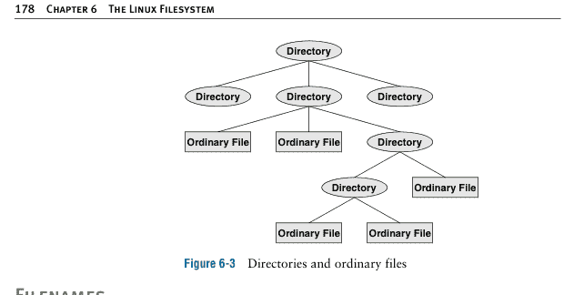

## 文件名

每个文件都有一个文件名。文件名的最大长度因文件系统类型而异；Linux 支持几种类型的文件系统。尽管当今大多数文件系统允许文件名长达 255 个字符，但某些文件系统将文件名限制在较少的字符数。虽然你可以在文件名中使用几乎任何字符，但如果你从以下列表中字符中选择，可以避免混淆：

- 大写字母（A–Z）
- 小写字母（a–z）
- 数字（0–9）
- 下划线 (_)
- 句号 (.)
- 逗号 (,)

就像同一个父母的孩子一样，同一目录中的两个文件不能拥有相同的名称。（父母给他们的孩子取不同的名字，因为这很合理，但 Linux 要求如此。）不同目录中的文件，就像不同父母的孩子一样，可以拥有相同的名称。

你选择的文件名应该具有意义。目录中经常填充着重要文件，却拥有如此无帮助的名称，如 `hold1`、`wombat` 和 `junk`，更不用说 `foo` 和 `foobar` 了。这些名称是糟糕的选择，因为它们不能帮助你回忆存储在文件中的内容。以下文件名符合建议的语法并且传达有关文件内容的信息：

- `correspond`
- `january`

### 戴维森

### 报告

### 2001

### 应付账款

当与其他系统的用户共享文件时，你可能需要在文件名开头几个字符中做出区分。运行 DOS 或旧版本 Windows 的系统对文件名主体长度限制为 8 个字符，扩展名长度限制为 3 个字符。某些 UNIX 系统限制为 14 个字符，而旧款 Macintosh 系统限制为 31 个字符。保持文件名简短便于输入；稍后你可以为它们添加扩展名，而不会超出某些文件系统施加的较短限制。短文件名的缺点是通常不如长文件名具有描述性。参见第 468 页的“stat：显示文件或文件系统的信息”，了解如何确定本地系统文件名的最大长度。

长文件名允许你为文件分配具有描述性的名称。为了帮助你在不输入完整文件名的情况下选择文件，shell 支持文件名补全。有关此功能的更多信息，请参见第 224 页的“文件名补全”技巧。

你可以在文件名中使用大写字母和/或小写字母。Linux 区分大小写，因此名为 `JANUARY`、`January` 和 `january` 的文件代表三个不同的文件。

虽然 Linux 允许你在文件名中使用空格，但这不是一个好主意。因为空格是一个特殊字符，你在命令行上必须对其进行引用。在命令行上引用字符对新手来说可能很困难，对有经验的用户来说也很繁琐。使用点号或下划线代替空格：`joe.05.04.26_new_stuff`。

如果你正在处理包含空格的文件名（例如来自其他操作系统的文件），你必须通过在空格前加反斜杠或在文件名两侧加引号来在命令行上引用该空格。以下两条命令将名为 `my_file` 的文件发送到打印机。

```bash
$ lpr my\ file
$ lpr "my file"
```

文件扩展名是文件名中嵌入的点号之后的部分。在下一页表 6-1 中列出的文件名中，文件扩展名有助于描述文件内容。一些程序，如 C 编程语言编译器，默认使用特定的文件扩展名；然而，在大多数情况下，文件扩展名是可选的。随意使用扩展名以使文件名易于理解。如果你愿意，可以在同一个文件名中使用多个点号——例如，`notes.4.10.54` 或 `files.tar.gz`。

## 表 6-1 文件扩展名

| 带扩展名的文件名 | 扩展名的含义 |
| :--- | :--- |
| `compute.c` | C 编程语言源文件 |
| `compute.o` | `compute.c` 的目标代码文件 |
| `compute` | `compute.c` 的可执行文件 |
| `memo.0410.txt` | 文本文件 |
| `memo.pdf` | PDF 文件；在 GUI 下使用 `evince`（文档查看器）查看 |
| `memo.ps` | PostScript 文件；在 GUI 下使用 `evince`（文档查看器）查看 |
| `memo.Z` | 使用 `compress`（第 249 页）压缩的文件；使用 `uncompress` 或 `gunzip`（第 248 页）解压 |
| `memo.gz` | 使用 `gzip`（第 245 页）压缩的文件；使用 `zcat` 查看或使用 `gunzip` 解压（两者均在第 248 页） |
| `memo.tgz` 或 `memo.tar.gz` | 使用 `gzip`（第 245 页）压缩的 `tar`（第 249 页）文件归档 |
| `memo.bz2` | 使用 `bzip2`（第 245 页）压缩的文件；使用 `bzcat` 查看或使用 `bunzip2` 解压（两者均在第 245 页） |
| `memo.html` | 旨在使用 Web 浏览器（如 `Firefox`）查看的文件 |
| `photo.gif`、`photo.jpg`、`photo.jpeg`、`photo.bmp`、`photo.tif` 或 `photo.tiff` | 包含图形信息（如图片）的文件 |

## 隐藏文件名

以点号开头的文件名称为隐藏文件名（或隐藏文件，有时也称为不可见文件），因为 `ls` 通常不显示它。`ls -a` 命令显示所有文件名，包括隐藏文件。启动文件（见下文）的名称通常以点号开头，因此它们是隐藏的，不会使目录列表杂乱无章。每个目录（第 186 页）中都有两个特殊的隐藏条目——单个点号和双点号（`.` 和 `..`）。

## 启动文件

出现在你的主目录（第 143 页）中的启动文件，为 shell 和其他程序提供关于你和你的偏好设置的信息。这些文件中的每一个通常都会告知 shell 你正在使用的终端类型（第 1153 页），并执行 `stty`（设置终端）实用程序以建立擦除键（第 123 页）和行终止键（第 123 页）。你或系统管理员可以在你的主目录中放置一个包含 shell 命令的 shell 启动文件。每次登录时，shell 都会执行该文件中的命令。由于启动文件具有隐藏文件名（以点号开头的文件名；见上文），你必须使用 `ls -a` 命令来查看你的主目录中是否存在此类文件。GUI 有许多启动文件。通常你不需要直接操作这些文件，但可以使用桌面上的图标来控制启动序列。有关启动文件的更多信息，请参见第 329 页。

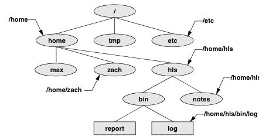

## 路径名

每个文件都有一个路径名，它是从目录穿过目录层级的一部分，到达普通文件或目录的路径。在路径名内，文件名右侧（后面）的斜杠 `/` 表示该文件是一个目录文件。斜杠右侧（后面）的文件可以是普通文件或目录文件。最简单的路径名是一个简单文件名，它指向工作目录（第 143 页）中的一个文件。本节讨论绝对路径名和相对路径名，并解释如何使用它们。

### 绝对路径名

`/`（根）

文件系统层级的根目录没有名称；它被称为根目录，由单独出现的斜杠 `/` 或路径名左端的斜杠表示。

绝对路径名以斜杠 `/` 开头，该斜杠代表根目录。斜杠后面是位于根目录中的文件名称。绝对路径名可以继续，通过所有中间目录追踪路径，直到由路径名标识的文件。将路径中所有的文件名连接起来，每个目录后面跟一个斜杠 `/`。这个文件名字符串被称为绝对路径名，因为它通过从根目录到文件追踪路径来绝对地定位一个文件。通常目录的绝对路径名不包括尾随斜杠，尽管可以使用该格式来强调路径名指定的是一个目录（例如，`/home/zach/`）。路径名中最后一个斜杠后面的部分被称为简单文件名、文件名或基本名。图 6-4 显示了文件系统层级的一部分中目录和普通文件的绝对路径名。

使用绝对路径名，你可以列出或以其他方式操作本地系统上的任何文件，前提是你拥有相应的权限，这与你输入命令时的工作目录无关。例如，Sam 可以在其主目录中工作时输入以下命令，以列出 `/etc/ssh` 目录中的文件：

```bash
$ pwd
/home/sam
$ ls /etc/ssh
moduli          ssh_host_dsa_key     ssh_host_key.pub
sshd_config     ssh_host_dsa_key.pub ssh_host_rsa_key
sshd_config     ssh_host_key         ssh_host_rsa_key.pub
```

### 路径名中的波浪号 (~)

在另一种形式的绝对路径名中，shell 会将路径名开头的字符 `~/`（波浪号后跟斜杠）扩展为你的主目录的路径名。使用这种快捷方式，无论哪个目录是工作目录，你都可以使用以下命令显示你的 `.bashrc` 启动文件（第 331 页）：

```bash
$ less ~/.bashrc
```

波浪号可以快速引用以你或某人的主目录开始的路径。shell 会将路径名开头的波浪号后跟的用户名扩展为该用户主目录的路径名。例如，假设他拥有相应的权限，Max 可以使用以下命令检查 Sam 的 `.bashrc` 文件：

```bash
$ less ~sam/.bashrc
```

有关更多信息，请参阅第 407 页的“波浪号扩展”。

### 相对路径名

相对路径名追踪从工作目录到文件的路径。路径名是相对于工作目录的。任何不以根目录（由 `/` 表示）或波浪号（`~`）开头的路径名都是相对路径名。与绝对路径名一样，相对路径名可以追踪穿过许多目录的路径。最简单的相对路径名是一个简单文件名，它标识工作目录中的一个文件。下一节中的示例使用了绝对路径名和相对路径名。

## 工作目录的重要性

要访问工作目录中的任何文件，你只需要一个简单的文件名。要访问其他目录中的文件，你必须使用路径名。输入长路径名很繁琐，并增加了出错的可能性。在 GUI 下，这种可能性较小，因为你点击文件名或图标。你可以为任何特定任务选择一个工作目录，以减少对长路径名的需求。你选择工作目录并不会让你能够做任何原本做不到的事——它只是使某些操作更容易。

## 使用相对路径名时，需明确当前工作目录

> 使用相对路径名访问文件时，文件的位置取决于（相对于）当前工作目录。在使用相对路径名之前，务必确认当前工作目录是哪一个。请使用 `pwd` 命令来验证当前目录。如果您正在使用 `vim` 创建文件，而您并不在文件层级中预期的位置，新文件将会被放置在意外的位置。

当您使用绝对路径名时，当前工作目录是哪一个是无关紧要的。因此，以下命令始终编辑主目录中名为 `goals` 的文件：

```
vim ~/goals
```

阅读本段文字时，请参阅图 6-5。当前工作目录的子文件可以使用简单的文件名来引用。当前工作目录的孙文件可以使用短相对路径名来引用：即由斜杠分隔的两个文件名。在大型目录结构中操作文件时，使用短相对路径名可以为您节省时间和避免麻烦。如果您选择一个包含特定任务中最常使用文件的工作目录，那么您需要使用的长且繁琐的路径名就会更少。

## 处理目录

本节讨论如何创建目录（`mkdir`）、在目录之间切换（`cd`）、删除目录（`rmdir`）、使用路径名使工作更轻松，以及在不同目录之间移动和复制文件和目录。最后，本节简要介绍了 Linux 文件系统中重要的标准目录和文件。

### `mkdir`：创建目录

`mkdir` 实用程序用于创建目录。`mkdir` 的参数（第 1237 页）是新目录的路径名。以下示例展示了如何开发图 6-6 中所示的目录结构。在该图中，新添加的目录以较浅的颜色显示，并用虚线连接。

接下来，`pwd` 显示 Max 正在其主目录（`/home/max`）中工作，而 `ls` 显示其主目录中文件的名称：`demo`、`names` 和 `temp`。

```bash
$ pwd
/home/max
$ ls
demo    names   temp
$ mkdir literature
```

使用 `mkdir`，Max 在其主目录下创建一个名为 `literature` 的子目录。因为他希望 `literature` 目录成为当前工作目录的子目录，所以他使用相对路径名（即简单的文件名）。Max 也可以使用绝对路径名创建相同的目录：`mkdir /home/max/literature`、`mkdir ~max/literature` 或 `mkdir ~./literature`。

以下 `ls` 命令验证了新目录的存在。对 `ls` 使用 `-F` 选项会在每个目录名称后显示斜杠，并在每个可执行文件（shell 脚本、实用程序或应用程序）后显示星号。当调用 `ls` 并传入一个目录名称作为参数时，`ls` 会列出该目录的内容。最后的 `ls` 没有显示任何内容，因为 `literature` 目录中没有文件。

```bash
$ ls
demo    literature/ names   temp
$ ls -F
demo    literature/*       names   temp
$ ls literature
$
```


以下命令展示了 `Max` 创建 `promo` 目录的两种方法，该目录作为新创建的 `literature` 目录的子目录。第一种方法检查 `/home/max` 是否为当前工作目录，并使用相对路径名：

```
$ pwd
/home/max
$ mkdir literature/promo
```

第二种方法使用绝对路径名：

```
$ mkdir /home/max/literature/promo
```

使用 `mkdir` 的 `-p`（父目录）选项，可以用一条命令同时创建 `literature` 和 `promo` 目录：

```
$ pwd
/home/max
$ ls
demo   names   temp
$ mkdir -p literature/promo
```

或者

```
$ mkdir -p /home/max/literature/promo
```

### `cd`：切换到另一个工作目录

`cd`（更改目录）实用程序将另一个目录设为工作目录；它不会更改工作目录的内容。以下示例展示了将 `/home/max/literature` 目录设为工作目录的两种方法，并通过 `pwd` 进行验证。首先，`Max` 使用绝对路径名执行 `cd` 命令，将 `literature` 设为他的工作目录——当使用绝对路径名执行命令时，当前工作目录是哪个并不重要。`pwd` 命令确认了 `Max` 所做的更改。

```
$ cd /home/max/literature
$ pwd
/home/max/literature
```

当不带参数使用时，`cd` 会将您的主目录设为工作目录，即您登录时所在目录。以下的 `cd` 命令没有参数，因此它将 `Max` 的主目录设为工作目录。最后，既然知道自己在主目录中工作，`Max` 使用简单的文件名将 `literature` 目录设为他的工作目录（`cd literature`），并使用 `pwd` 确认更改。

```
$ cd
$ pwd
/home/max
$ cd literature
$ pwd
/home/max/literature
```

### 了解 . 和 .. 目录条目

`mkdir` 实用程序在创建的每个目录中自动放入两个条目：一个单点（`.`）和一个双点（`..`）。`.` 与工作目录的路径名同义，可以替代使用；`..` 与工作目录父目录的路径名同义。这些条目是隐藏的，因为它们的文件名以点开头。

当工作目录为 `literature` 时，以下示例使用了三次 `..`：第一次列出父目录（`/home/max`）的内容，第二次将 `memoA` 文件复制到父目录，第三次再次列出父目录的内容。

```
$ pwd
/home/max/literature
$ ls ..
demo literature names temp
$ cp memoA ..
$ ls ..
demo literature memoA names temp
```

在使用 `cd` 将 `promo`（`literature` 的子目录）设为工作目录后，`Max` 可以使用相对路径名调用 `vim` 来编辑主目录中的文件。

```
$ cd promo
$ vim ../../names
```

您几乎可以在任何实用程序或程序要求文件名或路径名的地方使用绝对路径名、相对路径名或简单的文件名。这种用法适用于 `ls`、`vim`、`mkdir`、`rm` 以及大多数其他 Linux 实用程序。

### 工作目录与主目录

> **提示** 工作目录与您的主目录不同。在您的会话期间，通常甚至在会话之间，您的主目录保持不变。登录后，您始终在同一个目录中工作：即您的主目录。
>
> 与主目录不同，工作目录可以按需随时更改。您没有固定的工作目录，这就是为什么有些人将其称为当前目录的原因。登录后，直到您使用 `cd` 更改目录之前，您的主目录就是工作目录。如果您将目录更改为 `Sam` 的主目录，那么 `Sam` 的主目录就会成为工作目录。

### `rmdir`：删除目录

`rmdir`（删除目录）实用程序用于删除目录。您不能删除工作目录或包含 `.` 和 `..` 条目以外文件的目录。如果需要删除包含文件的目录，请先使用 `rm` 删除文件，然后再删除目录。您不需要（也不能）删除 `.` 和 `..` 条目；`rmdir` 会自动删除它们。以下命令删除 `promo` 目录：

```
$ rmdir /home/max/literature/promo
```

`rm` 实用程序有一个 `-r` 选项（`rm -r filename`），可以递归删除目录中的文件（包括子目录），并删除目录本身。

**谨慎使用 `rm -r`，或者最好避免使用**

> 虽然 `rm -r` 是一个便捷的命令，但必须谨慎使用。不要使用模糊的文件引用（如 `*`）。一条简短的命令就可能会轻松地将您的整个主目录清除干净，这非常危险。

### 使用路径名

如果您想尝试接下来的示例，请使用文本编辑器创建一个名为 `letter` 的文件。或者，您可以使用 `touch` 创建一个空文件：

```
$ cd
$ pwd
/home/max
$ touch letter
```

当工作目录为 `/home/max` 时，以下示例使用 `cp` 配合相对路径名将文件 `letter` 复制到 `/home/max/literature/promo` 目录。（如果您之前删除了 `promo`，需要重新创建它。）复制的文件使用简单文件名 `letter.0210`：

```
$ cp letter literature/promo/letter.0210
```

如果 `Max` 不切换到其他目录，他可以按照所示方式使用 `vim` 来编辑刚刚创建的文件副本：

```
$ vim literature/promo/letter.0210
```

如果 `Max` 不想使用长路径名来指定文件，他可以使用 `cd` 将 `promo` 设为工作目录，然后再使用 `vim`：

```
$ cd literature/promo
$ pwd
/home/max/literature/promo
$ vim letter.0210
```

要将工作目录的父目录（名为 `/home/max/literature`）设为新的工作目录，`Max` 可以执行以下命令，该命令利用了 `..` 目录条目：

```
$ cd ..
$ pwd
/home/max/literature
```

### `mv`, `cp`：移动或复制文件

第 7 章讨论了使用 `mv` 重命名文件。然而，`mv` 的用途更为广泛：您可以使用此实用程序将文件从一个目录移动到另一个目录（更改文件的路径名），也可以更改简单的文件名。当用于将一个或多个文件移动到新目录时，`mv` 命令的语法如下：`mv existing-file-list target-directory`

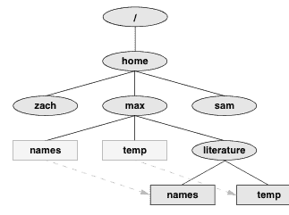

## 图 6–7

使用 `mv` 移动 `names` 和 `temp`

如果工作目录是 `/home/max`，`Max` 可以使用以下命令将文件 `names` 和 `temp` 从工作目录移动到 `literature` 目录：

```
$ mv names temp literature
```

此命令将 `names` 和 `temp` 文件的绝对路径名分别更改为 `/home/max/literature/names` 和 `/home/max/literature/temp`，原来的路径是 `/home/max/names` 和 `/home/max/temp`（见图 6–7）。与大多数 Linux 命令一样，`mv` 接受绝对或相对路径名。

随着你在 Linux 中处理更多内容并创建更多文件，你将需要使用 `mkdir` 创建新目录以保持文件组织有序。`mv` 工具是将文件从一个目录移动到另一个目录的有用工具，当你扩展目录层次结构时尤其有用。

`cp` 工具的工作方式与 `mv` 相同，不同之处在于它会在指定目录中创建现有文件列表的副本。

### `mv`：移动目录

正如 `mv` 将一个目录中的普通文件移动到另一个目录一样，`mv` 也可以移动目录。语法类似，除了你指定要移动的是一个或多个目录，而不是普通文件：

```
mv existing-directory-list new-directory
```

如果 `new-directory` 不存在，`existing-directory-list` 必须只包含一个目录名，`mv` 会将其更改为 `new-directory`（`mv` 重命名目录）。虽然你可以使用 `mv` 重命名目录，但除非使用 `-r`（递归）选项，否则你不能使用 `cp` 复制其内容。请参考 `tar` 和 `cpio` 手册页了解其他复制和移动目录的方法。

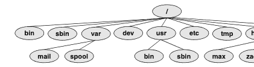

### 图 6-8

典型的基于 FHS 的 Linux 文件系统结构

## 重要的标准目录和文件

最初，Linux 系统上的文件并未放置在目录层次结构中的标准位置。分散的文件使记录和维护 Linux 系统变得困难，而且几乎不可能发布一个能在所有 Linux 系统上编译和运行的软件包。Linux 文件系统的第一个标准 FSSTND（Linux 文件系统标准）于 1994 年初发布。1995 年初，一项涵盖许多类 UNIX 系统的更广泛标准工作开始：FHS（Linux 文件系统层次结构标准；`proton.pathname.COM/fhs`）。最近，FHS 已并入 LSB（Linux 标准基；`www.linuxfoundation.org/collaborate/workgroups/lsb`），这是 FSG（自由标准组）的一个工作组。最终，FSG 与 OSFL（开放源开发实验室）合并成立了 Linux 基金会（`www.linuxfoundation.org`）。图 6-8 显示了 FHS 规定的某些重要目录和文件的位置。随着你继续阅读，许多这些目录的重要性将变得清晰。

以下列表描述了图 6-8 中显示的目录，FHS 规定的某些目录，以及其他一些目录。然而，Fedora/RHEL 并未使用 FHS 规定的所有目录。请注意，你并不能总是通过目录名称确定其功能。例如，虽然 `/opt` 存储附加软件，但 `/etc/opt` 存储 `/opt` 中软件的配置文件。另请参阅第 502 页的“重要文件和目录”。

`/bin` `/usr/bin` `/sbin` `/usr/sbin`

最近，`/bin` 和 `/sbin` 中的文件分别被移动到 `/usr/bin` 和 `/usr/sbin`，`/bin` 和 `/sbin` 被设置为指向这些目录的符号链接（第 206 页）：

```
$ ls -ld /bin /usr/bin /sbin /usr/sbin

lrwxrwxrwx. 1 root root 7 07-16 18:37 /bin -> usr/bin
lrwxrwxrwx. 1 root root 8 07-16 18:37 /sbin -> usr/sbin
dr-xr-xr-x. 2 root root 53248 07-27 15:36 /usr/bin
dr-xr-xr-x. 2 root root 20480 07-27 15:36 /usr/sbin
```

请参阅 `fedoraproject.org/wiki/Features/UsrMove` 获取更多信息。

- `/` **根目录** 根目录存在于所有 Linux 文件系统结构中，是文件系统中所有文件的祖先。它没有名称，由单独的路径名左端的斜杠（`/`）表示。

- `/bin` `/usr/bin` 的链接。

- `/boot` **引导加载程序的静态文件** 包含启动系统所需的所有文件。

- `/dev` **设备文件** 包含表示外围设备（如磁盘驱动器、终端和打印机）的所有文件。以前，此目录充满了所有可能的设备。`udev` 工具（第 516 页）提供动态设备目录，使 `/dev` 仅包含系统中存在的设备。另见第 503 页的 `/dev`。

- `/etc` **本机系统配置文件** 保存管理、配置和其他系统文件。

- `/etc/opt` **存储在 `/opt` 中的附加软件包的配置文件**

- `/etc/X11` **X 窗口系统的本机配置文件**

- `/home` **用户主目录** 每个用户的主目录通常是 `/home` 目录的众多子目录之一。例如，假设用户目录位于 `/home` 下，`Zach` 的主目录的绝对路径名是 `/home/zach`。在一些系统中，用户目录可能不在 `/home` 下，而是分散在 `/inhouse` 和 `/clients` 等其他目录中。

- `/lib` `/usr/lib` 的链接。

- `/lib64` `/usr/lib64` 的链接。

- `/lib/modules` **可加载内核模块**

- `/mnt` **临时挂载文件系统的挂载点**

- `/opt` **附加（可选）软件包**

- `/proc` **内核和进程信息虚拟文件系统**

- `/root` **root 账户的主目录**

- `/run` **运行时（易失）数据** 一个 tmpfs 文件系统（已挂载，但存储在 RAM 中），保存以前隐藏在 `/dev` 和其他目录中的启动文件。有关更多信息，请参见 `lists.fedoraproject.org/pipermail/devel/2011-March/150031.html`。

- `/sbin` `/usr/sbin` 的链接。

- `/sys` **设备伪文件系统** 有关更多信息，请参见第 516 页的 `udev`。

- `/tmp` **临时文件**

- `/usr` **已安装的系统** 包含包含系统使用信息的子目录。子目录中的文件不经常更改，并且可以由多个系统共享。

- `/usr/bin` **大多数用户命令** 包含标准 Linux 实用程序。

- `/usr/sbin` **基本系统二进制文件** 用于系统管理的实用程序。

- `/usr/games` 游戏和教育程序

- `/usr/include` **C 程序包含的头文件**

- `/usr/lib` **共享库（32 位）**

- `/usr/lib64` 共享库（64 位）

- `/usr/local` **本地层次结构** 保存添加到系统中的本地重要文件和目录。子目录可以包括 `bin`、`games`、`include`、`lib`、`sbin`、`share` 和 `src`。

- `/usr/share` **架构独立的数据** 子目录可以包括 `dict`、`doc`、`games`、`info`、`locale`、`man`、`misc`、`terminfo` 和 `zoneinfo`。

- `/usr/share/doc` 文档

- `/usr/share/info` GNU info 系统的主要目录

- `/usr/share/man` 在线手册

- `/usr/src` 源代码

- `/var` **可变数据** 内容随系统运行而变化的文件保存在 `/var` 下的子目录中。最常见的例子是临时文件、系统日志文件、假脱机文件和用户邮箱文件。子目录可以包括 `cache`、`lib`、`lock`、`log`、`mail`、`opt`、`run`、`spool`、`tmp` 和 `yp`。

- `/var/log` **日志文件** 包含 `lastlog`（每个用户最后登录的记录）、`messages`（来自 `syslogd` 的系统消息）和 `wtmp`（所有登录/登出的记录）等日志文件。

- `/var/spool` **假脱机应用程序数据** 包含 `anacron`、`at`、`cron`、`lpd`、`mail`、`mqueue`、`samba` 和其他目录。文件 `/var/mail` 通常是 `/var/spool/mail` 的链接。

## 访问权限

除了 SELinux（第 473 页）施加的控制之外，Fedora/RHEL 支持两种控制谁可以访问文件以及如何访问的方法：传统的 Linux 访问权限和 ACL（访问控制列表）。本节描述传统的 Linux 访问权限。有关 ACL 的讨论，请参阅第 198 页，ACL 提供比传统访问权限更精细的访问权限控制。

三种类型的用户可以访问文件：文件的所有者（owner），与文件关联的组的成员（group；有关组的更多信息，请参阅第 506 页），以及其他人（other）。用户可以尝试以三种方式访问普通文件：尝试读取、写入或执行它。

### ls -l：显示权限

当你使用 `-l` 选项和一个或多个普通文件的名称调用 `ls` 时，`ls` 会显示一行关于文件的信息。有关本书使用的显示格式的信息，请参阅第 28 页的“ls 输出”。以下示例

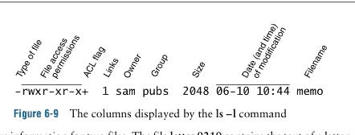

图 6-9 `ls -l` 命令显示的列

展示了两个文件的信息。文件 `letter.0210` 包含一封信的内容，而 `check_spell` 包含一个 Shell 脚本，即用高级 Shell 编程语言编写的程序：

```
$ ls -l check_spell letter.0210
-rwxr-xr-x. 1 sam pubs  766 03-21 14:02 check_spell
-rw-r--r--. 1 sam pubs 6193 02-10 14:22 letter.0210
```

从左到右，`ls -l` 命令显示的行包含以下信息（参见图 6-9）：

- 文件类型（第一个字符）

- 文件的访问权限（接下来的九个字符）

- ACL 标志（如果文件拥有 ACL，请参阅第 198 页）

- 指向该文件的链接数（请参阅第 203 页）

- 文件所有者的名称（通常是创建该文件的人）

- 与该文件关联的组名称

- 文件的大小（以字符/字节为单位）

- 文件创建或最后修改的日期和时间

- 文件名称

`letter.0210` 的文件类型（第一列）是连字符（`-`），因为它是一个普通文件（目录文件在此列显示为 `d`）。


接下来的三个字符指定文件 `所有者` 的访问权限：`r` 表示读权限，`w` 表示写权限，`x` 表示执行权限。列中的 `-` 表示 `所有者` 不拥有该位置可能出现的权限。

以类似的方式，接下来的三个字符代表 `组` 的权限，最后三个字符代表 `其他人`（其他人）的权限。在前面的示例中，`letter.0210` 的所有者可以读取和写入该文件，而组和他人只能读取该文件，且无人被允许执行该文件。虽然可以为任何文件赋予执行权限，但为包含信函等文档的文件赋予执行权限是没有意义的。`check_spell` 文件是可执行的 Shell 脚本，因此赋予其执行权限是合适的。（所有者、组和他人都有执行权限。）

## `chmod`: 更改文件访问权限

Linux 文件访问权限机制允许您让其他用户访问您希望共享的文件，同时保持您的私人文件保密。您可以允许其他用户读取和写入文件（如果您是与几个人一起合作的一个项目成员，这会很有用）。您可以仅允许他人读取文件（也许是一份您正在提议的项目规范）。或者，您可以仅允许他人写入文件（类似于收件箱或邮箱，您希望他人能够向您发送邮件，但不希望他们阅读您的邮件）。类似地，您可以保护整个目录不被扫描（稍后介绍）。

### 具有 `root` 权限的用户可以访问系统中的任何文件

**安全**

本节描述的访问权限有一个例外。任何能够获得 `root` 权限的人都可以完全访问所有文件，无论文件的所有者或访问权限如何。当然，如果文件是加密的，读访问并不意味着读取该文件的人能够理解文件中的内容。

文件的所有者控制哪些用户有权访问该文件以及这些用户如何访问该文件。当您拥有一个文件时，您可以使用 `chmod`（更改模式）实用工具来更改该文件的访问权限。您可以为 `chmod` 指定符号（相对）或数字（绝对）参数。

### `chmod` 的符号参数

以下示例使用 `chmod` 的符号参数，为所有 (`a`) 用户添加 (`+`) 读和写权限 (`rw`)：

```bash
$ ls -l letter_0210
-rw-r----- 1 sam pubs 6193 02-10 14:22 letter_0210
$ chmod a+rw letter_0210
$ ls -l letter_0210
-rw-rw-rw- 1 sam pubs 6193 02-10 14:22 letter_0210
```

### 执行 Shell 脚本需要读权限

**提示**

因为 Shell 在执行脚本内的命令之前需要读取 Shell 脚本（包含 Shell 命令的文本文件），所以您需要对包含脚本的文件拥有读权限才能执行它。如果您要直接从命令行执行 Shell 脚本，您还需要执行权限。相比之下，二进制（程序）文件不需要被读取；它们被直接执行。您只需要执行权限即可运行二进制程序。

使用符号参数执行 `chmod` 会修改现有的权限；给定参数所做的更改取决于（相对于）现有权限。在接下来的示例中，`chmod` 移除 (`-`) 其他 (`o`) 用户的读 (`r`) 和执行 (`x`) 权限。所有者和组权限不受影响。

```bash
$ ls -l check_spell
-rwxr-xr-x 1 sam pubs 766 03-21 14:02 check_spell
$ chmod o-rx check_spell
$ ls -l check_spell
-rwxr-x--- 1 sam pubs 766 03-21 14:02 check_spell
```

除了 `a`（所有）和 `o`（其他），您还可以在 `chmod` 的参数中使用 `g`（组）和 `u`（用户，尽管用户指的是文件的所有者，该所有者在特定时刻可能不是文件的使用者）。例如，`chmod a+x` 为所有用户（其他、组和所有者）添加执行权限，而 `chmod go-rwx` 移除除文件所有者之外所有人的所有权限。

**`chmod`: `o` 代表其他，`u` 代表所有者**

> **提示** 使用 `chmod` 时，许多人假设 `o` 代表 `owner`（所有者）；事实并非如此。`o` 代表 `other`（其他），而 `u` 代表 `owner` (user)（所有者/用户）。缩写 `UGO`（用户-组-其他）可能有助于您记住权限的命名方式。

### `chmod` 的数字参数

您也可以使用数字参数通过 `chmod` 指定权限。替代前例中用于指定权限的字母和符号，数字参数由三个八进制数字组成。（第四个前导数字控制 `setuid` 和 `setgid` 权限，将在下文讨论。）第一个数字指定所有者的权限，第二个数字指定组的权限，第三个数字指定其他用户的权限。`1` 赋予指定用户执行权限，`2` 赋予写权限，`4` 赋予读权限。通过 `OR`（相加）相应的值来构造代表所有者、组或其他人权限的数字，如以下示例所示。使用数字参数会以绝对方式设置文件权限；它不像符号参数那样修改现有权限。

在以下示例中，`chmod` 更改权限，使得无论之前如何设置权限，仅文件所有者可以读取和写入该文件。第一位的 `6` 赋予所有者读 (`4`) 和写 (`2`) 权限。`0` 移除组和其他用户的所有权限。

```bash
$ chmod 600 letter.0210
$ ls -l letter.0210
-rw------- 1 sam pubs 6193 02-10 14:22 letter.0210
```

接下来，`7` (`4 + 2 + 1`) 赋予所有者读、写和执行权限。`5` (`4 + 1`) 赋予组和其他用户读和执行权限：

```bash
$ chmod 755 check_spell
$ ls -l check_spell
-rwxr-xr-x 1 sam pubs 766 03-21 14:02 check_spell
```

有关数字权限的更多示例，请参见表 6-2。

**表 6-2 数字权限规范示例**

| 模式 | 含义 |
|---|---|
| `777` | 所有者、组和其他人可以读、写和执行文件 |
| `755` | 所有者可以读、写和执行文件；组和其他人可以读和执行文件 |
| `711` | 所有者可以读、写和执行文件；组和其他人可以执行文件 |
| `644` | 所有者可以读和写文件；组和其他人可以读文件 |
| `640` | 所有者可以读和写文件，组可以读文件，其他人无法访问文件 |

有关使用 `chmod` 使文件可执行的更多信息，请参见第 337 页；有关绝对参数和 `chmod` 一般信息的更多信息，请参见 `chmod` 的手册页。有关组的更多信息，请参见第 506 页。

## `chown`: 更改文件所有权

`chown` 实用工具更改作为参数指定的一或多个文件的所有者。只有使用 `root` 权限工作的用户才能更改文件的所有权。在以下示例中，一个使用 `root` 权限工作的用户将 `memo` 文件的所有者从 `Sam` 更改为 `Max`，并显示更改前后的所有者名称。

```bash
$ ls -l memo
-rw-rw-r--. 1 sam pubs 3933 04-30 17:26 memo
$ su -c 'chown max memo'
Password:
$ ls -l memo
-rw-rw-r--. 1 max pubs 3933 04-30 17:26 memo
```

`-R` (`--recursive`) 选项允许您指定目录作为参数；它更改指定目录层次结构中所有文件的所有权。`-v` (`--verbose`) 选项为 `chown` 处理的每个文件显示一条消息，说明其所有者是保留还是已更改。

## `chgrp`: 更改文件组关联

`chgrp` 实用工具更改作为参数指定的一或多个文件的组关联。只有文件的所有者或使用 `root` 权限工作的用户才能更改与文件关联的组。在以下示例中，拥有名为 `memo` 的文件的所有者 `Max` 将与 `memo` 关联的组从 `pubs` 更改为 `max`，并显示更改前后的组名称。

```bash
$ ls -l memo
-rw-rw-r--. 1 max pubs 3933 04-30 17:26 memo
$ chgrp max memo
$ ls -l memo
-rw-rw-r--. 1 max max 3933 04-30 17:26 memo
```

`-R` (`--recursive`) 选项允许您指定目录作为参数；它更改指定目录层次结构中所有文件的组关联。`-v` (`--verbose`) 选项为 `chgrp` 处理的每个文件显示一条消息，说明其组是保留还是已更改。

## `Setuid` 和 `setgid` 权限

当你执行一个具有 `setuid`（set user ID）权限的文件时，执行该文件的进程将获得该文件所有者的权限。例如，如果你运行一个用于删除目录中所有文件的 `setuid` 程序，即使你通常没有权限这样做，你也可以删除文件所有者目录中的任何文件。类似地，`setgid`（set group ID）权限赋予执行该文件的进程该文件所属组的权限。

### 最小化使用由 `root` 拥有的 `setuid` 和 `setgid` 程序

当可执行文件设置为 `setuid` 且所有者为 `root` 时，即使它们不是由 `root` 运行的，运行时也具有 `root` 权限。这类程序非常强大，因为它们可以执行 `root` 能做的任何事情（以及该程序设计要执行的操作）。同样，设置为 `setgid` 且属于 `root` 组的可执行文件也具有广泛的权限。

鉴于它们拥有的强大力量及其潜在的破坏性，明智的做法是避免盲目地创建和使用由 `root` 拥有的 `setuid` 程序以及属于 `root` 组的 `setgid` 程序。由于其固有的危险性，许多站点尽可能减少在其系统上使用这些程序。一个必需的 `setuid` 程序是 `passwd`。请参阅第 425 页，了解关于由 `root` 拥有的 `setuid` 文件的提示，以及第 458 页，了解列出本地系统上 `setuid` 文件的命令。

由于这种危险，Fedora/RHEL 已删除了大多数 `setuid` 文件。更多信息请参阅 `fedoraproject.org/wiki/Features/RemoveSETUID`。

以下示例显示了一个以 `root` 权限工作的用户，使用 `chmod` 的符号参数来赋予一个程序 `setuid` 权限，并赋予另一个程序 `setgid` 权限。`ls -l` 输出（第 191 页）通过在所有者可执行位置显示 `s` 来指示 `setuid` 权限，通过在组可执行位置显示 `s` 来指示 `setgid` 权限：

```bash
# ls -l myprog*
-rwxr-xr-x. 1 root pubs 362804 03-21 15:38 myprog1
-rwxr-xr-s. 1 root pubs 189960 03-21 15:38 myprog2

# chmod u+s myprog1
# chmod g+s myprog2

# ls -l myprog*
-rwsr-xr-x. 1 root pubs 362804 03-21 15:38 myprog1
-rwxr-xr-s. 1 root pubs 189960 03-21 15:38 myprog2
```

下一个示例使用 `chmod` 的数字参数进行相同的更改。当你使用四个数字指定权限时，将第一个数字设置为 `1` 会设置 `粘滞位`（第 1275 页），设置为 `2` 指定 `setgid` 权限，设置为 `4` 指定 `setuid` 权限：

```bash
# ls -l myprog*
-rwxr-xr-x. 1 root pubs 362804 03-21 15:38 myprog1
-rwxr-xr-x. 1 root pubs 189960 03-21 15:38 myprog2

# chmod 4755 myprog1
# chmod 2755 myprog2

# ls -l myprog*
-rwsr-xr-x. 1 root pubs 362804 03-21 15:38 myprog1
-rwxr-Sr-x. 1 root pubs 189960 03-21 15:38 myprog2
```

**不要编写 `setuid` shell 脚本**

**安全** 永远不要给 shell 脚本赋予 `setuid` 权限。破坏它们的多种技术已经广为人知。

## 目录访问权限

当访问权限应用于目录时，其含义略有不同。虽然三种类型的用户可以读取或写入目录，但目录不能被“执行”。可执行权限针对目录进行了重新定义：它意味着你可以 `cd` 进入该目录，并且/或者检查你在该目录中有权读取的文件。这与执行文件无关。

当你只有目录的可执行权限时，如果你知道文件名，可以使用 `ls` 列出该目录中的文件。你无法使用 `ls` 列出目录的整个内容。在以下交互中，Zach 首先验证他是以自己的身份登录的。然后他检查 Max 的 `info` 目录上的权限。你可以通过运行带有 `-d`（目录）和 `-l`（长格式）选项的 `ls` 来查看与目录相关的访问权限：

```bash
$ who am i
zach
$ ls -ld /home/max/info
drwx------. 2 max pubs 4096 08-21 09:31 /home/max/info
$ ls -l /home/max/info
ls: /home/max/info: Permission denied
```

`ls` 显示的行左侧的 `d` 表示 `/home/max/info` 是一个目录。Max 具有读、写和执行权限；`pubs` 组的成员没有任何访问权限；其他用户只有执行权限，由权限字符串右端的 `x` 表示。由于 Zach 没有该目录的读取权限，`ls -l` 命令返回错误。

当 Zach 指定他想要获取信息的文件名时，他并不是在读取新的目录信息，而是在查找特定信息，而他被允许通过目录的执行权限来执行此操作。他对 `notes` 具有读取权限，因此使用 `cat` 显示该文件时没有遇到问题。他无法显示 `financial`，因为他没有对该文件的读取权限：

```bash
$ ls -l /home/max/info/financial /home/max/info/notes
-rw-------. 1 max pubs 34 08-21 09:31 /home/max/info/financial
-rw-r--r--. 1 max pubs 30 08-21 09:32 /home/max/info/notes
$ cat /home/max/info/notes
This is the file named notes.
$ cat /home/max/info/financial
cat: /home/max/info/financial: Permission denied
```

接下来 Max 赋予其他人对他的 `info` 目录的读取访问权限：

```bash
$ chmod o+r /home/max/info
```

当 Zach 检查他对 `info` 的访问权限时，他发现他对该目录同时具有读取和执行访问权限。现在 `ls -l` 显示 `info` 目录的内容，但他仍然无法读取 `financial`。（此限制是文件权限问题，而不是目录权限问题。）最后，Zach 尝试使用 `touch` 创建一个名为 `newfile` 的文件。如果 Max 授予他对 `info` 目录的写入权限，Zach 将能够在其中创建新文件：

```bash
$ ls -l /home/max/info
drwx--r-x. 2 max pubs 4096 08-21 09:31 /home/max/info
$ ls -l /home/max/info
total 8
-rw--------. 1 max pubs 34 08-21 09:31 financial
-rw-r---. 1 max pubs 30 08-21 09:32 notes
$ cat /home/max/info/financial
cat: financial: Permission denied
$ touch /home/max/info/newfile
touch: cannot touch '/home/max/info/newfile': Permission denied
```

## `ACL`：访问控制列表

`ACL`（访问控制列表）提供比传统 Linux 权限（第 191 页）更精细的控制，以决定哪些用户可以访问特定目录和文件。使用 `ACL`，你可以指定多个用户中每个用户访问目录或文件的方式。由于 `ACL` 可能会降低性能，请勿在存储系统文件的文件系统上启用它们，在这些地方传统的 Linux 权限就足够了。此外，在移动、复制或归档文件时要小心：并非所有实用程序都能保留 `ACL`。此外，你无法将 `ACL` 复制到不支持 `ACL` 的文件系统。

`ACL` 由一组规则组成。规则指定特定用户或组如何访问该 `ACL` 关联的文件。有两种类型的规则：`访问规则`和`默认规则`。（文档将 `访问 ACL` 和 `默认 ACL` 分别提及，尽管只有一种类型的 `ACL`：只有一种类型的列表 [ACL]，并且 `ACL` 可以包含两种类型的规则。）

访问规则为单个文件或目录指定访问信息。默认 `ACL` 仅与目录相关；它为目录中未给出显式 `ACL` 的任何文件指定默认访问信息（即 `ACL`）。

### 大多数实用程序不保留 `ACL`

> **注意**
>
> 当使用 `-p`（保留）或 `-a`（归档）选项时，`cp` 在复制文件时保留 `ACL`。`mv` 实用程序也保留 `ACL`。当你使用带有 `-p` 或 `-a` 选项的 `cp` 且它无法复制 `ACL` 时，以及在 `mv` 无法保留 `ACL` 的情况下，该实用程序执行操作并发出错误消息：
>
> ```bash
> $ mv report /tmp
> mv: preserving permissions for '/tmp/report': Operation not supported
> ```
>
> 其他实用程序，如 `tar`、`cpio` 和 `dump`，不支持 `ACL`。你可以使用带有 `-a` 选项的 `cp` 来复制目录层次结构，包括 `ACL`。

你永远无法将 `ACL` 复制到不支持 `ACL` 的文件系统，或者未开启 `ACL` 支持的文件系统。

## 启用 `ACL`


在使用访问控制列表（`ACL`）之前，必须安装 `acl` 包。`Fedora`/`RHEL` 官方仅支持在 `ext2`、`ext3` 和 `ext4` 文件系统上使用 `ACL`，尽管其他文件系统也提供非正式的 `ACL` 支持。要在 `ext2`/`ext3`/`ext4` 文件系统上使用 `ACL`，必须使用 `acl` 选项挂载该设备（`noacl` 是默认设置）。例如，如果你想挂载代表 `/home` 的设备以便在 `/home` 中的文件上使用 `ACL`，你可以将 `acl` 添加到 `/etc/fstab` 中该设备的选项列表中：

```bash
$ grep home /etc/fstab
LABEL=/home  /home  ext4  defaults,acl  1 2
```

更改 `fstab` 后，你需要重新挂载 `/home` 才能使用 `ACL`。如果没有其他人在使用系统，你可以卸载它并再次挂载它（在具有 `root` 权限的情况下），前提是当前工作目录不在 `/home` 层级结构中。或者，当设备正在被使用时，你可以使用 `remount` 选项重新挂载 `/home`：

```bash
# mount -v -o remount /home
/dev/sda3 on /home type ext4 (rw, acl)
```

有关 `fstab` 的信息请参见第 524 页，有关 `mount` 的信息请参见第 第 520 页。

### 处理访问规则

`setfacl` 实用程序用于修改文件的 `ACL`，`getfacl` 用于显示文件的 `ACL`。当你使用 `getfacl` 获取没有 `ACL` 的文件的信息时，它会显示与 `ls -l` 命令部分相同的信息，只是格式不同：

```bash
$ ls -l report
-rw-r----r--· 1 max pubs 9537 01-12 23:17 report

$ getfacl report
# file: report
# owner: max
# group: pubs
user::r-w
group::r-
other::r-
```

`getfacl` 输出的前三行组成标题部分；它们指定文件名、文件所有者以及文件所属的组。更多信息请参见第 191 页的“`ls -l`：显示权限”。`--omit-header`（或仅 `--omit`）选项使 `getfacl` 不显示标题部分：

```bash
$ getfacl --omit-header report
user::r-w
group::r-
other::r-
```

在以 `user` 开头的行中，中间没有名称的两个冒号（`::`）表示该行指定的是文件所有者的权限。类似地，`group` 行中的两个冒号表示该行指定的是文件所属组的权限。`other` 后面的两个冒号是为了保持一致性而存在的：`other` 不能关联任何名称。

`setfacl` 的 `--modify`（或 `-m`）选项使用以下格式在文件的 `ACL` 中添加或修改一条或多条规则：

```bash
setfacl --modify ugo:name:permissions file-list
```

其中 `ugo` 可以是 `u`、`g` 或 `o`，分别表示该命令为特定用户、特定组或所有其他用户设置文件权限；`name` 是要为其设置权限的用户或组的名称；`permissions` 是权限，可以采用符号格式或绝对格式；`file-list` 是要应用这些权限的文件列表。当为其他用户（`o`）指定权限时，必须省略 `name`。符号权限使用字母表示文件权限（如 `rwx`、`r-x` 等），而绝对权限使用八进制数。虽然 `chmod` 使用三组权限或三个八进制数（分别对应所有者、组和其他用户），但 `setfacl` 使用单组权限或单个八进制数来表示授予由 `ugo` 和 `name` 表示的用户或组的权限。有关文件权限的符号和绝对表示法的更多信息，请参见第 193 页关于 `chmod` 的讨论。

例如，以下两个命令都为 `report` 文件的 `ACL` 添加一条规则，该规则赋予 `Sam` 对该文件的读写权限：

```bash
$ setfacl --modify u:sam:rw-  report
```

*或*

```bash
$ setfacl --modify u:sam:6  report
$ getfacl  report
# file: report
# owner: max
# group: pubs
user::rw-
user:sam:rw-
group::r--
mask::rw-
other::r--
```

包含 `user:sam:rw-` 的行表明名为 `sam` 的用户对该文件具有读写访问权限（`rw-`）。有关如何读取访问权限的解释，请参见第 191 页。有关以 `mask` 开头的行的描述，请参见以下可选部分。

当文件具有 `ACL` 时，即使 `ACL` 为空，`ls -l` 也会在权限后显示加号（`+`）：

```bash
$ ls -l  report
-rw-rw-r--+  1 max pubs  9537 01-12 23:17  report
```

> **可选：有效权限掩码**
>
> `getfacl` 输出中以 `mask` 开头的行指定了*有效权限掩码*。此掩码限制了授予 `ACL` 组 和 用户的有效权限。它不影响文件的所有者或文件所属的组。换句话说，它不影响传统的 Linux 权限。然而，由于 `setfacl` 总是将有效权限掩码设置为文件最不严格的 `ACL` 权限，因此除非你在为文件设置 `ACL` 后显式设置该掩码，否则掩码不起作用。你可以通过在 `setfacl` 命令中用 `mask` 替代 `ugo` 且不指定 `name` 来设置掩码。

以下示例将 `report` 文件的有效权限掩码设置为*读取*权限：

```bash
$ setfacl -m mask::r-- report
```

以下 `getfacl` 输出中的 `mask` 行显示有效权限掩码已设置为读取权限（`r--`）。显示 `Sam` 的文件访问权限的行表明其权限仍设置为读写。然而，该行右端的注释显示其有效权限为读取权限。

```bash
$ getfacl report
# file: report
# owner: max
# group: pubs
user::rw-
user:sam:rw-                        #effective:r--
group::r--
mask::r--
other::r--
```

如下一个示例所示，`setfacl` 可以修改 `ACL` 规则，并且可以一次设置多条 `ACL` 规则：

```bash
$ setfacl -m u:sam:r--,u:zach:rw- report
```

```bash
$ getfacl --omit-header report
user::rw-
user:sam:r--
user:zach:rw-
group::r--
mask::rw-
other::r--
```

`-x` 选项用于删除某用户或某组的 `ACL` 规则。它不影响文件所有者或文件所属组的权限。下一个示例显示 `setfacl` 正在删除赋予 `Sam` 访问文件权限的规则：

```bash
$ setfacl -x u:sam report
```

```bash
$ getfacl --omit-header report
user::rw-
user:zach:rw-
group::r--
mask::rw-
other::r--
```

使用 `-x` 选项时，不能指定 `permissions`。相反，只需指定 `ugo` 和 `name`。`-b` 选项后仅跟文件名，将从你指定的文件或目录中删除所有 `ACL` 规则及 `ACL` 本身。

`setfacl` 和 `getfacl` 都有许多选项。使用 `--help` 选项可以显示简短的选项列表，或参阅 `man` 页面获取详细信息。

### 为目录设置默认规则

以下示例显示 `dir` 目录最初没有 `ACL`。`setfacl` 命令使用 `-d`（默认）选项为 `dir` 的 `ACL` 添加两条默认规则。这些规则适用于 `dir` 目录中没有显式 `ACL` 的所有文件。这些规则赋予 `pubs` 组成员读写和执行权限，并赋予 `adm` 组成员读、写和执行权限。

```bash
$ ls -ld dir
drwx------ 2 max pubs 4096 02-12 23:15 dir
$ getfacl dir
# file: dir
# owner: max
# group: pubs
user::rwx
group::---
other::---
$ setfacl -d -m g:pubs:rwX,g:adm:rwX dir
```

以下 `ls` 命令显示 `dir` 目录现在具有 `ACL`，如权限右侧的 `+` 所示。`getfacl` 显示的每条默认规则都以 `default` 开头。前两条默认规则和最后一条默认规则分别指定文件所有者、文件所属组以及所有其他用户的权限。这三条规则指定传统的 Linux 文件权限，并优先于其他 `ACL` 规则。第三条和第四条规则指定 `pubs` 和 `adm` 组的权限。接下来是默认的有效权限掩码。

```bash
$ ls -ld dir
drwx------+ 2 max pubs 4096 02-12 23:15 dir
$ getfacl dir
# file: dir
# owner: max
# group: pubs
user::rwx
group::---
other::---
default:user::rwx
default:group::---
default:group:pubs:rwX
default:group:adm:rwX
default:mask::rwX
default:other::---
```

请记住，默认规则适用于目录中未显式分配 `ACL` 的文件。你也可以为目录本身指定访问规则。当你在具有默认规则的 `ACL` 的目录中创建文件时，该文件的有效权限掩码将基于文件的权限创建。在某些情况下，掩码可能会覆盖默认 `ACL` 规则。

在下一个示例中，`touch` 在 `dir` 目录中创建一个名为 `new` 的文件。`ls` 命令显示该文件具有 `ACL`。基于 `umask` 的值（第 469 页），所有者和与该文件相关联的组拥有该文件的读取和写入权限。有效权限掩码被设置为读取和写入，因此 `pubs` 组的有效权限为读取，而 `adm` 组的有效权限为读取和写入。这两个组都没有执行权限。

```text
$ cd dir
$ touch new
$ ls -1 new
-rw-rw----+ 1 max pubs 0 02-13 00:39 new
$ getfacl --omit new
user::rw-
group::---
group:pubs:r-x #effective:r-
group:adm:rwx #effective:rw-
mask::rw-
other::---
```

如果你将文件的传统权限更改为所有者和组具备读取、写入和执行权限，那么有效权限掩码将变为读取、写入和执行，并且由默认规则指定的组将获得该文件的执行权限。

```text
$ chmod 770 new
$ ls -1 new
-rwxrwx---+ 1 max pubs 0 02-13 00:39 new
$ getfacl --omit new
user::rwx
group::---
group:pubs:r-x
group:adm:rwx
mask::rwx
other::---
```

## 链接

*链接*是指向文件的指针。每次你使用 `vim`、`touch`、`cp` 或其他手段创建文件时，实际上都是在目录中放置一个指针。这个指针将文件名与磁盘上的某个位置关联起来。当你在命令中指定一个文件名时，你实际上是指向了存储所需信息的磁盘位置。

当两人或多人协作同一个项目并需要共享某些信息时，共享文件会很有用。通过为文件创建额外的链接，你可以让其他用户轻松访问你的某个文件。

要将文件与另一个用户共享，首先必须授予该用户读取和写入文件的权限（参见第 193 页）。你可能还需要修改文件的父目录访问权限，以赋予该用户读取、写入或执行权限（参见第 197 页）。当权限设置合适后，该用户即可创建指向该文件的链接，这样你们各自就可以从自己的目录层次结构中访问该文件了。

链接对于拥有庞大目录层次的单个用户也非常有用。你可以创建链接来对目录层次结构中的文件进行跨类别分类，针对不同任务使用不同的分类。例如，如果你拥有第 177 页图 6-2 中所示的文件布局，名为 `to_do` 的文件可能会出现在 `correspond` 目录的每个子目录中——即 `personal`、`memos` 和 `busines`。如果你觉得难以追踪所有待办事项，可以在 `correspond` 目录中创建一个名为 `to_do` 的独立目录。然后，你可以将每个子目录中的待办事项列表链接到该目录中。例如，你可以将 `memos` 目录中名为 `to_do` 的文件链接到 `to_do` 目录中名为 `memos` 的文件。这些链接在图 6-10 中展示。虽然听起来可能很复杂，但这种技术可以将所有待办事项列表方便地集中在一个地方。当你忙于写信、撰写备忘录或处理个人事务时，相关的任务目录中可以轻松访问相应的列表。

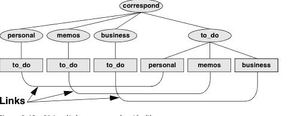

图 6-10 使用链接对文件进行跨类别分类

### 关于硬链接的讨论

> 提示 存在两种链接：硬链接和符号链接（软链接）。硬链接出现得更早，且正逐渐过时。有关硬链接的章节标记为可选内容；你可以跳过它，尽管它讨论了 `inode` 并让你深入了解文件系统结构。

### 可选

### 硬链接

指向文件的硬链接在外观上就像另一个文件。如果该文件与被链接的文件位于同一目录中，则由于同一目录中的两个文件不能同名，因此这些链接必须具有不同的文件名。你只能在该文件所在文件系统内部创建指向该文件的硬链接。

#### ln：创建硬链接

`ln`（`link`）实用工具（不使用 `-s` 或 `--symbolic` 选项）使用以下语法为现有文件创建硬链接：

```
ln existing-file new-link
```

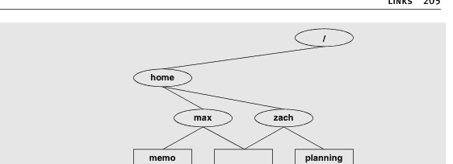

图 6-11 指向同一文件的两个链接：`/home/max/letter` 和 `/home/zach/draft`

下一条命令展示了 `Zach` 通过创建一个名为 `/home/max/letter` 的新链接，指向 `Zach` 主目录中名为 `draft` 的现有文件，从而建立了图 6-11 中所示的链接：

```
$ pwd  
/home/zach  
$ ln draft /home/max/letter
```

新链接出现在 `/home/max` 目录中，文件名为 `letter`。实际上，`Max` 可能需要更改目录权限，以便 `Zach` 能够创建该链接。尽管 `/home/max/letter` 出现在 `Max` 的目录中，但 `Zach` 是该文件的所有者，因为是他创建了该文件。

`ln` 实用工具为现有文件创建了一个额外的指针，但它不会创建文件的另一份副本。因为只有一个文件，所以文件状态信息——例如访问权限、所有者以及文件最后修改时间——对于所有链接都是相同的；只有文件名不同。例如，当 `Zach` 修改 `/home/zach/draft` 时，`Max` 会看到 `/home/max/letter` 中的变更。

#### cp 与 ln 的区别

以下命令验证了 `ln` 不会创建文件的额外副本。创建一个文件，使用 `ln` 为该文件创建额外链接，通过其中一个链接更改文件内容，然后通过另一个链接验证变更：

```
$ cat file_a  
This is file A.  
$ ln file_a file_b  
$ cat file_b  
This is file A.  
$ vim file_b  
…  
$ cat file_b  
This is file B after the change.  
$ cat file_a  
This is file B after the change.
```

如果你尝试使用 `cp` 代替 `ln` 进行相同的实验并修改文件的副本，这两个实用工具之间的区别将更加明显。在修改文件副本后，两个文件将变得不同：

```
$ cat file_c
This is file C.
$ cp file_c file_d
$ cat file_d
This is file C.
$ vim file_d
...
$ cat file_d
This is file D after the change.
$ cat file_c
This is file C.
```

#### 使用 ls 查看链接计数

你可以使用带有 `-l` 选项的 `ls`，后跟要比较的文件名，以确认指向同一文件的两个链接具有相同的状态信息，而未链接的文件则状态信息不同。在下面的示例中，`links` 字段中的 `2`（位于 `max` 左侧附近）表明 `file_a` 和 `file_b`（来自上一个示例）有两个链接：

```
$ ls -l file_a file_b file_c file_d
-rw-r--r--. 2 max pubs 33 05-24 10:52 file_a
-rw-r--r--. 2 max pubs 33 05-24 10:52 file_b
-rw-r--r--. 1 max pubs 16 05-24 10:55 file_c
-rw-r--r--. 1 max pubs 33 05-24 10:57 file_d
```

虽然在这个例子中很容易猜出哪些文件相互链接，但 `ls` 并没有明确告诉你。

#### 使用 ls 查看 inode


使用带有`-i`选项的`ls`可以确定哪些文件被链接。`-i`选项列出每个文件的inode（参见第 1254 页）编号。inode 是文件的控制结构。如果两个文件名具有相同的 inode 编号，则它们共享相同的控制结构，并且是指向同一文件的链接。相反，当两个文件名具有不同的 inode 编号时，它们是不同的文件。以下示例表明`file_a`和`file_b`具有相同的 inode 编号，而`file_c`和`file_d`具有不同的 inode 编号：

```
$ ls -i file_a file_b file_c file_d
3534 file_a 3534 file_b 5800 file_c 7328 file_d
```

文件的所有链接都具有同等价值。操作系统无法区分多个链接创建的顺序。当文件有两个链接时，你可以移除其中任何一个，仍然可以通过剩余的链接访问文件。例如，你可以移除用于创建文件的链接，只要还有一个链接存在，就可以通过该链接访问文件。

### 符号链接

除了硬链接，Linux 还支持符号链接，也称为软链接或`symlinks`。硬链接是指向文件的指针（目录项指向 inode），而符号链接是指向文件的间接指针（目录项包含被指向文件的路径名——即指向该文件硬链接的指针）。

#### 符号链接的优势

符号链接的开发源于硬链接固有的局限性。你不能为目录创建硬链接，但你可以为目录创建符号链接。

在许多情况下，Linux 文件层次结构涵盖多个文件系统。由于每个文件系统为其持有的文件维护单独的控制信息（即单独的 inode 表或文件系统结构），因此不可能在不同文件系统中的文件之间创建硬链接。符号链接可以指向任何文件，无论其在文件结构中的位置如何，但指向文件的硬链接必须与该文件的其他硬链接位于同一文件系统中。当仅在家庭目录中的文件之间创建链接时，你不会注意到这一限制。

符号链接的一个主要优势是它可以指向一个不存在的文件。如果你需要一个指向定期删除并重新创建的文件链接，这种能力会很有用。硬链接会继续指向“已删除”的文件，即使创建了新文件，链接仍保持该文件的活动状态。相比之下，符号链接始终指向新创建的文件，并且在删除旧文件时不会造成干扰。例如，符号链接可以指向在源代码控制系统中签入和签出的文件，指向 C 编译器每次运行`make`时重新创建的`.o`文件，或指向反复归档的日志文件。

尽管符号链接比硬链接更通用，但它们也有一些缺点。虽然指向文件的所有硬链接都具有同等地位，但符号链接的地位与硬链接不同。当一个文件有多个硬链接时，这类似于一个人拥有多个法定全名，就像许多已婚女性一样。相比之下，符号链接类似于昵称。任何人都可以拥有一个或多个昵称，但这些昵称的地位低于法定姓名。以下部分描述了符号链接的一些特殊性。

#### ln：创建符号链接

带有`--symbolic`（或`-s`）选项的`ln`实用工具创建符号链接。以下示例创建了一个指向 Max 主目录中`sum`文件的符号链接`/tmp/s3`。当你使用`ls`命令查看符号链接时，`ls`会显示链接的名称及其指向的文件名。列表中的第一个字符是`l`（代表 link）。

```
$ ln --symbolic /home/max/sum /tmp/s3
$ ls -l /home/max/sum /tmp/s3
-rw-rw-r--. 1 max pubs 38 06-12 09:51 /home/max/sum
lrwxrwxrwx. 1 max pubs 14 06-12 09:52 /tmp/s3 -> /home/max/sum
$ cat /tmp/s3
This is sum.
```

这两个文件的最后修改时间不同。与硬链接不同，文件的符号链接并不具有与文件本身相同的状态信息。

您还可以使用`ln`创建一个指向目录的符号链接。当您使用`--symbolic`选项时，无论您要创建链接的目标是普通文件还是目录，`ln`都能按预期工作。

### 在符号链接中使用绝对路径名

**注意**

符号链接是字面的，且不感知目录。指向相对路径名（包括简单文件名）的链接假设该相对路径名是相对于创建该链接所在的目录（而不是创建链接的来源目录）。在以下示例中，链接指向`/tmp`目录中名为`sum`的文件。由于该文件不存在，`cat`会给出错误消息：

```
$ pwd
/home/max
$ ln --symbolic sum /tmp/s4
$ ls -l sum /tmp/s4
lrwxrwxrwx. 1 max pubs 3 06-12 10:13 /tmp/s4 -> sum
-rw-rw-r--. 1 max pubs 38 06-12 09:51 sum
$ cat /tmp/s4
cat: /tmp/s4: No such file or directory
```

### 可选

#### CD 和符号链接

当您使用符号链接作为`cd`的参数来更改目录时，结果可能会令人困惑，特别是如果您未意识到自己正在使用符号链接时。

如果使用`cd`切换到由符号链接表示的目录，`pwd` shell 内置命令（第 170 页）会列出符号链接的名称。而`/bin/pwd`实用程序（`/bin/pwd`）无论您如何到达该目录，都会列出目标目录的名称，而不是链接本身的名称。

```
$ ln -s /home/max/grades /tmp/grades.old
$ pwd
/home/max
$ cd /tmp/grades.old
$ pwd
/tmp/grades.old
$ /bin/pwd
/home/max/grades
```

当您切换回父目录时，您最终会位于包含该符号链接的目录中：

```
$ cd ..
$ pwd
/tmp
$ /bin/pwd
/tmp
```

### rm：删除链接

当创建一个文件时，有一个硬链接指向它。然后您可以删除该文件，或者使用 Linux 术语，使用`rm`实用程序移除链接。当您移除指向文件的最后一个硬链接时，您就无法再访问其中存储的信息，并且操作系统会释放该文件在磁盘上占据的空间供其他文件使用。即使仍然存在指向该文件的符号链接，该空间也会被释放。当文件有多个硬链接时，您可以移除其中一个硬链接，并仍然通过任何剩余的链接访问该文件。与 DOS 和 Windows 不同，Linux 没有提供简便的方法来恢复已删除的文件。然而，熟练的黑客有时可以通过时间和努力重新拼凑出该文件。

当您移除指向文件的所有硬链接后，您将无法通过符号链接访问该文件。在以下示例中，`cat`报告文件`total`不存在，因为它是已删除文件的符号链接：

```
$ ls -l sum
-rw-r---r--. 1 max pubs 981 05-24 11:05 sum
$ ln -s sum total
$ rm sum
$ cat total
cat: total: No such file or directory
$ ls -l total
lrwxrwxrwx. 1 max pubs 6 05-24 11:09 total -> sum
```

删除文件时，请务必移除所有指向它的符号链接。删除符号链接的方法与其他文件相同：

```
$ rm total
```

# 章节摘要

Linux 具有层级式或树状的目录结构，这使得整理文件变得可能，从而能够快速轻松地找到它们。目录结构包含目录文件和普通文件。目录包含其他文件（包括其他目录）；普通文件通常包含文本、程序或图像。所有文件的祖先都是根目录，表示为单独的斜杠`/`或位于路径名的左端。

大多数 Linux 文件系统支持 255 个字符的文件名。尽管如此，保持文件名简单且直观是个好主意。文件名扩展名可以帮助使文件名更有意义。

登录时，您始终与某个工作目录相关联。您的主目录是从登录开始直到使用`cd`更改目录之前的工作目录。

绝对路径名从根目录开始，包含追溯至特定文件路径的所有文件名。路径名以斜杠开头，表示根目录，并在路径中的每个目录后包含额外的斜杠，但在指向目录文件的路径中，最后一个目录除外。

相对路径名类似于绝对路径名，但追溯路径时是从工作目录开始的。简单文件名是路径名的最后一个元素，是一种相对路径名；它表示工作目录中的一个文件。

Linux 文件系统包含许多重要目录，包括存储大多数 Linux 实用程序的`/usr/bin`，以及存储设备文件的`/dev`，其中许多设备文件代表硬件部件。一个重要的标准文件是`/etc/passwd`；它包含用户信息，例如用户 ID 和全名。

与每个文件相关联的属性中包括访问权限。它们决定谁可以访问文件以及如何访问该文件。有三组用户可能访问该文件：所有者、组成员和所有其他用户。普通文件可以通过三种方式访问：读取、写入和执行。带有`-l`选项的`ls`实用程序会显示这些权限。对于目录，执行访问被重新定义为表示可以搜索该目录。

文件的所有者或具有 root 特权的用户可以使用`chmod`实用程序更改文件的访问权限。此实用程序指定了文件的所有者、组和系统中所有其他用户的读取、写入和执行权限。

ACL（访问控制列表）提供了比传统 Linux 权限更精细的控制，用于确定哪些用户可以访问特定的目录和文件。使用 ACL，您可以指定多个用户访问目录或文件的方式。很少有实用程序在处理文件时保留 ACL。

普通文件存储用户数据，如文本信息、程序或图像。目录是标准格式的磁盘文件，存储有关普通文件和其他目录文件的信息（包括名称）。inode 是存储在磁盘上的数据结构，定义文件的存在，并由 inode 号标识。目录将其存储的每个文件名与一个 inode 相关联。

链接是文件的指针。您可以对文件有多个链接，以便与其他用户共享文件，或让文件出现在多个目录中。由于只有一个带多个链接的文件副本存在，因此通过任何链接更改文件都会使更改出现在所有链接中。硬链接不能链接目录或跨越文件系统，而符号链接可以。

表 6-3 总结了本章介绍的实用程序。

**表 6-3 第 6 章介绍的实用程序**

| 实用程序 | 功能 |
| :--- | :--- |
| `cd` | 将您关联到另一个工作目录（第 185 页） |
| `chmod` | 更改文件的访问权限（第 193 页） |
| `getfacl` | 显示文件的 ACL（第 199 页） |
| `ln` | 创建指向现有文件的链接（第 204 页） |
| `mkdir` | 创建目录（第 184 页） |
| `pwd` | 显示工作目录的路径名（第 143 页） |
| `rmdir` | 删除目录（第 186 页） |
| `setfacl` | 修改文件的 ACL（第 199 页） |

## 练习

- 1. 以下每一项是绝对路径名、相对路径名还是简单文件名？

  - a. `milk_co`

  - b. `correspond/business/milk_co`

  - c. `/home/max`

  - d. `/home/max/literature/promo`

  - e. `..`

  - f. `letter.0210`

- 2. 列出您可以用于执行以下操作的命令：

  - a. 使您的主目录成为*工作目录*

  - b. 识别工作目录

- 3. 如果工作目录是`/home/max`，其中有一个名为*literature*的子目录，请给出三组您可以用来在*literature*下创建名为*classics*的子目录的命令。另外，请给出几组您可以用来移除*classics*目录及其内容的命令。

- 4. *df* 实用程序显示所有已挂载的文件系统以及有关每个文件系统的信息。使用带有`-h`（人类可读）选项的*df* 实用程序回答以下问题。

  - a. 您的 Linux 系统上挂载了多少个文件系统？

  - b. 哪个文件系统存储了您的主目录？

  - c. 假设您对练习 4a 的回答是 2 或更多，尝试在另一个文件系统上的文件上创建一个硬链接。您会得到什么错误消息？当您尝试改为创建指向该文件的符号链接时会发生什么？

- 5. 假设您有一个文件，该文件链接到由另一个用户拥有的文件。如何确保对文件的更改不再共享？

- 6. 您应该对`/etc/passwd` 文件拥有读取权限。为了回答以下问题，请使用`cat` 或`less` 显示`/etc/passwd`。查看本地系统上`/etc/passwd` 中用户的信息字段。

  - a. `/etc/passwd` 中用于分隔字段的字符是什么？

  - b. 描述每个用户使用了多少个字段？

  - c. 本地系统上有多少用户？

  - d. 您的系统上有多少种不同的登录 shell 在使用？（*提示：* 查看最后一个字段。）

## 练习题

- c. `/etc/passwd` 的第二个字段以编码形式存储用户密码。如果`password` 字段包含`x`，则您的系统使用影子密码，并将编码后的密码存储在其他位置。您的系统是否使用影子密码？

- 7. 如果`/home/zach/draft` 或`/home/max/letter` 是链接到同一文件的链接，且发生以下事件序列，信件开头的日期会是什么？

  - a. Max 执行命令`vim letter`。

  - b. Zach 执行命令`vim draft`。

  - c. Zach 将信件开头的日期改为 1 月 31 日，写入文件，并从`vim` 中退出。

  - d. Max 将日期改为 2 月 1 日，写入文件，并从`vim` 中退出。

- 8. 假设一个用户属于对名为`jobs_list` 的文件拥有所有权限的组，但该用户作为该文件的所有者没有任何权限。请描述该用户/所有者可以对`jobs_list` 执行哪些操作（如果有的话）。用户可以/所有者可以给出哪个命令，以授予该用户/所有者对该文件的所有权限？

- 9. 根目录是否有任何你作为普通用户无法搜索的子目录？根目录是否有任何你作为常规用户无法读取的子目录？请解释。

- 10. 假设你被给予第 177 页图 6-2 中所示的目录结构以及以下目录权限：

  ```
  d----x--x-- 3 zach pubs 512 2010-03-10 15:16 business
  drwxr-xr-x 2 zach pubs 512 2010-03-10 15:16 business/milk_co
  ```

  对于每种权限类别——所有者、组和其他——当你运行以下每个命令时会发生什么？假设工作目录是`correspond` 的父目录，并且文件`cheese_co` 对所有人可读。

  - a. `cd correspond/business/milk_co`

  - b. `ls -l correspond/business`

  - c. `cat correspond/business/cheese_co`

## 进阶练习

- 11. 什么是 inode（索引节点）？当你在文件系统内移动文件时，inode 会发生什么变化？

- 12. 目录中的`..` 条目指向哪里？在根目录（`/`）中，此条目指向哪里？

- 13. 如何创建一个名为`-i` 的文件？哪些技术不起作用，为什么不起作用？如何删除名为`-i` 的文件？

- 14. 假设工作目录中只有一个名为`andor` 的文件。当你运行以下命令行时，你会收到什么错误消息？

  ```
  $ mv andor and/\or
  ```

  在什么情况下，可以运行该命令而不产生错误？

- 15. `ls -i` 命令显示文件名，其前面带有该文件的 inode 号（第 206 页）。编写一个命令，输出工作目录中文件的 inode/文件名对，并按 inode 号排序。(*提示：* 使用管道。)

- 16. 你认为系统管理员是否有权访问可以解码用户密码的程序？为什么或为什么不？（参见练习 6。）

- 17. 是否可以区分文件和文件的硬链接？也就是说，给定一个文件名，你能判断它是否是通过`ln` 命令创建的？请解释。

- 18. 解释以下命令序列中显示的错误消息：

  ```
  $ ls -l
  total 1
  drw xrw x- x. 2 max pubs 1024 03-02 17:57 dirtmp
  $ ls dirtmp
  $ rmdir dirtmp
  rmdir: dirtmp: Directory not empty
  $ rm dirtmp/*
  rm: No match.
  ```

# 7 Linux 实用工具

### 本章内容

- 基本实用工具 . . . . . . . . . . . . . . . . . 216

  - `cat`：连接和显示文件 . . . . . . . . . 216

  - 少即是多：每次显示一屏文本文件 . . . . . . . . . 220

  - `ls`：显示文件信息 . . . . . . . . . . . . . . . . . 221

  - 处理文件 . . . . . . . . . 224

  - `grep`：在文件中搜索模式 . . . . . . . . . . . . . . . . . 232

  - `lpr`：将文件发送到打印机 . . . . . 235

  - 压缩和归档文件 . . . . . . . . . . . . . . . . . . . . 245

  - 显示用户和系统信息 . . . . . . . . . . . . . . . . . 252

  - `script`：记录 Shell 会话 . . . 257

  - 教程：使用`vim` 创建和编辑文件 . . . . . . . . . . . . . . 262

  - 教程：使用`nano` 创建和编辑文件 . . . . . . . . . . . . . . 270

# 目标

阅读完本章后，你应该能够：

- 使用基本实用工具列出文件并显示文本文件

- 复制、移动和删除文件

- 显示文件的开头或结尾

- 搜索、排序、打印、分类和比较文本文件

- 压缩、解压缩和归档文件

- 统计文件中的字母、单词和行数

- 在系统上定位实用工具

- 更改文件的修改时间

- 显示关于用户和系统的信息

- 在文件中记录会话

- 编辑文本文件


# Linux 命令行实用工具指南

当 Linus Torvalds 引入 Linux 时，以及在此后很长一段时间内，Linux 没有 GUI（图形用户界面）；它仅在基于字符的终端上运行，使用 CLI（命令行界面），也称为文本界面。所有工具都是从命令行运行的。如今，Linux 的 GUI 非常重要，但许多人——尤其是系统管理员——运行许多命令行实用工具。命令行实用工具通常比其 GUI 对应物更快、更强大或更完整。有时文本实用工具没有 GUI 对应物；有些人只是更喜欢命令行的亲自动手感。本章描述了许多常用实用工具，并以 `vim` 和 `nano` 文本编辑器的教程结尾。参见第 119 页的“从命令行工作”了解命令行的介绍。

当你使用 CLI 时，你正在使用 `shell`（第 5、9 和 27 章）。在命令行上工作时，按照第 142 页的说明对特殊字符进行引用是很重要的。

> **提示**
>
> 本章介绍了一些在你开始使用 Linux 时值得知道的重要实用工具。全书其他部分还介绍了更多实用工具。请参阅封皮内部以获取完整列表。

## 基本实用工具

Linux 的一个优点是它附带了成千上万个执行众多功能的实用工具。只要你使用 Linux，无论你是直接通过命令行按名称使用它们，还是通过图形菜单或图标间接使用它们，你都会使用实用工具。以下部分讨论了一些可从 CLI 获得的最基本和最重要的实用工具。其中一些更重要的实用工具也可从 GUI 获得；其他一些则仅可从 GUI 获得。

> **提示**
>
> 本章描述命令行或文本实用工具。你可以在终端、GUI 中的终端模拟器（第 120 页）或虚拟控制台（第 121 页）中试验这些实用工具。

### LPI cat：连接和显示文件

`cat` 实用工具将文件连接并复制到标准输出。`cat` 实用工具的名称源自 *catenate*，意思是按顺序连接在一起。你还可以使用 `cat` 来显示 `/proc` 目录层次结构中的虚拟系统文件，如第 512 页所述。

### 参数

参数是 `cat` 处理的一个或多个文件的路径名。你可以使用 `cat` 在屏幕上显示一个或多个文本文件的内容。更准确地说，`cat` 将文件复制到标准输出，默认情况下标准输出连接到屏幕。

```
$ cat practice
  This is a small file that I created
  using:  a text editor!

  End.
```

如果你不指定参数，或者你用连字符（`-`）代替文件名，`cat` 从标准输入读取。以下示例显示了 `cat` 在没有参数的情况下工作：`<` 符号使 `shell` 将标准输入重定向到 `cat`，使其来自 `practice`。`Shell` 不向 `cat` 传递任何参数。

```
$ cat < practice
  This is a small file that I created
  using:  a text editor!

  End.
```

你可以使用 `cat` 创建简短、简单的文件。参见第 152 页的“键盘和屏幕作为标准输入和标准输出”以及第 153 页的“重定向”，以了解更多重定向 `cat` 的标准输入和标准输出的示例。

### 选项

- **编号**：`-n` (`--number`) 选项在对标准输出写入时对所有行进行编号，而 `-b` (`--number-nonblank`) 仅对非空行进行编号。

  ```
  $ cat -n practice
    1  This is a small file that I created
    2  using:  a text editor!
    3
    4  End.
  ```

- **制表符**：`-T` (`--show-tabs`) 选项将 `TAB` 显示为 `^I`。

  ```
  $ cat -T practice
    This is a small file that I created
    using:^Ia text editor!

    End.
  ```

  你可以像这样组合选项：

  ```
  $ cat -bT practice
  ```

  或者，使用长选项，像这样：

  ```
  $ cat --number-nonblank --show-tabs practice
  ```

- **不可打印字符**：`-v` (`--show-nonprinting`) 选项使用尖帽符号（caret notation）（例如，`^M` 表示 CONTROL-M）显示 CONTROL 字符，并使用 M- 符号（例如，`M-` 表示 META-M）显示设置了高位的字符（META 字符）。此选项不会转换 `TABS` 和 `LINEFEEDS`。如果你想将 `TABS` 显示为 `^I`，请使用 `-T` (`--show-tabs`)。`LINEFEEDS` 不能显示为除其自身以外的任何内容；否则，行可能会太长。

### 相关实用程序

- `tac`（`tac` 是 `cat` 的反向拼写）的工作方式与 `cat` 相同，但它是将每个文件中的行顺序反转。
- `rev`（reverse，反转）的工作方式与 `cat` 相同，但它是将每行中的字符顺序反转。

## date：显示系统时间和日期

如果没有提供参数，`date` 实用程序将显示本地系统已知的日期和时间。如果您设置了区域数据库（第 368 页），`date` 将使用该数据库在输出中替换为适合您账户区域的术语。使用 `timedatectl`（第 613 页）来设置系统时钟。

```
$ date
Mon Aug 19 14:39:55 PDT 2013
```

### 硬件时钟和系统时钟

> 硬件时钟是保存在 `BIOS` 中的时间（第 31 页）。这个时钟由电池供电，即使在计算机关闭时也能保持时间。系统时钟仅在系统运行时运行，是 Linux 在需要知道时间时使用的时钟。在某些系统中，系统时钟定期通过 NTP（网络时间协议；第 319 页）进行校准，以保持准确性。

### 参数

以下示例格式化了 `date` 输出的内容。有关格式序列的完整列表，请参见 `date` 的 *man* 页。

```
$ date +"%A %B %d"
Monday August 19
```

### 选项

- **日期**
  使用 `-d` `datestring`（或 `--date=datestring`）选项显示由 `datestring` 指定的日期，而不是系统已知的日期。根据 `date` 的 *man* 页，“*datestring* 是大多为自由格式的日期字符串”，例如 `2pm next thursday`。有关 `datestring` 语法的详细信息，请参见 `date` 的 *man* 页中的 **DATE STRING**。此选项不会更改系统时钟。

- **UTC**
  使用 `-u`（`--utc` 或 `--universal`）选项以 UTC（协调世界时；第 1279 页）显示或设置时间和日期。UTC 也称为 GMT（格林尼治平均时间）。

```
$ date -u
Mon Aug 19 21:40:19 UTC 2013
```

### 相关实用程序

- `timedatectl`
  `timedatectl` 实用程序是 `systemd`（第 438 页）的一部分，它显示有关系统时钟的更多信息。您也可以使用它来设置系统时钟。参见第 613 页。

- `cal`
  `cal` 实用程序显示您指定的月份和年份的日历。如果没有提供参数，它将显示当前月份的日历。

## echo：显示参数

`echo` 实用程序将其参数后跟一个 NEWLINE（换行符）复制到标准输出。Bourne Again Shell (`Bash`) 有一个 `echo` 内置命令，其工作方式类似于 `echo` 实用程序。

`echo` 内置命令/实用程序是了解 `Shell` 和其他 Linux 实用程序的好工具。第 166 页上的一些示例使用 `echo` 来说明特殊字符（如星号）的工作方式。在第 5、9 和 27 章中，`echo` 帮助解释 `Shell` 变量如何工作，以及您如何从 `Shell` 脚本向屏幕发送消息。您甚至可以使用 `echo` 通过重定向其输出来创建一个短文件：

```
$ echo "This is a short file." > short
$ cat short
This is a short file.
```

### 参数

参数可以包含带引号的字符串、模糊的文件引用和 `Shell` 变量。`Shell` 识别并扩展参数中未加引号的特殊字符。

以下示例显示 `echo` 将其参数复制到标准输出。第二个命令包含一个未加引号的星号（`*`；第 166 页），`Shell` 在将其作为参数传递给 `echo` 之前，会将其扩展为工作目录中文件的列表；`echo` 将此列表复制到标准输出。

```
$ echo This is a sentence.
This is a sentence.
$ echo star: *
star: memo memo.0714 practice
$ ls
memo memo.0714 practice
```

### 选项

- **NEWLINE**
  `-n` 选项抑制通常终止 `echo` 输出的 NEWLINE（换行符）。当您在 `Shell` 脚本中希望提示用户并让响应与提示符出现在同一行时，此选项非常有用。参见第 1041 页，有一个使用此功能的 `Shell` 脚本示例。

## hostname：显示系统名称

`hostname` 实用程序显示您正在使用的系统的名称。如果您不确定是否登录了正确的机器，请使用此实用程序。另见第 507 页上的 `/etc/hostname`。

```
$ hostname
guava
```

### 选项

- **FQDN**
  `-f`（`--fqdn`）选项显示本地系统的 FQDN（完全限定域名；第 1250 页）。

### 相关实用程序

`hostnamectl` 实用程序是 `systemd`（第 438 页）的一部分，它显示有关本地系统的更多信息。您也可以使用它来更改主机名。

## less：一次显示一屏文本文件

您可以使用称为 *paggers*（分页器）的 `less` 或 `more` 实用程序，一次显示一屏来查看长文本文件。这些实用程序中的每一个在显示一屏文本后都会暂停。然后您可以按 **空格键** 显示下一屏文本。

尽管 `less` 和 `more` 非常相似，但它们有细微的差别。例如，`less` 实用程序允许在某些情况下向后移动查看文件，而 `more` 则不允许。`more` 必须在显示任何内容之前读取整个文件，而 `less` 不需要，因此在显示大文件时启动速度比 `more` 快。在文件末尾，`less` 显示一个 **END**（结束）消息，并等待您按 **q** 才返回 `Shell`。相比之下，`more` 直接返回 `Shell`。使用这两个实用程序时，您可以按 **?** 显示一个帮助屏幕，列出您在翻阅文件时可以使用的命令。输入命令 `less /etc/services` 来试验翻阅文件。

### 参数

`less` 和 `more` 都接受您想要查看的文件名称作为参数。如果您没有指定参数，或者指定了一个连字符（`-`，仅限 `less`）代替文件名，`less` 和 `more` 将从标准输入读取。

### 选项

以下选项适用于 `less`。

- **清屏**：`-c`（`--clear-screen`）选项从顶部到底部绘制每个新屏幕；默认情况下，`less` 滚动显示。
- **EOF**：`-e`（`--quit-at-eof`）选项使 `less` 在达到第二个 **EOF**（当 `less` 在文件末尾显示 **END** 时，您按下 **空格键**）时退出，因此您不需要输入 **q** 来退出。
- **截断**：`-S`（`--chop-long-lines`）选项截断宽度超过屏幕的行。默认情况下，`less` 换行长行。
- **无初始化**：`-X`（`--no-init`）选项防止 `less` 向终端发送终端初始化和反初始化字符串。默认情况下，`less` 在完成时清除屏幕；此选项使您正在查看的最后一页保留在屏幕上。

> **可选** 您可以在 `~/.bash_profile` 文件（第 330 页）中设置 **LESS** 环境变量（第 1032 页），以在每次调用 `less` 时以及当它由其他程序（如 `man`）调用时设置 `less` 的选项。例如，您的主目录中 `.bash_profile` 文件中的以下行将使 `less` 始终以 `-X` 选项运行。

```bash
export LESS='-X'
```

### 相关实用程序

`most` 实用程序（**most** 包的一部分；有关安装说明，请参见第 534 页）比 `less` 和 `more` 更新且功能更强大。有关详细信息，请参见 `most` 的 **man** 页。


## ls：显示文件信息

`ls` 实用程序显示一个或多个文件的信息。除非您使用选项更改顺序，否则它按文件名的字母顺序列出信息。

当您不提供参数时，`ls` 显示工作目录中可见文件（文件名不以句点开头；第 180 页）的名称。

### 参数

参数是一个或多个普通文件、目录或设备文件的路径名。`Shell` 会扩展参数中的模糊文件引用（第 165 页）。

当您指定一个普通文件作为参数时，`ls` 显示该文件的信息。当参数是目录时，`ls` 显示目录的内容。仅在需要避免歧义时才显示目录名称，例如当列表包含多个目录时。

```
$ ls memos.zach/130715.1
memos.zach/130715.1

$ ls memos.zach
130712.1  130714.2  130714.3  130715.1

$ ls memos.*
memos.max:
130619.1  130621.2  130622.1

memos.sam:
130811.2  130811.3  130812.1

memos.zach:
130712.1  130714.2  130714.3  130715.1
```


### 选项

选项决定了 `ls` 显示的信息类型，以及显示信息的方式和顺序。当不使用选项时，`ls` 显示一个短列表，仅包含按字母顺序排列的文件名。有关选项如何影响 `ls` 输出的示例，请参见第 145 页。

- **所有**
  `-a`（`--all`）选项将隐藏文件名（以句点开头的文件名；第 180 页）包含在列表中。如果没有此选项，`ls` 不会列出有关隐藏文件名文件的信息，除非您明确指定隐藏文件的名称作为参数。`*` 模糊文件引用不匹配文件名开头的句点，因此您必须使用此选项或明确指定以句点开头的文件名（无论是否模糊）才能显示有关隐藏文件名文件的信息。


- **目录**
  `-d`（`--directory`）选项显示目录而不显示其内容。

```
$ ls -ld /
dr-xr-xr-x  27 root root  4096 07-16 18:37 /
```

当您想要查找例如大目录（如 `/etc`）中拥有目录的用户的名称时，此选项非常有用。而不是滚动浏览 `ls -l /etc` 的输出中查找目录，你可以执行命令 `ls -ld /etc/filename`（例如，`ls -ld /etc/cron.d`）。

#### 人类可读格式

当 `-h`（`--human-readable`）选项与 `-l` 选项一起指定时，它会以 K（千字节）、M（兆字节）和 G（吉字节）块的形式显示大小，具体视情况而定。此选项仅适用于 `-l` 和 `-s` 选项。它显示的是 1,024 的幂次。使用 `-si` 可以显示 1,000 的幂次。

```bash
$ ls -lh /usr/bin
...
-rwxr-xr-x. 1 root root 105K 05-08 00:45 tac
-rwxr-xr-x. 1 root root  68K 05-08 00:45 tail
-rwxr-xr-x. 1 root root  24K 08-01 01:08 talif
-rwxr-xr-x. 1 root root  29K 05-02 08:55 talk
-rwxr-xr-x. 1 root root 340K 06-04 08:23 tar
...
```

#### 长格式

`-l`（小写 "el"；`--format=long`）选项列出每个文件的更多信息。请参阅第 191 页了解对此输出的说明。如果目录列表的标准输出被发送到屏幕，此选项会在列表之前的行上显示列表中的所有文件所占用的块数。

#### 递归

`-R`（`--recursive`）选项递归地列出目录层次结构。

#### 反向

`-r`（`--reverse`）选项以反向排序顺序显示文件名列表。

#### 大小

`-s`（`--size`）选项显示分配给该文件的 1,024 字节块的数量。大小显示在文件名之前。使用 `-l` 选项时，此选项将大小显示在第 1 列，并将其余各项右移一列。如果目录列表的标准输出被发送到屏幕，此选项会在列表之前的行上显示列表中的所有文件所占用的块数。你可以包含 `-h` 选项以使文件大小更易于阅读。以下示例递归列出 `memos` 目录层次结构，并按大小反向排序。

```bash
$ ls -lRrs memos
memos:
4 drwxrwxr-x. 2 sam sam  4096 04-29 14:11 memos.zach
4 drwxrwxr-x. 2 sam sam  4096 04-29 14:32 memos.sam
4 drwxrwxr-x. 2 sam sam  4096 04-30 14:15 memos.max
memos/memos.zach:
4 -rw-rw-r--. 1 sam sam  4064 04-29 14:11 130715.1
4 -rw-rw-r--. 1 sam sam  3933 04-29 14:11 130714.3
4 -rw-rw-r--. 1 sam sam  3317 04-29 14:11 130714.2
...
```

## rm: 删除文件（删除链接）

`rm` 实用程序删除指向一个或多个文件的硬链接和/或符号链接。通常，此操作会导致文件被删除。关于链接的信息，请参阅第 203 页。


BASIC UTILITIES 223

### 参数

参数是 `rm` 将要移除链接的文件的 pathname（路径名）。移除到文件的唯一（最后一个）硬链接会删除该文件（第 208 页）。移除符号链接仅删除该符号链接。

### 使用带有模糊文件引用的 `rm` 时要小心

- **注意** 由于此实用程序允许你用单个命令删除大量文件，因此请谨慎使用 `rm`，尤其是当你在处理模糊的文件引用时。*永远不要在拥有 `root` 权限时使用带有模糊文件引用的 `rm`。* 如果你对带有模糊文件引用的 `rm` 命令的效果有任何疑虑，请先使用 `echo` 配合相同的文件引用，评估该引用生成的文件列表。或者，你可以使用 `rm` 的 `--i`（--interactive）选项。

## 选项

- **强制**

  `--f`（--force）选项会在未征求你同意的情况下，删除你没有写访问权限的文件。如果文件不存在，此选项会抑制提示信息。

- **交互**

  `--i`（--interactive）选项会在删除每个文件之前提示你。如果你将此选项与 `--r`（--recursive）一起使用，`rm` 也会在检查每个目录之前提示你。

```bash
$ rm -ri memos
rm: descend into directory 'memos'? y
rm: descend into directory 'memos/memos.max'? y
rm: remove regular file 'memos/memos.max/130621.2'? y
rm: remove regular file 'memos/memos.max/130619.1'? n
...
```

你可以为 `rm` `--i` 创建别名（第 392 页），并将其放入启动文件（第 180 页）中，以便 `rm` 始终以交互模式运行。在 Fedora/RHEL 中，默认已为 `root` 用户设置了 `--i` 选项。

- **递归**

  `--r`（--recursive）选项删除指定目录的内容（包括其所有子目录）以及该目录本身。请谨慎使用此选项；不要与通配符（`*` 和 `?`）一起使用。

- **详细**

  `--v`（--verbose）选项在删除文件时显示每个文件的名称。

## 相关实用程序

- `shred`

  `shred` 实用程序覆盖文件以隐藏其内容，并使恢复其中存储的数据变得非常困难。`--u`（--remove）选项使 `shred` 在覆盖文件后删除该文件。以下命令将名为 `myfile` 的文件覆盖三次，然后将其删除。

```bash
$ shred -u myfile
```

- `testdisk`

  `testdisk` 实用程序（testdisk 软件包）扫描、修复磁盘分区，有时还可以恢复磁盘分区。在某些情况下可以恢复已删除的文件。有关详细信息，请参阅 `testdisk` man 页。

# 处理文件

本节介绍用于复制、移动、打印、搜索、显示、排序、比较和识别文件的实用程序。

### 文件名补全

> 提示 在命令行上输入文件名（作为参数）的一个或多个字母后，按下 TAB 键，shell 会尽可能多地补全文件名。如果只有一个文件名以你输入的字符开头，shell 会补全文件名并在其后添加一个空格。此时你可以继续输入，或者按 RETURN 键执行命令。如果你输入的字符不能唯一标识一个文件名，shell 会补全它能补全的部分并等待更多输入。如果按 TAB 键没有改变显示内容，请再次按 TAB 键以显示可能的补全列表。有关更多信息，请参阅第 389 页的“路径名补全”。

## cp: 复制文件

`cp` 实用程序复制一个或多个文件。使用 `scp`（第 695 页）或 `rsync`（第 696 页）从一个系统复制文件到另一个系统（或制作本地副本）。关于相关的 `mv`（移动）实用程序的说明，请参阅第 237 页。

### 参数

当有两个参数且均为路径名，且均未指定目录时，`cp` 将第一个参数指定的文件复制到第二个参数指定的文件。

```bash
$ cp memo memo.cp
```

当有两个或更多参数且均为路径名，且最后一个参数是一个现有目录时，`cp` 将除最后一个参数外所有参数指定的文件复制到最后一个参数指定的目录中。

```bash
$ cp memo1 memo2 memo4 memo.dir
```

### cp 可能会破坏文件

> 注意 如果在发出 `cp` 命令之前目标文件*已经*存在，`cp` 将会覆盖它。由于 `cp` 在没有警告的情况下覆盖（并销毁内容）现有的目标文件，因此你必须注意避免让 `cp` 覆盖你需要的文件。`cp -i`（交互）选项会在覆盖文件之前提示你。

以下示例假设在发出 `cp` 命令之前，名为 `orange.2` 的文件已存在。用户回答 `y` 以覆盖该文件。

```bash
$ cp -i orange orange.2
cp: overwrite 'orange.2'? y
```

## 选项

- **存档** `-a`（--archive）选项在递归复制目录时，尝试保留源文件的属主、组、权限、访问日期和修改日期。

- **备份** `-b`（--backup）选项为将被 `cp` 删除或覆盖的文件创建备份副本。备份副本与目标文件同名，但后面附加一个尾缀（`~`）。当同时使用 `-b` 和 `-f` 时，`cp` 会尝试将文件覆盖其自身时创建备份副本。有关更多备份选项，请在 `coreutils` 的 *info* 页面中搜索 **备份选项**。

- **强制** `-f`（**force**）选项在复制源文件之前，尝试移除目标文件（当目标文件存在但无法打开以进行写入时）。当复制文件的用户对现有文件没有写权限，但对包含该文件的目录有写权限时，此选项非常有用。将此选项与 `-b` 一起使用，以便在移除或覆盖目标文件之前对其进行备份。

- **交互** `-i`（**interactive**）选项在 `cp` 即将覆盖文件时提示你。如果你输入以 `y` 或 `Y` 开头的字符串，`cp` 将复制该文件。如果你输入其他任何内容，`cp` 不会复制该文件。

```bash
$ cp -i .. / memos. helen 
cp: overwrite `../memos.helen/130619.1`? y
cp: overwrite `../memos.helen/130622.1`? n
```

- **保留** `-p`（**preserve [ =attr ]**）选项创建具有与源文件相同的属主、组、权限、访问日期、修改日期和 ACLs 的目标文件。`-p` 选项不接受参数。

如果不带 *attr*，`--preserve` 的工作方式如上所述。*attr* 是一个逗号分隔的列表，可以包括 **mode**（权限）、**ownership**（属主和组）、**timestamps**（访问和修改日期）、**links**（硬链接）和 all（所有属性）。

- **递归** `-R` 或 `-r`（**recursive**）选项递归复制目录层次结构（包括普通文件）。最后一个参数必须是目录的名称。

- **详细** `-v`（**verbose**）选项在 `cp` 复制文件时显示每个文件的名称。

```bash
$ cp -rv memos memos. bak
'memos' -> 'memos.bak'
'memos/memos.max' -> 'memos.bak/memos.max'
'memos/memos.max/130619.1' -> 'memos.bak/memos.max/130619.1'
'memos/memos.max/130622.1' -> 'memos.bak/memos.max/130622.1'
'memos/memos.san' -> 'memos.bak/memos.san'
'memos/memos.san/130811.3' -> 'memos.bak/memos.san/130811.3'
'memos/memos.san/130811.2' -> 'memos.bak/memos.san/130811.2'
```

## cut: 从输入行中选择字符或字段

`cut` 实用程序从输入行中选择字符或字段，并将其写入标准输出。字符和字段编号从 1 开始开始。虽然功能有限，但 `cut` 易于学习和使用，并且当可以在不使用模式匹配的情况下指定列和字段时，它是一个不错的选择。

### 参数

`cut` 的参数是普通文件的路径名。如果你未指定参数，或者用连字符（`-`）代替路径名，`cut` 将从标准输入读取。

## 选项

### 字符

`-c clist`（`--characters=clist`）选项选择由 *clist* 中列出的列号指定的字符。*clist* 的值为一个或多个以逗号分隔的列号或列范围。范围由两个以连字符分隔的列号指定。范围 *-n* 表示第 1 列到第 *n* 列；*n-\** 表示第 *n* 列到行尾。

以下示例显示当前目录中文件的权限。`-c2-10` 选项从每个输入行中选择第 2 个到第 10 个字符。

```bash
$ ls -1 | cut -c2-10
otal 2944
rwxr-xr-x
rw-rw-r--
rw-rw-r--
rw-rw-r--
rw-rw-r--
```

### 输入分隔符

`-d dchar`（`--delimiter=dchar`）选项指定 *dchar* 作为输入字段分隔符。除非使用 `--output-delimiter` 选项，否则该选项也指定 *dchar* 作为输出字段分隔符。默认分隔符是制表符（TAB）。根据需要引用 *dchar* 以保护其免受 shell 扩展的影响。

### 字段

`-f flist`（`--fields=flist`）选项选择由 *flist* 指定的字段。*flist* 的值为一个或多个以逗号分隔的字段号或字段范围。范围由两个以连字符分隔的字段号指定。范围 *-n* 表示第 1 个到第 *n* 个字段；*n-\** 表示第 *n* 个字段到最后一个字段。除非使用 `-d` 选项进行修改，否则字段分隔符是制表符（TAB）。

以下示例显示存储在 `/etc/passwd` 文件第五个字段（`-f5`）中的全名列表。`-d` 选项指定冒号字符为字段分隔符。

```bash
$ cut -d: -f5 /etc/passwd
Sam the Great
Zach Brill
Max Wild
...
```

下一条命令输出当前目录中每个文件的大小和名称。`-f` 选项从输入行中选择第五个和第九个字段。`-d` 选项告知 *cut* 使用空格（SPACE）而不是制表符（TAB）作为分隔符。带有 `-s` 选项的 `tr` 实用程序（第 258 页）将两个或多个空格字符的序列更改为单个空格；否则，*cut* 会将额外的空格字符视为独立的字段。

```bash
$ ls -1 | tr -s ' ' ' ' | cut -f5,9 -d ' '
259 countout
9453 headers
1474828 memo
1474828 memos_save
7134 tmp1
4770 tmp2
13580 typescript
```

### 输出分隔符

`--output-delimiter=uchar` 选项指定 `uchar` 作为输出字段分隔符。默认情况下，输出字段分隔符与输入字段分隔符相同（制表符，除非使用 `-d` 进行修改）。根据需要引用 `uchar` 以保护其免受 shell 扩展的影响。

# diff：显示两个文本文件之间的差异

`diff`（difference）实用程序逐行显示两个文本文件之间的差异。默认情况下，`diff` 将差异显示为一系列指令，你可以使用这些指令编辑其中一个文件，使其与另一个文件相同。

`sdiff` 实用程序类似于 `diff`，但其输出可能更易于阅读；其输出与 `diff -y`（`--side-by-side`）选项的输出相同。使用 `diff3` 实用程序比较三个文件，使用 `cmp` 比较非文本（二进制）文件。

### 参数

`diff` 实用程序通常接受两个常规文件的路径名作为参数，以便进行比较。

当在没有任何选项的情况下调用 `diff` 时，它会生成一系列包含添加（a）、删除（d）和更改（c）指令的行。这些每行后面跟着需要从文件中添加、删除或更改的行，以使文件相同，分别对应。小于符号（<）跟在 `file1` 的行之前。大于符号（>）跟在 `file2` 的行之前。`diff` 的输出格式如表 7-1 所示。由逗号分隔的一对行号表示行范围；单个行号表示单行。

**表 7-1 `diff` 输出**

| 指令 | 含义（将 `file1` 更改为 `file2`） |
| :--- | :--- |
| `line1 a` `line2,line3` | 在 `file1` 的 `line1` 之后追加 `file2` 中从 `line2` 到 `line3` 的内容 |
| `>` `来自 file2 的行` | |
| `line1,line2 d line3` | 从 `file1` 中删除从 `line1` 到 `line2` 的行 |
| `<` `来自 file1 的行` | |
| `line1,line2 c line3,line4` | 将 `file1` 中从 `line1` 到 `line2` 的行更改为 `file2` 中从 `line3` 到 `line4` 的行 |
| `<` `来自 file1 的行` | |
| `>` `来自 file2 的行` | |

`diff` 实用程序假定你会将由第一个参数指定的文件转换为由第二个参数指定的文件。每个 a、c 或 d 指令左侧的行号始终对应第一个文件；指令右侧的行号对应第二个文件。要显示以相反顺序转换文件的指令，请反转参数顺序。

## 选项

### 忽略空行

`-B`（`--ignore-blank-lines`）选项忽略仅涉及空行的差异。另请参阅“忽略行尾空白”（下文）和“忽略空白”（下一页）。

### 忽略行尾空白

`-b`（`--ignore-space-change`）选项忽略行尾的空白（空格和制表符），并认为其他空白字符串（如多个空格或制表符）相等。另请参阅“忽略空行”（上文）和“忽略空白”（下一页）。

### 上下文

`-C` [*lines*]（`--context[=lines]`）选项显示两个文件的不同部分，包括每个不同行周围 *lines* 行（默认为 3 行）以显示上下文。第一个文件中缺失于第二个文件的每一行前面都有一个连字符（`-`）；第二个文件中多出的每一行前面都有一个加号（`+`）；在两个文件中版本不同的行前面都有一个感叹号（`!`）。当不同的行相距在 *lines* 行以内时，它们在输出中会被归组在一起。

### 忽略大小写 统一格式

`-i`（`--ignore-case`）选项在比较文件时忽略大小写差异。

`-U` [*lines*] 或 `-u`（`--unified[=lines]`）选项使用更易于阅读的统一输出格式。*lines* 参数是上下文行数；默认为三行。`-u` 选项不接受参数，提供三行上下文。

此选项首先显示两行，指示正在比较的文件中哪一个用加号（+）表示，哪一个用减号（-）表示。在以下示例中，减号表示 colors.1 文件；加号表示 colors.2 文件。

```bash
$ diff -u colors.1 colors.2
--- colors.1	2014-04-05 10:12:12.322528610 -0700
+++ colors.2	2014-04-05 10:12:18.420531033 -0700
@@ -1,6 +1,5 @@
 red
+blue
 green
 yellow
-pink
-purple
 orange
```

`diff -u` 命令将长的多行文本分解为 *hunks*（代码块/差异块）。每个 hunk 前面都有一行以两个 at 符号（`@@`）开头和结尾。此 hunk 标识符指示每个文件在此 hunk 中的起始行号和行数。在示例中，该 hunk 覆盖 `colors.1` 文件（由减号指示）从第一行到第六行的部分。`+1,5` 表示该 hunk 覆盖 `colors.2` 从第一行到第五行。

在这些标题行之后，`diff -u` 显示每一行文本，前面带有减号、加号或空格。前面的减号表示该行仅出现在由减号表示的文件中。前面的加号表示该行仅出现在由加号表示的文件中。

### 忽略空白

`-w`（`--ignore-all-space`）选项在比较行时忽略空白。另请参阅“忽略空行”（上一页）和“忽略行尾空白”（上一页）。

# `file`：显示文件分类

`file` 实用程序根据文件内容对文件进行分类。您可以使用 `file` 实用程序了解 Linux 系统中任何文件的内容，而无需自己打开和检查文件。

### 参数

参数是 `file` 分类的一个或多个文件的路径名。您可以指定任何类型的文件，包括常规文件、目录文件和特殊文件。

在以下示例中，`file` 报告 letter_e.bz2 包含使用 `bzip2` 实用程序（第 245 页）压缩的数据：

```bash
$ file letter_e.bz2
letter_e.bz2: bzip2 compressed data, block size = 900k
```

接下来 `file` 报告另外两个文件：

```bash
$ file memo zach.png
memo:        ASCII text
zach.png: PNG image data, 3840 x 1200, 8-bit/color RGB, non-interlaced
```

## 选项

### Mime

`-i`（`--mime`）选项显示 `MIME`（第 1261 页）类型字符串。

```bash
$ file -i letter_e.bz2 memo zach.png
letter_e.bz2: application/x-bzip2; charset=binary
memo:        text/plain; charset=us-ascii
zach.png: image/png; charset=binary
```

### Zip


`-z`（`--uncompress`）选项尝试对压缩文件内的文件进行分类。

```
$ file -z letter_e.bz2
letter_e.bz2: ASCII text (bzip2 compressed data, block size = 900k)
```

# `find`：基于条件查找文件

`find` 实用程序选择符合搜索条件的文件并对行动条件执行操作。

### 参数

参数指定 `find` 搜索的目录层次结构。如果没有参数，`find` 搜索当前工作目录的层次结构。

### 表达式

`find` 实用程序本身并不接受选项，而是使用由一个或多个条件（下一页）组成的表达式来指定文件。`find` 实用程序测试每个文件在每个指定的目录层次结构中，检查文件是否符合表达式描述的准则。如果没有指定表达式，则隐含使用 `-print`。因此，不带参数或表达式的 `find` 将显示工作目录层次结构中的文件。

```bash
$ find
.
./memos.max
./memos.max/130619.1
./memos.max/130622.1
./memos.sam
./memos.sam/130811.3
```

两个准则之间的 `SPACE` 是逻辑与（AND）运算符：文件必须同时满足 `both` 这两个准则才能被选中。（你也可以显式地指定 `-and` 或 `-a`）。分隔准则的 `-or` 或 `-o` 是逻辑或（OR）运算符：文件必须满足其中一个或两个准则才能被选中。你可以在准则前加感叹号 (`!`) 或 `-not` 来否定该准则。除非使用括号对它们进行分组，否则 `find` 实用工具会按从左到右的顺序评估准则。

在表达式内部，你必须对特殊字符进行引号处理，以便 shell 不展开它们，而是将它们传递给 `find`。与 `find` 经常一起使用的特殊字符包括括号、方括号、问号和星号。

表达式中的每个元素都是独立的参数。你必须使用 `SPACES` 将参数彼此分开。每个括号、感叹号、准则或其他元素的两侧都必须有一个 `SPACE`。

## 搜索准则

你可以在表达式中使用以下准则。在本节中使用的 `±n` 是一个十进制整数，可以表示为 `+n`（大于 `n`）、`–n`（小于 `n`）或 `n`（正好等于 `n`）。操作准则在下一页描述。请参阅 `find` man 页以获取完整的准则列表。

- **访问时间**：如果文件最后一次访问是 `±n` 天前，则被评估的文件满足 `-atime ±n`（访问时间）准则。以下命令列出工作目录层次结构中最后一次访问是在十天前以上的文件。代表工作目录的句点是可选的，但可以使命令更易读。

  ```bash
  $ find . -atime +10
  ```

- **链接**：如果文件具有 `±n` 个链接，则被评估的文件满足 `-links ±n` 准则。

- **修改时间**：如果文件最后一次修改是 `±n` 天前，则被评估的文件满足 `-mtime ±n`（修改时间）准则。

- **文件名**：如果模式 `filename` 与其名称匹配，则被评估的文件满足 `-name filename` 准则。`filename` 可以包含通配符（`*`、`?` 和 `[]`），但这些字符必须加引号。以下命令列出 `/etc` 目录中文件名扩展名为 `.xml` 的文件。

  ```bash
  $ find /etc -name "*.xml"
  ```

- **大小**：如果文件是 `n` 指定的大小（以 512 字节块为单位测量），则被评估的文件满足 `-size [+/-]n[cklm]` 准则。在 `n` 后加上字母 `c` 以字符为单位测量文件，`k` 以千字节为单位测量文件，`M` 以兆字节为单位测量文件，或 `G` 以吉字节为单位测量文件。以下命令查找 `/etc` 目录中文件名扩展名为 `*.xml` 且大小超过 100 千字节 的文件。然后它使用 `-exec` 操作准则（下文介绍）通过 `ls -lh` 命令显示每个这些文件的信息。错误消息被重定向到 `/dev/null`，因此不会显示（第 158 页）。

  ```bash
  $ find /etc -name "*.xml" -size +100k -exec ls -lh {} \; > /dev/null
  ```

- **类型**：如果其文件类型由 `filetype` 指定，则被评估的文件满足 `-type filetype` 准则。从以下列表中选择一个 `filetype`：

  - `b`: 块特殊文件
  - `c`: 字符特殊文件
  - `d`: 目录文件
  - `f`: 普通文件
  - `l`: 符号链接
  - `p`: FIFO（命名管道）
  - `s`: 套接字

  以下命令列出 `/etc` 目录层次结构中的目录。

  ```bash
  $ find /etc -type d
  ```

- **用户名**：如果文件属于用户名为 `name` 的用户，则被评估的文件满足 `-user name` 准则。你可以使用数字用户 ID 代替 `name`。以下示例列出 `max` 的主目录层次结构中不属于 (`!`) `max` 所有的文件。

  ```bash
  $ find ~max ! -user max
  ```

你可以使用 `-nouser` 和 `-nogroup` 准则来查找其数字用户 ID 和组 ID 在系统中不存在的文件。

## 操作准则

- **打印**：被评估的文件始终满足 `-print` 操作准则。当表达式的评估到达此准则时，`find` 显示它正在评估的文件的文件路径名。如果 `-print` 是表达式中唯一的准则，`find` 显示命令行指定的目录层次结构中所有文件的名称。如果此准则与其他准则一起出现，`find` 仅在前面的准则满足时才显示名称。以下示例查找工作目录层次结构中名为 `core` 且在 30 天前修改过的文件。它显示这些文件的名称并删除它们。

  ```bash
  $ find . -name core -mtime +30 -print -exec rm {} \;
  ```

- **执行**：如果 `command` 返回 0（零 [`true`]）退出状态，则被评估的文件满足 `-exec command \;` 操作准则。你必须使用带引号的分号 (`\;`) 终止 `command`。`find` 实用工具将 `command` 中的一对大括号 (`{}`) 替换为被评估文件的名称。你可以在其他准则组的末尾使用 `-exec` 操作准则，如果前面的准则满足，则执行 `command`。参见第 260 页关于 `xargs` 的章节，了解执行此选项功能更高效的方法。以下命令查找工作目录层次结构中最后一次访问是在十天前以上的文件，并使用 `ls -l` 命令列出每个文件。参见第 458 页获取 `-exec` 准则的另一个示例。

  ```bash
  $ find . -atime +10 -exec ls -l {} \;
  ```

- **文件系统**：被评估的文件始终满足 `-xdev` 操作准则。它防止 `find` 搜索命令行指定的文件系统以外的文件系统目录。同样也是 `-mount`。

## LE4：`grep`：在文件中搜索模式

`grep` 实用工具在一个或多个文本文件中搜索模式，该模式可以是简单的字符串或正则表达式的其他形式。每次 `grep` 实用工具找到包含模式匹配的行时，它会执行由选项指定的各种操作。此实用工具从命令行指定的文件或标准输入获取输入。

### 参数

`grep` 命令行上的第一个参数是 `grep` 要搜索的模式。模式是正则表达式，定义见附录 A。你必须对包含特殊字符、`spaces` 或 `tabs` 的正则表达式加引号。对这些字符加引号的一种简便方法是将整个表达式放在单引号内。

模式后面跟着 `grep` 要搜索的文本文件文件路径名列表。使用 `-r` 选项时，此列表可以包含目录；`grep` 搜索指定目录层次结构中的文件。

在没有选项的情况下，`grep` 将包含 `pattern` 匹配的行发送到标准输出。以下命令显示 `memo1` 文件中所有包含字符串 `Sam`（大写 S）的行。

```bash
$ grep Sam memo1
Dear Samuel --
I hope this finds you and Sammy Jr. well and
```

当你在命令行上指定多个文件时，`grep` 在其显示的每行前面加上该行来源的文件名，后跟一个冒号。下一个命令显示工作目录中所有 `all` 文件包含字符串 `sam` 的行。第二个命令在正则表达式中使用 `<` 强制匹配单词的开始。最后一个命令在正则表达式中使用插入符 (`^`) 将字符串锚定到行首。它列出所有以字符串 `sam` 开头的行。有关正则表达式的信息，请参阅附录 A。

> 1. 最初，`grep` 的名字是对 `ed`——一个原始的 UNIX 编辑器，在 Fedora/RHEL 上可用——的一个命令 `g/re/p` 的文字游戏。在此命令中，`g` 代表 global（全局），`re` 是用斜杠分隔的正则表达式，`p` 代表 print（打印）。

```
$ grep sam *

memol:This is a letter to sam:

memol:not eating too much samak.

memo2:subsample by the end of the day.

memo5:sam, what is going on?

$ grep '^<sam' *

memol:This is a letter to sam:

memol:not eating too much samak.

memo5:sam, what is going on?

$ grep '^sam' *

memo5:sam, what is going on?
```

## 选项 (OPTIONS)

**计数 (Count)**

`-c` (`--count`) 选项仅显示每个文件中包含匹配项的行数。以下示例列出了工作目录中的所有文件，每个文件后跟随正则表达式（本例中为简单字符串）在该文件中出现的次数。

```
$ grep -c sam *
memol:2
memo2:1
memo3:0
memo4:0
memo5:1
```

**颜色 (Color)**

`--color` 选项使 `grep` 在终端上以彩色显示匹配项。

**扩展正则表达式 (Extended regular expression)**

`-E` (`--extended-regexp`) 选项使 `grep` 接受扩展正则表达式（第 1145 页）。以下示例使用扩展正则表达式以彩色显示 `/proc/cpuinfo` 虚拟文件中包含 `vmx` 或 `svm` 匹配项的行，以指示系统是否支持硬件虚拟化。

```
$ grep --color -E 'vmx|svm' /proc/cpuinfo
```

请参阅第 664 页查看此命令的略有不同的版本。使用 `-E` 选项调用 `grep` 等同于调用 `egrep`。

**忽略大小写 (Ignore case)**

`-i` (`--ignore-case`) 选项使模式中的小写字母匹配文件中的大写字母，反之亦然。此示例列出包含字符串 `sam` 的所有行（无论大小写组合如何）。

```
$ grep -i sam *
memol:This is a letter to sam:
memol:Dear Samuel --
memol:I hope this finds you and Sammy Jr. well and
memol:not eating too much samak.
memo3:subsample by the end of the day.
memo3:How is Sam doing?
memo5:sam, what is going on?
```

**列出文件名 (List filenames)**

`-l`（小写“el”；`--files-with-matches`）选项仅显示包含一个或多个匹配项的每个文件的名称。即使文件包含多个匹配项，文件名也只显示一次。

```
$ grep -li sam *
memo1
memo2
memo3
memo5
```

**安静模式 (Quiet)**

`-q` (`--quiet` 或 `--silent`) 选项不向标准输出写入任何内容，它仅设置退出代码。以下 `grep` 命令返回退出代码 0（`true`），如 `$?` 特殊参数所示（第 1029 页）。此退出代码表示 `grep` 在 `memo5` 文件中找到了字符串 `sam`。

```
$ grep -q sam memo5
$ echo $?
0
```

**递归 (Recursive)**

`-r` 或 `-R` (`--recursive`) 选项递归地遍历文件列表中指定的目录，并处理这些目录中的文件。

**反转匹配 (Invert match)**

`-v` (`--invert-match`) 选项使不包含匹配项的行满足搜索条件。单独使用此选项时，`grep` 显示所有不包含模式匹配项的行。以下示例列出所有不包含字符串 `sam`（无论大小写）的行。

```
$ grep -vi Sam *
memo1:
memo1:Good day.
memo2:
memo2:This is a letter to Max
memo2:
memo2:Hi Max --
memo2:
memo2:How are you?
memo2:I hope you are able to get me a
memo3:Better I hope!
memo4:Only Max here, no one else.
memo5:I have not seen you in days!
```

**匹配整个单词 (Match word)**

`-w` (`--word-regexp`) 使用此选项时，模式必须匹配整个单词。如果正在搜索一个特定单词，而该单词在文件中也可能作为另一个单词的子字符串出现，此选项非常有用。以下示例展示了 `grep` 搜索单词的过程，首先使用 `-w` 选项，然后使用正则表达式。

```
$ grep -w sam *
memo1:This is a letter to sam:
memo5:sam, what is going on?
```

```
$ grep '<sam>' *
memo1:This is a letter to sam:
memo5:sam, what is going on?
```

## `head`：显示文件的开头

`head` 实用程序显示文件的开头。该实用程序从命令行指定的一个或多个文件或从标准输入中获取输入。请参阅第 241 页查看相关 `tail` 实用程序的说明。

### 参数

参数是 `head` 显示的文本文本文件的路径名。当您指定多个文件时，`head` 在显示每个文件的前几行之前会先显示文件名。如果不指定文件，`head` 从标准输入获取输入。

如果不使用任何选项，`head` 显示文件的前 10 行。例如，如果名为 `months` 的文件按日历顺序列出一年的 12 个月份，每行一个，那么 `head` 将显示从一月到十月。

```
$ head months
January
February
March
April
May
June
July
August
September
October
```

## 选项

**字节 (Bytes)**

`-c n` (`--bytes=n`) 选项显示文件的前 `n` 个字节（字符）。

```
$ head -c 60 /etc/passwd
root:x:0:0:root:/root:/bin/bash
bin:x:1:1:bin:/bin:/sbin/nologin
```

**行 (Lines)**

`-n n` (`--lines=n`) 选项显示文件的前 `n` 行。您可以使用 `-n` 指定 `n` 行，而无需使用 `--lines` 或 `-n` 选项。如果指定 `n` 的负值，`head` 将显示除最后 `n` 行以外的所有行。

```
$ head -2 /etc/passwd
root:x:0:0:root:/root:/bin/bash
bin:x:1:1:bin:/bin:/sbin/nologin
```

## `lpr`：将文件发送到打印机

`lpr`（line printer）实用程序将一个或多个文件放入打印队列以进行打印。Linux 提供打印队列，以便在给定打印机上同一时间只打印一个任务。队列允许多个人或多个任务同时向单个打印机发送输出，并得到预期结果。此实用程序可与本地和远程打印机配合使用。有关设置打印机和定义默认打印机的信息，请参阅第 13 章。

`lpr` 实用程序从命令行指定的文件或标准输入中获取输入；它将这些文件作为打印任务添加到打印队列中。该实用程序为每个打印任务分配一个唯一的识别编号。

### 参数

参数是 `lpr` 打印的一个或多个文件的路径名。通常这些文件是文本文件，但许多系统配置为 `lpr` 可以接受并正确打印多种类型的文件，包括 PostScript 和 PDF 文件。没有参数时，`lpr` 从标准输入接受输入。以下命令打印名为 `report` 的文件：

```
$ lpr report
```

由于此命令未指定打印机，输出将发送到默认打印机，即当只有一个打印机时的打印机。您可以通过单个命令将多个文件发送到打印机。以下命令在默认打印机上打印三个文件：

```
$ lpr 05.txt 108.txt 12.txt
```

## 选项

以下某些选项取决于正在打印的文件类型以及系统的打印配置。

`-h`（无页眉）选项抑制打印页眉（burst）页。在多用户环境中，此页对于识别输出的所有者很有用，但当不需要此识别信息时，它是一种纸张浪费。

`-l`（小写“el”）选项指定 `lpr` 不应预处理（过滤）正在打印的文件。当文件已为打印机格式化时，请使用此选项。

`-P printer` 选项将打印任务路由到名为 `printer` 的打印机的队列。如果未使用此选项，打印任务将路由到本地系统的默认打印机。`printer` 的可接受值存储在 `/etc/printcap` 文件中，并可以使用 `lptest -t` 命令显示。这些值因系统而异。以下命令在名为 `mailroom` 的打印机上打印 `report`：


```
$ lpr -P mailroom report
```

下一个示例使用管道将 `ls` 的输出发送到名为 `deskjet` 的打印机：

```
$ ls | lpr -P deskjet
```

### 设置个人默认打印机

> **提示** 如果您通常使用的打印机不是系统默认打印机，您可以通过将该打印机的名称分配给环境变量 `PRINTER` 来设置 `lpr` 使用另一个打印机作为您的个人默认打印机。例如，如果您使用 `bash`，可以将以下行添加到 `~/.bash_profile` 以将默认打印机设置为名为 `ps` 的打印机：
>
> `export PRINTER=ps`

`-#` `n` 选项用于打印每个文件的 `n` 份副本。根据您使用的 Shell，您可能需要在 `#` 前添加反斜杠进行转义，以防止 Shell 将其解释为特殊字符。以下命令在名为 `laser` 的打印机上打印 `memo` 的两份副本。

```bash
$ lpr -Plaser -#2 memo
```

## 相关实用程序

- `lpq` `lpq` 实用程序显示打印队列中任务的信息。当不带参数调用时，`lpq` 列出为默认打印机排队的所有打印任务。使用与 `lpq` 配合的 `-P` `printer` 选项可以查看其他打印队列——包括连接远程系统的打印机的队列。使用 `-l`（小写“el”）选项时，`lpq` 将显示有关每个任务的更多信息。如果指定用户名作为参数，`lpq` 将仅显示属于该用户的打印任务。

下一个示例显示了为默认打印机排队的若干打印任务。`Max` 拥有所有任务，其中第一个正在打印（处于活动状态）。任务 `635` 和 `639` 是通过向 `lpr` 的标准输入发送输入创建的；任务 `638` 是通过将 `ncut.icn` 作为参数传递给 `lpr` 命令创建的。最后一列给出了每个打印任务的大小。

```text
$ lpq
deskjet is ready and printing
Rank  Owner  Job  Files  Total Size
active  max    635  (stdin)  38128 bytes
1st     max    638  ncut.icn  3587 bytes
2nd     max    639  (stdin)  3960 bytes
```

- `lprm` `lpq` 显示的一项内容是队列中每个打印任务的编号。要从打印队列中移除任务，请将该任务编号作为参数传递给 `lprm`。

除非您拥有 `root` 权限，否则您只能移除自己的任务。即使拥有 `root` 权限的用户也可能无法从远程打印机的队列中移除任务。不带参数时，如果您拥有该任务，`lprm` 会从队列中移除当前活动的打印任务（即正在打印的任务）。下一条命令从默认打印队列中移除任务 `638`：

```bash
$ lprm 638
```

## MV：重命名或移动文件

`mv`（move）实用程序用于重命名或移动一个或多个文件，它具有三种形式。第一种形式使用您提供的新文件名重命名单个文件。第二种形式重命名一个或多个文件，使它们出现在指定目录中。第三种形式重命名目录。如果无法重命名文件（即当您将文件从一个文件系统移动到另一个文件系统时），`mv` 实用程序会物理移动（复制并删除）原始文件。有关相关 `cp`（copy）实用程序的说明，请参见第 224 页。

**mv 可能会破坏文件**

正如 `cp` 可能会破坏文件一样，`mv` 也是如此。与 `cp` 类似，`mv` 也有一个 `-i`（interactive，交互式）选项。请参见第 224 页的警告框。

### 参数

`mv` 的第一种形式接受两个参数：要重命名和/或移动的普通文件的路径名以及文件的新路径名。以下第一条命令将工作目录中的 `memo` 重命名为 `memo.copy`。第二条命令将 `memo` 从工作目录移动到 `copies` 目录并将其重命名为 `memo.130808`。

```bash
$ mv memo memo.copy
$ mv memo copies/memo.130808
```

`mv` 的第二种形式接受两个或更多参数；除最后一个外，所有参数都是要移动的普通文件的路径名，最后一个参数指定这些文件的新父目录。您移动的文件将具有与每个原始文件相同的简单文件名，但具有新的绝对路径名。以下命令将工作目录中的 `memo1`、`memo2` 和 `memo3` 以及 `/tmp` 目录中的 `memoX` 移动到工作目录中（已存在的） `memo.copy` 子目录。

```bash
$ mv memo1 memo2 memo3 /tmp/memoX memo.copy
```

`mv` 的第三种形式接受两个参数：要移动和/或重命名的现有目录的路径名，以及该目录的新路径名（该路径名必须不存在）。如果目录存在，则该命令为 `mv` 的第二种形式，将文件移动到目录中而不更改文件名。以下第一条命令将工作目录中的 `memo.copy` 目录重命名为 `memo.old`。第二条命令将 `memos` 的 `feb` 子目录移动到名为 `archive` 的目录中，并将其重命名为 `1302`。

```bash
$ mv memo.copy memo.old
$ mv memos/feb archive/1302
```

## 选项

`-f`（--force）选项会导致在移动操作会覆盖您没有写入权限的现有文件时，`mv` **不**提示您。您必须对持有现有文件的目录具有写入权限。

`-i`（--interactive）选项在 `mv` 将覆盖文件时提示进行确认。如果您的响应以 `y` 或 `Y` 开头，`mv` 将覆盖该文件；否则，`mv` 不会移动该文件。以下示例将所有名称为 `memoX` 后跟单个字符的文件复制到 `memo.copy` 目录中，如果将覆盖文件则会提示您。

```bash
$ mv -i memo? memo.copy
mv: overwrite 'memo.copy/memo3'? y
```

如果 `mv` 不会覆盖文件，即使使用该选项也不会提示。

`-v`（--verbose）选项在移动文件时列出这些文件。

```bash
$ mv -v memo? memo.copy
'memo1' -> 'memo.copy/memo1'
'memo2' -> 'memo.copy/memo2'
'memo3' -> 'memo_copy/memo3'
'memo4' -> 'memo_copy/memo4'
'memo5' -> 'memo_copy/memo5'
```

## LEXT sort：对文件进行排序和/或合并

`sort` 实用程序用于对一个或多个文本文件进行排序和/或合并。它使用由 `LC_COLLATE` 语言环境变量（第 368 页）指定的排序序列对输出进行排序。本节介绍如何使用 `sort` 按行顺序排列文件。有关按字段排序的信息，请参见 `sort` man 页面。

如果不使用 `-o` 选项，`sort` 会将输出发送到标准输出。除非您使用 `-m`（仅合并）或 `-c`（仅检查）选项，否则该实用程序会对文件进行排序和合并。

### 参数

参数是一个或多个包含要排序文本的普通文件的路径名。不带参数时，`sort` 从标准输入获取输入。以下示例展示了 `sort` 处理一个名为 `days` 的文件，该文件按日历顺序逐行列出星期几。`sort` 实用程序按字母顺序输出文件内容。

```bash
$ sort days
Friday
Monday
Saturday
Sunday
Thursday
Tuesday
Wednesday
```

下一个示例合并并排序了 `days` 和 `months` 文件。

```bash
$ sort days months
April
August
December
February
Friday
...
```

## 选项

- **Check** `-c`（-check）选项检查文件是否已正确排序。如果一切正常，`sort` 实用程序不会显示任何内容。如果文件未按排序顺序排列，它将显示一条消息并返回退出状态 `1`。以下示例显示 `days` 的第四行，其中包含 `Thursday`，是文件中未按字母顺序排列的第一行。

```bash
$ sort -c days
sort: days:4: disorder: Thursday
```

- **Dictionary** `-d`（-dictionary-order）选项忽略所有非字母数字字符或非空格字符。例如，使用此选项时，`sort` 不考虑标点符号。当指定此选项时，`LC_CTYPE` 语言环境变量（第 368 页）会影响结果。

- `-i`（`--ignore-case`）选项将所有小写字母视为大写字母。

- `-I`（`--ignore-nonprinting`）选项忽略非打印字符。此选项会被 `-d` 选项覆盖。当指定此选项时，`LC_CTYPE` 语言环境变量（第 368 页）会影响结果。

- `-m`（`--merge`）选项假定每个多个输入文件都已排序，并在不验证它们已排序的情况下进行合并。

- `-n`（`--numeric-sort`）选项按算术序列排序；它不按机器排序序列对行进行排序。使用此选项时，减号和十进制点具有其算术含义。以下示例展示了不使用 `-n` 选项和使用时对数值文件排序之间的区别。

```bash
$ sort num
09.0
10.5
1.24
-5
9

$ sort -n num
-5
1.24
09.0
9
10.5
```

- `-o` `filename`（`--output=filename`）选项将输出发送到 `filename` 而不是标准输出；`filename` 可以与 `sort` 正在排序的文件之一相同。以下命令将输出发送到 `days.sort` 文件。

```bash
$ sort -o days.sort days
```

- `-r`（`--reverse`）选项反转排序的含义（例如，`z` 在 `a` 之前）。以下示例按反向字母顺序排列 `days`，按反向算术顺序排列 `num`。

```bash
$ sort -r days
Wednesday
Tuesday
Thursday
Sunday
Saturday
Monday
Friday

$ sort -rn num
10.5
9
09.0
1.24
-5
```

`-u`（`--unique`）选项仅输出重复的行一次。将此选项与 `-c` 一起使用时，如果输入文件中同一行出现不止一次，即使文件已按排序顺序排列，`sort` 也会显示一条消息。以下示例对 `days` 的两个副本进行排序（和合并）。如果不使用任何选项，第一条命令会以字母顺序显示每个日期的两个副本。第二条命令使用 `-u` 选项，只显示每个日期的一个副本。

```
$ sort days days | head -5
Friday
Friday
Monday
Monday
Saturday
```

```
$ sort -u days days | head -5
Friday
Monday
Saturday
Sunday
Thursday
```

下一个示例处理 `fol` 文件，该文件包含三个月份的名称，每个名称都列出了两次。每对中的一个以大写开头，另一个以小写开头。仅使用 `-u` 选项时，第一条命令会显示所有六行。第二条命令添加了 `-f` 选项，这使得 `sort` 将大写字母和小写字母视为等价。现在，`-u` 选项认为每个月份的一对是等价的，`sort` 仅显示每对月份中的一个。

```
$ sort -u fol
April
April
February
February
January
January
```

```
$ sort -uf fol
April
February
January
```

## tail: 显示文件的末尾部分

`tail` 实用程序显示文件的末尾部分或结尾。有关相关 `head` 实用程序的描述，请参阅第 235 页。

### 参数

参数是 `tail` 要显示的文件的 `pathname`。当指定多个文件时，`tail` 在显示该文件的行之前会先显示每个文件的文件名。如果您不指定参数，或者使用连字符 `-` 代替文件名，`tail` 将从标准输入读取。默认情况下，`tail` 显示其输入的最后十行。以下示例显示 `tail` 正在显示 `months` 文件的最后十行。

```
$ tail months
March
April
May
June
July
August
September
October
November
December
```

## 选项

### 字节

`-c [+]/n`（`--bytes=[+]/n`）选项按字节（字符）计数，而不是按行。参数 `n` 是一个整数，指定字节数。以下示例显示 `months` 文件的最后 16 个字节，包括 2 个换行符（`NEWLINES`）。

```
$ tail -c 16 months
vember
December
```

如果在 `n` 前加一个加号 `+`，`tail` 将从文件的开始处而不是结束处进行计数。尽管 `tail` 实用程序从开头开始计数，但它仍然会显示直到文件末尾的字符。此示例表明 `tail -c +16` 导致 `tail` 显示从第 16 个字符到文件末尾的内容。

```
$ tail -c +16 months
y
March
April
...
```

### 跟踪

`-f [-]`（`--follow`）选项使 `tail` 在复制文件的最后一行后进入无限循环，等待并复制随文件增长而追加的额外行。如果在此选项中指定多个文件作为参数，`tail` 每次从不同文件显示输出时都会包含一个新标题，以便您知道正在添加哪个文件。此选项对于跟踪在后台运行并将输出发送到文件的进程的进度非常有用。`tail` 实用程序会无限期地继续等待，因此您必须使用中断键来终止它。

### 行

`-n [+]/n`（`--lines=[+]/n`）选项按行计数（这是默认设置）。参数 `n` 是一个整数，指定行数。虽然未在其文档中说明，但您可以使用 `exit` 来指定不使用此选项的行数。下一个示例显示 `months` 文件的最后五行。

```
$ tail -5 months
August
September
October
November
December
```

如果在 `n` 前加一个加号 `+`，`tail` 将从文件的开始处而不是结束处进行计数。尽管 `tail` 实用程序从开头开始计数，但它仍然显示直到文件末尾的行。因此，`tail -n +5` 会导致 `tail` 显示从第五行到文件最后一行的内容。

## **LE2**

**touch: 更改文件的修改时间和访问时间**

`touch` 实用程序将文件的修改时间和访问更改为系统时间或您指定的时间。您还可以使用 `touch` 来创建文件。

## **参数**

参数是 `touch` 创建或更新的文件的 `pathname`。在没有选项的情况下，`touch` 将访问时间和修改时间更改为系统时间。如果您未指定 `-c`（`--no-create`）选项，`touch` 将在文件不存在时创建它们。

以下示例表明，`f1` 存在于工作目录中，修改日期为 2014 年 7 月 24 日，而 `f2` 不存在。`date` 实用程序显示系统时间。当 `touch` 以这两个文件名为参数时，它更新 `f1` 的修改时间并创建 `f2`。使用 `ls -lu` 选项可以显示访问时间。

```
$ ls -l
-rwxr-xr-x. 1 max pubs 898028 2014-07-24 f1

$ date
Wed May 8 15:20:36 PDT 2013

$ touch f1 f2

$ ls -l
-rwxr-xr-x. 1 max pubs 898028 05-08 15:20 f1
-rw-r--r--. 1 max pubs 0 05-08 15:20 f2
```

## **选项**

- **不创建**：`-c`（`--no-create`）选项不会创建文件；它仅修改现有文件的时间。

- **日期**：`-d datestring`（`--date=datestring`）选项使用 `datestring` 指定的日期更改时间。`datestring` 允许大多数常见的格式。`datestring` 中未包含的日期和时间组成部分假设当前日期和时间。此选项不能与 `-t` 一起使用。此示例将 `f1` 上的日期更改为 2020 年 5 月 15 日。

```
$ touch -d 'may 15 2020' f1
$ ls -l f1
-rw-rw-r--. 1 max max 978160 2020-05-15 f1
```

- **时间**：`-t [cc][yy][mm][dd][hh]mm[.ss]` 选项将时间更改为参数指定的日期。参数 `mm` 是月份编号（01–12），`dd` 是当月日（01–31），`hh` 是基于 24 小时制的时（00–23），`mm` 是分钟（00–59）。您必须至少指定这些字段。您可以使用 `.ss` 指定自分钟开始以来的秒数。

可选的 `cc` 指定年份的前两位数字（世纪的数值减 1），`yy` 指定年份的后两位数字。如果未指定年份，`touch` 假设当前年份。如果未指定 `cc`，`touch` 假设当 `yy` 在 0–68 范围内时为 20，当 `yy` 在 69–99 范围内时为 19。此选项不能与 `-d` 一起使用。

以下示例创建一个文件，其修改和访问时间为 8 月 2 日（08 02）下午 2:30（1420）。该命令假设系统已知年份和零秒。

```
$ touch -t 08021420 xx
$ ls -l xx
-rw-r--r-- 1 sam pubs 0 08-02 14:20 xx
```

## **WC: 显示文件中的行数、单词数和字节数**


# wc

`wc`（单词计数）实用程序显示一个或多个文件中的行数、单词数和字节数。当您在命令行上指定多个文件名时，`wc` 会显示每个文件的总计值以及所有文件的综合总计值。

## 参数

参数是一个或多个供 `wc` 分析的文件的路径名。`wc` 显示的列依次显示行数、单词数和字节数。（*单词* 是由空格、制表符、换行符或这些字符的组合包围的字符序列。）在没有参数的情况下，`wc` 从标准输入获取其输入。以下命令显示 `wc` 正在分析 `days` 和 `months` 文件。当重定向其输入时，`wc` 不会显示文件名。

```
$ wc days months
 7   7   57 days
 12  12   86 months
 19  19  143 total
```

```
$ cat days months | wc
19  19  143
```

## 选项

- **行数**：`-l`（小写“el”；`--lines`）选项仅显示输入中的行数（即 `NEWLINE` 字符）。以下示例显示 `days` 文件中有七行。

```
$ wc -l days
7 days
```

- **字节数**：`-m`（`--chars`）选项仅显示输入中的字节数。下一个示例显示 `days` 文件中有 57 个字节，包括 `NEWLINE`。

```
$ wc -m days
57 days
```

- **单词数**：`-w`（`--words`）选项仅显示输入中的单词数。最后一个示例显示 `days` 文件中有七个单词（每行包含一个单词）。

```
$ wc -w days
7 days
```

# 压缩和归档文件

大文件比小文件占用更多磁盘空间，并且在网络上传输所需时间更长。为了降低这些因素影响，您可以压缩文件而不丢失其包含的任何信息（*无损数据压缩*）。类似地，将多个文件打包进一个大文件的单一归档比处理、上传、下载和发送电子邮件多个文件更方便。您可能经常从互联网下载压缩的归档文件。本节中描述的工具用于压缩和解压缩文件，以及打包和解包归档。

## dtrx: 智能地提取和解压缩文件

- *提示*：`dtrx` 工具（Do the Right Extraction；`dtrx` 包）能够智能地提取和解压缩许多类型的文件。它解压缩 `xz`、`bzip2` 和 `gzip` 文件，并提取和解压缩压缩的 `tar` 归档。此工具（它是一个 Python 脚本）会确定用于压缩文件的工具，并调用该工具进行解压缩。

  - `dtrx` 工具将：
    - 不覆盖文件，而是重命名解压缩/提取的文件并告知您其新名称
    - 将归档提取到一个新目录，使提取的文件不会弄乱工作目录并与其中的文件混杂；请参阅第 251 页的提示
    - 执行递归提取：它将从归档中提取归档
    - 将提取文件的权限设置为合理值

`dtrx` 工具没有 `man` 手册页。要获取更多信息，请使用 `--help` 选项或访问 `brettcs.msmith.org/2007/dtrx`。

## xz, bzip2, 和 gzip: 压缩和解压缩文件

本节讨论三种压缩工具：`xz`、`bzip2` 和 `gzip`（GNU zip）。由于这些工具工作方式相似，并接受许多相同的选项，因此本部分涵盖所有三个工具。由于 `xz` 是最新且最有效的工具，本部分所有示例均使用 `xz`。各工具之间的差异已注明。

### xz, bzip2, 和 gzip

- *提示*：`bzip2` 工具是基于块（block-based）的，提供良好的压缩率，但 CPU 密集型。较旧的替代方案 `gzip` 是基于流（stream-based）的，压缩效果不如 `bzip2`。然而，`gzip` 可以即时压缩（例如，在下载文件时），而 `bzip2` 必须读取完整个块后才能开始压缩。此外，`bzip2` 是一个 Linux 工具，而 `gzip` 是一个跨平台工具，被 Windows、Linux 和其他 `-nix` 系统原生识别。`xz` 工具比 `bzip2` 和 `gzip` 更新，在压缩文件方面比两者都做得更出色。

`xz`、`bzip2` 和 `gzip` 工具通过分析文件并将其更高效地重新编码来压缩文件。新版本的文件与原文件外观完全不同。实际上，由于新文件包含许多非打印字符，您无法直接查看它。这些工具特别适用于包含大量重复信息的文件，如文本和图像数据，尽管大多数图像数据已经是压缩格式。`xz` 工具可以产生比 `bzip2` 更小的压缩文件，而 `bzip2` 可以产生比 `gzip` 更小的压缩文件。

通常这些工具不会覆盖文件；您必须使用 `--force` 才能在压缩或解压缩期间覆盖文件。

**gzip 与 zip**

> 不要混淆 `gzip` 和 `gunzip` 与 `zip` 和 `unzip` 工具。`zip` 和 `unzip` 工具打包和解包可能包含多个压缩成单个文件的归档。该压缩文件通常导入自或导出到 Windows 系统。
>
> 相比之下，当提供多个文件名作为参数时，`gzip` 单独压缩每个文件，`gunzip` 解压缩单个文件。它不会创建归档。
>
> `zip` 和 `unzip` 工具与 WinZip（一个压缩和归档文件的 Windows 程序）兼容。

### 参数

参数是一个或多个普通文件的路径名（除非调用 `gzip` 时带有 `-r` 选项，否则不包括目录），这些文件将被压缩或解压缩。如果没有参数，或者存在特殊选项 `--`，这些工具从标准输入读取。默认情况下，当这些工具压缩文件时，它们创建一个具有 `.xz`（`xz`）、`.bz2`（`bzip2`）或 `.gz`（`gzip`）文件扩展名的新压缩版本的文件，并删除原始文件。当它们解压缩文件时，我们反转这个过程。

在下面的示例中，`xz` 压缩 `myprog` 文件，减小其大小，删除原始文件，并创建一个名为 `myprog.xz` 的新文件。

```bash
$ ls -l
-rwxr-xr-x. 1 sam sam 982296 06-07 13:50 myprog
$ xz myprog
$ ls -l
-rwxr-xr-x. 1 sam sam 387535 06-07 13:50 myprog.xz
```

### 选项

#### 标准输出

`-c`（`--stdout`）选项将压缩或解压缩的结果写入标准输出。此选项隐含了 `-k` 选项。

#### 解压缩

`-d`（`--decompress`）选项解压缩使用 `xz` 压缩的文件。此选项与 `xz` 使用时等同于 `unxz` 工具（`unxz` 是指向 `xz` 的链接）。对于 `bzip2`，它等同于 `bunzip2`；对于 `gzip`，它等同于 `gunzip`。

```bash
$ xz -d myprog.xz
$ ls -l
-rwxr-xr-x. 1 sam sam 982296 06-07 13:50 myprog
```

#### 质量

`-n` 选项在压缩文件时设置压缩级别。在 `xz` 下，`n` 是 0 到 9 之间的数字；在 `bzip2` 和 `gzip` 下，它是 1 到 9。级别 0 或 1 的压缩产生最大的文件，但运行速度快且使用的内存最少。级别 9 的压缩产生最小的文件，但运行缓慢且使用的内存最多。默认级别是 6。下一个示例表明，对于 `xz`，`-9` 选项产生的压缩文件比 `-0` 小约 9%。此选项对 `xz` 的文件大小和速度影响比对 `bzip2` 或 `gzip` 更大。

```bash
$ xz -0 myprog
$ ls -l
-rwxr-xr-x. 1 sam sam 423704 06-07 13:50 myprog.xz
$ unxz myprog.xz
$ xz -9 myprog
$ ls -l
-rwxr-xr-x. 1 sam sam 387536 06-07 13:50 myprog.xz
```

#### 时间

`time` 工具显示您指定为其参数的命令的执行时间。标记为 `real` 的行报告经过的时钟时间，`user` 是执行在用户空间花费的时间（第 1279 页），`sys` 是在内核空间花费的时间（第 1257 页）。以下示例表明，使用 0 级压缩压缩 `myprog` 大约花了十分之一秒的时钟时间，而使用 9 级压缩大约花了十分之七秒。系统时间的差异甚至更显著。

```bash
$ time xz -0 myprog
    real    0m0.115s
    user    0m0.043s
    sys     0m0.071s
$ unxz myprog.xz
$ time xz -9 myprog
    real    0m0.705s
    user    0m0.078s
    sys     0m0.599s
```

#### 强制

`-f`（`--force`）选项强制压缩，即使文件已存在、是到常规文件的符号链接，或具有多个硬链接。以下示例表明，默认情况下，`xz` 不会压缩具有硬链接（第 204 页）的文件。使用 `-f` 选项时，`xz` 压缩文件，创建一个新的压缩文件并删除旧的链接文件。

```bash
$ ls -l
-rwxr-xr-x. 2 sam sam 982296 06-07 13:50 myprog
-rwxr-xr-x. 2 sam sam 982296 06-07 13:50 myprog.lnk
$ xz myprog
xz: myprog: Input file has more than one hard link, skipping
$ xz -f myprog
$ ls -l
-rwxr-xr-x. 1 sam sam 982296 06-07 13:50 myprog.lnk
-rwxr-xr-x. 1 sam sam 387536 06-07 13:50 myprog.xz
```

`-k`（`--keep`）选项在压缩或解压缩后不删除输入文件。以下命令使用 `-k` 选项，因此在压缩 `myprog` 后，原始文件与压缩版本一起保留。

```bash
$ xz -k myprog
$ ls -l
-rwxr-xr-x. 1 sam sam 982296 06-07 13:50 myprog
-rwxr-xr-x. 1 sam sam 387536 06-07 13:50 myprog.xz
```

> *提示*：使用 `-k` 选项保留原始文件
>
> `xz`、`bzip2` 和 `gzip` 工具及其对应工具 `unxz`、`bunzip2` 和 `gunzip` 在压缩或解压缩文件时会删除原始文件。使用 `-k`（保留）选项以保留原始文件。

`-r`（`--recursive`）选项递归进入参数中列出的目录，并压缩或解压缩这些目录内的每个文件。此选项不会创建归档；请参阅第 246 页的提示。仅适用于 `gzip`。

`-v`（`--verbose`）选项显示文件名、完成的压缩百分比、压缩文件和原始文件的大小，以及压缩率。以下 `xz` 命令的输出显示，压缩文件比原始文件小近 40 个百分点。

```bash
$ xz -v myprog
myprog (1/1)
 100% 378.5 KiB / 959.3 KiB = 0.395
```

### 相关工具

`xzcat`、`bzcat` 和 `zcat` 工具分别显示使用 `xz`、`bzip2` 和 `gzip` 压缩的文件。作为压缩文件的 `cat` 等价物，这些工具解压缩压缩数据并显示解压缩后的数据。与 `cat` 一样，它们不改变源文件。以下命令即时解压缩并显示 `memo.xz`。

```bash
$ xzcat memo.xz
```

运行 `xzcat` 后，`memo.xz` 的内容未改变；该文件仍以压缩形式存储在磁盘上。

当解压缩并查看大型文本文件时，请使用 `xzless`/`bzless`/`zless` 代替 `xzcat`/`bzcat`/`zcat`。这些工具将解压缩输出通过管道发送到 `less`，以便您可以一次查看一屏。

使用 `xzgrep`/`bzgrep`/`zgrep` 在压缩文件中搜索模式而不更改文件。由于这些工具调用 `grep`，它们接受与 `grep` 相同的参数。

`unxz`/`bunzip2`/`gunzip` 工具恢复压缩文件，其效果等同于使用 `-d` 选项运行 `xz`/`bzip2`/`gzip`：

```bash
$ unxz myprog.xz
$ ls -l
-rwxr-xr-x. 1 sam sam 982296 06-07 13:50 myprog
```

# compress

`compress` 实用工具用于压缩文件，尽管其效果不如 `gzip` 那么好。该实用工具通过在其名称后添加 `.Z` 文件扩展名来标记已压缩的文件。

# unzip

`unzip` 实用工具用于还原使用 `zip` 压缩的文件。

# zip

`zip` 实用工具用于压缩和归档文件；`-r` 选项处理目录层级中的文件。该实用工具通过在其名称后添加 `.zip` 文件扩展名来标记已压缩的文件。`zip` 和 `unzip` 实用工具与 WinZip 兼容，WinZip 是一款用于压缩和归档文件的 Windows 程序。输入不带任何参数的 `zip` 命令，或查看 `zip man` 页面以获取更多信息，包括选项列表。

```
$ zip -r allmemos memos
adding: memos/ (stored 0%)
adding: memos/typescript (deflated 33%)
adding: memos/memos.sam/ (stored 0%)
adding: memos/memos.sam/130811.2 (deflated 77%)
adding: memos/memos.sam/130811.3 (deflated 73%)
```

# tar：将文件存储到/从归档文件中提取文件

`tar`（磁带归档）实用工具，在第 603 页也有讨论，用于创建、添加、列出以及从归档文件中检索文件。其名称是 `tape archive` 的缩写，因为其原始功能是创建和读取归档及备份磁带。如今，它用于从多个文件或目录层级创建一个单独的文件（称为 `tar 文件`、`归档` 或 `tarball`），并从 `tar` 文件中提取文件。更多信息和使用 `tar` 备份文件的示例，请参阅第 603 页；关于类似实用工具 `cpio` 的信息，请参阅第 605 页。

你可以使用 `xz`、`bzip2`、`gzip` 或 `compress` 来压缩 `tar` 文件，使其更易于存储和处理。你从互联网下载的许多文件已经处于其中一种格式。

经过 `tar` 处理并由 `xz` 压缩的文件通常具有 `.txz` 文件扩展名。那些由 `tar` 处理并由 `bzip2` 压缩的文件使用 `.tar.bz2` 或 `.tbz`，那些由 `tar` 和 `gzip` 处理的文件使用 `.tar.gz` 或 `.tgz`，而由 `tar` 和 `compress` 处理的文件则使用 `.tar.Z` 作为文件扩展名。

## 参数

参数是 `tar` 归档或提取的文件的 pathname。如果你未指定参数，`tar` 将从标准输入读取或写入标准输出。

## 选项

你必须使用且仅使用以下选项之一来指示你希望 `tar` 执行的操作。你可以通过在选项后附加一个或多个修饰符（第 251 页）来改变该选项的操作。

> 1. 尽管最初的 UNIX `tar` 在命令行中不使用前导连字符来表示选项，但 GNU/Linux 版本接受连字符，即使不使用连字符也能正常工作。为了与大多数其他实用工具保持一致，本书在 `tar` 选项前使用连字符。

### 创建

`-c`（`--create`）选项创建一个归档。该选项将作为参数命名的文件存储在一个新的归档中。如果归档已存在，`tar` 在创建新归档之前会销毁它。如果参数是一个目录，`tar` 会将目录层级复制到归档中。如果没有 `--file` 修饰符，`tar` 会将归档写入标准输出。

在以下示例中，第一个 `ls` 显示了文件 `g`、`b` 和 `d` 的大小。接下来，`tar` 使用 `-c`（创建）选项以及 `-v`（详细；第 252 页）和 `-f`（写入或从文件读取；下一页）修饰符，从这些文件创建一个名为 `all.tar` 的归档。输出的每一行都显示 `tar` 正在添加到其正在创建的归档中的文件名称。

`tar` 实用工具在创建归档时会产生开销。下一条命令表明，归档文件 `all.tar` 占用超过 9,700 字节，而三个文件大小的总和约为 6,000 字节。这种开销在小文件上更为显著，例如此处的这些文件：

```
$ ls -l g b d
-rw-r--r-- 1 zach other 1178 08-20 14:16 b
-rw-r--r-- 1 zach zach 3783 08-20 14:17 d
-rw-r--r-- 1 zach zach 1302 08-20 14:16 g

$ tar -cvf all.tar g b d
b
b
d

$ ls -l all.tar
-rw-r--r-- 1 zach zach 9728 08-20 14:17 all.tar
```

### 目录列表（TOC）

不带参数时，`-t`（`--list`）选项生成列出归档中所有文件的目录列表。带参数时，它会显示参数中每个文件在归档中每次出现时的名称。你可以将此选项与 `-v` 选项一起使用，以显示归档中文件的详细信息。下一个示例调用 `tar` 使用 `-t` 和 `-v` 选项，以显示前一个示例中创建的归档的目录列表。


```
$ tar -tvf all.tar
-rw-r--r-- zach/zach 1302 2013-08-20 14:16 g
-rw-r--r-- zach/other 1178 2013-08-20 14:16 b
-rw-r--r-- zach/zach 3783 2013-08-20 14:17 d
```

- **提取**

`-x`（`--extract`）选项从归档中提取列在参数中的文件，并将其写入磁盘，覆盖具有相同名称的现有文件。不带参数时，此选项从归档中提取所有文件。如果参数包括一个目录，`tar` 将提取目录层级。`tar` 实用工具试图保持所有者、修改时间和访问权限与原始文件相同。如果 `tar` 多次读取同一文件，当 `tar` 完成时，磁盘上将出现最后读取的版本。

# tar：`-x` 选项可能会覆盖文件

- **注意**

`tar` 的 `-x` 选项会覆盖与你要提取的文件具有相同文件名的文件。遵循以下注意事项框中的建议，以避免覆盖文件。

# tar：`-x` 选项可能会提取大量文件

- 一些 `tar` 归档包含许多文件。要在不解包的情况下列出归档中的文件，请运行 `tar`，使用 `-t` 选项，后跟 `tar` 文件的名称。在某些情况下，你可能希望创建一个新目录（`mkdir` [第 184 页]），`cd` 到该目录，并从那里展开 `tar` 文件（即 `tar -xf ./filename`）。这样，解包的文件就不会与现有文件混淆，也不会产生混乱。这种策略还使得删除提取的文件变得更加容易。根据创建方式的不同，一些 `tar` 文件会自动创建一个新的目录并将文件放入其中；`-t` 选项显示 `tar` 将把提取的文件放置在哪里。另请参阅关于 `dircx` 的提示（第 245 页）。

下一个示例从一个 `tar` 归档文件中提取单个文件。`-x` 选项告诉 `tar` 提取文件，`-f` 修饰符接受归档文件名称作为参数。`-v` 选项使 `tar` 在提取每个文件时列出该文件。`tar` 的参数 `b` 告诉 `tar` 要从归档文件中提取的文件名称。

```
$ tar -xvf all.tar b
-rw-r--r-- zach/other 1178 2013-08-20 14:16 b
```

省略参数（`b`）以从归档文件中提取所有文件。

# 修饰符

| 修饰符 | 描述 |
| :--- | :--- |
| 保留 ACL | `--acls` 修饰符保留 ACL 权限（第 198 页）。 |
| 文件名 | `-f` *filename*（`--file` *filename*）修饰符使用 *filename* 作为创建归档或从中提取文件的文件名称。*filename* 可以是普通文件或设备（例如 DVD 或 USB 闪存盘）的名称。你可以使用连字符 (`-`) 代替 *filename*，在创建归档时指代标准输入，在从归档提取文件时指代标准输出。 |
| xz | `-J`（`--xz`）修饰符使用 *xz*（第 245 页）在创建归档和从归档提取文件时进行文件压缩/解压缩。在解压缩文件时，此修饰符是可选的，因为 `tar` 能识别压缩文件并自动对其进行解压缩。 |

以下示例中的第一个命令使用 `-c` 选项创建归档，使用 `-J` 修饰符使用 *xz* 压缩进入归档的文件，使用带有参数 *mfiles.txt* 的 `-f` 修饰符指定归档文件的名称，并使用一个星号（shell 将其展开为工作目录中所有文件的列表）来指定 `tar` 要归档的文件名称。第二个命令从名为 *mfiles.tbz* 的归档中提取文件（`-x` 选项，`-f` *mfiles.tbz*），指定两次 `-v`（详细）修饰符以生成长列表显示提取的文件，以及可选的 `-J`（*xz*）修饰符，以便在 `tar` 提取文件时对其进行解压缩。它提取由参数命名的文件。

```
$ tar -cJf mfiles.txt *

$ tar -xvvJf mfiles.tbz mkdir more
-rw-r-xr-x max/pubs 128899 2013-05-06 13:23 mkdir
-rw-r-xr-x max/pubs 36176 2013-05-06 13:22 more
```

## bzip2

`-j`（`bzip2`）修饰符使用 `bzip2`（第 245 页）在创建存档和从存档中提取文件时压缩/解压缩文件。在解压缩文件时，此修饰符是可选的，因为 `tar` 能够识别压缩文件并自动解压缩它。

## Verbose

`-v`（`verbose`）修饰符让 `tar` 列出 `tar` 读取或写入的文件。当与 `-t` 选项结合使用时，`-v` 会导致 `tar` 显示存档中文件的更详细列表，显示其所有权、权限、大小及其他信息。同样，使用两个 `-v` 选项会导致 `tar` 在提取文件时显示更详细的列表。

## Interactive

`-w`（`interactive`）修饰符会在读取或写入每个文件之前请求确认。如果你希望 `tar` 执行该操作，请回复以 `Y` 或 `y` 开头的字符串。任何其他回复都会导致 `tar` 不执行该操作。

```
$ tar -xwf mfiles.tbz
extract 'mkdir' ?y
extract 'mkmod' ?n
...
```

## gzip

`-z`（`gzip` 或 `gunzip`）修饰符在创建存档时使用 `gzip`，在从存档中提取文件时使用 `gunzip`。此修饰符也适用于提取使用 `compress` 工具压缩的存档中的文件。在解压缩文件时，此修饰符是可选的，因为 `tar` 能够识别压缩文件并自动解压缩它。

以下两个命令是创建位于挂载在 `/dev/sde1` 设备上的 `/home` 目录层次结构中文件的压缩存档的等效方式：

```
$ tar -zcf /dev/sde1 /home
$ tar -cf - /home | gzip > /dev/sde1
```

# 显示用户和系统信息

本节涵盖提供关于谁在使用系统、这些用户在做什么以及系统运行状况等信息的工具。除了本节涵盖的工具外，请参阅：

- `df`—显示系统上可用的目录层次结构列表，以及每个层次结构上磁盘空间的总量、空闲量和已用量（第 804 页）
- `dmesg`—显示内核消息（第 595 页）
- `du`—显示磁盘使用情况信息（第 523 页）
- `lsblk`—列出块设备信息（第 635 页）
- `lshw`—列出硬件信息（第 636 页）
- `lspci`—列出 PCI 设备信息（第 635 页）
- `lsusb`—列出 USB 总线和 USB 设备信息（第 636 页）
- `top`—列出使用资源最多的进程（第 612 页）
- `uname`—显示系统信息（第 470 页）

# `free`：显示内存使用信息

`free` 工具显示本地系统中物理内存（RAM）和交换空间（第 1276 页）的内存量。它显示总内存、已用内存、空闲内存以及内核缓冲区的列。标记为 `shared` 的列已过时。

## 选项

- `human`：`-h` 选项以易读的单位显示内存。
- `total`：`-t` 选项在输出末尾添加一行标记为 `Total` 的内容。

在以下示例中，`-h` 选项使 `free` 以人类可读的格式显示内存大小（在此情况下为千兆字节），而 `-t` 选项显示总计行。

```
$ free -nth
Mem: total used free shared buffers cached
988M 781M 207M 0B 25M 279M
-/+ buffers/cache: 476M 512M
Swap: 2.0G 0B 2.0G
Total: 3.0G 781M 2.2G
```

Linux 利用空闲内存的方式之一是将否则未使用的内存分配给缓冲区（第 1240 页）和缓存（第 1421 页）。因此，当内核正常工作时，`Mem` 行中 `free` 列的值很小，不能代表总可用内存。随着内核需要更多内存，它会重新分配之前分配给缓冲区和缓存的内存。

`-/+ buffers/cache` 行假设用于缓冲区和缓存的内存是空闲内存。此行中 `used` 列的值假设缓冲区和缓存（`Mem` 行中的 `25M` + `279M` = `304M`）被释放；因此，`used` 列中的值为 `476M`（约 `781M` - `304M`），而 `free` 列中的值增加到 `512M`（约 `207M` + `304M`）。与 `Mem` 行中 `free` 列的值不同，当 `-/+ buffers/cache` 行中 `free` 列的值接近零时，系统才是真正耗尽内存。

`Swap` 行显示交换空间的总量、已用量和空闲量。

# `uptime`：显示系统负载和持续时间信息

`uptime` 工具显示单行，包括当前时间、计算机已运行的时间段（以天、小时和分钟计）、已登录用户的数量以及平均负载（系统的繁忙程度）。三个平均负载数字代表等待运行的作业数量，分别基于过去 1、5 和 15 分钟的平均值。

```
$ uptime
09:49:14 up 2 days, 23:13, 3 users, load average: 0.00, 0.01, 0.05
```

# `w`：列出系统上的用户

`w` 工具显示的第一行与 `uptime` 的输出（前一页）相同。在此行之后，`w` 显示已登录用户的列表。

在以下示例中，第一列表明 `Max`、`Zach` 和 `Sam` 已登录（`Max` 登录了两次）。第二列显示每个用户的终端、工作站或终端模拟器所连接的设备文件名称。第三列显示远程用户从哪个系统登录。第四列显示每个用户登录的时间。第五列指示每个用户空闲了多久（即自用户按下键盘上的键以来经过的时间）。接下来的两列标识每个用户在此登录会话期间以及在用户正在运行的任务上使用了多少计算机处理器时间。最后一列显示每个用户正在运行的命令。

```
$ w
    17:47:35 up 1 day, 8:10, 6 users, load average: 0.34, 0.23, 0.26
    USER   TTY   FROM    LOGIN@   IDLE   JCPU   PCPU  WHAT
    sam    tty4  -       17:18    29:14m 0.20s  0.00s  vi mem0
    max    tty2  -       16:42    0.00s  0.20s  0.07s  w
    zach   tty1  -       16:39    1:07   0.05s  0.00s  run_bdgt
    max    pts/4 guava   17:27    3:10m  0.24s  0.24s  -bash
```

# `who`：列出系统上的用户

`who` 工具显示本地系统的信息。在不带选项的情况下，它显示已登录用户的列表。在以下示例中，`who` 显示的第一列表明 `Sam`、`Max` 和 `Zach` 已登录。（`Max` 从两个位置登录。）第二列显示每个用户的终端、工作站或终端模拟器所连接的设备名称。第三列显示用户登录的日期和时间。可选的第四列显示（在括号内）远程用户从中登录的系统名称。

```
$ who
    sam     tty4     2013-07-25 17:18
    max     tty2     2013-07-25 16:42
    zach    tty1     2013-07-25 16:39
    max     pts/4    2013-07-25 17:27 (guava)
```

### 参数

- `boot`：`-b` 选项显示系统最后一次启动的时间。

    ```
    $ who -b
    system boot  2013-04-30 17:48
    ```

- `run level`：`-r` 选项显示系统运行级别（第 449 页）以及系统进入该运行级别的时间。

    ```
    $ who -r
    run-level 5  2013-04-30 17:51
    ```

- `me`：`-m` 选项显示发出命令的用户的标准信息。

    ```
    $ who -m
    max    pts/4    2013-07-25 17:27 (guava)
    ```

除了 `-m`，你可以提供任何两个参数；`am i` 或 `mom likes` 是经典用法。

```
$ who am i
max         pts/4       2013-07-25 17:27 (guava)
```

# 相关工具

`whoami` 虽然 `who` 工具（例如，`who am i`）显示用户的真实 UID，但 `whoami` 显示用户的有效 UID。有关更多信息，请参阅第 425 页的“真实 UID 与有效 UID”。

# 其他工具

本节涵盖 `which` 和 `whereis`（确定工具的位置）、`locate`（搜索文件）、`script`（记录 shell 会话）、`tr`（替换指定字符）、`unix2dos`（将 Linux 文件转换为 Windows 格式）、`dos2unix`（将 Windows 文件转换为 Linux 格式）以及 `xargs`（将标准输入转换为命令行）。

## `which` 和 `whereis`：定位工具

当你向 Linux 发出命令时，shell 会在目录列表中搜索具有该名称的程序。此目录列表称为 `search path`。有关如何更改搜索路径的信息，请参阅第 359 页的“PATH：Shell 查找程序的位置”。如果你不更改搜索路径，shell 仅搜索一组标准目录，然后停止搜索。但是，系统上的其他目录也可能包含有用的工具。

`which` 工具通过显示工具的文件的完整路径名来定位工具。

本地系统可能包含几个具有相同名称的工具。当你输入工具的名称时，shell 在你的搜索路径中搜索该工具并运行它找到的第一个。你可以使用 `which` 来了解 shell 将运行该工具的哪个副本。

在以下示例中，`which` 报告了 `tar` 工具的位置：

```
$ which tar
/usr/bin/tar
```

当工具以意外方式工作时，`which` 工具可能很有帮助。通过运行 `which`，你可能会发现你正在运行工具的非标准版本，或者不是你所预期的那个版本。（第 189 页的“重要的标准目录和文件”提供了可执行文件的標準位置列表。）例如，如果 `tar` 工作不正常，你发现你运行的是 `/usr/local/bin/tar` 而不是 `/bin/tar`，你可能会怀疑本地版本已损坏。

`whereis` 工具通过查看标准位置而不是使用你的搜索路径来搜索与工具相关的文件。例如，你可以找到与 `tar` 相关的文件的位置：

```
$ whereis tar
tar: /usr/bin/tar /usr/share/man/man1/tar.1.gz /usr/share/man/man5/tar.5.gz
```

在此示例中，`whereis` 找到了三个对 `tar` 的引用：`tar` 工具文件和两个（压缩的）`tar` man 手册页。

### `which` 与 `whereis` 的区别

给定一个实用程序名称，`which` 会依次查找您的*搜索路径*（第 359 页）中的目录并定位该实用程序。如果您的搜索路径中包含多个同名实用程序，`which` 仅显示第一个（即*您*将会运行的那个）的名称。

`whereis` 实用程序会查找一个*标准目录*列表，并且独立于您的搜索路径工作。使用 `whereis` 可以定位您指定的程序的二进制文件（可执行文件）、任何手册页以及源代码；`whereis` 会显示它找到的所有文件。

### `which`、`whereis` 和内置命令

`which` 和 `whereis` 实用程序仅报告磁盘上现有实用程序的名称；它们不报告 Shell 内置命令（内置于 Shell 中的实用程序；第 170 页）。当您使用 `whereis` 尝试查找 `echo` 命令（它既作为实用程序程序存在，也作为 Shell 内置命令存在）的存储位置时，它会显示以下信息：

```
$ whereis echo
  echo: /usr/bin/echo /usr/share/man/man1/echo.1.gz
        /usr/share/man/man1p/echo.1p.gz
```

`whereis` 实用程序不显示 `echo` 内置命令。甚至 `which` 实用程序报告的信息也是错误的：

```
$ which echo
  /usr/bin/echo
```

在 `bash` 中，您可以使用 `type` 内置命令（第 1041 页）来确定某个命令是否为内置命令：

```
$ type echo
  echo is a shell builtin
```

### `locate`：搜索文件

`locate` 实用程序（`locate` 软件包）在本地系统上搜索文件。

```
$ locate logrotate
  /etc/logrotate.conf
  /etc/logrotate.d
  /etc/cron.daily/logrotate
  /etc/logrotate.d/chrony
  /etc/logrotate.d/cups
  ...
```

在使用 `locate` 之前，必须使用 `updatedb` 实用程序构建或更新 `locate` 数据库。通常，数据库每天由一个 `cron` 脚本（第 607 页）更新一次。

### `locate` 不像 `find` 那样返回实时结果

由于 `locate` 依赖于 `locate` 数据库，而该数据库通常每天更新一次，因此结果可能不准确。`locate` 实用程序会显示自数据库上次更新以来已被删除的文件名称。同样，它也不会显示自上次更新以来创建的文件名称。要获取准确的实时结果，请使用 `find`（第 229 页）搜索文件名。


# locate

`locate` 实用程序在文件的绝对路径名中任意位置搜索您提供的字符串作为参数。因此，命令 `locate sam` 返回所有绝对路径名中包含字符串 `sam` 的文件名称，包括名为 `sample` 的目录层级中的所有文件。如果您希望进行更精细的搜索，请使用 `find`。命令 `find / -name "sam"` 仅返回名为 `sam` 的文件，而 `find / -name "*sam*"` 仅返回简单文件名中包含字符串 `sam` 的文件。

默认情况下，`locate` 搜索普通字符串；使用 `-r` 选项可使其搜索正则表达式。

## script：记录 Shell 会话

`script` 实用程序记录登录会话的一部分，包括您的输入和系统的响应。该实用程序仅适用于字符设备，例如终端或终端模拟器。它可以捕获与 `vim` 相关的会话；但是，由于 `vim` 使用控制字符来定位光标并显示不同的字体（如粗体），输出将难以阅读且可能没有用处。当您 `cat` 一个捕获了 `vim` 会话的文件时，会话内容会迅速从眼前划过。

默认情况下，`script` 将会话捕获到一个名为 `typescript` 的文件中，覆盖同名文件。以下是一个正在被 `script` 记录的会话：

```
$ script
Script started, file is typescript
$ ls -l /bin | head -5
-rwxr-xr-x. 1 root root     123 02-07 17:32 alsaunmute
-rwxr-xr-x. 1 root root    25948 02-08 03:46 arch
lrwxrwxrwx. 1 root root       4 02-25 16:52 awk -> gawk
-rwxr-xr-x. 1 root root    25088 02-08 03:46 basename
$ exit
exit
Script done, file is typescript
```

使用 `exit` 命令终止 `script` 会话。然后，您可以使用 `cat`、`less`、`more` 或编辑器查看创建的文件。以下是前面 `script` 命令创建的文件内容：

```
$ cat typescript
Script started on Tue 08 Apr 2014 10:16:36 AM PDT
$ ls -l /bin | head -5
-rwxr-xr-x. 1 root root     123 02-07 17:32 alsaunmute
-rwxr-xr-x. 1 root root    25948 02-08 03:46 arch
lrwxrwxrwx. 1 root root       4 02-25 16:52 awk -> gawk
-rwxr-xr-x. 1 root root    25088 02-08 03:46 basename
$ exit
exit

Script done on Tue 08 Apr 2014 10:16:50 AM PDT
```

如果您将编辑该文件，可以使用 `dos2unix`（第 260 页）消除 `typescript` 文件行尾出现的 `^M`（回车）字符。有关更多信息，请参阅 `script man` 页。

### 参数

参数是 `script` 写入的文件的路径名。如果未指定参数，`script` 将写入 `typescript`，如果该文件存在，则会覆盖它。

## 选项

- **追加**：`-a`（`--append`）选项向输出文件追加内容。如果没有此选项，`script` 会覆盖现有文件。

- **命令**：`-c cmd`（`--command cmd`）选项运行 `cmd` 而不是交互式 Shell。当程序在标准输出未连接到屏幕时产生不同输出时很有用。例如，当重定向时，`ls` 实用程序以列形式显示输出，而如果不重定向，则以行形式显示。

```
$ ls
memos.max  memos.sam  memos.zach  old

$ ls | cat
memos.max
memos.sam
memos.zach
old
```

`-c` 选项使您可以捕获 `ls` 的输出而无需重定向其输出。

```
$ script -c ls
Script started, file is typescript
memos.max  memos.sam  memos.zach  old  typescript
Script done, file is typescript
```

# LPI tr：替换指定字符

`tr` 实用程序读取标准输入，并对每个输入字符将其映射到替代字符、删除该字符或保持该字符不变。此实用程序从标准输入读取并写入标准输出。

### 参数

`tr` 实用程序通常与两个参数 `string1` 和 `string2` 一起使用。两个字符串中每个字符的位置很重要：每当 `tr` 在输入中找到 `string1` 中的字符时，它用 `string2` 中对应的字符替换该字符。

当 `string1` 比 `string2` 长时，`string1` 的初始部分（长度等于 `string2`）用于转换。当 `string1` 比 `string2` 短时，`tr` 重复 `string1` 的最后一个字符以将 `string1` 扩展到 `string2` 的长度。在这种情况下，`tr` 偏离了 POSIX 标准，该标准未定义结果。

您可以使用连字符表示 `string1` 或 `string2` 中的字符范围。以下示例中的两条命令行产生相同的结果：

```
$ echo abcdef | tr 'abcdef' 'xyzabc'
xyzabc
$ echo abcdef | tr 'a-f' 'x-za-c'
xyzabc
```

下一个示例演示了一种常用的文本伪装方法，通常称为 ROT13（旋转 13），因为它将字母表中的第一个字母替换为第十三个，第二个替换为第十四个，等等。第一行以管道符号结尾，隐式地继续该行（参见第 161 页的可选部分），并导致 `bash` 在下一行以次要提示符开始：

```
$ echo The punchline of the joke is ... |
> tr 'A-M N-Z a-m n-z' 'N-Z A-M n-z a-m'
Gur chapuvyr bs gur wxbr vf ...
```

要使文本再次可读，请反转 `tr` 参数的顺序：

```
$ echo Gur chapuvyr bs gur wxbr vf ... |
> tr 'N-Z A-M n-z a-m' 'A-M N-Z a-m n-z'
The punchline of the joke is ...
```

## 选项

- **补集**：`-c`（`--complement`）选项取 `string1` 的补集，使 `tr` 匹配 `string1` 中除这些字符以外的所有字符。

- **删除**：`-d`（`--delete`）选项删除与 `string1` 中指定字符匹配的字符。如果您将此选项与 `-s`（`--squeeze-repeats`）选项一起使用，必须指定 `string1` 和 `string2` 两者。

- **帮助**：`--help` 选项总结了如何使用 `tr`，包括在 `string1` 和 `string2` 中可使用的特殊符号。

当仅使用一个字符串参数调用 `tr` 时，`-s`（`--squeeze-repeats`）选项将 `string1` 中字符的多次连续出现替换为该字符的单次出现。如果您同时使用 `string1` 和 `string2`，`tr` 实用程序首先将 `string1` 中的字符转换为 `string2` 中的字符；然后它会将 `string2` 中字符的多次连续出现替换为该字符的单次出现。

如果您同时使用 `-d`（`--delete`）和 `-s`（`--squeeze-repeats`）选项，`tr` 首先删除 `string1` 中的字符，然后将 `string2` 中字符的多次连续出现替换为该字符的单次出现。

在以下示例中，`tr` 替换字符并将相同的字符对减少为单个字符：

```
$ echo tennessee | tr -s 'tnse' 'srme'
serene
```

下一个示例将文件 `draft1` 中每个非字母字符序列（由字符范围 `A-Za-z` 指定的所有字母字符的补集）替换为单个 `NEWLINE`（换行）字符。输出是单词列表，每行一个。

```
$ tr -c -s 'A-Za-z' '\n' < draft1
```

# unix2dos：将 Linux 文件转换为 Windows 和 Macintosh 格式

如果你想将你在 Linux 系统上创建的文本文件分享给使用 Windows 或 Macintosh OS X 系统的人，你需要转换该文件，以便对方能轻松阅读。`unix2dos` 实用程序可以将 Linux 文本文件转换为由 Windows 机器读取的格式；使用 `unix2mac` 可以将 Linux 文件转换为 Macintosh 系统可读取的格式。这些实用程序是 `dos2unix` 软件包的一部分。输入以下命令可将名为 `memo.txt` 的 Linux 格式文件转换为 Windows 格式文件（使用 `unix2mac` 将其转换为 Macintosh 格式文件）：

```
$ unix2dos memo.txt
```

现在，你可以将文件作为附件通过电子邮件发送给使用 Windows 或 OS X 系统的人。此实用程序会覆盖原始文件。

`dos2unix` 实用程序将 Windows 格式的文件转换为可在 Linux 系统上读取的格式（使用 `mac2unix` 从 Macintosh 格式进行转换）：

```
$ dos2unix memo.txt
```

你还可以使用 `tr`（转换；第 258 页）将 Windows 或 OS X 文本文件更改为 Linux 文本文件。在以下示例中，`-d`（删除）选项使 `tr` 在复制文件时移除回车符（由 `\r` 表示）：

```
$ cat memo | tr -d '\r' > memo.txt
```

大于号（`>`）符号（第 154 页）将 `tr` 的标准输出重定向到名为 `memo.txt` 的文件。如果不使用 `unix2dos` 而反向转换文件则没有这么容易。

# xargs：将标准输入转换为命令行

`xargs` 实用程序是一种方便且高效的方法，可将一个命令的标准输出转换为另一个命令的参数。`xargs` 命令行的格式为

```
xargs [选项] [命令]
```

`xargs` 实用程序从标准输入读取 `command` 的参数，将每个以空白符分隔的字符串解释为独立的参数。然后，它从 `command` 和一系列参数构建命令行。如果添加另一个参数会导致超过最大命令行长度，`xargs` 将执行已构建的命令行。如果还有更多输入，`xargs` 将重复构建命令行并执行它的过程。此过程将持续进行，直到所有输入都被读取。

### 参数

`command` 参数是你希望 `xargs` 用作其构建命令基础的命令行。如果没有参数，`command` 默认为 `echo`。`xargs` 实用程序将从标准输入接收的参数附加到 `command` 之后。如果某些参数需要位于来自标准输入的参数之前，你必须在 `command` 中包含它们。

`xargs` 实用程序常被用作 `find`（第 231 页）的 `-exec` 选项的高效替代方案。如果你使用 `-exec` 选项调用 `find` 来运行命令，它会为处理的每个文件运行一次该命令。每次执行命令都会创建一个新进程，当处理大量文件时，这会消耗系统资源。通过尽可能多地累积参数，`xargs` 可以大大减少所需的进程数量。

若要查找并移除工作目录及其子目录中所有以 `.o` 结尾的文件名，你可以使用 `find -exec` 选项：

```
$ find . -name \*.o -exec rm --force {} \;
```

这种方法会为 `find` 找到的每个 `.o` 文件调用一次 `rm` 实用程序。每次调用 `rm` 都需要一个新进程。如果存在大量 `.o` 文件，系统将花费大量时间来创建、启动并清理这些进程。你可以通过允许 `xargs` 在调用 `rm` 之前尽可能多地累积文件名来减少进程数量：

```
$ find . -name \*.o -print | xargs rm --force
```

在下一个示例中，由 `find` 找到的所有 `.txt` 文件的内容都会被搜索，以查找包含单词 `login` 的行。包含 `login` 的所有文件名称都由 `grep` 显示。

```
$ find . -name \*.txt -print | xargs grep -w -l login
```

## 选项

-   **替换** `-I [marker]` 选项允许你将来自标准输入的参数放置在 `command` 中的任何位置。`command` 中所有出现的 `marker` 都会被 `xargs` 标准输入生成的参数替换。当你使用此选项时，`-I` 选项会被忽略。

下一个示例展示了如何使用 `-I` 选项使 `xargs` 将标准输入嵌入 `command` 中，而不是附加到 `command` 之后。此选项使 `xargs` 在标准输入中每遇到一个 `NEWLINE`（换行）字符时执行一次 `command`。

```
$ cat names
  Tom,
  Dick,
  and Harry

$xargs echo "Hello," < names
Hello, Tom, Dick, and Harry
```

```
$ xargs -I xx echo "Hello xx. Join me for lunch?" < names
Hello Tom,. Join me for lunch?
Hello Dick,. Join me for lunch?
Hello and Harry. Join me for lunch?
```

-   **最大行数** `-l [num]`（小写“el”；`--max-lines=num`）选项每 `num` 行输入执行一次 `command`。当你包含此选项但未指定 `num` 时，`xargs` 将 `num` 设置为 1。

-   **最大参数数** `-n num`（`--max-args=num`）选项每 `num` 个输入行参数执行一次 `command`。下一个示例使用与前面示例相同的输入文件，并包含 `-n` 和 `-l` 选项：

```
$ xargs -n 1 echo "Hi there" < names
Hi there Tom,
Hi there Dick,
Hi there and
Hi there Harry
```

```
$ xargs -l 2 echo "Hi there" < names
Hi there Tom, Dick,
Hi there and
Hi there Harry
```

-   **最大进程数** `-P num`（`--max-procs=num`）选项允许 `xargs` 同时运行最多 `num` 个 `command` 实例。（默认为 1，即顺序执行命令。）如果 `xargs` 在多处理器系统上运行，此选项可能会提高吞吐量。

-   **交互式** `-p`（`--interactive`）选项在每次执行 `command` 之前提示用户确认。

-   **空输入** `-r`（`--no-run-if-empty`）选项导致当标准输入为空时，`xargs` 不执行 `command`。通常，即使标准输入仅包含空格（`SPACES` 和 `TABs`），`xargs` 也至少执行一次 `command`。

# 编辑文件

本节提供了关于两个编辑器的教程：`vim` 和 `nano`。`nano` 编辑器不如 `vim` 功能强大，但学习时间更短，且足够强大，可用于编写简单的程序和笔记。

## 教程：使用 vim 创建和编辑文件

本节解释了如何启动 `vim`，输入文本，移动光标，更正文本，将文件保存到磁盘，以及如何退出 `vim`。教程讨论了 `vim` 的三种操作模式，并解释了如何从一个模式切换到另一个模式。

### vimtutor

除了使用本教程之外，你可能还想尝试 `vim` 的教学程序 `vimtutor`。输入其名称作为命令即可运行它。

### 指定终端

由于 `vim` 利用了特定类型终端的各种特性，你必须告知它你正在使用什么类型的终端或终端模拟器。在许多系统上，通常在你使用终端模拟器时，终端类型会自动设置。如果你需要明确指定终端类型，请参考第 1024 页的“指定终端”。


> **提示** 要运行 `vimtutor` 并获取第 266 页所述的帮助，你必须安装 `vim-enhanced` 软件包。有关安装软件的说明，请参见第 534 页。`vimtutor` 和 `vim` 帮助文件默认不安装。

### 启动 vim

使用以下命令启动 `vim`，以创建和编辑名为 `practice` 的文件（如果你没有安装 `vim-enhanced` 软件包，请使用 `vi` 代替 `vim`）：

```
$ vim practice
```

当你按下 `RETURN`（回车）键时，命令行消失，屏幕看起来与图 7-1 中显示的类似。

> **注意** `vim` 默认不安装：请使用 `vi`


> **提示** `vim` 编辑器的完整版本默认不安装。相反，安装的是名为 `vi` 的 `vim` 小版本。你可以用 `vi` 替换本部分的每个 `vim` 命令，或者通过安装 `vim-enhanced` 软件包来安装完整的 `vim` 编辑器，然后使用本部分所示的 `vim` 命令。有关安装软件的说明，请参见第 534 页。

屏幕左侧的波浪号（`~`）表示文件为空。随着你向文件添加文本行，它们会消失。如果屏幕看起来像图 7-1 中显示版本的扭曲版，则终端类型可能未正确设置（参见下一节“问题”）。

`practice` 文件是新的，因此其中不包含任何文本。`vim` 编辑器在终端的状态（底部）行上显示类似图 7-1 中所示的消息，以表明你正在创建和编辑一个新文件。当你编辑现有文件时，`vim`

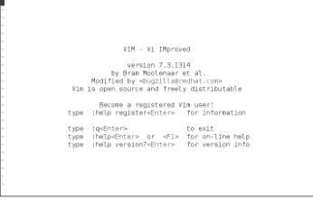

**图 7-2 在不指定文件名的情况下启动 `vim`**

显示文件的前几行，并在状态行上提供关于该文件的状态信息。

**问题** 如果你在终端类型未包含在 `terminfo` 数据库中的情况下启动 `vim`，`vim` 将显示错误信息并等待你按下 `RETURN`，或者将终端类型设置为 `ansi`，后者在许多终端上均可正常工作。

**紧急退出** 要重置终端类型，请按下 `ESCAPE`，然后执行以下命令以退出 `vim` 并显示 `shell` 提示符：

```
:q!
```

当你输入冒号 (`:`) 时，`vim` 将光标移动到屏幕的最后一行。字符 `q!` 指示 `vim` 在保存工作之前退出。（通常你不会以这种方式退出 `vim`，因为你通常希望保存你的工作。）在输入此命令后，你必须按下 `RETURN`。当 `shell` 显示其提示符时，请参阅第 1024 页的“指定终端”并再次启动 `vim`。

如果你在不指定文件名的情况下启动 `vim`，它会显示关于其自身的更多信息（图 7-2）。

## LPI 命令和输入模式

`vim` 的两种操作模式是*命令模式*（也称为普通模式）和*输入模式*（图 7-3）。当 `vim` 处于命令模式时，你可以向 `vim` 发出命令。例如，你可以删除文本或退出 `vim`。你还可以命令 `vim` 进入输入模式。在输入模式下，`vim` 接受你输入的任何内容作为文本，并将其显示在屏幕上。按下 `ESCAPE` 可使 `vim` 返回命令模式。默认情况下，`vim` 编辑器会告知你当前处于哪种模式：当它处于插入模式时，它会在屏幕左下角显示 `INSERT`。


以下命令使 `vim` 在你正在编辑的文本旁边显示行号：

```
:set number RETURN
```

上述命令中的冒号（`:`）将 `vim` 置入另一种模式，*最后一行模式*。在此模式下，`vim` 将光标保持在屏幕的最后一行。当你通过按 `RETURN` 完成输入命令后，`vim` 将光标恢复到文本中的原位置。发出命令 `:set nonumber RETURN` 可关闭行号显示。

当你向 `vim` 发出命令时，请记住该编辑器区分大小写。换句话说，`vim` 会根据你输入的是大写字符还是小写字符，将同一个字母解释为两个不同的命令。要注意 `CAPS LOCK`（`SHIFTLOCK`）键。如果你在输入模式下将此键设置为输入大写文本，然后退出到命令模式，`vim` 会将你的命令解释为大写字母。当这种情况发生时可能会造成困惑，因为 `vim` 似乎没有执行你正在输入的命令。

## LPI 输入文本

当你启动 `vim` 时，在输入文本之前必须将其置于输入模式。要将 `vim` 置于输入模式，请按下 `i`（在光标前插入）键或 `a`（在光标后追加）键。

如果你不确定 `vim` 是否处于输入模式，请按下 `ESCAPE` 键；如果它处于输入模式，`vim` 将返回命令模式；如果它已经处于命令模式，则会发出蜂鸣声、闪烁或不执行任何操作。你可以再次按下 `i` 或 `a` 键将 `vim` 置于输入模式。


**图 7-4** 使用 `vim` 输入文本

当 `vim` 处于输入模式时，你可以通过在键盘上打字来输入文本。如果文本在你打字时没有出现在屏幕上，则 `vim` 不处于输入模式。

要继续此教程，请输入图 7-4 中所示的示例段落，并在每行末尾按下 `RETURN` 键。如果你没有在下方的光标到达屏幕或窗口右侧之前按下 `RETURN`，`vim` 将换行文本，使其看起来像是开始新的一行。在这种情况下，物理行将与程序行（逻辑行）不对应，因此编辑会更加困难。在使用 `vim` 时，你可以纠正打字错误。如果你注意到正在输入的行中有错误，你可在继续之前进行更正（第 267 页）。你可以稍后更正其他错误。完成段落输入后，按下 `ESCAPE` 使 `vim` 返回命令模式。

## 获取帮助

要使用 `vim` 的帮助系统，必须已安装 `vim-runtime` 包；参见第 534 页。

在使用 `vim` 时获取帮助，请输入命令 `help {feature}`，然后按 `RETURN`。输入此命令时，编辑器必须处于命令模式。冒号将光标移动到屏幕的最后一行。如果你输入 `:help`，`vim` 将显示 `vim` 帮助的介绍（图 7-5）。屏幕底部附近的每个深色条带都命名了其上方显示的文件。（显示文件的屏幕区域，如图 7-5 中所示的两个区域，是 `vim` “窗口”。）在图 7-5 中，`help.txt` 文件占据了屏幕的大部分（上方窗口）。正在编辑的文件（`practice`）占据了屏幕底部的几行（下方窗口）。

通过滚动文本来阅读帮助介绍。按下 `j` 或 `DOWN ARROW` 键每次将光标向下移动一行；按下 `CONTROL-d` 或 `CONTROL-u` 每次将光标向下或向上滚动半屏。发出命令 `:q` 以关闭帮助窗口。


当 `vim` 处于命令模式时，你可以通过发出命令 `:help insert` 来显示有关插入命令的信息（图 7-6）。

## 几个 `vim` 命令

本节介绍一些有用的 `vim` 命令。

### 在插入时更正文本

在 `shell` 命令栏中用于后退和更正的键在 `vim` 处于输入模式时起相同的作用。这些键包括擦除、行终止和字终止键（通常分别为 `CONTROL-H`、`CONTROL-U` 和 `CONTROL-W`）。虽然 `vim` 在使用这些键之一后退时可能不会从屏幕上删除已删除的文本，但该编辑器会在你覆盖该文本或按下 `RETURN` 时将其删除。


### 移动光标

你需要能够移动屏幕上的光标，以便删除、插入和更正文本。当 `vim` 处于命令模式时，`RETURN` 键、空格键和方向键会移动光标。如果你希望将手保持在键盘中心附近，如果你的终端没有方向键，或者你正在使用的模拟器不支持方向键，你可以使用 `h`、`j`、`k` 和 `l`（小写“el”）键分别将光标向左、下、上、右移动。

### 删除文本

- `x`（删除字符）
- `dw`（删除单词）
- `dd`（删除行）

你可以通过移动光标直到其位于要删除的字符上，然后发出命令 `x` 来删除单个字符。你可以通过将光标定位在单词的第一个字母上，然后发出命令 `dw`（删除单词）来删除一个单词。你可以通过移动光标直到其位于该行的任何位置，然后发出命令 `dd` 来删除一行文本。

### 撤销错误

- `u`（撤销）

如果你错误地删除了字符、行或单词，或者发出了任何想要撤销的命令，请在想要撤销的命令之后立即发出命令 `u`（撤销）。`vim` 编辑器会将文本恢复到你发出上一条命令之前的状态。如果你再次发出 `u` 命令，`vim` 将撤销你刚刚撤销的那条命令之前的那条命令。你可以使用此技术回退你的许多操作。但是，在设置了 `compatible` 参数（第 269 页）的情况下，`vim` 只能撤销最近的一次更改。

- `:redo`（重做）

如果你撤销了一个并非有意撤销的命令，请发出 `Redo` 命令：`CONTROL-R` 或 `:redo`（后跟一个 `RETURN`）。`vim` 编辑器将重做被撤销的命令。与撤销命令一样，你可以连续多次发出重做命令。

### 输入额外文本

- `i`（插入）
- `a`（追加）

当你想要在现有文本中插入新文本时，移动光标使其位于你计划输入的新文本后方的字符上。然后发出 `i`（插入）命令使 `vim` 进入输入模式，输入新文本，并按下 `ESCAPE` 使 `vim` 返回命令模式。或者，你可以将光标定位在新文本之前的字符上，并使用 `a`（追加）命令。

- `o`/`O`（打开）

要输入一行或多行，请将光标定位在你希望新文本所在位置的上方一行。发出命令 `o`（打开）。`vim` 编辑器在光标所在的行下方打开一个空白行；将光标置于新的空行上；并进入输入模式。输入新文本，每行以 `RETURN` 结束。完成文本输入后，按下 `ESCAPE` 使 `vim` 返回命令模式。`O` 命令的工作方式与 `o` 相同，除了它打开的是光标所在行*上方*的一个空白行。

### 更正文本

要更正文本，使用 `dd`、`dw` 或 `x` 删除不正确的文本。然后使用 `i`、`a`、`o` 或 `O` 插入正确的文本。

例如，要将第 266 页图 7-4 中的单词 *pressing* 更改为 *hitting*，你可以使用 `ARROW` 键移动光标，直到它位于 *pressing* 中的 *p* 上。然后输入命令 `dw` 以删除单词 *pressing*。通过输入 `i` 命令将 `vim` 置于输入模式，输入单词 *hitting* 后跟随一个空格，然后按 `ESCAPE`。单词已被更改，`vim` 现在处于命令模式，等待接收另一个命令。对于依次执行 `dw` 和 `i` 命令的简写是 `cw`（修改单词，Change word）。命令 `cw` 会使 `vim` 进入输入模式。

#### 打印机换页符

> **提示** `CONTROL-L` 指示打印机跳转到下一页的顶部。你可以在文档的任何位置输入此字符，只需在输入模式下按 `CONTROL-L` 即可。如果 ⌃L 未出现，请在按 `CONTROL-L` 之前先按 `CONTROL-V`。

#### 结束编辑会话

在编辑过程中，`vim` 将编辑后的文本保存在名为工作缓冲区（Work buffer）的区域中。当你完成编辑后，必须将工作缓冲区的内容写入磁盘文件，以便保存编辑后的文本，并在下次需要时可用。

确保 `vim` 处于命令模式，并使用 `ZZ` 命令（必须使用大写字母 Z）将新输入的文本写入磁盘并结束编辑会话。在执行 `ZZ` 命令后，`vim` 将控制权交还给 `shell`。如果你不想保存你的工作，可以使用 `:q!` 退出。

#### 不要混淆 `ZZ` 与 `CONTROL-Z`

> **注意** 当你使用 `ZZ` 退出 `vim` 时，请确保你输入的是 `ZZ` 而不是 `CONTROL-z`（通常是挂起键）。当你按下 `CONTROL-z` 时，`vim` 会从屏幕上消失，就好像你已经退出了它一样。事实上，`vim` 将在后台继续运行，而你的工作未保存。请参阅第 294 页的“作业控制”。如果你尝试使用新的 `vim` 命令编辑同一个文件，`vim` 会显示关于交换文件（swap file）的消息。

#### 兼容参数（THE compatible PARAMETER）

兼容参数（`compatible` 参数）使 `vim` 与 `vi` 具有更高的兼容性。默认情况下，此参数未设置。在刚开始使用 `vim` 时，你可以忽略此参数。

设置兼容参数会改变 `vim` 运行的许多方面。例如，当设置兼容参数时，撤销命令（第 268 页）只能撤销最近的一次更改；相比之下，如果未设置兼容参数，你可以反复调用撤销命令来撤销多次更改。要获取有关兼容参数的更多详细信息，请输入命令 `help compatible` 并回车。要显示 `vim` 与原始 `vi` 之间差异的完整列表，请使用 `:help vi-diff` 并回车。有关 `help` 命令的讨论，请参阅第 266 页。

## 教程：使用 `NANO` 创建和编辑文件

`nano` 文本编辑器（`www.nano-editor.org`）是一个用户友好的伪图形文本编辑器，由 `Chris Allegretta` 编写。它基于 `pico` 文本编辑器，该编辑器随现已停止开发的 `Pine` 邮件客户端（`www.washington.edu/pine`）一起分发，由华盛顿大学开发。虽然 `nano` 不如 `vim`（第 262 页）和 `emacs`（`www.gnu.org/software/emacs`）功能全面，但其学习曲线更为平缓，足以用于编写和维护系统文件、`shell` 脚本和 `Python` 程序。`nano` 编辑器作为 `nano` 包随 `Fedora` 和 `RHEL` 一起分发。

### `nano` 在救援系统中可能不可用

> **提示** 当你尝试救援系统（第 450 页）时，`nano` 编辑器可能不可用。在那种情况下，知道如何使用 `vim` 进行基本编辑是个好主意。

### 指定终端

由于 `nano` 利用了各种特定类型终端的功能，因此你必须告诉它你正在使用哪种类型的终端或终端模拟器。在许多系统上，通常是在终端模拟器上工作时，终端类型会自动设置。如果你需要明确指定终端类型，请参阅第 1024 页的“指定终端”。

### 启动 `nano`

使用以下命令启动 `nano` 以创建并编辑名为 `practice` 的文件：

```bash
$ nano practice
```

当你按下 `RETURN` 时，命令行消失，屏幕外观类似于图 7-7 所示。

如果 `nano` 显示 `Error opening terminal` 消息，请参阅上文中的“指定终端”。

### 屏幕（THE SCREEN）

屏幕的第一行有三个字段，称为标题栏（Title bar，见图 7-7）。左侧字段显示你正在运行的程序的名称（`nano`）和版本。中间字段显示你正在编辑的文件名；如果你在启动 `nano` 时未指定文件名，则单词 `New Buffer` 将出现在文件名位置。如果缓冲区（`nano` 在屏幕上显示的内容）与你正在编辑的文件内容不同，右侧字段将显示单词 `Modified`。当你保存文件时，`nano` 会从屏幕上移除 `Modified`，因为缓冲区和文件包含相同的信息。

屏幕从底部数起的第三行是状态栏（Status bar）。此行显示状态、信息和错误消息。它还显示提示以及你对提示的响应，例如你在搜索字符串提示下输入的字符。

底部的两行包含快捷方式列表（Shortcut list）。此列表显示在特定上下文中最常用的命令以及执行每个命令需要按下的按键。图 7-7 显示你可以按 `CONTROL-G` 显示 `nano` 帮助信息（`^G Get Help`），按 `CONTROL-O` 写出已修改的缓冲区（你所做的更改；`^O WriteOut`），按 `CONTROL-X` 退出 `nano`（如果你修改了缓冲区，`nano` 将提示你写出缓冲区；`^X Exit`）等。


图 7-7 启动 `nano`

### 输入文本和退出 `nano`

默认情况下，`nano` 不会折行长行：它只是继续输入，并在屏幕显示部分的行首（和行尾）放置美元符号，以表明部分文本未显示。如果你希望将长行拆分为较短的行，以便能在屏幕上一屏查看所有文本，请按下 `CONTROL-J`（对齐，`justify`）。或者，你可以通过调用带有 `-t cols`（`--fill==cols`）选项的 `nano` 来使 `nano` 在你输入时折行。将 `cols` 设置为期望的文本宽度，或者更常见的是，设置为指定右边距宽度的负值。使用 `nano -t -8`（或 `--fill=-8`）效果很好。

要创建新文件，开始输入即可。要编辑你已输入的文本，使用 `ARROW` 键移动光标，输入文本以添加新内容，并使用你在命令行上纠正错误时使用的按键（第 122 页）来移除屏幕上的文本。`nano` 编辑器将你正在处理的文本保存在缓冲区中，直到你指示它将缓冲区写入磁盘或退出。

当你完成创建或修改文档，并希望将缓冲区写入磁盘并退出 `nano` 时，请按下 `CONTROL-X`（退出）。如果你自上次写出以来修改了缓冲区，`nano` 会询问你是否要保存已修改的缓冲区；输入 `y` 以保存（图 7-8）。然后，`nano` 编辑器通过提示 `Filename to Write: filename`（文件名：`filename`）来确认你要将缓冲区写入的文件名（图 7-9）。按下 `RETURN` 以写入该文件名，或在按 `RETURN` 之前输入不同的文件名。`nano` 编辑器终止执行并将控制权交还给 `shell`。


**图 7-8** 保存已修改的缓冲区

### 保存缓冲区

在编辑文档时，你可以使用 `CONTROL-O`（`WriteOut`）在不停止 `nano` 的情况下保存缓冲区；`nano` 会确认你要写入的文件名。

### `NANO` 命令键（THE NANO COMMAND KEYS）

### 获取帮助（`CONTROL-G`）

按 `CONTROL-G`（获取帮助）以查看更多的 `nano` 命令，包括移动光标和删除文本的命令。在帮助文本中，某些键前带有插入符号（`^`），某些键前带有 `M-`。


**图 7-9** 确认你要写入的文件名

## `CONTROL` 键

若要输入由插入符号后接某个键所指定的命令，请同时按下 `CONTROL` 键和指定的键（例如，`CONTROL-W` 用于 `Where`，该功能可搜索文本或移动光标）。或者，你可以按两次 `ESCAPE` 键，然后再按下指定的键。

## `META` 键


若要输入由 `M-` 后接某个键所指定的命令，请同时按下 `META` 或 `ALT` 键和指定的键（例如，`ALT-T` 可将光标移至文件的第一行）。或者，你可以按一次 `ESCAPE` 键，然后再按下指定的键。

## 本章小结

本章介绍的工具是 Linux 上众多强大工具的一个子集。由于你将频繁使用这些工具，且它们是后续章节的基础，因此熟练掌握它们非常重要。表 7-2 中列出的工具用于操作、显示、查找、比较和打印文件。

### 表 7-2 文件工具

| 工具 | 功能 |
| :--- | :--- |
| `cat` | 连接并显示文件（第 216 页） |
| `cp` | 复制文件（第 224 页） |
| `cut` | 从输入行中选择字符或字段（第 225 页） |
| `diff` | 显示两个文本文件之间的差异（第 227 页） |
| `dos2unix` | 将 Windows 文件转换为 Linux 格式（第 260 页） |
| `file` | 显示文件的分类（第 229 页） |
| `find` | 根据条件查找文件（第 229 页） |
| `grep` | 在文件中搜索模式（第 232 页） |
| `head` | 显示文件的开头部分（第 235 页） |
| `less` | 一次显示一屏文本文件（第 220 页） |
| `lpq` | 显示打印队列中的任务列表（第 237 页） |
| `lpr` | 将文件发送到打印机（第 235 页） |
| `lprm` | 从打印队列中移除任务（第 237 页） |
| `ls` | 显示文件信息（第 221 页） |
| `mac2unix` | 将 Macintosh 文件转换为 Linux 格式（第 260 页） |
| `more` | 一次显示一屏文本文件（第 220 页） |
| `mv` | 重命名或移动文件（第 237 页） |
| `rm` | 删除文件（第 222 页） |
| `sort` | 排序和/或合并文件（第 239 页） |
| `tail` | 显示文件的末尾部分（第 241 页） |
| `touch` | 更改文件的修改时间和访问时间（第 243 页） |
| `tr` | 替换指定字符（第 258 页） |
| `unix2dos` | 将 Linux 文件转换为 Windows 和 Macintosh 格式（第 260 页） |
| `unix2mac` | 将 Linux 文件转换为 Macintosh 格式（第 260 页） |
| `wc` | 显示文件中的行数、单词数和字节数（第 244 页） |

若要减少文件占用的磁盘空间，你可以对其进行压缩。压缩对于包含模式的文件效果特别好，大多数文本文件都符合这一特征，但它也能减小几乎所有文件的尺寸。`bzip2` 的逆向操作—`bunzip2`—可将文件恢复为原始的、未压缩的形式。`bzip2` 工具是这些工具中效率最高的。归档文件是一个通常经过压缩的文件，其中包含一组文件。`tar` 工具用于打包和解包归档文件。文件名扩展名 `.tar.bz2`、`.tar.gz` 和 `.tgz` 用于标识压缩的 `tar` 归档文件，经常出现在通过互联网获取的软件包中。表 7-3 列出了用于压缩、解压缩和归档文件的工具。

### 表 7-3 (解)压缩和归档工具

| 工具 | 功能 |
| :--- | :--- |
| `bcat` | 显示使用 `bzip2` 压缩的文件（第 248 页） |
| `bunzip2` | 解压缩使用 `bzip2` 压缩的文件（第 248 页） |
| `bzip2` | 压缩或解压缩文件（第 245 页） |
| `compress` | 压缩文件（第 249 页） |
| `dtrx` | 智能地提取和解压缩文件（第 245 页） |
| `gunzip` | 解压缩使用 `gzip` 或 `compress` 压缩的文件（第 248 页） |
| `gzip` | 压缩或解压缩文件（第 245 页） |
| `tar` | 将文件存储到/从归档文件中读取文件（第 249 页） |
| `unzip` | 解包 `zip` 归档文件（第 249 页） |
| `zcat` | 显示使用 `gzip` 压缩的文件（第 248 页） |
| `zip` | 创建 `zip` 归档文件（第 249 页） |

表 7-4 列出了显示本地系统和用户信息的工具。

### 表 7-4 系统信息工具

| 工具 | 功能 |
| :--- | :--- |
| `date` | 显示或设置系统时间和日期（第 218 页） |
| `free` | 显示内存使用信息（第 253 页） |
| `hostname` | 显示系统名称（第 219 页） |
| `uptime` | 显示系统负载和运行时长信息（第 253 页） |
| `w` | 列出系统中的用户（第 254 页） |
| `who` | 列出系统中的用户（第 254 页） |

表 7-5 列出了杂项工具。

### 表 7-5 杂项工具

| 工具 | 功能 |
| :--- | :--- |
| `echo` | 显示参数（第 219 页） |
| `locate` | 搜索文件（第 256 页） |
| `nano` | 编辑文本文件（第 270 页） |
| `script` | 记录 shell 会话（第 257 页） |
| `vi`/`vim` | 编辑文本文件（第 262 页） |
| `whereis` | 定位工具（第 255 页） |
| `which` | 定位工具（第 255 页） |
| `xargs` | 将标准输入转换为命令行（第 260 页） |

## 练习

- 你可以使用哪些命令来确定谁登录在特定的终端上？哪个命令显示你正在从哪个终端发出该命令？

- 提供一个命令，以逆时间顺序显示 `/bin` 目录下文件的长列表。再次提供该命令，但这次每次只显示一屏输出。

- 如果名为 `done` 的文件已存在，当你执行以下命令时会发生什么？

```bash
$ cp to_do done
$ mv to_do done
```

- 列出 `/etc/services` 中描述 TCP 端口的前 20 行。

- 如何在一个名为 `phone` 的文件中找到 `Ace Electronics` 的电话号码，该文件包含姓名和电话号码列表？你可以使用哪个命令按字母顺序显示整个文件？如何显示文件而不包含任何相邻的重复行？如何显示文件而不包含任何重复行？

- 当你使用 `diff` 比较两个不完全相同的二进制文件时会发生什么？（你可以使用 `gzip` 来创建二进制文件。）解释为什么二进制文件的 `diff` 输出与 ASCII 文件的 `diff` 输出不同。

- 如果给 `which` 工具一个命令的名称，而该命令位于一个*不在*你搜索路径中的目录中，结果会怎样？

- 本章讨论的工具中，是否有位于本地系统上一个以上目录中的？如果有，是哪些？

- 通过调用 `file` 工具并传入 `/usr/bin` 中文件的名称进行实验。有多少种不同类型的文件？

- 你可以使用哪个命令查看名为 `status.report` 文件的前几行？你可以使用哪个命令查看文件的末尾？

## 高级练习

- 仅显示 `/etc/services` 中列出的最后十个服务的名称。（*提示*：服务列在第一列中。）

- 显示 `/etc/pam.d` 目录层级中所有符号链接文件的长列表。

- 显示 `/etc/passwd` 文件中的单词数量。

- 显示 `/etc/passwd` 文件，将所有冒号 (`:`) 替换为 `\t`。显示 `/etc/services` 文件，将每次出现多个 `SPACE` 的情况替换为一个 `SPACE`。

- 将 `/bin/bash` 的修改时间更改为系统时间。会发生什么？为什么？将 `/bin/bash` 复制到工作目录，显示其修改时间，然后将其修改时间更改为系统时间。显示你的 `bash` 副本的修改时间和系统时间。将其修改时间更改为 2018 年 1 月 5 日下午 2:34，并显示其修改时间。

- 将 `/bin/bash` 复制到工作目录，并制作两个副本，使你有三个相同的文件：`bash1`、`bash2` 和 `bash3`。使用 `gzip` 压缩 `bash1`，使用 `bzip2` 压缩 `bash2`。不要更改 `bash3`。哪个工具压缩文件的效果最好？哪个最差？`bash2.bz2` 与 `bash3` 相比有多大？

- 重新创建第 228 页示例中使用的 `colors.1` 和 `colors.2` 文件。通过对它们运行 `diff -u` 来测试你的文件。`diff` 显示的结果是否与图中相同？

- 尝试执行这两个命令：

```bash
$ echo cat
$ cat echo
```

解释每个命令输出的区别。

- 使用文件 `phone.gz`（姓名和电话号码列表的压缩版本）重复练习 5。针对每个问题考虑多种方法，并解释你做出选择的原因。

- 寻找或创建符合以下条件的文件：

    - a. `gzip` 压缩率超过 80%。

    - b. `gzip` 压缩率低于 10%。

    - c. 使用 `gzip` 压缩后变得更大。

    - d. 使用 `ls -l` 确定所讨论文件的大小。你能对 a、b 和 c 中的文件进行特征描述吗？

## 8

### 网络与互联网

### 本章内容

- 网络类型及其工作原理 . . . . . . . . . . . . . . . . . . . . . . . . . 282

- 网络协议 . . . . . . . . . . . . . . . . . . . . . . . . . . . . . . . . . 290

- IPv6 . . . . . . . . . . . . . . . . . . . . . . . . . . . . . . . . 293

- 网络实用工具 . . . . . . . . . . . . . . . . . . . . . . . . . . . . . . . . . 302

  - `ping`：测试网络连接 . . . . . . . . . . . . . . . . . . . . . . . . . . 305

  - `traceroute`：追踪互联网上的路由 . . . . . . . . . . . . . . . . . . . . . . . . 306

  - `host` 和 `dig`：查询互联网名称服务器 . . . . . . . . . . . . . . . . . . . . . . . . . . . . . . 307

  - `whois`：查找有关互联网站点的信息 . . . . . . . . . . . . . . . . . . . . . . . . . . . . . . 308

- 分布式计算 . . . . . . . . . . . . . . . . . . . . . . . . . . . . . . . . . . . 309

- WWW：万维网 . . . . . . . . . . . . . . . . . . . . . . . . . . . . . . . . . . . . . . . . 319

### 学习目标

读完本章后，你应能够：

- 讨论多种类型的网络

- 定义几种网络协议

- 列出网络的软件和硬件组件

- 解释 `IPv6` 的功能和优势

- 列出几种网络实用工具

- 解释 `ping` 的工作原理

- 使用 `dig` 确定网站的名称服务器

- 描述分布式计算

- 解释万维网的作用

连接计算机的通信设施在不断改进，使得连接更快且更经济。最早的计算机是未连接的独立系统。为了在一个系统之间传输信息，你必须以某种形式（通常是磁带、纸带或穿孔卡片——称为 IBM 卡片或 Hollerith 卡片）存储它，将其带到兼容的系统上，然后读回。一个显著的进步发生在计算机开始通过串行线交换数据时，尽管传输速率很慢（每秒几百位）。人们很快发明了利用这种计算能力的新方法，例如电子邮件、新闻检索和电子公告板服务。凭借当今网络的速度和普及度，一封电子邮件可以在几分之一秒内跨越全国，甚至传播到半个地球之外。

如今，很难找到一个不包含局域网（LAN）来连接其系统的计算机设施。Linux 系统通常连接到 *以太网*（第 1249 页）网络。无线网络也很普遍。大型计算机设施通常维护多个网络，通常类型不同，并且几乎肯定拥有到更大网络（全公司或全校范围甚至更远）的连接。

互联网是一个松散管理的网络的网络（*互联网*），它连接了全球各地不同局域网上的计算机。一个 internet（小写 *i*）是一个通用的网络之网，它可能与公共互联网共享某些部分。正是互联网使得向数千英里外的同事发送电子邮件并在几分钟内收到回复成为可能。一个相关的术语，*内联网*，指的是公司或其他机构内部的网络基础设施。内联网通常是私有的；外部网络对其访问可能受到限制并受到严格控制，通常使用防火墙（第 288 页）。

在过去十年中，许多网络服务出现并趋于标准化。在 Linux 和 UNIX 系统上，称为*守护进程*（第 1245 页）的特殊进程通过在网络与其他系统交换专用消息来支持这些服务。已经创建了几种软件系统，允许计算机之间共享文件系统；使远程文件看起来像是存储在本地磁盘上。共享远程文件系统允许用户在不知道文件物理位置的情况下分享信息，无需制作不必要的副本，也无需学习一套新的实用工具来操作它们。由于文件看起来是本地存储的，你可以使用标准实用工具（例如 `cat`、`vim`、`ls`、`mv` 或其图形界面等价物）来处理它们。

许多工具利用网络不仅仅是为了共享文件。这些工具有各种任务，从远程执行程序到计算机之间、程序之间和人之间的通信。`ssh`（安全 shell，第 685 页）实用程序是远程命令执行和远程计算机访问的标准工具。多年前，它取代了不安全的工具，如 `rsh`、`telnet` 和 `rlogin`。`ssh` 实用程序包含了这些工具的功能，并包括内置的安全功能，以实现跨公共网络的安全和私密访问。一些设备未实现 `ssh`，但并不多见。

此前，用户使用 `talk`、`write` 和 IRC（互联网中继聊天）等命令行工具进行通信。这些工具仍然存在，特别是 IRC，但由于 `Facebook`、`Twitter`、`Google Talk`、`Skype` 以及较旧的即时通讯（IM）工具（如 `MSN`、`AIM`、`ICQ` 和 `Yahoo Messenger`）的兴起，它们的使用已逐渐减少。许多人在 Linux 上使用 `Empathy` IM 客户端。`Jabber` 在私人公司网络中很受欢迎。

#### 内联网

*内联网* 是连接学校、公司或其他组织计算资源的网络，但与互联网不同，它通常将访问权限限制为内部用户。内联网通常由一个或多个局域网（LAN）组成，但对于区域性、全国性或全球性的公司，其规模可能相当大。无论地理位置如何，内联网都可以为有限的人员提供数据库、电子邮件和网页访问。

内联网连接不同机器的一项能力是其优势之一。想想你在互联网上能找到的所有机器：Macintosh 系统、运行不同版本 Windows 的 PC、运行 UNIX 和 Linux 的机器，等等。这些机器中的每一个都可以通过 IP 协议套件（第 290 页）进行通信。内联网定义了使这种通信成为可能的通信边界和安全信任区域。

互联网和内联网之间的另一个关键区别是，互联网仅原生传输一种协议套件：IP。相比之下，内联网可以设置为使用许多协议，如 IP、AppleTalk 或供应商多年来开发的其他协议。虽然这些协议不能直接在互联网上传输，但你可以设置远程站点上的网关盒子，将这些协议隧道或封装到 IP 数据包中，然后使用互联网传递它们。实际上，大多数旧协议已重写为使用 IP 作为传输协议。即使是存储协议和网络，如 SCSI 和光纤通道，现在也有 IP 实现（`iSCSI`、`Fibre CoE`）。

你可以使用*外联网*（也称为*合作伙伴网络*）或 VPN（虚拟专用网络）来提高安全性。这些术语描述了安全连接远程站点和本地站点的方式，通常使用公共互联网作为载体，并采用加密作为保护传输数据的手段。外联网的典型用途是将研究机构联系起来进行协作，或将零部件供应商和制造商联系起来以获得直接的库存访问权限。

以下是你阅读本章其余部分之前可能需要熟悉的一些术语：

- **ASP**（第 1237 页）

- **桥接器**（第 1240 页）

- **外联网**（第 1249 页）

- **防火墙**（第 1250 页）

- **网关**（第 1251 页）

- **集线器**（第 1254 页）

- **internet**（第 1255 页）

- **Internet**（第 1255 页）

- **内联网**（第 1255 页）

- **ISP**（第 1256 页）

- **数据包**（第 1265 页）

- **路由器**（第 1271 页）

- **子网**（第 1273 页）

- **交换机**（第 1276 页）

- **VPN**（第 1280 页）

#### 网络类型及其工作原理

计算机通过 IP 网络使用由系统软件分配的唯一地址进行通信。IP*数据包*包含目标计算机的地址和发送者的回信地址。网络可以包含许多不同的*拓扑结构*，即计算机和网络设备的*排列*。最常见的拓扑结构是*广播*、*点对点*和*交换*。以太网是用于*局域网*（局域网，稍后讨论）的最常见拓扑结构。以太网速度范围从每秒 10 兆位到每秒 100 千兆位（截至本文写作时未正式接受）。其他类型的局域网包括 *Myrinet*、*Infiniband* 和 *Quadrics*，但它们主要用于高性能计算。

速度对于互联网的正常运作至关重要。较新的规范（`cat 6` 和 `cat 7`）正在被采用用于 `10000BaseT`（每秒 10 千兆位；也称为 *`10GE`*）以及更快的网络。更高的速度需要专用电缆。*`SFP`* 和 *`QSFP`* 很常用。构成互联网骨干的许多网络以每秒 38 千兆位（`OC768`）的速度运行，以满足对网络服务日益增长的需求。表 8-1 列出了当今使用的一些规范。

表 8-1 网络规范

| 规范 | 速度 |
| --- | --- |
| `DS0` | 每秒 64 千位 |
| `ISDN` | 两条 `DS0` 线加信令（每秒 16 千位）或每秒 128 千位 |
| `T-1` | 每秒 1.544 兆位（24 条 `DS0` 线） |
| `T-3` | 每秒 43.232 兆位（28 条 `T-1`） |
| `OC3` | 每秒 155 兆位（100 条 `T-1`） |
| `OC12` | 每秒 622 兆位（4 条 `OC3`） |


| OC48 | 每秒 2.5 千兆位（4 条 OC12） |
| OC192 | 每秒 9.6 千兆位（4 条 OC48） |
| OC768 | 每秒 38.4 千兆位（4 条 OC192） |

#### 广播网络

在`广播网络`上，连接到网络电缆的众多系统中的任何一个都可以在任何时候发送消息；每个系统检查每个消息中的目标地址，并仅响应发给它的消息。当多个系统同时发送数据时，广播网络上会出现问题，导致消息在电缆上发生碰撞。当消息碰撞时，它们可能会变得混乱。发送系统

注意到乱码信息后，等待一小段随机时间再重发。等待随机时间有助于防止相同系统在同一时刻重发数据并再次发生碰撞。碰撞产生的额外流量可能使网络不堪重负；如果碰撞率过高，重传可能会导致更多的碰撞。最终网络可能变得不可用。网络中的特殊广播（第 1240 页）数据包要求所有机器都检查该数据包。某些协议利用了这一特性：用于`IP`地址到`MAC`（以太网）地址解析的`ARP`协议、`PXE`网络启动协议、`DHCP`以及某些服务发现协议都使用广播数据包。

## 点对点网络

点对点链路看起来并不像一个典型的网络，因为只涉及两个端点。然而，大多数连接到`WAN`（广域网）的链路都通过点对点链路，使用有线电缆、无线电或卫星链路。点对点链路的优点在于其简单性：因为只涉及两个系统，所以链路上的流量是有限的且易于理解的。缺点是每个系统通常只能配备少量这样的链路；为每台计算机建立连接到其他所有计算机的点对点链路既不切实际又成本高昂。例如，两台主机需要一条链路，三台主机需要三条链路，四台主机需要六条链路，五台主机需要十条链路才能构成一个点对点网络。随着增加的主机数量增多，所需链路的数量增长得更快。点对点链路通常使用串行链路和专用接口。

最常见的点对点链路类型是用于连接互联网的链路。当你使用`DSL`¹（数字用户线）时，你正在使用点对点链路连接到互联网。串行线路，如`T-1`、`T-3`、`ATM`链路、`FIOS`和`ISDN`，都是点对点的。虽然它可能看起来像点对点链路，但电缆调制解调器基于广播技术，在这方面与以太网相似。

1. `DSL`术语包含`xDSL`技术套件，其中包括`ADSL`、`IDSL`、`HDSL`、`SDSL`和`XDSL`。

## 交换式网络

随着交换式网络的引入，纯广播网络成为历史。交换式网络运行在全双工模式下，允许机器和网络设备同时发送和接收数据。对全双工的支持内置于千兆及以上网络中，并在千兆及以上网络中是必需的；在 100 兆位网络中是可选的；在 10 兆位网络中则很少见。

交换机是一种设备，它在源主机和目的主机之间建立一条虚拟路径，使得每条路径看起来都像是一个点对点链路，很像老式电话交换机。与话务员使用插头将你的本地线路连接到`outgoing`线路不同，交换机检查每个数据包以确定其目的地并适当引导该数据包。

当主机寻求相互通信时，交换机会创建并拆除虚拟路径。每台主机认为它与正在通信的主机之间有一条直接的点对点路径。请将此方法与广播网络进行对比，在广播网络中，每台主机也会看到发往其他主机的流量。交换式网络相对于纯点对点网络的优点在于，每台主机只需要一个连接：即与交换机的连接。使用纯点对点连接，每台主机必须与每台其他主机都有连接。通过进一步连接交换机来提供可扩展性。

为了实现这种流量减少，以太网交换机学习哪些主机在哪些端口上。当目的地为主机的流量进入时，交换机在其`CAM`²中查找该主机连接到的端口，并通过该端口发送数据包。当交换机尚未收到与目的地匹配的主机的消息，或者如果数据包是特殊广播数据包时，该数据包将像在广播网络中的数据包一样从所有端口泛洪出去。交换式以太网网络是广播网络的一项技术增强。

2. 用于`解引用`（第 1246 页）以太网地址的内存表。

## LAN：局域网

局域网（`LANs`）局限于相对较小的区域——单个计算机设施、建筑物或校园。如今大多数局域网通过铜缆运行。光纤（玻璃或塑料）电缆、无线（`Wi-Fi`）以及有时红外（类似大多数电视遥控设备）也是常见的基础设施。

如果其目的地址不在本地网络上，路由器（第 287 页）必须将数据包传递到另一个网络。路由器可能是一台通用计算机，或是一个连接到多个网络并作为它们之间网关的专用设备。

- 交换术语

你可能会看到关于`二层交换机`、`三层交换机`或`四层交换机`的提及。这些术语指的是`IP`网络模型（第 290 页）。二层交换机是前面关于交换式网络的讨论所描述的内容。三层交换机等同于路由器；它结合了二层交换和路由的功能。单个三层交换机可以连接多个独立的局域网。四层交换机检查更高层的数据包以做出决策。大多数`Web`负载均衡器是四层交换机。它们可以将流量路由到许多设备以分散网络负载。

### 以太网

连接到局域网的`Linux`系统通常使用以太网连接到网络。典型的以太网连接支持从每秒 10 兆位到每秒 100 吉位的数据传输速率。每秒 10 兆位、每秒 100 兆位和每秒 1 吉位的传输速率使用相同的旧技术。然而，每秒 10、40 和 100 吉位的传输速率需要更新的技术和专用电缆。每秒 10 吉位以太网可以通过使用物理介质适配器与每秒 1 吉位以太网兼容。由于需要极其严格的公差，每秒 40 和 100 吉位以太网不具备向后兼容性。这些更高速传输速率所需的技术要求非常精确地定义的物理接口。硬件相当昂贵，且仅常见于网络基础设施领域和高性能计算（`HPC`）环境，使用高速链路连接多个交换机。

#### 电缆

如前所述，现代以太网网络使用铜缆或光纤电缆或无线发射器和接收器传输数据。最初，每台计算机都连接到一个粗同轴电缆（称为粗网）上，在电缆上每隔六英尺间隔的接地点处。粗电缆处理起来很笨重，因此开发了解决方案，包括一种较细的同轴电缆，称为细网，或`10Base2`³。

³ 此脚注标记可能指向后续的脚注，或是针对特定标准引用的 OCR 错误；在标准文本中，“`10Base2`”指代细以太网标准。

如今大多数以太网连接要么是无线的，要么是通过`UTP`（非屏蔽双绞线）制作的。有许多`UTP`标准，通常通过类别和编号来引用。一些例子包括五类`cat 5`、超五类`cat 5e`和六类`cat 6`。这些类别规定了电缆可以将信号传输多远。编号越高，公差越严格，电缆越昂贵，但可以可靠传输信号的距离更远。这些标准规定了电缆末端的物理连接器、电缆中导线绞合的紧密程度以及各种其他参数。`10BaseT`、`100BaseT`和`1000BaseT`术语指的是通过 3/4/5/5e/6/7 类电缆运行的以太网。`STP`（屏蔽双绞线）不太常见。

#### 网段

网络网段（网络的一部分，其中所有系统使用`IP`和`OSI`模型（第 291 页）的相同物理层（第 1 层）进行通信）。其大小是任意的，可以是`WAN`、`MAN`或其他网络的一部分。

#### 双工

在半双工模式下，数据包一次只沿电缆的一个方向传输。在全双工模式下，数据包在两个方向传输。

#### 集线器

集线器（有时称为集中器）是一种连接系统使其成为同一网络网段一部分并共享网络带宽的设备。集线器在`IP`和`OSI`模型（第 1 层，第 291 页）的物理层工作。所有数据包都发送给所有主机（泛洪）。在大多数情况下，集线器已被交换机取代。

#### 交换机

交换机连接网络网段。交换机检查每个数据包；它学习哪些设备连接到其哪些端口。交换机仅将每个数据包发送给它预期的设备。因为交换机仅将数据包发送到其目的地设备，所以它可以节省网络带宽并比集线器表现更好。一些交换机拥有存储和排队数据包的缓冲区。

交换机在`IP`和`OSI`模型（第 290 页）的第 2 层及更高层工作。二层交换机在数据链路层工作，三层交换机在`IP`层工作并路由数据包。四层交换机在传输层和应用层工作，是负载均衡器和应用代理的基础。

## 网桥

所有现代以太网交换机都具有足够的带宽，能够与所有连接设备以全双工模式进行同时通信。基于集线器的非交换式广播网络只能以半双工模式运行。全双工以太网通过消除冲突进一步提高了效率。在全双工交换网络中，每台主机都可以同时以网络速度（例如，每秒 100 兆位）发送和接收数据，因此主机之间的有效带宽是网络速度的两倍（例如，每秒 200 兆位），具体取决于交换机的容量。

网络网桥在`OSI`模型的数据链路层（第 2 层）连接多个网络段。网桥类似于中继器或网络集线器，这些设备在物理层连接网络段；然而，网桥的工作原理是仅当数据包中指定的目标设备已知位于远程段时，才将流量从一个网络段转发到另一个网络段。网桥不会转发位于网桥同一侧的`LAN`主机之间的流量。

在以太网网络中，“网桥”一词正式指代符合`IEEE 802.1D`标准行为规则的设备。市场宣传文献经常将此类设备称为网络交换机。

## 路由器

路由器在`IP`和`OSI`模型的第 3 层（参见第 291 页）连接网络。例如，路由器可以将`LAN`连接到`WAN`（如互联网），或者连接两个`LAN`。路由器决定数据包到达不同网络时应采取的路径，并转发数据包。路由器在`IP`和`OSI`模型的网络层（第 3 层）工作。下一页的“通过网关和路由器进行互连”将更深入地介绍路由器。

## VLAN

`VLAN`（虚拟局域网）是在软件中定义的一个逻辑实体。它定义了一组共享同一广播域（第 2 层）的主机。也就是说，当某台主机发出广播数据包（如`ARP`数据包）时，它会到达同一`VLAN`中的所有其他主机。所有现代可管理的交换机，即拥有命令行或`Web`接口的交换机，都具备`VLAN`功能。`VLAN`允许管理员将主机分组到`IP`地址范围（`LAN`）中。`VLAN`通常按部门、组织或安全需求对主机进行分组。同一`VLAN`中的主机使用第 2 层相互通信，而不同`VLAN`中的主机使用第 3 层进行通信。`LAN`和`VLAN`的主要区别在于，在`LAN`（非管理型交换机）中，所有主机都在同一广播域中；而在`VLAN`中，单个交换机上可以存在多个广播域。

广播域和`IP`协议第 2 层段在功能上是相同的。然而，第 2 层容易与处于同一`IP`网络的主机（网络地址）混淆。考虑一下经典的中继器（集线器），这是一种在所有端口上始终发送所有数据包的设备。这些端口可能连接不同的网络。例如，一些主机可能在网络`10.0.1.0`中，而另一些主机可能在网络`192.168.1.0`中。以太网广播数据包无法区分这些网络；这些数据包会发送给所有主机，无论其`IP`地址如何。这种配置有时被称为冲突域。`VLAN`允许你将`IP`网络`10.0.1.0`中的主机放入一个`VLAN`，将`192.168.1.0`中的主机放入另一个`VLAN`，从而使网络之间不共享彼此的广播。`VLAN`还允许你将跨企业网络具有相同功能的主机连接起来。

## 无线

无线网络变得越来越普遍。它们出现在办公室、家庭和公共场所，如大学、咖啡店和机场。无线接入点提供类似于以太网集线器的功能。它们允许多个用户通过公共射频频谱进行交互。无线点对点连接允许你在家或办公室内带着笔记本电脑四处走动，通过天线连接到`LAN`或经由内部基站连接到互联网。`Linux`包含许多无线设备的驱动程序。无线接入点或基站将无线网络连接到有线网络，因此无线连接不需要特殊协议。请参考位于`www.hpl.hp.com/personal/Jean_Tourrilhes/Linux`的`Linux 无线局域网 HOWTO`。

## WAN：广域网

`WAN`（广域网）覆盖很大的地理区域。相比之下，用于`LAN`的技术（如以太网）是为在有限距离内工作和连接特定数量的主机而设计的。`WAN`可能跨越很长的距离，通过专用数据线（从电话公司租用的线路）或无线电或卫星链路连接。由于连接成本较高，此类网络通常支持的带宽比`LAN`低得多。主要的互联网服务提供商依赖`WAN`来连接国内的客户以及全球各地的客户。

`MAN` 一些网络既不属于`LAN`也不属于`WAN`。`城域网`（`MAN`）是包含在较小地理区域（如城市）内的网络。与`WAN`类似，`MAN`通常用于互连`LAN`。

## 通过网关和路由器进行互连

`网关` `LAN`通过`网关`连接到`WAN`，网关是具有多个网络连接并将在一个网络上的数据传递到另一个网络的计算机或特殊设备的通用术语。网关将`LAN`连接到其他`LAN`、`VLAN`或`WAN`。例如，通过`WAN`从一个以太网跨越整个国家传输到另一个以太网的数据，会从以太网格式重新打包成`WAN`骨干通信设备能够处理的其他格式。当数据通过`WAN`到达旅程的终点时，另一个网关会将其转换为适合接收网络处理的格式。在大多数情况下，这些细节只关心网络管理员；终端用户无需了解数据传输是如何进行的。

`路由器` 现代对网关的规范引用是`默认网关`，它是将`LAN`或`VLAN`连接到其他网络的路由器。路由器在互连网络中扮演重要角色。就像当你需要驾驶去一个陌生的地方时，可能会研究地图来规划路线一样，计算机也需要知道如何通过沿途的中介系统和网络将消息传递给连接到远程网络的系统。虽然你可能设想使用巨大的网络路线图来选择数据应遵循的路由，但对于大型网络来说，计算机路由的静态地图通常是一个糟糕的选择。你选择的路径上的计算机和网络可能负载过重或宕机，无法为你的消息提供绕行路径。

相反，路由器动态通信，相互告知哪些路由可用。为了扩展这个类比，这种情况就像在没有咨询地图寻找前往目的地的路线的情况下出发去汽车旅行；而是先前往附近的加油站询问方向。在整个旅程中，你继续在一个又一个加油站停车，在每一处询问方向以找到下一个。虽然停下来会花一些时间，但每个加油站的老板都会告知你交通拥堵、道路封闭、替代路线和捷径。

数据所做的停留比你汽车所做的停留快得多，但每条消息离开每个路由器时，都是基于最新信息选择的路径。把这个系统想象成`GPS`（全球定位系统）设置，它自动在每个交叉口更新信息，并根据交通和高速公路状况告诉你下一步往哪走。

图 8-1 展示了`LAN`可能如何在通过`WAN`（互联网）互连的三个站点上配置的示例。在这种网络图中，以太网`LAN`被画成直线，设备以直角连接；`WAN`被表示为云，表示细节被省略；无线连接被画成带有断点的锯齿形线，表示连接可能是间歇性的。

在图 8-1 中，网关或路由器在每个`LAN`和互联网之间中继消息。图中显示了互联网中离每个站点最近的三个路由器。站点 A 有一台服务器、一台工作站、一台网络计算机和一台共享单一以太网`LAN`的`PC`。站点 B 有一个以太网`LAN`，服务于一台打印机和四台`Linux`工作站。防火墙仅允许特定流量在`Internet`路由器和站点本地路由器之间通过。站点 C 有三个通过单一路由器连接的`LAN`，可能是为了减少如果`LAN`合并或工作组或位置位于不同网络时产生的流量负载。站点 C 还包含一个无线接入点，启用与附近计算机的无线通信。

## 防火墙

汽车中的防火墙将发动机舱与乘客舱隔开，保护驾驶员和乘客免受发动机火灾、噪音和烟雾的影响。以类似的方式，计算机防火墙将计算机与恶意和不受欢迎的用户隔开。

防火墙阻止某些类型的流量进入或离开网络。例如，防火墙可能会阻止来自你`IP`地址的流量离开网络，并阻止除来自特定域名的用户外的人使用`FTP`


图 8-1 互联网的一角

用于从网络检索数据。防火墙的实现方式千差万别——从运行定制软件、配备两个接口的`Linux`机器（第 1255 页），到带有简单访问控制列表的路由器（前文所述），再到晦涩难懂的供应商提供的专用防火墙设备。大多数大型安装环境至少都部署了某种形式的防火墙。防火墙通常与代理服务器/网关（第 316 页）配合使用，代理服务器/网关在用户与通信目标主机之间提供了一个中间点。

除了多用途计算机中的防火墙外，防火墙在消费级设备中也变得越来越常见。例如，它们被内置于电缆调制解调器、无线网关、路由器和独立设备中。

通常，单台`Linux`机器会包含一个最小化的防火墙。一个小型的`Linux`系统集群可能会使用一台廉价的双网卡`Linux`机器配合数据包过滤软件，作为专用防火墙运行。其中一个接口连接到互联网、调制解调器和其他外部数据源。另一个接口通常通过集线器或交换机连接到本地网络。有关`防火墙`、`firewall-config`、`iptables`以及防火墙设置的详细信息，请参阅第 25 章；有关安全性的讨论，请参阅附录 C。

## 网络协议

- `TCP`：为了在网络上交换信息，计算机必须使用通用的语言或`协议`（第 1267 页）进行通信。协议决定了消息数据包的格式。`Linux`系统使用的主流网络协议是`TCP`和`IP`，统称为`TCP/IP`（传输控制协议和互联网协议）。需要高可靠性连接的网络服务，例如`ssh`和`scp`，倾向于使用`TCP/IP`。

- `UDP`：不需要保证送达但要求及时送达的网络服务，例如视频、音频和时间服务，使用更简单的`UDP`（用户数据报协议；`UDP/IP`）进行操作。`VoIP`（`IP`语音）和`NTP`（网络时间协议）属于此类。`UDP`数据包发送后即被丢弃。语音和视频协议对延迟敏感，而非对完整性敏感。人耳和人眼可以接受并插值音频或视频流中的丢失，但无法应对可变延迟。`TCP`提供的保证送达功能在繁忙网络中数据包重传时可能会引入延迟。这种延迟对于视频和音频传输是不可接受的，而低于 100% 的完整性则是可接受的。对于`NTP`而言，数据包丢失是可以接受的，但因`TCP`重传而导致延迟的数据包可能会导致时间设置出现显著偏差。

## IP：互联网协议

分层设计的引入旨在促进协议设计：层区分了相邻协议之间的功能差异。层的分组可以被标准化为协议模型。`IP`具有一个区分协议层并与网络教科书常展示的`ISO`七层协议模型（也称为`OSI`模型）不同的模型。具体来说，`IP`使用以下简化的五层模型：

- 1. `IP`协议的第一层，称为`物理层`，描述了物理介质（例如铜线、光纤、无线）以及在该介质上传输信号所用的数据编码（例如光脉冲、电波或无线电波）。

- 2. 第二层，称为`数据链路层`，涵盖网络设备的介质访问，并描述如何将数据封装成数据包、传输数据以及检查错误。以太网和`802.11`（第 1236 页）无线协议都位于这一层。

- 3. 第三层，称为`网络层`，通常使用`IP`地址对数据包进行寻址和路由。它允许数据穿越网络。

- 4. 第四层，称为`传输层`，是`TCP`和`UDP`所在之处。该层为应用程序之间提供通信手段。传输层通常执行的功能包括保证送达、按发送顺序交付数据包、流量控制、错误检测和纠错。传输层负责将数据流划分为数据包。此外，该层执行端口寻址，使其能够区分使用相同传输协议的不同服务。端口寻址将使用相同协议（例如`TCP`）的多个应用程序的数据保持隔离。


- 5. 传输层以上的一切都属于应用程序的领域，是`第五层`的一部分。与 ISO 模型不同，互联网模型不区分应用层、表示层和会话层。所有高层特性，如字符编码、加密和图形用户界面（GUI），都是应用程序的一部分。应用程序选择其所需的传输特性，以及用于发送和接收数据的相应传输层协议。

## TCP：传输控制协议

`TCP`最常运行在`IP`之上，这种组合被称为`TCP/IP`。该协议提供错误恢复和按数据包传输顺序的保证送达；它还支持多个端口，因此可以处理多个应用程序。`TCP`是一种`面向连接的协议`（第 1244 页），也称为`基于流的协议`。一旦建立，`TCP`连接看起来就像数据流，而不是单独的`IP`数据包。连接假设保持连接状态并且具有唯一可寻址性。你写入连接的每一部分信息总是发送到相同的目的地，并按发送顺序到达。由于`TCP`是面向连接的，并在两个系统之间建立`虚电路`，因此该协议不适合一对多传输（请参阅下文关于`UDP`的讨论）。`TCP`内置了处理繁忙网络拥塞（或流量）控制的机制，当需要重传丢失的数据包时会限制流量（减慢数据流速度）。`TCP`还可以处理确认、广域链路、高延迟链路以及其他情况。

## UDP：用户数据报协议

`UDP`运行在`IP`协议栈的第 4 层，与`TCP`相同，但要简单得多。与`TCP`一样，`UDP`支持多个端口和多个应用程序。它具有用于错误检测的校验和，但不会自动重传`数据报`（第 1246 页）中未通过校验和测试的部分。`UDP`是一种面向数据报的协议：每个数据报必须携带自己的地址和端口信息。沿途的每个路由器都会检查每个数据报以确定目的地，逐跳进行。你可以使用特殊地址同时向多个目的地广播或多播`UDP`数据报。

## PPP：点对点协议

`PPP`提供支持`IP`的串行链路点对点连接。它压缩数据以充分利用这些连接有限的带宽。`PPP`充当点对点第 2/3 层传输，许多其他类型的协议都可以运行在其之上。如今，它主要用于电缆调制解调器等设备。以前，它被用作拨号调制解调器上`TCP`和`UDP`的传输介质，将计算机连接到互联网。

## IPv4

在`IPv4`下，机器的网络地址是一个`IP`地址，表示为由点分隔的四个`八位字节`<sup>5</sup>组成的单个数字（例如，`192.168.184.5`）。域名和`IP`地址通过由`ICANN`（互联网名称与数字地址分配机构——`www.icann.org`）协调的高度分布式系统，经由许多注册局进行分配（参见`www.internic.net`）。`ICANN`由各种域名注册机构和注册商以及`IP`地址注册机构提供资金，这些机构为互联网上的主机和服务提供全球唯一标识符。虽然你可能不会直接与这些机构打交道，但你的互联网服务提供商肯定会的。

公司如何使用`IP`地址由系统或网络管理员决定。例如，`IP`地址中左侧两组数字可能代表一个大网络（校园范围或公司范围）；第三组数字代表子网（也许是某个部门或建筑物中的一层）；最右侧的数字代表单台计算机。操作系统以不同的、更低级的形式使用地址，将其转换为二进制等价形式，即一系列 1 和 0。有关可在局域网中使用而无需注册的地址的信息，请参阅第 637 页的“私有地址空间”。


- 4. 所有提及`IP`的地方均指`IPv4`（第 1256 页）。
- 5. 使用二进制表示法，八位字节可以表示 0–255 的范围，因此称为八位字节（octet）。

## 快速入门 IPv6

即使与你合作的`ISP`不提供`IPv6`服务，使用`隧道中继`（tunnel broker）参与`IPv6`互联网仍然简单且免费。有关隧道中继的更多信息，请访问`en.wikipedia.org/wiki/List_of_IPv6_tunnel_brokers`。通过隧道中继设置小型家庭或实验室网络是获得`IPv6`经验并尝试其配置和功能的一种绝佳方式。大多数隧道中继都提供关于如何使各种平台与其服务配合工作的说明。

`IPv6`（Internet Protocol version 6）^{[6]} 是下一代互联网协议。自 1980 年引入`IPv4`（Internet Protocol version 4）以来，互联网经历了爆炸式增长，导致其需求超出了`IPv4`的能力。互联设备的普及（包括蜂窝电话、平板电脑、电子阅读器、高级电视机和机顶盒）推动了这种增长，这些设备都需要一个`IP`地址才能在互联网上通信。`IPv4`使用 32 位地址空间，已不再足够为互联网上的每个设备提供唯一的`IP`地址。`IPv4`地址空间的缺乏通过使用`NAT`（第 1262 页）和其他技术得到缓解，但这些技术都有局限性和开销。

`IPv6`使用 128 位地址空间，确保所有设备都能拥有唯一的`IP`地址，而无需依赖此类缓解措施，并为互联网持续扩展提供了巨大的增长空间。尽管`IPv6`的巨大地址空间是其在`IPv4`地址短缺背景下最引人注目的特征，但`IPv6`还有许多其他 desirable 的特征：

- `IPv6` 启用无状态地址自动配置。在`IPv4`中，通常使用`DHCP`（第 491 页）来自动化网络配置。在`IPv6`中，自动配置使得主机能够自动且自主地配置其`IP`地址，而无需`DHCP`等中央服务。
- 在`IPv6`中，`组播`（multicast，第 1262 页及下一页）是强制性的，且是其运行的基础。
- `IPv6` 提供了简化的数据包头部，通过提高路由效率减少了路由器的复杂性，并通过消除对大量硬件加速的需求降低了路由器成本。
- `IPv6` 在头部中预留了 20 位用于高级服务，例如资源预留协议、更好的骨干路由和改进的流量工程。

> 6. `IPv5`指的是一种名为`ST`的实验性实时流协议——因此从`IPv4`直接跳到了`IPv6`。

`IPv6` 可以与`IPv4` 共存。尽管这两个协议在很多方面非常相似，但网络将它们视为不同的协议，因此一个不会干扰另一个。此外，大多数操作系统通过使用双栈配置同时支持`IPv4`和`IPv6`。由于这种配置允许启用`IPv6`的主机轻松访问仅支持旧式`IPv4`的主机，因此这种配置可能会在很长一段时间内都很常见。

## 组播数据包

`IPv6` 不使用`广播`（broadcast，第 1240 页）数据包，因此没有对应于`IPv4`广播地址的`广播地址`（第 1240 页）。`IPv6` 强制要求实现和使用`组播`（multicast，第 1262 页）。

组播通过减少每个主机必须处理的流量数量来提高网络效率：系统网络接口通常不会传递主机未注册接收的组播流量。

例如，当主机想要发现`DHCPv6`服务器时，它会向“所有`DHCPv6`服务器”的知名链路本地组播地址（`ff05::1:3`）发送数据包。该数据包仅由运行`DHCPv6`的主机处理。在`IPv4`下，主机必须发送广播数据包来发现`DHCP`服务器。该数据包由网络上的每个主机处理。

许多工具，如`ssh`，可以毫不费力地与`IPv6`和`IPv4`一起工作。一些工具具有专门针对`IPv6`的版本（例如，`ping6`、`traceroute6`和`ip6tables`）。

## 地址

由于长度要长得多，`IPv6`地址与`IPv4`地址有很大不同。为了简洁和清晰，`IPv6`地址通常表示为八组四位十六进制数字，每组之间用冒号分隔。作为一个例子，考虑`IPv6`地址`2001:4860:800a::0000:0000:0000:0000:0067`。

为了缩短地址并保持其无歧义，你可以将任意数量的相邻的四位零组及其包围的冒号替换为两个冒号。进行此替换后，你可以将示例地址表示为`2001:4860:800a::0067`。通过这种替换，你（或计算机）可以通过添加足够多的四位零组来填充地址中的八组，从而轻松扩展缩短的地址。你不能在一个地址中多次进行此替换。如果这样做，当你尝试扩展地址时，你就不知道要用多少个零组来替换每个双冒号。

作为一种额外的缩短地址的方法，你可以消除任何四位数字组中的前导零。使用这种技术，你可以将示例地址写为`2001:4860:800a::67`，这比原始版本易于管理得多。你还可以使用`CIDR`表示法（第 300 页）：示例主机可能位于诸如`2001:4860:800a::/48`的分配中。

在`IPv6`中，网络前缀始终为 64 位，主机部分始终为剩余的 64 位。换句话说，所有网络的大小都相同。如果一个组织被分配了`2001:4860:800a::/48`的网络分配，它将拥有 16 位的网络地址空间供使用，每个网络的形式为`2001:4860:800a:xxxx::/64`，其中`xxxx`是 16 位中 65,536 个可能数字中的任意一个。由于`IPv6`地址空间的巨大规模，这种分配被视为很小，尽管即使是很大的组织也能很好地容纳其中。

## 自动配置

恒定的 64 位主机地址长度允许无状态地址自动配置。使用组播`ICMPv6`数据包，路由器向网络上的所有主机发送周期性通告，告知它们其为给定网络前缀路由的能力。同时，它赋予主机使用该前缀为自己分配地址的权限。

听到此通告的主机可以通过结合网络适配器的硬件地址（即`MAC`地址 [第 296 页]）以确定性方式构造主机地址。无需使用有状态服务（例如`DHCP`）来维护已分配地址的列表，这种构造保证网络上的其他主机不会有相同的地址。构造主机地址后，主机通过添加从发出通告的路由器到默认路由来最终完成配置。或者，当主机接口初始启动时，它可以向所有路由器发送请求以征求路由器信息，而不是等待周期性通告，从而加快速度。一旦它为自己分配了地址，主机预计会听到来自路由器的周期性通告。如果它没有听到这些通告，主机最终会使此自动配置路由和地址的知识过期。

## 链路本地地址

链路本地`IP`地址只能用于与网络上的其他系统通信；路由器不会转发具有链路本地地址的数据包。该地址以前一节所述的方式自动配置，不同之处在于网络前缀始终是`fe80::/64`，将其标记为链路本地地址。

这种设置与`IPv4` `DHCP` 的工作方式形成对比：由于`IPv4`主机在最初与`DHCP`服务器通信时没有地址，因此需要一种使用假地址为宿主机的 hack。由于自动配置的链路本地地址，`IPv6`不需要这样的 hack。例如，当主机征求路由器信息时，它使用链路本地地址来进行操作。

`IPv6` 规范要求多宿主性（允许单个网络接口拥有多个地址）。多宿主性允许链路本地地址在系统被分配全局范围地址后仍然存在，从而允许通过链路本地地址继续访问主机。

`IPv6` 环回地址是`::1`，被认为是接口本地。

某些链路本地地址不是自动配置的。这些地址是知名的，并已在`IANA`注册。要查看这些地址的列表，请访问`IANA`的`www.iana.org/assignments/ipv6-multicast-addresses/ipv6-multicast-addresses.xml`。

服务器会按需订阅这些地址，从而接收请求。例如，`DHCPv6`服务器会订阅`ff05::1:3`，以便接收来自主机的配置请求。

`DHCPv6`
`DHCPv6` 是一个全新的`DHCP`实现（见第 491 页），涵盖了`IPv6`。虽然自动配置在大多数情况下都能正常工作，但希望更好地控制网络的系统管理员可能会选择使用`DHCPv6`。它允许管理员指定某些即使在主机或网络接口需要更换时也能保持不变的持久主机地址。（自动配置的地址依赖于接口的硬件地址 [NIC]。）

它还允许配置其他操作参数，例如本地`DNS`解析器地址，这些参数在自动配置中支持得不好。这一特性在仅运行`IPv6`的网络中尤为重要。

`DHCPv6` 还引入了无状态模式的概念，这是一种方式，既可以享受使用路由器通告进行自动配置的简便性，又允许管理员管理静态配置元素（例如，`DNS`解析器地址），使用一种非常简单的、易于实现容错的`DHCP`配置。

`DNS`
`DNS` 的工作原理与`IPv4` 类似，不同之处在于，它不使用`A`记录来将名称与地址关联，而是使用`AAAA`记录（有时称为 quad-A 记录；见第 858 页）。正如一个`DNS`名称可以有多个`A`记录一样，它也可以有多个`AAAA`记录和/或两者的组合。`DNS`并不限制基于请求方使用的协议来返回哪种记录类型；`DNS`返回所请求的记录类型。这种设置使得`DNS`服务器能够为通过`IPv6`可用的服务提供`AAAA`记录，即使`DNS`本身尚未在`IPv6`上可用。

`分片`
在`IPv6`下，如果路由器收到一个大于网络所能支持（即`MTU`，或最大传输单元）的数据包，它会向发送者回送一个“需要分片”的`ICMP`数据包。路由器不承担在传输过程中对数据包进行分片的负担，而是依赖发送者将数据包保持在可管理的大小。由于中间路由器不需要担心对数据包进行分片，它们能够更高效地工作，并且不需要使用如此专业化的硬件。

# 主机地址

`MAC`地址
连接到网络的系统中的每个`NIC`（见第 1263 页）都有一个唯一的标识符<sup>7</sup>，称为`MAC`地址（见第 1259 页），有时也被称为`Ethernet`地址。连接到多个网络的系统有多个接口——每个网络一个。这样的系统可能只有一个`MAC`地址代表整个系统，也可能每个接口都有一个`MAC`地址。只要给定的`MAC`地址在给定的`LAN`或`VLAN`上是唯一的，这两种配置都可以正常工作。

> 7. 事实上，每个标识符可能并不唯一。已知供应商会在分发到不同地区的物理设备中复用`MAC`地址。在实践中，你不太可能遇到重复的地址。唯一的要求是，`MAC`地址必须在给定的`LAN`或`VLAN`段上是唯一的。

网络上的每个系统还有一个或多个唯一的`IP`地址。在`IP`层 3（网络层），系统使用`IP`地址进行通信。然而，在`IP`层 2（数据链路层），它们使用`MAC`地址进行通信。

`ARP`
为了让主机通过网络相互通信，必须存在`IP`地址和`MAC`地址之间的映射。`ARP`（地址解析协议）是一种根据`IP`地址查找主机`MAC`（Ethernet）地址的方法。每个主机都构建一个`ARP`缓存，其中包含将`IP`地址转换为`MAC`地址的映射。`arp`实用程序与此缓存配合工作；使用`-a`选项可以显示缓存：

```
$ arp -a
plum (192.168.206.181) at 00:0c:29:86:bf:35 [ether] on ens33
...
```

上述输出显示了本地主机知道的所有主机的`IP`地址和`Ethernet`地址。该示例将`plum`的`IP`地址(`192.168.206.181`)映射到`plum`上`NIC`的`MAC`地址(`00:0c:29:86:bf:35`)。

在`LAN`上传输的每个信息数据包都有一个目标`MAC`地址。网络上每个主机上的`NIC`都会检查每个数据包，查看目标地址是否与其`MAC`地址匹配。如果匹配，`NIC`会将数据包传递给内核进行处理；如果不匹配，并且数据包没有特殊的目标地址`FF:FF:FF:FF:FF:FF`，`NIC`会静默地丢弃该数据包。所有`NIC`都会检查具有特殊`FF:FF:FF:FF:FF:FF`目标地址的所有数据包。

当本地系统有一个要发送到另一个系统的数据包，但只知道远程系统的`IP`地址而不知道其`MAC`地址时，它会向特殊的目标地址`FF:FF:FF:FF:FF:FF`发送一个`ARP`广播数据包。该数据包指定本地系统试图联系的`IP`地址，并请求具有该`IP`地址的系统回复其`MAC`地址。当具有数据包中指定的`IP`地址的主机检查该数据包时，它会直接向发送数据包的主机回复其`MAC`地址。一旦系统将彼此的`IP`地址映射到其`ARP`缓存中的`MAC`地址，它们就可以使用这些信息直接通信。更多详情，请参阅 Douglas E. Comer 编著的 Prentice Hall（2013 年 5 月）出版的《Interworking with TCP/IP, Volume 1, 6th edition》等书籍。

当本地系统需要向另一个网络上的主机发送数据包时，它会向本地网络上的路由器（默认网关）发送该数据包。本地系统知道路由器的`IP`地址，并使用`ARP`来确定其`MAC`地址。路由器和所有主机使用相同的过程来确定它们需要发送数据包的主机的`MAC`地址。然后它们可以分别与这些主机直接通信。

每个主机和路由器都维护一个`ARP`缓存。缓存中的条目会在大约五分钟后过期，从而在地址解析表的时效性和`ARP`请求频率之间取得平衡。

# 静态与动态 IP 地址

静态`IP`地址是指始终保持不变的一个地址。服务器（例如，邮件、`Web`）通常具有静态地址，以便客户端可以在网络上找到服务器机器。有关配置静态`IP`地址的信息，请参见第 494 页和第 641 页。

动态`IP`地址是指分配（租借）给客户端并具有定义过期时间的那个地址。通常，客户端会在租约过期之前续约，此时服务器会为相同的`IP`地址提供新的租约。动态`IP`地址在每次系统连接到网络时都可能改变，但通常保持不变。终端用户系统通常能很好地使用动态地址。在给定的登录会话期间，这些系统可以作为客户端（例如，`Web`浏览器）正常工作，因为它们保持恒定的`IP`地址。当你注销并再次登录时，系统拥有不同的`IP`地址并不重要，因为作为客户端，它会与服务器建立新连接。动态寻址的优点是允许重用不活跃的地址，从而减少所需的`IP`地址总数。动态寻址在无线接入点上尤其受欢迎。

# 子网

`IP`地址分为两部分，`网络地址`（也称为`子网`（子网络地址））和`主机地址`（或`节点地址`）。网络地址指定了一组可以不通过路由器发送数据包而进行通信的计算机。主机地址指定单个计算机。`IP`是一个互联网协议，最初旨在将网络连接在一起。

在发送数据包时，计算机检查目标`IP`地址的网络部分。如果网络地址与发送计算机的网络匹配，计算机可以直接将数据包发送到目标计算机。如果不匹配，计算机必须将数据包发送到路由器。用于识别网络部分的`IP`地址部分由子网掩码给出。

尽管`子网掩码`一词很常用，但首选术语是`网络掩码`或简称为`掩码`。本书使用术语“子网掩码”以在网络前缀和子网前缀之间做出明确区分。否则，它使用术语“网络掩码”。

- `术语`：

  - 子网掩码，网络掩码

  - Subnet mask


*子网掩码*（或*网络掩码*）是一个位掩码，用于标识 `IP` 地址中哪些部分对应于网络地址和地址的子网部分。该掩码在与网络号和子网号相对应的位置有 `1`，在与主机号相对应的位置有 `0`。当你对 `IP` 地址和子网掩码执行按位与运算时，结果地址包含除了主机地址（`hostid`）部分以外的所有内容。表示子网掩码有几种方式：一个网络可以具有 `255.255.255.0`（十进制）、`FFFFF000`（十六进制，见第 1253 页）或 `/24`（用于子网掩码的位数）的子网掩码。

`/24` 的子网掩码为 `8` 位主机位（`32 - 24`）。然而，范围内的最后一个地址保留为广播地址，而范围内的第一个地址是网络地址。第二个地址通常保留给路由器，尽管有些设置使用广播地址 – `1` 来用于此目的。因此，有 `2⁸ – 3 = 253` 个 `IP` 地址。

另一个例子是，当你将地址 `192.25.4.0` 划分为八个子网时，你会得到一个子网掩码 `255.255.255.224`、`FFFFFFE0`（十六进制表示可能有误，原文如此）或 `/27`（`27` 个 `1`）。这八个生成的网络是 `192.25.4.0`、`192.25.4.32`、`192.25.4.64`、`192.25.4.96`、`192.25.4.128`、`192.25.4.160`、`192.25.4.192` 和 `192.25.4.224`。你可以使用基于 Web 的子网掩码计算器来计算子网掩码（在 Web 上搜索 *网络计算器*）。若要使用此类计算器确定上述子网掩码，请以 `IP` 网络地址 `192.25.4.0` 为起点。

表 8-2 展示了针对 `IP` 地址 `131.204.027.027` 的部分计算过程。每个地址都以十进制、十六进制和二进制形式显示。对于按位（二进制）运算来说，二进制是最容易处理的。前三行显示了 `IP` 地址。接下来的三行以三种基数显示了 *子网掩码*。然后，`IP` 地址和子网掩码按位进行 `AND` 运算，得出 *子网号*（第 1275 页），并以三种基数显示。最后三行显示了 *广播地址*（第 1240 页），其计算方法是将子网号的主机 `ID` 位设置为 `1`。子网号标识本地网络。子网号和子网掩码确定了机器 `IP` 地址必须所在的范围。路由器也使用它们来分割流量；参见 *网段*（第 1263 页）。在此网络上的广播将发送给 `131.204.27.1` 到 `131.204.27.254` 范围内的所有主机，但只有需要该广播的主机才会对其做出响应。有关更多信息，请参见第 483 页的“指定子网”。

**表 8-2 IP 地址 131.204.027.027 的计算**

| | B 类 | | netid | | hostid |
|---|---|---|---|---|---|
| **IP 地址** | 131 | .204 | .027 | | .027 十进制 |
| | 83 | CC | 1B | | 1B 十六进制 |
| | 1000 0011 | 1100 1100 | 0001 1011 | | 0001 1011 二进制 |
| **子网掩码** | 255 | .255 | .255 | | .000 十进制 |
| | FF | FF | FF | | 00 十六进制 |
| | 1111 1111 | 1111 1111 | 1111 1111 | | 0000 0000 二进制 |
| **IP 地址按位 AND** | 1000 0011 | 1100 1100 | 0001 1011 | | 0001 1011 |
| **子网掩码** | 1111 1111 | 1111 1111 | 1111 1111 | | 0000 0000 二进制 |
| **= 子网号** | 1000 0011 | 1100 1100 | 0001 1011 | | 0000 0000 |
| | 131 | .204 | .027 | | .000 十进制 |
| **子网号** | 83 | CC | 1B | | 00 十六进制 |
| | 1000 0011 | 1100 1100 | 0001 1011 | | 0000 0000 二进制 |
| **广播地址** | 131 | .204 | .27 | | .255 十进制 |
| **（将主机位设为 1）** | 83 | CC | 1B | | FF 十六进制 |
| | 1000 0011 | 1100 1100 | 0001 1011 | | 1111 1111 二进制 |

## CIDR：无类别域间路由

`CIDR`（读作“cider”）允许将地址组分配给组织或 `ISP`，然后进一步细分和分发。此外，通过沿位边界合并任意网络范围，它有助于防止互联网骨干提供商的路由表变得过大而无法管理。

`IPv6`（第 293 页）是解决 `IPv4` 地址枯竭的方案。趋势是尽可能回收旧的、较大的地址块，并将其回收循环为较小地址块的组。较大的块分配给 `ISP`，`ISP` 进而将这些块细分并分配给其客户。当你请求一个地址块时，你的 `ISP` 通常只提供你需要的地址数量——不多不少。`ISP` 将一个或多个连续的小块聚合起来以满足你的请求。这种聚合就是 `CIDR`。没有 `CIDR`，我们所知道的互联网将无法运作。

例如，你可能会被分配 `192.168.5.0/22` IP 地址块，该块可支持 $2^{10}$ 个主机（$32 - 22 = 10$）。你的 `ISP` 会设置其路由器，使得发往该块中任一地址的数据包被发送到你的网络。内部而言，你自己的路由器可能会将这块潜在拥有 1024 个主机的地址块进一步划分为四个网络。四个网络需要额外的两位寻址（$2^2 = 4$）。因此，你可以配置路由器以该分配支持两位：`192.168.5.0/24`、`192.168.6.0/24`、`192.168.7.0/24` 和 `192.168.8.0/24`。其中每个网络可以有 254 个主机。`CIDR` 允许你沿路层级式地将网络和子网络划分为越来越小的块。每个路由器都有足够的内存来跟踪它需要转发的地址，并聚合其余地址。

这种方案高效地使用了内存和地址空间。例如，你可以取 `192.168.8.0/24` 并进一步将其划分为 16 个每个有 14 个主机的网络。16 个网络需要再增加四位（$2^4 = 16$），因此你将有 `192.168.8.0/28`、`192.168.8.16/28`、`192.168.8.32/28`，以此类推，直到最后一个子网 `192.168.8.240/16`（原文此处可能有误，通常为 `/28`，但按原文翻译），它将有 `192.168.8.241` 到 `192.168.8.254` 的主机。

## 主机名

人们通常发现使用名称比使用数字更容易操作，因此 Linux 提供了多种将主机名与 `IP` 地址关联的方法。最古老的方法是查询存储在 `/etc/hosts` 文件中的名称和地址列表：

```bash
$ cat /etc/hosts
127.0.0.1     localhost
130.128.52.1  gw.example.com      gw-example
130.128.52.2  bravo.example.com   bravo
130.128.52.3  hurray.example.com  hurray
130.128.52.4  kudos.example.com   kudos
```

地址 `127.0.0.1` 保留给特殊主机名 **localhost**，它充当系统网络软件在本地机器上操作的钩子，而无需进入物理网络。其他系统的名称以两种形式显示：一种是 *完全限定域名*（`FQDN`）格式，在互联网上是唯一的；另一种是本地唯一的昵称。使用这些名称是一种约定；系统不会检查 **hosts** 文件的内容。

### NIS

随着更多主机加入网络，在文本文件中存储这些名称到地址的映射被证明效率低下且不便。hosts 文件变得越来越大，以至于无法保持最新状态。为了解决这个问题，Linux 支持 `NIS`（网络信息服务；第 21 章），这是为 Sun 计算机开发的。`NIS` 将信息存储在数据库中，这使得查找特定地址更容易，但它仅对单一管理域内的主机信息有用。域外部的主机无法访问该信息。此外，默认情况下 `NIS` 不安全，且难以加强安全性。

### DNS

解决这一困境的方案是 `DNS`（域名服务；第 24 章）。`DNS` 有效地通过将整个网络命名空间（第 1262 页）组织为层级结构来解决效率和更新问题。`DNS` 中的每个域管理自己的命名空间（寻址和名称解析），并且每个域可以通过沿命名空间树向上或向下查找直到找到合适的域，从而轻松查询任何主机或 `IP` 地址。通过提供层级命名结构，`DNS` 将名称管理分布在互联网上。

## 通过网络通信

你可以在单个计算机系统上与其他用户通信使用的许多命令已扩展为支持通过计算机网络工作。扩展工具的例子包括电子邮件程序、信息收集工具和通信工具（例如 Emacs）。这些工具是 UNIX 哲学的例子：不是创建新的专用工具，而是修改现有的工具。

许多工具理解网络地址格式约定：`user@host`（读作“user at host”）。当你在这些工具之一的参数中使用 `@` 符号时，该工具会将随后的文本解释为远程主机的名称。当你省略 `@` 符号时，工具假设你正在请求本地系统中某人的信息或与其通信。

如果你经常通过网络使用多个系统，你可能会发现很难跟踪你在任何特定时刻正在与哪个系统交互。如果你设置提示符包含当前系统的主机名，那么将始终清楚你正在使用哪个系统。要识别你正在使用的计算机，运行 `hostname` 或执行命令 `name -n`：

```bash
$ hostname
kudos
```

有关如何更改提示符的信息，请参见第 361 页。

## 邮件列表服务器

邮件列表服务器（listserv[^5]）允许你创建和管理电子邮件列表。电子邮件列表为对特定主题感兴趣的人提供了一种手段

> [^8]: 尽管术语 listserv 有时被通用化以包含许多不同的列表服务器程序，但它是一个特定的产品，也是 L-soft International, Inc. 的注册商标：LISTSERV（更多信息请访问 www.lsoft.com）。

参与电子讨论。大多数列表服务器最强大的功能之一，是将发送到列表的电子邮件帖子归档，创建归档索引，并允许用户根据关键词或讨论线程从归档中检索帖子。通常，你可以在无需人工干预的情况下订阅和取消订阅列表。列表的所有者可以限制谁可以订阅、取消订阅以及向列表发送消息。有关配置 Mailman 列表服务器的说明，请参见第 762 页。其他流行的列表服务器包括 LISTSERV（`www.loat.com`）、phpList（`www.phplist.com`）、Lyris（`www.lyris.com`）和 Majordomo（`www.greatcircle.com/majordomo`）。Fedora/RHEL 在 `www.redhat.com/mailman/listinfo` 上维护邮件列表及其归档。使用 Google 搜索 **linux mailing list** 以查找其他列表。

## 网络实用工具

为了充分发挥网络环境的优势，扩展某些工具是有意义的，其中一些工具已经描述过了。网络的出现也产生了对控制和管理它们的新实用工具的需求，促使了能够利用网络速度和连接性的新工具的开发。本节描述了连接到网络的系统的概念和实用工具。

## 受信任的主机

虽然它们正逐渐被 **ssh**（见下文）取代，但某些命令（如 **rcp** 和 **rsh**）仅在远程系统信任本地计算机的情况下才起作用（即远程系统知道本地计算机并相信它不是在伪装成其他系统）。`/etc/hosts.equiv` 文件列出了受信任的系统。出于安全原因，**root** 账户不依赖此文件来识别来自其他系统的受信任的特权用户。

基于主机的信任在很大程度上已经过时。由于存在许多绕过受信任主机安全性的方法，包括颠覆 `DNS` 系统和 *IP 欺骗*（第 1256 页），基于 `IP` 地址的认证是不安全的。

在一个小型的同构网络中，使用这些工具可能很有吸引力，而且可能足够用。然而，由于 **ssh** 易于设置，提供隐私和身份验证，并且不会明显降低现代 CPU 的速度，因此使用它代替旧工具是个好主意。

**不要共享你的登录账户**

> 安全 使用 `~/rhosts` 文件允许其他用户从远程系统以你的身份登录而不知道你的密码，是一种糟糕的做法。不要通过共享登录账户来危害你的文件或整个系统的安全。改用 **ssh** 和 **scp**，而不是 **rsh** 和 **rcp**。

## OpenSSH 工具

OpenSSH 项目提供了一组工具，用以安全等价物替换 **rcp**、**rsh** 等。这些工具在 Fedora/RHEL 中默认安装，可以作为其不安全对应物的直接替代。OpenSSH 工具套件在第 18 章中详细讨论。

## LPI telnet：在远程系统上登录

你可以使用 `TELNET` 协议与远程计算机交互。**telnet** 实用工具（**telnet** 包）是此协议的用户界面，比 **ssh** 更古老且不安全。尽管如此，它在 **ssh**（第 693 页）不可用的地方可能有效（与 **ssh** 访问相比，`TELNET` 访问在非 UNIX 环境中的支持更多）。此外，一些传统设备，如终端服务器、设施基础设施和网络设备，仍不支持 **ssh**。以下示例展示了 Sam 使用 **telnet** 登录运行 **in.telnetd** 守护程序（**telnet-server** 包）的远程系统：

```bash
[sam@guava ~]$ telnet plum
Trying 192.168.206.181...
Connected to plum.
Escape character is '^A'.
Fedora release 19 (Schrodinger's Cat)
Kernel 3.10.3-300.fc19.x86_64 on an x86_64 (2)
plum login: sam
Password:
Last login: Tue Mar  8 13:20:14 from 192.168.206.180
...
[sam@plum ~]$ logout
Connection closed by foreign host.
[sam@guava ~]$
```

## telnet 与 ssh

当你连接到远程 UNIX 或 Linux 系统时，**telnet** 呈现一个文本登录提示。由于 **telnet** 设计用于与非 UNIX 和非 Linux 系统配合使用，它不会假设你的远程用户名与本地用户名相同（**ssh** 会做此假设）。在某些情况下，**telnet** 不需要登录凭据。

## 安全 telnet 不安全

每当你在 **telnet** 中输入敏感信息（如你的密码）时，它以明文传输，窃听会话的人可以读取它。

此外，**telnet** 允许你配置特殊参数，例如如何处理 `RETURN` 或中断（**ssh** 不提供此选项）。在 UNIX 和/或 Linux 系统之间使用 **telnet** 时，你很少需要更改任何参数。

当你在命令行中未指定远程主机的名称时，**telnet** 以交互模式运行。以下示例与前面的 **telnet** 示例等效：

```bash
[sam@guava ~]$ telnet
telnet> open plum
Trying 192.168.206.181...
Connected to plum.
Escape character is '^A'.
...
```

在连接到远程系统之前，**telnet** 会告诉你 *转义字符* 是什么；在大多数情况下，它是 `^\\`（其中 `^` 代表 **CONTROL** 键）。当你按下 **CONTROL**_\`_ 时，你会进入 **telnet** 的交互模式。继续前面的示例：

```bash
[sam@guava ~]$ CONTROL_`
telnet> ?
Commands may be abbreviated.  Commands are:

close		close current connection
logout		forcibly logout remote user and close the connection
display		display operating parameters
mode		try to enter line or character mode ('mode ?' for more)
...
telnet> close
Connection closed.
[sam@guava ~]$
```

当你在 **telnet>** 提示下输入问号时，**telnet** 列出其命令。**close** 命令结束当前的 **telnet** 会话，使你返回到本地系统。要退出 **telnet** 的交互模式并恢复与远程系统的通信，请在提示符响应时按下 **RETURN**。

### 使用 TELNET 连接到其他端口

默认情况下，**telnet** 连接到端口 `23`，该端口用于远程登录。然而，你可以通过指定端口号使用 **telnet** 连接到其他服务。除了标准服务外，Internet 上可用的许多特殊远程服务使用未分配的端口号。与标准协议的端口号不同，这些端口号可以由服务的管理员任意选择。

虽然 **telnet** 不再常用于登录远程系统，但它仍被广泛用作调试工具，允许你直接与 `TCP` 服务器通信。一些标准协议足够简单，经验丰富的用户可以直接使用 **telnet** 连接到远程服务来调试问题。如果你遇到网络服务器的问题，一个好的第一步是尝试使用 **telnet** 连接它。

如果你使用 **telnet** 连接到主机的端口 `25`，你可以与 `SMTP` 交互。此外，端口 `110` 连接到 `POP` 协议，端口 `80` 连接到 **WWW** 服务器，端口 `143` 连接到 **IMAP**。所有这些协议都是 **ASCII** 协议，并在 **RFCs**（第 1270 页）中有文档记载。你可以阅读 **RFCs** 或在 Web 上搜索有关如何交互式使用它们的示例。


在以下示例中，一位正在调试邮件投递问题的系统管理员使用`telnet`连接到`example.com`服务器上的`SMTP`端口（端口 25），以查看为什么它从`spammer.com`域退回邮件。输出的第一行显示了`telnet`试图连接的IP 地址。在`telnet`显示`连接到 smtpsrv.example.com`消息后，用户模拟`SMTP`对话，遵循标准的`SMTP`协议。以`he`lo 开始的第一行启动会话并标识本地系统。在`SMTP`服务器标识自身后，用户输入一行，将邮件发送者标识为`user@spammer.com`。`SMTP`服务器的响应解释了邮件退回的原因，因此用户使用`quit`结束会话。

# ftp：通过网络传输文件

FTP（文件传输协议）是一种利用网络上的 `TCP/IP` 从远程系统下载文件和上传文件的方法。大多数 Web 浏览器都可以从 FTP 服务器下载文件。一些供应商使用匿名 FTP（第 719 页）来接收上传的调试会话，或允许客户端下载固件。FTP 不是安全的协议；请仅用于从公共服务器下载公共信息。有关 FTP 安全的更多信息，请参见第 114 页。对于安全通信，请使用第 18 章中描述的 `OpenSSH` 工具之一。第 19 章涵盖了 FTP 客户端和服务器。

# ping：测试网络连接

`ping`⁹ 和 `ping6` 实用工具（在本节中统称为 `ping`；在 `http://ftp.arl.mil/~mike/ping.html` 阅读 `ping` 的故事）向远程计算机发送 `ECHO_REQUEST` 数据包。此数据包会导致远程系统发送回复。这种交换是验证远程系统可用性以及检查网络运行状况（例如速度或是否丢失数据包）的快速方法。`ping` 实用工具使用 `ICMP`（互联网控制消息协议）。在没有选项的情况下，`ping` 每秒测试一次连接，直到你使用 `CONTROL-C` 终止执行。使用 `-c` 选项时，`ping` 测试连接的次数由选项后指定的数字决定。

```
$ ping -c 4 www.slashdot.org
PING www.slashdot.org (216.34.181.48) 56(84) bytes of data.
64 bytes from star.slashdot.org (216.34.181.48): icmp_seq=1 ttl=238 time=70.2 ms
64 bytes from star.slashdot.org (216.34.181.48): icmp_seq=2 ttl=238 time=72.6 ms
64 bytes from star.slashdot.org (216.34.181.48): icmp_seq=3 ttl=238 time=57.5 ms
64 bytes from star.slashdot.org (216.34.181.48): icmp_seq=4 ttl=238 time=71.2 ms

--- www.slashdot.org ping statistics ---
4 packets transmitted, 4 received, 0% packet loss, time 3024ms
rtt min/avg/max/mdev = 57.553/67.899/72.605/6.039 ms
```

- ⁹ `ping` 这个名字模仿了潜艇用来彼此识别和通信的声呐爆发声。单词 `ping` 也是 `packet internet groper`（互联网分组探测器）的缩写。

此示例表明对 `www.slashdot.org` 的连接由 `star.slashdot.org` 应答（`www.slashdot.org` 是 `star.slashdot.org` 的别名），并且该系统已启动并在网络上可用。

默认情况下，`ping` 发送包含 64 字节（56 字节数据字节和 8 字节协议头信息）的数据包。在上面的示例中，根据 `-c` 选项指定的次数，向系统 `star.slashdot.org` 发送了四个数据包。每行括号中的四部分数字是远程系统的 IP 地址。还给出了数据包序列号（名为 `icmp_seq`）。如果数据包丢失，数字序列中会出现间隙。往返时间列为 `rtt`；它表示从本地系统将数据包发送到远程系统，直到本地系统接收到远程系统的回复所经过的时间（以毫秒为单位）。此时间受两个系统之间的距离、网络流量以及两台计算机负载的影响。在终止之前，`ping` 会总结结果，指示发送和接收的数据包数量，以及它测得的最小、平均、最大往返时间和平均偏差。使用 `ping6` 来测试 `IPv6` 网络。

## 当 `ping` 无法连接时

如果无法联系远程系统，`ping` 将继续尝试，直到你按 `CONTROL-C` 中断它。系统可能由于多种原因不回答：远程计算机可能已关闭，系统之间的网络接口或网络某部分可能损坏，可能发生了软件故障，或者远程机器可能被设置（出于安全原因）为不返回 `pings`（尝试 `ping` `www.microsoft.com`）。

# **LE-1** traceroute：追踪互联网路由

`traceroute` 和 `traceroute6` 实用工具（在本节中统称为 `traceroute`；`traceroute` 包）追踪 `IP` 数据包经过的路由，包括经过的所有中间点（称为 `network hops`，网络跳跃），直到其目的地（`traceroute` 的参数——远程系统）。如果可用，它们会显示主机名的编号列表以及 `IP` 地址，以及数据包到达沿途每个路由器以及本地系统接收响应所需的往返时间。当你试图识别网络瓶颈位置时，你可以很好地利用这些信息。

`traceroute` 实用工具没有从一个主机到下一个主机的路径概念；相反，它只是发送具有递增 `TTL`（生存时间）值的 `UDP` 数据包。`TTL` 是 `IP` 报头字段，指示数据包在被丢弃或返回前允许的跳跃次数。沿途的每个路由器都会检查 `TTL` 并将其减 1。当 `TTL` 达到 0 时，持有该数据包的路由器向本地系统发送 `ICMP TIME EXCEEDED`（时间超限），`traceroute` 在那里记录发送回来的路由器的 `IP` 地址。结果是数据包到达目的地所经过的主机列表。

`traceroute` 实用工具有助于解决路由配置问题并定位路由路径故障。当你无法到达某个主机时，使用 `traceroute` 来发现数据包遵循的路径、它走了多远以及延迟是多少。

下一页的示例展示了 `traceroute` 跟随从本地计算机到 `www.linux.org` 的路由时的输出。第一行指示目标的 `IP` 地址、将要追踪的最大跳跃数以及将使用的数据包大小。每个编号行包含中间目的地的名称和 `IP` 地址，随后是数据包前往该目的地并返回所需的时间。`traceroute` 实用工具向每个目的地发送三个数据包；因此，每行显示三个时间。第 1 行显示数据包发送到本地网关时的统计信息（小于 3 毫秒）。第 4–6 行显示数据包在去圣何塞之前在山景城（加利福尼亚州）来回弹跳。在第 13 和 14 跳之间，数据包跨越美国（从旧金山到东部的某处）。到第 18 跳时，数据包已找到 `www.linux.org`。当 `traceroute` 实用工具未收到响应时，它会显示星号。每个星号表示 `traceroute` 已等待了 3 秒。使用 `traceroute6` 来测试 `IPv6` 网络。

```
$ traceroute www.linux.org
traceroute to www.linux.org (198.182.196.56), 30 hops max, 38 byte packets
 1 gw.localco.com (204.94.139.65) 2.904 ms 2.425 ms 2.783 ms
 2 covad-gw2.meer.net (209.157.140.1) 19.727 ms 23.287 ms 24.783 ms
 3 gw-mv1.meer.net (140.174.164.1) 18.795 ms 24.973 ms 19.207 ms
 4 d1-4-2.a02.mtwcaco1.us.ra.verto.net (206.184.210.241) 59.091 ms
   d1-0-0-0-200.a03.mtwcaco1.us.ra.verto.net (206.86.28.5) 54.948 ms 39.485 ms
 5 fa-11-0-0.a01.mtwcaco1.us.ra.verto.net (206.184.188.1) 40.182 ms 44.405 ms 49.362 ms
 6 p1-1-0-0.a09.mtwcaco1.us.ra.verto.net (205.149.170.66) 78.688 ms 66.266 ms 28.003 ms
 7 p1-12-0-0.a01.snjxaco1.us.ra.verto.net (209.157.181.66) 32.424 ms 94.337 ms 54.946 ms
 8 fj4-1-0.sjc02.verto.net (129.250.31.81) 38.952 ms 63.111 ms 49.083 ms
 9 sjc0c.nu00.verto.net (129.250.3.98) 45.031 ms 43.496 ms 44.925 ms
10 mae-west1.US.CRL.NET (198.32.136.10) 48.525 ms 66.296 ms 38.996 ms
11 t3-ames1.Sfso.US.CRL.NET (165.113.0.249) 138.808 ms 78.579 ms 68.699 ms
12 E0-CR1-5f0-crl-E0X9.CRL.NET (165.113.55.2) 43.023 ms 51.910 ms 42.967 ms
13 sf02-vv41.ATM.us.CRL.NET (165.113.0.254) 135.551 ms 154.606 ms 178.632 ms
14 mae-east-02.ix.ai.net (192.41.177.202) 158.351 ms 201.811 ms 204.560 ms
15 oc12-3-0-0.mae-east.ix.ai.net (205.134.161.2) 202.851 ms 155.667 ms 219.116 ms
16 router-ra1.inlogic.com (205.134.175.254) 214.622 ms 221.423 ms
17 border.involigic.com (198.182.196.1) 224.378 ms 235.427 ms 228.856 ms
18 www.linux.org (198.182.196.56) 207.964 ms 178.683 ms 179.483 ms
```

某些防火墙阻止 `UDP`/`ICMP`/`ICMPv6`；如果 `traceroute` 失败，请尝试使用 `-T`（发送 `TCP SYN` 数据包）或 `-I`（发送 `ICMP ECHO` 数据包）选项。另一个有用的工具是 `mtr`（`mtr` 包），它提供 `traceroute` 功能以及有关丢失数据包的信息。`mtr` 实用工具对于调试多跳网络路径上的数据包丢失很有用。

# host 和 dig：查询互联网名称服务器

给定一个名称，`host` 实用工具查找 `IP` 地址，或者反之。以下示例展示了如何使用 `host` 根据 `IP` 地址查找机器的域名：

```
$ host 64.13.141.6
6.141.13.64.in-addr.arpa domain name pointer ns.meer.net.
```

你还可以使用 `host` 来确定域名的 `IP` 地址：

```
$ host ns.meer.net
ns.meer.net has address 64.13.141.6
```

`dig`（域名信息获取器）实用工具会向 `DNS` 服务器和单台机器查询有关域名的信息。这是一个功能强大的实用工具，`dig` 拥有许多你可能从未使用过的特性。它比 `host` 更加复杂。第 24 章关于 `DNS` 的内容中有很多关于 `host` 和 `dig` 用法的示例。

### whois：查询互联网站点信息

`whois` 实用工具（`whois` 软件包）会向 `whois` 服务器查询有关互联网站点的信息。该实用工具会返回站点联系人以及 `InterNIC` 或其他注册机构的信息，这些信息有助于你追踪负责某个站点的人员：也许那个人正在向你或你的公司发送垃圾邮件。互联网上许多站点比 `whois` 更容易使用且速度更快。使用浏览器和搜索引擎搜索 `whois`，或访问 `www.networksolutions.com/whois` 或 `apps.db.ripe.net/search` 以开始操作。

如果你未指定 `whois` 服务器，`whois` 默认使用 `whois.internic.net`。使用 `whois` 的 `-h` 选项可以指定不同的 `whois` 服务器。请参阅 `whois info` 页面以获取更多选项和设置信息。

要获取域名信息，请指定完整的域名，如下例所示：

```
$ whois sobell.com
Domain Name: SOBELL.COM
Registrar: GODADDY.COM, INC.
Whois Server: whois.godaddy.com
Referral URL: http://registry.godaddy.com
Name Server: NS1.HUNGERHOST.COM
....
Registrant:
Sobell Associates Inc
660 Market Street
Fifth Floor
San Francisco, California 94104
United States

Registered through: GoDaddy.com, Inc. (http://www.godaddy.com)
Domain Name: SOBELL.COM
Created on: 07-Apr-95
Expires on: 08-Apr-13
Last Updated on: 01-Mar-10

Administrative Contact:
sobell, Mark sobell@meer.net
Sobell Associates Inc
660 Market Street
Fifth Floor
SAN FRANCISCO, California 94104
United States
18888446337    Fax -- 18888446337

Technical Contact:
w., Tim hostmaster@meer.net
meer.net
po box 390804
Mountain View, California 94039
United States
1888446337 Fax -- 1888446337

Domain servers in listed order:
NS1.HUNGERHOST.COM
NS2.HUNGERHOST.COM
```

多个顶级注册机构服务于世界各地区。你最常使用的可能是以下几个：

- 北美注册机构 `whois.arin.net`
- 欧洲注册机构 `www.ripe.net`
- 亚太地区注册机构 `www.apnic.net`
- 美国军方 `whois.nic.mil`
- 美国政府 `www.nic.gov`

## 分布式计算

当许多相似的系统组成一个网络时，通常希望在这些系统间共享公共文件和实用工具。例如，系统管理员可能会选择在某台计算机的磁盘上保留系统文档的副本，并使这些文件对远程系统可用。在这种情况下，系统管理员会配置这些文件，使得需要访问在线文档的用户不会意识到这些文件存储在远程系统上。这种设置是`分布式计算`的一个示例，它不仅节省了磁盘空间，还允许你更新文档的一个中心副本，而不是去追踪并更新分散在网络上许多不同系统中的副本。

图 8-2 展示了一个`文件服务器`，它存储系统手册页和用户的家目录。通过这种安排，无论用户登录哪台系统，该用户的文件始终可供其使用。每台系统的磁盘可能包含一个目录以容纳临时文件以及操作系统的一个副本。第 22 章包含在组网配置中设置 `NFS` 客户端和服务器的说明。

### 客户端/服务器模型

- `大型机模型` 客户端/服务器模型并非第一个计算模型。首先出现的是大型机，它遵循“单台机器包办一切”的模型。也就是说，所有的智能（包括数据以及操纵和报告数据的程序）都 resides 在单一系统中。用户通过终端连接到大型机。


图 8-2 文件服务器

### 文件共享模型

随着个人电脑（`PC`）的出现，文件共享网络变得可用。在这种方案中，数据从共享位置下载到用户的 `PC`，然后由程序对数据进行处理。随着网络扩展和更多用户需要访问数据，文件共享模型遇到了问题。

### 客户端/服务器模型

在客户端/服务器模型中，客户端使用协议（如 `HTTP` 或 `SCP`）请求服务，而服务器提供客户端请求的服务。与文件共享模型提供数据文件不同，客户端/服务器关系中的服务器是一个数据库，只提供客户端需要或请求的信息片段。

客户端/服务器模型主导了 `UNIX` 和 `Linux` 系统的网络通信，并构成了本书中描述的大多数网络服务的基础。`FTP`、`NFS`、电子邮件和 `HTTP`（网页浏览协议）都依赖于客户端/服务器模型。某些服务器，如 Web 服务器和浏览器客户端，旨在与特定的实用工具交互。其他服务器，如支持 `DNS` 的服务器，除了回答来自各种客户端的查询外，还彼此通信。客户端和服务器可以位于运行相同或不同操作系统的相同或不同系统上。这些系统可以是邻近的，也可以相隔数千英里。对于一台系统是服务器的系统，可以反过来作为另一台系统的客户端。服务器可以驻留在单一系统上，或者像 `DNS` 那样，分布在运行许多不同操作系统的、地理位置分散的数千台系统中。

### 点对点模型


点对点（`PTP`）模型中，任何程序都可以发起事务，这与客户端/服务器模型形成对比。`PTP` 协议在小网络中很常见。例如，`Microsoft` 的网络邻居（`Network Neighborhood`）和 `Apple` 的 `Bonjour` 都依赖基于广播的 `PTP` 协议进行浏览和自动配置。`Zeroconf` 组播 `DNS` 协议是小网络的 `PTP` 替代 `DNS`。知名度最高的 `PTP` 网络是用于文件共享的网络，如 `Kazaa` 和 `GNUTella`。这些网络中的许多并不是纯粹的 `PTP` 拓扑结构。纯 `PTP` 网络的可扩展性较差，因此像 `BitTorrent` 这样的网络采用混合方法。

### DNS：域名服务

`DNS` 是一个分布式服务：全球数千台机器上的名称服务器协作以保持 `DNS` 数据库的最新状态。数据库本身将数十万代数名称主机名映射为数值 `IP` 地址，并不存在于单一位置。也就是说，没有系统拥有数据库的完整副本。相反，每个运行 `DNS` 的系统都知道哪些主机是本地站点的主机，并理解如何联系其他名称服务器以了解其他非本地主机的信息。与 `Linux` 文件系统一样，`DNS` 是按层次组织的。每个国家都有一个 `ISO`（国际标准化组织）国家代码作为其域名。（例如，`AU` 代表澳大利亚，`IL` 是以色列，`JP` 是日本；完整的列表请参见 `country-code.org`。）虽然美国也采用类似的方式表示（`US`），并使用标准的两位邮政编码州缩写来标识域名的下一层，但只有政府和少数组织使用这些代码。美国域名中的学校由第三级（有时也是第二级）域名表示：`k12`。例如，纽约州 `MySchool` 的域名可能是 `www.myschool.k12.ny.us`。


图 8-3 美国顶级域名

以下是七个原始顶级域名的列表。这些域名在美国境内被广泛使用，在其他国家的使用程度则稍低：

- `COM` 商业企业
- `EDU` 教育机构
- `GOV` 非军事政府机构
- `INT` 经条约承认的国际组织
- `MIL` 军事政府机构
- `NET` 网络组织
- `ORG` 其他（通常为非营利）组织

最近，批准使用了以下额外的顶级域名。访问 `en.wikipedia.org/wiki/List_of_Internet_top-level_domains` 以获取完整且最新的列表。

- `AERO` 航空运输业
- `BIZ` 商务
- `COOP` 合作社
- `INFO` 无限制使用
- `MUSEUM` 博物馆
- `NAME` 姓名注册表

`FQDN` 像互联网地址一样，域名曾由网络信息中心（`NIC`）分配；现在则由多家公司分配。系统的全名，称为其完全限定域名（`FQDN`），具有简单主机名所不具备的无歧义性。加州大学伯克利分校的 `okeefe.berkeley.edu` 系统（图 8-3）与现代艺术博物馆可能代表的主机 `okeefe.moma.org` 不同。域名不仅告诉你系统所在的位置，还为主机名空间增加了足够的多样性，以避免不同站点为它们的系统选择相似名称时产生的混淆。

与文件系统层次结构不同，顶级域名出现在最后（从左到右阅读）。此外，域名不区分大小写，因此 `okeefe.berkeley.edu`、`okeefe.Berkeley.edu` 和 `okeefe.BERKELEY.EDU` 指的是同一台计算机。一旦分配了域名，本地站点可以自由选择扩展层次结构以满足本地需求。

借助 `DNS`，发往 `user@example.com` 的邮件可以被投递到名为 `example.com` 且负责处理企业邮件并知道如何将消息转发到各机器用户邮箱的计算机上。随着公司的发展，其站点管理员可能会决定创建组织性或地理子域名。例如，名称 `delta.ca.example.com` 可能指代一个支持加利福尼亚州办公室的系统，而 `alpha.co.example.com` 则专门用于科罗拉多州。功能性子域名是另一种选择，`delta.sales.example.com` 和 `alpha.dev.example.com` 分别代表销售和开发部门。

## `BIND`

在 `Linux` 系统中，访问 `DNS` 的最常见接口是 `BIND`（`Berkeley Internet Name Domain`，伯克利互联网域名系统）。`BIND` 遵循客户端/服务器模型。在任何一个本地网络中，可能有一个或多个系统正在运行域名服务器，为所有本地主机作为客户端提供支持。当系统希望向另一个主机发送消息时，它会查询最近的域名服务器以获取远程主机的 `IP` 地址。客户端（称为 `resolver`，解析器）可以是与域名服务器运行在同一台计算机上的进程，也可以通过网络将请求传递给服务器。为了减少网络流量并简化名称查找，本地域名服务器保留着一些关于远程主机的信息。如果本地服务器必须联系远程服务器以获取地址，当答案返回时，本地服务器会将该地址添加到其内部表中，并在一段时间内重复使用它。域名服务器会在非本地信息变得过时之前将其删除。请参考第 1278 页的 “`TTL`”。

系统将符号化主机名转换为 `IP` 地址的过程对大多数用户来说是透明的；只有网络系统的系统管理员需要关注名称解析的细节。使用 `DNS` 进行名称解析的系统通常能够与最多的主机通信——这比在 `/etc/hosts` 文件 or 私有 `NIS` 数据库中维护更多的主机要实际得多。第 24 章涵盖了 `DNS` 服务器的设置和运行。

主机名解析参考的三个常见来源是：`NIS`、`DNS` 和系统文件（如 `/etc/hosts`）。`Linux` 并不要求你在这些来源中进行选择；相反，`/etc/nsswitch.conf` 文件（第 495 页）允许你以任何组合和任何顺序选择这些来源中的任意一个或多个。

## `LPI` 端口

端口是网络接口上的逻辑通道，编号从 1 到 65,535。每个网络连接通过其每个端点的 `IP` 地址和端口号唯一标识。

在一个同时打开许多网络连接的系统上，端口的使用确保了 `数据包`（第 1265 页）在相应的程序之间流动。需要接收数据的程序会 `绑定` 到某个端口，然后使用该端口进行通信。

### 特权端口

服务通常关联于特定端口，一般编号小于 1024。这些端口被称为 `特权`（或 `保留`）`端口`。出于安全原因，只有以 `root` 权限运行的进程才能绑定到特权端口。在特权端口上运行的服务提供了一种保证，即该服务是由对系统有权限的人提供的，但例外的是，在 `Windows 98` 及更早版本的 `Windows` 系统中，任何用户都可以绑定到任何端口。常用端口包括 22（`SSH`）、23（`TELNET`）、80（`HTTP`）、111（`Sun RPC`）以及 201–208（`AppleTalk`）。

### 特权端口并不提供绝对的安全

任何能够获得 `root` 权限的用户都可以轻松地在任何端口上启动服务。因此，有必要将特权端口视为安全策略中必要但不充分的组成部分，并了解本地网络上的其他系统。

## `NIS`：网络信息服务

`NIS`（`Network Information Service`，网络信息服务）通过将常用管理文件存储在中央数据库中，并让客户端联系数据库服务器从数据库中检索信息，从而简化了这些文件的维护。正如 `DNS` 解决了保持多个 `hosts` 文件副本最新的问题一样，`NIS` 处理了保持系统独立配置文件（如 `/etc/passwd`）最新的问题。虽然 `NIS` 在功能上已被 `LDAP` 取代，但由于 `LDAP` 配置更困难，因此 `NIS` 仍在使用中。有关 `NIS` 和 `LDAP` 的详细信息，请参考第 21 章。

## `NFS`：网络文件系统

`NFS`（`Network Filesystem`，网络文件系统）协议允许服务器与异构网络上的客户端系统共享选定的本地目录层次结构。远程文件服务器上的文件看起来就好像它们位于本地系统上一样。第 22 章涵盖了 `NFS`。

## `LPI` 网络服务

`Linux` 互联网服务由持续运行的守护进程提供，或者由 `systemd` init 守护进程（第 438 页）在服务请求到来时自动启动的守护进程提供。`/etc/services` 文件列出了网络服务（例如，`telnet`、`ftp` 和 `ssh`）及其关联的编号。任何使用 `TCP/IP` 或 `UDP/IP` 的服务在此文件中都有条目。`IANA`（`Internet Assigned Numbers Authority`，互联网编号分配机构）维护着所有永久注册服务的数据库。`/etc/services` 文件通常列出少量常用服务的子集。

大多数可执行的守护进程文件存储在 `/usr/sbin` 中。按照惯例，许多守护进程的名称以字母 `d` 结尾，以将其与实用工具区分开来（一个名称不以 `d` 结尾的常见守护进程是 `sendmail`）。前缀 `in` 或 `rpc.` 常用于守护进程名称。输入命令 `ls /usr/sbin/*d` 可以查看本地系统上许多守护进程程序的列表。有关启动和停止这些守护进程的信息，请参考第 445 页的 “Configuring Daemons (Services)”（配置守护进程（服务））。

要了解守护进程如何工作，请考虑运行 `ssh` 时发生的情况。本地系统联系远程系统上的 `ssh` 守护进程（`sshd`）以建立连接。两个系统根据固定的协议协商连接。每个系统向对方识别自己，然后轮流向对方提出具体问题并等待有效回复。每个网络服务都遵循其自己的协议。

### 常见守护进程

除了支持本章中描述的实用工具的守护进程外，许多其他守护进程支持你通常不会与之交互的系统级服务。表 8-3 列出了其中一些守护进程。

**表 8-3 常见守护进程**

| 守护进程 | 用途或由...使用 | 功能 |
| :--- | :--- | :--- |
| `acpid` | 高级配置和电源接口 | 用于投递 `ACPI` 事件的灵活守护进程。替代 `apmd`。 |
| `anacron` | `anacrontab` | 用于定期执行任务。此守护进程查看 `/etc/anacrontab` 文件。当任务到达执行时间时，`anacron` 以拥有描述该任务文件的所有者身份执行它。参见第 607 页。 |
| `apmd` | 高级电源管理 | 报告并采取针对指定系统电源变化的操作，包括关机。对于运行电池供电的机器（如笔记本电脑）很有用。 |
| `atd` | `at` | 在特定的日期和时间执行一次命令。有关定期执行命令，请参见 `cron`。参见第 611 页。 |
| `automount` | 自动挂载 | 在访问文件系统时自动挂载它们。自动挂载是一种按需挂载远程目录的方法，而无需在 `/etc/fstab` 中硬配置它们。参见第 821 页。 |
| `cron` | `cron` | 用于定期执行任务。此守护进程在 `/var/spool/cron` 目录中查找文件名与用户名相对应的文件。它还查看 `/etc/crontab` 文件以及 `/etc/cron.d` 目录中的文件。当任务到达执行时间时，`cron` 以拥有描述该任务文件的所有者身份执行它。参见第 607 页。 |
| `cupsd` | 打印守护进程 | 配置本地和远程打印机并处理打印作业。有关更多信息，请参见第 13 章。 |
| `dhcpd`, `dhcpd6` | `DHCP` | 向主机分配互联网地址、网络掩码、默认网关、`DNS` 及其他信息。此协议响应 `DHCP` 请求，并可选地响应 `BOOTP` 请求。参考第 491 页的 “DHCP: Configures Network Interfaces”（DHCP：配置网络接口）。 |
| `exim4` | 邮件程序 | `exim4` 守护进程源自剑桥大学。`exim4` 守护进程监听 25 端口以处理传入的邮件连接，然后调用本地投递代理，如 `bim/mail`。邮件用户代理（`MUA`），如 `KMail` 和 `Thunderbird`，通常使用 `exim4` 投递邮件消息。另见 `sendmail`。 |
| `ftpd` | `FTP` | 处理 `FTP` 请求。参考第 305 页的 “ftp: Transfers Files over a Network”（ftp：通过网络传输文件）。另见 `vsftpd`（第 713 页）。 |
| `gpm` | 通用鼠标或 `GNU paste manager` | 允许你在控制台应用程序上使用鼠标复制和粘贴文本。 |
| `hald` | 硬件抽象层（`HAL`）守护进程 | 实时收集和维护系统硬件信息。它是 `hal` 包的一部分。 |
| `httpd` | `HTTP` | Web 服务器守护进程（`Apache`；第 931 页）。 |
| `in.fingerd` | `finger` | 处理来自 `finger` 实用工具的用户信息请求。 |
| `munged` | 身份验证守护进程 | 允许在不同机器上运行的进程相互验证。它是 `munge` 包的一部分。 |
| `mysqld` | `MariaDB/MySQL` 守护进程 | 支持对 `MariaDB/MySQL` 数据库的查询。它是 `LAMP`（`Linux, Apache, MariaDB/MySQL, PHP/Perl/Python`）中的 `M`。参见第 29 章。 |
| `named` | `DNS` | 支持 `DNS`。参见第 851 页。 |
| `nfsd`, `statd`, `lockd`, `mountd`, `rquotad` | `NFS` | 这五个守护进程协同工作以处理 `NFSv3`（第 801 页）操作。`nfsd` 守护进程处理文件和目录请求。`statd` 和 `lockd` 守护进程实现网络文件和记录锁定。`mountd` 守护进程将来自 `mount` 实用工具的请求转换为 `NFS` 句柄并检查访问权限。如果启用了磁盘配额，`rquotad` 会处理这些。 |
| `ntpd` | `NTP` | 同步网络计算机上的时间。有关更多信息，请访问 `www.ntp.org`。 |

## 常见守护进程（续）

| 守护进程 | 用途或使用方 | 功能 |
| :--- | :--- | :--- |
| `radvd` | `IPv6` | `IPv6` 路由器通告守护进程。如果本地系统被用作路由器，则提供网络上的自动配置。 |
| `rpcbind` | `RPC` | 将传入的 `RPC` 服务编号请求映射到本地系统上的 `TCP` 或 `UDP` 端口号。请参见第 317 页的“RPC 网络服务”。 |
| `rsyslogd` | 系统日志 | 记录重要的系统事件，并将它们存储到文件中，和/或转发给用户或另一台运行 `rsyslogd` 守护进程的主机。参见第 620 页。 |
| `sendmail` | 邮件程序 | `sendmail` 守护进程源自 `Berkeley UNIX`，已可用很长时间。作为因特网上*事实上的*邮件传输程序，`sendmail` 守护进程始终监听 25 端口以接收传入的邮件连接，然后调用本地邮件投递代理，例如 `/bin/mail`。邮件用户代理（`MUA`），如 `KMail` 和 `Thunderbird`，通常使用 `sendmail` 来投递邮件消息。另见 `exim4`。参见第 739 页。 |
| `smartd` | `SMART` 磁盘监控守护进程 | 监控许多硬盘驱动器中内置的自我监控、分析和报告技术（`SMART`）系统。`SMART` 测试驱动器可靠性，预测故障，并执行其他自测试。`smartmontools` 包的一部分。参见第 82 页。 |
| `smbd`, `nmbd` | `Samba` | 允许 `Windows PC` 与 `UNIX` 和 `Linux` 计算机共享文件和打印机。参见第 827 页。 |
| `sshd` | `ssh`, `scp` | 启用远程系统之间的安全登录（第 700 页）。 |
| `talkd` | `talk` | 允许您与同一台或远程机器上的另一个用户进行对话。`talkd` 守护进程处理机器之间的连接。每个系统上的 `talk` 实用程序会联系另一台系统上的 `talkd` 守护程序以进行双向对话。 |
| `telnetd` | `TELNET` | 最初的互联网远程访问协议之一。 |
| `tftp` | `TFTP` | 用于启动系统或从网络获取信息。示例包括网络计算机、路由器和某些打印机。 |
| `timed` | 时间服务器 | 在局域网（`LAN`）中与其他同样运行 `timed` 的计算机同步时间。 |

## 代理服务器

*代理* 是一种被授权代表系统行事的网络服务，但其本身并非该系统的一部分。代理服务器或代理网关提供代理服务；它是一个透明中介，在应用程序（例如浏览器）与通常位于局域网外部且经常在互联网上的服务器之间来回转发通信。当多个进程使用代理网关/服务器时，代理必须跟踪哪些进程正在连接到哪些主机/服务器，以便将返回的消息路由到正确的进程。最常见的代理是电子邮件和 Web 代理。

代理服务器/网关通过使用至少两个 `IP` 地址来将本地计算机与其他所有计算机或指定域隔离：一个用于与本地计算机通信，另一个用于与服务器通信。代理服务器/网关检查并修改其处理的所有数据包的头部信息，以便正确地编码、路由和解码它们。代理网关和代理服务器之间的区别在于，代理服务器通常包含缓存（第 1241 页）以存储常用的 Web 页面，因此对该页面的下一个请求可以在本地快速可用；代理网关通常不使用缓存。“代理服务器”和“代理网关”这两个术语经常互换使用。

代理服务器/网关可用于 `HTTP`、`HTTPS`、`FTP`、`SMTP` 和 `SNMP` 等常见的互联网服务。当 `HTTP` 代理发送来自本地系统的查询时，它向所有服务器呈现一个单一的组织级 `IP` 地址（代理服务器/网关的外部 `IP` 地址）。它将所有用户请求引导至适当的服务器并跟踪它们。当响应返回时，`HTTP` 代理使用每台机器的唯一 `IP` 地址将它们分发到适当的应用程序，从而保护本地地址免受远程/指定服务器的影响。

代理服务器/网关通常只是整体防火墙策略的一部分，旨在防止入侵者窃取信息或破坏内部网络。其他功能，可以与代理服务器/网关结合或分开使用，包括数据包过滤（根据来源和类型阻塞流量）和用户活动报告（帮助管理层了解互联网的使用情况）。

## RPC 网络服务


网络上的许多客户端/服务器交互是使用 RPC（远程过程调用）协议实现的，该协议实现为一组库调用，使网络访问对客户端和服务器透明。RPC 指定和解释消息，但不关心传输协议；它运行在 `TCP/IP` 和 `UDP/IP` 之上。使用 RPC 的服务包括 `NFS` 和 `NIS`。RPC 由 Sun 开发为 `ONC RPC`（Open Network Computing 远程过程调用），与 `Microsoft RPC` 不同。

- `rpcbind` 在客户端/服务器模型中，客户端联系特定端口（第 312 页）上的服务器，以避免服务、客户端和服务器之间的任何混淆。RPC 有两种可能的端口注册方式。第一种方式类似于传统守护进程：服务器绑定到其想要绑定的端口，但随后在服务器上的 RPC 端口映射器守护进程（`rpcbind`）处进行注册。例如，`NFS` 使用此机制始终绑定到端口 2049。客户端的端口大多数时候并不重要，因此它选择一个随机端口。

更常见的是，为了避免维护长长的端口号列表，并允许新的客户端/服务器启动而无需向中央注册表注册端口号，当使用 RPC 的服务器启动时，它会查找 `/etc/rpc` 中的服务编号，然后如上所述向 `rpcbind` 注册自身。`rpcbind` 守护进程为服务器分配一个 `TCP` 或 `UDP` 端口号，服务器绑定到该端口。RPC 服务通常使用 Sun 定义的服务编号（`/etc/rpc`），但其使用的 `TCP` 或 `UDP` 端口号是随机的。当客户端想要连接到 RPC 服务器时，它首先询问服务器上的 `rpcbind`（监听端口 111）它感兴趣的服务名称（例如 `mountd`）。如果该服务已注册，`rpcbind` 将服务器的 `TCP` 或 `UDP` 端口号返回给客户端。然后客户端直接联系 RPC 服务器守护进程以完成交易。

`/etc/rpc` 文件（第 510 页）将 RPC 服务名称映射到 RPC 编号。`/etc/services` 文件（第 511 页）将系统服务名称映射到 `TCP` 或 `UDP` 端口。

RPC 客户端和服务器之间通信的事件序列如下：

- 1. 客户端系统需要与运行在远程系统上的服务器应用程序通信。客户端系统知道服务器应用程序运行在哪个系统上，但不知道它正在使用哪个端口。客户端系统在 `/etc/rpc` 中查找服务名称以确定服务编号。

- 2. 客户端系统使用该服务编号联系远程系统端口 111 上的 `rpcbind`，询问远程系统上的服务器正在监听哪个 `UDP` 或 `TCP` 端口。

- 3. 远程系统上的 `rpcbind` 守护进程检查哪些服务器应用程序已向其注册。如果客户端系统询问的服务编号已注册，远程系统上的 `rpcbind` 守护进程返回分配给该服务器应用程序的 `UDP` 或 `TCP` 端口。

- 4. 客户端系统上的 RPC 库对过程调用进行编码，并将其发送到远程系统上指定端口的服务器应用程序。（客户端系统发出“从文件读取记录”请求。）

- 5. 运行在远程系统上的服务器应用程序接收调用，通过 RPC 库解码，并生成结果。（文件系统接收“从文件读取记录”请求。）

- 6. 服务器应用程序通过 RPC 库将结果传回，这些库对结果进行编码，然后使用客户端的注册端口将编码后的结果发送给客户端。（读取的记录返回给调用程序。）

- 7. 客户端系统接收结果，通过 RPC 库解码，并将解码后的结果呈现给请求该结果的用户或应用程序。

如果 `rpcbind` 守护进程停止，您必须重新启动本地系统上的所有 RPC 服务器。

## WWW：万维网

万维网（`WWW`，`W3`，或简称 `Web`）为存储在全球各地计算机上的海量信息提供了统一且互联的界面。万维网这一概念源自欧洲粒子物理实验室（`CERN`）的蒂姆·伯纳斯-李（`www.w3.org/People/Berners-Lee`）的灵感，旨在改进高能物理界内部的通讯。第一代解决方案是一个名为 `Enquire` 的笔记程序，该名称是*万事通百科全书*（*Enquire Within Upon Everything*，伯纳斯-李童年时期阅读的一本书）的缩写。他于 1980 年在 `NeXT` 计算机上创建了该程序，它支持具名节点之间的链接。直到 1989 年，这一概念才作为一个全球超文本项目被提出，并被称为万维网。1990 年，伯纳斯-李撰写了一份超文本项目提案，最终产生了 `HTML`（超文本标记语言），即 Web 的通用语言。万维网计划于 1991 年夏天在互联网上可用。通过设计能够与现有协议（如 `FTP` 和 `gopher`）协同工作的工具，创建 Web 的研究人员构建了一个对许多类型的信息以及许多类型的硬件和操作系统普遍适用的系统。

`WWW` 是客户/服务器范式的另一个例子。你使用 `WWW` 客户端应用程序，即*浏览器*，来获取和显示存储在服务器上的信息，这些服务器可能位于本地网络或互联网的任何位置。`WWW` 客户端可以与多种类型的服务器交互。例如，你可以使用 `WWW` 客户端连接远程 `FTP` 服务器并显示其提供的匿名 `FTP` 下载文件列表。最常见的是，你使用 `WWW` 客户端连接 `WWW` 服务器，该服务器支持本章其余部分描述的万维网特殊功能。

Web 的强大功能源于其使用*超文本*，这是一种通过遵循从一个信息片段到另一个信息片段的交叉引用（称为*链接*）来导航信息的方式。要有效使用 Web，你需要运行交互式网络应用程序。第一个用于浏览 Web 的 GUI 是一个名为 `Mosaic` 的工具，它于 1993 年 2 月发布。该工具在伊利诺伊大学国家超级计算应用中设计，它的引入导致了万维网用户数量的急剧增加。参与伊利诺伊大学 `Mosaic` 项目的马克·安德森森（`Marc Andreessen`）后来与硅谷图形公司（`Silicon Graphics`）的联合创始人吉姆·克拉克（`Jim Clark`）共同创立了网景通讯公司（`Netscape Communications`）。两人创建了网景导航者（`Netscape Navigator`），这是一个旨在比 `Mosaic` 浏览器表现更佳并支持更多功能的 Web 客户端程序。网景导航者取得了巨大成功，是探索万维网的流行选择。对 Linux 用户来说重要的是，网景自其创建之初就提供了在 `Linux` 上运行的工具版本。

## 浏览器

`Mozilla`（`www.mozilla.org`）是网景的开源对应物，基于网景 4 代码，首次发布于 1998 年 3 月。自那时起，`Mozilla` 一直由网景（现为 `AOL` 的一个部门）、红帽（`Red Hat`）和其他公司的员工以及社区贡献者进行持续开发。`Firefox` 是 `Mozilla` 的 Web 浏览器组件。`KDE` 提供了 `Konqueror`，这是一个通用的文件管理器和 Web 浏览器。其他浏览器包括 `Safari`（`www.apple.com/safari`）、`Chrome`（`www.google.com/chrome`）、`Epiphany`（`projects.gnome.org/epiphany`）和 `Opera`（`www.opera.com`）。虽然每个 Web 浏览器都是独特的，但它们都允许你在互联网上移动，查看 `HTML` 文档，观看视频，并获取文件。如果你不使用 `X` 窗口系统，可以尝试文本浏览器，如 `lynx` 或 `links`。`lynx` 浏览器与盲文终端配合使用效果良好。

## 搜索引擎

*搜索引擎*是应用于帮助搜索包含特定信息的万维网网站的一组硬件和软件工具的名称。搜索引擎依赖于由*网络爬虫*收集的信息数据库，网络爬虫是一种定期浏览构成万维网的数百万页内容的程序。搜索引擎还必须有一种方式将网络爬虫收集的信息进行整理，以便你可以快速、轻松地访问它们，并以对你最有用方式呈现。搜索引擎的这一部分称为*索引*，允许你搜索单词、单词组或概念；它返回与你搜索内容相关的 Web 页面的 `URL`。互联网上有许多不同类型的搜索引擎，每个都有其自身的一套优缺点。

## URL：统一资源定位器

考虑 `URL`（统一资源定位器）`http://www.w3.org/Consortium/siteindex`。`URL` 中的第一个组件指示资源类型，在此情况下为`http`（`HTTP`—超文本传输协议）。其他有效的资源名称，如`https`（`HTTPS`—安全的`HTTP`）和`ftp`（`FTP`—文件传输协议），表示使用其他协议在 Web 上可用的信息。接下来是一个冒号和双斜杠（`//`）。在印刷品中，`URL` 经常省略`http://`字符串，因为你很少需要输入它来访问 `URL`。下一个元素是作为信息服务器的宿主机的全名（`www.w3.org`）。`URL` 的其余部分是由包含信息的文件（`Consortium/siteindex`）组成的相对路径名。如果你在 Web 浏览器的地址栏中输入一个 `URL`，Web 服务器会返回该页面，通常是一个`HTML`（第 1255 页）文件，该文件由此 `URL` 指向。

按照惯例，许多站点通过在主名或域名前添加`www.`来标识它们的 `WWW` 服务器。例如，你可以通过`www.njit.edu`访问新泽西理工学院的 Web 服务器。当你使用浏览器探索万维网时，你可能永远不需要输入 `URL`。然而，随着越来越多的信息以超文本形式发布，你会发现在到处都能找到 `URL`——不仅是在电子邮件和博客中的在线 `URL`，还有报纸、广告和产品标签上。

## URI

`URL` 指示资源的位置和获取它的方法（例如，网络地址和协议），而 `URI`（统一资源标识符）仅指示关于资源的某些信息（例如，`ISBN` 编号）。所有 `URL` 都是 `URI`，但并非所有 `URI` 都是 `URL`。这两个术语经常互换使用，因为很少有不是 `URL` 的 `URI` 被普遍使用。

# 章节摘要

连接到网络的 Linux 系统可能在以太网网络上进行通信，该网络进而可能与其他局域网（`LAN`）和广域网（`WAN`）相连。`LAN` 和 `WAN` 之间的通信需要使用网关和路由器。网关将本地数据转换为适合 `WAN` 的格式，而路由器则决定数据沿途的最佳路由。目前使用最广泛的网络是互联网。

基本网络工具允许 Linux 用户登录并远程系统上运行命令（`ssh`、`telnet`、`rsync`）以及快速从一个系统复制文件到另一个系统（`scp`、`ftp`/`sftp`）。其他功能，如网络文件系统（`NFS`），旨在扩展基本的 UNIX 模型并简化信息共享而创建。

人们对保护连接网络的机器安全和隐私以及通过网络传输的数据保护能力越来越关注。为此，创建了许多工具和协议：`ssh`、`scp`、`HTTPS`、`IPv6`、防火墙硬件和软件、`VPN` 等。这些工具中的许多利用了更新、更坚不可摧的加密技术。此外，一些较弱的概念（如`可信主机`）和一些工具（如`finger`和`rwho`）为了安全已被弃用。

计算机网络与其他连接计算机方式相比具有两大主要优势：它们使系统能够高速通信，并且需要很少的物理互连（通常每个系统一个）。互联网协议（`IP`），互联网通用语言，使得世界各地不同的计算机系统能够轻松相互通信。技术进步继续提高计算机系统及其连接网络的性能。

近年来网络通信速度的快速增长促进了许多新应用和服务的开发。万维网提供访问互联网上海量信息存储的途径，并广泛使用超文本链接以促进在相关文档间的高效搜索。它遵循在网络中非常普遍的客户/服务器模型。通常，`WWW` 客户端位于本地站点或通过互联网服务提供商提供。`WWW` 服务器负责提供其众多客户端请求的信息。`Mozilla/Firefox` 是一个具有巨大受欢迎度的 `WWW` 客户端程序。`Firefox` 和其他浏览器使用 `GUI` 让你访问文本、图片和音频信息：广泛使用这些多媒体简化了对信息的访问并增强了信息的呈现。

## 练习

- 描述以下工具之间的异同：

  - `scp` 和 `ftp`

  - `ssh` 和 `telnet`

- 描述两种方法，用于查明网络上其他机器上谁已登录。

- 解释客户端/服务器模型。举出三个在 Linux 系统中利用此模型的服务示例。

- 由 GNU 开发的一款国际象棋软件实现方案可免费下载。你如何利用互联网查找并下载此程序？

- 万维网（World Wide Web）与互联网（Internet）之间有什么区别？

- 如果你有权访问万维网，请回答以下问题。

  - 你使用什么浏览器？

  - 本书作者主页的 `URL` 是什么？它有多少个链接？

  - 你的浏览器是否允许创建书签？如果是，你如何创建书签？如何删除书签？

- 给出使用无线网络的一个优点和两个缺点。

- `IPv6` 地址 2620:0100:e000:0000:0000:0000:0000:8001 的全程缩写形式是什么？

- `IPv6` 支持 128 位地址。地址的主机部分大小是多少？理论上该地址空间在一个局域网中支持多少台主机？

## 进阶练习

- 假设第 289 页图 8-1 所示互联网中，路由器 1 和路由器 2 之间的链路断开。如果站点 C 的某人向连接到站点 A 以太网线缆上的工作站用户发送消息，会发生什么？如果站点 A 的路由器宕机，会发生什么？这告诉你关于网络配置设计什么信息？

- 如果你有一个 B 类 `IPv4` 网络，并希望将其划分为子网，每个子网包含 126 台主机，你应该使用哪种子网掩码？将有多少个可用网络？从 131.204.18 开始的网络的四个地址（广播地址和编号）是什么？

- 假设你有 300 台主机，并希望每个子网不超过 50 台主机。你应该向 `ISP` 请求多大地址块？你需要多少个 /24 地址？在你的分配中剩余多少个子网？

- 在本地系统上，找出两个未在本章中列出的正在运行的守护进程，并解释它们的作用。

- 回顾系统中自动启动的服务/守护进程，并考虑你可能会出现关闭哪些。在第 314 页表 8-3 中的列表中，是否有你会考虑添加的服务/守护进程？

- 通过查找网络接口的链路本地地址，确定本地系统是否启用了 `IPv6`。

- 使用 `ssh` 通过远程系统的自动配置链路本地 `IPv6` 地址连接到本地局域网上的远程系统。（提示：要为链路本地地址指定要使用的网络接口，请在地址末尾附加 %IFNAME，其中 IFNAME 是本地操作系统对该接口的名称。）

## 第三部分

## 系统管理

- 第 9 章  再次诞生的 Bourne Shell (`bash`) 327

- 第 10 章  系统管理：核心概念 419

- 第 11 章  文件、目录和文件系统 501

- 第 12 章  查找、下载和安装软件 531

- 第 13 章  使用 CUPS 打印 555

- 第 14 章  构建 Linux 内核 579

- 第 15 章  管理任务 597

- 第 16 章  配置和监控局域网 631

- 第 17 章  在本地和云环境中设置虚拟机 659

# 再次诞生的 Bourne Shell (`BASH`)

# 目标

阅读本章后，你应该能够：

- 描述 `bash` 的用途和历史

- 列出 `bash` 运行的启动文件

- 使用三种不同的方法运行 shell 脚本

- 理解 `PATH` 变量的用途

- 使用作业控制管理多个进程

- 将错误消息重定向到文件

- 使用控制运算符分隔和分组命令

- 创建变量并显示变量和参数的值

- 列出并描述系统中常见的变量

- 使用历史记录引用、重复和修改以前的命令

- 使用控制字符编辑命令行

- 创建、显示和删除别名和函数

- 使用 `set` 和 `shopt` 内置命令定制 `bash` 环境

- 列出命令行展开的顺序

### 本章内容

- 启动文件 ..... 329

- 重定向标准错误 ..... 333

- 编写和执行 Shell 脚本 ..... 336

- 作业控制 ..... 346

- 操作目录栈 ..... 349

- 参数和变量 ..... 352

- 区域设置 (`Locale`) ..... 368

- 进程 ..... 373

- 历史记录 ..... 376

- 重新执行和编辑命令 ..... 378

- 别名 ..... 392

- 函数 ..... 396

- 控制 bash：功能和选项 ..... 398

- 处理命令行 ..... 403

## 9

本章承接第 5 章的内容。第 27 章将进一步扩展本章内容，探讨控制流命令和再次诞生的 Bourne Shell 编程的更高级方面。`bash` 的主页位于 `www.gnu.org/software/bash`。`bash` 的 `info` 页面是完整的再次诞生的 Bourne Shell 参考手册。

再次诞生的 Bourne Shell 是一种命令解释器和高级编程语言。作为命令解释器，它处理你在提示符下在命令行中输入的命令。当你将 shell 用作编程语言时，它处理存储在称为*shell 脚本*的文件中的命令。与其他语言一样，shell 拥有变量和控制流命令（例如，`for` 循环和 `if` 语句）。

当你使用 shell 作为命令解释器时，你可以定制工作环境。你可以让提示符显示工作目录的名称，为 `cp` 创建保留某些类型文件不被覆盖的函数或别名，利用关键字变量改变 shell 的工作方式等。你还可以编写 shell 脚本来执行你的指令——从存储长而复杂的命令的单行脚本，到运行一组报告、打印它们并在完成后给你发送邮件提醒的较长脚本。更复杂的 shell 脚本本身是*程序*；它们不仅仅是运行其他程序。第 27 章有一些这类脚本的示例。

大多数系统 shell 脚本都是编写来在 `bash`（或 *或* `dash`；见下页）下运行的。如果你将在单用户模式下工作——例如，在引导系统或进行系统维护、管理或修复工作时——熟悉这个 shell 是个好主意。

本章扩展了第 5 章中描述的 shell 的交互式功能，解释了如何创建和运行简单的 shell 脚本，讨论了作业控制，介绍了区域设置，介绍了 shell 编程的基本方面，讨论了历史记录和别名，并描述了命令行展开。第 27 章提出了一些更具挑战性的 shell 编程问题。

## 背景

`bash` &emsp; 再次诞生的 Bourne Shell 基于 Bourne Shell（一种早期的 UNIX shell；本书将其称为*原始 Bourne Shell* 以避免混淆），由 AT&T 贝尔实验室的 Steve Bourne 编写。多年来，原始 Bourne Shell 得到了扩展，但它仍然是许多商业版本的 UNIX 提供的基本 shell。


## `sh`

由于其漫长且成功的历史，许多帮助管理 UNIX 系统的 shell 脚本是用原始 Bourne Shell 编写的。其中一些脚本在 Linux 中作为再次诞生的 Bourne Shell 脚本出现。尽管再次诞生的 Bourne Shell 包含了原始 Bourne Shell 中未见的许多扩展和功能，但 `bash` 保持与原始 Bourne Shell 的兼容性，以便你可以在 `bash` 下运行 Bourne Shell 脚本。在 UNIX 系统中，原始 Bourne Shell 被命名为 `sh`。在 Fedora/RHEL 系统中，`sh` 是指向 `bash` 的符号链接，确保脚本

## 启动文件

Bourne Shell 仍在运行。当 `bash` 被调用为 `sh` 时，它会尽力模拟原始的 Bourne Shell。

*   **dash Shell**

    `bash` 可执行文件近 900 千字节，功能丰富，非常适合作为用户登录 shell。`dash`（Debian Almquist）shell 大约只有 100 千字节，为 shell 脚本（非交互式使用）提供 Bourne Shell 兼容性，并且由于其体积小，加载和执行 shell 脚本的速度比 `bash` 快得多。

*   **Korn Shell**

    由 David Korn 编写的 Korn Shell（`ksh`）运行在 System V UNIX 上。该 shell 扩展了原始 Bourne Shell 的许多功能，并添加了许多新功能。Bourne Again Shell 的一些功能，例如命令别名和命令行编辑，都是基于 Korn Shell 中类似的功能。

*   **POSIX**

    POSIX（可移植操作系统接口）相关的标准族正在由 PASC（IEEE 的可移植应用标准委员会；`www.pasc.org/plato`）制定。一个全面的 POSIX 常见问题解答（FAQ），包含许多链接，出现在 `www.opengroup.org/austin/papers/posix_faq.html`。

    POSIX 标准 1003.2 描述了 shell 功能。Bourne Again Shell 提供了符合该标准要求的功能。目前正在努力使 Bourne Again Shell 完全符合 POSIX 标准。在此期间，如果你使用 `--posix` 选项调用 `bash`，Bourne Again Shell 的行为将 closely 匹配 POSIX 要求。

## `chsh`：更改你的登录 Shell

> **提示**
>
> 设置你账户的人决定你首次登录系统或在图形界面环境中打开终端模拟器窗口时使用哪个 shell。在 Fedora/RHEL 下，`bash` 是默认 shell。登录后，你可以运行任何你喜欢的 shell。输入你想使用的 shell 的名称（`bash`、`tcsh` 或其他 shell）并按下回车键；下一个提示符将是新 shell 的提示符。输入 `exit` 命令返回到上一个 shell。因为以这种方式的调用的 shell 是嵌套的（一个运行在另一个之上），你只能从原始 shell 注销。当你嵌套了几个 shell 后，继续输入 `exit` 命令直到你回到原始 shell。然后你就可以注销了。
>
> `chsh` 实用程序可以永久更改你的登录 shell。首先输入命令 `chsh`。根据提示，输入你的密码和你想要使用的 shell 的绝对路径名（`/bin/bash`、`/bin/tcsh` 或其他 shell 的路径名）。如果在图形界面下使用终端模拟器（第 120 页）这样更改登录 shell，后续的终端模拟器窗口可能不会反映此更改，直到你注销系统并重新登录。有关如何使用 `chsh` 的示例，请参阅第 464 页。

## `LPI` 启动文件

当 shell 启动时，它会运行启动文件进行初始化。shell 运行哪些文件取决于它是登录 shell、非登录的交互式 shell（输入命令 `bash` 运行这些 shell 之一），还是非交互式 shell（用于执行 shell 脚本）。你必须对启动文件具有读取权限才能执行其中的命令。Fedora/RHEL 在这些文件的一些中放置了适当的命令。本节涵盖 `bash` 启动文件。

### 登录 Shell

**登录 shell** 是你从系统控制台或虚拟控制台（第 121 页）登录系统时显示的第一个 shell，或者是远程使用 `ssh` 或其他程序（第 121 页）或通过其他方式登录时显示的 shell。当你在运行图形界面并打开诸如 `gnome-terminal`（第 120 页）这样的终端模拟器时，你并没有登录系统（你没有提供用户名和密码），因此模拟器显示的 shell（通常）不是登录 shell；它是一个交互式非登录 shell（如下所述）。登录 shell 本质上就是交互式的。有关如何判断你正在运行哪种类型的 shell，请参阅第 1023 页的“`bash` versus `–bash`”。

本节描述由登录 shell 以及你使用 `bash` 的 `––login` 选项启动的 shell 执行的启动文件。

shell 首先执行 `/etc/profile` 中的命令，为运行 `bash` 的用户建立系统范围的默认特性。除了执行其包含的命令外，`profile` 还执行 `/etc/profile.d` 目录中每个带有 `.sh` 文件名扩展名的文件中的命令。这种设置允许具有 `root` 权限的用户修改 `profile` 运行的命令，而无需更改 `profile` 文件本身。由于在系统更新时 `profile` 可能会被替换，因此对 `profile.d` 目录中的文件进行更改可以确保在系统更新时更改得以保留。

#### 在 `/etc/profile` 或 `/etc/profile.d` 中的 `*.sh` 文件中为所有用户设置环境变量

> 在 `/etc/profile` 或 `/etc/profile.d` 目录中带有 `.sh` 文件名扩展名的文件中设置并导出变量，会使该变量可用于每个用户的登录 shell。被导出的变量（放置在环境中）也可用于登录 shell 的所有交互式和交互式子 shell。

接下来，shell 按顺序查找 `~/.bash_profile`、`~/.bash_login` 或 `~/.profile`（`~` 是你的主目录的简写），并执行它找到的第一个文件中的命令。你可以在这些文件之一中放入命令，以覆盖 `/etc/profile` 中设置的默认值。

默认情况下，Fedora/RHEL 使用 `~/.bash_profile` 和 `~/.bashrc` 文件设置新账户。默认的 `~/.bash_profile` 文件调用 `~/.bashrc`，后者调用 `/etc/bashrc`。

当你注销时，`bash` 执行 `~/.bash_logout` 文件中的命令。此文件通常包含会话结束后清理的命令，例如删除临时文件的命令。

### 交互式非登录 Shell

前面启动文件中的命令不会由交互式非登录 shell 执行。然而，这些 shell 会从登录 shell 继承在这些启动文件中声明并导出的变量。

*   `~/.bashrc`：交互式非登录 shell 执行 `~/.bashrc` 文件中的命令。默认的 `~/.bashrc` 文件调用 `/etc/bashrc`。
*   `/etc/bashrc`：虽然未被 `bash` 直接调用，但 Fedora/RHEL 的 `~/.bashrc` 文件调用了 `/etc/bashrc`。

### 非交互式 Shell

先前描述的启动文件中的命令不会由非交互式 shell（如运行 shell 脚本的 shell）执行。但是，如果这些 shell 是由登录 shell 分叉生成的，它们会继承在这些启动文件中声明并导出的变量。具体来说，`crontab` 作业（第 607 页）不会从启动文件继承变量。

`BASH_ENV`：非交互式 shell 查找环境变量 `BASH_ENV`（如果 shell 被调用为 `sh`，则查找 `ENV`），并执行由该变量指定的文件中的命令。

## 设置启动文件

尽管存在许多启动文件和 shell 类型，但通常你只需要主目录中的 `.bash_profile` 和 `.bashrc` 文件。类似于以下命令的命令位于 `.bash_profile` 中，用于为登录 shell 运行 `.bashrc` 中的命令（当 `.bashrc` 存在时）。通过这种设置，`.bashrc` 中的命令将由登录和非登录 shell 执行。

```bash
if [ -f ~/.bashrc ]; then . ~/.bashrc; fi
```

`[-f ~/.bashrc]` 测试主目录中名为 `.bashrc` 的文件是否存在。有关 `test` 及其同义词 `[]` 的更多信息，请参阅第 983 页和第 986 页。有关 `.`（点）内建命令的信息，请参阅第 332 页。

### 在 `.bash_profile` 中设置 `PATH`

由于 `.bashrc` 中的命令可能会被多次执行，且子 shell 会继承环境（导出的）变量，因此将添加到现有变量的命令放在 `.bash_profile` 文件中是个好主意。例如，以下命令将主目录的 `bin` 子目录添加到 `PATH`（第 359 页），并应放在 `.bash_profile` 中：

```bash
PATH=$PATH:$HOME/bin
```

当你将此命令放在 `.bash_profile` 而不是 `.bashrc` 中时，字符串只会在你登录时被添加到 `PATH` 变量中一次。

在 `.bash_profile` 中修改变量会导致你在交互式会话中做出的更改传播到子 shell。相反，在 `.bashrc` 中修改变量会覆盖从父 shell 继承的更改。

示例 `.bash_profile` 和 `.bashrc` 文件见下一页。这些文件中使用的某些命令要到本章后续部分才会介绍。在任何启动文件中，你必须将希望子进程可用的那些变量和函数放入环境中（导出）。更多信息请参阅第 1032 页的“Environment, Environment Variables, and Inheritance”。

```bash
$ cat ~/.bash_profile
if [ -f ~/.bashrc ]; then
    . ~/.bashrc                          # 如果本地启动文件存在，则读取它
fi
PATH=$PATH:/usr/local/bin               # 将 /usr/local/bin 添加到 PATH
export PS1='\h \w \u\$'
```

在上述 `.bash_profile` 文件中，第一条命令如果在用户的主目录中存在 `.bashrc` 文件，则执行该文件中的命令。下一条命令将路径添加到 `PATH` 变量中（第 359 页）。通常 `PATH` 是在 `/etc/profile` 中设置并导出的，因此无需在用户的启动文件中再次导出。最后一条命令设置并导出 `PS1`（第 361 页），该变量用于控制用户提示符。

在下文所示的 `.bashrc` 文件中，第一条命令如果在 `/etc/bashrc` 文件存在的情况下，则执行该文件中的命令。接着该文件设置了 `noclobber`（第 156 页），取消设置 `MAILCHECK`（第 361 页），导出 `LANG`（第 366 页）和 `viminit`（用于 Vim 初始化），并定义了几个别名。最后一条命令定义了一个函数（第 396 页），该函数用于交换两个文件的名称。

```bash
$ cat ~/.bashrc
if [ -f /etc/bashrc ]; then
    source /etc/bashrc                  # 如果全局启动文件存在，则读取它
fi

set -o noclobber                        # 防止覆盖文件
unset MAILCHECK                         # 关闭“你有新邮件”通知
export LANG=C                           # 设置 LANG 变量
export viminit='set ai aw'              # 设置 vim 选项
alias df='df -h'                        # 设置别名
alias rm='rm -i'                       # 始终执行交互式 rm 操作
alias lt='ls -ltrh | tail'
alias hw='history | tail'
alias ch='chmod 755 '

function switch() {                     # 一个交换两个文件名称的函数
    local tmp=$$switch
    mv "$1" $tmp
    mv "$2" "$1"
    mv $tmp "$2"
}
```


# `.` (点) 或 `source`：在当前 Shell 中运行启动文件

编辑完 `.bashrc` 等启动文件后，你不需要注销并重新登录即可使更改生效。相反，你可以使用 `.` (点) 或 `source` 内置命令来运行启动文件（它们是同一个命令）。与其他命令一样，在命令行中 `.` 后面必须跟一个空格。使用 `.` 或 `source` 类似于运行 shell 脚本，区别在于这些命令在当前进程中运行脚本。因此，当你使用 `.` 或 `source` 运行脚本时，你在脚本内部对变量所做的更改会影响你运行脚本的那个 shell。如果你将启动文件作为普通的 shell 脚本运行，而没有使用 `.` 或 `source` 内置命令，那么启动文件中创建的变量只在运行脚本的子 shell 中生效，而不会在你运行脚本的 shell 中生效。你可以使用 `.` 或 `source` 命令运行任何 shell 脚本，不仅仅是启动文件，但可能会产生不良的副作用（例如更改你依赖的 shell 变量的值）。更多信息请参阅第 1032 页的“环境、环境变量和继承”。

在以下示例中，`.bashrc` 设置了几个变量，并将 `PS1`（`bash` 提示符）设置为主机名。`.` 内置命令使新值生效。

```bash
$ cat ./.bashrc
export TERM=xterm              # 设置终端类型
export PS1="`hostname -f` : "   # 设置提示字符串
export CDPATH=:$HOME          # 将 HOME 添加到 CDPATH 字符串
stty kill '^Au'               # 将删除行设置为 control-u
$ . ./.bashrc

Guava:
```

## 作为符号的命令

Bourne Again Shell 以多种方式使用符号 `(`, `)`, `[`, `]`, 和 `$`。为了减少混淆，表 9-1 列出了这些符号中最常见的用法及其讨论所在的页码。

**表 9-1 作为符号的内置命令**

| 符号 | 命令 |
| :--- | :--- |
| `( )` | 子 shell（第 344 页） |
| `$( )` | 命令替换（第 410 页） |
| `(( ))` | 算术求值；`let` 的同义词（当包含的值包含等号时使用；第 1056 页） |
| `$(( ))` | 算术扩展（不用于包含等号的情况；第 408 页） |
| `[ ]` | `test` 命令（第 983 页和第 986 页） |
| `[[ ]]` | 条件表达式；类似于 `[ ]`，但增加了字符串比较（第 1057 页） |

# 重定向标准错误

第 5 章介绍了标准输出的概念，并解释了如何重定向命令的标准输出。除了标准输出外，命令还可以将输出发送到*标准错误*。命令可能会将错误消息发送到标准错误，以防止它们与发送到标准输出的信息混淆。

与处理标准输出一样，默认情况下 shell 将标准错误定向到屏幕。除非你重定向其中某一个，否则你可能无法区分命令发送到标准输出的输出和发送到标准错误的输出。一个区别是，系统会对标准输出进行缓冲，但不对标准错误进行缓冲。本节描述了 `bash` 用于重定向标准错误以及区分标准输出和标准错误的语法。

### 文件描述符

文件描述符是程序发送输出和获取输入的地方。当你执行一个程序时，shell 为该程序打开三个文件描述符：`0`（标准输入）、`1`（标准输出）和 `2`（标准错误）。重定向输出符号（第 154 页）是 `1>` 的简写，它告诉 shell 重定向标准输出。同样，`<`（第 155 页）是 `0<` 的简写，用于重定向标准输入。符号 `2>` 用于重定向标准错误。更多信息请参阅第 1016 页的“文件描述符”。

以下示例演示了如何将标准输出和标准错误重定向到不同的文件以及同一个文件。当你运行 `cat` 工具并传入一个不存在的文件和一个存在的文件时，`cat` 会将错误消息发送到标准错误，并将存在的文件复制到标准输出。除非你重定向它们，否则两条消息都会显示在屏幕上。

```bash
$ cat y
This is y.
$ cat x
cat: x: No such file or directory

$ cat x y
cat: x: No such file or directory
This is y.
```

当你重定向命令的标准输出时，发送到标准错误的输出不受影响，仍然显示在屏幕上。

```bash
$ cat x y > hold
cat: x: No such file or directory
$ cat hold
This is y.
```

同样，当通过管道发送标准输出时，标准错误不受影响。以下示例将 `cat` 的标准输出通过管道发送到 `tr`，在此示例中 `tr` 将小写字母转换为大写字母。（有关更多信息，请参见 `tr` 的信息页。）`cat` 发送到标准错误的文本不会被转换，因为它直接发送到屏幕而不是通过管道。


```
$ cat x y | tr "[a-z]" "[A-Z]"
cat: x: No such file or directory
THIS IS Y.
```

以下示例将标准输出和标准错误重定向到不同的文件。`shell` 将标准输出（文件描述符 `1`）重定向到 `1>` 后面的文件名。你可以用 `>` 代替 `1>`。`shell` 将标准错误（文件描述符 `2`）重定向到 `2>` 后面的文件名。

```
$ cat x y 1> hold1 2> hold2
$ cat hold1
This is y.
$ cat hold2
cat: x: No such file or directory
```

### 合并标准输出和标准错误

在下一个示例中，`&>` 令牌将标准输出和标准错误重定向到单个文件：

```
$ cat x y &> hold
$ cat hold
cat: x: No such file or directory
This is y.
```

### 复制文件描述符

在下一个示例中，首先 `1>` 将标准输出重定向到 `hold`，然后 `2>&1` 声明文件描述符 `2` 是文件描述符 `1` 的副本。结果是，标准输出和标准错误都重定向到 `hold`。

```
$ cat x y 1> hold 2>&1
$ cat hold
cat: x: No such file or directory
This is y.
```

在这种情况下，`1> hold` 先于 `2>&1`。如果它们的顺序相反，标准错误将在标准输出重定向到 `hold` 之前被设为标准输出的副本。在那种情况下，只有标准输出会被重定向到 `hold`。

### 通过管道发送错误

下一个示例声明文件描述符 `2` 是文件描述符 `1` 的副本，并将文件描述符 `1`（以及文件描述符 `2`）的输出通过管道发送到 `tr` 命令。

```
$ cat x y 2>&1 | tr "[a-z]" "[A-Z]"
CAT: X: NO SUCH FILE OR DIRECTORY
THIS IS Y.
```

令牌 `&1` 是 `2>&1` 的简写：

```
$ cat x y 1& tr "[a-z]" "[A-Z]"
CAT: X: NO SUCH FILE OR DIRECTORY
THIS IS Y.
```

### 将错误发送到标准错误

你可以使用 `1>&2`（或简单地使用 `>&2`；不需要 `1`）将命令的标准输出重定向到标准错误。`Shell` 脚本使用这种技术将 `echo` 的输出发送到标准错误。在下面的脚本中，第一个 `echo` 的标准输出被重定向到标准错误：

```
$ cat message_demo
echo This is an error message. 1>&2
echo This is not an error message.
```

如果你重定向了 `message_demo` 的标准输出，由于你没有重定向标准错误，因此诸如第一个 `echo` 产生的那些错误信息会显示在屏幕上。由于 `Shell` 脚本的标准输出经常被重定向到文件，你可以使用这种技术将脚本生成的任何错误消息显示在屏幕上。`lnks` 脚本（第 991 页）使用了这项技术。你可以使用 `exec` 内建命令在 `Shell` 脚本内部创建额外的文件描述符，并重定向 `Shell` 脚本的标准输入、标准输出和标准错误（第 1046 页）。

`Bourne Again Shell`（即 `bash`）支持表 9-2 中所示的重定向运算符。

### 表 9-2 重定向运算符

| 运算符 | 含义 |
| :--- | :--- |
| `<` *`filename`* | 将标准输入重定向自 *`filename`*。 |
| `>` *`filename`* | 将标准输出重定向至 *`filename`*，除非 *`filename`* 已存在且设置了 *`noclobber`*（第 156 页）。如果未设置 *`noclobber`*，此重定向将在 *`filename`* 不存在时创建它，若存在则覆盖它。 |
| `>\|` *`filename`* | 即使文件存在且设置了 *`noclobber`*（第 156 页），也将标准输出重定向至 *`filename`*。 |
| `>>` *`filename`* | 将标准输出重定向并追加至 *`filename`*；若 *`filename`* 不存在则创建它。 |
| `&>` *`filename`* | 将标准输出和标准错误重定向至 *`filename`*。 |
| `<&`*`m`* | 从文件描述符 *`m`*（第 1017 页）复制标准输入。 |
| `[`*`n`*`]>&`*`m`* | 从文件描述符 *`m`*（第 1017 页）复制标准输出或指定的文件描述符 *`n`*。 |
| `[`*`n`*`]<&-` | 关闭标准输入或指定的文件描述符 *`n`*（第 1017 页）。 |
| `[`*`n`*`]>&-` | 关闭标准输出或指定的文件描述符 *`n`*。 |

## 编写和执行 Shell 脚本

`Shell` 脚本是一个包含 `Shell` 可以执行的命令的文件。`Shell` 脚本中的命令可以是你在响应 `Shell` 提示符时输入的任何命令。例如，`Shell` 脚本中的一个命令可能用于运行一个实用工具、一个编译好的程序或另一个 `Shell` 脚本。就像你在命令行上输入的命令一样，`Shell` 脚本中的命令也可以使用模糊的文件引用，并且可以将其输入或输出重定向自文件或重定向至文件，或通过管道传输。你还可以对脚本本身的输入和输出使用管道和重定向。

除了通常在命令行上使用的命令外，*控制流* 命令（也称为 *控制结构*）在 `Shell` 脚本中得到了最广泛的应用。这组命令使你能像使用结构化编程语言改变语句执行顺序一样，改变脚本中命令的执行顺序。有关具体细节，请参见第 982 页的“控制结构”。


`Shell` 依次解释并执行 `Shell` 脚本中的命令。因此，`Shell` 脚本使你能简单快速地启动一系列复杂的任务或重复性的操作。

### chmod：使文件可执行

要通过将 `Shell` 脚本的名称作为命令来执行它，你必须对包含该脚本的文件具有读取和执行权限（参见第 191 页的“访问权限”）。读取权限允许你读取包含脚本的文件。执行权限告诉系统所有者、组和/或公众有权执行该文件；这意味着文件的内容是可执行的。

当你使用编辑器创建 `Shell` 脚本时，该文件通常未设置执行权限。以下示例显示了一个名为 `whoson` 且包含 `Shell` 脚本的文件：

```
$ cat whoson
date
echo "Users Currently Logged In"
who
$ ./whoson
bash: ./whoson: Permission denied
```

你不能通过将 `whoson` 的名称作为命令来执行它，因为你没有该文件的执行权限。系统不识别 `whoson` 为可执行文件，并当你尝试执行它时发出错误消息 `Permission denied`。（如果 `Shell` 发出 `command not found` 错误消息，请参见下一页的提示。）当你将文件名作为 `bash` 的参数（`bash whoson`）时，`bash` 会假设该参数是一个 `Shell` 脚本并执行它。在这种情况下，`bash` 是可执行的，而 `whoson` 是 `bash` 执行的参数，因此你不需要对 `whoson` 具有执行权限。你只需要具有读取权限。

第一个 `ls` 在第四个字符位置显示一个连字符（`\-`），表示所有者没有执行该文件的权限。接下来 `chmod` 授予所有者执行权限：`u+x` 使 `chmod` 为所有者（`u`）添加（`+`）执行权限（`x`）。（`u` 代表 *user*，尽管它指的是文件的所有者。）第二个参数是文件的名称。第二个 `ls` 在第四个位置显示一个 `x`，表示所有者具有执行权限。

### 找不到命令？

**提示** 如果你将 `Shell` 脚本的名称作为命令提供，而不包含前导的 `./`，`Shell` 通常会显示以下错误消息：

```
$ whocon
bash: whocon: command not found
```

此消息表明 `Shell` 未设置为在工作目录中搜索可执行文件。请改为输入此命令：

```
$ ~/whcon
```

`./` 明确告诉 `Shell` 在工作目录中查找可执行文件。虽然出于安全原因不建议这样做，但你可以更改 `PATH` 变量，使 `Shell` 自动搜索工作目录；参见第 359 页的 `PATH`。

如果其他用户将执行该文件，你还必须更改该文件的组和/或公众访问权限。任何用户都必须具有执行权限才能使用文件名作为命令。如果文件是 `Shell` 脚本，尝试执行该文件的用户还必须具有该文件的读取权限。用户执行二进制可执行文件（编译后的程序）不需要读取权限。

图 9-1（上一页）中的最后一条命令显示了当文件名作为命令提供时，`Shell` 执行该文件的过程。有关更多信息，请参见第 191 页的“访问权限”以及关于 `ls`（第 191 页）和 `chmod`（第 193 页）的讨论。

### #1 指定一个 Shell

你可以在 `Shell` 脚本的第一行放置一个特殊的字符序列，以告诉操作系统应该由哪个 `Shell`（或其他程序）执行该文件，以及你想包含哪些选项。因为操作系统在尝试使用 `exec` 执行程序之前会检查程序的初始字符，这些字符可以防止系统做出失败的尝试。如果 `#!`（有时口头称为 *hashbang* 或 *shebang*）是脚本的前两个字符，系统会将随后的字符解释为要执行该脚本的程序的绝对路径名。此路径名可以指向任何程序，而不仅仅是 `Shell`，如果你有一个想用除当前运行脚本的 `Shell` 以外的其他 `Shell` 运行的脚本，这会很有用。以下示例指定由 `bash` 运行该脚本：

```
$ cat bash_script
#!/bin/bash
echo "This is a Bourne Again Shell script."
```

**`bash -e` 和 `-u` 选项可以使你的程序更少出现异常**

> **提示** `bash -e`（errexit）选项导致 `bash` 在简单命令（例如，不是控制结构）失败时退出。`bash -u`（nounset）选项导致 `bash` 在尝试展开未设置的变量时显示消息并退出。有关详细信息，请参见第 401 页的表 9-13。在 `bash` 脚本的 `#!` 行中启用这些选项非常容易：

```
#!/bin/bash -eu
```

当你在脚本中打错行时，这些选项可以防止灾难性后果，例如：

```bash
MYDIR=/tmp/$$
cd $MYDIR; rm -rf .
```

在开发过程中，你还可以在 `#!` 行中指定 `-x` 选项以开启调试（第 994 页）。

下一个示例在 `Perl` 下运行，可以直接从 `Shell` 运行，无需在命令行上显式调用 `Perl`：

```bash
$ cat ./perl_script.pl
#!/usr/bin/perl -w
print "This is a Perl script.\n";

$ ./perl_script.pl
This is a Perl script.
```

下一个示例显示了一个应由 `tcsh`（`tcsh` 软件包）执行的脚本：

```bash
$ cat tcsh_script
#!/bin/tcsh
echo "This is a tcsh script."
set person = zach
echo "person is $person"
```

由于 `#!` 行，无论你在哪个 `Shell` 中运行它，操作系统都确保由 `tcsh` 执行该脚本。

你可以在 `Shell` 脚本内使用 `ps -f` 来显示正在执行该脚本的程序名称。以下示例中 `ps` 显示三行，分别显示运行父级 `bash` `Shell` 的进程、运行 `tcsh` 脚本的进程以及运行 `ps` 命令的进程：

```bash
$ cat tcsh_script2
#!/bin/tcsh
ps -f

$ ./tcsh_script2
  UID   PID  PPID C STIME TTY          TIME CMD
  max   3031  3030 0 Nov16 pts/4    00:00:00 -bash
  max   9358  3031 0 21:13 pts/4    00:00:00 /bin/tcsh ./tcsh_script2
  max   9375  9358 0 21:13 pts/4    00:00:00 ps -f
```

如果 `#!` 后面没有跟上可执行程序的名称，`shell` 会报告找不到您要求其运行的程序。您可以在程序名称前在 `#!` 后选择性地添加空格。如果省略 `#!` 行并尝试运行（例如，从 `bash` 运行 `tcsH` 脚本），该脚本将在 `bash` 下运行，可能会生成错误消息或无法正确运行。

### `#` 开始注释

注释使 `shell` 脚本及所有代码更容易被您和他人阅读和维护。如果脚本第一行第一个字符位置的 `hashmark`（`#`）后面没有立即跟随感叹号（`!`），或者 `hashmark` 出现在脚本的其他任何位置，`shell` 将其解释为注释的开始。然后 `shell` 忽略 `hashmark` 和行尾（下一个 `NEWLINE` 字符）之间的所有内容。

### 执行 Shell 脚本

- `fork` 和 `exec` | 系统调用

如前所述，您可以使用 `bash` 命令来 `exec` 一个直接运行脚本的 `shell`，从而在 `shell` 脚本文件中执行您没有 `execute`（执行）权限的命令。在下面的示例中，`bash` 创建了一个新的 `shell`，该 `shell` 从名为 `whoson` 的文件获取输入：

```
$ bash whoson
```

由于 `bash` 命令期望读取包含命令的文件，因此您不需要对 `whoson` 有执行权限。（但您确实需要读取权限。）尽管 `bash` `读取` 并 `执行` 了 `whoson` 中的命令，但标准输入、标准输出和标准错误仍然由终端进出。或者，您可以通过标准输入向 `bash` 提供命令：

```
$ bash < whoson
```

虽然您可以使用 `bash` 来执行 `shell` 脚本，但这些技术会导致脚本运行速度比您获得执行权限并直接调用脚本时更慢。用户通常更喜欢使文件可执行，并通过在命令行上 `键入` 其名称来运行脚本。键入名称也更简单，并且这种做法与其他类型程序的调用方式一致（因此您无需知道运行的是 `shell` 脚本还是可执行文件）。然而，如果 `bash` 不是您的 `interactive`（交互式）`shell`，或者您想查看脚本在不同 `shell` 下的运行情况，您可能希望将脚本作为 `bash` 或 `tcsH` 的参数来运行。

> **sh** 并不调用原始的 Bourne Shell

- 警告 |

原始的 `Bourne Shell` 通过命令 `sh` 调用。虽然您可以使用 `sh` 命令调用 `bash`，但它并不是原始的 `Bourne Shell`。`sh` 命令（`/bin/sh`）是指向 `/bin/bash` 的符号链接，因此它只是 `bash` 命令的另一个名称。当您使用命令 `sh` 调用 `bash` 时，`bash` 会尽量模仿原始 `Bourne Shell` 的行为——但它并不总是成功。

## 控制运算符：分离和分组命令

无论您是交互式地给 `shell` 输入命令还是编写 `shell` 脚本，您都必须将命令彼此分开。本节回顾了在第 5 章中介绍的命令分离方式，并介绍了一些新的方式。

用于分隔、终止和分组命令的标记被称为 *控制运算符*。每种控制运算符都隐含了第 1063 页解释的续行。以下是控制运算符列表及其讨论所在的页码：

- `;` 命令分隔符（下文）

- `NEWLINE` 命令发起符（下文）

- `&` 后台任务（下一页）

- `|` 管道（下一页）

- `I&` 标准错误管道（第 335 页）

- `()` 命令分组（第 344 页）

- `||` 布尔 `OR`（第 343 页）

- `&&` 布尔 `AND`（第 343 页）

- `;;` 案例终止符（第 1006 页）

## ; 和 NEWLINE 分隔命令

`NEWLINE` 字符是一个独特的控制运算符，因为它会发起执行其前面的命令。每次在命令行末尾按下 `RETURN` 键时，您都会在本书的各处看到这种行为。

分号（`;`）是一个 *不会* 发起执行命令，也 *不会* 改变命令功能任何方面的控制运算符。您可以通过在单个命令行上输入一系列命令，并使用分号（`;`）将每个命令与下一个命令分隔开来，从而按顺序执行一系列命令。您通过按下 `RETURN` 键来发起执行这些命令序列：

```
$ x ; y ; z
```

如果 `x`、`y` 和 `z` 是命令，则前面的命令行产生的结果与接下来三个命令相同。不同之处在于，在接下来的示例中，`shell` 在每个命令执行完毕后都会发出提示符，而前面的命令行仅在 `z` 完成后才导致 `shell` 发出提示符：

```
$ x
$ y
$ z
```

### 空格

尽管前一个示例中分号周围使用的空格（*`SPACES`* 和/或 *`TABS`*）使命令行更易读，但这并不是必需的。任何控制运算符都不需要被空格包围。

## 管道符号 | 和 & 分隔命令并执行其他操作

管道符号（`|`）和后台任务符号（`&`）也是控制运算符。它们 *不会* 启动命令的执行，但 *会* 改变命令功能的某些方面。管道符号改变了标准输入的来源或标准输出的目的地。后台任务符号使 `shell` 在后台执行任务并立即显示提示符，以便您可以继续处理其他任务。

以下每个命令行都启动了一个由三个简单命令组成的管道（第 158 页）：

```
$ x | y | z
$ ls -l | grep tmp | less
```


在第一个管道中，`shell` 将 `x` 的标准输出重定向到 `y` 的标准输入，并将 `y` 的标准输出重定向到 `z` 的标准输入。由于它在前景中运行整个管道，`shell` 在任务 `z` 运行完成之前不会显示提示符：在 `y` 完成之前 `z` 不会结束，而在 `x` 完成之前 `y` 不会结束。在第二个管道中，`x` 是 `ls -l` 命令，`y` 是 `grep tmp`，`z` 是分页器 `less`。`shell` 显示工作目录中包含字符串 `tmp` 的文件的长（宽）列表，该列表通过管道经由 `less` 发送。

下一个命令行执行一个列表（第 162 页），在后台运行简单命令 `d` 和 `e`，在前景中运行简单命令 `f`：

```
$ d & e & f
[1]  14271
[2]  14272
```

`shell` 显示括号内的作业编号以及每个在后台运行的进程的 `PID` 编号。一旦 `f` 结束，它便会显示提示符，这可能早于 `d` 或 `e` 结束的时间。

在显示新命令的提示符之前，`shell` 会检查是否有后台作业已完成。对于每个已完成的作业，`shell` 显示其作业编号、单词 `Done` 以及启动该作业的命令行；然后 `shell` 显示提示符。当列出作业编号时，最后启动的作业编号后跟一个 `+` 字符，前一个作业的编号后跟一个 `-` 字符。其他作业编号后跟一个 `SPACE` 字符。在执行完最后一条命令后，`shell` 在发出提示符前显示以下行：

```
[1]-  Done                    d
[2]+  Done                    e
```

下一个命令行执行一个列表，将三个命令作为后台作业运行。`shell` 立即显示 `shell` 提示符：

```
$ d & e & f &
[1] 14290
[2] 14291
[3] 14292
```

下一个示例使用管道符号将一个命令的输出发送到下一个命令，并使用 `ampersand`（`&`）在后台运行整个管道。同样，`shell` 立即显示提示符。作为管道部分的 `shell` 命令形成一个单一作业。也就是说，无论使用管道符号（`|`）连接了多少命令或其复杂程度如何，`shell` 都将管道视为单一作业。`Bourne Again Shell` 仅报告一个在后台的进程（尽管有三个）：

```
$ d \| e \| f &
[1]  14295
```

## `&&` 和 `||` 布尔控制运算符

`&&`（`AND`）和 `||`（`OR`）布尔运算符被称为短路控制运算符。如果仅通过查看左操作数就可以决定使用这些运算符之一的结果，则右操作数不会被求值。布尔运算符的结果要么是 `0`（真），要么是 `1`（假）。

- `&&` 运算符使 `shell` 测试其前面命令的退出状态。如果命令成功，`bash` 执行下一个命令；否则，它跳过下一个命令。您可以使用这种结构来有条件地执行命令。

```
$ mkdir bkup && cp -r src bkup
```

此复合命令创建目录 `bkup`。如果 `mkdir` 成功，则目录 `src` 的内容将递归复制到 `bkup`。

- `||` 控制运算符也会使 `bash` 测试第一个命令的退出状态，但效果相反：仅当第一个命令失败（即退出状态非零）时，剩余的命令才会被执行。

```
$ mkdir bkup \|\| echo "mkdir of bkup failed" >> /tmp/log
```

命令列表的退出状态是列表中最后一个命令的退出状态。您可以使用括号对列表进行分组。例如，您可以将前面两个示例组合为：

```
$ (mkdir bkup && cp -r src bkup) \|\| echo "mkdir failed" >> /tmp/log
```

在没有括号的情况下，`&&` 和 `||` 具有相同的优先级，并从左到右分组。以下示例使用 `true` 和 `false` 实用工具。这些实用工具不执行任何操作，并分别返回 `true`（`0`）和 `false`（`1`）的退出状态：

```
$ false; echo $?
1
```

### 可选

`()` 分组命令

您可以使用括号控制运算符来对命令进行分组。使用这种技术时，`shell` 会为每个组创建一个自身的副本，称为 `子 shell`。它将每个命令组视为一个列表，并创建一个新的进程来执行每个命令（有关创建 `子 shell` 的更多信息，请参阅第 373 页的“进程结构”）。每个 `子 shell` 都有自己独立的环境，这意味着它拥有自己的一组变量，其值可能与其他 `子 shell` 中的值不同。

以下命令行在后台顺序执行命令 `a` 和 `b`，同时在后台执行 `c`。`Shell` 会立即显示提示符。

```
$ (a ; b) & c &
[1] 15520
[2] 15521
```

与前面的示例 `d & e & f &` 不同，上述示例中任务 `a` 和 `b` 是顺序启动的，而不是并发启动的。

类似地，以下命令行在后台顺序执行 `a` 和 `b`，同时也在后台顺序执行 `c` 和 `d`。运行 `a` 和 `b` 的 `子 shell` 与运行 `c` 和 `d` 的 `子 shell` 是并发运行的。`Shell` 会立即显示提示符。

```
$ (a ; b) & (c ; d) &
[1] 15528
[2] 15529
```

下一个脚本将一个目录复制到另一个目录。第二对括号创建了一个 `子 shell`，用于执行管道符号之后的命令。由于这些括号的存在，第一个 `tar` 命令的输出可供第二个 `tar` 命令使用，尽管中间插入了 `cd` 命令。如果没有括号，第一个 `tar` 命令的输出将被发送给 `cd` 并丢失，因为 `cd` 不处理标准输入。`Shell` 变量 `$1` 和 `$2` 分别保存第一个和第二个命令行参数（第 1023 页）。第一对括号创建了一个 `子 shell` 来执行前两个命令，这允许用户通过相对路径名调用 `cpdir`。如果没有它们，第一个 `cd` 命令将改变脚本的工作目录（从而也改变第二个 `cd` 命令的工作目录）。有了它们，只有 `子 shell` 的工作目录会被改变。

```
$ cat cpdir
$(cd $1; tar -cf - .) | (cd $2; tar -xvf -)
$ ./cpdir /home/max/sources /home/max/memo/biblio
```

`cpdir` 命令行将 `/home/max/sources` 目录中的文件和目录复制到名为 `/home/max/memo/biblio` 的目录。运行此 `shell` 脚本等同于使用带有 `-r` 选项的 `cp`。有关更多详细信息，请参阅 `cp` 的 `man` 页面。

### 继续命令

虽然反斜杠（`\`）不是控制运算符，但您可以在命令中间使用反斜杠（`\`）字符。当输入长命令行且光标到达屏幕右侧时，您可以使用反斜杠在下一行继续该命令。反斜杠对紧随其后的 `NEWLINE` 字符进行引用（转义），使 `shell` 不将其 `NEWLINE` 视为控制运算符。将反斜杠放在单引号内，或在前面添加另一个反斜杠，会禁用反斜杠引用特殊字符（如 `NEWLINE`）的功能。将反斜杠放在双引号内不会影响反斜杠引用特殊字符的功能。

虽然您可以在单词（标记）中间断行，但通常更简单且使代码更易于阅读的方式是在空白之前或之后断行。

**可选** 您可以在命令行中的引号字符串中间输入 `RETURN`（回车），而无需使用反斜杠。您输入的 `NEWLINE`（`RETURN`）将成为字符串的一部分：

```
$ echo "Please enter the three values
> required to complete the transaction."
Please enter the three values
required to complete the transaction.
```

在本节的三个示例中，因为 `RETURN` 出现在引号字符串内，所以 `shell` 不会将其解释为控制运算符。大于号 (`>`) 是次级提示符（`PS2`；第 362 页），表明 `shell` 正在等待您继续未完成命令。在下一个示例中，第一个 `RETURN` 被引用（转义），因此 `shell` 将其视为分隔符，而不将其按字面意思解释。

```
    $ echo "Please enter the three values \\
> required to complete the transaction."
    Please enter the three values required to complete the transaction.
```

单引号使 `shell` 将反斜杠按字面意思解释：

```
    $ echo 'Please enter the three values \\
> required to complete the transaction.'
    Please enter the three values \\
    required to complete the transaction.
```

## 作业控制

正如第 163 页所述，`作业`是正在运行管道（可以是简单命令）的进程的另一个名称。每当您向 `shell` 输入命令时，您都会运行一个或多个作业。例如，如果在命令行输入 `date` 并按下 `RETURN`，您就运行了一个作业。您还可以通过输入由控制运算符分隔的多个简单命令（如下例中的 `&`）在单个命令行上创建多个作业：

```
    $ find . -prnt | sort | lpr & grep -i max /tmp/* > maxfiles &
    [1] 18839
    [2] 18876
```

命令行直到第一个 `&` 的部分是一个作业——一个由管道符号连接的三个简单命令（`find`、`sort` 和 `lpr`）组成的管道。第二个作业是一个作为简单命令（`grep`）的管道。每个管道后面的 `&` 字符将每个作业放入后台，因此 `bash` 不会等待它们完成后再显示提示符。

使用作业控制，您可以将作业从前景移到后台，反之亦然；暂时停止作业；以及列出在后台运行或已停止的作业。

### `lpr` 作业：列出作业

`jobs` 内置命令列出所有后台作业。在下面的示例中，`sleep` 命令在后台运行，并创建了一个后台作业，由 `jobs` 内置命令报告：

```
    $ sleep 60 &
    [1] 7809
    $ jobs
    [1] + Running        sleep 60 &
```

### `fg`：将作业带到前景

`Shell` 为您在后台运行的每个作业分配一个作业编号。对于每个在后台运行的作业，`shell` 会立即列出作业编号和 `PID` 编号，就在它发出提示符之前：

```
$ gnome-calculator &
[1] 1246
$ date &
[2] 1247
$ Sat Dec 7 11:44:40 PST 2013
[2]+ Done        date
$ find /usr -name ace -print > foutput &
[2] 1269
$ jobs
[1]-  Running         gnome-calculator &
[2]+ Running find /usr -name ace -print > foutput &
```

当作业完成时，`shell` 会丢弃其作业编号，并重新使用已丢弃的作业编号。当您启动或放入后台一个作业时，`shell` 会分配一个比当前正在使用的最高作业编号大一的作业编号。

在上面的示例中，`jobs` 命令将第一个作业 `gnome-calculator` 列为作业 1。`date` 命令未出现在 `jobs` 列表中，因为它在运行 `jobs` 之前已完成。因为 `date` 命令在 `find` 运行之前已完成，所以 `find` 命令成为作业 2。

要将后台作业移到前景，请使用 `fg` 内置命令后跟作业编号。或者，您可以输入百分号 (`%`) 后跟作业编号作为命令。以下任一命令都可以将作业 2 移到前景。当您将作业移到前景时，`shell` 会显示其当前在前景执行的命令。

```
$ fg 2
find /usr -name ace -print > foutput
or
$ %2
find /usr -name ace -print > foutput
```

您也可以通过在百分号后跟一个能唯一标识用于启动该作业的命令行开头的字符串来引用作业。您可以使用 `fg %find` 或 `fg %f`，因为两者都能唯一标识作业 2，代替前面的命令。如果在百分号后跟问号和一个字符串，则该字符串可以匹配命令行的任何部分。在前面的示例中，`fg %?ace` 也将把作业 2 带到前景。

通常，您希望带到前景的作业是唯一在后台运行的作业，或者是 `jobs` 用加号 (`+`) 列出的那个作业。在这种情况下，调用不带参数的 `fg` 即可将该作业带到前景。

## 挂起作业

按下挂起键（通常是 `CONTROL-2`）会立即挂起（临时停止）前台作业，并显示包含 `Stopped`（已停止）一词的消息。

```
CONTROL-2
[2]+ Stopped            find /usr -name ace -print > findout
```

有关更多信息，请参阅第 164 页的“将作业从前景移动到后台”。

### `bg`: 将作业发送到后台

要将前台作业移动到后台，您必须先挂起该作业（如上所述）。然后，您可以使用 `bg` 内置命令在后台恢复该作业的执行。

```
$ bg
[2]+ find /usr -name ace -print > findout &
```

如果后台作业试图从终端读取，`shell` 会停止该作业，并显示一条消息，说明该作业已停止。然后，您必须将该作业移至前台，以便它可以读取终端。

```
$ ( sleep 5; cat mytext ) &
[1] 1343
$ date
Sat Dec 7 11:58:20 PST 2013
[1]+ Stopped            ( sleep 5; cat mytext )
$ fg
( sleep 5; cat mytext )
*Remember to let the cat out!*
CONTROL-D
$
```

在上面的示例中，`shell` 在后台作业一开始就显示其作业编号和 `PID` 编号，随后是一个提示符。为了说明此时您可以输入命令，用户输入了 `date` 命令，其输出出现在屏幕上。`Shell` 等待到即将发出提示符之前（在 `date` 命令完成后）通知您作业 1 已停止。当您输入 `fg` 命令时，`shell` 将该作业放入前台，您可以输入该命令等待的数据。在这种情况下，输入需要使用 `CONTROL-D` 终止，这会向 `cat` 发送 `EOF`（文件结束）信号。然后，`shell` 显示另一个提示符。

`Shell` 会让您了解作业状态的变化，并在后台作业启动、完成或停止时通知您，可能是因为它在等待来自终端的输入。`Shell` 还会让您了解前台作业被挂起的情况。由于关于在后台运行的作业的通知可能会干扰您的工作，因此 `shell` 会延迟显示这些通知，直到即将显示提示符之前。您可以设置 `notify`（第 402 页）以使 `shell` 立即显示这些通知。

如果尝试在非登录 `shell` 中 `exit`（退出），而此时有作业已停止，`shell` 会发出警告并不允许您 `exit`。然后，如果您使用 `jobs` 查看作业列表，或者再次立即尝试从 `shell` `exit`，`shell` 将允许您 `exit`。如果未设置 `huponexit`（第 402 页）（默认情况下未设置），已停止的作业将保持停止状态，后台作业将继续在后台运行。如果已设置，`shell` 将终止这些作业。

## 操作目录堆栈

`Bourne Again Shell` 允许您存储正在使用的目录列表，以便您可以在它们之间轻松移动。此列表被称为`堆栈`（`stack`）。它类似于一摞餐盘：通常将盘子添加到堆栈顶部，并从堆栈顶部取走盘子，因此这种类型的堆栈被称为 `LIFO`（后进先出）堆栈。

### `dirs`: 显示堆栈

`dirs` 内置命令显示目录堆栈的内容。如果在目录堆栈为空时调用 `dirs`，它将显示`工作`目录的名称：

```
$ dirs
~/literature
```

`dirs` 内置命令使用波浪号（`~`）来表示用户主目录的名称。下一节中的示例假设您指的是图 9-2 中显示的目录结构。


**图 9-2** 示例中使用的目录结构

### `pushd`: 将目录推入堆栈

当您提供 `pushd`（`push directory`）内置命令一个参数时，它会将参数指定的目录推入堆栈，更改目录到指定目录，并显示堆栈。下面的示例如图 9-3 所示：

```
$ pushd ../demo
~/demo ~/literature
$ pwd
/home/sam/demo
$ pushd ../names
~/names ~/demo ~/literature
$ pwd
/home/sam/names
```

当您不带参数调用 `pushd` 时，它会交换堆栈顶部的两个目录，使新的顶层目录（即第二个目录）成为新的工作目录，并显示堆栈（图 9-4）。

```
$ pushd
~/demo ~/names ~/literature
$ pwd
/home/sam/demo
```


图 9-5 使用 `popd` 从堆栈中移除目录

以这种方式使用 `pushd`，您可以轻松地在两个目录之间来回移动。您也可以使用 `cd -` 更改到上一个目录，无论您是否显式创建了目录堆栈。要访问堆栈中的另一个目录，请调用 `pushd` 并传入前面带有加号的数字参数。堆栈中的目录从顶层目录（编号为 0）开始编号。下面的 `pushd` 命令延续之前的示例，将工作目录更改为 `literature`，并将 `literature` 移动到堆栈顶部：

```
$ pushd +2
~/literature ~/demo ~/names
$ pwd
/home/sam/literature
```

### `popd`: 从堆栈中弹出目录


要从堆栈中移除目录，请使用 `popd`（pop directory）内置命令。如下面的示例和图 9-5 所示，不带参数时，`popd` 会从堆栈中移除顶层目录，并将工作目录更改为新的顶层目录：

```
$ dirs
~/literature ~/demo ~/names
$ popd
~/demo ~/names
$ pwd
/home/sam/demo
```

要从堆栈中移除除顶层以外的目录，请使用前面带有加号的数字参数调用 `popd`。下面的示例移除了编号为 1 的目录，即 `demo`。移除编号不为 0 的目录不会更改工作目录。

```
$ dirs
~/literature ~/demo ~/names
$ popd +1
~/literature ~/names
```

## 参数和变量

**Shell 参数**：在 shell 中，shell 参数关联着您或 shell 脚本可以访问的值。本节介绍了以下类型的 shell 参数：用户创建的变量、关键字变量、位置参数和特殊参数。

- **变量**：名称由字母、数字和下划线组成的参数称为变量。变量名必须以字母或下划线开头，不能以数字开头。因此 `A76`、`MY_CAT` 和 `X__` 是有效的变量名，而 `69TH_STREET`（以数字开头）和 `MY-NAME`（包含连字符）则不是。
- **用户创建的变量**：您命名并赋值给它们的变量是用户创建的变量。您可以随时更改用户创建变量的值，或者使它们只读，以便其值不能被更改。
- **Shell 变量和环境变量**：默认情况下，变量仅在创建它的 shell 中可用（即局部变量）；这种类型的变量称为 shell 变量。您可以使用 `export` 使变量在由创建它的 shell 生成的 shell 中可用（即全局变量）；这种类型的变量称为环境变量。一种命名惯例是对 shell 变量使用混合大小写或小写字母，而对环境变量仅使用大写字母。有关 shell 变量和环境变量的更多信息，请参阅第 1031 页的“Variables”。

要在 `bash` 中声明和初始化变量，请使用以下语法：

```
VARIABLE=value
```

等号（`=`）的两侧不能有空格。示例如下：

```
$ myvar=abc
```

**为脚本声明和初始化变量**：Bourne Again Shell 允许您将变量赋值放在命令行的开头。这种类型的赋值将变量放入命令 shell 的环境中——也就是说，该变量仅由命令运行的程序（以及程序的子进程）可访问。它不能从运行命令的 shell 访问。`my_script` shell 脚本显示 `TEMPDIR` 的值。以下命令在 `TEMPDIR` 设置为 `/home/sam/temp` 的情况下运行 `my_script`。`echo` 内置命令表明，在运行 `my_script` 后，交互式 shell 没有 `TEMPDIR` 的值。如果 `TEMPDIR` 已在交互式 shell 中设置，以这种方式运行 `my_script` 将不会对其值产生任何影响。

```
$ cat my_script
echo $TEMPDIR
$ TEMPDIR=/home/sam/temp ./my_script
/home/sam/temp
$ echo $TEMPDIR
$
```

## 关键字变量

关键字变量对 shell 具有特殊含义，通常具有简短且便于记忆的名称。当你启动一个 shell（例如通过登录）时，shell 会从环境中继承若干关键字变量。在这些变量中，包括用于标识主目录的 `HOME`，以及确定 shell 搜索哪些目录及按何种顺序定位你下达命令的 `PATH`。当你启动 shell 时，它会创建并初始化（赋予默认值）其他关键字变量。还有一些变量在设定之前并不存在。

你可以更改大多数 shell 关键字变量的值。通常没有必要更改在 `/etc/profile` 或 `/etc/csh.cshrc` 等系统级启动文件中初始化的关键字变量的值。如果你需要更改 `bash` 关键字变量的值，请在你的启动文件之一中进行操作（参见第 329 页）。就像你可以将用户创建的变量变为环境变量一样，你也可以将关键字变量变为环境变量——这一任务通常是在启动文件中自动完成的。你还可以将关键字变量设为只读。关于关键字变量的讨论，参见第 358 页。

位置参数和特殊参数的名称与变量名称形貌不同。这些参数中的大多数具有一字符名称（例如 `1`、`?` 和 `#`），并且通过在其名称前加上美元符号来引用它们（就像引用所有变量一样，如 `$1`、`$2` 和 `$#`）。这些参数的值反映了你与 shell 进行交互的不同方面。

每当你运行一条命令时，命令行上的每个参数都会成为位置参数的值（参见第 1022 页）。位置参数使你能够访问命令行参数，这是你在编写 shell 脚本时经常需要的功能。`set` 内置命令（参见第 1024 页）使你能够向位置参数赋值。

其他常需在 shell 脚本中使用的值，例如最后执行的命令名称、位置参数的数量以及最近执行的命令的状态，可作为特殊参数使用（参见第 1027 页）。你不能向特殊参数赋值。

### 用户创建的变量

以下示例的第一行声明了名为 `person` 的变量，并初始化其值为 `max`：

```
$ person=max
$ echo person
person
$ echo $person
max
```

由于 `echo` 内置命令将其参数复制到标准输出，因此你可以用它来显示变量的值。前述示例的第二行表明 `person` 并不表示 `max`。相反，字符串 `person` 被原样回显为 `person`。只有当你在变量名称前加上美元符号（`$`）时，shell 才会替换该变量的值。因此，命令 `echo $person` 显示的是变量 `person` 的值；它不会显示 `$person`，因为 shell 并不会将 `$person` 作为参数传递给 `echo`。由于前导的 `$`，shell 识别出 `$person` 是一个变量的名称，替换该变量的值，并将该值传递给 `echo`。`echo` 内置命令显示的是变量的值（而非其名称），永远“不知道”你是用变量名称调用它的。

### 转义 $

你可以通过引用前导的 `$` 来阻止 shell 替换变量的值。双引号不能阻止替换；单引号或反斜杠（`\`）可以。

```
$ echo $person
max
$ echo "$person"
max
$ echo '$person'
$person
$ echo \$person
$person
```

### 空格

由于双引号不能阻止变量替换，但能关闭大多数其他字符的特殊含义，因此在给变量赋值以及使用这些值时，双引号非常有用。要给包含空格（`SPACES`）或制表符（`TABs`）的变量赋值，请在值的两侧使用双引号。虽然并非所有情况都需要双引号，但使用它们是一个好习惯。

```
$ person="max and zach"
$ echo $person
max and zach
$ person=max and zach
bash: and: command not found
```

当你引用包含制表符或多个相邻空格的变量的值时，必须使用引号以保持间距。如果你未引用该变量，shell 会在将变量传递给实用程序之前，将每一串空白字符压缩为单个空格：

```
$ person="max    and    zach"
$ echo $person
max and zach
$ echo "$person"
max    and    zach
```

### 赋值中的路径名展开

当你执行一条命令并以其变量作为参数时，shell 会将变量的名称替换为变量的值，并将该值传递给正在执行的程序。如果变量的值包含特殊字符，例如 `*` 或 `?`，shell 可能会展开该变量。

以下命令序列的第一行将字符串 `max*` 赋值给变量 `memo`。所有 shell 在引用包含未加引号的特殊字符的变量时，都会将特殊字符解释为特殊字符。在以下示例中，shell 展开了变量 `memo` 的值，因为它没有加引号：

```
$ memo=max*
$ ls
max.report
max.summary
$ echo $memo
max.report max.summary
```

如上所述，shell 将 `$memo` 变量展开为 `max*`，将 `max*` 展开为 `max.report` 和 `max.summary`，并将这两个值传递给 `echo`。在下一个示例中，Bourne Again Shell（`bash`）不会展开字符串，因为当 `bash` 给变量赋值时，它不执行路径名展开（参见第 165 页）。

```
$ echo "$memo"
max*
```

所有 shell 都按照特定顺序处理命令行。在此顺序中，`bash` 在解释命令之前展开变量。在前述 `echo` 命令行中，双引号引用了 `$memo` 展开值中的星号（`*`），并阻止 `bash` 在将展开后的 `memo` 变量的值传递给 `echo` 命令之前对其进行路径名展开。

### 可选：变量周围的括号

`$VARIABLE` 语法是更通用语法 `${VARIABLE}` 的一个特例，在该语法中，变量名称被 `{}` 包围。括号将变量名称与相邻字符隔离开来。当将变量值与字符串连接时，必须使用括号：

```
$ PREF=counter
$ WAY=$PREFclockwise
$ FAKE=$PREFfeit
$ echo $WAY $FAKE

```

上述示例未按预期工作。只输出了一个空行，因为虽然 `PREFclockwise` 和 `PREFfeit` 是有效的变量名，但它们并未被初始化。默认情况下，`bash` 将未设置的变量评估为空（null）字符串，并显示此值。为了实现这些语句的意图，请使用括号引用 `PREF` 变量：

```
$ PREF=counter
$ WAY=${PREF}clockwise
$ FAKE=${PREF}feit
$ echo $WAY $FAKE
counterclockwise counterfeit
```

Bourne Again Shell（`bash`）使用位置参数 `$1`、`$2`、`$3` 等来引用命令行参数，直到 `$9`。你必须使用括号才能引用第九个参数之后的参数：`${10}`。命令的名称存储在 `$0` 中（参见第 1022 页）。

### 提示：unset 移除变量

除非你移除一个变量，否则只要创建它的 shell 存在，该变量就存在。若要移除变量的值但保留变量本身，请为该变量赋值一个空值。在以下示例中，`set`（参见第 1024 页）显示所有变量及其值的列表；`grep` 提取显示 `person` 值的那一行。

```
$ echo $person
zach
$ person=
$ echo $person

$ set | grep person
person=
```

你可以使用 `unset` 内置命令来移除变量。以下命令移除了变量 `person`：

```
$ unset person
$ echo $person

$ set | grep person
```

## 变量属性

本节讨论属性，并说明如何为变量分配属性。

### readonly：使变量的值永久化

你可以使用 `readonly` 内置命令来确保变量的值无法被更改。下一个示例将变量 `person` 声明为只读。在你将变量声明为只读之前，必须为其赋值；声明后无法更改其值。当你尝试更改只读变量的值或取消设置该变量时，shell 会显示错误消息：

```
$ person=zach
$ echo $person
zach
$ readonly person
$ person=helen
bash: person: readonly variable
$ unset person
bash: unset: person: cannot unset: readonly variable
```

如果你在不带参数的情况下使用 `readonly` 内置命令，它将显示所有只读 shell 变量的列表。此列表包括自动设置为只读的关键字变量，以及你声明为只读的关键字变量或用户创建的变量。参见下一页的一个示例（`readonly` 和 `declare -r` 产生相同的输出）。

## declare：列出并为变量设置属性

`declare` 内建命令用于列出 shell 变量并设置其属性和值。`type set` 内建命令（`declare` 的另一个名称）执行相同的功能，但已废弃。表 9-3 列出了这些属性中的五个。

| 属性 | 含义 |
| :--- | :--- |
| `-a` | 声明变量为数组（第 1038 页） |
| `-f` | 声明变量为函数名（第 396 页） |
| `-i` | 声明变量为整型（第 358 页） |
| `-r` | 使变量变为只读；等效于 `readonly`（前一页） |
| `-x` | 使变量成为环境变量；等效于 `export`（第 1032 页） |

以下命令声明了多个变量并设置了某些属性。第一行声明 `person1` 并将其初始化为 `max`。无论是否使用 `declare` 这个词，该命令的效果都相同。

```
$ declare person1=max
$ declare -r person2=zach
$ declare -rx person3=helen
$ declare -x person4
```

`readonly` 和 `export` 内建命令分别是命令 `declare -r` 和 `declare -x` 的同义词。你可以声明变量而不对其进行初始化，如前面 `person4` 变量的声明所示。此声明使 `person4` 成为环境变量，因此它对所有子 shell 可用。在 `person4` 被初始化之前，它的值为空。

你可以单独按任意顺序列出 `declare` 的选项。以下命令等价于前面 `person3` 的声明：

```
$ declare -x -r person3=helen
```

当你想要从变量中移除某个属性时，使用 `+` 号代替 `-` 号。你无法移除只读属性。执行以下命令后，变量 `person3` 不再被导出，但它仍然是只读的：

```
$ declare +x person3
```

有关导出变量的更多信息，请参阅第 1032 页。

在没有参数或选项的情况下，`declare` 列出所有 shell 变量。当你运行不带任何参数的 `set` 时（第 1025 页），也会输出相同的列表。

如果你调用 `declare` 时带有选项但没有变量名，该命令将列出所有设置了指定属性的 shell 变量。例如，命令 `declare -r` 显示所有只读变量的列表。这个列表与不带任何参数的 `readonly` 命令产生的列表相同。在执行前例中的声明后，结果如下：

```
$ declare -p
declare -r BASHOPTS="checkwinsize:cmdhist:expand_aliases: ..."
declare -ir BASHPID
declare -ir BASH_VERSINFO=([0]="4" [1]="2" [2]="24" [3]="1" ...)
declare -ir EUID="500"
declare -ir PPID="1936"
declare -r SHELLOPTS="braceexpand:emacs:hashall:hists:hashall:histexpand: ..."
declare -ir UID="500"
declare -r person2="zack"
declare -rx person3="helen"
```

前七个条目是关键字变量，它们自动被声明为只读。其中一些变量以整数形式存储（`-i`）。`-a` 选项表明 `BASH_VERSINFO` 是一个数组变量；数组中每个元素的值列在等号右侧。

### 整数

默认情况下，变量的值以字符串形式存储。当你对字符串变量进行算术运算时，shell 会将变量转换为数字，对其进行操作，然后再将其转换回字符串。具有整数属性的变量以整数形式存储。按如下方式分配整数属性：

```
$ declare -i COUNT
```

你可以使用 `declare` 显示整型变量：

```
$ declare -i
declare -ir BASHPID
declare -i COUNT
declare -ir EUID=1000
declare -i HISTCMD
declare -i LINENO
declare -i MAILCHECK=60
declare -i OPTIND=1
...
```

## BASH 关键字变量

关键字变量要么是由 shell 在启动时继承或声明并初始化的。你可以从命令行或启动文件中为这些变量赋值。通常，这些变量是环境变量（已导出），因此它们不仅对登录 shell 可用，也对你启动的所有子 shell 可用。

### HOME：你的主目录

默认情况下，你的主目录是登录时的工作目录。你的主目录在你的账户建立时确定；其名称存储在 `/etc/passwd` 文件中。

```
$ grep sam /etc/passwd
sam:x:500:500:Sam the Great::/home/sam::/bin/bash
```

登录时，shell 继承你主目录的路径名，并将其分配给环境变量 `HOME`。当你执行不带参数的 `cd` 命令时，`cd` 将存储在 `HOME` 中的目录名称作为工作目录：

```
$ pwd
/home/max/laptop
$ echo $HOME
/home/max
$ cd
$ pwd
/home/max
```

此示例显示了 `HOME` 变量的值以及 `cd` 内建命令的效果。执行不带参数的 `cd` 后，工作目录的路径名与 `HOME` 的值相同：你的主目录。

## 波浪号 (~)

shell 使用 `HOME` 的值来展开使用简写波浪号 (~) 表示法（第 182 页）来表示用户主目录的路径名。以下示例使用 `echo` 显示此快捷方式的值，然后使用 `ls` 列出 Max 的笔记本电脑目录中的文件，该目录是其主目录的一个子目录。


```bash
$ echo ~
/home/max
$ ls ~/laptop
tester  count  lineup
```

## PATH：Shell 查找程序的地方

当你向 shell 提供绝对或相对路径名作为命令时，它会查找指定目录中具有指定文件名的可执行文件。如果指定路径名的文件不存在，shell 报告 `No such file or directory`（没有这样的文件或目录）。如果文件按指定存在，但你没有其执行权限，或者对于 shell 脚本你没有读和执行权限，shell 报告 `Permission denied`（权限被拒绝）。

当你提供一个简单的文件名作为命令时，shell 会搜索某些目录（你的搜索路径）以查找你要执行的程序。它在几个目录中查找与命令同名且你具有执行权限（编译后的程序）或读和执行权限（shell 脚本）的文件。`PATH` 变量控制此搜索。

`PATH` 的默认值在编译 `bash` 时确定。它不在启动文件中设置，尽管可能会在那里修改它。通常，默认值指定 shell 搜索几个用于存放常见命令的系统目录。这些系统目录包括 `/usr/bin` 和 `/usr/sbin` 以及适合本地系统的其他目录。当你发出命令时，如果 shell 在 `PATH` 中列出的任何目录中找不到可执行（对于 shell 脚本是可读）且名称与命令匹配的文件，shell 将生成上述错误消息之一。

### 工作目录

`PATH` 变量指定了目录的顺序，shell 应按此顺序搜索它们。每个目录必须用冒号与下一个目录分隔。以下命令设置 `PATH`，使得对可执行文件的搜索从 `/usr/local/bin` 目录开始。如果它没有在此目录中找到文件，shell 接下来会在 `/usr/bin` 中查找。如果在这些目录中搜索失败，shell 会在 `~/bin` 目录中查找，这是用户主目录的一个子目录。最后，shell 会在工作目录中查找。导出 `PATH` 确保它是环境变量，因此它对子 shell 可用，尽管通常在其声明时已导出，因此再次导出并不必要：

```bash
$ export PATH=/usr/local/bin:/usr/bin:~/bin:
```

字符串中的空值表示工作目录。在前面的示例中，一个尾随冒号（冒号和行尾之间没有任何内容）作为字符串的最后一个元素出现。工作目录由前导冒号表示（不推荐；参见以下安全提示）、尾随冒号（如示例所示）或字符串中任意位置的两个相邻冒号表示。你也可以使用句点 (`.`) 显式表示工作目录。

因为 Linux 将许多可执行文件存储在名为 `bin`（binary）的目录中，用户通常将其可执行文件放在自己的 `~/bin` 目录中。如果你将自己的 `bin` 目录放在 `PATH` 的末尾，如前面的示例所示，shell 会在 `PATH` 中前面列出的目录中找不到任何命令时，在此处查找。

如果你想向 `PATH` 添加目录，可以在将 `PATH` 设置为新值时引用 `PATH` 变量的旧值（但参见以下安全提示）。以下命令在当前的 `PATH` 开头加上 `/usr/local/bin`，并在末尾加上用户主目录中的 `bin` 目录 (`~/bin`)：

在 `~/bash_profile` 中设置 `PATH`；参见第 331 页的提示。

```bash
$ PATH=/usr/local/bin/:$PATH:~/bin
```

### PATH 与安全

在安全受关注时，不要在 `PATH` 中把工作目录放在首位。如果你以 `root` 身份工作，你永远不应把工作目录放在 `PATH` 的首位。`root` 的 `PATH` 通常会完全省略工作目录。你总是通过在名称前加 `./` 来执行工作目录中的文件：`./myprog`。

在工作目录中放置可执行文件会在 `PATH` 中把工作目录放在首位可能会创建安全漏洞。大多数人进入目录时输入的第一个命令是 `ls`。如果目录的所有者在该目录中放了一个名为 `ls` 的可执行文件，且工作目录出现在用户的 `PATH` 中首位，那么用户从该目录发出的 `ls` 命令将执行工作目录中的 `ls` 程序，而不是系统的 `ls` 实用程序，这可能会产生不良后果。

## MAIL：邮件存储位置

`MAIL` 变量通常包含保存你邮件的文件的路径名（你的邮箱，通常是 `/var/mail/name`，其中 `name` 是你的用户名）。但是，你可以使用 `MAIL` 监控任何文件（包括目录）：将 `MAIL` 设置为你想要监控的文件名。

如果设置了 `MAIL` 且未设置 `MAILPATH`（下文有说明），当由 `MAIL` 指定的文件被修改（例如收到邮件时），shell 会通知你。在图形环境下，你可以取消设置 `MAIL`，以便 shell 不在终端模拟器窗口中显示邮件提醒（假设你正在使用图形邮件程序）。

`MAILPATH` 变量包含一个以冒号分隔的文件名列表。如果设置了此变量，当列表中任何一个文件被修改（例如收到邮件时），shell 会通知你。你可以在列表中的任何文件名后加上问号 (`?`) 和一条消息。这条消息将在你登录期间收到邮件时，替代默认的“你收到邮件了”（you have mail）消息。

`MAILCHECK` 变量指定了 shell 检查由 `MAIL` 或 `MAILPATH` 指定的目录的频率（以秒为单位）。默认值是 60 秒。如果你将此变量设置为零，shell 会在发出每个提示符之前进行检查。

## PS1：用户提示符（主提示符）

默认的 Bourne Again Shell 提示符是一个美元符号（`$`）。当你以 `root` 权限运行 `bash` 时，`bash` 通常显示一个井号（`#`）提示符。`PS1` 变量保存了 shell 用于提示你等待命令输入的字符串。当你更改 `PS1` 的值时，你就会改变提示符的外观。

你可以自定义 `PS1` 显示的提示符。例如，赋值操作：

```bash
$ PS1="[\u@\h \W \]$"]
```

显示如下提示符：

```
[user@host directory event]$
```

其中 `user` 是用户名，`host` 是主机名（直到第一个句点为止），`directory` 是当前工作目录的基名，`event` 是当前命令的事件号（第 377 页）。

如果你在处理多个系统，将系统名称纳入提示符可能会很有用。下面第一个示例将提示符更改为本地主机名、一个空格和一个美元符号（或者，如果用户以 `root` 权限运行，则为井号），后面跟一个空格。提示符末尾的空格使你在提示符后输入的命令更容易阅读。第二个示例将提示符更改为时间，后跟用户名。第三个示例将提示符更改为本例书中使用的样式（对于以 `root` 权限运行的用户显示井号，否则显示美元符号）：

```bash
$ PS1='\h \$ '
guava $

$ PS1='\@ \u $ '
09:44 PM max $

$ PS1='\$ '
$
```

表 9-4 描述了 `PS1` 中可以使用的一些符号。要查看提示符字符串中可使用的特殊字符完整列表，请打开 `bash` 手册页并搜索第三次出现的 `PROMPTING`（输入命令 `/PROMPTING` 后按 `RETURN`，然后按两次 `n`）。

### 表 9-4 PS1 符号

| 符号 | 在提示符中显示 |
| :--- | :--- |
| `\$` | 如果用户以 `root` 权限运行，则显示 `#`；否则显示 `$` |
| `\w` | 工作目录的路径名 |
| `\W` | 工作目录的基名 |
| `\!` | 当前事件（历史）号（第 381 页） |
| `\d` | 以 `星期 月份 日期` 格式显示的日期 |
| `\h` | 机器主机名，不包括域名 |
| `\H` | 完整的机器主机名，包括域名 |
| `\u` | 当前用户的用户名 |
| `\@` | 当前时间，采用 12 小时制 `AM/PM` 格式 |
| `\T` | 当前时间，采用 12 小时制 `HH:MM:SS` 格式 |
| `\A` | 当前时间，采用 24 小时制 `HH:MM` 格式 |
| `\t` | 当前时间，采用 24 小时制 `HH:MM:SS` 格式 |

## PS2：用户提示符（次提示符）

`PS2` 变量保存次要提示符。在下一个示例的第一行中，`echo` 后面跟着一个未闭合的引号字符串。shell 认为命令尚未完成，并在第二行显示默认的次要提示符（`>`）。此提示符表明 shell 正在等待用户继续输入命令行。shell 会等待直到接收到闭合字符串的引号，然后执行该命令：

```bash
$ echo "demonstration of prompt string
> 2"
demonstration of prompt string
2
```

下一条命令将次要提示符更改为 `Input =>` 后跟一个空格。在包含 `who` 的那一行，管道符 (`|`) 暗示命令行将被继续（第 1063 页），并导致 `bash` 显示新的次要提示符。命令 `grep sam`（后跟一个 `RETURN`）完成了该命令；`grep` 显示其输出。

```bash
$ PS2="Input => '
$ who 1
Input => grep sam
sam tty1 2012-05-01 10:37 (:0)
```

## PS3：菜单提示符

`PS3` 变量保存 `select` 控制结构（第 1013 页）的菜单提示符。

## PS4：调试提示符

`PS4` 变量保存 `bash` 调试符号（第 995 页）。

## IFS：分隔输入字段（单词拆分）

`IFS`（内部字段分隔符）shell 变量指定了你在命令行上用于分隔参数的字符。它的默认值是空格、制表符和换行符（`SPACE`-`TAB`-`NEWLINE`）。无论 `IFS` 的值如何，只要这些字符没有被引用或转义，你始终可以使用一个或多个空格或制表符字符来分隔命令行上的参数。当你为 `IFS` 分配字符值时，这些字符也可以分隔字段——但仅当它们经过扩展时。这种对命令行的解释方式称为单词拆分，在第 411 页有讨论。

### 更改 IFS 时要小心

> 更改 `IFS` 会产生各种副作用，因此请谨慎操作。你可能发现在更改之前保存 `IFS` 的值会有用。这样，如果更改导致意外结果，你可以轻松地恢复原始值。或者，在实验 `IFS` 之前，你可以使用 `bash` 命令分叉一个新 shell；如果遇到麻烦，你可以退出回到旧的 shell，在那里 `IFS` 工作正常。

以下示例展示了设置 `IFS` 如何影响命令行的解释：

```bash
$ a=w:x:y:z

$ cat $a
cat: w:x:y:z: No such file or directory
$ IFS=";"

$ cat $a
cat: w: No such file or directory
cat: x: No such file or directory
cat: y: No such file or directory
cat: z: No such file or directory
```

第一次调用 `cat` 时，shell 扩展变量 `a`，将字符串 `w:x:y:z` 解释为单个单词，用作 `cat` 的参数。`cat` 实用程序无法找到名为 `w:x:y:z` 的文件，并针对该文件名报告错误。当 `IFS` 设置为冒号 (`:`) 后，shell 将变量 `a` 扩展为四个单词，每个单词都是 `cat` 的一个参数。现在 `cat` 报告了四个文件的错误：`w`, `x`, `y` 和 `z`。基于冒号 (`:`) 的单词拆分仅发生在变量 `a` 扩展之后。

shell 根据在 `IFS` 中找到的分隔字符拆分命令行上所有扩展后的单词。如果没有扩展，就没有拆分。考虑以下命令：

```bash
$ IFS="p"
$ export VAR
```

尽管 `IFS` 设置为 `p`，但 `export` 命令行中的 `p` 未被扩展，因此单词 `export` 未被拆分。

以下示例使用变量扩展来尝试生成一个 `export` 命令：

```bash
$ IFS="p"
$ aa=export
$ echo $aa
ex ort
```

这次发生了扩展，因此标记 `export` 中的 `p` 被解释为分隔符（如 `echo` 命令所示）。接下来，当你试图使用 `aa` 变量的值来导出 `VAR` 变量时，shell 将 `$aa VAR` 命令行解析为 `ex ort VAR`。其效果是命令行启动了 `ex` 编辑器，包含两个文件名：`ort` 和 `VAR`。

```bash
$ aa VAR
2 files to edit
"ort" [New File]
Entering Ex mode. Type "visual" to go to Normal mode.
E173: 1 more file to edit
:q
$
```

如果 `IFS` 被取消设置，`bash` 使用其默认值（`SPACE`-`TAB`-`NEWLINE`）。如果 `IFS` 为空，`bash` 不会拆分单词。

### 多个分隔符字符

> **提示** 虽然 shell 将多个空格或制表符字符的序列视为单个分隔符，但它将每次出现的其他字段分隔符字符视为分隔符。

## CDPATH：扩展 cd 的范围

`CDPATH` 变量允许你将一个简单的文件名作为 `cd` 内置命令的参数，以将工作目录更改为工作目录子目录以外的目录。如果你通常需要在多个目录中工作，此变量可以加快速度，并省去使用 `cd` 配合较长路径名在它们之间切换的麻烦。

## 关键字变量：摘要

表 9-5 列出了 `bash` 的关键字变量。

### 表 9-5 bash 关键字变量

| 变量 | 值 |
| :--- | :--- |
| `BASH_ENV` | 非交互式 shell 的启动文件路径名（第 331 页） |
| `CDPATH` | `cd` 命令的搜索路径（第 364 页） |
| `COLUMNS` | `select` 使用的显示宽度（第 1012 页） |
| `HISTFILE` | 保存历史记录列表的文件路径名（默认值：`~/.bash_history`；第 377 页） |
| `HISTFILESIZE` | 保存在 `HISTFILE` 中的最大条目数（默认值：1000；第 377 页） |
| `HISTSIZE` | 保存在历史记录列表中的最大条目数（默认值：1,000；第 377 页） |
| `HOME` | 用户主目录的路径名（第 358 页）；用作 `cd` 的默认参数并在波浪号扩展中使用（第 182 页） |
| `IFS` | 内部字段分隔符（第 363 页）；用于单词拆分（第 411 页） |
| `INPUTRC` | `Readline` 启动文件的路径名（默认值：`~/.inputrc`；第 390 页） |
| `LANG` | 当未通过 `LC_*` 变量之一具体设置某个区域设置类别时，使用的区域设置类别（第 368 页） |
| `LC_` | 一组指定区域设置类别的变量，包括 `LC_ALL`、`LC_COLLATE`、`LC_CTYPE`、`LC_MESSAGES` 和 `LC_NUMERIC`；使用 `locale` 内置命令（第 369 页）可显示包含值的更完整列表 |
| `LINES` | `select` 使用的显示高度（第 1012 页） |
| `MAIL` | 保存用户邮件的文件路径名（第 360 页） |
| `MAILCHECK` | `bash` 检查邮件的频率（以秒为单位）（默认值：60；第 360 页） |
| `MAILPATH` | `bash` 检查邮件的由冒号分隔的文件路径名列表（第 360 页） |
| `OLDPWD` | 前一个工作目录的路径名 |
| `PATH` | `bash` 查找命令的由冒号分隔的目录路径名列表（第 359 页） |
| `PROMPT_COMMAND` | `bash` 在显示主要提示符之前执行的命令 |
| `PS1` | 提示符字符串 1；主要提示符（第 361 页） |
| `PS2` | 提示符字符串 2；次要提示符（第 362 页） |
| `PS3` | `select` 发出的提示符（第 1012 页） |
| `PS4` | `bash` 的调试符号（第 995 页） |
| `PWD` | 当前工作目录的路径名 |
| `REPLY` | 保存 `read` 接受的行（第 1042 页）；也被 `select` 使用（第 1012 页） |

当未设置 `CDPATH` 且你指定一个简单文件名作为 `cd` 的参数时，`cd` 会在工作目录中搜索与参数同名的子目录。如果该子目录不存在，`cd` 会显示一条错误消息。当设置 `CDPATH` 时，`cd` 会在 `CDPATH` 列表中的目录里搜索适当命名的子目录。如果找到，该目录将成为工作目录。在设置 `CDPATH` 的情况下，你可以使用 `cd` 和一个简单文件名将工作目录更改为 `CDPATH` 列表中任何目录的子目录。

`CDPATH` 变量取值为由冒号分隔的目录路径名列表（类似于 `PATH` 变量）。它通常在 `~/.bash_profile` 启动文件中通过如下命令行设置：

```bash
export CDPATH=$HOME:$HOME/literature
```

此命令使 `cd` 在执行 `cd` 命令时依次搜索主目录、`literature` 目录，然后搜索工作目录。如果你未在 `CDPATH` 中包含工作目录，当 `CDPATH` 中其他所有目录的搜索失败时，`cd` 会搜索工作目录。如果你希望 `cd` 首先搜索工作目录，请将冒号 (`:`) 作为 `CDPATH` 中的第一个条目包含进去：

```bash
export CDPATH=:$HOME:$HOME/literature
```

如果 `cd` 内置命令的参数不是简单文件名（即参数中包含斜杠 `/`），Shell 将不会查询 `CDPATH`。

## 特殊字符

表 9-6 列出了对 `bash` Shell 具有特殊意义的字符的大部分。

### 表 9-6 Shell 特殊字符

| 字符 | 用途 |
| :--- | :--- |


### 控制运算符与元字符

| 符号 | 说明 |
| :--- | :--- |
| `NEWLINE` | 发起命令执行的控制运算符（第 341 页） |
| `;` | 分隔命令的控制运算符（第 341 页） |
| `( )` | 将命令分组以供子 Shell 执行的控制运算符（第 344 页）；这些字符还用于标识函数（第 396 页） |
| `\( \)` | 计算算术表达式（第 408 页和第 1056 页） |
| `&` | 在后台执行命令的控制运算符（第 163 页和第 342 页） |
| `|` | 将前一个命令的标准输出发送到下一个命令的标准输入的控制运算符（管道；第 342 页） |
| `|&` | 将前一个命令的标准输出和标准错误发送到下一个命令的标准输入的控制运算符（第 335 页） |
| `>` | 重定向标准输出（第 154 页） |
| `>>` | 追加标准输出（第 157 页） |
| `<` | 重定向标准输入（第 155 页） |
| `<<` | Here document（第 1014 页） |
| `*` | 在模糊文件引用中匹配零个或多个字符的任何字符串（第 166 页） |
| `?` | 在模糊文件引用中匹配单个字符（第 165 页） |
| `\\` | 引用接下来的字符（第 142 页） |
| `'` | 引用字符串，防止所有替换（第 142 页） |
| `"` | 引用字符串，仅允许变量和命令替换（第 142 页和第 354 页） |
| `` ` ... ` `` | 执行命令替换 [已弃用，请参见 `${}`] |
| `[ ]` | 模糊文件引用中的字符类（第 168 页） |
| `$` | 引用变量（第 352 页） |
| `. (dot 内置命令)` | 在当前 Shell 中执行命令（第 332 页） |
| `#` | 开始注释（第 340 页） |
| `{ }` | 包围函数的内容（第 396 页） |
| `: (null 内置命令)` | 返回 `true`（第 1049 页） |
| `&& (逻辑与)` | 仅当左侧命令成功（返回零退出状态；第 343 页）时才执行右侧命令的控制运算符 |
| `\|\| (逻辑或)` | 仅当左侧命令失败（返回非零退出状态；第 343 页）时才执行右侧命令的控制运算符 |
| `! (逻辑非)` | 反转命令的退出状态 |
| `${}` | 执行命令替换（首选形式；第 410 页） |

## 区域设置

在日常英语中，`local`（本地的）是一个地点或位置。在处理 Linux 时，`locale`（区域设置）指定了区域感知程序显示某些类型数据（如时间和日期、货币和其他数值、电话号码以及度量单位）的方式。它还可以指定排序规则和打印机纸张尺寸。

本地化和国际化是相辅相成的：国际化是让软件可移植到多个区域设置的过程，而本地化是调整软件以满足特定区域设置的语言、文化和其他要求的过程。Linux 的国际化程度很高，因此你可以轻松地为给定系统或用户指定区域设置。Linux 使用变量来指定区域设置。

- 术语 `i18n` 是 `internationalization` 的缩写：字母 i，后跟 18 个字母（nternationalizo），再后跟字母 n。
- 术语 `l10n` 是 `localization` 的缩写：字母 l，后跟 10 个字母（ocalizatio），再后跟字母 n。

### LC_：区域设置变量

`bash` 手册页列出了以下区域设置变量；其他程序使用额外的区域设置变量。有关更多信息，请查阅 `locale` 手册页（第 1、5 和 7 节）或使用 `locale --help` 选项。

- `LANG`—指定未由 `LC_` 变量指定的区域设置类别的区域设置（除了 `LC_ALL`）。许多配置仅使用此区域设置变量，而不指定任何 `LC_` 变量。
- `LC_ALL`—覆盖 `LANG` 和其他所有 `LC_` 变量的值。
- `LC_COLLATE`—指定 `sort` 实用程序的排序规则以及路径名扩展结果（第 354 页）的排序规则。
- `LC_CTYPE`—指定字符的解释方式以及路径名扩展和模式匹配行为中的字符类。当你指定 `-d`（—字典序）或 `-i`（—忽略非打印字符）选项时，也会影响 `sort` 实用程序。
- `LC_MESSAGES`—指定肯定和否定回答的显示方式以及消息显示所使用的语言。
- `LC_NUMERIC`—指定数字的格式化方式（例如，千位分隔符是逗号还是句号？）。

你可以使用以下语法将一个或多个 `LC_` 变量设置为某个值：

```
xx_YY.CHARSET
```

其中 `xx` 是 `ISO-639` 语言代码（例如，`en = 英语`，`fr = 法语`，`zu = 祖鲁语`），`YY` 是 `ISO-3166` 国家代码（例如，`FR = 法国`，`GF = 法属圭亚那`，`PF = 法属波利尼西亚`），`CHARSET` 是字符集的名称（例如，`UTF-8` [第 1279 页]，`ASCII` [第 1237 页]，`ISO-8859-1` [西欧]；也称为字符映射或 `charmap`）。在某些系统中，可以使用小写字母指定 `CHARSET`。

例如，`en_GB.UTF-8` 可以指定英国英语，`en_US.UTF-8` 可以指定美国英语，而 `fr_FR.UTF-8` 可以指定法国法语。

### 国际化的 C 程序调用 `setlocale()`

国际化的 C 程序会调用 `setlocale()`。其他语言也有类似的机制。Shell 脚本通常在其所调用的例程是国际化的程度上进行国际化。如果没有调用 `setlocale()`，那么 `hello, world` 程序无论您将 `LANG` 设置为何值，都将始终显示 `hello, world`。

### C 语言区域设置

将区域设置（`locale`）设置为 `C` 会强制程序以编写时相同的方式处理并显示字符串（即不翻译输入或输出），这意味着程序通常以英语运行。许多系统脚本将 `LANG` 设置为 `C`，以便在已知环境中运行。某些文本处理实用程序在将 `LANG` 设置为 `C` 时运行速度会略微加快。在运行 `sort` 之前将 `LANG` 设置为 `C` 可以帮助确保您获得预期的结果。

如果您想确保您的 shell 脚本能够正常工作，请在文件顶部附近添加以下行：

```
export LANG=C
```

以下是设置 `LANG` 可能导致的差异示例。它表明将 `LANG` 设置为不同的值会导致命令行为不同，尤其是在排序方面。

```
$ echo $LANG
en_US.UTF-8
$ ls
m666  Makefile  merry
$ ls [1-\*]?
m666  Makefile  merry
$ export LANG=C
$ ls
Makefile  m666  merry
$ ls [1-\*]?
m666  merry
```

### `locale`: 显示区域设置信息

`locale` 实用程序显示有关当前和可用区域设置的信息。如果没有选项，`locale` 将显示区域设置变量的值。在以下示例中，只设置了 `LANG` 变量，尽管您无法从输出中确定这一事实。除非明确设置，否则每个 `LC_` 变量的值都源自 `LANG`。

```
$ locale
LANG=en_US.UTF-8
LC_CTYPE="en_US.UTF-8"
LC_NUMERIC="en_US.UTF-8"
LC_TIME="en_US.UTF-8"
LC_COLLATE="en_US.UTF-8"
LC_MONETARY="en_US.UTF-8"
LC_MESSAGES="en_US.UTF-8"
LC_PAPER="en_US.UTF-8"
LC_NAME="en_US.UTF-8"
LC_ADDRESS="en_US.UTF-8"
LC_TELEPHONE="en_US.UTF-8"
LC_MEASUREMENT="en_US.UTF-8"
LC_IDENTIFICATION="en_US.UTF-8"
LC_ALL=
```

通常，您会希望所有区域设置变量具有相同的值。但是，在某些情况下，您可能希望更改一个或多个区域设置变量的值。例如，如果您使用 `A4` 纸张尺寸但以英语工作，您可以将 `LC_PAPER` 的值更改为 `nl_NL.utf8`。

`-a`（全部）选项使 `locale` 显示可用区域设置的名称；`-v`（详细）显示更完整的信息。

```
$ locale -av
  locale: aa_DJ                 archive: /usr/lib/locale/locale-archive

-----
  title   | Afar language locale for Djibouti (CaduLaao Dialects).
  source  | Ge'ez Frontier Foundation
  address | 7802 Solomon Seal Dr., Springfield, VA 22152, USA
  email   | locales@geez.org

  language | aa
  territory | DJ
  revision | 0.20
  date     | 2003-07-05
  codeset  | ISO-8859-1
  ...
```

`-m`（映射）选项使 `locale` 显示可用字符映射的名称。区域设置定义文件保存在 `/usr/share/i18n/locales` 目录中。

以下是某些 `LC_` 变量如何更改显示值的一些示例。这些命令行中的每一个都设置了一个 `LC_` 变量，并将其放入其所调用的实用程序的环境中。`+%x` 格式使 `date` 显示该区域设置的日期表示形式。

```
$ LC_TIME=en_GB.UTF-8 date +%x
24/01/12
$ LC_TIME=en_US.UTF-8 date +%x
01/24/2012

$ ls xx
ls: impossible d'accéder à xx: Aucun fichier ou dossier de ce type
$ LC_MESSAGES=en_US.UTF-8 ls xx
ls: cannot access xx: No such file or directory
```

## 设置区域设置

在指定区域设置之前，您可能需要安装该区域设置的语言包。将区域设置变量赋值放在 `~/.profile` 或 `~/.bash_profile` 中，以影响单个用户的 GUI 和 `bash` 命令行登录。记得导出这些变量。在这些文件中的以下一行会将给定用户的所有 `LC_` 变量设置为法国法语：

```bash
export LANG=fr_FR.UTF-8
```

若要更改所有用户的区域设置，请将区域设置变量赋值（见前一页）放在 `/etc/profile.d/zlang.sh` 中（您需要创建此文件；文件名被选择为在 `lang.sh` 之后执行），以影响所有用户的 GUI 和命令行登录。

在具有不同时区系统的网络上，将所有系统设置为 `UTC`（第 1279 页）时区可能很有帮助。这样做的好处之一是，管理员可以更轻松地比较不同系统上随时间记录的事件。可以将每个用户账户设置为该用户的本地时间。

用户的时区由环境变量指定，如果未设置，则由系统的时区指定。

`TZ` 变量使程序能够访问有关本地时区的信息。此变量通常在启动文件中设置（第 329 页）并放入环境中（第 1032 页），以便调用的程序可以访问它。它有两种语法。

`TZ` 变量的第一种语法是

```
name=+/nam2
```

其中 `nam` 是一个由三个或更多字母组成的字符串，通常用于命名时区（例如，`PST`；其值没有实际意义），`+val` 是时区相对于 `UTC` 的偏移量，正值表示本地时区位于本初子午线以西，负值表示本地时区位于本初子午线以东。如果存在 `nam2`，则指示该时区观察夏令时；它是夏令时时区的名称（例如，`PDT`）。

在以下示例中，`date` 被调用两次，一次是在不设置 `TZ` 变量的情况下，另一次是在 `TZ` 变量已设置在调用 `date` 的环境中时：

```
$ date
Thu May 3 10:08:06 PDT 2012
$ TZ=EST+5EDT date
Thu May 3 13:08:08 EDT 2012
```

`TZ` 变量的第二种语法是

```
continent/country
```

其中 `continent` 是大陆或海洋的名称，`country` 是包含所需时区的国家名称。此语法指向 `/usr/share/zoneinfo` 层次结构中的文件（下一页）。如果需要帮助确定这些值，请参见 `12se1ec`（下一页）。

在下一个示例中，`date` 被调用两次，一次是在不设置 `TZ` 变量的情况下，另一次是在 `TZ` 变量已设置在调用 `date` 的环境中时：

```
$ date
Thu May 3 10:09:27 PDT 2012
$ TZ=America/New_York date
Thu May 3 13:09:28 EDT 2012
```

有关 `TZ` 变量的详细文档，请参见 `www.gnu.org/software/libc/manual/html_node/TZ-Variable.html`。

`tzconfig` 实用程序在 `Debian/Ubuntu` 下可用，但现已弃用；请改用 `dpkg-reconfigure tzdata`。

`tzselect` 实用程序可以帮助您确定时区的名称，它首先询问您指定大陆或海洋的名称，然后是时区所在国家的名称。如有必要，它会询问时区区域（例如，太平洋时间）。此实用程序不会更改系统设置，而是显示一行文本告诉您时区的名称。在以下示例中，时区名称为 `Europe/Paris`。Never releases 将在 `/usr/share/zoneinfo` 中保存时区信息（如下所示）。`Europe/Paris` 等规格指的是该目录中的文件（`/usr/share/zoneinfo/Europe/Paris`）。

```
$ tzselect
Please identify a location so that time zone rules can be set correctly.
Please select a continent or ocean.
   1) Africa
   ... 
   8) Europe
   9) Indian Ocean
  10) Pacific Ocean
  11) none - I want to specify the time zone using the Posix TZ format.
 #? 8
Please select a country.
   1) Aaland Islands
  18) Greece
  35) Norway
   ... 
  15) France
  32) Monaco
  49) Vatican City
  16) Germany
  33) Montenegro
  17) Gibraltar
  34) Netherlands
 #? 15
...
Here is that TZ value again, this time on standard output so that you can use the /usr/bin/tzselect command in shell scripts:
Europe/Paris
```

在某些发行版中，包括 `Debian/Ubuntu/Mint`，`/etc/timezone` 文件保存了本地时区的名称。

```
$ cat /etc/timezone
America/Los_Angeles
```

`/usr/share/zoneinfo` 目录层次结构保存时区数据文件。一些时区保存在 `zoneinfo` 目录中的常规文件中（例如，日本和 GB），而其他时区则保存在子目录中（例如，亚速尔群岛和太平洋）。以下示例显示了 `/usr/share/zoneinfo` 目录层次结构的一小部分，并说明了 `file`（第 229 页）如何报告时区文件。

```
$ find /usr/share/zoneinfo
/usr/share/zoneinfo
/usr/share/zoneinfo/Atlantic
/usr/share/zoneinfo/Atlantic/Azores
/usr/share/zoneinfo/Atlantic/Madeira
/usr/share/zoneinfo/Atlantic/Jan_Mayen
...
/usr/share/zoneinfo/Japan
/usr/share/zoneinfo/GB
```

## 进程

进程是 Linux 内核执行命令的结果。您登录时启动的 shell 也是一个进程，与其他进程无异。当您指定一个实用程序名称作为命令时，您就启动了一个进程。当您运行一个 shell 脚本时，会启动另一个 shell 进程，并且脚本中的每个命令都会创建额外的进程。根据您调用 shell 脚本的方式，脚本要么由当前 shell 执行，要么（更常见的情况）由当前 shell 的子 shell 执行。运行 shell 内置命令（例如 `cd`）不会启动新的进程。

## 进程结构

与文件结构一样，进程结构也是层次化的，具有父进程、子进程和根进程。父进程 `fork`（分叉或派生）出一个子进程，该子进程进而可以 `fork` 其他进程。“fork”一词表明，就像道路分叉一样，一个进程变成了两个。最初，这两个分叉进程除了一个被标识为父进程、另一个被标识为子进程外，是完全相同的。创建新进程的操作系统例程或系统调用被称为 `fork()`。

## `init` 守护进程

Linux 系统通过启动 `init` 守护进程开始执行，这是一个被称为自发进程的单进程，其 `PID` 编号为 1。此进程在进程结构中所处的位置，与根目录在文件结构中的地位相同：它是系统和工作用户所涉及的所有进程的祖先。当命令行系统处于多用户模式时，`init` 会运行 `getty` 或 `mingetty` 进程，这些进程在终端和虚拟控制台上显示*登录*提示。当用户响应提示并按下 `RETURN` 键时，`getty` 或 `mingetty` 会将控制权传递给名为 `login` 的实用程序，该实用程序检查用户名和密码组合。用户登录后，`login` 进程变为用户的 shell 进程。


当您在命令行输入程序名称时，`shell` 会 `fork` 一个新进程，创建 `shell` 进程的副本（子 `shell`）。新进程尝试`exec`（执行）该程序。与 `fork()` 一样，`exec()` 也是一个系统调用。如果程序是二进制可执行文件（例如编译后的 C 程序），`exec()` 成功，系统会用可执行程序覆盖新创建的子 `shell`。如果命令是 `shell` 脚本，`exec()` 失败。当 `exec` 失败时，假设该程序是 `shell` 脚本，子 `shell` 将执行脚本中的命令。与期望从命令行获取输入的登录 `shell` 不同，子 `shell` 从文件获取输入——即 `shell` 脚本。

## 进程标识

### PID 编号

`Linux` 在每个进程创建时分配一个唯一的 PID（进程标识）编号。只要进程存在，它就保持相同的 PID 编号。在一个会话中，始终是同一个进程执行登录 `shell`（第 330 页）。当您 `fork` 一个新进程时——例如使用编辑器时——新（子）进程的 PID 编号与其父进程的 PID 编号不同。当您返回到登录 `shell` 时，它仍由同一个进程执行，并保留与登录时相同的 PID 编号。

### ps

以下示例显示运行 `shell` 的进程 `fork` 了（是父进程）运行 `ps` 的进程。当您使用 `-f` 选项调用它时，`ps` 显示每个进程的完整信息列表。`ps` 输出中 CMD 列包含 `bash` 的那一行指的是运行 `shell` 的进程。PID 列标题标示 PID 编号。`PPID` 列标题标示该进程的父进程的 PID 编号。从 PID 和 PPID 列中可以看出，运行 `shell` 的进程（PID 21341）是运行 `sleep`（PID 22789）和 `ps`（PID 22790）的进程的父进程。

```
$ sleep 10 &
[1] 22789
$ ps -f
       UID    PID  PPID C STIME TTY          TIME CMD
       max   21341 21340  0 10:42 pts/16    00:00:00 bash
       max   22789 21341  0 17:30 pts/16    00:00:00 sleep 10
       max   22790 21341  0 17:30 pts/16    00:00:00 ps -f
```

有关指定 `-f` 选项时 `ps` 及其显示列的更多信息，请参阅 `ps` 的手册页。第二组 `sleep` 和 `ps -f` 命令表明，`shell` 仍由同一个进程运行，但它 `fork` 了另一个进程来运行 `sleep`：

```
$ sleep 10 &
[1] 22791
$ ps -f
       UID    PID  PPID C STIME TTY          TIME CMD
       max   21341 21340  0 10:42 pts/16    00:00:00 bash
       max   22791 21341  0 17:31 pts/16    00:00:00 sleep 10
       max   22792 21341  0 17:31 pts/16    00:00:00 ps -f
```

您还可以使用 `pstree`（或带或不带 `-c` 选项的 `ps --forest`）来查看进程的父子关系。下一个示例展示了 `pstree` 的 `-p` 选项，该选项使其显示 PID 编号：

```
$ pstree -p
systemd(1)───NetworkManager(655)───{NetworkManager}(702)
|    ├─abrtwd(657)───abrt-dump-oops(696)
|    ├─accounts-daemon(1204)───{accounts-daemo}(1206)
|    └─agetty(979)
...
|    ├─login(984)───bash(2071)───pstree(2095)
|    '        '─sleep(2094)
...
```

上述输出是简化的。第一行显示了 PID 1（`systemd` `init`）及其正在运行的一些进程。以 `-login` 开头的行显示一个文本用户正在后台运行 `sleep` 并在前台运行 `pstree`。运行 GUI 的用户树要复杂得多。有关如何指示 `shell` 报告 PID 编号的说明，请参阅第 1028 页的“$%: PID 编号”。

## 执行命令

- `fork()` 和 `sleep()` 当您向 `shell` 提供命令时，它通常使用 `fork()` 系统调用 [派生] 出一个子进程来执行命令。当子进程正在执行命令时，父进程 [运行 `shell` 的进程] `sleeps` [作为 `sleep()` 系统调用实现]。当进程处于睡眠状态时，它不使用任何计算机时间；它保持不活动，等待唤醒。当子进程完成命令执行后，它通过其退出状态告知父进程成功或失败，然后终止。父进程（即运行 `shell` 的进程）唤醒并提示输入另一个命令。

- 后台进程 当您通过在命令末尾添加 Ampersand 控制运算符（`&`）在后台运行进程时，`shell` 会 `fork` 出一个子进程，但不进入睡眠状态，也不等待子进程运行完成。正在执行 `shell` 的父进程报告子进程的作业编号和 PID 编号，并提示输入另一个命令。子进程在后台运行，独立于其父进程。

- 内置命令 尽管 `shell` 会 `fork` 出一个进程来运行大多数命令，但某些命令是内置于 `shell` 中的（例如 `cd`、`alias`、`jobs`、`pwd`）。`shell` 不会 `fork` 出一个进程来运行内置命令。有关更多信息，请参阅第 170 页的“内置命令”。

- 变量 在给定进程（如登录 `shell` 或子 `shell`）内，您可以声明、初始化、读取和修改变量。一些称为 `shell` 变量的变量是进程本地的。其他称为环境变量的变量对子进程可用。有关更多信息，请参阅第 1031 页的“变量”。

- 哈希表 当您第一次将命令指定为简单文件名（而不是相对或绝对路径名）时，`bash` 会在由 `PATH`（第 359 页）变量指定的目录中查找该文件。找到文件后，`bash` 会在其 `bash` 表中记录该文件的绝对路径名。当您再次输入该命令时，`bash` 会在其哈希表中找到它，从而节省了在 `PATH` 目录中搜索所需的时间。`shell` 在您注销时删除哈希表，并在您开始新会话时启动一个新的哈希表。

当您不带任何参数调用 `hash` 内置命令时，它会显示哈希表。当您首次登录时，哈希表是空的：

```
$ hash
hash: hash table empty
$ who am i
sam pts/2 2013-03-09 14:24 (plum)
$ hash
hits command
1 /usr/bin/who
```

`hash -r` 选项会使 `bash` 清空哈希表，就像您刚刚登录一样。

```
$ hash -r
$ hash
hash: hash table empty
```

让 `bash` 清空其哈希表在以下情况下很有用：当您移动程序到 `PATH` 中的不同目录，而 `bash` 无法在新位置找到该程序时；或者当您有两个同名程序，而 `bash` 调用了错误的那个时。有关 `hash` 内置命令的更多信息，请参阅 `bash info` 页。

## 历史

历史机制是从 C Shell 借鉴的一个功能，它维护一个最近发出的命令行列表，称为事件，提供了一种快速重新执行列表中任何事件的便捷方式。此机制还允许您编辑并执行以前的命令，以及重用其中的参数。您可以使用历史列表来复制之前使用的复杂命令和参数，并输入一系列略有不同的命令。历史列表还作为您所做操作的记录。当您犯错且不确定自己做了什么，或者想要保留包含一系列命令的流程记录时，它可能会很有用。

## `history` 有助于追踪错误

> **提示** 当你在命令行中犯了错误（并非脚本或程序内部的错误）且不确定哪里出错时，请查看历史记录列表以回顾你最近执行的命令。有时该列表可以帮助你找出问题所在以及如何修复。

`history` 内置命令用于显示历史记录列表。如果没有显示，请阅读下一节，其中描述了你可能需要设置的变量。

## 控制历史记录（`HISTORY`）的变量

`HISTSIZE` 变量的值决定了会话期间历史记录列表中保留的事件数量。100 到 1,000 之间的值是常见的。

当你退出 `shell` 时，最近执行的命令会保存到 `HISTFILE` 变量中存储的文件名对应的文件中（默认为 `~/.bash_history`）。下次启动 `shell` 时，此文件将初始化历史记录列表。`HISTFILESIZE` 变量的值决定了在 `HISTFILE` 中保存的历史记录行数（见表 9-7）。

### 表 9-7 历史变量

| 变量 | 默认值 | 功能 |
| :--- | :--- | :--- |
| `HISTSIZE` | 1,000 个事件 | 会话期间保存的最大事件数 |
| `HISTFILE` | `~/.bash_history` | 历史文件的位置 |
| `HISTFILESIZE` | 1,000 个事件 | 会话之间保存的最大事件数 |

### 事件编号

Bourne Again Shell 为每个命令行分配一个顺序的事件编号。你可以通过在 `PS1` 中包含 `!`（第 361 页）来在 `bash` 提示符中显示此事件编号。本节的示例在有助于说明命令行为时，会显示带有编号的提示符。

手动输入以下命令以建立包含最近 100 个事件的历史记录列表；将其放入 `~/.bash_profile` 中会影响未来的会话：

```bash
$ HISTSIZE=100
```

以下命令使 `bash` 在登录会话之间保存最近 100 个事件：

```bash
$ HISTFILESIZE=100
```

设置 `HISTFILESIZE` 后，你可以注销并重新登录，上一个登录会话中最近的 100 个事件将出现在你的历史记录列表中。

输入命令 `history` 以显示历史记录列表中的事件。该列表按顺序排列，最旧的事件在顶部。以下历史记录列表包含一条用于修改 `bash` 提示符的命令，使其显示历史事件编号。历史记录列表中的最后一个事件是显示该列表的 `history` 命令。

```bash
32 $ history | tail
23  PS1='\\ bash$ '
24  ls -l
25  cat temp
26  rm temp
27  vim memo
28  lpr memo
29  vim memo
30  lpr memo
31  rm memo
32  history | tail
```

随着你运行命令，历史记录列表会变长，使用 `history` 内置命令时可能会超出屏幕顶部。将 `history` 的输出通过管道发送给 `less` 以便浏览，或者输入命令 `history 10` 或 `history | tail` 以查看最近的十个命令。

## 便捷的历史别名

> **提示** 创建以下别名将使历史记录的操作更加容易。第一个允许你输入命令 `h` 来显示最近的十个事件。第二个别名使命令 `hg string` 显示历史记录列表中所有包含 `string` 的事件。将这些别名放入你的 `~/.bashrc` 文件中，以便每次登录时都能使用。有关别名的更多信息，请参阅第 392 页。

```bash
$ alias h='history | tail -n 10'
$ alias hg='history | grep'
```

## 重新执行和编辑命令

你可以重新执行历史记录列表中的任何事件。无需重新输入长命令行，这使你能够比重新键入完整命令行更容易、更快速、更准确地重新执行事件。你可以通过三种方式回忆、修改并重新执行以前执行的事件：使用 `fc` 内置命令（见下文）、感叹号命令（第 381 页），或使用 Readline 库，该库使用单行 `vi` 或 `emacs`-样式的编辑器来编辑和执行事件（第 386 页）。

### 使用哪种方法？

> **提示** 如果你对 `vi` 或 `emacs` 更熟悉，而对 C 或 TC Shell 不太熟悉，请使用 `fc` 或 Readline 库。如果你对 C 或 TC Shell 更熟悉，请使用感叹号命令。如果难以抉择，请尝试 Readline 库；它在 `Linux` 的其他方面对你的益处比学习感叹号命令更多。

## `fc`：显示、编辑和重新执行命令

`fc`（fix command）内置命令使你能够显示历史记录列表，并编辑和重新执行以前的命令。它提供了与命令行编辑器许多相同的功能。

### 查看历史记录列表

当你使用 `-l` 选项调用 `fc` 时，它会显示来自历史记录列表的命令。不带任何参数时，`fc -l` 列出最近的 16 个命令，列表中包含事件编号，最旧的排在前面：

```bash
$ fc -l
1024 cd
1025 view calendar
1026 vim letter.adams@01
1027 aspell -c letter.adams@01
1028 vim letter.adams@01
1029 lpr letter.adams@01
1030 cd ../memos
1031 ls
1032 rm *@0405
1033 fc -l
1034 cd
1035 whereis aspell
1036 man aspell
1037 cd /usr/share/doc/*aspell*
1038 pwd
1039 ls
1040 ls man-html
```

`fc` 内置命令在使用 `-l` 选项时，可以接受零个、一个或两个参数。这些参数指定要显示的历史记录列表部分：

`fc -l [first [last]]`

`fc` 内置命令从与 `first` 匹配的最近期事件开始列出命令。该参数可以是事件编号、命令行的前几个字符，或负数（指定第 n 个前面的命令）。如果没有 `last`，`fc` 将显示直到最近的事件。如果包含 `last`，`fc` 将从与 `first` 匹配的最近期事件显示到与 `last` 匹配的最近期事件。

下一条命令显示从事件 1030 到事件 1035 的历史记录列表：

```bash
$ fc -l 1030 1035
1030 cd ../memos
1031 ls
1032 rm *@0405
1033 fc -l
1034 cd
1035 whereis aspell
```

下一页的命令列出了以 `view` 开始的最近期事件到以 `whereis` 开始的最近期命令行。

```bash
$ fc -l view whereis
1025        view calendar
1026        vim letter.adams@01
1027        aspell -c letter.adams@01
1028        vim letter.adams@01
1029        lpr letter.adams@01
1030        cd ../memos
1031        ls
1032        rm *@0405
1033        fc -l
1034        cd
1035        whereis aspell
```

要从历史记录列表中列出单个命令，请使用相同的标识符作为第一个和第二个参数。以下命令列出事件 1027：

```bash
$ fc -l 1027 1027
1027        aspell -c letter.adams@01
```

### 编辑和重新执行以前的命令

你可以使用 `fc` 来编辑和重新执行以前的命令。

`fc [-e editor] [first [last]]`

当你使用 `-e` 选项后跟编辑器名称调用 `fc` 时，`fc` 会调用编辑器并将在工作缓冲区中的事件。默认情况下，`fc` 调用 `vim` 编辑器。如果没有 `first` 和 `last`，它默认为最近的命令。下一个示例调用 `vim` 编辑器来编辑最近的命令。当你退出编辑器时，`shell` 将执行该命令。

```bash
$ fc -e vim
```

`fc` 内置命令使用独立的 `vim` 编辑器。如果你设置了 `EDITOR` 变量，则不需要使用 `-e` 选项在命令行中指定编辑器。由于 `EDITOR` 的值已更改为 `/usr/bin/emacs` 且 `fc` 没有参数，以下命令使用 `emacs` 编辑器（emacs 软件包）编辑最近的命令：

```bash
$ export EDITOR=/usr/bin/emacs
$ fc
```

### 清理 `fc` 缓冲区

> **注意** 当你执行 `fc` 命令时，`shell` 会执行你留在编辑器缓冲区中的内容，可能会产生不想要的结果。如果你决定不想要执行某个命令，请在退出编辑器之前从缓冲区中删除所有内容。

如果你只带一个参数调用它，`fc` 将对指定的命令调用编辑器。以下示例以事件 1029 在工作缓冲区中启动编辑器：

### 不调用编辑器重新执行命令

您也可以在不使用编辑器的情况下重新执行之前的命令。如果使用 `-s` 选项调用 `fc`，它将跳过编辑阶段并重新执行该命令。以下示例重新执行事件 1029：

```bash
$ fc -s 1029
lpr letter.adams01
```

下一个示例重新执行上一个命令：

```bash
$ fc -s
```

当您重新执行命令时，可以告诉 `fc` 将一个字符串替换为另一个字符串。下一个示例将事件 1029 中的字符串 `adams` 替换为字符串 `john`，并执行修改后的事件：

```bash
$ fc -s adams=john 1029
lpr letter.john01
```

### 使用感叹号 (!) 引用事件


C Shell 历史记录机制使用感叹号来引用事件。这种在 `bash` 下可用的技术通常比 `fc` 使用起来更繁琐，但尽管如此，它仍有一些有用的功能。例如，`!!` 命令重新执行上一个事件，并且 `shell` 会用上一命令行中的最后一个单词替换 `!$` 标记。

您可以使用其绝对事件编号、相对事件编号或其包含的文本来引用事件。所有对事件的引用（称为事件说明符）都以感叹号 (`!`) 开头。感叹号后跟随一个或多个字符以指定事件。

您可以将历史事件放在命令行的任何位置。若要转义感叹号，使 `shell` 将其视为字面量而不是历史事件的开始，请在其前面添加反斜杠 (`\`) 或用单引号将其括起来。

# 事件说明符

事件说明符指定历史记录列表中的一个命令。表 9-8 列出了事件说明符。

## 表 9-8 事件说明符

| 说明符 | 含义 |
| :--- | :--- |
| `!` | 开始一个历史事件，除非后面紧跟 `SPACE`（空格）、`NEWLINE`（换行符）、`=` 或 `(`。 |
| `!!` | 上一个命令。 |
| `!n` | 历史记录列表中编号为 `n` 的命令。 |
| `!-n` | 前第 `n` 个命令。 |
| `!string` | 以 `string` 开头最近的命令行。 |
| `!?string[?]` | 包含 `string` 最近的命令。最后的 `?` 是可选的。 |
| `!#` | 当前命令（即目前输入的部分）。 |
| `!(event)` | 事件本身是一个事件说明符。大括号将 `event` 与周围文本隔离。例如，`!!-3!3` 是最近执行的第三个命令后面跟着一个 `3`。 |

### `!t` 重新执行上一个事件

通过输入 `!t` 命令可以重新执行上一个事件。在以下示例中，事件 `45` 重新执行事件 `44`：

```
44 $ ls -l text
-rw-rw-r--. 1 max pubs 45 04-30 14:53 text
45 $ !!
ls -l text
-rw-fw-r--. 1 max pubs 45 04-30 14:53 text
```

无论您的提示符是否显示事件编号，`!!` 命令都能正常工作。如本例所示，当使用历史记录机制重新执行事件时，`shell` 会显示正在重新执行的命令。

### `!n` 事件编号

感叹号后面的数字指代某个事件。如果该事件在历史记录列表中，`shell` 将执行它。否则，`shell` 将显示错误消息。感叹号后面的负数指代相对于当前事件的某个事件。例如，命令 `!-3` 指代前第三个事件。在发出一个命令后，给定事件的相对事件编号会发生变化（事件 `-3` 变为事件 `-4`）。以下两个命令都重新执行事件 `44`：

```
51 $ !44
ls -l text
-rw-fw-r--. 1 max pubs 45 04-30 14:53 text
52 $ !-8
ls -l text
-rw-fw-r--. 1 max pubs 45 04-30 14:53 text
```

### `!string` 事件文本

当感叹号后面跟着一串文本时，`shell` 将搜索并执行以该字符串开始的最 `recent` 事件。如果您用问号将字符串括起来，`shell` 将执行包含该字符串的最 `recent` 事件。如果紧跟着 `RETURN`（回车），则最后的问号是可选的。

```
68 $ history 10
59 ls -l txt*
60 tail txt5
61 cat txtl txt5 > letter
62 vim letter
63 cat letter
64 cat memo
65 lpr memo
66 pine zach
67 ls -l
68 history
69 $ l1
ls -l
...
70 $ l1pr
lpr memo
71 $ l?letter?
cat letter
...
```

# 单词说明符

单词说明符指定事件（命令行）中的一个单词（标记）或一系列单词。表 9-9 列出了单词说明符。命令行上的单词从 `0` 开始编号（第一个单词，通常是命令本身），接着是 `1`（命令后的第一个单词），并以 `$`（命令行上的最后一个单词）结束。

## 表 9-9 单词说明符

| 说明符 | 含义 |
| :--- | :--- |
| `n` | 第 `n` 个单词。单词 `0` 通常是命令名称。 |
| `^` | 第一个单词（在命令名称之后）。 |
| `$` | 最后一个单词。 |
| `m-n` | 从单词编号 `m` 到单词编号 `n` 的所有单词；如果您省略 `m`，则默认为 `0` (`0-n`)。 |
| `n*` | 从单词编号 `n` 到最后一个单词的所有单词。 |
| `*` | 除命令名称外的所有单词。等同于 `1*`。 |
| `%` | 由最近一次 `?string?` 搜索匹配的单词。 |

若要指定上一个事件中的特定单词，请在事件说明符（如 `!14`）后加上冒号和该事件中的单词编号。例如，`!14:3` 指定事件 `14` 中命令后的第三个单词。您可以使用插入符 (`^`) 指定命令后的第一个单词（单词编号 `1`），并使用美元符号 (`$`) 指定最后一个单词。您可以通过用连字符分隔两个单词说明符来指定单词范围。

# 第 9 章 BASH（第 384 页）

```
72 $ echo apple grape orange pear
   apple grape orange pear
73 $ echo !72:2
   echo grape
   grape
74 $ echo !72:^
   echo apple
   apple
75 $ !72:0 !72:$
   echo pear
   pear
76 $ echo !72:2-4
   echo grape orange pear
   grape orange pear
77 $ !72:6-$
   echo apple grape orange pear
   apple grape orange pear
```

如下一个示例所示，`!$` 指代上一个事件的最后一个单词。您可以使用此快捷方式编辑例如刚使用 `cat` 显示的文件：

```
$ cat report.718
...
$ vim !$
  vim report.718
...
```

如果一个事件只包含一个命令，则单词编号对应于参数编号。如果一个事件包含多个命令，则对于第一个命令之后的命令，这种对应关系不再成立。在下一个示例中，事件 `78` 包含由分号分隔的两个命令，`shell` 会按顺序执行它们；分号是第 `5` 个单词。

```
78 $ !72 ; echo helen zach barbara
   echo apple grape orange pear ; echo helen zach barbara
   apple grape orange pear
   helen zach barbara
79 $ echo !78:7
   echo helen
   helen
80 $ echo !78:4-7
   echo pear ; echo helen
   pear
   helen
```

# 修饰符

偶尔您可能想要更改正在重新执行的事件的某个方面。也许您输入了带有拼写错误或错误路径名的复杂命令行，或者您想要指定不同的参数。如果没有单词说明符，您可以将修饰符放在单词说明符之后或事件说明符之后来修饰事件或事件的某个单词。每个修饰符前必须有一个冒号 (`:`)。

以下示例显示了 `*替换修饰符*` 纠正上一个事件中的拼写错误：


```
$ c4 /home/zach/memo.0507 /home/max/letter.0507
bash: c4: command not found
$ !!?s/c4r/cat
cat /home/zach/memo.0507 /home/max/letter.0507
...
```

替换修饰符具有如下语法：

```
[g]s/old/new/
```

其中 `old` 是原始字符串（不是正则表达式），`new` 是替换 `old` 的字符串。替换修饰符将 `old` 的第一次出现替换为 `new`。在 `s` 之前放置 `g` 会导致全局替换，替换所有出现的 `old`。虽然示例中使用了 `/` 作为定界符，但您可以使用不在 `old` 或 `new` 中的任意字符。如果紧跟着 `RETURN`（回车），则最后的定界符是可选的。与 `vim` 的 `Substitute` 命令一样，历史记录机制会用 `old` 替换 `new` 中的 `ampersand` (`&`)。`shell` 会用上一个 `old` 字符串或使用 `?string?` 搜索的命令中的字符串替换空的 `old` 字符串 (`s/new/`)。

## 快速替换

替换修饰符的缩写形式是快速替换。使用它可以在重新执行最 `recent` 事件的同时更改部分事件文本。快速替换字符是插入符 (`^`)。例如，命令

```
$ ^old^new^
```

产生的结果与

```
$ !!:s/old/new/
```

相同。

因此，将上一个事件中的 `car` 替换为 `cat` 可以输入为

```
$ ^car^cat
cat /home/zach/memo.0507 /home/max/letter.0507
...
```

如果紧跟着 `RETURN`（回车），则可以省略最后的插入符。与其他命令行替换一样，`shell` 会显示替换后的命令行外观。

## 其他修饰符

除了替换修饰符以外的修饰符对由事件说明符和可选单词说明符选定的事件部分执行简单编辑。您可以使用多个修饰符，每个前都有一个冒号 (`:`)。

以下一系列命令使用 `ls` 列出文件名，重复该命令但不执行它（`p` 修饰符），并重复最后一个命令，移除路径名的最后一部分（`h` 修饰符），同样不执行：

```
$ ls /etc/ssh/ssh_config
/etc/ssh/ssh_config
$ !!:p
ls /etc/ssh/ssh_config
$ !!:h:p
ls /etc/ssh
```

### 表 9-10 列出了除替代修饰符以外的其他事件修饰符。

#### **表 9-10** 事件修饰符

| 修饰符 | 功能 |
| :--- | :--- |
| `e` (`extension`) | 删除文件名扩展名以外的所有内容 |
| `h` (`head`) | 删除路径名的最后一部分 |
| `p` (`print`) | 显示命令但不执行它 |
| `q` (`quote`) | 对替换内容进行引用，以防止对其进行进一步的替换 |
| `r` (`root`) | 删除文件名扩展名 |
| `t` (`tail`) | 除最后一部分外，删除路径名的所有元素 |
| `x` | 类似于 `q`，但对替换内容中的每个单词分别进行引用 |

# READLINE 库

`Bourne Again Shell` 下的命令行编辑是通过 `*Readline 库*` 实现的，该库可供任何使用 `C` 语言编写的应用程序使用。任何使用 `Readline` 库的应用程序都支持与 `*bash*` 提供的一致行编辑功能。使用 `Readline` 库的程序（包括 `*bash*`）会读取 `~/.inputrc`（第 `390` 页）以获取按键绑定信息和配置设置。`--noediting` 命令行选项可在 `*bash*` 中关闭命令行编辑。

**`vi` 模式** 在 `*bash*` 中使用 `Readline` 库时，你可以选择两种编辑模式之一：`*emacs*` 或 `*vi*`(`m`)。这两种模式都提供了许多独立版本的 `*emacs*` 和 `*vim*` 编辑器中可用的命令。你还可以使用箭头键进行移动。向上和向下移动使你在历史记录列表中向后和向前移动。此外，`Readline` 还提供了几种类型的交互式单词补全（第 `388` 页）。默认模式是 `*emacs*`；你可以使用以下命令切换到 `*vi*` 模式：

```
$ set -o vi
```

**`emacs` 模式** 下一条命令可以切换回 `*emacs*` 模式：

```
$ set -o emacs
```

# VI 编辑模式

开始之前，请确保 `shell` 处于 `*vi*` 模式。

当你在 `*vi*` 编辑模式下输入 `*bash*` 命令时，你处于输入模式（`Input mode`，第 `264` 页）。当你输入命令时，如果在你按下 `RETURN` 之前发现错误，你可以按下 `ESCAPE` 切换到 `*vim*` 命令模式（`Command mode`）。这种设置与独立 `*vim*` 编辑器的初始模式不同。在命令模式下，你可以使用许多 `*vim*` 命令来编辑命令行。这就像你正在使用 `vim` 编辑历史文件的一个副本，而屏幕空间只容得下一条命令一样。当你使用 `k` 命令或上箭头向上移动一行时，你访问的是上一条命令。如果你随后使用 `j` 命令或下箭头向下移动一行，你将返回到原始命令。要使用 `k` 和 `j` 键在命令之间移动，你必须处于命令模式；你可以在命令模式和输入模式下使用箭头键。

## 命令行 vim 编辑器从输入模式开始

> **提示** 独立的 `vim` 编辑器从命令模式开始，而命令行 `vim` 编辑器从输入模式开始。如果命令显示字符且无法正常工作，说明你处于输入模式。按下 `ESCAPE` 并重新输入命令。

除了光标定位命令外，你还可以使用反向搜索 (`?`) 命令后跟搜索字符串，在历史记录列表中向后查找包含该字符串的最新命令。如果你已经在历史记录列表中向后移动，请使用正斜杠 (`/`) 向前搜索，以查找最近的命令。与独立 `vim` 编辑器中的搜索字符串不同，这些搜索字符串不能包含正则表达式。然而，你可以使用脱字符 (`^`) 开始搜索字符串，以强制 `shell` 查找以该搜索字符串开头的命令。与 `vim` 中一样，在成功搜索后按下 `n` 将查找相同字符串的下一个出现位置。

你也可以使用事件编号来访问历史记录列表中的事件。当你处于命令模式（按下 `ESCAPE`）时，输入事件编号后跟 `G`，即可跳转到具有该事件编号的命令。

当你使用 `/`、`?` 或 `G` 移动到某条命令行时，你处于命令模式，而非输入模式：你可以编辑该命令或按下 `RETURN` 执行它。

当你要编辑的命令显示出来时，你可以使用 `vim` 命令模式编辑命令（如 `x` (`删除字符`)、`r` (`替换字符`)、`~` (`更改大小写`) 和 `.` (`重复上次更改`)）来修改命令行。要切换到输入模式，请使用插入 (`i`, `I`)、追加 (`a`, `A`)、替换 (`R`) 或更改 (`c`, `C`) 命令。你无需返回命令模式即可执行命令；即使光标位于命令行中间，只需按下 `RETURN` 即可。更多信息请参阅第 `262` 页的 `vim` 教程。

# EMACS 编辑模式

与 `vim` 编辑器不同，`emacs` 是无模式的。你无需在命令模式和输入模式之间切换，因为大多数 `emacs` 命令都是控制字符，这使得 `emacs` 能够区分输入和命令。与 `vim` 一样，`emacs` 命令行编辑器提供用于在命令行和命令历史记录列表中移动光标以及修改命令的一部分或全部的命令。然而，在少数情况下，`emacs` 命令行编辑器命令与独立 `emacs` 编辑器中使用的命令不同。

在 `emacs` 中，你通过使用 `CONTROL` 和 `ESCAPE` 命令来移动光标。要在命令行上将光标向后移动一个字符，请按下 `CONTROL-B`。按下 `CONTROL-F` 向前移动一个字符。与 `vim` 中一样，你可以将这些移动操作前缀以数字。要使用数字，你必须先按下 `ESCAPE`；否则，你输入的数字将显示在命令行上。

与 `vim` 一样，`emacs` 提供单词和行移动命令。要在命令行上将光标向后或向前移动一个单词，请分别按下 `ESCAPE-b` 或 `ESCAPE-f`。要使用数字移动多个单词，请按下 `ESCAPE`，然后输入数字和相应的转义序列。要移动到行首，请按下 `CONTROL-a`；要移动到行尾，请按下 `CONTROL-e`；要移动到字符 `c` 的下一个实例，请按下 `CONTROL-C`，然后按 `c`。

你可以通过将光标移动到你想要输入文本的位置并键入来向命令行添加文本。要删除文本，请将光标移动到要删除字符的右侧，并针对每个要删除的字符按一次擦除键（第 `123` 页）。

## CONTROL-D 可能会终止你的屏幕会话

> **注意** 如果你想删除光标正下方的字符，请按下 `CONTROL-d`。如果在行首输入 `CONTROL-d`，它可能会终止你的 `shell` 会话。

如果你想删除整条命令行，请按下杀行键（第 `123` 页）。你可在光标位于命令行任何位置时按下此键。使用 `CONTROL-k` 从光标处删除到行尾。

# READLINE 补全命令

你可以使用 `TAB` 键来补全你在命令行上输入的单词。此功能称为补全，适用于 `vi` 和 `emacs` 编辑模式。可以有几种类型的补全，使用哪种取决于你按下 `TAB` 时正在输入命令行的一部分。

## 命令补全

如果你正在输入命令名称，按下 `TAB` 将启动命令补全，此时 `bash` 查找以你输入的单词部分开头的命令。如果没有命令以你输入的字符开头，`bash` 会发出蜂鸣声。如果有一个这样的命令，`bash` 将补全命令名称。如果有多个选择，`bash` 在 `vi` 模式下不做任何操作，在 `emacs` 模式下发出蜂鸣声。第二次按下 `TAB` 会促使 `bash` 显示以你输入的前缀开头的命令列表，并允许你继续输入命令名称。

在以下示例中，用户输入 `bz` 并按下 `TAB`。`shell` 发出蜂鸣声（用户处于 `emacs` 模式），以表示有多个命令以字母 `bz` 开头。用户输入另一个 `TAB`，使 `shell` 显示以 `bz` 开头的命令列表，并显示用户到目前为止输入的命令行：

```
$ bz TAB (beep) TAB
bzc* bzdff bzip2 bzless
bzcmp bzgrep bzip2recover bzmore
$ bz_
```

接下来用户输入 `c` 并按下两次 `TAB`。`shell` 显示以 `bzc` 开头的两个命令。用户输入 `a` 后跟上 `TAB`。此时，`shell` 补全该命令，因为只有一个命令以 `bzca` 开头。

```bash
$ bzc <TAB (beep) <TAB
  bzcat bzcmp
$ bzca <TAB <TAB <TAB
```

### 路径名补全

路径名补全也使用 `TAB`，允许你输入路径名的一部分，并由 `bash` 提供剩余部分。如果你输入的路径名片段足以确定唯一的路径名，`bash` 将显示该路径名。如果有多个路径名与之匹配，`bash` 将补全路径名直到出现选择的地方，以便你可以输入更多内容。

当你在输入路径名（包括简单的文件名）并按下 `TAB` 时，`shell` 会发出蜂鸣声（如果 `shell` 处于 `*emacs*` 模式——在 `*vi*` 模式下没有蜂鸣声）。然后它将命令行扩展到尽可能远。


```bash
$ cat films/dar <TAB (beep) cat films/dark_
```

在`films`目录中，所有以`dar`开头的文件，接下来的字符都是`k_`，因此`bash`无法在不从文件中做出选择的情况下进一步扩展该行。`shell`将光标停留在`_`字符之后。此时，你可以继续输入路径名或按下两次`TAB`。在后一种情况下，`bash`发出蜂鸣声，显示选项，重新显示命令行，并再次将光标停留在`_`字符之后。

```bash
$ cat films/dark_ <TAB (beep) <TAB
  dark_passage dark_victory
$ cat films/dark_
```

当你添加了足够的信息以区分两个可能的文件并按下`TAB`时，`bash`显示唯一的路径名。如果你在`_`字符之后输入`p`并跟上`TAB`，`shell`将补全命令行：

```bash
$ cat films/dark_p <TAB <TAB passage
```

因为没有进一步的歧义，`shell`追加一个空格，以便你可以继续输入命令行或按下`RETURN`执行命令。如果完整的路径名是一个目录，`bash`将追加斜杠（`/`）而不是空格。

### 变量补全

当你正在输入变量名称时，按下`TAB`会导致变量补全，此时`bash`试图补全变量名称。在存在歧义的情况下，按下两次`TAB`将显示选项列表：

```bash
$ echo $HO <TAB (beep) <TAB
  $HOME $HOSTNAME $HOSTTYPE
$ echo $HOM <TAB <TAB
```

### 按下 RETURN 执行命令

按下`RETURN`会导致`shell`执行命令，无论光标位于命令行的哪个位置。

## .inputrc：配置 Readline 库

Bourne Again Shell（`Bash`）以及其他使用`Readline`库的程序会读取由`INPUTRC`环境变量指定的文件，以获取初始化信息。如果未设置`INPUTRC`，这些程序会读取`~/.inputrc`文件。它们会忽略`.inputrc`中的空行或以井号（`#`）开头的行。

## 变量

你可以在`.inputrc`中设置变量来控制`Readline`库的行为，语法如下：

```bash
set variable value
```

表 9-11 列出了你可以使用的一些变量和值。有关完整列表，请参见`bash` man 手册或 info 页面中的“Readline 变量”部分。

| 表 9-11 | Readline 变量 |
| --- | --- |
| **变量** | **效果** |
| `editing-mode` | 设置为`vi`可使`Readline`以`vi`模式启动。设置为`emacs`可使`Readline`以`emacs`模式启动（默认模式）。类似于`set -o vi`和`set -o emacs` shell 命令（第 386 页）。 |
| `horizontal-scroll-mode` | 设置为`on`可使长行延伸到显示区域的右边缘之外。当光标位于显示区域右边缘时向右移动，会将行向左平移，以便你可以看到更多行内容。将光标向左移过左边缘即可将行移回。默认值为`off`，这将使长行在显示中折行为多行。 |
| `mark-directories` | 设置为`off`可使`Readline`不在补全的目录名称末尾添加斜杠（`/`）。默认值为`on`。 |
| `mark-modified-lines` | 设置为`on`可使`Readline`在修改过的历史记录行前添加星号。默认值为`off`。 |

## 按键绑定

你可以将按键序列映射到`Readline`命令，从而更改或扩展默认绑定。与`emacs`编辑器一样，`Readline`库包含许多未绑定到按键序列的命令。要使用未绑定的命令，你必须使用以下形式之一进行映射：

```bash
keyname: command_name
"keystroke_sequence": command_name
```

在第一种形式中，你直接拼写出单个按键的名称。例如，`CONTROL-u`应写为`control-u`。这种形式适用于将命令绑定到单个按键。

在第二种形式中，你指定一个描述按键序列的字符串，该序列将绑定到命令。你可以使用`emacs`风格的反斜杠转义序列来表示特殊按键`CONTROL`（`\C`）、`META`（`\M`）和`ESCAPE`（`\e`）。要指定反斜杠，需用另一个反斜杠进行转义：`\\`。类似地，双引号或单引号也可以用反斜杠转义：`\"`或`'\''`。

`kill-whole-line`命令仅在`emacs`模式下可用，它用于删除当前行。将以下命令放入`.inputrc`文件中，可将`kill-whole-line`命令（默认未绑定）绑定到按键序列`CONTROL-R`：

```bash
control-r: kill-whole-line
```

- `bind`：执行命令`bind -P`可显示所有`Readline`命令列表。如果某个命令已绑定到按键序列，该序列将被显示。`vi`模式下可用的命令以`vi`开头。例如，`vi-next-word`和`vi-prev-word`分别将光标移动到下一个和上一个单词的开头。不以`vi`开头的命令通常可在`emacs`模式下使用。

使用`bind -q`可以确定哪个按键序列绑定到某个命令：

```bash
$ bind -q kill-whole-line
kill-whole-line can be invoked via "\C-r".
```

你也可以通过用双引号包围文本来绑定文本（仅限`emacs`模式）：

```bash
"QQ": "The Linux Operating System"
```

该命令使得当你在命令行输入`QQ`时，`bash`会插入字符串"The Linux Operating System"。

## 条件构造

你可以使用`$if`指令有条件地选择`.inputrc`文件的部分内容。条件构造的语法如下：

```bash
$if test[=value]
commands
[$else
commands]
$endif
```

其中`test`为`mode`、`term`或程序名称（如`bash`）。如果`test`等于`value`（或者在未指定`value`时`test`为真），则执行第一组`commands`。如果`test`不等于`value`（或者在未指定`value`时`test`为假），若存在则执行第二组`commands`，若不存在则退出该结构。

`$if`指令的强大之处在于它可以执行的三种测试类型：

1. 你可以测试当前设置的模式。

   ```bash
   $if mode=vi
   ```

   如果当前`Readline`模式为`vi`，上述测试为真，否则为假。你可以测试`vi`或`emacs`模式。

2. 你可以测试终端类型。

   ```bash
   $if term=xterm
   ```

   如果`TERM`变量设置为`xterm`，上述测试为真。你可以测试`TERM`的任何值。

3. 你可以测试应用程序名称。

   ```bash
   $if bash
   ```

   当你在运行`bash`而非其他使用`Readline`库的程序时，上述测试为真。你可以测试任何应用程序名称。

这些测试可以根据当前模式、终端类型和你正在使用的应用程序来定制`Readline`库。它们使你在使用`bash`和其他程序搭配`Readline`库时拥有极大的权力和灵活性。

`.inputrc`中的以下命令使`CONTROL-y`无论`bash`处于`vi`还是`emacs`模式，都能将光标移动到下一个单词的开头。

```bash
$ cat ~/.inputrc
$ set editing-mode vi
$if mode=vi
"\C-y": vi-next-word
$ else
"\C-y": forward-word
$endif
```

因为`bash`在启动时读取上述条件构造，所以你必须在`.inputrc`中设置编辑模式。使用`set`交互式更改模式不会改变`CONTROL-y`的绑定。

有关`Readline`库的更多信息，请打开`bash`手册页并执行命令`/?READLINE`，该命令将在行首搜索单词`READLINE`。

## 如果 Readline 命令不起作用，请注销并重新登录

> Bourne Again Shell 在你登录时读取`~/.inputrc`。修改此文件后，你必须注销并重新登录，更改才会生效。

## 别名

别名是`shell`将其转换为另一个（通常更长的）名称或命令的（通常较短的）名称。别名允许你通过用字符串替换简单命令的第一个标记来定义新命令。它们通常放置在`~/.bashrc`或`~/.bash_aliases`启动文件中，以便交互子`shell`可以使用。

`alias`内建命令的语法为：

```bash
$ alias [name=[value]]
```

等号周围不允许有空格。如果`value`包含空格或制表符，你必须用引号包围`value`。别名不接受`value`中来自命令行的参数。如果需要使用时，请使用函数（第 396 页）。

别名不会替换自身，这避免了处理像以下这样的别名时出现无限递归的可能性：

```bash
$ alias ls='ls -F'
```

你可以嵌套别名。非交互式`shell`（即`shell`脚本）中禁用了别名。使用`unalias`内建命令删除别名。当你在不带任何参数的情况下执行`alias`内建命令时，`shell`会显示所有已定义别名的列表：

```bash
alias ll='ls -l'
alias lw='ls -ltr'
alias ls='ls -F'
alias zap='rm -i'
```

要查看特定名称的别名，请输入命令`alias`后跟别名名称。`Fedora/RHEL`定义了一些别名。执行`alias`命令可查看当前生效的别名。你可以从相应的启动文件中删除不需要的别名。

## 别名中的单引号与双引号

当别名包含变量时，在别名字法中选择单引号还是双引号具有重要意义。如果你用双引号包围`value`，则`value`中出现的任何变量在创建别名时会被展开。如果你用单引号包围`value`，变量在别名被使用之前不会展开。以下示例说明了这一区别。

`PWD`关键字变量保存工作目录的路径名。`Max`在他的主目录下工作时创建了两个别名。因为他在创建`dirA`别名时使用了双引号，所以在创建该别名时，`shell`会替换工作目录的值。`alias dirA`命令显示`dirA`别名，并表明替换已经发生：

```bash
$ echo $PWD
/home/max
$ alias dirA="echo Working directory is $PWD"
$ alias dirA
alias dirA='echo Working directory is /home/max'
```

当`Max`创建`dirB`别名时，他使用了单引号，这阻止`shell`展开`$PWD`变量。`alias dirB`命令表明`dirB`别名仍然保存着未展开的`$PWD`变量：

```bash
$ alias dirB='echo Working directory is $PWD'
$ alias dirB
alias dirB='echo Working directory is $PWD'
```

在创建`dirA`和`dirB`别名后，`Max`使用`cd`命令将`cars`设为其工作目录，并为每个别名指定一条命令。他使用双引号创建的别名显示的是创建该别名时所在目录的名称作为工作目录（这是错误的）。相比之下，`dirB`别名正确显示了工作目录的名称：

```bash
$ cd cars
$ dirA
  Working directory is /home/max
$ dirB
  Working directory is /home/max/cars
```

### 如何防止 shell 调用别名

> **提示** `shell`仅检查简单的、未加引号的命令，以判断其是否为别名。以相对或绝对路径名给出的命令以及加了引号的命令都不会被检查。当你想要执行一个已有别名的命令但不希望使用该别名时，可以在命令前加上反斜杠，指定该命令的绝对路径名，或者将命令作为`command`给出。

## 别名的示例

以下别名允许你输入`r`来重复上一条命令，或输入`r abc`来重复以`abc`开头的上一条命令行：

```bash
$ alias r='fc -s'
```

如果你经常使用`ls -ltr`命令，你可以创建一个别名，使得当你输入命令`l`时，它会被替换为`ls -ltr`：

```bash
$ alias l='ls -ltr'
$ l
-rw-r-----   1 max pubs   3089  02-11 16:24 XTerm.ad
-rw-r-----   1 max pubs  30015  03-01 14:24 flute.ps
-rw-r-----   1 max pubs     641  04-01 08:12 fixtax.icn
-rw-r-----   1 max pubs     484  04-09 08:14 maptax.icn
drwxrwxr-x   2 max pubs    1024  08-09 17:41 Tiger
drwxrwxr-x   2 max pubs    1024  09-10 11:32 testdir
-rwx-xr-x    1 max pubs     485  09-21 08:03 floor
drwxr-xr-x   2 max pubs    1024  09-27 20:19 Test_Emacs
```

别名的另一个常见用途是保护你免受错误操作的影响。以下示例将`rm`实用工具的交互式版本替换为当你输入命令`zap`时执行的操作：

```bash
$ alias zap='rm -i'
$ zap f*
  rm: remove 'fixtax.icn'? n
  rm: remove 'flute.ps'? n
  rm: remove 'floor'? n
```

`-i`选项会使`rm`要求你确认每个将被删除的文件，从而帮助你避免删除错误的文件。你也可以通过`alias rm='rm -i'`命令为`rm`创建别名。

下一个示例中的别名会使`shell`在你每次输入`ll`命令时替换为`ls -l`，在你每次使用`ls`时替换为`ls -F`。`-F`选项使`ls`在目录名末尾打印斜杠（`/`），在可执行文件名末尾打印星号（`*`）。

```bash
$ alias lsw='ls -F'
$ alias ll='ls -l'
$ ll
drwxrwxr-x.  2 max pubs  1024 09-27 20:19 Test_Emacs/
drwxrwxr-x.  2 max pubs  1024 08-09 17:41 Tiger/
-rw-r-----  1 max pubs  3089 02-11 16:24 XTerm.ad
-rw-r-----  1 max pubs   641 04-01 08:12 fixtax.icn
-rw-r-----  1 max pubs 30015 03-01 14:24 flute.ps
-rwx-r-xr-x.  1 max pubs   485 09-21 08:03 floor*
-rw-r-----  1 max pubs   484 04-09 08:14 maptax.icn
drwxrwxr-x.  2 max pubs 1024 09-10 11:32 testdir/
```

在此示例中，替代别名`ls`（`l`）本身的字符串中包含了一个别名（`ls`）。当`shell`用其值替代一个别名时，它会查看替代字符串的第一个单词，以判断它是否也是一个别名。在前面的示例中，替代字符串包含了别名`ls`，因此会发生第二次替代以生成最终命令`ls -F`。（为了避免递归陷阱，替代文本中的`ls`尽管是一个别名，但不会被再次展开。）

当给出一个不包含`$value`或`value`字段的别名列表时，`alias`内建命令会显示每个已定义别名的值。如果某个别名未定义，`alias`内建命令会报告错误：

```bash
$ alias ll l ls zap wx
alias ll='ls -l'
alias l='ls -ltr'
alias ls='ls -F'
alias zap='rm -i'
bash: alias: wx: not found
```

你可以通过在带别名的命令前加上反斜杠（`\`）来避免别名替代：

```bash
$ \ls
Test_Emacs XTerm.ad flute.ps maptax.icn
Tiger fixtax.icn floor testdir
```

由于将别名名称替换为别名值不会改变命令行的其余部分，因此任何参数仍会被传递给执行的命令：

```bash
$ ll fx*
-rw-r-----  1 max pubs   641 04-01 08:12 fixtax.icn
-rw-f-----  1 max pubs 30015 03-01 14:24 flute.ps
-rwx-r-xr-x.  1 max pubs   485 09-21 08:03 floor*
```

你可以使用`unalias`内建命令删除别名。当`zap`别名被删除后，`alias`内建命令不再显示它，并且后续使用它会报出错误消息：

```bash
$ unalias zap
$ alias
alias ll='ls -l'
alias l='ls -ltr'
alias ls='ls -F'
$ zap maptax.icn
bash: zap: command not found
```

# 函数


`shell` 函数类似于 `shell` 脚本，因为它保存了一系列命令以便稍后执行。然而，由于 `shell` 将函数存储在计算机的主内存 (RAM) 中而不是磁盘上的文件中，`shell` 访问函数比访问脚本更快。此外，`shell` 还会对函数进行预处理（解析），使其比脚本启动得更快。最后，`shell` 在调用它的同一个 `shell` 中执行 `shell` 函数。如果你定义了太多的函数，启动子 `shell`（如运行脚本时那样）的开销可能变得不可接受。

你可以在 `~/.bash_profile` 启动文件中、使用它的脚本中，或者直接在命令行上声明 `shell` 函数。你可以使用 `unset` 内建命令删除函数。退出登录后，`shell` 不会保留函数。

### 删除同名变量和函数

> 如果你有一个 `shell` 变量和一个同名函数，使用 `unset` 会删除 `shell` 变量。如果你再次使用相同名称的 `unset`，则会删除该函数。

声明 `shell` 函数的语法如下：

```bash
[function] function-name () {
  commands
}
```

其中，单词 `function` 是可选的（并且通常被省略；它不具备可移植性），`function-name` 是你用于调用函数的名称，而 `commands` 则是函数在被调用时执行的命令列表。这些命令可以是 `shell` 脚本中包含的任何内容，包括对其他函数的调用。

左花括号 `{` 可以出现在函数名称的下一行。别名和变量在函数被读取时而不是被执行时进行展开。你可以在函数内使用 `break` 语句（见第 1005 页）来终止其执行。

你可以在单行上声明一个函数。由于右花括号必须作为单独的命令出现，当你使用此语法时，必须在右花括号前放置一个分号：

```bash
$ say_hi() { echo "hi"; }
$ say_hi
hi
```

`shell` 函数不仅作为一种简写形式很有用，还可以用来定义特殊命令。以下函数在后台启动一个名为 `process` 的进程，并将 `process` 正常显示的输出保存到 `.process.out` 中。

```bash
start_process() {
  process > .process.out 2>&1 &
}
```

下一个示例创建了一个简单的函数，显示日期、标题以及系统中已登录用户列表。此函数执行的命令与第 337 页描述的 `whoson` 脚本相同。在这个示例中，函数是从键盘输入的。大于号 (`>`) 是二级 `shell` 提示符 (`PS2`)；请勿输入它们。

```bash
$ function whoson () {
>   date
>   echo "Users Currently Logged On"
>   who
> }
$ whoson
Fri Aug  9 15:44:58 PDT 2013
Users Currently Logged On
hils    console    2013-08-08 08:59  (:0)
max     pts/4      2013-08-08 09:33  (0.0)
zach    pts/7      2013-08-08 09:23  (guava)
```

你只能在函数内部使用 `local` 内建命令。此内建命令使其参数对于调用它的函数及其子进程具有局部性。如果没有 `local`，在函数中声明的变量对调用该函数的 `shell` 是可见的（函数在其被调用的 `shell` 中运行）。以下函数演示了 `local` 的用法。

```bash
$ demo () {
>   x=4
>   local y=8
>   echo "demo: $x $y"
> }
$ demo
demo: 4 8
$ echo $x
4
$ echo $y

$
```

从键盘输入的 `demo` 函数声明了两个变量 `x` 和 `y`，并显示它们的值。变量 `x` 使用常规赋值语句声明，而 `y` 使用 `local` 声明。运行函数后，调用该函数的 `shell` 可以访问 `x`，但对 `y` 一无所知。有关函数局部变量的另一个示例，请参见第 1040 页。

`export -f` 命令将指定的函数放入环境中，使其对子进程可用。

如果你希望 `whoson` 函数无需每次登录时都手动输入即可使用，请将其定义放入 `~/.bash_profile`。然后使用 `.` (点) 命令运行 `.bash_profile`，立即使更改生效：

```bash
$ cat ./.bash_profile
export TERM=v100
stty kill '^Au'
whoson () {
  date
  echo "Users Currently Logged On"
  who
}

$ . ./.bash_profile
```

在调用函数时，您可以指定参数。在函数内部，这些参数作为位置参数（第 1022 页）可用。以下示例展示了从键盘输入的 `arg1` 函数：

```
$ arg1 ( { echo "$1"; })
$ arg1 first_arg
first_arg
```

关于函数的另一个示例，请参阅第 332 页中的 `switch` 函数。

**可选** 以下函数允许您使用 `tcsh` 语法将变量放入环境（导出它们）。`env` 实用程序会列出所有环境变量及其值，并验证 `setenv` 是否正常工作：

```
$ cat .bash_profile
...
# setenv - keep tcsh users happy
setenv() {
    if [ $# -eq 2 ]
    then
        eval $1=$2
        export $1
    else
        echo "Usage: setenv NAME VALUE" 1>&2
    fi
}
$ . ~/.bash_profile
$ setenv TCL_LIBRARY /usr/local/lib/tcl
$ env | grep TCL_LIBRARY
TCL_LIBRARY=/usr/local/lib/tcl
```

特殊参数 `$#`（第 1027 页）取值为命令行参数的数量。此函数使用 `eval` 内建命令强制 `bash` 对命令 `$1=$2` 进行*两次*扫描。由于 `$1=$2` 以美元符号 ($) 开头，`Shell` 将整个字符串视为单个标记——一条命令。在执行变量替换后，命令名称变为 `TCL_LIBRARY=/usr/local/lib/tcl`，这会导致错误。使用 `eval` 时，第二次扫描会将字符串拆分为三个期望的标记，从而发生正确的赋值。有关 `eval` 的更多信息，请参阅第 1051 页。

## 控制 `bash`：特性与选项

本节解释如何使用命令行选项以及 `set` 和 `shopt` 内建命令来控制 `bash` 的特性和选项。`Shell` 会设置标志以指示哪些选项已启用（打开），并将 `$-` 扩展为已设置标志的列表；有关更多信息，请参阅第 1030 页。

### `bash` 命令行选项

您可以指定短命令行选项和长命令行选项。短选项由连字符后跟一个字母组成；长选项由两个连字符后跟多个字符组成。在调用 *`bash`* 的命令行中，长选项必须出现在短选项之前。表 9-12 列出了常用的一些命令行选项。

**表 9-12** *`bash`* 命令行选项

| 选项 | 说明 | 语法 |
| --- | --- | --- |
| 帮助 | 显示用法消息。 | `--help` |
| 无编辑 | 防止用户在交互式 `Shell` 中使用 `Readline` 库（第 386 页）编辑命令行。 | `--noediting` |
| 无配置文件 | 防止读取这些启动文件（第 329 页）：`/etc/profile`、`~/.bash_profile`、`~/.bash_login` 和 `~/.profile`。 | `--noProfile` |
| 无 rc | 防止读取 `~/.bashrc` 启动文件（第 331 页）。如果 `Shell` 以 `sh` 身份被调用，此选项默认开启。 | `--norc` |
| POSIX | 以 POSIX 模式运行 *`bash`*。 | `--posix` |
| 版本 | 显示 *`bash`* 的版本信息并退出。 | `--version` |
| 登录 | 使 *`bash`* 如同登录 `Shell` 一样运行。 | `-l`（小写字母 “el”） |
| `shopt` | 带有 `opt` `shopt` 选项（见下一页）运行 `Shell`。`-0`（大写字母 “O”）设置该选项；`+0` 取消设置该选项。 | `[+-]0 [opt]` |
| 选项结束 | 在命令行中，表示选项结束。后续标记被视为参数，即使它们以连字符 (-) 开头。 | `--` |

### `SHELL` 特性

您可以通过打开和关闭特性来控制 `Bourne Again Shell` 的行为。不同的方法开启和关闭不同的特性：*`set`* 内建命令控制一组特性，而 *`shopt`* 内建命令控制另一组特性。您还可以从用于调用 *`bash`* 的命令行控制许多特性。

**特性、选项、变量、属性？**

> **提示** 为了避免术语混淆，本书将您可以控制的各种 `Shell` 行为称为特性。*`bash info`* 页面将它们称为“选项”和“控制可选 `Shell` 行为的变量值”。在某些地方，您可能会看到它们被称为*属性*。

## `set +o`：开关 `Shell` 特性

`set` 内建命令在与 `-o` 或 `+o` 选项一起使用时，可以启用、禁用和列出某些 `bash` 特性。例如，以下命令开启了 `noclobber` 特性（第 156 页）：

```
$ set -o noclobber
```

您可以通过执行以下命令来关闭此特性（默认状态）：

```
$ set +o noclobber
```

不带选项的命令 `set -o` 会列出 `set` 控制的每个特性，随后显示其状态（开启或关闭）。不带选项的命令 `set +o` 以您可以用作 `Shell` 输入的形式列出相同的特性。表 9-13 列出了 `bash` 特性。此表未列出 `-i` 选项，因为您无法设置它。当 `Shell` 作为交互式 `Shell` 被调用时，`Shell` 会设置此选项。有关 `set` 其他用途的讨论，请参阅第 1024 页。

## `shopt`：开关 `Shell` 特性

`shopt`（`Shell` 选项）内建命令可以启用、禁用和列出控制 `Shell` 行为的某些 `bash` 特性。例如，以下命令导致 `bash` 在扩展模糊文件引用时包含以点 (.) 开头的文件名（`-s` 代表 `set`）：

```
$ shopt -s dotglob
```

您可以通过执行以下命令来关闭此特性（默认状态）（`-u` 代表 `unset`）：

```
$ shopt -u dotglob
```

如果您将特性名称作为 `shopt` 的唯一参数，`Shell` 会显示该特性的设置状态：

```
$ shopt dotglob
          dotglob off
```

如果不带任何选项或参数，`shopt` 会列出其控制的特性及其状态。不带参数的命令 `shopt -s` 列出由 `shopt` 控制且已设置或开启的特性。命令 `shopt -u` 列出未设置或关闭的特性。表 9-13 列出了 `bash` 特性。

## 使用 `shopt` 设置 `set +o` 特性

> **提示** 您可以使用 `shopt` 来设置/取消设置通常由 `set +o` 控制的特性。使用常规的 `shopt` 语法，使用 `-s` 或 `-u` 并包含 `-o` 选项。例如，以下命令开启了 `noclobber` 特性：

```
$ shopt -o -s noclobber
```

## 表 9-13 `bash` 特性

| 特性 | 描述 | 语法 | 替代语法 |
|---|---|---|---|
| `allexport` | 执行此命令后，自动将您创建或修改的所有变量和函数放入环境中（导出）（默认关闭）。 | `set -o allexport` | `set -a` |
| `braceexpand` | 导致 *`bash`* 执行花括号扩展（默认开启；第 405 页）。 | `set -o braceexpand` | `set -B` |
| `cdspell` | 纠正用作 *`cd`* 参数的目录名称中的轻微拼写错误（默认关闭）。 | `shopt -S cdspell` | |
| `cmdhist` | 将多行命令的所有行保存在同一历史记录条目中，必要时添加分号（默认开启）。 | `shopt -S cmdhist` | |
| `dotglob` | 导致 `Shell` 特殊字符（通配符；第 165 页）在模糊文件引用中匹配文件名中的前导点。默认情况下，特殊字符不匹配前导点：因为没有任何模式匹配它们，所以必须始终显式指定文件名 `.` 和 `..`（默认关闭）。 | `shopt -S dotglob` | |
| `emacs` | 指定命令行编辑的 *`emacs`* 编辑模式（默认开启；第 387 页）。 | `set -o emacs` | |
| `errexit` | 导致 *`bash`* 在管道（第 158 页）失败时退出，管道可以是简单命令（第 147 页；不是控制结构）（默认关闭）。 | `set -o errexit` | `set -e` |
| `execfail` | 导致 `Shell` 脚本在找不到 *`exec`* 给定参数指定的文件时继续运行。默认情况下，当 *`exec`* 找不到给定参数指定的文件时，脚本会终止（默认关闭）。 | `shopt -S execfail` | |
| `expand_aliases` | 导致别名（第 392 页）被扩展（默认在交互式 `Shell` 中开启，在非交互式 `Shell` 中关闭）。 | `shopt -S expand_aliases` | |
| `hashall` | 导致 *`bash`* 记住使用 *`PATH`*（第 359 页）找到的命令所在位置（默认开启）。 | `set -o hashall` | `set -h` |

## 表 9-13 `bash` 特性（续）

| 特性 | 描述 | 语法 | 替代语法 |
| :-- | :-- | :-- | :-- |
| `histappend` | 使 `bash` 在 `shell` 退出时将历史列表追加到由 `HISTFILE` 指定的文件中（第 377 页）（默认关闭 [`bash` 会覆盖此文件]）。 | `shopt` -s histappend | |
| `histexpand` | 开启历史机制（默认使用感叹号；第 381 页）。关闭此功能以禁用历史扩展（默认开启）。 | `set` -o histexpand | `set` -H |
| `history` | 启用命令历史记录（默认开启；第 376 页）。 | `set` -o history | |
| `huponexit` | 指定 `bash` 在交互式登录 `shell` 退出时向所有作业发送 `SIGHUP` 信号（默认 **关闭**）。 | `shopt` -s huponexit | |
| `ignoreeof` | 指定 `bash` 必须接收十个 `EOF` 字符才能退出。适用于嘈杂的拨号线路（默认关闭）。 | `set` -o ignoreeof | |
| `monitor` | 启用作业控制（默认开启；第 346 页）。 | `set` -o monitor | `set` -m |
| `nocaseglob` | 使模糊文件引用（第 165 页）在不区分大小写的情况下匹配文件名（默认关闭）。 | `shopt` -s nocaseglob | |
| `noclobber` | 帮助防止覆盖文件（默认关闭；第 156 页）。 | `set` -o noclobber | `set` -C |
| `noglob` | 禁用路径名扩展（默认关闭；第 165 页）。 | `set` -o noglob | `set` -f |
| `notify` | 在启用作业控制（第 346 页）的情况下，立即报告后台作业的终止状态（默认关闭：`bash` 仅在下一个提示符显示前显示状态）。 | `set` -o notify | `set` -b |
| `nounset` | 当 `shell` 试图扩展一个未设置的变量时显示错误；`bash` 会从脚本中退出，但不会从交互式 `shell` 中退出（默认关闭：`bash` 为未设置的变量替换空值）。 | `set` -o nounset | `set` -u |
| `nullglob` | 使 `bash` 为未匹配文件名的模糊文件引用（第 165 页）替换空字符串（默认关闭；`bash` 原样传递这些文件引用）。 | `shopt` -s nullglob | |
| `pipefail` | 将管道线的退出状态设置为该管道中最后一个（最右侧）失败的简单命令（返回非零退出状态）的退出状态；如果没有命令失败，退出状态设置为零（默认关闭）。`bash` 将管道线的退出状态设置为管道中最后一个命令的退出状态。 | `set` -o pipefail` | |
| `posix` | 在 POSIX 模式下运行 `bash`（默认关闭）。 | `set` -o posix` | |
| `verbose` | 在 `bash` 读取命令行后、扩展之前显示每一行命令（默认关闭）。另见 `xtrace`。 | `set` -o verbose` | `set` -v |
| `vi` | 指定 `vi` 编辑模式用于命令行编辑（默认关闭；第 386 页）。 | `set` -o vi` | |
| `xpg_echo` | 使 `echo` 内建命令无需 `-e` 选项即可展开反斜杠转义序列（默认关闭；第 1009 页）。 | `shopt` -s xpg_echo` | |


| **xtrace** | 开启 shell 调试：显示 `PS4` 的值（第 363 页），然后在 shell 读取和扩展每一行输入后显示该行（默认关闭；讨论见第 994 页）。另见 `verbose`。 | `set -o xtrace` | `set -x` |

## 处理命令行

无论您是交互操作还是运行 shell 脚本，`bash` 都需要在开始处理之前读取一行命令——`bash` 在处理命令之前至少读取一行。某些 `bash` 内建命令（如 `if` 和 `case`）以及函数和带引号的字符串会跨越多行。当 `bash` 识别出跨越多行的命令时，它会在处理之前读取整个命令。在交互式会话中，当输入多行命令的每一行时，`bash` 会提示使用次要提示符（`PS2`，默认为 `>`；第 362 页），直到它识别出命令的结束：

```
$ ps -ef |
> grep emacs
zach          26880   24579   1 14:42 pts/10    00:00:00 emacs notes
zach          26890   24579   0 14:42 pts/10    00:00:00 grep emacs

$ function hello () {
> echo hello there
> }
$
```

更多信息请参见第 1063 页的“隐式命令行延续”。读取命令行后，`bash` 对命令行应用历史扩展和别名替换。

## 历史扩展

第 378 页的“重新执行和编辑命令”讨论了对历史列表中的命令行进行修改和重新执行的命令。历史扩展是 `bash` 将历史命令转换为可执行命令行的过程。例如，当您输入命令 `!!` 时，历史扩展会更改该命令行，使其与上一条命令相同。历史扩展在交互式 shell 中默认开启；`set +o histexpand` 将其关闭。历史扩展不适用于非交互式 shell（shell 脚本）。


## 别名替换

别名（第 392 页）将简单命令的第一个单词替换为字符串。默认情况下，交互式 shell 开启别名替换，非交互式 shell 关闭；`shopt -u expand_aliases` 将其关闭。

## 解析和扫描命令行

在处理历史命令和别名之后，`bash` 不会立即执行命令。shell 做的第一件事之一是对命令行进行解析（将字符序列隔离为单词/标记）。在分离标记之后、执行命令之前，shell 会扫描标记并执行命令行扩展。

## 命令行扩展

交互和非交互式 shell 在将命令行传递给被调用的程序之前，都会使用命令行扩展来转换命令行。您可以使用 shell 而无需深入了解命令行扩展，但了解此主题可以更充分地利用 shell 提供的功能。本节涵盖 Bourne Again Shell 的命令行扩展。

Bourne Again Shell 按以下顺序扫描每个标记的各种扩展和替换类型。这些过程中的大多数将一个单词扩展为一个单词。只有花括号扩展、单词拆分和路径名扩展可以改变命令中的单词数量（除了变量 `"$@"` 的扩展 --- 参见第 1026 页）。

1. 花括号扩展（下一页）
2. 波浪号扩展（第 407 页）
3. 参数和变量扩展（第 408 页）
4. 算术扩展（第 408 页）
5. 命令替换（第 410 页）
6. 单词拆分（第 411 页）
7. 路径名扩展（第 412 页）
8. 进程替换（第 413 页）
9. 引号去除（第 413 页）

## 扩展顺序

`bash` 执行这些步骤的顺序会影响命令的解释。例如，如果您将一个变量设置为看起来像输出重定向指令的值，然后输入使用该变量的值进行重定向的命令，您可能期望 `bash` 重定向输出。

```
$ SENDIT="> /tmp/saveit"
$ echo xxx $SENDIT
xxx > /tmp/saveit
$ cat /tmp/saveit
cat: /tmp/saveit: No such file or directory
```

实际上，shell 没有重定向输出——它在评估变量之前就识别了输入和输出重定向。当它执行命令行时，shell 检查重定向，发现没有重定向，然后评估 `SENDIT` 变量。在将变量替换为 `"> /tmp/saveit"` 后，`bash` 将参数传递给 `echo`，`echo` 忠实地将其参数复制到标准输出。不会创建 `/tmp/saveit` 文件。

### 引号可以改变扩展

> 双引号和单引号使 shell 在执行扩展时表现出不同的行为。双引号允许参数和变量扩展，但抑制其他类型的扩展。单引号抑制所有类型的扩展。

## 花括号扩展

花括号扩展起源于 C Shell，提供了一种指定一系列字符串或数字的便捷方法。虽然花括号扩展常用于指定文件名，但该机制可用于生成任意字符串；shell 不尝试将花括号表示法与现有文件名匹配。花括号扩展在交互和非交互式 shell 中默认开启；您可以使用 `set +o braceexpand` 将其关闭。shell 还使用花括号来隔离变量名（第 355 页）。

以下示例说明了花括号扩展的工作原理。`ls` 命令没有显示任何输出，因为工作目录中没有文件。`echo` 内建命令显示 shell 使用花括号扩展生成的字符串。

```
$ ls
$ echo chap_{one,two,three}.txt
chap_one.txt  chap_two.txt  chap_three.txt
```

shell 将命令行中花括号内逗号分隔的字符串扩展为空格分隔的字符串列表。列表中的每个字符串都加上名为前导部分的字符串 `chap_`，并加上名为附言。前缀和附言均为可选的。花括号内字符串的从左到右顺序在展开后会被保留。为了让 shell 特殊处理左右花括号并进行花括号展开，花括号内必须至少包含一个逗号，且花括号内不能出现未加引号的空白字符。你可以嵌套花括号展开。

花括号扩展可以匹配文件名。当前缀或附言较长时，此功能非常有用。以下示例将位于 `/usr/local/src/C` 目录下的四个文件——`main.c`、`f1.c`、`f2.c` 和 `tmp.c`——复制到工作目录：

```
$ cp /usr/local/src/C/{main,f1,f2,tmp}.c .
```

你还可以使用花括号展开来创建名称相关的目录：

```
$ ls -F
file1 file2 file3
$ mkdir vrs{A,B,C,D,E}
$ ls -F
file1 file2 file3 vrsA/ vrsB/ vrsC/ vrsD/ vrsE/
```

`-F` 选项使 `ls` 在目录后显示斜杠（`/`），在可执行文件后显示星号（`*`）。如果你尝试使用模糊的文件引用（而非花括号）来指定目录，结果将会不同（且并非你所期望的）：

```
$ rmdir vrs*
$ mkdir vrs[A-E]
$ ls -F
file1 file2 file3 vrs[A-E]/
```

模糊的文件引用会匹配现有文件的名称。在上面的示例中，由于没有找到匹配 `vrs[A-E]` 的文件名，`bash` 将该模糊文件引用传递给了 `mkdir`，从而创建了一个名为该模式的目录。关于模糊文件引用中括号的使用，请参见第 168 页。

## 序列表达式

在较新版本的 `bash` 中，花括号展开可以包含序列表达式以生成字符序列。它可以使用以下语法生成一系列连续的数字或字母：

```
[n1..n2[.incr]]
```

其中 `n1` 和 `n2` 是数字或单个字母，`incr` 是数字。此语法适用于 `bash` 4.0+ 版本；请执行命令 `echo $BASH_VERSION` 以查看你正在使用的版本。当你指定无效参数时，`bash` 会将这些参数复制到标准输出。以下是一些示例：

```
$ echo {4..8}
4 5 6 7 8
$ echo {8..16..2}
8 10 12 14 16
$ echo {a..m..3}
a d g j m
$ echo {a..m..b}
{a..m..b}
$ echo {2..m}
{2..m}
```

请参见第 1051 页了解如何使用变量来指定序列表达式使用的值。第 996 页展示了一个示例，其中使用序列表达式在 `for...in` 循环中指定步长值。

- `seq`。旧版本的 `bash` 不支持序列表达式。虽然你可以使用 `seq` 实用工具执行类似的功能，但 `seq` 不适用于字母，并且在给定无效参数时会显示错误。`seq` 实用工具使用以下语法：

```
seq n1 [incr] n2
```

`-s` 选项使 `seq` 使用指定字符来分隔其输出。以下是一些示例：

```
$ seq 4 8
4
5
6
7
8

$ seq -s' ' 8 2 16
8 10 12 14 16

$ seq a d
seq: invalid floating point argument: a
Try 'seq --help' for more information.
```

## 波浪号展开

第 6 章介绍了一种指定你的主目录或其他用户主目录的简写符号。本节将更详细地解释波浪号展开。

当波浪号（`~`）出现在命令行中标记的开头时，它是一个特殊字符。当 `bash` 在此位置看到波浪号时，它会查看后续字符字符串——直到第一个斜杠（`/`）或如果没有斜杠则到单词结尾——作为可能的用户名。如果这个可能的用户名为空（即波浪号单独作为单词出现，或者其后立即跟随斜杠），shell 会用 `HOME` 变量的值替换波浪号。以下示例演示了此展开过程，其中最后一个命令将名为 `letter` 的文件从 Max 的主目录复制到工作目录：

```
$ echo $HOME
/home/max
$ echo \~
/home/max
$ echo \~/letter
/home/max/letter
$ cp \~/letter .
```

如果波浪号后的字符字符串构成有效的用户名，shell 会用与该用户名相关的主目录路径替换波浪号和名称。如果字符串非空且不是有效的用户名，shell 则不进行任何替换：

```
$ echo ~zach
/home/zach
$ echo ~root
/root
$ echo ~xx
~xx
```

波浪号也用于目录堆栈操作（第 349 页）。此外，`~+` 是 `PWD`（当前工作目录名称）的同义词，`~-` 是 `OLDPWD`（前一个工作目录名称）的同义词。

## 参数和变量展开

在命令行中，未被左括号跟随的美元符号（`$`）引入参数或变量展开。参数包括命令行参数（或位置参数，第 1022 页）和特殊参数（第 1027 页）。变量包括用户创建的变量（第 353 页）和关键字变量（第 358 页）。`bash` 的手册页（man）和信息（info）页并未做此区分。

Shell 不会展开被单引号包围的参数和变量，也不会展开其中前导美元符号被转义（即前面有反斜杠）的情况。Shell 会展开被双引号包围的参数和变量。

## 算术展开

Shell 通过计算算术表达式并将其替换为结果来执行算术展开。在 `bash` 中，算术展开的语法是 `$((expression))`

Shell 计算 `expression` 并用结果替换 `$((expression))`。此语法与用于命令替换的语法 `$(...)` 相似，并执行平行的功能。你可以将 `$((expression))` 用作命令的参数，或作为命令行中任何数值值的替代。

形成 `expression` 的规则与 C 编程语言中的规则相同；所有标准的 C 算术运算符均可用（参见第 1059 页的表 27-8）。`bash` 中的算术运算使用整数执行。但是，除非你使用整数类型的变量（第 358 页）或实际的整数，否则 shell 必须将字符串值的变量转换为整数以便进行算术评估。

在 `expression` 中，变量名前无需加美元符号（`$`）。在以下示例中，`read`（第 1041 页）将用户的响应赋值给 `age` 后，一个算术表达式确定了距离 100 岁还有多少年：

```
$ cat age_check
#!/bin/bash
read -p "How old are you? " age
echo 'Wow, in $((100-age)) years, you\'ll be 100!'
```

```
$ ./age_check
How old are you? 55
Wow, in 45 years, you'll be 100!
```

你不需要将 `expression` 放在引号内，因为 `bash` 稍后才执行路径名展开。此特性使你可以更容易地使用星号（`*`）进行乘法，如下例所示：

```
$ echo There are $((60*60*24*365)) seconds in a non-leap year.
There are 31536000 seconds in a non-leap year.
```

下一个示例使用 `wc`、`cut`、算术展开和命令替换（第 410 页）来估算打印文件 `letter.txt` 内容所需的页数。使用 `-l` 选项的 `wc`（字数统计）实用工具的输出是文件中的行数，位于第 1 到 4 列（字符位置），随后是一个空格和文件名（紧随其后的第一个命令）。带有 `-c1–4` 选项的 `cut` 实用工具提取前四列。

```
$ wc -l letter.txt
351 letter.txt
$ wc -l letter.txt | cut -c1-4
351
```

美元符号和单个括号指示 shell 执行命令替换；美元符号和双括号指示算术展开：

```
$ echo $(($(wc -l letter.txt | cut -c1-4)/66 + 1))
6
```

前面的示例建立了一个管道，将 `wc` 的标准输出发送到 `cut` 的标准输入。由于命令替换，两个命令的输出替换了命令行中 `$` 和匹配的 `)` 之间的命令。然后算术展开将此数字除以 66（每页的行数）。加上 1 是因为整数除法会丢弃余数。

### 减少美元符号 ($)

**提示**

当你在 `$(( ))` 内指定变量时，先于单个变量引用的美元符号是可选的。这种格式还允许你在运算符周围包含空白，使表达式更易于阅读。

```
$ x=23 y=37
$ echo $((2 * $x + 3 * $y ))
157
$ echo $((2 * x + 3 * y ))
157
```

获取相同结果的另一种方法（不使用 `cut`）是将输入重定向到 `wc`，而不是让 `wc` 从你在命令行中命名的文件获取输入。当你重定向其输入时，`wc` 不会显示文件名：

```
$ wc -l < letter.txt
351
```

将算术展开的结果赋值给变量是一种常见的做法：

```shell
$ numpages=$(( $(wc -l < letter.txt)/66 + 1))
```

`let` 内置命令评估算术表达式的方式与 `$(( ))` 语法完全相同。以下命令与前面的命令等效：

```shell
$ let "numpages=$(wc -l < letter.txt)/66 + 1"
```

双引号可以防止空格（包括你看到的空格以及由命令替换产生的空格）将表达式分隔成 `let` 的多个参数。最后一个表达式的值决定了 `let` 的退出状态。如果最后一个表达式的值为 0，则 `let` 的退出状态为 1；否则，退出状态为 0。

你可以在单条命令行为 `let` 提供多个参数：

```shell
$ let a=5+3 b=7+2
$ echo $a $b
8 9
```

当你在使用 `let` 或 `$(( ))` 进行算术展开时引用变量，shell 并不要求变量名以美元符号（`$`）开头。尽管如此，为了保持一致性，这样做（加上美元符号）仍然是一个好习惯，因为在大多数情况下，你必须在变量名前加上美元符号。

## 命令替换

命令替换将命令替换为该命令的输出。在 `bash` 下，命令替换的首选语法是

```shell
$(command)
```

在 `bash` 下，你也可以使用以下较旧的语法：

```shell
`command`
```

shell 在子 shell 中执行 `command`，并将 `command` 及其周围的标点符号替换为 `command` 的标准输出。`command` 的标准错误不受影响。

在下面的示例中，shell 执行 `pwd`，并将该命令的输出替换为该命令及周围的标点符号。然后，shell 将该命令的输出（此时它已是一个参数）传递给 `echo`，`echo` 将其显示出来。

```shell
$ echo $(pwd)
/home/max
```

下一个脚本将 `pwd` 内置命令的输出赋值给变量 `where`，并显示包含此变量值的信息：

```shell
$ cat where
where=$(pwd)
echo "You are using the $where directory."
$ ./.where
You are using the /home/zach directory.
```

虽然该示例说明了如何将命令的输出赋值给变量，但它并不现实。你可以更直接地显示 `pwd` 的输出，而不使用变量：

```shell
$ cat where2
echo "You are using the $(pwd) directory."
$ ./where2
You are using the /home/zach directory.
```

以下命令使用 `find` 在根目录为 `working directory` 的目录树中查找名为 `README` 的文件。此文件列表是 `find` 的标准输出，并成为 `ls` 的参数列表。

```bash
$ ls -l $(find . -name README -print)
```

下一行命令展示了旧式的 `` `command` `` 语法：


```bash
$ ls -l `find . -name README -print`
```

新语法的一个优点是，它避免了旧语法中关于词法处理、引号处理和转义反引号的相当晦涩的规则。新语法的另一个优点是，它可以嵌套，而旧语法则不能。例如，你可以使用以下命令生成一个包含所有大小超过 `./README` 大小的 `README` 文件的长列表：

```bash
$ ls -l $(find . -name README -size +$(echo $(cat ./README) | wc -c ) ) -print )
```

在执行此命令之前先执行 `set -x` 命令（第 994 页），以查看 `bash` 如何展开它。如果没有 `README` 文件，该命令将显示 `ls -l` 的输出。

要了解使用命令替换的更多脚本，请参阅第 991、1010 和 1050 页。

## `$((` 与 `$(`

> 符号 `$((` 构成一个单独的标记。它们引入的是一个算术表达式，而不是命令替换。因此，如果你想使用 `$()` 内的带括号的子 shell（第 344 页），你必须在 `$()` 和随后的 `(` 之间放入一个空格。

## 单词分割

参数和变量展开、命令替换以及算术展开的结果是单词分割的候选对象。使用 `IFS`（第 363 页）中的每个字符作为可能的分隔符，`bash` 将这些候选对象分割为单词或标记。如果未设置 `IFS`，`bash` 使用其默认值（空格-制表符-换行符）。如果 `IFS` 为空，`bash` 不进行单词分割。

## 路径名展开

路径名展开（第 165 页），也称为文件名生成或通配符匹配，是解释模糊文件引用并替换为适当的文件列表的过程。除非设置了 `noglob`（第 402 页），否则当 shell 遇到模糊文件引用——包含引号字符 `*`、`?`、`[` 或 `]` 之一的标记——时会执行此功能。如果 `bash` 找不到任何匹配指定模式的文件，包含模糊文件引用的标记将保持不变。Shell 不会删除该标记或将其替换为空字符串，而是将其原样传递给程序（除了参见第 402 页的 `nullglob`）。

在以下示例中，第一个 `echo` 命令中，shell 展开模糊文件引用 `tmp*` 并传递三个标记（`tmp1`、`tmp2` 和 `tmp3`）给 `echo`。`echo` 内置命令显示 shell 传递给它的三个文件名。在 `rm` 删除这三个 `tmp*` 文件后，当 shell 尝试展开 `tmp*` 时，找不到匹配的文件名。然后它将未展开的字符串传递给 `echo` 内置命令，该命令显示它收到的字符串。

```shell
$ ls
tmp1 tmp2 tmp3
$ echo tmp*
tmp1 tmp2 tmp3
$ rm tmp*
$ echo tmp*
tmp*
```

除非你有 `dotglob`（第 401 页），否则位于路径名开头或紧跟在斜杠 `/` 之后的点必须显式匹配。选项 `nocaseglob`（第 402 页）使模糊文件引用在不区分大小写的情况下匹配文件名。

在参数周围加上双引号会导致 shell 抑制路径名展开和除参数及变量展开外的所有其他类型的展开。在参数周围加上单引号会抑制所有类型的展开。以下示例中的第二个 `echo` 命令显示双引号之间的变量 `$max`，这允许变量展开。结果 shell 将变量展开为其值：`sonar`。在第三个 `echo` 命令中，由于使用单引号，不会发生这种展开。因为单引号或双引号都不允许路径名展开，所以最后两个命令显示未展开的参数 `tmp*`。

```shell
$ echo tmp* $max
tmp1 tmp2 tmp3 sonar
$ echo "tmp* $max"
tmp* sonar
$ echo 'tmp* $max'
tmp* $max
```

Shell 区分变量的值和对变量的引用，如果模糊文件引用出现在变量的值中，则不展开它们。因此，你可以将包含特殊字符（例如星号 `*`）的值赋给变量。

在下一个示例中，工作目录中有三个以 `letter` 开头的文件。当你将值 `letter*` 赋给变量 `var` 时，由于模糊文件引用出现在变量的值中（在变量的赋值语句中），shell 不会展开它。字符串 `letter*` 周围没有引号；仅凭上下文就阻止了展开。在赋值之后，`set` 内置命令（在 `grep` 的帮助下）显示 `var` 的值为 `letter*`。

```shell
$ ls letter*
letter1 letter2 letter3
$ var=letter*
$ set | grep var
var=letter*
$ echo '$var'
$var
$ echo "$var"
letter*
$ echo $var
letter1 letter2 letter3
```

这三个 `echo` 命令展示了三个层次的展开。当 `$var` 用单引号引用时，shell 不进行任何展开，并将字符字符串 `$var` 传递给 `echo`，由 `echo` 显示它。使用双引号时，shell 仅执行变量展开，并将 `var` 变量的值替换为其名称（前面带美元符号）。由于双引号抑制路径名展开，因此此命令不会执行路径名展开。在最后一个命令中，没有引号的限制，shell 先执行变量替换，然后执行路径名展开，再将参数传递给 `echo`。

## 进程替换

Bourne Again Shell 可以用进程替换文件名参数。具有 `<(command)` 语法的参数会导致执行 `command`，并将输出写入命名管道（FIFO）。Shell 将该参数替换为管道名称。如果该参数随后在处理过程中被用作输入文件的名称，则会读取 `command` 的输出。同样，具有 `>(command)` 语法的参数会被替换为 `command` 作为标准输入读取的管道名称。

以下示例使用 `sort`（第 239 页）配合 `-m`（合并，仅当输入文件已排序时才正常工作）选项将两个单词列表合并为一个列表。每个单词列表都是由管道生成的，该管道从文件中提取匹配模式的单词并对列表中的单词进行排序。

```shell
$ sort -m -f *<(grep "[^A-Z]..$" memo1 | sort) *<(grep "..*a[A-Z]" memo2 | sort)
```

## 引号移除

在 `bash` 完成上述列表处理后，它执行*引号移除*。此过程从命令行中移除单引号、双引号以及不是由展开产生的反斜杠。

# 章节摘要

Shell 既是命令解释器，也是一种编程语言。作为命令解释器，它执行你在其提示符下输入的 `commands`。作为编程语言，它执行来自称为 shell 脚本文件中的 `commands`。当你启动 shell 时，通常会运行一个或多个启动文件。


当包含 shell 脚本的文件位于工作目录中时，从命令行执行该 shell 脚本有三种基本方法：

1. 输入包含该脚本的文件的简单文件名。
2. 输入绝对或相对路径名，包括在简单文件名前加 `./`。
3. 输入 `bash` 后跟文件名。

方法 1 要求工作目录位于 `PATH` 变量中。方法 1 和 2 要求你对包含脚本的文件具有执行和读取权限。方法 3 要求你对包含脚本的文件具有读取权限。


作业（Job）是正在运行管道（可能是简单命令）的进程的另一种称呼。你可以使用 `fg` 内建命令将后台运行的作业切换到前台。你也可以使用 `bg` 内建命令将前台作业切换到后台，前提是你必须先按挂起键（通常是 `CONTROL-z`）挂起该作业。使用 `jobs` 内建命令可以显示在后台运行或已挂起的作业列表。


Shell 允许你定义变量。你可以通过给变量赋值来声明并初始化变量；你可以使用 `unset` 移除变量声明。Shell 变量对于其定义所在的进程是局部的。环境变量是全局的，并通过使用 `export` 内建命令放入环境中，以便子进程可以使用。你声明的变量称为用户创建变量。Shell 定义了关键字变量。在 shell 脚本中，你可以处理调用该脚本时使用的参数（命令行）位置参数。


`Locale`（区域设置）指定感知区域设置的程序显示某些类型数据的方式，例如时间和日期、货币和其他数值、电话号码以及度量单位。它还可以指定排序规则和打印机纸张尺寸。


每个进程都是单个命令的执行，并具有唯一的标识号（PID）。当你给 shell 一个命令时，它会 `fork`（分叉）一个新的（子）进程来执行该命令（除非该命令是 shell 的内建命令）。在子进程运行期间，shell 处于称为 `sleep`（睡眠）的状态。通过在命令行末尾添加一个 ampersand（`&`），你可以在后台运行子进程并绕过睡眠状态，这样当你按下 `RETURN` 键后，shell 提示符会立即返回。shell 脚本中的每个命令都会 `fork` 一个独立的进程，每个进程又可能 `fork` 其他进程。当一个进程终止时，它向其父进程返回其退出状态。退出状态为零表示成功；非零值表示失败。

历史记录机制维护一个最近发出的命令行列表，称为 *events*（事件），这提供了一种快速重新执行先前命令的方法。有几种处理历史记录列表的方法；其中最简单的一种是使用命令行编辑器。

使用交互式 Bourne Again Shell（`bash`）时，你可以使用 `bash` 的任一命令行编辑器（*vim* 或 *emacs*）来编辑命令行和历史记录列表中的命令。当你使用 *vim* 命令行编辑器时，你从输入模式开始，这与独立的 *vim* 版本不同。你可以在命令模式和输入模式之间切换。*emacs* 编辑器是无模式的，通过识别控制字符为命令来区分命令和编辑器输入。

别名（Alias）是 shell 将其转换为另一个名称或命令的名称。别名允许你通过替换简单命令的第一个标记的字符串来定义新命令。

Shell 函数是一系列命令，与 shell 脚本不同，它在存储到内存之前经过解析。因此，shell 函数比 shell 脚本运行得更快。shell 脚本在运行时解析并存储在磁盘上。函数可以在命令行或 shell 脚本中定义。如果你希望函数定义在登录会话之间保持有效，可以在启动文件中定义它。与许多编程语言中的函数一样，shell 函数通过给出其名称后跟任何参数来调用。

有几种方法可以自定义 shell 的行为。你可以在调用 *bash* 时使用命令行上的选项。你还可以使用 *bash* `set` 和 `shopt` 内建命令来开启和关闭功能。

当处理命令行时，Bourne Again Shell 会将某些单词替换为展开后的文本。大多数类型的命令行展开是通过单词中出现特殊字符（例如，表示变量的前导美元符号）来触发的。第 366 页的表 9-6 列出了这些特殊字符。展开按特定顺序进行。在历史记录和别名展开之后，常见的展开包括参数和变量展开、命令替换和路径名展开。用双引号包围单词会抑制除参数和变量展开之外的所有类型展开。单引号会抑制所有类型的展开，在特殊字符前加反斜杠进行引用（转义）也会达到同样的效果。

## 练习

1. 解释以下意外结果：

   ```sh
   $ whereis date
   date: /bin/date ...
   $ echo $PATH
   ::/usr/local/bin:/usr/bin:/bin
   $ cat > date
   echo "This is my own version of date."
   $ ./date
   Tue May 21 11:45:49 PDT 2013
   ```

2. 如果你没有包含脚本的文件的执行权限，可以用哪两种方法执行 shell 脚本？如果你没有包含脚本的文件的读取权限，能否执行 shell 脚本？

3. `PATH` 变量的目的是什么？

   - a. 设置 `PATH` 变量并将其放入环境中，使 shell 按以下顺序搜索目录：
     - `/usr/local/bin`
     - `/usr/bin`
     - `/bin`
     - `/usr/kerberos/bin`
     - 你主目录中的 `bin` 目录
     - 工作目录

   - b. 如果 `/usr/bin` 中有一个名为 `doit` 的可执行文件，而你的 `~/bin` 目录中也有同名的文件，哪一个将被执行？

   - c. 如果你的 `PATH` 变量未设置为搜索工作目录，你如何执行位于那里的程序？

   - d. 你可以使用哪个命令将目录 `/usr/games` 添加到 `PATH` 中目录列表的末尾？

4. 假设你进行了以下赋值：

   `$ person=zach`

   给出以下每个命令的输出。

   - a. `echo $person`
   - b. `echo '$person'`
   - c. `echo "$person"`

5. 以下 shell 脚本向主目录中名为 `journal-file` 的文件添加条目。此脚本帮助你记录电话交谈和会议。

   ```sh
   $ cat journal
   # journal: add journal entries to the file
   # $HOME/journal-file
   
   file=$HOME/journal-file
   date >> $file
   echo -n "Enter name of person or group: "
   read name
   echo "$name" >> $file
   date >> $file
   cat >> $file
   echo "---------------------------------------------------" >> $file
   echo >> $file
   ```

   - a. 你需要对脚本做什么才能执行它？
   - b. 为什么脚本在第一次从终端接受输入时使用 `read` 内建命令，而在第二次时使用 `cat` 实用程序？

6. 假设存在 `/home/zach/grants/biblios` 和 `/home/zach/biblios` 目录。指定 Zach 执行每组命令后的工作目录。解释每种情况会发生什么。

   - a.

     ```sh
     $ pwd
     /home/zach/grants
     $ CDPATH=$(pwd)
     $ cd
     $ cd bibli os
     ```

   - b.

     ```sh
     $ pwd
     /home/zach/grants
     $ CDPATH=$(pwd)
     $ cd $HOME/bibli os
     ```

7. 说出两种确定登录 shell 的 PID 号码的方法。

8. 输入以下命令：

   ```sh
   $ sleep 30 | cat /etc/services
   ```

   `sleep` 有任何输出吗？`cat` 从何处获取其输入？在 shell 显示提示符之前必须发生什么？

## 高级练习

9. 编写一组命令或脚本，证明变量展开发生在路径名展开之前。

10. 编写一个输出执行它的 shell 名称的 shell 脚本。

11. 解释以下 shell 脚本的行为：

    ```sh
    $ cat quote_demo
    twoliner="This is line 1.
    This is line 2."
    echo "$twoliner"
    echo $twoliner
    ```

    - a. 在此脚本中，每个 `echo` 命令看到多少个参数？请解释。
    - b. 重新定义 `IFS` shell 变量，使第二个 `echo` 的输出与第一个相同。

12. 将前一个命令的退出状态添加到你的提示符中，使其行为类似于以下内容：

    ```sh
    $ [0] ls xxx
    ls: xxx: No such file or directory
    $ [1]
    ```

13. `dirname` 实用程序将其参数视为路径名，并将路径前缀写入标准输出——也就是说，除最后一个组件之外的所有内容：

    ```
    $ dirname a/b/c/d
    a/b/c
    ```

    如果给 `dirname` 一个简单的文件名（没有 `/` 字符）作为参数，`dirname` 会将 `.` 写入标准输出：

    ```
    $ dirname simple
    .
    ```

    将 `dirname` 实现为一个 `bash` 函数。确保当给定诸如 `/` 这样的参数时，其行为合理。

14. 将 `basename` 实用程序实现为一个 `bash` 函数，该实用程序将路径名参数的最后一个组件写入标准输出。例如，给定路径名 `a/b/c/d`，`basename` 将 `d` 写入标准输出：

    ```
    $ basename a/b/c/d
    d
    ```

15. Linux 的 `basename` 实用程序有一个可选的第二参数。如果给命令 `basename path suffix`，`basename` 会从 `path` 中移除 `suffix` 和前缀：

    ```
    $ basename src/shellfiles/prog.bash .bash
    prog
    $ basename src/shellfiles/prog.bash .c
    prog.bash
    ```

    将此功能添加到你在练习 14 中编写的函数中。

# 10 系统管理：核心概念

## 本章内容

- 以 `root` 权限运行命令 . . . . . . . . . . . . . . . . . . . . . . . . . . . . . 422


- 使用`su`获取`root`权限 . . . . . . . . . . . . . . . . . . . . . . . . . . . . . . . . . . . . . . . . . . . 425
- 使用`sudo`获取`root`权限 . . . . . . . . . . . . . . . . . . . . . . . . . . . . . . . . . . . . . . . . . . . 428
- `systemd`初始化守护进程 . . . . . . . . . . . . . . . . . . . . . . . . . . . . . . . . . . . . . . . . . 438
- 设置和更改运行级别 . . . . . . . . . . . . . . . . . . . . . . . . . . . . . . . . . . . . . . . . . . 444
- 配置守护进程（服务） . . . . . . . . . . . . . . . . . . . . . . . . . . . . . . . . . . . . . . . . 445
- 单用户模式 . . . . . . . . . . . . . . . . . . . . . . . . . . . . . . . . . . . . . . . . . . . 450
- 救援已安装的系统 . . . . . . . . . . . . . . . . . . . . . . . . . . . . . . . . . . . . . . . . . . . . . . 456
- `X`窗口系统 . . . . . . . . . . . . . . . . . . . . . . . . . . . . . . . . . . . . . . . . . . . 459
- 文本管理实用程序 . . . . . . . . . . . . . . . . . . . . . . . . . . . . . . . . . . . . . . . . . . 464
- `SELinux` . . . . . . . . . . . . . . . . . . . . . . . . . . . . . . . . . . . . . . . . . . . . 472
- 设置服务器 . . . . . . . . . . . . . . . . . . . . . . . . . . . . . . . . . . . . . . . . . . . . . 481
- 设置`chroot`监狱 . . . . . . . . . . . . . . . . . . . . . . . . . . . . . . . . . . . . . . . . . . 487
- `DHCP`：配置网络接口 . . . . . . . . . . . . . . . . . . . . . . . . . . . . . . . . . . . . . . . . . . . . . 491
- `nsswitch.conf`：首先查看哪个服务 . . . . . . . . . . . . . . . . . . . . . . . . . . . . . . . . . . . . . . . 495

### 学习目标

阅读完本章后，你应该能够：

- 解释特权用户（`root`）的需求及其职责
- 使用`su`和`sudo`获取`root`权限
- 描述使用`systemd`的启动序列
- 管理哪些服务在启动时启动
- 列出维护良好的系统的四个特征
- 在运行中的系统上启动和停止服务
- 进入单用户模式以进行系统维护
- 关闭运行中的系统
- 通过应用更新、监控日志以及使用`SELinux`、`setuid`权限和`PAM`控制对文件的访问来保护系统
- 使用系统管理工具监控和维护系统
- 列出安装、配置和 securing 服务器的常见步骤
- 配置系统使用静态 `IP` 地址或使用 `DHCP`

系统管理员的工作是保持一个或多个系统处于对用户有用和方便的状态。在 `Linux` 系统中，管理员和用户可能都是你，你和计算机之间只隔几英尺。或者，系统管理员可能在世界的另一端，支持一个系统网络，而你则是成千上万用户中的一员。或者，系统管理员可以是一个兼职工作、照顾系统的人，也许他也是该系统的用户。在某些情况下，几名管理员可能全职合作，以保持许多系统运行。

维护良好的系统：

- 运行足够快，用户不会因等待系统响应或完成任务而感到沮丧
- 有足够的存储空间来满足用户的合理需求
- 提供适合每个用户能力和需求的工作环境
- 安全免受恶意和意外行为的影响，这些行为可能会改变其性能或危及它所持有和与其他系统交换的数据的安全
- 定期备份，最近备份的文件用户可以轻松获取
- 有用户完成工作所需的软件的最新副本
- 比维护不当的系统更容易管理

此外，系统管理员应该随时准备帮助用户解决所有类型的系统相关问题——从登录到获取和安装软件更新，再到追踪和修复晦涩的网络问题。

本书第三部分将系统管理分为九章。

- 第 9 章涵盖 `bash` (Bourne Again Shell)，深度足以让你交互式地使用它来管理系统并开始理解复杂的管理 shell 脚本。
- 第 10 章涵盖系统管理的核心概念，包括与 `root` (超级用户) 权限一起工作、系统操作、配置工具和其他有用的实用程序、设置和 securing 服务器的一般信息（包括关于 `DHCP` 的一节），以及 `PAM`。
- 第 11 章从管理员的角度涵盖文件、目录和文件系统。
- 第 12 章涵盖在系统上安装软件，包括使用 `yum`、`BitTorrent` 和 `curl`。
- 第 13 章讨论如何设置使用 `CUPS` 打印系统的本地和远程打印机。
- 第 14 章解释如何重建 `Linux` 内核以及与 `Linux` 引导加载器 `GRUB` 一起工作。
- 第 15 章涵盖额外的系统管理员任务和工具，包括设置用户和组、备份文件、调度任务、打印系统报告和一般问题解决方法。
- 第 16 章详细讲述如何设置局域网，包括设置和配置网络硬件及配置软件。
- 第 17 章描述如何在本地（`gnome-boxes`, `KVM/QEMU`, 和 `VMware`）和云端（`AWS`）设置虚拟机。

由于 `Linux` 易于配置并在各种平台上运行，本章无法讨论每一种系统配置或你可能需要采取的任何动作作为系统管理员。相反，本章旨在让你熟悉你需要理解的概念以及你将用于维护 `Linux` 系统的工具。当无法深入了解某个主题时，该章会提供对其他来源的引用。

本章假设你熟悉以下术语：

- `块设备` (第 1239 页)
- `文件系统` (第 1250 页)
- `根文件系统` (第 1271 页)
- `守护进程` (第 1245 页)
- `fork` (第 1250 页)
- `运行级别` (第 1271 页)
- `设备` (第 1246 页)
- `内核` (第 1257 页)
- `信号` (第 1273 页)
- `设备文件名` (第 1247 页)
- `登录 shell` (第 1259 页)
- `spawn` (第 1274 页)
- `磁盘分区` (第 1247 页)
- `挂载` (第 1261 页)
- `系统控制台` (第 1276 页)
- `环境` (第 1249 页)
- `进程` (第 1267 页)
- `X 服务器` (第 1281 页)

### 如果有问题，检查日志文件

提示 如果系统上的某些事物未按预期工作，请检查 `/var/log` 中的日志文件。此目录包含许多文件和子目录。如果你无法连接到服务器，请也检查服务器上的日志文件。

### 如果某件事不起作用，看看问题是否由 SELinux 引起

提示 如果服务器或其他系统软件不能正常工作，特别是如果它显示与权限相关的错误消息，问题可能出在 `SELinux` 上。要查看 `SELinux` 是否是问题的原因，请将 `SELinux` 设置为宽容模式并重新运行该软件。如果问题消失，你需要修改 `SELinux` 策略。记得重新启用 `SELinux`。参见第 473 页的提示，并参考第 475 页的“使用 `system-config-selinux` 设置 Targeted 策略”。

### 如果你无法访问远程系统，检查防火墙

提示 如果服务器似乎不起作用或你无法访问远程系统，请确保防火墙不是问题所在。在非生产系统上，使用 `systemctl` 关闭防火墙（第 900 页），看看问题是否消失。然后重新打开防火墙，并使用 `firewall-cmd`（第 906 页）仅打开必要的端口。

## 以 root 权限运行命令

某些命令可能会损坏文件系统或导致操作系统崩溃。其他命令可能会侵犯用户隐私或降低系统安全性。为了确保 `Linux` 系统保持正常运行且安全，大多数系统被配置为不允许普通用户执行某些命令或访问特定文件。`Linux` 提供了多种方式，使受信任的用户能够执行这些命令并访问这些文件。使用这些权限运行的用户有时被称为管理员、特权用户或超级用户。

### 管理员

- **安全性** 在安装过程中（第 68 页）以及每次添加或修改用户时（第 112 页和第 598 页），你都有机会将该用户指定为管理员。两个特征赋予了管理员特殊权限。首先，管理员是 `wheel` 组（第 429 页）的成员，因此她可以使用 `sudo` 并通过她的密码进行身份验证；她不需要知道 `root` 密码。其次，`polkit`（www.freedesktop.org/wiki/Software/polkit）被配置为允许管理员在桌面上执行某些类型的管理任务（例如更新软件和添加打印机），而无需输入密码。

## 特权用户的特殊权限

`root` 权限 以 `root` 权限运行的用户拥有以下权限——还有更多。

- 某些命令，如添加新用户、划分硬盘和更改系统配置的命令，只能由具有 `root` 权限的用户执行。这样的用户可以配置工具（例如 `sudo`），以授予特定用户执行通常需要 `root` 权限用户才能执行的任务的权限。
- 读取、写入和执行文件访问以及目录访问权限不影响具有 `root` 权限的用户。具有 `root` 权限的用户可以读取、写入和执行所有文件，以及检查和操作所有目录。这些权限存在例外情况。例如，可以配置 `SELinux` 强制访问控制以限制 `root` 对文件的访问。此外，如果用户没有密钥，即使以 `root` 权限运行，也无法理解加密文件的内容。
- 内置于某些命令中的某些限制和安全措施不适用于具有 `root` 权限的用户。例如，具有 `root` 权限的用户可以在不知道旧密码的情况下更改任何用户的密码。

### 控制台安全

- **安全性** `Linux` 无法防止拥有计算机物理访问权限的人。其他安全措施，如设置引导加载程序和 `BIOS` 密码，可以帮助保护计算机。然而，如果有人拥有硬件的物理访问权限，正如系统控制台用户通常所做的那样，很难防止该系统用户访问系统。

### 提示符

当你在命令线环境中以 `root` 权限运行时，按照惯例，shell 会显示一个特殊的提示符来提醒你的状态。默认情况下，此提示符是（或以）井号（`#`）结尾。

### 最小权限原则

> 当你在任何计算机系统上工作时，特别是当你作为系统管理员（以 `root` 权限工作）时，在使用尽可能少的权限的情况下执行任何任务。如果你可以登录为普通用户执行某项任务，请这样做。如果你必须以 `root` 权限运行命令，请尽可能以普通用户身份完成大部分工作，登录或使用 `su` 或 `sudo` 以获得 `root` 权限，完成必须以 `root` 权限执行的任务部分，并尽快恢复为普通用户。由于你在匆忙时更容易犯错，当你适用这一概念的时间越少时，这一概念变得更加重要。

## 获取 root 权限

传统上，用户通过登录名为 `root` 的用户或通过输入 `su`（替代用户）命令并提供 `root` 密码来获取 `root` 权限。最近，`sudo` 的使用取代了这种获取 `root` 权限的经典技术。使用 `sudo`，用户以她自己的身份登录，输入 `sudo` 命令，并提供她自己的密码（不是 `root` 密码）来获取 `root` 权限。第 428 页上的“`sudo` 的优势”讨论了一些 `sudo` 的优势。

当普通用户在图形环境中执行特权命令时，系统会根据系统的设置方式提示输入 `root` 密码或用户密码。

某些发行版通过不分配 `root` 密码来锁定 `root` 账户。在这些系统上，除非你如第 438 页所述解锁 `root` 账户，否则你无法使用需要你提供 `root` 密码的技术来获取 `root` 权限。`Fedora/RHEL` 在系统安装时分配了一个 `root` 密码，因此你可以从一开始就使用这些技术。

### 存在 root 账户，但没有 root 密码

> 安装后，某些系统（非 `Fedora/RHEL`）通过不提供 `root` 密码来锁定 `root` 账户。这种设置防止任何人登录到 `root` 账户（除非你将系统启动到单用户模式 [第 450 页]）。然而，存在一个 `root` 账户（一个用户名为 `root` 的用户---查看 `/etc/passwd` 中的第一行）。此账户/用户拥有文件（输入命令 `ls -l /usr/bin`）并运行进程（输入命令 `ps -ef` 并查看输出的左列）。`root` 账户对 `Linux` 系统的运行至关重要。

> 当正确配置时，`sudo` 实用程序使你能够以仿佛由登录为 `root` 的用户运行般的方式运行命令。本书使用*工作*（或*运行*）具有 `root` 权限这一短语，以强调虽然你可能没有登录为 `root`，但当你使用 `su` 或 `sudo` 时，你拥有 `root` 用户的权限。

以下列表描述了你获取或授予 `root` 权限的一些方式。其中一些技术取决于你提供 `root` 账户的密码。再次强调，如果 `root` 账户被锁定，除非你解锁 `root` 账户（设置 `root` 密码），如第 438 页所述，否则你无法使用这些技术。其他技术取决于 `sudoers` 文件是否设置为允许你获取 `root` 权限（第 433 页）。如果该文件未按此方式设置，你无法使用这些技术。

- 当你在单用户/救援模式（第 450 页）下启动系统时，你登录为名为 `root` 的用户。
- 当你登录为你自己时，你可以输入 `su`（替代用户）命令。然后，当你提供 `root` 密码时，你将以 `root` 权限运行。参见第 425 页。
- `sudo` 实用程序允许指定用户在他们登录为自己时，以 `root` 权限运行选定的命令。你可以配置 `sudo`，以允许某些用户执行需要 `root` 权限的特定任务，而无需授予这些用户系统范围的 `root` 权限。参见第 428 页。
- 一旦系统以多用户模式（第 452 页）启动并运行，你可以登录为 `root`。然后，当你提供 `root` 密码时，你将以 `root` 权限运行。
- 某些程序在启动时或当你要求它们执行某些任务时，会要求输入密码（根据你的密码或 `root` 密码，具体取决于命令和系统配置）。当你提供密码时，程序将以 `root` 权限运行。当你**退出**使用该程序时，你停止以特权用户身份运行。这种设置可以防止你在不需要或意图不保持 `root` 权限登录的情况下保持该状态。


#### Setuid 文件

- 任何用户都可以创建 `setuid`（设置用户 ID）文件。Setuid 程序代表文件所有者运行，并拥有所有者具有的所有访问权限。当你*工作*具有 `root` 权限时，你可以将 `root` 拥有的文件的权限更改为 `setuid`。当普通用户执行一个由 `root` 拥有并具有 `setuid` 权限的文件时，该程序具有*有效的 root 权限*。换句话说，该程序可以执行任何以 `root` 权限运行的程序通常能做的事情。用户的权限不会改变。当程序运行结束时，所有用户权限都像程序启动前一样。由 `root` 拥有的 Setuid 程序既非常强大，又对系统安全极其危险，这就是为什么系统中包含的 Setuid 程序非常少的原因。由 `root` 拥有的 `setuid` 程序的示例包括 `passwd`、`at` 和 `crontab`。更多信息请参考第 196 页的“Setuid 和 Setgid 权限”和“真实 UID 与有效 UID”（下一节）。


#### 登录

`/etc/security` 文件控制用户可以在哪些终端（ttys）上以 `root` 身份登录。使用 `/etc/security/access.conf` 文件，`PAM` 控制登录的人员、时间和方式。最初，该文件仅包含注释。参见第 476 页、文件中的注释以及 `access.conf man` 页以获取详细信息。

#### 安全

### root 所有的 setuid 程序极其危险


由于由`root`所有的`setuid`程序允许那些不知道`root`密码且无法使用`sudo`的人获取`root`权限，它们对恶意用户来说是非常诱人的目标。此外，在普通程序中会导致崩溃的编程错误在`setuid`程序中可能变成`root`漏洞。系统中应尽可能少地包含这类程序。您可以通过挂载带有`nosuid`选项的文件系统（第 522 页）在文件系统层面禁用`setuid`程序。您也可以使用`SELinux`（第 472 页）来禁用`setuid`程序。有关列出本地系统上所有`setuid`文件的`find`命令，请参见第 458 页。未来版本的`Fedora/RHEL`将移除大多数`setuid`文件；请参见`fedoraproject.org/wiki/Features/RemoveSETUID`。

### 不要允许通过互联网进行`root`访问

禁止用户通过网络以`root`身份登录是`Fedora/RHEL`的默认策略。`/etc/securetty`文件必须包含您希望用户能够以`root`身份登录的所有设备名称。但是，您可以使用`ssh`（第 685 页）通过网络以`root`身份登录。在`Fedora/RHEL`的默认配置中，`ssh`的`PAM`配置不会调用使用`securetty`或`access.conf`配置文件的模块。此外，在`/etc/sshd_config`中，`Fedora/RHEL`将`PermitRootLogin`设置为`yes`（这是默认设置），以允许`root`使用`ssh`（第 705 页）登录。为了更安全，请将`PermitRootLogin`更改为`no`。

## 真实 UID 与有效 UID

### UID 与用户名

`UID`（用户 ID）是系统将用户名称关联到的数字。`UID` `0` 通常与用户名`root`关联。为了加快速度，内核通过`UID`而非用户名来跟踪用户。大多数实用程序显示关联的用户名称，而不是`UID`。

内核为每个进程关联两个`UID`：一个真实`UID`和一个有效`UID`。`/etc/passwd`文件（或`NIS/LDAP`）的第三列指定您的真实`UID`。当您登录时，您的真实`UID`与运行登录`shell`的进程相关联。由于您没有执行任何更改操作，运行登录`shell`的进程的有效`UID`与该进程的真实`UID`相同。

### 进程权限

内核根据进程的有效`UID`来确定该进程拥有哪些权限。例如，当进程请求打开文件或执行程序时，内核会查看该进程的有效`UID`，以判断是否允许这样做。当用户运行`setuid`程序（第 196 页）时，该程序将以程序所有者的`UID`运行，而不是以运行该程序的用户`UID`运行。

### 术语：`root`权限

当本书使用短语“以`root`权限运行”或“获取`root`权限”时，其含义是以有效`UID`为`0`（`root`）的身份运行。

## 使用`su`获取`root`权限

安装`Fedora/RHEL`时，您需要为`root`账户分配一个密码。因此，您可以使用`su`获取`root`权限，而无需进行其他设置。

`su`（替换用户）实用程序可以启动一个`shell`或以指定用户（包括`root`）的身份和权限（有效`UID`）执行程序。

- 在命令行中，`su`后面跟用户名称；如果您拥有`root`权限或者知道该用户的密码，新启动的`shell`将采用该用户的身份（有效`UID`）。

- 当您不带参数执行`su`命令时，`su`默认启动一个具有`root`权限的`shell`（您需要提供`root`密码）。该`shell`以有效`UID`为`0`（`root`）的身份运行。

### 启动`ROOT``SHELL`

当您输入`su`命令以获取`root`权限时，`su`会启动一个新的`shell`，并显示`#`提示符。该`shell`以有效`UID`为`0`（`root`）的身份运行。通过终止此`shell`，您可以返回到正常状态（以及您之前的`shell`和提示符）：按`CONTROL-D`或输入`exit`命令。

`who`实用程序在带有参数`am i`调用时，会显示调用它的进程的真实`UID`（转换为 用户名）。`whoami`实用程序显示调用它的进程的有效`UID`（转换为 用户名）。如下例所示，`su`实用程序（`sudo`也是如此）会改变其启动的进程的有效`UID`，但保持真实`UID`不变。

```
$ who am i
sam  pts/2  2013-06-12 13:43 (192.168.206.1)
$ whoami
sam
$ su
Password:
# who am i
sam  pts/2  2013-06-12 13:43 (192.168.206.1)
# whoami
root
```

不带任何参数执行`su`命令会改变您的有效用户 ID 和组 ID，但对环境的更改最小。例如，`PATH`的值与执行`su`命令之前相同。`id`实用程序显示调用它的进程的有效`UID`和`GID`，以及该进程关联的组。在以下示例中，以`context`开头的信息涉及`SELinux`：

```
$ pwd
/home/sam
$ echo $PATH
/usr/local/bin:/usr/bin:/usr/local/sbin:/usr/sbin:/home/sam/.local/bin:/home/sam/bin
$ id
uid=1000(sam) gid=1400(pubs) groups=1400(pubs),10(wheel) context=unconfined_u: ...
$ su
Password:
# pwd
/home/sam
# echo $PATH
/usr/local/bin:/usr/bin:/usr/local/sbin:/usr/sbin:/home/sam/.local/bin:/home/sam/bin
# id
uid=0(root) gid=0(root) groups=0(root) context=unconfined_u: ...
# exit
exit
$
```

当您执行命令`su -`（您可以使用`-l`或`--login`代替连字符）时，`su`提供`root`登录`shell`：这就像您以`root`身份登录一样。不仅`shell`的有效用户 ID 和组 ID 与`root`匹配，而且环境与以`root`身份登录时相同。登录`shell`在显示提示符之前执行适当的启动文件（第 329 页），并且工作目录设置为如果您以`root`身份登录时的目录（`/root`）。`PATH`也设置为与以`root`身份登录时相同。然而，如`who`所示，新进程的真实`UID`并未从父进程中改变。

```
$ su -
Password:
# pwd
/root
# echo $PATH
/usr/local/sbin:/usr/local/bin:/sbin:/bin:/usr/sbin:/usr/bin:/root/bin
# who am i
sam pts/5 2013-06-12 13:43 (192.168.206.1)
```

### 执行单个命令

您可以使用带`-c`选项的`su`以`root`权限运行命令，并在命令执行完毕后返回到原始`shell`。在以下示例中，`Sam`试图以非特权用户身份显示`/etc/shadow`文件。`cat`实用程序显示一条错误消息。当他使用`su`运行`cat`来显示文件时，`su`提示输入密码，他输入了`root`密码，命令成功执行。引号是必需的，因为`su -c`将要执行的命令作为单个参数。

```
$ cat /etc/shadow
cat: /etc/shadow: Permission denied

$ su -c 'cat /etc/shadow'
Password:
root: $6$19$GhV$fmvp.m2f$2R1lLZ ... Fyc3wYZFQ/:15861:0:99999:7:::
bin: $:15839:0:99999:7:::
daemon: $:15839:0:99999:7:::
adm: $:15839:0:99999:7:::
```

下一个示例首先显示`Sam`不被允许杀死（第 465 页）某个进程。然而，通过使用`su -c`和`root`密码，`Sam`以`root`权限工作，并获准杀死该进程。

```
$ kill -15 4982
-bash: kill: (4982) - Operation not permitted
$ su -c "kill -15 4982"
Password:
$
```

最后一个示例结合使用`-`和`-c`选项，展示如何在`root`环境中以`root`权限运行单个命令：

```
$ su -c pwd
Password:
/home/sam
$ su - -c pwd
Password:
/root
```

## `root`权限、`PATH`与安全

- 安全：以`root`权限工作时，`PATH`中保留的目录越少，您在以`root`权限工作时执行不可信程序的可能性就越小。如果可能，请仅在`root`的`PATH`中保留默认目录，以及`/usr/bin`和`/usr/sbin`。切勿将工作目录包含在`PATH`中（无论是`PATH`中的任何位置作为`:`或`;`，还是作为`PATH`的最后一个元素）。有关更多信息，请参见第 359 页的“`PATH`：`shell`查找程序的位置”。

## 使用`sudo`获取`root`权限

如果`sudo`（`www.sudo.ws`）尚未设置为您可以使用，且存在`root`密码且您知道它是什么，请参见下一页的“管理员和`wheel`组”，了解如何设置`sudo`以使其能够获取`root`权限。

## `sudo`的优势

使用`sudo`而不是`root`账户进行系统管理具有许多优势。

- 当您运行`sudo`时，它请求的是您的密码——而不是`root`密码——因此您只需要记住一个密码。

- `sudo`实用程序记录其执行的所有命令。此日志对于系统审计以及在您犯错误时追溯步骤非常有用。

- `sudo`实用程序记录发出`sudo`命令的用户名。在拥有多个管理员的系统中，此日志告诉您哪些用户发出了`sudo`命令。没有`sudo`，您将无法知道哪个用户在以`root`权限工作时发出了命令。

- `sudo`实用程序允许实施比使用`su`和`root`账户更细粒度的安全策略。使用`sudo`，您可以使特定用户执行特定命令——这是传统的`root`账户设置无法做到的。

- 使用`sudo`使恶意用户更难访问系统。当`root`账户处于解锁状态时，恶意用户在开始前就知道她想要破解的账户的用户名。当`root`账户被锁定时，用户必须确定用户名和密码才能闯入系统。

## 管理`root`密码

在大量系统中管理`root`密码是一项挑战。如果不写下来（并安全地存储它们），记住每个系统的密码是困难的，而且检索密码又很耗时。跟踪哪些用户知道哪些`root`密码是不可能做到的。使用`sudo`，即使是获取完整的`root`shell访问权限，也会使在大量系统上获取`root`权限以及跟踪谁可以在每个系统上获取`root`权限这些任务变得更加简单。

## `sudo`的安全性

一些用户质疑`sudo`是否比`su`安全性低。由于两者都依赖于密码，因此它们拥有相同的优缺点。如果密码泄露，系统就会失守。然而，如果某个被`sudo`允许执行某项任务的用户密码泄露，整个系统可能并不一定会面临风险。因此，如果使用得当，`sudo`权限结构的更细粒度可以使其成为比`su`更安全的工具。此外，当使用`sudo`调用单个命令时，与用户使用`su`打开一个`root`shell相比，用户不太会被引诱去继续以`root`权限进行操作。

使用`sudo`并不总是设置系统时最安全、最好的方式。在仅供单个用户使用的系统上，使用`sudo`与谨慎地使用`su`和`root`密码之间并没有太大区别。相反，在具有多个用户的系统上，特别是具有集中管理的系统网络上，`sudo`可以被设置为比`su`更安全。

## 使用`sudo`

添加或修改用户时，你可以通过让用户成为`wheel`组的成员来指定该用户为管理员。在“用户”窗口中指定账户类型为管理员（见图 4-17，第 112 页）时，该用户将成为`wheel`组的成员。基于`/etc/sudoers`文件中的以下行，`wheel`组的成员可以使用`sudo`获得`root`权限：

```
%wheel  ALL=(ALL)  ALL
```

要使某用户成为`wheel`组的成员，在使用`root`权限工作时，运行带有`-a`和`-G` `wheel`选项的`usermod`，以将该用户添加到`wheel`组。在下述示例中，用用户名替换`sam`。

```
# usermod -a -G wheel sam
# grep wheel /etc/group
wheel:x:10:root,sam
```

`grep`命令显示`Sam`是`wheel`组的成员。有关组的更多信息，请参见第 506 页的`/etc/group`。

默认情况下，第一次运行`sudo`时会要求输入你的密码（而不是`root`密码）。此时，`sudo`会设置你的时间戳。提供密码后，基于你的时间戳，`sudo`在五分钟（默认）内不会再提示输入密码。

### 执行单个命令

在下述示例中，`Sam`以非特权用户（即他自己）的身份工作，尝试设置系统时钟。`date`实用程序显示一条错误消息，随后显示`Sam`输入日期的展开版本。当他使用`sudo`运行`date`来设置系统时钟时，`sudo`会提示他输入密码，命令随后成功执行。

```
$ date 12121500
  date: cannot set date: Operation not permitted
  Thu Dec 12 15:00:00 PST 2013

$ sudo date 12121500
  [sudo] password for sam:
  Thu Dec 12 15:00:00 PST 2013
```

接下来，`Sam`使用`sudo`卸载文件系统。由于他在前一个`sudo`命令的五分钟内给出了这个命令，因此他无需提供密码：

```
$ sudo umount /music
  $
```

现在，`Sam`使用`-l`选项检查`sudo`允许他运行哪些命令。由于`sudoers`文件按照前一页“管理员与`wheel`组”中的说明进行设置，他允许以任意用户身份运行任何命令。

```
$ sudo -l
  ...
  User sam may run the following commands on this host:
    (ALL) ALL
```

### 授予`root`权限以编辑文件

使用`-e`选项，或将其作为`sudoedit`调用时，`sudo`会以`root`权限编辑由其参数指定的文件。默认情况下，`sudo`使用`vi`编辑器；有关如何指定不同编辑器的说明，请参见第 432 页。

任何能够以`root`权限运行命令的用户都可以使用`-e`选项。若要授予其他用户以`root`权限编辑任何文件的权限，请在`sudoers`文件中指定该用户可以执行`sudoedit`命令。更多信息请参见第 433 页的“用户权限规范”。

以这种方式调用编辑器会在用户的环境中运行编辑器，从而维护最小权限的概念。`sudo`实用程序首先将待编辑文件复制到一个属于用户的临时文件中。如果文件不存在，`sudo`会创建一个属于用户的新文件。一旦用户完成文件编辑，`sudo`会将其复制回原位置（保持原有的权限）。

### 生成`Root``Shell`

当你有几个需要使用`root`权限运行的命令时，生成一个`root`shell，输入命令（而无需在每个命令前键入`sudo`），然后退出`shell`可能更容易。这种技术会破坏`sudo`内置的一些安全措施，因此请谨慎使用，并记得尽快返回到非`root`shell。有关最小权限的注意事项，请参见第 423 页。使用`sudo -i`选项（第 432 页）生成`root`shell：

```
$ pwd
/home/sam
$ sudo -i
# id
uid=0(root) gid=0(root) groups=0(root),1(bin),2(daemon),3(sys) ...
# pwd
/root
# exit
logout
$
```

在此示例中，`sudo`生成一个`root`shell，并显示`#`提示符，以提醒`Sam`他正以`root`权限运行。`id`实用程序显示运行该`shell`的用户的实际`UID`。`exit`命令（也可以使用`CTRL-0`）终止`root`shell，将`Sam`恢复到他的正常状态以及他先前的`shell`和提示符。

前述示例中的`pwd`内置命令展示了由`-i`选项创建的环境修改的一个方面。此选项生成一个`root`登录`shell`（其环境与用户以`root`身份登录时所拥有的环境相同），并执行`root`的启动文件（第 329 页）。在发出`sudo -i`命令之前，`pwd`内置命令显示`/home/sam`为`Sam`的工作目录；命令之后，它显示`/root`（`root`的主目录）为工作目录。使用`--option`（第 432 页）生成`root`shell而不修改环境。在没有选项的情况下调用`sudo`时，它在一个未修改的环境中运行你指定的命令。为了演示此功能，下述示例在没有选项的情况下调用`sudo`来运行`pwd`。以这种方式运行的命令的工作目录不会改变。

```
$ pwd
/home/sam
$ sudo pwd
/home/sam
```

下述命令失败，虽然`sudo`生成的`shell`以`root`权限执行了`ls`，但用户运行的非特权`shell`重定向了输出。用户的`shell`没有权限写入`/root`。


```bash
$ sudo ls > /root/ls.sam
-bash: /root/ls.sam: Permission denied
```

有几种方法可以绕过这个问题。最简单的方法是将整个命令行传递给在 `sudo` 下运行的 shell：

```bash
$ sudo bash -c "ls > /root/ls.sam"
```

`bash -c` 选项生成一个 shell，该 shell 执行选项后的字符串，然后终止。`sudo` 实用程序以 root 权限运行生成的 shell。你必须对该字符串加引号，以防止非特权 shell 解释特殊字符。你也可以使用 `sudo -i` 生成一个 root shell，执行命令，然后退出特权 shell。（参见前一节。）

**可选** 处理由 `sudo` 运行的命令输出重定向问题的另一种方法是使用 `tee`（第 162 页）：

```bash
$ ls | sudo tee /root/ls.sam
```

此命令行将 `ls` 的标准输出通过 `sudo` 传递给 `tee`，后者将其标准输入复制到由其参数指定的文件和标准输出。如果你不想显示输出，可以让非特权 shell 将输出重定向到 `/dev/null`（第 503 页）。下一个示例使用此技术来消除显示的输出，并使用 `tee` 的 `-a` 选项追加到文件而不是覆盖它：

```bash
$ ls | sudo tee -a /root/ls.sam > /dev/null
```

## 选项

你可以使用命令行选项来控制 `sudo` 如何运行命令。以下是 `sudo` 命令行的语法：

```bash
sudo [options] command
```

其中 `options` 是一个或多个选项，`command` 是你想要执行的命令。如果没有 `-u` 选项，`sudo` 将以 `root` 权限运行 `command`。以下是一些更常见的 `options`；完整的列表请参见 `sudo man` 页。

- `-b`（background）在后台运行 `command`。
- `-e`（`edit`）使用此选项时，`command` 是文件名而不是命令。此选项导致 `sudo` 使用由 `SUDO_EDITOR`、`VISUAL` 或 `EDITOR` 环境变量指定的编辑器，以 `root` 权限编辑名为 `command` 的文件。默认使用 `vi` 编辑器。或者，你可以使用 `sudoedit` 实用程序而不带任何选项。使用这种技术，编辑器不以 `root` 权限运行。请参见第 430 页的技巧。
- `-i`（`initial login environment`）生成在 `/etc/passwd` 中为 `root`（或由 `-u` 指定的其他用户）指定的 shell，运行 `root`（或其他用户）的启动文件，有一些例外（例如，TERM 不会改变）。有关示例，请参见第 426 页的“生成一个 `root` Shell”。
- `-k`（`kill`）重置运行该命令的用户的时间戳（第 429 页），这意味着该用户下次运行 `sudo` 时必须输入她的密码。
- `-l`（`list commands`）列出运行 `sudo` 的用户在本地系统上被允许运行的命令。不接受 `command`。
- `-s`（`shell`）如在 `/etc/passwd` 文件中指定，生成一个新的 `root`（或由 `-u` 指定的其他用户）shell。类似于 `-i`，但不改变环境。不接受 `command`。
- `-u user` 以 `user` 的权限运行 `command`。如果没有此选项，`sudo` 将以 `root` 权限运行 `command`。

## LPI sudoers：配置 sudo

默认安装状态下，`sudo` 的安全性并非最高，除非你仔细进行配置。`sudo` 的配置文件是 `/etc/sudoers`。你可以编辑此文件，允许特定用户仅使用 `root` 权限运行某些特定命令，而不是任何命令。你还可以限制这些用户只能使用特定选项或参数运行命令。或者，你可以设置 `sudo`，使得特定用户在使用 `root` 权限运行命令时无法使用特定选项或参数。

编辑 `sudoers` 的最佳方式是使用 `visudo`，命令为：`su -c visudo` 或 `sudo visudo`。`visudo` 实用工具会锁定、编辑并检查 `sudoers` 文件的语法。默认情况下，`visudo` 调用 `vi` 编辑器。你可以设置 `VISUAL` 或 `EDITOR` 环境变量，使 `visudo` 调用其他编辑器。以下命令使 `visudo` 使用 `nano` 编辑器（第 270 页）：

```bash
$ export EDITOR=$(which nano)
```

将 `nano` 替换为你选择的文本编辑器。将此命令放入启动文件（第 329 页）中，以便每次登录时都设置此变量。

### 始终使用 `visudo` 编辑 `sudoers` 文件

> `sudoers` 文件中的语法错误会阻碍你使用 `sudo` 获取 `root` 权限。如果你直接编辑此文件（不使用 `visudo`），你无法知道引入了语法错误，直到发现无法使用 `sudo`。在允许你退出之前，`visudo` 实用工具会检查 `sudoers` 的语法。如果发现错误，它会给你选择：修复错误、退出而不保存更改，或保存更改并退出。最后一个选择通常不是一个好主意，因此 `visudo` 将其标记为 `(DANGER!)`。

在 `sudoers` 文件中，以井号 (#) 开头的注释可以出现在行的任何位置。除了注释之外，此文件还包含三种类型的条目：用户权限规范、别名和默认值。这些条目每个都占据一行。你可以通过在行尾使用反斜杠 (\) 来继续该行。

## 用户权限规范

指定用户权限的行的格式如下（等号周围的空白是可选的）。在每种情况下，

```
user_list host_list = [(runas_list)] command_list
```

- `user_list` 指定此规范行适用的用户。此列表可以包含用户名、组（以 % 为前缀）和用户别名（下一节）。你可以使用内置别名 ALL 使该行适用于所有用户。
- `host_list` 指定此规范行适用的主机。此列表可以包含一个或多个主机名、IP 地址或主机别名（下一节）。你可以使用内置别名 ALL 使该行适用于引用此 `sudoers` 文件的所有系统。
- `runas_list` 指定当使用 `-u` 选项（第 432 页）调用 `sudo` 时，`command_list` 中的命令可以以哪些用户身份运行。此列表可以包含用户名、组（以 % 为前缀）和 runas 别名（下一节）。它必须用括号括起来。如果没有 runas_list，sudo 假设是 root。你可以使用内置别名 ALL 使该行适用于所有用户名和组。
- `command_list` 指定此规范行适用的实用工具。此逗号分隔的列表可以包含实用工具名称、包含实用工具的目录名称以及命令别名（下一节）。所有名称必须是绝对路径名；目录名称必须以斜杠 (/) 结尾。在命令前加感叹号 (!) 可以排除该命令。你可以使用内置别名 ALL 使该行适用于所有命令。
- 在 `command_list` 中包含字符串 `sudoedit` 允许 `user_list` 中的用户使用 `root` 权限编辑文件。更多信息请参见第 430 页的技巧。

如果在 `command_list` 中的命令后跟随两个相邻的双引号 (“”)，用户将无法指定任何命令行参数，包括该命令的选项。或者，你可以指定参数（包括通配符）来限制用户允许使用与该命令一起指定的参数。

## 示例

以下用户权限规范允许 Sam 使用 `sudo` 挂载和卸载文件系统（使用 `root` 权限运行 `mount` 和 `umount`），适用于引用包含此规范的 `sudoers` 文件的所有系统（由 ALL 指定）：

```
sam ALL=(root) /bin/mount, /bin/umount
```

(root) `runas_list` 是可选的。如果省略它，`sudo` 允许用户使用 `root` 权限运行 `command_list` 中的命令。在以下示例中，Sam 利用这些权限。他不能直接运行 `umount`；相反，他必须调用 `sudo` 来运行它。

```bash
$ whoami
sam
$ umount /music
umount: only root can umount /dev/sdb7 from /music
$ sudo umount /music
[sudo] password for sam:
```

如果将 `sudoers` 中上述描述的行替换为以下行，则 Sam 不被允许卸载 /p03，尽管他仍然可以卸载任何其他文件系统并可以挂载任何文件系统：

```
sam ALL=(root) /bin/mount, /bin/umount, !/bin/umount /p03
```

`sudoers` 中前面那行的结果如下所示。`sudo` 实用工具没有提示输入密码，因为 Sam 在五分钟内已输入过密码。

```bash
$ sudo mount /p03
Sorry, user sam is not allowed to execute '/bin/umount /p03' as root on localhost.
```

以下行限制 Sam 只能挂载和卸载挂载在 /p01、/p02、/p03 和 /p04 上的文件系统：

```
sam ALL= /bin/mount /p0[1-4], /bin/umount /p0[1-4]
```

以下命令显示了结果：

```bash
$ sudo mount /music
Sorry, user sam is not allowed to execute '/bin/umount /music' as root on localhost.
$ sudo umount /p03
$
```

## 管理员：使用 wheel 组

正如第 429 页“管理员与 wheel 组”中所述，sudoers 中的以下行允许 wheel 组（管理员）的成员使用 sudo 获取 root 权限：

```
## Allows people in group wheel to run all commands
%wheel ALL=(ALL) ALL
```

此用户权限规范适用于所有系统（由等号左侧的 ALL 指示）。正如注释所示，此行允许 wheel 组的成员（通过在组名前加百分号指定：`%wheel`）以任何用户身份（括号内的 ALL）运行任何命令（最右侧的 ALL）。当不调用 `-u` 选项时，sudo 实用工具使用 root 权限运行你指定的命令，这是 sudo 最常见的用途。

如果你修改 sudoers 中的前一行如下，则允许 wheel 组的成员以任何用户身份运行任何命令，但有一个例外：他们不被允许运行 `passwd` 来更改 root 密码（尽管他们可以获得 root 权限并手动编辑它）。

```
%wheel ALL=(ALL) ALL, !/usr/bin/passwd root
```

### 可选

在 `/etc/sudoers` 中的 `%wheel ALL=(ALL) ALL` 行中，如果你将 `(ALL)` 替换为 `(root)` 或省略 `(ALL)`，你仍然可以使用 root 权限运行任何命令。然而，你将无法使用 `-u` 选项以其他用户身份运行命令。通常，当你拥有 root 权限时，这种限制不是问题。以非 root 用户身份工作允许你使用完成任务所需的最小权限，这是一个好主意。

例如，如果你在 wheel 组中，sudoers 文件中的默认条目允许你发出以下命令在 Sam 的主目录中创建和编辑文件。因为你以 Sam 身份工作，他将拥有该文件并能够对其进行读写。

```bash
$ sudo -u sam vi ~sam/reminder
$ ls -l ~sam/reminder
-rw-r--r-- 1 sam pubs 15 03-09 15:29 /home/sam/reminder
```

## 别名

别名允许你重命名和/或分组用户、主机或命令。以下是别名定义的格式：

```
alias_type alias_name = alias_list
```

其中 `alias_type` 是别名类型（`User_Alias`, `Runas_Alias`, `Host_Alias`, `Cmd_Alias`），`alias_name` 是别名名称（按惯例全大写），`alias_list` 是组成别名的一个或多个元素的逗号分隔列表。在别名的元素前加感叹号 (!) 表示否定它。

### User_Alias

用户别名的 `alias_list` 与用户权限规范（上一节）的 `user_list` 相同。以下来自 `sudoers` 文件的行定义了三个用户别名：`OFFICE`、`ADMIN` 和 `ADMIN2`。定义第一个别名的 alias 包含用户名 `zach`、`sam` 和 `sls`；第二个包含两个用户名和 `admin` 组的成员；第三个包含 `admin` 组的所有成员，除了 `Sam`。

```
User_Alias    OFFICE = zach, sam, sls
User_Alias    ADMIN = max, zach, %admin
User_Alias    ADMIN2 = %admin, !sam
```

### Runas_Alias

runas 别名的 `alias_list` 与用户权限规范（上一节）的 `runas_list` 相同。以下 `SM` runas 别名包含用户名 `sam` 和 `sls`：

```
Runas_Alias   SM = sam, sls
```

### Host_Alias

主机别名仅在 `sudoers` 文件被多个系统上的 `sudo` 引用时才有意义。主机别名的 `alias_list` 与用户权限规范（上一节）的 `host_list` 相同。以下行定义 `LCL` 别名，包含名为 `guava` 和 `plum` 的系统：

```
Host_Alias    LCL = guava, plum
```

如果你希望在此列表中使用完全限定主机名（例如 `hosta.example.com` 而不仅仅是 `hosta`），你必须设置 `fqdn` 标志（下一节）。然而，这样做可能会降低 `sudo` 的性能。

### Cmd_Alias

命令别名的 `alias_list` 与用户权限规范（上一节）的 `command_list` 相同。以下命令别名包含三个文件，并通过包含一个目录（由其末尾的 / 表示），纳入了该目录中的所有文件：

```
Cmd_Alias   BASIC = /bin/cat, /usr/bin/vi, /bin/df, /usr/local/safe/
```

## DEFAULTS（选项）

你可以使用 `Defaults` 关键字更改配置选项的默认值。此列表中大多数值是隐含布尔值（可以开或关）或字符串的标志。通过在 `Defaults` 行中命名标志来开启它，并通过在标志前加 ! 来关闭它。`sudoers` 文件中的以下行关闭 lecture 和 `fqdn` 标志，并开启 `tty_tickets`：

## 默认设置

- `lecture, tty_tickets, !fqdn`

本节列出了一些常用标志；有关完整列表，请参阅 sudoers 手册页。

- `env_reset`

使 sudo 将环境变量重置为仅包含 `LOGNAME`、`SHELL`、`USER`、`USERNAME`、`MAIL` 和 `SUDO_*` 变量。默认值为开启。有关更多信息，请参阅 sudoers 手册页。

- `fqdn`

（完全限定域名）在 sudoers 文件中对 FQDN（第 1250 页）执行 DNS 查找。设置此标志后，您可以在 sudoers 文件中使用 FQDN，但这可能会影响 sudo 的性能，尤其是在 DNS 无法正常工作的情况下。设置此标志后，必须使用本地主机的官方 DNS 名称，而非别名。如果 hostname 命令返回的是 FQDN，则无需设置此标志。默认值为开启。

- `insults`

当用户输入错误密码时，显示温和且幽默的嘲讽。默认值为关闭。另请参阅 `passwd_tries`。

- `lecture=freq`

控制 sudo 在密码提示前显示提醒消息的时机。`freq` 的可能值包括 `never`、`once` 和 `always`。指定 `!lecture` 等同于指定 `freq` 值为 `never`。默认值为 `once`。

- `mail_always`

每次用户运行 sudo 时，都会向 `mailto` 用户发送邮件。默认值为关闭。

- `mail_badpass`

当用户在运行 sudo 时输入错误密码，会向 `mailto` 用户发送邮件。默认值为关闭。

- `mail_no_host`

当用户名在 sudoers 文件中但没有权限在本地主机上运行命令的用户运行 sudo 时，会向 `mailto` 用户发送邮件。默认值为关闭。

- `mail_no_perms`

当用户名在 sudoers 文件中但没有权限运行指定命令的用户运行 sudo 时，会向 `mailto` 用户发送邮件。默认值为关闭。

- `mail_no_user`

当用户名不在 sudoers 文件中的用户运行 sudo 时，会向 `mailto` 用户发送邮件。默认值为开启。

- `mailsub=subj`


（邮件主题）将警告和错误消息的默认邮件主题从默认的 `*** SECURITY information for %h ***` 更改为 `subj`。`sudo` 实用程序会将 `subj` 中的 `%h` 扩展为本地系统的主机名。如果 `subj` 包含 shell 特殊字符，请将其放在引号中。

- `mailto=eadd`

将 `sudo` 的警告和错误消息发送给 `eadd`（一个电子邮件地址；默认为 `root`）。如果 `eadd` 包含 shell 特殊字符，请将其放在引号中。

- `passwd_timeout=mins`

`mins` 是指 `sudo` 密码提示超时前的分钟数。值为 `0`（零）表示密码不会超时。默认值为 `5`。

- `passwd_tries=num`

`num` 是指用户在被 `sudo` 密码提示询问时，可以输入错误密码的次数，超过此次数 `sudo` 将退出。默认值为 `3`。另请参阅 `insults` 和 `lecture`。

- `rootpw`

使 `sudo` 仅接受 `root` 密码作为响应。由于 `sudo` 无论是询问您的密码还是 `root` 密码，都发出相同的提示，开启此标志可能会让用户感到困惑。默认值为关闭，使 `sudo` 接受运行 `sudo` 的用户的密码。

- `shell_noargs`

当没有任何参数调用 `sudo` 时，使 `sudo` 生成一个 `root` shell，而不更改环境。默认值为关闭。此选项产生的行为与 `-s` 选项相同。

- `timestamp_timeout=mins`

`mins` 是指 `sudo` 时间戳（第 429 页）的有效期（以分钟计）。将 `mins` 设置为 `-1` 可使时间戳永久有效；设置为 `0`（零）可使 `sudo` 始终提示输入密码。默认值为 `5`。

- `tty_tickets`

使 `sudo` 基于每个 tty（终端）而非每个用户进行身份验证。默认值为开启。

- `umask=val`

`val` 是 `sudo` 用于运行用户指定命令的 umask（第 469 页）。将 `val` 设置为 `0777` 可保留用户的 umask 值。默认值为 `0022`。

### 锁定 root 账户（删除 root 密码）

如果您决定锁定 `root` 账户，请输入命令 `su -c 'passwd -l root'`。此命令通过在加密密码前添加两个感叹号 (`!!`) 使其在 `/etc/shadow` 中无效。您可以通过删除感叹号或输入以下示例中显示的命令来再次解锁账户。

#### 解锁 root 账户

如果您决定在锁定 `root` 账户后解锁它，请输入以下命令。此命令假设您可以使用 `sudo` 获得 `root` 权限，并通过分配密码来解锁 `root` 账户：

```bash
$ sudo passwd root
[sudo] password for sam:
Changing password for user root.
New password: 
Retype new password:
passwd: all authentication tokens updated successfully.
```

## systemd 初始化守护进程

`init` 守护进程是 Linux 的系统和服务管理器。正如第 374 页所述，它是 Linux 启动时启动的第一个真正的进程，因此其 PID 为 1，并且是所有进程的祖先。`init` 守护进程自 UNIX 早期就已经存在，许多人致力于改进它。第一个 Linux `init` 守护进程基于 UNIX System V `init` 守护进程，被称为 `SysVinit`（System V 初始化守护进程）。

由于 `SysVinit` 无法很好地处理现代硬件，包括热插拔（第 516 页）设备、USB 硬盘和闪存驱动器以及网络挂载的文件系统，`Fedora 15` 用 `systemd` init 守护进程替代了它，该守护进程在本节中进行了描述。还有许多其他用于替代 `SysVinit` 的工具可用。`Ubuntu` 使用 `Upstart` (`upstart.ubuntu.com`)，`Solaris` 使用 `SMF`（Service Management Facility），而 `MacOS` 使用 `launchd`。

名称 `systemd` 由 `system`（systemd 管理的对象）和随后的 `d` 组成。在 UNIX/Linux 下，守护进程名称通常以 `d` 结尾：`systemd` 是系统守护进程。在启动时，`systemd` 会将自己重命名为 `init`，因此您将不会名为 `systemd` 的进程。然而，`init` 只是指向 `systemd` 的一个链接：

```bash
$ ls -l /sbin/init
lrwxrwxwx. 1 root root 22 05-28 12:17 /sbin/init -> ../lib/systemd/systemd
```

该名称也是对 `System D` 的谐音梗，指的是法语中的 `débrouillardise`（解决难题）或 `désmerder`。`System D` 是一种应对挑战的方式，需要快速思考、适应和即兴发挥。

`systemd` `init` 守护进程是 `SysVinit` 的直接替代方案；与 `SysVinit` 和 `Upstart` 配合使用的大部分管理工具也适用于 `systemd`。尽管 `systemd` 相对较新，但与管理员相关的大部分用户界面将保持稳定 (`www.freedesktop.org/wiki/Software/systemd/InterfaceStabilityPromise`)。

## 更多信息

- **本地** 使用 `apropos` 列出与 `systemd` 相关的手册页 (`apropos systemd`)。其中一些最有趣的包括 `systemd`、`systemctl`、`systemd.unit` 和 `systemd.special`。

- **网络**

    - `systemd` 主页：`www.freedesktop.org/wiki/Software/systemd`
    - `Fedora systemd` 主页：`fedoraproject.org/wiki/Systemd`
    - `SysVinit` 到 `systemd` 转换笔记：`fedoraproject.org/wiki/SysVinit_to_Systemd_Cheatsheet`
    - 由 `systemd` 创建者 `Lennart Poettering` 撰写的关于 `systemd` 的博客：`0pointer.de/blog/projects/systemd.html`
    - `systemd` 与 `SysV` 的兼容性：`www.freedesktop.org/wiki/Software/systemd/Incompatibilities`
    - `systemd` 稳定性承诺：`www.freedesktop.org/wiki/Software/systemd/InterfaceStabilityPromise`
    - `cgroups`（控制组）：`www.kernel.org/doc/Documentation/cgroups/cgroups.txt`

### 服务单元和目标单元

`systemd` `init` 守护进程基于单元的概念，每个单元都有一个名称和*类型*。通常，关于单元的信息存储在与单元同名的文件中（例如，`dbus.service`）。单元的类型包括 `service`、`socket`、`device`、`mount`、`automount`、`target`、`snapshot`、`timer`、`swap` 和 `path`。本节讨论 `service` 和 `target` 单元，它们对于在 `systemd` 下控制守护进程和运行级别至关重要。

- **服务单元**

服务单元指的是 `systemd` 控制的守护进程（服务），包括由 `systemd` 原生控制的和由 `systemd` 通过 `SysVinit` 初始化脚本控制的服务。`systemd` `init` 守护进程原生控制几乎服务所有服务。

- **目标单元**

目标单元将其他单元分组。本节关注的是控制系统运行级别的目标。默认情况下，`Fedora` 激活 `graphical.target`，这会将系统带到等同于以前称为运行级别 5（多用户图形模式）的运行级别。激活 `multi-user.target` 会将系统带到以前称为运行级别 3（多用户文本模式）的状态。第 449 页的表 10-1 列出了所有预定义的目标单元（运行级别）。

- **术语：服务器、服务、守护进程**

守护进程（如 `nfsd` 或 `cupsd`）提供在服务器上运行的服务。守护进程本身有时也被称为服务器。这三个术语可以互换使用。

### 运行级别

`systemd` `init` 守护进程不支持像 `SysVinit` 那样的运行级别。它支持目标单元，这与运行级别并行但有所不同。为了便于过渡，本书继续使用该术语“运行级别”来指代目标单元。`SysVinit` 运行级别和 `systemd` 目标单元之间的一个区别是，前者只能在系统更改运行级别时更改，而后者可以通过大量触发器中的任何一个来激活。另一个区别是，基于 `systemd` 的系统可以同时激活多个目标单元，允许系统同时处于多个“运行级别”。例如，`graphical.target` 拉取 `multi-user.target`，因此它们同时处于激活状态。

> **提示**
>
> 为了在从 `SysVinit` 过渡到 `systemd` 期间保持一致性和清晰度，本书将 `systemd` 目标单元称为运行级别。目标单元并非真正的运行级别，但它们执行的功能与 `SysVinit` 运行级别执行的功能类似。
>
> 基于 `systemd` 的系统可以同时激活多个目标单元，允许系统同时处于多个“运行级别”。运行 `SysVinit` 的系统一次只能处于一个运行级别。

### WANTS 和 REQUIRES

在 `systemd` 中，terms wants 和 requires 指定当某个单元激活时，需要激活的单元。如果一个单元需要另一个单元，而另一个单元不可用，则该单元不会启动。`Wants` 类似于 `requires`，不同之处在于，如果一个单元想要另一个单元，而想要的单元不可用，该单元不会失败。

### 显示属性

以下 `systemctl show` 命令显示 `graphical.target` 单元的 `Requires` 属性。它表明 `graphical.target` 需要 `multi-user.target`：

```bash
$ systemctl show --property "Requires" graphical.target
Requires=multi-user.target
```

这种关系导致 `systemd` 在 `multi-user.target` 不可用时不会启动 `graphical.target`。这意味着 `graphical.target` 需要 `multi-user.target` 所需的单元，并且想要 `multi-user.target` 想要的单元。由于这种关系，当 `graphical.target`（运行级别）处于活动状态时，`multi-user.target`（运行级别）也同时处于活动状态。

你还可以使用 `systemctl show` 命令来显示目标单元的 `Wants` 属性：

```bash
$ systemctl show --property "Wants" multi-user.target
Wants=vmtoolsd.service xorg-xorg.service rpcbind.service ...
lines 1-1/1 (END) q
```

列表很长。尽管 `systemctl` 通过分页器传递输出，但内容会延伸到屏幕右侧边缘之外。当命令显示 `(END)` 时，按 `q` 键可返回 shell 提示符。将输出通过带有行长度 10 的指定值的 `fmt` 文本格式化程序进行传输，即可每行显示一个服务：

```bash
$ systemctl show --property "Wants" multi-user.target | fmt -10
Wants=vmtoolsd.service
xorg-xorg.service
rpcbind.service
remote-fs.target
sm-client.service
sssd.service
...
```

要查看某个目标是否想要特定的服务，可将前一命令的输出通过 `grep` 进行过滤：

```bash
$ systemctl show --property "Wants" multi-user.target | fmt -10 | grep atd
Wants=atd.service
```

输出结果表明 `multi-user.target` 想要 `atd.service` 服务。由于 `graphical.target` 需要 `multi-user.target`，而 `multi-user.target` 想要 `atd.service`，因此当系统进入 `graphical.target` 定义的运行级别时，`systemd` 将启动 `atd.service`。

## /etc/systemd/system 层级结构：控制服务及持久化运行级别

运行级别目标所想要的相关服务出现在 `/etc/systemd/system` 目录下名为 `*.wants` 的目录中：

```bash
$ ls -l /etc/systemd/system/*.wants
...
drwxr-xr-x. 2 root root 4096 06-04 19:29 /etc/systemd/system/graphical.target.wants
drwxr-xr-x. 2 root root 4096 06-05 19:44 /etc/systemd/system/multi-user.target.wants
...
```

以下命令列出了想要 `atd.service` 的运行级别目标：

```bash
$ ls /etc/systemd/system/*.wants/atd.service
/etc/systemd/system/multi-user.target.wants/atd.service
```

如上一节所述，你也可以使用 `systemctl show` 命令来显示这些信息。

以 `/etc/systemd/system` 为根目录的目录层级结构控制系统的持久化运行级别。也就是说，该目录层级结构指定了在系统启动或运行级别发生变化时，或者守护进程因其他原因被激活时，将启动哪些守护进程。

所有服务单元文件都保存在 `/lib/systemd/system` 目录中。`/etc/systemd/system` 目录层级结构中的所有普通文件都是指向 `/usr/lib/systemd/system` 或 `/lib/systemd/system` 层级结构中文件的链接。例如，前面示例中显示的 `atd.service` 是指向 `/usr/lib/systemd/system` 中相应服务单元文件的链接：

```bash
$ ls -l /etc/systemd/system/multi-user.target.wants/atd.service
lrwxrwxw... 1 root root 35 07-02 12:56 /etc/systemd/system/multi-user.target.wants/atd.service ->
/usr/lib/systemd/system/atd.service
```

服务单元文件为 `systemd` 提供启动该服务所需的信息，并指定想要该服务的系统运行级别目标：

```bash
$ cat /lib/systemd/system/atd.service
[Unit]
Description:Job spooling tools
After=syslog.target systemd-user-sessions.service

[Service]
EnvironmentFile=/etc/sysconfig/atd
ExecStart=/usr/sbin/atd -f $OPTS

[Install]
WantedBy=multi-user.target
```

当你指示 `systemd` 在系统启动时启动某项服务（使该服务持久化）时，`systemd` 会将指向该服务文件的链接放置在服务文件中由 `WantedBy` 指定的目录中。沿用前面的示例，`systemd` 将 `atd.service` 的链接放置在前面所示的 `multi-user.target.wants` 目录中。当你指示 `systemd` 在系统启动时不启动某项服务时，它便会删除该链接。第 445 页上的“设置守护进程的持久化状态”章节解释了如何使用 `systemctl` 进行这些更改。

持久化（默认）运行级别也由链接控制：

```bash
$ ls -l /etc/systemd/system/default.target
lrwxrwxw.... 1 root root 36 06-04 19:34 /etc/systemd/system/default.target ->
/lib/systemd/system/graphical.target
```

有关更多信息，请参阅第 444 页的“设置持久化运行级别”。

## 自定义服务文件

如上一节所述，`/etc/systemd/system` 目录层级结构中的文件是指向 `/lib/systemd/system` 目录层级结构中文件的符号链接。`systemd` 初始化守护进程对 `/etc/systemd/system` 目录层级结构和 `/lib/systemd/system` 目录层级结构中的文件处理方式相同，其中 `/etc/systemd/system` 中的文件会覆盖 `/lib/systemd/system` 中同名的文件。这两个目录层级结构的一个重要区别在于：`/lib/systemd/system` 由 `yum/RPM` 管理，而 `/etc/systemd/system` 由系统管理员管理。

将自定义服务文件放在 `/etc/systemd/system` 层级结构中。如果你想修改服务文件，请将其从 `/lib/systemd/system` 层级结构复制到 `/etc/systemd/system` 层级结构，然后编辑副本。`/etc/systemd/system` 层级结构中的自定义文件不会被 `yum/RPM` 覆盖，并且会优先于 `/lib/systemd/system` 层级结构中同名的文件。


## 确定 SYSTEMD 是否原生运行守护进程

为了便于从 `SysVinit` 迁移到 `systemd` 并提供与旨在用于其他发行版的软件的兼容性，`systemd` 可以通过 `SysVinit` 脚本控制守护进程（第 448 页）。你可以使用 `systemctl status` 命令来确定 `systemd` 是原生控制守护进程还是通过 `SysVinit` 脚本控制。下面，`systemctl` 显示了 `cups` 和 `network` 的状态：

```
$ systemctl status cups.service
cups.service – CUPS Printing Service
  Loaded: loaded (/usr/lib/systemd/system/cups.service; enabled)
  Active: active (running) since Wed 2013-06-05 17:29:38 PDT; 2h 30min ago

$ systemctl status network.service
network.service – LSB: Bring up/down networking
  Loaded: loaded (/etc/rc.d/init.d/network)
  Active: inactive (dead)
```

`systemctl` 实用程序不要求单元名称（前例中的 `cups` 和 `network`）后跟句点和单元类型（前例中的 `.service`）。以 `Loaded` 开头的行指明了控制每个守护进程（服务）的文件。`cups` 守护进程由 `/usr/lib/systemd/system/cups.service` 控制。文件的位置（`/usr/lib/systemd` 层级结构）及其文件扩展名（`.service`）表明 `systemd` 正在原生运行该守护进程。`network` 守护进程由 `/etc/rc.d/init.d/network` 控制。文件的位置（`init.d` 目录）以及缺少文件扩展名表明 `systemd` 正在通过 `SysVinit` 脚本运行该守护进程。关于已移植到 `systemd`（并由 `systemd` 原生运行）的服务列表，请参阅 `fedoraproject.org/wiki/User:Johannbg/QA/Systemd/Compatibility`。

虽然 `service` 命令已被弃用，但你仍可使用它来显示与 `systemctl status` 显示类似的信息。不过，`service` 不接受句点和单元类型。

```
$ service cups status
Redirecting to /bin/systemctl status  cups.service
cups.service – CUPS Printing Service
  Loaded: loaded (/usr/lib/systemd/system/cups.service; enabled)
  Active: active (running) since Wed 2013-06-05 17:29:38 PDT; 2h 30min ago
 ...

$ service network status
Configured devices:
 lo wired_connection_1 ens33
Currently active devices:
 lo ens33
```

## 设置和更改运行级别

运行级别指定了系统上正在运行哪些守护进程以及哪些接口可用。有关更多信息，请参阅第 440 页的“运行级别”和第 449 页的表 10-1。本节描述了如何设置持久化（默认）运行级别（即系统启动时进入的运行级别）以及如何更改当前运行级别。

### 设置持久化运行级别

在 `systemd` 下，并不存在真正的运行级别；请参阅第 449 页的“运行级别”。例如，`Fedora` 下的默认运行级别是 `graphical.target`，其替代名称为 `runlevel5.target`。在 `SysVinit` 中，此运行级别被称为运行级别 5（多用户图形模式）。`/etc/systemd/system/default.target` 文件是指向指定系统默认启动目标文件的链接：

```
$ ls -l /etc/systemd/system/default.target
lrwxrwxrwx. 1 root root 36 06-04 19:34 /etc/systemd/system/default.target ->
/lib/systemd/system/graphical.target
```

以下命令显示 `runlevel5.target` 是指向 `graphical.target` 的链接：

```
$ ls -l /lib/systemd/system/runlevel5.target
lrwxrwxrwx. 1 root root 16 06-04 20:02 /lib/systemd/system/runlevel5.target ->
graphical.target
```

`multi-user.target` 文件（以及指向它的链接 `runlevel3.target`）会导致系统启动进入多用户运行级别（多用户文本模式；`SysVinit` 运行级别 3）。以下命令替换前一个示例中显示的链接，这将导致系统每次启动时都进入多用户文本模式。此命令不会更改当前的运行级别。（较新版本的 `systemd` 使用 `systemctl set-default target` 命令代替下面的 `ln` 命令，其中 `target` 替换为新的运行级别目标。）

```
# ln -srf /lib/systemd/system/multi-user.target /etc/systemd/system/default.target
```

`ln -s`（符号）选项创建符号链接，而 `-f`（强制）选项会覆盖任何现有文件。

带有 `--type=target` 选项的 `systemctl list-units` 命令列出所有活动的目标单元。在重新启动系统之前，此命令显示 `graphical.target` 和 `multi-user.target` 均处于活动状态。

```
$ systemctl list-units --type=target | egrep 'multi-user|graphical'
graphical.target    loaded active active Graphical  Interface
multi-user.target   loaded active active Multi-User System
```

在执行 `ln` 命令并重启系统后，`graphical.target` 不再处于活动状态，而 `multi-user.target` 则处于活动状态：

```
$ systemctl list-units --type=target | egrep 'multi-user|graphical'
multi-user.target    loaded active active Multi-User System
```

请参阅第 452 页，了解如何使用目标单元启动到特定运行级别的说明。

## 更改当前运行级别

`systemctl isolate` 命令会更改系统的当前运行级别。以下命令将运行级别更改为多用户图形模式（`graphical.target`）。当系统重启时，它将返回到 `/etc/systemd/system/default.target` 处的符号链接所指定的默认运行级别。

```
# systemctl isolate graphical.target
```

片刻之后，`systemctl` 显示 `graphical.target` 和 `multi-user.target` 再次都处于活动状态：

```
$ systemctl list-units --type=target | egrep 'multi-user|graphical' 
 graphical.target loaded active active 图形接口
 multi-user.target loaded active active 多用户系统
```

前面的示例是从 `ssh` 登录执行的。如果通过控制台上的终端模拟器执行这些命令，系统在每次更改运行级别时都会注销你。

## 配置守护进程（服务）

考虑守护进程时，有两种状态很重要：其当前状态和持久状态（系统启动后它将处的状态）。可能的状态是运行和停止。当你安装包含守护进程的包时，守护进程处于停止状态，并且未设置为在系统启动时启动。

`systemctl` 实用程序控制原生在 `systemd` 下运行的守护进程的当前状态和持久状态。`service` 和 `chkconfig` 实用程序最初控制运行在 `SysVinit` 下的守护进程，后来升级以控制运行在 `Upstart` 下的守护进程。现在这些实用程序已被改造以控制运行在 `systemd` 下的守护进程，它们通过调用 `systemctl` 来实现这一点。你仍然可以使用 `service` 控制守护进程的当前状态，并使用 `chkconfig` 控制守护进程的持久状态。

接下来的部分描述了控制守护进程的 `systemctl` 命令。

### 设置守护进程的持久状态

`systemctl disable` 命令使守护进程在系统启动时不启动。此命令对守护进程的当前状态没有影响。你不需要指定服务名称中的 `.service` 部分。

```
# systemctl disable atd.service
rm '/etc/systemd/system/multi-user.target.wants/atd.service'
```

前面的命令移除了导致 `systemd` 在系统进入多用户运行级别时启动 `atd` 的符号链接，并通过继承，图形运行级别也是如此。请参阅第 441 页“`/etc/systemd/system` 层次结构：控制服务和持久运行级别”以了解这些符号链接的讨论。

以下命令各自验证 `atd` 守护进程在系统启动时不会启动。第一个命令显示 `.wants` 目录中 `atd.service` 没有任何符号链接。第二个使用 `systemctl is-enabled` 命令，该命令返回 `disabled`。

```
$ ls /etc/systemd/system/\ .wants/atd.service
ls: 无法访问 `/etc/systemd/system/\ .wants/atd.service'：没有那个文件或目录
$ systemctl is-enabled atd.service
disabled
```

`systemctl enable` 命令使守护进程在系统启动时启动。此命令对守护进程的当前状态没有影响。以下命令创建符号链接，使 `systemd` 在系统进入多用户文本模式时启动 `atd`，并通过继承，多用户图形模式也是如此。

```
# systemctl enable atd.service
ln -s `/usr/lib/systemd/system/atd.service` `/etc/systemd/system/multi-user.target.wants/atd.service`
```

与前面的示例一样，接下来的两个命令检查守护进程在系统启动时是否启动。

```
$ ls /etc/systemd/system/\ .wants/atd.service
/etc/systemd/system/multi-user.target.wants/atd.service
$ systemctl is-enabled atd.service
enabled
```

### 更改守护进程的当前状态

`systemctl stop` 命令立即停止守护进程运行。此命令对守护进程在系统启动时是否启动没有影响。以下命令适用于由 `systemd` 原生运行的 `atd` 守护进程。它也适用于 `systemd` 通过 `SysVinit` 脚本控制的守护进程。你不需要指定服务名称中的 `.service` 部分。

```
# systemctl stop atd.service
```

前面的命令停止 `atd` 守护进程，不显示任何输出。以下命令各自验证 `atd` 守护进程未运行。

```
$ systemctl status atd.service
atd.service - 作业暂存工具
已加载：已加载 (/usr/lib/systemd/system/atd.service; enabled)
活动：自 2013 年 7 月 24 日星期三 18:03:18 PDT 起处于非活动 (dead) 状态；53 秒前
主 PID：404 (code=exited, status=0/SUCCESS)
CGroup：name=systemd:/system/atd.service
7 月 24 日 18:03:18 guava.example.com systemd[1]：正在停止作业暂存工具...
7 月 24 日 18:03:18 guava.example.com systemd[1]：已停止作业暂存工具。

$ systemctl is-active atd.service
inactive
```

`systemctl status` 命令显示活动状态为 `inactive (dead)`。`systemctl is-active` 命令显示状态为 `inactive`。你还可以使用 `ps -ef | grep atd` 来确定守护进程是否正在运行。

`cups` 服务由 `systemd` 管理。它可能会启动以在后台运行，或按需激活，或运行一次用于准备或清理目的。


**图 10-1** 服务配置窗口

`systemctl start` 命令立即启动守护进程运行。此命令对守护进程在系统启动时是否启动没有影响。

```
# systemctl start atd.service
```

接下来的两个命令各自显示守护进程正在运行。

```
$ systemctl status atd.service
atd.service - 作业暂存工具
    已加载：已加载 (/usr/lib/systemd/system/atd.service; enabled)
    活动：自 2013 年 7 月 24 日星期三 18:06:55 PDT 起处于活动 (running) 状态；41 秒前
  主 PID：2010 (atd)
   CGroup：name=systemd:/system/atd.service
           ├-2010 /usr/sbin/atd -f

7 月 24 日 18:06:55 guava.example.com systemd[1]：已启动作业暂存工具。

$ systemctl is-active atd.service
active
```

## system-config-services：配置服务

`system-config-services` 实用程序（`system-config-services` 包）显示服务配置窗口（图 10-1）。通过从“输入命令”窗口（`ALT-F2`）或终端模拟器输入命令 `system-config-services` 来打开此窗口。此实用程序使用 GUI 提供 `systemctl start` 和 `stop` 命令（参见第 446 页“更改守护进程的当前状态”）以及 `enable` 和 `disable` 命令（参见第 445 页“设置守护进程的持久状态”）的功能。它立即开启或关闭系统服务，并控制系统启动时启动哪些服务。

服务配置窗口的左侧显示服务（守护进程）的可滚动列表。滚动并突出显示你要处理的服务；窗口的右侧显示服务的描述。点击工具栏上的按钮以启动（三角形）、停止（正方形）、启用（插头插入）或禁用（插头拔出）突出显示的服务。“启动”和“停止”按钮立即开启或关闭服务；“启用”和“禁用”按钮指定系统在下次启动时是否运行该服务。

### SysVinit (rc) 脚本：启动和停止系统服务

`rc` 脚本 `SysVinit` 守护进程由 `init`（初始化）脚本驱动。这些脚本也称为 `rc`（运行命令）脚本，是位于 `etc/rc.d/init.d` 目录中的 shell 脚本。`/etc/init.d` 处的符号链接指向 `/etc/rc.d/init.d`。这些脚本通过 `/etc/rc.d/rcn.d` 目录中的符号链接运行，其中 `n` 是系统正在进入的运行级别。

> `/etc/rc.d/rcn.d` 和 `/etc/rc.d/init.d` 目录中的大多数文件已消失

> 在 `systemd` 下，Linux 使用以运行级别命名的 `target` 来辅助迁移并提供与其他发行版软件的兼容性（见表 10-1）。`/etc/rc.d/rcn.d` 和 `/etc/rc.d/init.d` 目录中的大多数文件已消失；它们已被 `systemd` 服务文件取代。

`/etc/rc.d/rcn.d` 目录包含以 `K` 开头和以 `S` 开头的脚本。进入新的运行级别时，每个 `K`（kill）脚本以 `stop` 为参数执行，然后每个 `S`（start）脚本以 `start` 为参数执行。每个 `K` 文件按数字顺序运行。`S` 文件以类似的方式运行。这种安排使得设置这些文件的人员可以控制系统进入特定运行级别时停止哪些服务、启动哪些服务，以及顺序如何。使用带有 `start` 和 `stop` 参数的脚本可以促进灵活性，因为它允许一个脚本根据调用的参数来启动或终止进程。

你可以使用 `systemctl`（第 445 页）或 `system-config-services`（前一页）来运行 `SysVinit` 脚本。

### 系统操作

本节介绍系统功能的基础知识，可以帮助系统管理员做出明智的决策。它是关于系统启动和日常运行的指南。

## 运行级别（RUNLEVELS）

如第 440 页所述，`systemd` 已废弃传统的运行级别，尽管仍有一些残留。表 10-1 列出了 `systemd` 下现有的运行级别（目标单元）。

**表 10-1 运行级别（目标单元）**

| SysVinit 运行级别 | systemd 运行级别（目标单元） | 名称/功能 |
| :--- | :--- | :--- |
| **0** | `runlevel0.target`, `poweroff.target` | 关闭系统 |


| **1 或 S** | `runlevel1.target`, `rescue.target` | 将系统切换到单用户/救援模式 |
| **2, 3, 4** | `runlevel2.target`, `runlevel3.target`, `runlevel4.target`, `multi-user.target` | 将系统切换到多用户文本模式 |
| **5** | `runlevel5.target`, `graphical.target` | 将系统切换到多用户图形模式 |
| **6** | `runlevel6.target`, `reboot.target` | 重启系统 |
|  | `emergency.target` | 紧急 shell |

- **默认（持久）`runlevel`** 默认情况下，系统启动至多用户图形模式（`graphical.target`）。关于如何更改此默认设置，请参阅第 444 页的“设置持久运行级别”。
- **`runlevel`** `runlevel` 工具（`runlevel` 手册页）显示前一个和当前的运行级别。该工具是一个过渡性工具；它提供与 `SysVinit` 的兼容性。在下面的示例中，`N` 表示系统不知道前一个运行级别是什么，而 `5` 表示系统处于多用户图形模式。
```text
$ runlevel
N 5
```
- **`who`** 带有 `-r` 选项的 `who` 工具也显示当前的运行级别：
```text
$ who -r
       run-level 5  2013-07-21 14:41
```
- **`telinit`** `telinit` 工具（`telinit` 手册页）允许拥有 **root** 权限的用户关闭系统、重启系统或在不同的运行级别之间切换。`telinit` 工具是一个过渡性工具；它提供与 `SysVinit` 的兼容性并调用 `systemctl`。`telinit` 命令的格式为
```text
telinit runlevel
```
其中 `runlevel` 是表 10-1 中描述的其中一个运行级别。

## LPI **系统启动（BOOTING THE SYSTEM）**

启动系统是指将 `Linux` 内核（第 1258 页）读入系统内存并使其开始运行的过程。有关系统启动初始步骤的更多信息，请参阅第 590 页的“`GRUB`：`Linux` 引导加载程序”。

### 列出内核启动消息

**提示** 若要保存内核启动消息列表，请在系统启动并登录后立即运行 `dmesg`：
```bash
$ dmesg > dmess.boot
```
此命令将内核消息保存在名为 `dmesg.boot` 的文件中。此列表具有教育意义；当你在引导过程中遇到问题时，它也很有用。更多信息见第 595 页。

### LPI *systemd 初始化*

作为启动过程的最后一步，`Linux` 将 `systemd` `init` 守护进程（第 438 页）作为 `PID` `1` 启动。该守护进程是启动后运行的第一个真正的进程，并且是所有系统进程的父进程。

## 重新安装 MBR

如果 `MBR`（主引导记录）被覆盖，系统将无法启动；你可能需要重新生成并重写 `MBR`，如第 456 页所述。

## **单用户模式（SINGLE-USER MODE）**

当系统处于单用户模式时，仅启用系统控制台。在单用户模式下，你可以像在多用户模式的任何终端中一样从控制台运行程序，但有两个不同之处：你不能运行图形程序（因为你在文本模式下工作），且只有少数系统守护进程在运行。

在系统处于单用户/救援模式下，你可以执行需要卸载文件系统或仅需安静系统（除你之外无其他用户在使用，因此无用户程序干扰磁盘维护和备份程序）的系统维护。这种状态的经典 `UNIX` 术语是 *静止状态（quiescent）*。通常，当系统无法正常启动时，你可以启动到单用户模式，从而允许你更改或替换配置文件、使用 `fsck`（第 525 页）检查和修复分区、重写引导信息（第 456 页）等。

## LPI **将系统启动至单用户/救援模式（BOOTING THE SYSTEM TO SINGLE-USER/RESCUE MODE）**

本节介绍如何通过从硬盘启动并向 `GRUB` 提供适当指令，将系统启动至单用户/救援模式。

### 显示 GRUB 菜单

从硬盘将系统启动至单用户模式的第一步是显示 `GRUB` 菜单（图 10-2）。正常启动系统（打开电源或重启系统）。`GRUB` 菜单将被隐藏或显示。无论如何，如果在系统启动过程中按住空格键，`GRUB` 将显示其菜单并停止启动系统。在系统初始配置下，你必须在系统开始启动时按下一个键，否则几秒后系统将正常启动。

### 选择单用户/救援模式

除非你修改了 `GRUB` 设置（第 591 页），否则 `GRUB` 菜单将以类似以下几行开始：
```text
Fedora (3.9.9-301.fc19.x86_64) 19 (Schrodinger's Cat)
Fedora, with Linux 3.9.5-301.fc19.x86_64
Fedora, with Linux 0-rescue-40b9be6d0f47c5b31224f23b76e2e0
```
通常第一行是高亮的。

### **单用户/救援模式与救援已安装系统（Single-user/rescue mode versus rescuing an installed system）**

**提示** 当你将系统启动至单用户/救援模式时，它从硬盘启动并显示 `bash` 提示符。本节介绍如何将系统启动至单用户/救援模式。

当你将系统启动以救援已安装的系统时，你从安装光盘或网络映像启动，并从故障排除菜单中选择 **Rescue installed system**（救援已安装系统），如第 456 页所述。

### **编辑 GRUB 菜单（Editing the GRUB menu）**

显示 `GRUB` 菜单后，按照以下说明将系统启动至单用户/救援模式：

- 高亮显示你要启动的内核——`GRUB` 显示菜单时会高亮显示默认内核。
- 按 `e` 编辑高亮显示内核的 `GRUB` 引导命令行。
- 使用 **DOWN ARROW**（下箭头）键将光标移动到尽可能低的位置，然后使用 **UP ARROW**（上箭头）键将其向上移动两行。光标将位于内核行的开头（以八个 **SPACES**（空格）后跟单词 `linux` 开头的行）。该行较长，会换行显示多次。
- 使用 **RIGHT ARROW**（右箭头）键移动光标，直到它位于 **linux** 后的第一个参数之后；它将位于单词 **root=** 之前。输入 **SPACE** `single` **SPACE** 并按 **CTRL-X** 以使用修改后的内核行启动系统。片刻后，系统显示
```text
Give root password for maintenance
(or type Control-D to continue):
```
- 输入 `root` 密码；`Linux` 显示 shell `root` 提示符（**#**）。


**图 10-2** `GRUB` 菜单

### 启动至目标单元（Boot to a target unit）

系统正在 **rescue.target**（单用户）模式下运行，你已以 **root** 身份登录。在上一页步骤 4 中，你可以指定表 10-1（第 449 页）中的任一目标单元代替 `single`（例如，**systemd.unit=rescue.target** 也会将系统启动至救援模式）。

## 切换至图形多用户模式（GOING TO GRAPHICAL MULTIUSER MODE）

图形多用户模式（旧的运行级别 5）是系统的默认状态。在此模式下，所有适当的文件系统都已挂载，用户可以从所有连接的终端、拨号线和网络连接登录。所有支持服务和守护进程均已启用并运行。当系统处于多用户模式时，它会在控制台上显示图形登录屏幕。

如果你启动至单用户模式以修复某些问题，请给出 **reboot** 命令，这将重启系统并重新从 `BIOS` 开始。如果系统自动进入单用户模式以允许你修复文件系统，请给出 **exit** 命令，这将导致系统继续启动；`systemd` 将系统带至默认运行级别——通常是多用户图形模式。或者，你可以在拥有 **root** 权限时给出以下命令，即使那不是默认模式，也能将系统切换至多用户图形模式：
```bash
# systemctl isolate graphical.target
```

## 登录（LOGGING IN）

### 文本登录：init、agetty 和 login

在文本登录中，系统使用 **systemd**、**agetty** 和 **login** 允许用户登录；**login** 使用 `PAM` 模块（第 476 页）进行用户身份验证。当你输入用户名时，**agetty** 建立终端的特性。然后它自我覆盖为一个 **login** 进程，并将你在 **login:** 提示符后输入的内容传递给 **login** 进程。一种身份验证技术使用 `PAM`：**login** 进程查阅 `/etc/passwd` 文件，查看其中是否有用户名与你输入的用户名匹配。接着，`PAM` 检查 `/etc/shadow` 文件，查看该用户名是否关联了密码。如果有，**login** 会提示你输入密码；如果没有，它将无需密码继续处理。当你的用户名需要密码时，**login** 通过再次检查 `/etc/shadow` 文件来验证你输入的密码。如果你的用户名或密码不正确，**login** 显示 **Login incorrect**（登录不正确），暂停，并提示你再次登录。

默认情况下，`/etc/shadow` 文件中的所有密码都使用 512 位 `SHA2`（第 1272 页）哈希函数进行散列。当你登录时，**login** 进程对提示符处输入的密码进行散列，并将其与 `/etc/shadow` 中的散列密码进行比较。如果两个密码匹配，则验证通过。有关选择安全密码的更多信息，请见第 136 页。

在使用 `NIS` 或 `LDAP` 时，**login** 将用户名和密码与相应命名服务中的信息进行比较，而不是（或除了）**passwd** 和 **shadow** 文件。如果系统配置为同时使用两种方法（`/etc/passwd` 和 `NIS`/`LDAP`），它将检查 `/etc/nsswitch.conf` 文件（第 495 页），以确定查阅它们的顺序。

## 登录

默认情况下，使用图形化登录时，`systemd` 守护程序会在第一个空闲虚拟终端上启动 **gdm**（`GNOME` 显示管理器），提供与 **agetty** 和 **login** 类似的功能。**gdm** 工具会启动 `X` 服务器并显示登录窗口。**gdm** 显示管理器随后使用 `PAM` 对用户进行身份验证，并运行 `/etc/gdm/PreSession` 目录中的脚本。这些脚本会启动用户会话。

**PAM**（第 476 页）——即可插拔身份验证模块设施——比 `/etc/passwd` 和 `/etc/shadow` 文件提供了对用户登录更强大的控制力。使用 `PAM`，你可以指定多个级别的身份验证、互斥的身份验证方法或并行方法，其中每种方法本身都足以授予系统访问权限。例如，你可以为控制台登录和 **ssh** 登录设置不同的身份验证方法。类似地，你可以要求调制解调器用户使用两种或更多方法（例如智能卡或徽章阅读器以及密码）进行身份验证。`PAM` 模块还为安全技术供应商提供了一种便捷的方式来将其硬件或软件产品与系统进行接口对接。

当用户名和密码都正确时，**login** 或 **PreSession** 中的脚本会咨询相应的服务以初始化和建立用户组和用户 ID、建立用户的主目录，并确定用户使用的是哪个 shell 或桌面管理器。

**login** 工具和 **PreSession** 脚本会分配变量的值，并查看 `/etc/group` 文件（第 506 页）以识别用户所属的组。当 **login** 完成其工作后，它会用登录 shell 覆盖自身，该 shell 继承由 **login** 设置的变量。在图形化环境中，**PreSession** 脚本会启动桌面管理器。

在文本登录期间，登录 shell 会为额外的 shell 变量赋值，并执行系统启动文件 `/etc/profile` 和 `/etc/bashrc` 中的命令。一些系统还有其他系统启动文件。虽然这些脚本执行的操作依赖于系统，但通常它们会显示 `/etc/motd`（今日留言）和 `/etc/issue` 文件的内容，告知用户是否有电子邮件，并设置 **umask**（第 469 页），即文件创建掩码。

除了执行系统启动命令外，shell 还会执行用户主目录中个人启动文件里的命令。这些脚本在第 329 页进行了描述。由于 shell 在系统启动文件*之后*执行个人启动文件，经验丰富的用户可以覆盖系统建立的任何变量或约定。相反，新用户可以不必卷入这些事情。

## 注销

在显示 shell 提示符的文本环境中，你可以执行一个程序或退出 shell。如果你退出 shell，运行 shell 的进程就会终止，父进程会唤醒。当 shell 是另一个 shell 的子进程时，父 shell 会唤醒并显示提示符。从登录 shell 中退出会导致操作系统向 `systemd` 发送一个信号，表明其中一个子进程已终止。接收到此信号后，`systemd` 会采取适当的操作。对于控制终端行的进程，`systemd` 会调用相应的 `tty` 服务，该服务随后重新生成 **agetty**，以便其他用户可以登录。当你从 `GUI` 中退出时，`GNOME` 显示管理器 **gdm** 会显示登录屏幕。

## 关闭系统

### 文本模式

`reboot`、`halt` 和 `poweroff` `systemctl` 命令执行将系统安全关闭所需的任务。这些实用程序可以重启系统（`reboot`）、准备关闭系统（`halt`），并在大多数硬件上切断系统电源（`poweroff`）。

从控制台，只要系统中没有其他用户登录，任何用户都可以在不进行身份验证的情况下运行这些命令。从远程登录，任何用户都可以运行这些命令，但首先必须使用管理员的（第 422 页）密码进行身份验证；`systemctl` 使用 `sudo` 进行身份验证。以 **root** 权限运行的用户始终可以运行这些命令而无需进一步的身份验证。以下示例显示了 `Sam` 以本人身份远程操作并提供密码来关闭系统。
```
$ systemctl poweroff
=== AUTHENTICATING FOR org.freedesktop.login1.power-off ===
Authentication is required for powering off the system.
Multiple identities can be used for authentication:
    1.  Sam the Great (sam)
    2.  Max Wild (max)
Choose identity to authenticate as (1-2): 1
Password:
=== AUTHENTICATION COMPLETE ===
```

传统的 `reboot`、`shutdown`、`halt` 和 `poweroff` 实用程序调用 `systemctl`。

### 图形模式

点击屏幕右上角你的名字或 `Live System User`，点击 `GNOME` 显示的菜单中的 **Power Off**（关闭），然后点击 `GNOME` 显示的小窗口中标有 `Power Off` 的按钮，即可关闭系统。

## Control-Alt-Del：重启系统

在文本环境中，同时在控制台上按下 `CONTROL-ALT-DEL` 键（也称为 *三指 salute* 或 *Vulcan 死亡抓握*）会导致 `systemctl` 重启系统。在图形环境中，`X` 窗口系统会捕获此键组合，`GNOME` 会显示 `Power Off` 对话框。

## 进入单用户模式

以下步骤描述了一种手动将系统关闭到单用户模式的方法。在某些情况下，简单地重启系统并将其启动到单用户模式可能更容易；参见第 450 页。在开始之前，确保在切换到单用户模式之前给其他用户足够的警告；否则，他们可能会丢失正在处理的数据。由于从多用户模式切换到单用户模式可能会影响其他用户，你必须以 **root** 权限执行这些任务。

1. 执行命令 `touch /etc/noologin` 以防止在关闭系统时用户登录。有关更多信息，请参阅 `nologin` 手册页。
2. 使用 `wall`（参见 `wall` 手册页）警告所有正在使用系统的人注销。
3. 如果你正在通过 `NFS` 共享文件，请使用 `exportfs -ua` 禁用对共享文件系统的网络访问。（使用不带参数的 `exportfs` 可查看正在共享哪些文件系统。）
4. 确认没有关键进程在后台运行（例如，无人值守的编译）。
5. 执行命令 `systemctl isolate rescue.target`（第 445 页）将系统关闭到单用户模式。片刻之后，系统会显示：
   *Give root password for maintenance*
   *(or type `Ctrl + D` to continue):*
   当你输入 `root` 密码时，**bash** 会显示 **root 提示符**（**#**）。系统不会在救援模式下运行大多数服务。**systemctl** 或 **runlevel** 实用程序可以确认当前的运行级别。
6. 使用 `umount -a` 卸载所有未使用且已挂载的设备。使用不带参数的 **mount** 确保在继续之前除了根（**/**）之外没有挂载其他设备。或者，你可以执行不需要卸载设备的维护任务。

## 切断电源

一旦系统处于单用户模式，执行命令 `systemctl poweroff` 以关闭系统。如果系统没有自行关闭，请在提示这样做时或系统开始重启时切断电源。

## 崩溃


当系统突然停止或意外失败时，就会发生*崩溃*。崩溃可能由软件或硬件问题或电源丢失引起。当正在运行的系统失去电源时，它可能会表现出 erratic 或不可预测的行为。在一瞬间，某些组件获得足够的电压，而其他组件则没有。缓冲区未被刷新，损坏的数据可能被写入硬盘，等等。在这种情况下的 IDE 和 SATA 驱动器不如 SCSI 驱动器那么可预测。崩溃后，你必须小心地启动操作系统，以尽量减少对文件系统的可能损坏。在许多情况下，几乎不会发生损坏。

## 修复文件系统

虽然如果在启动过程中需要，文件系统会被自动检查，但如果问题无法自动修复，你将不得不手动检查它们。默认情况下，当`fsck`无法在启动时自动修复文件系统时，Linux 会进入单用户模式，以便你可以手动运行`fsck`。如有必要，你可以明确地将系统启动到单用户模式（第 450 页）。*不要*挂载除了根之外的任何设备，因为 Linux 会自动挂载根设备。

在系统处于单用户模式时，执行`mount`命令以确保你想要检查的任何本地文件系统未被挂载。然后在这些文件系统，并在必要时进行修复。记录你修复的（且能够识别的）任何普通文件或目录，并通知其所有者这些文件可能不完整或不正确。在每个文件系统的`lost+found`目录（第 502 页）中查找丢失的文件。在成功运行`fsck`后，如果系统自动进入了单用户模式，请输入`exit`退出单用户 shell 并继续启动系统；否则，请输入`reboot`命令。

## 在对严重损坏的文件系统运行 fsck 之前进行备份

当文件系统严重损坏时，`fsck`在尝试修复过程中有时会使情况变得更糟。在这种情况下，在尝试修复之前，通过从损坏的文件系统中复制可读数据可能会恢复更多的数据。当受损的文件系统包含重要数据时，请使用`dd`（`dd`手册页）在对未挂载的文件系统使用`fsck`尝试修复之前，制作完整的二进制备份。

如果文件不正确或完全缺失，您可能需要从文件系统的备份副本重新创建它们。有关更多信息，请参考第 602 页的“备份文件”。

## 重新安装 MBR

为了重新安装`MBR`（当它被 Windows 安装程序覆盖时这是必要的），请使用安装介质或网络镜像启动系统，并选择`Troubleshooting`->`Rescue a Fedora system`。然后按照下文“救援已安装的系统”中的描述挂载系统镜像，并运行`grub2-mkconfig`（第 593 页）以重新生成`grub.cfg`文件，运行`grub2-install`（第 594 页）将其安装到适当的设备上：

```
# chroot /mnt/sysimage
# grub2-mkconfig -o /boot/grub2/grub.cfg
# grub2-install /dev/sda
```

退出救援 shell 并重启系统。

## 当系统无法启动时

当系统无法从硬盘启动时，请启动系统以救援已安装的系统（见下文）或单用户/救援模式（第 450 页）。如果系统启动成功，请对硬盘上的根文件系统运行`fsck`（第 525 页），并再次尝试从硬盘启动。如果系统仍然无法启动，您可能需要重新生成`grub.cfg`文件并重新安装主引导记录（见上文）。

## 救援已安装的系统

当救援已安装的系统时，您可以修复无法正常启动的系统：您可以更改或替换配置文件，使用`fsck`（第 525 页）检查和修复分区，重写引导信息等。要救援已安装的系统，请使用安装介质或网络镜像启动系统，并在`Image Boot`菜单（图 3-4，第 61 页）中选择`Troubleshooting`，然后在`Troubleshooting`菜单（图 3-5，第 61 页）中选择`Rescue a Fedora system`。当系统启动后，它会显示伪图形化的`Rescue`屏幕（图 10-3）。


图 10-3 Rescue 屏幕

该屏幕让您选择让系统查找并挂载现有的 Linux 安装，或者仅显示 shell 提示符。因为它不是真正的图形界面，所以鼠标在`Rescue`屏幕上不起作用。使用`TAB`在按钮之间移动高亮，使用`SPACE`选择高亮的按钮。

选择`Continue`或`Read-Only`让系统搜索现有系统；选择`Skip`则不进行搜索。如果系统搜索并找到了现有系统，`Continue`将以读写模式挂载系统；`Read-Only`将以只读模式挂载。如果挂载成功，接下来的两个屏幕会告诉您现有系统已挂载到`/mnt/sysimage`下。选择`OK`两次。下一个屏幕允许您启动 shell、运行诊断或重启。使用方向键高亮`Start shell`，然后按`RETURN`。

在现有安装挂载完成后，一旦系统显示 shell 提示符（类似于`bash-4.2#`），您可以输入命令`chroot /mnt/sysimage`来访问现有安装，就像您正常启动时那样，现有安装的根目录将作为`/`（root）可用。有关`chroot`的更多信息，请参见第 487 页。此时，如有必要，您可以重新安装`MBR`（上一页）。如果您选择不挂载现有安装，那么您将运行一个救援系统，其中标准工具挂载在标准位置（`/usr/bin`、`/usr/sbin`等）。您可以修复或挂载本地安装的分区。当您退出救援 shell 时，您可以重启系统。如果您想从硬盘启动，请移除安装介质。

### 避免特洛伊木马

*特洛伊木马*是一种程序，通常嵌入在另一个程序中或伪装成另一个程序。该程序看起来是良性的，但对系统造成破坏性/干扰性影响。由于其伪装方式，用户通常在没有意识到其实际行为的情况下运行它。例如，您可以将以下脚本存储在一个名为`mkfds`的可执行文件中：

```
while true
do
    echo 'Good Morning Mr. Jones. How are you? Ha Ha Ha.' /dev/console
done
```

如果您在运行此命令时具有`root`权限，它会持续向控制台写入消息。如果程序员怀有恶意，它可以造成更严重的后果。这个诡计中唯一缺失的是**访问权限**。

恶意用户可以通过修改`root`的`PATH`变量来实现这个特洛伊木马，使`PATH`字符串的开头包含一个公共可写目录。（难点在于您需要能够写入`/etc/profile`或`/root/.bash_profile`——即`PATH`变量为`root`设置的地方——而只有具有`root`权限的用户才能做到这一点。）然后，您需要将伪造的`mkfds`程序文件放入该目录。由于伪造版本出现在`PATH`中位于真实版本之前的目录中，shell 将运行伪造版本而不是真实版本。因此，下次具有`root`权限的用户尝试运行`mkfds`时，伪造版本将被执行。

那些埋伏在那里并利用大多数人常见拼写错误的特洛伊木马是最阴险的类型之一。例如，您可能输入`sl`而不是`ls`。由于您不经常执行名为`sl`的工具，您可能也不会记得输入了`sl`命令，因此比伪装成更常见工具的特洛伊木马更难追踪这种类型的特洛伊木马。

防止特洛伊木马执行的一个好方法是确保您的`PATH`变量在`PATH`字符串的开头或结尾不包含单个冒号（`:`），并且在`PATH`字符串的任何位置不包含句点（`.`）或双冒号（`::`）。这一预防措施有助于确保您不会意外执行工作目录中的文件。

要检查可能的特洛伊木马，请定期检查文件系统是否拥有`setuid`（第 196 页）权限的文件。以下命令列出了这些文件：


```
find / -perm /4000 -exec ls -lh {} \; 2> /dev/null
```

*   `find / -perm /4000 -exec ls -lh {} \; 2> /dev/null`
*   `-rwsr-xr-x. 1 root root 53K Jun 11 11:48 /usr/bin/crontab`
*   `-rwsr-xr-x. 1 root root 32K Jun 13 02:48 /usr/bin/su`
*   `-rwsr-xr-x. 1 root root 23K May 29 07:52 /usr/bin/pkexec`
*   `-rwsr-xr-x. 1 root root 28K Jun 21 17:51 /usr/bin/passwd`
*   `-rwsr-xr-x. 1 root root 24K Jun 13 02:48 /usr/bin/chsh`
*   `---S-x-x-x. 1 root root 124K Feb 28 04:55 /usr/bin/sudo`
*   `-rwsr-xr-x. 1 root root 44K Jun 13 02:48 /usr/bin/mount`
*   `-rwsr-xr-x. 1 root root 37K Mar 19 12:59 /usr/bin/newgrp`
*   `-rwsr-xr-x. 1 root root 77K Mar 19 12:59 /usr/bin/gpasswd`
*   ...

此命令使用`find`（第 229 页）定位所有设置了`setuid`位（模式`4000`）的文件。模式前的斜杠使`find`报告任何设置了该位的文件，无论其他位如何设置。发送到标准错误的输出被重定向到`/dev/null`，以免弄乱屏幕。

- 列出`setgid`文件

您可以通过在前面的命令中将`4000`替换为`2000`来显示所有具有`setgid`权限（第 196 页）的文件。

- 仅从您信任的来源运行软件。

特洛伊木马进入系统的另一种方式是通过被污染的`~/.bashrc`（第 502 页）文件。此文件中的伪造`sudo`命令或别名可以捕获用户密码，然后可能用于获取`root`权限。由于用户对该文件具有写入权限，用户执行的任何程序都可以轻松修改它。防止这种类型的特洛伊木马进入系统的最佳方法是仅从您信任的来源运行软件。

您可以设置一个程序，如`AIDE`（高级入侵检测环境；`aide`软件包），它会拍摄系统快照并定期检查文件是否发生变更。有关更多信息，请参见`aide.sourceforge.net`。

## X 窗口系统

当您启动 X 窗口系统（图形）会话时，您设置了一个*客户端/服务器环境*。一个称为*X 服务器*的进程在*X*下显示桌面和窗口。每个向*X 服务器*发出请求的应用程序和实用程序都是该服务器的*客户端*。*X 客户端*的示例包括`xterm`、`CompiX`、`gnome-calculator`以及诸如文字处理和电子表格程序等通用应用程序。客户端的典型请求是显示图像或打开窗口。

### X 客户端和服务器的角色可能违背直觉

> 当指代*X*时，*客户端*和*服务器*这两个术语与您直觉上的理解相反：服务器运行鼠标、键盘和显示器；应用程序是*客户端*。

当您在远程系统上运行应用程序时，这种差异变得更加明显。您可能认为运行程序的服务器是服务器，提供显示的系统是客户端，但事实恰恰相反。在*X*中，提供显示的系统是服务器，运行程序的系统是客户端。

- 事件

服务器还监控键盘和鼠标操作（*事件*），并将它们传递给适当的客户端。例如，当您单击窗口边框时，服务器将此事件发送给窗口管理器（客户端）。您输入到终端仿真窗口中的字符会被发送到该终端仿真器（客户端）。客户端在接收事件时采取适当的操作——例如，激活窗口或在服务器上显示输入的字符。

将显示器的物理控制（服务器）与需要访问显示器的进程（客户端）分离，使得可以在一台计算机上运行服务器，在另一台计算机上运行客户端。大多数情况下，本书讨论的是在单个系统上运行*X 服务器*和客户端应用程序。下一页的“远程计算和本地显示”描述了在分布式环境中使用*X*。

**可选** 你可以通过在终端模拟器窗口中运行`xev`（X 事件）命令来执行`xev`，然后观察信息从客户端流转到服务器再返回的过程。此实用程序会打开“事件测试器”窗口，其中包含一个方框。每当发生任何事情（例如移动鼠标指针、点击鼠标按钮、将鼠标指针移入方框、输入字符或调整窗口大小）时，X 服务器都会向客户端（`xev`）发送事件。`xev`实用程序会在你打开它的窗口中显示每个事件的相关信息。你可以将`xev`作为教育工具使用：启动它，看看每次移动鼠标时会处理多少信息。关闭“事件测试器”窗口即可退出`xev`。

本节提供了有关从命令行启动和配置 X 的基本信息。更多信息请参阅 X 服务器`man`手册页以及 X 服务器`man`手册页底部列出的`man`手册页。

## 从字符界面启动 X

登录到虚拟控制台（第 121 页）后，你可以使用`startx`启动 X 窗口系统服务器。有关将 Fedora 设置为引导至单用户/救援模式（指定目标为`rescue.target`）以显示文本界面的说明，请参阅第 444 页的“设置持久运行级别”。运行`startx`时，X 服务器会使用第一个可用的虚拟控制台显示 X 屏幕。以下命令使`startx`在后台运行，以便你可以切换回此虚拟控制台并输入额外命令：

```
$ startx &
```

## 远程计算与本地显示

通常，X 服务器和 X 客户端运行在同一台机器上。要标识 X 客户端（应用程序）要使用的远程 X 服务器（显示），你可以设置全局 shell 变量或使用命令行选项。在连接远程 X 服务器之前，你必须先在服务器上进行以下更改：

- 关闭`Xorg`的`-nolisten tcp`选项（下文）。
- 运行`xhost`以授予客户端连接 X 服务器的权限（下页）。
- 打开 TCP 端口 6000（第 906 页）。

除非你有理由禁用这些功能，否则在完成本节示例后，请重新启用它们——禁用它们会削弱系统安全性。由于这些功能用于保护服务器，因此这些任务必须在 X 服务器上执行。你无需准备客户端。本节的示例假设服务器名为`plum`，客户端名为`guava`。

## XORG --NOLISTEN TCP 选项

在安装 Fedora/RHEL 时，X 服务器会带有`-nolisten tcp`选项启动，该选项通过防止 TCP 连接到 X 服务器来保护 X 服务器。要连接远程 X 服务器，你必须在服务器上关闭此选项。若要关闭它，请在具有`root`权限时编辑名为`/etc/gdm/custom.conf`的文件，并在`[security]`下方紧接着添加以下行：

```
max@plum:~$ cat /etc/gdm/custom.conf
[security]
DisallowTCPIP=false
```

为使此更改生效，请在具有`root`权限时运行以下命令以重启 X 服务器和`gdm`（GNOME 显示管理器）。

```
# systemctl restart gdm.service
```

使用命令`ps -ef | grep Xorg`来显示 X 服务器正在运行的选项。更多信息请参阅`library.gnome.org/admin/gdm/3.0/configuration.html.en#daemonconfig`。

### **安全性和 Xorg -noListen TCP 选项**

> 在生产环境中，如果需要在不同系统上放置 X 服务器和客户端，最好通过 ssh 转发（隧道）X。此设置提供了安全的加密连接。本节描述的方法适用于本地、安全的网络，以及理解 X 的工作方式。有关配置 ssh 以转发 X 的信息，请参阅第 707 页的“X11 转发”。

- **xhost 授予显示访问权限**

在安装后，`xhost`会保护每个用户的 X 服务器。想要授予其 X 服务器访问权限的用户需要运行`xhost`。假设 Max 登录在名为`plum`的系统上，并允许`guava`上的用户使用他的显示（X 服务器）。Max 运行此命令：

```
max@plum:~$ xhost +guava
guava being added to access control list
max@plum:~$ xhost
access control enabled, only authorized clients can connect
INET:guava
```

不带任何参数时，`xhost`会描述其状态。在前面的示例中，`INET`表示 IPv4 连接。如果 Max 希望允许所有系统访问他的显示，他可以运行以下命令：

```
$ xhost +
access control disabled, clients can connect from any host
```

### **安全性和 xhost**

使用`xhost`授予远程系统对显示的访问权限意味着远程系统上的任何用户都可以监视你在终端模拟窗口中输入的所有内容，包括密码。因此，一些软件包（如 Tcl/Tk 开发系统，`www.tcl.tk`）在`xhost`允许远程访问 X 服务器时会限制其自身功能。如果你关心安全性或希望充分利用 Tcl/Tk 等系统的优势，请使用更安全的方式授予对 X 会话的远程访问权限。有关`xhost`的更安全替代方案的更多信息，请参阅`xauth`手册页。

如果你经常通过网络与其他用户一起工作，你可能会发现将`xhost`行添加到你的`.bash_profile`文件（第 330 页）很方便——但请参阅前一页关于`xhost`安全性的提示。使用`xhost`授予 X 显示访问权限时要具有选择性；如果另一个系统有权访问你的显示，你可能会发现你的工作经常被打断。

## DISPLAY 变量

标识显示的最常见方法是使用`DISPLAY`shell 环境变量来存储 X 服务器 ID 字符串。这个本地唯一的标识字符串存储显示的屏幕编号：

```bash
$ echo $DISPLAY
:0
```

显示的完整（全局唯一）ID 字符串格式为`[_主机名_]:[显示编号]:[屏幕编号]`


其中 `主机名` 是运行 `X` 服务器的系统名称，`显示编号` 是逻辑（物理）显示的编号（除非系统连接了多个监视器或图形终端，或者你通过 `ssh` 运行 `X`，否则默认为 0），`屏幕编号` 是（虚拟）终端的逻辑编号（除非你运行多个 `X` 实例，否则默认为 0）。当处理单个物理显示时，你可以缩短标识字符串。例如，你可以使用 `plum:0.0` 或 `plum:0` 来标识名为 `plum` 的系统上唯一的物理显示。当 `X` 服务器和 `X` 客户端在同一系统上运行时，你可以将此标识字符串进一步缩短为 `0.0` 或 `:0`。`ssh` 连接会将 `DISPLAY` 显示为 `localhost:10.0`。你可能需要连接 `ssh` 才能看到此值。有关配置 `ssh` 以转发 `X` 的信息，请参阅第 687 页的“X11 转发”。

### 更改 DISPLAY 值时

当你更改 `DISPLAY` 变量的值时，所有 `X` 程序都会将其输出发送到 `DISPLAY` 命名的新显示。

如果 `DISPLAY` 为空或未设置，则你正在工作的屏幕未运行 `X`。应用程序（`X` 客户端）使用 `DISPLAY` 变量的值来确定要使用哪个显示、键盘和鼠标（统称为 `X` 服务器）。要在本地系统上运行 `X` 应用程序（如 `gnome-calculator`）但使用远程系统上的 `X` 显示，一种方法是更改客户端系统上 `DISPLAY` 变量的值，使其标识远程 `X` 服务器。

```bash
sam@guava:~$ export DISPLAY=plum:0.0
sam@guava:~$ gnome-calculator &
```

前面的示例显示了 `Sam` 在名为 `plum` 的系统的默认 `X` 服务器上运行 `gnome-calculator`。将 `DISPLAY` 变量设置为 `plum` 服务器的 ID 后，`Sam` 启动的所有 `X` 程序（客户端）都将使用 `plum` 作为它们的服务器（即，输出显示在 `plum` 的屏幕上，输入来自 `plum` 的键盘和鼠标）。

## --display 选项

对于单个命令，通常可以在命令行上指定 `X` 服务器：

```bash
sam@guava:~$ gnome-calculator --display plum:0.0
```

许多 `X` 程序接受 `--display` 选项。不接受此选项的程序将输出发送到由 `DISPLAY` 变量指定的显示器。

## 停止 X 服务器

终止窗口管理器的方法取决于正在运行以及如何配置了哪个窗口管理器。如果 `X` 停止响应，请切换到虚拟终端，从另一个终端或远程系统登录，或使用 `ssh` 访问系统。然后 `kill`（见第 465 页）正在运行 `Xorg` 的进程。

## 重新映射鼠标按钮（CLI）

在本书中，每次描述鼠标点击时，都通过其位置（左、中或右，未指定按钮时默认为左）来指代按钮，因为鼠标按钮的位置比任意名称或数字更直观。`X` 从左开始对按钮编号，并继续对鼠标滚轮进行编号。三键鼠标的按钮编号为 1（左）、2（中）和 3（右）。如果有鼠标滚轮，则编号为 4（向上滚动）和 5（向下滚动）。点击滚轮等同于点击鼠标中键。双键鼠标的按钮编号为 1（左）和 2（右）。

如果你是右利手，你可以方便地用食指按下鼠标左键；`X` 程序利用这一事实，将最常见的操作依赖于按钮 1。如果你是左利手，你的食指最方便地停留在按钮 2 或 3 上（双键或三键鼠标上的右键）。

第 110 页的“左利手鼠标”介绍了如何使用 GUI 在右利手和左利手之间切换鼠标，从而使 `X` 交换左右按钮的功能。你还可以使用 `xmodmap` 来更改 `X` 解释鼠标按钮的方式。如果你是左利手并且使用带滚轮的三键鼠标，以下命令将使 `X` 将右键解释为按钮 1，将左键解释为按钮 3：

```bash
$ xmodmap -e 'pointer = 3 2 1 4 5'
Warning: Only changing the first 5 of 24 buttons.
```

警告信息表示 `xmodmap` 未更改最后 19 个按钮的设置，这是正常的。如果鼠标没有滚轮，请省略 4 和 5。以下命令适用于没有滚轮的双键鼠标：

```bash
$ xmodmap -e 'pointer = 2 1'
```

使用 `xmodmap -pp` 选项可以显示 `X` 为鼠标定义的所有按钮及其映射方式。在对带滚轮的鼠标进行上述更改后，`xmodmap` 显示以下映射。

```bash
$ xmodmap -pp
There are 24 pointer buttons defined.
```

| 物理 | 按钮 |
| :------- | :----- |
| 按钮 | 代码 |
| 1 | 3 |
| 2 | 2 |
| 3 | 1 |
| 4 | 4 |
| 5 | 5 |
| 6 | 6 |
| 7 | 7 |
| ... | ... |

更改前三个按钮的顺序对于使鼠标适合左利手用户至关重要。重新映射鼠标按钮时，请记住相应地重新解释书中的描述。当本书要求你点击左键或未指定点击哪个按钮时，请使用右键，反之亦然。

# 系统管理工具

本节介绍了一些文本（命令行）工具，这些工具可以帮助你成为一名高效且彻底的系统管理员。有些工具在此仅简要提及，并在书中其他地方详细描述。它还列出了在 `Fedora/RHEL` 下可用的图形管理工具列表。你可以通过阅读相应的 `man` 或 `info` 页面来了解这些工具的更多信息。

## 文本管理实用工具

### blkid：显示块设备信息

必须具有 `root` 权限运行的 `blkid` 实用工具显示块设备的标签、`UUID` 值以及文件系统类型：

```bash
# blkid
/dev/sda1: UUID="c87cf9ea-df3c-42a6-8bca-38dcb154a52c" TYPE="ext4"
/dev/sda2: UUID="kyxKaK-k5W1-u1J0-sbXD-2X75-M67C-fhkpnl" TYPE="LVM2_member"
/dev/mapper/fedora-swap: UUID="ca353a55-5739-4aa0-a114-1a1783606d8f" TYPE="swap"
/dev/mapper/fedora-root: UUID="10f4196d-b561-4830-a603-8ebb8e5784c0" TYPE="ext4"
/dev/mapper/fedora-home: UUID="5d5391fe-252a-4a06-a117-aadC81994057" TYPE="ext4"
```

### chsh：更改用户的登录 Shell

`chsh` 实用工具更改用户的登录 shell。调用不带参数的 `chsh` 时，你将更改自己的登录 shell。当普通用户使用 `chsh` 更改其登录 shell 时，必须指定在 `/etc/shells` 文件中列出的已安装 shell，且必须与其在该文件中的列表完全一致；`chsh` 会拒绝其他条目。以 `root` 权限工作时，可以通过将用户名作为参数调用 `chsh` 将任何用户的 shell 更改为任何值。`chsh --list-shells` 命令显示可用 shell 的列表。在以下示例中，一个具有 `root` 权限的用户将 `Sam` 的 shell 更改为 `tcsh`：

```bash
# chsh sam
Changing shell for sam.
New shell [/bin/bash]: /bin/tcsh
Shell changed.
```

更多信息请见第 329 页。

### clear：清屏

`clear` 实用工具清屏。你也可以使用 `bash` 中的 `CONTROL-L` 来清屏。环境变量 `TERM`（第 1153 页）的值决定如何清屏。

### dmesg：显示系统消息

`dmesg` 实用工具显示最近的内核环形缓冲区中的系统日志消息（第 595 页）。

### e2label：操作卷标签

`e2label` 实用工具在 `ext2`、`ext3` 或 `ext4` 文件系统上显示或创建卷标签。你必须以 `root` 权限运行此实用工具。`e2label` 命令具有以下格式：

`e2label device [newlabel]`

其中 `device` 是你希望操作的设备名称（例如，`/dev/hda2`、`/dev/sdb1`、`/dev/sr0`）。如果包含可选的 `newlabel` 参数，`e2label` 会将 `device` 上的标签更改为 `newlabel`。如果不包含此参数，`e2label` 将显示标签。你还可以使用 `tune2fs` 的 `-L` 选项（第 526 页）来创建卷标签。另见前一页的 `blkid`。

### kill：向进程发送信号

`kill` 内置命令向进程发送信号。该信号可能终止（`kill`）进程，也可能不终止，这取决于它是哪种信号以及进程是如何设计的。有关各种信号及其与进程交互作用的讨论，请参阅第 1047 页的“trap：捕获信号”。当进程需要中止时，运行 `kill` 绝对不是首选方法。另见 `killall`（第 467 页）和 `pkill`（第 468 页）。

通常，用户可以在另一个窗口中工作或登录到另一个终端来终止进程。然而，有时你可能必须使用 `root` 权限来终止某个用户的进程。要终止进程，你需要知道其 `PID`。一旦确定了用户正在运行的程序名称和/或用户名，`ps` 实用工具可以提供此信息。`top` 实用工具（第 612 页）也有助于查找和终止失控进程（使用 `top` + `k` 命令）。

#### 将 kill 信号（–KILL 或 –9）作为最后手段使用

当你确实需要使用 `kill` 时，先发送终止信号（`kill -TERM` 或 `kill -15`）。只有当终止信号不起作用时，才尝试使用 `kill` 信号（`kill -KILL` 或 `kill -9`）。由于固有的危险性，使用 `kill` 信号是最后手段，特别是当你以 `root` 权限工作时。一个以 `root` 权限发出的 `kill` 命令可能会在没有警告的情况下使系统崩溃。`kill` 信号还可能导致目标程序损坏其配置或状态。

在以下示例中，`Sam` 抱怨 `gnome-calculator` 卡住了，并且他无法从 `gnome-calculator` 窗口做任何事——甚至无法关闭它。更有经验的用户可以打开另一个窗口并终止该进程，但在这种情况下，你是替 `Sam` 终止它。你使用 `ps` 生成所有进程的长列表，并使用管道将 `ps` 的标准输出发送到 `grep` 以找出哪一个正在运行 `gnome-calculator`：

```bash
$ ps -ef | grep gnome-calculator
sam 3730 2424 0 14:07 ? 00:00:00 gnome-calculator
sam 3766 3568 0 14:14 pts/3 00:00:00 grep gnome-calculator
```

如果几个人正在运行 `gnome-calculator`，请查看左列以找到正确的用户名，以便你可以终止正确的进程。

你也可以使用 `pgrep` 实用工具列出所有由 `Sam` 拥有且进程运行的程序名称中包含字符串 `calc` 的进程：

```bash
$ pgrep -u sam -l calc
3730 gnome-calculator
```

现在你知道 `Sam` 运行 `gnome-calculator` 的进程 `PID` 为 3730，你可以使用 `kill` 来终止它。最安全的方法是登录为 `Sam`（也许你可以允许他为你登录，或者如果你以 `root` 身份登录，可以使用 `su` 切换到 `sam` [`su sam`]），并给出以下任一命令（所有这些命令都向进程 3730 发送终止信号）：

```bash
$ kill 3730
$ kill -15 3730
$ kill -TERM 3730
```

只有当此命令失败时，你才应该发送 `kill` 信号：

```bash
$ kill -KILL 3730
```

`-KILL` 选项指示 `kill` 发送 `SIGKILL` 信号，该信号进程无法忽略。虽然你可以在以 `root` 权限工作时给出相同的命令，但在这种情况下打字错误可能比在以非特权用户身份工作时犯同样的错误具有更广泛的后果。非特权用户只能终止她自己的进程，而具有 `root` 权限的用户可以终止任何进程，包括系统进程。

作为速度与安全性之间的折中方案，你可以使用 `su -c` 或 `sudo -u` 选项将 `su` 或 `sudo` 与 `kill` 实用程序结合使用。以下命令以 `Sam` 的身份（`Sam` 的特权）运行 `kill` 命令：

```bash
# su sam -c "kill -TERM 3730"
```

或者

```bash
$ sudo -u sam kill -TERM 3730
```

另请参阅 `killall`（下一页）和 `pkill`（下页）。

## killall：终止命令

`killall` 实用程序与 `kill`（前页）类似，但使用命令名称而不是 `PID` 编号。向 `killall` 发出以下命令可以终止所有正在运行 `gnome-calculator` 或 `vi` 的进程：

```bash
$ killall gnome-calculator vi
```

在拥有 `root` 特权的情况下运行此命令将终止所有正在运行 `gnome-calculator` 或 `vi` 的进程。另请参阅 `kill`（第 465 页）和 `pkill`（下页）。

## lshw：显示硬件信息

`lshw` 实用程序（`lshw` 包）列出系统硬件。只有以 `root` 特权运行时，此实用程序才会提供完整的信息。使用 `-short` 选项显示简要列表。更多信息请参见第 636 页。

## mkfs：创建文件系统

`mkfs` 实用程序在设备上创建一个新的文件系统，在此过程中销毁设备上的所有数据。此实用程序是许多实用程序的前端，每个实用程序都构建不同类型的文件系统。默认情况下，`mkfs` 构建 `ext2` 文件系统，并作用于硬盘分区。虽然它可以接受许多选项和参数，但你可以简单地使用 `mkfs` 如下：

```bash
# mkfs device
```

其中 `device` 是你想要在其上创建文件系统的设备名称（例如，`/dev/hda2`, `/dev/sdb1`, `/dev/sr0`）。使用 `-t` 选项指定文件系统类型。例如，以下命令在 `/dev/sda2` 上创建一个 `ext4` 文件系统：

```bash
# mkfs -t ext4 /dev/sda2
```

## pidof：显示命令的 PID 编号

`pidof` 实用程序显示运行指定命令的每个进程的 `PID` 编号：

```bash
$ pidof httpd
567 566 565 564 563 562 561 560 553
```

如果很难找到正确的进程，请尝试使用 `top`。有关更多信息，包括选项列表，请参阅这些实用程序的手册页。

## ping：向远程系统发送数据包

`ping` 实用程序向远程系统发送数据包。此实用程序确定你是否可以通过网络访问远程系统，并告诉你与远程系统交换消息所需的时间。请参阅第 305 页的“ping: 测试网络连接”。

## pkill：终止命令

`pkill` 实用程序，其语法与 `pgrep` 类似，根据启动进程的命令行来终止进程。下一个命令向所有由用户名 `sam` 拥有且启动该进程的命令行中包含字符串 `calc` 的进程发送终止信号。

```bash
$ pkill -u sam calc
```

谨慎起见，在尝试终止进程之前，请先使用 `pgrep`（第 466 页）而不是 `pkill` 发出相同命令。

## reset（链接到 tset）：重置终端

`reset` 实用程序，是 `tset` 的链接，重置终端特性。`TERM` 环境变量（第 1153 页）的值决定了屏幕将如何重置。屏幕被清除，`kill` 和 `interrupt` 字符被设置为其默认值，并且字符回显被开启。当从图形终端模拟器发出此命令时，该命令还会将窗口大小更改为其默认值。`reset` 实用程序在屏幕损坏后（例如，在尝试使用 `cat` 查看二进制文件后）将屏幕恢复到正常状态时非常有用。从这个意义上说，它与 `stty sane` 命令类似。

## setserial：配合串行端口工作

`setserial` 实用程序（`setserial` 包）获取和设置串行端口信息。当以 `root` 特权运行时，此实用程序可以配置串行端口。它不会配置硬件。以下命令将 `/dev/ttyS0` 的输入地址设置为 `0x100`，中断（`IRQ`）设置为 5，波特率设置为 115,000 波特：

```bash
# setserial /dev/ttyS0 port 0x100 irq 5 spd_vhi
```

你也可以使用 `setserial` 检查串行端口的配置：

```bash
# setserial /dev/ttyS0
/dev/ttyS0, UART: 16550A, Port: 0x0100, IRQ: 5, Flags: spd_vhi
```

通常，如果串行端口需要自定义配置，系统会在启动时调用 `setserial`。

## stat：显示文件或文件系统信息

`stat` 实用程序显示文件或文件系统的信息。给出 `-f`（文件系统）选项后跟文件系统的挂载点，将显示关于该文件系统的信息，包括文件名中允许的最大字符数（以下示例中的 `Namlen`）。更多信息请参见 `stat` 手册页。

```bash
$ stat -f /dev/sda
  File: "/dev/sda"
  ID: 0          Namlen: 255   Type: tmpfs
  Block size: 4096   Fundamental block size: 4096
  Blocks: Total: 127271   Free: 127207   Available: 127207
  Inodes: Total: 127271   Free: 126600
```

## umask：指定文件权限掩码

`umask` shell 内建命令指定系统在创建文件时设置访问权限所使用的掩码。`umask` 命令具有以下格式：


### umask [mask]

`mask` 是一个三位或四位八进制数，或者是一个符号值，类似于你在 `chmod`（第 193 页）中使用的值。使用八进制数指定的掩码值指定了不允许的权限；这些数字对应于文件所有者、与文件关联的组成员以及所有人的权限。由于 `mask` 指定了不允许的权限，系统在创建文件时使用二进制算术从 7 中减去每个数字。如果文件是普通文件（而不是目录），系统还会从文件中移除执行权限。结果是三个或四个八进制数，指定文件的访问权限（你在 `chmod` 中使用的数字）。

在执行权限计算时，你必须使用二进制或八进制算术。要计算给定 `umask` 值的文件权限，请用八进制 `777` 减去 `umask` 值。例如，假设 `umask` 值为 `003`：

```
777       用于计算的起始权限
–003      减去 umask 值
774       目录的结果权限
111       移除执行权限
664       普通文件的结果权限
```

要计算目录的权限，`umask` 从 `777` 中减去 `umask` 值：在 `umask` 值为 `003` 的示例中，八进制 `7` 减去八进制 `0` 等于八进制 `7`（针对两个位置）。八进制 `7` 减去八进制 `3` 等于八进制 `4`。或者使用二进制算术，`111 - 011 = 100`。结果是系统赋予目录 `774`（`rwxrwxr--`）权限。

要计算普通文件的权限，系统会将每个位置的执行位（二进制 `001`）更改为 `0`。如果执行位未设置，系统则不更改执行位。在示例中，从八进制 `7` 中移除执行位得到八进制 `6`（从 `111` 中移除 `001` 得到 `110`；两个位置）。八进制 `4` 保持为八进制 `4`，因为执行位未设置（`100` 中的 `001` 位未设置，因此保持为 `100`）。结果是系统赋予普通文件 `664`（`rw-rw-r--`）权限。

以下命令设置文件创建掩码，并在你创建文件和目录时显示掩码及其效果。掩码 `022` 从 `777` 中减去后，赋予目录 `755`（`rwxr-xr-x`）权限。对于普通文件，系统从 `755` 中减去执行权限，得出 `644`（`rw-r--r--`）权限。

```
$ umask 022
$ umask
0022
$ touch afile
$ mkdir adirectory
$ ls -ld afile adirectory
drwxr-xr-x 2 sam pubs 4096 07-25 14:39 adirectory/
-rw-r--r--. 1 sam pubs 0 07-25 14:39 afile
```

使用符号值指定的掩码指定了允许的权限。下一个示例使用符号值设置相同的掩码。`-S` 选项以符号形式显示掩码：

```
$ umask u=rwx,g=rx,o=rx
$ umask
0022
$ umask -S
u=rwx,g=rX,o=rX
```

## uname：显示系统信息

`uname` 实用程序显示关于系统的信息。不带参数时，它显示操作系统的名称（`Linux`）。`-r`（`release`）选项显示内核版本（例如，`3.10.3-300.fc19.x86_64`）。`-a`（`all`）选项显示操作系统名称、主机名、内核版本、操作系统发布日期以及你使用的硬件类型：

```
$ uname -a
Linux quava.example.com 3.9.9-302.fc19.x86_64 #1 SMP Sat Jul 6 13:41:07 UTC 2013 x86_64 x86_64 x86_64 GNU/Linux
```

## 图形配置工具

`Fedora/RHEL` 图形配置工具在从 `GUI` 调用时会显示图形界面；在非 `GUI` 环境中从命令行调用时，某些工具会显示文本界面。通常，这些工具（在表 10-2 中列出）易于使用，除了工具本身提供的内容外，不需要太多解释。某些工具的菜单栏上有帮助选项。大多数工具没有手册页，但某些工具有有用的 `-help` 选项。许多较旧的工具已被 `gnome-control-center`（设置窗口；第 107 页）所取代。

## 表 10-2 图形化配置工具

| 工具 | 功能 |
| :--- | :--- |
| `authconfig` / `authconfig-tui` | `authconfig-tui` 实用程序显示伪图形化的身份验证配置窗口。“用户信息”列允许你配置用户帐户以缓存信息，并使用 `LDAP`、`NIS`、`IPA` 或 `Winbind` 支持。“身份验证”列允许你指定系统如何对用户进行身份验证，具体取决于你配置用户帐户的方式。对于纯文本（可脚本化）界面，请使用 `authconfig`。 |
| `firewall-config` | 显示防火墙配置窗口（第 900 页）。 |
| `system-config-bind` | 显示 `BIND` 配置 `GUI` 窗口（`system-config-bind` 软件包；第 867 页）。 |
| `system-config-httpd` | 显示 `HTTP` 服务器配置窗口（`system-config-httpd` 软件包）。 |
| `system-config-kickstart` | 显示 `Kickstart` 配置器窗口，允许你创建 `Kickstart` 脚本（`system-config-kickstart` 软件包；第 83 页）。 |
| `system-config-nfs` | 显示 `NFS` 服务器配置窗口（`system-config-nfs` 软件包；第 812 页）。 |
| `system-config-printer` | 显示打印设置窗口，允许你设置打印机并编辑打印机配置（第 558 页）。 |
| `system-config-rootpassword` | 显示根密码窗口，允许你更改 `root` 密码。使用 `root` 权限工作时，你也可以从命令行使用 `passwd`（第 137 页）来更改 `root` 密码（`system-config-rootpassword` 软件包）。 |
| `system-config-samba` | 显示 `Samba` 服务器配置窗口，可以帮助你配置 `Samba`（`system-config-samba` 软件包；第 837 页）。 |
| `system-config-selinux` | 显示 `SELinux` 管理窗口，用于控制 `SELinux`（`policycoreutils-gui` 软件包；第 475 页）。 |
| `system-config-services` | 显示服务配置窗口，允许你指定哪些守护程序（服务）在每个运行级别中运行（`system-config-services` 软件包；第 447 页）。 |
| `system-config-users` | 显示用户管理器窗口，允许你处理用户和组（第 598 页）。 |
| `system-switch-mail` | 显示 `system-switch-mail` 伪图形窗口，允许你在 `sendmail`（第 739 页）和 `Postfix`（第 742 页）`MTA` 之间进行选择，前提是系统中同时安装了这两个软件包（`system-switch-mail` 软件包）。 |

## SELinux

传统 `Linux` 安全机制，称为 `DAC`（自主访问控制），基于用户和组。`ACL`（第 198 页）实现了 `DAC`，并可以对哪些用户和进程可以访问文件以及如何访问它们进行细粒度控制。细粒度访问控制在服务器上尤为重要，因为它们通常包含需要 `root` 权限才能运行的程序。问题在于，在 `DAC` 下，文件所有者控制对该文件的权限，这并不总是理想的。

`SELinux`（安全增强型 `Linux`），由 `NSA`（美国国家安全局）开发，在 `Linux` 内核中实现了 `MAC`（强制访问控制）。由系统管理员控制的 `MAC` 执行限制用户或程序行为的安全策略。它定义了一个安全策略，控制某些或所有对象（如文件、设备、套接字和端口）以及某些或所有主体（如进程）。使用 `SELinux`，你可以遵循最小权限原则（第 423 页），仅授予进程执行功能所需的那些权限。用户被分配决定其主要功能的角色。`SELinux` 角色在概念上类似于组，但在 `SELinux` 中，用户必须主动在允许的角色之间切换。`MAC` 是限制来自用户错误、软件缺陷和恶意用户的安全威胁的重要工具。内核在检查 `DAC` 规则后检查 `MAC` 规则；两者均可拒绝访问。

### DAC 与 MAC：谁拥有最终决定权？

`DAC`（自主访问控制）和 `MAC`（强制访问控制）在控制访问方面都行之有效。区别在于，`DAC` 由拥有文件的用户控制，因此比由系统管理员控制的 `MAC` 更容易被滥用。内核在检查 `DAC` 规则后检查 `MAC` 规则；两者均可拒绝访问。

- `SELinux` 可以处于三种模式（状态）之一：
  - **强制/激活** — 默认状态，在此状态下执行 `SELinux` 安全策略。用户或程序只能执行安全策略所允许的操作。
  - **宽容/警告** — 诊断状态，在此状态下 `SELinux` 向日志发送警告消息，但不执行安全策略。你可以使用该日志来构建符合你要求的安全策略。
  - **禁用** — `SELinux` 不执行安全策略，也不发出警告，因为未加载策略。

在宽容或强制状态下运行 `SELinux` 据估计会使系统性能下降 0 到 7 个百分点，具体取决于调优和用法。如果你不确定是否要使用 `SELinux`，选择宽容状态可以让你稍后轻松切换到禁用或强制状态。

策略：`SELinux` 实现以下策略之一：

- **Targeted** — 仅对某些（特定）进程应用 `SELinux` `MAC` 控制（默认）。
- **MLS** — 服务器的多级安全保护。
- **Minimum** — 仅保护虚拟机。

本节讨论 `targeted` 策略。在此策略下，没有指定策略的守护程序和系统进程由传统 `Linux` `DAC` 控制。

### SELinux 是否导致了问题？

**提示：** 如果服务器或其他系统软件在设置后无法工作，不正确的 `SELinux` 配置可能是问题的原因。许多服务包含与 `SELinux` 安全使用相关的说明（例如 `smb.conf`），或者在 `selinux-policy-devel` 软件包中有 `man` 页面（例如，安装该软件包后，执行命令 `man 8 httpd_selinux`）。如果你怀疑需要调整 `SELinux` 策略，也可以检查 `/var/log/audit/audit.log`。

## 更多信息

- `Web` `NSA`: `www.nsa.gov/research/selinux/docs.shtml`
- `Fedora` `SELinux` `Wiki`: `fedoraproject.org/wiki/SELinux`
- `SELinux` 项目: `selinuxproject.org`
- `SELinux` `HOWTO`: `wiki.centos.org/HowTos/SELinux`
- 关于禁用 `SELinux` 的警告: `stopdisablingselinux.com`
- `Fedora` `SELinux` 邮件列表: `admin.fedoraproject.org/mailman/listinfo/selinux`

### 关闭 SELinux

**提示：** 禁用 `SELinux` 有两种方法。你可以修改 `/etc/selinux/config` 文件以包含 `SELINUX=disabled` 行并重新启动系统，或者你可以使用 `system-config-selinux`（如第 475 页所述）。但是，请参阅 `stopdisablingselinux.com`。

如果你将来可能会想要启用 `SELinux`，将 `SELinux` 设置为宽容模式比禁用它是更好的选择。这种策略允许你在决定使用它时更快地开启 `SELinux`。

## config: SELinux 配置文件

`/etc/selinux/config` 文件（在 `/etc/sysconfig/selinux` 处有一个链接）控制本地系统上 `SELinux` 的状态。虽然你可以修改此文件，但使用 `system-config-selinux`（下一页）可能更直观。在以下示例中，策略设置为 `targeted`，但由于 `SELinux` 被禁用，该设置没有影响：

```
$ cat /etc/selinux/config
# This file controls the state of SELinux on the system.
# SELINUX= can take one of these three values:
# enforcing - SELinux security policy is enforced.
# permissive - SELinux prints warnings instead of enforcing.
# disabled - No SELinux policy is loaded.
SELINUX=disabled
# SELINUXTYPE= can take one of these two values:
# targeted - Targeted processes are protected.
# minimum - Modification of targeted policy. Only selected processes are protected.
# mls - Multi Level Security protection.
SELINUXTYPE=targeted
```

要将 `SELinux` 设置为强制模式，请将包含 `SELINUX` 赋值的行更改为 `SELINUX=enforcing`。同样，你可以通过设置 `SELINUXTYPE` 来更改策略。更改在系统重启时生效。

### 如果你将来会使用 SELinux

> 如果你将来会使用 `SELinux` 但当前不使用，请在安装 `Linux` 时将其打开，并在将策略设置为你最终将使用的策略的情况下以宽容状态运行它。宽容状态将所需的扩展信息写入 `inode`，但它不会阻止你在系统上执行任何操作。

如果在禁用后重新启用 `SELinux`，当系统重启时，`SELinux` 必须向文件系统中的文件添加扩展属性。此过程在大型文件系统中可能需要很长时间。如果你永远不使用 `SELinux`，请禁用它。

## getenforce, setenforce, 和 sestatus: 使用 SELinux

`getenforce` 和 `setenforce` 实用程序报告并临时设置 `SELinux` 状态。`sestatus` 实用程序显示本地系统上 `SELinux` 的摘要：

```
# getenforce
Enforcing

# setenforce permissive

# sestatus
SELinux status:              enabled
SELinux fs mount:            /sys/fs/selinux
SELinux root directory:      /etc/selinux
Loaded policy name:          targeted
Current mode:                permissive
```

### 使用 system-config-selinux 设置目标策略

`system-config-selinux` 工具（`policycoreutils-gui` 软件包）显示 `SELinux` 管理窗口（图 10-4），该窗口用于控制 `SELinux`。请通过“输入命令”窗口（`ALT-F2`）或终端模拟器输入命令 `system-config-selinux` 来打开此窗口。

当 `SELinux` 管理窗口左侧的 **状态** 被高亮显示时，请从标有“系统默认强制模式”的下拉列表中选择 **强制**（默认）、**宽容** 或 **禁用**。你选择的模式将在系统下次启动时生效。你可以使用标有“当前强制模式”的下拉列表立即在 **强制** 和 **宽容** 模式之间切换。当你使用此列表更改模式时，系统重启后将恢复为默认模式。

要修改 `SELinux` 策略，请高亮显示 `SELinux` 管理窗口左侧的 **布尔值**，并在模块列表中滚动浏览。例如，`SpamAssassin`（第 753 页）模块有两个策略：允许 `spamd` 读写用户主目录以及允许用户 `SpamAssassin` 客户端使用网络。

其中第一个策略在标有 **Active**（左侧）列的复选框中有一个勾选标记，因此 `SELinux` 允许 `SpamAssassin` 守护进程（`spamd`）读写用户的主目录。第二个策略在标有 **Active** 列的复选框中没有勾选标记，因此 `SELinux` 不允许用户 `SpamAssassin` 客户端使用网络。添加或移除这些复选框中的勾选标记以开启或关闭这些策略。


要查找与 `NFS` 相关的布尔值，请在标有“过滤器”的文本框中输入 `nfs` 并按 **回车** 键。`SELinux` 管理窗口将显示描述中包含字符串 `nfs` 的所有布尔值。在标有 **Active** 列中有勾选标记的模块正在使用中。`SELinux` 管理窗口左侧的最后一项，**进程域**，允许你根据需要仅将单个模块设置为宽容模式。此选择避免了当在强制模式下仅有一两个模块工作不正常时，将整个系统放入宽容模式。

## PAM

`PAM`（`Linux-PAM` 或 `Linux` 可插拔认证模块）允许系统管理员确定应用程序如何使用认证（第 1238 页）来验证用户身份。`PAM` 提供模块的共享库（位于 `/lib64/security` 或 `/lib/security` 中），当被应用程序调用时，用于认证用户。保存在 `/etc/pam.d` 目录中的配置文件决定了认证方法，并包含模块调用列表（即堆栈）。必要时，`PAM` 也可能使用其他文件，如 `/etc/passwd`。`PAM` 名称中的“可插拔”一词指的是向认证堆栈中添加和移除模块的便捷性。

存储在 `/etc/pam.d` 中的配置文件描述了每个应用程序的认证过程。这些文件的名称通常与它们为其认证的应用程序名称相同或相似。例如，`login` 实用程序的认证在 `/etc/pam.d/login` 中配置。该文件的名称即为该文件所配置的 `PAM` 服务的名称。偶尔一个文件可能服务于两个程序。`PAM` 仅接受 `/etc/pam.d` 目录中文件名称的小写字母。


`/etc/pam.d` 中的文件列出了每个应用程序执行每项任务所使用的模块集。每个这样的模块集称为认证堆栈或简称为堆栈。`PAM` 按顺序一次调用一个模块，从堆栈的顶部（配置文件中列出的第一个模块）到底部。每个模块向 `PAM` 报告成功或失败。当配置文件中的所有模块堆栈（有一些例外）都被调用后，`PAM` 库向应用程序报告成功或失败。

`PAM` 提供共享库，将认证代码与应用代码分离，而不是将认证代码构建到每个应用程序中。用户认证技术在应用程序之间保持一致。通过这种方式，`PAM` 使系统管理员能够在不修改应用程序的情况下更改特定应用程序的认证机制。

`PAM` 为多种系统入口服务（如 `login`、`ftp`、`su` 和 `sudo`）提供认证。你可以利用其堆栈认证模块的能力，将系统入口服务与不同的认证机制（如 `RSA`、`DCE`、`Kerberos` 和智能卡）集成。

从登录到使用 `su` 或 `sudo`，再到系统关机，每当你需要输入密码（或者因为系统信任你所说的身份而不被要求输入密码）时，`PAM` 使系统管理员能够配置认证过程。它还使所有使用 `PAM` 进行认证的应用程序的配置过程基本上保持一致。

# 不要创建 /etc/pam.conf

> **注意** 你可能在其他系统中遇到过 `PAM`，那里所有配置都安排在单个文件（`/etc/pam.conf`）中。此文件在 `Fedora/RHEL` 系统中不存在。相反，`/etc/pam.d` 目录包含单独的配置文件，每个使用 `PAM` 的应用程序一个。这种设置使得安装和卸载使用 `PAM` 的应用程序变得容易，因为你不需要每次都修改 `/etc/pam.conf` 文件。如果在未使用此文件的系统上创建 `/etc/pam.conf` 文件，`PAM` 配置可能会变得混乱。不要使用来自不同系统的 `PAM` 文档。此外，某些支持 `PAM` 的系统上不可用 `requisite` 控制标志。

**错误消息** `PAM` 会警告你遇到的错误，并将其记录到 `/var/log/messages` 或 `/var/log/secure`。如果你正在尝试弄清楚为什么修改后的 `PAM` 文件未正常工作，请查看这些文件。为了防止恶意用户看到有关 `PAM` 的信息，`PAM` 将错误消息发送到文件而不是屏幕。

## 更多信息

- `Linux-PAM` 系统管理员指南：`/usr/share/doc/pam-1.1.6/html/Linux-PAM_SAG.html`
- `PAM` 模块：`pam` 手册页，`apropos pam` 列出描述 `PAM` 模块的手册页
- 网页描述：`www.netbsd.org/docs/guide/en/chap-pam.html`
- 用户认证 `HOWTO`

# 配置文件、模块类型和控制标志

**登录模块** 以下是一个 `PAM` 配置文件的示例。注释行以井号（`#`）开头。

```text
$ cat /etc/pam.d/login
#PAM-1.0
auth  [user_unknown=ignore success=ok ignore=ignore default=bad] pam_security.so
auth      substack      system-auth
auth      include       postlogin
account   required      pam_nologin.so
account   include       system-auth
password  include       system-auth
# pam_selinux.so close should be the first session rule
session   required      pam_selinux.so close
session   required      pam_logind.so
session   optional      pam_console.so
# pam_selinux.so open should only be followed by sessions to be executed in the user context
session   required      pam_selinux.so open
session   required      pam_namespace.so
session   optional      pam_keyinit.so force revoke
session   include       system-auth
session   include       postlogin
-session  optional      pam_ck_connector.so
```

第一行是特殊注释；只有当发布另一种 `PAM` 格式时，它才会有意义。除了前面示例的第一行外，请勿使用 `#`。

其余的行告诉 `PAM` 在认证过程中执行某些操作。每行的第一个单词是模块类型指示器：`account`、`auth`、`password` 或 `session`（表 10-3）。第二个是控制标志（表 10-4），指示如果认证失败，`PAM` 应采取的操作。该行的其余部分包含 `PAM` 模块（位于 `/lib64/security` 或 `/lib/security` 中）的名称以及该模块的任何参数。`PAM` 库本身使用 `/etc/pam.d` 文件来确定将工作委托给哪些模块。控制标志为 `include` 的行包含第三个字段中指定的文件。

### 表 10-3 模块类型指示器

| 模块类型 | 描述 | 控制 |
| :--- | :--- | :--- |
| `account` | 账户管理 | 确定已认证的用户是否允许使用其试图使用的服务。（即，账户是否已过期？该用户在此时间段是否允许使用此服务？） |
| `auth` | 认证 | 证明用户有权使用该服务；使用密码或另一种机制。 |
| `password` | 密码修改 | 更新认证机制，如用户密码。 |
| `session` | 会话管理 | 在服务启动时（如用户登录时）设置内容，并在服务终止时（如用户注销时）清理内容。 |

你可以使用表 10-4 中列出的控制标志关键字之一来设置控制标志。

### 表 10-4 控制标志关键字

| 关键字 | 标志功能 |
| :--- | :--- |
| `required` | 认证成功需要成功。在所有模块执行完毕后，返回控制和失败结果。延迟向调用程序报告直到所有模块都执行完毕的技术可能使攻击者无法确切知道导致其认证尝试失败的原因，并告知他们更少的系统信息，从而增加他们入侵的难度。 |
| `requisite` | 认证成功需要成功。进一步的模块处理被中止，并在模块失败后立即返回控制。该技术可能会向攻击者暴露有关系统的信息。然而，如果它防止用户在不可靠连接上提供密码，它可能会阻止信息落入攻击者手中。 |

## 表 10-4 控制标志关键字（续）

| 关键字 | 标志功能 |
| :--- | :--- |
| `sufficient` | 成功表示此类型的模块已成功；此类型的后续 `required`（必需）模块将不再执行。失败对于此类型的模块栈并不致命。这种技术通常用于当某种身份验证方式已经足够好的情况：如果一个失败了，`PAM` 会尝试另一种。例如，当你使用 `su` 提升权限时，`/etc/pam.d/su` 首先使用 `pam_rootok` 检查你是否以 UID 为 0（`root` 权限）运行。由于 `su` 调用 `pam_rootok` 时使用的控制标志为 `sufficient`，如果你以 UID 为 0 运行，`pam_rootok` 模块将报告成功，并且 `PAM` 会立即向调用它的 `su` 实用程序报告成功。如果你没有以 `root` 权限运行，`PAM` 将重新进行身份验证并要求输入密码。如果第二次身份验证成功，`PAM` 将忽略 `pam_rootok` 模块报告失败的事实。如果两个模块都失败，`PAM` 将向调用它的 `su` 实用程序报告失败。 |
| `optional` | 结果通常被忽略。可选模块仅当它是特定服务的模块栈上唯一的模块时才相关。 |

`PAM` 根据应用程序的请求使用每种模块类型。也就是说，应用程序分别要求 `PAM` 进行身份验证、检查账户状态、管理会话以及更改密码。`PAM` 使用 `/lib64/security` 或 `/lib/security` 目录中的一个或多个模块来完成这些任务。

## 示例

登录服务的身份验证栈的一部分如下所示：

```bash
$ cat /etc/pam.d/login
auth [user_unknown=ignore success=ok ignore=ignore default=bad] pam_security.so
auth include system-auth
account required pam_nologin.so
...
```

`login` 实用程序首先要求输入用户名，然后调用 `PAM` 运行此栈来对用户进行身份验证。请参阅表 10-3 和表 10-4。

1. `PAM` 首先调用 `pam_security`（安全 tty；`pam_security` man 页）作为身份验证（`auth`）模块，以确保 `root` 用户仅从允许的终端登录。此模块查看 `/etc/security` 文件中列出的允许名为 `root` 的用户登录的终端列表。因此，`PAM` 实现了长期以来 UNIX 不允许 `root` 使用 `telnet` 登录系统的做法（`telnet` 使用 `login` 进行身份验证）。这项技术未被使用，但可以添加到 `sshd`、`vsftpd` 和其他 `PAM` 配置文件中。
   控制标志字段中的括号（`[ ]`）内是*值*=*动作*对。当模块返回*值*时，`PAM` 评估*动作*。在示例中，当模块返回 `user_unknown` 时，运行该模块的结果被忽略，而当模块返回 `success` 时，用户被允许继续身份验证。有关详细信息，请参见 `pam_security` 的 `man` 页。
   如果身份验证栈要成功，`pam_security` 模块必须成功。只有当有人试图从未经身份验证的终端以 `root` 身份登录时，`pam_security` 模块才会报告失败。否则（如果正在验证的用户名不是 `root`，或者用户名是 `root` 但登录尝试是从安全终端进行的），`pam_security` 模块报告成功。
   `PAM` 内部的成功和失败是仅适用于 `PAM` 的抽象概念。它们不等于操作系统其他地方使用的“true”和“false”。
2. 接下来，`PAM` 包含 `/etc/pam.d/system-auth` 文件（`system-auth` `man` 页）。此文件提供了调用 `PAM` 的通用接口。
3. `pam_nologin` 模块（`pam_nologin` `man` 页）确保如果 `/etc/nologin` 文件存在，则仅允许 `root` 用户登录。（也就是说，只有当 `/etc/nologin` 不存在或 `root` 用户正在登录时，`pam_nologin` 模块才报告成功。）因此，当系统计划在未来不久关机时，系统会阻止用户登录，以免他们在系统关机前一刻才登录进来。

`account` 模块类型的工作方式类似于 `auth` 模块类型，但它在用户经过身份验证后调用；它作为额外的安全检查或要求，用户必须满足这些要求才能访问系统。例如，`account` 模块可能强制执行用户仅在工作时间内登录的策略，或检查密码是否已过期。

`session` 模块类型设置并拆除会话（例如挂载和卸载用户的主目录）。一个常见的 `session` 模块是 `pam_console` 模块，它专门针对在物理控制台而非远程登录的用户进行系统设置。本地用户可以访问闪存驱动器、DVD 驱动器、声卡，有时还可以访问系统管理员定义的其他设备。

`password` 模块类型有点不寻常：栈中的所有模块都会被调用一次，并被告知获取存储密码所需的所有信息到持久内存（如磁盘），但实际并不存储它。如果确定无法或不应存储密码，模块将报告失败。如果栈中的所有 `password` 模块都报告成功，它们会被第二次调用，并被告知将第一次通过时获得的密码存储到持久内存中。`password` 模块负责更新认证信息（即更改用户的密码）。

任何单个模块都可以充当多种模块类型；许多模块可以充当所有四种模块类型。例如，`pam_unix` 可以作为 `auth` 模块调用，以对照 `passwd` 和 `shadow` 文件检查用户名和密码；作为 `account` 模块检查密码过期；作为 `password` 模块更新密码（即如果 `login` 提示 *your password has expired, enter a new password*）；或者作为 `session` 模块记录登录和注销时间戳用于 `wtmp`（供 `last` 实用程序使用）。

## 修改 PAM 配置

### 不要将自己锁在系统之外

> **注意** 正确编辑 `PAM` 配置文件需要仔细注意。很容易因错误而将自己锁在系统之外。为避免此问题，请保留你所编辑的 `PAM` 配置文件的备份副本，彻底测试每一个更改，并确保在更改安装后你仍能登录。直到测试完成之前，请保持一个 `root` shell 开启（使用 `su` 或 `sudo -1`）。如果更改失败且你无法登录，请使用 `root` shell 用备份副本替换新编辑的文件。

某些 UNIX 系统要求用户必须是 `wheel` 组的成员才能使用 `su` 命令。虽然 `Fedora/RHEL` 默认未配置为此方式，但 `PAM` 允许你通过编辑 `/etc/pam.d/su` 文件来更改此行为：

```bash
$ cat /etc/pam.d/su
...
# Uncomment the following line to implicitly trust users in the "wheel" group.
#auth		sufficient			pam_wheel.so trust use_uid
# Uncomment the following line to require a user to be in the "wheel" group.
#auth		required		pam_wheel.so use_uid
```

`su` 模块的行中包含注释，这些注释包含了允许仅 `wheel` 组中的用户使用 `su`（`required`）以及允许 `wheel` 组成员不提供密码即可运行 `su`（`sufficient`）所需的行。当希望系统遵循其中一条规则时，取消其中一行的注释。

## 设置服务器

本节讨论在设置服务器时你可能需要处理的问题：如何编写配置文件；如何指定主机和子网；如何使用 `rpcbind`、`rpcinfo` 和 TCP 包装器（`hosts.allow` 和 `hosts.deny`）；以及如何设置 `chroot` 监狱。第 13 章和第 18–26 章涵盖设置特定服务器；第 16 章讨论设置局域网（`LAN`）。

## 配置文件中的标准规则

大多数配置文件通常命名为 `.conf`，依赖于以下约定：

- 空行被忽略。
- 一行中任何位置的 `#` 开始一个注释，该注释持续到行尾。注释被忽略。
  - 如果名称中包含空格，你必须通过在其前面添加反斜杠（`\）` 或使用单引号或双引号将整个名称括起来来引用该空格。
  - 为了使长行更易于阅读和编辑，您可以将它们拆分为几行较短的行。要拆分一行，请立即在反斜杠（`\）` 后插入一个新行（在文本编辑器中按 `RETURN` 键）。如果您在空格之前或之后插入新行，可以缩进后续行以便于阅读。请勿在 Windows 机器上以这种方式拆分行，因为新行可能无法正确转义（Windows 使用 `RETURN-LINEFEED` 组合来结束行）。

不符合这些约定的配置文件将在文本中注明。

## 指定客户端

表 10-5 展示了指定主机或子网的一些常见方法。在大多数情况下，您可以通过用空格分隔它们的规格来指定多个主机或子网。

### 表 10-5 指定客户端

| 客户端名称模式 | 匹配内容 |
| :--- | :--- |
| `n.n.n.n` | 一个 IP 地址。 |
| 名称 | 一个主机名，可以是本地的或远程的。 |
| 以 `.` 开头的名称 | 匹配以指定字符串结尾的主机名。例如，`example.com` 匹配名为 `kudos.example.com` 和 `speedy.example.com` 的系统（以及其他名称）。 |
| 以 `.` 结尾的 IP 地址 | 匹配以指定数字开头的主机地址。例如，`192.168.0.` 匹配 `192.168.0.0–192.168.0.255`。如果省略末尾的句点，此格式不起作用。 |
| `n.n.n.n/m.m.m.m` 或 `n.n.n.n/mm` | 指定子网的 IP 地址和网络掩码。 |
| 以 `/` 开头 | 包含一个或多个如本表中指定的名称或地址的文件绝对路径名。 |

| 通配符 | 匹配内容 |
| :--- | :--- |
| `*` 和 `?` | 匹配简单主机名或 IP 地址中的一个（`?`）或多个（`*`）字符。这些通配符不匹配域名中的句点。 |
| `ALL` | 始终匹配。 |
| `LOCAL` | 匹配不包含句点的任何主机名。 |

| 运算符 | 匹配内容 |
| :--- | :--- |
| `EXCEPT` | 匹配前列表中不在后列表中的任何内容。例如，`a b c d EXCEPT c` 匹配 `a`、`b` 和 `d`。因此，您可以使用 `192.168. EXCEPT 192.168.0.1` 来匹配所有以 `192.168.` 开头的 IP 地址，但 `192.168.0.1` 除外。 |
  - 以下每个示例指定了一个或多个系统：
    - `10.10.` 匹配所有 IP 地址以 `10.10.` 开头的系统


- `**.redhat.com**` 匹配 Red Hat 网络上所有命名的主机
- `**localhost**` 匹配本地系统
- `**127.0.0.1**` 回环地址；始终解析为 `**localhost**`
- `**192.168.*.1**` 可以匹配 `/24` 子网网络上的所有路由器（下一节）

## 指定子网

设置服务器时，您经常需要指定允许连接哪些客户端。有时指定 IP 地址范围（称为子网）会很方便。第 298 页的讨论解释了什么是子网以及如何使用网络掩码来指定子网。通常您可以将子网指定为

```
n.n.n.n/m.m.m.m
```

或

```
n.n.n.n/maskbits
```

其中 `**n.n.n.n**` 是基础 IP 地址，子网由 `**m.m.m.m**`（网络掩码）或 `*maskbits*`（用于网络掩码的位数）表示。例如，`**192.168.0.1/255.255.255.0**` 表示与 `**192.168.0.1/24**` 相同的子网。在二进制中，十进制 `**255.255.255.0**` 由 24 个 1 后跟 8 个 0 表示。`/24` 是 24 个 1 的网络掩码的简写。表 10-6 中的每一行都展示了同一子网的两种表示法，随后是该子网包含的 IP 地址范围。

| 位数 | 掩码 | 范围 |
| :--- | :--- | :--- |
| 10.0.0.0/8 | 10.0.0.0/255.0.0.0 | 10.0.0.0–10.255.255.255 |
| 172.16.0.0/12 | 172.16.0.0/255.240.0.0 | 172.16.0.0–172.16.255.255 |
| 192.168.0.0/16 | 192.168.0.0/255.255.0.0 | 192.168.0.0–192.168.255.255 |

## rpcinfo：显示关于 rpcbind 的信息

`*rpcinfo*` 实用程序（`**rpcbind**` 包）显示与 `*rpcbind*` 注册的程序的信息，并发起 RPC 调用以检查程序是否处于活动状态。有关 `**rpcbind**` 的更多信息，请参阅第 317 页的“RPC 网络服务”。`**rpcinfo**` 实用程序接受以下选项和参数：

```
语法
    rpcinfo -p [host]
    rpcinfo [ -n port ] [ -u | -t ] host program [version]
    rpcinfo -b | -d program version
```

- `**-b (broadcast)**` 向 `*program*` 的 `*version*` 发起 RPC 广播，并列出响应的主机。
- `**-d (delete)**` 移除 `*program*` 的 `*version*` 的本地 RPC 注册。仅对以 root 权限运行的用户可用。
- `**-n (port number)**` 与 `**–t**` 或 `**–u**` 一起使用，使用编号为 `*port*` 的端口，而不是 `**rpcbind**` 指定的端口号。
- `**-p (probe)**` 列出所有已注册的 RPC 程序，无论是在 `*host*` 上的 `**rpcbind**` 上，还是在未指定 `*host*` 时的本地系统上。
- `**-t (TCP)**` 向 `*host*` 上的 `*program*` 的 `*version*`（如果指定）发起 TCP RPC 调用，并报告是否收到响应。
- `**-u (UDP)**` 向 `*host*` 上的 `*program*` 的 `*version*`（如果指定）发起 UDP RPC 调用，并报告是否收到响应。

`**示例**` 以下命令显示注册在名为 `**plum**` 的系统上的 `**rpcbind**` 守护进程中的 RPC 程序。如果您收到 `**No route to host**`（无路由到主机）错误，请确保远程系统上的防火墙允许入站流量通过 TCP 端口 111。

```
$ rpcinfo -p plum
program vers proto port service
    100000  4  tcp  111  portmapper
    100000  3  tcp  111  portmapper
    ...
    100021  1  udp  42202  nlockmgr
    100021  3  udp  42202  nlockmgr
    ...
    100003  2  tcp  2049  nfs
    100003  3  tcp  2049  nfs
    ...
```

使用 `**–u**` 选项显示远程系统（`**plum**`）上注册的守护进程（例如 `**nfs**`）的版本列表：

```
$ rpcinfo -u plum nfs
program 100003 version 2 ready and waiting
program 100003 version 3 ready and waiting
program 100003 version 4 ready and waiting
```

指定 `**localhost**` 以显示本地系统上注册的守护进程版本列表：

```
$ rpcinfo -u localhost ypbind
program 100007 version 1 ready and waiting
program 100007 version 2 ready and waiting
```

由于 `**rpcbind**` 守护进程持有关于哪些服务器在本地系统上运行以及每个服务器运行在哪个端口的信息，因此只有受信任的系统才应访问这些信息。确保只有选定系统可以访问 `**rpcbind**` 的一种方法是在 `/etc/hosts.allow` 和 `/etc/hosts.deny` 文件中将其锁定（如下所示）。在 `**hosts.deny**` 中放入以下行，以防止所有系统使用本地（服务器）系统上的 `**rpcbind**`：

`**rpcbind**: ALL`

或者，您可以使用 `**firewall-cmd**`（第 906 页）阻止 TCP 端口 111。通过从远程系统运行以下命令来测试此设置：

```
$ rpcinfo -p hostname  
    rpcinfo: can't contact portmapper: RPC: Authentication error; ...
```

将 `*hostname*` 替换为您更改了 `**hosts.deny**` 文件的远程系统名称。更改通常立即生效；在大多数情况下，您不需要重启 `**rpcbind**`。

接下来，在服务器系统上的 `**hosts.allow**` 文件中添加以下行：

`**rpcbind**: *host-IP*`

其中 `*host-IP*` 是您运行上述 `**rpcinfo**` 命令的受信任远程系统的 IP 地址。在 `**hosts.allow**` 中仅与 `**rpcbind**` 一起使用 IP 地址；不要使用 `**rpcbind**` 可能会卡住试图解析的系统名称。如果您运行相同的命令，`**rpcinfo**` 应该显示 RPC 知道的服务器列表，包括 `**rpcbind**`。有关更多示例，请参阅第 776 页。

## 设置时钟

> `**rpcbind**` 守护程序依赖于客户端和服务器时钟同步。通过设置错误的服务器时间，可以启动简单的 `*DoS 攻击*`（第 1248 页）。

## 保护服务器

保护服务器的两种方法是通过使用 TCP wrappers 和设置 `**chroot**` 囚牢。本节描述了这两种技术。或者，您可以使用 `**firewall-cmd**`（第 906 页）来保护系统。防火墙涵盖 `**httpd**` 等协议，这些协议不受 `**libwrap**`（TCP wrappers 所必需）保护。

`**LPI** TCP WRAPPERS：保护服务器（`**hosts.allow**` 和 `**hosts.deny**`）

当您将本地系统打开给远程系统访问时，请遵循以下准则：

- 仅向您希望允许访问该系统的系统开放本地系统。
- 仅允许每个远程系统访问您希望其访问的数据。
- 仅允许每个远程系统以适当的方式（只读、读/写、只写）访问数据。

## 一维 `idd` 与 `libwrap`

作为客户端/服务器模型的一部分，TCP 包装器（TCP wrappers）可用于任何链接到 `libwrap` 的守护进程，它依赖于 `/etc/hosts.allow` 和 `/etc/hosts.deny` 文件作为简单访问控制列表的基础。这种访问控制语言定义了规则，根据客户端的地址以及客户端试图访问的守护进程，有选择地允许客户端访问本地系统上的服务器守护进程。`idd` 的输出显示，`sshd` 的共享库依赖项之一是 `libwrap`：

```bash
$ idd /usr/sbin/sshd | grep libwrap
  libwrap.so.0 => /lib64/libwrap.so.0 (0x00007fe9c9550000)
```

## 一维 `hosts.allow` 和 `hosts.deny`

`hosts.allow` 和 `hosts.deny` 文件中的每一行都具有以下格式：

```text
daemon_list : client_list [: command]
```

其中 `daemon_list` 是一个由逗号分隔的一个或多个服务器守护进程列表（例如，`rbind`、`vsftpd`、`sshd`），`client_list` 是一个由逗号分隔的一个或多个客户端列表（参见第 482 页的表 10-5），而可选的 `command` 是当 `client_list` 中的客户端试图访问 `daemon_list` 中的服务器守护进程时执行的命令。

当客户端请求连接到服务器时，服务器系统上的 `hosts.allow` 和 `hosts.deny` 文件会按照以下顺序进行查询，直到找到匹配项为止：

1. 如果守护进程/客户端对匹配 `hosts.allow` 中的某一行，则允许访问。
2. 如果守护进程/客户端对匹配 `hosts.deny` 中的某一行，则拒绝访问。
3. 如果 `hosts.allow` 或 `hosts.deny` 中没有匹配项，则允许访问。

第一个匹配项决定客户端是否被允许访问服务器。如果 `hosts.allow` 或 `hosts.deny` 不存在，就好像该文件为空一样。虽然不推荐，但你可以通过删除这两个文件来允许所有客户端访问所有守护进程。

## 示例

为了更安全，请在 `hosts.deny` 中放入以下行以阻止所有访问：

```bash
$ cat /etc/hosts.deny
...
ALL : ALL : echo '%c tried to connect to %d and was blocked' >> /var/log/tcpwrappers.log
```

除非在 `hosts.allow` 中明确允许，否则该行将阻止任何客户端连接到任何服务。当匹配此规则时，它会向名为 `/var/log/tcpwrappers.log` 的文件中添加一行。`%c` 扩展为客户端信息，而 `%d` 扩展为客户端试图连接的守护进程名称。

在放置了上述 `hosts.deny` 文件后，你可以在 `hosts.allow` 中包含明确允许访问某些服务和系统的行。例如，以下 `hosts.allow` 文件允许任何客户端连接到 OpenSSH 守护进程（`ssh`、`scp`、`sftp`），但仅允许来自与本地系统相同网络的 `telnet` 连接以及 192.168 子网上的用户：

```bash
$ cat /etc/hosts.allow
sshd: ALL
in.telnet: LOCAL
in.telnet: 192.168.* 127.0.0.1
...
```

第一行允许来自任何系统（`ALL`）到 `sshd` 的连接。第二行允许来自与服务器相同域（`LOCAL`）中任何系统的连接。第三行匹配 IP 地址以 192.168. 开头的任何系统，以及本地系统。

## 设置 chroot 监狱

在早期的 UNIX 系统中，根目录是文件系统中的一个固定点。在现代 UNIX 变体（包括 Linux）中，你可以基于进程定义根目录。`chroot` 实用程序允许你运行一个根目录不是 `/` 的进程。

根目录位于目录层级的顶部，没有父目录。因此，进程无法访问根目录之上的文件，因为它们不存在。例如，如果你运行一个程序（进程）并指定其根目录为 `/home/sam/jail`，那么该程序将没有 `/home/sam` 或其上方任何文件的概念：`jail` 是该程序的根目录，并被标记为 `/`（而不是 `jail`）。

通过创建一个人为的根目录（通常称为 `chroot` 监狱），你可以防止程序访问、执行或修改——可能是恶意地——从根开始的目录层级之外的文件。你必须正确设置 `chroot` 监狱以增强安全性：如果你没有正确设置 `chroot` 监狱，你可能会使恶意用户更容易访问系统，比没有 `chroot` 监狱时更容易。

## 使用 chroot

创建 `chroot` 监狱很简单：使用 `root` 权限，执行命令 `/usr/sbin/chroot directory`。目录变为根目录，进程尝试运行默认 shell。使用 `root` 权限，以下命令在（现有的）`/home/sam/jail` 目录中设置了一个运行 `bash` (`/usr/bin/bash`) 的 `chroot` 监狱：

```bash
# /usr/sbin/chroot /home/sam/jail /usr/bin/bash
/usr/sbin/chroot: failed to run command '/usr/bin/bash': No such file or directory
```

此示例设置了一个 `chroot` 监狱，但当系统尝试运行 `bash` shell 时，操作失败。一旦监狱设置好，名为 `jail` 的目录就变成了根目录 `/`。因此，`chroot` 无法找到由路径名 `/usr/bin/bash` 标识的文件。在这种情况下，`chroot` 监狱工作正常，但没有用。

让 `chroot` 监狱按你想要的方式工作更为复杂。要让前面的示例在 `chroot` 监狱中运行 `bash`，你需要在 `jail` (`/home/sam/jail/usr/bin`) 中创建一个 `usr/bin` 目录，并将 `/usr/bin/bash` 复制到该目录。由于 `bash` 二进制文件是动态链接到共享库的，你还需要将这些库复制到 `jail` 中。库文件应放在 `lib64`（64 位系统）或 `lib`（32 位系统）中。

### 使用 ldd

下一个示例创建了必要的目录，复制了 `bash`，使用 `ldd` 显示 `bash` 的共享库依赖项，并将必要的库复制到 `lib64`。`linux-vdso.so.1` 文件是由内核提供的 DSO（动态共享对象），用于加速系统调用；你不需要复制它。

```bash
$ pwd
/home/sam/jail
$ mkdir -p usr/bin lib64
$ cp /usr/bin/bash usr/bin
$ ldd usr/bin/bash
```

现在再次启动 `*chroot*` 监狱。虽然所有设置工作都可以由普通用户完成，但你必须以 `root` 权限运行 `*chroot*`：

```bash
$ su
Password:
# /usr/sbin/chroot /home/sam/jail /usr/bin/bash
bash-4.2# pwd
/
bash-4.2# ls
bash: ls: command not found
bash-4.2#
```

这次 `*chroot*` 找到并启动了 `*bash*`，它显示了其默认提示符（`*bash-4.2#*`）。`*pwd*` 命令有效，因为它是 shell 内置命令（第 170 页）。然而，`*bash*` 无法找到 `*ls*` 实用程序，因为它不在 `*chroot*` 监狱中。如果你希望监狱中的用户能够使用 `*ls*`，你可以将 `/*bin/ls*` 及其库复制到监狱中。`*exit*` 命令可以让你逃离监狱。

为了设置一个有用的 `*chroot*` 监狱，首先确定 `*chroot*` 监狱的用户需要哪些实用程序。然后，将适当的二进制文件及其库复制到监狱中。或者，你可以构建静态的二进制文件副本并将其放入监狱中，而不必安装单独的库。（静态链接的二进制文件比它们的动态对应物大得多。包含 `*bash*` 和核心实用程序的基础系统大小超过 50 兆字节。）你可以在 `*bash*` 和 `*coreutils*` SRPM（源 `*rpm*`）软件包中找到大多数常见实用程序的源代码。

除非你以 `*root*` 权限运行 `*chroot*` 实用程序，否则它会失败。以 `root` 权限运行 `*chroot*` 的结果是在 `*chroot*` 监狱内运行 `*root shell*`（具有 `root` 权限的 shell）。由于具有 `*root*` 权限的用户可以突破 `*chroot*` 监狱，因此必须让在 `*chroot*` 监狱中运行的程序具有降低的权限（即除了 `*root*` 之外的权限）。

降低用户权限有几种方法。例如，你可以在监狱中放置 `*su*` 或 `*sudo*`，然后使用这些程序之一在监狱内启动 shell 或守护进程，以降低在监狱中工作的用户的权限。如下所示的命令在监狱内启动具有降低权限的 shell：

```bash
# /usr/sbin/chroot jail/path /usr/bin/su user -c /usr/bin/bash
```

其中 `*jail_path*` 是监狱目录的路径名，`*user*` 是 shell 在其权限下运行的用户名。这种场景的问题在于，为 Fedora/RHEL 编译的 `*sudo*` 和 `*su*` 都会调用 PAM。要运行这些实用程序之一，你需要将 PAM 及其库和配置文件、`*sudo*`（或 `*su*`）以及 `/etc/passwd` 文件全部放入沙箱中。或者，你可以重新编译 `su` 或 `sudo`。但是，源代码调用了 PAM，因此你需要修改源代码以使其不调用 PAM。这两种方法中的任何一种都耗时，并且会引入可能导致沙箱不安全的复杂性。


以下 C 程序<sup>1</sup> 在 `chroot` 沙箱中运行具有减少特权的程序。由于该程序在调用 `chroot()` 之前获取你在命令行指定的用户的 UID 和 GID，因此你不需要将 `/etc/passwd` 放入沙箱中。该程序将指定程序的权限降低为指定用户的权限。此程序作为上述问题的简单解决方案呈现，以便你可以实验 `chroot` 沙箱并更好地理解其工作原理。

```c
/* See svn.gna.org/viewcvs/etoile/trunk/Etoile/LiveCD/uchroot.c for terms of use. */
#include <stdio.h>
#include <stdlib.h>
#include <pwd.h>

int main(int argc, char * argv[])
{
    if(argc < 4)
    {
        printf("Usage: %s {username} {directory} {program} [arguments]\n", argv[0]);
        return 1;
    }

    /* Parse arguments */
    struct passwd * pass = getpwnam(argv[1]);
    if(pass == NULL)
    {
        printf("Unknown user %s\n", argv[1]);
        return 2;
    }

    /* Set the required UID */
    chdir(argv[2]);
    if(chroot(argv[2]))
        ||
        setgid(pass->pw_gid)
        ||
        setuid(pass->pw_uid))
    {
        printf("%s must be run as root. Current uid=%d, euid=%d\n",
            argv[0],
            (int)getuid(),
            (int)geteuid()
        );
        return 3;
    }

    return execv(argv[3], argv + 3);
}
```

1. 感谢 David Chisnall 和 Étoilé 项目（`etoileos.com`）提供的 `uchroot.c` 程序。

以下命令中的第一个使用 `cc`（`gcc` 包）编译 `uchroot.c`，创建一个名为 `uchroot` 的可执行文件。后续命令将 `uchroot` 移动到 `/usr/local/bin` 并赋予其适当的归属权。

```bash
$ cc -o uchroot uchroot.c
$ su
password:
# mv uchroot /usr/local/bin
# chown root:root /usr/local/bin/uchroot
# exit
$ ls -l /usr/local/bin/uchroot
-rwxr-xr-x. 1 root root 8924 07-26 14:24 /usr/local/bin/uchroot
```

使用本节前面的设置，运行以下命令以在 `chroot` 沙箱内以用户 `sam` 的权限运行 shell：

```bash
# /usr/local/bin/uchroot sam /home/sam/jail /usr/bin/bash
```

## 维护多个 chroot 沙箱

> 如果你计划部署多个 `chroot` 沙箱，最好在其他位置保留 `bin` 和 `lib` 目录的干净副本，而不是在一个活动的沙箱中保留。

## 在 chroot 沙箱中运行服务

在沙箱内运行 shell 的实用性有限。实际上，你更有可能想要在沙箱内运行特定的服务。要在沙箱内运行服务，请确保该服务所需的所有文件都在沙箱内。使用 `uchroot`，在 `chroot` 沙箱中启动服务的命令格式为

```bash
# /usr/local/bin/uchroot user jailpath daemonname
```

其中 `jailpath` 是沙箱目录的路径名，`user` 是运行守护进程的用户名，`daemonname` 是提供服务的守护进程的路径名（在沙箱内）。

一些服务器已经设置好可以利用 `chroot` 沙箱。例如，你可以设置 DNS，使 `named` 在沙箱中运行（第 883 页），并且 `vsftpd` FTP 服务器可以自动为客户机启动 `chroot` 沙箱（第 729 页）。

## 安全考虑

某些服务需要由具有 root 权限的用户或进程运行，但在启动后释放其 root 权限（Apache、Procrail 和 `vsftpd` 是示例）。如果你在运行此类服务，则不需要使用 `uchroot` 或将 `su` 或 `sudo` 放入沙箱中。

以 root 权限运行的进程可能会逃离 `chroot` 沙箱。因此，在启动在沙箱内运行的程序之前，你应该减少权限。此外，要注意允许在沙箱内使用哪些 setuid（第 196 页）二进制文件——其中任何一个的安全漏洞都可能破坏沙箱的安全性。此外，确保用户无法访问他上传到沙箱的可执行文件。

# DHCP：配置网络接口

DHCP（动态主机配置协议）允许客户端系统在每次连接到网络时从 DHCP 服务器获取必要的网络配置信息，而不是将网络配置信息存储在每个系统的本地文件中。DHCP 服务器根据需要从地址池中向客户端分配 IP 地址。分配的地址通常是暂时的，但不一定如此。与将网络配置信息存储在本地文件中相比，这种技术有几个优点：

- 新用户无需处理 IP 地址、子网掩码、DNS 地址和其他技术细节即可设置互联网连接。经验丰富的用户可以更快地设置连接。

- DHCP 通过在服务器上集中处理过程来促进 IP 地址和相关网络信息的分配和管理。系统管理员可以配置新系统（包括从不同位置连接到网络的笔记本电脑）使用 DHCP；然后 DHCP 仅在每个系统连接到网络时分配 IP 地址。IP 地址池在 DHCP 服务器上作为一个组进行管理。

- DHCP 促进多个系统使用 IP 地址，减少了所需的 IP 地址总数。这种地址保护很重要，因为互联网已经用完了 IPv4 地址。虽然特定的 IP 地址一次只能由一个系统使用，但许多最终用户系统仅在连接到互联网时才需要地址。通过重用 IP 地址，DHCP 延长了 IPv4 协议的生命周期。

DHCP 对于负责维护大量系统的管理员特别有用，因为新系统不再需要设置唯一的配置信息。

## DHCP 工作原理

使用 `dhclient`，客户端联系服务器守护进程 `dhcpd` 以获取 IP 地址、子网掩码、广播地址、名称服务器地址和其他网络参数。反过来，服务器向客户端提供 IP 地址的*租约*。客户端可以请求租约的具体条款，包括其持续时间；服务器可以限制这些条款。在连接到网络时，客户端通常根据需要请求其租约的延长，以便其 IP 地址保持不变。一旦客户端从网络断开连接，此租约必须过期，服务器在客户端请求新租约时提供新的 IP 地址。你还可以设置 DHCP 服务器为特定客户端提供静态 IP 地址（参见第 298 页的“静态与动态 IP 地址”）。

当你启动 Fedora/RHEL 时，系统会运行一个 DHCP 客户端，如果它找到一个，就会连接到 DHCP 服务器，并配置其网络接口。

# DHCP 客户端

DHCP 客户端从 DHCP 服务器请求网络配置参数，并使用这些参数来配置其网络接口。

## 前提条件

确保安装了以下软件包：

- `dhclient`

## dhclient：DHCP 客户端

当 DHCP 客户端系统连接到网络时，`dhclient` 从 DHCP 服务器请求租约并配置客户端的网络接口。一旦 DHCP 客户端请求并建立了租约，它将租约信息存储在一个名为 `dhclient-*-interface.lease` 的文件中，该文件位于 `/var/lib/NetworkManager` 目录中。`interface` 是客户端使用的接口名称，例如 `eth0`。系统使用这些信息在服务器或客户端需要重启时重新建立租约。DHCP 客户端配置文件 `/etc/dhcp/dhclient.conf` 仅用于自定义配置。`/usr/share/doc/dhclient*` 目录包含一个注释良好的 `dhclient.conf` 文件。

以下 `dhclient.conf` 文件指定了单个接口，`ens33`：

```bash
$ cat /etc/dhcp/dhclient.conf
interface "ens33" {
    send dhcp-client-identifier 1:xx:xx:xx:xx:xx:xx:xx;
    send dhcp-lease-time 86400;
}
```

在上面的文件中，`dhcp-client-identifier` 中的 `1` 指定了以太网网络，`xx:xx:xx:xx:xx:xx` 是控制该接口的设备的 MAC 地址（第 1259 页）。关于如何确定设备 MAC 地址的说明，请参阅第 494 页。`dhcp-lease-time` 是 IP 地址租约的持续时间（以秒为单位）。在客户端连接到网络期间，每当租约时间过去一半时，`dhclient` 会自动更新租约。对于工作站来说，86,400 秒（一天）的租约时间是一个合理的选择。

# DHCP 服务器

DHCP 服务器维护一个 IP 地址和其他配置参数的列表。客户端从服务器请求网络配置参数。DHCP 服务器不提供可工作的配置。请参考 `/usr/share/doc/dhcp/*/example` 文件中的示例 `dhcpd.conf` 文件，这些文件包含大量文档。

## 前提条件

安装以下软件包：

- `dhcp`

**启用并启动 `dhcpd`：** 运行 `systemctl` 以在系统每次进入多用户模式时启动 `dhcpd` 服务（`dhcpd` 守护进程），然后启动 `dhcpd` 服务。使用 `systemctl` 状态命令以确保该服务正在运行。

```bash
# systemctl enable dhcpd.service
# systemctl start dhcpd.service
```

修改 `dhcpd` 配置文件后，再次执行第二条命令，将 `start` 替换为 `restart` 以使 `dhcpd` 重新读取这些文件。

## dhcpd：DHCP 守护进程

一个简单的 DHCP 服务器（`dhcpd`）允许你向网络添加客户端，而无需维护已分配 IP 地址的列表。简单的网络，例如共享互联网连接的家庭 LAN，可以使用 DHCP 为几乎所有节点分配动态 IP 地址。例外是服务器和路由器，如果客户端要找到它们，它们必须位于已知的网络位置。如果服务器和路由器未配置 DHCP，你可以在 `/etc/dhcp/dhcpd.conf` 中指定一个简单的 DHCP 服务器配置。

```bash
$ cat /etc/dhcp/dhcpd.conf

default-lease-time 600;
max-lease-time 86400;

option subnet-mask 255.255.255.0;
option broadcast-address 192.168.1.255;
option routers 192.168.1.1;
option domain-name-servers 192.168.1.1;
option domain-name "example.com";

subnet 192.168.1.0 netmask 255.255.255.0 {
    range 192.168.1.2 192.168.1.200;
}
```

默认情况下，`dhcpd` 在所有非广播网络接口上响应请求。

上述配置文件指定了一个 LAN，其中路由器和 DNS 服务器都位于 192.168.1.1。`default-lease-time` 指定了如果客户端未指定持续时间，动态 IP 租约将保持有效的秒数。`max-lease-time` 是租约允许的最长时间。

`option` 行中的信息在客户端连接时发送给每个客户端。`option` 一词后面的名称指定了后续参数所代表的含义。例如，`option broadcast-address` 行指定了网络的广播地址。`routers` 和 `domain-name-servers` 选项后面可以跟随多个由逗号分隔的值。

`subnet` 部分包含一个 `range` 行，指定 DHCP 服务器可以分配的 IP 地址范围。在多个子网的情况下，你可以在 `subnet` 部分内部定义选项，例如 `subnet-mask`。在所有 `subnet` 部分外部定义的选项是全局的，并适用于所有子网。

上述配置文件分配了从 192.168.1.2 到 192.168.1.200 范围内的地址。DHCP 服务器从该范围的底部开始，并尝试为每个新客户端分配一个新的 IP 地址。一旦 DHCP 服务器到达范围的顶部，它就开始重新分配过去使用过但当前未使用的 IP 地址。如果你的系统数量少于 IP 地址数量，每个系统的 IP 地址应该保持相对恒定。两个系统不能同时使用同一个 IP 地址。

配置好 DHCP 服务器后，使用 `systemctl` 重启它（参见上一页）。当服务器运行时，配置为使用 DHCP 从服务器获取 IP 地址的客户端应该能够做到这一点。请参阅 `/usr/share/doc/dhcp/*/example` 文件以获取示例 `dhcpd.conf` 文件。

## 静态 IP 地址

如前所述，路由器和服务器通常需要静态 IP 地址。虽然你可以手动为这些系统配置 IP 地址，但让 DHCP 服务器为它们提供静态 IP 地址可能更方便。如果你想配置系统在不使用 DHCP 的情况下使用静态 IP 地址，请参阅第 641 页。

当需要特定静态 IP 地址的系统连接到网络并联系 DHCP 服务器时，服务器需要一种方式来识别该系统，以便可以为该系统分配正确的 IP 地址。DHCP 服务器使用该系统的 NIC（网络接口卡）的 MAC 地址（第 1259 页）作为标识符。当你设置服务器时，你必须知道每个需要静态 IP 地址的系统的 MAC 地址。

### 确定 MAC 地址

`ip` 实用程序显示系统中以太网卡的 MAC 地址。在下面的示例中，MAC 地址是 `link/ether` 后面跟随的由冒号分隔的十六进制数字对序列：

```bash
$ ip link show ens33
2: ens33: <BROADCAST,MULTICAST,UP,LOWER_UP> mtu 1500 qdisc pfifo_fast state UP mode DEFAULT qlen 1000
    link/ether 00:8c:29:13:f4:35 brd ff:ff:ff:ff:ff:ff
```

在每个需要静态 IP 地址的系统上运行 `ip`。一旦你确定了这些系统的 MAC 地址，你就可以为每一个在 `/etc/dhcp/dhcpd.conf` 文件中添加一个 `host` 部分，指示 DHCP 服务器为该系统分配特定地址。以下 `host` 部分为 MAC 地址为 `B4:DF:00:DF:C0:FF` 的系统分配地址 192.168.1.1：

```bash
$ cat /etc/dhcp/dhcpd.conf
    ...
    host router {
        hardware ethernet B4:DF:00:DF:C0:FF;
        fixed-address 192.168.1.1;
        option host-name router;
    }
```

`host` 后面的名称由 `dhcpd` 内部使用。`option host-name` 后指定的名称会被传递给客户端，可以是主机名或 FQDN。在对 `dhcpd.conf` 进行更改后，使用 `systemctl` 重启 `dhcpd`（参见上一页）。

## nsswitch.conf：首先查找哪个服务

引入 NIS 和 DNS 后，查找用户和系统信息不再仅仅是搜索本地文件那么简单。以前你查看 `/etc/passwd` 获取用户信息，查看 `/etc/hosts` 查找系统地址信息，现在你可以使用几种方法获取此类信息。`/etc/nsswitch.conf`（名称服务切换配置）文件指定了查找某类信息时使用的方法及其使用顺序。你还可以指定系统应根据某种方法成功或失败采取的操作。

**语法** `nsswitch.conf` 中的每一行指定如何搜索一条信息，例如用户的密码。`nsswitch.conf` 中的一行具有以下语法：

```
info: method [[action]] [method [[action]]...]
```

其中 `info` 是该行描述的信息类型，`method` 是用于查找信息的方法，`action` 是对前一个方法返回状态的响应。`action` 包含在方括号内。

当需要提供 `nsswitch.conf` 描述的信息时，系统会检查具有适当 `info` 字段的行。它使用此行指定的方法，从左侧的方法开始。默认情况下，当找到所需信息时，系统停止搜索。如果没有 `action` 指定，当某方法未能返回结果时，系统会尝试下一个 `action`。搜索可能会结束而未找到请求的信息。

## 信息

`nsswitch.conf` 文件通常控制对用户名、密码、主机 IP 地址和组信息的搜索。以下列表描述了 `nsswitch.conf` 控制搜索的大多数信息类型（先前语法中的 `info`）：

- `automount` 自动挂载（`/etc/auto.master` 和 `/etc/auto.misc`；第 821 页）

- `bootparam` 无盘和其他启动选项（`bootparam` man 页）

- `ethers` MAC 地址（第 1259 页）

- `group` 用户组（`/etc/group`；第 506 页）

- `hosts` 系统信息（`/etc/hosts`；第 507 页）

- `networks` 网络信息（`/etc/networks`）

- `passwd` 用户信息（`/etc/passwd`；第 508 页）


- `protocols` 协议信息（`/etc/protocols`；第 510 页）
- `publickey` 用于以安全模式运行的 NFS
- `rpc` RPC 名称和编号（`/etc/rpc`；第 510 页）
- `services` 服务信息（`/etc/services`；第 511 页）
- `shadow` 影子密码信息（`/etc/shadow`；第 511 页）

## 方法

以下是 `nsswitch.conf` 用于搜索信息的方法列表（上一页所示语法中的 `method`）。对于每种信息类型，你可以指定以下一个或多个方法：

- `compat` `passwd`、`group` 和 `shadow` 文件中的 ± 语法（下一页）
- `dns` 查询 DNS（仅限 `hosts` 查询）
- `files` 搜索本地文件，如 `/etc/passwd` 和 `/etc/hosts`
- `ldap` 查询 LDAP 服务器（第 786 页）
- `nis` 搜索 NIS 数据库；`yp` 是 `nis` 的别名

## 搜索顺序

两种或更多方法提供的信息可能会重叠：例如，`files` 和 `nis` 都可能为同一用户提供密码信息。对于重叠的信息，你需要考虑希望哪种方法具有权威性（优先），然后将该方法放置在方法列表的左侧。

默认的 `nsswitch.conf` 文件列出了没有 `action` 的方法，假设没有重叠（这是正常的）。在这种情况下，顺序并不关键：当一个方法失败时，系统会转向下一个，损失的只是一点时间。当你在方法之间使用 `action` 或当重叠条目不同时，顺序变得至关重要。

`nsswitch.conf` 中以下的第一行使系统在 `/etc/passwd` 中搜索密码信息，如果失败，则使用 NIS 查找信息。如果你要找的用户在两个地方都有列出，则使用本地文件中的信息并认为其具有权威性。第二行使用 NIS 根据主机名查找 IP 地址；如果失败，则搜索 `/etc/hosts`；如果失败，则通过 DNS 检查以查找信息。

```
passwd  files nis
hosts   nis files dns
```

## 操作项

每个方法都可以跟一个操作项，指定如果该方法成功或失败时该怎么办。操作项具有以下格式：

```
[!]STATUS=action
```

其中左右方括号是格式的一部分，并不表示内容是可选的；`STATUS`（通常为大写）是正在测试的状态；`action` 是如果 `STATUS` 与前一个方法返回的状态匹配时采取的操作。前导感叹号 (`!`) 是可选的，并否定该状态。

2. 还存在其他不太常用的方法。请参阅默认的 `/etc/nsswitch.conf` 文件和 `nsswitch.conf` man 页以获取更多详细信息。虽然 NIS+ 属于此列表，但它未作为 Linux 服务器实现，且本书中未予以讨论。

## 状态

状态可能具有以下值之一：

- `NOTFOUND`——方法工作正常，但未找到正在搜索的值。默认操作是继续。
- `SUCCESS`——方法工作正常，并找到了正在搜索的值；未返回错误。默认操作是返回。
- `TRYAGAIN`——方法失败，因为它暂时不可用。例如，文件可能已被锁定或服务器过载。默认操作是继续。
- `UNAVAIL`——方法失败，因为它永久不可用。例如，所需的文件可能无法访问或所需的服务器可能已停机。默认操作是继续。

## 操作

操作有两个可能的值：

- `return`——无论是否带有值，都返回到调用例程。
- `continue`——继续执行下一个方法。返回的值将被后续方法找到的值覆盖。

## 示例

`nsswitch.conf` 文件中的以下行导致系统首先使用 DNS 来查找给定主机的 IP 地址。跟随 DNS 方法的操作项测试该方法返回的状态是否不是（`!`）`UNAVAIL`。

```
hosts          dns [!UNAVAIL=return]     files
```

如果 DNS 方法未返回 `UNAVAIL`（`!UNAVAIL`），即如果 DNS 返回 `SUCCESS`、`NOTFOUND` 或 `TRYAGAIN`，系统将执行与状态（`return`）相关的操作。因此，仅当 DNS 服务器不可用时，才使用下一个方法（`files`）。如果 DNS 服务器并非不可用（将两个否定词读作“可用”），搜索将返回域名或报告未找到该域名。仅当服务器不可用时，搜索才会使用 `files` 方法（检查本地 `/etc/hosts` 文件）。

## 兼容方法：passwd、group 和 shadow 文件中的 + 或 -

您可以在 `/etc/passwd`、`/etc/group` 和 `/etc/shadow` 文件中放置特殊代码，当在 `nsswitch.conf` 中指定 `compat` 方法时，这些代码会导致系统将本地文件和 NIS 映射中的条目进行组合和修改。也就是说，这些文件某一行开头的加号（`+`）会添加 NIS 信息；减号（`–`）会删除信息。

例如，要在 `passwd` 文件中使用这些代码，请在 `nsswitch.conf` 文件中指定 `passwd: compat`。然后系统按顺序处理 `passwd` 文件，在遇到以 `+` 或 `–` 开头的每一行时，添加或删除相应的 NIS 条目。

虽然您可以在 `passwd` 文件末尾放置加号，并在 `nsswitch.conf` 中指定 `passwd: compat` 以搜索本地 `passwd` 文件，然后遍历 NIS 映射，但在 `nsswitch.conf` 中指定 `passwd: file nis` 且不修改 `passwd` 文件更为高效。

## 获取帮助

Fedora/RHEL 附带大量文档（第 113 页和第 128 页）。Fedora 维护了一个指向许多有用支持文档的页面，位于 `docs.fedoraproject.org`；`fedoraproject.org/en/get-help` 包含指向 `ask.fedoraproject.org`、邮件列表和 IRC 聊天室的链接；Red Hat 在 `access.redhat.com` 维护了类似的页面，并在 `access.redhat.com/docs` 保存文档。虽然这些 Red Hat 网站的某些部分需要账户才能访问，但任何人都可以免费获取账户。您还可以在 Linux SIG 网站（前身为 SAGE；`www.usenix.org/lisa`）上找到帮助。互联网是管理 Linux 系统的另一个丰富信息源；请参阅附录 B（第 1149 页）和作者的主页（`www.sobell.com`）以获取有用网站的指针。

您不必孤立地担任 Fedora/RHEL 系统管理员；一个庞大的 Fedora/RHEL 专家社区愿意协助您最大限度地利用 Linux 系统。当然，如果您已经尝试通过阅读可用文档来解决某个问题，您将得到更好的帮助。如果无法通过查阅文档解决某个问题，向合适的新组（如 `comp.os.linux.misc`）或邮件列表提出深思熟虑的问题，通常能产生有用的信息。请确保准确描述问题并仔细识别系统。包括关于系统上运行的 Fedora/RHEL 版本以及您可能认为与问题相关的任何软件包和硬件的信息。新组 `comp.os.linux.answers` 包含常见问题的解决方案帖子，以及常见问题解答（FAQ）和 HOWTO 文档最新版本的定期帖子。参见 `www.catb.org/~esr/faq/smart-questions.html` 查看 Eric S. Raymond 和 Rick Moen 撰写的一篇题为“如何聪明地提问”的有用文章。

# 章节总结

系统管理员是使系统对使用者保持有用且方便状态的人。作为系统管理员所做的许多工作需要您使用 `root` 权限进行工作。拥有这些权限的用户（有时称为超级用户）拥有普通用户所不具备的广泛的系统级权限。拥有 `root` 权限的用户可以从几乎任何文件中读取和写入，并且可以执行普通用户不被允许执行的程序。

系统管理员控制系统的操作，包括配置系统；启动系统；运行 `systemctl` 设置服务；在单用户、多用户和救援模式下工作；关闭系统；以及处理系统崩溃。Fedora/RHEL 提供图形和文本配置工具。

当您在单用户模式下启动系统时，只有系统控制台是功能性的。在单用户模式下工作时，您可以备份文件，并在使用 `fsck` 检查文件系统完整性之前挂载它们。`systemctl` 实用程序可以将系统带到其默认的多用户状态。在系统以多用户模式运行时，您仍然可以执行许多管理任务，例如添加用户和打印机。

当您安装 Fedora/RHEL 系统时，您为 `root` 账户指定密码。您使用此密码获取 `root` 权限，方法是以名为 `root` 的用户登录，或使用 `su` 并提供 `root` 密码。或者，您可以配置 `sudo`，它基于您的密码授予 `root` 权限。没有 `root` 密码且依赖 `sudo` 来提升权限的系统可能比拥有 `root` 密码的系统更安全。

替换传统 System V 初始化守护进程（SysVinit）的 `systemd` 初始化守护进程是基于事件的：当接收到系统上某些东西已更改的信息（事件）时，它可以启动和停止服务。事件包括向系统添加和移除设备，以及启动和关闭系统。`systemctl` 实用程序与 `systemd` 协同工作，可以开启和关闭服务并改变其持久状态（即，系统启动时它们是否会启动）。

您可以使用 TCP wrappers 通过编辑 `/etc` 目录中的 `hosts.allow` 和 `hosts.deny` 文件来控制谁可以使用哪些系统服务。设置 `chroot` 监狱限制了用户看到的文件系统部分，因此有助于控制恶意用户可以造成的损害。

您可以设置 DHCP 服务器，这样您就不必手动配置网络上的每个系统。DHCP 可以提供静态和动态 IP 地址。系统使用 NIS、DNS、本地文件或它们的组合（以及顺序）作为信息来源，由 `/etc/nsswitch.conf` 决定。Linux-PAM 使您能够对谁可以访问系统、如何访问以及能做什么进行细粒度的控制。

## 练习

1. 单用户模式与多用户模式有何不同？

2. 您将如何传达以下每条消息？
   - a. 系统将于明天下午 6:00 停机进行定期维护。
   - b. 系统将在五分钟后停机。
   - c. Zach 的作业正在严重拖慢系统速度，他应该推迟它们。
   - d. Zach 的妻子刚生了一个女宝宝。

3. `su` 命令的字母代表什么？（提示：它不是超级用户。）除了给自己 `root` 权限之外，使用 `su` 还能做什么？如果您不知道 Zach 的密码但知道 `root` 密码，您将如何以 Zach 的身份登录？当 Zach 首次登录时，您将如何建立他拥有的相同环境？

4. 您将如何允许用户执行特定的特权命令，而无需提供该用户的 `root` 密码或允许其使用 `sudo` 运行任何具有 `root` 权限的命令？

5. 如何终止进程 `1648`？如何终止所有正在运行 `kmail` 的进程？在哪些情况下你需要使用 `root` 权限操作？

6. 如何禁用 SELinux？

7. 制定一种策略，以便设置一个入侵者不太可能猜到但你自己却能记住的密码。

## 高级练习

8. 执行以下命令：
   ```
   $ /usr/sbin/fuser -uv /
   ```
   输出列出了什么？为什么这么长？在使用 `root` 权限执行相同命令的情况下（或者让系统管理员执行并邮件给你结果），这个列表与第一个有什么不同？为什么会有所不同？

9. 当 `fsck` 将文件放入 `lost+found` 目录时，`fsck` 失去了文件的目录信息，从而也失去了文件的名称。每个文件都会被赋予一个新名称，该名称与文件的 `inode` 编号相同：
   ```
   $ ls -l lost+found
   -rw-r--r-- 1 max pubs 110 06-10 10:55 51262
   ```
   如何识别并恢复这些文件？

10. 查看 `/usr/bin/lesspipe.sh`。解释其用途并描述它的六种工作方式。

11. 为什么由 `root` 拥有的 `setuid` shell 脚本本质上是不可靠的？

12. 当用户登录时，你希望系统首先检查本地 `/etc/passwd` 文件中的用户名，然后再检查 NIS。如何实施此策略？

13. 一些旧内核包含一个漏洞，允许本地用户获得 `root` 权限。解释这种漏洞如何抵消 `chroot` 囚牢的价值。

# 第 11 章 文件、目录和文件系统

### 本章内容

- 重要文件和目录 502
- 普通文件、目录、链接和 `inode` 514
- 设备特殊文件 515
- 文件系统 519
- `mount`：挂载文件系统 520
- `fstab`：跟踪文件系统 524
- `fsck`：检查文件系统完整性 525
- XFS 文件系统 527

# 目标

阅读完本章后，你应该能够：

- 列出四个重要目录并描述它们的用途
- 列出常见的系统启动配置文件并描述它们的用途
- 列出典型的网络配置文件并描述它们的用途
- 列出常见的登录配置文件并描述它们的用途
- 列出几个设备文件名并描述它们的用途
- 定义系统中发现的七种文件类型
- 描述 Linux 系统中发现的几种文件系统类型
- 查看、检查、调整、挂载和卸载本地文件系统

文件系统保存文件目录。这些结构存储用户数据和系统数据，这些数据是用户在系统上工作和系统存在的基础。本章讨论重要的文件和目录、各种类型的文件以及处理文件的方法，以及文件系统的使用和维护。

### 重要文件和目录

本节详细说明了常用于系统管理的文件。有关更通用的文件列表，请参见第 189 页的“重要标准目录和文件”。

`lost+found` 保存预分配的磁盘块，这些块是目录，`fsck` 使用它们来存储指向未链接文件（即丢失其目录 [因此也丢失文件名] 信息的文件）的指针。有这些块可用可确保 `fsck` 在恢复过程中无需分配数据块，这一过程可能会进一步损坏已损坏的文件系统。有关 `fsck` 的更多信息，请参见第 525 页。然而，如果这些块不存在，`fsck` 将分配块。

每个 `ext2`、`ext3` 和 `ext4` 文件系统的根目录中都有一个 `lost+found` 目录。例如，如果文件系统挂载在 `/home`，就会存在 `/home/lost+found` 目录。总是存在 `/lost+found` 目录。这些目录通常由 `mkfs` 在向分区写入 `ext2/ext3/ext4` 文件系统时创建。虽然很少需要，但你也可以使用 `mklost+found` 手动创建 `lost+found` 目录。

`/root/.bash_profile` 包含单个用户的*登录 shell*（第 1259 页）初始化脚本。每次用户登录时，shell 都会在与 shell 相同的环境中执行此文件中的命令。（有关以此方式执行 shell 脚本的信息，请参见第 332 页关于 `. [点]` 命令的讨论。）该文件必须位于用户的家目录中。不会从终端模拟器窗口运行此文件，因为你不会在这些窗口中登录。

默认的 Fedora/RHEL `.bash_profile` 文件会执行 `~/.bashrc` 中的命令。

你可以使用 `.bash_profile` 指定你想使用的编辑器，运行 `stty` 以建立终端特性，设置别名，并在用户登录时执行其他事务性功能。

以下是一个简单的 `.bash_profile` 文件，将 `EDITOR` 设置为 `vi` 并将 `CONTROL+H` 设置为擦除键：

```
$ cat .bash_profile
export EDITOR=$(which vi)
stty erase '^H'
```

使用命令替换和 `which`，`vi` 将 `EDITOR` 设置为 `vi` 编辑器的绝对路径名。有关更多信息，请参见第 329 页的“启动文件”。

`/root/.bashrc` 包含单个用户的交互式非登录 shell 初始化脚本。每次用户登录时，shell 都会在与（新）shell 相同的环境中执行此文件中的命令。

当用户创建一个新的交互式 shell 时，包括当用户打开终端模拟器窗口时。（有关以此方式执行 shell 脚本的信息，请参见第 332 页关于 `. [点]` 命令的讨论。）`.bashrc` 脚本与 `.bash_profile` 的不同之处在于，每当生成新 shell 时都会执行它，而不仅仅是在用户登录时。在默认 Fedora/RHEL 中，`.bash_profile` 文件执行 `~/.bashrc` 中的命令，以便在用户登录时执行这些命令。有关更多信息，请参见第 329 页的“启动文件”。

### /dev

包含表示可能连接到系统的伪设备和物理设备的文件。`/dev/sda` 设备传统上第一个 SCSI 磁盘；现在它是第一个驱动器，包括 IDE、SATA 和 USB 驱动器。其他类似驱动器名为 `/dev/sdb`、`/dev/sdc` 等。

这些名称，如 `/dev/sda`，表示连接到总线的设备顺序，而不是设备本身。例如，如果你交换了称为 `/dev/sda` 和 `/dev/sdb` 的磁盘的数据电缆，驱动器的指定将会改变。同样，如果你移除称为 `/dev/sda` 的设备，称为 `/dev/sdb` 的设备现在将被称为 `/dev/sda`。有关引用特定设备而不是其总线顺序的方法，请参见 `/dev/disk/by-uuid`（下文）。

### /dev/disk/by-path

包含指向本地设备的符号链接。此目录中设备的名称标识了设备。每个条目指向 `/dev` 中它引用的设备（`sr0` 是 CD/DVD 驱动器）。

```
$ ls -l /dev/disk/by-path
lrwxrwxrwx. 1 root root 9 06-05 17:29 pci-0000:00:10.0-acsII-0:0:0:0 -> ../../sda
lrwxrwxrwx. 1 root root 10 06-05 17:29 pci-0000:00:10.0-acsII-0:0:0:0-part1 -> ../../sda1
lrwxrwxrwx. 1 root root 10 06-05 17:29 pci-0000:00:10.0-acsII-0:0:0:0-part2 -> ../../sda2
```

### /dev/disk/by-uuid


包含指向本地设备的符号链接。此目录中设备的名称由设备的 `UUID`（第 1280 页）编号组成。每个条目指向 `/dev` 中它引用的设备。有关更多信息，请参见第 524 页。分区名称中的 `dm` 代表设备映射器，由 `LVM`（第 44 页）使用。

```
$ ls -l /dev/disk/by-uuid
lrwxrwxrwx. 1 root root 10 06-05 17:29 249080A1-6306-4304-a52f-ca76c69b0d57 -> ../../sda1
lrwxrwxrwx. 1 root root 10 06-05 17:29 2d9ea1c9-bfb8-4382-bf15-1b283c946c55 -> ../../dm-1
lrwxrwxrwx. 1 root root 10 06-05 17:29 cfd36369-b888-4691-bf54-e229c16e8a86 -> ../../dm-0
```

### /dev/null

也称为 *bit bucket*。发送到此文件的输出会消失。`/dev/null` 文件是设备文件。你可以通过执行以下任一命令来创建名为 `nothing` 的空文件：

```
$ cat /dev/null > nothing
$ cp /dev/null nothing
```

或者，不使用显式的 `/dev/null`，

```
$ > nothing
```

最后一条命令将一个空命令的输出重定向到文件，其结果与前面的命令相同。你可以使用其中任何一条命令将现有文件截断为零长度，同时不改变其权限。你还可以使用 `/dev/null` 来消除你不想要的输出：

```
$ grep portable * 2> /dev/null
```

此命令显示工作目录中所有文件里包含字符串 `portable` 的所有行。输出到标准错误（第 333 页）的内容（如权限或目录错误）会被丢弃，而输出到标准输出的内容则显示在屏幕上。另请参阅第 158 页。

### /dev/pts

一个通往 Linux 内核的钩子。此伪文件系统是伪终端支持的一部分。伪终端被远程登录程序（如 `ssh` 和 `telnet`）以及 `xterm` 和其他图形终端模拟器所使用。下面的一系列命令表明 `Sam` 登录在 `/dev/pts/1` 上。在使用 `tty` 验证他所登录的伪终端，并使用 `ls` 显示该伪终端存在后，`Sam` 将 `echo` 命令的输出重定向到 `/dev/pts/1`，此时输出出现在他的屏幕上：

```
$ tty
/dev/pts/1
$ ls /dev/pts
0 1 2 ptmx
$ echo Hi there > /dev/pts/1
Hi there
```

### /dev/random 和 /dev/urandom

内核随机数发生器的接口。你可以使用 `dd` 与这两个文件中的任意一个来创建一个填充有伪随机字节的文件。然而，如果熵不足，`urandom` 可能会生成潜在质量较低的结果（尽管对于大多数用途而言，这种差异无关紧要）。以下是一个示例：

```
$ dd if=/dev/urandom of=randfile bs=1 count=100
100+0 records in
100+0 records out
100 bytes (100 B) copied, 0.00084387 seconds, 1.13 kB/s
```

前面的命令从 `/dev/urandom` 读取数据并写入名为 `randfile` 的文件。块大小为 1，计数为 100；因此 `randfile` 的长度为 100 字节。如果需要随机性更强的字节，你可以从 `/dev/random` 读取。有关更多信息，请参阅 `urandom` 和 `random` 手册页。

#### 使用 random 可能会导致系统挂起

如果熵不足，从 `/dev/random` 读取可能会导致系统长时间挂起。此问题在虚拟系统中很常见。你可以通过移动鼠标、在键盘上打字或复制文件来创建熵并解除系统挂起。或者，你可以从 `/dev/urandom` 读取。

#### 擦除文件

你可以使用类似的技术在删除文件之前擦除其数据，使得从已删除文件中恢复数据几乎不可能。出于安全原因，你可能希望擦除文件。

在下面的示例中，`ls` 显示名为 `secret` 的文件的大小。使用块大小 1 和与 `secret` 中字节数对应的计数，`dd` 擦除了该文件。`conv=notrunc` 参数确保 `dd` 覆盖文件中的数据，而不是磁盘上的其他（错误）位置。

```
$ ls -l secret
-rw-r--r--, 1 sam pubs 5733 01-27 13:12 secret
$ dd if=/dev/urandom of=secret bs=1 count=5733 conv=notrunc
5733+0 records in
5733+0 records out
5733 bytes (5.7 kB) copied, 0.0358146 seconds, 160 kB/s
$ rm secret
```

为了增加安全性，在运行 `dd` 后运行 `sync` 以刷新磁盘缓冲区，并在删除文件前多次重复这两条命令。或者，你可以使用 `shred`（第 223 页）来擦除文件。有关擦除文件的更多信息，请访问 `wipe.sourceforge.net`。

### /dev/shm

实现共享内存，它为进程提供了一种高效的信息共享方式。

### /dev/zero

从此文件读取的输入包含无限个零（数字零，而不是 `ASCII` 零）。你可以用以下之类的命令用零填充一个文件（例如交换文件；第 513 页）或用零覆盖一个文件：

```
$ dd if=/dev/zero of=zeros bs=1024 count=10
10+0 records in
10+0 records out
10240 bytes (10 kB) copied, 0.000160263 seconds, 63.9 MB/s

$ od -c zeros
0000000  \0 \0 \0 \0 \0 \0 \0 \0 \0 \0 \0 \0 \0 \0 \0 \0
*
0024000
```

`od` 实用程序显示新文件的内容。

如果你尝试使用 `/dev/null` 来填充一个文件的零，你会填充你正在工作的那个分区：

```
$ cp /dev/zero bigzero
cp: error writing 'bigzero': No space left on device
cp: failed to extend 'bigzero': No space left on device
$ rm bigzero
```

### /etc

存放本机系统配置文件。

### /etc/aliases

邮件传递系统用来存储用户的 `aliases`。编辑此文件以适应本地需求。有关更多信息，请参阅第 746 页的 `/etc/aliases`。

### /etc/alternatives

存放符号链接，以便你可以使用与包含该实用程序的文件名不同的名称来调用实用程序。例如，当你输入命令 `cancel` 时，`shell` 使用以下链接调用 `cancel.cups`：

```
$ ls -l /usr/bin/cancel
lrwxrwxrwx. 1 root root 30 06-04 19:31 /usr/bin/cancel -> /etc/alternatives/print-cancel
$ ls -l /etc/alternatives/print-cancel
lrwxrwxrwx. 1 root root 20 06-04 19:31 /etc/alternatives/print-cancel -> /usr/bin/cancel.cups
```

`alternatives` 目录还允许一个实用程序出现在多个目录中，并且可以通过提供执行类似任务（例如，`mailq` 可以根据使用的是哪个服务器来调用 `sendmail` 或 `postfix` 命令）的熟悉命令来降低管理员的学习曲线。

此外，此目录允许你使用多个名称调用同一个实用程序。虽然 `alternatives` 目录并不允许开发人员做他们原本无法做的事情，但它提供了一种有序的方式来维护更新这些链接。使用 `whereis`（第 2.55 页）查找指向某个实用程序的所有链接。

### /etc/at.allow、/etc/cron.allow 和 /etc/cron.deny

默认情况下，用户可以使用 `at` 和 `crontab` 实用程序。`at.allow` 和 `cron.allow` 文件分别列出了允许使用 `at` 和 `crontab` 的用户。`at.deny` 和 `cron.deny` 文件指定了不允许使用相应实用程序的用户。根据 `Fedora/RHEL` 的配置，空的 `at.deny` 文件和缺失的 `at.allow` 文件允许任何人使用 `at`；缺失的 `cron.allow` 和空的 `cron.deny` 文件允许任何人使用 `crontab`。要防止除具有 `root` 权限的用户之外的任何人使用 `at`，请删除 `at.deny` 文件。要防止除具有 `root` 权限的用户之外的任何人使用 `crontab`，请创建一个仅包含条目 `root` 的 `cron.allow` 文件。有关 `crontab` 的更多信息，请参阅第 607 页的“调度任务”。

### /etc/default

一个目录，包含为 `NFS` 和 `useradd` 等系统服务和实用程序设置默认值的文件。查看此目录中的文件以获取更多信息。

### /etc/fstab

文件系统（挂载）表——包含系统管理员指定的可挂载设备列表。有关更多信息，请参阅第 524 页。

### /etc/group

组允许用户在不赋予所有系统用户访问权限的情况下共享文件或程序。当多个用户正在处理非公共文件时，此方案非常有用。`/etc/group` 文件将一个或多个用户名与每个组（`GID` [组 ID 号]）关联起来。名为 `wheel` 的组成员是管理员，可以使用 `sudo` 获取 `root` 权限；请参阅第 429 页的“管理员和 wheel 组”，了解更细粒度的文件访问控制方式。

`/etc/group` 文件中的每个条目都有四个由冒号分隔的字段，用于描述一个组：

`group-name:password:group-ID:login-name-list`

`group-name` 是组的名称。`password` 是一个可选的经过散列（第 12.52 页）的密码。此字段通常包含一个 `x`，表示不使用组密码。`group-ID` 是一个数字，1-499 保留给系统账户。`login-name-list` 是属于该组的用户的逗号分隔列表。如果条目太长无法在一行中显示，请以反斜杠（`\`）结束该行，这会引用随后的 `RETURN` 键，并在下一行继续该条目。以下是组文件中的一个示例条目。该组名为 `pubs`，没有密码，组 ID 为 1103：

```
pubs:x:1103:max,sam,zach,mark
```

你可以使用 `groups` 实用程序来显示用户所属的组：

```
$ groups sam
sam : sam pubs
```

每个用户都有一个主组，这是该用户在 `/etc/passwd` 文件中被分配的组。默认情况下，`Fedora/RHEL` 拥有用户私有组：每个用户的主组与用户同名。此外，根据用户在 `/etc/group` 文件中出现的 `login-name-lists`，用户可以属于其他组。实际上，你同时属于你的主组和你在 `/etc/group` 中被分配的任何组。当你尝试访问你不拥有的文件时，Linux 会检查你是否是有权访问该文件的组的成员。如果是，你将受到该文件的组访问权限的约束。如果你不是有权访问该文件的组的成员，并且你不拥有该文件，你将受到该文件的公共访问权限的约束。

当你创建一个文件时，Linux 将其分配给你的主组。有关使用 `system-config-users` 处理组的信息，请参阅第 600 页。

### /etc/hostname

存放系统名称。使用 `hostnamectl`（第 219 页）更改系统的域名。有关域名的更多信息，请参阅第 300 页。

### /etc/hosts

存储其他系统的名称、`IP` 地址，以及可选的别名。通常，此文件包含本地系统的主机名和 `IP` 地址。它还包含一个针对 `localhost` 的特殊条目。此条目支持环回服务，允许本地系统与自身通信（例如，用于 `RPC` 服务）。环回服务的 `IP` 地址始终为 `127.0.0.1` (`IPv4`) 或 `::1` (`IPv6`)，而 `127.0.1.1` 命名本地系统。有关更多信息，请参阅第 300 页。以下是一个简单的 `/etc/hosts` 文件：

```
$ cat /etc/hosts
127.0.0.1     localhost localhost.localdomain localhost4 localhost4.localdomain4
::1     localhost localhost.localdomain localhost6 localhost6.localdomain6
127.0.1.1     tiny
192.168.0.9   jam
192.168.0.10  plum
192.168.0.12  dog
...
```

如果你不使用 `NIS` 或 `DNS` 来查找主机名（称为主机名解析），则必须在 `/etc/hosts` 中包含本地系统应能通过主机名联系到的所有系统。（系统始终可以通过使用系统的 `IP` 地址来联系另一个系统。）`/etc/nsswitch.conf` 文件（第 495 页）中的 `hosts` 条目控制检查主机名解析服务的顺序。

### /etc/hosts.allow /etc/hosts.deny

作为客户端/服务器模型的一部分，TCP 包装器（`TCP` `wrappers`）使用这些文件进行访问控制。更多信息请参阅第 485 页。

### /etc/init.d

指向 `/etc/rc{N}.d`（第 448 页）的符号链接。

### /etc/inittab

初始化表——运行 `systemd` 的系统会忽略此文件。

### /etc/motd

包含“每日一封”（`message` `of` `the` `day`）信息，每次有人使用文本登录时都可能显示该信息。此文件通常包含站点策略和法律信息。请保持此文件简短，因为用户往往会多次看到该信息。

### /etc/mtab

指向内核挂载表 `/proc/self/mounts` 的符号链接。当你不带任何参数调用 `mount` 时，它会查询此文件并显示已挂载设备列表。每次你（或 `systemd`）调用 `mount` 或 `umount` 时，这些实用程序都会对 `mtab` 进行必要的更改。虽然这是一个 `ASCII` 文本文件，但你不应该编辑它。另请参阅 `/etc/fstab`。

### /etc/nsswitch.conf

指定系统是否使用 `NIS`、`DNS`、本地文件或它们的组合作为特定信息的来源，以及查询这些服务的顺序（第 495 页）。

### /etc/pam.d

此目录中的文件指定了 `PAM`（第 476 页）应用程序使用的身份验证方法。

### /etc/passwd

向系统描述用户。不要直接编辑此文件；相反，请使用第 598 页“配置用户和组账户”中讨论的实用程序之一。`passwd` 中的每一行都有七个以冒号分隔的字段，描述一个用户：

`login-name:password:user-ID:group-ID:info:directory:program`

- `login-name` 是用户的用户名——即你在响应 `login:` 提示或在图形登录屏幕上输入的名称。

- `password` 的值是字符 `x`。`/etc/shadow` 文件（第 511 页）存储经过哈希处理的（第 1252 页）实际密码。出于安全原因，每个账户都应该有一个密码。按照惯例，禁用的账户在此字段中有一个星号 (`*`)。

- `user-ID` 是一个数字，0 表示 `root` 账户，1–999 保留给系统账户。

- `group-ID` 标识用户的主组。它是一个数字，0–999 保留给系统账户；参见 `/etc/group`（第 506 页）。你可以更改这些值并在 `/etc/login.defs` 中设置最大值。

- `info` 是各种程序（如会计和电子邮件程序）用于进一步识别用户的信息。通常它至少包含用户的姓氏和名字。它被称为 `GECOS`（第 1251 页）字段。

- `directory` 是用户主目录的绝对路径名。

- `program` 是用户登录到文本会话后运行的程序。如果不存在程序，则假定为 `/bin/bash`。你可以在此处放置 `/bin/csh` 以使用 `TC` `Shell` 登录，或放置 `/bin/zsh` 以使用 `Z` `Shell` 登录，假设指定的 `shell` 已安装。`chsh` 实用程序（第 464 页）会更改此值。

该程序通常是一个 `shell`，但可以是任何程序。`passwd` 文件中的以下行创建了一个“用户”，其唯一目的是执行 `who` 实用程序：

```bash
who:x:1000:1000:execute who:/usr:/usr/bin/who
```

使用 `who` 作为用户名登录会导致系统登录你，执行 `who` 实用程序，然后注销你。由于新的登录提示会在 `who` 运行完成后立即清屏，因此 `who` 的输出会快速闪过。由于 `passwd` 文件中的此条目未提供 `shell`，因此你无法在 `who` 执行完毕后保持登录状态。

这种技术对于提供可能只执行一项任务的特殊账户很有用。例如，`ftp` 账户启用对 `FTP` 服务器的匿名 `FTP`（第 713 页）访问。由于没有人登录此账户，因此 `shell` 被设置为 `/bin/false`（返回假退出状态）或 `/bin/nologin`（不允许非特权用户登录）。当你在 `/etc/nologin.txt` 中放入一条消息时，`nologin` 会显示该消息（但它与 `who` 的输出有同样的问题——移除得如此之快，以至于很难看到）。

#### 不要用 shell 脚本替换登录 shell


- **security**：不要在 `/etc/passwd` 中使用 shell 脚本作为 shell 的替代。用户可能会中断 shell 脚本，从而在你未打算授予的情况下获得完整的 shell 访问权限。安装空 shell 时，请使用编译好的程序，而不是 shell 脚本。

### `/etc/printcap`

LPD/LPR（第 556 页）的打印机能力数据库。它不与 Fedora/RHEL 默认打印系统 CUPS（第 13 章）一起使用。此文件描述系统打印机，源自 4.3BSD UNIX。

### `/etc/profile` 和 `/etc/profile.d`

包含用于环境和启动程序的系统范围交互式 shell 初始化脚本。登录时，shell 会立即执行 `/etc/profile` 中的命令。该脚本会执行 `/etc/profile.d` 目录中所有文件名扩展名为 `.sh` 的文件中的所有命令。`profile` 和 `profile.d` 中的文件都在与 shell 相同的环境中执行。（有关以此方式执行 shell 脚本的信息，请参阅第 332 页关于 `.` [点] 命令的讨论。）如 `profile` 开头的注释所述，如果你要对用户的环境进行系统范围的更改，请将文件名扩展名为 `.sh` 的脚本放入 `profile.d`。不要修改 `profile`，因为在系统更新时它可能会被替换；你在 `profile.d` 中创建的文件不会被替换。

系统管理员可以在 `profile.d` 中创建文件名扩展名为 `.sh` 的文件，以建立系统范围的环境参数，个人用户可以将其覆盖在 `~/.bash_profile`（第 502 页）文件中。例如，此文件可以设置 shell 变量、执行实用程序、设置别名以及处理其他日常事务。以下是 `/etc/profile.d` 中显示“每日一封”信息（`/etc/motd` 文件）、设置文件创建掩码（`umask`；第 469 页）并将中断字符设置为 `CONTROL-C` 的文件示例：

```bash
# cat /etc/profile.d/sample.sh
cat /etc/motd
umask 022
stty intr '^C'
```

有关更复杂的示例，请参阅本地系统上的 `/etc/profile` 文件和 `/etc/profile.d` 中的文件。

### `/etc/protocols`

提供 DARPA Internet TCP/IP 协议的协议号、别名和简要定义。不要修改此文件。

### `/etc/rc.d`

保存 SysVinit 初始化脚本和链接。更多信息请参阅第 448 页。

### `/etc/resolv.conf`

解析器（第 854 页）配置文件；提供 DNS 访问。如果 NetworkManager（第 637 页）正在运行，则会构建此文件。

以下示例显示 example.com 域的 resolv.conf 文件。resolv.conf 文件通常至少包含两行——搜索行（可选）和名称服务器行：

```bash
$ cat /etc/resolv.conf
search example.com
nameserver 10.0.0.50
nameserver 10.0.0.51
```

search 关键字后面最多可跟随六个域名。第一个域名被解释为主机的本地域名。这些名称会逐个附加到所有 DNS 查询中，从而缩短查询本地主机所需的时间。在解析未完全限定（FQDN）的主机名过程中，会按顺序搜索这些域。参见第 1250 页的 FQDN。

当你在 resolv.conf 中放入 `search example.com` 时，example.com 域或其子域（如 marketing.example.com）内的任何主机引用都可以使用缩写形式。例如，你可以使用 `ping speedy.marketing` 而不是发出命令 `ping speedy.marketing.example.com`；然而，尾随的句点会导致 DNS 假设名称是完整的，因此不再添加后缀。resolv.conf 中的以下行导致先搜索 marketing 子域，然后是 sales，最后是完整的 example.com 域：

```text
search marketing.example.com sales.example.com example.com
```

将最常用的域名放在首位是一个好主意，以试图胜过可能的冲突。例如，如果 speedy.marketing.example.com 和 speedy.trysyle.com 都存在，那么搜索的顺序决定了调用 DNS 时选择哪一个。不要过度使用此功能：搜索路径越长，生成的网络 DNS 请求越多，响应速度越慢。通常三到四个名称就足够了。

最多三个 nameserver 行指示本地系统查询哪些系统以将主机名解析为 IP 地址，反之亦然。这些机器按出现顺序被咨询，查询之间有一个超时。第一个超时间为几秒；每个后续超时比前一个长两倍。前述文件导致此系统查询 10.0.0.50，当第一个系统在几秒内没有响应时，接着查询 10.0.0.51。当由 PPP（点对点协议）或 DHCP（动态主机配置协议）控制的接口被激活时，resolv.conf 文件可能会自动更新。

### `/etc/rpc`

将 RPC 服务映射到 RPC 编号。此文件中的三列显示了 RPC 程序的服务器名称、RPC 程序编号以及任何别名。

### IP `/etc/services`

列出系统服务。该文件中的三列分别显示服务的非正式名称、服务最常使用的端口号/协议，以及该服务的任何别名。此文件并不指定哪些服务正在本地系统上运行，也不将服务映射到端口号。services 文件在内部用于将端口号映射到服务，以便显示；编辑此文件不会改变本地系统使用的端口和协议。

### LS `/etc/shadow`

根据系统配置，包含用户的 SHA2（第 1272 页）或 MD5（第 1260 页）哈希密码。每个条目占一行，由九个字段组成，字段之间用冒号分隔：

`login-name`:password:last-mod:min:max:warn:inactive:expire:`flag`

`login-name` 是用户的用户名——即用户在响应 `login` 提示或在 GUI 登录屏幕上输入的名称。`password` 是 `passwd` 放入此文件的哈希密码。未设置密码的新账户在此字段中会被赋予 !、!! 或 \* 值，以防止用户登录，直到你为该用户分配密码（第 600 页）。

`last-mod` 字段指示密码最后一次修改的时间。`min` 是指密码可以更改之前必须经过的最小天数；`max` 是指密码必须更改之前的最大天数。`warn` 字段指定在密码过期前给予用户多少天的提前警告。如果登录间隔的天数超过 `inactive` 字段指定的天数，账户将被关闭。账户也会在 `expire` 字段中的日期生效后被关闭。条目中的最后一个字段 `flag` 保留供将来使用。你可以使用 `system-config-users`（第 600 页）中的“密码信息”选项卡或 `chage` 来修改这些字段。

`shadow` 密码文件必须由 `root` 拥有，且不得公开读取或写入。以这种方式设置所有权和权限使得通过识别没有密码的账户或使用专门尝试匹配哈希密码的程序来入侵系统变得更加困难。

存在一些用于创建特殊 `shadow` 条目的约定。`password` 字段中的条目 `LK` 或 `NP` 分别表示 `locked`（锁定）或 `no password`（无密码）。`No password`（无密码）不同于空密码；无密码意味着这是一个管理账户，没有人直接登录它。偶尔，程序会以该账户的特权运行以执行系统维护功能。这些账户是根据最小特权原则（第 423 页）设置的。

`shadow` 文件中的条目必须与 `passwd` 文件中的顺序一致。每个 `passwd` 条目必须恰好有一个对应的 `shadow` 条目。

### `/etc/sysconfig`

包含系统配置文件的层级目录。更多信息请参阅 `/usr/share/doc/initcripts/*/sysconfig.txt` 文件。

### IP `/etc/sysconfig/network`

描述本地系统的网络设置。

### `/proc`

提供查看 Linux 内核的窗口。通过 `/proc` 伪文件系统，你可以获取系统中任何运行进程的信息，包括其当前状态、内存使用量、CPU 使用量、终端关联、父进程和组。你可以直接从 `/proc` 中的文件中提取信息。以下是一个示例：

```
$ sleep 1000 &
[1] 3104
$ cd /proc/3104
$ ls -l

dr-xr-xr-x.. 2 sam pubs 0 04-09 14:00 attr
-rw------- 1 sam pubs 0 04-09 14:00 auxv
-rw-r-r--r-- 1 sam pubs 0 04-09 14:00 cgroup
-rw-r--r-- 1 sam pubs 0 04-09 14:00 clear_refs
-rw-r--r-- 1 sam pubs 0 04-09 14:00 cmdline
-rw-r--r-- 1 sam pubs 0 04-09 14:00 coredump_filter
-rw-r--r-- 1 sam pubs 0 04-09 14:00 cpuset
lrwxrwxrwx 1 sam pubs 0 04-09 14:00 cwd -> /home/sam
lrwxrwxrwx 1 sam pubs 0 04-09 14:00 exe -> /bin/sleep
-rw------- 1 sam pubs 0 04-09 14:00 environ
dr-x--- 2 sam pubs 0 04-09 14:00 fd
...
$ cat status
Name: sleep
State: S (sleeping)
Tgid: 3104
Pid: 3104
PPid: 1503
TracerPid: 0
Uid: 1000 1000 1000 1000
Gid: 1000 1000 1000 1000
FDSize: 256
Groups: 4 20 24 46 105 119 122 1000
VmPeak: 3232 kB
VmSize: 3232 kB
VmLck: 0 kB
...
```

在这个示例中，`bash` 为 `sleep` 创建了一个后台进程（PID 3104）。接着用户更改目录到 `/proc` 中与后台进程的 PID 同名的目录（`/proc/3104`）。此目录持有关于以其命名的进程的信息——在示例中是 `sleep` 进程。`ls -l` 命令显示该目录中的一些条目是链接（`cwd` 是链接到进程启动时的目录，`exe` 是链接到此进程正在运行的可执行文件），而另一些看起来像是普通文件（所有文件似乎都是空的）。然而，当你使用 `cat` 显示这些伪文件之一（示例中的 `status`）时，`cat` 会显示输出。显然它不是一个普通文件。

你还可以通过检查 `/proc` 中的伪文件来获取有关本地系统的信息。以下示例显示了有关 CPU 和 RAM（内存）的信息。

```
$ cat /proc/cpuinfo
processor : 0
vendor_id : GenuineIntel
cpu family : 6
model : 23
model name          : Intel(R) Core(TM)2 Quad CPU   Q9650  @ 3.00GHz
stepping            : 10
microcode           : 0xa0b
...

$ cat /proc/meminfo
MemTotal:        1012484 kB
MemFree:         221216 kB
Buffers:         14176 kB
Cached:          267940 kB
SwapCached:      2324 kB
Active:          215912 kB
Inactive:        412792 kB
```

## 12 swap

交换空间（Swap space）由内核的虚拟内存子系统使用。当物理内存（RAM）不足时，内核会将 RAM 中的内存页写入交换空间。哪些页被写入以及何时写入是由 Linux 内核中精细调优的算法控制的。当运行的程序需要这些页时，内核会将其重新加载回 RAM——这种技术称为 `paging`（第 1265 页）。当系统内存非常紧张时，整个进程可能会被交换（paged out）到磁盘。

运行需要大量虚拟内存的应用程序可能需要额外的交换空间。交换空间可以动态地从系统中添加和删除：如果你用光了交换空间，可以使用 `mkswap` 创建一个交换文件，并使用 `swapon` 启用它。通常内核使用磁盘分区作为交换空间，但也可以使用文件来实现此目的。然而，磁盘分区提供的性能远优于文件。

如果你正在创建一个文件作为交换空间，请先使用 `df` 确保你要创建该文件的分区有足够的空间容纳该文件。以下命令首先使用 `dd` 和 /dev/zero（第 505 页）在工作目录中创建一个空文件（不要使用 `cp`，因为它可能会创建一个带有空洞的文件，这可能会失效）。接下来，`mkswap` 以第一步创建的文件名作为参数来设置交换空间。出于安全原因，更改文件的权限，使其不能被除 root 特权用户以外的任何人读取或写入。使用相同的参数运行 `swapon` 以启用交换文件；然后使用 `swapon -s` 确认交换空间可用。最后两条命令关闭交换文件并将其删除：

```
# dd if=/dev/zero of=swapfile bs=1024 count=65536
65536+0 records in
65536+0 records out
67108864 bytes (67 MB) copied, 0.40442 s, 166 MB/s
# mkswap swapfile
Setting up swap space version 1, size = 65532 KiB
no label, UUID=49ec7f5b-1391-4b24-bd0a-a07e55752666
# chmod 600 swapfile
# swapon swapfile
# swapon -s
                 Filename                   Type      Size        Used      Priority
/dev/dm-1        partition                  2031612   0           -1
/swapfile         file                       65532     0           -2
# swapoff swapfile
# rm swapfile
rm: remove regular file 'swapfile'? y
```

### `/sys`

一个伪文件系统，在 Linux 2.6 内核中添加，以便让运行在内核空间（kernelspace）的程序（如设备驱动程序）与运行在用户空间（userspace）的程序交换信息。更多信息请参阅第 516 页。

### `/usr/libexec`

存放不由用户直接执行的二进制文件。

### `/usr/share/magic`

大多数文件以称为 `magic number`（魔数）的唯一标识符开头。此文件是一个文本数据库，列出了系统中所有已知的魔数。当你使用 `file` 实用程序时，它会参考 /usr/share/magic 来确定文件类型。偶尔，你可能会获取到一个创建新类型文件的新工具，而该类型未被 `file` 实用程序识别。在这种情况下，你需要更新 /usr/share/magic 文件；详情请参考 `magic man` 页。另请参阅第 1259 页的“magic number”。

### `/var/log`

存放系统日志文件，其中许多是由 `syslogd`（第 620 页）生成的。你可以使用文本显示程序（如 `less`、`tail` 或 `cat`）或图形程序 `gnome-system-log`（gnome-system-log 软件包）来查看此目录中的文件。要运行 gnome-system-log，请在终端模拟器或“输入命令”窗口（ALT-F2）中输入 gnome-system-log。

### `/var/log/messages`

包含守护程序、Linux 内核和安全程序的信息。例如，你可以在 `messages` 中找到 `filesystem full`（文件系统已满）警告信息、系统守护程序的错误信息（例如，NFS、`ntpd`、打印守护程序）、SCSI 和 IDE 磁盘错误信息等。定期检查 /var/log/messages 以了解重要的系统事件。系统控制台上显示的许多信息也会发送到 messages。如果系统遇到问题且你无法访问控制台，请检查此文件以获取有关该问题的信息。有关生成这些许多信息的 `syslogd`，请参阅第 620 页。

### `/var/log/secure`

存放来自与安全相关的程序（如 `su` 和 `sshd` 守护程序）的信息。

## 文件类型

Linux 支持多种类型的文件。本节讨论以下类型的文件：

-   普通文件、目录、链接和 inode（下一节）

-   符号链接（第 515 页）

-   设备特殊文件（第 515 页）

-   FIFO 特殊文件（命名管道）（第 516 页）

-   套接字（第 517 页）

-   块设备和字符设备（第 518 页）

-   原始设备（第 518 页）

## 普通文件、目录、链接和 INODE

`普通文件` 存储用户数据，如文本信息、程序或图像，如 `jpeg` 或 `tiff` 文件。`目录` 是一种标准格式的磁盘文件，存储关于普通文件和其他目录文件的信息，包括名称。


### 索引节点（Inodes）

索引节点是一种存储于磁盘上的数据结构（第1245页），它定义了文件的存在，并由一个索引节点号进行标识。使用 `ls` 命令并加上 `-i` 选项，可以显示文件的索引节点号。索引节点包含关于文件的关键信息，例如属主的`UID`、它在磁盘上的物理位置、访问模式以及指向它的硬链接数量。此外，`SELinux`（第472页）在索引节点中存储文件的扩展信息。目录文件而非索引节点持有了文件名信息。这种设置允许一个索引节点与多个文件名关联，并可以从多个目录指向它。

当你在同一个文件系统内移动（`mv`）文件（包括目录文件）时，你改变的是描述该文件的目录条目中索引节点相关的文件名部分。你并没有创建一个新的索引节点。如果你将文件移动到另一个文件系统，`mv` 首先会在目标文件系统上创建一个新的索引节点，然后删除原始索引节点。你也可以使用 `mv` 递归地将目录从一个文件系统移动到另一个文件系统。在这种情况下，`mv` 会复制该目录及其中的所有文件，并删除原始目录及其内容。

### 硬链接

当你为一个文件创建额外的硬链接（`ln`；第204页）时，你添加一个指向描述该文件的索引节点的目录条目。你并没有创建一个新的索引节点。无法为目录创建硬链接。

当你删除（`rm`）一个文件时，你删除的是描述该文件的目录条目。当你删除指向某个文件的最后一个硬链接时，操作系统会将该索引节点指向的所有块放回空闲列表（即磁盘上可供使用的块列表）中，并释放该索引节点以便再次使用。

### . 和 ..

每个目录至少包含两个条目（`.` 和 `..`）。`.` 条目是指向该目录本身的链接。`..` 条目是指向父目录的链接。对于根目录而言，没有父目录；因此 `..` 条目是根目录本身的链接。

### 符号链接

由于每个文件系统都有各自独立的索引节点集合，你只能在持有该文件的文件系统的内部为该文件创建硬链接。为了克服这一限制，`Linux`提供了符号链接，它们是指向其他文件的文件。通过符号链接关联的文件不共享索引节点。因此，你可以从任何文件系统创建指向某个文件的符号链接。你还可以为目录、设备或其他特殊文件创建符号链接。更多信息请参考第206页的“符号链接”。

## 设备特殊文件

设备特殊文件（也称为设备文件和特殊文件）代表 `Linux` 内核例程，这些例程提供对操作系统功能的访问。`FIFO`（先进先出）特殊文件允许互不相关的程序交换信息。套接字（`Sockets`）允许相同或不同系统上的互不相关进程交换信息。一种套接字类型——`UNIX`域套接字——是一种特殊文件。符号链接是另一种类型的特殊文件。

### 设备文件

设备文件包括块特殊文件和字符特殊文件，它们代表设备驱动程序，使系统能够与外围设备（如终端、打印机和硬盘）进行通信。按照惯例，设备文件出现在 `/dev` 目录及其子目录中。每个设备文件代表一个设备；因此，系统通过读写该文件来读写其所代表的设备。以下示例显示了 `/dev` 目录列表的一部分：

```bash
$ ls -l /dev
crw-rw----. 1 root video   10, 175 01-25 12:17 agpgart
crw-------. 1 root root   10, 235 01-25 12:12 autofs
drwxr-xr-x. 2 root root   640 01-25 04:17 block
drwxr-xr-x. 2 root root    80 01-25 04:17 bsg
drwxr-xr-x. 3 root root    60 01-25 04:17 bus
lrwxrwxrwx. 1 root root     3 01-25 04:17 cdrom -> sr0
drwxr-xr-x. 2 root root  2760 01-25 12:17 char
crw-------. 1 root root    5,   1 01-25 12:17 console
lrwxrwxrwx. 1 root root    11 01-25 04:17 core -> /proc/kcore
...
brw-rw----. 1 root disk     8,  0 01-25 04:17 sda
brw-rw----. 1 root disk     8,  1 01-25 12:17 sda1
brw-rw----. 1 root disk     8,  2 01-25 04:17 sda2
...
```

每行的第一个字符总是 `-`、`b`、`c`、`l` 或 `p`，分别代表文件类型——普通（plain）、块、字符、目录、符号链接或命名管道（next）。接下来的九个字符标识文件的权限，随后是硬链接数量以及属主和组名。在普通文件或目录文件中显示文件字节大小的位置，设备文件显示用逗号分隔的`主要`和`次要`设备号（第517页）。该行的其余部分与其他任何 `ls -l` 列表（第191页）相同。

-   **udev**: `udev` 实用程序动态管理设备命名。它取代了 `devfs`，并将设备命名功能从内核移至用户空间。由于设备添加到系统或从系统中移除的情况并不频繁，因此这种变更带来的性能开销极小。这种迁移的好处是，`udev` 中的错误不会损害或使内核崩溃。

-   **/sys**: `udev` 实用程序是热插拔系统（next）的一部分。当设备被添加到系统或从系统中移除时，内核在 `/sys` 伪文件系统中创建设备名称，并通知热插拔该事件，该事件由 `udev` 接收。随后，`udev` 实用程序创建设备文件（通常位于 `/dev` 目录中），或从系统中移除设备文件。`udev` 实用程序还可以重命名网络接口。更多信息请访问 `www.kernel.org/pub/linux/utils/kernel/hotplug/udev.html`。

-   **Hotplug**: 热插拔系统允许你将设备插入正在运行的系统并立即使用它。虽然热插拔功能在 `Linux 2.4` 内核中可用，但 `2.6` 内核将热插拔与统一设备驱动程序模型框架（`驱动程序模型核心`）集成，使得任何总线都可以在设备被添加到系统或从系统中移除时报告事件。用户软件可以接收到该事件的通知，从而采取相应的操作。更多信息请访问 `linux-hotplug.sourceforge.net`。

## FIFO 特殊文件（命名管道）

`FIFO 特殊文件`，也称为`命名管道`，代表一个管道：你通过读写该文件来读写管道。术语 `FIFO` 代表 `先进先出`（first in, first out）——这是任何管道的工作方式。换句话说，你从一端输入的第一条信息就是另一端输出的第一条信息。当你在命令行上使用管道将程序的输出发送到打印机时，打印机将按照程序产生并发送到管道中的顺序输出信息。

除非你在编写复杂的程序，否则你不太可能会接触 `FIFO` 特殊文件。然而，程序使用命名管道进行进程间通信。你可以使用 `mkfifo` 创建管道：

```bash
$ mkfifo AA
$ ls -l AA
prw-rw-rw-      1 sam pubs 0 01-27 17:55 AA
```

输出左侧的 `p` 表示该文件是一个管道。

`UNIX` 和 `Linux` 系统在过去很多代中都包含管道。如果没有命名管道，只有同一祖先的子进程才能使用管道交换信息。使用命名管道，`任意两个`在同一系统上的进程都可以交换信息。当一个程序向 `FIFO` 特殊文件写入时，另一个程序可以从同一文件读取。这些程序不需要同时运行，也不需要对彼此的活动知情。操作系统处理所有的缓冲和信息存储。这种类型的通信被称为`异步`（`async`），因为管道两端的程序不需要同步。

## 套接字

与 `FIFO` 特殊文件类似，`UNIX/Linux` 域的`套接字`允许不是同一祖先子进程的非同步进程交换信息。这些套接字是进程间通信的核心机制，构成了网络设施的基础。它们与 `TCP/IP` 套接字不同，后者并未在文件系统中表示出来。当你使用网络实用程序时，成对协作的套接字管理本地系统和远程系统上进程之间的通信。套接字构成了 `ssh` 和 `scp` 等实用程序的基础。

## 主要和次要设备号

`主要设备号`指向内核中与一类硬件设备协作的驱动程序：终端、打印机、磁带驱动器、硬盘等。在第516页的 `/dev` 目录列表中，所有硬盘分区的主要设备号均为 `8`。

`次要设备号`标识某一类中的特定硬件。虽然所有硬盘分区都通过其主要设备号归类在一起，但每个分区都有不同的次要设备号（`sda1` 是 `1`，`sda2` 是 `2`，等等）。这种设置允许软件（设备驱动程序）为所有类似硬件提供服务，同时仍能区分不同的物理单元。

## 块设备与字符设备

本节介绍了典型的设备驱动程序。由于设备驱动程序可以根据特定用途进行修改，因此本节的描述并不适用于所有系统。

`块设备` 是一种具有以下特征的 `I/O`（输入/输出）设备：

-   能够执行随机访问读取
-   具有特定的块大小
-   一次只能处理单个数据块
-   仅接受涉及完整数据块的事务
-   能够在其上挂载文件系统
-   `Linux` 内核会为其输入和输出提供缓冲
-   在操作系统中表现为一系列从 `0` 到 `n` - `1` 编号的块，其中 `n` 是设备上的块数

`Linux` 系统中常见的块设备包括硬盘、`USB` 闪存驱动器、`CD` 和 `DVD`。

`字符设备` 是指任何不是块设备的设备。字符设备的示例包括打印机、终端、磁带驱动器和调制解调器。

字符设备的设备驱动程序决定了程序如何从该设备读取和写入数据。例如，终端的设备驱动程序允许程序以两种方式读取你在终端上输入的信息。首先，程序可以在`原始`模式下从终端读取单个字符——也就是说，驱动程序不解释字符。（此模式与接下来描述的原始设备无关。）或者，程序可以每次读取一行。当程序逐行读取时，驱动程序会处理擦除和清除字符，因此程序永远不会看到已被更正的输入错误。在这种情况下，程序读取从行首到结束该行的 `RETURN`（回车）键之间的所有内容；每行的字符数可以变化。

## 原始设备

块设备的设备驱动程序通常有两个入口点，因此可以以两种方式使用：作为块设备或作为字符设备。块设备的字符设备形式称为`原始设备`。原始设备的特征包括：

-   直接 `I/O`（不通过 `Linux` 内核进行缓冲）。
-   系统调用与硬件请求之间的一一对应关系。
-   对 `I/O` 的设备依赖限制。

使用原始设备的实用程序的一个示例是 `fsck`。对于 `fsck` 而言，将磁盘作为原始设备进行操作比受到块设备接口中固定块大小限制更有效率。由于 `fsck` 完全了解底层文件系统结构，它可以以尽可能大的单位在原始设备上操作。当文件系统被挂载时，进程通常通过块设备接口访问磁盘，这解释了为什么允许 `fsck` 仅修改未挂载的文件系统非常重要。在挂载的文件系统上，存在一种危险：当 `fsck` 通过原始设备重新排列底层结构时，另一个进程可能会使用块设备更改磁盘块，从而导致文件系统损坏。

## 文件系统

表 11-1 列出了 `Linux` 下可用的某些类型文件系统的列表。

| 文件系统 | 特性 |
| :--- | :--- |
| `adfs` | 高级磁盘文件系统。用于 Acorn 计算机。`Advanced`（高级）一词将该文件系统与其前驱 DFS 区分开来，后者不支持高级功能，如分层文件系统。 |
| `afs` | Amiga 快速文件系统 (AFS)。 |
| `autofs` | 自动挂载文件系统（第 821 页）。 |
| `cifs` | 通用 Internet 文件系统（第 1242 页）。formerly Samba 文件系统 (`smbfs`)。 |
| `coda` | CODA 分布式文件系统（由卡内基梅隆大学开发）。 |
| `devpts` | 伪终端的伪文件系统（第 504 页）。 |
| `ext2` | Fedora/RHEL 系统的标准文件系统，通常带有 `ext4` 扩展。 |
| `ext3` | 对 `ext2` 文件系统的日志记录（第 1256 页）扩展。它极大地提高了从崩溃中恢复的速度（运行 `fsck` 所需的时间大大减少），从而提高了可用性。与任何文件系统一样，日志记录文件系统可能会在系统崩溃或硬件故障期间丢失数据。 |
| `ext4` | 对 `ext3` 文件系统的扩展。它与 `ext2`/`ext3` 文件系统向后兼容，并提供了优于 `ext3` 文件系统的性能提升。 |
| `GFS` | 全球文件系统。`GFS` 是一种日志记录、集群文件系统。它使一组 `Linux` 服务器能够共享一个公共存储池。 |
| `htfs` | 分层文件系统。用于较旧的 Macintosh 系统。较新的 Macintosh 系统使用 `HFS+`。 |
| `hpfs` | 高性能文件系统。IBM OS/2 的原生文件系统。 |
| `jfs` | 日志记录闪存文件系统 (`jffs`)。一种用于闪存的文件系统。 |
| `iso9660` | CD 和 DVD 的标准文件系统。 |
| `minix` | 非常类似于 `Linux`。由 Andrew S. Tanenbaum 为教育目的编写的小型操作系统（www.minix3.org）的文件系统。 |
| `msdos` | DOS 和后续 Microsoft 操作系统使用的文件系统。不要使用 `msdos` 挂载 Windows 文件系统；它不读取 VFAT 属性。 |
| `ncfts` | Novell NetWare NCP 协议文件系统。用于挂载 NetWare 下的远程文件系统。 |
| `nfs` | 网络文件系统。由 Sun Microsystems 开发，该协议允许计算机通过网络访问远程文件，就好像这些文件是本地的一样（第 801 页）。 |
| `ntfs` | NT 文件系统。Windows NT 的原生文件系统。参见 www.linux-ntfs.org。 |
| `/dev/proc` | 几个 `Linux` 内核数据结构（第 1245 页）的接口，其行为类似于文件系统（第 512 页）。 |
| `qnx4` | QNX 4 操作系统文件系统。 |
| `reiserfs` | 基于平衡树算法的日志记录（第 1256 页）文件系统。有关日志记录文件系统的更多信息，请参阅 `ext4`。 |
| `romfs` | 一种简单的只读文件系统，主要用于安装期间 RAM 磁盘（第 1269 页）。 |
| `smbfs` | Samba 文件系统（已弃用）。请参阅 `cifs`。 |
| `sysv` | System V UNIX 文件系统。 |
| `ufs` | Sun 的 Solaris 操作系统和其他 UNIX 系统中的默认文件系统。 |
| `vfat` | 由 Microsoft 开发，允许在 FAT 分区上使用长文件名的标准。 |
| `VxFS` | Veritas 扩展文件系统。第一个商业日志记录（第 1256 页）文件系统，在 HP-UX 和 Solaris 下很流行。 |
| `XFS` | SGI 的日志记录文件系统（移植自 Irix；第 527 页）。 |

## mount：挂载文件系统

`mount` 实用程序将目录层次结构——通常是文件系统——连接到 `Linux` 目录层次结构。这些目录层次结构可以位于远程和本地磁盘、`CD`、`DVD` 以及 `USB` 闪存驱动器上。`Linux` 还可以挂载构建在普通文件内部的虚拟文件系统、为其他操作系统构建的文件系统，以及特殊的 `/proc` 文件系统（第 512 页），它将 `Linux` 内核信息映射到伪目录。本节涵盖本地文件系统的挂载；有关使用 `NFS` 挂载远程目录层次结构的信息，请参阅第 801 页。有关设备名称的信息，请参阅第 503 页的 `/dev`。

### 挂载点

你要挂载的文件系统/目录层次结构的 `挂载点` 是本地文件系统中的目录。在挂载文件系统之前，该目录必须存在；只要文件系统挂载在该目录上，其内容就会消失，当你卸载文件系统时，内容会重新出现。有关挂载点的讨论，请参阅第 38 页。

如果没有参数，`mount` 会列出已挂载的文件系统，显示持有每个文件系统的物理设备、挂载点、文件系统类型以及挂载每个文件系统时设置的任何选项。`mount` 实用程序从 `/etc/mtab` 文件（第 508 页）获取这些信息，该文件是指向 `/proc/self/mounts` 的链接。在运行 `systemd`（第 438 页）的系统上，`mount` 列出那么多虚拟文件系统，以至于可能很难找到物理文件系统。相反，你可以使用带有 `-t`（`--types`）选项的 `findmnt` 来显示一种类型的文件系统，例如 `ext4`：

```bash
$ findmnt -t ext4
TARGET        SOURCE                      FSTYPE OPTIONS
/dev/mapper/fedora-root  ext4      rw,relatime,seclabel,data=ordered
/boot           /dev/sda1                   ext4      rw,relatime,seclabel,data=ordered
```

上述示例中的第一个条目显示了一个由 `LVM`（第 44 页）设备映射器在 `/`（根目录）上挂载的 `LV`（逻辑卷）。正如第 40 页所述，`/boot` 分区不能位于 `LV` 上；它挂载在 `/dev/sda1` 上。

### 不要在根目录 (/) 上挂载任何内容

**注意**

始终将网络目录层次结构和可移动设备挂载在文件系统根目录层级的至少下一级。根文件系统挂载在 `/` 上；你不能在同一位置挂载两个文件系统。如果你试图在 `/` 上挂载某些东西，根目录下的所有文件、目录和文件系统都将不再可用，系统将会崩溃。

### 可选

知道文件系统未挂载的一种简单方法是在作为挂载点的目录中创建一个名为 `NOTMOUNTED` 的文件。这样，当文件系统未挂载时，`ls` 会显示 `NOTMOUNTED`，从而清楚地表明文件系统未挂载。当文件系统挂载时，`NOTMOUNTED` 文件会被隐藏，`ls` 不会显示其名称。


在 `/p02` 目录中创建一个名为 `NOTMOUNTED` 的文件，请给出以下 `touch` 命令（你可能需要使用 `root` 权限）。你必须在挂载到 `/p02` 的文件系统未挂载时给出此命令。否则，当文件系统挂载时，该文件会出现。随后的命令展示了在文件系统未挂载时 `ls` 显示 `NOTMOUNTED`，而在文件系统挂载时显示已挂载文件系统上的文件。

```
$ su -c ' touch /p02/NOTMOUNTED'
$ ls /p02
NOTMOUNTED
$ su -c ' mount /p02'
$ ls /p02
memo1.
...
```

当您在 `/etc/fstab` 文件中为某个文件系统添加一行时（第 506 页），您可以通过将关联的挂载点或设备名称作为参数传递给 `mount` 命令来挂载该文件系统。例如，以下命令在 `/backup` 处挂载一个备份卷：

```
$ mount /backup
```

此命令之所以有效，是因为 `/etc/fstab` 包含了挂载该文件系统所需的额外信息。非特权用户能够挂载该文件系统，是因为使用了 `user` 选项。

```
/dev/sda7  /backup  ext4 user,noauto,rw 0 0
```

在本地系统上，挂载点和设备名称将与本示例中的不同。您可以指定文件系统类型为 `auto`（代替 `ext4`），以便系统探测文件系统以确定其类型。您还可以手动挂载未出现在 `/etc/fstab` 中的文件系统。例如，您可以使用以下命令在 `/media/cd` 处挂载一个 CD-ROM，文件系统类型为 `ISO9660`（第 1256 页）：

```
# mount -t iso9660 /dev/cdrom /media/cd
```

## LPI MOUNT OPTIONS

`mount` 实用程序有许多选项，您可以将其指定在命令行中或 `/etc/fstab` 文件中（第 524 页）。有关本地文件系统 `mount` 选项的完整列表，请参见 `mount` 手册页；有关远程目录层级，请参见第 807 页和 `nfs` 手册页。

系统在启动时会挂载 `fstab` 中指定的大多数文件系统。您可以指定 `noauto` 选项，以防止 Linux 自动挂载文件系统。

### 使用 nosuid 选项挂载可移动设备

- **安全性**：始终使用 `nosuid` 选项挂载可移动设备，这样恶意用户就无法例如在磁盘上放置 `bash` 的安装副本并获取具有 `root` 权限的 shell。默认情况下，Fedora/RHEL 在挂载可移动介质时使用 `nosuid` 选项。更多信息请参见第 806 页。

除非您指定了 `user`、`users` 或 `owner` 选项，否则只有以 `root` 权限运行的用户才能挂载和卸载文件系统。`user` 选项允许任何用户挂载文件系统，但只有挂载该文件系统的用户才能将其卸载；`users` 选项允许任何用户挂载和卸载文件系统。这些选项通常用于 CD、DVD 和 USB 闪存驱动器。`owner` 选项仅在特殊情况下使用，它与 `user` 选项类似，区别在于挂载设备的用户必须是该设备的所有者。

三个选项有助于确保当允许非特权用户挂载文件系统时系统的安全性。`noexec` 选项防止用户在挂载的文件系统上运行可执行文件，`nosuid` 强制挂载的 setuid 和 setgid 可执行文件在挂载的文件系统上以常规权限运行（不改变有效用户或组 ID）（第 806 页），而 `nodev` 则防止系统识别挂载文件系统上的设备特殊文件（第 806 页）。`user` 和 `users` 选项隐含了这三个选项；`owner` 隐含了 `nosuid` 和 `nodev`。

## mount: UNMOUNTS A FILESYSTEM

`umount` 实用程序用于卸载文件系统，前提是该文件系统不包含任何正在使用（打开）的文件或目录。例如，已登录用户的工作目录不能位于您想要卸载的文件系统上。下一条命令用于卸载之前挂载的 CD：

```
$ umount /media/cdrom
```

卸载 USB 闪存驱动器或远程（NFS）目录层级的方式与卸载硬盘分区的方式相同。

`umount` 实用程序会查询 `/etc/fstab` 以获取必要的信息，然后从服务器卸载相应的文件系统。当某个进程在您试图卸载的文件系统上有打开的文件时，`umount` 会显示类似以下内容的消息：

```
mount: /home: device is busy
```

### 当设备因正在使用而无法卸载时

当某个进程在您需要卸载的设备上有打开的文件时，请使用 `fuser` 来确定哪个进程打开了该文件并将其终止。例如，当您想要卸载 CD 时，请输入命令 `fuser -ki /media/cdrom`（将软盘的挂载点替换为本地系统上的 `/media/cdrom`）。在征得您同意后，此命令将终止使用 CD 的进程。您也可以使用 `lsof`（第 624 页）来查找打开的文件。

使用 `umount` 的 `-a` 选项来卸载所有未被使用的已挂载文件系统。您永远无法卸载挂载在 `/` 上的文件系统。您可以将 `-a` 与 `-t` 选项组合使用，以卸载特定类型的文件系统（例如，`ext4` 或 `nfs`）。例如，以下命令卸载所有未使用的已挂载 `nfs` 目录层级：

```
# umount -at nfs
```

## du: DISPLAYS DISK USAGE INFORMATION

`du`（磁盘使用情况）实用程序显示文件空间使用情况的估算值。通常使用 `-h`（`--human-readable`）选项调用 `du`，这会使 `du` 以千字节、兆字节和吉字节显示文件大小，而不是以块为单位；并使用 `-s`（`--summarize`）选项，这会使 `du` 显示其每个目录参数的总大小，而不是显示目录中每个文件的大小。以下示例中，第一个示例显示 `du` 列出 `/etc` 目录中每个文件的大小（未使用 `-s` 选项）；第二个示例使用 `-s` 选项使 `du` 列出 `/etc` 目录本身的大小。在未以 `root` 权限运行时，这些示例会对用户无权读取的每个文件显示一条错误消息。

```
# du -h /etc | head -4
76K     /etc/logrotate.d
12K     /etc/highlight
4.0K    /etc/terminfo
8.0K    /etc/wpa_supplicant
# du -sh /etc
37M     /etc
```

## LPI fstab: KEEPS TRACK OF FILESYSTEMS

系统管理员维护 `/etc/fstab` 文件，该文件列出了本地和远程目录层级，其中大多数文件系统在系统启动时会自动挂载。`fstab` 文件有六列；连字符是表示没有值的列的占位符：

- **Name**：本地块设备（第 518 页）的名称、标签或 UUID 编号，或指向远程目录层级的指针。安装系统时，Fedora/RHEL 对固定设备使用 UUID 编号（但不包括逻辑卷 LV）。在安装期间在 `fstab` 中使用 UUID 编号可以避开对一致设备命名的需求。因为 `udev`（第 516 页）动态管理设备命名，安装程序可能不知道，例如，第一个磁盘的名字不是 `/dev/hda1` 而是 `/dev/sda1`，但它始终知道设备的 UUID 编号。使用 UUID 编号来识别设备还可以确保在移除或交换设备时，分区和挂载点正确对应。以 `root` 权限运行时，`blkid`（第 464 页）显示设备 UUID 编号。有关 UUID 编号的更多信息，请参见 `/dev/disk/by-uuid`（第 503 页）。您可以使用 `LABEL=xx` 的形式使用本地文件系统的卷标，其中 `xx` 是卷标。有关设备标记的信息，请参见第 465 页的 `e2label`。
  - 远程目录层级显示为 `hostname:pathname`，其中 `hostname` 是容纳该文件系统的远程系统的名称，`pathname` 是要挂载的目录在远程系统上的绝对路径名。

- **Mount point**：文件系统/目录层级要挂载到的目录文件名。如果该目录尚不存在，请使用 `mkdir` 创建它。参见第 38 页和第 521 页。

- **Type**：要挂载的文件系统/目录层级的类型。本地文件系统通常为 `ext2`、`ext4` 或 `iso9660` 类型，而远程目录层级通常为 `nfs` 或 `cifs` 类型。第 519 页的表 11-1 列出了文件系统类型。

- **Mount options**：以逗号分隔的挂载选项列表，例如文件系统是挂载为可读可写（`rw`，默认值）还是只读（`ro`）。参见第 522 页和第 807 页，并参阅 `mount` 和 `nfs` 手册页查看选项列表。

- **Dump**：以前由 `dump` 使用，以确定何时备份文件系统。

- **Fck**：指定 `fsck` 检查文件系统的顺序。根目录（`/`）在此列中应为 `1`。挂载到根目录下目录的文件系统应为 `2`。挂载到其他已挂载文件系统（根目录除外）上的文件系统应为 `3`。例如，

## 文件系统与目录层次结构

如果 `local` 是一个与 `/usr` 不同的文件系统，并且挂载在 `/usr` 上（例如 `/usr/local`），那么 `local` 的检查频率应为 3。不需要进行检查的文件系统和目录层次结构（例如远程挂载的目录层次结构和光盘/CD/DVD）应设置为 0。

以下示例显示了一个典型的 fstab 文件：

```
# cat /etc/fstab

/dev/mapper/fedora-root       /      ext4   defaults 1 1

UUID=24908841-6308-4304-a52f-cla76c69bd57 /boot ext4  defaults 1 2

/dev/mapper/fedora-swap swap   swap  defaults 0 0
```

关于 `mount` 及其挂载设备类型的信息，请参见第 520 页。

## fsck：检查文件系统完整性

`fsck` (filesystem check) 实用程序验证许多类型文件系统的完整性，并尽可能修复发现的问题。请参见第 528 页了解如何使用 `xfs_repair` 修复 XFS 文件系统。由于许多文件系统修复可能会破坏数据，特别是在非日志化文件系统（如 ext2，参见第 1256 页）上，因此默认情况下，`fsck` 在执行每次修复之前都会请求确认。

### 不要在已挂载的文件系统上运行 fsck

不要在已挂载的文件系统上运行 `fsck`。当您尝试检查一个已挂载的文件系统时，`fsck` 会发出警告并询问是否继续。请回答“否”。您可以使用 `-M` 选项在已挂载的文件系统上运行 `fsck`，因为它不会写入文件系统；因此，运行它不会造成任何伤害。更多信息请参见第 518 页。

当 `fsck` 修复损坏的文件系统时，它可能会找到未链接的文件：即丢失了目录信息的文件。这些文件没有文件名。`fsck` 实用程序使用它们的 inode 编号作为这些文件的名称，并将它们存储在容纳该文件的文件系统的 `lost+found` 目录中（参见第 502 页）。您可以使用 `file` 命令（参见第 229 页）来确定这些文件的类型，并使用 `less` 查看可读文件。因为 `ls -l` 会显示这些文件所有者的名称，所以您可以将它们归还给所有者。

以下命令检查 `/etc/fstab`（参见第 524 页）中标记为需要检查的所有未挂载文件系统，但不包括根文件系统：

```
# fsck -Ar
```

`-A` 选项使 `fsck` 检查 fstab 中列出的文件系统。与 `-A` 选项一起使用时，`-R` 选项使 `fsck` 不检查根文件系统。您可以使用类似以下任一命令的检查特定文件系统：

```
# fsck /home
```

```
# fsck /dev/sda1
```

## tune2fs：更改文件系统参数

`tune2fs` 实用程序显示和修改 ext2、ext3 和 ext4 文件系统上的文件系统参数。此实用程序还可以在 ext2 文件系统上设置日志记录，将其转换为 ext3 文件系统。随着越来越可靠的硬件和软件的出现，系统重启的频率趋于降低，因此定期检查文件系统很重要。默认情况下，在系统启动期间、分区挂载之前，会对每个分区运行 `fsck`。（`tune2fs` 调度的检查与系统在崩溃或硬盘错误后执行的检查是分开的，调度方式也不同 [参见上一节]。）

根据标志不同，`fsck` 可能只是显示一条消息，说明文件系统是干净的，而不做任何其他事情。对于非日志化文件系统，分区越大，检查所需的时间越长。这些检查通常是不必要的。`tune2fs` 实用程序帮助您在每次重启系统时都检查文件系统以及从不检查文件系统之间找到一个平衡点。它通过调度 `fsck` 检查文件系统的时间来实现这一点（这些检查仅在系统启动时发生）。[^1] 您可以使用两种调度模式：距上次检查的时间间隔和自上次检查以来的挂载次数。以下命令使 `fsck` 在 `/dev/sda1` 被挂载 8 次或自上次检查以来经过 15 天后检查它，以先发生者为准：

```
# tune2fs -c 8 -i 15 /dev/sda1
tune2fs 1.42.7 (21-Jan-2013)
Setting maximal mount count to 8
Setting interval between checks to 1296000 seconds
```

最大挂载次数设置为 –1 或 0 会导致 `fsck` 和内核忽略挂载次数信息。下一条 `tune2fs` 命令类似，但作用于不同的分区（一个 LV），并将当前挂载次数设置为 4。当您未指定当前挂载次数时，它会被设置为零：

```
# tune2fs -c 8 -i 15 -C 4 /dev/mapper/fedora-root
tune2fs 1.42.7 (21-Jan-2013)
Setting maximal mount count to 8
Setting current mount count to 4
Setting interval between checks to 1296000 seconds
```

`-1` 选项列出关于分区的多种信息。您可以将此选项与其他选项组合使用。

```
# tune2fs -1 /dev/mapper/fedora-root
tune2fs 1.42.7 (21-Jan-2013)
Filesystem volume name:   <none>
Last mounted on:          /
Filesystem UUID:          2d9e0e9-bffb-4302-b715-1b258c946c55
Filesystem magic number:  0xEF53
Filesystem revision #:    1 (dynamic)
Filesystem features:      has_journal ext_attr resize_inode dir_index
filetype needs_recovery extent flex_bg sparse_super large_file huge_file
umint_bg dir_nlink extra isize
Filesystem flags:	signed_directory_hash
Default mount options: user_xattr acl
Filesystem state:	Clean
Errors behavior:	Continue
Filesystem OS type:	Linux
Inode count:	2457600
Block count:	9824256
Last mount time:	Wed Jun 5 17:29:12 2013
Last write time:	Mon Jun 10 19:00:09 2013
Mount count:	4
Maximum mount count:	8
Last checked:	Tue Jun 4 19:27:35 2013
Check interval:	1296000 (2 weeks, 1 day)
```

1. 对于那些旨在持续运行的系统，这种基于重启的调度方式行不通。您必须制定一个不基于系统重启而是基于时钟的计划。每个文件系统必须定期卸载，使用 `fsck` 进行检查（先运行前面的 `fsck`），然后重新挂载。


设置本地系统的文件系统参数，使其适合您的使用方式。当使用挂载次数来控制`fsck`检查文件系统的时间时，请使用`-C`选项错开检查，以确保所有检查不会在同一时间发生。务必确保新创建和升级的文件系统已按您的期望调度了检查。

要将`ext2`文件系统更改为`ext3`文件系统，您必须在该文件系统上放置一个日志（参见第 1256 页），并且内核必须支持`ext3`文件系统。使用`-j`选项在未挂载的文件系统上设置日志：

```
# tune2fs -j /dev/sda1
tune2fs 1.42.7 (21-Jan-2013)
Creating journal inode: done
This filesystem will be automatically checked every 8 mounts or
15 days, whichever comes first.  Use tune2fs -c or -i to override.
```

在您可以使用`fstab`（参见第 506 页）挂载更改后的文件系统之前，必须修改`fstab`文件中该分区的条目以反映其新类型。为此，请将第三列更改为`ext3`。

以下命令将未挂载或只读的`ext3`文件系统更改为`ext2`文件系统：

```
# tune2fs -O ^has_journal /dev/sda1
tune2fs 1.42.7 (21-Jan-2013)
```

默认关闭的`dir_index`选项为目录添加了一种平衡树二元哈希查找方法。虽然这意味着每次目录更改时都需要更新哈希，但此功能改进了包含大量文件的目录的可扩展性。使用`tune2fs -O dir_index`开启此选项并重启以创建哈希。

更多详细信息请参阅`tune2fs`手册页。

## XFS 文件系统

`XFS` (`xfs.org`) 是由 Silicon Graphics, Inc. 创建的高性能、日志化、64 位文件系统。它支持最大可达 64 EB（参见第 1249 页）的文件系统，包含最大可达 8 EB 的文件，以及包含数千万个条目的目录结构。`XFS` 是 `RHEL 7`（测试版）下的默认文件系统，并且在 `Fedora` 中可用。以下是 `XFS` 文件系统功能的列表：

- 在文件系统已挂载且处于活动状态时进行碎片整理
- 在文件系统已挂载且处于活动状态时进行扩展（扩大文件系统）
- 专为 `XFS` 设计的备份和恢复功能
- 通过包含描述区（extents）的元数据的 B+ 树提供改进的文件系统性能，特别是在读写大文件时
- 通过分配组（allocation groups）提供并行（同时）I/O，允许多个应用程序线程同时执行 I/O，从而增强多处理器系统上的文件系统吞吐量；当文件系统跨多个设备时，吞吐量更好
- 通过元数据日志确保元数据一致性和快速崩溃恢复
- 通过延迟分配（allocate-on-flush）减少碎片化和 CPU 使用率，这导致内核批量处理磁盘写入
- 通过扩展属性（xattr）为每个文件提供多个名称/值对
- 配额日志加速崩溃恢复
- 通过项目配额为目录层次结构提供配额

要在干净的磁盘上创建`XFS`分区，首先使用`parted`（参见第 614 页）或`gnome-disks`（参见第 78 页）创建分区（您可能需要先标记磁盘），然后使用`mkfs.xfs`在该分区上创建文件系统。`mkfs.xfs`实用程序有许多选项；有关详细信息，请参阅`mkfs.xfs`手册页。

```
# mkfs.xfs /dev/sdb1
meta-data=/dev/sdb1     isize=256    agcount=4, agsize=6103424 blks
=        sectsz=512     attr=2, projid32bit=0
=        bsize=4096     blocks=24413696, imaxcpct=25
log          =        bsize=4096     sunit=0 swidth=0 blks
=        nunit=0
name         =version 2 bsize=4096     ascii-ci=0
log          =internal 2  bsize=4096     blocks=11920, version=2
=        sectsz=512     sunit=0 blks, lazy-count=1
data     =log      extsz=4096     blocks=0, rtextents=0
```

一旦创建了`XFS`文件系统，您就可以像在`fstab`（参见第 524 页）中放入其他类型文件系统的条目一样，为其放入条目并像挂载其他类型文件系统一样挂载它（参见第 520 页）。以下命令将上述创建的`XFS`文件系统挂载到名为`/myxfs`的挂载点上。

```
# mount /dev/sdb1 /myxfs
```

`XFS` 有一套专门用于处理`XFS`文件系统的工具。运行`xfs_admin`或`arprops xfs`命令可以显示`XFS`实用程序的列表。当针对`XFS`文件系统运行`fsck` (`fsck.xfs`) 实用程序时，它什么也不做；请使用`xfs_repair`代替。在使用`xfs_repair`检查或修复文件系统时，文件系统必须未被挂载。使用`-n`运行`xfs_repair`

使用(none)选项来验证文件系统的完整性；运行不带任何选项的`xfs_repair`命令来修复文件系统。以下消息解释了为什么在修复之前，必须先挂载`XFS`文件系统以回放存储在日志中的更改。挂载文件系统后，将其卸载并运行`xfs_repair`以修复文件系统。

```
# xfs_repair /dev/sdb1
Phase 1 - find and verify superblock...
Phase 2 - using internal log
- zero log...
    ERROR: The file system has valuable metadata changes in a log which needs to
    be replayed.  Mount the file system to replay the log, and unmount it before
    re-running xfs_repair.  If you are unable to mount the file system, then use
    the -L option to destroy the log and attempt a repair.
    Note that destroying the log may cause corruption -- please attempt a mount
    of the file system before doing this.
```

```
# mount /dev/sdb1 /myxfs
# umount /dev/sdb1
# xfs_check /dev/sdb1

# xfs_repair /dev/sdb1
Phase 1 - find and verify superblock...
Phase 2 - using internal log
- zero log...
- scan file system freespace and inode maps...
- found root inode chunk
Phase 3 - for each AG...
- scan and clear agi unlinked lists...
- process known inodes and perform inode discovery...
- agno = 0
- agno = 1
- agno = 2
- agno = 3
- process newly discovered inodes...
Phase 4 - check for duplicate blocks...
- setting up duplicate extent list...
- check for inodes claiming duplicate blocks...
- agno = 0
- agno = 1
- agno = 2
- agno = 3
Phase 5 - rebuild AG headers and trees...
- reset superblock...
Phase 6 - check inode connectivity...
- resetting contents of realtime bitmap and summary inodes
- traversing file system
- traversal finished
- moving disconnected inodes to lost+found ...
Phase 7 - verify and correct link counts...
done
```

`xfs_fsr` (`xfs_fsr`（文件系统重组器）实用工具可以改善已挂载`XFS`文件系统上文件的组织状况。输入命令`xfs_fsr`，后跟您要重组的文件名。

# 章节总结

文件系统保存文件目录。这些结构存储了用户数据和系统数据，它们是用户在系统上进行工作以及系统存在的基礎。`Linux`支持多种类型的文件，包括普通文件、目录、链接和特殊文件。特殊文件提供对操作系统功能的访问。内核使用主设备号和次设备号来标识设备类以及每个类中的特定设备。字符设备和块设备表示硬盘和打印机等I/O设备。inode（i节点）由inode编号标识，存储在磁盘上，并定义文件的存在。

系统启动时，`/etc/fstab`文件控制哪些文件系统被挂载以及它们如何被挂载（只读、读写等）。系统崩溃后，文件系统会自动由`fsck`进行验证，必要时进行修复。您可以使用`tune2fs`强制系统在启动时定期执行`fsck`验证文件系统。

## 练习

- 1. `/etc/hosts`文件的作用是什么？您可以使用哪些服务来替代或补充`hosts`文件？
- 2. `/etc/resolv.conf`文件的作用是什么？该文件中的`nameserver`行起什么作用？
- 3. 什么是inode？当您在文件系统中移动文件时，inode会发生什么变化？
- 4. 目录中的`..`条目指向哪里？在根(`/`)目录中，此条目指向哪里？
- 5. 什么是设备文件？设备文件位于哪里？
- 6. 什么是FIFO？FIFO代表什么？FIFO的另一个名称是什么？FIFO是如何工作的？

## 进阶练习

- 7. 在`/etc/fstab`文件中编写一行，将`/dev/sdb1`的`ext4`文件系统挂载到`/extra`，具有以下特性：系统启动时不会自动挂载该文件系统，且任何人都可以挂载和卸载该文件系统。
- 8. 在不使用`rm`的情况下，如何删除文件？（提示：如何重命名文件？）
- 9. 在将名为`image.iso`的ISO映像文件烧录到`/dev/hdc`上的CD后，如何从命令行验证副本？
- 10. 为什么`/var`应该与`/usr`位于不同的分区上？
- 11. 创建一个FIFO。使用shell演示两个用户如何使用此FIFO进行异步通信。
- 12. 如何挂载ISO映像以便从其中复制文件，而无需将其烧录到CD上？

## 12 查找、下载和安装软件

### 本章内容

- `JumpStart`：使用`yum`安装和移除软件包 ... 534
- 查找包含所需应用程序或文件的软件包 ... 536
- `yum`：保持系统更新 ... 538
- `yum`命令 ... 539
- `yum.conf`：配置`yum` ... 541
- `BitTorrent`：... 543
- `RPM`：`RPM`软件包管理器 ... 546
- 保持软件更新 ... 552
- `curl`：非交互式下载文件 ... 553

### 学习目标

阅读本章后，您应该能够：

- 解释软件包、包管理系统和软件仓库的目的
- 列出`yum`的用途和优点
- 使用`yum`列出已安装和可用的软件包
- 使用`yum`搜索包含特定应用程序或实用程序的软件包
- 使用`yum`安装和移除软件包
- 使用`yum`更新本地系统上的所有软件包
- 使用`BitTorrent`下载大文件
- 使用`rpm`显示有关软件包的信息并安装软件
- 列出从源代码安装非`RPM`软件的常见步骤

## 简介

`Linux`基于数百万行代码，并包含数千个程序。这些程序中的每一个都会定期更新，并且大多数依赖于其他程序或文件才能运行。每个程序的源代码都必须为每个处理器架构和每个`Linux`发行版的每个版本进行编译。在`Linux`的早期版本中，这些任务都是手工完成的。随着时间推移，这一过程已实现自动化。本章将解释如何利用`Fedora/RHEL`提供的设施来查找、安装、更新和移除软件，从而让您的生活更轻松。


### 软件包

软件包（或简称为包）是安装和运行应用程序、实用程序、服务器或系统软件所需的脚本、程序、文件和目录的集合。软件包还包含该软件包所依赖的其他软件包的列表（依赖项）。使用软件包使安装、更新和卸载软件变得更加容易。软件包包含可执行文件或源代码文件。可执行文件是为特定的处理器架构和操作系统预编译的，而源文件需要编译，但可以在各种机器和操作系统上运行。


### PMS

`PMS`或包管理系统是一组实用程序，允许您以一致且便捷的方式安装、升级、移除和搜索软件包。它基于一个本地数据库，该数据库存储有关每个已安装软件包的信息，包括其依赖项和版本信息。

`PMS`的一个最大优势在于它使卸载软件包变得多么容易。如果您从源代码编译，`make install`命令通常用于安装文件，但通常没有`make uninstall`命令。`PMS`会跟踪属于软件包的所有文件。这些文件可能分布在系统上的许多目录中。这种跟踪使您能够使用单个命令移除属于软件包的所有文件。`PMS`还允许您查询软件包，这是一个非常棒的故障排除工具，而手动安装不具备此功能。当您手动安装软件包时，您必须获取源代码（有时甚至是与安装时相同的版本），以了解哪些文件属于该包，安装过程中做了什么，以及如何移除该软件。


### 软件包格式

软件包有不同的格式。`Fedora/RHEL`和`SUSE`使用`RPM`（RPM 软件包管理器；第 546 页）。`Ubuntu`和`Debian`使用`dpkg`（Debian 软件包），这是第一个整合依赖信息的`Linux`打包系统。其他格式包括`Gnu`配置和构建系统（第 550 页）以及压缩的`tar`。诸如压缩`tar`等格式在`RPM`引入之前很流行，但现在使用得较少，因为它们需要安装者（您）做更多的工作，并且不提供`RPM`提供的依赖项和兼容性检查。

## yum

红帽 `Linux`的早期版本没有包含用于管理更新的内建工具。尽管`RPM`可以安装或升级单个软件包，但查找软件包及其依赖的其他软件包仍由用户负责。当`Terra Soft`公司针对`PowerPC`架构推出基于红帽的`Linux`发行版时，该公司创建了“Yellow Dog Updater”来填补这一空缺。此后，该程序被移植到其他架构和发行版。其结果命名为“Yellow Dog Updater, Modified”（`yum`: `yum.baseurl.org`），并随`Fedora/RHEL`一同提供。本章涵盖了`yum`的众多命令和功能。

## PackageKit

`PackageKit`（`www.packagekit.org`）是多个`PMS`的前端，提供了统一的接口。`Fedora`、`Kubuntu`和`SUSE`都使用`PackageKit`。`gnome-packagekit`软件包包含为`GNOME`桌面环境设计的图形化工具；这些工具中每一个都以`gpk-*`命名。

## 图形界面

本章介绍了提供文本界面的`yum`。本书未详细讲解`yumex`实用工具（`yum`的扩展；`yumex`软件包），该工具为`yum`提供图形界面。`PackageKit`（前文已述）中的`gpk-application`实用工具也以图形化的方式提供处理软件包的方法。

## 内核源代码

第 14 章讨论了内核源代码的下载、配置、编译和安装。请参见第 582 页，那里有一个使用`yumdownloader`下载内核源代码的示例。

## 软件源

`yum`实用工具从被称为软件源（repository）的服务器下载软件包头和软件包。这些软件源可以位于互联网、`DVD`或本地网络上。更多信息请参见第 542 页。如果你需要将本地构建的软件包分发到一组系统，可以考虑搭建一个本地软件源。

## 保持软件最新

保持软件更新的诸多理由中，最重要的一点是安全性。虽然你通常在事后才听说基于软件的安全漏洞，但你很少听到那些在漏洞发生前本可安装却未安装的安全修复补丁。及时安装软件更新对于系统安全至关重要。`Linux`开源软件是发现和修复错误并使修复后的软件快速可用的理想环境。保持系统及应用软件最新状态，能让你紧跟错误修复、新功能、对新硬件的支持、性能增强等步伐。

出厂默认的`Fedora/RHEL`每日检查更新，自动安装安全更新，并在有其他可用更新时通知用户。请通过“软件更新首选项”窗口（第 116 页）修改这些设置。

## 缺陷跟踪

`Fedora/RHEL`使用`Bugzilla`（`bugzilla.redhat.com`）来跟踪缺陷，它属于一类正式称为缺陷跟踪系统（defect tracking systems）的程序。你可以使用`Bugzilla`阅读现有缺陷的报告，并上报新缺陷。关于`Fedora/RHEL`如何更正勘误（errata）的更多信息，请参见第 552 页。


### LPI 快速入门：使用 yum 安装和移除软件包

本节说明如何使用 `yum` 在本地系统上安装和移除软件包。`yum` 实用工具提供的是文本界面；如需使用图形用户界面（GUI），请参见第 533 页“图形界面”一节。

### 在安装和移除软件包时使用 root 权限

> **提示** 由于安装和移除软件包涉及向仅拥有 `root` 权限的用户才可写入的目录进行写入操作，因此在安装和移除软件包时必须拥有 `root` 权限。

如果你不知道要安装的软件包名称，请参见第 536 页。如果你希望 `yum` 下载一个 Fedora/RHEL 未支持的软件包，必须在 `/etc/yum.repos.d` 目录（第 542 页）中添加一个文件，指定容纳该包所在的软件源。

在使用 `yum` 安装软件包之前，应以 root 权限执行 `yum update` 命令（第 538 页）以更新本地 RPM 安装数据库。默认情况下，系统每天更新一次该数据库。即便如此，在你确信脚本能正确更新数据库之前，定期运行此命令仍是个好习惯。

下面的示例调用 `yum` 安装 `tcsh` shell，它属于 `tcsh` 软件包的一部分。`yum` 确定需要做什么之后，会请求确认。如果想继续请输入 `y`，若想退出请输入 `n`。

```bash
# yum install tcsh
Loaded plugins: langpacks, refresh-packagekit
Resolving Dependencies
--> Running transaction check
---> Package tcsh.x86_64 0:6.18.01-2.fc19 will be installed
--> Finished Dependency Resolution
Dependencies Resolved

===============================================================================
Package       Arch      Version         Repository          Size
===============================================================================
Installing:
tcsh          x86_64    6.18.01-2.fc19    updates-testing     336 k
----------------------------------------------------------------===============
Transaction Summary
===============================================================================
Install 1 Package

Total download size: 336 k
Installed size: 638 k
Is this ok [y/d/N]: y
Downloading packages:
tcsh-6.18.01-2.fc19.x86_64.rpm     | 336 kB  00:00
Running transaction check
Running transaction test
Transaction test succeeded
Running transaction
  Installing : tcsh-6.18.01-2.fc19.x86_64             1/1
  Verifying  : tcsh-6.18.01-2.fc19.x86_64             1/1
Installed:
  tcsh.x86_64 0:6.18.01-2.fc19

Complete!
```

### 安装软件包组

安装软件包组会安装一组相关的软件包。例如，命令 `yum group install virtualization` 会安装运行虚拟化程序所需的软件包组。关于软件包组的更多信息请参见第 540 页。

下一条命令安装 `ypbind`（NIS）软件包。由于该包依赖于一个未安装的软件包（`yp-tools`），`yum` 会在**为依赖关系安装**下列出该包并自动安装它。`yum` 实用工具在安装软件包前会请求确认。

```bash
# yum install ypbind
Loaded plugins: langpacks, refresh-packagekit
Resolving Dependencies
--> Running transaction check
--> Package ypbind.x86_64 3:1.37.1-3.fc19 will be installed
--> Processing Dependency: yp-tools for package: 3:ypbind-1.37.1-3.fc19.x86_64
--> Running transaction check
--> Package yp-tools.x86_64 0:2.14.1-fc19 will be installed
--> Finished Dependency Resolution
Dependencies Resolved

Package    Arch    Version    Repository    Size

Installing:
ypbind     x86_64  3:1.37.1-3.fc19   fedora     62 k
Installing for dependencies:
yp-tools   x86_64  2.14.1-fc19    fedora     79 k

Transaction Summary
Install  1 Package (+1 Dependent package)

Total download size: 141 k
Installed size: 299 k
Is this ok [y/d/N]: y
...
```

你还可以使用 `yum` 移除软件包，语法相似。以下示例移除了 `tcsh` 软件包：

```bash
# yum remove tcsh
Loaded plugins: langpacks, refresh-packagekit
Resolving Dependencies
--> Running transaction check
---> Package tcsh.x86_64 0:6.18.01-2.fc19 will be erased
--> Finished Dependency Resolution
Dependencies Resolved

Package    Arch    Version    Repository    Size

Removing:
tcsh       x86_64  6.18.01-2.fc19   @updates-testing   658 k

Transaction Summary
Remove  1 Package

Installed size: 658 k
Is this ok [y/N]: y
Downloading packages:
Running transaction check
Running transaction test
Transaction test succeeded
Running transaction
Erasing      : tcsh-6.18.01-2.fc19.x86_64             1/1
Verifying    : tcsh-6.18.01-2.fc19.x86_64             1/1

Removed:
  tcsh.x86_64 0:6.18.01-2.fc19

Complete!
```

- 自动移除依赖项

当 `yum` 移除一个软件包时，它还会移除那些依赖于被移除软件包的软件包。以下示例移除了 `ypbind` 及其依赖项 `yp-tools`。

```bash
# yum remove ypbind
Loaded plugins: langpacks, refresh-packagekit
Resolving Dependencies
--> Running transaction check
---> Package ypbind.x86_64 3:1.37.1-3.fc19 will be erased
---> Processing Dependency: ypbind for package: yp-tools-2.14-1.fc19.x86_64
---> Running transaction check
---> Package yp-tools.x86_64 0:2.14-1.fc19 will be erased
--> Finished Dependency Resolution

Dependencies Resolved

================================================================================
 Package            Arch        Version                  Repository      Size
================================================================================
Removing:
 ypbind             x86_64      3:1.37.1-3.fc19          @fedora         98 k
Removing for dependencies:
 yp-tools           x86_64      2.14-1.fc19              @fedora        201 k

Transaction Summary
================================================================================
Remove  1 Package (+1 Dependent package)

Installed size: 299 k
Is this ok [y/N]: y
```

### LPI 查找包含所需应用程序或文件的软件包

你可能知道某个应用程序、实用工具或文件的名称，但不知道包含该文件的软件包名称。本节描述了定位软件包的多种方法。

### 查找名称听起来像……的软件包

- **提示**

`yum search` 命令（下一页）会搜索软件包名称、描述和摘要。`yum list` 命令（下一页）仅搜索软件包名称。

- **Fedora 软件包数据库**

访问 `admin.fedoraproject.org/pkgdb`。在标有“Search”（搜索）的文本框中输入你要查找的字符串，然后单击 `APPLICATIONS`（应用程序）或 `PACKAGES`（软件包），以显示名称或描述中包含该字符串的软件包。

## gpk-application

您可以使用 `gpk-application` 根据文件名、程序或应用程序名称，或软件包名称进行搜索。当您找到所需的软件包时，该程序将安装它。

## yum whatprovides

您还可以使用 `yum` 搜索包含指定文件的软件包。例如，假设您正在编译一个程序并收到以下错误消息：

```
xv:h174:22: error: X11/Xlib.h (or just No such file or directory
```

接下来，`yum whatprovides`（或简称为 `provides`）命令会显示包含 `X11` 目录中名为 `Xlib.h` 文件的软件包列表：

```
$ yum whatprovides "*X11/Xlib.h"
Loaded plugins: langpacks, refresh-packagekit
...
1:libX11-devel-1.5.99.902-1.fc19.i686 : Development files for libX11
Repo        : fedora
Matched from:
Filename    : /usr/include/X11/Xlib.h
...
```

最有可能的候选项是上述示例中显示的条目，它是最通用的。您可以使用以下命令安装此软件包：

```
# yum install libX11-devel
```

## yum search

`yum search` 命令在软件包描述、摘要和名称字段中搜索字符串。以下示例搜索在这些字段中包含字符串 `vim` 的软件包：

```
$ yum search vim
Loaded plugins: langpacks, refresh-packagekit
updates-testing/19/x86_64/pkgp     : N/S matched: vim       | 301 kB    00:00
===============================================================================
gvim.x86_64 : PDF viewer which behaves like Vim
drupal6-media.noarch : Vimeo Video Module for Drupal6
eclips-wrapper.noarch : Vim-like editing in Eclipse
...
vim-X11.x86_64 : The VIM version of the vi editor for the X Window System
vim-clustershell.noarch : VIM files for ClusterShell
vim-command-t.x86_64 : An extremely fast, instinctive mechanism for opening files
... : in VIM
vim-common.x86_64 : The common files needed by any version of the VIM editor
vim-enhanced.x86_64 : A version of the VIM editor which includes recent
... : enhancements
...
```

## yum list

`yum list` 命令搜索与字符串匹配的软件包名称字段。指定不带参数的 `list` `available` 以列出可以从 `yum` 软件源安装的所有软件包。以下示例搜索名称字段与字符串 `*emacs*` 匹配的软件包：

```
$ yum list '*emacs*'
Loaded plugins: langpacks, presto, refresh-packagekit
Available Packages
clips-emacs.noarch        6.30-0-0.3.209090722svn.fc15     fedora
cmq-emacs.i686            8.2pl1-1.fc12                    fedora
crm114-emacs.i686         0-2.14.20100106.fc15             fedora
cvc3-emacs.noarch         2.2.3-fc15                       fedora
cvc3-emacs-el.noarch      2.2.3-fc15                       fedora
cvc3-xemacs.noarch        2.2.3-fc15                       fedora
cvc3-xemacs-el.noarch     2.2.3-fc15                       fedora
emacs.i686                1:23.2-17.fc15                   fedora
...
```

# YUM：保持系统更新

本节继续描述 `yum`。它涵盖了更新已安装的软件包、`yum` 命令和组、下载 RPM 软件包文件、配置 `yum` 以及添加软件源规范。有关更多信息，请参阅 `yum.baseurl.org`。

**使用 FedUp 而不是 yum 升级到新版本**

谨慎使用 `yum` 从某个版本升级到另一个版本可能会出现问题，因此不推荐此方法；请改用 `FedUp` (`fedoraproject.org/wiki/FedUp`)。

## 更新软件包

在以下示例中，`yum` 确定两个软件包需要更新并检查依赖项。默认情况下，Fedora/RHEL 会在软件包需要更新时通知您。不带额外参数的 `yum update` 命令会更新所有已安装的软件包。它下载已安装软件包的软件包头，确定需要更新的软件包，提示您继续，然后下载并安装更新的软件包。


# `yum update`
```
Loaded plugins: langpacks, refresh-packagekit
Resolving Dependencies
--> Running transaction check
---> Package gnome-terminal.x86_64 0:3.8.3-1.fc19 will be updated
---> Package gnome-terminal.x86_64 0:3.8.3-1.fc19 will be an update
---> Package libcap.x86_64 14:1.3.4-0.4.fc19 will be updated
---> Package libcap.x86_64 14:1.4.0-1.fc19 will be an update
--> Finished Dependency Resolution
Dependencies Resolved
Package Arch Version Repository Size
gnome-terminal x86_64 3.8.3-1.fc19 updates-testing 936 k
libcap x86_64 14:1.4.0-1.fc19 updates-testing 131 k
Transaction Summary
Upgrade 2 Packages
Total download size: 1.0 M
Is this ok [y/d/N]: y
Downloading packages:
Delta RPMs reduced 1.0 M of updates to 223 k (79% saved)
(1/2): gnome-terminal-3.8.3-1.fc19.x86_64.rpm | 177 kB 00:00
(2/2): libcap-1.3.0.4.fc19.x86_64.drpm | 45 kB 00:00
Fetching delta rebuilds of 2 packages (11.0 M)
103 kB/s | 223 kB 00:01
Running transaction check
Running transaction test
Transaction test succeeded
Running transaction
Updating : gnome-terminal-3.8.3-1.fc19.x86_64 1/4
Updating : 14:libcap-1.4.0-1.fc19.x86_64 2/4
Cleanup : gnome-terminal-3.8.3-1.fc19.x86_64 3/4
Cleanup : 14:libcap-1.3.0.4.fc19.x86_64 4/4

Verifying : 14:libcap-1.4.0-1.fc19.x86_64 1/4
Verifying : gnome-terminal-3.8.3-1.fc19.x86_64 2/4
Verifying : gnome-terminal-3.8.2-1.fc19.x86_64 3/4
Verifying : 14:libcap-1.3.0.4.fc19.x86_64 4/4

Updated:
gnome-terminal.x86_64 0:3.8.3-1.fc19 libcap.x86_64 14:1.4.0-1.fc19

Complete!
```

通过在命令行的 `update` 之后指定软件包名称，您可以更新特定软件包。`yum check-update` 命令（接下来）列出可以更新的软件包。

## `yum` 命令

本节描述了一些常用的 `yum` 命令。`yum help` 命令和 `yum man` 页面提供完整的列表。

- `check` 报告本地 RPM 数据库中的问题。

- `check-update` 列出本地系统上已安装且在 `yum` 软件源中可用更新的软件包。

- `clean all` 删除 `yum` 用于解析依赖项的文件头。还删除缓存的软件包。然而，由于 `yum` 在安装后删除软件包，通常不存在缓存的软件包（参见第 541 页的 `keepcache`）。

- `clean metadata` 删除 `yum` 用于确定远程软件包可用性的文件。使用此命令会强制 `yum` 在下一次运行时下载所有元数据。

- `group list` 列出 `yum` 组（接下来）。

- `group info _group_` 列出名为 `group` 的 `yum` 组的信息（接下来）。

- `group install _group_` 安装名为 `group` 的 `yum` 组中的软件包（接下来）。

- `info _word_` 显示 `yum` 软件源中名为 `word` 的软件包信息。将 `word` 指定为 “`_word_`” 以在软件包名称的任何位置搜索 `word`。

- `list _word_` 列出 `yum` 软件源中名称为 `word` 的软件包。将 `word` 指定为 “`_word_`” 以在软件包名称的任何位置搜索 `word`。参见第 537 页的示例。

- `list available` 列出可以从 `yum` 软件源安装的所有软件包。使用管道和 `grep` 搜索软件包（例如，`yum list available | grep samba`）。

- `provides` 与 `whatprovides` 相同。

- `search _word_` 列出 `yum` 软件源中描述、摘要或名称包含 `word` 的软件包。参见第 537 页的示例。

- `whatprovides _word_` 搜索软件源并显示提供与 `word` 匹配的功能或文件的软件包列表。将 `word` 指定为 “`_word_`” 以在功能或文件名的任何位置搜索 `word`。参见第 537 页的示例。

## `yum` 软件包组

除了处理单个软件包外，`yum` 还可以处理软件包组。下一个示例展示了如何显示已安装和可用软件包组的列表：

```
$ yum group list
Loaded plugins: langpacks, refresh-packagekit
There is no installed groups file.
Available environment groups:
 Gnome Desktop
 KDE Plasma Workspaces
 Xfce Desktop
...
Available Groups:
 3D Printing
 Administration Tools
 Authoring and Publishing
 Books and Guides
...
 Window Managers
...
Done
```

在命令 `yum group info` 后跟上软件包组的名称，将显示软件包组的信息，包括描述以及必需、默认和可选软件包的列表。软件包名称前的加号 (+) 表示该软件包将与软件包组一起安装；没有加号表示必须手动安装该软件包。下一个示例显示了管理工具软件包组的信息。包含空格的软件包组名称必须加引号。

```
$ yum group info "Administration Tools"
Loaded plugins: langpacks, refresh-packagekit
There is no installed groups file.
Group: Administration Tools
Group-Id: admin-tools
Description: This group is a collection of graphical administration tools for the
 system, such as for managing user accounts and configuring system hardware.
Default Packages:
 +authconfig-gtk
 gnome-disk-utility
 gnome-packagekit
 setroubleshoot
 +system-config-date
...
Optional Packages:
 +apper
 +cacl
 +cbench
...
```

要安装软件包组，请输入命令 `yum group install` 并跟上软件包组的名称。

## 使用 `yumdownloader` 下载 RPM 软件包文件

`yumdownloader` 实用程序（`yum-utils` 软件包）定位并下载但不安装 RPM 文件。由于它不安装软件，因此不需要以 root 权限运行；您只需要对工作目录具有写入权限。

以下示例将 `samba` RPM 文件下载到工作目录：

您可以使用 `yumdownloader` 的 `--source` 选项来下载 RPM 源代码包文件。`yumdownloader` 工具会自动启用所需的源代码仓库。请参阅第 582 页，其中提供了一个示例，用于在工作目录中下载本地系统所安装发行版内核源代码最新版本的 RPM 文件。如果没有 `--source` 选项，`yumdownloader` 将下载可执行 RPM 文件。请参阅第 549 页了解有关安装此类文件的信息。


## `yum.conf`：配置 `yum`

您不需要配置 `yum`：默认安装后，它已准备好可以使用。本节面向希望修改配置文件的 `yum` 用户，描述了 `yum` 的配置文件。主要配置文件 `/etc/yum.conf` 包含全局设置。在 Fedora/RHEL 发行版中，`/etc/yum.repos.d` 目录中的文件定义了仓库。以下是默认的 `yum.conf` 文件：

```bash
$ cat /etc/yum.conf
[main]
cachedir=/var/cache/yum/$basearch/$releaseserver
keepcache=0
debuglevel=2
logfile=/var/log/yum.log
exactsarch=1
obsoletes=1
gpgcheck=1
plugins=1
installonly_limit=3
...
# PUT YOUR REPOS HERE OR IN separate files named file.repo
# in /etc/yum.repos.d
```

标记为 `[main]` 的部分定义了全局配置选项。`cachedir` 指定了 `yum` 存储已下载包的目录，但由于 `keepcache` 设置为 0，`yum` 在安装完这些包后不会保留它们。记录的信息量由 `debuglevel` 指定，值为 10 时生成最详细的信息。`logfile` 指定了 `yum` 保存日志的位置。

将 `exactsarch` 设置为 1 会导致 `yum` 仅使用相同架构的包来更新软件包，从而防止例如 i686 包替换 i386 包。您可以使用 `retries` 来指定 `yum` 在返回错误之前尝试获取文件的次数（默认值为 10）。将此参数设置为 0 可使 `yum` 持续尝试直到成功。

将 `obsoletes` 设置为 1 会导致 `yum` 在更新软件包时替换已废弃的包；当您安装软件包时，此设置不起作用。当 `gpgcheck` 设置为 1 时，`yum` 会检查其安装的软件包上的 GPG（第 1160 页）签名。此检查验证了软件包的真实性。将 `plugins` 设置为 1 会启用 `yum` 插件，从而扩展 `yum` 的功能。`metadata_expire` 参数指定了 `yum` 使用元数据（关于它从仓库下载的包）的秒数（如果数值后跟 m，则为分钟），然后它会再次下载该信息。此参数默认为 6 小时。

虽然 `yum` 配置信息的其余部分（指定 `yum` 仓库的内容）可以出现在 `yum.conf` 文件中，但 Fedora/RHEL 将此信息放在 `/etc/yum.repos.d` 中。

**可选** 有些软件包应当仅被安装，而不被更新。`/etc/yum.conf` 中的参数 `installonlypkgs` 用于标识这些软件包。与内核相关的软件包默认属于 `installonlypkgs`：通常您不希望更新内核；而是希望安装一个新的，同时保留旧的以防需要。`installonly_limit` 参数指定了 `yum` 保留的 `installonlypkgs` 软件包的版本数量。更多信息请参阅 `yum.conf` 手册页。

## YUM 仓库

正如 `/etc/yum.conf` 中所述，Fedora/RHEL 将每个仓库的信息存储在一个单独的 `/etc/yum.repos.d` 目录下的文件中：

```bash
$ ls /etc/yum.repos.d
fedora.repo  fedora-updates.repo  fedora-updates-testing.repo
```

在这些文件之一中设置的参数会覆盖 `[main]` 部分（在 `yum.conf` 中）设置的相同参数。这些文件中的每一个都包含一个标头，例如 `[fedora]`，它为仓库提供了一个唯一的名称。文件名通常类似于仓库名称，并加上 `fedora-` 前缀和 `.repo` 文件扩展名。常用仓库包括 `fedora`（存储在 `fedora.repo` 文件中），它包含安装介质上存在的软件包（稳定软件包）；`updates`（存储在 `fedora-updates.repo` 文件中），它包含稳定软件包的更新版本；以及 `updates-testing`（存储在 `fedora-updates-testing.repo` 文件中），它包含尚未准备好发布的更新。最后一个仓库默认未启用；除非您正在测试不稳定软件包，否则请勿启用它。切勿在生产系统上启用 `updates-testing` 仓库。

**可选** 每个 `*.repo` 文件包含几个相关仓库的规范，这些仓库通常是被禁用的。例如，`fedora.repo` 文件除了包含 `[fedora]` 外，还持有 `[fedora-debuginfo]` 和 `[fedora-source]`。您不能使用 `yum` 下载源代码文件。相反，请使用 `yumdownloader`（第 540 页）来完成此任务。

下一个示例展示了 `fedora.repo` 文件的一部分，该部分指定了 fedora 仓库的参数：

```bash
$ cat /etc/yum.repos.d/fedora.repo
[fedora]
name=Fedora $releasever - $basearch
failovermethod=priority
#baseurl=http://download.fedoraproject.org/pub/fedora/linux/releases/$releasever/Everything/$basearch/os/
#mirrorlist=https://mirrors.fedoraproject.org/metalink?repo=fedora-$releasever&arch=$basearch
enabled=1
metadata_expire=7d
gpgcheck=1
gpgkey=file:///etc/pki/rpm-gpg/RPM-GPG-KEY-fedora-$basearch
...
```

每个仓库规范文件包含用括号括起来的仓库名称（`{}`）、`name`、`failovermethod`、`baseurl` 和 `mirrorlist`。`name` 提供了 `yum` 显示的仓库非正式名称。`failovermethod` 决定了如果第一个镜像站点失败，`yum` 联系初始镜像站点和额外镜像站点的顺序；`priority` 按出现的顺序选择站点，而 `roundrobin` 随机选择站点。`baseurl` 指示主仓库的位置；默认情况下它是被注释掉的。`mirrorlist` 指定包含 baseurls（即主仓库的镜像）列表的文件 URL。一次只能启用 `baseurl` 或 `mirrorlist` 其中之一。这些定义使用两个变量：`yum` 将 `$basearch` 设置为系统架构（例如 i686），将 `$releasever` 设置为发行版版本（例如 Fedora 15 的 15）。

如果 `enabled` 设置为 1，则文件描述的仓库处于启用状态（`yum` 将使用它）；如果 `enabled` 设置为 0，则处于禁用状态。`metadata_expire` 指定 `yum` 认为元数据有效的时间长度：在此时间段后，`yum` 会下载新的元数据。默认为六小时。如前所述，`gpgcheck` 决定 `yum` 是否检查其下载文件上的 GPG 签名。`gpgkey` 指定 GPG 密钥的位置。更多选项请参阅 `yum.conf man` 页。

### 添加仓库

有许多软件包仓库。如需更多信息和仓库列表，请访问 fedoraproject.org/wiki/Third_party_repositories。您还可以在互联网上搜索 `fedora repositories`。这些站点中最有趣的一个是 repos.fedorapeople.org。这些站点为其仓库提供仓库规范文件。通过将仓库规范文件放置在 `/etc/yum.repos.d` 目录中，即可向本地系统添加仓库，但请留意以下安全提示。

### 使用您信任的仓库

#### 安全

> 在添加到系统的仓库中要有选择性：当您添加一个仓库时，您正在信任运行该仓库的人不会在您下载的软件包中放入恶意软件。此外，不受 Fedora/RHEL 支持的软件包可能会与其他软件包冲突，并/或导致升级失败。

### BitTorrent


下载 BitTorrent 文件最简单的方法是点击网络浏览器或 Nautilus 文件浏览器中的 torrent 文件对象；此操作会打开运行 `transmission` BitTorrent 客户端的图形界面。本节描述了 BitTorrent 的工作原理，并解释了如何从命令行下载 BitTorrent 文件。

BitTorrent 协议实现了一种混合的客户端/服务器和 P2P（第 1265 页）文件传输机制。BitTorrent 有效地分发大量静态数据，例如 Fedora/RHEL 安装 ISO 镜像。它可以替代如匿名 FTP 等协议，在这些协议中不需要客户端身份验证。每个下载文件的 BitTorrent 客户端都提供额外的带宽用于上传该文件，从而减轻初始源的压力。通常，BitTorrent 下载速度比 FTP 下载更快。与 FTP 等协议不同，BitTorrent 将多个文件组合成一个单一的软件包：一个 BitTorrent 文件。

BitTorrent 与其他 P2P 系统一样，不使用专用服务器。相反，服务器的功能由跟踪器（tracker）、对等节点（peers）和做种节点（seeds）来执行。`tracker` 是一个允许客户端相互通信的服务器。每个客户端——在下载了部分 BitTorrent 文件时称为 `peer`，在下载完整个 BitTorrent 文件后称为 `seed`——都充当 BitTorrent 文件的额外源。对等节点和做种节点统称为 `swarm`。与 P2P 网络一样，群体中的成员会向其他客户端上传其已下载的 BitTorrent 文件的各个部分。做种节点没有什么特别之处：在 torrent 可从其他做种节点下载后，随时可以移除它。

下载 BitTorrent 文件的第一步是定位或获取 `torrent`，这是一种文件扩展名为 `.torrent` 的文件。Torrent 包含有关要下载的 BitTorrent 文件的相关（元数据）信息，例如其大小和跟踪器的位置。你可以通过访问其 URL 来获取 torrent，也可以通过 Web、电子邮件附件或其他手段获取。然后，BitTorrent 客户端可以连接到跟踪器，以了解群体中其他成员的位置，从而从它们那里下载 BitTorrent 文件。

在你下载完一个 BitTorrent 文件后（本地系统已成为做种节点），良好的礼仪是允许本地 BitTorrent 客户端继续运行，以便对等节点（未下载整个 BitTorrent 文件的客户端）能够上传至少与你下载量相当的信息。

### 先决条件

使用 `yum`（第 534 页）安装 `transmission-cli` 包。将以下行添加到 `/etc/sysctl.conf` 文件中并重启系统。如果没有这些行，`transmission-cli` 的运行速度会更慢，并且会显示建议你将这些行添加到 `sysctl.conf` 中的消息。

```bash
$ cat /etc/sysctl.conf
net.core.rmem_max = 4194304
net.core.wmem_max = 1048576
```

### transmission-cli：下载 BitTorrent 文件

以下示例展示了 `transmission-cli`（www.transmissionbt.com）下载一个 Fedora DVD ISO 镜像的过程。（访问 `torrent.fedoraproject.org` 可查看可下载的 Fedora torrent 列表。）根据互联网连接速度和做种节点的数量，下载大型 BitTorrent 文件可能需要数小时到数天。一个 torrent 可以下载一个或多个文件；torrent 指定了下载文件的文件名，对于多文件 torrent，还指定了存放文件的目录。示例中的 torrent 将 BitTorrent 文件保存在工作目录下的 `Fedora-19-x86_64-DVD` 目录中。

在工作目录中放入一个 torrent 后，输入如下命令，将你想要使用的 torrent 名称替换为示例中的 Fedora torrent 名称：

```bash
$ transmission-cli Fedora-19-x86_64-DVD.torrent
[15:20:29.914] Transmission 2.77 (14031) started
[15:20:29.915] RPC Server: Adding address to whitelist: 127.0.0.1
[15:20:29.916] DHT: Generating new id
[15:20:30.021] Saved "/home/sam/.config/transmission/torrents/Fedora-19-x86_64-DVD.687077ce9c5fe811.torrent"
[15:20:30.021] Fedora-19-x86_64-DVD: Queued for verification
[15:20:30.022] Fedora-19-x86_64-DVD: Verifying torrent
[15:20:30.248] Port Forwarding (NAT-PMP): inNatpmap succeeded (0)
[15:20:30.248] Port Forwarding (NAT-PMP): sendpublicaddressrequest succeeded (2) Progress: 0.0%, dl from 0 of 0 peers (0 kB/s), ul to 0 (0 kB/s) [None]
[15:20:38.258] Port Forwarding: State changed from "Not forwarded" to "Starting" Progress: 0.0%, dl from 0 of 14 peers (0 kB/s), ul to 0 (0 kB/s) [None]
[15:20:49.001] Fedora-19-x86_64-DVD: Starting IPv4 DHT announce (poor, 9 nodes) Progress: 1.1%, dl from 27 of 36 peers (2.45 MB/s), ul to 1 (123 kB/s) [0.03]
[15:21:23.137] DHT: Attempting bootstrap from dht.transmissionbt.com
[15:22:38.259] Port Forwarding: State changed from "Starting" to ":?:" Progress: 14.1%, dl from 28 of 35 peers (2.10 MB/s), ul to 2 (40 kB/s) [0.02]
```

`transmission-cli` 实用程序会显示关于其操作的消息。包含单词 `Progress` 的行显示了 `transmission-cli` 已下载的 BitTorrent 文件比例、对等节点数量及总下载速度、正在上传到的客户端数量以及上传速度。

你可以通过按 `CONTROL-C` 中断下载。当你再次下载同一个 torrent 到相同位置时，下载会自动从中断处恢复。

### 确保有足够的空间下载 torrent

> **警告**
>
> 一些 torrent 非常大。请确保你正在操作的文件系统分区有足够的空间来容纳你要下载的 BitTorrent 文件。

参阅 `transmission-cli` 的 `man` 页面以查看选项列表。其中最有用的选项之一是 `-u`（`--uploadlimit`），它限制了群体在从本地系统上传 torrent 时可以使用的带宽（上游带宽）（以千字节/秒为单位）。使用 `-U`（`--nouploadlimit`）可以不对群体可使用的带宽设置限制。以下命令阻止 BitTorrent 使用超过每秒 100 千字节的上游带宽：

```bash
$ transmission-cli -u 100 Fedora-xxxxx.torrent
```

BitTorrent 通常允许上传数据更多的群体成员获得更高的下载速率，因此如果你有剩余带宽，增加此值对你有利。你需要保留足够的空闲上游带宽，以便你下载的确认数据包能够传输，否则下载速度会非常慢。

BitTorrent 保存文件或文件的文件/目录名称由 torrent 指定。你可以使用 `--save-as` 选项指定不同的文件或目录名称。`transmission-show` 实用程序显示 BitTorrent 文件将被保存的名称、文件大小、torrent（元数据文件）的名称以及其他信息：

```bash
$ transmission-show Fedora-19-x86_64-DVD.torrent
Name: Fedora-19-x86_64-DVD
File: Fedora-19-x86_64-DVD.torrent

GENERAL
Name: Fedora-19-x86_64-DVD
Hash: 687077ec95f03111a0f7326e425a518bb76161c29
Created by:
Created on: Mon May 27 20:08:14 2013
Piece Count: 17113
Piece Size: 256.0 KiB
Total Size: 4.49 GB
Privacy: Public torrent

TRACKERS
Tier #1
http://torrent.fedoraproject.org:6969/announce

FILES
Fedora-19-x86_64-DVD/Fedora-19-x86_64-CHECKSUM (1.14 kB)
Fedora-19-x86_64-DVD/Fedora-19-x86_64-DVD.iso (4.49 GB)
```

## RPM：RPM 包管理器

RPM（RPM Package Manager；www.rpm.org）仅适用于为 RPM 处理而构建的软件包；它可以下载、安装、卸载、升级、查询和验证 RPM 包。包含这些包的文件扩展名为 `.rpm`。RPM 使用本地 RPM 安装数据库来跟踪软件包安装的位置、已安装包版本以及包之间的依赖关系。RPM 使用 Berkeley Database（Berkeley DB 或 BDB），并将数据库文件存储在 `/var/lib/rpm` 中。RPM 是 `yum` 的基础；`yum` 查找包，从存储库下载它们，然后调用 RPM 来安装/升级/移除这些包。

源 RPM 包通常位于名为 `SRPMS`（source RPMs）的目录中，而二进制 RPM 包通常位于 `Packages` 中。当你下载二进制包时，请确保它们与本地操作系统相关（包括发行版和版本——例如，Fedora 15）。它们还应针对适当的处理器架构进行编译：

- `i386` 涵盖所有 Intel 和大多数基于 AMD 的系统；N 系列和 Z 系列 Atom 处理器也基于此架构。
- `i586` 涵盖 Pentium 级或更高处理器。
- `i686` 指 Pentium II 或更好，并包含 MMX 扩展。
- `S390x` 适用于 IBM System/390。
- `ia64` 适用于 Intel 64 位 Itanium（与 `x86_64` 不兼容）。
- `alpha` 适用于 DEC/Compaq Alpha 芯片。
- `ppc` 和 `ppc64` 表示 Power PC 32 位和 64 位处理器。
- `x86_64` 适用于 Intel 和 AMD 64 位处理器（非 Itanium）；230 和 330 系列 Atom 处理器也基于此架构。
- `sparc` 涵盖 Sun Sparc 处理器。
- `noarch` 适用于由解释器运行的资源，例如图像或脚本。你可以在任何架构上安装和运行 `noarch` 包。

> 1. 许多 RPM 包可以在它们编译时未针对的发行版甚至其他发行版上运行。然而，安装为其他发行版准备的包可能会引发问题。

关于如何使用 `yumdownloader` 下载 RPM 包文件的说明，请参见第 540 页。

### 查询包和文件

以下 `rpm` 命令显示系统中已安装的所有包的一行摘要列表：

```bash
$ rpm -qa
samba-common-4.0.9-1.fc19.x86_64
mythes-1.2.3-4.fc19.x86_64
gnome-themes-standard-3.8.4-2.fc19.x86_64
xorg-x11-drv-openchrome-0.3.1-1.fc19.x86_64
caribou-0.4.11-1.fc19.x86_64
gnome-shell-3.8.4-2.fc19.x86_64
gst-plugins-good-0.10.31-9.fc19.x86_64
libm1-1.1-17.fc19.x86_64
gnome-shell-extension-window-list-3.8.4-1.fc19.noarch
...
```

`-q` 选项查询包数据库；`-a` 选项指定所有包。如果没有 `-a`，`-q` 接受一个包名作为参数，并仅显示该包的信息。例如，`rpm -q ypserv` 会告诉你 `ypserv` 包是否已安装，如果已安装，则是哪个版本。使用 `-ql` 选项可以列出包中的文件。

```bash
$ rpm -q ypserv
package ypserv is not installed
```

```bash
$ rpm -ql logrotate
/etc/cron.daily/logrotate
/etc/logrotate.conf
/etc/logrotate.d
/usr/sbin/logrotate
/usr/share/doc/logrotate-3.8.4
/usr/share/doc/logrotate-3.8.4/CHANGES
/usr/share/doc/logrotate-3.8.4/COPYING
/usr/share/man/man5/logrotate.conf.5.gz
/usr/share/man/man8/logrotate.8.gz
/var/lib/logrotate.status
```

使用 `-qi` 选项，`rpm` 会显示关于某个软件包的信息：

```bash
$ rpm -qi logrotate
Name       : logrotate
Version    : 3.8.4
Release    : 1.fc19
Architecture: x86_64
Install Date: Tue 04 Jun 2013 07:29:46 PM PDT
Group      : System Environment/Base
Size       : 97523
License    : GPL+
Signature  : RSA/SHA256, Tue 30 Apr 2013 08:32:12 AM PDT, Key ID 0747fe65fb4b18e6
Source RPM : logrotate-3.8.4-1.fc19.src.rpm
Build Date : Tue 30 Apr 2013 02:16:03 AM PDT
Build Host : buildvm-07.phx2.fedoraproject.org
Relocations : (not relocatable)
Packager   : Fedora Project
Vendor     : Fedora Project
URL        : https://fedorahosted.org/logrotate/
Summary    : Rotates, compresses, removes and mails system log files
Description : 
The logrotate utility is designed to simplify the administration of
log files on a system which generates a lot of log files. Logrotate
allows for the automatic rotation compression, removal and mailing of
log files. Logrotate can be set to handle a log file daily, weekly,
monthly, or when the log file gets to a certain size. Normally,
logrotate runs as a daily cron job.
```

如果你需要一个工具来处理系统上的日志文件，请安装 `logrotate` 软件包。

你可以使用 `-qf` 选项来确定某个文件属于哪个软件包；该选项仅对已安装的软件包有效。使用 `yum whatprovides` 命令（第 537 页）可以在软件仓库中搜索相同的信息。以下命令显示 `more` 是 `util-linux` 软件包的一部分：

```bash
$ rpm -qf /bin/more
util-linux-2.23.1-2.fc19.x86_64
```

将 `-p` 选项与其他选项一起使用，可以查询未安装的 RPM 软件包文件：

```bash
$ ls ypserv*
ypserv-2.31-2.fc19.x86_64.rpm

$ rpm -qip ypserv-2.31-2.fc19.x86_64.rpm
Name       : ypserv
Version    : 2.31
Release    : 2.fc19
...
```

# 安装、升级和移除软件包


虽然使用 `yum` 或 `gpk-applications` 通常更简单，但你仍可使用 `rpm` 来下载、安装、升级或移除软件包。请以 `root` 权限运行 `rpm`；虽然你可以以非特权用户身份运行 `rpm`，但在安装或卸载过程中，你将没有权限写入必要的目录，从而导致操作失败。在执行查询时，你不需要 `root` 权限，因此你应该以非特权用户身份工作。给出 `-U`（升级）选项，随后跟上包含你想安装的软件包的 RPM 版本的文件名。`-U` 选项会升级现有软件包并安装新软件包（效果类似于使用了 `-i` 选项）。对于内核，请使用 `-i`（而不是 `-U`），以便在安装新内核时保留旧内核。添加 `-v`（详细）选项以显示更多关于正在进行操作的信息，并添加 `-h`（或 `--hash`）选项以在软件包解压和安装过程中显示哈希标记。

以下命令在本地系统上安装 `transmission-common` 软件包：

```bash
# ls transmission-common*
transmission-common-2.80-2.fc19.x86_64.rpm

# rpm -Uvh transmission-common-2.80-2.fc19.x86_64.rpm
Preparing... ################################################## [100%]
Updating / installing...
1:transmission-common-2.80-2.fc19 ######################################## [ 50%]
Cleaning up / removing...
2:transmission-common-2.77-3.fc19 ######################################## [100%]
```

安装软件包时，`rpm` 文件必须位于当前工作目录，或者你必须使用指向 `rpm` 文件的路径名。如果你指定了一个 FTP 或 HTTP URL，`rpm` 将在安装前下载该软件包（但它不会下载或安装依赖项）。

```bash
# rpm -Uvh http://dl.fedoraproject.org/pub/fedora/linux/updates/19/i386/bin/9.9.3-5.P2.fc19.i686.rpm
```

以下命令移除 `samba` 软件包。你可以在任何目录下执行该命令：

```bash
# rpm -e samba
error: Failed dependencies:
samba is needed by (installed) system-config-samba-1.2.100-1.fc19.noarch
```

运行此命令时，`rpm` 会报告另一个软件包 `system-config-samba` 依赖于 `samba` 软件包。要移除 `samba` 软件包，你有两种选择：你可以包含 `rpm` `--nodeps` 选项来忽略依赖关系，或者你可以先移除依赖的软件包，然后移除 `samba` 软件包。

```bash
# rpm -e system-config-samba
# rpm -e samba
```

如果你没有移除依赖的软件包就直接移除了 `samba` 软件包，那么依赖软件包中的工具将无法正常工作。在前面的示例中，`system-config-samba` 工具将无法正常运作。

当你使用 `rpm` 移除软件包时，`rpm` 会查询软件包数据库以获取卸载该软件包所需的信息，并移除链接、卸载 **设备** 驱动程序以及停止守护进程（如必要）。有关更多 `rpm` 选项，请参考 `rpm man` 手册页。

## 安装 Linux 内核二进制文件

以下步骤从 RPM 软件包中安装 Linux 内核二进制文件。如果你只是想为本地系统安装最新内核，请改用 `yum install kernel` 命令。如果你想从源文件配置并重新构建内核，而不是安装新的预构建内核二进制文件，请参见第 14 章。

-   1. 使用带有 `-i` 选项的 `rpm` 安装新内核。不要使用 `-U` 选项：你正在安装一个新内核，其名称与旧内核不同；你并非在升级现有内核。

-   2. 在移除旧内核之前，确保新内核工作正常。要验证新内核是否正常工作，请使用新内核重启系统。你最好等待一段时间再移除旧内核，以确保新内核没有出现问题。

-   3. 当你对新内核满意后，使用带有 `-e` 选项的 `rpm` 移除旧内核；你必须指定内核版本号。如有必要，你可以手动移除旧内核，方法是删除 `/boot` 或 `/`（根目录）中文件名包含版本号的文件。从 `grub.conf`（第 590 页）中移除关于旧内核的信息。不建议手动移除内核，因为很容易遗漏文件，而且这样做不会从 RPM 数据库中移除内核。

## 安装非 rpm 软件

大多数非 RPM 格式的软件都附带详细的说明，介绍如何配置、构建（如果需要）以及安装它们。一些运行在 Fedora/RHEL 上的二进制发行版（包含预构建可执行文件）要求你从根目录解压软件（即，你必须先 `cd /` 再解压它）。

## /opt 和 /usr/local 目录

一些较新的应用软件包包含脚本，这些脚本会自动将其自身安装到 `/opt` 下的目录层级中，在 `/opt` 下有一个以软件包命名的子目录，其中包含文件，可执行文件则位于 `/opt/bin` 或 `/opt/package/bin`。

其他软件包允许你选择解压位置。由于许多不同的人为 Linux 开发软件，因此没有统一的安装方法。当你获取软件时，请以尽可能一致且可预测的方式将其安装到本地系统上。标准的 Linux 文件系统结构在 `/usr/local` 下有一个目录层级，用于二进制文件（`/usr/local/bin`）、手册页（`/usr/local/man`）等。由于许多 GNU 构建工具默认会搜索 `/usr/local` 层级，如果你在那里安装开发者工具，它们可能会找到错误的工具版本，因此将这些工具放在 `/opt` 是个好主意。

为了避免将来产生混淆，并在安装标准软件升级时避免覆盖或丢失软件，请避免将非标准软件安装在标准系统目录（如 `/usr/bin`）中。在多服务器系统上，确保用户知道在哪里可以找到本地软件，并在你安装、更改或移除本地工具时通知他们。

## GNU 配置和构建系统

GNU 配置和构建系统使得构建作为源代码分发的程序变得容易（参见 `www.gnu.org/software/autoconf/`）。此过程需要一个 shell、`make`（`make` 软件包）和 `gcc`（GNU C 编译器；`gcc` 软件包）。除了安装该程序外，你不需要以 `root` 权限工作。

以下示例假设您已将 GNU `which` 程序（`ftp.gnu.org/pub/gnu/which`；第 255 页）下载到当前工作目录。首先解压并解压缩该文件，并 `cd` 进入新目录：

```
$ tar -xzvf which-2.20.tar.gz
which-2.20/
which-2.20/EXAMPLES
which-2.20/posixstat.h
...
which-2.20/configure.ac
which-2.20/COPYING
$ cd which-2.20
```

阅读 `README` 和 `INSTALL` 文件并安装 `gcc` 包后，运行 `configure` 脚本，该脚本将收集有关本地系统的信息并生成 `Makefile` 文件：

```
$ ./configure
checking for a BSD-compatible install... /usr/bin/install -c
checking whether build environment is sane... yes
checking for a thread-safe mkdir -p... /bin/mkdir -p
checking for gawk... gawk
checking whether make sets $(MAKE)... yes
checking whether to enable maintainer-specific portions of Makefiles... no
...
config.status: creating Makefile
config.status: creating maintMakefile
config.status: creating tidle/Makefile
config.status: creating config.h
config.status: executing defPlex commands
```

请参考 `configure` info 页面，特别是 `--prefix` 选项，该选项使安装阶段将软件放置在 `/usr/local` 以外的目录中。要输入特定于包的选项，请输入命令 `configure --help`。接下来，运行 `make`：

```
$ make
make all-recursive
make[1]: Entering directory `/home/sam/which-2.20'
Making all in tidle
make[2]: Entering directory `/home/sam/which-2.20/tidle'
source='tidle.c' object='tidle.o' libtool=no \
DEPDIR=.deps depmode=pgcc /bin/bash ../depcomp \
pgcc -DWARN_CONFIG_H -I-... -g -O2 -c tiddle.c
source='shell.c' object='shell.o' libtool=no \
DEPDIR=.deps depmode=pgcc /bin/bash .../depcomp shell.c
pgcc -DWARN_CONFIG_H -I-... -g -O2 -c shell.c
rm -f libtidle.a
ar cru libtidle.a tiddle.o shell.o
...
source='which.c' object='which.o' libtool=no \
DEPDIR=.deps depmode=pgcc /bin/bash .../depcomp \
gcc -DWARN_CONFIG_H -I... -g -O2 -c which.c
gcc -g -O2 -o which getopt.o getopt1.o bash.o which.o ../tidle/libtidle.a
make[2]: Leaving directory `/home/sam/which-2.20'
make[1]: Leaving directory `/home/sam/which-2.20'
$ ls which
which
```

`make` 完成后，`which` 可执行文件位于工作目录中。有些包会将可执行文件放在子目录中。如果您想安装它，请在以 `root` 权限运行时输入以下命令。默认情况下，此命令将 `which` 安装到 `/usr/local/bin`，以便将其识别为 `which` 的本地版本。

```
$ su -C "make install"
Password:
make install -recursive
make[1]: Entering directory `/home/sam/which-2.20'
Making install in tild
make[2]: Entering directory `/home/sam/which-2.20/tild'
make[3]: Entering directory `/home/sam/which-2.20/tild'
...
```

您可以使用以下命令行完成整个任务：

```
$ su -C ". ./configure && make && make install"
```

布尔 AND 运算符 (`&&`) 允许仅在前一步骤返回成功退出状态时才执行后续命令。

## 保持软件最新

关于为什么保持软件最新很重要，请参阅第 533 页的讨论。

## 缺陷（Bugs）

缺陷是指不期望和非预期的程序特性，尤其是导致程序 malfunction（故障）的特性（定义源自 `folco.org`）。缺陷已经存在了很长时间，存在于许多类型的系统、机器、思维等等之中。所有复杂的软件都包含缺陷。系统软件或应用程序包中的缺陷可能导致系统崩溃或程序无法正常运行。安全漏洞（一种缺陷）可能危及系统安全，允许恶意用户读写文件、以您的名义向您的联系人发送邮件，或销毁系统上的所有数据，从而使系统无法使用。

即使工程师修复了所有缺陷，只要有人使用软件，就始终会有功能请求。缺陷、功能请求和安全漏洞将持续存在。因此，如果开发人员要优先修复最危险/重要的缺陷，用户要以逻辑方式研究和报告缺陷，并且管理员要快速轻松地应用开发人员的修复措施，则必须正确跟踪这些项目。

早期，Netscape 使用一个名为 `BugSplat` 的内部缺陷跟踪系统。后来，在 Netscape 创建了开源浏览器项目 Mozilla (`mozilla.org`) 之后，Mozilla 团队决定需要一个自己的缺陷跟踪系统。Netscape 的 IS 部门编写了一个短命的 `Bugzilla` 版本。当时负责维护 `BugSplat` 的 Terry Weissman 随后编写了 `Bugzilla` 的新开源版本，使用 Tcl 编写，并在几个月后用 Perl 重写。用于跟踪其软件的问题和增强请求。Fedora/RHEL 使用 `Bugzilla` 来跟踪其 Linux 发行版的缺陷和缺陷修复。要使用 `Bugzilla`，请访问 `bugzilla.redhat.com`。

## 勘误表（ERRATA）

随着 Linux 社区（包括 Red Hat 和 Fedora 项目）发现并修复操作系统和软件包缺陷（包括安全漏洞），Red Hat 和 Fedora 项目生成包含修复这些问题的代码的 RPM 文件（第 546 页）。当您升级系统软件包时，`rpm` 会将修改后的配置文件重命名为带有 `.rpmsave` 扩展名。您必须手动将您对原始文件所做的更改合并到新文件中。了解、获取和安装更新的最简单方法是使用 `yum`。

Fedora 公告列表（`admin.fedoraproject.org/mailman/listinfo/announce`）包含有关 Fedora 更新的信息。在 Fedora/RHEL 下，`pkgkitd` 通过 `gnupackage`（软件包更新图标）在可用更新时通知您。

## curl：非交互式下载文件

`curl` 实用程序是一个非交互式、命令行实用程序，使用 HTTP、HTTPS 或 FTP 从 Web 检索文件。在以下示例中，`curl` 下载 Fedora 项目主页，命名为 `index.html`，到工作目录中同名文件。

```
$ curl http://fedoraproject.org/index.html > index.html
% Total    % Received % Xferd Average Speed  Time Time Current
            Dload  Upload   Total    Spent    Left  Speed
100 23076   100 23076   0   0  71837  0 --:--:-- --:--:-- --:--:-- 72112
```

带有 `-` 参数的 `curl` `--continue` (`-c`) 选项会自动继续中断的下载。例如，如果您决定停止下载以便在后台运行，您可以使用此选项从停止处继续。

# 章节摘要

作为系统管理员，您需要使应用程序和系统软件保持最新。在使系统上的软件保持最新的许多原因中，最重要的是系统安全。

PMS（软件包管理系统）是一组实用程序，允许您轻松且一致地安装、升级、删除和搜索软件包。它基于一个本地数据库，其中保存每个已安装软件包的信息，包括其依赖项和版本信息。RPM PMS 的开发使添加和删除软件包的过程变得非常简单。您可以使用 `yum`（RPM 的前端）来安装和升级软件包。`yum` 实用程序默认安装，并且易于配置和使用。

此外，您可以使用 `rpm` 实用程序来安装、卸载、升级、查询和验证 RPM 软件包。对于以源代码形式分发的软件包，GNU 配置和构建系统使构建可执行文件变得容易。

BitTorrent 是下载大型静态数据文件（如 Fedora 安装 ISO 镜像）的便捷工具。BitTorrent 可以替代匿名 FTP 等不需要客户端身份验证的协议。

## 练习

-   1. 哪个命令安装 `samba` 软件包？哪个安装 `Web Server` 软件包组？

-   2. 使用 `yum` 更新所有已安装软件包时，应给出哪个命令？

-   3. 当可用的（二进制）`rpm` 文件可用时，为什么要从其源代码构建软件包？

-   4. 建议 `rpm` 文件相对于源代码分发文件的两个优势。

## 高级练习

-   5. 当您自行编译软件包而不是从 `rpm` 文件编译时，应该将其放入哪个目录层次结构？

-   6. 在对关键任务服务器进行升级之前，应该采取哪些步骤？何时应使用 `rpm -i` 而不是 `rpm -U`？

## 13 使用 CUPS 进行打印

### 本章内容

-   系统自动配置本地打印机 558

-   快速入门 I：使用 `system-config-printer` 配置打印机 558

-   快速入门 II：设置本地或远程打印机 560

-   使用 CUPS Web 界面 565

-   CUPS Web 界面 567

-   命令行中的 CUPS 568

-   传统 UNIX 打印 573

-   从 Windows 打印 574

-   打印到 Windows 576

### 学习目标

阅读完本章后，您应该能够：

-   解释打印子系统的用途

-   描述 CUPS 的功能

-   定义 IPP 并解释其在 CUPS 中的作用

-   使用 `system-config-printer` 安装和管理本地及远程打印机


- 使用 CUPS Web 界面安装和管理本地及远程打印机
- 共享本地打印机
- 从 Windows 系统打印到 Linux 打印机
- 从 Linux 系统打印到 Windows 打印机
- 使用命令行工具提交、列出和取消打印任务
- 使用配额限制打印

打印系统负责处理从应用程序（或命令行）获取打印任务，通过适当的`过滤器`（第 1250 页）并进入适合打印机的队列，然后使其打印出来的任务。当打印机发生故障时，打印系统可以将任务重定向到其他类似的打印机。

## 简介

### `LPD` 和 `LPR`
最初，UNIX 有两种打印系统：BSD `LPD`（行式打印机守护进程）和 System V `LPR`（行式打印机系统）。Linux 最初采用了这些系统，而 UNIX 和 Linux 都经历了这些系统的修改和替代。如今，`CUPS` 是 Linux 下的默认打印系统。

### `CUPS`
`CUPS`（通用 UNIX 打印系统）是一个跨平台的打印服务器，基于 `IPP`（下一节介绍）构建。`CUPS` 提供了许多打印机驱动，可以打印不同类型的文件，包括 `PostScript`。由于它是基于 `IPP` 构建并旨在保持可移植性，`CUPS` 可在许多操作系统下运行，包括 Linux 和 Windows。其他 UNIX 变体，包括 `Mac OS X`，也使用 `CUPS`。Windows 的近期版本包括打印到 `IPP` 打印机的功能。因此，`CUPS` 是异构环境中打印的理想解决方案。`CUPS` 提供 System V 和 BSD 命令行接口，除了 `IPP` 外，还支持 `LPD/LPR`、`HTTP`、`SMB` 和 `JetDirect`（套接字）协议等。

如果您正在配置的打印机位于未运行 `CUPS` 的较旧 Linux 系统或类 UNIX 操作系统上，该系统很可能运行 `LPD/LPR`。大多数将打印机直接连接到网络的设备都支持 `LPR/LPD`；有些支持 `IPP`。

### `IPP`
`IPP` 项目（`Internet Printing Protocol`；`www.pwg.org/ipp`）始于 1996 年，当时 `Novell` 和其他几家公司设计了一种通过 `Internet` 打印的协议。`IPP` 允许用户：

- 确定打印机的功能。
- 向打印机提交任务。
- 确定打印机的状态。
- 确定打印任务的状态。
- 取消打印任务。

`IPP` 是一种基于 `HTTP` 的客户端/服务器协议，其中服务器端可以是打印服务器或具备网络功能的独立打印机。

### 网络打印机
直接连接到网络的打印机在功能上等同于连接到运行打印服务器系统的打印机：它们监听与运行打印服务器系统相同的端口，并对任务进行排队。

### 打印机和队列
在计算系统上，当您“将任务发送到打印机”时，您实际上是将该任务添加到等待在某台打印机上打印的任务列表中。这个列表称为`打印队列`或简称为`队列`。短语`配置（或设置）打印机`通常用于指`配置（打印）队列`。本章互换使用这些短语。

### 配置工具
本章探讨了两种可用于配置打印队列的工具：`system-config-printer`（第 558 页）和 `CUPS Web 界面`（第 565 页），重点介绍前者。

使用 `CUPS Web 界面` 与使用 `system-config-printer` 非常相似；因此，关于 `system-config-printer` 的许多讨论也适用于 `CUPS Web 界面`。然而，`system-config-printer` 是一个用 `Python` 编写的本地应用程序，而不是 Web 界面。

### 先决条件

请确保已安装以下软件包（大多数软件包随基础 `Fedora/RHEL` 系统安装）：

- `cups`
- `system-config-printer`（可选）
- `cups-pdf`（可选；设置虚拟 `PDF` 打印机）

`CUPS Web 界面` 需要 `X 服务器` 和 Web 浏览器。虽然这是一个较差的解决方案，但文本 Web 浏览器，如 `elinks`（`elinks` 软件包），也可以使用。

### 启用并启动 `cups`
运行 `systemctl` 使 `cups` 服务（`cupsd` 守护进程）在每次系统进入多用户模式时启动，然后启动 `cups` 服务。使用 `systemctl status` 命令确保服务正在运行。

```bash
# systemctl enable cups.service
# systemctl start cups.service
```

修改 `cups` 配置文件后，再次执行第二个命令，将 `start` 替换为 `restart`，以使 `cups` 重新读取这些文件。

## 更多信息

**本地** `CUPS` 文档：当 `CUPS Web 界面` 启动时（第 567 页），将本地浏览器指向 `localhost:631/help`

**网络** 关于 Linux 下打印机和打印的信息，包括论坛和文章：`www.linuxfoundation.org/collaborate/workgroups/openprinting`

包含许多打印机详细信息的支持数据库，包括备注和驱动程序信息：`www.openprinting.org/printers`

`CUPS` 主页：`www.cups.org`

`IPP` 信息：`www.pwg.org/ipp`

**HOWTO** `SMB HOWTO` 中有一个标题为“与 Linux 机器共享 Windows 打印机”的章节。

## 注意事项

### `SELinux`
当 `SELinux` 设置为使用针对策略时，`CUPS` 受到 `SELinux` 保护。如有必要，您可以禁用此保护。更多信息请参阅第 475 页的“使用 `system-config-selinux` 设置针对策略”。

### 防火墙
`CUPS` 服务器通常使用 `TCP` 端口 `631` 和 `UDP` 端口 `631` 进行 `IPP` 连接，并使用 `TCP` 端口 `80` 进行 `LPR/LPD` 连接。如果服务器接受远程系统的打印任务，并且正在运行防火墙或位于防火墙之后，您需要打开其中一个或两个端口。提供以下命令以在每次系统启动时（永久地）和运行中的系统上打开端口；有关 `firewall-cmd` 的信息，请参阅第 906 页。


**图 13-1** 打印设置窗口

```bash
# firewall-cmd --add-port=631/tcp
# firewall-cmd --permanent --add-port=631/tcp
# firewall-cmd --add-port=631/udp
# firewall-cmd --permanent --add-port=631/udp
# firewall-cmd --add-port=80/tcp
# firewall-cmd --permanent --add-port=80/tcp
```

### PDF 打印机
您可以通过安装 `cups-pdf` 软件包来设置虚拟 `PDF` 打印机，也可以手动设置此打印机。

## 系统自动配置本地打印机

在大多数情况下，当您连接打印机到本地系统并打开它时，系统会显示一条消息，此时它正在安装驱动程序。当驱动程序安装完成后，打印机即可使用。两个图形工具允许您添加和修改打印机，以及处理打印任务。您可以从设置窗口（第 107 页）中的打印机选项处理大多数与打印机相关的工作，并使用 `system-config-printer`（下一节）处理更复杂的打印机相关任务。使用其中一个工具来验证打印机是否已安装，向打印机发送测试页，并更改打印机的配置。

## 快速入门 I：使用 `system-config-printer` 配置打印机

打印设置窗口（图 13-1）允许您添加、移除和配置本地及远程打印机。通过从“输入命令”窗口（`ALT-F2`）或终端模拟器输入命令 `system-config-printer` 来打开此窗口。本快速入门


解释了如何修改现有打印机的配置。有关设置新打印机的说明，请参阅第 560 页。

### 默认打印机
在打印设置窗口中高亮显示一个打印机，并从窗口菜单中选择 `menubar: Printer->Set as Default`，以指定高亮显示的打印机为默认打印机。如果打印设置窗口中仅显示一个打印机，则该打印机即为默认打印机；您无需将其设置为默认。图 13-1 中打印机上的对勾指示默认打印机。

### 服务器设置
从打印设置窗口中选择 `menubar: Server->Settings`，显示服务器设置窗口。此窗口顶部的两个复选框指定本地系统是否发布其共享的打印机（以便远程系统能够找到这些打印机）以及是否允许从 `Internet` 打印。如果您选择共享打印机，`system-config-printer` 会询问您是否希望调整防火墙以允许传入的 `IPP` 连接。当您单击“调整防火墙”时，`system-config-printer` 打开 `TCP` 端口 `631` 和 `UDP` 端口 `631`。您可以从打印机属性窗口的策略选择中控制是否共享特定打印机（下一节）。

### 配置选项卡

双击打印设置窗口中的打印机，或高亮显示一个打印机并选择 `menubar: Printer->Properties`，以显示该打印机的打印机属性窗口（图 13-2）。

本节描述在打印机属性窗口左侧框架中找到的六个选项卡。这些选项卡允许您配置在打印设置窗口中选择的打印机。

#### 设置
图 13-2 显示了一台 `Brother` 打印机的设置选项卡。标记为“描述”和“位置”的文本框保存有助于用户识别打印机的信息。系统不使用此信息；您可以随意更改。例如，在标记为“位置”的文本框中填写打印机的物理位置（例如 Sam 的办公室）可能很有帮助。标记为“设备 URI”和“制造商和型号”的文本框指定打印机在计算机或网络上的位置以及打印机的类型。

#### 策略
“策略”选项卡允许你控制打印机状态、共享设置以及横幅。在`状态`下方的复选框标签分别为`已启用`、`接收任务`和`共享`。表 13-1 描述了在前两个复选框中勾选后的效果。在标签为`共享`的复选框中勾选，如果本地系统发布了共享打印机，则会将该打印机与其他系统共享（参见前一页的“服务器设置”）。“策略”选项卡还控制打印机是否在任务前后打印横幅，以及当打印机报告错误时 `CUPS` 的行为。

##### 表 13-1 打印机状态

| | 已启用 | 已禁用 |
| :--- | :--- | :--- |
| **接收任务** | 接收进入队列的新任务。打印队列中的任务。 | 接收进入队列的新任务。在打印机启用之前，不打印队列中的任务。 |
| **拒绝任务** | 拒绝新任务。打印队列中的任务。 | 拒绝新任务。在打印机启用之前，不打印队列中的任务。 |

#### 访问控制
“访问控制”选项卡允许你设置打印机访问策略。默认情况下，任何人可以使用打印机。若要限制访问权限，你可以创建一个`不允许`使用打印机的用户黑名单。或者，你可以禁止任何人使用该打印机，然后创建一个`允许`使用它的用户白名单。

#### 打印机选项
“打印机选项”选项卡控制图像质量、纸张尺寸和来源（纸盒）以及其他通用打印机选项。

#### 任务选项
“任务选项”选项卡控制份数、方向（纵向或横向）、缩放、页边距等。由向打印机发送任务的应用程序指定的选项将覆盖你在此选项卡中设置的选项。向下滚动以查看所有选项。

#### 墨水/墨粉水平
“墨水/墨粉水平”选项卡报告墨水/墨粉（标记）水平并显示状态消息。

## LPI JUMPSTART II：设置本地或远程打印机

本节描述如何设置三种类型的本地打印机：连接到本地系统的打印机、由另一台系统托管的打印机以及驻留在本地网络中的打印机（网络打印机）。有关如何使用 `CUPS Web 界面` 执行相同任务的操作说明，请参见第 565 页。

要将打印机添加到本地系统，请单击打印设置窗口工具栏上的`添加`（图 13-1，第 558 页）。`system-config-printer` 实用程序会查找连接到系统或本地网络的打印机。然后它会询问你是否希望调整防火墙，以便本地系统能够检测到网络上的打印机；当你单击`调整防火墙`时，将显示“新打印机”窗口的选择设备屏幕（图 13-3）。


**图 13-3** “新打印机”窗口，选择设备屏幕 I

要配置打印机，请在标签为`选择设备`的窗格中高亮显示打印机。`system-config-printer` 实用程序将显示你所高亮显示的打印机描述。单击`网络打印机`左侧的三角形以显示网络打印机。

### 避免重复的验证请求

> **提示** 当你以非特权用户身份运行 `system-config-printer` 时，它会反复要求你进行身份验证。为了避免这种麻烦，请使用 `root` 权限通过终端模拟器命令行运行 `system-config-printer`，使用以下命令。你只需要输入一次 `root` 密码。

```bash
$ su -C system-config-printer
```

### 指定 URI

查找未列出的远程打印机的最简单方法是在标签为`选择设备`的窗格中，在`网络打印机`下选择`查找网络打印机`。然后，在标签为`主机`的文本框中输入打印机所连接的主机（服务器）名称，或者对于网络打印机，输入打印机名称。你可以指定 `IP` 地址而不是主机名。单击`查找`。如果找到打印机，`system-config-printer` 会在`网络打印机`下显示打印机名称，并在窗口右侧显示打印机描述（图 13-4）。对于 `IPP` 打印机，`system-config-printer` 会显示`URI`（第 1279 页），即打印机在网络上位置；更多信息请参见第 568 页。`system-config-printer` 实用程序可能会向你提供连接类型选择；选择 `CUPS` 打印机更好。


**图 13-4** “新打印机”窗口，选择设备屏幕 II

如果打印机未列出，请在标签为`选择设备`的窗格中，对于本地打印机选择前几项之一，或者对于远程打印机选择`网络打印机`下的选项之一；`system-config-printer` 会在窗口右侧显示相应的文本框。`网络打印机`下的所有选项都要求你指定主机以及队列或端口号以在网络上定位打印机。

要指定 `LPD/LPR` 打印机的队列，请使用 `printer-name` 格式；对于 `IPP` 打印机，请使用 `ipp://hostname/printers/printer-name` 格式；对于 `HP JetDirect` 兼容的网络打印机，请指定 `printer-name` 和`端口号`。将 `hostname` 替换为打印机所连接的主机（服务器）名称，将 `printer-name` 替换为服务器上的打印机名称。

如果你不确定打印机名称，请在服务器上执行命令 `lptest -p` 以显示该系统上所有打印机的名称。选择或指定打印机后，单击标签为`验证`的按钮（如果存在）以确保打印机可访问，然后单击`前进`。`system-config-printer` 实用程序将搜索打印机驱动程序。

接下来，实用程序可能会询问你想要安装哪些打印机选项。指定选项并单击`前进`。

如果 `system-config-printer` 显示“新打印机”窗口的`选择驱动程序`屏幕（有两个`选择驱动程序`屏幕，第一个如图 13-5 所示），你可以指定打印机制造商（例如 `Brother` 这样的制造商）。通常 `system-config-printer` 会自动选择制造商。或者，你可以指定 `PPD` 文件（第 568 页）或搜索要下载的驱动程序。单击`前进`。


**图 13-5** 选择打印机制造商/生产商

下一个屏幕（第二个`选择驱动程序`屏幕；图 13-6），`system-config-printer` 可能不会显示它，允许你指定打印机型号并选择要使用的驱动程序（如果可用多个）。通常会自动高亮显示一个选项。


**图 13-6** 选择打印机型号和驱动程序


**图 13-7** 指定打印机名称

`system-config-printer` 实用程序可能会显示一个显示可安装（特定于打印机）选项的屏幕。通常你不需要更改此屏幕。单击`前进`。

## 如果打印机未列出...

> 如果你配置的打印机未列出，你可以选择`通用`（在第一个`选择驱动程序`屏幕列表的顶部）作为打印机的制造商，并在第二个`选择驱动程序`屏幕中标签为`型号`的下拉列表框中选择一种通用打印机类型。如果打印机支持 `PostScript`，请从驱动程序列表中选择 `PostScript`。或者，你可以指定支持 `PostScript` 的打印机，例如 `Apple LaserWriter 12/640ps`。（在第一个`选择驱动程序`屏幕中选择 `Apple`，在第二个`选择驱动程序`屏幕中选择 `12/640ps`。）在这两种情况下，请从标签为`驱动程序`的下拉列表框中选择一个 `PostScript` 驱动程序。

如果打印机不支持 `PostScript`，请检查打印机是否支持 `PCL`；如果支持，请选择另一个类似的 `PCL` 打印机。如果它不支持 `PCL`，请选择 `Generic`（在第一个`选择驱动程序`屏幕列表的顶部），然后在第二个`选择驱动程序`屏幕中选择 `text-only`（仅文本）；你将无法打印图形，但应该能够打印文本。

或者，你可以检查打印机是否可模拟其他打印机（即它是否有`仿真模式`）。如果可以，请检查其可模拟的打印机制造商和型号是否已列出，并以此方式进行设置。


如果所有方法都无效，请确定哪个列出的打印机与你正在配置的打印机最相似，并指定该打印机。你也可以尝试使用 CUPS Web 界面（第 565 页）来配置打印机，它提供不同的型号选择。

在下一个屏幕（`描述打印机`；图 13-7）上，你必须为打印机指定一个名称；指定描述和位置是可选的。打印机名称必须以字母开头，且不能包含`空格`。如果你只使用一台打印机，你选择的名称并不重要。如果你使用两台或更多台打印机，名称应


CUPS 主页

帮助用户区分它们。CUPS 使用打印机名称作为本地系统上打印队列的名称。点击 `应用`。

此时，`system-config-printer` 实用工具将关闭新打印机窗口，询问您是否要打印测试页，并在打印设置窗口中显示新的打印机。如果您有超过一个打印队列，并希望将新设置的打印队列设为默认队列，请高亮显示该打印机，然后选择 `菜单栏` > `打印机` > `设为默认`。随后，您可以选择将该打印机设置为系统范围的默认打印机或您个人的默认打印机。

## 使用 CUPS Web 界面

CUPS Web 界面允许您执行与 `system-config-printer`（第 558 页和第 560 页）相同的操作。由于这两个界面在功能上相似，本节不会像关于 `system-config-printer` 的章节那样深入细节。本节描述如何配置/重新配置供本地使用的打印机，这些打印机包括连接到本地系统的打印机、由其他系统托管的打印机，或位于本地网络上的打印机（网络打印机）。

在某个时间点，CUPS Web 界面会要求输入用户名和密码。请输入 `root` 以及 `root` 密码。

通过指向正在配置打印机的系统上的 `localhost:631` 来显示 CUPS Web 界面（图 13-8）。

### 远程管理

当您向 CUPS Web 界面提供用户名和密码时，它们是通过 HTTP 以明文传输的。当您在不受信任的网络上管理打印机时，缺乏加密是一个安全问题。


图 13-9 CUPS 打印机页面

点击页面顶部的 `管理` 标签页可显示管理页面。在此页面中，点击 `添加打印机`（在 `打印机` 一词下方）以显示第一个添加打印机页面。该页面在功能上等同于 `system-config-printer` 显示的新打印机窗口中的选择设备屏幕（图 13-3，第 561 页）。点击页面顶部的 `打印机` 标签页可显示列出了已配置打印机的页面。点击在标记为 `队列名称` 列中的打印机名称，将显示允许您操作该打印机和队列的页面（图 13-9）。

在打印机页面中，从 `维护` 下拉列表中选择 `打印测试页` 来测试打印机。如果您希望将此打印机设为默认打印机，请从管理下拉列表中选择 `设为服务器默认`。

## 配置打印机

您可以使用 CUPS Web 界面、CUPS 命令行界面或 `system-config-printer` 实用工具来管理打印机和队列。

## 修改打印机

“JumpStart II：设置本地或远程打印机”（第 560 页）解释了如何使用 `system-config-printer` 配置打印机，“使用 CUPS Web 界面”（第 565 页）讨论了如何使用 CUPS Web 界面配置打印机。

本节解释如何使用这两种工具之一来修改已配置的打印机。在这两种情况下，修改打印机都需要经过与设置打印机相同的步骤，区别在于字段已填写，因此您只需修改需要更改的字段。

- 使用 `system-config-printer`

  打开打印设置窗口，选择要修改配置的打印机，并按照第 558 页的说明进行操作。重新配置现有打印机遵循与安装新打印机相同的步骤。

- 使用 CUPS Web 界面

  按照第 565 页的说明打开 CUPS Web 界面。要修改打印机，点击页面顶部的打印机标签页，然后点击要修改的打印机名称。CUPS Web 界面在页面顶部附近显示两个下拉列表：管理和维护（图 13-9）。这些列表允许您对选定的打印机进行操作。`管理` 下拉列表允许您修改打印机；此选择将引导您经过与设置新打印机相同的步骤。从这个列表中，您还可以删除打印机、设置默认选项、将打印机设为默认打印机以及指定允许使用打印机的用户。从 `维护` 下拉列表中，您可以打印测试页并暂停打印机。您还可以拒绝、移动和取消所有任务。除了这些任务外，您可能还可以重新打印任务。

### CUPS Web 界面

要连接到 CUPS Web 界面（第 565 页），请将本地系统上运行的 Web 浏览器指向 `localhost:631`。您必须提供用户名 `root` 和 `root` 密码才能使用 CUPS Web 界面更改打印机配置。

本节描述了两个任务：修改任务（jobs）和设置打印机类（classes）。您也可以使用 `padmin`（第 569 页）从命令行执行这些任务，或者通过选择 `菜单栏：打印机 ▪ 查看打印队列` 或 `菜单栏：打印机 ▪ 创建类`，分别使用 `system-config-printer`（第 558 页）执行。

### 任务（Jobs）

点击页面顶部的 `任务` 标签页可显示 `任务` 页面，该页面列出了打印队列中的任务。从该页面，您可以取消打印任务并将其移动到其他队列。点击 `显示已完成的任务` 可显示最近完成的任务列表。在某些情况下，您可以从该页面重新打印已完成的任务。您可以在 `打印机` 页面执行相同的任务。

### 类（Classes）

CUPS 允许您将类似的打印机组织成一个称为 `类` 的组。对于客户端来说，打印机类表现为单个打印机。对于每个类，您必须指定一个名称；可选地，您可以指定位置和描述。一台打印机可以属于多个类。CUPS 将发送到某个类的任务打印在该类中第一个可用的打印机上。例如，您可能可以将打印任务分为黑白任务和彩色任务。如果多台打印机都能履行这些角色，您可以允许用户手动选择打印机，或者您可以定义两个打印机类（黑白和彩色），并让用户将任务发送到特定的打印机类。将属于同一类的打印机在物理上放置在一起，以便用户轻松找到他们的输出。

#### 规划未来

> **提示** 如果您预计将向网络添加打印机，您可能希望在设置网络时配置包含现有打印机的类。这样就可以稍后添加打印机，而无需更改客户端系统上的打印机配置。

要定义一个类，首先点击页面顶部的管理标签页，然后点击 `添加类`。至少，您必须输入类的名称。您还可以输入描述和位置。`成员` 列表显示所有 CUPS 打印机和类的名称。高亮显示您希望成为正在定义的类成员的打印机；按住 `Shift` 并点击另一台打印机可高亮显示多台打印机。要定义包含列表中不相邻打印机的类，先定义一个包含单台打印机的类，然后创建该类后修改它以添加其他打印机。要修改现有类，请点击管理标签页中的 `管理类`。

## CUPS 在命令行上

除了使用 `system-config-printer` 和 CUPS Web 界面外，您还可以从命令行控制 CUPS 和管理打印队列。本节描述了允许您管理打印机和打印队列并建立打印配额的实用工具。

### lpinfo: 显示可用驱动程序

PPD 文件

`lpinfo` 实用工具提供关于 CUPS 可用的打印机驱动程序和接口的信息。`-m` 选项显示可用的 PostScript 打印机定义 (PPD) 文件/驱动程序的列表。

```
$ lpinfo -m | head
Foomatic:Alps-MD-1000-md2k.ppd Alps MD-1000 Foomatic:md2k
Foomatic:Alps-MD-1000-pptmtomd.ppd Alps MD-1000 Foomatic/pptmtomd
Foomatic:Alps-MD-1300-md1xMono.ppd Alps MD-1300 Foomatic/md1xMono
Foomatic:Alps-MD-1300-md2k.ppd Alps MD-1300 Foomatic:md2k
Foomatic:Alps-MD-1300-pptmtomd.ppd Alps MD-1300 Foomatic/pptmtomd
Foomatic:Alps-MD-1500-md1xMono.ppd Alps MD-1500 Foomatic/md1xMono
Foomatic:Alps-MD-1500-md2k.ppd Alps MD-1500 Foomatic:md2k
Foomatic:Alps-MD-1500-pptmtomd.ppd Alps MD-1500 Foomatic/pptmtomd
Foomatic:Alps-MD-2000-md2k.ppd Alps MD-2000 Foomatic:md2k
Foomatic:Alps-MD-2000-pptmtomd.ppd Alps MD-2000 Foomatic/pptmtomd
```

URI

CUPS 使用 URI（第 561 页）通过类型和位置来标识打印机端口，就像浏览器通过协议和位置来标识文档一样。并口的 URI 格式为 `parallel:/dev/lp0`；远程 LPD 打印机使用格式 `lpd://192.168.0.101`，USB 打印机使用格式 `usb://Brother/HL-2140%20series`。当以 `root` 权限运行时，带有 `-v` 选项的 `lpinfo` 显示可用连接的列表：

`lpinfo -v`

```text
network ipp
network ipp
network socket
network https
network http
network lpd
network beh
direct parallel:/dev/lp0
serial serial:/dev/ttyS0?baud=115200
serial serial:/dev/ttyS1?baud=115200
direct hp
network smb
direct hpfax
direct usb://Brother/HL-2140%20series?serial=L73157453
```

`lpinfo` 的 `-v` 选项不会显示 `socket`、`HTTP`、`IPP`、`LPD` 和 `SMB` 协议的所有可能网络地址，因为 IPv4 地址空间中包含超过 40 亿个此类地址。

## lpadmin：配置打印机

您可以使用 `lpadmin` 实用程序从系统中添加和删除打印机、修改打印机配置以及管理打印机类别。该实用程序有三个主要选项：`-d`（设置默认打印机）、`-x`（删除打印机）和 `-p`（添加或修改打印机）。前两个选项很简单，示例见下一小节。这三个选项中的每一个都以打印机名称作为参数。打印机名称必须以字母开头，且不能包含空格。

### 添加或修改打印机

通过以下格式的命令行添加打印机或修改现有打印机：

```bash
# lpadmin -p printer-name options
```

其中 `printer-name` 是打印机名称，`options` 是以下列表中选项的组合：

-   `-c class`

    将打印机添加到类别 `class` 中，如有必要则创建该类别。

-   `-D info`

    `info` 是一个描述打印机以便用户理解的字符串；它对系统没有意义。如果 `info` 包含空格，请用引号将其括起来。

-   `-E`

    启用打印机，指示 CUPS 接受作业进入其打印队列。

-   `-L loc`

    `loc` 是一个指示打印机物理位置（例如办公室、建筑物、楼层）的字符串。它对系统没有意义。如果 `loc` 包含空格，请用引号将其括起来。

-   `-m model`

    `model` 是描述打印机的 PPD 文件（见第 568 页）的名称。使用 `lpinfo -m` 显示已安装 PPD 文件的列表。如果您有制造商提供的 PPD 文件，请将其复制到 `/usr/share/cups/model`。使用 `-m` 选项指定文件的路径名。例如，指定 `-m postscript.ppd.gz` 等同于指定 `-m /usr/share/cups/model/postscript.ppd.gz`。

-   `-P file`

    `file` 是描述打印机的 PPD 文件（见第 568 页）的绝对路径名。使用 `lpinfo -m` 显示已安装 PPD 文件的列表。如果您有制造商提供的 PPD 文件，请将其复制到 `/usr/share/cups/model`。请参阅 `-m` 了解指定 PPD 文件的另一种方式。

-   `-r class`

    将打印机从 `class` 中移除。如果移除打印机后该类别为空，此选项也会删除该类别。

-   `-v URI`

    `URI` 是打印机所连接的设备。使用 `lpinfo -v` 列出可能的设备。

### lpadmin 命令示例

至少，当您向系统添加打印机时，需要提供设备和型号。以下命令将 Brother HL-2140 打印机添加到系统并启用其使用。该打印机通过 USB 端口本地连接，名为 HL2140。

```bash
# lpadmin -p HL2140 -E -v usb://Brother/HL-2140%20series -m Brother-HL-2140-hpjs-pcl5e.ppd
```

前一条命令生成的打印机信息存储在 `/etc/cups/printers.conf` 文件中：

```text
# cat /etc/cups/printers.conf
# Printer configuration file for CUPS v1.6.3
# Written by cupsd on 2013-07-30 20:07
# DO NOT EDIT THIS FILE WHEN CUPSD IS RUNNING
<DefaultPrinter HL-2140-series>
Info Brother HL-2140 series
Location guava
MakeModel Brother HL-2140 Foamatic/hp/ls-pcl5e (recommended)
DeviceURI usb://Brother/HL-2140%20series
State Idle
StateTime 1302648023
Type 8433684
Product (HL-2140 series)
Filter application/vnd.cups-raw 0 -
Filter application/vnd.cups-postscript 100 foomatic-rip
Filter application/vnd.cups-pdf 0 foomatic-rip
Filter application/vnd.cups-command 0 commandtops
Accepting Yes
Shared Yes
JobSheets none none
QuotaPeriod 0
PageLimit 0
KLLimit 0
OpPolicy default
ErrorPolicy stop-printer
</Printer>
```

`lpadmin` 命令会解压缩并复制 `/usr/share/cups/model/stcolor.ppd.gz` 文件中的打印机驱动程序信息到 `/etc/cups/ppd`。生成的文件被赋予打印机的名称：`/etc/cups/ppd/HL-2140-series.ppd`。

您可以使用 `lpadmin` 和添加时所用的相同选项来修改打印机配置。当您指定现有打印机的名称时，`lpadmin` 会修改该打印机，而不是创建新打印机。

下一条命令配置了一台与 HP LaserJet 兼容的打印机，该打印机具有 JetDirect 接口，直接连接到 192.168.1.103 的局域网，并将此打印机命名为 HPLJ。在 URI 的协议部分指定 `socket` 会指示 CUPS 使用 JetDirect 协议，这是一种由 HP 开发的专用于直接连接到网络的打印机的专有协议。

```bash
# lpadmin -p HPLJ -E -v socket://192.168.1.103 -m laserjet.ppd.gz
```

带有 `-d` 选项的 `lpstat` 实用程序会显示默认打印机的名称：

```bash
# lpstat -d
system default destination: MainPrinter
```

CUPS 会自动将您定义的第一台打印机设为默认打印机。以下命令将 HPLJ 设为默认打印机：

```bash
# lpstat -d HPLJ
```

以下命令删除 HL2140 打印机的配置：

```bash
# lpstat -x HL2140
```

## 打印配额

CUPS 提供基本的打印配额。您可以定义两种形式的配额：页数和文件大小。文件大小配额几乎毫无意义，因为一个小 PostScript 文件的解释时间可能很长，且打印所需的墨水可能比一个大文件还要多。页数配额更有用，尽管其实现存在缺陷。为了确定文档中的页数，CUPS 会检查 PostScript 输入。如果以打印机的原生语言（如 PCL）提交作业，CUPS 会绕过此核算机制。此外，如果使用 `mpage` 创建每张纸打印多页的 PostScript 文件，CUPS 统计的是原始文档中的每页，而不是它打印所用的每张纸。

使用 `job-quota-period` 以及 `job-page-limit` 或 `job-k-limit` 为特定打印机上的每个用户建立配额。`job-quota-period` 选项指定配额有效期的秒数。以下命令为名为 HPLJ 的打印机建立每位用户每天 20 页的配额：

```bash
# lpadmin -p HPLJ -o job-quota-period=86400 -o job-page-limit=20
```


`job-k-limit` 选项的工作方式类似，但定义的是以千字节为单位的文件大小限制。限制是每个用户在配额期内可以打印的总千字节数。用户超出配额后，在下一次配额期开始前将不允许打印。

## 管理打印队列

当打印机正常工作时，它接受作业进入其打印队列，并按照接收顺序打印这些作业。您可以输入命令 `cupreject` 后跟打印机名称，使打印机不接受作业进入其打印队列；输入命令 `cupaccept` 可重新启用它。您也可以使用 `system-config-printer` 来控制打印队列；请参阅第 559 页的“设置”。两个因素决定打印机如何处理作业：打印机是否正在接受作业，以及打印机是否已启用。第 560 页的表 13-1 描述了这两种因素的各种组合下发生的情况。

改变这些因素的实用程序是 `cupdisable`、`cupenable`、`cupreject` 和 `cupaccept`。每个实用程序都以打印机名称作为参数。以下命令首先禁用然后启用名为 HPLJ 的打印机：

```bash
# cupdisable HPLJ
# cupenable HPLJ
```

以下命令使 HPLJ 先拒绝然后接受作业：

```bash
# cupreject HPLJ
# cupaccept HPLJ
```

## 共享 CUPS 打印机

本节介绍如何使用文本工具共享本地打印机。或者，您可以使用 `system-config-printer`（见第 558 页）来共享打印机：通过选择菜单栏：服务器→设置显示“服务器设置”窗口，并勾选标签为 **发布连接到此系统的共享打印机** 的复选框。使用此技术，您可以选择是否共享每台打印机。

IPP 促进了远程打印。CUPS 配置文件 `/etc/cups/cupsd.conf` 中的 `Listen` 指令指定 CUPS 绑定并接受请求的 IP 地址和端口，或者域套接字路径。`Listen` 指令具有以下格式：

```text
Listen *IP*:*port* | *path*
```

其中 `IP` 是 CUPS 接受连接的 IP 地址，`port` 是 CUPS 在 `IP` 上监听连接的端口号，`path` 是 CUPS 用于与打印机通信的域套接字路径名。CUPS 通常使用端口 631，默认绑定到 `localhost`。因此，它仅接受来自本地系统回环服务的连接。CUPS 使用 `/var/run/cups/cups.sock`（一个本地域套接字）与本地打印机通信。它还可以使用 `Port` 指令来指定监听 HTTP 请求的端口号。

```bash
$ grep -i listen /etc/cups/cupsd.conf
# Only listen for connections from the local machine.
Listen localhost:631
Listen /var/run/cups/cups.sock
```

要允许其他系统连接到本地系统上的 CUPS 服务器，您必须指示 CUPS 绑定到其他系统可以访问的 IP 地址。首先删除或注释掉 `Listen localhost:631` 指令；保留其他 `Listen` 指令：

## 传统 UNIX 打印

在图形用户界面（GUI）和所见即所得（WYSIWYG）（第 1281 页）文字处理软件出现之前，UNIX 用户会使用 `vi` 等编辑器和 `TeX` 或 `nroff/troff` 等排版标记语言来创建文档，使用解释器将生成的文件转换为 PostScript 格式，然后使用 `lpr`（BSD）或 `lp`（System V）将 PostScript 文件发送到打印机。为了兼容性，Linux 实现了 BSD 和 System V 的命令行打印实用程序。然而，这些实用程序现在是 CUPS 中同等功能的封装器，而不再是打印系统的核心组件。相应的实用程序在功能上是等效的；请任选其一使用（表 13-2）。

### 表 13-2：`lpr` BSD 和 System V 命令行打印实用程序

| **BSD/SysV** | **用途** |
| :---------- | :---------- |
| `lpr`/`lp` | 将作业发送到打印机 |
| `lpg`/`lpstat` | 显示打印队列的状态 |
| `lprc`/`cancel` | 从打印队列中移除作业 |

在命令行中，你可以使用 `lp` 打印文本、PostScript 或 PDF 文件：

```bash
$ lp memo.txt
request id is MainPrinter-25 (1 file(s))
```

上述命令将 `memo.txt` 添加到默认打印机的打印队列中，并分配作业编号 25。当该打印机可用时，它将打印该文件。你可以使用 `-d` 选项指定打印机：

```bash
$ lp -d HL2140 graph.ps
request id is HL2140-26 (1 file(s))
```

`lpr -P` 选项与 `lp -d` 选项等效。

如果没有参数，`lp` 和 `lpr` 会将标准输入发送到打印机：

```bash
$ cat memo2.txt | lpr
request id is MainPrinter-27 (1 file(s))
```

`lpg` 和 `lpstat` 命令显示有关打印队列的信息：

```bash
$ lpstat
MainPrinter-25    zach      13312   Sun Feb 23 18:28:38 2014
HL2140-26         zach      75776   Sun Feb 23 18:28:48 2014
MainPrinter-27    zach      8192    Sun Feb 23 18:28:57 2014
```

使用 `cancel` 或 `lprm` 从打印队列中移除作业。默认情况下，只有打印作业的拥有者或具有 `root` 权限的用户才能移除作业。

```bash
$ cancel 27
$ lpstat
MainPrinter-25    zach      13312   Sun Feb 23 18:28:38 2014
HL2140-26         zach      75776   Sun Feb 23 18:28:48 2014
```

在具有 `root` 权限时，输入命令 `cancel -a` 或 `lprm -` 以从打印队列中移除所有作业。

## 从 Windows 打印

本节介绍如何从 Windows 机器使用 Linux CUPS 服务器上的打印机。与使用 Samba 从 Windows 打印相比，管理 CUPS 更容易，并且可以配置得更安全。

### 使用 CUPS 打印

现代版本的 Windows（2000 或更高版本）支持 IPP，因此可以直接与 CUPS 通信。要使用此功能，必须配置 Linux 打印服务器上的 CUPS 以允许远程 IPP 打印；还需要在 Windows 系统上创建一个新的打印机，指向 Linux 打印服务器的 IP 地址。

首先，按照第 572 页“共享 CUPS 打印机”中的说明，设置 `/etc/cups/cupsd.conf` 文件以允许客户端进行网络打印。配置 CUPS 以允许从 Windows 机器打印与配置允许从 Linux 客户端系统打印完全相同。如有必要，按照第 557 页的说明打开防火墙。

**Windows XP** 在 Windows XP 中，前往 **控制面板→打印机和传真**，点击 **添加打印机**。在介绍窗口中点击 **下一步**，选择 **网络打印机或连接到另一台计算机的打印机**。点击 **下一步**。选择 **连接到 Internet 或家庭/办公网络上的打印机**。继续按照下文“输入 URL”中的说明操作。

**Windows 7** 在 Windows 7 中，前往 **控制面板→设备和打印机**，点击 **添加打印机**。点击 **添加网络、无线或蓝牙打印机**。假设 Windows 未找到打印机，请点击 **我想要的打印机未列出**。点击标有 **按名称选择共享打印机** 的单选按钮。

**输入 URL** 在文本框中输入以下信息（在 Windows XP 中它标记为 **URL**）：`http://hostname:631/printers/printer-name`

其中 `hostname` 是 Linux CUPS 服务器系统的名称或 IP 地址，`printer-name` 是该系统上打印机的名称。例如，对于 IP 地址为 192.168.0.12 的系统 dog 上名为 dog88 的打印机，你可以输入 `http://dog:631/printers/dog88` 或 `http://192.168.0.12:631/printers/dog88`。如果你使用主机名，它必须在 Windows 机器上的 `hosts` 文件中定义。点击 **下一步**。Windows 会要求你指定打印机的制造商和型号，或者提供打印机驱动程序。如果你提供打印机驱动程序，请使用该驱动程序的 Windows 版本。

Windows 复制完某些文件后，打印机将出现在“打印机和传真”/“设备和打印机”窗口中。在 Windows 7 中，你需要再点击两个屏幕。右键单击打印机并选择 **设为默认打印机**，使其成为默认打印机。你可以通过右键单击打印机并选择 **属性或打印机属性** 来指定打印机的注释、位置和其他属性。

### 使用 Samba 打印

本节假设在控制你想从 Windows 使用的打印机的 Linux 系统上已安装并正在运行 Samba（第 827 页）。必须设置 Samba，以便将执行打印的 Windows 用户映射到 Linux 用户（包括将 Windows 来宾用户映射到 Linux 用户 `nobody`）。确保这些用户具有 Samba 密码。请参阅第 829 页的“Samba 用户、用户映射和密码”。

Windows 通过 SMB 支持打印机共享，这允许使用与文件共享相同的机制在 Windows 系统之间透明地共享打印机。

Samba 允许 Windows 用户使用连接到 Linux 系统的打印机，就像使用任何其他共享打印机一样。由于所有 Linux 打印机传统上看起来都是 PostScript 打印机，因此 Linux 打印服务器看起来是共享一个 PostScript 打印机。Windows 不包含通用的 PostScript 打印机驱动程序。相反，Windows 用户必须为 PostScript 打印机选择一个打印机驱动程序。Apple LaserWriter 12/640ps 驱动程序是一个不错的选择。

当你使用 `rpm` 安装 Samba 时，它会创建一个名为 `/var/spool/samba` 的目录，该目录由 `root` 账户所有，任何人都可以读写。为此目录设置了粘滞位（第 1275 页），允许作为 Linux 用户启动打印作业的 Windows 用户能够删除该作业，但拒绝用户删除其他用户的打印作业。确保该目录存在并具有正确的所有权和权限：

```bash
$ ls -ld /var/spool/samba
  drwxrwxrwt. 2 root root 4096 02-03 15:23 /var/spool/samba
```

取消 `/etc/samba/smb.conf` 文件 `[global]` 部分中以下两行的注释。

```ini
[global]
    ...
    printing = cups
    printcap name = cups
```

打印机的共享在 `smb.conf` 的 `[printers]` 部分中列出。在以下示例中，`path` 是 Samba 用作暂存目录的路径，而不是普通的共享路径。这些设置允许任何人（包括 `guest`）使用该打印机。默认 `smb.conf` 文件中的 `[printers]` 部分包含以下条目，这些条目适用于大多数设置：

```ini
[printers]
      comment = All Printers
      path = /var/spool/samba
      browseable = no
      guest ok = no
      writable = no
      printable = yes
```

理想情况下，计划打印的每个用户都应拥有一个账户。否则，当多个用户共享同一账户（例如，`nobody` 账户）时，他们可以相互删除对方的打印作业。

## 打印到 Windows

CUPS 查看 Windows 机器上的打印机的方式与其他任何打印机完全相同。唯一的区别是你连接时需要指定的 URI。要配置连接到 Windows 机器的打印机，请点击 CUPS Web 界面中的 **管理** 选项卡并选择 **添加打印机**，就像为本地打印机做的那样。

## CUPS 配置细节

`Listen localhost:631`

`Listen /var/run/cups/cups.sock`

在已注释的 `Listen` 指令的位置，使用访问控制列表来仅允许选定的机器连接到本地打印机。访问控制列表定义在 `<Location>` 容器内部（有关 Apache 的等效项，参见第 948 页）。以下示例仅允许 IP 地址为 192.168.1.101 的系统和本地系统打印到指定的打印机。

```apache
<Location />
 Order Allow,Deny
 # Allow access from the local system and 192.168.1.101
 Allow from localhost
 Allow from 192.168.1.101
 # Uncomment the following to permit access from all local interfaces
 Allow @LOCAL
 </Location>
```

`@LOCAL` 宏是 CUPS 内部的，指定本地系统。该宏接受来自解析为本地系统的任何地址的通信。指定 `Allow @LOCAL` 以在所有本地接口之间共享打印机。

当你更改 `cupsd.conf` 时，必须重启 `cupsd` 守护进程（第 557 页）。

`Order Allow,Deny` 指令默认拒绝打印请求，并允许来自指定地址的请求。`Order Deny,Allow` 指令默认允许访问，并且仅拒绝在 `Deny` 指令中指定的客户端。你可以在 `Allow from` 和 `Deny from` 指令中使用包含通配符的域名以及使用通配符或子网掩码的 IP 范围。这些指令的工作方式与 Apache 中的相同。欲了解更多信息，请参阅第 961 页的“Order”。

在使用 `Order Deny,Allow` 指令时，`Deny from` 指定 CUPS 不接受连接的唯 IP 地址。在使用 `Order Allow,Deny` 指令时，`Allow from` 指定 CUPS 接受连接的唯一 IP 地址。

重启 `cupsd` 后，远程系统可以使用由 `Listen` 指令指定的 IP 地址和端口号在本地系统的打印机上进行打印。如果服务器正在运行防火墙，你需要允许远程系统通过它连接到端口 631；参见第 557 页。根据系统配置，你可能还需要修改 SELinux 策略（第 475 页）。

当你被要求选择设备时，通过 **SAMBA** 选择 **Windows Printer**。请按以下格式输入打印机的 URL：

```
smb://windows_system/printer_name
```

其中 `windows_system` 可以是 IP 地址或主机名。添加打印机后，你可以像使用其他任何打印机一样使用它。

或者，你可以使用 `system-config-printer`（第 558 页）来设置 Windows 打印机。当你选择安装 Windows 打印机时，可以按照之前描述的方法指定 URL，或者点击 **Browse**。默认情况下，此设置会在需要认证时提示用户；如果你愿意，可以选择 **Set authentication details now**。

# 章节摘要

像 CUPS 这样的打印系统用于设置打印机。它还负责将打印任务从应用程序或命令行通过适当的过滤器传输到适合打印机的队列中，然后打印这些任务。

CUPS 是一个围绕 `IPP`（Internet Printing Protocol）构建的跨平台打印服务器。它处理通过打印队列设置和发送任务。配置打印机最简单的方法是使用设置窗口中的 Printers 或 Print Settings 窗口（`system-config-printer`）。你也可以使用 Web 界面来配置 CUPS，通过指向打印机所连接系统的 `localhost:631` 即可访问。从 Web 界面，你可以配置打印队列并修改队列中的打印任务。

你可以使用传统的 UNIX 命令从命令行将任务发送到打印机（`lpr/lp`），显示打印队列（`lpg`/`psstat`），并从打印队列中移除任务（`lprm`/`cancel`）。此外，CUPS 提供了 `lpinfo` 和 `lpadmin` 实用程序，允许你从命令行配置打印机。

CUPS 和 Samba 使你能够使用 Windows 机器在 Linux 打印机上打印，反之亦然。

## 练习

1. 你可以使用哪些命令从命令行将文件发送到默认打印机？

2. 你应给出什么命令来取消系统上的所有打印任务？

3. 哪些命令可以列出你未完成的打印任务？

4. 使用 Samba 共享 Linux 打印机的目的是什么？

5. 说出 CUPS 支持的三种打印协议。哪个是 CUPS 的原生协议？

## 高级练习

6. 哪个命令列出了 CUPS 可用的已安装打印机驱动？

7. 你如何在不使用打印队列的情况下将文本文件发送到连接到第一个并行端口的打印机？为什么这样做是个坏主意？

8. 假设你有一个 USB 打印机，其中包含制造商提供的 PostScript 打印机定义文件，名为 `newprinter.ppd`。你会使用哪个命令将这个打印机添加到系统的第一个 USB 端口，并命名为 USBPrinter？

9. 你如何定义一个配额，允许每个用户每周向名为 LaserJet 的打印机打印最多 50 页？


10. 为 `/etc/cups/cupsd.conf` 内部 `<Location>` 容器定义一组访问控制规则，允许任何人向所有打印机打印，只要他们在本地系统上或在 `mydomain.com` 域中。

# 14 构建 Linux 内核

### 本章内容

- 下载、安装和准备内核源代码... 581
- 配置和编译 Linux 内核... 584
- 安装内核、模块和相关文件... 589
- `GRUB`：`Linux` 引导加载器... 590
- 配置 `GRUB`... 591
- `grub2-mkconfig`：生成 `grub.cfg` 文件... 593
- `grub2-install`：安装 `MBR` 和 `GRUB` 文件... 594
- `dmesg`：显示内核消息... 595

# 目标

阅读完本章后，你应当能够：

- 下载、安装和准备内核源代码
- 选择内核编译选项
- 配置系统以使用新编译的内核
- 解释 `GRUB` 引导加载器的用途
- 修改引导加载器配置
- 使用 `dmesg` 排查内核消息

安装系统后，你可能想要重新配置并构建新的 `Linux` 内核。`Fedora`/`RHEL` 附带预构建的内核，这简化了安装过程。然而，这个内核可能没有为所有系统功能正确配置。通过配置和构建新内核，你可以创建一个针对特定系统及其独特需求进行定制的内核。定制的内核通常比通用内核更小。然而，编译和维护自定义内核需要大量的时间和工作。

有时你不需要构建新内核。相反，你可以动态更改已安装内核的许多方面。进行这些更改的两种方法是通过使用引导命令行参数（第 70 页）或修改 `/etc/sysctl.conf`，系统启动时 `sysctl`（下文介绍）会读取该文件。

你可以将引导命令行使用的相同参数添加到 `/boot/grub2/grub.cfg` 或其符号链接 `/etc/grub2.cfg`。例如，`acpi=off` 可阻止 `acpid`（高级配置和电源接口守护进程）启动。更多信息请参见第 70 页。

### `sysctl`

`sysctl` 实用程序可以在系统运行时修改内核参数。此实用程序利用了 `/proc/sys` 的功能，该目录定义了 `sysctl` 可以修改的参数。

命令 `sysctl -a` 显示 `sysctl` 参数的完整列表。以下是显示和更改 `domainname` 内核参数的示例。此示例中不需要双引号，但你需要对否则会被 shell 解释的字符加上引号。更改参数时，必须以 `root` 权限操作。

```bash
$ sysctl kernel.domainname
kernel.domainname = (none)
$ su -c 'sysctl -w kernel.domainname="example.com"'
kernel.domainname = example.com
$ sysctl kernel.domainname
kernel.domainname = example.com
```

# 构建新内核时请准备好安装介质

> **注意**
>
> 当你要安装新版本的 `Linux` 内核或更改现有版本的配置时，请确保你手边有安装介质。即使你完全破坏了系统软件，这个磁盘也允许你重新启动系统。拥有此介质可能是暂时的恐慌与全面崩溃之间的区别。有关更多信息，请参见第 456 页的“Rescue an Installed System”。

# 安全启动

> **提示**
>
> 在较新的机器上，安全启动可能会阻止自定义内核启动。在这些机器上，你需要禁用安全启动或设置你自己的密钥并用它们对内核进行签名。更多信息请访问 `fedoraproject.org/wiki/Secureboot#Questions_and_Answers` 和 `jwboyer.livejournal.com/46149.html`。

在你开始构建新内核之前，必须下载、安装并准备源代码。你还需要构建一个描述想要构建的新内核的配置文件。本章描述了完成这些任务所涉及的步骤。

## 下载、安装和准备内核源代码

本节描述了如何在本地系统上下载内核源代码。如果你想下载未由 `Fedora`/`RHEL` 定制（打补丁）的代码，请访问 `kernel.org/pub`。本节还涵盖内核源代码的准备和安装。有关在下载、安装和准备内核源代码后如何继续的信息，请参见第 584 页的“Configuring and Compiling the Linux Kernel”。

### 先决条件

安装以下软件包：

- `rpmdevtools`
- `yum-utils`（随默认系统一起安装）
- `ncurses-devel`（用于使用 `make menuconfig` 配置内核）
- `libglade2-devel`（用于使用 `make gconfig` 配置内核）

### 编译内核需要大量磁盘空间

> **提示** 在编译内核之前，请确保你有足够的磁盘空间。编译默认内核时，它大约占用 3.5 GB。编译内核的文件系统必须可用此磁盘空间。

## 更多信息

- `LOCAL` 内核软件包包含最新的文档，其中一些可能无法在其他文档中找到。你可能希望查看源代码目录中包含的 `README` 文件以及 `Documentation` 子目录中的相关文件。
- `HOWTO` 关于安装和配置 `Linux` 内核的详细但有些过时的通用指南：*Linux Kernel-HOWTO*
- `WEB` 内核源代码：`kernel.org`
- 安全启动：`fedoraproject.org/wiki/SecureBoot#Questions_and_Answers` 和 `jwboyer.livejournal.com/46149.html`
- 针对多种架构的所有软件包构建及源代码：`koji.fedoraproject.org`

## 下载源代码

`rpmddev-setuptree` 在下载完所需的软件包（前一节）后，运行 `rpmddev-setuptree`。此实用工具会在你的主目录中设置一个 `SRPM` 构建环境，包括一个 `rpmbuild` 目录层次结构：

```bash
$ rpmddev-setuptree
$ ls rpmbuild
BUILD    RPMS    SOURCES    SPECS    SRPMS
```

编译内核后，`rpmddev-setuptree` 创建的五个目录将保存如下文件：`BUILD` 保存内核编译结果，`RPMS` 保存已编译的 `RPM` 文件，`SOURCES` 保存源代码和补丁文件，`SPECS` 保存内核规范文件，以及 `SRPMS` 保存源 `RPM` 文件（如果有）。

### 不要使用 root 权限操作

> **注意** 在配置或构建内核的任何环节中，除了安装软件包和安装内核（最后一步）之外，你都不需要——也不应该——使用 `root` 权限。内核 `README` 文件中指出：“不要滥用 `root` 之名。”

关于构建、自定义和安装内核的各节中，在需要使用 `root` 权限时使用 `su -c`。这种做法有助于防止你在无意中以 `root` 权限进行操作。如果出现问题，它还能提供一份更好的记录供你在 shell 历史中（第 376 页）查看。有关 `su -c` 的更多信息，请参考第 427 页的“执行单个命令”。

`yumdownloader` 对于最近发布的内核版本，下载更新的内核源代码最简单的方法是使用 `yumdownloader`。进入主目录并将内核源代码 `RPM` 文件下载到你的主目录：

```bash
$ cd
$ yumdownloader --source kernel
Loaded plugins: langpacks, refresh-packagekit
Enabling updates-source repository
Enabling fedora-source repository
...
kernel-3.9.8-300.fc19.src.rpm | 69 MB 00:27
```

### 关于本节中的示例

> **提示** 本节中的示例展示的是 `Sam`（其主目录为 `/home/sam`，即 `~sam`）正在处理名为 `kernel-3.9.8-300.fc19` 的内核。当你构建内核时，你可能在自己的主目录中操作，而且你处理的内核名称可能与 `Sam` 的内核名称不同。在跟随示例操作时，请进行相应的替换。

## 安装源代码

`yum-builddep` 在内核源代码 `RPM` 包文件位于你的主目录中后，运行 `yum-builddep` 以下载并安装构建源代码包所需的软件包（依赖项）。由于你正在安装软件包，因此必须使用 `root` 权限。在下例中，请将 `sam` 和 `3.9.8-300.fc19` 替换为你的用户名和你正在使用的内核名称，以指定系统中 `RPM` 文件的位置。

```bash
$ su -c 'yum-builddep /home/sam/kernel-3.9.8-300.fc19.src.rpm'
Password:
Loaded plugins: langpacks, refresh-packagekit
Getting requirements for kernel-3.9.8-300.fc19.src
...
Install  15 Packages (+37 Dependent packages)

Total download size: 36 M
Installed size: 108 M
Is this ok [y/d/N]: y
...
Complete!
```

最后，作为非特权用户从你的主目录开始，使用 `rpm` 将内核源代码安装到你主目录中的 `rpmbuild` 目录层次结构：

```bash
$ rpm -Uvh kernel-3.9.8-300.fc19.src.rpm
  1:kernel    warning: user mockbuild does not exist -- using root
warning: group mockbuild does not exist -- using root
warning: user mockbuild does not exist -- using root
...
  1:kernel-3.9.8-300.fc19   ##################################################  [100%]
```

你可以忽略关于不存在的组和用户的错误（如上面所示）。

### 准备源代码

在你可以使用源代码之前，最后一步是进行预处理（prep）。预处理会解压缩文件并应用补丁。以下 `rpmbuild` 命令使用 `-bp` 选项来预处理源代码：

```bash
$ cd /home/sam/rpmbuild/SPECS
$ rpmbuild -bp --target {arch} kernel.spec
Building target platforms: x86_64
Building for target x86_64
Executing(%prep): /bin/sh -e /var/tmp/rpm-tmp.qGVQ0c
+ umask 022
+ cd /home/sam/rpmbuild/BUILD
...
```

如果 `rpmbuild` 找不到预处理代码所需的软件包，它会显示类似以下信息的消息：

```bash
error: Failed build dependencies:
  elfutils-libelf-devel is needed by kernel-3.9.8-300.fc19.x86_64
  zlib-devel is needed by kernel-3.9.8-300.fc19.x86_64
  binutils-devel is needed by kernel-3.9.8-300.fc19.x86_64
```

在这种情况下，安装所需的软件包（你可能需要安装与示例中不同的软件包）：

```bash
$ su -c 'yum install elfutils-libelf-devel zlib-devel binutils-devel'
```

安装完软件包后，再次运行上述 `rpmbuild` 命令。一旦内核源代码在本地系统上安装并预处理完成，你就可以对其进行配置、编译和安装了。

## 配置和编译 Linux 内核

本节介绍如何配置和编译内核。

> **提示** **内核源代码和内核规范文件在哪里？** 按照前一节描述安装并预处理源代码后，`Sam` 的源代码位于 `/home/sam/rpmbuild/BUILD/kernel-3.9.fc19/linux-3.9-300.fc19.x86_64/`，而他的内核规范文件位于 `/home/sam/rpmbuild/SPECS`。你的源代码将位于名称相似的目录中（`~rpmbuild/BUILD/kernel-*linux*`），而你的内核规范文件将位于名为 `~rpmbuild/SPECS` 的目录中。

本节的大部分工作是在源代码所在的目录（`Linux*`）中完成的。内核的标记和安装在 `SPECS` 目录中进行。

### 标记内核

为了防止覆盖现有的内核文件并识别内核的各种编译版本，你可以修改 `kernel.spec` 文件中的 `buildid` 变量。该变量初始设置为 `.local`。你分配给该变量的任何值都会放在内核名称和发行版号的末尾，以标识该内核。你可以在此字符串中记录应用于内核的补丁，以便人们后来追踪问题。使用 `cd` 更改目录到 `~rpmbuild/SPECS`，编辑 `kernel.spec`，并修改该行中的 `local`：

```bash
# %define buildid .local
```

改为一个能标识你正在构建的内核的值。你还必须删除前导的井号（`#`）、井号后的空格以及 `%` 和 `define` 之间的空格：

```bash
%define buildid .sam1307021000
```

### .config：配置内核

在你编译代码并创建 `Linux` 内核之前，必须决定并指定你希望内核支持哪些功能。你可以通过两种方式之一来配置内核以支持大多数功能：将功能构建到内核中，或将该功能指定为可加载内核模块（第 589 页），该模块仅在需要时加载到内核中。在决定使用哪种方法时，你必须权衡内核的大小与加载模块所需的时间。尽量使内核尽可能小，同时最小化模块加载的频率。

`~rpmbuild/BUILD/kernel-*linux*` 目录中的 `.config` 文件控制新内核将支持哪些功能以及如何支持这些功能。下一节提供了替换现有自定义内核的说明。第 586 页的“自定义内核”解释了如果 `.config` 文件不存在，如何创建其默认版本；如果文件存在，如何编辑该文件。

### 替换自定义内核

如果你已经配置了一个自定义内核，你可能会想用配置类似但更新的内核来替换它。然而，每个内核都可能拥有新的配置选项——这就是为什么使用旧的 `.config` 文件来编译新内核是不好的做法。本节解释如何升级现有的 `.config` 文件，使其包含新内核的新选项，同时保留旧选项的现有配置。

在 `~/rpmbuild/BUILD/kernel*/linux*` 目录中工作。系统会在 `/boot` 中保留本地系统正在运行的内核的配置文件副本。以下命令将此文件复制到当前工作目录中的 `.config`：

```bash
$ pwd
/home/sam/rpmbuild/BUILD/kernel-3.9._fc19/linux-3.9._8-300._fc19.x86_64
$ cp /boot/config-$(uname -r) .config
```

在此命令中，shell 执行 `uname -r` 并使用命令替换（第 410 页）用该命令的输出替换 `$(uname -r)`，该输出是本地系统正在运行的内核发行版的名称。

接下来执行命令 `make oldconfig`，用新内核中不在旧内核中的选项来修补 `.config` 文件。此命令显示新内核和旧内核中相同的每个内核选项，并自动将新内核中该选项的状态设置为与旧内核中的设置方式相同。当它发现一个在新内核中出现但不在旧内核中的选项时停止。然后它显示一个提示，类似于 `[N/y/?]（NEW）`，显示可能的响应并表明此选项是新的。提示会以大写字母显示默认响应；你可以输入该字母（大写或小写）并按 `RETURN`，或者直接按 `RETURN` 来选择此响应。在示例中，`Tickless System` 选项是新的，默认响应是 `Y`（表示是），*将选项包含在新内核中*。要选择非默认响应（`n` 表示*否，不包含该选项*，`m` 表示*将选项作为模块包含*），你必须输入该字母并按 `RETURN`。输入 `?` 然后按 `RETURN` 以显示有关该选项的更多信息。

```bash
$ make oldconfig
scripts/kconfig/conf --oldconfig Kconfig

* Linux Kernel Configuration
*
* Code maturity level options
*
* Prompt for development and/or incomplete code/drivers (EXPERIMENTAL) [Y/n/?] y
*
* General setup
*
* Local version - append to kernel release (LOCALVERSION) []
* Automatically append version information to version string (LOCALVERSION_AUTO) [N/y/?] n
...
```

## 定制内核

`~/rpmbuild/BUILD/kernel/*linux*` 目录和 `configs` 子目录提供了针对各种处理器、多处理器以及配置的示例配置文件。您可能希望在开始之前查看这些文件，或使用其中一个文件作为起点。要使用其中一个文件，请将其复制到 `~.config`。

您可以使用三种标准命令中的任意一种来构建 `.config` 文件，该文件用于配置 `Linux` 内核：

```bash
$ make config
$ make menuconfig
$ make gconfig
```

请参阅第 581 页的“先决条件”，以获取运行除第一个命令以外所有命令所需的软件包列表。


如果工作目录中不存在 `.config` 文件，除第一个命令外，这些命令都会设置一个与本地系统正在运行的内核相匹配的 `.config` 文件，然后允许您修改该配置。只有当本地运行内核的配置文件位于 `/boot/config-$(uname -r)` 时，这些命令才能设置此 `.config` 文件。如果您希望构建一个与现有内核配置相似的新内核，请参阅前一部分。

`make config` 命令是这三个命令中最简单的，使用文本界面，并且不需要额外的软件。然而，它是配置界面中最不宽容且最难使用的。`make menuconfig` 命令使用伪图形界面，同时也显示文本界面。`make gconfig` 命令使用 GTK+ (`www.gtk.org`) 并显示图形界面。

给定相同的响应，每个命令都询问相同的问题并产生相同的结果。第一个和第二个命令在基于字符的环境中工作；第三个命令在图形环境中工作。对于许多使用 GUI 的管理员来说，第三种方法是最容易使用的。


**图 14-1** Linux 内核配置窗口，分屏视图

`make config` 命令显示 Linux 内核配置窗口，您可以以三种配置查看该窗口：单列、分屏或完整视图。通过点击工具栏上保存图标右侧的三个图标之一来选择视图。图 14-1 显示的是分屏视图。在此视文中，左侧框架显示选项，右上角视图列出每个选项的功能。右下角视图描述突出显示的选项或功能。图 14-2 显示的是完整视图。

在所有视图的最右侧，有四个标记为 `N`、`M`、`Y` 和 `Value` 的列。如果该行的功能未被使用，则在 `N` 列中显示 `N`。`M` 列中的 `M` 表示该功能作为模块包含在内。`Y` 列中的 `Y` 表示该功能编译进内核。这些列中的下划线表示该列中出现的值对该功能是有效的（例如，标记为 `M` 的列中的下划线意味着该功能可以作为模块包含，尽管它并未作为模块包含）。`Value` 列持有该功能的值（`N`、`M` 或 `Y`）。


**图 14-2** Linux 内核配置窗口，完整视图

在任何视图中，您都可以双击功能旁边的复选框和单选按钮来选择或取消选择该功能。空的复选框/单选按钮表示该功能已禁用，勾选标记表示将编译进内核，减号表示将编译为模块。当某个选项被突出显示时，您还可以按 `M` 表示模块，`N` 表示未包含，`Y` 表示编译进内核。选择 `menubar`: `Options➔Show All Options` 以显示所有选项和功能。

浏览选项并按您希望新内核配置的方式标记功能。在配置过程中的任何时间，您都可以将当前定义的配置存储到文件中，从文件中加载配置，或者退出而不保存更改。执行这些操作的选项在 `menubar`: `File` 中可用。完成后，选择 `menubar`: `File➔Save` 并关闭窗口。

### 清理源代码树

在生成 `.config` 文件之后，但在编译或重新编译内核之前，使用以下命令清除源代码树中所有可能过期的 `*.o` 文件：

```
$ make clean
  CLEAN    arch/x86/boot/compressed
  CLEAN    arch/x86/boot
  CLEAN    arch/x86/kernel/acpi/realmode
  CLEAN    arch/x86/kernel/cpu
  ...
  CLEAN    Documentation/watchdog/src
  CLEAN    .tmp_versions
  ...
```

此命令确保在编译内核时，`make` 正确应用您使用的任何编号方案。

### 复制配置文件

在编译内核之前，您必须将您要使用的 `.config` 文件复制到编译内核的目录中。该文件的名称必须与本地系统正在使用的内核对应（例如，`config-i686-generic`）：

```
$ cp .config ~/rpmbuild/SOURCES/config-i686-generic
```

### 编译内核映像文件和可加载模块

下一个命令编译内核和模块。编译内核需要几个小时或更长时间，具体取决于您使用的系统的性能。

```
$ pwd
/home/sam/rpmbuild/SPECS
$ rpmbuild -bb --target $(arch) kernel.spec
Building target platforms: x86_64
Building target arch: x86_64
Executing(%prep): /bin/sh -e /var/tmp/rpm-tmp-0btzlg
+ umask 022
+ cd /home/sam/rpmbuild/BUILD
+++
+ ... /home/sam/rpmbuild/RPMS/x86_64/kernel-debug-modules-extra-3.9.8-300.sam1307021000.fc19.x86_64.rpm
Wrote: /home/sam/rpmbuild/RPMS/x86_64/kernel-debug-debuginfo-3.9.8-300.sam1307021000.fc19.x86_64.rpm
Executing(%clean): /bin/sh -e /var/tmp/rpm-tmp.zcobng
+ umask 022
+ cd /home/sam/rpmbuild/BUILD
+ cd kernel-3.9.fc19
+ rm -rf /home/sam/rpmbuild/BUILDROOT/kernel-3.9.8-300.sam1307021000.fc19.x86_64
+ exit 0
```

## 使用可加载内核模块

可加载内核模块（见第 1258 页）（有时称为模块或可加载模块）是内核的一部分——对象文件——它在运行时链接到内核中。模块几乎可以在任何时间插入和移出正在运行的内核（除非模块正在被使用）。这种能力使内核能够在任何给定时间尽可能小。模块是编写某些内核功能的好方法，包括那些不是持续使用的驱动程序（例如磁带驱动器）。模块文件名以 `.ko` 结尾，并存储在 `/lib/modules` 的子目录中。在 Fedora/RHEL 下，内核模块如前文所述与内核一起编译。

表 14-1 列出了一些可用于协助处理模块的工具。选项和更多信息请参考相应的手册页。

| 工具/实用程序 | 功能 |
| :--- | :--- |
| `depmod` | 处理模块的依赖关系。 |
| `insmod` | 在正在运行的内核中加载模块。 |
| `lsmod` | 列出所有已加载模块的信息。 |
| `modinfo` | 列出模块的信息。 |
| `modprobe` | 加载、卸载并报告模块。当它加载一个模块时，也会加载其依赖项。 |
| `rmmod` | 从正在运行的内核中卸载模块。 |

## 安装内核、模块及相关文件

下一步，您必须以 `root` 权限执行，是将编译好的内核、模块和相关文件复制到适当的目录——通常是 `/boot` 和 `/lib/modules` 的子目录。当 `/boot` 挂载了一个分区时，文件保存在该分区的根目录（`/boot`）中。由于您已创建一个 RPM 包，安装这些文件非常简单。以下命令从 Sam 主目录中的 `rpmbuild` 目录层次结构安装新的内核文件到适当的目录：

```
$ su -c 'rpm -ivh /home/sam/rpmbuild/RPMS/x86_64/kernel-3.9.8-300.sam1307021000.fc19.x86_64.rpm'
Preparing...########################## [100%]
Updating / installing...
1:kernel-3.9.8-300.sam1307021000.fc########################## [100%]
```

以这种方式安装内核会更新 `grub.cfg`（第 593 页）GRUB 配置文件，以包含新内核。

通过点击屏幕右上角的用户名，然后选择“关机”再选择“重新启动”来重启系统。如果你在控制台操作，请按 `CONTROL-ALT-DEL`。你也可以从控制台、基于字符的终端或终端模拟器中执行 `reboot` 命令。当系统重新启动后，你可以使用 `uname` 命令来验证新内核是否已加载：

```bash
$ uname -r
3.9.0-300.sam1307021000.fc19.x86_64
```

# LPI GRUB：LINUX 引导加载程序

- `MBR` 引导加载程序是一个非常小的程序，引导自举（第 1240 页）过程使用它将计算机从关闭或重置状态转变为完全可用的状态。引导加载程序通常位于硬盘的起始扇区，称为 `MBR`（主引导记录）。

- `GPT` 在新系统上，你可以使用 `GPT`（GUID 分区表）替代 `MBR`；将已安装的系统从 `MBR` 更改为 `GPT` 是一个破坏性过程。`GPT` 相比 `MBR` 有许多优势，包括支持大于 2TB 的磁盘。Linux 和较新版本的 Windows 支持 `GPT`，并且它是 `RHEV-H`（Red Hat 企业虚拟化 hypervisor）机器的默认选择。在 `GPT` 下管理分区必须使用 `parted`（第 614 页）而不是 `fdisk`。更多信息请访问 `wiki.archlinux.org/index.php/GUID_Partition_Table`。

- `BIOS` `BIOS`（第 1239 页）存储在系统主板的 `EEPROM`（第 1248 页）中，当打开或重置计算机时，`BIOS` 获得系统的控制权。在测试硬件后，`BIOS` 将控制权转移给 `MBR`，`MBR` 通常将控制权传递给分区引导记录。这种控制权的转移启动了引导加载程序，它负责定位操作系统内核（存放在 `/` 或 `/boot` 目录中）、将该内核加载到内存并启动其运行。如果你使用 `/boot` 目录，该目录可能挂载在单独分区上，那么为了系统能够启动 Linux，该目录或分区必须存在。有关从这一点开始发生的情况的更多信息，请参阅第 450 页的“启动系统”。

- `LBA` 所有新硬盘都支持 `LBA`（逻辑块寻址）模式。`LBA` 允许 `/boot` 目录出现在硬盘的任何位置。要使 `LBA` 工作，它必须得到硬盘、`BIOS` 和操作系统（在 Linux 的情况下是 `GRUB`）的支持。虽然 `GRUB` 支持 `LBA` 模式，但某些 `BIOS` 不支持。因此，将 `/boot` 目录放置在硬盘开头附近的独立分区中是一个好主意。在这种设置下，根（`/`）文件系统可以位于 Linux 可以访问的任何硬盘上的任何位置，无论是否支持 `LBA`。在某些情况下，如果没有单独的 `/boot` 分区，系统可能最初可以启动，但随着内核更新，内核文件离硬盘开头越来越远，系统可能会失败。

- `LVM` 使用 `LVM` 的系统需要一个单独的启动分区，该分区不能是 `LV`。有关 `LVM` 的更多信息，请参见第 44 页。

### GRUB 2

Fedora 16 和 RHEL 7 引入了 `GRUB 2`（Grand Unified Boot loader 2），本书简单地将其称为 `GRUB`。本书将第一个版本称为 `GRUB legacy`。`GRUB 2` 是 `GRUB legacy` 的完全重写，配置文件很少有相同的。

作为 GNU 计划的产品，`GRUB` 加载程序符合 `multiboot 规范`（第 1261 页），这允许它直接加载许多免费操作系统，以及 `链式加载`（第 1241 页）专有操作系统。`GRUB` 加载程序可以识别各种类型的文件系统和内核可执行格式，从而可以加载任意操作系统。当你启动系统时，`GRUB` 可以显示由 `boot/grub2/grub.cfg` 文件（第 593 页）生成的选项菜单。在此时，你可以修改菜单选择、选择要启动的操作系统或内核，或者什么都不做并让 `GRUB` 启动默认系统。

当你在安装 Linux 时安装 `GRUB`，安装程序会自动配置 `GRUB`。有关 `GRUB` 的更多信息，请参见 `grub2 info` 页面和 `www.gnu.org/software/grub`。

## LPI 配置 GRUB

如前所述，`GRUB 2` 使用与 `GRUB legacy` 不同的文件集。你通过编辑 `etc/default/grub` 文件（下文）并运行 `grub2-mkconfig` 来控制 `GRUB` 大多数经常变更的方面，`grub2-mkconfig` 会生成 `boot/grub2/grub.cfg` 文件（第 593 页）。你可以编辑 `etc/grub.d` 目录（第 592 页）中的文件来执行 `GRUB` 菜单的高级配置。`grub.cfg` 文件类似于 `GRUB legacy` 的 `/boot/grub/menu.lst` 文件，但编辑 `grub.cfg` 文件是一个糟糕的主意，因为它是 `grub2-mkconfig` 生成的，并且通常会被该实用程序覆盖。

### `/etc/default/grub`：主要的 GRUB 配置文件

更改 `/etc/default/grub` 文件中变量的值允许你修改系统启动方式和 `GRUB` 显示菜单的许多方面（图 10-2，第 451 页）。在大多数情况下，你可以通过在系统启动时按住 `SHIFT` 键来强制 `GRUB` 显示其菜单（第 450 页）。

你在 `/etc/default/grub` 文件中设置的一些变量的效果取决于 `GRUB` 是否在机器上找到一个或多个可启动的操作系统。有些变量不需要设置。为此，`GRUB` 不评估以井号（#；这些行是注释）开头的行。移除或添加井号分别使 `GRUB` 评估或不评估一个赋值。

`/etc/default/grub` 文件如下所示。

```bash
$ cat /etc/default/grub
GRUB_TIMEOUT=5
GRUB_DISTRIBUTOR="`$(sed 's, release .*$,,' /etc/system-release)`"
GRUB_DEFAULT=saved
GRUB_DISABLE_SUBMENU=true
GRUB_TERMINAL_OUTPUT="console"
GRUB_CMDLINE_LINUX="rd.lvm.lv=fedora/swap rd.md=0 rd.dm=0
vconsole.keymap=$({-x /usr/sbin/rhckrashed-kernel-param ]] &&
/usr/sbin/rhcrashed-kernel-param [ ] ; rd.luks=0
vconsole.font=latarcyrheh-sun16 rd.lvm.lv=fedora/root rhgb quiet"
GRUB_DISABLE_RECOVERY="true"
```

你可以为以下变量赋值：

- `GRUB_TIMEOUT=num`

  `num` 指定 `GRUB` 在启动系统前等待的秒数。将 `num` 设置为 `-1` 会使 `GRUB` 等待直到用户选择菜单项。将 `num` 设置为 `0` 会使 `SHIFT` 键失去效果：用户将无法在系统启动前显示 `GRUB` 菜单。

- `GRUB_DISTRIBUTOR=string`

  `string` 指定 `GRUB` 显示的发行版名称。Fedora 提供的 `string` 是可执行的，并且因为它被包含在 `$(...)`（命令替换；第 410 页）中，所以会被替换为其输出：

  `$(sed 's, release .*$,,' /etc/system-release)`

  `sed` 命令截断 `system-release` 文件中 Fedora 之后的所有内容。

- `GRUB_DEFAULT=num | saved`

  `num` 指定默认菜单项的顺序号。默认菜单项是如果你未在 `GRUB` 启动系统时选择其他项，`GRUB` 将启动的那一项。菜单项从 `0` 开始编号，因此将此变量设置为 `0` 指定第一个菜单项。将 `GRUB_DEFAULT` 设置为 `saved` 会使 `GRUB` 启动最近启动的菜单项。

- `GRUB_DISABLE_SUBMENU=true | false`

  当设置为 `true` 时，使 `grub2-mkconfig` 不为 `GRUB` 菜单生成子菜单项。设置为 `false` 会生成子菜单项。

- `GRUB_TERMINAL_OUTPUT="console"`

  指定终端输出设备，如 `console` 或 `serial`。

- `GRUB_CMDLINE_LINUX=string`

  `GRUB` 将 `string` 追加到 `GRUB` 在启动 `normal` 和 `single-user` /救援模式（第 450 页）时传递给内核的 `linux` 启动行。在 Fedora 中提供的 `string` 较长，提供 Fedora 启动所需的信息。更多信息请参阅第 59 页的“查看正在发生什么”。你还可以向 `string` 添加启动命令行参数；有关编辑 `GRUB` 菜单的说明，请参见第 451 页。用空格分隔每个单词，如果 `string` 包含空格，则用双引号将 `string` 括起来。

- `GRUB_DISABLE_RECOVERY=true | false`

  当设置为 `true` 时，使 `grub2-mkconfig` 不为 `GRUB` 菜单生成恢复项。设置为 `false` 会生成恢复项。

### `/etc/grub.d/`：GRUB 配置模板

`/etc/grub.d` 目录中的文件决定了 `GRUB` 菜单的许多方面。`grub2-mkconfig` 实用程序（下文）按数字顺序处理这些文件。有关更多信息，请参见该目录中的 `README` 文件。

你可以向此目录添加文件并修改现有文件，但通常没有必要这样做。为了使 `grub2-mkconfig` 处理这些文件，每个文件必须是可执行的。

如安装后所示，`/etc/grub.d` 目录中包含以下文件：

- `00_header`：运行初始 `GRUB` 设置，并提供显示在 `grub.cfg` 文件开头的头部信息。


- `10_linux`：为每个由名为`/boot/vmlinu[xz]-*`或`/vmlinu[xz]-*`的文件指定的内核创建菜单项。如果将`GRUB_DISABLE_RECOVERY`设置为`false`或注释掉，此文件还会为每个这些内核创建恢复菜单项。

- `20_linux_xen`：配置 Xen 内核，该内核具有与 Linux 内核不同的`initrd`配置。

- `20_ppc_terminfo`：为 PPC 系统配置终端。

- `30_os-prober`：为位于除`/`和`/boot`之外的分区上的 Linux 和其他操作系统创建菜单。

- `40_custom`：接受手动自定义菜单项。

- `41_custom`：接受自动化自定义菜单项。

## grub2-mkconfig：生成 `grub.cfg` 文件

`grub2-mkconfig` 实用工具是一个 shell 脚本，它根据`/etc/default/grub`文件（第 591 页）的内容以及`/etc/grub.d`目录中的文件（前一页）生成输出。默认情况下，`grub2-mkconfig` 将其输出发送到标准输出。通常，此实用工具使用`-o`选项运行，将输出发送到`/boot/grub2/grub.cfg`。此处显示了`grub2-mkconfig` 的一个示例运行：

```
# grub2-mkconfig -o /boot/grub2/grub.cfg
Generating grub.cfg ...
Found linux image: /boot/vmlinuz-3.10.3-300.fc19.x86_64
Found initrd image: /boot/initramfs-3.10.3-300.fc19.x86_64.img
Found linux image: /boot/vmlinuz-3.9.9-302.fc19.x86_64
Found initrd image: /boot/initramfs-3.9.9-302.fc19.x86_64.img
Found linux image: /boot/vmlinuz-0-rescue-40b9b79ed06f47c5b31224f23b76e2e0
Found initrd image: /boot/initramfs-0-rescue-40b9b79ed06f47c5b31224f23b76e2e0.img
done
```

默认情况下，`grub2-mkconfig` 搜索 Linux 和其他操作系统的内核文件，并在其输出文件中为找到的每个内核创建一个菜单项（引导规范）。它还针对`/boot`中每个以字符串`initramfs-`开头且版本号与其找到的某个内核文件匹配的文件，向`grub.cfg`添加一行`initrd`（初始 RAM 磁盘）。例如，如果`grub2-mkconfig` 在`/boot`中找到名为`vmlinuz-3.10.3-300.fc19.x86_64`的内核文件，然后找到`initramfs-3.10.3-300.fc19.x86_64.img`，它会为该 RAM 磁盘映像文件创建一行`initrd`。

### 列出已安装的内核软件包

每次运行`grub2-mkconfig`时，它都会搜索内核文件。如果内核文件不再存在，它将不再包含针对该内核的菜单项。类似地，如果存在新的内核文件，它将包含针对该内核的菜单项。您可以通过删除内核软件包（这会删除内核文件）并运行`grub2-mkconfig` 来删除内核的菜单项。

命令`uname -r` 显示系统正在运行的内核的名称。以下命令显示系统正在运行的内核的名称并列出已安装的内核软件包。有关使用 rpm 查询软件包的更多信息，请参见第 547 页。

```
$ uname -r
3.10.3-300.fc19.x86_64
```

```
$ rpm -qa | grep kernel-3
kernel-3.9.9-301.fc19.x86_64
kernel-3.10.3-300.fc19.x86_64
kernel-3.9.9-302.fc19.x86_64
```

### yum 移除内核

删除内核软件包最简单的方法是使用`yum remove` 命令。将您想要删除的内核软件包名称替换为以下示例中的名称。以下命令移除由前一个 rpm 命令列出的第一个内核软件包：

```
# yum -y remove kernel-3.9.9-301.fc19.x86_64
Loaded plugins: langpacks, refresh-packagekit
Resolving Dependencies
--> Running transaction check
---> Package kernel.x86_64 0:3.9.9-301.fc19 will be erased
---> Package kernel.x86_64 0:3.9.9-301.fc19 will be erased
Running transaction
Erasing : kernel-modules-extra-3.9.9-301.fc19.x86_64 1/2
Erasing : kernel-3.9.9-301.fc19.x86_64 2/2
Verifying : kernel-modules-extra-3.9.9-301.fc19.x86_64 1/2
Verifying : kernel-3.9.9-301.fc19.x86_64 2/2

Removed:
kernel.x86_64 0:3.9.9-301.fc19

Dependency Removed:
kernel-modules-extra.x86_64 0:3.9.9-301.fc19

Complete!
```

良好的做法是除了系统正在运行的那个外，至少保留一个已知良好的内核。有关`yum remove` 命令的更多信息，请参见第 535 页。

## grub2-install：安装 MBR 和 GRUB 文件

`grub2-install` 实用工具安装 MBR（第 590 页）以及 GRUB 启动系统所需的文件。此实用工具接受单个参数——持有 MBR 的设备名称。您可以将设备名称指定为 GRUB 设备名称（例如，`hd0`）或设备文件名（例如，`/dev/sda`）。以下示例显示`grub2-install` 在默认位置（`/boot/grub`）安装文件并在设备`/dev/sda` 上安装 MBR：

```
# grub2-install /dev/sda
Installation finished. No error reported.
```

有关如何重新安装 MBR 的说明，请参见第 456 页。

## dmesg：显示内核消息

`dmesg` 实用工具显示内核环形缓冲区，内核在此存储消息。当系统启动时，内核用与硬件和模块初始化相关的消息填充此缓冲区。内核环形缓冲区中的消息通常对诊断系统问题很有用。

当您运行`dmesg` 时，它会显示大量信息。通常，使用管道将`dmesg` 的输出通过`grep` 来查找您正在寻找的内容会更轻松。例如，如果您发现硬盘性能不佳，可以使用`dmesg` 检查它们是否正在 DMA 模式下运行：

```
$ dmesg | grep DMA
.
[ 0.859219] ata1: PATA max UDMA/33 cmd 0x1f0 ctl 0x3f6 bmdma 0x10c0 irq 14
[ 0.859220] ata2: PATA max UDMA/33 cmd 0x170 ctl 0x376 bmdma 0x10c8 irq 15
...
```

上面的行告诉您每个 ATA 设备正在哪种模式下运行。如果您遇到以太网连接问题，请搜索`dmesg` 缓冲区中的`eth`：

```
$ dmesg | grep eth
[ 5.509495] e1000 0000:02:01.0 eth0: (PCI:66MHz:32-bit) 00:0c:29:13:f4:35
[ 5.509500] e1000 0000:02:01.0 eth0: Intel(R) PRO/1000 Network Connection
[ 6.086764] systemd-udevd[314]: renamed network interface eth0 to ens33
```

如果一切正常工作，`dmesg` 会显示每个网络接口的硬件配置信息。

`-H (--human)` 选项使`dmesg` 通过分页器发送其输出，在左列显示相对时间，并以彩色显示重要消息。当您想要浏览`dmesg` 输出时，此选项非常有用。

## 本章摘要

您可以从源代码构建 Linux 内核。有时您不需要构建内核；相反，您可以使用`/etc/grub.cfg`中的启动选项更改内核的许多方面。您可以通过修改`/etc/sysctl.conf` 动态更改选项。

在构建 Linux 内核之前，您必须将内核源文件下载到本地系统。下载源文件后，您需要安装并准备源代码，配置并编译内核和可加载模块，并安装内核和可加载模块。

GRUB 启动加载器是一个控制系统启动过程的小程序。您必须配置启动加载器，使其识别新内核。

`dmesg` 实用工具显示内核环形缓冲区，内核在此存储消息。您可以使用此实用工具帮助诊断启动时的问题。

## 练习

- 1. 内核的用途是什么？

- 2. 您将如何显示当前内核中所有已加载模块的列表？

- 3. 您将给出什么命令来从 rpm 文件升级内核，这与升级其他软件包有何不同？

- 4. 您将如何显示关于第一个 SATA 通道上硬盘的内核信息？

- 5. `acpi=off` 内核参数阻止`acpid` 启动。您将如何使用此参数？

- 6. 什么是启动加载器？

## 高级练习

- 7. 您将在编译内核之前如何给内核加标签？您为什么想要给内核加标签？

- 8. 您刚刚安装了一块 Adaptec SCSI 卡。您如何确定它是否已被识别，以及`/dev` 中的哪个条目代表它？

- 9. 当您安装实验内核用于测试目的时，如何指示 GRUB 不默认加载它？

- 10. 您将如何获取所有与网络相关的内核参数列表？

# 15 管理任务

### 本章内容

- 配置用户和组账户 598

- 备份文件 602

- 计划任务 607

- 系统报告 611

- `parted`：报告并分区硬盘 614

- `logrotate`：管理日志文件 618

- `rsyslogd`：记录系统消息 620

- 解决问题 622

- 加速系统 623

- 保持系统安全 625

- 磁盘配额系统 629

### 学习目标

阅读完本章后，你应该能够：

- 使用`system-config-users` 添加和管理用户账户

- 从命令行添加和管理用户账户

- 使用`tar` 和`cpio` 备份文件

- 使用`cron`、`anacron` 和`at` 计划在将来运行任务

- 使用包括`vnstat` 和`top` 在内的各种工具监控系统

- 监控和管理日志文件

- 使用`parted` 管理磁盘分区

- 与用户通信

系统管理员有许多职责。本章讨论了第 10 章未涵盖的任务，包括配置用户和组账户、备份文件、计划任务、一般性问题解决以及使用系统日志守护进程`rsyslog`。

## 配置用户和组账户

对于用户能够登录并使用系统而言，仅有一个用户名是不够的：用户必须拥有必要的文件、目录、权限，通常还需要密码才能登录。至少，用户必须在`/etc/passwd` 和`/etc/shadow` 文件中有条目，并且拥有一个主目录。“设置➝用户”窗口（第 112 页）允许你配置用户账户的基本方面。本节描述了你可以操作用户账户的几种额外方法。如果你想运行 NIS 来管理`passwd` 数据库，请参阅第 21 章。

### 管理员和 wheel 组

> **提示**

> `wheel` 组的成员（称为管理员）可以使用她的密码通过`sudo` 进行身份验证，并且对于大多数管理任务，不需要知道或使用`root` 密码。更多信息请参阅第 429 页的“管理员和 wheel 组”。

### system-config-users：管理用户账户

`system-config-users` 实用程序（`system-config-users` 软件包）显示用户管理器窗口，并允许你添加、删除和修改系统用户和组。通过从“输入命令”窗口（ALT-F2）或终端模拟器发出命令`system-config-users` 来打开此窗口。此窗口有两个选项卡：用户和组，每个选项卡显示与其名称相应的信息。图 15-1 显示了用户选项卡。

> **默认情况下，system-config-users 不显示系统用户和组**

> **提示**

> 默认情况下，`system-config-users` 不显示 UID 小于 1000 的用户和 GID 小于 1000 的组。要显示这些用户和组，请单击**菜单栏：编辑➝首选项**，并移除标记为**隐藏系统用户和组**复选框中的勾选。

**身份验证**

由于你可以使用`system-config-users` 进行影响其他用户的系统更改，此实用程序会要求你进行身份验证。

**搜索过滤器**

位于工具栏正下方的搜索过滤器，会选择名称与你输入到标记为**搜索过滤器**的文本框中的字符串相匹配的用户或组。该字符串可以包含通配符。字符串匹配名称的开头。例如，`*nob` 匹配`nobody` 和`nfsnobody`，而`nob` 仅匹配`nobody`。输入字符串后，单击**应用过滤器**或按 RETURN 键。如果你只有少数几个用户，则不需要使用搜索过滤器。


### 添加用户

要将用户添加到系统中，请单击工具栏上标记为**添加用户**的按钮。用户管理器窗口将显示“添加新用户”窗口，该窗口收集的信息与**用户属性**窗口的**用户数据**选项卡上的大部分信息相同（图 15-2）。输入新用户的信息并单击**确定**。创建用户后，你可以修改与该用户相关的信息。


### 修改用户

要修改用户，请在用户管理器窗口中高亮显示该用户，并单击工具栏上的**属性**；该实用程序将显示“用户属性”窗口（图 15-2），该窗口有四个选项卡。“用户数据”选项卡包含基本的用户信息，如姓名和密码。“账户信息”选项卡允许你指定账户的过期日期，并锁定账户，使用户无法本地登录。“密码信息”选项卡允许你开启密码过期并指定各种相关参数。在“组”选项卡中，你可以指定用户属于哪些组。在此窗口中完成更改后，单击**确定**。

### 处理组

在用户管理器窗口中单击**组**选项卡来处理组。要创建组，请单击工具栏上的**添加组**并指定组名。要更改组名或从组中添加或移除用户，请高亮显示该组并单击工具栏上的**属性**。单击相应的选项卡，进行所需的更改，然后单击**确定**。有关组的更多信息，请参阅第 506 页。有关`wheel` 组成员身份如何允许用户使用其密码（而非`root` 密码）通过`sudo` 进行身份验证的信息，请参阅第 429 页的“管理员和 wheel 组”。

> **帮助** 要获取帮助，请单击工具栏上的**帮助**。

完成用户和组的操作后，关闭窗口。

### 从命令行管理用户账户

除了使用图形化的用户管理器窗口来管理用户账户外，你还可以使用本节中描述的命令行工具。

#### USERADD：添加用户账户

`useradd` 实用程序向系统添加用户账户。默认情况下，`useradd` 将下一个未使用的最高用户 ID 分配给新账户，并指定`bash` 作为用户的登录 shell。以下示例向`/etc/passwd` 和`/etc/shadow` 文件添加条目，创建用户的主目录（在`/home` 中），将用户的组 ID 指定为 1105，并将用户的完整姓名填入`passwd` 中的注释字段。你指定的组 ID 必须存在于`/etc/group`中，否则命令将失败。使用`groupadd`（下一页）来添加组。

```bash
# useradd -g 1105 -c "Max W." max
```

> **LPI /etc/skel**

> `useradd` 实用程序在`shadow` 文件（第 511 页）的密码字段中放入一个!，以防止在你使用`passwd` 为该用户分配密码（第 137 页）之前该用户登录。基于`/etc/login.defs` 和`/etc/default/useradd` 文件，`useradd` 为新用户创建主目录。在此过程中，它将`/etc/skel` 的内容复制到该目录中。有关添加用户信息的更多信息，请参阅`useradd` man 页面。

#### USERDEL：删除用户账户

`userdel` 实用程序删除用户账户。如果合适，请在删除文件之前备份属于该用户的文件。以下命令删除 Max 的账户。`-r (--remove)` 选项导致命令移除其主目录层次结构：

```bash
# userdel --remove max
```

有关更多信息，请参阅`userdel` man 页面。

### usermod：修改用户账户

要暂时关闭用户账户，你可以使用`usermod` 更改账户的过期日期。由于以下命令指定其账户在过去（2010 年 12 月 31 日）已过期，因此该命令防止 Max 登录：

```bash
# usermod -e "12/31/10" max
```

你也可以使用`chage` 查看和修改账户过期信息。`-l`（—list）选项显示有关密码过期的信息，`-E`（—expiredate）更改账户过期的日期。以下命令与前一个命令具有相同的效果：

```bash
# chage -E "12/31/10" max
```

有关更多信息，请参阅`usermod` 和`chage` man 页面。

### groupadd：添加组


正如 `useradd` 向系统添加新用户一样，`groupadd` 通过向 `/etc/group` 添加条目（第 506 页）来添加新组。以下示例创建一个名为 `pubs` 的组，其组 ID 为 1024：

```bash
# groupadd -g 1024 pubs
```

除非你使用 `-g` 选项分配组 ID，否则系统会选择大于 1000 的下一个可用顺序号。`-o` 选项允许组 ID 不唯一，这允许你为一个组 ID 分配多个名称。

### groupdel 和 groupmod：删除和修改组

组对应的 `userdel` 是 `groupdel`，它接受组名作为参数。你还可以使用 `groupmod` 更改组的名称或组 ID，如下例所示：

```bash
# groupmod -g 1025 pubs
# groupmod -n manuals pubs
```

第一个示例更改之前创建的 `pubs` 组的组 ID 编号。第二个示例将 `pubs` 组重命名为 `manuals`。

### 更改组 ID 编号

当你重新编号组时，`groupmod` 实用程序不会更改 `/etc/passwd` 中的组编号。相反，你必须编辑 `/etc/passwd` 并手动更改条目。如果你更改了组的编号，与该组相关的文件将不再与该组相关。相反，它们可能与没有组或与具有旧组 ID 编号的另一个组相关。

## 备份文件

系统管理中最容易被忽视的任务之一是定期制作文件的备份副本。备份副本在以下三种情况下至关重要：当系统发生故障导致文件丢失时、当发生灾难性灾害（火灾、地震等）时，以及当用户或系统管理员意外删除或损坏文件时。即使你设置了 RAID（参见第 42 页），仍然需要备份文件。虽然 RAID 可以提供容错性（在磁盘故障时很有帮助），但当发生灾难性灾害或文件被意外损坏或删除时，它并不能提供帮助。制定书面的备份政策并在异地（另一栋建筑、家中，或不同的设施或校区）的火保险柜或保险箱中保留备份副本是个好主意。

开始考虑备份的时间应该是在你对磁盘进行分区的时候。请参阅第 39 页的“对磁盘进行分区”。请确保备份设备的容量和你的分区大小是可比的。虽然你可以将一个分区备份到多个卷上，但最好避免这样做——并且从单个卷中恢复数据要容易得多。

你必须定期备份文件系统。备份文件通常保存在磁带、外部硬盘或其他可移动介质上。或者，你可以将备份文件保存在远程系统上。你多久备份一次以及备份哪些文件取决于系统和你的需求。在确定备份计划时，请使用此标准：如果系统崩溃，你愿意丢失多少工作成果？理想情况下，你每几分钟就备份系统上的所有文件，这样你就永远不会丢失超过几分钟的工作。

当然，这里存在权衡：你愿意多久备份一次文件？备份过程通常会降低用户使用的系统速度，占用你的一定时间，并且要求你拥有并存储包含备份的介质。避免备份正在活动的文件系统；结果可能不一致，并且可能无法从备份中恢复。这一要求取决于你使用的备份程序和要备份的文件系统。

另一个问题是何时运行备份。除非你计划将用户踢出并使系统进入单用户模式（这不是用户友好的做法），否则你希望在这台机器最安静的时候执行此任务。根据系统的使用情况，深夜某个时候可能效果很好。此时，备份对用户的影响最小，并且在为备份读取文件时，文件不太可能发生更改。

完全备份会制作所有文件的副本，而不管它们是何时创建或访问的。增量备份会制作自上次（通常是完全）备份以来已创建或修改的那些文件的副本。

使用系统的人数越多，你就应该越频繁地备份文件系统。一种流行的计划是每天进行一两次增量备份，每周进行一两次完全备份。

### 选择备份介质

如果本地系统连接到网络，你可以将备份写入另一个系统的驱动器上。这项技术通常用于联网计算机，以避免在每个网络计算机上拥有备份驱动器的成本，并简化网络中许多计算机的备份管理。虽然磁带仍用于备份，但硬盘的使用越来越频繁。将备份到远程系统上的硬盘既经济实惠、可靠又实用。由于硬盘可存储太字节的数据，使用它们可以简化备份系统的任务，使你更有可能定期处理这一重要任务。保存备份的其他选项是可写 `CD/DVD` 和 `USB` 闪存驱动器。虽然这些设备在成本效益或存储大量信息方面不如硬盘或磁带系统，但它们提供了便利性的优势。

### 备份实用程序

有一些实用程序可供你帮助备份系统，并且大多数可用于任何介质。大多数 Linux 备份实用程序基于归档程序之一——`tar` 或 `cpio`——并增强这些基本程序以提供记录支持，方便地管理备份。

你可以使用 `tar`、`cpio` 或 `dump/restore` 实用程序中的任何一个来构建系统的完全或部分备份。每个实用程序都会构建一个包含或归档其他文件的大文件。除了文件内容外，归档还包括其包含的每个文件的头信息。当头信息可用于从归档中提取文件以恢复文件权限和修改日期。归档文件可以保存到磁盘、写入磁带，或在创建时通过网络传输。

除了帮助你备份系统外，这些程序还提供了一种便捷的方式来捆绑文件以分发到其他站点。`tar` 程序通常用于此目的，互联网上的一些软件包被捆绑为 `tar` 归档文件。

`amanda`（`Advanced Maryland Automatic Network Disk Archiver`）实用程序（`www.amanda.org`）是更受欢迎的备份系统之一，它使用 `dump` 或 `tar` 并利用 `Samba` 备份 `Windows` 系统。`amanda` 实用程序将异构主机的局域网备份到硬盘或磁带上。相关的软件包是 `amanda-client` 和 `amanda-server`。

#### tar：归档文件

`tar`（`tape archive`）实用程序——参见第 249 页的介绍——将文件写入归档并从归档中检索文件；它可以压缩该归档以节省空间。如果你未指定归档设备，`tar` 将写入标准输出并从标准输入读取。使用 `-f` (`-file`) 选项时，`tar` 使用 `-f` 的参数作为归档设备的名称。你可以使用此选项引用网络中另一个系统上的设备。虽然 `tar` 有许多选项，但在大多数情况下你只需要少数几个。以下命令显示完整的选项列表：

```
$ tar --help | less
```

`tar` 的大多数选项可以以简短形式（单个字母）或描述性单词给出。描述性单词选项前面有两个连字符，例如 `--help`。单个字母选项可以组合到一个命令行参数中，并且前面不需要连字符（为了与其他实用程序保持一致，最好仍然使用连字符）。

尽管以下两个命令看起来非常不同，但它们以相同的顺序指定了相同的 `tar` 选项。第一个版本将单个字母选项组合到一个命令行参数中；第二个版本对相同的选项使用描述性单词：

```bash
# tar -ztvf /dev/st0
# tar --gzip --list --verbose --file /dev/st0
```

两个命令都告知 `tar` 使用 `gzip` (`z, gzip`) 解压缩文件，从 `/dev/st0` (`f, file`) 上的磁带生成（`v, verbose`）目录（`t, list`）。

与最初的 UNIX `tar` 实用程序不同，当你在归档文件时指定绝对路径名时，GNU 版本会从文件路径名中剥离前导 `/`。此外，当它从压缩归档中提取文件时，会自动解压缩它们。以下第一个命令显示 `tar` 使用 `bzip2` 进行压缩（`j` 导致 `tar` 使用 `bzip2` 压缩；第 245 页）并归档 `/etc` 目录中的某些文件；它显示一条消息告诉你它正在剥离前导 `/`。第二个命令将文件提取到工作目录。由于 `tar` 从每个路径名中剥离前导 `/`，因此文件不会恢复到根目录（`/`）中的原始位置。第三个命令显示工作目录中的已提取文件。

```bash
$ tar -cvjif etc.gtk
tar: Removing leading '/' from member names
/etc/gtk-2.0/
/etc/gtk-2.0/x86_64-redhat-linux-gnu/
/etc/gtk-2.0/x86_64-redhat-linux-gnu/gtk.immodules
/etc/gtk-2.0/gtkrc
/etc/gtk-3.0/
/etc/gtk-3.0/settings.ini

$ tar -xvf etc.gtk
gtk/gtk-2.0/
etc/gtk-2.0/x86_64-redhat-linux-gnu/
etc/gtk-2.0/x86_64-redhat-linux-gnu/gtk.immodules
etc/gtk-2.0/gtkrc
etc/gtk-3.0/
/etc/gtk-3.0/settings.ini

$ ls etc
gtk-2.0     gtk-3.0
```

你可以使用 `--C` 选项使 `tar` 将文件提取到工作目录以外的目录。此选项的参数指定了 `tar` 提取文件的目录。表 15-1 中的选项告知 `tar` 程序执行何种操作。你必须在 `tar` 命令中包含这些选项中的一个。`-c`、`-t` 和 `-x` 选项使用得最频繁。

## 表 15-1：tar 选项

| 选项 | 效果 |
| :--- | :--- |
| `--append` (`-r`) | 将文件追加到归档中 |
| `--catenate` (`-A`) | 将一个或多个归档添加到现有归档的末尾 |
| `--create` (`-c`) | 创建一个新的归档 |
| `--delete` | 删除归档中的文件（不适用于磁带） |
| `--diff` (`-d`) | 比较归档中的文件与磁盘上的文件 |
| `--extract` (`-x`) | 从归档中提取文件 |
| `--help` | 显示 `tar` 选项的帮助列表 |
| `--list` (`-t`) | 列出归档中的文件 |
| `--update` (`-u`) | 类似于 `-r` 选项，但如果归档中已有较新版本的文件，则不会追加该文件 |

## cpio：归档文件

`cpio` (`copy in/out`) 程序与 `tar` 类似，但它可以读写各种格式的归档文件，包括 `tar` 使用的格式。通常，`cpio` 从标准输入读取要添加到归档中的文件名，并将归档文件作为标准输出生成。在从归档中提取文件时，它从标准输入读取归档文件。

虽然 `tar` 接受目录名称作为参数，并递归遍历目录层次结构以归档该目录，但必须向 `cpio` 提供要归档的每个文件名。例如，以下命令均可以备份 `/bin` 目录：

```bash
$ tar cf bin.tar.bak /bin
$ find /bin -print | cpio -o > bin.cpio.bak
```

在第二个命令中，`find`（第 229 页）将 `/bin` 目录层次结构中的文件列表发送到标准输出；`cpio` 从标准输入读取此列表并创建这些文件的归档。

这两个实用工具之间的另一个区别是，当 `cpio` 创建归档时，不会从每个路径名中去除开头的 `/`。恢复前面示例中创建的 `cpio` 归档将尝试覆盖 `/bin` 中的文件；它会失败，因为 `/bin` 中的文件与归档中的文件年龄相同。即使归档中的文件较新，它也会失败，因为用户没有覆盖 `/bin` 中文件的权限。

与 `tar` 一样，一些选项可以采用短的单字符形式和更具描述性的单词形式。然而，与 `tar` 不同，当选项后必须跟随附加信息时，`cpio` 中这两种形式的语法不同。在短形式中，您必须在选项和附加信息之间包含一个空格；在单词形式中，您必须用等号分隔两者，且不能包含空格。运行带有 `--help` 选项的 `cpio` 将显示选项的完整列表。有关 `cpio` 的更多示例，请参阅下一节。

### 执行简单备份

当准备对系统进行重大更改时，例如更换磁盘驱动器、升级到新发行版或更新 Linux 内核，归档部分或所有文件是个好主意，这样如果出现问题，您可以恢复任何受损的文件。对于这种类型的备份，`tar` 或 `cpio` 效果很好。例如，如果您有一个 SCSI 磁带驱动器作为设备 `/dev/st0`（或者它可以是位于 `/dev/sda` 的硬盘），并且能够在一个磁带上容纳所有文件，您可以使用以下命令构建整个文件系统的备份磁带：

```bash
# cd /
# tar -cf /dev/st0 .
```

本节中的所有命令都首先使用 `cd` 更改到根目录，以确保备份整个文件系统。然后 `tar` 命令在设备 `/dev/st0` 上创建归档 (`c`) (`f`)。要压缩归档，请用以下命令替换前面的 `tar` 命令，该命令使用 `j` 调用 `bzip2`：

```bash
# tar -cjf /dev/st0 .
```

您可以使用 `find` 和 `cpio` 的组合来备份系统。以下命令创建一个输出文件并将 `I/O` 块大小设置为 5120 字节（默认为 512 字节）：

```bash
# cd /
# find . -depth | cpio -oB > /dev/st0
```

下一条命令从前面的备份中恢复 `/home` 目录中的文件。选项从归档中提取文件 (`-i`)，以详细模式 (`-v`) 运行，保留修改时间 (`-m`)，并在需要时创建目录 (`-d`)。星号被转义（前面加反斜杠），以便 `shell` 不展开它，而是将其传递给 `cpio`。

```bash
# cd /
# cpio -ivmd /home/* > /dev/st0
```

虽然所有归档程序在简单备份方面都表现良好，但诸如 `amanda`（第 603 页）之类的实用程序提供了更复杂的备份和恢复系统。例如，要确定某个文件是否在归档中，您必须读取整个归档。如果归档分布在多个磁带上，这个过程特别繁琐。更复杂的实用程序，包括 `amanda`，在几个方面帮助您，包括维护备份中文件的内容列表。

`dump, restore`

`dump` 实用程序（`dump` 软件包）首次出现在 UNIX 第 6 版中。它备份整个 `ext2`、`ext3` 或 `ext4` 文件系统，或者仅备份自最近一次 `dump` 以来发生变化的文件。然后，`restore` 实用程序可以恢复整个文件系统、目录层次结构或单个文件。虽然该实用程序可用，但没多少人使用它。更多信息请参阅 `dump.sourceforge.net` 以及 `dump` 和 `restore` `man` 页面。

### 从备份中排除某些目录

**提示：** 在实践中，您很可能希望从备份过程中排除某些目录。例如，不备份 `/tmp` 或 `/var/tmp`（或其链接 `/usr/tmp`）可以节省归档中的空间。此外，不要备份 `/proc` 中的文件。因为 `/proc` 伪文件系统不是真正的磁盘文件系统，而是 Linux 内核提供关于操作系统和系统内存信息的一种方式，所以您不需要备份 `/proc`；您之后也无法恢复它。类似地，您也不需要备份挂载自网络上其他系统磁盘的文件系统。不要备份 `FIFO`；结果不可预测。

## 调度任务

定期调度某些例行任务自动运行是一个好习惯。例如，您可能希望每周删除旧的核心文件，每日汇总核算数据，并每月轮换系统日志文件。

- `cron` 为谁停止都不在乎；试试 `anacron`

**提示：** `cron` 守护程序假设系统始终处于运行状态。一个类似的实用程序 `anacron` 不做此假设，非常适合经常关机的便携计算机和家用计算机。除非您指定其他配置，`anacron` 实用程序从 `/etc/anacrontab` 文件获取指令。它默认启用，并设置为捕获任何错过的 `cron.daily`、`cron.weekly` 和 `cron.monthly` `run-parts` 命令，如以下部分所述。更多信息请参阅 `anacron` 和 `anacrontab` `man` 页面。

### cron 和 anacron：调度例行任务

`cron` 守护程序（服务）定期执行调度命令。该守护程序可以在始终运行的系统上在特定时间执行命令。

`anacron` 实用程序在被调用时执行调度命令。它在笔记本电脑和其他并非始终通电的系统上运行良好。调用 `anacron` 的 `0anacron` 脚本（第 609 页）在系统使用电池（即未使用交流电）运行时不会执行命令。

当 `SELinux` 设置为使用针对性策略时，它会保护 `cron` 守护程序。如有必要，您可以禁用此保护。更多信息请参阅第 475 页的“使用 `system-config-selinux` 设置针对性策略”。

### Crontab 文件

`cron` 守护程序从 `crontab` 文件中读取要执行的命令。系统 `crontab` 文件保存在 `/etc/cron.d` 目录和 `/etc/crontab` 中。用户可以使用 `crontab` 实用程序在 `/var/spool/cron` 中设置个人 `crontab` 文件。（术语 `crontab` 有三种含义：它指的是特定格式的文本文件 [`crontab` 文件；`crontab`(5) `man` 页面]，它是某个实用程序的名字 [`crontab`；`crontab`(1) `man` 页面]，并且它是某个文件的名字 [`/etc/crontab`]。）

默认情况下，`Fedora/RHEL` 设置没有任何限制来限制哪些用户可以在其个人 `crontab` 文件中让 `crond` 运行命令。请参阅第 506 页的 `cron.allow` 和 `cron.deny` 了解限制此访问的方法。

`Crontab` 文件指定 `crond` 运行命令的频率。在这些文件中，注释以井号 (`#`) 开头。`Crontab` 文件通常包含对几个环境变量的赋值：第 359 页描述了 `SHELL` 和 `PATH` 环境变量；`MAILTO` 确定哪个用户接收由该文件运行的作业的邮件输出。

系统 `crontab` 文件（如 `/etc/crontab`）中描述作业的一行具有以下格式：

```text
minute hour day-of-month month day-of-week user command
```

前五个字段指示 `crond` 何时执行 `command`。`minute` 是小时开始后的分钟数，`hour` 是基于 24 小时制的时间，`day-of-month` 是 1 到 31 之间的数字，`day-of-week` 是 0 到 7 之间的数字，其中 0 和 7 表示星期日。星号 (`*`) 替代字段中的任意值。`user` 是 `command` 将以其身份运行的用户名或用户 ID。指定 `command` 的绝对路径名以确保 `crond` 执行正确的 `command`。

以下是一些示例：


# 定时任务与系统监控

## `crontab`：定期执行任务

**Cron** 守护程序根据 `crontab` 文件中的调度信息，定期执行指定的任务。以下是典型的 crontab 条目示例：

```text
20 1 * * * root /usr/local/bin/checkit
25 9 17 * * root /usr/local/bin/monthly.check
40 23 * * 7 root /usr/local/bin/sunday.check
10/* * * * * root /usr/local/bin/tenmin.check
```

这四行都以 `root` 权限运行其命令。第一行在每天早上 1:20 运行 `checkit`。第二行在每月的第 17 天上午 9:25 运行 `monthly.check`。第三行在每周日晚上 11:40 运行 `sunday.check`。第四行使用步长语法每十分钟运行一次 `tenmin.check`；`10/*` 等同于 `0,10,20,30,40,50`。输入命令 `man 5 crontab` 以获取更多关于 `crontab` 文件的信息。

用户 `crontab` 文件的格式与系统 `crontab` 文件相同，除了它不包含 `user` 字段，因为它始终作为运行它的用户运行。用户可以通过输入命令 `crontab` 后跟 `-l` 列出文件、`-r` 删除文件，或 `-e` 编辑文件来操作自己的 `crontab` 文件。`-e` 选项默认使用 `vi` 编辑器；如果您愿意，可以导出（或第 1032 页）并设置 `VISUAL` 或 `EDITOR` 环境变量为您选择的文本编辑器。更多信息请参阅 `crontab` 的 man 页面。

## `/etc/crontab` 与 `/etc/cron.d`

`crond` 守护程序在 `/etc/crontab` 和 `/etc/cron.d` 目录中查找 `crontab` 文件。以下是默认的 `/etc/crontab` 文件，它不运行任何作业：

```bash
$ cat /etc/crontab
SHELL=/bin/bash
PATH=/sbin:/bin:/usr/sbin:/usr/bin
MAILTO=root

# For details see man 5 crontab

# Example of job definition:
# -------------------------------
# |  ---------------- minute (0 - 59)
# |  |  --------------- hour (0 - 23)
# |  |  |  ----------- day of month (1 - 31)
# |  |  |  |  -------- month (1 - 12) OR jan,feb,mar,apr ...
# |  |  |  |  |  ----- day of week (0 - 6) (Sunday=0 or 7) OR sun,mon,tue,wed,thu,fri,sat
# |  |  |  |  |  |
# *  *  *  *  *  user-name  command to be executed
```

以下是默认的 `/etc/cron.d/0hourly` `crontab` 文件：

```bash
$ cat /etc/cron.d/0hourly
# Run the hourly jobs
SHELL=/bin/bash
PATH=/sbin:/bin:/usr/sbin:/usr/bin
MAILTO=root
01 * * * * root run-parts /etc/cron.hourly
```

在设置了一些变量后，该脚本以 `root` 权限执行 `run-parts`。行首的 `01 * * * *` 使得 `crond` 在每小时的开始后的第一分钟运行任务。`run-parts` 实用程序运行其参数（`/etc/cron.hourly`）指定的目录中的可执行文件。执行这些文件的输出会发送给由 `MAILTO`（`root`）指定的用户。

## `anacron` 与 `/etc/anacrontab`

### `/etc/cron.hourly/0anacron`

以下是默认的 `/etc/cron.hourly/0anacron` shell 脚本：

```bash
$ cat /etc/cron.hourly/0anacron
#!/bin/bash
# Check whether 0anacron was run today already
if test -r /var/spool/anacron/cron.daily; then
    day=`cat /var/spool/anacron/cron.daily`
fi
if [ `date +%Y%m%d` = "$day" ]; then
    exit 0;
fi

# Do not run jobs when on battery power
if test -x /usr/bin/on_ac_power; then
    /usr/bin/on_ac_power &> /dev/null
    if test $? -eq 1; then
        exit 0
    fi
fi
/usr/sbin/anacron -s
```

`anacron` 实用程序会记录其每个任务上次运行的时间，因此当它被调用时，可以判断哪些任务需要运行。`/var/spool/anacron/cron.daily` 文件保存了 `anacron` 上次运行 `cron.daily` 任务ID对应的任务的日期。`0anacron` 脚本首先测试今天的日期是否与 `cron.daily` 文件保存的日期相同。如果相同，说明 `anacron` 今天已经运行过，因此脚本退出。接下来，脚本测试系统是否使用交流电源。如果没有，脚本退出。因此，如果 `cron.daily` 任务今天尚未运行且系统正在使用交流电源，脚本将执行 `anacron`。`-s` 选项使 `anacron` 串行（而非同时）运行其任务。

### `/etc/anacrontab` 配置

当运行 `anacron` 时，它会从 `/etc/anacrontab` 文件中读取要执行的命令。这个文件是运行 `anacron` 的系统上执行 `/etc/cron.daily`、`/etc/cron.weekly` 和 `/etc/cron.monthly` 目录中文件的地方。`anacrontab` 文件指定 `anacron` 运行一个或多个任务的频率，但其语法与 `crontab` 文件不同。在 `anacrontab` 文件中，注释以井号（`#`）开头。在 `anacrontab` 文件中可以出现几个用于建立任务运行环境的变量：`SHELL` 和 `PATH` 环境变量的描述见第 359 页；`MAILTO` 决定哪个用户接收任务的输出（通过电子邮件）；`RANDOM_DELAY` 使任务开始延迟一个随机分钟数，直至达到该变量的值；`START_HOURS_RANGE` 指定 `anacron` 可以开始任务的小时范围。

`anacrontab` 文件中的任务条目具有以下格式：

```text
period delay jobID command
```

其中 `period` 是 `anacron` 执行命令的频率（以天为单位，即多久执行一次），`delay` 是 `anacron` 启动后执行命令的延迟分钟数，`jobID` 是 `anacron` 用于跟踪命令上次执行时间的位于 `/var/spool/anacron` 中的文件名。

以下是默认的 `anacrontab` 文件。根据名为 `START_HOURS_RANGE` 的变量的值，`anacron` 可以在凌晨 3 点到晚上 10 点之间（`3-22`）开始此文件中的任务。

```bash
$ cat /etc/anacrontab
# /etc/anacrontab: configuration file for anacron

# See anacron(8) and anacrontab(5) for details.

SHELL=/bin/sh
PATH=/sbin:/bin:/usr/sbin:/usr/bin
MAILTO=root
# the maximal random delay added to the base delay of the jobs
RANDOM_DELAY=45
# the jobs will be started during the following hours only
START_HOURS_RANGE=3-22

#period in days delay in minutes job-identifier  command
1    5    cron.daily    nice run-parts /etc/cron.daily
7    25    cron.weekly    nice run-parts /etc/cron.weekly
@monthly 45    cron.monthly    nice run-parts /etc/cron.monthly
```

以 `1` 开头的行指定了任务ID为 `cron.daily` 的任务。该任务每天运行一次，延迟为 5 分钟。它运行 `nice`，该命令以低优先级执行 `run-parts`（第 609 页）；该任务向 `run-parts` 传递参数 `/etc/cron.daily`。类似地，下一行每七天运行一次 `cron.weekly`，延迟为 25 分钟。由于一个月没有固定的天数，最后一行使用 `@monthly` 宏每月运行一次 `cron.monthly`，延迟为 45 分钟。

如前所述，`crond` 守护进程运行 `/etc/cron.hourly` 目录中的 shell 脚本。

## `at`：运行偶尔执行的任务

与 `crond` 守护进程类似，`at` 在未来某个时间运行任务。与 `crond` 不同的是，`at` 只运行一次任务。例如，你可以安排一个 `at` 任务，使系统在凌晨 3:00 重启（那时所有用户可能都已注销）：

```bash
# at 3am
at> systemctl reboot
at> <EOT>
job 3 at Wed Jul 31 03:00:00 2013
```

也可以在一个 `at` 任务内部运行另一个 `at` 任务。例如，一个 `at` 任务可能每 18 天检查一次新补丁——这是用 `crond` 更难做到的事情。更多信息请参阅 `at` 的 man 手册页。

默认情况下，Fedora/RHEL 没有设置限制用户运行 `at` 的限制。更多信息请参阅第 506 页的 `at.allow` 和 `at.deny`。

## 系统报告

许多实用程序报告此或彼的情况。例如，`who`、`finger`、`ls`、`ps` 和其他实用程序生成简单的最终用户报告。在某些情况下，这些报告可以帮助系统管理。本节描述生成更深入报告的实用程序，这些报告可以为系统管理任务提供更大的帮助。Linux 有许多其他报告实用程序，包括 `sar`（系统活动报告）、`iostat`（输入/输出和 CPU 统计）和 `mpstat`（处理器统计），它们都属于 `sysstat` 包；`netstat`（网络报告；`net-tools` 包）；以及 `nfsstat`（NFS 统计；`nfs-utils` 包）。

## `vmstat`：报告虚拟内存统计

`vmstat` 实用程序（虚拟内存统计；`procps-ng` 包）生成虚拟内存信息以及（有限的）磁盘和 CPU 活动数据。以下示例显示以三秒间隔进行七次迭代（来自参数 `3 7`）的虚拟内存统计。第一行涵盖系统启动以来的时间；随后的每一行涵盖前一行以来的时间段。

```bash
$ vmstat 3 7
proc -----------memory---------- ----swap---- ---io---- -system-- ----cpu----
 r b  swapd  free  buff  cache  si  so bi  bo in  cs us sy id wa
 0  2    0   684328  33924  219916   0   0  430  105  1052  134  2  4  86   8
 0  2    0   654632  34160  248840   0   0  4897  7683  1142   237  0  5  95
 0  3    0   623528  34324  229080   0   0  5056  8237  1194   178  0  4  95
 0  2    0   6803176 34576  298936   0   0  3416  141  1161   255  0  4  96
 0  2    0   575912  34972  325616   0   0  4516  7267  1147   231  0  4  96
 1  2    0   549032  35164  351464   0   0  4429  77  1120   210  0  4  96
 0  2    0   523432  35448  376376   0   0  4173  6577  1135   234  0  4  95
```

以下列表解释了 `vmstat` 显示的列标题：

- **`procs`**
  - **`r`**：等待、可运行的进程数量
  - **`b`**：阻塞进程的数量（处于不可中断睡眠状态）

- **`memory`**
  - **`swapd`**：使用的虚拟内存
  - **`free`**：空闲内存
  - **`buff`**：用作缓冲区的内存
  - **`cache`**：用作缓存的内存

- **`swap`**
  - **`si`**：从磁盘换入的内存
  - **`so`**：换出到磁盘的内存

- **`io`**
  - **`bi`**：从块设备接收的块数
  - **`bo`**：发送到块设备的块数

- **`system`**
  - **`in`**：中断（包括时钟）
  - **`cs`**：上下文切换

- **`cpu`**
  - **`us`**：用户（非内核）
  - **`sy`**：系统（内核）
  - **`id`**：空闲
  - **`wa`**：等待 I/O
  - **`st`**：从虚拟机被偷走的（仅在虚拟机上）

## `top`：列出使用资源最多的进程

`top` 实用程序是 `ps` 的有用补充。在最简单的情况下，`top` 显示系统信息，然后是 CPU 密集型最高的进程。`top` 实用程序会定期自我更新；输入 `q` 以退出。虽然你可以使用命令行选项，但交互式命令通常更有帮助。更多信息请参阅表 15-2 和 `top` 的 man 手册页。

```bash
$ top
top - 17:58:53 up 3 days,  4:20,  1 user,  load average:  2.16,  1.61,  0.83
Tasks: 167 total,  5 running, 162 sleeping,  0 stopped,  0 zombie
Cpu(s):  1.5%us,  0.5%sy,  1.3%ni,  96.0%id,  0.2%wa,  0.6%hi,  0.0%si,  0.0%st
Mem:   2076092k total,  1990652k used,     85440k free,  18416k buffers
Swap:  7815580k total,  34908k used,  7780672k free,  1330008k cached

PID USER PR NI VIRT RES SHR S %CPU %MEM TIME+ COMMAND
31323 zach 25 0 9020 6960 396 S 63 0.3 0:17.58 bzip2
31327 zach 18 0 2092 596 492 R 57 0.0 0:00.92 cp
31311 root 15 0 0 0 0 S 16 0.0 0:00.38 pdflush
6870 zach 27 12 331m 190m 37m R 2 9.4 198:42.98 firefox-bin
31303 root 15 0 0 0 0 S 2 0.0 0:00.42 firefs
1 root 15 0 2912 1808 488 S 0 0.1 0:01.55 systemd
```

`htop` 实用程序（htop 包）类似于 `top`，但它具有伪图形界面。使用 `htop`，您可以垂直和水平滚动，从而查看所有进程和完整的命令行。

### 表 15-2 `top`：交互式命令

| 命令 | 功能 |
| :--- | :--- |
| `h` 或 `?` | 显示帮助屏幕。 |
| `k` (kill) | 提示输入 PID 号码和信号类型，并向该进程发送指定信号。默认为信号 15 (`SIGTERM`)；仅在 15 号信号无效时指定 9 (`SIGKILL`)。 |
| `F` | 显示一个页面，允许您指定排序字段。 |
| `f` | 显示一个页面，允许您指定 `top` 显示的字段。 |
| `o` | 显示一个页面，允许您指定显示字段的顺序。 |
| `q` | 退出 `top`。 |
| `s` | 提示输入更新间隔的秒数。使用 `0` 进行连续更新；这种更新可能会消耗大量资源并导致系统变慢。 |
| `SPACE` | 立即更新显示。 |
| `u` | 提示输入用户名，并仅显示由该用户拥有的进程。 |
| `W` | 写入名为 `~/.toprc` 的启动文件，以便下次启动 `top` 时使用当前正在使用的相同参数。 |

## 系统维护

本节讨论了对系统管理员重要的若干工具和概念。内容包括设置系统时钟、使用 `parted` 处理硬盘分区、如何避免创建问题以及如何解决系统问题。

## `timedetect`：报告并设置系统时钟

`timedetect` 实用程序是 `systemd`（第 438 页）的一部分，它比 `date`（第 218 页）显示更多关于系统时钟的信息。您也可以使用它来设置系统时钟。以下示例中，`timedetect` 设置系统时钟并显示有关系统时钟、时区、NTP 和夏令时的信息。


```
# timedetect set-time "2014-02-14 18:17:16"

# timedetect
Local time: Fri 2014-02-14 18:17:21 PST
Universal time: Sat 2014-02-15 02:17:21 UTC
RTC time: Sat 2014-02-15 02:17:21
Timezone: America/Los_Angeles (PST, -0800)
NTP enabled: n/a
NTP synchronized: no
RTC in local TZ: no
DST active: no
Last DST change: DST ended at
Sun 2013-11-03 01:59:59 PDT
Sun 2013-11-03 01:00:00 PST
Next DST change: DST begins (the clock jumps one hour forward) at
Sun 2014-03-09 01:59:59 PST
Sun 2014-03-09 03:00:00 PDT
```

## `parted`：报告并对硬盘进行分区

`parted`（分区编辑器）实用程序用于从命令行报告和操作硬盘分区。`gnome-disks` 实用程序（第 78 页）允许您使用 GUI 执行相同的任务。以下示例中，`parted print` 命令显示 `/dev/sda` 驱动器上分区的信息：

```
# parted /dev/sda print
Model: ATA Hitachi HD512345 (scsi)
Disk /dev/sda: 165GB
Sector size (logical/physical): 512B/512B
Partition Table: msdos

Disk Flags:

Number  Start   End     Size    File system  Type  Flags
  1     32kB    1045MB  1045MB  ext4         primary boot
  2     1045MB  12GB    12GB    ext4         primary
  3     12GB    22GB    10GB    ext4         primary
  4     22GB    165GB   143GB                 extended
  5     22GB    23GB    1045MB  linux-swap(v1) logical
  6     23GB    41GB    18GB    ext4         logical
  7     41GB    82GB    41GB    ext4         logical
```

图 15-3 以图形方式描绘了本示例中显示的分区。`parted` 显示的前几行包含型号名称、设备名称、设备容量以及设备上的分区表类型。在该信息之后，`print` 命令显示以下列：

- **Number**—持有该分区的设备的主设备号码（第 517 页）。此号码与设备名称中的最后一个数字相同。在示例中，5 对应 `/dev/sda5`。

- **Start**—分区在磁盘上的起始位置。`parted` 实用程序将磁盘上的位置指定为从磁盘起始位置开始的距离（以字节为单位）。因此，分区 3 从磁盘起始位置 12 吉字节处开始。


- **End**—分区在磁盘上的结束位置。尽管 `parted` 显示分区 2 在距磁盘起始位置 12 吉字节处结束，而分区 3 在同一位置开始，但 `parted` 确保这两个分区在此单一字节处不会重叠。

- **Size**—分区大小，单位为千字节 (kB)、兆字节 (MB) 或吉字节 (GB)。

- **Type**—分区类型：主分区、扩展分区或逻辑分区。有关分区的更多信息，请参阅图 15-3 和第 37 页。

- **File system**—文件系统类型：`ext2`、`ext3`、`ext4`、`fat32`、`linux-swap` 等。有关文件系统类型的列表，请参阅第 519 页的表 11-1。

- **Flags**—为该分区开启的标志，包括 `boot`、`raid` 和 `lvm`。在示例中，分区 1 可引导。

在前面的示例中，分区 4 定义了一个扩展分区，包含 165 吉字节硬盘中的 143 吉字节（图 15-3）。如果不影响其中的所有逻辑分区，您无法对扩展分区进行修改。

### 注意

**`parted` 可能会破坏一切**

使用 `parted` 时要像使用格式化硬盘的实用程序一样小心。使用 `parted` 所做的更改很容易导致大量数据丢失。如果您正在使用 `parted` 并且对所做操作有任何疑问，请在进行任何更改之前使用 `q` 命令退出。当您输入命令时，`parted` 会立即执行您所请求的更改。

除了报告硬盘布局和大小之外，您还可以使用 `parted` 交互式地修改磁盘布局。以这种方式使用 `parted` 时要格外小心，并始终在开始使用此实用程序之前备份系统。

更改磁盘上的分区信息（*分区表*）可能会破坏磁盘上的信息。在尝试修改分区表之前，请阅读 `parted info` 页面。

要对磁盘进行分区，请键入命令 `parted`，后跟您想要操作的设备名称。在以下示例中，启动 `parted` 后，用户输入 `help`（或仅 `h`）命令，显示 `parted` 命令的列表：

```
# parted /dev/sda
GNU Parted 3.1
Using /dev/sda
Welcome to GNU Parted! Type 'help' to view a list of commands.
(parted) help
align-check TYPE N		check partition N for TYPE(min|opt) alignment
help [COMMAND]		print general help, or help on COMMAND
mklabel, mktable LABEL-TYPE	create a new disklabel (partition table)
mkpart PART-TYPE [FS-TYPE] START END	make a partition
name NUMBER NAME		name partition NUMBER as NAME
print [devices|free|list,all] [NUMBER]	display the partition table, available devices, free space, all found partitions, or a particular partition
quit				exit program
rescue START END		rescue a lost partition near START and END
rm NUMBER			delete partition NUMBER
select DEVICE		choose the device to edit
disk_set FLAG STATE		change the FLAG on selected device
disk_toggle [FLAG]		toggle the state of FLAG on selected device
set NUMBER FLAG STATE	change the FLAG on partition NUMBER
toggle [NUMBER [FLAG]]		toggle the state of FLAG on partition NUMBER
unit UNIT			set the default unit to UNIT
version			display the version number and copyright information ...
(parted)
```

在 `help` 命令后跟随 `parted` 命令的名称，以显示有关该命令的更多详细信息。当您输入 `print`（或仅 `p`）命令时，`parted` 会显示当前分区信息，正如在命令行上输入 `print` 命令那样。

`parted` 实用程序不允许您设置重叠的分区（逻辑分区与其包含的扩展分区重叠除外）。同样，它也不允许您创建从磁盘最开头（柱面 0）开始的分区。这两种情况都可能导致数据丢失。

以下是在为磁盘定义分区表时需记住的指导原则。更多信息请参阅第 39 页的“对磁盘进行分区”。

- 除非您愿意丢失扩展分区内所有逻辑分区上的所有数据，否则不要删除或定义扩展分区的分区。

- 如果将 `/boot` 放在单独的分区上，建议将其放在驱动器开头（分区 1），以避免 Linux 不得不从驱动器中位置过深的分区启动的问题。一旦磁盘空间允许，将每个主要文件系统放在单独的分区上是可取的。许多人选择将 `/`（根）、`/var` 和 `/usr` 合并到一个分区中，这通常会导致更少的浪费空间，但可能极少见的情况会导致问题。有关更多信息，请参阅第 39 页的“手动分区：规划分区”。

- 尽管 `parted` 可以创建某些类型的文件系统，但通常最简单的做法是使用 `parted` 创建分区，然后使用 `mkfs` 和 `mkswap` 在这些分区上创建文件系统。

以下命令序列在一个干净的磁盘上将分区 1 定义为一个 50GB 的可启动 Linux 分区：

```
# parted /dev/sd
GNU Parted 3.1
Using /dev/sd
Welcome to GNU Parted! Type 'help' to view a list of commands.
(parted) mkpart            (create new partition)
Partition type?  primary/extended?  primary      (select primary partition)
File system type?  [ext2|7] ext4                (set up an ext4 filesystem)
Start? 1                              (start at the beginning of the disk)
End? 50g                              (specify a 50-gigabyte partition)
(parted) help set              (use help to check the syntax of the set command)
   set NUMBER FLAG STATE      change the FLAG on partition NUMBER
   NUMBER is the partition number used by Linux. On MS-DOS disk labels, the
   primary partitions number from 1 to 4, logical partitions from 5 onwards.
   FLAG is one of: boot, root, swap, hidden, raid, lvm, lba, hp-service, palo, prep,
   msftres, bios_grub, atvrecb, diag, legacy_boot
   STATE is one of: on, off
(parted) set 1 boot on            (turn on the boot flag on partition 1)
(parted) print                  (verify that the partition is correct)
Model:  VMware, VMware Virtual S (scsi)
Disk /dev/sdb: 215GB
Sector size (logical/physical): 512B/512B
Partition Table: msdos
Disk Flags: 

Number Start  End    Size    Type   File system Flags
   1     1049kB 50.0GB 50.0GB  primary               boot

(parted) quit
Information: You may need to update /etc/fstab.
```

在 `parted` 中指定大小时，可以使用后缀 `k`（千字节）、`m`（兆字节）或 `g`（千兆字节）。创建分区后，输入 `print` 命令以查看分区结束的位置。在定义下一个连续分区之前执行此任务，以避免浪费空间。设置完所有分区后，使用 `quit` 命令退出 `parted`。

接下来，在每个需要持有文件系统的分区上创建一个文件系统（`mkfs`，第 467 页）（交换分区除外）。除非有特定理由，否则除交换分区外的所有分区类型均应设为 `ext4`。使用 `mkswap`（第 513 页）在分区上设置交换区域。你可以使用 `e2label`（第 465 页）为分区打标签。

# `logrotate`：管理日志文件

除了删除或截断日志文件外，你可能希望暂时保留这些文件，以备不时之需。`logrotate` 实用程序通过轮转（第 1271 页）、压缩、发送邮件以及按你的指定删除每个文件，自动管理系统日志（及其他）文件。`logrotate` 实用程序由 `/etc/logrotate.conf` 文件控制，该文件设置默认值，并可选择指定要轮转的文件。通常，`logrotate.conf` 中有一个 `include` 语句，指向 `/etc/logrotate.d` 中的特定于实用程序的规范文件。以下是默认的 `logrotate.conf` 文件：

```
$ cat /etc/logrotate.conf
# see "man logrotate" for details
# rotate log files weekly
weekly

# keep 4 weeks worth of backlogs
rotate 4

# create new (empty) log files after rotating old ones
create

# use date as a suffix of the rotated file
dateext

# uncomment this if you want your log files compressed
#compress

# RPM packages drop log rotation information into this directory
include /etc/logrotate.d

# no packages own wtmp and btmp -- we'll rotate them here
/var/log/wtmp {
    monthly
    create 0664 root utmp
    minsize 1M
    rotate 1
}

/var/log/btmp {
    missingok
    monthly
    create 0600 root utmp
    rotate 1
}

# system-specific logs may be also be configured here.
```

`logrotate.conf` 文件为常见参数设置默认值。每当 `logrotate` 读取这些参数之一的其他值时，它会重置默认值。你可以选择每天、每周或每月轮转文件。`rotate` 关键字后面的数字指定你要保留的已轮转日志文件的数量。`create` 关键字使 `logrotate` 创建一个新的日志文件，该文件与刚刚轮转的日志文件具有相同的名称和属性。`dateext` 关键字使 `logrotate` 使用日期作为文件名扩展名。`compress` 关键字（在默认文件中被注释掉）使日志文件使用 `gzip` 进行压缩。`include` 关键字标准的 `/etc/logrotate.d` 目录，用于存放特定于程序的 `logrotate` 规范文件。当你使用 `rpm`（第 548 页）或基于 `rpm` 的实用程序（如 `yum`，第 12 章）安装程序时，`rpm` 会将 `logrotate` 规范文件放入此目录。

`logrotate.conf` 中的最后一组指令处理 `/var/log/wtmp` 和 `/var/log/btmp` 日志文件（`wtmp` 保存登录记录，`btmp` 保存失败的[坏的!]登录尝试记录；你可以使用 `who` 查看这些文件）。关键字 `missingok` 仅*针对此文件*覆盖隐式默认值 `nomissingok`。如果日志文件缺失，此关键字会导致 `logrotate` 继续运行而不发出错误消息。关键字 `monthly` 仅*针对此文件*覆盖默认值 `weekly`。在 `create` 关键字之后，参数建立了新文件的权限、所有者和组。最后，`rotate` 建立应保留一个已轮转的日志文件。

`/etc/logrotate.d/httpd` 文件是一个特定于实用程序的 `logrotate` 规范文件的示例：

```
$ cat /etc/logrotate.d/httpd
/var/log/httpd/*log {
	missingok
	notifempty
	sharedscripts
	delaycompress
	postrotate
	/bin/systemctl reload httpd.service > /dev/null 2>/dev/null || true
	endscript
}
```


该文件由`httpd`包安装脚本安装，并由于`logrotate.conf`中的`include`语句而被整合到`/etc/logrotate.d`中，它与`/var/log/httpd`中文件名以`log`结尾（`*.log`）的每个文件协同工作。`notifempty`关键字导致`logrotate`在日志文件为空时不进行轮转，从而覆盖轮转空日志文件的默认操作。`sharedscripts`关键字导致`logrotate`仅执行一次`prerotate`和`postrotate`部分中的命令——而不是对每个轮转的日志执行一次。`delaycompress`关键字导致`logrotate`将压缩延迟一个周期。虽然在此示例中未显示，但`copytruncate`关键字导致`logrotate`在复制后立即截断原始日志文件。此关键字对于无法指示其关闭并重新打开日志文件的程序很有用，因为即使文件已移动，这些程序可能仍会继续写入原始文件。`logrotate`实用程序在轮转开始之前执行`prerotate`和`endscript`之间的命令。类似地，`postrotate`和`endscript`之间的命令在轮转完成后执行。

`logrotate`实用程序与多种关键字配合工作，其中许多关键字带有参数并会产生副作用。有关详细信息，请参阅`logrotate man`页。

# rsyslogd：记录系统消息

传统上，UNIX 程序将日志消息发送到标准错误。如果需要更持久的日志，输出会被重定向到文件。由于这种方法的局限性，4.3BSD 引入了系统日志守护程序（`rsyslogd`；www.rsyslog.com），现被 Linux 使用。此守护程序监听日志消息并将其存储在`/var/log`层次结构中。除了提供日志记录功能外，`rsyslogd`还允许单机作为网络的日志存储库，并允许任意程序处理特定的日志消息。

`/etc/rsyslog.conf`文件存储`rsyslogd`的配置信息。该文件中的每一行包含一个或多个由空白符分隔的选择器和操作。选择器定义消息的来源和类型；操作指定`rsyslogd`如何处理消息。以下是`rsyslog.conf`的示例行（`#`开头为注释）：

```
# Log all kernel messages to the console.
kern.*                                      /dev/console
# Log all the mail messages in one place.
mail.*                                     -/var/log/maillog
# Log cron stuff
cron.*                                     /var/log/cron
# Everybody gets emergency messages
*.emerg                                    oomusrmsg:*
# Save boot messages also to boot.log
local7.*                                   /var/log/boot.log
```

选择器：选择器分为两部分，即设施和优先级，两者由一个点分隔。设施指示消息的来源。例如，`kern`消息来自内核，而邮件消息来自邮件子系统。以下是`rsyslogd`使用的设施名称列表以及生成这些消息的系统：

- `auth`：包括`login`在内的授权和安全系统
- `authpriv`：与`auth`相同，但应记录到安全位置
- `cron`：`crond`
- `daemon`：没有自己类别的系统和网络守护程序
- `kern`：内核
- `lpr`：打印子系统
- `mail`：邮件子系统
- `news`：网络新闻子系统
- `user`：默认设施；所有用户程序使用此设施
- `uucp`：UNIX-to-UNIX 复制协议子系统
- `local0` 到 `local7`：保留供本地使用

优先级指示消息的严重程度。以下按优先级升序排列的优先级名称及其代表的条件列表：

- `debug`：调试信息
- `info`：不需要干预的信息
- `notice`：可能需要干预的条件

## 警告

- `warning`：警告
- `err`：错误
- `crit`：严重状态，例如硬件故障
- `alert`：需要立即关注的状态
- `emerg`：紧急状态

由单一设施和优先级组成的选择器，例如`kern.info`，会导致相应的操作应用于来自该设施且优先级**高于**该优先级的（更紧急的）每一条消息。使用`:=`来指定单一优先级；例如，`kern:=info`将操作应用于具有`info`优先级的内核消息。感叹号指定某个优先级不匹配。因此，`kern.!info`匹配优先级低于`info`的内核消息，而`kern.!:=info`匹配优先级不等于`info`的内核消息。

包含多个选择器的行，各选择器之间用分号分隔，如果匹配其中任何一个选择器，则应用该操作。在多选择器行中的每个选择器都会约束匹配条件，后续的选择器通常会进一步收紧约束。例如，选择器`mail.info;mail.!err`匹配具有`debug`、`info`、`notice`或`warning`优先级的邮件子系统消息。

你可以用星号替换选择器的任一部分来匹配任何内容。选择器任一部分中的关键字`none`表示不可能匹配。选择器`*.crit;kern.none`匹配所有严重及以上优先级的消息，但内核的消息除外。

## 操作

操作指定了`rsyslogd`如何处理匹配选择器的消息。最简单的操作是普通文件，通过其绝对路径名指定；`rsyslogd`会将消息追加到这些文件中。指定`/dev/console`可将消息发送到系统控制台。如果你希望获得消息的硬拷贝记录，请指定代表专用打印机的设备文件。在文件名前加一个连字符（`-`）可防止`rsyslogd`在消息生成时立即将其写入文件（同步写入）。这样做可能会提高性能，但如果系统在消息生成后但在写入文件前崩溃，你可能会丢失数据。

你可以通过指定一个或多个用逗号分隔的用户名，将重要消息写入用户的终端。可以使用星号将非常重要的消息写入所有已登录的终端。

要将消息转发到远程系统上的`rsyslogd`，请指定该系统的名称或 IP 地址，并在前面加上`@`（将消息发送到 UDP 端口 514）或`@@`（将消息发送到 TCP 端口 514）。将内核的严重消息转发到另一个系统是个好主意，因为这些消息通常出现在系统崩溃之前，并且可能不会保存到本地磁盘。以下来自`rsyslog.conf`的行将严重内核消息发送到`plum`：

```
kern.crit        @plum
```

在远程系统上编辑`/etc/rsyslog.conf`，并根据你是想使用 UDP 还是 TCP，编辑以下一组或两组行。不要删除注释中的井号。编辑此文件后，使用`rsyslog.service`重启`rsyslogd`守护进程。

```
# Provides UDP syslog reception
#$ModLoad imudp
#$UDPServerRun 514

# Provides TCP syslog reception
#$ModLoad imtcp
#$InputTCPsserverRun 514
```

## 解决问题

作为系统管理员，确保系统安全并平稳运行是你的职责。当用户遇到问题时，通常由管理员负责帮助用户重回正轨。本节建议了一些让用户满意并保持系统处于最佳性能状态的方法。

### 用户无法登录时提供帮助

当用户在登录系统时遇到困难，原因可能是用户错误，或者是系统软件或硬件的问题。以下步骤可以帮助确定问题的所在：

- 检查`/var/log`中的日志文件。`/var/log/messages`文件会累积系统错误、守护进程消息以及其他重要信息。它可能指示问题的原因或更多的症状。还要检查系统控制台。偶尔，一些未写入`/var/log/messages`的系统问题消息（例如磁盘已满）会显示在系统控制台上。
- 确定是仅该用户或仅该用户的终端/工作站有问题，还是问题更为普遍。
- 检查用户的`CAPS LOCK`（大写锁定）键是否开启。
- 确保用户的家目录存在，并且与该用户在`/etc/passwd`文件中的条目相对应。验证用户是否拥有其家目录和启动文件，并且这些文件是可读的（对于用户家目录，还需要是可执行的）。确认`/etc/passwd`文件中关于用户登录 shell 的条目准确无误，且该 shell 如指定那样存在。
- 如果用户可能忘记了密码，请更改用户的密码。
- 检查用户的启动文件（`.profile`、`.login`、`.bashrc`等）。用户可能编辑了这些文件之一并引入了语法错误，从而阻止了登录。
- 检查终端或监视器的数据电缆，从它插入终端的地方到插入计算机的地方（或尽可能远地追踪）。尝试关闭终端或监视器，然后重新打开。
- 当问题似乎很普遍时，检查你是否可以从系统控制台登录。确保系统不处于单用户模式。如果你无法登录，系统可能已崩溃；请重新启动并执行任何必要的恢复步骤（系统通常会自动执行相当多）。
- 使用`df`检查文件系统是否已满。如果`/tmp`文件系统或用户的家目录已满，登录有时会以意想不到的方式失败。在某些情况下，你可能能够登录到文本环境，但不能登录到图形环境。当用户登录时启动的应用程序无法创建临时文件或无法更新用户家目录中的文件时，登录过程本身可能会终止。
- 如果用户正在通过网络连接登录：
  - 重启用户试图使用的服务（例如，`ssh`）。参见第 446 页的“更改守护进程的当前状态”。
  - 确保两个系统的时钟是同步的。设置为不同时间的时钟在使用 HTTPS、`ssh`、LDAP 和特别是 Kerberos 等加密登录方法时可能导致登录失败。
  - 确保 DNS 正常工作。一些网络服务对名称解析（包括反向查找）特别挑剔（即，通过`ssh`的慢连接可能是由名称解析问题引起的）。

## 加速系统

当系统在没有明显原因的情况下运行缓慢时，也许是一个进程在用户注销时没有退出。这个问题的症状包括响应时间差，以及由`w`或`uptime`显示的系统负载大于 1.0。运行`top`（第 612 页）是快速找到流氓进程的绝佳方式。使用`ps -ef`列出所有进程。在`ps -ef`输出中要查看的一件事是`TIME`列中的大数字。例如，如果一个 Firefox 进程的`TIME`字段大于 100.0，则该进程可能运行了很长时间。然而，如果用户正在做大量的 Java 工作并且很久没有注销，那么这个值可能是正常的。查看`STIME`字段以查看进程何时启动。如果进程运行的时间比用户登录的时间长，那么它是一个被终止的好候选人。

当用户卡住并无人看管地离开终端而未通知任何人时，终止（第 465 页）由该用户拥有的所有进程是很方便的。如果用户在控制台上运行 GUI，请终止启动桌面环境或窗口管理器本身的进程。要查找的进程包括`gnome-session`、`startkde`或以`wm`结尾的其他进程名称。通常，窗口管理器是第一个或最后一个运行的程序，退出窗口管理器会使用户注销。如果终止窗口管理器不起作用，请尝试终止 X 服务器进程。该进程通常列示为`/usr/bin/Xorg`。如果这失败了，你可以终止由该用户拥有的所有进程。

你可以通过以该用户身份登录并执行命令`kill -15 -1`或等效的`kill -TERM -1`来实现。使用`-1`代替进程 ID 会指示`kill`向该用户拥有的所有进程发送信号。例如，作为`root`用户，你可以输入以下命令：

```
# su zach -c 'kill -TERM -1'
```

如果这无法终止所有进程（有时`TERM`无法终止进程），你可以使用`KILL`信号（`-9`）。以下命令一定会**终止**所有属于`Zach`的进程，且不会有任何“商量”的余地：

```
# su zach -c 'kill -KILL -1'
```

如果你没有包含`su zach -c`，该命令将导致系统宕机。

# lsof：查找打开的文件

`lsof`（列出打开的文件）实用程序显示打开文件的名称。其选项可以仅显示某些进程、某些进程的某些文件描述符，或仅显示某些网络连接（网络连接与普通文件一样使用文件描述符，`lsof`也可以显示这些连接）。在使用`ps -ef`识别出可疑进程后，输入以下命令：

```
# lsof -s -p pid
```

用可疑进程的进程 ID 替换`pid`；`lsof`将显示进程`pid`打开的文件描述符列表。`-s`选项显示所有打开文件的大小，`-p`选项允许你指定感兴趣进程的 PID 编号（`lsof`在不结合这些选项的情况下才能正常工作——*注：原文此处表述可能有误，通常 lsof -p pid 是合法用法，此处按原文翻译*）。此大小信息有助于判断进程是否打开了非常大的文件。如果是，请联系进程的所有者，或在必要时终止该进程。`-n`选项每`n`秒重新显示一次`lsof`的输出。

# 维护机器日志

包含表 15-3 所示信息的机器日志可以帮助您查找和修复系统问题。在日志中记录每个条目的时间和日期是很有用的。避免试图仅在计算机上保留日志——当系统宕机时，它将对你最有用。同时保留详细说明用户问题的电子邮件。一种策略是在阅读时将此邮件保存到单独的文件或文件夹中。另一种方法是设置一个邮件别名，用户遇到问题时可以向其发送邮件。该别名可以将邮件转发给你，同时也可以在存档文件中存储一份副本。以下是`/etc/aliases`文件（第 746 页）中设置此类别名的一个示例：

```
trouble: admin,/var/spool/mail/admin.archive
```

发送到`trouble`别名的电子邮件将转发给`admin`用户，并存储在文件`/var/spool/mail/admin.archive`中。

## 表 15-3 机器日志

| 条目 | 功能 |
| :--- | :--- |
| 硬件修改 | 记录系统硬件配置：哪些设备保存哪些分区，新添加的网卡型号等。 |
| 系统软件修改 | 记录构建 Linux 时使用的选项。打印如`/usr/src/linux/.config`（Linux 内核配置）等文件。`/etc/sysconfig`和`/etc/default`下的文件层次结构包含有关网络配置等重要信息。 |
| 硬件故障 | 尽可能详细地列出系统存在的任何问题。记录系统在控制台显示的错误消息或编号，并识别问题发生时用户正在执行的操作。 |
| 用户投诉 | 列出知识型用户提出的所有合理投诉（例如，“机器异常缓慢”）。 |

# 保持系统安全

任何带有拨入线路或终端公共访问的系统都不是绝对安全的。尽管如此，你可以通过频繁更改 root 密码并选择难以猜到的密码，使系统尽可能安全。不要将 root 密码告诉任何非必须知情的人。你还可以鼓励系统用户选择难以猜到的密码并定期更换。

- `password`本节包含关于密码的技术讨论；请参阅第 136 页的“密码安全”获取更实用的讨论。

默认情况下，Fedora/RHEL 的密码使用 MD5（第 1260 页）哈希，这比使用 DES（第 1159 页）加密的密码更难破解。当然，如果密码容易被他人发现或猜到，那么加密得好坏几乎没有什么区别。`system-config-authentication`实用程序允许你指定本地密码哈希算法：选择“高级选项”标签，然后从标记为“密码哈希算法”的下拉框中进行选择。

难以猜到的密码是别人不太可能认为你会选择的那种。不要使用字典中的单词（正拼或倒拼）、亲戚、宠物或朋友的名字，或外语单词。一个好的策略是选择几个短单词，包含一些标点符号（例如，在它们之间放入`^`），混合大小写，并将单词中的一些字母替换为数字。如果这不是印刷在这本书里的话，一个良好的密码示例将是`C&cyGram5`（candygrams）。理想情况下，你会使用 ASCII 字符的随机组合，但那很难记住。

你可以使用几种密码破解程序之一来查找选择了较差密码的用户。这些程序通过反复对字典中的单词、短语、姓名和其他来源中的词进行哈希来工作。如果哈希后的密码与程序的输出匹配，则程序已找到该用户的密码。两个破解密码的程序是`crack`（crack 软件包）和`john`（John the Ripper; www.openwall.com/john; `john`软件包）。这些以及许多其他程序和安全提示可从 CERT（www.cert.org）获取，其最初名为计算机应急响应团队。

破解一个好的密码需要大量的计算能力。密码破解程序通常从查找由大写字母、小写字母和数字组成的字符集开始。当你添加符号时，它们需要做更多的工作来破解密码。此外，密码越长，破解它所需的计算能力就越大。将密码设置得足够长，使其更难破解，但也要足够短，以便你可以记住；8–20 个字符通常是合适的长度。包含一些符号，如`#`、`@`和`%`。如果破解你的密码耗时太久，执行此操作的人或机器可能会转向更容易的账户。


确保除了拥有 `root` 特权的用户外，没有人可以写入那些属于 `root` 并以 `setuid` 模式运行的文件中包含的程序（例如，`passwd`、`su` 和 `sudo`；第 196 页）。还要确保用户不会通过挂载磁带或磁盘的方式将属于 `root` 并以 `setuid` 模式 `run` 的程序传输到系统上。这些程序可用于绕过系统安全。防止用户拥有 `setuid` 文件的一种技术是使用 `mount` 的 `nosuid` 标志，你可以在 `fstab` 文件的标志部分设置此标志。请参阅第 522 页的“挂载选项”。


许多机器中的 `BIOS` 为你提供了一定程度的保护，以防未经授权的人员试图修改 `BIOS` 或重新启动系统。当你设置 `BIOS` 时，寻找一个名为 `Security` 的部分。你可以添加一个 `BIOS` 密码。如果你依赖 `BIOS` 密码，请锁住计算机机箱——通常只需使用主板上的跳线即可轻松重置 `BIOS` 密码。

## ROOT 的日志文件和邮件

用户经常通过电子邮件发送 `root` 和 `postmaster` 与系统管理员沟通。如果你没有将 `root` 的邮件转发给自己（第 746 页的 `/etc/aliases`），请记得定期查看 `root` 的邮件。当你使用 `su` 执行系统管理任务时，你不会收到针对 `root` 的邮件到达的提醒。但是，你可以使用命令 `su -c 'mail -u root'` 来查看 `root` 的邮件。

定期审查系统日志文件以寻找问题证据。一些重要文件包括 `/var/log/messages`（操作系统和一些应用在此记录错误）；`/var/log/secure`（包含涉及系统安全的消息）；`/var/log/maillog`（包含邮件系统的错误）；以及 `/var/log/cron`（包含来自 `cron` 的消息）。

`logwatch` 实用程序（`logwatch` 软件包）是一个用 Perl 编写的报告生成器，用于发送关于日志文件的电子邮件报告。安装 `logwatch` 软件包会创建 `/etc/cron.daily/logwatch` 文件，该文件每天运行此脚本并将其输出通过电子邮件发送给 `root`。更多信息请参阅 `logwatch` 的 `man` 页及其脚本本身。

## 监控磁盘使用情况

迟早，你可能会出现磁盘空间不足的问题。不要将分区填满；如果至少保留 5 到 30% 的空间空闲，Linux 可以更快地向文件写入数据。超过分区内最大最优磁盘空间的使用会降级系统性能。

随着文件系统变满，它可能会变得碎片化。这类似于 DOS 中的碎片化概念，但程度远没有那么严重，并且在现代 Linux 文件系统中通常很少见；从设计上看，Linux 文件系统具有抗碎片化的能力。如果你防止文件系统接近满载运行，你可能永远不需要担心碎片化问题。如果文件系统没有空间，你根本无法向其中写入任何内容。

要检查文件系统碎片化，请卸载该文件系统并对其运行 `fsck`（第 525 页）；对于 `ext2`、`ext3` 和 `ext4` 文件系统，请使用 `-f` 选项。`fsck` 的输出包括文件系统的碎片化百分比数字。你可以通过备份文件系统、使用 `mkfs`（第 467 页）创建一个干净的空白映像，然后恢复文件系统来整理碎片。你使用哪个实用工具来执行备份和恢复——`dump/restore`、`tar`、`cpio` 或第三方备份程序——并不重要。

Linux 提供了几个报告哪些用户在哪些文件系统上使用了多少磁盘空间的程序。请参阅 `du`、`quota` 和 `df` 的手册页以及 `find` 实用程序手册页中的 `--size` 选项。除了这些实用工具外，你还可以使用磁盘配额系统（第 629 页）来管理磁盘空间。

增加文件系统上可用空间量的四种策略是：压缩文件、删除文件、扩展基于 LVM 的文件系统以及精简目录。本节包含了一些关于如何维护文件系统以防止其过载的想法。

一些文件，如日志文件和临时文件，会随着时间的推移不可避免地增长。例如，核心转储文件占用大量空间，很少需要。此外，用户偶尔会运行意外生成巨大文件的程序。作为系统管理员，你必须定期审查这些文件，以免它们失控。

如果文件系统空间迅速耗尽（即在一小时内而不是几周内发生），首先要弄清楚原因。使用 `ps --ef` 命令确定是否有用户创建了失控进程，从而生成了巨大文件。在评估 `ps` 的输出时，查找消耗了大量 CPU 时间的进程。如果正在运行这样一个进程并正在创建大文件，随着你释放空间，该文件将继续增长。如果你删除了那个巨大文件，它占用的空间在该进程终止之前不会被释放，因此你需要终止该进程。尝试联系运行该进程的用户并要求他终止它。如果你无法联系到该用户，请使用 `root` 权限终止该进程。有关更多信息，请参阅第 465 页的 `kill`。

你也可以截断一个大日志文件，而不是删除它，尽管使用 `logrotate`（第 618 页）可以更好处理这种反复发生的情况。例如，如果 `/var/log/messages` 文件由于系统守护进程配置错误而变得非常大，你可以使用 `/dev/null` 对其进行截断：

```
# cp /dev/null /var/log/messages
```

或者

```
# cat /dev/null > /var/log/messages
```

或者，不生成新进程，

```
# : > /var/log/messages
```

如果你删除了 `/var/log/messages`，你必须重启 `rsyslogd` 守护进程。如果你没有重启 `rsyslogd`，文件系统上的空间将不会被释放。

当没有单个进程消耗磁盘空间，而是容量被逐渐用完时，找到不需要的文件并删除它们。在删除这些文件之前，你可以使用 `cpio`、`dump` 或 `tar` 对其进行归档。你可以安全地删除大多数已数天未访问且名为 `core` 的文件。以下命令行执行此功能，而不会删除必要的名为 `core` 的文件（例如 `/dev/core`）：

```
# find / -type f -name core | xargs file | grep 'B core file' | sed 's/:.ELF.*//' | xargs rm -f
```

`find` 命令列出所有名为 `core` 的普通文件，并将其输出发送到 `xargs`（第 260 页），后者对列表中的每个文件运行 `file`。`file` 实用程序显示一个包含 "B core file" 的字符串，用于标识因核心转储而创建的文件。需要删除这些文件。`grep` 命令过滤掉 `file` 的输出中不包含此字符串的行。最后，`sed` 删除冒号后的所有内容，使得行中只剩下核心文件的路径名；然后 `xargs` 删除该文件。

为了释放更多的磁盘空间，请查看 `/tmp` 和 `/var/tmp` 目录中的旧临时文件并将其删除。跟踪 `/var/mail`、`/var/spool` 和 `/var/log` 中的磁盘使用情况。

### 移除目录中的未使用空间

包含太多文件名的目录效率低下。`ext2`、`ext3` 或 `ext4` 文件系统中的目录变得低效的临界点各不相同，部分取决于其中包含的文件名长度。最佳做法是保持目录相对较小。通常，目录中拥有少于几百个文件（或目录）是个好主意，而拥有几千个以上通常是个坏主意。此外，Linux 使用一种针对经常访问文件的缓存机制，以加速从文件名查找 inode 的过程。这种缓存机制仅适用于最长为 30 个字符的文件名，因此避免给经常访问的文件起极长的文件名。

当目录变得太大时，你通常可以通过将其内容移动到几个较小的新目录中来将其拆分。确保在你移动其内容后删除原始目录。

由于 Linux 目录不会自动缩小，从目录中删除文件并不会缩小目录，尽管它确实释放了磁盘上的空间。要移除未使用的空间并缩小目录，你必须将所有文件复制或移动到一个新目录 并且 删除原始目录。

以下程序用于移除未使用的目录空间。首先，从大目录中删除所有不需要的文件。然后创建一个新的空目录。接下来，将旧大目录中所有剩余的文件复制或移动到新的空目录中。记得复制隐藏文件。最后，删除旧目录并重命名新目录。

```
# mkdir /home/max/new
# mv /home/max/large/s/* /home/max/large/.[~z]* /home/max/new
# rmdir /home/max/large
# mv /home/max/new /home/max/large
```

## LPI 磁盘配额系统

磁盘配额系统（`quota` 软件包）限制了单个用户拥有的磁盘空间和文件数量。你可以选择限制每个用户的磁盘空间、每个用户可以拥有的文件数量，或两者兼有。每个被限制的资源都有一个下限和一个上限。用户可以超过下限，即 配额，尽管当用户超过 配额 时，每次登录都会收到警告。在收到一定数量的警告（每天一个警告；天数由系统管理员设置）后，系统将表现得好像用户已达到上限。当达到上限或用户收到指定数量的警告时，用户将不允许再创建任何文件或再使用任何磁盘空间。此时，用户的唯一补救措施是删除文件。

用户可以使用 `quota` 实用程序审查其使用情况和限制。以 `root` 权限运行的用户可以使用 `repquota` 来显示多个用户的配额信息。只有当文件系统以 `usrquota` 和/或 `grpquota` 选项（`ext3` 和 `ext4` 文件系统）挂载时，你才能启用配额。

首先，你必须决定限制哪些文件系统以及如何在用户之间分配空间。通常，仅限制包含用户主目录的文件系统，例如 `/home`。使用 `edquota` 实用程序设置 配额，然后使用 `quotaon` 启动配额系统。你可能希望在启动文件中放入一个 `quota` 命令，以便在启动系统时（第 448 页）启用配额系统。卸载文件系统会自动禁用该文件系统的配额系统。

## 章节总结

`system-config-users` 实用程序向系统添加新用户和组，并修改现有用户的账户。你也可以使用等效的命令行工具（`useradd`、`usermod`、`userdel`、`chage`、`groupadd` 和 `groupmod`）来处理用户账户。

对系统中的文件进行备份是系统管理中至关重要但常被忽视的一部分。Linux 包含 `tac`、`cpio`、`dump` 和 `restore` 实用程序，用于备份和还原文件。你还可以使用更复杂的软件包（如 `amanda`）以及各种商业产品。

系统调度守护进程 `crond` 会定期执行计划任务。你可以使用 `crontab`、`anacrontab` 和 `at` 来安排任务。

系统报告展示了系统的健康状况。两个用于生成这些报告的有用工具是 `vmstat`，它详细说明了虚拟内存、I/O 和 CPU 的使用情况；以及 `top`，它报告系统每时每刻的性能表现，可以帮助您找出可能拖慢系统速度的原因。

系统管理的另一个方面是解决问题。Linux 包含几种有助于追踪系统问题的工具。其中最重要的工具之一是 `rsyslogd`，即系统日志守护进程。使用 `/etc/rsyslog.conf`，您可以控制哪些错误消息显示在控制台或用户终端上，哪些发送到远程系统，以及哪些写入一个或多个日志文件。

### 练习

- 你如何列出所有正在运行 `vi` 的进程？

- 你如何使用 `kill` 让 Max 注销系统？

- 在命令行中，你如何创建一个名为 John Doe 的用户，其用户名为 `jd`，并属于组 `65535`？

- `logrotate` 解决了什么问题？`logrotate` 的主要配置文件是哪个？

- 给出一个命令，在 `/dev/sdg` 上创建 `/usr` 文件系统的 `gzip` 压缩的 `tar` 备份。你会使用什么命令通过 `bzip2` 制作相同的备份？通过 `cpio` 呢？

### 高级练习

- 如果系统响应速度比平时慢，查找问题所在的良好第一步是什么？

- 一个进程将其 PID 号存储在一个名为 `process.pid` 的文件中。编写一个命令行来终止此进程。

- 在使用 `root` 权限时，你计划删除一些文件，但希望确保你使用的通配符表达式是正确的。提出两种确保你删除正确文件的方法。

## 第 16 章 配置和监控局域网

### 本章内容

- 设置硬件 . . . . . . . 632

- 路由器 . . . . . . . . . . . . . . . . . . . 633

- NIC：网卡 . . . . . . . . . . . . . 634

- 配置系统 . . . . . . . . . . . . . . 636

- NetworkManager：配置网络连接 . . . . . . . . . . . . . 637

- 为有线 NIC 配置静态 IP 地址 . . . . . . . . . . . . . . 641

- 设置服务器 . . . . . . . . . . . . . . 643

- Cacti 简介 . . . . . . . . . . . . . 645

### 学习目标

阅读完本章后，您应该能够：

- 列出并描述有线和无线局域网中每个硬件组件的用途

- 确定本地 Linux 系统中安装了哪种网卡

- 列出在网络上通信所需的软件设置

- 使用 NetworkManager 配置系统使用静态网络设置

- 列出几种类型的网络服务及其用途

- 使用 Cacti 监控网络设备

网络允许计算机进行通信并共享资源。局域网（LAN；第 284 页）连接位于同一场所（如办公室、家庭或图书馆）的计算机，并允许这些连接的计算机共享互联网连接、文件和打印机。智能家居大量使用网络。当然，建立局域网的最重要原因之一是允许系统在用户享受多人游戏时进行通信。

本章涵盖了配置局域网的两个方面：设置硬件和配置软件。它不一定按照设置特定局域网时执行任务的顺序进行组织。相反，请通读本章，弄清楚您将如何设置您的局域网，然后按照适合您设置的顺序阅读本章的相关部分。最后一节讨论如何使用 Cacti 监控网络设备。

### 更多信息

- **WEB**

  - 路由器操作系统：www.smoothwall.org, www.pfsense.com, m0n0.ch/wall

  - NetworkManager：projects.gnome.org/NetworkManager

  - 无线 NIC 驱动程序：wireless.kernel.org/en/users/Drivers

  - PCI 供应商、设备和 ID 号：pcids.sourceforge.net/pci.ids 和 www.pcidatabase.com/reports.php?type=tab:delimited

  - NdisWrapper：sourceforge.net/projects/ndiswrapper

  - Cacti：cacti.net, cacti.net/additional_scripts.php

  - Cacti 手册：cacti.net/download/docs/html

  - Cacti 论坛：forums.cacti.net

  - Cacti 插件和扩展：cacti.net/additional_scripts.php

  - RRDtool：oss.oetiker.ch/rrdtool

  - SNMP：www.net-snmp.org

  - 硬件兼容性列表：hardware.redhat.com

  - 时区列表：php.net/date.timezone

- **HOWTOS（技术手册）**

  - *Linux 无线局域网技术手册*：www.hl.pl.com/personal/Jean_Tourrilhes/Linux

  - *无线技术手册*

  - *Linux 硬件兼容性技术手册*

### 设置硬件

局域网（LAN）上的每个系统或节点都必须有一个 NIC（网卡），并且每个系统必须连接到中央交换机（如果是较旧的设置则为集线器）。如果局域网连接到另一个网络（如互联网），它还需要一个路由器。


### 连接计算机

计算机使用电缆（有线；第 285 页）或无线电波（无线或 Wi-Fi，第 287 页）连接到网络。电缆可以连接到各种设备，本节介绍了其中的一些。请参阅第 284 页的“局域网（LAN：Local Area Network）”以了解电缆的解释以及 集线器（hub）、交换机（switch） 和 路由器（router） 的定义。

在图 16-1 所示的简单星型网络中，四台计算机连接到一个单独的集线器或交换机。假设计算机 1 和 2 正在与计算机 3 和 4 同时通信。使用集线器（第 285 页）时，每个通信会话最多只能使用网络带宽的一半。使用交换机（第 285 页）时，每个通信会话理论上可以使用完整的网络带宽。

- **WAP（无线接入点）** WAP（无线接入点）将无线网络连接有线网络。通常，WAP 充当透明网桥，在两个网络之间转发数据包，好像它们是一个网络一样。如果你在连接同一个有线网络的不同位置连接多个 WAP，无线客户端可以透明地在 WAP 之间漫游。

无线网络不需要集线器或交换机，尽管 WAP 可以充当交换机。在无线网络中，带宽在范围内所有节点之间共享；最大速度受限于最慢的节点。

### 路由器

路由器（第 287 页）将局域网连接到另一个网络，如互联网。路由器可以执行其他功能，最常见的是允许多个系统共享单个互联网连接和 IP 地址（NAT；第 910 页）。使用 NAT 时，来自局域网中所有系统的数据包看起来都来自单个 IP 地址；路由器将返回数据包传递给正确的系统。路由器还可以提供防火墙服务。

你可以在路由器方面做出几种选择：

- 简单的硬件路由器相对便宜，并且能满足小型网络所需的大多数功能。

- 你可以将 Fedora/RHEL 系统设置为路由器。Linux 内核可以使用 `firewalld`（第 898 页）或 `iptables`（第 908 页）来实现防火墙，以帮助保护系统。

- ISP 提供的 DSL 或电缆调制解调器是一种路由器，也可以作为防火墙使用。


- 你可以使用专门用于路由器的定制发行版/操作系统。例如，`Smoothwall` (`www.smoothwall.org`)、`pfSense` (`www.pfsense.com`)、`Shorewall` (`shorewall.net`)、`redWall` (`www.redwall-firewall.com`) 和 `m0n0wall` (`m0n0.ch/wall`) 提供了类似硬件路由器的基于浏览器的配置。

## NIC：网卡

系统的 `NIC` 可以内置于主板，也可以是单独的以太网卡（有线或无线）。

`Linux` 支持大多数有线和许多无线以太网 `NIC`。要查看无线 `NIC` 的驱动程序列表，请访问 `wireless.kernel.org/en/users/Drivers`。

如果无线网卡不直接受 `Linux` 支持，你可能可以使用 `NdisWrapper` (`sourceforge.net/projects/ndiswrapper`) 使其工作，它使用 `Win32` 驱动程序。`NdisWrapper` 是一个内核模块，提供了 `Windows` 网络驱动程序 `API` 的一个子集。没有 `Fedora/RHEL` 软件包包含此程序。

无线 `NIC` 的一个替代方案是无线网桥。无线网桥在有线和无线接口之间转发数据包，从而消除对无线驱动程序的需求。这种简单设备有一个插入 `NIC` 的以太网端口和一个 `802.11`（无线）控制器。虽然携带网桥对于移动用户来说通常不可行，但无线网桥是将台式计算机迁移到无线配置的简单方法。

无线网络以 `ad hoc` 模式或 `infrastructure` 模式运行。在 `ad hoc` 模式下，网络中的各个节点直接相互通信。在 `infrastructure` 模式下，节点通过 `WAP`（前一页）进行通信。如果无线局域网必须与有线局域网通信，`infrastructure` 模式通常更可靠。

如果你不想使用 `WAP`，可能可以设置无线网桥使其充当 `WAP`。查阅 `NIC/驱动程序` 文档以获取更多信息。

## 工具

本节描述了你可以用于检查系统硬件的四个工具。

## lspci：列出 PCI 信息

`PCI`（`Peripheral Component Interconnect`，外设组件互连）设备包括网络、声音、视频和电视调谐卡；调制解调器；`USB` 端口；以及磁盘控制器。有关 `PCI` 供应商、设备和 `ID` 编号的信息，请访问 [pcids.sourceforge.net/pci.ids](https://pcids.sourceforge.net/pci.ids) 和 [www.pcidatabase.com/reports.php?type=tab-delimited](https://www.pcidatabase.com/reports.php?type=tab-delimited)。`lspci` 实用工具（属于 `pciutils` 包）用于列出 `PCI` 设备信息：

```bash
$ lspci
00:00.0 Host bridge: Intel Corporation 440BX/ZX/DX - 82443BX/ZX/DX Host bridge (rev 01)
00:01.0 PCI bridge: Intel Corporation 440BX/ZX/DX - 82443BX/ZX/DX AGP bridge (rev 01)
00:07.0 ISA bridge: Intel Corporation 82371AB/EB/MB PIIX4 ISA (rev 08)
00:07.1 IDE interface: Intel Corporation 82371AB/EB/MB PIIX4 IDE (rev 01)
00:07.2 Bridge: Intel Corporation 82371AB/EB/MB PIIX4 ACPI (rev 03)
00:07.7 System peripheral: VMware Virtual Machine Communication Interface (rev 10)
00:10.0 VGA compatible controller: VMware SVGA II Adapter
00:10.0 SCSI controller: LSI Logic / Symabios Logic 53c1030 PCI-X Fusion-MPT Dual Ultra320 SCSI (rev 01)
00:11.0 PCI bridge: VMware PCI bridge (rev 02)
...
02:00.0 USB controller: VMware UHCI Controller
02:01.0 Ethernet controller: Intel Corporation 82545EM Gigabit Ethernet Controller (Copper) (rev 01)
02:02.0 Multimedia audio controller: Ensoniq ES1371 [AudioPCI-97] (rev 02)
02:03.0 USB controller: VMware USB2 EHCI Controller
```

使用 `-v` 选项时，`lspci` 会提供更多信息。您可以使用 `-vv` 或 `-vvv` 选项显示更多详细信息。

```bash
$ lspci -v | head -14
00:00.0 Host bridge: Intel Corporation 440BX/ZX/DX - 82443BX/ZX/DX Host bridge (rev 01)
   Subsystem: VMware Virtual Machine Chipset:
      Flags: bus master, medium devsel, latency 0
   Kernel driver in use: agpgart-intel
00:01.0 PCI bridge: Intel Corporation 440BX/ZX/DX - 82443BX/ZX/DX AGP bridge (rev 01) (prog-if 00 [Normal decode])
      Flags: bus master, 66MHz, medium devsel, latency 0
      Bus: primary=00, secondary=01, subordinate=01, sec-latency=64
00:07.0 ISA bridge: Intel Corporation 82371AB/EB/MB PIIX4 ISA (rev 08)
   Subsystem: VMware Virtual Machine Chipset:
      Flags: bus master, medium devsel, latency 0
00:07.1 IDE interface: Intel Corp 82371AB/EB/MB PIIX4 IDE (rev 01) (prog-if 8a [Master SecP PrP])
```

## lsblk：列块设备信息

`lsblk` 实用工具（属于 `util-linux` 包）以树状格式列出块设备，显示哪个文件系统挂载在每个设备上。

```bash
$ lsblk
NAME     MAJ:MIN RM  SIZE RO TYPE MOUNTPOINT
sda         8:0    0   20G  0 disk
├─sda1       8:1    0   50M  0 part /boot
├─sda2       8:2    0  19.9G  0 part
│ ├─fedora-swap 253:0  0    2G  0 part [SWAP]
│ ├─fedora-root 253:1  0    50G  0 lvm
│ └─fedora-home 253:2  0   147.5G  0 lvm /home
sr0        11:0    1  1024M  0 rom
```

### lshw：列出硬件信息

`lshw` 实用工具（属于 `lshw` 包）列出本地系统硬件配置的详细信息。请以 `root` 权限运行此工具，以显示更详细的报告。`--short` 选项显示简要报告。

```bash
# lshw -short
/0/100 Device 002:
ID 0e0f:0002 VMware, Inc. Virtual USB Hub
Bus 002 Device 003:
ID 0e0f:0002 VMware, Inc. Virtual USB Hub
Bus 002 Device 004:
ID 0e0f:0002 VMware, Inc. Virtual USB Hub
Bus 002 Device 005:
ID 0e0f:0002 VMware, Inc. Virtual USB Hub
Bus 002 Device 006:
ID 0e0f:0002 VMware, Inc. Virtual USB Hub
```

### lsusb：列出 USB 设备

`lsusb` 实用工具（属于 `usbutils` 包）显示 `USB` 总线及 `USB` 设备的信息。使用 `--v`（详细）选项可显示附加信息。

```bash
$ lsusb
Bus 002 Device 002:
ID 0e0f:0002 VMware, Inc. Virtual USB Hub
Bus 002 Device 003:
ID 0e0f:0002 VMware, Inc. Virtual USB Hub
Bus 002 Device 004:
ID 0e0f:0002 VMware, Inc. Virtual USB Hub
Bus 002 Device 005:
ID 0e0f:0002 VMware, Inc. Virtual USB Hub
Bus 002 Device 006:
ID 0e0f:0002 VMware, Inc. Virtual USB Hub
```

## lpt | 配置系统

硬件安装就位后，每个系统都必须进行配置，以便其知道连接它到网络的 `NIC`（网络接口卡）。通常，当安装 `Fedora/RHEL` 或在安装 `NIC` 后首次启动系统时，系统会自动检测并配置新硬件。您可以使用 `NetworkManager`（见下一页）来补充 `Fedora/RHEL` 收集的信息，或以不同方式设置配置：对于服务器，您可能希望为 `NIC` 分配静态 `IP` 地址而不使用 `DHCP`（第 641 页）。

除了关于 `NIC` 的信息外，每个系统还需要配置以下信息：

- 系统的 `IP` 地址（第 1256 页）

- 系统地址的子网掩码（网络掩码或子网掩码）（第 483 页）

- 路由器或网关的 `IP` 地址（第 633 页）

- 名称服务器（`DNS` 地址——指定两个或三个以获得更可靠的网络连接）的 `IP` 地址，除非您在 `/etc/hosts` 文件中指定了 `IP` 地址（第 507 页）

- 系统的主机名（在安装 `Linux` 或运行 `hostnamectl` 时设置（第 219 页））

如果 `DHCP` 服务器（第 491 页）向局域网（`LAN`）上的系统分发网络配置信息，则无需在每个系统上指定上述信息。只需指定系统使用 `DHCP` 获取这些信息即可（`Fedora/RHEL` 默认如此）。在设置 `DHCP` 服务器时，必须指定此信息。

### 私有地址空间

设置局域网时，局域网中系统的 `IP` 地址通常不会在因特网上公开。`IANA`（第 1254 页）定义的私有地址空间中的特殊 `IP` 地址保留用于私有用途，适合在局域网中使用（表 16-1）。除非已为您分配到局域网中系统的 `IP` 地址，否则请从私有地址空间中选择地址。

**表 16-1 私有 IP 范围（定义于 RFC 1918）**

| IP 地址范围 | 起始 IP 地址 | 结束 IP 地址 |

| --- | --- | --- |

| 10.0.0.0/8 | 10.0.0.1 | 10.255.255.254 |

| 172.16.0.0/12 | 172.16.0.1 | 172.31.255.254 |

| 192.168.0.0/16 | 192.168.0.1 | 192.168.255.254 |

## NetworkManager：配置网络连接

默认情况下，`NetworkManager` 守护进程（`projects.gnome.org/NetworkManager`）配置和管理网络。当检测到新的有线或无线连接时，`NetworkManager` 会启动相应的接口。对于无线连接，它会提示并存储密钥和密码。它还能检测新硬件——例如，当您将 `USB` 无线适配器插入系统时。


图 16-2 顶部面板上的 `NetworkManager` 小工具

### NetworkManager 小工具

`NetworkManager` 小工具位于顶部面板的右端附近。当系统使用有线连接时，其外观为显示器轮廓；当系统使用无线连接时，其外观为一组辐射曲线（图 16-2）。点击 `NetworkManager` 小工具时显示的具体内容取决于系统硬件和您之前设置的项目。

### NetworkManager 小工具菜单

右键或左键点击 `NetworkManager` 小工具以显示 `NetworkManager` 小工具菜单，该菜单允许您开启/关闭有线网络，以及（如果可用）


图 16-3 `NetworkManager` 小工具菜单

无线网络（`Wi-Fi`）。在开启无线网络的情况下，此菜单还会显示可用无线网络列表（图 16-3）。点击 **有线或 Wi-Fi** 旁边的开关，以启用或禁用相应服务。

在开启无线网络的情况下，点击无线网络的名称（位于“`Wi-Fi`”一词下方）以连接到该网络。`NetworkManager` 小工具在连接新网络时会显示活动状态。如果需要密码，它会提示输入密码，然后显示无线小工具（图 16-2）。通常，`NetworkManager` 使用 `DHCP`（第 491 页）自动设置网络，因此您无需打开“网络”窗口。

### 网络窗口

从 `NetworkManager` 菜单中选择 **网络设置** 会显示“网络”窗口（图 16-4），该窗口允许您修改有线和无线 `NIC` 的配置。或者，您可以从“设置”窗口（第 107 页）打开此窗口，或在“输入命令”窗口（`<Alt>F2`）或终端模拟器中输入命令 `gnome-control-center` network。

“网络”窗口左侧的边框包含可用网络类型的列表。该列表与 `NetworkManager` 菜单中的列表相匹配，可能包括有线和 `Wi-Fi`。当您点击此列表底部的加号（\+）时，网络窗口会让您选择要添加的 `NIC` 类型（`VPN`、`bond`、`bridge` 或 `VLAN`）。然而，通常不需要执行此步骤，因为 `NetworkManager` 会自动配置 `NIC`。有关为同类型多个 `NIC` 命名的方法，请参阅下一页的“标识”。点击减号（\-）以删除 `NIC`（如果 `NetworkManager` 允许您这样做）。


图 16-4 显示有线 `NIC` 的网络窗口


如需修改无线 `NIC` 的连接，请参阅第 643 页。若要修改有线 `NIC` 的配置，请高亮显示您想要修改的连接描述（`Wired`），并单击窗口右下角的齿轮图标；`NetworkManager` 将显示一个以连接类型命名的窗口（即“`Wired`”；图 16-5）。

## THE WIRED/WI-FI WINDOW

“`Wired`”窗口（图 16-5）左侧的框架中持有一个屏幕列表。单击列表中的某个项目可显示相应的屏幕。“`Wi-Fi`”窗口（第 643 页，图 16-8）持有所相同的列表。您可以更改这些屏幕中的大多数项目。列表包括：

- **Details**——列出连接信息，包括 `IP`、`MAC` 和 `DNS` 地址。您无法在此屏幕中进行更改。

- **Security**——对于有线连接，显示 `802.1x PNAC`（基于端口的网络访问控制），并允许您开启/关闭以及修改该设置。对于 `Wi-Fi` 连接，显示安全类型（例如 `WEP`、`WPA`）和密码。

- **Identity**——显示识别连接的名称、`MAC` 地址和其他信息。如果存在多个同类型的 `NIC`，此屏幕允许您为每个 `NIC` 分配不同的名称。

- **IPv4**——显示 `IPv4` 连接信息，包括 `DHCP`、网络地址、`DNS` 地址和路由。

- **IPv6**——显示 `IPv6` 连接信息，包括网络地址、`DNS` 地址和路由。

- **Reset**——允许您重置或忘记该连接。


图 16-6 “`Wired`”窗口的 `IPv4` 屏幕

接下来的部分描述了如何使用此窗口为 `NIC` 设置静态 `IP` 地址以及如何设置 `Wi-Fi NIC`。在您完成这些屏幕中的更改后，单击 **Apply**。

### CONFIGURING A STATIC IP ADDRESS FOR A WIRED NIC

默认情况下，`DHCP`（第 491 页）会为 `NIC` 分配一个*动态 IP 地址*，因此 `IP` 地址可能不会随时间保持不变。为了使客户端在 `Internet` 上轻松找到服务器，服务器必须始终拥有相同的 `IP` 地址（一个*静态 IP 地址*）。有关静态 `IP` 地址的信息请参阅第 298 页，如果想使用 `DHCP` 设置静态 `IP` 地址，请参阅第 494 页。

本节描述了如何配置一个不使用 `DHCP` 的静态 `IPv4` 地址。您可以通过编辑 `/etc/sysconfig/network-scripts` 中相应的配置文件（例如 *ifcfg-ens33*）来执行相同任务；参见下一页的示例文件。

首先，在 `Network` 窗口中选择一个 **Wired** 项。如果有多个连接，请高亮显示您要配置的那个连接。当您单击右下角的齿轮图标时，`NetworkManager` 将显示“`Wired`”窗口的 `Details` 屏幕（图 16-5）。


- `IPv4`：如果您正在设置 `IPv4` 地址，请选择**`IPv4`**（图 16-6）；如果是 `IPv6` 地址，请选择**`IPv6`**。确保右上角（与 `IPv4` 相对的位置）的开关设置为 ON。从下拉列表中选择**`Manual**`，该列表位于开关正下方。输入 NIC 的 IP 地址、子网掩码以及您要设置的连接的路由器（网关）的 IP 地址。

- 如果您想手动配置 DNS，请将**`DNS`**旁边的开关设置为 OFF。在标记为**`Server`**的文本框中输入 DNS 服务器的 IP 地址。单击文本框正下方的加号 (`+`) 以添加额外的 DNS 服务器。单击文本框右侧的垃圾桶图标以删除条目。这些操作将设置 `/etc/sysconfig/network-scripts/ifcfg*`（下文）中 `IPADDR0`、`PREFIX0`、`GATEWAY0` 和 `DNS1` 的值。如果在 `Routes` 部分没有条目，NetworkManager 将设置默认路由（`DEFROUTE=**yes**`）。在标记为**`Use this connection only`**的复选框中打勾，可限制连接仅限其网络内的资源使用本地网络连接。

### Identity

Identity 屏幕有两个重要的复选框。在标记为**`Connect automatically`**的复选框中打勾，将导致系统在启动时建立连接并设置 `ONBOOT=**yes**`。如果没有勾选，您必须手动建立连接。

在标记为**`Make available to other users`**的复选框中打勾，将使连接对所有用户可用，并且在设置该连接的用户未登录时也能保持连接状态。如果没有勾选，该连接仅在该连接设置者登录时处于活动状态。通常您希望在此复选框中打勾。

### Activating changes

完成后，单击**`Apply`**以更新配置文件。关闭接口然后再打开，以使更改生效。

下面是运行 NetworkManager 并按照上述指示操作后生成的 **`ifcfg\*`** 文件。有关此类型文件的更多信息，请参阅 `/usr/share/doc/initscripts-*/sysconfig.txt`。

```
$ cat /etc/sysconfig/network-scripts/ifcfg-wired_connection_1
HWADDR=00:0C:29:13:F4:35
TYPE=Ethernet
BOOTPROTO=none
IPADDR0=192.168.206.180
PREFIX0=24
GATEWAY0=192.168.206.2
DNS1=192.168.206.2
DEFROUTE=yes
IPV4_FAILURE_FATAL=no
IPV6INIT=no
NAME="Wired connection 1"
UUID=d4511286-79bb-4e53-9cf0-6cf5b4f4ff75
ONBOOT=yes
```


**图 16-7** 显示 Wi-Fi NIC 的 Network 窗口


图 16-8 Wi-Fi 安全屏幕

**`nmcli`**：您可以使用 `nmcli` 实用工具从命令行控制 NetworkManager。有关更多信息，请参阅 `nmcli` man 页。

**`system-config-network`**：`system-config-network` 实用工具（`system-config-network` 软件包）提供一个简单的伪图形窗口，您可以使用它从命令行配置设备或 DNS。

## WIRELESS SETTINGS

使用 NetworkManager 小部件菜单（第 638 页，图 16-3）通常比使用 Settings 窗口更容易配置无线连接。要使用 Settings 窗口，请单击 Network 窗口左侧的 Wi-Fi（图 16-7）；NetworkManager 将在右侧显示无线网络列表。单击与您要设置的网络名称所在行中的齿轮图标；如果没有齿轮，请单击网络名称。

如果单击网络名称，NetworkManager 可能会要求输入密码。此时您不需要输入密码即可设置连接：即使在身份验证窗口中单击“Cancel”，NetworkManager 仍会在网络名称旁添加一个齿轮图标。单击该齿轮。

设置无线连接与设置有线连接（第 641 页）类似，除了 Security 屏幕（图 16-8）外。在此屏幕中，从标记为 Security 的下拉列表中选择您想要使用的安全类型，并在标记为 Password 的文本框中输入连接密码。单击 Apply。请参阅第 642 页的“Activating changes”。

## SETTING UP SERVERS

设置本地客户端和服务器可以使局域网（LAN）既易于使用又更具实用性。

以下列表简要描述了一些客户端和服务器，并引用了详细描述各项的页面。

- **`Firewall`**：虽然防火墙不是服务器，但它是局域网的重要组成部分。有关更多信息，请参阅第 25 章。

- **`LDAP`**：`LDAP` 是一种数据库服务器，可以存储名称、地址、认证信息和其他类型的数据。它可以提供统一的登录，无论您登录哪个系统。有关更多信息，请参阅第 786 页。

- **`NIS`**：`NIS` 认证服务器介绍在第 779 页，客户端介绍在第 773 页。`NIS` 通常与使用 `NFS` 挂载的主目录结合使用。虽然 `NIS` 仍然流行，但它已接近尾声：如果您正在设置新系统，请选择 `LDAP` 而非 `NIS`。

- **`NFS`**：`NFS` 允许您共享目录层次结构。使用 `NFS` 共享目录需要服务器导出目录层次结构（第 814 页），并且客户端挂载目录层次结构（第 806 页）。使用 `NFS`，您可以在一个系统上存储所有主目录，并根据需要从其他系统挂载它们。此配置与 `LDAP` 登录认证配合使用效果良好。在此设置中，创建一个全球可写的目录（例如 `/home/shared`）可能很方便，用户可以使用该目录交换文件。如果您在此目录上设置粘滞位（第 1275 页）（`chmod 1777 /home/shared`），用户只能删除他们创建的文件。如果您不设置粘滞位，任何用户都可以删除任何文件。

- **`OpenSSH`**：`OpenSSH` 工具包括 `ssh`（在远程系统上登录；第 693 页）和 `scp`（在远程系统之间复制文件；第 695 页）。您还可以使用 `OpenSSH` 设置自动登录：如果您使用 `NFS` 设置共享主目录，每个用户的 `~/.ssh` 目录（第 688 页）在每个系统上都是相同的；设置了个人认证密钥（第 700 页）的用户将能够在系统之间使用 `OpenSSH` 工具而无需输入密码。有关如何设置 `OpenSSH` 服务器的信息，请参阅第 700 页。您可以直接使用已安装的 `ssh` 和 `scp` 客户端——无需进行设置。

- **DNS cache**：设置本地 DNS 缓存可以减少局域网与 Internet 之间的流量并改善响应时间。有关更多信息，请参阅第 866 页的“JumpStart I: Setting Up a DNS Cache”。

- **`DHCP`**：`DHCP` 使客户端系统能够在每次连接到网络时从服务器获取网络配置信息。有关更多信息，请参阅第 491 页。

- **`Samba`**：`Samba` 允许 Linux 系统参与 Windows 网络，共享目录和打印机，并访问 Windows 系统共享的目录和打印机。`Samba` 包含一个用于访问用户主目录的特殊共享。有关 `[homes]` 共享的更多信息，请参阅第 840 页。您还可以使用 `Samba` 设置一个类似“NFS”中描述的共享目录。要将 Linux 目录与 Windows 计算机共享，`/etc/samba/smb.conf` 中 `Workgroup` 的值必须与 Windows 工作组相同（默认通常为 `MSHOME` 或 `WORKGROUP`）。在 `smb.conf`（第 841 页）中放置以下代码：

```
[public]
comment = Public file space
path = /home/shared
read only = no
public = yes
browsable = yes
```

默认情况下，SELinux 不允许您共享主目录。如果您希望允许共享，请使用 `system-config-selinux`（第 475 页）激活 `samba_enable_home_dirs` 布尔值。任何 Windows 或 Mac 用户都可以访问此共享，可用于在用户之间以及 Linux、Mac 和 Windows 系统之间交换文件。

## CACTI 简介

`Cacti`（`cacti.net`）是一种网络监控工具，它随时间推移对系统和网络信息进行图形化展示（*时间序列数据*），并提供一个全面的 Web 界面，用于浏览和检查网络上设备正在进行的性能。

例如，`Cacti` 可以监控通过本地服务器上的网络端口以及本地网络中交换机和路由器端口传过的网络流量。`Cacti` 图形提供了网络上各个部分流量水平的信息。当网络缓慢时（例如），您可以参考历史图表，查看是否发生了异常事件。除了网络流量水平外，`Cacti` 还可以收集关于 CPU 使用率、磁盘空间使用率、Web 服务器上的页面浏览量以及本地网络上几乎任何其他可用数据点的信息。

`Cacti` 随时间收集基线（典型）数据。您可以利用这些信息深入了解系统和网络的持续行为，并帮助解决问题。这些信息甚至可以预测未来可能发生的情况（例如，磁盘何时可能满）。

`Cacti` 定期轮询网络上的设备以获取所需数据，并将数据存储在与 `RRDtool`（`round-robin database tool`；`oss.oetiker.ch/rrdtool`）一起使用的 `RRD` 文件中。`Cacti` 的 Web 界面允许您浏览设备和图形的列表，并查看设备活动随时间变化的可视化表示。

`Cacti` 建立在从 `MRTG`（`oss.oetiker.ch/mrtg`；第 975 页）和 `Cricket`（`sourceforge.net/projects/cricket`）等工具中获得的经验教训之上。这些工具各自具有以下特征：

- 定期轮询被跟踪设备以获取数据。收集此数据最常用的工具是 `SNMP`（`Simple Network Management Protocol`；`www.net-snmp.org`）。

- 将数据存储在 `RRD` 文件中。

- 具有一个 Web 界面，允许您检查由存储数据生成的图形。这些图形通常显示每日、每周、每月和每年的信息。

`Cacti` 的配置是通过其 Web 界面进行的，而 `MRTG` 和 `Cricket` 是通过编辑文本文件来配置的。

`RRD` 文件和 `RRDtool` 是 `Cacti` 许多功能的关键。`Cacti` 网站将 `Cacti` 描述为“完整的基于 `RRDtool` 的图形解决方案”。`RRD` 文件高效地存储时间序列数据，并且通过使用聚合函数，可以轻松保留近期时间段的详细信息，同时随着文件中数据老化而逐步减少细节。`RRDtool` 可以轻松地从 `RRD` 文件生成简单和复杂的图形。

### 扩展 Cacti

`Cacti` 有许多可用的扩展和插件。一旦您熟悉 `Cacti` 的基本使用和操作，请访问 `cacti.net/additional_scripts.php` 查看这些附加组件的部分列表。还请访问同一网站上的文档和用户论坛，以获取更多关于 `Cacti` 的信息，并了解您如何为不同设备和数据源添加功能和支持。

## 配置 SNMP

要监控系统上的数据源，您必须按照第 652 页“设置数据源”部分的说明在该系统上安装并运行 `SNMP` 守护进程。显示基于本地系统自动生成的默认图形是检查 `Cacti` 是否正常工作的好方法。为此，您必须在本地系统上安装并运行 `SNMP` 守护进程。但是，请参见第 647 页的技巧。

## 设置 LAMP

`Cacti` 是一个 LAMP（`Linux, Apache, MariaDB/MySQL, PHP`）应用程序；您必须在配置 `Cacti` 之前安装和配置这些应用程序。本节解释了如何在运行 `Cacti` 的系统上设置软件。

### 备注

参见第 1114 页，了解为什么 `MySQL` 现在是 `MariaDB`。

当您设置 LAMP 时，您使用名为 `mysql` 和 `cacti` 的 `MariaDB/MySQL` 数据库。Fedora/RHEL 在安装 `MySQL/MariaDB` 服务器时设置 `mysql` 数据库。您在下一页“配置 MariaDB”部分的说明下设置并填充 `cacti` 数据库。

必须设置以下数据库用户。每个这些账户都应有一个密码：

- 名为 `root` 的用户，用于名为 `mysql` 的数据库。此用户必须命名为 `root`。MariaDB 安装脚本设置此用户。

- 名为 `cactiuser` 的用户，用于名为 `mysql` 的数据库。您可以更改此用户名，但按安装状态，Cacti 设置为使用 `cactiuser`。

- 名为 `cacti` 的数据库的 Cacti 管理用户。在安装 Cacti 时设置的此用户名为 `admin`，密码为 `admin`。您可以设置额外的 Cacti 用户账户。

截至今日，Fedora/RHEL 存储库中有 Cacti `0.8.8a-8`。不要被 `1.0` 之前的版本号误导：Cacti 是稳定的，并在许多系统中使用。

### 先决条件

安装以下软件包：

- `cacti`

- `mariadb`（第 1118 页）

- `mariadb-server`（第 1118 页）

- `php`（随 `cacti` 安装）

- `httpd`（Apache；第 931 页；随 `cacti` 安装）

- `rrdtool`（随 `cacti` 安装）

- `net-snmp`（可选；仅在监控本地系统时需要）

- `net-snmp-utils`（可选）

如果您希望从运行 Cacti 以外的系统的浏览器上使用 Cacti，并且运行 Cacti 的系统正在运行防火墙或位于防火墙之后，您需要在运行 Cacti 的系统上打开 TCP 端口 `80`。给出以下命令以在每次系统启动时（永久地）和运行中的系统上打开端口；有关 `firewall-cmd` 的信息，请参见第 906 页。

```bash
# firewall-cmd --add-port=80/tcp
# firewall-cmd --permanent --add-port=80/tcp
```

当 SELinux 设置为使用针对策略时，运行 Cacti 的系统上的 `httpd` 受 SELinux 保护。有关更多信息，请参见第 475 页“使用 system-config-selinux 设置针对策略”。

## 配置 MARIADB

安装 `MariaDB` 并运行 `systemctl` 以启用并启动 `mysqld` 守护进程，如第 1118 页“安装 MariaDB 服务器和客户端”中所述。务必使用 `mysqladmin` 或 `mysql_secure_installation` 为名为 `root` 的 `MariaDB` 用户分配密码。如需更多帮助，请参见第 1119 页“设置 MariaDB”。

> **Cacti 不会自动创建默认图形**

> 确保 Cacti 正常工作的一种好方法是基于名为 `localhost`（回环网络设备）的设备自动生成的默认图形的存在。截至版本 `0.8.8a-8`，Cacti 安装文件之一的变更导致 Cacti 未填充这些图形或任何基于 `localhost` 的图形。有关此变更的说明，请参见 Web 页面 `svn.cacti.net/viewvc/cacti/branches/0.8.8/install/index.php?r1=6952&r2=6953`。

如果您希望 Cacti 填充自动生成的默认图形以及您创建的任何基于 `localhost` 的图形，请在第一次启动 Cacti 之前进行以下更改。如果您只对基于您设置的设备（包括本地系统上的设备）的图形感兴趣，则不需要此更改。有关设置 Cacti 将监控的设备的更多信息，请参见第 653 页“添加设备”。

此更改涉及向名为 `/usr/share/cacti/install/index.php` 的文件添加一行。截至 Cacti 版本 `0.8.8a-8`，此文件的第 358 行如下（请勿更改此行）：

```sql
db_execute("delete from version");
```

在上一行上方添加以下行（这两行均使用一个 TAB 字符缩进）：

```php
repopulate_poller_cache();
```

保存文件并退出编辑器；继续安装和设置。

### 创建 cacti 数据库

接下来，发出以下命令以创建名为 `cacti` 的数据库，创建名为 `cactiuser` 的 `mysql` 数据库用户，授予该用户必要的权限，并为该用户分配密码。将以下示例中的 `cactipassword` 替换为您选择的密码。虽然 `FLUSH PRIVILEGES` 语句不是必需的，但包含它是良好的做法。

```bash
# mysql -p
Enter password:
Welcome to the MariaDB monitor.  Commands end with ; or \g.
Your MariaDB connection id is 11
...
MariaDB [(none)]> CREATE DATABASE cacti;
Query OK, 1 row affected (0.00 sec)

MariaDB [(none)]> GRANT ALL ON cacti.*
       -> TO cactiuser@localhost
       -> IDENTIFIED BY 'cactipassword';
Query OK, 0 rows affected (0.00 sec)

MariaDB [(none)]> FLUSH PRIVILEGES;
Query OK, 0 rows affected (0.00 sec)

MariaDB [(none)]> EXIT
Bye
```

### 设置并填充 cacti 数据库

给出以下命令以设置并填充名为 `cacti` 的数据库。当 `MariaDB` 提示输入密码时，提供名为 `root` 的 `MariaDB` 用户的密码（不是名为 `cactiuser` 的 `MariaDB` 用户）。

```bash
# mysql -p cacti < /usr/share/doc/cacti/cacti.sql
Enter password:
```


### 编辑 `db.php`

`/etc/cacti/db.php`文件中的大多数信息在安装时是正确的。编辑此文件以将分配给`$database_password`的值从`cactiuser`更改为您创建 cacti 数据库时用于 cactipassword 的相同值（名为`cactiuser`的 MariaDB 用户的密码）。不要更改分配给`$database_username`的值。

```php
$database_type = "mysql";
$database_default = "cacti";
$database_hostname = "localhost";
$database_username = "cactiuser";
$database_password = "cactiuser";
$database_port = "3306";
$database_ssl = false;
```

## 配置 Apache

安装 Cacti 时会安装 Apache。按照第 936 页的说明修改`httpd.conf`文件；如果不进行此修改，Apache 启动时会显示错误但仍会工作。使用`systemctl`启用并启动`httpd`守护进程（第 935 页）。Cacti 提供内容。

### 设置时区

`/etc/php.ini`文件初始化许多内容，包括 Cacti 的时区。安装时，此文件包含一个关于如何设置时区的注释掉的示例

导致 Cacti 默认使用 UTC。在此配置下，Cacti 最初可能看起来无法正常工作，因为图表上的时间显示错误。请访问`php.net/date.timezone`，查找本地时区的名称，并编辑`php.ini`中的时区行以包含该名称。如果你位于美国西海岸，时区为`America/Los_Angeles`，该行将如下所示：

```
date.timezone = America/Los_Angeles
```

请确保移除行首的分号。重新加载`httpd`守护进程（第 935 页）。

## Cacti 将时区初始化为 UTC

当时间区设置为 UTC 时，世界上大多数地区的 Cacti 图表时间将是错误的。此错误会导致管理员认为 Cacti 在重新生成该时间段的图表。

你可以通过屏幕右上角的标签页来控制图表。设置标签允许你设置显示图表的偏好；树形视图标签显示图表的层次结构，允许你选择感兴趣的设备或图表；列表视图标签显示所有可用图表的列表；预览标签显示所有可用图表的小预览。此外，这些标签中的每一个都在屏幕顶部提供了一个筛选器，允许你显示图表的子集。

## CACTI 控制台标签页

点击控制台标签会显示主控制台屏幕（图 16-10，第 650 页），你可以从该屏幕管理 Cacti。主控制台屏幕左侧有一个菜单，并在控制台标签正下方显示当前显示屏幕的路径名。屏幕右上角显示用户名（`admin`）和一个标有“注销”的按钮。

## 设置数据源

你可以将任何运行 SNMP 的设备设置为 Cacti 可以监控和报告的数据源。本节介绍如何设置本地系统或本地网络上的远程系统作为数据源，以及如何设置 Cacti 以监控该源。

### 先决条件

在 Cacti 将监控的系统上安装以下软件包。如果你想要监控本地系统，必须在本地系统上安装和配置这些软件包；它们不会随 cacti 软件包一起安装。

- `net-snmp`

- `net-snmp-utils`（可选）

在 Cacti 监控的系统上运行的`snmpd`守护进程使用 UDP 端口 161。如果被监控的系统正在运行防火墙或位于防火墙之后，你需要打开此端口。每次系统启动时（永久）以及在正在运行的系统上执行以下命令以打开端口；有关`firewall-cmd`的信息，请参见第 906 页。

```
# firewall-cmd --add-port=161/udp
# firewall-cmd --permanent --add-port=161/udp
```

当 SELinux 设置为使用目标策略时，被监控系统上的`snmpd`受 SELinux 保护。有关更多信息，请参阅第 475 页的“使用`system-config-selinux`设置目标策略”。

`/etc/snmp/snmpd.conf`文件控制`snmpd`守护进程。请保存已安装的`snmpd.conf`文件，以便稍后参考。设置以下`snmpd.conf`文件，该文件将 SNMP 团体设置为`public`，并允许来自`localhost`和`192.168.206.180`（运行 Cacti 的系统；请用本地 Cacti 服务器的地址替换此地址）的查询：

```
$ cat /etc/snmp/snmpd.conf
rocommunity public localhost
rocommunity public 192.168.206.180
```


`/etc/default/snmpd`

在 Ubuntu 及其他基于 Debian 的系统中，`/etc/default/snmpd`文件控制`snmpd`守护进程的各个方面。（Fedora/RHEL 系统不使用此文件。）例如，此文件指定`snmpd`在哪些地址上监听查询。如果您希望`snmpd`监听来自远程系统的查询，必须编辑以下指定`snmpd`运行选项的行：

```
$ cat /etc/default/snmpd

SNMPOPTIONS='-Lsd -Lf /dev/null -u snmp -g snmp -I -smux -p /var/run/snmpd.pid 127.0.0.1'
...
```

将`127.0.0.1`更改为本地系统的 IP 地址，因为这是运行 Cacti 的系统用于查询本地系统的地址。如果未进行此更改，本地系统将不会响应来自远程系统的`snmpd`查询。

运行`systemctl`以使`snmpd`服务（`snmpd`守护进程）在每次系统进入多用户模式时启动，然后启动`snmpd`服务。使用`systemctl status`命令确保服务正在运行。

```
# systemctl enable snmpd.service
# systemctl start snmpd.service
```

## 添加设备

在连接到 Cacti 的 Web 浏览器中，单击“控制台”选项卡，选择“配置” → “设置”，然后单击“常规”选项卡，并将从标签为“SNMP 版本”（而非 SNMP 工具版本）的下拉列表中选择`Version 1`。默认情况下，SNMP 以`community`设置为`public`运行；除非有明确原因，否则请勿更改此设置。单击“保存”。接下来选择“管理” → “设备”，并单击屏幕右上角的“添加”字样（字体较小）。或者，您可以选择“创建” → “新图形”，然后单击“创建新主机”。Cacti 将显示一个屏幕，允许您指定新设备（图 16-12）。


如果您已按上述说明设置 SNMP 版本（即`Version 1`），SNMP 设置将如图 16-12（前一页）所示出现。在标签为“描述”的文本框中填入待监控系统的适当描述。在标签为“主机名”的文本框中输入 IP 地址或完全限定域名。从标签为“主机模板”的下拉列表中选择合适的项。示例使用`Generic SNMP-enabled Host`。或者，您可以使用`Local Linux Machine`。确保“故障设备检测”设置为`SNMP Uptime`，且“SNMP 版本”设置为`Version 1`。单击“创建”。

Cacti 使用 SNMP 从设备收集信息。如果一切顺利，它将报告“保存成功”并在屏幕顶部附近显示关于新系统的信息（图 16-13）。

### 创建图形

单击“为此主机创建图形”。Cacti 显示“创建新图形”页面，其中包含一个标签为“主机”的下拉列表。从下拉列表中选择要创建的图形类型（例如，`Unix—负载平均值`）并单击“创建”。Cacti 将在屏幕顶部显示一条消息，告知您它创建了哪些图形（图 16-14）。在某些情况下，Cacti 会提示输入图例颜色；接受默认值并单击“创建”。对要创建的每个图形重复此操作。

### 向图形树添加节点

选择“管理” → “图形树”，单击“添加”以向图形树添加节点。输入新节点的名称（例如，`Servers`）并单击“创建”。

接下来单击“添加”（在右侧）以添加树项，从标签为“树项类型”的下拉列表中选择“主机”，选择您刚添加的主机（Cacti 可能会为您添加`Host`），然后单击“创建”。

**等待：** 休息 10 到 15 分钟，让 Cacti 对新设备进行几次轮询。


**图 16-14** 新设备的查询和数据源列表

单击**图形**选项卡。新节点的名称显示在屏幕左侧的设备树中。当您单击节点名称左侧出现的三角形时，Cacti 将展开树并显示您刚添加的节点。单击节点名称以显示该设备的图形（图 16-15）。

现在，您可以浏览正在生成的图形，选择您感兴趣的时间段，并更深入地了解设备和网络的行为。


**图 16-15** 新设备的 Cacti 图形

## 本章小结

局域网（LAN）连接同一站点内的计算机，并允许连接的计算机共享互联网连接、文件和打印机。局域网上的每个系统或节点都必须有一个 NIC（网络接口卡）。NIC 可以通过电缆（有线）或无线电波（无线或 Wi-Fi）连接到网络。

基于以太网的局域网在每台计算机和中心集线器或交换机之间建立连接。WAP（无线接入点）将无线网络连接到有线网络。如果您正在设置的局域网连接到其他网络（如互联网），则该局域网需要路由器。一些路由器可以执行若干附加功能，其中最常见的功能是 NAT——允许多个系统共享单一互联网连接和 IP 地址。

局域网上的每个系统必须有一个有线或无线 NIC，它可以内置于主板中，也可以是单独的以太网卡。

在设置局域网时，几种工具非常有用。特别是，`Network-Manager`小工具菜单和网络窗口使您可以配置 NIC。

您可以配置局域网上的系统使用 LDAP 作为登录服务器，这样您就不必在每个系统上设置账户。您可以使用 NFS（允许挂载远程目录层次结构）来设置通用主目录。Samba 是许多局域网的重要组成部分：它允许 Linux 系统参与 Windows 网络，共享目录和打印机，并访问 Windows 系统共享的那些目录和打印机。

Cacti 是一种网络监控工具，随时间推移对系统和网络信息进行图形化，并提供一个全面的 Web 界面，用于浏览和检查网络上设备的持续性能。

## 练习

- 1. 交换机相比集线器有什么优势？

- 2. 您会设置哪种服务器以允许用户在局域网上的所有计算机上使用相同的用户名和密码登录？

- 3. 说出两种允许您在系统之间共享目录的服务器。

- 4. 什么是 WAP，它的作用是什么？

- 5. 路由器的功能是什么？一些路由器还执行什么操作？

- 6. 无线桥接器起什么作用？

- 7. 您可以使用哪个窗口来配置无线 NIC（而不是让其自动配置）？

- 8. 什么是私有地址空间？何时使用私有地址？

## 高级练习

- 9. 如果将系统的网络掩码设置为`255.255.255.0`，在不使用路由器的情况下，您可以在网络上放置多少台计算机？

- 10. 哪个文件存储系统使用哪些 DNS 服务器的信息？

- 11. 什么是 LAMP？什么是 LAMP 应用程序？

- 12. 什么是 Cacti？它如何提供其传达的信息？

*此页有意留白*

# 17

## 在本地和云中设置虚拟机

### 本章内容

- 虚拟机（VM）... 660

- `gnome-boxes` ... 662

- `QEMU/KVM` ... 663

- VMware Player：在 VMware 上安装 Fedora ... 671

- 云计算 ... 676

- AWS：在云中设置虚拟系统 ... 677

### 学习目标

阅读本章后，您应该能够：

- 列出使用虚拟机（VM）相比物理机器的三个优势

- 讨论不同的虚拟机解决方案

- 使用`gnome-boxes`实例化虚拟机

- 安装 KVM 并实例化虚拟机

- 安装 VMware Player 并实例化虚拟机

- 使用 AWS 设置并登录云中的系统

“云”是一个通俗术语，指通过网络提供对硬件和/或软件计算资源访问权限的公共或私有系统。虚拟机是物理计算机的软件/硬件仿真。由于其本质，云依赖虚拟机。本章涵盖这两个主题。

## 虚拟机（VM）

虚拟机（VM；也称为客户机或域）对用户和运行在其上的软件而言，看似一台完整的物理机器。然而，它是单台物理机器（宿主机或节点）上运行的众多此类虚拟机中的一个。正如多任务操作系统允许您在单个物理系统上运行许多程序一样，虚拟机监视器（`hypervisor`）允许您在单个物理系统上运行许多操作系统（VM）。

提供虚拟化的软件称为虚拟机监视器。每个 VM 可以运行与其他 VM 不同的操作系统。例如，在单个宿主机上，您可以运行 Windows 8、Ubuntu 13.10、Ubuntu 14.04 和 Fedora 19 的 VM。一些虚拟机监视器可以仿真本地架构以外的架构。在这些系统上，您可以运行不同架构下的操作系统（例如，`i386`、`ia64`、`ppc64`）。

VM 相比单一物理机器提供许多优势：

- **隔离**——每个 VM 与同一宿主机上运行的其他 VM 隔离：如果一个 VM 崩溃或受到侵害，其他 VM 不受影响。

- **安全性**——当运行多个服务器的单一系统受到侵害时，所有服务器都会受到侵害。如果每个服务器都在其自己的 VM 上运行，则只有受侵害的服务器受到影响；其他服务器保持安全。

- **功耗**——使用 VM，单台强大机器可以替代许多较弱机器，从而降低功耗。

- **开发和支持**——运行不同版本操作系统和/或不同操作系统的多个 VM 可以促进为在多种环境中运行的软件进行开发和支持。通过这种组织，您可以在发布前轻松地在不同环境中测试产品。同样，当用户提交错误报告时，您可以在错误发生的环境重现该错误。

- **服务器**——在某些情况下，不同服务器需要不同版本的系统库。在这种情况下，您可以在单台物理机器上的每个 VM 上运行每个服务器。

- **测试**——使用 VM，您可以在不担心基础（稳定）系统的情况下试验操作系统和应用程序的最新版本，全部在单台物理机器上进行。

- **网络**——您可以在单台物理机器上设置和测试系统网络。

## 实现方案

`libvirt` 许多虚拟机平台，包括 `QEMU`、`KVM`、`Xen` 和 `VMware`，都可以利用`libvirt`¹ 库和管理工具。该工具提供了一致的接口，用于创建、监控和控制虚拟机。虽然通常不强制要求使用`libvirt`，但它可以让管理员的工作变得更加轻松。

`Xen` `Xen`（www.cl.cam.ac.uk/research/srg/netos/xen，`xenproject.org`和`wiki.xen.org/wiki/Fedora_Host_Installation`）最初由剑桥大学创建，现在正在开源社区中开发，是一个开源的虚拟化管理程序（`Hypervisor`）。与在本地直接运行各个操作系统相比，`Xen`引入的性能开销极小。

`VMware` `VMware` 公司（www.vmware.com）提供`VMware Player`，这是一款免费、可下载的专有产品，你可以将其安装并在`Fedora/RHEL`下作为应用程序运行。请参阅第 671 页。`VMware`还提供`ESXi`，这是一种直接运行在机器上（裸金属）的虚拟化管理程序，无需依赖底层操作系统。

`KVM` `KVM`（基于内核的虚拟机；www.linux-kvm.org）是一个开源的虚拟化管理程序，它作为 Linux 内核的一部分运行。请参阅第 663 页。

`QEMU` `QEMU`（快速模拟器；wiki.QEMU.org）由 Fabrice Bellard 编写，是一个开源的虚拟化管理程序，作为用户空间应用程序运行，没有 CPU 架构限制。它可以运行针对与宿主机不同 CPU 架构编写的代码。请参阅第 663 页。

`GNOME Boxes` `gnome-boxes` 实用工具（live.gnome.org/Boxes）是一个简单但功能强大的`libvirt` 图形用户界面（GUI）前端，设计供最终用户使用。请参阅下一节。

`VirtualBox` `VirtualBox`（www.virtualbox.org）是由 innotek GmbH 开发的虚拟机，该公司后来被 Sun Microsystems（现为 Oracle）收购。自版本 4 起，它已成为开源软件。

`virt-manager` `virt-manager` 实用工具是一个用于管理虚拟机的`libvirt` 图形用户界面（GUI）前端。它通常管理`QEMU/KVM`虚拟机，尽管它可以管理许多不同类型的虚拟机。请参阅第 665 页。

### `gnome-boxes`

`gnome-boxes`实用工具，也称为 `GNOME Boxes`（live.gnome.org/Boxes），可以连接到虚拟机或远程系统。它拥有看似简单的界面，可以自动检测虚拟机并执行无人值守安装，支持运行多种不同操作系统的虚拟机。它不如`virt-manager`（第 665 页）功能强大，后者专为系统管理员设计，但如果你想快速测试系统，或者不想深入虚拟机设置的细节，`gnome-boxes`非常容易使用且便捷。`gnome-boxes`和`virt-manager`都使用`libvirt`库和`QEMU`。在`gnome-boxes`正常工作之前，你可能需要在 BIOS 中启用硬件虚拟化；有关更多信息，请参阅下一页中的“CPU”部分。


图 17-1 `gnome-boxes` 创建盒子窗口

**ISO 镜像文件** 下载你想要在虚拟机上安装的操作系统的 ISO 镜像文件。有关下载 Fedora ISO 镜像文件的说明，请参阅第 46 页。


在终端模拟器中执行以下命令，使用 ISO 镜像文件设置一个运行 Fedora 19 的虚拟机；`gnome-boxes` 将显示如图 17-1 所示的“创建盒子”窗口。

```bash
$ gnome-boxes Fedora-19-x86_64-DVD.iso
```

对于最简单的安装，将标记为“快速安装”的开关设置为“开”，输入密码，然后单击“继续”。`gnome-boxes` 实用工具将显示它将创建的虚拟机摘要。当你单击“创建”时，`gnome-boxes` 开始安装 Fedora。`gnome-boxes` 窗口显示的内容与你在物理机器上安装操作系统时控制台显示的内容相同。按照第 59 页的说明安装操作系统。

你也可以通过在执行命令窗口（`ALT-F2`）或终端模拟器中输入命令 `gnome-boxes` 来启动 `gnome-boxes`。当你将标记为“快速安装”的开关设置为“关”，或者在第二个“创建盒子”窗口中单击“自定义”时，`gnome-boxes` 允许你自定义虚拟机。

### QEMU/KVM

`QEMU`（快速模拟器）是一个灵活的虚拟化管理程序，运行在用户空间（第 1279 页）。由于 `QEMU` 可以通过软件模拟处理器，因此你可以使用它来托管运行在各种处理器上的客户机操作系统。`KVM`（基于内核的虚拟机）内核模块允许在用户空间中运行的程序（例如 `QEMU`）利用 Intel、AMD、PPC 和 ARM 处理器的硬件虚拟化特性。请参阅下面的“CPU”。当宿主机和客户机架构相同时，`QEMU` 使用 `KVM` 为虚拟机提供硬件加速，使其运行更快并占用更少的宿主资源。

### 先决条件

**宿主资源** 虚拟机占用大约与本地系统相同的硬盘空间和内存；有关如何为 `Fedora/RHEL` 系统分配多少空间的信息，请参阅第 30 页的“需求”。由于虚拟机从宿主系统获取资源，因此对于每个同时在宿主上运行的虚拟机，这些资源必须可用。当虚拟机未运行时，它不使用内存或 `CPU` 资源，也不占用硬盘空间。

**CPU** `QEMU/KVM` 可以利用大多数近幾年制造的 `CPU` 上可用的 `CPU` 虚拟化扩展（硬件虚拟化）。你**可能需要**在 `BIOS`（第 31 页）中启用硬件虚拟化，才能使用这些扩展。虽然 `QEMU/KVM` 并不要求宿主具备这些扩展，但没有这些扩展的宿主将使用软件虚拟化，运行速度比有这些扩展的宿主更慢。在宿主上运行以下命令，以查看 `CPU` 是否具有这些扩展。如果命令没有产生任何输出，则 `CPU` 不支持硬件虚拟化，或者硬件虚拟化未在 `BIOS` 中启用。

```bash
$ egrep '^flags. *(vmx|svm)' /proc/cpuinfo
flags : fpu vme de pse tsc msr pae mce cx8 apic sep mtrr pge mca cmov
pat pse36 clfush ds acpi mmx fxsr sse sse2 ss ht tm pbe syscall nx lm
constant_tsc arch_perfmon pbe rep_good npl aperfmperf pni dts64
monitor ds_cpl vmx smx est tm2 ssse3 cx16 xtpc pdcm sse4_1 xsave lahf_lm
dtherm tpr_shadow vnmi flexpriority
...
```

**软件包** `QEMU/KVM` 包含在许多软件包中。安装新系统时，在软件选择屏幕（图 3-7，第 66 页）中选择“基础环境”为“基础服务器（Infrastructure Server）”，并选择“附加组件”为“虚拟化（Virtualization）”。在现有系统上，使用以下命令安装虚拟化软件包组：

```bash
# yum -y group install virtualization
```

**启用并启动 `libvirtd`** 运行 `systemctl` 使 `libvirt-guests` 服务（`libvirtd` 守护进程）在系统每次进入多用户模式时启动，然后启动 `libvirt-guests` 服务。使用 `systemctl status` 命令确保服务正在运行。

```bash
# systemctl enable libvirt-guests.service
# systemctl start libvirt-guests.service
```

### 沙箱

- **沙箱**——虚拟机提供了一个沙箱——一个你可以工作的区域（系统），无需考虑工作的结果或清理需求。
- **快照**——你可以对虚拟机拍摄快照，并简单地通过从快照重新加载虚拟机，使其回到拍摄快照时的状态。
- **取证**——调查人员可以加载数据、拍摄快照，并反复操作和检查数据，始终能够返回到原始数据。
- **迁移和复制**——你可以快速、轻松地将虚拟机迁移和复制到其他宿主。
- **动态资源分配**——你可以轻松更改虚拟机可访问的资源，从而动态调整单个宿主上多个虚拟机的资源分配。

在设置运行虚拟机的宿主时，请记住每个虚拟机需要的资源与物理机器相同。在单个宿主上运行的多个虚拟机至少需要每个虚拟机所需资源的总和。

- **网络 I/O**——确保你在宿主上设置的所有虚拟机的网络 I/O 不会使宿主的网络连接过载。
- **磁盘 I/O**——确保你在宿主上设置的所有虚拟机的磁盘 I/O 不会使本地磁盘、`SAN`（第 1271 页）或 `NAS`（第 1262 页）的 I/O 能力过载。
- **内存**——分配足够的内存，以便你的虚拟机不需要交换（第 1276 页），这与物理系统的要求相同。

在某些情况下，虚拟化并不具有优势。虚拟机不会给物理机器增加资源，但确实允许你更好地利用现有资源。以下是虚拟化可能不是好主意的几种情况。

- 某些软件在虚拟机下运行不佳或根本无法运行。
- 某些软件在虚拟机下运行时不受支持。
- 一个占用了机器大部分资源并存在性能问题的服务器，不是虚拟化的良好候选者。虚拟化后的服务器仍将占用系统的大部分资源。如果在同一宿主上运行额外的虚拟机，只会使情况变得更糟。
- 高负载的数据库和 Web 服务器可能引起并遭受资源竞争，可能不是虚拟化的良好候选者。
- 虚拟机不能准确计时；与物理系统相比，它们更容易遭受漂移。需要精确计时的系统（如 `VoIP` 系统）可能不是虚拟化的良好候选者。
- 图形密集型应用程序，特别是那些利用 `3D` 图形的应用程序，在虚拟化时可能表现不佳。

---

¹ 请访问 `libvirt.org` 和 `access.redhat.com/site/documentation/en-US/Red_Hat_Enterprise_Linux/6/html/Virtualization_Getting_Started_Guide/sec_libvirt-libvirt-tools.html`。


图 17-2 虚拟机管理器窗口

以下命令用于验证 `KVM` 内核模块是否已加载：

```bash
$ lsmod | grep kvm
kvm_intel 137762 6
kvm 439197 1 kvm_intel
```

如果上述命令未列出 `kvm_intel` 或 `kvm_amd`，则表明 `KVM` 未正确配置。系统可能不支持硬件虚拟化；请参阅上一页的“CPU”部分。

默认情况下，`libvirt` 会创建一个供虚拟机使用的专用网络。该网络使用 `192.168.x.x` 子网。宿主网络无法直接访问此子网。但是，虚拟机可以使用主机作为网关，并通过该网关连接到网络。若允许外部网络访问此专用网络内的虚拟机，您可以使用 `iptables` `DNAT` 规则来转发端口，或者设置桥接网络。有关更多信息，请参阅第 928 页的“将多台服务器连接到单个互联网连接”以及访问 `wiki.libvirt.org/page/Networking`。

下载您想要在虚拟机上安装的操作系统的 ISO 镜像文件。有关下载 `Fedora` ISO 镜像文件的说明，请参阅第 46 页。

## virt-manager：在 QEMU/KVM 上安装 Fedora

`virt-manager` 实用工具会显示虚拟机管理器窗口。您可以通过在“输入命令”窗口（`ALT-F2`）或终端模拟器中输入命令 `virt-manager` 来打开此窗口。系统将显示一条关于搜索管理程序的消息，随后会弹出一个对话框请求进行身份验证。图 17-2 显示了本地系统上运行的两个虚拟机。首次运行 `virt-manager` 时，此窗口将不显示任何虚拟机，仅显示 `localhost (QEMU)`。

- 访问 [access.redhat.com/site/documentation/en-US/Red_Hat_Enterprise_Linux/6/html/ Virtualization_Tuning_and_Optimization_Guide/ chap-Virtualization_Tuning_Optimization_Guide-Virt_Manager.html](https://access.redhat.com/site/documentation/en-US/Red_Hat_Enterprise_Linux/6/html/ Virtualization_Tuning_and_Optimization_Guide/ chap-Virtualization_Tuning_Optimization_Guide-Virt_Manager.html)。


图 17-3 新建虚拟机窗口，第 1 步（共 5 步）

若要安装新的虚拟机，请单击工具栏最左侧的图标（带有箭头和黄色星星的终端图标）；`virt-manager` 将打开“新建虚拟机”窗口的第 1 步（共 5 步）（图 17-3）。

此窗口允许您指定虚拟机的名称以及客户机操作系统安装介质的位置。首先，在标记为“名称”的文本框中输入您要分配给虚拟机的名称。然后，在窗口的下半部分，单击一个单选按钮以指定要安装到虚拟机上的操作系统的来源。本示例使用 `Fedora` ISO 镜像文件。其他单选按钮允许您执行网络安装或网络引导（`PXE`）。您还可以导入现有的磁盘镜像。单击**下一步**。

### 复制虚拟机

**提示** 您可以复制已关闭虚拟机的镜像文件，并在第 1 步（共 5 步）中将该文件作为现有磁盘镜像导入，以创建另一个相同的虚拟机。

在第 2 步（共 5 步）窗口（图 17-4）中，单击标记为**使用 CDROM 或 DVD** 的单选按钮，并从下拉列表中选择一个设备，以指定其中一种介质。由于本节中的示例使用 ISO 镜像文件，因此图 17-4 显示选中了标记为**使用 ISO 镜像** 的单选按钮。在此单选按钮下方的文本框中输入 ISO 镜像文件的绝对路径名，或单击**浏览**以打开“本地 ISO 媒体卷”窗口。要选择本地系统上的文件，请单击窗口左下角的**浏览本地**，选择相应的目录，突出显示 ISO 镜像文件，然后单击**打开**。“第 2 步（共 5 步）”窗口的底部有两个下拉列表，允许您指定操作系统类型（`OS` 类型）和版本；`virt-manager` 可能会自动选择版本。指定这些项目后，单击**下一步**。


图 17-4 新建虚拟机窗口，第 2 步（共 5 步）

下一个窗口，第 3 步（共 5 步），有两个数值调整框，允许您指定虚拟机将使用多少内存（`RAM`），以及如果主机具有多个 `CPU` 或多核处理器，虚拟机将使用多少个 `CPU`。指定这些项目后，单击**下一步**。

第 4 步（共 5 步）窗口（图 17-5，见下页）允许您为虚拟机指定存储（磁盘空间）。运行实时系统的虚拟机不需要任何存储。若要指定存储，请确保标记为*为此虚拟机启用存储* 的复选框中已勾选。默认情况下，`virt-manager` 分配 `8 GB` 的存储空间，这对实验系统来说已经足够。有关估算硬盘存储需求的信息，请参阅第 31 页。您可以让 `virt-manager` 立即在磁盘上分配空间，或按需分配（参见以下提示）。若要指定本地系统上的某个文件供虚拟机用作存储，请单击标记为*选择托管或其他现有存储* 的单选按钮。然后在标签下方的文本框中输入一个新的（不存在的）普通文件的绝对路径名，您可以直接在文本框中输入路径名，或单击*浏览*并在弹出的窗口中指定该文件。单击**下一步**。

## 是一次性分配磁盘空间还是按需分配？

> **提示** 您可以让 `virt-manager` 立即在磁盘上分配空间，或按需分配。立即分配会在设置阶段花费更多时间，但会使安装阶段进行得更快。如果按需分配存储，如果本地系统磁盘空间不足，可能会遇到问题。另一方面，按需分配允许您指定最大存储量，但仅使用虚拟机实际需要的空间。

第 5 步（共 5 步）窗口汇总了您所做的选择。在标记为*在安装前自定义配置* 的复选框中勾选，将使 `virt-manager` 在开始安装操作系统之前打开“详细信息”窗口。您也可以在操作系统安装完成后显示此窗口。请参阅第 670 页。“高级选项”部分允许您指定除默认之外的其他网络、指定 `MAC` 地址（第 296 页）以及指定虚拟机的类型和架构；`virt-manager` 会填入适当的值。您可以指定与主机不同的架构。如果摘要信息看起来准确无误，请单击“完成”。

## 提高速度但牺牲可移植性

“详细信息”窗口中的“处理器”选项卡有一个标记为“配置”的加号（+）。单击加号以显示标记为“复制主机 CPU 配置”的按钮。复制主机 `CPU` 配置可以提高 20–30 的性能，但这意味着您无法将虚拟机迁移到具有不同 `CPU` 的主机。

`virt-manager` 实用工具在分配磁盘存储和获取安装镜像期间显示“创建虚拟机”窗口。如果您选择立即分配所有存储空间且使用的存储量较大，此步骤可能需要一些时间才能完成。

当虚拟机开始从 ISO 镜像文件启动时，`virt-manager` 显示控制台窗口。此窗口是虚拟机的控制台；它显示的内容与您在物理机器上开始安装操作系统时控制台显示的内容相同。如果 `virt-manager` 窗口未显示整个虚拟机屏幕，请在控制台窗口中选择主菜单：视图 -> 调整大小以适配虚拟机；`virt-manager` 将放大该窗口。按照第 59 页的说明安装操作系统。

## 控制台窗口不定义虚拟机

> 提示 您可以随意关闭和重新打开虚拟机的控制台窗口，而不会影响虚拟机的状态。例如，如果在安装 `Fedora` 期间您关闭了控制台窗口，安装过程将继续进行，就好像您没有关闭窗口一样。当您再次打开控制台窗口时，它将显示安装正在进行（或等待输入），就像您从未关闭窗口一样。虚拟机管理器窗口的工作原理相同：关闭它对虚拟机的状态没有影响。但是，在关闭主机之前，您必须关闭或保存（挂起）虚拟机。

## 控制台窗口

要从虚拟机管理器窗口（图 17-2，第 665 页）显示虚拟机的控制台窗口，请双击位于虚拟机名称左侧的虚拟机图标（带有三角形/箭头的显示器图片）。或者，您可以使用 `virt-viewer` 命令行工具显示控制台窗口：输入命令 `virt-viewer` 后跟虚拟机名称。图 17-6 显示了控制台窗口的顶部。

控制台窗口的名称是虚拟机名称后跟“Virtual Machine”。主菜单：虚拟机下拉菜单中的选项允许您控制机器的状态。在虚拟机管理器窗口中右键单击虚拟机图标也可以访问其中一些相同的选项。此菜单中有用的选项包括：

- 运行—如果虚拟机已关闭，则启动虚拟机
- 恢复—恢复挂起的虚拟机
- 关机/强制关闭—关闭虚拟机电源；这不是优雅关机，可能会丢失数据
- 关机/保存—将虚拟机挂起到磁盘

主菜单：视图下拉菜单中的选项允许您显示控制台或详细信息窗口、将控制台窗口扩展以填满屏幕、调整虚拟机大小（当窗口比虚拟机大或小时很有用）以及切换工具栏的显示。


## 详细信息窗口

通过在控制台窗口中选择主菜单中的“查看”→“详细信息”，可以显示虚拟机的详细信息窗口。图 17-7 显示了详细信息窗口的概览选项卡。

详细信息窗口显示关于虚拟机的信息。您可以在虚拟机运行时更改部分信息；若要更改其他信息（例如虚拟机名称），则必须关闭虚拟机。概览选项卡允许您更改虚拟机名称并输入虚拟机的描述。处理器和内存选项卡分别允许您更改分配给虚拟机的处理器数量和 `RAM` 数量。若要加快虚拟机的速度，请参见第 668 页上的提示。性能选项卡显示虚拟机性能的图表。

## virsh：在命令行上管理虚拟机

`virsh` 实用程序是一个强大的工具，用于从命令行处理 `QEMU/KVM` 虚拟机。它拥有一系列命令，允许您创建、操作和显示虚拟机。您可以交互式运行它，也可以在 `Shell` 命令行上运行它。以下命令按组列出所有 `virsh` 命令：

```bash
$ virsh help | less
Grouped commands:

   Domain Management (help keyword 'domain'):
      attach-device          attach device from an XML file
      attach-disk            attach disk device
      ...
```

上述命令首先列出了域管理命令组。`help keyword 'domain'` 字符串表明，通过执行命令 `virsh help domain`，您可以显示此命令组的完整列表。下一条命令列出了所有 `virsh` 命令组：


```bash
$ virsh help | grep keyword
Domain Management (help keyword 'domain'):
Domain Monitoring (help keyword 'monitor'):
Host and Hypervisor (help keyword 'host'):
Interface (help keyword 'interface'):
Network Filter (help keyword 'filter'):
Networking (help keyword 'network'):
Node Device (help keyword 'nodevdev'):
Secret (help keyword 'secret'):
Snapshot (help keyword 'snapshot'):
Storage Pool (help keyword 'pool'):
Storage Volume (help keyword 'volume'):
Virsh itself (help keyword 'virsh'):
```

以下命令列出了本节稍早创建的虚拟机。您必须以 `root` 权限运行此命令，因为该虚拟机是使用 `root` 权限实例化的。

```bash
$ su -c 'virsh list'
Password:
Id    Name                        State
----------------------------------------------
2     pomo1o                      running
```

您可以通过输入命令 `virsh`（或 `su -c virsh`）交互式地运行 `virsh`。有关更多信息，请参见 `virsh` 的 man 页或使用 `virsh` 的帮助功能。

## VMware Player：在 VMware 上安装 Fedora

VMware Player 必须在图形用户界面（GUI）上运行，且用于非商业用途时免费。要下载此应用程序，请访问 `www.vmware.com/products/player`，向下滚动到标记为“个人使用免费”的部分，然后单击突出显示的**下载**字样。或者，您可以访问 `www.vmware.com/go/downloadplayer`。接下来，单击与您要安装的版本相邻的标记为**下载**的按钮。通常，您将安装与主机上运行的操作系统相对应的版本：Linux 32 位、Linux 64 位或 Windows。Windows 版本适用于 32 位和 64 位版本的 Windows。如果给出选项，请保存该文件。

`Linux` 通过比较两个 `SHA1`（第 1272 页）值来验证您下载的文件是否正确。执行命令 `shalsum VMware-Player*&` 以显示第一个 SHA1 值。第二个 SHA1 值位于 VMware 网页上，在 `SHA1SUM` 之后，点击您刚刚下载的 `vmplayer` 版本的名称下方的**显示详细信息**。这两个值必须相同。

下一节介绍了如何在 Linux 系统上安装 VMware Player。如果您要在 Windows 系统上安装，请参见第 673 页。

## 在 Linux 系统上安装 VMware Player

在 VMware Player 正常工作之前，您可能需要在 BIOS 中启用硬件虚拟化；有关更多信息，请参见第 664 页上的“CPU”。您下载的文件 `VMware-Player\*bundle` 是一个用于安装 VMware Player 的 Shell 脚本。授予文件执行权限后，以 `root` 权限运行此脚本；忽略任何错误消息。

```bash
$ chmod 755 VMware-Player\*bundle
$ su -c ./VMware-Player\*bundle
Password:
Extracting VMware Installer...done.
```

片刻后，VMware 显示一个包含许可协议的窗口；单击标记为**我接受...**的单选按钮，然后单击**下一步**（您必须两次接受许可协议）。VMware 显示多个问题屏幕；在每个屏幕上单击**下一步**以接受默认答案。不要在询问许可密钥的屏幕上输入信息。出现标记为**安装**的按钮时，单击它；VMware 将安装 Player。当安装程序显示**安装成功**时，VMware Player 已安装，但尚未准备好运行。单击**关闭**。

## 下载并安装用于编译内核模块的工具

首次启动 `vmplayer` 时，以及每次安装新内核时，它会编译并加载一些内核模块。为此，`vmplayer` 需要内核头文件和实用程序（例如，`gcc`）。在运行 `vmplayer` 之前，请执行以下命令以下载并安装 `vmplayer` 编译和加载内核模块所需的文件及实用程序。每次安装新内核时，您都需要重复此步骤。

```bash
$ su -c 'yum -y install gcc binutils kernel-headers kernel-devel'
```

## VMware Tools

默认安装的 `open-vm-tools` 包免除了安装 VMware Tools 的需求（第 676 页）。在运行 `vmplayer` 之前，请执行以下命令以确保本地系统已安装此包。

```bash
$ su -c 'yum -y install open-vm-tools'
```

## 运行 VMware Player

现在 `vmplayer` 已准备好构建内核模块。以普通用户身份（而非特权用户）工作，执行命令 `vmplayer`；在编译和安装内核模块期间，`vmplayer` 将显示 VMware 内核模块更新器窗口。

如有必要，请接受最终用户许可协议。如果您有机会更新 Player 软件，请自行决定是否更新。但是，`vmplayer` 可能会显示一个软件更新窗口，其中有一个标记为**获取更多信息的**按钮；该窗口链接到一个页面，您可以在其中**购买 VMware Workstation**。运行 `vmplayer` 无需购买任何内容。Player 显示 VMware Player 窗口，**欢迎使用 VMware Player** 屏幕（图 17-8）。继续在“在 VMware Player 上安装 Fedora”中操作。


图 17-8 VMware Player 窗口，欢迎使用 VMware Player 屏幕

## 在 Windows 系统上安装 VMware Player

下载 VMware Player 后，打开资源管理器并显示“下载”目录。双击 `VMware-player*.exe` 文件。如果被询问是否允许程序对计算机进行更改，请单击“是”；Windows 将加载 VMware Player 安装向导。反复单击“下一步”，直到出现标记为“继续”的按钮。单击“继续”以开始安装。当向导显示“设置向导完成”时，单击“完成”。如果您有机会更新软件（Player），请自行决定是否更新。

双击桌面上的 VMware Player 图标以启动 Player。接受许可协议；VMware Player 显示 VMware Player 窗口，“欢迎使用 VMware Player”屏幕（图 17-8）。

## 在 VMware Player 上安装 Fedora

一旦您在 Linux 或 Windows 系统上安装了 VMware Player，您就可以在 Player 上安装操作系统。本节介绍如何安装 Fedora。您可以以类似的方式安装其他操作系统。

首先，请下载您要安装的 Fedora 版本的 ISO 镜像文件。如果主机运行的是 64 位操作系统，您可以安装 32 位或 64 位版本的 Fedora。如果运行的是 32 位操作系统，则只能安装 32 位版本。有关查找和下载 Fedora ISO 镜像文件的说明，请参见第 46 页。您不需要刻录安装镜像；您将从镜像文件安装操作系统。

## 创建虚拟机

本节使用 32 位实时版 Fedora，其文件名为 `Fedora-Live-Desktop-i686-19-1.iso`。


**图 17-9** 新建虚拟机向导窗口，虚拟机名称屏幕

在 VMware Player 窗口的左侧有一个标签，标记为**主页面**。每创建一个虚拟机，都会出现额外的标签。当有多个虚拟机时，你可以点击这些标签在不同的虚拟机之间切换。

点击**创建新的虚拟机**。在第一个新建虚拟机向导屏幕上，点击标记为**我将稍后安装操作系统**的单选按钮并**点击“下一步”。这一步至关重要。** 在第二个屏幕上，点击标记与你即将安装的操作系统相符的单选按钮。为了跟随这个示例，点击标记为**Linux**的单选按钮。标记为**版本**的下拉列表允许你指定发行版和位数。根据你安装的 Fedora 版本，选择**Fedora**（隐含 32 位）或**Fedora 64 位**。点击**下一步。**

第三个屏幕（图 17-9）允许你指定虚拟机的名称以及存放虚拟机文件的目录位置。默认情况下，名称是发行版的名称（Fedora），位置是一个与虚拟机同名目录。在 Linux 下，此目录是 `vmware` 的子目录，而 `vmware` 是你主目录的子目录。在 Windows 下，此目录是 `Documents/Virtual Machines` 的子目录，这也是你主目录的子目录。在图 17-9 中，虚拟机的名称已更改为 `F19a`；Player 已将默认位置更改为 `/home/sam/vmware/F19a`。点击**下一步。**

下一个屏幕允许你指定磁盘的最大尺寸。默认情况下，创建虚拟机时，Player 不在主机上分配磁盘空间，而是按需分配。参见第 667 页的技巧。对于用于实验的系统来说，20 千兆字节的默认值是很好的。除非你有其他原因，否则接受默认设置，即将虚拟磁盘分割为多个文件。点击**下一步。**


**图 17-10** 虚拟机设置窗口，硬件选项卡，CD/DVD 选择

在下一个屏幕上，你可以自定义硬件，或者留到下一个屏幕再操作。点击**完成**。如果下一个屏幕包含有关安装客户机操作系统和 VMware 工具的信息，请点击**关闭**。

Player 再次显示 VMware Player 窗口，这次在左侧标记为**主页面**的标签下方，出现了你刚创建的虚拟机的标签。在示例中，该标签标记为 `F19a`；点击该标签以选择虚拟机。在此窗口的右侧显示的是虚拟机的状态图片；由于尚未启动，图片是空白的。右侧底部的两个按钮标记为**播放虚拟机**和**编辑虚拟机设置**。

## 安装操作系统

你创建了一个没有操作系统的虚拟机。下一步是在虚拟机上安装 Fedora（或其他操作系统）。为此，你必须告诉虚拟机从哪个介质引导。这就像你有一台新的物理计算机：在启动系统之前，你必须将装有 Fedora 的安装介质（例如 DVD 或闪存驱动器）放入系统中。

点击**编辑虚拟机设置**；Player 显示虚拟机设置窗口的硬件选项卡。在左侧，点击**CD/DVD (IDE)**；Player 在窗口右侧显示有关虚拟 DVD 光驱的信息。点击标记为**使用 ISO 映像**的单选按钮，然后点击标记为**浏览**的按钮。高亮显示 ISO 映像文件（在示例中为 `Fedora-Live-Desktop-i686-19-1.iso`）并点击标记为**打开**的按钮。窗口应类似于图 17-10 中所示的样子。点击**确定**或**保存**；Player 重新显示 VMware Player 窗口。

在 VMware Player 窗口中，点击**播放虚拟机**。Player 将启动你选择的操作系统。按照第 3 章中的说明运行活动系统或安装 Fedora。Player 可能会显示一个窗口，询问你是否想要下载并安装 VMware 工具。在 Linux 下不需要安装 VMware 工具；参见下一节。在 Windows 下，请等待安装完完整的操作系统后再安装 VMware 工具，如下一节所述。

## VMware 工具

VMware 工具是驻留在虚拟机上的软件，可改善其性能、功能以及管理便利性。例如，VMware 工具可以改善图形和鼠标性能。它使虚拟机和主机能够共享文件夹、拖放、同步时间以及复制和粘贴。

Linux 的 `open-vm-tools` 包包含 VMware 工具的开源实现。由于 VMware 已将 VMware 工具的功能合并到内核和 `open-vm-tools` 中，因此当安装了 `open-vm-tools` 时，不需要在 Linux 系统上安装 VMware 工具。

在虚拟机上安装客户机操作系统后，从 VMware 菜单选择 **Player: 管理->安装 VMware 工具**。或者，VMware Player 窗口可能会显示一个标记为 **安装工具** 的按钮；点击此按钮执行与菜单选择相同的功能。如果提示下载 VMware 工具，请照做。

一旦软件下载并准备好安装，Windows 会询问你是否允许 VMware 对计算机进行更改；点击 **是**。你可能需要提供 **虚拟机的 root 密码** 才能安装 VMware 工具。此外，你可能需要在安装 VMware 工具之前将虚拟 DVD 从虚拟 DVD 光驱中卸载。如果提示 **仍要断开连接并覆盖锁定？**，请点击 **是**。当软件更新窗口显示 **所有更新已完成** 时，点击 **关闭**。VMware 工具已安装。

## 云计算

云计算是虚拟化、网络和强大硬件的演变和组合的结果。云计算使用户能够享受这些工具带来的好处，而无需了解如何单独使用每一个工具，只需一个轻量级系统即可访问云。

除了设置硬件和软件来运行云之外，你还可以购买云计算平台即服务。购买服务意味着提供商负责基础设施、软件和管理（包括扩展），而且设置速度更快，（通常）比设置和运行自己的云服务器更便宜。

`OpenShift` (`www.openshift.com`) 是 Red Hat 提供的云计算平台即服务。运行该服务的开源软件名为 `OpenShift Origin`。OpenShift 维护该服务并根据需要扩展。

- **AWS**: `AWS` (Amazon Web Services) 是 Amazon 提供的流行云计算平台即服务。参见下一节。
- **Eucalyptus**: `Eucalyptus` (`www.eucalyptus.com`) 提供用于构建云计算平台的开源软件。由于其与 `AWS` 的兼容性，你可以在 `Eucalyptus` 上进行开发并迁移到 `AWS`。
- **OpenStack**: `OpenStack` (`www.openstack.org`) 是由开发人员组成的社区协作组织，提供用于构建云计算平台的开源软件。

## AWS：在云中设置虚拟系统

本节解释如何使用 `Amazon EC2` (Amazon Elastic Compute Cloud; `aws.amazon.com/ec2`) 在云中启动一个虚拟 Linux 系统。虽然有几个开源云平台，但本书介绍 `AWS`，因为它非常流行，设置和使用容易，成本低，且容易获取。

`AWS` 系统复杂且具有多方面特性。本节简要解释如何设置一个非常基本的系统。它不会详细说明 `AWS` 提供的服务以及你可以设置的其他类型系统。旨在让你开始使用 `AWS`。

由于 `AWS` 允许你创建许多虚拟系统，其中每个系统都被称为 **实例**。你将能够使用 `ssh` 连接到你设置的实例（Linux；Windows 用户使用 RDP）。Amazon 通常会对每个实例的使用和存储收费，但提供一年的免费（最小）使用权限以让用户熟悉 `AWS`。

### 使用 AWS 需要花钱

> **注意**
>
> 如本节所述，当你设置 `AWS` 账户时，必须提供信用卡号。Amazon 通常会对运行虚拟机实例的时间收费，并且即使虚拟机未运行，也会对存储收费。

## 入门

要开始，请访问 `aws.amazon.com/console`。`AWS` 账户的用户名和密码与你的 Amazon 购物账户不同。创建新账户并登录，或登录现有账户。选择 `AWS` 管理控制台；`AWS` 显示 Amazon Web Services 页面。

在**计算与网络**下点击**云中的 EC2 虚拟服务器**。要创建实例（云中的新虚拟机），请点击标记为**启动实例**的按钮。Amazon 显示创建新实例窗口。你可以从此窗口启动许多不同类型的虚拟系统。本示例创建一个 RHEL 6.4 64 位系统。

### Fedora 快速启动映像

> **提示**
>
> Fedora 提供快速启动映像，你可以使用它们来替代 `AWS` 提供的映像。你可以使用这些映像在 `AWS` 云中构建虚拟机。请访问 `cloud.fedoraproject.org` 以获取更多信息。


**图 17-11** 使用经典向导启动的窗口

## 启动实例

单击页面左侧标有 **Classic Wizard** 的单选按钮；`AWS` 会在右侧显示使用经典向导启动的窗口（图 17-11）。在此窗口内单击以打开请求实例向导窗口。浏览操作系统列表。单击你想要启动的系统的 **32 bit** 或 **64 bit** 标签旁的单选按钮。本示例启动了一个 64 位 RHEL 系统。单击你想要启动的系统类型旁边的 **Select**。


当你单击`Select`时，AWS 会显示实例详细信息屏幕（该屏幕有很多页面）。你可以接受所有屏幕上的默认设置（单击`Continue`），直到出现标有`Create a new Key Pair`单选按钮的屏幕。密钥对用于加密与你设置的主机之间的连接；有关更多信息，请参阅第 1157 页的“公钥（非对称）加密”。在标有`Enter a name for your key pair`的文本框中键入你想为密钥对使用的名称，然后单击`Create & Download your Key Pair`。本示例使用名称`ec2.key`。将密钥对保存到你将使用的工作目录中。Amazon 会在你指定的名称后添加文件扩展名`.pem`。下载`.pem`文件后，你必须更改其权限，以便任何人无法对其进行写入，且只有`owner`（所有者/你）可以读取它。如果密钥对名为`ec2.key.pem`，以下命令会适当地更改其权限。

```
$ chmod 400 ec2.key.pem
```

下一个屏幕允许你定义一个安全组。默认情况下，AWS 设置了一个名为`quick-start-1`的安全组，该组仅开放端口 22，以便你可以使用`ssh`登录到该机器。你无需在此页面上更改任何内容；单击`Continue`。

最后一个名为`Review`的屏幕显示了即将启动的机器信息；单击`Launch`。

## 管理实例

单击`Launch`后，Amazon 会显示一条消息，告知你的实例正在启动。单击`View your instances in`实例页面；Amazon 会显示


实例页面（图 17-12）。该页面列出了你创建的所有实例（且未终止）。

在实例页面上，在刚刚启动的实例（位于页面顶部附近）左侧的复选框中打勾。标有`State`的列会告诉你实例何时正在运行。让鼠标指针悬停在标有`Name`的列中的`empty`一词上，然后单击出现的铅笔图标。在弹出的文本框中键入你想分配给系统的名称，然后单击`Save`。本示例使用名称`asm4`。

单击页面顶部的`Actions`按钮以显示一个下拉菜单，其中的项目允许你控制该实例（图 17-12）。该菜单上的项目包括

- `Connect`— 显示一个窗口，解释如何连接到你创建的实例，包括你可以用于连接实例的`ssh`命令行。

- `Terminate`— 终止实例；你将丢失存储在实例上的所有信息。

- `Reboot`— 重启实例。

- `Stop`— 关闭实例；存储保持完好。

- `Start`— 启动实例。

页面的下半部分显示有关实例的信息。确保页面下半部分标有`Description`的标签被选中。当实例正在运行时，页面下半部分的重要信息包括

- `Key Pair Name`— 允许你在此实例上登录的密钥对的名称。

- `Public DNS`— 实例的 URL；此 URL 允许你连接实例（你可能需要向下滚动才能看到此条目）。

- `Security Groups`— 实例的防火墙规则；单击查看规则；端口 22（`ssh`）应该是打开的，以便你可以连接实例。

## 连接到实例

使用实例页面底部提供的信息，你可以构建一条`ssh`命令来连接实例。在本示例中，密钥对文件的文件名为`ec2.key.pem`（它位于工作目录中），公共 DNS 为`ec2-54-244-133-141.us-west-2.compute.amazonaws.com`。你要连接到的账户的默认用户名为`ec2-user`。以下命令使用这些信息连接实例；你的信息会有所不同。`-i`选项指定用于公钥身份验证的私钥文件。

```
$ ssh -i ec2.key.pem ec2-user@ec2-54-244-133-141.us-west-2.compute.amazonaws.com
The authenticity of host 'ec2-54-244-133-141.us-west-2.compute.amazonaws.com
(54.244.133.141)' can't be established.
RSA key fingerprint is ef:f3:ff:49:0c:dc:72:f9:8e:44:33:a4:ca:d5:16:96.
Are you sure you want to continue connecting (yes/no)? yes
Warning: Permanently added 'ec2-54-244-133-141.us-west-
2.compute.amazonaws.com,54.244.133.141' (RSA) to the list of known hosts.
[ec2-user@ip-10-250-71-103 ~]$
```

第一次连接实例以及每次重启实例时，`ssh`都会要求你验证你正在连接到正确的系统（第 691 页）。

## 每次启动实例时 AWS 都提供一个新 URL

每次停止并重启实例时，AWS 都会为实例提供一个新的 URL，因此你必须使用稍有不同的命令来连接实例。实例页面（图 17-12）在标有`Public DNS`的行上显示实例的 URL。

## 保持实例运行或停止都会产生费用

除了终止状态外，AWS 都会对实例收费。当实例正在运行时，你会为实例及其使用的卷（存储）付费。当实例停止时，你只需为卷付费。当你终止实例时，AWS 通常会删除卷，因此你无需付费。使用`Actions`下拉列表终止实例，并确保卷已被删除。

## 获取 root 权限

默认的 RHEL 系统未设置`root`密码——你必须使用`sudo`来获取`root`权限。`/etc/sudoers`文件使`ec2-user`能够在不提供密码的情况下执行任何命令。有关更多信息，请参阅“执行单个命令”（第 430 页）和“生成 root Shell”（第 430 页）。有关添加用户的信息，请参阅第 600 页。

## 终止实例

在实例页面（图 17-12，第 679 页）上，单击`Actions`并选择`Terminate`以删除你创建的实例。AWS 会要求你确认；单击`Yes, Terminate`。单击左栏顶部的`EC2 Dashboard`；AWS 会显示`EC2`仪表板。实例终止可能需要几分钟。当完成时，此页面应显示`0 Running Instances`和`0 Volumes`。

## 本章摘要

虚拟机 (VM) 对于用户和在其上运行的软件而言，看起来像一台完整的物理机器。然而，它是可能在一台物理机器（宿主）上运行的许多此类 VM 之一。每个 VM 都称为来宾。提供虚拟化的软件称为`hypervisor`。

VM 相比物理机器的优势包括隔离、安全性、较低的功耗、动态资源分配以及易于迁移和复制。有许多 VM 的实现。本章讨论 GNOME Boxes、KVM、QEMU 和 VMware。`libvirt`库和管理工具为 QEMU、KVM 和 VMware 提供了一致的接口。

GNOME Boxes 拥有易用的界面，且不涉及用户处理细节。它不如专为系统管理员设计的`virt-manager`强大。这两种工具都基于 QEMU，并利用`libvirt`。QEMU 是一个灵活的`hypervisor`，在用户空间运行，并且可以在软件中模拟处理器。KVM 是一个内核模块，允许在用户空间运行的程序利用硬件虚拟化。`virsh`实用程序从命令行运行，允许你创建、操作和显示 VM。VMware Player 是一个专有 VM，可免费提供用于非商业应用。

云计算是虚拟化、网络和强大硬件演变与结合的结果。云计算将强大的 VM 置于远程位置；用户只需一个轻量级系统即可通过网络访问这些 VM。

作为设置运行云硬件和软件的替代方案，你可以购买云计算平台即服务。购买服务意味着提供商负责基础设施、软件和管理，并且设置速度更快且（通常）比设置和运行自己的云服务器更便宜。Eucalyptus 和 OpenStack 是用于构建云计算平台的流行开源软件包。OpenShift（Red Hat）和 AWS（Amazon）以服务的形式提供云计算平台。

## 练习

- 1. 虚拟机比物理机需要的资源更少吗？

- 2. KVM 是什么？

- 3. QEMU 是什么？

- 4. `libvirt`是什么？

- 5. 列举虚拟机相对于物理机的三个优点。

## 进阶练习

- 6. VMware Tools 的作用是什么？在 Linux 系统上运行`vmplayer`时需要安装 VMware Tools 吗？为什么需要或不需要？

- 7. 本地系统支持硬件虚拟化吗？

- 8. `virt-manager`工具是什么？

- 9. 当你关闭正在运行的虚拟机的`virt-manager`控制台窗口时会发生什么？如果先没有关闭虚拟机就重启主机系统，会发生什么？

# 第四部分

## 使用客户端和搭建服务器

- 第 18 章
  - OpenSSH：安全的网络通信 685
- 第 19 章
  - FTP：跨网络传输文件 713
- 第 20 章
  - sendmail：设置邮件服务器、客户端及其他 739
- 第 21 章
  - NIS 和 LDAP 769
- 第 22 章
  - NFS：共享目录层次结构 801
- 第 23 章
  - Samba：Linux 和 Windows 文件及打印机共享 827
- 第 24 章
  - DNS/BIND：跟踪域名和地址 851
- 第 25 章
  - `firewall`和`iptables`：设置防火墙 897
- 第 26 章
  - Apache (`httpd`)：设置 Web 服务器 931

# 第 18 章

## OpenSSH：安全的网络通信

### 本章内容

- OpenSSH 简介 ... 686
- 运行`ssh`、`scp`和`sftp` OpenSSH 客户端 ... 689
- 快速入门 I：使用`ssh`和`scp`连接到 OpenSSH 服务器 ... 689
- 设置 OpenSSH 服务器 (`sshd`) ... 700
- 授权密钥：自动登录 ... 700
- 故障排除 ... 706
- 隧道/端口转发 ... 707

### 学习目标

阅读完本章后，你应该能够：

- 解释加密服务的必要性
- 使用`ssh`登录远程 OpenSSH 服务器系统
- 安全地复制文件和目录到远程系统或从远程系统复制
- 设置 OpenSSH 服务器
- 配置 OpenSSH 服务器选项
- 设置客户端/服务器，使使用`ssh`或`scp`登录时无需使用密码
- 在客户端和 OpenSSH 服务器之间启用可信的 X11 隧道
- 从`~/.ssh/known_hosts`文件中移除已知主机记录
- 启用可信的 X11 转发
- 列出`ssh`隧道（端口转发）的用途

OpenSSH 是一套安全的网络连接工具，用于替代`telnet/telnetd`、`rcp`、`rsh/rshd`、`login/rlogind`以及`ftp/tftp`。与被替代的工具不同，OpenSSH 工具会对所有流量（包括密码）进行加密。通过这种方式，它们可以阻止试图窃听、劫持连接和窃取密码的恶意用户。

本章涵盖以下 OpenSSH 工具：

- `scp` — 将文件复制到远程系统或从远程系统复制
- `sftp` — 将文件复制到远程系统或从远程系统复制（`ftp`的安全替代品）
- `ssh` — 在远程系统上运行命令或登录
- `sshd` — OpenSSH 守护进程（在服务器上运行）
- `ssh-keygen` — 创建、管理和转换 RSA 或 DSA 主机/用户身份验证密钥

### OpenSSH 简介

使用公钥加密（参见第 1157 页），OpenSSH 提供两个级别的身份验证：服务器级和用户/客户端级。首先，客户端验证其连接到了正确的服务器。然后，OpenSSH 对系统之间的通信进行加密。当建立安全加密连接后，OpenSSH 确保用户已获授权登录或向服务器复制文件。在验证系统和用户身份后，OpenSSH 允许不同的服务通过该连接传输。这些服务包括交互式 shell 会话 (`ssh`)、远程命令执行 (`ssh`)、文件复制 (`scp`)、FTP 服务 (`sftp`)、X11 客户端/服务器连接以及 TCP/IP 端口隧道。

SSH 协议版本 2 (SSH2) 是对 SSH 协议版本 1 (SSH1) 的完全重写，提供了改进的安全性、性能和可移植性。这两个协议互不兼容。由于 SSH1 正迅速被 SSH2 取代，且 SSH1 容易受到中间人攻击（参见第 1160 页），因此本章不讨论 SSH1。由于版本 2 对浮点数运算密集，版本 1 在没有 FPU（浮点单元或加速器）的系统上仍有一席之地，例如旧的 486SX 系统。在安装时，Fedora/RHEL 提供的 OpenSSH 工具支持两种协议；你只需运行一个服务器即可与使用任一协议的系统通信。

`ssh`

`ssh`工具允许你通过网络登录到远程系统。你可能选择使用远程系统来访问专用应用程序，或利用仅在该系统上可用的设备，或者你使用远程系统是因为你知道它比本地系统更快或负载更低。在旅行期间，许多商务人士使用笔记本电脑上的`ssh`登录公司总部的系统。在图形用户界面 (GUI) 中，可以通过从不同的终端仿真器窗口分别登录到各个系统来同时使用多个系统。

当你在`ssh`客户端上开启可信的 X11 转发后，通过`ssh`连接到一个启用了 X11 转发的服务器来运行图形程序就变得轻而易举。在一个运行于 X11 服务器上的终端仿真器中运行`ssh`，并给出一个 X11 命令，如`gnome-calculator`；图形输出将出现在本地显示器上。更多信息请参阅第 707 页的“转发 X11”。

### OpenSSH 的工作原理

当 OpenSSH 启动时，它首先建立加密连接，然后验证用户身份。当这两项任务完成后，OpenSSH 允许两个系统互传信息。

OpenSSH 使用*主机*密钥对和*会话*密钥来协商加密会话。主机密钥对是一组公钥/私钥，在服务器系统首次运行`sshd`（参见第 700 页）时建立。会话密钥是服务器和客户端共享的一个对称密钥。有关密钥的更多信息，请参阅第 1156 页的“加密”。

当 OpenSSH 客户端首次连接 OpenSSH 服务器时，OpenSSH 会要求你验证客户端是否连接到了正确的服务器（参见第 691 页的“首次身份验证”）。此验证有助于防止中间人攻击（参见第 1160 页）。验证后，客户端会复制服务器的主机公钥。在随后的连接中，客户端会将服务器提供的密钥与其存储的原始密钥进行比较。虽然这个测试并非万无一失，但下一个测试相当安全。

客户端随后生成一个随机密钥，并使用服务器的主机公钥和会话密钥对其进行加密。客户端将此加密密钥发送到服务器。服务器进而使用其私钥解密该加密密钥。此过程创建了会话密钥，该密钥仅被客户端和服务器知晓，并用于加密会话的其余部分。

### 文件

OpenSSH 客户端和服务器依赖于许多文件。全局文件存放在`/etc/ssh`中，用户文件存放在`~/.ssh`中。在本节中，每个文件描述的第一个词表示该文件是被客户端还是服务器使用。

> **注意：** `rhost`身份验证存在安全风险
>
> 虽然 OpenSSH 可以从`/etc/hosts.equiv`、`/etc/shosts.equiv`、`~/.rhosts`和`~/.shosts`获取身份验证信息，但本章不涵盖这些文件的使用，因为它们存在安全风险。`/etc/ssh/sshd_config`配置文件中的默认设置阻止了它们的使用。

#### /etc/ssh：全局文件

本节中列出的全局文件位于`/etc/ssh`目录中。它们影响所有用户，但用户可以使用其`~/.ssh`目录中的文件来覆盖它们。

| 文件 | 用户 | 描述 |
| :--- | :--- | :--- |
| `moduli` | 客户端和服务器 | 包含 OpenSSH 用于建立安全连接的密钥交换信息。请勿修改此文件。 |
| `ssh_config` | 客户端 | 全局 OpenSSH 配置文件（参见第 698 页）。这里的条目可以被用户`~/.ssh/config`文件中的条目覆盖。 |
| `sshd_config` | 服务器 | `sshd`的配置文件（参见第 704 页）。 |
| `ssh_host_dsa_key`, `ssh_host_dsa_key.pub` | 服务器 | SSH 协议版本 2 DSA 主机密钥。两个文件的所有者都应为`root`。`ssh_host_dsa_key.pub`公钥文件应允许任何人读取，但仅允许其所有者写入（644 权限）。`ssh_host_dsa_key`私钥文件除其所有者外，任何人既不能读取也不能写入（600 权限）。 |
| `ssh_host_key`, `ssh_host_key.pub` | 服务器 | SSH 协议版本 1 主机密钥。两个文件的所有者都应为`root`。`ssh_host_key.pub`公钥文件应允许任何人读取，但仅允许其所有者写入（644 权限）。`ssh_host_key`私钥文件除其所有者外，任何人既不能读取也不能写入（600 权限）。 |
| `ssh_host_rsa_key`, `ssh_host_rsa_key.pub` | 服务器 | SSH 协议版本 2 RSA 主机密钥。两个文件的所有者都应为`root`。`ssh_host_rsa_key.pub`公钥文件应允许任何人读取，但仅允许其所有者写入（644 权限）。`ssh_host_rsa_key`私钥文件除其所有者外，任何人既不能读取也不能写入（600 权限）。 |
| `ssh_known_hosts` | 客户端 | 包含本地系统用户可以连接的主机的公钥 RSA（默认）密钥。此文件包含与`~/.ssh/known_hosts`中类似的信息，但由管理员设置且对所有用户可用。此文件的所有者应为`root`，并应允许任何人读取，但仅允许其所有者写入（644 权限）。 |


#### `~/.ssh`：用户文件

当用户连接到远程系统时，OpenSSH 会自动创建 `~/.ssh` 目录及其中的 `known_hosts` 文件。

| 文件 | 用户 | 描述 |
| :--- | :--- | :--- |
| `authorized_keys` | 服务器 | 允许用户在不提供用户登录密码的情况下登录到另一系统或从另一系统复制文件（参见第 700 页）。不过，根据密钥的设置方式，用户可能需要提供口令短语。除所有者外，任何人都不得向此文件写入。 |
| `config` | 客户端 | 用户的私有 OpenSSH 配置文件（参见第 698 页）。这里的条目覆盖 `/etc/ssh/ssh_config` 中的条目。 |
| `environment` | 服务器 | 包含定义服务器环境变量定义的赋值语句，当用户使用 `ssh` 登录时生效。 |

## 更多信息

- 本地手册页：`ssh`、`scp`、`sftp`、`ssh-keygen`、`ssh_config`、`sshd`、`sshd_config`
- Web OpenSSH 主页：`www.openssh.com`
- 搜索 `ssh` 以查找各种 HOWTO 和其他文档：`tldp.org`
- 书籍《实现 SSH：优化安全 Shell 的策略》，作者 Dwid；John Wiley & Sons（2003 年 10 月）
- 书籍《SSH，安全 Shell：权威指南》，作者 Barrett、Silverman 和 Byrnes；O'Reilly Media（2005 年 5 月）

## 运行 `ssh`、`scp` 和 `sftp` OpenSSH 客户端

本节介绍如何设置和使用 `ssh`、`scp` 和 `sftp` 客户端。

### 先决条件

安装以下软件包（两者均默认安装）：

- `openssh`
- `openssh-clients`

OpenSSH 客户端不会运行守护进程，因此没有需要设置的服务。

### 快速入门 1：使用 `ssh` 和 `scp` 连接到 OpenSSH 服务器

除了安装必要的软件包外，`ssh` 和 `scp` 客户端不需要其他设置，尽管您可以创建和编辑文件以便于其使用。要在远程系统上运行安全 shell 或安全地复制文件，必须满足以下标准：远程系统必须正在运行 OpenSSH 守护进程（`sshd`），您必须拥有远程系统上的账户，并且服务器必须向客户端进行积极的身份验证。

以下示例展示了 Zach 如何使用 `ssh` 登录到名为 `plum` 的远程主机，运行 `who`，最后输入 `exit` 命令返回到本地系统的 shell。`who` 实用程序显示了 Zach 登录所从的系统的主机名。

```
[zach@guava ~]$ ssh zach@plum
zach@plum's password:
Last login: Wed Jun 12 16:34:10 2013 from guava
[zach@plum ~]$ who am i
zach     pts/1     2013-06-12 16:38 (guava)
[zach@plum ~]$ exit
logout
Connection to plum closed.
[zach@guava ~]$
```

如果您想以自身身份登录，并且在两个系统上拥有相同的用户名，则可以从命令行中省略 `user@`（`zach` 在前面的示例中）。首次连接到远程 OpenSSH 服务器时，`ssh` 或 `scp` 会要求您确认是否连接到了正确的系统。请参阅第 691 页的“首次身份验证”。

以下示例使用 `scp` 将本地系统工作目录中的 `ty1` 复制到 `plum` 上 Zach 的主目录：

```
$ scp ty1 zach@plum:
zach@plum's password:
ty1     100%  97kB   96.8kB/s   00:00
```

请记住在系统名称后加上冒号（`:`）。如果您省略冒号，`scp` 将在本地复制文件；在这种情况下，您最终会得到一个名为 `zach@plum` 的 `ty1` 副本。

### 配置 OpenSSH 客户端

本节描述如何在客户端端设置 OpenSSH。

#### 推荐设置

Fedora/RHEL 提供的配置文件建立了一个基本安全的系统，这可能符合也可能不符合您的需求。您可能想要更改的一个 OpenSSH 参数是 `ForwardX11Trusted`，它在 `/etc/ssh/ssh_config` 配置文件（第 698 页）中设置为 `yes`。为了提高安全性，并在某些情况下降低易用性，请将 `ForwardX11Trusted` 设置为 `no`。有关 X11 转发的更多信息，请参见第 707 页。

#### 服务器身份验证/已知主机

两个文件列出了本地系统曾连接并成功识别的主机：`~/.ssh/known_hosts`（用户级）和 `/etc/ssh/ssh_known_hosts`（全局级）。除了所有者（第二个文件为 `root`）之外，任何人都不应能够写入这两个文件中的任何一个。除了所有者之外，任何人都不应访问 `~/.ssh` 目录。

**首次身份验证** 当您第一次连接到 OpenSSH 服务器时，OpenSSH 客户端会提示您确认是否连接到了正确的系统。此行为由 `StrictHostKeyChecking`（第 699 页）控制。此检查有助于防止中间人攻击（第 1160 页）：

```
The authenticity of host 'plum (192.168.206.181)' can't be established.
RSA key fingerprint is d1:9d:1b:5b:97:5c:80:8e:4b:41:9a:b7:bc:1a:ae:a1.
Are you sure you want to continue connecting (yes/no)? yes
Warning: Permanently added 'plum,192.168.206.181' (RSA) to the list of
known hosts.
```

在响应上述查询之前，请确保您正在登录到正确的系统，而不是冒充者。如果您不确定，给在该系统本地登录的人员打个电话可以帮助验证您是否在预期的系统上。当您回答 `yes`（必须拼写完整）时，客户端会将服务器的公开主机密钥（服务器上 `/etc/ssh/ssh_host_rsa_key.pub` 或 `/etc/ssh/ssh_host_dsa_key.pub` 文件中的单行）追加到本地系统上用户的 `~/.ssh/known_hosts` 文件，必要时创建 `~/.ssh` 目录。为了跟踪 `known_hosts` 中的哪一行适用于哪个服务器，OpenSSH 会在该行前加上服务器名称和服务器 IP 地址。

随后当您使用 OpenSSH 连接到该服务器时，客户端将此密钥与服务器提供的密钥进行比较，以验证是否连接到了正确的服务器。

**known_hosts** `~/.ssh/known_hosts` 文件使用一或两个非常长的行来标识它跟踪的每个主机。每行以该系统对应的主机名和 IP 地址开头，随后是使用的加密类型和服务器的公开主机密钥。当 `HashKnownHosts`（第 699 页）设置为 `yes`（默认为 `no`）时，OpenSSH 会对系统名称和地址进行哈希处理以提高安全性。由于 `HashKnownHosts` 分别对主机名和 IP 地址进行哈希处理，OpenSSH 会在 `known_hosts` 中为每个主机放置两行。以下行（这是一个逻辑行，但在物理上换行显示）来自 `known_hosts`，用于使用 RSA（第 1271 页）加密连接到 `192.168.206.181` 上的 `plum`：

```
$ cat ~/.ssh/known_hosts
plum,192.168.206.181 ssh-rsa AAAAB3NzaC1yc2EAAAADAQABAAABAQDhblRVTfi
v9gy7oP+5T3HjZmrKt2q6dyKmL1HNuJZFXMH4CdKj3TpTFj4wy260UAZBwvRlBPG9k
...
```

您可以使用带有 `–R` 选项后跟主机名的 `ssh-keygen` 来删除条目，即使是经过哈希处理的条目也可以。或者，您可以使用文本编辑器来删除条目。`ssh-keygen` 的 `–F` 选项会显示 `known_hosts` 文件中与指定系统对应的行，即使该条目是经过哈希处理的：

```
$ ssh-keygen -F plum
# Host plum found: line 1 type RSA
plum ssh-rsa AAAAB3NzaC1yc2EAAAADAQABAAABAQDhblRVTfi9vy7oP+5T3HjZmr
Kt2q6dyKmL1HNuJZFXMH4CdKj3TpTFj4wy260UAZBwvRlBPG9kYA+KRClGfywROUwxQ
...
```


OpenSSH 会自动将其连接过的服务器的密钥存储在用户私有文件中（`~/.ssh/known_hosts`）。这些文件仅适用于其所在目录的用户。以 `root` 权限运行并使用文本编辑器，您可以将非哈希行从用户的私有已知主机列表复制到 `/etc/ssh/ssh_known_hosts` 中的公共列表，以便在本地系统上全局识别服务器。

以下示例展示了 Sam 如何将 `known_hosts` 文件中的哈希条目放入全局 `ssh_known_hosts` 文件。首先，以他自己身份操作，Sam 将 `ssh-keygen` 的输出通过 `tail` 去除 "Host plum found" 行，并将输出重定向到主目录中名为 `tmp_known_hosts` 的文件。接下来，以 `root` 权限操作，Sam 将他刚创建的文件内容追加到 `/etc/ssh/ssh_known_hosts`。如果此文件不存在，该命令会创建它。最后，Sam 返回到自己身份操作并删除他创建的临时文件。

```bash
$ ssh-keygen -F plum | tail -1 > ~/tmp_known_hosts
$ su
Password:
# cat ~/tmp_known_hosts >> /etc/ssh/ssh_known_hosts
# exit
$ rm ~/tmp_known_hosts
```

如果在远程系统的公钥存储在已知主机文件之一中之后，远程系统在系统连接时提供了不同的指纹，OpenSSH 将显示以下消息并不完成连接：

```
@@@@@@@@@@@@@@@@@@@@@@@@@@@@@@@@@@@@@@@@@@@@@@@@@@@@@@@@@@@
@       WARNING: REMOTE HOST IDENTIFICATION HAS CHANGED!     @
@@@@@@@@@@@@@@@@@@@@@@@@@@@@@@@@@@@@@@@@@@@@@@@@@@@@@@@@@@
IT IS POSSIBLE THAT SOMEONE IS DOING SOMETHING NASTY!
Someone could be eavesdropping on you right now (man-in-the-middle attack)!
It is also possible that the RSA host key has just been changed.
The fingerprint for the RSA key sent by the remote host is:
f1:6f:ea:87:bd:1b:df:cd:e3:45:24:60:d3:25:b1:0a.
Please contact your system administrator.
Add correct host key in /home/sam/.ssh/known_hosts to get rid of this message.
Offending key in /home/sam/.ssh/known_hosts:1
RSA host key for plum has changed and you have requested strict checking.
Host key verification failed.
```

如果您看到此消息，您可能正在遭受中间人攻击。然而，更有可能的是，远程系统中的某些东西发生了变化，导致其提供新的指纹。请与远程系统的管理员联系。如果一切正常，请从指定文件中删除违规密钥（上述消息中倒数第三行指向您需要删除的行）并再次尝试连接。您可以使用带有 `-R` 选项后跟主机名的 `ssh-keygen` 来删除哈希条目。OpenSSH 将验证您是否连接到正确的系统，因此您将再次经历首次身份验证（第 691 页）。请遵循初始连接到远程主机时的相同步骤。

## `ssh`：登录远程系统或在其上执行命令

`ssh` 命令行的格式如下：

```
ssh [options] [user@]host [command]
```

其中，`host` 是你想要连接的 OpenSSH 服务器（即远程系统）的名称，它是唯一必需的参数。`host` 可以是本地系统名称、互联网上某系统的全限定域名（FQDN，见第 1250 页）或 IP 地址。

使用命令 `ssh host`，你可以使用与本地系统相同的用户名登录到远程系统 `host`。远程系统会显示 shell 提示符，你可以在 `host` 上运行命令。输入命令 `exit` 以关闭与 `host` 的连接并返回到本地系统的提示符。当你希望使用与本地系统不同的用户名登录时，请包含 `user@`。根据服务器的配置情况，你可能需要提供在远程系统上使用的密码。

当包含 `command` 时，`ssh` 会登录到 `host`，执行 `command`，关闭与 `host` 的连接，并将控制权返回给本地系统。远程系统永远不会显示 shell 提示符。

在下面的示例中，登录在 `guava` 上的 Sam 使用 `ssh` 登录到 `plum`，输入显示系统名称和类型的 `uname` 命令，并使用 `exit` 关闭与 `plum` 的连接并返回到本地系统的提示符：

```
[sam@guava ~]$ ssh plum
sam@plum's password:
Last login: Wed Jun 12 16:55:47 2013 from guava
[sam@plum ~]$ uname -nm
plum x86_64
[sam@plum ~]$ exit
logout
Connection to plum closed.
[sam@guava ~]$  
```

以下示例使用 `ls` 显示远程系统 `plum` 上 `memos` 目录中的文件列表。该示例假设运行命令的用户（Sam）在 `plum` 上有登录权限，且 `memos` 目录位于 Sam 在 `plum` 上的主目录中：

```
$ ssh plum ls memos
sam@plum's password:
memo_0921
memo_draft
$ 
```

当你运行 `ssh` 时，在远程系统上运行的命令的标准输出会被传递给本地 shell，就像该命令在本地系统上运行一样。与所有 shell 命令一样，你必须对不希望本地 shell 解释的特殊字符进行引号转义。

在下一个示例中，在远程系统上运行的 `ls` 命令的标准输出被发送到本地系统的 `ls.out` 文件。

```
$ ssh plum ls memos > ls.out
sam@plum's password:
$ cat ls.out
memo_0921
memo_draft
```

在前面的 `ssh` 命令中，重定向符号（`>`）没有加引号，因此它由本地 shell 解释，并在本地系统上创建 `ls.out` 文件。下一条命令类似，但重定向符号加了引号，因此本地 shell 不会解释它，而是将其传递给远程 shell。第一条命令在远程系统上创建 `ls.out2` 文件，第二条命令显示该文件。

```
$ ssh plum 'ls memos > ls.out2'
sam@plum's password:
$ ssh plum cat ls.out2
sam@plum's password:
memo_0921
memo_draft
```

对于下一个示例，假设本地系统的工作目录中有一个名为 `memo.new` 的文件。你不记得这个文件是否包含某些更改，或者你是否在 `plum` 上的 `memos` 目录中的文件 `memo.draft` 上做了这些更改。你可以将 `memo.draft` 复制到本地系统，并对两个文件运行 `diff`（见第 227 页），但这样你会在两个系统之间分散三个类似的文件副本。如果在完成后不仔细删除旧副本，你几天后可能又会感到困惑。你可以使用 `ssh` 代替复制文件。这个示例表明两个文件之间只有日期行不同：

```
$ ssh plum cat memos/memo.draft | diff memo.new -
sam@plum's password:
1c1
< Wed Jun 14 12:22:14 PDT 2013
---
> Wed Jun 12 17:05:51 PDT 2013
```

在前面的示例中，`plum` 上 `cat` 命令的输出通过本地系统上的管道发送到在本地系统上运行的 `diff`，它将本地文件 `memo.new` 与标准输入（`-`）进行比较。以下命令行具有相同的效果，但会导致 `diff` 在远程系统上运行：

```
$ cat memo.new | ssh plum diff - memos/memo.draft
sam@plum's password:
1c1
< Wed Jun 14 12:22:14 PDT 2013
---
> Wed Jun 12 17:05:51 PDT 2013
```

远程系统上 `diff` 的标准输出被发送到本地 shell，并在屏幕上显示出来（因为它没有被重定向）。

## 选项

本节描述了你可以与 `ssh` 一起使用的一些选项。

- `-C`（压缩）：启用压缩（见第 710 页）。在 ssh 的商业版本中，`-C` 禁用压缩，而 `+C` 启用压缩。
- `-f`（非前台）：在询问密码后、执行命令前将 ssh 发送到后台。当你希望在后台运行命令但必须提供密码时很有用。隐含 `-n`。


- `-i filename`（标识）：指示 `ssh` 从 `filename` 读取私钥，而不是从 `~/.ssh/id_dsa` 或 `~/.ssh/id_rsa` 读取用于自动登录（密钥，见第 700 页）。参见第 680 页的示例。

- `-L`：将本地系统上的端口转发到远程系统。更多信息请参见第 707 页的“隧道/端口转发”。

- `-l user`（登录）：尝试以 `user` 身份登录。

- `-n`（空）：将 `ssh` 的标准输入重定向为来自 `/dev/null`。在后台运行 `ssh`（`-f` 选项）时必需。

- `-o option`（选项）：以配置文件（见第 698 页）中使用的格式指定 `option`。

- `-p port`（端口）：指定连接所在的远程主机端口。使用配置文件中的 `host` 声明（见第 699 页），你可以为每个连接的系统指定不同的端口。

- `-R`：将远程系统上的端口转发到本地客户端。更多信息请参见第 707 页的“隧道/端口转发”。

- `-t`（tty）：为远程系统上的 `ssh` 进程分配一个伪 tty（终端）。如果没有此选项，当你在远程系统上运行命令时，`ssh` 不会为该进程分配 tty（终端）。相反，它将远程进程的标准输入和标准输出附加到 `ssh` 会话——这通常是你想要的，但并非总是如此。此选项强制 `ssh` 在远程系统上分配一个 tty，以便需要 tty 的程序能够正常工作。

- `-v`（详细）：显示关于连接和传输的调试消息。当事情不按预期进行时很有用。重复此选项最多三次以增加详细程度。

- `-X`（X11）：启用不可信 X11 转发。如果在配置文件中启用了不可信 X11 转发，则不需要此选项。更多信息请参见第 707 页的“转发 X11”。

- `-x`（X11）：关闭 X11 转发。

- `-Y`（X11trusted）：启用可信 X11 转发。如果在配置文件中启用了可信 X11 转发，则不需要此选项。更多信息请参见第 707 页的“转发 X11”。

## `scp`：将文件复制到远程系统及其副本

`scp`（安全复制）实用程序通过网络将一个普通文件或目录从一个系统复制到另一个系统；两个系统都可以是远程的。此实用程序使用 `ssh` 传输文件，并采用与 `ssh` 相同的认证机制；因此，它提供与 `ssh` 相同的安全性。当需要密码时，`scp` 实用程序会要求输入密码。`scp` 命令的格式为

```
scp [user@]from-host:source-file [user@]to-host:destination-file
```

其中 `from-host` 是你复制文件来源系统的名称，`to-host` 是你复制文件目标系统的名称。`from-host` 和 `to-host` 参数可以是本地系统名称、互联网上系统的全限定域名（FQDN，见第 1250 页）或 IP 地址。当你未指定 `host` 时，`scp` 假设是本地系统。任一系统上的 `user` 默认为发出命令的本地系统用户；你可以使用 `user@` 指定不同的用户。

`source-file` 是你正在复制的文件，而 `destination-file` 是生成的副本。请确保你对正在复制的文件具有读取权限，对正在复制到的目录具有写入权限。你可以将普通文件或目录指定为相对路径或绝对路径。（相对路径是相对于指定目录或隐式用户的主目录而言的。）当 `source-file` 是目录时，你必须使用 `-r` 选项来复制其内容。当 `destination-file` 是目录时，每个源文件保持其简单文件名。当缺少 `destination-file` 时，`scp` 假设是用户的主目录。

假设 `Sam` 在 `plum` 上有一个备用用户名 `s1s`。在以下示例中，`Sam` 使用 `scp` 将 `plum` 上其 `s1s` 账户主目录中的 `memo.txt` 复制到本地系统工作目录中的 `allmemos` 目录。如果 `allmemos` 不是目录名称，`memo.txt` 将被复制到工作目录中名为 `allmemos` 的文件。

```
$ scp s1s@plum:memo.txt allmemos
s1s@plum's password:
  memo.txt        100%  12KB  12.3KB/s  00:00
```

随着传输的进行，传输的百分比和字节数增加，而剩余时间减少。

### `rsync` 比 `scp` 功能强大得多


`rsync` 实用程序比 `scp` 更具可配置性，并默认使用 OpenSSL 安全性。它有许多选项；最常用的选项是 `-a` 和 `-v`。`-a` 选项使 `rsync` 复制普通文件和目录，保留与文件相关的拥有权、组、权限和修改时间。指定 `-a` 选项通常不会造成伤害，而且经常有帮助。`-v` 选项使 `rsync` 在复制文件时列出它们。例如，`Sam` 可以将前面的命令输入为

```
$ rsync -av s1s@plum:memo.txt allmemos
s1s@plum's password:
  receiving incremental file list
  memo.txt

  sent 30 bytes  received 87495 bytes  19450.00 bytes/sec
  total size is 87395  speedup is 1.00
```

`rsync` 实用程序也比 `scp` 更智能。如果源文件和目标文件存在，`rsync` 仅复制源文件与目标文件不同的部分。当复制更改很少的大文件（例如制作备份时），此功能可以节省大量时间。输出中 `speedup` 后面的数字表示 `rsync` 算法加速文件复制过程的程度。

在下一个示例中，`Sam` 从 `guava` 出发工作，将前一个示例中的同一文件复制到 `speedy` 上其主目录下名为 `old` 的目录中。为了使此示例生效，`Sam` 必须能够从 `plum` 使用 `ssh` 登录到 `speedy` 而无需输入密码。有关更多信息，请参阅第 700 页的“授权密钥：自动登录”。

```bash
[sam@guava ~]$ scp s1s@plum:memo.txt speedy:old
s1s@plum's password:
```

## 选项

本节描述了你可以在 `scp` 中使用的一些选项。

- `-C`（压缩）启用压缩（第 710 页）。

- `-o option`（选项）以在配置文件中使用的格式指定 `option`（稍后讨论）。

- `-P port`（端口）连接到远程主机上的端口 `port`。对于 `scp`，此选项是大写，而对于 `ssh` 则是小写。

- `-p`（保留）保留原始文件的修改时间和访问时间以及模式。

- `-q`（静默）当 `scp` 复制文件时，不显示进度信息。

- `-r`（递归）递归地复制目录层级（跟随符号链接）。

- `-v`（详细）显示有关连接和传输的调试消息。如果事情未如预期那样发展，这很有用。

## `sftp`：安全的 FTP 客户端

作为 OpenSSH 的一部分，Fedora/RHEL 提供 `sftp`，它是 `ftp`（第 713 页）的安全替代方案。`sftp` 在功能上与 `ftp` 相同，它将 `ftp` 命令映射为 OpenSSH 命令。当你登录到运行 OpenSSH 守护进程 `sshd` 的服务器时，可以用 `sftp` 替换 `ftp`。当你通过 `sftp` 连接到系统时，输入命令 `?` 以显示命令列表。为了安全通信，请使用 `sftp` 或 `scp` 执行所有需要身份验证的文件传输。有关更多信息，请参阅 `sftp man` 页面。

`lftp` Fedora/RHEL 还提供 `lftp`，它比 `sftp` 更先进并支持 `sftp`。`lftp` 工具提供类似 shell 的命令语法，具有许多功能，包括支持标签页补全以及在后台运行任务的能力。将以下 `.lftp.rc` 文件放在你的主目录中，以确保 `lftp` 使用 OpenSSH 连接到服务器。

```bash
$ cat ~/.lftp.rc
set default-protocol sftp
```

你也可以使用 `/etc/lftp.conf` 来配置 `lftp`；有关更多信息，请参阅 `lftp man` 页面。

# OpenSSH：安全网络通信

## `~/.ssh/config` 和 `/etc/ssh/ssh_config` 配置文件

很少需要修改 OpenSSH 客户端配置文件。对于给定的用户，可能有两个配置文件：`~/.ssh/config`（用户）和 `/etc/ssh/ssh_config`（全局）。这些文件按此顺序读取，对于给定参数，首先找到的那个是 OpenSSH 使用的。用户可以通过在其用户配置文件中设置相同参数来覆盖全局参数设置。在 `ssh` 或 `scp` 命令行上给定的参数优先于在这些文件中设置的参数。

出于安全考虑，用户的 `~/.ssh/config` 文件应由其所在主目录中的用户拥有，并且除了所有者外不应允许任何人写入。通常将此文件设置为 `600` 模式，因为没有理由让除了其所有者以外的任何人读取它。

配置文件中的行包含声明。这些声明中的每一个都以一个不区分大小写的关键字开头。一些关键字后面必须跟空格和一个或多个区分大小写的参数。你可以使用 `Host` 关键字使声明适用于特定系统。`Host` 声明适用于它和下一个 `Host` 声明之间的所有行。

以下是你可以指定的一些关键字和参数：

- `CheckHostIP` `yes` | `no`

    当设置为 `yes` 时，除了使用 `known_hosts` 文件中的主机名外，还使用 IP 地址来识别远程系统。将其设置为 `no` 以仅使用主机名。将 `CheckHostIP` 设置为 `yes` 可以提高系统安全性。默认值为 `yes`。

- `ForwardX11` `yes` | `no`

    当设置为 `yes` 时，在非信任模式下自动通过安全通道转发 X11 连接并设置 `DISPLAY` shell 变量。Fedora/RHEL 允许此关键字默认为 `no`，因此 X11 转发*未*在初始状态下启用。如果 `ForwardX11Trusted` 也设置为 `yes`，则连接在信任模式下进行。或者，你可以使用命令行上的 `-X` 在非信任模式下重定向 X11 连接。为了使 X11 转发正常工作，你还必须在服务器（第 706 页）的 `/etc/ssh/sshd_config` 文件中将 `X11Forwarding` 设置为 `yes`。有关更多信息，请参阅第 707 页的“转发 X11”。

- `ForwardX11Trusted` `yes` | `no`

    与 `ForwardX11` 配合使用，`ForwardX11` 必须设置为 `yes` 此关键字才有效。当此关键字设置为 `yes`（在 Fedora/RHEL 下是这种设置）且 `ForwardX11` 设置为 `yes` 时，此关键字赋予远程 X11 客户端对原始（服务器）X11 显示的全局访问权限。或者，你可以使用命令行上的 `-Y` 在信任模式下重定向 X11 连接。为了使 X11 转发正常工作，服务器（第 706 页）的 `/etc/ssh/ssh_config` 文件中的 `X11Forwarding` 也必须设置为 `yes`。默认值为 `no`，但 Fedora/RHEL 将此关键字设置为 `yes`。有关更多信息，请参阅第 707 页的“转发 X11”。

- `HashKnownHosts` 当设置为 `yes` 时，使 OpenSSH 在 `~/.ssh/known_hosts` 文件中对主机名和地址进行哈希处理。当设置为 `no` 时，主机名和地址以明文写入。默认值为 `no`。有关 `known_hosts` 文件的更多信息，请参阅第 691 页。

- `Host hostnames` 指定随后的声明（直到下一个 `Host` 声明为止）仅适用于 `hostnames` 匹配的主机。`hostnames` 是一个由空格分隔的列表，可以包括 `?` 和 `*` 通配符。单个 `*` 指定所有主机。如果没有此关键字，所有声明适用于所有主机。

- `HostbasedAuthentication` `yes` | `no` 当设置为 `yes` 时尝试 `rhosts` 身份验证。对于更安全的系统，设置为 `no`。默认值为 `no`。

- `HostKeyAlgorithms algorithms` `algorithms` 是按优先级顺序排列的客户端使用的算法的逗号分隔列表。从 `ssh-rsa` 或 `ssh-dss` 中选择 `algorithms`。默认为 `ssh-rsa,ssh-dss`。

- `Port num` 使 OpenSSH 在端口 `num` 上连接到远程系统。默认为 `22`。

- `StrictHostKeyChecking` `yes` | `no` | `ask` 决定 OpenSSH 是否以及如何将主机密钥添加到用户的 `known_hosts` 文件中。将此选项设置为 `ask` 以在连接到新系统时询问是否添加主机密钥，设置为 `no` 以自动添加主机密钥，设置为 `yes` 以要求手动添加主机密钥。`yes` 和 `ask` 参数会导致 OpenSSH 拒绝连接主机密钥已更改的系统。对于更安全的系统，设置为 `yes` 或 `ask`。默认值为 `ask`。

- `TCPKeepAlive` `yes` | `no` 当设置为 `yes` 时，定期检查连接是否存活。检查会导致在服务器崩溃或连接因其他原因（即使是暂时的）死亡时断开 `ssh` 或 `scp` 连接。此选项在传输（TCP）层（第 291 页）测试连接。将此参数设置为 `no` 会导致客户端不检查连接是否存活。默认值为 `yes`。

此声明使用 TCP 保持活动选项，该选项未加密且易受 IP 欺骗攻击（第 1256 页）。有关基于服务器的不可伪造的替代方案，请参阅第 704 页的 `ClientAliveInterval`。

- `User name` 指定在系统上登录时要使用的用户名。你可以使用 `Host` 声明指定系统。此选项意味着当你使用与本地系统不同的用户名时，你不必在命令行上输入用户名。

- `VisualHostKey` `yes` | `no` 当设置为 `yes` 时，除了显示密钥的十六进制表示外，还显示远程系统密钥的 ASCII 艺术表示。当设置为 `no` 时，此声明仅显示十六进制密钥。有关更多信息，请参阅第 702 页的“Randart”。默认值为 `no`。

## 设置 OPENSSH 服务器 (`sshd`)

本节描述如何设置 OpenSSH 服务器。

### 先决条件

安装以下软件包（二者均默认安装）：

- `openssh`

- `openssh-server`

新的 Fedora/RHEL 系统启动时，`sshd` 已安装并运行。使用 `systemctl status` 命令确保该服务正在运行。

```
# systemctl status sshd.service
```

修改 `sshd` 配置文件后，再次执行该命令，并将 `status` 替换为 `reload`，以使 `sshd` 重新读取这些文件。

系统刚安装并首次启动时，`sshd` 守护进程会启动，并在 `/etc/ssh` 中自动创建主机密钥文件（第 687 页）。OpenSSH 使用这些生成的文件来识别服务器。

## 注意事项

OpenSSH 服务器通常使用 `TCP` 端口 `22`。在 Fedora/RHEL 下，系统安装时该端口是开放的。如果运行 OpenSSH 服务器的系统启用了防火墙，则必须开放此端口。

如果你使用 SELinux 设置目标策略，`sshd` 会受到 SELinux 的保护。如有必要，你可以禁用此保护。更多信息请参考第 476 页的“使用 `system-config-selinux` 设置目标策略”。

## JumpStart II：启动 OPENSSH 服务器

默认情况下，首次启动 Fedora/RHEL 系统时（第 700 页），`sshd` 服务器已安装并正在运行。你可以查看 `/var/log/secure` 和 `/var/log/messages`，或执行命令 `systemctl status sshd.service` 来确保一切运行正常。

#### 推荐设置

Fedora/RHEL 提供的配置文件建立一个相对安全的系统，但它可能符合也可能不符合你的需求。Fedora/RHEL 的 `/etc/ssh/sshd_config` 文件开启了 X11 转发（第 707 页）。重要的是将 `PermitRootLogin`（第 705 页）设置为 `no`，这可以防止一个已知名称的特权账户仅通过密码保护就暴露在外部世界中。

## 授权密钥：自动登录

你可以配置 OpenSSH，以便每次连接到服务器（远程系统）时都不必输入密码。要设置此功能，你需要在客户端（本地系统）上生成个人认证密钥，将密钥的公钥部分放置在服务器上，并将私钥部分保留在客户端。当你连接到服务器时，服务器会根据密钥的公钥部分发出挑战。OpenSSH 随后使用密钥的私钥部分对此挑战进行响应。如果客户端提供了正确的响应，服务器将登录你。

设置自动登录的第一步是生成你的个人认证密钥。首先通过查看 `~/.ssh` 目录来检查这些认证密钥是否已存在于本地系统（客户端）中，查找 `id_dsa` 和 `id_dsa.pub` 或 `id_rsa` 和 `id_rsa.pub`。如果存在其中一对文件，请跳过下一步（不要创建新密钥）。


在客户端，`ssh-keygen` 实用程序创建 RSA 密钥的公钥和私钥部分。密钥的随机艺术图像（randomart image）是公钥的可视化表示；参见第 702 页。


```
$ ssh-keygen -t rsa
Generating public/private rsa key pair.
Enter file in which to save the key (/home/sam/.ssh/id_rsa):
Enter passphrase (empty for no passphrase):
Enter same passphrase again:
Your identification has been saved in /home/sam/.ssh/id_rsa.
Your public key has been saved in /home/sam/.ssh/id_rsa.pub.
The key fingerprint is:
23:8f:99:2e:43:36:93:ed:c6:38:fe:4d:04:61:27:28 sam@guava
The key’s randomart image is:
+-- ( RSA 2048 )----+
|    + .             |
|  E. ..+            |
|    . . . .         |
| o.  S              |
| * .B .             |
|  O  o+ o           |
|    =.,+o           |
|    .,.+O           |
|                     |
+--------
```

将 `rsa` 替换为 `dsa` 以生成 DSA 密钥。在此示例中，用户针对每个查询按下了 `RETURN` 键。你可以选择指定一个口令短语（10–30 个字符是合适的长度）来加密密钥的私钥部分。无法恢复丢失的口令短语。关于口令短语的更多信息，请参阅第 703 页的安全提示。


`ssh-keygen` 实用程序生成两个密钥：位于 `~/.ssh/id_rsa` 的私钥或标识，以及位于 `~/.ssh/id_rsa.pub` 的公钥。除了所有者外，任何人都不应能写入这两个文件，且只有所有者才能读取私钥文件。

你可以使用 `ssh-keygen` 显示本地服务器的 RSA 密钥指纹：

```
$ ssh-keygen -lF /etc/ssh/ssh_host_rsa_key.pub
2048 d1:9d:1b:5b:97:5c:80:ed:4b:4d:9a:b7:bc:1a:ea:a1 /etc/ssh/ssh_host_rsa_key.pub (RSA)
```

或者，你可以显示刚刚创建的公钥的指纹：

```
$ ssh-keygen -lF ~/.ssh/id_rsa.pub
2048 23:8f:99:2e:43:36:93:ed:c6:38:fe:4d:04:61:27:28 /home/sam/.ssh/id_rsa.pub sam@plum (RSA)
```

`ssh-copy-id` 要在不输入密码的情况下登录到另一系统或从另一系统复制文件，你必须将客户端（本地系统）中的 `~/.ssh/id_rsa.pub` 复制到服务器（远程系统）上名为 `~/.ssh/authorized_keys` 的文件。 `ssh-copy-id` 实用程序会在必要时在服务器上创建 `~/.ssh` 目录，复制 `id_rsa.pub`，并确保权限正确。以下示例展示了 Sam 如何在名为 `plum` 的系统上设置自动登录：

```
$ ssh-copy-id sam@plum
sam@plum's password:
...
Number of key(s) added: 1

Now try logging into the machine, with:  "ssh 'sam@plum'"
and check to make sure that only the key(s) you wanted were added.

$ ssh sam@plum
$
```

Sam 必须提供他的密码才能将文件复制到 `plum`。运行 `ssh-copy-id` 后，Sam 可以在 `plum` 上登录而无需提供密码。为了使服务器更加安全，请禁用密码身份验证（参见旁边的提示）。

### 使用个人认证密钥代替密码

使用个人认证密钥比使用密码更安全。当你关闭密码身份验证时，暴力破解身份验证攻击的可能性将极低。

通过在 `/etc/ssh/sshd_config` 中将 `PasswordAuthentication` 设置为 `no` 来禁用密码身份验证（去掉 `PasswordAuthentication` 行开头的 # 并将 `yes` 更改为 `no`；第 705 页）。

`Randomart` 系统的 `Randomart` 图像是系统主机密钥的实验性 OpenSSH ASCII 可视化表示。OpenSSH 实用程序（包括 `ssh`、`scp` 和 `ssh-keygen`）会显示此图像。其显示由 `sshd_config` 文件（第 699 页）中的 `VisualHostKey` 关键字控制。将此关键字设置为 yes 时，OpenSSH 会在你连接时显示系统的 `Randomart` 图像：

```
$ ssh plum
Host key fingerprint is 0b:90:12:02:97:fb:93:6e:d4:14:f8:e0:ac:f3:26:36
+--[ RSA 2048]---+
|+ o. .          |
| O..O.          |
| ,+OO           |
| ..O O          |
|  O +. S        |
|  O = . .       |
|  . = ...       |
|    E =         |
|  . m           |
+----[RSA 2048]+-

sam@plum's password:
...
```

随机艺术图像以可视化格式呈现系统的主机密钥，这比主机密钥指纹（参见前面的示例）更容易记忆。让用户更容易检测到指纹的变化，意味着当用户连接到并非其预期连接的系统时，他会意识到这一点。

## ssh-agent：持有你的私钥

### 个人密钥加密、口令短语和 ssh-agent

你个人认证密钥的私钥部分保存在一个只有你可以读取的文件中。当你在远程系统上设置自动登录时，任何能够访问你本地系统账户的用户也能访问你在远程系统上的账户，因为该用户可以读取你个人密钥的私钥部分。因此，如果恶意用户攻破了你本地系统上的账户或 `root` 账户，该用户随后也能访问你在远程系统上的账户。

加密你个人密钥的私钥部分可以保护该密钥，从而在某人攻破你的本地账户时限制对远程系统的访问。然而，如果你加密了个人密钥，每次使用密钥时都必须提供用于加密密钥的口令短语，这就抵消了登录远程系统时无需输入密码的好处。你可以使用 `ssh-agent` 在会话期间记住你个人密钥的私钥；你只需在会话开始时提供一次口令短语。

### 在可移动介质上存储私钥

你可以将私钥存储在可移动介质（如 USB 闪存盘）上，并将你的 `~/.ssh` 目录用作存储在此驱动器上的文件系统的挂载点。如果丢失了闪存盘，你可能希望使用口令短语加密这些密钥。

当你使用 `ssh-keygen` 生成公钥/私钥密钥对时，你可以选择指定一个口令短语。如果你指定了口令短语，每次使用密钥时都必须提供该口令短语。结果是，当你设置密钥对以避免在使用 `ssh` 登录远程系统时指定密码时，你最终提供的是口令短语而不是密码。

`ssh-agent` 实用程序允许你在会话开始时一次输入密钥，同时使用口令短语配合你的个人密钥。当你注销时，`ssh-agent` 会忘记该密钥。由于 Fedora/RHEL 已配置为对 X 会话启用 `ssh-agent`，因此在图形环境中使用它非常容易。在文本环境中设置它也很简单。

如果你正在运行文本会话（不在终端模拟器窗口内），你必须执行以下命令以启用 `ssh-agent`。如果你正在运行图形会话，请跳过此步骤（`ssh-agent` 已在 `/etc/X11/xinit/xinitrc` 中的文件中设置）。

```
$ eval $(ssh-agent -s)
Agent pid 9882
```

启用 `ssh-agent` 后，使用 `ssh-add` 指定密钥对的口令短语：

```
$ ssh-add -- ~/.ssh/id_rsa
Enter passphrase for /home/sam/.ssh/id_rsa:
Identity added: /home/sam/.ssh/id_rsa (/home/sam/.ssh/id_rsa)
```

如果省略 `ssh-add` 的参数，它会为存在的每个 `~/.ssh/id_rsa`、`~/.ssh/id_dsa` 和 `~/.ssh/identity` 文件添加一个口令。

在这种配置下，你可以使用 `ssh` 在远程系统上工作，而无需提供登录密码，只需在每个会话中提供一次你的口令。

# 命令行选项

命令行选项会覆盖配置文件中的声明。以下是一些更有用的 `sshd` 选项的说明。

- `-D (noDetach)` 使 `sshd` 在前台运行。用于调试；隐含 `-d`。
- `-d (debug)` 设置调试模式，使 `sshd` 将调试信息发送到系统日志，并且服务器保持在前台（隐含 `-D`）。你可以指定此选项最多三次以增加输出的详细程度。另见 `-e`。（`ssh` 客户端使用 `-v` 进行调试；第 695 页。）
- `-e (error)` 将输出发送到标准错误，而不是系统日志。与 `-d` 配合使用很有用。
- `-f file` 指定 `file` 作为配置文件，而不是 `/etc/ssh/sshd_config`。
- `-t (test)` 检查配置文件语法和密钥文件的正确性。

# /etc/ssh/sshd_config 配置文件

`/etc/ssh/sshd_config` 配置文件中的行包含声明。这些声明中的每一个都以一个不区分大小写的关键词开头。某些关键词必须后跟空白和一个或多个区分大小写的参数。在更改生效之前，必须重新加载 `sshd` 服务器。

**AllowUsers userlist**

`userlist` 是一个以空格分隔的用户名列表，指定允许使用 `sshd` 登录的用户。此列表可以包含 `*` 和 `?` 通配符。你可以将用户指定为 `user` 或 `user@host`。如果使用第二种格式，请确保你指定的主机与 `hostname` 返回的一致。如果没有此声明，任何可以本地登录的用户都可以使用 OpenSSH 客户端登录。不适用于数字用户 ID。

**ClientAliveCountMax n**

`n` 指定在从客户端接收到响应之前可以发送的客户端存活消息数量，超过此数量后 `sshd` 将断开与客户端的连接。参见 `ClientAliveInterval`。默认值为 3。

**ClientAliveInterval n**

如果在 `n` 秒内未从客户端接收到消息，则通过加密通道发送消息。参见 `ClientAliveCountMax`。默认值为 0，意味着不发送消息。

此声明通过加密通道（应用层；第 291 页）传递消息，不易受到 IP 伪装（第 1256 页）的影响。它与 `TCPKeepAlive` 不同，后者使用 TCP `keepalive` 选项（传输层；第 291 页），易受到 IP 伪装的影响。

**DenyUsers userlist**

`userlist` 是一个以空格分隔的用户名列表，指定不允许使用 `sshd` 登录的用户。此列表可以包含 `*` 和 `?` 通配符。你可以将用户指定为 `user` 或 `user@host`。如果使用第二种格式，请确保你指定的主机与 `hostname` 返回的一致。不适用于数字用户 ID。

**ForceCommand command**

执行 `command`，忽略客户端指定的命令以及可选的 `~/.ssh/rc` 文件中的命令。

**HostbasedAuthentication yes | no**

设置为 `yes` 时，尝试 `rhosts` 和 `/etc/hosts.equiv` 身份验证。为了更安全，将此声明设置为 `no`。默认为 `no`。

**IgnoreRhosts yes | no**

忽略用于身份验证的 `.rhosts` 和 `.shosts` 文件。不影响使用 `/etc/hosts.equiv` 和 `/etc/shosts.equiv` 文件进行身份验证。为了更安全，将此声明设置为 `yes`。

**LoginGraceTime n**

在断开连接之前，等待 `n` 秒让用户在服务器上登录。值为 `0` 意味着没有时间限制。默认为 `120` 秒。

**LogLevel val**

指定日志消息的详细程度。从 `QUIET`、`FATAL`、`ERROR`、`INFO` 和 `VERBOSE` 中选择一个 `val`。默认为 `INFO`。

**PasswordAuthentication yes | no**

允许用户使用密码进行身份验证。为了更安全，设置自动登录（第 700 页）并将此声明设置为 `no`。默认为 `yes`。

**PermitEmptyPasswords yes | no**

允许用户登录到具有空密码的账户。默认为 `no`。

**PermitRootLogin yes | without-password | forced-commands-only | no**

允许 `root` 使用 OpenSSH 客户端登录。默认为 `yes`。

将此声明设置为 `yes` 允许用户通过提供 `root` 密码以特权用户身份登录。此设置允许通过网络发送 `root` 密码，尽管它是加密的，但这并不是很大的安全风险。它还需要所有以特权用户身份连接的用户都知道 `root` 密码。

将此声明设置为 `no` 不允许 `root` 直接进行身份验证；权限必须在用户登录后通过 `sudo` 或 `su` 获得。考虑到连接到 Internet 的典型系统上遭受暴力破解攻击的数量，这是一个很好的选择。

将此声明设置为 `without-password` 意味着用户以 `root` 身份进行身份验证的唯一方法是使用授权密钥（第 700 页）。此选择消除了需要一组人知道 `root` 密码的必要性。但是，必须有一个用户能够以 `root` 权限运行，以便在需要时添加新密钥。

将此声明设置为 `forced-commands` 与授权密钥配合使用，但在身份验证后强制执行特定命令，而不是启动交互式 shell。该命令由 `ForceCommand`（上述）指定。

**PermitUserEnvironment yes | no**

允许用户修改他在远程系统上登录的环境。默认为 `no`。参见第 688 页的 `environment`。

**Port num**

指定 `sshd` 服务器监听端口 `num`。将 `num` 更改为非常规端口可能会提高安全性。默认为 22。

**StrictModes yes | no**

检查用户主目录和文件的模式及所有权。如果目录和/或文件可以被除所有者以外的任何人写入，则除所有者以外的用户登录将失败。为了更安全，将此声明设置为 yes。默认为 yes。

**SyslogFacility val**

指定 `sshd` 记录消息时使用的设施名称（第 620 页）。将 `val` 设置为 `daemon`、`user`、`auth`、`authpriv`、`local0`、`local1`、`local2`、`local3`、`local4`、`local5`、`local6` 或 `local7`。默认为 `auth`。

**TCPKeepAlive yes | no**

设置为 yes 时，定期检查连接是否存活。检查会导致当客户端崩溃或由于其他原因连接断开时，`ssh` 或 `scp` 连接被断开，即使它是暂时的。将此参数设置为 `no` 将导致服务器不检查连接是否存活。默认为 yes。

此声明在传输（TCP）层（第 291 页）测试连接。它使用 TCP `keepalive` 选项，该选项未加密，易受到 IP 伪装（第 1256 页）的影响。有关不可伪装的替代方案，请参阅 `ClientAliveInterval`（第 704 页）。

**X11Forwarding yes | no**

设置为 yes 时，允许 X11 转发。要使受信任的 X11 转发工作，`~/.ssh/config` 或 `/etc/ssh/ssh_config` 客户端配置文件（第 698 页）中的 `ForwardX11` 或 `ForwardX11Trusted` 声明也必须设置为 yes。默认为 `no`，但 Fedora/RHEL 将 `X11Forwarding` 设置为 `yes`。有关更多信息，请参阅第 707 页的“Forwarding X11”。

# 故障排除

**日志文件**

当使用 `ssh` 或 `scp` 连接遇到问题时，有几种地方可以查找线索。首先在服务器上查找 `/var/log/secure` 和 `/var/log/messages` 中的 `sshd` 条目。以下是使用 `AllowUsers` 声明但未包含试图登录的用户（第 704 页）时可能看到的消息。标记为 `pam_unix` 的消息源自 PAM（第 476 页）。


```bash
# grep sshd /var/log/secure | tail -6
guava sshd[10244]: Server listening on :: port 22.
guava sshd[10248]: User sam from 172.16.192.150 not allowed because not listed in AllowUsers
guava sshd[10249]: input_userauth_request: invalid user sam
guava sshd[10248]: pam_unix(sshd:auth): authentication failure; logname= uid=0 euid=0 tty=ssh ruser= rhost=192.168.206.181 user=sam
guava sshd[10248]: Failed password for invalid user sam from 192.168.206.181 port 59088 ssh2
guava sshd[10249]: Connection closed by 192.168.206.181
```

**检查配置文件**

你可以使用 `sshd` 的 `-t` 选项来检查服务器配置文件的语法。

## 调试客户端

如果这些文件中的条目无法帮助解决问题，请尝试使用 `-v` 选项（`ssh` 或 `scp` 均可——结果应该相同）进行连接。OpenSSH 会显示大量的调试消息，其中一条可能会帮助你找出问题所在。你可以最多使用三个 `-v` 选项来增加 OpenSSH 显示的消息数量。

```bash
$ ssh -v plum
OpenSSH_5.2p1, OpenSSL 1.0.1e-fips  11 Feb 2013
debug1: Reading configuration data /etc/ssh_config
debug1: /etc/ssh/ssh_config line 50: Applying options for *
debug1: Connecting to plum [192.168.266.181] port 22.
debug1: Connection established.
debug1: identity file /home/sam/.ssh/id_rsa type 1
debug1: identity file /home/sam/.ssh/id_rsa-cert type -1
...
debug1: Host 'plum' is known and matches the RSA host key.
debug1: Found key in /home/sam/.ssh/known_hosts:1
debug1: ssh_rsa_verify: signature correct
...
debug1: Authentications that can continue: publickey,gssapi-keyex,gssapi-with-mic,password
debug1: Next authentication method: publickey
debug1: Offering public key: /home/sam/.ssh/id_rsa
debug1: Authentications that can continue: publickey,gssapi-keyex,gssapi-with-mic,password
debug1: Trying private key: /home/sam/.ssh/id_dsa
debug1: Next authentication method: password
sam@plum's password:
```

## 调试服务器

你可以通过使用 root 权限运行命令 `/usr/bin/sshd -de` 从服务器端进行调试。服务器将在前台运行，其显示信息可能会帮助你解决问题。

# LPI 隧道/端口转发

`ssh` 实用程序可以通过其建立的加密连接转发端口（*端口转发*；第 1266 页）。由于通过转发端口发送的数据使用加密的 `ssh` 连接作为其数据链路层（第 291 页），因此*隧道*（第 1278 页）这一术语适用于这种类型的连接：“连接通过 `ssh` 进行了隧道传输。”你可以通过通过 `ssh` 进行隧道传输来保护协议，包括 `POP`、`X`、`IMAP`、`VNC` 和 `WWW`。

# 转发 X11

`ssh` 实用程序使得隧道传输 X11 协议变得容易。为了使 X11 隧道传输正常工作，你必须在服务器和客户端上都启用它，并且客户端必须正在运行 X 窗口系统。

### 服务器

在 `ssh` 服务器上，通过将 `/etc/ssh/sshd_config` 文件中的 `X11Forwarding` 声明（第 706 页）设置为 `yes`（默认值），可以启用 X11 转发。

### 受信任的客户端

在客户端上，通过将 `/etc/ssh/ssh_config` 或 `~/.ssh/config` 文件中的 `ForwardX11`（默认值为 `no`；第 698 页）和 `ForwardX11Trusted`（默认值为 `no`，但安装时设置为 `yes`；第 698 页）声明设置为 `yes`，可以启用受信任的 X11 转发。或者，你可以在命令行中指定 `-Y` 选项（第 695 页）以在受信任模式下启动客户端。

当你在客户端上启用 X11 转发时，该客户端作为受信任客户端连接，这意味着客户端信任服务器，并获得对 X11 显示的全权访问。在拥有对 X11 显示的全权访问权限的情况下，在某些情况下，客户端可能会修改 X11 显示的其他客户端。只有当你信任远程系统时才建立受信任连接。（你并不希望有人干扰你的客户端。）如果这个概念令人困惑，请参见第 459 页的技巧“X 客户端和服务器的角色可能具有误导性”。

### 非受信任的客户端

在客户端上，通过将 `/etc/ssh/ssh_config` 或 `~/.ssh/config` 文件中的 `ForwardX11`（默认值为 `no`；第 698 页）声明设置为 `yes`，并将 `ForwardX11Trusted`（默认值为 `no`，但安装时设置为 `yes`；第 698 页）声明设置为 `no`，可以启用非受信任的 X11 转发。或者，你可以在命令行中指定 `-X` 选项（第 695 页）以在非受信任模式下启动客户端。

非受信任客户端获得对 X11 显示的有限访问权限，并且无法修改 X11 显示的其他客户端。少数客户端在非受信任模式下运行时无法正常工作。如果你在非受信任模式下运行 X11 客户端时遇到问题，请尝试在受信任模式下运行（假设你信任远程系统）。`Fedora/RHEL` 将 `ssh` 客户端配置为在受信任模式下运行。

### 运行 ssh

在启用 X11 转发后，`ssh` 会对 X11 协议进行隧道传输，设置其所连接系统的 `DISPLAY` 环境变量并转发所需的端口。通常你会从图形界面（GUI）运行，这通常意味着你正在终端模拟器窗口中使用 `ssh` 连接到远程系统。当你从 `ssh` 提示符下输入 X11 命令时，OpenSSH 会创建一个新的安全通道来承载 X11 数据，并且 X11 程序的图形输出会出现在屏幕上。通常你需要在受信任模式下启动客户端。

```bash
[sam@guava ~]$ ssh plum
[sam@plum ~]$ echo $DISPLAY
localhost:10.0
```

默认情况下，`ssh` 使用 X 窗口系统显示编号 10 及以上（端口号 6010 及以上）用于转发的 X 会话。使用 `ssh` 连接到远程系统后，你可以运行命令来执行一个 X 应用程序。该应用程序将在远程系统上运行，其显示出现在本地系统上，使其看起来像是在本地运行。

# 端口转发

你可以使用 `-L` 和 `-R` 选项转发任意端口。`-L` 选项将本地端口转发到远程系统，因此尝试连接本地系统上转发端口的程序会透明地连接到远程系统。`-R` 选项执行相反的操作：它将远程端口转发到本地系统。`-N` 选项防止 `ssh` 执行远程命令，通常与 `-L` 和 `-R` 一起使用。当你指定 `-N` 时，`ssh` 仅作为私有网络用于转发端口。使用 `-L` 或 `-R` 选项的 `ssh` 命令行具有以下格式：

```bash
$ ssh -N -L,|-R local-port:remote-host:remote-port target
```

其中 `local-port` 是被转发到 `remote-host` 或从 `remote-host` 转发的本地端口号，`remote-host` 是 `local-port` 被转发到或从中转发的系统名称或 IP 地址，`remote-port` 是 `remote-host` 上从本地系统转发或转发到本地系统的端口号，`target` 是 `ssh` 连接的系统的名称或 IP 地址。

例如，假设本地系统上有一个 POP 邮件客户端，而 POP 服务器位于远程网络上，名为 `pophost` 的系统上。POP 不是安全协议；每次客户端连接服务器时，密码都会以明文发送。你可以通过通过 `ssh` 隧道传输 POP 使其更加安全（POP-3 在端口 110 上连接；端口 1550 是本地系统上的一个任意端口）：

```bash
$ ssh -N -L 1550:pophost:110 pophost
```

执行上述命令后，你可以将 POP 客户端指向 `localhost:1550`。此时，客户端与服务器之间的连接将被加密。（在 POP 客户端上设置账户时，指定服务器位置为 `localhost`，端口 `1550`；具体细节因不同的邮件客户端而异。）

## 防火墙

在上面的示例中，`remote-host` 和 `target` 是同一个系统。但是，指定用于端口转发的系统（`remote-host`）不必与 `ssh` 连接的目标（`target`）相同。例如，假设 POP 服务器位于防火墙后面，且你无法通过 `ssh` 连接到它。如果你可以通过 Internet 使用 `ssh` 连接到防火墙，你可以加密 Internet 连接的部分：

```bash
$ ssh -N -L 1550:pophost:110 firewall
```

这里 `remote-host`（接收端口转发的系统）是 `pophost`，`target`（`ssh` 连接的 系统）是 `firewall`。

当你在防火墙后面（正在运行 `sshd`），并且希望在修改防火墙设置的情况下将端口转发到你的系统中时，也可以使用 `ssh`：

```bash
$ ssh -R 1678:localhost:80 firewall
```

上述命令将来自外部的连接到防火墙上的端口 1678 转发到本地 Web 服务器。以这种方式转发连接，允许你在连接到本地系统的 Web 服务器时，使用 Web 浏览器连接到防火墙上的端口 1678。如果你在本地系统上运行 Webmail 程序（第 758 页），这种设置将非常有用，因为它允许你使用 Internet 连接在任何地方检查邮件。

# 压缩

使用 `-C` 选项启用的压缩可以加快低带宽连接上的通信速度。此选项通常与端口转发一起使用。对于通过高带宽连接转发的 X 会话，压缩可能会增加延迟，而这可能不是所希望的。

# 章节摘要

OpenSSH 是一套安全的网络连通性工具，它加密所有流量（包括密码），从而有助于阻止可能窃听、劫持连接和窃取密码的恶意用户。`sshd` 服务器守护进程接受来自客户端的连接，这些客户端包括 `ssh`（在另一系统上运行命令或登录）、`scp`（在另一系统之间复制文件）和 `sftp`（安全地替代 `ftp`）。包括 `ssh-keygen`（创建、管理和转换身份验证密钥）、`ssh-agent`（在会话期间管理密钥）和 `ssh-add`（与 `ssh-agent` 配合使用）在内的辅助程序用于创建和管理身份验证密钥。

为了确保通信安全，当 OpenSSH 客户端打开连接时，它会验证是否连接到正确的服务器。然后 OpenSSH 加密系统之间的通信。最后，OpenSSH 确保用户有权登录服务器或从服务器复制文件。你可以通过通过 `ssh` 进行隧道传输来保护许多协议，包括 POP、X、IMAP、VNC 和 WWW。

如果配置正确，OpenSSH 还允许安全的 X11 转发。借助此功能，你可以在远程系统上安全地运行图形程序，并使显示出现在本地系统上。

## 练习

- `scp` 和 `sftp` 实用程序之间有什么区别？

- 如何使用 `ssh` 找出谁登录在远程系统上？

- 如何使用 `scp` 从名为 `plum` 的系统复制你的 `~/.bashrc` 文件到本地系统？

- 如何使用 `ssh` 在 `plum` 上运行 `xterm` 并在本地系统上显示？

## 进阶练习

- 你应使用哪个 `scp` 命令从 `plum` 将你的主目录复制到本地系统？

- 如果名为 `plum` 的远程系统禁用了远程 root 登录，你能下达哪条单一命令以 `root` 身份登录到该系统？

- 你如何使用 `ssh` 来比较 `plum` 和本地系统上 `~/memos` 目录的内容？

- 你如何使用带有 OpenSSH 认证的 `rsync` 将本地系统工作目录中的 `memos12` 文件复制到 `plum` 上的你的主目录？你如何将本地系统工作目录中的 `memos` 目录复制到 `plum` 上的你的主目录，并使 `rsync` 在复制文件时显示每个文件？

# 19 FTP：通过网络传输文件

### 本章内容

- FTP 客户端 ....... 715

- 快速入门 I：使用 `ftp` 下载文件 ............ 716

- 匿名 FTP ....... 719

- 自动登录 ....... 720

- 二进制与 ASCII 传输模式 ....... 720

- 设置 FTP 服务器 (vsftpd) ....... 724

- 快速入门 II：启动 vsftpd FTP 服务器 ....... 725

- 配置 vsftpd 服务器 ....... 726

### 学习目标

阅读完本章后，你应该能够：

- 从 FTP 服务器下载文件和上传文件

- 从匿名 FTP 服务器下载文件

- 使用 `.netrc` 文件自动化 FTP 登录

- 解释二进制传输和 ASCII 传输之间的区别

- 安装和配置 `vsftpd` 服务器

FTP（文件传输协议）是一种使用网络上的 TCP/IP 从其他系统下载文件和上传文件的方法。FTP 是一个客户端/服务器协议（FTP）和一个调用该协议的客户端实用程序（`ftp`）的名称。除了原始的 `ftp` 实用程序外，还有许多文本和图形 FTP 客户端程序，包括大多数浏览器，它们运行在许多不同的操作系统上。还有许多 FTP 服务器程序。

### FTP 简介

本章从 FTP 的介绍开始，讨论安全性，描述 FTP 连接的类型，并列出 FTP 客户端的列表。第一个快速入门部分涵盖基本的 `ftp` 命令，并包含使用 `ftp` 客户端的教程。接下来是一节介绍 `ftp` 更多细节的内容。最后一节描述了如何设置 `vsftpd` FTP 服务器。

**历史** 最初在 4.2BSD 下实现的 FTP，在 Linux 的传播过程中发挥了至关重要的作用；该协议/程序经常用于分发自由软件。

**FTP 站点** 术语 **FTP 站点** 指的是连接到网络（通常是互联网）的 FTP 服务器。FTP 站点可以是公开的，允许匿名用户登录并下载软件和文档。相反，私有 FTP 站点要求使用用户名和密码登录。一些站点允许你上传程序。

**ftp** 和 **vsftpd** 虽然大多数 FTP 客户端相似，但服务器差异较大。本章描述了 `ftp` 客户端，并参考了 `sftp`，这是一种安全的 FTP 客户端。它还涵盖了 Fedora/RHEL 内部使用并作为其发行版一部分提供的 `vsftpd`（非常安全的 FTP 守护进程）服务器。

**ftp 实用程序** `ftp` 实用程序是 FTP 的用户界面，FTP 是一种在通过网络通信的系统之间传输文件的标准协议。

### 安全性

FTP 不是一个安全的协议：在建立 FTP 连接时交换的所有用户名和密码都是以明文发送的，通过 FTP 连接交换的数据未经加密，并且连接容易受到劫持。鉴于这些事实，FTP 最好用于下载公开文件。为了宿主用例，OpenSSH 客户端 `ssh`（第 693 页）、`scp`（第 695 页）和 `sftp`（第 697 页）提供了比 FTP 更安全的替代方案。

**仅使用 FTP 下载公开信息**

**安全性** FTP 不安全。`sftp` 实用程序为除允许匿名用户下载信息外的所有 FTP 功能提供了更好的安全性。由于 `sftp` 使用加密连接，使用此实用程序时，用户密码和数据无法被嗅探。你可以将本章中所有 `ftp` 实例替换为 `sftp`，因为 `sftp` 使用与 `ftp` 相同的命令。有关 `sftp` 的更多信息，请参阅第 697 页。

`vsftpd` 服务器*不*使用户名、密码、数据和连接更加安全。然而，它是安全的，因为即使 `vsftpd` 实现不佳，恶意用户也会发现直接入侵运行该系统的系统更加困难。

使 `vsftpd` 比 `ftpd` 更安全的一个特点是，它不以 `root` 权限运行。另请参阅第 725 页的“安全性”。

### FTP 连接

- FTP 使用两个连接：一个用于控制（在登录到 FTP 服务器时建立此连接），另一个用于数据传输（当你要求传输文件时，FTP 设置此连接）。FTP 服务器默认在 21 端口监听传入连接，并处理用户身份验证和文件交换。


- 客户端可以要求 FTP 服务器为数据传输建立 `PASV`（被动——默认）或 `PORT`（主动）连接。一些服务器仅限于一种类型的连接。被动和主动 FTP 连接之间的区别在于数据连接是由客户端还是服务器发起的。在被动模式下，客户端发起与服务器的连接（默认在 20 端口）；在主动模式下，服务器发起连接（没有默认端口；有关确定服务器使用哪些端口的参数，请参阅第 734 页的“连接参数”）。一种方法在本质上并不比另一种更安全。被动连接更常见，因为使用 NAT（第 910 页）的客户端可以连接到被动服务器，且编程可扩展的被动服务器更简单。

### FTP 客户端

- `ftp` Fedora/RHEL 提供了几个 FTP 客户端，包括 `ftp`（较旧版本的 BSD ftp 实用程序）。本节讨论 `ftp`，因为它被广泛使用，且大多数其他 FTP 客户端（包括 `sftp` 和 `lftp`）提供了 `ftp` 命令的超集。

- `sftp` 作为 OpenSSH 套件的一部分，`sftp`（`openssh-clients` 包）是 `ftp` 的安全且功能等效的替代方案。`sftp` 实用程序不是一个真正的 FTP 客户端——它不理解 FTP 协议。它将 `ftp` 命令映射到 OpenSSH 命令。有关更多信息，请参阅第 697 页。

- `lftp` `lftp` 实用程序（`lftp` 包）提供与 `sftp` 相同的安全性，但提供更多功能。有关更多信息，请参阅 `lftp` 手册页。

- `gftp` `gftp` 实用程序（`gftp` 包）是一个图形客户端，适用于 FTP、SSH 和 HTTP 服务器。此客户端具有许多有用功能，包括恢复中断的文件传输。有关更多信息，请参阅 `www.gftp.org` 和 `freshmeat.net/projects/gftp`。

- `ncftp` `ncftp` 实用程序（`ncftp` 包）是一个文本客户端，提供比 `ftp` 更多的功能，包括文件名补全和命令行编辑。有关详细信息，请参阅 `www.ncftp.com` 和 `freshmeat.net/projects/ncftp`。

## 更多信息

- 本地 在 `ftp>` 提示符下输入 `help` 或 `?` 以显示命令列表。在 `?` 后跟随一个空格和一个 `ftp` 命令以显示有关该命令的信息。

- 文件：`/usr/share/doc/vsftpd-*`

- 手册页：`ftp`, `sftp`, `lftp`, `ncftp`, `vsftpd.conf`

- Web `vsftpd` 主页：`security.appspot.com/vsftpd.html`

- HOWTO FTP `mini-HOWTO`

### 备注

运行 `ftp` 的 Linux 系统可以与支持 FTP 的众多操作系统中的任何一个交换文件。许多站点在 FTP 服务器上提供免费信息的存档，尽管对许多站点来说，这只是一个比更容易访问的网站替代方案（例如，请参阅 `ftp://ftp.ibiblio.org/pub/Linux` 和 `http://www.ibiblio.org/software/linux`）。大多数浏览器可以连接到 FTP 服务器并从中下载文件。

`ftp` 实用程序对文件系统命名或结构不做任何假设，因为你可以使用 `ftp` 与非 UNIX/Linux 系统交换文件（它们可能使用不同的文件命名约定）。

### 运行 ftp 和 sftp FTP 客户端

本节描述了如何使用 `ftp` 和 `sftp` FTP 客户端。这里涵盖的命令适用于这两种实用程序。

### 先决条件

安装以下软件包：

- `openssh-clients`（默认安装；包含 `sftp`）

- `ftp`

对于 `ftp` 或 `sftp` 客户端没有需要启动的服务。

### 快速入门 I：使用 ftp 下载文件

此快速入门部分分为两部分：基本命令的描述以及展示用户操作 `ftp` 的教程会话。

### 基本命令

输入命令

```
$ ftp hostname
```

其中 `hostname` 是你想要连接的 FTP 服务器的名称。如果你在服务器上有一个账户，请使用你的用户名和密码登录。如果是公共系统，请作为用户 `anonymous`（或 `ftp`）登录，并将你的电子邮件地址作为密码。在服务器上，使用 `ls` 和 `cd` `ftp` 命令，就像你在 shell 中使用相应的实用程序一样。`get file` 命令从服务器复制文件到本地系统，`put file` 命令从本地系统复制文件到服务器，`status` 显示有关 FTP 连接的信息，`help` 显示命令列表。

除 `status` 外，上述命令也可在 `sftp`、`lftp` 和 `ncftp` 中使用。

## 教程会话

以下是 Sam 在与名为 `plum` 的 `vsftpd` 服务器之间传输文件的两个 FTP 会话。当 Sam 执行命令 `ftp plum` 时，本地 `ftp` 客户端连接到服务器，服务器会要求输入用户名和密码。由于他在本地系统中以 `sam` 身份登录，`ftp` 建议 Sam 以 `sam` 身份在 `plum` 上登录。若要登录为 `sam`，他只需按 RETURN（回车键）即可。然而，由于他在 `plum` 上的用户名是 `sls`，因此在看到 `Name (plum:sam):` 提示时，他输入了 `sls`。当 Sam 用他常用的系统密码响应 `Password:` 提示后，`vsftpd` 服务器会向他致意，并告知他“正在使用二进制模式传输文件”。在二进制模式下，Sam 可以传输 ASCII 和二进制数据（第 720 页）。

### 连接和登录

```
$ ftp plum
Connected to plum (192.168.206.181).
220 (vsFTPd 3.0.2)
Name (plum:sam): sls
331 Please specify the password.
Password:
230 Login successful.
Remote system type is UNIX.
Using binary mode to transfer files.
```

登录后，Sam 使用 `ftp ls` 命令查看其远程工作目录（即他在 `plum` 上的主目录）中有哪些内容。然后，他切换到 `memos` 目录并显示其中的文件。

### ls 和 cd

```
ftp> ls
227 Entering Passive Mode (192,168,206,181,246,88).
150 Here comes the directory listing.
drwxr-xr-x 2 1001 1001 4096 Jun 13 17:17 expenses
drwxr-xr-x 2 1001 1001 4096 Jun 13 17:19 memos
drwxr-xr-x 2 1001 1001 4096 Jun 13 17:17 tech
226 Directory send OK.

ftp> cd memos
250 Directory successfully changed.

ftp> ls
227 Entering Passive Mode (192,168,206,181,254,97).
150 Here comes the directory listing.
-rw-r----- 1 1001 1001 79915 Jun 13 17:19 memo.0514
-rw-r----- 1 1001 1001 74069 Jun 13 17:19 memo.0628
-rw-r----- 1 1001 1001 37489 Jun 13 17:19 memo.0905
-rw-r----- 1 1001 1001 85699 Jun 13 17:18 memo.0921
-rw-r----- 1 1001 1001 55181 Jun 13 17:18 memo.1102
226 Directory send OK.
```

接着，Sam 使用 `ftp get` 命令将 `memo.1102` 从服务器复制到本地系统。使用二进制模式可以确保无论该文件是二进制文件还是 ASCII 文件，他都能获得一份完整的副本。服务器确认文件已成功复制，并报告了文件大小以及复制所需的耗时。随后，Sam 将本地文件 `memo.1114` 复制到远程系统。该文件被复制到他的远程工作目录 `memos` 中。

### get 和 put

```
ftp> get memo.1102
local: memo.1102 remote: memo.1102
227 Entering Passive Mode (192,168,206,181,122,35).
150 Opening BINARY mode data connection for memo.1102 (55181 bytes).
226 Transfer complete.
55181 bytes received in 0.000392 secs (140767.86 Kbytes/sec)

ftp> put memo.1114
local: memo.1114 remote: memo.1114
227 Entering Passive Mode (192,168,206,181,71,174).
150 Ok to send data.
226 Transfer complete.
25897 bytes sent in 0.00174 secs (14857.72 Kbytes/sec)
```

现在，Sam 决定将 `plum` 上 `memo` 目录中的所有文件复制到其本地系统的一个新目录中。他执行 `ls` 命令以确保复制正确的文件，但 `ftp` 已超时。他没有退出 `ftp` 并在 shell 中再次执行 `ftp` 命令，而是给 `ftp` 发送了 `open plum` 命令以重新连接到服务器。登录后，他使用 `ftp cd` 命令将目录切换到服务器上的 `memos`。

### 超时和 open

```
ftp> ls
No control connection for command: Success
Passive mode refused.
ftp> open plum
Connected to plum (192.168.206.181).
220 (vsFTPd 3.0.2)
Name (plum:sam): sls
...
ftp> cd memos
250 Directory successfully changed.
```

### 本地 cd (lcd)

在此时，Sam 意识到他还没有创建用于存放要下载文件的新目录。执行 `ftp mkdir` 命令会在服务器上创建新目录，但 Sam 想在本地系统上创建新目录。他使用感叹号 (!) 后跟 `mkdir memos.hold` 命令来调用 shell 并在本地系统上运行 `mkdir`，从而在本地系统的工作目录中创建一个名为 `memos.hold` 的目录。（您可以使用 `lpwd` 显示本地系统上工作目录的名称。）接下来，由于 Sam 想将文件从服务器复制到本地系统的 `memos.hold` 目录，他必须更改本地系统上的工作目录。执行命令 `lcd memos.hold` 无法实现 Sam 的目标，因为感叹号会在本地系统生成一个新的 shell，而 `cd` 命令仅在新的 shell 中有效，而不是在运行 `ftp` 的 shell 中有效。针对这种情况，`ftp` 提供了 `lcd`（本地 `cd`）命令，该命令用于更改 `ftp` 的工作目录，并报告新的本地工作目录：

```
ftp> !mkdir memos.hold

ftp> lcd memos.hold
Local directory now /home/sam/memos.hold
```

Sam 使用 `ftp mget`（多文件获取）命令，后跟星号 (*) 通配符，将远程 `memos` 目录中的所有文件复制到本地系统的 `memos.hold` 目录。当 `ftp` 提示他第一个文件时，Sam 意识到他忘记关闭提示功能，因此他回答 n 并按下 CONTROL-C 以停止响应第二个提示时的文件复制。服务器询问他是否希望继续执行 `mget` 命令。

随后，Sam 执行 `ftp prompt` 命令，该命令切换提示动作（如果提示已开启则关闭，如果已关闭则开启）。现在，当他执行 `mget *` 命令时，`ftp` 会在不提示的情况下复制文件。获取所需的文件后，Sam 执行 `quit` 命令以关闭与服务器的连接，退出 `ftp` 并返回到本地 shell 提示符。

### mget 和 prompt

```
ftp> mget *
  mget memo.0514? n
  mget memo.0628? CONTROL-C
Continue with mget? n

ftp> prompt
Interactive mode off.

ftp> mget *
local: memo.0514  remote: memo.0514
227 Entering Passive Mode (192,168,206,181,216,120).
150 Opening BINARY mode data connection for memo.0514 (79915 bytes).
226 Transfer complete.
79915 bytes received in 0.00188 secs (42485.38 Kbytes/sec)
local: memo.0628  remote: memo.0628
227 Entering Passive Mode (192,168,206,181,24,77).
150 Opening BINARY mode data connection for memo.0628 (74069 bytes).
226 Transfer complete.
74069 bytes received in 0.0114 secs (6518.44 Kbytes/sec)
...
150 Opening BINARY mode data connection for memo.1114 (25897 bytes).
226 Transfer complete.
25897 bytes received in 0.00107 secs (24293.62 Kbytes/sec)
ftp> quit
221 Goodbye.
```

## 匿名 FTP

许多系统——最著名的是那些允许您下载免费软件的系统——允许您以匿名身份登录。支持匿名登录的大多数系统接受名称 `ftp` 作为 `anonymous` 的同义词，因为 `ftp` 拼写更简单且输入速度更快。匿名用户通常被限制在文件系统的特定部分中，该部分专门用于存放要与远程用户共享的文件。当您以匿名用户身份登录时，服务器会提示您输入密码。虽然系统接受任何密码，但按照惯例，您被要求提供您的电子邮件地址。如果您正在登录公共站点，请勿使用重要的电子邮件地址，因为该地址可能会基于此次登录收到垃圾邮件。允许匿名访问的许多系统将有趣的文件存储在 `pub` 目录中。大多数浏览器（如 Firefox）在您点击文件名时，会以匿名 FTP 站点登录并传输文件。

## 自动登录

`.netrc` 您可以存储特定于服务器的 FTP 用户名和密码信息，这样每次访问 FTP 站点时就不必手动输入。`~/.netrc` 的每一行都标识一个服务器。当您连接到 FTP 服务器时，`ftp` 会读取 `~/.netrc` 文件以确定您是否为该服务器设置了自动登录。`~/.netrc` 中行的格式为：

```
machine server login username password password
```

其中 `server` 是服务器名称，`username` 是您的用户名，`password` 是您在 `server` 上的密码。在文件的最后一行，将 `machine` 替换为 `default`，以指定未列在 `~/.netrc` 中的系统的用户名和密码。`default` 行对于登录匿名服务器非常有用。下面是一个 `~/.netrc` 文件的示例：

```
$ cat ~/.netrc
machine plum login sls password mypassword
default login anonymous password sam@example.com
```

为了保护 `.netrc` 中的账户信息，请使其仅对该主目录所在的用户可读。更多信息请参阅 `netrc` man 手册页。

## 二进制与 ASCII 传输模式

`vsftpd` FTP 服务器可以但不总是提供两种文件传输模式。二进制模式传输始终逐字节精确复制文件的映像，且从不更改换行符。请使用二进制模式传输所有二进制文件。除非需要转换换行符，否则也请使用二进制模式传输 ASCII 文件。这些描述不适用于由 Word 或 LibreOffice 等文字处理程序创建的文件，因为这些程序生成的是二进制文件。`vsftpd` 服务器可以映射 Linux 换行符为 Windows 换行符（当您上传文件时）以及 Windows 换行符为 Linux 换行符（当您下载文件时）。

要在允许此功能的 FTP 服务器上使用 ASCII 模式，请在登录后执行 `ascii` 命令（第 722 页），并将 `cr` 设置为 ON（默认值；第 723 页）。如果服务器不允许您在传输文件时更改换行符，您可以在以二进制模式传输文件之前或之后使用 `unix2dos`（第 260 页）实用程序。

安全性 为了增强安全性，默认情况下，`vsftpd` 在传输每个文件时都使用二进制模式，即使它看起来像是在使用 ASCII 模式。在服务器端，您可以通过设置 `ascii_upload_enable` 和 `ascii_download_enable` 参数来启用真正的 ASCII 模式传输。

(page 732) 设为 YES。当服务器设置为允许 ASCII 传输时，客户端通过使用 `ascii`、`binary` 或 `cr` 命令（第 722 页）来控制是否映射换行符。

## FTP 特定事项

本节介绍了使用 `ftp` 的详细信息。

## 格式

`ftp` 命令行的格式如下：


```
ftp [options] [ftp-server]
```

其中 `options` 是下一节列表中的一项或多项选项，`ftp-server` 是你想要交换文件的 FTP 服务器的名称或 IP 地址。如果你未指定 `ftp-server`，则在 `ftp` 运行后，你需要使用 `ftp open` 命令连接到一个服务器。

## 命令行选项

- `-g` (globbing) 关闭通配符展开。参见 `glob`（第 723 页）。
- `-i` (interactive) 关闭使用 `mget`（第 722 页）和 `mput`（第 722 页）进行文件传输时的提示。另请参见 `prompt`（第 723 页）。
- `-n` (no automatic login) 禁用自动登录（第 720 页）。
- `-v` (verbose) 提供更多关于 `ftp` 工作原理的信息。显示来自服务器的响应，并报告文件传输的速度。另请参见 `verbose`（第 724 页）。

## FTP 命令

`ftp` 实用程序是交互式的：启动 `ftp` 后，它会提示你输入命令以设置参数或传输文件。只要缩写是唯一的，你就可以使用命令的缩写形式。可以通过 `help` 命令（第 724 页）获取程序帮助。

## 外壳命令

```
!command
```

如果没有指定 `command`，则会在本地系统上启动（生成）一个外壳（`shell`）。完成使用本地外壳后，使用 `CONTROL-D` 或 `exit` 返回到 `ftp`。在感叹号后跟 `command` 仅执行该命令；当命令执行完毕时，`ftp` 将显示 `ftp>` 提示符。由于 `ftp` 由此命令启动的外壳是正在运行 `ftp` 的外壳的子进程，因此你在此外壳中做的任何更改在返回 `ftp` 时都不会被保留。具体来说，当你要将文件复制到除了启动 `ftp` 所在的目录之外的本地目录时，你需要使用 `ftp lcd` 命令来更改本地工作目录；在启动的外壳中发出 `cd` 命令将不会实现你期望的更改。请参阅第 718 页的“Local cd (lcd)”示例。

### 传输文件

在以下描述中，`remote-file` 和 `local-file` 可以是路径名。

- `append local-file [remote-file]`

  将 `local-file` 追加到远程系统上同名文件中，如果指定了 `remote-file`，则追加到 `remote-file`。

- `get remote-file [local-file]`

  将 `remote-file` 复制到本地系统，命名为 `local-file`。如果没有指定 `local-file`，`ftp` 将在本地系统使用 `remote-file` 作为文件名。

- `mget remote-file-list`

  （多文件获取）将多个文件复制到本地系统，每个文件保留其原始文件名。你可以直接命名远程文件或使用通配符（参见 `glob`）。使用 `prompt`（第 723 页）在传输期间关闭提示。

- `mput local-file-list`

  （多文件上传）将多个文件复制到服务器，每个文件保留其原始文件名。你可以直接命名单个本地文件或使用通配符（参见 `glob`）。使用 `prompt`（第 723 页）在传输期间关闭提示。

- `newer remote-file [local-file]`

  如果 `remote-file` 的修改时间比 `local-file` 更新，或者 `local-file` 不存在，则将 `remote-file` 复制到本地系统，命名为 `local-file`。如果没有指定 `local-file`，`ftp` 将在本地系统使用 `remote-file` 作为文件名。此命令类似于 `get`，但不会用旧文件覆盖较新的文件。

- `put local-file [remote-file]`

  将 `local-file` 复制到远程系统，命名为 `remote-file`。如果没有指定 `remote-file`，`ftp` 将在远程系统使用 `local-file` 作为文件名。

- `reget remote-file [local-file]`

  如果 `local-file` 存在且小于 `remote-file`，则假设之前对 `local-file` 的 `get` 操作被中断，并继续从之前 `get` 停止的地方开始。如果没有指定 `local-file`，`ftp` 将在本地系统使用 `remote-file` 作为文件名。当大文件的 `get` 在传输中途失败时，此命令可以节省时间。

## 状态

- `ascii`

  将文件传输类型设置为 ASCII。`ascii` 要起作用，`cr` 命令必须处于 ON 状态（第 720 页）。

- `binary`

  将文件传输类型设置为二进制（第 720 页）。

- `bye`

  关闭与服务器的连接并终止 `ftp`。与 `quit` 相同。

- `case`

  切换并显示大小写映射状态。默认值为 OFF。当为 ON 时，对于 `get` 和 `mget` 命令，此命令将服务器上全大写的文件名映射为本地系统上的全小写。

- `close`

  关闭与服务器的连接，但不退出 `ftp`。

- `cr` (carriage RETURN)

  切换并显示（回车）RETURN 去除状态。仅在文件传输类型为 `ascii` 时有效。将 `cr` 设为 ON（默认值）以去除 Windows 使用的 RETURN/LINEFEED 行终止序列中的 RETURN 字符，从而生成标准的 Linux 行终止 LINEFEED。将 `cr` 设为 OFF 以保留换行符不变（第 720 页）。

- `debug [n]`

  切换/设置并显示调试状态/级别，其中 `n` 为调试级别。OFF 或 0（零）为默认值。当 `n > 0` 时，`ftp` 显示其发送给服务器的每个命令。

- `glob`

  切换并显示 `mdelete`（第 724 页）、`mget`（第 722 页）和 `mput`（第 722 页）命令的文件名展开（第 165 页）状态。

- `hash`

  切换并显示井号（#）显示状态。当为 ON 时，`ftp` 每传输 1024 字节的数据块就显示一个井号。

- `open [hostname]`

  指定 `hostname` 作为要连接的服务器名称。如果没有 `hostname`，则提示输入服务器名称。此命令在连接超时或其他失败时很有用。请参阅第 718 页的示例。

- `passive`

  在被动（PASV——默认）和主动（PORT）传输模式之间切换，并显示传输模式。更多详情请参阅第 715 页的“被动与主动连接”。

- `prompt`

  切换并显示提示状态。当为 ON（默认值）时，`mdelete`（第 724 页）、`mget`（第 722 页）和 `mput`（第 722 页）在传输每个文件之前都会要求确认。将 `prompt` 设为 OFF 以关闭这些提示。

- `quit`

  关闭与服务器的连接并终止 `ftp`。与 `bye` 相同。

- `umask [nnn]`

  将应用于服务器上创建文件的 `umask`（第 469 页）更改为 `nnn`。如果没有 `nnn`，则显示 `umask`。

- `user [username] [password]`

  提示或接受允许你在服务器上登录的用户名和密码。当使用 `-n` 选项调用时，`ftp` 会自动提示输入用户名和密码。更多详情请参阅第 720 页的“自动登录”。

# 目录

- `cd remote-directory`

  将服务器上的工作目录更改为 `remote-directory`。

- `cdup`

  将服务器上的工作目录更改为工作目录的父目录。

- `lcd [local_directory]`

  [local change directory] 将本地系统上的工作目录更改为 `local_directory`。如果没有参数，此命令将本地系统上的工作目录更改为你的主目录（正如不带参数的 `cd` 外壳内置命令一样）。请参阅第 718 页的“Local cd (lcd)”示例。

### 文件

- `chmod mode remote-file`

  将服务器上 `remote-file` 的访问权限更改为 `mode`。有关如何指定 `mode` 的更多信息，请参见第 193 页的 `chmod`。

- `delete remote-file`

  从服务器上删除 `remote-file`。

- `mdelete remote-file-list`

  （多文件 `delete`）从服务器上删除 `remote-file-list` 指定的文件。

### 显示信息

- `?` (question mark)

  与 `help` 相同。

- `dir [remote-directory | file]`

  显示服务器上 `remote-directory` 的列表。如果未指定 `remote-directory`，则显示工作目录。如果指定了 `file`，列表将保存在本地系统中名为 `file` 的文件中。

- `help [command]`

  显示关于 `command` 的信息。如果没有 `command`，则显示本地 `ftp` 命令列表。也即 `?`。

- `ls [remote-directory | file]`

  类似于 `dir`，但对于某些服务器会产生更简洁的列表。如果指定了 `file`，列表将保存在本地系统中名为 `file` 的文件中。

- `pwd`

  显示服务器上工作目录的路径名。使用 `!pwd` 显示本地工作目录的路径名。

- `rstatus`

  显示本地系统（客户端）的 `ftp` 连接和状态信息。

- `status`

  显示远程系统（服务器）的 `ftp` 连接和状态信息。

- `verbose`

  切换并显示详细模式，该模式显示来自服务器的响应并报告文件传输的速度。此命令的效果与在命令行上指定 `-v` 选项相同。

## 配置 FTP 服务器 (vsftpd)

本节介绍如何配置由 Fedora/RHEL 提供的 `vsftpd` 守护进程实现的 FTP 服务器。

### 先决条件

安装以下软件包：

- `vsftpd`

运行 `systemctl` 使 `vsftpd` 服务（`vsftpd` 守护进程）在每次系统进入多用户模式时启动，然后启动 `vsftpd` 服务。使用 `systemctl status` 命令确保服务正在运行。

```
$ su -c 'systemctl enable vsftpd.service'

$ su -c 'systemctl start vsftpd.service'
```

修改 `vsftpd` 配置文件后，再次执行第二条命令，将 `start` 替换为 `restart` 以让 `vsftpd` 重新读取这些文件。

## 注意事项

- **安全性**：最安全的策略是不允许用户通过 FTP 进行身份验证；而是仅使用 FTP 进行匿名访问。如果你确实允许本地用户进行身份验证并向服务器上传文件，务必将本地用户放入 `chroot` 监狱（第 729 页）。由于 FTP 以明文形式发送用户名和密码，恶意用户可以轻松嗅探（第 1276 页）它们。一旦掌握了用户名和密码，同一用户可以冒充本地用户，上传特洛伊木马（第 1281 页），并进而入侵系统。

- **防火墙**：FTP 服务器通常使用 TCP 21 端口。如果服务器运行着防火墙或位于防火墙之后，你需要打开此端口。请输入以下命令，以便在系统每次启动时（永久）以及在运行中的系统上打开此端口；有关 `firewall-cmd` 的信息，请参阅第 906 页：

```
$ su -c 'firewall-cmd --add-service=ftp'
$ su -c 'firewall-cmd --permanent --add-service=ftp'
```

- **SELinux**：当 SELinux 设置为使用 `targeted` 策略时，FTP 会受到 SELinux 的保护。有关更多信息，请参阅第 476 页的“使用 `system-config-selinux` 设置 `Targeted` 策略”。

## 快速入门 II：启动 vsftpd FTP 服务器

默认情况下，在 Fedora/RHEL 中，`vsftpd` 仅允许本地用户和匿名用户登录服务器；它不会设置来宾账户。当某人以匿名用户身份登录时，该用户在 `/var/ftp` 目录中工作，可以下载文件但不能上传文件。你不需要配置任何内容。

## 故障排除

首先确保防火墙和 SELinux（如上所述）已设置允许用户通过 `ftp` 登录并复制文件。另外，请设置了 `listen` 或 `listen_ipv6`，但不要同时设置两者为 YES（第 727 页）。接下来，通过从服务器系统登录来确保 `vsftpd` 正在运行。你可以在命令行中将服务器引用为 `localhost` 或使用其主机名。以用户身份登录并提供该用户的密码：

```
$ ftp localhost
Trying ::1...
Connected to localhost (::1).
220 (vsFTPd 3.0.2)
Name (localhost:sam): sts
331 Please specify the password.
Password:
230 Login successful...
```

如果你无法连接到服务器，首先确保服务器正在运行：

```
# systemctl status vsftpd.service
vsftpd.service - vsftpd ftp daemon
Loaded: loaded (/usr/lib/systemd/system/vsftpd.service; disabled)
Active: active (running) since Tue 2013-09-10 13:02:09 PDT; 58min ago
Process: 9351 ExecStart=/usr/sbin/vsftpd /etc/vsftpd/vsftpd.conf (code=exited, status=0/SUCCESS)
Main PID: 9352 (vsftpd)
   CGroup: name=systemd:/system/vsftpd.service
           ??9352 /usr/sbin/vsftpd /etc/vsftpd/vsftpd.conf

Sep 10 13:02:09 guava.example.com systemd[1]: Started vsftpd ftp daemon.
```

如果你希望允许用户以 `anonymous` 或 `ftp` 身份登录，必须在 `/etc/vsftpd/vsftpd.conf` 中将 `anonymous_enable` 设置为 YES（默认为 YES，第 728 页）。如果你更改了 `vsftpd.conf`，请重启 `vsftpd` 守护进程（第 724 页）。对于这些登录名称，任何密码都是可接受的。

```
$ ftp localhost
Trying ::1...
Connected to localhost (::1).
220 (vsFTPd 3.0.2)
Name (localhost:sam): anonymous
331 Please specify the password.
Password:
230 Login successful.
...
```

接下来检查 `/var/ftp` 的权限，或者 `/etc/passwd` 中指定的 `ftp` 主目录的权限，是否设置为 755，并且该目录的所有者不是 `ftp`。如果 `ftp` 用户可以写入 `/var/ftp`，连接将失败。

```
$ ls -ld /var/ftp
drwxr-xr-x. 3 root root 4096 06-13 10:09 /var/ftp
```

一旦你能从本地系统登录，请从另一个系统登录——可以是局域网内的系统，或者是能够访问服务器的其他系统。在命令行中，使用局域网内部的主机名，或者使用局域网外部的 FQDN（第 1250 页）。对话过程应与之前的示例相同。如果你无法从一个非局域网系统登录，请使用 `ping`（第 305 页）测试连接，然后确保防火墙已设置以允许 FTP 访问。请参阅第 715 页的“FTP 连接”，了解活动模式和被动模式以及每种模式使用的端口的讨论。

## 配置 vsftpd 服务器

`vsftpd` 的配置文件 `/etc/vsftpd/vsftpd.conf` 列出了配置参数（称为指令）的布尔值、数值和字符串名称-值对。每个名称-值对由等号连接，两侧均无空格。Fedora/RHEL 提供了带有详细注释的 `vsftpd.conf` 文件，该文件更改了许多内置默认值。本节涵盖了许多参数，并注明了它们的默认值以及在 Fedora/RHEL 随附的 `vsftpd.conf` 文件中指定的值。

将布尔参数设置为 YES 或 NO，将数值参数设置为非负整数。八进制数对于设置 `umask` 参数非常有用，必须以 0（零）开头。没有前导零的数字被视为基数为 10 的数字。以下是设置每种类型参数的示例：

```
anonymous_enable=YES
local_umask=022
xferlog_file=/var/log/vsftpd.log
```

指令的描述分为以下几组：

- 服务器设置（下一个主题）
- 登录（下一页）
- 工作目录和 `chroot` 监狱（第 729 页）
- 下载和上传文件（第 730 页）
- 消息（第 732 页）
- 显示（第 733 页）
- 日志（第 734 页）
- 连接参数（第 734 页）
- 其他（第 736 页）
- 其他配置文件（第 737 页）

### 服务器设置

`listen`


# `listen_ipv4`

`YES` 仅接受来自 IPv4 客户端的连接。此参数或 `listen_ipv6` 必须设置为 `YES`，但不能两者都设置。

默认值：`NO`

Fedora/RHEL：`NO`

# `listen_ipv6`

`YES` 接受来自 IPv6 客户端的连接。当 `listen_address` 未设置或设置为 `::`（“任何”地址）时，`vsftpd` 接受来自 IPv4 和 IPv6 客户端的连接。此参数或 `listen` 必须设置为 `YES`，但不能两者都设置。

默认值：`NO`

Fedora/RHEL：`YES`

# `listen_address`

指定 `vsftpd` 监听传入连接的本地接口的 IP 地址。当此参数未设置时，`vsftpd` 使用默认网络接口。

默认值：无

# `listen_port`

指定 `vsftpd` 监听传入连接的端口。

默认值：`21`

# `max_clients`

指定客户端的最大数量。零（`0`）表示无限制。

默认值：`0`

# `max_per_ip`

指定来自相同 IP 地址的客户端的最大数量。零（`0`）表示来自相同 IP 地址的客户端数量无限制。

默认值：`0`

## 登录

有三类用户可以登录 `vsftpd` 服务器：匿名用户、本地用户和来宾用户。来宾用户很少使用，本章不作介绍。本地用户使用其系统用户名和密码登录。匿名用户使用 `anonymous` 或 `ftp` 及其电子邮件地址作为密码登录。你可以控制这些各类用户是否可以在服务器上登录以及他们登录后可以执行的操作。你还可以在逐用户基础上指定本地用户在服务器上可以执行的操作；有关更多信息，请参阅第 736 页的 `user_config_dir`。

### 本地用户

#### `userlist_enable`

`/etc/vsftpd/user_list` 文件（第 737 页），或由 `userlist_file` 指定的其他文件，包含零个或多个用户的列表。`YES` 会查询此列表并根据 `userlist_deny` 采取行动，要么授予列表中的用户登录服务器的权限，要么拒绝。为了防止明文密码传输，在用户输入用户名后立即拒绝访问。`NO` 不查询此列表。设置为 `NO` 可构建更安全的系统。

默认值：`NO`

Fedora/RHEL：`YES`

#### `userlist_deny`

`YES` 防止列表 `/etc/vsftpd/user_list`（第 737 页）中列出的用户登录服务器。`NO` 允许 *仅* 列表 `/etc/vsftpd/user_list` 中列出的用户登录服务器。使用 `userlist_file` 更改此参数查询的文件名。此参数仅在 `userlist_enable` 设置为 `YES` 时检查。

默认值：`YES`

#### `userlist_file`

当 `userlist_enable` 设置为 `YES` 时查询的文件名。

默认值：`/etc/vsftpd/user_list`

#### `local_enable`

`YES` 允许本地用户（列在 `/etc/passwd` 中的用户）登录服务器。

默认值：`NO`

Fedora/RHEL：`YES`

### 匿名用户

#### `anonymous_enable`

`YES` 允许匿名登录。`NO` 禁用匿名登录。

默认值：`YES`

#### `no_anon_password`

`YES` 跳过向匿名用户询问密码的步骤。

默认值：`NO`

#### `deny_email_enable`

设置为 `YES` 时，系统将检查匿名用户输入密码（电子邮件地址）是否列在 `/etc/vsftpd/banned_emails` 或由 `banned_email_file` 指定的其他文件中。如果列在其中，则不允许该用户登录系统。设置为 `NO` 时，不执行此检查。使用 `firewall-cmd`（第 906 页）阻止特定主机通常比使用此参数更高效。

默认值：`NO`

#### `banned_email_file`

当 `deny_email_enable` 设置为 `YES` 时，将被查阅的文件名。

默认值：`/etc/vsftpd/banned_emails`

## 工作目录和 `chroot` 限制环境

当用户登录 `vsftpd` 服务器时，标准文件系统访问权限控制用户可以访问哪些目录和文件，以及用户可以如何访问它们。三个基本参数控制登录到 `vsftpd` 服务器的用户：

- 用户 ID (`UID`)

- 初始工作目录

- 根目录

默认情况下，`vsftpd` 服务器将本地用户的 `UID` 设置为该用户的 `UID`，并将匿名用户的 `UID` 设置为名为 `ftp` 用户的 `UID`。本地用户从其主目录开始，匿名用户从 `/var/ftp` 开始。

默认情况下，为了安全起见，匿名用户被置于 `chroot` 限制环境中；本地用户则不是。例如，当匿名用户登录 `vsftpd` 服务器时，其主目录是 `/var/ftp`。然而，该用户看到的却是其主目录为 `/.`。该用户将 `/var/ftp/upload` 目录视为 `/upload`。由于用户处于 `chroot` 限制环境中，因此无法查看或操作例如 `/home`、`/usr/local` 或 `/tmp` 等目录。有关更多信息，请参阅第 487 页的“设置 `chroot` 限制环境”。

您可以使用 `chroot_local_user` 参数将每个本地用户置于一个以该用户主目录为根目录的 `chroot` 限制环境中。您可以使用 `chroot_list_enable` 将选定的本地用户置于 `chroot` 限制环境中。

#### `chroot_list_enable`

登录时，设置为 `YES` 则检查本地用户是否列在 `/etc/vsftpd/chroot_list`（第 737 页）或由 `chroot_list_file` 指定的其他文件中。

如果用户在列表中，且 `chroot_local_user` 设置为 `NO`，则该用户将被置于其主目录中的 `chroot` 限制环境中。只有列在 `/etc/vsftpd/chroot_list` 中的用户才会被置于 `chroot` 限制环境中。

如果用户在列表中，且 `chroot_local_user` 设置为 `YES`，则该用户不会被置于 `chroot` 限制环境中。未列在 `/etc/vsftpd/chroot_list` 中的用户会被置于 `chroot` 限制环境中。

默认值：`NO`

#### `chroot_local_user`

参见 `chroot_list_enable`。设置为 `NO` 可获得更开放的系统，但请记住在系统添加用户时，根据需要将这些新用户添加到 `chroot_list_file` 中。设置为 `YES` 可获得更安全的系统。新用户将自动受到限制，除非您将其添加到 `chroot_list_file`。

默认值：`NO`

#### `chroot_list_file`

当 `chroot_list_enable` 设置为 `YES` 时，将被查阅的文件名。

默认值：`/etc/vsftpd/chroot_list`

#### `passwd_chroot_enable`

设置为 `YES` 时，允许您更改由 `chroot_list_enable` 和 `chroot_local_user` 设置对本地用户施加的 `chroot` 限制环境的位置。通过在 `/etc/passwd` 中该用户的主目录字符串内包含 `./`，可以将 `chroot` 限制环境的位置向上移动目录结构。此更改对标准系统登录没有影响，正如 `cd .` 命令对工作目录没有影响一样。

例如，将 Sam 在 `/etc/passwd`（第 508 页）中的主目录字段从 `/home/sam` 更改为 `/home/./sam`，允许 Sam 在使用 `vsftpd` 登录后 `cd` 到 `/home`。在拥有适当权限的情况下，Sam 现在可以查看文件并与另一个用户协作。

默认值：`NO`

#### `secure_chroot_dir`

一个用户 `ftp` 不可写的空目录的名称。`vsftpd` 服务器在用户不需要访问文件系统时，使用此目录作为安全的 `chroot` 限制环境。

默认值：`/usr/share/empty`

#### `local_root`

本地用户登录服务器后，此目录成为用户的工作目录。如果指定的目录不存在，不会导致错误。

默认值：`none`

## 下载和上传文件

默认情况下，任何用户——无论是本地用户还是匿名用户——都可以从 `vsftpd` 服务器下载文件，前提是拥有适当的文件系统访问权限和权限。必须将 `write_enable` 参数设置为 `YES`（Fedora/RHEL 如此设置），才能允许本地用户上传文件。`local_umask` 参数默认值为 `077`，但 Fedora/RHEL 将其设置为 `022`，使上传的文件具有 `644` 权限（第 191 页）。这些权限允许用户下载其他用户的文件。将 `local_umask` 更改为 `077`，以便仅允许创建该文件的用户下载和覆盖它。

**安全** 有关允许本地用户上传文件时创建的安全漏洞的信息，请参阅第 725 页的“安全”。

以下操作将 `vsftpd` 设置为允许匿名用户上传文件：

1. 将 `write_enable`（见下文）设置为 `YES`。（Fedora/RHEL 将此参数设置为 `YES`。）

2. 在 `/var/ftp` 下创建一个目录，匿名用户可以写入但不可读取（模式 `333`）。你并不希望恶意用户能够查看、下载、修改并上传由另一个用户最初上传的文件。以下命令创建一个任何人可写入但无人可读取的 `/var/ftp/uploads` 目录：

   ```bash
   # mkdir /var/ftp/uploads
   # chmod 333 /var/ftp/uploads
   ```

   由于安全风险，当匿名用户（`ftp`）可以写入 `/var/ftp` 时，`vsftpd` 会阻止匿名连接。

3. 将 `anon_upload_enable`（第 732 页）设置为 `YES`。

4. 查看本节中的其他参数。

### 本地用户的下载/上传

#### `local_umask`

本地用户的 `umask`（第 469 页）设置。

默认值：`077`
Fedora/RHEL: `022`

#### `file_open_mode`

本地用户上传文件的权限。会将 `umask`（第 469 页）应用于此值。更改为 `0777` 以使上传的文件可执行。

默认值：`0666`

#### `write_enable`

设置为 `YES` 允许用户创建和删除文件和目录（假设具有适当的文件系统权限）。设置为 `NO` 阻止用户对文件系统做出更改。

默认值：`NO`
Fedora/RHEL: `YES`

### 匿名用户

#### `anon_mkdir_write_enable`

设置为 `YES` 时，当 `write_enable` 设置为 `YES` 且匿名用户有权写入工作目录时，允许匿名用户创建新目录。

默认值：`NO`

#### `anon_other_write_enable`

设置为 `YES` 时，除了 `anon_mkdir_write_enable` 和 `anon_upload_enable` 授予的权限外，还授予匿名用户写入权限。例如，设置为 `YES` 允许匿名用户删除和重命名文件，假设她有权写入工作目录。对于更安全的站点，请勿将此参数设置为 `YES`。

默认值：`NO`

#### `anon_root`

匿名用户登录服务器后，此目录成为用户的工作目录。如果指定的目录不存在，不会导致错误。

默认值：`none`

#### `anon_umask`

匿名用户的 `umask`（第 469 页）设置。默认设置仅允许匿名用户访问由匿名用户上传的文件；将此参数设置为 `022` 以让所有人都能读取这些文件。

默认值：`077`

#### `anon_upload_enable`

当 `write_enable=YES` 且匿名用户有权写入目录时，设置为 `YES` 允许匿名用户上传文件。

默认值：`NO`

#### `anon_world_readable_only`

设置为 `YES` 时，将用户可以下载的文件限制为那些文件所有者、与文件关联的组的其他成员以及其他用户可以读取的文件。可能不希望允许一个匿名用户下载由另一个匿名用户上传的文件。将此参数设置为 `YES` 可以避免这种情况。

默认值：`YES`

#### `ascii_download_enable`

设置为 `YES` 允许用户使用 ASCII 模式（第 720 页）下载文件。将此参数设置为 `YES` 可能会带来安全风险（第 720 页）。

默认值：`NO`

#### `ascii_upload_enable`

设置为 `YES` 允许用户使用 ASCII 模式（第 720 页）上传文件。

默认值：`NO`

#### `chown_uploads`

设置为 `YES` 时，由匿名用户上传的文件将归 `root`（或由 `chown_username` 指定的其他用户）所有。为了提高安全性，如果将此参数设置为 `YES`，请将 `chown_username` 更改为 `root` 以外的名称。

默认值：`NO`

#### `chown_username`

参见 `chown_uploads`。

默认值：`root`

#### `ftp_username`

匿名用户的用户名。

默认值：`ftp`

#### `nopriv_user`

`vsftpd` 使用的具有最小特权的用户名称。由于其他程序使用 `nobody`，为了增强安全性，您可以将 `nobody` 替换为专用用户的名称，例如 `ftp`。

默认值：`nobody`

## 消息

您可以替换 `vsftpd` 在用户登录系统时显示的标准欢迎横幅（`banner_file` 和 `ftp_banner`）。您还可以在每次用户进入目录时显示消息（`dirmessage_enable` 和 `message_file`）。当设置 `dirmessage_enable=YES`，每次用户使用 `cd` 命令进入目录时，`vsftpd` 会显示该目录下名为 `.message`（或由 `message_file` 指定的其他文件）的内容。

### `dirmessage_enable`

当 FTP 用户通过输入 `cd` 命令进入新目录时，`YES` 会显示 `.message` 文件或 `message_file` 指定的其他文件。

默认值：`NO`

Fedora/RHEL：`YES`

### `message_file`

参见 `dirmessage_enable`。

默认值：`.message`

### `banner_file`

用户连接服务器时显示的文件绝对路径。

覆盖 `ftpd_banner`。

默认值：无

### `ftpd_banner`

覆盖用户连接服务器时显示的标准 `vsftpd` 问候横幅。

默认值：无；使用标准 `vsftpd` 横幅

# 显示

本节描述可通过控制 `vsftpd` 显示信息的方式来改进安全性和性能的参数。

### `hide_ids`

`YES` 会在目录列表中将所有用户和组列为 `ftp`。`NO` 会列出实际的所有者。

默认值：`NO`

### `setproctitle_enable`

`NO` 会导致 `ps` 显示运行 `vsftpd` 的进程为 `vsftpd`。`YES` 会导致 `ps` 显示 `vsftpd` 当前正在执行的操作（如上传等）。设置为 `NO` 可使系统更安全。

默认值：`NO`

### `text_userdb_names`

`NO` 通过在目录列表中显示数字 `UID` 和 `GID` 来提高性能。

`YES` 会显示名称。

默认值：`NO`

### `use_localtime`

`NO` 会导致 `ls`、`mls` 和 `modtime` FTP 命令显示 UTC 时间（第 1279 页）。`YES` 会导致这些命令显示本地时间。

默认值：`NO`

### `ls_recurse_enable`

`YES` 允许用户输入 `ls -R` 命令。将此参数设置为 `YES` 可能会带来安全风险，因为在大型目录层级的顶部输入 `ls -R` 命令可能会消耗大量系统资源。

默认值：`NO`

# 日志

默认情况下，日志记录功能是关闭的。但是，随 Fedora/RHEL 提供的 `vsftpd.conf` 文件会将其打开。本节描述控制日志细节和位置的参数。

`vsftpd` 服务器可以生成两种格式的日志：`vsftpd` 和 `xferlog`。默认的 `vsftpd` 日志格式比 `xferlog` 格式更易于阅读，但不能被处理 `xferlog` 文件以生成统计摘要的程序所处理。请在互联网上搜索 `xferlog` 以获取有关此命令的更多信息。

#### `log_ftp_protocol`

`YES` 会在默认的 `vsftpd` 日志格式中记录 FTP 请求和响应，前提是 `xferlog_std_format` 设置为 `NO`。

默认值：`NO`

#### `xferlog_enable`

`YES` 会在 `/var/log/vsftpd.log`（或由 `xferlog_file` 指定的其他文件）中维护传输日志。`NO` 不会创建日志。

默认值：`NO`

Fedora/RHEL：`YES`

#### `xferlog_std_format`

只要 `xferlog_file` 被显式设置，`YES` 就会使传输日志（不涵盖连接）以标准 `xferlog` 格式（如 `wu-ftpd` 所使用的格式）写入。如果 `xferlog_std_format` 设置为 `YES` 且 `xferlog_file` 未显式设置，则日志记录功能关闭。将此参数设置为 `NO` 会使 `vsftpd` 以 `vsftpd` 日志格式生成日志，前提是 `log_ftp_protocol` 设置为 `YES`。

默认值：`NO`

Fedora/RHEL：`YES`

#### `xferlog_file`

参见 `xferlog_enable` 和 `xferlog_std_format`。

默认值：`/var/log/xferlog`

# 连接参数


您可以允许客户端建立被动（`PASV`）和/或主动（`PORT`）连接（第 715 页）。设置超时时间和最大传输速率可以提高服务器的安全性和性能。本节描述控制客户端可建立的连接类型、`vsftpd` 在建立连接时等待的时间长度以及不同用户类型的连接速度的参数。

## 被动 (`PASV`) 连接

### `pasv_enable`

`NO` 禁止使用 `PASV` 连接。

默认值：`YES`

### `pasv_promiscuous`

`NO` 会使 `PASV` 执行安全检查，以确保数据连接和控制连接来自单个 `IP` 地址。`YES` 会禁用此检查。设置为 `NO` 可使系统更安全。

默认值：`NO`

### `pasv_max_port`

`vsftpd` 为 `PASV` 数据连接分配的最高端口号；用于设置防火墙。

默认值：`0`（使用任意端口）

### `pasv_min_port`

`vsftpd` 为 `PASV` 数据连接分配的最低端口号；用于设置防火墙。

默认值：`0`（使用任意端口）

### `pasv_address`

指定除客户端用于联系服务器的地址之外的 `IP` 地址。

默认值：无；地址为客户端使用的地址

## 主动 (`PORT`) 连接

### `port_enable`

`NO` 禁止使用 `PORT` 连接。

默认值：`YES`

### `port_promiscuous`

`NO` 会使 `PORT` 执行安全检查，以确保出站数据连接仅连接到客户端。`YES` 会禁用此检查。设置为 `NO` 可使系统更安全。

默认值：`NO`

### `connect_from_port_20`

`YES` 指定在服务器上为 `PORT` 连接使用端口 `20`（`ftp-data`，一个特权端口），这是某些客户端所要求的。`NO` 允许 `vsftpd` 以较少的权限运行（在非特权端口上）。

默认值：`NO`

`Fedora/RHEL`：`YES`

### `ftp_data_port`

当 `connect_from_port_20` 设置为 `NO` 时，指定 `vsftpd` 用于 `PORT` 连接的端口。

默认值：`20`

## 超时

### `accept_timeout`

服务器等待客户端建立 `PASV` 数据连接的秒数。

默认值：`60`

### `connect_timeout`

服务器等待客户端响应 `PORT` 数据连接的秒数。

默认值：`60`

### `data_connection_timeout`

在断开连接之前，服务器等待停滞的数据传输恢复的秒数。

默认值：`300`

### `idle_session_timeout`

在断开连接之前，服务器在 `FTP` 命令之间等待的秒数。

默认值：`300`

### `local_max_rate`

对于本地用户，以字节/秒为单位的最大数据传输速率。零 (`0`) 表示无限制。

默认值：`0`

### `anon_max_rate`

对于匿名用户，以字节/秒为单位的最大数据传输速率。零 (`0`) 表示无限制。

默认值：`0`

### `one_process_model`

`YES` 为每个连接建立一个进程，这会提高性能但降低安全性。`NO` 允许每个连接使用多个进程。设置为 `NO` 可使系统更安全。

默认值：`NO`

# 其他

本节描述其他地方未讨论的参数。

### `pam_service_name`

`vsftpd` 使用的 `PAM` 服务名称。

默认值：`ftp`

`Fedora/RHEL`：`vsftpd`

### `rsa_cert_file`

指定 `SSL` 加密连接的 `RSA` 证书保存的位置。

默认值：`/usr/share/ssl/certs/vsftpd.pem`

### `rsa_private_key_file`

指定 `SSL` 加密连接的 `RSA` 密钥保存的位置。

默认值：无

### `tcp_wrappers`

如果 `vsftpd` 编译时包含 `tcp_wrappers` 支持，`YES` 会使传入连接使用 `tcp_wrappers`（第 485 页）。当 `tcp_wrappers` 设置环境变量 `VSFTPD_LOAD_CONF` 时，`vsftpd` 将加载由该变量指定的配置文件，从而实现基于 `IP` 的配置。

默认值：`NO`

`Fedora/RHEL`：`YES`

### `user_config_dir`

指定一个包含以本地用户命名的文件的目录。这些文件模拟 `vsftpd.conf`，包含按用户级别覆盖默认参数和 `vsftpd.conf` 中指定参数的参数。例如，假设 `user_config_dir` 设置为 `/etc/vsftpd/user_conf`。再假设默认配置文件 `/etc/vsftpd/vsftpd.conf` 设置 `idle_session_timeout=300`，而 `Sam` 的个人配置文件 `/etc/vsftpd/user_conf/sam` 设置 `idle_session_timeout=1200`。那么，除了 `Sam` 以外的所有用户会话在 `300` 秒无活动后超时会断开连接。`Sam` 的会话在 `1,200` 秒无活动后超时会断开连接。

默认值：无

# 其他配置文件

除了 `/etc/vsftpd/vsftpd.conf` 之外，以下文件控制 `vsftpd` 的功能。`user_config_dir` 指向的目录层级不包含在此列表中，因为它没有默认名称。

- `/etc/vsftpd/ftpusers`

  列出永不允许登录 `FTP` 服务器的用户，每行一个，无论 `userlist_enable`（第 728 页）如何设置，也不论 `user_list` 文件中列出的用户是谁。默认文件列出 `root`、`bin`、`daemon` 和其他。

- `/etc/vsftpd/user_list`

  列出要么是唯一可以登录服务器的用户，要么是唯一不允许登录服务器的用户。`vsftpd` 必须将 `userlist_enable`（第 728 页）参数设置为 `YES` 才能检查此文件中的用户列表。将 `userlist_enable` 设置为 `YES` 并将 `userlist_deny`（第 728 页）设置为 `YES`（或不设置）会阻止列出的用户登录服务器。将 `userlist_enable` 设置为 `YES` 并将 `userlist_deny` 设置为 `NO` 则只允许列出的用户登录服务器。

- `/etc/vsftpd/chiroot_list`

  根据 `chiroot_list_enable`（第 729 页）和 `chiroot_local_user`（第 730 页）的设置，列出要么是被强制在其主目录中进入 `chroot` 监狱的用户，要么是不被放入 `chroot` 监狱的用户。

- `/var/log/xferlog`

  日志文件。有关更多信息，请参阅第 734 页的“日志”。

# 章节摘要

文件传输协议（`FTP`）是一种用于通过网络从另一个系统下载文件和向另一个系统上传文件的协议。`FTP` 既是客户端/服务器协议（`FTP`）的名称，也是调用此协议的客户端实用工具（`ftp`）的名称。由于 `FTP` 不是安全协议，因此应仅用于下载公共信息。您可以在 `chroot` 监狱的限制环境中运行 `vsftpd` `FTP` 服务器，以显著降低恶意用户破坏系统的可能性。

许多服务器和客户端都实现了 `FTP` 协议。`ftp` 实用工具是原始的客户端实现；`sftp` 和 `lftp` 是使用 `OpenSSH` 设施来加密连接的安全实现。虽然它们不理解 `FTP` 协议，但它们将 `ftp` 命令映射到 `OpenSSH` 命令。`vsftpd` 守护程序是一个安全的 `FTP` 服务器；与其他 `FTP` 服务器相比，它能更好地保护服务器免受恶意用户的攻击。

公共 `FTP` 服务器允许你以 `匿名` 或 `ftp` 身份登录。根据惯例，当你以匿名用户身份登录时，需将你的电子邮件地址作为密码。公共服务器通常在 `pub` 目录中存放有趣的文件。

`FTP` 提供两种文件传输模式：二进制（`binary`）和 `ASCII`。使用二进制模式传输所有类型的文件（包括 `ASCII` 文件）都是安全的。如果你使用 `ASCII` 模式传输二进制文件，传输将会失败。

## 练习题

1. 当你以 `ASCII` 模式从 `Linux` 服务器下载一个 `ASCII` 文件到 `Windows` 机器时，`FTP` 会对该文件做出哪些更改？如果下载该文件到 `Mac`，又会做出哪些更改？

2. 如果你以 `ASCII` 模式传输可执行程序文件会发生什么？

3. 在什么情况下 `ftp` 是比 `sftp` 更好的选择？

4. 如何防止本地用户使用其系统用户名和密码登录 `vsftpd` 服务器？

5. `sftp` 相比 `ftp` 有什么优势？

6. 在 `ftp` 中，`cd` 和 `lcd` 有什么区别？

## 高级练习题

7. 你在以 `PORT` 模式连接 `FTP` 服务器时可能会遇到哪些问题？

8. 在 `chroot` jails 中运行 `vsftpd` 有什么好处？

9. 下载文件后，你发现它与提供的 `MD5` 校验和不匹配。重新下载该文件仍得到相同的错误校验和。你做错了什么，该如何修正？

## 20

# sendmail：设置邮件服务器、客户端及其他

### 本章内容

- 简介 `sendmail` . . . . . . . . . 740
- 快速入门 I：在客户端上配置 `sendmail` . . . . . . . . . . . . . . . . . . . . . . . . 743
- 快速入门 II：在服务器上配置 `sendmail` . . . . . . . . . . . . . . . . . . . . . . . . . . . 744
- 配置 `sendmail` . . . . . . . . . . . . . . . . . . . . . . . . . . . 748
- `SpamAssassin` . . . . . . . . . . . . . . . . . . . . . . . . . . . 753
- Web 邮件 . . . . . . . . . . . . . . . . . . . . . . . . . . . . . 758
- 设置 `IMAP` 或 `POP3` 邮件服务器 . . . . . . . . . . . . . . . . . . . . . . . . 763
- 身份验证中继 . . . . . . . . . . . . . . . . . . . . . . . 764

### 学习目标

读完本章后，你应能够：

- 解释 `sendmail` 是什么
- 解释 `MUA`、`MTA` 和 `MDA` 的目的并给出示例
- 描述 `SMTP`、`IMAP` 和 `POP` 的作用
- 配置本地 `SMTP` 服务使用智能主机（`smarthost`）发送邮件
- 配置本地 `SMTP` 服务器接收 `incoming` 邮件、为特定主机中继 `outgoing` 邮件，并将邮件直接投递到远程系统
- 配置邮件别名和邮件转发
- 在邮件客户端和邮件服务器上安装并配置 `SpamAssassin`
- 安装并配置 Web 邮件服务（`SquirrelMail`）
- 建立邮件列表（`Mailman`）
- 安装并配置 `IMAP` 服务器（`Dovecot`）
- 描述身份验证中继的过程和目的

发送和接收电子邮件需要三种软件组件。在每一端，都有一个称为 `MUA`（邮件用户代理）的客户端，它是用户与邮件系统之间的桥梁。常见的 `MUA` 包括 `Evolution`、`KMail`、`Thunderbird`、`mutt` 和 `Outlook`。当你发送电子邮件时，`MUA` 将其交给 `MTA`（邮件传输代理，如 `exim4` 或 `sendmail`），由其将邮件传输到目的地服务器。在目的地，`MDA`（邮件投递代理，如 `procmail`）将邮件放入收件人的邮箱文件中。在 `Linux` 系统上，接收方的 `MUA` 要么读取邮箱文件，要么通过 `POP`（邮局协议）或 `IMAP`（互联网消息访问协议）从远程 `MUA` 或 `MTA`（如 `ISP` 的 `SMTP`（简单邮件传输协议）服务器）获取邮件。

大多数 `Linux` `MUA` 期望使用本地 `MTA`（如 `sendmail`）来投递 `outgoing` 邮件。在某些系统上（包括通过拨号连接互联网的系统），`MTA` 会将邮件发送至 `ISP` 的邮件服务器。由于大多数 `MTA` 使用 `SMTP`（简单邮件传输协议）来投递邮件，它们通常被称为 `SMTP` 服务器。

## 你无需设置 `sendmail` 即可发送和接收电子邮件

> 大多数 `MUA` 可以使用 `POP` 或 `IMAP` 从 `ISP` 的服务器接收邮件。这些协议不需要 `sendmail` 这样的 `MTA`。因此，你无需安装或配置 `sendmail`（或其他 `MTA`）即可接收电子邮件。虽然你仍然需要 `SMTP` 来发送电子邮件，但 `SMTP` 服务器可以位于远程位置，例如你的 `ISP`。因此，你甚至可能不需要关注它。

在 `Fedora` 的默认设置中，`sendmail` `MTA` 使用 `procmail` 作为本地 `MDA`。进而，`procmail` 将邮件写入收件人邮箱文件的末尾。你还可以使用 `procmail` 根据一组规则对邮件进行分类，可以是基于每个用户或全局。全局过滤功能对于检测垃圾邮件和其他任务的系统级过滤非常有用，但在现代系统中，基于每个用户的功能通常显得多余。传统的 `UNIX` `MUA` 是简单的程序，无法过滤邮件，因此将此功能委托给 `procmail` 等 `MDA`。相比之下，现代 `MUA` 已内置此功能。虽然 `RHEL` 默认使用 `postfix` 作为 `MTA`，但本章将解释如何设置 `sendmail` 作为 `MTA`。

## `sendmail` 简介

在演变为互联网的网络最初建立时，它连接了几台计算机，每台计算机服务于大量用户并运行多种服务。每台计算机都能发送和接收电子邮件，并拥有一个唯一的主机名，该主机名用作电子邮件的目的地。

如今，互联网上有大量瞬时客户端。由于这些客户端没有固定的 `IP` 地址或主机名，它们无法直接接收电子邮件。这些系统上的用户通常在由雇主或 `ISP` 运营的电子邮件服务器上维护一个账户，并使用 `POP` 或 `IMAP` 从此账户收集电子邮件。除非你拥有一个想要接收电子邮件的域名，否则你无需设置 `sendmail` 来接收来自非本地系统的邮件。

### 出站电子邮件

用作服务器时，`sendmail` 接受出站电子邮件并将其引导至收件系统（目的地系统）。本节描述了设置 `sendmail` 执行此任务的不同方式。

### 接受电子邮件以进行投递

你可以设置 `sendmail` 服务器，使其仅接受本地系统的出站邮件、接受指定系统（如局域网）的邮件，或接受所有系统的邮件。接受来自未知系统的电子邮件极有可能导致服务器传播垃圾邮件。

### 投递电子邮件

你可以设置 `sendmail` 服务器，使其直接连接到非本地目的地系统上的 `SMTP` 服务器。该 `SMTP` 服务器随后投递电子邮件。通常，`sendmail` 会直接投递本地邮件。

或者，你可以设置 `sendmail` 服务器，使其将发往非本地系统的邮件发送至一个将邮件中继到目的地的 `SMTP` 服务器。这种类型的服务器被称为 *智能主机* 或 *`SMTP` 中继*。

默认情况下，`SMTP` 使用 `25` 端口。一些 `Windows` 病毒使用简单的、自包含的 `SMTP` 服务器进行自我传播。作为对这类病毒的部分防御措施，一些 `ISP` 和大型组织会封锁所有起始或终止于 `25` 端口的出站连接，除了与其自身 `SMTP` 服务器（*智能主机*）的连接外。封锁此端口可防止本地系统建立直接连接以发送邮件。这些组织要求你使用智能主机来发送发往非本地系统的邮件。

### 入站电子邮件

虽然不常见，但你可以设置 `sendmail` 以接受指定在域名 `DNS` `MX` 记录（第 859 页）中的注册域名上的电子邮件。然而，大多数邮件客户端（`MUA`）不会直接与 `sendmail` 交互以接收电子邮件。相反，它们使用 `POP` 或 `IMAP`——这些协议包含管理邮件文件夹、在服务器上保留消息以及仅阅读电子邮件主题而不下载整个消息的功能。如果你想从非运行 `incoming` 邮件服务器的系统收集电子邮件，可能需要设置 `POP` 或 `IMAP` 服务器，如第 763 页所述。

### `sendmail` 的替代方案

多年来，`sendmail` 变得极其复杂。其复杂性使得配置变得具有挑战性，如果你想要设置比简单邮件服务器更复杂的内容。其规模和复杂性也增加了其脆弱性。为了获得最佳安全性，请确保运行最新版本的 `sendmail` 并始终保持 `sendmail` 更新。或者，你可能需要考虑使用以下替代方案之一。

## 更多信息

- **Web**

    - `sendmail`: `www.sendmail.org`
    - `exim4`: `www.exim.org`, `wiki.debian.org/Package:exim4`
    - `procmail`: `www.procmail.org`
    - `IMAP` 和 `POP3`: `www.dovecot.org`, `cyrusimap.org`
    - `SpamAssassin`: `spamassassin.apache.org`, `wiki.apache.org/spamassassin`
    - 垃圾邮件数据库: `razor.sourceforge.net`
    - `Mailman`: `www.list.org`
    - `SquirrelMail`: `www.squirrelmail.org`
    - `Dovecot`: `www.dovecot.org`
    - `Postfix`: `www.postfix.org`
    - `Qmail`: `www.qmail.org`

- **本地**

    - `Dovecot`: `/usr/share/doc/dovecot*`
    - `man` 手册页: `sendmail`, `aliases`, `makemail`, `spamassassin`, `spamc`, `spamd`
    - `SpamAssassin`: `/usr/share/doc/spamassassin*`。运行以下命令：

      ```bash
      $ perl-doc Mail::SpamAssassin::Conf
      ```

# 配置 `sendmail` 邮件服务器

本节介绍如何配置 `sendmail` 邮件服务器。

### 先决条件

安装以下软件包：

- `sendmail`
- `sendmail-cf`（配置 `sendmail` 所需）


重启 `sendmail`。在默认安装状态下，`sendmail` 处于激活并启用状态，因此系统启动时它会自动运行。在修改其配置文件后，运行以下命令重启 `sendmail`，以使其重新读取配置文件：

```bash
# systemctl restart sendmail.service
```

## 注意事项

`防火墙` SMTP 服务器通常使用 TCP 25 端口。如果运行防火墙的 SMTP 服务器系统接收非本地邮件，则需要打开此端口。运行以下命令以在每次系统启动时（永久地）以及在当前运行系统中打开该端口；有关 `firewall-cmd` 的信息，请参见第 906 页。

```bash
$ su -c 'firewall-cmd --add-port=25/tcp'
$ su -c 'firewall-cmd --permanent --add-port=25/tcp'
```

`cyrus` 本章涵盖了包含在 `dovecot` 软件包中的 IMAP 和 POP3 服务器。Fedora/RHEL 还在 `cyrus-imapd` 软件包中提供 IMAP 和 POP3 服务器。

`FQDN` 如果本地系统没有 FQDN（第 1251 页），`sendmail` 的启动速度会非常慢。因此，系统启动可能会变慢。请参见第 507 页的 `/etc/hostname`，了解如何确定系统是否有 FQDN 以及如何为本地系统指定 FQDN。

# 快速入门 I：在客户端上配置 sendmail

> ### 您可能无需配置 sendmail 来发送电子邮件
>
> **提示**
>
> 在 `sendmail` 运行期间，运行第 744 页“测试”部分中描述的命令。只要 `sendmail` 可以连接到出站端口 25，您就不需要按照本节所述设置 `sendmail` 以使用 SMTP 中继。如果您收到了测试发送的邮件，可以跳过本节。
>
> 但请注意，参见上文提到的“FQDN”。

此快速入门配置了一个出站 `sendmail` 服务器。该服务器

- 使用远程 SMTP 服务器——通常是 ISP——将出站电子邮件中继到其目的地（一个 smarthost 或 SMTP 中继）。
- 仅发送源自本地系统的电子邮件至 SMTP 服务器。它不转发源自其他系统的电子邮件。
- 不处理入站电子邮件。通常情况下，您需要使用 POP 或 IMAP 来接收电子邮件。

`修改 sendmail.mc` 要设置此服务器，您必须编辑 `/etc/mail/sendmail.mc` 并重启 `sendmail`（第 742 页）。

`sendmail.mc` 中以下行开头的 dnl（第 749 页）表示该行是一个注释：

```text
dnl define(`SMART_HOST', `smtp.your.provider')dnl
```

您可以忽略行尾的 dnl。要指定远程 SMTP 服务器，您必须在编辑器中打开 `sendmail.mc` 并修改上述行，删除行首的 dnl，并将 `smtp.your.provider` 替换为您 ISP 的 SMTP 服务器的 FQDN（此名称需从您的 ISP 处获取）。请注意不要更改此行的反引号 (`) 和单引号 (')。如果您的 ISP 的 SMTP 服务器是 `smtp.mysip.com`，则您会将该行更改为：

```text
define(` SMART_HOST', `smtp.mysip.com')dnl
```

`不要更改反引号 (`) 或单引号 (')`

> **提示** 请注意不要更改 `sendmail.mc` 中任何一行的反引号 (`) 或单引号 (')。这些符号控制 `m4` 预处理器如何将 `sendmail.mc` 转换为 `sendmail.cf`。如果您未保留这些符号，`sendmail` 将无法正常工作。

重启 `sendmail`，以便它从您编辑的 `sendmail.mc` 文件重新生成 `sendmail.cf` 文件（第 742 页）。

`测试` 使用以下命令测试 `sendmail`：

```bash
$ echo "my sendmail test" | /usr/sbin/sendmail user@remote.host
```

将 `user@remote.host` 替换为 `另一个系统` 上您接收电子邮件的地址。您需要向远程系统发送电子邮件，以确保 `sendmail` 正在中继您的电子邮件。

# 快速入门 II：在服务器上配置 sendmail

如果您希望接收发给您拥有的已注册域的入站电子邮件，则需要将 `sendmail` 设置为入站邮件服务器。此快速入门介绍了如何设置此类服务器。该服务器

- 仅接受源自本地系统的出站电子邮件。
- 直接将出站电子邮件交付到收件人的系统，而不使用 SMTP 中继（smarthost）。
- 接受来自任何系统的入站电子邮件。

此服务器不中继源自其他系统的出站电子邮件。如果希望本地系统充当中继，请参阅第 752 页的 `access：设置中继主机`。为了使此配置正常工作，您必须能够从端口 25 建立出站连接并接收入站连接。

`sendmail.mc` 中限制 `sendmail` 仅接受来自本地系统的入站电子邮件的行是：

```text
DAEMON_OPTIONS(` Port=smtp,Addr=127.0.0.1, Name=MTA')dnl
```

要允许 `sendmail` 接受来自其他系统的入站电子邮件，请从上述行中删除参数 `Addr=127.0.0.1`：

```text
DAEMON_OPTIONS(` Port=smtp, Name=MTA')dnl
```

默认情况下，`sendmail` 不使用远程 SMTP 服务器来中继电子邮件，因此无需进行任何更改即可使 `sendmail` 直接发送电子邮件到收件人的系统。[快速入门 I 设置了用于中继电子邮件的 `SMART_HOST`。]

一旦重启了 `sendmail`（第 742 页），只要 DNS MX 记录（第 859 页）指向本地系统，它就可以接受发送给本地系统的邮件。如果您未运行 DNS 服务器，则必须要求您的 ISP 设置 MX 记录。

# 处理 sendmail 消息

当您发送电子邮件时，MUA 将电子邮件传递给 `sendmail`，`sendmail` 会在 `/var/spool/mqueue`（邮件队列）目录中创建两个文件，这些文件在 `sendmail` 处理该消息期间保存消息内容。为了为特定的电子邮件创建唯一的文件名，`sendmail` 生成一个随机字符串，并在与该电子邮件相关的文件名中使用该字符串。`sendmail` 守护程序将消息主体存储在一个名为 `df`（数据文件）的文件中，后跟生成的字符串。它将报头和信封信息存储在一个名为 `qf`（队列文件）的文件中，后跟生成的字符串。

如果发生投递错误，`sendmail` 会创建消息的临时副本，并将其存储在以 `tf`（临时文件）开头的文件中，并在以 `xf` 开头的文件中记录错误。一旦电子邮件成功发送，`sendmail` 就会从 `mqueue` 目录中删除与该电子邮件相关的所有文件。

默认情况下，`sendmail` 将发送给本地系统的电子邮件以 mbox 格式存储到邮件 spool 目录 `/var/spool/mail/` 中用户所在的文件中。在此目录中，每个用户都有一个以其用户名命名的邮件文件。邮件将保留在这些文件中，直到被收集，通常由 MUA 收集。一旦 MUA 从邮件 spool 中收集了邮件，MUA 将按照用户的指示存储邮件，通常位于用户的家庭目录中。

`sendmail` 用于处理发送给非本地系统的电子邮件的方案取决于其配置方式：它可以发送电子邮件到 smarthost，可以发送电子邮件到电子邮件所指向域的 DNS MX 记录所指的系统，或者它可以拒绝发送电子邮件。

mbox 格式将用户的所有消息存储在一个文件中。为了防止损坏，一个进程必须在向文件添加消息或从文件中删除消息时锁定此文件；因此，当 MTA 正在添加消息时，MUA 不能同时删除消息。一种竞争的格式 `maildir` 将每条消息存储在一个单独的文件中。此格式不使用锁定，允许 MUA 在邮件交付给同一用户的同时删除该用户的消息。此外，`maildir` 格式能够更好地处理更大的邮箱。缺点是，当使用诸如 IMAP 等协议检查消息时，`maildir` 格式会增加开销。`dovecot` 软件包支持 mbox 和 `maildir` 两种格式。Qmail（第 742 页），`sendmail` 的替代品，仅支持 `maildir` 格式。

## 邮件日志

`sendmail` 守护进程将日志信息存储在 `/var/log/maillog` 文件中。其他邮件服务器（如 Dovecot）也可能将此文件作为日志记录目标。以下是一个日志条目的示例：

```bash
# cat /var/log/maillog
...
Jun 18 11:55:46 guava sendmail[12159]: r5IItJ1L500127: to=ogs@osbello.com, ctagdr=es@anguava.example.com (1000/1400), delay=00:00:01, xdelay=00:00:01, mailer=esmtip, pri=120315, relay=esm1-smt1-in-1.google.com, [74.125.129.27], dsn=2.0.0, stat=Sent (OK 1371581746 04s18594494pac.163 - gsmsp)
```

每个日志条目以时间戳开头，接着是发送邮件的`系统名称`、邮件服务器名称（`sendmail`）以及唯一的标识符。收件人的地址位于 `to=` 标签之后，发件人的地址位于 `from=` 标签之后。其他字段提供了邮件投递程序（mailer）的名称以及发送消息所花费的时间。如果消息发送成功，`stat=` 标签后面会跟随 `Sent`。

当 `sendmail` 发送消息时，该消息会被标记为 `Sent`；`Sent` 并不代表消息已投递。如果由于后续环节中发生错误导致消息未投递，发件人通常会收到一封邮件，告知该邮件未被投递并说明原因。

有关日志文件的更多信息，请参阅 `sendmail` 文档。如果你发送和接收大量邮件，`maillog` 文件可能会变得相当大。`logrotate`（第 618 页）的 syslog 条目会定期归档并轮换这些文件。

## 别名与转发

你可以使用 `aliases`、`~/.forward`（第 474 页）和 `virtusertable`（第 753 页）文件来转发邮件。第 753 页的表 20-1 比较了这三个文件。

大多数时候发送邮件时，邮件会发送给特定的人：收件人 `user@system` 映射到指定系统上的一个真实用户。然而，有时你可能希望邮件发送给一类用户，而不是某个特定收件人。用户类别的例子包括 `postmaster`、`webmaster`、`root` 和 `tech.support`。不同的用户可能在不同的时间接收此类邮件，或者邮件可能发送给一组用户。你可以使用 `/etc/aliases` 文件将本地地址和用户类别映射到本地用户、文件、命令，以及本地和非本地地址。

`/etc/aliases` 文件中的每一行包含一个本地（伪）用户名称，后跟一个冒号、空白字符，以及逗号分隔的目标列表。默认安装中包含许多将特定伪用户消息重定向到 `root` 的别名。它们的格式如下：

```text
adm:	root
```

向 `root` 账户发送消息是使其易于审阅的好方法。然而，由于 `root` 的邮件很少被查看，你可能希望将副本发送给一个真实用户。你可以设置一个别名，将邮件转发给多个用户。以下行将发送至本地系统 `abuse` 的邮件转发给 `sam` 和 `max`，同时也发送给 `root`：

```text
abuse:	root, sam, max
```

将发送至许多特殊账户的邮件转发给 `root` 很常见。如果 Zach 需要阅读发送给 `root` 并转发过来的邮件，你可以逐个修复每个别名。或者，你可以简单地在 `aliases` 文件`末尾`添加以下一行（在此情况下，顺序很重要）。这一行将发送给 `root` 并转发过来的所有邮件转发给 Zach：

```text
root:          zach
```

你可以使用这种类型的别名创建简单的邮件列表。例如，以下别名将发送至本地系统 `admin` 的所有邮件副本发送给包括 Zach 在内的多个用户，Zach 位于另一个系统上：

```text
admin:        sam, helen, max, zach@example.com
```

你可以通过指定绝对路径名代替目标地址，将邮件定向到一个文件。以下别名在缺乏责任心的系统管理员中很流行，它将发送至 `complaints` 的邮件重定向到 `/dev/null`（第 503 页），邮件在那里消失：

```text
complaints:      /dev/null
```

你还可以在命令前加上管道符号 (|)，将邮件发送至该命令的标准输入。Mailman（第 762 页）等邮件列表软件常用此技术。对于它维护的每个列表，Mailman 在 `aliases` 文件中有诸如 `painting_class` 的条目，如下所示：

```text
painting_class:  "|/var/lib/mailman/mail/mailman post painting_class"
```

### newaliases

编辑 `/etc/aliases` 之后，你必须以 `root` 权限运行 `newaliases`，或者重启 `sendmail`，以重新创建 `sendmail` 读取的 `/etc/aliases.db` 文件。

### praliases

你可以使用 `praliases` 列出 `sendmail` 当前加载的别名：

```bash
# praliases | head -5
@: @
abuse: root
adm: root
amanda: root
daemon: root
```

### ~/.forward

系统范围的别名在许多情况下很有用，但`非 root` 用户无法创建或更改它们。有时你可能希望转发自己的邮件：也许你希望来自多个系统的邮件到达同一个地址，或者也许你想在另一个办公室工作时转发你的邮件。`~/.forward` 文件允许普通用户转发他们的电子邮件。

`.forward` 文件中的行与前面本部分中介绍的 `aliases` 文件的右列相同：目标每行列出一个，可以是本地用户、远程电子邮件地址、文件名或前面带有管道符号 (|) 的命令。你转发的邮件不会到达你的本地邮箱。如果你希望转发邮件并在本地邮箱中保留副本，必须指定你的本地用户名并在前面加上反斜杠，以防止无限循环。以下示例将 Sam 的电子邮件发送至本地系统上的 Sam 自身以及 `example.com` 系统上的 Sam：

```bash
$ cat ~/.forward
sams@example.com
\sam
```

## 相关程序

`sendmail` `sendmail` 软件包包含几个程序。主要程序 `sendmail` 从标准输入读取并发送电子邮件给参数指定的收件人。你可以从命令行使用 `sendmail` 来检查邮件投递系统是否正常工作，以及将脚本的输出通过电子邮件发送。示例请参见第 744 页。命令 `apropos sendmail` 显示与 `sendmail` 相关的文件和实用工具列表。

`mailq` `mailq` 实用工具显示发件邮件队列的状态。当队列中没有消息时，它报告队列为空。除非是临时性问题，队列中的消息通常表明本地或远程 MTA 配置存在问题，或者存在网络问题。

```bash
$ mailq
/var/spool/mqueue is empty
Total requests: 0
```

`mailstats` `mailstats` 实用工具报告自其显示在首行的日期以来 `sendmail` 发送和接收的消息数量及大小：

```bash
$ mailstats
Statistics from Fri Dec 27 16:02:34 2013
 M msgsfr bytes_from msgsto bytes_to msgsrej msgsdis msgsqur Mailer
 0 0 0K 17181 103904K 0 0 0 prog
 4 368386 4216614K 136456 1568314K 20616 0 0 esmtp
 9 226151 26101362K 479025 12776528K 4590 0 0 local
 T 594537 30317976K 632662 14448746K 25206 0 0
 C 694638 499700 146185
```

在上面的输出中，每个邮件投递程序（mailer）由第一列标识，该列显示邮件投递程序的编号；并由最后一列标识，该列显示邮件投递程序的名称。第二到第五列显示邮件投递程序发送和接收的消息数量及总大小。第六、第七和第八列分别显示被拒绝、丢弃和隔离的消息数量。以 `T` 开头的行列出列总计，以 `C` 开头的行列出 TCP 连接数量。

## 配置 sendmail

`sendmail` 配置文件位于 `/etc/mail` 中，其中主要配置文件是 `sendmail.cf`。该目录包含其他文本配置文件，如 `access`、`mailertable` 和 `virtusertable`。 `sendmail` 守护进程不直接读取这些文件，而是读取同一目录中对应的 `*.db` 文件。

你可以使用 `makemap` 或在 `/etc/mail` 目录中执行命令 `make` 来生成 `*.db` 文件，尽管通常不需要此步骤：当你重启 `sendmail`（第 742 页）时，它会自动生成这些文件。

## sendmail.mc 和 sendmail.cf 文件

`sendmail.cf` 文件不打算供编辑，其中包含一条关于此的大型警告：


## 编辑 `sendmail.mc` 并生成 `sendmail.cf`

```
$ cat /etc/mail/sendmail.cf
...
####################################################
#####
#####   DO NOT EDIT THIS FILE!  Only edit the source .mc file.
#####
####################################################
...
```

`sendmail.cf` 文件是使用 `m4` 宏处理器从 `sendmail.mc` 生成的。使用支持语法高亮的文本编辑器（例如 `vim`）来编辑 `sendmail.mc` 可能会有所帮助。

`sendmail.mc` 中的许多行以 `dnl` 开头，这代表 *delete to new line*（删除到下一行）；此标记会指示 `m4` 删除从 `dnl` 到该行末尾（下一个 `NEWLINE` 字符）的内容。因为 `m4` 会忽略 `dnl` 指令之后的同一行上的任何内容，所以你可以使用 `dnl` 来引入注释；其工作方式与 shell 脚本中的 `#` 相同。

`sendmail.mc` 中的许多行以 `dnl` 结尾。由于这些 `dnl` 后面立即跟随 `NEWLINE`，因此这些 `dnl` 是多余的；如果你愿意，可以移除它们。

编辑完 `sendmail.mc` 后，你需要重新生成 `sendmail.cf` 才能使更改生效。重启 `sendmail` 服务将重新生成 `sendmail.cf`。

## 关于 `sendmail.mc`

`sendmail.mc` 开头的几行提供了基本配置信息：

```
include(`/usr/share/sendmail-cf/m4/cf.m4`)
dnl
VERSIONID(` setup for linux`)
dnl
OSTYPE(` linux`)
dnl
```

`include` 语句告诉 `m4` 在哪里找到用于处理该文件其余部分的宏定义文件；它指向名为 `cf.m4` 的文件。`cf.m4` 文件包含其他 `include` 语句，这些语句包含了 `sendmail` 配置规则集的各个部分。

`VERSIONID` 语句定义了一个字符串，用于指示此配置的版本。你可以更改此字符串，加入关于你对该文件所做更改的简短注释或其他信息。此字符串的值对 `sendmail` 并不重要。

除非你正在从一个操作系统迁移 `sendmail.mc` 文件，否则请勿更改 `OSTYPE` 语句。

你可能希望更改的其他语句将在以下章节和 `sendmail` 文档中进行说明。

## 引用 `m4` 字符串

> **提示** 将 `sendmail.mc` 转换为 `sendmail.cf` 的 `m4` 宏预处理器要求字符串前加反引号（`` ` ``）并以单引号（`'`）结尾。编辑文件时请务必不要更改这些字符，否则 `sendmail` 将无法正常工作。

## 伪装（`MASQUERADE`）

通常，你希望电子邮件看起来像是来自接收邮件的用户和域；有时出站服务器与入站服务器位于不同的域中。你可以让 `sendmail` 修改出站消息，使其看起来像是来自其他用户和/或域（而不是实际发送方）：换句话说，你对该消息进行了*伪装*（第 1260 页）。

`sendmail.mc` 中有几行与此类伪装有关。Fedora/RHEL 分发的文件中这些行均被注释掉了：

```
dnl MASQUERADE_AS(`mydomain.com')dnl
dnl MASQUERADE_DOMAIN(localhost)dnl
dnl FEATURE(masquerade_entire_domain)dnl
```

`MASQUERADE_AS` 语句会使命你从本地系统发送的电子邮件看起来像是来自指定的域（在注释掉的行中为 `mydomain.com`）。删除开头的 `dnl`，并将 `mydomain.com` 更改为你希望邮件看起来来自的域名。

`MASQUERADE_DOMAIN` 语句会使命指定系统或域发出的电子邮件进行伪装，就像本地电子邮件一样。也就是说，此语句中指定的系统发出的电子邮件会被视为来自本地系统：它会被修改，使其看起来像是来自 `MASQUERADE_AS` 语句中指定的域。删除开头的 `dnl`，并将 `localhost` 更改为发送你想伪装电子邮件的系统或域的名称。如果你指定的名称前面有一个句点，则指定了一个域。如果没有前面的句点，则该名称指定了一个系统或主机。`sendmail.mc` 文件可以包含尽可能多的 `MASQUERADE_DOMAIN` 语句。

`masquerade_entire_domain` 功能语句会使 `sendmail` 同时对 `MASQUERADE_DOMAIN` 语句中指定域的子域进行伪装。删除开头的 `dnl` 即可伪装整个域。

## 接受来自未知主机的邮件

根据 Fedora/RHEL 的配置，`sendmail` 会接受来自它无法解析（且可能并不存在）的域的邮件。要关闭此功能并减少收到的垃圾邮件数量，请在以下行的开头添加 `dnl`：

```
dnl FEATURE('accept_unresolvable_domains')
```

当此功能关闭时，`sendmail` 会使用 DNS 查找它接收的所有邮件所属的域。如果它无法解析该域，则会拒绝该邮件。

### 设置备份服务器

你可以设置一个备份邮件服务器，以便在主邮件服务器出现问题时保存邮件。为了获得最大程度的覆盖范围，备份服务器应位于与主服务器不同的互联网连接上。

设置备份服务器很简单。只需从*备份*邮件服务器的 `sendmail.mc` 文件中的以下行中删除开头的 `dnl`：

```
dnl    FEATURE(`relay_based_on_MX')dnl
```

DNS MX 记录（第 859 页）指定了域的邮件应发送到哪里。一个域可以有多个 MX 记录，每个记录指向不同的邮件服务器。当一个域有多个 MX 记录时，每个记录通常具有不同的优先级；优先级由一个两位数字指定，较小的数字表示较高的优先级。

在尝试投递邮件时，MTA 首先尝试将邮件投递到优先级最高的服务器。如果该投递尝试失败，它会尝试投递到优先级较低的服务器。如果你启用 `relay_based_on_MX` 功能并将低优先级 MX 记录指向辅助邮件服务器，该邮件服务器将接受该域的邮件。当该服务器可用时，邮件服务器随后会将邮件转发到由该域最高优先级 MX 记录识别的服务器。

### `/etc/mail` 中的其他文件

`/etc/mail` 目录保存了控制 `sendmail` 的大多数文件。本节讨论其中三个文件：`mailertable`、`access` 和 `virtusertable`。

### `mailertable`：将一个域的邮件转发到另一个域

当你运行邮件服务器时，你可能希望将发给某个域的邮件发送到不同的位置。`sendmail` 守护程序使用 `/etc/mail/mailertable` 文件来执行此操作。`mailertable` 中的每一行包含一个域名和一个目标邮件处理程序（mailer），由空白分隔；当 `sendmail` 接收到指定域的邮件时，它会将其转发到同一行指定的邮件处理程序。Fedora/RHEL 默认启用此功能：在 `mailertable` 文件中添加一项并重启 `sendmail` 即可使用它。

`mailertable` 中的以下一行将发送至 `tccorp.com` 的邮件转发到 `plum.com` 的邮件处理程序：

```
$    cat /etc/mail/mailertable
tccorp.com           smtp:[plum.com]
```

示例中的方括号指示 `sendmail` 不要使用 MX 记录，而是直接将邮件发送到 SMTP 服务器。如果没有方括号，邮件可能会进入无限循环。

域名前的句点充当通配符，使名称匹配任何以指定名称结尾的域。例如，`.tcorp.com` 匹配 `sales.tcorp.com`、`mktg.tcorp.com` 等。

重启 `sendmail` 服务将重新生成 `mailertable.db`（从 `mailertable`）。

### `access`：设置中继主机

在 LAN 上，你可能希望设置一个单一服务器来处理出站邮件，将本地邮件保留在网络内部。为其他系统处理出站邮件的系统被称为中继主机（relay host）。`/etc/mail/access` 文件指定本地服务器为哪些系统中继邮件。根据 Fedora/RHEL 的配置，此文件仅列出了本地系统：

```
$ cat /etc/mail/access
...
# by default we allow relaying from localhost...
Connect:localhost.localdomain    RELAY
Connect:localhost                RELAY
Connect:127.0.0.1                RELAY
```

你可以通过在 `access` 列表中依次添加 IP 地址、空白和单词 `RELAY` 来添加系统。以下行将 `192.168.` 子网添加到本地系统中继邮件的主机列表中：

```
Connect:192.168.                RELAY
```

重启 `sendmail` 服务将重新生成 `access.db`（从 `access`）。

### `virtustable`：向多个域提供邮件服务

你可以设置 DNS MX 记录（第 859 页），使单一系统向多个域提供邮件服务。在服务于许多邮件域的系统上，你需要一种方法来分类传入邮件，使其到达正确的地方。`/etc/mail/virtustable` 文件可以转发发送至不同域的传入邮件（别名无法做到这一点）。

根据 Fedora/RHEL 的 `sendmail` 配置，`virtustable` 已启用。你需要在 `virtustable` 文件中放入转发说明并重启 `sendmail`，才能为指定域提供服务。`virtustable` 文件类似于 `aliases` 文件（第 746 页），不同之处在于左列包含完整的电子邮件地址，而不仅仅是本地地址。`virtustable` 中的每一行以邮件被发送到的地址开头，后跟空白和 `sendmail` 将转发邮件到的地址。对于 `aliases`，目标可以是本地用户、电子邮件地址、文件或管道符号（`|`），后跟一个命令。

`virtustable` 中的以下一行将发送至 `zach@tcorp.com` 的邮件转发给本地用户 `zcs`：

```
zach@tcorp.com    zcs
```

你还可以将用户的邮件转发到远程电子邮件地址：

```
sams@plum.com    sams@tcorp.com
```

您可以将发往某个域的所有邮件转发到另一个域，而无需单独指定每个用户。要将 `plum.com` 下所有用户的邮件转发到 `tcorp.com`，请在该行的第一个地址中指定 `@plum.com`。当 `sendmail` 转发邮件时，它会将目标地址中的 `%1` 替换为收件人的姓名。下一行将所有发往 `plum.com` 的邮件转发到 `tcorp.com`，并保留原始收件人的姓名：

```
@plum.com            %1@tcorp.com
```

最后，您可以通过在目标地址中使用错误命名空间来指定发往特定用户的邮件应被拒绝。下一个示例会退信发往 `spam@tcorp.com` 的邮件，并附带消息 `5.7.0:550 Invalid address`：

```
spam@tcorp.com     error:5.7.0:550 Invalid address
```

- `.forward`（第 747 页）、`aliases`（第 746 页）和 `virtusertable` 文件都执行相同的功能：它们将发往一个用户的邮件转发给另一个用户。它们还可以将邮件重定向到文件或作为程序的输入。它们之间的区别在于范围和所有权；参见表 20-1。

- `.forward`、`aliases` 和 `virtusertable`

## 表 20-1 转发技术的比较

| | `.forward` | `aliases` | `virtusertable` |
|---|---|---|---|
| 由谁控制 | 非 root 用户 | root | root |
| 转发发往...的邮件 | 非 root 用户 | 本地系统上的任何真实或虚拟用户 | 任何被 `sendmail` 识别的域上的任何真实或虚拟用户 |
| 优先级顺序 | 第三 | 第二 | 第一 |

## `SpamAssassin`

垃圾邮件——更准确地说是 UCE（未经请求的商业邮件）——占所有邮件的四分之三以上。`SpamAssassin` 评估每封传入的邮件，并为其分配一个表示该邮件为垃圾邮件可能性的数字。数字越高，邮件为垃圾邮件的可能性就越大。您可以基于其评分来过滤邮件。`SpamAssassin` 安装后即具有效能，但您可以修改其配置文件以更好地满足您的需求。关于 `SpamAssassin` 的更多信息来源，请参见第 742 页。

### `SpamAssassin` 的工作原理

`SpamAssassin` 由 `spamd` 守护进程和 `spamc` 客户端组成。虽然它包含 `spamassassin` 实用工具，但 `SpamAssassin` 的文档建议使用 `spamc` 而不是 `spamassassin` 来过滤邮件，因为 `spamc` 比 `spamassassin` 加载速度快得多。尽管 `spamassassin` 可以单独工作，但 `spamc` 会调用 `spamd`。

`spamd` 和 `spamc`

守护进程会生成子进程；当 `spamd` 运行时，`ps` 除了显示父进程 `spamd` 外，还会显示几个 `spamd` 子进程：

```
$ ps -ef | grep spamd
    root    2235      1   0  12:43   ?    00:00:01 /usr/bin/spamd --pidfile ...
    root    2236  2235   0  12:43   ?    00:00:00 spamd child
    root    2237  2235   0  12:43   ?    00:00:00 spamd child
    sam     2241  1816   0 12:44 pty/1   00:00:00 grep --color=auto spam
```

`spamc` 实用工具是一个过滤器：它从标准输入读取每封邮件，将邮件发送给 `spamd` 进行处理，并将修改后的邮件写入标准输出。`spamd` 守护进程使用几种技术来识别垃圾邮件：

- 头部分析——检查发送垃圾邮件的人用来让收件人认为邮件合法的技巧。
- 文本分析——检查邮件正文中是否具备垃圾邮件的特征。
- 黑名单——检查列表以查看发送者是否以发送垃圾邮件邮件而闻名。
- 数据库——将消息签名与 Vipul's Razor（`razor.sourceforge.net`）进行比对，这是一个垃圾邮件追踪数据库。

您可以在邮件服务器上设置 `SpamAssassin`，使其在邮件发送给用户之前处理所有发送到本地系统的邮件（第 756 页）。或者，个人用户可以从他们的邮件客户端运行它（第 757 页）。无论哪种方式，本地系统都必须运行 `spamd`，并且每封邮件消息都必须通过此守护进程使用 `spamc` 进行过滤。

### 先决条件

安装以下软件包：

- `spamassassin`
- `procmail`（在邮件服务器上运行 `SpamAssassin`；第 756 页）

运行 `systemctl` 以使 `spamassassin` 服务（`spamd` 守护进程）在系统进入多用户模式时启动，然后启动 `spamassassin`。使用 `systemctl status` 命令以确保服务正在运行。

```
# systemctl enable spamassassin.service
# systemctl start spamassassin.service
```

## 测试 `SPAMASSASSIN`

在 `spamd` 运行期间，您可以通过发送字符串来观察 `spamc` 的工作方式：


```
$ echo "hi there" | spamc
X-Spam-Checker-Version: SpamAssassin 3.3.2 (2011-06-06) on guava.example.com
X-Spam-Flag: YES
X-Spam-Status: Yes, score=6.9 required=5.0 tests=EMPTY_MESSAGE,MISSING_DATE,
MISSING_HEADER,MISSING_MID,MISSING_SUBJECT,NO_HEADERS_MESSAGE,NO_RECEIVED,
NO_RELAYS auto_learn=no version=3.3.2
X-Spam-Report:\
\* --0.0 NO_RELAYS Informational: message was not relayed via SMTP\
\*  1.2 MISSING_HEADERS Missing To: header\
\*  0.1 MISSING_MID Missing Message-Id: header\
\*  1.8 MISSING_SUBJECT Missing Subject: header\
\* 2.3 EMPTY_MESSAGE Message appears to have no textual parts and no\
        Subject: text\
\* --0.0 NO_RECEIVED Informational: message has no Received headers\
\*  1.4 MISSING_DATE Missing Date: header\
\*  0.0 NO_HEADERS_MESSAGE Message appears to be missing most RFC-822\
        headers\
hi there\
Subject: [SPAM]\
X-Spam-Prev-Subject: (nonexistent)
```

当然，`SpamAssassin` 会发出抱怨，因为您提供的字符串不包含标准邮件头。以 `X-Spam-Status` 开头的逻辑行包含了关于字符串 `hi there` 的报告核心。首先它说 `Yes`（它将此消息视为垃圾邮件）。`SpamAssassin` 使用一种评分系统，为邮件分配命中次数。如果邮件获得的命中次数超过所需的命中次数（默认为 `5.0`），`SpamAssassin` 就会将其标记为垃圾邮件。该字符串因多种原因失败，这些原因在此状态行中列出。这些原因在标记为 `X-Spam-Report` 的部分中有详细说明。

以下列表是由 `SpamAssassin` 处理的一封真实垃圾邮件。它获得了 `24.5` 次命中，表明它几乎肯定是垃圾邮件。

```
X-Spam-Status: Yes, hits=24.5 required=5.0\
tests=DATE_IN_FUTURE,06_12,INVALID_DATE_TZ,ABSRU,\\
\tMSCID,OE_SPAM_4ZERO,MSCID,OUTLOOK_TIME,\\
\tMSCID,SPAMSON_ZEROS,RCVD,IN_DNSBL,RCVD,IN_NJABL,\\
\tRCVD_IN_UNCONFIRMED,DNSBL,REMOVE_PAGE,VACATION_SCAM,\\
\tX,NJABL,OPEN_PROXY\
version=2.55
X-Spam-Level: ========================================================\
X-Spam-Checker-Version: SpamAssassin 2.55 (1.174, 2.19-2002-05.19-esp)\
X-Spam-Report:  This mail is probably spam.  The original message has been attached\
along with this report, so you can recognize or block similar unwanted\
mail in future.  See http://spamassassin.org/tag/ for more details.\
Content preview:  Paradise SEX Island Awaits! Tropical 1 week vacations\
where anything goes! We have lots of WOMEN, SEX, ALCOHOL, ETC! Every\
man's dream awaits on this island of pleasure.  [...]\
Content_analysis details: (24.50 points,  5 required)\
MSCID,SPAMSON_ZEROS (4.3 points)  Message-Id generated by spam tool (zeros variant)\
INVALID_DATE_TZ,ABSRU (4.3 points)  Invalid Date: header (timezone does not exist)\
MSCID,OE_SPAM_4ZERO (3.5 points)  Message-Id generated by spam tool (4-zeros variant)\
VACATION,SCAM  (1.9 points)  BODY: Vacation Offers\
REMOVE, PAGE    (0.3 points)  URI: URL of page called "remove"\
MSCID,OUTLOOK,TIME (4.3 points)  Message-Id is fake (in Outlook Express format)\
DATE_IN_FUTURE,06_12 (3.3 points)  Date: is 6 to 12 hours after Received: date\
RCVD,IN,NJABL,  (0.3 points)  RBL: Received via a relay in dnsbl.njabl.org\
[RBL check: found 94.99.190.200.dnsbl.njabl.org.]\
RCVD_IN_UNCONFIRMED,DNSBL (0.5 points)  RBL: Received via a relay in unconfirmed,dsl.org\
X,NJABL,CHECK,  found 94.99.190.200,unconfirmed,dsl.org.]\
X,NJABL,OPEN_PROXY (0.5 points)  RBL: sender is proxy relay/formail/spam-sc\t\
RCVD_IN_DNSBL  (2.6 points)  RBL: Received via a relay in list.dsnbl.org\
[RBL check: found 211.157.63.200.list.dsnbl.org.]\
X-Spam-Flag:  YES\
Subject: [SPAM] re: statement
```

## 配置 `SpamAssassin`

`SpamAssassin` 会在许多位置查找配置文件；有关详细信息，请参考 `spamassassin` 手册页。最简单的配置文件是 `/etc/mail/spamassassin/local.cf`。你可以编辑此文件来全局配置 `SpamAssassin`。用户可以在 `~/.spamassassin/user_prefs` 文件中覆盖这些全局选项并添加自己的选项。你可以将本节讨论的选项放入这两个文件中的任意一个。

例如，你可以配置 `SpamAssassin` 重写其评估为垃圾邮件的电子邮件的主题行。配置文件中的 `rewrite_header` 关键字控制此行为。该关键字后面的 `Subject` 一词告诉 `SpamAssassin` 重写主题行。从下一行中移除 `#` 即可开启此行为：

```
# rewrite_header Subject ****SPAM****
```

`required_score` 关键字指定了一封邮件在被 `SpamAssassin` 视为垃圾邮件之前必须达到的最低分数。默认值为 `5.00`。将此关键字的值设置为较高的数字，可以使 `SpamAssassin` 将较少数量的邮件标记为垃圾邮件。

```
required_score 5.00
```

有时，本应被标记为垃圾邮件的地址发出的邮件并未被标记，或本不应被标记为垃圾邮件的地址发出的邮件却被标记了。使用 `whitelist_from` 关键字指定永不应被标记为垃圾邮件的地址，并使用 `blacklist_from` 指定总是应被标记为垃圾邮件的地址：

```
whitelist_from sams@example.com
blacklist_from *@spammer.net
```

你可以在 `whitelist_from` 和 `blacklist_from` 行上指定多个地址，地址之间用空格分隔。每个地址都可以包含通配符。要将来自 `example.com` 域的所有发送电子邮件的人列入白名单，请使用 `whitelist_from @example.com`。你可以使用多行 `whitelist_from` 和 `blacklist_from`。

## 在邮件服务器上运行 `SpamAssassin`

本节介绍如何在邮件服务器上设置 `SpamAssassin`，使其在电子邮件送达本地系统并发送给用户之前处理所有邮件。它展示了如何使用 `procmail` 作为 MDA（邮件投递代理），并让 `procmail` 通过 `spamd` 发送电子邮件。

首先，确保 MTA（`sendmail`）使用 `procmail` 作为 MDA。以下 `sendmail.cf` 中的前两行指定了 `procmail` 的路径、命令和标志。`MAILER` 行将 `procmail` 定义为邮件器。你通常不需要修改这些行。

```
define('PROCMAIL_MAILER_PATH', `/usr/bin/procmail')dnl
FEATURE(local_procmail, `' procmail -t -Y -a $h -d $u')dnl
MAILER(procmail)dnl
```

还要确保服务器上已安装 `procmail` 包。接下来，如果 `/etc/procmailrc` 配置文件不存在，请创建它，使其由 `root` 拥有，权限为 `644`，并包含以下内容。如果它已存在，请将以下文件中的最后两行追加到该文件中：

```
$ cat /etc/procmailrc
DROPPRIVS=yes
:::fw
| /usr/bin/spamc
```

此文件的第一行确保 `procmail` 以最低可能的权限运行。接下来的两行实现了一条规则，该规则使用管道将每个用户的 incoming 邮件通过 `spamc`。`:::` 告诉 `procmail` 后面遵循一条规则。`f` 标志表示过滤器；`w` 标志使 `procmail` 等待过滤器完成并检查退出代码。最后一行指定 `/usr/bin/spamc` 实用程序作为过滤器。

有了此文件，服务器接收的所有用于本地投递的电子邮件都会通过 `SpamAssassin`，它根据全局配置文件中的选项对其进行评分。服务器系统上的账户用户可以在其 `~/.spamassassin/user_prefs` 文件中覆盖全局 `SpamAssassin` 配置设置。

当你在服务器上运行 `SpamAssassin` 时，你通常希望保守地评估邮件，以减少正常邮件被标记为垃圾邮件的情况。将 `required_hits` 设置在 `6-10` 的范围内通常是合适的。此外，你不希望自动删除任何邮件，因为这可能会阻止用户接收非垃圾邮件。当服务器将电子邮件标记为可能的垃圾邮件时，用户可以手动或自动过滤垃圾邮件，并决定如何处理它。

## 将 `SpamAssassin` 与邮件客户端配合使用

或者，个人用户可以将其运行于其邮件客户端中。

在 `SpamAssassin`（`spamd`）守护进程运行且配置文件设置好之后，你准备好让 `SpamAssassin` 过滤你的电子邮件了。为此，你需要在邮件客户端中设置两条规则：第一条使用 `spamc`（第 753 页）将每封邮件通过 `SpamAssassin`，第二条根据 `X-Spam-Flag` 行上是 `YES` 还是 `NO` 来过滤邮件。

本节介绍如何设置 `Evolution` 以与 `SpamAssassin` 配合工作。你可以类似地设置其他邮件客户端。只有当你使用 `IMAP` 服务器时，`Evolution` 才会配置为与 `SpamAssassin` 配合工作。在此设置中，你必须在两个地方指定你希望使用 `SpamAssassin`：`Mail Preferences`（邮件偏好）和 `Mail Accounts`（邮件账户）。如果你有多个账户，你必须指定每个你希望检查垃圾邮件的账户。


通过选择 `Evolution` 菜单栏；`编辑` > `偏好设置`，打开 `Evolution` 偏好设置窗口。点击 `Mail Preferences` 图标，然后点击 `Junk`（垃圾邮件）选项卡。参见图 20-1。在标记为 `Check custom headers for junk` 的复选框中打勾。默认安装了两个与 `SpamAssassin` 配合工作的自定义标题测试。第一个检查 `X-Spam-Flag` 是否设置为 `YES`；第二个检查 `X-Spam-Level` 是否设置为 ***。如果 `SpamAssassin` 已将某封邮件评估为垃圾邮件，这些测试中的一个将返回真值。

接下来，通过在 `Evolution` 偏好设置窗口中点击 `Mail Accounts` 图标，突出显示你希望操作的账户，并点击 `编辑`，显示账户编辑器窗口。在 `Receiving Email`（接收邮件）选项卡中，为了使这些说明有效，服务器类型必须是 `IMAP`。点击 `Receiving Options`（接收选项）选项卡（图 20-2）。在 `Options`（选项）下，在标记为 `Apply filters to new messages in Inbox on this server` 的复选框中打勾。点击 `确定` 关闭账户编辑器窗口。点击 `关闭` 关闭 `Evolution` 偏好设置窗口。

> `SELinux` 当 `SELinux` 设置为使用 `targeted policy`（目标策略）时，`SpamAssassin` 守护进程 `spamd` 受到 `SELinux` 的保护。如有必要，你可以禁用此保护。有关更多信息，请参阅第 475 页的“使用 `system-config-selinux` 设置目标策略”。

## 额外的电子邮件工具

本节涵盖 `Webmail` 和邮件列表。此外，它还讨论如何设置 `IMAP` 和 `POP3` 服务器。

### `WEBMAIL`

传统上，你使用专用的电子邮件客户端（如 `mail` 或 `Evolution`）阅读电子邮件。最近，使用 Web 应用程序阅读电子邮件变得更加普遍。如果你


拥有像 `Gmail`、`HotMail` 或 `Yahoo! Mail` 这样的商业提供商的电子邮件账户，你使用 Web 浏览器来阅读电子邮件。以这种方式阅读的电子邮件称为 `Webmail`。与你在专用客户端上阅读的电子邮件不同，你可以在互联网上任何能打开浏览器的地方阅读 `Webmail`：例如，你可以从网吧或朋友的电脑上检查你的邮件。

### `SquirrelMail`

`SquirrelMail` 提供 `Webmail` 服务。它使用 `PHP` 编写，支持 `IMAP` 和 `SMTP` 协议。为了在所有浏览器中实现最大兼容性，`SquirrelMail` 使用 `HTML 4.0` 渲染页面，不使用 `JavaScript`。

`SquirrelMail` 是模块化的，这意味着你可以轻松使用插件添加功能。例如，插件可以让你共享日历，或者使用 `Webmail` 界面更改密码。有关更多信息，请参见 `SquirrelMail` 网站（`www.squirrelmail.org`）的插件部分。

要使用 `SquirrelMail`，你必须运行 `IMAP`（第 763 页），因为 `SquirrelMail` 使用 `IMAP` 接收和身份验证邮件。你还必须运行 `Apache`（第 26 章），以便用户可以使用浏览器连接到 `SquirrelMail`。

先决条件：安装以下软件包：

- `squirrelmail`
- `httpd` (page 935)
- `sendmail` (page 740)
- `dovecot` (page 763) 或其他 `IMAP` 服务器


图 20-3 `SquirrelMail` 正在运行配置测试

## 启动

你不需要启动 `SquirrelMail`，也不需要为它开放任何端口。但是，你需要配置并启动 `sendmail`（第 743 页）、`IMAP`（第 763 页）和 `Apache`（第 936 页），并为它们开放端口（如果服务器运行在带有防火墙的系统上）。

## 配置

`SquirrelMail` 文件位于 `/usr/share/squirrelmail`。创建以下链接以使 `SquirrelMail` 可通过 Web 访问：

```
# ln -s /usr/share/squirrelmail /var/www/html/mail
```

执行以下命令以配置 `SquirrelMail`：


# `cd /usr/share/squirrelmail/config`

```
# cd /usr/share/squirrelmail/config
# ./conf.pl
SquirrelMail Configuration : Read: config_default.php (1.4.0)

Main Menu --
1. Organization Preferences
2. Server Settings
3. Folder Defaults
4. General Options
5. Themes
6. Address Books
7. Message of the Day (MOTD)
8. Plugins
9. Database
10. Languages
D. Set pre-defined settings for specific IMAP servers
C Turn color on
S Save data
Q Quit

Command >>
```

该菜单具有多层级。当你选择一个设置（而非子菜单）时，`conf.pl` 会显示有助于你决定如何回答其提出的问题的信息。设置服务器的域名（`Server Settings` 页面中的数字 1）和你正在使用的 IMAP 服务器名称（主菜单中的 `D`）。`SquirrelMail` 提供多种主题；如果你不喜欢 `SquirrelMail` 的外观，可以从 `Themes`（数字 5）中选择另一个主题。当你完成更改后，退出 `conf.pl`。每当你想更改 `SquirrelMail` 的配置时，请运行 `conf.pl`。


图 20-4 `SquirrelMail` 登录页面

`SquirrelMail` 提供了一个测试其配置的网页。将服务器上的浏览器指向 `localhost/mail/src/conf/test.php`。将 `localhost` 替换为服务器的 IP 地址或 `FQDN`，以便从其他系统查看该页面。`SquirrelMail` 会检查其配置并在此页面上显示结果。图 20-3 显示 `SquirrelMail` 无法连接到本地系统上的 IMAP 服务器，可能是因为尚未安装 IMAP。

## 登录

将 Web 浏览器指向 `localhost/mail` 或 `localhost/mail/src/login.php` 以显示 `SquirrelMail` 登录页面（图 20-4）。将 `localhost` 替换为服务器的 IP 地址或 `FQDN`，以便从其他系统查看该页面。输入在服务器系统上拥有账户的用户的用户名和密码。

# 邮件列表

如果你定期向同一群庞大的收件人发送电子邮件，邮件列表可以成为一个资产。与在电子邮件的 `To` 或 `Cc` 字段中列出众多收件人或向多人单独发送相同电子邮件相比，它提供了几项优势：

- 匿名性——电子邮件的收件人无法看到其他收件人的地址。
- 存档——发送到列表的电子邮件存储在一个中心位置，列表管理员指定的列表成员或公众可以浏览这些邮件。
- 访问控制——你可以指定谁可以向列表发送电子邮件。
- 一致性——当你使用 `To` 或 `Cc` 向一群人发送电子邮件时，很容易忘记希望加入列表的人，并错误地包括希望退出列表的人。
- 效率——邮件列表应用程序随时间分散电子邮件传输，从而不会使邮件服务器过载。

| 项目 | 描述 |
| :--- | :--- |
| **`Mailman`** | `Mailman`，GNU 列表管理器，主要用 Python 编写，管理电子邮件讨论和电子邮件新闻列表。由于与 Web 集成，`Mailman` 使用户管理其账户和系统管理员管理列表变得更加容易。更多信息，请参见 `Mailman` 主页 (`www.list.org`)，以及安装 `Mailman` 后 `/usr/share/doc/mailman*` 目录中的文件。 |
| **先决条件** | 安装 **`mailman`** 软件包和 MTA，如 **`sendmail`**（第 742 页）。若要使用 Web 界面，你必须安装 Apache（第 935 页）。 |
| **`Mailman` 站点列表** | 执行以下 **`newlist`** 命令以创建站点列表，将你的邮件站点名称替换 `painting_class`。你还必须创建一个名为 **`mailman`** 的站点列表（将 **`mailman`** 替换 `painting_class`）；否则 `Mailman` 将无法启动。 |

```
# /usr/lib/mailman/bin/newlist
Enter the name of the list: painting_class
Enter the email of the person running the list: helen@example.com
Initial painting_class password:
```

为了完成创建你的邮件列表，你必须通过添加以下行并可能运行 `newaliases` 程序来编辑你的 `/etc/aliases`（或等效）文件：

```
## painting_class mailing list
painting_class:	"/usr/lib/mailman/mail/mailman post painting_class"
painting_class-admin:	"/usr/lib/mailman/mail/mailman admin painting_class"
painting_class-bounces:	"/usr/lib/mailman/mail/mailman bounces painting_class"
painting_class-confirm:	"/usr/lib/mailman/mail/mailman confirm painting_class"
painting_class-join:	"/usr/lib/mailman/mail/mailman join painting_class"
painting_class-leave:	"/usr/lib/mailman/mail/mailman leave painting_class"
painting_class-owner:	"/usr/lib/mailman/mail/mailman owner painting_class"
painting_class-request:	"/usr/lib/mailman/mail/mailman request painting_class"
painting_class-subscribe:	"/usr/lib/mailman/mail/mailman subscribe painting_class"
painting_class-unsubscribe:	"/usr/lib/mailman/mail/mailman unsubscribe painting_class"
Hit enter to notify painting_class owner...
```

在列表上的用户能够接收电子邮件之前，你需要将 `newlist` 生成的行（以新的邮件站点名称开头的行）复制到 `/etc/aliases`（第 746 页）的末尾，并运行 `newaliases`（第 747 页）。

> **提示：** 除了你想设置的站点列表外，你必须使用 `newlist` 实用程序创建一个名为 `mailman` 的站点列表。如果你不创建这个站点列表，你将无法启动 `Mailman`。

| 项目 | 描述 |
| :--- | :--- |
| **`mm_cfg.py`** | `Mailman` 的主配置文件是 `/etc/mailman/mm_cfg.py`。当你安装 `Mailman` 时，它在此文件中将 `fqdn` 的值分配给 `DEFAULT_EMAIL_HOST`（邮件列表的默认域名）和 `DEFAULT_URL_HOST`（`Mailman` 的默认 Web 服务器）。根据需要更改分配给这些变量的值，确保将值包含在单引号内，并启动或重启 `Mailman`。以下示例使用 `www.example.com` 作为默认 Web 服务器，使用 `mail.example.com` 作为默认邮件服务器： |

```
# grep '^DEFAULT' /etc/mailman/mm_cfg.py
DEFAULT_URL_HOST = 'www.example.com'
DEFAULT_EMAIL_HOST = 'mail.example.com'
```

你可以通过修改名为 `/etc/mailman/sitelist.cfg` 的文件来配置 `Mailman` 邮件列表的许多方面。更多信息请参见该文件中的注释。

在设置 `mailman` 站点列表和你选择的站点列表后，当系统进入多用户模式时运行 `systemctl` 以启动 `mailman` 服务，然后启动 `mailman` 服务。使用 `systemctl status` 命令确保服务正在运行。

```
# systemctl enable mailman.service
# systemctl start mailman.service
```

修改任何 `Mailman` 配置文件或添加新的站点列表后，再次执行第二条命令，将 `start` 替换为 `restart` 以使 `Mailman` 重新读取其配置文件。切记也要根据需要启动 `sendmail` 和 `Apache`。

在 `Mailman` Web 界面工作之前，你必须修改 `/etc/httpd/conf.d/mailman.conf` 文件的最后一行。删除开头的 `hashmark`（`#`），并将域名更改为先前在 `mm_cfg.py` 中为 Web 界面主机建立的域名：

```
# tail -1 /etc/httpd/conf.d/mailman.conf
RedirectMatch ^/mailman/.*)$ http://www.example.com/mailman/listinfo
```

重启 `Apache`。假设 Web 界面主机是 `example.com`，任何人都可以将浏览器指向 `example.com/mailman` 以显示可用邮件列表的列表。单击邮件列表的名称，显示一个页面，允许你查看列表存档、发送消息或订阅列表。页面底部有一个链接指向列表的管理界面。

如果 `Mailman` 指示没有公开宣传的 `Mailman` 邮件列表，请将以下行添加到 `mm_cfg.py` 并重启 `Mailman`。

```
VIRTUAL_HOST_OVERVIEW = Off
```

# 设置 IMAP 或 POP3 邮件服务器

`Dovecot` IMAP（Internet Message Access Protocol，互联网消息访问协议）和 POP（Post Office Protocol，邮局协议）允许用户远程获取和管理电子邮件。本节说明如何为这些协议设置服务器。`Dovecot` (`www.dovecot.org` 和 `wiki.dovecot.org`) 实现了这些协议。安装 `Dovecot` 后，请参见 `/usr/share/doc/dovecot*` 以获取更多信息。

### 先决条件

安装 `dovecot` 包。`rpm` 安装脚本会在名为 `/etc/pki/dovecot/certs/dovecot.pem` 和 `/etc/pki/dovecot/private/dovecot.pem` 的文件中创建 `dovecot` 所需的自签名证书。通常，你无需修改 `dovecot` 配置文件（`/etc/dovecot/dovecot.conf`）。

## 启用并启动 `dovecot`

运行 `systemctl` 使 `dovecot` 在系统进入多用户模式时启动，然后启动 `dovecot`。使用 `systemctl status` 命令以确保服务正在运行。

```bash
# systemctl enable dovecot.service
# systemctl start dovecot.service
```

在修改 `dovecot` 配置文件后，给出相同的命令，将 `start` 替换为 `restart`，以让 `dovecot` 重新读取其配置文件。

## 身份验证中继

如果你使用笔记本电脑等便携式计算机出行，你可能会在每个工作地点通过不同的连接接入互联网。也许你因工作出差，或者只是每晚将笔记本电脑带回家。

如果你始终通过 ISP 拨号接入网络，则本节不适用。在这种情况下，你始终连接到你的 ISP 网络，就好像你从未移动过你的计算机一样。

在笔记本电脑上，你不使用本地的 `sendmail` 实例来发送电子邮件。相反，你使用 `SMTP` 连接到 ISP 或公司的 `SMTP` 服务器（`smarthost`），然后由该服务器中转你发出的邮件。为避免为任何人（包括会发送垃圾邮件的恶意用户）中转电子邮件，`SMTP` 服务器会根据 IP 地址限制其为谁中转电子邮件。通过实现身份验证中继，你可以让 `SMTP` 服务器基于用户身份进行身份验证。此外，当你从电子邮件客户端发送邮件并使用 `SMTP` 服务器时，`SMTP` 可以加密通信。

身份验证中继相比普通连接提供了几个优势：

- 你可以从任何互联网连接发送电子邮件。
- 安全连接使得电子邮件在穿越互联网时更难被截获。
- 出站邮件服务器要求身份验证，防止其被用于发送垃圾邮件。

你可以通过创建 `SSL` 证书或使用现有证书，在 `sendmail` 中启用 `SSL`，并告诉你的电子邮件客户端使用 `SSL` 连接到 `SMTP` 服务器来设置身份验证中继。如果你拥有来自 VeriSign 等公司的 `SSL` 证书，你可以跳过下一节中创建自签名证书的内容。

## 为 `sendmail` 创建自签名证书

`SSL` 证书的默认位置是 `/etc/pki/tls/certs`（`PKI` 代表公钥基础设施）。使用 `root` 权限，在此目录中执行命令 `make sendmail.pem` 以生成所需的证书。`Apache` 创建证书时使用类似的步骤（第 970 页）。

```bash
# cd /etc/pki/tls/certs
# make sendmail.pem
... 
Generating a 2048 bit RSA private key
................................................................++++++
writing new private key to '/tmp/openssl.snxDr0'

You are about to be asked to enter information that will be incorporated
into your certificate request.
What you are about to enter is what is called a Distinguished Name or a DN.
There are quite a few fields but you can leave some blank
For some fields there will be a default value,
If you enter '.', the field will be left blank.
-----
Country Name (2 letter code) [XX]:US
State or Province Name (full name) []:California
Locality Name (eg, city) [Default City]:San Francisco
Organization Name (eg, company) [Default Company Ltd]:Sobell Associates Inc.
Organizational Unit Name (eg, section) []:
Common Name (eg, your name or your server's hostname) []:sobell.com
Email Address []:mgs@sobell.com
..............................+++++++++
```

你可以在证书中输入任何你想要的信息。

## 在 `SENDMAIL` 中启用 `SSL`

一旦你拥有证书，请通过取消注释（移除开头的 `d1`）`sendmail.mc` 中的以下行来指示 `sendmail` 使用该证书：

```
TRUST_AUTH_MECH(`EXTERNAL DIGEST-MD5 CRAM-MD5 LOGIN PLAIN')d1
define(`confAUTH_MECHANISMS', `EXTERNAL GSSAPI DIGEST-MD5 CRAM-MD5 LOGIN PLAIN')d1
```

这些行指定了身份验证机制。

接下来，取消注释 `sendmail.mc` 中的以下行，以告知 `sendmail` 证书的位置：

```
define('confCACERT_PATH', '/etc/pki/tls/certs')d1
define(`confCACERT', `/etc/pki/tls/certs/ca-bundle.crt')d1
define(`confSERVER_CERT', `/etc/pki/tls/certs/sendmail.pem')d1
define(`confSERVER_KEY', `/etc/pki/tls/certs/sendmail.pem')d1
```

加密连接通过两种方式之一建立：`SSL`（更简单）或 `TLS`。`SSL` 需要专用端口，客户端和服务器协商安全连接，并继续交易，就好像连接未被加密一样。`TLS` 让客户端使用不安全连接到服务器，然后发出 `STARTTLS` 命令以协商安全连接。`TLS` 运行在与未加密连接相同的端口上。由于许多客户端仅支持 `SSL`，因此指示 `sendmail` 监听 `SMTPS` 端口是个好主意。你在 `sendmail.mc` 中必须取消注释的最后一行指示 `sendmail` 监听 `SMTPS`（`SMTP` 安全）端口：

```
DAEMON_OPTIONS(`Port=smtps, Name=TLSMTA, M=$\')dn1
```

### 在邮件客户端中启用 `SSL`


在邮件客户端中启用 SSL 通常非常简单。例如，Evolution 提供了 `编辑`**`偏好设置`**`电子邮件账户`**`编辑`**`接收邮件`**`安全`**`加密方法` 组合框，允许你选择想要使用的加密类型：无加密、STARTTLS 加密或专用端口上的 SSL。在 `发送邮件` 选项卡下也有一个类似的组合框。或者，你可以在设置 Evolution 时指定想要使用的加密类型。

# 章节摘要

`sendmail` 守护进程是一个 MTA（邮件传输代理）。当你发送消息时，`sendmail` 与其他软件协作将电子邮件送达适当的收件人。你可以设置 `sendmail` 将电子邮件发送到 SMTP 服务器，然后由该服务器将电子邮件中转至其目的地；或者你可以让 `sendmail` 直接将电子邮件发送到接收该电子邮件的域的 SMTP 服务器。默认情况下，`sendmail` 将传入消息存储在邮件 spool 目录 `/var/spool/mail` 中。

`sendmail.cf` 文件控制 `sendmail` 工作的许多方面。如果你编辑此文件，请重启 `sendmail` 服务以重新生成 `sendmail.cf`。系统管理员可以使用 `/etc/aliases` 文件，而普通用户可以使用 `~/.forward` 文件将电子邮件重定向到一个或多个本地或远程地址、文件，或作为程序的输入。

你可以使用诸如 SpamAssassin 等程序来评估并标记电子邮件被认定为垃圾邮件的可能性。然后你可以决定如何处理被标记的电子邮件：你可以查看每封潜在的垃圾邮件并决定将其放置在哪里，或者你可以让你的 MUA 自动将潜在的垃圾邮件放入用于垃圾邮件的特殊邮箱中。

其他有助于电子邮件处理的程序包括 `SquirrelMail`，它提供 Webmail 服务；以及 `Mailman`，它提供邮件列表支持。`IMAP`（Internet 消息访问协议）和 `POP`（邮局协议）允许用户远程检索和操作电子邮件。`Dovecot` 系统提供 IMAP 和 POP 服务器。

## 练习

1. 默认情况下，发送给 `system` 的电子邮件会发送到 `root`。你如何也在 `/var/logs/systemmail` 中保存一份副本？
2. Max 如何在其 `~/mbox` 中存储电子邮件的副本，并向 `max@example.com` 发送一份副本？
3. 如果你的防火墙仅允许 IP 地址为 192.168.1.1 的机器向网络外部发送电子邮件，你如何指示本地的 `sendmail` 副本使用此服务器作为中继？
4. 在 m4 宏语言中 dnl 代表什么？dnl 命令有什么用途？
5. 你的邮件服务器上安装了 SpamAssassin，阈值设置为异常低的值 3，导致大量误报。你可以给邮件客户端什么规则，让它能够识别得分 5 或更高的垃圾邮件？
6. 描述 Max 向远程 Linux 系统上的 Sam 发送电子邮件时使用的软件和协议。

## 高级练习

7. 你公司当前的邮件服务器运行在商业 UNIX 服务器上，你正计划将其迁移到 Linux。将配置文件复制到 Linux 系统后，你发现它无法正常工作。你可能忘记了更改什么？
8. 假设一个脚本将某些信息存储在名为 `RESULT` 的变量中。你可以在脚本中放入什么行，将 `RESULT` 的内容发送到命令行中第一个参数指定的电子邮件地址？
9. 给出一种不使用 MUA 即可阅读电子邮件的简单方法。
10. 如果你不小心删除了 `/etc/aliases` 文件，假设你没有重启 `sendmail`，如何轻松重新创建它？

## 21 NIS 和 LDAP

### 本章内容

- NIS 的工作原理 . . . . . . . . . . . . . 770
- 运行 NIS 客户端 . . . . . . . . . . . . . 773
- `yppasswd`：更改 NIS 密码 . . . . . . . . . . . . . 777
- 设置 NIS 服务器 . . . . . . . . . . 779
- `yppasswd`：NIS 密码更新守护进程 . . . . . . . . . . . . 785
- LDAP . . . . . . . . . . . . . . . . . . 786
- 设置 LDAP 服务器 . . . . . . . . . . 789
- 用于操作 LDAP 的工具 . . . . . . 795

### 学习目标

阅读完本章后，你应当能够：

- 描述 NIS 的架构和用途
- 列出 NIS 的优缺点
- 使用静态端口分配安装 NIS 服务器
- 将现有的本地用户迁移到 NIS 服务器
- 配置客户端使用 NIS 服务器进行身份验证
- 描述 LDAP 的架构和用途
- 列出 LDAP 的优缺点
- 安装并配置 OpenLDAP 服务器以存储联系人信息
- 从已发布的模式中确定必需属性和可选属性
- 创建 LDIF 文件以添加、修改或删除条目
- 使用多个客户端查询 LDAP 服务器

NIS（网络信息服务）通过将这些文件保留在中央数据库中，并让客户端联系数据库服务器从数据库中获取信息，从而简化了对常见管理文件的维护。由 Sun Microsystems 开发的 NIS 是客户端/服务器范式的例子。

正如 DNS 解决了保持多个 `/etc/hosts` 文件副本最新的问题一样，NIS 处理的是保持系统无关配置文件（如 `/etc/passwd`）最新的问题。如今大多数网络都是异构的（第 1253 页）；尽管它们运行不同版本的 UNIX 或 Linux，但它们具有共同的属性，例如 passwd 文件。

LDAP（轻量级目录访问协议）目录可以存储许多类型的信息，包括姓名和地址、网络服务列表以及身份验证数据。作为客户端/服务器范式的另一个例子，LDAP 适用于任何类型的相对静态、结构化且需要快速查找的信息。许多类型的客户端被设置为与 LDAP 服务器通信，包括邮件客户端、浏览器和身份验证服务器。

### NIS 简介

局域网（LAN）管理员的一个主要目标是使网络对用户来说是透明的。这种透明度的一个方面是，当用户登录不同的机器时，向他们提供相似的环境，包括用户名和密码。从管理员的角度来看，支持用户环境的信息不应该被复制，而应该保留在中心位置并根据需要分发。NIS 简化了这项任务。

与 DNS 一样，用户无需意识到 NIS 正在管理系统配置文件。设置和维护 NIS 数据库是系统管理员的任务；单个用户和单用户 Linux 系统上的用户很少需要直接操作 NIS。

**黄页** NIS 以前被称为黄页（Yellow Pages），有些人仍然用这个名字来称呼它。Sun 之所以更改该服务的名称，是因为另一家公司拥有“黄页”名称的商标。然而，NIS 实用程序和文件的名称让人联想到旧名称：`ypcat` 显示，`ypwhich` 搜索 NIS 文件，并且服务器守护进程名为 `ypserver`。

### NIS 的工作原理

**无加密** NIS 不加密其在网络上传输的数据——它作为明文传输数据。

**NIS 域** NIS 使网络上系统中的信息公共集可用。该网络被称为 NIS 域，其特征是每个系统具有相同的 NIS 域名（与 DNS 域名不同 [第 1247 页]）。从技术上讲，NIS 域是一组 NIS 映射（数据库文件）。

### 主服务器和从服务器

每个 NIS 域必须恰好有一个主服务器；较大的网络可能有从服务器。每个从服务器都持有来自主服务器的 NIS 数据库副本。对从服务器的需求基于 NIS 域的大小以及系统和网络的可靠性。一个系统一次只能属于一个 NIS 域。

当客户端确定服务器已宕机或响应速度不够快时，它会选择另一个服务器，如配置文件中指定。如果无法连接到服务器，`ypbind` NIS 客户端守护进程将终止并报错。

### `nsswitch.conf`

是否使用 NIS、DNS、本地文件或其组合作为某些信息的来源，以及顺序如何，由 `/etc/nsswitch.conf` 文件（第 495 页）决定。当它需要来自 NIS 数据库的信息时，客户端会从 NIS 服务器请求信息。例如，当用户尝试登录时，客户端系统可能会使用来自 NIS 服务器的用户名和密码信息对用户进行身份验证。

你可以配置 `nsswitch.conf`，使 `/etc/passwd` 覆盖本地系统的 NIS 密码信息。当你不导出 `root` 账户到 NIS（你应该这样做）时，这种设置允许你为每个系统设置唯一的 `root` 密码。

### 源文件

在 Fedora/RHEL 下，NIS 提供的信息——如用户名、密码以及本地系统名称和 IP 地址——来自本地 ASCII 配置文件，例如 `/etc/passwd` 和 `/etc/hosts`。这些文件被称为*源文件*或*主文件*。（一些管理员通过使用不同的文件来保存本地配置信息和 NIS 源信息来避免混淆。）NIS 服务器可以包含来自以下一个或多个源文件的信息：

- `/etc/group`：定义组及其成员
- `/etc/gshadow`：提供组的影子密码
- `/etc/hosts`：映射本地系统和 IP 地址
- `/etc/passwd`：列出用户信息
- `/etc/printcap`：列出打印机信息
- `/etc/rpc`：映射 RPC 程序名称和编号
- `/etc/services`：映射系统服务名称和端口号
- `/etc/shadow`：提供用户的影子密码

NIS 提供的信息基于偶尔会发生变化的文件。NIS 负责及时将更新后的信息提供给 NIS 域中的所有系统。

### NIS 映射

在 NIS 可以存储源文件中包含的信息之前，必须将其转换为称为*映射*的 `dbm`（第 1246 页）格式文件。每个映射都基于一个字段（列）进行索引。可以通过指定索引字段的值来检索映射中的记录（行）。某些文件生成两个映射，每个映射基于不同的字段进行索引。例如，`/etc/passwd` 文件生成两个映射：一个按用户名索引，另一个按 UID 索引。这些映射分别命名为 `passwd.byname` 和 `passwd.byuid`。

**可选** NIS 映射对应于 C 库函数。`getpwnam()` 和 `getpwuid()` 函数分别获取非 NIS 系统中 `/etc/passwd` 中的用户名和 UID 信息。在 NIS 系统中，这些函数会对 NIS 服务器发起 RPC 调用，此过程对于调用该函数的应用程序来说是透明的。

**映射名称** NIS 使用的映射名称对应于主服务器上 `/var/yp/nisdomainname` 目录中的文件，其中 `nisdomainname` 是 NIS 域的名称。本章中的示例使用名为 `mgs` 的 NIS 域：

```text
$ ls /var/yp/mgs
group.bygid   mail.aliases    protocols.byname  services.byname
passwd.byname  netcid.byname   protocols.bynumber services.byservercname
hosts.byaddr   passwd.byname   rpc.byname        ypservers
hosts.byname   passwd.byuid    rpc.bynumber
```

**映射昵称** 为了更容易地引用 NIS 映射，你可以为它们分配昵称。客户端上的 `/var/yp/nicknames` 文件保存了一个常用昵称列表：

```text
$ cat /var/yp/nicknames
passwd      passwd.byname
group       group.byname
networks    networks.byaddr
hosts       hosts.byname
protocols   protocols.bynumber
services    services.byname
aliases     mail.aliases
ethers      ethers.byname
```

你还可以使用命令 `ypcat -x` 来显示昵称列表。`nicknames` 文件中的每一行包含一个昵称，后跟空白字符和对应于该昵称的映射名称。你可以通过修改 `nicknames` 文件来添加、删除或修改昵称。

**显示映射** `ypcat` 和 `ypmatch` 实用程序显示服务器上 NIS 映射中的信息。使用昵称 `passwd`，以下命令可以在本地域的任何 NIS 客户端上运行，用于显示 `passwd.byname` 映射中包含的信息：

```text
$ ypcat passwd
sam:$6$ ...   pjqI::1000:1400:Sam the Great:/home/sam:/bin/bash
s1s:$6$ ...   whe00:1001:1001:Sam s1s:/home/s1s:/bin/bash
...
```

默认情况下，NIS 仅存储 UID 大于或等于 500 的用户密码（参见第 783 页的 MINUID）。因此，`ypcat` 不显示 `root`、`bin` 和其他系统条目的行。你可以使用 `ypmatch` 显示单个用户的密码信息：

```text
$ ypmatch sam passwd
sam:$6$ ...   pjqI::1000:1400:Sam the Great:/home/sam:/bin/bash
```

你可以通过将 `ypcat` 的输出通过 `grep` 过滤来获取相同的信息，但 `ypmatch` 更高效，因为它直接搜索映射，并使用单个进程。`ypmatch` 实用程序仅针对映射的键进行工作。要匹配映射之外的组成员或字段（例如 `passwd` 中的 `GECOS`（第 1251 页）字段），你需要使用 `ypcat` 和 `grep`：

```bash
$ ypcat passwd | grep Great
sam:$6$:::pjql::1000:1400:Sam the Great:/home/sam:/bin/bash
```

本章使用以下定义：

- NIS 源文件——NIS 从中获取信息的 ASCII 文件
- NIS 映射——从 NIS 源文件创建的 `dbm` 格式文件
- NIS 数据库——NIS 映射的集合

## 更多信息

- **man 手册页：** `domainname`、`makedb`、`netgroup`、`revnetgroup`、`ypbind`、`ypcat`、`ypinit`、`ypmatch`、`yppasswd`、`yppoll`、`yppush`、`ypset`、`ypserv`、`ypserv.conf`、`ypwhich`、`ypxfrd`
  - （其中一些仅适用于服务器或客户端。）

**Web** `www.linux-nis.org`

**NIS-HOWTO**

## 运行 NIS 客户端

本节介绍如何在本地系统上设置 NIS 客户端。

### 先决条件

- `ypbind`
- `yp-tools`（随 `ypbind` 自动安装）
- `rpcbind`（随系统自动安装）

如果在启动 NIS 客户端或引导系统时，没有可供 NIS 客户端绑定的 NIS 服务器，客户端会花费几分钟时间尝试查找服务器，然后失败。

新的 Fedora/RHEL 系统引导时会安装并运行 `rpcbind`。使用 `systemctl status` 命令确保该服务正在运行。

```bash
# systemctl status rpcbind.service
```

配置好 `ypbind` 后，运行 `systemctl` 以使 `ypbind` 服务在每次系统进入多用户模式时启动，然后启动 `ypbind` 服务。如果无法连接到 NIS 服务器，该服务将启动失败（有时会在长时间等待后失败）。使用 `systemctl status` 命令确保服务正在运行，或者如果启动失败则显示错误消息。

```bash
# systemctl enable ypbind.service
# systemctl start ypbind.service
```

## 注意

如果本地系统的 NIS 域没有 NIS 服务器，你需要设置一个（第 779 页）。如果有 NIS 服务器，你需要知道系统所属的 NIS 域名称以及该 NIS 域的一个或多个 NIS 服务器的名称或 IP 地址。

NIS 客户端可以与 NIS 服务器运行在同一个系统上。

当 SELinux 设置为使用目标化策略时，NIS 会*受* SELinux *保护*。如有必要，你可以禁用此保护。有关更多信息，请参见第 475 页的“使用 `system-config-selinux` 设置目标化策略”。

## 配置 NIS 客户端

本节介绍如何设置并启动 NIS 客户端。

`/etc/sysconfig/network`：**指定 NIS 域名**

### DNS 域名不同于 NIS 域名

> DNS 域名在整个互联网上用于指代一组系统。DNS 将这些名称映射到 IP 地址，以便系统之间能够相互通信。
>
> NIS 域名仅用于标识共享 NIS 服务器的系统，通常用户和其他程序不会看到或使用它。虽然一些管理员使用同一个名称作为 DNS 域名和 NIS 域名，但这种做法可能会降低安全性。

在 `/etc/sysconfig/network` 文件中添加以下行，以指定本地系统的 NIS 域名：

```text
NISDOMAIN=nisdomainname
```

`nisdomainname` 是本地系统所属的 NIS 域的名称。`ypbind` 和 `ypserv` 服务会执行 `network` 文件并设置系统的 NIS 域名称。你可以使用 `nisdomainname` 实用程序来设置或查看 NIS 域名称，但以这种方式设置不会在系统重启时保留该名称：

```bash
# nisdomainname
nisdomainname: Local domain name not set
# nisdomainname mgs
# nisdomainname mgs
```


### 为避免混淆，请使用 `nisdomainname` 而非 `domainname`

提示 `domainname` 和 `nisdomainname` 实用程序执行相同的功能：它们显示或设置系统的 NIS 域名称。当你同时处理 DNS 域名时，请使用 `nisdomainname` 以避免混淆。

### 必须设置本地系统的 NIS 域名称

提示 如果未设置本地系统的 NIS 域名称，启动 `ypbind` 时，它会记录错误并退出。

### `/etc/yp.conf`：指定 NIS 服务器

编辑 `/etc/yp.conf` 以指定一个或多个 NIS 服务器（主服务器和/或从服务器）。正如文件中的注释所解释的那样，你可以使用三种格式之一来指定每个服务器：

- `domain nisdain server server_name`
- `domain nisdain broadcast`（不要使用）
- `ypserver server_name`

其中 `nisdain` 是本地（客户端）系统所属的 NIS 域名称，`server_name` 是本地系统查询的 NIS 服务器的主机名。最好将 `server_name` 指定为 IP 地址或 `/etc/hosts` 中的主机名。如果你指定了一个需要 DNS 查找的主机名，并且 DNS 已关闭，NIS 将找不到服务器。第二种格式将 `ypbind` 置于广播模式，由于它通过广播请求服务器自我标识，使系统暴露给恶意服务器，因此其安全性不如第一种和第三种格式。

以下是客户端在 `mgs` 域中且服务器位于 192.168.206.181 的一个简单 `yp.conf` 文件：

```bash
$ cat /etc/yp.conf
domain mgs server 192.168.206.181
```

你可以使用多行来为在一个或多个域中指定多个服务器。为单个域指定多个服务器允许在当前服务器缓慢或宕机时，系统切换到另一个服务器。

当指定多个 NIS 域时，必须在启动 `ypbind` 之前设置系统的 NIS 域名称，以便客户端查询正确的服务器。在启动 `ypbind` 服务之前在 `/etc/sysconfig/network` 中指定 NIS 域名称可以解决此问题（第 774 页）。

## 启动 `ypbind`

`ypbind` 守护进程是 `ypbind-mt` 的更名版本——即旧版 `ypbind` 守护进程的新版多线程版本。如第 773 页所述启用并启动 `ypbind`。

## 客户端故障排除

启动 `ypbind` 后，使用 `nisdomainname` 确保设置了正确的 NIS 域名。如果需要设置 NIS 域名称，请参见第 774 页。接下来使用 `ypwhich` 检查系统是否已配置为连接正确的服务器；该服务器的名称在 `/etc/yp.conf`（第 775 页）中设置：

```bash
$ ypwhich
plum
```

使用 `rpcinfo` 确保 NIS 服务器正在运行（将 `plum` 替换为 `ypwhich` 返回的服务器名称）：

```bash
$ rpcinfo -u plum ypserv
program 100004 version 1 ready and waiting
program 100004 version 2 ready and waiting
```

启动 `ypbind` 后，检查其是否已在 `rpcbind` 中注册：

```bash
$ rpcinfo -u localhost ypbind
program 100007 version 1 ready and waiting
program 100007 version 2 ready and waiting
```

如果 `rpcinfo` 未报告 `ypbind` 准备就绪并等待，请检查 `ypbind` 是否正在运行（消息来自 Fedora 系统，REHL 提供不同的消息）：

```bash
$ systemctl status ypbind.service
ypbind.service - NIS/Yp (Network Information Service) Clients to NIS Domain Binder
   Loaded: loaded (/usr/lib/systemd/system/ypbind.service; enabled)
   Active: active (running) since Tue 2013-06-25 11:14:33 PDT; 2min 3s ago
 Process: 33952 ExecStartPost=/usr/libexec/ypbind-post-waitbind (code=exited, status=0/SUCCESS)
 Process: 33943 ExecStartPre=/usr/sbin/setsebool allow_ypbind=1 (code=exited, status=0/SUCCESS)
 Process: 33940 ExecStartPre=/usr/libexec/ypbind-pre-setdomain (code=exited, status=0/SUCCESS)
 Main PID: 33947 (ypbind)
   Status: "Processing requests..."
   CGroup: name=systemd:/system/ypbind.service
          └-33947 /usr/sbin/ypbind -n

Jun 25 11:14:32 guava systemd[1]: Starting NIS/YP Clients to NIS Domain Binder...
Jun 25 11:14:33 guava ypbind[33951]: Binding NIS service
Jun 25 11:14:33 guava ypbind[33957]: Binding took 0 seconds
Jun 25 11:14:33 guava ypbind[33961]: NIS domain: mys, NIS server: plum
Jun 25 11:14:33 guava systemd[1]: Started NIS/YP Clients to NIS Domain Binder.
```

如果 NIS 仍然无法正常工作，请使用 `service` 停止 `ypbind` 守护进程，然后开启调试手动启动它：

```bash
# systemctl stop ypbind
# ypbind -debug
34003: parsing config file
34003: Trying entry: domain mgs server 192.168.206.181
34003: parsed domain 'mgs' server '192.168.206.181'
34003: add_server() domain: mgs, host: 192.168.206.181, slot: 0
34003: (Welcome to ypbind-mgs, version 1.37.1)
34003: ping interval is 20 seconds
34003: rebind interval is 900 seconds
34005: NetworkManager is running.
```

34005: 网络可用。

34005: 切换到在线模式

34005: 正在上线，重新加载配置文件。

34005: 正在解析配置文件

34005: 尝试条目：'domain mgs server 192.168.206.181'

34005: 解析域名 'mgs' 服务器 '192.168.206.181'

34005: add_server() 域名: mgs, 主机: 192.168.206.181, 插槽: 0

34005: Ping 主机 '192.168.206.181', 域名 'mgs'

34005: 域名 'mgs' 来自服务器 '192.168.206.181' 的应答。

34005: 接口: org.freedesktop.DBus, 对象路径: /org/freedesktop/DBus, 方法: NameAcquired

34006: Ping 主机 '192.168.206.181', 域名 'mgs'

34006: 条目 mgs 未更改，跳过写入

34006: 域名 'mgs' 来自服务器 '192.168.206.181' 的应答

34006: 正在 Ping 所有活跃服务器。

34006: 正在 Ping 所有活跃服务器。

`--debug` 选项使 `ypbind` 保持在前台运行，并使其将错误消息和调试输出发送到标准错误。当 `ypbind` 在前台运行时，使用 CONTROL-C 停止它。

## `yppasswd`：更改 NIS 密码

`yppasswd` 实用工具——请注意不要将其与运行在 NIS 服务器上的 `yppasswd` 守护进程（两个 d；第 785 页）混淆——当您使用 NIS 管理密码时，它取代了客户端上 `passwd` 的功能。`passwd` 更改本地系统中 `/etc/shadow` 文件中的密码信息，而 `yppasswd` 更改 NIS 主服务器上的 `/etc/shadow` 文件以及 NIS `shadow.byname` 映射中的密码信息。可选地，`yppasswd` 还可以更改 `/etc/passwd` 文件和 `passwd.byname` 映射中的用户信息。

`yppasswd` 实用工具改变了您在 NIS 域内所有使用 NIS 进行密码认证的系统中登录的方式。它无法更改 `root` 和系统密码；默认情况下，NIS 不存储 UID 小于 500 的用户的密码。您必须使用 `passwd` 在本地更改这些用户的密码。

要使用 `yppasswd`，`yppasswdd` 守护进程必须在 NIS 主服务器上运行。

## `passwd` 与 `yppasswd`

当使用 NIS 密码认证的用户运行 `passwd` 来更改其密码时，表面上一切工作正常，但用户的密码并未更改：该用户需要使用 `yppasswd`。相反，`root` 和系统帐户必须使用 `passwd` 来更改它们的密码。解决此问题的一个常见方案是首先重命名 `passwd`——例如重命名为 `rootpasswd`——然后更改其权限，以便只有具有 `root` 特权的用户才能执行它。其次，创建一个名为 `passwd` 的指向 `yppasswd` 的链接。在进行这些更改时，您必须具有 `root` 权限。

- `passwd` 实用工具具有 setuid 权限，所有用户具有读和执行权限，`root` 具有读、写和执行权限。如果重命名并更改其权限后，您想要恢复其原始名称和权限，请首先更改其名称，然后执行命令 `chmod 4755 /usr/bin/passwd`。您必须具有 `root` 权限才能进行这些更改。

```bash
# ls -l /usr/bin/passwd
-rwsr-xr-x. 1 root root 27856 06-21 17:51 /usr/bin/passwd
# mv /usr/bin/passwd /usr/bin/rootpasswd
# chmod 700 /usr/bin/rootpasswd
# ln -s /usr/bin/yppasswd /usr/bin/passwd
# ls -l /usr/bin/yppasswd,passwd,rootpasswd
lrwxrwxrwx. 1 root root 17 06-24 19:38 /usr/bin/passwd -> /usr/bin/yppasswd
-rwx-------. 1 root root 27856 06-21 17:51 /usr/bin/rootpasswd
-rwxr-xr-x. 3 root root 24336 05-07 05:57 /usr/bin/yppasswd
```

在此设置下，非 `root` 用户使用 `passwd` 更改其密码时将运行 `yppasswd`，这是合适的。如果 `root` 或系统帐户用户运行 `passwd`（实际上是 `yppasswd`），`yppasswd` 会显示一条错误消息，提醒管理员运行 `rootpasswd`。

### 修改用户信息

只要 `yppasswdd` 守护进程在 NIS 主服务器上运行，用户就可以从 NIS 客户端使用 `yppasswd` 实用工具来更改其 NIS 密码，而具有 `root` 特权的用户可以更改任何用户的密码（除了 `root` 或系统帐户的密码）。如果 `yppasswdd` 守护进程被配置为允许这些更改，用户还可以使用 `yppasswd` 更改其登录 shell 和 GECOS（第 1251 页）信息。有关如何配置 `yppasswdd` 以允许用户更改这些值的信息，请参阅第 785 页的“yppasswd: The NIS Password Update Daemon”。使用 `yppasswd` 的 `-p` 选项更改密码，`-f` 选项更改 GECOS 信息，`-i` 选项更改登录 shell：

```bash
$ yppasswd -f
Changing NIS account information for sam on plum.
Please enter password:

Changing full name for sam on plum.
To accept the default, simply press return. To enter an empty field, type the word "none".
Name [Sam the Great]: Sam-in-Fact
Location []:
Office Phone []:
Home Phone []:
The GECOS information has been changed on plum.
```

```bash
$ ypmatch sam passwd
sam:$6$... pjqI :: 1000:1400:Sam-in-Fact:/home/sam:/bin/bash
```

如果 `yppasswd` 无法工作且服务器系统正在运行防火墙，请参阅第 780 页的“Firewall”。

### 添加和删除用户

有几种方法可以从 NIS `passwd` 映射中添加和删除用户。最简单的做法是让 NIS 主服务器上的 `/etc/passwd` 文件与 `passwd` 映射保持同步。您可以通过首先使用标准工具（如 `useradd` 和 `userdel`）或其图形对应工具对 `/etc/passwd` 文件进行修改，然后运行 `ypinit`（第 784 页）来更新映射，从而保持这些文件的同步。

## 设置 NIS 服务器

本节说明如何安装和配置 NIS 服务器。

### 先决条件

确定一个 NIS 域名（第 774 页）并安装以下软件包：

- `ypserv`
- `rpcbind`（默认安装）

#### 检查 `rpcbind` 是否正在运行

新的 Fedora/RHEL 系统启动时已安装并正在运行 `rpcbind`。使用 `systemctl status` 命令确保该服务正在运行。

```bash
# systemctl status rpcbind.service
```

修改 `rpcbind` 配置文件后，再次执行第二条命令，将 `status` 替换为 `restart`，以便 `rpcbind` 重新读取这些文件。

#### 启用并启动 `ypserv`

运行 `systemctl` 以使 `ypserv` 服务在每次系统进入多用户模式时启动，然后启动 `ypserv` 服务。使用 `systemctl status` 命令确保该服务正在运行。

```bash
# systemctl enable ypserv.service
# systemctl start ypserv.service
```

修改 `ypserv` 配置文件后，再次执行第二条命令，将 `start` 替换为 `restart`，以便 `ypserv` 重新读取这些文件。

#### 启用并启动 `ypxfrd`

`ypxfrd` 映射服务器服务加速了将大型 NIS 数据库从主服务器复制到从服务器的过程。它允许从服务器复制映射，从而避免了每个从服务器都需要复制原始数据然后编译映射的需求。当 NIS 从服务器接收到服务器关于有新映射的消息时，它会启动 `ypxfrd`，后者从服务器读取映射。

仅在主服务器上，运行 `systemctl` 以使 `ypxfrd` 服务在每次系统进入多用户模式时启动，然后启动 `ypxfrd` 服务。使用 `systemctl status` 命令确保该服务正在运行。

```bash
# systemctl enable ypxfrd.service
# systemctl start ypxfrd.service
```

修改 `ypxfrd` 配置文件后，再次执行第二条命令，将 `start` 替换为 `restart`，以便 `ypxfrd` 重新读取这些文件。

#### 启用并启动 `yppasswdd`

此外，仅在主服务器上，运行 `systemctl` 以使 NIS 密码更新服务 `yppasswdd`（第 785 页）在每次系统进入多用户模式时启动，然后启动 `yppasswdd` 服务。如果未设置 NIS 域名（第 774 页），该服务将不会启动。使用 `systemctl status` 命令确保该服务正在运行。

```bash
# systemctl enable yppasswdd.service
# systemctl start yppasswdd.service
```

修改 `yppasswdd` 配置文件后，再次执行第二条命令，将 `start` 替换为 `restart`，以便 `yppasswdd` 重新读取这些文件。一条说 `can not bind UDP` 的消息通常表示 SELinux 正在阻止绑定尝试。


## 注意事项

- NIS 客户端可以运行在 NIS 服务器所在的同一系统上。

- 每个域名必须只有一个主服务器。

- 您可以在单个系统上运行多个 NIS 域服务器（针对不同域名）。

- NIS 服务器提供 `/var/yp` 中列出的 NIS 域服务。为了更安全的系统，在禁用 NIS 服务器时，请从 `/var/yp` 中删除 `maps` 目录。

- **SELinux** 当 SELinux 设置为使用目标策略时，NIS 受 SELinux 保护。如有必要，您可以禁用此保护。有关更多信息，请参阅第 475 页的“Setting the Targeted Policy with `system-config-selinux`”。

- **防火墙** NIS 服务器 (`ypserv`)、映射服务器守护进程 (`ypxfrd`) 和 NIS 密码守护进程 (`yppasswd`) 使用 `rpcbind`（第 483 页）来选择它们接受查询的端口。`rpcbind` 服务器使用端口 111，并在服务（如 `ypserv`）请求端口时分配一个低于 1024 的随机未使用端口。让 `ypserv`、`ypxfrd` 和 `yppasswdd` 使用随机端口编号使得在 NIS 服务器上设置防火墙变得困难。您可以通过编辑 `/etc/sysconfig/network` 文件并添加以下行来指定端口（选择任何未使用的低于 1024 的端口；有关为 `yppasswdd` 指定端口的说明，请参阅第 786 页）：

```bash
# cat /etc/sysconfig/network
…
YPSERV_ARGS='--port 114'
YPXFRD_ARGS='--port 116'
```

如果 NIS 服务器系统正在运行防火墙或位于防火墙之后，您需要打开这些端口。按照第 908 页的说明，使用 `firewall-cmd` 在“端口”选项卡中打开您指定的端口（TCP 和 UDP 都要打开）。您还必须为 `rpcbind` 打开 TCP 和 UDP 端口 111。请务必更改运行时配置和永久配置。

## 配置服务器

本节说明如何配置 NIS 服务器。

### 指定系统的 NIS 域名

按照第 774 页的说明指定系统的 NIS 域名。

## /etc/ypserv.conf：配置 NIS 服务器

`/etc/ypserv.conf` 文件包含 NIS 服务器配置信息，用于指定选项和访问规则。选项用于指定服务器设置，其格式如下：

```
option: value
```

## 选项

以下是选项及其默认值的列表：

-   **files** 指定 `ypserv` 缓存的映射文件最大数量。设置为 0 可关闭缓存。默认值为 30。

-   **trusted_master** 在从服务器上，指定主服务器的名称/IP 地址，从服务器将从该主服务器接受新映射。默认没有主服务器，意味着不接受新映射。

-   **xfer_check_port** YES（默认值）要求主服务器在特权端口上运行（参见第 1267 页）；NO 允许主服务器在任何端口上运行。

## 访问规则

访问规则指定哪些主机和域可以访问哪些映射，其格式如下：

```
host:domain:map:security
```

其中 `host` 和 `domain` 指定该规则适用的 IP 地址和 NIS 域；`map` 是该规则适用的映射名称；`security` 可以是 `none`（始终允许访问）、`port`（允许从特权端口访问）或 `deny`（永远不允许访问）。Fedora/RHEL 附带的 `ypserv.conf` 文件中包含以下行：

```
$ cat /etc/ypserv.conf
# Not everybody should see the shadow passwords, not secure, since
# under MSDOS everybody is root and can access ports < 1024 !!!
*			: *	: shadow.byname	: port
*			: *	: passwd.adjunct.byname : port
#*			: *	: *			: none
```

这些行限制 `shadow.byname` 和 `passwd.adjunct.byname`（包含 shadow [星号] 条目的 `passwd` 映射）映射，仅允许从编号小于 1024 的端口访问。然而，网络上使用 DOS 或早期 Windows 系统的任何人都可以读取这些映射，因为他们可以访问编号小于 1024 的端口。如果您取消注释最后一行，则允许任何主机的任何端口访问其他映射。

以下示例描述了一个局域网，其中包含一些您希望授予 NIS 访问权限的地址，以及一些不希望授予的地址；也许您有一个无线网段或一些公共网络连接，您不希望将其暴露给 NIS。您可以在 `ypserv.conf` 中列出您希望授予访问权限的系统或 IP 子网。其他 IP 地址登录的用户将被拒绝 NIS 服务。`ypserv.conf` 中的以下行授予从 192.168.0.1 到 192.168.0.255 范围内的 IP 地址登录的任何人访问权限（指定为 192.168.0.1，网络掩码 [参见第 483 页] 为 /24）：

```
$ cat /etc/ypserv.conf
...
192.168.0.1/24 : * : * : none
```

## /var/yp/securenets：增强安全性

为了增强系统安全性，您可以创建 `/var/yp/securenets` 文件，该文件可防止未经授权的 systems 向 NIS 服务器发送 RPC 请求并检索 NIS 映射。值得注意的是，`securenets` 可防止未经授权的用户检索包含加密密码的 `shadow` 映射。当 `securenets` 不存在或为空时，NIS 服务器接受来自任何系统的请求。

`securenets` 的每一行都列出一个网络掩码和一个 IP 地址。NIS 接受来自 `securenets` 中指定的 IP 地址系统的请求；它忽略并记录来自其他地址的请求。您必须将（本地）服务器系统作为 `localhost` (127.0.0.1) 包含在 `securenets` 中。一个简单的 `securenets` 文件如下：

```
$ cat /var/yp/securenets
# you must accept requests from localhost
255.255.255.255 127.0.0.1
#
# accept requests from IP addresses 192.168.0.1 - 192.168.0.62
255.255.255.192 192.168.0.0
#
# accept requests from IP addresses starting with 192.168.14
255.255.255.0 192.168.14.0
```

## /var/yp/Makefile：创建映射

由 `/var/yp/Makefile` 控制的 `make` 实用程序使用 `makedb` 创建包含 NIS 分发的信息的 NIS 映射。当您在主服务器上运行 `ypinit`（参见第 784 页）时，`ypinit` 会调用 `make`。您不需要手动运行 `make`。编辑 `/var/yp/Makefile` 以设置选项并指定要创建的映射。以下部分将更详细地讨论 `/var/yp/Makefile`。

## 变量

以下是您可以在 `/var/yp/Makefile` 中设置的变量列表。Fedora/RHEL 后面的值是 Fedora/RHEL 分发文件中设置的值。

-   **B** 请勿更改。

    -   Fedora/RHEL：未设置

-   **NOPUSH** 指定 `ypserv` 不向从服务器复制（推送）映射。如果没有任何从 NIS 服务器，请设置为 `TRUE`；设置为 `FALSE` 可使 NIS 将映射复制到从服务器。

    -   Fedora/RHEL：`TRUE`

-   **YPPUSH_ARGS** 指定在 `yppush` 向从服务器复制映射时使用的参数。

-   **MINUID, MINGID** 分别指定包含在 NIS 映射中的最低 UID 和 GID 编号。在 `/etc/passwd` 和 `/etc/group` 文件中，较低的 ID 编号属于 `root` 和系统账户及组。为了增强安全性，NIS 不分发关于这些用户和组的密码和组信息。将 **MINUID** 设置为您希望包含在 NIS 映射中的最低 UID 编号，将 **MINGID** 设置为您希望包含在 NIS 映射中的最低 GID 编号。

    -   Fedora/RHEL：`500`/`500`

-   **NFSNOBODYUID, NFSNOBODYGID** 分别指定名为 `nfsnobody` 的用户的 UID 和 GID。NIS 不导出该用户的值。设置为 0 以导出 `nfsnobody` 的映射。

    -   Fedora/RHEL：`65534`/`65534`

-   **MERGE_PASSWD, MERGE_GROUP** 当设置为 `TRUE` 时，在 `passwd` 映射中合并 `/etc/shadow` 和 `/etc/passwd` 文件，在 `group` 映射中合并 `/etc/gshadow` 和 `/etc/group` 文件，从而启用 shadow 用户密码和组密码。

    -   Fedora/RHEL：`TRUE`/`TRUE`

## 文件位置

`/var/yp/Makefile` 的下一部分指定标准文件位置；通常您不需要更改这些条目。此 `makefile` 部分分为以下几组：

-   **Commands**—定位 `gawk` 和 `make`，并为 `umask` 设置值（参见第 469 页）

-   **Source directories**—定位包含 NIS 源文件的目录

-   **NIS source files**—定位用于构建 NIS 数据库的 NIS 源文件

-   **Servers**—定位列出 NIS 服务器的文件

## all: 目标

`/var/yp/Makefile` 中的 `all:` 目标指定 `make` 要为 NIS 构建的映射：

```
all: passwd group hosts rpc services netid protocols mail \
# netgrp shadow publickey networks ethers bootparams printcap \
# and_home auto.master auto_home auto.local passwd.adjunct \
# timezone locale netmasks
```

`all:` 目标的第一行列出了 `make` 默认构建的映射。该行以单词 `all` 开头，后跟冒号 (:) 和 TAB。由于 `all:` 目标的前三行每行末尾都有一个反斜杠，因此 `all:` 目标中的四个物理行都是同一个长逻辑行的一部分。最后三个物理行被注释掉了。取消注释行并删除或移动映射名称，直到列表符合您的需求。

随着需求的变化，您可以编辑 `Makefile` 中的 `all:` 目标，并在 `/var/yp` 目录中运行 `make` 以修改 NIS 分发的映射列表。

## 启动服务器

完成前述步骤后，先启动或重启主服务器（`ypserv`），然后启动从服务器。详情参见第 779 页。

### YPINIT：构建或导入映射

`ypinit` 实用程序构建或导入然后安装 NIS 数据库。在主服务器上，`ypinit` 从 `/etc` 中的 `passwd`、`group`、`hosts`、`networks`、`services`、`protocols`、`netgroup` 和 `rpc` 文件收集信息并构建数据库。在从服务器上，`ypinit` 从主服务器复制数据库。

您必须通过提供绝对路径名（`/usr/lib64/yp/ypinit` 或 `/usr/lib/yp/ypinit`）来运行 `ypinit`。在主服务器上，使用 `-m` 选项创建域 `/var/yp` 并构建其中的映射；在从服务器上，使用 `-s master` 选项从名为 `master` 的主服务器导入映射。在以下示例中，`ypinit` 会询问每个从服务器的名称；它已经拥有主服务器的名称，因为此命令是在运行主服务器的系统（例如 `plum`）上执行的。在单独的一行上使用 **CONTROL-D** 结束列表。当您响应关于服务器列表是否正确的查询后，`ypinit` 构建 `ypservers` 映射并调用 `make` 和 `/var/yp/Makefile`，从而构建 `Makefile` 中指定的映射。在 32 位系统上使用 `/usr/lib/yp/ypinit` `-m` 代替示例中的命令。

```
# /usr/lib64/yp/ypinit -m
```

此时，我们必须构建一个将运行 NIS 服务器的主机列表。`plum` 在 NIS 服务器主机列表中。请继续添加其他主机的名称，每行一个。当您完成列表时，输入 `<control D>`。

```
next host to add:	plum
next host to add:	CONTROL-D
The current list of NIS servers looks like this:

plum
```

```
Is this correct?  [y/n: y]  y
We need a few minutes to build the databases...
Building /var/yp/msgs/ypservers...
Running /var/yp/Makefile...
gmake[1]: Entering directory `/var/yp/msgs'
Updating passwd.byname...
Updating passwd.byuid...
Updating group.byname...
Updating group.bygid...
Updating hosts.byname...
Updating hosts.byaddr...
Updating rpc.byname...
Updating rpc.bynumber...
Updating services.byname...
Updating services.by.servicename...
Updating netid.byname...
Updating protos.byname...
Updating protos.bynumber...
Updating mail.aliases...
```

`gmake[1]:` 正在离开目录 `'/var/yp/msgs'`

`plum` 已被设置为 NIS 主服务器。

现在您可以在所有从服务器上运行 `ypcd -s plum`。

运行 `ypinit` 后，必须重启服务器（第 779 页）。

## 服务器故障排除

本节介绍了一些 NIS 服务器故障排除的方法。有关排查 NIS 客户端故障的技术，请参见第 776 页的“客户端故障排除”。

从服务器端检查 `ypserv` 是否已连接到 `rpcbind`：

```
$ rpcinfo -p | grep ypserv
100004  2  udp   114  ypserv
100004  1  udp   114  ypserv
100004  2  tcp   114  ypserv
100004  1  tcp   114  ypserv
```

再次从服务器系统确认 NIS 服务器已启动并正在运行：

```
$ rpcinfo -u localhost ypserv
program 100004 version 1 ready and waiting
program 100004 version 2 ready and waiting
```

如果服务器未正常工作，请使用 `systemctl` 停止 NIS 服务器。然后手动在后台启动 `ypserv` 并开启调试模式：

```
# systemctl stop ypserv.service
# ypserv --debug
[ypserv (ypserv) 2.31]

WARNING: no securenets file found!
ypserv.conf: files: 30
ypserv.conf: xfer_check_port: 1
ypserv.conf: 0.0.0.0/0.0.0.0::shadow.byname:2
ypserv.conf: 0.0.0.0/0.0.0.0::passwd.adjunct.byname:2
...
```

`--debug` 选项会使 `ypserv` 保持在前景运行，并将其错误消息和调试输出发送到标准错误流。当 `ypserv` 在前景运行时，按下 `CTRL-C` 即可停止它。

## yppasswd：NIS 密码更新守护进程

NIS 密码更新守护进程 `yppasswd` 仅在主服务器上运行；没有必要在从服务器上运行它。如果主服务器宕机且您尝试从客户端更改密码，`yppasswd` 将显示错误消息。当用户在客户端运行 `yppasswd`（第 777 页）时，该实用程序会与 `yppasswd` 守护进程交换信息，以更新 NIS `shadow`（可选包括 `passwd`）映射中以及 NIS 主服务器上的 `/etc/shadow`（可选包括 `/etc/passwd`）文件中用户的密码（以及其他可选信息）。密码更改请求会被发送到 `syslogd`（第 620 页）。

如果服务器系统正在运行防火墙，请为 `yppasswd` 开放一个端口。请参见第 780 页的“防火墙”。

### 启动 yppasswd

按照第 779 页的说明启动 `yppasswd`。

### 允许修改 GECOS 和登录 Shell


默认情况下，`yppasswd` 不允许用户更改其登录 shell 或 GECOS（第 1251 页）信息。您可以在启动 `yppasswd` 时通过命令行选项更改这些设置，或者更方便地通过修改 `/etc/sysconfig/yppasswd` 配置文件来更改。`yppasswd` 的 `--chfn` 选项允许用户更改其 GECOS 信息；`--e chfn` 允许用户更改其登录 shell。当您在 `/etc/sysconfig/yppasswd` 中设置这些选项时，每次运行 `yppasswd` 时这些值都会自动设置。以下示例使 `yppasswd` 接受端口 112 上的调用，并允许用户同时更改其 GECOS 信息和登录 shell：

```
# cat /etc/sysconfig/yppasswd
YPPASSWD_ARGS='--port 112 -e chfn -e chsh'
```

## LDAP

`LDAP`（轻量级目录访问协议）是较旧的 `X.500` `DAP`（目录访问协议）的替代方案。它运行在 `TCP/IP` 之上，具备网络感知能力，基于标准，并且可在许多平台上使用。客户端向 `LDAP` 服务器查询，并指定其所需的数据。例如，查询可以请求所有居住在旧金山且姓 `Smith` 的人的名和电子邮件地址。

由于 `LDAP` 旨在处理不频繁变化的数据，服务器保存了一个针对搜索和读取优化的数据库，称为*目录*。`LDAP` 客户端会查询并更新此目录。

除了姓名和地址信息外，`LDAP` 目录还可以存储网络服务列表。或者，其他服务可以将其用于身份验证。`LDAP` 适用于任何需要快速查找的相对静态的结构化信息。许多类型的客户端被配置为与 `LDAP` 服务器通信，包括专门的 `LDAP` 客户端（第 795 页）、电子邮件客户端和身份验证服务器。

`Fedora/RHEL` 提供 `LDAP` 的 `OpenLDAP` (`www.openldap.org`) 实现。`OpenLDAP` 使用 `Sleepycat` `Berkeley` `Database`（`Berkeley` `DB`，或 `BDB`，现归 `Oracle` 所有），它满足 `LDAP` 数据库的需求。它支持分布式架构、复制和加密。`BDB` 与关系型数据库 (`RDBMS`) 的不同之处在于，`BDB` 不将信息存储在行和列中，而是将 `LDAP` 目录实现为一种分层数据结构，将具有相似属性的信息分组在一起。本章描述 `OpenLDAP`。

除了 `BDB`，`Fedora/RHEL` 还提供 `HDB`（哈希数据库），它基于 `BDB`，但以真正的分层方式组织数据。`HDB` 比 `BDB` 提供更快的写入速度。它还支持子树重命名，允许在数据库内高效移动子树。

### 动态配置

在 `2.3` 版本发布之前，`OpenLDAP` 必须静态配置。这种设置对于拥有大型数据库的用户来说存在问题：每次修改配置时，都必须重启 `LDAP` 守护进程，这需要很长时间。`OpenLDAP` `2.3` 版本引入了运行时（动态或在线）配置。这种设置允许在不重启 `LDAP` 守护进程的情况下修改配置。虽然当前版本（`2.4`）仍允许静态配置，但未来趋势指向动态配置，这也是本章所描述的内容。

### Fedora/RHEL 目录服务器

除了 `OpenLDAP`，`Fedora` 提供 `389` 目录服务器（`389-ds` 软件包），`RHEL` 提供 `Red` `Hat` 目录服务器，两者都是 `LDAP` 服务器。更多信息请参见下一页的参考资料。

### 条目和属性

*条目*（`LDAP` 目录层次结构中的一个节点或容器）是 `LDAP` 目录中信息的基本单位。每个条目保存一个或多个*属性*。每个属性都有一个名称（属性类型或描述）和一个或多个*值*。属性名称来自一个标准模式，该模式存储在 `/etc/openldap/schema` 目录的文件中。此模式在多种 `LDAP` 实现中是标准的，使 `LDAP` 客户端能够从许多 `LDAP` 服务器获取数据。虽然通常没有必要也不建议这样做，但您可以增强或修改标准模式。

### DN 和 RDN

`DN`（可分辨名称）唯一标识 `LDAP` 目录中的每个条目。`DN` 由 `RDN`（相对可分辨名称）组成，`RDN` 由条目中的一个或多个属性构建而成，后跟父条目的 `DN`。由于 `DN` 可能会改变（例如，一位女性可能更改她的姓氏），且有时需要一致且唯一的标识符，服务器会为每个条目分配一个 *UUID*（第 1280 页）。

### DSE 和 DC

`DSE`（`DSA` 特定条目）是 `LDAP` 目录的根条目（也称为基、后缀或顶级条目）。（`DSA` 代表目录系统代理。）`DSE` 在名为 `/etc/openldap/slap.d/cn=config/olcDatabase={3}hdb.ldif` 的文件中定义。通常，`DSE` 和域名是相同的。`LDAP` 定义域名的组成部分。以下行定义了由 `DC` *brillserve* 和 `DC` *com* 组成的 `DSE`：

```
$ grep brillserve /etc/openldap/slap.d/cn=config/olcDatabase={3}hdb.ldif
olcSuffix: dc=brillserve,dc=com
```

### LDIF 和 CN

示例 `DSE` 指定的 `LDAP` 目录可能包含以下条目，该条目以 `LDIF`（`LDAP` 数据交换格式；有关更多信息，请参见 `ldif` 手册页）指定：

```
dn: cn=Sam the Great,dc=brillserve,dc=com
cn: Sam the Great
cn: the great
objectClass: inetOrgPerson
mail: sam@brillserve.com
givenName: Sam
sn: the Great
displayName: Sam the Great
telephoneNumber: 888 888 8888
homePhone: 111 111 1111
initials: SLS
```

除第一行外，每一行都指定一个属性。每行中冒号前的单词是属性名称。冒号和空格之后是属性值。本示例中的第一行指定了条目的 `DN`。`RDN` 中使用的属性值是条目中的一个 `CN`（通用名称）：`Sam the Great`。这个二级条目是顶级条目的子条目；因此，父条目的 `DN` 就是顶级条目的 `DN`（`dc=brillserve,dc=com`）。您可以使用其 `DN` 唯一标识此条目：`cn=Sam the Great,dc=brillserve,dc=com`。由于此条目定义了两个 `CN`，搜索 `Sam the Great` 或 `The Great` 都会返回此条目。此条目还定义了名字（`givenName`）、姓氏（`sn`）、电子邮件地址（`mail`）和其他属性。

- `objectClass` 属性：条目继承其父条目的对象类属性。此外，每个条目必须至少具有一个 `objectClass` 属性。每个 `objectClass` 值必须是模式中定义的类。模式指定了对象类的强制和可选 [允许] 属性。例如，模式中的以下条目定义了名为 `person` 的对象类。`MUST` 和 `MAY` 行指定了 `person` 对象类要求的属性（`sn` [姓氏] 和 `cn`；属性名称由美元符号分隔）以及可选属性（`userPassword`、`telephoneNumber`、`seeAlso` 和 `description`）。

```
$ cat /etc/openldap/schema/core.schema
...
objectClass ( 2 . 5 . 6 . 6  NAME 'person'
	DESC 'RFC2256: a person'
	SUP top STRUCTURAL
	MUST ( sn $ cn )
	MAY ( userPassword $ telephoneNumber $ seeAlso $ description ) )
...
```

- **缩写**：以下列表总结了本节中涵盖的缩写。
  - `CN` 通用名称
  - `DC` 域组件
  - `DN` 可分辨名称
  - `DSE` `DSA` 特定条目
  - `LDIF` `LDAP` 数据交换格式
  - `RDN` 相对可分辨名称

## 更多信息

- 本地手册页：`ldap.conf`、`ldapmodify`、`ldapsearch`、`ldif`、`slapd`、`slapd.conf`、`slappassword`
- `Web` `LDAP` 主页：`www.openldap.org`
- 管理员指南：`www.openldap.org/doc/admin24`
- `389` 目录服务器主页：`directory.fedoraproject.org`
- `Red` `Hat` 目录服务器手册：`access.redhat.com/site/documentation/`
- `Red_Hat_Directory_Server`（这些手册适用于 `Fedora` 和 `Red` `Hat` 目录服务器）
- `OpenLDAP` `Faq-O-Matic`：`www.openldap.org/faq`
- 书籍：`www.zytrax.com/books/ldap`
- `gq`：`sourceforge.net/projects/gqclient`
- `HOWTO` `LDAP` `Linux` `HOWTO`

## 配置 LDAP 服务器

本节说明如何配置 `LDAP` 服务器。

### 先决条件

安装以下软件包：

- `openldap-clients`
- `openldap-servers`

运行 `systemctl` 以启用 `LDAP` 守护程序 `slapd`（独立 `LDAP` 守护程序——这个缩写其实并不完全贴切），使系统在每次进入多用户模式时都启动 `slapd` 服务，然后启动 `slapd` 服务。使用 `systemctl status` 命令确保服务正在运行。在工具、服务和脚本的名称中，不要混淆 `ldap` 和 `slapd`。

```
# systemctl enable slapd.service
# systemctl start slapd.service
```

修改 `slapd` 配置文件后，再次运行第二条命令，但将 `start` 替换为 `restart`，以便 `slapd` 重新读取这些文件。

`Fedora/RHEL` 在安装 `openldap-servers` 软件包时不会加载内部 `LDAP` 模式。在创建数据库之前，必须手动执行此任务。使用 `root` 权限，运行以下命令以加载模式。该命令使用 `ldapadd` 处理 `/etc/openldap/schema` 目录中扩展名为 `.ldif` 的每个文件。它使用交互式 `for...in` 控制结构（第 995 页）。

```
# for file in /etc/openldap/schema/*.ldif
> do
> ldapadd -Y EXTERNAL -H ldapi:/// -f $file
> done
SASL/EXTERNAL authentication started
SASL username: gidNumber=0+uidNumber=0,cn=peercred,cn=external,cn=auth
SASL SSF: 0
adding new entry "cn=collective,cn=schema,cn=config"

SASL/EXTERNAL authentication started
SASL username: gidNumber=0+uidNumber=0,cn=peercred,cn=external,cn=auth
SASL SSF: 0
adding new entry "cn=corba,cn=schema,cn=config"
...
```

## 注意事项

您可以从 `www.sobell.com/RH7/code/chapter_21` 下载设置和运行本节描述的 `LDAP` 服务器所需的文件。

`slapd` `LDAP` 服务器通常使用未加密的 `TCP` 端口 `389`。如果将 `LDAP` 用于身份验证，请在端口 `636` 上使用 `SSL` over `LDAP`。如果服务器运行防火墙或位于防火墙之后，您需要打开其中一个端口。

运行以下命令以在系统每次启动时（永久地）以及在当前运行的系统上打开端口 `389`；有关 `firewall-cmd` 的信息请参见第 906 页。将 `389` 替换为 `636` 即可打开端口 `636` 而不是 `389`。

```
$ su -c 'firewall-cmd --add-port=389/tcp'
$ su -c 'firewall-cmd --permanent --add-port=389/tcp'
```

### 分步设置

本节列出了在 `brillserve.com` 域中设置 `LDAP` 服务器的步骤。当您设置 `LDAP` 服务器时，请在示例中用您要设置的服务器域名替换 `brillserve.com`。本节中的示例非常简单；您可能需要在使用目录设置不同的条目。

为了实验和学习 `LDAP`，请在本地设置并运行本节中描述的示例服务器。尽管示例使用了 `brillserve.com`，但在服务器系统上工作时，您可以将 `LDAP` 服务器称为 `localhost`。

### 配置服务器

按照上一页中的说明加载内部 `LDAP` 模式。

接下来，设置 `LDAP` 数据库、`brillserve` `DC`（域组件）以及 `ldadmin` `CN`（通用名称）。您可以按照“下载示例文件”（上一页）中的说明下载 `db.ldif` 文件。

```
$ cat db.ldif
dn: olcDatabase=hdb,cn=config
objectClass: olcDatabaseConfig
objectClass: olcHdbConfig
olcDatabase: hdb
olcDbDirectory: /var/lib/ldap
olcAccess: {0}to attrs=userPassword,shadowLastChange by self write by anonymous auth by dn="cn=ldadmin,dc=brillserve,dc=com" write by $ none
olcAccess: {1}to dn.base="" by $ read
olcAccess: {2}to $ by self write by dn="cn=ldadmin,dc=brillserve,dc=com" write by $ read olcLastMod: TRUE
olcDbCheckpoint: 512 30
olcDbConfig: {0}set_cachesize 0 2097152 0
olcDbConfig: {1}set_K_max_objects 1500
olcDbConfig: {2}set_LK_max_lockers 1500
olcDbConfig: {3}set_LK_max_lockers 1500
olcDbIndex: objectClass eq
#
#
# Set up brillserve admin with password
olcSuffix: dc=brillserve,dc=com
olcRootDN: cn=ldadmin,dc=brillserve,dc=com
olcRootPW: porcupine
```

`db.ldif` 文件的第一部分用于设置 `LDAP` 数据库。`olcSuffix` 行（`db.ldif` 中倒数第三行）定义了 `DSE`（可搜索目录树）[第 787 页]。`olcRootDN` 行确定了可以从 `LDAP` 目录中读取任何信息并向其中写入任何信息的用户（`LDAP` 管理员）。这一行的值是用户的 `DN`（可区分名称）。`RDN`（相对可区分名称）是 `LDAP` 管理员的名称；`DN` 包括父节点（在 `olcSuffix` 行中指定的 `DSE`）的 `DN`。在本例中，该用户的名称是 `ldadmin`（在 `db.ldif` 的倒数第二行中指定）。该用户是 `LDAP` 用户，不需要作为系统用户存在（即该用户无需列在 `/etc/passwd` 中）。`olcRootPW`（最后一行）为 `LDAP` 管理员设置密码。本例将 `porcupine` 设置为明文密码；在实际环境中，使用加密密码更安全（稍后将进行说明）。

以下命令使用 `root` 权限运行，使用 `ldapadd` 将 `db.ldif` 中的条目添加到数据库。

```
$ su -c 'ldapadd -Y EXTERNAL -H ldapi:/// -f db.ldif'
Password:
SASL/EXTERNAL authentication started
SASL username: gidNumber=0+uidNumber=0, cn=peercred, cn=external, cn=auth
SASL SSF: 0
adding new entry "olcDatabase=hdb, cn=config"
```

如果您将通过网络管理 `LDAP`，请使用加密密码。首先使用 `slappasswd` 加密密码：

```
# slappasswd
New password:
Re-enter new password:
{{{SHA512}}7h060/qgeUrXl/Tsqy80lTbGYBOXdc/+
```

然后将 `slappasswd` 的输出复制到 `db.ldif` 中的新 `olcRootPW` 行：

```
olcRootPW: {{{SHA512}}7h060/qgeUrXl/Tsqy80lTbGYBOXdc/+
```

## 启动和测试服务器

按照第 789 页中的说明启动 `slapd` 守护程序。然后使用以下查询测试服务器：

```
$ ldapsearch -X -s base namingContexts
# extended LDIF
#
# LDAPv3
# base <> (default) with scope baseObject
# filter: (objectclass=*)
# requesting: namingContexts
#
#
dn:
namingContexts: dc=my-domain,dc=com
namingContexts: dc=brillserve,dc=com

# search result
search: 2
result: 0 Success

# numResponses: 2
# numEntries: 1
```


命令行中的 `-X` 指定简单身份验证，`-s base` 指定搜索范围为基础对象，而 `namingContexts` 是你要查找的属性。此命令的输出应与前面示例中显示的相似。搜索返回的 `namingContexts` 应与您在配置服务器时指定的 DSE 相同。`dc=my-domain,dc=com` 条目是服务器软件包设置的 DSE。

您可以使用许多工具（图形化和文本的）向 LDAP 目录添加信息并对其进行查询。本节说明如何使用 `ldapmodify` 命令行工具来设置员工 LDAP 目录。有关其他工具的说明请参见第 795 页。

当在 `ldapmodify` 命令行上指定以下文件时，`ldapmodify` 会向目录添加第二级条目（位于 DSE 条目下方的一级）：

```
$ cat AA.ldif
dn: dc=brillserve,dc=com
changetype: add
objectClass: dcObject
objectClass: organization
dc: brillserve
organizationName: ZBrill Associates Inc.
description: root
```

`AA.ldif` 的第一行指定了您添加的条目的根 DN。`changetype` 指令告知 `ldapmodify` 将条目添加到目录。如果在 `ldapmodify` 命令行上使用 `-a` 选项，或使用 `ldapadd` 工具代替 `ldapmodify`，则可以省略此指令。`objectClass` 行指定此条目所属的对象类。以 `dc` 开头的行指定 DC（域组件）。`organizationName` 指定此条目所属组织的名称，而 `description` 则描述该条目。您可以在文件中放入任意数量的条目，但每个条目之间必须用空行分隔。为了清晰起见，本节的示例每个文件显示一个条目。

以下命令基于 `AA.ldif` 文件修改 LDAP 目录。`.ldif` 文件扩展名常用于保存 LDIF 条目的文件，但并非必需。

```
$ ldapmodify -xD "cn=ldapadmin,dc=brillserve,dc=com" -w porcupine -f AA.ldif
adding new entry "dc=brillserve,dc=com"
```

`-x` 选项使服务器使用简单身份验证。`-D` 后面的参数指定命令要操作的目录的 LDAP 管理员的 DN（在第 790 页的 `db.com` 中指定）。通过指定此用户，此参数还指定了 LDAP 目录的 DSE。（LDAP 管理员条目的父节点的 DN 指定了 DSE。）`-w` 后面的参数是 LDAP 管理员的密码。为了获得更好的安全性，请使用 `-W` 使 `ldapmodify` 提示输入此密码。输入文件的名称跟在 `-f` 选项之后。`ldapmodify` 工具报告新条目的 DN。

`ldapsearch` 工具以 LDIF 格式显示 LDAP 目录中的所有条目。`-LLL` 选项使 `ldapsearch` 显示最少量的信息；使用较少的 L 可以显示更多信息。执行前面的命令后，只有一个条目：

```
$ ldapsearch -x -LLL -b dc=brillserve,dc=com
dn: dc=brillserve,dc=com
objectClass: dcObject
objectClass: organization
```

`o` 属性名是 `organizationName` 的缩写。

下一个文件向 LDAP 目录中添加了名为 `employees` 的对象类 `organizationalUnit`。其 DN 为 `ou=employees`，后接 DSE：

```
$ cat BB.ldif
dn: ou=employees,dc=brillserv,dc=com
changetype: add
objectClass: organizationalUnit
ou: employees
```

```
$ ldapmodify -x "cn=ldapadmin,dc=brillserv,dc=com" -w porcshine -f BB.ldif
adding new entry "ou=employees,dc=brillserv,dc=com"
```

在此对象类就位后，你可以向 LDAP 目录中添加员工。以下文件添加了一名员工：

```
$ cat CC.ldif
dn: cn=Zach Brill,ou=employees,dc=brillserv,dc=com
changetype: add
cn: Zach Brill
cn: brillserv
objectClass: inetOrgPerson
mail: zbrill@brillserv.com
givenName: Zach
surname: Brill
displayName: Zach Brill
telephoneNumber: 999 999 9999
homePhone: 000 000 0000
initials: ZCB
```

```
$ ldapmodify -x "cn=ldapadmin,dc=brillserv,dc=com" -w porcshine -f CC.ldif
adding new entry "cn=Zach Brill,ou=employees,dc=brillserv,dc=com"
```

现在 `ldapsearch` 显示了你刚刚添加的员工：

```
$ ldapsearch -x -LLL -b dc=brillserv,dc=com
dn: dc=brillserv,dc=com
objectClass: dcObject
...
dn: cn=Zach Brill,ou=employees,dc=brillserv,dc=com
cn: Zach Brill
cn: brillserv
objectClass: inetOrgPerson
mail: zbrill@brillserv.com
givenName: Zach
sn: Brill
displayName: Zach Brill
telephoneNumber: 999 999 9999
homePhone: 000 000 0000
initials: ZCB
```

DN 显示该新员工位于目录结构的第三级：第一级是 `dc=brillserv,dc=com`；`ou=employees,dc=brillserv,dc=com` 位于第二级；而员工 `cn=Zach Brill,ou=employees,dc=brillserv,dc=com` 位于第三级。

以下示例在第三级添加了另一名员工：

```
$ cat DD.ldif
dn: cn=Sam the Great,ou=employees,dc=brillserv,dc=com
changetype: add
cn: Sam the Great
objectClass: inetOrgPerson
mail: sam@brillserv.com
givenName: Sam
surname: the Great
displayName: Sam the Great
telephoneNumber: 888 888 8888
homePhone: 111 111 1111
initials: SLS
```

```
$ ldapmodify -x "cn=ldapadmin,dc=brillserv,dc=com" -w porcshine -f DD.ldif
adding new entry "cn=Sam the Great,ou=employees,dc=brillserv,dc=com"
```

下一个示例使用 `ldapmodify` 的 modify 指令来替换名为 Sam the Great 的员工的 `mail` 属性值，并为其添加一个 `title` 属性。单独的一行连字符用于分隔单个文件中的多个修改。由于文件指定了 Sam 的 DN，服务器知道要修改哪一条目。

```
$ cat EE.ldif
dn: cn=Sam the Great,ou=employees,dc=brillserv,dc=com
changetype: modify
replace: mail
mail: sls@brillserv.com
-
add: title
title: CTO
```

```
$ ldapmodify -x "cn=ldapadmin,dc=brillserv,dc=com" -w porcshine -f EE.ldif
modifying entry "cn=Sam the Great,ou=employees,dc=brillserv,dc=com"
```

你可以使用 `ldapsearch` 来验证该更改。最后一个示例从 LDAP 目录中删除了 Sam：

```
$ cat FF.ldif
dn: cn=Sam the Great,ou=employees,dc=brillserv,dc=com
changetype: delete
```

```
$ ldapmodify -x "cn=ldapadmin,dc=brillserv,dc=com" -w porcshine -f FF.ldif
deleting entry "cn=Sam the Great,ou=employees,dc=brillserv,dc=com"
```

## 用于处理 LDAP 的工具

你可以使用多种工具来处理 LDAP。例如，大多数电子邮件客户端都可以从 LDAP 数据库中检索数据。

### Evolution 邮件

本节介绍如何使用 Evolution（Mail）从前面创建的示例 LDAP 数据库中检索数据。在跟随本节示例之前，必须在本地系统上配置 Evolution。如果你只是想尝试使用 Evolution，可以使用如 `user@localhost` 这样的电子邮件地址进行设置。如果你正在运行 KDE，可以使用 KAddressBook，它集成在许多 KDE 工具中，包括 Kontact。

通过在终端模拟器或命令输入窗口（`ALT+F2`）中输入命令 `evolution` 来打开“邮件-Evolution”窗口。要查询 LDAP 数据库，请选择菜单栏：文件->新建->地址簿。Evolution 将显示一个新的“新建地址簿”小窗口。在标记为“类型”的下拉列表中选择“在 LDAP 服务器上”。Evolution 将显示“新建地址簿”窗口的“连接到 LDAP”选项卡（图 21-1）。


**图 21-1** 新建地址簿窗口，连接到 LDAP 选项卡


**图 21-2** 新建地址簿窗口，使用 LDAP 选项卡

在标记为“类型”的下拉列表中会出现“在 LDAP 服务器上”。在标记为“名称”的文本框中输入 Evolution 邮件将用于指代此 LDAP 目录的名称；本例使用 `employees`。在标记为“服务器”的文本框中输入 LDAP 服务器的 FQDN。如果你正在本地系统上进行实验，请在此框中输入 `localhost`。如果合适，请更改标记为“端口”的文本框中的值。要跟随本章的示例，请在标记为“加密”的下拉列表中选择“无”。

在标记为“身份验证”的部分中，从标记为“方法”的下拉列表中选择“使用特定名称（DN）”。在标记为“用户名”的文本框中输入 LDAP 管理员的 DN（本例使用 `cn=ldapadmin,dc=brillserv,dc=com`）。

接下来，点击标记为“使用 LDAP”的选项卡（图 21-2）。点击“查找可能的搜索基数”。如果一切正常，Evolution 将在标记为“搜索基数”的下拉列表中显示一个条目。选择你要使用的目录的 DN（本例使用 `dc=brillserv,dc=com`）。在标记为“搜索范围”的下拉列表中选择“子树”，以启用对目录所有层级的搜索。点击“确定”。

接下来点击“邮件-Evolution”窗口左下角的“联系人”按钮。“在 LDAP 服务器上”出现在窗口的左侧。如果你指定的地址簿名称（本例中为 `employees`）没有出现在“在 LDAP 服务器上”下方，请点击该标签左侧的三角形。然后点击你要使用的地址簿名称。Evolution 会提示输入 LDAP 管理员密码。输入密码（本例中为 `porcupine`）并点击“确定”。Evolution 会高亮显示地址簿的名称；现在你可以搜索 LDAP 数据库了。


**图 21-3** 联系人，Evolution 窗口

在窗口右上角标记为“搜索”的文本框中输入条目的名称，然后按 `RETURN` 键。Evolution 将显示该条目。图 21-3 显示了跟随本章示例并在搜索文本框中输入 `Zach` 的结果。

### GQ：LDAP 客户端 (Fedora)

`gq` 实用工具（`sourceforge.net/projects/gqclient`；`gq` 包）是一个图形化（基于 `GTK+`）的 LDAP 客户端，你可以用它来显示和修改条目。通过在终端模拟器或命令输入窗口（`ALT+F2`）中输入命令 `gq` 来打开 GQ 窗口。在使用 `gq` 之前，你必须指定管理员的 DN。选择菜单栏：文件►首选项，点击“服务器”选项卡，高亮显示服务器（本例中为 `localhost`），点击“编辑”，点击“连接”选项卡，并在标记为“Bind DN”的文本框中输入管理员的 DN（本例中为 `cn=ldapadmin,dc=brillserv,dc=com`）。点击两次“关闭”。

点击“浏览”选项卡，并点击条目左侧的加号 (+) 以显示后续层级。点击 CN 条目以显示有关该 CN 的信息。图 21-4（下一页）显示了 `gq` 显示示例 LDAP 目录中条目的情况。

你还可以使用 `gq` 浏览架构：点击“架构”选项卡，并从窗口左侧选择服务器（图 21-5，下一页中的 `localhost`）。点击 `objectClasses` 左侧的加号 (+)，然后点击一个对象类以查看有关该对象类的信息，包括必需和可选属性的列表。


**图 21-4** 使用 `gq` 浏览 LDAP 目录

# 章节摘要

NIS（网络信息服务）通过在一个中央数据库中维护通用管理文件，并让客户端联系数据库服务器以从数据库中检索信息，从而简化了这些文件的管理。NIS 所服务的网络称为 NIS 域。每个 NIS 域有一个主服务器；较大的网络可能有从服务器。

NIS 提供的信息源自本地配置文件，例如 `/etc/passwd` 和 `/etc/hosts`。这些文件称为源文件或主文件。在 NIS 能够存储源文件包含的信息之前，必须将其转换为 `dbm` 格式的文件，称为映射。`ypcat` 和 `ypmatch` 实用工具显示来自 NIS 映射的信息。


**图 21-5** `gq` 的架构选项卡

`yppasswd` 实用程序在您使用 NIS 进行身份验证时，会在客户端上替代 `passwd` 的功能。`/etc/ypserv.conf` 文件保存了 NIS 服务器配置信息，它指定了 NIS 服务器的选项和访问规则。为了增强系统安全性，您可以创建一个 `/var/yp/securenets` 文件，该文件可防止未经授权的系统获取 NIS 映射。

LDAP（轻量级目录访问协议）服务器持有一个为搜索和读取优化的数据库，称为目录。LDAP 客户端（如电子邮件客户端）会查询和更新此目录。此外，身份验证服务器也可以使用 LDAP 目录来验证用户。

Fedora/RHEL 提供 LDAP 的 OpenLDAP 实现。OpenLDAP 使用 Sleepycat Berkeley 数据库，该数据库支持分布式架构、复制和加密。

## 练习

- 1. `passwd` 和 `yppasswd` 实用程序之间有什么区别？
- 2. 如何防止 NIS 将 `root` 用户和其他系统用户导出到客户端？
- 3. 如何让 NIS 用户信息在客户端系统上覆盖本地用户信息？
- 4. 为什么 `/etc/passwd` 文件需要两个 NIS 映射？
- 5. LDAP 目录与关系型数据库系统有何不同？
- 6. LDAP 目录中信息的基本单位是什么？属性的结构是什么？

## 高级练习

- 7. 如何使用 NIS 为小型网络镜像私有 DNS 服务器的功能？为什么不应在大型网络中以这种方式使用 NIS？
- 8. 如何确定当前工作目录是否为 NIS 用户的主目录？
- 9. a. 当您结合使用 NIS 和 NFS 时，NIS 提供了什么优势？
  b. 建议一种实现 NIS 映射的方法，使其可以基于多个字段进行索引。
- 10. `LDAP device` 对象类在哪里定义？它的哪些属性是必需的，哪些是可选的？
- 11. 如何确定 1（小写“el”）LDAP 对象类的长名称？

# 22

## NFS：共享目录层次结构

### 本章内容

- 运行 NFS 客户端 ... 805
- 快速入门 I：挂载远程目录层次结构 ... 806
- 提高性能 ... 810
- 设置 NFS 服务器 ... 811
- 快速入门 II：使用 `system-config-nfs` 配置 NFS 服务器 (Fedora) ... 812
- 手动导出目录层次结构 ... 814
- 故障排除 ... 819
- `automount`：按需挂载目录层次结构 ... 821

# 目标

阅读完本章后，您应该能够：

- 描述 NFS 的用途、历史和发展历程


- 挂载远程 `NFS` 共享
- 配置 `NFS` 服务器以与特定客户端共享目录
- 排除挂载故障
- 设置 `automount` 以按需挂载目录


**图 22-1** 典型 `NFS` 客户端/服务器配置中的数据流

`NFS`（网络文件系统）协议是由 `Sun Microsystems` 开发的一个 `UNIX` 事实标准，它允许服务器将选定的本地目录层次结构与异构网络上的客户端系统共享。`NFS` 运行在 `UNIX`、`DOS`、`Windows`、`VMS`、`Linux` 等系统上。远程计算机（服务器）上的文件看起来就像它们存在于本地系统（客户端）上一样。大多数时候，`NFS` 用户并不关心文件的物理位置；所有标准的 `Linux` 实用程序处理 `NFS` 远程文件的方式与处理本地文件的方式相同。

`NFS` 减少了存储需求和系统管理工作量。例如，传统上，公司中的每个系统都持有一份应用程序的副本。要升级该程序，管理员需要在每个系统上进行升级。`NFS` 允许您在一个系统上存储程序的副本，并让其他用户通过网络访问它。此场景通过减少需要维护相同数据的位置数量来最小化存储需求。除了提高效率外，`NFS` 还让网络上的用户访问相同的数据（不仅仅是应用程序），从而提高了数据的一致性和可靠性。通过整合数据，它减少了管理开销并为用户提供了便利。

`NFS` 曾被贬义地称为“噩梦文件系统”，但 `NFSv4` 已修复了 `NFSv3` 的许多缺陷。`NFSv4`

- 在高延迟、低带宽的互联网连接上表现良好。
- 由于使用单个端口，与 `NFSv3` 相比，`NFSv4` 在使用防火墙和 `NAT` 时设置起来更容易。
- 具有强大的内置安全性。
- 将锁定和挂载协议集成到 `NFS` 协议中。
- 通过提供有状态操作，比 `NFSv3` 更好地处理客户端和服务器崩溃。
- 通过在客户端上大量使用缓存来提高性能。
- 支持 `ACL`（访问控制列表）。

### `AUTH_SYS` 身份验证

`NFSv4` 支持 `AUTH_SYS` 身份验证，这是 `NFSv3` 下的标准身份验证方法。由于 `AUTH_SYS` 使用 `UID` 和 `GID` 来验证用户，因此容易破解。`NFSv4` 默认使用 `AUTH_SYS` 安全机制。更多信息请参见 `see` 选项（第 816 页）。

### `RPCSEC_GSS` 身份验证

`NFSv4` 还支持较新的 `RPCSEC_GSS`（参见 `rpc-gssd` 手册页和 `www.citi.umich.edu/projects/nfsv4/gssd`），它提供安全身份验证、验证和加密。`RPCSEC_GSS` 基于 `GSS-API`（通用安全服务应用程序编程接口；`www.faqs.org/faqs/kerberos-faq/general/section-84.html`），并可使用 `Kerberos 5`（最适合企业或局域网使用）和 `LIBKEY`（基于 `SPKM-3`；最适合互联网使用）等其他身份验证协议。本章介绍如何使用 `AUTH_SYS` 身份验证（`Fedora/RHEL` 的默认模式）设置 `NFSv4` 客户端和服务器。

### `NFS` 简介

图 22-1 展示了典型 `NFS` 客户端/服务器配置中的数据流。`NFS` 目录层次结构对用户和应用程序来说看起来只是另一个目录层次结构。通过观察，您无法判断某个目录是远程挂载的 `NFS` 目录层次结构还是本地文件系统。`NFS` 服务器将来自客户端的命令转换为服务器文件系统上的操作。

### 无磁盘系统

在许多计算机设施中，用户文件存储在一个中央文件服务器上，该服务器配备了许多大容量磁盘驱动器以及能够快速轻松地备份数据的设备。无磁盘系统从文件服务器（笔记本电脑——如下所述）、`DVD` 或 `USB` 闪存盘启动，并从文件服务器加载系统软件。`Linux` 终端服务器项目（`LTSP.org`）网站说得很明确：“`Linux` 是部署从网络服务器启动的无磁盘工作站的绝佳平台。`LTSP` 全部关于在 `Linux` 环境中运行瘦客户端计算机。” 由于无磁盘工作站不需要大量计算能力，您可以通过将它们用作无磁盘系统来让旧计算机重获新生。

`Netboot/PXE` 您可以对已适当设置的系统进行 `netboot`（网络启动）（第 1262 页）。`Fedora/RHEL` 包含 `TFTP`（简单文件传输协议；`tftp-server` 软件包）。您可以使用它为 `Intel` 系统设置 `PXE`（预启动执行环境）启动服务器。非 `Intel` 架构历来都包括网络启动功能，`Fedora/RHEL` 也支持这些功能。此外，您可以构建 `Linux` 内核使其使用 `NFS` 挂载 `root`（`/`）。鉴于设置系统的方式有很多种，您的选择取决于您想要做什么。更多信息请参见 `Remote-Boot mini-HOWTO`（远程启动简明指南）。

**无数据系统** 另一种类型的 `Linux` 系统是 `dataless`（无数据）系统，在这种系统中，客户端拥有磁盘但不存储用户数据（仅在磁盘上保留 `Linux` 和应用程序）。设置此类型系统的问题在于选择哪些目录层次结构是远程挂载的。

> **`df`**：显示目录层次结构的挂载位置

`df` 实用程序显示系统上可用的目录层次结构列表，以及每个目录层次结构的磁盘空间总量、可用空间和已用空间。`-h`（人性化）选项使输出更易于理解。左列中以 `hostname`：为前缀的设备名称指定通过 `NFS` 可用的目录层次结构。

```
[zach@guava ~]$ cd; pwd

[zach@guava ~]$ df -h
           Filesystem     Size Used Avail Use% Mounted on
/dev/mapper/fedora-root   37G  3.8G   32G  11% /
...
      /dev/sda1         477M   99M  354M  22% /boot
           plum:/home/zach   37G  3.8G   32G  11% /home/zach
```

当 `Zach` 在 `guava` 上登录时，他的主目录 `/home/zach` 位于远程系统 `plum` 上。使用 `NFS`，`plum` 上的 `/home/zach` 目录层次结构被挂载到 `guava` 上的 `/home/zach`。在 `guava` 的 `zach` 目录中的任何文件在 `plum` 的 `zach` 目录被挂载时都是隐藏的；当该目录卸载时，它们会重新出现。`/` 文件系统是 `guava` 本地的。

`df` `-T` 选项在显示中添加了一列 `Type`（类型）。以下输出显示挂载在 `/home/zach` 的目录是一个 `nfs4` 目录层次结构；`/` 和 `/boot` 是本地 `ext4` 文件系统。

```
$ df -hT
           Filesystem     Type     Size Used Avail Use% Mounted on
/dev/mapper/fedora-root ext4      37G  3.8G   32G  11% /
...
      /dev/sda1         ext4      477M   99M  354M  22% /boot
           plum:/home/zach      nfs4     37G  3.8G   32G  11% /home/zach
```

`df` `-t` 选项显示单一的文件系统类型。当参数为 `nfs4` 时，它显示 `NFS` 目录层次结构：

## 更多信息

-   `NFSv4` 安全安装教程：`nfs4.bullopensource.org/doc/kerberosnfs/krbnfs_howto_v3.pdf`
-   `NFS`：`nfs.sourceforge.net`、`www.citi.umich.edu/projects/nfsv4`、`wiki.linux-nfs.org`
-   `GSS-API`：`www.faqs.org/faqs/kerberos/faq/general/section-84.html`
-   `PXE` 引导服务器教程 (`TFTP`)：`alveoee.ca/Setting_Up_a_PXE_Server_in_Fedora`
-   手册页：`autofs`（第 5 和第 8 节）、`automount`、`auto.master`、`exports`、`mountstats`、`nfs`（请特别注意安全注意事项）、`rpc.idmapd`、`rpc.gssd`、`rpc.mountd`、`rpc.nfsd` 和 `showmount`
-   `HOWTO NFS-HOWTO`：`nfs.sourceforge.net/nfs-howto`
-   书籍：`Callaghan` 所著的 *NFS Illustrated*，`Addison-Wesley`（2000 年 1 月）

## 运行 `NFS` 客户端

本节介绍如何配置 `NFS` 客户端、挂载远程目录层次结构以及提升 `NFS` 性能。有关错误消息列表和故障排除提示，请参见第 819 页。

### 先决条件

安装以下软件包：

-   `nfs-utils`（默认安装）
-   `rpcbind`（默认安装；使用 `NFSv4` 时不需要）

检查 `rpcbind` 是否正在运行。新的 `Fedora/RHEL` 系统启动时即已安装并运行 `rpcbind`。对于仅使用 `NFSv3`（而非 `NFSv4`）的情况，在启动 `nfs` 服务之前必须确保 `rpcbind` 正在运行。请使用 `systemctl status` 命令确认 `rpcbind` 正在运行。

```bash
# systemctl status rpcbind.service
```

## 快速入门 I：挂载远程目录层次结构

为了配置 `NFS` 客户端，请像挂载本地目录层次结构那样挂载远程目录层次结构（参见第 520 页）。

以下示例展示了两种挂载远程目录层次结构的方法，假设 `dog` 与本地系统位于同一网络中，并且向本地系统共享了 `/home` 和 `/export`。`dog` 上的 `/export` 目录包含两个你希望挂载的目录层次结构：`/export/progs` 和 `/export/oracle`。该示例将 `dog` 的 `/home` 目录挂载到本地系统的 `/dog.home`，将 `/export/progs` 挂载到 `/apps`，将 `/export/oracle` 挂载到 `/oracle`。

首先在本地（客户端）系统上运行 `mkdir` 命令，以创建作为远程目录层次结构挂载点的目录：

```bash
# mkdir /dog.home /apps /oracle
```

你可以从任何导出的目录层次结构中挂载任意目录层次结构。在本例中，`dog` 导出了 `/export`，而本地系统挂载了 `/export/progs` 和 `/export/oracle`。以下命令手动一次性挂载这些目录层次结构：

```bash
# mount dog:/home /dog.home
# mount -o ro,nosuid dog:/export/progs /apps
# mount -o ro dog:/export/oracle /oracle
```

默认情况下，目录层次结构以读写方式挂载，前提是 `NFS` 服务器以读写权限导出它们。上述第一条命令将 `dog` 的 `/home` 目录层次结构挂载到本地目录 `/dog.home`。第二条和第三条命令使用 `-o ro` 选项强制以只读方式挂载。第二条命令添加了 `nosuid` 选项，该选项强制使已挂载目录层次结构中的 `setuid`（参见第 196 页）可执行文件在本地系统上以常规权限运行。

-   **`nosuid` 选项**：如果某用户拥有运行 `setuid` 程序的权限，那么该用户就拥有具有 `root` 权限用户的权力。这种能力应当受到限制。除非你确定某用户需要从已挂载的目录层次结构中以 `setuid` 权限运行程序，否则始终应使用 `nosuid` 选项挂载目录层次结构。例如，当无盘工作站根分区通过 `NFS` 挂载时，你可能需要以 `setuid` 权限挂载目录层次结构。
-   **`nodev` 选项**：挂载设备文件会创建另一个潜在的安全漏洞。虽然最佳策略是不挂载不可信的目录层次结构，但有时无法完全实施此策略。除非用户需要使用已挂载目录层次结构中的设备，否则请使用 `nodev` 选项挂载目录层次结构，该选项可以防止已挂载目录层次结构上的字符设备和块设备特殊文件（参见第 518 页）被用作设备。
-   **`fstab` 文件**：如果你频繁挂载目录层次结构，可以将这些目录层次结构的条目添加到 `/etc/fstab` 文件中（参见第 811 页）。（或者，你可以使用自动挂载；参见第 821 页。）以下 `/etc/fstab` 条目在系统挂载本地文件系统时，挂载与上一个示例中相同的目录层次结构：

```bash
$ cat /etc/fstab
...
dog:/home /dog.home nfs4 rw 0 0
dog:/export/progs /apps nfs4 rw,nosuid 0 0
dog:/export/oracle /oracle nfs4 ro 0 0
```

通过 `NFS` 挂载的文件在本地系统上始终为 `nfs4` 类型，无论其在远程系统上是什么类型。通常，你不会对 `NFS` 目录层次结构运行 `fsck` 或进行备份。`fstab` 中第三、第五和第六列的条目通常是 `nfs`（文件系统类型）、`0`（不使用 `dump` 备份此目录层次结构 [参见第 606 页]）和 `0`（不对此目录层次结构运行 `fsck` [参见第 525 页]）。挂载 `NFS` 目录层次结构的选项与挂载 `ext4` 或其他类型文件系统的选项有所不同。有关详细信息，请参见下一节关于 `mount` 的介绍。

-   **卸载目录层次结构**：使用 `umount` 卸载远程目录层次结构，方式与卸载本地文件系统相同（参见第 523 页）。

## `LP1 mount`：挂载目录层次结构

`mount` 实用程序（参见第 520 页）将目录层次结构与挂载点（即目录）关联。你可以使用 `mount` 来挂载 `NFS`（远程）目录层次结构。本节介绍了一些 `mount` 选项。首先列出默认选项，然后列出非默认选项（用括号括起来）。你可以在命令行上使用这些选项，或在 `/etc/fstab` 中设置它们（参见第 811 页）。有关完整选项列表，请参阅 `mount` 和 `nfs` 的手册页。

以下是两个挂载远程目录层次结构的示例。这两个示例都将系统 `plum` 上的 `/home/public` 目录挂载到本地系统的 `/plum.public` 挂载点。在不带参数调用时，`mount` 会显示已挂载文件系统的列表，包括文件系统挂载时使用的选项。

第一个 `mount` 命令在未指定选项的情况下挂载远程目录。第二个 `mount` 命令（列出已挂载文件系统）的输出通过管道传递给 `grep`，`grep` 显示关于远程挂载目录信息的单一（非常长的）逻辑行。所有选项，从 `rw`（读写）开始，均为默认值或由 `mount` 指定。

```bash
# mount plum:/home/public /plum.public
# mount | grep plum
plum:/home/public on /plum.public type nfs4
(rw,relatime,vers=4.0,rsize=131072,wsize=131072,name1=255,hard,proto=tcp,port=0,timeo=600,retrans=2,sec=sys,clientaddr=192.168.206.180,local_lock=none,addr=192.168.206.181)
# umount /plum.public
```

下一个 `mount` 命令指定 `noac` 选项（`-o noac`；参见下文）来挂载远程目录。第二个 `mount` 命令的输出显示了 `noac` 选项的添加。当你指定 `noac` 时，`mount` 会添加 `acregmin`、`acregmax`、`acdirmin` 和 `acdirmax` 选项（全部参见下文）并将它们设置为 0。

```bash
# mount -o noac plum:/home/public /plum.public
# mount | grep plum
plum:/home/public on /plum.public type nfs4
(rw,relatime,sync,vers=4.0,rsize=131072,wsize=131072,name1=255,acregmin=0,acregmax=0,acdirmin=0,acdirmax=0,hard,noac,proto=tcp,port=0,timeo=600,retrans=2,sec=sys,clientaddr=192.168.206.180,local_lock=none,addr=192.168.206.181)
```

## 属性缓存

文件的 `inode`（参见第 515 页）存储了提供文件信息的文件属性，例如文件修改时间、大小、链接数和所有者。文件属性不包括存储在文件中的数据。通常，普通文件的文件属性不经常更改；对于目录文件，更改频率更低。即使大小属性也不会随着每次写入指令而改变：当客户端正在写入通过 `NFS` 挂载的文件时，在数据传输到服务器之前，可能会发出多条写入指令。此外，许多文件访问操作，如由 `ls` 执行的操作，都是只读操作，因此不会更改文件的属性或内容。因此，客户端可以缓存属性并避免高昂的网络读取成本。

内核使用文件的修改时间来确定其缓存是否已过期。如果属性缓存保存的时间晚于文件本身的修改时间，则缓存中的数据是最新的。服务器必须定期刷新通过 `NFS` 挂载文件的属性缓存，以确定是否有其他进程修改了该文件。这个周期指定为普通文件和目录文件的最小和最大秒数。以下是影响属性缓存的选项列表：


-   `ac (noac)`（属性缓存）：允许属性缓存。`noac` 选项禁用属性缓存。虽然 `noac` 会减慢服务器速度，但它可以避免当两个 NFS 客户端同时积极写入同一目录层次结构时出现过时的属性。参见上一节中的示例，该示例显示当你指定 `noac` 时，`mount` 将以下四个选项中的每一个都设置为 0，这实际上指定了属性不会被缓存。默认为 `ac`。

-   `acdirmax=n`（属性缓存目录文件最大值）：`n` 是 NFS 在刷新目录文件属性之前等待的最多秒数。默认为 60 秒。

-   `acdirmin=n`（属性缓存目录文件最小值）：`n` 是 NFS 在刷新目录文件属性之前等待的最少秒数。默认为 30 秒。

`acregmax=n`（属性缓存常规文件最大值）：`n` 是 NFS 在刷新常规文件属性之前等待的最长秒数。默认值为 60 秒。

`acregmin=n`（属性缓存常规文件最小值）：`n` 是 NFS 在刷新常规文件属性之前等待的最短秒数。默认值为 3 秒。

`actimeo=n`（属性缓存超时）将 `acregmin`、`acregmax`、`acdirmin` 和 `acdirmax` 设置为 `n` 秒。如果没有此选项，每个单独选项将采用其指定值或默认值。

# 错误处理

以下选项控制当服务器无响应或发生 I/O 错误时 NFS 的行为。为了允许位于已挂载设备上的挂载点，缺失的挂载点被视为超时。

-   `fg` (`bg`) (前台) 如果前台 NFS 挂载失败，则以错误状态退出。`bg` (后台) 选项在后台重试失败的 NFS 挂载尝试。默认值为 `fg`。

-   `hard` (`soft`) 使用 `hard` 选项时，当 NFS 请求超时，NFS 会无限期重试。使用 `soft` 选项时，NFS 重试连接 `retrans` 次，然后向调用程序报告 I/O 错误。通常不建议使用 `soft`。正如挂载手册页对 `soft` 所述，“它通常只会带来很多麻烦。”更多信息请参阅第 810 页的“提高性能”。默认值为 `hard`。

-   `retrans=n` (重传值) 在 `n` 次超时后，NFS 生成服务器无响应消息。如果设置了 `hard`，NFS 在 `n` 次超时后继续尝试；如果设置了 `soft`，则失败。默认值为 3。

-   `retry=n` (重试值) NFS 在放弃之前重试挂载操作的分分钟数。设置为 0 可使其在挂载失败时立即退出。前台挂载 (`fg`) 的默认值为 2 分钟，后台挂载 (`bg`) 的默认值为 10,000 分钟。

-   `timeo=n` (超时值) `n` 是 NFS 在重传之前等待响应的 0.1 秒数。对于基于 TCP 的 NFS，默认值为 600 (60 秒)。有关基于 UDP 的 NFS 使用的默认值的信息，请参阅 `nfs` 手册页。在繁忙的网络上，如果服务器响应缓慢，或者请求经过多个路由器，增加此值可能会提高性能。有关更多信息，请参阅下一页的“超时”。

# 杂项选项

以下是一些其他有用的选项：

-   `lock` (`nolock`) 允许 NFS 锁定。`nolock` 选项禁用 NFS 锁定，对于不支持 NFS 锁定的旧服务器非常有用。默认值为 `lock`。

-   `nfsvers=n` `n` 指定用于联系 NFS 服务器的 NFS 版本号 (2、3 或 4)。如果服务器不支持指定的版本，挂载将失败。默认情况下，客户端协商版本号，从 4 开始，然后是 3，最后是 2。

-   `port=n` `n` 指定用于连接 NFS 服务器的端口号。设为 0 会使 NFS 查询服务器上的 `rpcbind` 以确定端口号。当未指定此选项时，NFS 使用端口 2049。

-   `size=n` (读取块大小) `n` 指定从 NFS 服务器一次读取的最大字节数。请参阅“提高性能”。默认值由客户端和服务器协商，为两者支持的最大值。

-   `wsize=n` (写入块大小) `n` 指定写入 NFS 服务器一次的最大字节数。请参阅“提高性能”。默认值由客户端和服务器协商，为两者支持的最大值。

-   `udp` 使用 UDP 进行 NFS 挂载。默认值为 `tcp`。

-   `tcp` 使用 TCP 进行 NFS 挂载。默认值为 `tcp`。

## 提高性能

-   `hard`/`soft` 多个参数可能会影响 NFS 的性能，特别是在慢速连接（如流量很大的线路或由调制解调器控制的线路）上。如果您有慢速连接，请确保设置了 `hard` (默认；第 809 页)，以便超时不会中止程序执行。

-   块大小 提高 NFS 性能最简单的方法之一是增加块大小，即 NFS 一次传输的字节数。尝试指定 `size` 和 `wsize` (上文)，使客户端和服务器将这些选项设置为其最大值。实验直到找到最佳块大小。每次更改选项时，请卸载并重新挂载目录层次结构。有关测试不同块大小的更多信息，请参阅 `nfs.sourceforge.net/nfshowto` 上的 *Linux NFS-HOWTO*。

-   超时 NFS 等待 `timeo` (超时；第 809 页) 选项指定的时间长度以等待传输的响应。如果在此时间内未收到响应，NFS 将发送另一个传输。在慢速连接上，第二次传输使用的带宽可能会导致速度进一步降低。通过增加 `timeo`，您可能能够提高性能。

您可以使用 `ping` 的 `-s` (*大小*) 选项，通过发送数据包的大小 (上文中的 `size` 和 `wsize`) 来测试连接速度。`-c` (*数量*) 选项指定 `ping` 发送的传输次数。

```
$ ping -s 4096 -c 4 plum
PING plum (192.168.206.181) 4096(4124) bytes of data.
4104 bytes from plum (192.168.206.181): icmp_seq=1 ttl=64 time=0.460 ms
4104 bytes from plum (192.168.206.181): icmp_seq=2 ttl=64 time=0.319 ms
4104 bytes from plum (192.168.206.181): icmp_seq=3 ttl=64 time=0.372 ms
4104 bytes from plum (192.168.206.181): icmp_seq=4 ttl=64 time=0.347 ms
--- plum ping statistics ---
4 packets transmitted, 4 received, 0% packet loss, time 3000ms
rtt min/avg/max/mdev = 0.319/0.374/0.460/0.056 ms
```

前面的示例使用 4096 字节的数据包大小，显示快速的平均数据包往返时间约为半毫秒。在调制解调器线路上，您可以预期几秒钟的时间。如果连接正在处理其他流量，时间会更长。请在流量高峰期运行测试。尝试将 `timeo` 增加到平均往返时间的三到四倍 (以允许异常糟糕的网络状况，如连接建立时)，并查看性能是否提高。请记住，`timeo` 值以 0.1 秒为单位 (100 毫秒 = 0.1 秒)。

## /etc/fstab: 自动挂载目录层次结构

`/etc/fstab` 文件 (第 524 页) 列出了系统启动时可能自动挂载的目录层次结构。您可以在命令行或 `fstab` 文件中使用前面部分讨论的选项。

guava 上 `fstab` 文件中的以下行将 plumb 上的 `/home/public` 目录挂载到 guava 上的 `/plum.public` 挂载点：

```
plumb:/home/public /plum.public nfs4 rsize=8192,wsize=819200
```

挂载点应该是空的本地目录。(当目录层次结构挂载到它上面时，挂载点中的文件会被隐藏。) 使用 NFS 挂载的文件系统类型始终为 `nfs4`，无论其在本地系统上的类型如何。您可以增加 `rsize` 和 `wsize` 选项以提高性能。请参阅第 810 页的“提高性能”。

下一个来自 `fstab` 的示例挂载了来自 dog 的文件系统：

```
dog:/export /dog.export nfs4 timeo=50,hard 0 0
```

因为本地系统通过慢速连接连接到 dog，`timeo` 增加到 5 秒 (50 个 0.1 秒)。请参阅第 810 页的“超时”。此外，设置 `hard` 以确保 NFS 在主要超时后继续尝试与服务器通信。请参阅第 810 页的 `hard`/`soft`。

来自 `fstab` 的最后一个示例显示了一个远程挂载的主目录。因为 dog 是本地服务器，并通过可靠的高速连接连接，`timeo` 减少，而 `rsize` 和 `wsize` 大幅增加：

```
dog:/home /dog.home nfs4 timeo=4,rsize=16384,wsize=16384 0 0
```

## 设置 NFS 服务器

### 前提条件

安装以下软件包：

-   `nfs-utils` (默认安装)

-   `rpcbind` (默认安装；NFSv4 不需要)

-   `system-config-nfs` (Fedora；可选)

检查 `rpcbind` 是否运行 新的 Fedora/RHEL 系统启动时已安装并运行 `rpcbind`；仅对于 NFSv3 (非 NFSv4)，在启动 `nfs` 服务之前必须运行 `rpcbind`。使用 `systemctl status` 命令确保 `rpcbind` 正在运行。

```
$ systemctl status rpcbind.service
```

启用并启动 `nfs` 运行 `systemctl` 以在系统每次进入多用户模式时启动 `nfs` 服务，然后启动 `nfs` 服务。使用 `systemctl status` 命令确保服务正在运行。

```
# systemctl enable nfs-server.service
# systemctl start nfs-server.service
```

在修改 `nfs` 配置文件后，再次给出第二个命令，将 `start` 替换为 `reload`，以使 `nfs` 重新读取这些文件。

### 注意事项

**故障排除** 请参阅第 819 页的错误消息列表和故障排除技巧。

**SELinux** 当 SELinux 设置为使用目标策略时，NFS 受到 SELinux 保护。如有必要，您可以禁用此保护。更多信息请参阅第 476 页的“使用 `system-config-selinux` 设置目标策略”。

**防火墙** 当 NFSv4 使用 `AUTH_SYS` 身份验证 (默认情况) 时，它使用端口 2049。当 NFS 使用 `rpcbind` 分配端口时 (NFSv4 默认不这样做)，它使用端口 111。如果 NFS 服务器系统正在运行防火墙或位于防火墙之后，您必须打开这两个端口中的一个或两个。给出以下命令以在每次系统启动时 (永久地) 和在运行中的系统上打开端口；有关 `firewall-cmd` 的信息请参阅第 906 页。

```
# firewall-cmd --add-port=2049/tcp
# firewall-cmd --permanent --add-port=2049/tcp
# firewall-cmd --add-port=2049/udp
# firewall-cmd --permanent --add-port=2049/udp
# firewall-cmd --add-port=111/tcp # 通常不需要
# firewall-cmd --permanent --add-port=111/tcp # 通常不需要
# firewall-cmd --add-port=111/udp # 通常不需要
# firewall-cmd --permanent --add-port=111/udp # 通常不需要
```

**安全性** NFSv3 (而非 NFSv4) 使用 TCP wrappers 来控制客户端对服务器的访问。如第 486 页所述，您可以设置 `/etc/hosts.allow` 和 `/etc/hosts.deny` 文件来指定哪些客户端可以联系服务器上的 `rpc.mountd`，从而使用 NFSv3。这些文件中要使用的守护进程名称为 `mountd`。

## JUMPSTART II: 使用 system-config-nfs 配置 NFS 服务器 (Fedora)

通过从 `Enter a Command` 窗口 (**ALT**+**F2**) 或终端模拟器给出命令 `system-config-nfs` 来打开 NFS 服务器配置窗口 (图 22-2)。从该窗口，您可以生成 `/etc/exports` 文件，这几乎就是设置 NFS 服务器的全部工作。如果系统正在运行防火墙，请参阅“防火墙”中的...

上一节。`system-config-nfs` 实用程序允许您指定要共享的目录层次结构以及使用 NFS 共享它们的方式。每个导出的层次结构称为共享。

要添加共享，请单击工具栏上的“添加”。要修改共享，请突出显示该共享，然后单击工具栏上的“属性”。单击“添加”会显示“添加 NFS 共享”窗口；单击“属性”会显示“编辑 NFS 共享”窗口。除了标题不同外，这两个窗口是相同的。

“添加/编辑 NFS 共享”窗口有三个选项卡：基本、通用选项和用户访问。在“基本”选项卡（图 22-3）上，您可以指定共享目录层次结构的根路径名、将共享该层次结构的系统（客户端）的名称或 IP 地址，以及来自指定系统的用户是否有权写入共享文件。


其他两个选项卡中的选择对应于您可以在 `/etc/exports` 文件中指定的选项。以下是这些选项卡中复选框描述及其对应选项的列表：

- 允许来自 1024 及更高端口的连接：`insecure`（第 816 页）

- 允许不安全的文件锁定：`no_auth_nlm` 或 `insecure_locks`（第 815 页）

- 禁用子树检查：`no_subtree_check`（第 816 页）

- 按请求同步写操作：`sync`（第 816 页）

- 强制立即同步写操作：`no_wdelay`（第 816 页）

- 隐藏下层文件系统：`noid`（第 816 页）

- 仅在已挂载时导出：`mountpoint`（第 816 页）

- 将远程 root 用户视为本地 root：`no_root_squash`（第 817 页）

- 将所有客户端用户视为匿名用户：`all_squash`（第 817 页）

- 匿名用户的本地用户 ID：`anongid`（第 818 页）

- 匿名用户的本地组 ID：`anongid`（第 818 页）

完成所需更改后，单击**确定**以关闭“添加/编辑 NFS 共享”窗口，再次单击**确定**以关闭“NFS 服务器配置”窗口。无需重启任何守护进程。

## 手动导出目录层次结构

导出目录层次结构使得该目录层次结构*可用*，以便指定系统通过网络进行挂载。“已导出”并不意味着“已挂载”。当目录层次结构被导出时，它会被列入其他系统可以挂载的目录层次结构列表中。在给定时间点，已导出的目录层次结构可能被挂载（也可能未被挂载）。

### 导出符号链接和设备文件

**提示** 当您导出包含符号链接的目录层次结构时，请确保链接的目标对象在客户端（远程）系统上可用。如果链接的目标对象在客户端系统上不存在，则必须导出并挂载该对象，同时导出该链接。否则，该链接不会指向其在服务器端所指向的相同文件。

设备文件是指 Linux 内核接口。当您导出设备文件时，您导出的是该接口。如果客户端系统没有可用同类型的设备，则导出的设备将无法工作。为了提高客户端的安全性，您可以使用 *mount* 的 `no_dev` 选项（第 806 页）来防止已挂载目录层次结构上的设备文件被用作设备。

其挂载点位于已导出分区内的已挂载目录层次结构不会随已导出分区一起导出。您需要显式导出希望导出的每个已挂载目录层次结构，即使它位于已导出的目录层次结构内。例如，假设两个目录层次结构 `/opt/apps` 和 `/opt/apps/oracle` 位于两个分区上。尽管 `oracle` 是 `apps` 的子目录，您仍必须显式导出每个目录层次结构。大多数其他子目录和文件会自动导出。另见 `mountpoint` 和 `noid`，均在第 816 页。

## /etc/exports：保存已导出目录层次结构的列表

`/etc/exports` 文件是 NFS 客户端可挂载的已导出目录层次结构的 ACL（访问控制列表）；它是设置 NFS 服务器时唯一需要编辑的文件。当 `exports` 实用程序（第 818 页）更新 `/var/lib/nfs`（第 818 页）中的文件时，它会读取此文件，内核使用这些文件来保持其挂载表最新。`exports` 文件控制以下 NFS 特性：

- 哪些客户端可以访问服务器（另见第 805 页的“安全性”）

- 服务器上的哪些目录层次结构可供每个客户端访问

- 每个客户端如何访问每个目录层次结构

- 客户端用户名如何映射到服务器用户名

- 各种 NFS 参数

`exports` 文件中的每一行具有以下格式：

`export-point client1(option-list) [client2(option-list) ... ]`

其中 `export-point` 是要导出的目录层次结构的根目录的绝对路径名。`client1-n` 是一个或多个允许挂载 `export-point` 的客户端的名称或 IP 地址，它们之间用空格分隔。`option-list` 是一个逗号分隔的选项列表（下文介绍），适用于前面的客户端；它不得包含任何空格。每个客户端名称与启动 `option-list` 的左括号之间不得有任何空格。

您可以使用 `system-config-nfs`（第 812 页）来修改 `exports`，也可以手动编辑此文件。以下的 `exports` 文件赋予系统 192.168.206.180 对 `/home/public` 和 `/home/zach` 的读写访问权限：

```
$ cat /etc/exports
/home/public  192.168.206.180(rw,sync)
/home/zach     192.168.206.180(rw,sync)
```


指定的目录位于本地服务器上。在每种情况下，访问权限都隐式地授予以导出目录为根的目录层次结构。您可以指定 IP 地址或主机名，并且可以在一行中指定多个客户端系统。默认情况下，目录层次结构以只读模式导出。

## 通用选项

本节左列列出了默认选项，后面跟括号内的非默认选项。有关更多信息，请参阅 `exports` `man` 页面。

### `auth_nlm` (`no_auth_nlm`) 或 `secure_locks` (`insecure_locks`)

设置 `auth_nlm` 或 `secure_locks` 选项（这两个选项是相同的）会导致服务器要求对锁定请求进行身份验证。如果发现只有任何人可读的文件都可以锁定，对于较旧的客户端请使用 `no_auth_nlm`。默认值为 `auth_nlm`。

### `mountpoint[=path]`

仅当目录已挂载时才允许导出该目录。此选项防止未挂载任何目录层次结构的挂载点被导出，并防止底层挂载点被导出。也写作 `mp`。

### `nohide` (`hide`)

当服务器导出两个目录层次结构，其中一个挂载在另一个之上时，`hide` 选项要求客户端显式挂载这两个目录层次结构才能访问两者。当第二个（子）目录层次结构未被显式挂载时，其挂载点显示为空目录，并且该目录层次结构被隐藏。

`nohide` 选项使得当底层第二个目录层次结构未被显式挂载时，它仍然显示出来，但该选项并非在所有情况下都有效。另见第 814 页的“持有挂载点的导出部分”。默认值为 `nohide`。

### `ro` (`rw`)

`ro` (`readonly`) `ro` 选项仅允许对 NFS 目录层次结构进行读取请求。使用 `rw` 允许进行读取和写入请求。默认值为 `ro`。

### `secure` (`insecure`)

`secure` 选项要求 NFS 请求源自*特权端口*（第 1267 页），以便没有 `root` 权限运行的程序无法挂载目录层次结构。此选项不能保证连接的安全性。默认值为 `secure`。

### `no_subtree_check` (`subtree_check`)

`subtree_check` 选项检查子树中是否有有效文件。假设您有一个导出的目录层次结构，其根位于持有它的文件系统的根之下（即文件系统的已导出子目录）。当 NFS 服务器收到该目录层次结构中某文件的请求时，它会执行子树检查以确认该文件位于导出的目录层次结构中。

子树检查可能会导致在文件打开期间文件重命名时出现问题，并且在使用 `no_root_squash` 时，仅由以 `root` 权限运行的进程访问的文件也会受到影响。`no_subtree_check` 选项禁用子树检查，在某些情况下可以提高可靠性。

例如，您可能需要为 `home` 目录禁用子树检查。`home` 目录经常是子树（相对于 `/home`），经常被写入，并且其中的文件经常被重命名。对于主要包含只读文件的目录层次结构（例如 `/usr`），您可能不需要禁用子树检查。默认值为 `no_subtree_check`。

### `sec=mode`

`mode` 是访问此挂载点上的文件时使用的 RPCGSS 安全类型，可以是 `sys` (`AUTH_SYS`)、`krb5`、`krb5i`、`krb5p`、`key`、`keyi`、`keyp`、`spkm`、`spkmi` 或 `spkmp`。有关更多信息，请参阅 `nfs` `man` 页面中的 `SECURITY CONSIDERATIONS`。默认值为 `sys`。

### `sync` (`async`)

(`synchronize`) `sync` 选项指定服务器仅在由请求引起的磁盘更改写入磁盘后才回复请求。`async` 选项指定服务器无需等待信息写入磁盘，这可以提高性能，尽管代价是如果服务器崩溃或连接中断，可能会导致数据损坏。默认值为 `sync`。

### `wdelay` (`no_wdelay`)

(write delay) `wdelay` 选项使得当服务器预期会有另一个相关请求随后发生时，延迟提交写请求，从而通过在单个操作中提交多个写请求来提升性能。`no_wdelay` 选项不会延迟提交写请求，当服务器收到多个小型且互不相关的请求时，它可以提升性能。默认为 `wdelay`。

## 用户 ID 映射选项

每个用户在服务器上都有一个 UID 编号和一个主 GID 编号。服务器上的 `/etc/passwd` 和 `/etc/group` 文件可能会将这些编号映射为名称。当客户端上的用户向 NFS 服务器发出请求时，服务器使用这些编号来识别客户端上的用户，这引发了以下几个问题：

*   该用户在两个系统上可能没有相同的 ID 编号。因此，用户可能会拥有对其他用户文件的属主权限，而没有对自己文件的属主权限（参见下文“[NIS 和 NFS](#)”以获取解决方案）。
*   您可能不希望拥有客户端系统上 `root` 权限的用户在服务器上拥有对 `root` 所有文件的属主权限。
*   您可能不希望远程用户拥有对某些重要系统文件（例如由 `bin` 所有的文件）的属主权限。

文件的*属主权限*意味着远程用户可以执行该文件，或者更糟糕的是——修改该文件。NFS 提供两种处理这些情况的方法：

*   您可以使用 `root_squash` 选项将客户端上 `root` 账户的 ID 编号映射为服务器上的 `nfsnobody` 用户（UID `65534`）。
*   您可以使用 `all_squash` 选项将客户端上的所有 NFS 用户映射为服务器上的 `nfsnobody`（UID `65534`）。

`/etc/passwd` 文件显示 `nfsnobody` 的 UID 和 GID 均为 `65534`。使用 `anouid` 和 `anongid` 选项可以覆盖这些值。

当使用 NIS（第 769 页）进行用户授权时，用户在两个系统上会自动拥有相同的 UID。如果您在大型网络中使用 NFS，使用 NIS 或 LDAP（第 786 页）等目录服务进行授权是一个好主意。如果没有此类服务，您必须手动同步所有系统上的 `passwd` 文件。

`root_squash` 选项将来自客户端 `root` 的请求进行映射，使其看起来像是来自服务器上的非特权用户 `nfsnobody`（UID `65534`），或者由 `anongid` 指定的用户。此选项不影响其他敏感 UID，例如 `bin`。 `no_root_squash` 选项关闭此映射，使来自 `root` 的请求看起来像是来自 `root`。默认为 `root_squash`。

`no_all_squash` 选项不会更改向 NFS 服务器发出请求的客户端用户的映射。 `all_squash` 选项将来自客户端系统上的所有用户（不仅仅是 `root`）的请求映射为看起来像是来自服务器上的非特权用户 `nfsnobody`（UID `65534`），或者由 `anongid` 指定的用户。此选项对于控制对导出的公共 FTP、新闻和其他目录的访问非常有用。默认为 `no_all_squash`。

## NFS 挂载目录中的关键文件应由 root 所有

*   `root`

    尽管有 `root_squash` 选项进行的映射，拥有客户端系统上 `root` 权限的用户可以使用 `sudo` 或 `su` 假设系统中任何用户的身份，然后访问该用户在服务器上的文件。因此，除了使用 `all_squash` 之外，您只能保护 NFS 服务器上由 `root` 所有的文件。请确保是 `root` 而不是 `bin` 或其他用户拥有并是唯一可以修改或删除任何 NFS 挂载目录层次结构中关键文件的用户。

    采取这一预防措施并不能完全保护系统免受拥有 `root` 权限的攻击者的攻击，但它有助于防范经验较少的恶意用户的攻击。

*   `anouid=un` 和 `anongid=gn`

    分别将匿名账户的 UID 或 GID 设置为 `un` 或 `gn`。当 NFS 无法识别传入的 UID 或 GID，并且被 `root_squash` 或 `all_squash` 指示这样做时，会使用这些账户。两个选项默认为 `nfsnobody`（UID `65534`）。

## 系统在哪里保存 NFS 挂载信息

服务器保存多个可导出的目录层次结构列表。作为系统管理员，您操作的是 `/etc/exports` 列表。本节描述了 NFS 所使用的重要文件和伪文件。以下讨论假设服务器 `plum` 正在导出 `/home/public` 和 `/home/zach` 目录层次结构。

*   `/var/lib/nfs/etab`（导出表）

    在服务器上，`/var/lib/nfs/etab` 保存了已导出（可以挂载，但当前不一定已挂载）的目录层次结构列表及其导出选项：

    ```
    $ cat /var/lib/nfs/etab
    /home/zach 192.168.180.180(rw,sync,wdelay,hide,nocrossmnt,secure,root_squash,no_all_squash,no_subtree_check,secure_locks,ac1,anouid=65534,anongid=65534,sec=sys,rw,root_squash,no_all_squash)
    /home/public 192.168.206.180(rw,sync,wdelay,hide,nocrossmnt,secure,root_squash,no_all_squash,no_subtree_check,secure_locks,ac1,anouid=65534,anongid=65534,sec=sys,rw,root_squash,no_all_squash)
    ```

    上述输出表明 `192.168.206.180` 可以挂载 `/home/zach` 和 `/home/public`。当系统启动时，`etab` 文件由 `/etc/exports` 初始化；当客户端请求挂载目录层次结构时，由 `mountd` 读取；当导出的目录层次结构列表发生变化时，由 `exportfs` 修改。伪文件 `/proc/fs/nfsd/exports` 保存类似的信息。

## `exportfs`：维护导出目录层次结构列表

`exportfs` 实用程序维护上述的 `/var/lib/nfs/etab` 文件。当调用 `mountd` 时，它会检查此文件以确定是否允许挂载请求的目录层次结构。通常，`exportfs` 被调用时使用简单选项，并根据 `/etc/exports` 中的更改来修改 `etab` 文件。当带有客户端和目录参数被调用时，它可以将这些参数指定的目录层次结构添加到 `etab` 列表中或从 `etab` 列表中移除，而无需参考 `exports` 文件。 `exportfs` 命令具有以下格式：

```
exportfs [options] [client:dir ...]
```

其中 `options` 是一个或多个选项（如下文所述），`client` 是 `dir` 导出到的系统的名称，`dir` 是正在导出的目录层次结构根目录下目录的绝对路径名。如果没有提供任何参数，`exportfs` 将报告哪些目录层次结构导出到了哪些系统：

```
# exportfs
/home/public     192.168.206.180
/home/zach        192.168.206.180
```

系统在启动 `nfsd` 守护进程时执行以下命令。此命令重新导出 `/etc/exports` 中的条目，并从 `/var/lib/nfs/etab` 中移除无效条目，从而使 `etab` 与 `/etc/exports` 保持同步：

```
# exportfs -r
```

## 选项

*   `-a` (all) 导出在 `/etc/exports` 中指定的目录层次结构。此选项不会取消导出您已从 `exports` 中移除的条目（即，它不会从 `/var/lib/nfs/etab` 中移除无效条目）；请使用 `-r` 来执行此任务。
*   `-f` (flush) 从内核的导出表中移除所有内容。
*   `-i` (ignore) 忽略 `/etc/exports`；仅使用命令行上指定的内容。
*   `-o` (options) 指定选项。您可以像在 `exports` 文件中那样，在 `-o` 后面指定选项。例如，`exportfs -i -o ro dog:/home/sam` 将本地系统上的 `home/sam` 导出到 `dog` 以供只读访问。
*   `-r` (reexport) 使 `/var/lib/nfs/etab` 与 `/etc/exports` 同步，从 `/var/lib/nfs/etab` 中移除无效条目。
*   `-u` (unexport) 使已导出的目录层次结构不再被导出。如果您取消导出时该目录层次结构已挂载，用户尝试从远程系统访问该目录层次结构时，会看到 `Stale NFS file handle`（过时的 NFS 文件句柄）消息。
*   `-v` (verbose) 提供更多信息。当您使用 `exportfs` 显示导出信息时，会显示导出选项。

## 故障排除

本节描述了 NFS 错误消息以及您可以采取哪些措施来解决它们报告的问题。它还建议了一些测试 NFS 服务器方法。

### 错误消息

有时，客户端可能会失去对 NFS 服务器上文件的访问权限。例如，网络问题或远程系统崩溃可能导致这些文件暂时不可用。如果在这些情况下尝试访问远程文件，您将收到一条错误消息，例如 `NFS 服务器 xxx 无响应`。当本地系统能够再次联系到服务器时，NFS 将显示另一条消息，例如 `NFS 服务器 xxx 正常`。稳定的网络和服务器（或者不使用 NFS）是防止此问题的最佳方法。

`mount: RPC: Program not registered` 消息可能意味着 NFS 未在服务器上运行。在服务器上启动 `nfsd` 和 `rpcbind` 守护进程。

`Stale NFS filehandle` 消息出现在客户端上打开的文件被删除、重命名或替换时。请尝试重新挂载目录层次结构。

## 测试服务器

在服务器上，运行 `systemctl`。如果一切正常，系统将显示类似于以下内容：

```
# systemctl status nfs.service
nfs-server.service - NFS Server
   Loaded: loaded (/usr/lib/systemd/system/nfs-server.service; disabled)
   Active: active (exited) since Tue 2013-06-25 19:22:31 PDT; 26s ago
 Process: 1972 ExecStartPost=/usr/lib/nfs-utils/scripts/nfs-server.postconfig (code=exited, status=0/SUCCESS)
 Process: 1955 ExecStart=+/usr/sbin/rpc.nfsd $RPCNFSDARGS $RPCNFSDCOUNT (code=exited, status=0/SUCCESS)
 Process: 1947 ExecStartPre=/usr/sbin/exportfs -r (code=exited, status=0/SUCCESS)
 Process: 1940 ExecStartPre=/usr/lib/nfs-utils/scripts/nfs-server.preconfig (code=exited, status=0/SUCCESS)

Jun 25 19:22:31 plum systemd[1]: Starting NFS Server...
Jun 25 19:22:31 plum systemd[1]: Started NFS Server.
```

还要检查 `mountd` 是否正在运行：

```
$ ps -ef | grep mountd
 root      2110   0 18:31 ?        00:00:00 /usr/sbin/rpc.mountd
```

接下来，在服务器上，使用 `rpcinfo` 确保 NFS 已在 `rpcbind` 中注册：

```
$ rpcinfo -p localhost | grep nfs
100003   2   tcp   2049 nfs
100003   3   tcp   2049 nfs
100003   4   tcp   2049 nfs
100027   2   tcp   2049 nfs_acl
100027   3   tcp   2049 nfs_acl
100003   2   udp   2049 nfs
100003   3   udp   2049 nfs
100003   4   udp   2049 nfs
100027   2   udp   2049 nfs_acl
100027   3   udp   2049 nfs_acl
```

在客户端重复上述命令，将 `localhost` 替换为服务器名称。结果应该相同。

如果您收到权限拒绝消息，请检查是否

*   当客户端对目录层次结构只有读取权限时，您在 `/etc/exports` 中指定了 `rw` 访问权限。
*   您在 `/etc/exports` 中正确指定了目录层次结构和客户端。
*   自上次运行 `exportfs -r` 以来，您没有编辑过 `/etc/exports`。
*   您没有尝试导出一个目录层次结构以及该层次结构的一个子目录。从客户端，您可以分别挂载目录层次结构和该层次结构的子目录，但不能从服务器导出两者。仅导出较高级别的目录。

最后，尝试从远程系统挂载目录层次结构并验证访问权限。


## `automount`：按需挂载目录层次结构

在分布式计算环境中，当您登录网络上的任何系统时，您的所有文件——包括启动脚本——都可以访问。所有系统通常也能够挂载所有服务器上的所有目录层次结构：无论您登录哪个系统，您的主目录都在等待您。

例如，假设 `/home/zach` 是一个按需挂载的远程目录层次结构。当 Zach 登录或当您发出命令 `ls /home/zach` 时，`autofs` 开始工作：它在 `/etc/auto.misc` 映射中查找，发现 `/home/zach` 是一个键，表示要挂载 `plum:/home/zach`，然后挂载远程目录层次结构。一旦目录层次结构被挂载，`ls` 就会显示该目录中的文件列表。

`automount` 映射可以存储在 NFS 和 LDAP 服务器上，也可以存储在本地文件系统中。除非您更改 `/etc/nsswitch.conf` 文件中的 `automount` 条目（第 495 页），否则 `automount` 守护程序将把映射视为本地系统上的文件进行查找。

### 先决条件

安装以下软件包：

- `autofs`

运行 `systemctl` 使 `autofs` 服务（`automount` 守护程序）在系统每次进入多用户模式时启动，然后启动 `autofs` 服务。使用 `systemctl status` 命令确保服务正在运行。

```
# systemctl enable autofs.service
# systemctl start autofs.service
```

修改 `autofs` 配置文件后，再次给出第二个命令，将 `start` 替换为 `restart` 以使 `autofs` 重新读取这些文件。

## `autofs`：自动挂载的目录层次结构

`autofs` 目录层次结构与其他目录层次结构类似，但在需要之前保持未挂载状态，届时系统会自动挂载它（*按需挂载*）。当不再需要 `autofs` 目录层次结构时，系统会将其卸载——默认情况下，在五分钟不活动之后。自动挂载的目录层次结构是以一致方式管理大量系统的重要组成部分。`automount` 守护程序在安装包含大量服务器或大量目录层次结构时特别有用。它还有助于消除服务器之间的依赖关系（下文）。

当启动使用传统基于 fstab 挂载且 NFS 服务器宕机的系统时，由于等待服务器超时，系统可能需要很长时间才能启动。同样，当有两个服务器，每个都从另一个挂载目录层次结构，并且两个系统都宕机时，在启动过程中，当每个系统都试图从另一个系统挂载目录层次结构时，两个系统都可能挂起。这种情况称为 *服务器间依赖*。`automount` 功能通过仅在进程尝试访问目录层次结构时才从另一个系统挂载它，从而避免了这些问题。

- **服务器间依赖**

当进程尝试访问未挂载的 `autofs` 目录层次结构内的文件之一时，内核通知 `automount` 守护程序，该守护程序随后挂载目录层次结构。您必须给出一个访问 `autofs` 挂载点（在这种情况下为 `/home/zach`）的命令，例如 `cd /home/zach`，以创建促使 `automount` 挂载 `autofs` 目录层次结构的请求；只有在那时，系统才能显示或使用 `autofs` 目录层次结构。在您发出此 `cd` 命令之前，zach 不会出现在 `/home` 中。

控制 `automount` 行为的主要文件是 `/etc/auto.master`。此文件中的每一行描述一个挂载点，并引用指定要挂载在挂载点上的目录的 `autofs` 映射。一个简单的例子如下：

```
$ cat /etc/auto.master
/-      /etc/auto.misc --timeout=60
/plum   /etc/auto.plum
```

- **挂载点**

`auto.master` 文件有三列。第一列指定 `autofs` 挂载点的父目录——即要挂载 `autofs` 目录层次结构的位置。第一列中的 `/-` 表示挂载点是根目录。

- **映射文件**

第二列指定称为 *映射文件* 的文件，该文件存储补充配置信息。可选的第三列保存 `autofs` 映射条目的选项。在上面的例子中，第一行将超时时间（目录未使用时保持挂载的时间长度）设置为 60 秒；默认超时时间是 600 秒。您可以在 `/etc/sysconfig/autofs` 中更改 `autofs` 的默认值。

虽然映射文件可以有任何名称，但其中一个传统上命名为 `auto.misc`。以下是前一个 `auto.master` 文件中指定的两个映射文件：

```
$ cat /etc/auto.misc
/music        -fstype=ext4     :/dev/mapper/fedora-music
/home/zach    -fstype=nfs4    plum:/home/zach

$ cat /etc/auto.plum
public        -fstype=nfs4    plum:/home/public
```

| 类型 | 描述 |
| :--- | :--- |
| 相对挂载点 | 映射文件的第一列保存绝对或相对 autofs 挂载点。出现在 auto.master 第一列中除 / 以外的路径名指定了相对 autofs 挂载点。相对挂载点将附加到 auto.master 第一列中对应的 autofs 挂载点。在此例中，public（来自 auto.plum）附加到 /plum（来自 auto.master）形成 /plum/public。 |
| 绝对挂载点 | 出现在 auto.master 第一列中的 / 指定了绝对 autofs 挂载点。在此例中，auto.master 为 auto.misc 映射文件指定了 / 作为挂载点，因此该映射文件中指定的挂载点是绝对的，并完全在 auto.misc 映射文件中指定。auto.misc 文件指定了 autofs 挂载点 /music 和 /home/zach。 |

第二列保存 autofs 选项，第三列显示要挂载的服务器和目录层次结构。

`auto.misc` 文件指定了本地文件系统（`/dev/mapper/vg_guava-music`；一个 LV（第 44 页））和远程 NFS 目录（`plum:/home/zach`）。您可以通过冒号前没有系统名称以及通常的 ext4 文件系统类型来识别本地目录层次结构。远程目录层次结构文件系统的冒号前出现系统名称，且文件系统类型始终为 nfs4。

在新的设置能够工作之前，您必须重启 `autofs` 服务（第 821 页）。此过程会在必要时创建保存挂载点的目录。

以下示例从 `automount` 守护程序（`autofs` 服务）未运行开始。第一个 `ls` 命令显示 `/music` 和 `/plum` 目录是空的。下一条命令以 root 权限运行，启动 `autofs` 服务。现在当您列出 `/music` 时，`autofs` 会挂载它，`ls` 显示其内容。`/plum` 的列表显示为空：它不是一个 `autofs` 挂载点。

```bash
$ ls /music /plum
/music:
/plum:

$ su -c 'systemctl start autofs.service'

$ ls /music /plum
/music:
lost+found mp3 ogg
/plum:

$ ls /plum/public
memos personal
$ ls /plum
public
```

当您给出 `ls` 命令并指定挂载点（`/plum/public`）时，`automount` 会挂载它，`ls` 显示其内容。一旦 public 挂载在 `/plum` 上，`ls /plum` 显示 public 目录已就位。

# 章节总结

NFS 允许服务器在异构网络上与客户端系统共享选定的本地目录层次结构，从而减少存储需求和管理开销。NFS 定义了一种客户端/服务器关系，其中服务器提供目录层次结构，客户端可以挂载这些目录层次结构。

在服务器上，`/etc/exports` 文件列出了系统导出的目录层次结构。`exports` 文件中的每一行都指定了一个目录层次结构以及允许挂载它的客户端系统，并包含针对每个客户端的选项（如只读、读写等）。执行 `exports -r` 命令会促使 NFS 重新读取此文件。

从客户端来看，`mount` 命令用于挂载已导出的 NFS 目录层次结构。或者，你可以将条目放入 `/etc/fstab`，以便系统在挂载本地文件系统时自动挂载该目录层次结构。

自动挂载的目录层次结构有助于以一致的方式管理包含许多服务器和目录层次结构的大型系统组，并有助于消除服务器之间的依赖关系。`automount` 守护进程会在需要时自动挂载 `autofs` 目录层次结构，并在不再需要时将其卸载。

## 练习

- 1. 使用 NFS 的三个理由是什么？

- 2. 你会给出什么命令来在本地系统上挂载位于名为 `plum` 的文件服务器上的 `/home` 目录层次结构？假设该已挂载的目录层次结构在本地系统上显示为 `plum:/home`。如果该目录层次结构位于 IP 地址为 192.168.1.1 的文件服务器上，你会如何挂载它？你如何卸载 `/home`？

- 3. 你会如何列出本地客户端 `guava` 可以挂载的远程服务器 `plum` 上的挂载点？

- 4. 哪条命令行可以列出当前已挂载的 NFS 目录层次结构？

- 5. `/etc/fstab` 文件的作用是什么？

- 6. 从服务器端来看，你如何允许 example.com 中的任何系统对 `/opt` 目录进行只读访问？

## 高级练习

- 7. 什么时候禁用属性缓存是个好主意？

- 8. 描述 `/etc/exports` 中 `root_squash` 和 `all_squash` 选项之间的区别。

- 9. 为什么 `/etc/exports` 中的 `secure` 选项实际上不提供任何安全性？

- 10. 一些无盘工作站使用 NFS 作为交换空间。这种方法为什么有用？缺点是什么？

- 11. NFS 将客户端上的用户映射到服务器上的用户。解释为什么这种映射是一种安全风险。

- 12. `mount nosuid` 选项的作用是什么？为什么你希望使用此选项？

# 23 SAMBA：Linux 和 Windows 的文件和打印机共享

- **在本章中**

  - Samba 简介 . . . . . . . . . . . . . . . . 828

  - `smbpasswd` 和 `pdbedit`：处理 Samba 用户和密码 . . . . . . . . . . . . 831

  - 运行 Samba 客户端 . . . . . . . . . . . . 832

  - 设置 Samba 服务器 . . . . . . . . . . . 836

  - JumpStart：使用 `system-config-samba` 配置 Samba 服务器（Fedora） . . . 837

  - `smb.conf`：手动配置 Samba 服务器 . . . . . . . . . . . . 839

  - 故障排除 . . . . . . . . . . . . . . . . . 846

### 学习目标

阅读完本章后，你应该能够：

- ▶ 描述 Samba 的用途、历史及组件

- ▶ 列出 Samba 服务器的功能

- ▶ 使用各种 Samba 客户端工具

- ▶ 描述 Samba 认证方法

- ▶ 为本地账户配置 Samba 共享

- ▶ 排除 Samba 连接的故障

Samba 是一套程序，使类 UNIX 操作系统（包括 Linux、Solaris、FreeBSD 和 Mac OS X）能够作为服务器和客户端与其他操作系统（如 OS/2 和 Windows）共享文件和打印机。

作为服务器，Samba 将 Linux 文件和打印机与 Windows 系统共享。作为客户端，Samba 使 Linux 用户能够访问 Windows 系统上的文件和打印机。其在不同操作系统间共享文件的能力使 Samba 成为异构计算环境中的理想工具。

有关使用 CUPS 和 Samba 在 Windows 机器上进行打印的信息，请参阅第 574 页和第 576 页。

# Samba 简介

本章首先列出 Samba 工具，然后提供一些关于 Samba 的基本信息。关于 Samba 客户端的部分解释了如何使用 Samba 处理远程系统上的文件和打印机。下一部分描述了配置 Samba 服务器的三种方式。首先，JumpStart 部分解释了如何使用 `system-config-samba` GUI（仅限 Fedora）设置 Samba 服务器。接下来的部分涉及使用文本编辑器编辑 Samba 配置文件。最后一部分“故障排除”（第 846 页）提供了一些建议，当 Samba 无法正常工作时应怎么做。

表 23-1 列出了组成 Samba 程序套件的某些实用程序和守护进程。完整列表请参见 `samba` 手册页。

**表 23-1** Samba 实用程序和守护进程

| 实用程序或守护进程 | 功能 |
| :--- | :--- |
| `net` | 此实用程序的语法与 DOS 的 `net` 命令相同，随着时间推移，最终将取代 `smbpasswd` 等其他 Samba 实用程序。 |
| `nmbd` | `NetBIOS`（第 1262 页）名称服务器程序，默认以守护进程方式运行。为 Samba 客户端提供 NetBIOS over IP 命名服务。还为远程系统上的 Samba 共享提供浏览支持。 |
| `nmblookup` | 查询 `NetBIOS`（第 1262 页）名称；参见第 847 页。 |
| `pdbedit` | 维护 Samba 用户数据库（第 831 页）。 |
| `smbclient` | 显示 Samba 服务器（如 Windows 机器）上的共享；使用类似 ftp 的命令（第 833 页）。 |
| `smbd` | Samba 程序，默认以守护进程方式运行。为 Samba 和 Windows 客户端提供文件和打印服务。 |
| `smbpasswd` | 更改 Samba 和 Windows NT 服务器上的 Windows NT 密码哈希值（第 831 页）。 |
| `smbstatus` | 显示当前 `smbd` 连接的信息。 |
| `smtar` | 从 Samba 服务器备份和恢复数据；类似于 tar。 |
| `smbtree` | 显示可用共享的层次结构图（第 832 页）。 |
| `testparm` | 检查 `smb.conf` 文件的语法（第 846 页）。 |

## 更多信息

- **Web** Samba: www.samba.org（邮件列表、文档、下载等）

- **HOWTO** 非官方 Samba HOWTO: www.oregontechsupport.com/samba.

# 注释

- **客户端防火墙** Samba *客户端*通常使用 UDP 端口 137 和 138。如果客户端正在运行防火墙或位于防火墙之后，你需要打开这些端口。输入以下命令以在每次系统启动时（永久性！）和运行中的系统上打开端口；有关 `firewall-cmd` 的信息，请参见第 906 页。

```bash
# firewall-cmd --add-port=137/udp
# firewall-cmd --permanent --add-port=137/udp
# firewall-cmd --add-port=138/udp
# firewall-cmd --permanent --add-port=138/udp
```

- **共享** 在 Samba 和 Windows 中，导出的目录层次结构被称为 *share*（共享）。

- **映射共享** Samba/Windows 术语 *mapping a share*（映射共享）等同于 Linux 术语 *mounting a directory hierarchy*（挂载目录层次结构）。

- **Samba** *Samba* 的名称源自 *SMB*（第 1273 页），这是 Windows 本地文件和打印机共享协议。另见 *CIFS*（下文）。

- **CIFS** *CIFS*（第 1242 页）是基于 *SMB*（上文）的互联网文件系统协议。术语 *SMB* 和 *CIFS* 可以互换使用。

- **打印** 使用 CUPS 在连接到 Linux 系统的打印机上打印比使用 Samba 从 Windows 打印更容易，且可以更加安全。有关更多信息，请参见第 574 页的“从 Windows 打印”。

- **故障排除** 如果服务器无法正常工作，请参见第 846 页的“故障排除”。

# Samba 用户、用户映射和密码

- **认证** 为了让 Windows 用户访问 Linux 系统上的 Samba 服务，该用户必须提供 Windows 用户名和一个 Samba 密码。在某些情况下，Windows 会为你提供用户名和密码。或者，你可以以 *guest*（来宾；匿名用户；见下一页）用户身份登录。也可以使用其他方法进行认证。例如，Samba 可以使用 *LDAP*（第 1257 页）或 *PAM*（第 476 页）代替默认的密码文件。有关认证方法的更多信息，请参见 Samba 文档。

## Samba 用户、用户映射和密码

Windows 提供的用户名必须与 Linux 用户名相同，或者必须映射到一个 Linux 用户名（见下文“用户映射”）。

Samba 用户必须具有与 Linux 用户相同的名称（用户名必须出现在 `/etc/passwd` 中）。你可以使用 `pdbedit`（第 841 页）来显示 Samba 用户。

默认情况下，在 Fedora/RHEL 系统中，Samba 使用 Samba 密码对用户进行身份验证。在安装后，不存在任何 Samba 密码。你可以使用 `smbpasswd`（第 831 页）来管理 Samba 密码。除了 `nobody` 之外的每个 Samba 用户都必须有一个 Samba 密码。更多信息请参阅下一页。


默认情况下，Linux 密码与 Samba 密码不同。

默认情况下，不带密码登录的 Windows 用户将以 Samba/Linux 用户 `nobody`（匿名用户）的身份登录；你不需要将此用户添加为 Samba 用户。你需要为所有希望访问 Samba 服务器上的共享资源的其他用户添加用户名和密码。

当 `smb.conf` 配置文件（第 839 页）中的 `guest ok`（第 845 页）参数设置为 `YES`，且 `guest account`（第 842 页）设置为 `nobody`（默认值）时，Samba 会赋予以访客身份登录的 Windows 用户 Linux 用户 `nobody` 的权限。该用户无需提供密码。名为 `nobody` 的 Samba 用户不需要存在，但名为 `nobody` 的用户必须出现在 `/etc/passwd` 文件中。该用户被称为匿名用户。

### 用户映射

你可以创建一个称为用户映射（user map）的文件，将 Windows 用户名映射到 Linux 用户名。`smb.conf` 配置文件（第 839 页）中的 `username map`（第 843 页）参数指定了此文件的位置。默认的 Samba 配置未指定用户映射。关于 `username map` 参数的示例，请参阅第 838 页。

用户映射可以将 Windows 用户名映射到 Linux 用户名，和/或将多个 Windows 用户名映射到单个 Linux 用户名，以便于文件共享。用户映射文件中的每一行都以服务器（Linux）用户名开头，接着是一个空格、一个等号、另一个空格，以及一个或多个由空格分隔的客户端（Windows）用户名。客户端侧的星号（`*`）匹配任何客户端用户名。以下是一个示例文件：

```bash
$ cat /etc/samba/smbusers
# Unix_name = SMB_name1 SMB_name2 . . .
root = administrator admin
nobody = guest pcguest smbguest
```

第一个条目将两个 Windows 用户名（`administrator` 和 `admin`）映射到 Linux 用户名 `root`。第二个条目将三个 Windows 用户名映射到 Linux 用户名 `nobody`。

将以下行添加到 `username map` 参数所指的文件中（如有必要则创建该文件），以将 Windows 用户名 `sam` 映射到 Linux 用户名 `sls`：

```bash
sls = sam
```

在此文件中添加用户后，你必须使用 `smbpasswd`（见下文）为该用户设置密码。当 Sam 以 `sam` 登录时，Samba 将 `sam` 映射到 `sls`，并在 Samba 密码数据库中查找 `sls`。假设 Sam 提供了正确的密码，他将作为 `sls` 登录到 Samba 服务器。

## `smbpasswd` 和 `pdbedit`：管理 Samba 用户和密码

Samba 可以使用 Linux 密码或 Samba 密码对用户进行身份验证。`smb.conf`（第 839 页）配置文件中的 `passdb backend`（第 842 页）参数控制 Samba 使用哪种类型的密码。将 `passdb backend` 设置为 `tdbsam`（默认值）会使 Samba 使用 Samba 密码。Samba 将密码存储在 Trivial Database（tdb.sourceforge.net）中。将 `passdb backend` 设置为 `smbpasswd` 会使 Samba 使用存储在名为 `/etc/samba/smbpasswd` 文本文件中的 Linux 密码。本节讨论如何使用 `smbpasswd` 管理 Samba 密码，以及如何使用 `pdbedit` 显示 Samba 用户。

使用 `-L` 选项，`pdbedit` 会显示一个 Samba 用户列表；安装 Samba 后，未定义任何 Samba 用户：

```bash
# pdbedit -L
#
```

名为 `nobody` 的 Samba 用户不需要存在，以便名为 `guest` 的 Windows 用户能够以匿名用户身份登录。更多信息请参阅上一节中“名为 `guest` 的用户”。

安装后，没有用户拥有 Samba 密码（没有 Samba 用户）。你只能为 `/etc/passwd` 中列出的用户添加 Samba 用户及可选密码。使用 `root` 权限，使用带有 `-a` 选项的 `smbpasswd` 为 Linux 用户（`/etc/passwd` 中列出的用户）添加 Samba 用户和密码：

```bash
# smbpasswd -a sam
New SMB password:
Retype new SMB password:
Added user sam.
```

`pdbedit` 实用程序显示你刚刚添加的 Samba 用户，但它不会显示密码信息：

```bash
# pdbedit -L
sam:1000:Sam the Great
```

一旦用户拥有了 Samba 密码，他就可以不使用任何参数使用 `smbpasswd` 来更改他的密码。如果新密码过于简单，或者你输入的两个密码不匹配，`smbpasswd` 实用程序将显示一个非描述性的错误消息。

```bash
$ smbpasswd
Old SMB password:
New SMB password:
Retype new SMB password:
Password changed for user sam
```

如果用户在 Linux 和 Windows 系统上的用户名不同，你必须将 Windows 用户名映射到 Linux 用户名（见第 830 页的“用户映射”）。除了由 `guest` 账户（第 842 页）指定的 Windows 用户外，请确保所有通过 Samba 登录的 Linux 用户都有 Samba 密码。

## 运行 Samba 客户端

要在 Linux 上运行 Samba 客户端，你需要安装一个包并在客户端防火墙上打开几个端口。客户端上没有运行任何 Samba 守护进程。Samba 客户端运行在 Linux 和 Windows 上。在 Linux 下，你可以使用 `smbtree`（第 832 页）显示共享，使用 `smbclient`（第 833 页）以类似 ftp 的方式连接到共享，使用 `Nautilus`（第 833 页）浏览共享，以及挂载共享（第 834 页）。在 Windows 下，你可以浏览（第 835 页）和映射（挂载；第 835 页）共享。

## 前提条件

安装以下软件包：

- `samba-client`（默认已安装）

- `samba-common`（默认已安装）

`samba-client` 软件包没有守护进程，因此安装它时不需要运行 `systemctl`。

按照第 829 页的说明打开客户端防火墙。

你可能需要在服务器上设置用户名和密码。更多信息请参阅第 829 页的“Samba 用户、用户映射和密码”。

### 从 Linux 处理共享资源

Samba 使你能够从 Linux 系统（客户端）查看和处理服务器系统上的文件。本节讨论了从 Linux 访问 Windows 文件的几种方法。

#### `smbtree`：显示共享资源

`smbtree` 实用程序显示可用共享资源的层级图。除非使用 `-N` 选项，否则 `smbtree` 会提示你输入密码；如果你想浏览对匿名用户可见的共享资源（可浏览的），请使用 `-N` 选项或不输入密码（仅按 RETURN）。密码允许你查看受限共享资源，例如 `[homes]` 共享中的用户主目录。以下是 `smbtree` 的示例输出：

```bash
$ smbtree -N
MGS
    \\PLUM
        \\PLUM\HL-2140-series    Brother HL-2140 series
        \\PLUM\tmp                Temporary directory
        \\PLUM\IPC$               IPC Service (Samba Server Version 4.0.6)
```

在上面的输出中，`MGS` 是工作组名称，`PLUM` 是 Samba 服务器名称。工作组和机器名称始终以大写字母显示。如果 `smbtree` 不显示输出，请在 `smb.conf` 中设置 `workgroup`（第 841 页）和 `wins server`（第 845 页）参数。更多详细信息请参阅 `smbtree` 手册页。

#### `smbclient`：连接到共享资源

`smbclient` 实用程序的功能类似于 `ftp`（第 713 页），并连接到共享资源。但是，`smbclient` 使用 Linux 风格的前向斜杠（`/`）作为路径分隔符，而不是 Windows 风格的后斜杠（`\`）。与 `smbtree` 一样，输入密码可以查看受限共享资源。`-N` 选项可防止 `smbclient` 请求密码。下一个示例连接到 `PLUM` 上的一个受限共享资源：

```bash
$ smbclient //plum/sam
    Enter sam’s password: password (RETURN)

    Domain=[MGS] OS=[Unix] Server=[Samba 4.0.6]
    smb: \> ls

      D     0  Thu Jun 27 15:19:19  2013
    ..
      D     0  Fri Jun 21 05:52:24  2013
    .bashrc
      H   124  Mon Mar 11 12:53:01  2013
    .config
      DH
    .bash_profile
      H   193  Mon Jun 11 12:53:01  2013
    ...
    .local
      DH  0  Tue Jun 11 19:30:00  2013
    .mozilla
      DH  0  Tue Jun 4 19:28:00  2013

    37645 blocks of size 1048576.  31993 blocks available

    smb: \>
```

你可以使用大多数 `ftp` 命令在 `smbclient` 中。有关 `ftp` 命令的示例，请参阅第 717 页的“教程会话”。或者，输入命令 `help` 以显示命令列表，或输入 `help` 后跟一个命令以获取特定命令的信息：

```bash
smb: \> help history
    HELP history:
        displays the command history
```

#### 浏览共享资源

使用 `smbtree` 和 `smbclient` 浏览共享资源与从 Windows 浏览网络相比显得相当笨拙；`GNOME` 提供了更用户友好的替代方案。通过在终端模拟器或“输入命令”窗口（ALT+R2）中输入 `nautilus` 来显示 Nautilus 文件浏览器窗口。选择**连接到服务器**（在左侧）以显示“连接到服务器”窗口。在标记为**服务器地址**的文本框中输入 `smb://` 后跟服务器名称或 IP 地址，然后单击**连接**以显示服务器上的 Windows 共享资源。或者，在服务器名称后跟用户名（例如 `smb://plum/sam`），然后单击**连接**。Nautilus 将显示一个窗口，允许你输入该用户的域（工作组）和密码。输入该信息并单击**连接**以显示该用户的目录。

Nautilus 使用虚拟文件系统插件，这些插件是桌面环境的一部分，而不是原生 Linux 系统的一部分。因此，只有原生 `GNOME` 应用程序可以打开远程共享资源上的文件；普通的 Linux 程序则不能。例如，`gedit` 可以打开远程共享资源上的文件；`LibreOffice`、`mplayer` 和 `xedit` 则不能。

## 挂载共享

使用 `-t cifs` 选项的 `mount` 实用程序（第 520 页）可以像挂载 Linux 目录层级一样挂载共享。有关 CIFS 协议的更多信息，请参阅第 1242 页。挂载共享时，您可以写入共享上的文件；但是，使用 `smbclient` 时无法写入共享上的文件。

挂载共享的命令语法如下（必须以 `root` 权限运行此命令）：

```bash
mount -t cifs //host/share dir
```

其中 `host` 是共享所在系统的名称，`share` 是你要挂载的共享的名称，`dir` 是将共享挂载到其上的 Linux 目录的绝对路径名（即挂载点）。

以下命令在 `root` 权限下运行时，会将 `plum` 上的 `sam` 共享挂载到 `/plum.sam` 目录：

```bash
# mount -t cifs //plum.sam /plum.sam -o username=sam
Password for sam@/plum.sam: ****** RETURN
# ls /plum.sam
Desktop Documents Downloads Music Pictures Public ...
```

省略用户名参数并提供空密码，即可挂载对匿名用户可见的共享。

使用 `uid`、`file_mode` 和 `dir_mode` 挂载选项配合 cifs 类型的文件系统，以建立已挂载文件的所有权和权限：

```bash
# mount -t cifs //plum.sam /plum.sam -o username=sam,uid=sam,file_mode=0644,dir_mode=0755
```

权限必须表示为以零开头的八进制数。更多信息请参考 `mount.cifs` 手册页。

您还可以将用户名、密码以及可选的工作组（域）存储在凭据文件中。为了防止其他用户挂载此共享，凭据文件应归 `root` 所有，且仅允许具有 `root` 权限的用户读取和写入（权限为 `600`）。如果在 `fstab`（第 524 页）中指定了凭据文件，则系统启动时会自动挂载该共享。以下是前例中共享的凭据文件：

```bash
# cat /etc/plum.sam.credentials
username=sam
password=password
domain=MC5
# ls -l /etc/plum.sam.credentials
-rw------- 1 root root 40 06-27 17:38 /etc/plum.sam.credentials
```

以下命令使用凭据文件挂载此共享：

```bash
# mount -t cifs //plum/sam /plum.sam -o credentials=/etc/plum.sam.credentials
```

`/etc/fstab` 中的以下行会导致系统启动时挂载该共享：

`//plum/sam /plum.sam cifs defaults,credentials=/etc/plum.sam.credentials`

除非某个共享使用与其他共享相同的登录信息，否则每个共享必须拥有其自己的凭据文件；如果是这种情况，则这些文件可以使用同一个凭据文件。

## 从 Windows 操作共享

本节描述了如何从 Windows 机器访问 Linux（或 Windows）目录。你不需要设置 Linux 客户端就能从 Windows 机器浏览或映射 Linux 共享。

### 浏览共享

要从 Windows 访问 Samba 服务器上的共享，请在 Windows 系统上打开“我的电脑”或资源管理器，并在标记为“地址”的文本框中输入 `\\` 后跟 Samba 服务器的 NetBIOS 名称（如果未分配不同的 NetBIOS 名称，则只需输入主机名）。随后，Windows 将显示远程系统正在共享的目录的共享名称。例如，要查看名为 `plum` 的 Linux 系统上的共享，请输入 `\\plum`。从此窗口，你可以查看，如果允许，还可以浏览远程系统上可用的共享。如果你设置服务器上的共享使其不可浏览，你需要使用 `\\servername\\sharename` 格式输入共享的路径才能显示该共享。

### 映射共享

从 Windows 机器访问 Samba 服务器上的共享的另一种方法是映射（挂载）共享。在 Windows 系统上打开“我的电脑”或资源管理器，点击窗口顶部的“映射网络驱动器”，或从菜单栏的下拉列表中选择（在许多 Windows 机器上位于“工具”菜单中）。Windows 将显示“映射网络驱动器”窗口。从标记为“驱动器”的列表框中选择一个未使用的 Windows 驱动器字母，并在标记为“文件夹”的文本框中输入你要映射的共享的 Windows 路径。（当你使用 `system-config-samba` [仅限 Fedora] 创建共享时，共享的名称与你正在共享的目录的名称相同。）Windows 路径的格式为 `\\hostname\\sharename`。例如，要将 `plum` 上的 `\\tmp` 映射到 Windows 驱动器 `J`，假设共享名为 `tmp`，请在标记为“驱动器”的列表框中选择 `J`，在标记为“文件夹”的文本框中输入 `\\plum\tmp`，然后点击“完成”。在提供用户名和密码后，你应该能够从 Windows 机器上将 `plum` 的 `/tmp` 目录作为 `J (tmp)` 进行访问。如果无法映射驱动器，请参阅第 846 页的“故障排除”。

## 设置 Samba 服务器

本节描述了如何使用 `system-config-samba` 图形界面（仅限 Fedora）和编辑器编辑配置文件来安装和配置 Samba 服务器。

## 前提条件

安装以下软件包：

- `samba`

- `system-config-samba`（可选；仅限 Fedora）

- `samba-common`（随 `samba` 一起安装）

**启用并启动 smb**

运行 `systemctl` 使 `smb` 服务（`smbd` 守护进程）在系统每次进入多用户模式时启动，然后启动 `smb` 服务。使用 `systemctl status` 命令确保服务正在运行。


# systemctl enable smb.service
# systemctl start smb.service

虽然通常不需要，但在修改 `smb` 配置文件后，你可以再次运行第二条命令，将 `start` 替换为 `reload` 以使 `smb` 重新读取这些文件。

## 启用并启动 nmb

运行 `systemctl` 使 `nmb` 服务（`nmbd` 守护进程）在系统每次进入多用户模式时启动，然后启动 `nmb` 服务。使用 `systemctl status` 命令确保服务正在运行。

```bash
# systemctl enable nmb.service
# systemctl start nmb.service
```

虽然通常不需要，但在修改 `nmb` 配置文件后，你可以再次运行第二条命令，将 `start` 替换为 `reload` 以使 `nmb` 重新读取这些文件。

## 服务器防火墙

`Samba` 服务器使用 UDP 端口 137 和 138，以及 TCP 端口 139 和 445。如果服务器正在运行防火墙或位于防火墙之后，你需要打开这些端口。运行以下命令以在系统每次启动时（永久地）以及在正在运行的系统上打开这些端口；有关 `firewall-cmd` 的信息请参阅第 906 页。

```bash
# firewall-cmd --add-port=137/udp
# firewall-cmd --permanent --add-port=137/udp
# firewall-cmd --add-port=138/udp
# firewall-cmd --permanent --add-port=138/udp
# firewall-cmd --add-port=139/tcp
# firewall-cmd --permanent --add-port=139/tcp
# firewall-cmd --add-port=445/tcp
# firewall-cmd --permanent --add-port=445/tcp
```

## SELinux

当 `SELinux` 设置为使用目标策略时，`Samba` 受 `SELinux` 保护。如有必要，你可以使用 `system-config-selinux`（第 475 页）来禁用此保护。如果你希望允许用户共享其主目录，请参阅第 840 页的“SELinux”。`smb.conf` 文件中包含关于为 `Samba` 配置 `SELinux` 的大量注释。

## 打印机

默认的 `smb.conf` 配置文件会共享 `Samba` 服务器上的打印机；无需额外配置。


图 23-1 `Samba` 服务器配置窗口

## 主目录

默认的 `smb.conf` 配置文件会共享 `Samba` 服务器上用户的主目录；无需额外配置。

配置 `/etc/sysconfig/samba` 文件使 `smbd` 和 `nmbd` 均以 `-D` 选项启动，从而使 `smbd` 和 `nmbd` 进程作为守护进程运行。

### 快速入门：使用 system-config-samba 配置 Samba 服务器（Fedora）

`system-config-samba` 实用程序在 `RHEL` 下不可用，它只能设置 `Samba` 服务器的基本功能。然而，如果你不熟悉 `Samba` 并希望快速设置一个简单的 `Samba` 服务器，这是最佳工具。`system-config-samba` 实用程序执行三个基本功能：配置服务器、配置用户以及设置导出到 `Windows` 机器的共享（目录层级）。

要显示 `Samba` 服务器配置窗口（图 23-1），请从终端仿真器或输入命令窗口（`Alt+T2`）输入 `system-config-samba`。

#### 配置服务器

选择菜单栏：`首选项 => 服务器设置`，以显示“服务器设置”窗口的“基本”选项卡（图 23-2）。将工作组更改为 `Windows` 中正在使用的那个。


图 23-2 服务器设置窗口，基本选项卡

## 添加或修改 Samba 用户

机器。如果您愿意，可以更改服务器的描述。单击 `Security`（安全性）选项卡，并确保将 `Authentication Mode`（身份验证模式）设置为 `User`（用户）；您无需指定身份验证服务器或 `Kerberos` 域。如果您使用的是 `Windows` 98 或更高版本，请将 `Encrypt Passwords`（加密密码）设置为 `Yes`（是）。当您在 `Guest Account`（来宾账户）中指定用户名时，任何以 `guest`（来宾）身份登录 `Samba` 服务器的人都将映射到该用户的 ID。单击 `OK`（确定）。

选择 `menubar: Preferences→Samba Users`（菜单栏：首选项→Samba 用户）以显示 `Samba Users`（Samba 用户）窗口（图 23-3）。如果您想要以特定用户身份登录且该用户未列在此窗口中，请单击 `Add User`（添加用户）。当您拥有适当的权限时，创建新 `Samba` 用户（`Create New Samba User`）窗口将显示一个标记为 `Unix Username`（Unix 用户名）的组合框，允许您选择一个 `Linux` 用户；否则，您的用户名将作为 `Unix` 用户名显示。`Windows` 用户名是您希望映射到指定 `Linux`（`UNIX`）用户名的 `Windows` 用户名。`Samba` 密码是此用户或 `Windows` 系统为访问 `Samba` 服务器而输入的密码。

如果 `Sam` 在 `Linux` 和 `Windows` 系统上的用户名均为 `sam`，您将从 `Unix` 用户名组合框中选择 `sam`，并在 `Windows` 用户名文本框中输入 `sam`。如果他在 `Linux` 下的用户名为 `sls`，而在 `Windows` 下为 `sam`，您将从 `Unix` 用户名组合框中选择 `sls`，并在 `Windows` 用户名文本框中输入 `sam`。最后，您将 `Sam` 的 `Windows` 密码输入到两个 `Samba` 密码文本框中。单击 `OK`（确定）关闭创建新 `Samba` 用户窗口，然后单击 `OK`（确定）关闭 `Samba` 用户窗口。

### 用户映射

如果您将一个 `Windows` 用户名映射到另一个 `Linux` 用户名，您必须向 `/etc/samba/smb.conf`（第 839 页）的 `[global]` 部分添加以下 `username map`（用户名映射，第 843 页）参数：

```
username map = /etc/samba/smbusers
```

如果 `smb.conf` 中没有这一行，`Samba` 将不会咨询用户映射文件。

### Linux 共享

接下来，您需要添加一个共享（`share`），即您从服务器（`Linux`）系统导出到客户端（`Windows`）系统的目录层次结构。单击工具栏上的加号（`+`）以显示“创建 `Samba` 共享”（`Create Samba Share`）窗口的“基本”（`Basic`）选项卡（图 23-4）。在


图 23-4 “创建 `Samba` 共享”窗口，“基本”选项卡

标记为 `Folder`（文件夹）的文本框中，输入您要共享的目录的绝对路径名（`/tmp` 是一个适合练习的目录）。如果您愿意，可以输入描述。在此处输入 `Linux` 主机名和您共享的目录路径名可能很有用。如果您希望能够从客户机向该目录写入，请勾选标记为 `Writable`（可写）的复选框；勾选标记为 `Visible`（可见）的复选框允许从客户机看到（浏览）该共享。单击“访问”（`Access`）选项卡，并指定您是否希望将访问限制为指定用户，或者是否允许任何人访问此共享。单击 `OK`（确定）。关闭 `Samba Server Configuration`（Samba 服务器配置）窗口。

现在，您应该能够访问来自 `Windows` 机器（第 835 页）的共享。无需启动或重启 `Samba` 服务器。

**故障排除** 如果服务器工作不正常，请参阅第 846 页的“故障排除”。

## 修改 smb.conf 时，您无需重启 Samba

每当客户端连接时，`Samba` 都会重新读取其配置文件。除非您更改 `security`（安全性）参数（第 843 页），否则在更改 `smb.conf` 时无需重启 `Samba`。

## smb.conf：手动配置 SAMBA 服务器

`/etc/samba/smb.conf` 文件控制 `Samba` 工作方式的大多数方面，并分为多个部分。每个部分以一行文本开头，该行文本包含在方括号（`[...]`）中。方括号内的文本标识该部分。典型部分包括

- `[global]` 定义全局参数
- `[printers]` 定义打印机
- `[homes]` 定义用户主目录中的共享
- `[share name]` 定义一个共享（您可以拥有多个此类部分）

`smb.conf` 在 `Fedora/RHEL` 下安装时，`smb.conf` 示例配置文件包含大量注释和被注释掉的示例。注释行以井号（`#`）或分号（`;`）开头。示例文件使用井号来开始旨在保留为注释的行。分号开始您可能希望模仿或通过使用（即移除分号）的行。

### 基本 smb.conf 文件

以下是一个基本的 `smb.conf` 文件。它依赖于许多参数的默认值。为了使代码更清晰，重要的默认值就像在默认 `smb.conf` 文件中那样，作为以分号开头的注释写入。为了使系统更安全，更改默认的 `server string`（服务器字符串）以消除 `Samba` 版本号；该值可能会帮助黑客渗透系统。`hosts allow`（允许主机）和 `hosts deny`（拒绝主机）参数不是必需的。当包含它们时，它们会阻止未列出的系统联系 `Samba` 服务器。如果您取消注释这些行，请将 `192.168.206.180` 替换为您希望允许连接到 `Samba` 服务器的系统的 IP 地址。在客户端能够联系服务器之前，您必须打开防火墙（第 836 页）并启动 `smb` 和 `nmb` 服务（第 836 页）。

```bash
$ cat /etc/samba/smb.conf

[global]
    workgroup = MGS
    server string = Samba Server Version %v
    log file = /var/log/samba/log.%m
    max log size = 50
    ;   hosts allow = 127.0.0.1, 192.168.206.180
    ;   hosts deny = ALL
    ;   security = user
    ;   encrypt passwords = YES
    ;   guest ok = NO
    ;   guest account = nobody

[homes]
    comment = Home Directories
    read only = NO
    browsable = NO

[tmp]
    comment = Temporary Directory
    path = /tmp
    read only = NO
    guest ok = YES
    ;   available = YES
    ;   browsable = YES
```

### [homes] 共享

示例 `smb.conf` 文件包含 `[homes]` 共享，它允许用户与 `Windows` 机器共享其 `Linux` 主目录。默认的 `smb.conf` 文件包含相同的共享。此共享导致每个用户的主目录根据指定参数进行共享。共享的路径名是 `username`（用户名）；`Sam` 在 `plum` 上的共享将是 `/plum/sam`。上述文件中使用的默认设置可防止除所有者以外的用户浏览或访问主目录，同时允许登录的所有者拥有完全访问权限。

### SELinux

如果系统运行带有目标化策略的 `SELinux`，并且您希望允许用户共享其主目录（如本节所述），您必须修改 `SELinux` 策略以允许此访问。您可以使用 `system-config-selinux`（第 475 页）来允许此访问：在 `Booleans` 选项卡中，`samba` 模块，在 `Allow samba to share users home directories`（允许 `Samba` 共享用户主目录）旁边打勾。

### 定义共享

前面 `smb.conf` 文件中的 `tmp` 共享使 `Windows` 系统上的用户能够读取并写入服务器上的 `/tmp` 目录。该共享在 `Windows` 下的名称为 `tmp`；在 `Linux` 下的路径为 `/tmp`。任何能够登录 `Samba` 的 `Windows` 用户，包括 `guest`（来宾），都可以读写此目录，假设该用户的 `Linux` 权限允许这样做。要允许用户登录 `Samba`，您必须运行 `smbpasswd`（第 831 页）。`browsable`（可浏览）参数默认为 `YES`（是），使共享出现在服务器上的共享列表中。适用于使用 `Samba` 的 `Windows` 用户的 `Linux` 权限与适用于该 `Windows` 用户登录或映射到的 `Linux` 用户的权限相同。

### 故障排除

- 遵循第 836 页“先决条件”中的步骤，并在必要时添加用户和密码（第 831 页）。现在，从 `Windows` 机器，您应该能够访问您刚刚创建的共享（第 835 页）。如果服务器工作不正常，请参阅第 846 页的“故障排除”。

## smb.conf 文件中的参数

`smb.conf` man 页列出了您可以在 `smb.conf` 中设置的所有参数。以下部分介绍您可能需要更改的一些参数。

### 全局参数

- `interfaces`（接口）：`Samba` 监听的网络列表，以空格分隔。指定为接口名称（如 `lo` 和 `eth0`）或 IP 地址/子网掩码对（第 483 页）。
    - 默认值：除 `127.0.0.1` 外的所有活动接口
- `server string`（服务器字符串）：客户端（`Windows`）机器在多处显示的字符串。在字符串内，`Samba` 将 `%v` 替换为 `Samba` 版本号，将 `%h` 替换为服务器的主机名。为了使系统更安全，消除 `Samba` 版本号；该值可能会帮助黑客渗透系统。
    - 默认值：`Samba %v`
    - `Fedora/RHEL`: `Samba Server Version %v`
- `workgroup`（工作组）：服务器所属的工作组。将其设置为与使用服务器的 `Windows` 客户端相同的工作组。此参数控制当安全性（第 843 页）设置为 `DOMAIN`（域）时 `Samba` 使用的域名。
    - 默认值：`WORKGROUP`
    - `Fedora/RHEL`: `MYGROUP`

### 安全性参数

- `encrypt passwords`（加密密码）：`YES` 仅接受来自客户端的加密密码。`Windows` 98 和 `Windows` NT 4.0 Service Pack 3 及更高版本默认使用加密密码。此参数使用 `smbpasswd` 来验证密码，除非您将 `security` 设置为 `SERVER` 或 `DOMAIN`，在这种情况下，`Samba` 使用另一台服务器进行身份验证。
    - 默认值：`YES`

## 来宾账户

分配给以**来宾**身份登录的用户或映射到**来宾**用户的用户名；仅当 `guest ok` 设置为 `YES` 时适用。该用户名应存在于 `/etc/passwd` 中，但不应能够登录系统。通常**来宾账户**被赋予 `nobody` 值，因为 `nobody` 用户只能访问任何用户都可以访问的文件。如果您在服务器系统上出于其他目的使用 `nobody` 账户，请将此参数设置为除 `nobody` 以外的名称。更多信息请参见第830页。

默认值：无（允许所有主机访问）

## hosts allow

类似于 `/etc/hosts.allow` 文件；指定允许连接到服务器的主机。覆盖 `hosts deny` 中指定的主机。良好的策略是在 `hosts deny` 中指定 `ALL`，并在此文件中指定您想要授予访问权限的主机。指定主机的方式与 `hosts.allow` 文件中相同。

默认值：无（允许所有主机访问）

## hosts deny

类似于 `/etc/hosts.deny` 文件；指定不允许连接到服务器的主机。被 `hosts allow` 中指定的主机覆盖。如果您在此参数中指定 `ALL`，请记得在 `hosts allow` 中包含本地系统（`127.0.0.1`）。指定主机的方式与 `hosts.deny` 文件中相同。

默认值：无（不排除任何主机）

## invalid users

列出那些不允许使用 `Samba` 登录的用户。

默认值：无（允许所有用户登录）

## map to guest

定义当登录失败时映射到**来宾账户**的时机。仅当 `security` 未设置为 `SHARE` 或 `SERVER` 时才有用。

- `Never`：仅当用户显式提供 `guest` 作为用户名且密码为空时，才允许**来宾**登录。
- `Bad User`：将任何尝试以不存在的用户身份登录的行为视为**来宾**登录。此参数存在安全风险，因为它允许恶意用户快速获取系统中的用户列表。


- **Bad Password**：静默地将任何输入错误密码的用户登录为**来宾**。如果用户密码错误并因此在不知情的情况下以**来宾**身份登录，她可能会看到比习惯中更少的共享，这可能会让用户感到困惑。

默认值：`never`

## passdb backend

指定 `Samba` 如何存储密码。对于 `LDAP` 设置为 `ldapsam`，对于 `Samba` 设置为 `smbpasswd`，对于 `TDB`（简单数据库）密码存储设置为 `tdbsam`。有关使用 `smbpasswd` 更改或添加 `Samba` 密码的说明，请参见第 831 页。

默认值：`tdbsam`

## passwd chat

`Samba` 用来与由 `passwd program` 定义的程序进行交互的聊天脚本。如果不遵循此脚本，`Samba` 不会更改密码。仅当 `unix passwd sync` 设置为 `YES` 时使用。

默认值：

```
%s\n
%s\n
%s
```

*(注：原文表明了一个特定的默认格式，通常是`<newpassword>`，但标准的`Samba`手册页通常显示提示符和响应。如果暗示了特定字符串，我将保留原文的具体默认值结构，但在此处`OCR`显示：)*

默认值：

`<newpassword> %\n`

`<newpassword> %\n`

`<changed>`

## passwd program

`Samba` 用于设置 `Linux` 密码的程序。`Samba` 用用户的用户名替换 `%u`。

默认值：无

## security

指定客户端是否以及如何向服务器传输用户名和密码信息。选择以下之一：

- `USER`：导致 `Samba` 要求 `Windows` 用户在登录到 `Samba` 服务器时提供用户名和密码。使用此设置您可以使用：

    - `username map` 将 `Samba` 用户名映射到 `Linux` 用户名

    - `encrypt passwords` 加密密码（推荐）

    - `guest account` 将用户映射到**来宾账户**

- `SHARE`：导致 `Samba` 不针对每个用户进行身份验证。相反，`Samba` 使用 `Windows 9x` 设置，其中每个共享可以为读取或完全访问权限设置单独的密码。此选项与较新版本的 `Windows` 不兼容。

- `SERVER`：导致 `Samba` 使用另一个 `SMB` 服务器来验证用户名和密码。如果远程验证失败，本地 `Samba` 服务器会尝试像 `security` 设置为 `USER` 那样验证用户名和密码。

- `DOMAIN`：`Samba` 将加密的密码传递给 `Windows NT` 域控制器进行验证。要使 `DOMAIN` 生效，必须正确设置 `smb.conf` 中的 `workgroup` 参数。

- `ADS`：指示 `Samba` 使用 `Active Directory` 服务器进行身份验证，允许 `Samba` 服务器作为原生 `Active Directory` 成员参与。（`Active Directory` 是 `Windows 2000` 及更高版本使用的集中信息系统。它取代了 `Windows NT` 及更早版本使用的 `Windows` 域。）

默认值：`USER`

## unix password sync

`YES` 导致 `Samba` 在关联用户更改加密的 `Samba` 密码时更改用户的 `Linux` 密码。

默认值：`NO`

## username map

指向一个将 `Windows` 用户名映射到 `Linux` 用户名的用户映射文件。更多信息请参见第 830 页的“User maps”。

默认值：无映射

# 日志参数

## log file

`Samba` 日志文件的名称。`Samba` 用客户端系统名称替换 `%m`，允许您为每个客户端生成单独的日志文件。

默认值：无

`Fedora/RHEL`：`/var/log/samba/log.%m`

## log level

设置日志级别，0（零）表示关闭，较高的数字表示更详细的日志。

默认值：`0`（关闭）

## max log size

指定日志文件最大大小（以千字节为单位）的整数。0（零）指定无限制。当文件达到此大小时，`Samba` 在文件名后追加 `.old` 并开始新的日志，删除旧的日志文件。

默认值：`5000`

`Fedora/RHEL`：`50`

# 浏览器参数

*域主浏览器* 是负责维护在浏览时使用的网络机器列表的系统。`SMB` 每 11–15 分钟使用加权选举来确定哪台机器是 **域主浏览器**。`Samba` 服务器是否赢得此选举取决于两个参数：

- 将 `domain master` 设置为 `YES` 指示 `Samba` 服务器参加选举。

- `os level` 决定 `Samba` 服务器的投票权重。`os level` 的最大设置为 `255`，尽管将其设置为 `65` 应可确保 `Samba` 服务器获胜。`NT Server` 系列域控制器——包括 `Windows 2000`、`XP` 和 `2003`——使用 `os level` 为 `32`。

## domain master

`YES` 导致 `nmbd` 尝试成为 `domain master` 浏览器。如果存在 `domain master` 浏览器，则本地主浏览器将向其转发其浏览列表的副本。如果没有 `domain master` 浏览器，则浏览查询可能无法跨越子网边界。`Windows PDC`（主域控制器）始终尝试成为 `domain master`，如果失败可能会表现异常。更多信息请参见前面的讨论。

默认值：`AUTO`

## local master

`YES` 导致 `nmbd` 参加子网上本地主浏览器的选举。本地主浏览器存储本地子网上实体 *NetBIOS* 名称的缓存，允许浏览。`Windows` 机器自动参加选举；为了使浏览正常工作，网络必须至少有一台 `Windows` 机器或一台将 `local master` 设置为 `YES` 的 `Samba` 服务器。将 `local master` 设置为 `NO` 是不好的做法。如果您不想让计算机充当本地主，请将其 `os level` 设置为较低的数字，以便在所有其他方法失败时可以将其用作本地主。

默认值：`YES`

## os level

控制 `Samba` 如何为其工作组广播自身以进行浏览器选举，以及 `nmbd` 成为本地主浏览器可能性的整数。较高的数字增加了本地服务器成为本地主浏览器的机会。更多信息请参见本部分开头的讨论。

默认值：`20`

## preferred master

`YES` 强制 `nmbd` 持有本地主选举，并以轻微的优势进入本地系统。将 `domain master` 设置为 `YES` 时，此参数有助于确保本地 `Samba` 服务器成为 `domain master`。在多台服务器上将此参数设置为 `YES` 会导致这些服务器竞争成为主服务器，产生大量网络流量，有时导致不可预测的结果。`Windows PDC` 自动表现为此参数设置为 `YES`。

默认值：`AUTO`

# 通信参数

## dns proxy

在作为 *WINS服务器* 运行时，`YES` 导致 `nmbd` 在 *NetBIOS* 解析失败时使用 `DNS`。

默认值：`YES`

## socket options

调整与客户端交换数据时使用的网络参数。

默认值：`TCP_NODELAY`

## wins server

`nmbd` 应注册的 `WINS` 服务器的 `IP` 地址。

默认值：未启用

## wins support

`YES` 指定 `nmbd` 将作为 `WINS` 服务器运行。

默认值：`NO`

# 共享参数

以下每个参数都可以在 `smb.conf` 中出现多次，在每个共享定义中出现一次。

## available

`YES` 指定该共享为活跃状态。将此参数设置为 `NO` 以禁用共享，但继续记录其请求。

默认值：`YES`

## browsable

确定是否可以在例如 `Windows`“网上邻居”中浏览该共享。

默认值：`YES`

`Fedora/RHEL`：各不相同

## comment

共享的描述，在从 `Windows` 浏览网络时显示。

默认值：无

`Fedora/RHEL`：各不相同

## guest ok

允许以 `guest` 身份登录的用户访问此共享。

默认值：`NO`

`Fedora/RHEL`：各不相同

## path

被共享目录的路径。

默认值：无

`Fedora/RHEL`：各不相同

## read only

不允许写入访问。使用 `writable` 允许读写访问。

默认值：`YES`

`Fedora/RHEL`：各不相同

## 故障排除

`Samba` 和 `Windows` 提供了可用于排查连接问题的工具。本节将讨论这些工具，并建议在 `Samba` 无法工作时用于缩小问题范围的技巧。

1. 重启 `Samba` 守护进程。通常，在修改 `smb.conf` 文件后无需重启这些守护进程。请确保 `smbd` 和 `nmbd` 正在运行。

   ```bash
   # systemctl reload smb
   # systemctl reload nmb
   # systemctl status smb
   ...
   # systemctl status nmb
   ...
   ```

2. 运行 `testparm` 以确认 `smb.conf` 文件语法正确：

   ```bash
   $ testparm
   Load smb config files from /etc/samba/smb.conf
   Processing section "[homes]"
   Processing section "[printers]"
   Processing section "[tmp]"
   Loaded services file OK.
   Server role: ROLE_STANDALONE
   Press enter to see a dump of your service definitions
   ...
   ```

   您可以忽略有关 `rlimit_max` 的错误信息。如果在 `smb.conf` 中拼写错误关键字，您将获得如下错误：

   ```bash
   $ testparm
   Load smb config files from /etc/samba/smb.conf
   Unknown parameter encountered: "workgroup"
     Ignoring unknown parameter "workgroup"
   ...
   ```

3. 检查 `/var/log/samba` 中的日志文件（第 843 页）。

4. 使用 `ping`（第 305 页）从连接的两端进行操作，以确保网络正常运行。

5. 确认服务器上的防火墙没有阻止服务器或客户端上的 `Samba` 连接（第 836 页）。命令 `firewall-cmd --list-ports` 会显示本地系统上的开放端口。

6. 确保尝试登录的用户作为 `Samba` 用户存在。参见第 831 页的 `pdbedit`。

7. 确保您已为尝试登录的 `Samba` 用户设置了密码。参见第 831 页的 `smbpasswd`。

8. 您可能需要修改 `SELinux` 策略。参见第 836 页和第 840 页。

9. 如果您指定了 `hosts deny` 的值，请务必指定 `hosts allow` 的值，包括 `127.0.0.1`，以便您可以从本地系统访问 `Samba`。更多信息请参见第 842 页。

10. 在 `Windows` 命令提示符中，使用 `net view` 显示服务器（本例中为 `plum`）提供的共享列表：

    ```text
    C:\>net view \\plum

    Shared resources at \\plum

    Samba Server Version 4.0.6

    Share name   Type   Used as Comment

    sam          Disk   Home Directories
    tmp          Disk   Temporary Directory

    The command completed successfully.
    ```

11. 尝试从 `Windows` 命令提示符映射（挂载）驱动器。以下命令尝试将 `plum` 上名为 `sam` 的共享映射为驱动器 `X:`

    ```text
    C:\>net use x: \\plum\sam

    Enter the user name for 'plum': sam
    Enter the password for plum:

    The command completed successfully.
    ```

12. 在 `Samba` 服务器上，使用 `nmblookup`（`samba-client` 包）查询 `nmbd` 服务器，使用特殊名称 `__SAMBA__` 作为服务器的 `NetBIOS` 名称。`-d 2` 选项在第 2 级打开调试器，生成中等数量的输出。`-B` 选项指定要查询的服务器。

    ```bash
    $ nmblookup -d 2 -B 127.0.0.1 __SAMBA__
    ...
    Querying __SAMBA__ on 127.0.0.1
    Got a positive name query response from 127.0.0.1 ( 192.168.206.181 )
    192.168.206.181 __SAMBA__<00>
    ```

下一个示例使用 `nmblookup`，不设置调试级别，查询本地系统的所有 `NetBIOS` 名称。

```bash
$ nmblookup -B 127.0.0.1 \
querying * on 127.0.0.1 <00>
192.168.206.181 *<00>
```

要从本地服务器查询主浏览器，请运行 `nmblookup`，并加上 `-A` 选项，后跟 `localhost` 或服务器名称：

```bash
$ nmblookup -A 127.0.0.1
Looking up status of 127.0.0.1
PLUM <00> - B <ACTIVE>
PLUM <03> - B <ACTIVE>
PLUM <20> - B <ACTIVE>
MCS <00> - <GROUP> B <ACTIVE>
MCS <1e> - <GROUP> B <ACTIVE>

MAC Address = 00-00-00-00-00-00
```

13. 在 `Samba` 服务器上，使用 `smbclient`（`samba-client` 包）加上 `-L` 选项后跟服务器名称，以生成服务器提供的共享列表。当您未输入密码时，`smbclient` 会显示匿名用户可用的共享。当您输入密码时，它还显示受限共享，包括该用户的 `[homes]` 共享。

    ```bash
    $ smclient -L localhost
    Enter sam's password: RETURN (do not enter a password)
    Anonymous login successful
    Domain=[MGS] OS=[Unix] Server=[Samba 4.0.6]

    Sharename          Type          Comment
    ---------          ---------     -----------------
    tmp                Disk          Temporary Directory
    IPC$               IPC           IPC Service (Samba Server Version 4.0.6)

    Anonymous login successful
    Domain=[MGS] OS=[Unix] Server=[Samba 4.0.6]

    Server            Comment
    ----------------  -----------------
    PEACH
    PLUM              Samba Server Version 4.0.6
    Workgroup         Master
    MGS               PEACH
    ```

## 本章小结

`Samba` 是一套程序，可让服务器向客户端共享目录层次结构和打印机。通常，服务器是 `Linux` 系统，客户端是 `Windows` 机器。`Samba` 在服务器和客户端系统之间共享的目录层次结构或打印机称为 *share*（共享）。要访问 `Linux` 系统上的共享，`Windows` 用户必须提供用户名和密码。用户名必须直接对应于 `Linux` 用户名，或由 `smb.conf` 中 `username map` 参数指向的文件（通常是 `/etc/samba/smbusers`）映射对应。`Samba` 密码由 `smbpasswd` 生成，并保存在名为 `tdbsam` 的 trivial Database 中。`Samba` 的主要配置文件是 `/etc/samba/smb.conf`，您可以使用 `system-config-samba`（仅限 `Fedora`）或文本编辑器进行编辑。

从 `Windows` 机器，您可以通过打开目录或资源管理器窗口，并在窗口顶部附近的地址文本框中输入 `\\` 后跟服务器名称来访问 `Samba` 服务器上的共享。响应地，`Windows` 会显示服务器上的共享。您可以像处理 `Windows` 文件一样处理这些共享。

从 `Linux` 系统，您可以使用几种 `Samba` 工具来访问共享。这些工具包括 `smbtree`（显示共享）、`smbclient`（类似于 `ftp`）以及带有 `-t cifs` 选项的 `mount`（挂载共享）。此外，您可以从终端模拟器或 Enter a Command 窗口（`ALT-F2`）输入 `nautilus` 来浏览共享。

## 练习题

1. 哪两个守护进程是 `Samba` 套件的一部分？每个做什么？

2. 将 `Windows` 用户映射到 `Linux` 用户需要哪些步骤？

3. 系统管理员如何为新用户添加 `Samba` 密码？

4. `[homes]` 共享的用途是什么？此共享是否应该可浏览？为什么？

## 高级练习题


5. 描述 `Samba` 处理用户的方式与 `NFS` 有何不同。

6. 如果想允许跨多个子网浏览 `SMB/CIFS` 而不配置主浏览器，您需要对路由器应用哪些配置更改？

7. `WINS` 解析允许主机定义自己的名称。建议一种使用 `Samba` 从集中列表分配名称的方法。

# 24

## DNS/BIND：跟踪域名和地址

- **本章内容**

    - `DNS` 简介...852

    - `JumpStart I`：设置 `DNS` 缓存...866

    - `JumpStart II`：使用 `system-config-bind` 设置域（Fedora）...867

    - 配置 `DNS` 服务器...872

    - 在 `chroot` 囚室中运行 `BIND`...883

    - 故障排除...884

    - 全功能名称服务器...886

    - 从服务器（Slave Server）...890

    - 分裂地平线（DMZ）服务器...890

### 学习目标

读完本章后，你应该能够：

- 解释 `DNS` 的作用、结构以及其必要性

- 描述解析器、正向和反向名称解析以及 `FQDN` 的用途

- 描述迭代查询和递归查询之间的区别

- 使用 `dig` 确定域的 `IP` 地址和邮件服务器地址

- 描述三种 `DNS` 服务器类型的每种

- 列出 `named.conf` 配置文件的组成部分并解释其用途

- 描述区域文件的用途和所需组成部分

- 解释几种资源记录的用途

- 配置 `DNS` 缓存服务器

- 讨论 `DNS` 中的安全选项，包括 `allow-transfer` 指令、视图、`chroot` 囚室和 `dnssec` 密钥

`DNS`（域名系统）将域名映射为 `IP` 地址，反之亦然。它减少了人们与 `IP` 地址打交道的需要，而这些地址随着 `IPv6` 的引入变得复杂起来。`DNS` 规范定义了一个安全的、通用的数据库，用于存储互联网主机信息。它还指定了一种用于交换此信息的协议。此外，`DNS` 定义了实现该协议的例程。最后，`DNS` 提供了一种路由电子邮件的机制。在 `DNS` 下，名称服务器与被称为解析器的客户端一起工作，以在需要时及时以资源记录的形式分发主机信息。

本章介绍 `BIND`（伯克利互联网域名）版本 9，这是一种流行的开源 `DNS` 实现。作为 `Fedora/RHEL` 的一部分，`BIND` 包括 `DNS` 服务器守护进程（`named`）、`DNS` 解析器库以及用于处理 `DNS` 的工具。虽然 `DNS` 可用于专用网络，但本章涵盖的是在互联网中使用的 `DNS`。

## DNS 简介

你在显示网页时通常使用 `DNS`。例如，要显示红帽（Red Hat）的主页，你在浏览器中输入其名称 `www.redhat.com`；然后浏览器显示你想要查看的页面。你从不输入或查看所显示页面的 `IP` 地址。然而，如果没有 `IP` 地址，浏览器就无法显示该页面。`DNS` 在后台工作，以查找你输入到浏览器中的名称对应的 `IP` 地址。`DNS` 数据库是：

- 分层的，因此它对查询提供快速响应。`DNS` 有根、分支和节点。

- 分布式的，因此它提供对服务器的快速访问。`DNS` 数据库分布在世界各地的数千个系统上；每个系统被称为 `DNS` 服务器（或域名服务器或名称服务器）。

- 复制的，以增强可靠性。由于许多系统存储相同的信息，当某些系统故障时，`DNS` 不会停止工作。

就实现而言，`DNS` 是：

- 安全的，因此你的浏览器或电子邮件被引导至正确的目标。

- 灵活的，因此它可以适应新名称、已删除的名称以及信息发生变化的名称。

- 快速的，因此互联网连接不会因缓慢的 `DNS` 查找而延迟。

**历史** `DNS` 所做的映射最初是通过网络上每个系统中的 `/etc/hosts` 文件（第 507 页）静态处理的。小型局域网仍然使用此文件。随着网络——特别是互联网——的发展，需要一种动态映射系统。`DNS` 在 1983 年规范制定，`BIND` 在 1985 年成为 `BSD` 的一部分。如今，`BIND` 是迄今为止最流行的 `DNS` 实现。


- **安全性** 在历史上，`BIND` 的安全性一直不太好。然而，最近开发人员专注于提高 `BIND` 的安全性。你可能希望在 `chroot` 沙箱（第 883 页）或 `SELinux`（第 472 页）下运行 `BIND`，并使用事务签名（`TSIG`，第 881 页）以提高安全性。

- **host 和 dig** `host` 和 `dig` 工具（第 307 页）查询 `DNS` 服务器。当不带任何选项调用时，`host` 工具比 `dig` 更简单，更易使用，并且返回的信息较少。`-v` 选项使 `host` 显示完整的 `RFC` 格式输出。本章使用这两种工具来探索 `DNS`。

## 节点、域和子域

- **节点** 分层 `DNS` 数据库中的每个节点都称为一个域，并用一个（域）名称标记。与 Linux 文件结构一样，`DNS` 层级的顶部节点称为根节点或根域。虽然 Linux 文件结构用斜杠（`/`）分隔节点（目录和普通文件），并用斜杠标记根节点（目录），但 `DNS` 结构使用点来代替文件结构中的斜杠（图 24-1）。

你在 Linux 文件系统中从左到右读取绝对路径名：它以左侧的根目录（由 `/` 表示）开始，当你向右读取时，描述了被标识文件的路径（例如，`/var/spool/cups`）。与 Linux 路径名不同，你从右到左读取 `DNS` 域名：它从右侧的根域（由点 `[.]` 表示）开始，当你向左读取时，它穿过顶级域和二级域到达子域或主机。通常，根域的名称（右侧的点）会从域名中省略。


图 24-2 完全限定域名（`FQDN`）

**域** 术语`域`既指 `DNS` 域结构中的单个节点，也指描述域位置的用点分隔的（路径）域名连接列表。

**FQDN** 完全限定域名（`FQDN`）是文件系统绝对路径名的 `DNS` 等价物：它是一个指针，明确定位互联网上的一个域。正如你（和 Linux）可以通过代表根目录的前导斜杠（`/`）来标识绝对路径名一样，`FQDN` 可以通过代表根域的尾随点（`.`）来识别（图 24-2）。

**解析器** 解析器由例程组成，它将未限定域名转换为 `FQDN`，并将其传递给 `DNS` 以映射为 `IP` 地址。解析器可以一次追加一个域到未限定域名，产生多个 `FQDN`，然后逐个传递给 `DNS`。对于每个 `FQDN`，`DNS` 报告成功（它找到了 `FQDN` 并返回对应的 `IP` 地址）或失败（该 `FQDN` 不存在）。

解析器首先总是将根域（`.`）附加到未限定域名，这样你就可以在浏览器中键入 `www.sobell.com` 而不是 `www.sobell.com.`（包括尾随点）。如果根域查找失败，你可以指定其他域供解析器尝试。将域名按你想要尝试的顺序放在 `etc/resolv.conf`（第 510 页）中的 `search` 关键字后面。例如，如果你的搜索域包括 `sobell.com`，那么 `wiki` 和 `wiki.sobell.com` 将解析到相同的地址。

**子域** 域层次结构中的每个节点都是一个域。每个拥有父节点（即除`根域`外的所有域）的域也是一个子域，无论它是否有子节点。所有子域都可以解析到主机——即使那些有子节点的域也是如此。例如，`sobell.com` 域解析到提供 Sobell 网站的主机，而不阻止其子节点——例如 `wiki.sobell.com` 这样的域——进行解析。`FQDN` 的最左侧部分通常被称为`主机名`。

**主机名** 过去，主机名只能包含来自 `a–z`、`A–Z`、`0–9` 和 `-` 集合中的字符。然而，自 2004 年 3 月起，主机名可以包含各种重音符号、变音符号等（`www.swit.ch/dl/idn`）。`DNS` 将大写和小写字母视为相同（它不区分大小写），因此 `www.sobell.com` 与 `WWW.sObEll.cOM` 是相同的。


图 24-3 显示区域的 `DNS` 结构

## 区域

出于管理目的，域被分组为从域向下延伸的区域（图 24-3）。单个 `DNS` 服务器负责（保存解析所需信息）区域内的所有域。区域的 `DNS` 服务器还保存指向负责该区域下方紧邻区域的 `DNS` 服务器的指针。关于区域的信息源自区域文件，每个文件对应一个区域。

### 根域

最高区域——包含根域的那个——不包含任何主机。相反，该域委托给顶级域的 `DNS` 服务器（图 24-1，第 853 页）。

### 权限

每个区域至少有一个权威 `DNS` 服务器。此服务器保存该区域的所有信息。`DNS` 查询返回关于某个域的信息，并指定哪个 `DNS` 服务器对该域具有权威性。

`DNS` 采用分层结构来跟踪名称和权限。在结构的顶部或根部是根域，它使用 13 个权威名称服务器。这些是唯一对根和顶级域具有权威性的服务器。

### 权限委托

在提及 `DNS` 时，术语`委托`指的是`权限委托`。`ICANN`（互联网名称与数字地址分配机构，`www.icann.org`）将权限委托给根域和顶级域。换句话说，`ICANN` 指定哪些服务器对这些域具有权威性。权限由下一较高级别的域的权威服务器委托给顶级域下方的每个域。`ICANN` 对大多数二级域没有权威性。例如，Sobell Associates 对 `sobell.com` 域具有权威性。这种权限委托方案允许对 `DNS` 数据库的片段进行本地控制，同时使所有片段都可供公众使用。

## 查询

`DNS` 查询有两种类型：`迭代` 和 `递归`。

### 迭代查询

迭代查询将域名发送给 `DNS` 服务器，并要求服务器返回该域名的 `IP` 地址，或者返回负责该域名或其父域的权威 `DNS` 服务器的名称。在寻找答案时，服务器不会查询其他服务器。域名服务器通常相互发送迭代查询。

### 递归查询

递归查询将域名发送给 `DNS` 服务器，并要求服务器返回该域名的 `IP` 地址。服务器可能需要查询其他服务器才能获取答案。

迭代查询和递归查询都可能失败。如果失败，服务器会返回一条消息，表示无法定位该域名。

当客户端（例如浏览器）需要与域名对应的 `IP` 地址时，客户端会向解析器（resolver）发起查询。大多数解析器非常简单，需要 `DNS` 服务器完成大部分工作——即它们发送递归查询。解析器与单个 `DNS` 服务器通信，该服务器可以针对解析器的递归查询执行多次迭代查询。

所有 `DNS` 服务器都必须响应迭代查询。`DNS` 服务器也可以配置为响应递归查询。未配置为响应递归查询的 `DNS` 服务器会将递归查询视为迭代查询。

在图 24-4 中，客户端系统上的解析器试图发现网络中服务器 `ftp.site1.example.com` 的 `IP` 地址，该网络的 `DNS` 布局如第 855 页的图 24-3 所示。客户端上的解析器向其主 `DNS` 服务器发送递归查询。该服务器会询问根服务器以及每个区域各一个额外的服务器，直到收到答案，然后将其返回给客户端上的解析器。实际上，查询不会从根服务器开始，因为大多数服务器在缓存（内存）中存储了 `com.` 域权威域名服务器的位置。

> 1. 本书没有涵盖第三种查询类型：逆向。逆向查询是在给定资源记录的情况下提供域名。反向名称解析（第 862 页）不是逆向查询，它是用于在给定 `IP` 地址的情况下查询域名的机制。

## 服务器

`DNS` 服务器主要有三种类型：主（master）、从（slave）和仅缓存。

- **主服务器**（primary master server），也称为**主服务器**（primary server）或**master 服务器**，是持有区域数据主副本的权威服务器。它从区域文件或 master 文件中复制信息，该文件是服务器管理员维护的本地文件。出于安全和效率考虑，主服务器应仅提供迭代答案。提供递归答案的主服务器比仅提供迭代答案的服务器更容易受到 DoS 攻击（第 1248 页）的破坏。


- `从服务器`（slave servers），也称为`辅助服务器`（secondary servers），是权威的，并从主服务器或其他从服务器复制区域信息。在某些系统中，当主服务器上的信息发生变化时，主服务器会通知从服务器。当从服务器收到此类消息时，它使用称为`区域传输`（zone transfer）的过程，将新的区域信息从主服务器复制到自身。

- `DNS 缓存`（DNS caches），也称为`仅缓存服务器`（caching-only servers），不是权威的。这些服务器将以前查询的答案存储在缓存（内存）中。当 `DNS` 缓存收到查询时，如果可能，它从缓存中回答。如果 `DNS` 缓存没有缓存答案，它会将查询转发给权威服务器。

### 不要让主服务器同时充当 DNS 缓存

> **安全：** 出于安全原因，不建议但有可能让同一服务器作为某些区域的主服务器（权威）并作为其他区域的 `DNS` 缓存。当同一服务器既充当 `DNS` 缓存又充当主服务器时，如果恶意本地用户或本地网络上故障的解析器向 `DNS` 缓存注入超过其处理能力的流量（DoS 攻击），可能会阻止用户访问主服务器处理的公共服务器。相反，如果权威服务器被入侵，攻击者可以破坏所有离开网络的流量。

## 资源记录

资源记录存储关于 `DNS` 数据库中节点（域）的信息，并保存在区域文件中（第 874 页）。资源记录所属的区域由包含该资源记录的区域文件定义。该区域在引用该区域文件的 `named.conf` 文件（第 872 页）中命名。

资源记录具有以下字段：

- **Name**（名称）——域名或 `IP` 地址

- **TTL**（生存时间）——Time to live（并非所有资源记录都有此字段；见第 1278 页）

- **Class**（类）——对于互联网始终为 `IN`（`DNS` 支持的唯一类）

- **Type**（类型）——记录类型（在下一节中讨论）

- **Data**（数据）——随记录类型而异

如果缺少 `Name` 字段，资源记录将从同一文件中的上一个资源记录继承名称。如果 `Name` 字段以句点 (`.`) 结尾，则指定 `FQDN`（完全限定域名）；否则，它相对于 `named.conf` 中命名的区域。

当权威服务器上的记录信息发生变化时，缓存的资源记录会过期。`TTL` 字段指示服务器在检查是否有较新记录之前，可以将记录保存在缓存中的最大时间。通常 `TTL` 在天的量级。`TTL` 为 0 表示不应缓存该资源记录。

存在超过 30 种类型的资源记录，从常见的类型（如存储主机地址的地址记录）到包含地理信息的记录不等。以下段落介绍了您最有可能遇到的资源记录类型。

### A (IPv4 地址)

将域名映射到主机的 `IPv4` 地址。每个域名必须至少有一个地址记录；多个地址记录可以指向同一个 `IP` 地址。`Name` 字段包含域名，假设该域名在相同区域内。`Data` 字段包含与该名称关联的 `IP` 地址。以下地址资源记录将区域中的 `ns` 域映射到 `192.168.0.1`：

```
ns IN A 192.168.0.1
```

### AAAA (IPv6 地址)

将域名映射到主机的 `IPv6` 地址。以下地址资源记录将区域中的 `ns` 域映射到 `IPv6` 地址：

```
ns IN AAAA 2001:630:d0:131:a00::20ff:feb5:ef1e
```

### CNAME (规范名称)

将别名或昵称映射到域名。`Name` 字段包含别名或昵称；`Data` 字段包含官方或规范名称。`CNAME` 用于指定易记的名称或为同一域指定多个名称时很有用。当系统更改名称或 `IP` 地址时也很有用。在这种情况下，别名可以指向必须解析为 `IP` 地址的真实名称。

当查询返回 `CNAME` 时，客户端或 `DNS` 工具会对随 `CNAME` 返回的域名执行 `DNS` 查找。提供多个都指向拥有 `A` 记录名称的 `CNAME` 记录是可以接受的。以下资源记录将区域中的 `ftp` 映射到 `www.sam.net`：

```
ftp IN CNAME www.sam.net.
```

### MX (邮件交换)

指定发往该域的邮件的目标。`MX` 记录必须始终指向 `A`（或 `AAAA`）记录。`Name` 字段包含域名，假设该域名在区域内；`Data` 字段包含前面带有其优先级的邮件服务器名称。与 `A` 记录不同，`MX` 记录包含一个允许邮件传送代理在主服务器宕机时回退到备用服务器的优先级数字。可以将多个邮件服务器按优先级排序，其中数字最低的优先级最高。`DNS` 在具有相同优先级的邮件服务器中随机选择。以下资源记录将首先将发往区域中 `speedy` 的邮件转发到区域中的 `mail`，如果该尝试失败，则转发到 `mail.sam.net`。第二行 `Name` 字段中 `speedy` 的值是隐含的。

```
speedy IN MX 10 mail
       IN MX 20 mail.sam.net.
```

### NS (名称服务器)

指定为域提供服务（`DNS` 记录）的系统名称。`Name` 字段包含域名；`Data` 字段包含 `DNS` 服务器名称。每个域必须至少有一个 `NS` 记录。`DNS` 服务器不需要驻留在域中，实际上，如果至少有一个不驻留在域中会更好。系统名称 `ns` 经常用于指定名称服务器，但这个名称不是必需的，除了帮助人类识别名称服务器外没有特殊意义。以下资源记录指定 `ns.max.net.` 作为区域中 `peach` 的名称服务器：

```
peach IN NS ns.max.net.
```

### PTR (指针)

将 `IP` 地址映射到域名，用于反向名称解析。`Name` 字段包含 `IP` 地址；`Data` 字段包含域名。不要将 `PTR` 资源记录与别名一起使用。以下资源记录将反向区域中的 3（例如，`0.168.192.in-addr.arpa` 区域中的 3 是 `192.168.0.3`）映射到区域中的 `peach`：

```
3 IN PTR peach
```

更多信息请参考第 862 页的“反向名称解析”。

### SOA (授权开始)

指定区域的开始。每个区域必须恰好有一个 `SOA` 记录。权威服务器维护其负责区域的 `SOA` 记录。


所有区域文件必须有一个 SOA 资源记录，它必须是文件中的第一个资源记录。`Name` 字段包含区域开始处的域名。`Data` 字段包含创建数据的主机名称、负责该区域的人员的电子邮件地址，以及以下信息，如果记录无法放在一行内，则必须用括号括起来。如果这些信息被括号括起来（通常如此），则开括号必须出现在 SOA 记录的第一行物理行上：

```
serial 范围从 1 到 2,147,483,647 的数值。此数字的变化表示区域数据已更改。按照惯例，此字段设置为字符串 yyyymmddnn（年、月、日、变更号）。连同日期一起，最后两位数字—that
```

即，序列号（change number）——每次更改 SOA 记录时都应递增。

`refresh` 主服务器通知从（辅助）服务器刷新记录后的经过时间；即两次更新之间的时间间隔。

`retry` 刷新失败后等待再次尝试刷新之前的时间。

`expire` 区域不再具有权威性且必须查询根服务器之前的经过时间。此过期时间仅适用于从服务器。

`minimum` 负面缓存（第 1262 页）TTL，即从服务器的缓存中可以保留不存在域错误（NXDOMAIN）的时间量。负面缓存 TTL 与常规 TTL 相同，除了它适用于不存在的域名而不是存在的域名外。

`$TTL` 指令（第 875 页）指定了默认区域 TTL（数据在从服务器缓存中保留的最大时间量）。共同地，默认区域 TTL 和负面缓存 TTL 涵盖了服务器可以生成的所有类型回复。如果你经常添加子域名或修改现有域名，请将负面缓存 TTL 设置为较低的数值。较短的 TTL 会增加客户端请求不存在域时到 DNS 的流量，但允许新域名快速传播，尽管以增加流量为代价。

以下两个 SOA 资源记录是等价的（第一个记录中的括号是可选的，因为该记录适合放在一行物理行上）：

```
@ IN SOA ns.zach.net. mgs@sobell1.com. ( 2013111247 8H 2H 4W 1D )
```

```
@ IN SOA ns.zach.net. mgs@sobell1.com. ( 
						2013111247 ; serial 
						8H				; refresh 
						2H				; retry 
						4W				; expire 
						1D )			; minimum
```

由于布局和注释，第二种格式更易于阅读。SOA 资源记录开头的 at 符号 (`@`) 代表在 `named.conf` 文件中指定的区域名称（也称为原点）。因为 `named.conf` 文件指定区域名称为 `zach.net`，你可以将第一行重写如下：

```
zach.net. IN SOA ns.zach.net. mgs@sobell1.com. (
```

`host` 实用程序返回接近第一种格式的内容，每个时间都指定为秒数：

```
$ host -t soa zach.net 
zach.net. SOA ns.zach.net. mgs@sobell1.com. 03111 28800 7200 2419200 86400
```

`TXT` 文本 将字符串与域名关联。`Name` 字段保存域名。`Data` 字段最多可以包含 256 个字符，必须用引号括起来。`TXT` 记录可以包含任意文本值。除了通用信息外，它们还可以用于公钥分发等用途。以下是一个指定公司名称的 TXT 资源记录：

```
zach.net. IN TXT		"Sobell Associates Inc."
```

## DNS 查询和响应

`Queries` DNS 查询有三部分：

- `Name`——域名、FQDN 或，对于反向名称解析，IP 地址
- `Type`——请求的记录类型（第 857 页）
- `Class`——对于 Internet 类始终为 `IN`

`Cache` 大多数 DNS 服务器在缓存内存中存储来自其他 DNS 服务器的查询响应。当 DNS 服务器收到查询时，它首先尝试从缓存中解析查询。如果该尝试失败，服务器可能会查询其他服务器以获得答案。由于 DNS 使用缓存，当你更改 DNS 记录时，更改需要时间——有时需要几天——才能在 DNS 层级中传播。

`Responses` 作为对查询响应的 DNS 消息可以保存以下记录：

- `Header` 记录——关于此消息的信息
- `Query` 记录——重复查询
- `Answer` 记录——回答查询的资源记录
- `Authority` 记录——对答案具有权威性的服务器的资源记录
- `Additional` 记录——额外的资源记录，如 `NS` 记录

`Note:` `dig` 和 `host` 实用程序不会查阅 `/etc/nsswitch.conf`（第 495 页）来确定要查询哪个服务器。以下示例使用 `dig` 查询 DNS 服务器。`+all` 选项使 `dig` 查询所有记录。

```
$ dig +all google.com
...
;; QUESTION SECTION:
;google.com.                  IN     A

;; ANSWER SECTION:
google.com.           5       IN      A       74.125.19.147
google.com.           5       IN      A       74.125.19.99
google.com.           5       IN      A       74.125.19.103
google.com.           5       IN      A       74.125.19.104

;; AUTHORITY SECTION:
google.com.           5       IN      NS      ns3.google.com.
google.com.           5       IN      NS      ns4.google.com.
google.com.           5       IN      NS      ns1.google.com.
google.com.           5       IN      NS      ns2.google.com.

;; ADDITIONAL SECTION:
ns1.google.com.       5       IN      A       216.239.32.10
ns2.google.com.       5       IN      A       216.239.34.10
...
```

## 反向名称解析

除了常规的或正向名称解析外，DNS 提供反向名称解析（也称为逆向映射或反向映射），以便你可以根据 IP 地址查找域名。由于正向 DNS 数据库中的资源记录是按域名分层索引的，DNS 无法在此数据库上通过 IP 地址执行高效的搜索。

DNS 通过名为 `in-addr.arpa`（IPv4）和 `ip6.int`（IPv6）的特殊域来实现反向名称解析。这些域中的资源记录具有保存 IP 地址的 `Name` 字段；这些记录按 IP 地址分层索引。`Data` 字段保存与那些 IP 地址对应的 FQDN。

反向名称解析可以验证某人是否是他声称的那个人，或者至少是否来自他声称的域名。一般来说，它允许服务器检索并记录其提供服务的客户端的域名。例如，合法邮件包含发件人的域名和发送机器的 IP 地址。邮件服务器可以通过检查与 IP 地址关联的域名来验证发件人声称的域名。反向名称解析还可以由匿名 FTP 服务器使用，以验证用作密码的电子邮件地址中指定的域名是否合法。

例如，要确定对应于图 24-5 中 IP 地址 `209.132.183.42` 的域名，解析器将查询 DNS 关于名为 `42.183.132.209.in-addr.arpa` 的域的信息。

以下示例使用 `dig` 查询与 `www.sobell.com` 对应的 IP 地址，即 `209.157.128.22`。第二条命令使用 `dig` 实用程序查询相同的 IP 地址，该 IP 地址反转后加上 `in-addr.arpa`（`22.128.157.209.in-addr.arpa`）以显示 `PTR` 资源记录（第 859 页）。结果资源记录的数据部分是原始查询中的域名：`www.sobell.com`。

```
$ dig www.sobell.com
\…
;; QUESTION SECTION:
;www.sobell.com.			IN		A

;; ANSWER SECTION:
www.sobell.com.		2274	IN		A		209.157.128.22
\…
$ dig 22.128.157.209.in-addr.arpa PTR
\…
;; QUESTION SECTION:
;22.128.157.209.in-addr.arpa.	IN	PTR

;; ANSWER SECTION:
22.128.157.209.in-addr.arpa. 2244 IN	PTR	www.sobell.com.
\…
```


图 24-5 反向名称解析和 `in-addr.arpa` 域

代替像前面的例子那样重新格式化 IP 地址，你可以使用 `dig` 的 `-x` 选项来执行反向查询：

```
$ dig -x 209.157.128.22
;; QUESTION SECTION:
;22.128.157.209.in-addr.arpa. IN PTR

;; ANSWER SECTION:
22.128.157.209.in-addr.arpa. 2204 IN PTR www.sobell.com.
```

或者，你可以直接使用 `host`：

```
$ host 209.157.128.22
22.128.157.209.in-addr.arpa domain name pointer www.sobell.com.
```

## DNS 工作原理

应用程序不直接发出 DNS 查询，而是使用 `gethostbyname()` 系统调用。系统如何得出相应的 IP 地址对于调用程序来说是透明的。`gethostbyname()` 调用检查 `/etc/nsswitch.conf`（第 495 页）中的 `hosts` 行，以确定它应该检查哪些文件和/或查询哪些服务以及以什么顺序获取对应于域名的 IP 地址。当它需要查询 DNS 时，本地系统（即 DNS 客户端）通过调用本地系统的解析器库来查询 DNS 数据库。此调用向应用程序返回所需信息。

## 更多信息

DNS for Rocket Scientists 是一个优秀的网站，它善用链接，以非常易读的形式呈现 DNS 相关信息。同样的信息也可以在 `Pro DNS and BIND` 一书中找到。

- 本地 `Bind 管理员参考手册`：`/usr/share/doc/bind*/Bv9ARM.html` 或参见第 868 页的“使用本 JumpsStart”。
- Web DNS for Rocket Scientists：`www.zytrax.com/books/dns`
- Web BIND：`www.isc.org/downloads/BIND`
- Web DNS 安全：`www.sans.org/reading_room/whitepapers/dns/security-issues-dns_1069` (可下载的 PDF 文件)
- HOWTO `DNS HOWTO`
- 书籍 `DNS & BIND`，第五版，作者 Albitz & Liu，O'Reilly & Associates 出版（2006 年 6 月）
- 书籍 `Pro DNS and BIND`，第一版，作者 Ron Aitchison，Apress 出版（2005 年 8 月）

## 设置 DNS 服务器

本节说明如何设置最简单类型的 DNS 服务器，即 DNS 缓存。有关设置其他类型 DNS 服务器的信息，请参见第 885 页。

### 先决条件

安装以下软件包：

- `bind`
- `bind-utils`（默认安装）
- `system-config-bind`（Fedora），可选，第 867 页
- `named-chroot`（可选，用于设置 BIND 在 `chroot` 监狱中运行，第 883 页）

#### 在设置 BIND 服务器之前

在配置 BIND 服务器之前，请为服务器系统设置静态 IP 地址。有关说明，请参见第 641 页的“为有线网卡配置静态 IP 地址”。

运行 `systemctl` 以使 `named` 服务（`named` 守护进程）在系统每次进入多用户模式时启动，然后启动 `named` 服务。使用 `systemctl status` 命令确保服务正在运行。

```bash
# systemctl enable named.service
# systemctl start named.service
```

在活跃服务器上更改 BIND 配置后，可以使用 `reload` 代替 `start` 来重新加载 `named` 配置文件，而不会干扰连接到服务器的客户端。虽然 `restart` 会中断客户端，但它比 `reload` 能生成更好的错误消息。

`reload`：发出命令 `systemctl restart named` 后，查看 `/var/log/messages` 中关于加载区域文件、更新的序列号等信息。

如果您希望如第 83 页所述在 `chroot` 监狱中运行 `named`，请运行 `systemctl` 以使 `named-chroot` 服务在系统每次进入 `多用户` 模式时启动，然后启动 `named-chroot` 服务。使用 `systemctl status` 命令确保服务正在运行。

```bash
# systemctl enable named-chroot.service
# systemctl start named-chroot.service
```

### 注释

- `术语：DNS 和 named`

  DNS 服务器的名称为 `named`。本章互换使用“DNS”和“named”。

- `防火墙`

  `named` 服务器通常接受 TCP 和 UDP 端口 53 上的查询。如果服务器正在运行防火墙或位于防火墙之后，则需要打开这些端口。在每次系统启动时（永久性地）以及在运行中的系统上发出以下命令以打开端口；有关 `firewall-cmd` 的信息请参见第 906 页。

  ```bash
  # firewall-cmd --add-port=53/tcp
  # firewall-cmd --permanent --add-port=53/tcp
  # firewall-cmd --add-port=53/udp
  # firewall-cmd --permanent --add-port=53/udp
  ```

- `SELinux`

  根据 Fedora/RHEL `named man` 页，默认的 Fedora/RHEL SELinux 策略对于 `named` 非常安全，可防止已知的 BIND 安全漏洞被利用。然而，这种设置存在一些限制。更多信息请参考 `named man` 页。

  如果系统正在使用靶向策略运行 SELinux，并且您想要修改 SELinux 的 `named` 设置，您必须开启 `system-config-selinux`（第 475 页）显示的名称服务类别下的一个或多个 SELinux 设置。

- `chroot 监狱`

  `named-chroot` 软件包设置 `named` 在 `chroot` 监狱中运行。安装此软件包后，所有控制 BIND 的文件都位于此监狱内。

- `named 选项`

  请参见 `/etc/sysconfig/named` 文件中的注释，了解您可以在此处设置的 `named` 选项信息。这些选项中最重要的一个设置了 `ROOTDIR` 变量的值，该变量控制 BIND 所运行的 `chroot` 监狱（第 883 页）的位置。

- `named.conf`

  Fedora/RHEL `named` 守护程序从文件 `/etc/named.conf`（第 875 页）获取配置信息。

- `错误消息`

  在某些情况下，`named` 会生成关于找不到文件的错误消息。这些消息通常出现在 `/var/log/messages` 中。为了消除这些消息，您可以尝试创建一个具有日志中指定名称的空文件。例如，如果 `named` 生成消息：

  ```text
  managed-keys.bind failed: file not found
  ```

  请发出以下命令以创建文件并使 `named` 成为该文件的所有者：

  ```bash
  # touch /var/named/managed-keys.bind
  # chown named:named /var/named/managed-keys.bind
  ```

  重新启动 `named` 并查看是否仍然生成错误。您可以安全地忽略 `工作目录不可写` 错误消息。

#### LPI JUMPSTART 1：设置 DNS 缓存

如前所述，DNS 缓存是解析器和权威 DNS 服务器之间的桥梁：它不是权威的，只是在内存中存储其查询的结果。大多数 ISP 为其客户提供 DNS 缓存。设置本地缓存可以减少局域网与外部世界之间的流量，从而改善响应时间。虽然在局域网中的每个系统上设置 DNS 缓存是可能的，但在局域网中设置单个 DNS 缓存可以防止局域网上的多个系统必须向远程服务器查询相同信息。

安装 BIND 后（`bind` 软件包），您已准备好运行大部分仅缓存的名称服务器。有关此名称服务器使用哪些文件及其工作原理的说明，请参见第 875 页的“设置 DNS 缓存”。


在启动 DNS 缓存之前，请为服务器系统设置静态 IP 地址；有关说明请参见第 641 页。

- `ifcfg-eth0` 和 `resolv.conf`

接下来，修改 `/etc/sysconfig/network-scripts/ifcfg-eth0` 文件或服务器所使用的任何 `ifcfg-*` 文件，使 `localhost`（127.0.0.1）成为主要名称服务器。为此，将当前的主要名称服务器改为次要名称服务器。此更改为本地 DNS 缓存作为主要名称服务器腾出空间。要进行此更改，将现有以 `DNS1` 开头的行中的 1 改为 2。如果文件指定了额外的名称服务器，请降级每个（将 `DNS2` 改为 `DNS3` 等）。例如，如果 `ifcfg-eth0` 文件中有 `DNS1=192.0.32.10` 行，请将其更改为 `DNS2=192.0.32.10`。如果不存在带有 `DNS1` 的行，则无需更改任何内容。在所有情况下，请向同一文件添加以下行：

`DNS1=127.0.0.1`

此命令行告诉解析器使用本地系统（`localhost` 或 127.0.0.1）作为主要名称服务器。若要尝试使用本地系统作为唯一的名称服务器，请通过在 `ifcfg-*` 文件中的其他 `DNS` 行前添加井号（`#`）来注释掉这些行。

在某些情况下，您可能需要注释掉以 `dnsssec` 开头的三行（在行的左端放置一个井号 `#`），并在 `options` 子句中添加了 `forwarders` 行（第 873 页）以指向远程 DNS 服务器。

最后一步是使用 `systemctl`（第 864 页）启动或重启 `named` 服务。重启此服务会用新的名称服务器信息覆盖 `/etc/resolv.conf` 文件（第 510 页）。

- `dig`

一旦启动或重启 `named`，您可以使用 `dig` 查找远程系统的 IP 地址来查看本地缓存的效果：

```bash
$ dig www.sobell.com
```

```text
;; QUESTION SECTION:
;www.sobell.com.          IN   A
```

```text
;; ANSWER SECTION:
www.sobell.com.       14400  IN   CNAME   sobell.com.
sobell.com.           14400  IN   A   216.38.53.176
```

```text
;; Query time: 84 msec
;; SERVER: 216.38.53.176#53(216.38.53.176)
;; WHEN: Fri Oct 18 13:36:21 2013
;; MSG SIZE  rcvd: 141
```


前一个示例倒数第四行显示该查询耗时 84 毫秒（略少于 0.1 秒）。同一示例倒数第三行显示了 `dig` 查询的 DNS 服务器的 IP 地址。当你再次运行相同的查询时，速度会更快，因为 DNS 缓存已在内存中本地保存了该信息。这次 `dig` 显示查询时间为 1 毫秒，DNS 服务器为 127.0.0.1：

```
$ dig www.sobe11.com
;;
;; Query time: 1 msec
;; SERVER: 127.0.0.1#53(127.0.0.1)
;; WHEN: Fri Oct 18 13:36:23 2013
;;
```

## 如果 DNS 缓存没有缩短查询时间

如果 DNS 缓存未能缩短查询时间，你可能已经在通过你的 ISP 提供的 DNS 缓存进行查询。尝试在 `ifcfg-*` 中指定一个不同的辅助名称服务器。或者，你可以尝试使用公共 DNS 服务器；参见 `code.google.com/speed/public-dns`、`www.tech-faq.com/public-dns-servers.html` 以及 `www.opencdnproject.org/publictier2servers` 上的服务器列表。

## 快速入门 II：使用 system-config-bind (Fedora) 设置域

`BIND` 配置图形用户界面窗口（图 24-6）允许你设置 DNS 服务器。要显示此窗口，请在终端模拟器或“输入命令”窗口（`Alt-F2`）中键入命令 `system-config-bind`。

如果 `/etc/named.conf` 不存在，`system-config-bind` 将显示一个对话框，告知你正在安装默认配置。单击“确定”。


图 24-7 带有右键菜单的 `BIND` 配置图形用户界面窗口

### 使用此快速入门

`system-config-bind` 工具是一个复杂的工具，你可能在设置 `BIND` 时发现它很有用。运行此工具并点击菜单栏上的**帮助→手册**，以显示此工具的 Fedora/RHEL 手册。点击**帮助→ISC ARM** 以显示 `BIND` 9 管理员参考手册。在你设置好本章末尾描述的某个服务器之后，你可能会想要对该工具进行实验，因为在手动配置 `BIND` 的过程之后，其配置信息可能更有意义。

本节解释了如何使用 `system-config-bind`，但并未详细解释每个文件和设置的作用；这些信息在本章的其他地方有介绍。

## 注意事项

`system-config-bind` 创建的每个区域文件的文件扩展名均为 `.db`。由于 `system-config-bind` 显示的窗口包含大量信息，你可能需要展开或最大化这些窗口，以便更轻松地查看信息。

### 使用 BIND 配置图形用户界面窗口

在 `BIND` 配置图形用户界面窗口中，右键点击对象（行）以显示弹出上下文菜单。此菜单始终包含“编辑”选项，点击后会显示一个窗口，你可以在其中编辑有关你点击对象的信息。你还可以通过双击该对象，或选中该对象并点击工具栏上的**属性**来显示相同的窗口。此弹出菜单还始终包含一个“添加”选项，该选项会显示一个包含适用于当前对象的选择的子菜单。图 24-7 显示了 DNS 服务器对象的弹出菜单以及“添加”子菜单。


图 24-8 第一个新建区域窗口

在 `BIND` 配置图形用户界面窗口中，行左端的加号（`+`）表示该对象包含其他对象。点击加号使其变为减号（`–`）以展开条目。点击减号以折叠条目。

#### 设置域服务器

在 `BIND` 配置图形用户界面窗口中选中 DNS 服务器，然后点击工具栏上的“新建→区域”（或右键点击并选择“添加→区域”）以添加一个新区域（第 855 页）及其关联的名称服务器。作为响应，`system-config-bind` 将显示第一个新建区域窗口（图 24-8），该窗口允许你指定有关正在设置的区域的信息。在类别组合框显示 `IN Internet` 的情况下，点击该框下方的**确定**。

接下来从“起源类型”下方的组合框中选择起源类型。最常见的选择是正向（`Forward`）或 IPv4 反向（`IPv4 Reverse`）。点击该框下方的**确定**。假设你选择了正向区域，正向区域起源文本框将替换起源类型信息。在文本框中输入该区域的域名，包括结尾的句点。

最后，通过点击“区域类型”框架中的组合框来选择要设置的区域类型。你可以从主（`master`）、从（`slave`）、转发（`forward`）、提示（`hint`）以及其他类型的区域中进行选择。有关区域类型的信息，请参阅第 856 页的“服务器”和第 874 页的类型。做出选择并点击**确定**后，`system-config-bind` 将显示第二个新建区域窗口（图 24-9，下一页）。此窗口允许你为该区域设置 `SOA` 信息。有关 `SOA` 记录中各字段的信息（包括序列号和各个时间间隔），请参阅第 859 页的“SOA”。在此窗口中，权威（主）名称服务器（第 856 页）默认为本地系统，而负责该区域的电子邮件地址默认为本地系统中的 `root`。如果你在这些文本框中输入不以句点结尾的名称，`system-config-bind` 会将该区域的域名附加到你输入的名称之后。根据需要更改此窗口中的值。`system-config-bind` 创建的所有区域文件的默认文件扩展名均为 `.db`。区域文件的默认文件名是你正在设置的域名加上扩展名 `.db`。完成更改后，点击**确定**关闭窗口。


**图 24-9** 第二个新建区域窗口

添加新区域后，关于该区域的信息将显示在 `BIND` 配置图形用户界面窗口中（图 24-6，第 867 页）。点击工具栏上的**保存**以在关闭窗口之前保存所做的更改。

要查看有关新区域的信息，你可以展开持有新区域名称的对象。你可以进一步展开当展开新区域对象时出现的*区域权威信息*和*名称服务器*对象。右键点击任何对象以添加或修改该对象中的信息，或者删除该对象。

### 添加资源记录

你可以向域添加大量列表中的任何资源记录。右键点击代表你刚添加的域的对象以显示弹出菜单。将


鼠标指针悬停在**添加**上以显示域添加菜单（图 24-10）。每个选项左端的大写字母指定了该选项向域添加的资源记录类型（第 857 页）。以下是该菜单上可用的部分选项：

- `A` IPv4 地址记录（第 858 页）
- `CNAME` 别名记录（第 858 页）
- `MX` 邮件交换记录（第 859 页）
- `NS` 名称服务器记录（第 859 页）
- `TXT` 文本记录（第 860 页）

要添加反向区域（`PTR` 记录 [第 859 页]），像以前一样添加一个新区域，但这次选择 `IPv4`（或 `IPv6`）**反向**作为起源类型。更多信息请参阅第 862 页的“反向名称解析”。

完成后点击**保存**，关闭 `BIND` 配置图形用户界面窗口，并按照第 864 页的说明启动或重启 `named` 守护进程。

## 配置 DNS 服务器

本节讨论 `/etc/bind/named.conf` 文件、区域文件、DNS 缓存的实现、DNS 粘滞记录、事务签名（`TSIG`）以及在 `chroot` jails 中运行 `BIND`。

### named.conf：named 配置文件

`named` 的配置信息保存在 `/etc/named.conf` 中。默认情况下，区域文件位于 `/var/named`。如果你正在 `chroot` jails（第 883 页）中运行 `named`，这些文件也可用作 `/var/named/chroot/etc/named.conf` 和 `/var/named/chroot/var/named`。

### IP 列表

在本节的描述中，IP 列表（`IP-list`）是分号分隔的 IP 地址列表，每个 IP 地址后面可选地跟随一个斜杠和一个网络掩码长度（第 483 页）。在 IP 列表前加一个感叹号 (`!`) 以取反。IP 列表中可用的内置名称包括 `any`、`none` 和 `localhost`；这些名称必须用双引号括起来。`localhost` 内置名称指本地系统上的所有 IP 地址，而不仅仅是 127.0.0.1。

### 注释

在 `named.conf` 中，通过在注释前加井号（`#`）（如 Perl 或 shell 程序那样）、双斜杠（`//`）（如 C++ 程序那样），或将其包裹在 `/*` 和 `*/` 之间（如 C 程序那样）来指定注释。在区域文件中，注释以分号 (`;`) 开头。

### 包含文件

`named.conf` 文件中的 `include` 语句将其参数指定的文件包含进来，就好像其内容出现在 `named.conf` 文件中一样。默认的 `named.conf` 文件包含 `/etc/named.rfc1912.zones` 和 `/etc/named.root.key` 文件。

### 选项子句

选项语句可以出现在 `named.conf` 的两个部分中：`Options` 和 `Zone`。`Options` 子句中的选项语句全局应用。当选项语句出现在 `Zone` 子句中时，该选项应用于该区域，并且在该区域内覆盖相应的全局选项。

`Options` 子句以关键字 `options` 开头，后面跟随花括号包围的一个或多个语句。以下是部分选项语句的列表。仅能出现在 `Options` 子句中且不能出现在 `View` 子句（第 890 页）中的语句已作标注。

## OPTIONS 子句语句

- `allow-query [IP-list]`
    仅允许来自 `IP-list` 的查询。如果没有此选项，服务器将响应所有查询。

- `allow-recursion [IP-list]`
    指定哪些系统可以要求此服务器执行递归查询（第 856 页）。对于不在 `IP-list` 中的系统，服务器仅执行迭代查询。如果没有此选项，服务器将为任何系统执行递归查询。此语句可能会被 `recursion` 语句覆盖。

- `allow-transfer [IP-list]`
    指定允许从此服务器执行区域传输的系统。指定 `IP-list` 为 `"none"`（包含引号）可阻止区域传输。为了更安全，请仅将受信任的系统包含在 `IP-list` 中，因为列表上的系统可以获取网络上所有系统的列表。

- `directory path`
    指定包含区域文件的目录的绝对路径名。在 Fedora/RHEL 下，此目录最初为 `/var/named`。在 `named.conf` 中指定的相对路径名相对于此目录。仅限 `Options` 子句；不在 `View` 子句中。

- `forward ONLY/FIRST`
    `ONLY` 将所有查询转发，如果未收到响应则失败。`FIRST` 将所有查询转发，如果查询未收到响应，则尝试使用额外的查询来寻找答案。仅在 `forwarders` 语句中有效。

- `forwarders [IP [port] [...]]`
    指定查询转发到的 IP 地址和可选的端口号。参见 `forward` 语句。

- `notify YES/NO`
    `YES` 在区域信息更改时向该区域的从服务器发送消息。仅限主服务器。参见第 890 页。

- `recursion YES/NO`
    `YES`（默认）如果在客户端请求则提供递归查询（第 856 页）。`NO` 仅提供迭代查询（第 856 页）。如果答案出现在服务器的缓存中，则始终会返回该答案。此语句覆盖 `allow-recursion` 语句。仅限 `Options` 子句。

## ZONE 子句

`Zone` 子句定义一个区域，可以包含 `Options` 子句中列出的任何语句，除非另有注明。`Zone` 子句由关键字 `zone`、用双引号括起来的区域名称以及类别（始终为 `IN`）引入。`Zone` 子句的主体由一对花括号包围一个或多个 `Zone` 语句组成。参见第 877 页 `named.rfc1912.zones` 的列表以获取 `Zone` 子句的示例。以下是某些 `Zone` 语句的列表。

- `allow-update [IP-list]`
    指定允许动态更新此区域的系统。当为当地管理员以外的某人拥有的域托管主 DNS 服务器时，此语句可能很有用，因为它允许远程用户更新 DNS 条目，而无需授予该用户访问服务器的权限。

- `file filename`
    指定区域文件——即指定区域特征的文件。`filename` 相对于 `Options` 子句中 `directory` 语句指定的目录。对于主区域和提示区域，`file` 语句是强制性的。对于从区域，包含它也是一个好主意（参见 `type`）。

- `masters [IP-list]`
    指定从区域可用于更新区域文件的系统。仅限从区域。

- `type ztype`
    指定由此子句定义的区域类型。从以下列表中选择 `ztype`：

    - `forward` — 指定正向区域，该区域将指向此区域的查询转发出去。参见 `Options` 子句中的 `forward` 和/或 `forwarders` 语句。

    - `hint` — 指定提示区域。提示区域列出了本地服务器在启动时以及当其无法在缓存中找到答案时查询的根服务器。

    - `master` — 指定本地系统为此区域的主服务器（第 856 页）。

    - `slave` — 指定本地系统为此区域的从服务器（第 856 页）。

## ZONE 文件

区域文件定义区域特征。区域的名称通常在 `named.conf` 中指定。与 `named.conf` 不同，区域文件在域名末尾使用点。参见第 878 页了解区域文件示例。为了提高安全性，主区域文件和提示区域文件应保存在 `/var/named` 中，该目录由 `root` 所有，且不可由以 `named` UID 运行的进程写入。从区域文件应保存在 `/var/named/slaves` 中，该目录由 `named` 所有，且可由以 `named` UID 运行的进程写入。此配置使 SELinux 能够提供更好的安全性。当设置 `chroot` 监狱时，`slaves` 目录不会被放入监狱中。这两种设置都确保主区域文件和提示区域文件不能被动态 DNS 更新或区域传输所更新。更多信息请参阅 `named` man 页面。

## 时间格式

`BIND` 文件中的所有时间均以秒为单位，除非后面跟有这些字母中的一个（大写或小写）：`S`（秒）、`M`（分钟）、`H`（小时）、`D`（天）或 `W`（周）。你可以组合这些格式。例如，时间 `2h25m30s` 表示 2 小时、25 分钟和 30 秒，这与 8,730 秒相同。

## 域限定


区域文件中的非限定域名假定位于当前区域（由区域文件定义并由引用该区域文件的`named.conf`文件命名的区域）。例如，`myzone.com`区域文件中的名称`zach`将被扩展为FQDN`zach.myzone.com.`。使用FQDN（包含末尾的点）来指定不在当前区域内的域名。任何不以点结尾的名称都被视为当前区域的子域。

## 区域名称

在区域文件中，`@`符号会被替换为`$ORIGIN`指令（见下文）指定的区域名称。如果区域文件中没有`$ORIGIN`指令，则`@`符号会被替换为引用该区域文件的`named.conf`文件中`Zone`子句指定的区域名称。为了文档和清晰起见，常见做法是在所有区域文件的顶部附近放置一个`$ORIGIN`指令，即使`$ORIGIN`与`named.conf`中的区域名称匹配。区域名称也称为*起源*（origin）。

## ZONE 文件指令

以下指令可以出现在区域文件中。每个指令由前导美元符号标识。`$TTL`指令是强制性的，并且必须是区域文件中的第一项。

-   `$TTL`
    定义区域中所有资源记录的默认生存时间。此指令必须出现在区域文件中，以定义其应用的任何资源记录。除了根区域（`..`）中的资源记录外，任何资源记录都可以包含一个覆盖此值的`TTL`值。

-   `$ORIGIN`
    更改区域名称，使其不同于`named.conf`文件中指定的名称。此名称，或者如果此指令未出现在区域文件中，则为区域名称，将替换资源记录`Name`字段中的`@`符号。

-   `$INCLUDE`
    将文件包含进来，就好像它是区域文件的一部分。包含文件内的`$ORIGIN`指令的作用域是该包含文件。也就是说，包含文件内的`$ORIGIN`指令不会影响持有`$INCLUDE`指令的文件。

## 设置 DNS 缓存

安装`bind`包时，你会安装一个DNS缓存（也称为解析、缓存名称服务器）。"JumpStart I: Setting Up a DNS Cache"（第 866 页）一节解释了如何运行此服务器。本节描述Fedora/RHEL提供的文件如何实现此服务器。

## named.conf：NAMED 配置文件

默认的`/etc/named.conf`文件如下。

```bash
# cat /etc/named.conf
//
// Provided by Red Hat bind package to configure the ISC BIND named(8) DNS
// server as a caching only nameserver (as a localhost DNS resolver only).
//
// See /usr/share/doc/bind*/sample/ for example named configuration files.

options {
	listen-on port 53 { 127.0.0.1; };
	listen-on-v6 port 53 { ::1; };
	directory			"/var/named";
	dump-file		"/var/named/data/cache_dump.db";
	statistics-file	"/var/named/data/named_stats.txt";
	memstatistics-file	"/var/named/data/named_mem_stats.txt";
	allow-query		{ localhost; };
	recursion yes;

	dnssec-enable yes;
	dnssec-validation yes;
	dnssec-lookaside auto;

	/* Path to ISC DLV key */
	bindkeys-file "/etc/named.issuedlv.key";

	managed-keys-directory "/var/named/dynamic";
};

logging {
	channel default_debug {
		file "data/named.run";
		severity dynamic;
	};
};

zone "." IN {
	type hint;
	file "named.ca";
};

include "/etc/named.rfc1912.zones";
include "/etc/named.root.key";
```

`Options`子句的前两行指示`named`在本地系统上监听端口53（默认的`named`端口）以接收传入查询。此指令语句指定了该文件中所有相对路径名所参照的目录。具体来说，在`Zone`子句中（在被包含的`named.rfc1912.zones`文件中）命名的文件位于`/var/named`目录中。如果你正在`chroot`监狱中运行`named`，此目录位于`/var/named/chroot`下（第 883 页）。该文件还指定了`dump-file`（缓存转储）、`statistics-file`（统计文件）和`memstatistics-file`（内存统计文件）的位置。`allow-query`语句指定允许查询服务器的IP地址。此文件指定只有`localhost`可以查询服务器。`recursion`语句指定此服务器执行递归查询。`dnssec`语句实现了DNSSEC（DNS 安全扩展），为DNS增加安全性。

`Logging`部分导致调试消息被发送到`data/named.run`。更多信息请参阅第 887 页的“Logging”。

## Zone 子句

`Zone`子句指定了提示域区，其名称为句点。该域区指定了当服务器启动或不知道该查询哪个服务器时，应当查找`/var/named/named.ca`（`ca`代表缓存）文件，以寻找根域区的权威服务器地址。

## Include 语句

`include`语句将`/etc/named.rfc1912.zones`（指定额外的域区；见下一节）和`/etc/named.root.key`（提供根域区的DNS密钥）纳入其中，就好像它们位于此文件中一样。

# named.rfc1912.zones：域区配置文件

`/etc/named.rfc1912.zones`文件由`named.conf`文件通过`include`语句纳入，其中包含五个`Zone`子句。该文件中的注释已过时。

```bash
# cat /etc/named.rfc1912.zones
// named.rfc1912.zones:
//
// Provided by Red Hat caching-nameserver package
//
// ISC BIND named zone configuration for zones recommended by
// RFC 1035 section 4.1 : localhost TLDs and address zones
// and http://www.ietf.org/internet-drafts/draft-ietf-dnsop-default-local-zones-02.txt
// (c)2007 R W Franks
//
// See /usr/share/doc/bind*/sample/ for example named configuration files.
//

zone "localhost.localdomain" IN {
    type master;
    file "named.localhost";
    allow-update { none; };
};

zone "localhost" IN {
    type master;
    file "named.localhost";
    allow-update { none; };
};

zone "1.0.0.0.0.0.0.0.0.0.0.0.0.0.0.0.0.0.0.0.0.0.0.0.0.0.0.0.0.0.0.ip6.arpa" IN {
    type master;
    file "named.loopback";
    allow-update { none; };
};

zone "1.0.0.127.in-addr.arpa" IN {
    type master;
    file "named.loopback";
    allow-update { none; };
};

zone "0.in-addr.arpa" IN {
    type master;
    file "named.empty";
    allow-update { none; };
};
```

每个`Zone`子句都包含一个`allow-update`语句，该语句指定不允许对域区进行动态更新。`named.rfc1912.zones`文件中的所有文件名都是相对于`/var/named`的，该目录由`named.conf`中`Options`部分的`directory`语句指定。

-   `localhost.localdomain` — 指定`localhost.localdomain`指向127.0.0.1，防止本地服务器向外部查找此信息。
-   `localhost` — 在本地系统上设置正常的服务器。
-   `1.0 ... 0.0.ip6.arpa` — 设置IPv6反向名称解析。
-   `1.0.0.127.in-addr.arpa` — 设置IPv4反向名称解析。
-   `0.in-addr.arpa` — 指定以0开头的IP地址的反向查找由本地服务器处理，防止本地服务器向外部查找此信息。

# 域区文件

`/var/named`目录下有四个域区文件：

提示域区文件`named.ca`（`named`缓存）是查询根域区（`dig +bufsize=1200 +norec @a.root-servers.net`）输出结果的一个编辑副本。这些信息不常变化。更多信息请参阅`ftp://ftp.internic.net/domain/named.cache`。`named.ca`文件指定了根域区的权威服务器。DNS服务器从此文件初始化其缓存，并可以根据这些信息确定任何域区的权威服务器。

> 根域区：
>
> `named.ca`

仅回答递归查询的服务器才需要根域区：如果服务器回答递归查询，它需要执行一系列从根域区开始的迭代查询。如果没有根域区提示文件，它就无法知道在哪里查找根域区服务器。

```bash
# cat /var/named/named.ca
<<>> D1C.9.9.2_P1-Redhat-9.9.2-6.P1.fc18 <<>> +bufsize=1200 +norec @a.root-servers.net
; { 2 servers found }
; global options: +cmd
; Got answer:
; ->HEADER<- opcode: QUERY, status: NOERROR, id: 25828
; flags: qr aa; QUERY: 1, ANSWER: 13, AUTHORITY: 0, ADDITIONAL: 23

; OPT PSEUDOSECTION:
; EDNS: version: 0, flags;; udp: 512
;
; QUESTION SECTION:
;.			IN	NS

; ANSWER SECTION:
.			518400 IN NS a.root-servers.net.
.			518400 IN NS b.root-servers.net.
.			518400 IN NS d.root-servers.net.
;; ADDITIONAL SECTION:
a.root-servers.net. 3600000 IN A 198.41.0.4
a.root-servers.net. 3600000 IN AAAA 2001:503:ba3e::2:30
b.root-servers.net. 3600000 IN A 192.228.79.201
c.root-servers.net. 3600000 IN A 192.33.4.12
d.root-servers.net. 3600000 IN A 199.7.91.13
...
;; Query time: 78 msec
;; SERVER: 198.41.0.4#53(198.41.0.4)
;; WHEN: Mon Jan 28 15:33:31 2013
;; MSG SIZE rcvd: 699
```

## named.empty

```bash
# cat /var/named/named.empty
$TTL 3H
@ IN SOA @ rname.invalid. (
    0 ; serial
    1D ; refresh
    1H ; retry
    1W ; expire
    3H ) ; minimum
NS @
A 127.0.0.1
AAAA ::1
```

## named.localhost

`named.localhost`域区文件定义了`localhost`域区，即本地系统上的正常服务器。它以`$TTL`指令开头，并包含四个资源记录：`SOA`、`NS`、`A`和`AAAA`。以下文件中的`$TTL`指令指定此文件中指定的资源记录的默认生存时间为一天（1D）：

```bash
# cat /var/named/named.localhost
$TTL 1D
@ IN SOA @ rname.invalid. (
    0 ; serial
    1D ; refresh
    1H ; retry
    1W ; expire
    3H ) ; minimum
NS @
A 127.0.0.1
AAAA ::1
```

如前所述，`@`代表源（即域区名称），即`localhost`，如`named.rfc1912.zones`中指定。最后三行分别是`NS`资源记录，它指定该域区的主机名为`localhost`（`@`）；`A`资源记录，它指定主机的IPv4地址为127.0.0.1；以及`AAAA`资源记录，它指定主机的IPv6地址为::1。由于这三个记录的`Name`字段为空，每个记录都从先前的资源记录继承该值——在此情况下为`@`。

## named.loopback

`named.loopback`域区文件提供了关于`1.0.0.127.in-addr.arpa`反向查找域区和等效IPv6域区的信息。它遵循与`localhost`域区文件相同的模式，只有一个例外：除了`A`资源记录外，该文件还包含一个`PTR`记录，用于提供该域区与IP地址关联的名称（`localhost`）：

```bash
# cat /var/named/named.loopback
$TTL	1D
@	IN	SOA	@ rname.invalid. (
						0		: serial
						1D		: refresh
						1H		: retry
						1W		: expire
						3H )		: minimum
	NS	@
	A	127.0.0.1
	AAAA	::1
	PTR	localhost.
```

一旦启动`named`（第 864 页），你可以使用第 884 页“故障排除”部分描述中的测试来确保服务器正在运行。

# DNS 胶水记录

将域区的主机名放在其所服务的域区内是一种常见做法。例如，你可能会将`site1.example.com`域区（图 24-3，第 855 页）的主机名放在`ns.site1.example.com`中。当DNS缓存试图解析`www.site1.example.com`时，`example.com`的权威服务器会向其提供指向`ns.site1.example.com`的`NS`记录。在尝试解析`ns.site1.example.com`时，DNS缓存再次查询`example.com`的权威服务器，该服务器又指回`ns.site1.example.com`。这种循环导致无法解析`ns.site1.example.com`。

解决此问题最简单的方法是禁止任何主机名位于其指向的域区内。由于每个域区都是根域区的子域区，这意味着每个域区将由根服务器提供服务，这将完全无法扩展。

更好的解决方案是使用*胶水记录*。胶水记录是一个`A`记录，它在执行`NS`查询时与`NS`记录一起返回，用于指向某个主机名。由于`A`记录提供了主机名的IP地址，因此无需解析它，也不会产生存在问题的循环。

`google.com`的主机名设置说明了胶水记录的用法。当你查询`google.com`的`NS`记录时，DNS返回四个`NS`记录。此外，它还返回四个`A`记录，提供`NS`记录所指向的主机的IP地址：


```bash
$ dig -t NS google.com

;; QUESTION SECTION:
;google.com.		IN	NS

;; ANSWER SECTION:
google.com.               5       IN      NS      ns4.google.com.
google.com.               5       IN      NS      ns1.google.com.
google.com.               5       IN      NS      ns2.google.com.
google.com.               5       IN      NS      ns3.google.com.

;; ADDITIONAL SECTION:
ns4.google.com.           5       IN      A       216.239.38.10
ns1.google.com.           5       IN      A       216.239.32.10
ns2.google.com.           5       IN      A       216.239.34.10
ns3.google.com.           5       IN      A       216.239.36.10
...
```

你可以通过在委派域区的域区文件中为主机名提供 A 记录来创建胶水记录：

```dns
site1.example.com           IN      NS      ns.site1.example.com
ns.site1.example.com        IN      A       1.2.3.4
```

# TSIG：事务签名

DNS 组件之间的交互基于查询-响应模型：一部分查询另一部分并接收回复。传统上，服务器根据客户端的 IP 地址来决定是否以及如何回复查询。IP 欺骗（第 1256 页）相对容易实施，使得这种情况不太理想。BIND 的近期版本支持事务签名（TSIG），允许两个系统通过使用共享密钥建立信任关系。

TSIG 为主服务器和从服务器提供了额外的身份验证层。当从服务器位于与主服务器不同的位置时（它应该如此），位于站点之间的路由器上的恶意人员可以欺骗主服务器的 IP 地址并更改从服务器上的 DNS 数据（一种中间人场景）。使用 TSIG 时，此人员需要知道密钥才能更改从服务器上的 DNS 数据。

## 创建密钥

如果 `dnssec-keygen` 挂起

如果熵不足，运行 `dnssec-keygen` 可能会导致系统挂起很长时间。此问题在虚拟系统中很常见。你可以通过移动鼠标、键入键盘或复制文件来创建熵并释放系统。或者，你可以从 `/dev/urandom`（第 504 页）读取：

```bash
$ dnssec-keygen -P /dev/urandom -a hmac-md5 -b 512 -n HOST keyname
```

密钥是一个最多 512 位的编码字符串。随 BIND 提供的 `dnssec-keygen` 实用程序生成此密钥。以下命令可能需要运行较长时间，它使用 MD5（一种单向哈希函数，第 1264 页）生成一个 512 位随机密钥：

```bash
$ dnssec-keygen -a hmac-md5 -b 512 -n HOST keyname
Kkeyname.+157+47586
```

在上一条命令中，将 `keyname` 替换为一个独特但具有意义的字符串。此命令会创建一个文件，其名称类似于字符串 `Kkeyname.+157+47586.private`，其中 `keyname` 被替换为密钥的名称，`+157` 指示所使用的算法，而 `+47586` 是密钥的哈希值。如果你再次运行相同的命令，哈希部分将会不同。

密钥文件不会直接使用。使用 `cat` 命令并传入私有文件名称作为参数，以显示你在下一步中所需的算法和密钥信息：

```bash
$ cat Kkeyname.+157+47586.private
Private-key-format: v1.3
Algorithm: 157 (HMAC_MD5)
Key: uNPDOuqQwR7Fvo/zFyjKqKbQhCTd6Prm... 
...
```

## 使用共享密钥

下一步是告知名称服务器有关共享密钥的信息，方法是在两台服务器的 `/etc/named.conf` 文件中插入以下代码。此代码是 `named.conf` 中的顶级子句；请将其插入在 `Options` 子句之后：

```dns
key  keyname  {
    algorithm  "hmac-md5";
    secret  "uNPDOuqQwR7Fvo/zFyjKqKbQhCTd6Prm...";
};
```

`keyname` 是你创建的密钥的名称。`algorithm` 是上述 `cat` 输出中括号内出现的字符串。`secret` 是 `cat` 输出中 `Key:` 后面的字符串。你必须用双引号将每个字符串括起来。复制密钥时要小心；虽然它很长，但你不能将其分成多行。

由于密钥名称是唯一的，你可以将任意数量的 `Key` 子句插入到 `named.conf` 中。为了保持密钥的机密性，请确保除 `root` 外的其他用户无法读取它： 要么赋予 `named.conf` 权限，使得除了 `root` 外没有其他人可以访问它，要么将密钥放入只有 `root` 可以读取的文件中，并使用 `include` 语句将其纳入 `named.conf`。

一旦两台服务器都知道该密钥，请使用 `named.conf` 中的 `server` 语句来告知它们何时使用该密钥：

```dns
server  1.2.3.4  {
# 1.2.3.4 是使用此密钥的另一台服务器的 IP 地址
    keys  {
        "keyname";
    };
};
```

每台服务器都必须有一个 `Server` 子句，每个子句包含另一台服务器的 IP 地址。只有在首先使用共享密钥相互验证后，服务器之间才会相互通信。

## 在 chroot 监狱中运行 BIND

为了增加安全性，你可以在 chroot 监狱中运行 BIND。有关 chroot 监狱的安全优势及设置方式的信息，请参阅第 487 页。另请参阅第 865 页关于 SELinux 的说明以及 `named` 手册页，以了解有关 BIND、SELinux 和 chroot 监狱的信息。当你启动 `named-chroot` 服务（第 865 页；`named-chroot` 包的一部分）时，它会设置 BIND 在 chroot 监狱中运行，创建一个名为 `/var/named/chroot` 的目录，该目录作为所有 BIND 文件的根目录（`/`）的替代。

当 `named-chroot` 和 `named` 正在运行时，所有控制 BIND 的文件都挂载在两个位置（可用）。例如，`/var/named` 目录也挂载在 `/var/named/chroot/var/named`：

```bash
# ls -li /var/named /var/named/chroot/var/named

/var/named:
2102980 drwxr-x--- 7 root  named  4096  06-28  16:08 chroot
2102872 drwxrwx--- 2 named named  4096  06-28  16:17 data
2102968 drwxrwx--- 2 named named  4096  06-28  16:22 dynamic
2102971 -rw-r---- 1 root  named  2076  01-28  06:38 named.ca
2102972 -rw-r---- 1 root  named   152 2009-12-15 named.empty
2102973 -rw-r---- 1 root  named   152 2007-06-21 named.localhost
2102974 -rw-r---- 1 root  named   168 2009-12-15 named.loopback
2102975 drwxrwx--- 2 named named  4096  05-05  01:31 slaves

/var/named/chroot/var/named:
2102980 drwxr-x--- 7 root  named  4096  06-28  16:08 chroot
2102872 drwxrwx--- 2 named named  4096  06-28  16:17 data
2102968 drwxrwx--- 2 named named  4096  06-28  16:22 dynamic
2102971 -rw-r---- 1 root  named  2076  01-28  06:38 named.ca
2102972 -rw-r---- 1 root  named   152 2009-12-15 named.empty
2102973 -rw-r---- 1 root  named   152 2007-06-21 named.localhost
2102974 -rw-r---- 1 root  named   168 2009-12-15 named.loopback
2102975 drwxrwx--- 2 named named  4096  05-05  01:31 slaves
```

同样，`/etc/named.conf` 也挂载在 `/var/named/chroot/etc/named.conf`：

```bash
# ls -li /etc/named.conf /var/named/chroot/etc/named.conf
1969014 -rw-r----- 1 root named 1540 05-03 03:26 /etc/named.conf
1969014 -rw-r----- 1 root named 1540 05-03 03:26 /var/named/chroot/etc/named.conf
```

当你停止 `named-chroot` 服务时，它会取消挂载文件的第二个副本：

```bash
# systemctl stop named-chroot.service
# ls -li /etc/named.conf /var/named/chroot/etc/named.conf
ls: cannot access /var/named/chroot/etc/named.conf: No such file or directory
1969014 -rw-r----- 1 root named 1540 05-03 03:26 /etc/named.conf
```

`named-chroot` 服务使用 `mount`—`bind` 选项将目录层次结构的一部分（可以是单个文件）重新挂载到另一个位置。此选项允许你执行硬链接无法执行的操作：从文件系统中的另一个位置访问目录层次结构。它还绕过了符号链接的一些限制，包括权限问题。然而，它并不创建指向文件的另一个链接——参见前面 `named.conf` 的列表。每个文件的链接计数（第 192 页）为 1。有关更多信息，请参阅 `mount` 手册页。

## 故障排除

当你启动 DNS 缓存时，`/var/log/messages` 文件包含类似于以下内容的行：

```log
# cat /var/log/messages
...
17:00:51 guava systemd[1]: Starting Berkeley Internet Name Domain (DNS)...
17:00:52 guava named-checkconf[2003]: zone localhost.localdomain/IN: loaded serial 0
17:00:52 guava named-checkconf[2003]: zone localhost/IN: loaded serial 0
17:00:52 guava named-checkconf[2003]: zone 1.0.0.127.in-addr.arpa/IN: loaded serial 0
17:00:52 guava named-checkconf[2003]: zone 0.in-addr.arpa/IN: loaded serial 0
17:00:52 guava named[2008]: starting BIND 9.9.3-r1.156.01-P1-8dHat-... P1.fc19 -u named
17:00:52 guava named[2008]: adjusted limit on open files from 4096 to 1048576
17:00:52 guava named[2008]: found 1 CPU, using 1 worker thread
17:00:52 guava named[2008]: using 1 UDP listener per interface
17:00:52 guava named[2008]: using up to 4096 sockets
17:00:52 guava named[2008]: loading configuration from '/etc/named.conf'
17:00:52 guava named[2008]: reading built-in trusted keys from '/etc/named.iscdlv.key'
17:00:52 guava named[2008]: using default UDP/IPv4 port range: [1024, 65535]
17:00:52 guava named[2008]: using default UDP/IPv6 port range: [1024, 65535]
17:00:52 guava named[2008]: listening on UDP IPv4 interface lo, 127.0.0.1#53
17:00:52 guava named[2008]: listening on IPv6 interface lo, ::1#53
17:00:52 guava named[2008]: generating session key for dynamic DNS
17:00:52 guava named[2008]: sizing zone task pool based on 6 zones
17:00:52 guava named[2008]: using built-in DLV key for view '_default'
17:00:52 guava named[2008]: automatic empty zone: 125.100.IN-ADDR.ARPA
17:00:52 guava named[2008]: automatic empty zone: 126.100.IN-ADDR.ARPA
17:00:52 guava named[2008]: automatic empty zone: 255.255.255.255.IN-ADDR.ARPA
17:00:52 guava named[2008]: automatic empty zone: D-F.IP6.ARPA
17:00:52 guava named[2008]: automatic empty zone: 8-E-F.IP6.ARPA
17:00:52 guava named[2008]: automatic empty zone: 9.E.F.IP6.ARPA
17:00:52 guava named[2008]: automatic empty zone: A.E.F.IP6.ARPA
17:00:52 guava named[2008]: automatic empty zone: B.E.F.IP6.ARPA
17:00:52 guava named[2008]: automatic empty zone: 8.B.D.0.1.0.0.2.IP6.ARPA
17:00:52 guava named[2008]: command channel listening on ::1#953
17:00:52 guava named[2008]: command channel listening on 127.0.0.1#953
17:00:52 guava named[2008]: managed-keys-zone: journal is out of date: removing journal
17:00:52 guava named[2008]: zone managed-keys-zone: loaded serial 3
17:00:52 guava named[2008]: zone 0.in-addr.arpa/IN: loaded serial 0
17:00:52 guava named[2008]: zone 1.0.0.127.in-addr.arpa/IN: loaded serial 0
17:00:52 guava named[2008]: zone localhost.localdomain/IN: loaded serial 0
```

创建或更新 DNS 信息时，可以使用 `dig` 或 `host` 来测试服务器是否按计划运行。`dig` 输出中通常最有用的部分是回答部分（answer section），它提供了名称服务器对您查询的回复：

```text
$ dig example.com
...
;; ANSWER SECTION:
example.com.       172800 IN A    192.0.32.10
...
```


上述输出显示 `example.com` 域有一个指向 `192.0.32.10` 的单条 A 记录。该记录的 TTL（生存时间）告诉您可以缓存该记录的时间长度，为 172,800 秒（两天）。您还可以通过使用 `-t` 选项后跟要查询的记录类型来使用 `dig` 查询其他记录类型（`-t` 也可用于 `host`）：

```text
$ dig -t MX tldp.com
...
;; ANSWER SECTION:
tldp.com.         5 IN MX 0 mx1.sub5.home.mail.dreamhost.com.
tldp.com.         5 IN MX 0 mx2.sub5.home.mail.dreamhost.com.
...
```

如果您查询一个不存在的域，`dig` 会返回查询中最高级别且存在的域权限部分（authority section）的 SOA 记录：

```text
$ dig domaindoesnotexist.info
...
;; AUTHORITY SECTION:
info.              900 IN SOA a0.info.afilias-nst.info. noc.afilias-nst.info. ... 
...
```

由于它告诉您最后正确查询的 zone，这些信息在追踪故障时非常有用。

如果使用 TSIG（第 881 页）的两个服务器无法通信，请确认两个服务器上的系统时钟设置为相同的时间。TSIG 认证机制依赖于当前时间。如果两个服务器的时钟不同步，TSIG 将失败。考虑在服务器上设置 NTP（第 1264 页）以防止此问题。

## 设置不同类型的 DNS 服务器

本节描述如何设置全功能名称服务器、从属服务器和分裂地平线服务器。

### 全功能名称服务器

因为本示例中使用的 IP 地址属于*私有地址空间*（第 1267 页），所以您可以复制示例并运行服务器，而不会影响全局 DNS。此外，为了防止全局 DNS 被污染，每个 zone 都设置了 `notify` 选项为 NO。当构建与互联网集成的名称服务器时，您将需要使用您的安装环境特有的 IP 地址。您可能需要更改 `notify` 语句的设置。

`named.conf` 本示例中的 `named.conf` 文件限制了 `named` 响应查询的 IP 地址，并设置了日志记录。

```
$ cat /etc/named.conf
options {
    directory "/var/named";
    allow-query {127.0.0.1; 192.168.0.0/24;};

    zone "." IN {
        type   hint;
        file   "named.ca";
    };

    zone "0.168.192.in-addr.arpa" IN {
        type   master;
        file   "named.local";
        notify NO;
    };

    zone "sam.net" IN {
        type   master;
        file   "sam.net";
        notify NO;
    };

    logging {
        channel "misc" {
            file "/var/log/bind/misc.log" versions 4 size 4m;
            print-time YES;
            print-severity YES;
            print-category YES;
        }
        channel "query" {
            file "/var/log/bind/query.log" versions 4 size 4m;
            print-time YES;
            print-severity NO;
            print-category NO;
        };
        category default {
            "misc";
        };
        category queries {
            "query";
        };
    };
}
```

`Options` 子句中的 `allow-query` 语句指定了服务器响应查询的系统 IP 地址。如果本地系统将查询该服务器，则必须将本地系统包含为 `127.0.0.1`。服务器对 zone `sam.net` 具有权威性；`sam.net` 的 zone 文件为 `/var/named/sam.net`。

`日志记录` 通过 `Logging` 子句开启日志记录。日志记录与 `named` 消息是分开的，后者发送至 `syslog`。前一个示例中的 `Logging` 子句打开了两个日志通道：一个将信息记录到 `/var/log/bind/misc.log`，另一个将信息记录到 `/var/log/bind/query.log`。当这些日志中的任何一个增长到 4 兆字节（文件语句中的 `size 4m`）时，它会通过在文件名后添加 `_1` 进行重命名，并开始一个新的日志。其他类似命名的日志末尾的数字会递增。任何编号大于 `versions` 关键字指定值（示例中为 `4`）的日志将被删除。关于维护日志文件的另一种方法，请参见 `logrotate`（第 618 页）。

`print` 语句确定是否将信息的时间、严重性和类别发送到日志；将每一项指定为 `YES` 或 `NO`。类别确定什么信息被记录到通道中。在前面的示例中，默认信息被发送到 `misc` 通道，查询被发送到 `query` 通道。有关更多选择，请参见 `named.conf man` 页。

`named.local` 反向 zone 文件（`named.local`）的源（origin）是 `0.168.192.in-addr.arpa`（如 `named.conf` 中引用此文件的 `Zone` 子句中所指定）。在 SOA 和 NS 资源记录之后，前三个 PTR 资源记录将子网 `0.168.192.in-addr.arpa` 中的地址 1（`192.168.0.1`）分别等同于名称 `gw.sam.net`、`www.sam.net` 和 `ftp.sam.net`。接下来的三个 PTR 记录将 `192.168.0.3` 等同于 `mark.sam.net`，`192.168.0.4` 等同于 `mail.sam.net`，`192.168.0.6` 等同于 `ns.sam.net`。

```
$ cat named.local
; zone "0.168.192.in-addr.arpa".
;
$TTL   3D
@             IN      SOA     ns.sam.net. msgs@osbell.com. (
                                  2005110501    ; serial
                                  8H            ; refresh
                                  2H            ; retry
                                  4W            ; expire
                                  1D)            ; minimum
          IN      NS      ns.sam.net.
1         IN      PTR     gw.sam.net.
3         IN      PTR     mark.sam.net.
4         IN      PTR     mail.sam.net.
6         IN      PTR     ns.sam.net.
```

`sam.net` `sam.net` 的 zone 文件利用了 BIND 的许多功能，并包含 `TXT`（第 860 页）、`CNAME`（第 858 页）和 `MX`（第 859 页）资源记录。当您查询资源记录时，`named` 会返回 `TXT` 资源记录以及您请求的记录。两条 `NS` 记录中的第一条指定了一个非限定名称（`ns`），BIND 会在其后面附加 zone 名称（`sam.net`），从而生成 FQDN `ns.sam.net`。第二台名称服务器通过 FQDN 名称指定，BIND 不会对其进行修改。MX 记录以类似的方式指定邮件服务器，并在 Data 字段的开头包含一个优先级号，其中较小的数字表示首选服务器。

```
$ cat sam.net
; zone "sam.net"
;
$TTL		3D
@		IN		SOA	ns.sam.net. mgs@osbell.com. (
						2013110501			; serial
						8H				; refresh
						2H				; retry
						4W				; expire
						1D )
						; minimum

TXT		"Sobel1 Associates Inc."
NS		ns			; Nameserver address (unqualified)
NS		ns.max.net.	; Nameserver address (qualified)
MX		10 mail		; Mail exchange (primary/unqualified)
MX		20 mail.max.net.	; Mail exchange (2nd/qualified)

localhost IN		A		127.0.0.1

www		IN		CNAME	ns
ftp		IN		CNAME	ns

gw		IN		A		192.168.0.1
			TXT		"Router"

ns		IN		A		192.168.0.6
			MX		10 mail
			MX		20 mail.max.net.

mark		IN		A		192.168.0.3
			MX		10 mail
			MX		20 mail.max.net.
			TXT		"MGS"

mail		IN		A		192.168.0.4
			MX		10 mail
			MX		20 mail.max.net.
```

一些资源记录在 Name 字段中有一个值；那些没有名称的继承自前一个资源记录的名称。类似地，前一个资源记录可能也有一个继承的名称值，依此类推。SOA 资源记录之后的五个资源记录从 SOA 资源记录继承 `@` 或 zone 名称。这些资源记录与整个 zone 相关。在前面的示例中，第一个 TXT 资源记录从 SOA 资源记录继承其名称；它是 `sam.net` zone 的 TXT 资源记录（输入命令 `host -t TXT sam.net` 以显示 TXT 资源记录）。

在这些五条资源记录之后，是隶属于该区域内某个域的资源记录。例如，紧随其后、其 Name 字段设置为 `mark` 的 A 资源记录之后的 MX 资源记录，是 `mark.sam.net` 域的资源记录。

`localhost` 的 A 资源记录后面跟着两个 CNAME 资源记录，它们指定 `www.sam.net.` 和 `ftp.sam.net.` 作为名称服务器 `ns.sam.net.` 的别名。例如，连接到 `ftp.sam.net` 的用户将连接到 `192.168.0.6`。名为 `gw`、`ls`、`mark` 和 `mail` 的资源记录是 `sam.net` 区域内域的资源记录。

在重启 `named` 之前，请创建日志文件目录，并赋予如下的权限和所有权。如果你正在 chroot 环境中运行 `named`，请在 `/var/named/chroot/var/log` 中创建 `bind` 目录。

```bash
# mkdir /var/log/bind
# chmod 744 /var/log/bind
# chown named /var/log/bind
# ls -l /var/log/bind
drwxr-r---. 2 named root 4096 10-19 14:43 /var/log/bind
```

在日志目录准备就绪后，`/etc` 中的 `named.conf`（或者如果你正在 chroot 环境中运行 `named`，则在 `/var/named/chroot/etc` 中），`/var/named` 中的 `named.ca`、`named.local` 和 `sam.net` 区域文件（或者如果你正在 chroot 环境中运行 `named`，则在 `/var/named/chroot/var/named` 中），重启 `named` 并检查日志文件。`/var/log/messages` 文件应显示类似以下内容：

```bash
# cat /var/log/messages
15:11:40 guava named[9824]: starting BIND 9.9.3-r1.156.01-P1-RedHat-..p1.fc19 -u named ...
15:11:40 guava named[9824]: loading configuration from '/etc/named.conf'
15:11:40 guava named[9824]: using default UDP/IPV4 port range: [1024, 65535]
15:11:40 guava named[9824]: using default UDP/IP6 port range: [1024, 65535]
15:11:40 guava named[9824]: listening on IPv4 interface lo, 127.0.0.1#53
...
15:11:40 guava named[9824]: command channel listening on 127.0.0.1#953
15:11:40 guava named[9824]: command channel listening on ::1#953
15:11:40 guava named[9824]: the working directory is not writable
```

你可以安全地忽略 `the working directory is not writable`（工作目录不可写）错误消息。`misc.log` 文件可能显示在 `messages` 文件中未出现的错误：

```bash
# cat /var/log/bind/misc.log
15:11:40.594 general: info: zone 0.168.192.in-addr.arpa/IN: loaded serial 2013110501
15:11:40.596 general: info: zone sam.net/IN: loaded serial 2013110501
15:11:40.596 general: info: managed-keys-zone ./IN: loaded serial 0
15:11:40.600 general: notice: running
```

如果 `named` 生成了错误消息，请参见第 865 页的“错误消息”。

## 从服务器

为了设置从服务器，请将从主服务器复制到从服务器 `/etc/named.conf` 文件，将 `type master` 语句替换为 `type slave`，并添加 `masters \{ 1.2.3.4;\}` 指令。移除从服务器将不作为从服务器的任何区域，包括根 (`. `) 区域（如果从服务器不响应递归查询）。如有必要，按照上一节末尾的说明创建用于日志文件的 `/var/log/bind` 目录。

从服务器从主名称服务器或另一个从服务器复制区域信息。`notify` 语句指定是否希望主服务器在主服务器上的信息更改时通知从服务器。在 `Options` 子句中设置 `notify` 的（全局）值，或在 `Zone` 子句内设置它（这将覆盖给定区域的全局设置）。其格式为

```
notify YES \| NO \| EXPLICIT
```

`YES` 使主服务器通知列在该区域 NS 资源记录中的所有从服务器，以及列在 `also-notify` 语句中的 IP 地址上的服务器。当你将 `notify` 设置为 `EXPLICIT` 时，服务器仅通知列在 `also-notify` 语句中的服务器。`NO` 关闭通知。

当你启动 `named` 时，它将区域文件复制到 `/var/named`。如果你在主要服务器上指定 `notify YES`，那么每次你更改区域中 SOA 资源记录的序列号字段时，从服务器上的区域文件都会更新。你必须手动分发 `/etc/named.conf` 和包含文件的更改。

## 分裂视野（DMZ）服务器

假设你想设置一个 LAN，它为内部系统上的本地用户（可能在防火墙后面）提供其所有系统和服务，但只向互联网（公共）用户提供某些公共服务——如 Web、FTP 和邮件。分裂视野（也称为 DMZ）DNS 服务器通过以不同方式处理来自内部系统的查询和来自公共系统（互联网上的系统）的查询来处理这种情况。

BIND 9 在 `named.conf` 中引入了 `View` 子句。`View` 子句有助于实现分裂 DNS 服务器。每个 `view` 为客户端组提供不同的 DNS 命名空间视角。当没有 `View` 子句时，`named.conf` 中指定的所有区域都是隐式默认 `view` 的一部分。


假设一个办公室在 `LAN` 上有几个系统和公共 `Web`、`FTP`、`DNS` 和邮件服务器。到互联网的单一连接经过 `NAT`（第 1262 页），因此由本地系统和服务器共享。直接连接到互联网的系统是路由器、防火墙和服务器。此场景利用了 `named.conf` 中的 `View` 子句，并为本地和公共用户支持独立的辅助名称服务器。虽然公共用户需要访问 `DNS` 服务器作为支持服务器域的权威，但他们不需要 `DNS` 服务器支持递归查询。不支持公共用户的递归限制了对


图 24-11 分裂视野 `DNS` 服务器

`DNS` 服务器和互联网连接的负载。出于安全原因，公共用户不得访问有关除服务器外本地系统的信息。本地用户应能够访问有关本地系统的信息，并且应能够递归使用 `DNS` 服务器。

图 24-11 表明服务器对来自 `LAN` 和来自互联网的查询有不同的响应。

`firewall-config`（第 900 页）或 `firewall-cmd` 实用程序（第 906 页）控制内部和外部系统的用户可以访问哪些系统上的哪些端口。`DNS` 控制哪些系统被通告给哪些用户。

`named.conf` 文件有四个子句：一个 `Options` 子句，两个 `View` 子句，和一个 `Logging` 子句。`Options` 子句指定区域文件位于 `/var/named` 目录中。`View` 子句指定解析器被赋予访问权限的特征和区域，这取决于解析器的地址。一个区域供 `LAN`/本地用户使用；另一个区域供互联网/公共用户使用。`Logging` 子句为默认消息设置 `misc2.log` 文件；你必须按照“日志文件”（第 889 页）下的说明创建 `/var/log/bind` 目录。指定哪些客户端查看某个 `view` 有几种方法。以下 `named.conf` 文件使用 `match-clients` 语句：

```bash
$ cat /etc/named.conf
options {
 directory "/var/named";
}; //end options

view "local" IN { // start local view
match-clients { 127.0.0.1; 192.168.0.0/24;};
recursion YES;

zone"zach.net" IN {
type master;
file "local.net";
notify YES;
};

zone "0.168.192.in-addr.arpa" IN {
type master;
file "named.local";
notify YES;
};
zone "." IN {
type hint;
file "named.ca";
};
// end local view
view "public" IN {
// start public view
match-clients { "any";};
recursion NO;
zone "zach.net" IN {
type master;
file "public.net";
notify YES;
};
zone "0.168.192.in-addr.arpa" IN {
type master;
file "named.public";
notify YES;
};
zone "." IN {
type hint;
file "named.ca";
};
// end public view
logging{
channel "misc" {
file "/var/log/bind/misc2.log" versions 2 size 1m;
print-time YES;
print-severity YES;
print-category YES;
};
category default {
"misc";
};
//end logging
```

`named.conf` 中 `View` 子句的顺序至关重要，因为呈现给客户端的 `view` 是客户端匹配的第一个 `view`。前面的 `named.conf` 文件包含两个 `View` 子句：一个用于本地用户，一个用于公共用户，顺序如此。本地用户被定义为 `192.168.0.0/24` 子网或 `localhost` (`127.0.0.1`) 上的用户；公共用户被定义为任何用户。如果你将

## 设置不同类型的 DNS 服务器

按照视图（`View`）类的顺序，所有用户——包括本地用户——都将获得为公众准备的视图，而没有用户能看到本地视图。

`Options` 子句中的许多语句可以应用于 `View` 子句内，在那里它们会覆盖（全局）`Options` 子句中的语句。`recursion` 语句可以出现在 `Options` 子句中，并且在每个 `View` 子句中都会出现。此 `named.conf` 文件设置了一个服务器，该服务器对源自本地的查询提供递归响应，而对来自公众的查询提供迭代响应。这种设置可以为本地用户快速、完整地提供答案，在继续为本地服务器提供权威名称服务的同时，限制分配给其他用户的网络和处理器带宽。

为了使 `named.conf` 更容易理解和维护，不同 `View` 子句中的区域可以拥有相同的名称但使用不同的区域文件。示例中本地和公开 `View` 子句都有名为 `zach.net` 的区域。公开的 `zach.net` 区域文件命名为 `public.net`，本地的则命名为 `local.net`。

`Logging` 子句在第 887 页中有描述。

定义 `zach.net` 的区域文件与前面示例中的类似；公开文件是本地文件的子集。在两个文件中 `SOA` 资源记录之后，分别是 `TXT`、两个 `NS` 和两个 `MX` 资源记录。接下来是三个 `CNAME` 资源记录，将指向 `www.zach.net`、`ftp.zach.net` 和 `mail.zach.net` 的查询引导至名为 `ns.zach.net` 的系统。接下来的四条资源记录指定了 `ns.zach.net` 域的两个名称服务器地址和两个邮件服务器。

最后四条资源记录出现在本地 `zach.net` 区域文件中，而不出现在公开区域文件中；它们是本地系统的地址（`A`）资源记录。不必在每个系统上通过 `/etc/hosts` 文件保存这些信息，你可以将其保存在 `DNS` 服务器上，在那里可以轻松地更新。当你使用 `DNS` 替代 `/etc/hosts` 时，必须相应地修改 `/etc/nsswitch.conf` 中的 `hosts` 行（第 495 页）。

```text
$ cat local.net
; zach.net local zone file
;
$TTL 3D
@ IN SOA ns.zach.net. mgs@sobell.com. (
    201311118 ; serial
    8H        ; refresh
    2H        ; retry
    4W        ; expire
    1D )      ; minimum

IN TXT "Sobell Associates Inc."
IN NS ns               ; Nameserver address (unqualified)
IN NS ns.speedy.net.   ; Nameserver address (qualified)
IN MX 10 mail          ; Mail exchange (primary/unqualified)
IN MX 20 mail.max.net. ; Mail exchange (2nd/qualified)
```

```text
ns IN A 192.168.0.1
mail IN A 192.168.0.2

www IN CNAME mail
ftp IN CNAME mail
gw IN CNAME ns

speedy IN A 192.168.0.5
grape IN A 192.168.0.3
potato IN A 192.168.0.4
peach IN A 192.168.0.6
```

`zach.net` 区域文件的公开版本如下：

```text
$ cat public.net
; zach.net public zone file
;
$TTL 3D
@ IN SOA ns.zach.net. mgs@sobell.com. (
    201311118 ; serial
    8H        ; refresh
    2H        ; retry
    4W        ; expire
    1D )      ; minimum

IN TXT "Sobell Associates Inc."
IN NS ns               ; Nameserver address (unqualified)
IN NS ns.speedy.net.   ; Nameserver address (qualified)

IN MX 10 mail          ; Mail exchange (primary/unqualified)
IN MX 20 mail.max.net. ; Mail exchange (2nd/qualified)

www IN CNAME mail
ftp IN CNAME mail
gw IN CNAME ns

ns IN A 192.168.0.1
mail IN A 192.168.0.2
```

这里有两个反向区域文件，每个文件都以 `SOA` 和 `NS` 资源记录开始，随后是每个服务器名称的 `PTR` 资源记录。该文件的本地版本还列出了本地系统的名称：

```text
$ cat named.local
; "0.168.192.in-addr.arpa" reverse zone file
;
$TTL 3D
@ IN SOA ns.zach.net. mgs@sobell.com. (
    2013110501 ; serial
    8H         ; refresh
    2H         ; retry
    4W         ; expire
    1D )       ; minimum

IN NS ns.zach.net.
IN NS ns.speedy.net.
1 IN PTR ns.zach.net.
2 IN PTR mail.zach.net.
3 IN PTR grape.zach.net.
4 IN PTR potato.zach.net.
5 IN PTR speedy.zach.net.
6 IN PTR peach.zach.net.
```

```text
$ cat named.public
; "0.168.192.in-addr.arpa" reverse zone file
;
$TTL 3D
@ IN SOA ns.zach.net. mgs@sobell.com. (
    2013110501 ; serial
    8H         ; refresh
    2H         ; retry
    4W         ; expire
    1D )       ; minimum

IN NS ns.zach.net.
IN NS ns.speedy.net.
1 IN PTR ns.zach.net.
2 IN PTR mail.zach.net.
```

# 章节总结

`DNS` 将域名映射到 `IP` 地址，反之亦然。它在互联网上被实现为一个分层、分布式且复制的数据库。通过在 `chroot` 容器中运行并使用事务签名（`TSIG`）和 `SELinux`，你可以提高实施 `DNS` 的 `BIND` 的安全性。

当本地系统上的程序需要查找与域名对应的 `IP` 地址时，它会调用解析器（`resolver`）。解析器会查询本地 `DNS` 缓存（如果可用），然后查询局域网或互联网上的 `DNS` 服务器。有两种类型的查询：迭代查询和递归查询。当服务器响应迭代查询时，它返回手头现有的信息；它不会查询其他服务器。递归查询会促使服务器在必要时查询其他服务器以给出答案。

有三种类型的服务器。主服务器（Master servers）保存区域数据的主副本，并作为某区域的权威服务器。从服务器（Slave servers）也是权威的，它们从主服务器或其他从服务器复制数据。`DNS` 缓存不是权威的，它们要么从缓存中回答查询，要么将查询转发给另一台服务器。

`DNS` 数据库保存域的资源记录。存在许多类型的资源记录，包括 `A`（地址）、`MX`（邮件交换）、`NS`（名称服务器）、`PTR`（用于执行反向名称解析的指针）和 `SOA`（权威开始，描述区域）。

## 练习

- 1. 哪种服务器响应递归查询？该服务器是如何工作的？
- 2. 当 `Web` 浏览器尝试解析 `URI` 的域部分时，可能返回哪种类型的 `DNS` 记录？
- 3. `MX` 资源记录是做什么用的？
- 4. 如何从命令行查找 `example.com` 的 `IP` 地址？
- 5. 如果局域网名称服务器不可用，你如何指示 Linux 系统使用位于 `192.168.1.254` 的本地网络 `DNS` 缓存，或者使用位于 `1.2.3.4` 的 `ISP` 的 `DNS` 缓存？
- 6. 如何指示 `DNS` 服务器仅响应来自 `137.44.*` `IP` 范围的查询？
- 7. 解析器可能如何尝试查找 `example` 域的 `IP` 地址？

## 高级练习

- 8. 你如何设置一个不包含任何官方 `InterNIC` 分配域名名的私有域名层次结构？
- 9. `DNS` 的哪个部分最容易受到恶意用户的攻击，原因是什么？
- 10. 当你更改 `DNS` 条目时，不得不等待 `DNS` 记录在全球范围内更新通常令人烦躁。你可以通过将 `TTL` 设置为一个小数来防止这种延迟。为什么将 `TTL` 设置为一个小数是坏主意？
- 11. 概述一种使用 `DNS` 支持加密的方法。

## FIREWALLD 和 IPTABLES：设置防火墙

### 本章内容

- `firewalld` 服务 . . . . . . . . . . . 898
- JumpStart：使用 `firewal-config` 构建防火墙 . . . . . . . . . . . 900
- `firewall-config`：防火墙配置窗口 . . . . . . . . . . . 902
- `firewall-cmd`：从命令行控制 `firewalld` . . . . . . . . . . . 906
- `iptables` 简介 . . . . . . . . . . . 908
- `iptables` 命令的解剖结构 . . . . . . . . . . . 914
- 使用 `iptables` 构建一组规则 . . . . . . . . . . . 916
- 将规则复制到内核及从内核复制 . . . . . . . . . . . 922
- `system-config-firewal`：生成一组规则 . . . . . . . . . . . 923
- 使用 `NAT` 共享互联网连接 . . . . . . . . . . . 924

# 目标

阅读本章后，你应该能够：

- 解释 `firewalld` 和 `iptables` 服务有何不同
- 使用 `firewal-config` 配置基本防火墙
- 使用 `firewall-cmd` 配置基本防火墙
- 描述 `firewalld` 区域的目的
- 解释运行时配置和永久配置之间的区别
- 配置 `NAT`，使局域网上的多个客户端可以使用单个互联网连接

## firewalld 服务

`firewalld` 服务（使用 `firewalld` 守护进程）正在取代 `iptables` 服务。与 `iptables` 服务相比，`firewalld` 服务无需在每次更改时重新加载；它可以在运行时接受防火墙的更改。频繁重新加载 `iptables` 服务会中断已建立的连接。在虚拟化环境中，这个问题尤为明显，因为每当虚拟机启动或关闭时，防火墙都会发生变化。`libvirt` 库（第 662 页）现在使用 `firewalld` 来按需调整防火墙。

在 `firewalld` 下设置的防火墙必须由 `firewalld` 守护进程直接管理，以便守护进程中的状态和内核中的状态保持同步。因此，你不能使用 `iptables` 命令向由 `firewalld` 控制的防火墙添加规则。

`firewalld` 守护进程引入了一层抽象，使防火墙的设置更简单、更直观。不像 `iptables` 那样编写防火墙规则，使用 `firewalld` 时，你使用 `firewall-config`（GUI）或 `firewall-cmd`（CLI）来设置防火墙。

`firewalld` 守护进程由 `systemd`（第 438 页）通过 `firewalld.service` 单元进行管理。它在网络启动之前启动，以便在网络启动时能够立即保护网络。

运行在内核空间（第 1257 页）中的 `netfilter` 是一组表，其中包含内核用于控制网络数据包过滤的规则。为了发挥作用，`netfilter` 需要一个前端。`firewalld` 前端运行在用户空间（第 1279 页），允许管理员设置防火墙（就像 `iptables` 那样）。

`D-BUS`（`www.freedesktop.org/wiki/Software/DBus`）是一种 `IPC`（进程间通信系统），也称为消息总线系统，它允许应用程序和进程相互通信并通过总线请求服务。`dbus` 服务（运行 `dbus-daemon`）会通知进程事件（例如，当添加新设备或用户登录时）。

`firewalld` 守护进程具有 `D-BUS` 接口，允许其与进程通信。应用程序、守护进程和管理员可以使用 `D-BUS` 启用/禁用 `firewalld` 功能。这些功能可以包括打开端口、转发端口或数据包，以及执行更高级的任务。

## firewalld 配置

本节描述了 `firewalld` 配置的某些方面。

### 运行时与永久配置

当你设置或更改 `firewalld` 功能时，可以在运行时配置中操作，这会使更改立即在运行中的系统上生效。或者，你可以在永久（持久）配置中进行更改，这在防火墙重新加载或系统重启时生效。

### 区域


（网络）区域定义了网络连接的信任级别。例如，你可能有一个用于 `LAN` 的区域和一个用于 `Internet` 的区域。在笔记本电脑上，区域可能会根据计算机是使用公共 `Wi-Fi` 网络还是使用办公有线连接而改变。表 25-1 列出了默认的区域集合。

`public` 区域 默认区域是 `public`，也是本章唯一讨论的区域。

**表 25-1 防火墙区域**

| 区域 | 功能 |
| :--- | :--- |
| `drop` | 丢弃传入数据包且不回复；允许传出连接 |
| `block` | 使用 `icmp-host-prohibited` (`ipv4`) 或 `icmp6-admin-prohibited` (`ipv6`) 拒绝传入连接；允许传出连接；有关 `ICMP` 的定义请参见第 1254 页 |
| `public` | 不信任其他系统不会伤害本地系统；接受 `ssh`、`mdns` 和 `dhcpcv6-client` 服务（默认区域） |
| `external` | 不信任其他系统不会伤害本地系统；用于启用伪装的外部网络（尤其是路由器）；接受选定的传入连接 |
| `dmz` | 用于本地 `DMZ`（第 890 页）中对本地网络访问受限的公开可访问计算机；接受选定的传入连接 |
| `work` | 主要信任其他系统不会伤害本地系统；接受选定的传入连接 |
| `home` | 主要信任其他系统不会伤害本地系统；接受选定的传入连接 |
| `internal` | 主要信任其他系统不会伤害本地系统；接受选定的传入连接 |
| `trusted` | 完全信任其他系统不会伤害本地系统；接受所有连接 |

### 服务

服务是一个或多个端口和协议（`TCP` 或 `UDP`）的组合。例如，`SSH` 服务使用 `TCP` 端口 22。可选地，服务可以包括目标地址。

### 锁定白名单

防火墙使用的主要认证机制称为 `polkit`（www.freedesktop.org/wiki/Software/polkit）。默认情况下，防火墙锁定白名单是关闭的，并不影响什么或谁可以修改防火墙。当它开启时，防火墙除了使用 `polkit` 外，还使用此白名单，并且只有以锁定白名单中指定的 (`SELinux`) 上下文运行的应用程序，以及此列表中指定的命令和用户，才被允许修改防火墙。在初始设置中，只有 `NetworkManager`（第 637 页）、`libvirt`（第 662 页）以及以 `root` 权限运行的用户/进程在此白名单上。

### 用户界面

你可以使用两种接口之一来设置 `firewalld`：`firewall-config` `GUI`（见下文）或 `firewall-cmd` `CLI`（第 906 页）。其他进程使用 `D-BUS` 与 `firewalld` 通信。一些桌面还显示 `firewall-applet`（`firewal-applet` 包），你可以使用它与 `firewalld` 进行交互。截至本文撰写时，`GNOME` 3 未能正确显示此小部件，因此你无法在 `GNOME` 3 中使用 `firewall-applet`。

### 先决条件

安装以下软件包（两者均默认安装）：

- `firewalld`
- `firewall-config`

**检查 firewalld 是否正在运行**

新的 `Fedora`/`RHEL` 系统启动时，`firewalld` 已安装并正在运行。使用 `systemctl status` 命令确保服务正在运行。以下输出显示 `firewalld` 正常运行的状态。如果 `firewalld` 未运行，`Active` 行将显示 `inactive` (`dead`)。

```
$ systemctl status firewalld.service
Loaded: loaded (/usr/lib/systemd/system/firewalld.service; enabled)
Active: active (running) since Thu 2013-08-15 14:33:00 PDT; 6 days ago
Main PID: 374 (firewalld)
CGroup: names+systemd/system/firewalld.service
└-374 /usr/bin/python /usr/sbin/firewalld --nofork --nopid
```

```
Aug 15 14:33 guava.example.com systemd[1]: Started firewalld -- dynamic firewall daemon
```

**重新加载和停止 firewalld**

在使用 `root` 权限操作时，你可以输入上述命令，将 `status` 替换为 `reload` 以使 `firewalld` 重新读取其配置文件，使用 `stop` 停止 `firewalld`，或在停止时使用 `start` 启动它。

**恐慌模式**

如果系统受到攻击，输入以下命令立即关闭网络。参见第 902 页的警告提示。

```
$ su -c "firewall-cmd --panic-on"
```

使用 `--panic-off` 选项将防火墙恢复到其先前状态。

### 快速入门：使用 firewall-config 构建防火墙

本节解释了如何使用图形化工具 `firewall-config` 来信任一个服务（打开一个端口）。按照这些说明在运行中的系统（运行时配置）和系统重启后（永久配置）中打开该端口。有关更多信息，请参见下一页的 `firewall-config：防火墙配置窗口`。有关更复杂的防火墙，请参见 `firewall-cmd`（第 906 页）或 `iptables`（第 908 页）。


### 防火墙默认已启用

> 安装 `Fedora`/`RHEL` 时，系统中会安装 `firewalld`。防火墙正在运行并阻止大多数入站流量。然而，`firewalld` 接受 `TCP` 端口 22 上的入站流量，允许远程系统连接到本地系统上的 `sshd` 守护进程。有关设置 `OpenSSH` 服务器的信息，请参见第 700 页。此外，`firewalld` 接受 `mDNS`（多播 `DNS`；www.multicastdns.org；仅适用于 `Fedora`）和 `dhcpcv6` 客户端流量。

防火墙配置窗口（图 25.1）允许你构建简单的防火墙，或在紧急情况下将防火墙置于恐慌模式，从而切断所有网络通信。通过从“输入命令”窗口（`ALT+F2`）或终端模拟器输入命令 `firewall-config` 来打开此窗口。如果你不以 `root` 权限运行 `firewall-config`，它会显示一个认证窗口；输入请求的密码并点击 `Authenticate`。

### 将 firewalld 置于恐慌模式

在紧急情况下，例如系统受到攻击时，你可以将 `firewalld` 置于恐慌模式来阻止所有网络通信。在恐慌模式下，`firewalld` 丢弃所有传入和传出数据包，并允许活跃连接过期。恐慌模式仅影响 `firewalld` 的运行时配置：当系统重启时，防火墙将恢复到其永久配置。

通过选择 **防火墙配置** 菜单进入 **firewalld** 的 **恐慌模式**：**选项** → **恐慌模式**。选中项旁会出现一个对勾。再次选中该选项可移除对勾，并恢复为运行时配置。

## 恐慌模式可能会使你与系统断开连接

将防火墙设置为恐慌模式会切断所有网络通信。如果你是通过远程登录（例如使用 `ssh`），当系统将系统设置为恐慌模式时，你将被断开连接。仅在你从控制台进行操作时，才将系统设置为恐慌模式。

## 在运行时和永久配置中信任服务（打开端口）

在最简单的形式中，`firewalld` 服务由端口和协议定义（例如，`HTTP` 服务使用 `TCP` 端口 **80**）。更复杂的服务可以包括多个端口或端口范围、`netfilter` 辅助模块以及目标地址。你可以设置 `firewalld` 以在运行时配置、永久配置或两者中信任某项服务。被信任的服务可以从所有能够使用任何活动网络连接或接口（称为 *活动区域*；默认情况下 `public` 区域是活动区域）到达本地系统的主机和网络访问。

假设本地系统正在运行 `Apache`，并且你想打开防火墙以允许 `HTTP` 流量。如果 `public` 区域处于活动状态（默认情况），请按照以下步骤设置该区域以允许 `HTTP` 流量。

- 1. 在标有 **Configuration** 的下拉列表中选择 **Permanent**。
- 2. 从主选项卡中选择 **Zones**。
- 3. 在左侧标有 **Zone** 的列表中选择 **public**。
- 4. 从次要选项卡中选择 **Services**。
- 5. 在你想要信任的服务（在此例中为 `http`）旁边的复选框中打勾。
- 6. 在标有 **Configuration** 的下拉列表中选择 **Runtime**。
- 7. 重复步骤 2–5；完成操作。

按照这些步骤操作后，`HTTP` 服务将立即被信任，并且在系统启动时也将保持被信任状态。

## firewall-config：防火墙配置窗口

防火墙配置窗口（图 25.1，第 901 页）包含许多说明和描述。本节承接上一节，描述了你可以使用该窗口进行的一些更改。在尝试了本节的示例之后，请尝试使用该窗口的其他部分。你始终可以将左侧列表中的条目恢复为其默认值：将 `Configuration` 设置为 `Permanent`，高亮显示该条目，然后点击列表下方最右侧的按钮（带有黄色箭头的那个）。此操作将高亮显示的域恢复为其默认设置。

### 路由器也有防火墙

> **提示**
>
> 许多系统已经由位于路由器中的防火墙保护。如果你使用的路由器带有防火墙，除了打开你在本地系统上设置的防火墙的端口外，你可能还需要打开路由器防火墙上的端口。

如果多个系统连接到路由器，你可能希望在这些系统上设置比在路由器上更严格、不同的规则。

### 窗口功能

通过从“输入命令”窗口（`ALT+F2`）或终端模拟器中输入命令 `firewall-config` 来打开防火墙配置窗口。根据需要验证身份。防火墙配置窗口显示运行时配置的 `public`（默认）区域的 `Zones/Services` 选项卡。

- **Configuration：** 在防火墙配置窗口的顶部有一个标有 `Configuration` 的下拉列表。此列表允许你选择 `Runtime` 或 `Permanent`（第 898 页）。你在窗口中做的所有工作都应用于所选的配置。
- **主选项卡：** 紧挨着“`Configuration`”字样下方的一组选项卡，本章将其称为 *主选项卡*。选择其中一个选项卡会改变窗口其余部分显示的内容。每个选项卡允许你处理防火墙的不同方面。例如，如果你选择 `Zones` 选项卡，窗口中的信息则与区域有关。参见下文中的“主选项卡”。

所选主选项卡的说明立即显示在主选项卡组下方。例如，选中 `Zones` 选项卡时，定义会解释什么是区域以及它涵盖防火墙的哪些方面。

- **次要选项卡：** 在说明下方，左侧显示一个列表，右侧显示 *次要选项卡*。该列表有一个类似于主选项卡中选中项的标签：选中 `Zones` 选项卡时，列表标为 `Zone`，列表中保存每个区域的名称。

次要选项卡包含与左侧列表相关的条目。参见“区域的次要选项卡”和“服务的次要选项卡”（均在下一页）。

### 主选项卡

下一页列出的两个选项卡出现在防火墙配置窗口顶部附近。

- `Zones`—定义连接和接口的信任级别（第 899 页）
- `Services`—定义端口和协议的组合（第 899 页）

高亮显示时，每个主选项卡呈现一组不同的次要选项卡。

### 区域的次要选项卡

第 901 页的图 2.5-1 显示了次要选项卡中的六个选项卡。点击选项卡右端的箭头可选择右侧的下一个选项卡，并在最后一个选项卡高亮显示时滚动选项卡并显示更多选项卡。点击左端的箭头可向相反方向操作。在主选项卡中选中 `Zones` 时，次要选项卡定义了高亮显示的区域。次要选项卡包括：

- `Services`—选择受信任的服务。
- `Ports`—选择受信任的端口和协议。
- `Masquerading`—将本地私有网络映射到公共 `IP` 地址；从外部无法看到本地网络。伪装（`Masquerading`）是 `NAT` 的一种形式（第 1262 页）。更多信息请参见第 926 页的“将多个客户端连接到单个互联网连接”。
- `Port Forwarding`—将一个端口映射到本地系统或远程系统上的另一个端口。
- `ICMP Filter`—默认情况下，防火墙允许传入的 `ICMP`（第 1254 页）数据包（例如由 `ping`（第 305 页）发送的数据包）通过。你可以使用此选项卡中的选择来阻止这些数据包。在你希望防火墙阻止的数据包类型旁边的复选框中打勾。若要阻止 `ping` 数据包，请在标有 `Echo Request` 的复选框中打勾。
- `Rich Rules`—使用 `iptables` 规则的抽象表示来指定复杂的防火墙规则；更多信息请参考 `firewall.richlanguage` 手册页。
- `Interfaces`—指定要绑定到所选区域的接口。
- `Sources`—指定要绑定到所选区域的源地址。

### 服务的次要选项卡

服务的次要选项卡允许你在主选项卡中选择 `Services` 时定义或修改你信任的服务。服务的次要选项卡包括：


- `Ports and Protocols`—为服务指定端口和协议（`TCP` 或 `UDP`）（参见下一页的“修改现有服务”）
- `Modules`—指定 `netfilter` 辅助模块
- `Destination`—指定一个限制该服务仅限于发往该地址的数据包的地址

### 定义新服务

如果没有预定义的服务满足你的需求，你可以在防火墙配置窗口（图 25-1，第 901 页）中修改现有服务或定义新服务。定义新服务后，你通过修改它（下一节）来设置该服务。

通过从标有 `Configuration` 的下拉列表中选择 `Permanent` 来定义新服务。你不能在运行配置中定义新服务或修改现有服务。从主选项卡中选择 `Services`。点击窗口左侧标有 `Service` 的列表底部的加号（`+`）；`firewall-config` 将显示 `Base Service Settings` 窗口（图 25-2）。在标有 `Name` 的文本框中填入适当的名称；其他所有信息都是可选的。点击 `OK`，然后继续下一节。

### 修改现有服务

通过从防火墙配置窗口（图 25-1，第 901 页）中标有 `Configuration` 的下拉列表中选择 `Permanent`，你可以修改现有服务，包括你刚刚定义的服务。从主选项卡中选择 `Services`。在左侧标有 `Service` 的列表中，高亮显示你要修改的服务。从次要选项卡中选择 `Ports and Protocols`。窗口右下角的三个按钮允许你对高亮显示的服务进行操作。高亮显示要编辑（点击 `Edit`）或删除的端口和协议


**图 25-3** 端口和/或协议窗口

如果您决定不使用某个端口或协议，请单击 **移除** 以删除它。单击 **添加** 以添加端口和协议。这些操作会打开“端口和/或协议”窗口（图 25-3）。

在“端口和/或协议”窗口中，在标记为 **端口/端口范围** 的文本框中输入或更改端口号或端口号范围（由连字符分隔的两个数字），并从标记为 **协议** 的下拉列表中选择 `tcp` 或 `udp`。在标记为 **其他协议** 的文本框中输入信息通常是不必要的。单击 **确定**。

创建或修改服务后，您可以添加该服务，使其在某个区域中被视为受信任的（第 902 页）。

## firewall-cmd: 通过命令行控制 firewalld

`firewall-cmd` 实用工具是 `firewalld` 守护进程的命令行接口。您可以使用它来设置和修改防火墙。使用 `direct` 选项，它可以调用 `iptables` 命令（第 908 页）。本节仅描述了少数几个 `firewall-cmd` 选项；请查阅 `firewall-cmd man` 手册页以获取完整列表。

### 状态命令

`firewall-cmd` 的 `--state` 选项可以告诉您 `firewalld` 是否正在运行：

```
$ firewall-cmd --state
running
```

本章假设名为 `public` 的区域是默认区域（默认情况下确实如此），且 `public` 是活动区域：

```
$ firewall-cmd --get-default-zone
public
$ firewall-cmd --get-active-zones
public
	interfaces: ens33
```

要对防火墙进行除最基本的查询和更改之外的操作，您必须使用 `root` 权限。以下第一个命令使用 `--list-services` 选项列出运行系统信任的（已开放端口的）服务。第二个命令在 `--list-services` 上添加 `--permanent` 选项，以列出永久配置中信任的服务。在这种情况下，这两个列表是相同的。

```
# firewall-cmd --list-services
mDNS dhcpv6-client ssh
```

```
# firewall-cmd --permanent --list-services
ssh mDNS dhcpv6-client
```

### 信任服务

以下示例展示了如何在运行配置和永久配置中启用 `HTTP` 和 `HTTPS` 服务。首先，使用 `--add-service` 选项在运行配置中启用这些服务：

```
# firewall-cmd --add-service=http
success
# firewall-cmd --add-service=https
success
```

以下命令表明 `HTTP` 和 `HTTPS` 在运行配置中被视为受信任的，但在永久配置中并非如此：


# firewall-cmd --list-services
mDNS http dhcpv6-client https ssh
# firewall-cmd --permanent --list-services
mdns dhcpv6-client ssh

接下来，使用 `--permanent` 和 `--add-service` 选项在永久配置中启用这些服务。`--list-services` 选项表明 HTTP 和 HTTPS 现在在永久配置中被视为受信任的。

```
# firewall-cmd --permanent --add-service=http
success
# firewall-cmd --permanent --add-service=https
success
```

```
# firewall-cmd --permanent --list-services
mDNS http dhcpv6-client https ssh
```

您可以使用 `--remove-service` 选项从信任服务列表中移除某个服务：

```
# firewall-cmd --permanent --remove-service=http
success
# firewall-cmd --permanent --remove-service=https
success
# firewall-cmd --permanent --list-services
mdns dhcpv6-client ssh
```

## 开放端口

使用 `--add-port` 和 `--remove-port` 选项来操作端口号和协议，而不是使用服务。以下示例展示了如何在两种配置中都开放 TCP 端口 80（HTTP）和 TCP 端口 443（HTTPS）。

```
# firewall-cmd --add-port=80/tcp
success
# firewall-cmd --permanent --add-port=80/tcp
success
# firewall-cmd --add-port=443/tcp
success
# firewall-cmd --permanent --add-port=443/tcp
success
# firewall-cmd --permanent --list-ports
443/tcp 80/tcp

# firewall-cmd --list-ports
443/tcp 80/tcp
```

`firewalld` 守护进程分别跟踪端口和服务，因此 `--list-ports` 不会显示受信任的服务，而 `--list-services` 也不会显示开放的端口。

## 直接选项

直接选项允许您向 `firewall-cmd` 提供类似于 `iptables` 命令的指令。本章在下方介绍 `iptables`。当您同时使用 `--direct` 和 `--passthrough` 选项时，您可以在 `firewall-cmd` 命令中使用精确的 `iptables` 语法。此类命令的格式为

```
firewall-cmd --direct --passthrough ipv4|ipv6 iptables-command
```

其中 `ipv4` 或 `ipv6` 表示后面跟随的是 `iptables` 或 `ip6tables` 命令，而 `iptables-command` 是不带开头 `iptables` 部分的 `iptables` 命令。例如，以下 `iptables` 命令打开了端口 22：

```
# iptables -I INPUT -p tcp -m state --state NEW -m tcp --dport 22 -j ACCEPT
```

使用 `--direct` 和 `--passthrough` 选项，您可以将该 `iptables` 命令包装起来并作为 `firewall-cmd` 命令发出：

```
# firewall-cmd --direct --passthrough ipv4 -I INPUT -p tcp -m state --state NEW -m tcp --dport 22 -j ACCEPT
```

系统正在运行 `iptables` 或 `firewalld`

> **注意** 当系统正在运行 `firewalld`（默认情况下就是如此）时，您只能发出 `firewall-cmd` 命令，而不能发出 `iptables` 命令。同样地，当系统正在运行 `iptables` 时，您只能发出 `iptables` 命令。`firewall-cmd` 的 `--direct` 选项包装了 `iptables` 命令，以便您可以将它们发送给正在运行 `firewalld` 的系统。

## iptables 简介

`iptables` 实用工具灵活且可扩展，允许您设置简单和复杂的网络数据包过滤解决方案。它在 Linux 内核中构建和操纵网络*数据包过滤*（第 1265 页）规则。


**图 25-4** 链中规则工作方式的示例

`iptables` 实用工具还提供连接跟踪（有状态数据包过滤），允许您根据数据包连接的状态来处理`数据包`（第 1265 页）。例如，您可以设置规则，拒绝试图打开新连接的入站数据包，并接受作为本地发起连接响应的入站数据包。许多未包含在基础 `iptables` 包中的功能可以通过 patch-o-matic 程序以补丁形式获得。

`system-config-firewall` 实用工具（`system-config-firewall` 软件包）是 `iptables` 和 `ip6tables`（在本章中统称为 `iptables`）的友好图形前端。您可以直接使用 `system-config-firewall` 或 `iptables` 来创建一个保护系统免受恶意用户侵害的防火墙，并设置 `NAT`（网络地址转换，第 1262 页），这将允许多个系统共享单个互联网连接。

完全理解 `iptables` 所需的一些概念超出了本书的范围。您可以在不同层次上使用 `iptables`；本章介绍基础知识。然而，本章的某些部分会深入探讨可能需要额外理解或解释的领域。如果某个概念不清楚，请参见第 911 页“更多信息”中的资源之一。

称为 `iptables` 和 `ip6tables` 的功能由两个组件组成：`netfilter` 和 `iptables`。运行在`内核空间`（第 1257 页）的 `netfilter` 组件是一组表，内核使用这些表中的规则来控制网络数据包过滤。运行在`用户空间`（第 1279 页）的 `iptables` 实用工具设置、维护和显示由 `netfilter` 存储的规则。

一条*规则*由一个或多个标准（*匹配项*或*分类器*）和一个单一动作（*目标*）组成。当一条规则应用于一个网络数据包时，如果该数据包*匹配*所有标准，则对该数据包应用该动作。规则存储在*链*中。链中的每条规则按顺序应用于数据包，直到找到匹配项为止。如果没有匹配项，则应用该链的*策略*（即默认动作）到该数据包（第 917 页）。

在内核中，`iptables` 取代了早期的 `ipchains` 作为过滤网络数据包的方法。它提供多条链以增加过滤的灵活性。`iptables` 实用工具还提供有状态数据包检查（第 911 页）。

作为规则工作方式的一个示例，假设一条链包含两条规则（图 25-4）。第一条规则测试数据包的目标是否为端口 23（TELNET），如果是则丢弃该数据包。第二条规则测试数据包是否来自 IP 地址 192.168.1.1，如果是则更改数据包的目标。当数据包经过示例链处理时，内核将链中的第一条规则应用于数据包，以查看数据包是否到达端口 23。如果答案是肯定的，数据包将被丢弃，这就是该数据包的处理结束。如果答案为否，内核会应用链中的第二条规则，以检查该数据包是否来自指定的 IP 地址。如果答案为是，数据包头部中的目标地址将被修改，修改后的数据包将继续其传输路径。如果答案为否，数据包将不经过修改直接发送。这些链被收集在三个表中：`Filter`（过滤）、`NAT`（网络地址转换）和 `Mangle`（修改）。每个表都有内置的链（将在下文描述）。您可以在默认的 `Filter` 表中创建额外的用户定义链。

### Filter 表

默认的表。此表主要用于根据数据包的内容执行 `DROP`（丢弃）、`ACCEPT`（接受）或 `REJECT`（拒绝）操作；它不会修改数据包。内置链为 `INPUT`（输入）、`FORWARD`（转发）和 `OUTPUT`（输出）。

### NAT 表

网络地址转换表。创建新连接的数据包会路由经过此表，该表专门用于转换数据包的源字段或目标字段。内置链为 `PREROUTING`（预路由）、`OUTPUT`（输出）和 `POSTROUTING`（后路由）。请仅使用 `DNAT`、`SNAT` 和 `MASQUERADE` 目标与此表配合使用。

- **DNAT**（目标网络地址转换）更改连接中第一个入站数据包的目标 IP 地址，使其重新路由到另一台主机。连接中的后续数据包会自动进行 DNAT 转换。DNAT 适用于将来自 Internet 且原本指向防火墙或经过 NAT 的服务器的数据包重定向到其他位置（第 928 页）。

- **SNAT**（源网络地址转换）更改连接中第一个出站数据包的源 IP 地址，使其看起来像是来自一个固定的 IP 地址——例如防火墙或路由器。连接中的后续数据包会自动进行 SNAT 转换。对经过 SNAT 转换的数据包的回复会自动进行去 SNAT（de-SNAT）处理，以便它们返回给原始发送者。SNAT 适用于隐藏局域网地址以免被局域网外系统识别，并使用单个 IP 地址为多个本地主机提供服务。

- **MASQUERADE** 与 SNAT 的唯一区别在于，它会为每个出站数据包检查应应用的 IP 地址，使其适用于使用动态 IP 地址（例如由 DHCP 提供的地址，第 491 页）的场景。MASQUERADE 比 SNAT 稍微慢一点。

### Mangle 表

专门用于修改数据包中的 `TOS`（服务类型）、`TTL`（生存时间）和 `MARK` 字段。内置链为 `PREROUTING` 和 `OUTPUT`。

### 网络数据包

当来自网络的数据包进入内核的网络协议栈时，它会进行一些基本的健全性测试，包括校验和验证。通过这些测试后，数据包进入 `PREROUTING` 链，在此处可以更改其目标地址（图 25-5）。


接下来，数据包根据目标地址进行路由。如果数据包是发往本地系统的，它首先经过 `INPUT` 链，在此处可以对其进行过滤（接受、丢弃或转发到另一条链）或修改。如果数据包不是发给本地系统的（即本地系统正在转发该数据包），它将经过 `FORWARD` 和 `POSTROUTING` 链，在此处同样可以对其进行过滤或修改。

本地创建的数据包经过 `OUTPUT` 和 `POSTROUTING` 链，在发送到网络之前可以对其进行过滤或修改。

## 状态

连接跟踪机制（也称为状态机）提供有关数据包状态的信息，允许您定义基于数据包所属连接的状态的条件匹配规则。例如，当打开一个连接时，第一个数据包属于 `NEW`（新建）连接，而后续数据包属于 `ESTABLISHED`（已建立）连接。连接跟踪由 `conntrack` 模块处理。

`OUTPUT` 链处理本地生成数据包的连接跟踪。`PREROUTING` 链处理所有其他数据包的连接跟踪。更多信息请参阅第 920 页的“状态”部分。

在连接跟踪出现之前，有时需要开放许多或所有非特权端口，以确保系统接受所有 `RETURN`（返回）和 `RELATED`（相关）流量。由于连接跟踪允许您识别这类流量，您可以关闭更多端口以防止一般流量进入，从而提高系统安全性。

### 跳转和目标

*跳转* 或 *目标*（第 921 页）指定了如果网络数据包匹配正在处理的规则的所有匹配条件（第 915 页）时，内核将采取的操作。

## 更多信息

- **网络** 文档、HOWTO、常见问题解答、补丁生成器、安全信息：`www.netfilter.org`

- 教程：`www.faqs.org/docs/iptables`

- 脚本及其他资源：`www.yourwebexperts.com/view/forum.php?f=35`

- **HOWTO**

    - *内核分析 HOWTO*

    - *IP-Masquerade HOWTO*（包含有用的脚本）

    - *Netfilter 扩展 HOWTO*：`www.netfilter.org`

    - *Netfilter 开发 HOWTO*：`www.netfilter.org`

- **书籍** W. Richard Stevens 著 *TCP/IP Illustrated*，Addison-Wesley，2002 年 1 月

## 您可以使用 system-config-firewall 创建 iptables 规则

**iptables** 和 **iptables-services** 包不提供防火墙规则。您可以使用本部分的说明通过命令行配置 **iptables**。或者，您可以使用 **system-config-firewall**（**system-config-firewall** 包），这是一个用于配置 **iptables** 规则的图形界面工具。

### 先决条件

您可以运行 **iptables** 服务或 **firewalld** 服务，但不能同时运行两者。要运行 **iptables**，请确保安装了以下软件包：

- **iptables**

- **iptables-services**

### 禁用 firewalld

禁用 **firewalld** 服务。mask 命令类似于 **disable**，但它使服务无法启动。

```
# systemctl mask firewalld.service
ln -s '/dev/null' '/etc/systemd/system/firewalld.service'
```

### 启用 iptables 和 ip6tables

运行 **systemctl** 以使 **iptables** 和 **ip6tables** 服务在每次系统进入多用户模式时启动：

```
# systemctl enable iptables.service
# systemctl enable ip6tables.service
```

除非存在一套规则供其从 **/etc/sysconfig/iptables** 文件加载，否则 **systemctl** 实用程序不会启动 **iptables.service** 单元。有关此文件的更多信息，请参阅第 923 页的“**system-config-firewall**：生成一套规则”。以下文件设置了一个基本防火墙，允许出站流量并拒绝所有入站流量（作为出站流量的响应流量除外）。将此示例文件复制为名为 **iptables** 的文件即可开始。

```
# cat /etc/sysconfig/iptables
*filter
:INPUT ACCEPT [0:0]
:FORWARD ACCEPT [0:0]
:OUTPUT ACCEPT [0:0]
-A INPUT -m state --state ESTABLISHED,RELATED -j ACCEPT
-A INPUT -p icmp -j ACCEPT
-A INPUT -i lo -j ACCEPT
-A INPUT -j REJECT --reject-with icmp-host-prohibited
-A FORWARD -j REJECT --reject-with icmp-host-prohibited
COMMIT
```

您可以按照第 914 页的“保存规则”中的说明保存并重载 **iptables** 规则。

### 停止 firewalld

停止 firewalld 服务。

```
# systemctl stop firewalld.service
```

### 启动 iptables 和 ip6tables

接下来，运行 **systemctl** 启动 **iptables** 和 **ip6tables** 服务。

```
# systemctl start iptables.service
# systemctl start ip6tables.service
```

启动这些服务后，使用 **systemctl status** 命令确保服务正在运行。如果您没有创建上一页面所示的 **iptables** 文件，或者由于其他原因服务未能启动，该命令的输出将包含 **Active: inactive (dead)** 这一行。

在安装了上述 **iptables** 文件并启动了 **iptables.service** 单元的情况下，**iptables -L** 选项会产生以下输出：


# iptables -L

```
Chain INPUT (policy ACCEPT)
target     prot opt source               destination
ACCEPT     all  --  anywhere             anywhere             state RELATED,ESTABLISHED
ACCEPT     icmp --  anywhere             anywhere
ACCEPT     all  --  anywhere             anywhere
REJECT     all  --  anywhere             anywhere             reject-with icmp-host-prohibited

Chain FORWARD (policy ACCEPT)
target     prot opt source               destination
REJECT     all  --  anywhere             anywhere             reject-with icmp-host-prohibited

Chain OUTPUT (policy ACCEPT)
target     prot opt source               destination
```

您可以使用 `systemctl` 关闭 `iptables` 服务：

```bash
# systemctl stop iptables.service
```

关闭 `iptables` 服务后，`-L` 选项显示没有规则生效（并且系统接受所有流量）：

```
# iptables -L
Chain INPUT (policy ACCEPT)
target     prot opt source               destination

Chain FORWARD (policy ACCEPT)
target     prot opt source               destination

Chain OUTPUT (policy ACCEPT)
target     prot opt source               destination
```

输入命令 `service iptables save` 以保存 `iptables` 正在运行的规则。更多信息请参阅下一节。

### 紧急断开

参数 `panic` 会切断与网络的所有连接。该命令从内核卸载所有 `iptables` 模块，并为所有表设置 `DROP`（丢弃）策略。它锁定本地系统，使得没有任何流量可以进出系统。如果系统正遭受攻击且您需要立即停止系统内外的所有网络流量，请使用此命令。在执行此命令之前，请确保已备份想要保存的防火墙规则。请参阅第 902 页的注意事项提示。

```bash
# /usr/libexec/iptables/iptables.init panic
iptables: Flushing firewall rules:                      [ OK ]
iptables: Setting chains to policy DROP: filter          [ OK ]
```

### 备注

### 启动

`iptables` 实用程序是一个操作内核中规则的工具。它在设置和使用方面与守护进程（服务器）不同。像 `Apache`、`vsftpd` 等 Linux 守护进程，

和 `sshd` 从控制其操作的配置文件中读取数据不同，你必须为 `iptables` 提供一系列命令，以构建一组保存在内核中的数据包过滤规则。

## 显示规则

执行命令 `iptables -L` 或 `service iptables status` 以显示 `iptables` 正在运行的规则。

## 保存规则

有两种方法可以在每次系统启动时设置相同的规则集。首先，你可以将 `iptables` 命令放入脚本中，并在每次系统启动时运行该脚本。你可以从 `/etc/rc.d/rc.local` 调用此脚本。

其次，你可以将要执行的 `iptables` 命令的参数放入 `/etc/sysconfig/iptables` 中。`system-config-firewall` 实用程序（第 923 页）和 `Anaconda` 安装程序（第 62 页）都使用这种技术，它们构建规则集并将相应的 `iptables` 命令参数存储在 `/etc/sysconfig/iptables` 中。系统启动时，这些规则会被读取到内核中。如果你以这种方式使用 `/etc/sysconfig/iptables` 文件，请注意 `system-config-firewall` 会覆盖此文件。

有关在 `kernel` 中复制数据包过滤规则的信息，请参阅第 922 页。

## iptables-config

`iptables` 服务会执行 `/etc/sysconfig/iptables-config` 文件。请参阅该文件中的注释以了解你可以设置的选项。

## 重置 iptables

如果你遇到与防火墙规则相关的问题，你可以通过输入以下命令将内核中的数据包处理规则恢复为默认状态，而无需重新启动系统：

```
# iptables --flush
# iptables --delete-chain
```

这些命令删除所有链中的所有规则，并删除任何用户定义的链；它们不会更改策略。因此，如果策略为 `ACCEPT`（`-P ACCEPT`），清除规则会打开防火墙，使其接受所有数据包；如果策略为 `DROP`（`-P DROP`），清除规则会导致防火墙丢弃所有数据包。

如果你需要快速锁定系统，请参阅第 913 页的“紧急断开连接”。

# iptables 命令结构

### 命令行

本节描述了在实用程序名称 `iptables` 之后的 `iptables` 命令行组件。除非另有说明，`iptables` 实用程序不敏感于命令行中参数的位置。本章中的示例反映了一种普遍接受的语法，便于命令的阅读、理解和维护。并非所有命令都包含所有组件。

`iptables` 命令行上的许多标记有两种形式：短形式，由单个连字符前的单个字母组成；长形式，由两个连字符前的单词组成。大多数脚本为了简洁而使用短形式；使用长形式的行可能会变得冗长。以下 `iptables` 命令是等价的，并作为本节的示例使用：

```
# iptables --append FORWARD --in-interface eth1 --out-interface eth0 --jump ACCEPT
# iptables -A FORWARD -i eth1 -o eth0 -j ACCEPT
```

该表格指定命令操作的表格名称：`Filter`、`NAT` 或 `Mangle`。你可以在任何 `iptables` 命令中指定表名。如果不指定表名，命令将作用于 `Filter` 表。本章中的大多数示例都不指定表名，因此作用于 `Filter` 表。将表格指定为 `--tablename` 或 `--table` `tablename`。

该命令告诉 `iptables` 如何处理命令行的其余部分——例如，添加或删除规则、显示规则或添加链。示例命令 `-A` 和 `--append` 将命令行指定的规则追加到指定的表（默认为 `Filter` 表）和链中。有关命令的信息，请参阅第 916 页。

链指定此规则所属的链的名称，或者此命令操作的链的名称。链是 `INPUT`、`OUTPUT`、`FORWARD`、`PREROUTING`、`POSTROUTING`，或者是用户定义链的名称。通过在命令行上不带前导连字符的链名来指定链。本节开头的示例处理 `FORWARD` 链。

有两种类型的匹配标准：`数据包匹配` 标准，它匹配网络数据包；以及 `规则匹配` 标准，它匹配现有规则。

数据包匹配标准识别网络数据包并实现对匹配标准的数据包采取行动的规则。数据包匹配标准和操作的组合称为 `规则规范`。规则规范是数据包过滤的基础。本节开头的第一个示例使用 `--in-interface` `eth1` `--out-interface` `eth0` 规则匹配标准。第二个示例使用相同标准的短形式：`-i` `eth1` `-o` `eth0`。这两个规则都转发进入设备 `eth1` 并离开设备 `eth0` 的数据包。

规则匹配标准识别现有规则。`iptables` 命令可以修改、删除新规则或将其放置在由规则匹配标准指定的规则旁边。识别现有规则有两种方法：你可以使用创建该规则时使用的相同规则规范，或者使用规则的 `序号`，称为 `规则编号`。规则编号从 1 开始，表示链中的第一条规则，可以使用 `iptables -L --line-numbers` 显示。下面的第一条命令删除本节开头列出的规则；第二条命令用一条拒绝来自 IP 地址 `192.168.0.10` 的所有数据包的规则替换 `INPUT` 链的第 3 号规则 `(-R)`：

```
# iptables --delete -A FORWARD -i eth1 -o eth0 -j ACCEPT
# iptables -R INPUT 3 --source 192.168.0.10 --jump REJECT
```

跳转或目标指定内核对匹配规则所有匹配标准的数据包采取的操作。将跳转或目标指定为 `-j` `target` 或 `--jump` `target`。本节开头的示例使用以下命令指定 `ACCEPT` 目标：`--jump` `ACCEPT` 和 `-j` `ACCEPT`。

跳转将控制权转移到同一表内的不同链。以下命令向 `INPUT` 链添加一条规则，该规则将使用 TCP 协议 `(-protocol tcp)` 的数据包转移到名为 `tcp_rules` `(--jump tcp_rules)` 的用户定义链：

```
# iptables --append INPUT --protocol tcp --jump tcp_rules
```

当数据包完成遍历 `tcp_rules` 链后，假设它没有被丢弃或拒绝，它将从跳转来源规则之后的规则继续遍历 `INPUT` 链。

# 目标

目标指定内核对数据包采取的操作；最简单的操作是 `ACCEPT`、`DROP` 和 `REJECT`。以下命令向 `FORWARD` 链添加一条规则，拒绝来自 FTP 端口的 TCP 数据包（`/etc/services`，文件 `iptables` 用于确定要使用哪个端口，显示 FTP 使用端口 21）：

```
# iptables --append FORWARD -p tcp --sport ftp --jump REJECT
```

某些目标，如 `LOG`，是非终结性的：在执行目标后，控制权传递给下一条规则。有关如何使用目标的信息，请参阅第 921 页。

# 使用 iptables 构建规则集

本节描述了组成 `iptables` 规则的详细信息。它从 `iptables` 命令开始；继续介绍数据包匹配标准、显示标准和匹配扩展；并以目标结束。

要指定表格，常见的做法是将表格声明放在紧随 `iptables` 之后的命令行上。例如，以下命令刷新（删除 `NAT` 表中的所有规则）`NAT` 表：

```
# iptables -t NAT -F
```

## 命令

- `--append` (`-A`) 将 `rule-specifications` 指定的规则添加到 `chain` 的末尾。当数据包匹配所有 `rule-specifications` 时，`target` 处理它。

  ```
  iptables -A chain rule-specifications --jump target
  ```

- `--delete` (`-D`) 根据 `rule-numbers` 或 `rule-specifications` 从 `chain` 中删除一个或多个规则。

  ```
  iptables -D chain rule-numbers | rule-specifications
  ```

- `--insert` (`-I`) 将 `rule-specifications` 和 `target` 指定的规则添加到 `chain` 中由 `rule-number` 指定的位置。如果你不指定 `rule-number`，默认为 1，即链的头部。

  ```
  iptables -I chain rule-number | rule-specifications --jump target
  ```

- `--replace` (`-R`) 用 `rule-specification` 和 `target` 替换 `chain` 中的规则编号 `rule-number`。如果 `rule-number` 或 `rule-specification` 解析出多个地址，命令将失败。

  ```
  iptables -R chain rule-number | rule-specification --jump target
  ```

# iptables

- `--list` (`-L`)

  - 显示 `chain` 中的规则。省略 `chain` 将显示所有链的规则。使用 `--line-numbers` 来显示规则编号，或从下一页的列表中选择一个显示标准。

    ```
    iptables -L [chain] display-criteria
    ```

- `--flush` (`-F`)

  - 从 `chain` 中删除所有规则。省略 `chain` 将删除所有链中的所有规则。此命令不会更改策略；有关更多信息，请参阅第 914 页的“重置 `iptables`”。

    ```
    iptables -F [chain]
    ```

- `--zero` (`-Z`)

  - 将 `chain` 中所有数据包和字节计数器的值更改为零，或者在未指定 `chain` 时将所有链中的值更改为零。与 `-L` 配合使用以在清除之前显示计数器。

    ```
    iptables -Z [-L] [chain]
    ```

- `--delete-chain` (`-X`)

  - 删除名为 `chain` 的用户定义链。如果不指定 `chain`，则删除所有用户定义链。无法删除目标所指向的链。

    ```
    iptables -X chain
    ```

- `--policy` (`-P`)

  - 为内置链 `builtin-chain` 设置默认目标或策略 `builtin-target`。此策略应用于未匹配链中任何规则的数据包。如果链没有策略，未匹配的数据包将被接受（`ACCEPT`）。

    ```
    iptables -P builtin-chain builtin-target
    ```

- `--rename-chain` (`-E`)

  - 将链 `old` 的名称更改为 `new`。

    ```
    iptables -E old new
    ```

- `--help` (`-h`)

  - 显示 `iptables` 命令语法的摘要。

    ```
    iptables -h
    ```

在匹配扩展协议后跟随 `-h`，以显示可用于该协议的选项。有关更多信息，请参阅下一页的“扩展帮助”。

# 数据包匹配标准

以下标准用于匹配网络数据包。如果在标准前加上感叹号（`!`），则规则将匹配不符合该标准的数据包。

- `--protocol` (`-p`) `proto`

  - 如果数据包使用 `proto` 协议，则匹配。此标准是一个匹配扩展（下一页）。

- `--source` (`-s` 或 `--src`) `address/mask`

  - 如果数据包来自 `address`，则匹配。`address` 应该是 IP 地址而不是名称，因为当系统启动时，`iptables` 早于网络启动，将无法解析名称。有关可选 `mask` 的格式（仅限 IP 地址），请参见第 483 页。

- `--destination` (`-d` 或 `--dst`) `address/mask`

  - 如果数据包发往 `address`，则匹配。`address` 应该是 IP 地址而不是名称，因为当系统启动时，`iptables` 早于网络启动，将无法解析名称。有关可选 `mask` 的格式（仅限 IP 地址），请参见第 483 页。

- `--in-interface` (`-i`) `iface[+]`

  - 对于 `INPUT`、`FORWARD` 和 `PREROUTING` 链，如果 `iface` 是接收到数据包的网络接口的名称，则匹配。在 `iface` 后追加加号（`+`）以匹配名称以 `iface` 开头的任何接口。如果未指定 `--in-interface`，规则将匹配来自任何接口的数据包。

- `--out-interface` (`-o`) `iface[+]`

  - 对于 `OUTPUT`、`FORWARD` 和 `POSTROUTING` 链，如果 `iface` 是数据包将被发送到的网络接口，则匹配。在 `iface` 后追加加号（`+`）以匹配名称以 `iface` 开头的任何接口。如果未指定 `--out-interface`，规则将匹配发往任何接口数据包。

- `--fragment` (`-f`)

  - 匹配分片数据包的第二及后续片段。由于这些数据包不包含源或目标信息，因此它们不匹配任何其他规则。

# 显示标准

以下标准用于显示信息。所有数据包都匹配这些标准。

- `--verbose` (`-v`)

  - 显示额外输出。

- `--numeric` (`-n`)

  - 以数字而非名称形式显示 IP 地址和端口号。

- `--exact` (`-x`)

  - 与 `-L` 一起使用时，显示精确的数据包和字节计数，而不是四舍五入的值。

- `--line-numbers`

  - 在列出规则时显示行号。这些行号也是您可以用于规则匹配标准的规则编号（第 915 页）。

# 匹配扩展


规则规范（数据包匹配标准）扩展，称为匹配扩展，基于协议和状态为先前描述的匹配添加匹配。每个协议扩展都保留在一个模块中，在使用该匹配扩展之前必须加载该模块。加载模块的命令必须出现在与使用模块的命令相同的规则规范中，并且位于其左侧。匹配扩展有两种类型：隐式和显式。

## 隐式匹配扩展

当使用 `--protocol` 命令（描述在下一页）时，隐式扩展会（或多或少）自动加载。每个协议都有其自己的扩展。在协议后跟随 `-h` 以显示可用于该协议的扩展。例如，以下命令在帮助输出的末尾显示 TCP 扩展：

```bash
$ iptables -p tcp -h
...
tcp match options:
	--tcp-flags [!] mask comp 	match when TCP flags & mask == comp
							(flags: SYN ACK FIN RST URG PSH ALL NONE)
[!] --syn 				match when only SYN flag set
				(equivalent to --tcp-flags SYN,RST,ACK SYN)
--source-port [!] port[:port]
--sport ... 				match source port(s)
--destination-port [!] port[:port]
--dport ...				match destination port(s)
--tcp-option [!] number		match if TCP option set
```

本节未描述所有扩展。使用 `-h`，如前面的例子所示，以显示完整列表。

### `--protocol` (`-p`) [!] `proto`

加载 `proto` 模块，如果数据包使用 `proto` 协议则匹配。`proto` 可以是 `/etc/protocols` 中的名称或数字，包括 `tcp`、`udp` 和 `icmp`（第 1254 页）。指定 `all` 或 `0`（零）匹配所有协议，这与在规则中不包含此匹配相同。

以下标准加载 TCP 模块并匹配来自端口 22 的 TCP 协议数据包（`ssh` 数据包）：

```bash
--protocol tcp --source-port 22
```

以下命令扩展前面的匹配，使内核丢弃所有传入的 `ssh` 数据包。此命令使用 `ssh`，`iptables` 在 `/etc/services` 中查找它，以替代 22：

```bash
# iptables -A --protocol tcp --source-port ssh --jump DROP
```

### TCP

当指定 `--protocol tcp` 时，会加载本节的扩展。

- `--destination-port` [!] [port[:port] | port] | :port

  - `--dport`：匹配目标端口号或服务名称（参见 `/etc/services`）。也可以指定端口号范围。具体来说，`:port` 指定 0 到 `port` 的端口，`port` 指定 `port` 到 65535 的端口。

- `--source-port` [!] [port[:port] | port] | :port

  - `--sport`：匹配源端口号或服务名称（参见 `/etc/services`）。也可以指定端口号范围。具体来说，`:port` 指定 0 到 `port` 的端口，`port` 指定 `port` 到 65535 的端口。

- [!] `--syn`

  - 匹配设置了 SYN 位且 ACK 和 FIN 位被清除的数据包。此匹配扩展是 `--tcp-flags SYN,RST,ACK SYN` 的简写。

- `--tcp-flags` [!] `mask comp`

  - 定义哪些 TCP 标志设置构成匹配。有效标志为 `SYN`、`ACK`、`FIN`、`RST`、`URG`、`PSH`、`ALL` 和 `NONE`。`mask` 是要检查的逗号分隔的标志列表；`comp` 是 `mask` 的逗号分隔子集，指定发生匹配时必须设置的标志。未在 `mask` 中指定的标志 **未** 设置。

- `--tcp-option` [!] `n`

  - 匹配十进制值为 `n` 的 TCP 选项。

### UDP

当指定 `--protocol udp` 时，可以以前面“TCP”部分描述的方式指定源端口和/或目标端口。

### ICMP

当指定 `--protocol icmp` 时，会加载本节的扩展。`ICMP`（第 1254 页）数据包仅携带消息。

- `--icmp-type` [!] `name`

  - 当数据包是类型为 `name` 的 ICMP 数据包时匹配。`name` 可以是数字 ICMP 类型或以下命令返回的名称之一：

```bash
$ iptables -p icmp -h
```

## 显式匹配扩展

显式匹配扩展与隐式匹配扩展的区别在于，必须先使用 `-m` 或 `--match` 选项指定模块，然后才能使用扩展。有许多显式匹配扩展模块可用；本节涵盖 `state`，这是最重要的扩展之一。

### STATE

`state` 扩展基于数据包所属连接的状态（第 911 页）匹配标准。

- `--state` `state`

  - 匹配状态由 `state` 定义的数据包，`state` 是以下列表中状态的逗号分隔列表：

    - `ESTABLISHED`：在特定连接中，在该连接双向交换数据包之后的任何数据包。

    - `INVALID`：无状态或不可识别的数据包。

    - `NEW`：特定连接中的第一个数据包，通常是 SYN 数据包。

    - `RELATED`：在从 ESTABLISHED 连接产生的连接中交换的任何数据包。例如，FTP 数据连接可能与 FTP 控制连接相关。（FTP 连接跟踪需要 `ip_conntrack_ftp` 模块。）

以下命令加载状态扩展并建立一条规则，匹配并丢弃无效数据包和新连接的数据包：

```bash
# iptables -m state --state INVALID,NEW -j DROP
```

# 目标

所有目标都是内置的；没有用户定义的目标。本节列出了 `iptables` 可用的一些目标。每个目标后面列出了适用的目标选项。

- `ACCEPT` 导致数据包离开当前链。随后，该数据包可以由另一条链处理，或者沿 TCP 协议栈向上层传递。

- `DNAT` `目的网络地址转换` 重写数据包的目的地址（第 910 页）。

    - `--to-destination` `ip[-ip][:port-port]` 类似于 `SNAT`（下一页）中的 `to-source`，但它将数据包的目的地址更改为指定的地址和端口，并且仅在 NAT 表的 `PREROUTING` 或 `OUTPUT` 链以及从这些链调用的任何用户定义链中有效。以下命令在 NAT 表的 `PREROUTING` 链中添加一条规则，将具有目的地址 66.187.232.50 的 TCP 数据包头部中的目的地址更改为 192.168.0.10：

    ```bash
    # iptables -t NAT -A PREROUTING -p tcp -d 66.187.232.50 -j DNAT --to-destination 192.168.0.10
    ```

- `DROP` 无通知地终止数据包的生命周期。

- `LOG` 开启正在处理的数据包的日志记录。内核使用 `syslogd`（第 620 页）处理由该目标产生的输出。LOG 是一个非终止性目标，因此处理会继续到下一条规则。使用两条规则来记录你 `REJECT` 或 `DROP` 的数据包，一条使用目标 `LOG`，另一条使用目标 `REJECT` 或 `DROP`，且匹配条件相同。

    - `--log-level` `n` 指定日志级别 `n`，依据 `syslog.conf`（第 620 页）。

    - `--log-prefix` `string` 在日志条目前加上前缀 `string`，其长度最多为 14 个字符。

    - `--log-tcp-options` 记录 TCP 数据包头部中的选项。

    - `--log-ip-options` 记录 IP 数据包头部中的选项。

- `MASQUERADE` 类似于 `SNAT`（下一页）中的 `--to-source`，但它会从指定端口的接口获取 IP 信息。适用于具有动态分配 IP 地址的系统，例如使用 DHCP 的系统，包括大多数拨号线路。仅在 NAT 表的 `POSTROUTING` 链中的规则中有效。

    - `--to-ports` `port-port` 指定你希望伪装（masquerade）的接口的端口。当接口断开时，它会忘记连接，这适用于拨号线路。使用此目标时，你必须指定 TCP 或 UDP 协议（`--protocol tcp` 或 `udp`）。

- `REJECT` 类似于 `DROP`，但它会通知发送系统该数据包已被阻止。

    - `--reject-with` `type` 向源系统返回错误 `type`。`type` 可以是以下任一值，它们都返回相应的 `ICMP`（第 1254 页）错误：`icmp-net-unreachable`、`icmp-host-unreachable`、`icmp-port-unreachable`、`icmp-proto-unreachable`、`icmp-net-prohibited` 或 `icmp-host-prohibited`。你可以根据需要 ICMP `ping`（第 305 页）数据包返回 `ping` 响应的规则指定 `type` 为 `echo-reply`。你可以从 INPUT 链中或从 INPUT 链调用的规则中指定 `tcp-reset` 以返回 TCP RST 数据包。此参数在 INPUT、FORWARD 和 OUTPUT 链以及从这些链调用的用户定义链中有效。

- `RETURN` 停止遍历当前链，并将数据包返回到调用链。

- `SNAT` `源网络地址转换` 重写数据包的源地址。适用于共享互联网连接的局域网主机。

    - `--to-source` `ip[-ip][:port-port]`

      将出站数据包的源 IP 地址以及此连接中所有未来数据包的源 IP 地址更改为 `ip`。如果存在更多规则，则跳过它们。返回的数据包会自动进行去 SNAT（de-SNAT）处理，以便它们返回到原始主机。仅在 NAT 表的 POSTROUTING 链中有效。

当你指定 IP 地址范围（`ip-ip`）或使用多个 `to-source` 目标时，`iptables` 会以轮询方式分配地址，循环使用这些地址，每个新连接分配一个地址。

当规则指定 TCP 或 UDP 协议（`-p tcp` 或 `-p udp`）时，你可以指定端口范围。如果你未指定端口范围，则该规则匹配所有端口。NAT 子网上的每个连接必须有唯一的 IP 地址和端口组合。如果 NAT 子网上的两个系统试图使用相同的端口，内核会将其中一个端口映射到另一个（未使用的）端口。小于 512 的端口映射到其他小于 512 的端口，从 512 到 1024 的端口映射到其他 512 到 1024 的端口，大于 1024 的端口映射到其他大于 1024 的端口。

## 在 kernel 之间复制规则

`iptables-save` 实用工具将数据包过滤规则从内核复制到标准输出；你可以将输出重定向到文件。`iptables-restore` 实用工具将规则从标准输入（由 `iptables-save` 写入）复制到内核。以下是系统安装时 `iptables-save` 的输出（尚未运行 `system-config-firewall`）：

```bash
# iptables-save
# Generated by iptables-save v1.4.9 on Tue Nov 5 14:57:10 2013
*filter
:INPUT ACCEPT [0:0]
:FORWARD ACCEPT [0:0]
:OUTPUT ACCEPT [78:7254]
-A INPUT -m state --state RELATED,ESTABLISHED -j ACCEPT
-A INPUT -p icmp -j ACCEPT
-A INPUT -i lo -j ACCEPT
-A INPUT -d 224.0.0.251/32 -p udp -m state --state NEW -m udp --dport 5353 -j ACCEPT
-A INPUT -j REJECT --reject-with icmp-host-prohibited
-A FORWARD -j REJECT --reject-with icmp-host-prohibited
COMMIT
# Completed on Tue Nov 5 14:57:10 2013
```

`iptables-save` 写入的大多数行是不带开头 `iptables` 的 `iptables` 命令行。以井号（`#`）开头的行是注释。以星号（`*`）开头的行是表名，后续命令作用于该表；前例中的命令作用于 Filter 表。`COMMIT` 行必须出现在表中所有命令的末尾；它执行前面的命令。以冒号开头的行指定链，格式如下：

```text
:chain policy [packets:bytes]
```

其中 `chain` 是链的名称，`policy` 是该链的策略（默认目标），`packets` 和 `bytes` 分别是数据包计数器和字节计数器。方括号必须出现在该行中；它们并不表示可选参数。请参阅下一节并访问 www.faq.org/docs/iptables/iptables-save.html 以获取更多信息。

## system-config-firewall: 生成一组规则

本节描述当请求 `system-config-firewall`（第 900 页）创建仅运行 `ssh`（TCP 端口 22）作为受信任服务且不指定其他端口的防火墙时，由 `system-config-firewall` 生成的一组规则。`system-config-firewall` 实用工具将规则以 `iptables-save` 使用的格式（见上一节）写入 `/etc/sysconfig/iptables` 文件，该文件由 `iptables` 服务读取，以便每次系统启动时都能实施防火墙。

在下述列表中，`*filter` 表示其后的命令作用于 Filter 表。第一行以冒号开头的行指定 Filter 表中 INPUT 链的策略为 ACCEPT。FORWARD 和 OUTPUT 链的指定方式类似。由于所有链的计数器均为零，因此每次系统启动并从此文件初始化 `iptables` 时，计数器都会重置为零。`system-config-firewall` 实用工具主要处理 INPUT 链。

```bash
# cat /etc/sysconfig/iptables
# Firewall configuration written by system-config-firewall
# Manual customization of this file is not recommended.
*filter
:INPUT ACCEPT [0:0]
:FORWARD ACCEPT [0:0]
:OUTPUT ACCEPT [0:0]
-A INPUT -m state --state ESTABLISHED,RELATED -j ACCEPT
-A INPUT -p icmp -j ACCEPT
-A INPUT -i lo -j ACCEPT
-A INPUT -m state --state NEW -m tcp -p tcp --dport 22 -j ACCEPT
-A INPUT -j REJECT --reject-with icmp-host-prohibited
-A FORWARD -j REJECT --reject-with icmp-host-prohibited
COMMIT
```

大多数行向 INPUT 链添加规则。以下是这些行所执行操作的描述。

作用于 INPUT 链的第一行使用 `-m` 指定状态模块，并接受 `ESTABLISHED` 和 `RELATED` 数据包：

```bash
-A INPUT -m state --state ESTABLISHED,RELATED -j ACCEPT
```

下一行接受所有 ICMP 数据包：

```bash
-A INPUT -p icmp -j ACCEPT
```

该行接受来自本地接口（loopback）的数据包：

```bash
-A INPUT -i lo -j ACCEPT
```

该行允许端口 22（`ssh`）上的新 TCP 连接：

```bash
-A INPUT -m state --state NEW -m tcp -p tcp --dport 22 -j ACCEPT
```

这些行拒绝所有未被接受的数据包，并向发送该系统返回 ICMP 错误 `icmp-host-prohibited`：

```bash
-A INPUT -j REJECT --reject-with icmp-host-prohibited
-A FORWARD -j REJECT --reject-with icmp-host-prohibited
```

运行 `system-config-firewall`（见上一节）时，添加了接受端口 22 上 TCP 数据的规则，并移除了接受多播 DNS（mDNS; www.multicastdns.org）数据包的默认规则：

```bash
-A INPUT -d 224.0.0.251/32 -p udp -m state --state NEW -m udp --dport 5353 -j ACCEPT
```


`COMMIT`执行前面的命令。在加载上述规则后，你可以使用`iptables`列出规则，并查看`iptables`设置的默认规则：

```bash
# iptables -L
Chain INPUT (policy ACCEPT)
target     prot opt source               destination
ACCEPT     all  --  anywhere            anywhere            state RELATED,ESTABLISHED
ACCEPT     icmp --  anywhere            anywhere
ACCEPT     all  --  anywhere            anywhere
ACCEPT     tcp  --  anywhere            anywhere            state NEW tcp dpt:ssh
ACCEPT     all  --  anywhere            anywhere            reject-with icmp-host-prohibited

Chain FORWARD (policy ACCEPT)
target     prot opt source               destination
REJECT     all  --  anywhere            anywhere            reject-with icmp-host-prohibited

Chain OUTPUT (policy ACCEPT)
target     prot opt source               destination
```

## 使用 NAT 共享互联网连接

互联网上有很多使用`iptables`设置互联网连接共享的脚本。这些脚本都归结为相同的几个基本`iptables`命令，尽管存在一些细微差异。本节将讨论那些少量语句，以解释如何共享连接。您可以使用本节中介绍的语句，或参考 Linux IP Masquerade HOWTO 获取完整脚本。[`tldp.org/HOWTO/IP-Masquerade-HOWTO/firewall-examples.html`](https://tldp.org/HOWTO/IP-Masquerade-HOWTO/firewall-examples.html) 网页包含这些脚本中最简单的示例。

共享单个互联网连接（一个 IP 地址）有两种方式，这两种方式都涉及设置 NAT 以修改数据包中的地址并将其转发。第一种允许局域网内多个系统上的客户端（浏览器、邮件阅读器等）共享一个 IP 地址以连接到互联网上的服务器。第二种允许局域网内不同系统上的服务器（邮件、Web、FTP 等）通过单个互联网连接提供它们的服务。您可以使用`iptables`设置其中一种或两种配置。在这两种情况下，您都需要设置一个作为路由器的系统：它必须有两个网络连接——一个连接到互联网，另一个连接到局域网。

为了获得最佳安全性，请专门使用一个系统作为路由器。由于通过互联网连接的数据传输——即使是宽带连接——相对较慢，使用较慢、较旧的计算机系统作为路由器通常不会减慢局域网的速度。这种设置还能提供一定程度的防御，防止来自互联网的入侵。局域网上的工作站也可以充当路由器，但这种设置意味着您在直接连接到互联网的系统上维护数据。以下部分将讨论每种设置的安全性。

本节的示例假设名为`eth0`的设备通过`10.255.255.255`连接到互联网，而`eth1`通过`192.168.0.1`连接到局域网。请替换为本地系统使用的设备和 IP 地址。如果您使用调制解调器连接到互联网，需要在示例中将`eth0`替换为`ppp0`（或其他设备）。

要使本节的示例能够正常工作，必须开启 IP 转发。首先输入以下命令并确保一切正常运行：

```bash
# sysctl -w net.ipv4.ip_forward=1
net.ipv4.ip_forward = 1
```

如果您希望转发 IPv6 数据包，请改为输入此命令：

```bash
# sysctl -w net.ipv6.conf.all.forwarding=1
net.ipv6.conf.all.forwarding = 1
```

一旦确认`iptables`工作正常，请将`/etc/sysctl.conf`中以下行的 0 更改为 1，以使内核始终执行 IP 转发：

```bash
net.ipv4.ip_forward = 0
```

进行此更改后，输入命令`/sbin/sysctl -e -p`以应用更改并确保配置文件中没有拼写错误。

## 将多个客户端连接到单个互联网连接

配置路由器系统的内核以允许局域网内多个本地系统上的客户端连接到互联网，需要您设置 IP 伪装或 SNAT（源 NAT）。IP 伪装会转换源自本地系统的网络数据包报头中的源地址和目的地址，以及远程服务器对这些数据包响应的数据包。这些数据包是源自本地系统的连接的一部分。本节的示例对于源自远程系统（互联网上）的连接的一部分数据包不做任何处理：这些数据包无法通过路由器系统，这提供了一定程度的安全性。

重写数据包报头的目的是允许具有不同本地 IP 地址的系统在互联网上共享单个 IP 地址。路由器系统将来自本地系统的数据包的源地址或原始地址转换为互联网连接的地址，因此从路由器传到互联网的所有数据包看起来都来自单个系统——在示例中为`10.255.255.255`。互联网上远程系统发送给路由器系统作为响应的所有数据包，其目的地址均为互联网连接的地址——在示例中为`10.255.255.255`。路由器系统记住每个连接，并将每个响应数据包的目的地址修改为本地原始系统的地址。

路由器系统通过四个`iptables`命令建立，其中一个设置了伪装连接的日志。第一条命令在 Filter（默认）表的 FORWARD 链中放入第一条规则（`-A FORWARD`）：

```bash
# iptables -A FORWARD -i eth0 -o eth1 -m state --state ESTABLISHED,RELATED -j ACCEPT
```

要匹配此规则，数据包必须满足以下条件：

1. 在`eth0`上接收（来自互联网）：`-i eth0`
2. 将通过`eth1`发送（去往局域网）：`-o eth1`
3. 是已建立连接的一部分或与已建立连接相关的连接：`--state ESTABLISHED,RELATED`

内核接受（`-j ACCEPT`）满足这三个条件数据包。被接受的数据包将传递到下一个适当的链或表。来自互联网并尝试建立新连接的数据包不匹配，因此不被此规则接受。未被接受的数据包将传递到 FORWARD 链中的下一条规则。

第二条命令在 Filter 表的 FORWARD 链中放入第二条规则：

```bash
# iptables -A FORWARD -i eth1 -o eth0 -j ACCEPT
```

要匹配此规则，数据包必须满足以下条件：

1. 在`eth1`上接收（来自局域网）：`-i eth1`
2. 将通过`eth0`发送（去往互联网）：`-o eth0`

内核接受满足这两个条件数据包，这意味着所有源自本地并去往互联网的数据包都被接受。被接受的数据包将传递到下一个适当的链/表；未被接受的数据包将传递到 FORWARD 链中的下一条规则。

第三条命令在 Filter 表的 FORWARD 链中放入第三条规则：

```bash
# iptables -A FORWARD -j LOG
```

由于此规则没有匹配条件，因此它对其处理的所有数据包起作用。此规则的操作是记录数据包——即记录来自互联网并尝试建立新连接的数据包。

到达 Filter 表 FORWARD 链末尾的数据包已处理完由`iptables`设置的规则，并由本地 TCP 堆栈处理。来自互联网并尝试在路由器系统上建立新连接的数据包将被接受或返回，具体取决于它们试图连接的服务在路由器系统上是否可用。

第四条命令在 NAT 表的 POSTROUTING 链中放入第一条规则。只有正在建立新连接的数据包才会传递到 NAT 表。一旦为 SNAT 或 MASQUERADE 设置了连接，所有后续 ESTABLISHED 和 RELATED 数据包的报头都会以与第一个数据包报头相同的方式被修改。发送以响应这些数据包的数据包会自动调整其报头，以便返回到原始本地系统。

```bash
# iptables -t NAT -A POSTROUTING -o eth0 -j MASQUERADE
```

要匹配此规则，数据包必须满足以下条件：

1. 正在建立新连接（否则它不会到达 NAT 表）
2. 将通过`eth0`发送（去往互联网）：`-o eth0`

内核对所有满足这些条件的数据包执行 MASQUERADE。换句话说，所有正在建立新连接的本地源数据包，其源地址将被更改为与`eth0`关联的地址（在示例中为`10.255.255.255`）。如果本地系统具有静态 IP 地址，请将 MASQUERADE 替换为 SNAT。

以下示例展示了这四个命令一起使用的情况：

```bash
# iptables -A FORWARD -i eth0 -o eth1 -m state --state ESTABLISHED,RELATED -j ACCEPT
# iptables -A FORWARD -i eth1 -o eth0 -j ACCEPT
# iptables -A FORWARD -j LOG
# iptables -t NAT -A POSTROUTING -o eth0 -j MASQUERADE
```

请参阅第 914 页了解如何保存这些规则，以便防火墙在系统每次启动时启动。要限制可以连接互联网的本地系统，您可以向最后一个命令添加`-s`（源）匹配条件：

```bash
# iptables -t NAT -A POSTROUTING -o eth0 -s 192.168.0.0-192.168.0.32 -j MASQUERADE
```

在上述命令中，`-s 192.168.0.0-192.168.0.32`导致只有来自指定范围内 IP 地址的数据包才会执行 MASQUERADE。

## 将多台服务器连接到单个互联网连接

DNAT（目标地址转换）可以设置规则，允许来自互联网的客户端向局域网（LAN）上的服务器发送数据包。本示例在`192.168.1.33`上设置了一个 SMTP 邮件服务器，在`192.168.1.34`上设置了一个 HTTP（Web）服务器。这两种协议均使用 TCP。SMTP 使用端口 25，HTTP 使用端口 80，因此规则匹配目标端口为 25 和 80 的 TCP 数据包。该示例假设邮件服务器不发起出站连接，并使用局域网上的另一台服务器进行 DNS 和邮件中继。两条命令都在 NAT 表的 PREROUTING 链中设置规则（`-A PREROUTING -t NAT`）：

```bash
# iptables -t PREROUTING -t NAT -p tcp --dport 25 -j DNAT --to-destination 192.168.1.33:25
# iptables -t PREROUTING -t NAT -p tcp --dport 80 -j DNAT --to-destination 192.168.1.34:80
```

为了匹配这些规则，数据包必须使用 TCP 协议（`-p tcp`），且目标端口为 25（第一条规则，`--dport 25`）或 80（第二条规则，`--dport 80`）。

`--to-destination`是 NAT 表中 PREROUTING 和 OUTPUT 链特有的目标；它会按指定方式修改匹配数据包的目的地地址和端口。与 MASQUERADE 和 SNAT 一样，同一连接及相关连接中的后续数据包也会以相同方式被修改。

由于服务器无法发起连接，这意味着这两台服务器都不能被利用参与针对互联网系统的 DDoS 攻击（第 1246 页），也不能将本地系统的私有数据发送回恶意用户的系统。

## 本章小结

防火墙（由`firewalld`实现）旨在防止对系统或网络的未授权访问。这样的防火墙既可以保护其运行的单个系统，也可以保护该防火墙运行所在的系统以及通过该系统连接互联网的局域网（LAN）中的其他系统。`firewalld`服务正在取代较旧的`iptables`服务。`firewalld`守护程序在其运行时接受对防火墙的更改。`firewalld`守护程序（在用户空间运行）与`netfilter`（在内核空间运行）协同工作以过滤网络数据包。`firewalld`防火墙允许您配置运行时配置和永久配置。

`firewalld`守护程序具有 D-Bus 接口，允许它与进程通信，包括允许经过身份验证的进程在运行时重新配置防火墙。它还具有 GUI（`firewall-config`）和 CLI（`firewall-cmd`）。`firewall-cmd`工具具有直接命令，允许您向`firewalld`发出`iptables`命令。在紧急情况下，您可以将防火墙置于恐慌模式，该模式将丢弃所有数据包。

`iptables`命令在内核中设置或维护控制网络数据包流落的规则；规则存储在链（chains）中。每条规则都包括一个条件部分和一个动作部分（称为目标 target）。当条件部分匹配某个网络数据包时，内核将该规则中的动作应用于该数据包。

链被收集在三个表中：Filter、NAT 和 Mangle。Filter（默认表）根据其内容 DROPs（丢弃）或 ACCEPTs（接受）数据包。NAT（网络地址转换表）转换数据包报头中的源或目的字段。Mangle 专门用于修改数据包中的 TOS（服务类型）、TTL（生存时间）和 MARK 字段。连接跟踪机制（由`conntrack`模块处理）定义了基于数据包所属连接状态的条件匹配规则。

## 练习

1. 如何从`firewall-config`将`firewalld`防火墙置于恐慌模式？从`firewall-cmd`如何操作？
2. 如何判断`firewalld`是否正在运行？
3. 使用哪条`firewall-cmd`命令可以让防火墙的运行时配置信任 FTP 服务？使用哪条命令可以让永久配置信任 FTP 服务？
4. 使用哪条`firewall-cmd`命令可以验证 FTP 服务是否在运行时配置中被信任？在永久配置中呢？
5. 如何使用`firewall-cmd`在永久配置中为 SMTP 数据包（TCP 和 UDP 端口 25）打开端口？验证这些端口是否已打开。

## 高级练习

6. 定义一条`iptables`规则，拒绝在 TELNET 端口上的传入连接。
7. 哪条`iptables`命令可以列出所有规则，包括显示每条规则在链中位置的行号？
8. 编写一条`iptables`（IPv4）规则，静默阻止来自`10.10.0.10`的传入 SMTP 连接。
9. 使用`firewall-cmd`的 direct 选项运行练习 8 中的规则。

*此页故意留白*

# 26

# APACHE (httpd)：设置 Web 服务器

### 本章内容

- 运行 Apache Web 服务器 . . . . . . . . . . . . . . . . . . . . . . . . . . . . . . . 935
- 快速启动：让 Apache 运行起来 . . . . . . . . . . . . . . . . . . . . . . . . . . . . 936
- 文件系统布局 . . . . . . . . . . . . . . . . . . . . . . . . . . . . . . . . . . 938
- 配置指令 . . . . . . . . . . . . . . . . . . . . . . . . . . . . . . . . . . . . . . . 939
- 上下文和容器 . . . . . . . . . . . . . . . . . . . . . . . . . . . . . . . . . . . . 945
- 高级配置指令 . . . . . . . . . . . . . . . . . . . . . . . . . . . . . . . . . . . . . 949
- 重定向 . . . . . . . . . . . . . . . . . . . . . . . . . . . . . . . . . . . . . . . . . 962
- 内容协商 . . . . . . . . . . . . . . . . . . . . . . . . . . . . . . . . . . . . . . 962
- 类型映射（Type Maps） . . . . . . . . . . . . . . . . . . . . . . . . . . . . . . 963
- MultiViews . . . . . . . . . . . . . . . . . . . . . . . . . . . . . . . . . . . . . 963
- 虚拟主机 . . . . . . . . . . . . . . . . . . . . . . . . . . . . . . . . . . . . 965
- 故障排除 . . . . . . . . . . . . . . . . . . . . . . . . . . . . . . . . . . . . . . . . 967

### 学习目标

读完本章后，您应该能够：

- 解释 Apache 的目的，并描述几个可用模块的用途
- 配置 Apache 服务器以监听网络并提供简单内容
- 自定义 Apache 服务器的名称、地址、端口以及内容、日志和脚本的位置
- 允许用户从其主目录发布内容
- 配置虚拟主机以显示不同的内容
- 配置受密码保护的目录层次结构、基于主机的访问控制、目录选项以及 SELinux 布尔值，以保护 Web 内容的访问


万维网（WWW，简称 Web）是一组保存材料（称为*内容*）的服务器集合，`Web` 浏览器可以显示这些材料。`Web` 上的每个服务器都连接到互联网，互联网是一个网络的网络（*互联网/internetwork*）。`Web` 上的许多内容都使用 `HTML`（超文本标记语言，第 1254 页）编码。*超文本*，即您在 `Web` 页面上点击的链接，允许浏览器显示并响应指向互联网上其他 `Web` 页面的链接。

`Apache` 是互联网上最受欢迎的 `Web` 服务器。它既健壮又具有可扩展性。在 `Linux` 环境中安装、配置和运行它的便利性使其成为发布万维网上内容的明显选择。`Apache` 服务器及相关项目由 `Apache` 软件基金会（`ASF`）开发和维护，该基金会是一家成立于 1999 年 6 月的非营利法人。`ASF` 源于 `Apache` 组，该组成立于 1995 年，用于开发 `Apache` 服务器。

本章首先提供有关 `Apache` 的入门信息。在此信息之后是快速启动（`JumpStart`）部分，描述了让 `Apache` 运行起来所需的最少步骤。接下来是“文件系统布局”，详细说明了各个 `Apache` 文件的位置。

配置指令是 `Apache` 的关键部分，从第 939 页开始讨论。本节涵盖了上下文和容器，这是理解 `Apache` 的两个关键特性/概念。下一节从第 962 页开始，涵盖高级 `Apache` 配置：重定向、内容协商、目录索引、虚拟主机、故障排除，以及您可以与 `Apache` 一起使用的模块，包括 `CGI` 和 `SSL`。

## 简介

`Apache` 是一个响应 `Web` 浏览器（或*客户端*）请求的服务器，例如 `Firefox`、`Netscape`、`lynx`、`elinks` 和 `Internet Explorer`。当您在 `Web` 浏览器的地址栏中输入 `Web` 页面的地址（*`URL`*，第 1279 页）时，浏览器通过互联网向该地址的 `Apache` 服务器发送请求。作为响应，服务器将请求的内容发送（提供）回浏览器。然后浏览器显示或播放内容，这可能是文本文档、歌曲、图片、视频片段或其他信息。

除了可以交互内容的附加模块外，`Apache` 仅查看其发送数据的类型，以便它可以指定正确的 *`MIME`*（第 1261 页）类型；否则，它对内容本身保持无知。服务器管理和内容创建是建立网站两个不同的方面。本章专注于设置和运行 `Apache` 服务器；它很少讨论内容创建。

与 *`Linux`* 内核一样，`Apache` 使用外部模块来增加加载时的灵活性，并允许重新编译其代码的一部分而无需重新编译整个程序。模块不再是 `Apache` 二进制文件的一部分，而是存储为单独的可在 `Apache` 启动时加载的文件。

`Apache` 使用外部模块，称为动态共享对象（`DSO`），来实现基本和高级功能；如果没有这些模块，`Apache` 就没什么作用。`Apache` 还使用模块来扩展其功能。例如，模块可以处理用 `Perl`、`PHP`、`Python` 和其他语言编写的脚本；使用几种不同的方法对用户进行身份验证；促进内容发布；并处理非文本内容，如音频。由 `Apache` 软件基金会（`ASF`）和第三方开发者编写的模块列表在不断增长。更多信息请参阅第 968 页的“`Modules`”。


您可以使用 `HTTP` Server Configuration 窗口（`system-config-httpd` 软件包）以图形化方式配置 `Apache`。通过输入命令 `system-config-httpd` 从“输入命令”窗口（`Alt+F2`）或终端模拟器中打开此窗口。在此窗口中点击“帮助”以获取更多信息。

## 更多信息

- **本地**

    - `Apache` 文档：在 `Apache` 正在运行且安装了 `httpd-manual` 软件包的情况下，用浏览器指向 `server/manual`。在服务器系统上，用 `localhost` 替换 *server*；在远程系统上，用 `Apache` 服务器的名称或 `IP` 地址替换 *server*。如果 `Apache` 未运行，请仅在服务器系统上用浏览器指向 `/usr/share/httpd/manual/index.html`。

    - `apachectl` 和 `httpd` 手册页

    - `Apache` 指令：`server/manual/mod/directives.html`

    - `SSI` 指令：`server/manual/howto/ssi.html`

- **Web**

    - `Apache` 文档：`httpd.apache.org/docs/2.4`

    - `Apache` 指令：`httpd.apache.org/docs/2.4/mod/directives.html`

    - `Apache` 软件基金会（新闻通讯、邮件列表、项目、模块注册表等）：`www.apache.org`

    - `webalizer`：`www.webalizer.org`

    - `awstats`：`awstats.sourceforge.net`

    - `mod_perl`：`perl.apache.org`

    - `mod_php`：`www.php.net`

    - `mod_python`：`www.modpython.org`；参见 `mod_wsgi`

    - `mod_ssl`：`www.modssl.org`

    - `mod_wsgi`：`wsgi.readthedocs.org/en/latest, code.google.com/p/modwsgi`

    - `MR TG`：`oss.oettiker.ch/mrtg`

    - `SNMP`：`net-snmp.sourceforge.net`

    - `SSI` 指令：`httpd.apache.org/docs/2.4/howto/ssi.html`

## 注意事项

- **术语：Apache 和 httpd**

    - *Apache* 是一个提供 `HTTP` 和其他内容服务的服务器名称。Apache 守护进程被命名为 *httpd*，因为它是 `HTTP` 服务器守护进程。本章互换使用术语 *Apache* 和 *httpd*。

- **术语：server 和 process**

    - Apache 的 *server* 与 Apache 的 *process* 是同一事物。Apache 子进程的存在是为了处理传入的客户端请求；因此它被称为服务器。

**防火墙** `Apache` 服务器通常使用 `TCP` 端口 80；安全服务器使用 `TCP` 端口 443。如果服务器正在运行防火墙或位于防火墙之后，您需要打开其中一个或两个端口。输入以下命令，以便在每次系统启动时（永久地）以及在运行中的系统上打开这些端口；有关 **firewall-cmd** 的信息请参阅第 906 页。

```bash
# firewall-cmd --add-port=80/tcp
# firewall-cmd --permanent --add-port=80/tcp
# firewall-cmd --add-port=443/tcp
# firewall-cmd --permanent --add-port=443/tcp
```

**SELinux** 当 `SELinux` 设置为使用基于目标的策略时，**httpd** 受 `SELinux` 保护。如有必要，您可以禁用此保护。更多信息请参阅第 475 页的“使用 **system-config-selinux** 设置基于目标的策略”。

**以 root 权限运行** 由于 `Apache` 在特权端口上提供内容服务，您必须以 **root** 权限启动它。出于安全原因，`Fedora/RHEL` 将 `Apache` 设置为生成以用户和组 **apache** 身份运行的进程。

**区域设置** **httpd** 守护进程默认使用 `C` 区域设置启动。您可以修改此行为——例如，使用已配置的系统区域设置——通过设置 `/etc/sysconfig/httpd` 文件中的 **HTTPD_LANG** 变量。

**文档根目录** `Apache` 提供内容服务的目录层级的根目录称为**文档根目录**，由 `DocumentRoot` 指令控制（第 942 页）。此指令定义了服务器上的一个目录，该目录映射到 `/`。对于浏览网站的用户来说，此目录显示为根目录。在 `Fedora/RHEL` 分发版中，文档根目录为 `/var/www/html`。

**修改内容** 在 `Fedora/RHEL` 的默认 `Apache` 配置中，只有拥有 **root** 权限的用户才能向 `/var/www/html` 中添加或修改内容。为避免让人们在操作内容时使用 **root** 权限，请创建一个组（例如 **webwork**），将需要处理 `Web` 内容的人放入该组，并使从 `/var/www/html`（或其他文档根目录）开始的目录层级可被该组写入。此外，如果您赋予目录层级 `setgid` 权限，在此层级中创建的所有新文件都将属于该组，这有助于文件共享。下面前三个命令添加了新组，将文档根目录的模式更改为 `setgid`，并更改文档根目录所属的组。最后一个命令将 **username** 添加到 **webwork** 组；您必须对您想要添加到该组的每个用户重复执行此命令。

```bash
# groupadd webwork
# chmod g+rws /var/www/html
# chown :webwork /var/www/html

# usermod -aG webwork username
```

有关处理组的更多信息，请参阅第 600 页。

**版本** `Fedora/RHEL` 运行 `Apache 2.4` 版本。

## 运行 APACHE WEB 服务器

本节介绍如何安装、测试和配置一个基本的 `Web` 服务器。

## 前提条件

**组安装**

输入以下命令以安装 Web Server 组软件包。除了 **httpd** 之外，此命令还安装了对 `PHP`、`Perl` 和 `Python` 的支持；Apache 文档；使用 `HTTPS` 协议加密内容；以及数据库驱动的 `Web` 网站。

```bash
# yum groupinstall "Web Server"
```

**最小安装**

安装以下软件包：

- `httpd`

- `apr`（`Apache` 可移植运行时；随 **httpd** 一起安装）

- `apr-util`（随 **httpd** 一起安装）

**在设置 Apache 服务器之前**

> 在配置 `Apache` 服务器之前，为服务器系统设置一个静态 `IP` 地址。请参阅第 641 页的“为有线 `NIC` 配置静态 `IP` 地址”获取说明。

**启用并启动 httpd**

运行 **systemctl** 以便每次系统进入多用户模式时都启动 **httpd** 服务，然后启动 **httpd** 服务。使用 **systemctl status** 命令确保服务正在运行。

```bash
# systemctl enable httpd.service
# systemctl start httpd.service
```

在修改 `Apache` 配置文件后，再次输入第二个命令，将 **start** 替换为 **reload** 以使 `Apache` 重新读取这些文件。

**可选软件包**

您可能想要安装以下可选软件包：

- **httpd-manual** — `Apache` 手册；更多信息请参阅第 933 页的“本地”

- **webalizer** — `Web` 服务器日志分析器（第 975 页）

- **awstats** — `Web` 服务器日志分析器

- **mod_perl** — 嵌入式 `Perl` 脚本语言

- **mod_wsgi** — 嵌入式 `Python` 脚本语言

- **mod_ssl** — Secure Sockets Layer 扩展（第 970 页）

- **php** — 包含嵌入式 `PHP` 脚本语言，支持 `IMAP` 和 `LDAP`

- **mrtg** — `MRTG` 流量监视器（第 975 页）

- **net-snmp** 和 **net-snmp-utils** — `SNMP`，`MRTG` 所必需（第 975 页）

## 快速入门：让 APACHE 运行起来

要让 `Apache` 运行起来，请按照本节所述修改 `/etc/httpd/conf/httpd.conf` 配置文件。第 940 页的“开始使用时可能需要修改的指令”更详细地解释了此文件，并探讨了您可能想要对其他设置所做的更改。

## 修改 httpd.conf 配置文件

`Apache` 安装后即可运行，建议在启动 `Apache` 之前添加/修改 `/etc/httpd/conf/httpd.conf` 配置文件中本小节所述的三行内容。如果您不添加/修改这些行，`Apache` 将分配可能在服务器上不工作的值。

`ServerName` 行为服务器建立一个名称。向 `httpd.conf` 添加以下其中一行，以将服务器名称设置为服务器的域名，或者如果您没有域名，则设置为服务器的 `IP` 地址。在 `httpd.conf` 文件中，在已注释的 `ServerName` 行正下方添加该行。已注释的行指定端口 80（行尾的 `:80`）；由于端口 80 是默认值，因此您不需要指定它。

```apache
ServerName example.com
```

或者

```apache
ServerName IP_address
```

其中 `example.com` 是服务器的域名，`IP_address` 是服务器的 `IP` 地址。如果您未连接到网络，可以使用 `localhost` 地址 `127.0.0.1`，以便启动服务器并使用服务器系统上的浏览器对其进行实验。有关 `ServerName` 指令的更多信息，请参阅第 942 页。

当客户端从服务器获取信息遇到麻烦时，服务器通常会显示一个标识问题的错误页面。例如，当 `Apache` 找不到请求的页面时，它会显示一个写着 `Error 404: Not Found` 的错误页面。`ServerSignature` 指令（第 956 页）允许您向服务器生成的页面（包括错误页面）添加签名行。您可以使用此指令开启或关闭签名行。您还可以指定签名行包含一个 `mailto:` 链接，用户可点击该链接向服务器管理员发送邮件。此链接显示为用户在浏览器中访问的域名。`ServerAdmin`（第 941 页）指令指定当用户点击错误页面上的链接时，服务器发送邮件的电子邮件地址。在 `httpd.conf` 中修改这两行中的第一行，并添加第二行。

```apache
ServerAdmin email_address

ServerSignature EMail
```

其中 `email_address` 是需要了解服务器使用状况的人员的电子邮件地址。请确保有人频繁查看此电子邮件账户。但请参阅第 942 页的提示“`ServerAdmin` 会吸引垃圾邮件”。使用角色别名（例如 **webmaster@example.com**）而不是具体的用户名（例如 **max@example.com**）作为 `email_address` 可以大大简化系统管理。请参阅第 746 页关于电子邮件别名的讨论。

修改 `httpd.conf` 后，按照第 935 页的说明启动或重启 `httpd`。

## 测试 Apache

启动 `httpd` 守护进程后，可以通过将本地（服务器）系统上的浏览器指向 `http://localhost/` 来确认 `Apache` 是否正常工作。从远程系统访问时，请将浏览器指向 `http://` 加上您在上一节中指定的 `ServerName`。如果显示的是来自*系统*而非*服务器*的页面，则本地系统必须知道如何解析您输入的域名（例如，通过使用 `DNS` 或 `/etc/hosts` 文件）。例如，您可以使用以下任一 `URI` 格式：`http://192.168.0.16` 或 `http://example.org`。

浏览器应显示 `Fedora/RHEL` 测试页面，这实际上是一个表示没有内容的错误页面（见下文）。如果服务器位于防火墙之后，请打开 `TCP` 80 端口（第 934 页）。如果 `Apache` 未正常工作，请参阅第 967 页的“故障排除”。


安装 `Apache` 时，`/var/www/html` 中没有 `index.html` 文件；当您让浏览器指向本地 `Web` 服务器时，`Apache` 会生成 `Error 403 (Forbidden)`，并返回 `Fedora/RHEL` 测试页面。返回此页面的机制相当复杂：`Fedora/RHEL` 的 `httpd.conf` 文件包含一个 `Include` 指令，该指令包含 `conf.d` 目录中所有文件扩展名为 `.conf` 的文件，即位于 `ServerRoot` 目录（`/etc/httpd`；第 955 页）中的文件。`/etc/httpd/conf.d/welcome.conf` 文件包含一个 `ErrorDocument 403` 指令（第 953 页），该指令将用户重定向到 `/usr/share/httpd/noindex/index.html`。此文件是用于确认服务器正在工作但没有内容可显示的 `Fedora/RHEL` 测试页面。当您在 `/var/www/html` 中放入一个 `index.html` 文件后，`Apache` 将不再显示此页面。

## 部署内容

将您希望 `Apache` 提供的内容放置在 `/var/www/html` 中。`Apache` 会自动显示此目录中名为 `index.html` 的文件。以 `root` 权限操作（或作为您为此目的设置的组成员 [例如，**webwork**]），创建这样一个页面：

```html
<html><body><p>This is my test page.</p></body></html>
```

创建此文件后，请在浏览器中刷新页面或重启浏览器并将其指向服务器。浏览器应显示您创建的页面。

## 文件系统布局

本节列出了可用于配置 `Apache` 和提供 `Web` 页面的文件的位置和用途。

`Apache` 服务器及相关二进制文件保存在几个目录中：

- `/usr/sbin/httpd`—`Apache` 服务器（守护进程）。


- `/usr/sbin/apachectl`—启动和停止 Apache。
- `/usr/bin/htpasswd`—创建和维护 Apache 身份验证模块使用的密码文件（第 972 页）。
- `/usr/sbin/rotatelogs`—轮换 Apache 日志文件，以防止这些文件变得过大。更多信息请参阅`logrotate`（第 618 页）。
- `/etc/httpd/modules`—保存模块二进制文件。最常用的两个模块二进制文件是`mod_perl.so` (`mod_perl` 包) 和`mod_wsgi.so` (`mod_wsgi` 包)。此目录是指向`/usr/lib64/httpd/modules` 的符号链接（第 968 页）。

默认情况下，`/etc/httpd` 是`ServerRoot`（第 955 页）；所有 Apache 配置文件都保存在此目录层次结构中，具体位于`/etc/httpd/conf` 和`/etc/httpd/conf.d` 目录中：

- `/etc/httpd/conf/httpd.conf`—保存配置指令。此文件是主要的 Apache 配置文件。配置指令的讨论从下一页开始。
- `/etc/httpd/conf/magic`—提供 MIME（第 1261 页）文件类型识别（MIME 提示文件）。通常不需要修改。更多信息请参阅`magic number`（第 1259 页）。
- `/etc/httpd/conf.d`—保存配置文件。
- `/etc/pki/tls/certs`—保存`mod_ssl`（第 970 页）使用的文件和目录。

日志文件保存在`/var/log/httpd`（有一个指向`/etc/httpd/logs` 的符号链接）：

- `/var/log/httpd/access_log`—记录发往服务器的请求。
- `/var/log/httpd/error_log`—记录请求和运行时服务器错误。
- `/var/log/httpd/ssl*_log`—保存`mod_ssl` 日志。

Web 文档（包括客户端浏览器显示的 Web 页面）、自定义错误消息和 CGI 脚本默认保存在`/var/www` 中：

- `/usr/share/httpd/error`—保存多种语言的错误文档。默认情况下，Fedora/RHEL 显示硬编码的错误消息。请参阅`ErrorDocument`（第 953 页）。
- `/usr/share/httpd/icons`—保存用于显示目录条目的图标。此目录在`autoindex.conf` 文件别名为`/icons`。
- `/usr/share/httpd/manual`—保存 Apache 服务器手册。仅在安装了`httpd-manual` 包时存在。此目录别名为`/manual/`。
- `/var/www/cgi-bin`—保存 CGI 脚本（第 969 页）。

`/var/www/html`： 默认情况下，文档根目录（第 934 页）是`/var/www/html`。您可以使用`DocumentRoot` 指令（第 942 页）更改此位置。

`.htaccess` 文件： `.htaccess` 文件包含配置指令，可以出现在文档根目录层次结构中的任意目录中。`.htaccess` 文件的位置至关重要：`.htaccess` 文件中的指令适用于以持有该`.htaccess` 文件的目录为根的文件层次结构中的所有文件。您必须使用`AllowOverride` 指令才能让 Apache 检查`.htaccess` 文件并处理其中的指令。这种保护在 Fedora/RHEL 分发的`httpd.conf` 文件中得到了重复和增强，其中一条指令指示 Apache 不提供文件名以`.ht` 开头的文件。由于该指令，Apache 不提供`.htaccess` 文件（也不提供`.htpasswword` 文件）。

## 配置指令

配置指令，或简称指令，是配置文件中控制 Apache 运行方式的某一方面内容的行。配置指令由一个关键字和一个或多个由空格分隔的参数组成。例如，以下配置指令将`Timeout` 设置为 300（秒）：

```
Timeout 300
```

包含空格的关键字必须用双引号括起来。关键字不区分大小写，但参数（路径名、文件名等）通常区分大小写。

`httpd.conf`： 保存 Apache 配置指令的主文件默认是`/etc/httpd/conf/httpd.conf`。此文件保存影响 Apache 所提供的所有内容的全球指令。`httpd.conf` 中的`Include` 指令（第 957 页）可以将另一个文件的内容纳入其中，就好像它是`httpd.conf` 的一部分一样。

`.htaccess`： 本地指令可以出现在`.htaccess` 文件中。`.htaccess` 文件可以出现在文档根目录层次结构中的任意目录中；它影响以所在目录为根的文件层次结构中的文件。

路径名： 当您在配置指令中指定绝对路径名时，该指令将使用该路径名而不进行修改。当您指定相对路径名（如简单的文件名或目录名）时，Apache 会在该名称前添加`ServerRoot`（第 955 页）指令指定的值（默认为`/etc/httpd`）。

`Prefork MPM`： `/etc/httpd/conf.modules.d/00-mpm.conf` 文件加载 prefork 多进程模块（MPM，第 974 页）。您可以编辑此文件以改为加载 worker 或 event 模块。（Worker 模块不能与 PHP 配合使用。）本章假设您已加载 prefork 模块。

## 您可能希望在开始时修改的指令

启动时，Apache 会读取`/etc/httpd/conf/httpd.conf` 配置文件（默认情况下）中控制 Apache 运行和内容提供各方面的指令。Fedora/RHEL 随附的`httpd.conf` 文件长达 350 多行。本节详细说明了您在使用 Apache 时可能需要更改的一些指令。您可以在`httpd.conf` 中添加/修改以下每个指令。每个说明中的 Context 行告诉您这些指令可以出现在哪些位置；上下文在第 945 页有解释。第 949 页标题为“高级配置指令”的章节描述了更多指令。

### Listen

指定 Apache 监听请求的 IP 地址和端口。

```
Listen [IP-address:]portnumber
```

其中`IP-address` 是 Apache 监听的 IP 地址，`portnumber` 是 Apache 针对给定 IP 地址监听的端口号。当 IP 地址缺失或设置为 0.0.0.0 时，Apache 在所有网络接口上监听。配置文件中必须至少包含一个`Listen` 指令，否则 Apache 将无法工作。

`httpd.conf` 文件中的以下最小指令在端口 80 上监听所有网络接口上的请求：

```
Listen 80
```

下一个指令将端口从默认值 80 更改为 8080：

```
Listen 8080
```

当您指定 80 以外的端口时，对服务器的每个请求都必须包含端口号（如`www.example.org:8080`），否则内核将返回 Connection Refused 消息。使用多个`Listen` 指令让 Apache 在多个 IP 地址和端口上监听。例如：

```
Listen 80
Listen 192.168.1.1:8080
Listen 192.168.1.2:443
```

接受所有网络接口端口 80 上的连接，192.168.1.1 端口 8080 上的连接，以及 192.168.1.2 端口 443 上的连接。

- Context: server config
- Default: 无（没有此指令 Apache 将不会启动。）
- Fedora/RHEL: Listen 80

### Redirect

指示客户端从不同的指定位置获取请求的资源。

```
Redirect [status] requested-path [new-URL]
```

其中`status` 是 Apache 随重定向返回的状态。如果省略`status`，Apache 假设其为`temp`。状态可以是 300–399 范围内的 Apache 错误代码，或者是以下内容之一：

#### 重定向状态选项

- `permanent`：返回状态 301（资源已永久移动）
- `temp`：返回状态 302（资源已临时移动）
- `seeother`：返回状态 303（资源已被替换）
- `gone`：返回状态 410（资源已删除—不接受`new-URI` 参数）

`requested-path` 是 Apache 要为重定向请求处理的普通文件或目录的绝对路径名。Apache 会重定向所有以`requested-path` 指定的绝对路径名开头的请求（参见下文示例）。如果你希望在此参数中使用正则表达式，请使用`RedirectMatch`（将在下一节讨论）。

`new-URI` 是 Apache 将请求重定向到的 URI。如果`new-URI` 以斜杠 (/) 开头，而不是`http://`、`ftp://` 或类似的前缀，Apache 将使用调用它时所使用的相同前缀。大多数`Redirect` 指令都需要一个`new-URI` 参数。

请求必须匹配`requested-path` 参数的所有段。假设存在以下指令：

```
Redirect /www.example.com/pictures http://pictures.example.com/
```

Apache 将把对`http://www.example.com/pictures/mom.jpg` 的请求重定向到`http://pictures.example.com/mom.jpg`，但由于最后一段不匹配，它不会把对`http://www.example.com/pictures_mom.jpg` 的请求进行重定向。

- 上下文：服务器配置、虚拟主机、目录、`.htaccess`
- 默认值：无
- Fedora/RHEL：无

### RedirectMatch

告知客户端从由正则表达式指定的不同位置获取所请求的资源。

```
RedirectMatch [status] requested-path-re [new-URI]
```

此指令与`Redirect`（在上一页中讨论）相同，区别在于你可以在`requested-path-re` 中使用正则表达式（附录 A）。

- 上下文：服务器配置、虚拟主机、目录、`.htaccess`
- 默认值：无
- Fedora/RHEL：无

### ServerAdmin

设置在错误页面上`mailto` 链接中使用的电子邮件地址。

```
ServerAdmin email-address
```

其中`email-address` 是负责管理 Web 内容的人员的电子邮件地址。Apache 会在其生成的错误页面上将此地址作为链接包含在内。然而，Fedora/RHEL 将`ServerSignature`（第 956 页）设置为`On`，这会导致 Apache 在错误页面上显示有关服务器的信息——而不是电子邮件地址的链接。如果你希望 Apache 在错误页面上显示链接，请将`ServerSignature`（第 956 页）设置为`Email`。确保`email-address` 指向有人经常查看的电子邮件账户。用户可以使用此地址来获取有关该 Web 站点的帮助，或者通知管理员问题所在。`ServerAdmin` 没有默认值；如果你不使用此指令，且`ServerSignature` 设置为 EMail，那么错误页面上的`mailto:` 链接将显示[未给出地址]。

#### ServerAdmin 容易招致垃圾邮件

你在`ServerAdmin` 中设置的电子邮件地址常常招致垃圾邮件。请使用防垃圾邮件保护的地址，例如“nmg at sobell dot com”（必须使用引号），或者使用自定义错误页面指向带有表单的 Web 页面，以便将邮件发送给正确的人。

你可以使用角色别名，例如你域名下的`webmaster`，并使用邮件别名将发送到`webmaster` 的邮件转发给负责维护该 Web 站点的人员。参见第 746 页关于邮件别名的讨论。

- 上下文：服务器配置、虚拟主机
- 默认值：无
- Fedora/RHEL：root@localhost

### ServerName

指定服务器的名称及其监听的端口。

```
ServerName FQDN [:-port]
```

其中`FQDN` 是服务器的完全限定域名（FQDN）或 IP 地址，`-port` 是 Apache 监听的可选端口号。服务器的域名必须能够被解析（通过 DNS 或`/etc/hosts`），并且可能与运行服务器的系统的主机名不同。如果你未指定`ServerName`，Apache 会对系统的 IP 地址执行 DNS 反向名称解析（第 862 页），并将该值分配给`ServerName`。如果反向查找失败，Apache 将把系统的 IP 地址分配给`ServerName`。

Fedora/RHEL 在`httpd.conf` 文件中提供了以下`ServerName` 模板：

```
#ServerName www.example.com:80
```

复制这一行，移除`#`，并将`www.example.com` 替换为服务器的 FQDN 或 IP 地址。由于它指定了默认端口，你可以省略`:80`。如果 Apache 不在 80 端口上监听，请将 80 更改为 Apache 监听的端口号。如果你希望`ServerName` 指定的 FQDN 与`Listen` 指令指定的 IP 地址绑定，则`ServerName` 和`Listen`（第 940 页）指定的端口必须相同。

Apache 使用`ServerName` 在重定向客户端时构建 URI（第 962 页）。另请参阅`UseCanonicalName`（第 951 页）。

- 上下文：服务器配置、虚拟主机
- 默认值：无
- Fedora/RHEL：无

### DocumentRoot

指向存储服务器内容的目录层级的根目录。

```
DocumentRoot dirname
```

其中`dirname` 是存储 Apache 提供的内容的目录层级中根目录的绝对路径名。不要使用尾随斜杠。FHS（第 189 页）指定`/srv` 作为此用途的顶级目录。你可以将文档根目录放在任何你喜欢的位置，只要用户`apache` 对目录层级中的普通文件具有读取权限，并对目录文件具有执行权限即可。访问控制包括自主访问控制（`chmod`，包括用户`apache` 的 ACL）和强制访问控制（`httpd` 的`selinux`）。以下指令将文档根目录置于`/srv/www`：

```
DocumentRoot /srv/www
```

- 上下文：服务器配置、虚拟主机
- 默认值：`/usr/local/apache/htdocs`
- Fedora/RHEL：`/var/www/html`

#### 你可能希望更改文档根目录的位置


根据设计，`/var` 目录层级（第 41 页）旨在存储经常变化的数据，而这通常不是静态 Web 站点数据的情况。此类分区中的数据比存储静态数据的分区中的数据更容易损坏。因此，你可能希望将 Web 站点数据放置在另一个分区中。文档根目录的良好候选项包括`/usr/local`（存储特定站点的数据）、`/home/www`（主目录经常备份，而其他目录可能没有）以及`/srv/www`（由 FHS 指定）。

### UserDir

允许用户从其主目录发布内容。

```
UserDir dirname \| disabled \| enabled user-list
```

其中`dirname` 是目录的名称，如果该目录出现在本地用户的主目录中，Apache 会将其发布到 Web。当你未指定`dirname` 时，Apache 会发布`~/public_html` 中的内容。`disabled` 关键字可防止从用户主目录发布内容；`enabled` 会导致从`user-list` 中指定的用户的主目录发布内容（以空格分隔）。

Apache 可以组合多个`UserDir` 指令的效果。例如，假设你使用了以下指令：

```
UserDir disabled
UserDir enabled user1 user2 user3
UserDir web
```

第一个指令关闭所有用户的用户发布功能。第二个指令为三个用户启用用户发布功能。第三个指令使`web` 成为目录名称，如果该目录出现在指定用户的主目录中，Apache 会将其发布到 Web。

要让浏览器显示用户发布的内容，请在位置栏中输入 Web 站点名称，后跟`/` 和用户的用户名。例如，如果 Sam 在其主目录的`public_html` 目录中发布了内容，且 Web 站点的 URI 为`www.example.com`，你需要输入`http://www.example.com/~sam` 来显示 Sam 的 Web 页面。要显示用户的 Web 页面，Apache 必须具有用户主目录和存放内容的目录的执行权限（作为`apache` 用户）以及对内容文件的读取权限。

Fedora/RHEL 在`/etc/httpd/conf.d/userdir.conf` 文件中提供了以下`ServerName` 指令和模板。由于这些语句位于`IfModule` 容器（第 947 页）中，因此只有在加载了`mod_userdir` 模块时才会执行（默认情况下会加载）。这些指令周围有很多注释。

```
<IfModule mod_userdir.c>
    UserDir disabled
    #UserDir public_html
</IfModule>
```

在第一行前面加一个井号（#），并移除第二行前面的井号，以允许用户从其主目录中名为`public_html` 的目录发布内容。

- 上下文：服务器配置、虚拟主机
- 默认值：无


### 高级配置指令
Fedora/RHEL：disabled

### 子标题：DirectoryIndex

*指定用户请求目录时 Apache 提供的文件。*

```apache
DirectoryIndex filename [filename ...]
```

其中 `filename` 是 Apache 提供的文件的名称。

此指令指定了一个文件名列表。当客户端请求一个目录时，Apache 会尝试在指定目录中查找名称与列表中文件匹配的文件。当 Apache 找到匹配项时，它会返回该文件。当此指令缺失，或者此指令指定的文件中没有一个存在于指定目录中时，Apache 会显示由 `IndexOptions` 指令（第 954 页）指定的目录列表。

Fedora/RHEL 在 `httpd.conf` 文件中提供了以下 `DirectoryIndex` 指令：

```apache
DirectoryIndex index.html
```

此指令使 Apache 搜索指定目录并返回名为 `index.html` 的文件，这是标准默认 HTML 文档的名称。如果你提供 CGI 文档，可能希望在此指令中添加 `index.cgi` 值。`index` 这个名称是标准的，但也是任意的。

`.var` 文件扩展名表示内容协商文档，允许 Apache 根据客户端的指定提供多种语言之一的文档。如果你提供不同语言的内容，可以将此文件扩展名添加到 `DirectoryIndex` 指令中。有关更多信息，请参见第 963 页的“Type Maps”。

- 上下文：服务器配置、虚拟主机
- 默认值：`index.html`
- Fedora/RHEL：`index.html`

## 上下文与容器

为了提供灵活性和易于定制性，Apache 使用了配置指令、上下文和容器。上一节介绍了一些配置指令。本节讨论上下文和容器，它们在管理 Apache 服务器中至关重要。

### 上下文

有四个位置，称为 *上下文*，定义了配置指令可以出现的位置。本章对每个配置指令进行了标记，以指示它可以出现在哪个上下文中。表 26-1 描述了这些上下文中的每一个。

**表 26-1 上下文**

| 上下文 | 指令可出现的位置 |
| :--- | :--- |
| **server config** | 仅在 `httpd.conf` 文件或包含的文件中，但不包括在 `<VirtualHost>` 或 `<Directory>` 容器中（下一节），除非另有标记 |
| **virtual host** | 仅在 `httpd.conf` 文件或包含的文件中的 `<VirtualHost>` 容器内 |
| **directory** | 仅在 `httpd.conf` 文件或包含的文件中的 `<Directory>`、`<Location>` 和 `<Files>` 容器内 |
| **.htaccess** | 仅在 `.htaccess` 文件（第 939 页）中 |

通过 `Include` 指令（第 957 页）引入的文件中的指令是其所包含上下文的一部分，并且必须在该上下文中被允许。

将指令放置在错误的上下文中会导致配置错误，可能导致 Apache 无法正确提供内容或无法启动。

### 容器

*容器*，或称 *特殊指令*，是用于将其他指令分组的指令。容器由 XML 风格的标签界定。这里展示了三个示例：

```xml
<Directory> ... </Directory>
<Location> ... </Location>
<VirtualHost> ... </VirtualHost>
```

在 `httpd.conf` 中查找容器的示例。与其他指令一样，容器仅限于在指定的上下文中使用。本节描述了一些更常用的容器。

- **`<Directory>`**

  - **将指令应用于指定目录层次结构中的所有目录。**

  - 语法：`<Directory directory> ... </Directory>`

  - 其中 `directory` 是绝对路径名，指定容器内指令所应用的目录层次结构根目录所在的目录。`directory` 可以包含通配符；`*` 不匹配 `/`。

`<Directory>` 容器提供与 `.htaccess` 文件（第 939 页）相同的功能。虽然管理员可以在 Apache 配置文件中 `<Directory>` 容器，但普通用户不能使用。普通用户必须使用 `.htaccess` 文件来控制对其自身目录的访问。

以下示例中 `<Directory>` 容器内的指令适用于 `/var/www/html/corp` 目录层次结构。`Deny` 指令拒绝所有客户端的访问，`Allow` 指令授予 `192.168.10.` 子网中的客户端访问权限，而 `AllowOverride` 指令（第 960 页）使 Apache 能够处理层次结构内 `.htaccess` 文件中的指令：

```apache
<Directory /var/www/html/corp>
    Deny From all
    Allow from 192.168.10.
    AllowOverride All
</Directory>
```

以下 `<Directory>` 容器出现在 `httpd.conf` 文件中，并为整个服务器文件系统（由 `/` 指定）设置了一个限制性环境：

```apache
<Directory />
    AllowOverride None
    Require all denied
</Directory>
```

`AllowOverride` 指令导致 Apache 不处理 `.htaccess` 文件中的指令。`Require` 指令（第 961 页）拒绝所有用户访问整个服务器文件系统目录。如果你希望启用较少的限制选项，必须明确启用它们，但这可能会暴露服务器文件系统并危及系统安全。这个限制性 `<Directory>` 容器在 `httpd.conf` 中紧随其后的是一个为 `/var/www` 设置较少限制选项的容器。

```apache
<Directory "/var/www">
    AllowOverride None
    Require all granted
</Directory>
```

前一个 `<Directory>` 容器之后是一个为 `DocumentRoot`（`/var/www/html`）设置选项的容器；这个容器影响所有内容。`httpd.conf` 中的代码夹杂着许多注释。去掉注释后，它看起来像这样：

```apache
<Directory "/var/www/html">
    Options Indexes FollowSymlinks
    AllowOverride None
    Require all granted
</Directory>
```

`Options` 指令中的 `Indexes` 选项允许 Apache 显示目录列表，而 `FollowSymlinks` 选项使 Apache 跟随符号链接。这个容器比前一个限制性较小，尽管它仍然不允许 Apache 处理 `.htaccess` 文件中的指令。

上下文：`server config`, `virtual host`

- **`<Files>`**

  - **将指令应用于指定的普通文件。**

  - 语法：`<Files directory> ... </Files>`

  - 其中 `directory` 是绝对路径名，指定容器内指令所应用的普通文件所在的目录层次结构根目录。`directory` 可以包含通配符；`*` 不匹配 `/`。此容器类似于 `<Directory>`，但适用于普通文件而非目录。

以下指令来自 Fedora/RHEL `httpd.conf` 文件，拒绝访问所有文件名以 `.ht` 开头的文件，这意味着 Apache 将不提供 `.htaccess` 和 `.htpasswd` 文件。

```apache
<Files ".ht*">
    Require all denied
</Files>
```

上下文：`server config`, `virtual host`, `directory`, `.htaccess`

- **`<IfModule>`**

  - **如果加载了指定模块，则应用指令。**

  - 语法：`<IfModule [!module-name] ... </IfModule>`

  - 其中 `module-name` 是 Apache 测试的模块名称（第 968 页）。如果 `module-name` 已加载，或者如果 `module-name` 未加载且前面有 `!`，则 Apache 执行此容器中的指令。

如果你指定了一个属于未加载模块的配置指令，Apache 将无法启动。

以下 `<IfModule>` 容器位于 Fedora/RHEL `httpd.conf` 文件中，依赖于加载 `mime_magic_module` 模块。如果加载了此模块，Apache 将运行 `MIMEMagicFile` 指令，该指令告诉 `mime_magic_module` 其提示文件的位置。

```apache
<IfModule mime_magic_module>
    MIMEMagicFile conf/magic
</IfModule>
```

上下文：`server config`, `virtual host`, `directory`, `.htaccess`

- **`<Limit>`**

  - **将访问控制指令限制为指定的 HTTP 方法。**

  - 语法：`<Limit method [method] ... > ... </Limit>`

  - 其中 `method` 是 HTTP 方法。HTTP 方法指定要在 URL 上执行的操作。最常用的方法是 `GET`、`PUT`、`POST` 和 `OPTIONS`；方法名称区分大小写。`GET`（默认方法）发送 URL 指示的任何数据。`PUT` 将通信正文部分的数据存储在指定的 URL。`POST` 在指定的 URL 创建包含请求正文的新文档。`OPTIONS` 请求有关服务器功能的信息。

`<Limit>` 容器将一组访问控制指令绑定到指定的 HTTP 方法：只有此容器命名的方法才受这组指令的影响。

以下示例禁用了非 `example.com` 子域中系统的 HTTP 上传（`PUT`）：

```apache
<Limit PUT>
    Order deny,allow
    Deny from all
    Allow from .example.com
</Limit>
```

上下文：*server config, virtual host, directory, .htaccess*

> **注意：** 使用 `<LimitExcept>` 容器比使用 `<Limit>` 容器更安全，因为前者可以防止任意方法。当你使用 `<Limit>` 时，你必须小心地明确列出这组指令可能影响的所有可能方法。

- **`<LimitExcept>`**

  - **将访问控制指令限制为除指定 HTTP 方法以外的所有方法。**

  - 语法：`<LimitExcept method [method] ... ... </LimitExcept>`

  - 其中 `method` 是 HTTP 方法。有关方法的讨论请参见 `<Limit>`。

此容器导致一组访问控制指令*不*绑定到指定的 HTTP 方法。因此，*未*在 `<LimitExcept>` 中命名的方法会受到这组指令的影响。

以下 `<LimitExcept>` 容器内的访问控制指令除 `GET`、`POST` 和 `OPTIONS` 以外的 HTTP 方法。你可以将此容器放在 `<Directory>` 容器中，以限制其作用范围：

```apache
<LimitExcept GET POST OPTIONS>
    Order deny,allow
    Deny from all
</LimitExcept>
```

上下文：*server config, virtual host, directory, .htaccess*

- **`<Location>`**

  - **将指令应用于指定的 URI。**

  - 语法：`<Location URI> ... </Location>`

  - 其中 `URI` 指向内容；它指定了文件或容器内指令所应用的目录层次结构的根目录。虽然 `<Directory>` 容器指向本地文件系统内部，但 `<Location>` 指向本地文件系统外部。`URI` 可以包含通配符；`*` 不匹配 `/`。

以下 `<Location>` 容器限制来自 `example.net` 域的客户端访问 `http://server/pop`，其中 `server` 是服务器的 FQDN：

```apache
<Location /pop>
    Order deny,allow
    Deny from all
    Allow from .example.net
</Location>
```

上下文：*server config, virtual host*

## 谨慎使用 <Location>

谨慎使用这个功能强大的容器。不要用它来替代 `<Directory>` 容器：当多个 URL 指向文件系统中的同一位置时，客户端可能能够通过使用此容器未指定的 URL 来绕过预期的访问控制。

## `<LocationMatch>`

将指令应用于由正则表达式指定的 URL。

```apache
<LocationMatch regexp> ... </LocationMatch>
```

其中 `regexp` 是一个匹配一个或多个 URL 的正则表达式。此容器的作用方式与 `<Location>` 相同，但它适用于 `regexp` 匹配的任何 URL。

上下文：服务器配置，虚拟主机

## `<VirtualHost>`

将指令应用于指定的虚拟主机。

```apache
<VirtualHost addr[:port] | [addr:]port] ... > ... </VirtualHost>
```

其中 `addr` 是虚拟主机的 IP 地址（或 FQDN，尽管不推荐），或者使用 `*` 表示所有地址；`port` 是 Apache 监听该虚拟主机的端口。此指令不控制 Apache 监听的地址和端口；请使用 `Listen` 指令（第 940 页）来实现此功能。此容器包含 Apache 应用于虚拟主机的命令。更多信息请参见第 965 页的“虚拟主机”。

上下文：服务器配置

## 高级配置指令

本节讨论在熟悉 Apache 使用后可能会添加到 `httpd.conf` 中的配置指令。Fedora/RHEL 配置文件包含本节中指定的指令，并为这些指令指定了 Fedora/RHEL 的数值以及默认值。

## 控制进程的指令

### `MaxRequestWorkers`（原 `MaxClients`）

指定子进程的最大数量。

```apache
MaxRequestWorkers num
```

其中 `num` 是 Apache 同时运行的子进程（服务器）的最大数量，包括空闲进程和正在处理请求的进程。当 Apache 正在运行 `num` 个进程且没有空闲进程时，Apache 会向新连接发出 **Server too busy**（服务器太忙）错误；它不会启动新的子进程。

上下文：服务器配置

默认值：256

### `MaxConnectionsPerChild`（原 `MaxRequestsPerChild`）

指定子进程可以处理的最大请求数。

```apache
MaxConnectionsPerChild num
```

其中 `num` 是子进程（服务器）在其生命周期内可以处理的最大请求数。当子进程处理了 `num` 个请求后，它将不再处理更多请求，而是在完成当前请求的处理后终止。Apache 可以启动另一个子进程来替代终止的进程。额外的请求由服务器池中的其他进程处理。

将 `num` 设置为 0 表示不对子进程可以处理的请求数量设置限制，`MinSpareServers` 的影响除外。通过限制进程的寿命，此指令可以防止内存泄漏消耗过多的系统内存。然而，将 `MaxConnectionsPerChild` 设置为过小的值可能会因为导致 Apache 不断创建新的子服务器而损害性能。

上下文：服务器配置

默认值：0

### `MaxSpareServers`

指定空闲进程的最大数量。

```apache
MaxSpareServers num
```

其中 `num` 是 Apache 保持运行的空闲进程（服务器）的最大数量，以便随时响应传入的请求。不要将此数字设置得过高，因为每个进程都会消耗系统资源。

上下文：服务器配置

默认值：10

### `MinSpareServers`

指定空闲进程的最小数量。

```apache
MinSpareServers num
```

其中 `num` 是 Apache 保持运行的空闲进程（服务器）的最小数量，以便随时响应传入的请求。更多的空闲进程会占用更多的计算机资源；仅对繁忙站点增加此值。

上下文：服务器配置

默认值：5

### `StartServers`

指定 Apache 启动时启动的子进程数量。

```apache
StartServers num
```

其中 `num` 是 Apache 启动时启动的子进程（服务器）数量。此值仅在 Apache 启动时有效；一旦 Apache 启动并运行，空闲进程的数量由 `MinSpareServers` 和 `MaxSpareServers` 控制。使用多个服务器启动 Apache 可确保有一个服务器池随时准备立即处理请求。

上下文：服务器配置

默认值：根据负载动态控制

## 网络指令

### `HostnameLookups`

指定 Apache 在日志中记录客户端的主机名还是其 IP 地址。

```apache
HostnameLookups On | Off | Double
```

- `On`：执行 DNS 反向名称解析（第 862 页）以确定每个客户端的主机名，用于日志记录目的。
- `Off`：记录每个客户端的 IP 地址。
- `Double`：为了提供更强的安全性，执行 DNS 反向名称解析（第 862 页）以确定每个客户端的主机名，执行正向 DNS 查找以验证原始 IP 地址，并记录该主机名。如果无法验证原始 IP 地址，则拒绝访问。

上下文：服务器配置，虚拟主机，目录

默认值：Off


**查找操作可能会消耗大量系统资源**

谨慎使用 `On` 和 `Double` 选项：在繁忙的系统上它们可能会消耗大量资源。您可以使用 `logresolve` 等程序离线执行反向名称解析以进行统计目的。

如果在离线状态下执行主机名解析，您会有风险名称可能已经改变；您通常希望获取的是请求发生时的当前名称。为了最小化此问题，请在 Apache 写入日志后尽快执行主机名解析。

### Timeout

指定 Apache 等待网络操作完成的时间。

```
Timeout num
```

其中 `num` 是 Apache 等待网络操作完成的秒数。

上下文：服务器配置

默认值：`60`

### UseCanonicalName

指定服务器用于识别自身的方法。

```
UseCanonicalName On | Off | DNS
```

- `On`：Apache 使用 `ServerName` 指令（第 942 页）的值作为其标识。
- `Off`：Apache 使用传入请求的名称和端口作为其标识。
- `DNS`：Apache 对传入请求中的 IP 地址执行 DNS 反向名称解析（第 862 页），并使用结果作为其标识。很少使用。

当服务器有多个名称且需要执行重定向时，此指令非常重要。Fedora/RHEL 不设置此指令，因为它不设置 `ServerName` 指令（第 942 页）。一旦设置了 `ServerName`，请将 `UseCanonicalName` 更改为 `On`。有关重定向和此指令的讨论，请参见第 962 页。

上下文：服务器配置，虚拟主机，目录

默认值：`Off`

## 日志记录指令

### ErrorLog

指定 Apache 发送错误消息的位置。

```
ErrorLog filename | syslog[:facility]
```

其中 `filename` 指定 Apache 发送错误消息的文件名，相对于 `ServerRoot`（第 955 页）。`syslog` 关键字指定 Apache 将错误发送到 `syslogd`（第 620 页）；`facility` 指定使用哪个 `syslogd` 设施。默认设施是 `local7`。

上下文：服务器配置，虚拟主机

默认值：`logs/error_log`

Fedora/RHEL：`logs/error_log`

### LogLevel

指定 Apache 记录错误消息的级别。

```
LogLevel level
```

其中 `level` 指定 Apache 记录该级别及更高级别（更紧急）的错误。从以下列表中选择一个 `level`，该列表按紧急程度递减、详细程度递增的顺序排列：

- `emerg`：系统不可用消息
- `alert`：需要立即操作的消息
- `crit`：关键条件消息
- `error`：错误条件消息
- `warn`：非致命警告消息
- `notice`：正常但重要的消息
- `info`：操作消息和建议
- `debug`：用于查找和解决问题的消息

上下文：服务器配置，虚拟主机

默认值：`warn`

Fedora/RHEL：`warn`

## 控制内容的指令

### AddHandler

在文件扩展名和内置 Apache 处理器之间创建映射。

```
AddHandler handler extension [extension] ...
```

其中 `handler` 是内置处理器的名称，`extension` 是映射到 `handler` 的文件扩展名。处理器是内置于 Apache 中的操作，直接与加载的模块相关。当客户端请求具有指定文件扩展名的文件时，Apache 使用处理器。

例如，以下 `AddHandler` 指令使 Apache 使用 `cgi-script` 处理器处理文件扩展名为 `.cgi` 的文件：

```
AddHandler cgi-script .cgi
```

有关 `AddHandler` 指令的另一个示例，请参见第 963 页的“类型映射（Type Maps）”。

- 上下文：服务器配置、虚拟主机、目录、`.htaccess`
- 默认值：无

## Alias

将 URI 映射到目录或文件。

```
Alias alias pathname
```

其中，`alias` 必须匹配客户端请求的 URI 的一部分，以便调用该别名。`pathname` 是别名目标的绝对路径名，通常是一个目录。

例如，以下别名使 Apache 在客户端请求 `http://www.example.com/pix/milk.jpg` 时提供 `/usr/local/pix/milk.jpg`：

```
Alias /pix /usr/local/pix
```

在某些情况下，你需要使用 `<Directory>` 容器（第 945 页）来授予对别名内容的访问权限。

- 上下文：服务器配置、虚拟主机
- 默认值：无
- Fedora/RHEL：`/icons/ /usr/share/httpd/icons/`（在 `autoindex.conf` 中）

## ErrorDocument

指定在发生指定错误时 Apache 采取的操作。

```
ErrorDocument code action
```

其中，`code` 是此指令定义响应的错误代码（第 975 页），`action` 是以下之一：

- 字符串——定义 Apache 返回给客户端的消息。
- 绝对路径名——指向 Apache 将客户端重定向到的本地脚本或其他内容。
- URI——指向 Apache 将客户端重定向到的外部脚本或其他内容。当你未针对给定的错误代码指定此指令时，如果发生该错误，Apache 将返回一个硬编码的错误消息。有关在 Apache 安装后（在你添加内容之前）`ErrorDocument` 指令如何返回 Fedora/RHEL 测试页面的说明，请参见第 937 页。

以下是一些 `ErrorDocument` 指令的示例：

```
ErrorDocument 403 "Sorry, access is forbidden."
ErrorDocument 403 /cgi-bin/uh-uh.pl
ErrorDocument 403 http://errors.example.com/not_allowed.html
```

- 上下文：服务器配置、虚拟主机、目录、`.htaccess`
- 默认值：无；Apache 返回硬编码的错误消息
- Fedora/RHEL：无；Apache 返回硬编码的错误消息，但请参见第 937 页的“Fedora/RHEL 测试页面”

## IndexOptions

指定 Apache 如何显示目录列表。

```
IndexOptions [±option [±option] ...]
```

其中，`option` 可以是以下选项的任意组合：

- `DescriptionWidth=n`——将描述列的宽度设置为 `n` 个字符。使用 `*` 代替 `n` 以适应最宽的描述。
- `FancyIndexing`——在目录列表中显示作为链接的列标题。当你单击其中一个链接时，Apache 根据该列的内容对显示进行排序。第二次单击该链接会反转顺序。
- `FoldersFirst`——对列表进行排序，使目录位于普通文件之前。仅与 `FancyIndexing` 一起使用。
- `HTMLTable`——在表格中显示目录列表。
- `IconsAreLinks`——使图标可点击。仅与 `FancyIndexing` 一起使用。
- `IconHeight=n`——将图标的高度设置为 `n` 像素。仅与 `IconWidth` 一起使用。
- `IconWidth=n`——将图标的宽度设置为 `n` 像素。仅与 `IconHeight` 一起使用。
- `IgnoreCase`——在对名称排序时忽略大小写。
- `IgnoreClient`——忽略客户端在 URI 中提供的选项。
- `NameWidth=n`——将文件名列的宽度设置为 `n` 个字符。使用 `*` 代替 `n` 以适应最宽的文件名。
- `ScanHTMLTitles`——从 HTML 文档中提取并显示标题。仅与 `FancyIndexing` 一起使用。由于它是 CPU 和磁盘密集型的，因此通常不使用。
- `SuppressColumnSorting`——抑制可用于排序列的可点击列标题。仅与 `FancyIndexing` 一起使用。
- `SuppressDescription`——抑制文件描述。仅与 `FancyIndexing` 一起使用。
- `SuppressHTMLPreamble`——抑制由 `HeaderName` 指令指定的文件的内容，即使该文件存在。
- `SuppressIcon`——抑制图标。仅与 `FancyIndexing` 一起使用。
- `SuppressLastModified`——抑制修改日期。仅与 `FancyIndexing` 一起使用。
- `SuppressRules`——抑制水平线。仅与 `FancyIndexing` 一起使用。
- `SuppressSize`——抑制文件大小。仅与 `FancyIndexing` 一起使用。
- `VersionSort`——以自然方式对版本号（在文件名中）进行排序；除数字子字符串外的字符字符串不受影响。

以使用 `IndexOptions` 为例，假设客户端请求一个指向目录的 URL（例如 `http://www.example.com/support/`），并且该目录中不存在由 `DirectoryIndex` 指令（第 944 页）指定的任何文件。如果目录层级由 `Directory` 容器或 `.htaccess` 文件控制，并且 `AllowOverride`（第 960 页）已设置允许索引，Apache 将根据此指令指定的选项显示目录列表。

当在一个目录中出现多次 `IndexOptions` 指令时，Apache 会合并这些指令的选项。使用 `+` 和 `–` 将 `IndexOptions` 选项与高级目录的选项进行合并。（除非你为所有选项都使用 `+` 或 `–`，否则 Apache 将丢弃在高级目录中设置的任何选项。）例如，以下指令和容器将 `/custsup/download` 的选项设置为 `VersionSort`；Apache 会在 `download` 目录中丢弃 `FancyIndexing` 和 `IgnoreCase`，因为在第二个 `<Directory>` 容器中的 `VersionSort` 前面没有 `+` 或 `–`：

```
<Directory /custsup>
IndexOptions FancyIndexing
IndexOptions IgnoreCase
</Directory>
<Directory /custsup/download>
IndexOptions VersionSort
</Directory>
```

因为 `VersionSort` 前面出现了 `+`，以下指令和容器将 `/custsup/download` 的选项设置为 `FancyIndexing`、`IgnoreCase` 和 `VersionSort`：

```
<Directory /custsup>
IndexOptions FancyIndexing
IndexOptions IgnoreCase
</Directory>
<Directory /custsup/download>
IndexOptions +VersionSort
</Directory>
```

- 上下文：服务器配置、虚拟主机、目录、`.htaccess`
- 默认值：无；仅列出文件名
- Fedora/RHHEL：`FancyIndexing HTMLTable VersionSort`（在 `autoindex.conf` 中）

## ServerRoot

指定服务器文件（非内容）的根目录。

```
ServerRoot directory
```

其中，`directory` 指定构成服务器的文件的根目录的路径名。Apache 会在 `httpd.conf` 中将 `directory` 添加到相对路径名之前。此指令不指定 Apache 提供的内容的位置；`DocumentRoot` 指令（第 942 页）执行该功能。除非你移动了服务器文件，否则不要更改此值。

- 上下文：服务器配置
- 默认值：`/usr/local/apache`
- Fedora/RHHEL：`/etc/httpd`

## ServerTokens

指定 Apache 返回给客户端的服务器信息。

```
ServerTokens Prod | Major | Minor | Min | OS | Full
```

- `Prod`：返回产品名称：`Apache`；也称为 `ProductOnly`。
- `Major`：返回服务器的主发行版号：`Apache/2`。
- `Minor`：返回服务器的主发行版号和次发行版号：`Apache/2.4`。
- `Min`：返回完整版本：`Apache/2.4.4`；也称为 `Minimal`。
- `OS`：返回操作系统名称和完整版本：`Apache/2.4.4 (Fedora)`。与 `Full` 相比，提供的信息更少，这有助于防止恶意用户。
- `Full`：与 `OS` 相同，除了 `Full` 还发送非 ASF 模块的名称和版本：`Apache/2.4.4 (Fedora) PHP/5.5.0`。

除非你希望客户端了解你正在运行的软件的详细信息，否则请将 `ServerTokens` 设置为尽可能少的信息。

上下文：服务器配置

默认值：`Full`

## ServerSignature

在服务器生成的页面上添加一行。

```
ServerSignature On | Off | EMail
```

- `On`：打开签名行。签名行包含由 `ServerTokens` 指令（如上所述）指定的服务器版本以及由 `<VirtualHost>` 容器（第 949 页）指定的名称。
- `Off`：关闭签名行。
- `EMail`：在签名行中添加指向服务器电子邮件地址的 `mailto:` 链接。此选项产生的输出可能会吸引垃圾邮件。有关指定电子邮件地址的信息，请参见 `ServerAdmin`（第 941 页）。

上下文：服务器配置，虚拟主机，目录，`.htaccess`

默认值：`Off`

## 配置指令

### Group

设置运行服务器进程的 GID。

```
Group #groupid | groupname
```

其中，`groupid` 是 GID 值，前缀为 `#`，而 `groupname` 是组的名称。Apache 生成的进程（服务器）将作为此指令指定的组运行。更多信息请参见 `User` 指令（第 959 页）。

上下文：服务器配置

默认值：`#-1`

Fedora/RHEL：`apache`

## Include

`IncludeOptional`

从文件中加载指令。

`Include` `IncludeOptional` `filename` `directory`

其中 `filename` 是包含指令的文件的路径。Apache 会在 `filename` 前加上 `ServerRoot`（第 955 页）。`filename` 中的指令会被包含在持有此指令的文件中，位于该指令的位置。由于 `filename` 可以包含通配符，因此它可以指定多个文件。

`directory` 是指定包含指令的文件的目录层级的根部的相对路径名。Apache 会在 `directory` 前加上 `ServerRoot`。该层级中普通文件中的指令会被包含在持有此指令的文件中，位于该指令的位置。`directory` 可以包含通配符。

与在通配符不匹配文件或目录时显示错误的 `Include` 不同，`IncludeOptional` 在通配符没有匹配项时不会显示错误。

Apache 安装程序将模块的配置文件（其文件扩展名为 `conf`）放置在 `ServerRoot` 目录内的 `conf.d` 和 `conf.modules.d` 目录中。Fedora/RHEL 的 `httpd.conf` 文件中的 `Include` 指令会集成已安装模块的配置文件。

- 上下文：服务器配置，虚拟主机，目录
- 默认：无
- Fedora/RHEL：`conf.d/*.conf conf.modules.d/*.conf`

## LoadModule

加载模块。

`LoadModule` `module` `filename`

其中 `module` 是外部 DSO 模块的名称，`filename` 是指定模块的相对路径名。Apache 会在 `filename` 前加上 `ServerRoot`（第 955 页）并加载由此指令指定的外部模块。更多信息请参阅第 968 页的“模块”。

- 上下文：服务器配置
- 默认：无；如果省略此指令，则默认不加载任何内容
- Fedora/RHEL：加载许多模块；请参阅配置文件

## Options

通过目录控制服务器功能。

`Options [+] option [!] option ...]`

此指令控制为目录层级启用哪些服务器功能。目录层级由此指令所在的容器指定。加号（`+`）或没有减号（`-`）会启用选项，减号（`-`）会禁用它。

`option` 可能是以下之一：

- `None`——未启用此指令可控制的任何功能。
- `All`——启用此指令可控制的所有功能，除了必须显式启用的 `MultiViews`。
- `ExecCGI`——Apache 可以执行 CGI 脚本（第 969 页）。
- `FollowSymLinks`——Apache 跟随符号链接。
- `Includes`——允许 SSI（服务器端包含）。SSI 是嵌入在 HTML 页面中的容器，在上下文传递给客户端之前在服务器上评估。


- `IncludesNOEXEC`——与 Includes 相同，但禁用了作为 SSI 一部分的 `#exec` 和 `#exec cgi` 命令。不阻止 `#include` 命令引用 CGI 脚本。

- `Indexes`——如果未设置 `DirectoryIndex`（第 944 页），则生成目录列表。

- `MultiViews`——允许 `MultiViews`（第 963 页）。

- `SymLinksIfOwnerMatch`——与 `FollowSymLinks` 相同，但仅当被指向的文件或目录具有与链接相同的拥有者时才跟随链接。

来自 Fedora/RHEL `httpd.conf` 文件的以下 Options 指令设置了 `Indexes` 和 `FollowSymLinks` 选项，并且由于 `<Directory>` 容器指定了 `/var/www/html` 目录层级（文档根目录），因此会影响所有内容。`AllowOverride None` 指令导致 Apache 忽略 `.htaccess` 文件中的指令（第 960 页）。

```
<Directory "/var/www/html">
    Options Indexes FollowSymLinks
    AllowOverride None
</Directory>
```

- 上下文：目录
- 默认：All
- Fedora/RHEL：Indexes, FollowSymLinks

## ScriptAlias

将 URL 映射到目录或文件，并声明目标为服务器（CGI）脚本。

```
ScriptAlias alias pathname
```

其中 `alias` 必须匹配客户端请求以调用 `ScriptAlias` 的 URL 的一部分。`pathname` 是别名目标的绝对路径名，通常是一个目录。类似于 `Alias` 指令，此指令指定目标是 CGI 脚本（第 969 页）。

来自 Fedora/RHEL `httpd.conf` 文件的以下 `ScriptAlias` 指令将包含 `/cgi-bin/` 的客户端请求映射到 `/var/www/cgi-bin` 目录（并指示这些请求将被视为 CGI 请求）：

```
ScriptAlias /cgibin/ "/var/www/cgi-bin/"
```

- 上下文：服务器配置，虚拟主机
- 默认：无
- Fedora/RHEL：/cgi-bin/ "/var/www/cgi-bin"

## User

设置运行服务器进程的 UID。

`User` #userid | username

其中 `#userid` 是一个 UID 值，前面带有 `#`，`username` 是本地用户的名称。Apache 生成的进程以由此指令指定的用户身份运行。

Apache 必须具有 `root` 权限才能监听特权端口。出于安全原因，Apache 的子进程（服务器）以非特权用户身份运行。默认 UID −1 在 Fedora/RHEL 下不映射到用户。相反，Fedora/RHEL `httpd` 包在安装过程中创建一个名为 `apache` 的用户，并将 `User` 设置为该用户。

- 上下文：服务器配置
- 默认：#−1
- Fedora/RHEL：apache

**不要将 User 设置为 root 或 0**

**安全** 为了获得更安全的系统，不要将 `User` 设置为 `root` 或 `0`（零），也不要允许 `apache` 用户对 `DocumentRoot` 目录层级具有写访问权限（除了存储数据所需的权限之外），特别是不要对配置文件具有写访问权限。

# 安全指令

## Allow

指定哪些客户端可以访问指定内容。

`Allow` from All | host [host ...] | env=var [env=var ...]

此指令必须写成 `Allow from`，授予指定客户端访问目录层级的权限。目录层级由此指令所在的容器或 `.htaccess` 文件指定。请参阅 `Order` 指令（第 961 页）获取示例。

- `All`——向任何客户端提供内容。
- `host`：向由 `host` 指定的客户端提供内容，它可以采取多种形式：FQDN、部分域名（如 `example.com`）、IP 地址、部分 IP 地址或网络/子网掩码对。
- `var`：当名为 `var` 的环境变量被设置时提供内容。你可以使用 `SetEnvIf` 指令设置变量。
- 上下文：directory，.htaccess
- 默认：无；默认行为取决于 `Order` 指令
- Fedora/RHEL：无

## AllowOverride

指定 Apache 是否检查 `.htaccess` 文件以及它处理这些文件中的哪类指令。

`AllowOverride` All | None | directive-class [directive-class ...]

此指令指定 Apache 是否检查其容器指定的目录层级中的 `.htaccess` 文件。如果 Apache 确实检查 `.htaccess` 文件，此指令指定 Apache 处理 `.htaccess` 文件中的哪类指令。请参阅第 973 页的技巧了解性能考虑。

- `All`——处理 `.htaccess` 文件中的所有类指令。
- `None`——忽略 `.htaccess` 文件中的指令。然而，Apache 仍然会提供 `.htaccess` 文件的内容，可能会暴露敏感信息。此选择不影响 `.htpasswd` 文件。`<Files>` 容器描述中的示例（第 947 页）展示了如何防止 Apache 提供以 `.ht` 开头的文件的内容。
- `directive-class` 是以下指令类标识符之一：
    - `AuthConfig`——控制授权（`AuthName`, `AuthType`, `Require` 等）的指令类。此类主要用于 `.htaccess` 文件中，要求访问内容时提供用户名和密码。更多信息请参阅第 972 页的“身份验证模块和 .htaccess 文件”。
    - `FileInfo`——控制文档类型（`DefaultType`, `ErrorDocument`, `SetHandler` 等）的指令类。
    - `Indexes`——与目录索引（`DirectoryIndex`, `FancyIndexing`, `IndexOptions` 等）相关的指令类。
    - `Limit`——客户端访问指令类（`Allow`, `Deny`, 和 `Order`）。
    - `Options`——控制目录功能的指令类。
- 上下文：directory
- 默认：All
- Fedora/RHEL：None

## Deny

指定哪些客户端不被允许访问指定内容。

`Deny` from All | host [host ...] | env=var [env=var ...]

此指令必须写成 `Deny from`，拒绝指定客户端访问目录层级的权限。目录层级由此指令所在的容器或 `.htaccess` 文件指定。请参阅接下来的 `Order` 指令获取示例。

- `All`——拒绝向所有客户端提供内容。
- `host`：拒绝向由 `host` 指定的客户端提供内容，它可以采取多种形式：FQDN、部分域名（如 `example.com`）、IP 地址、部分 IP 地址或网络/子网掩码对。
- 如果设置了名为 `var` 的环境变量，则拒绝访问内容。您可以使用 `SetEnvIf` 指令设置变量。
- 上下文：目录，.htaccess
- 默认值：无
- Fedora/RHEL：无

### Order

指定默认的访问权限以及 `Allow` 和 `Deny` 指令的评估顺序。

```
Order Deny,Allow | Allow,Deny
```

`Deny,Allow`——默认允许访问；仅拒绝在 `Deny` 指令中指定的客户端（先评估 `Deny` 指令，然后评估 `Allow` 指令）。

`Allow,Deny`——默认拒绝访问；仅允许在 `Allow` 指令中指定的客户端（先评估 `Allow` 指令，然后评估 `Deny` 指令）。逗号两侧不得有空格。如果没有与客户端匹配的 `Allow from` 或 `Deny from` 指令，则默认允许访问该对中的第二项（`Deny,Allow` 默认为 `Allow`）。如果单个 `Allow from` 或 `Deny from` 指令与客户端匹配，则该指令将覆盖默认值。如果多个 `Allow from` 和 `Deny from` 指令与客户端匹配，Apache 将按照 `Order` 指令指定的顺序评估这些指令；最后一个匹配的指令具有优先级。

通过此指令授予或拒绝的访问权限适用于包含此指令的容器或 `.htaccess` 文件所指定的目录层次结构。在下一个指令中，`Allow from all` 授予所有客户端访问权限：

```
Order allow,deny
Allow from all
```

您可以通过指定 `Deny,Allow` 来限制访问，拒绝所有访问，然后仅在 `Allow` 指令中指定您希望授予访问权限的客户端。以下指令仅允许来自 `example.net` 域的客户端访问，并且通常出现在 `<Directory>` 容器中（第 945 页）：

```
Order deny,allow
Deny from all
Allow from .example.net
```

- 上下文：目录，.htaccess
- 默认值：Deny,Allow

### Require

测试/指定用户是否有权访问目录层次结构。

`Require` all granted | all denied | ip addr

其中 `addr` 是一个或多个由空格分隔的 IP 地址，这些系统允许访问目录层次结构。

- `all granted`：任何用户都可以访问目录层次结构。
- `all denied`：任何用户都不能访问目录层次结构。

`httpd.conf` 文件包含几个 `Require` 指令。第一个指令因为它位于指定根目录的 `<Directory>` 容器中，所以拒绝访问整个文件系统：

```
<Directory />
AllowOverride none
Require all denied
</Directory>
```

然而，对于 `www` 子目录，该限制立即被放宽。

```
<Directory "/var/www/">
AllowOverride None
Require all granted
</Directory>
```

- 上下文：目录，.htaccess
- 默认值：无

## 高级配置

本节描述如何配置 Apache 的一些高级功能。

## 重定向

Apache 可以通过要求客户端请求不同的 URI 来响应针对某个 URI 的请求。这种响应称为重定向。重定向之所以有效，是因为重定向是 HTTP 实现的一部分：Apache 发送适当的响应代码和新 URI，而合规的浏览器会请求新的位置。

`Redirect` 指令可以建立显式重定向，当网站移动时，将客户端发送到不同的页面。或者，当用户在浏览器中输入目录的 URI 但省略了末尾的斜杠时，Apache 可以自动将客户端重定向到以斜杠结尾的相同 URI。

`ServerName` 指令（第 942 页，用于建立服务器名称）和 `UseCanonicalName` 指令（第 951 页）在服务器拥有多个名称并需要执行自动重定向时都非常重要。例如，假设名为 `zach.example.com` 且别名为 `www.example.com` 的服务器将 `ServerName` 设置为 `www.example.com`。当客户端指定目录的 URI 但省略了末尾的斜杠（`zach.example.com/dir/`）时，Apache 必须执行重定向以确定所请求目录的 URI。当 `UseCanonicalName` 设置为 `On` 时，Apache 使用 `ServerName` 的值并返回 `www.example.com/dir/`。当 `UseCanonicalName` 设置为 `Off` 时，Apache 使用传入请求中的名称并返回 `zach.example.com/dir/`。

### 内容协商

Apache 可以发送同一页面的多个版本，使用客户端的偏好来确定发送哪个版本。Apache 用于确定要发送页面的哪个版本（文件）的过程称为内容协商。Apache 支持两种内容协商方法：类型映射（type maps）和 `MultiViews` 搜索，它们可以协同工作。

#### 类型映射

来自 `httpd.conf` 的以下 `AddHandler` 指令将告诉 Apache 使用任何以 `.var` 结尾的文件名作为类型映射（如果未被注释掉）：

```
# AddHandler type-map var
```

要查看类型映射的工作原理，请在 `/var/www/html` 中创建以下文件：

```
$ cat /var/www/html/index.html.en
<html><body><h1>Hello</h1></body></html>
```

```
$ cat /var/www/html/index.html.fr
<html><body><h1>Bonjour</h1></body></html>
```

```
$ cat /var/www/html/index.html.var
URI: index.html.en
Content-Language: en
Content-Type: text/html; charset=ISO-8859-1

URI: index.html.fr
Content-Language: fr
Content-Type: text/html; charset=ISO-8859-1
```

如果浏览器的首选语言设置为英语（en），当浏览到 `http://localhost/index.html.var` 时，它将显示 Hello 页面。如果浏览器的首选语言设置为法语（fr），它将显示 Bonjour 页面。（当 `MultiViews` 选项打开时（这是默认情况），浏览到 `http://localhost` 时，浏览器会显示正确的页面。参见下一节。）您可以通过从菜单栏选择 EditPreferences，点击 Content 图标，最后点击 Languages 框中的 Choose 来更改 Firefox 中的默认语言。如有必要，从“Select a language to add”组合框中选择一种语言，然后将首选语言移动到列表顶部。在示例中，字符集分配不是必需的。然而，如果您发送使用不同编码（如英语、俄语和韩语）的页面，它们将很有帮助。

类型映射不仅用于在不同语言之间进行选择。与前一个示例中匹配 `Content-Language` 不同，映射可以匹配 `Content-type`，并根据浏览器偏好的设置发送 jpeg 或 png 图像。

#### MultiViews

当您在目录上设置 `MultiViews` 选项时，Apache 会尝试在请求的资源不存在时提供正确的页面。在 `httpd.conf` 中，按如下方式在 `<Directory>` 容器中的 `Options` 行添加 `MultiViews`：

```
<Directory "/var/www/html">
    ...
    Options Indexes FollowSymlinks MultiViews
    ...
```


**图 26-1** 服务器生成的目录列表

要查看 `MultiViews` 的工作方式，请删除前一部分中创建的 `/var/www/html/index.html` 和类型映射文件。现在浏览到 `http://localhost`。会显示正确的语言页面，但原因是什么呢？

当浏览器向 Apache 发送目录请求时，Apache 会查找该目录中名为 `index.html` 的文件。在示例中，Apache 找不到该文件。如果启用了 `MultiViews`，Apache 会查找名为 `index.html.*` 的文件。在示例中，它找到 `index.html.en` 和 `index.html.fr`。Apache 实际上会即时创建类型映射，将 `index.html.*` 文件映射到各种语言，并发送它认为您想要的页面的最佳猜测。

#### 使用哪个：MultiViews 还是类型映射？

**注意** `MultiViews` 提供了一种轻松的方法来提供同一文件的多个版本，而无需创建类型映射。然而，`MultiViews` 比类型映射慢。此外，如果您需要对应该发送哪个版本的资源进行更细粒度的控制，类型映射是更好的解决方案。

### 服务器生成的目录列表（索引）

当客户端请求目录时，Apache 配置确定返回给客户端的内容。Apache 可以返回由 `DirectoryIndex` 指令指定的文件（第 944 页），如果没有任何文件匹配 `DirectoryIndex` 且设置了 `Options Indexes` 指令（第 957 页），则显示目录列表；如果没有任何文件匹配 `DirectoryIndex` 且未设置 `Options Indexes`，则显示错误消息。图 26-1 展示了一个由服务器生成的目录列表。

## 虚拟主机

Apache 支持虚拟主机，这意味着 Apache 的单个实例可以像多个服务器一样，响应发往多个 IP 地址或主机名的请求。然后，每个 IP 地址或主机名都可以提供不同的内容并具有不同的配置。

虚拟主机有两种类型：按名称主机（也称为基于主机名的虚拟主机）和按 IP 地址主机（host-by-IP）。按名称主机依赖客户端在请求 Apache 时使用的完全限定域名（FQDN）——例如，`www.example.com` 与 `www2.example.com`。按 IP 地址主机会检查主机解析出的 IP 地址，并根据该匹配结果进行响应。


如果只有一个 IP 地址但 Apache 必须支持多个 FQDN，按名称主机会很方便。虽然如果某个 Web 服务器有别名，你可以使用按 IP 地址主机，但无论使用哪个名称，Apache 都应该提供相同的内容。

`NameVirtualHost` 指令指定哪个 IP 地址支持基于主机名的虚拟托管；`ServerName`（或 `ServerAlias`）指令必须匹配客户端请求才能匹配该虚拟主机。如果没有 `NameVirtualHost` 指令，虚拟主机就是一个基于 IP 地址的虚拟主机；`ServerName` 指令指定服务器用于识别自身的主机名。

你可以为单个 Apache 实例指定许多虚拟主机。

## 示例

以下基于主机名的虚拟托管示例使用通配符 (*) 以保持尽可能大的灵活性。当 Apache 服务多个虚拟主机时，你可能希望用服务器的 IP 地址替换通配符，以获得更精确的控制。第一个 `<VirtualHost>` 容器为名为 example.com 的网站设置基于主机名的虚拟托管。此虚拟主机处理定向到 example.com 的请求。`ServerAlias` 指令允许它也处理定向到 www.example.com 的请求。

```apache
<VirtualHost *>
ServerName example.com
ServerAlias www.example.com
ServerAdmin webmaster@example.com
DocumentRoot /var/www/html/example.com
CustomLog /var/log/httpd/example.com.log combined
ErrorLog /var/log/httpd/example.com.err
</VirtualHost>
```

下一个示例与上一个类似。它添加了一个 Directory 指令，阻止远程用户（不来自 192.168. 子网的用户）访问该网站。

```apache
<VirtualHost >
   ServerName        intranet.example.com
   ServerAdmin       webmaster@example.com
   DocumentRoot      /var/www/html
   ErrorLog          /var/log/httpd/intra.error_log
   CustomLog         /var/log/httpd/example.com.log combined
   <Directory /var/www/html>
      Order deny,allow
      Deny from all
      Allow from 192.168.  # allow from private subnet only
   </Directory>
</VirtualHost>
```

下一个示例设置了两个虚拟主机。VirtualHost 容器通过指定 * 接受所有定向到该服务器的流量。ServerName 指令接受针对 sam.example.com（或别名 www.example.com/sam）和 mail.example.com 的流量。第一个虚拟主机从 Sam 的 public_html 目录提供文档；第二个是一个 Webmail 服务器，其内容位于 /var/www/html/squirmail。此示例有效，因为所有三个地址都解析到该服务器的 IP 地址。

```apache
NameVirtualHost *:80
<VirtualHost >
   ServerName        sam.example.com
   ServerAlias       www.example.com/sam
   ServerAdmin       webmaster@example.com
   DocumentRoot      /home/sam/public_html
</VirtualHost>

<VirtualHost >:
   ServerName        mail.example.com
   ServerAdmin       webmaster2@example.com
   DocumentRoot      /var/www/html/squirmail
</VirtualHost>
```

如果用户指定 IP 地址而不是 URL，该地址可能匹配多个虚拟主机，如示例所示。在这种情况下，Apache 将提供最佳匹配的虚拟主机。如果没有任何虚拟主机地址比其他虚拟主机更好地匹配该 IP 地址，Apache 将提供第一个虚拟主机。在上面的示例中，两个虚拟主机以相同的方式匹配 IP 地址；没有一个是更好的匹配，因此 Apache 提供第一个虚拟主机（sam.example.com）。如果 mail.example.com 被定义为 `<VirtualHost 192.168.1.102>` 且用户指定了该 IP 地址，Apache 将提供 mail.example.com，因为与其他虚拟主机指定的通配符相比，它是该 IP 地址更好的匹配。

下一个示例展示了基于 IP 地址服务器的 VirtualHost 容器。该示例假设 11.111.0.0 和 111.11.0.1 指向本地服务器。这里每个虚拟主机都有自己的 IP/端口组合。第三个虚拟主机通过请求进来的端口与第一个虚拟主机区分开来。

```apache
<VirtualHost 111.111.0.0:80>
   DocumentRoot /var/www/html/ww0
</VirtualHost>
```

```apache
<VirtualHost 111.111.0.1:80>
  DocumentRoot /var/www/html/www1
</VirtualHost>
<VirtualHost 111.111.0.0:8080>
  DocumentRoot /var/www/html/www2
  Listen 8080
</VirtualHost>
```

最后一个示例设置了一个仅能通过 SSL 访问的 Webmail 虚拟服务器。要使用此示例，你必须创建 SSL 证书（第 970 页）。

```apache
<VirtualHost mail.example.com:80>
  Redirect permanent / https://mail.example.com/
</VirtualHost>
<VirtualHost mail.example.com:443>
  ServerName mail.example.com
  ServerAdmin postmaster@example.com
  DocumentRoot /var/www/html/mail.example.com
  ErrorLog /var/log/httpd/mail.example.com.err
  CustomLog /var/log/httpd/mail.example.com.log combined
  SSLEngine On
  SSLCertificateFile /etc/pki/tls/certs/apache.pem
</VirtualHost>
```

## 故障排除

如果浏览器未显示你预期的信息，请确保它没有显示该页面的缓存版本。尝试清除浏览器缓存并重载页面。同时，请确保 Apache 具有读取其服务的文件和正在运行的脚本的权限。

`httpd` 服务检查 Apache 配置文件的语法，如果存在问题则记录错误日志。你也可以直接调用 `apachectl` 来检查语法：

```bash
$ apachectl configtest
Syntax OK
```

一旦启动 `httpd` 守护进程，你可以通过在本地系统上的浏览器中指向 `http://localhost/` 来确认 Apache 是否正常工作。从远程系统，使用 `http://server/`，将服务器的主机名或 IP 地址替换 `server`。作为响应，除非你添加了索引文件或更改了默认虚拟主机，否则 Apache 将显示 Fedora/RHEL 测试页面（第 937 页）。

如果浏览器未显示测试页面，它将显示两个错误之一：连接被拒绝或错误页面。如果它显示连接被拒绝，请确保端口 80 没有被防火墙（第 934 页）阻止，检查 SELinux（第 934 页）是否设置正确，并检查服务器是否正在运行：

```bash
# systemctl status httpd.service
httpd.service - The Apache HTTP Server
  Loaded: loaded (/usr/lib/systemd/system/httpd.service; enabled)
  Active: active (running) since ...
```

如果服务器正在运行，请确认你在 `Listen` 指令中没有指定 80 以外的端口。如果你确实指定了其他端口，你在浏览器中指定的 URI 必须反映此端口号（`http://localhost:port` 指定端口 `port`）。否则，请检查错误日志（`/var/log/httpd/error_log`）以获取有关什么不起作用的信息。

要验证浏览器是否有故障，请使用 `telnet` 连接到服务器的 80 端口：

```bash
$ telnet www.example.com 80
Trying 192.0.34.166...
Connected to www.example.com.
Escape character is `^\`.
CONTROL+
telnet> quit
Connection closed.
```

如果 `telnet` 显示连接被拒绝，这意味着本地系统无法连接到服务器。

## 模块

Apache 是一个骨架程序，它依靠外部模块，称为 DSO（动态共享对象），来提供其主要功能。除了 Fedora/RHEL 包含的模块外，还有许多其他可用模块。更多信息请参见 `httpd.apache.org/modules` 和 `httpd.apache.org/docs/2.4/mod`。

以下是 Apache 下可用的一些模块列表。

- `actions` (`mod_actions.so`) 允许根据请求方法执行 CGI 脚本。

- `alias` (`mod_alias.so`) 允许将外部目录映射到 `DocumentRoot`。

- `asis` (`mod_asis.so`) 允许发送包含自身头信息的文件。

- `auth_basic` (`mod_auth_basic.so`) 通过 `.htaccess` 提供用户身份验证。

- `auth_digest` (`mod_auth_digest.so`) 使用 MD5 摘要进行身份验证。

- `auth_anon` (`mod_auth_anon.so`) 提供对受限区域的匿名用户访问。

- `auth_dbd` (`mod_authn_dbd.so`) 使用 SQL 文件进行身份验证。

- `autoindex` (`mod_autoindex.so`) 允许生成目录索引。

- `cgi` (`mod_cgi.so`) 允许执行 CGI 脚本。

- `dav` (`mod_dav.so`) 允许分布式创作和版本管理。

- `dav_fs` (`mod_dav_fs.so`) 为 `mod_dav` 提供文件系统。

- `dir` (`mod_dir.so`) 允许将目录索引和列表作为索引文件。

- `env` (`mod_env.so`) 允许 CGI 脚本访问环境变量。

- `expires` (`mod_expires.so`) 允许生成 Expires HTTP 头。

- `headers` (`mod_headers.so`) 允许自定义请求和响应头。

- `include` (`mod_include.so`) 提供服务器端包含 (SSI)。

- `info` (`mod_info.so`) 允许查看服务器配置。

- `log_config` (`mod_log_config.so`) 允许记录发送到服务器的请求。

- `mime` (`mod_mime.so`) 允许将文件扩展名与内容类型关联。

- `mime_magic` (`mod_mime_magic.so`) 确定文件的 MIME 类型。

- `negotiation` (`mod_negotiation.so`) 允许内容协商。

- `proxy` (`mod_proxy.so`) 允许 Apache 充当代理服务器。

- `proxy_connect` (`mod_proxy_connect.so`) 允许处理连接请求。

- `proxy_ftp` (`mod_proxy_ftp.so`) 提供 FTP 扩展代理。

- `proxy_http` (`mod_proxy_http.so`) 提供 HTTP 扩展代理。

- `rewrite` (`mod_rewrite.so`) 允许基于规则进行即时 URI 重写。

- `setenvif` (`mod_setenvif.so`) 根据请求设置环境变量。

- `speling` (`mod_speling.so`) 如果请求的 URL 大小写不正确且存在一个拼写错误，则自动纠正拼写。

- `status` (`mod_status.so`) 允许查询和查看服务器状态。

- `unique_id` (`mod_unique_id.so`) 为每个请求生成唯一的 ID。

- `userdir` (`mod_userdir.so`) 允许用户拥有内容目录（`public_html`）。

- `usertrack` (`mod_usertrack.so`) 允许跟踪用户在网站上的活动。

- `virtual_host_alias` (`mod_vhost_alias.so`) 允许配置虚拟主机。

## `mod_cgi` 与 CGI 脚本

CGI（通用网关接口）允许外部应用程序与 Web 服务器进行交互。任何程序只要能在实时（请求时）运行并将其输出转发给请求客户端，就可以成为 CGI 程序。各种类型的脚本，包括 shell、Perl、Python 和 PHP，是最常见的 CGI 程序，因为脚本可以调用程序并将其输出格式化为 HTML 供客户端使用。

Apache 可以通过几种不同的方式处理 CGI 程序的请求。最常见的方法是将 CGI 程序放入 `cgi-bin` 目录，然后仅允许从该目录执行它。由 `ScriptAlias` 指令（第 958 页）指定的 `cgi-bin` 目录位置是 `/var/www/cgi-bin`。或者，可以使用 `AddHandler` 指令（第 952 页）来识别常规内容中脚本的文件扩展名，例如 `.cgi` 或 `.pl`（例如，`AddHandler cgi-script .cgi`）。如果使用 `AddHandler`，则必须在相应的 `<Directory>` 容器内的 `Options` 指令中指定 `ExecCGI` 选项。必须加载 `mod_cgi` 模块才能访问和执行 CGI 脚本。

以下 Perl CGI 脚本显示 Apache 环境。此脚本应仅用于调试，因为如果远程客户端能够访问它，则会带来安全风险：

```perl
#!/usr/bin/perl

## prIntenv -- 演示打印其环境的 CGI 程序

print "Content-type: text/plain\n\n";
foreach $var (sort(keys(%ENV))) {
    $val = $ENV{$var};
    $val =~ s/\n/\\n/g;
    $val =~ s/\t/\\t/g;
    print "$var=$val\n";
}
```

SSL（安全套接字层），由 `mod_ssl` 模块实现，具有两个功能：它允许客户端验证服务器的身份，并启用客户端与服务器之间的安全双向通信。SSL 用于需要密码、信用卡号或其他敏感数据的表单所在的 Web 页面上。

Apache 使用 HTTPS 协议——而不是 HTTP——进行 SSL 通信。当 Apache 使用 SSL 时，它会在第二个端口（默认为 443）上监听连接，并在向客户端发送请求的内容之前执行握手序列。

服务器验证对于金融交易至关重要：你不希望将你的信用卡号码提供给伪装成知名公司的欺诈性网站。SSL 使用证书来明确识别服务器。在公共网络（如 Internet）上，只有当证书包含来自 VeriSign 或 Thawte 等权威机构的数字签名时，该识别才是可靠的。SSL Web 页面以 `https://` 开头的 URL 为标识。

数据加密可以防止恶意用户窃听 Internet 连接并复制个人信息。为了加密通信，SSL 位于网络和应用之间，并加密服务器和客户端之间的通信。

## 设置 `mod_ssl`

要运行 SSL，必须安装 `mod_ssl` 软件包。`/etc/httpd/conf.d/ssl.conf` 文件用于配置并加载 `mod_ssl`。该文件中的前几条指令指示 Apache 监听 443 端口，并设置 SSL 操作的各个参数。大约在该文件的三分之一处，有一个标记为 SSL Virtual Host Context 的部分，用于设置虚拟主机（第 965 页）。

与任何虚拟主机一样，SSL 虚拟主机包含需要配置的指令，如 `ServerName` 和 `ServerAdmin`。此外，它还包含一些 SSL 相关的指令。请参阅第 967 页的示例。

## 使用自签名证书进行加密

如果你需要 SSL 用于加密而不是验证——也就是说，如果客户端已经信任服务器——你可以生成并使用自签名证书，从而绕过获取数字签名证书所涉及的时间和费用。连接服务器时，自签名证书会生成警告：大多数浏览器会显示一个对话框，允许你查看并接受该证书。`sendmail` 守护进程也使用证书（第 765 页）。

自签名证书依赖于两个文件：一个私钥和一个证书。每个文件的位置都在 `/etc/httpd/conf.d/ssl.conf` 中指定：

```bash
# grep 'SSLCertificate' /etc/httpd/conf.d/ssl.conf
SSLCertificateFile /etc/pki/tls/certs/localhost.crt
SSLCertificateKeyFile /etc/pki/tls/private/localhost.key
```


以下示例创建一个自签名证书。为了生成加密所依赖的私钥，`cd` 到 `/etc/pki/tls/certs` 并输入 `make` 命令：

```bash
# cd /etc/pki/tls/certs
# make localhost.key
umask 77 ; \
/usr/bin/openssl genrsa -aes128 2048 > localhost.key
Generating RSA private key, 2048 bit long modulus
.+++
.............................................+++
e is 65537 (0x10001)
Enter pass phrase:
Verifying - Enter pass phrase:
```

上述命令生成一个名为 `localhost.key` 的文件，该文件由你输入的密码短语保护：你需要此密码短语来启动服务器。请妥善保管 `localhost.key` 文件。

下一个命令生成证书。此过程使用你刚刚创建的私钥。你需要提供与创建私钥时输入的相同的密码短语。

```bash
# make localhost.crt
umask 77 ; \
/usr/bin/openssl req -utf8 -new -key localhost.key -x509 -days 365 -out \
localhost.crt -set_serial 0
Enter pass phrase for localhost.key:
You are about to be asked to enter information that will be incorporated
into your certificate request.
What you are about to enter is what is called a Distinguished Name or a DN.
There are quite a few fields but you can leave some blank
For some fields there will be a default value.
If you enter '.', the field will be left blank.
-----
Country Name (2 letter code) [GB]:US
State or Province Name (full name) [Berkshire]:California
Locality Name (eg, city) [Newbury]:San Francisco
Organization Name (eg, company) [My Company Ltd]:Sobel1 Associates Inc.
Organizational Unit Name (eg, section) []:
Common Name (eg, your name or your server's hostname) []:www.sobel1.com
Email Address []:mgs@sobel1.com
```

前五个问题的答案是任意的：当客户端检查证书时，它们可以帮助识别站点。第六个问题（`Common Name`）的答案至关重要。由于证书与服务器名称绑定，你必须准确输入服务器的 `FQDN`。如果你错误地输入此信息，服务器名称和证书名称将不匹配。浏览器将在每次建立连接时生成警告消息。

根据 `ssl.conf` 的指定，`Apache` 在创建它们的目录中查找这些文件。不要移动这些文件。重启 `Apache` 后，新证书将投入使用。

### 证书说明

- 只要服务器由颁发证书的名称识别，你就可以在其他服务器或 IP 地址上使用该证书。

- 根证书是识别根证书颁发机构（根 `CA`）的证书。每个浏览器都包含主要签名机构（包括 `VeriSign` 和 `Thawte`）的根证书公钥数据库。

- 可以生成一个根证书并使用该根 `CA` 对所有服务器证书进行签名。常规客户端可以导入根 `CA` 的公钥，以便识别由该根 `CA` 签名的所有证书。这种设置对于拥有多个启用 `SSL` 的虚拟主机且没有商业证书的服务器非常方便。更多信息请参见 `www.modssl.org/docs/2.8/ssl_faq.html#ToC29`。

- 自签名证书不允许客户端验证服务器身份。

## 身份验证模块和 `.htaccess` 文件

为了限制对 Web 页面的访问，`Apache` 和第三方提供可以验证用户凭据（如用户名和密码）的身份验证模块和方法。一些模块支持针对各种数据库的身份验证，包括 `NIS`（第 770 页）和 `LDAP`（第 786 页）。

用户身份验证指令通常放置在 `.htaccess` 文件中。以下是使用 `Apache` 默认身份验证模块（`mod_auth`）的基本 `.htaccess` 文件。当放在 `/var/www/html` 中时，此文件会导致 `Apache` 在浏览器访问 `/var/www/html` 目录层级中的内容之前请求密码。请替换为本地服务器的适当值。

```bash
# cat .htaccess
AuthUserFile /var/www/html/.htpasswd
AuthGroupFile /dev/null
AuthName "Browser dialog box query"
AuthType Basic
require valid-user
```

`/var/www/html/.htpasswd` 是 `.htpasswd` 文件的典型绝对路径名，`Browser dialog box query` 是用户在请求用户名和密码的对话框中看到的部分字符串。

前面 `.htaccess` 文件的第二行关闭了组功能。第四行指定用户身份验证类型 `Basic`，由默认的 `mod_auth` 模块实现。最后一行告诉 `Apache` 哪些用户可以访问受保护的目录。条目 `valid-user` 授予用户名出现在 `Apache` 密码文件中并输入正确密码的任何用户对该目录的访问权限。

只要 `Apache` 能够读取它，你就可以将 `Apache` 密码文件放在系统的任何位置。将文件放在与 `.htaccess` 文件相同的目录中是安全的，因为

## `.htaccess` 文件

默认情况下，`Apache` 不会响应任何名称以 `.ht` 开头的文件的请求。然而，请务必确认你未修改 `httpd.conf` 配置文件，以便允许 `Apache` 响应名称以 `.ht` 开头的文件的请求。有关 `.htaccess` 文件的更多信息，请参见第 939 页。

以下命令在工作目录中创建一个 `.htpasswd` 文件（`-c`），并为 `Sam` 添加条目。如果要向现有的 `.htpasswd` 文件添加用户或更改密码，请省略 `-c` 选项。

```text
$ htpasswd -c .htpasswd sam
New password:
Re-type new password:
Adding password for user sam
```

默认的 `httpd.conf` 文件为 `/var/www/html` 包含一条 `AllowOverride None` 指令（第 960 页）。你必须将此指令更改为至少 `AllowOverride AuthConfig`，或者移除该指令，以便 `Apache` 能够处理用户身份验证指令（例如读取 `.htaccess` 文件）。

### `.htaccess` 文件可能会降低性能

在配置 `Apache` 处理 `.htaccess` 文件时，当它接收到文件请求时，必须从请求的文件向上遍历目录层级，朝着根目录方向，寻找 `.htaccess` 文件以确定是否可以提供请求的文件。此搜索可能会影响性能。通常性能下降并不严重，但如果性能至关重要，此问题可能会变得重要。

## 脚本模块

`Apache` 可以在向客户端提供内容之前对其进行处理。在早期的 `Apache` 版本中，只有 `CGI` 脚本可以处理内容。在当前的版本中，脚本模块可以与嵌入在 `HTML` 文档中的脚本协同工作。缺点是，脚本模块中的重大错误可能会影响 `Apache` 进程的稳定性。

脚本模块在 `Apache` 向客户端提供内容之前对其进行操作。由于它们内置于 `Apache` 中，因此脚本模块速度很快。脚本模块在处理外部数据源（如关系数据库）方面特别高效。客户端可以将数据传递给脚本模块，该模块修改 `Apache` 提供的信息。

脚本模块与在 `Apache` 外部运行的 `CGI` 脚本形成对比。特别是，`CGI` 脚本不允许客户端交互，并且由于必须执行外部调用而速度缓慢。

你可以在 `HTML` 内容中嵌入 `Perl`（`mod_perl`）、`Python` 和 `PHP` 代码。`Perl` 和 `Python` 是通用脚本语言，分别通过 `mod_perl` 和 `mod_wsgi` 模块实现。

`PHP` 是为操作 Web 内容而开发的，默认输出 `HTML`。它被封装以便直接在 `Apache` 中使用，易于设置，语法类似于 `Perl` 和 `C`，并附带大量与 Web 相关的函数。

## 多处理模块（MPMs）

如果 `Apache` 仅在单个进程中运行，那么每次客户端请求一个页面时，`Apache` 在从磁盘读取该页面（或等待 `CGI` 脚本生成该页面）期间必须忽略其他请求。读取页面后，它可以将页面发送给客户端并响应下一个请求。在这种配置下，`Apache` 一次只能为一个客户端提供服务。

`Apache 1.3` 及更早版本通过分叉服务器来响应多个客户端。`Apache 2` 将分叉行为移至 `prefork MPM`（多处理模块）。`MPM` 引入了在多种多处理技术之间切换的能力。

`prefork MPM` 使用 `fork()` 系统调用创建正在运行的 `Apache` 进程的精确副本以提供每个请求。`MaxServers`、`MaxRequestWorkers` 等指令控制同时运行的 `Apache` 副本数量。由于操作系统必须花费时间在 `Apache` 进程之间进行上下文切换，并且每个进程都有自己独立的内存，因此 `prefork MPM` 在繁忙的服务器上会产生相当大的开销。`Fedora/RHEL` 默认运行 `prefork MPM`。

`worker MPM` 通过使用线程来减少这种开销。线程与进程类似，它可以独立于其他线程或进程执行。在一个线程中等待读取完成不会阻止（阻塞）其他线程执行。线程和进程之间的区别在于，在一个进程下运行的所有线程共享相同的内存，并且程序——而不是操作系统——负责管理线程。`worker MPM` 维护一个线程池，可用于提供每个请求。与 `prefork` 中父 `Apache` 进程分叉子进程以提供每个内容请求不同，`worker MPM` 使用线程来提供内容请求。

由于所有这些线程都在同一进程下运行，它们共享相同的内存。非线程安全的代码（参见第 1269 页的可重入性）可能会返回不一致的结果。例如，某些 `PHP` 库函数使用 `strtok()` C 函数将字符串转换为标记。此函数维护内部变量。如果由共享相同内存的多个线程调用，`strtok()` 的内部变量会处于不一致状态。

如果你想要使用 `PHP`，你必须使用 `prefork MPM`，或者，如果你想使用 `worker MPM` 和 `PHP`，你必须移除 `mod_php` 并以 `CGI` 脚本形式运行 `PHP`（第 969 页）。

要运行 `worker MPM`，请在 `/etc/httpd/conf.modules.d/00-mpm.conf` 中，将井号从 `worker` 模块行移动到 `prefork` 模块行，如下所示：

```text
#LoadModule mpm_prefork_module modules/mod_mpm_prefork.so
LoadModule mpm_worker_module modules/mod_mpm_worker.so
```

进行此更改后，重启 `httpd` 守护进程（第 935 页）。

## webalizer：分析 Web 流量

`webalizer` 包在 `/var/www/usage` 创建目录，在 `/etc/cron.daily/00webalizer` 创建 `cron` 文件（第 607 页），在 `/etc/webalizer.conf` 创建 `webalizer` 配置文件，并在 `/etc/httpd/conf.d/webalizer.conf` 创建 `Apache` 配置文件。安装包后，重启 `httpd` 守护进程（第 935 页）。每天一次，`cron` 文件生成使用数据并将其放入 `usage` 目录；你可以通过将浏览器指向 `http://server/usage` 来查看这些数据，其中 `server` 是服务器的名称或 IP 地址。但是，`cron` 脚本必须至少运行过一次，以便在 `Apache` 显示结果而不是错误之前，`usage` 目录中有数据。

`/etc/webalizer.conf` 文件控制 `webalizer` 实用程序的行为。如果你想要有关虚拟主机（根据定义，它们会更改 `Document-Root` 的位置，并且通常会更改日志文件的位置）的信息，你必须修改 `/etc/webalizer.conf` 文件。`/etc/httpd/conf.d/webalizer.conf` 文件包含一条 `Require local` 指令。如果你想要从远程浏览器查看统计数据，你必须为此文件添加适当的 `Require` 指令（第 961 页）。有关 `webalizer` 的更多信息，请参见 `webalizer` 手册页以及第 933 页“更多信息”下列出的网站。

## MRTG：监控流量负载

多路由流量图形化器（`MRTG`；`mrtg` 包）是一个开源应用程序，它通过 `SNMP`（简单网络管理协议）对可用的统计数据进行图形化。`SNMP` 信息在所有高端路由器和交换机以及一些其他联网设备（如打印机和无线接入点）上均可用。你可以使用 `Fedora/RHEL` 提供的 `net-snmp` 和 `net-snmp-utils` 包在系统上安装 `SNMP`。你还需要安装 `mrtg` 包。`/etc/httpd/conf.d/mrtg.conf` 文件包含一条 `Require local` 指令。如果你想要从远程浏览器查看统计数据，你必须为此文件添加适当的 `Require` 指令（第 961 页）。

安装并运行 `MRTG` 和 `SNMP` 后，你可以在 `http://server/mrtg` 查看报告，其中 `server` 是服务器的主机名。有关更多信息，请参见 `mrtg` 手册页以及第 933 页“更多信息”下列出的网站。另请参见第 645 页的“`Cacti` 简介”，了解捕获和显示 `SNMP` 信息的内容。

## 错误代码

以下是 `Apache` 错误代码的列表：

- 100 `Continue`（继续）

- 101 `Switching Protocols`（切换协议）

- 200 `OK`（成功）

- 201 `Created`（已创建）

- 202 `Accepted`（已接受）

- 203 `Non-Authoritative Info...`（非权威信息...）

- 204 `No Content`（无内容）

- 205 `Reset Content`（重置内容）

- 206 `Partial Content`（部分内容）

- 300 `Multiple Choices`（多重选择）

- 301 `Moved Permanently`（永久重定向）

- 302 `Moved Temporarily`（临时重定向）

- 303 `See Other`（查看其他资源）

- 304 `Not Modified`（未修改）

- 305 `Use Proxy`（使用代理）

- 400 `Bad Request`（错误请求）

- 401 `Unauthorized`（未授权）

- 402 `Payment Required`（需要支付）

- 403 `Forbidden`（禁止访问）

- 404 `Not Found`（未找到）

- 405 `Method Not Allowed`（方法不允许）

- 406 `Not Acceptable`（不可接受）

- 407 `Proxy Authentication Required`（需要代理身份验证）

- 408 `Request Timed Out`（请求超时）

- 409 `Conflict`（冲突）

- 410 `Gone`（已移除）

- 411 `Length Required`（需要长度）

- 412 `Precondition Failed`（前置条件失败）

- 413 `Request Entity Too Large`（请求实体太大）

- 414 `Request-URI Too Large`（请求 `URI` 太大）

- 415 `Unsupported Media Type`（不支持的媒体类型）

- 500 `Internal Server Error`（内部服务器错误）

- 501 `Not Implemented`（未实现）

- 502 `Bad Gateway`（错误网关）

- 503 `Service Unavailable`（服务不可用）

- 504 `Gateway Time-out`（网关超时）

- 505 `HTTP Version Not Supported`（`HTTP` 版本不受支持）

## 章节总结

`Apache` 是互联网上最流行的 Web 服务器。它既健壮又可扩展。`/etc/httpd/conf/httpd.conf` 配置文件控制 `Apache` 运行的许多方面。基于 `Apache` 分发的 `httpd.conf` 文件，`Fedora/RHEL` 的 `httpd.conf` 文件带有大量注释。

要提供的内容通常放置在 `/var/www/html` 中，称为文档根目录。`Apache` 自动显示此目录中名为 `index.html` 的文件。

配置指令，或简称指令，是配置文件中控制 `Apache` 功能某些方面的行。四个位置，称为上下文，定义了配置指令可以出现的位置：服务器配置、虚拟主机、目录和 `.htaccess`。容器，或特殊指令，是分组其他指令的指令。

为了限制对 Web 页面的访问，`Apache` 和第三方提供身份验证模块和方法，可以验证用户的凭证，如用户名和密码。某些模块启用针对各种数据库的身份验证，包括 `LDAP` 和 `NIS`。

`Apache` 可以通过要求客户端请求不同的 `URL` 来响应对 `URI` 的请求。此响应称为重定向。`Apache` 还可以使用脚本模块处理内容，然后向客户端提供，这些脚本模块与嵌入在 `HTML` 文档中的脚本协同工作。


Apache 支持虚拟主机，这意味着一个 Apache 实例可以响应指向多个 IP 地址或主机名的请求，就好像它是多个服务器一样。每个 IP 地址或主机名都可以提供不同的内容并以不同方式配置。

...

如果两个单词相同则为 `true`，如果不同则为 `false`。`$word1` 和 `$word2` 周围的双引号确保在输入包含空格或其他特殊字符的字符串时，测试能正常工作。

```
$ cat if1
read -p "word 1: " word1
read -p "word 2: " word2

if test "$word1" = "$word2"
then
    echo "Match"
fi
echo "End of program."

$ ./if1
word 1: peach
word 2: peach
Match
End of program.
```

在前面的示例中，`test` 命令是 `test "$word1" = "$word2"`。`test` 内建命令如果其第一个和第三个参数之间存在由第二个参数指定的关系，则返回 `true` 状态。如果此命令返回 `true` 状态（= 0），Shell 会执行 `then` 和 `fi` 语句之间的命令。如果命令返回 `false` 状态（不等于 0），Shell 将控制权传递给 `fi` 之后的语句，而不会执行 `then` 和 `fi` 之间的语句。这个 `if` 语句的效果是，如果两个单词相同，则显示 `Match`。脚本总是显示 `End of program`。

在 Bourne Again Shell 中，`test` 是一个内建命令——是 Shell 的一部分。它也是一个独立的实用工具，位于 `usr/bin/test` 中。本章讨论并演示了许多 Bourne Again Shell 内建命令。如果可用，Shell 将使用内建版本；如果不可用，则使用实用工具。命令的每个版本在不同的 Shell 之间以及实用工具和 Shell 内建命令之间可能会略有不同。有关 Shell 内建命令的更多信息，请参阅第 1040 页。

下一个程序使用 `if` 结构在脚本开始时确认你在命令行上至少提供了一个参数。`test -eq` 标准比较两个整数；Shell 将展开 `$@` 特殊参数（第 1027 页）为命令行参数的数量。如果你没有提供至少一个参数，此结构将显示一条消息并以退出状态 1 退出脚本。

```
$ cat chkargs
if test $# -eq 0
then
	echo "You must supply at least one argument."
	exit 1
fi
echo "Program running."

$ ./chkargs
You must supply at least one argument.
$ ./chkargs abc
Program running.
```

类似于 `chkargs` 中所示的测试是任何需要参数的脚本的关键组成部分。为了防止用户从脚本中接收无意义或令人困惑的信息，脚本需要检查用户是否提供了适当的参数。有些脚本仅测试参数是否存在（如 `chkargs`）；其他脚本则测试特定数量或特定类型的参数。

你可以使用 `test` 来验证文件参数的状态或两个文件参数之间的关系。在验证命令行上至少给出一个参数后，以下脚本测试该参数是否是普通文件的名称（不是目录或其他类型的文件）。带有 `-f` 标准和第一个命令行参数（`$1`）的 `test` 内建命令用于检查该文件。

```
$ cat is_ordfile
if test $# -eq 0
then
	echo "You must supply at least one argument."
	exit 1
fi
if test -f "$1"
then
	echo "$1 is an ordinary file."
else
	echo "$1 is NOT an ordinary file."
fi
```

你可以使用 `test` 标准测试文件的许多其他特性；参见表 27-1。

### 表 27-1 test 内建标准

| 标准 | 测试文件是否 |
|---|---|
| `-d` | 存在且是目录文件 |
| `-e` | 存在 |
| `-f` | 存在且是普通文件（不是目录） |
| `-r` | 存在且可读 |
| `-s` | 存在且大小大于 0 字节 |
| `-w` | 存在且可写 |
| `-x` | 存在且可执行 |

其他 `test` 标准提供了测试两个文件之间关系的方法，例如一个文件是否比另一个文件新。有关更多信息，请参阅本章后面的示例。

## 始终测试参数

> 为了使本书的示例简短并专注于特定概念，验证参数的代码通常会被省略或简写。对于其他人将使用的 Shell 程序，测试参数是一个好习惯。这样做可以使脚本更容易调试、运行和维护。

下面的示例——`chkargs` 的另一个版本——以 Linux Shell 脚本更传统的方式检查参数。此示例使用方括号 `\[` `\]` 作为 `test` 的同义词。在脚本中，你可以用方括号包围 `test` 的参数，而不用使用单词 `test`。方括号必须被空白（空格或制表符）包围。

```
$ cat chkargs2
if [ $# -eq 0 ]
then
    echo "Usage: chkargs2 argument..." 1>&2
    exit 1
fi

echo "Program running..."
exit 0

$ ../chkargs2
Usage: chkargs2 argument...
$ ../chkargs2 abc
Program running...
```

`chkargs2` 显示的错误消息称为 `usage message`，并使用 `1>&2` 符号将其输出重定向到标准错误（第 335 页）。在发出 `usage message` 之后，`chkargs2` 以退出状态 1 退出，指示已发生错误。脚本末尾的 `exit 0` 命令使 `chkargs2` 在程序无错误运行后以 0 状态退出。如果你省略状态码，Bourne Again Shell 将返回脚本运行的最后一个命令的退出状态。

`usage message` 常用于指定脚本所需的参数类型和数量。许多 Linux 实用工具提供类似于 `chkargs2` 中那样的 `usage message`。如果你以错误的数量或错误类型的参数调用实用工具或其他程序，它通常会显示 `usage message`。以下是当你仅用一个参数调用 `cp` 时显示的 `usage message`：

```
$ cp a
cp: missing destination file operand after 'a'
Try 'cp --help' for more information.
```


图 27-2 一个 if…then…else 流程图

## if…then…else

引入 `else` 语句将 `if` 结构变成了图 27-2 所示的双向分支。`if…then…else` 控制结构具有以下语法：

```
if test-command  then  commands  else  commands  fi
```

因为分号（`;`）和换行符（`NEWLINE`）都结束一个命令，所以你可以在 `if` 的同一行放置 `then`，只需在其前面加上分号即可。（因为 `if` 和 `then` 是单独的内建命令，它们之间需要一个控制运算符；分号和换行符同样有效 [第 341 页]。）有些人出于审美原因喜欢这种写法；其他人则因为它节省空间而喜欢。

```
if test-command; then  commands  else  commands  fi
```


图 27-3 一个 if…then…elif 流程图

如果 `test-command` 返回 `true` 状态，`if` 结构会执行 `then` 和 `else` 语句之间的命令，然后将控制权转向 `fi` 之后的语句。如果 `test-command` 返回 `false` 状态，`if` 结构会执行 `else` 语句之后的命令。

当你运行带有文件名参数的 `out` 脚本时，它会将在终端显示这些文件。如果第一个参数是 `-v`（在此情况下称为选项），`out` 使用 `less`（第 220 页）一次显示一个屏幕的文件。在确定它至少带有一个参数被调用后，`out` 测试其第一个参数以查看它是否为 `-v`。如果测试结果 `true`（第一个参数是 `-v`），`out` 使用 `shift` 内建命令（第 1025 页）移位参数以去除 `-v`，并使用 `less` 显示文件。如果测试结果 `false`（第一个参数 `不是` `-v`），脚本使用 `cat` 显示文件。

```
$ cat out
if [ $# -eq 0 ]
then
echo "Usage: $0 [-v] filenames..." 1>&2
exit 1
fi
if [ "$1" = "-v" ]
then
shift
less -- "$@"
else
cat -- "$@"
fi
```

**可选** 在 `out` 中，`cat` 和 `less` 的 `--` 参数告诉这些实用工具命令行上没有更多选项跟随，并且不将后续列表中的前导连字符（`-`）视为指示选项。因此，`--` 允许你查看名称以连字符开头的文件（第 146 页）。虽然不常见，但以连字符开头的文件名偶尔会发生。（你可以通过使用命令 `cat > -fname` 创建这样的文件。）`--` 参数适用于所有使用 `getopts` 内建命令（第 1052 页）解析其选项的 Linux 实用工具；但它不适用于更多和少数其他实用工具。当你使用 `rm` 删除名称以连字符开头的文件（`rm -- -fname`）时，包括你在实验 `--` 参数时创建的任何文件，这个参数特别有用。

## if...then...elif

`if...then...elif` 控制结构（图 27-3）具有以下语法：

```
if test-command
then
commands
elif test-command
then
commands
...
else
commands
fi
```

`elif` 语句结合了 `else` 语句和 `if` 语句，使你可以构建嵌套的 `if...then...else` 结构集合（图 27-3）。`else` 语句和 `elif` 语句的区别在于，每个 `else` 语句必须与一个 `fi` 语句配对，而多个嵌套的 `elif` 语句只需要一个结束 `fi` 语句。

以下示例展示了一个 `if...then...elif` 控制结构。该 shell 脚本比较用户输入的三个单词。第一个 `if` 语句使用布尔 AND 运算符（`-a`）作为 `test` 的参数。如果第一个和第二个逻辑比较均为 `true`（即 `word1` 与 `word2` 匹配，且 `word2` 与 `word3` 匹配），`test` 内建命令将返回 `true` 状态。如果 `test` 返回 `true` 状态，脚本将执行紧随其后的 `then` 语句的命令，将控制权传递给 `fi` 之后的语句，并终止。

```bash
$ cat if3
  read -p "word 1: " word1
  read -p "word 2: " word2
  read -p "word 3: " word3
  if [ "$word1" = "$word2" -a "$word2" = "$word3" ]
  then
    echo "Match: words 1, 2, & 3"
  elif [ "$word1" = "$word2" ]
  then
    echo "Match: words 1 & 2"
  elif [ "$word2" = "$word3" ]
  then
    echo "Match: words 2 & 3"
  elif [ "$word2" = "$word1" ]
  then
    echo "Match: words 2 & 3"
  else
    echo "No match"
  fi

$ ./if3
word 1: apple
word 2: orange
word 3: pear
No match

$ ./if3
word 1: apple
word 2: orange
word 3: apple
Match: words 1 & 3

$ ./if3
word 1: apple
word 2: apple
word 3: apple
Match: words 1, 2, & 3
```

如果这三个单词不完全相同，该结构将控制权传递给第一个 `elif`，从而开始一系列测试，以检查是否有任何一对单词相同。随着嵌套的继续，如果任何一个 `elif` 语句得到满足，结构将控制权传递给下一个 `then` 语句，随后传递给 `fi` 之后的语句。每当一个 `elif` 语句未得到满足时，结构将控制权传递给下一个 `elif` 语句。围绕包含 `echo` 参数且带有 `&`（与号）的双引号可防止 shell 将 `&` 解释为特殊字符。

## 可选的 `lnks` 脚本

以下名为 `lnks` 的脚本演示了 `if...then` 和 `if...then...elif` 控制结构。该脚本查找指向其第一个参数（文件名）的硬链接。如果提供目录名称作为第二个参数，`lnks` 将在以该目录为根目录的目录层次结构中搜索链接。如果不指定目录，`lnks` 将搜索工作目录及其子目录。此脚本不会定位符号链接。

```bash
$ cat lnks
#!/bin/bash
# Identify links to a file
# Usage: lnks file [directory]

if [ $# -eq 0 -o $# -gt 2 ]; then
    echo "Usage: lnks file [directory]" 1>&2
    exit 1
fi
if [ -d "$1" ]; then
    echo "First argument cannot be a directory." 1>&2
    echo "Usage: lnks file [directory]" 1>&2
    exit 1
else
    file="$1"
fi
if [ $# -eq 1 ]; then
    directory="."
elif [ -d "$2" ]; then
    directory="$2"
else
    echo "Optional second argument must be a directory." 1>&2
    echo "Usage: lnks file [directory]" 1>&2
    exit 1
fi

# Check that file exists and is an ordinary file
if [ ! -f "$file" ]; then
    echo "lnks: $file not found or is a special file" 1>&2
    exit 1
fi
# Check link count on file
set -- $(ls -l "$file")

linkcnt=$2
if [ "$linkcnt" -eq 1 ]; then
    echo 'lnks: no other hard links to $file' 1>&2
    exit 0
fi

# Get the inode of the given file
set $(ls -i "$file")

inode=$1

# Find and print the files with that inode number
echo 'lnks: using find to search for links...'
find "$directory" -xdev -inum $inode -print
```

Max 在他的主目录中有一个名为 `letter` 的文件。他想在 Max 和其他用户的主目录文件层次结构中查找该文件的链接。在以下示例中，Max 从他的主目录调用 `lnks` 来执行搜索。`lnks` 的第二个参数 `/home` 是 Max 想要开始搜索的目录的路径名。`lnks` 脚本报告 `/home/max/letter` 和 `/home/zach/draft` 是指向同一文件的链接：

```bash
$ ./lnks letter /home
lnks: using find to search for links...
/home/max/letter
/home/zach/draft
```

除了 `if...then...elif` 控制结构外，`lnks` 还介绍了 shell 程序中常用的其他功能。以下讨论逐段描述 `lnks`。

### 指定 shell

`lnks` 脚本的第一行使用 `#!`（第 338 页）来指定执行该脚本的 shell：

```bash
#!/bin/bash
```

在本章中，`#!` 表示法仅出现在更复杂的示例中。它确保正确的 shell 执行该脚本，即使用户正在运行不同的 shell，或者该脚本是从运行不同 shell 的脚本中调用的。

### 注释

`lnks` 的第二行和第三行是注释；shell 会忽略 `#` 号之后的文本，直到下一个换行符。`lnks` 中的这些注释简要说明了该文件的作用以及如何使用它：

```bash
# Identify links to a file
# Usage: lnks file [directory]
```

### 用法消息

第一个 `if` 语句测试 `lnks` 是否被调用时带有零个参数或超过两个参数：

```bash
if [ $# -eq 0 -o $# -gt 2 ]; then
    echo "Usage: lnks file [directory]" 1>&2
    exit 1
fi
```


如果这些条件中任一个为 `true`，`lnks` 会将用法消息发送到标准错误，并以状态 1 退出。围绕用法消息的双引号可防止 shell 将括号解释为特殊字符。用法消息中的括号表示目录参数是可选的。

第二个 `if` 语句测试第一个命令行参数（`$1`）是否为目录（如果文件存在且是目录，`test` 的 `-d` 参数将返回 `true`）：

```bash
if [ -d "$1" ]; then
    echo "First argument cannot be a directory." 1>&2
    echo "Usage: lnks file [directory]" 1>&2
    exit 1
else
    file="$1"
fi
```

如果第一个参数是目录，`lnks` 将显示用法消息并退出。如果它不是目录，`lnks` 会将 `$1` 的值保存在 `file` 变量中，因为在脚本后面 `set` 会重置命令行参数。如果在发出 `set` 命令之前未保存 `$1` 的值，其值将会丢失。

`lnks` 的下一部分是一个 `if...then...else` 语句：

```bash
if [ $# -eq 1 ]; then
    directory="."
elif [ -d "$2" ]; then
    directory="$2"
else
    echo "Optional second argument must be a directory."
    echo "Usage: lnks file [directory]" 1>&2
    exit 1
fi
```

第一个 *test-command* 确定用户是否在命令行上指定了单个参数。如果 *test-command* 返回 0（*true*），则 `directory` 变量被赋值为工作目录（`.`）的值。如果 *test-command* 返回非零值（*false*），`elif` 语句测试第二个参数是否为目录。如果是目录，`directory` 变量被设置为等于第二个命令行参数 `$2`。如果 `$2` 不是目录，`lnks` 将用法消息发送到标准错误，并以状态 1 退出。

`lnks` 中的下一个 `if` 语句测试 `$file` 是否存在。此测试可防止 `lnks` 浪费时间查找指向不存在文件的链接。当 `test` 内建命令使用 `!`、`-f` 和 `$file` 这三个参数调用时，如果文件 `$file` 不存在，其评估结果为 *true*：

```bash
[ ! -f "$file" ]
```

`test` 的 `-f` 参数前面的 `!` 运算符会否定其结果，如果文件 `$file` *存在* 并且是普通文件，则产生 *false*。

接下来 `lnks` 使用 `set` 和 `ls -l` 来检查 `$file` 的链接数量：

```bash
# Check link count on file
set -- $(ls -l "$file")

linkcnt=$2
if [ "$linkcnt" -eq 1 ]; then
    echo "lnks: no other hard links to $file" 1>&2
    exit 0
fi
```

`set` 内建命令使用命令替换（第 410 页）将位置参数设置为 `ls -l` 的输出。此输出的第二个字段是链接计数，因此用户创建的变量 `linkcnt` 被设置为等于 `$2`。与 `set` 一起使用的 `--` 可防止 `set` 将选项解释为 `ls -l` 生成的第一个参数（*第一个* 参数是文件的访问权限，通常以 `-` 开头）。`if` 语句检查 `$linkcnt` 是否等于 1；如果是，`lnks` 将显示一条消息并退出。虽然这条消息并非真正的错误消息，但它被重定向到标准错误。以 `lnks` 编写的方式，所有信息消息都发送到标准错误。只有 `lnks` 的最终产物，即指向指定文件的链接的路径名，会被发送到标准输出，因此您可以重定向输出。

如果链接数大于 1，`lnks` 将继续识别 `Sfile` 的 `inode`（第 1254 页）。正如第 206 页所述，比较与文件名关联的 inode 是确定文件名是否链接到同一文件的良好方法。`lnks` 脚本使用 `set` 将位置参数设置为 `ls`–`i` 的输出。`set` 的第一个参数是该文件的 inode 编号，因此名为 `inode` 的用户创建变量被赋予 `$1` 的值：

```bash
# Get the inode of the given file
set $(ls -i "$file")
inode=$1
```

最后，`lnks` 使用 `find` 实用程序搜索 inode 编号与 `$inode` 匹配的文件：

```bash
# Find and print the files with that inode number
echo "lnks: using find to search for links..." | x-82
find "$directory" -xdev -inum $inode -print
```

`find` 实用程序搜索以第一个参数（`$directory`）指定的目录为根的目录层次结构，查找符合剩余参数指定标准的文件。在本例中，剩余参数将具有与 `$inode` 匹配的 inode 编号的文件名发送到标准输出。由于不同文件系统中的文件可能具有相同的 inode 编号但并未链接，因此 `find` 必须仅搜索与 `$directory` 位于同一文件系统中的目录。`-xdev`（跨设备）参数阻止 `find` 搜索其他文件系统上的目录。有关文件系统和链接的更多信息，请参阅第 203 页。

在 `lnks` 中，`find` 命令前面的 `echo` 命令用于告知用户 `find` 正在运行，包含该命令是因为 `find` 的运行时间可能很长。由于 `lnks` 不包含最终的退出语句，因此 `lnks` 的退出状态是它运行的最后一个命令 `find` 的退出状态。

## 调试 Shell 脚本

在编写诸如 `lnks` 之类的脚本时，很容易犯错。你可以使用 shell 的 `-x` 选项来帮助调试脚本。该选项使 shell 在展开每个命令后但在执行命令前显示该命令。以这种方式追踪脚本的执行过程可以提供关于问题所在的信息。

你可以运行 `lnks`（如上所示），并使 shell 在执行前显示每个命令。你可以为当前 shell 设置 `-x` 选项（`set -x`），以便所有脚本在执行时都显示命令；或者使用 `-x` 选项仅影响由命令行调用的 shell，从而影响运行该脚本的 shell。

```bash
$ bash -x - lnks_letter /home
+ '[' 2 -eq 0 -o 2 -gt 2 ']'
+ '[' '-d letter ']'
+ file=letter
+ '[' 2 -eq 1 ']'
+ '[' -d /home ']'
+ directory=/home
+ '[' ']' -f letter ']'
...
```


图 27-4 for...in 流程图

`PS4` 脚本执行的每个命令之前都会加上 `PS4` 变量的值——默认为加号（`+`）——因此你可以将调试输出与脚本产生的输出区分开来。如果在调用脚本的 shell 中设置了 `PS4`，则必须导出 `PS4`。下一条命令将 `PS4` 设置为 `>>>` 后跟一个空格并导出它：

```bash
$ export PS4='>>> '
```

你还可以通过在脚本开头附近放入以下 `set` 命令来设置运行脚本的 shell 的 `-x` 选项：

```bash
set -x
```

你可以在脚本的任何位置放入 `set -x`，以从该位置开始开启调试。使用 `set +x` 关闭调试。`set -o xtrace` 和 `set +o xtrace` 命令分别执行与 `set -x` 和 `set +x` 相同的功能。

## for...in

`for...in` 控制结构具有以下语法：

```bash
for loop-index in argument-list
do
    commands
done
```

`for...in` 结构（图 27-4）将 `argument-list` 中第一个参数的值赋值给 `loop-index`，并执行 `do` 和 `done` 语句之间的命令。`do` 和 `done` 语句分别标记 `for` 循环的开始和结束。

在将控制权传递给 `done` 语句后，该结构将 `argument-list` 中第二个参数的值赋值给 `loop-index` 并重复执行命令。它针对 `argument-list` 中的每个参数各重复执行一次 `do` 和 `done` 语句之间的命令。当该结构遍历完 `argument-list` 时，它将控制权传递给 `done` 之后的语句。

以下 `for...in` 结构将 `apples` 赋值给用户创建的变量 `fruit`，然后显示 `fruit` 的值，即 `apples`。接下来该结构将 `oranges` 赋值给 `fruit` 并重复该过程。当它遍历完参数列表时，该结构将控制权传递给 `done` 之后的语句，该语句显示一条消息。

```bash
$ cat fruit
for fruit in apples oranges pears bananas
do
    echo "$fruit"
done
echo "Task complete."

$ ./fruit
apples
oranges
pears
bananas
Task complete.
```

下一个脚本通过循环遍历工作目录中的文件并使用 `test` 确定哪些是目录文件，从而列出工作目录中目录文件的名称：

```bash
$ cat dirfiles
for i in *
do
    if [ -d "$i" ]
    then
        echo "$i"
    fi
done
```

模糊的文件引用字符 `*` 匹配工作目录中所有文件（隐藏文件除外）的名称。在执行 `for` 循环之前，shell 展开 `*` 并使用生成的列表将连续的值赋值给索引变量 `i`。

## 步长值

作为明确指定 `argument-list` 值的替代方法，你可以指定步长值。使用步长值的 `for...in` 循环将初始值赋值给或递增 `loop-index`，执行循环内的语句，并在循环末尾测试终止条件。

以下示例使用大括号扩展中的序列表达式（第 406 页）生成 `argument-list`。此语法适用于 `bash` 版本 4.0 及以上；执行命令 `echo $BASH_VERSION` 可查看你正在使用的版本。在循环的第一次迭代中，`bash` 将值 0 赋值给 `count`（*loop-index*），并执行 `do` 和 `done` 之间的语句。在循环底部，`bash` 测试终止条件是否已满足（`count>10`）？如果满足，`bash` 将控制权传递给 `done` 之后的语句；如果不满足，`bash` 将 `count` 递增增量值（`2`）并再次遍历循环。它重复此过程，直到满足终止条件。

```bash
$ cat step1
for count in {0..10..2}
do
   echo -n " $count "
done
 echo

$ ./step1
0 2 4 6 8 10
```

旧版本的 `bash` 不支持序列表达式；你可以使用 `seq` 实用程序执行相同的功能：

```bash
$ for count in $(seq 0 2 10); do echo -n "$count "; done; echo
0 2 4 6 8 10
```

下一个示例使用 `bash` 的类 C 语法来指定步长值。此语法在指定终止条件和增量值方面提供了更大的灵活性。使用此语法，第一个参数初始化 *loop-index*，第二个参数指定要测试的条件，第三个参数指定增量。

```bash
$ cat rand
# $RANDOM evaluates to a random value 0 < x < 32,767
# This program simulates 10 rolls of a pair of dice
for (( x=1; x<=10; x++))
do
   echo -n "Roll $#:
   echo -n   $(($RANDOM % 6 + 1))
   echo "    $(($RANDOM % 6 + 1))
done
```

## LE:+ for

`for` 控制结构具有以下语法：

```bash
for loop-index
do
   commands
done
```

在 `for` 结构中，*loop-index* 依次取命令行参数的值。`for` 结构与 `for...in` 结构（图 27-4，第 995 页）相同，区别在于 *loop-index* 获取值的方式。`for` 结构执行一系列命令，通常依次涉及每个参数。

以下 shell 脚本展示了一个 `for` 结构，显示每个命令行参数。脚本的第一行，`for arg`，隐含 `for arg in "$@"`，其中 shell 将 `"$@"` 展开为带引号的命令行参数列表（即 `"$1" "$2" "$3" ...`）。脚本的其余部分对应于 `for...in` 结构。

```bash
$ cat for_test
for arg
do
echo "$arg"
done

$ for_test candy gum chocolate
candy
gum
chocolate
```

下一个示例使用了不同的语法。其中，*循环索引*被命名为 `count`，并初始化为 0。需要测试的条件是 `count<=10`；只要该条件为 `true`（即 `count` 小于或等于 10），`bash` 就会继续执行循环（有关运算符列表，请参阅第 1059 页的表 27-8）。每次循环通过时，`bash` 会将 `count` 的值增加 2（`count+=2`）。

```bash
$ cat step2
for (( count=0; count<=10; count+=2 ))
do
echo -n "$count "
done
echo

$ ./step2
0 2 4 6 8 10
```

## whos 脚本

下面这个名为 `whos` 的脚本演示了在 `for` 结构中使用隐含的 `"$@"` 的实用性。你可以将 `whos` 的一个或多个用户的完整姓名或用户名作为参数传递，`whos` 会显示有关这些用户的信息。`whos` 脚本所显示的信息来自 `/etc/passwd` 文件的第一个和第五个字段。第一个字段包含用户名，第五个字段通常包含用户的完整姓名。你可以将一个用户名作为参数传递给 `whos` 以显示用户的姓名，或者将一个姓名作为参数传递以显示用户名。`whos` 脚本类似于 `finger` 实用工具，尽管 `whos` 提供的信息较少。

```bash
$ cat whos
#!/bin/bash

if [ $# -eq 0 ]
then
    echo "Usage: whos id..." 1>&2
    exit 1
fi

for id
do
    gawk '-F: '{print $1, $5}' /etc/passwd |
    grep -i "$id"
done
```

在下一个示例中，`whois` 标识了用户名为 `chas` 的用户和名为 `Marilou Smith` 的用户：

```bash
$ whois chas "Marilou Smith"
chas Charles Casey
msmith Marilou Smith
```

`who` 脚本使用 `for` 语句来循环遍历命令行参数。在此脚本中，`for` 循环中隐含使用 `"$@"` 特别有益，因为它使 `for` 循环将包含空格（SPACE）的参数视为单个参数。此示例将 `Marilou Smith` 放在引号中，这会导致 shell 将其作为单个参数传递给脚本。然后，`for` 语句中隐含的 `"$@"` 使 shell 重新生成带引号的参数 `Marilou Smith`，使其再次被视为单个参数。`grep` 语句中的双引号起同样的作用。

对于每个命令行参数，`whois` 都会搜索 `/etc/passwd` 文件。在 `for` 循环内部，`gawk` 实用工具从 `/etc/passwd` 的每一行中提取第一个（`$1`）和第五个（`$5`）字段。`-F:` 选项使 `gawk` 在读取 `/etc/passwd` 时使用冒号 (`:`) 作为字段分隔符，从而允许它将每一行划分为字段。`gawk` 命令设置并使用 `$1` 和 `$5` 参数；它们包含在单引号内，因此不会被 shell 解释。不要将这些参数与对应于命令行参数的位置参数混淆。第一个和第五个字段通过管道传递给 `grep`（第 232 页）。`grep` 实用工具在其输入中搜索 `$id`（shell 已将其赋值为某个命令行参数的值）。`-i` 选项使 `grep` 在搜索时忽略大小写；`grep` 会显示其输入中包含 `$id` 的每一行。

在 `bash` 中，诸如管道符号 (`|`) 这样的控制运算符隐含了延续：`bash` “知道”其后必须跟随另一个命令。因此，在 `whois` 中，`gawk` 命令行末尾管道符号后面的 TERMULUE 不需要加引号。有关更多信息，请参阅第 1063 页的“隐式命令行延续”。

## while

`while` 控制结构具有以下语法：

```bash
while test-command
do
    commands
done
```


### 图 27-5 while 流程图

只要 *test-command*（图 27-5）返回 *true* 退出状态，*while* 结构就会继续执行由 *do* 和 *done* 语句界定的 *commands* 系列。在每次循环执行 *commands* 之前，该结构都会执行 *test-command*。当 *test-command* 的退出状态为 *false* 时，结构将控制权传递给 *done* 语句之后的语句。

## test 内置命令


以下 `shell` 脚本首先将 `number` 变量初始化为零。然后，`test` 内置命令判断 `number` 是否小于 10。该脚本使用带有 `-lt` 参数的 `test` 来执行数值测试。对于数值比较，必须使用 `-ne`（不等于）、`-eq`（等于）、`-gt`（大于）、`-ge`（大于或等于）、`-lt`（小于）或 `-le`（小于或等于）。对于字符串比较，使用 `use`（= 等于）或 `!=`（不等于）当你在与 `test` 一起工作时。在此示例中，只要 `number` 小于 10，`test` 的退出状态就为 0（`true`）。只要 `test` 返回 `true`，结构就会执行 `do` 和 `done` 语句之间的命令。有关 `test` 内置命令的信息，请参阅第 983 页。

```bash
$ cat count
#!/bin/bash
number=0
while [ "$number" -lt 10 ]
do
    echo -n "$number"
    ((number +=1))
done

echo
$ ./count
0123456789
$
```

`do` 后面的 `echo` 命令显示 `number`。`-n` 防止 `echo` 在其输出后发出 `NEWLINE`。下一条命令使用算术评估 `((...))`；第 1056 页] 将 `number` 的值增加 1。`done` 语句终止循环并将控制权返回给 `while` 语句以重新开始循环。最后一个 `echo` 使 `count` 向标准输出发送一个 `NEWLINE` 字符，因此下一个提示符显示在显示区的左边缘，而不是紧接在 9 后面。

## `spell_check` 脚本

`aspell` 实用工具（`aspell` 软件包）检查文件中的单词是否拼写正确，并与正确拼写的单词词典进行对照。使用 `list` 命令时，`aspell` 以列表模式运行：输入来自标准输入，`aspell` 将每个可能拼写错误的单词发送到标准输出。以下命令生成文件 `letter.txt` 中可能拼写错误的列表：

```bash
$ aspell list < letter.txt
quikly
portible
frendly
```

下一个名为 `spell_check` 的 `shell` 脚本展示了 `while` 结构的另一种用途。为了查找文件中的拼写错误，`spell_check` 调用 `aspell` 对照系统词典检查文件。但它更进一步：它允许你指定一个正确拼写的单词列表，并将这些单词从 `aspell` 的输出中移除。此脚本对于移除你经常使用但未出现在标准词典中的单词（如姓名和技术术语）非常有用。虽然你可以通过使用额外的 `aspell` 词典来复制 `spell_check` 的功能，但此处包含该脚本是为了其教学价值。

`spell_check` 脚本需要两个文件名参数：包含正确拼写单词列表的文件和你想要检查的文件。第一个 `if` 语句验证用户是否指定了两个参数。接下来的两个 `if` 语句验证两个参数是否都是可读文件。逻辑展开点取反了后续运算符的含义；`-r` 运算符使 `test` 判断文件是否可读。结果是一个判断文件是否不可读的测试。

```bash
$ cat spell_check
#!/bin/bash
# remove correct spellings from aspell output

if [ $# -ne 2 ]
then
    echo "Usage: spell_check dictionary filename" 1>&2
    echo "dictionary: list of correct spellings" 1>&2
    echo "filename: file to be checked" 1>&2
    exit 1
fi

if [ ! -r "$1" ]
then
    echo "spell_check: $1 is not readable" 1>&2
    exit 1
fi

if [ ! -r "$2" ]
then
    echo "spell_check: $2 is not readable" 1>&2
    exit 1
fi

aspell list < "$2" |
while read line
do
    if ! grep "^\$line$" "$1" > /dev/null
    then
        echo $line
    fi
done
```

`spell_check` 脚本将 `aspell` 的输出（带有 `list` 参数，因此它会在标准输出上生成拼写错误单词的列表）通过管道传递给 `while` 结构的标准输入，该结构从标准输入中每次读取一行（每行包含一个单词）。只要从标准输入接收到一行，`test-command`（即 `read line`）就返回 `true` 退出状态。

在 `while` 循环内部，一个 `if` 语句监视 `grep` 的返回值，该值决定了读取的行是否在用户的正确拼写单词列表中。`grep` 搜索的模式（`$line` 的值）前后各有特殊字符，分别指定行的开始和结束（`^` 和 `$`）。这些特殊字符确保只有当 `$line` 变量与正确拼写单词文件中的整行匹配时，`grep` 才会找到匹配项。（否则，如果正确拼写单词文件包含单词 `paulson`，`grep` 会在 `aspell` 的输出中匹配诸如 `paul` 这样的字符串。）这些特殊字符与 `$line` 变量的值一起构成正则表达式（附录 A）。

`grep` 的输出被重定向到 `/dev/null`（第 158 页），因为不需要其输出；只有退出代码很重要。`if` 语句检查 `grep` 的取反退出状态（开头的感叹号取反或改变退出状态的含义——`true` 变为 `false`，反之亦然），当找到匹配行时，该状态为 0 或 `true`（取反后为 `false`）。如果退出状态不是 0 或 `false`（取反后为 `true`），则说明该单词不在正确拼写单词文件中。`echo` 内置命令将不在正确拼写单词文件中的单词列表发送到标准输出。

一旦检测到 `EOF`（文件结束），`read` 内置命令返回 `false` 退出状态，控制权跳出 `while` 结构，脚本终止。

在使用 `spell_check` 之前，创建一个包含你经常使用但不在标准词典中的单词的正确拼写文件。例如，如果你在一家名为 `Blinkenship` 和 `Kilmowski, Attorneyes` 的公司工作，你会将 `Blinkenship` 和 `Kilmowski` 放入该文件。以下示例展示了 `spell_check` 如何检查名为 `memo` 的文件中的拼写，并从拼写错误单词的输出列表中移除 `Blinkenship` 和 `Kilmowski`：

```bash
$ aspell list < memo
Blinkenship
Kilmowski
target
hte
$ cat word_list
Blinkenship
Kilmowski
$ ./spell_check word_list memo
target
hte
```

有关更多信息，请参阅 `/usr/share/doc/aspell` 或 `aspell.net`。


图 27-6 一个 `until` 流程图

## `until`

`until` 和 `while` 结构类似，区别仅在于循环顶部执行测试的语义不同。图 27-6 显示，`until` 会持续循环，**直到** `test-command` 返回一个 `true`（真）的退出状态为止。而 `while` 结构则在 `test-command` 持续返回 `true` 或非错误条件时进行循环。`until` 控制结构的语法如下：

```
until test-command
do
commands
done
```

下面的脚本展示了一个包含 `read`（第 1041 页）的 `until` 结构。当用户输入正确的字符串时，`test-command` 的条件得到满足，结构将控制权转移出循环。

```
$ cat until1
secretname=zach
name=noname
echo "Try to guess the secret name!"
echo
until [ "$name" = "$secretname" ]
do
  read -p "Your guess: " name
done
echo "Very good."
```

```
$ ./until1
Try to guess the secret name!

Your guess: helen
Your guess: barbara
Your guess: rachel
Your guess: zach
Very good.
```

下面的 `locktty` 脚本类似于伯克利 UNIX 中的 `lock` 命令以及 GNOME 中的锁屏菜单选项。该脚本提示用户输入密钥（密码），并使用 `until` 控制结构锁定终端。`until` 语句使系统忽略键盘上输入的任何字符，直到用户单独在一行中输入密钥并回车，从而解锁终端。`locktty` 脚本可以在您短时间离开终端时防止他人使用您的终端。如果您担心其他用户会使用您的会话，它还可以让您免于注销。

```
$ cat locktty
#!/bin/bash

trap '' 1 2 3 18
stty -echo
echo
read -p "Key: " key_1
echo
read -p "Again: " key_2
echo
key_3=
if [ "$key_1" = "$key_2" ]
then
	tput clear
	until [ "$key_3" = "$key_2" ]
	do
		read key_3
	done
else
	echo "locktty: keys do not match" 1>&2
fi
stty echo
```

## 忘记了 `locktty` 的密码？

> 如果您忘记了密钥（密码），您需要从另一个（虚拟）终端登录，并发送命令终止正在运行 `locktty` 的进程（例如，`killall -9 locktty`）。

`locktty` 脚本开头的 `trap` 内置命令（第 1047 页）通过阻止用户通过发送信号（例如，按下中断键）来终止脚本。捕获信号 20 意味着没有人可以使用 `CONTROL-Z`（作业控制，来自 `tty` 的停止）来绕过锁定。第 1047 页的表 27-5 提供了信号列表。`stty -echo` 命令关闭键盘回显（导致终端不显示键盘输入的字符），防止用户输入的密钥出现在屏幕上。关闭键盘回显后，脚本提示用户输入密钥，将其读取到用户创建的变量 `key_1` 中，提示用户再次输入相同的密钥，并将其保存在 `key_2` 中。语句 `key_3=` 创建一个值为 `NULL` 的变量。如果 `key_1` 和 `key_2` 匹配，`locktty` 会清除屏幕（使用 `tput` 命令）并启动一个 `until` 循环。`until` 循环不断从终端读取输入并将其分配给 `key_3` 变量。一旦用户输入了一个与原始密钥之一（`key_2`）匹配的字符串，`until` 循环就会终止，键盘回显再次开启。

## `break` 和 `continue`

您可以通过使用 `break` 或 `continue` 语句来中断 `for`、`while` 或 `until` 循环。`break` 语句将控制权转移到 `done` 语句之后的语句，从而终止循环的执行。`continue` 命令将控制权转移到 `done` 语句，继续执行循环。

下面的脚本演示了这两个语句的使用方法。`for...in` 结构循环遍历 1–10 的值。第一个 `if` 语句在索引值小于或等于 3（`$index` -le 3）时执行其命令。第二个 `if` 语句在索引值大于或等于 8（`$index` -ge 8）时执行其命令。在两个 `if` 之间，`echo` 显示索引的值。对于所有直到并包含 3 的值，第一个 `if` 语句显示 `continue`，执行一个 `continue` 语句，跳过 `echo $index` 和第二个 `if` 语句，然后继续下一个 `for` 语句。对于值 8，第二个 `if` 语句显示单词 `break` 并执行 `break` 语句，从而退出 `for` 循环。

```
$ cat brk
for index in 1 2 3 4 5 6 7 8 9 10
do
if [ $index -le 3 ] ; then
echo "continue"
continue
fi

# echo $index
#
if [ $index -ge 8 ] ; then
echo "break"
break
fi
done
```

```
$ ./brk
continue
continue
continue
4
5
6
7
8
break
```


图 27-7 一个 `case` 流程图

## `case`

`case` 结构（图 27-7）是一种多分支决策机制。通过该结构的路径取决于 `test-string` 与其中一个 `patterns` 之间的匹配或不匹配。当 `test-string` 与其中一个 `patterns` 匹配时，`shell` 将控制权转移到 `pattern` 之后的 `commands`。`commands` 由双分号（`;;`）控制运算符终止。当控制权到达该控制运算符时，`shell` 将控制权转移到 `esac` 语句之后的命令。`case` 控制结构的语法如下：

```
case test-string in
    pattern-1)
        commands-1
    ;;
    pattern-2)
        commands-2
    ;;
    pattern-3)
        commands-3
    ;;
    ...
esac
```

下面的 `case` 结构将用户输入的字符用作 `test-string`。这个值保存在变量 `letter` 中。如果 `test-string` 的值为 `A`，结构将执行模式 `A` 之后的命令。右括号是 `case` 控制结构的一部分，而不是模式的一部分。如果 `test-string` 的值为 `B` 或 `C`，结构将执行与匹配模式相对应的命令。星号（`*`）表示任何字符串，并在没有匹配时作为兜底。如果没有模式匹配 `test-string`，并且没有兜底（`*`）模式，控制权将传递到 `esac` 语句之后的命令，而 `case` 结构不采取任何操作。

```
$ cat case1
read -p "Enter A, B, or C: " letter
case "$letter" in
A)
echo "You entered A"
;;
B)
echo "You entered B"
;;
C)
echo "You entered C"
;;
*)
echo "You did not enter A, B, or C"
;;
esac
```

```
$ ./case1
Enter A, B, or C: B
You entered B
```

下一次执行 `case1` 时，显示用户输入了小写字母 `b`。由于 `test-string` `b` 与大写字母 `B` 的模式（或 `case` 语句中的任何其他模式）不匹配，程序执行兜底模式之后的命令并显示一条消息：

```
$ ./case1
Enter A, B, or C: b
You did not enter A, B, or C
```

`case` 结构中的 `pattern` 是一个 `glob`（类似于模糊的文件引用）。它可以包含表 27-2 中所示的任何特殊字符和字符串。

## 表 27-2 模式

| 模式 | 功能 |

| :--- | :--- |

| `*` | 匹配任何字符串。用于默认情况。 |

| `?` | 匹配任何单个字符。 |

| `[...]` | 定义字符类。括号内的任何字符都会逐一尝试以匹配单个字符。两个字符之间的连字符指定字符范围。 |

| `\|` | 分隔满足 `case` 结构特定分支的替代选择。 |

下一个脚本同时接受大写字母和小写字母：

```
$ cat case2
read -p "Enter A, B, or C: " letter
case "$letter" in
a|A)
echo "You entered A"
;;
b|B)
echo "You entered B"
;;
c|C)
echo "You entered C"
;;
*)
echo "You did not enter A, B, or C"
;;
esac
```

```
$ ./case2
Enter A, B, or C: b
You entered B
```

可选 下面的例子展示了如何使用 `case` 结构创建一个简单的菜单。`command_menu` 脚本使用 `echo` 显示菜单项并提示用户进行选择。（`select` 控制结构 [第 1012 页] 是编码菜单的简单方法。）然后，`case` 结构根据用户的选择执行相应的实用工具。

```
$ cat command_menu
#!/bin/bash
# menu interface to simple commands
echo -e "\n COMMAND MENU\n"
echo " a. Current date and time"
echo " b. Users currently logged in"
```

```bash
echo " c. Name of the working directory"
echo -e " d. Contents of the working directory\n"
read -P "Enter a, b, c, or d: " answer
echo
#
case "$answer" in
a)
date
;;
b)
who
;;
c)
pwd
;;
d)
ls
;;
*)
echo "There is no selection: $answer"
;;
esac
```


# 命令菜单

```bash
$ ./command_menu
```

*   a. 当前日期和时间
*   b. 当前登录的用户
*   c. 工作目录的名称
*   d. 工作目录的内容

输入 a、b、c 或 d: `a`

```text
Sun Jan 6 12:31:12 PST 2013
```

`-e` 选项使 `echo` 将 `\n` 解释为换行符。如果不包含此选项，`echo` 不会输出那些使菜单易于阅读的额外空行，而是输出（字面意义的）两个字符序列 `\n`。`-e` 选项使 `echo` 解释其他几个反斜杠引用的字符（表 27-3）。请记住对反斜杠引用的字符进行引用（即在该字符串周围加上双引号），以便 shell 不会解释它，而是将反斜杠和字符传递给 `echo`。有关避免使用 `-e` 选项的方法，请参阅 `xpg_echo`（第 403 页）。

## 表 27-3 `echo` 中的特殊字符（必须使用 `-e`）

| 引用字符 | `echo` 显示 |
| :--- | :--- |
| `\a` | 警报（铃） |
| `\b` | 退格 |
| `\c` | 抑制末尾换行 |
| `\f` | 换页 |
| `\n` | 换行 |
| `\r` | 回车 |
| `\t` | 水平制表符 |
| `\v` | 垂直制表符 |
| `\\` | 反斜杠 |
| `\nnn` | ASCII 八进制代码为 `nnn` 的字符；如果 `nnn` 无效，`echo` 按字面意思显示该字符串 |

你还可以使用 `case` 控制结构在脚本中执行各种操作，具体取决于调用脚本时提供的参数数量。以下名为 `safedit` 的脚本使用基于命令行参数数量（`$#`）进行分支的 `case` 结构。它调用 `vim` 并保存正在编辑的文件的备份副本。

```bash
$ cat safedit
#!/bin/bash

PATH=/bin:/usr/bin
script=$(basename $0)
case $# in

    0)
        vim
        exit 0
        ;;

    1)
        if [ ! -f "$1" ]
        then
            vim "$1"
            exit 0
        fi
        if [ ! -r "$1" -o ! -w "$1" ]
        then
            echo "$script: check permissions on $1" 1>&2
            exit 1
        else
            editfile=$1
        fi
        if [ ! -w "." ]
        then
            echo "$script: backup cannot be \
        created in the working directory" 1>&2
            exit 1
        fi
        ;;

    *)
    echo "Usage: $script [file-to-edit]" 1>&2
    exit 1
;;
esac
tmpfile=/tmp/$$.$script
cp $editfile $tmpfile
if vim $editfile
then
    mv $tmpfile bak.$(basename $editfile)
    echo "$script: backup file created"
else
    mv $tmpfile editerr
    echo "$script: edit error---copy of " \
        "original file is in editerr" 1>&2
fi
```

如果你不带任何参数调用 `safedit`，`case` 结构执行其第一个分支，并不带文件名参数调用 `vim`。因为并没有正在编辑现有文件，所以 `safedit` 不会创建备份文件。如果你带一个参数调用 `safedit`，它会运行 `case` 结构第二个分支中的命令，并验证 `$1` 指定的文件尚不存在，或者是用户拥有读写权限的文件。`safedit` 脚本还验证用户对工作目录具有写权限。如果用户带多个参数调用 `safedit`，`case` 结构的第三个分支将显示用法信息并以状态 `1` 退出。

### 设置 PATH

在脚本开头，`PATH` 变量被设置为搜索 `/bin` 和 `/usr/bin`。以这种方式设置 `PATH` 可以确保脚本执行的命令是标准实用工具，这些工具位于这些目录中。通过在脚本内部设置此变量，你可以避免可能遇到的问题，例如用户设置了 `PATH` 以优先搜索他们自己的目录，并且拥有与脚本调用的实用工具同名的脚本或程序。你还可以在脚本中包含绝对路径名来实现这一目的，尽管这种做法会降低脚本的可移植性。

### 程序名称

下一行声明了一个名为 `script` 的变量，并用脚本的简单文件名对其进行初始化：

```bash
script=$(basename $0)
```

`basename` 实用工具将其参数的简单文件名组件发送到标准输出，并使用命令替换将其赋值给 `script` 变量。`$0` 保存脚本被调用时使用的命令（第 1022 页）。无论用户使用以下哪个命令调用该脚本，`basename` 的输出都是简单文件名 `safedit`：

```bash
$ /home/max/bin/safedit memo
$ ./safedit memo
$ safedit memo
```

设置 `script` 变量后，它会在用法和错误消息中替换脚本的文件名。通过使用派生自调用脚本的命令的变量，而不是硬编码到脚本中的文件名，你可以为脚本创建链接或重命名它，而用法和错误消息仍然可以提供准确的信息。

### 临时文件命名

`safedit` 的另一个特性与在临时文件名称中使用 `$#` 参数有关。`esac` 语句后面的语句创建并赋值给 `tempfile` 变量。该变量包含一个存储在 `/tmp` 目录中的临时文件的名称，许多临时文件都存储在这里。临时文件名以 shell 的 PID 号开头，以脚本名称结尾。使用 PID 号确保文件名是唯一的。因此，即使两个人同时使用 `safedit`，`safedit` 也不会尝试覆盖现有文件。附加脚本名称是为了万一文件因某种原因遗留在 `/tmp` 中，你可以弄清楚它是从哪里来的。

文件名中 PID 号位于 `$script` 之前而不是之后，是因为某些旧版本的 UNIX 对文件名有 14 个字符的限制。Linux 系统没有这种限制。由于 PID 号确保了文件名的唯一性，将其放在首位可以防止其被截断。（如果 `$script` 部分被截断，文件名仍然是唯一的。）出于同样的原因，在脚本下方几行处的 `if` 控制结构中创建备份文件时，文件名由字符串 `bak.` 加上正在编辑的文件名组成。在旧系统上，如果 `bak` 用作后缀而不是前缀，且原始文件名为 14 个字符长，`bak` 可能会丢失，从而导致原始文件被覆盖。`basename` 实用工具在添加 `bak.` 前缀之前提取 `$editfile` 的简单文件名。

`safedit` 脚本在 `if` 结构中使用了一个不寻常的测试命令：`vim $editfile`。测试命令调用 `vim` 编辑 `$editfile`。当你完成编辑文件并从 `vim` 退出时，`vim` 返回一个退出代码。如果控制结构使用该退出代码来决定采取哪个分支。如果编辑会话成功完成，`vim` 返回 `0`，并执行 `then` 语句后面的语句。如果 `vim` 没有正常终止（例如用户杀掉了 `vim` 进程），`vim` 返回非零退出状态，脚本执行 `else` 后面的语句。

# select

`select` 控制结构基于 Korn Shell 中发现的结构。它显示一个菜单，根据用户对项目的选择为变量赋值，并执行一系列命令。`select` 控制结构的语法如下：

```bash
select varname [in arg . . . ]

do

commands

done
```

`select` 结构显示 arg 项目的菜单。如果你省略关键字 `in` 和参数列表，`select` 使用位置参数代替 arg 项目。

## 菜单显示逻辑

菜单会在每个条目前添加编号。例如，以下 select 结构：

```bash
select fruit in apple banana blueberry kiwi orange watermelon STOP
```

会显示如下菜单：

```text
1) apple        3) blueberry    5) orange       7) STOP
2) banana       4) kiwi         6) watermelon
```

select 结构使用 `LINES`（默认值为 80）和 `COLUMNS`（默认值为 80）变量的值来指定显示大小。如果将 `COLUMNS` 设置为 20，菜单看起来像这样：

```text
1) apple
2) banana
3) blueberry
4) kiwi
5) orange
6) watermelon
7) STOP
```

`PS3` 在显示菜单后，select 会显示 `PS3` 的值，即 select 的提示符。`PS3` 的默认值是 `#`，但通常会被设置为更有意义的值。当你在 `PS3` 提示符下输入一个有效数字（菜单范围内的数字）时，select 会将 `varname` 设置为你所输入数字对应的参数。无效输入会导致 shell 将 `varname` 设置为 null。无论哪种情况，select 都会将你的响应存储在关键字变量 `REPLY` 中，然后执行 `do` 和 `done` 之间的命令。如果你在不输入选择的情况下按下回车键，shell 会重新显示菜单和 `PS3` 提示符。

select 结构会不断发出 `PS3` 提示符并执行命令，直到某件事使其退出——通常是 `break` 或 `exit` 语句。`break` 语句会跳出循环，而 `exit` 语句会退出脚本。

### 示例脚本：fruit2

以下脚本说明了 select 的使用方法：

```bash
$ cat fruit2
#!/bin/bash
PS3="Choose your favorite fruit from these possibilities: "
select FRUIT in apple banana blueberry kiwi orange watermelon STOP
do
    if [ "$FRUIT" == "" ]; then
        echo -e "Invalid entry.\n"
        continue
    elif [ $FRUIT = STOP ]; then
        echo "Thanks for playing!"
        break
    fi
    echo "You chose $FRUIT as your favorite."
    echo -e "That is choice number $REPLY.\n"
done
```

执行此脚本会产生以下交互：

```text
$ ./fruit2
1) apple 2) banana 3) blueberry 4) kiwi 5) orange 6) watermelon 7) STOP
Choose your favorite fruit from these possibilities: 3
You chose blueberry as your favorite.
That is choice number 3.
Choose your favorite fruit from these possibilities: 99
Invalid entry.
Choose your favorite fruit from these possibilities: 7
Thanks for playing!
```

在设置 `PS3` 提示符并通过 `select` 语句建立菜单后，`fruit2` 执行 `do` 和 `done` 之间的命令。如果用户提交无效输入，shell 会将 `varname`（`$FRUIT`）设置为 null 值。如果 `$FRUIT` 为 null，`echo` 会显示错误消息；`continue` 随后会使 shell 重新显示 `PS3` 提示符。如果输入有效，脚本会测试用户是否想要停止。如果是，`echo` 会显示适当的消息，`break` 会退出 `select` 结构（以及脚本）。如果用户输入有效响应且不想要停止，脚本会显示用户响应的名称和编号。（关于 `echo -e` 选项的信息，请参见第 1009 页。）

# Here 文档（heredoc）

Here 文档允许你在 shell 脚本内部将输入重定向到 shell 脚本。Here 文档之所以这样命名，是因为它“在这里”——即在 shell 脚本中立即可访问——而不是“在那里”，比如在另一个文件中。

## 示例脚本：birthday

以下名为 `birthday` 的脚本包含一个 Here 文档。第一行中的两个小于符号（`<<`）表示后面跟着一个 Here 文档。分隔 Here 文档的一个或多个字符位于小于符号之后——本例使用加号。虽然打开的分隔符必须紧邻小于符号，但关闭的分隔符必须单独占一行。shell 将两个分隔符之间的所有内容作为标准输入发送给进程。在示例中，这相当于你将标准输入重定向到 `grep` 的一个文件，除了该文件嵌入在 shell 脚本中：

```bash
$ cat birthday
grep -i "\$1" <<+
Max		June 22
Barbara	February 3
Darlene	May 8
Helen		March 13
Zach		January 23
Nancy		June 26
+

$ ./birthday Zach
Zach		January 23

$ ./birthday june
Max      June 22
Nancy    June 26
```

当你运行 `birthday` 时，它会列出所有包含你调用时传入的参数所在行的 Here 文档行。在这种情况下，第一次运行 `birthday` 时，因为它被传入了参数 `Zach`，所以它会显示 `Zach` 的生日。第二次运行显示了六月份所有的生日。`-i` 参数使 `grep` 的搜索不区分大小写。

## 可选：bundle 脚本

下一个名为 `bundle` 的脚本包含了对 Here 文档的巧妙使用。`bundle` 脚本是创建 shell 归档（`shar`）文件的脚本的优雅示例。该脚本创建一个文件，该文件本身是一个 shell 脚本，其中包含其他几个文件以及重建原始文件所需的代码：

```bash
$ cat bundle
#!/bin/bash
# bundle: group files into distribution package

echo "# To unbundle, bash this file"
for i
do
    echo "echo $i 1>&2"
    echo "cat >$i <<'End of $i'"
    cat $i
    echo "End of $i"
done
```

正如 shell 不会将 shell 脚本标准输入中出现的特殊字符视为特殊字符一样，shell 也不会将 Here 文档分隔符之间出现的特殊字符视为特殊字符。

如下例所示，`bundle` 的输出是一个 shell 脚本，被重定向到名为 `bothfiles` 的文件。它包含作为 `bundle` 参数传入的每个文件的内容（在本例中为 `file1` 和 `file2`）在一个 Here 文档中。要从 `bothfiles` 中提取原始文件，你只需将其作为 `bash` 命令的参数传入。在每个 Here 文档之前都有一个 `cat` 命令，当运行 `bothfiles` 时，该命令使 Here 文档写入新文件：

```text
$ cat file1
This is a file.
It contains two lines.
$ cat file2
This is another file.
It contains three lines.
```

执行输出如下：

```text
$ ./bundle file1 file2 > bothfiles
$ cat bothfiles
# To unbundle, bash this file
echo file1 1>&2
cat >file1 <<'End of file1'
This is a file.
It contains two lines.
End of file1
echo file2 1>&2
cat >file2 <<'End of file2'
This is another file.
It contains
three lines.
End of file2
```

在下一个示例中，在运行 `bothfiles` 之前删除了 `file1` 和 `file2`。`bothfiles` 脚本在创建文件时回显它创建的文件的名称。然后 `ls` 命令表明 `bothfiles` 已重新创建了 `file1` 和 `file2`：

```text
$ rm file1 file2
$ bash bothfiles
file1
file2
$ ls
bothfiles
file1
file2
```

## 文件描述符

如第 334 页所述，在进程从文件或向文件写入之前，它必须打开该文件。当进程打开一个文件时，Linux 会将一个数字（称为文件描述符）与该文件关联。文件描述符是进程打开文件表中的索引。每个进程都有自己的打开文件集合和文件描述符。打开文件后，进程通过引用其文件描述符从该文件读取和写入数据。当不再需要文件时，进程关闭文件，释放文件描述符。


典型的 Linux 进程开始时打开了三个文件：标准输入（文件描述符 `0`）、标准输出（文件描述符 `1`）和标准错误（文件描述符 `2`）。通常，这些是进程需要的唯一文件。请记住，你使用符号 `>` 或符号 `1>` 重定向标准输出，使用符号 `2>` 重定向标准错误。虽然你可以重定向其他文件描述符，但由于 `0`、`1` 和 `2` 以外的文件描述符没有特殊的传统含义，这样做很少有用。例外是你自己编写的程序，在这种情况下，你控制文件描述符的含义并利用重定向。

## 打开文件描述符

`Bourne Again Shell` 使用 `exec` 内置命令打开文件，语法如下：

```bash
exec n> outfile
exec m< infile
```

第一行打开 `outfile` 用于输出并保持打开状态，将其与文件描述符 `n` 关联。第二行打开 `infile` 用于输入并保持打开状态，将其与文件描述符 `m` 关联。

### 复制文件描述符

`<&` 标记复制输入文件描述符；`>&` 复制输出文件描述符。你可以通过使文件描述符引用与另一个打开的文件描述符相同的文件来复制文件描述符，例如标准输入或输出。使用以下语法打开或重定向文件描述符 `n` 作为文件描述符 `m` 的副本：

```bash
exec n<&m
```

一旦你打开了一个文件，你可以用两种方式将其用于输入和输出。首先，你可以在任何命令行上使用 I/O 重定向，使用 `>&n` 将标准输出重定向到文件描述符，或使用 `<&n` 从文件描述符重定向标准输入。其次，你可以使用 `read`（第 1041 页）和 `echo` 内置命令。如果你调用其他命令，包括函数（第 396 页），它们会继承这些打开的文件和文件描述符。当你完成使用文件后，可以使用以下语法关闭它：

```bash
exec n<&-
```

## 文件描述符示例

当你用两个参数调用以下 `mycp` 函数时，它会将第一个参数指定的文件复制到第二个参数指定的文件。如果你只提供一个参数，脚本会将参数指定的文件复制到标准输出。如果你不带参数调用 `mycp`，它将标准输入复制到标准输出。

### 注意：函数不是 shell 脚本

`mycp` 示例是一个 shell 函数；如果你将其作为 shell 脚本执行，它不会按预期工作。（它会工作。函数将在一个非常短命的子 shell 中创建，这没什么用。）你可以从键盘输入此函数。如果你将函数放入文件中，你可以将其作为 `. `（点）内置命令（第 332 页）的参数运行。如果你希望它始终可用，也可以将函数放入启动文件中（第 397 页）。

```bash
function mycp () {
case $# in
    0)       # 零个参数
             # 文件描述符 3 复制标准输入
             # 文件描述符 4 复制标准输出
             exec 3<&0 4>&1
             ;;
    1)       # 一个参数
             # 打开由参数指定的文件用于输入
             # 并将其与文件描述符 3 关联
             # 文件描述符 4 复制标准输出
             exec 3< $1 4>&1
             ;;
    2)       # 两个参数
             # 打开由第一个参数指定的文件用于输入
             # 并将其与文件描述符 3 关联
             # 打开由第二个参数指定的文件用于输出
             # 并将其与文件描述符 4 关联
             exec 3< $1 4> $2
             ;;
    *)       echo "Usage: mycp [source [dest]]"
             return 1
             ;;
esac
# 调用 cat，输入来自文件描述符 3
# 输出去往文件描述符 4
cat <&3 >&4
# 关闭文件描述符 3 和 4
exec 3<&- 4<&-
}
```

此函数的主要工作是在以 `cat` 开头的那一行完成的。脚本的其余部分安排文件描述符 `3` 和 `4`（分别是 `cat` 命令的输入和输出）与相应的文件关联。


```bash
$ cat sortmerg
#!/bin/bash
usage () {
if [ $# -ne 2 ]; then
echo "Usage: $0 filel file2" 2>&1
exit 1
fi
}
# 默认临时目录
: ${TMPDIR:=/tmp}

# 检查参数数量
usage "$0"

# 设置用于排序的临时文件
file1=$TMPDIR/$$.file1
file2=$TMPDIR/$$.file2

# 排序
sort $1 > $file1
sort $2 > $file2

# 以只读方式打开 $file1 和 $file2。使用文件描述符 3 和 4。
exec 3<$file1
exec 4<$file2

# 从每个文件中读取第一行，以确定如何开始。
read line1 <&3
status1=$?
read line2 <&4
status2=$?

# 策略：当两个文件仍有输入时：
# 输出应当排在前面的一行。
# 从该行来源的文件中读取新的一行。
while [ $status1 -eq 0 -a $status2 -eq 0 ]
do
	if [[ "$line2" > "$line1" ]]; then
	echo -e "1.$line1"
	read -u3 line1
	status1=$?
	else
	echo -e "2.$line2"
	read -u4 line2
	status2=$?
	fi
done

# 现在其中一个文件已到达文件末尾。
# 从每个文件读取直到结束。
# 先是 $file1：
while [ $status1 -eq 0 ]
do
	echo -e "1.$line1"
	read line1 <&3
	status1=$?
done

# 然后是 $file2：
while [ $status2 -eq 0 ]
do
	echo -e "2.$line2"
	read line2 <&4
	status2=$?
done

# 关闭并删除两个输入文件
exec 3<&- 4<&-
rm -f $file1 $file2
exit 0
```

## 确定文件描述符是否与终端关联

`test -t` 准则接受一个文件描述符作为参数，并根据指定的文件描述符是否与终端（屏幕或键盘）关联，使 `test` 返回 `0`（真）或非 `0`（假）。它通常用于确定标准输入、标准输出和/或标准错误是否来自/去往终端。

在以下示例中，`is.term` 脚本使用 `test -t` 准则（`[` 是 `test` 的同义词；第 1000 页）来查看运行 shell 脚本的进程的文件描述符 `1`（初始为标准输出）是否与屏幕关联。脚本显示的消息基于 `test` 返回真（文件描述符 `1` 与屏幕关联）还是假（文件描述符 `1` 未与屏幕关联）。

```bash
$ cat is.term

if [ -t 1 ]; then

	echo "FD 1 (stdout) IS going to the screen"

else
	echo "FD 1 (stdout) is NOT going to the screen"

fi
```

当你在不重定向标准输出的情况下运行 `is.term` 时，脚本显示 `FD 1 (stdout) IS going to the screen`，因为 `is.term` 脚本的标准输出没有被重定向：

```bash
$ ./is.term

FD 1 (stdout) IS going to the screen
```

当你在命令行中使用 `>` 重定向程序的标准输出时，`bash` 关闭文件描述符 `1` 然后重新打开它，将其与重定向符号后指定的文件关联。

下一个示例重定向了 `is.term` 脚本的标准输出：新打开的文件描述符 `1` 将标准输出与名为 `hold` 的文件关联。现在 `test` 命令（`[ -t 1]`）失败，返回值为 `1`（假），因为标准输出未与终端关联。脚本将 `FD 1 (stdout) is NOT going to the screen` 写入 `hold`：

```bash
$ ./is.term > hold
$ cat hold
FD 1 (stdout) is NOT going to the screen
```

如果你从 `is.term` 重定向标准错误，脚本将报告 `FD 1 (stdout) IS going to the screen` 并且不会向接收重定向的文件写入任何内容；标准输出未被重定向。你可以使用 `[ -t 2 ]` 来测试标准错误是否去往屏幕：

```bash
$ ./is.term 2> hold
FD 1 (stdout) IS going to the screen
```

类似地，如果你将 `is.term` 的标准输出通过管道传输，`test` 报告标准输出未与终端关联。在此示例中，`cat` 将标准输入复制到标准输出：

```bash
$ ./is.term | cat
FD 1 (stdout) is NOT going to the screen
```

- **可选** 你也可以在命令行上对 `test` 进行实验。通过利用命令历史和编辑（第 378 页），这种技术允许你快速修改实验代码。为了更好地理解以下示例，首先验证当文件描述符 `1` 与屏幕关联时，`test`（作为 `[ ]` 调用）返回值为 `0`（真），当文件描述符 `1` 未与屏幕关联时返回非 `0` 值（假）。`$?` 特殊参数（第 1029 页）保存前一条命令的退出状态。

```bash
$ [ -t 1 ]
$ echo $?
0
```

```bash
$ [ -t 1 ] > hold
$ echo $?
1
```

如第 343 页所述，`&&`（AND）控制运算符首先执行其前面的命令。只有当该命令返回值为 `0`（真）时，`&&` 才执行其后面的命令。在以下示例中，如果 `[ -t 1 ]` 返回 `0`，`&&` 执行 `echo "FD 1 to screen"`。虽然此示例中不需要括号（第 344 页），但下一个示例需要。

```bash
$ ( [ -t 1 ] && echo "FD 1 to screen" )
FD 1 to screen
```

接下来，同一命令行的输出通过管道传输到 `cat`，因此 `test` 返回 `1`（假）且 `&&` 不执行 `echo`。

```bash
$ ( [ -t 1 ] && echo "FD 1 to screen" ) | cat
$
```

以下示例与上一个示例相同，只是 `test` 检查文件描述符 `2` 是否与屏幕关联。由于管道仅重定向标准输出，`test` 返回 `0`（真）且 `&&` 执行 `echo`。

```bash
$ ( [ -t 2 ] && echo "FD 2 to screen" ) | cat
FD 2 to screen
```

在此示例中，`test` 检查文件描述符 `2` 是否与屏幕关联（它是关联的），并且 `echo` 将其输出发送到文件描述符 `1`（通过管道传到 `cat`）。

### 参数

Shell 参数在第 352 页介绍。本节详细讨论位置参数和特殊参数。

### 位置参数

位置参数由命令名称和命令行参数组成。这些参数被称为位置参数，因为你根据它们在命令行上的位置来引用它们。你不能使用赋值语句来改变位置参数的值。但是，`set` 内置命令（第 1024 页）允许你改变除调用程序名称（命令名称）外任何位置参数的值。

#### $0：调用程序名称

Shell 将 `$0` 扩展为调用程序（你用于调用程序的命令——通常是你正在运行的程序的名称）的名称。此参数编号为零，因为它出现在命令行第一个参数之前：

```bash
$ cat abc
echo "This script was called by typing $0"
$ ./abc
This script was called by typing ./abc
$ /home/sam/abc
This script was called by typing /home/sam/abc
```

前面的 shell 脚本使用 `echo` 验证你正在执行的脚本的调用方式。你可以使用 `basename` 实用工具和命令替换提取脚本的简单文件名：

```bash
$ cat abc2
echo "This script was called by typing $(basename $0)"
$ /home/sam/abc2
This script was called by typing abc2
```

当你通过链接调用脚本时，shell 将 `$0` 扩展为链接的值。

```bash
$ ln -s abc2 mylink
$ /home/sam/mylink
This script was called by typing mylink
```

当你从交互式 shell 中显示 `$0` 的值时，shell 显示其名称，因为那是调用程序（你正在运行的程序）的名称。

```bash
$ echo $0
bash
```

## bash 与 -bash

**提示** 在某些系统上，`echo $0` 显示为 `-bash`，而在其他系统上则显示为 `bash`。前者表示登录 shell（第 330 页）；后者表示非登录 shell。在图形用户界面环境中，某些终端模拟器启动的是登录 shell，而另一些则不是。

## $1 – $n：位置参数

Shell 将 `$1` 展开为命令行上的第一个参数，将 `$2` 展开为第二个参数，依此类推直到 `$n`。这些参数是 `${1}, ${2}, ${3},` 等的简写形式。当 `n` 的值小于或等于 9 时，花括号是可选的。当 `n` 的值大于 9 时，数字必须包含在花括号内。例如，第十二个位置参数表示为 `${12}`。以下脚本显示持有命令行参数的位置参数：

```text
$ cat display_5args
echo First 5 arguments are $1 $2 $3 $4 $5

$ ./display_5args zach max helen
First 5 arguments are zach max helen
```

`display_5args` 脚本显示前五个命令行参数。Shell 将代表命令行上不存在的每个参数展开为空字符串。因此，在此示例中 `$4` 和 `$5` 参数的值为空。

## 始终为位置参数加引号

> **注意** 如果你不为位置参数加引号，你可能会“丢失”位置参数。请参阅下文中的示例。

在双引号内包含对位置参数的引用。当你将位置参数用作命令的参数时，引号尤为重要。如果没有双引号，未设置或具有空值的位置参数将消失：

```text
$ cat showargs
echo "$0 was called with $# arguments, the first is :$1:"

$ ./showargs a b c
./showargs was called with 3 arguments, the first is :a:

$ echo $xx

$ ./showargs $xx a b c
./showargs was called with 3 arguments, the first is :a:

$ ./showargs "$xx" a b c
./showargs was called with 4 arguments, the first is :::
```

`showargs` 脚本显示其被调用时接收到的参数数量（`$#`），后跟第一个参数值（用冒号包围）。在上面的示例中，`showargs` 最初被调用时带有三个参数。接下来，`echo` 命令显示 `$xx` 变量（未设置）具有空值。`$xx` 变量是第二个和第三个 `showargs` 命令的第一个参数；它在第二个命令中未加引号，而在第三个命令中使用双引号引用。在第二个 `showargs` 命令中，Shell 将参数展开为 `a b c` 并传递三个参数给 `showargs`。在第三个 `showargs` 命令中，Shell 将参数展开为 `" a b c`，这导致以四个参数调用 `showargs`。这两次对 `showargs` 的调用的差异说明了使用可能未设置或可能具有空值的位置参数时的一个细微潜在问题。

## LP1 set：初始化位置参数

当你使用一个或多个参数调用 `set` 内建命令时，它将参数的值分配给位置参数，从 `$1` 开始。以下脚本使用 `set` 将值分配给位置参数 `$1`、`$2` 和 `$3`：

```text
$ cat set_it
set this is it
echo $3 $2 $1
$ ./set_it
it is this
```

`set` 命令行上的单个连字符（`-`）标记选项的结束和 Shell 分配给位置参数的值的开始。`--` 还会关闭 `xtrace` (`-x`) 和 `verbose` (`-v`) 选项（第 401 页的表 9-13）。以下 `set` 命令打开 `posix` 模式，并设置前两个位置参数，如 `echo` 命令所示：

```text
$ set -o posix - first.param second.param
$ echo $*
first.param second.param
```

`set` 命令行上的双连字符（`--`）如果没有后续参数，则取消设置位置参数；如果跟随参数，则设置位置参数，包括那些以连字符（`-`）开头的参数。

```text
$ set --
$ echo $*
$
```


将命令替换（第 410 页）与 `set` 内建命令结合使用，是一种方便的方式来改变命令的标准输出，使其能够以易于在 Shell 脚本中操作的形式呈现。以下脚本展示了如何使用 `date` 和 `set` 提供有用格式的日期。第一个命令显示 `date` 的输出。然后 `cat` 显示 `dateset` 脚本的内容。该脚本中的第一个命令使用命令替换将位置参数设置为 `date` 实用程序的输出。下一个命令 `echo $*` 显示由前一个 `set` 产生的所有位置参数。后续命令显示 `$1`、`$2`、`$3` 和 `$6` 的值。最后一个命令以你可以用于信件或报告的格式显示日期。

```sh
$ date
Wed Aug 15 17:35:29 PDT 2012
$ cat dateset
set $(date)
echo $*
echo "Argument 1: $1"
echo "Argument 2: $2"
echo "Argument 3: $3"
echo "Argument 6: $6"
echo
echo "$2 $3, $6"

$ ./dateset
Wed Aug 15 17:35:34 PDT 2012

Argument 1: Wed
Argument 2: Aug
Argument 3: 15
Argument 6: 2012

Aug 15, 2012
```

你还可以使用 `date` 的 `+format` 参数来指定其输出的内容和格式。

在没有参数时调用，`set` 显示已设置的 Shell 变量列表，包括用户创建的变量和关键字变量。在 `bash` 下，此列表与不带任何参数调用 `declare`（第 357 页）时显示的列表相同。

```bash
$ set
BASH_VERSION='4.2.24(1)-release'
COLORS=/etc/DIR_COLORS
COLUMNS=89
LESSOPEN=" | /usr/bin/lesspipe.sh %s"
LINES=53
LOGNAME=sam
MAIL=/var/spool/mail/sam
MAILCHECK=60
...
```

`set` 内建命令还可以执行其他任务。欲了解更多信息，请参阅第 1036 页的“set：与 Shell 功能、位置参数和变量协同工作”。

## shift：提升位置参数

`shift` 内建命令提升每个位置参数。第一个参数（原来由 `$1` 表示）被丢弃。第二个参数（原来由 `$2` 表示）变成第一个参数（现在是 `$1`），第三个参数变成第二个，依此类推。由于不存在 `unshift` 命令，你无法找回已丢弃的参数。`shift` 的一个可选参数指定要移动的位置数（以及要丢弃的参数数）；默认值为 1。

以下 `demo_shift` 脚本被调用时带有三个参数。`echo` 参数周围的双引号保留了输出的空格，但允许 Shell 展开变量。该程序显示参数并反复移动它们，直到没有参数可移动为止。

```text
$ cat demo_shift
echo "$arg1= $1    arg2= $2    arg3= $3"
shift
echo "$arg1= $1    arg2= $2    arg3= $3"
shift
echo "$arg1= $1    arg2= $2    arg3= $3"
shift
echo "$arg1= $1    arg2= $2    arg3= $3"
shift
```

```text
$ ./demo_shift alice helen zach
arg1= alice    arg2= helen    arg3= zach
arg1= helen    arg2= zach     arg3=
arg1= zach     arg2=          arg3=
arg1=          arg2=          arg3=
```

反复使用 `shift` 是一种在 Shell 脚本中对所有命令行参数进行循环的便捷方法，适用于预期具有任意数量参数的 Shell 脚本。请参阅第 989 页中一个使用 `shift` 的 Shell 脚本。

## `$*` 和 `$@`：展开为所有位置参数

Shell 将 `$*` 参数展开为所有位置参数，如 `display_all` 程序所示：

```text
$ cat display_all
echo "All arguments are $*"
```

```text
$ ./display_all a b c d e f g h i j k l m n o p
All arguments are a b c d e f g h i j k l m n o p
```

## `"$*"` 与 `"$@"`

`$*` 和 `$@` 参数的工作方式相同，除非它们被包含在双引号内。使用 `"$*"` 会产生一个单一参数，其中 `IFS` 的第一个字符（第 363 页；通常是空格）位于位置参数之间。使用 `"$@"` 会生成一个列表，其中每个位置参数都是一个独立的参数。这种差异通常使得在 Shell 脚本中 `"$@"` 比 `"$*"` 更有用。

以下脚本有助于解释这两个参数之间的区别。在两个脚本的第二行中，单引号阻止 Shell 解释封闭的特殊字符，允许 Shell 将它们传递给 `echo`，以便 `echo` 可以显示它们。`bbl` 脚本表明 `set "$*"` 将多个参数分配给第一个命令行参数。

## `bb2` 脚本

`bb2` 脚本展示了 `set "$@"` 如何将每个参数分配给不同的命令行参数。

```bash
$ cat bb2
set "$@"
echo $# parameters with "$@"
echo 1: $1
echo 2: $2
echo 3: $3

$ ./bb2 a b c
3 parameters with "$@"
1: a
2: b
3: c
```

## 特殊参数

特殊参数允许你访问与位置参数和 shell 命令执行相关的有用值。与位置参数一样，当特殊参数前有 `$` 时，shell 会对其进行扩展。与位置参数相同，你不能使用赋值语句来修改特殊参数的值。

### `$#`：位置参数的数量

Shell 会将 `$#` 扩展为命令行上参数（位置参数）的十进制数量，但不计入调用程序的名称：

```bash
$ cat num_args
echo "This script was called with $# arguments."
$ ./num_args sam max zach
This script was called with 3 arguments.
```

下一个示例展示了 `set` 初始化四个位置参数，而 `echo` 显示 `set` 初始化的参数数量：

```bash
$ set a b c d; echo $#
4
```

### `$$`：进程 ID 号

Shell 会将 `$$` 参数扩展为执行它的进程的 PID 号。在以下交互中，`echo` 显示该参数的值，而 `ps` 实用程序确认了其值。这两个命令都显示 shell 的 PID 号为 5209：

```bash
$ echo $$
5209
$ ps
PID TTY TIME CMD
5209 pts/1 00:00:00 bash
6015 pts/1 00:00:00 ps
```

由于 `echo` 是 shell 内置命令，当你输入 `echo` 命令时，shell 不会创建另一个进程。然而，无论 `echo` 是否为内置命令，结果都是相同的，因为 shell 在 `fork` 一个新进程来运行命令之前就会扩展 `$$`。尝试使用 `echo` 实用程序（`/bin/echo`）执行此命令，它由另一个进程运行，看看会发生什么。


在下面的示例中，shell 替换了 `$$` 的值，并将该值传递给 `cp` 作为文件名的前缀：

```bash
$ echo $$
8232
$ cp memo $$.memo
$ ls
8232.memo memo
```

在文件名中包含 PID 号对于创建唯一的文件名非常有用，尤其是当名称的含义不重要时；这种技术常用于 shell 脚本中创建临时文件的名称。当两个人运行相同的 shell 脚本时，拥有唯一的文件名可以防止用户无意中共享同一个临时文件。

下面的示例展示了 shell 在运行 shell 脚本时会创建一个新的 shell 进程。`id2` 脚本显示了正在运行它的进程的 PID 号（而不是调用它的进程——对 `$$` 的替换是由 `fork` 出来运行 `id2` 的 shell 执行的）：

```bash
$ cat id2
echo "$0 PID= $$"
$ echo $$
8232
$ ./id2
./id2 PID= 8362
$ echo $$
8232
```

第一个 `echo` 显示了交互式 shell 的 PID 号。然后 `id2` 显示了它的名称（`$0`）以及它所在的子 shell 的 PID 号。最后一个 `echo` 显示交互式 shell 的 PID 号没有改变。

### `$!`：最近后台进程的 PID 号

Shell 会将 `$!` 扩展为最近以后台方式运行的进程的 PID 值。以下示例在后台执行 `sleep` 并使用 `echo` 显示 `$!` 的值：

```bash
$ sleep 60 &
[1] 8376
$ echo $!
8376
```

### `$?`：退出状态

当进程因任何原因停止执行时，它会向父进程返回一个退出状态。退出状态也被称为条件代码或返回代码。Shell 会将 `$?` 参数扩展为最近执行的命令的退出状态。

按照惯例，非零的退出状态被解释为 false，意味着命令失败；零被解释为 true，表示命令成功执行。在以下示例中，第一个 `ls` 命令成功，第二个失败；由 `echo` 显示的退出状态反映了这些结果：

```bash
$ ls es
es
$ echo $?
0
$ ls xxx
ls: xxx: No such file or directory
$ echo $?
1
```

你可以使用 `exit` 内置命令，后跟一个数字来终止脚本，从而指定 shell 脚本返回的退出状态。如果你不使用带数字的 `exit` 来终止脚本，脚本的退出状态就是脚本运行的最后一个命令的退出状态。

```bash
$ cat es
echo This program returns an exit status of 7.
exit 7
$ es
This program returns an exit status of 7.
$ echo $?
7
$ echo $?
0
```

`es` shell 脚本显示一条消息，并通过返回退出状态 7（该脚本中用户定义的退出状态）的 `exit` 命令终止执行。然后第一个 `echo` 显示 `es` 的退出状态。第二个 `echo` 显示第一个 `echo` 的退出状态：该值为 0，表明第一个 `echo` 成功执行。

### `$-`：已设置的选项标志

Shell 会将 `$-` 参数扩展为一串单字符的 `bash` 选项标志字符串。这些标志由 `set` 或 `shopt` 内置命令设置，或在调用 `bash` 时由 `bash` 本身设置（例如 `-i`）。更多信息请参阅第 398 页的“控制 bash：特性和选项”。以下命令显示了交互式 shell 的典型 `bash` 选项标志：

```bash
$ echo $-
himBH
```

第 401 页的表 9-13 将这些标志中的每一个（除了 `-i`）在*替代语法*列中列为 `set` 的选项。当你启动交互式 shell 时，`bash` 会设置 `-i`（交互式）选项标志。你可以使用此标志来确定 shell 是否正在交互方式下运行。在以下示例中，`display_flags` 显示 `bash` 选项标志。当作为脚本在子 shell 中运行时，它显示 `-i` 选项标志未设置；当使用 `source`（第 332 页）运行时，它会在当前 shell 中运行脚本，此时显示 `-i` 选项标志已设置。

```bash
$ cat display_flags
echo $-

$ ./display_flags
hB

$ source ./display_flags
himBH
```

### `$_`：之前执行的命令的最后一个参数

当 `bash` 启动时，例如你运行一个 shell 脚本时，它会将 `$_` 参数扩展为它正在运行的文件的路径名。在运行一个命令后，它会将此参数扩展为之前执行的命令的最后一个参数。

```bash
$ cat last_arg
echo $_
echo here I am
echo $_

$ ./last_arg
./last_arg
here I am
am
```

在下一个示例中，shell 从未执行 `echo` 命令；它将 `$_` 扩展为 `ls` 命令的最后一个参数（它执行了该命令，尽管失败了）。

```bash
$ ls xx && echo hi
ls: cannot access xx: No such file or directory
$ echo $_
xx
```

## 变量

变量在第 352 页引入，是由名称表示的 shell 参数。变量可以有零个或多个属性（第 356 页；例如，`export`，`readonly`）。你或 shell 程序可以创建和删除变量，并可以为变量赋值和属性。本节补充了之前的内容，讨论了 shell 变量、环境变量、继承、扩展空和未设置的变量、数组变量以及函数中的变量。

### SHELL 变量

默认情况下，当你创建一个变量时，它只在创建它的 shell 中可用；它在子 shell 中不可用。这种类型的变量称为*shell 变量*。在以下示例中，第一个命令显示用户正在工作的交互式 shell 的 PID 号（2802），第二个命令将变量 `x` 初始化为 5。然后 `bash` 命令生成一个新的 shell（PID 29572）。这个新 shell 是 PID 2802 的子进程。最后的 `echo` 命令显示变量 `x` 在生成的（子）shell 中未设置：它是一个 shell 变量，仅在其创建的 shell 中局部有效。

```bash
$ echo $$
2802

$ x=5
$ echo $x
5

$ bash
$ echo $$
29572

$ ps -l
F S UID PID PPID C PRI NI ADDR SZ WCHAN TTY TIME CMD
0 S 1000 2802 2786 0 80 0 - 5374 wait pts/2 00:00:00 bash
0 S 1000 29572 2802 0 80 0 - 5373 wait pts/2 00:00:00 bash
0 R 1000 29648 29572 0 80 0 - 1707 - pts/2 00:00:00 ps

$ echo $x
$
```

# 环境、环境变量与继承

本节解释命令执行环境和继承的概念。

## 环境

当 Linux 内核调用一个程序时，内核会向该程序传递一个由字符串数组组成的列表。这个列表被称为*命令执行环境*，或简称为*环境*，它以*名称*=*值*的形式保存一系列名称-值对。

### 1.1.1 环境变量

当 `bash` 被调用时，它会扫描其环境并为每个名称-值对创建参数，将对应的*值*分配给每个*名称*。这些参数中的每一个都是*环境变量*；这些变量位于 shell 的环境中。环境变量有时也被称为*全局变量*或*导出变量*。

继承。子进程（子 shell；有关进程结构的更多信息请参见第 373 页）从其父进程继承其环境。继承的变量是子进程的环境变量，因此其子进程也会继承该变量：所有后代进程，无论层级多少，都会从其祖先继承环境变量。进程可以创建、删除环境变量并改变其值，因此子进程继承的环境可能与其父进程继承的环境不同。

由于进程的局部性（见下文），父进程无法看到子进程对环境变量所做的更改，一旦子进程被生成（创建），子进程也无法看到父进程对环境变量所做的更改。此外，互不相关的进程也无法看到各自进程中同名变量（例如通常继承的环境变量，如 `PATH`）的更改。

### 进程局部性：SHELL 变量

变量是*局部的*，这意味着它们是特定于某个进程的：*局部意味着局部于某个进程*。例如，当你在终端登录或打开终端模拟器时，你会启动一个运行 shell 的进程。假设在该 shell 中，`LANG` 环境变量（第 368 页）被设置为 `en_US.UTF-8`。

如果你随后在另一个终端登录或打开第二个终端模拟器，你会启动另一个运行不同 shell 的进程。假设在该 shell 中，`LANG` 环境变量也被设置为 `en_US.UTF-8`。当你在第二个终端上将 `LANG` 的值更改为 `de_DE.UTF-8` 时，第一个终端上的 `LANG` 值不会改变。之所以不会改变，是因为变量（包括名称和值）局部于某个进程，且每个终端都在运行一个独立的进程（即使两个进程都在运行 shell）。

### 1.1.2 EXPORT：将变量放入环境中

当你运行 `export` 命令（`declare -x` 的同义词；第 357 页）并将变量名作为参数时，shell 会将这些变量的名称（以及值，如果存在）放入环境中。如果没有参数，`export` 会列出环境（导出）变量。

以下 `extest1` shell 脚本将 `american` 的值赋给名为 `cheese` 的变量，然后显示其名称（shell 会将 `$0` 扩展为调用程序的名称）和 `cheese` 的值。`extest1` 脚本随后调用 `subtest`，后者尝试显示相同的信息，通过初始化声明一个 `cheese` 变量，显示该变量的值，并将控制权返回给正在执行 `extest1` 的父进程。最后，`extest1` 再次显示原始 `cheese` 变量的值。


```shell
$ cat extest1
cheese=american
echo "$0 1: $cheese"
./subtest
echo "$0 2: $cheese"

$ cat subtest
echo "$0 1: $cheese"
cheese=swiss
echo "$0 2: $cheese"

$ ./extest1
./extest1 1: american
./subtest 1:
./subtest 2: swiss
./extest1 2: american
```

`subtest` 脚本从未从 `extest1` 接收 `cheese` 的值（并且 `extest1` 从未丢失该值）；`cheese` 是一个 shell 变量，而不是环境变量（它不在父进程的环境中，因此在子进程中不可用）。当一个进程试图显示一个未声明且不在环境中的变量的值时，就像 `subtest` 的情况那样，该进程什么也不显示；未声明变量的值是空字符串。最后的 `echo` 显示 `extest1` 中 `cheese` 的值没有改变：在 `bash` 中——与现实世界不同——子进程永远无法影响其父进程的属性。

`extest2` 脚本与 `extest1` 相同，除了它使用 `export` 将 `cheese` 放入当前进程的环境中。结果是 `cheese` 出现在运行 `subtest` 脚本的子进程的环境中。

```shell
$ cat extest2
export cheese=american
echo "$0 1: $cheese"
./subtest
echo "$0 2: $cheese"

$ ./extest2
./extest2 1: american
./subtest 1: american
./subtest 2: swiss
./extest2 2: american
```

在这里，子进程继承 `cheese` 的值为 `american`，并在显示该值后，将其副本更改为 `swiss`。当控制权返回给父进程时，父进程的 `cheese` 副本保留其原始值：`american`。

或者，如下面的程序所示，你可以将一个变量放入子 shell 的环境中，而无需在父 shell 中声明它。有关此命令行语法的更多信息，请参见第 148 页。

```shell
$ cheese=cheddar ./substest
./substest 1: cheddar
./substest 2: swiss
$ echo $cheese
$
```

你可以在不赋值或赋值之前导出一个变量。此外，更改已导出变量的值后，你不需要再次导出该变量。例如，当你通常在 `~/.bash_profile` 中为其赋值时，通常不需要 `export PATH`，因为它通常在全局启动文件中被导出。

你可以在同一行放置多个 `export` 声明（初始化）：

```shell
$ export cheese=swiss coffee=colombian avocados=us
```

`export -n` 或 `declare +x` 命令会移除指定环境变量的导出属性（取消导出变量），将其降级为 shell 变量，同时保留其值。

`export -f` 命令将指定的函数（第 396 页）放入环境中，使其对子进程可用。

## printentv：显示环境变量名称和值

`printentv` 实用程序显示环境变量的名称和值。当不带参数调用时，它显示所有环境变量。当带有环境变量名称调用时，它显示该变量的值。当带有不在环境中或尚未声明的变量名称调用时，它什么也不显示。你也可以使用 `export`（第 1032 页）和 `env`（下一页）来显示环境变量列表。

```shell
$ x=5                  # 不在环境中
$ export y=10          # 在环境中
$ printentv x
$ printentv y
10
$ printentv
...
SHELL=/bin/bash
TERM=xterm
USER=sam
PWD=/home/sam
y=10
...
```

## LPI env：在修改的环境中运行程序

`env` 实用程序作为当前 shell 的子进程运行一个程序，允许你修改当前 shell 导出到新创建进程的环境。有关将变量放入子进程环境中的更简单方法，请参见第 148 页。`env` 实用程序的语法如下：

```shell
env [options] [-| name=value] ... [command-line]
```

其中 `options` 是以下选项之一：

- `–ignore-environment`

- `–i` 或 `–`

- 使 `command-line` 在干净的环境中运行；新创建的进程无法使用任何环境变量。

- `–unset=name` 或 `–u name`

- 取消设置名为 `name` 的环境变量，使其对新创建的进程不可用。

就像在 `bash` 命令行（第 148 页）上一样，可以使用零个或多个 `name=value` 对来设置或修改新创建进程中的环境变量，除了你不能在没有 `value` 的情况下指定 `name`。`env` 实用程序从左到右评估 `name=value` 对，因此如果 `name` 在此列表中出现了多次，最右侧的 `value` 优先。

`command-line` 是 `env` 执行的命令（包括任何选项和参数）。`env` 实用程序将第一个不包含等号的参数作为命令行的开始，并且，如果你指定一个不包含斜杠的命令（即，如果你指定一个简单的文件名），则使用 `PATH`（第 359 页）的值来定位该命令。它不适用于内置命令。

在下面的示例中，`env` 运行 `display_xx`，这是一个显示 `xx` 变量值的脚本。在命令行上，`env` 在其调用的脚本的环境中将变量 `xx` 初始化为特定值，而脚本中的 `echo` 显示 `xx` 的值。

```shell
$ cat display_xx
echo "Running $0"
echo $xx

$ env xx=remember ./display_xx
Running ./display_xx
remember
```

如果你只想为程序声明环境变量，使用以下 `bash` 语法（第 148 页）会更简单：

```shell
$ xx=remember ./display_xx
Running ./display_xx
remember
```

在未指定命令行的情况下调用 `env` 时，它会显示环境变量列表（其行为类似于 `printenv`（第 1034 页））：

```
$ env
 ...
SHELL=/bin/bash
TERM=xterm
USER=sam
PWD=/home/sam
y=10
 ...
```

## set：用于处理 shell 特性、位置参数和变量

`set` 内建命令可以执行以下任务：

- 设置或取消 shell 特性（也称为属性；第 400 页）。

- 为位置参数赋值（第 1024 页）。

- 显示当前 shell 可用的变量。这些变量包括 shell 变量（不在环境变量中的变量）和环境变量。`set` 内建命令会以一种格式显示变量，你可以将该格式用于 shell 脚本，或作为输入传递给 `set` 以声明和初始化变量。输出基于当前区域设置进行排序（第 368 页）。你无法重置只读变量。

```
$ set
 ... 
BASH=/bin/bash
COLUMNS=70
PWD=/home/sam
SHELL=/bin/bash
x=5
y=10
 ...
```

## 扩展空变量和未设置变量

表达式 `${name}`（如果没有歧义，也可以仅写为 `$name`）将扩展为 `name` 变量的值。如果 `name` 为空或未设置，`bash` 会将 `${name}` 扩展为空字符串。Bourne Again Shell 提供了以下几种替代方法，以避免接受空字符串作为变量的值：

- 使用变量的默认值。

- 使用默认值并将该值赋给变量。

- 显示错误。

你可以使用修饰符配合变量名来选择其中一种替代方法。此外，你可以使用 `set -o nounset`（第 402 页）使得当脚本引用未设置变量时，`bash` 显示错误消息并退出脚本。

### :- 使用默认值

`:-` 修饰符使用默认值来替代空或未设置的变量，同时允许非空变量表示自身：

`$name:-default`

Shell 将 `:-` 解释为：“如果 `name` 为空或未设置，则扩展 `default` 并使用扩展后的值替代 `name`；否则使用 `name`。”

以下命令列出由 `LIT` 变量指定的目录的内容。如果 `LIT` 为空或未设置，它将列出 `/home/max/literature` 的内容：

```
$ ls ${LIT:-/home/max/literature}
```

Shell 会扩展 `default` 中的变量：

```
$ ls ${LIT:-$HOME/literature}
```

### := 分配默认值

`:=` 修饰符本身不会改变变量的值。然而，通过使用 `:=` 修饰符，你可以将一个空或未设置变量的值更改为 `default` 的扩展值：

`$name:=default`

Shell 扩展表达式 `$name:=default` 的方式与扩展 `$name:-default` 相同，但还会将 `name` 的值设置为 `default` 的扩展值。

如果脚本包含如下一行，且在执行该行时 `LIT` 未设置或为空，则 Shell 会将 `LIT` 的值设置为 `/home/max/literature`：

```
$ ls ${LIT:=/home/max/literature}
```

### : (null) 内建命令

某些 shell 脚本包含以 `:`（null）内建命令开头的行，并在同一行后跟 `:=` 扩展修饰符。这种语法用于设置那些为空或未设置的变量。`:` 内建命令评估命令行剩余部分的每个标记，但不执行任何命令。

使用以下语法在 shell 脚本中为为空或未设置的变量设置默认值（第一个冒号后面跟随一个 空格）。如果没有开头的冒号（:），Shell 将评估并尝试执行由评估结果生成的“命令”。

```
: $name:=default
```

当脚本需要一个目录用于临时文件，并使用 `TEMPDIR` 的值作为该目录的名称时，如果 `TEMPDIR` 为空，以下行将 `/tmp` 分配给 `TEMPDIR`：

```
: ${TEMPDIR:=/tmp}
```

### :? 向标准错误发送错误消息

有时脚本需要某个变量的值，但在编写脚本时无法提供合理的默认值。在这种情况下，你希望如果变量未设置，脚本应退出。如果变量为空或未设置，`:?` 修饰符会导致脚本向标准错误发送错误消息，并以退出状态 1 终止。交互式 Shell 在使用 `:?` 时不会退出。

`${name:?message}`

如果省略 `message`，Shell 将显示 参数为空或未设置。在以下命令中，`TESTDIR` 未设置，因此 Shell 将 `:?` 之后字符串的扩展值发送到标准错误。在这种情况下，该字符串包含使用 `%T` 语法的 `date` 命令替换，随后是字符串 `error, variable not set`。

```
$ cd ${TESTDIR:?"$(date +%T) error, variable not set."}
bash: TESTDIR: 16:16:14 error, variable not set.
```

## 数组变量

Bourne Again Shell 支持一维数组变量。下标是整数，采用零基索引（即，数组的第一个元素的下标为 0）。以下语法用于声明数组并为其赋值：

`name=(element1 element2 ...)`

以下示例为数组 `NAMES` 分配四个值：

```
$ NAMES=(max helen sam zach)
```

按如下方式引用数组的单个元素；花括号不可省略：

```
$ echo ${NAMES[2]}
sam
```

下标 `[*]` 和 `[@]` 都提取整个数组，但在双引号内使用时表现不同。`@` 产生原始数组的副本；而 `*` 产生数组（或普通变量）的一个元素，该元素包含由 `IFS`（通常是 `SPACE`，第 363 页）中的第一个字符分隔的所有数组元素。在以下示例中，使用 `*` 将 `NAMES` 变量的元素填充到数组 `A` 中，并使用 `@` 填充 `B`。带有 `-a` 选项的 `declare` 内建命令（第 357 页）显示数组的值（并提醒你对数组使用零基索引）：

```
$ A=("${NAMES[*]}")
$ B=("${NAMES[@]}")

$ declare -a
declare -a A=([0]="max helen sam zach")
declare -a B=([0]="max" [1]="helen" [2]="sam" [3]="zach")
...
declare -a NAMES=([0]="max" [1]="helen" [2]="sam" [3]="zach")
```

`declare` 的输出表明 `NAMES` 和 `B` 具有多个元素。相比之下，`A`（其值在双引号内通过 `*` 赋值）只有一个元素：`A` 的所有元素都包含在一对双引号之间。

在下一个示例中，`echo` 尝试显示数组 `A` 的元素 1。由于 `A` 只有一个元素且该元素索引为 0，因此未显示任何内容。数组 `A` 的元素 0 包含所有四个名字。数组 `B` 的元素 1 包含数组中的第二个项，元素 0 包含第一个项。

```
$ echo ${A[1]}

$ echo ${A[0]}
max helen sam zach
$ echo ${B[1]}
helen
$ echo ${B[0]}
max
```

`${#name[*]}` 运算符返回数组中的元素数量：

```
$ echo ${#NAMES[*]}
4
```

当使用数组元素索引代替 `*` 时，同一个运算符返回该元素的长度：

```
$ echo ${#NAMES[1]}
5
```

可以在赋值语句的左侧使用下标来替换数组中指定的元素：

```
$ NAMES[1]=max
$ echo ${NAMES[*]}
max max sam zach
```

## 函数中的变量

由于函数在与调用它的 shell 相同的环境中运行，变量由 shell 及其调用的函数隐式共享。

```
$ nam () {
> echo $myname
> myname=zach
> }

$ myname=sam
$ nam
sam
$ echo $myname
zach
```

在前面的示例中，交互式 shell 中将 `myname` 变量设置为 `sam`。然后 `nam` 函数显示 `myname` 的值（`sam`）并将 `myname` 设置为 `zach`。最后的 `echo` 表明，在交互式 shell 中，`myname` 的值已更改为 `zach`。

局部变量对于编写通用函数的 shell 很有帮助。由于函数可能被许多由不同程序员编写的脚本调用，你需要确保函数内部使用的变量名称不会与（即重复）调用该函数的程序中的变量名称冲突。局部变量消除了这个问题。在函数内使用时，`local` 内建命令将变量声明为局部于定义它的函数。

下一个示例展示了函数中局部变量的使用。它包含两个名为 `count` 的变量。第一个在交互式 shell 中声明并初始化为 10。运行 `count_down` 后，`echo` 验证其值从未改变。另一个 `count` 使用 `local` 声明为 `count_down` 函数的局部变量。它的值在函数外部未知，范围从 4 到 1，正如函数内的 `echo` 命令所证实的那样。

以下示例显示函数是从键盘输入的；它不是一个 shell 脚本。请参见第 1017 页的技巧“函数不是 shell 脚本”。

```
$ count_down () {
> local count
> count=$1
> while [ $count -gt 0 ]
> do
>     echo "$count..."
>     ((count=count-1))
>     sleep 1
> done
> echo "Blast Off."
> }

$ count=10
$ count_down 4
4...
3...
2...
1...
Blast Off.
$ echo $count
10
```

`count=count-1` 赋值语句被包裹在双括号中，这促使 shell 执行算术评估（第 1056 页）。在双括号内，你可以引用 shell 变量而无需前导美元符号 ($)。关于函数局部变量的另一个示例，请参见第 397 页。

## 内建命令

内建命令在第 5 章中介绍过，执行它们时不会分叉新进程。本节讨论 `type`、`read`、`exec`、`trap`、`kill` 和 `getopts` 内建命令。第 1055 页的表 2-6 列出了许多 `bash` 内建命令。

## type：显示命令相关信息

`type` 内建命令提供关于命令的信息：

```
$ type cat echo who if lt
cat is hashed (/bin/cat)
echo is a shell builtin
who is /usr/bin/who
if is a shell keyword
lt is aliased to 'ls -ltrh | tail'
```

上述输出显示了如果将 `cat` 或 `who` 作为命令输入时将执行的文件。由于当前 shell 已经调用过 `cat`，它存在于哈希表（第 376 页）中，因此 `type` 报告 `cat` 已被哈希。输出还表明，调用 `echo` 会执行 `echo` 内建命令，`if` 是一个关键字，而 `lt` 是一个别名。

## read：接受用户输入


用户创建变量的一个常见用途是存储在响应提示时用户输入的信息。使用 `read`，脚本可以从用户那里接受输入并将该输入存储到变量中。`read` 内建命令从标准输入读取一行，并将该行上的单词分配给一个或多个变量：

```
$ cat read1
echo -n "Go ahead: "
read firstline
echo "You entered: $firstline"

$ ./read1
Go ahead: This is a line.
You entered: This is a line.
```

`read1` 脚本的第一行使用 `echo` 提示输入一行文本。`-n` 选项抑制了随后的 NEWLINE（换行符），允许你在与提示相同的行上输入一行文本。第二行将文本读取到变量 `firstline` 中。第三行通过显示 `firstline` 的值来验证 `read` 的操作。

`-p`（prompt，提示）选项使 `read` 将其后的参数发送到标准错误。`read` 不会用 NEWLINE 结束此提示。此功能允许你在同一行上既提示用户输入又读取输入：

```
$ cat read1a
read -p "Go ahead: " firstline
echo "You entered: $firstline"

$ ./read1a
Go ahead: My line.
You entered: My line.
```

前例中的变量被加引号（连同文本字符串一起），因为作为脚本编写者，你无法预料用户在响应提示时可能输入哪些字符。考虑一下如果变量没有加引号，而用户在响应提示时输入了 `*` 会发生什么：

```
$ cat read1_no_quote
read -p "Go ahead: " firstline
echo You entered: $firstline

$ ./read1_no_quote
Go ahead: *
You entered: read1 read1_no_quote script.1
$ ls
read1 read1_no_quote script.1
```

`ls` 命令列出了与脚本相同的单词，表明 shell 将星号扩展为工作目录中的文件列表。当变量 `$firstline` 被双引号包围时，shell 不会扩展星号。因此 `read1` 脚本的行为是正确的：

```
$ ./read1
Go ahead: *
You entered: *
```

当你没有指定接收 `read` 输入的变量时，`bash` 将输入放入名为 `REPLY` 的变量中。以下 `read1b` 脚本执行与 `read1` 相同的任务：

```
$ cat read1b
read -p "Go ahead: "
echo "You entered: $REPLY"
```

`read2` 脚本提示输入命令行，读取用户的响应，并将其分配给变量 `cmd`。然后，脚本尝试执行由 `cmd` 变量扩展结果产生的命令行：

```
$ cat read2
read -p "Enter a command: " cmd
$cmd
echo "Thanks"
```

在下面的示例中，`read2` 读取一个调用 `echo` 内建命令的命令行。shell 执行该命令，然后显示 **Thanks**。接下来，`read2` 读取一个执行 `who` 实用工具的命令行：

```
$ ./read2
Enter a command: echo Please display this message.
Please display this message.
Thanks
$ ./read2
Enter a command: who
max    pts/4    2013-06-17 07:50 (:0.0)
sam    pts/12   2013-06-17 11:54 (guava)
Thanks
```

如果 `cmd` 没有扩展为有效的命令行，shell 会发出错误消息：

```
$ ./read2
Enter a command: xxx
./read2: line 2: xxx: command not found
Thanks
```

**read3** 脚本将值读取到三个变量中。**read** 内建命令为每个变量分配一个单词（非空白字符序列）：

```
$ cat read3
read -p "Enter something: " word1 word2 word3
echo "Word 1 is: $word1"
echo "Word 2 is: $word2"
echo "Word 3 is: $word3"
$ ./read3
Enter something: this is something
Word 1 is: this
Word 2 is: is
Word 3 is: something
```

当你输入的单词数量多于 **read** 拥有的变量数时，**read** 为每个变量分配一个单词，并将所有剩余的单词分配给最后一个变量。**read1** 和 **read2** 都将第一个单词和所有剩余单词分配给脚本各自拥有的那一个变量。在以下示例中，**read** 将五个单词分配给三个变量：它将第一个单词分配给第一个变量，第二个单词分配给第二个变量，第三到第五个单词分配给第三个变量。

```
$ ./read3
Enter something: this is something else, really.
Word 1 is: this
Word 2 is: is
Word 3 is: something else, really.
```

表 27-4 列出了 `read` 内建命令支持的一些选项。

### 表 27-4 read 选项

| 选项 | 功能 |
| :--- | :--- |
| `-a _aname_` | （数组）将输入的每个单词分配给数组 `_aname_` 的一个元素。 |
| `-d _delim_` | （分隔符）使用 `_delim_` 终止输入，而不是 **NEWLINE**。 |
| `-e` | （Readline）如果输入来自键盘，则使用 Readline 库（第 386 页）获取输入。 |
| `-n _num_` | （字符数）读取 `_num_` 个字符并返回。一旦用户输入 `_num_` 个字符，**read** 就返回；无需按 **RETURN**。 |
| `-p _prompt_` | （提示）在读取输入之前，在标准错误上显示不带终止 **NEWLINE** 的 `_prompt_`。仅当输入来自键盘时显示 `_prompt_`。 |
| `-s` | （静默）不回显字符。 |
| `-u _n_` | （文件描述符）使用整数 `_n_` 作为 **read** 从中获取输入的文件描述符。因此 `read -u4 arg1 arg2` 等同于 `read arg1 arg2 <&4`。有关重定向和文件描述符的讨论，参见“File Descriptors”（第 1016 页）。 |

如果 `read` 内建命令成功读取任何数据，它返回退出状态 0。当它到达 EOF（文件末尾）时，它具有非零退出状态。

以下示例从命令行运行 `while` 循环。它从 `names` 文件获取输入，并在读取 `names` 中的最后一行后终止。

```
$ cat names
Alice Jones
Robert Smith
Alice Paulson
John Q. Public
$ while read first rest
> do
> echo $rest, $first
> done < names
Jones, Alice
Smith, Robert
Paulson, Alice
Q. Public, John
$
```

重定向符号（`<`）在 `while` 结构中的位置至关重要。重要的是将重定向符号放在 `done` 语句处，而不是 `read` 调用处。

**optional** 每次重定向输入时，shell 都会打开输入文件并将读取指针重新定位到文件的开头：

```
$ read line1 < names; echo $line1; read line2 < names; echo $line2
Alice Jones
Alice Jones
```

在这里，每个 `read` 都打开 `names` 并从 `names` 文件的开头开始。在以下示例中，`names` 只打开一次，作为由括号创建的子 shell 的标准输入。然后，每个 `read` 读取标准输入的连续行：

```
$ (read line1; echo $line1; read line2; echo $line2) < names
Alice Jones
Robert Smith
```

获取相同效果的另一种方法是使用 `exec` 打开输入文件并保持其打开状态（参见第 1016 页的“File Descriptors”）：

```
$ exec 3< names
$ read -u3 line1; echo $line1; read -u3 line2; echo $line2
Alice Jones
Robert Smith
$ exec 3<&-
```

**whiptail** 在图形环境中运行时，`whiptail` 可以从 shell 脚本中显示对话框。以下命令在对话框中显示 **What is your name?**。当用户输入答案并按 RETURN 时，`whiptail` 将响应发送到标准错误，命令行将其重定向到文件 `named`。有关更多信息，请参见 `whiptail` 手册页。

```
$ whiptail --inputbox "What is your name?" 10 30 2> answer
$ cat answer
Sam the Great$
```

## exec：执行命令或重定向文件描述符

**exec** 内置命令有两个主要用途：在不创建新进程的情况下运行命令，以及在 shell 脚本内部重定向文件描述符——包括标准输入、输出或错误（第 1016 页）。当 shell 执行非内置命令时，通常会创建一个新进程。新进程会继承其父进程的环境变量（已导出的变量），但不会继承父进程中未导出的变量（第 1032 页）。相比之下，**exec** 会在当前进程中（覆盖式地）执行命令。

### exec：执行命令

用于运行命令的 **exec** 内置命令具有如下语法：

```
exec command arguments
```

就 **exec** 在原始进程的环境中运行命令而言，它类似于 `. (dot)` 命令（第 332 页）。然而，与只能运行 shell 脚本的 `.` 命令不同，**exec** 既可以运行脚本，也可以运行编译后的程序。此外，`.` 命令在执行完毕后会将控制权返回给原始脚本，而 **exec** 则不会。最后，`.` 命令允许新程序访问局部变量，而 **exec** 则不允许。

因为使用 **exec** 时 shell 不会创建新进程，所以命令运行得更快。然而，由于 **exec** 不会将控制权返回给原始程序，它只能作为脚本中的最后一条命令使用。以下脚本表明控制权不会返回给脚本：

```
$ cat exec_demo
who
exec date
echo "This line is never displayed."

$ ./exec_demo
zach          pts/7      May 20   7:05 (guava)
hls           pts/1      May 20   6:59 (:0.0)
Fri May 24 11:42:56 PDT 2013
```

下一个示例是 **out** 脚本（第 989 页）的修改版本，它使用 **exec** 来执行脚本运行的最后一条命令。由于 **out** 运行 **cat** 或 **less** 后就会终止，因此新版本 **out2** 对 **cat** 和 **less** 都使用了 **exec**：

```
$ cat out2
if [ $# -eq 0 ]; then
              echo "Usage: out2 [-v] filenames"  1>&2
              exit 1
fi
if [ "$1" = "-v" ]; then
              shift
              exec less "$@"
else
              exec cat -- "$@"
fi
```

### exec：重定向输入和输出

**exec** 的第二个主要用途是从脚本内部重定向文件描述符——包括标准输入、输出或错误。下一条命令使脚本后续所有本应来自标准输入的数据改为来自名为 `infile` 的文件：

```
exec < infile
```

类似地，以下命令将标准输出和标准错误分别重定向到 `outfile` 和 `errfile`：

```
exec > outfile 2> errfile
```

当你以这种方式使用 **exec** 时，当前进程不会被新进程替换，且 **exec** 之后可以跟随脚本中的其他命令。

**/dev/tty** 当你将脚本的输出重定向到文件时，必须确保用户能看到脚本显示的任何提示。`/dev/tty` 设备是用户当前操作屏幕的别名；你可以使用此设备来引用用户的屏幕，而无需知道具体是哪个设备。（`tty` 实用程序会显示你正在使用的设备名称。）通过将脚本的输出重定向到 `/dev/tty`，你可以确保无论用户登录在哪个终端，提示和消息都会发送到用户的终端。即使脚本的标准输出和标准错误被重定向，发送到 `/dev/tty` 的消息也不会被转移。

`to_screen1` 脚本将输出发送到三个位置：标准输出、标准错误以及用户屏幕。即使在重定向了标准输出和标准错误的情况下运行 `to_screen1`，它仍然会在用户屏幕上显示发送到 `/dev/tty` 的消息。`out` 和 `err` 文件分别保存了发送到标准输出和标准错误的输出。

```
$ cat to_screen1
	echo "message to standard output"
	echo "message to standard error" 1>&2
	echo "message to screen" > /dev/tty

$ ./to_screen1 > out 2> err
message to screen
$ cat out
message to standard output
$ cat err
message to standard error
```

以下命令将脚本的标准输出重定向到用户屏幕：

```
exec > /dev/tty
```

将此命令放在上一个脚本的开头会改变输出的去向。在 `to_screen2` 中，**exec** 将标准输出重定向到用户屏幕，因此 `> /dev/tty` 变得多余。在 **exec** 命令之后，所有发送到标准输出的内容都会进入 `/dev/tty`（屏幕）。标准错误的输出不受影响。

```
$ cat to_screen2
exec > /dev/tty
echo "message to standard output"
echo "message to standard error" 1> &2
echo "message to screen" > /dev/tty

$ ./to_screen2 > out 2> err
message to standard output
message to screen
```

使用 `exec` 将输出重定向到 `/dev/tty` 的一个缺点是，除非你在脚本中再次使用 `exec`，否则后续所有输出都会被重定向。

你还可以将 `read`（标准输入）的重定向设置为来自 `/dev/tty`（键盘）：

```
read name < /dev/tty
```

或者

```
exec < /dev/tty
```

## trap：捕获信号

信号是进程关于某种状态的报告。Linux 使用信号来报告用户生成的中断（例如，按下中断键），以及糟糕的系统调用、损坏的管道、非法指令和其他状况。`trap` 内置命令捕获（trap）一个或多个信号，允许你指定脚本接收到特定信号时采取的行动。

本节讨论在编写 shell 脚本时具有重大意义的六种信号。表 27-5 列出了这些信号、系统通常分配给它们的信号编号，以及通常生成每个信号的条件。运行命令 `kill -l`（小写“el”）、`trap -l`（小写“el”）或 `man 7 signal` 可显示所有信号名称的列表。

### 表 27-5 LP 信号

| 类型 | 名称 | 编号 | 生成条件 |
| :--- | :--- | :--- | :--- |
| 非真实信号 | `EXIT` | 0 | 因 `exit` 命令或到达程序末尾而退出（不是实际信号，但在 `trap` 中很有用） |
| 挂起 | `SIGHUP` 或 `HUP` | 1 | 断开线路 |
| 终端中断 | `SIGINT` 或 `INT` | 2 | 按下中断键（通常是 CONTROL-C） |

### 表 27-5 bash 信号（续）

| 类型 | 名称 | 编号 | 生成条件 |
| :--- | :--- | :--- | :--- |
| 退出 | `SIGQUIT` 或 `QUIT` | 3 | 按下退出键（通常是 CONTROL-SHIFT-\ 或 CONTROL-SHIFT-） |
| 杀死 | `SIGKILL` 或 `KILL` | 9 | 带有 `-9` 选项的 `kill` 内置命令（无法捕获；仅作为最后手段使用） |
| 软件终止 | `SIGTERM` 或 `TERM` | 15 | `kill` 命令的默认行为 |
| 停止 | `SIGTSTP` 或 `TSTP` | 20 | 按下挂起键（通常是 CONTROL-Z） |
| 调试 | `DEBUG` | | 在执行 `trap` 语句中指定的 `commands` 后，对每条命令执行一次（不是实际信号，但在 `trap` 中很有用） |
| 错误 | `ERR` | | 在执行 `trap` 语句中指定的 `commands` 后，对返回非零退出状态的每条命令执行一次（不是实际信号，但在 `trap` 中很有用） |


当捕获信号时，脚本会采取你指定的任何行动：它可以删除文件或根据需要完成其他处理，显示消息，立即终止执行，或者忽略该信号。如果你未在脚本中使用`trap`，那么表 27-5 中列出的任何六个实际信号（不包括`EXIT`、`DEBUG`或`ERR`）都会终止脚本。由于进程无法捕获`KILL`信号，你可以使用`kill -KILL`（或`kill -9`）作为终止脚本或其他进程的最后手段。（关于`kill`的更多信息，请参见第 1050 页。）

`trap`命令具有如下语法：

```
trap ['commands'] [signal]
```

可选的`commands`指定 shell 在捕获`signal`指定的某个信号时要执行的命令。`signal`可以是信号名称或编号——例如，`INT`或`2`。如果不存在`commands`，`trap`会将陷阱重置为其初始状态，通常是退出脚本。

**引号** 虽然前述语法显示中`trap`内置命令要求`commands`周围使用单引号，但这是一个良好的实践。单引号使得`commands`中的 shell 变量在信号发生时而不是在 shell 评估`trap`参数时进行扩展。即使你没有在`commands`中使用任何 shell 变量，你也需要包含任何接受在单引号或双引号内包含参数的命令。对`commands`进行引用会使shell将整个命令作为单个参数传递给`trap`。

执行`commands`后，shell将从中断处继续执行脚本。如果你希望`trap`在接收到信号时阻止脚本退出，但不显式运行任何命令，你可以指定一个空（null）的`commands`字符串，如`lockitty`脚本（第1004页）所示。以下命令捕获信号`15`，之后脚本继续执行：

```
trap '' 15
```

以下脚本展示了`trap`内建命令如何捕获终端中断信号（`2`）。你可以使用`SIGINT`、`INT`或`2`来指定此信号。该脚本返回的退出状态为`1`：

```
$ cat inter
#!/bin/bash
trap 'echo PROGRAM INTERRUPTED; exit 1' INT
while true
do
 echo "Program running."
 sleep 1
done
$ ./inter
Program running.
Program running.
Program running.
CONTROL-C
PROGRAM INTERRUPTED
$
```

`inter`的第二行使用`INT`设置了对终端中断信号的陷阱。当`trap`捕获到该信号时，shell会执行`trap`命令中单引号内的两个命令。`echo`内建命令显示消息`PROGRAM INTERRUPTED`，`exit`终止运行脚本的shell，父shell显示提示符。如果没有`exit`，shell在显示消息后会返回控制权给`while`循环。`while`循环会持续重复，直到脚本接收到信号为止，因为`true`实用程序总是返回`true`退出状态。你可以用`:(null)`内建命令代替`true`，它写作冒号，总是返回`0 (true)`状态。

当脚本被过早终止时，`trap`内建命令经常删除临时文件，从而确保不会留下文件杂乱文件系统。以下名为`addbanner`的shell脚本使用两个陷阱，在脚本正常终止或因挂起、软件中断、`quit`或软件终止信号而终止时删除临时文件：

```
$ cat addbanner
#!/bin/bash
script=$(basename $0)

if [ ! -r "$HOME/banner" ]
    then
        echo "$script: need readable $HOME/banner file" 1>&2
        exit 1
fi

trap 'exit 1' 1 2 3 15
trap 'rm /tmp/%%.$$.$script 2> /dev/null' EXIT

for file
do
    if [ -r "$file" -a -w "$file" ]
    then
        cat $HOME/banner $file > /tmp/%%.$$.$script
        cp /tmp/%%.$$.$script $file
        echo "$script: banner added to $file" 1>&2
    else
        echo "$script: need read and write permission for $file" 1>&2
    fi
done
```

当使用一个或多个文件名参数调用时，`addbanner`循环处理这些文件，在每个文件的顶部添加标题。当你在文档顶部使用标准格式（例如备忘录的标准布局）或想为shell脚本添加标准标题时，此脚本非常有用。标题保存在名为`~/banner`的文件中。由于`addbanner`使用包含用户主目录路径名的`HOME`变量，多个用户无需修改即可使用该脚本。如果`Max`在脚本中用`/home/max`代替`$HOME`，然后将脚本交给`Zach`，那么`Zach`要么必须修改它，要么当`Zach`运行时`addbanner`会使用了`Max`的`banner`文件（假设`Zach`对该文件具有读权限）。

`addbanner`中的第一个陷阱使其在接收到挂起、软件中断（终端中断或`quit`信号）或软件终止信号时以状态`1`退出。第二个陷阱用`EXIT`代替`signal_number`，这导致`trap`在脚本因接收到退出命令或达到其末尾而退出时执行其命令参数。这些陷阱共同作用，无论脚本是正常终止还是过早终止，都会删除临时文件。第二个陷阱的标准错误在`trap`尝试删除不存在的临时文件时被发送到`/dev/null`。在这些情况下，`rm`会将错误消息发送到标准错误；由于标准错误被重定向，用户不会看到该消息。

有关使用`trap`的另一个示例，请参见第1004页。

## kill：终止进程

`kill`内建命令向进程或作业发送信号。`kill`命令的语法如下：

`kill` [–`signal`] `PID`

其中`signal`是信号名称或编号（例如，`INT`或`2`），`PID`是要接收信号的进程的进程标识号。你可以指定作业号（第163页）作为`%n`来代替`PID`。如果省略`signal`，`kill`发送`TERM`（软件终止，编号`15`）信号。有关信号名称和编号的更多信息，请参见第1047页的表27-5。

以下命令向作业编号`1`发送`TERM`信号，无论其在后台是正在运行还是已停止：

```
$ kill --TERM %1
```

由于`TERM`是`kill`的默认信号，你也可以将此命令写为`kill %1`。使用命令`kill -l`（小写“el”）可以显示信号名称列表。被中断的程序可能会将事情留在不可预测的状态：可能会留下临时文件（正常情况下它们会被删除），权限可能会改变。编写良好的应用程序会捕获信号并在退出前进行清理。大多数精心编写的应用程序都会捕获`INT`、`QUIT`和`TERM`信号。要终止程序，首先尝试`INT`（如果正在运行的作业在前景中，则按`CONTROL-C`）。由于应用程序可能被编写为忽略此信号，你可能需要使用`KILL`信号，该信号不能被捕获或忽略；这是一种“确保终止”。有关更多信息，请参见第465页的“Kill：向进程发送信号”。

## eval：扫描、求值并执行命令行

`eval`内建命令扫描命令行之后的命令。在此过程中，`eval`处理命令行，就像`bash`在执行命令行时一样（例如，它展开变量，将变量名替换为其值）。有关更多信息，请参见第403页的“处理命令行”。在扫描（并展开）命令行后，它将结果命令行传递给`bash`以执行。

以下示例首先将值`frog`赋给变量`name`。接下来，`eval`扫描命令`$name=88`，并将变量`$name`展开为`frog`，生成命令`frog=88`，并将其传递给`bash`以执行。最后一条命令显示`frog`的值。

```
$ name=frog
$ eval $name=88
$ echo $frog
88
```

### 使用序列表达式

下一个示例使用`eval`使带有序列表达式（第406页）的花括号展开接受变量，通常它并不这样做。以下命令演示了带有序列表达式的花括号展开：

```
$ echo {2..5}
2 3 4 5
```

`bash`处理命令行时做的第一件事之一是执行花括号展开；稍后它展开变量（第403页）。当你在花括号展开中提供无效参数时，`bash`不执行花括号展开；相反，它将*字符串*传递给被调用的程序。在下一个示例中，`bash`无法在花括号展开阶段展开`{$m..$n}`，因为它包含变量，所以继续处理命令行。当它进入变量展开阶段时，它展开`$m`和`$n`，然后将字符串`{2..5}`传递给`echo`。

```
$ m=2 n=5
$ echo {$m..$n}
{2..5}
```

当`eval`扫描相同的命令行时，它如前所述展开变量，生成命令`echo {2..5}`。然后它将该命令传递给`bash`，现在`bash`可以执行花括号展开：

```
$ eval echo {$m..$n}
2 3 4 5
```

## getopts：解析选项

`getopts`内建命令解析命令行参数，使编写遵循Linux参数约定的程序变得更加容易。`getopts`的语法为

```
getopts optstring varname [arg ...]
```

其中`optstring`是有效选项字母的列表，`varname`是逐个接收选项的变量，`arg`是要处理的可选参数列表。如果不存在`arg`，`getopts`处理命令行参数。如果`optstring`以冒号(:)开头，脚本必须负责生成错误消息；否则，`getopts`生成错误消息。

`getopts`内建命令使用`OPTIND`（选项索引）和`OPTARG`（选项参数）变量来跟踪和存储与选项相关的值。当shell脚本启动时，`OPTIND`的值为`1`。每次调用`getopts`并定位到一个参数时，它都会将`OPTIND`递增到要处理的下一个选项的索引。如果选项需要参数，`bash`将参数的值赋给`OPTARG`。

要指示某个选项需要参数，请在`optstring`中对应的字母后跟随一个冒号(:)。例如，`optstring` `dx:or:`指示`getopts`搜索`-d`、`-x`、`-o`、`-l`、`-t`和`-r`选项，并告知它`-o`和`-t`选项需要参数。

将`getopts`用作`while`控制结构中的`test-command`，允许你逐个循环处理选项。`getopts`内建命令检查选项列表中`optstring`中的选项。每次循环时，`getopts`将其找到的选项字母存储在`varname`中。

作为一个示例，假设你要编写一个程序，该程序可以接受三个选项：

1. `-b` 选项表示程序应忽略输入行开头的空白字符。
2. 如果 `-t` 选项后跟一个目录名，则表示程序应将该目录作为存储临时文件的位置。否则，它应使用 `/tmp`。
3. `-u` 选项表示程序应将所有输出转换为大写。

此外，程序应忽略所有其他选项，并在遇到两个连字符（`--`）时结束选项处理。

问题在于编写程序的那部分代码，该代码用于确定用户提供了哪些选项。下面的解决方案不使用`getopts`：

```bash
SKIPBLANKS=
TMPDIR=/tmp
CASE=lower
while [ " $1 " = -* ] # [ ] does pattern match
do
    case $1 in
        -b)  SKIPBLANKS=TRUE ;;
        -t)  if [ -d "$2" ]
             then
                  TMPDIR=$2
                  shift
             else
                  echo "$0: -t takes a directory argument." >&2
                  exit 1
             fi ;;
        -u)  CASE=upper ;;
        --)  break ;; # Stop processing options
        *)    echo "$0: Invalid option $1 ignored." >&2 ;;
    esac
    shift
done
```

这个程序片段使用循环来检查并`shift`参数，只要参数不是`--`。只要参数不是两个连字符，程序就会继续循环执行一个`case`语句，该语句检查可能的选项。`--`的`case`标签会跳出`while`循环。`*`的`case`标签识别任何选项；它作为最后一个`case`标签出现，以捕获任何未知选项，显示错误消息，并允许处理继续。在每次循环迭代中，程序使用`shift`，以便在下次循环时访问下一个参数。如果一个选项需要参数，程序会使用额外的`shift`来跳过该参数。

下面的程序片段使用`getopts`处理相同的选项：

```bash
SKIPBLANKS=
TMPDIR=$tmp
CASE=lower

while getopts :bt:u arg
do
    case $arg in
        b)  SKIPBLANKS=TRUE ;;
        t)  if [ -d "$OPTARG" ]
            then
                TMPDIR=$OPTARG
            else
                echo "$0: $OPTARG is not a directory." >&2
                exit 1
            ;;
        u)  CASE=upper ;;
        :)  echo "$0: Must supply an argument to -$OPTARG." >&2
            exit 1 ;;
        \?)  echo "Invalid option -$OPTARG ignored." >&2 ;;
    esac
done
```

在这段代码的版本中，`while`结构每次控制流转到循环顶部时都会评估`getopts`内置命令。`getopts`内置命令使用`OPTIND`变量来跟踪它下次被调用时要处理的参数的索引。在这个示例中，不需要调用`shift`。

在脚本的`getopts`版本中，`case`模式不以连字符开头，因为`arg`的值仅为选项字母（`getopts`去掉了连字符）。此外，`getopts`识别`--`为选项的结束，因此你不需要显式指定它，如第一个示例中的`case`语句所示。

因为你告诉`getopts`哪些选项是有效的，哪些需要参数，所以它可以检测命令行中的错误并以两种方式处理它们。此示例在`optstring`中使用前置冒号来指定你在代码中检查并处理错误；当`getopts`发现无效选项时，它将`varname`设置为`?`，将`OPTARG`设置为该选项字母。当它发现缺少参数的选项时，`getopts`将`varname`设置为`:`，将`OPTARG`设置为缺少该参数的选项。

`?` `case`模式指定当`getopts`检测到无效选项时要采取的操作。`:` `case`模式指定当`getopts`检测到缺少选项参数时要采取的操作。在这两种情况下，`getopts`都不写入错误消息，而是将该任务留给你。

如果你从`optstring`中省略前置冒号，无效选项和缺少选项参数都会导致将字符串`?`分配给`varname`；`OPTARG`会被设置，`getopts`会向标准错误写入其自己的诊断消息。通常，这种方法不太理想，因为你对用户看到的内容控制较少。

使用`getopts`并不一定会使你的程序更短。它的主要优势是提供统一的编程接口，并强制执行标准的选项处理。

## 内置命令的部分列表

表 27-6 列出了某些`bash`内置命令。你可以使用`type`（第 1041 页）来查看某个命令是否运行内置命令。关于如何显示内置命令完整列表的说明，请参见第 170 页的“Listing `bash` builtins”。

**表 27-6: `bash` 内置命令**

| 内置命令 | 功能 |
| :--- | :--- |
| `:` | 返回 `0` 或 `true`（空内置命令；第 1037 和 1049 页） |
| `. (dot)` | 将 shell 脚本作为当前进程的一部分执行（第 332 页） |
| `bg` | 将挂起的任务放入后台（第 348 页） |
| `break` | 退出循环控制结构（第 1005 页） |
| `cd` | 更改到另一个工作目录（第 185 页） |
| `continue` | 开始循环控制结构的下一次迭代（第 1005 页） |
| `echo` | 显示其参数（第 219 页） |
| `eval` | 扫描并评估命令行（第 1051 页） |
| `exec` | 代替当前进程执行 shell 脚本或程序（第 1045 页） |
| `exit` | 退出当前 shell（通常与交互式 shell 中的 `CONTROL-D` 相同；第 1029 页） |
| `export` | 将变量设为环境变量（第 1032 页） |
| `fg` | 将任务从后台带到前台（第 347 页） |
| `getopts` | 解析 shell 脚本的参数（第 1052 页） |
| `jobs` | 显示后台任务列表（第 346 页） |
| `kill` | 向进程或任务发送信号（第 465 页） |
| `pwd` | 显示工作目录的名称（第 143 页） |
| `read` | 从标准输入读取一行（第 1041 页） |
| `readonly` | 声明变量为 `readonly`（第 356 页） |
| `set` | 设置 shell 标志或位置参数；如果没有参数，则列出所有变量（第 400 和 1024 页） |
| `shift` | 提升每个位置参数（第 1025 页） |


| `test` | 比较参数（第 983 页） |

| `times` | 显示当前 shell 及其子进程的总时间 |

| `trap` | 捕获信号（第 1047 页） |

| `type` | 显示每个参数将如何被解释为命令（第 1041 页） |

| `umask` | 设置并显示文件创建掩码（第 469 页） |

| `unset` | 移除变量或函数（第 356 页） |

| `wait` | 等待后台进程终止 |

### 表达式

表达式由常量、变量和 shell 可以处理以返回值的运算符组成。本节涵盖算术、逻辑和条件表达式以及运算符。第 1059 页的表 27-8 列出了 `bash` 运算符。

## 算术评估

Bourne Again Shell 可以执行算术赋值并评估许多不同类型的算术表达式，全部使用整数。shell 通过多种方式执行算术赋值。一种方式是使用 `let` 内置命令的参数：

```bash
$ let "VALUE=VALUE * 10 + NEW"
```

在前面的示例中，变量 `VALUE` 和 `NEW` 持有整数值。在 `let` 语句中，变量名称前不需要使用美元符号（`$`）。双引号必须包围单个参数或表达式，该表达式包含空格。由于大多数表达式包含空格且需要引号，`bash` 接受 `((expression))` 作为 `let ' expression '` 的同义词，从而消除了对引号和美元符号的需求：

```bash
$ ((VALUE=VALUE * 10 + NEW))
```

你可以在任何允许 `(( ))` 命令的地方使用任一形式，并且可以移除空格。在这些示例中，星号 `*` 不需要引号，因为 shell 不会对赋值右侧执行路径名扩展（第 354 页）：

```bash
$ let VALUE=VALUE*10+NEW
```

由于 `let` 的每个参数都被评估为单独的表达式，你可以在单行上为多个变量赋值：

```bash
$ let "COUNT = COUNT + 1" VALUE=VALUE*10+NEW
```

你必须使用逗号来分隔双括号内的多个赋值：

```bash
$ ((COUNT = COUNT + 1, VALUE=VALUE*10+NEW))
```

## 算术求值与算术扩展

**提示** 算术求值不同于算术扩展。正如第 408 页所述，算术扩展使用语法 `$(expression)`，评估 `expression`（表达式），并用结果替换 `$(expression)`。你可以使用算术扩展来显示表达式的值，或者将该值分配给变量。

算术求值使用 `let expression`（`let` 表达式）或 `((expression))` 语法，评估 `expression`（表达式），并返回一个状态码。你可以使用算术求值来执行逻辑比较或赋值。

你可以使用 `((expression))` 语法来处理逻辑表达式，尽管这项任务通常留给 `[expression]`（下节内容）。下一个示例扩展了 `age_check` 脚本（第 408 页），在算术扩展之外增加了逻辑算术求值：

```bash
$ cat age2
#!/bin/bash
read -p "How old are you? " age
if ((30 < age && age < 60)); then
    echo "Wow, in $((60-age)) years, you'll be 60!"
else
    echo "You are too young or too old to play."
fi

$ ./age2
How old are you? 25
You are too young or too old to play.
```

`if` 结构中的 `test-statement`（测试语句）评估两个通过布尔 AND 连接起来的逻辑比较，如果两者都为 `true`（真）则返回 0，否则返回 1（`false`，假）。

## 逻辑求值（条件表达式）

条件表达式的语法为

`[[ expression ]]`

其中 `expression`（表达式）是一个布尔（逻辑）表达式。你必须在 `expression`（表达式）中的变量名前加上美元符号（`$`）。执行此内置命令的结果，与 `test` 内置命令一样，是一个返回状态。方括号内允许使用的 `conditions`（条件）几乎涵盖了 `test`（第 983 页）接受的条件。`test` 内置命令使用 `-a` 作为布尔 AND 操作符，而 `[[ expression ]]` 使用 `&&`。同样，`test` 使用 `-o` 作为布尔 OR 操作符，而 `[[ expression ]]` 使用 `||`。

为了查看条件表达式的工作原理，请用以下条件表达式替换 `age2` 脚本中测试 `age` 的那一行。你必须在 `[` 和 `]]` 符号周围保留空格或命令终止符，并在变量前加上美元符号：

`if [[ 30 < $age && $age < 60 ]]; then`

你还可以使用 `test` 的关系操作符 `-gt`、`-ge`、`-lt`、`-le`、`-eq` 和 `-ne`：

`if [[ 30 -lt $age && $age -lt 60 ]]; then`

## 字符串比较

`test` 内置命令测试字符串是否相等。`[[ expression ]]` 语法增加了针对字符串的比较测试。`>` 和 `<` 操作符用于比较字符串的顺序（例如，"aa" < "bbb"）。`==` 操作符测试模式匹配，而不仅仅是相等：如果 `string` 匹配 `pattern`，则 `[[ string = pattern ]]` 为真。此操作符不对称；模式必须出现在等号的右侧。例如，`[[ artist = a* ]]` 为真（= 0），而 `[[ a* = artist ]]` 为假（= 1）：

```bash
$ [[ artist = a* ]]
$ echo $?
0
$ [[ a* = artist ]]
$ echo $?
1
```

下一个示例使用了一个以复合条件开头的命令列表。该条件测试目录 `bin` 和文件 `src/myscript.bash` 是否存在。如果结果为真，`cp` 将 `src/myscript.bash` 复制到 `bin/myscript`。如果复制成功，`chmod` 使 `myscript` 可执行。如果其中任何一步失败，`echo` 将显示一条消息。隐式命令行续行（第 1063 页）消除了行末使用反斜杠的需要。

```bash
$ [[ -d bin && -f src/myscript.bash ]] &&
cp src/myscript.bash bin/myscript &&
chmod +x bin/myscript ||
echo "Cannot make executable version of myscript"
```

## 字符串模式匹配

Bourne Again Shell 提供了字符串模式匹配操作符，可以操作路径名和其他字符串。这些操作符可以从字符串中删除匹配模式的缀或后缀。表 27-7 列出了这四个操作符。

**表 27-7 字符串操作符**

| 操作符 | 功能 |
| :--- | :--- |
| `#` | 删除最小匹配的前缀 |
| `##` | 删除最大匹配的前缀 |
| `%` | 删除最小匹配的后缀 |
| `%%` | 删除最大匹配的后缀 |

这些操作符的语法为

`$(varname op pattern)`

其中 `op` 是表 27-7 中列出的操作符之一，`pattern` 是类似于用于文件名生成的匹配模式。这些操作符通常用于操作路径名以提取或删除组件，或更改后缀：

```bash
$ SOURCEFILE=/usr/local/src/prog.c
$ echo ${SOURCEFILE##*/}
/usr/local/src/prog.c
$ echo ${SOURCEFILE##/*/}
prog.c
$ echo ${SOURCEFILE%/*}
/usr/local/src
$ echo ${SOURCEFILE%/*}
$ echo ${SOURCEFILE^.c}
/usr/local/src/prog
$ CHOPFIRST=${SOURCEFILE#*/}
$ echo $CHOPFIRST
local/src/prog.c
$ NEXT=${CHOPFIRST%/*}
$ echo $NEXT
local
```

**字符串长度** Shell 将 `${#name}` 扩展为 `name` 中的字符数：

```bash
$ echo ${SOURCEFILE}
/usr/local/src/prog.c
$ echo ${#SOURCEFILE}
21
```

## 算术操作符

`bash` 中的算术扩展和算术求值使用与 C 语言相同的表达式语法、优先级和结合性。表 27-8 按优先级递减（评估优先级）的顺序列出了算术操作符；每组操作符具有相同的优先级。在表达式中，你可以使用括号来更改评估顺序。

**表 27-8 算术操作符**

| 操作符类型/操作符 | 功能 |
| :--- | :--- |
| 后置 | `var++` 后置自增 |
| | `var--` 后置自减 |
| 前置 | `++var` 前置自增 |
| | `--var` 前置自减 |
| 单目 | `-` 单目负号 |
| | `+` 单目正号 |
| **取反** | |
| | `!` 布尔 NOT（逻辑取反） |
| | `~` 补数（按位取反） |
| **幂运算** | |
| | `**` 幂 |
| **乘法、除法、取余** | |
| | `*` 乘法 |
| | `/` 除法 |
| | `%` 取余 |
| **加法、减法** | |
| | `+` 加法 |
| | `−` 减法 |
| **按位移位** | |
| | `<<` 左按位移位 |
| | `>>` 右按位移位 |
| **比较** | |
| | `<=` 小于或等于 |
| | `>=` 大于或等于 |
| | `<` 小于 |
| | `>` 大于 |
| **相等、不等** | |
| | `==` 相等 |
| | `!=` 不等 |
| **按位** | |
| | `&` 按位 AND |
| | `^` 按位 XOR（异或） |
| | `|` 按位 OR |
| **布尔（逻辑）** | |
| | `&&` 布尔 AND |
| | `||` 布尔 OR |
| **条件求值** | |
| | `?:` 三目操作符 |
| **赋值** | |
| | `=`, `*=`, `/=`, `%=`, `+=`, `-=`, `<<`, `>>`, `&=`, `|=` , `^=` |
| **逗号** | |
| | `,` 逗号 |

## 管道符号

控制操作符的优先级高于算术操作符。例如，命令行

```bash
$ cmd1 | cmd2 | | cmd3 | cmd4 && cmd5 | cmd6
```

被解释为你输入了

```bash
$ ((cmd1 | cmd2) | | (cmd3 | cmd4)) && (cmd5 | cmd6)
```

## 不要依赖优先级规则：使用括号

在使用命令列表（第 162 页）时，不要依赖优先级规则。相反，使用括号来明确指定你希望 Shell 解释命令的顺序。

## 自增和自减

后置自增、后置自减、前置自增和前置自减操作符与变量一起使用。前置操作符出现在变量名之前（如 `++COUNT` 和 `--VALUE`），首先改变变量的值（`++` 加 1；`--` 减 1），然后提供结果供表达式使用。后置操作符出现在变量名之后（如 `COUNT++` 和 `VALUE--`）；它们首先提供变量的未更改值供表达式使用，然后改变变量的值。

```bash
$ N=10
$ echo $N
10
$ echo $(--N+3))
12
$ echo $N
9
$ echo $((N++ - 3))
6
$ echo $N
10
```

**取余**

取余操作符 (`%`) 给出第一个操作数除以第二个操作数的余数。例如，表达式 `$(15\%7)` 的值为 1。

**三目操作符**

三目操作符 `? :`，根据第三个表达式的返回值，决定两个表达式中哪一个应该被评估。其语法为

`expression1 ? expression2 : expression3`

如果 `expression1` 产生 `false`（0）值，则评估 `expression3`；否则，评估 `expression2`。整个表达式的值是 `expression2` 或 `expression3` 的值，具体取决于哪一个被评估。如果 `expression1` 为 `true`，则不评估 `expression3`。如果 `expression1` 为 `false`，则不评估 `expression2`。

```bash
$ ((N=10, Z=0, COUNT=1))
$ ((1=N>++COUNT?++Z:--Z))
$ echo $Z
1
$ echo $Z
1
```

**赋值**

赋值操作符，如 `+=`，是简写形式。例如，`N+=3` 等同于 `((N=N+3))`。

**其他进制**

以下命令使用 `base#n` 语法来分配二进制（基数为 2）值。首先 `v1` 被分配值为 `0101`（十进制 5），然后 `v2` 被分配值为 `0110`（十进制 6）。`echo` 实用程序验证了十进制值。

```bash
$ ((v1=2#0101))
$ ((v2=2#0110))
$ echo "$v1 and $v2"
5 and 6
```

接下来，按位 AND 操作符 (`&`) 选择 `5`（二进制 `0101`）和 `6`（二进制 `0110`）中都为 1 的位。结果是二进制 `0100`，即十进制 4。

```bash
$ echo $(( v1 & v2 ))
4
```

布尔 AND 操作符 (`&&`) 如果其两个操作数都非零，则产生结果 1，否则产生结果 0。按位包括 OR 操作符 (`|`) 选择 `0101` 或 `0110` 中为 1 的位，结果为 `0111`，即十进制 7。布尔 OR 操作符 (`||`) 如果其任一操作数非零，则产生结果 1，否则产生结果 0。

```bash
$ echo $(( v1 && v2 ))
1
$ echo $(( v1 | v2 ))
7
$ echo $(( v1 || v2 ))
1
```

接下来，按位异或运算符（`^`）会选择两个操作数 `0101` 和 `0110` 中仅在一个中为 1 而在另一个中为 0 的位，得到结果 `0011`，即十进制的 3。逻辑非运算符（`!`）在其操作数为 0 时产生结果 1，否则产生结果 0。由于 `$( ! v1 )` 中的感叹号被包裹在双括号内，因此无需转义以防止 shell 将感叹号解释为历史命令。比较运算符在比较为 *真* 时产生结果 1，否则产生结果 0。

```bash
$ echo $( v1 ^ v2 )
3
$ echo $(( ! v1 ))
0
$ echo $( v1 < v2 )
1
$ echo $( v1 > v2 )
0
```

## 隐式命令行续行

以下每个控制运算符（见第 341 页）都隐含了续行：

```
;   |   &&   ||   &
```

例如，以下两组命令没有区别：

```bash
cd mydir && rm *.o
```

和这组：

```bash
cd mydir &&
rm *.o
```

这两组命令都仅在 `cd mydir` 命令成功时，删除所有文件名扩展名为 `.o` 的文件。如果你在交互式 shell 中输入第二组命令，shell 会在你输入第一行后发出二级提示符（`>`）（见第 362 页），并等待你完成该命令行。

如果 `mydir` 不存在，以下命令将创建名为 `mydir` 的目录。你可以将这些命令写在一行或两行上。

```bash
[ -d mydir ] ||
mkdir mydir
```

### 管道符（`|`）隐含续行

同样，管道符也隐含续行：

```bash
sort names |
grep -i '^[a-m]*' |
sed -s/Streat/St/ |
pr --header="Names from A-M" |
lpr
```

当命令行以管道符结尾时，你*不*需要使用反斜杠来表示续行。

```bash
sort names         |
grep -i '^[a-m]' |
sed 's/Street/St/' |
pr --header="Names from A-M" |
lpr
```

虽然这样也能工作，但下面这个示例是一种糟糕的代码编写方式，因为它难以阅读和理解：

```bash
sort names \
| grep -i '^[a-m]' \
| sed 's/Street/St/' \
| pr --header="Names from A-M" \
| lpr
```

提高代码可读性的另一种方法是利用隐式命令行续行，在不使用反斜杠的情况下换行。这些命令更容易阅读和理解：

```bash
$ [ -e /home/sam/memos/helen.personnel/november ] &&
~sam/report_a november alphanonics totals
```

比这些命令：

```bash
$ [ -e /home/sam/memos/helen.personnel/november ] && ~sam/report_a \
november alphanonics totals
```

## Shell 程序

Bourne Again Shell 拥有许多特性，使其成为一种优秀的编程语言。`bash` 提供的结构并非杂乱无章，而是经过精心挑选，以提供与其他过程式语言（如 C 和 Perl）中常见的大多数结构特性。过程式语言提供以下能力：

-   声明、分配和操作变量及常量数据。Bourne Again Shell 提供了字符串变量以及强大的字符串运算符，同时也提供了整型变量和完整的算术运算符集。


- 通过创建子程序将大问题分解为小问题。Bourne Again Shell 允许你创建函数，并从一个脚本调用另一个脚本。Shell 函数可以递归调用；也就是说，Bourne Again Shell 函数可以调用自身。你可能不需要经常使用递归，但它可能让你轻松解决一些看似困难的问题。

- 使用 `if` 等语句有条件地执行语句。

- 使用 `while` 和 `for` 等语句迭代执行语句。

- 向程序传输数据及从程序获取数据，与数据文件和用户进行通信。

编程语言以不同的方式实现这些功能，但核心思想相同。当你想通过编写程序来解决一个问题时，你必须首先找出一个通向解决方案的过程——即一个 *算法*。通常，你可以以大致相同的方式在不同的编程语言中实现相同的算法，并在每种语言中使用相同类型的结构。

第 9 章和本章介绍了许多 `bash` 特性，其中许多对交互式使用和 shell 编程都很有用。本节将开发两个完整的 shell 程序，展示如何有效地结合这些特性。这些程序作为待解决的问题呈现，并提供了示例解决方案。

## 递归 Shell 脚本

递归结构是自身基于自身定义的结构。或者，你可以说，递归程序是可以调用自身的程序。这个概念可能看似循环，但并不必然如此。为避免循环，递归定义必须有一个非自引用的特殊情况。递归思想存在于日常生活中。例如，你可以将祖先定义为你的母亲、你的父亲或他们其中一人的祖先。这个定义不是循环的；它明确地指出了谁是你的祖先：你的母亲或父亲，或者你母亲的母亲或父亲，你父亲的母亲或父亲，依此类推。

许多 Linux 系统实用程序可以递归操作。请参阅 `chmod`、`chown` 和 `cp` 实用程序的 `-R` 选项作为例子。

**使用递归 shell 函数解决以下问题：**

> 编写一个名为 `makepath` 的 shell 函数，给定一个路径名，将该路径中的所有组件创建为目录。例如，命令 `makepath a/b/c/d` 应创建目录 `a`、`a/b`、`a/b/c` 和 `a/b/c/d`。（`mkdir -p` 选项以这种方式创建目录。请在不使用 `mkdir -p` 的情况下解决该问题。）

递归解决方案的一种算法如下：

1. 检查路径参数。如果它是空字符串或指定了一个已存在的目录，则不执行任何操作并返回。
2. 如果路径参数是一个简单的路径组件，创建它（使用 `mkdir`）并返回。
3. 否则，使用原始参数的路径前缀调用 `makepath`。这一步最终会创建除最后一个组件外的所有目录，然后你可以使用 `mkdir` 创建最后一个组件。

通常，递归函数必须调用自身，使用比给定问题更简单的版本，直到最终被调用时遇到不需要再次调用自身的简单情况。以下是基于此算法的一种可能解决方案：

```bash
makepath        # 这是一个函数
                # 在键盘上输入它；不要将其作为 shell 脚本运行
                #
        function makepath() {
                if [[ ${#1} -eq 0 || -d "$1" ]]
                then
                        return 0        # 不执行任何操作
                fi
                if [[ "$${%/\*} " = "$1" ]]
                then
                        mkdir $1
                        return $?
                fi
                makepath ${1%/\*} || return 1
                mkdir $1
                return $?
        }
```

在对简单组件的测试中（函数中间的 `if` 语句），左侧表达式是去除以 `a /` 字符开始的最短后缀后的参数（见第 1058 页）。如果不存在这样的字符（例如，如果 `$1` 是 `max`），则不会移除任何内容，且两侧相等。如果参数是一个以斜杠开头的简单文件名，例如 `/usr`，则表达式 `${1%/\*}` 的求值结果为空字符串。为了使函数在这种情况下正常工作，你必须采取两项预防措施：将左侧表达式放在引号内，并确保当传入空字符串作为参数时，递归函数表现合理。一般来说，好的程序是健壮的：它们应该准备好处理边界、无效或无意义的输入，并在这种情况下表现出适当的行为。

通过在你正在使用的 shell 中执行以下命令，你可以开启调试跟踪，从而观察递归的工作过程：

```bash
$ set -o xtrace
```

（执行相同的命令但将连字符替换为加号 `[+]` 可关闭调试。）开启调试后，shell 在执行每一行时都会显示其展开形式。每行调试输出前都有 `+` 前缀。

在以下示例中，以 `+` 开头的第一个行显示 shell 正在调用 `makepath`。`makepath` 函数最初由命令行调用，参数为 `a/b/c`。然后它以 `a/b` 调用自身，最后以 `a` 调用自身。所有工作（使用 `mkdir`）都在每次 `makepath` 调用返回时完成。

```bash
$ ./makepath a/b/c
+ makepath a/b/c
+ [[ 5 -eq 0 ]]
+ [[ -d a/b/c ]]
+ [[ a/b = \a\/b/^c ]]
```

该函数会沿着递归路径向下执行，然后再返回。

用无效路径调用 `makepath` 并观察发生的情况，这很有启发性。以下示例在启用调试模式运行的情况下，试图创建路径 `/a/b`。创建此路径要求在根目录中创建目录 `a`。除非你有权限写入根目录，否则你无权创建此目录。

```bash
$ ./makepath /a/b
+ makepath /a/b
+ [[ 4 -eq 0 ]]
+ [[ -d /a/b ]]
+ [[ /a = \*\a\*b ]]
+ makepath /a
+ [[ 2 -eq 0 ]]
+ [[ -d /a ]]
+ [[ '' = \a ]]
+ makepath
+ [[ 0 -eq 0 ]]
+ return 0
+ mkdir /a
mkdir: cannot create directory '/a': Permission denied
+ return 1
+ return 1
```

当 `makepath` 被拒绝创建 `/a` 目录的权限时，递归停止。返回的错误会一路传递回去，因此原始的 `makepath` 以非零状态退出。

## 在递归函数中使用局部变量

> 前面的例子简略了一个潜在问题，你在使用递归函数时可能会遇到这个问题。在递归函数执行期间，该函数的许多独立实例可能同时处于活动状态。除了其中一个之外，其他所有实例都在等待其子调用完成。由于函数在与调用它的 shell 相同的环境中运行，变量被 shell 及其调用的函数隐式共享。因此，函数的所有实例共享每个变量的单一副本。共享变量可能会产生副作用，这通常不是你想要的。作为一条规则，你应该使用 *local* 使递归函数的所有变量都变为局部变量。更多信息请参见第 1040 页。

## 测验 Shell 脚本

使用 bash 脚本解决以下问题：

编写一个通用的多项选择题测验程序。程序应从数据文件中获取问题，将其呈现给用户，并跟踪正确答案和错误答案的数量。用户必须能够随时退出程序，并获得截至当前的结果摘要。

该程序的详细设计甚至问题的详细描述都取决于一些选择：程序如何知道有哪些主题可用于测验？用户如何选择主题？程序如何知道测验何时结束？程序是否应每次以相同的顺序呈现相同的问题（针对给定主题），还是应将其打乱？

当然，你可以做出许多完全合理的决定来实现问题的规范。以下细节缩小了问题规范的范 围：

- 每个主题对应主测验目录的一个子目录。该目录将在环境变量 `QUIZDIR` 中命名，其默认值为 `~/quiz`。例如，你可以有以下目录对应工程、艺术和政治等主题：`~/quiz/engineering`、`~/quiz/art` 和 `~/quiz/politics`。如果你希望所有用户都能访问它（需要 root 权限），请将测验目录放在 `/usr/games` 中。
- 每个主题可以有多个问题。每个问题由其主题目录中的一个文件表示。
- 表示问题的每个文件的第一行包含问题的文本。如果需要多于一行，你必须使用反斜杠转义换行符。（这种设置使得使用 `read` 内建命令读取单个问题变得容易。）文件的第二行是一个指定选项数量的整数。接下来的几行是选项本身。最后一行是正确答案。以下是一个示例问题文件：

  ```text
  who discovered the principle of the lever?\n4\nEuclid\nArchimedes\nThomas Edison\nThe Lever Brothers\nArchimedes
  ```

- 程序呈现主题目录中的所有问题。在任何时候，用户都可以使用 `CONTROL-C` 中断测验，此时程序将总结截至该点的结果并退出。如果用户没有中断程序，当它询问了所选主题的所有问题后，程序将总结结果并退出。
- 程序在呈现之前打乱与主题相关的问题。

以下是该程序的一个顶层设计：

1. 初始化。这涉及许多步骤，例如将已问问题的数量和正确及错误答案的数量设置为零。它还设置程序以捕获 `CONTROL-C`。
2. 向用户提供主题选择并获得用户的响应。
3. 切换到相应的主题目录。
4. 确定要问的问题（即该目录中的文件名）。以随机顺序排列它们。
5. 反复呈现问题并询问答案，直到测验结束或被用户中断。
6. 呈现结果并退出。

显然，这些步骤中的一些（如第 3 步）很简单，而其他一些（如第 4 步）则很复杂，值得单独分析。对任何复杂的步骤使用 shell 函数，并使用 `trap` 内建命令来处理用户中断。

以下是该程序的一个骨架版本，包含空的 shell 函数：

```bash
function initialize
{
    # 初始化变量。
}

function choose_subj
{
    # 将选择写入标准输出。
}

function scramble
{
    # 将问题文件名称（已打乱）存储
    # 在一个名为 questions 的数组变量中。
}

function ask
{
    # 读取问题文件，询问问题并检查
    # 答案。如果答案正确则返回 1，否则返回 0。如果
    # 遇到无效的问题文件，则以状态 2 退出。
}

function summarize
{
    # 呈现用户的分数。
}

# 主程序
initialize                # 顶层设计中的步骤 1
subject=$(choose_subj)     # 步骤 2
[[ $? -eq 0 ]] || exit 2  # 如果没有有效选择，则退出
cd $subject || exit 2      # 步骤 3
echo
# 跳过一行
scramble
# 步骤 4

for ques in ${questions[*]}; do
    # 步骤 5
    ask $ques
    result=$?
    (( num_ques=num_ques+1 ))
    if [[ $result == 1 ]]; then
        (( num_correct += 1 ))
    fi
    echo
    # 在问题之间跳过一行
    sleep ${QUIZDELAY:-1}
done

summarize
# 步骤 6
exit 0
```

为了使阅读结果对用户来说稍微容易一些，在问题循环中出现了一个 `sleep` 调用。它在问题之间延迟 `$QUIZDELAY` 秒（默认值 = 1）。

现在的任务是填入程序缺失的部分。从某种意义上说，这个程序是反向编写的。细节（shell 函数）在文件中首先出现，但在开发过程中最后出现。这种常见的编程实践称为自顶向下设计。在自顶向下设计中，你先填入程序的粗略大纲，以后再提供细节。这样，你将问题分解为较小的问题，其中每个问题都可以独立处理。Shell 函数在采用自顶向下方法时非常有帮助。

编写 `initialize` 函数的一种方法如下所示。`cd` 命令使 `$QUIZDIR` 成为脚本剩余部分的工作目录，如果未设置 `QUIZDIR`，则默认为 `~/quiz`。

```bash
function initialize ()
{
    trap 'summarize ; exit 0' INT
    # 处理用户中断
    num_ques=0
    # 迄今为止已问问题的数量
    num_correct=0
    # 迄今为止正确回答的数量
    first_time=true
    # 在问第一个问题之前为 true
    cd ${QUIZDIR:-~/quiz} || exit 2
}
```

做好 `cd` 命令失败的准备。该目录可能不可搜索，或者想象一下另一个用户可能已经将其删除。如果 `cd` 失败，前面的函数将以状态代码 2 退出。

下一个函数 `choose_subj` 稍微复杂一些。它使用 `select` 语句显示菜单：

```bash
function choose_subj ()
{
  subjects=$(ls)
  PS3="从上面的列表中为测验选择一个主题： "
  select Subject in ${subjects[*]}; do
    if [[ -z "$Subject" ]]; then
      echo "未选择主题。 再见。" >&2
      exit 1
    fi
    echo $Subject
    return 0
  done
}
```

该函数首先使用 `ls` 命令和命令替换将主题目录列表放入 `subjects` 数组。接下来，`select` 结构（第 1012 页）向用户提供主题列表（由 `ls` 找到的目录），并将所选的目录名称分配给 `Subject` 变量。最后，该函数将主题目录的名称写入标准输出。主程序使用命令替换将此值分配给 `subject` 变量 [`subject=$(choose_subj)`]。

`scramble` 函数呈现了许多困难。在此解决方案中，它使用一个数组变量 (`questions`) 来存储问题的名称。它使用 `RANDOM` 变量打乱数组中的条目（每次引用 `RANDOM` 时，它都有 0 到 32767 之间的随机整数值）：

```bash
function scramble ()
{
    declare -i index quescount
    questions=($(ls))
    quescount=${#questions[*]}              # 元素数量
    ((index=quescount-1))
    while [[ $index > 0 ]]; do
        ((target=RANDOM % index))
        exchange $target $index
        ((index -- 1))
    done
}
```

该函数将数组变量 `questions` 初始化为工作目录中的文件名列表 (`questions`)。变量 `quescount` 设置为这些文件的数量。然后使用以下算法：让变量 `index` 从 `quescount` – 1（数组变量中最后一个条目的索引）向下计数。对于 `index` 的每个值，函数选择 0 到 `index`（含）之间的一个随机值 `target`。命令

```bash
((target=RANDOM % index))
```

通过取 `$RANDOM` 除以 `index` 的余数（`%` 运算符）产生 0 到 `index` – 1 之间的随机值。然后函数交换 `questions` 在 `target` 和 `index` 位置处的元素。在另一个名为 `exchange` 的函数中处理此步骤非常方便：

```bash
function exchange ()
{
  temp_value=${questions[$1]}
  questions[$1]=${questions[$2]}
  questions[$2]=$temp_value
}
```

`ask` 函数也使用了 `select` 结构。它读取其参数中指定的问题文件，并利用该文件的内容来呈现问题、接收答案，并判断答案是否正确。（请参阅以下代码。）

`ask` 函数使用文件描述符 3 来依次读取问题文件中的每一行，该文件的名称作为参数传入，在函数中由 `$1` 表示。它将问题读取到 `ques` 变量中，并将题目数量读取到 `num_opts` 中。该函数通过将其初始化为空字符串并依次追加下一个选项来构建 `choices` 变量。然后，它将 `PS3` 设置为 `ques` 的值，并使用 `select` 结构向用户显示 `ques` 提示。`select` 结构将用户的答案存储在 `answer` 中，然后函数将该响应与文件中的正确答案进行比对。

构建 `choices` 变量时考虑到了避免潜在问题的做法。假设某个答案中包含一些空白字符——那么它在 `choices` 中可能会表现为两个或多个参数。为了避免这个问题，请确保 `choices` 是一个数组变量。`select` 语句完成了其余的工作：


```bash
$ cat quiz
#! /bin/bash

# 取消下面一行的注释以启用调试
# set -o xtrace

#=========================
function initialize ()
{
  trap 'summarize ; exit 0' INT    # 处理用户中断
  num_ques=0                       # 目前为止已提出的题目数量
  num_correct=0                    # 目前为止回答正确的数量
  first_time=true                 # 在第一个问题被提出前为 true
  cd ${QUIZDIR:-~/quiz} || exit 2
}
#=========================
function choose_subj ()
{
  subjects=$(($1s))

  PS3="从上述列表中为测验选择一个科目: "
  select Subject in ${subjects[*]}; do
    if [[ -z "$Subject" ]]; then
      echo "未选择科目。再见。" >&2
      exit 1
    fi

    echo $Subject
    return 0
  done
}
#===========================
function exchange ()
{
  temp_value=${questions[$1]}
  questions[$1]=${questions[$2]}
  questions[$2]=$temp_value
}

#===========================
function scramble ()
{
  declare -i index quescount
  questions=($[ls])
  quescount=${#questions[*]} # 元素数量
  ((index=quescount-1))
  while [ $index > 0 ] ; do
    target=$RANDOM % index
    exchange $target $index
    ((index -= 1))
  done
}

#===========================
function ask ()
{
  exec 3>$1
  read -u3 ques || exit 2
  read -u3 num_opts || exit 2

  index=0
  choices=()
  while (( index < num_opts )) ; do
    read -u3 next_choice || exit 2
    choices=("${choices[@]} ""$next_choice")
    ((index += 1))
  done
  read -u3 correct_answer || exit 2
  exec 3<&-

  if [[ $first_time = true ]] ; then
    first_time=false
    echo -e "您可以随时按中断键退出。\n"

    PS3=$ques " # 将 $ques 设为 select 的提示
    # 并添加一些空格以便阅读
    select answer in "${choices[@]}" ; do
      if [[ -z "$answer" ]] ; then
        echo 不是有效的选择。请重新选择。
      elif [[ "$answer" = "$correct_answer" ]] ; then
        echo "正确！"
        return 1
      else
        echo "不，答案是 $correct_answer。"
        return 0
      fi
    done
  fi
}

#===========================
function summarize ()
{
  echo
  if (( num_ques == 0 )); then        # 跳过一行
    echo "你还没有回答任何问题"
    exit 0
  fi
  (( percent=num_correct*100/num_ques ))
  echo "你在总共 $NUM_QUES 个问题中答对了 $num_correct 个。"
  echo "你的得分是 $percent 分。"
}

# ======================
# 主程序
initialize                  # 顶层设计中的第 1 步

subject=$(choose_subj)       # 第 2 步
[[ $? -eq 0 ]] || exit 2     # 如果没有有效选择，则退出
cd $subject || exit 2        # 第 3 步
echo                          # 跳过一行
scramble                      # 第 4 步

for ques in ${questions[*]}; do     # 第 5 步
  ask $ques
  result=$?
  (( num_ques=num_ques+1 ))
  if [[ $result -eq 1 ]]; then
    (( num_correct += 1 ))
  fi
  echo                          # 在问题之间跳过一行
  sleep ${QUIZDELAY:-1}
done

summarize                     # 第 6 步
exit 0
```

# 章节摘要

`Shell` 是一种编程语言。用这种语言编写的程序被称为 `Shell` 脚本，或简称脚本。`Shell` 脚本提供了高级脚本语言中存在的选择和循环控制结构，同时允许轻松访问系统实用程序和用户程序。`Shell` 脚本可以使用函数来模块化和简化复杂任务。

使用决策来选择替代方案的`控制结构`包括 `if...then`、`if...then...else` 和 `if...then...elif`。`case` 控制结构提供了多分支功能，当希望使用简单的模式匹配语法表达替代方案时可以使用它。

循环控制结构包括 `for...in`、`for`、`until` 和 `while`。这些结构重复执行一项或多项任务。

`break` 和 `continue` 控制结构改变了循环内的控制流：`break` 将控制转移出循环，`continue` 立即将控制转移到循环的顶部。

`Here` 文档允许 `Shell` 脚本中命令的输入来自脚本本身内部。

## 文件描述符

`Bourne Again Shell`（`bash`）提供了操纵文件描述符的能力。结合 `read` 和 `echo` 内置命令，文件描述符允许 `Shell` 脚本对输入和输出拥有与用低级语言编写的程序同样多的控制权。

## 变量

默认情况下，变量是局部于其声明所在进程的；这些变量被称为 `Shell` 变量。你可以使用 `export` 使变量成为环境变量，这些环境变量在其声明所在进程的子进程中可用。

`declare` 内置命令为 `bash` 变量分配属性，例如只读（`readonly`）。`Bourne Again Shell` 提供了运算符来对变量执行模式匹配、为变量提供默认值以及计算变量的长度。此 `Shell` 还支持数组变量和函数的局部变量，并提供内置的整数算术，使用 `let` 内置命令和类似于 C 编程语言中找到的表达式语法。

### 内置命令

`Bourne Again Shell` 内置命令包括 `type`、`read`、`exec`、`trap`、`kill` 和 `getopts`。`type` 内置命令显示有关命令的信息，包括其位置；`read` 允许脚本接受用户输入。

`exec` 内置命令在不创建新进程的情况下执行命令。新命令会覆盖当前进程，假设拥有该进程相同的环境和 PID 号。当不需要将控制权返回给调用进程时，此内置命令执行用户程序和其他 Linux 命令。

`trap` 内置命令捕获发送给运行脚本进程的进程的信号，并允许你指定在接收到一个或多个信号时要采取的操作。你可以使用此内置命令使脚本忽略用户按下中断键时发送的信号。

`kill` 内置命令终止正在运行的程序。`getopts` 内置命令解析命令行参数，使编写遵循标准 Linux 命令行参数和选项约定的程序变得更加容易。

### 脚本中的实用程序

除了使用控制结构、内置命令和函数外，`Shell` 脚本通常还会调用 Linux 实用程序。例如，`find` 实用程序在搜索系统层级中文件的 `Shell` 脚本中很常见，并且可以执行广泛的任务。

### 表达式

表达式有两种基本类型：算术表达式和逻辑表达式。算术表达式允许你对常数和变量执行算术运算，产生数值结果。逻辑（布尔）表达式比较表达式或字符串，或测试条件，以产生真或假的结果。与 `Shell` 脚本中的所有决策一样，真状态由值 0 表示；假由任何非零值表示。

编写良好的 `Shell` 脚本遵循标准的编程实践，例如在脚本的第一行指定执行该脚本的 `Shell`，验证调用脚本时参数的数量和类型，显示标准用法消息以报告命令行错误，并将所有信息性消息重定向到标准错误输出。

## 练习

- 1. 通过添加命令来验证用户在主目录中是否对名为 `journal-file` 的文件具有写权限（如果该文件存在），从而重写第 9 章（练习 5，第 416 页）中的 `journal` 脚本。如果 `journal-file` 存在且用户没有该文件的写权限，脚本应执行适当的操作。验证修改后的脚本是否正常工作。

- 2. 特殊参数 `"$@"` 在 `out` 脚本（第 989 页）中被引用了两次。解释如果使用 `"$*"` 替代它，会有什么不同。

- 3. 编写一个过滤器，接收文件列表作为输入，并输出列表中每个文件的基本名称（`basename`，第 1011 页）。

- 4. 编写一个函数，接收单个文件名作为参数，并为用户添加对该文件的执行权限。

    - a. 这样的函数在什么情况下会有用？

    - b. 修改脚本，使其接收一个或多个文件名作为参数，并为每个文件参数添加用户的执行权限。

    - c. 你可以做什么来使该函数每次登录时都可用？

    - d. 假设除了要在后续的登录会话中使函数可用外，你还希望该函数在当前 `Shell` 中可用。你会怎么做？

- 5. 什么时候有必要或建议编写 `Shell` 脚本而不是 `Shell` 函数？尽可能多地列出你能想到的理由。

- 6. 编写一个 `Shell` 脚本，显示工作目录中所有目录文件的名称，但不显示其他类型的文件。

- 7. 编写一个脚本，每 15 秒显示一次时间。阅读 `date` `man` 页面，使用 `%r` 字段描述符显示时间。每次显示时间前，使用 `clear` 命令清除窗口。

- 8. 输入以下名为 `savefiles` 的脚本，并给自己对该文件的执行权限：

    ```bash
    $ cat savefiles
    #! /bin/bash
    echo "Saving files in working directory to the file savethem."
    exec > savethem
    for i in *
    do
        echo
        "========================================="
        echo "File: $i"
        echo
        "========================================="
        cat "$i"
    done
    ```

    - a. 执行此脚本时你会收到哪个错误消息？重写脚本以避免该错误发生，确保输出仍然流向 `savethem`。

    - b. 在同一目录中运行此脚本两次可能会遇到什么问题？讨论解决此问题的方案。

- 9. 阅读 `bash` 的 `man` 或 `info` 页面，尝试一些实验，并回答以下问题：

    - a. 如何导出一个函数？

    - b. `hash` 内建命令的作用是什么？

    - c. 如果 `exec` 的参数不可执行，会发生什么？

- 10. 使用 `find` 实用工具，执行以下任务：

    - a. 列出工作目录及所有子目录中在过去一天内被修改的所有文件。

    - b. 列出你在系统中具有读取权限且大小大于 1 兆字节的所有文件。

    - c. 从以你的主目录为根的目录结构中删除所有名为 `core` 的文件。

    - d. 列出工作目录中所有文件名以 `.c` 结尾的文件的 inode 号码。

    - e. 列出你在根文件系统上具有读取权限且在过去 30 天内被修改的所有文件。

- 11. 编写一个简短的脚本，判断两个文件的权限是否相同，这两个文件的名称作为脚本的参数给出。如果两个文件的权限相同，输出公共的权限字段。（否则，输出每个文件名及其权限字段。（`提示：` 尝试使用 `cut` 实用工具。））

- 12. 编写一个脚本，接收目录名称作为参数，并在以该目录为根的文件层次结构中搜索零长度文件。将所有零长度文件的名称写入标准输出。如果命令行没有选项，脚本应在显示其名称后、请求用户确认并收到肯定确认后删除文件。命令行上的 `-f` (`force`) 选项表示脚本应显示文件名，但在删除文件前不询问确认。

## 高级练习

- 13. 编写一个脚本，接收以冒号分隔的项目列表，并将这些项目逐行输出到标准输出（不含冒号）。

- 14. 将练习 13 中编写的脚本进行泛化，使得分隔列表项的字符作为函数的参数给出。如果该参数缺失，分隔符应默认为冒号。

- 15. 编写一个名为 `funload` 的函数，它接收包含其他函数的文件名称作为其唯一参数。`funload` 的目的是使命名文件中所有函数在当前 `Shell` 中可用；也就是说，`funload` 加载来自命名文件的函数。为了定位该文件，`funload` 搜索由环境变量 `FUNPATH` 给出的冒号分隔的目录列表。假设 `FUNPATH` 的格式与 `PATH` 相同，并且对 `FUNPATH` 的搜索类似于 `Shell` 对 `PATH` 变量的搜索。

- 16. 重写 `bundle`（第 1015 页），使其创建的脚本接收可选的文件名列表作为参数。如果在命令行上给出了一个或多个文件名，则只应重新创建这些文件；否则，应重新创建 `Shell` 归档中的所有文件。例如，假设所有扩展名为 `.c` 的文件都被打包到名为 `srcshell` 的归档中，而你只想解除捆绑文件 `testl.c` 和 `test2.c`。以下命令将只解除捆绑这两个文件：

    ```bash
    $ bash srcshell testl.c test2.c
    ```

- 17. `llnks` 脚本（第 991 页）找不到哪种类型的链接？为什么？

- 18. 原则上，递归并非必要。它总可以被迭代结构（如 `while` 或 `until`）所替代。将 `makepath`（第 1066 页）重写为非递归函数。你更喜欢哪个版本？为什么？

- 19. 列表通常通过在每个列表元素之间放置冒号 (`:`) 来存储在环境变量中。（`PATH` 变量的值就是一个例子。）你可以通过将新元素连接到列表的前面来向此类列表添加元素，例如：

    ```bash
    PATH=/opt/bin:$PATH
    ```

- 20. 编写一个函数，接收目录名称作为参数，并将该目录中所有文件名的最大长度写入标准输出。如果函数的参数不是目录名称，则将错误消息写入标准输出并以非零状态退出。

- 21. 修改你为练习 20 编写的函数，使其递归遍历命名目录的所有子目录，并查找该层次结构中任何文件名的最大长度。

- 22. 编写一个函数，列出工作目录中普通文件、目录、块特殊文件、字符特殊文件、`FIFO` 和符号链接的数量。用两种不同的方式完成：

    - a. 使用 `ls -l` 输出的第一个字母来确定文件的类型。

    - b. 使用 `[ [ expression ] ]` 语法中的文件类型条件测试来确定文件的类型。

- 23. 修改 `quiz` 程序（第 1072 页），使问题的选项随机排列。

如果你添加的元素已经在列表中，现在列表中就有两个副本。编写一个名为 `addenv` 的 `Shell` 函数，它接收两个参数：(1) `Shell` 变量的名称，以及 (2) 一个字符串，该字符串仅当它还不是该 `Shell` 变量值列表中的元素时，才添加到该 `Shell` 变量值的列表前面。例如，调用：

`addenv PATH /opt/bin`

仅当该路径名不在 `PATH` 中时，才将 `/opt/bin` 添加到 `PATH` 中。确保你的解决方案在 `Shell` 变量初始为空时也能正常工作。还要注意仔细检查列表元素。如果 `/usr/opt/bin` 在 `PATH` 中，但 `/opt/bin` 不在，上述示例仍应添加 `/opt/bin` 到 `PATH`。（`提示：` 如果你先编写一个函数 `locate_field` 来告诉你一个字符串是否是变量值中的元素，可能会发现这个练习更容易完成。）

# 28 PYTHON 编程语言

## 本章内容

- 调用 Python 1082
- 列表 1087
- 字典 1091
- 控制结构 1092
- 从文件读取和向文件写入 1097
- Pickle 1100
- 正则表达式 1101
- 定义函数 1102
- 使用库 1103
- Lambda 函数 1107
- 列表推导式 1108

## 学习目标

读完本章后，你应该能够：

- 使用 Python 交互外壳行执行命令
- 编写并运行存储在文件中的 Python 程序
- 演示如何实例化列表，以及如何从列表中删除元素和向列表添加元素
- 描述字典并给出其使用示例
- 描述三种 Python 控制结构
- 编写一个遍历列表或字典的 Python 程序
- 从文件读取和向文件写入
- 演示异常处理
- 使用 `pickle()` 保存对象


# 编写一个使用正则表达式的 Python 程序

- 定义函数并在程序中使用它

Python 是一种友好且灵活的编程语言，应用广泛，从财富 500 强企业到大规模开源项目都在使用。Python 是一种解释型语言：它在运行时将代码翻译为字节码（第 1241 页），并在 Python 虚拟机中执行这些字节码。与 C 语言不同，C 语言是一种编译型语言。C 与 Python 的不同之处在于，C 编译器编译 C 源代码为特定架构的机器代码。Python 程序不会被编译；你运行 Python 程序的方式与运行 `bash` 或 `Perl` 脚本相同。由于 Python 程序未经编译，它们可以在不同的操作系统和架构之间移植。换句话说，相同的 Python 程序可以在任何已移植 Python 虚拟机的系统上运行。

**面向对象** 虽然使用该语言时并非必需，但 Python 支持面向对象（OO）范式。即使对面向对象概念了解甚少或完全不了解，也可以使用 Python，本章仅在最小限度内介绍面向对象编程，同时解释 Python 的重要特性。

**库** Python 附带数百种重写过的工具，这些工具被组织成逻辑库。这些库可供 Python 程序访问，但在运行时不会加载到内存中，因为这样做会显著增加 Python 程序的启动时间。相反，当程序请求时，整个库（或仅单个模块）会被加载到内存中。

**版本** Python 有两个主要开发分支：Python 2.x 和 Python 3.x。本章关注 Python 2.x，因为当前编写的大量 Python 代码都使用 2.x。以下命令显示安装了两个版本的 Python，并且 `python` 命令运行的是 Python 2.7.5：

```
$ whereis python
 python: /usr/bin/python3.3m /usr/bin/python2.7 /usr/bin/python ...
$ ls -l $(which python)
 lrwxrwxrwx. 1 root root 7 07-02 12:53 /usr/bin/python -> python2
$ python -V
 Python 2.7.5
```

## 调用 PYTHON

本节讨论运行 Python 程序的方法。

**交互式外壳** 本章的大多数示例使用 Python 交互式外壳，因为你可以逐行调试和执行代码并立即看到结果。虽然这个外壳便于测试，但对于运行更长、更复杂的程序来说并不是一个好的选择。通过调用 `python` 实用程序（就像通过调用 `bash` 启动 `bash` 外壳那样）即可启动 Python 交互式外壳。Python 的主要提示符是 `>>>`。当 Python 需要更多输入来完成命令时，它会显示次要提示符 `(...)`。

```
$ python
Python 2.7.5 (default, May 16 2013, 13:44:12)
[GCC 4.8.0 20130412 (Red Hat 4.8.0-2)] on linux2
Type "help", "copyright", "credits" or "license" for more information.
>>>
```

在使用 Python 交互式外壳时，你可以通过输入命令并按 `RETURN` 键来向 Python 下达命令。

```
>>> print 'Good morning!'
Good morning!
```

**隐含显示**

> **提示** 在 Python 交互式外壳中，Python 会显示任何没有执行动作的命令行的输出。其输出类似于 `print` 显示的内容，尽管可能不完全相同。以下示例展示了显式打印和隐含显示动作：

```
>>> print 'Good morning!'
Good morning!
>>> 'Good morning!'
'Good morning!'
>>> print 2 + 2
4
>>> 2 + 2
4
```

隐含显示允许你通过输入变量名来显示变量的值：

```
>>> x = 'Hello'
>>> x
'Hello'
```

除非你正在运行 Python 交互式外壳，否则隐含显示不起作用（即，当 Python 从文件运行时，它不会调用隐含显示动作）。

大多数时候，Python 程序存储在文本文件中。虽然并非必需，但文件的扩展名通常为 `.py`。使用 `chmod`（第 193 页）使文件可执行。如第 338 页所述，文件第一行开头的 `#!` 指示外壳将文件的其余部分传递给 `/usr/bin/python` 进行执行。

```
$ chmod 755 gm.py
$ cat gm.py
#!/usr/bin/python
print 'Good morning!'

$ ./gm.py
Good morning!
```

你还可以通过将程序文件名称作为参数或作为标准输入传递给 `python` 来运行 Python 程序。

```
$ python gm.py
Good morning!

$ python < gm.py
Good morning!

$ cat gm.py | python
Good morning!

$ echo "print 'Good morning! '" | python
Good morning!
```

由于外壳将紧跟在非 `SPACE` 字符之后的感叹号解释为事件编号（第 381 页），因此最后一条命令在感叹号后包含了一个 `SPACE`。

- **命令行** 使用 `python` 的 `-c` 选项，你可以从 shell 命令行运行程序。在前后两条命令中，双引号阻止 shell 在将命令行传递给 Python 之前移除单引号。

```
$ python -c "print 'Good morning! '"
Good morning!
```

**单引号和双引号在功能上是等效的**

- **提示** 在 Python 程序中，你可以互换使用单引号和双引号，并且可以用其中一种来引用另一种。当 Python 显示字符串周围的引号时，它使用单引号。

```
>>> a = "hi"
>>> a
'hi'
>>> print "hi"
'hi'
>>> print "'hi'"
"hi"
```

## 更多信息

- **本地** `python` `man` 手册页、`pydoc` 程序

- **Python 交互式外壳** 从 Python 交互式外壳输入命令 `help()` 以使用 Python `help` 功能。调用此实用程序时，它会显示信息帮助你开始使用它。或者，你可以输入命令 `help(object)`，其中 `object` 是你实例化的对象的名称，或如 `list` 或 `pickle` 等数据结构或模块的名称。

- **网络** Python 主页：`www.python.org`

  文档：`docs.python.org`

  Python 增强提案 (PEPs) 索引：`www.python.org/dev/peps`

  Python 代码 PEP 8 风格指南：`www.python.org/dev/peps/pep-0008`

  PyPI（Python 包索引）：`pypi.python.org`

## 写入标准输出并从标准输入读取

**raw_input()** Python 使向标准输出写入和从标准输入读取变得容易，外壳（例如 `bash`）默认将这两者连接到终端。`raw_input()` 函数向标准输出写入并从标准输入读取。它会返回读取的字符串值，并去除尾部的控制字符（`RETURN` `NEWLINE` 或 `NEWLINE`）。

在下面的示例中，`raw_input()` 显示其参数（Enter your name:）并等待用户。当用户输入内容并按 `RETURN` 时，Python 将 `raw_input()` 返回的值（即用户输入的字符串）分配给变量 `my_in`。

**print** 在 `print` 语句中，加号 (`+`) 连接其两侧的字符串。示例中的 `print` 语句显示 `Hello`、`my_in` 的值以及一个感叹号。

```
>>> my_in = raw_input ('Enter your name: ')
Enter your name: Neo
>>> print 'Hello, ' + my_in + '!'
Hello, Neo!
```

## 函数和方法

Python 中的函数，与大多数编程语言一样，是提高代码可读性、效率和可维护性的关键。Python 有许多内置函数以及你可以立即导入到 Python 程序中的函数。安装 Python 后，这些函数即可用。例如，`int()` 函数返回浮点数的整数（截断）部分：

```
>>> int(8.999)
8
```

额外的可下载库包含更多函数。更多信息请参考第 1103 页的“使用库”。表 28-1 列出了一些最常用的函数。

**表 28-1 常用函数**

| 函数 | 功能 |
| :------- | :----------- |
| `exit()` | 退出程序 |
| `float()` | 将其参数作为浮点数返回 |
| `help()` | 显示由其参数指定的对象帮助；无参数时打开交互帮助（仅限 Python 交互式外壳；第 1084 页） |
| `int()` | 返回其参数的整数（截断）部分 |
| `len()` | 返回列表或字典中的元素数量（第 1089 页） |
| `map()` | 返回由其第一个参数（一个函数）应用于其余参数所得到的列表（第 1107 页） |
| `max()` | 返回其参数（可以是列表或其他可迭代数据结构）中的最大值（第 1107 页） |
| `open()` | 以参数指定的模式打开文件（第 1097 页） |
| `range()` | 返回由参数指定的两个值之间的整数列表（第 1096 页） |
| `raw_input()` | 提示输入其参数，并返回用户输入的字符串（第 1085 页） |
| `sorted()` | 接受一个列表（或其他可迭代数据结构）作为参数，并返回相同类型的数据结构，其中元素已排序 |
| `type()` | 返回其参数的类型（例如，`int`、`file`、`method`、`function`） |
| `xrange()` | 返回由参数指定的两个值之间的整数列表 [比 `range()` 更高效；第 1096 页] |

## 方法

函数和方法非常相似。区别在于，函数可以独立存在，而方法作用于对象且特指于对象。你会看到 `range()` 函数单独使用 (`range(args)`)，以及 `readall()` 方法作为对象方法使用 (`f.readall(args)`)，其中 `f` 是被 `readall()` 读取的对象（一个文件）。第 1089 页的表 28-2 和第 1097 页的表 28-4 列出了一些方法。

## 标量变量、列表和字典

本节讨论 Python 的一些内置数据类型。标量数据类型包括数值类型和字符串类型。复合数据类型包括字典类型和列表类型。

## 标量变量

与大多数编程语言一样，你使用等号来声明并初始化变量。Python 不要求等号周围有空格，也不要求你使用前缀来标识标量变量（`Perl` 和 `bash` 需要一个前置美元符号）。如第 1083 页的提示中所述，你可以使用 `print` 函数来显示变量的值，或者只需将变量名作为命令指定：

```python
>>> lunch = 'Lunch time!'
>>> print lunch
Lunch time!
>>> lunch
'Lunch time!'
```

Python 执行的算术运算符合预期：

```python
>>> n1 = 5
>>> n2 = 8
>>> n1 + n2
13
```

Python 执行浮点运算还是整数运算，取决于给定的值。如果计算中涉及的所有数字都是整数——也就是说，如果没有任何数字包含小数点——Python 将执行整数算术，并会截断包含小数部分的答案。如果计算中涉及的至少一个数字是浮点数（包含小数点），Python 将执行浮点算术。执行除法时要小心：如果答案可能包含小数，请务必在其中一个数字中包含小数点，或明确指定其中一个数字为浮点数：

```python
>>> 3/2
1
>>> 3/2.0
1.5
>>> float(3)/2
1.5
```

### 列表

Python 列表是一个包含一个或多个元素的对象；它类似于 C 或 Java 中的数组。列表是有顺序的，并使用基于零的索引（即，列表的第一个元素编号为零）。列表被称为 可迭代的，因为它可以在诸如 `for` 这样的循环控制结构中的每次迭代中提供连续元素；有关讨论，请参见第 1090 页。

本节展示了实例化（创建）列表的一种方式。以下命令实例化并显示一个名为 `a` 的列表，该列表包含四个值：

```python
>>> a = ['bb', 'dd', 'zz', 'rr']
>>> a
['bb', 'dd', 'zz', 'rr']
```

你可以通过指定索引来访问列表中的元素（记住——列表的第一个元素编号为零）。以下命令中，第一个显示 `a` 的第三个元素的值；下一个将 `a` 的第一个元素的值赋值给 `x` 并显示 `x` 的值。

```python
>>> a[2]
'zz'

>>> x = a[0]
>>> x
'bb'
```

当你指定负索引时，Python 从数组的末尾开始计数。

```python
>>> a[-1]
'rr'

>>> a[-2]
'zz'
```

**替换元素** 你可以通过为其赋值来替换列表中的一个元素。

```python
>>> a[1] = 'qqqq'
>>> a
['bb', 'qqqq', 'zz', 'rr']
```

**切片** 接下来的示例展示了如何访问列表的切片或部分。第一个示例显示列表中从 0 到 2 的元素（元素 0 和 1）：

```python
>>> a[0:2]
['bb', 'dd']
```

如果你省略冒号后面的数字，Python 将从冒号前指定的索引处的元素显示到列表的末尾。如果你省略冒号前的数字，Python 将从列表的开头显示到冒号后指定的数字处的元素。

```python
>>> a[2:]  
['zz', 'rr']
>>> a[:2]
['bb', 'dd']
```

你可以使用负数对列表进行切片。以下命令中，第一个显示从元素 1 到列表最后一个元素（元素 −1）的内容；第二个显示从列表倒数第二个元素（元素 −2）到列表末尾的内容。

```python
>>> a[1:-1]
['dd', 'zz']
>>> a[-2:]
['zz', 'rr']
```

**remove()** 遵循 Python 的面向对象范式，列表数据类型包含内置方法。`remove(x)` 方法删除列表中值为 `x` 的第一个元素，并将列表长度减少 1。以下命令删除列表 `a` 中值为 `bb` 的第一个元素。

```python
>>> a.remove('bb')
>>> a
['dd', 'zz', 'rr']
```

**append()** `append(x)` 方法将值为 `x` 的元素追加到列表中，并将列表长度增加 1。

```python
>>> a.append('mm')
>>> a
['dd', 'zz', 'rr', 'mm']
```

**reverse()** `reverse()` 方法不接受参数。这是一种高效的方法，它在原地反转列表中元素的顺序，用新值覆盖列表中的元素。

```python
>>> a.reverse()
>>> a
['mm', 'rr', 'zz', 'dd']
```

**sort()** `sort()` 方法不接受参数。它在原地对列表中的元素进行排序，用新值覆盖列表中的元素。

```python
>>> a.sort()
>>> a
['dd', 'mm', 'rr', 'zz']
```

**sorted()** 如果你不想更改正在排序的列表（或其他可迭代数据结构）的内容，请使用 `sorted()` 函数。此函数返回排序后的列表，且不改变原始列表。

```python
>>> b = sorted(a)
>>> a
['mm', 'rr', 'zz', 'dd']
>>> b
['dd', 'mm', 'rr', 'zz']
```

**len()** `len()` 函数返回列表或其他可迭代数据结构中的元素数量。

```python
>>> len(a)
4
```

表 28-2 列出了一些适用于列表的方法。命令 `help(list)` 显示你可以与列表一起使用的完整方法列表。

### 表 28-2 列表方法

| 方法 | 功能说明 |
| --- | --- |
| `append(x)` | 将值 `x` 追加到列表（前一页） |
| `count(x)` | 返回列表中值 `x` 出现的次数 |
| `index(x)` | 返回列表中 `x` 第一次出现的索引 |
| `remove(x)` | 删除列表中值为 `x` 的第一个元素（前一页） |
| `reverse()` | 反转列表中元素的顺序（前一页） |
| `sort()` | 在原地对列表进行排序（前一页） |

## 处理列表

Python 通过引用传递所有对象，包括列表。也就是说，它通过传递指向对象的指针来传递对象。当你将一个对象赋值给另一个对象时，你只是为该对象创建了另一个名称——你并没有创建一个新对象。当你使用任一名称更改对象时，你可以使用任一名称查看该更改。在下面的示例中，`names` 被实例化为一个包含值 `sam`、`max` 和 `zach` 的列表；`copy` 被设置为等于 `names`，为同一个列表（引用）设置了另一个名称。当更改 `copy` 的第一个元素的值时，显示 `names` 可以看到其第一个元素也已更改。


```python
>>> names = ['sam', 'max', 'zach']
>>> copy = names
>>> names
['sam', 'max', 'zach']
>>> copy[0] = 'helen'
>>> names
['helen', 'max', 'zach']
```

## 复制列表

当你使用语法 `b = a[:]` 来复制列表时，每个列表都相互独立。下一个例子与上一个相同，只不过由于列表是被复制而不是通过引用传递的，所以 `copy2` 指向的位置与 `names` 不同：请观察两个列表第一个元素（零索引）值之间的差异。

```python
>>> names = ['sam', 'max', 'zach']
>>> copy2 = names[:]
>>> copy2[0] = 'helen'
>>> names
['sam', 'max', 'zach']
>>> copy2
['helen', 'max', 'zach']
```

### 列表是可迭代的

列表的一个重要特性是它们是可迭代的，这意味着诸如 `for`（第 1095 页）这样的控制结构可以遍历（迭代）列表中的每个元素。在下面的例子中，`for` 控制结构遍历列表 `a`，在每次循环中将 `a` 的一个元素赋值给 `item`。当 `a` 的每个元素都赋值给 `item` 后，循环终止。`print` 语句末尾的逗号用 `SPACE`（空格）替换了 `print` 通常输出的 `NEWLINE`（换行符）。你必须在控制结构（称为逻辑块；第 1092 页）内的行进行缩进。

```python
>>> a
['bb', 'dd', 'zz', 'rr']
>>> for item in a:
...     print item,
...
bb dd zz rr
```

下一个例子返回列表中最大的元素。在这个例子中，列表嵌入在代码中；请参见第 1106 页，那里有一个使用随机数的类似程序。该程序将 `my_rand_list` 初始化为一个包含十个数字的列表，并将 `largest` 初始化为一个值为 -1 的标量。`for` 结构按顺序检索 `my_rand_list` 的元素，每次循环检索一个。它将其检索到的值赋值给 `item`。在 `for` 结构内部，一个 `if` 语句测试 `item` 是否大于 `largest`。如果是，程序将 `item` 的值赋值给 `largest` 并显示新值（以便你可以看到程序的进展）。当控制流退出 `for` 结构时，程序显示一条消息和最大的数字。当逻辑块（子块）出现在另一个逻辑块内部时要小心：你必须将子块比其上级逻辑块多缩进一级。

```python
$ cat my_max.py
#!/usr/bin/python

my_rand_list = [5, 6, 4, 1, 7, 3, 2, 0, 9, 8]
largest = -1
for item in my_rand_list:
    if (item > largest):
        largest = item
        print largest

print
print 'largest number is ', largest
```

```text
$ ./my_max.py
5 6 7 9
largest number is  9
```

有关查找列表中最大值的一种更简单的方法，请参见第 1107 页。

## 字典

Python 字典存储无序的键值对，其中键必须是唯一的。其他语言将这种数据结构称为关联数组、哈希或哈希映射。与列表类似，字典也是可迭代的。字典提供快速的查找。字典的类名是 `dict`；因此，你必须输入 `help(dict)` 来显示字典的帮助页面。使用以下语法实例化一个字典：

```text
dict = { key1 : value1, key2 : value2, key3 : value3 ... }
```

### 操作字典

下面的例子实例化并显示了一个名为 `ext` 的分机号码字典。由于字典是无序的，Python 不会以特定的顺序显示字典，通常也不会按照创建时的顺序显示。

```python
>>> ext = {'sam': 44, 'max': 88, 'zach': 22}
>>> ext
{'max': 88, 'zach': 22, 'sam': 44}
```

你可以使用 `keys()` 和 `values()` 方法来显示字典中保存的所有键或值：

```python
>>> ext.keys()
['max', 'zach', 'sam']
>>> ext.values()
[88, 22, 44]
```

你可以添加一个键值对：

```python
>>> ext['helen'] = 92
>>> ext
{'max': 88, 'zach': 22, 'sam': 44, 'helen': 92}
```

如果你将一个值赋给字典中已存在的键，Python 会替换该值（键必须是唯一的）：

```python
>>> ext['max'] = 150
>>> ext
{'max': 150, 'zach': 22, 'sam': 44, 'helen': 92}
```

下面的例子展示了如何从字典中移除一个键值对：

```python
>>> del ext['max']
>>> ext
{'zach': 22, 'sam': 44, 'helen': 92}
```

你还可以查询字典。当你提供键时，Python 返回其值：

```python
>>> ext['zach']
22
```

`items()` 方法将键值对作为元组列表（值对）返回。由于字典是无序的，`items()` 返回的元组顺序可能会因运行而异。

```python
>>> ext.items()
[('zach', 22), ('sam', 44), ('helen', 92)]
```

由于字典是可迭代的，你可以使用 `for` 循环遍历它们。

```python
>>> ext = {'sam': 44, 'max': 88, 'zach': 22}
>>> for i in ext:
...     print i
...
max
zach
sam
```

使用这种语法，字典仅返回键；这就像你写了 `for i in ext.keys()`。如果你想遍历值，请使用 `for i in ext.values()`。

字典中的键和值可以是不同类型的：

```python
>>> dic = {500: 2, 'bbbb': 'BBB', 1000: 'big'}
>>> dic
{1000: 'big', 'bbbb': 'BBBB', 500: 2}
```

## 控制结构

控制流语句改变了程序中语句的执行顺序。从第 982 页开始，第 27 章详细讨论了 `bash` 控制结构，并包含了其操作的流程图。Python 控制结构执行与对应的 `bash` 结构相同的功能，尽管两种语言使用不同的语法。本节中每个控制结构的描述都参考了在 `bash` 下对相同控制结构的讨论。

在本节中，语法描述中的粗斜体词是你提供的用于使结构产生预期效果的项；非粗斜体词是 Python 用于识别控制结构的关键词。这些结构中的许多使用表达式（表示为 `expr`）来控制其执行。本章中的示例使用括号来分隔 `expr` 以清晰和保持一致性；括号并不总是必需的。

`缩进逻辑块` 在大多数编程语言中，控制结构由成对的括号、方括号或花括号界定；`bash` 使用关键词（例如 `if...fi`, `do...done`）。Python 使用冒号 (`:`) 作为控制结构的开始标记。虽然在其他语言中，在控制结构的行首包含空格（或制表符）是良好的做法，但 Python 要求这些元素；它们表示 `逻辑块`，即控制结构的一部分代码。最后一个缩进行标记了控制结构的结束；缩进级别的变化是匹配开始冒号的结束标记。

类似于 `bash` 的 `if...then` 控制结构（第 983 页），Python 的 `if` 控制结构具有以下语法：

```text
if expr:
   ...
```

与所有 Python 控制结构一样，由 `...` 表示的控制块必须缩进。

在下面的例子中，`my_in != ""`（如果 `my_in` 不是空字符串）在用户按下 `RETURN` 之前输入了某些内容时评估为 `true`。如果 `expr` 评估为 `true`，Python 执行以下缩进的 `print` 语句。Python 将跟随 `if` 语句的任何数量的缩进语句作为控制结构的一部分执行。如果 `expr` 评估为 `false`，Python 跳过跟随 `if` 语句的任何数量的缩进语句。

```text
$ cat if1.py
#!/usr/bin/python
my_in = raw_input('Enter your name: ')
if (my_in != ''):
   print 'Thank you, ' + my_in
print 'Program running, with or without your input.'

$ ./if1.py
Enter your name: Neo
Thank you, Neo.
Program running, with or without your input.
```

### if...else

类似于 `bash` 的 `if...then...else` 控制结构（第 987 页），`if...else` 控制结构使用以下语法实现双向分支：

```text
if expr:
   ...
else:
   ...
```

如果 `expr` 评估为 `true`，Python 执行 `if` 控制块中的语句。否则，它执行 `else` 控制块中的语句。下面的例子基于前一个例子，如果用户没有输入任何内容，则显示错误消息并退出程序。

```text
$ cat if2.py
#!/usr/bin/python
my_in = raw_input('Enter your name: ')
if (my_in != ''):
   print 'Thank you, ' + my_in
else:
   print 'Program requires input to continue.'
   exit()
print 'Program running with your input.'
```

```
$ ./if2.py
Enter your name: Neo
Thank you, Neo
Program running with your input.

$ ./if2.py
Enter your name:
Program requires input to continue.
```

## if...elif...else

与 `bash` 的 `if...then...elif` 控制结构（第 989 页）类似，Python 的 `if...elif...else` 控制结构使用以下语法实现了一套嵌套的 `if...else` 结构：

```
if (expr):
...
elif (expr):
...
else:
...
```

此控制结构可以包含任意数量的 `elif` 控制块，以满足需求。在下面的示例中，`if` 语句会评估其后括号内的布尔表达式，如果该表达式的结果为真（`true`），则执行该语句下方缩进的逻辑块。`if`、`elif` 和 `else` 语句属于同一个控制结构，Python 只会执行其中一个缩进的逻辑块中的语句。

`if` 和 `elif` 语句各自后面跟随一个布尔表达式。只有当它们的表达式结果为真（`true`）时，Python 才会执行其对应的逻辑块。如果没有任何一个表达式结果为真，控制权将传递给 `else` 逻辑块。

```
$ cat bignum.py
#!/usr/bin/python
input = raw_input('Please enter a number: ')
if (input == '1'):
    print 'You entered one.'
elif (input == '2'):
    print 'You entered two.'
elif (input == '3'):
    print 'You entered three.'
else:
    print 'You entered a big number...'
    print 'End of program.'
```

在上面的程序中，尽管用户输入的是整数/标量值，但 Python 将其存储为字符串。因此，每个比较都在检查该值是否等于一个字符串。你可以使用 `int()` 将字符串转换为整数。如果这样做，你必须去掉值周围的引号：

```
input = int(raw_input('Please enter a number: '))
if (input == 1):
    print 'You entered one.'
```

## while

`while` 控制结构（第 999 页）会评估一个布尔表达式，并在该表达式结果为真（`true`）时继续执行。以下程序使用 Python 交互式外壳运行，显示 0 到 9。当你输入命令时，如果需要更多输入来完成语句，Python 会显示其二级提示符（`...`）；你仍然需要输入空格或制表符字符来缩进逻辑块。

首先，程序将 `count` 初始化为 0。在循环的第一次迭代中，`while` 表达式结果为真（`true`），Python 执行组成 `while` 控制结构逻辑块的缩进语句。在 `print` 语句末尾的逗号使得 `print` 在每个字符串后输出一个空格而不是换行符，而 `count += 1` 语句在每次循环迭代时都会使 `count` 递增。当控制权到达循环底部时，Python 将控制权返回给 `while` 语句，此时 `count` 为 1。循环在 `count` 小于或等于 10 时继续。当 `count` 等于 11 时，`while` 语句结果为假（`false`），控制权传递给逻辑块后的第一个语句（第一个未缩进的语句；在此示例中不存在这样的语句）。

```
>>> count = 0
>>> while (count <= 10):
...     print(count, end=', ')
...     count += 1
... 
0 1 2 3 4 5 6 7 8 9 10
```

## 小心不要创建无限循环

> 使用 `while` 语句时很容易无意中创建无限循环。请确保存在可达到的退出条件（例如，将计数器与有限值进行比较 **并且** 每次循环迭代时都会使计数器递增）。

## for

`for` 控制结构（第 997 页）在每次循环迭代时，将列表、字符串或其他可迭代数据结构（第 1090 页）中的值赋给循环索引变量。

> *列表是可迭代的*

在下面的示例中，`lis` 是一个存储四种动物名称的列表。`for` 语句按顺序遍历 `lis` 的元素，从 `turkey` 开始，并在每次调用时将值赋给 `nam`。`逻辑块` 中的 `print` 语句在每次循环迭代时显示 `nam` 的值。当 `lis` 中的元素遍历完毕时，Python 退出逻辑块。

```
>>> lis = ['turkey', 'pony', 'dog', 'fox']
>>> for nam in lis:
...     print(nam)
...
turkey
pony
dog
fox
```

字符串是可迭代的。下一个示例说明了字符串是可迭代的。名为 `string` 的字符串包含 `My name is Sam.`，而 `for` 语句遍历 `string`，在每次循环迭代时将一个字符赋给 `char`。`print` 语句显示每个字符；逗号使得 `print` 在每个字符后插入一个空格而不是换行符。

```python
>>> string = 'My name is Sam.'
>>> for char in string:
...     print char,
My name is Sam.
```

### range()

`range()` 函数返回一个列表，其中包含作为其参数指定的两个值之间的整数，包括第一个值但不包括最后一个值。可选的第三个参数定义了步长值。

```python
>>> range(1,6)
[1, 2, 3, 4, 5]
>>> range(0,10,3)
[0, 3, 6, 9]
```

下一个示例展示了如何在 `for` 循环中使用 `range()`。在此示例中，`range()` 返回一个由 0、3、6 和 9 组成的列表。`for` 控制结构遍历这些值，在每次循环迭代时执行缩进的语句。

```python
>>> for cnt in range(0,10,3):
...     print cnt
...
0
3
6
9
```

### 可选的 `xrange()`

`range()` 函数适用于生成短列表，但由于它将返回的列表存储在内存中，当生成长列表时会占用大量系统资源。相比之下，`xrange()` 具有固定的内存占用，与其返回的列表长度无关；因此，在处理长列表时，它比 `range()` 使用更少的系统资源。

这两个函数的工作方式不同。`range()` 将值填入列表并将该列表存储在内存中，而 `xrange()` 仅在你遍历其返回的值时起作用：整个列表永远不会存储在内存中。

```python
>>> range(1,11)
[1, 2, 3, 4, 5, 6, 7, 8, 9, 10]
>>> xrange(1,11)
xrange(1, 11)

>>> for cnt in xrange(1,11):
...     print cnt,
...
1 2 3 4 5 6 7 8 9 10
```

## 从文件读取和向文件写入

Python 允许你以多种方式处理文件。本节解释如何从文本文件读取和写入，以及如何使用 `pickle` 在文件中保存对象。


### 文件输入和输出

`open()` 函数打开一个文件并返回一个称为*文件句柄*的文件对象；它可以在几种模式之一中打开文件（表 28-3）。以 `w`（写入）模式打开文件会截断该文件；如果你想向文件追加内容，请使用 `a`（追加）模式。以下语句以读取模式打开 `Max` 主目录中名为 `test_file` 的文件；文件句柄命名为 `f`。

```python
f = open('/home/max/test_file', 'r')
```

**表 28-3 文件模式**

| 模式 | 作用 |
| :--- | :--- |
| `r` | 只读。如果文件不存在则报错。 |
| `w` | 只写。如果文件不存在则创建。如果文件存在则截断。 |
| `r+` | 读写。如果文件不存在则创建。 |
| `a` | 追加。如果文件不存在则创建。 |
| `a+` | 追加和读取。如果文件不存在则创建。 |
| `b` | 二进制。附加到 `r` 或 `w` 以处理二进制文件。 |

打开文件后，你使用文件句柄和表 28-4 中列出的方法之一来引导输入和输出。当你完成文件处理时，使用 `close()` 关闭文件并释放打开文件占用的资源。

**表 28-4 文件对象方法**

| 方法 | 参数 | 返回值或动作 |
| :--- | :--- | :--- |
| `close()` | 无 | 关闭文件 |
| `isatty()` | 无 | 如果文件连接到终端则返回 *true*；否则返回 *false* |
| `read()` | 要读取的最大字节数（可选） | 读取直到 EOF 或指定的最大字节数；将文件作为字符串返回 |
| `readline()` | 要读取的最大字节数（可选） | 读取直到换行符或指定的最大字节数；将行作为字符串返回 |
| `readlines()` | 要读取的最大字节数（可选） | 反复调用 `readline()` 并返回一个行列表（可迭代） |
| `write(str)` | 要写入的字符串 | 写入文件 |
| `writelines(strs)` | 字符串列表 | 反复调用 `write()`，对列表中的每一项各调用一次 |

以下示例从 `/home/max/test_file` 读取数据，该文件包含三行。它以只读模式打开此文件，并将文件句柄 `f` 分配给打开的文件。它使用 `readlines()` 方法，该方法将整个文件读取到一个列表中并返回该列表。由于列表是可迭代的，`Python` 在每次循环迭代中向 `for` 控制结构传递 `test_file` 中的一行。`for` 结构将此行的字符串值分配给 `ln`，随后 `print` 将其显示出来。`strip()` 方法用于去除行末尾的空白字符和/或 `NEWLINE`。如果没有 `strip()`，`print` 将输出两个 `NEWLINE`：一个是文件行末尾的终止符，另一个是它自动附加到每一行输出末尾的字符。在读取并显示文件中的所有行之后，该示例关闭了文件。

```python
>>> f = open('/home/max/test_file', 'r')
>>> for ln in f.readlines():
...     print ln.strip()
...
This is the first line
and here is the second line
of this file
>>> f.close()
```

下一个示例以追加模式打开同一文件，并使用 `write()` 向其中写入一行。`write()` 方法不会在其输出的行末尾追加 `NEWLINE`，因此您必须使用 `\n` 来结束写入文件的字符串。

```python
>>> f = open('/home/max/test_file', 'a')
>>> f.write('Extra line!\n')
>>> f.close()
```

**可选** 在使用 `for` 的示例中，`Python` 并不是在每次 `for` 循环迭代中都调用 `readlines()` 方法。相反，它在第一次调用 `readlines()` 时将文件读取到一个列表中，然后迭代该列表，在后续每次调用时将 `ln` 设置为列表中下一行的值。这相当于你写下了以下内容：

```python
>>> f = open('/home/max/test_file', 'r')
>>> lines = f.readlines()
>>> for ln in lines:
...     print ln.strip()
```

直接对文件句柄进行迭代更为高效，因为这种技术不会将文件存储在内存中。

```python
>>> f = open('/home/max/test_file', 'r')
>>> for ln in f:
...     print ln.strip()
```

# 异常处理

`异常` 是一种错误状态，它会改变程序中的正常控制流。虽然你可以尝试预见代码需要处理的每一个问题，但并非总是可能的：可能会出现未知情况。如果之前程序打开的文件不存在怎么办？`Python` 会引发编号为 2 的 `IOError`（输入/输出错误）并显示消息 `No such file or directory`。

```
>>> f = open('/home/max/test_file', 'r')
Traceback (most recent call last):
  File "<stdin>", line 1, in <module>
IOError: [Errno 2] No such file or directory: '/home/max/test_file'
```

与其让 `Python` 显示可能难以理解的错误消息并退出，编写良好的程序会优雅地处理此类异常。良好的异常处理有助于调试程序，并可以为用户提供清晰的信息，解释程序为何失败。

下一个示例使用 `try...except` 控制结构形式的异常处理器，包裹了导致失败的 `open` 语句。该结构尝试执行 `try` 块中的代码。如果 `try` 块的执行失败（发生异常），则执行 `except` 块中的代码。如果 `try` 块的执行成功，则跳过 `except` 块。根据错误的严重程度，`except` 块应警告用户可能存在某些问题，或显示错误消息并从程序中退出。

```
>>> try:
...     f = open('/home/max/test_file', 'r')
... except:
...     print "Error on opening the file."
... 
Error on opening the file.
```

你可以细化 `except` 块处理的错误类型。之前，`open` 语句返回的是 `IOError`。以下程序在尝试打开文件时测试 `IOError`，显示错误消息并退出。如果没有遇到 `IOError`，则正常继续执行。

```
$ cat except1.py
#!/usr/bin/python
try:

    f = open('/home/max/test_file', 'r')
except IOError:
    print "Cannot open file."
    exit()
print "Processing file."
```

```
$ ./except1.py
Cannot open file.
$
$ touch test_file
$ ./except1.py
Processing file.
```

# Pickle（序列化）

`pickle` 模块允许你将对象以标准格式存储在文件中，供相同或不同的程序稍后使用。你存储的对象可以是任何类型的对象，只要它不需要操作系统资源（如文件句柄或网络套接字）即可。`pickle` 文件的标准扩展名是 `.p`。更多信息请访问 `wiki.python.org/moin/UsingPickle`。

## 切勿反序列化来自不可信来源的数据

> `pickle` 模块无法抵御恶意构造的数据。当你反序列化一个对象时，你就是在信任创建该对象的人。如果你不知道或不信任其来源，请勿反序列化该对象。

本节讨论 `pickle` 的两种方法：**dump()**（将对象写入磁盘）和 **load()**（从磁盘读取对象）。这些方法的语法如下：

```
pickle.dump(objectname, open(filename, 'wb'))
pickle.load(objectname, open(filename, 'rb'))
```

关键在于必须以二进制模式（`wb` 和 `rb`）打开文件。`load()` 方法返回对象；你可以将该对象命名为与原对象相同或不同的名称。在使用 `pickle` 之前，必须导入它（第 1105 页）。在以下示例中，导入 `pickle` 后，`pickle.dump()` 在 `wb`（二进制写入）模式下创建一个名为 `pres.p` 的文件，其中包含 `preserves` 列表的转储内容，随后 `exit()` 退出 `Python` 交互式 shell：

```
>>> import pickle

>>> preserves = ['apple', 'cherry', 'blackberry', 'apricot']
>>> preserves
['apple', 'cherry', 'blackberry', 'apricot']
>>> pickle.dump(preserves, open('pres.p', 'wb'))
exit()
```

下一个示例调用 `Python` 交互式 shell，并使用 `pickle.load()` 以 `rb`（二进制读取）模式读取 `pres.p` 文件。该方法返回你最初使用 `dump()` 保存的对象。你可以为该对象指定任何喜欢的名称。

```
$ python
...
>>> import pickle
>>> jams = pickle.load(open('pres.p', 'rb'))
>>> jams
['apple', 'cherry', 'blackberry', 'apricot']
```

# 正则表达式

`Python` 的 `re`（正则表达式）模块处理正则表达式。`Python` 的正则表达式遵循附录 A 中介绍的规则。本节讨论 `Python` `re` 库中的几个工具。在使用 `re` 方法之前，必须给出 `import re` 命令。要在 `Python` 交互式 shell 中显示 `re` 模块的帮助信息，请给出 `help()` 命令，然后输入 `re`。

**findall()** `re` 方法中最简单的一个是 `findall()`，它使用以下语法返回包含匹配结果的列表：

```
re.findall(regex, string)
```

其中 `regex` 是正则表达式，`string` 是你要查找匹配项的字符串。以下示例中的 `regex`（`hi`）匹配了字符串（`hi hi hi hello`）中 `hi` 的三次出现。

```
>>> import re
>>> a = re.findall('hi', 'hi hi hi hello')
>>> print a
['hi', 'hi', 'hi']
```

由于 `findall()` 返回一个列表（它是可迭代的），你可以在 `for` 语句中使用它。以下示例使用句号（`.`）特殊字符，它在正则表达式中匹配任意字符。`regex`（`hi.`）匹配了字符串中 `hi` 后跟任意字符的三次出现。

```
>>> for mat in re.findall('hi.', 'hit him hid hex'):
...     print mat
...
hit him hid
```

**search()** `search()` `re` 方法使用与 `findall()` 相同的语法，在 `string` 中查找与 `regex` 匹配的项。如果找到匹配项，它返回的不是列表，而是一个 `MatchObject`（匹配对象）。许多 `re` 方法在字符串中找到 `regex` 的匹配项时返回 `MatchObject`（而不是列表）。

```
>>> a = re.search('hi.', 'bye hit him hex')
>>> print a
< sre.SRE_Match object at 0xb7663a30>
```

**bool()** `bool()` 函数根据其参数返回 `true` 或 `false`。由于你可以直接测试 `MatchObject`，`bool()` 在 `Python` 编程中并不常用，但在此包含它是为了其教学价值。`MatchObject` 的求值结果为 `true`，因为它表示存在匹配项。[虽然 `findall()` 不返回 `MatchObject`，但当它找到匹配项时，其求值结果也为 `true`。]

```
>>> bool(a)
True
```

## group()

`group()` 方法允许你访问 `MatchObject` 所持有的匹配内容。

```python
>>> a.group(0)
'hit'
```

## type()

当不存在匹配时，`search()` 会返回一个 `NoneType` 对象（如 `type()` 函数所示），该对象在求值时结果为 `None`，或者在布尔表达式中求值为 `False`。

```python
>>> a = re.search('xx.', 'bye hit him hex')
>>> type(a)
<type 'NoneType'>
>>> print a
None
>>> bool(a)
False
```

由于 `re` 方法在布尔上下文中会求值为真或假，因此你可以将 `re` 方法作为 `if` 语句所求值的表达式使用。下一个示例将 `search()` 用作 `if` 语句中的表达式；因为存在匹配，`search()` 求值为真，`Python` 便执行了 `print` 语句。

```python
>>> name = 'sam'
>>> if(re.search(name,'zach max sam helen')):
...     print 'The list includes ' + name
... 
The list includes sam
```

## match()

`re` 对象的 `match()` 方法使用与 `search()` 相同的语法，但它只检查字符串的开头部分是否匹配正则表达式。

```python
>>> name = 'zach'
>>> if(re.match(name,'zach max sam helen')):
...     print 'The list includes ' + name
... 
The list includes zach
```

# 定义函数

`Python` 函数定义必须在调用该函数之前被求值，因此它通常出现在调用该函数的代码之前。与其他 `Python` 逻辑块一样，函数的内容必须缩进。函数定义的语法如下：

```python
def my_function(args):
... 
```

`Python` 通过引用将列表和其他数据结构传递给函数（第 1089 页），这意味着当函数修改作为参数传入的数据结构时，它实际上修改的是原始数据结构。以下示例说明了这一点：

```python
>>> def add_ab(my_list):
...
...     my_list.append('a')
...     my_list.append('b')
...
>>> a = [1,2,3]
>>> add_ab(a)
>>> a
[1, 2, 3, 'a', 'b']
```

你可以通过三种方式向函数传递参数。假设函数 `place_stuff` 定义如下。在函数定义中分配给参数的值是默认值。

```python
>>> def place_stuff(x = 10, y = 20, z = 30):
...     return x, y, z
```

如果你调用函数并指定参数，函数将使用这些参数：

```python
>>> place_stuff(1,2,3)
(1, 2, 3)
```

如果你不指定参数，函数将使用默认值：

```python
>>> place_stuff()
(10, 20, 30)
```

或者，你可以为部分或所有参数指定值：

```python
>>> place_stuff(z=100)
(10, 20, 100)
```

# 使用库

本节讨论 `Python` 标准库、非标准库以及 `Python` 命名空间，以及如何导入和使用函数。

## 标准库

`Python` 标准库通常包含在安装 `Python` 时的软件包中，它提供了广泛的功能，包括函数、常量、字符串服务、数据类型、文件和目录访问、加密服务以及文件格式。请访问 `docs.python.org/library/index.html` 查看标准库内容的列表。

## 非标准库

在某些情况下，你需要的模块可能属于未随 `Python` 一起提供的库。你通常可以在 `Python` Package Index（PyPI，`pypi.python.org`）找到所需内容，这是一个包含超过 22,000 个 `Python` 软件包的仓库。

你可以通过在 Web 上搜索 **distro package database** 来查找你所使用发行版的模块列表，其中 *distro* 是你正在使用的 Linux 发行版的名称，然后在其中一个数据库中搜索 **python**。

### SciPy 和 NumPy 库

两个流行的库是 SciPy 和 NumPy。SciPy（读作 “Sigh Pie”；`scipy.org`）库包含用于数学、科学和工程的 `Python` 模块。它依赖于 NumPy（`numpy.scipy.org`），这是一个用于科学计算的 `Python` 模块库。


你必须先下载并安装包含`NumPy`的软件包，才能使用其任何模块。在`Debian/Ubuntu/Mint`和`openSuSE`下，该软件包名为`python-numpy`；在`Fedora/RH/EL`下，其名称为`numpy`。请参阅第 534 页关于下载和安装软件包的说明。或者，你可以从`scipy.org`或`pypi.python.org`获取这些库。一旦导入`SciPy`（`import scipy`），`help(scipy)`将列出你可以单独导入的函数。

### 命名空间

命名空间由一组名称（标识符）组成，其中所有名称都是唯一的。例如，一个程序的命名空间可能包含一个名为`planets`的对象。你可以将`planets`实例化为一个整数：

```python
>>>  planets = 5
>>>  type(planets)
<type 'int'>
```

虽然这不是良好的编程实践，但你可以在程序的后半部分将`planets`赋值为一个字符串。那时它将成为一个字符串类型的对象。

```python
>>>  planets = 'solar_system'
>>>  type(planets)
<type 'str'>
```

你也可以将`planets`设为一个函数、列表或其他类型的对象。无论如何，始终只有一个名为`planets`的对象（命名空间中的标识符必须是唯一的）。

当你导入一个模块（包括函数）时，Python 可能会将该模块的命名空间与你的程序的命名空间合并，从而产生冲突。例如，如果你从名为`random`的库中导入名为`sample`的函数，然后定义一个同名的函数，你将无法再访问原来的函数：

```python
>>>  from random import sample
>>>  sample(range(10), 10)
[6, 9, 0, 7, 3, 5, 2, 4, 1, 8]
>>>  def sample(a, b):
...          print 'Problem?'
...
>>> sample(range(10), 10)
Problem?
```

下一节讨论从库中导入对象的不同方法以及避免上述问题的步骤。

## 导入模块

你可以通过几种方式导入模块。你导入模块的方式决定了 Python 是否将该模块的命名空间与你的程序的命名空间合并。

最简单的做法是导入整个模块。在这种情况下，Python 不会合并命名空间，但允许你通过在对象名称前加上模块名称来引用模块中的对象。以下代码导入了`random`模块。使用这种语法，名为`sample`的函数未定义：你必须以`random.sample`的形式调用它。

```python
>>> import random
>>> sample(range(10), 10)
Traceback (most recent call last):
  File "<stdin>", line 1, in <module>
NameError: name 'sample' is not defined

>>> random.sample(range(10), 10)
[1, 0, 6, 9, 8, 3, 2, 7, 5, 4]
```

这种设置允许你定义自己的名为`sample`的函数。因为 Python 没有合并你的程序和名为`random`的模块的命名空间，所以这两个函数可以共存。

```python
>>> def sample(a, b):
...     print 'Not a problem.'
...
>>> sample(1, 2)
Not a problem.
>>> random.sample(range(10), 10)
[2, 9, 6, 5, 1, 3, 4, 0, 7, 8]
```

导入模块的另一种方式是指定模块和对象。

```python
>>> from random import sample
```

当你使用这种语法导入对象时，你只导入名为`sample`的函数；该模块中的其他对象都不可用。这种技术非常高效。然而，Python 会合并你的程序和该对象的命名空间，这可能导致前一节中说明的问题类型。

你也可以使用`from module import *`。这种语法将`module`中的所有名称导入到你的程序的命名空间中；通常不建议使用这种技术。

## 导入函数的示例

第 1090 页上的`my_max.py`程序查找预定义列表中的最大元素。以下程序工作方式相同，只是它在运行时用随机数填充列表。

以下命令从名为`random`的标准库模块中导入`sample()`函数。你可以以相同的方式安装非标准库（如`NumPy`）中的对象。

```python
from random import sample
```

导入此函数后，命令`help(sample)`将显示关于`sample()`的信息。`sample()`函数的语法如下：

`sample(list, number)`

其中`list`是一个包含总体或`sample()`可返回值的列表，`number`是`sample()`返回的列表中随机数的数量。

```python
>>> sample([0, 1, 2, 3, 4, 5, 6, 7, 8, 9], 4)
[7, 1, 2, 5]
>>> sample([0, 1, 2, 3, 4, 5, 6, 7, 8, 9], 6)
[0, 5, 4, 1, 3, 7]
```

以下程序使用了`range()`函数（第 1096 页），该函数返回一个包含从 0 到小于其参数的数字的列表：

```python
>>> range(8)
[0, 1, 2, 3, 4, 5, 6, 7]
>>> range(16)
[0, 1, 2, 3, 4, 5, 6, 7, 8, 9, 10, 11, 12, 13, 14, 15]
```

当你将这两个函数结合使用时，`range()`提供值列表，而`sample()`从该列表中随机选择值。

```python
>>> sample(range(100),10)
[5, 32, 70, 93, 74, 29, 90, 7, 30, 11]
```

在以下程序中，`sample`生成一个随机数列表，`for`循环遍历它们。

```python
$ cat my_max2.py
#!/usr/bin/python
from random import sample
my_rand_list = sample(range(100), 10)
print 'Random list of numbers:', my_rand_list
largest = -1
for item in my_rand_list:
    if (item > largest):
        largest = item
        print largest

print
print 'largest number is ', largest
```

`$ ./my_max2.py`

```
random list of numbers: [67, 40, 1, 29, 9, 49, 99, 95, 77, 51]

67 99

largest number is 99

$ ./my_max2.py

random list of numbers: [53, 33, 76, 35, 71, 13, 75, 58, 74, 50]

53 76

largest number is 76
```

`max()`本示例中使用的算法并不是在列表中查找最大值的最有效方式。使用`max()`内置函数更加高效。

```python
>>> from random import sample
>>> max(sample(range(100), 10))
96
```

### LAMBDA 函数

Python 支持 Lambda 函数——这些函数可能未绑定到名称。你也可能看到它们被称为匿名函数。与其他函数相比，Lambda 函数的限制更多，因为它们只能包含单个表达式。在其最基本的形式中，Lambda 是定义函数的另一种语法。在下例中，名为`a`的对象是一个 Lambda 函数，执行与名为`add_one`的函数相同的任务：

```python
>>> def add_one(x):
...     return x + 1
...
>>> type(add_one)
<type 'function'>

>>> add_one(2)
3

>>> a = lambda x: x + 1
>>> type(a)
<type 'function'>

>>> a(2)
3
```

`map()`你可以使用 Lambda 语法，将一个函数内联定义为像`map()`这样期望将另一个函数作为参数的函数的参数。`map()`函数的语法是

```
map(func, seq1[, seq2, ...])
```

其中`func`是应用于由`seq1`（以及`seq2`...）表示的参数序列的函数。通常，作为`map()`参数的序列以及`map()`返回的对象都是列表。下一个示例首先定义一个名为`times_two()`的函数：

```python
>>> def times_two(x):
...     return x * 2
...
>>> times_two(8)
16
```

接着，`map()`函数将`times_two()`应用于一个列表：

```python
>>> map(times_two, [1, 2, 3, 4])
[2, 4, 6, 8]
```

你可以将一个内联的 Lambda 函数定义为`map()`的参数。在此示例中，Lambda 函数未绑定到名称。

```python
>>> map(lambda x: x * 2, [1, 2, 3, 4])
[2, 4, 6, 8]
```

### 列表推导式

列表推导式将函数应用于列表。例如，以下代码不使用列表推导式，而是使用`for`遍历列表中的元素：

```python
>>> my_list = []
>>> for x in range(10):
...     my_list.append(x + 10)
...
>>> my_list
[10, 11, 12, 13, 14, 15, 16, 17, 18, 19]
```

你可以使用列表推导式来简洁且高效地完成相同的任务。语法相似，但列表推导式被方括号包围，并且操作(`x + 10`)位于迭代(`for x in range(10)`)之前。

```python
>>> my_list = [x + 10 for x in range(10)]
>>> my_list
[10, 11, 12, 13, 14, 15, 16, 17, 18, 19]
```

使用`for`结构和列表推导式的结果相同。下一个示例使用列表推导式将 2 的幂次填入列表中：

```python
>>> potwo = [2**x for x in range(1, 13)]
>>> print potwo
[2, 4, 8, 16, 32, 64, 128, 256, 512, 1024, 2048, 4096]
```

下一个列表推导式将偶数填入列表中。`if`子句仅在数字除以 2 后的余数为 0 时返回数值（即`if x % 2 == 0`）。

```python
>>> [x for x in range(1,11) if x % 2 == 0]
[2, 4, 6, 8, 10]
```

最后一个示例展示了嵌套的列表推导式。它嵌套了`for`循环，并使用`x + y`将两个列表的元素以所有组合方式进行拼接。

```python
>>> A = ['a', 'b', 'c']
>>> B = ['1', '2', '3']
>>> all = [x + y for x in A for y in B]
>>> print(all)
['a1', 'a2', 'a3', 'b1', 'b2', 'b3', 'c1', 'c2', 'c3']
```

# 章节总结

Python 是一种解释型语言：它在运行时将代码翻译为字节码，并在 Python 虚拟机中执行该字节码。你可以从 Python 交互 shell 或从文件运行 Python 程序。Python 交互 shell 对于开发很有用，因为它允许你逐行调试和执行代码，并立即看到结果。在 Python 交互 shell 中，Python 会显示任何没有操作的动作行产生的输出。从这个 shell 中，你可以输入命令`help()`来使用 Python 的帮助功能，或者输入命令`help('object')`来显示`object`的帮助。

函数有助于提高代码的可读性、效率和可扩展性。当你首次调用 Python 时，有许多可用的函数（内置函数），并且在你可以下载和/或导入的库中还有更多。方法类似于函数，除了它们作用于对象，而函数独立存在。Python 允许你定义普通函数和称为 Lambda 函数的无名函数。

Python 使你能够以多种方式读取和写入文件。`open()`函数打开文件并返回一个称为文件句柄的文件对象。打开文件后，你使用文件句柄来指导输入和输出。当你完成对文件的操作时，关闭文件是一个好习惯。`pickle`模块允许你将对象以标准格式存储在文件中，供相同或不同的程序稍后使用。

Python 列表是一个由一个或多个元素组成的对象；它类似于 C 或 Java 中的数组。列表的一个重要特征是它们是可迭代的，这意味着像`for`这样的控制结构可以循环（迭代）遍历列表中的每个项目。Python 字典持有无序的键值对，其中键是唯一的。与列表一样，字典也是可迭代的。

Python 实现了许多控制结构，包括`if...else`、`if...elif...else`、`while`和`for`。与大多数语言不同，Python 要求控制结构开头的行有空格（或 TAB）。缩进的代码标记了一个逻辑块，即作为控制结构一部分的代码段。

Python 正则表达式由`python re`（正则表达式）模块实现。你必须先给出命令`import re`才能使用`re`方法。

## 练习

- 1. 什么是隐含显示？它在 Python 交互 shell 中可用，还是从程序文件中可用？提供一个隐含显示的简单示例。

- 2. 编写并运行一个你存储在文件中的 Python 程序。该程序应展示如何提示用户输入并显示用户输入的字符串。

- 3. 使用 Python 交互 shell，实例化一个列表，该列表保存一年前六个月的全称三字母缩写，并显示该列表。

- 4. 使用 Python 交互 shell，使用`for`控制结构遍历你在练习 3 中实例化的列表中的元素，并显示每个缩写名称，后面跟一个独立的句号。（提示：句号是一个字符串。）

- 5. 使用 Python 交互 shell，将你在练习 3 中实例化的列表中的元素按字母顺序排列。

- 6. 实例化一个字典，其键是第三季度各月份，值是对应月份的日期数。显示该字典、键和值。将一年的第十个月添加到字典中，并仅显示该月的值。

- 7. 可迭代是什么意思？命名两个可迭代的内置对象。你可以使用哪个控制结构来循环遍历可迭代对象？

- 8. 编写并演示一个名为`stg()`的 Lambda 函数，该函数将其参数加上`.txt`。当你用整数调用该函数时会发生什么？

## 高级练习

- 9. 定义一个名为`cents`的函数，返回其参数除以 100 并截断为整数的结果。例如：

    ```
    >>> cents(12345)
    123
    ```

- 10. 定义一个名为`cents2`的函数，返回其参数精确除以 100 的结果（如果需要则包含小数位）。确保你的函数不会截断答案。例如：

    ```
    >>> cents2(12345)
    123.45
    ```

- 11. 创建一个具有四个元素的列表。制作该列表的副本并更改副本中的一个元素。证明原始列表中的同一元素没有改变。

- 12. 为什么下面的赋值语句会产生错误？

```python
>>> x.y = 5
Traceback (most recent call last):
File "<stdin>", line 1, in <module>
NameError: name 'x' is not defined
```

- 13. 使用两个参数调用`map()`函数：

    1. 一个返回传入数字平方的 Lambda 函数
    2. 一个包含 4 到 15 之间偶数的列表；使用`range()`内联生成该列表

- 14. 使用列表推导式显示 1 到 30（包含 30）之间所有能被 3 整除的数字。

- 15. 编写一个函数，该函数接受一个整数`val`作为参数。该函数要求用户输入一个数字。如果该数字大于`val`，函数显示 "Too high." 并返回 1；如果该数字小于`val`，函数显示 "Too low." 并返回 -1；如果该数字等于`val`，函数显示 "Got it!" 并返回 0。重复调用该函数，直到用户输入正确的数字为止。

- 16. 重写练习 15，使其调用该函数时使用 0 到 10（包含 10）之间的随机数。（提示：`random`库中的`randint`函数返回其两个参数之间的一个随机整数，包含这两个参数。）

- 17. 编写一个函数，用于计算用户输入的字符串中的字符数。然后编写一个例程，调用该函数并显示以下输出。

```
$ ./count_letters.py
Enter some words: The rain in Spain
The string "The rain in Spain" has 17 characters in it.
```

- 18. 编写一个函数，用于计算用户输入的字符串中元音字母（`aeiou`）的数量。确保它能计算大写和小写的元音字母。然后编写一个例程，调用该函数并显示以下输出。


# 28 Python 脚本示例

## 练习 19：计算字符和元音字母

19. 编写一个函数，用于计算用户输入的字符串中的所有字符数和元音字母数。然后编写一个例程，调用该函数并显示以下输出。

```
$ ./count_vowels.py
Enter some words: Go East young man!
The string "Go East young man!" has 6 vowels in it.
```

```
$ ./count_all.py
Enter some words: The sun rises in the East and sets in the West.
13 letters in 47 are vowels.
```

# 29 MariaDB SQL 数据库管理系统

## 本章内容

- 术语
- 安装 MariaDB 服务器和客户端
- 客户端选项
- 配置 MariaDB
- 创建数据库
- 添加用户
- 示例
    - 创建表
    - 添加数据
    - 备份数据库
    - 修改数据

## 目标

阅读本章后，你应该能够：

- 解释什么是 SQL 以及它与 MariaDB 的关系
- 解释什么是数据库、表、行和列，以及它们之间的关系
- 在本地系统上安装 MariaDB 服务器和客户端
- 配置 MariaDB，包括为用户创建 `~/.my.cnf` 文件
- 创建数据库并添加用户
- 向数据库添加数据并从数据库中检索数据
- 修改数据库中的数据
- 添加第二个表并编写连接查询，以从两个表中检索数据

## 历史

MySQL（My Structured Query Language）是 SQL 的一种实现。它是世界上最流行的开源 RDBMS（关系型数据库管理系统）。它的速度极快，被互联网上访问量最大的网站使用，包括 Google、Facebook、Twitter、Yahoo、YouTube 和 Wikipedia。然而，最近，其中一些公司已转向 MariaDB，下面将进行介绍。Fedora/RHEL 已在其软件仓库中用 MariaDB 替换了 MySQL，Wikipedia 也已进行转换。

Michael “Monty” Widenius 和 David Axmark 于 1994 年开始了 MySQL 的开发。2008 年，Sun Microsystems 收购了 MySQL。

2009 年，由于对 Sun Microsystems 旗下 MySQL 的开发过程不满，Widenius 先生离开了 Sun，并创立了一家名为 The Monty Program 的公司，致力于开发 MySQL 的一个分支 MariaDB。2010 年，当 Oracle Corporation 收购 Sun Microsystems 时，大多数 MySQL 开发人员离开 Sun，加入了 MySQL 的两个分支 MariaDB 和 Drizzle (`www.drizzle.org`)。

如今，MariaDB 是 MySQL 的一个社区开发的分支，致力于开发 FOSS 软件（第 7 页），并采用 GNU GPL（第 5 页）发布。目前，MariaDB 是 MySQL 的即插即用替代方案，并使用与 MySQL 相同的命令；只有包名不同（但请参阅 `mariadb.com/kb/en/mariadb-vs-mysql-compatibility`）。然而，MariaDB 计划在下个版本中引入重大更改；届时可能不再具有功能级别的兼容性。不过，人们预计 MariaDB 在未来将保持与 MySQL 的协议兼容性。访问 `mariadb.com/blog/explanation-mariadb-100` 以获取更多详细信息。

## 是 MariaDB 还是 MySQL？

> 由于 MariaDB 是 MySQL 的分支，几乎所有的代码都是相同的。代码不同的地方并不影响本章中的示例或描述。本章中的示例是在 MariaDB 上测试的。如果你想使用 MySQL，请安装 `community-mysql` 软件包。除非你明确安装 `community-mysql` 软件包，否则 Fedora 会安装 MariaDB。欲了解更多信息，请访问 `fedoraproject.org/wiki/Features/ReplaceMySQLwithMariaDB`。

许多编程语言提供了与 MariaDB 的接口和绑定，包括 C、Python、PHP 和 Perl。此外，你还可以使用行业标准 ODBC（开放数据库互联）API 访问 MariaDB 数据库。你也可以从 shell 脚本或命令行调用 MariaDB。MariaDB 是流行的 LAMP（Linux、Apache、MariaDB、PHP/Perl/Python）开源企业软件堆栈的核心组件。

## 注释

MariaDB 拥有一套独立于 Linux 的用户系统：拥有 MariaDB 账户的用户可能没有 Linux 账户，反之亦然。在安装后，MariaDB 管理员的名称为 `root`。由于 MariaDB 的 `root` 用户与 Linux 的 `root` 用户不同，它（并且应该）拥有不同的密码。


图 29-1 `maxdb` 数据库中 `people` 表中的几行数据

当你创建 MariaDB 用户时，MariaDB 不会自动创建数据库；用户和数据库并不紧密绑定。

SQL 在空格和换行符方面是自由格式的。

### 术语

本节简要介绍了使用关系型数据库时的一些基本术语。参见图 29-1。

- **数据库**——由一个或多个表组成的持久数据结构化集合。
- **行**——表中列的有序集合。也称为记录或元组。
- **列**——表中每行包含一个值的一组同类型值。某些列可能被指定为键。键被索引以加快对列中特定值的访问。也称为字段或属性。
- **连接**——两个（或多个）行，分别来自不同的表，通过两个（或多个）列中值之间的关系联系在一起。例如，两个来自不同表的行可以根据两个列中的相等值进行连接。
- **RDBMS**——关系型数据库管理系统。基于由 E. F. Codd 开发的关系模型构建的数据库，该模型压缩数据表。Codd 用关系一词指代 SQL 中的表，因此得名关系数据库。
- **SQL**——结构化查询语言。一种用于创建、更新和查询关系型数据库的行业标准语言。SQL 不是关系模型的一部分，但经常与之相关联。
- **MariaDB/MySQL**——SQL 的软件品牌或实现。
- **表**——关系型数据库中行的集合。也称为关系。

MariaDB/MySQL 是 SQL 的一种实现

> **提示** 本章关于 SQL 和 MariaDB。它解释了如何设置 MariaDB 服务器和客户端。它还展示了如何在 MariaDB 下运行 SQL 查询的示例。

## 语法和约定

一个 SQL 程序由一个或多个语句组成，每个语句以分号 (`;`) 或 `%` 结尾。虽然语句中的关键字不区分大小写，但为了清晰起见，本书中大写显示关键字。数据库和表名称区分大小写；列名称则不区分。

以下示例展示了一个多行 SQL 语句（查询），其中既包含主解释器提示符 (`MariaDB [maxdb]>`)；`maxdb` 是所选数据库的名称)，也包含次级解释器提示符 (`->`)。`SELECT`、`FROM` 和 `WHERE` 是关键字。该语句显示名为 `people` 的表中 `name` 列的值，条件是 `store` 列的值为 4。

```text
MariaDB [maxdb]> SELECT        name
                ->            FROM people
                ->            WHERE  store = 4;
```

## 注释

在 SQL 程序中，你可以用三种方式之一指定注释。这些技术在 SQL 命令文件中以及在与 MariaDB 交互式工作时都有效。

- 井号 (`#`) 标记注释的开始，该注释一直持续到行尾（`NEWLINE` 字符）。

```text
# 下一行包含一个 SQL 语句和一个注释
USE maxdb;    # 使用 maxdb 数据库
```

- 双连字符 (`--`) 标记注释的开始，该注释一直持续到行尾（`NEWLINE` 字符）。双连字符后必须跟随空白（一个或多个 `SPACES` 和/或 `TABS`）。

```text
-- 下一行包含一个 SQL 语句和一个注释
USE maxdb;    -- 使用 maxdb 数据库
```

- 与 C 编程语言类似，你可以用 `/*` 和 `*/` 包围一个（多行）注释。

```text
/* 紧随此多行
注释之后的行包含一个 SQL 语句
和一个注释 */
USE maxdb;    /* 使用 maxdb 数据库 */
```

## 数据类型

创建表时，你需要指定表中每一列的名称和数据类型。每种数据类型都设计用于存储某种特定类型的数据。例如，数据类型 `CHAR` 存储字符字符串，而 `DATE` 存储日期。本节示例使用了以下数据类型，这只是 MariaDB 可用数据类型的一小部分样本。

- `CHAR(n)` — 存储最多 *n* 个字符的字符串，其中 0 <= *n* <= 255。你必须用单引号或双引号包围字符串。当你将字符串存储在 CHAR 类型的列中时，MariaDB 会用空格在字符串右侧填充，使其成为 n 个字符的字符串。当你检索 CHAR 类型的字符串时，MariaDB 会去除尾部的空格。占用 n 个字节（CHAR 具有固定长度）。

- `VARCHAR(n)` — 存储最多 n 个字符的字符串，其中 0 <= n <= 65,535。你必须用单引号或双引号包围字符串。MariaDB 不会填充存储在 VARCHAR 类型列中的字符串。对于长度为 L 的字符串，如果 0 <= L <= 255，则占用 L + 1 个字节；如果 L > 255，则占用 L + 2 个字节。（VARCHAR 具有可变长度。）请参见第 1130 页的示例。

  > **注意：** 对于生成临时表的操作（例如排序，包括 `ORDER BY` 和 `GROUP BY`），MariaDB 会将 VARCHAR 列转换为 CHAR。因此，对于需要频繁排序的列，声明较大的 VARCHAR 值（例如 `VARCHAR(255)`）将导致非常大的临时表，从而倾向于使查询变慢。

- `INTEGER` — 存储 4 字节整数。

- `DATE` — 存储日期。如果你指定非法值，MariaDB 会将 DATE 变量设置为 0。占用 3 个字节。

- `BOOL` — TINYINT 的同义词。值 0 评估为假，1–255 评估为真。占用 1 个字节。当你指定数据类型 BOOL 时，MariaDB 会将其更改为 TINYINT。

## 更多信息

- 主页：`mariadb.org`, `www.mysql.com`
- 文档：`mariadb.com/kb/en/MariaDB`, `dev.mysql.com/doc`
- 入门指南：`mariadb.com/kb/en/getting-started`, `dev.mysql.com/tech-resources/articles/mysql_intro.html`
- Fedora 转向 MariaDB：`fedoraproject.org/wiki/Features/ReplaceMySQLwithMariaDB`
- MariaDB/MySQL 兼容性：`mariadb.com/kb/en/mariadb-vs-mysql-compatibility`
- MariaDB 下一版本：`mariadb.com/blog/explanation-mariadb-100`
- 命令语法：`dev.mysql.com/doc/refman/5.6/en/sql-syntax.html`
- 数据类型：`dev.mysql.com/doc/refman/5.6/en/data-types.html`
- 连接：`www.codinghorror.com/blog/2007/10/a-visual-explanation-of-sql-joins.html`, `mysqljoin.com`
- ODBC：`dev.mysql.com/downloads/connector/odbc`
- 安全性：`blog.mariadb.com/tag/security`, `www.kitebird.com/articles/ins-sec.html`（已过时）
- 数据库备份：`webcheatsheet.com/SQL/mysql_backup_restore.php`, `www.thelessstuff.com/2008/09/backup-and-restore-mysql-database-using-mysqldump`

## 安装 MariaDB 服务器和客户端

本节简要介绍了安装 MariaDB 客户端和服务器软件包以及启动服务器运行的过程。

> **注意：** 当你安装 MariaDB 服务器时，MariaDB 数据库配置为允许匿名用户登录并使用 MariaDB。除非你从 MariaDB 数据库中移除这些用户，否则本章的示例将无法工作。请参见第 1119 页的“移除匿名用户”。

安装以下软件包：

- `mariadb`
- `mariadb-server`

在 Fedora 下作为特权用户，请给出以下命令以在系统进入多用户模式时始终启动 `mariadb` 服务，并立即启动 `mariadb` 服务：

```text
# systemctl enable mariadb.service
# systemctl start mariadb.service
```

## 客户端选项

本节描述了你可以在 MariaDB 客户端命令行中使用的部分选项。由单个连字符和双连字符开头的选项是等效的。

- `--disable-reconnect`
  如果连接断开，不尝试再次连接到服务器。请参见 `--reconnect`。

- `--host=hostname`
  - `-h hostname`
  - 将 `hostname` 指定为 MariaDB 服务器的地址。如果没有此选项，MariaDB 会连接到本地 unix 套接字（`/var/lib/mysql/mysql.sock`）。

- `--password[passwd]`
  - `-p[passwd]`
  - 将 `passwd` 指定为 MariaDB 密码。为了增强安全性，不要在命令行上指定密码。如果使用此选项且未提供密码，MariaDB 将提示输入密码。默认情况下，MariaDB 不使用密码。此选项的短形式不接受 `-p` 和 `passwd` 之间的空格。

- `--reconnect`
  如果连接断开，尝试再次连接到服务器（默认值）。使用 `--disable-reconnect` 禁用此行为。

- `--skip-column-names`
  不在结果中显示列名。

- `--user=usr`
  - `-u usr`
  - 将 `usr` 指定为 MariaDB 用户。如果没有此选项，`usr` 默认为运行 MariaDB 命令的用户名。

- `--verbose`
  - `-v`
  - 增加 MariaDB 显示的信息量。多次使用此选项可增加详细程度。从命令文件运行时，此选项会在执行时显示 MariaDB 语句。

## 配置 MariaDB

在 MariaDB 允许你以自己的身份运行命令（如果你遵循本节的示例，则以 Max 的身份）之前，你必须从 MariaDB 数据库中移除匿名用户。你可以作为名为 `root` 的 MariaDB 用户进行操作，而无需移除匿名用户。在这种情况下，如果名为 `root` 的 MariaDB 用户没有密码，你可以选择不指定密码，或者在提示输入密码时按 RETURN 键。在生产环境中，你可以通过为名为 `root` 的 MariaDB 用户设置密码来提高 MariaDB 数据库的安全性。

在以下三个步骤中，只有第二步“移除匿名用户”是必需的。第一步“为名为 `root` 的 MariaDB 用户分配密码”使数据库更安全，在生产环境中是一个好主意。

你可以使用第三步“运行安全安装脚本”来替代前两个步骤。该脚本会移除匿名用户，为名为 `root` 的 MariaDB 用户分配密码，并采取其他措施使 MariaDB 更安全。

### 为名为 root 的 MariaDB 用户分配密码

以下命令作为非特权用户运行，为名为 `root` 的 MariaDB 用户将 `mysql1-password` 分配为密码。

```text
$ mysqladmin -u root password 'mysql1-password'
```

### 移除匿名用户

以下命令可以作为非特权用户运行，从 MariaDB 数据库中移除匿名用户，从而产生一个更安全的系统。`-u` 选项使 MariaDB 作为名为 `root` 的 MariaDB 用户运行。`-p` 选项使 MariaDB 提示输入密码（对于名为 `root` 的 MariaDB 用户，

## 运行安全安装脚本

针对提示符，输入你为名为 `root` 的 MariaDB 用户设置的密码。

```
$ mysql -u root -p
Enter password:
...
MariaDB [(none)]> DELETE FROM mysql.user
                ->          WHERE user='';
Query OK, 2 rows affected (0.00 sec)

MariaDB [(none)]> FLUSH PRIVILEGES;
Query OK, 0 rows affected (0.00 sec)

MariaDB [(none)]> quit
Bye
```

作为上述两步的替代方案，你可以运行以下命令，该命令允许你为名为 `root` 的 MariaDB 用户分配密码，删除匿名用户，禁止远程 `MariaDB root` 登录，并删除 MariaDB 自带的测试数据库。

```
$ mysql_secure_installation
```


### `~/.my.cnf`：配置 MariaDB 客户端

你可以使用 `~/.my.cnf` 文件来设置 MariaDB 客户端选项。以下示例展示了 Max 的 `~/.my.cnf` 文件。`[mysql]` 指定了 MariaDB 组。如果你的 Linux 和 MariaDB 用户名不同，`user` 行会很有用。当 Max 的 Linux 用户名为 `max` 时，将 `user` 设置为 `max` 并非必要。`password` 行将 Max 的 MariaDB 密码设置为 `mpasswd`。有了这个设置，Max 就不必在命令行上使用 `-p`；MariaDB 会自动让他登录。`database` 行指定了你要操作的 MariaDB 数据库的名称，这样你就不需要在 MariaDB 程序或会话的开头使用 `USE` 语句。在创建数据库（接下来会讲到）之后，不要向此文件添加 `database` 行，否则你将无法使用 MariaDB。

```
$ cat /home/max/.my.cnf
[mysql]
  user="max"
  password="mpasswd"
  database="maxdb"
```

由于此文件可能包含密码和其他敏感信息，设置此文件的权限，使其归属于该文件所在主目录的用户，且仅所有者可以读取该文件，可以使 MariaDB 数据更加安全。

### `~/.mysql_history`：存储你的 MariaDB 历史

MariaDB 将执行的每条语句写入一个名为 `~/.mysql_history` 的文件。由于 MariaDB 可能会将密码写入此文件，设置此文件的权限，使其归属于该文件所在主目录的用户，且仅所有者可以读取该文件，可以使 MariaDB 数据更加安全。如果你不想存储 MariaDB 历史记录，请删除此文件并将其重新创建为指向 `/dev/null` 的符号链接。

```
$ rm ~/.mysql_history
$ ln -s /dev/null ~/.mysql_history
```

## 创建数据库

如果添加的 MariaDB 用户名与你的 Linux 用户名相同，你就不必在 MariaDB 命令行中指定用户名。在以下示例中，Max 作为名为 `root` 的 MariaDB 用户进行操作（`-u root`）。`p` 选项会使 MariaDB 提示输入密码。针对 `Enter password` 提示，Max 提供名为 `root` 的 MariaDB 用户的密码。如果名为 `root` 的 MariaDB 用户没有密码，请在提示时按 `RETURN`（回车）。

Max 使用 `CREATE DATABASE` 语句创建一个名为 `maxdb` 的数据库，并使用 `SHOW DATABASES` 语句显示所有数据库的名称。该命令显示了 `maxdb` 数据库的名称以及几个系统数据库。

```
$ mysql -u root -p
Enter password:
Welcome to the MariaDB monitor.  Commands end with ; or \g.
Your MariaDB connection id is 5
Server version: 5.5.31-MariaDB MariaDB Server

Type 'help;' or '\h' for help. Type '\c' to clear the current input statement.

MariaDB [(none)]> CREATE DATABASE maxdb;
Query OK, 1 row affected (0.00 sec)

MariaDB [(none)]> SHOW DATABASES;
+--------------------+
| Database           |
+--------------------+
| information_schema |
| maxdb              |
| mysql              |
| performance_schema |
| test               |
+--------------------+
5 rows in set (0.00 sec)
```

如果你尝试创建一个已存在的数据库，MariaDB 将显示一条错误消息。

```
MariaDB [(none)]> CREATE DATABASE maxdb;
ERROR 1007 (HY000): Can't create database 'maxdb'; database exists
```

你必须告诉 MariaDB 你要操作的数据库名称。如果你没有提供此信息，你必须用数据库名称限定表名。例如，你需要指定 `maxdb` 数据库中的 `people` 表为 `maxdb.people`。当你在 `~/.my.cnf` 文件（第 1120 页）或 `USE` 语句中指定 `maxdb` 数据库时，你可以将同一个表称为 `people`。在以下示例中，Max 使用 `USE` 语句指定 `maxdb` 为他正在操作的数据库。一旦指定了数据库，MariaDB 就会在提示符中包含其名称。

```
$ mysql
MariaDB [(none)]> USE maxdb;
Database changed
MariaDB [maxdb]>
```

### 添加用户

在开始处理数据库之前，创建一个用户，这样你就不必作为名为 `root` 的 MariaDB 用户进行操作。你必须作为名为 `root` 的 MariaDB 用户来创建 MariaDB 用户。

接着之前的 MariaDB 会话，Max 添加了名为 `max` 的 MariaDB 用户，密码为 `mpasswd`。`GRANT` 语句赋予了 Max 操作（作为名为 `max` 的用户）`maxdb` 数据库所需的权限。在使用 MariaDB 解释器时，`Query OK` 表示前一条语句在语法上是正确的。在 SQL 语句中，必须用引号括住所有字符和日期字符串。

```
MariaDB [(none)]> GRANT ALL PRIVILEGES
    ON maxdb.* TO 'max'
    IDENTIFIED BY 'mpasswd'
    WITH GRANT OPTION;
Query OK, 0 rows affected (0.00 sec)

MariaDB [(none)]> SELECT user, password
    FROM mysql.user;

+------+----------------------------------------+
| user | password                               |
+------+----------------------------------------+
| root | *9604C589348F896B08593EADEC1B65315679FDD | ...
| max  | *3443255DD6C778E7CB4A0E4551425CE3AC0E16 | |
+------+----------------------------------------+
5 rows in set (0.00 sec)

MariaDB [(none)]> quit
Bye
```

在前面的示例中，设置好新用户后，Max 使用 `SELECT` 语句查询 `mysql` 数据库的 `user` 表，并显示 `user` 和 `password` 列。`password` 列显示加密后的密码。现在存在两个用户：`root` 和 `max`。Max 输入 `quit` 命令退出 MariaDB 解释器。

作为 MariaDB 用户 `max` 进行操作，Max 现在可以设置一个简单的数据库来追踪人员信息。他不需要在命令行上使用 `-u` 选项，因为他的 Linux 用户名和 MariaDB 用户名相同。

# LPI 示例

本节跟随 Max 操作 MariaDB。你必须按照第 1119 页“设置 MariaDB”部分描述的步骤删除匿名用户，并按照第 1122 页“添加用户”部分描述的步骤创建 `maxdb` 数据库并添加名为 `max` 的 MariaDB 用户。如果你不遵循这些步骤，你将无法按照本节所述使用 MariaDB。

## 登录

在你能够交互式使用 MariaDB 之前，必须先登录到 MariaDB。

你可以在 `~/.my.cnf` 文件（第 1120 页）中指定 MariaDB 用户名，或者使用命令行中的 `--user (-u)` 选项。如果你没有通过这些方式中的任何一种指定用户，MariaDB 将假设你的 MariaDB 用户名与你的 Linux 用户名相同。本节的示例假设 Max 以 `max` 身份登录到 MariaDB（并且没有在 `~/.my.cnf` 文件中指定用户名）。

如果 MariaDB 账户有密码，你必须指定该密码才能登录。你可以在 `~/.my.cnf` 文件中指定密码，或者使用命令行中的 `--password (-p)` 选项。如果 Max 没有在 `~/.my.cnf` 文件中指定密码，他将使用以下命令登录到 MariaDB 交互式解释器：

```
$ mysql -p
Enter password: mpassword
…
```

如果他的密码如第 1120 页所示在 `~/.my.cnf` 文件中指定，Max 可以在不使用 `-p` 选项的情况下登录：

```
$ mysql
…
```

## 创建表

本节假设 Max 已在 `~/.my.cnf` 文件中指定了他的密码。

在你可以处理数据库之前，必须创建一个表来存储数据。一开始，Max 使用以下 `CREATE TABLE` 语句在 `maxdb` 数据库中创建一个名为 `people` 的表。该表有四个列。`USE` 语句指定了数据库的名称。

```
$ mysql
MariaDB [none]> USE maxdb;
Database changed

MariaDB [maxdb]> CREATE TABLE people (
->         name CHAR(10),
->         hired DATE,
->         store INTEGER,
->         hourly BOOL
->         );
Query OK, 0 rows affected (0.01 sec)
```

SQL 对于空白字符和换行符没有严格的格式要求。Max 可以像下面这样编写前面的语句：

```
MariaDB [maxdb]> CREATE TABLE people (name CHAR(10),
             -> hired DATE, store INTEGER, hourly BOOL);
```

### 显示表（`SHOW TABLES`）

在创建表之后，Max 使用 `SHOW TABLES` 语句来显示 `maxdb` 数据库中的表列表。

```
MariaDB [maxdb]> SHOW TABLES;
+--------------------+
| Tables_in_maxdb    |
+--------------------+
| people             |
+--------------------+
1 row in set (0.00 sec)
```

### 描述表结构（`DESCRIBE`）

接下来，Max 使用 `DESCRIBE` 语句来显示名为 `people` 的表的描述信息。

```
MariaDB [maxdb]> DESCRIBE people;
+--------+------------+------+-----+-------+-------+
| Field  | Type       | Null | Key | Default | Extra |
+--------+------------+------+-----+-------+-------+
| name   | char(10)   | YES  |     | NULL  |       |
| hired  | date       | YES  |     | NULL  |       |
| store  | int(11)    | YES  |     | NULL  |       |
| hourly | tinyint(1) | YES  |     | NULL  |       |
+--------+------------+------+-----+-------+-------+
4 rows in set (0.00 sec)
```

第 1115 页的图 29-1 展示了在 `people` 表中输入数据后的一部分内容。

### 修改表（`ALTER TABLE`）

Max 决定将 `hourly` 列的默认值设置为 `true`。他使用 `ALTER TABLE` 语句来修改该表，这样他就不必删除并重新创建该表了。然后，他使用 `DESCRIBE` 语句检查其工作结果；现在 `hourly` 列的默认值为 1，这在逻辑上评估为 `true`。

```
MariaDB [maxdb]> ALTER TABLE  people
             ->        MODIFY  hourly BOOL DEFAULT TRUE;
Query OK, 0 rows affected (0.00 sec)
Records: 0  Duplicates: 0  Warnings: 0
```

```
MariaDB [maxdb]> DESCRIBE people;
+--------+------------+------+-----+-------+-------+
| Field  | Type       | Null | Key | Default | Extra |
+--------+------------+------+-----+-------+-------+
| name   | char(10)   | YES  |     | NULL  |       |
| hired  | date       | YES  |     | NULL  |       |
| store  | int(11)    | YES  |     | NULL  |       |
| hourly | tinyint(1) | YES  |     | 1     |       |
+--------+------------+------+-----+-------+-------+
4 rows in set (0.00 sec)
```

## 添加数据

本节介绍了向数据库中输入信息的几种方法。

### 插入数据（`INSERT INTO`）

接下来，Max 使用 `INSERT INTO` 语句尝试向 `people` 表中添加一行数据。在执行第一条命令后，MariaDB 显示了一个错误，提示它不知道名为 `topsy` 的列；Max 忘记在字符串 `topsy` 周围加上引号，因此 MariaDB 将 `topsy` 解析为列名。Max 在第二条命令中加上了引号。

```
MariaDB [maxdb]> INSERT INTO people
    ->              VALUES ( 'topsy', '2012-11-01', 4, FALSE);
ERROR 1054 (42S22): Unknown column 'topsy' in 'field list'
```

```
MariaDB [maxdb]> INSERT INTO people
    ->              VALUES ( 'topsy', '2012-11-01', 4, FALSE);
Query OK, 1 row affected (0.00 sec)
```

前面的 `INSERT INTO` 语句没有指定值要插入到哪些列中；它为所有四个列指定了值。下一个 `INSERT INTO` 语句指定了要添加到 `name` 列和 `store` 列中的值；MariaDB 将新行中的其他列设置为其默认值。

```
MariaDB [maxdb]> INSERT INTO people (name, store)
    ->              VALUES ( 'percy', 2 ),
    ->              ( 'bailey', 2 );
Query OK, 2 rows affected (0.00 sec)
Records: 2  Duplicates: 0  Warnings: 0

MariaDB [maxdb]> QUIT
Bye
```

### 从本地文件加载数据（`LOAD DATA LOCAL INFILE`）

前面的示例展示了如何交互式地操作 MariaDB。下一个示例展示了如何运行带有命令文件中语句的 MariaDB。在前一个交互会话的开始，Max 输入了 `USE maxdb` 命令，以便 MariaDB 知道后续命令所使用的数据库。当你在文件中指定命令时，必须告诉 MariaDB 这些命令所使用的数据库；每个命令文件必须以 `USE` 语句开头，否则 MariaDB 将返回错误。或者，你可以在 `~/.my.cnf` 文件中指定数据库的名称（见第 1120 页）。

以下示例从名为 `addfile` 的文本文件中向 `people` 表添加三行数据。在 `addfile` 中，每行保存一行数据，各列之间由单个制表符（`TAB`）分隔。`\N` 表示空值（`null`）。该文件没有以换行符结束；如果以换行符结束，MariaDB 将插入一行 `NULL` 值。与交互模式不同，当你从命令文件运行 MariaDB 时，如果一切正常，它不会显示消息。你可以使用 `--v`（详细模式）选项来使 MariaDB 显示有关它正在执行的命令的信息。多个 `--v` 选项会显示更多信息。

要从文件中运行 SQL 命令，请输入 `mysql` 命令并将输入重定向到来自命令文件。下面的 `mysql` 命令使用了两个 `-v` 选项，以便 MariaDB 在执行政止时显示语句，并在执行后显示语句的结果；输入重定向自 `load`。


```
$ cat load
USE maxdb;

LOAD DATA LOCAL INFILE '/home/max/addrfile'
    INTO TABLE people;

$ cat addrfile
max     \N      4       0
zach    09-03-24 6      0
sam     2008-01-28 6    1

$ mysql -vv < load
--------
LOAD DATA LOCAL INFILE '/home/max/addrfile'
    INTO TABLE people
--------
Query OK, 3 rows affected
Records: 3  Deleted: 0  Skipped: 0  Warnings: 0

Bye
```

### 检索数据

#### 选择（SELECT）

`SELECT` 语句查询数据库并显示查询返回的数据。在 `SELECT` 语句中，SQL 将星号（`*`）解释为表中的所有列。下面的交互式查询显示 `maxdb` 数据库中 `people` 表的所有行和所有列。

```
$ mysql
MariaDB [(none)]> USE maxdb;
MariaDB [maxdb]> SELECT        *
            ->               FROM  people;
+-------+------------+-------+--------+
| name  | hired      | store | hourly |
+-------+------------+-------+--------+
| topsy | 2012-11-01 |     4 |      0 |
| percy | NULL       |     2 |      1 |
| bailey| NULL       |     2 |      1 |
| max   | NULL       |     4 |      0 |
| zach  | 2009-03-24 |     6 |      0 |
| sam   | 2008-01-28 |     6 |      1 |
+-------+------------+-------+--------+
6 rows in set (0.00 sec)
```

#### 排序（ORDER BY）

当你从命令文件运行查询时，MariaDB 不会将输出的数据按列对齐，而是简单地使用制表符（TAB）将每一列与下一列分开。这种最简化的格式允许你根据需要重定向和格式化输出。通常，如果你想要重定向数据，你不会指定任何 `-v` 选项，这样 MariaDB 就不会显示任何消息。下一条命令在 `SELECT` 语句中包含一个 `ORDER BY` 子句以对输出进行排序。它使用 `sel2` 命令文件，并通过 `tail` 发送输出以去除表头。

```
$ cat sel2
use maxdb;
SELECT          *
FROM     people;
ORDER BY name;

$ mysql < sel2 | tail -n +2
bailey  NULL    2   1
max     NULL    4   0
percy   NULL    2   1
sam     2008-01-28 6   1
topsy   2012-11-01 4   0
zach    2009-03-24 6   0
```

#### 条件筛选（WHERE）

下一个示例展示了一个带有 `WHERE` 子句的 `SELECT` 语句。`WHERE` 子句使 `SELECT` 仅返回匹配指定标准的行。在此示例中，`WHERE` 子句使 `SELECT` 仅返回 `store` 列中的值为 4 的行。此外，此 `SELECT` 语句返回单一列（`name`）。结果是编号为 4 的商店中工作的员工姓名的列表。

```
MariaDB [maxdb]> SELECT
->                    name
->              FROM people
->              WHERE store = 4;
+-------+
| name  |
+-------+
| topsy |
| max   |
+-------+
2 rows in set (0.00 sec)
```

下一个示例展示了在 `WHERE` 子句中使用关系运算符。在这里，`SELECT` 语句返回在编号大于 2 的商店中工作的员工姓名。

```
MariaDB [maxdb]> SELECT
->                    name
->              FROM people
->              WHERE store > 2;
+-------+
| name  |
+-------+
| topsy |
| max   |
| zach  |
| sam   |
+-------+
4 rows in set (0.00 sec)
```

#### 模糊匹配（LIKE）

你还可以在 `WHERE` 子句中使用 `LIKE` 运算符。`LIKE` 会使 `SELECT` 返回列中包含指定字符串的行。在 `LIKE` 后面跟随的字符串中，百分号（%）匹配零个或多个字符组成的任意字符串，而下划线（_）匹配任意单个字符。以下查询返回 `name` 列中包含字母 m 的行。

```
MariaDB [maxdb]> SELECT     name,
                    store
            FROM       people
            WHERE      name LIKE '%m%';
+------+------+ 
| name | store | 
+------+------+ 
| max  |    4 | 
| sam  |    6 | 
+------+------+ 
2 rows in set (0.00 sec)
```

## 备份数据库

`mysqldump` 实用程序可以备份和恢复数据库。备份数据库会生成一个包含创建表并加载数据的 `SQL` 语句的文件。你可以使用此文件从零开始恢复数据库。下一个示例展示了 Max 如何备份 `maxdb` 数据库到一个名为 `maxdb.bkup.sql` 的文件中。

```
$ mysqldump -u max -p maxdb > maxdb.bkup.sql
Enter password:
```

请注意：以下恢复过程将覆盖现有数据库。在恢复数据库之前，你必须按照第 1121 页的说明创建数据库。在创建 `maxdb` 数据库后，Max 运行 MariaDB，输入来自 `mysqldump` 创建的文件。输入以下命令后，`maxdb` 数据库将恢复到 Max 备份时的状态。

```
$ mysql -u max -p maxdb < maxdb.bkup.sql
Enter password:
```

## 修改数据

- `DELETE FROM`

`DELETE FROM` 语句从表中删除一行或多行。下一个示例删除 `people` 表中 `name` 列值为 `bailey` 或 `percy` 的行。

```
MariaDB [maxdb]> DELETE FROM     people
            WHERE      name='bailey'
                       OR name='percy';
Query OK, 2 rows affected (0.00 sec)
```

- `UPDATE`

`UPDATE` 语句修改表中的数据。以下示例将 `name` 列包含 `sam` 或 `topsy` 的行中的 `hourly` 列设置为 `TRUE`（1）。MariaDB 的消息显示查询匹配了两行（`sam` 和 `topsy`），但只修改了一行。它修改了包含 `topsy` 的行中的 `hourly`；在包含 `sam` 的行中，`hourly` 已经设置为 `TRUE`。

```
MariaDB [maxdb]> UPDATE       people
            ->      SET    hourly = TRUE
            ->      WHERE name = 'sam' OR
            ->             name = 'topsy';
Query OK, 1 row affected (0.00 sec)
Rows matched: 2  Changed: 1  Warnings: 0
```

`CURDATE()` 函数返回今天的日期。下一个示例将 `name` 列包含 `max` 的行中的 `hired` 列设置为今天的日期。

```
MariaDB [maxdb]> UPDATE       people
            ->      SET    hired = CURDATE()
            ->      WHERE name = 'max';
Query OK, 1 row affected (0.00 sec)
Rows matched: 1  Changed: 1  Warnings: 0
```

下一个查询显示了上述 `DELETE FROM` 和 `UPDATE` 语句的结果。

```
MariaDB [maxdb]> select * from people;
+-------+------------+-------+--------+
| name  | hired      | store | hourly |
+-------+------------+-------+--------+
| topsy | 2012-11-01 |     4 |      1 |
| max   | 2012-02-12 |     4 |      0 |
| zach  | 2009-03-24 |     6 |      0 |
| sam   | 2008-01-28 |     6 |      1 |
+-------+------------+-------+--------+
4 rows in set (0.00 sec)
```

## 创建第二个表

接下来，`setup.stores` SQL 命令文件会在 `maxdb` 数据库中创建、填充并显示 `stores` 表。

```
$ mysql -vv < setup.stores

CREATE TABLE       stores (
                    name VARCHAR(20),
                    number INTEGER,
                    city VARCHAR(20)
)
------------------

Query OK, 0 rows affected


------------------
INSERT INTO        stores
     VALUES       ( 'headquarters' , 4 , 'new york' ) ,
                   ( 'midwest' , 5 , 'chicago' ) ,
                   ( 'west coast' , 6 , 'san francisco' )
------------------

Query OK, 3 rows affected
Records: 3  Duplicates: 0  Warnings: 0

------------------
SELECT * FROM stores
name number city
headquarters 4 new york
midwest 5 chicago
west coast 6 san francisco
3 rows in set
```

`stores` 表有 3 个列，分别命名为 `name`、`number` 和 `city`。`name` 和 `city` 列的数据类型为 `VARCHAR`。`VARCHAR` 列存储变长字符串，不需要 `CHAR` 列所需的填充。在此示例中，`name` 和 `city` 列每列最多可存储 20 个字符。

`VARCHAR` 的大小是长度前缀加上要存储的字符串中的字符数之和。对于声明存储少于 255 个字符的列，其长度前缀为 1 字节；较大的列具有 2 字节的长度前缀。相比之下，`CHAR` 列始终占据其声明的字符数。

`VARCHAR` 声明中括号内的数字指定该列中任何行可存储的最大字符数。在示例中，`city` 列声明为 `VARCHAR(20)`，因此该列中的行不能超过 20 个字符。`city` 列中包含 `new york` 的行占用 9 字节的存储空间（8 + 1）。如果该列声明为 `CHAR(20)`，无论其存储的字符串长度如何，每行都将占用 20 字节。

## 连接

连接操作根据数据库中两个或多个相关表之间的关系，将这些表中的行进行组合。以 `maxdb` 数据库为例：`people` 表有包含员工姓名、入职日期、员工工作的商店以及员工是否为计时工（相对于计薪工）等信息的列；`stores` 表有包含商店名称、编号及其所在城市的列。在这种情况下，仅查询 `people` 或 `stores` 表无法确定员工工作的城市；必须连接这两个表才能获取此信息。

你使用 `SELECT` 语句来连接表，该语句指定每个表中的一个列以及这些列之间的关系。满足示例的查询指定了 `people` 表中的 `store` 列和 `stores` 表中的 `number` 列；这些列之间的关系是相等，因为这两列都存储商店编号。当你在这些列中赋予相同的值时，你可以显示 `people` 表中每个 `name` 对应的 `stores` 信息（或者 `stores` 表中每个 `number` 对应的 `people` 信息）。

以下查询从 `people` 和 `stores` 表中选择行，并在 `people` 表中 `store` 的值等于 `stores` 表中 `number` 的值时（`store = number`）连接这些行。此查询使用隐式连接；它不使用 `JOIN` 关键字。此后的示例使用 `JOIN`。使用此关键字不会改变查询结果，但在某些类型的查询中你必须使用 `JOIN`。

```
MariaDB [maxdb]> SELECT *
->              FROM people, stores
->              WHERE store = number;
```

| name | hired | store | hourly | name | number | city |
| :--- | :--- | :--- | :--- | :--- | :--- | :--- |
| headquarter | 2012-11-01 | 4 | 1 | new york | 4 | |
| max | 2012-02-12 | 4 | 0 | headquarter | 4 | new york |
| zach | 2009-03-24 | 6 | 0 | west coast | 6 | san francisco |
| sam | 2008-01-28 | 6 | 1 | west coast | 6 | san francisco |

4 rows in set (0.00 sec)

## 内连接

前面的查询演示了*内连接*。如果愿意，你可以在此类查询中使用关键字 `INNER JOIN` 替代 `JOIN`。在返回的每行中，`people.store` 的值等于 `stores.number` 的值。然而，`stores` 表中有一行 `number` 列的值为 5，但 `people` 表中没有 `store` 列值为 5 的行。因此，这些查询不会返回 `people.store` 和 `stores.number` 等于 5 的行。

## 表名

在处理关系型数据库时，你可以将特定表中的列表示为 `table_name.column_name`（例如，示例数据库中的 `stores.name`）。当处理单个表时，列名足以唯一标识你要处理的数据。当处理多个表时，你可能需要指定表名和列名来唯一标识某些数据。具体而言，如果在被连接的两个表中有两列具有相同的名称，你必须同时指定表和列以消除列的歧义。以下查询演示了这个问题。

```
MariaDB [maxdb]> SELECT *
->              FROM people, stores
->              WHERE store = number and
->                    name = 'max';
ERROR 1052 (23000): Column 'name' in where clause is ambiguous
```

在上面的查询中，列名存在歧义：`people` 和 `stores` 表中都存在名为 `name` 的列。MariaDB 无法确定在 `WHERE` 子句中应使用哪个表。下一个查询解决了这个问题。它使用 `people.name` 在 `WHERE` 子句中指定 MariaDB 应使用 `people` 表中的 `name` 列。

```
MariaDB [maxdb]> SELECT *
->              FROM people, stores
->              WHERE store = number and
->                    people.name = 'max';
```

| name | hired | store | hourly | name | number | city |
| :--- | :--- | :--- | :--- | :--- | :--- | :--- |


| max | 2012-05-01 | 4 | 0 | headquarter | 4 | new york |

1 row in set (0.01 sec)

即使可能并非必要，同时指定表和列（如下例所示）也能使代码和注释更加清晰。

### 表别名

表的别名是表的一个另一个（通常更短的）名称。别名可以使 `SELECT` 语句更易读。你在查询的 `FROM` 子句中声明表别名。例如，下面的子句声明 `p` 为表 `people` 的别名，`s` 为表 `stores` 的别名。

```
FROM people p JOIN stores s
```

有了这些别名后，你可以在查询的其余部分中将表 `people` 简称为 `p`，将表 `stores` 简称为 `s`。

下一个示例重写了一个使用别名和 `JOIN` 关键字的早期查询。这种语法使用关键字 `JOIN` 代替表（及别名）名称之间的逗号。它使用 `ON` 代替 `WHERE`。指定 `p.store` 和 `s.number` 清楚地表明，是表 `people` 中的列 `store` (`p.store`) 与表 `stores` 中的列 `number` (`s.number`) 进行连接。此查询返回的结果与前一个查询相同。

```
SELECT * FROM people p JOIN stores s ON p.store = s.number;
```

### 外连接

外连接可以返回公共列的值在两个表中都存在的行。你可以指定 `LEFT OUTER JOIN`（或简写为 `LEFT JOIN`）或 `RIGHT OUTER JOIN`（或简写为 `RIGHT JOIN`）。左和右分别指关键字 `JOIN` 左侧和右侧指定的表。

下一个示例演示了一个右外连接。外表是 `stores`，它在一个列 `number` 中具有一个值，该值在表 `people` 的 `store` 列中没有匹配项。SQL 在连接的行中（其中没有匹配项，即 `stores.number = 5`）从表 `people` 中插入 null 值到相应的列中。

```
MariaDB [maxdb]> SELECT * FROM people p RIGHT JOIN stores s ON p.store = s.number;
```

| name | hired | store | hourly | name | number | city |

|:---|:---|:---|:---|:---|:---|:---|

| topsy | 2012-11-01 | 4 | 1 | headquarters | 4 | new york |

| max | 2012-02-12 | 4 | 0 | headquarters | 4 | new york |

| zach | 2009-03-24 | 6 | 0 | west coast | 6 | san francisco |

| sam | 2008-01-28 | 6 | 1 | west coast | 6 | san francisco |

| NULL | NULL | NULL | NULL | midwest | 5 | chicago |

5 rows in set (0.00 sec)

下面的查询执行内连接，以列出每个人工作的城市。右外连接将显示没有人工作的城市。左外连接将显示未分配到任何商店的人。

```
MariaDB [maxdb]> SELECT p.name,
    ->           city
    ->     FROM   people p JOIN stores s
    ->         ON p.store = s.number;
+-------+-------------+
| name  | city        |
+-------+-------------+
| topsy | new york    |
| max   | new york    |
| zach  | san francisco |
| sam   | san francisco |
+-------+-------------+
4 rows in set (0.00 sec)
```

### 子查询

子查询是位于另一个 `SELECT` 语句 `WHERE` 子句中的 `SELECT` 语句。子查询返回一个或多个限制主查询的值。

在下一个示例中，子查询从表 `stores` 中返回列 `number` 的值，条件是列 `city` 的值为 `new york`。主查询返回表 `people` 中列 `name` 的值，条件是列 `store` 的值等于子查询返回的值。结果是一个返回在纽约工作的人名的查询。

```
$ cat sel4
use maxdb;

SELECT       name
             FROM   people
             WHERE store =
                   (SELECT   number
                    FROM     stores
                    WHERE    city = 'new york'
                   );

$ mysql < sel4
name
topsy
max
```

最后一个示例是一个 `bash` 脚本，它查询在本章中创建的 MariaDB 数据库。如果你没有运行前面的示例命令，它将无法工作。首先，脚本检查用户是否知道数据库密码。然后，它显示员工列表，并询问用户感兴趣的是哪位员工。它查询数据库中关于该员工的信息，并显示该员工工作的商店名称以及商店所在的城市。

```
$ cat employee_info
#!/bin/bash

# 
# Script to display employee information
# 

# Make sure user is authorized: Get database password
#
echo -n "Enter password for maxdb database: "
stty -echo
read pw
stty echo
echo

# Check for valid password
#
mysql -u max -p$pw maxdb >/dev/null 2>&1 </dev/null
if [ $? -ne 0 ]
then
  echo "Bad password."
  exit 1
fi

# Display list of employees for user to select from
#
echo "The following people are employed by the company:"
mysql -u max -p$pw --skip-column-names maxdb <<<\
"SELECT name FROM people ORDER BY name;"
echo
echo -n "Which employee would you like information about? "
read emp

# Query for store name
#
storename=$(mysql -u max -p$pw --skip-column-names maxdb <<<\
"SELECT stores.name FROM people, stores WHERE store = number AND people.name = '$emp';")

# if null then user entered bad employee name
#
if [ "$storename" = "" ]
then
  echo "Not a valid name."
  exit 1
fi

# Query for city name
#
storecity=$(mysql -u max -p$pw --skip-column-names maxdb <<<\
"SELECT city FROM people, stores WHERE store = number AND people.name = '$emp';")

# Display report
#
echo $emp works at the $storename store in $storecity

```

# 章节摘要

系统管理员经常被要求设置和运行 MariaDB 数据库。MariaDB/MySQL 是世界上最流行的开源 RDBMS（关系型数据库管理系统）。它速度极快，并被互联网上访问量最大的网站之一所使用。许多编程语言提供了对 MariaDB 的接口和绑定，包括 C、PHP、Python 和 Perl。你也可以直接从 shell 脚本调用 MariaDB，或者在命令行管道中使用它。MariaDB 是流行的 LAMP（Linux, Apache, MariaDB, PHP/Perl/Python）开源企业软件堆栈的核心组件。

## 练习

- 1. 列出两种你可以指定用户访问 MariaDB 密码的方法。

- 2. 交互式使用 MariaDB，创建一个名为 `dbsam` 的数据库，允许名为 `sam` 的用户修改并授权。将 Sam 的密码设置为 `porcupine`。名为 `root` 的 MariaDB 用户的密码为 `five22four`。

- 3. 什么是表？什么是行？什么是列？

- 4. 你会使用哪些命令在 `dbsam`（在练习 2 中创建）中设置一个名为 `shoplist` 的表，其中包含以下指定类型的列：`day` [DATE]、`store` [CHAR(20)]、`lettuce` [SMALLINT]、`soupkind` [CHAR(20)]、`soupnum` [INTEGER] 和 `miso` [VARCHAR(40)]？

- 5. 你可以在哪里找到你之前运行过的 MariaDB 命令列表？

## 高级练习

- 6. 列出两种你可以指定要操作的特定 MariaDB 数据库名称的方法。

- 7. 连接（join）的作用是什么？什么时候使用连接是有用的？

- 8. 假设你正在处理本章中描述的 `maxdb` 数据库中的 `people` 表。编写一个查询，按姓名顺序列出所有人员的姓名及其入职日期。

- 9. 假设你正在处理本章中描述的 `maxdb` 数据库中的 `people` 和 `stores` 表。编写一个查询，分别为表 `people` 和 `stores` 设置别名 `q` 和 `n`。让查询使用表 `people` 中的 `store` 列与表 `stores` 中的 `number` 列连接这两个表。从左到右，让查询显示该人员工作所在城市的名称、该人员的姓名以及该人员的入职日期。按城市名称排序输出。

# 第六部分

# 附录

## 附录 A

正则表达式 1139

## 附录 B

帮助 1149

## 附录 C

安全（包括 GPG） 1155

## 附录 D

使用 `apt-get` 保持系统最新 1183

## 附录 E

LPI 和 CompTIA 认证 1189

# A

# 正则表达式

### 本附录包含

- 字符 . . . . . . . . . . . . . . 1140

- 定界符 . . . . . . . . . . . . . . 1140

- 简单字符串 . . . . . . . . . . . . . . 1140

- 特殊字符 . . . . . . . . . . . . . . 1140

- 规则 . . . . . . . . . . . . . . . 1143

- 括号表达式 . . . . . . . . . . . . . . 1144

- 替换字符串 . . . . . . . . . . . . . . 1144

- 扩展正则表达式 . . . . . . . . . . . . . . 1145

一个正则表达式定义了一组一个或多个字符字符串。一个简单的字符字符串是一个定义为一个字符字符串的正则表达式：即它本身。更复杂的正则表达式使用字母、数字和特殊字符来定义许多不同的字符字符串。如果一个字符串被正则表达式定义，则称该正则表达式与任何字符串匹配。

本附录描述了 `ed`、`vim`、`emacs`、`grep`、`mawk`/`gawk`、`sed`、Perl 和许多其他实用程序所使用的正则表达式。Shell 中模糊文件引用所使用的正则表达式是不同的，在第 165 页的“文件名生成/路径名展开”中进行了描述。

### 字符

在本附录中使用的字符是指除 NEWLINE（换行符）以外的任何字符。大多数字符在正则表达式中代表它们本身。特殊字符，也称为元字符，是指不代表其本身的字符。如果你需要使用特殊字符来代表其本身，你必须按照第 1143 页的说明对其进行引用。

# 定界符

通常，称为定界符的字符用于标记正则表达式的开始和结束。对于它所界定的正则表达式来说，定界符总是一个特殊字符（也就是说，它不代表其本身，而是标记表达式的开始和结束）。尽管 `vim` 允许使用其他字符作为定界符，而 `grep` 根本不使用定界符，但本附录中的正则表达式使用正斜杠（`/`）作为定界符。在某些无歧义的情况下，第二个定界符不是必需的。例如，当第二个定界符紧跟在 RETURN（回车）之后时，有时可以省略它。

# 简单字符串

最基本的正则表达式是一个不包含特殊字符（定界符除外）的简单字符串。简单字符串仅与其自身匹配（表 A-1）。在本附录的例子中，匹配的字符串带有下划线，看起来像这样。

**表 A-1 简单字符串**

| 正则表达式 | 匹配内容 | 示例 |

| :--- | :--- | :--- |

| `/ring/` | _ring_ | ring, spring, ringing, stringing |

| `/Thursday/` | _Thursday_ | Thursday. Thursday's |

| `/or not/` | _or not_ | or not, poor nothing |

## 特殊字符

你可以在正则表达式中使用特殊字符，以便正则表达式匹配多个字符串。包含特殊字符的正则表达式始终匹配尽可能长的字符串，并从尽可能靠近行首（左侧）的位置开始。

# 句点

句点（`.`）匹配任何字符（表 A-2）。

**表 A-2 句点**

| 正则表达式 | 匹配内容 | 示例 |

|---|---|---|

| `/.alk/` | 所有由空格、任意字符和 alk 组成的字符串 | will talk, might balk |

| `/.ing/` | 所有由任意字符后接 ing 组成的字符串 | sing song, ping, before ingleton |

# 括号

括号（`[]`）定义一个字符类<sup>1</sup>，它匹配括号内的任何单个字符（表 A-3）。如果左括号后的第一个字符是插入符（`^`），则该括号定义一个字符类，匹配括号外的任何单个字符。你可以使用连字符表示字符范围。在字符类定义中，反斜杠和星号（在下面的部分中描述）会失去其特殊含义。右括号（作为字符类的成员出现）只能作为左括号后的第一个字符出现。插入符只有在其作为左括号后的第一个字符时才是特殊的。美元符号只有在其立即跟随在右括号之后时才是特殊的。

**表 A-3 括号**

| 正则表达式 | 匹配内容 | 示例 |

|---|---|---|

| `/[tbB]` | 字符类 b 和 B 的成员后接 || | bill, Bill, billed |

| `/[aeiou]k/` | t 后接下述小写元音字符，任意字符，以及 k | talkative, stink, teak, tanker |

| `/#[0-9]/` | # 后接空格和字符类 0 到 9 的成员 | #60, #8:, get #9 |

| `/[^a-zA-Z]1/` | 任何不是字母的字符（仅限 ASCII 字符集） | 1, 7, @, :, 1, Stop! |

1. GNU 文档和 POSIX 将这些称为列表运算符，并将字符类运算符定义为匹配预定义字符组的表达式，例如所有数字（第 1242 页）。

一个星号可以跟随代表单个字符的正则表达式（表 A-4）。星号表示正则表达式匹配项出现零次或多次。跟随在句点后的星号匹配任何字符字符串。（句点匹配任何字符，星号匹配前一个正则表达式出现零次或多次。）后接星号的字符类定义匹配由该字符类成员组成的任何字符字符串。

**表 A-4 星号**

| 正则表达式 | 匹配内容 | 示例 |

|---|---|---|

| `/ab*s c/` | a 后接零个或多个 b，再后接 c | ac, abc, abbc, debbcaaabbca |

| `/ab.*c/` | ab 后接零个或多个字符，再后接 c | abc, abxc, ab45c, abxc 756.345 x cat |

| `/t.*ing/` | t 后接零个或多个字符，再后接 ing | thing, ting, I thought of going |

| `/[a-zA-Z ]*/` | 仅由字母和空格组成的字符串 | 1. any string without numbers or punctuation! |

| `/(.*)/` | `(` 和 `)` 之间尽可能长的字符串 | Get (this) and (that); |

| `/(^*)*/` | 以 `{` 开头且以 `}` 结尾的尽可能短的字符串 | ((this)). Get (this and that) |

# 插入符和美元符号

以插入符（`^`）开头的正则表达式仅能匹配行的开头。类似地，正则表达式末尾的美元符号（`$`）匹配行的末尾。插入符和美元符号被称为锚点，因为它们强制（锚定）匹配位于行的开头或末尾（表 A-5）。

**表 A-5 插入符和美元符号**

| 正则表达式 | 匹配内容 | 示例 |

|---|---|---|

| `/^T/` | 行首的 T | This line... That Time... In Time |


| `/^+[0-9]/` | 行首的数字后接加号 | `+5` `+45.72,` `+759` Keep this... |

| `/:$|` | 以冒号结尾的行 | ...below. |

# 引用特殊字符

你可以通过在任意特殊字符（括号[除 Perl 外]或数字除外）前加反斜杠来引用它（表 A-6）。引用特殊字符使其代表其本身。

**表 A-6 引用的特殊字符**

| 正则表达式 | 匹配内容 | 示例 |

| :--- | :--- | :--- |
| `/end\./` | 所有包含 `end` 后接句点的字符串 | `The end.,` `send.,` `pretend,mail` |

| `\\/` | 单个反斜杠 | `\\` |

| `/\*/` | 一个星号 | `*,` `an asterisk (*)` |

| `/\[5\]\./` | `[5]` | `it was five [5]` |

| `/and\/or/` | `and/or` | `and/or` |

# 规则

以下规则规范了正则表达式的适用方式。

# 尽可能长的匹配

正则表达式始终匹配尽可能长的字符串，从尽可能靠近行首（左端）的位置开始。Perl 将这种类型的匹配称为*贪婪匹配*。例如，给定字符串

```
This (rug) is not what it once was (a long time ago), is it?
```

表达式 `/Th.*is/` 匹配

```
This (rug) is not what it once was (a long time ago), is
```

而 `/(.*)/` 匹配

```
(rug) is not what it once was (a long time ago)
```

然而，`/(.*)/` 匹配的是

```
(rug)
```

给定字符串

```
singing songs, singing more and more
```

表达式 `/.s.*ing/` 匹配

```
singing songs, singing
```

而 `/.s.*ing song/` 匹配

```
singing song
```

## 空正则表达式

在某些工具中，例如 `vim` 和 `less`（但 `grep` 除外），空正则表达式代表你最后一次使用的正则表达式。例如，假设你给 `vim` 输入了以下 SubstItute（替换）命令：

```
:s/*mike*/*robert*/
```

如果你随后想再次执行相同的替换，可以使用以下命令：

```
:s// *robert*/
```

或者，你可以使用以下命令来搜索字符串 `mike`，然后执行替换：

```
/mike/
:s// *robert*/
```

空正则表达式 `//` 代表你最后一次使用的正则表达式 `mike/`。

## 括号表达式

你可以使用带引号的括号 `\(` 和 `\)` 来对正则表达式进行*分组*。（然而，Perl 使用不带引号的括号来分组正则表达式。）带括号的正则表达式匹配的字符串可以被回溯，如下一页“带引号的数字”中所述。正则表达式不会尝试匹配带引号的括号。因此，带引号括号包围的正则表达式匹配的内容，与不带括号的相同正则表达式匹配的内容相同。表达式 `/\\(rexp\\)/` 匹配 `/rexp/` 匹配的内容；`/\\a\\(b\\*c\\)/` 匹配 `/\\ab\\*c/` 匹配的内容。

你可以嵌套带引号的括号。带括号的表达式仅通过左括号 `\` 来标识，因此在标识它们时不会产生歧义。表达式 `/\\[ \\a-\\z\\]([\\A-\\Z]\\*\\)\\)/` 由两个带括号的表达式组成，一个嵌套在另一个内部。在字符串 `3 t dMnOrx7 l u` 中，前面的正则表达式匹配 `dMnOrx`，其中第一个带括号的表达式匹配 `dMnOrx`，第二个匹配 `MnOr`。

## 替换字符串

`vim` 和 `sed` 编辑器在 SubstItute（替换）命令中使用正则表达式作为搜索字符串。你可以在相应的替换字符串中使用特殊字符 `&`（和号）和带引号的数字 `\\n` 来表示匹配的字符串。

### 和号 (&)

在替换字符串中，和号 `&` 取搜索字符串（正则表达式）所匹配字符串的值。例如，以下 `vim` 替换命令在由一个或多个数字组成的字符串两侧加上 `N`。替换字符串中的和号匹配正则表达式（搜索字符串）所匹配的任何数字字符串：

```
:s/[0-9][0-9]*/\N\N&\N/
```

需要两个字符类定义，因为正则表达式 `[0-9]*` 匹配零个或多个数字出现次数，而任何字符字符串都构成了零个或多个数字出现次数。

### 带引号的数字

在搜索字符串中，带括号的正则表达式 `\\(xxx\\)` [在 Perl 中为 `(xxx)`]，匹配如果去掉带引号的括号后该正则表达式原本会匹配的内容，即 `xxx`。在替换字符串中，带引号的数字 `\\n`，表示以第 `n` 个 `\\` 开头的带括号的正则表达式（搜索字符串的一部分）所匹配的字符串。Perl 接受带引号的数字用于此目的，但首选样式是在数字前加美元符号 `$n`。例如，你可以拿一份人员名单：

```
last-name, first-name initial
```

并将其转换为以下形式：

```
first-name initial last-name
```

使用以下 `vim` 命令：

```
:1,$s/(([^,]*),\s*)/\2 \1/
```

此命令处理文件中的所有行 `(1,$)`。替换命令 `(s)` 使用由正斜杠分隔的搜索字符串和替换字符串。搜索字符串中的第一个带括号的正则表达式，`\\([^,]\\*\\)`，匹配某个不带括号的正则表达式 `[^,]\\*`，原本会匹配的内容：零个或多个不包含逗号的字符（姓氏）。第一个带括号的正则表达式后面是一个逗号和空格，它们匹配自身。第二个带括号的正则表达式，`\\(.\\*)\\)`，匹配任何字符字符串（名和名缩写）。

替换字符串由第二个带括号的正则表达式匹配的内容 `(\\2)` 组成，后跟一个空格和第一个带括号的正则表达式匹配的内容 `(\\1)`。

### 扩展正则表达式

本节介绍使用扩展特殊字符集的模式。这些模式被称为*完整正则表达式*或*扩展正则表达式*。除了普通正则表达式外，Perl 和 `vim` 提供扩展正则表达式。三个实用程序 `egrep`、`grep`（当使用 `-E` 选项运行时，类似于 `egrep`）以及 `mawk`/`gawk` 提供普通正则表达式中包含的所有特殊字符，除了 `\\` 和 `|`，以及扩展正则表达式中包含的那些。

两个额外的特殊字符是加号 `+` 和问号 `?`。它们类似于 `*`，匹配前一个字符的_零_个或多个出现次数。加号匹配前一个字符的_一_个或多个出现次数，而问号匹配_零_个或_一_个出现次数。你可以在括号后面使用 `\\`、`+` 和 `?` 中的任意一个特殊字符，使该特殊字符适用于括号包围的字符串。与带括号的正则表达式中的括号不同，这些括号不带引号（表 A-7）。

**表 A-7**

扩展正则表达式

| 正则表达式 | 匹配内容 | 示例 |

| :--- | :--- | :--- |
| `/ab+c/` | `a` 后跟一个或多个 `b`，再后跟 `c` | `yabcw,` `abbc57` |

| `/ab?c/` | `a` 后跟零个或一个 `b`，再后跟 `c` | `back,` `abcdef` |

| `/(ab)+c/` | 字符串 `ab` 的一个或多个出现次数后跟 `c` | `zabcd,` `ababc!` |

| `/(ab)?c/` | 字符串 `ab` 的零个或一个出现次数后跟 `c` | `xc,` `abbc` |

在完整正则表达式中，竖线 `|` 特殊字符是一个布尔 OR（或）运算符。在 `vim` 中，你必须通过在其前加反斜杠来给竖线加引号，使其成为特殊字符 `\|`。两个正则表达式之间的竖线导致匹配那些匹配第一个表达式、第二个表达式或_两者_都匹配的字符串。你可以使用竖线和括号将正在 OR 的两个表达式与正则表达式的其余部分分开（表 A-8）。

**表 A-8**

完整正则表达式

| 正则表达式 | 匹配内容 | 示例 |

| :--- | :--- | :--- |
| `/ab\\|ac/` | `ab` 或 `ac` | `ab,` `ac,` `abac` (*abac* 是该正则表达式的两个匹配) |

| `/^Ex(\\|H)\\|Quit/` | 以 Ex**it** 或 Qu**it** 开头的行 | `Exit,` `Quit,` `No Exit` |

| `/(D\\|N). Jones/` | `D. Jones` 或 `N. Jones` | `P.D. Jones,` `N. Jones` |

## 附录总结

正则表达式定义了一组一个或多个字符字符串。如果说正则表达式匹配其定义的任何字符串。

在正则表达式中，特殊字符是指那些不代表其自身的字符。表 A-9 列出了特殊字符。

**表 A-9**

特殊字符

| 字符 | 含义 |

| :--- | :--- |
| `.` | 匹配任何单个字符 |

| `*` | 匹配前一个字符的零个或多个出现次数 |

| `^` | 强制匹配行的开头 |

| `$` | 匹配行的结尾 |

| `\\` | 给特殊字符加引号 |

| `\<` | 强制匹配单词的开头 |

| `\>` | 强制匹配单词的结尾 |

表 A-10 列出了表示字符类和带括号正则表达式的方法。

**表 A-10**

字符类和带括号的正则表达式

| 类 | 含义 |

| :--- | :--- |
| `[xyz]` | 定义一个字符类，匹配 `x`、`y` 或 `z` |

| `[^xyz]` | 定义一个字符类，匹配除 `x`、`y` 或 `z` 外的任何字符 |

| `[x-z]` | 定义一个字符类，匹配从 `x` 到 `z` 包含两端的任何字符 |

| `\\(xyz\\)` | 匹配 `xyz` 匹配的内容（带括号的正则表达式；非 Perl） |

| `(xyz)` | 匹配 `xyz` 匹配的内容（带括号的正则表达式；仅限 Perl） |

除了上述特殊字符和字符串（`vim` 中的带引号括号除外），表 A-11 中的字符在完整正则表达式或扩展正则表达式中是特殊的。

**表 A-11**

扩展正则表达式

| 表达式 | 匹配内容 |

| :--- | :--- |
| `+` | 前一个字符的一个或多个出现次数 |

| `?` | 前一个字符的零个或一个出现次数 |

## 表达式参考

| **表达式** | **匹配内容** |

|---|---|
| `xyz)+` | `xyz` 所匹配内容的一次或多次出现 |

| `xyz)?` | `xyz` 所匹配内容的零次或一次出现 |

| `xyz)*` | `xyz` 所匹配内容的零次或多次出现 |

| `xyz\`abc` | `xyz` 或 `abc` 所匹配的内容之一（在 `vim` 中使用反斜杠 `\`） |

| `(xy\|ab)c` | `xyc` 或 `abc` 所匹配的内容之一（在 `vim` 中使用反斜杠 `\`） |

表 A-12 列出了在 `sed` 和 `vim` 替换字符串中具有特殊含义的字符。

| **字符串** | **表示含义** |

|---|---|
| `&` | 正则表达式（搜索字符串）所匹配的内容 |

| `\n` | 加引号的数字，*n*，表示搜索字符串中第 *n* 个括号括起来的正则表达式所匹配的内容 |

| `$n` | 美元符号后跟的数字，*n*，表示搜索字符串中第 *n* 个括号括起来的正则表达式所匹配的内容（仅限 Perl） |

## 附录 B：帮助

你不需要孤立地作为用户或系统管理员。一个庞大的 Linux 专家社区愿意协助你了解 Linux 系统、帮你解决问题并最大限度地发挥 Linux 系统的优势。然而，在寻求帮助之前，请确保你已经尽一切努力自行解决问题。毫无疑问，在你之前一定有人遇到过同样的问题，而你问题的答案在互联网的某个角落一定存在。你的任务就是找到它。本附录列出了资源，并介绍了可以帮助完成这一任务的方法。

### 本附录内容

- 解决问题 ... 1150

- Linux 新闻组 ... 1152

- 邮件列表 ... 1153

- 指定终端 ... 1153

## 解决问题

以下是一系列可以帮助你在不求助于他人的情况下解决问题的步骤。根据你对所涉及硬件和软件的理解程度及经验，这些步骤可能会引导你找到解决方案。

1. `Fedora/RHEL` 附带了详尽的文档。阅读你遇到问题的那款特定硬件或软件的文档。如果它是 GNU 产品，请使用 `info`；否则，使用 `man` 查找本地信息。此外，请查看 `/usr/share/doc` 以获取关于特定工具的文档。更多信息请参见第 113 页的“获取帮助”和第 128 页的“从命令行获取帮助”。

2. 当问题涉及某种错误或其他信息时，使用搜索引擎（如 `Google` (www.google.com) 或 `Google Groups` (groups.google.com)）在互联网上查找该信息。如果信息较长，请选取信息中独特的一部分进行搜索；10 到 20 个字符通常就足够了。将搜索字符串用双引号括起来。关于此类搜索的示例，请参见第 113 页的“使用互联网获取帮助”。

3. 检查 Linux Documentation Project (www.tldp.org) 是否有关于相关主题的 HOWTO 或 mini-HOWTO。在其网站上搜索与产品和直接相关的关键词。阅读常见问题解答（FAQs）。

4. GNU 手册可在 www.gnu.org/manual 获取。此外，你可以访问 GNU 主页 (www.gnu.org) 以获取其他文档和 GNU 资源。许多 GNU 页面和资源有多种语言版本。

5. 使用 `Google` 或 `Google Groups` 搜索与产品和直接相关的关键词。

6. 当其他方法都失败时（或者也许在你尝试其他方法之前），检查 `/var/log` 中的系统日志。首先使用以下命令查看 `messages` 文件的末尾：

   ```bash
   # tail -20 /var/log/messages
   ```

   如果 `messages` 中没有有用的内容，请运行以下命令。它会按时间顺序显示日志文件的名称，最近修改的文件将出现在列表的底部。

   ```bash
   $ ls -ltr /var/log
   ```

   首先查看列表底部的文件。如果问题涉及网络连接，请审查本地和远程系统中的 `secure` 文件。同时在远程系统中查看 `messages` 文件。

7. `/var/spool` 目录包含带有有用信息的子目录：`cups` 保存打印队列；`postfix`、`mail` 或 `exim4` 保存用户的邮件文件；等等。

如果你无法自行解决问题，向合适的新闻组（见下页）或邮件列表（见第 1153 页）提出经过深思熟虑的问题，通常能获取有用的信息。发送或发布问题时，请确保仔细描述问题并识别本地系统。包括 `Fedora/RHEL` 以及与问题相关的任何软件包的版本号。如有必要，请描述硬件。发布问题有一套礼仪——请参阅 www.catb.org/~esr/tags/smart-questions.html，这是 `Eric S. Raymond` 和 `Rick Moe` 的一篇好文章，题为 *如何聪明地提问*。付费情况下，`Red Hat` 提供多种类型的支持。

作者的主页 (www.sobell.com) 包含对本书的更正、选定章节练习的答案以及其他 Linux 站点的指引。

## 查找 Unix/Linux 信息

`Fedora/RHEL` 附带了在线存储的参考页。你可以使用 `man`（见第 128 页）或 `info`（见第 131 页）实用程序阅读这些文档。你可以阅读 `man` 和 `info` 页面，在阅读本书时获取更多关于特定主题的信息，或确定 Linux 提供了哪些功能。要搜索主题，请使用 `apropos`（见第 130 页）或输入命令 `man apropos`。

### 桌面输入设备

Linux 上有许多图形应用程序可用；表 B-1 列出了其中的一些。

**表 B-1 桌面输入设备**

| **站点** | **关于该站点** | **URL** |

| :--- | :--- | :--- |
| `openoffice.org` | `openoffice.org` 套件包括文字处理、电子表格、演示文稿、图形和数据库应用程序。 | `openoffice.org` |

| `LibreOffice` | `LibreOffice` 套件包括文字处理、电子表格、演示文稿、图形和数据库应用程序。 | `libreoffice.org` |

| `Thunderbird` | `Thunderbird` 是一个跨平台的电子邮件、新闻和聊天客户端。 | `mozilla.org/thunderbird` |

| `Firefox` | `Firefox` 是一个 Web 浏览器。 | `mozilla.org/firefox` |

| `Blender` | `Blender` 是一个用于建模、动画、渲染、后期制作、交互式创建和播放（游戏）的套件。 | `blender.org` |

**表 B-1 桌面应用程序（续）**

| **站点** | **关于该站点** | **URL** |

| :--- | :--- | :--- |
| `gimp` | `GIMP`（GNU 图像操纵程序）是用于照片修饰、图像合成和图像创作等任务的软件。 | `gimp.org` |

| `audacity` | `Audacity` 是一个多轨道音频编辑器和录音机。 | `audacity.sourceforge.net` |

| `ImageMagick` | `ImageMagick` 是一个用于创建、编辑、合成或转换位图图像的软件套件。 | `imagemagick.org` |

| `pico` | `Pico` 是原本用于 `pine` 邮件系统的文本编辑器。 | `accc.uic.edu/service/shell_accounts/pico` |

## 编程语言

运行 Linux 可以让你访问广泛的编程语言；表 B-2 列出了其中的一些。

**表 B-2 编程语言**

| **站点** | **关于该站点** | **URL** |

| :--- | :--- | :--- |


| PostgreSQL | PostgreSQL 是一个强大的对象关系数据库系统；`postgresql-server` 软件包。 | postgresql.org |
| C | C 是一种通用编程语言；`gcc` 软件包。 | wikipedia.org/wiki/C_(programming_language) gcc.gnu.org |
| Perl | Perl 语言是一种通用编程语言；`perl` 软件包。 | perl.org |
| PHP | PHP 是一种适合 Web 开发的通用脚本语言，可以嵌入到 HTML 中；`php` 软件包。 | php.net |

## Linux 新闻组

获取特定信息的最佳方式之一是通过新闻组。通常，通过阅读新闻组的帖子就能找到问题的答案。尝试使用 Google Groups (groups.google.com) 搜索新闻组，看看你的问题是否已经被问过并得到回答。或者，打开一个新闻阅读器程序并订阅合适的新闻组。如有必要，你可以发布问题供他人解答。在此之前，请确保你发布到了正确的组，并且你的问题尚未被解答。`comp.os.linux.answers` 新闻组提供常见问题的解决方案帖子，以及 FAQ 和 HOWTO 文档最新版本的定期帖子。`comp.os.linux.misc` 新闻组包含各种 Linux 相关问题的答案。

## 邮件列表

订阅邮件列表（第 761 页）允许你参与电子讨论。在大多数列表中，你可以向特定主题的用户组发送和接收电子邮件。有版主管理的列表通常比没有版主的列表更不容易偏离主题，假设该列表拥有优秀的版主。有版主的列表的缺点是，如果版主认为讨论持续时间过长，一些讨论可能在变得有趣时被截断。描述为“公告”的邮件列表是严格单向的：你不能向这些列表发布信息，只能接收定期公告。如果你拥有邮件列表的订阅地址但不确定如何订阅，请在你发送到该地址的电子邮件正文和/或头部中填入单词“`help`”。你通常会收到回复邮件中的说明。Red Hat 托管了几个邮件列表；访问 www.redhat.com/mailman/listinfo 获取更多信息。你也可以使用搜索引擎搜索“mailing list linux”。

## 指定终端

由于 `vim`、`emacs` 和其他文本及伪图形程序利用了各种终端和终端模拟器的特定功能，你必须告诉这些程序你正在使用的终端名称，或者你的终端模拟器所模拟的终端。大多数时候，终端名称已经为你设置好。如果未指定终端名称或指定不正确，屏幕上的字符可能会乱码，或者当你启动程序时，程序会询问你正在使用哪种类型的终端。

终端名称向需要此信息的程序描述终端或终端模拟器的功能特性。尽管终端名称被称为 Terminfo 或 Termcap 名称，但区别在于各系统内部存储终端特性的方法——而不是你指定终端名称的方式。在 Linux 终端模拟器以及以文本模式运行的图形监视器中常用的终端名称包括 `ansi`、`linux`、`vt100`、`vt102`、`vt220` 和 `strem`。

当你运行终端模拟器时，你可以指定想要模拟的终端类型。将模拟器设置为 `vt100` 或 `vt220`，并将 `TERM` 设置为相同的值。

登录时，系统可能会提示你识别正在使用的终端类型：

```
TERM = (vt100)
```

你可以用两种方式响应此提示。首先，你可以按 RETURN 将终端类型设置为括号中的名称。如果该名称不符合你正在使用的终端，你可以输入正确的名称，然后按 RETURN。

```
TERM = (vt100) ansi
```

你还可能收到以下提示：

```
TERM = (unknown)
```

此提示表示系统不知道您正在使用哪种类型的终端。如果您计划运行需要此信息的程序，请在按 RETURN 之前输入您正在使用的终端或终端模拟器的名称。

`TERM` 如果没有收到提示，你可以输入以下命令来显示 `TERM` 变量的值，并检查是否已设置终端类型：

```
$ echo $TERM
```

如果系统响应错误的名称、空行或错误消息，请设置或更改终端名称。从 `bash`（Bourne Again Shell）中，输入类似以下的命令来设置 `TERM` 变量，以便系统知道您正在使用哪种类型的终端：

```
export TERM=name
```

将 `name` 替换为你正在使用的终端的终端名称，确保等号前后没有空格。如果你始终使用相同类型的终端，可以将此命令放在你的 `~/.bashrc` 文件（第 329 页）中，使 shell 每次你登录时都设置终端类型。例如，输入以下命令将终端名称设置为 `vt100`：

```
$ export TERM=vt100
```

`LANG` 为了某些程序正确显示信息，你可能需要设置 `LANG` 变量（第 368 页）。通常可以将此变量设置为 `C`。在 `bash` 中使用命令：

```
$ export LANG=C
```

## 本附录内容

- 加密 ... 1156
- 文件安全 ... 1161
- 电子邮件安全 ... 1161
- 网络安全 ... 1162
- 主机安全 ... 1165
- 登录安全 ... 1166
- 远程访问安全 ... 1167
- 病毒和蠕虫 ... 1168
- 物理安全 ... 1168
- 教程：使用 GPG 保护文件 ... 1169
- 安全资源 ... 1180

## C

## 包括 GPG 在内的安全性

对于任何并非完全与其他机器和用户隔绝的系统，安全性是其基础的重要组成部分。即使是隔离的机器，安全性的某些方面也有其位置。这些措施的例子包括定期系统备份、BIOS 或开机密码，以及自动锁定屏幕保护程序。

与外部世界连接的系统需要其他机制来保障其安全：检查文件的工具（`tripwire`）、审计工具（`tiger` / `cops`）、安全访问方法（`kerberos` / `ssh`）、监控日志和机器状态的服务（`swatch` / `watcher`）、数据包过滤和路由工具（`ipfwadm` / `iptables`），等等。

系统安全具有多个维度。整个系统的安全性取决于各个组件的安全性，如电子邮件、文件、网络、登录和远程访问策略，以及主机本身的物理安全。这些维度经常重叠，其边界并不总是静态或清晰的。例如，电子邮件安全性受文件和网络安全的影响。如果你发送和接收电子邮件的介质（网络）不安全，你必须采取额外步骤确保消息的安全性。如果你将安全电子邮件保存在本地系统的文件中，那么你就依赖文件系统和主机访问策略来保证文件安全。任何一个领域的故障都可能引发多米诺骨牌效应，削弱其他领域的可靠性和完整性，并可能危及整个系统的安全。

这个简短的附录无法深入涵盖系统安全性的所有方面，但它提供了建立和维护安全系统的复杂性的概览。本附录提供了一些具体细节、概念、需要考量的准则，以及许多指向安全资源的指针（第 1180 页的表 C-1）。

### 系统安全信息的其他来源

根据系统安全性对你的重要程度，你可能想购买一本或多本专门致力于系统安全的书籍，访问一些致力于安全的互联网站点，或者聘请该领域的专家。

> 不要将此附录作为你了解系统安全性的唯一信息来源。

## 加密

加密是安全性的基石之一，它提供了一种将数据扰乱以便安全传输给其他方的手段。在密码学术语中，待加密的数据或消息被称为明文，加密后生成的文本块被称为密文。存在通过密钥将明文转换为密文的过程，密钥本质上是特定长度的随机数，用于对数据进行锁定和解锁。这种转换是通过根据一组数学指令（称为加密算法）将密钥应用于明文来实现的。

开发强大的加密软件极其困难。存在许多细微差别，许多标准规定加密算法，并且需要数学背景知识。此外，除非算法经过长时间公开审查，否则通常不被认为是安全的；通常无法知道算法是否完全安全，但可以知道它不安全。最终，时间是检验任何算法的最佳标准。此外，坚固的算法并不能保证有效的加密机制，因为加密方案的故障通常源于其实施和分发中的问题。

加密算法使用一定位数的密钥。添加到密钥长度的每个位实际上都会使密钥空间加倍（密钥中位数允许的组合数——2 的密钥位数次方 ^），这意味着攻击者解密消息所需的时间也会加倍（假设该方案没有固有的弱点或可利用的漏洞）。然而，仅根据使用的位数来比较算法是错误的。在某些情况下，使用 64 位密钥的算法可能比使用 128 位密钥的算法更安全。

1. 2 位密钥的密钥空间为 4（2^2），3 位密钥的密钥空间为 8（2^3），依此类推。

## 加密方案分类

主要的加密方案分为两类：公钥加密和对称密钥加密。公钥加密也称为非对称加密，使用两个密钥：公钥和私钥。这些密钥与特定用户唯一关联。公钥加密方案主要用于交换密钥和签名。对称密钥加密也称为对称加密或秘密密钥加密，使用一个你和你正在通信的人（以下简称你的朋友）作为秘密共享的密钥。由于速度快，对称密钥加密通常用于加密大量数据。公钥算法的密钥长度通常为 512 位到 2,048 位，而对称密钥算法使用的密钥范围在 64 位到 512 位之间。

非对称算法和对称算法相辅相成。非对称算法擅长提供数字签名和身份验证，但速度较慢。对称算法擅长使用共享密钥加密大块数据，且速度更快。这些算法通常结合使用，以提供两者最好的效果：文本首先可以使用对称加密和随机密钥进行处理。然后，随机密钥可以使用你朋友的公钥进行加密（以便你朋友可以读取），并使用你的私钥进行签名（以证明它来自你）。接下来的章节将详细涵盖这些概念。

当你选择加密方案时，要知道安全是有代价的。加密系统的抗攻击能力和管理便利性之间通常存在权衡。

与大多数人意识到的相比，实用性在加密和整体安全中是一个更大的因素。只要有足够的时间和努力，几乎所有算法都可以被破解。事实上，你经常可以通过翻阅密码学书籍、查看供应商的产品规范或在互联网上进行快速搜索来“反编译”广泛使用的算法的数学指令。挑战在于确保遵循加密算法及其结果加密解决方案的曲折所需的努力超过了它所保护信息的价值。

### 你应该在加密上花费多少时间和金钱？

- **提示**：当获取信息的成本超过其拥有所带来的价值时，该解决方案是有效的。

## 公钥（非对称）加密

要使用公钥加密，你必须生成两个密钥：公钥和私钥。你自己保留私钥，将公钥提供给世界。类似地，你的每个朋友都会生成一对密钥并将他们的公钥交给你。公钥加密有两个显著特征：

1. 当你用某人的公钥加密数据时，只有该人的私钥才能解密它。
2. 当你用你的私钥加密数据时，任何人都可以用你的公钥解密它。

你可能会想知道第二点有什么用：为什么你希望每个人都能解密你刚刚加密的东西？答案在于加密的目的。虽然加密将原始消息变成不可读的密文，但其目的是提供数字签名。如果消息可以用你的公钥正确解密，那么只有你能用你的私钥加密它，从而证明消息是真实的。结合这两种操作模式可产生隐私和真实性。你可以用你的私钥对消息进行签名，以便验证其真实性，然后用你朋友的公钥进行加密，这样只有你朋友可以解密它。

公钥加密有三个主要缺点：

1. 公钥加密算法通常比对称密钥算法慢得多，通常需要大得多的密钥尺寸以及一种生成大素数的方法来用作密钥的组成部分，使其资源密集度更高。
2. 必须安全地存储私钥并保护其完整性。如果某人的私钥被另一方获取，该方可以在冒充密钥原始主人的同时加密、解密和签名消息。如果私钥丢失或损坏，任何之前用它加密的消息也会丢失，必须生成新的密钥对。
3. 难以验证密钥的来源——即证明它最初来自谁。这种所谓的密钥分发问题是 VeriSign（www.verisign.com）等公司存在的根本原因。

诸如 `RSA`、`Diffie-Hellman` 和 `ElGamal` 等算法实现了公钥加密方法。今天，512 位密钥被认为对 `RSA` 加密来说勉强足够，并提供边缘保护；1,024 位密钥预计能抵御决心攻击者几年时间。2,048 位长度的密钥现在变得普遍，并被评级为间谍级强度。2001 年末发表并于 2002 年春重新审查的数学论文描述了一台可以花很大价钱构建的机器，它可以在几秒到几分钟内破解 1,024 位 `RSA` 加密（这一点在 www.schneier.com/crypto-gram-0203.html#6 的一篇文章中有争论）。虽然这样一台机器的成本超过了大多数个人和小型公司可用的资源，但对于大型公司和政府来说却是触手可及的。自该论文发表以来，后续的算法和硬件改进导致了可以花费约 10,000 美元构建的机器设计。

> 特别是，`RSA` 公钥加密基于这样一个性质：如果你取两个大素数并将它们相乘，你会得到一个更大的数。识别这个数的因子是一个非常有难度的计算问题。当你保留一个素数并给出另一个时，这些数字就像私钥和公钥一样发挥作用。

## 对称密钥加密

对称密钥加密通常快速且易于部署。首先你和你朋友商定使用哪种算法以及你们将共享的密钥。然后，你们中的任何一方都可以用选定的密钥解密或加密文件。在幕后，对称密钥加密算法最常实现为黑盒网络，这可能涉及硬件组件、软件或两者的结合。每个黑盒对明文施加可逆变换，并将其传递给下一个黑盒，另一个可逆变换进一步改变数据。对称密钥算法的安全性取决于确定使用了哪些黑盒以及数据在一系列黑盒中传输次数的难度。好的算法会在产生结果之前将明文循环通过给定的黑盒集合许多次，并且明文到密文之间没有明显的映射。

对称密钥加密的缺点是它严重依赖于安全通道的可用性，以将密钥发送给你朋友。例如，你不会使用电子邮件发送你的密钥；如果你的电子邮件被拦截，第三方就拥有了你的秘密密钥，你的加密就无用了。你可以通过电话中继密钥，但如果你的电话被窃听或有人偷听到你的对话，你的呼叫可能会被拦截。

对称密钥算法的常见实现包括 `DES`（数据加密标准）、`3-DES`（三重 `DES`）、`IDEA`、`RC5`、`Blowfish` 和 `AES`（高级加密标准）。`AES` 是新的（FIPS-197）联邦信息处理标准算法，由政府推荐使用，并被选中取代 `DES` 作为事实上的加密算法。`AES` 使用 `Rijndael` 算法，这是在密码学研究社区彻底评估 15 个候选算法后选定的。

上述算法中，`DES` 经历了最严格的审查，自 20 世纪 70 年代末以来一直使用。然而，`DES` 的使用存在缺点，不再被认为安全，因为其 56 位密钥的弱点使其容易破解。鉴于 `DES` 开发以来计算能力和速度的进步，该算法的小密钥尺寸使其对于需要基本以上安全性的操作而言不再适合相对较短的时间。花几千美元，你可以连接现成的计算机系统，在几小时内破解 `DES` 密钥。

`3-DES` 应用 `DES` 旨在通过运行三次加密来对抗其正在衰退的韧性，预计在未来几年内保持安全。`DES` 可能足以用于诸如向朋友发送邮件并需要保密或仅安全几天的任务（例如，发送将在几小时内举行的会议通知）。不太可能有人对你的电子邮件感兴趣到要投入时间和金钱来解密它。由于 `3-DES` 的广泛可用性和易用性，建议使用它代替 `DES`。

## 加密实现

当今大多数商业软件包都使用公钥和对称密钥加密算法，利用各自的优势并避免其弱点。首先使用公钥算法，作为一种协商随机生成的密钥并提供消息真实性的手段。然后，使用对称密钥算法，如 `3-DES`、`IDEA` 或 `Blowfish`，在两端加解密数据以提高速度。最后，哈希算法（如 `DSA`（数字签名算法））生成消息摘要，提供签名以提示篡改情况。该摘要使用发送者的私钥进行数字签名。

## GnuPG/PGP

目前最流行的个人加密软件包是 `GPG`（GNU 隐私保护，也称 `GnuPG`；www.gnupg.org）和 `PGP`（Pretty Good Privacy；www.symantec.com/business/theme.jsp?themeid=pgp）。`GPG` 被设计为 `PGP` 的免费替代品，后者是一款在 20 世纪 90 年代初推出的安全工具。`Phil Zimmerman` 开发 `PGP` 作为一种 PKI（公钥基础设施），它具有便捷的界面、易用性和易于管理的特点，以及数字证书的安全性。

`GPG` 与其他当时可用的加密系统相比，有一个关键特征使其与众不同：`PGP` 完全无需 CA（证书颁发机构）即可运行。在 `PGP` 引入之前，PKI 实现都是围绕 CA 和集中式密钥管理控制构建的。请参阅第 1169 页了解使用 `PGP` 的教程。

`PGP` 和 `GPG` 都依赖于信任网的概念：如果你信任某人，而该人又信任另一个人，那么你所信任的人可以为你提供向第三方引荐。当你信任某人时，你会执行一个称为密钥签名的操作。通过签署他人的密钥，你验证了对方的公钥是真实的，并且你可以安全地使用它来发送邮件。当你签署一个密钥时，系统会询问你是否信任此人向你引荐其他密钥。通常的做法是根据几个标准来分配这种信任，包括你对个人性格的了解或与该人持久而专业的关系。最佳实践是在你面对面见面之后再签署某人的密钥，以避免中间人攻击场景（参见旁边的提示）。这种方案的缺点在于缺乏一个中心注册表，用于关联你尚不认识的人。

### MTM（中间人）攻击

- **安全提示：**
  - 如果 `Max` 和 `Zach` 试图通过网络进行安全邮件交换，`Max` 首先将他的公钥发送给 `Zach`。然而，假设 `Mr. X` 位于 `Max` 和 `Zach` 之间的网络中并截获了 `Max` 的公钥。随后 `Mr. X` 向 `Zach` 发送他的公钥。`Zach` 然后将他的公钥发送给 `Max`，但 `Mr. X` 再次截获了它，并用他的公钥替换并将其发送给 `Max`。如果没有某种主动保护（共享信息片段），`Mr. X`，即中间人，可以解密 `Max` 和 `Zach` 之间的所有流量，重新加密并将其发送给另一方。这种欺骗类型被称为 `MTM` 攻击。

> 更多信息请参阅 www.gnupg.org/gph/en/manual/x334.html。

`Symantec` 拥有 `PGP`。虽然个人使用免费，但在商业环境中部署需要购买许可证。`GnuPG` 是 `PGP` 的免费且兼容的实现。

`GnuPG` 支持 `PGP` 提供的大多数功能和实现，并符合 OpenPGP 消息格式标准。由于 `GnuPG` 不使用专利的 `IDEA` 算法，而是依赖 `BUGS`（Big and Useful Great Security；www.gnu.org/directory/bugs.html），因此你可以几乎无限制地使用它：它根据 GNU GPL 发布（参见第 5 页的“代码是自由的”）。`PGP` 和 `GnuPG` 被认为可以互换且可互操作。这两个工具的命令序列和内部工作原理非常相似。

`GnuPG` 系统包含 `gpg` 程序。

> `GnuPG` 常被称为 `gpg`，但 `gpg` 是 `GnuPG` 系统主程序的名称。

## 文件安全


从最终用户角度来看，文件安全是安全领域中最关键的方面之一。Linux 内置了一些文件安全功能：`chmod`（第 193 页）提供基本的访问控制。ACL（访问控制列表）允许对文件访问权限进行更精细的控制。

ACL 是 Solaris、Windows NT/2000/XP、VAX/VMS 以及大型机操作系统的一部分。Fedora/RHEL 支持 ACL（第 198 页）。然而，当你的账户被入侵时（例如，有人在键盘上观看你输入密码），这些工具仍然不够。为了提供最大的文件安全性，你必须加密你的文件。这样，即使有人知道你的登录密码，也无法读取你的文件。当然，如果有人知道你的密钥，并且能够访问你的文件，那么这个人就可以解密你的文件。

## 邮件安全

邮件安全与文件安全以及稍后将讨论的网络安全存在重叠。GnuPG 是用于邮件安全最常用的工具，尽管你也可以使用 PGP。

## MTA（邮件传输代理）

## MUA（邮件用户代理）

许多流行的邮件用户代理，如 `mutt`、`elm`、`Thunderbird` 和 `anacis`，都包含使用 PGP 或 GnuPG 进行加密的能力。`Evolution`，Fedora/RHEL 默认的 MUA（邮件用户代理），内置了对 GnuPG 的支持。这种方法已成为安全交换邮件的默认方式。

## 网络安全

网络安全是确保计算站点安全的关键组成部分。然而，如果没有正确的基础设施，提供网络安全是困难的，甚至是不可能的。例如，如果你运行共享网络拓扑<sup>4</sup>，如无线网络，而没有最新的安全实施来防止窃听，你如何阻止某人插入一台机器并捕获遍历网络的所有数据包（第 1265 页）？<sup>5</sup> 你无法做到——因此你存在潜在的安全漏洞。另一个常见的安全漏洞与使用 `telnet` 登录有关。由于 `telnet` 发送和接收明文，任何“窃听”线路的人都可以轻松捕获用户名和密码，从而破坏安全性。幸运的是，这个问题仅对于仅支持 `telnet` 的遗留设备才严重。

不要允许任何未认证的 PC（任何不要求用户提供本地名称和密码的 PC）接入网络。在 UNIX/Linux 上，只有具有 `root` 特权的用户才能将网络接口置于混杂模式并收集数据包。在 UNIX/Linux 上，编号小于 `1,024` 的端口<sup>6</sup> 是特权端口——即，普通用户协议不能绑定到这些端口。这是某些协议（如 `NIS`、`NFS`、`RSH` 和 `LPD`）一种重要但令人遗憾的安全手段。通常，LAN 上的数据交换机自动保护机器免受网络上的数据窃听者影响。在高负载情况下，交换机可能会出现不可预测的行为，将数据包发送到错误的端口。某些程序可以过载持有关于哪台机器在哪个端口信息的交换机表。当这些表过载时，交换机变成中继器，并将所有数据包广播到所有端口。与你在同一交换机上的攻击者可能会看到本地系统发送和接收的流量。

## 网络安全解决方案

解决共享网络问题的一种方案是加密在机器之间传输的消息。IPsec（互联网协议安全）提供了适当的技术。IPsec 是

<sup>4</sup> 共享网络拓扑：一种每个数据包都可能被除目的地以外的机器看到的网络。“共享”意味着网络带宽由所有用户共享。

<sup>5</sup> 不要犯这样的错误：仅仅因为你有一个交换机就假设本地网络是安全的。交换机旨在分配带宽，而不是保证安全。

<sup>6</sup> “端口”一词有许多含义；在这里它是一个分配给程序的数字。这个数字将传入数据与特定服务关联起来。例如，端口 `21` 用于 `FTP` 流量，端口 `23` 用于 `TELNET`。

常用于建立安全的点对点虚拟网络（VPN，第 1280 页），允许两个主机通过不安全的信道（如互联网）安全地通信。该协议提供完整性、机密性、真实性以及支持多厂商的灵活性。

IPSec 是多种协议的组合（`IPSec = AH + ESP + IPComp + IKE`）：

- **AH（认证头）**——对整个数据包进行加密安全、不可逆的`*校验和*`（第 1242 页）。`AH` 保证数据包的真实性。

- **ESP（封装安全载荷）**——加密数据包以使数据不可读。

- **IPComp（IP 载荷压缩）**——压缩数据包。加密可能会增加数据包的大小，而 `IPComp` 可以抵消这种尺寸增加。

- **IKE（互联网密钥交换）**——为端点提供安全地协商公共密钥的方式。为了使 `AH` 正常工作，交换设备的两端必须使用相同的密钥，以防止“中间人”（参见第 1160 页的技巧）对连接进行伪装。

虽然 IPSec 是 IPv4 的可选部分，但 IPv6（第 293 页）强制要求使用它。

## 网络安全准则

以下是建立和维护安全系统的一般准则列表。该列表并非完整无缺，而是旨在作为指南。

- 光纤电缆比铜缆更安全。铜缆容易受到主动和被动窃听的影响。只需接触到铜缆，数据窃贼只需使用一个测量磁场的被动设备即可监控您的网络流量。相比之下，在不中断信号的情况下窃听光纤电缆要困难得多。要求极高安全性的站点将光纤电缆放置在加压管道中，压力的变化意味着电缆的物理安全已被突破。

- 避免在公共区域保留未使用的端口。如果恶意用户可以未被察觉地将笔记本电脑插入网络，您将面临严重的安全问题。对于在较长时间内保持未使用的网络端口，应在交换机上禁用它们，防止其接受或传输网络流量。

- 使用最新的无线加密技术。在本文撰写时，`WEP` 已完全失效，而采用 `TKIP` 的 `WPA` 存在严重缺陷。采用 `AES` 的 `WPA2` 通常被认为相对安全。

- 许多网络交换机提供将硬件地址绑定到端口的功能，以增强安全性。如果有人拔下机器并插入另一台机器以捕获流量，第二台机器很可能具有不同的硬件地址。当检测到具有不同硬件地址的设备时，交换机可以禁用该端口。然而，即使这种方案也不能保证万无一失，因为某些程序允许您更改或掩盖网络接口的硬件地址。当您需要更换机器进行维修时，这种设置可能会带来不便。

## 安装小内核，仅运行所需的程序

安全的 Linux 系统包含大量程序，尽管这些程序很有用，但会显著降低主机的安全性。安装满足您需求的最小操作系统内核。对于服务器，仅安装所需的组件，不要安装图形用户界面。较少的软件包意味着较少的紧急安全补丁。用户可能需要额外的软件包。

- 不允许在本地网络之外访问 `NFSv3` 或 `NIS`。否则，恶意用户窃取密码映射将变得轻而易举。默认的 `NFSv3` 安全性微乎其微甚至不存在（一个常见的笑话是 NFS 代表“无文件安全”或“噩梦文件系统”），因此不应允许对您不信任的网络外部机器进行此类访问。目前已有支持更好认证算法的 Linux NFS 版本可用。使用 `IPSec`、`NFSv4`（包含改进的认证）或防火墙来提供本地域外部的访问。将 `Kerberos` 与 `NFSv4` 或 `NFSv3` 结合可提供非常好的安全性，但配置 `Kerberos` 需要单独的一本专著来介绍。

- 新的防火墙通常内置 `VPN` 配置支持，或作为单独的产品提供，使您的系统能够安全地与您客户或合作伙伴的系统连接。如果您必须允许商业伙伴、承包商或其他外部人员访问本地文件，请考虑使用安全的文件系统，例如带 `Kerberos` 的 `NFS`（第 1257 页）、安全 `NFS`（加密认证信息而非流量）、基于 `IPSec` 等 `VPN` 的 `NFS`，或 `cfs`（加密文件系统）。

- 在 `/etc/fstab` 中将 `/usr` 指定为只读（`ro`）。以下是此类配置的示例：

```
/dev/sda6 /usr ext2 ro 0 0
```

这种方法并不适用于所有操作系统，甚至不适用于所有 Linux 发行版。某些应用程序将可更改的文件放在 `/usr` 中。此外，这种设置固化了安全漏洞，并使得系统难以更新。

- 将除 `/` 和 `/usr` 以外的文件系统挂载为 `nosuid`，以防止 `setuid` 程序在该文件系统中执行。例如：

```
/dev/sda4 /var ext4 nosuid 0 0
/dev/sda5 /usr/local ext4 nosuid 0 0
```

- 在本地网络和互联网之间使用屏障或防火墙产品。多个有价值的邮件列表涵盖防火墙内容，包括免费防火墙网站（`www.freefire.org`）。Fedora/RHEL 包含 `firewall-config`（第 900 页）和 `iptables`（第 908 页），允许您设置防火墙。

- 使用检查文件完整性的程序。一些示例包括 `tripwire`、`samhain` 和 `AIDE`。这些工具包含一个您希望监控的文件的校验和数据库，并在任何被监控的文件发生更改时提醒您。

## 主机安全

您的主机必须是安全的。简单的安全步骤包括防止远程登录，并使 `/etc/hosts.equiv` 和个别用户的 `~/.rhosts` 文件保持为空（或根本不存在）。复杂的安全步骤包括为主机之间的 `VPN` 安装 `IPSec`。还有许多其他安全措施，其中一些在本节中有所讨论，介于这些极端情况之间。有关相关的 URL，请参见第 1180 页的表 C-1。

- 尽管入侵检测系统（`IDS`）在实施和管理方面可能存在一定难度，但它们是监控设备完整性的绝佳方式。`IDS` 可以警告在其运行的主机上可能发生的破坏安全的尝试。入侵检测系统的鼻祖是 `tripwire`。这个基于主机的系统使用强大的算法（加密校验和或签名）检查文件的修改时间和完整性，甚至能检测出最轻微的修改。`tripwire` 也有商业版本可用。另一种商业 `IDS` 是 `DragonSquire`。其他免费、流行且灵活的 `IDS` 包括 `samhain` 和 `AIDE`。后两种 `IDS` 比 `tripwire` 提供了更多的功能和让用户保持不可见的手段。在企业环境中流行的商业 `IDS` 包括 `Cisco Secure IDS`（原 `NetRanger`）、`Enterasys Dragon` 和 `ISS RealSecure`。

- 通过下载并安装最新更新，保持 Fedora 系统是最新的。使用 `yum` 定期更新系统（第 534 页），或允许系统每晚自动更新自身。

- 基于主机的 `IDS` 的补充是网络型 `IDS`。后者的程序监控网络和节点，并通过用户定义的警报报告可疑事件（攻击签名）。这些签名可以基于已知的蠕虫、针对程序的溢出攻击或未经授权的网络端口扫描进行匹配。`snort`、`klaxon` 和 `NFR` 等程序用于此目的。`DragonSentry` 等商业程序也填补了这一角色。

- Fedora/RHEL 提供 `PAM`，允许您以多种方式设置不同的认证方法和级别（第 476 页）。

- 进程记账——系统安全的良好补充——可以提供用户系统操作的连续记录。有关更多信息，请参阅 `actconf` man 页面（`acct` 软件包的一部分）。

- 诸如 `RBAC`（基于角色的访问控制）等新兴标准允许沿定义的组织边界进行更严格的权限委托。您可以将角色委托给每个用户，以匹配所需的访问级别。

通用邮件列表和存档是安全信息、统计数据和论文的有效存储库。其中最有用的是 `BugTraq` 邮件列表和 `CERT`。<sup>7</sup> `BugTraq` 网站和电子邮件提供关于特定漏洞的即时通知，而 `CERT` 则提供关于广泛漏洞的通知以及修复它们的有用技术，外加指向供应商补丁的链接。

`syslog` 机制可以将系统守护进程的消息重定向到特定文件，例如 `/var/log` 中的文件。在更大的系统组中，你可以将所有重要的 `syslog` 信息发送到一个安全主机，该主机的唯一功能是存储 `syslog` 数据，从而防止其被篡改。更多信息请参阅第 316 页和 `syslog` 手册页。

## 登录安全

如果没有安全主机，良好的登录安全也无法提供多少保护。第 1180 页的表 C-1 列出了一些最佳的登录安全工具，包括用于替代 `telnetd`、`rlogind` 和 `rshd` 的守护进程。许多站点使用 `ssh`，它既有免费软件版本，也有在 UNIX/Linux、Windows 和 Macintosh 平台上均可正常运行的商业支持版本。

`PAM` 机制（第 476 页）允许你为用户设置串联或并联的多种身份验证方法。串联 `PAM` 要求用户通过多种身份验证方法。并联 `PAM` 则允许使用多种身份验证方法中的任意一种。

虽然一次性密码并非最受欢迎的选择，但你可以配置系统以利用一次性密码。`S/Key` 是由 `Bellcore` 开发的一次性密码的原始实现。由美国海军研究实验室开发的 `OPIE`（“Everything’s One-Time Password”，即“所有一次性密码”）是对原始 `Bellcore` 系统的改进。在一次性密码的一种变体中，用户会收到一张列有一组一次性密码的纸张。每次用户登录时，她输入纸张上的一个密码。一旦使用过，该密码即失效，列表中的下一个密码将是唯一有效的密码。即使恶意用户入侵网络并看到了你的密码，这些信息也无济于事，因为密码只能使用一次。这种设置使得他人以你的身份登录变得非常困难，但对你在键盘上输入的数据保护毫无作用。如果你所在站点没有提供加密登录功能，一次性密码是一个很好的解决方案。真正安全（或偏执）的站点会结合使用一次性密码和加密登录。

另一种日益常见的安全登录方式由令牌或智能卡辅助实现。智能卡是一种类似于信用卡的设备，使用挑战-响应方法进行身份验证。智能卡和令牌身份验证依赖于你拥有的物品（卡片）和你知道的信息（口令、用户 ID 或 `PIN` 码）。例如，你可能在登录提示处输入用户名，随后出现密码提示。然后你输入 `PIN` 码和显示在访问令牌上的编号。令牌具有一个存储在身份验证服务器数据库中的唯一序列号。令牌和身份验证服务器使用该序列号作为每 30 到 60 秒计算一次挑战的手段。如果你输入的 `PIN` 码和令牌编号与访问服务器计算出的正确值匹配，你就可以获得系统访问权限。

> <sup>7</sup> `CERT` 反应较慢，但作为站点之间协调的媒介很有用。它充当追踪机构，记录安全问题的传播情况。

## 远程访问安全

围绕远程访问安全的问题和解决方案与登录和主机安全相关的问题和解决方案存在重叠。本地登录可能仅通过用户名和密码即可确保安全，而远程登录（所有远程访问）应更加安全。许多入侵可追溯到可重用密码。使用加密身份验证客户端（如 `ssh` 或 `kerberos`）是一个好主意。你还可以使用智能卡进行远程访问身份验证。

调制解调器池也可以是进入系统的一个入口点。大多数人知道监视网络线路有多容易，但他们可能理所当然地认为 `PSTN`（公共交换电话网络，也称为 `POTS`——普通老式电话业务）是安全的。你可能希望在拨入调制解调器池后建立一条加密通道。实现这一点的一种方法是通过 `PPP`（第 292 页）运行 `ssh`。

有方法可以实施严格的调制解调器身份验证策略，从而防止未经授权的用户使用本地调制解调器。最常用的技术是 `PAP`（密码身份验证协议）、`CHAP`（挑战握手身份验证协议）和 `Radius`。与 `RADIUS` 相比，`PAP` 和 `CHAP` 相对较弱，因此后者迅速流行起来。`Cisco` 还提供了一种名为 `TACACS/TACACS+`（终端访问控制器访问控制系统）的身份验证方法。

`RAS`（远程访问服务器）中可用其中一种或多种身份验证技术——在计算机网络中，`RAS` 是通过调制解调器为远程用户提供网络访问的计算机。

用于远程访问安全的另外两种技术可以集成到调制解调器中（或者如果 `RAS` 集成了调制解调器，也可以集成到 `RAS` 中）。一种是回拨：你拨入后，会看到密码提示。输入密码后，调制解调器挂断电话，并回拨到其内部存储的电话号码。不幸的是，这种技术并非万无一失。一些调制解调器内置了一个大约容纳十个条目的回拨表，因此这种策略仅适用于只有少数调制解调器的小型站点。如果你使用更多调制解调器，`RAS` 软件必须提供支持回拨的功能。

第二种技术是使用 `CLID`（主叫线路识别）或 `ANI`（自动号码识别）来决定是否接听电话。根据你的线路布线和当地电话公司，你可能无法使用 `ANI`。`ANI` 信息在呼叫之前提供，而 `CLID` 信息则随呼叫一同提供。

## 病毒和蠕虫

病毒通过感染可执行文件在系统中传播。UNIX/Linux 病毒的例子包括 1997 年发布的 `Bliss` 病毒/蠕虫以及 2001 年 12 月发现的 `RST.b` 病毒。这两者都在网络文章中有详细讨论。在 `Bliss` 和 `RST.b` 的情况下，Linux 原生可执行文件格式 `ELF` 被用作传播媒介。

1988 年 11 月 2 日下午 5 点刚过，康奈尔大学研究生 `Robert T. Morris, Jr.` 向互联网释放了第一个大型病毒。这种被称为互联网蠕虫的病毒旨在互联网上的许多机器上传播自身的副本。该蠕虫是一段代码，利用了包括 `finger` 中的一个在内的四个漏洞，迫使系统缓冲区溢出。一旦缓冲区溢出，代码便能获得 `shell` 并在远程机器上重新编译自身。该蠕虫在互联网上迅速传播，尽管许多人努力尝试，它仍运行了 36 小时才被关闭。

任何蠕虫的主要特征是它在公共网络（如互联网）上的传播。病毒通过感染机器上的可执行文件来传播，而蠕虫则倾向于利用网络服务器中已知的安全漏洞来获取 `root` 权限，然后尝试以相同方式感染其他机器。

UNIX/Linux 文件权限有助于使系统对许多病毒产生免疫力。Windows NT 出于类似原因也具有抵抗力。通过保持系统补丁最新、不执行来自互联网的可信度低的二进制文件、将 `PATH`（第 359 页）限制为仅包含必要的系统目录，以及在拥有 `root` 权限时尽量少操作，你可以轻松保护本地系统免受许多病毒和蠕虫的侵害。如果病毒袭来，你可以经常备份本地系统以防止灾难发生。

## 物理安全

作为防止入侵防御手段之一，物理安全常被忽视，它涵盖对计算机本身以及连接在机器上的控制台或终端的访问。如果机器位于未上锁的房间中且未受保护，那么物理安全的希望就很渺茫。（一个物理漏洞的简单例子是某人走进放置计算机的房间，将硬盘从计算机中取出带回家并分析它。）你可以采取某些措施来改善计算机的物理安全。

- 将服务器存放在上锁且访问受限的房间内。进入时应要求使用钥匙、密码或刷卡。不仅保护门，还要保护窗户。保持单一入口。（安全规范可能要求多个出口，但只有一个必须是入口。）

- 对于公共机器，使用安全系统，例如光纤安全系统，可以保护充满机器的一整个实验室。使用此类系统时，你将光纤穿过每台机器，使得不切断电缆就无法移除（或打开）机器。当电缆被切断时，警报会响起。某些机器——例如带塑料外壳的 PC——要难得多

要比其他系统更安全。尽管这并非完美的解决方案，但光纤安全系统可能会提升本地安全性，足以让潜在的小偷知难而退，改去别处。


- 大多数现代 PC 都设有 BIOS 密码。你可以设置 PC 搜索启动设备的顺序，防止 PC 从 CD/DVD 或 USB 闪存盘启动。某些 BIOS 可以在没有正确密码的情况下完全阻止机器启动。密码保护 BIOS 免受未经授权的修改。然而请注意：许多 BIOS 都有众所周知的后门（第 1238 页）。此外，你可以通过设置 PC 主板上的清除 CMOS 跳线来清空 BIOS 密码；如果你依赖 BIOS 密码，请锁好机箱。

- 建筑之间仅铺设光纤电缆。这种策略不仅更安全，而且在雷击情况下也更为安全，并且符合许多商业建筑规范的要求。

- 记录进出安全区域的人员日志。签到/签退表只有在所有人都使用它们时才有效。有时需要安排警卫。通常，简单的接近感应徽章或智能卡可以记录任何人进入或离开区域的时间，并保留这些事件的日志。

- 任何有权访问物理硬件的人就掌握了进入宫殿的钥匙。直接访问计算机系统的人可以更换组件或插入安装介质，所有这些都是安全威胁。

- 避免在公共场所设置已激活但未使用的网络接口。这些接口会带来不必要的风险。

- 许多现代交换机可以锁定特定的交换机端口，使其仅接受具有特定硬件地址的网卡（NIC，网络接口卡）的流量，并在检测到其他地址时关闭该端口。然而，常见的程序可以让人重置此地址。

- 定期进行安全巡查。检查门是否锁好。如果你必须保留窗户，请确保它们已锁上或永久密封。

- 废物回收箱往往是入侵者获取信息的来源。请制定敏感文件的存放和销毁政策。

- 使用 UPS（不间断电源）。如果没有干净的电源供应，你的系统将容易受到损坏。

## 教程：使用 GPG 保护文件

GPG（GNU Privacy Guard，也称 GnuPG；`www.gnupg.org`）允许你对文档进行加密，使得只有你在加密文档时指定的人员才能解密并阅读它。它还允许你对文档进行数字签名，使任何人都能确定该文档确实来自你且未被篡改。关于 GPG 工作原理的讨论，请参阅第 1160 页。

GPG 使用公钥加密（第 1157 页），你需要创建一对密钥：一把是你私藏的私钥或密钥，另一把是你与通信方或世界共享的公钥。这个双钥系统的重要部分在于，拥有其中一把密钥无法计算出另一把。它们都是系统独立且必要的组成部分，并基于坚实的数学基础。这种设置允许你：

- 使用你的私钥对文档进行签名，为拥有你公钥的接收者提供身份验证和消息完整性。
  - `身份验证` 意味着接收者可以确定该文档确实来自你。
  - `消息完整性` 意味着接收者知道消息未被篡改。
  - 只有你拥有私钥，因此你可以提供这些功能。
- 使用接收者的公钥对文档进行加密，以提供保密性。
  - `保密性` 意味着只有接收者（拥有对应的私钥）才能解密该文档。
- 结合这些步骤，提供身份验证、消息完整性和保密性（即，只有接收者可以解密文档，接收者知道文档来自你，且接收者知道文档未被篡改）。

### 创建密钥对

要开始使用 GPG，你需要为自己创建一个密钥对。使用 `gpg` 命令配合 `--gen-key` 选项来创建密钥对。使用此选项时，如果 `~/.gnupg` 目录不存在，`gpg` 将创建并初始化该目录。`secring.gpg` 文件是存放你私钥的密钥环；`pubring.gpg` 文件是存放你公钥的密钥环。以下步骤展示了 Sam 为自己创建密钥对的过程。

```
$ gpg --gen-key
gpg (GnuPG) 1.4.14; Copyright (C) 2013 Free Software Foundation, Inc.
This is free software: you are free to change and redistribute it.
There is NO WARRANTY, to the extent permitted by law.

gpg: directory '/home/sam/.gnupg' created
gpg: new configuration file '/home/sam/.gnupg/gpg.conf' created
gpg: WARNING: options in '/home/sam/.gnupg/gpg.conf' are not yet active during this run
gpg: keyring '/home/sam/.gnupg/secring.gpg' created
gpg: keyring '/home/sam/.gnupg/pubring.gpg' created
```

第一个问题是关于你想使用哪种类型的加密（“想要哪种类型的密钥？”）。默认的 `RSA` 和 `RSA` 是一个不错的选择。

请选择你想要哪种类型的密钥：

(1) RSA and RSA (默认)

(2) DSA and Elgamal

(3) DSA (仅签名)

(4) RSA (仅签名)

你的选择？ `1`

下一个问题涉及密钥的大小。更大的密钥更安全，但处理时间更长。长度为 2,048 位的密钥是一个很好的折衷方案。

RSA 密钥长度可以在 1024 到 4096 位之间。

你想要多长的密钥？(2048) `2048`

请求的密钥长度为 2048 位

你对下一个问题的回答决定了密钥何时过期或是否过期。对于大多数用途，不过期的密钥是一个不错的选择。你必须输入 `y` 来确认此选择。

请指定密钥应有效多久。

`0 = 密钥永不过期`

`<n> = 密钥在 n 天后过期`

`<n>w = 密钥在 n 周后过期`

`<n>m = 密钥在 n 月后过期`

`<n>y = 密钥在 n 年后过期`

密钥有效期为？(0)

密钥永不过期

这是正确的吗？(y/N) `y`

接下来，你指定真实姓名（你可以在备注部分指定昵称或笔名）、电子邮件地址（大多数人用来关联你的那个）以及可选的备注。指定这些特征后，提示允许你编辑它们、退出或继续（Okay）。

你需要一个用户 ID 来识别你的密钥；软件将按照以下格式从真实姓名、备注和电子邮件地址构造用户 ID：

"Heinrich Heine (Der Dichter) <heinrichh@duesseldorf.de>"

真实姓名: `Sam Smith`

电子邮件地址: `sam@example.com`

备注: `Sam the Great`

你选择了此 USER-ID:

"Sam Smith (Sam the Great) <sam@example.com>"

更改 (N)ame、(C)omment、(E)mail 或 (O)kay/(Q)uit? `o`

生成密钥对的最后一步是指定一个口令，以保护你的私钥安全。口令应具有与密码相同的特征，但应更长。像保护密码一样保护口令。更多信息请参阅第 136 页的“密码安全”。

你需要一个口令来保护你的私钥。

输入口令:

重复口令:

输入口令后，`gpg` 将生成你的密钥。生成真正的随机密钥需要许多随机字节，而生成随机字节需要熵。按照说明建议，在键盘上打字、移动鼠标并使用磁盘（例如，复制几个大文件）来获取熵。

```
We need to generate a lot of random bytes. It is a good idea to perform
some other action (type on the keyboard, move the mouse, utilize the
disks) during the prime generation; this gives the random number
generator a better chance to gain enough entropy.

Not enough random bytes available.  Please do some other work to give
the OS a chance to collect more entropy! (Need 284 more bytes)
....+++++
.................+++++
gpg: /home/sam/.gnupg/trustdb.gpg: trustdb created
gpg: key D26C84B3 marked as ultimately trusted
public and secret key created and signed.

gpg: checking the trustdb
gpg: 3 marginal(s) needed, 1 complete(s) needed, PGP trust model
gpg: depth: 0  valid: 1  trust: 0-, 0q, 0n, 0m, 0f, 1_u
pub  2048R/D26C84B3 2013-10-03
	Key fingerprint = 036A DE6E D653 3769 B243 
	A9EE 286A C3E0 D26C 84B3
uid  	Sam Smith (Sam the Great) <sam@example.com>
sub  2048R/569BA710 2013-10-03
```

当 `gpg` 完成时，你就生成了你的密钥对。`gpg` 实用程序将所有信息存储在 `~/.gnupg` 目录中。你的密钥以及使用 `gpg` 导入的公钥都存储在你的密钥环中。输出显示了你在处理 `gpg` 时将使用的两项内容：密钥 ID（示例中为 `569BA710`）和密钥指纹。

生成密钥对后，你可以使用 `gpg` 的 `--list-keys` 和 `--fingerprint` 选项显示关于该密钥对的信息。`指纹`是密钥公钥部分的简写；你可以使用它手动识别密钥。

```
$ gpg --list-keys
/home/sam/.gnupg/pubring.gpg
-----------------------------------------
pub 2048R/D26C84B3 2013-10-03
uid Sam Smith (Sam the Great) <sam@example.com>
sub 2048R/569BA710 2013-10-03
$ gpg --fingerprint
/home/sam/.gnupg/pubring.gpg
-----------------------------------------
pub 2048R/D26C84B3 2013-10-03
Key fingerprint = 036A DE6E D653 3769 B243 
A9EE 286A C3E0 D26C 84B3
uid Sam Smith (Sam the Great) <sam@example.com>
sub 2048R/569BA710 2013-10-03
```

### 导出和导入公钥

你需要将你希望与其安全共享信息的人的公钥给他们。共享公钥的最佳方式是通过公共密钥服务器（例如，`ppg.mit.edu`）。公共密钥服务器会将密钥传播到其他密钥服务器，因此随着时间的推移，你的...

密钥会在许多地方出现。此外，您可以将公钥指纹放在名片上。您的公钥出现的场所越多越好。有关更多信息，请参阅第 1178 页的“使用密钥服务器”。

或者，您可以手动交换公钥。通过电子邮件向他人提供您的公钥是一种糟糕的做法，因为这种交换可能会引发中间人攻击（参见第 1160 页的技巧）。更好的做法是使用可移动介质（例如，USB 闪存驱动器）来交换密钥。接下来的段落解释了如何手动交换密钥。

以下命令将公钥以 ASCII 格式（`--armor`；或 `-a`）导出到名为 `sam_pgp.asc` 的文件中（`--output`；或 `-o` 后跟您想要写入的文件名）。如果您指定了用户，该命令将导出该用户的公钥；否则，它导出公钥环上所有用户的公钥。接下来，Sam 将他的公钥写入 `sam_pgp.asc`，然后显示该文件。然后他将它保存在 USB 闪存驱动器上，并将驱动器交给 Max。

```bash
$ gpg --export --armor --output sam_pgp.asc sam@example.com

$ cat sam_pgp.asc

-----BEGIN PGP PUBLIC KEY BLOCK-----
Version: GnuPG v1.4.14 (GNU/Linux)

mQENBFJNu8vACADPB2CrmGrkpo1VuYghUI2jKKhAabHAeavIMgGuv7i6jS6Ndt7
WJuiXu3D0qep9teJ00FZT0NZeBoWEoYI1ukmP0RNEeSIuzIGuldO2dZFP0as4x8a

...

KU2H6I-X8ktn2Ct1d7Yk7a2gjv24kiukpxXuBr5HNFZL51k3BTJYK/Pgm5cHFky
NuaZZykjq04d5Sh73ixRMPa1tXEZ32CsBhan3x8eb2985ctF5ChK8ZX52
=ItKw
-----END PGP PUBLIC KEY BLOCK-----
```

如果没有 `--armor` 或 `-a` 选项，`gpg` 将写入二进制文件。

Max 从闪存驱动器复制 Sam 的公钥后，使用以下命令将其添加到他的密钥环中：

```bash
[max@guava ~]$ gpg --import sam_pgp.asc
gpg: key D26C84B3: public key "Sam Smith (Sam the Great) <sam@example.com>" imported
gpg: Total number processed: 1
        imported: 1 (RSA: 1)
```

接下来，Sam 遵循相同的程序将 Max 的公钥添加到他的密钥环中。以下示例假设 Sam 和 Max 的密钥环上都有对方的公钥。

## 签名和验证文件

接下来，Sam 想要向 Max 发送一个名为 `memoA` 的文本文件。

```bash
$ cat memoA
This is memoA.
This is memoA.
This is memoA.
This is memoA.
```

Sam 希望确保 Max 知道消息来自他并且没有被篡改，但他不关心其他人是否能看到它；他对文件进行签名但不加密。

您可以使用两个选项之一来对文件进行签名：`--clearsign` 或 `--detach-sign`（`-b`）。`--clearsign` 选项创建一个明文签名，`gpg` 会将其附加到文件中。此选项适用于文本文件，但不适用于二进制文件。`--detach-sign`（`-b`）选项创建一个包含签名的单独文件，适用于二进制文件。本节讨论这两个选项。

使用这两个选项之一对文件进行签名会完成两件事。它提供一个数字签名，可以证明谁签署了该文件。它还生成原始文件的哈希值。当接收者验证文件时，`gpg` 确认谁签署了文件，并确认文件未被篡改。

### 使用 `--clearsign` 选项

Sam 使用 `--clearsign` 选项对文件进行签名，这会生成单个可读的文本文件。`gpg` 实用程序要求 Sam 输入其口令短语以解锁他的秘密密钥，`gpg` 使用该密钥对文件进行签名。

```bash
$ gpg --clearsign memoA

    You need a passphrase to unlock the secret key for
    user: "Sam Smith (Sam the Great) <sam@example.com>"
    2048-bit RSA key, ID D26C84B3, created 2013-10-03

    Enter passphrase:
```

前面的命令生成以下文件：

```bash
$ cat memoA.asc
    -----BEGIN PGP SIGNED MESSAGE-----
    Hash: SHA1

    This is memoA.
    This is memoA.
    This is memoA.
    This is memoA.
    -----BEGIN PGP SIGNATURE-----
    Version: GnuPG v1.4.14 (GNU/Linux)

    iQEcBAEBAGAG0BjSTcEvAAOJECQw+DSbTSzWMH/0mfjSdENMPC3yAk2jgPADc3
    ...
    wvCffxSdTEAnp7u+juIfVGk2y413rwF8v41Imbh9UFIXwGFrz30+tVGDvyPzo=
    =Xmqk
    -----END PGP SIGNATURE-----
```

Sam 可以使用 `gpg --verify` 选项验证文件的身份（由他自己正确签署）和消息完整性（未被篡改）。但是，消息不是秘密的。

```bash
$ gpg --verify memoA.asc
gpg: Signature made Thu 03 Oct 2013 12:10:39 PM PDT using RSA key ID D26C8483
gpg: Good signature from "Sam Smith (Sam the Great) <sam@example.com>"
```

如果文件已被修改，`gpg` 将显示以下消息：

```bash
$ gpg --verify memoA.asc
gpg: Signature made Thu 03 Oct 2013 12:10:39 PM PDT using RSA key ID D26C8483
gpg: BAD signature from "Sam Smith (Sam the Great) <sam@example.com>"
```

当 Sam 将文件发送给 Max 并且 Max 验证该文件（使用 Max 密钥环上的 Sam 的公钥）时，`gpg` 显示以下消息：


```bash
[max@guava ~]$ gpg --verify memoA.asc
gpg: Signature made Thu 03 Oct 2013 12:10:39 PM PDT using RSA key ID D26C8483
gpg: Good signature from "Sam Smith (Sam the Great) <sam@example.com>"
gpg: WARNING: This key is not certified with a trusted signature!
gpg:       There is no indication that the signature belongs to the owner.
Primary key fingerprint: 036A DE6E D653 3769 B243 A9EE 286A C3E0 D26C 8483
```

此消息表示，基于 `Max` 密钥环上的 `Sam` 公钥副本，签名和文件都是有效的，但该签名不可信。某人（中间人；第 1160 页）可能生成了一个带有 `Sam` 名称的密钥对，将公钥发送给 `Max`，并使用伪造的私钥对文档进行签名。公钥必须经过签名才能被信任；参见第 1177 页的“对公钥进行签名”。

### 使用 `--detach-sign` 选项

`--clearsign` 选项不适用于二进制文件：将 ASCII 签名附加到二进制文件会使文件失效。相反，`--detach-sign`（`-b`）选项创建一个单独的签名文件，`gpg` 可以使用它来验证文件的来源，并验证文件未被篡改。

`Max` 想要向 `Sam` 发送 `binfile`。他希望确保 `Sam` 知道该文件来自他并且未被修改，但他不关心其他人是否可以使用该文件。当 `Max` 使用 `--detach-sign` 选项时，`gpg` 提示 `Max` 输入其口令短语，并创建一个包含签名的 `binfile.sig` 文件。`Max` 必须将 `binfile` 和 `binfile.sig` 两个文件都发送给 `Sam`，以便 `Sam` 验证签名（并使用该文件）。

```bash
[max@guava ~]$ gpg --detach-sign binfile
You need a passphrase to unlock the secret key for:
user: "Max Wild <max@example.com>"
2048-bit RSA key, ID 643E62B8, created 2013-10-03
Enter passphrase:
```

```bash
[max@guava ~]$ ls -l binfile
-rwxr-xr-x. 1 max pubs 98226 10-03 12:28 binfile
-rw-r--r--. 1 max pubs     287 10-03 12:30 binfile.sig
```

假设 `Max` 的公钥在 `Sam` 的密钥环上，当 `Sam` 将签名文件的名称作为参数传递给 `gpg` 时，`gpg` 会验证文件和签名。

```bash
$ gpg binfile.sig

gpg: Signature made Thu 03 Oct 2013 12:30:02 PM PDT using RSA key ID 643E62B8
gpg: Good signature from "Max Wild <max@example.com>"
gpg: WARNING: This key is not certified with a trusted signature!
gpg: There is no indication that the signature belongs to the owner.
Primary key fingerprint: 92CB 8387 8439 C740 8880 6C75 72E3 1884 643E 62B8
```

同样，`Max` 的公钥必须经过签名才能被信任。

### 加密和解密文件

当您使用公钥加密文件时，只有对应的私钥才能解密该文件。如果您想将文件发送给某人，使得只有该人才能阅读（或运行）该文件，您可以使用接收者的公钥对文件进行加密。然后，接收者可以使用她的私钥解密该文件；其他人无法阅读该文件。

接下来，`Max` 使用 `Sam` 的公钥对 `memoB` 文件进行加密，生成一个名为 `memoB.gpg` 的不可读文件。

```bash
[max@guava ~]$ gpg --recipient sam@example.com --encrypt memoB
[max@guava ~]$ ls -l memoB
-rw-r--r--. 1 max pubs  60 10-03 12:45 memoB
-rw-r--r--. 1 max pubs 349 10-03 12:45 memoB.gpg
```

当 `Sam` 收到文件时，他使用他的秘密密钥对其进行解密：

```bash
$ gpg --output memoB --decrypt memoB.gpg

You need a passphrase to unlock the secret key for
user: "Sam Smith (Sam the Great) <sam@example.com>"
2048-bit RSA key, ID 569BA710, created 2013-10-03 (main key ID D26C84B3)

gpg: encrypted with 2048-bit RSA key, ID 569BA710, created 2013-10-03
"Sam Smith (Sam the Great) <sam@example.com>"
```

```bash
$ cat memoB
This is memoB.
This is memoB.
This is memoB.
This is memoB.
```

### 签名和加密文件

如果您希望防止他人窥探文件，并确保它确实来自声称发送者且未被修改，您可以使用您的私钥对文件进行签名，并使用接收者的公钥对其进行加密。然后，接收者可以使用他的私钥对其进行解密，并使用发送者的公钥验证签名。

在下一个示例中，`Max` 使用 `Sam` 的公钥加密 `memoC`，并使用他的私钥对文件进行签名。生成的文件名为 `memoC.gpg`。由于 `Max` 使用他的私钥，他必须提供他的口令短语。

```bash
$ gpg --recipient sam@example.com --encrypt --sign memoC

You need a passphrase to unlock the secret key for
user: "Max Wild <max@example.com>"
```

当 `Sam` 获取该文件时，他会对其进行解密，并将输出（即解密后的文件）发送到 `memoC`。由于该文件是使用 `Sam` 的公钥加密的，因此 `Sam` 必须提供其私钥来解密它。在输出的末尾，`gpg` 确认 `Max` 的签名有效。

```
$ gpg --output memoC_memoC.gpg

You need a passphrase to unlock the secret key for:
user: "Sam Smith (Sam the Great) <sam@example.com>"
2048-bit RSA key, ID 5698A710, created 2013-10-03 (main key ID D26C84B3)
Enter passphrase:

`gpg`: encrypted with 2048-bit RSA key, ID 5698A710, created 2013-10-03
"Sam Smith (Sam the Great) <sam@example.com>"
`gpg`: Signature made Thu 03 Oct 2013 12:50:51 PM PDT using RSA key ID 643E62B8
`gpg`: Good signature from "Max Wild <max@example.com>"
```

## 签名公钥

如果您相信某个公钥确实属于其声称所属的人，您可以对该公钥进行签名，以增加其可信度。对某个公钥进行签名的人越多，该公钥的可信度就越高。

密钥 ID 用于标识一个密钥。您可以使用 `gpg --list-key` 选项列出密钥环中所有密钥的 ID。以下输出显示 `Sam` 的密钥长度为 2,048 位，使用 RSA 加密（R），且密钥 ID 为 `D26C84B3`。

```
$ gpg --list-key
/home/max/.gnupg/pubring.gpg
-

pub   2048R/D26C84B3 2013-10-03
uid          Sam Smith (Sam the Great) <sam@example.com>
sub   2048R/5698A710 2013-10-03
```

在对密钥进行签名之前，请确保该密钥确实属于其声称所属的人。请从多个来源（例如密钥服务器）下载该密钥。每个密钥都有一个独特的指纹，您可以使用它来识别该密钥。使用 `gpg --fingerprint` 选项后跟密钥 ID 来显示密钥的指纹，并比较这些指纹。

```
[max@guava ~]$ gpg --fingerprint D26C84B3
pub   2048R/D26C84B3 2013-10-03
        Key fingerprint = 036A DE6E D653 3769 B243 A9EF 286A C3E0 D26C 84B3
uid          Sam Smith (Sam the Great) <sam@example.com>
sub   2048R/5698A710 2013-10-03
```

通过将指纹与密钥所有者提供的指纹进行比对来检查指纹是否正确。请使用密钥服务器、电话或打印件，而不是电子邮件，来验证指纹。一旦确定您拥有有效的密钥，就可以使用 `gpg --sign-key` 选项后跟刚刚验证的密钥 ID 来对密钥进行签名。以下示例中，`Max` 对位于其密钥环中的 `Sam` 公钥副本进行了签名。

```
[max@guava ~]$ gpg --sign-key D26C84B3

pub  2048R/D26C84B3  created: 2013-10-03  expires: never    usage: SC
                      trust: unknown  validity: unknown
sub  2048R/5698A710  created: 2013-10-03  expires: never    usage: E
[  unknown] (1). Sam Smith (Sam the Great) <sam@example.com>

pub  2048R/D26C84B3  created: 2013-10-03  expires: never    usage: SC
                      trust: unknown  validity: unknown
Primary key fingerprint:  036A DE6E D653  3769 B243  A9EE 286A C3E0 D26C 84B3

Sam Smith (Sam the Great) <sam@example.com>

Are you sure that you want to sign this key with your key "Max Wild <max@example.com>" (643E62B8)?

Really sign? (y/N) y

You need a passphrase to unlock the secret key for user: "Max Wild <max@example.com>"
2048-bit RSA key, ID 643E62B8, created 2013-10-03

Enter passphrase:
```

您使用私钥对文档进行签名，以证明该文档是由您签名的。为了访问您的私钥，`gpg` 要求您输入密码短语。

现在，当 `Max` 验证 `Sam` 的文档时，`gpg` 会检查信任数据库，显示有关 `Sam` 公钥的一些信息，并声明 `Sam` 的签名有效。

```
$ gpg --verify memoA.asc

gpg: Signature made Thu 03 Oct 2013 12:10:39 PM PDT using RSA key ID D26C84B3
gpg: checking the trustdb
gpg: 3 marginal(s) needed,  1 complete(s) needed, PGP trust model
gpg: depth: 0   valid:   1  signed:   1 trust: 0-, 0q, 0n, 0m, 0f, 1u
gpg: depth: 1   valid:   1  signed:   0 trust: 1-, 0q, 0n, 0m, 0f, 0u
gpg: Good signature from "Sam Smith (Sam the Great) <sam@example.com>"
```

## 使用密钥服务器

如果您希望与全世界共享您的公钥，可以将其上传到密钥服务器。让您的密钥存在于密钥服务器上，使得多个人对其签名变得更加容易。这也使得人们更容易找到并使用该密钥来加密他们发送给您的文档。一旦上传，该密钥将分发到所有密钥服务器；无需上传到多个服务器。`keys.gnupg.net` 的 URL 使用轮询 DNS，每次引用它时都会指向不同的密钥服务器。

以下示例将用户密钥环中密钥 ID 为 `99ZZ99ZZ` 的公钥发送到 `keys.gnupg.net` 所指向的密钥服务器。`gpg` 工具默认使用 `keys.gnupg.net`；您可以使用 `--keyserver` 选项指定不同的密钥服务器。`--send-keys` 选项后的参数指定了 `gpg` 要发送的、位于用户密钥环中的公钥的密钥 ID。

```
$ gpg --send-keys 99ZZ99ZZ
gpg: sending key 99ZZ99ZZ to hkp server keys.gnupg.net
```

如果您想要对存储在密钥服务器上的密钥进行签名，请先确定该密钥的密钥 ID（从朋友处获取或在密钥服务器上查找 [例如，`pgp.mit.edu`]）。然后下载该密钥。同样，`gpg` 默认使用 `keys.gnupg.net`。`--recv-keys` 选项指定了您要下载的密钥的密钥 ID。`gpg` 工具会将该密钥存储在您的密钥环中。

```
$ gpg --recv-keys 99ZZ99ZZ
gpg: requesting key 99ZZ99ZZ from hkp server keys.gnupg.net
gpg: key 99ZZ99ZZ: public key "Zach Brill <zach@example.com>" imported
gpg: Total number processed: 1
imported: 1
```

接下来，使用 `--fingerprint` 选项后跟刚下载的密钥的密钥 ID，以显示该密钥的指纹。

```
$ gpg --fingerprint 99ZZ99ZZ
pub 1024D/99ZZ99ZZ 1998-10-23
      Key fingerprint: 5E1C 544D 838F D3D0 6E09  61EA C1B2 A984 68DB 67AE
uid                 Zach Brill <zach@example.com>
sub 2048g/C348F7C0 1998-10-23
```

请始终确保您签名的密钥确实属于其声称所属的人，并且该人是真实存在的。从密钥服务器以外的来源获取该密钥的指纹，并在对密钥进行签名之前验证指纹。在以下示例中，`--sign-key` 选项后的参数指定了用户将在密钥服务器上签名的密钥的密钥 ID。由于此命令是在密钥服务器上对密钥进行签名，因此无需从您的密钥环上传该密钥。

```
$ gpg --keyserver keys.gnupg.net --sign-key 99ZZ99ZZ
pub 1024D/99ZZ99ZZ  created: 1998-10-23  expires: never     usage: SCA
 trust: unknown      validity: unknown
sub 2048g/C348F7C0  created: 1998-10-23  expires: never     usage: E
[ unknown] (1). Zach Brill <zach@example.com>

pub 1024D/99ZZ99ZZ  created: 1998-10-23  expires: never     usage: SCA
 trust: unknown      validity: unknown
Primary key fingerprint: 929Z 999Z 99ZZ 929Z 999Z  929Z 999Z 929Z 999Z 99ZZ

Zach Brill <zach@example.com>

Are you sure that you want to sign this key with your
key "Max Wild <max@example.com>" (643E6288)

Really sign? (y/N) y

You need a passphrase to unlock the secret key for
user: "Max Wild <max@example.com>"
2048-bit RSA key, ID 643E6288, created 2013-10-03

Enter passphrase:
```

## 安全资源

许多免费和商业程序可以增强系统安全性。下表 C-1 列出了其中的一些。这些网站中的许多都链接到其他有趣的网站，值得一看。

**表 C-1** 安全资源


| **工具** | **功能** | **获取方式** |
| :--- | :--- | :--- |
| `AIDE` | 高级入侵检测环境。与 `tripwire` 类似，具有可扩展的验证算法。 | `sourceforge.net/projects/aide` |
| `BugTraQ` | 一个经过审核的邮件列表，用于宣布和详细讨论计算机安全漏洞的所有方面。 | `www.securityfocus.com/archive/1` |
| `CERT` | 计算机应急响应团队。关于重大安全事件的论文和数据库，以及安全工具列表。 | `www.cert.org` |
| `dsniff` | 嗅探和网络审计工具套件。免费。 | `monkey.org/~dugsong/dsniff` |
| `GIAC` | 一个安全认证和培训网站。 | `www.giac.org` |
| `hping` | 多用途网络审计和包分析工具。 | `www.hping.org` |
| `ISC²` | 根据国际标准对行业专业人士和从业人员进行教育和认证。 | `www.isc2.org` |
| `John` | John the Ripper：快速、灵活的弱密码检测器。 | `www.openwall.com/john` |
| `Kerberos` | 完整、安全的网络身份验证系统。 | `web.mit.edu/kerberos/www` |
| `LinuxSecurity.com` | 一个专注于 Linux 安全问题的扎实新闻网站。 | `www.linuxsecurity.com` |
| `LWN.net` | 所有主要 Linux 发行版的安全警报数据库。 | `lwn.net/Alerts` |

## 表 C-1 安全资源（续）

| **工具** | **功能** | **获取途径** |
| :--- | :--- | :--- |
| `Microsoft Security` | 微软安全信息。 | `www.microsoft.com/security` |
| `nessus` | 基于插件的远程安全扫描器，可执行超过 370 项安全检查。免费。 | `www.nessus.org` |
| `nmap` | 扫描主机以查看哪些端口可用。它可以执行隐身扫描、确定操作系统类型、查找开放端口等。 | `nmap.org` |
| `RBAC` | 基于角色的访问控制（Role-Based Access Control）。分配角色以及与角色关联的特权。 | `csrc.nist.gov/groups/SNS/rbac` |
| `Red Hat Security` | Red Hat 安全信息。 | `www.redhat.com/security` |
| `Rootkit Hunter (RKH)` | 检查系统中的 `rootkit` 和其他不需要的工具。 | `rkhunter.sourceforge.net` |
| `SAINT` | 安全管理员集成网络工具（Security Administrator's Integrated Network Tool）。评估和分析网络漏洞。 | `www.saintcorporation.com` |
| `samhain` | 文件完整性检查器。拥有图形界面配置器、客户端/服务器功能以及实时报告功能。 | `www.la-samhna.de` |
| `SANS` | 安全培训和认证。 | `www.sans.org` |
| `SARA` | 安全审计员研究助手（Security Auditor's Research Assistant）安全分析工具。 | `www-arc.com/sara` |
| `Schneier, Bruce` | 安全远见者。 | `www.schneier.com` |
| `Secunia` | 监控广泛的漏洞范围。 | `secunia.com` |
| `SecurityFocus` | 安全工具、邮件列表、库和深入分析的家园。 | `www.securityfocus.com` |
| `snort` | 灵活的入侵检测系统（IDS）。 | `www.snort.org` |
| `ssh` | 一种安全的 `rsh`、`ftp` 和 `rlogin` 替代方案，具有加密会话和其他选项。随 Fedora/RHEL 提供。 | `openssh.org` |
| `swatch` | 基于 Perl 的日志解析器和分析器。 | `sourceforge.net/projects/swatch` |
| `Treachery` | 安全和审计工具集。 | `www.treachery.net/tools` |
| `tripwire` | 检查可能的入侵者活动迹象。随 Fedora/RHEL 提供。 | `www.tripwire.com` |
| `wireshark` | 网络协议分析器。免费。 | `www.wireshark.org` |

# 附录摘要

安全性与可用性成反比。在用户完成工作的需求与实施的安全程度之间必须保持平衡。对于只有少数员工的中小企业，提供最高级别的安全保护通常是不必要的。相反，如果你为政府军事承包商工作，你必然面临极端的安全限制，并且拥有正式的审计政策，以确定安全策略是否正确实施。

定期审查你自己的安全需求。本附录中提到的几个工具可以帮助你监控系统的安全措施。例如，`nessus`、`samhain` 和 `SAINT` 等工具提供了审计机制。

一些公司专门从事安全和审计工作。雇佣其中一家来检查你的站点可能成本高昂，但可能会为你在初始设置中可能忽略的领域提供具体建议。当你雇佣某人进行安全审计时，要认识到你可能正在向本地系统提供物理访问权限和 `root` 权限。确保你雇佣的公司拥有良好的历史记录，已经经营多年，并且拥有无可挑剔的推荐。定期检查该公司：情况会随时间变化。避免受雇于前系统破解者作为顾问的诱惑。安全顾问应具备无可指责的道德背景，否则你总是会怀疑他们的意图。

你的整体安全套餐基于你对本地漏洞的风险评估。加强对你业务最重要的那些领域。例如，许多站点依赖防火墙来保护它们免受互联网的攻击，而内部主机可能很少或没有受到安全关注。破解者将这种设置称为“外面酥脆、里面柔软多汁”。然而，这种设置对于保护某些站点来说是完全足够的。执行你自己的风险评估，并相应地满足你的需求。如有必要，聘请一位全职安全管理员，其职责是设计和审计本地安全策略。

# 使用 apt-get 保持系统最新

## 本附录内容

- 使用 `apt-get` 安装、删除和更新软件包 ... 1184
- 使用 `apt-get` 升级系统 ... 1185
- 其他 `apt-get` 命令 ... 1186
- 仓库（Repositories） ... 1186
- `sources.list`：指定 `apt-get` 搜索的仓库 ... 1187

`apt-get` 工具与第 12 章中描述的 `yum` 起到相同的作用：它们安装和更新软件包。这两个工具都会比较仓库（通常在互联网上）中的文件与本地系统上的文件，并根据你的指令更新本地系统上的文件。这两个工具都会自动安装和更新软件包所依赖的任何其他文件（依赖项）。大多数 Linux 发行版都附带 `apt-get` 或 `yum`。基于 Debian 的系统，如 `Ubuntu` 和 `Mint`，设置为使用 `apt-get`，它与 `deb` 包一起工作。`RHEL`（Red Hat Enterprise Linux）和 `Fedora` 使用 `yum`，它与 `rpm` 包一起工作。也有适用于 `rpm` 包的 `apt-get` 版本。

为了促进更新过程，`apt-get` 和 `yum` 在本地保留它们使用的每个仓库中持有的软件包列表。你要安装或更新的任何软件必须存在于某个仓库中。

当你给 `apt-get` 或 `yum` 下达安装软件包的命令时，它们会在本地软件包列表中查找该包。如果该包出现在列表中，`apt-get` 或 `yum` 会获取该包以及你要安装的软件包所依赖的任何其他包，并安装这些包。

本节中的 `apt-get` 示例来自 `Ubuntu` 系统。虽然本地系统上的文件、输入和输出可能看起来不同，但你使用工具的方式——以及结果——将是相同的。

- **`apt-get` 和 `dpkg`** `APT`（高级包工具）是一组用于下载、安装、删除、升级和报告软件包的实用程序。`APT` 实用程序下载软件包，并调用 `dpkg` 实用程序来操作已到达本地系统的软件包。更多信息请参阅 `help.ubuntu.com/community/AptGet/Howto`。

- **更新软件包列表** 主要的 `APT` 命令是 `apt-get`；其参数决定命令的功能。使用 `root` 权限，执行命令 `apt-get update` 以更新本地软件包列表：

```bash
# apt-get update
Get:1 http://extras.ubuntu.com precise Release.gpg [72 B]
Get:2 http://security.ubuntu.com precise-security Release.gpg [198 B]
Hit http://extras.ubuntu.com precise Release
Get:3 http://security.ubuntu.com precise-security Release [49.6 kB]
Hit http://extras.ubuntu.com precise/main Sources
Get:4 http://us.archive.ubuntu.com precise Release.gpg [198 B]
Hit http://us.archive.ubuntu.com precise i386 Packages
Get:5 http://us.archive.ubuntu.com precise-updates Release.gpg [198 B]
Get:6 http://us.archive.ubuntu.com precise-backports Release.gpg [198 B]
Get:7 http://us.archive.ubuntu.com precise Release [49.6 kB]
Get:8 http://security.ubuntu.com precise-security/main Sources [22.5 kB]
Get:9 http://security.ubuntu.com precise-security/restricted Sources [14 B]
...
Fetched 13.4 MB in 2min 20s (95.4 kB/s)
Reading package lists... Done
```

- **检查依赖树** `apt-get` 工具不允许损坏的依赖树。要检查本地依赖树的状态，请执行命令 `apt-get check`：

```bash
# apt-get check
Reading package lists... Done
Building dependency tree
Reading state information... Done
```

修复 `apt-get` 显示的错误的最简单方法是删除有问题的软件包，然后使用 `apt-get` 重新安装它们。

## LPI 使用 apt-get 安装、删除和更新软件包

- **安装软件包** 以下命令使用 `apt-get` 安装 `zsh` 软件包：

```bash
# apt-get install zsh
Reading package lists... Done
Building dependency tree
Reading state information... Done
Suggested packages:
```

`zsh`

以下新软件包将被安装：

`zsh`

升级 0 个，新安装 1 个，移除 0 个，未升级 2 个。

需要从 4,667 kB 的存档中获取 0 B。

此操作后，将额外使用 11.5 MB 的磁盘空间。

正在选择之前未选中的软件包 `zsh`。

(正在读取数据库 ... 当前已安装 166307 个文件和目录。)

正在解压 `zsh` (来自 .../zsh_4.3.17-1ubuntu1_1386.deb) ...

正在处理 `man-db` 的触发器 ...

## 移除软件包

移除软件包的方式与安装软件包类似，只需将 `remove` 替换为 `install`：

```bash
# apt-get remove zsh
Reading package lists... Done
Building dependency tree
Reading state information... Done
The following packages will be REMOVED:
zsh
0 upgraded, 0 newly installed, 1 to remove and 2 not upgraded.
After this operation, 11.5 MB disk space will be freed.
Do you want to continue [Y/n]? y
(Reading database ... 167467 files and directories currently installed.)
Removing zsh ...
Processing triggers for man-db ...
```

为了确保将来可以重新安装具有相同配置的软件包，`apt-get remove` 命令不会从 `/etc` 目录层次结构中移除配置文件。虽然不推荐这样做，但你可以使用 `purge` 命令代替 `remove` 来移除所有软件包文件，包括配置文件。或者，你可以将这些文件移动到存档中，以便在必要时稍后恢复它们。

## LPI 使用 apt-get 升级系统

两个参数会导致 `apt-get` 升级系统上的所有软件包：`upgrade` 升级系统上所有不需要安装新软件包即可升级的软件包，`dist-upgrade` 升级系统上的所有软件包，并在必要时安装新软件包；如果可用，此参数将安装操作系统的新版本。

以下命令更新系统上所有仅依赖于已安装软件包的软件包：

```bash
# apt-get upgrade
Reading package lists... Done
Building dependency tree
Reading state information... Done
cog libtcif4
2 upgraded, 0 newly installed, 0 to remove and 0 not upgraded.
Need to get 986 kB of archives.
After this operation, 20.5 kB disk space will be freed.
Do you want to continue [Y/n]? y
Get:1 http://us.archive.ubuntu.com/ubuntu/ precise-updates/main libtiff4 i386 3.9.5-2ubuntu1.1 [142 kB]
Get:2 http://us.archive.ubuntu.com/ubuntu/ precise-updates/main eog i386 3.4.2-0ubuntu1 [763 kB]
Fetched 906 kB in 2s (378 kB/s)
(Reading database ... 167468 files and directories currently installed.)
Preparing to replace libtiff4 3.9.5-2ubuntu1 (using .../libtiff4_3.9.5-2ubuntu1.1_i386.deb) ...
Unpacking replacement libtiff4 ...
Preparing to replace eog 3.4.1-0ubuntu1 (using .../eog_3.4.2-0ubuntu1_i386.deb) ...
Unpacking replacement eog ...
Processing triggers for libglib2.0-0 ...
Processing triggers for man-db ...
Processing triggers for gconf2 ...
Processing triggers for hicolor-icon-theme ...
Processing triggers for bamfdaemon ...
Rebuilding /usr/share/applications/bamf.index ...
Processing triggers for desktop-file-utils ...
Processing triggers for gnome-menus ...
Setting up libtiff4 (3.9.5-2ubuntu1.1) ...
Setting up eog (3.4.2-0ubuntu1) ...
Processing triggers for libc-bin ...
ldconfig deferred processing now taking place
```

当 `apt-get` 询问是否继续时，输入 `Y` 以升级列出的软件包；否则，输入 `N`。由于依赖于未安装的软件包而未升级的软件包会被列为 `kept back`（保留未升级）。

使用 `dist-upgrade` 升级所有软件包，包括依赖于未安装软件包的软件包。此命令还会安装依赖项。

## 其他 apt-get 命令

- `autoclean` 移除旧的存档文件。
- `check` 检查损坏的依赖项。
- `clean` 移除存档文件。
- `dist-upgrade` 升级系统上的软件包，并在必要时安装新软件包。如果操作系统有新版本，此选项将升级到新版本。
- `purge` 移除软件包及其所有配置文件。
- `source` 下载源文件。
- `update` 获取新的软件包列表。
- `upgrade` 升级系统上所有不需要安装新软件包即可升级的软件包。

## 软件仓库


`软件仓库` 存储大量软件包及相关信息，包括描述每个软件包的标头以及提供该软件包依赖的其他软件包信息的标头。通常，Linux 发行版会为其每个版本维护软件仓库。

- 软件包类别：软件包通常被分为几个类别。Ubuntu 使用以下类别：
    - `main`—Ubuntu 支持的开源软件
    - `universe`—社区维护的开源软件
    - `multiverse`—受版权或法律问题限制的软件
    - `restricted`—专有设备驱动程序
    - `backports`—来自较新版本的 Ubuntu 且早期版本不可用的软件包

`apt-get` 工具会根据 `sources.list` 文件中指定的类别，从它搜索的软件仓库中选择合适的软件包。

## `sources.list`：指定 `apt-get` 搜索的软件仓库

`/etc/apt/sources.list` 文件指定了当你要求查找或安装软件包时 `apt-get` 搜索的软件仓库。你必须修改 `sources.list` 文件，以便 `apt-get` 能够从非默认软件仓库下载软件。通常，你不需要配置 `apt-get` 来安装受支持的软件。

`sources.list` 中的每一行描述一个软件仓库，并具有以下语法：

```
type URI repository category-list
```

其中 `type` 为可执行文件软件包的 `deb` 和源文件软件包的 `deb-src`；`URI` 是软件仓库的位置，通常是 `cdrom` 或以 `http://` 开头的 Internet 地址；`repository` 是要搜索的软件仓库的名称；`category-list` 是 `apt-get` 选择软件包所在的类别的空格分隔列表。注释以井号（`#`）开头，可以在行的任何位置出现，并持续到行末。

Ubuntu 系统中 `sources.list` 中的以下行使 `apt-get` 搜索位于 `us.archive.ubuntu.com/ubuntu` 的 `Precise` 存档中可执行文件的 `deb` 软件包。它接受分类为 `main`、`restricted` 和 `multiverse` 的软件包：

```
deb http://us.archive.ubuntu.com/ubuntu/ precise main restricted multiverse
```

将 `deb` 替换为 `deb-src` 以以相同方式搜索源文件软件包。使用 `apt-get source` 命令下载源软件包。

## 默认软件仓库

Ubuntu 系统中的默认 `sources.list` 文件包含诸如 `precise`（最初发布的 `Precise`）、`precise-updates`（`Precise` 发布后的主要错误修复）、`precise-security`（关键的安全相关更新）和 `precise-backports`（较新、测试较少且未经 Ubuntu 安全团队审查的软件）等软件仓库。`sources.list` 中的某些软件仓库可能被注释掉。移除你希望启用的软件仓库行的前导井号（`#`）。修改 `sources.list` 后，执行命令 `apt-get update`（第 1184 页）以更新本地软件包索引。

下一行是添加到 `sources.list` 中的，它启用 `apt-get` 搜索第三方软件仓库（但请参阅以下安全提示）：

```
deb http://download.skype.com/linux/repos/debian/ stable non-free
```

在这种情况下，软件仓库名为 `stable`，类别为 `non-free`。虽然代码是为 Debian 编译的，但它可以在 Ubuntu 上运行，这种情况很常见。

### 使用你信任的软件仓库

有许多软件包仓库。在选择将哪些软件仓库添加到 `sources.list` 时要有所选择。当你添加一个软件仓库时，你是信任管理该仓库的人不会在你可能下载的软件包中放入恶意软件。此外，不受支持的软件包可能会与其他软件包冲突或导致升级失败。

# LPI 和 COMPTIA 认证

## 本附录内容

- Linux 基础知识 . . . . . . . . . . 1190
- 认证考试 1 目标：LX0-101 . . . . . . . . . . 1204
- 认证考试 2 目标：LX0-102 . . . . . . . . . . 1220

本书被许多大学课程用作指定教材。由于选修这些课程的学生通常寻求 LPI 或 CompTIA 认证，教师们要求将认证目标与本书涵盖的内容进行映射。本书完全覆盖了 LPI Linux 基础知识认证的学习目标，并广泛覆盖了 CompTIA Linux+ 考试的目标。本附录将这些学习目标和考试目标映射到本书的相应页面。全书中使用以下图标来标记讨论学习目标和考试目标的地方。

`LE` 此图标表示覆盖 LPI Linux 基础知识认证学习目标中的某个主题。

`LPI` 此图标表示覆盖 CompTIA Linux+ 考试目标中的某个主题。

`LE+` 此图标表示覆盖 CompTIA Linux+ 考试目标中的某个主题以及 LPI Linux 基础知识认证学习目标中的某个主题。

## 更多信息

LPI Linux 基础知识：`www.lpi.org/linux-certifications/introductory-programs/linux-essentials`

LPI 认证考试：`www.lpi.org/linux-certifications/programs/lpic-1`

CompTIA 考试：`certification.comptia.org/getCertified/certifications/linux.aspx`

CompTIA 和 LPI 合作伙伴关系：`www.lpi.org/linux-certifications/partnership-programs/comptia`

# LINUX 基础知识

# 主题 1：LINUX 社区与开源职业

## 1.1 LINUX 演变和流行操作系统

描述：了解 LINUX 开发及主要发行版

关键知识领域

- 开源理念
    - 开源软件与许可协议 第 6 页
- 发行版
    - 发行版 第 6 页
- 嵌入式系统
    - 嵌入式和移动 Linux 第 6 页
- 常用文件、术语和实用程序部分列表
    - `Android`
        - 嵌入式和移动 Linux 第 6 页
    - `Debian`
        - 发行版 第 6 页
    - `CentOS`
        - `CentOS` 第 33 页

## 1.2 主要开源应用程序

描述：了解主要应用程序及其用途

关键知识领域

- 桌面应用程序
    - 桌面应用程序 第 1151 页
- 服务器应用程序
    - `DHCP`：配置网络接口 第 491 页
    - 第 13 章：使用 `CUPS` 进行打印 第 555 页
    - 第 18 章：`OpenSSH`：安全的网络通信 第 685 页
    - 第 19 章：`FTP`：跨网络传输文件 第 713 页
    - 第 20 章：`sendmail`：设置邮件服务器、客户端及其他 第 739 页
    - 第 21 章：`NIS` 和 `LDAP` 第 769 页
    - 第 22 章：`NFS`：共享目录层次结构 第 801 页
    - 第 23 章：`Samba`：Linux 和 Windows 文件及打印机共享 第 827 页
    - 第 24 章：`DNS`/`BIND`：跟踪域名和地址 第 851 页
    - 第 26 章：`Apache` (`httpd`)：设置 Web 服务器 第 931 页
- 移动应用程序
    - 嵌入式和移动 Linux 第 6 页
- 开发语言
    - 第 27 章：Bourne Again Shell (`bash`) 编程 第 981 页
    - 第 28 章：Python 编程语言 第 1081 页
    - 第 29 章：MariaDB SQL 数据库管理系统 第 1113 页
- 包管理工具和存储库
    - 第 12 章：查找、下载和安装软件 第 531 页
    - 附录 D：使用 `apt-get` 保持系统最新 第 1183 页

常用文件、术语和实用程序部分列表

- `OpenOffice.org`, `LibreOffice`, `Thunderbird`, `Firefox`, `Blender`, `Gimp`, `Audacity`, `ImageMagick`
    - 桌面应用程序 第 1151 页
- `Apache`, `MySQL`, `PostgreSQL`
    - 第 26 章：`Apache` (`httpd`)：设置 Web 服务器 第 931 页
    - 第 29 章：MariaDB SQL 数据库管理系统 第 1113 页
    - 编程语言 第 1152 页
- `NFS`, `Samba`, `OpenLDAP`, `Postfix`, `DNS`, `DHCP`
    - 第 22 章：`NFS`：共享目录层次结构 第 801 页
    - 第 23 章：`Samba`：Linux 和 Windows 文件及打印机共享 第 827 页
    - `LDAP` 第 786 页
    - `Postfix` 第 742 页
    - 第 24 章：`DNS`/`BIND`：跟踪域名和地址 第 851 页
    - `DHCP`：配置网络接口 第 491 页
- `C`, `Perl`, `shell`, `Python`, `PHP`
    - 第 27 章：Bourne Again Shell (`bash`) 编程 第 981 页
    - 第 28 章：Python 编程语言 第 1081 页
    - 编程语言 第 1152 页

## 1.3 理解开源软件及许可

描述：开放社区以及开源软件的商业许可

关键知识领域

- 许可
    - 开源软件与许可协议 第 6 页
- 自由软件基金会 (`FSF`)、开源促进会 (`OSI`)
    - `GNU` 项目 第 3 页
    - Linux 不仅仅是内核 第 6 页
    - `FOSS`/`FLOSS` 第 7 页
    - `GNOME` 和 `KDE` 第 17 页

常用文件、术语和实用程序部分列表

- `GPL`, `BSD`, 知识共享 (`Creative Commons`)
    - ▶ `GPL` 第 5 页
    - ▶ 伯克利 UNIX (`BSD`) 第 3 页
    - ▶ 知识共享 (`Creative Commons`) 第 1245 页 (术语表)
- 自由软件、开源软件、`FOSS`、`FLOSS`
    - ▶ `FOSS`/`FLOSS` 第 7 页
- 开源商业模式
    - ▶ 赚钱 第 7 页

## 1.4 ICT 技能及在 LINUX 中工作

描述：基础信息通信技术 (`ICT`) 技能以及在 LINUX 中的工作

关键知识领域

- 桌面技能
    - ▶ 第 4 章：Fedora 和 Red Hat Enterprise Linux 简介 第 89 页
- 进入命令行
    - ▶ 使用命令行工作 第 119 页
    - ▶ 第 7 章：Linux 实用程序 第 215 页
- Linux 的行业应用、云计算和虚拟化
    - ▶ 第 17 章：在本地和云中设置虚拟机 第 659 页

常用文件、术语和实用程序部分列表

- 使用浏览器、隐私问题、配置选项、搜索网络以及保存内容
    - ▶ `Firefox`: `www.mozilla.org/en-US/firefox/central`
    - ▶ `Chrome`: `www.google.com/intl/en/chrome/browser/features.html`
    - ▶ `Opera`: `www.opera.com`
- 终端和控制台
    - ▶ 使用虚拟控制台 第 121 页
- 密码问题
    - ▶ 用户：更改账户类型和密码 (`GUI`) 第 112 页
    - ▶ 密码安全 第 136 页
    - ▶ `passwd`：更改密码 (`CLI`) 第 137 页
    - ▶ 密码 第 625 页
- 隐私问题及工具
    - ▶ 在网络上搜索 `浏览器隐私`
    - ▶ `Mozilla`: `support.mozilla.org/en-US/kb/private-browsing-browse-web-without-saving-info`
    - ▶ `lifehacker.com/the-best-browser-extensions-that-protect-your-privacy-479408034`
- 在演示文稿和项目中使用常见的开源应用程序
    - ▶ 桌面应用程序 第 1151 页

# 主题 2：在 LINUX 系统中寻找方向

## 2.1 命令行基础

描述：使用 LINUX 命令行的基础知识

关键知识领域

- 基本 `Shell`
    - ► 使用命令行工作 第 119 页
    - ► 第 5 章：`Shell` 第 141 页
- 格式化命令
    - ► 命令行 第 144 页
- 使用选项
    - ► 选项 第 145 页
- 变量
    - ► 参数和变量 第 352 页
    - ► 变量 第 1031 页
- 通配符
    - ► 文件名生成/路径名扩展 第 165 页
    - ► 路径名扩展 第 412 页
- 引号
    - ► 特殊字符 第 142 页
    - ► 引用 `$` 第 354 页
    - ► 引号 第 412 页

常用文件、术语和实用程序部分列表

- `echo`
    - ► `echo`：显示参数 第 219 页
    - ► `echo -c` 第 1009 页
- `history`
    - ► 历史记录 第 376 页
- `PATH` 环境变量
    - ► 在 `.bash_profile` 中设置 `PATH` 第 331 页
    - ► `PATH`：`Shell` 查找程序的位置 第 359 页
- `which`
    - ► `which` 第 255 页

了解即可

- 替换
    - ► 命令替换 第 410 页
- `ll`, `&&.`, 和 `;` 控制运算符
    - ► 列表 第 162 页
    - ► `;` 和 `&&` 分隔命令 第 341 页
    - ► `&&` 和 `||` 布尔控制运算符 第 343 页

## 2.2 使用命令行获取帮助

描述：运行帮助命令并导航各种帮助系统

关键知识领域

- `man`
    - `man`：显示系统手册页 128
- `info`
    - `info`：显示关于实用程序的信息 页 131

常用文件、术语和实用程序的部分列表

- `man`
    - `man`：显示系统手册 页 128
- `info`
    - `info`：显示关于实用程序的信息 页 131
- `man` 页
    - `man`：显示系统手册 页 128
- `/usr/share/doc`
    - `/usr/share/doc` 页 134
- `locate`
    - `locate`：搜索文件 页 256

了解即受益

- `apropos`, `whatis`, `whereis`
    - `apropos`：搜索关键字 页 130
    - `whatis` 页 130
    - `whereis` 页 255

## 2.3 使用目录和列出文件

描述：导航主目录和系统目录，并在各种位置列出文件

关键知识领域

- 文件、目录
    - 普通文件和目录文件 页 177
- 隐藏文件和目录
    - 隐藏文件名 页 180
- 主目录
    - 您的主目录 页 143
- 绝对路径和相对路径
    - 绝对路径名 页 181
    - 相对路径名 页 182

常用文件、术语和实用程序的部分列表

- `ls` 的常用选项
    - 选项 页 221

### 递归列表

- 递归 页 222

### `cd`

- `cd`：切换到另一个工作目录 页 185

### `.` 和 `..`

- `.` 和 `..` 目录条目 页 186

### `home` 和 `~`

- 您的主目录 页 143
- 路径名中的 `~`（波浪号） 页 182
- 波浪号 (`-`) 页 359
- 波浪号扩展 页 407

## 2.4 创建、移动和删除文件

描述：在主目录下创建、移动和删除文件和目录

关键知识领域

- 文件和目录
    - 普通文件和目录文件 页 177
- 大小写敏感性
    - 大小写敏感性 页 179
- 简单通配符和引号
    - 文件名生成/路径名扩展 页 165
    - 路径名扩展 页 412
    - 特殊字符 页 166
    - 引号括起 `$` 页 394
    - 引号 页 452

常用文件、术语和实用程序的部分列表

- `mv`, `cp`, `rm`, `touch`
    - `mv`：移动目录 页 188
    - `mv`：重命名或移动文件 页 237
    - `mv`, `cp`：移动或复制文件 页 187
    - `cp`：复制文件 页 224
    - `rm`：删除链接 页 208
    - `rm`：删除文件（删除链接） 页 222
    - `touch`：更改文件修改和访问时间 页 243
- `mkdir`, `rmdir`
    - `mkdir`：创建目录 页 184
    - `rmdir`：删除目录 页 186

# 主题 3：命令行的强大功能

## 3.1 在命令行上归档文件

描述：在用户主目录中归档文件

关键知识领域

- 文件、目录
    - 普通文件和目录文件 页 177
- 归档、压缩
    - 压缩和归档文件 页 245

常用文件、术语和实用程序的部分列表

- `tar`
    - `tar`：将文件存储到/从归档文件中提取 页 249
    - `tar`：归档文件 页 603


## tar 的常用选项
- 选项 页 249
- 修饰符 页 251

## `gzip`, `bzip2`
- `xz`, `bzip2`, 和 `gzip`：压缩和解压缩文件 页 245

## `zip`, `unzip`
- `zip` 页 249
- `unzip` 页 249

**了解即受益**

## 从归档中提取单个文件
- 提取 页 250

## 3.2 从文件中搜索和提取数据
**描述：从主目录中的文件和目录中搜索和提取数据**

**关键知识领域**

- 命令行管道
  - 管道 页 158
- I/O 重定向
  - 重定向 页 153
- 部分 POSIX 正则表达式 (`.`、`|]`、`*`、`?`)
  - 附录 A：正则表达式 页 1139

**常用文件、术语和实用程序的部分列表**

- `find`
  - `find`：根据条件查找文件 页 229
- `grep`
  - `grep`：在文件中搜索模式 页 232
- `less` 胜于多：一次显示一屏文本文件 页 220

**了解即受益**

- `head` 显示文件开头 页 235
- `tail` 显示文件末尾 页 241
- `sort`
  - `sort` 排序和/或合并文件 页 239
- `cut`
  - `cut` 从输入行中选择字符或字段 页 225
- `wc`
  - `wc` 显示文件中的行数、单词数和字节数 页 244

**部分 POSIX 基本正则表达式 (`[^ ]`、`^`、`$`)**

- 附录 A：正则表达式 页 1139

**部分 POSIX 扩展正则表达式 (`*`、`+`、`(`、`)`、`|`)**

- 附录 A：正则表达式 页 1139
- `xargs`
  - `xargs` 将标准输入转换为命令行 页 260

## 3.3 将命令转换为脚本
**描述：将重复命令转换为简单脚本**

**关键知识领域**

- 基本文本编辑
  - 教程：使用 `vim` 创建和编辑文件 页 262
  - 教程：使用 `nano` 创建和编辑文件 页 270
- 基本 Shell 脚本
  - 编写和执行基本 Shell 脚本 页 127

**常用文件、术语和实用程序的部分列表**

- `/bin/sh`
  - `sh` 外壳 页 328
- 变量
  - 参数和变量 页 352
  - 变量 页 1031
- 参数
  - 参数 页 145
- `for` 循环
  - `for...in` 页 995
  - `for` 页 997
- `echo`
  - `echo` 显示参数 页 219
  - `echo -e` 页 1009
- 退出状态
  - `$?` 退出状态 页 1029

**了解即受益**

- `pico`、`nano`、`vi` （仅用于创建脚本的基础知识）
  - `pico`，参见桌面应用程序 页 1151
  - 教程：使用 `vim` 创建和编辑文件 页 262
  - 教程：使用 `nano` 创建和编辑文件 页 270
- `bash`
  - 第 5 章：Shell 页 141
  - 第 9 章：Bourne 再次 Shell (`bash`) 页 327
  - 第 27 章：编程 Bourne 再次 Shell (`bash`) 页 981
- `if`、`while`、`case` 语句
  - `if...then` 页 983
  - `if...then...else` 页 987
  - `if...then...elif` 页 989
  - `for...in` 页 995
- `read` 和 `test`，以及 `[` 命令
  - `read` 接受用户输入 页 1041
  - `test` 内置命令 页 983
  - `[ ]` 是 `test` 的同义词 页 986
  - `test` 内置命令 页 1000

# 主题 4：LINUX 操作系统

## 4.1 选择操作系统
**描述：主要操作系统和 Linux 发行版的知识**

**关键知识领域**

- `Windows`、`Mac`、`Linux` 的区别
  - 选择操作系统 页 19
- 发行版生命周期管理
  - `Fedora`、`RHEL`、和 `CentOS` 页 33
- **常用文件、术语和实用程序的部分列表**
- `GUI` 与命令行，桌面配置
  - 选择操作系统 页 19
- 维护周期，`Beta` 版和稳定版
  - `beta` 版本 页 1239 (术语表)
  - 稳定版本 页 1274 (术语表)

## 4.2 了解计算机硬件
**描述：熟悉构建桌面和服务器计算机的组件**

**关键知识领域**

- 硬件
  - 需求 页 30

**常用文件、术语和实用程序的部分列表**

- 硬盘和分区，主板，处理器，电源，光驱，外设
  - 设置硬盘 页 36
  - 主板 页 1261 (术语表)
  - 处理器架构 页 31
  - 电源 页 1267 (术语表)
  - 光驱 页 1264 (术语表)
  - 外设，参见设备 页 1246 (术语表)
- 显示类型
  - 接口：安装程序和已安装系统 页 32
  - 从命令行工作 页 119
  - `ASCII` 终端 页 1237 (术语表)
  - 图形显示 页 1251 (术语表)
- 驱动程序
  - 设备文件 页 515
  - 块设备和字符设备 页 518
  - 设备驱动程序 页 1246 (术语表)

## 4.3 数据存储位置
**描述：LINUX 系统中各种信息类型存储在哪里**

**关键知识领域**

- 内核
  - 第 14 章：构建 `Linux` 内核 页 579
  - 内核 页 1257 (术语表)
- 进程
  - 进程 页 150
  - 进程 页 373
  - `ps` 页 466
  - 进程 页 1267 (术语表)
- `syslog`、`klog`、`dmesg`
  - `syslogd`：记录系统消息 页 620
  - `klogd`：已弃用；`www.linuxjournal.com/article/4058`
  - `dmesg`：显示内核消息 页 595
- `/lib`、`/usr/lib`、`/etc`、`/var/log`
  - `/lib` 页 190
  - `/lib64` 页 190
  - `/usr/lib` 页 190
  - `/usr/lib64` 页 191
  - `/etc` 页 190
  - `/etc` 页 506
  - `/var/log` 页 191
  - `/var/log` 页 514
  - `root` 的日志文件和邮件 页 626

## 已使用文件、术语和实用工具的部分列表
程序、库、软件包和软件包数据库、系统配置

- `/lib` 页 190
- `/lib64` 页 190
- `/usr/lib` 页 190
- `/usr/lib64` 页 191
- `/usr/bin` 页 190
- `/usr/sbin` 页 190
- `/etc` 页 190
- `/etc` 页 506
- 库（`library`） 页 1258（术语表）
- 软件包 页 532
- `PMIS` 页 532
- 软件包格式 页 532
- 软件仓库 页 533

进程和进程表、内存地址、系统消息传递和日志记录

- 进程 页 150
- 进程 页 373
- `ps` 页 466
- `dmesg`：显示内核消息 页 595
- `rsyslogd`：记录系统消息 页 620
- `D-BUS` 页 898
- 进程 页 1267（术语表）

### `ps`、`top`、`free`
- 进程识别 页 374
- `ps` 页 466
- `top`：列出使用资源最多的进程 页 612
- `free`：显示内存使用情况信息 页 253

## 4.4 计算机网络中的计算机
**描述：** 查询关键网络设置并确定局域网（`LAN`）中计算机的基本需求

### 关键知识领域
互联网、网络、路由器

- 互联网 页 280
- 网络入门 页 280
- 通过网关和路由器进行互连 页 287

域名服务

- 第 24 章：`DNS`/`BIND`：追踪域名和地址 页 851

网络配置

- 第 16 章：配置和监控局域网 页 631

## 已使用文件、术语和实用工具的部分列表

### `route`
- 已弃用（`route` 手册页）：请参见 `ip` 手册页，使用 `route` 对象

### `resolv.conf`
- `/etc/resolv.conf` 页 510

### `IPv4`、`IPv6`
- `IPv4` 页 292
- `IPv6` 页 293

### `ifconfig`
- 已弃用：（`ifconfig` 手册页）：请参见 `ip` 手册页，使用 `addr` 和 `link` 对象

### `netstat`
- `netstat`：请参见 `netstat` 手册页和 `wikipedia.org/wiki/netstat`

### `ping`
- `ping`：测试网络连接 页 305

### 宜知内容
- `ssh`
  - `ssh`：登录或执行远程系统上的命令 页 693
- `dig`
  - `host` 和 `dig`：查询互联网域名服务器 页 307
  - `dig` 页 861
  - `dig` 页 862

# 主题 5：安全和文件权限

## 5.1 基本安全和用户类型识别
**描述：** `Linux` 系统中的各种用户类型

### 关键知识领域
`Root` 用户和标准用户

- 以 `root` 权限运行命令 页 422
- 特权用户的特殊权限 页 422
- 获取 `root` 权限 页 423
- 实际 `UID` 与有效 `UID` 页 425

系统用户

- `/etc/passwd` 页 508

## 已使用文件、术语和实用工具的部分列表
`/etc/passwd`、`/etc/group`

- `/etc/passwd` 页 508
- `/etc/group` 页 506
- `id`、`who`、`w`
  - `id` 页 426
  - `who`：列出系统上的用户 页 254
  - `who`、`whoami` 页 426
  - `w`：列出系统上的用户 页 254
- `sudo`
  - 使用 `sudo` 获取 `root` 权限 页 428

### 宜知内容
- 使用 `su` 获取 `root` 权限 页 425

## 5.2 创建用户和组
**描述：** 在 `Linux` 系统中创建用户和组

### 关键知识领域
用户和组命令

- `useradd`：添加用户账户 页 600
- `groupadd`：添加组 页 601
- `usermod`：修改用户账户 页 601
- `userdel`：删除用户账户 页 600
- `groupdel` 和 `groupmod`：删除和修改组 页 601

用户 `ID`

- 实际 `UID` 与有效 `UID` 页 425
- `/etc/passwd` 页 508
- 用户 `ID` 页 1279（术语表）

### 已使用文件、术语和实用工具的部分列表
`/etc/passwd`、`/etc/shadow`、`/etc/group`

- `/etc/passwd` 页 508
- `/etc/shadow` 页 511
- `/etc/group` 页 506
- `id`、`last`
  - `id` 页 426
  - `last`：请参见 `last` 手册页
- `useradd`、`groupadd`
  - `useradd`：添加用户账户 页 600
  - `groupadd`：添加组 页 601
- `passwd`
  - 用户：更改账户类型和密码（`GUI`） 页 112
  - `passwd`：更改密码（`CLI`） 页 137

### 宜知内容
- `usermod`、`userdel`
  - `usermod`：修改用户账户 页 601
  - `userdel`：删除用户账户 页 600
- `groupmod`、`groupdel`
  - `groupdel` 和 `groupmod`：删除和修改组 页 601

## 5.3 管理文件权限和所有权
**描述：** 理解和操作文件权限及所有权设置

### 关键知识领域
文件/目录权限和所有者

- 访问权限 页 191

## 已使用文件、术语和实用工具的部分列表

### `ls -l`
- `ls -l`：显示权限 页 191

### `chmod`、`chown`
- `chmod`：更改文件访问权限 页 193
- `chmod`：使文件可执行 页 337
- `chown`：更改文件所有权 页 195

### 宜知内容
#### `chgrp`
- `chgrp`：更改文件组关联 页 195

## 5.4 特殊目录和文件
**描述：** `Linux` 系统中的特殊目录和文件，包括特殊权限

### 关键知识领域
系统文件、库

- 重要的标准目录和文件 页 189
- 库（`library`） 页 1258（术语表）

符号链接

- 符号链接 页 206
- 符号链接 页 515
- 符号链接 页 1276（术语表）

## 已使用文件、术语和实用工具的部分列表

### `/etc`、`/var`
- `/etc` 页 190
- `/etc` 页 506
- `/var` 页 41
- `/var` 页 191

### `/tmp`、`/var/tmp` 和粘滞位（`Sticky Bit`）
- `/tmp` 页 190
- `/var` 页 191
- 粘滞位（`Sticky bit`） 页 196
- 粘滞位 页 1275（术语表）

### `ls -d`
- 目录 页 221

### `ln -s`
- 大小 页 222

### 宜知内容
### 硬链接
- 硬链接 页 204

#### `Setuid`/`Setgid`
- `Setuid` 和 `Setgid` 权限 页 196
- `Setuid` 文件 页 424
- `Setuid` 文件 页 626
- `setuid` 页 1272（术语表）
- `setgid` 页 1272（术语表）

# 认证考试 1 目标：`LX0-101`

## 101 系统架构

### 101.1 确定和配置硬件设置
启用和禁用集成外设

配置带或不带键盘等外部外设的系统

区分各种类型的大容量存储设备

- `/dev` 页 503

为不同设备设置正确的硬件 `ID`，特别是引导设备

了解冷插拔和热插拔设备的区别

- 热插拔（`Hotplug`） 页 516

确定设备的硬件资源

列出各种硬件信息的工具和实用工具（例如 `lsusb`、`lspci` 等）

- `dmesg`：显示内核消息 页 595
- `lspci`：列出 `PCI` 信息 页 635
- `lsblk`：列出块设备信息 页 635
- `lshw`：列出硬件信息 页 636
- `lsusb`：列出 `USB` 设备 页 636

操纵 `USB` 设备的工具和实用工具

- 写入 `USB` 闪存盘 页 50

对 `sysfs`、`udev`、`halid`、`dbus` 的概念理解

- `udev` 页 516
- `D-BUS` 页 898

## 已使用文件、术语和实用工具的部分列表

### `/sys`
- `/sys` 页 190
- `/sys` 页 514
- `/sys` 页 516

### `/proc`
- `/proc` 页 190
- `/proc` 页 512
- `proc` 页 520

### `/dev`
- 设备文件 页 152
- `/dev` 页 190
- `/dev` 页 503
- 设备文件 页 515

### `modprobe`
- `modprobe` 页 589

### `lsmod`
- `lsmod` 页 589

### `lspci`
- `lspci`：列出 `PCI` 信息 页 635

### `lsusb`
- `lsusb`：列出 `USB` 设备 页 636

### 101.2 引导系统
在引导时向引导加载程序和内核提供常用命令和选项

- 修改引导参数（选项） 页 70
- `GRUB`：`Linux` 引导加载程序 页 590

展示从 `BIOS` 到引导完成过程中的引导序列知识

- `BIOS` 设置 页 31
- `CMOS` 页 31
- 引导系统 页 450
- `GRUB`：`Linux` 引导加载程序 页 590
- `BIOS` 页 590
- `BIOS` 页 1239（术语表）

在日志文件中检查引导事件

- `dmesg`：显示内核消息 页 595

## 已使用文件、术语和实用工具的部分列表

### `/var/log/messages`
- `/var/log/messages` 页 514
- `/var/log/messages` 页 622
- `root` 的日志文件和邮件 页 626
- `/var/log/messages` 页 627

### `dmesg`
- `dmesg`：显示内核消息 页 595

### `BIOS`
- `BIOS` 设置 页 31
- `BIOS` 页 590
- `BIOS` 页 1239（术语表）

### 引导加载程序
- `GRUB`：`Linux` 引导加载程序 页 590

### 内核
- 第 14 章：构建 `Linux` 内核 页 579
- 内核 页 1257（术语表）

### `init`
- `init` 守护进程 页 374

### 101.3 更改运行级别以及关机或重启系统
设置默认运行级别

- 设置持久运行级别 第 444 页
- `/etc/inittab` 第 508 页

在运行级别之间切换（包括单用户模式）

- 更改当前运行级别 第 445 页
- `telinit` 第 449 页
- 将系统启动至单用户/救援模式 第 450 页
- 切换到图形多用户模式 第 452 页

从命令行关机或重启

- 关闭系统 第 454 页

在切换运行级别或其他重大系统事件之前提醒用户

正确终止进程

- `kill`：中止后台作业 第 164 页


`kill`：向进程发送信号 第 465 页

`killall`：终止命令 第 467 页

`pkill`：终止命令 第 468 页

`kill`：中止进程 第 1050 页

### 使用的文件、术语和工具的部分列表

`/etc/inittab`

`/etc/inittab` 第 508 页

`shutdown`

根据系统的预期用途定制设计

规划安装 第 29 页

确保 `/boot` 分区符合引导的硬件架构要求

`/boot` 分区的位置 第 41 页

LBA 寻址模式与 `/boot` 分区 第 590 页

### 使用的文件、术语和工具的部分列表

- `/` (根) 文件系统
  - `/` (根) 第 40 页
  - `/` (根) 第 181 页
  - `/` 第 189 页
  - 根文件系统 第 1271 页 (术语表)
- `/var` 文件系统
  - `/var` 第 41 页
  - `/var` 第 191 页
- `/home` 文件系统
  - `/home` 第 41 页
  - `/home` 第 190 页
- swap 空间
  - (swap) 第 40 页
  - swap 第 513 页
  - swap 空间 第 1276 页 (术语表)
- 挂载点
  - 挂载点 第 38 页
  - 挂载点 第 521 页
- 分区
  - 分区 第 36 页
  - 分区表 第 36 页
  - 主分区、扩展分区和逻辑分区 第 37 页
  - 默认分区方案 第 39 页
  - 手动分区；规划分区 第 39 页
  - 最小分区大小示例 第 42 页
  - 手动/自定义分区 第 74 页
  - 分区 第 1265 页 (术语表)

## 102.2 安装引导管理器

提供备用引导位置和备份引导选项

安装和配置引导加载程序（如 GRUB）

GRUB：Linux 引导加载程序 第 590 页

与引导加载程序交互

将系统启动至单用户/救援模式 第 450 页

### 使用的文件、术语和工具的部分列表

- `/boot/grub/menu.lst`
  - 配置 GRUB 第 591 页
- `grub-install`
  - `grub2-install`：安装 MBR 和 GRUB 文件 第 594 页
- `MBR`
  - 重新安装 MBR 第 456 页
  - MBR 第 590 页
  - `grub2-install`：安装 MBR 和 GRUB 文件 第 594 页
- `superblock`
  - superblock 第 1276 页 (术语表)

`/etc/lilo.conf`

`lilo`

## 102.3 管理共享库

- 识别共享库
  - `ldd` 第 487 页
- 识别系统库的典型位置
- 加载共享库

### 使用的文件、术语和工具的部分列表

- `ldd`
  - `ldd` & `libwrap` 第 486 页
  - `ldd` 第 487 页
- `ldconfig`
- `/etc/ld.so.conf`
- `LD_LIBRARY_PATH`

## 102.4 使用 Debian 包管理

安装、升级和卸载 Debian 二进制包

- 使用 `apt-get` 安装、移除和更新软件包 第 1184 页
- 查找包含特定文件或库的软件包（无论这些软件包是否已安装）
- 获取软件包信息，如版本、内容、依赖关系、软件包完整性以及安装状态（软件包是否已安装）

### 使用的文件、术语和工具的部分列表

- `/etc/apt/sources.list`
  - `sources.list`：指定 `apt-get` 搜索的存储库 第 1187 页
- `dpkg`
  - `apt-get` 和 `dpkg` 第 1184 页
- `dpkg-reconfigure`
- `apt-get`
  - 使用 `apt-get` 安装、移除和更新软件包 第 1184 页
  - 使用 `apt-get` 升级系统 第 1185 页
  - 其他 `apt-get` 命令 第 1186 页
- `apt-cache`
- `aptitude`

## 102.5 使用 RPM 和 YUM 包管理

> 参见第 12 章：查找、下载和安装软件 第 531 页

使用 RPM 和 YUM 安装、重新安装、升级和移除软件包

- JumpStart：使用 `yum` 安装和移除软件包 第 534 页
- 更新软件包 第 538 页
- RPM：RPM 软件包管理器 第 546 页
- 安装、升级和移除软件包 第 548 页

获取 RPM 软件包的信息，如版本、状态、依赖关系、完整性和签名

- 查询软件包和文件 第 547 页

确定软件包提供哪些文件，以及查找特定文件来自哪个软件包

- 查找包含您需要的应用程序或文件的软件包 第 536 页
- 查询软件包和文件 第 547 页

### 使用的文件、术语和工具的部分列表

- `rpm`
  - RPM：RPM 软件包管理器 第 546 页
  - 查询软件包和文件 第 547 页
- `rpm2cpio`
- `/etc/yum.conf`
  - `yum.conf`：配置 `yum` 第 541 页
- `/etc/yum.repos.d/`
  - `yum` 存储库 第 542 页
- `yum`
  - `yum` 第 533 页
  - JumpStart：使用 `yum` 安装和移除软件包 第 534 页
  - 查找包含您需要的应用程序或文件的软件包 第 536 页
  - `yum`：保持系统最新 第 538 页
- `yumdownloader`
  - 使用 `yumdownloader` 下载 RPM 软件包文件 第 540 页
  - `yumdownloader` 第 582 页

# 103 GNU 和 UNIX 命令

## 103.1 在命令行上操作

> 参见第 5 章：Shell 第 141 页
> 参见第 9 章：Bourne Again Shell (`bash`) 第 327 页
> 参见第 7 章：Linux 实用工具 第 215 页
> 参见第 27 章：编写 Bourne Again Shell (`bash`) 程序 第 981 页

使用单条 shell 命令和单行命令序列在命令行上执行基本任务

- 第 5 章：Shell 第 141 页
- 第 7 章：Linux 实用工具 第 215 页
- 第 9 章：Bourne Again Shell (`bash`) 第 327 页

使用和修改 shell 环境，包括定义、引用和导出环境变量

- 参数和变量 第 352 页
- 变量 第 1031 页

使用和编辑命令历史

- 历史记录 第 376 页

在定义的路径内部和外部调用命令

- 绝对路径名与相对路径名 第 149 页
- `PATH`：Shell 查找程序的位置 第 359 页

### 使用的文件、术语和工具的部分列表

- `.`(点) 或 `source`：在当前 Shell 中运行启动文件 第 332 页
- `exec` 与 `.` (点) 第 1045 页

`bash`

- 第 5 章：Shell 第 141 页
- 第 9 章：Bourne Again Shell (`bash`) 第 327 页
- 第 27 章：编写 Bourne Again Shell (`bash`) 程序 第 981 页

`echo`

- `echo`：显示参数 第 219 页
- `echo -c` 第 1009 页

`env`

- `env`：在修改后的环境中运行程序 第 1035 页

`exec`

- 打开文件描述符 第 1017 页
- 复制文件描述符 第 1017 页
- `exec`：执行命令或重定向文件描述符 第 1045 页

`export`

- `declare`：列出并为变量分配属性 第 357 页
- `readonly` 和 `export` 第 357 页
- `export`：将变量放入环境中 第 1032 页

`pwd`

- `pwd` 第 143 页

`set`

- `man`：显示系统手册 第 128 页
- `uname`：显示系统信息 第 470 页
- 历史记录 第 376 页

## 103.2 使用过滤器处理文本流

通过文本实用工具过滤器将文本文件和输出流进行传递，以使用 GNU textutils 包中找到的标准 UNIX 命令修改输出

- 重定向 第 153 页
- 管道 第 158 页
- 过滤器 第 161 页

### 使用的文件、术语和工具的部分列表

- `cat`：合并并显示文件 第 216 页
- `cat` 第 152 页
- 重定向 第 153 页
- `cut`：从输入行中选择字符或字段 第 225 页
- `head`：显示文件的开头部分 第 235 页
- `sort`：排序和/或合并文件 第 239 页
- `tail`：显示文件的最后一部分 第 241 页
- `tr` 第 159 页
- `tr` 第 260 页
- `man`
- `uname`
- `history`
- `cat`
- `cut`
- `expand`
- `fmt`
- `head`
- `od`
- `join`
- `nl`
- `paste`
- `pr`
- `sed`
- `sort`
- `split`
- `tail`
- `tr`

## 取消展开

## 唯一

## 字、词、行计数

- `wc`：显示文件中的行数、字数和字节数 第244页

# 103.3 执行基本文件管理

单独复制、移动和删除文件及目录

- `rmdir`：删除目录 第186页
- `mv`、`cp`：移动或复制文件 第187页
- `mv`：移动目录 第188页
- `rm`：删除链接 第208页
- `rm`：删除文件（删除链接） 第222页
- `cp`：复制文件 第224页
- `mv`：重命名或移动文件 第237页

递归复制多个文件和目录

- `cp`：复制文件 第224页

递归删除文件和目录

- `rm`：删除文件（删除链接） 第222页

在命令中使用简单和高级通配符规范

- 文件名生成/路径名扩展 第165页
- 路径名扩展 第412页

使用 `find` 根据类型、大小或时间定位并处理文件

- `find`：根据条件查找文件 第229页

使用 `tar`、`cpio` 和 `dd`

- `tar`：将文件存入归档文件或从归档文件提取 第249页
- `tar`：归档文件 第603页
- `cpio`：归档文件 第605页

# 使用的文件、术语和实用工具部分列表

`cp`

- `mv`、`cp`：移动或复制文件 第187页
- `cp`：复制文件 第224页

`find`

- `find`：根据条件查找文件 第229页

`mkdir`

- `mkdir`：创建目录 第184页

`mv`

- `mv`：移动目录 第188页
- `mv`：重命名或移动文件 第237页
- `mv`、`cp`：移动或复制文件 第187页

`ls`

- `ls -l`：显示权限 第191页
- `ls`：显示文件信息 第221页

`rm`

- `rm`：删除链接 第208页
- `rm`：删除文件（删除链接） 第222页

`rmdir`

- `rmdir`：删除目录 第186页

`touch`

- `touch`：更改文件修改时间和访问时间 第243页

`tar`

- `tar`：将文件存入归档文件或从归档文件提取 第249页
- `tar`：归档文件 第603页

`cpio`

- `cpio`：归档文件 第605页

`file`

- `file`：显示文件分类 第229页

`xz`、`bzip2` 和 `gzip`

- `xz`、`bzip2` 和 `gzip`：压缩和解压文件 第245页

`unxz`、`bunzip2`、`gunzip`

- 第248页

`xz`、`bzip2` 和 `gzip`

- `xz`、`bzip2` 和 `gzip`：压缩和解压文件 第245页

文件通配

- 文件名生成/路径名扩展 第165页
- 路径名扩展 第412页

# 103.4 使用流、管道和重定向

重定向标准输入、标准输出和标准错误

- 重定向标准输出 第154页
- 重定向标准输入 第155页
- 重定向标准错误 第333页
- 重定向 第1269页（术语表）
- 标准输入 第1274页（术语表）
- 标准输出 第1275页（术语表）
- 标准错误 第1274页（术语表）

将一个命令的输出通过管道传递给另一个命令的输入

- 管道 第158页
- 过滤器 第161页
- 过滤器 第1250页（术语表）
- 管道 第1266页（术语表）

将一个命令的输出作为另一个命令的参数

- `xargs`：将标准输入转换为命令行 第260页

将输出同时发送到标准输出和文件

- `tee` 第162页

# 使用的文件、术语和实用工具部分列表

`tee`

- `tee` 第162页

`xargs`

- `xargs`：将标准输入转换为命令行 第260页

# 103.5 创建、监控和终止进程

在前台和后台运行任务

- 在后台运行命令 第163页
- 将任务从前台移至后台 第164页
- 后台进程 第375页
- 后台进程 第1238页（术语表）
- 前台进程 第1250页（术语表）

向程序发送信号以在注销后继续运行

监控活动进程

- 进程标识 第374页
- `ps` 第374页
- `ps` 第466页

选择并排序进程以显示

- 进程标识 第374页
- `ps` 第466页
- `top`：列出使用资源最多的进程 第612页

向进程发送信号

- 中止执行 第123页
- `kill`：中止后台任务 第164页
- `kill`：向进程发送信号 第465页
- `killall`：终止命令 第467页
- `pkill`：终止命令 第468页
- 信号 第1047页

# 使用的文件、术语和实用工具部分列表

`&`

- 在后台运行命令 第163页
- 后台进程 第375页
- 后台进程 第1238页（术语表）
- 前台进程 第1250页（术语表）

`bg`

- 将任务从前台移至后台 第164页
- `bg`：将任务发送到后台 第348页
- 后台进程 第1238页（术语表）

`fg`

- 前台 第163页
- 将任务从前台移至后台 第164页
- `fg`：将任务带到前台 第347页
- 前台进程 第1250页（术语表）

`jobs`

- 使用 `jobs` 确定任务编号 第164页
- `jobs`：列出任务 第346页

`kill`

- `kill`：中止后台任务 第164页
- `kill`：向进程发送信号 第465页

`nohup`

`ps`

- 进程标识 第374页
- `ps` 第466页

`top`

- `top`：列出使用资源最多的进程 第612页

`free`

- `free`：显示内存使用情况信息 第253页

`uptime`

- `uptime`：显示系统负载和持续时间信息 第253页

`killall`

- `killall`：终止命令 第467页

# 103.6 修改进程执行优先级

了解创建的作业默认优先级

- 进程标识 第374页
- `ps` 第466页
- `top`：列出使用资源最多的进程 第612页

以高于或低于默认的优先级运行程序

修改进程的优先级

# 使用的文件、术语和实用工具部分列表

`nice`

`ps`

- 进程标识 第374页
- `ps` 第466页

`renice`

`top`

- `top`：列出使用资源最多的进程 第612页

# 103.7 使用正则表达式搜索文本文件

> 参见附录 A：正则表达式 第1139页

创建包含多个符号元素的简单正则表达式

- 附录 A：正则表达式 第1139页
- 正则表达式 第1101页（Python）

使用正则表达式工具在文件系统或文件内容中执行搜索

- 参见上一条目。

# 使用的文件、术语和实用工具部分列表

`grep`

- `grep`：在文件中搜索模式 第232页

`egrep`

- 扩展正则表达式 第233页

`fgrep`

`sed`

`regex(7)`

# 103.8 使用 vi 执行基本文件编辑操作

> 《Fedora 和 Red Hat Enterprise Linux 实用指南》第七版涵盖了 `vim` 编辑器。这里讨论的所有命令在 `vi` 和 `vim` 之间都是兼容的。

- 教程：使用 `vim` 创建和编辑文件 第262页

使用 `vi` 导航文档

- 移动光标 第268页

使用基本的 `vi` 模式

- 命令和输入模式 第264页

插入、编辑、删除、复制和查找文本

- 输入文本 第265页
- 删除文本 第268页
- 更正文本 第268页

# 使用的文件、术语和实用工具部分列表

`vi`

- 教程：使用 `vim` 创建和编辑文件 第262页
- `/`
- `?`
- `h, j, k, l`
- 移动光标 第268页
- `i, o, a`
- 输入文本 第265页
- 输入额外文本 第268页
- `c, d, p, y, dd, yy`
- 删除文本 第268页
- `ZZ`
- `:w!`
- `:q!`
- `:e!`
- 结束编辑会话 第269页

# 104 设备、Linux 文件系统、文件系统层次结构标准

## 104.1 创建分区和文件系统

使用各种 `mkfs` 命令设置分区并创建各种文件系统，例如：

`ext2`

- `ext2` 第519页
- `ext2` 转 `ext3` 第527页

`ext3`

- `ext3` 第519页
- `ext3` 转 `ext2` 第527页

`xfs`


- XFS 文件系统 第527页

`reiserfs v3`

- `reiserfs` 第520页

`vfat`

- `vfat` 第520页

# 使用的文件、术语和实用工具部分列表

`fdisk`

- `fdisk`：参见 `fdisk` man 页
- 另请参见 `parted`：报告并分区硬盘 第614页

`mkfs`

- `mkfs`：创建文件系统 第467页

`mkswap`

- `swap` 第513页

## 104.2 维护文件系统完整性

**验证文件系统完整性**

- `fsck`：检查文件系统完整性 第525页

**监控空闲空间和 inode**

- `df`：显示目录层次结构挂载位置 第804页

**修复简单的文件系统问题**

- `fsck`：检查文件系统完整性 第525页

# 使用的文件、术语和实用工具部分列表

`du`

- `du`：显示磁盘使用情况信息 第523页

`df`

- `df`：显示目录层次结构挂载位置 第804页

`fsck`

- `fsck`：检查文件系统完整性 第525页

`e2fsck`

`mke2fs`

`debugfs`

`dumpe2fs`

`tune2fs`

- `tune2fs`：更改文件系统参数 第526页

`xfs` 工具（如 `xfs_metadump` 和 `xfs_info`）

## 104.3 控制文件系统的挂载与卸载

**手动挂载和卸载文件系统**

- `mount`: 挂载文件系统 第 520 页
- `umount`: 卸载文件系统 第 523 页
- `mount`: 挂载目录层级 第 807 页
- 挂载共享资源 第 834 页

**配置启动时的文件系统挂载**

- `fstab`: 跟踪文件系统 第 524 页
- `fstab` 文件 第 807 页
- `/etc/fstab`: 自动挂载目录层级 第 811 页

**配置用户可挂载的可移动文件系统**

- 挂载选项 第 522 页

### 所用文件、术语和实用工具的部分列表

- `/etc/fstab`
- `fstab`: 跟踪文件系统 第 524 页
- `fstab` 文件 第 807 页
- `/etc/fstab`: 自动挂载目录层级 第 811 页
- `/media`
- `mount`
- `mount`: 挂载文件系统 第 520 页
- `mount`: 挂载目录层级 第 807 页
- 挂载共享资源 第 834 页
- `umount`
- `umount`: 卸载文件系统 第 523 页

## 104.4 管理磁盘配额

**为文件系统设置磁盘配额**

- 磁盘配额系统 第 629 页

**编辑、检查和生成用户配额报告**

- `quota` 和 `repquota` 第 629 页

### 所用文件、术语和实用工具的部分列表

- `quota`
- `quota` 和 `repquota` 第 629 页
- `edquota`
- `edquota` 和 `quotaon` 第 629 页
- `repquota`
- `quota` 和 `repquota` 第 629 页
- `quotaon`
- `edquota` 和 `quotaon` 第 629 页

## 104.5 管理文件权限和所有权

**管理常规文件、特殊文件以及目录的访问权限**

- `chmod`: 更改文件访问权限 第 193 页
- `chmod`: 使文件可执行 第 337 页

**使用 suid、sgid 和粘滞位等访问模式来维持安全性**

- Setuid 和 Setgid 权限 第 196 页
- Setuid 文件 第 424 页
- Setuid 文件 第 626 页
- `setuid` 第 1272 页（术语表）
- `setgid` 第 1272 页（术语表）

**了解如何更改文件创建掩码**

- `umask`: 指定文件权限掩码 第 469 页

**使用组字段向组成员授予文件访问权限**

- `ls -l`: 显示权限 第 191 页
- `chmod`: 更改文件访问权限 第 193 页
- `/etc/group` 第 506 页

### 所用文件、术语和实用工具的部分列表

- `chmod`
  - `chmod`: 更改文件访问权限 第 193 页
  - `chmod`: 使文件可执行 第 337 页
- `umask`
  - `umask`: 指定文件权限掩码 第 469 页
- `chown`
  - `chown`: 更改文件所有权 第 195 页
- `chgrp`
  - `chgrp`: 更改文件组关联 第 195 页

## 104.6 创建和更改硬链接与符号链接

**创建链接**

- `ln`: 创建硬链接 第 204 页
- `ln`: 创建符号链接 第 207 页

**识别硬链接和/或软链接**

- `ls` 和链接计数 第 206 页
- `ls` 和 `inode` 第 206 页
- 硬链接 第 1252 页（术语表）
- 链接 第 1258 页（术语表）
- 符号链接 第 1276 页（术语表）

**复制与链接文件的区别**

- `cp` 与 `ln` 的区别 第 205 页

**使用链接支持系统管理任务**

- `ln`: 创建硬链接 第 204 页
- `ln`: 创建符号链接 第 207 页

### 所用文件、术语和实用工具的部分列表

- `ln`
  - `ln`: 创建硬链接 第 204 页
  - `ln`: 创建符号链接 第 207 页

## 104.7 查找系统文件并将文件放置在正确位置

**理解 FHS 下文件的正确位置**

- 重要的标准目录和文件 第 189 页
- 重要的文件和目录 第 502 页

**在 Linux 系统上查找文件和命令**

- `whereis` 第 255 页
- `locate`: 搜索文件 第 256 页

**了解 FHS 中定义的重要文件和目录的位置和用途**

- 重要的标准目录和文件 第 189 页
- 重要的文件和目录 第 502 页

### 所用文件、术语和实用工具的部分列表

- `find`
  - `find`: 根据条件查找文件 第 229 页
- `locate`
  - `locate`: 搜索文件 第 256 页
- `updatedb`
  - `updatedb` 第 256 页
- `whereis`
  - `whereis` 第 255 页
- `which`
  - `which` 第 255 页
- `type`
  - `type`: 显示命令信息 第 1041 页
- `/etc/updatedb.conf`

# 认证考试 2

目标: LX0-102

# 105 外壳、脚本和数据管理

## 105.1 自定义和使用外壳环境

*参见第 9 章：Bourne 再次外壳 (bash) 第 327 页*

**在登录或生成新外壳时设置环境变量（例如 `PATH`）**

- 启动文件 第 329 页
- 在 `.bash_profile` 中设置 `PATH` 第 331 页
- 关键字变量 第 353 页
- 关键字变量 第 358 页

**为常用命令序列编写 `bash` 函数**

- 函数 第 396 页
- 函数中的变量 第 1039 页

**为新用户账户维护骨架目录**

- `useradd`: 添加用户账户 第 600 页

**使用正确的目录设置命令搜索路径**

- `PATH`: 外壳查找程序的位置 第 359 页

### 所用文件、术语和实用工具的部分列表

- `/etc/profile`
  - `/etc/profile` 第 330 页
  - `/etc/profile` 和 `/etc/profile.d` 第 509 页
- `env`
  - `env`: 在修改后的环境中运行程序 第 1035 页
- `export`
  - `declare`: 列出并为变量分配属性 第 357 页
  - `export`: 将变量放入环境中 第 1032 页
- `set`
  - `set -o`: 打开和关闭外壳功能 第 400 页
  - `set`: 初始化位置参数 第 1024 页
- `unset`
  - `unset`: 移除变量 第 356 页
- `~/.bash_profile`
  - `.bash_profile`、`.bash_login` 和 `.profile` 第 330 页
  - `~/.bash_profile` 第 502 页
- `~/.bash_login`
  - `.bash_profile`、`.bash_login` 和 `.profile` 第 330 页
- `~/.profile`
  - `.bash_profile`、`.bash_login` 和 `.profile` 第 330 页
- `~/.bashrc`
  - `.bashrc` 第 331 页
  - `~/.bashrc` 第 502 页
- `~/.bash_logout`
  - `.bash_logout` 第 330 页
- `functions`
  - 函数 第 396 页
  - 函数中的变量 第 1039 页
- `alias`
  - 别名 第 392 页
  - 别名替换 第 404 页
- `lists`
  - 列表 第 162 页

## 105.2 自定义或编写简单脚本

参见第 9 章：*Bourne 再次外壳* (`bash`) 第 327 页

参见第 27 章：*编程 Bourne 再次外壳* (`bash`) 第 981 页

**使用标准 `sh` 语法（循环、测试）**

- 控制结构 第 982 页

**使用命令替换**

- 命令替换 第 410 页

**测试命令提供的成功或失败或其他信息的返回值**

- `test` 内建命令 第 983 页
- `[]` 是 `test` 的同义词 第 986 页
- `test` 内建命令 第 1000 页

**执行向超级用户的条件邮件发送**

**通过 shebang (`#!`) 行正确选择脚本解释器**

- `#!` 指定外壳 第 338 页

**管理脚本的位置、所有权、执行权限和 `suid` 权限**

- 列出 `setuid` 文件 第 458 页

### 所用文件、术语和实用工具的部分列表

- `for`
  - `for...in` 第 995 页
  - `for` 第 997 页
- `while`
  - `while` 第 999 页
- `test`
  - `test` 内建命令 第 983 页
  - `[]` 是 `test` 的同义词 第 986 页
  - `test` 内建命令 第 1000 页
- `if`
  - `if...then` 第 983 页
  - `if...then...else` 第 987 页
  - `if...then...elif` 第 989 页
- `read`
  - `read`: 接受用户输入 第 1041 页
- `seq`
  - `seq` 第 407 页

## 105.3 SQL 数据管理

*参见第 29 章：MariaDB SQL 数据库管理系统 第 1113 页*

**基本 `SQL` 命令的使用**

- 注意事项 第 1114 页

**执行基本的数据操作**

- 示例 第 1123 页

### 所用文件、术语和实用工具的部分列表

- `insert`
  - `INSERT INTO` 第 1125 页
- `update`
  - `UPDATE` 第 1128 页
- `select`
  - 检索数据 第 1126 页
  - 连接 第 1130 页
- `delete`
  - `DELETE FROM` 第 1128 页
- `from`
  - `DELETE FROM` 第 1128 页
- `where`
  - `WHERE` 第 1127 页
- `group by`
- `order by`
  - `ORDER BY` 第 1126 页
- `join`
  - 连接 第 1130 页

# 106 用户界面和桌面

## 106.1 安装和配置 `X11`

参见 `X Window System` 第 459 页

**验证视频卡和显示器是否受 `X` 服务器支持**

- 显示 第 109 页

**了解 `X` 字体服务器**

**对 `X Window` 配置文件的基本理解和知识**

### 所用文件、术语和实用工具的部分列表

- `/etc/X11/xorg.conf`
- `xhost`
  - `xhost` 授予显示访问权限 第 461 页
- `DISPLAY`
  - `DISPLAY` 变量 第 462 页
- `xwininfo`
- `xdisplayinfo`
- `X`
  - `X Window System` 第 459 页

## 106.2 设置显示管理器

- 开启或关闭显示管理器
- 更改显示管理器的问候语
- 更改显示管理器的默认色深
- 配置显示管理器以供 `X` 工作站使用

### 使用的文件、术语和工具部分列表

`/etc/inittab`

- `/etc/inittab` 第 508 页
- `xdm` 配置文件
- `kdm` 配置文件
- `gdm` 配置文件
  - 图形登录界面 第 453 页
  - The `Xorg` –noListen tcp 选项 第 460 页

## 106.3 辅助功能

- 键盘辅助功能设置 (`AccessX`)
- 视觉设置和主题
- 辅助技术 (`ATs`)

### 使用的文件、术语和工具部分列表

- 粘滞键/重复键
- 慢速键/弹跳键/切换键
- 鼠标键
- 高对比度/大号字体桌面主题
- 屏幕阅读器
- 盲文显示器
- 屏幕放大镜
- 屏幕键盘
- 手势（例如在 `gdm` 登录时使用）
- `Orca`
- `GOK`
- `emacspeak`

# 107 管理任务

## 107.1 管理用户和组账户及相关系统文件

- 添加、修改和删除用户和组
  - `system-config-users`：管理用户账户 第 598 页
  - 通过命令行管理用户账户 第 600 页
- 在密码/组数据库中管理用户/组信息
  - 修改用户 第 600 页
  - 处理组 第 600 页
- `usermod`：修改用户账户 第 601 页
- `groupdel` 和 `groupmod`：删除和修改组 第 601 页
- `chage` 第 601 页
- 创建和管理专用及受限账户

### 使用的文件、术语和工具部分列表

- `/etc/passwd`
  - `/etc/passwd` 第 508 页
- `/etc/shadow`
  - `/etc/shadow` 第 511 页
- `/etc/group`
  - `/etc/group` 第 506 页
- `/etc/skel`
  - `/etc/skel` 第 600 页
- `chage`
  - `chage` 第 601 页
- `groupadd`
  - `groupadd: 添加组` 第 601 页
- `groupdel`
  - `groupdel 和 groupmod: 删除和修改组` 第 601 页
- `groupmod`
  - `groupdel 和 groupmod: 删除和修改组` 第 601 页
- `passwd`
  - `Users: 更改账户类型和密码 (GUI)` 第 112 页
  - `passwd: 更改密码 (CLI)` 第 137 页
- `useradd`
  - `useradd: 添加用户账户` 第 600 页
- `userdel`
  - `userdel: 删除用户账户` 第 600 页
- `usermod`
  - `usermod: 修改用户账户` 第 601 页

## 107.2 通过安排任务自动化系统管理任务

- 管理 `cron` 和 `at` 任务
  - `cron 和 anacron: 安排常规任务` 第 607 页
  - `at: 运行偶发任务` 第 611 页
- 配置用户访问 `cron` 和 `at` 服务的权限
  - `/etc/at.allow, /etc/at.deny, /etc/cron.allow, 和 /etc/cron.deny` 第 506 页

### 使用的文件、术语和工具部分列表

- `/etc/cron,[d,daily,hourly,monthly,weekly]`
  - `Cron/tab 文件` 第 607 页
- `/etc/at.deny`
  - `/etc/at.allow, /etc/at.deny, /etc/cron.allow, 和 /etc/cron.deny` 第 506 页
- `/etc/at.allow, /etc/at.deny, /etc/cron.allow, 和 /etc/cron.deny` 第 506 页
- `/etc/crontab` 第 608 页
- `/etc/at.allow, /etc/at.deny, /etc/cron.allow, 和 /etc/cron.deny` 第 506 页
- `/etc/at.allow, /etc/at.deny, /etc/cron.allow, 和 /etc/cron.deny` 第 506 页
- `Crontab 文件` 第 607 页
- `用户 crontab 文件` 第 608 页
- `crond` 和 `anacron: 安排常规任务` 第 607 页
- `at: 运行偶发任务` 第 611 页

## 107.3 本地化和国际化

- `Locale` 第 368 页
- `locale` 第 1258 页 (词汇表)
- `tzconfig` 第 372 页
- `tzselect` 第 372 页
- `/etc/timezone` 第 372 页
- `/etc/localtime` 第 373 页
- `/usr/share/zoneinfo` 第 372 页
- `LC_`: 本地变量 第 368 页
- 环境变量 第 1032 页
- `locale: 显示本地信息` 第 369 页
- `date: 显示系统时间和日期` 第 218 页
- `iconv`
  - `UTF-8`
  - `LC_: 本地变量` 第 368 页
  - `UTF-8` 第 1279 页 (词汇表)
  - `ISO-8859`


- `LC_`: 本地变量 第 368 页
- `ASCII`
- `ASCII` 第 1237 页 (词汇表)
- `Unicode`
- `Unicode` 第 1279 页 (词汇表)

## 108 基本系统服务

### 108.1 维护系统时间

- 设置系统日期和时间
  - `timedatectl`: 报告并设置系统时钟 第 613 页
- 将硬件时钟设置为正确的 `UTC` 时间
- 配置正确的时区
  - `Time` 第 371 页
- 基本 `NTP` 配置
- 了解使用 `pool.ntp.org` 服务

#### 使用的文件、术语和工具部分列表

- `/usr/share/zoneinfo`
  - `/usr/share/zoneinfo` 第 372 页
- `/etc/timezone` 第 372 页
- `/etc/localtime` 第 373 页
- `/etc/ntp.conf`
- `date`
  - `date`: 显示系统时间和日期 第 218 页
- `timedatectl`: 报告并设置系统时钟 第 613 页
- `hwclock`
- `ntpd`
- `pool.ntp.org`

### 108.2 系统日志记录

- `Syslog` 配置文件
  - `rsyslog.conf` 第 620 页
- `syslog`
  - `rsyslog`: 记录系统消息 第 620 页
- 标准设施、优先级和操作
  - `Selectors` 第 620 页
  - `Facilities` 第 620 页
  - `Priorities` 第 620 页
  - `Actions` 第 621 页

#### 使用的文件、术语和工具部分列表

- `syslog.conf`
  - `rsyslog.conf` 第 620 页
- `syslogd`
  - `rsyslogd`: 记录系统消息 第 620 页
- `klogd`
- `logger`

### 108.3 邮件传输代理 (`MTA`) 基础知识

- 参见第 20 章：`sendmail` 设置邮件服务器、客户端及其他 第 739 页
- 创建电子邮件别名
  - `/etc/aliases` 第 746 页
- 配置电子邮件转发
  - `~/.forward` 第 747 页
- 了解常用 `MTA` 程序（`Postfix`, `sendmail`, `Qmail`, `exim`）（无需配置）
  - `Alternatives to sendmail` 第 741 页

#### 使用的文件、术语和工具部分列表

- `~/.forward`
  - `~/.forward` 第 747 页
- `sendmail` 模拟层命令
  - `newaliases`
  - `newaliases` 第 747 页
  - `mail`
  - `mailq`
  - `mailq` 第 748 页
- `Postfix`
  - `Postfix` 第 742 页
- `sendmail`
  - `Introduction to sendmail` 第 740 页
  - `Setting Up a sendmail Mail Server` 第 742 页
  - `JumpStart I: Configuring sendmail on a Client` 第 743 页
  - `JumpStart II: Configuring sendmail on a Server` 第 744 页
  - `Working with sendmail Messages` 第 745 页
  - `Configuring sendmail` 第 748 页
- `exim`
  - `exim4` 第 742 页
- `qmail`
  - `Qmail` 第 742 页

### 108.4 管理打印机和打印

*参见第 13 章：使用 `CUPS` 打印 第 555 页*

- 基本 `CUPS` 配置（用于本地和远程打印机）
  - 系统自动配置本地打印机 第 558 页
  - `JumpStart I`: 使用 `system-config-printer` 配置打印机 第 558 页
  - `JumpStart II`: 设置本地或远程打印机 第 560 页
  - 使用 `CUPS` Web 界面 第 565 页
  - 配置打印机 第 566 页
- 管理用户打印队列
  - 管理打印队列 第 572 页
- 排除一般打印问题
  - 添加和删除已配置打印队列中的任务
  - `BSD` 和 `System V` 命令行打印工具 第 574 页

#### 使用的文件、术语和工具部分列表

- `CUPS` 配置文件、工具和实用程序
  - `JumpStart I`: 使用 `system-config-printer` 配置打印机 第 558 页
  - 使用 `CUPS` Web 界面 第 565 页
  - 共享 `CUPS` 打印机 第 572 页
- `/etc/cups`
  - `lpadmin` 命令示例 第 570 页
- `lpd` 旧版接口 (`lp`, `lprm`, `lpq`)
  - 传统 `UNIX` 打印 第 573 页

## 109 网络基础

*参见第 8 章：网络和互联网 第 279 页*

### 109.1 互联网协议基础

*参见网络协议 第 290 页*

- 展示对网络掩码的理解
  - 子网掩码 第 298 页
  - 网络掩码 第 1263 页 (词汇表)
- 了解私有和公共“点分十进制”`IP` 地址之间的区别
  - 私有地址空间 第 637 页
  - 私有地址空间 第 1267 页 (词汇表)
- 设置默认路由
- 了解常见 `TCP` 和 `UDP` 端口的知识（20, 21, 22, 23, 25, 53, 80, 110, 119, 139, 143, 161, 443, 465, 993, 995）
  - 涵盖服务器的每一章都讨论了该服务器使用哪些端口。
  - 端口 第 312 页
  - 端口 第 1266 页 (词汇表)
- 了解 `UDP`、`TCP` 和 `ICMP` 之间的区别及主要特征
  - `UDP` 第 290 页
  - `UDP`: 用户数据报协议 第 292 页
  - `TCP` 第 290 页
  - `TCP`: 传输控制协议 第 291 页
  - `ping`: 测试网络连接 第 305 页
  - `UDP` 第 1278 页 (词汇表)
  - `TCP` 第 1276 页 (词汇表)
  - `ICMP` 第 1254 页 (词汇表)
- 了解 `IPv4` 和 `IPv6` 之间的主要区别
  - `IPv4` 第 292 页
  - `IPv6` 第 293 页

#### 使用的文件、术语和工具部分列表

- `/etc/services`
  - 网络服务 第 313 页
  - `/etc/services` 第 511 页
- `ftp`
  - 第 19 章：`FTP`: 通过网络传输文件 第 713 页
- `telnet`
  - `telnet`: 登录远程系统 第 303 页
- `host`
  - `host` 和 `dig`: 查询互联网名称服务器 第 307 页
- `ping`
  - `ping`: 测试网络连接 第 305 页
- `dig`
  - `host` 和 `dig`: 查询互联网名称服务器 第 307 页
  - `dig` 第 861 页
  - `dig` 第 862 页
- `traceroute`
  - `traceroute`: 跟踪互联网上的路由 第 306 页
- `tracepath`

### 109.2 基本网络配置

- 手动和自动配置网络接口
  - 配置系统 第 636 页
  - `NetworkManager`: 配置网络连接 第 637 页

#### 基本 `TCP/IP` 主机配置

##### 使用的文件、术语和实用工具列表（部分）

- `/etc/hostname`
  - `/etc/hostname` 第 507 页
- `/etc/hosts`
  - 主机名 第 300 页
  - `/etc/hosts` 第 507 页
- `/etc/resolv.conf`
  - `/etc/resolv.conf` 第 510 页
- `/etc/nsswitch.conf`
  - `nsswitch.conf`：优先查找哪个服务 第 495 页
- `ifconfig`
- `ifup`
- `ifdown`
- `route`
- `ping`
  - `ping`：测试网络连接 第 305 页

### 109.3 基本网络故障排除

手动和自动配置网络接口和路由表，包括添加、启动、停止、重启、删除或重新配置网络接口。修改、查看或配置路由表，并手动纠正设置不当的默认路由。调试与网络配置相关的问题。

#### 使用的文件、术语和实用工具列表（部分）

- `ifconfig`
- `ifup`
- `ifdown`
- `route`
- `host`
  - `host` 和 `dig`：查询互联网名称服务器 第 307 页
- `hostname`
  - `hostname`：显示系统名称 第 219 页
  - `/etc/sysconfig/network` 第 511 页
- `dig`
  - `host` 和 `dig`：查询互联网名称服务器 第 307 页
  - `dig` 第 861 页
  - `dig` 第 862 页
- `netstat`
- `ping`
  - `ping`：测试网络连接 第 305 页
- `traceroute`
  - `traceroute`：追踪互联网路由 第 306 页

### 109.4 配置客户端端 `DNS`

参见第 24 章：`DNS/BIND`：跟踪域名和地址 第 851 页

- 演示在本地系统上使用 `DNS`
- `JumpStart I`：设置 `DNS` 缓存 第 866 页
- 修改名称解析的执行顺序
  - 解析器 第 854 页

#### 使用的文件、术语和实用工具列表（部分）

- `/etc/hosts`
  - 主机名 第 300 页
  - `/etc/hosts` 第 507 页
- `/etc/resolv.conf`
  - `/etc/resolv.conf` 第 510 页
- `/etc/nsswitch.conf`
  - `nsswitch.conf`：优先查找哪个服务 第 495 页

# 110 安全

## 110.1 执行安全管理任务

- 审计系统以查找设置了 `suid/sgid` 位的文件
  - 列出 `setuid` 文件 第 458 页
  - 列出 `setgid` 文件 第 459 页
- 设置或更改用户密码和密码老化信息
  - 用户：更改您的账户类型和密码 (`GUI`) 第 112 页
  - `passwd`：更改您的密码 (`CLI`) 第 137 页
  - 修改用户 第 600 页
  - `chage` 第 601 页
- 能够使用 `nmap` 和 `netstat` 来发现系统上的开放端口
- 设置用户登录、进程和内存使用限制
- 基本的 `sudo` 配置和使用
  - 使用 `sudo` 获取 `root` 权限 第 428 页

### 使用的文件、术语和实用工具列表（部分）

- `find`
  - `find`：根据条件查找文件 第 229 页
- `passwd`
  - 用户：更改您的账户类型和密码 (`GUI`) 第 112 页
  - `passwd`：更改您的密码 (`CLI`) 第 137 页
- `lsof`
  - `lsof`：查找打开的文件 第 624 页
- `nmap`
- `chage`
  - `chage` 第 601 页
- `netstat`
- `sudo`
  - 使用 `sudo` 获取 `root` 权限 第 428 页
- `/etc/sudoers`
  - `sudoers`：配置 `sudo` 第 433 页
- `su`
  - 使用 `su` 获取 `root` 权限 第 425 页
- `usermod`
  - `usermod`：修改用户账户 第 601 页
- `ulimit`

## 110.2 设置主机安全

- 了解影子密码及其工作原理
  - `/etc/shadow` 第 511 页
- 关闭未使用的网络服务
  - 配置守护进程（服务） 第 445 页
  - `service` 第 443 页
  - `chkconfig` 和 `service` 第 445 页
  - `system-config-services`：配置服务 第 447 页
- 理解 `TCP` 包装器的角色
  - `TCP Wrappers`：保护服务器 (`hosts.allow` 和 `hosts.deny`) 第 485 页

### 使用的文件、术语和实用工具列表（部分）

- `/etc/nologin`
  - 进入单用户模式 第 454 页
- `/etc/passwd`
  - `/etc/passwd` 第 508 页
- `/etc/shadow`
  - `/etc/shadow` 第 511 页
- `/etc/xinetd.d/*` [已弃用]
- `/etc/xinetd.conf` [已弃用]
- `/etc/inetd.d/*` [已弃用]
- `/etc/inetd.conf` [已弃用]
- `/etc/inittab`
  - `/etc/inittab` 第 508 页
- `/etc/init.d/*`
  - `SysVinit` (`rc`) 脚本：启动和停止系统服务 第 448 页
- `/etc/hosts.allow`
  - `hosts.allow` 和 `hosts.deny` 第 486 页
- `/etc/hosts.deny`
  - `hosts.allow` 和 `hosts.deny` 第 486 页

## 110.3 使用加密保护数据

执行基本的 `OpenSSH 2` 客户端配置和使用

- 配置 `OpenSSH` 客户端 第 690 页
- 运行 `ssh`, `scp`, 和 `sftp` `OpenSSH` 客户端 第 689 页

理解 `OpenSSH 2` 服务器主机密钥的角色

- `OpenSSH` 工作原理 第 687 页
- 授权密钥：自动登录 第 700 页

执行基本的 `GnuPG` 配置和使用

- 教程：使用 `GPG` 保护文件 第 1169 页

理解 `SSH` 端口隧道（包括 `X11` 隧道）

- 隧道/端口转发 第 707 页

### 使用的文件、术语和实用工具列表（部分）

- `ssh`
  - `ssh`：登录远程系统或执行命令 第 693 页
- `ssh-keygen`
  - `ssh-keygen` 第 701 页
- `ssh-agent`
  - `ssh-agent`：保存您的私钥 第 703 页
- `ssh-add`
  - `ssh-add` 第 703 页
- `~/.ssh/id_rsa` 和 `id_rsa.pub`
  - `id_rsa` `id_rsa.pub` 第 689 页
  - `id_rsa` 和 `id_rsa.pub` 第 701 页
- `~/.ssh/id_dsa` 和 `id_dsa.pub`
  - `id_dsa` `id_dsa.pub` 第 689 页
- `/etc/ssh/ssh_host_rsa_key` 和 `ssh_host_rsa_key.pub`
  - `ssh_host_rsa_key`, `ssh_host_rsa_key.pub` 第 688 页
- `/etc/ssh/ssh_host_dsa_key` 和 `ssh_host_dsa_key.pub`
  - `ssh_host_dsa_key`, `ssh_host_dsa_key.pub` 第 688 页
- `~/.ssh/authorized_keys`
  - `authorized_keys` 第 688 页
- `/etc/ssh_known_hosts`
  - `ssh_known_hosts` 第 692 页
- `gpg`
  - `GnuPG/PGP` 第 1160 页
  - 教程：使用 `GPG` 保护文件 第 1169 页
- `~/.gnupg/*`
  - `~/.gnupg` 第 1170 页

# 术语表

所有标记为 `FOLDOC` 的条目均基于《免费在线计算词典》(`foldoc.org`) 中的定义，`Denis Howe` 编辑。经许可使用。

**`10.0.0.0`** *参见第 1267 页的私有地址空间。*

**`172.16.0.0`** *参见第 1267 页的私有地址空间。*

**`192.168.0.0`** *参见第 1267 页的私有地址空间。*

**`802.11`** 由 `IEEE` 开发的用于无线局域网技术的一组规范，包括 `802.11`（1–2 兆位/秒）、`802.11a`（54 兆位/秒）、`802.11b`（11 兆位/秒）和 `802.11g`（54 兆位/秒）。

**绝对路径名** 以根目录（用 `/` 表示）开头的路径名。绝对路径名定位文件时不考虑当前工作目录。

**访问** 在计算机术语中，一个动词，意思是使用、读取或写入。访问文件意味着从文件读取或写入文件。

**访问控制列表** *参见 `ACL`。*

**访问权限** 读取、写入或执行文件的权限。如果您拥有对文件的写入访问权限（通常简称为*写权限*），您可以写入该文件。也称为*访问特权*。

**`ACL`** 访问控制列表。一种执行与文件权限类似功能但控制粒度更细的系统。


**活动窗口** 在桌面上，接收您在键盘上输入的字符的窗口。等同于`焦点`，`桌面`（第 1250 页）。

**地址掩码** 参见第 1263 页的网络掩码。

**别名** `shell` 的一种机制，允许您定义新命令。

**字母数字字符** `A` 到 `Z` 和 `0` 到 `9` 之间的任何字符，包括大写字母和小写字母。

**模糊文件引用** 对不一定指定特定文件但可以指定一组文件的引用。`shell` 将模糊文件引用扩展为文件名列表。特殊字符表示单个字符（`?`），零个或多个字符的字符串（`*`），以及模糊文件引用中的字符类（`[` `]`）。模糊文件引用是`正则表达式`（第 1269 页）的一种类型。

**尖括号** 左尖括号（`<`）和右尖括号（`>`）。`shell` 使用`<`将命令的标准输入重定向来自文件，使用`>`重定向标准输出。`shell` 使用字符`<<`表示 Here document 的开始，使用`>>`将输出追加到文件。

**动画** 当指窗口操作时，意味着操作被放慢以便用户查看。例如，当您最小化窗口时，它可以一次性消失（无动画）或者慢慢缩入面板，让您直观地感受到正在发生什么（有动画）。

**抗锯齿** 在斜线边缘添加灰色像素以消除锯齿状外观，从而使线条看起来更平滑。抗锯齿有时会使屏幕上的文本看起来更好，有时则更差；它在小和大字体上效果最好，对 8 到 15 点的字体效果较差。另见`子像素提示`（第 1275 页）。

## API

应用程序接口。应用程序访问操作系统和其他服务的接口（调用约定）。`API` 在源代码级别定义，并在应用程序和内核（或其他特权实用程序）之间提供抽象层，以确保代码的可移植性。

## append

在另一个对象的末尾添加内容。将文本附加到文件意味着将该文本添加到文件的末尾。`Shell` 使用`>>`将命令的输出追加到文件中。

## applet

在较大程序中运行的小型程序。示例包括在浏览器中运行的 `Java` 小程序以及从桌面面板运行的小程序。

## archive

包含一组较小且通常相关的文件的文件。同时指创建此类文件。`tar` 和`cpio` 实用程序可以创建和读取归档文件。

## argument

为命令提供信息并在调用时传递给命令的数字、字母、文件名或其他字符串。命令行参数是命令行上位于命令名称之后并传递给命令的任何内容。选项是一种参数。

## arithmetic expression

一组可以被评估的数字、运算符和括号。当评估算术表达式时，最终会得到一个数字。`Bourne Again Shell` 使用`expr`命令评估算术表达式；`TC Shell` 使用`@`，而`Z Shell` 使用`let`。

## ARP

地址解析协议。一种通过 `IP` 地址查找主机的 `MAC 地址`（第 1259 页；也称为以太网地址）的方法。`ARP` 允许 `IP` 地址独立于 `MAC` 地址。更多信息请参见第 297 页。

## array

元素（数字或字符串）在一维或多维中的排列。`Bourne Again`、`TC` 和`Z Shell` 以及`awk`/`mawk`/`gawk` 可以存储和处理数组。

## ASCII

美国信息交换标准代码。一种使用七个位来表示图形字符（字母、数字和标点符号）和`控制`字符的代码。可以使用 `ASCII` 代码表示文本信息，包括程序源代码和英文文本。由于 `ASCII` 是标准，在计算机之间交换信息时经常使用。参见文件`/usr/pub/ascii` 或输入命令`man ascii` 以查看 `ASCII` 代码列表。

`ASCII` 字符集的扩展使用八个位。七位集很常见；八位扩展正在变得流行。第八位有时被称为`元位`。

## ASCII terminal

文本终端。与`图形显示`（第 1251 页）形成对比。

## ASP

应用服务提供商。一家通过互联网提供应用程序的公司。

## asynchronous event

不规律发生或与其他事件不同步发生的事件。`Linux` 系统信号是非同步的；因为它们可以由许多非规律事件引发，所以可以在任何时间发生。

## attachment

附加到邮件但并非其一部分的文件。附件通常由邮件程序调用的程序（包括您的互联网浏览器）打开，因此您应该意识到它们不是电子邮件消息的组成部分。

## authentification

验证个人或进程的身份。在通信系统中，身份验证验证消息确实来自其声称的来源，就像（纸质）信件上的签名一样。身份验证的最常见形式是输入一个用户名（可能是广为人知的或容易猜测的）和一个据信仅被正在验证身份的个人知道的对应密码。`Linux` 系统上的其他身份验证方法包括`/etc/passwd` 和`/etc/shadow` 文件、`LDAP`、生物特征识别、`Kerberos 5` 和`SMB`。

## automatic mounting

一种按需从远程主机挂载目录的方式，而无需将其硬配置到`/etc/fstab` 中。也称为`自动挂载`。

## avoided

通常不应被另一个对象（如窗口）覆盖的对象，例如面板。

## back door

系统设计者或维护者故意保留的安全漏洞。创建此类漏洞的动机并不总是邪恶的；例如，一些操作系统出厂时就带有旨在供现场服务技术人员或供应商维护程序员使用的特权账户。

`Ken Thompson` 1983 年图灵奖 `ACM` 演讲揭示了早期 `UNIX` 版本中存在的一个后门，这可能是有史以来最狡猾的安全漏洞。`C` 编译器中包含的代码会识别`login` 命令何时被重新编译，并插入识别由 `Thompson` 选择的密码的代码，无论是否为 `Thompson` 创建了账户，都允许他进入系统。

通常，可以通过从编译器源代码中移除后门并重新编译编译器来移除此类后门。但是，为了重新编译编译器，必须`使用`编译器，因此 `Thompson` 安排编译器识别`它正在编译自身版本时`。它将向重新编译的编译器插入代码，该代码将向重新编译的`login` 插入允许 `Thompson` 进入的代码，以及当然，识别自身并在下一次再次执行整个过程的代码。完成一次之后，他就可以从原始源代码重新编译编译器；漏洞自我延续且不可见，留下后门处于活动状态，但在源代码中没有痕迹。

有时也称为`wormhole`。也是`trap door`。

## background process

不在前台运行的进程。也称为`脱离进程`，后台进程由以控制运算符`&`（&ampersand）结尾的命令行启动。您不必等待后台进程运行完成才能向 `shell` 输入额外的命令。如果有作业控制，您可以将后台进程移到前台，反之亦然。

## basename

与路径名不同，文件名中不提及包含该文件的任何目录（因此不包含任何斜杠`/`）。例如，`hosts` 是`/etc/hosts` 的`basename`。

## baud

通信通道每秒的最大信息承载能力，以符号（状态转换或电平转换）为单位。只有在没有帧或停止位的两级调制下，波特率才与比特率相同。符号是通信通道的唯一状态，接收方可以将其与所有其他可能状态区分开来。例如，它可能是直接数字连接中导线上的两个电压电平之一，也可能是载波的相位或频率。

波特经常被错误地用作每秒比特数的同义词。

### baud rate

传输速度。通常用于衡量终端或调制解调器的速度。常见的波特率范围从 110 到 38,400 波特。参见`baud`。

### Berkeley UNIX

`UNIX` 操作系统的两个主要版本之一。`Berkeley UNIX` 由加利福尼亚大学伯克利分校的计算机研究组开发，通常被称为`BSD`（`Berkeley Software Distribution`，伯克利软件分发版）。

### beta release

评估版、预发布软件，可能存在不可靠性。`Beta` 软件在发布给公众之前会提供给选定的用户（`beta` 测试者）。`Beta` 测试旨在发现仅在特定环境或特定使用模式下出现的`bug`，同时将反馈量减少到可管理的水平。测试者可以通过更早访问新产品、功能和修复而受益。该术语源自 1960 年代初用于产品周期检查点的术语，最初在`IBM`使用，后来成为整个行业的标准。与`稳定版`（第 1274 页）形成对比。

## BIND

`Berkeley Internet Name Domain`（伯克利互联网域名）。由加利福尼亚大学伯克利分校开发并分发的一种`DNS`（第 1247 页）服务器实现。

### BIOS

基本输入/输出系统。在`PC` 上，基于`EEPROM`（第 1248 页）的系统软件，提供对外围设备最低级别的接口，并控制`引导`（第 1240 页）过程的第一阶段，该阶段加载操作系统。`BIOS` 可以存储在不同类型的存储器中。存储器必须是非易失性的，以便在系统关闭时仍记住系统设置。也称为`BIOS ROM`。

### bit

计算机可处理的最小的信息单位。`一个比特是一个二进制数字：要么是 1，要么是 0（开或关）。`

### bit depth

与`颜色深度`（第 1243 页）相同。

### bit-mapped display

一种图形显示设备，其中屏幕上的每个像素都由零和一的基础表示控制。

### blank character

`空格` 或`制表符` 字符，也称为`空白`（第 1280 页）。在某些上下文中，`换行符` 被视为空白字符。

### block

磁盘或磁带的一部分（通常长度为 1,024 字节，但在某些系统中更短或更长），一次性写入。

### block device

磁盘或磁带驱动器。块设备以字符块的形式存储信息，并由`块设备`（块特殊）文件表示。与`字符设备`（第 1242 页）形成对比。

### block number

磁盘和磁带`块` 被编号，以便`Linux` 可以跟踪设备上的数据。

### blocking factor

组成磁带或磁盘上一个物理块的逻辑块的数量。当您向具有 30K 物理块大小的磁带写入 1K 逻辑块时，阻塞因子为 30。

## 附录：术语表

- **布尔（Boolean）**：表达式类型，具有两个可能的值：`true`（真）和`false`（假）。此外，也指布尔类型的变量，或具有布尔参数或结果的函数。最常见的布尔函数是与（`AND`）、或（`OR`）和非（`NOT`）。

- **boot**：参见`bootstrap`。

- **boot loader（引导加载程序）**：一个非常小的程序，取代了`引导`过程中将计算机从关机或重置状态带到完全运行状态的步骤。参见第 590 页的“`GRUB`: The `Linux Boot Loader`”。

- **bootstrap（引导）**：源自“Pull oneself up by one’s own bootstraps”（自己拉鞋带把自己提起来），指在没有外部帮助的情况下，将操作系统内核逐步加载到内存并启动运行的增量过程。常缩写为`boot`。

- **Bourne Again Shell（巴恩再次壳）**：`bash`。`GNU` 的 `UNIX` 命令解释器。`bash` 是一个符合 `POSIX` 标准的 `Shell`，内置了完整的巴恩 `Shell`（`Bourne Shell`）语法和一些 `C Shell` 命令。巴恩再次壳支持`emacs` 风格的命令行编辑、作业控制、函数和在线帮助。

- **Bourne Shell（巴恩壳）**：`sh`。这个 `UNIX` 命令处理器由 `Steve Bourne` 在`AT&T` 贝尔实验室开发。

- **brace（花括号）**：左花括号（`{`）和右花括号（`}`）。花括号在 `Shell` 中具有特殊含义。

- **bracket（括号）**：`方括号`（第 1274 页）或`尖括号`（第 1236 页）。

- **branch（分支）**：在树结构中，分支连接节点、叶子和根。`Linux` 文件系统层级通常被概念化为一个倒置的树。分支连接文件和目录。在源代码控制系统中（如 `SCCS` 或`RCS`），当对文件进行修订且该修订未包含在该文件的后续修订中时，就会产生一个分支。

- **bridge（网桥）**：通常是一个两端口设备，最初用于在 `Internet` 协议模型的第 2 层（数据链路层）扩展网络。

- **broadcast（广播）**：向多个未指定的接收者发送数据。在以太网中，广播包是一种特殊类型的`组播`（第 1262 页）数据包；它具有一个特殊地址，表明所有接收到该包的设备都应处理它。广播流量存在于网络堆栈的几个层中，包括以太网和`IP`。广播流量有一个源，但目的地是不确定的（局域网中的所有主机）。

- **broadcast address（广播地址）**：子网中的最后一个地址（通常是 255），保留作为表示所有主机的简写。

- **broadcast network（广播网络）**：一种网络类型，如以太网，其中任何系统都可以在任何时间发送信息，并且所有系统都会接收到每条消息。

- **BSD**：参见第 1239 页的`Berkeley UNIX`。

- **buffer（缓冲区）**：内存区域，用于存储数据直到其可被使用。当您向磁盘上的文件写入信息时，`Linux` 会将信息存储在磁盘缓冲区中，直到有足够的数据写入磁盘或磁盘准备好接收信息。

- **bug（缺陷/虫）**：不想要且非预期的程序特性，特别是导致程序功能失常的特性。

- **builtin (command)（内置命令）**：构建在 `Shell` 内部的命令。三大主要 `Shell`——巴恩再次壳（`Bash`）、`TC` 和`Z Shell`——各自拥有自己的内置命令集。

- **byte（字节）**：机器数据层次结构中的一个组件，通常大于位且小于字；现在通常是 8 位，是最小的可寻址存储单位。一个字节通常保存一个字符。

- **bytecode（字节码）**：包含可执行程序的二进制文件，由`<操作码, 数据>` 对的序列组成。字节码程序由字节码解释器解释；`Python` 使用 `Python` 虚拟机。字节码的优点是可以运行在任何拥有字节码解释器的处理器上。编译后的代码（机器代码）只能运行在为其编译的处理器上。

- **C programming language（C 编程语言）**：一种现代系统语言，具有用于高效、模块化编程的高级特性，以及使其适合作为系统编程语言使用的低级特性。它是机器无关的，因此精心编写的 `C` 程序可以轻松地移植到不同的机器上运行。`Linux` 操作系统的大部分是用 `C` 语言编写的，`Linux` 为 `C` 语言编程提供了理想的环境。

- **C Shell（C 壳）**：`csh`。`C Shell` 命令处理器由 `Bill Joy` 为 `BSD UNIX` 开发。它之所以以 `C` 编程语言命名，是因为其编程结构与 `C` 类似。参见第 1272 页的`shell`。

- **cable modem（电缆调制解调器）**：一种允许通过有线电视连接访问互联网的调制解调器类型。

- **cache（高速缓存）**：保存最近访问的数据，一种小型、快速的内存，旨在加速对相同数据的后续访问。最常应用于处理器-内存访问，但也用于通过网络、从硬盘等访问的数据的本地副本。

- **calling environment（调用环境）**：提供给被调用程序的变量及其值的列表。参见第 375 页的“`Executing a Command`”。

- **cascading stylesheet（层叠样式表）**：参见第 1245 页的`CSS`。

- **cascading windows（层叠窗口）**：一种窗口排列方式，使它们相互重叠，通常标题栏至少部分可见。与`平铺窗口`（第 1277 页）相反。

- **case sensitive（大小写敏感）**：能够区分大写字母和小写字母。除非设置了`ignorecase` 参数，`vim` 执行大小写敏感的搜索。`grep` 实用程序执行大小写敏感的搜索，除非使用了`-i` 选项。

- **catenate（级联）**：顺序连接，或首尾相连。`Linux` `cat` 实用程序级联文件：它将文件一个接一个地显示出来。也称为`concatenate`。

- **chain loading（链式加载）**：引导加载程序用于加载不支持的操作系统的方法。用于加载 `DOS` 或`Windows` 等操作系统时，通过加载另一个引导加载程序来实现。

- **character-based（基于字符的）**：仅与`ASCII`（第 1237 页）字符一起工作的程序、实用程序或接口。该字符集包含一些简单的图形，如线条和角，并且可以显示彩色字符。它不能显示真正的图形。与`GUI`（第 1252 页）形成对比。

- **character-based terminal（基于字符的终端）**：仅显示字符和非常有限的图形的终端。参见`基于字符的`（前一页）。

- **character class（字符类）**：在正则表达式中，定义哪些字符可以占据单个字符位置的字符组。字符类定义通常由方括号包围。由`[abcd]` 定义的字符类代表一个字符位置，该位置可以由`a`、`b`、`c` 或`d` 占据。也称为`list operator`。

  - 在`GNU` 文档和`POSIX` 中，用于指代具有共同特征的字符集，由记法`[:class:]` 表示；例如，`[:upper:]` 表示大写字母集。

  - 本书使用第 1141 页“`Brackets`”标题下解释的术语字符类。

- **character device（字符设备）**：终端、打印机或调制解调器。字符设备一次存储或显示一个字符。字符设备由字符设备（字符特殊）文件表示。与`块设备`（第 1239 页）形成对比。

- **check box（复选框）**：一种 `GUI` 小部件，通常是带有相邻标题的方形框轮廓，用户可以单击以显示或移除`勾选`（第 1277 页）。当框内包含勾选时，标题描述的选项是`开`或`真`。也称为`tick box`。

- **checksum（校验和）**：依赖于数据块内容的计算值，随数据一起传输或存储以检测数据损坏。接收系统根据接收到的数据重新计算校验和，并将该值与随数据发送的值进行比较。如果两个值相同，接收方可以有信心认为数据已正确接收。

  - 校验和可能是 8、16 或 32 位，或其他大小。通过求和数据块的字节或字并忽略溢出来计算。校验和可能会取反，使得数据字与校验和的总和为零。

  - `Internet` 数据包使用 32 位`校验和`。


- **child process（子进程）**：由另一个进程（父进程）创建的进程。除了第一个进程（在 `Linux` 开始执行时启动）外，每个进程都是子进程。当您从 Shell 运行命令时，Shell 会派生一个子进程来运行该命令。参见第 1267 页的*进程*。

- **CIDR**：无类别域间路由。一种分配 Internet 地址块的方案，允许汇总为较少数量的路由表项。CIDR 块是由 `InterNIC` 分配给 ISP 的 Internet 地址块。参见第 300 页的“CIDR: Classless Inter-Domain Routing”。

- **CIFS**：通用 Internet 文件系统。基于 `SMB`（第 1273 页）的 Internet 文件系统协议。CIFS 运行在 `TCP/IP` 之上，使用 `DNS`，并针对较慢的拨号 Internet 连接进行了优化。`SMB` 和 CIFS 互换使用。

- **CIPE**：加密 `IP` 封装（第 1249 页）。该协议（第 1267 页）在加密的 `UDP`（第 1278 页）数据包内*隧道传输*（第 1278 页）`IP` 数据包，轻量且简单，可在动态地址、`NAT`（第 1262 页）和 `SOCKS`（第 1273）*代理*（第 1268 页）上工作。

- **cipher (cypher)（密码/加密）**：使用密钥对消息内的字符进行换位/替代、密钥本身或消息的密码系统。

### 密文

经过加密的文本。与明文（第 1266 页）相对。另见第 1156 页的“加密”。

### 无类别域间路由

参见 CIDR。

### 明码文本

未加密的文本。也称为明文。与密文相对。

### CLI

命令行接口。另见基于字符的（第 1241 页）。也称为文本接口。

### 客户端

向服务器请求一个或多个服务的计算机或程序。

### 云

一种通过网络（通常是互联网）提供对硬件和/或软件计算资源访问的系统，通常通过 Web 浏览器实现。

### CODEC

编码器/解码器或压缩器/解压器。一种对数据进行编码和解码的硬件和/或软件技术。`MPEG` 是一种流行的计算机视频 `CODEC`。

### 颜色深度

用于生成像素的位数——通常为 8、16、24 或 32。颜色深度与可生成颜色的数量直接相关。可生成颜色的数量是 2 的“颜色深度”次方。因此，24 位视频适配器可以生成约 1670 万种颜色。

### 颜色质量

参见颜色深度。

### 组合框

下拉列表（第 1248 页）和文本框（第 1277 页）的组合。你可以在组合框中输入文本。或者，你可以点击组合框使其展开，并显示一个静态列表供你选择。

### 命令

你在提示符后提供给 shell 的指令。当你向 shell 提供命令时，它会执行一个实用程序、另一个程序、一个内建命令或一个 shell 脚本。实用程序通常被称为命令。当你使用交互式实用程序（如 `vim` 或 `mail`）时，你使用适用于该实用程序的命令。

### 命令行

包含指令和参数的行，用于执行一个命令。此术语通常指你在基于字符的终端或终端模拟器上响应 shell 提示符时输入的一行。

## 命令替换

用一个命令的输出替换该命令。shell 在你将命令置于 `$( )` 之间或置于一对反引号（`）（也称为重音符号）之间时执行命令替换。

### 组件架构

面向对象编程中的一种概念，其中程序的“组件”是完全通用的。组件不具有专门的方法集和字段，而是拥有通用方法，通过这些方法，组件可以向其加载到的系统宣传其支持的功能。这种策略使对象能够完全动态加载。`JavaBeans` 是组件架构的一个例子。

### 连接

参见第 1241 页的 `catenate`。

### 条件码

参见第 1249 页的退出状态。

### 面向连接的协议

一种传输层数据通信服务类型，允许主机以连续流的形式向另一个主机发送数据。该传输服务保证所有数据都会按发送顺序传达到另一端，且不会重复。通信通过三个明确定义的阶段进行：建立连接、传输数据、释放连接。最常见的例子是 `TCP`（第 1276 页）。也称为基于连接的协议和面向流的协议。与无连接协议和数据报（第 1246 页）相对。

### 无连接协议

一种在主机之间无需预先设置即可进行通信的数据通信方法。两个主机之间发送的数据包可能通过不同的路由。没有保证数据包会按传输时的顺序到达，甚至没有保证数据包会到达目的地。`UDP`（第 1278 页）是一种无连接协议。也称为分组交换。与电路交换和面向连接的协议相对。

### 控制台

主系统终端，通常直接连接到计算机，并接收系统错误消息。也称为系统控制台和控制台终端。

### 控制台

参见控制台。

### 控制字符

非图形字符，如字母、数字或标点符号。这些字符被称为控制字符，因为它们经常用于控制外围设备。`RETURN`（回车）和 `FORMFEED`（换页）是控制终端或打印机的控制字符。单词 `CONTROL` 在本书中以该字体显示，因为它是大多数终端键盘上的一个键。控制字符由小于 32（十进制）的 `ASCII` 码表示。另见第 1264 页的非打印字符。

### 控制运算符

执行控制功能的标记。`Bourne Again Shell` 使用以下符号作为控制运算符：`||`、`&&`、`&;;`、`、`、`( )`、`|`、`\&c` 和 `RETURN`。

### 控制结构

用于改变 shell 脚本或其他程序中命令执行顺序的语句。每个 shell 都提供控制结构（例如 `if` 和 `while`）以及其他改变执行顺序的命令（例如 `exec`）。也称为控制流命令。

### Cookie

服务器存储在客户端系统中的数据。客户端系统的浏览器每次访问该服务器时都会将 cookie 发送回服务器。例如，目录购物服务可能会在你首次下单时将 cookie 存储在你的系统中。当你返回该网站时，它知道你是谁，并可以为后续订单提供你的姓名和地址。你可能认为 cookie 是对隐私的侵犯。

### CPU

中央处理单元。计算机中控制所有其他部件的部分。`CPU` 包括控制单元和算术逻辑单元（`ALU`）。控制单元从内存中获取指令并将其解码，产生控制计算机其他部件的信号。这些信号可以导致数据在内存和 `ALU` 之间或外围设备之间传输以执行输入或输出。封装在单一芯片上的 `CPU` 称为微处理器。也称为处理器和中央处理器。

### 破解者

试图未经授权访问计算机系统的个人。这些个人通常具有恶意性，并且拥有许多入侵系统的手段。与*黑客*（第 1252 页）相对。

## 崩溃

系统突然且意外地停止或故障。该词源自硬盘磁头在磁盘表面上的动作，当两者之间的气隙塌陷时发生。

### 知识共享

（`creativecommons.org`）知识共享是一个非营利组织，提供版权许可，使人们能够分享和使用创造力和知识。这些许可允许公众分享和使用你的创意作品，同时保留某些权利。

### 密码学

加密和解密（将数据编码，使得只有特定的个人或机器才能解码）的实践和研究。用于加密和解密数据的系统称为密码系统。此类系统通常依赖于一种算法，将原始数据（明文）与一个或多个密钥（仅发送方和/或接收方知道的数字或字符串）相结合。其结果输出称为*密文*（第 1243 页）。

密码系统的安全性通常取决于密钥的机密性，而非算法的假设机密性。由于强大的密码系统拥有大量密钥，因此不可能尝试所有密钥。密文在标准统计测试中表现为随机，并抵抗已知的破译代码方法。

### .cshrc 文件

在你的主目录中，一个每次你调用新的 `TC Shell` 时由 `TC Shell` 执行的文件。你可以使用此文件来建立变量和别名。

### CSS

层叠样式表。描述文档在屏幕和打印中的呈现方式。将样式表附加到结构化文档会影响其外观，而无需添加新的 `HTML`（或其他）标签，且无需放弃设备独立性。也称为*样式表*。

### 当前的

（进程、行、字符、目录、事件等）

当前可用的、正在工作的或正在使用的项目。当前进程是你正在运行的程序，当前行或字符是光标所在的行或字符，当前目录是工作目录。

### 光标

出现在终端屏幕上并指示下一个字符将出现位置的小型发光矩形、下划线或垂直条。与*鼠标指针*（第 1261 页）不同。

### 守护进程

一个未被显式调用但处于休眠状态，等待某些条件发生的程序。条件的触发者无需意识到有一个守护进程正在潜伏（尽管通常程序只会因为知道它会隐式调用一个守护进程而执行动作）。源自神话意义，后来被解释为缩写 `Disk And Execution MONitor`（磁盘和执行监视器）。

### 数据结构

一种用于存储、组织、处理和检索数据的特定格式。通常，数据结构旨在与有助于这些任务的特定算法配合使用。常见的数据结构包括树、文件、记录、表、数组等。

**数据报** 一个自包含、独立的数据实体，携带足够的信息，使其无需依赖源计算机与目的计算机以及传输网络之间的早期交互，即可从源计算机路由至目的计算机。`UDP`（第 1278 页）使用数据报；`IP`（第 1255 页）使用*数据包*（第 1265 页）。数据包在 `network` 层是不可分割的；数据报则不然。另见*帧*（第 1251 页）。

**无盘主机** 一台计算机，通常是工作站，它使用本地磁盘启动操作系统副本并访问系统文件，但不使用本地磁盘存储用户文件。

**dbm** 一种标准的、简单的数据库管理器。其实现为 **gdbm**（GNU 数据库管理器），使用哈希来加速搜索。最常见的 **dbm** 数据库版本是 **dbm**、**ndbm** 和 **gdbm**。

**DDoS 攻击** 分布式拒绝服务攻击。来自许多不隶属于攻击发起者的系统的 *DoS 攻击*（第 1248 页）。

**调试** 通过移除程序中的 bug（即错误）来修正程序。

**默认** 未被显式指定而被选中的事物。例如，当不带参数使用时，`ls` 默认显示工作目录中文件的列表。

**增量** 由源代码控制系统（`SCCS`）编码的对文件所做的修改集。

**拒绝服务** 见第 1248 页的 *DoS 攻击*。

**解引用** 访问指针所指向的对象，即跟随指针。乍一看，*解引用* 这个词可能意味着“使其停止引用”，但其在行话中的含义已经确立。

在谈论符号链接时，*解引用* 意味着跟随链接，而不是操作对链接的引用。例如，`-L` 或 `--dereference` 选项使 `ls` 列出符号链接指向的条目，而不是符号链接（即引用）本身。

**桌面** 一组窗口、工具栏、图标和按钮，其中部分或全部显示在你的显示器上。桌面包含一个或多个*工作区*（第 1281 页）。

**桌面管理器** 一种基于图标和菜单的系统服务用户界面，允许你运行应用程序并使用文件系统，而无需使用系统的命令行界面。

**分离进程** 见第 1238 页的 *后台进程*。

**设备** 可连接到计算机的磁盘驱动器、打印机、终端、绘图仪或其他输入/输出单元。*外围设备* 的缩写。

**设备驱动程序** `Linux` 内核的一部分，用于控制设备，例如终端、磁盘驱动器或打印机。

**设备文件** 表示设备的文件。也称为*特殊文件*。

**设备名称** 设备文件的路径名。所有 `Linux` 系统都有两种类型的设备文件：块设备文件和字符设备文件。`Linux` 还有 `FIFO`（命名管道）和套接字。设备文件传统上位于 `/dev` 目录中。

**设备号** 见*主设备号*（第 1259 页）和*次设备号*（第 1261 页）。

**DHCP** 动态主机配置协议。一种动态为局域网上的计算机分配 `IP` 地址的协议。

**对话框** 在图形用户界面中，一种特殊的窗口，通常没有标题栏，用于显示信息。某些对话框接受用户的响应。

**目录** 目录文件的缩写。包含其他文件列表的文件。

**目录层次结构** 一个目录（称为目录层次的根）及其下方的所有普通文件（其子节点）。

**目录服务** 一个关于组织内人员和资源的信息结构化存储库，便于管理和通信。

**磁盘分区** 见第 1265 页的 *分区*。

**无盘** 一台没有磁盘的计算机，通常是工作站，它必须联系另一台计算机（服务器）来启动操作系统副本并访问必要的系统文件。

**分布式计算** 一种计算风格，任务或服务由协作系统网络执行，其中一些系统可能是专门的。

**DMZ** 非军事区。位于局域网和互联网之间的中立区的主机或小型网络。它可以向互联网提供 Web 页面和其他数据，允许本地系统访问互联网，同时防止局域网访问未授权的互联网用户。即使 DMZ 被入侵，也不包含任何私密数据，也不包含任何无法轻松复制的数据。

**DNS** 域名服务。一种分布式服务，管理完整主机名（包含域名的那些）与 `IP` 地址及其他系统特征之间的对应关系。

**DNS 域名** 见*域名*。

**文档对象模型** 见 *DOM*。

**DOM** 文档对象模型。一种平台/语言无关的接口，使程序能够动态更新文档的内容、结构和样式。然后，这些更改可以成为显示文档的一部分。访问 `www.w3.org/DOM` 获取更多信息。

**域名** 与组织或组织的一部分相关联的名称，有助于唯一地标识系统。从技术上讲，是 `FQDN`（第 1250 页）中位于最左点号右侧的部分。域名是分层分配的。域名 `berkeley.edu` 指的是加州大学伯克利分校；例如，它是顶级 `edu`（教育）域名的一部分。也称为 *DNS 域名*。不同于 *NIS 域名*（第 1263 页）。

| 术语 | 描述 |
|---|---|
| **域名服务** | 见 *DNS*。 |
| **门** | 一种基于文件系统且不断演进的 `RPC`（第 1271 页）机制。 |
| **DoS 攻击** | 拒绝服务攻击。一种试图通过向目标主机或网络发送大量虚假流量使其不可用的攻击。 |
| **DPMS** | 显示器电源管理信号。一种可以延长 `CRT` 显示器寿命并节约能源的标准。DPMS 支持监视器的四种模式：正常、待机（电源开启，监视器几乎可以立即显示图像）、挂起（电源关闭，监视器需要最多十秒才能显示图像）和关闭。 |
| **拖动** | 拖放中的移动部分。 |
| **拖放** | 在图形用户界面中，将对象从一个位置或应用程序移动到另一个位置或应用程序。要拖动对象，用户需在鼠标指针悬停（第 1253 页）在对象上方时按住鼠标按钮（通常是左键）。然后，在不释放鼠标按钮的情况下，用户拖动对象（对象保持附着在鼠标指针上）到不同位置。用户可以通过释放鼠标按钮将对象放置在新位置。 |
| **下拉列表** | 一种小部件（第 1281 页），显示一个静态列表供用户选择。当列表未激活时，它表现为框中的文本，显示单个选中的条目。当用户点击该框时，列表出现；用户可以移动鼠标光标从列表中选择一个条目。两种操作系统都使用列表框（第 1258 页）。 |
| **德鲁伊** | 在角色扮演游戏中，代表魔法使用者的角色。`Fedora/RHSEL` 使用术语 *druid* 来命名那些引导你完成任务驱动步骤链的程序名称末尾。其他操作系统称这类程序为 *向导*。 |
| **DSA** | 数字签名算法。一种用于生成数字签名的公钥密码。 |
| **DSL** | 数字用户线/环路。通过专门调节的电话线提供高速数字通信。另见 *xDSL*（第 1282 页）。 |
| **动态主机配置协议** | 见第 1247 页的 *DHCP*。 |
| **编辑器** | 一种实用程序，如 *vim* 或 *emacs*，用于创建和修改文本文件。 |
| **EEPROM** | 电可擦除可编程只读存储器。一种可以写入的 `PROM`（第 1267 页）。 |
| **有效 UID** | 进程表现出的 `UID`（用户 ID）；通常与真实 `UID`（第 1269 页）相同。例如，当你运行一个 `setuid` 程序时，运行该程序的进程的有效 `UID` 是该程序所有者的 `UID`（通常是 *root*），而真实 `UID` 仍然是你的 `UID`。 |
| **元素** | 一个事物；通常是一组事物中的基本部分。数值数组的元素是存储在数组中的一个数字。 |
| **表情符号** | 见第 1273 页的 *smiley*。 |

### 封装

参见第 1278 页的 *隧道技术*。

### 环境

参见第 1241 页的 *调用环境*。

### 环境变量 (shell)

指 shell 被调用时所携带的环境中的变量，或者指已通过环境标记为导出的变量。环境变量对 shell 的子进程可用；也称为全局变量。正如第 357 页所解释的，你可以使用 `export` 内建命令；或者使用 `declare` 内建命令的 `-x` 选项，来标记变量以便通过环境导出。

### EOF

文件结束符。

### EPROM

可擦除可编程只读存储器。一种可以通过施加高于正常电压进行写入的 `PROM`（第 1267 页）。

### 转义

参见第 1268 页的 *引用*。

### 以太网

一种 `LAN`（第 1257 页）类型，其传输速率最高可达每秒 1,000 兆比特。参见第 284 页的“以太网”。

### 以太网地址

参见第 1259 页的 *MAC 地址*。

### 事件

指对任务或程序具有重要意义的发生或事件——例如，异步输入/输出操作的完成，如按键输入或鼠标点击。

### 艾字节

$2^{60}$ 字节或约 $10^{18}$ 字节。另见 *大数*（第 1257 页）。

### 退出状态

由进程返回的状态；要么成功（通常为 0），要么失败（通常为 1）。

### 漏洞利用

安全漏洞，或指利用安全漏洞的实例。

### 表达式

参见 *逻辑表达式*（第 1259 页）和 *算术表达式*（第 1237 页）。

### 外联网

针对特定用户子集（例如特定学校的学生或为同一公司工作的工程师）的网络扩展。外联网限制了对私有信息的访问，即使这些信息通过公共互联网传输也是如此。

### 保险会话

一种允许你在标准登录无法良好运作以致无法通过登录来修复登录问题时，在最小化桌面上登录的会话。

### FDDI

光纤分布式数据接口。一种设计用于通过光纤电缆以每秒 1 亿比特的速率传输数据的 `LAN`（第 1257 页）类型。

### 文件

由 *文件名* 指代的一组相关信息，通常存储在磁盘上。文本文件通常包含备忘录、报告、消息、程序源代码、列表或手稿。二进制或可执行文件包含你可以运行的实用程序或程序。参见第 177 页的“普通文件和目录文件”。

## 文件名

文件的名称。文件名指代一个文件。

### 文件名补全

在你指定唯一前缀后，自动完成文件名的过程。

### 文件扩展名


文件名中句号之后的部分。

## 文件名生成

当 shell 展开歧义文件引用时发生的过程。参见第 1236 页的 `歧义文件引用`。

## 文件系统

通常驻留在磁盘部分的一个 `数据结构`（第 1245 页）。所有 Linux 系统都有一个根文件系统，许多系统还有其他文件系统。每个文件系统由若干块组成，具体数量取决于分配给该文件系统的磁盘分区大小。每个文件系统都有一个名为超级块的控制块，其中包含关于该文件系统的信息。文件系统中的其他块包括 `inode`，其中包含单个文件的控制信息，以及数据块，其中包含文件中的信息。

### 填充

最大化的一种变体，其中窗口边缘向外推至最远限度，而不与其他窗口重叠。

### 过滤器

可以从标准输入获取输入并将输出发送到标准输出的命令。过滤器转换输入数据流并将其发送到标准输出。通常，一个管道符号 (`|`) 将过滤器的输入连接到某个命令的标准输出，而第二个管道符号将过滤器的输出连接到另一个命令的标准输入。`grep` 和 `sort` 实用程序常用作过滤器。

## 防火墙

用于基于策略的流量管理、保持网络安全性的设备。防火墙可以实现在过滤掉非期望数据报文的单个路由器中，也可以依赖于路由器、代理服务器和其他设备的组合。防火墙被广泛使用，以安全的方式让用户访问互联网，并将公司的公共 `WWW` 服务器与其内部网络隔离。它们也被用于使内部网段更加安全。

最近，该术语的定义变得较为宽松，以包含运行在端点机器上的简单数据包过滤器。

另见第 1268 页的 `代理服务器`。

### 固件

内置于计算机中的软件，通常位于 `ROM` 中（第 1270 页）。可能作为 `引导`（第 1240 页）过程的一部分使用。

### 焦点，桌面

在桌面上，处于活动状态的窗口。拥有桌面焦点的窗口接收你在键盘上输入的字符。等同于 `活动窗口`（第 1236 页）。

### 页脚

格式中位于页面底部（或脚部）的部分。与 `页眉`（第 1252 页）相对。

### 前台进程

当你在前台运行命令时，`shell` 会等待命令完成后再给你另一个提示符。在你给出 `shell` 另一个命令之前，必须等待前台进程运行完成。如果你有作业控制，可以将后台进程移至前台，反之亦然。参见第 1256 页的 `作业控制`。与 `后台进程`（第 1238 页）相对。

### fork

创建进程。当一个进程创建另一个进程时，它 `fork` 了一个进程。也称为 `spawn`。

### FQDN

完全限定域名。系统的完整名称，由其主机名和其域名（包括顶级域名）组成。从技术上讲，是 `gethostbyname(2)` 为 `gethostname(2)` 指定的主机返回的名称。例如，`speedy` 是一个主机名，而 `speedy.example.com` 是一个 FQDN。FQDN 足以确定互联网上机器唯一的互联网地址。

### 帧

数据链路层数据包，除了数据外，还包含物理介质所需的报头和尾信息。网络层数据包被封装成为帧。另见 `数据报`（第 1246 页）和 `数据包`（第 1265 页）。

### 空闲列表

在文件系统中，可供使用的块列表。关于空闲列表的信息保存在文件系统的超级块中。

### 空闲空间

硬盘中不属于任何分区的部分。新的硬盘没有分区，全部包含空闲空间。

### 全双工

同时接收和发送数据的能力。`网络交换机`（第 1263 页）通常是一种全双工设备。与 `半双工`（第 1252 页）相对。

### 完全限定域名

参见 `FQDN`。

# 函数

参见第 1272 页的 `shell 函数`。

### 网关

用于连接多个不同类型网络以在其之间传递数据的计算机或特殊设备的通用术语。与路由器不同，网关通常必须在传递信息之前将其转换为不同的格式。历史上将网关用作路由器代称的用法已被弃用。

### GCOS

参见 `GECOS`。

### GECOS

通用电气综合操作系统。出于历史原因，`/etc/passwd` 文件中的用户信息字段被称为 GECOS 字段。也称为 `GCOS`。

### 吉字节

十进制千兆字节。一个存储单位，等于 $10^9$ 字节。有时用作 `吉比字节` 的替代。缩写为 GB。另见第 1257 页的 `大数`。

### 全局变量 (shell)

参见第 1249 页的 `环境变量 (shell)`。

### 字形

一种非语言方式传递特定信息的符号。`表情符号`（第 1273 页）是一种字形。

### GMT

格林尼治平均时间。参见第 1279 页的 `UTC`。

### 图形显示

能够显示图形图像的位图监视器。与 `ASCII 终端`（第 1237 页）相对。

### 图形用户界面

参见 `GUI`。

### 用户组

用户的一个集合。组被用作确定文件访问权限的基础。如果你不是文件的所有者，并且你属于文件所分配的组，则你受该文件的组访问权限约束。用户可以同时属于多个组。

### 吉比字节

二进制千兆字节。一个存储单位，等于 $2^{30}$ 字节 = 1,073,741,824 字节 = 1024 `梅比字节`（第 1260 页）。缩写为 GiB。与 `吉字节` 相对。

`窗口组（group of windows）` 一种用于识别相似窗口的方法，以便可以以相似的方式显示和操作它们。通常，由特定应用程序启动的窗口属于同一组。

`组 ID（group ID）` 用于标识一组用户的唯一数字。它存储在密码和组数据库（`/etc/passwd` 和 `/etc/group` 文件或其 NIS 等效文件）中。组数据库将组 ID 与组名称关联。也称为 `GID`。

`图形用户界面（GUI）` 图形用户界面。GUI 提供了一种与计算机系统交互的方式，通过从菜单中选择项目或操作显示在屏幕上的图像，而不是输入命令行。在 Linux 下，`X` 窗口系统提供图形显示和鼠标/键盘输入。`GNOME` 和 `KDE` 是两个在 `X` 下运行的流行桌面管理器。与 `基于字符的`（第 1241 页）相对。

`黑客（hacker）` 一个喜欢探索可编程系统细节并学习如何发挥其最大潜力的人，与用户相对，用户只愿意学习必要知道的最少内容。一个热情洋溢（甚至痴迷）地编程的人，或者一个享受编程而不仅仅是空谈编程理论的人。[脚注] 与 `cracker`（第 1245 页）相对。

`半双工（half-duplex）` 半双工设备在给定时刻只能接收或传输；它不能同时执行两者。`集线器`（第 1254 页）通常是半双工设备。与 `全双工`（第 1251 页）相对。

`硬链接（hard link）` 包含文件名和文件 `inode` 号的目录项。`inode` 号标识了磁盘上文件控制信息的位置，进而标识了磁盘上文件内容的位置。每个文件至少有一个硬链接，用于在目录中定位文件。当你删除指向文件的最后一个硬链接时，你将无法再访问该文件。参见 `链接`（第 1258 页）和 `符号链接`（第 1276 页）。

`哈希（hash）` 由另一个字符串生成的字符串。参见第 1264 页的 `单向哈希函数`。用于安全目的时，哈希可以几乎确定地证明消息在传输过程中未被篡改：发送者生成消息的哈希值，加密消息和哈希值，并将加密的消息和哈希值发送给接收者。接收者解密消息和哈希值，从消息中生成第二个哈希值，并将发送者生成的哈希值与新哈希值进行比较。如果它们相同，则消息可能未被篡改。密码的哈希版本可用于验证用户身份。哈希还可用于创建称为 `哈希表` 的索引。也称为 `哈希值`。

`哈希表（hash table）` 由要索引项的哈希值创建的索引。哈希函数使得两个项生成相同哈希值的可能性极低。要在索引中查找某项，需创建该项的哈希值并搜索该哈希值。因为哈希值通常比项本身短，所以搜索效率更高。

`页眉（header）` 在格式化文档时，页眉位于页面的顶部或开头。在电子邮件中，页眉标识了谁发送了消息、发送时间、消息主题等。

`Here 文档（Here document）` 一种从包含该脚本的文件中获取输入的 `shell` 脚本。

`Hesiod` 雅典娜项目（Project Athena）的名称服务器。Hesiod 是一个名称服务库，派生自 `BIND`（第 1239 页），并利用 `DNS` 基础设施。

`异构（heterogeneous）` 由不同部分组成。异构网络包括由不同制造商生产的系统，或运行不同操作系统的系统。

`十六进制数（hexadecimal number）` 基数为 16 的数。十六进制（或 `hex`）数由十六进制数字 0–9 和 A–F 组成。计算机使用位（第 1239 页）来表示数据。4 位的一组代表 16 种可能的值，从 0 到 F。十六进制数字提供了一种表示 4 位组的便捷方式。参见表 G-1。

## 表 G-1 十进制、八进制和十六进制数

| 十进制 | 八进制 | 十六进制 | 十进制 | 八进制 | 十六进制 |
| :--- | :--- | :--- | :--- | :--- | :--- |
| 1 | 1 | 1 | 17 | 21 | 11 |
| 2 | 2 | 2 | 18 | 22 | 12 |
| 3 | 3 | 3 | 19 | 23 | 13 |
| 4 | 4 | 4 | 20 | 24 | 14 |
| 5 | 5 | 5 | 21 | 25 | 15 |
| 6 | 6 | 6 | 31 | 37 | 1F |
| 7 | 7 | 7 | 32 | 40 | 20 |
| 8 | 10 | 8 | 33 | 41 | 21 |
| 9 | 11 | 9 | 64 | 100 | 40 |
| 10 | 12 | A | 96 | 140 | 60 |
| 11 | 13 | B | 100 | 144 | 64 |
| 12 | 14 | C | 128 | 200 | 80 |
| 13 | 15 | D | 254 | 376 | FE |
| 14 | 16 | E | 255 | 377 | FF |
| 15 | 17 | F | 256 | 400 | 100 |
| 16 | 20 | 10 | 257 | 401 | 101 |

`隐藏文件名（hidden filename）` 以点号开头的文件名。这些文件名被称为隐藏，因为 `ls` 实用程序通常不会列出它们。使用 `ls` 的 `-a` 选项可以列出所有文件，包括具有隐藏文件名的文件。`Shell` 不会展开模糊文件引用中前导的星号（`*`）以匹配具有隐藏文件名的文件。也称为 `隐藏文件`、`不可见文件`。

`层次结构（hierarchy）` 一种组织形式，其中有一些事物（或事物——位于顶端——），而在每个其他事物下面又有几个事物。一种倒置的树结构。计算领域的例子包括文件树（其中每个目录可能包含文件或其他目录）、分层网络以及面向对象编程中的类层次结构。参见第 176 页的“分层文件系统”。

`历史（history）` 一种 `shell` 机制，允许你修改并重新执行最近的命令。

`主目录（home directory）` 首次登录时的工作目录。该目录的路径存储在 `HOME` `shell` 变量中。

`悬停（hover）` 让鼠标指针在某个对象上停留片刻。在许多情况下，悬停会显示一个 `工具提示`（第 1278 页）。

`超文本标记语言（HTML）` 超文本标记语言。`一种超文本` 文档格式，用于万维网。嵌入在文本中的标签由小于号（`<`）、指令、零个或多个参数以及大于号（`>`）组成。成对的指令，例如 `<TITLE>` 和 `</TITLE>`，用于限定应在特定位置或特定样式中出现的文本。有关 `HTML` 的更多信息，请访问 `www.htmlhelp.com/faqs/html.html`。

`超文本传输协议（HTTP）` 超文本传输协议。用于万维网上交换 `HTML` 文档的客户端/服务器 `TCP/IP` 协议。

`集线器（hub）` 多端口中继器。集线器在其所有端口上重播它接收到的所有数据包。无论设备的智能程度如何，这个术语经常用来指小型集线器和交换机。它是二层共享介质网络设备的通用术语。如今，术语 `集线器` 有时也用来指小型智能设备，尽管这不是它最初的含义。与 `网络交换机`（第 1263 页）相对。

`超文本（hypertext）` 一组包含（通常高亮显示或下划线的）交叉引用或链接的文档/节点，借助交互式浏览器程序，允许读者轻松地从一篇文档移动到另一篇文档。

`超文本标记语言（Hypertext Markup Language）` 参见 `HTML`。

`超文本传输协议（Hypertext Transfer Protocol）` 参见 `HTTP`。

`国际化（i18n）` 国际化。单词 `国际化` 的缩写：字母 `i` 后面跟着 18 个字母（`internationalization`），再后面跟着字母 `n`。

`输入/输出设备（I/O device）` 输入/输出设备。参见第 1246 页的 `设备`。

`互联网号码分配机构（IANA）` 互联网号码分配机构。一个维护所有永久注册系统服务数据库的机构（`www.iana.org`）。

`互联网控制消息协议（ICMP）` 互联网控制消息协议。一种仅承载消息而不承载数据的网络数据包类型。最常见的 `ICMP` 数据包是由 `ping` 实用程序发送的回波请求。

`图标（icon）` 在 `GUI` 中，代表文件、目录、操作、程序等的一个小图片。当你单击图标时，会执行某个操作，例如打开窗口并启动程序，或显示目录或网站。源自微型宗教雕像。

`图标化（iconify）` 将一个窗口变成 `图标`。与 `还原`（第 1270 页）相对。

`被忽略的窗口（ignored window）` 一种状态，在此状态下窗口没有装饰，因此没有按钮或标题栏来控制它。

`缩进（indentation）` 参见 `indent`。

`缩进（indent）` 位于页边距和行首之间的空白区域，该行相对于页边距进行了偏移。

`inode` 一种包含文件信息的 `数据结构`（第 1245 页）。文件的 `inode` 包含文件长度、文件最后一次访问和修改的时间、

# 术语表

记录 `inode` 的最后修改时间、所有者和组 ID、访问权限、链接数，以及指向包含该文件本身的数据块的指针。每个目录项将一个文件名与一个 `inode` 关联起来。尽管单个文件可能拥有多个文件名（每个链接一个），但它只有一个 `inode`。

## input

输入

从终端或其他文件输入到程序的信息。请参见第 1274 页的 `standard input`（标准输入）。

## installation

安装/站点

位于特定位置的计算机。Linux 系统的某些方面依赖于具体安装环境。也称为 `site`（站点）。

## interactive

交互式

允许与用户进行持续交互的程序。当你在 `shell` 提示符下输入命令时，你正在交互式地使用 `shell`。同样，当你向 `vim` 和 `mail` 等实用工具输入命令时，你正在交互式地使用这些实用工具。

## interface

接口

两个子系统的交汇点。当两个程序协同工作时，它们的接口包括任一程序中被另一方处理的所有方面。程序的 `user interface`（用户界面，第 1279 页）包括用户接触到的所有程序方面：调用程序涉及的语法和语义、程序的输入和输出，以及其错误和信息消息。`Shell` 以及每个实用工具和内置命令都有一个用户界面。

## International Organization for Standardization

国际标准化组织

请参见下一页的 `ISO`。

## internet

互联网/互联网

一个包含其他较小网络的大型网络。

## Internet

互联网

世界上最大的互联网。Internet（大写“I”）是一个多层级结构，由骨干网络（`ARPANET`、`NSFNET`、`MILNET` 等）、中层网络和末端网络组成。这些包括商业（`.com` 或 `.co`）、大学（`.ac` 或 `.edu`）、研究（`.org` 或 `.net`）和军事（`.mil`）网络，并通过包括互联网协议（`IP`）在内的各种协议覆盖全球许多不同的物理网络。在美国以外，国家代码顶级域名很流行（`.us`、`.es`、`.mx`、`.de` 等），尽管你会发现在美国内部也会使用它们。请参见 `IP`。

## Internet Protocol

互联网协议

请参见下一页的 `ISP`。

## Internet service provider

互联网服务提供商

*注意：原文此处描述为 "An inhouse network..." 可能对应 intranet 的定义，但标题是 ISP。根据上下文逻辑，"intranet" 是内网，而 ISP 是服务商。原文此处似乎存在笔误，将 intranet 的定义放到了 ISP 标题下，或者标题写错了。鉴于我的任务是翻译给定文本，我将忠实于原文的字面意思进行翻译，即使逻辑上可能有误。*

一个旨在为如公司或学校等群体提供服务的内部网络。互联网上的公众无法访问内网。请参见第 281 页。

*(译者注：原文此处标题为 "Internet service provider" 但内容描述的是 "intranet"（内部网络）的特征，且内容中提到 "inhouse network"。如果严格翻译标题和内容，如下：)*

`内部网络 (Intranet)`：一个旨在为如公司或学校等群体提供服务的内部网络。互联网上的公众无法访问内网。请参见第 281 页。

*(考虑到必须严格对应标题 "Internet service provider"，我将翻译标题为“互联网服务提供商”，但内容保持原样翻译，以体现原文可能的错误。)*

`互联网服务提供商`

一个旨在为如公司或学校等群体提供服务的内部网络。互联网上的公众无法访问内网。请参见第 281 页。

## invisible file

不可见文件

请参见第 1253 页的 `hidden filename`（隐藏文件名）。

## IP

互联网协议

Internet Protocol。`TCP/IP` 的网络层。`IP` 是一种尽力而为、分组交换、无连接协议（第 1244 页），通过数据链路层提供分组路由、分片和重新组装功能。`IPv4` 正在逐渐被 `IPv6` 取代。

## IP address

IP 地址


Internet Protocol 地址。与使用互联网协议（IP）的系统的特定网络连接相关的四部分地址。连接到使用 IP 的多个网络的系统将为每个网络接口拥有不同的 IP 地址。请参见第 1262 页的`multicast`（多播）。

## IP multicast

IP 多播

## IP spoofing

IP 欺骗

一种用于获取未授权访问计算机的技术。试图入侵者向目标机器发送消息。这些消息包含一个 IP 地址，指示消息来自受信任的主机。目标机器响应这些消息，从而给予入侵者（特权）访问目标的权限。

## IPC

进程间通信

Interprocess communication。一种在程序之间通信特定信息的方法。

## IPv4

IPv4

IP 版本 4。请参见 IP 和 IPv6。

## IPv6

IPv6

IP 版本 6。下一代互联网协议，提供更大的地址空间（$2^{128}$ 位，而 IPv4 为 $2^{32}$ 位），旨在适应互联网可寻址设备数量的快速增长。IPv6 还具有内置的自动配置、增强安全性、更好的多播支持以及其他许多功能。

## iSCSI

iSCSI

Internet Small Computer System Interface（互联网小型计算机系统接口）。一种网络存储协议，将 SCSI 数据封装到 TCP 数据包中。你可以使用此协议通过以太网连接将系统连接到存储阵列。

## ISDN

综合业务数字网

Integrated Services Digital Network。一套通信标准，允许一对数字或标准电话线以每秒 64 千比特的速率传输语音、数据和视频。

## ISO

国际标准化组织

International Organization for Standardization。一个自愿、非条约组织，成立于 1946 年。它负责在包括计算机和通信在内的许多领域制定国际标准。其成员是 89 个国家的国家标准化机构，包括美国国家标准协会（ANSI）。

## ISO 9660

ISO 9660

ISO 标准，定义 CD-ROM 的文件系统。

## ISP

互联网服务提供商

Internet service provider。向其客户提供互联网接入服务。

## job control

作业控制

一种允许你将命令从前台移动到后台，反之亦然的功能。作业控制允许你暂时停止命令。

## journaling filesystem

日志文件系统

一种维护非缓存日志文件（即日志）的文件系统，记录所有涉及该文件系统的交易。当交易完成时，它在日志文件中被标记为已完成。日志文件极大地减少了崩溃后恢复文件系统所需的时间，使其在将高可用性作为关键问题的系统中特别有价值。

## JPEG

联合图像专家组

Joint Photographic Experts Group。该委员会设计了标准图像压缩算法。JPEG 旨在压缩自然、现实世界场景的全彩或灰度数字图像，在卡通或线条画等非现实图像上效果不佳。文件扩展名：`.jpg`、`.jpeg`。

## justify

两端对齐

在文本格式化过程中扩展一行文字。两端对齐的行具有均匀的边距。通过增加单词之间有时甚至是字母之间的空格来使一行两端对齐。

## Kerberos

Kerberos

由 MIT 开发的安全系统，用于验证用户和机器。它不提供对服务或数据库的授权；它在登录时建立身份，该身份在整个会话中使用。一旦你通过身份验证，你可以打开尽可能多的终端、窗口、服务或其他网络访问，直到你的会话过期。

## kernel

内核

操作系统的部分，负责将机器资源（包括内存、磁盘空间和 CPU（第 1244 页）周期）分配给在计算机上运行的所有其他程序。内核包括低级硬件接口（驱动程序），并管理进程（第 1267 页），这是 Linux 执行程序的方式。内核是 Linus Torvalds 最初编写的 Linux 系统的一部分（见第 1 章开头）。

## kernel space

内核空间

内核驻留的内存（RAM）部分。在内核空间中运行的代码可以完全访问硬件和内存中的所有其他进程。请参见 Kernel Analysis-HOWTO。

## key binding

键绑定

按键板上的某个键被称为绑定到按下它所产生的动作。通常，键绑定到键帽上出现的字母：当你按下 A 时，屏幕上出现 A。键绑定通常指按下组合键（其中一个是 CONTROL、ALT、META 或 SHIFT）或按下一系列键（第一个通常是 ESCAPE）时发生的情况。

## keyboard

键盘

一种硬件输入设备，由用户按下以向计算机输入字符的多个机械按钮（键）组成。默认情况下，键盘连接到 shell 的标准输入。

## kilo-

千（二进制前缀）

在二进制系统中，前缀 kilo- 乘以 $2^{10}$（即 1,024）。千比特和千字节是该前缀的常见用法。缩写为 k。

## Korn Shell

Korn Shell

`ksh`。由 AT&T 贝尔实验室的 David Korn 开发的命令处理器，与 Bourne Shell 兼容，但包含许多扩展。请参见第 1272 页的 shell。

## I10n

本地化

localization（本地化）一词的缩写：字母 l 后跟 10 个字母（ocalizatio），再后跟字母 n。

## LAN

局域网

Local area network。一个连接局部区域内（如单一站点、建筑物或部门）计算机的网络。

## large number

大数

访问 `mathworld.wolfram.com/LargeNumber.html` 获取全面的列表。

## LDAP

轻量级目录访问协议

Lightweight Directory Access Protocol。一种访问在线目录服务的简单协议。LDAP 是 X.500 目录访问协议（DAP）的轻量级替代方案。它可用于访问关于人员、系统用户、网络设备、电子邮件目录和系统的信息。在某些情况下，它可以用作 NIS 等服务的一种替代方案。给定一个名称，许多邮件客户端可以使用 LDAP 发现相应的电子邮件地址。请参见第 1247 页的 directory service（目录服务）。

## leaf

叶

在树结构中，指不能支撑其他分支的分支末端。当 Linux 文件系统层次结构被概念化为树时，非目录文件是叶。请参见第 1264 页的 node（节点）。

## 最小权限，概念

普通用户所犯的错误通常不会造成严重后果，而拥有 `root` 权限的用户所犯的错误则可能更具破坏性。当您在计算机上工作时，尤其是当系统管理员时，请务必使用最低可能的权限来执行任何任务。如果您可以以普通用户身份登录来执行任务，请这样做。如果您必须使用 `root` 权限，请尽可能以普通用户身份完成工作，登录为 `root` 或执行 `su` 或 `sudo` 命令以便您以 `root` 权限工作，完成需要以 `root` 权限执行的任务部分，并尽快恢复为普通用户状态。

由于您在匆忙时更容易犯错，因此当可用时间越少时，这个概念就变得越重要。

## 库

软件库。存储在一个或多个文件（通常以编译形式）中的子程序和函数的集合，用于与其他程序进行链接。库通常由操作系统或软件开发环境开发者提供，以便在许多不同的程序中使用。库与用户程序链接以形成可执行文件。

## 轻量级目录访问协议

参见前页的 LDAP。

## 链接

指向文件的指针。存在两种链接：硬链接（第 1252 页）和 符号链接（第 1276 页），后者也称为 软链接。硬链接将文件名与磁盘上文件内容所在位置关联。符号链接将文件名与指向文件硬链接的路径名关联。

## Linux-PAM

参见第 1265 页的 PAM。

## Linux 可插拔认证模块

参见第 1265 页的 PAM。

## 列表框

一种 小部件（第 1281 页），用于显示静态列表供用户选择。该列表显示为多行，必要时带有 滚动条（第 1272 页）。用户可以滚动列表并选择条目。这与 下拉列表（第 1248 页）不同。

## 可加载内核模块

参见 可加载模块。

## 可加载模块

操作系统的一部分，用于控制特定设备，并可根据需要自动加载到正在运行的内核中以访问该设备。

## 局域网

参见前页的 LAN。

## 区域设置

与地缘政治地点或区域相关的语言；日期、时间和货币格式；字符集等。例如，`en_US` 指定在美国使用的英语和美元；`en_UK` 指定在英国使用的英语和英镑。有关更多信息，请参见系统手册第 5 部分的 locale man 页面。另请参阅 locale 实用工具。

## 登录

通过正确响应 `login:` 和 `Password:` 提示来获取计算机系统的访问权限。亦称 登录，login。

## 注销

通过退出您的登录 shell 来结束您的会话。亦称 注销，log off。

## 逻辑表达式

由逻辑运算符（`$>$`, `$\geq$`, `$=$`, `$\leq$`, `$<$`）分隔的字符串集合，其值可评估为 真 或 假。亦称 布尔表达式（第 1240 页）。

## .login 文件

用户主目录中的一个文件，当登录时由 TC Shell 执行。您可以使用此文件设置环境变量并运行您希望在每个会话开始时执行的命令。

## 登录名

参见第 1279 页的 用户名。

## 登录 shell

登录时您正在使用的 shell。登录 shell 可以 `fork` 其他进程，这些进程可以运行其他 shell、实用工具和程序。参见第 330 页。

## .logout 文件

用户主目录中的一个文件，当注销时由 TC Shell 执行，前提是 TC Shell 是您的登录 shell。您可以在 `.logout` 文件中放入您希望每次注销时执行的命令。

## MAC 地址

- **媒体访问控制地址。** 连接到共享网络介质的设备的唯一硬件地址。每个网络适配器都有一个全局唯一的 MAC 地址，存储在 ROM 中。MAC 地址长度为 6 字节，允许 $2^{56}$（约 300 万亿）个可能的地址。

- MAC 地址在以太网中起到的作用与 IP 地址在 TCP/IP 中起到的作用相同：它提供了一种唯一标识主机的方法。也称为以太网地址。

## 机器排序序列

计算机对字符进行排序的顺序。机器排序序列影响排序以及其他将列表按字母顺序排列的过程的结果。许多计算机使用 ASCII 代码，因此它们的机器排序序列对应于字符 ASCII 代码的顺序。

## 宏

程序将其替换为若干（通常更复杂的）指令的单个指令。C 编译器识别宏，宏是使用预处理器的 `#define` 指令定义的。

## 魔数

魔数，出现在二进制文件的前 512 字节中，是一个 1、2 或 4 字节的数值或字符串，用于唯一标识文件类型（很像 DOS 的 3 字符文件名扩展名）。有关更多信息，请参见 `/usr/share/magic` 和 `magic man` 页面。

## 主内存

随机存取存储器（RAM），计算机的重要组成部分。虽然磁盘存储有时被称为内存，但从不称之为主内存。

## 主要设备号

分配给一类设备（如终端、打印机或磁盘驱动器）的号码。使用带有 `-l` 选项的 `ls` 实用工具列出 `/dev` 目录的内容，会显示许多设备的主要和次要设备号（作为 major, minor）。

## MAN

城域网。一种连接小型区域（如城市）内多个站点中的计算机和 LAN（第 1257 页）的网络。

## 中间人攻击

一种安全攻击，攻击者插足于两个主体之间。例如，如果 Max 和 Zach 试图通过网络进行安全电子邮件交流，Max 首先向 Zach 发送他的公钥。然而，假设 X 先生位于网络中 Max 和 Zach 之间并截获了 Max 的公钥。X 先生随后向 Zach 发送他的公钥。Zach 向 Max 发送他的公钥，但再次被 X 先生截获，X 先生将其替换为他的公钥并发送给 Max。如果没有某种主动保护（共享信息片段），作为中间人的 X 先生可以解密 Max 和 Zach 之间的所有流量，重新加密并将其发送给另一方。亦称 MTM 攻击。

## 伪装

实际上来自另一个域名或 IP 地址，却表现为来自某个域名或 IP 地址。用于描述数据包（`iptables`）或消息（`sendmail-exim4`）。另参见第 1262 页的 NAT。

## MD5

消息摘要 5。一种单向哈希函数（第 1264 页）。SHA1（第 1272 页）算法已在许多应用中取代了 MD5。

## MDA

邮件投递代理。邮件系统的三个组件之一；另外两个是 MTA（第 1261 页）和 MUA（第 1261 页）。MDA 接受来自 MTA 的入站邮件并将其投递给本地用户。

## 二百万字节

兆二进制字节。一种存储单位，等于 $2^{20}$ 字节 = 1,048,576 字节 = 1,024 千字节。缩写为 MiB。与兆字节（megabyte）对比。

## 兆字节

一种存储单位，等于 $10^6$ 字节。有时用于替代二百万字节（mebiyte）。缩写为 MB。

## 内存

参见第 1268 页的 RAM。

## 菜单

用户可能从中选择要执行的操作的列表。这种选择通常是在 GUI 下通过鼠标或其他指点设备完成的，但也可以通过键盘控制。菜单对初学者非常方便，它显示可用的命令并促进对新程序的实验，通常减少了对用户文档的需求。经验丰富的用户通常更喜欢键盘命令，特别是对于频繁使用的操作，因为它们使用速度更快。

## 合并

合并两个有序列表，使得生成的列表仍然有序。`sort` 实用工具可以合并文件。

## META 键

键盘上标记为 META 或 ALT 的键。像使用 SHIFT 键一样使用此键。按住它并按下另一个键。`emacs` 编辑器大量使用 META 键。

## 元字符

在特定上下文中对 shell 或其他程序具有特殊含义的字符。元字符用于 shell 识别的歧义文件引用和多个实用工具识别的正则表达式中。如果您想在不引发其特殊含义的情况下使用元字符，则必须将其引用（加引号）。参见普通字符（第 1269 页）和特殊字符（第 1274 页）。

## 元数据

关于数据的数据。在数据处理中，元数据是定义数据，提供有关应用程序或环境中管理的数据的信息或文档。

例如，元数据可以记录关于数据元素或属性（名称、大小、数据类型等）、记录或数据结构（第 1245 页）（长度、字段、列等）以及数据本身（其位置、如何关联、谁拥有它，等等）。元数据可以包含关于上下文、质量和状态，或数据特征的描述性信息。¹

参见第 1259 页的 MAN。

### 城域网

### MIME

多用途互联网邮件扩展。最初用于描述如何处理作为电子邮件附件的特定类型的文件。如今，MIME 类型根据文件的内容（由其 魔数（第 1259 页）和文件扩展名决定）来描述如何打开或处理该文件。MIME 类型的一个示例是 `image/jpeg`：MIME 组 是 `image`，MIME 子类型 是 `jpeg`。存在许多 MIME 组，包括 `application`、`audio`、`image`、`inode`、`message`、`text` 和 `video`。

参见第 1254 页的 iconify。

### 最小化

### 次设备号

分配给设备类中特定设备的编号。参见第 1259 页的 主设备号。

### 调制解调器

调制器/解调器。一种外围设备，用于将数字数据调制成模拟数据，以便在语音级电话线上进行传输。另一个调制解调器在另一端对数据进行解调。

### 模块

参见第 1258 页的 可加载模块。

### 主板

个人计算机中的主要印制电路板。它包含总线、微处理器以及用于控制内置外设（如键盘、显示器、串行端口和并行端口、摇杆和鼠标接口）的集成电路。大多数主板包含可接受额外板的插槽。也称为 mobo。²

### 挂载

使文件系统对系统用户可访问。当文件系统未挂载时，你无法读取或写入其包含的文件。

### 挂载点

挂载本地或远程文件系统的目录。参见第 38 页。

### 鼠标

一种用于指向显示屏上特定位置的装置，通常用于选择菜单项、画线或突出显示文本。通过在平坦表面上滑动鼠标来控制屏幕上的指针；指针的位置相对于鼠标的移动而移动。通过按下鼠标上的一个或多个按钮来选择项目。

### 鼠标指针

在 GUI 中，随鼠标移动而移动的标记。通常是一个带有白色边框的小黑色 x 或箭头。与 光标（第 1245 页）不同。

### 鼠标悬停

鼠标指针经过屏幕上某个对象的动作。

### MTA

邮件传输代理。邮件系统的三个组件之一；另外两个是 MDA 和 MUA。MTA 接收来自用户和其他 MTA 的邮件。

### MTM 攻击

参见第 1259 页的 中间人攻击。

### MUA

邮件用户代理。邮件系统的三个组件之一；另外两个是 MDA 和 MTA。MUA 是终端用户邮件程序，如 KMail、`mutt` 或 Outlook。

### 多重启动规范

指定启动加载器和操作系统之间的接口。对于符合规范的启动加载器和操作系统，任何启动加载器都应该能够

### 组播

组播包有一个源和多个目的地。在组播中，源主机在一个特殊地址注册以传输数据。目的主机在同一地址注册以接收数据。与基于局域网的 广播（第 1240 页）不同，组播流量旨在基于订阅方式在路由网络上工作。组播通过传输数据包一次，路径末端的路由器根据需要将其拆分给多个接收者，从而减少了网络流量。

### 多任务处理

允许用户同时运行一个以上作业的计算机系统。像 Linux 这样的多任务系统允许你在运行前台作业的同时在后台运行另一个作业。

### 多用户系统

可以同时被多于一人使用的计算机系统。Linux 是一个多用户操作系统。与 单用户系统（第 1273 页）形成对比。

### 命名空间

一组名称（标识符），其中所有名称都是唯一的。FOLDOC

### NAS

网络附加存储。一个由固定磁盘、`RAID`（第 1268 页）阵列和磁带驱动器组成的系统，直接连接到 `SAN`（第 1271 页）或其他直接网络连接。与文件服务器不同，文件服务器的外设是通过计算机（服务器）连接到网络的。FOLDOC

### NAT


网络地址转换。一种方案，使局域网内部可以使用一组 `IP` 地址，而外部使用另一组。内部集用于局域网（私有）用途。外部集通常用于互联网，且在互联网上是唯一的。`NAT` 通过隐藏内部 `IP` 地址提供一定的隐私，并允许多个内部地址通过单个外部 `IP` 地址连接互联网。另请参见第 1260 页的 `masquerade`。

### NBT

`TCP/IP` 上的 `NetBIOS`。一种支持 `TCP/IP` 环境中 `NetBIOS` 服务的协议。也称为 `NetBT`。

### 负缓存

存储某事物不存在的知识。缓存通常存储关于存在之事物的信息。负缓存存储某事物（如记录）不存在的信息。

### NetBIOS

网络基本输入/输出系统。一种用于编写网络感知应用程序的 `API`（第 1237 页）。

### 网络启动

通过网络启动计算机（与从本地磁盘启动相反）。

### 网络礼仪

在互联网新闻组和邮件列表中认可的礼仪规范——即礼貌的行为，例如不在不适当的组中（交叉）发帖，以及不在商业组之外进行商业广告。

网络礼仪最重要的一条规则是“发帖前请三思”。如果你打算发布的内容不会对新闻组产生积极贡献，且不会引起多位读者的兴趣，就不要发布它。给一两个人的私人消息不应发布到新闻组；请使用私人电子邮件。`FOLDOC`

### 网络地址

`IP` 地址的网络部分（`netid`）。对于 A 类网络，它是 `IP` 地址的第一个字节或段；对于 B 类网络，它是前两个字节；对于 C 类网络，它是前三个字节。在每种情况下，`IP` 地址的其余部分是主机地址（`hostid`）。分配的网络地址在互联网中是全球唯一的。也称为 `network number`。

### 网络文件系统 / 网络信息命名服务

参见 `NIS`。

### 网络掩码

用于识别 `IP` 地址中哪些位对应地址的网络部分和子网部分的位掩码。称为网络掩码，因为地址的网络部分由掩码中置位的位数决定。网络掩码在与网络号和子网号相对应的位置为 1，在与主机号相对应的位置为 0。也称为 `subnet mask` 或 `mask`。

### 网络号

参见 `network address`。

### 网络段

以太网或其他网络的一部分，其中所有消息流量对该段上的所有节点都是共同的；也就是说，它从该段上的一个节点广播并由其他所有节点接收。这种共同性通常是因为该段是单一的连续导体。不同段上节点之间的通信是通过一个或多个路由器进行的。

### 网络交换机

网络中的连接设备。交换机正越来越多地取代共享介质集线器，以增加带宽。例如，一个 16 端口的 10BaseT 集线器将其总共 10 兆比特/秒的带宽与所有 16 个连接节点共享。通过用交换机替换集线器，发送方和接收方都可以利用完整的 10 兆比特/秒容量。交换机上的每个端口都可以向单个服务器或客户机工作站或具有多个工作站的集线器提供全带宽。`Network switch` 指的是具有智能的设备。与 `hub`（第 1254 页）形成对比。

### 网络时间协议

参见第 1264 页的 `NTP`。

### NFS

网络文件系统。由 Sun Microsystems 设计的远程文件系统，大多数 `UNIX` 系统供应商的计算机均可使用。

### NIC

网络接口卡（或控制器）。安装在计算机中以提供到网络的物理连接的适配器电路板。每个 `NIC` 都有一个唯一的 `MAC 地址`（第 1259 页）。

### NIS

网络信息命名服务。基于共享数据库构建的分布式服务，用于管理系统无关的信息（如用户名和密码）。

### NIS 域名

描述共享一组 `NIS` 文件的系统组的名称。与 `domain name`（第 1247 页）不同。

### NNTP

网络新闻传输协议。

## 1266 术语表

| 术语 | 定义 |
|---|---|
| 节点（`node`） | 在树结构中，指可以支持其他分支的分支末端。当将 `Linux` 文件系统层次结构概念化为树时，目录即为节点。参见第 1257 页的“叶（`leaf`）”。 |
| 非打印字符（`nonprinting character`） | 参见第 1244 页的“控制字符（`control character`）”。也称为不可打印字符（`nonprintable character`）。 |
| 非易失性存储（`nonvolatile storage`） | 一种在断电后内容仍保留的存储设备。也称为 `NVS` 和持久存储（`persistent storage`）。一些示例包括 `CD-ROM`、`USB` 闪存驱动器、纸穿孔带、硬盘、`ROM`（第 1270 页）、`PROM`（第 1267 页）、`EPROM`（第 1249 页）和 `EEPROM`（第 1248 页）。与 `RAM`（第 1268 页）形成对比。 |
| `NTP` | 网络时间协议（`Network Time Protocol`）。基于 `TCP/IP` 构建，`NTP` 通过参考互联网上已知准确时钟来维持本地时间的准确性。 |
| 空字符串（`null string`） | 一个本可以包含字符但实际上不包含任何字符的字符串。长度为零的字符串。 |
| 八进制数（`octal number`） | 以 8 为基数的数字。八进制数由数字 0~7 组成。请参阅第 1253 页的表 G-1。 |
| 单向哈希函数（`one-way hash function`） | 一种接受可变长度消息并生成固定长度哈希值的单向函数。给定哈希值，在计算上不可能找到具有该哈希值的消息；事实上，你无法确定关于具有该哈希值的消息的任何可用信息。也称为消息摘要函数（`message digest function`）。另见第 1252 页的“哈希（`hash`）”。 |
| 开源（`open source`） | 一种旨在通过确保任何人可以自由复制源代码并修改它，从而鼓励使用和改进由志愿者编写的软件的软件许可和分发方法及哲学。“开源”一词现在比早期术语“自由软件”（由自由软件基金会推广；`www.fsf.org`）使用得更广泛，但具有大致相同的含义——自由分发，不一定免费。 |
| `OpenSSH` | `SSH`（安全外壳）协议套件的一个免费版本，用安全的程序替代了 `TELNET`、`rlogin` 以及其他程序，这些程序对通过网络传输的所有通信（即使是密码）进行加密。请参阅第 685 页的“`OpenSSH`：安全网络通信”。 |
| 操作系统（`operating system`） | 一种用于计算机的控制程序，它分配计算机资源、调度任务，并为用户提供访问资源的方式。 |
| 光驱（`optical drive`） | 一种使用光从光学介质读取数据和向其写入数据的磁盘驱动器。`CD-ROM` 和 `DVD` 是光学介质的类型。另见第 1256 页的“`ISO9660`”。 |
| 选项（`option`） | 一个修改命令效果的命令行参数。选项通常在前端由连字符标识，传统上具有单字符名称（例如 `-l` 或 `-n`）。某些命令允许您将跟随单个连字符的选项分组（例如，`-hn`）。GNU 工具经常有两个做同样事情的参数：一个单字符参数和一个更长的、描述性更强、以两个连字符为前缀的参数（例如 `--show-all` 和 `--invert-match`）。 |
| 普通文件（`ordinary file`） | 用于存储程序、文本或其他用户数据的文件。参见第 1247 页的“目录（`directory`）”和第 1246 页的“设备文件（`device file`）”。 |
| 输出（`output`） | 程序发送到终端或另一个文件的信息。参见第 1275 页的“标准输出（`standard output`）”。 |
| 术语 | 定义 |
|---|---|
| `P2P` | 点对点（`Peer-to-Peer`）。一种不将节点划分为客户端和服务器的网络。`P2P` 网络上的每台计算机都可以履行客户端和服务器的角色。在文件共享网络的上下文中，这意味着一旦节点下载（部分）文件后，它可以充当服务器。`BitTorrent` 实现了一种 `P2P` 网络。 |
| 数据包（`packet`） | 通过网络发送的数据单元。“数据包”是一个通用术语，用于描述 `OSI` 协议堆栈中任何层的数据单元，但最正确的用法是描述网络层或应用层数据单元（“应用协议数据单元”，`APDU`）。另见第 1251 页的“帧（`frame`）”和第 1246 页的“数据报（`datagram`）”。 |
| 数据包过滤（`packet filtering`） | 一种基于指定标准（如每个数据包的来源、目的地或类型）来阻止网络流量的技术。另见第 1250 页的“防火墙（`firewall`）”。 |
| 数据包嗅探器（`packet sniffer`） | 监控网络上数据包的程序或设备。参见第 1273 页的“嗅探（`sniff`）”。 |
| 分页查看器（`pager`） | 一种允许您一次查看一屏文件的实用程序（例如，`less` 和 `more`）。 |
| 分页（`paging`） | 操作系统维护虚拟内存的过程。为了满足其他进程的需求，进程内存的内容根据需要被移动（分页出去）到交换空间（第 1276 页）。 |
| `PAM` | `Linux-PAM` 或 Linux 可插拔身份验证模块（`Linux-Pluggable Authentication Modules`）。这些模块允许系统管理员确定各种应用程序如何对用户进行身份验证。 |
| 父进程（`parent process`） | 分叉其他进程的进程。参见第 1267 页的“进程（`process`）”和第 1242 页的“子进程（`child process`）”。 |
| 分区（`partition`） | （硬盘）上具有名称的磁盘区域，您可以将其与其他区域单独寻址。磁盘分区可以容纳文件系统或其他结构，如交换区域。在 DOS 和 Windows 下，分区（有时是整块磁盘）被标记为 C、D 等。也称为磁盘分区和切片（`slice`）。 |
| 被动 FTP（`passive FTP`） | 允许 `FTP` 通过防火墙工作，因为它允许数据流由客户端 `FTP` 程序而非服务器初始化和控制。也称为 `PASV FTP`，因为它使用 `FTP PASV` 命令。 |
| 通行密语（`passphrase`） | 您输入以进行身份验证的一串单词和字符。通行密语与密码的唯一区别在于长度。密码通常很短——6 到 10 个字符。通行密语通常长得多——最多可达 100 个字符或更多。更长的长度使通行密语比密码更难猜测或复制，因此更安全。 |
| 密码（`password`） | 为防止对用户账户的未授权访问，由用户或系统管理员选择的任意字符串，用于在尝试登录时验证用户身份。另见“通行密语（`passphrase`）”。 |
| `PASV FTP` | 参见“被动 FTP（`passive FTP`）”。 |
| 路径名（`pathname`） | 由斜杠（`/`）分隔的目录列表，以文件名结尾，该文件名可以是目录。路径名用于在文件结构中跟踪路径，以定位或标识文件。 |
| 路径名的最后一个元素（`pathname, last element of a`） | 路径名中最后一个 `/` 之后的部分，如果没有 `/` 则是整个文件名。简单的文件名。与“`basename`”（第 1238 页）相同。 |
| 路径名元素（`pathname element`） | 组成路径名的文件名之一。 |
| 外围设备（`peripheral device`） | 参见第 1246 页的“设备（`device`）”。 |
| 持久（`persistent`） | 存储在非易失性介质（如硬盘）上的数据。 |
| 网络钓鱼（`phish`） | 试图诱骗用户透露或分享私人信息（尤其是密码或财务信息）的行为。最常见的形式是声称来自银行或供应商并请求用户在一个伪装成合法的虚假网站上填写表格以“更新”账户的电子邮件。通常作为垃圾邮件（第 1274 页）发送。 |
| 物理设备（`physical device`） | 一种有形的设备（如磁盘驱动器），在物理上与其他类似设备分离。 |
| `PID` | 进程标识符（`Process identification`），通常后跟“号”字。Linux 在每个进程启动时分配一个唯一的 `PID` 号。 |
| 管道（`pipeline`） | 一个或多个简单命令。如果管道由两个或更多命令组成，则这些命令按如下方式连接：一个命令的标准输出通过管道符号（`\|`；一种控制运算符）连接到下一个命令的标准输入。 |
| 像素（`pixel`） | 图像的最小元素，通常是显示屏幕上的单个点。 |
| 明文（`plaintext`） | 未加密的文本。也称为密文（`cleartext`）。与“密文（`ciphertext`）”（第 1243 页）形成对比。 |
| 可插拔身份验证模块（`Pluggable Authentication Modules`） | 参见第 1265 页的“`PAM`”。 |
| 点对点链路（`point-to-point link`） | 仅限于两个端点的连接，例如一对调制解调器之间的连接。 |
| 端口（`port`） | 通信系统中的逻辑信道或信道端点。在以太网中使用的 `TCP`（第 1276 页）和 `UDP`（第 1278 页）传输层协议使用端口号来区分同一计算机上的同一网络接口上的不同逻辑信道。`/etc/services` 文件（有关更多信息请参阅该文件开头）或 `NIS`（第 1263 页）服务数据库为每个应用程序指定唯一的端口号。该数字将传入数据链接到正确的服务（程序）。标准的、众所周知的端口被所有人使用：端口 80 用于 `HTTP`（Web）流量。一些协议，如 `TELNET` 和 `HTTP`（这是 `TELNET` 的一种特殊形式），具有前面提到的默认端口，但也可以使用其他端口。 |
| 端口转发（`port forwarding`） | 一台计算机上的网络端口透明连接到另一台计算机上的端口的过程。如果端口 X 从系统 A 转发到系统 B，则发送到系统 A 端口 X 的任何数据都会自动发送到系统 B。连接可以是两个系统上的不同端口之间。另见第 1278 页的“隧道技术（`tunneling`）”。 |
| 端口映射器（`portmapper`） | 将 `TCP/IP` 端口号转换为 `RPC`（第 1271 页）程序号的服务器。参见第 317 页的“`RPC` 网络服务（`RPC Network Services`）”。 |

### 电源

一种电子模块，将高压（110 或 240 VAC）交流市电转换为经过平滑处理的直流电，以提供主板、内部外设及 USB 等外部连接所需的多种不同电压。`FOLDOC`

### 可打印字符

图形字符之一：字母、数字或标点符号。与不可打印字符或 `CONTROL`（控制）字符相对。也称为打印字符。

### 私有地址空间

IANA（第 1254 页）为私有因特网或局域网保留了三个 `IP` 地址块：

- `10.0.0.0 - 10.255.255.255`
- `172.16.0.0 - 172.31.255.255`
- `192.168.0.0 - 192.168.255.255`

您可以使用这些地址，而无需与局域网以外的任何人进行协调（您无需注册系统名称或地址）。使用这些 `IP` 地址的系统无法直接与使用全局地址空间的主机通信，必须通过网关进行通信。由于私有地址没有全局含义，路由信息不会存储在 `DNS` 中，且大多数 ISP 会拒绝带有私有地址的数据包。请确保您的路由器已配置为将这些数据包转发到因特网。

### 特权端口

编号小于 1024 的端口（第 1266 页）。在 Linux 和其他类 UNIX 系统中，只有以 `root` 权限运行的进程才能绑定到特权端口。在 Windows 98 及更早版本的 Windows 系统中，任何用户都可以绑定到任何端口。也称为保留端口。

### 过程

用于执行特定任务的一组指令序列。大多数编程语言（包括机器语言）允许程序员定义过程，从而可以从多个位置调用过程代码。也称为子例程。`FOLDOC`

## 进程

Linux 执行命令的过程。参见第 373 页的“进程”。

### .profile 文件

位于用户主目录中的启动文件，Bourne Again Shell 或 Z Shell 在您登录时执行该文件。`TC Shell` 则执行 `.login`。您可以使用 `.profile` 文件来运行命令、设置变量和定义函数。

### 程序

包含在文件中的一组可执行计算机指令。Linux 实用工具、应用程序和 shell 脚本都是程序。每当您运行一个非 shell 内置命令时，您正在执行一个程序。

### PROM

可擦除可编程只读存储器。一种非易失性存储。可以使用 `PROM` 编程器写入的 `ROM`（第 1270 页）。

### 提示符

程序给出的提示，通常显示在屏幕上，指示其正在等待输入。Shell 会显示提示符，一些交互式实用工具（如 `mail`）也会显示。默认情况下，Bourne Again Shell 和 Z Shell 使用美元符号 (`$`) 作为提示符，而 `TC Shell` 使用百分号 (`%`)。

### 协议

描述如何传输数据（特别是跨网络传输）的一组正式规则。低级协议定义电气和物理标准、位和字节的排序以及位流的传输、错误检测和纠正。高级协议处理数据格式化，包括消息语法、终端到计算机的对话、字符集以及消息排序。`FOLDOC`

### 代理

一种被授权代表系统行事，但并非该系统组成部分的服务。另见 `proxy gateway`（代理网关）和 `proxy server`（代理服务器）。

### 代理网关

将客户端（如浏览器）与因特网隔离开来的计算机，作为受信任的代理代表它们访问因特网。代理网关将从因特网服务（如来自浏览器/客户端的 `HTTP`）发出的数据请求传递给远程服务器。服务器返回的数据通过代理网关返回给请求的服务。代理网关对用户应该是透明的。

代理网关通常运行在 `firewall`（防火墙，第 1250 页）系统上，并作为恶意用户的屏障。它隐藏防火墙内部本地计算机的 `IP` 地址，使防火墙外的因特网用户不可见。

您可以配置诸如 Mozilla/Firefox 和 Netscape 等浏览器，使其对每种 URL 访问方法（包括 `FTP`、`netnews`、`SNMP`、`HTTPS` 和 `HTTP`）使用不同的代理网关或不使用代理。另见 `proxy`（代理）。

## 代理服务器

通常包含 `cache`（缓存，第 1241 页）的 `proxy gateway`（代理网关），该缓存保存经常使用的网页，以便下一次对该页面的请求可以在本地获得（因此速度更快）。代理服务器和代理网关这两个术语经常互换使用，使得使用缓存这一功能并不专属于代理服务器。另见 `proxy`（代理）。

### Python


一种简单的、高级的、解释型的、面向对象的交互式语言，填补了 `C` 语言和 `shell` 编程之间的差距。`Python` 适用于快速原型制作或作为 `C` 应用程序的扩展语言，它支持包、模块、类、用户定义的异常、良好的 `C` 接口以及 `C` 模块的动态加载。它没有任意限制。参见第 28 章。

### 引用

当您引用一个字符时，您会移除其在当前上下文中的任何特殊含义。您可以通过在前面加反斜杠来引用一个字符。当与 `shell` 交互时，您还可以通过用单引号包围字符来引用它。例如，命令 `echo *` 或 `echo '*'` 显示 `*`。命令 `echo *` 显示工作目录中的文件列表。参见 *ambiguous file reference*（模糊文件引用，第 1236 页）、*metacharacter*（元字符，第 1260 页）、*regular character*（常规字符，第 1269 页）、*regular expression*（正则表达式，第 1269 页）和 *special character*（特殊字符，第 1274 页）。另见第 1249 页的 *escape*（转义）。

### 单选按钮

在 `GUI` 中，一组类似于汽车收音机上用于选择电台的按钮之一。一组内的单选按钮是互斥的；一次只能选择一个按钮。

## RAID

廉价/独立磁盘冗余阵列。两个或多个（硬）磁盘驱动器组合使用，以提高故障容忍度和性能。`RAID` 可以通过硬件或软件实现。

### RAM

随机存取存储器。一种易失性存储。一种数据存储设备，访问不同位置的顺序不影响访问速度。与硬盘或磁带驱动器形成对比，后者对顺序数据的访问更快，因为访问非顺序位置需要存储介质和/或读/写头的物理移动，而不仅仅是电子切换。与 *nonvolatile storage*（非易失性存储，第 1264 页）形成对比。也称为 *memory*（内存）。

### RAM 磁盘

被配置得像软盘或硬盘一样的 `RAM`。`RAM` 磁盘经常用作 *boot*（引导，第 1240 页）过程的一部分。

### RAS

远程访问服务器。在网络上，通过模拟调制解调器或 `ISDN` 连接为远程用户提供访问的计算机。`RAS` 包括拨号协议和访问控制（认证）。它可能是一个带有远程访问软件的常规文件服务器，或者是一个专有系统，例如 `Shiva's LANRouter`。调制解调器可以是设备内部的或外部的。

### RDF

资源描述框架。由 `W3C`（万维网的主要标准机构）正在开发的一项标准，规定了编码和传输 *metadata*（元数据，第 1260 页）的机制。`RDF` 不指定元数据应该或可以是什么。它可以集成多种类型的应用程序和数据，使用 `XML` 作为交换语法。可集成的数据示例包括图书馆目录和全球目录；新闻、软件和内容的联合发布与聚合；以及音乐和照片的集合。访问 `www.w3.org/RDF` 以获取更多信息。

### 真实 UID

用户在 `etc/passwd` 中定义用于登录的 `UID`（用户 ID）。与 *effective UID*（有效 `UID`，第 1248 页）相区分。另见第 1278 页的 *UID*。

## 重定向

将程序的标准输入指向文件而不是键盘的过程。另外，将标准输出或标准错误指向文件而不是屏幕。

### 可重入

指代码能够拥有多个同时、交错或嵌套的调用，且这些调用互不干扰。不干扰性对于并行处理、递归编程和中断处理非常重要。

通常很容易安排多个调用（即对子例程的调用）共享一份代码副本和任何只读数据。然而，为了使代码可重入，每个调用必须使用其自己的一份可修改数据副本（或对共享数据的同步访问）。这一目标最常通过使用堆栈并在每次调用时分配新的堆栈帧中的局部变量来实现。或者，调用者可以传入一个指向内存块的指针，该调用可以使用此内存块（通常用于输出），或者代码可以在堆上分配一些内存，特别是如果数据必须在例程返回后仍然存在时。

可重入代码通常出现在系统软件中，例如操作系统和远程处理监控器。它也是多线程程序的一个关键组成部分，在该领域中，术语 *thread-safe*（线程安全）经常用来代替可重入。

`FOLDOC`

### 常规字符

在模糊文件引用或其他类型的正则表达式中始终代表其本身的字符。与 *special character*（特殊字符）相对。

### 正则表达式

由字母、数字和特殊符号组成的字符串——它定义了一个或多个字符串。参见附录 A。

### 相对路径名

从工作目录开始的路径名。与 *absolute pathname*（绝对路径名，第 1236 页）相对。

### 远程访问服务器

参见 `RAS`。

`远程文件系统` 位于远程计算机上的文件系统，已配置为允许你通过网络访问其文件，仿佛它们存储在你的本地计算机磁盘上。远程文件系统的一个例子是 `NFS`。

`远程过程调用` 请参阅第 1271 页的 `RPC`。

`解析器` `TCP/IP` 库软件，用于格式化发送到 `DNS`（第 1247 页）的请求，以进行主机名到互联网地址的转换。

`资源描述框架` 请参阅第 1269 页的 `RDF`。

`恢复` 将图标还原为窗口的过程。与*最小化*（第 1254 页）相对。

`返回码` 请参阅第 1249 页的*退出状态*。

`RFC` 请求评论。始于 1969 年，是互联网信息和标准的编号系列文档之一，在互联网和 `UNIX/Linux` 社区的商业软件和免费软件中被广泛采用。很少有 `RFC` 成为标准，但所有互联网标准都记录在 `RFC` 中。或许最具影响力的单个 `RFC` 是 `RFC 822`，即互联网电子邮件格式标准。

`RFC` 的特殊之处在于，它们是由技术专家出于自愿倡议提出，并由整个互联网社区审查，而不是通过 `ANSI` 等机构正式发布的。因此，即使在它们被采纳为标准之后，它们仍然被称为 `RFC`。由个人或小型工作组进行的这种务实的、经验驱动的、事后的标准化编写传统，比 `ANSI` 或 `ISO` 典型的更正式的、由委员会驱动的过程具有重要优势。要查看完整的 `RFC` 列表，请访问 `www.rfc-editor.org`。

`漫游` 在无线网络上在*无线接入点*（第 1281 页）之间移动计算机，而用户或应用程序对此过渡毫不知情。在接入点之间移动通常会导致一些数据包丢失，尽管这种丢失对于使用 `TCP` 的程序来说是透明的。

`ROM` 只读存储器。一种非易失性存储。制造时内容固定的数据存储设备。通常，`ROM` 描述任何内容不可更改的存储系统，如照片记录或印刷书籍。当用于指代电子设备和计算机时，`ROM` 描述半导体集成电路存储器，存在多种类型，以及 `CD-ROM`。

`ROM` 是非易失性存储——即使断电后仍保留其内容。`ROM` 通常用于保存嵌入式系统的程序，因为这些系统通常具有固定用途。`ROM` 还用于存储计算机中的*BIOS*（第 1239 页）。与*RAM*（第 1268 页）相对。

`根目录` 所有目录的祖先以及所有绝对路径名的起点。根目录没有名称，由单独出现的 `/` 或路径名左端的 `/` 表示。

`根文件系统` 当系统以单用户模式启动时可用的文件系统。此文件系统始终由 `/` 表示。你不能卸载或挂载根文件系统。你可以重新挂载根目录以更改其挂载选项。

`root 登录` 通常是*超级用户*（第 1276 页）的用户名。

`root（用户）` *超级用户*（第 1276 页）的另一个名称。

`根窗口` 桌面上未被窗口、对象或面板覆盖的任何位置。

`根kit` 提供 `root` 权限同时隐藏其存在的软件。

`轮换` 当文件（如日志文件）无限变大时，你必须防止它占用磁盘上过多的空间。由于你可能需要在近期参考日志文件中的信息，因此通常不建议在文件老化之前删除其内容。相反，你可以定期将当前日志文件保存为新的名称，并创建一个新空文件作为当前日志文件。你可以保留一系列这样的文件，每保存一个新文件就将另一个重命名。然后你就**轮换**了这些文件。例如，你可能会删除 `xyzlog.4`，`xyzlog.3`➔`xyzlog.4`，`xyzlog.2`➔`xyzlog.3`，`xyzlog.1`➔`xyzlog.2`，`xyzlog`➔`xyzlog.1`，并创建一个新的 `xyzlog` 文件。到你删除 `xyzlog.4` 时，它将不再包含比你想要删除的更新的信息。

`路由器` 连接到多个同类型网络以在它们之间传递数据的设备（通常是计算机）。请参阅第 1251 页的*网关*。

`RPC` 远程过程调用。对*过程*（第 1267 页）的调用，它在网络上透明地起作用。该过程本身负责访问和使用网络。`RPC` 库确保网络访问对应用程序来说是透明的。`RPC` 运行在 `TCP/IP` 或 `UDP/IP` 之上。

`RSA` 一种公钥加密（第 1157 页）技术，基于对非常大数的分解缺乏高效方法这一事实。由于这种缺乏，推导 `RSA` 密钥需要大量的计算机处理时间和算力。`RSA` 算法是传输互联网数据的既定标准。

`运行` 执行一个程序。

`运行级别` 在引入 `systemd` `init` 守护进程之前，运行级别指定了系统的状态，包括单用户和多用户。请参阅第 449 页的表 10-1。

`Samba` 一套实施服务器消息块（`SMB`）协议的免费程序集。请参阅第 1273 页的*SMB*。

`SAN` 存储区域网络。共享存储设备的高速子网络，其中所有存储设备对局域网或广域网上的所有服务器可用。此设置将磁盘 `I/O` 开销从服务器卸载，使它们能够将更多资源用于正在运行的应用程序。它还允许在不改变单个机器的情况下添加磁盘空间。

`模式` 在图形用户界面（`GUI`）中，帮助查看和解释窗口中呈现的信息的模式，使得更容易理解使用相同模式呈现的新信息。

`滚动` 在终端或窗口上向上、向下或向左、向右移动行。

`滚动条` 在图形用户界面中发现的控件（第 1281 页），它控制（滚动）文档的哪一部分在窗口中可见。窗口可以有水平滚动条、垂直滚动条（更常见）或两者。

`服务器` 一种强大的集中式计算机（或程序），旨在向客户端（较小的计算机或程序）提供请求的信息。

`会话` 进程的生命周期。对于桌面，它是桌面会话管理器。对于基于字符的终端，它是用户的登录 `shell` 进程。在 `KDE` 中，它由 `kdenit` 启动。会话也可能是在你开始使用某个程序（如编辑器）和你完成使用之间的事件序列。

`setgid` 当你执行具有 `setgid`（设置组 ID）权限的文件时，执行该文件的进程将获得文件所属组的特权。`ls` 实用程序将 `setgid` 权限显示为组可执行位置的 `s`。另见 `setuid`。

`setuid` 当你执行具有 `setuid`（设置用户 ID）权限的文件时，执行该文件的进程将获得文件所有者的特权。例如，如果你运行一个 `setuid` 程序，它删除目录中的所有文件，你可以在文件所有者的任何目录中删除文件，即使你通常没有这样做权限。当程序由 `root` 拥有时，你可以在任何具有 `root` 权限的用户可以删除文件的目录中删除文件。`ls` 实用程序将 `setuid` 权限显示为所有者可执行位置的 `s`。另见 `setgid`。

`百万亿亿` 在英国体系中，为 `10^36`。在美国体系中，这个数字名为 `undecillion`。另见大数（第 1257 页）。

`SHA1` 安全哈希算法 1。`SHA` 家族是一组由国家安全局（`NSA`）设计的密码学哈希（第 1252 页）算法。该家族的第二个成员是 `SHA1`，是 `MD5`（第 1260 页）的继任者。另见第 1245 页的密码学。

`SHA2` 安全哈希算法 2。`SHA` 家族的第三个成员（参见 `SHA1`），`SHA2` 是四个名为 `SHA-224`、`SHA-256`、`SHA-384`、`SHA-512` 的密码学哈希函数集，其摘要分别为 224、256、384 和 512 位。

`共享` 使用 `SMB`（第 1273 页）与其他系统共享的文件系统层次结构。另见 Windows 共享（第 1281 页）。

`共享网络拓扑` 一种网络（如以太网），其中每个数据包可能会被除其目标系统以外的系统看到。共享意味着网络带宽由所有用户共享。

`shell` Linux 系统命令处理器。三个主要的 `shell` 是 Bourne Again Shell（第 1240 页）、TC Shell（第 1276 页）和 Z Shell（第 1282 页）。

`shell 函数` `shell` 存储以便稍后执行的一系列命令。`Shell` 函数类似于 `shell` 脚本，但运行速度更快，因为它们存储在计算机的主内存中而不是文件中。此外，`shell` 函数在调用它的 `shell` 中运行（不同于 `shell` 脚本，通常在子 `shell` 中运行）。

`shell 脚本` 包含 `shell` 命令的 `ASCII` 文件。也称为 `shell` 程序。

### signal

UNIX 系统可以向进程发送的非常简短的消息，该消息独立于进程的标准输入。请参阅第 1047 页的"trap：捕获信号"。

### simple filename

一个不包含斜杠（`/`）的单个文件名。简单文件名是路径名最简单的形式。同时也是路径名的最后一个元素。也见 `basename`（第 1238 页）。

### single-user system

一次仅允许一个人使用的计算机系统。与多用户系统（第 1262 页）相对。

### slider

一种控件（第 1281 页），允许用户通过沿线条拖动指示器来设置数值。许多滑块还允许用户点击线条以移动指示器。它与滚动条（第 1272 页）的区别在于，移动指示器不会改变显示的其他部分。

### SMB

Server Message Block（服务器消息块）。`SMB` 由 `Intel`、`Microsoft` 和 `IBM` 在 20 世纪 80 年代初开发，是一种客户端/服务器协议，也是 Windows 文件和打印机共享的原生方法。此外，`SMB` 还可以共享串行端口和通信抽象，例如命名管道和邮件槽。`SMB` 类似于为文件系统访问而定制的远程过程调用（`RPC`，第 1271 页）。也称为 Microsoft Networking 或 `CIFS`（第 1242 页）。

### SMP

Symmetric multiprocessing（对称多处理）。两个或更多通过高带宽链路连接并由单个操作系统管理的相似处理器，每个处理器对 `I/O` 设备具有平等的访问权限。处理器受到大致平等的对待，应用程序可以在任何或所有处理器上交替运行，具体由操作系统决定。

### smiley

一种基于字符的字形（第 1251 页），通常用于电子邮件中，以传达某种情绪。消息中的字符 `:-)` 描绘了一张笑脸（请侧头看）。由于很难判断电子消息的发送者是在开玩笑还是认真，电子邮件用户经常使用 `:-)` 来表示幽默。`Scott Fahlman` 设计的两个原始笑脸分别是 `:-)` 和 `:-(`。也称为 `emoticon`、`smileys` 和 `smiles`。更多信息请在互联网上搜索 `smiley`。

### smilies

参见 `smiley`。

### SMTP

Simple Mail Transfer Protocol（简单邮件传输协议）。一种用于在计算机之间传输电子邮件的协议。它是一种服务器到服务器的协议，因此需要其他协议来访问消息。`SMTP` 对话通常在后台进行，由 `sendmail`(`exim`)等消息传输系统控制。

### snap (windows)

当您将窗口拖向另一个窗口或工作区的边缘时，窗口可能会突然移动，使其紧邻其他窗口/边缘。因此，窗口会吸附到位。

### sneakernet

使用人工携带的磁性介质在机器之间传输文件。

### sniff

监控网络上的数据包。系统管理员可以合法地嗅探数据包，而恶意用户可以嗅探数据包以获取用户名和密码等信息。另见 `packet sniffer`（第 1265 页）。

### SOCKS

一种体现于 `SOCKS` 服务器中的网络代理协议，执行与 `proxy gateway`（第 1268 页）或 `proxy server`（第 1268 页）相同的功能。`SOCKS` 在应用层工作，要求修改应用程序以配合 `SOCKS` 协议使用，而 `proxy`（第 1268 页）对应用程序没有要求。`SOCKSv4` 不支持身份验证或 `UDP` 代理。`SOCKSv5` 支持多种身份验证方法和 `UDP` 代理。

### sort

按指定顺序排列，通常是字母顺序或数字顺序。

### SPACE character

一个表现为不可见字符缺失的字符。尽管您看不到它，但 `SPACE` 是一个可打印字符。它由 `ASCII` 码 32（十进制）表示。`SPACE` 字符被视为空白或 `whitespace`（第 1280 页）。

### spam

故意或无意中违反 `netiquette`（第 1262 页），向一个或多个 `Usenet` 新闻组或邮件列表发布无关或不适当的消息。此外，也指无差别地发送大量未经请求的电子邮件。这些电子邮件通常用于推广产品或服务。垃圾邮件的另一个常见目的是进行 `phishing`（第 1266 页）。垃圾邮件是电子邮件版本的垃圾邮件。源自 Monty Python 的歌曲 "Spam"。

### sparse file

一个大文件，但占用很少的磁盘空间。稀疏文件中的数据并不密集（因此得名）。稀疏文件的例子包括 `core` 文件和 `dbm` 文件。

### spawn

参见第 1250 页的 `fork`。

### special character

在模糊的文件引用或其他类型的正则表达式中，除非被引用，否则具有特殊含义的字符。`Shell` 中常用的特殊字符是 `*` 和 `?`。也见 `metacharacter`（第 1260 页）和 `wildcard`。

### special file

参见第 1246 页的 `device file`。

### spin box

在 `GUI` 中，一种文本框（第 1277 页）类型，包含一个可以通过输入或在框末端使用上下箭头进行修改的数值。也称为 `spinner`。

### spinner

参见 `spin box`。

### spoofing

参见第 1256 页的 `IP spoofing`。

### spool

将项目放入队列中，每个项目等待轮到它执行某些操作。常用于描述打印机。也用来描述该队列。

### SQL

Structured Query Language（结构化查询语言）。一种为关系数据库管理系统（`RDBMS`）提供用户界面的语言。`SQL` 是事实上的标准，也是 `ISO` 和 `ANSI` 标准，通常嵌入在其他编程语言中。

### square bracket


左方括号（`[`）或右方括号（`]`）。这些特殊字符在模糊的文件引用和其他正则表达式中定义字符类。

### stable release

一个经过全面测试、可靠的软件发布版本，通常向公众提供。与 `beta release`（第 1239 页）相对。

### standard error

程序可以向其发送输出的文件。通常只有错误消息会发送到该文件。除非您指示 `shell` 另行处理，否则它将此输出定向到屏幕（即代表屏幕的设备文件）。

### standard input

程序可以从中接收输入的文件。除非您指示 `shell` 另行处理，否则它将此输入定向自键盘（即代表键盘的设备文件）。

### standard output

程序可以向其发送输出的文件。除非您指示 `shell` 另行处理，否则它将此输出定向到屏幕（即代表屏幕的设备文件）。

### startup file

登录 `shell` 在您登录时运行的文件。`Bourne Again Shell` 和 `Z Shell` 运行 `.profile`，而 `TC Shell` 运行 `.login`。`TC Shell` 还在每次调用新的 `TC Shell` 或子 `shell` 时运行 `.cshrc`。`Z Shell` 运行一个类似的文件，其名称由 `ENV` 变量标识。

### status line

终端的底部（通常是第 24 行）。`vim` 编辑器使用状态行来显示编辑会话期间发生的事件信息。

### sticky bit

最初，这是一个访问权限位，它使可执行程序保留在磁盘的交换区中。如今，`Linux` 内核不再使用 `sticky bit` 来执行此用途，而是使用它来控制谁可以从目录中删除文件。在这种新用途中，`sticky bit` 被称为 `restricted deletion flag`（受限删除标志）。如果此位设置在目录上，目录中的文件只能具有 `root` 权限的用户或对该目录具有写权限且拥有该文件或目录的用户删除或重命名。

### streaming tape

一种以恒定速度经过读/写磁头的磁带，而不是加速和减速，后者可能会减慢写入或读取磁带的过程。适当的阻塞因子有助于确保磁带设备保持连续流式传输。

### streams

参见第 1244 页的 `connection-oriented protocol`。

### string

一串字符。

### stylesheet

参见第 1245 页的 `CSS`。

### subdirectory

位于另一个目录内的目录。除根目录外，每个目录都是子目录。

### subnet

`Subnetwork`（子网）。网络的一部分，可能是一个物理上独立的网络段，它与网络的其他部分共享网络地址，并通过子网号进行区分。子网之于网络，如同网络之于互联网。

### subnet address

`IP` 地址中的子网部分。在划分子网的网络中，使用网络掩码（也称为子网掩码）将 `IP` 地址的主机部分划分为子网部分和主机部分。另见 `subnet number`。

### subnet mask

参见第 1263 页的 `network mask`。

### subnet number

`IP` 地址中的子网部分。在划分子网的网络中，使用 `network mask` 将 `IP` 地址的主机部分划分为子网部分和主机部分。也称为 `subnet mask`。另见 `subnet address`。

### subpixel hinting

类似于 `anti-aliasing`（第 1236 页），但利用颜色进行抗锯齿。特别适用于 `LCD` 屏幕。

### subroutine

参见第 1267 页的 `procedure`。

### subshell

作为其父 `shell` 的副本被 `fork` 出来的 `shell`。当您通过命令行的文件名运行包含 `shell` 脚本的可执行文件时，`shell` 会 `fork` 一个子 `shell` 来运行该脚本。此外，用括号包围的命令会在子 `shell` 中运行。

# 超级块

包含文件系统控制信息的块。超级块包含管理信息，例如文件系统中的 `inode` 数量和空闲链表信息。

# 超级服务器

扩展的 `Internet` 服务守护进程。

# 超级用户

以 `root` 权限工作的用户。该用户拥有访问任何其他系统用户所能访问的资源及更多资源的权限。系统管理员必须能够成为超级用户（以 `root` 权限工作），以便创建新账户、更改密码并执行其他管理任务。超级用户的用户名通常是 `root`。也称 `root` 或 `root 用户`。

# 交换

操作系统将进程从主内存移动到磁盘，或者反向移动的过程。将进程交换到磁盘允许另一个进程开始或继续执行。

# 交换空间

磁盘上的一块区域（即交换文件），用于存储进程的内存中已被换出的部分。在虚拟内存系统中，交换空间的大小——而非物理内存的大小——决定了单个进程的最大尺寸以及所有活动进程的总最大尺寸。也称 `交换区` 或 `交换区域`。

# 开关

- 1. 一种图形用户界面（`GUI`）`小部件`（第 1281 页），允许用户选择两个选项之一，通常是“开”和“关”。

- 2. 参见第 1263 页的 `网络交换机`。

### 符号链接

指向另一个文件路径名的目录项。在大多数情况下，指向文件的符号链接可以像硬链接一样使用。与硬链接不同，符号链接可以跨越文件系统，并且可以连接到目录。

# 系统管理员

负责系统维护的人员。系统管理员能够以 `root` 身份登录，或使用 `sudo` 以 `root` 权限工作。另见 `超级服务器`。

# 系统控制台

参见第 1244 页的 `控制台`。

# 系统模式

系统在执行系统工作时所处的状态的名称。一些示例包括进行系统调用、运行 `NFS` 和 `autofs`、处理网络流量以及代表系统执行内核操作。与 `用户模式`（第 1279 页）形成对比。

# termcap

终端能力。在旧系统中，`/etc/termcap` 文件包含各种类型终端及其特性的列表。`System V` 用 `terminfo` 系统取代了该文件的功能。

# 终端

由于缺乏智能，终端与 `工作站`（第 1281 页）区分开来，它连接到运行 `Linux` 的计算机。工作站在其自身上运行 `Linux`。

# terminfo

终端信息。`/usr/lib/terminfo` 目录包含许多子目录，每个子目录又包含多个文件。这些文件中的每一个都以特定终端的功能特性摘要命名并存储该摘要。可视文本程序，如 `vim`，会使用这些文件。它是 `termcap` 文件的替代方案。

# 文本框

一种图形用户界面（`GUI`）`小部件`（第 1281 页），允许用户输入文本。

# 主题

`主题` 被定义为一种隐含或反复出现的想法，在 `GUI` 中用于描述桌面所有元素具有一致外观的风格。访问 `themes.freshmeat.net` 查看示例。

# 粗缆网

一种用于以太网网络的同轴电缆（粗缆）类型。设备通过在固定点打接的方式连接到粗缆网。

# 细缆网

一种用于以太网网络的同轴电缆（细缆）类型。细缆网电缆的直径比 `thicknet`（粗缆网）电缆更小，且更柔韧。每个设备通常使用 T 型连接器连接到两个独立的电缆段；一段通往网络中位于其前方的设备，另一段通往位于其后方的设备。

# 线程安全

参见第 1269 页的 `reentrant`（可重入）。

# 滑块

`滚动条`（第 1272 页）中可移动的按钮，用于确定窗口中图像的位置。滑块的大小反映了缓冲区中信息的量。也称 `bubble`（气泡）。

# 勾选

一个标记，通常位于 `check box`（复选框）（第 1242 页）中，表示肯定响应。该标记可以是勾号（✓）或 `x`。也称 `check mark`（勾号）或 `check`。

# TIFF

标签图像文件格式。一种用于静态位图图像的文件格式，存储在标签字段中。应用程序可以根据其能力使用这些标签来接受或忽略字段。

# 平铺窗口

一种窗口排列方式，使得没有窗口相互重叠。与 `cascading windows`（层叠窗口）（第 1241 页）相反。

# 生存时间

参见下一页的 `TTL`。

# 切换

在两个位置之间切换。例如，`ftp glob` 命令会切换 `glob` 功能：执行一次该命令，它会打开或关闭该功能；再次执行该命令，它将功能恢复到原始状态。

# 令牌

语言中基本的、语法上不可再分的单位，如关键字、运算符或标识符。

# 令牌环

一种 `LAN`（局域网）（第 1257 页）类型，其中计算机连接到电缆形成的环路上。令牌数据包在环路上持续循环。计算机只有在其持有令牌时才能传输信息。

# 工具提示

一种微型上下文帮助系统，用户通过将鼠标指针 `悬停`（第 1253 页）在对象（如面板上的对象）上即可激活它。

# 瞬态窗口

仅显示很短时间的对话框或其他窗口。

# 传输控制协议

参见第 1276 页的 `TCP`。

# 特洛伊木马

一种对您的系统执行破坏性或干扰性行为的程序。其行为未得到文档记录，如果系统管理员知晓此事，绝不会批准其存在。参见第 438 页的“避免特洛伊木马”。

`特洛伊木马` 这一术语由从 `MIT` 黑客转变为 `NSA` 情报人员的 `Dan Edwards` 创造。它指的是伪装成无害事物（如目录列表器、归档工具、游戏，或在 1990 年 `Mac` 上一个著名案例中用于查找和破坏病毒的程序）的恶意安全突破程序。类似于 `back door`（后门）（第 1238 页）。

# TTL

生存时间。

- 1. 所有 `DNS` 记录都指定了其有效期——通常最多为一周。这段时间被称为记录的 `time to live`（生存时间）。当 `DNS` 服务器或应用程序将此记录存储在 `cache`（缓存）（第 1241 页）中时，它会递减 `TTL` 值，并在值达到零时从缓存中移除该记录。`DNS` 服务器将带有当前（已递减）`TTL` 的缓存记录传递给其他服务器，从而保证无论记录经过多少台服务器，都能拥有正确的 `TTL`。

- 2. 在 `IP` 报头中，一个指示数据包在被丢弃或返回之前还应允许经过多少跳的字段。

# TTY

电传打字机。`UNIX` 最初运行的终端设备。如今，`TTY` 指的是连接到计算机的屏幕（或在终端模拟器的情况下是窗口）、键盘和鼠标。这个术语出现在 `UNIX` 中，`Linux` 为了保持一致性和传统而保留了这个术语。

# 隧道

将协议 `A` 封装在由协议 `B` 携带的数据包中，使得 `A` 将 `B` 视为数据链路层。隧道技术用于在通过互联网连接但使用互联网不支持的协议的管理域之间传输数据。它还可以用于加密通过公共互联网发送的数据，例如使用 `ssh` 通过互联网隧道传输协议。另见 `VPN`（第 1280 页）和 `port forwarding`（端口转发）（第 1266 页）。

# UDP

用户数据报协议。互联网标准传输层协议，提供简单但不可靠的数据报服务。`UDP` 是一种 `connectionless protocol`（无连接协议）（第 1244 页），与 `TCP`（第 1276 页）一样，构建在 `IP`（第 1255 页）之上。

与 `TCP` 不同，`UDP` 既不保证交付也不要求建立连接。因此它是轻量级且高效的，但应用程序必须处理所有的错误处理和重传。`UDP` 通常用于发送对微小丢失不太敏感的时间敏感数据，如音频和视频数据。

# UID

用户 `ID`。`passwd` 数据库将其与用户名关联的一个数字。另见 `effective UID`（有效 `UID`）（第 1248 页）和 `real UID`（真实 `UID`）（第 1269 页）。

## undecimalion

在美国计数体系中，$10^{36}$。在英国计数体系中，这个数字被称为 `sexillion`。另见 `大数`（第 1257 页）。

## unicast

从一台主机发送到另一台主机的数据包。单播意味着一个源和一个目的地。

## Unicode

一种字符编码标准，旨在涵盖所有主要现代书面语言，每个字符恰好有一个编码，并由固定数量的位表示。

## unmanaged window

另见第 1254 页的 `ignored window`。

## URI

通用资源标识符。所有名称和地址的通用集合，它们是引用对象（通常是互联网上的对象）的短字符串。最常见的 `URI` 类型是 `URI`，`HDOC`。

## URL

统一（原为通用）资源定位符。指定互联网上对象（通常是 `Web` 页面）位置的标准方式。`URL` 是 `URI` 的子集。

## usage message

当你使用错误的命令行参数调用命令时，由命令显示的消息。

## User Datagram Protocol

另见 `UDP`。

## user ID

另见 `UID`。

## user interface

另见第 1255 页的 `interface`。

## user mode

系统执行用户工作（如运行用户程序，但不包括程序发出的系统调用）时所处状态的定义。与 `system mode`（第 1276 页）相对。

## username

你在 `login`（登录）提示符处输入的名称。其他用户在使用电子邮件或向你发送消息时使用你的用户名。每个用户名都有一个对应的 `UID`，它是用户的数字标识符。用户名和 `UID` 都存储在 `passwd` 数据库（`etc/passwd` 或 `NIS` 等效文件）中。也称为 `login name`（登录名）。

## userspace

内存（`RAM`）中应用程序所在的区域。在用户空间运行的代码无法直接访问硬件，也无法访问分配给其他应用的内存。也称为 `userland`。参见 `KernelAnalysis-HOWTO`。

## UTC

协调世界时。`UTC` 等同于本初子午线（0 度经度）的平太阳时间。也称为 `Zulu time`（`Zulu` 时间，`Z` 代表零经度）和 `GMT`（格林尼治标准时间）。

## UTF-8

一种编码，允许使用 8 位字节序列来表示 `Unicode`（见上文）字符。

## utility

作为 `Linux` 标准部分包含的程序。通常通过在 `shell` 提示符下输入命令或从 `shell` 脚本中调用来启动实用程序。实用程序通常被称为命令。与 `builtin`（`command`）（第 1241 页）相对。

## UUID

通用唯一标识符。一个唯一标识互联网上某个对象的 128 位数字。在 `Linux` 系统中，常用于标识 `ext2`、`ext3` 或 `ext4` 磁盘分区。

## variable

一个名称和关联的值。`Shell` 允许你创建变量，并在交互式 `shell` 和 `shell` 脚本中使用它们。此外，当 `shell` 被调用（`环境变量` [第 1032 页]）时，它还会继承变量。某些 `shell` 变量定义了 `shell` 的特性；其他变量则具有反映你与 `shell` 交互不同方面的值。

## viewport

与 `workspace` 相同。

## virtual console

你系统中可以查看的附加控制台或显示器，即物理控制台。`参见 VM`。

## virtual machine

## virus

一种 `cracker` [第 1245 页] 程序，它搜寻其他程序并通过在其中嵌入自身的副本来“感染”它们，使它们成为 `Trojan horses`（特洛伊木马）[第 1278 页]。当这些程序被执行时，嵌入的病毒也会随之执行，传播“感染”，通常不会让用户察觉。这是类比生物病毒。`FOLKLORE`

## VLAN

虚拟局域网。两个或多个节点的逻辑分组，它们不一定位于同一物理网络段，但共享同一网络编号。`VLAN` 通常与交换以太网相关联。`FOLKLORE`

## VM

虚拟机。物理计算环境（即计算机）的软件/硬件仿真。虚拟机执行程序的方式与物理机相同。

## VPN

虚拟专用网络。存在于公共网络（如互联网）上的私有网络。`VPN` 是公司自有/租用线路的低成本替代方案，并使用加密确保隐私。一个很好的副作用是，你可以通过 `tunneling`（隧道技术）[第 1278 页] 非互联网协议（如 `AppleTalk`、`IPX` 或 `NetBIOS` [第 1262 页]）经由 `VPN IP` 流传输。

## W2K

`Windows 2000` 专业版或服务器版。

## W3C

万维网联盟（`www.w3.org`）。

## widget

图形用户界面的基本对象。按钮、`combo box`（组合框）（第 1243 页）、`switch`（开关）（第 1276 页）和 `scrollbar`（滚动条）（第 1272 页）都是 `widget` 的例子。

## wildcard

另见第 1260 页的 `metacharacter`。

## Wi-Fi

无线保真。指任何类型 `802.11`（第 1236 页）无线网络的通用术语。

## window

在显示屏上，由特定程序运行或控制的区域。

## window manager

控制 `windows`（窗口）在显示屏上如何显示以及你如何操作它们的程序。

## Windows share

另见第 1272 页的 `share`。

## WINS

`Windows` 互联网命名服务。负责将 `NetBIOS` 名称映射到 `IP` 地址的服务。`WINS` 与 `NetBIOS` 名称的关系等同于 `DNS` 与互联网域名之间的关系。

## WINS server

负责处理 `WINS` 请求的程序。该程序缓存本地网络上主机的名称信息，并将其解析为 `IP` 地址。

## wireless access point

另见 `WAP`。

## word

由一个或多个非空白字符组成的序列，与其他单词通过 `Tabs`（制表符）、`Spaces`（空格）或 `Newlines`（换行符）分隔。用于指代单个命令行参数。在 `vim` 中，`word` 类似于英语单词——一个由标点符号、数字、`Tab`（制表符）、`Space`（空格）或 `Newline`（换行符）界定的一个或多个字符的字符串。

## Work buffer

`vim` 在编辑文本时存储文本的位置。`Work buffer` 中的信息不会写入磁盘上的文件，直到你向编辑器发出写入命令。

## working directory

你在任何给定时间所关联的目录。你使用的相对路径名是相对于工作目录的 `相对` 路径。也称为 `current directory`（当前目录）。

## workspace


`desktop`（桌面）（第 1246 页）的一个细分，占据整个显示屏。

## workstation

一种小型计算机，通常设计用于办公室并由单人使用，通常配备位图图形显示器、键盘和鼠标。通过其智能程度与 `terminal`（终端）（第 1277 页）区分开。`workstation`（工作站）在其自身上运行 `Linux`，而终端则连接到运行 `Linux` 的计算机。

## worm

一个通过网络传播自身并在传播过程中自我复制的程序。如今该术语具有负面含义，因为假设只有 `crackers`（第 1245 页）才会编写 `worms`（蠕虫）。与 `virus`（病毒）（第 1280 页）和 `Trojan horse`（特洛伊木马）（第 1278 页）进行比较。源自 John Brunner 的小说 `novel, The Shockwave Rider`（《冲击波骑手》），Ballantine Books, 1990（经由 `XEROX PARC`）。

## WYSIWYG

所见即所得。一种图形应用程序（如文字处理程序），其显示与其打印输出相似。

## X server

`X server`（服务器）是 `X Window System`（窗口系统）中运行鼠标、键盘和显示器的部分。（应用程序是 `client`（客户端）。）

## X terminal

一种旨在运行 X 窗口系统的图形终端。

## X Window System

一种设计和工具集，用于编写灵活、可移植的窗口应用程序，由 MIT 研究人员和几家主要计算机制造商联合创建。

## XDMCP

X 显示管理器控制协议。`XDMCP` 允许登录服务器接受来自网络显示器的请求。`XDMCP` 内置于许多 X 终端中。

## xDSL

不同类型的 `DSL`（第 1248 页）通过前缀进行标识，例如 `ADSL`、`HDSL`、`SDSL` 和 `VDSL`。

## Xinerama

`X.org` 的扩展功能。`Xinerama` 允许窗口管理器和应用程序将两个或多个物理显示器作为一个大的虚拟显示器使用。请参阅 `Xinerama-HOWTO`。

## XML

可扩展标记语言。Web 上结构化文档和数据的通用格式。由 `W3C`（第 1280 页）开发，`XML` 是 `SGML` 的精简版本。参见 `www.w3.org/XML` 和 `www.w3.org/XML/1999/XML-in-10-points`。

## XSM

X 会话管理器。此程序允许你创建包含特定应用程序的会话。在会话运行期间，你可以执行 `checkpoint`（保存应用程序状态）或 `shutdown`（保存状态并退出会话）。当你重新登录时，可以加载你的会话，使会话中的所有内容都在你注销时的状态下运行。

## Z Shell

`zsh`。一种 `shell`（第 1272 页），融合了 `Bourne Again Shell`（第 1240 页）、`Korn Shell`（第 1257 页）和 `TC Shell`（第 1276 页）的许多功能，以及许多原创功能。

## Zulu time

另见第 1279 页的 `UTC`。

## 快速入门索引

- Apache：启动和运行 Apache 936
- CUPS：使用 `system-config-printer` 配置打印机 558
- CUPS：设置本地或远程打印机 560
- DNS：设置 DNS 缓存 866
- DNS：使用 `system-config-bind` 设置域名 867
- 防火墙：使用 `firewall-config` 构建防火墙 900
- FTP：使用 `ftp` 下载文件 716
- FTP：启动 `vsftpd` FTP 服务器 725
- 邮件：在客户端上配置 `sendmail` 743
- 邮件：在服务器上配置 `sendmail` 744
- NFS：使用 `system-config-nfs` 配置 NFS 服务器 812
- NFS：挂载远程目录层级 806
- OpenSSH：启动 OpenSSH 服务器 700
- OpenSSH：使用 `ssh` 和 `scp` 连接 OpenSSH 服务器 689
- Samba：使用 `system-config-samba` 配置 Samba 服务器 837
- yum：使用 `yum` 安装和卸载软件包 534

*此页故意留白*

## 文件树索引

浅灰色的页码（例如 456）表示简要提及。

- `/bin` 189, 190
  - `echo` 1028
  - `false` 509
- `/boot` 40, 190, 589, 590, 616
  - `grub`
    - `menu.lst` 591
  - `grub2`
    - `grub.cfg` 593
- `/dev` 152, 190, 503-505, 515
  - `disk`
    - `by-path` 503
    - `by-uuid` 503
  - `null` 158, 503, 628, 1002
  - `pts` 504
  - `random` 504
  - `sda` 503
  - `shm` 503
  - `sr0` 503
  - `tty` 1046
  - `urandom` 504
  - `zero` 505
- `/etc` 190, 506
  - `aliases` 624, 746
  - `aliases.db` 747
  - `alternatives` 506
  - `anacrontab` 314, 610

### /etc，续

- `apt`
  - `sources.list` 1187
- `at.allow` 506
- `at.deny` 506
- `auto.master` 822
- `bashrc` 331
- `bind`
  - `named.conf` 872, 886, 891
- `cron.allow` 506
- `cron.d` 314, 607
  - `0hourly` 609
- `cacert` 649
- `cron.daily` 610
- `cron.deny` 506
- `cron.hourly`
  - `0anacron` 609
- `cron.monthly` 610
- `cron.weekly` 610
- `crontab` 314, 608
- `cups`
  - `cupsd.conf` 572
  - `ppd` 570
- `default` 506
- `grub` 591-593
- `snmpd` 633
- `useradd` 600

### etc，续

- `dhcp`
  - `dhclient.conf` 492
  - `dhcpcd.conf` 493, 494
- `dovecot`
  - `dovecot.conf` 764
- `exports` 812, 815–818
- `fstab` 522, 524, 807, 811
- `gdm`
  - `custom.conf` 461
  - `PreSession` 453
- `group` 506, 601
- `grub.cfg` 580
- `grub.d` 592
- `hostname` 507
- `hosts` 300, 507
  - `hosts.allow` 485, 486–487
  - `hosts.deny` 485, 486–487
  - `hosts.equiv` 302, 1165
- `httpd`
  - `conf` 938
    - `httpd.conf` 936, 938, 939, 940
    - `magic` 938
  - `conf.d` 938
  - `mailman.conf` 763
  - `userdir.conf` 944
  - `welcome.conf` 937
  - `conf.modules.d`
    - `00-mpm.conf` 939
  - `logs` 938
  - `modules` 938
- `init.d` 448
- `inittab` 508
- `lftp.conf` 697
- `localtime` 373
- `login.defs` 508, 600
- `logrotate.conf` 618–619
- `logrotate.d` 618, 619
- `mail` 748, 751
  - `access` 752
  - `mailertable` 751
  - `sendmail.mc` 743
  - `maillocal.cf` 756
  - `virtusertable` 752
- `mailman`
  - `mm_cfg.py` 762
  - `sitelist.cfg` 763
- `motd` 508
- `mtab` 508

### etc，续

- `named.conf` 872, 875
- `named.rfc1912.zones` 877–880
- `named.root.key` 877
- `nologin` 454, 480
  - `nologin.txt` 509
- `nsswitch.conf` 495–497, 771, 863
- `opt` 190
- `pam.conf` 477
- `pam.d` 476
  - `passwd` 452, 508–509
- `pki`
  - `tls`
    - `certs` 765, 938
- `printcap` 236, 509
- `profile` 330, 509
- `profile.d` 330, 509
- `protocols` 510, 919
- `rc.d`
  - `init.d` 448
  - `rcn.d` 448
- `resolv.conf` 510, 854, 866
- `rpc` 510
- `rsyslog.conf` 620–621
- `samba`
  - `smb.conf` 839–845
  - `smbpasswd` 831
- `security`
  - `access.conf` 424
- `selinux`
  - `config` 474
- `services` 313, 511, 919
- `shadow` 438, 452, 511
- `shells` 464
- `skel` 600
- `snmp`
  - `snmpd.conf` 652
- `ssh` 687
  - `ssh_config` 698
  - `ssh_known_hosts` 692
  - `sshd_config` 704
- `suiders` 429, 433–438
- `sysconfig` 511
  - `autofs` 822
  - `httpd` 934
  - `iptables` 914, 923
  - `iptables-config` 914
  - `named` 865
  - `network` 511, 780

### /etc/sysconfig，续

- `network-scripts` 641
  - `ifcfg-eth0` 866
- `samba` 837
- `selinux` 474
- `sysctl.conf` 544
- `systemd`
  - `system` 441
  - `default.target` 444
- `termcap` 1277
- `timezone` 372
- `vsftpd`
  - `banned_emails` 729
  - `chroot_list` 737
  - `ftpusers` 737
  - `user_list` 737
  - `vsftpd.conf` 726
- `X11` 190
- `xinit`
  - `xinitrc` 703
- `yp.conf` 775
- `ypserver.conf` 781
- `yum.conf` 541
- `yum.repos.d` 542
- `/home` 41, 190
- `/lib` 190
  - `modules` 190, 589
  - `security` 476
- `/lib64` 190
  - `security` 476
- `/lost+found` 502
- `/mnt` 190
  - `sysimage` 457
- `/opt` 41, 190, 550
- `/proc` 190, 512
  - `cpioinfo` 233
  - `fs`
    - `nfsd`
      - `exports` 818
    - `self`
    - `mounts` 508
  - `sys` 580
- `/root` 190
  - `anaconda-ks.cfg` 67, 83, 84
- `/run` 190
- `/sbin` 189, 190
- `/sys` 190, 514, 516
- `/target` 39
- `/tmp` 190, 1012
- `/usr` 190
  - `bin` 190
    - `httpasswd` 938
    - `test` 984
  - `games` 190
  - `include` 190
  - `lib` 190
    - `systemd`
      - `system` 442
    - `terminfo` 1277
  - `/lib64` 191
    - `httpd`
      - `modules` 938
    - `libexec` 514
  - `local` 41, 191, 550
  - `pub`
    - `ascii` 1237
  - `sbin` 190, 191
    - `apache2ctl` 938
    - `httpd` 938
    - `rotate1ogs` 938
  - `share` 191
    - `doc` 134, 191, 1150
    - `/httpd`
      - `manual` 939
      - `noindex`
        - `index.html` 937
  - `/i18n`
    - `locales` 370
  - `/info` 191
  - `magic` 514, 1259
  - `man` 191
  - `spin-kickstarts` 83
  - `squidremail` 760
  - `zoneinfo` 371, 372
  - `src` 191
- `/var` 41, 191
  - `lib` 725, 729
  - `/lib`
    - `NetworkManager` 492
    - `nfs`
      - `etab` 818
    - `rpm` 546
  - `log` 41, 191, 514, 620, 1150
    - `btmp` 619
    - `cron`
      - `626`
  - `/httpd`
    - `access_log` 938
    - `error_log` 938
    - `ssl_4_log` 938

### /var/log，续

- `mailllog` 626, 746
- `messages` 514, 622, 626, 884, 1150
- `secure` 514, 626, 1150
- `vsftpd.log` 734
- `wtmp` 619
- `xferlog` 737
- `mail`
  - `name` 360
- `named` 872
  - `chroot` 883
  - `etc`
    - `named.conf` 872
    - `named.localhost` 879
    - `named.loopback` 879
- `spool` 191, 1150
  - `cron` 314, 608
  - `crontabs` 608
  - `mail` 745
  - `mqueue` 745
  - `www`
    - `html` 937, 939
- `yp`
  - `Makefile` 782
  - `nicknames` 772
  - `nisdomainname` 772
  - `securenets` 782

#### ~/ (用户的主目录)

- `.bash_history` 377
- `.bash_login` 330
- `.bash_logout` 330
- `.bash_profile` 330, 377, 397, 502
- `.bashrc` 331, 502
- `.cshrc` 1245
- `.forward` 747
- `.gnupg`
  - `pubring.gpg` 1170
  - `secring.gpg` 1170
- `.inptrc` 390
- `.lfsrc` 697
- `.login` 1259
- `.logout` 1259
- `.mysql_history` 1120
- `.netrc` 720
- `.profile` 330, 1267
- `.rhosts` 302
- `.spamassassin`
  - `user_prefs` 756
- `.ssh` 688
  - `authorized_keys` 702
  - `config` 698
  - `id_rsa` 701
  - `id_rsa.pub` 701
  - `known_hosts` 691
- `.toprc` 613

## 实用程序索引

浅灰色的页码（例如 *456*）表示简要提及。页码后跟字母 `t` 表示表格。

### 符号

- `:` (空值) 1037, 1049
- `.` (点) 332, 1045
- `[..]` 1058

### A

- `acconf` 1165
- `aglety` 452
- `AIDE` 1165
- `alias` 392
- `amanda` 603
- `anacrontab` 314
- `apaccheck` 967
- `apropos` 69, 130
- `apt-get` 1184–1188
- `apt-get` 另请参阅 `aptitude`
- `apitude` 582
- `arp` 297
- `ash` 另请参阅 `dash`
- `aspell` 1001
- `at` 314, 506, 611
- `authconf` 471
- `authconf-gui` 471
- `awk` 另请参阅 `mawk`

### B

- `basename` 1011
- `bash` 另请参阅主索引中的 `bash` (1295)
- `bg` 164, 348
- `bind` 391
- `bikld` 464, 524
- `builtins` 1055`
- `bunzip2` 248


- `bztcat` 248

- `bzgrep` 248

- `bzip2` 245–249, 604, 606

- `bzless` 248

### C

- `cancel` 574

- `cat` 126, 152, 154, 156, 216, 512, 694, 989

- `cd` 185, 208, 364

- `chage` 511, 601

- `chgrp` 195

- `chkconfig` 445

- `chmod` 193-195, 194t, 337

- `chown` 195

- `chroot` 457, 487-490

- `chsh` 329, 464

- `clear` 465

- `compress` 249, 252

- `conf.pl` 760

- `cp` 126, 145, 188, 224

- `cpio` 605, 606

- `crack` 626

- `crontab` 506

- `cupsaccept` 572

- `cupsdisable` 572

- `cupsenable` 572

- `cupsreject` 572

- `curi` 553

- `cut` 225, 409

- `egrep` 233, 444, 664, 1146

- `env` 398, 1035

- `eval` 398, 1051

- `exec` 1017, 1045-1047

- `exit` 986, 1029

- `export` 357, 1032-1034

- `exportfs` 818

### D

- `dash` 329

- `date` 127, 218, 370, 371, 430, 1024

- `dd` 505, 513

- `declare` 357-358, 1038

- `depmod` 589

- `df` 804, 824

- `dhclient` 491, 492

- `diff` 227

- `diff3` 227

- `dig` 308, 861, 862-863, 866, 885

- `dirs` 349

- `dmesg` 450, 595

- `dnsmasq-keygen` 881

- `dos2unix` 260

- `DragonSquaire` 1165

- `du` 523

- `dump` 524, 606

### F

- `false` 343, 509

- `fc` 378-381

- `fg` 164

- `file` 229, 373, 514, 628

- `find` 229-232, 459, 605, 628, 994

- `findmnt` 521

- `finger` 315

- `firewall-applyall` 900

- `firewall-cmd` 906

- `fmt` 441

- `free` 253

- `fsck` 518, 525

- `ftp` 714, 721-724

- `fuser` 523

### G

- `gawk` 999, 1146

- `gdm` 453

- `getenforce` 474

- `getfaci` 199-203

- `getopts` 1052-1054

- `getty` 374

- `gnome-boxes` 662

- `gnome-disks` 78-83

- `gnome-initial-setup` 68

- `gnome-terminal` 120

- `gnome-tweak-tool` 92

- `gopher` 319

- `gq` 797

- `grep` 160, 232-234, 248, 1002, 1014

- `groupadd` 601

- `groupdel` 601

- `groupmod` 601

- `groups` 507

- `grub2-install` 594

- `grub2-mkconfig` 593-594

- `gunzip` 248, 252

- `gzip` 245-249, 252

### E

- `e2label` 465

- `echo` 127, 166, 219, 1009, 1009t, 1028

- `ed` 232

- `edquota` 629

### H

- `halt` 454

- `hash` 376

- `head` 235

- `history` 377

- `host` 307, 860, 863

- `hostname` 219, 301

- `hostnamectl` 219

- `hping` 1180

- `http` 613

### I

- `id` 426, 431

- `info` 131–133, 170

- `insmod` 589

- `ip` 494

- `ipchains` 909

- `iptables-restore` 922

- `iptables-save` 922

- `ispell` *参见* `aspell`

### J

- `jobs` 124, 164, 346, 347

- `john` (John the Ripper) 626, 1180

### K

- `kerberos` 1167

- `Kickstart` 83

- `kill` 124, 164, 465–467, 624, 1048, 1050

- `killall` 467

### L

- `last` 481

- `ldapadd` 792

- `ldapmodify` 792

- `ldapsearch` 791, 792

- `ldd` 486, 487

- `less` 129, 161, 220, 989

- `let` 410, 1056

- `lftp` 697

- `links` 320

- `liveusb-creator` 50

- `ln` 204, 207, 515

- `local` 397, 1040

- `locate` 369–370

- `locate` 69, 256

- `login` 374, 452

- `logresolve` 951

- `logrotate` 618–619

- `logwatch` 626

- `lp` 574

- `lpadmin` 569–571

- `lpinfo` 568

- `lpq` 237, 574

- `lpr` 160, 235–237, 574

- `lprm` 237, 574

- `lptest` 574

- `ls` 125, 145, 191, 221

- `lsblk` 635

- `lshw` 467, 636

- `lsmod` 589, 665

- `lsOF` 624

- `lspell` 633

- `lssub` 636

- `lynx` 320

### M

- `m4` 749

- `mac2Unix` 260

- `mailq` 748

- `mailstats` 748

- `makedbm` 782

- `makemap` 749

- `man` 128–130

- `memtest86+` 58

- `mingetty` 374

- `mkdir` 184–185

- `mkfifo` 517

- `mkfs` 467, 502

- `mkfs.xfs` 528

- `mklost+found` 502

- `mkswap` 513

- `modinfo` 589

- `modprobe` 589

- `more` 220

- `most` 220

- `mount` 199, 508, 520–522, 806, 807–810, 834, 884

- `mpage` 371

- `mtr` 307

- `mv` 187, 188, 237, 515

- `mysqlDump` 1128

### N

- `nano` 270–273

- `nessus` 1181

- `net` 828

- `net_view` (Windows) 847

- `newaliases` 747

- `newlist` 762

- `nice` 611

- `nisdomainname` 774

- `nmap` 1181

- `nmbrlookup` 847

- `nmcli` 643

- `nologin` 509

### O

- `od` 505

- `OPIE` 1166

### P

- `parted` 614–617

- `passwd` 137, 777

- `pdbedit` 831

- `pgre` 466

- `pidof` 467

- `pinfo` 132

- `ping` 305, 468, 810, 904, 922

- `ping6` 305, 306

- `pkill` 468

- `popd` 351

- `Postfix` 1161

- `poweroff` 454

- `praliases` 747

- `printenv` 1034

- `ps` 64, 339, 374, 466, 1028

- `pstree` 375

- `pushd` 350

- `pwd` 143, 184, 185, 208, 350, 410

- `pwgen` 137

### Q

- `Qmail` 1161

- `quota` 629

- `quotatom` 629

### R

- `read` 1003, 1041–1044, 1043t

- `readonly` 356, 357

- `reboot` 454

- `reqquota` 629

- `reset` 468

- `restore` 606

- `rm` 126, 208, 222, 515

- `rmdir` 186

- `rmmod` 589

- `rcpbind` 485

- `rcpincf` 483–485, 776

- `rpm` 547–550, 594

- `rpmbuild` 583

- `rpmdev-setuptree` 582

- `rsysn` 696

- `runlevel` 449

- `run-parts` 609

### S

- `S/Key` 1166

- `samhain` 1165

- `scp` 690, 695–697

- `scp` *另见* 主索引中的 `OpenSSH` (1295)

- `script` 257

- `sdiff` 227

- `sed` 628

- `seq` 407, 997

- `service` 443, 445

- `sestatus` 474

- `set` 400, 991, 993, 994, 1024, 1036

- `setenforce` 474

- `setfacl` 199–203

- `setserial` 468

- `sftp` 697

- `sh` 328, 1240

- `sha256sum` 49

- `shinit` 989, 1025

- `shopot` 400

- `shred` 223

- `shutdown` 454

- `slapasswd` 791

- `sleep` 1029

- `smclient` 833, 848

- `smpasswd` 831

- `smbstat` 828

- `smbtr` 829

- `smbtree` 832

- `snort` 1181

- `sort` 160, 239–241, 413, 1018

- `source` 332

- `spamassassin` 753–757

- `sparc` 753

- `ssh` 690, 693–695, 1166, 1167

- `ssh` 另见主索引中的 `OpenSSH` (1295)

- `ssh-add` 703

- `ssh-agent` 703–704

- `ssh-copy-id` 702

- `ssh-keygen` 701–703

- `startx` 460

- `stat` 468

- `stty` 123, 502

- `su` 425–428

- `sudo` 428–438

- `sudoedit` 432

- `swapon` 513

- `sysctl` 580

- `system-config-authentication` 625

- `system-config-bind` 867

- `system-config-firewal` 900–902, 914, 923

- `system-config-kickstart` 83

- `system-config-network` 643

- `system-config-ntp` 812

- `system-config-printer` 558–565

- `system-config-rootpassword` 471

- `system-config-samba` 837–839

- `system-config-selinux` 475

- `system-config-services` 447

- `system-config-users` 598

- `systemctl` 440, 443, 454

- `system-switch-mail` 472

### T

- `transmision-show` 545

- `trap` 1004, 1047–1050

- `tripwire` 1165, 1182

- `true` 343, 1049

- `tsel` 468

- `tty` 504

- `tune2fs` 526–527

- `type` 1041

- `tpoost` *参见* `declare`

- `tczonfig` 372

- `tselect` 372

- `tail` 241

- `talk` 316

- `tar` 249–252, 345, 603, 605t, 606

- `tee` 162, 432

- `telnet` 449

- `telnet` 303–305, 968, 1162

- `test` 983–985, 985t, 986, 990, 993, 996, 1000, 1005, 1020–1021

- `testdir` 223

- `testparm` 846

- `time` 247

- `time` 613

- `top` 612, 613t

- `touch` 127, 156, 187, 243, 454, 521

- `tput` 1004

- `tr` 159, 226, 258, 260, 334

- `traceroute` 306

- `traceroute6` 306, 307

- `transmission-cli` 544

### U

- `udev` 516

- `umask` 469

- `uname` 508, 523

- `unatias` 393, 395

- `uname` 470, 590, 593, 693

- `unl2dos` 260

- `unl2mac` 260

- `unselect` 249

- `unzip` 249

- `updatedb` 256

- `uptime` 253

- `useradd` 600

- `userdel` 600

- `usermod` 429, 601

### V

- `vim` 262–269

- `vimtutor` 262

- `virt-manager` 662, 665

- `virt-viewer` 669

- `visudo` 433

- `vmstat` 611

### W

- `w` 254

- `wc` 244, 409

- `webalizer` 975

- `whatis` 69, 130

- `whereis` 255

- `which` 255

- `whiptail` 1044

- `who` 254, 426, 449

- `whoami` 426

- `whois` 308

- `wiresnark` 1182

### X

- `xargs` 260, 628

- `xev` 460

- `xfs_fsr` 529

- `xfs_repair` 528

- `xhost` 461

- `xmodmap` 463

- `Xorg` 16

- `xz` 245–249

- `xzgrep` 248

- `xzless` 248

### Y

- `ypcat` 772

- `ypinit` 784

- `ypmatch` 772

- `yppasswd` 777–778

- `yppush` 783

- `ypwhich` 776

- `ypxfr` 779

- `yum` 534–536

- `yumdownloader` 540, 582

- `yumex` 533

### Z

- `zcat` 248

- `zgrep` 248

- `zip` 246, 249

- `zless` 248

# 主索引

*斜体*页码（如 123）表示定义。浅色页码（如 456）表示简要提及。页码后跟字母 `t` 表示表格。只有必须始终带有前导美元符号的变量才会以前导美元符号进行索引。其他变量不带前导美元符号进行索引。

- `--` *参数* 147, 989

- `^` 在正则表达式中 1142

- `^` *带引号的* 替换字符 384

- `;` (*逗号*) 运算符 1061

- `;` 控制运算符 162, 341, 1063

- `;` *控制* 运算符 1006, 1063

- `;` (null) 内置命令 1037, 1049

- `;` — *为变量替换默认值* 1037

- `:1` (IP 地址) 507

- `:?` 向标准错误发送关于*变量*的错误消息 1038

- `:=` *为变量分配默认值* 1037

- `!` (NOT) 布尔运算符 1063

- `!` 事件引用 381

- `!!` *重新计算上一个事件* 382

- `?` 在扩展正则表达式中 1146

- `?` 特殊字符 165

- `.` (点) 内置命令 332, 1045

- `.` *目录* 186, 515

- `.` 在正则表达式中 1141

- `.` / *执行工作目录中的文件* 338, 360

- `.` *目录* 186, 515

- `.jg` *文件名扩展名* 1256

- `\`, ..., `s` 命令，替换 344

- `\` 控制运算符 344

- `(\ ... \)` *参见* 算术，求值

- `[\]` *字符类* (正则表达式) 1141, 1242

- `[\]` *特殊字符* 168

- `[\ ... \]` *参见* `test` 实用工具

- `[\ ... \]` 内置命令 1058

- `[\]` 围绕位置参数 1023


- `[]` 围绕 *变量名* 355

- `[]` 扩展 405, 996, 1051

- `[]` 在 *数组变量* 中 1038

- `[]` 在函数中 396

- `@` (origin, DNS) 875

- `@` 在网络地址中 301

- `@` 在正则表达式中 1142

- `@` *特殊字符* 166

- `/` (root) *目录* 38, 40, 177, 181, 189, 487, 1270

- `/` *路径名内的结尾* 38

- `/` *路径名内* 38

- `\` 转义字符 142, 345, 354

- `\` 在正则表达式中 1144

- `\` 在 *正则表达式* 中 1144

- `&` (AND) *位运算符* 1062

- `&` 控制运算符 162, 163, 342, 375, 1063

- `&` 在 *替换字符串* (正则表达式) 中 1145

- `&&` (AND) *布尔运算符* 532, 1057, 1062

- `&&` 控制运算符 162, 343, 1021, 1063

- `&&&` 重定向标准输出和标准错误 163, 335

- `#` *注释* 340, 992

- `#!` *提示符* 423

- `#!` *指定脚本 shell* 338, 992

- `+` 在扩展正则表达式中 1146

- `+` *重定向标准输入* 155–156

- `<<` Here document 1014–1016

- `>` 重定向标准输出 154–155

- `>&2` *复制输出文件描述符* 335, 986

- `>&2` *复制文件描述符* 335, 986

- `>>` *重定向并追加标准输出* 157

- `>!` *重定向输出而不覆盖* 157

- `1|` *重定向标准输出* 334

- `|` (OR) *位运算符* 1062

- `|` (OR) *布尔运算符* (扩展正则表达式) 1146

- `|` 控制运算符 159, 342, 999, 1061, 1063

- `|` *参见* `pipeline`

- `&c` 控制运算符 159, 335, 1063

- `&&` *do*&31 的简写形式 335

- `||` (OR) *布尔运算符* 1057, 1062

- `||` 控制运算符 162, 343, 1063

- `~~` *OLDPWD 的同义词* 408

## 数值

- `0n` 重定向标准输入 334

- `0nacrone` 文件 609

- `0bhourly` 文件 609

- `1&2` 复制文件描述符 335, 986

- `10.0.0.0` (IP 地址) 1236

- `10Base2` 电缆 285

- `10BaseT` 电缆 285

- `100BaseT` 电缆 285

- `1000BaseT` 电缆 285

- `127.0.0.1` (IP 地址) 300, 507

- `127.0.0.1` (IP 地址) 507

- `172.16.0.0` (IP 地址) 1236

- `192.168.0.0` (IP 地址) 1236

- `2>` 重定向标准错误 334

- `3DES` 加密 1159

- `32` 位与 `64` 位 `Fedora/RHEL` 32

- `64` 位 PC 处理器架构 31

- `64` 位与 `32` 位 `Fedora/RHEL` 32

- `802.11` 无线规范 1236

- `a` (AND) 布尔运算符 990, 1057

- 中止执行 参见 `kill` 内建命令

- 绝对路径名 149, 181, 1236

- `access` 1236

- 访问控制列表 参见 `ACLs`

- `access` 文件 752

- 访问权限 191-203, 1236

  - 使用 `chmod` 修改 193-195

  - 目录 197-198

  - 使用 `ls` 显示 192

  - 执行 337-338

  - `Nautilus` 105

  - `setgid` 参见 `setgid`

  - `setuid` 参见 `setuid`

- `access.conf` 文件 424

- `action` 实用工具 1165

- `ACLs` 198-203, 1236

  - 访问规则 199-203

  - 默认规则 202

  - 有效权限掩码 200

  - 启用 199

  - `getfacl` 实用工具 199-203

  - `setfacl` 实用工具 199-203

- `acpi` 启动参数 71

- `acpid` 守护进程 314

- 活动窗口 1236

- 活动工作区 97

- 活动区域 902

- 活动概览屏幕 92

- 临时模式，无线 634

- `addburner` `shell` 脚本 1050

- 加法运算符 1060

- 地址 参见您正在查找的地址类型 (例如，`MAC` 地址，`IP` 地址)

  - 要查看特定地址 (例如，`192.168.0.0`)

- 地址掩码 参见网络，掩码

- 地址空间，私有 参见网络，私有地址空间

- `adfs` 文件系统 519

- 管理员 (用户账户) 68, 422，另参见 `root` 账户

- 管理员，`wheel` 组 429, 435, 481

- `AES` (Advanced Encryption Standard) 1159

- `aifs` 文件系统 519

- `agetty` 实用工具 452

- `AIDE` 实用工具 459, 1165

- 算法 1065

- `alias` 392-395, 1236

  - 示例 394-395

  - 邮件 746

  - 其中的引号 393

  - 递归 393

  - 递归下潜 395

  - 替换 404

  - `alias` 内建命令 392

  - `aliases` 文件 624, 746

  - `aliases.db` 文件 747

  - `Almagest` `Shell` 参见 `dash` `shell`

- 字母数字字符 1236

- `alternatives` 目录 506

- `amanda` 实用工具 603

- 模糊的文件引用 165, 1236

- `AMD64` 处理器架构 31

- `Anacorda` 62-69

  - 自定义分区 74

  - 磁盘配置，高级 72-78

  - 安装摘要屏幕 63

  - 手动分区 74

  - 新版本 56

  - 分区，自动创建 75

  - 分区，手动创建 76

- `anaconda-ks.cfg` 文件 67, 83, 84

- `anacron` 守护进程 314

- `anacrontab` 文件 314, 610

- `anacrostab` 实用工具 314

- `AND` (`-a`) 布尔运算符 990, 1057

- `AND` (`&&` ) 按位运算符 1062

- `AND` (`&&` ) 布尔运算符 552, 1057, 1062

- `Andresen, Marc` 319

- 尖括号 1236

- `ANI` 1167

- `animate` 1236

- 匿名 `FTP` 719

- `ANSI` 11

- 反终端名称 1153

- 反锯齿 1236

- `Apache` 932–976

  *另参见* `Apache` 容器；`Apache` 指令

  - `apached` 文件 938

  - *`apache2ctl`* 实用工具 967

  - 认证模块 972

  - `certs` 目录 938

  - `CGI` (通用网关接口) 969, 973

  - `conf` 目录 938

  - `conf.d` 目录 938

  - 配置指令 *参见* `Apache` 指令

  - 容器 *参见* `Apache` 容器

  - 内容协商 963

  - 内容，添加 937

  - 上下文 945

  - 指令 *参见* `Apache` 指令

  - 目录上下文 945

  - 目录列表 964

  - 文档根目录 934, 939

  - 文档 933

  - `DSO` (动态共享对象) 933, 968

  - 错误代码 975

  - `Fedora` 测试页面 937

  - 文件名扩展名 944

  - 文件系统布局 938–939

  - 防火墙设置 934

  - `.htaccess` 上下文 945

  - *`.htaccess` 文件* 939, 960, 972

  - `html` 目录 937, 939

  - *`.htpasswd` 文件* 972

  - *`.htpasswd` 文件* 938

  - `htpd` 守护进程 933

  - `http` 文件 934, 938

  - `httpd` 服务，启动 935

  - `HTTPD_LANG` 变量 934

  - `httpd.conf` 文件 936, 938, 939, 940

  - `HTTPS` 协议 970

  - `https://` `URI` 前缀 970

  - 索引 964

  - `JumpStart`：启动并运行 `Apache` 936

  - 语言环境 934

  - *`logrotate`* 实用工具 951

  - 日志 938

  - `magic` 文件 938

  - 手册 939

  - *`mod_perl`* 模块 973

  - *`mod_perl.js`* 文件 938

  - *`mod_wsgi`* 模块 973

  - 修改内容 934

  - 模块 933, 939, 968

  - `modules` 目录 938

  - 更多信息 933

  - `MPM` (多处理模块) 974

  - `MRTG` (多路由流量绘图器) 975

  - `MultiViews` 选项 963

  - `Perl` 代码 973

  - `Perl` 软件包 (*`mod_perl`*) 938

  - `PHP` 代码 973

  - 先决条件 935

  - 特权端口 934

  - 进程 933

  - **`public_html`** 目录 943

  - `Python` 代码 973

  - `Python` 软件包 (*`mod_wsgi`*) 938

  - 重定向 962

  - 反向名称解析 951

  - `RHEL` 测试页面 937

  - 角色别名 942

  - `root` 权限 934

  - *`rotatelogs`* 文件 938

  - 脚本模块 973

  - 自签名证书 970–972

  - 服务器 933

  - 服务器配置上下文 945

  - 斜杠，尾部斜杠和重定向 962

  - `Software` `Foundation` 932

  - `SSL` 970–972

  - *`telnet`* 实用工具 968

  - 术语 933

  - 测试页面 937

  - 测试 937

  - 线程 974

  - 故障排除 967

  - 类型映射 963

  - 用户内容，发布 943

  - *`.var` 文件名* 扩展名 963

  - 虚拟主机上下文 945

  - 虚拟主机 965, 965–967

  - *`webalizer`* 实用工具 975

  - *`welcome.conf`* 文件 937

  - `www-data` 组 934

- `Apache` 容器 945–949

  - `<Directory>` 945, 946

  - `<Files>` 947

  - `<IfModule>` 947

  - `<Limit>` 947

  - `<LimitExcept>` 948

  - `<Location>` 948

  - `<LocationMatch>` 949

  - `<VirtualHost>` 949

- `Apache` 指令 939, 939–961

  - `AddHandler` 952, 963, 969

  - `Alias` 953

  - `Allow` 959

  - `AllowOverride` 960

  - `Deny` 960

  - `DirectoryIndex` 944

  - `DocumentRoot` 942

  - `ErrorDocument` 953

  - `ErrorLog` 952

  - `Group` 956

  - `HostnameLookups` 951

  - `Include` 957

  - `IncludeOptional` 957

  - `IndexOptions` 954

  - `Listen` 940

  - `LoadModule` 957

  - `LogLevel` 952

  - `MaxClients` *参见* `Apache` 指令；`MaxRequestWorkers`

  - `MaxConnectionsPerChild` 950

  - `MaxRequestsPerChild` *参见* `Apache` 指令；`MaxConnectionsPerChild`

  - `MaxKeepAliveRequests` 949

  - `MaxSpareServers` 950

  - `MinSpareServers` 950

  - `Options` 957

  - `Order` 961

  - `Redirect` 940

  - `RedirectMatch` 941

  - `Require` 961

  - `Apache` 指令，续

  - `ScriptAlias` 958

  - `security` 959

  - `ServerAdmin` 936, 941

  - `ServerName` 936, 942

  - `ServerRoot` 955

  - `ServerSignature` 936, 956

  - `ServerTokens` 956

  - `special` 945–949

  - `StartServers` 950

  - `Timeout` 951

  - `UseCanonicalName` 951, 962

  - `User` 959

  - `UserDir` 943

- `apacheconf` 文件 938

- `apachectl` 实用工具 967

- `API` 1237

- `apic` 启动参数 71

- `apm` 启动参数 71

- `apmd` 守护进程 314

- `append` 1237

  - 使用 `>>` 追加标准输出 157

- `applet` 1237

- 应用程序菜单 98

- 应用程序概览屏幕 94

- 应用程序切换器 94

- 应用程序，文本型 98

- 应用程序，桌面 1151t

- `apropos` 实用工具 69, 130

- `ap-get` 实用工具 1184–1188

- 架构，处理器 31, 546

- `archive` 1237

  - 文件 249–252

  - `shell` 文件 1015

  - `tar` 实用工具 249–252

- `arguments` 145, 1237

  - 命令行 1026

  - 使用 `xargs` 将标准输入转换为 260

  - 测试 985, 993

- 算术

  - 求值 (*`bash`*) 408, 1000, 1040, 1056–1057

  - 表达式 (*`bash`*) 408–410, 1061

  - 表达式 1237

  - 运算符 1059, 1059–1063

- `ARP` (地址解析协议) 297

- `arp` 实用工具 297

- `array` 1237

- `ASCII` 1237

- `ascii` 文件 1237

- `ASCII` 终端 1237

- `ash` *参见* *`dash`* `shell`

- `ASLR` (地址空间布局随机化) 32

- `ASP` (应用程序服务提供商) 1237

- `aspell` 实用工具 1001

- 汇编语言 10

- 赋值运算符 1061

- 星号特殊字符 166

- 非对称加密 *参见* 加密，公钥

- 异步通信 517

- 异步事件 1237

- `at` 实用工具 314, 506, 611

- `at.allow` 文件 506

- `at.deny` 文件 506

- `AT&T` `Bell` `Laboratories` 3, 328

- `atd` 守护进程 314

- `Athena, Project` 15

- `ATM` 链路 283

- 附件 1237

- 属性，`LDAP` 787

- `authconfig` 实用工具 471

- `authtoconf-fu` 实用工具 471

- 认证中继，邮件 764

- 认证 1238

  - `Apache` 972

  - `OpenSSH` 686, 687, 690

  - 堆栈，`PAM` 476

- `authorized_keys` 文件 688, 702

- `auto.master` 文件 822

- 自动配置，`IPv6` 295

- `autofs` 目录层次结构 822

- `autofs` 文件 822

- `autofs`，启动 821

- 自动挂载 1238

- `automount` 821–824

  - `auto.master` 文件 822

  - 主目录 821

- `avoided` 1238

- `awk` 实用工具 *参见* *`gawk`* 实用工具

- `AWS` 677–681

- `Axmark, David` 1114

## B

- `B` 语言 10

- 后门 1238

- 反引号 *参见* 命令，替换

- 后台

  - 命令，在后台运行 163

  - 桌面 109

  - 前台与 163

  - 作业 163–165

  - 进程 375, 1238

- 反斜杠转义字符 142, 345, 354

- 替换字符串中的反斜杠 1145

- `BACKSPACE` 键 (擦除字符) 123

- 备份 602–607

  - `amanda` 实用工具 603

  - `cp` 实用工具 224

  - `cpo` 实用工具 606

  - `dump/restore` 实用工具 606

  - 完整 602

  - 增量 602

  - 介质 603

  - 分区规划与 41

  - 简单 606

  - `tar` 实用工具 249–252, 603, 605t, 606

  - 实用工具 603

- `banned_emails` 文件 729

- `base` 运算符 1062

- `basename` 实用工具 1011

- `bash` 328, 1240


*另参见* `bash` 历史；`bash` 变量；`command`；命令行；`operators`；shell 脚本

- `alias` *参见* `alias`
- `archive` 1015
- `arguments` 1026
- 算术求值 408, 1000, 1040, 1056–1057
- 算术运算符 1059t, 1059–1063
- `arrays` *参见* `bash` 变量，`array`
- 后台进程 375
- `builtins` *参见* `builtins`

## 调用程序

- 1022 的名称
- 命令行 *参见命令行*

### 命令未找到错误

- 消息 150, 338

## 命令替换

- *参见命令，替换*

### 命令

- *参见命令*

### 条件表达式

- 1057

### 控制运算符

- *参见控制运算符*

### 控制结构

- *参见控制结构*

### 调试提示符

- 363, 995

### 目录堆栈

- 349–351

### 表达式

- 1056–1063

### 特性

- 399–403, 401r

### 文件描述符

- 1016, 1016–1019, 1039–1040

### 通配符匹配

- 412

### 哈希表

- 376

### 帮助命令

- 134

### 历史记录

- *参见 Bash 历史记录*

### 继承

- 1032

### 逻辑求值

- 1057

### 菜单

- 1012

### 无此文件或目录错误

- 消息 359

### 运算符

- *参见运算符*

### 选项标志，显示

- 1030

### 选项，命令行

- 399

### 路径名扩展

- 354

### 权限被拒绝错误

- 消息 150, 337, 359

### 提示符

- (`PS1`) 361
- (`PS2`) 362
- (`PS3`) 363, 1013
- (`PS4`) 363, 995

### 测验 Shell 脚本

- 1072

## 引号移除

- 413

### 递归

- 1065

### 重定向运算符

- 336t

## 序列表达式

- 406, 996

### `Set`

- 开启和关闭特性 400

### `Shopt`

- 开启和关闭特性 400

## 特殊字符

- 142, 366, 366t

### 标准错误

- *参见标准错误*

### 标准输入

- *参见标准输入*

### 标准输出

- *参见标准输出*

## 启动文件

- 329–333

### 步长值

- 996

### 字符串运算符

- 1058r

## 变量

- *参见 Bash 变量*

### 单词拆分

- 363

### `-x` 选项

- 994, 1066

### Bash 历史记录

- 376, 376–392
- **`bind`** 内建命令 391
- **`C Shell`** 机制，经典 381–386
- **命令**
  - 编辑 380–381, 386–392
  - 重新执行 378–386
  - 查看 379–380
- 事件 376
- 指示符 382t
- 修饰符 386t
- 数字 377, 382
- 使用 1 引用 381–386
- 扩展 404
- `history` 内建命令 377
- **`INPTRC`** 变量 390
- 快速替换 385
- `Readline` 库 386–392
- `Readline` 变量 390t
- `substitute` 修饰符 384
- 变量 377, 377t
- 单词指示符 383, 383t

### Bash 参数

- 352, 352–365
- *另见* `Bash` 变量

### `S_`

- 1030

### `$!`

- 1029

### `$?`

- 1029

### `$@`

- 997, 999, 1026

### `$*`

- 1026

### `$#`

- 1027

### `$0`

- 1012, 1028

### `$n`

- 1022, 1023

### 参数为空或未设置

- 错误消息 1038

### 位置参数

- 1022, 1022–1027

### 特殊参数

- 1027–1030

### 替换

- 353

### Bash 变量

- 352, 352–365, 1031–1040
- *另见* `Bash` 参数

### `@` 下标

- 1038

### `*` 下标

- 1038

### 数组

- 1038

### 赋值的对象

- 352

### 属性

- 356–358, 357t
- 列出 357

### `BASH_ENV`

- 331

### 大括号围绕

- 355

### `CDPATH`

- 364

### `COLUMNS`

- 1013

## 补全

- 389

### 默认变量

- 赋值 1037
- 替换 1037

### `DISPLAY`

- 462

### `EDITOR`

- 380, 432, 433

### `ENV`

- 331

### 环境变量

- 1032
- 使用 `printenv` 显示 1034

### 错误消息

- 发送到标准错误 1038

### 扩展

- 408

### 导出变量

- *参见* `Bash` 变量，`环境`

### 全局变量

- *参见* `Bash` 变量，`环境`

### `HISTFILE`

- 377

### `HISTFILESIZE`

- 377

### 历史记录

- 377, 377t

### `HISTSIZE`

- 377

### `HOME`

- 359

### `HTTP_LANG`

- 934

### `IFS`

- 363–364

### `INPRTC`

- 390

### 关键字

- 353, 358–365, 365t

### `LANG`

- 368, 1154

### `LC_ALL`

- 368

### `LC_COLLATE`

- 368

### `LC_CTYPE`

- 368

### `LC_MESSAGES`

- 368

### `LC_NUMERIC`

- 368

### `LINES`

- 1013

### 局部

- 1032

### Bash 变量，续

- `MAIL` 360
- `MAILCHECK` 361
- `MAILPATH` 361
- 命名 352
- `noclobber` 156–158
- `null`, 扩展 1036
- `OLDPWD` 408
- `OPTARG` 1052
- `OPTIND` 1052
- 参数替换 353
- `PATH` 150, 331, 359–360, 458, 1011
- `PRINTER` 236
- `PS1` 361, 362r
- `PS2` 345, 362
- `PS3` 363, 1013
- `PS4` 363, 995
- `PWD` 408
- 引用 354
- `RANDOM` 997, 1071
- `Readline` 390t
- `readonly` 356
- 移除 356
- `REPLY` 1013, 1042
- `ROOTDIR` (`DNS`) 865
- `shell` 1031
- `SUDO_EDITOR` 432, 433
- 语法 355
- `TERM` 122, 1154
- `TZ` 371
- `unexport` 1034
- 使用 `unset` 取消设置 356
- `user`, 扩展 1036
- 用户创建 352, 353–356
- `VISUAL` 432, 433

### `BASH_ENV` 变量

- 331

### `.bash_history` 文件

- 377

### `.bash_login` 文件

- 330

### `.bash_logout` 文件

- 330

### `.bash_profile` 文件

- 330–332, 377, 397, 502

### `.bashrc` 文件

- 331–332, 502

### `bashrc` 文件

- 331

### 波特率

- 1238

### 波特率

- 1239

### `BCPL` 语言

- 10

### `BDB`

- 786

### 免费啤酒

- 2

### 贝尔实验室

- 3, 328

### `Berkeley DB`

- 786

### `Berkeley Internet Name Domain`

- *参见* `DNS`

### `Berkeley UNIX`

- 3, 1239

### 蒂姆·伯纳斯-李

- 319

### `bg` 内建命令

- 164, 348

### `/bin` 目录

- 189, 190

### `bin` 目录

- 190

### `bind` 内建命令

- 391

## `BIND`

- *参见* `DNS`

### 绑定，键

- 1257

### `BIOS`

- 590, 1239
- 设置从 `DVD` 或闪存盘启动 31
- 安全 626

### 生日 Shell 脚本

- 1014

### 位

- 1239

### 桶

- 158, 503

### 深度

- *参见颜色深度*
- `-mapped` 显示 1239

### `BitTorrent`

- 543–546
- 使用它下载 `Fedora` 46, 48

### 按位运算符

- 1060, 1062

### 空白字符

- 354, 1239, 1274

### 空格

- 142

### 块

- `blkid` 实用工具 464, 524
- 设备 518, 1239
- `divices`, 使用 `lsblk` 列出 635
- 磁盘 1239
- 编号 1239
- 特殊文件 1239

### 阻塞因子

- 1239

### `Blowfish` 加密

- 1159

### `.bmp` 文件扩展名

- 180

### 布尔运算符

- 1240
- `!` (`NOT`) 1063
- `&&` (`AND`) 552, 1057, 1062
- `!` (`OR`; 扩展正则表达式) 1146
- `II` (`OR`) 1057, 1062
- `~` (`AND`) 990, 1057
- 控制 *参见* `&&` `&` 控制
- 运算符和 `II` 控制运算符
- `-o` (`OR`) 1057

### 启动

- 1240
- 失败 456
- 加载程序 1240, *另见* `GRUB`
- 网络启动 1262
- 选项 70–72
- 参数
  - 修改 70–72
  - 静默 59
  - `splash` 59
- 系统，该 57, 450

### `/boot` 目录

- 40, 190, 589, 590, 616

### `bootstart`

- 1240

### 史蒂夫·伯恩

- 328, 1240

### `Bourne Again Shell`

- *参见* `Bash`

### `Bourne Shell` (原始)

- 328, 1240

### 花括号

- 1240

## 花括号扩展

- 405, 1051

### 花括号，变量和

- 355

### 方括号

- 1240

### 方括号，字符类

- 1141

### 分支

- 1240

### `break` 控制结构

- 1005

### 桥接，网络

- 286, 1240

### 广播

- 1240
- 地址 1240
- 网络 282, 1240

## 浏览器

- 319, 320
- 文件 *参见* `Nautilus`
- `Mosiac` 319

### `BSD`

- *参见* `Berkeley UNIX`

### `btmp` 文件

- 189

### 缓冲区

- 1240
- 副本 101
- 主 101
- 选择 101

### `Bug`

- 552, 1240

### `BugSplat`

- 552

### `BugTrack` 邮件列表

- 1166

### `Buzgilla`

- 552
- 缺陷跟踪系统 552

### 内建命令

- 170, 1040–1055, 1055r, 1241
- `:` (空) 1037, 1049
- `((...))` 332, 1045
- `[...]` 1038
- `[...\]` 392
- `pg` 164, 348
- `tilde` 391
- `cd` 183, 208, 364
- 作为符号的命令 333t
- `declare` 357–358, 1038
- `dirs` 349
- `echo` 127, 466, 219, 1009, 1009, 1028
- `eval` 398, 1051
- `exec` 1017, 1045–1047
- 执行 375
- `exit` 121, 986, 1029
- `export` 357, 1032–1034
- `fc` 378–381
- `fg` 164, 347
- `getopts` 1052–1054
- `history` 377
- `jobs` 124, 164, 346
- `kill` 124, 164, 465–467, 1048, 1050
- `let` 410, 1056
- 使用 `info` 列出 170
- `local` 397, 1040
- `:` (空) 1037, 1049
- `popd` 351
- `pushd` 350
- `pwd` 143, 184, 185, 350, 410
- `read` 1003, 1041–1043, 1043t, 1043–1044
- `readonly` 356, 357
- `set` 400, 991, 994, 1024, 1036
- `shift` 989, 1025
- `shopt` 400
- `source` 332
- 作为命令的符号 333t
- `test` 983–985, 985t, 986, 990, 993, 996, 1000, 1005
- `tput` 1004
- `trap` 1004, 1047–1050
- `type` 1041
- `typeset` *参见内建命令, declare*
- `umask` 469
- `unalias` 393, 395
- `unset` 356
- 实用工具与此的对比 984

### `bundle` Shell 脚本

- 1015

### `bunzip2` 实用工具

- 248

### 按路径文件

- 503

### 字节

- 1241

### 字节码

- 1241

### 按 `UUID` 文件

- 503

### `.bz2` 文件扩展名

- 180

### `bzcata` 实用工具

- 248

### `bzgrep` 实用工具

- 248

### `bzrip2` 实用工具

- 245–249, 604, 606

### `bziass` 实用工具

- 248

### `C`

- `.c` 文件扩展名 180

### `C` 语言区域设置

- 369

## `C` 编程语言

- 9, 10, 1241

### `C++` 编程语言

- 11

### `C89` 编程语言

- 11

### 电缆调制解调器

- 1241

#### 电缆

- 285

### 缓存

- 1241
- `DNS` *参见* `DNS, 缓存; DNS 服务器, 缓存`

### `Cacti`

- 645–655
- `cacti` (`cronstab`) 文件 649
- 防火墙设置 647, 652
- 远程数据源 652
- `SNMP` 652
- `Cacti` (`crontab`) 文件 649

### 无法绑定 `UDP` 错误消息 (`NIS`)

- 780

### `cancel` 实用工具

- 574

### 层叠样式表

- *参见* `CSS`

### 层叠窗口

- 1241

### `case` 控制结构

- 1006–1012, 1008t

### 区分大小写

- 1241

### `cat` 实用工具

- 126, 152, 154, 156, 216, 512, 694, 989

### `n` 类电缆

- 285

### `catenate`

- 155, 216, 1241

### `cd` 内建命令

- 185, 208, 364

### `CD` 设备

- 503

### `CDPATH` 变量

- 364

### `CD-ROM`, 挂载

- 522

### `CentOS`

- xlvii, 33

### `CERN`

- 319

### `CERT`

- 1166

### 认证, `CompTIA`

- 1189–1234

### 认证, `LPI`

- 1189–1234

### `Certs` 目录

- 765, 938

### `CGI` 脚本 (`Apache`)

- 969

### `chage` 实用工具

- 311, 601

### 链式加载

- 1241

### 字符

- 字母数字 1236
- 基数 1241
- `-based` 接口 *参见命令行，文本，接口*
- `-based` 终端 1242
- 空白 142, 354, 1239, 1274
- 类 168, 1147, 1242
- 控制 1244
- 设备 518, 1242
- 转义 142, 345
- 列表 *参见字符，类*
- 映射 368
- 元 1260, *另见* 特殊字符
- 非打印 1264
- 可打印 1267
- 引用 142, 345
- 常规 1269
- 特殊 *参见特殊字符*
- 特殊文件 1242
- 字体约定 27

### `charnap`

- 368

### `CHARSET`

- 368

### 检查

- *参见勾号*

### 复选框

- 1242

### 对勾

- *参见勾号*

### 校验和

- 1242

### `CHECKSUM` 文件

- 49

### `chgP` 实用工具

- 195

### 子目录

- 177, 178

### 子进程

- 374, 1242

### `chhargs` Shell 脚本

- 984, 986

### `chkanjob` 实用工具


### chmd 实用工具
- 193–195, 194t, 337

### chown 实用工具
- 195

### chroot 监狱
- 487–490
- `BIND` 883
- `DNS` 883
- `FTP` 729
- `named` 守护进程 883
- `uchrooto` 程序 489

### chroot 实用工具
- 457

### chroot list 标志 (svfpid)
- 737

### csh
- 329, 464

### CIRD
- 300, 1242

### CIFs
- 1242

### CIPE
- 1242

# 1302 主索引
- 密码 1242
- 密文 1156, 1243
- Clark, Jim 319
- 类，字符 1242
- 经典桌面，`GNOME` 91, 95, 96
- 无类别域间路由 参见 `CIDR`
- `clear` 实用工具 465
- 明文 1243
- `CLI` 1243，另见 命令行；文本界面
- 单击和右键单击 98
- `CLID` 1167
- 客户端 1243
- 客户端，指定 482
- 客户端/服务器模型 310
- 剪贴板 101
- 剪贴板，窗口 101
- 时钟，系统，使用数据显示 218
- 时钟，系统，使用“日期与时间”窗口设置 110
- 时钟，系统，使用 `timedatectl` 设置 613
- 云 676–681, 1243
- `CMOS` 设置 31
- CN，`LDAP` 787, 788
- 同轴电缆 285
- `coda` 文件系统 519
- CodA, E. F. 1115
- 代码，重入式 1269
- `CODEC` 1243
- 排序顺序，机器 1259
- 冲突域 286
- 颜色深度 1243
- 颜色质量 参见 颜色深度
- 列 1115
- `COLUMNS` 变量 1013
- 组合框 1243
- Comer, Doug 5
- 逗号运算符 1061
- 命令 144, 1243
    - 另见 内置命令；命令行
    - 参数，使用 参见 `xargs` 转换标准输入 260
    - 补全 388–389
    - 继续 345
    - 控制流 参见 控制结构
    - 编辑/重复 124
    - 使用 `exec` 执行 1045–1047
    - 执行 375
    - 执行环境 1032
    - 分组 344
    - `--help` 选项 147
    - `-h` 选项 146
    - 人类可读选项 147
    - 解释器，`shell` 121
    - 行 参见 命令行
    - 名称 144
    - 网络扩展 301
    - 使用 `ssh` 远程运行 693–694
    - 分隔 341–345
    - 简单 144, 147
    - 替换 410, 410–411, 592, 993, 1011, 1243
- 命令行 119–135, 144, 144–151, 1243
    - 另见 命令；`shell`
    - `--` 参数 147, 989
    - 优势 119
    - 参数 145, 1023
    - 参数，使用 `set` 初始化 1024
    - 参数，使用 `shift` 提升 1025
    - 花括号扩展 405, 1051
    - 继续 161, 345, 1063
    - 控制运算符 162
    - 编辑 18, 386–392
    - 执行 150
    - 扩展 404–413
    - 过滤器 161
    - 接口 1243，另见 文本，界面
    - 列表 162
    - 纠正错误 122
    - 选项 145, 145–147, 399, 399
    - 解析 148, 404
    - 从...打印 574
    - 从...打印 574
    - 处理 148–150, 403
    - 语法 144
    - 标记 145, 404
    - 空白 342
    - 单词 145, 404
- 未找到命令错误消息 150, 338
- `command_menu` `shell` 脚本 1008
- 注释，`MariaDB` 1116
- 注释，`shell` 脚本 340, 992
- 通用名称，`LDAP` 788
- 通用 `UNIX` 打印系统 参见 `CUPS`
- 通信，异步 517
- 通信，进程间 517
- 比较运算符 1060
- 补全
    - 命令 388–389
    - 文件名 1249
    - 路径名 389
    - `Readline` 388
    - `Readline` 命令 388–389
    - 变量 389
- 组件架构 1243
- `compress` 实用工具 249, 252
- 压缩/解压缩文件 245–249
    - `bunzip2` 实用工具 248
    - `bzip2` 实用工具 248
    - `bzgrep` 实用工具 248
    - `bzless` 实用工具 248–249, 606
    - `compress` 实用工具 249, 252
    - `gunzip` 实用工具 248
    - `gzip` 实用工具 245–249, 252
    - `OpenSSH` 710
    - `unzip` 实用工具 248
    - `unzif` 实用工具 249
    - 实用工具 274
    - `WinZip` 实用工具 249
    - `xz` 实用工具 245–249
    - `xzcat` 实用工具 248
    - `xzgrep` 实用工具 248
    - `xzless` 实用工具 248
    - `zcat` 实用工具 248
    - `zgrep` 实用工具 248
    - `zip` 实用工具 249
- `CompTIA` 认证 1189–1234
- 计算机，无磁盘 1247
- 计算机，分布式 1247
- 连接 参见 `catenate`
- 集中器 参见 `hub`

# 主索引
- 条件码 参见 退出状态
- 条件求值运算符 1061
- 条件表达式 1057
- `conf` 目录 938
- `.conf` 文件扩展名 481
- `conf.d` 目录 938
- `conf_p` 实用工具 760
- 配置文件 (内核) 584–588
- 配置文件 (`OpenSSH`) 688, 698
- 配置文件 (`SELinux`) 474
- 配置文件规则 481
- 配置工具，图形化 471
- `Configure and Build System, GNU` 550
- `configure` `shell` 脚本 551
- 无连接协议 1244
- 面向连接的协议 291, 1244
- 控制台 1244
    - 安全性 422
    - 虚拟 62, 121, 1280
- 上下文菜单 99
- 继续，命令行 161, 1063
- `continue` 控制结构 1005
- 控制字符 1244
- `CONTROL` 字符，使用 `cai` 显示 217
- 控制流 参见 控制结构
- `CONTROL` 键 27
- 控制运算符 341, 341–346, 1244
    - `;` 162, 341, 1063
    - `;;` 1006, 1063
    - `()` 344
    - `&` 162, 342, 1063
    - `&&` 162, 343, 1021, 1063
    - `!` 159, 342, 999, 1061, 1063
    - `!!` 159, 335, 1063
    - `||` 162, 343, 1063
- 继续，隐式命令行 1063
    - `NEWLINE` 341
    - 短路 343
- 控制结构 982–1016, 1244
    - `break` 1005
    - `case` 1006–1008, 1008, 1008–1012
    - `continue` 1005
    - `for` 997–999
    - `for_in` 995–998
    - `Here` 文档 1014–1016
    - `if_` 981–986
    - `if_then_else` 989–994
    - `if_then_else` 987–989
    - `Python` 1092–1096
    - `select` 1012–1014
    - `until` 1003–1005
    - `while` 999–1002
- `CONTROL` 键 (退出) 124
- `CONTROL-ALT-DEL` 454
- `CONTROL` 键 (复制) 101
- `CONTROL` 键 (中断) 124
- `CONTROL` 键 (EOF) 121, 153
- `CONTROL` 键 (擦除字符) 123, 148
- `CONTROL` 键 (删除行) 123, 148
- `CONTROL` 键 (粘贴) 101
- `CONTROL` 键 (引用 `CONTROL` 键) 143
- `CONTROL` 键 (擦除单词) 123, 148
- `CONTROL-X` 键 (剪切) 101
- `CONTROL-X` 键 (删除行) 123
- `CONTROL-X` 键 (挂起) 123, 164
- 约定，行尾键 27
- 本书中使用的约定 26–28
- `cookie` 1244
- 协调世界时 参见 `UTC`
- 复制缓冲区 101
- 版权 5
- 核心文件 628
- 纠正打字错误 122
- `count` `shell` 脚本 1000
- `count_down` 函数 1040
- 国家代码域名指定 310
- `cp` 实用工具 126, 145, 188, 224
- `cp` 与 `in` 对比 205
- `cpdfr` `shell` 脚本 345
- `cpio` 实用工具 605, 606
- `CPU` 1244
    - 架构 31, 546
    - 关于，显示信息 512
    - 安装要求 30
    - 密集型进程，使用 `top` 生成报告 612
    - 虚拟化扩展 664
- `cpunfo` 虚拟文件 233
- `crack` 455, 1245
- `cracker` 1245
- `crash` 455, 1245
- 文件创建日期，使用 `ls` 显示 192
- `cron` 目录 314, 608
- `cron` 文件 628
- `cron.allow` 506
- `cron.d` 目录 314, 607
- `cron.deny` 文件 506
- `crond` 守护进程 314, 607
- `crontab` 608
- `crontab` 文件 608
- `crontab` 实用工具 506
- `cryptorqphy` 1245，另见 加密
- `csh` Shell 1241
- `.cshrc` 文件 1245
- `CSRG` (Computer Systems Research Group) 3
- `CSS` 1245
- `cups` 556
    - 另见 打印机；打印
    - 命令行接口 568–572
    - 自动配置本地打印机 558
    - 配置打印机 567–568
    - `cups.service`，启动 557
    - `cupsd.conf` 文件 572
    - `cupsdisable` 实用工具 572
    - `suspensible` 实用工具 572
    - 驱动程序，使用 `lpinfo` 显示 568
    - 防火墙，设置 557
    - `IPP` 协议 556
    - `JumpStart!` 使用 `system-config-printer` 配置打印机 558
    - `JumpStart!`: 设置本地或远程打印机 560
    - 更多信息 557
- `CUPS`，续
    - `ppd` 目录 570
    - `PPD` 文件 568
    - 先决条件 557
    - 打印队列，管理 559, 572
    - 使用 `CUPS` Web 接口设置本地或远程打印机 565
    - `URLs` 562, 568
    - Web 接口 563–566, 567–568
    - `cups` 服务，启动 557
    - `cupsysacct` 实用工具 572
    - `cupsd.conf` 文件 572
    - `cupsdisable` 实用工具 572
    - `cupsenable` 实用工具 572
    - `cupsreject` 实用工具 572
    - `curl` 实用工具 553
- 当前 1245
- 当前目录 参见 工作目录
- 光标 1245
- `custom.conf` 文件，`gdm` 461
- 剪切和粘贴 101, 315
- `cut` 实用工具 225, 409
- 循环，窗口 94
- 密码 1242

# D
- `DAC` (Discretionary Access Control) 472
- 守护进程 314, 440, 1245
    - 另见 服务
    - 使用 `systemctl` 配置 445–447
    - 启用和禁用 445, 447
    - `in.` 前缀 313
    - 消息 514
    - 网络 280, 313
    - `rpc` 前缀 313
    - 启动和停止 446, 447
- `daily` 文件 610
- `dash` shell 13, 329
- 数据链路层，`IP` 模型协议 291
- 数据阱 158
- 数据结构 1245
- 数据库 1115
    - 另见 `MariaDB`
    - `Berkeley` 786
    - `dbm` 1246
    - `gdbm` 1246
    - `locate` 69
    - `makewhatis` 130
    - `mandb` 69, 130
    - `ndbm` 1246
    - `NIS` 1263
    - `ntpcast` 509
    - `Sleepycat` 786
    - `SQL` 1274
- 数据报，网络 1246
- 数据报导向协议 292
- 数据库系统 804, 1246
- `date` 实用工具 127, 218, 370, 371, 430, 1024
- 日期，使用“日期与时间”窗口设置 110
- 日期，使用 `timedatectl` 设置 613
- `.db` 文件扩展名 868, 869
- `dbm` 数据库 1246
- `D-BUS` 898
    - `dbus-service` 898
    - `dbus-daemon` 守护进程 898
- `DC`，`LDAP` 787
- `dd` 实用工具 505, 513
- `DDoS` 攻击 1246
- `Debian Almquist Shell` 参见 `dash` shell
- 调试 1246
    - `bash` 提示符 363, 995
    - `FTP` 723
    - `NIS` 776, 785
    - 使用 `~v` 的 `scp` 697
    - 使用 `telnet` 的服务器 304
    - 使用 `-e` 和 `-u` 的 `shell` 脚本 339
    - 使用 `-x` 的 `shell` 脚本 994
    - 使用 `xtrace` 的 `shell` 脚本 1066
    - 使用 `~v` 的 `ssh` 695, 707
    - 使用 `-d` 的 `sshd` 704, 707
- `DEBUG` 信号 1048
- `declare` 内置命令 357–358, 1038
- 解压缩文件 参见 压缩/解压缩文件
- 递减运算符 1061
- 默认 1246
- 默认目录 506
- 默认分区 39
- `default.target` 文件 444
- 缺陷跟踪系统 533, 552
- `del` 键 (擦除字符) 123
- 使用 `BACKSPACE` 删除 123
- 使用 `CONTROL-U` 删除行 123
- 使用 `CONTROL-W` 删除单词 123
- 分隔符，正则表达式 1140
- `delta`, `SCCS` 1246
- 按需挂载，文件系统 822
- 拒绝服务 参见 `DoS` 攻击；`DDoS` 攻击
- 依赖关系 532，另见 软件包，依赖关系
- `depmod` 实用工具 589
- 解除引用 1246
- `DES` (Data Encryption Standard) 1159
- 描述符，文件 334
- 桌面 17, 97–102, 1246
    - 活动工作区 97
    - `Activities Overview` 屏幕 92
    - 替代方案 35
    - 应用程序菜单 98
    - 应用程序概览屏幕 94
    - 应用程序切换器 94
    - 应用程序 1151
    - 背景 109
    - 经典 91, 95, 96
    - 上下文菜单 99
    - 输入命令窗口 98
    - 焦点 1250
    - `GNOME` 3.91, 92–94
    - `gnome-tweak-tool` 实用工具 92
    - 安装不同的 118
    - 实时介质，`Fedora` 参见 `Live Image`
    - 管理器 17, 1246
    - 对象 98
    - 面板 参见 面板
    - 设置窗口 107
    - 术语 97
    - 窗口 参见 窗口工作区 97
- 分离进程 参见 后台，进程
- `/dev` 目录 152, 190, 503–505, 515
- `devfs` 文件系统 516

# 主索引
## D
- 设备 1246
- 块 518, 1239
- 字符 518, 1242
- 驱动程序 515, 518, 1246
- 文件名 1247


- 文件 `152`, `515`, `1246`

- 文件，导出 `814`

- 热插拔 `516`

- 独立性 `14`

- 主设备号 `517`, `1259`

- 次设备号 `517`, `1261`

- 名称，动态 (`udev`) `516`

- 空设备 `515`, `503`

- 编号，主设备号 `517`, `1259`

- 编号，次设备号 `517`, `1261`

- 物理 `1266`

- 伪终端 `504`

- 原始设备 `518`

- 原始模式 `518`

- 特殊文件 参见设备、文件；

- 特殊文件

- 终端 `1046`

- `UUID` 编号 `503`

- `devfs` 文件系统 `519`

- `df` 工具 `804`, `824`

- `dhcclient` 工具 `491`, `492`

- `dhcclient.conf` 文件 `492`

- `dhcclient-*-interface.lease` 文件 `492`

- `DHCPC` `491`–`494`, `1247`

- `dhcclient` 工具 `491`, `492`

- `dhcclient-*-interface.lease` 文件 `492`

- `dhcdp` 守护进程 `491`, `493`

- `dhcd` 服务 `493`

- `IPv6` `296`

- `MAC` 地址 `494`

- 前提条件，客户端 `492`

- 前提条件，服务器 `492`

- 静态 `IP` 地址 `494`

- `dhcd` 守护进程 `491`, `493`

- `dhcpd` 服务，启动 `493`

- `dhcp.conf` 文件 `493`, `494`

- 对话框 `1247`

- 拨号连接 `121`

- 字典，`Python` `1091`–`1092`

- 死亡，进程 `375`

- `diff` 工具 `227`

- `diff8` 工具 `227`

- `Diffie–Hellman` 加密 `1158`

- `dig` 工具 `308`, `861`, `862`–`863`, `866`, `885`

- 数字签名 `1158`

- 目录 `12`, `143`, `177`, `514`, `1247`

  - 另见文件树索引 (`1285`)

  - `.` `186`, `515`

  - `..` `186`, `515`

  - `/` (根) `181`, `189`

  - `~` (主目录) 参见主目录

  - 访问权限 `197`–`198`

  - 访问，使用 `tune2fs` 加速 `527`

  - 使用 `ed` 更改 `185`

  - 子目录 `177`, `178`

  - 压缩 `628`

  - 使用 `mkdir` 创建 `184`–`185`

  - 当前目录 参见工作目录

  - 使用 `rmdir` 删除 `186`

  - 文件 `143`, `177`, `1247`

  - 文件夹和 `102`

  - 层次结构 `37`, `1247`

  - 主目录 参见主目录

  - 重要 `502`

  - `LDAP` `786`

  - 链接至 `203`–`209`

  - 使用 `ls` 列出 `125`, `221`

  - 使用 `mkdir` 创建 `184`–`185`

  - 使用 `NFS` 挂载远程目录 `806`–`810`

  - 使用 `mv` 移动 `188`

  - 移动（节点） `515`

  - 父目录 `177`, `178`

  - 路径名 `177`

  - 使用 `rmdir` 移除 `186`

  - 使用 `mv` 重命名 `188`

  - 根目录 (`/`) `38`, `40`, `177`, `181`, `189`, `487`, `1270`

  - 服务 `1247`

  - 堆栈 `349`, `349`–`351`, `408`

  - 标准 `189`–`191`

  - 子目录 `177`

  - 树 `176`, 另见目录，层次结构

  - 工作目录 参见工作目录

- `dirs` 内置命令 `349`

- 自主访问控制 `472`

- 磁盘 `1239`

- 使用 `gnome-disks` 加密 `82`

- 加密 `30`

- 文件系统 `36`

- 碎片整理，底层 `36`

- 碎片整理 `627`

- 可用空间 `36`, `627`, `1251`

- 热插拔 `43`

- `LBA` 寻址模式 `590`

- 使用 `SMART` 监控 `82`

- 分区 参见分区

- 配额 `629`

- `RAM` `45`, `1269`

- 空间，安装要求 `31`

- 使用情况，使用 `du` 显示 `523`

- 使用情况，监控 `627`

- 工具，`gnome-disks` `78`–`83`

- 卷标签 `465`

- 无盘系统 `803`, `1247`

- 显示

  - 位映射 `1239`

  - 色彩深度 `1243`

  - 配置 `109`

  - 图形 `1251`

  - 编号，`X Window` 系统 `462`

  - `-display` 选项，`X Window` 系统 `463`

- `DISPLAY` 变量 `462`

- 显示

  - 另见显示文件

  - 使用 `date` 显示日期 `127`, `218`

  - 使用 `ls` 显示文件信息 `221`

  - 使用 `ls` 显示隐藏文件名 `167`, `221`

  - 使用 `dmesg` 显示内核消息 `450`, `595`

  - 使用 `hostname` 显示机器名 `219`

  - 使用 `pidof` 显示 `PID` `467`

  - 使用 `echo` 显示文本 `127`, `219`

- 显示文件

  - 开头，使用 `head` `235`

  - `cat` `126`, `216`

  - 结尾，使用 `tail` `241`

  - 组，使用 `ls` `192`

  - 隐藏，使用 `ls` `167`, `180`, `221`

  - `less` `220`

  - 链接，使用 `ls` 显示数量 `192`

  - `more` `220`

  - 使用 `wc` 显示行数/词数/字节数 `244`

  - 所有者，使用 `ls` `192`

  - 大小，使用 `ls` `192`

  - 排序，使用 `sort` `239`–`241`

  - 类型，使用 `file` `222`

- 分布式计算 `309`, `1247`

- 发行版，使用 `Link` 上传 `6`

- 除法运算符 `1060`

- `dmesg` 工具 `450`, `595`

- `DMZ` `1247`

- `DN`, `LDAP` `877`

- `DNL_MD` 标记 `749`

- `DNS` `310`–`312`, `852`–`864`, `1247`

  - 另见 `DNS` 记录；`DNS` 服务器；`DNS` 区域

  - `@` (源) `875`

  - 地址，使用 `host` 查找 `307`

  - 权威 `855`

  - `BIND` `312`

  - 缓存 `857`, `861`

  - 缓存，设置 `875`–`880`

    - `chroot` 监狱 `883`

  - 配置 `872`–`875`

  - 数据库 `857`

  - 委托 `855`

  - `dig` 工具 `308`, `861`, `862`–`863`, `866`, `885`

  - `dnssec-keygen` 工具 `881`

  - 域名 `853`, `854`

  - 名称 `853`

  - 限定 `875`

  - 服务器 `852`

  - 错误消息 `865`

  - 防火墙设置 `865`

  - `FQDN` `854`

  - 提示区域 `878`

  - `host` 工具 `307`, `860`, `863`

  - `ifcfg-eth0` 文件 `866`

  - `in-addr.arpa` 域名 `862`

  - 反向映射 参见 `DNS`，反向名称解析

  - `ip6.int` 域名 `862`

  - 迭代查询 `856`

  - `JumpStart I: 设置 DNS` 缓存 `866`

  - `JumpStart II: 使用 system-config-bind` 设置域名 `867`

  - 日志 `884`, `887`, `889`

  - 消息文件 `884`

  - 更多信息 `864`

  - `mount` 工具 `884`

  - `MX` 记录 `752`

  - 名称，使用 `host` 查找 `307`

  - `named` 守护进程 `865`

  - `named` 文件 `865`

  - `named` 服务，启动 `864`

  - `named.ca` 文件 `878`

  - `named.conf` 文件 `872`, `875`–`877`, `886`, `891`

  - `named.localhost` 文件 `879`

  - `named.loopback` 文件 `879`

  - `named.rfc1912.zones` 文件 `877`–`880`

  - `named.root.key` 文件 `877`

  - `named-chroot` 服务，启动 `865`

  - 名称服务器 `852`

  - 节点 `853`

  - `notify` 语句 `890`

  - `nslookup` 文件 `863`

  - 源 `860`

  - 源 参见 `DNS` 区域，名称

  - 前提条件 `864`

  - 查询 `856`, `861`

  - `resolv.conf` 文件 `866`

  - 解析器 `854`

  - 反向映射 参见 `DNS`，反向名称解析

  - 反向名称解析 `862`–`863`

  - 根域名 `853`, `853`, `855`

  - 根节点 `853`

  - `ROOTDIR` 变量 `865`

  - 安全性 `853`

  - `SELinux` `865`

  - 服务器 `852`

  - 子域名 `854`

  - `system-config-bind` 工具 `867`

  - 术语 `865`

  - 时间因素 `874`

  - 故障排除 `884`

  - `TSIGs` (事务签名) `881`–`883`, `885`

  - `TTL` 值 `860`

  - `view` 子句 `890`

  - 工作目录不可写 错误消息 `865`

- `DNS` 记录

  - `A` (地址, `IPv4`) `858`

  - `AAAA` (地址, `IPv6`) `296`, `858`

  - `CNAME` `858`

  - 胶水记录 `880`

  - `MX` `859`

  - `NS` `859`

  - `PTR` `859`

  - 资源记录 `858`–`860`

  - `SOA` `859`

  - `TXT` `860`

- `DNS` 服务器 `852`

  - 缓存 `857`, `866`

  - 仅缓存 `857`

  - 全功能名称服务器 `886`–`889`

  - 主服务器 `856`

  - 从服务器 `857`

  - 副本服务器 `857`, `890`

  - 分裂地平线 `890`–`895`

  - 类型 `856`

- `DNS` 区域 `855`

  - 子句，`named.conf` `873`

  - 文件 `874`, `878`

  - 提示文件 `878`

  - 名称 `874`, `875`

  - `named.localhost` 文件 `879`

  - 根 `878`

  - `dnssec-keygen` 工具 `881`

- `doc` 目录 `134`, `191`, `1150`

- 文档对象模型 参见 `DOM`

- 文档 参见帮助

- `DOM` `1247`

- 域

  - 另见 `DNS`

  - `DNS` `853`, `854`

  - `in-addr.arpa` `862`

  - `ip6.int` `862`

  - 名称 `853`, `1247`

    - 国家代码 `310`

    - 不区分大小写 `311`

  - `NIS` `770`

  - 根 `853`

  - 服务器 `852`

  - `VM` `660`

## E

- 域名服务 参见 `DNS`

- 门 `1248`

- 拒绝服务攻击 `1248`

- `DOS` 文件，使用 `unix2dos`, `dos2unix` 转换至/自 `Linux` 格式 `260`

- `dos2unix` 工具 `260`

- 双引号 参见引号

- 双击超时，鼠标 `110`

- `Dovecot` `IMAP` 和 `POP` 服务器 `763`

- `dovecot` 服务，启动 `764`

- `dovecot.conf` 文件 `764`

- 下载 `Fedora` `29`, `46`–`49`

- `DPMS` `1248`

- 拖拽 `1248`

- 拖放 `1248`

- `Dragon-square IDS` 工具 `1165`

- 驱动器，光驱 `1264`

- 驱动程序，设备 `515`, `1246`

- 下拉列表 `1248`

- `dsuid` `1248`

- `DSA` (数字签名算法) `1160`, `1248`

- `DSA`, `LDAP` `787`

- `DSE`, `LDAP` `787`

- `DSL`, `1248`, `1248`

- `dnsnf` 工具 `1180`

- `DSO`, `Apache` `933`

- `du` 工具 `523`

- 双启动系统 `84`–`85`

- `dump` 工具 `524`, `606`

- 全双工网络 `285`

- `DVD` 设备 `503`

- `DVI`, `Fedora` 参见安装映像

- 动态主机配置协议 参见 `DHCP`

- 动态 `IP` 地址 `298`, `641`

- 动态共享对象，`Apache` `933`

- `e2label` 工具 `465`

- `echo` 内置命令 `127`, `166`, `219`, `1009`, `1009`, `1028`

- `echo` 工具 `1028`

- `ed` 工具 `232`

- `EDITOR` 变量 `380`, `432`, `433`

- 编辑器 `1248`

  - 命令行 `386`–`392`

  - `ed` `232`

  - `EDITOR` 变量 `432`, `433`

  - `gnome-disks` `78`–`83`

  - `nano` `270`–`273`

  - `parted` `614`–`617`

  - `Readline` 库 `386`–`392`

  - 以 `root` 权限运行 `432`

  - `SUDO_EDITOR` 变量 `432`, `433`

  - `vi` 参见 `vim`

  - `vim` 参见 `vim`

  - `VISUAL` 变量 `432`, `433`

- `edquota` 工具 `629`

- `Edwards`, `Dan` `1278`

- `EEPROM` `1248`

- 有效 `UID` `425`, `1248`

- `egrep` 工具 `233`, `444`, `664`, `1146`

- 元素 `1248`

- `ElGamal` 加密 `1158`

- 电子邮件 参见邮件，`sendmail`

- `emodetic` `1248`

- 空正则表达式 `1144`

- 仿真器，操作系统 `8`

- 仿真器，终端 `120`, `121`

- 封装 参见隧道技术

- 使用 `gnome-disks` 加密磁盘 `82`

- 加密 `1156`, `1156`–`1161`

  - `3-DES` `1159`

  - `AES` `1159`

  - 算法 `1156`

  - 非对称密钥加密，公钥 `1159`

  - `Blowfish` `1159`

  - `DES` `1159`

  - `Diffie-Hellman` `1158`

  - 数字签名 `1158`

  - 磁盘 `30`

  - `DSA` `1160`

  - `ElGamal` `1158`

  - `GPG` `1160`, `1169`–`1179`

  - `IDEA` `1159`

  - 实现 `1160`

  - 密钥 `1156`

  - `MD5` `1260`

  - `OpenSSH` `687`

  - `PGP` `1160`

  - 私钥 `1157`

  - 公钥 `686`, `1157`, `1157`, `1170`

  - `RCS` `1159`

  - `RSA` `1158`, `1271`

  - 秘密密钥 参见加密，对称密钥

  - 对称密钥 `1157`, `1159`

  - 信任网络 `1160`

- 行尾键 `27`

- 文件结束 参见 `EOF`

- `Enquire` 程序 `319`

- 输入命令窗口 `98`

- `ENTER` 键 `27`

- 熵，缺乏导致系统挂起 `504`, `881`

- 条目，`LDAP` `787`

- `envy` 工具 `398`, `1035`

- `ENV` 变量 `331`

- 环境文件 `688`

- 环境变量 参见变量，环境

- 环境，命令执行 `1032`

- `EOF` `1249`

- `EOF` 信号，使用 `CONTROL_D` 发送 `153`

- `EPROM` `1249`

- `=eq` 关系运算符 `1057`

- 相等运算符 `1060`

- 擦除键 (`CONTROL_D`) `148`

- 擦除单词键 (`CONTROL_W`) `148`

- 完全擦除文件 `505`

- `ERR` 信号 `1048`

- 错误 `553`

- 错误消息 另见消息；使用消息；错误 `404`

  - `Not Found` (`Apache`) `975`

  - `Apache` `975`

  - `can not bind UDP` (`NIS`) `780`

  - `command not found` `150`, `338`

  - `DNS` `865`

  - `Login incorrect` `452`

  - `mount: RPC: Program not registered` `820`

  - `NFS` `819`

## 错误消息（续）

- `NFS` 服务器 `xxx` 无响应 `820`

- 没有该文件或目录 `359`

- 参数为 `null` 或未设置 `1038`

- 权限被拒绝 `150`, `337`, `359`

- 重定向到标准错误 `335`, `986`

- `rlimit_max` (`*testparm*`) `846`

- 使用 `*?*` 向变量发送标准错误 `1038`

- 服务器无响应 (`NFS`) `809`

- 过期的 `NFS` 文件句柄 `819`, `820`

- 标准错误 参见 标准错误, `514`

- 错误, 标准 参见 标准错误

- 错误, 修正打字错误 `122`

- 错误, 熵不足导致系统挂起 `504`, `881`

- 转义字符 `142`, 另见 引号；引用

## ESXi

`662`

`*etab*` 文件 `818`

## /etc 目录

`190`, `506`, `506`–`511`

### 以太网

- 地址 参见 `MAC` 地址

- 网络 `284`, `1249`

## *eval*

内置命令 `398`, `1051`

## 事件

`1249`

- 异步 `1237`

`*bash*` 历史记录 参见 `*bash*` 历史记录

## X 窗口系统

`459`

## Evolution LDAP 客户端

`795`

## 艾字节 (exabyte)

`1249`

## 异常, Python

`1098`

## *exec*

- 内置命令 `1017`, `1045`–`1047`

- `*exec()*` 系统调用 `374`

## 执行

- 访问权限 `191`, `337`–`338`

- 命令 `150`, `375`

- 工作目录中的文件 `338`

- `Shell` 脚本 `340`

## exim4

`742`

## *exit*

内置命令 `121`, `986`, `1029`

## EXIT 信号

`1047`

`*exit*` 状态 `410`, `984`, `986`, `1029`, `1249`

## 扩展

- 算术 (`*bash*`) `408`–`410`, `1061`

- 命令行 `404`–`413`

- 路径名 `165`

- 波浪号 (`tilde`) `182`

`*export*` `1249`


## 幂运算符

1060

## `export`

- 内置命令 357, 1032–1034
- 导出, 磁盘文件 814
- 导出, 链接 814

导出的变量 参见 环境变量

## `exports` 实用程序

818

## `exports` 文件

812, 815–818, 818

### 表达式

1249

- 算术 1237
- 逻辑 1237
- 正则 参见 正则表达式

`ex2/ex3/ex4` 文件系统 519, 526

## 扩展正则表达式

参见 正则表达式, 扩展

可扩展标记语言 参见 `XML`

扩展名, 文件名 参见 文件名, 扩展名

## 外部网络 (`extranet`)

281, 1249

# F

## Fahlman, Scott

1273

## `faisle` 会话

1249

## 伪 RAID

43

## `false` 实用程序

343, 509

## `fc` 内置命令

378–381

## `FDDI`

1249

## `Fedora`

- 32 位与 64 位对比 32
- `Anaconda` 安装程序 参见 `Anaconda`
- 启动 57
- 桌面实时介质 参见 实时镜像
- 目录服务器 787
- 下载 29, 46–49
- `DVD` 参见 安装镜像
- 版本 34
- 勘误 553
- `FedUp` 56
- 安装步骤 44
- 安装 参见 安装
- `Kickstart` 参见 `Kickstart`
- 实时镜像 34
- 实时会话 参见 实时会话
- 镜像 47
- 项目 33
- 救援模式 62, 456
- 与 `RHEL` 对比 33
- 安全实验室 35, 118
- 衍生版 35
- 更新 553
- 使用 `FedUp` 升级 56
- 升级 26
- 与 `RHEL` 对比 33

## `fedUp`

56

## `fg` 内置命令

164, 347

## `FHS` (`Linux` 文件系统层级标准)

12, 189

光纤分布式数据接口 参见 `FDDI`

## `FFO` 特殊文件

516

## `IP` 模型协议第五层

291

### 文件

12, 1249

另见 显示文件；文件名

- 访问权限 参见 访问权限
- 访问模式, 使用 `touch` 更改 243
- 模糊引用 165
- 归档 249–252
- 备份 参见 备份
- 块特殊文件 1239
- 浏览器 参见 `Nautilus`
- 字符特殊文件 1242
- 使用 `diff` 比较 227
- 压缩 参见 压缩/解压缩文件
- 配置, 规则 481
- 内容, 使用 `file` 识别 229
- 转换格式
  - 使用 `unix2dos/dos2unix` 转换 `Linux`/`Windows` 格式 260
- 使用 `cp` 复制 126, 187, 224
- 使用 `touch` 创建空文件 127, 243
- 使用 `cat` 创建 154
- 创建日期, 使用 `ls` 显示 192
- 创建掩码, 使用 `umask` 指定 469
- `crontab` 608
- 解压缩 参见 压缩/解压缩文件
- 描述符 334, 1016, 1016–1019, 1020
- 设备 参见 `/dev` 目录；设备文件；特殊文件
- 目录 参见 目录
- 显示 参见 显示文件
- 使用 `nano` 编辑 270–273
- 使用 `vim` 编辑 262–269
- 彻底擦除 505
- `file` 实用程序 229, 514, 628
- 使用 `find` 查找 229–232
- 组分配 507
- 组, 使用 `chgrp` 更改 195
- 组, 使用 `ls` 显示 192
- 快速增长 627
- 句柄, `Python` 1097
- 隐藏 180, 1253
- 隐藏, 使用 `ls` 显示 167, 180, 221
- 重要文件 502
- 关于文件的信息, 使用 `ls` 显示 221
- `inode` 参见 `inodes`
- 不可见 参见 文件名, 隐藏
- `ISO` 镜像 46
- 链接到文件 203–209
- 链接, 使用 `ls` 显示数量 192
- 日志, 检查 626
- 管理器 参见 `Nautilus`
- 映射 822
- 修改时间, 使用 `touch` 更改 243
- 使用 `mv` 移动 187, 237
- 移动 (节点) 515
- 名称 参见 文件名
- 使用 `Nautilus` 打开 104
- 打开, 使用 `lsof` 定位 624
- 使用 `sort` 排序 239–241
- 普通文件 143, 177, 514, 1264
- 所有者, 使用 `chown` 更改 195
- 所有者, 使用 `ls` 显示 192
- 路径名 177
- 权限 参见 访问权限
- `PPD` 568
- 使用 `lpr` 打印 235–237
- 使用 `testdisk` 恢复 223
- 引用, 模糊 1236
- 使用 `mv` 删除 126, 222
- 使用 `mv` 重命名 187, 237
- 旋转 1271
- 使用 `locate` 搜索 256
- 安全 1161
- 状态 244
- 共享模型 310
- 大小, 使用 `ls` 显示 192
- 大小, 显示易读格式 147
- 包含该文件的软件包, 搜索 536
- 使用 `sort` 排序 239–241
- 稀疏文件 1274
- 特殊文件 参见 `/dev` 目录；设备, 文件
- 标准文件 189–191
- 启动 180, 329–333, 1275
- `tar` 249
- 临时文件 1012, 1028
- 终端 152
- 回收站, 移动至 103
- 截断 627
- 类型, 使用 `ls` 显示 192
- 实用程序 273t
- 抹除 505

## 文件浏览器窗口

102

## `file` 实用程序

229, 514, 628

## 文件名

181, 1249

- `/` (根) 181
- 模糊引用 165
- 基础名称 (`basename`) 181, 1238
- 大小写敏感性 26, 179
- 使用 `mv` 更改 237
- 允许使用的字符 178
- 补全 1249
- 约定 26
- 设备 1247
- 扩展名 179, 180t, 1249
- 扩展名, 使用事件修饰符移除 386
- 生成 14, 165–169, 412, 1250
- 隐藏 180, 1253
- 长度 178, 179, 468, 1012
- 根目录 (`/`) 181
- 简单 149, 181, 1273
- 临时 1012, 1028
- 字体样式 26
- 唯一 1012, 1028
- `Windows` 179

## 文件系统

36, 176, 519t, 1250

- 访问, 使用 `tune2fs` 加速 527
- `aufs8` 822
- 使用 `mdfs` 创建 467
- 使用 `mdfs.xls` 创建 528
- 按需挂载 822
- `devfs` 516
- `ext2`/`ext3`/`ext4` 文件系统 519, 526
- 文件名长度 468
- 空闲链表 515, 1251
- 层级 174
- 相互依赖性 39
- 完整性检查 525
- 日志记录 519, 527, 1256
- 挂载
  - 自动 822
  - 按需 822
  - 点 38, 38, 521, 822, 1261
  - 远程 806–810
  - 重新挂载选项 199
  - 表 524
  - 使用 `mount` 520–522
- 命名 39
- `proc` 512
- `RAID` 参见 `RAID`
- 远程 1270
- 重新挂载 199
- 使用 `xfs_fs` 重新组织 529
- 使用 `xfs_repair` 修复 528
- 修复 435
- 标准, `Linux` (`FSTND`) 189
- 结构 12
- 超级块 1276
- 交换分区 40, 513
- `sws` 514, 516
- 使用 `tune2fs` 调整 526–527
- 使用 `umount` 卸载 523
- `XFS` 520, 527–529

# G

## 文件系统, 标准, `Linux` (`FSTND`)

12

## 文件系统层级标准, `Linux` (`FHS`)

12

## 填充

1250

### 过滤器

18, 161, 1250

## `find`

- 实用程序 229–232, 459, 605, 628, 994

## `findmmt` 实用程序

521

## `finger` 实用程序

315

## `fingerd` 守护进程

315

## 指纹

1172

## `FIOS`

283

## 防火墙

288, 898–928, 1250

另见 `firewalld;` `iptables`；

正在运行的协议下的“防火墙设置”

(例如，`NFS`, 防火墙设置)

`Jumpstart`: 使用 `.firewall.conf` 文件构建防火墙 900–902

## `ping` 实用程序

304

## `firewall-applet` 实用程序

900

## `firewall-cmd` 实用程序

906–908

## `firewall-config` 实用程序

900–906

## `firewallD`

898–908

- 活动区域 902
- 阻止 `ICMP` 数据包 904
- 配置 898
- `D-Bus` 898
- `dbus` 服务 898
- `dbus-daemon` 守护进程 898
- 直接选项 908
- `firewall-applet` 实用程序 900
- `firewall-cmd` 实用程序 906–908
- `firewall-config` 实用程序 900–906
- 接口, 用户 900
- 网络, 紧急断开 900, 901
- 恐慌模式 900, 901
- 端口, 打开 908
- 先决条件 900
- 服务 898
- 服务, 定义新的 905
- 服务, 修改 905
- 服务, 信任 902, 907
- 服务 899
- 启动 900
- 白名单, 锁定 899
- 区域 899, 899t*

## 固件

1250

## `FLOSS`

7

## `fmt` 实用程序

441

## 焦点

- 桌面 1250
- 输入 94

## 文件夹

102, 另见 目录

## 字体, 平滑处理 (反锯齿)

1236

## 页脚

1250

## `for` 控制结构

997–999

## `for...in` 控制结构

995–998

## 前台

163, 1250

## 前台与后台

163

## `fork` (派生)

373, 1250

## `fork()` 系统调用

373, 374, 375, 974

## `.forward` 文件

747

## `FQDN`

7

## `FQDN`

300, 311, 854, 1250

## `FQDN`, 使用 `hostname` 显示

219

## 碎片, 磁盘

627

## 帧, 网络

1251

## 免费啤酒

2

## 空闲链表, 文件系统

515, 1251

## 自由软件

7

## 空闲空间, 磁盘

36, 627, 1251

## 自由标准组织 (`FSG`)

189

## `free` 实用程序

253

## `freedesktop.org` 组

18

## `fsck` 实用程序

518, 525

## `FSG` (自由标准组织)

189

## `FSL`

35, 118

## `FSTND` (`Linux` 文件系统标准)

12, 189

## `fstab` 文件

522, 524, 807, 811

## `FTP`

另见 `ftp` 客户端; `vsftpd`

- `ASCII` 传输模式 720
- 二进制传输模式 720
- 调试 723

## `ftp` 目录

729

## `ftp` 实用程序

714, 721–724

## `ftpd` 守护进程

315

## `ftp_contrrct.c` 模块

(`iptables`) 920

## `JumpStart`: 使用 `ftp` 下载文件

716

## `JumpStart`: 启动 `vsftpd` `FTP` 服务器

725

## `ftp` 客户端

697

- 更多信息 715
- `PASV` (被动) 连接 715, 1265
- `PORT` (主动) 连接 715
- 先决条件 716, 724
- `pub` 目录 720
- 安全 714, 720, 725, 730
- `stfp` 客户端 697
- `site` 714

## `FTP` 客户端

另见 `ftp`; `vsftpd`

- 匿名登录 719
- 自动登录 720
- 基本命令 716
- 列表 715
- 先决条件 716
- 教程 717–719
- 使用 719–724

## `ftp` 目录

725, 729

## `ftp` 实用程序

714, 721–724

## `ftpd` 守护进程

315

## `ftpusers` 文件 (`vsftpd`)

737

## 完全备份

602

## 全双工

1251

## 全正则表达式

参见 正则表达式, 扩展

## 全双工网络

285

## 完全限定域名

参见 `FQDN`

# 函数

1251

- `bash`, 396–398, 1018, 1039–1040
- `count_down` 1040
- `makegap` 1066
- `myip` 1018
- `Python` 1085, 1085t
- `shell` 1272

## `fuser` 实用程序

523*

## `games` 目录

190

## 网关

1251

- 网络 287
- 代理 316

## `gawk` 实用程序

999, 1146

## 主索引

`gcc` 参见 `C` 编程语言

`GCO5` 参见 `GEOS`

`gdb` 数据库 1246

`gdm` 实用工具 453

`ge` 关系运算符 1057

`GEOS` 786, 1251

通用操作系统 9

`genforce` 实用工具 474

`getgfat` 实用工具 199–203

`gethostbyname()` 系统调用 863

`getopts` 内置命令 1052–1054

`getpwname()` 函数 772

`getpid()` 函数 772

`getty` 实用工具 374

`GEFs` 文件系统 519

吉字节 39, 1251

`GID` 507, 1252

`passwd` 文件中的 `GID` 508

使用 `id` 显示 `GID` 426

`.gif` 文件扩展名 180

吉字节 39, 1251

全局变量 参见 环境变量

通配 165, 412

字形 1251

`GMT` 参见 `UTC`

`GNOME` 17

- 盒装虚拟机 662
- 桌面 参见 桌面
- 输入命令窗口 98
- `GNOME` 3 桌面 60, 91, 92–94
- `gnome-terminal` 实用工具 120
- `gnome-tweak-tool` 实用工具 92
- `GTK` 17
- 帮助窗口 113
- `Nautilus` 参见 `Nautilus`
- 对象 参见 对象
- 面板 参见 面板
- 设置窗口 107
- 工作区 参见 工作区

`gnome-boxes` 实用工具 662

`gnome-disks` 分区编辑器 78–83

`gnome-initial-setup` 实用工具 68

`gnome-terminal` 实用工具 120

`gnome-tweak-tool` 实用工具 92

`GNU`

- 配置和构建系统 550
- 通用公共许可证 (`GPL`) 5
- 隐私保护工具 参见 `GPG`

`GnuPG` 参见 `GPG`

`gopher` 实用工具 319

`GPG` 1160, 1169–1179

- 加密 1160, 1169–1179
- 文件，加密和解密 1176
- 文件，签名和加密 1176
- 指纹 1172
- 身份识别 1170
- 密钥对，创建 1170
- 密钥服务器 1178
- 消息完整性 1170
- `OpenPGP` 消息格式 1161
- 公钥加密 1170
- 公钥，签名 1177
- 公钥，导出和导入 1172
- 机密性 1170
- 文件和验签 1173
- 信任网络 1160

`GPL` (`GNU` 通用公共许可证) 5

`gpm` 守护进程 315

`GPT` (`GUID` 分区表) 590

`gr` 实用工具 797

`Grand Unified Boot Loader` 参见 `GRUB`

图形配置工具 471t

图形显示 1251

图形用户界面 参见 `GUI`

重音符 参见 命令，替换

`grep` 160, 232–234, 248, 1002, 1014

组 506

- 访问权限 191
- 使用 `groupadd` 添加 601
- `apache` 934
- 使用 `chgrp` 更改 195
- 使用 `ls` 显示名称 192
- 分配给文件的 507
- `ID` 参见 `GID`
- 使用 `groupmod` 修改 601
- 密码 506
- 使用 `groupdel` 删除 601
- 用户私有 507
- 用户 1251
- `wheel` 和 `su` 481
- `wheel` 和 `sudo` 429, 435
- `windows` 1252

组文件 506, 601

`groupadd` 实用工具 601

`grub2` 实用工具 601

`groupid` 实用工具 601

组用户 507

`GRUB` 590–594

- 配置 591–593
- `grub.cfg` 文件 593
- `grub2-install` 实用工具 594
- `grub2-mkconfig` 实用工具 593

`GPT` (`GUID` 分区表) 590

- `MBR` (主引导记录) 456, 590, 594
- 菜单 450–452
- `menu.lst` 文件 591

`GRUB` 2 参见 `GRUB`

`grub` 文件 591


`grub.cfg` 文件 593

`grub.d` 目录 592

`grub2-install` 实用工具 594

`grub2-mkconfig` 实用工具 593

`GTK` 17

来宾虚拟机 660

`GUI` 32, 32, 1252

- 勾选 参见 `GUI`, 勾选框
- 复选框 1242
- 勾选标记 参见 `GUI`, 勾选框
- 组合框 1243
- 对话框 1247
- 拖拽 1248
- 拖放 1248
- 下拉列表 1248
- 列表框 1248
- 单选按钮 1268
- 滚动条 1272
- 滑块 1273
- 自旋框 1274
- 自旋器 参见 `GUI`, 自旋框
- 文本框 1277
- 拇指 1277
- 勾选框 1277
- 勾选框 参见 `GUI`, 复选框
- 工具提示 1278
- `WYSIWYG` 1281
- `X Window` 系统 16

### H

`h` 选项 133, 147

黑客 1252

半双工 1252

半双工网络 285

`halt` 实用工具 454

挂断信号 1047

硬盘 参见 磁盘

硬链接 参见 链接，硬

硬件

帮助 115

安装需求 30

使用 `help` 列出 467, 636

`PCI` 设备，使用 `lspci` 列出 635

`USB` 设备，使用 `lsusb` 列出 636

哈希 1252

- 单向 1264
- `SHA1` 算法 1272
- `SHA2` 算法 1272
- 表 376, 1252

`hash` 实用工具 376

哈希感叹号 338

`HDB` (哈希数据库) 786

`head` 实用工具 235

页眉，文档 1252

帮助

- `bash` 命令 134
- 文档 113–116, 128–135
- 错误消息 113
- `GNU` 手册 115, 1150
- `h` 选项 133
- 硬件 115
- `help` 选项 133, 146
- `HOWTos` 115
- `info` 实用工具 131–133
- 互联网 113
- `Linux` 文档项目 115
- 本地 134
- 日志文件 1150
- 邮件列表 1153
- `man` 页面 128–130
- 新闻组 498, 1152
- 获取 113–116, 128–135, 498, 1151–1153
- 问题解决 1150
- `Red Hat` 网站 114
- 安全 1180
- 支持论坛 114
- 系统手册 128–133
- 窗口，`GNOME` 113
- `help` 选项 133, 146

`Here` 文档控制结构 1014–1016, 1252

`hesiod` 1252

异构 1253

十六进制数 1253

`hfs` 文件系统 519

隐藏文件名 180, 1253

使用 `ls` 显示隐藏文件名 167, 221

层次结构，文件系统 176

提示，亚像素 1275

`HISTFILE` 变量 377

`HISTSIZE` 变量 377

历史记录 1253, 另见 `bash` 历史记录

`history` 内置命令 377

`HISTSIZE` 变量 377

`/home` 目录 41, 190

`/home` 目录 143, 358, 1253

- 简写 182, 359
- 自动挂载 821
- 使用 `NFS` 导出 644
- 与 `passwd` 文件 508
- 启动文件 180
- 工作目录与 186

`HOME` 变量 359

主机 660

- 地址 296, 298
- 基于的 302
- 密钥，`OpenSSH` 687
- 昵称 300
- 安全 1165–1169
- 指定 482
- 受信任的 302

`hot` 实用工具 307, 360, 863

`hostname` 300–301

- 允许的字符 854
- 符号的 312

`hostname` 文件 507

`hostname` 实用工具 219, 301

`hostnamectl` 实用工具 219

`hosts` 文件 300, 507

`hosts.allow` 文件 485, 486–487

`hosts.deny` 文件 485, 486–487

`hosts.equiv` 文件 302

热插拔系统 516

热插拔 43

悬停 96, 1253

`HOWTos` 115

`hps` 文件系统 519

`http` 实用工具 1180

`.htaccess` 文件 939, 946, 960, 972

`HTML` 319, 1254

- `html` 目录 937, 939
- `.html` 文件扩展名 944
- `http` 实用工具 613
- `HTTP` 协议 972
- `htpasswd` 文件 938
- `.htpasswd` 协议 1254
- `htpasswd` 守护进程 933
- `httpd` 文件 934, 938
- `httpd` 服务，启动 935
- `HTTPD_LANG` 变量 934
- `https.conf` 文件 936, 938, 939, 940
- `HTTPS` 协议 970
- `https://` `URI` 前缀 970

集线器 285, 633, 1254

人类可读选项 147

`HUPOR` 7, 803, 1164, 1273

`HUP` 信号 1047

超文本 319, 1254

`Hyper text Markup Language` 参见 `HTML`

`Hyper text Transfer Protocol` 参见 `HTTP`

`hypervisor` 660

### I

`I/O` 设备 参见 设备

`i18n` 368, 1254

`IANA` (互联网编号分配机构) 313, 1254

`ICANN` (互联网名称与数字地址分配公司) 292

`ICMP` 数据包 305, 904, 920, 921, 1254

`icmp_seq` 306

图标 1254

图标化 1254

`ID` 字符串，`X Window` 系统 462

`id` 实用工具 426, 431

`id_dsa.fdb` 689

`id_dsa.PUB` 文件 689

`id_rsa.fdb` 689, 701

`id_rsa.PUB` 文件 689, 701

`IDEA` 加密 1159

身份识别 1170

`IDs` 1165, 1181

`if..., then` 控制结构 983-986

`if..., then...else` 控制结构 989-994

`if..., then...else` 控制结构 987-989

`ifcfg-eth0` 文件 866

`IFS` 变量 363-364

被忽略的窗口 1254

图像

- 安装 参见 安装图像
- 实时 参见 实时图像
- 网络 参见 网络图像

`IMAP` 服务器 (`Dovecot`) 763

`in,` 前缀 (守护进程) 313

`in_fingerd` 守护进程 315

`in_addr.arpa` 域 862

`include` 目录 190

递增运算符 1061

增量备份 602

缩进 参见 缩进 1254

不等运算符 1060

`in4` 目录 191

`info` 实用工具 131-133, 170

基础设施模式，无线 634

继承，`bash` 1032

`init` 守护进程 374, 另见 `systemd` 初始化脚本 448

`init.d` 目录 448

`initab` 文件 508

`inode` 515, 1254

- 使用 `mv` 修改 515
- 使用 `ln` 创建引用 515
- 使用 `rm` 删除引用 515
- 使用 `ls` 显示 206
- 使用 `find` 定位 994

输入 1255

输入焦点 94, 94

输入，标准 参见 标准输入

输入/输出设备 参见 设备

`.inputrc` 文件 390

`INPUTRC` 变量 390

`insmod` 实用工具 589

安装图像 35, 59

安装 59-69

- 另见 `Anaconda`；安装介质；实时图像；安装图像；网络图像
- `Anaconda` 安装程序 参见 `Anaconda`
- `BIOS`，设置为从 `DVD` 或闪存驱动器引导 31
- 引导命令 70
- 引导参数 70-72
- `CHECKSUM` 文件 49
- `CMOS` 设置 31
- 计算机 1255
- `CPU` 要求 30
- 磁盘设置 72-78
- 显示，配置 109
- 双启动系统 84-85
- 加密分区 73
- 失败 70
- `gnome-disks` 分区编辑器 78-83
- 硬件要求 30
- 安装图像，从一个 60-62
- 安装摘要屏幕 63
- `Kickstart` 83
- 实时会话，从一个 60
- `lvmusb-creator` 实用工具 50
- `LVs` 78
- 介质，34
- 介质，测试 65
- 最小安装 67
- 分区，手动 39
- 规划 29-44
- 处理器架构 31
- `RAID` 42-44, 77
- `RAM` (内存) 要求 30
- 回收磁盘空间 77
- 设置用户 68
- 软件选择 66
- 步骤 44
- 文本式 72
- 使用 `Kickstart` 的文本式 71, 83
- 故障排除 61
- 用户，添加 68
- 虚拟控制台 62

安装磁盘

- 另见 安装；安装介质；实时图像；安装图像；网络图像
- 默认分区 39
- 格式化 36
- 可用空间 36
- 分区
    - 使用 `gnome-disks` 删除 82
    - 使用 `gnome-disks` 显示 80
    - 设置 36
    - 使用 `gnome-disks` 设置 78-83
- 设置，默认 39
- 空间要求 31

安装图像 34

- 下载 46-49
- 验证 49

安装介质

- 另见 磁盘；安装磁盘；实时图像；安装图像；网络图像
- `BIOS`，设置为从中引导 31
- 刻录 `DVD` 49
- 测试 58, 63, 65
- 写入 `USB` 闪存驱动器 50

安装摘要屏幕 63

`INT` 信号 1047

`Integrated Services Digital Network` 参见 `ISDN`

交互式 1255

接口 1255

- 基于字符的 参见 命令行；文本式，接口
- 命令行 参见 命令行；文本式，接口
- 图形用户 参见 `GUI`
- 伪图形 33, 119
- 文本式 参见 命令行；文本式，接口
- 用户 1279

`interface-local` 295

### I

- 内部字段分隔符 `se` `IFS`
- 变量
- 国际标准化组织 `se` `ISO`
- 国际化 368
- `Internet` 280, 1255
    - 分配号码
    - 权威机构 `se` `IANA`
    - 浏览器 320
    - 连接共享 924–928
    - 控制消息协议 `se` `ICMP`
    - 使用其查询站点信息 308
    - 单个连接上的多个客户端 926
    - 单个连接上的多个服务器 928
    - 网络礼仪 1262
    - 打印协议 `se` `IPP`
    - 协议安全 `se` `IPsec`
    - 协议 `se` `IP`; `TCP/IP`
    - 搜索引擎 320
    - 服务提供商 `se` `ISP`
    - `URL` 1279
    - `URL` 320, 1279
- `internet`（小写“i”） 1255
- 互连网络 280
- `InterNIC` 308
- 进程间通信 18, 517
- 中断键 124
- 内联网 281, 1255
- 入侵检测系统 `se` `IDS`
- 不可见文件 `se` 隐藏文件名
- `IP` 1255
    - `se` 另见 `IP` 地址; `IPv6`
    - 伪装 910, 921, 926
    - 组播 `se` 组播
    - 协议模型 290
    - 欺骗 1256
    - `TTL` 报头字段 306
    - 版本 6 `se` `IPv6`
- `IP` 地址 1256
    - 客户端，指定 482t
    - 计算 299t
    - 动态 298, 641
    - 回环服务 507
    - 表示 292
    - 静态 298, 494, 641
- `ip` 实用工具 494
- `ip6.int.domain` 862
- `IPC` 1256
- `ipchains` 实用工具 909
- `IPP` 556
- `IPsec` 1162
- `iptables` 909–928
    - `se` 另见 `firewalld`; `system-config-firewall`; `iptables` 规则
    - 链 909
    - 链策略 917
    - 分类器 909
    - 命令行 914–916
    - 命令 916
    - 连接跟踪 911, 920
    - `conntrack` 模块 911
    - 计数器 923
    - 显示标准 918
    - `DNAT` 目标 910, 921
    - `Filter` 表 910
    - `firewall-config` 实用工具 923
    - `ICMP` 包 920, 921
    - `Internet` 连接共享 924–928
    - `IP` 伪装 926
    - `ip_conntrack_fp` 模块 920
    - `ipchains` 实用工具 909
    - `iptables` 文件 914
    - `iptables` 服务，启用 912
    - `iptables` 服务，启动 912
    - `iptables6` 服务，启用 912
    - `iptables6` 服务，启动 912
    - `iptables-config` 文件 914
    - `iptables-restore` 实用工具 922
    - `iptables-save` 实用工具 922
    - 跳转 915
    - `Mangle` 表 910
    - 伪装 1260
    - `MASQUERADE` 目标 910, 921
    - 匹配标准 915
    - 匹配扩展 918–920
    - `mtables` 909
    - `mDNS` 规则 924
    - 更多信息 911
    - `NAT` 表 910
    - `NAT`，运行于 924–928
    - `netfilter` 909
    - 网络数据包 910
    - 网络，紧急断开 913
    - 数据包匹配标准 915, 917
    - `ping` 实用工具 922
    - 策略命令 917
    - 前提条件 912
    - 协议文件 919
    - 重置规则 914
    - 路由器 924, 928
    - 服务文件 918
    - `SNAT` 目标 910, 922
    - 状态机 911, 920
    - `system-config-firewall` 实用工具 914
    - 目标 909, 910, 916, 921–922
- `iptables` 文件 914, 923
- `iptables` 规则 909
    - `se` 另见 `firewall-config`; `iptables`
    - 构建一组 916
    - 示例 909
    - 匹配标准 915
    - 数量 915
    - 保存 922
    - 规格说明 915
- `iptables-config` 文件 914
- `iptables-restore` 实用工具 922
- `iptables-save` 实用工具 922
- `IPv4` 292
- `IPv6` 293–296, 1256
    - 另见 `IP`
    - 地址 294
    - 地址记录，`DNS` 296, 858
    - `DHCP` 296
    - 接口本地 295
    - 链路本地地址 295
    - 多播 295
    - `ping6` 306
    - 跟踪路由 307
    - 隧道代理 293
- `irppoll` 启动参数 71
- `is_regfile` `shell` 脚本 985
- `isatty()` 系统调用 152
- `ISDN` 283, 1256
- `ISO` 1256
- `ISO` 映像文件 46
- `ISO` 协议模型 291
- `ISO9660` 文件系统 519, 1256
- `ISP` 1256
- 可迭代对象 1090, 1095, 1096

### J

- `jffs2` 文件系统 519
- 移动 163, 346
- `J` 控制 15, 163, 346–349, 1256
- 作业
    - 内置 164, 346
    - 数量 163
    - 数量，使用 `jobs` 显示 164
    - 使用 `CONTROL-Z` 挂起 164
- `jobs` 内置命令 124
- `john` 实用工具 [`John the Ripper`] 626, 1180
- `join` 1115
- 日志文件系统 519, 527, 1236
- `Joy, Bill` 1241
- `JPEG` 1256
- `.jpeg` 文件扩展名 180, 1256
- `.jpg` 文件扩展名 180, 1256


### 索引

- JumpStarts *see* JumpStart 索引 [1283]
- 对齐 1257

### K

- K&R 11
- KDE 17, 35
  - 桌面，安装 118
  - Qt 工具包 17
- Kerberos 1257
- `kerberos` 实用工具 1167
- 内核 7, 1257
  - 另见 Linux
  - 引导 450
  - 构建 580–590
  - 命令执行环境 1032
  - `.config` 文件 584–588
  - 配置 584–588
  - `depmod` 实用工具 389
  - `insmod` 实用工具 589
  - 安装二进制文件 549
  - 安装已编译的 589
  - 可加载模块 589, 1258
  - `lsmod` 实用工具 589
  - 消息，使用 `dmesg` 显示 450, 595
  - `modinfo` 实用工具 589
  - `modprobe` 实用工具 589
  - 模块 589, 1258
  - `modules` 文件 589
  - 模块，用于操作的工具 589t
  - `netfilter` 898
  - 包，使用 `dpkg` 列出已安装的 593
  - 包，使用 `yum` 移除 594
  - 数据包过滤 *see* *防火墙*; `iptables`; 内核, `netfilter`
  - 参数，使用 `sysctl` 修改 580
  - `proc` 伪文件系统 512
  - 编程接口 11
  - 重新构建前提条件 581
  - `rmmod` 实用工具 589
  - 安全启动 580
  - 源代码，使用 `yumdownloader` 下载 582
  - 源代码，使用 `rpmbuild` 准备 583
  - 空间 1257
  - 版本，使用 `uname` 显示 593

- kernel/Space 1257
- Kernighan & Ritchie 11
- 键盘 1257
- 键盘作为标准输入 152
- 按键
  - `BACKSPACE`（擦除字符） 123
  - 绑定 1257
  - `CONTROL` 27
  - `CONTROL-Q`（退出） 124
  - `CONTROL-C`（复制） 101
  - `CONTROL-I`（中断） 124
  - `CONTROL-D`（EOF） 121, 153
  - `CONTROL-H`（擦除字符） 123, 148
  - `CONTROL-K`（删除行） 123, 148
  - `CONTROL-L`（粘贴） 101
  - `CONTROL-W`（擦除单词） 123, 148
  - `CONTROL-X`（剪切） 101
  - `CONTROL-Z`（挂起） 123, 124, 164
  - `DEL`（擦除字符） 123
  - 加密 1156
  - 行尾 27
  - `ENTER` 27
  - 擦除 123
  - 中断 124
  - 删除行 123, 148
  - `META` 1260
  - `NEWLINE` 27
  - `RETURN` 27, 148
  - `SUPER`（Windows） 100
  - 字体 27
- 密钥服务器 1178
- 关键字变量 353
- 关键字，使用 `apropos` 搜索 130
- `Kickstart` 71, 83
- `ks` 启动参数 71
- `system-config-kickstart` 实用工具 83
- 文本安装 71, 83
- `kill` 内置命令 124, 164, 465–467, 1048, 1050
- 删除行按键 (`CONTROL-U`) 123, 148
- 终止进程 523
- `KILL` 信号 124, 1048
- `kill` 实用工具 624
- `killall` 实用工具 467
- `kilo` 1257
- `known_hosts` 文件 689, 691
- Korn, David 329, 1257
- Korn Shell 329, 1257
- `ks` 启动参数 71
- `ks.cfg` 文件 84
- `ksh` shell 329, 1257
- `KVM` 662
- KVM 内核模块 665

### L

- 110n 368, 1257
- LAMP 646, 1114
- 局域网 284, 1257
  - 配置 632
  - 更多信息 632
  - 设置 632–636
- `LANG` 变量 368, 1154
- 语言，过程式 1064
- 语言，编程语言 1152t
- 大数 1257
- `laui` 实用工具 481
- `launch` 守护进程 439
- LBA 寻址模式，磁盘 590
- `LC_ALL` 变量 368
- `LC_COLLATE` 变量 368
- `LC_CTYPE` 变量 368
- `LC_MESSAGES` 变量 368
- `LC_NUMERIC` 变量 368
- `LDAP` 786–797, 1257
  - 管理员 790
  - 目录 786
  - Evolution 客户端 795
  - 防火墙设置 789
  - `gq` 客户端 797
  - `LDIF` 787
  - `objectClass` 788
  - 设置服务器 789
  - `slapd` 服务，启动 789
- `ldapadd` 实用工具 792
- `ldapmodify` 792
- `ldapsearch` 实用工具 791, 792
- `ld` 实用工具 486, 487
- `.ldif` 文件扩展名 787
- `LDAP`, `LDAP` 87
- `<=` 关系运算符 1057
- 叶 1257
- 最小权限 423, 1258
- 左键点击 98
- 左手鼠标 110, 463
- `less` 实用工具 129, 161, 220, 989
- `let` 内置命令 410, 1056
- `lftp` 实用工具 697
- `/ftp.conf` 文件 697
- `.lftp` 文件 697
- `/lib` 目录 190
- `lib` 目录 190
- `/lib64` 目录 190
- `lib64` 目录 191
- `libexec` 目录 514
- 由可执行文件调用的库，使用 `ldd` 列出 486
- 库 1258
- 库，`libwrap` 486
- `libvirt` 662
- `libvirtd` 服务，启动 664
- `libwrap` 库 486
- 轻量级桌面 *see* LXDE
- 轻量级目录访问协议 *see* LDAP
- 删除行按键 (`CONTROL`) 123, 148
- 行号，使用 `cat` 显示 217
- 行打印守护进程 *see* `lpd` 守护进程
- `LINES` 变量 1013
- 链路本地地址 (IPv6) 295
- 链接 13, 203, 203–209, 1258
  - `alternatives` 目录 506
  - 使用 `rm` 删除 208, 515
  - 使用 `ls` 显示 206
  - 导出 814
  - 使用 `lnks` 查找 991
  - 硬链接 204–206, 515, 1252, 1258
  - 硬链接与符号链接 204, 206
  - 硬链接，使用 `ln` 创建 204, 515
  - 超文本 319
  - `inode` 515
  - 数量，使用 `ls` 显示 192
  - 点对点 1266
  - 使用 `rm` 移除 208
  - 软链接 *see* 链接, 符号
  - 符号链接 206, 515, 1258, 1276
    - 作为特殊文件 515
    - 和 208
    - 使用 `ln` 创建 207
    - 区别 1246
    - 与硬链接的区别 204, 206
  - `symlinks` *see* 链接, 符号
  - 实用工具名称 506
- `lnks` 实用工具 320
- `Linux`
  - *另见* 内核
  - 优势 7–9
  - 发行版 6
  - 文档 113–116, 128–135
  - 文档项目 115
  - `FHS`（文件系统层次结构标准） 12, 189
  - 文件命名空间 38
  - `Foundation` 189
  - `FSTSTD`（文件系统标准） 12, 189
  - 历史 2–9
  - `LSB`（Linux 标准基础） 189
  - 手册章节 498, 1152
  - 新闻组 498, 1152
  - 概述 11–19
  - `PAM` *see* PAM
  - 可插拔认证模块 *see* PAM
  - 标准 8
  - 终端服务器项目 803
  - UNIX 传承 2
- `linux-terminal` 名称 1153
- `linux-vdso`, 0.1 文件 487
- 列表框 *see* 下拉列表
- 列表运算符 *see* 星号字符, 类
- 列表 162
- 列表，Python 列表 1087–1091
- `listerv` 301
- 活动映像 34, 59
- 活动映像，RAM 映像 34
- 活动介质 *see* 活动映像
- 现场会话 34, 56–58, 60
- `liveusb`-creator 实用工具 50
- `liveuser` 58
- `In` 实用工具 204, 207, 515
- `In` 实用工具与 `cp` 的比较 205
- `lnk` shell 脚本 991
- 负载平均值，使用 `uptime` 显示 253
- 负载平均值，使用 `w` 显示 254
- 可加载模块 589, 1258
- 加载器，引导 *see* GRUB
- 局域网 *see* LAN
- `local` 内置命令 397, 1040
- `/local` 目录 41
- `local` 目录 191, 550
- 局部变量 376
- `local.c` 文件 756
- 区域设置 368–370, 1258
  - Apache 934
  - C.369
  - i18n 368
  - 国际化 368
  - i10n 368
  - `LANG` 变量 368
  - `LC__` 变量，设置 370
  - `LC_ALL` 变量 368
  - `LC_COLLATE` 变量 368
  - `LC_CTYPE` 变量 368
  - `LC_MESSAGES` 变量 368
  - `LC_NUMERIC` 变量 368
  - `locale` 实用工具 369–370
  - `locales` 目录 370
  - 本地化 368
  - `setlocale` 系统调用 369
  - `locale` 实用工具 369–370
  - `locales` 目录 370

### 本地主机

- 300
- 本地性
  - 进程 1032
  - 本地化 368
  - 区域设置文件 373
  - 定位数据库 69
  - 定位实用工具 69, 256
  - `lockd` 守护进程 315
  - 锁定 root 账户 438
  - `locktr` 脚本 1004

### 日志

- 使用开关分析 1182
- DNS 884, 887, 889
- 电子邮件 746
- 文件 421
  - 检查 626
  - 使用获取帮助 1150
  - 使用 `logrotate` 进行轮转 618–619

### FTP

- 734
- 在 参见 登录
- 日志目录 514, 620
- 机器 624, 625
- OpenSSH 706
- 退出 453, 1259
- sendmail 746
- 日志目录 191, 1150
- 登录中 1259

### 逻辑

- 求值 1057
- 表达式 1259
- 运算符 参见 布尔运算符
- 逻辑卷管理器 参见 LVM

### 登录

- 452
- 自动使用 OpenSSH 700–702
- 名称 参见 用户名
- 选项 90
- 问题 622
- 提示符 452
- root 424, 1271
- 屏幕 90
- 安全性 1166
- shell 330, 1259
- 用户，控制 424
- `.login` 文件 1259
- 登录不正确错误消息 452
- 登录实用工具 374, 452
- `login.defs` 文件 508, 600
- `.logout` 文件 1259

### `logresolve` 实用工具

- 951

### `logrotate` 实用工具

- 618–619
- `logrotate.conf` 文件 618–619
- `logrotate.d` 目录 618–619

### `logwatch` 实用工具

- 626

### 回环服务

- 507

### 无损

- 245

### `lost+found` 目录

- 456, 502

### `lowres` 启动参数

- 71

### `ls` 实用工具

- 574

### `lpadmin` 实用工具

- 569–571

### `lpd` 守护进程

- 556

### LPL 认证

- 1189–1234

### `lpinfo` 实用工具

- 568

### `lp` 实用工具

- 237, 574

### LPR 行式打印机系统

- 556

### `lp` 实用工具

- 160, 235–237, 574

### `lprm` 实用工具

- 237, 574

### `lpstat` 实用工具

- 574

### `ls` 实用工具

- 125, 145, 191, 221

### `LSB` (Linux 标准基)

- 189

### `lsblk` 实用工具

- 635

### `lsusb` 实用工具

- 467, 636

### `lsmod` 实用工具

- 589, 665

### `lsot` 实用工具

- 624

### `lspci` 实用工具

- 635

### `lsusb` 实用工具

- 636

### `-l` 关系运算符

- 1057

### LV 参见 LVM, LV

- LVM 36, 44, 78
- LV 36, 44, 78
- PV 44
- VG 44, 78

### LXDE 桌面

- 30, 35, 118

### `lyx` 实用工具

- 320

### M

### `m4` 实用工具

- 749

### `MAC` (强制访问控制)

- 472

### `MAC` 地址

- 296, 494, 1259

### `mac2unix` 实用工具

- 260

### 机器排序规则序列

- 1259

### 机器日志

- 624, 625

### 机器名称，使用 `hostname` 显示

- 219

### 宏

- 1259

### `m4` 处理器

- 749

### 魔数文件

- 514, 938, 1259

### 邮件

- 接受来自未知主机邮件 755
- 别名 506, 746
- 别名文件 746
- 经过身份验证的转发 764
- 备份服务器 751
- 检查 root 的 626
- Dovecot 763
- exim4 742
- 转发 746–748, 751, 753
- sendmail 工作原理 745
- IMAP 服务器 (Dovecot) 763
- 列表服务器 301
- 日志 746
- `MAIL` 变量 360
- 邮箱 360
- `MAILCHECK` 变量 361
- `maildir` 格式 745


- 邮件列表 761–763

- `Mailman` 762–763

- `MAILPATH` 变量 361

- `mailq` 实用工具 748

- `mailstats` 实用工具 748

- 大量排队 750

- `mbox` 格式 745

- `MDA` 740, 1260

- 更多信息 742

- `MTA` 740, 1261

- `MUA` 740, 1162, 1261

- `newaliases` 实用工具 747

- `POP3` 服务器 (`Dovecot`) 763

- `Postfix` 742, 1161

- 邮件管理员 626

- `promail` 守护进程 740

- `Qmail` 742

- 队列 745

- 安全性 1161

- 自签名证书 765

- `sendmail` 守护进程 316

- `SMTP` 740

- 垃圾邮件 参见 垃圾邮件

- `SpamAssassin`

  - 参见 `SpamAssassin`

- `SquirrelMail` 759–761

- `SSL` 765

- `SSL`，启用 766

- `UCE` 参见 垃圾邮件

- `Webmail` 758–761

## `mail` 目录

- 745, 748, 751

## `MAIL` 变量

- 360

## 邮箱

- 360

## `MAILCHECK` 变量

- 361

## `maildir` 格式

- 745

## `mailerable` 文件

- 751

## 邮件列表

- 761–763

## `maillog` 文件

- 626, 746

## `Mailman`

- 762–763

## `mailman` 服务，启动

- 763

## `mailman.conf` 文件

- 763

## `MAILPATH` 变量

- 361

## `mailq` 实用工具

- 748

## `mailstats` 实用工具

- 748

## 主内存

- 1259

## 大型计算机

- 9

## 大型机型号

- 309

## 主要设备号

- 517, 1259

## `make_dbm` 实用工具

- 782

## `make_map` 实用工具

- 749

## `makepath` 函数

- 1066

## `makewhatis` 数据库

- 130

## `MAN`

- 287, 1259

## `man` 目录

- 191

## `man` 实用工具

- 128–130

## 管理员，文件 参见

- `Nautilus`

## 强制访问控制

- 472

## `man-db` 数据库

- 69, 130

## 中间人攻击

- 1160, 1259

## 手册 参见

- `help`

## `man` 文件

- 822

## `MariaDB`

- 1114–1133
- 另参见 `SQL`
- 添加用户 1122
- 添加数据 1125
- 列 1115
- 注释 1116
- 配置 647
- 创建数据库 1121
- 创建表 1123
- 数据库 1115
- 数据类型 1116
- 历史 1114
- 安装 1118
- 连接 1115, 1130–1133
- 登录 1123
- `my.cnf` 文件 1120
- `MySQL` 兼容性 1114
- `mysql_history` 文件 1120
- `mysqld` 实用工具 1128
  - 选项 1118
  - 提示符 1116
  - 关系型数据库管理系统 1115
  - 检索数据 1126
  - `root` 密码 1119
  - 行 1115
  - `SELECT` 语句 1126
  - `SQL` 1115
  - 表 1115
  - 术语 1115

## `mask` 参见 `network`, `mask`

## `masquerading`, `IP`

- 910, 921, 926, 1260

## `masquerading`, `mail`

- 750

## 麻省理工学院 参见

- `MIT`

## `MATE` 桌面

- 35, 118

## `mbox` 格式

- 745

## `MBR` (主引导记录)

- 456, 590, 594

## `MD5`

- 1260

## `MDA`

- 740, 1260

## 内存

- 39, 1260

## `media`, `live` 参见

- `Live Image`

## 兆字节

- 1260

## `mem` 启动参数

- 71

## 主内存

- 1259, 另参见 `RAM`

## 内存

- 另参见 `RAM`
- 空闲，分配给缓冲区 253
- 信息，显示 513
- 主要 1259
- 分页 513
- 共享 505
- 使用 `memtest86+` 测试 58
- 使用情况，使用 `free` 显示 253
- 使用情况和交换空间 513
- 虚拟，使用 `vmstat` 报告 611

## `memtest86+` 实用工具

- 58

## 菜单

- 1260
- `bash` 1012
- 面板 参见 面板
- `shell` 脚本 1008
- 窗口操作 100

## `menu.lst` 文件

- 391

## 菜单栏

- 100

## 合并

- 1260

## 消息

- 另参见 错误消息; 使用消息
- 守护进程 514, 620–621
- 完整性 1170

## `messages` 目录

- 514

## `messages` 文件

- 622
- 每日信息 参见 `motd` 文件
- `rsyslog.conf` 文件 620–621
- `rsyslogd` 守护进程 620–621
- 安全性 514
- 系统 514
- 使用 参见 使用消息

## 消息摘要 5 参见

- `MD5`

## `messages` 文件

- 626, 884, 1150

## `META` 字符，使用 `cat` 显示

- 217

## `META` 键

- 1260

## 元位

- 1237

## 元字符

- 1260, 另参见 特殊字符

## 元数据

- 1260

## 城域网

- 287, 1259

## 微处理器

- 10

## 微软 `Windows` 参见

- `Windows`

## 中鼠标键

- 101

## `MIME`

- 106, 1261

## `mimetype` 实用工具

- 374

## 小型机

- 9

## `mini-HOWTOs`

- 115

## 最小化窗口

- 1261

## `MINIX`

- 5

## 次要文件系统

- 519

## 次要设备号

- 517, 1261

## 镜像，`Fedora`

- 47

## 错误，更正输入

- 122

## `MIT`, `Project Athena`

- 15

## `MIT`, `X Consortium`

- 15

## `mkdir` 实用工具

- 184–185

## `MAIN INDEX` 1319

## `mkfifo` 实用工具

- 517

## `mkfs` 实用工具

- 467, 502

## `mkfs.xfs` 实用工具

- 528

## `mklost+found` 实用工具

- 502

## `mkswap` 实用工具

- 513

## `mm_cfg.py` 文件 (`Mailman`)

- 762

## `/mnt` 目录

- 190

## `mod_perl.so` 文件

- 938

## 调制解调器

- 1261

## 调制解调器，有线

- 1241

## `modinfo` 实用工具

- 589

## `modprobe` 实用工具

- 589

## 模块，内核

- 589

## `modules` 目录

- 190, 938

## `modulas` 文件

- 589

## `moduli` 文件

- 688

## 监视器，配置

- 109

## `monthly` 文件

- 610

## `more` 实用工具

- 220

## `Morris, Robert T., Jr.`

- 1168

## `Mosaic` Web 浏览器

- 319

## `most` 实用工具

- 220

## `motd` 文件

- 508

## 主板

- 1261

## 挂载

- 1261
- 自动 822, 1238
- `CD-ROM` 522
- 使用 `mount` 挂载文件系统 520–522
- 使用 `findmnt` 查找已挂载的文件系统 521
- 点 38, 521, 822, 1261
- 远程文件系统 806–810
- 重新挂载选项 199
- 使用 `chroot` 挂载系统镜像 457
- 表 508, 524
- `mount` 实用工具 199, 508, 520–522, 806, 807–810, 834, 884
- `mountd` 守护进程 315
- `mounts` 文件 508

## 鼠标

- 1261
- 单击 98
- 双击超时 110
- 左手 110, 463
- 中间键 101
- `mouselover` 1261
- 指针 1261
- 指针，悬停 96, 1253
- 偏好，设置 110
- 重新映射按键 110, 463
- 右键单击 99
- 右手 463
- 滚轮 463
- `mouselover` 1261

## `mmap` 实用工具

- 571

## `mqueue` 目录

- 745

## `msdos` 文件系统

- 520

## `MTA`

- 740, 1261

## `mtab` 文件

- 508

## `MTM` 参见

- 中间人攻击

## `mt` 实用工具

- 307

## `MUA`

- 740, 1162, 1261

## 多重启动规范

- 1261

## 多播

- 1262

## 多宿主

- 295

## 乘法运算符

- 1060

## 多用途互联网邮件扩展 参见

- `MIME`

## 多任务

- 12, 1262

## 多用户

- 12, 1262

## 复用模式

- 452

## `mu` 实用工具

- 187, 188, 237, 515

## `MUX` 记录，`DNS`

- 752, 859

## `.my` 文件

- 1120

## `mycp` 函数

- 1018

## `mysql_history` 文件

- 1120

## `mysqldump` 实用工具

- 1128

## `N`

## 名称

- 命令 144
- 守护进程 313
- 域名 参见 `domain`, `name`
- 登录 参见 用户名
- 服务器 310, 312

## `named` 守护进程

- 863

## `named` 目录

- 872

## `named` 文件

- 865

## 命名管道

- 516

## `named` 服务，启动

- 864

## `named.conf` 文件

- 872, 875–877, 886, 891

## `named.loopback` 文件

- 879

## `named.localpath` 文件 (`DNS`)

- 879

## `named.rfc1912.zones` 文件 (`DNS`)

- 877–880

## `named.root.key` 文件 (`DNS`)

- 877

## `named-chroot` 服务，启动

- 865

## `namereserver`

- 852

## 命名空间

- 37, 1104, 1262

## `nano` 实用工具

- 270–273

## `NAT`

- 1262
- 路由器和 633
- 从 `iptables` 运行 924–928
- 表，更新 910

## 国家超级计算应用中心

- 319

## `Nautilus`

- 102–107
- 访问权限 105
- 文件浏览器窗口 102
- 文件，打开 104
- 打开方式选择 106
- 终端模拟器，打开 104

## `NBT`

- 1262

## `ncpfs` 文件系统

- 520

## `ndbm` 数据库

- 1246

## `~` 关系运算符

- 1057

## 否定运算符

- 1060

## `nessus` 实用工具

- 1181

## `net use` 实用工具 (`Windows`)

- 847

## `net` 实用工具

- 828

## `net view` 实用工具 (`Windows`)

- 847

## `NetBIOS`

- 1262

## `netboot`

- 804, 1262

## `netfilter`

- 898

## 网络礼仪

- 1262

## `.netrc` 文件

- 720

## `Netscape`

- 6, 319

## `Netscape BugSplat` 缺陷跟踪系统

- 552

## 网络

- 另参见 `IP` 地址; 协议; 无线网络
- 地址 298, 1263
- 地址空间，私有
- 网络，私有地址空间
- 地址，`@` 在 301
- 使用 `wireshark` 分析 1182
- `ARP` (地址解析协议) 297
- `arp` 实用工具 297

## 网络

- 引导
- 引导加载程序：使用 `traceroute` 查找
- 网桥
- 广播
- 广播地址
- 电缆
- 客户端/服务器模型
- 冲突域
- 集中器
- 使用 `NetworkManager` 配置
- 连接：使用 `ping` 测试
- 守护进程
- 数据报
- 紧急断开连接
- `DNS`
- 双工
- 以太网
- 外部网络
- `FDDI`
- 文件共享模型
- 防火墙
- 帧
- 全双工
- 网关
- 半双工
- 跳数
- 主机地址
- 主机名：`FQDN`
- `hosts` 文件
- 集线器
- `ICMP` 数据包
- 接口卡
- `internet`（小写“i”）
- `Internet`
- 互连网
- 内部网络
- 层：`IP` 模型协议
- 局域网
- `MAC` 地址
- 大型机模型
- 掩码
- 城域网
- 使用 `Cacti` 监控
- 多播
- 名称服务器
- `NIC`
- 节点
- 节点地址
- 数字
- 数据包
- 数据包过滤
- 数据包嗅探器
- 伙伴网络
- 点对点链路
- 端口转发
- 私有地址空间
- 特权端口
- `PTP`（点对点）模型
- 解析器
- 路由：使用 `traceroute` 显示
- 路由器
- 安全性
- 安全指南
- 网段
- 服务
- 设置
- 嗅探
- 套接字
- 规范
- 子网
  - 地址
  - 掩码
  - 数字
  - 指定
- 交换机
- `system-config-network` 实用程序
- 令牌环
- 拓扑结构
- 拓扑结构：共享
- 可信主机
- 隧道
- `UDP`
- 单播
- `VPN`
- 广域网
- 宽域网
- `Wi-Fi`
- 无线
- 网络地址转换
- 网络文件
- 网络文件系统
- 网络映像
- 网络信息服务
- 网络时间协议

## `NetworkManager`

- 小工具
- 守护进程
- `nmcli` 实用程序
- 静态 `IP` 地址
- `NetworkManager` 目录

## `n`

- `newaliases` 实用程序
- `NEWLINE` 控制运算符
- `NEWLINE` 键
- `NEWLINE`：使用反斜杠引用
- `news1` 实用程序
- 新闻，`Internet`
- 新闻组
- `NFS`
  - `all_squash` 选项
  - 属性缓存选项
  - 块大小
  - 数据流
  - `df` 实用程序
  - 目录，共享
  - 错误处理选项
  - 错误消息
  - `etab` 文件
  - 导出
  - 使用设备文件导出
  - 导出目录层次结构
  - 导出链接
  - `exports` 文件
  - 文件系统
  - 防火墙设置
  - `fstab` 文件
  - 主目录，使用导出
  - `JumpStart`：使用 `system-config-nfs` 配置 `NFS` 服务器
  - `JumpStart`：挂载远程目录层次结构
  - 线速，测试
  - `lockd` 守护进程
  - 更多信息
  - `mount` 实用程序
  - `mount` 守护进程
  - 挂载远程目录层次结构
  - `NFS` 服务器 `xxx` 无响应错误消息
  - `nfs` 服务，启动
  - `nfsd` 守护进程
  - `nfsnobody`（用户名）
  - `NIS` 与
  - 选项
    - `all_squash`
    - 属性缓存
    - 错误处理
    - 杂项
    - `root_squash`
  - 性能，改进
  - 先决条件
  - `rpcbind` 守护进程
  - `rpcbind` 服务，启动
  - `rquotad` 守护进程
  - 运行客户端
  - 安全性
  - 服务器无响应错误消息
  - 服务器-服务器依赖关系
  - 设置
  - `Stale file handle` 错误消息
  - `statd` 守护进程
  - 测试
  - 超时
- `NIC`
- `nice` 实用程序
- 昵称，主机
- `nicknames` 文件（`NIS`）
- `NIS`
  - 客户端，设置
  - 调试
  - 域
  - 域名
  - 防火墙设置
  - `GECOS`
  - `makedb` 实用程序
  - `Makefile` 文件
  - `maps`
  - 主服务器
  - 更多信息
  - 网络文件
  - `NFS` 与
  - `nicknames` 文件
  - `nismainchain` 实用程序
  - `nsswitch.conf` 文件
  - `passwd` 实用程序
  - 先决条件
  - `rpcbind` 服务，启动
  - `rpcinfo` 实用程序
  - `securenfs` 文件
  - 服务器，设置
  - 服务器，指定
  - 从服务器
  - 源文件
  - 测试
  - 用户，添加和删除
  - 黄页
  - `vp.conf` 文件
  - `ypbind` 守护进程
  - `ypbind` 服务，启动
  - `ypinit` 实用程序


## Y

- `yppasswd` 服务，启动
- `yppasswd` 实用程序
- `yppasswdd` 守护进程
- `ypwhat` 实用程序
- `ypwsr` 服务，启动
- `ypwsr.conf` 文件
- `ypwhich` 实用程序
- `ypxr` 实用程序
- `ypxfrd` 守护进程

## N

- `nmap` 实用程序
- `nmb` 服务，启动
- `nmbd` 守护进程
- `nmblookup` 实用程序
- `nmcli` 实用程序
- `NNTF`（网络新闻传输协议）
- 没有那个文件或目录错误消息
- `noacpi` 引导参数
- `noapic` 引导参数
- `noapm` 引导参数
- `noarch` 软件包
- `noclobber` 变量
- 节点
- 节点地址
- 节点，VM
- `nodma` 引导参数
- `nofb` 引导参数
- `nolapic` 引导参数
- `-nolisten tcp` 选项（X 窗口系统）
- `nologin` 文件
- `nolog` 实用程序
- `nolopringtnc chartner`
- 非易失性存储
- `noprobe` 引导参数
- `noselectnx` 引导参数
- `NOT (!)` 布尔运算符
- `nsswitch.conf` 文件
- `ntfs` 文件系统
- `NTP`
- `ntpd` 守护进程
- 空设备
- 空文件
- 空字符串
- 数字
    - 块
    - `bigbyte`
    - 吉字节
    - 十六进制
    - `kilo-`
    - 大
    - `magic`
    - `mebibyte`
    - 兆字节
    - 八进制
    - `sexillion`
    - `tera-`
    - `undecillion`

## Q

- `-o (OR)` 布尔运算符
- `o` 文件名扩展名
- 对象
    - 复制
    - 剪切和粘贴
    - 面板
    - 右击
    - 选择
    - 回收站，移动到

## 索引

## 对象属性窗口

## `objectClass`

- LDAP

## 八进制数

## 八位组

## `od` 实用程序

## `OLDPWD` 变量

## 一次性密码

## 单向哈希

## Open Group

## 开源

## 开源促进会

- 参见 OSI

## OpenLDAP

## OpenPG 消息格式

## OpenSSH

- 身份验证
- 授权密钥
- 授权密钥文件
- 自动登录
- 客户端，配置
- 客户端
- 压缩
- `config` 文件
- 配置文件，客户端
- 配置文件，客户端和服务器
- 配置，服务器
- 调试
- 加密
- 环境文件
- 防火墙设置
- 防火墙，协同工作
- `_htaccess` 文件
- `id_dsa` 文件
- `id_dsa.pub` 文件
- `id_rsa` 文件
- `id_rsa.pub` 文件
- JumpStart I：使用 `ssh` 和 `scp` 连接到 OpenSSH 服务器
- JumpStart II：启动 OpenSSH 服务器
- 密钥文件，主机
- 密钥
- 密钥，个人，使用 `ssh-agent` 存储
- `known hosts` 文件
- 日志文件
- `moduli` 文件
- 更多信息
- 打开远程 shell
- 密码与个人密钥身份验证
- 端口转发
- 先决条件
- 协议版本（1 和 2）
- 公钥加密
- 随机化器图像
- 推荐设置，客户端
- 推荐设置，服务器
- `rhoc`：身份验证
- `raync` 实用程序
- 远程运行命令
- 安全性
- 服务器，设置
- `ssh` 实用程序
- `ssh host_dsa` 密钥文件
- `ssh host dsa` 密钥文件
- `ssh host` 密钥文件
- `ssh host key.pub`
- `ssh host rsa` 密钥文件
- `ssh host rsa key.pub`
- `ssh known hosts` 文件
- `ssh-add` 实用程序
- `ssh-agent` 实用程序
- `ssh-copy-id` 实用程序
- `sshd` 守护进程
- `sshd` 服务，启动
- `sshd_config` 文件
- `ssh-keygen` 实用程序
- 故障排除
- 隧道
- X11 转发

## 操作数

## 操作系统

- 选择
- 通用
- 专有

## 操作菜单，窗口

## 运算符

- 算术（`bash`）
- 布尔
- 列表
- 逻辑
- 重定向（`bash`）
- 关系
- 余数
- 短路
- 字符串
- 三目

## `OPIE` 实用程序

## `/opt` 目录

## `/opt` 目录

## `OPTIND` 变量

## 光学的，驱动器

## `OPTIONAL` 变量

## 选项

- 引导
- 命令行
- 标志，显示（`bash`）

## OR

- `(||)` 布尔运算符（扩展正则表达式）
- `(||)` 布尔运算符
- `(-o)` 布尔运算符
- 按位运算符 `||`

## 普通文件

## OSDL（开源开发实验室）

## OSI

## 其他访问权限

## `out` shell 脚本

## 输出

- 标准

## 所有者访问权限

## 文件的所有者，使用 `ls` 显示

## P

## `.p` 文件名扩展名

## P2P

## 包组，`yum`

## 包管理系统

## 包

- 参见软件包

## 数据包

- 过滤
- 网络

## 序列号 (`icmp_seq`)

306

## 嗅探器

1265

## 分页符

269

## 分页程序

129, 220, 1265

## 分页

513, 1265

# PAM

476–481, 1265

- 身份验证栈 476
- 控制标志关键字 478t
- 功能 453
- 登录安全性 1166
- 模块类型指示符 478t
- 更多信息 477
- `pam.conf` 文件 477
- `pam.d` 目录 476
- 安全文件 476
- 栈 476

## `pam.conf` 文件

477

## `pam.d` 目录

476

## 面板

96, 98

### 参数

- 空或未设置错误消息 1038

### 参数

352

### 另请参阅

- `bash` 参数 启动，修改 70–72
- 扩展 (`bash`) 408
- 内核，使用 `sysctl` 修改 580
- 位置参数 1022, 1022–1027
- 安静启动 59
- `shell` 352, 352–365
- 特殊参数 1027–1030
- `splash` 启动 59

## 父目录

177, 178

## 父进程

374, 1265

## 括号，使用其分组命令

344

## 解析

148, 404

## `parted` 工具

614–617

## 分区

36, 1265

### 另请参阅

- `分区名称` (例如，`/var` [在 `var` 目录下索引])

### 创建

- 使用 `gnome-disks` 81
- 使用 `parted` 614–617
- 默认 39
- 关于 39

### 删除

- 使用 `gnome-disks` 82

# 显示

- 使用 `gnome-disks` 80

### 加密

- 使用 `gnome-disks` 82

### 类型

- 扩展分区 37
- 逻辑分区 37
- 主分区 37

## RAID

- 参见 `RAID`

### 配置

- 使用 Anaconda 72–77

### 大小

- 最小 42t
- 建议 40

### 交换分区

40

### 表

36

### 表，使用 `gnome-disks` 写入

80

### UUID 号码

524

### 使用 `gnome-disks` 进行操作

78–83

## 合作伙伴网

281

## PASC

`便携式应用标准委员会` 329

## 被动 FTP

参见 `FTP`, `PASV`

## 密码短语

1265

## `passwd` 文件

452, 508–509

## `passwd` 工具

137, 777

## 密码

1265

- 使用 `passwd` 更改 137
- 使用“设置”窗口更改 112
- 选择 625
- 破解 625
- 使用 `pwgen` 生成 137
- 组 506
- 散列 511
- John the Ripper 工具 1180
- 锁定 511
- 无密码 511
- 一次性 1166
- `passwd` 文件 452, 508–509
- 根账户 423
- 根账户，分配 438
- Samba 831
- 安全性 136, 625

## PASV FTP

参见 `FTP`, `PASV`

## `PATH`，搜索

255

## `PATH` 变量

150, 331, 359–360, 458, 1011

## 路径名

177, 181, 187, 1265

- 内部的 `/` 尾部 38
- 内部的 `/` 38
- 标题内的 182
- 绝对路径 149, 181, 1236
- 补全 389
- 元素 1266
- 扩展 165, 165–169, 354, 412
- 最后一项 1265
- 相对路径 149, 182, 1269

## PC 处理器架构

31

## PC 设备，使用 `lspci` 列出

635

## `pdbedit` 工具 (Samba)

831

## `.pdf` 文件扩展名

180

## PDF 打印机，设置虚拟打印机

558

## 对等方，BitTorrent

544

## `.pems` 文件扩展名

678

## Perens, Bruce

7

## 句号特殊字符

1141

### 外围设备

参见 `设备`

## Perl

- Apache，从中调用的脚本 973
- CGI 脚本 969
- 用于 Apache 的 `mod_perl` 软件包 938

## 权限被拒绝错误消息

150, 337, 359

## 权限

参见 `访问` `权限`

## 持久

1266

## PGP

1160

### 另请参阅

`GPG`

- 加密 1160
- 公共密钥服务器 1172

## `pgpg` 工具

466

## 哲学，UNIX

301

## 物理学

1266

## 物理

- 设备 1266
- IP 模型协议层 291
- 安全 1168

## PID

1266

- `$!` 变量 1029
- `$$` 变量 1028
- 后台进程 163
- 使用 `ps` 显示 164
- `fg` 328
- 号码 3, 374, 450

## `pidof` 工具

467

## `pinfo` 工具

132

## `ping` 工具

305, 468, 810, 904, 922

## `ping6` 工具

305, 306

## 管道

参见 管道

## 管道，命名

516

## 管道，命名，使用 `mkfifo` 创建

517

## 管道

18, 158, 158–162, 1266

### 另请参阅

管道符号

- 优先级 1061

## 管道符号 (|)

### 另请参阅

管道

- 连接，隐式 999, 1063
- 在扩展正则表达式中 1146
- 在过滤器中 161
- 在列表中 162
- `noclobber` 和 157

## 像素

1266

## `px` 工具

468

## 明文

1156, 1266

## 可插拔身份验证模块

参见 PAM

## 扩展正则表达式中的加号 (+)

1146

## PMS (软件包管理系统)

532

## 点对点链路

283, 1266

## 点对点协议

参见 PPP 协议

## `polkit`

422

## POP3 服务器 (Dovecot)

763

## `popd` 内置命令

351

## 可移植

9

## 端口映射器

317, 1266

## 端口

312, 1266

- 使用 `telnet` 连接 304
- 转发 1266
- 使用 OpenSSH 转发 707–709
- 特权端口 312, 1162
- 使用 `nmap` 扫描开放端口 1181
- 设置串行信息 468

## 位置参数

1022, 1022–1027

## POSIX

8, 329

## Postfix

742, 1161

## 邮件管理员

626

## 打印脚本页面描述

参见 PPD

## 电源管理

314

## 电源

1267

## 电源，关闭

435

## `powertop` 工具

454

## `ppd` 目录 (CUPS)

570

## PPD 文件

568

## `PPID`

参见 父进程

## PP (点对点) 协议

292

## `praliases`

747

## `PreSyson` 目录

453

## 良好隐私 (Pretty Good Privacy)

参见 PGP, GPG

## 主缓冲区

101

## 可打印字符

1267

## `printcap` 文件

236

## `printenv` 工具

1034

## 打印机

### 另请参阅

CUPS；打印

- 接受/拒绝作业 560
- 能力数据库 309
- 类 567
- 使用 `lpadmin` 配置 569–571
- 使用 `system-config-printer` 配置 558–565
- 使用 `lpr`/`lp`/`prm` 控制 235–237
- 默认 559
- 使用 `cupsdisable` 禁用 572
- 使用 `cupsreject` 禁用 572
- 使用 `cupsaccept` 启用 572
- 使用 `cupsenable` 启用 572
- 启用/禁用 560
- IPP 协议 556
- JumpStart：设置远程打印机 560
- 网络 556
- 分页符 269
- PDF，虚拟 558
- 使用 `lpr` 打印文件 235–237
- 打印队列 556
- `printcap` 文件 509
- 队列，管理 559, 572
- 队列和 556
- 远程，配置 560–565
- 服务器设置 559
- 共享 572
- 状态 560

## `PRINTER` 变量

236

## 打印

### 另请参阅

CUPS；打印机

- 命令行，从 574
- 命令行工具 574
- `lpd` 守护进程 556
- LPR 行式打印机系统 556
- 引号 571
- 系统 556
- UNIX 传统 573
- Windows，使用 CUPS 从 575
- Windows，使用 Samba 从 575
- Windows，使用 CUPS 到 576

### 私有地址空间

637, 637, 1267

## 私钥

1157

## 权限，最小

423, 1258

## 权限，进程

425

### 特权端口

312, 1162, 1267

## 权限，`root`

参见 `root` 权限

## 问题解决

1150

## `/proc` 目录

190, 512, 520

## 过程式语言

1064

## 过程

1267

## 进程

150, 373, 373–376, 1267

- 后台 375, 1238
- 子 374, 1242
- 终止 375
- 打开的文件，使用 `lsof` 定位 624
- 第一个 450
- 前台 1250
- `fork` 373
- ID 参见 PID
- 标识 参见 PID
- `init` 450
- `kill` 465–467, 523
- 使用 `kill` 终止 124, 164, 1050
- 使用 `top` 列出 612
- 局部性 1032
- 号码，使用 `pidof` 显示 467
- 父 374, 1265
- 所有进程之父 450
- 权限 425
- 使用 `psgrep` 搜索进程 466
- 休眠 375
- `spawn` 参见 进程，`fork`
- 自发 374
- 结构 373
- 替换 413
- 唤醒 375

## 处理器架构

31, 546

## `procmail` 守护进程

740, 756

## 配置文件

330, 1267

## 配置文件

330, 509

## `profile.d` 目录

330, 509

## 程序

1267

### 另请参阅

内置命令；工具索引 (1289)

- 调用名称 1022
- 终止 参见 `kill` 内置命令

## 编程语言

152

## Project Athena

15

## PROM

1267

### 提示符

1267

- `#` 423
- `$` 27
- `baas` 361–363
- 登录 452
- MariaDB 1116
- Python 1083
- 表示 27
- `shell` 27

## 专有操作系统

9

## 协议

290, 290–292, 1267

- 无连接 244
- 面向连接 291, 244
- 面向数据报 292
- DHCP 491–494
- HTTPS 970
- ICMP 305
- IP 模型 290
- IPP 556
- IPSec 1162
- ISO 模型 291
- PPP 292
- 协议文件 510
- 基于流 291
- TCP 290, 291
- TCP/IP 290
- UDP 290, 292

## 协议文件

919

## 代理

316, 1268

## 代理网关

316, 1268

## 代理服务器

316, 1268

## `.ps` 文件扩展名

180


## `ps` 工具

164, 339, 374, 466, 1028

## `PS1` 变量

361, 362t

## `PS2` 变量

363, 362

## `PS3` 变量

363, 1013

## `PS4` 变量

363, 995

## 伪泛型接口

33, 119

## 伪终端

304

## `pstree` 工具

375

## PTP (对等) 模型

310

## `pts` 目录

152, 504

## 公共目录 (`FTP`)

720

## 公钥加密

参见 加密，公钥

## 公共密钥服务器

1172

## `public_html` 目录

943

## `pubring.gpg` 文件

1170

## `pushd` 内置命令

350

## PV

参见 `VM`, `PV`

## `pwd` 内置命令

143, 184, 185, 350, 110

## `pwc` 工具

208

## `PWD` 变量

408

## `pwgen` 工具

137

## PX (预启动执行环境)

804

## Python

1082–1091, 1268

- 在 `print` 语句中 + 1085

- `append()` 函数 18

- `bool()` 函数 101

- 控制结构 1092–1096

- 字典 1091–1092

- 异常处理 1098

- 文件输入/输出 1097–1100

- 文件模式 1097t

- 文件对象语法 1097t

- `findall()` 方法，`re` 101

- 浮点变量 1087

- `for` 控制结构 1095

- 函数 1085, 1085t

- 定义 102

- 导入 106

- `Lambda` 107

- `group()` 方法，`re` 102

- `if_…** elif…**else` 控制结构 1094

- `if_…**else**` 控制结构 1093

- 隐式显示 1083

- 缩进逻辑块 1092

- 调用 1082

- `items()` 方法，字典 1092

- 可迭代 1090, 1095, 1096

- `keys()` 方法，字典 1091

- `Lambda` 函数 107

- `len()` 函数 1089

- 库 103

- 列表推导式 108

- 列表方法 1089t

- 列表 1087–1091

- 逻辑块，缩进 1092

- `map()` 函数 107

- `match()` 方法，`re` 102

- `MatchObject` 101

- 方法 1086

- 用于 `Apache` 的 `mod_s`vgi` 软件包 938

- 模块，导入 105

- 命名空间 104

- `NumPy` 库 104

- `open()` 函数 1097

- `pickle` 110

- `print` 语句 1085

- 提示符 1083

- 引号，单引号和双引号 1084

- `range()` 函数 1096, 1096t

- `raw_input()` 函数 1085

- `read()` 方法，文件 1098

- 正则表达式 101

- `remove()` 方法，列表 1088

- `reverse()` 方法，列表 1088

- 标量变量 1086

- `SciPy` 库 104

- `search()` 方法，`re` 101

- `sort()` 方法，列表 1088

- `sorted()` 函数 1089

- 标准输入，从 1085

- 标准输出，写到 1085

- 字符串 1096

- `type()` 函数 102

- `values()` 方法，字典 1091

- 版本 1082

- `while` 控制结构 1095

## Q

- `QEMU` 662

- `QEMU/KVM` 663–671

- `Qmail` 742, 1161

- `Qnx4` 文件系统 520

- `Qt` 工具包 17

- 扩展正则表达式中的问号 (`?`) 1146

- 静止状态 (quiescent) 450

- `quiet` 启动参数 59

- `QUIT` 信号 124, 1048

- `quota` 实用工具 629

- 引号

  - 另见 quoting

  - 变量周围 354

  - 空白字符周围 354

  - 双引号 984

  - 在别名中 393

  - 在路径名扩展中 412

  - 在 Python 中 1084

  - 移除 (`bash`) 413

  - 单引号 142

- quoting 1268

  - 另见 引号

  - 字符 142

  - 允许参数 410

  - 使用 `\` 处理 NULLE 字符 345

  - 正则表达式中的括号 1144

  - 使用 `\` 处理 shell 变量 354

  - 正则表达式中的特殊字符 1143, 1143t

  - `trap`，其参数 1048

## R

- 单选按钮 1268

- `RAID` 42–44, 77, 1268

  - 备份，不替代 602

  - 伪 `RAID` 43

- `RAM` 1268

  - 另见 memory

  - 磁盘 45, 1269

  - 安装要求 30

  - 与交换分区 40, 513

  - 测试 58

- 随机存取存储器 见 `RAM`

- 随机文件 504

- 随机数生成器 504

- `RANDOM` 变量 997, 1071

- 随机标记图像 (`OpenSSH`) 702

- `RAS` 1167, 1269

- 原始设备 518

- 原始模式，设备 518

- `Raymond, Eric` 7

- `rc` 脚本 见 init 脚本

- `RC5` 加密 1159

- `rc.local` 目录 448

- `RDBMS` 1115, 另见 `MariaDB`

- `RDF` 1269

- `RDN`, `LDAP` 787

- 读访问权限 191

- `read` 内置命令 1003, 1041–1044, 1043t

- `Readline` 补全命令 388–389

- `Readline` 库命令编辑器 386–392

- `Readline` 变量 390t

- `readonly` 内置命令 356, 357

- 只读存储器 见 `ROM`

- 实际 `UID` 425, 1269

- 重启系统 454

- `reboot` 实用工具 454

- 递归，无限 (`别名`) 395

- `Red Hat`

  - `Directory Server` 787

  - `Enterprise Linux` 见 `RHEL`

  - `OpenShift` 676

  - 包管理器 见 `RPM`

  - 安全信息 1181

- 重定向

  - 使用 `>` 重定向 `sudo` 的输出 431

  - 使用 `tee` 重定向 `sudo` 的输出 432

- 重定向 14, 153, 1269; 另见 `standard error`; `standard input`; `standard output`

- 重定向错误 (`bash`) 336t

- 廉价磁盘冗余阵列 见 `RAID`

- 可重入代码 1269

- 常规字符 1269

- 正则表达式 1139, 1139–1146, 1269

  - `^` 1142

  - `(...)` 括号表达式 1144

  - `$` 1142

  - 替换字符串中的与号 1145

  - 锚点 1142

  - 星号 1142, 1142t

  - 括号 1141, 1141t, 1144t

  - 脱字符和美元符号 1142

  - 字符类 1242

  - 字符类及带括号的 1147t

  - 字符 1140

  - 分隔符 1140

  - 空 1144

  - 扩展 1145, 1146t, 1147t

  - 管道符 (`|`) 1146

  - 加号 (`+`) 1146

  - 问号 (`?`) 1146

  - 摘要 1147

  - 完整 1145, 1146t

  - 列表运算符 见 `character, class`

  - 最长匹配 1143

  - 句点 1141, 1141t

  - Python 1101

  - 带引号的数字 1145

  - 带引号的括号 1144

  - 为特殊字符加引号 1143, 1145t

  - 替换字符串 1144, 1148t

  - 规则 1143

  - 简单字符串 1140, 1140t

  - 特殊字符 1140, 1140, 1143, 1147t

  - 摘要 1147

- `rescfs` 文件系统 520

- 关系型数据库管理系统 1115; 另见 `MariaDB`

- 关系运算符 1057

- 相对路径名 149, 182, 1269

- 中继，认证邮件 764

- 小型宗教雕像 见 `icon`

- 取余运算符 1060, 1062

- 重新映射鼠标按钮 110, 463

## `remote`

- 访问安全 1167

- 计算与本地显示器 460

- 文件系统 1270

- 登录 121

- 远程过程调用 见 `RPC`

- 重新挂载文件系统 199

- 使用救援模式修复损坏的系统 62, 456

- 正则表达式中的替换字符串 1144

## `REPLY`

- 变量 1013, 1042

## `repo`

- 启动参数 71

- 文件扩展名 542

- 报告，系统 611, 627

- 软件仓库 533, 1186, 1186–1188

- 软件仓库，`yum` 542–543

- `requota` 实用工具 629

- 意见征求稿 见 `RFC`

## `requires`

- (`systemd`) 440

## `rescue`

- 启动参数 72

- 启动已安装系统与单用户模式 451

- 救援模式 62, 456, 另见 `single-user mode`

- 保留端口 见 `privileged ports`

## `reset`

- 实用工具 468

- `resolution` 启动参数 72

## `resolv.conf`

- 文件 510, 854, 866

## `resolver`

- 312, 510, 1270

- (`DNS`) 854

- 资源描述框架 1269

- 资源记录，`DNS` 858–860

## `restore`

- 实用工具 606

- 受限删除标志 见 `sticky bit`

- 返回码 见 `exit status`

## `RETURN`

- 键 27, 142, 148

- 反向域名解析，`DNS` 862–863

## `RFC`

- 1270

## `RHEL`

- 32 位与 64 位 32

- 勘误表 553

- 与 `Fedora` 的对比 33

- 安装 见 `installation`

## `rhoad`

- 认证，`OpenSSH` 687

## `.rhhosts`

- 文件 302, 1165

- 右键，鼠标 99

- 右手型鼠标 463

## `Ritchie, Dennis`

- 10

## `rm`

- 实用工具 126, 208, 222, 515

## `rmdir`

- 实用工具 186

## `rmmcd`

- 实用工具 589

## `roam`

- 1270

- 角色别名 (`Apache`) 942

## `ROM`

- 1270

## `romfs`

- 文件系统 520

## `root`

- 另见 `root account`; `root privileges`

- 目录 `*/`* 38, 40, 177, 181, 189, 487, 1270

- 域 (`DNS`) 853, 855

- 文件系统 `*/`* 1271

- 模式 (`DNS`) 853

- 窗口 1271

## `root account`

- 另见 `root privileges`

- 锁定 423

- 加锁 438

- 登录 1271

- 密码，设置 68

- 提示符 (`/`) 423

- 解锁 438

## `/root`

- 目录 190

## `root privileges`

- 422–438

- 另见 `root account`

- 使用其编辑文件 432

- 图形程序与其 423

- `PATH` 与安全 428

- 救援模式 424

- `setuid` 见 `setuid`

- 使用其启动 `shell` 426, 430

- 使用 `su` 获取 425–428

- 使用 `sudo` 获取 428–438

- `wheel` 组与其 429, 435, 481

- `root shell` 426

- `root` 用户 见 `root account`

## `ROOTDIR`

- 变量 (`DNS`) 865

## `rootkit`

- 1271

## `ROT13`

- 259

- 轮转文件 1271

- `rotatelogs` 文件 938

## `router`

- 633, 1271

- 网络 286, 287

- 使用 `iptables` 设置 924–928

## `row`

- 1115

## `RPC`

- 317, 1271

## `rpc`

- 文件 510

## `rp`

- 前缀 (`daemon`) 313

## `rpbind`

- `daemond` 317, 483–485, 806, 812

- 服务，启动 773, 779, 806, 812

## `rpm`

- `ncbinfd` 实用工具 485

## `rpconf`

- 实用工具 483–485, 776

## `RPM`

- 546–550

- 二进制包 546

- 安装内核二进制文件 549

- `noarch` 包 547

- 使用其查询包 547

- 源代码包 546

- `SRPMS` 包 546

- 卸载 549

## `rpm`

- 目录 546

- 文件扩展名 546

## `rpm`

- 实用工具 547–550, 594

## `rpmdb`

- 文件 583

## `rpmdev-setuptree`

- 实用工具 582

## `.rpmaase`

- 文件扩展名 553

## `rquota`

- 守护进程 315

- `RSA` 加密 1158, 1271

## `rsync`

- 实用工具 696

## `syslog`, `conf` 文件

- 620–621

## `syslogd` 守护进程

- 620–621

## `run`

- 1271

- 运行命令脚本 448

- `run` 目录 190

## `runlevel`

- 440, 444, 449, 449a, 1271

- 更改 445

- `systemd` 440

- 实用工具 449

## `run-parts`

- 实用工具 609

## S

## `S/Key`

- 实用工具 1166

## `sagedit`

- `shell` 脚本 1010

## `Samba`

- 828, 829, 1271

  - 另见 `Samba 参数`

  - 匿名用户 见 `Samba, guest user`

  - 通过编辑 `smb.conf` 配置 839–845

  - 使用 `system-config-samba` 配置 837–839

  - 目录，共享 644

  - 防火墙设置，客户端 829

  - 防火墙设置，服务器 836

  - 来宾用户 830

  - 主目录，共享 840

  - `[homes]` 共享 840

  - `JINPSStart`：使用 `system-config-samba` 配置 `Samba` 服务器 837

  - `Linux` 共享，使用 `system-config-samba` 添加 838

  - `Linux` 共享，在 `Windows` 中操作 835

  - `mount` 实用工具 834

  - `NBT` 1262

  - `net use` 实用工具 (`Windows`) 847

  - `net` 实用工具 828

  - `net view` 实用工具 (`Windows`) 847

  - `NetBIOS` 1262

  - `nmb` 服务，启动 836

  - `nmbd` 守护进程 828, 847

  - `nmblookup` 实用工具 847

  - 参数 见 `Samba 参数`

  - 密码 830

  - 密码，使用 `smbpasswd` 编辑 831

  - `pdbedit` 实用工具 831

  - `ping` 实用工具 846

  - 先决条件 836

  - 从 `Windows` 打印 575

  - `samba` 文件 837

  - 共享 829, 1272

  - `SMB` 1273

  - `smb` 服务，启动 836

  - `smb.conf` 文件 839–845

  - `smbclient` 实用工具 833, 848

  - `smbd` 守护进程 828

  - `smbpasswd` 文件 831

  - `smbpassword` 实用工具 831

  - `smbstat` 实用工具 828

  - `smbtar` 实用工具 829

  - `smbtree` 实用工具 832

  - `system-config-samba` 实用工具 837–339

  - `testparm` 实用工具 846

  - 故障排除 846

  - 用户 830

  - 用户映射 830, 830, 838

  - 用户，使用 `system-config-samba` 添加 838

  - 用户，使用 `pdbedit` 列出 831

  - 实用工具 828

  - `Windows` 共享 832–835, 1272

  - `Windows` 用户 830

  - `WINS` 1281

- `samba` 文件 837

### `Samba` 参数

- 通信 845

- 域主控浏览器 844

- 全局 841

- `hosts allow` 842

- `hosts deny` 842

- 日志记录 843

- `passdb backend` 831

- 安全 841

- 共享 845

## `samhain` `IDS` 实用工具

- 1165

## `SAN`

- 1271

## 虚拟机沙箱

- 661

## `/sbin` 目录

- 189, 190

## `sbin` 目录

- 190, 191


## `schema`

- 1271

## Scheiner, Bruce

- 1181

## `scp` 实用工具

- 690, 695–697, 另见 `OpenSSH`

## `screen`

- 151

  - 作为标准输出 151

  - 编号，X 窗口系统 462

## `script` 实用工具

- 257

  - 脚本，shell 见 shell scripts

## `scroll`

- 1271

## `scrollbar`

- 1272

## `sdfi` 实用工具

- 227

## `sdl` 文件

- 503

## `search`

- 引擎 320

- 使用 `grep` 搜索模式 232–234

- 使用 `locate` 搜索文件 256

- 使用 `find` 搜索 `inode` 399

## 加密

- 参见 加密

## 增强型 Linux

- 参见 `SELinux`

### 文件

- 1161

## `FSL`

- 118

## `FTP`

- 714, 720, 725, 730

## `GPG`

- 参见 `GPG`

## 漏洞

- 552

## 主机

- 1165–1169

- 基于主机的信任 302

## `hnip`

- 实用工具 1180

## Internet，`root` 访问权限

- 425

## IP 欺骗

- 1256

## `IPsec`

- 1162

## `John the Ripper` 实用工具

- 1180

## `Kerberos`

- 1257

## `kerberos` 实用工具

- 1167

## Linux 特性

- 13

## 登录

- 1166

- 登录 shell 509

## 中间人攻击

- 1160, 1259

## `MD5` 加密

- 1260

## 消息

- 514

## `MTM`

- 参见 安全，中间人攻击

## `MUA`

- 1162

## `nessus` 实用工具

- 1181

## 网络

- 1162–1165

## `NFS`

- 805, 812, 818

### `NIS`

- 782

## `nmap` 实用工具

- 1181

## `OpenSSH`

- 686

## `OPIE` 实用工具

- 1166

# `PAM`

- 453, 1166

## 口令

- 1265

## 密码

- 136, 508, 625, 1265

- 密码，一次性 1166

## `PATH`

- 和 `root` 权限 428

- 变量 360, 458

## 物理的

- 1168

## 明文

- 1156

## `Postfix` 实用工具

- 1161

### 特权端口

- 1162

## `Qmail` 实用工具

- 1161

## `RAS`

- 1167

## Red Hat 信息

- 1181

## 远程访问

- 1167

## 资源

- 1180

## `.rhosts` 文件

- 1165, 302

## `root` 访问权限，Internet

- 425

## `root` 密码

- 625

## `RSA` 加密

- 1271

## `S/Key` 实用工具

- 1166

## `samhain IDS` 实用工具

- 1165

## Schneier, Bruce

- 1181

## `SELinux`

- 472–476

## 服务器，保护

- 485–490

## `setgid` 文件

- 196

## `setuid` 文件

- 196, 197, 626

## `SEHAI` 哈希算法

- 1272

## `SHA2` 哈希算法

- 1272

## `shred` 实用工具

- 223

## 智能卡

- 1166

## `snort` 实用工具

- 1181

## 软件，保持最新

- 533, 552

## 欺骗

- 1256

## `ssh`

- 参见 `ssh`

## `SSL`

- 1161

## `STARTTLS`

- 766, 1161

## `stwatch` 实用工具

- 1182

## 系统

- 625

## `TCP` 封装

- 485–487

## `telnet` 实用工具

- 303, 1162

## `TLS`

- 1161

## `trojan` 实用工具

- 1165, 1182

## 特洛伊木马

- 458, 1278

## 可信主机

- 302

## 病毒

- 1168, 1280

## 信任网络

- 1160

### 擦除文件

- 505

## `wireshark` 实用工具

- 1182

## 蠕虫

- 1168, 1281

## `xhopt`

- 461

## `security` 文件

- 476

## `seqd` 实用工具

- 628

## 种子，`BitTorrent`

- 544

## 网段，网络

- 285, 1263

## `select` 控制结构

- 1012–1014

## 选择缓冲区

- 101

## 自签名证书

- 765, 970–972

## `SELinux`

- 29, 472–476

## `selinux` 文件

- 474

## `sendmail`

- 740–766

- 另参见 `mail`

- `access` 文件 752

- 别名 746

- `aliases.db` 文件 747

- 守护进程 316

- `dl` `md` `token` 749

- 防火墙设置 743

- `.forward` 文件 747

- 转发 746–748, 753

- `sendmail` 工作原理 745

- 在客户端配置 `sendmail` 743

- 在服务器端配置 `sendmail` 744

- `n4` 实用工具 749

- `mail` 目录 745, 748, 751

- `mailerfile` 文件 751

- `maillog` 文件 746

- `makemap` 实用工具 749

- `masquerade` 1260

- `mqueue` 目录 745

- 端口 25 741

- `praliases` 实用工具 747

- `prequeuesites` 742

- 中继主机 752

- `sendmail.cf` 文件 749

- `sendmail.mc` 文件 743, 749–751

- 服务 742

- 服务多个域名 752

- `smarthost` 741

- `SSL`，启用 765

- 测试 744

- `virutestable` 文件 752

## `sendmail.cf` 文件

- 749

## `sendmail.mc` 文件

- 743, 749–751

## `seq` 实用工具

- 407, 997

## 序列表达式，`bash`

- 406, 996

## 串行端口，设置信息

- 468

## `Server`

- 440

## `Server Message Block` 协议

- 参见 `Samba`, `SMB`

## `servers`

- 1272

- 另参见特定服务器名称（例如，`DNS`, `FTP`）

- 使用 `telnet` 进行调试 304

- 邮件列表 301

- 名称 310, 312

- 代理 316

- 保护 485–490

- 设置 481–490, 643

- `X` 459, 1281

## `service`

- 另参见守护进程

- 目录 1247

- 网络 313

- `systemd` 440

- 单元 (`systemd`) 440

## `.service` 文件扩展名

- 443

## `service` 实用工具

- 443, 445

## `services` 文件

- 313, 511, 919

## `session`

- 1272

- 失效保护 1249

- `init` 失效保护 453

- `key`, `OpenSSH` 687

- 使用 `script` 记录 257

## `sestatus` 实用工具

- 474

## `set` 内置命令

- 400, 991, 994, 1024, 1036

- `set` 组 ID 参见 `setgid`

- `set` 用户 ID 参见 `setuid`

- `set` 实用工具 993

## `sentryforce` 实用工具

- 474

## `setfacility` 实用工具

- 199–203

## `setgid` 文件

- 使用 `find` 查找 459

- `setgid` 权限 196, 1272

## `setlocale()` 系统调用

- 369

## `setserial` 实用工具

- 468

## `Settings` 窗口

- 107

## `setuid`

- 196, 424, 1272

- 文件，使用 `find` 查找 458

- 文件，安全 424, 626

- `NFS` 806

- `mount` 的 `nosuid` 选项 522, 806

## `sexp` 实用工具

- 1272

## `sf` 实用工具

- 697

## `.sh` 文件扩展名

- 330

## `sh` Shell

- 328, 1240

## `SHA1` 哈希算法

- 1272

## `SHA2` 哈希算法

- 1272

## `sha256sum` 实用工具

- 49

## `shadow` 文件

- 438, 452, 511

## `shar` 文件

- 1015

## `share`

- 1272

- `share` 目录 191

- `share`, `Samba` 829

## 共享内存

- 505

## 共享网络拓扑

- 1272

## `shebang`

- 338

## `shell`

- 13–15, 1272

- 另参见 `bash`；bash 变量；命令行；作业控制；shell 特性；`sh` 脚本；使用消息

- `-` (波浪号) 扩展 182

- 归档文件 1015

- `Bourne` (原始) 1240

- `cmdand` 解释器 121

- `dash` 13, 329

- `Debian Almquist` 参见 `shell`，`dash`

- 默认值，使用 `chsh` 更改 329

- 特性 399–400

- 文件名生成 165–169

- 函数 1272, 另参见 `bash`，函数

- 识别 122

- 作业控制 参见 作业，控制

- `sh` 329

- 登录 330, 1259

- `OpenSSH` 693

- 选项 399–400

- 参数 352, 355–365

- `p` 路径名扩展 165–169

- 提示符 27

- 转义特殊字符 354

- `root` 权限 参见 `root` 权限

- `sh` 328, 1240

- `she` 150

- 子 shell 344

- 变量 参见 `bash` 变量

## `shell` 脚本

- 336, 336–340, 981–1072, 1272

- 另参见 `bash`，函数；使用消息

- `shdianter` 1050

- `addunients`，测试 993

- `bash` 1064–1074

- `birthday` 1014

- `bundle` 1015

- `chgarg` 984, 986

- `chmod`，用于使可执行 337–338

- `command_menu` 1008

- 命令，使用 `#` 开始 340, 992

- `configure` 551

- `count` 1000

- `count_down` 1040

- `cpdir` 345

- 使用 `-e` 和 `-u` 进行调试 339

- 使用 `-X` 进行调试 394

- 使用 `xtrace` 进行调试 1066

- 执行 340

- 退出状态 410, 984, 986, 1029, 1249

- 文件名，唯一 1028

- `Here` 文档 1014–1016

- 输入，使用 `read` 读取 1041–1044

- `is_orfile` 985

- `lnks` 991

- `locale` 369

- `locktry` 1004

- `makepath` 函数 1066

- `menu` 1008

- `our` 989

- 位置参数 1022, 1022–1027

- `quiz` 1072

- 递归 1065

- `safedir` 1010

- `shell`，使用 `#` 指定 338, 992

- `sortmarg` 1018

- 特殊参数 1027–1030

- `spell_check` 1001

- 临时文件 1012, 1028

- `who` 998

- 编写基础 127

## `shells` 文件

- 464

## `shift` 内置命令

- 989, 1025

## `shm` 文件

- 505

## `short` 内置命令

- 400

## 短路运算符

- 343

## `shortcut`

- 参见 链接

## `shred` 实用工具

- 223

## `shutdown` 实用工具

- 454

## `signals`

- 1047, 1047-4, 1273

- 另参见 信号名称（例如，`KILL`）

- 使用 `kill` 显示列表 1051

## Silicon Graphics

- 319

## 简单命令

- 144, 147

## 简单文件名

- 149, 181, 1273

## 单引号

- 参见

## 单用户模式

- 450–452

- 从多用户模式 454

- `root` 权限 424

- 与救援安装系统相比 451

## 单用户系统

- 1273

## `sitelist.cfg` 文件

- 763

## `skel` 目录

- 600

## `slapd` 服务，启动

- 789

## `slappasswd` 实用工具

- 791

## `sleep`，`shell`

- 150

## `sleep` 实用工具

- 1029

## `sleep(1)` 系统调用

- 375

## `slice`

- 参见 分区

## `slider`

- 1273

## `SMART` 磁盘监控

- 82

## 智能卡

- 1166

## `smarthost`

- 741

## `smb` 服务，启动

- 836

## `SMB`

- 参见 `Samba`, `SMB`, `SMBd`

## `smb.conf` 文件

- 839–845

## `smbclient` 实用工具

- 833, 848

## `smbd` 守护进程

- 828

## `smbfs` 文件系统

- 520

## `smbpasswd` 文件

- 831

## `smbpasswd` 实用工具

- 831

## `smbstatus` 实用工具

- 828

## `smbtree` 实用工具

- 829, 832

## `SMF`

- 439

## `smiley` (`smilies`, 复数)

- 1273

## `SMTP`

- 740, 1273

## `SMTP` 中继

- 参见 `smarthost`

## `snap`，窗口

- 1273

## `snapshot`，`VM`

- 661

## `sneakernet`

- 1273

## `sniff`

- 1273

## `SNMP`

- 652

## `snmpd`

- - 守护进程 653

- - 防火墙设置 652

## `snmpd` 文件

- 653

## `snmpd.conf` 文件

- 652

## `snort` 实用工具

- 1181

## `SOA` 记录，`DNS`

- 859

## `sockets`

- 517

## `SOCKS`

- 1273

## 软链接

- 参见 链接，符号

# 软件

- 添加 116

- `bug` 552

- `GNU Configure` 和 `Build System` 550

- 保持最新 533, 552

- 库 参见 库

- 终止信号 1048

- 更新偏好设置 116

- 更新 116

### 软件包

- 532

- 二进制 546

- 类别 1186

- 依赖项 532

- 查找 536

- 使用 `rpm` 安装 549

- 安装/移除 116–118

- 使用 `yum` 安装/移除 534–536

- `noarch` 547

- 包管理系统，532

- `PMS` 532

- 使用 `rpm` 查询 547

- 使用 `rpm` 移除 549

- 使用 `yum` 移除 535

- 软件源 533

- `SRPMS` 546

- 使用 `yum` 更新 538

- `yum` 软件源 542–543

## 软件窗口

- 116

## `sort`

- 1274

## `sort` 实用工具

- 160, 239–241, 413, 1018

## `sortemg` `shell` 脚本

- 1018

## `source` 内置命令

- 322

## 源代码，使用 `downloader` 下载内核

- 582

## `sources.list` 文件

- 1187

## `SPACE`

- 1274, 另参见 空白

## 空格键

- 142

## `spam`

- 1274, 另参见 `SpamAssassin`

## `SpamAssassin`

- 753–757

- - 客户端，使用 757

- - 配置 756

- - `local.d` 文件 756

- - 先决条件 754

- - 在邮件服务器上使用 `procmail` 运行 756

## `spamassassin` 服务，启动

- 754

## `spampassassin` 实用工具

- 753

## `spamc` 实用工具

- 753

## `spamd` 守护进程

- 753, 757

- - 测试 754

## `user_prefs` 文件

- 756

## `spamassassin` 服务，启动

- 754

## `spampassassin` 实用工具

- 753

## `spame` 实用工具

- 753

## `spamd` 守护进程

- 753, 757

## 稀疏文件

- 1274

## `spawn`

- 参见 `fork`

## 特殊字符

- 142, 165, 1140, 1274

- - `?` 165


### 168
- 168

### 166
- 166

### 366
- 366

### 文件名生成 165–169
- 文件名生成 165–169

### 路径名扩展 165–169
- 路径名扩展 165–169

### 引号 354
- 引号 354

### 正则表达式 1139, 1147
- 正则表达式 1139, 1147

## 特殊文件
- 515, 1242, *另参见* 设备文件

## 特殊参数
- 1027–1030

## spell check shell 脚本
- 1001

## spin box
- 1274

## spin-kickstarts 目录
- 83

## spinner
- *参见* spin box

## spins, Fedora
- 35

## splash 启动参数
- 59

## 自发进程
- 374

## spoofing，IP
- 1256

## spool
- 1274

## SPOOL 目录
- 191, 1150

## SQL
- 1115, 1274, *另参见* MariaDB

## 方括号
- 1274

## 使用方括号代替 test
- 986

## SquirrelMail
- 759–761

## squirrelmail 目录
- 760

## srd 文件
- 503

## src 目录
- 191

## .ssh 目录
- 688

## ssh 目录
- 687

## ssh 实用工具
- 690, 693–695, 1166, 1167, *另参见* OpenSSH

## ssh_config 文件
- 698

## 索引

### ssh_host_dsa_key 文件 688
- `ssh_host_dsa_key` 文件 688

### ssh_host_dsa_key.pub 文件 688
- `ssh_host_dsa_key.pub` 文件 688

### ssh_host_key 文件 688
- `ssh_host_key` 文件 688

### ssh_host_key.pub 文件 688
- `ssh_host_key.pub` 文件 688

### ssh_host_rsa_key 文件 688
- `ssh_host_rsa_key` 文件 688

### ssh_host_rsa_key.pub 文件 688
- `ssh_host_rsa_key.pub` 文件 688

### ssh_known_hosts 文件 688, 692
- `ssh_known_hosts` 文件 688, 692

### ssh-add 实用工具 703
- `ssh-add` 实用工具 703

### ssh-agent 实用工具 703–704
- `ssh-agent` 实用工具 703–704

### ssh-copy-id 实用工具 702
- `ssh-copy-id` 实用工具 702

### sshd 守护进程 700–706
- `sshd` 守护进程 700–706

### sshd 服务，启动 700
- `sshd` 服务，启动 700

### sshd_config 文件 702, 704
- `sshd_config` 文件 702, 704

### ssh-keygen 实用工具 701–703
- `ssh-keygen` 实用工具 701–703

### SSL
- Apache 970–972
- 在邮件客户端中启用 766
- 在 `sendmail` 中启用 765
- 邮件 765
- 安全性 1161

### 栈，目录 349, 349–351, 408
- 栈，目录 349, 349–351, 408

### 栈，PAM 476
- 栈，PAM 476

### Stale NFS file handle error（陈旧 NFS 文件句柄错误）
- 消息 819

### Stallman, Richard 3
- Stallman, Richard 3

### 标准错误 151, 333, 1274
- 使用 `1>&2` 复制文件描述符 335, 986
- 发送错误消息至 1038
- 文件描述符 334, 1016
- 重定向 333–336
- 重定向错误消息至 335, 986
- 使用 `2>` 进行重定向 334
- 使用 `exec` 进行重定向 1046
- 重定向时的重定向
    - 标准输出 334
- 与标准输出一起重定向
    - 使用 `&>` 163
- 测试是否输出到屏幕 1020

### 标准输入 151, 1274
- 文件描述符 334, 1016
- 作为键盘的输入 152
- 使用 `>&` 进行重定向 155–156
- 使用 `0<&` 进行重定向 334
- 使用 `exec` 进行重定向 1046
- 测试是否来自键盘 1020

### 标准输出 151, 1275
- 使用 `2>&1` 复制文件描述符 335
- 文件描述符 334, 1016
- 重定向并追加使用 `>>` 157
- 使用 `tee` 重定向 `sudo` 的输出 432
- 使用 `>` 进行重定向 154–155
- 使用 `>/` 进行重定向 334
- 使用 `exec` 进行重定向 1046
- 使用 `tee` 进行重定向 162
- 重定向时的重定向
    - 标准错误 334
- 与标准错误一起重定向
    - 使用 `&>` 163
- 作为屏幕的输出 152
- 测试是否输出到屏幕 1020

### 标准
- 目录和文件 189–191
- FHS（Linux 文件系统层次标准） 189
- FSG（自由标准组） 189
- FSSTND（Linux 文件系统标准） 189
- Linux 8
- LSB（Linux 标准基础） 189
- OpenPGP 消息格式 1161
- 选项处理 1054
- POSIX 8, 329
- STARTTLS MTA 1161
- STARTTLS，安全性 766

### 启动文件 180, 329–333, 1275
- `bash` 329–333
- `BASH_ENV` 变量 331
- `.bash_login` 330
- `.bash_logout` 330
- `.bash_profile` 330–332, 397, 502
- `.bashrc` 331–332, 502
- `bashrc` 331
- `.cshrc` 1245
- `ENV` 变量 331
- `.inputrc` 390
- `.login` 1259
- `.logout` 1259
- `.metcrc` 720
- `.profile` 330, 1267
- `profile` 330, 509
- `profile.d` 509
- `.tcre` 613

### static 实用工具 460
- `static` 实用工具 460

### statd 实用工具 468
- `statd` 实用工具 468

### statd 守护进程 315
- `statd` 守护进程 315

### 状态 IP 地址 298, 494, 641
- 状态 IP 地址 298, 494, 641

### 状态行 1275
- 状态行 1275

### stati 1249
- `stati` 1249

### 粘滞位 196, 1275
- 粘滞位 196, 1275

### 基于流的协议 291
- 基于流的协议 291

### 流式磁带 1275
- 流式磁带 1275

### 流 参见 面向连接的协议
- 流 参见 面向连接的协议

### 字符串 1275
- 比较 1058
- 长度 `(S[]...)` 1059
- 空字符 1264
- 运算符 1058
- 模式匹配 1058
- 使用 `grep` 搜索 232–234
- 在双引号内 354

### Stroustrup, Bjarne 11
- Stroustrup, Bjarne 11

### strok(1) 系统调用 974
- `strok(1)` 系统调用 974

### 结构化查询语言 参见 SQL; MariaDB
- 结构化查询语言 参见 SQL; MariaDB

### sty 实用工具 123, 502
- `sty` 实用工具 123, 502

### 样式表 参见 CSS
- 样式表 参见 CSS

### su 实用工具 425–428
- `su` 实用工具 425–428
- 另见 root 特权
- 生成 root shell 426

### 子目录 177, 1275
- 子目录 177, 1275

### 子域名 (DNS) 854
- 子域名 (DNS) 854

### 子集 298, 1275
- 另见 网络，地址
    - 地址 1275
    - 掩码 298, 1275
    - 数字 1275
    - 指定 483, 583

### 子像素提示 1275
- 子像素提示 1275

### 子程序 参见 过程
- 子程序 参见 过程

### 子 shell 344, 1275
- 子 shell 344, 1275

### 减法运算符 1060
- 减法运算符 1060

### sudo 实用工具 428–438
- `sudo` 实用工具 428–438
- 另见 root 特权
- 配置 433–438
- 默认值（选项） 436
- 使用 `visudo` 编辑 `sudoers` 文件 433
- 使用 `-e` 或 `sudoedit` 编辑文件 432
- 环境 431
- 选项 432
- 重定向输出 431
- 使用 `tee` 重定向输出 432
- 生成 root shell 430
- `SUDO_EDITOR` 变量 432
- `sudoedit` 实用工具 432
- `sudoers` 文件 433–438
- 时间戳 429
- `wheel` 组 429, 435

### SUDO_EDITOR 变量 432, 433
- `SUDO_EDITOR` 变量 432, 433

### sudoedit 实用工具 432
- `sudoedit` 实用工具 432

### sudoers 文件 429, 433–438
- `sudoers` 文件 429, 433–438

### Sun Microsystems 770, 802
- Sun Microsystems 770, 802

### super (Windows) 键 100
- super (Windows) 键 100

### 超级块 1276
- 超级块 1276

### 超级用户 90, 1276, 另见 root 账户, root 特权
- 超级用户 90, 1276, 另见 root 账户, root 特权

### 暂停键 (CONTROL-2) 123, 124, 164
- 暂停键 (CONTROL-2) 123, 124, 164

### SVII 参见 System V 接口定义
- SVII 参见 System V 接口定义

### 交换 1276
- 文件系统 40, 513
- 与 RAM 40

### 空格 513, 1276
- 空格 513, 1276

### 空格，使用 free 显示使用情况 253
- 空格，使用 `free` 显示使用情况 253

### swapon 513
- `swapon` 513

### swarm, BitTorrent 544
- swarm, BitTorrent 544

### switch 实用工具 1182
- `switch` 实用工具 1182

### switch, 网络 283, 285, 633, 1263
- `switch`, 网络 283, 285, 633, 1263

### 符号主机名 312
- 符号主机名 312

### 符号链接 参见 链接，符号
- 符号链接 参见 链接，符号

### symlinks 参见 链接，符号
- `symlinks` 参见 链接，符号

### 对称密钥加密 参见 加密，对称密钥
- 对称密钥加密 参见 加密，对称密钥

### /sys 目录 190, 514, 516
- `/sys` 目录 190, 514, 516

### /sys 目录 380
- `/sys` 目录 380

### sysconf 文件 511
- `sysconf` 文件 511

### sysctl 实用工具 580
- `sysctl` 实用工具 580

### sysctl.conf 文件 544
- `sysctl.conf` 文件 544

### sysimage 文件 457
- `sysimage` 文件 457

### 系统
- 另见 系统调用
- 管理员 90
- 管理员 (用户) 422
- 启动失败 456
- 启动 450
- 良好维护系统的特征 420
- 时钟和硬件时钟 218
- 时钟，使用 `date` 显示 218
- 时钟，使用 `timedatectl` 设置 613
- 控制台 参见 控制台
- 崩溃 455
- 数据库 804, 1246
- 无磁盘 803
- 因熵不足而挂起 504, 881
- 登录 90
- 日志 620–621
- 内存 参见 内存
- 消息 514
- 消息, `syslogd` 守护进程 620–621
- 模式 1276
- 名称 参见 主机名
- 断电 455
- RAM 参见 RAM
- 重新启动 454
- 报告 611, 627
- 恢复模式 456
- 安全性 625
- 关闭 454
- 单用户 1273
- 术语–623

### 系统调用
- `exec()` 374
- `fork()` 373, 374, 375, 974
- `gethostbyname()` 863
- `isatty()` 152
- `setlocale()` 369
- `sleep()` 375
- `strok()` 974

### System V 1276
- `init` 脚本 参见 `init` 脚本
- 接口定义 8

### system-config-authentication 实用工具 625
- `system-config-authentication` 实用工具 625

### system-config-bind 实用工具 867
- `system-config-bind` 实用工具 867

### system-config-firewall 实用工具 914, 923
- `system-config-firewall` 实用工具 914, 923

### system-config-kickstart 实用工具 83
- `system-config-kickstart` 实用工具 83

### system-config-network 实用工具 643
- `system-config-network` 实用工具 643

### system-config-nfs 实用工具 812
- `system-config-nfs` 实用工具 812

### system-config-printer 实用工具 558–565
- `system-config-printer` 实用工具 558–565

### system-config-rootpassword 实用工具 471
- `system-config-rootpassword` 实用工具 471

### system-config-samba 实用工具 837–839
- `system-config-samba` 实用工具 837–839

### system-config-selinux 实用工具 475
- `system-config-selinux` 实用工具 475

### system-config-services 实用工具 447
- `system-config-services` 实用工具 447

### system-config-users 实用工具 598
- `system-config-users` 实用工具 598

### systemctl 实用工具 440, 443–447, 454
- `systemctl` 实用工具 440, 443–447, 454

### systemd 438–447
- `chkconfig` 实用工具 445
- 使用 `systemctl` 配置守护进程 445–447
- 启用和禁用守护进程 445
- 守护进程, PID 1 374
- 启动和停止守护进程 446, 447
- `default.target` 文件 444
- 需要 440
- 运行级别 440, 444, 449, 449r
- 更改运行级别 445
- 持久运行级别 441, 444
- 服务 440
- 服务文件，自定义 442
- 服务单元 440
- 服务 实用工具 443, 445
- `system-config-services` 实用工具 447
- `systemctl` 实用工具 440, 443–447
- 目标单元 440, 440, 449r
- 术语 440
- `timedatectl` 实用工具 613
- `wlants` 440

### system-switch-mail 实用工具 472
- `system-switch-mail` 实用工具 472

### SysV 文件系统 520
- SysV 文件系统 520

### SysVinit 脚本 参见 init 脚本
- SysVinit 脚本 参见 `init` 脚本

### T
- T-1 线路 283
- T-3 线路 283
- TAB 键 142
- 表格, 数据库 1115

### 表格, 哈希 1252
- 表格, 哈希 1252

### 制表符
- 另见 空白
- 使用 `cat` 显示 217

### tail 实用工具 241
- `tail` 实用工具 241

### talk 实用工具 316
- `talk` 实用工具 316

### talkd 守护进程 316
- `talkd` 守护进程 316

### Tannenbaum, Andrew 5, 519
- Tannenbaum, Andrew 5, 519

### 磁带归档 参见 tar 实用工具
- 磁带归档 参见 `tar` 实用工具

### 磁带, 流式 1275
- 磁带, 流式 1275

### tar 文件 249
- `.tar.gz` 249–252, 345, 603, 605t, 606
- `.tar.bz2` 文件名扩展名 249
- `.tar.gz` 文件名扩展名 180, 249
- `.tar.Z` 文件名扩展名 249

### tar 包 249
- `tar` 包 249

### 目标单元 (systemd) 440, 449t
- 目标单元 (`systemd`) 440, 449t

### .tcz 文件名扩展名 249
- `.tcz` 文件名扩展名 249

### TC Shell 1276
- TC Shell 1276

### TCP 290, 291, 1276
- TCP 290, 291, 1276

### TCP 封装 485–487, 736
- TCP 封装 485–487, 736

### TCP/IP 290
- TCP/IP 290

### tcsh 1276
- `tcsh` 1276

### tee 实用工具 162, 432
- `tee` 实用工具 162, 432

### telbyte writer 1278
- telbyte writer 1278

### telinit 实用工具 449
- `telinit` 实用工具 449

### telnet 实用工具 303–305, 968, 1162
- `telnet` 实用工具 303–305, 968, 1162

### 临时文件 1012, 1028
- 临时文件 1012, 1028

### tera- 1276
- tera- 1276

### TERM 信号 124, 1048
- `TERM` 信号 124, 1048

### TERM 变量 122, 1154
- `TERM` 变量 122, 1154

### Termcap 1153
- Termcap 1153

### termcap 文件 1277
- `termcap` 文件 1277

### 终端 1277
- ASCII 1237
- 设备 1046
- 基于字符的 1242
- 模拟器 120, 121
- 使用 Nautilus 打开模拟器 104
- 文件 152
- 中断信号 1047
- 名称 1153
- 伪终端 504
- 使用 `reset` 重置 468
- 指定 1153
- 标准输入 152
- 标准输出 152
- X 1282

### 终端服务器项目, Linux 803
- 终端服务器项目, Linux 803

### 终端 参见 gnome-terminal
- 终端 参见 `gnome-terminal`

### 终止执行 参见 kill 内置命令
- 终止执行 参见 `kill` 内置命令

### Terminfo 1153
- Terminfo 1153

### terminfo 文件 1277
- `terminfo` 文件 1277

### 术语
- Apache 933
- `bash` 特性和选项 399
- 守护进程, 服务, 服务器 440
- 桌面 97
- DNS 865
- 文件系统命名 39
- 安装介质 34
- 安装媒介 34
- MariaDB 1115
- 掩码, 替换, 网络掩码 298
- NIS 773
- 分区名称 39
- root 特权 425
- 屏幕 151
- SQL 1115
- 切换 284
- `systemd` 440

### 三目运算符 1062
- 三目运算符 1062

### test 内置命令 983–985, 985t, 986, 990, 993, 996, 1000, 1005
- `test` 内置命令 983–985, 985t, 986, 990, 993, 996, 1000, 1005

### testit 实用工具 1020–1021
- `testit` 实用工具 1020–1021

### testdisk 实用工具 223
- `testdisk` 实用工具 223

### testparm 实用工具 846
- `testparm` 实用工具 846

### 文本工具参数 72
- 文本工具参数 72

### 文本框 1277
- 文本框 1277

### 文本应用程序 98
- 文本应用程序 98

### 文本安装 72
- 文本安装 72

### 使用 Kickstart 进行文本安装 71, 83
- 使用 Kickstart 进行文本安装 71, 83

### 文本界面 32
- 另见 命令行
- 优点 119

### thfud 守护进程 316
- `thfud` 守护进程 316

### .tgz 文件名扩展名 180, 249
- `.tgz` 文件名扩展名 180, 249

### 主题 1277
- 主题 1277

### 粗网 285, 1277
- 粗网 285, 1277

### 细网 285, 1277
- 细网 285, 1277

### Thompson, Ken 10, 1238
- Thompson, Ken 10, 1238

### 线程安全 参见 可重入代码
- 线程安全 参见 可重入代码

### Apache 中的线程 974
- Apache 中的线程 974

### 三指致敬 454
- 三指致敬 454

### throb 实用工具 1277
- `throb` 实用工具 1277

### 刻度 1277
- 刻度 1277

### 复选框 参见 勾选框
- 复选框 参见 勾选框

### .tif 文件名扩展名 180, 1277
- `.tif` 文件名扩展名 180, 1277

### .tiff 文件名扩展名 180, 1277
- `.tiff` 文件名扩展名 180, 1277

### 波浪号扩展 182, 359, 407
- 波浪号扩展 182, 359, 407

### 目录栈操作中的波浪号 408
- 目录栈操作中的波浪号 408

### 平铺窗口 1277
- 平铺窗口 1277

### 时间
- 使用 `date` 显示 218
- `localtime` 文件 373
- 系列数据 645
- 使用“日期和时间”窗口设置 110
- 使用 `timedatectl` 设置 613
- 将系统设置为 UTC 371
- 使用 `ntpd` 同步 315
- 时区文件 372
- 实时 参见 TTL

### TZ 变量 371
- `TZ` 变量 371

### tczinfo 实用工具 372
- `tczinfo` 实用工具 372

### tczselect 实用工具 372
- `tczselect` 实用工具 372


- `zoneinfo` 目录 371, 372
- 时区 371
- `time` 实用工具 247
- `timed` 守护进程 316
- `timedatectl` 实用工具 613
- 时区文件 372
- `tiledaboo` 100
- TLS, 安全性 1161
- `/tmp` 目录 190, 1012
- 切换 1277
- 令牌环网络 1277
- 令牌 145, 404, 1277
- 工具栏 100
- 工具提示 1278
- `top` 实用工具 612, 613
- 拓扑 282
- `.torge` 文件 613
- `.torrent` 文件名扩展名 344
- torrent, bitTorrent 544
- Torvalds, Linus 2, 4, 7, 1257
- `touch` 实用工具 127, 156, 187, 243, 454, 521
- `tput` 内置命令 1004
- `tr` 实用工具 159, 226, 258, 260, 334

# T

- `traceroute` 实用程序 306
- `traceroute6` 实用程序 306, 307
- tracker，BitTorrent 544
- 事务签名，DNS 参见 DNS, TSIG
- 瞬态窗口 1278
- 传输控制协议 参见 TCP
- 传输控制协议/互联网协议 参见 TCP/IP
- `transmission-cli` 实用程序 544
- `transmission-show` 实用程序 545
- 传输层安全 参见 TLS
- 传输层，IP 模型协议 291
- `trap` 内置命令 1004, 1047–1050
- 陷门 参见后门
- 清空回收站 103
- `trojans` 实用程序 1165, 1182
- 特洛伊木马 458, 1278
- Trolltech 17
- `true` 实用程序 343, 1049
- 可信主机 302
- `tset` 实用程序 468
- `TSTP` 信号 1048
- `TTL` 306, 860, 1278
- `ty` 文件 1046
- `ty` 实用程序 504
- TTY 参见电传打字机
- TUI 32
- `tune2fs` 实用程序 526–527
- 隧道 1278
- 使用 OpenSSH 进行隧道 707–709

### 教程

- `ftp` 717–719
- GPG 1169–1179
- `nano` 270–273
- `vim` 262–269
- 双绞线电缆 285
- `.txt` 文件扩展名 180
- `.txz` 文件扩展名 249
- `type` 内置命令 1041
- 字体约定 26
- typescript 文件 257
- `typeset` 内置命令 参见 `declare` 内置命令
- `TZ` 变量 371
- `tzconfig` 实用程序 372
- `tzselect` 实用程序 372

# U

- UCE 参见垃圾邮件
- `uchroot.c` 程序 489
- `udev` 实用程序 516
- UDP (用户数据报协议) 290, 292, 1278
- `ufs` 文件系统 520
- `UID` 1278
  - 使用 `id` 显示 426
  - 有效 425, 1248
  - 有效，使用 `whoami` 显示 426
  - 在 `passwd` 文件中 508
  - 实际，425, 1269
  - 实际，使用 `who` 显示 426
- `umask` 内置命令 469
- `umount` 实用程序 508, 523
- `umsdos` 文件系统 520
- `unalias` 内置命令 393, 395
- `uname` 实用程序 470, 590, 593, 693
- 一元运算符 1059
- 千兆兆 1279
- 取消导出变量 1034
- 单播数据包 1279
- unicode 1279
- 伊利诺伊大学 319
- UNIX
  - Bourne Shell 328
  - Linux 根源 2
  - 哲学 301
  - 打印，传统 573
  - System V, 3, 1276
  - System V 接口定义 8
- `unix2dos` 实用程序 260
- `unix2mac` 实用程序 260
- 解锁 `root` 账户 438
- 非托管窗口 1279
- 使用 `umount` 卸载文件系统 523
- `unset` 内置命令 356
- 非屏蔽双绞线 参见 UTP
- `until` 控制结构 1003–1005
- `unc2` 实用程序 248
- `unzip` 实用程序 249
- `updatedb` 实用程序 256
- 升级 Fedora 26
- `Uparstart` 守护进程 439
- `uptime` 实用程序 253
- `uptime`，使用 `w` 显示 254
- `urandom` 文件 504
- URI 1279
- URL 320, 1279
- 用法消息 144, 986, 989, 992, 1001, 1279; 另见 错误消息; 消息
- USB 设备，列出 `lsusb` 636
- 用户
  - 另见 用户账户; 用户名
  - ID 参见 UID
  - 接口 1279
  - `lixuser` 58
  - 映射，Samba 830
  - 模式 1279
  - 名称 参见 用户名
  - 私有组 507
  - Sambo 838
  - Superser 参见 `root` 账户
- 用户账户
  - 另见 用户; 用户名; `root` 账户
  - 在安装期间添加 68
  - 使用设置窗口添加 112
  - 使用 `system-config-users` 添加 599
  - 使用 `useradd` 添加 600
  - 管理员 68
  - 使用 `chage` 更改 601
  - 使用设置窗口修改 112
  - 使用 `system-config-users` 修改 600
  - 使用 `usermod` 修改 601
  - 使用 `userdel` 删除 600
- 用户数据报协议 参见 UDP
- `user_list` 文件 (vsftp) 737
- `user_pref` 文件 756
- `useradd` 文件 600
- `useradd` 实用程序 600
- `userdel` 实用程序 600
- `usermod` 实用程序 429, 601
- 用户名 1279
  - 使用 `w` 显示 254
  - 在 `passwd` 文件中 508
  - 使用 `who` 列出 254
  - `nobody` 817
- `/usr` 目录 190

# UTC

- UTC 371, 1279
- UTF-8 1279
- 实用程序 18, 1279
  - 另见 命令; 实用程序索引 (1289); 前后封面内部
  - 替代名称 506
  - 备份 603
  - 基本 125–127
  - 内置 170
  - 内置与实用程序的区别 984
  - 链接到 506
  - 使用 `whereis` 定位 255
  - 使用 `which` 定位 255
  - 名称，字体 26
- UTP 电缆 285
- UUID 1280
  - 在 `fstab` 中 524
  - 编号，使用 `blkid` 显示 524
  - 编号，设备 503

# V

- 常规模式 参见 `vim`
- `vim`
  - 命令模式
    - 分页符 269
    - 引用 269
    - `safedit` 脚本 1010
    - 启动 263
    - 终端，指定 1153
    - 撤销更改 268
  - `vimtutor` 实用程序 262
  - 工作缓冲区 269
- `vish` 实用程序 670
- `virt-manager` 实用程序 662, 665–670
- 虚拟
  - 控制台 62, 121, 1280
  - 机器 参见 VM
  - 内存，与交换空间 513
  - 内存，使用 `vmstat` 报告 611
  - 私有网络 参见 VPN
  - `virtualBox` 662
  - `virtresuable` 文件 752
  - `virt-viewer` 实用程序 669
- 病毒 1168, 1280
- `VISUAL` 变量 432, 433
- `visudo` 实用程序 433
- VLAN 1280
- VM 660–676
  - 优点 660
  - CPU 扩展 664
  - 缺点 661
  - 域 660
  - ESXi 662
  - GNOME Boxes 662
  - `gnome-boxes` 实用程序 662
  - 客户机 660
  - 主机 660
  - 主机资源 664
  - 虚拟化管理程序 660
  - KVM 662
  - libvirt 662
  - `libvirtd` 服务 664
  - 节点 660
  - 软件包，虚拟化 664
  - QEMU 662
  - QEMU/KVM 663–671
  - 沙箱 661
  - 快照 661
- `vish` 实用程序 670
- `virt-manager` 实用程序 665–670
- `virtualBox` 662
- `virt-viewer` 实用程序 669
- `vmstat` 实用程序 611
- VMware 662
- VMware ESXi 662
- VMware Player 671–676
- Xen 662
- `vmc` 启动参数 72
- `vnchpassword` 启动参数 72
- 卷标签 665
- VPN 281, 1280
- `vsftpd`
  - 另见 FTP; FTP 客户端
  - `banned_emails` 文件 729
  - 配置文件 726, 737
  - 配置参数
    - 连接 734
    - 显示 733
    - 下载 730
    - 日志 734
    - 登录 728
    - 消息 732
    - 杂项 736
    - 服务器设置 727
    - 上传 730
  - 守护进程 724
  - 设置防火墙 725
  - 更多信息 715
  - 先决条件 724
  - 在 `chroot` 监狱中运行 729
  - 启动服务 724
  - 设置 724–737
  - 测试 725
  - `vsftpd.conf` 文件 726
  - `vsftpd.log` 文件 734
  - `xferlog` 文件 737
- `vsftpd.conf` 文件 726
- `vsftpd.log` 文件 734
- `vt100/vt100/ vt104` 终端 1153
- 武田死亡之握 454
- VxFS 文件系统 520
- `/var` 目录 41, 191
- `.var` 文件扩展名 944, 963
- 变量 1280
  - 另见 `bash` 变量
  - 补全 389
  - 环境变量 1032
  - Python 变量 1086
  - Shell 变量 1031
- VerSign 1158
- `vfat` 文件系统 520
- VG 参见 LVM, VG
- vI 参见 `vim`
- 视口 参见 工作区
- `vim`
  - 大小写敏感 1241
  - 命令模式 264
  - 纠正错误 268
  - 纠正文本 267
  - 删除文本 268
  - 紧急退出 264
  - 帮助系统 266
  - 最后模式 264, 265
  - 插入文本 268
  - 最后行模式 265
  - 移动光标 268

# W

- `w` 实用程序 254
- W2K 1280
- W3C 参见万维网
- W3C 1280
- WAN 287, 1280
- `wants` (`systemd`) 440
- WAP 633, 1280
- `wc` 实用程序 244, 409
- Web
  - 另见 万维网
  - 爬虫 320
  - 环 1280
- 信任网络 1160
- `webalize` 实用程序 975
- Webmail 758–761
- weekly 文件 610
- Weissman, Terry 552
- `welcome.conf` 文件 937
- `whatis` 实用程序 63, 130
- `wheel` 组和 `su` 481
- `wheel` 组和 `sudo` 429, 435
- `whereis` 实用程序 255
- `which` 实用程序 255
- `while` 控制结构 999–1002
- `whiptail` 实用程序 1044
- 空白 142, 144, 1280
  - 在命令行上 342
  - 引用 354
- `who` 实用程序 254, 426, 449
- `whoami` 实用程序 426
- `whos` 实用程序 308
- WHO shell 脚本 998
- 广域网 参见 WAN
- Wiedenus, Michael “Money” 1114
- 小部件 1281, 另见 GUI
- Wi-Fi 1281, 另见 无线
- 通配符 165, 1281, 另见 特殊字符
- 窗口 100, 100, 1281
  - 另见 屏幕
  - 层叠 1241
  - 剪贴板 101
  - 剪切和粘贴 101
  - 循环 94
  - 输入命令 98
  - 焦点，输入 94
  - 忽略 1254
  - 输入焦点 94
  - 管理器 16, 17, 1281
  - 菜单栏 100
  - 最小化 1261
  - 移动 101
  - 对象属性 104–107
  - 操作菜单 100
  - 调整大小 101
  - 根 1271
  - 滚动条 1272
  - 滑块 1273
  - 吸附 1273
  - 软件更新 116
  - 软件更新首选项 116
  - 缩略图 1277
  - 平铺 1277
  - 标题栏 100
  - 工具栏 100
  - 瞬态 1278
  - 非托管 1279
  - 操作 101
- Windows
  - 另见 Samba
  - 从/到 Linux 格式转换文件 260
  - 双启动系统 84–85
  - 文件命名空间与 Linux 的区别 37
  - 文件名限制 179
  - 格式化 36
  - 集成 参见 Samba
  - `net use` 实用程序 (Samba) 847
  - `net view` 实用程序 (Samba) 847
  - 网络，使用 Samba 浏览 833
  - 打印来自，使用 CUPS 575
  - 打印来自，使用 Samba 575
  - 打印到，使用 CUPS 576
  - 共享
    - 另见 Samba, 共享
    - 挂载 834
    - 使用 Samba 操作 832
- SUPER 键 100
- WINS 1281
- WinZip 249
- 擦除文件 505
- 线缆 参见电缆
- 无线
  - 802.11 规范 1236
  - 接入点 633, 1281
  - 临时模式 634
  - 网桥 634
  - 基础架构模式 634
  - 网络 287
- `wirelash` 实用程序 1182
- 单词 123, 145, 1281
  - 擦除键 (CONTROL) 123, 148
  - 使用 `cd` 更改到另一个 185
  - 分割 363, 411
- 工作缓冲区 1281
- 工作目录 143, 1281
  - 使用 `cd` 更改到另一个 185
  - 在其中执行文件 338, 360
  - 相对路径名和 182
  - 重要性 182
  - 与主目录的区别 186
- 工作区 97, 1281
- 工作站 9, 1281
- 万维网 319
  - 浏览器 319, 320
  - 协会 1280
  - 超文本 319
  - Mosaic 浏览器 319
  - Netscape Navigator 319
  - 搜索引擎 320
  - URL 320
  - Web 爬虫 320
- 蠕虫 1168, 1281
- 写访问权限 191
- `wtmp` 文件 619
- WWWW 参见万维网
- WYSIWYG 1281

# X

- X 协会 15
- X 服务器 1281
- X 终端 1282
- X 窗口系统 15, 16, 459–464, 1282
  - 客户端和服务器 459
  - 显示号 462
  - `--display` 选项 463
  - `DISPLAY` 变量 462
  - `DISPLAY`，访问 461
  - 事件 459

## X Window 系统（续）

- 从 463 退出
- freedesktop.org 组织 18
- ID 字符串 462
- `–no1isten tcp` 选项 460
- 远程计算与本地显示器 460
- 屏幕编号 462
- 服务器 459
- 启动 460
- `startx` 实用工具 460
- X 终端 1282
- X11 转发，OpenSSH 690, 698, 706, 707
- `xev` 实用工具 460
- XFree86 与 X.org 对比 16
- `xhost` 实用工具 461
- Xinerama 1282
- `xmodmap` 实用工具 463

## X11 目录

190

## X86 处理器架构

31

- `xargs` 实用工具 260, 628
- XDMCP 1282
- xDSL 1282
- Xen 662
- `xev` 实用工具 460
- Xfce 桌面 35
- 安装 Xfce 桌面 118
- `xferlog` 文件 737
- XFS 文件系统 520, 527–529
- `xfs fsr` 实用工具 529


- `xls` 修复实用工具 528

- `xhost` 实用工具 461

- `Xinerama` 1282

- `xinitrc` 文件 703

## XINU

5

## XML

1282

- `xmodmap` 实用工具 463

- `Xorg` 实用工具 16

## XSM

1282

## `xterm` 终端名称

1153

- `xz` 实用工具 245–249

- `xzgrep` 实用工具 248

- `xzless` 实用工具 248

## Y

### Yellow Dog Updater, Modified

见 `yum`

### Yellow Pages（黄页）

770

- `yp.conf` 文件 775

- `ypbind` 守护进程 776

- 启动 `ypbind` 服务 773

- `ypcat` 实用工具 772

- `ypclean` 实用工具 784

- `ypmatch` 实用工具 772

- `yppasswd` 实用工具 777–778

- `yppasswdd` 守护进程 785

- 启动 `yppasswdd` 服务 779

- `yppush` 实用工具 783

- 启动 `ypserv` 服务 779

- `ypserv.conf` 文件 781

- `yppch` 实用工具 776

- `ypxdr` 实用工具 779

- `ypxfrd` 守护进程 779

## `yum`

- 命令 539

- 依赖项 见软件包，依赖项

- JumpsStart：使用 `yum` 安装和移除软件包 534

- 软件包组 535

- 软件包组 540

- 移除选项 535

- 存储库 542–543

- 更新选项 538

- 更新软件包 538

- `yum.conf` 文件 541

- `yum.repos.d` 文件 542

- `yumex` 图形界面 533

- `yum.conf` 文件 541

- `yum.repos.d` 文件 542

- `yumdownloader` 实用工具 540, 582

- `yumex` 实用工具 533

## Z

### `.Z` 文件名扩展名

180, 249

### Z Shell

1282

- `zcat` 实用工具 248

### `zero` 文件

505

- `zgrep` 实用工具 248

### Zimmerman, Phil

1160

### `.Zip` 文件名扩展名

249

- `zip` 实用工具 246, 249

- `zless` 实用工具 248

### `zoneinfo` 目录

371, 372

### 区域，DNS

855

### 区域，防火墙

899

- `zsh` shell 1282

### `zulu` 时间

见 `UTC`

## 来自 Mark Sobell 的更多实用指南

`informit.com/sobell`


> “Sobell 首先教人们如何使用 Linux……现在他教你 Linux 的潜力。这是任何想要将 Linux 提升到下一个层级的人必读之书。”

——Jon “maddog” Hall，Linux 国际执行董事

`ISBN-13`: 978-0-133-08504-4


这是关于安装、配置和使用 Ubuntu 最全面的参考书。全面涵盖服务器内容——对于任何希望发挥 Ubuntu 全部潜力的人来说至关重要。

`ISBN-13`: 978-0-13-254248-7


访问 `informit.com/sobell` 获取更多信息和示例内容。提供印刷版和电子书格式。可在 Safari Books Online 获取


`informit.com/register`

注册你拥有的 Addison-Wesley、Exam Cram、Prentice Hall、Que 和 Sams 产品，以解锁丰厚福利。

要开始注册流程，只需访问 `informit.com/register` 登录或创建账户。

然后，你需要输入产品封底上的 10 位或 13 位 ISBN。

注册你的产品可以解锁以下福利：

- 访问补充内容，包括额外章节、源代码或项目文件。

- 一张用于下次购买的优惠券。

注册福利因产品而异。福利将列在你的账户页面上的“已注册产品”下。

## 关于 InformIT — 值得信赖的技术学习来源

INFORMIT 是领先的技术出版品牌 Addison-Wesley Professional、Cisco Press、Exam Cram、IBM Press、Prentice Hall Professional、Que 和 Sams 的所在地。在这里，你可以获取来自技术领域的作者、创作者、创新者和领导者的优质且值得信赖的内容和资源。无论你是寻找关于新技术的书籍、有用的文章、及时的电子邮件通讯，还是访问 Safari Books Online 数字图书馆，InformIT 都有解决方案满足你。


## `informIT.com`

### 值得信赖的技术学习来源


`InformIT` 是 Pearson 的品牌，也是全球领先的技术出版商的在线平台。它是你获取可靠且合格的内容和知识的来源，提供访问技术社区顶级品牌、作者和贡献者的机会。

`Addison-Wesley` `Cisco Press` `EXAMcRAM` `IBM Press` `que` `Prentice Hall` `SAMS` `Safari`

## 在 InformIT 学习

正在寻找关于新技术的书籍、电子书或培训视频？需要及时且相关的信息和教程？寻找专家的观点、建议和小贴士？`InformIT` 有解决方案。

- 通过订阅各种电子邮件通讯，了解新书发布和特别促销。访问 `informit.com/newsletters`。

- 在 `informit.com/podcasts` 访问专家提供的免费播客。

- 在 `informit.com/articles` 阅读最新的作者文章和样章。

- 在 `safari.informit.com` 访问 Safari Books Online 数字图书馆中的数千本书籍和视频。

- 在 `informit.com/blogs` 获取专家博客中的小贴士。

访问 `informit.com/learn` 发现你可以访问最新热门技术内容的所有方式。

### 你是 IT 圈子的一部分吗？

通过 RSS 源、`Facebook`、`Twitter`、`YouTube` 等与 Pearson 的作者和编辑建立联系！访问 `informit.com/socialconnect`。


## `informIT.com`

### 值得信赖的技术学习来源

`Addison-Wesley` `Cisco Press` `EXAMcRAM` `IBM Press` `que` `Prentice Hall` `SAMS` `Safari`

## 免费试用 Safari Books Online 15 天

### 在线访问数千本书籍和视频


`Safari` Books Online

`免费 15 天试用 + 9 折`

`informit.com/safartrial`

- 滋养你的大脑

  - 获得无限访问权限，阅读关于技术、数字媒体和专业发展的数千本书籍和视频，内容来自 O'Reilly Media、Addison-Wesley、Microsoft Press、Cisco Press、McGraw Hill、Wiley、WROX、Prentice Hall、Que、Sams、Apress、Adobe Press 和其他顶级出版商。

- 眼见为实

  - 观看数百个由专家指导的视频，内容涵盖当今最热门的话题。

- 等等，还有更多！

  - 获得竞争优势

    - 通过 `Rough Cuts` 预出版手稿和 `Short Cuts` 中的新技术概览，最先了解最新的技术和主题。

  - 加速你的项目

    - 复制和粘贴代码，创建智能搜索，当你最喜欢的主题有新书时通知你，并通过收藏夹、高亮显示、标签、笔记、混搭等定制你的图书馆。

· 仅对新订阅者可用。折扣适用于 `Safari Library`，且在连续 12 个月的前 12 个月计费周期内有效。`Safari Library` 并非在所有国家/地区都可用。


