# Ubuntu Linux 实用指南


“这是一本很棒、内容全面的 Ubuntu 书籍，将是对所有技术水平读者都有价值的资源。做得好！”
——John Derg，Ubuntu 后期移植团队负责人
兼 Ubuntu 论坛委员会成员

## 关于《Ubuntu Linux 实用指南》® 前几版的评价

> “我对 Mark Sobell 能够以如此易懂的方式探讨复杂话题印象深刻。他的命令示例特别有用，为新手（甚至高级）管理员提供了一本关于如何在 Linux 上完成实际任务的‘烹饪书’。他真是一位备受灵感的科技作家！”
>
> **—George Vish II**
> *高级教育顾问*
> *Hewlett-Packard 公司*

> “总体而言，我认为这是一本很棒、内容全面的 Ubuntu 书籍，将是对所有技术水平读者都有价值的资源。”
>
> **—John Dong**
> *Ubuntu 论坛委员会成员*
> *后期移植团队负责人*

> “快速入门（JumpStart）章节确实提供了一种快速启动并运行的方式，让你可以稍后深入书中的细节。”
>
> **—Scott Mann**
> *Aztek Networks*

> “整本书对于那些不擅长自行寻找答案的新手来说是一大福音。我认为这一群体将从《Ubuntu Linux 实用指南》® 中获益最多。随机查阅很方便，但通读全书也能让人对如何充分利用机器有很好的基础理解，甚至能获得足够的指导来在系统管理员领域‘下水’。任何被迫管理 Ubuntu 服务器的人可能会发现这本书是一个便捷的救生圈。”
>
> **—JR Peck**
> *编辑*
> *GeekBook.org*

> “构思非常周密且简化。[我]愿意再买这位作者（Mark Sobell）的另一本书。”
>
> **—Greg Dye**
> *电子技术工程师*

> “Ubuntu 的普及速度就像禁酒令时期酒精一样快，看到知名作者为最新版本写书是很棒的。书中不仅包含 Ubuntu 特定信息，还涉及一般计算机相关话题，这将帮助普通计算机用户更好地理解后台发生的事情。干得好，Mark！”
>
> —**Daniel R. Arfstsen**
>
> *Pro/ENGINEER 制图师/设计师*

> “我非常希望能用这本书来上一堂关于 Ubuntu 或 Linux，甚至关于计算机整体的课程。它内容详尽，书写流畅，配有说明重要概念的插图，非常适合计算机使用教学。”
>
> —**Nathan Eckenrode**
>
> *纽约本地社区团队*

> “我每天阅读大量 Linux 技术资料，但很少对科技书籍印象深刻。我通常更喜欢在线信息源。Mark Sobell 的书是一个显著的例外。它们书写清晰，技术准确，内容全面，而且实际上读起来很愉快。”
>
> —**Matthew Miller**
>
> *高级系统分析师/管理员*
>
> *BU Linux 项目*
>
> *波士顿大学信息技术处*

> “总体而言，Mark G. Sobell 的《Ubuntu Linux 实用指南®》提供了 Linux 初中级用户生产力所需的所有信息。书中包含 Ubuntu Gusty Gibbon 版本的 Live DVD，使用户可以轻松试用 Linux，而不会影响其已安装的操作系统。我毫不怀疑你会认为这本书物有所值。”
>
> —**Ray Lodato**
>
> *Slashdot 贡献者*
>
> www.slashdot.org

“这是一部为所有类型的 Linux 用户撰写的、结构清晰、内容全面的信息资料，无论是第一次尝试 Ubuntu 且想了解一点知识的人，还是在执行更复杂任务（如设置服务器）时将这本书作为优秀参考读物的人。这本书的价值远超其购买价格，它将成为你书架上 Linux 区域的一个绝佳补充。”

—*Linc Fessenden*
*The LinuxLink 科技秀主持人*
*tlts.org*

“作者在澄清这个注重细节的操作系统方面做得非常出色。我有丰富的 UNIX 和 Windows 经验，而这本书在弥合 Linux、Windows 和 UNIX 之间的差距方面做得极好。我强烈推荐给‘新手’和经验丰富的用户。干得漂亮！”

—*Mark Poleczynski*
*信息技术顾问*

“当我大约 10 年前刚开始使用 Linux 时，起步比现在要困难一些……现在，社区新人可以在网上找到大量资源，如果他们倾向于从 Ubuntu 开始，他们可以在 Mark Sobell 的《Ubuntu Linux 实用指南》单卷中找到几乎他们需要的所有内容。”

“我确信这听起来有点夸张。日常生活中人们需要知道的一切？显然不是一切，但这本不足 1200 页的书籍涵盖了如此之多且如此详尽，以至于几乎没有什么被遗漏。从安装到管理、网络、安全、Shell 脚本、包管理以及众多其他主题，应有尽有。覆盖了 GUI 和命令行工具。书中没有多少浪费的空间或空洞的内容，只有大量信息。在适当的地方有截图，但它们没有占据不成比例的空间。这本书信息密集。”

—*JR Peck*
*编辑*
*GeekBook.org*

“Mark G. Sobell 刚修订的 Ubuntu Linux 参考书可能是我过去 10 年见过的最令人印象深刻的计算机书籍。如果你目前被困在一堆被弃用的电脑上，位于一个荒岛上，我告诉你，这就是那本书。”

—*摘自 DeskTopLinux.com 的评论*
*http://www.desktoplinux.com/*
*news/NS8801274918.html*

## 对 Mark G. Sobell 其他书籍的评价

“我目前拥有你的一本书，《Linux 实用指南》。我相信这本书是我读过的最全面、正如标题所说，最实用的 Linux 指南之一。我认为自己是新手，但我一次又一次地回到这本书。”
—Albert J. Nguyen

“谢谢你写了一本书，帮我摆脱 Windows XP，并且永远不再碰 Windows Vista。这本书很棒；我正在学习许多新概念和命令。Linux 的使用确实在变得更简单。”
—James Moritz

“我一直想转向 Linux，但缺乏勇气这样做——直到我在书店看到你那标题熟悉的《Red Hat® Linux 实用指南》。我买了一本，正热切期待重新获得我的自由。”
—Carminne Stoffo
*机械与工艺设计师*
*服务于制药行业*

“我目前正在阅读《Red Hat® Linux 实用指南》，终于明白了命令行的真正威力。我是 Linux 新手，你的书是一件珍宝。”
—Juan Gonzalez


*致我的儿子们，*

*扎卡、萨姆和麦克斯，*

*他们正各自绽放*

*并将光明带入世界。*

*此页故意留白*

- 先决条件
- JumpStart：设置 DNS 缓存
- 配置 DNS 服务器
- 设置不同类型的 DNS 服务器
- 全功能名称服务器
- 从服务器
- 分裂视界服务器
- 本章小结
- 练习
- 高级练习

## 第25章：FIRESTARTER, GUFW, 和 IPTABLES：设置防火墙

- firestarter 简介
- 注意事项
- 更多信息
- firestarter：设置和维护防火墙
- 先决条件
- JumpStart：使用 firestarter 防火墙向导配置防火墙
- 使用 firestarter 维护防火墙
- gufw：简单防火墙
- gufw：ufw 的图形界面
- 防火墙窗口
- 添加规则
- iptables 简介
- 更多信息
- 先决条件
- 注意事项
- iptables 命令的解剖
- 使用 iptables 构建一组规则
- 命令
- 数据包匹配条件
- 显示条件
- 匹配扩展
- 目标
- 复制规则到内核及从内核复制规则
- 使用 NAT 共享 Internet 连接
- 将多个客户端连接到单一 Internet 连接
- 将多个服务器连接到单一 Internet 连接
- 本章小结
- 练习
- 高级练习

## 第26章：APACHE：设置 Web 服务器

- 简介
- 更多信息
- 注意事项
- 运行 Web 服务器 (Apache)
- 先决条件
- JumpStart：让 Apache 运行起来
- 配置 Apache
- 配置指令
- 指令 I：开始时你可能想要修改的指令
- 上下文和容器
- 指令 II：高级指令
- 配置文件
- Ubuntu 的 apache2.conf 文件
- Ubuntu 默认配置文件
- 高级配置
- 重定向
- 内容协商
- 服务器生成的目录列表（索引）
- 虚拟主机
- 故障排除
- 模块
- mod_cgi 和 CGI 脚本
- mod_ssl
- 身份验证模块和 .htaccess
- 脚本模块
- 多处理模块 (MPMs)
- webalizer：分析 Web 流量
- MRTG：监控流量负载
- 错误代码
- 本章小结
- 练习
- 高级练习

## 第六部分 编程工具

## 第27章：编写 BOURNE 再次 shell 脚本

- 控制结构
- if...then
- if...then...else
- if...then...elif
- for...in
- for
- while
- until
- break 和 continue
- case
- select
- Here 文档
- 文件描述符
- 参数和变量
- 数组变量
- 变量的局部性
- 特殊参数
- 位置参数
- 展开空值和未设置变量
- 内置命令
- type：显示有关命令的信息
- read：接受用户输入
- exec：执行命令或重定向文件描述符
- trap：捕获信号
- kill：中止进程
- getopts：解析选项
- 部分内置命令列表
- 表达式
- 算术求值
- 逻辑求值（条件表达式）
- 字符串模式匹配
- 运算符
- Shell 程序
- 递归 Shell 脚本
- quiz Shell 脚本
- 本章小结
- 练习
- 高级练习

## 第28章：PERL 脚本语言

- Perl 简介
- 更多信息
- 帮助
- perldoc
- 术语
- 运行 Perl 程序
- 语法
- 变量
- 标量变量
- 数组变量
- 哈希变量
- 控制结构
- if/unless
- if.../else
- if.../elsif.../else
- foreach/for
- last 和 next
- while/until
- 处理文件
- 排序
- 子例程
- 正则表达式
- 语法和 =~ 运算符
- CPAN 模块
- 示例
- 本章小结
- 练习
- 高级练习

## 第七部分 附录

## 附录 A：正则表达式

- 字符
- 分隔符
- 简单字符串
- 特殊字符
- 句点
- 方括号
- 星号
- 脱字符和美元符号
- 引用特殊字符
- 规则
- 尽可能最长的匹配
- 空正则表达式
- 括号表达式
- 替换字符串
- 与符号
- 引用的数字
- 扩展正则表达式
- 附录小结

## 附录 B：帮助

- 解决问题
- 查找 Linux 相关信息
  - 文档
  - 有用的 Linux 网站
  - Linux 新闻组
  - 邮件列表
  - 词汇
  - 软件
  - 办公套件和文字处理器
- 指定终端

## 附录 C：安全

- 加密
  - 公钥加密
  - 对称密钥加密
  - 加密实现
  - GnuPG/PGP
- 文件安全
- 电子邮件安全
  - MTAs（邮件传输代理）
  - MUAs（邮件用户代理）
- 网络安全
  - 网络安全解决方案
  - 网络安全准则
- 主机安全
  - 登录安全
  - 远程访问安全
  - 病毒和蠕虫
  - 物理安全
- 安全资源
- 附录小结

## 附录 D：自由软件定义

## 术语表

## JumpStart 索引

## 文件树索引

## 工具索引

## 主索引

## JUMPSTARTS

JumpStarts 在你需要使用客户端或设置服务器时能让你快速起步。一旦客户端或服务器启动并运行，你可以使用每个 JumpStart 后各节中提供的信息来细化其配置。

## APT（软件包）

- 使用 aptitude 安装和移除软件包

## CUPS（打印）

- 配置本地打印机
- 使用 CUPS Web 界面设置本地或远程打印机

## MYSQL（数据库）

- 设置 MySQL

## OPENSSH（安全通信）

- 使用 ssh 和 scp 连接到 OpenSSH 服务器
- 启动 OpenSSH 服务器

## FTP（下载和上传文件）

- 使用 ftp 下载文件
- 启动 vsftpd FTP 服务器


## 邮件

- 配置 **exim4** 使用智能主机 716
- 配置 **exim4** 发送和接收邮件 718

## NFS（网络文件系统）

- 挂载远程目录层级 777
- 使用 **shares-admin** 配置 NFS 服务器 783

## SAMBA（Linux/Windows 文件共享）

- 使用 **system-config-samba** 配置 Samba 服务器 800

## DNS（域名服务）

- 设置 DNS 缓存 834

## **firestarter**（防火墙）

- 使用 **firestarter** 防火墙向导配置防火墙 867

## APACHE（HTTP）

- 启动 Apache 903

## 前言

本书简介。无论你是最终用户、系统管理员，还是两者兼具，本书都通过逐步示例解释如何最大程度地利用 Ubuntu Linux 系统。在 28 个章节中，本书将带你从安装 Ubuntu 系统，到理解其内部工作原理，再到在系统上搭建安全的服务器。

目标读者。本书旨在面向广泛读者群。它不要求你具备编程经验，但拥有一些通用计算机（如 Windows、Macintosh、UNIX 或其他 Linux 系统）的使用经验显然会有所帮助。本书适合：

- 学习使用 Linux 课程的**学生**
- 希望设置和/或运行 Linux 的**家庭用户**
- 在工作中使用 Linux 的**专业人员**
- 需要理解 Linux 及其可用工具（包括 **bash** 和 **Perl** 脚本语言）的**系统管理员**
- 学习 Linux 操作系统的**计算机科学学生**
- 希望了解 Linux 基础的**技术高管**

优势。***《Ubuntu Linux® 实用指南（第三版）》*** 让你对 Linux 的许多方面（从安装 Ubuntu Linux 到使用和自定义它）有广泛的了解。无论你的背景如何，本书都提供了你开展工作所需的知识。读完本书后，你将了解如何使用 Linux，而且这本书将在未来多年内始终是一份宝贵的参考资源。

本版新增内容。此版本包含对前几版的许多更新：

- 对 MySQL 关系数据库的介绍，已添加至第 16 章（第 628 页）。
- 全新的关于 Cacti 网络监控工具的章节，已添加至第 17 章（第 647 页）。
- 对 gufw 防火墙的介绍，已添加至第 25 章（第 874 页）。
- 更新章节以反映 Ubuntu 10.04 LTS（Lucid Lynx；维护至 2013 年）。
- 四个索引，便于快速查找所需内容。这些索引定位表格（页码后跟字母 t）、定义（斜体页码），并区分简要介绍和全面覆盖（分别使用细体和标准字体）。
- 快速入门索引（第 1183 页）列出了本书中所有快速入门章节。这些章节帮助尽可能快地设置服务器和客户端。
- 文件树索引（第 1185 页）以分层方式列出了本书中提到的大多数文件。这些文件也在主索引中列出。
- 实用工具索引（第 1189 页）定位了本书中提到的所有实用工具。细体页码表示对实用工具的简要提及，而标准字体表示更全面的介绍。
- 修订后的主索引（第 1195 页）旨在方便使用。

重叠内容。如果你读过*《Linux® 命令、编辑器和 Shell 编程实用指南》*的第二版，你会发现那本书与你现在正在读的这本书有一些重叠。第一章；关于实用工具和文件系统的章节；关于正则表达式的附录；以及术语表在两本书中非常相似，关于 Bourne Again Shell (bash) 的三个章节也是如此。本书中有但*《Linux® 命令、编辑器和 Shell 编程实用指南》*中没有的章节包括第 2 章和第 3 章（安装），第 4 章和第 8 章（Ubuntu Linux 和 GUI），第 10 章（网络），第四部分（系统管理）和第五部分（服务器）的所有章节，以及附录 C（安全性）。

差异。虽然本书解释了如何从图形界面和命令行（文本界面）使用 Linux，但*《Linux® 命令、编辑器和 Shell 编程实用指南（第二版）》*仅针对命令行操作，并且除了 Linux 还涵盖了 Mac OS X。它包含关于 vim 和 emacs 编辑器的完整章节，以及关于 grep 模式处理语言、sed 流编辑器和 RCS 源复制实用工具的章节。此外，它还有一个命令参考部分，提供了 100 个最重要的 Linux 和 Mac OS X 实用工具使用的大量示例。你可以使用这些实用工具解决问题，而无需诉诸于 C 语言编程。

## 本书包含 Ubuntu Lucid Lynx (10.04 LTS) 直播/安装 DVD

本书附带一张直播/安装 DVD，其中包含 Ubuntu Linux 的 Lucid Lynx (10.04) 版本。你可以使用这张 DVD 运行一个直播 Ubuntu 会话，显示 GNOME 桌面而不对你的电脑做任何更改：从 DVD 启动，运行 Ubuntu 直播会话，然后注销。你的系统保持不变：重启后，它与你运行 Ubuntu 直播会话前完全一样。或者，你可以从直播会话安装 Ubuntu。第 2 章帮助你为安装 Ubuntu 做准备。第 3 章提供了从该 DVD 安装 Ubuntu 的分步说明。本书指导你了解、使用和管理工作 Ubuntu Linux 系统。

附带的 DVD 整合了直播/安装桌面 CD 的所有功能，以及替代版和服务器 CD 的许多功能。它还包含了 Ubuntu 支持的所有软件包。你可以使用它来执行图形化或文本（命令行）安装，安装图形化或文本 Ubuntu 系统。如果没有互联网连接，你可以将该 DVD 用作软件库，并从中安装任何受支持的软件包。

## 本书特色

本书的设计和编排旨在让你在最短时间内获得最大的收益。你不必按页码顺序通读全书。相反，一旦你熟悉使用 Linux，就可以将本书作为参考：在目录或索引中查找感兴趣的主题并阅读相关内容。或者把这本书看作一本 Linux 主题目录：翻阅页面直到某个主题吸引你的目光。本书包含许多指向网站的提示，你可以在那里获取更多信息；请考虑将互联网视为本书的延伸。

> ***《Ubuntu Linux® 实用指南（第三版）》*** 具有以下结构特点：

- **可选章节**允许你在不同层次阅读本书，当你准备好深入钻研时，可以返回到较难的材料。
- **注意框**突出了容易出错的操作，在你遇到问题之前给你提供指导。
- **提示框**突出了通过以不同方式做事来节省时间的方法，或者在某些情况下，拥有额外信息可能很有用或仅仅很有趣。
- **安全框**指出了你可以使系统更安全的地点。**安全附录**简要介绍了系统安全问题。
- 概念在书中通过**实用示例**进行说明。
- **章节总结**回顾了每章涵盖的重要要点。
- 每章末尾都包含**复习练习**，供希望进一步提高技能的读者使用。偶数编号练习的答案可在 www.sobell.com 找到。
- **术语表**定义了 500 多个常见术语。
- 涵盖服务器的章节包含**快速入门**章节，帮助你快速开始使用客户端并设置服务器。一旦服务器启动并运行，你就可以按照各章其余部分的说明测试和修改其配置。
- 本书提供了在互联网上**查找软件**的资源。它还解释了如何使用 Synaptic、**aptitude**、Ubuntu 软件中心窗口和 BitTorrent 来**下载**和**安装**软件。它详细说明了如何使用更新管理器窗口控制自动更新。
- 本书详细介绍了许多重要的**GNU 工具**，包括 GNOME 桌面、Nautilus 文件浏览器、**parted**、**palimpse** 和 **gparted** 分区编辑器、**gzip** 压缩实用工具，以及来自 GNU 项目的许多命令行实用工具。
- 正文中各处的提示提供了从多个来源获取**在线文档**的帮助，包括本地系统、Ubuntu 网站和互联网上的其他位置。
- 许多**有用的 URL** 指向你可以获取软件、安全程序和信息等的网站。
- 多个**综合索引**帮助你快速轻松地定位主题。

## 本书涵盖的关键主题

本书包含大量信息。本节提炼并总结了其内容。此外，“详情”（从第 xlvii 页开始）描述了每章涵盖的内容。最后，目录提供了更多细节。本书：


## 本书涵盖的主要主题

- 描述了如何从互联网下载 Ubuntu Linux ISO 镜像，并刻录 Ubuntu  live/安装桌面版 CD、DVD，或 Ubuntu 备用版或服务器版安装 CD。
- 帮助你规划系统硬盘的布局。它讨论了分区、分区表和挂载点，并指导你使用 ubiquity、`gparted` 或图形化分区编辑器，或 Ubuntu 文本分区编辑器来检查和对硬盘进行分区。
- 解释了如何设置双启动系统，以便你可以将 Ubuntu Linux 安装在 Windows 系统上，并启动任一操作系统。
- 详细描述了如何使用 **ubiquity** 图形安装程序从 live/安装桌面版 CD 或 live/安装 DVD 安装 Ubuntu Linux。它还解释了如何使用备用 CD、服务器版 CD 和 DVD 上提供的文本安装程序。图形安装程序快速且易于使用。文本安装程序提供更多的选项，并适用于 RAM（系统内存）较少的系统。
- 涵盖了测试 Ubuntu CD/DVD 的缺陷、设置启动命令行参数（启动选项）以及创建 RAID 阵列。
- 介绍了 GNOME 桌面环境（GUI），并解释了如何使用桌面工具，包括顶部和底部面板、面板对象、主菜单、对象上下文菜单、工作区切换器、Nautilus 文件浏览器以及 GNOME 终端模拟器。
- 解释了如何使用“外观首选项”窗口添加和修改主题，以定制你的桌面，使其满足你的感官需求并帮助你更高效地工作。
- 详细说明了如何设置利用 Compiz Fusion 的 3D 桌面视觉效果。
- 在三章中涵盖了 Bourne Again Shell（**bash**），包括专门用于 shell 编程的章节，其中包含许多示例 shell 脚本。这些章节提供了清晰的解释和大量的示例，展示了 bash 如何在日常工作中的命令行下工作，以及如何作为编写 shell 脚本的编程语言。
- 解释了文本（命令行）界面，并介绍了 30 多种命令行实用工具。
- 介绍了 `vim` 文本编辑器的教程。
- 涵盖了网络类型、网络协议和网络实用工具。
- 解释了主机名、IP 地址和子网，并探索了如何使用 `host` 和 `dig` 在互联网上查找域名和 IP 地址。
- 涵盖了分布式计算和客户端/服务器模型。

## 安装

- 解释了如何使用 ACL（访问控制列表）来微调用户访问权限。
- 解释了如何使用 Ubuntu 的图形和文本（命令行）工具来配置显示、DNS、NFS、Samba、Apache、防火墙、网络接口等。你还可以使用这些工具来添加用户并管理本地和远程打印机。
- 详细说明了如何使用 **sudo** 允许特定用户以 **root** 权限工作（成为*超级用户*），并通过编辑 **sudoers** 配置文件来自定义 **sudo** 的工作方式。它还解释了如有必要，如何解锁 **root** 账户。
- 描述了如何使用以下工具下载和安装软件，以保持系统最新并安装新软件：
  - **软件源**窗口控制 Ubuntu 从哪些 Ubuntu 和第三方软件仓库下载软件包，以及 Ubuntu 是否自动下载更新。你还可以使用此窗口让 Ubuntu 自动下载和安装安全更新。
  - 如果你没有互联网连接，你可以使用 **软件源**窗口将随本书提供的 DVD 设置为软件仓库。然后，你可以从这个仓库安装任何 Ubuntu 支持的软件包。
  - 根据你在“软件源”窗口中设置的更新方式，**更新管理器**窗口会出现在桌面上，以通知你何时可以获取软件更新。你可以从更新管理器窗口下载和安装更新。
  - **Ubuntu 软件中心**窗口提供了一种简单的方式来选择、下载和安装广泛的软件包。
  - **Synaptic** 允许你搜索、安装和移除软件包。它提供了比 Ubuntu 软件中心窗口更多的软件包搜索方式。
  - **APT** 从互联网（或随附的 DVD）下载和安装软件包，保持系统最新，并在处理软件包时解决依赖项。你可以从图形界面（Synaptic）或几种文本界面（例如 *aptitude* 和 *apt-get*）使用 APT。
  - **BitTorrent** 是分发大量数据（如 Ubuntu 安装 DVD 和 CD）的良好选择。使用 BitTorrent 下载文件的人越多，速度越快。
- 涵盖了图形系统管理工具，包括从 GNOME 主菜单可用的许多工具。

### 系统管理

- 解释了系统操作，包括启动过程、init 脚本、恢复（单用户）和多用户模式，以及系统崩溃时应采取的步骤。
- 描述了如何使用和编程新的 Upstart **init** 守护进程，它取代了 System V **init** 守护进程。
- 解释了如何设置和使用 Cacti 网络监控工具来对系统和网络信息随时间的变化进行图表化，包括安装和设置 LAMP（Linux, Apache, MySQL, and PHP）堆栈。
- 提供了安装和设置 MySQL 关系型数据库的说明。
- 描述了文件、目录和文件系统，包括文件和文件系统的类型、**fstab**（文件系统表）以及自动挂载的文件系统，并解释了如何细化和检查文件系统的一致性。
- 涵盖了备份实用工具，包括 **tar**、**cpio**、**dump** 和 **restore**。
- 描述了压缩/归档实用工具，包括 **gzip**、**bzip2**、**compress** 和 **zip**。
- 解释了如何自定义和构建 Linux 内核。

## 安全性

- 帮助你使用 **ssh**（安全外壳）、**vsftpd**（安全 FTP 服务器）、Apache（Web 服务器）、**iptables**（防火墙）等管理基本系统安全问题。
- 描述了如何使用文本化的简易防火墙（**ufw**）及其图形界面（**gufw**）来保护系统。
- 涵盖了使用 **firestarter** 在局域网中共享互联网连接、运行 DHCP 服务器以及设置基本防火墙来保护系统。
- 提供了使用 **iptables** 在局域网中共享互联网连接和构建高级防火墙的说明。
- 描述了如何设置 **chroot** 监狱来帮助保护服务器系统。
- 解释了如何使用 TCP wrappers 来控制谁可以访问服务器。

## 客户端和服务器

- 解释了如何设置和使用最流行的 Linux 服务器，并为每个服务器提供一章：Apache、Samba、OpenSSH、**exim4**、DNS、NFS、FTP、**gufw** 和 **iptables**，以及 NIS/LDAP（所有这些均由 Ubuntu Linux 支持）。
- 描述了如何设置 CUPS 打印机服务器。
- 解释了如何设置和使用 MySQL 关系型数据库。
- 描述了如何单独或通过 **firestarter** 设置和使用 DHCP 服务器。

## 编程

- 提供了一章关于 Perl 编程语言的内容，以及一整章使用 **bash** 进行 shell 编程的内容，包含许多示例。

## 详细信息

第 1 章简要介绍了 Linux 的历史，并解释了使其成为尖端操作系统的某些功能。“本书使用的约定”（第 19 页）部分详细说明了本书使用的字体和术语。

第一部分，“安装 Ubuntu Linux”，讨论了如何安装 Ubuntu Linux。第 2 章概述了安装 Ubuntu Linux 的过程，包括硬件要求、下载和刻录 CD 或 DVD，以及规划硬盘布局。第 3 章是从 CD 或 DVD 安装 Ubuntu Linux 的分步指南，使用图形或文本安装程序。

第二部分，“Ubuntu Linux 入门”，帮助你熟悉 Ubuntu Linux，涵盖登录、GUI、实用工具、文件系统和 shell。第 4 章介绍了桌面功能，包括顶部和底部面板以及主菜单；解释了如何使用 Nautilus 文件浏览器管理文件、运行程序以及连接到 FTP 和 HTTP 服务器；涵盖了查找文档、处理登录问题以及使用窗口管理器；并提供了一些关于在哪里查找文档的建议，包括手册、教程、软件说明和 HOWTO。第 5 章介绍了 shell 命令行界面，描述了 30 多种有用的实用工具，并提供了关于 vim 文本编辑器的教程。第 6 章讨论了 Linux 分层文件系统，涵盖文件、文件名、路径名、处理目录、访问权限以及硬链接和符号链接。第 7 章介绍了 Bourne Again Shell (bash)，并讨论了命令行参数和选项、将输入重定向到命令以及将输出重定向自命令、在后台运行程序，以及使用 shell 生成和扩展文件名。

> **提示：** 如果你以前使用过 UNIX 或 Linux 系统，你可能希望略读或跳过第二部分中的一些或所有章节。所有读者都应该查看的两个部分是：“本书使用的约定”（第 19 页），它解释了本书中使用的排版和布局约定；以及“在哪里查找文档”（第 136 页），它指出了 Linux 和 Ubuntu 文档的本地和远程来源。

第三部分，“深入 Ubuntu Linux”，更详细地讨论如何操作该系统。第 8 章讨论了 GUI（桌面），并包含一个章节说明如何在远程系统上运行图形程序并让显示出现在本地。关于 GNOME 的部分描述了几个 GNOME 实用工具，并更深入地介绍了 Nautilus 文件浏览器。第 9 章扩展了第 7 章对 bash 的覆盖，解释了如何重定向错误输出、避免覆盖文件，以及处理作业控制、进程、启动文件、重要的 shell 内置命令、参数、shell 变量和别名。第 10 章解释了网络、网络安全和互联网，并讨论了网络类型、子网、协议、地址、主机名和各种网络实用工具。关于分布式计算的部分描述了客户端/服务器模型以及你可以在网络上使用的一些服务器。设置和使用客户端和服务器的细节保留到第五部分。


## 第四部分
第四部分涵盖系统管理。第 11 章讨论了核心概念，如 `sudo` 的使用、root 权限的操作、系统操作（包括对 Upstart 初始化守护程序的讨论）、chroot 监狱、TCP 包装器、服务器设置的一般信息、DHCP 以及 PAM。第 12 章解释了 Linux 文件系统，详细介绍了文件类型，包括特殊文件和设备文件；使用 `fsck` 验证文件系统完整性并进行修复；以及使用 `tune2fs` 更改文件系统参数。第 13 章解释了如何通过从互联网下载软件并安装来保持系统更新，包括使用 `APT` 程序（如 `aptitude`、`apt-get` 和 `apt-cache`）执行这些任务的示例。它还涵盖了 `dpkg` 软件包系统以及一些 `dpkg` 工具的使用。最后，它解释了如何从命令行使用 BitTorrent 下载文件。第 14 章解释了如何设置 CUPS 打印系统，以便您可以在本地和远程系统上进行打印。第 15 章详细说明了定制和构建 Linux 内核。第 16 章涵盖了额外的管理任务，包括设置用户账户、备份文件、计划自动化任务、跟踪磁盘使用率、解决常见问题以及设置 MySQL 关系型数据库。第 17 章解释了如何设置局域网（LAN），包括硬件（包括无线）和软件配置，以及如何设置 Cacti 来监控网络。

## 第五部分
第五部分详细说明了设置和运行服务器以及使用客户端连接它们的方法。在适当的地方，这些章节包含“快速入门”部分，帮助您快速开始使用客户端和设置服务器。第五部分的章节涵盖以下客户端/服务器：

- **OpenSSH**——设置 OpenSSH 服务器并使用 `ssh`、`scp` 和 `sftp` 通过互联网进行安全通信。
- **FTP**——设置 `vsftpd` 安全 FTP 服务器，并使用多种 FTP 客户端之一与服务器交换文件。
- **电子邮件**——配置 `exim4` 并使用 Webmail、POP3 或 IMAP 检索电子邮件；使用 SpamAssassin 对抗垃圾邮件。
- **NIS 和 LDAP**——设置 NIS 以方便局域网的系统管理，并使用 LDAP 维护数据库。
- **NFS**——在网络上的系统之间共享文件系统。
- **Samba**——在 Windows 和 Linux 系统之间共享文件系统和打印机。
- **DNS/BIND**——设置域名服务器，让互联网上的其他系统了解它们可能需要联系的本地系统的名称和 IP 地址。
- **firestarter, ufw, gufw 和 iptables**——设置防火墙以保护本地系统，在局域网上的系统之间共享单个互联网连接，并运行 DHCP 服务器。
- **Apache**——设置一个提供网页的 HTTP 服务器，浏览器随后可以显示这些网页。本章包含许多提高 Apache 安全性的建议。

## 第六部分
第六部分涵盖了两个在 Ubuntu 系统管理和通用编程中广泛使用的重要编程工具。**第 27 章** 延续了第 9 章的内容，更深入地讨论了使用 `bash` 进行 shell 编程，并通过大量示例增强讨论。**第 28 章** 介绍了流行的功能丰富的 Perl 编程语言，包括正则表达式和文件处理的说明。

## 第七部分
第七部分包括关于正则表达式、有用的网站、系统安全性和自由软件的附录。此部分还包括一个包含 500 多个条目的广泛术语表，以及“快速入门”索引、“文件树”索引、“工具”索引和一个全面的传统索引。

## 附录
作者的个人主页 (www.sobell.com) 包含本书中较长程序的可下载列表，以及指向许多有趣和有用的万维网 Linux 站点的指针、对书中错误的更正列表、偶数编号练习的答案，以及对更正、评论和建议的征集。

## 致谢
首先，我要感谢马克·L·陶布（Mark L. Taub），他是普雷蒂斯·霍尔（Prentice Hall）的主编，他在本项目困难的阶段提供了鼓励和支持。在我 28 年的图书写作经验中，马克是独一无二的：一位使用我所编写之工具工作的编辑。因为马克在他的家用电脑上运行 Ubuntu，我们在写这本书的过程中分享了经验。马克，你的意见和建议无价之宝；没有你的帮助，这本书就不会存在。谢谢你，马克·陶布。

来自 ContentWorks 的莫莉·夏普（Molly Sharp）在本书制作期间与我逐日合作，提供帮助，倾听我的牢骚，并保持一切正轨。感谢 Jill Hobbbs，校对编辑，她使书籍可读、可理解且一致；以及 Bob Campbell，校对员，他使每一页熠熠生辉，并发现了作者遗留的错误。

我还要感谢普雷蒂斯·霍尔的人们，他们帮助让这本书栩栩如生，特别是 Julie Nahil，全方位制作经理，他监督了书籍的制作；John Fuller，执行编辑，他控制了大局；Stephane Nakib，市场经理；Kim Boedigheimer，编辑助理，她处理了出版这本书涉及的许多细节；Heather Fox，公共关系专员；Dan Scherf，媒体开发人员；Cheryl Lenser，高级索引员；Sandra Schroeder，设计经理；Chuti Prasertsith，封面设计师；以及所有幕后工作使这本书得以诞生的其他人。

我也很感谢 Denis Howe，他是《免费在线计算机词典》(FOLDOC) 的编辑。Denis 宽宏大量地允许我使用他编纂的条目。务必查看此词典 (www.foldoc.org)。

对于那些审阅了书稿草案并提出了意见，促使我在某些不清晰或完全遗漏的地方重新聚焦部分内容的读者，表示大大的“谢谢”：John Dong，Ubuntu 开发者，论坛委员会成员；Nathan Handler；Andy Lester，《Lend the Tech Job You Love: Why Skill and Luck Are Not Enough》 的作者；Max Sobell，纽约大学；Scott James Remrant，Ubuntu 开发经理和桌面团队负责人；以及 Susan Lauber，Lauber System Solutions, Inc.。

还要感谢帮助本书第一版和第二版的人们：David Chisnall，斯旺西大学；Scott Mann，Aztek Networks；Thomas Aschemichuk，Mansueto Ventures；Daniel R. Arlsten，Pro/Engineer 制图/设计师；Chris Cooper，高级教育顾问，惠普教育服务；Sameer Verma，信息系统副教授，旧金山州立大学；Valerie Chua，棕榈谷学院和程序员公会；James Kratzer, Sean McAllister, Nathan Eckenrode，纽约 Ubuntu 本地社区团队；Christian Edwards；Nicolas Merline；Michael Price；Mike Basinger，Ubuntu 社区和论坛委员会成员；Joe Barker，Ubuntu 论坛工作人员；Matthew Miller，高级系统分析师/管理员，波士顿大学信息技术办公室 BU Linux 项目；George Vish II，高级教育顾问，惠普；James Stockford，Systemetika, Inc.；Stephanie Troeth，Book Oven；Doug Sheppard；Bryan Helvey，IT 总监，OpenGeoSolutions；以及 Vann Scott，弗林特贝克学院。

还要感谢以下帮助过我之前 Linux 书籍的人，这些书籍为本书奠定了基础：Chris Karr，西北大学；Jesse Keating，Fedora 项目；Carsten Pfeiffer，软件工程师和 KDE 开发者；Aaron Weber，Ximian；Cristof Falk，CritterDesign 软件开发者；Steve Elgersma，普林斯顿大学计算机科学系；Scott Dier，明尼苏达大学；Robert Haskins，Computer Net Works；Lars Kellogg-Stedman，哈佛大学；Jim A. Lola，首席系统顾问，Privateer Systems；Eric S. Raymond，开放源代码倡议联合创始人；Scott Mann；Randall Lechleiter，独立计算机顾问；Jason Wertz，蒙哥马利县社区学院计算机科学讲师；Justin Howell，索拉诺社区学院；Ed Sawicki，加速学习中心；David Mcrec；Jeffrey Bianchine，倡导者、作者、记者；John Kennedy；以及 Jim Dennis，Starshine 技术服务。

还要感谢 Dustin Puryear，Puryear 信息技术；Gabor Liptak，独立顾问；Bart Schaefer，iPos 首席技术官；Michael J. Jordan，网页开发者；Linux Online；Steven Gibson，SuperAnt.com 拥有者；John Viega，Secure Software 创始人和首席科学家；K. Rachael Treu，全球咨询公司互联网安全分析师；Kara Pritchard，K & S Pritchard Enterprises；Glen Wiley，Capital One 金融；Karen Baloun，Look-Smart 高级软件工程师；Matthew Whitworth；Damon D. Welch-Bernathy，诺基亚系统；Josh Simon，顾问；Stan Isaacs；以及 Dr. Eric H. Herrin II，Herrin 软件开发副总裁。感谢 Doug Hughes，长期系统设计师。


和系统管理员，他为我撰写系统管理、网络、互联网和编程章节提供了巨大的帮助。

还要感谢顾问洛林·卡拉汉（Lorraine Callahan）和史蒂夫·沃姆普勒（Steve Wampler）；罗纳德·希勒（Ronald Hiller，Grabrurn Technology）；查尔斯·A·普拉特（Charles A. Plater，韦恩州立大学）；鲍勃·帕洛沃达（Bob Palowoda）；汤姆·比亚拉斯基（Tom Bialaski，Sun Microsystems）；罗杰·哈特穆勒（Roger Harttmulle，Network Associates旗下的TIS Labs）；孔文（Kaowen Liu）；安迪·施皮策（Andy Spitzer）；里克·施奈德（Rik Schneider）；杰西·C·劳伦特（Jesse C. Laurent）；史蒂夫·贝伦图（Steve Bellentoo）；雷·W·希尔特布兰特（Ray W. Hiltrbrandt）；珍妮弗·惠特姆（Jennifer Witham）；格特-扬·哈根纳尔斯（Gert-Jan Hagenaaars）；以及卡斯珀·迪尔克（Casper Dirk）。

《Ubuntu Linux®实用指南》（第三版）部分基于我之前的两本UNIX著作：《UNIX System V实用指南》和《UNIX系统实用指南》。许多人帮助过我完成那两本书，此处也要感谢帕特·帕谢加尼（Pat Parseghian）；凯瑟琳·赫梅威博士（Dr. Kathleen Hemenway）；布莱恩·拉罗斯（Brian LaRose）；拜伦·A·杰夫（Byron A. Jeff，克拉克·亚特兰大学）；查尔斯·斯特罗斯（Charles Stross）；杰夫·吉特林（Jeff Gitlin，Lucent Technologies）；库尔特·霍肯伯里（Kurt Hockenbury）；莫里·巴赫（Maury Bach，英特尔以色列）；彼得·H·萨卢斯（Peter H. Salus）；拉胡尔·戴夫（Rahul Dave，宾夕法尼亚大学）；肖恩·沃尔顿（Sean Walton，Intelligent Algorithmic Solutions）；蒂姆·塞格尔（Tim Segall，Computer Sciences Corporation）；贝赫鲁兹·福鲁赞（Behrouz Forouzan，DeAnza College）；迈克·基南（Mike Keenan，弗吉尼亚理工州立大学）；迈克·约翰逊（Mike Johnson，俄勒冈州立大学）；赞德琳·普莱恩（Jandelyn Plane，马里兰大学）；阿诺德·罗宾斯（Arnold Robbins）和萨蒂什·梅农（Satish Menon，佐治亚理工学院）；克利夫·沙弗（Cliff Shaffer，弗吉尼亚理工州立大学）；以及史蒂文·斯蒂帕内克（Steven Stepainek，加利福尼亚州立大学北岭分校），感谢他们审阅了这本书。

我继续感谢那些帮助过我的UNIX书籍早期版本的许多人。特别感谢罗杰·西佩尔（Roger Sippel）、劳拉·金（Laura King）和罗伊·哈林顿（Roy Harrington）让我接触了UNIX系统。我的母亲海伦·索贝尔博士（Dr. Helen Sobell）在多个关键节点为原稿提供了宝贵的意见。此外，还要感谢以撒·拉比诺维奇（Isaac Rabinovitch）、拉斐尔·芬克尔教授（Professor Raphael Finkel）、伦道夫·本顿教授（Professor Randolph Benton）、鲍勃·格林伯格（Bob Greenberg）、乌多·波奇教授（Professor Udo Poach）、朱迪·罗斯（Judy Ross）、罗伯特·维罗夫博士（Dr. Robert Veroff）、迈克·丹尼博士（Dr. Mike Denny）、乔·迪马蒂诺（Joe DiMartino）、约翰·马德森博士（Dr. John Madsen）、黛安·舒尔茨（Diane Schulz）、罗伯特·荣格（Robert Jung）、查尔斯·惠特克（Charles Whitaker）、唐·克拉根（Don Cragun）、布莱恩·多赫蒂（Brian Dougherty）、罗伯特·费什博士（Dr. Robert Fish）、盖伊·哈里斯（Guy Harris）、廖平（Ping Liao）、加里·林德格伦（Gary Lindgren）、贾里特·罗森伯格博士（Dr. Jarrett Rosenberg）、彼得·史密斯博士（Dr. Peter Smith）、比尔·韦伯（Bill Weber）、迈克·比安奇（Mike Bianchi）、斯科特·莫里斯（Scooter Morris）、克拉克·埃科伊斯（Clarke Echois）、奥利弗·格里勒迈尔（Oliver Grillemeyer）、大卫·科尔恩博士（Dr. David Korn）、斯科特·韦卡特博士（Dr. Scott Weikart），以及理查德·柯蒂斯博士（Dr. Richard Curtis）。

最后，感谢彼得和他的家人提供了饮食以及一个非常舒适的工作场所。我花了大量时间阅读手稿，地点在JumpStart，那是彼得家附近的咖啡和三明治店。如果你在附近（旧金山24街与格雷罗街交叉口），请进来打个招呼。

我对本书中的任何错误和遗漏负责。如果你发现错误或有任何评论，请告诉我（mgs@sobell.com），我将在下一次印刷中修正。我的主页（www.sobell.com）列出了错误列表并致谢发现者。它还提供了书中较长脚本的副本以及指向互联网上有趣Linux页面的链接。

马克·G·索贝尔（Mark G. Sobell）
加利福尼亚州旧金山

## 1 欢迎使用 Linux

###### 本章内容

- Ubuntu Linux . . . . . . . . . . . . . . . . . 2
- UNIX和GNU-Linux的历史 . . . . . . . . . . . . . . . . . 3
- Linux的传承：UNIX . . . . . . . . . . . . . . . . 3
- Linux有什么优点？ . . . . . . . . . . . . 6
- Linux概述 . . . . . . . . . . . . . . . . 12
- Linux的其他特性 . . . . . . . . . . . . 17
- 本书使用的约定 . . . 19

操作系统是低级软件，它负责调度任务、分配存储，并处理与外围硬件（如打印机、磁盘驱动器、屏幕、键盘和鼠标）的接口。操作系统主要由两部分组成：*内核*和*系统程序*。内核为计算机上运行的所有其他程序分配机器资源——包括内存、磁盘空间和*CPU*（第1143页）周期。系统程序包括设备驱动程序、库、实用程序、Shell（命令解释器）、配置文件和脚本、应用程序、服务器以及文档。它们执行更高级的后台任务，通常在客户端/服务器关系中充当服务器。许多库、服务器和实用程序是由GNU项目编写的，稍后将会讨论。

### Linux内核

Linux内核由芬兰本科生林纳斯·托瓦兹（Linus Torvalds）开发，他利用互联网立即将源代码免费提供给他人。托瓦兹于1991年9月发布了Linux 0.01版本。

这个新的操作系统是通过大量的艰苦工作才组合起来的。世界各地的程序员迅速扩展内核并开发其他工具，添加功能以匹配已在BSD UNIX和System V UNIX（SVR4）中发现的功能，以及新的功能。Linux这个名字是Linus和UNIX的组合。

Linux操作系统是由世界各地许多人的合作开发而成的，它是互联网的产物，也是一个免费操作系统。换句话说，所有源代码都是免费的。你可以自由地研究、重新分发和修改它。因此，代码免费提供——软件、源码、文档或支持（通过新闻组、邮件列表和其他互联网资源）均不收费。正如GNU自由软件定义（在附录D中引用）所述：

> “自由软件”关乎自由，而非价格。要理解这个概念，你应该将“自由”理解为“言论自由”，而不是“免费啤酒”。

### Ubuntu Linux

**发行版** 各个组织将Linux内核和系统程序打包为Linux发行版（访问distrowatch.com获取更多信息）。一些最流行的发行版包括SUSE、Fedora、Ubuntu、Red Hat、Debian和Mandriva。发行版之间最大的区别通常在于用户如何安装操作系统。其他区别包括默认安装的图形配置工具以及用于保持系统最新状态的工具。

**Canonical** 在马克·沙特尔沃斯（Mark Shuttleworth）的领导下，Canonical有限公司（www.canonical.com），即Ubuntu Linux的赞助商，支持许多类似的Linux发行版：Ubuntu运行GNOME桌面管理器，Kubuntu（www.kubuntu.org）运行KDE桌面管理器，Edubuntu（www.edubuntu.org）包含许多与学校相关的应用程序，而Xubuntu（www.xubuntu.org）运行轻量级的Xfce桌面，使其非常适合较旧、较慢的机器。

自2004年10月首次发布以来，Ubuntu一直是一个面向社区的项目。Ubuntu维护着若干种使其有效运作的结构，并邀请社区成员参与所有这些结构。有关Ubuntu治理的更多信息，请参见www.ubuntu.com/community/processes/governance。

Ubuntu Linux基于Debian Linux，专注于增强可用性、无障碍性和国际化。虽然Ubuntu最初针对桌面用户，但最近的版本越来越强调服务器市场。随着每六个月发布一次新版本，Ubuntu提供了前沿的软件。

Ubuntu系统使用GNOME桌面管理器（www.gnome.org），并包含OpenOffice.org生产力工具套件、Firefox网络浏览器、Pidgin（以前称为Gaim）即时通讯客户端以及一系列工具和游戏。为了保持系统上的软件最新，Ubuntu使用Debian的deb包格式和各种基于APT的工具。

Ubuntu的治理结构遵循仁慈独裁者模型：马克·沙特尔沃斯是终身自封的仁慈独裁者（SABDFL）。该结构包括技术委员会（Technical Board）、Ubuntu社区理事会（Ubuntu Community Council）、地方社区（Local Communities, LoCo's）以及宇宙主宰者（Masters of the Universe, MOTU; wiki.ubuntu.com/MOTU）。有关Ubuntu的更多信息，请参见www.ubuntu.com/aboutus/faq。

### UNIX和GNU-Linux的历史

本节介绍了UNIX与Linux之间以及GNU与Linux之间关系的一些背景。

### Linux的传承：UNIX

UNIX系统是由需要一组现代计算工具来帮助其项目的研究人员开发的。该系统允许一组在项目中合作的人员共享选定的数据和程序，同时保持其他信息私密。

大学和学院通过“四年效应”在推动UNIX操作系统的普及中发挥了重要作用。当UNIX操作系统在1975年变得广泛可用时，贝尔实验室以象征性的费用将其提供给教育机构。反过来，学校将其用于其计算机科学课程，确保计算机系学生熟悉它。由于UNIX是一个如此先进的开发系统，学生适应了复杂的编程环境。随着这些学生毕业并进入工业界，他们期望在类似先进的环境中工作。随着他们在商业世界中步步高升，UNIX操作系统进入了工业界。

除了让学生接触UNIX操作系统外，加州大学伯克利分校的计算机系统研究组（CSRG）对其进行了重大添加和修改。实际上，它进行了如此多受欢迎的更改，以至于该系统的某个版本被称为Berkeley软件发行版（BSD）UNIX系统（或仅称为Berkeley UNIX）。另一个主要版本是UNIX System V（SVR4），它源自AT&T和UNIX System Laboratories开发和维护的版本。


### 淡出至 1983 年

理查德·斯托曼（www.stallman.org）宣布¹启动 GNU 项目，旨在创建一个完整的操作系统，包括内核和系统程序，并发布了《GNU 宣言》²，其开头如下：

> GNU 的全称是“GNU’s Not UNIX”（GNU 不是 UNIX），这是我正在编写的完整 UNIX 兼容软件系统的名称，以便我能够将其免费提供给所有可以使用它的人。

几年后，斯托曼在前一句末尾添加了一个脚注，因为他意识到这句话引起了混淆：

> 这里的措辞不够严谨。本意是*任何人都不需要为使用 GNU 系统的*许可*付费。但这些话并没有清楚地表达出这一点，人们常常将其解读为 GNU 的副本应当总是免费或以极低的费用分发。这从来不是本意；后来，宣言提到了公司可以以盈利为目的提供分发服务的可能性。此后，我学会了仔细区分“自由”（freedom）意义上的“自由软件”和“价格”意义上的“自由软件”。自由软件是指用户拥有分发和修改该软件自由权的软件。有些用户可以免费获得副本，而另一些用户则需要付费获取副本——如果这些资金有助于支持改进软件，那就更好了。重要的是，每个拥有副本的人都与他人合作使用该软件享有自由权。

在宣言中，在简要介绍项目及其迄今取得的成就之后，斯托曼继续写道：

#### 我为什么要编写 GNU

> 我认为黄金法则要求，如果我喜欢某个程序，我就必须将其分享给其他喜欢它的人。软件销售者希望将用户分割并征服他们，使每个用户同意不与他人分享。我拒绝以这种方式破坏与其他用户的团结。我出于良知无法签署保密协议或软件许可协议。多年来，我在人工智能实验室内部努力抵制这种倾向以及其他不友好的行为，但最终它们走得太远：我无法留在一个违背我意愿、为我做这些事情的机构中。

> 为了能够继续体面地使用计算机，我决定组装一套足够完整的自由软件包，使我能够无需任何非自由软件就能生存下去。我已从人工智能实验室辞职，以剥夺麻省理工学院（MIT）阻止我分发 GNU 的任何法律借口。

1. www.gnu.org/gnu/initial-announcement.html
2. www.gnu.org/gnu/manifesto.html

### 下一幕，1991 年

GNU 项目朝着其目标取得了显著进展。除了内核之外，GNU 操作系统的大部分已经完成。理查德·斯托曼后来写道：

> 到了 20 世纪 90 年代初，我们已经组装了除内核之外的整个系统（当时我们也在开发一个内核，即 GNU Hurd³，它运行在 Mach⁴之上）。开发这个内核比我们预想的要困难得多，我们仍在努力完成它。⁵ ……[许]多认为，一旦林纳斯·托瓦兹完成内核编写，他的朋友们四处寻找其他自由软件，而没有任何特别的原因，构建类 UNIX 系统所需的大部分软件已经可用。他们发现的并非偶然——那就是 GNU 系统。可用的自由软件⁶之所以能组合成完整的系统，是因为自 1984 年以来，GNU 项目一直在致力于创建一个完整的系统。《GNU 宣言》确立了开发一个名为 GNU 的自由类 UNIX 系统的目标。GNU 项目的初始公告也概述了 GNU 系统的一些最初计划。到编写 Linux 的时候，[GNU] 系统几乎已经完成。⁷

如今，GNU “操作系统”运行在 FreeBSD (www.freebsd.org) 和 NetBSD (www.netbsd.org) 内核之上，具备完整的 Linux 二进制兼容性；同时也运行在 Hurd 预发布版和 Darwin (developer.apple.com/opensource) 之上，但不具备这种兼容性。

### 代码是自由的

自由软件的传统可以追溯到 UNIX 以象征性的成本向大学发布的那个时期，这促进了其可移植性和成功。随着 UNIX 商业化，制造商开始将源代码视为专有资产，使其实际上不可获得，这一传统最终消亡了。商业版 UNIX 的另一个问题在于其复杂性。随着每家制造商针对特定架构调整 UNIX，操作系统的可移植性降低，变得过于笨重，不适合教学和实验。

3. www.gnu.org/software/hurd/hurd.html
4. www.gnu.org/software/hurd/gnuname.html
5. www.gnu.org/software/hurd/hurd-and-linux.html
6. 参见附录 D 或 www.gnu.org/philosophy/free-sw.html。
7. www.gnu.org/gnu/linux-and-gnu.html

**UNIX** 两位教授为了教学目的创建了自己的精简版 UNIX 仿制品：道格·科默（Doug Comer）创建了 XINU，安迪·塔嫩鲍姆（Andrew Tanenbaum）创建了 MINIX。林纳斯·托瓦兹创建 Linux 以弥补 MINIX 的缺点。每次在代码简洁性与效率/功能之间做出选择时，塔嫩鲍姆都选择了简洁性（以便使用 MINIX 进行教学），这意味着该系统缺乏许多人希望拥有的许多功能。Linux 则走向了相反的方向。

你可以*通过互联网免费*获得 Linux（第 43 页）。你还可以通过美国邮政以适度的材料和运输费用获得 GNU 代码。你可以通过购买价格较高的软件包来支持自由软件基金会（www.fsf.org），这些软件包包含相同的（GNU）代码。你还可以购买 Linux 的商业软件包发行版（称为*发行版*），例如 Ubuntu Linux，它们包含安装说明、软件和支持。

**GPL** Linux 和 GNU 软件依据 GNU 通用公共许可证（GPL, www.gnu.org/licenses/licenses.html）的条款进行分发。GPL 规定你有权复制、修改和重新分发受该协议保护的代码。然而，当你重新分发代码时，你也必须将相同的许可证与代码一起分发，从而使代码和许可证不可分离。如果你从互联网上获取处于 GPL 许可下的会计程序的源代码，然后修改该代码并重新分发该程序的可执行版本，你也必须分发改过的源代码以及 GPL 协议。由于这种安排与普通版权的工作方式相反（它*赋予权利而非限制*权利），因此被称为* Copyleft*（版权保护）。此段并非对 GPL 的法律解释；它旨在仅让你了解其工作原理。当你想利用它时，请参阅 GPL 本身。

#### 享受乐趣！

Linux 的两个关键词是“享受乐趣！”这些词语出现在提示和文档中。UNIX——现在是 Linux——的文化充满了幽默，这可以在整个系统中看到。例如，**少即是多**——GNU 已用名为 **less** 的改进实用程序取代了名为 more 的 UNIX 分页实用程序。查看 ScriptCorp 文档的实用程序名为 **ghostscript**，而 vi 编辑器的几个替代工具之一是名为 **elvis** 的工具。虽然带有 Intel 处理器的机器外部有“Intel Inside”标志，但一些 Linux 机器配有“Linux Inside”标志。托瓦兹本人也曾被看到穿着印有“Linux Inside”标志的 T 恤。

#### Linux 有什么优点？

近年来，Linux 作为一种强大且具有创新性的 UNIX 替代品脱颖而出。其 popularity 超过了其 UNIX 前身。虽然它在许多方面模仿 UNIX，但 Linux 操作系统在几个重要方面偏离了 UNIX：Linux 内核独立于 BSD 和 System V 实现，Linux 的持续开发是通过全世界许多有能力个人的共同努力进行的，并且 Linux 使 UNIX 的力量易于企业和个人计算机用户触及。利用互联网，当今的技术娴熟的程序员向林纳斯·托瓦兹、GNU 或 Linux 的其他作者提交对操作系统的添加和改进。

1985 年，来自整个计算机行业的公司个人联合起来开发 POSIX（可移植操作系统接口 for Computer Environments）标准，该标准主要基于 UNIX System V 接口定义（SVID）和其他早期的标准化努力。美国政府推动了这些努力，因为政府需要标准化的计算环境以最小化其培训和采购成本。于 1988 年发布的 POSIX 是一组 IEEE 标准，定义了操作系统的 API（应用程序编程接口）、shell 和实用程序接口。虽然旨在类 UNIX 系统，但这些标准可以适用于任何兼容的操作系统。既然这些标准已获得认可，软件开发者就能够开发在所有符合标准的 UNIX、Linux 和其他操作系统上运行的应用程序。

Linux 拥有丰富的应用程序选择——包括免费和商业软件——以及广泛的各种工具：图形、文字处理、网络、安全、管理、Web 服务器以及其他许多工具。大型软件公司最近看到了支持 Linux 的好处，现在拥有专门负责设计和编码 Linux 内核、GNU、KDE 或其他在 Linux 上运行的软件的全职程序员。例如，IBM (www.ibm.com/linux) 是 Linux 的主要支持者。Linux 日益紧密地符合 POSIX 标准，一些发行版和其他发行版的部分也符合此标准。这些发展表明 Linux 正在成为主流，并被视为其他流行操作系统的有吸引力的替代品。

吸引用户的 Linux 的另一个方面是其所支持的外围设备范围之广以及新外围设备支持出现之快。Linux 往往在任何公司之前支持外围设备或接口卡。不幸的是，某些类型的外围设备——特别是专有显卡——的支持滞后，因为制造商不按时发布驱动程序的使用规范或源代码，甚至根本不提供。

对用户来说，可用的软件数量也很重要——不仅是源代码（需要编译），还包括易于安装且即开即用的预构建二进制文件。这些程序不仅包括免费软件。例如，Netscape 从一开始就可供 Linux 使用，并在许多商业供应商提供之前包含 Java 支持。其姊妹软件 Mozilla/Thunderbird/Firefox 也是一个可行的浏览器、邮件客户端和新闻阅读器，还执行许多其他功能。

Linux 不仅适用于基于 Intel 的平台（现在包括 Apple 计算机）：它已被移植并运行在 Power PC（包括较旧的 Apple 计算机 (pclinux)）、Compaq（前身为 Digital Equipment Corporation）的基于 Alpha 的机器、基于 MIPS 的机器、Motorola 的 68K 机器、各种 64 位系统以及 IBM 的 S/390 上。Linux 也不仅仅适用于单处理器机器：从 2.0 版本开始，


它运行在多处理器机器上（*SMP*；见第 1172 页）。它还包含一个 O(1) 调度器，这极大地提高了 SMP 系统的可扩展性。

#### 模拟器
Linux 支持被称为*模拟器*的程序，这些程序可以运行专为其他操作系统编写的代码。通过使用模拟器，你可以在 Linux 下运行一些 DOS、Windows 和 Macintosh 程序。例如，Wine（<http://www.winehq.com>）是一个开源的 Windows API 实现，它运行在 X Window System 和 UNIX/Linux 之上。

#### 虚拟机
对运行在其上的用户和软件而言，虚拟机（VM 或 guest）就像一台完整的物理机器。然而，它是运行在单一物理机器（host）上的众多此类 VM 之一。提供虚拟化的软件被称为虚拟机监控器（VMM）或 hypervisor。每个 VM 可以运行与其他 VM 不同的操作系统。例如，在单一 host 上，你可以拥有运行 Windows、Ubuntu 7.10、Ubuntu 8.04 和 Fedora 9 的 VMs。多任务操作系统允许你在单个物理系统上运行许多程序。类似地，hypervisor 允许你在单个物理系统上运行许多操作系统（VMs）。

VM 相比单台专用机器提供许多优势：

-   **隔离**—每个 VM 都与运行在同一 host 上的其他 VM 隔离：因此，如果一个 VM 崩溃或被入侵，其他 VM 不会受到影响。
-   **安全性**—当运行多个服务器的单一服务器系统被入侵时，所有服务器都会被入侵。如果每个服务器运行在自己的 VM 上，则只有被入侵的服务器受影响；其他服务器保持安全。
-   **功耗**—使用 VM，一台功能强大的机器可以替代多台功能较弱的机器，从而降低功耗。
-   **开发与支持**—多个 VM，每个运行不同版本的操作系统和/或不同的操作系统，可以促进旨在运行于许多环境中的软件的开发和支持。通过这种组织方式，你可以在发布产品前轻松地在不同环境中测试产品。类似地，当用户提交 bug 时，你可以在 bug 发生的相同环境中重现它。
-   **服务器**—在某些情况下，不同的服务器需要不同版本的系统库。在这种情况下，你可以在单一硬件上将每个服务器运行在其自己的 VM 上。
-   **测试**—使用 VM，你可以在单一机器上尝试操作系统和应用程序的前沿版本，而无需担心基础（稳定）系统。
-   **网络**—你可以在单一机器上设置和测试系统网络。
-   **沙盒**—VM 呈现一个沙盒——一个你可以工作的区域（系统），无需关心你的工作结果或清理的需求。
-   **快照**—你可以对 VM 进行快照，并通过从快照重新加载 VM，简单地让 VM 返回到拍摄快照时的状态。

##### Xen
Xen 由剑桥大学创建，现在正在开源社区中进行开发，是一个开源的虚拟机监控器（VMM）。VMM 使多个虚拟机（VMs），每个运行独立操作系统的一个实例，可以在单台计算机上运行。Xen 隔离 VMs，因此如果一个崩溃，它不会影响其他任何一个。此外，与每个操作系统原生运行相比，Xen 引入的性能开销最小。

使用 VM，你可以在单一机器上尝试操作系统和应用程序的前沿版本，而无需担心基础（稳定）系统。你还可以在单一机器上设置和测试系统网络。Xen 呈现一个沙盒，一个你可以工作的区域（系统），无需关心你的工作结果或清理的需求。

Ubuntu 的 Lucid 版本支持 Xen 3.3。本书不涵盖 Xen 的安装或使用。关于在 Ubuntu 下运行 Xen 的信息，请参见 help.ubuntu.com/community/Xen。有关 Xen 的更多信息，请参考 Xen 主页 www.cl.cam.ac.uk/research/mssg/netos/xen 以及 wiki.xensource.com/xenwiki。

##### VMware
VMware, Inc.（www.vmware.com）提供 VMware Server，这是一个免费、可下载的专有产品，你可以将其安装并作为应用程序在 Ubuntu 下运行。VMware Server 使你可以安装多个 VM，每个运行不同的操作系统，包括 Windows 和 Linux。VMware 还提供免费的 VMware player，使你可以运行使用 VMware Server 创建的 VM。

##### KVM
基于内核的虚拟机（KVM；kvm.qumranet.com 和 libvirt.org）是一个开源的 VM，作为 Linux 内核的一部分运行。它仅适用于基于 Intel VT (VMX) CPU 或 AMD SVM CPU 的系统；它通过 kvm、libvirt-bin 和 ubuntu-kvm-builder 包实现。有关更多信息，请参考 help.ubuntu.com/community/KVM。

##### Qemu
Qemu（bellard.org/qemu）由 Fabrice Bellard 编写，是一个作为用户应用程序运行的开源 VMM，没有 CPU 要求。它可以运行为主机机器不同 CPU 编写的代码。有关更多信息，请参考 https://help.ubuntu.com/community/Installation/QemuEmulator。

##### VirtualBox
VirtualBox（www.virtualbox.org）是由 Sun Microsystems 开发的 VM。如果你想运行 Windows 的虚拟实例，你可能想要研究 KVM（help.ubuntu.com/community/KVM）和 VirtualBox。

### 为什么 Linux 受硬件公司和开发人员的欢迎

计算机行业的两大趋势为 UNIX 和 Linux 日益增长的流行程度奠定了基础。首先，硬件技术的进步产生了对能够利用可用硬件算力的操作系统的需求。在 20 世纪 70 年代中期，小型计算机开始挑战大型主机，因为在许多应用程序中，小型计算机可以以更低的成本执行相同的功能。最近，强大的 64 位处理器芯片、充足且便宜的内存以及低价的硬盘存储使硬件公司能够在台式计算机上安装多用户操作系统。

其次，随着硬件成本不断下降，硬件制造商再也无力开发和支撑专有的操作系统。*专有*操作系统是由硬件制造商编写和拥有的操作系统（例如，DEC/Compaq 拥有 VMS）。如今的制造商需要一个通用的操作系统，他们可以轻松地将它适应到他们的机器上。

*通用*操作系统是在制造硬件的公司之外编写的，并出售（UNIX、Windows）或给予（Linux）制造商。Linux 是一个通用的操作系统，因为它可以在不同制造商生产的不同类型的硬件上运行。当然，如果制造商只需支付开发费用并避免单位成本（他们每卖出一份 Windows 副本都需要支付给微软的费用），他们会好得多。反过来，软件开发人员需要保持其产品低价；他们无力为在多种不同专有操作系统下运行而创建其产品的新版本。与硬件制造商一样，软件开发人员需要一个通用的操作系统。

虽然 UNIX 系统曾满足硬件公司和研究人员对通用操作系统的需求，但随着时间的推移，随着制造商添加对他们自己专用功能的支持并引入新的软件库和实用程序，它变得越来越专有。Linux 应运而生，满足了这两种需求：它是一个能够利用可用硬件算力的通用操作系统。

### Linux 是可移植的

*可移植*操作系统是可以在许多不同机器上运行的操作系统。Linux 操作系统超过 95% 的部分是用 C 编程语言编写的，而 C 是可移植的，因为它是用一种更高级、机器无关的语言编写的。（C 编译器是用 C 编写的。）

由于 Linux 是可移植的，它可以被适应（移植）到不同的机器上，并满足特殊要求。例如，Linux 用于嵌入式计算机，如手机、PDA 和许多电视顶部的电缆盒中发现的那些。文件结构充分利用了大型、快速硬盘的优势。同样重要的是，Linux 最初被设计为一个多用户操作系统——它不是


被修改以作为事后考虑来服务多个用户。共享计算机的能力让众多用户受益，并赋予他们共享数据和程序的能力，这是该系统的核心特性。

由于 Linux 具有适应性并能利用现有硬件，它运行在许多不同的基于微处理器的系统以及大型机上。基于微处理器的硬件的普及推动了 Linux 的发展；这些微型计算机的速度一直在提升，而价格大致保持在同一水平。在快速微型计算机上运行的 Linux 已经足够好，以至于在许多桌面环境中取代了工作站。这种广泛的接受度既惠及用户，因为他们不必针对每个供应商的硬件学习新的操作系统；也惠及系统管理员，因为他们喜欢拥有一致的软件环境。

标准操作系统的出现推动了软件行业的发展。现在，软件制造商能够负担得起为不同制造商的机器提供同一产品的单一版本。

### C 编程语言

肯·汤普森（Ken Thompson）于 1969 年用 PDP-7 汇编语言编写了 UNIX 操作系统。汇编语言依赖于机器：用汇编语言编写的程序仅在一台机器上运行，或者最好只能在一个机器家族上运行。因此，最初的 UNIX 操作系统不容易移植到其他机器上运行（它不具备可移植性）。

为了使 UNIX 具备可移植性，汤普森从 BCPL 语言发展出了一种机器无关的语言——B 编程语言。丹尼斯·里奇（Dennis Ritchie）通过修改 B 语言开发了 C 编程语言，并于 1973 年与汤普森一起用 C 语言重写了 UNIX。最初，C 被誉为“可移植汇编器”。改进后的操作系统可以更容易地移植到其他机器上运行。

这一开发标志着 C 语言的开端。其起源揭示了它为何如此强大的原因。C 可用于编写机器无关的程序。设计可移植程序的程序员可以轻松地将程序移动到任何拥有 C 编译器的计算机上。C 还被设计为能编译出非常高效的代码。随着 C 的出现，程序员不再需要退而求其次使用汇编语言来获得运行良好的代码（即快速——尽管汇编器总是比高级语言生成更高效的代码）。

C 是一种良好的系统语言。你可以用 C 编写编译器或操作系统。它是一种高度结构化的语言，但不一定是高级语言。C 允许程序员操作位和字节，这在编写操作系统时是必要的。同时，它具有高级结构，允许高效、模块化的编程。

20 世纪 80 年代末，美国国家标准学会（ANSI）定义了 C 语言的标准版本，通常称为 ANSI C 或 C89（取该标准发布的年份）。十年后发布了 C99 标准；GNU 项目的 C 编译器（名为 gcc）主要支持该标准。该语言的原始版本通常被称为 K&R C，以描述 C 语言的第一本书的作者是名字命名。

贝尔实验室的另一位研究员比贾内·斯特鲁普（Bjarne Stroustrup）创建了一种名为 C++ 的面向对象编程语言，它建立在 C 的基础之上。由于如今许多雇主青睐面向对象编程，在许多环境中 C++ 比 C 更受青睐。另一种流行的语言选择是 Objective-C，它曾被用于编写第一个 Web 浏览器。GNU 项目的 C 编译器支持 C、C++ 和 Objective-C。

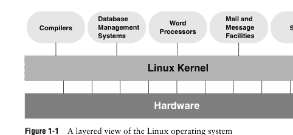

**图 1-1** Linux 操作系统的分层视图

### Linux 概述

Linux 操作系统具有许多独特而强大的特性。与其他操作系统一样，它是计算机的控制程序。但像 UNIX 一样，它也是一个深思熟虑的工具程序家族（图 1-1）以及一组允许用户连接并使用这些工具来构建系统应用程序的工具集。

### Linux 具有内核编程接口

Linux 内核——Linux 操作系统的心脏——负责分配计算机资源并调度用户作业，使每个作业都能公平地获得系统资源，包括访问 CPU；外围设备，如硬盘、DVD 和 CD-ROM 存储；打印机；以及磁带驱动器。程序通过系统调用与内核交互，系统调用是具有知名名的特殊函数。程序员可以使用单个系统调用来与多种类型的设备交互。例如，有一个 write() 系统调用，而不是许多特定设备的调用。

当程序发出 *write()* 请求时，内核解释上下文并将请求传递给适当的设备。这种灵活性允许旧的工具程序与编写这些工具程序时还不存在的设备一起工作。它还使得无需重写程序即可将它们移动到操作系统的新版本（前提是支持的新版本识别相同的系统调用）。

### Linux 支持多用户

根据硬件和计算机执行的任务类型，Linux 系统可以支持从 1 到超过 1,000 名用户，每个人同时运行不同的程序集。可被多人同时使用的计算机的人均成本低于只能被单人一次使用的计算机。这是因为一个人通常无法利用计算机提供的所有资源。也就是说，没有人能同时让所有打印机持续工作、保持所有系统内存的使用、保持所有磁盘忙碌读写、保持互联网连接的使用以及让所有终端同时忙碌。相比之下，多用户操作系统允许许多人几乎同时使用所有系统资源。成本高昂的资源使用可以最大化，而每个用户的成本可以最小化——这是多用户操作系统的主要目标。

### Linux 支持多任务

Linux 是一个完全保护的多任务操作系统，允许每个用户一次运行多个作业。进程可以相互通信，但彼此之间受到完全保护，就像内核保护其免受所有进程的侵犯一样。你可以在后台运行几个作业，同时将所有注意力集中在屏幕上显示的作业上，并且可以在作业之间切换。如果你正在运行 X 窗口系统（第 17 页），你可以在同一屏幕上的不同窗口中运行不同的程序，并观察它们全部。这种功能有助于提高用户的生产力。

### Linux 提供安全分层文件系统

*文件* 是信息的集合，例如备忘录或报告的文本、销售数据的累积、图像、歌曲或可执行程序。每个文件都存储在存储设备（如硬盘）上的唯一标识符下。Linux 文件系统提供了一种结构，文件按*目录*排列，目录类似于文件夹或盒子。每个目录都有一个名称，可以容纳其他文件和目录。目录反过来又安排在其他目录下，依此类推，形成树状组织。这种结构通过将相关文件分组到目录中，帮助用户管理大量文件。每个用户拥有一个主目录和所需数量的子目录（图 1-2）。

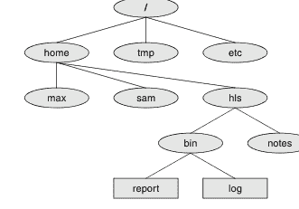

**图 1-2** Linux 文件系统结构

**标准** 为了简化系统管理员和软件开发人员的生活，一个小组在互联网上聚集并开发了 Linux 文件系统标准（FSSTND），该标准后来演变为 Linux 文件系统层次标准（FHS）。在采用此标准之前，关键程序位于不同 Linux 发行版中的不同位置。如今，你可以坐在 Linux 系统前，并期望在任何给定标准程序都能以一致的位置找到（第 213 页）。

**链接** 链接允许通过两个或更多名称访问特定文件。替代名称可以位于与原始文件相同的目录中，也可以位于另一个目录中。链接可以使同一文件出现在几个用户的目录中，使这些用户可以轻松共享文件。Windows 使用“快捷方式”一词来代替“链接”以描述此功能。Macintosh 用户会更熟悉“别名”一词。在 Linux 下，别名与链接不同；它是 shell 提供的一个命令宏功能（第 346 页）。

**安全性** 像大多数多用户操作系统一样，Linux 允许用户保护其数据免受其他用户的访问。它还提供了一种简单但有效的保护方案，允许用户与特定的其他用户共享选定的数据和程序。此级别的安全性由文件访问权限提供，限制可以读取、写入或执行文件的用户。最近，Linux 实现了访问控制列表（ACLs），为用户和管理员提供对文件访问权限的更细粒度的控制。

### Shell：命令解释器和编程语言

在文本环境中，shell——命令解释器——充当你与操作系统之间的接口。当你在屏幕上输入命令时，shell 解释命令并调用你所需的程序。Linux 上有几种可用的 shell。四种最流行的 shell 是


- 再次伯恩 Shell（**bash**），原始伯恩 Shell（最初的 UNIX shell）的增强版本。
- 德拜安-阿爾奎斯特 Shell（**dash**；第 292 页），**bash** 的一个更小版本，功能较少。大多数启动 Shell 脚本调用 **dash** 代替 **bash** 以加快启动过程。
- TC Shell（**tcsh**），C Shell 的增强版本，作为 BSD UNIX 的一部分开发。
- Z Shell（**zsh**），结合了多种 shell 的特性，包括考恩 Shell（Korn Shell）。

由于不同的用户可能偏好不同的 shell，多用户系统在任何给定时间都可能使用几种不同的 shell。shell 的选择展示了 Linux 操作系统的一个优势：为每个用户提供定制化接口的能力。

除了执行从键盘解释命令并将这些命令发送到操作系统的功能外，shell 还是一种高级编程语言。可以将 shell 命令安排在文件中以便稍后执行（Linux 将这些文件称为*shell 脚本*；Windows 称它们为*批处理文件*）。这种灵活性使用户能够相对轻松地执行复杂操作，通常只需发出简短的命令，或者以令人惊讶地少的努力构建执行高度复杂操作的复杂程序。

#### 文件名生成

当你输入由 shell 处理的命令时，你可以使用具有特殊含义的字符来构建模式。这些字符被称为*通配符*。这些模式被称为*模糊文件引用*，是一种简写：你无需输入完整的文件名，只需输入模式；shell 会将这些模式扩展为匹配的文件名。模糊文件引用可以节省你输入长文件名或一系列相似文件名的麻烦。例如，shell 可能会将模式 **mak\*** 扩展为 **make-3.80.tar.gz。** 当你只知道文件名的一部分或无法记住文件名的确切拼写时，模式也很有用。

#### 补全

结合 Readline 库，shell 执行命令、文件名、路径名和变量补全：你输入前缀并按下 ESCAPE 键，shell 会列出以该前缀开头的项，或者如果前缀指定了唯一项，则补全该项。

#### 设备无关的输入和输出

设备（如打印机或终端）和磁盘文件在 Linux 程序中表现为文件。当你向 Linux 操作系统发出命令时，你可以指示它将输出发送到多个设备或文件中的任意一个。这种重定向称为输出*重定向*。

**设备独立性** 类似地，通常来自键盘的程序输入可以被重定向，使其改为来自磁盘文件。输入和输出是*设备独立*的；也就是说，它们可以被重定向到任何合适的设备或从中接收。

作为一个例子，`cat` 实用程序通常会在屏幕上显示文件的内容。当你运行 `cat` 命令时，可以很容易地使其输出转到磁盘文件而不是屏幕。

#### shell 函数

shell 最重要的特性之一是用户可以将其用作编程语言。由于 shell 是解释器，它不编译为其编写的程序，而是在每次从磁盘加载时解释程序。加载和解释程序可能耗时较长。

许多 shell，包括再次伯恩 Shell，支持 shell 函数，shell 会将这些函数保存在内存中，因此每次执行时无需从磁盘读取它们。shell 还将函数保持内部格式，因此无需花费太多时间来解释它们。

#### 作业控制

*作业控制* 是 shell 的一个特性，允许用户同时处理多个作业，并按需在这些作业之间切换。启动作业时，通常在前台运行，因此连接到终端。使用作业控制，你可以将正在处理的作业移到后台，并在前台处理或观察另一个作业的同时让其在后台继续运行。如果后台作业需要你的关注，你可以将其移回前台，使其再次连接到终端。（作业控制的概念起源于 BSD UNIX，出现在 C Shell 中。）

#### 大量有用的实用程序

Linux 包含由数百个实用程序程序组成的家族，通常被称为*命令*。这些实用程序执行用户普遍需要的功能。例如，sort 实用程序将列表（或列表组）按字母或数字顺序排列，并可用于按部件号、姓氏、城市、邮政编码、电话号码、年龄、尺寸、成本等对列表进行排序。sort 实用程序是标准 Linux 系统的重要组成部分，是一个重要的编程工具。其他实用程序允许用户创建、显示、打印、复制、搜索和删除文件，以及编辑、格式化并排版文本。`man`（用于手册）和 `info` 实用程序提供 Linux 的在线文档。

#### 进程间通信

**管道和过滤器** Linux 允许用户在命令行上建立管道和过滤器。*管道* 将一个程序的输出作为输入发送到另一个程序。*过滤器* 是一种特殊的管道，它处理输入数据流以产生输出数据流。

过滤器处理另一个程序的输出，并因此对其加以改变。过滤器的输出随后成为另一个程序的输入。

管道和过滤器经常连接实用程序以执行特定任务。例如，你可以使用管道将 sort 实用程序的输出发送到 `head`（列出其输入的前十行的过滤器）；然后你可以使用另一个管道将 `head` 的输出发送到第三个实用程序 `lp`，它将数据发送到打印机。因此，在一条命令行中，你可以将三个实用程序组合起来，以排序并打印文件的一部分。

### 系统管理

在 Linux 系统中，系统管理员通常是系统的所有者和唯一用户。此人有诸多责任。首要责任可能是设置系统、安装软件，并可能需要编辑配置文件。系统启动并运行后，系统管理员负责下载和安装软件（包括升级操作系统），备份和还原文件，以及管理打印机、终端、服务器和局域网等系统设施。系统管理员还负责在多用户系统上为新用户设置账户，根据需要启动和关闭系统，监控系统，并处理出现的任何问题。

### Linux 的附加特性

Linux 的开发人员在其操作系统中包含了来自 BSD、System V 和 Sun Microsystems' Solaris 的特性，以及新特性。尽管在 Linux 中存在大多数在 UNIX 上找到的工具，但在某些情况下，这些工具已被更现代的对应物所取代。本节描述在 Linux 下可用的一些流行工具和特性。

#### GUI：图形用户界面

X 窗口系统（也称为 X 或 X11）部分由麻省理工学院（MIT）的研究人员开发，为 Linux 可用的 GUI 提供了基础。给定支持 X 的终端或工作站屏幕，用户可以通过屏幕上的多个窗口与计算机交互，显示图形信息，或使用专用应用程序绘制图片、监控进程或预览格式化输出。X 是一个跨网络协议，允许用户在远程于生成窗口的 CPU 的工作站或计算机系统上打开窗口。

桌面管理器：通常有两层运行在 X 之上：桌面管理器和窗口管理器。*桌面管理器* 是一种面向图像的图形用户界面，允许你通过操作图标而不是向 shell 输入相应命令来与系统程序交互。


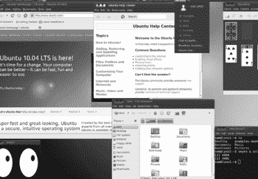

图 1-3 GNOME 工作区

Ubuntu 默认运行 GNOME 桌面管理器（图 1-3；www.gnome.org），但也可以运行 KDE（www.kde.org）以及其他多种桌面管理器。

窗口管理器是一种在桌面管理器下运行的程序，它允许您打开和关闭窗口、运行程序，并配置鼠标使其根据点击的方式和位置产生不同的效果。窗口管理器还赋予了屏幕个性化的特征。虽然 Microsoft Windows 允许您更改窗口中关键元素的颜色，但在 X 窗口系统下的窗口管理器允许您自定义屏幕的整体外观和感觉：您可以更改窗口的外观和运行方式（通过提供不同的边框、按钮和滚动条），设置虚拟桌面，创建菜单等等。

在 X 和 Linux 下运行着几个流行的窗口管理器。Ubuntu Linux 提供了 Metacity（GNOME 下的默认窗口管理器）和 kwin（KDE 下的默认窗口管理器）。其他窗口管理器，如 Sawfish 和 WindowMaker 也可用。第 4 章和第 8 章介绍了有关 GUI 的信息。

### （互联）网络工具

Linux 网络支持包含许多工具，使您能够通过多种网络访问远程系统。除了向其他系统的用户发送电子邮件外，您还可以访问挂载在其他计算机磁盘上的文件，就像它们位于本地系统上一样；以类似的方式使您的文件对其他系统可用；来回复制文件；在远程系统上运行程序同时在本地系统上显示结果；以及在局域网（LAN）和广域网（WAN，包括互联网）之间执行许多其他操作。

在此网络访问之上，还覆盖着广泛的应用程序，这些应用将计算机的资源扩展到全球各地。您可以与世界各地的人交谈，收集各种主题的信息，并通过互联网快速可靠地下载新软件。第 10 章讨论了网络、互联网以及 Linux 网络设施。

### 软件开发

Linux 最令人印象深刻的优势之一是其丰富的软件开发环境。Linux 支持多种计算机语言的编译器和解释器。除了 C 和 C++，Linux 可用的语言还包括 Ada、Fortran、Java、Lisp、Pascal、Perl 和 Python。bison 工具生成解析代码，使得编写构建编译器（解析包含结构化信息的文件的工具）的程序更容易。flex 工具生成扫描器（识别文本中词法模式的代码）。make 工具以及 GNU 配置和构建系统使管理复杂开发项目变得更加容易。像 CVS 这样的源代码管理系统简化了版本控制。包括 ups 和 gdb 在内的几个调试器可以帮助您追踪和修复软件缺陷。GNU C 编译器 (gcc) 与 gprof 性能分析工具配合使用，帮助程序员识别程序性能中的潜在瓶颈。C 编译器包含用于对 C 代码进行广泛检查的选项，从而使代码更具可移植性并减少调试时间。第 1104 页的表 B-4 列出了一些您可以下载软件的站点。

### 本书使用的约定

本书使用约定来使解释更简短、更清晰。以下段落描述这些约定。

- **小部件**

  小部件是用户与之交互的简单图形元素，如文本框、单选按钮或组合框。在提及小部件时，本书会指定小部件的类型及其标签。“ticky”一词指的是您在复选框中放置的标记，有时称为勾号。例如，“在标记为 **Run in terminal.**（在终端中运行）的复选框中打勾”。请参见术语表以了解各种小部件的定义。

- **选项卡和框架**

  选项卡允许窗口显示一组相关信息，一次显示一组。例如，第 114 页的图 4-12 显示了外观首选项窗口，该窗口有四个选项卡；主题（Theme）选项卡处于高亮显示状态。框架在窗口内隔离一组信息。请参见第 551 页的图 14-3 中的示例。

- **菜单选择路径**

  菜单选择路径是菜单的名称或位置，后跟冒号、一个 **空格（SPACE）**，以及由 **⇝** 标记分隔的菜单选择项。整个菜单选择路径以 **粗体** 显示。您可以将 **Main menu⇝** **References⇝Appearance**（主菜单⇝ 参考资料⇝ 外观）读作“从主菜单中选择 **System**（系统）；从 **System** 中选择 **References**（参考资料）；然后选择 **Appearance**（外观）。”

- **文本和示例**

  正文使用此字体设置，而示例则使用等宽字体（也称为 *固定宽度* 字体）显示：

  ```
  $ cat practice
  This is a small file I created
  with a text editor.
  ```

您输入的项目
您在键盘上输入的所有内容均以粗体显示。在正文中，使用此粗体；在示例和屏幕中，使用此字体。在前面的示例中，第一行的美元符号 ($) 是 Linux 显示的提示符，因此不是粗体；第一行的其余部分由用户输入，因此是粗体。

实用程序名称
实用程序名称以这种无衬线字体打印。本书提到了 emacs 文本编辑器和 ls 实用程序或 ls 命令（或仅 ls），并指导您在命令行上输入 ls -a。通过这种方式，正文区分了实用程序（即程序）和您在命令行上输入的用于调用这些实用程序的指令。

文件名
文件名以粗体显示。示例包括 memo5、letter.1283 和 reports。文件名可能包含大写字母和小写字母；然而，Linux 对大小写敏感（第 1139 页），因此 memo5、MEMO5 和 Memo5 指代三个不同的文件。

字符字符串
在正文中，字符和字符串通过加粗显示来标记。此约定避免了在字符串前后使用引号或其他分隔符的需要。以下字符串（由 passwd 实用程序显示）是一个示例：Sorry, passwords do not match.（抱歉，密码不匹配。）

按钮和标签
在描述 GUI 的章节中，单词以粗体显示。此字体表示当鼠标指针位于屏幕上的这些单词上方或位于具有此名称的按钮上方时，您应点击鼠标按钮：Click Next.（点击下一步。）

- 按键和字符
  本书使用大写小写字母（SMALL CAPS，此处指小型大写或强调形式，原文意指非全大写的小字号大写或特定字体样式，翻译保留原意）用于三种项目：
  - 键盘按键，如空格键（SPACE bar）以及回车键（RETURN）、转义键（ESCAPE）和制表键（TAB）。
  - 按键生成的字符，如空格键生成的空格（Spaces）。
  - 与控制键（CONTROL）配合按下的键盘按键，如 CONTROL-D。（尽管 D 显示为大写字母，您不需要按下 SHIFT 键；按住 Control 键并按 D 键即可输入 CONTROL-D。）

提示符和回车
大多数示例包括 shell 提示符——表示 Linux 正在等待命令的信号——通常是美元符号 ($)、井号 (#) 或有时是百分号 (%)。本书中提示符不以粗体显示，因为您不需要输入它。当尝试本书中的示例时，不要在键盘上输入提示符。如果您这样做了，示例将无法正常工作。

示例省略了执行命令所需的 RETURN 键输入。一个命令行示例如下：
$ vim.tiny memo.1204

请使用此示例作为运行 vim 文本编辑器的模型，输入命令 vim.tiny memo.1204 并按下 RETURN 键。（按 ESCAPE ZZ 退出 vim；有关 vim 教程请参见第 186 页。）这种输入命令的方法使书中的示例与屏幕上显示的内容相对应。

$ vim.

> 8. 不同的键盘使用不同的按键将光标（第 1143 页）移动到下一行的开头。本书始终将结束一行的按键称为 RETURN 键。您的键盘可能拥有 RET、NEWLINE、ENTER、RETURN 或其他按键。每当本书要求您按 RETURN 时，请使用您键盘上对应的按键。


#### 定义

所有标有 FORDO 的术语表条目均由 Denis Howe（《免费在线计算机词典》（foldoc.org）的编辑）提供，并经其授权使用。本网站是一项持续进行的工作，包含定义、趣闻和冷知识。

#### 可选信息

标记为可选的内容显示在灰色方框中。这些材料并非本章所阐述思想的核心，但往往涉及更具挑战性的概念。阅读章节的一个好策略是：先跳过可选部分，然后在熟悉本章主要思想后再回来阅读。这是一个可选段落。

#### URL（网络地址）

网络地址或 URL 默认带有 `http://` 前缀，除非显示为 `ftp://` 或 `https://`。当前缀为 `http://` 时，通常无需指定前缀，但在指定 FTP 或安全 HTTP 站点时，必须从浏览器使用相应前缀。因此，你可以按照本书所示的方式在浏览器中指定 URL。

#### 提示、警告和安全框

以下方框突出了在你使用或管理 Linux 系统时可能有用的信息。

##### 这是一个提示框

- **提示**：提示框可以帮助你避免重复常见的错误，或指向额外的信息。

##### 此框提醒你注意某些事项

- **警告**：警告框提醒你潜在的陷阱。

##### 此框标记安全注意事项

- **安全**：安全框突出了潜在的安全问题。这些说明通常面向系统管理员，但有些适用于所有用户。

### 章节摘要

Linux 操作系统源于 UNIX 传统，成为传统系统（即 Windows）在微型计算机（PC）硬件上的流行替代品。UNIX 用户会在 Linux 中找到熟悉的环境。Linux 发行版包含由世界各地程序员提供的预期 UNIX 实用程序配套，其中包括作为 GNU 项目一部分开发的一组工具。Linux 社区致力于该系统的持续发展。对新微型计算机设备和特性的支持在硬件可用后不久即被添加，而在 Linux 上可用的工具也在不断精化。鉴于可用于 Linux 平台运行的众多商业软件包，以及许多在其系统上提供 Linux 的硬件制造商，显然该系统已从本科项目起源发展得远超其初始阶段，成为学术、商业、专业和个人使用的首选操作系统。

####### 练习

- 1. 什么是自由软件？列举自由软件的三个特征。
- 2. 为什么 Linux 受欢迎？为什么它在学术界受欢迎？
- 3. 什么是多用户系统？为什么它们成功？
- 4. 什么是自由软件基金会/GNU？什么是 Linux？Linux 操作系统的哪些部分分别由它们提供？还有哪些人帮助构建和精化了此操作系统？
- 5. Linux 是用哪种语言编写的？该语言与 Linux 的成功有什么关系？
- 6. 什么是实用程序？
- 7. 什么是 shell？它如何与内核配合？与用户如何配合？
- 8. 你如何使用实用程序和 shell 创建自己的应用程序？
- 9. 为什么 Linux 文件系统被称为*分层*文件系统？
- 10. 多处理器和多处理系统之间有什么区别？
- 11. 给出一个你想使用多处理系统的例子。
- 12. 大约有多少人编写了 Linux？为什么这个项目是独特的？
- 13. GNU 通用公共许可证的关键条款是什么？

### 第一部分

### 安装 Ubuntu Linux

| 章节 | 标题 | 页码 |
| :--- | :--- | :--- |
| 2 | 安装概述 | 25 |
| 3 | 逐步安装 | 51 |

*此页有意留白*

### 2

#### 安装概述

###### 本章内容

- 更多信息 ............................... 26
- 规划安装 ................. 27
- 设置硬盘 .................... 33
- LVM：逻辑卷管理器 ......... 41
- 安装过程 .................... 42
- 下载并刻录 CD/DVD ................... 43
- 使用 BitTorrent ............................... 46
- 收集系统信息 ....................... 47

安装 Ubuntu Linux 是将操作系统文件从 CD、DVD 或 USB 闪存盘复制到系统的硬盘，并设置配置文件以使 Linux 在硬件上正常运行的过程。可以进行多种类型的安装，包括全新安装、从旧版本升级 Ubuntu Linux 以及双启动安装。

本章讨论一般的安装过程：规划、对硬盘进行分区、获取安装文件、刻录 CD 或 DVD，以及收集可能对安装和管理有帮助的硬件信息。第 3 章涵盖安装 Ubuntu 的过程。

ubiquity 实用程序是一个用户友好的图形工具，用于安装 Ubuntu。要在标准硬件上安装 Ubuntu Linux，通常可以插入 live/install 桌面 CD 或 live/install DVD 并启动系统。回答几个问题后，安装即可完成。当然，有时你可能想自定义系统，或者可能在非标准硬件上进行安装：安装程序会在安装过程中展开时提供这些选择。Ubuntu 还提供文本安装程序，让你对安装拥有更多控制。有关安装和自定义 Ubuntu Linux 的信息，请参阅“从 Live/Install 桌面 CD 或 Live/Install DVD 启动”（第 52 页）和“高级安装”（第 77 页）。

##### LIVE/INSTALL 桌面 CD 和 LIVE/INSTALL DVD

Live/install 桌面 CD 和 live/install DVD 在不将其安装到硬盘的情况下运行 Ubuntu。要从 live/install 桌面 CD 或 live/install DVD 启动，请确保计算机设置为从 CD/DVD 启动；更多信息请参阅第 28 页的“BIOS 设置”和“CMOS”。启动 live/install 桌面 CD/DVD 时，它会启动 GNOME 桌面：你正在运行一个 live 会话。当你退出 live 会话时，系统返回到你从 CD/DVD 启动前的状态。如果系统具有 Linux 交换分区（大多数 Linux 系统都有一个；见第 37 页），live 会话会使用它来提高性能，但不会以其他方式写入硬盘。你也可以从 live 会话安装 Ubuntu。

运行 live 会话是测试硬件和修复无法从硬盘启动的系统的好方法。在你将 Ubuntu 系统升级到新版本之前可以使用 live 会话：在某些情况下，新内核可能无法启动。Live 会话对于 Ubuntu 或 Linux 的新手也 ideal，他们想试验 Ubuntu 但尚未准备好在其系统上安装 Ubuntu。

###### 在 live 会话中保存文件

- **提示**：你不能将文件保存到 live/install CD/DVD，因为这些是只读介质。在 live 会话期间，即使你看似保存了文件，在退出 live 会话后也不会存在。要保存 live 会话中的数据，请将其保存到网络共享或 USB 闪存盘，或者发送电子邮件给自己。

##### 更多信息

除了以下参考资料外，请参阅第 136 页的“在哪里查找文档”以及附录 B 以获取额外资源。

- Web memtest86+：www.memtest.org
- gparted（GNOME 分区编辑器）：gparted.sourceforge.net
- 硬件兼容性：wiki.ubuntu.com/HardwareSupport
- 交换空间：help.ubuntu.com/community/SwapFaq
- 分区 HOWTO：tldp.org/HOWTO/Partition
- 升级：www.ubuntu.com/getubuntu/upgrading
- 启动命令行参数：help.ubuntu.com/community/BootOptions 和 www.tldp.org/HOWTO/BootPrompt-HOWTO.html
- 发行版：wiki.ubuntu.com/Releases
- 发行说明：www.ubuntu.com/getubuntu/releasenotes
- 刻录 CD：help.ubuntu.com/community/BurningIsoHowto
- 从 USB 闪存盘安装：help.ubuntu.com/community/Installation/FromUSBStick


RAID：help.ubuntu.com/community/Installation/SoftwareRAID，en.wikipedia.org/wiki/RAID，以及 raid.wiki.kernel.org/index.php/Linux_Raid
LVM 资源页面（包含许多链接）：sourceware.org/lvm2
LVM 使用指南：www.tldp.org/HOWTO/LVM-HOWTO
BitTorrent：help.ubuntu.com/community/BitTorrent 和 azureus.sourceforge.net
ARM：wiki.ubuntu.com/ARM/LucidReleaseNotes
X.org 发布信息：wiki.x.org

##### 下载 Ubuntu

- 最便捷的下载方式：www.ubuntu.com/getubuntu
- 已发布版本：releases.ubuntu.com
- 最小化 CD：help.ubuntu.com/community/Installation/MinimalCD
- 旧版本：old-releases.ubuntu.com/releases
- 开发版镜像和不受支持的版本：cdimage.ubuntu.com
- Mac (PowerPC)：wiki.ubuntu.com/PowerPCDownloads
- BitTorrent 种子文件：torrent.ubuntu.com/releases

##### 规划安装

规划安装时的主要决策是如何将硬盘划分为分区，或者在双启动系统中，Linux 分区应放置在何处。安装 Ubuntu 之后，你可以决定要在基础系统中添加哪些软件包（或者是否要移除一些软件包）。除了这些主题外，本节还讨论了 Ubuntu Linux 的硬件要求以及全新安装与升级的区别。

##### 考虑事项

###### 图形用户界面

在大多数系统中，除了服务器之外，你很可能想要安装图形用户界面（桌面环境）。Ubuntu 默认安装 GNOME。有关安装 KDE 的信息，请参见第 75 页。

###### 软件和服务

随着你在系统上安装越来越多的软件包，更新的次数和软件包之间的交互作用会增加。监听网络连接的服务端软件包会通过增加系统被攻击的方式使系统更易受攻击。包含额外的服务也可能使系统变慢。如果你需要一个学习系统或开发系统，额外的软件包和服务可能很有用。对于更安全的生产系统，最好安装并维护所需的最少软件包，并仅启用必需的服务。有关 Upstart 初始化守护程序的信息，它负责启动和停止系统服务，请参见第 432 页。

###### 最小化 CD

最小化 CD 体积小巧，提供快速安装（第 32 页）。

##### 要求

###### 硬件

本章和第三章涵盖了在 32 位 Intel 及兼容处理器架构（如 AMD）以及 64 位处理器架构（如 AMD64 处理器和具有 Intel EM64T 技术的 Intel 处理器）上安装 Ubuntu 的内容。在这些处理器架构中，Ubuntu Linux 可以在许多可用硬件上运行。你可以在 wiki.ubuntu.com/HardwareSupport 查看 Ubuntu 的兼容和受支持硬件列表。许多互联网网站讨论了 Linux 硬件；使用 Google（www.google.com）搜索“linux hardware”、“ubuntu hardware”或“linux”以及你希望获取更多信息的特定硬件（例如，linux sata 或 linux a8n）。此外，许多使用指南涵盖了特定硬件。Linux 硬件兼容性使用指南也可用，尽管在你阅读时它可能不是最新的。除非系统包含非常新或特殊的组件，否则 Ubuntu Linux 通常可以在 Windows 运行的相同系统上运行。

运行 Ubuntu 所需的硬件取决于你想设置哪种类型的系统。一个运行文本（命令行）界面且安装了极少软件包的最简系统，与一个运行图形用户界面、安装了大量软件包并支持视觉效果（第 115 页）的系统所需的硬件非常不同。如果你在 RAM 少于 320 兆字节的系统上安装 Ubuntu，请使用替代 CD（第 32 页）。如果你想在系统上运行视觉效果，请在 help.ubuntu.com 上查找有关视觉效果的信息。

网络连接对于保持 Ubuntu 最新是不可或缺的。声卡对于多媒体应用来说是一个不错的补充。如果你要在旧硬件或最小硬件上安装 Ubuntu 并希望运行图形用户界面，请考虑安装 Xubuntu（www.xubuntu.org），因为它提供一个轻量级桌面，比 Ubuntu 更高效地使用系统资源。

一个极简的文本（命令行）系统需要 48 兆字节的 RAM。标准桌面系统需要 320 兆字节，不过如果你安装 Xubuntu，可能可以使用更少的 RAM。从实时会话安装 Ubuntu 需要 256 兆字节，尽管如果系统 RAM 少于 512 兆字节，运行速度会变慢。如果系统 RAM 少于 256 兆字节，请使用文本安装程序（第 85 页）。

Linux 能有效利用额外内存：系统内存越多，运行速度越快。添加内存是提升 Linux 系统速度最具成本效益的方式之一。

Ubuntu Linux 要求最低配备 200 兆赫兹 Pentium 级处理器或等效的 AMD 或其他处理器以运行文本模式，并至少配备 400 兆赫兹 Pentium II 处理器或等效处理器以运行图形模式。

Ubuntu 所需的硬盘空间大小取决于你安装的 Ubuntu Linux 版本、安装的软件包、安装的语言数量以及用户数据（你的文件）所需的存储空间。操作系统通常需要 2-8 吉字节，尽管最小系统可以更少。从实时会话安装 Ubuntu 需要在硬盘上有 4 吉字节的空间。

现代计算机可以设置为从 CD/DVD、硬盘或 USB 闪存盘启动。BIOS 决定系统尝试从每个设备启动的顺序。你可能需要更改此顺序：确保 BIOS 设置为先尝试从 CD/DVD 启动，然后再尝试从硬盘启动。有关更多信息，请参见第 583 页。

CMOS 是存储硬件配置信息的持久内存。要更改 BIOS 设置，你需要编辑存储在 CMOS 中的信息。当系统启动时，它会显示一条简短的消息，说明如何进入系统设置或 CMOS 设置模式。通常，你需要在系统启动时按 DEL 或 F2。按下提示的键，然后将光标移动到处理系统启动的屏幕和行。通常有一个包含三或四个设备的列表，系统会尝试从这些设备启动；如果第一次尝试失败，系统会尝试第二个设备，依此类推。调整列表，使 CD/DVD 成为首选，保存列表，然后重新启动。有关更多信息，请查阅硬件/BIOS 手册。

###### 处理器架构

Ubuntu CD 和 DVD 包含编译后用于在特定处理器架构（处理器或 CPU 类别）上运行的程序。以下列表描述了 Ubuntu 编译支持的每种架构。有关每种架构中处理器详细列表，请参见 help.ubuntu.com/community/ProcessorArch。由于 Linux 源代码对所有人开放，具备知识用户可以编译 Ubuntu Linux 以在其他处理器架构上运行。

####### 我是否应该在 64 位兼容处理器上安装 32 位或 64 位 Ubuntu？

以下信息可能有助于你决定在 64 位兼容处理器上安装 32 位还是 64 位 Ubuntu。

- EM4T/AMD64 处理器同样可以良好地运行任一版本的 Ubuntu。
- 64 位发行版允许每个进程寻址超过 4 吉字节的 RAM。更大的地址空间是 64 位发行版最大的优势。它通常仅在某些工程/科学计算工作以及运行多个虚拟机时有用。
- 64 位处理器通常并不比 32 位处理器快；大多数基准测试显示性能大致相似。在某些情况下性能更好，在某些情况下性能更差：两种类型的处理器都没有明确的性能优势。
- 64 位 Linux 的内存模型使得指针的大小是 32 位 Linux 的两倍。这种大小差异会导致 RAM 使用量增加 5% 以上，具体取决于应用程序。如果系统 RAM 不足，这种开销可能会使性能变差。
- ASLR（地址空间布局随机化）在 64 位 Ubuntu 提供的大地址空间中运行得更好。ASLR 可以帮助提高系统安全性。请参见 en.wikipedia.org/wiki/Address_space_layout_randomization。
- 某些多媒体编码器在 64 位 Ubuntu 下运行快 10-30%。
- 由于使用 32 位 Linux 的人更多，32 位 Linux 中的错误往往比 64 位 Linux 中的错误更快地被发现和修复。
- Ubuntu 在 64 位系统上可以像在 32 位系统上一次点击设置 Flashplayer 和 Java 一样轻松。然而，对于某些应用程序，如 Skype，你必须在 64 位系统上应用一些丑陋的变通方法才能运行它们。
- 在不重新安装 Ubuntu 的情况下，没有简单的方法可以在 32 位和 64 位版本的 Ubuntu 之间来回切换。
- 如果你不确定使用哪个发行版，请安装 32 位版本的 Ubuntu。


Ubuntu PC（Intel x86）CD/DVD 上的软件编译用于在 Intel x86 兼容处理器上运行，包括大多数带有 Intel 和 AMD 处理器的机器，几乎所有运行 Microsoft Windows 的机器，以及使用 Intel 处理器的较新的 Apple Macintosh 机器。如果你不确定某台机器拥有哪种类型的处理器，可以假设它拥有这种类型的处理器。

Ubuntu 64 位 PC（AMD64）CD/DVD 上的软件编译用于在 AMD64 处理器上运行，包括 Athlon64、Opteron 以及集成了 EM64T 技术的 Intel 64 位处理器，例如 EMT64 Xeon。由于某些专有第三方应用程序的功能在 64 位架构上不可用，你可能希望在具有 64 位处理器的系统上运行专为 32 位（Intel x86）处理器编译的 Ubuntu。

Dove 指的是 Marvell Dove 片上系统（Armada 500 的代号）。这种全能芯片组具有一个 ARM 通用处理器和一组特定的外设。欲了解更多信息，请参阅 www.ubuntu.com/products/whatisubuntu/arm 和 wiki.ubuntu.com/ARM/LucidReleaseNotes。

Ubuntu 并不官方支持 IBM/Motorola PowerPC（由较旧的 Apple Macintosh 计算机使用），但针对此处理器架构有广泛的社区支持。关于在 PowerPC 上运行 Ubuntu 的更多信息，请参阅 wiki.ubuntu.com/PowerPCFAQ。你可以从 wiki.ubuntu.com/PowerPCDownloads 下载 Ubuntu 的 PowerPC 版本。

Ubuntu 支持 UltraSPARC 机器，包括基于多核 UltraSPARC T1（Niagara）处理器的机器。

Ubuntu 支持 Itanium 系列的 64 位 Intel 处理器。

##### 界面：安装程序和已安装系统

安装 Ubuntu 时，你可以选择在安装过程中（与安装程序配合工作）使用的界面。你还可以选择用于操作已安装系统的界面。本节描述了两种基本界面：文本界面和图形界面。

文本界面，也称为命令行界面（CLI）或基于字符的界面，显示字符和一些简单的图形符号。它以行为导向；你仅使用键盘向其发出指令。

图形用户界面（GUI）通常显示桌面（例如 GNOME）和窗口；你使用鼠标和键盘向其发出指令。你可以通过打开终端仿真器窗口（第 125 页）在 GUI 中运行文本界面。与文本界面相比，GUI 使用更多的计算机资源（CPU 时间和内存）。

伪图形界面是一种利用基于文本的显示设备（如终端）上的图形元素的文本界面。它还可以使用颜色。此界面使用文本元素，包括简单的图形符号，来绘制模仿 GUI 窗口和按钮的简单框。频繁按下 `TAB` 键会将光标从一个元素移动到下一个元素，而按下 `RETURN` 键则选择光标所在的元素。

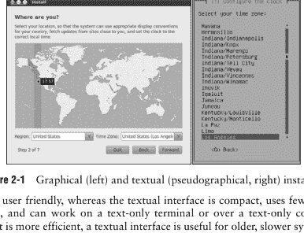

- **优点** GUI 用户友好，而文本界面紧凑，使用更少的系统资源，并且可以在纯文本终端或通过纯文本连接工作。由于其效率更高，文本界面对于较旧、较慢的系统以及内存极少的系统非常有用。服务器系统经常使用文本界面，因为它允许系统将更多资源用于执行其预设任务，而将较少资源用于取悦系统管理员。不运行 GUI 还可以提高系统安全性。
- 尽管使用图形界面，Ubuntu 的实时安装程序比文本安装程序安装 Ubuntu 的速度更快。实时安装程序将已安装的系统映像复制到硬盘，然后设置系统，而文本安装程序使用 APT 和 dpkg 逐个解包数百个软件包。
- **安装程序界面** Ubuntu 提供了一个用户友好的图形安装程序（**ubiquity**）以及一个高效的伪图形安装程序（debian-installer），后者提供更多选项并让你对安装拥有更大的控制权（图 2-1）。两种界面都完成相同的任务：它们让你告知安装程序你希望如何配置 Ubuntu。

##### UBUNTU 发行版

- **Canonical** 是支持 Ubuntu 的公司，大约每六个月发布一个新版本。每个版本都有一个编号和一个名称。编号由年份的最后一位或两位数字和发布月份的两位数字组成。例如，9.10 版本于 2009 年 10 月发布。按顺序，最近的版本有 7.10（Gutsy Gibbon）、8.04（Hardy Heron）、8.10（Intrepid Ibex）、9.04（Jaunty Jackalope）、9.10（Karmic Koala）和 10.04（Lucid Lynx）。Ubuntu 支持（即提供更新，包括安全更新）每个版本至少 18 个月。要查看 Ubuntu 发行版的完整列表，请参阅 wiki.ubuntu.com/Releases。
- **LTS 发行版** 某些 Ubuntu 版本标记为 LTS（长期支持）；例如，Lucid Lynx 是一个 LTS 发行版。Canonical 为桌面系统支持 LTS 发行版三年，为服务器系统支持五年。LTS 发行版旨在供那些更倾向于拥有稳定、不变的操作系统而非最新、最快版本的人使用。大型和机构安装、服务器以及高度自定义的发行版通常属于此类。你可以像安装其他版本一样安装和升级 LTS 发行版。

##### UBUNTU 版本

每个 Ubuntu 发行版磁盘被称为一个版本。以下是每个磁盘的概述。第 78 页的表 3-1 列出了每个磁盘菜单上可用的选项。

**DVD**
DVD 是实时/安装 DVD（第 26 页）；你可以使用它启动到实时会话。你可以从实时会话安装 Ubuntu（第 57 页）。此 DVD 适用于 PC 和 64 位 PC 架构（第 29 页），使用图形或文本安装程序，并安装显示图形或文本界面的 Ubuntu 系统。该 DVD 包含 Ubuntu 支持的所有软件包，而不仅仅是默认安装的软件包。它是对于没有互联网连接的系统的绝佳资源。

**桌面 CD**
桌面 CD 是实时/安装 CD（第 26 页）；你可以使用它启动到实时会话。你可以从实时会话安装 Ubuntu（第 57 页）。此 CD 适用于 PC 和 64 位 PC 架构（第 29 页），使用图形安装程序，并安装图形（桌面）Ubuntu 系统。

**备用 CD**
备用安装 CD 不是实时 CD；它仅用于特殊安装。它比桌面 CD 提供更高级的安装选项。此 CD 适用于 PC 和 64 位 PC 架构（第 29 页），使用文本安装程序，并安装显示图形或文本界面的 Ubuntu 系统。

**服务器 CD**
服务器 CD 不是实时 CD；它仅用于安装。此 CD 适用于 PC、64 位 PC 和 SPARC 架构（第 29 页）。它使用文本安装程序，并安装显示文本界面（无桌面）的 Ubuntu 系统。在安装过程中，服务器 CD 提供了安装多种服务器之一的选项，包括 DNS 和 LAMP（Linux、Apache、MySQL 和 PHP）。使用此 CD 安装的系统没有开放端口（第 401 页），并且仅包含服务器必需的软件。

**最小 CD**
最小 CD 不是官方版本，它很小（≈20 兆字节），并提供快速安装。因为它在安装系统的同时下载软件包，所以你无需在安装系统后立即更新软件包。此外，最小 CD 仅安装安装 Ubuntu 所需的软件包，因此使用此 CD 安装将产生一个最小系统。系统启动运行后，你可以安装额外的软件包。最小 CD 使用文本安装程序（第 85 页），这也使得该 CD 保持紧凑。欲了解更多信息，请参阅 help.ubuntu.com/community/Installation/MinimalCD。

##### 安装全新副本还是升级现有的 UBUNTU 系统？

**干净安装**
*安装*，有时被称为*干净安装*，将全新的数据写入磁盘。安装程序会覆盖所有系统程序和数据，以及


内核。根据用户数据的位置以及硬盘的格式/分区方式，您可以在安装过程中保留部分用户数据。或者，您可以通过设置双启动系统（第 76 页）在现有系统上执行干净安装而无需覆盖数据。

##### 如果您有运行 Ubuntu 的系统，请升级而不是重新安装

Ubuntu 建议，如果您有运行 Ubuntu 的系统并希望运行更新版本，请在系统上升级版本。这一建议的理由有两点。首先，与安装程序相比，升级路径由 Ubuntu 开发者进行了更积极的测试。因此，您在更新时遇到问题的可能性更小。其次，升级会保留系统设置和应用程序，使得升级比干净安装更容易执行。

*升级* 会用新发行版中可用的最新版本替换所有已安装的软件包。在升级过程中，安装程序会保留系统配置文件和用户数据文件。升级会使旧发行版中存在的实用程序保持最新，并安装新的实用程序。在升级系统之前，请备份系统上的所有文件。

通常，所有新功能都通过升级提供。然而，在升级过程中，GRUB 不会自动更新为 GRUB 2（第 584 页）。有关从 GRUB 升级到 GRUB 2 的信息，请参阅 help.ubuntu.com/community/Grub2。有关将 Ubuntu 系统升级到新发行版的说明，请参见第 74 页。请访问 www.ubuntu.com/getubuntu/releasenotes 了解哪些功能在升级后不会生效。

##### 设置硬盘

硬盘必须经过几种方式的准备，以便 Linux 能够对其进行读写。低级格式化是准备硬盘使用的第一步。您不需要执行此任务，因为它是在制造硬盘的工厂完成的。为使用而准备硬盘的下一步是向其写入分区表并在磁盘上创建分区。最后，您需要为每个分区创建文件系统。已分区磁盘中未被分区占用的区域称为*空闲空间*。新磁盘没有分区表、没有分区，也没有空闲空间。在 DOS/Windows 下，*格式化*一词指的是在分区上创建文件系统；见下文“文件系统”。

*分区*（或*切片*）是硬盘的一个逻辑部分，它具有设备名称，例如 `/dev/sda1`，因此您可以将其与其他部分分开引用。对于常规使用，您必须在硬盘上创建至少一个分区（第 34 页及以下）。从活动会话中，以及安装 Ubuntu 后，您可以使用 GNOME 分区实用程序（第 66 页）查看、调整大小和创建现有系统上的分区。在安装过程中，您可以使用图形分区编辑器（第 60 页和第 70 页）或文本分区编辑器（第 87 页）创建分区。安装后，您可以使用 *parted*（第 611 页）或 *fdisk* 来操作分区。有关设备名称的更多信息，请参见第 488 页的 `/dev`。

分区表保存有关硬盘上分区的信息。在磁盘上创建第一个分区之前，创建分区的程序必须在磁盘上设置一个空的分区表。随着分区被添加、删除和修改，有关这些更改的信息会记录在分区表中。如果您删除分区表，除了通过非常规手段外，您将无法再访问磁盘上的信息。


在大多数程序可以写入分区之前，需要向分区写入一个数据结构（第 1144 页），称为文件系统。此数据结构持有映射存储文件的位置到文件名称的 inode（第 501 页）。在数据结构的顶部是一个未命名的目录。如稍后将解释的，此目录在文件系统挂载时与系统目录结构连接。

当 Ubuntu 安装程序创建分区时，它会自动向分区写入文件系统。您可以使用 mkfs（创建文件系统；第 458 页）实用工具，它类似于 DOS/Windows 的 format 实用工具，手动在分区上创建文件系统。第 505 页的表 12-1 列出了一些常见的文件系统类型。Ubuntu Linux 通常为数据创建 ext4 文件系统；除非您有理由使用其他文件系统类型，否则请使用 ext4。Windows 使用 FAT16、FAT32 和 NTFS 文件系统。Apple 使用 HFS（分层文件系统）和 HFS+。OS X 使用 HFS+ 或 UFS。不同类型的文件系统可以在单个硬盘的不同分区中共存，包括 Windows 和 Linux 文件系统。

##### 主分区、扩展分区和逻辑分区

您可以将 IDE/ATA/SATA 磁盘划分为最多 63 个分区，并将 SCSI 磁盘划分为最多 15 个分区。您可以独立使用每个分区用于交换设备、文件系统、数据库、其他资源，甚至其他操作系统。


不幸的是，磁盘分区遵循很久以前为 DOS 机器建立的模板。磁盘最多只能容纳四个主分区。您可以将其中一个（且仅限一个）主分区划分为多个逻辑分区；这个被划分的主分区称为扩展分区。如果您希望驱动器上有四个以上的分区——您经常这样——您必须设置一个扩展分区。

典型的磁盘被划分为三个主分区（通常编号为 1、2 和 3）和一个扩展分区（通常编号为 4）。这三个主分区的大小是您希望最终分区的大小。扩展分区占据磁盘的其余部分。一旦您建立了扩展分区，您可以将其细分为额外的逻辑分区（编号为 5 或更大），每个都是您想要的大小。您不能使用扩展分区（编号 4）——只能使用它包含的逻辑分区。第 611 页的图 16-5 说明了本段中描述的磁盘。有关更多信息，请参阅 Linux 分区 HOWTO（tlpd.org/HOWTO/Partition）。

##### Linux 目录层次结构

**基本安装可跳过本节**

> 提示 本节简要介绍了 Linux 目录层次结构，以便您更好地理解在安装 Linux 时将硬盘划分为分区时可能需要做出的一些决定。您不需要阅读本节即可安装 Linux。您可以使用引导分区（第 60 页和第 70 页）设置磁盘，并在需要时返回本节。有关 Linux 目录层次结构的更详细解释，请参见第 6 章开头。

-   **命名空间**：*命名空间* 是一组名称（标识符），其中每个名称都是唯一的。
-   **Windows 与 Linux 的区别**：与 Windows 机器不同，Linux 系统呈现一个单一命名空间，其中包含本地系统上的所有文件，包括目录。Linux 系统命名空间称为*目录层次结构*或*目录树*。在 Windows 下，`C:\` 是独立于 `D:\` 的命名空间。以 `C:\` 为根的目录层次结构独立于以 `D:\` 为根的目录层次结构，它们之间没有路径或连接。在 Linux 下，单一系统命名空间以 `/` 为根，即*根目录*。根目录下有顶级子目录，如 `bin`、`boot`、`etc`、`home` 和 `usr`。
-   **绝对路径名**：Linux 系统上的所有文件，包括目录，都有一个称为*绝对路径名*的唯一标识符。绝对路径名追溯一条路径，穿过目录层次结构，从根目录开始，到路径名标识的文件或目录结束。因此，名为 `home` 的顶级目录的绝对路径名是 `/home`。有关更多信息，请参见第 205 页。
-   **路径名中的斜杠 (/)**：在路径名中，斜杠 (/) 跟在目录名称之后（出现在名称的右侧）。因此，`/home/sam` 指定名为 `sam` 的普通或目录文件位于名为 `home` 的目录中，而该目录是根目录 (/) 的子目录。路径名 `/home/sam/`（带有尾随斜杠）指定 `sam` 是一个目录文件。在大多数情况下，这种区分并不重要。当斜杠出现在路径名的左端或单独出现时，根目录是隐含的。
-   **Linux 系统命名空间**：Linux 系统命名空间由系统中目录层次结构内所有文件（包括目录）的绝对路径名集合组成。

##### 挂载点

分区上的文件系统不保存关于它将在目录层次结构中的哪里挂载的信息（文件系统的顶级目录没有名称）。当您使用安装程序创建大多数分区时，您指定要写入分区的文件系统类型以及 Ubuntu 与该分区关联的目录名称。

挂载文件系统将文件系统与目录层次结构中的一个目录关联起来。您可以在目录层次结构中的任何目录上挂载文件系统。


您挂载文件系统的目录称为**挂载点**。使用安装程序创建分区时指定的目录就是该分区的挂载点。大多数挂载点是顶级子目录，但也有少数例外（例如 `/usr/local`，它经常被用作挂载点）。

###### 在挂载文件系统之前，不要在挂载点创建文件

当文件系统未挂载在某个挂载点时，请勿在该目录中放入任何文件。当文件系统挂载在某个目录上时，该目录中作为挂载点的任何文件都会被覆盖；您将无法访问它们。当文件系统卸载时，这些文件会重新出现。

例如，假设第一块硬盘的第二个分区的设备名称为 `/dev/sda2`。要创建一个 ext4 文件系统并希望它在目录层次结构中显示为 `/home`，您必须指示 Linux 在系统启动时将 `/dev/sda2` 分区挂载到 `/home` 上。在这个文件系统挂载到其正常挂载点的情况下，您可以将其作为 `/home` 目录进行访问。

一个文件系统的状态不会影响其他文件系统：驱动器上的一个文件系统可能损坏且不可读，而其他文件系统运行正常。一个文件系统可能已满，您无法向其写入数据，而其他文件系统则有大量空间用于更多数据。

将分区信息与挂载点信息关联起来保存的文件是 `/etc/fstab`（文件系统表；第 510 页）。fstab 文件中存储的关联是系统的正常关联，但您可以轻松地覆盖它们。在恢复模式下工作时，您可以将文件系统挂载到 `/target` 目录，以便修复文件系统。例如，如果您将通常挂载在 `/home` 上、包含文件系统的分区挂载到 `/target`，那么通常在 `/home/sam` 找到的目录将可以在 `/target/sam` 找到。

除了设备名称（以及相关的 UUID 值——参见第 510 页）外，分区及其包含的文件系统没有名称或标识。相反，分区和文件系统通常通过分区的正常挂载点的名称来引用。因此，“`/home` 分区”和“`/home` 文件系统”指的是包含通常挂载在 `/home` 目录上的文件系统的分区。有关挂载文件系统的更多信息，请参见第 506 页。

##### 磁盘分区

在安装过程中，安装程序会调用分区编辑器来设置磁盘分区。本节讨论如何规划分区大小。虽然本节使用“分区”一词，但规划和调整大小 LV（逻辑卷；第 41 页）的工作方式相同。有关更多信息，请参见第 64 页和第 70 页，以及 www.tldp.org/HOWTO/Partition 上的 *Linux Partition HOWTO*。

#### 引导式分区

如果您不熟悉 Linux，很难适当规划分区大小。在安装过程中，Ubuntu 提供了引导式分区。引导式分区不会询问任何问题，它将分配给 Ubuntu 的磁盘部分划分为两个分区。一个分区是交换分区，其大小可以是 512 MB 到 2 GB 或更多。另一个分区被指定为 / (根)，并包含剩余的磁盘空间。下一节将讨论手动分区的优势。

###### GiB 与 GB

> 从历史上看，千兆字节（GB）意味着 2^30 (1,073,741,824) 或 10^9 (1,000,000,000) 字节。最近，术语千兆二进制字节（giga binary byte；缩写为 GiB）被用来表示 2^30 字节；相应地，千兆字节更常用于表示 10^9 字节。类似地，兆二进制字节（MiB）是 2^20 (1,048,576) 字节。Ubuntu 分区编辑器使用兆二进制字节和千兆二进制字节来指定分区的大小。有关 Ubuntu 关于此问题的政策信息，请参见 wiki.ubuntu.com/UnitsPolicy。

##### 手动分区：规划分区

如果您决定手动对硬盘进行分区并设置除根分区 (/) 和交换分区以外的分区，首先考虑每个顶级子目录下将发生哪些类型的活动。然后决定是否通过创建文件系统并挂载到其自己的挂载点来隔离该子目录是合适的。创建额外文件系统的优点包括以下几点：

- 将经常变化的数据（例如 /var 和 /home）与很少变化的数据（例如 /usr 和 /boot）分开，可以减少较少发生变化的文件系统中的碎片，有助于保持最佳系统性能。
- 隔离文件系统（例如 /home）可以在重新安装 Linux 时保留数据。
- 额外的文件系统可以简化系统中的数据备份。
- 如果所有目录都是单个文件系统的一部分，并且某个程序运行失控或系统成为 DoS 攻击的目标（第 1146 页），整个磁盘可能会填满。系统会计和日志信息（可能包含可以告诉您出了什么问题的数据）可能会丢失。在具有多个文件系统的系统中，这类问题通常只填满单个文件系统，而不影响其他文件系统。可能有助于确定问题的数据通常会得到保留，系统崩溃的可能性也更小。

(/) 以下段落讨论将每个主要顶级子目录作为单独的、可挂载的文件系统的优势。您未创建文件系统的任何目录自动成为根 (/) 文件系统的一部分。例如，如果您不创建 /home 文件系统，则 /home 是根 (/) 文件系统的一部分。

(swap) 当 Linux 没有足够的 RAM 来保存其正在处理的所有信息时，它会在交换分区上临时存储程序和数据。当您休眠（挂起到磁盘）系统时，也会使用交换分区。交换分区的大小应该是系统 RAM 大小的一倍到两倍，最小大小为 256 MB，最大约为 2 GB。最坏的休眠情况需要交换大小是 RAM 大小的一点五倍。例如，具有 1 GB RAM 的系统应该有 1 到 2 GB 的交换分区。虽然交换分区不是必需的，但大多数系统在存在交换分区时性能更好。在具有多个驱动器的系统中，在每个驱动器上都有交换分区可以进一步改善性能。交换分区不会被挂载，因此不与任何挂载点相关联。有关交换的更多信息，请参见第 498 页。

**/boot** *boot* 分区保存内核和系统启动时所需的其他数据。此分区通常大约 100 MB，但所需空间取决于您想要保留多少个内核映像。它可以小至 50 MB。

虽然您可以省略 *boot* 分区，但在许多情况下它是有用的。许多管理员在此分区上使用 **ext2** 文件系统，因为上面的数据变化频率不足以证明使用 **ext4** 日志的开销是合理的。使用软件 RAID（第 40 页）或 LVM（第 41 页）的系统需要一个单独的 *boot* 分区。一些 BIOS，即使在较新的机器上，也要求 *boot* 分区 [或者如果没有 *boot* 分区，则要求 */* (根) 分区] 出现在磁盘的开头附近（第 583 页）。

###### 何处放置 **/boot** 分区

**注意** 在某些系统中，*boot* 分区必须位于硬盘的 *1023 柱面以下*。确保符合此限制的一种简单方法是使 *boot* 分区成为磁盘上的第一个分区之一。当系统有多于一个硬盘时，*boot* 分区还必须位于驱动器中的以下位置：

- 多个 IDE 或 EIDE 驱动器：主控制器
- 多个 SCSI 驱动器：ID 0 或 ID 1
- 多个 IDE 和 SCSI 驱动器：主 IDE 控制器或 SCSI ID 0

**/var** *var* 是 *variable*（变量）的缩写。此分区中的数据经常变化。由于它保存了大部分系统日志、软件包信息和会计数据，因此将 */var* 作为单独的分区是个好主意。这样，如果用户运行了一个消耗所有用户磁盘空间的任务，*/var/log* 中的系统日志文件将不会受到影响。*/var* 分区可以占用从 500 MB 到对于具有许多 *verbose* 守护程序以及大量打印和邮件活动的极其活跃的系统高达数 GB 的空间（打印队列位于 */var/spool/cups*，传入的邮件存储在 */var/mail*）。例如，软件许可证服务器通常是极其活跃的系统。在 Ubuntu 中，Apache 内容（它提供的网页）默认存储在 */var* 下；您可能希望更改 Apache 使用的存储位置。

虽然这种场景不太可能，但许多文件或少量大型文件可能在 */var* 目录下创建。创建一个单独的文件系统来保存 */var* 中的文件将防止这些文件溢出整个目录结构，导致系统停止，并可能产生恢复问题。


###### **/var/log**

一些管理员选择将日志目录放在独立的分区中，以便将系统日志与 `/var` 目录中的其他文件隔离开来。

###### **/home**

将用户主目录放在独立的文件系统上是一种常见策略。这样的文件系统通常挂载在 `/home` 上。将 `/home` 作为独立文件系统，允许你在不影响用户文件不受损坏或丢失的情况下执行干净安装。此外，独立的 `/home` 文件系统可以防止用户用其数据填满目录结构；充其量，她只能填满 `/home` 文件系统，这会影响其他用户，但不会导致系统崩溃。

###### 设置分区以辅助备份

根据你希望备份哪些数据以及希望多久备份一次来规划分区。一个非常大的分区可能比几个较小的分区更难备份。

####### **/usr**

如果你计划将 `/usr` 导出到另一个系统，并希望获得独立分区所提供的安全性，那么分离 `/usr` 分区会很有用。许多管理员在这个分区上放置 ext2 文件系统，因为其上的数据变化不够频繁，不足以证明 ext4 日志的开销是合理的。`/usr` 的大小取决于你安装的软件包数量。在默认系统中，它通常占用 2–4 GB。

####### **/usr/local 和 /opt**

`/usr/local` 和 `/opt` 都是分离的候选对象。如果你计划在 Ubuntu Linux 之外安装许多软件包（例如在企业系统中），你可能希望将它们保留在独立的分区上。如果你将额外软件安装在用户主目录所在的同一分区上，例如，它可能会侵占用户的磁盘空间。许多站点将所有的 `/usr/local` 或 `/opt` 软件保留在一台服务器上；从那里，他们将这些软件导出到其他系统。如果你选择创建 `/usr/local` 或 `/opt` 分区，其大小应适合你计划安装的软件。

表 2-1 提供了 Linux 所用分区最小大小的指导原则。根据需求以及硬盘的大小来设置其他分区（例如 `/home`、`/opt` 和 `/usr/local` 的分区）的大小。如果你不确定如何使用额外的磁盘空间，你可以使用任意喜欢的名称（例如 `/b01`、`/b02` 等）创建额外分区。当然，在安装 Linux 时，你不必划分整个驱动器；你可以等到以后再将额外的空间划分为分区。

**表 2-1 示例最小分区大小**

| 分区 | 示例大小 |
| :--- | :--- |
| **/boot** | 50–100 兆字节 |
| / (root) | 1 吉字节 |
| (swap) | 系统中 RAM 数量的一到两倍，最小为 256 兆字节 |
| `/home` | 尽可能大；取决于用户数量及其工作类型 |
| `/tmp` | 最小 500 兆字节 |
| `/usr` | 最小 2–16 吉字节；取决于你安装哪些以及多少软件包 |
| `/var` | 最小 500 兆字节——如果运行服务器，则要大得多 |

*此表中的大小假设你单独创建所有分区。例如，如果你创建一个 1 吉字节的 / (root) 分区且不创建 /usr 分区，那么在大多数情况下，你不会有足够的空间来存储所有系统程序。*

##### RAID

RAID（廉价/独立磁盘冗余阵列）结合使用两个或多个硬盘驱动器或分区，以提高容错能力和/或性能。应用程序和实用程序将这些多个驱动器/分区作为单个逻辑设备使用。RAID 可以通过硬件或软件实现（Ubuntu 提供了此选项），它将数据分散到多个磁盘上。根据你选择的级别，RAID 可以提供数据冗余，以保护在硬件故障情况下的数据。虽然它可以通过提高读写速度来改善磁盘性能，但软件 RAID 会使用相当多的 CPU 时间，这值得考虑。真正的硬件 RAID 需要专门设计用于实现 RAID 的硬件，本书未涵盖此内容（但请参见下一页的“Fake RAID”）。

###### **RAID 不能替代备份**

**注意** RAID 的目的是提高性能和/或在磁盘故障时最大程度地减少停机时间。RAID 不能替代备份。

不要将 RAID 用作常规备份的替代品。如果系统发生灾难性故障，RAID 将毫无用处。地震、火灾、盗窃和其他灾难可能会导致整个系统无法访问（如果硬盘被破坏或丢失）。RAID 也无法处理用户意外删除文件这一简单情况。在这些情况下，可移动介质（已被移除）上的备份是你恢复文件系统的唯一方法。

RAID 可以作为备份的有效补充。Ubuntu 提供可在安装 Ubuntu 系统时或事后安装的 RAID 软件。如果分区 ID 设置为 0xfd（raid autodetect），Linux 内核在启动时会自动检测 RAID 阵列（分区集合）。

内核中实现的软件 RAID 比硬件 RAID 便宜得多。这种方法不仅避免了对专用 RAID 磁盘控制器的需求，而且可以适用于成本较低的 ATA 磁盘以及 SCSI 磁盘。

**Fake RAID** Ubuntu 并不官方支持基于主板的 RAID（称为 *fake RAID*），但通过 **dmraid** 驱动程序集接受它。Linux 软件 RAID 几乎总是优于 fake RAID。更多信息请参见 help.ubuntu.com/community/FakeRaidHowto。

Alternate CD 上的分区编辑器让你可以选择实现 RAID 级别 0、1 或 5。对于级别 1 和 5，请务必将成员分区放在不同的驱动器上。这样，如果一个驱动器发生故障，你的数据将得以保留。

- **RAID 级别 0**（*条带化*）——提高性能但不提供冗余。RAID 设备的存储容量等于成员分区或磁盘的容量。
- **RAID 级别 1**（*镜像*）——提供简单的冗余，提高数据可靠性，并可提高读密集型应用程序的性能。RAID 设备的存储容量等于其中一个成员分区或磁盘的容量。
- **RAID 级别 5**（*带奇偶校验的磁盘条带化*）——提供冗余并提高性能（最显著的是读性能）。RAID 设备的存储容量等于成员分区或磁盘的容量，减去其中一个分区或磁盘（假设它们大小相同）。
- **RAID 级别 6**（*带双重奇偶校验的磁盘条带化*）——通过在一个两个磁盘同时故障时保护数据来改进级别 5 RAID。级别 6 RAID 在驱动器数量较少时效率低下。
- **RAID 级别 10**（*镜像和条带化*）——RAID 1 和 RAID 0（也称为 RAID 1+0）的组合，RAID 10 使用镜像提高容错能力，使用条带化提高性能。多个 RAID 1 阵列（镜像）与 RAID 0 阵列（条带化）叠加。RAID 设备的存储容量等于成员分区或磁盘容量的一半。你必须至少使用四个分区或磁盘。

更多信息请参见 help.ubuntu.com/community/Installation/SoftwareRAID 和 raid.wiki.kernel.org/index.php/Linux_Raid。

##### LVM：逻辑卷管理器

逻辑卷管理器（LVM2，本书称为 LVM）允许你即时更改*逻辑卷*（LV，LVM 中相当于分区的概念）的大小。有了 LVM，如果你设置 LV 时出错或需求发生变化，你可以使 LV 变小或变大，而不会影响用户数据。你必须在安装系统或添加硬盘时选择使用 LVM；你无法将其追溯应用于装满数据的磁盘。LVM 支持 IDE 和 SCSI 驱动器，以及 RAID 阵列中发现的多个设备。


##### 图 2-2 LVM：逻辑卷管理器

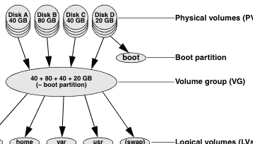

LVM 将磁盘组件（分区、硬盘或存储设备阵列，称为*物理卷*（PV））分组到一个存储池或虚拟磁盘中，称为*卷组*（VG）。参见图 2-2。您可以分配 VG 的一部分来创建一个*逻辑卷*。

在功能上，LV 类似于传统的磁盘分区，因为您可以在 LV 上创建文件系统。然而，更改和移动 LV 比分区容易得多：当 LV 上文件系统中的空间不足时，您可以扩展（增加）LV 及其文件系统至空闲或新的磁盘空间，或者您可以将文件系统移动到更大的 LV。例如，您可以向系统添加一块硬盘，并将其纳入 LV 以扩展该 LV 的容量。LVM 的磁盘空间操作对用户是透明的；服务不会中断。

LVM 还减轻了存储迁移的负担。当您超出了 PV 的容量或需要升级它们时，LVM 可以将数据移动到新的 PV。要了解有关 LVM 的更多信息，请参阅第 26 页列出的资源。

##### 安装过程

以下步骤概述了从 CD/DVD 安装 Ubuntu Linux 的过程。有关具体细节，请参见第 3 章。

1.  确保 BIOS 设置为从 CD/DVD 启动（第 28 页）。插入安装 CD/DVD 并重置计算机。计算机从 CD/DVD 启动，并在磁盘菜单（图 3-3，第 54 页）上显示语言叠加层（图 3-1，第 52 页）。

2.  您可以按功能键显示选项，从磁盘菜单中进行选择，并在准备好时开始启动实时会话或安装 Ubuntu。使用实时/安装 DVD 时，您也可以什么都不做：实时/安装 DVD 会在 30 秒后开始启动系统。当欢迎屏幕出现时，点击 **试用 Ubuntu** 以启动实时会话，或点击 **安装 Ubuntu** 以开始安装。安装 CD 会等待您从菜单中选择一个项目。其中一个菜单项用于检查安装介质。

3.  作为启动实时会话或安装 Ubuntu 过程的一部分，Ubuntu Linux 会创建 **RAM 磁盘**（第 1168 页），它在正常引导操作中用于替代硬盘。安装程序将安装所需的工具或从实时/安装桌面 CD 或实时/安装 DVD 启动系统所需的工具复制到 RAM 磁盘。使用 RAM 磁盘允许安装过程在规范和设计阶段运行而无需写入硬盘，并允许您在安装的最后一步之前随时选择退出安装。如果您在此时之前退出，系统将保持其原始状态。RAM 磁盘还允许实时会话不触碰硬盘。

4.  安装程序就如何配置 Ubuntu Linux 向您提出问题。

5.  当安装程序收集完信息后，它会显示 **准备安装** 屏幕（图 3-9，第 63 页）。当您点击 **安装** 时，它将操作系统文件写入硬盘。

6.  安装程序提示您移除 CD/DVD 并按 **RETURN** 键；然后它重新启动系统。

7.  Ubuntu Linux 系统已准备好供您登录和使用。

##### 下载和刻录 CD/DVD

获取 Ubuntu CD/DVD 有几种方法。Ubuntu 提供 Linux 发行版的 CD 和 DVD *ISO 镜像* 文件（以其定义的 CD 文件系统 ISO 9660 标准命名）。本节描述了如何下载这些镜像之一并刻录 CD/DVD。您也可以从网站购买 CD/DVD。如果您无法通过其他方式获取 Ubuntu，可以将浏览器指向 shipit.ubuntu.com 以显示一个网页，该网页包含链接，使您能够请求免费的 Ubuntu CD（但请先阅读 blog.canonical.com/?p=264）。

###### 下载 CD ISO 镜像文件的最简单方法

本节解释了下载 CD ISO 镜像文件的最简单方法。此技术在大多数情况下都有效；它很直接但有限制。例如，它不允许您使用 BitTorrent 下载文件，也不下载 DVD 镜像。

您可以在这里找到所有受支持架构的 ISO 镜像

> 如果您找不到支持您想要安装 Ubuntu 的硬件类型的 CD 的 ISO 镜像，请前往此网站：cdimage.ubuntu.com/ports/releases/10.04/release。

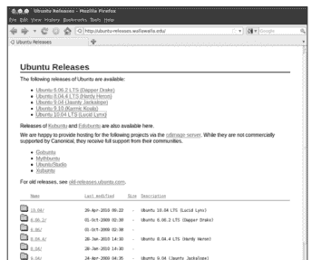

###### 图 2-3 一个 Ubuntu 镜像

首先，将浏览器指向 www.ubuntu.com 并点击 **下载 Ubuntu**。从标有 **下载位置** 的下拉列表中选择位置，然后点击 **开始下载**。如果浏览器询问您如何处理该文件，请将其保存到硬盘。浏览器会将 ISO 镜像文件保存到硬盘。请继续阅读第 47 页的“刻录 CD/DVD”。

###### 下载 CD/DVD ISO 镜像文件的其他方法

本节解释了如何下载未在 Ubuntu 下载页面上列出的发行版或 DVD 镜像，以及如何下载一个 torrent 文件，以便您可以使用 BitTorrent 下载 ISO 镜像文件。关于可以从哪里下载 Ubuntu 的其他位置，请参见第 27 页的“下载 Ubuntu”。

- **浏览器**：当您使用 Web 浏览器下载文件时，浏览器会联系 Web (HTTP) 或 FTP 服务器并从该服务器下载文件。如果太多人在同一时间从服务器下载文件，下载速度会变慢。
- **BitTorrent**：BitTorrent 高效地分發大量静态数据，如 ISO 镜像文件。与使用浏览器从单个服务器下载文件不同，BitTorrent 将服务器功能分布在其客户端上。随着每个客户端下载文件，它将成为其已下载部分文件的服务器。要使用 BitTorrent，您必须下载一个称为 *torrent* 的小文件（或者让 Web 浏览器为您完成）。该文件保存了使客户端能够相互通信的信息，其文件名扩展名为 .torrent。随着更多人同时使用 torrent 下载文件，下载速度会变快。稍后在本节中介绍如何使用 BitTorrent 下载 ISO 镜像文件。
- **镜像站**：许多网站镜像（持有副本）Ubuntu ISO 镜像文件和 BitTorrent torrent 文件。一些镜像站使用 HTTP，而其他使用 FTP；您可以使用浏览器从这两种类型的网站下载文件。FTP 和 HTTP 站点看起来略有不同。将浏览器指向 www.ubuntu.com/getubuntu/download#mirrorlist 以定位镜像站点。向下滚动直到到达镜像站点列表。然后在镜像站点列表中滚动，找到离您最近的站点，并点击该站点的 URL。浏览器显示类似于图 2-3 中所示的页面。点击页面上包含您要安装的 Ubuntu 版本的名称或发行版编号（例如，Lucid 或 10.04；第 31 页）的任何链接。浏览器显示类似于图 2-4 中所示的页面。

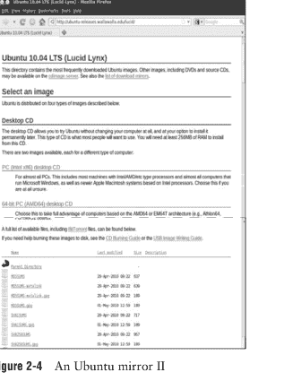

###### 图 2-4 一个 Ubuntu 镜像 II

此时，一些网站显示一个带有两个链接的页面：Parent Directory 和 release。浏览器显示此页面，点击 release。浏览器显示一个页面，顶部有该发行版的名称和编号，随后是不同类型 CD 的描述。页面底部是一个文件列表，每行显示文件名、创建日期和时间以及文件大小。每个文件名都是一个链接。下面两行描述了 Lucid Lynx (10.04) 的 Intel x86 桌面 ISO 镜像文件以及允许您使用 BitTorrent 下载相同 ISO 镜像文件的 torrent 文件。ISO 镜像文件几乎 700 兆字节；torrent 文件为 28 千字节。


点击指定您想要下载的发行版（例如，10.04；第 31 页）、版本（例如，桌面或替代；第 32 页）和架构（例如，i386 或 amd64；第 29 页）的文件名/链接。例如，点击 ubuntu-10.04-desktop-i386.iso 将下载适用于 i386 架构的 Lucid（发行版 10.04）桌面版的 CD ISO 镜像。将文件保存到硬盘。接下来下载名为 SHA1SUMS（位于列表顶部）的文件到同一目录。保存文件的一种简单方法是右键点击它，选择“保存链接/目标为”，并将文件保存到有足够的空间存放该文件的目录中。下一节将解释如何使用 SHA1SUMS 文件来验证 ISO 镜像文件是否下载正确。

###### 下载 DVD ISO

要下载 DVD ISO 镜像文件，请前往 cdimage.ubuntu.com/releases 并按照“下载 ISO 镜像文件”下的说明操作。您可以通过文件名中的字符串 dvd 来识别 DVD ISO 镜像文件。确保您的硬盘有足够的空间存放该文件：DVD ISO 镜像文件占用大约 4 吉字节。下载 DVD 镜像所需的时间大约是 CD 镜像的五倍。

###### 使用 BitTorrent

如前所述，您可以使用 BitTorrent 获取 ISO 镜像文件。BitTorrent 在 Ubuntu 新发行版发布后立即下载 ISO 镜像文件时特别有效。

要下载 torrent，将浏览器指向 releases.ubuntu.com 并点击 torrent 的文件名。您可以通过其文件名扩展名 .torrent 来识别 torrent 文件。BitTorrent 客户端应自动启动并询问将下载的文件放在哪里。您也可以手动下载 torrent。要做到这一点，请按照第 45 页“下载 ISO 镜像文件”下的说明操作。一旦您拥有 BitTorrent 客户端，如 Transmission（www.transmission-bt.com；随大多数 Ubuntu 版本安装），您就可以从命令行（第 539 页）开始下载文件，或通过 Nautilus（第 107 页）等文件浏览器点击它来下载。

您可以在任何操作系统上下载和刻录 CD/DVD

> 您可以在任何连接到互联网、有浏览器、硬盘上有足够空间存放 ISO 镜像文件（CD 约 700 兆字节，DVD 为 4 吉字节）并能刻录 CD/DVD 的计算机上下载和刻录 CD/DVD。您可以使用 ftp（第 630 页）或，在 Linux 系统上使用 Nautilus 菜单栏：文件→位置→连接到服务器（第 280 页）代替浏览器来下载文件。

###### 验证 ISO 镜像文件

本节假设您已在硬盘上保存了 ISO 镜像文件和 SHA1SUMS 文件，并解释了如何验证 ISO 镜像文件是否正确。SHA1SUMS 文件包含每个可用 ISO 的 SHA1（第 1171 页）校验和


镜像文件。当您使用 `sha1sum` 工具处理文件时，`sha1sum` 会根据该文件生成一个数字。如果该数字与 `SHA1Sums` 文件中对应的数字匹配，则说明下载的文件是正确的。您可以从终端模拟器中运行以下命令：

```bash
$ grep desktop-i386 SHA1Sums; sha1sum ubuntu-10.04-desktop-i386.iso
 d43587393603b6fe111514579d8c821a27de09 *ubuntu-10.04-desktop-i386.iso
 d43587393603b6fe111514579d8c821a27de09 ubuntu-10.04-desktop-i386.iso
```

计算大文件的 SHA1 校验和需要一些时间。上述命令显示的两个长字符串必须完全相同。如果不相同，您必须重新下载该文件。

###### 确保软件已设置为刻录 ISO 镜像

> 刻录 ISO 镜像与将文件复制到 CD/DVD 不同。请确保 CD/DVD 刻录软件已设置为刻录 ISO 镜像。如果您只是将 ISO 文件复制到 CD/DVD，当您尝试安装 Ubuntu Linux 时将无法正常工作。有关刻录 ISO 镜像的信息，请参阅 help.ubuntu.com/community/BurningIsoHowto。

##### 刻录 CD/DVD

ISO 镜像文件是 CD/DVD 上所需内容的精确映像。将该映像写入 CD/DVD 涉及与将文件复制到 CD/DVD 不同的过程。因此，CD/DVD 刻录软件有一个用于刻录 ISO 镜像的特殊选项，其标签类似于 **Record CD from CD Image** 或 **Burn CD Image**。请参阅您正在使用的软件的说明，了解如何将 ISO 镜像文件刻录到 CD/DVD 上。

###### 必须使用 700 兆字节 CD-ROM 空白盘

> 当您从 ISO 镜像刻录 Ubuntu Linux CD 时，必须使用 700 兆字节的空白盘。650 兆字节的空白盘将无法使用，因为数据量太大，无法容纳。

##### 收集系统信息

安装并启动 Ubuntu Linux 系统并不困难。尽管如此，您在开始前对安装过程了解得越多，操作就会越容易。安装软件会收集系统信息并帮助您在安装过程中做出决策。然而，如果您知道如何对硬盘进行分区，而不是让安装程序在您不提供输入的情况下创建分区，系统将运行得更好。细节很多，您控制的细节越多，对最终结果的满意度通常就越高。查找本节所需的信息有助于确保您最终拥有一个您了解并知道如何在必要时进行更改的系统。在日益增加的情况下，您可以让安装软件探查硬件并确定硬件类型。新设备比旧设备更有可能自我报告。

###### 测试 ISO 镜像文件和测试 CD/DVD

> 在使用 ISO 镜像文件和刻录好的 CD/DVD 安装 Ubuntu Linux 之前测试它们是个好主意。当您从 CD/DVD 启动系统时，Ubuntu 会为您提供检查 CD/DVD 缺陷的选项（见第 56 页上的提示）。CD 上的损坏文件可能直到您完成 Ubuntu Linux 安装并使其运行后才会显现出来。此时，查明问题所在可能既困难又耗时。测试文件和 CD/DVD 只需几分钟，但如果出现问题，可以为您节省数小时的麻烦。如果您决定只执行一项测试，请测试 CD/DVD。

在开始之前，拥有一些特定信息至关重要。Linux 永远无法确定的事情是所有相关的名称和 IP 地址（除非您正在使用 DHCP，在这种情况下地址已为您设置好）。

以下是您可能需要相关信息的条目列表。尽可能多地收集每个条目的信息：制造商、型号、大小（兆字节、吉字节等）、按钮数量、芯片组（对于网卡等）。某些项目，如网络接口卡，可能集成在主板上。

- 硬盘。
- 内存。安装时不需要它，但了解它是有益的。
- SCSI 接口卡。
- 网络接口卡 (NIC)。
- 视频接口卡（包括视频 RAM/内存量）。
- 声卡及其与标准（如 SoundBlaster）的兼容性。
- 鼠标（PS/2、USB 和按钮数量）。
- 显示器（尺寸和最大分辨率）。
- IP 地址和名称，除非您正在使用 DHCP（第 470 页；大多数路由器被设置为 DHCP 服务器），在这种情况下 IP 地址会自动分配给系统。这些信息的大多数来自系统管理员或 ISP。
- 系统主机名（可以是任意名称）。
    - 系统地址。
    - 网络掩码 (netmask)。
    - 网关地址（连接网络或互联网的连接点）或在使用拨号连接时的电话号码。
    - 名称服务器地址，也称为 DNS 地址。
    - 域名（非必需）。

##### 本章摘要

Live/安装桌面 CD 或 Live/安装 DVD 可以在不将 Ubuntu 安装到系统上的情况下运行实时 Ubuntu 会话。您可以从实时会话中安装 Ubuntu。运行实时会话是测试硬件和修复无法从硬盘启动的系统的最佳方式。

在下载或以其他方式获取 Ubuntu CD 或 DVD 之前，请确保您使用的介质适合您要安装它的硬件以及系统将用于的目的。Ubuntu 有三个版本：桌面版（最常见）、替代版（用于特殊情况）和服务器版。Ubuntu 实时 DVD 结合了这三个版本的所有功能。

当您安装 Ubuntu Linux 时，您将操作系统文件从 CD 或 DVD 复制到系统的硬盘上，并设置配置文件，使 Linux 能正确地在硬件上运行。操作系统文件以 ISO 镜像文件的形式存储在 CD 或 DVD 上。您可以使用 Web 浏览器或 BitTorrent 下载 ISO 镜像文件。在下载 ISO 镜像文件后以及在刻录的 CD/DVD 上安装 Ubuntu Linux 之前测试该文件是个好主意。

当您安装 Ubuntu 时，您可以让安装程序决定如何对硬盘进行分区（引导式分区），或者您可以手动指定您想要如何分区。

####### 练习

1.  简要说明安装 Ubuntu Linux 等操作系统涉及什么过程？
2.  什么是安装程序？
3.  您会在服务器系统上设置图形用户界面（GUI）吗？为什么或为什么不？
4.  系统从硬盘启动。为了安装 Linux，您需要它从 CD/DVD 启动。您如何使系统从 CD/DVD 启动？
5.  硬盘上的空闲空间是什么？什么是文件系统？
6.  什么是 ISO 镜像？如何将 ISO 镜像刻录到 CD/DVD 上？

###### 高级练习

7.  给出 RAID 不能替代备份的两个原因。
8.  什么是 RAM 磁盘？它们在安装过程中如何使用？
9.  什么是 SHA1？它如何确保您下载的 ISO 镜像文件是正确的？

*此页故意留白*


### 逐步安装

第 2 章涵盖了计划安装 Ubuntu Linux 的内容：确定需求；执行升级与全新安装；规划硬盘布局；获取安装所需的文件，包括下载和刻录 CD/DVD ISO 镜像；以及收集系统信息。本章重点介绍安装 Ubuntu。通常安装非常简单，特别是如果您做了良好的计划。有时您可能会遇到问题或有特殊情况；本章为您提供在这些情况下使用的工具。根据需要阅读本章的尽可能多内容；安装好 Ubuntu Linux 后，继续第 4 章，该章节涵盖开始使用 Ubuntu 桌面。如果您安装的是文本（命令行）系统，请继续第 5 章。

###### 本章内容

- 从 Live/安装桌面 CD 或 Live/安装 DVD 启动 ........................................................ 52
- ubiquity: 图形化安装 Ubuntu .................................... 57
- gparted: GNOME 分区编辑器 ............................................ 64
- palimpsest: GNOME 磁盘工具 ............................................ 66
- ubiquity: 设置分区 ........ 70
- 设置双启动系统 .... 76
- 高级安装 .................... 77
- 磁盘菜单屏幕 .................. 78
- Ubuntu 文本安装程序 . ...... 85
- 手动分区 ........................ 87
- 设置 RAID 阵列 ................ 91

51


#### 从直播/安装桌面 CD 或直播/安装 DVD 启动

Ubuntu 通常是通过直播/安装桌面 CD 或直播/安装 DVD 进行安装的。您也可以从这些光盘启动直播会话。本节描述了如何使用这些光盘执行这两项任务。如果您希望快速开始，请按照“基本说明”（在下一页）进行操作。如果在使用基本说明时遇到问题，或者您想要自定义安装，或者您只是想了解安装 Ubuntu 时具体发生了什么，请参阅第 53 页的“详细说明”。

##### 直播会话

直播/安装桌面 CD 和直播/安装 DVD 允许您在未安装的情况下预览 Ubuntu。按照本节说明从任一光盘启动，以开始直播会话，并按照第 4 章的说明使用 Ubuntu。完成后，请移除 CD/DVD 并重新启动系统；系统将按照直播会话之前的状态启动。

因为直播会话不会写入硬盘（除非使用了可用的 Linux 交换分区），所以一旦重启，您保存的所有工作都将不可用。您可以使用网络邮件或其他方法，例如将数据写入 USB 闪存盘，将您想要保留的文件传输到另一个系统。

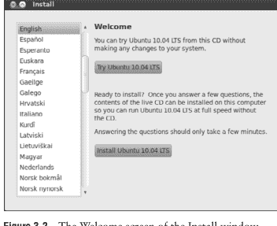

**图 3-2** 安装窗口的欢迎屏幕

##### 基本说明

- **DVD** 从*直播/安装 DVD* 启动系统，并且不要按任何键。在屏幕左侧（在图 3-1 中的语言覆盖层下方）的倒计时计时器从 30 变为 0 后不久，Ubuntu 将显示欢迎屏幕（图 3-2）。使用鼠标高亮显示您想要使用的语言（从左侧列表中选择），然后单击**试用 Ubuntu 10.04**以开始直播会话，或单击**安装 Ubuntu 10.04**以安装 Ubuntu。
- **CD** 从*直播/安装桌面 CD* 启动系统，不要按任何键即可调出以英语运行的直播系统。

##### 详细说明

*启动系统* 在 Ubuntu 能够从直播/安装桌面 CD 或直播/安装 DVD 显示桌面或在硬盘上安装自身之前，必须将 Ubuntu 操作系统读取到内存中（启动）。在较旧、较慢的系统以及内存（RAM）较少的系统中，此过程可能需要几分钟。

要从直播/安装桌面 CD 或直播/安装 DVD 启动，请将光盘插入计算机并打开或重置系统。Ubuntu 显示的内容取决于您使用的是这两个光盘中的哪一个。*ubiquity* 安装程序处理所有安装任务。本章的大部分内容描述如何使用 ubiquity。

*安装介质* 本书涵盖四种光盘：直播/安装 DVD、直播/安装桌面 CD、服务器 CD 和备用 CD。本节介绍前两种光盘的基本操作。有关更高级的操作以及服务器 CD 和备用 CD 的描述，请参阅第 77 页的“高级安装”。

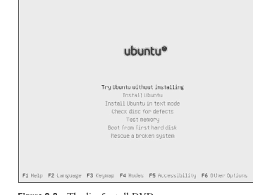

**图 3-3** 直播/安装 DVD 的菜单屏幕

**语言覆盖层**

语言覆盖层显示在第 52 页的图 3-1 中，允许您选择用于工作的语言（默认语言）。默认语言是直播系统显示的语言，是您在安装 Ubuntu 时安装程序使用的语言，也是安装完成后 Ubuntu 默认显示的语言。在安装 Ubuntu 过程中，您可以按照第 57 页的说明在欢迎屏幕上更改默认语言。

所有四种光盘都可以显示语言覆盖层。然而，直播/安装桌面 CD 仅当您通过按键中断启动过程时才显示语言覆盖层，而直播/安装 DVD 则会移除语言覆盖层，除非您通过按键中断启动过程。以下各节将详细阐述这些差异。

**CD 和 DVD 菜单**

每种安装介质都显示一个唯一的菜单。大多数菜单选项是直播/安装 DVD 菜单（图 3-3）上可用选项的子集。以下各节描述了直播/安装桌面 CD 和直播/安装 DVD 上可用的三个选项——这些选项允许您调出直播 Ubuntu 会话、在硬盘上安装 Ubuntu 以及测试安装介质是否有缺陷。有关更高级的操作以及服务器 CD 和备用 CD 的描述，请参阅第 77 页的“高级安装”。

**Ubuntu 标志和进度点**

在系统启动时，它显示一个 Ubuntu 标志和进度点，这些点依次亮起和熄灭，以指示系统正在工作。如果您希望显示系统消息以替代标志和进度点，请参阅第 57 页的“查看正在发生的事情”。

**问题**

如果系统无法从 CD/DVD 启动，请参阅第 28 页的“BIOS 设置”。如果在启动直播会话或

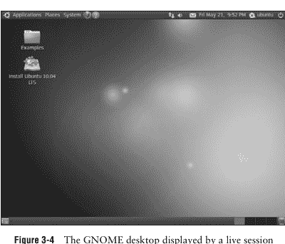

**图 3-4** 由直播会话显示的 GNOME 桌面

安装 Ubuntu 时遇到显示问题，请重新启动系统，执行高级安装（第 77 页），并使用 F4 模式菜单设置 nomodeset 参数（图 3-22，第 81 页）。如果此方法无效，请使用 DVD 上的文本安装程序安装 Ubuntu。

#### 直播/安装 DVD

当您从直播/安装 DVD（而非 CD）启动时，Ubuntu 会在 DVD 菜单屏幕上方显示一个语言覆盖层（图 3-1，第 52 页）。一个从 30 秒开始倒数的计时器出现在覆盖层的左侧（图中显示为 20 秒）。当计时器倒数时，您是否按键将决定接下来发生什么。

如果您不按键，当计时器倒数到零时，Ubuntu 将显示一个标志和进度点，然后调出一个运行 GNOME 桌面的直播会话（图 3-4），该会话以英语运行。

如果您在计时器到达零之前按下任何键，系统将停止倒数，语言覆盖层仍然显示。然后，您可以使用*方向键*高亮显示安装程序或直播系统要使用的语言，并按*回车键*选择高亮显示的语言并显示 DVD 菜单屏幕（图 3-3）。在此屏幕上，您可以使用*方向键*高亮显示一个选项并按*回车键*进行选择。前三个选项分别用于调出直播系统、在硬盘上安装 Ubuntu 以及检查 DVD 是否有缺陷。更多信息请参阅第 77 页的“高级安装”。


图 3-5 初始启动屏幕上的符号

#### 直播/安装桌面 CD

当您从直播/安装桌面 CD 启动时，Ubuntu 显示初始启动屏幕，这是一个大部分空白的屏幕，底部有键盘布局和无障碍符号（图 3-5）。在显示初始启动屏幕期间，您是否按键将决定接下来发生什么。如果您不按键，几秒后 Ubuntu 将显示一个标志和进度点，然后显示安装窗口的欢迎屏幕（图 3-2）。要从此屏幕选择除英语以外的默认语言，请参阅第 57 页的“更改默认语言”。

**调出直播会话**

从欢迎屏幕，单击**试用 Ubuntu 10.04**以调出一个运行 GNOME 桌面的直播会话（图 3-4）。

**检查 CD/DVD 是否有缺陷**

> 测试 CD/DVD 需要几分钟，但如果安装失败或安装 Ubuntu 后因介质不良而遇到问题，可以为您节省很多麻烦。无论您是自己烧录了 CD/DVD、购买了它，还是使用了随本书附带的光盘，验证 CD/DVD 的内容是否正确都是个好主意。

在显示 DVD 菜单屏幕或其中一个 CD 菜单屏幕时，使用*方向键*高亮显示**检查光盘是否有缺陷**并按*回车键*。检查 CD/DVD 需要几分钟——Ubuntu 会告知您进度。当 Ubuntu 完成检查 CD/DVD 后，它将显示测试结果。按*回车键*重新启动系统。

**安装 Ubuntu**

从欢迎屏幕，单击**安装 Ubuntu 10.04**以在硬盘上安装 Ubuntu；继续按照第 59 页描述的“你在哪里？”屏幕进行操作。

如果在显示初始启动屏幕时按键，Ubuntu 将显示覆盖桌面 CD 菜单的语言覆盖层。此屏幕看起来与第 52 页的图 3-1 相似，除了没有可见的倒计时计时器，因为系统没有在倒数；相反，它在等待您的输入。您可以使用*方向*


使用按键高亮显示安装程序使用的语言，按 RETURN 键选择该语言并显示 CD 菜单屏幕（类似于第 54 页的图 3-3）。在此屏幕上，你可以使用方向键（ARROW keys）高亮显示一个选项，然后按 RETURN 键进行选择。更多详情请参阅第 77 页的“高级安装”。

##### 欢迎屏幕

欢迎屏幕有两种样式。一种屏幕如 图 3-2 所示，允许你在启动实时 Ubuntu 系统和将 Ubuntu 安装到硬盘之间进行选择。它有两个按钮：试用 Ubuntu 10.04 和 安装 Ubuntu 10.04。另一种屏幕与 图 3-2 中显示的类似，仅仅标记安装过程的开始。它有三个按钮：退出、返回（呈灰色且无效，因为你无法从该屏幕返回）以及向前。

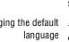

当你点击“退出”时，Ubuntu 会显示一个在实时会话下运行的 GNOME 桌面（第 55 页，图 3-4）。


在两个欢迎屏幕的左侧都有一个列表框（第 1157 页），其中包含语言列表。高亮显示的语言将是实时会话或安装程序/已安装系统所使用的语言。如果高亮显示的语言不是你想要的，请在继续之前使用方向键或鼠标高亮显示你所需的语言。有关更改实时会话及安装程序/已安装系统所使用的语言、键盘布局和辅助功能的信息，请参阅第 79 页的“功能键”。

#### 可选：查看正在发生什么

如果你好奇并想知道 Ubuntu 在启动过程中正在做什么，请执行高级安装（第 77 页），并从引导命令行中移除 quiet 和 splash（第 81 页，图 3-22）：当显示 DVD 菜单屏幕或其中一个 CD 菜单屏幕时，按 F6 显示引导命令行和一个下拉列表。接着按 ESCAPE 键关闭下拉列表。然后按 BACKSPACE 或 DEL 键退格并擦除引导命令行中的 quiet 和 splash。如果你没有在此行中添加任何内容，可以移除行末尾的两个连字符。如果你在此行中添加了内容，请使用左方向键（LEFT ARROW）退过——但不要删除——你添加的内容、连字符以及它们两侧的 SPACE（空格）。然后移除 quiet 和 splash。按 RETURN。现在，随着 Ubuntu 启动，它会显示有关其正在做什么的信息。文本在屏幕上滚动，但有时滚动速度过快，难以阅读。

#### UBIQUITY：图形化安装 UBUNTU

本节介绍图形化安装程序 ubiquity，主要由 Python 编写，用于安装 Ubuntu。你也可以使用文本安装程序（debian-installer；第 85 页）安装 Ubuntu。

#### 开始前，查看硬盘上有什么


除非你确定正在处理一块新硬盘，或者你确定硬盘上的数据没有任何价值，否则在开始安装 Ubuntu 之前查看硬盘上有什么是一个好主意。你可以使用 `partimpmest` 磁盘实用程序来挂载硬盘上的分区。然后你可以检查这些分区中的文件，看看硬盘上有什么。有关 partimpmest 的更多信息，请参阅第 66 页。

##### 使用鼠标操作安装窗口屏幕

你可以使用鼠标或键盘从安装窗口屏幕中进行选择。要使用鼠标从欢迎屏幕的语言列表中选择一种语言，请在左侧的列表框中左键点击你想要使用的语言。如果你想要的语言没有显示在列表的显示部分，请点击或拖动滚动条（第 53 页的图 3-2 和第 123 页的图 4-16）以显示更多语言；然后点击你想要使用的语言。Ubuntu 会高亮显示你点击的语言。一旦你选择了语言，你就可以停止操作欢迎屏幕了。点击标有 **Forward** 或 **Install Ubuntu 10.04** 的按钮以显示下一个屏幕。

##### 使用键盘操作安装窗口屏幕

若要使用键盘进行选择，首先使用 **TAB** 键将高亮显示移动到你想要操作的对象上。在欢迎屏幕上，对象包括列表框中选中项以及标有 **Install Ubuntu 10.04** 或退出、返回和 **Forward** 的按钮。

- **列表框** 当列表框中某种语言被高亮显示时，使用上方向键（UP ARROW）和下方向键（DOWN ARROW）将高亮显示移动到你想要使用的语言。当你将高亮显示移动到列表中下一个未显示的条目时，列表会自动滚动。
- **按钮** 一旦你选择了一种语言，你就可以停止操作欢迎屏幕了。使用 **TAB** 键高亮显示标有 **Forward** 的按钮或标有 **Install Ubuntu 10.04** 的按钮。当按钮被高亮显示时，它会变成橙色并带有橙色边框。按 **RETURN** 以显示下一个屏幕。
- **下拉列表** 要从下拉列表（例如第 31 页图 2-1 中标有 **Region** 的框中的那个）中进行选择，使用 **TAB** 键高亮显示该框，然后使用方向键将高亮显示从一个项目移动到下一个。在你想要选择的选项被高亮显示时，按 **RETURN**。

##### 开始安装

本书描述的是使用鼠标从图形界面中进行选择；如果你愿意，也可以使用键盘。

##### 欢迎屏幕

安装窗口的欢迎屏幕（图 3-2）包含一条欢迎信息和一个供你选择的语言列表。你选择的语言将是 *ubiquity* 在你安装系统时使用的语言，也是已安装系统的默认语言；系统安装完成后你可以更改此默认设置（第 145 页）。点击 **Forward**。

Ubuntu 会显示“设置时钟”窗口，如果它可以连接到网络时间服务器，它会设置时钟。你可以点击 **Skip**（跳过）来绕过此步骤。

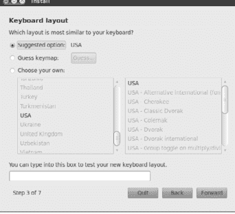

**图 3-6** 键盘布局屏幕

#### 你在哪里？

作为安装 Ubuntu 的第一步，**ubiquity** 会显示“你在哪里？”屏幕。此屏幕允许你指定计算机所在的时区。你可以使用地图或标有 **Region** 和 **Time Zone** 的下拉列表来指定时区。当你点击地图上的城市名称时，相应的区域会显示在标有 **Region** 的框中，时区名称或该时区内某城市的名称会显示在标有 **Time Zone** 的框中。

要使用 **Region** 下拉列表，点击标有 **Region** 的框右端的向下箭头；**ubiquity** 会将框展开为世界各部分的列表。点击你想要选择的区域。现在，对标有 **Time Zone** 的框重复此过程。点击 **Forward**。

#### 键盘布局

键盘布局屏幕（图 3-6）允许你指定已安装系统将使用的键盘类型。（请参阅第 79 页的“R3 Keymap”以更改 **ubiquity** 在安装期间使用的键盘布局。）当 **ubiquity** 显示键盘布局屏幕时，标有 **Suggested option** 的*单选按钮*（第 1167 页）被选中，并且这些文字右侧会出现一个键盘布局的名称。如果建议的选项可以接受，请点击 **Forward**。

每当显示键盘布局屏幕时，你可以高亮显示屏幕底部的文本框并输入一些字母，以查看所选选项是否适用于你正在使用的键盘。

当你选择标有 **Guess keymap** 的单选按钮并点击 **Guess**（猜测）时，ubiquity 会引导你回答一系列问题，并根据你的回答尝试确定你正在使用哪种类型的键盘。当你对结果满意时，点击 **Forward**。

当你选择标有 **Choose your own**（自行选择）的单选按钮时，ubiquity 会激活这些文字下方的两个列表框。从这些列表框中选择一个**国家**和键盘类型，然后点击 **Forward**。

#### 准备磁盘空间

准备磁盘空间屏幕控制 **ubiquity** 如何分区硬盘。有关分区硬盘所涉及的问题的讨论，请参阅第 36 页。

#### 引导式分区

对于单块干净的硬盘——一块没有安装任何东西的硬盘，就像从工厂出厂时那样（即没有分区表）——**ubiquity** 分区编辑器会显示一个与图 3-7 中所示类似的准备磁盘空间屏幕。在这种情况下，分区磁盘的最简单方法是让 **ubiquity** 分区器为你完成。这种技术称为*引导式分区*。默认情况下，标有 **Erase and use the entire disk**（擦除并使用整个磁盘）的单选按钮被选中，并且系统中唯一的硬盘名称显示在这些文字下方的下拉列表中。如果系统有两个或更多硬盘，你必须从此列表中选择你想要安装 Ubuntu 的磁盘。点击 **Forward**。 **ubiquity** 分区编辑器会在硬盘上创建两个分区：一个小的交换分区（第 37 页）和一个根分区（/，第 37 页），后者占据磁盘的其余部分。

**ubiquity** 分区编辑器此时不会分区磁盘。在你点击“准备安装”屏幕上的 **Install**（安装）按钮之前，你可以随时改变主意，重新决定你希望如何分区磁盘。点击标有 **Back** 的按钮。你可能需要退过几个屏幕才能再次显示准备磁盘空间屏幕，但之后你可以按照你想要的方式设置磁盘。

有关使用准备磁盘空间屏幕中其他选项的信息，请参阅第 70 页的“高级引导式分区”。

#### 迁移文档和设置

如果你正在一个已经安装了一个或多个操作系统的系统上安装 Ubuntu，并且你没有覆盖那些操作系统，那么“迁移文档和设置”屏幕会显示现有操作系统的账户和设置列表。例如，如果你正在一个已安装 Windows 的系统上创建双启动系统，此屏幕会显示 Windows 系统中的账户以及程序和设置列表。它可能会显示你 Windows 系统中的姓名，以及其下的 Internet Explorer 和“我的文档”。在你想要迁移到 Ubuntu 系统的项目旁边的复选框中打勾。在屏幕的下半部分，输入创建用于接收迁移信息的 Ubuntu 用户所需的信息。点击 **Forward**。


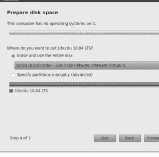

**图 3-7** 显示一个空硬盘的 ubiquity 分区编辑器

#### 你是谁？

“你是谁？”屏幕（图 3-8，见下页）用于创建第一个 Ubuntu 用户。该用户可以使用 sudo（第 98 页）来管理系统，包括设置其他用户（第 594 页）。

在标记为“您的姓名是什么？”的文本框中输入用户的完整姓名。当你在输入时，ubiquity 会在标记为“你想使用什么名称来登录？”的框左侧自动填入名字的前半部分。按 TAB 键将光标移动到此框中。如果你想使用不同的用户名，请按 BACKSPACE（第 151 页）删除当前用户名并输入一个新的。然后按 TAB 键。

在两个相邻的、标记为“选择一个密码以保护你的账户安全”的框中输入相同的密码。密码强度显示在密码框的右侧。虽然 ubiquity 接受任何密码，但如果系统连接到互联网，最好选择一个更强的（更安全的）密码。关于密码安全性的讨论，请参见第 148 页的“更改你的密码”。

最后一个文本框用于指定计算机的名称。为了在局域网中使用，以及通过 Web 浏览器或其他客户端连接到互联网，你可以使用一个简单的名称，例如 fox8。如果你正在设置服务器系统，请参阅第 823 页的“FQDN”，以获取有关在互联网上有效名称的信息。

窗口底部的三个单选按钮用于配置你指定的用户的登录过程。选择“要求我的密码才能登录”，以便 Ubuntu 在登录系统时要求你输入密码。

如果你正在设置加密的主文件夹，请选择“要求我的密码才能登录并解密我的主文件夹”。

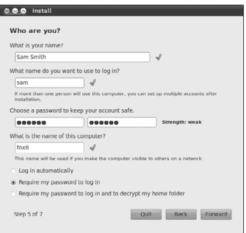

图 3-8 安装窗口，“你是谁？”屏幕

如果你希望 Ubuntu 在系统启动时自动为你登录，请选择“自动登录”——只有当你信任所有有权物理访问该系统的人时，才选择此选项。点击“下一步”。

#### 准备安装

ubiquity 显示的最后一个屏幕是“准备安装”屏幕（图 3-9）。此时，ubiquity 分区编辑器尚未向磁盘写入数据。因此，如果你在此时点击“退出”，硬盘将保持原样，不会受到任何更改。此屏幕总结了你在前面屏幕中对 ubiquity 提出的问题的回答。点击“高级选项”以显示高级选项窗口，该窗口允许你选择是否安装引导加载程序（通常你需要安装）以及是否设置网络代理（第 405 页）。点击“确定”关闭高级选项窗口。如果摘要中所有内容看起来都正确，点击“安装”。安装程序开始在硬盘上安装 Ubuntu。

##### 当 ubiquity 向硬盘写入数据时

在包括显示“准备安装”屏幕（图 3-9）在内的任何时刻，你都可以通过点击“退出”按钮来中止安装，而不会对硬盘进行任何更改。一旦你在此屏幕中点击“安装”，ubiquity 就会开始向硬盘写入数据。

ubiquity 安装程序会显示消息以保持你了解其进度。当新系统安装完成后，Ubuntu 会显示“安装完成”窗口，供你选择是继续当前的现场会话（继续测试）还是

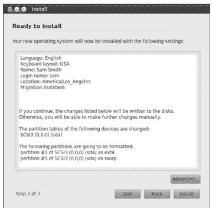

重启系统，以便你可以使用新安装的 Ubuntu 副本。点击 **立即重启** 以重启系统。

安装程序将显示 Ubuntu 标志和进度点。当它完成系统关闭后，它会提示你移除光盘（以免从 CD/DVD 重启）并按下 RETURN 键。完成这些步骤后，Ubuntu 将重启系统并显示 Ubuntu GNOME 登录屏幕（图 4-1，第 100 页）。

以你在“你是谁？”屏幕中指定的用户身份登录，并继续阅读第 4 章。

#### 图形化分区编辑器

分区编辑器可以显示、添加、删除和修改硬盘上的分区。本节介绍了三个图形化分区编辑器，你可以在安装 Ubuntu 的过程中使用它们来配置硬盘。`gparted` 和 `palimpsest` 分区编辑器可从现场会话中访问。另一个分区编辑器是 `ubiquity` 安装程序的一部分，不能单独使用。关于使用文本分区编辑器（当你使用文本安装程序时可用）的信息，请参见第 87 页。安装 Ubuntu Linux 后，你可以使用 `parted`（第 611 页）或 `palimpsest`（第 66 页）来查看和操作分区。`gparted` 分区编辑器在

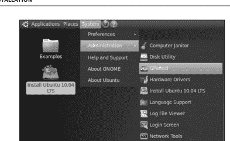

**图 3-10** 从主菜单中选择 **gparted**

已安装的系统上不可用，除非你安装了 **gparted** 软件包（第 519 页）。如果你想要一组基本的分区，你可以允许 **ubiquity** 使用引导分区功能自动对硬盘进行分区。

关于空闲空间、分区、分区表和文件系统的讨论，请参见第 33 页的“设置硬盘”。第 37 页的“手动分区：规划分区”讨论了一些如果你选择手动对硬盘进行分区时可能需要设置分区的文件系统。

除非你确定你要安装 Ubuntu Linux 的硬盘上没有任何数据（它是新硬盘），或者你确信该磁盘中没有有价值的信息，否则建议在开始安装之前检查该磁盘。**gparted** 和 **palimpsest** 分区编辑器（可从现场会话中访问）是完成此任务的理想工具。

##### gparted：GNOME 分区编辑器

通过选择 **主菜单：系统➔管理➔GParted**（如图 3-10 所示）打开 GParted 窗口。

**gparted** 工具显示硬盘的布局，并可用于调整分区大小，例如在 Windows 系统上添加 Ubuntu 以设置双启动系统时（第 76 页）。虽然你可以使用 **gparted** 创建分区，但你不能为分区指定挂载点（第 35 页）——这一步必须等到你安装 Ubuntu 并使用 **ubiquity** 分区编辑器时进行。

##### 空硬盘

对于新的硬盘（空的，没有分区表），**gparted** 工具显示一个大块未分配的空间。三角形中的感叹号是一个警告；在新磁盘上，它表示未识别的文件系统（没有分区表）。如果你有一块以上的硬盘，使用窗口右上角的列表框来选择 **gparted** 显示信息的磁盘。图 3-11 显示了一个空的

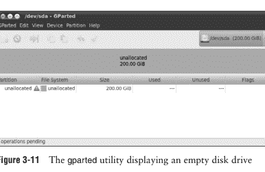

200 吉字节（第 1150 页）硬盘，设备名为 /dev/sda。第 61 页的图 3-7 显示了 ubiquity 分区编辑器，准备对与图 3-11 中所示类似的空驱动器进行分区。

##### 调整分区大小

虽然你可以在安装 Ubuntu 时使用 ubiquity 分区编辑器来调整分区大小，但你可能发现在现场会话中使用 gparted 分区编辑器来执行此任务时，更容易看清你在做什么。本节解释如何使用 gparted 来调整分区大小。

###### 始终备份硬盘上的数据

> 如果你正在安装包含重要数据的磁盘上的 Ubuntu，请在开始安装前备份数据。事情可能会出错，而且确实会发生。安装过程中可能会断电，导致硬盘上的数据损坏。分区软件中可能存在 bug，这会破坏文件系统。虽然不太可能，但你可能会犯错误，格式化了包含你想保留的数据的分区。

图 3-12（见下页）显示 gparted 正在显示一个只有一个占满整个磁盘的分区的信息。该分区包含一个单独的 200 吉字节 NTFS 文件系统。调整分区大小的过程与分区类型无关，因此你可以使用以下技术来调整 Windows、Linux 或其他类型分区的大小。

要在此系统上安装 Ubuntu，你必须调整（缩小）分区大小，以为 Ubuntu 腾出空间。要调整分区大小，右键点击以高亮显示描述该分行的行，然后点击工具栏上指向该行的箭头。分区编辑器会打开一个小的“调整大小/移动”窗口，如图 3-12 所示。

在“调整大小/移动”窗口的顶部是分区大小的图形表示。最初，分区占满整个磁盘。标记为“新大小 (MiB)”的数值输入框


###### 删除分区

在删除分区之前，请确保其中不包含你需要的任何数据。若要使用*gparted*删除分区，请突出显示你要删除的分区，点击带有一条横线的圆圈，然后点击工具栏上的绿色对勾。

###### palimpsest：GNOME 磁盘实用程序

*palimpsest*图形化磁盘实用程序可以在许多类型的介质上创建、删除和修改分区及文件系统，包括内部和外部硬盘、CD/DVD 以及 USB 闪存驱动器。它可以加密分区并更改已加密分区的密码。

通过选择**主菜单：系统 → 管理 → 磁盘实用程序**（位于第 64 页图 3-10 中**GParted**的正上方）来打开 Palimpsest 磁盘实用程序窗口。若要显示有关硬盘的信息，请点击窗口左侧“存储设备/外设”下的某个硬盘。

选中一个硬盘后，palimpsest 磁盘实用程序窗口被分为三个部分（图 3-13）：“存储设备”区域包含 CD/DVD 驱动器、硬盘和其他设备的列表；“驱动器”区域包含在存储设备列表中高亮显示的硬盘的信息；“卷”区域显示在硬盘图形表示中高亮显示的分区的信息。

当你在“存储设备”部分中选择一个硬盘时，palimpsest 会在窗口的“驱动器”部分中显示有关该磁盘的信息。点击硬盘图形表示中的一个分区，palimpsest 会在“卷”部分中显示有关该分区的信息。

从这个窗口中，你可以查看、创建和删除分区。虽然你可以使用 palimpsest 创建分区，但你不能指定分区的挂载点（第 35 页）——这一步必须等到你安装 Ubuntu 并使用 ubiquity 分区编辑器时进行。如果你使用 palimpsest 检查硬盘，并使用 ubiquity 设置你安装 Ubuntu 所在的分区，可以节省时间。

###### 显示文件系统的内容

若要显示文件系统的内容，请按照上文所述选择持有该文件系统的分区，并点击磁盘实用程序窗口“卷”部分中的“挂载卷”。由于分区已经挂载，图 3-13 显示的是“卸载卷”。当 palimpsest 挂载高亮显示的文件系统时，已挂载的文件系统会作为目录（文件夹）出现在桌面上。当你点击“卷”部分中的挂载点（“挂载点：挂载于”后面的链接）或双击桌面上的目录图标时，Nautilus 会在文件浏览器窗口中显示该文件系统（第 107 页）。当你检查完文件系统的内容后，点击“卸载卷”以卸载该文件系统。

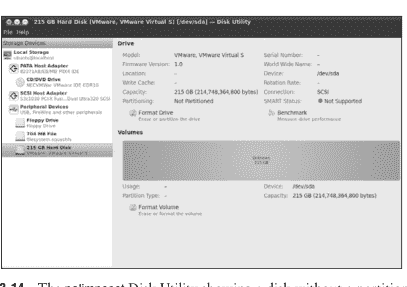

palimpsest 磁盘实用程序显示一个没有分区表的磁盘

###### 写入分区表

新磁盘没有分区表（第 33 页），其外观类似于图 3-14 中高亮显示的磁盘。在磁盘实用程序窗口的“驱动器”部分中，“**未分区**”跟随“分区”标签，磁盘的图形表示标记为“未知”，且“使用率”为空白。如果你正在处理的磁盘已经有分区表，请跳至下一节。

若要分区硬盘，请点击磁盘实用程序窗口“驱动器”部分中的“格式化驱动器”：palimpsest 会打开一个显示标有“方案”的下拉列表的格式化窗口。选择一个方案。在大多数情况下，你将希望接受默认的“主引导记录”方案。点击“格式化”。在确认你确实想要格式化驱动器后，palimpsest 创建分区表。现在“主引导记录”跟随“分区”标签，磁盘的图形表示标记为“空闲”（空闲空间；第 33 页），且“未分配空间”跟随“使用率”标签。

如果你想创建一个占据整个驱动器的单一文件系统，请不要遵循上一段中的说明，而是点击磁盘实用程序窗口“卷”部分中的“格式化卷”：palimpsest 会打开一个“格式化整卷”窗口。若要创建文件系统，请遵循下一节中“创建分区”窗口的说明。

###### 创建分区和文件系统

一旦你创建了分区表，你就可以在空闲空间中创建容纳文件系统的分区。当你点击“创建分区”时，palimpsest 会打开一个“创建分区”窗口（图 3-15）。

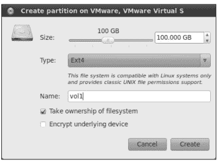

图 3-15 *palimpsest* 创建分区窗口

在此窗口中，使用标有*大小*的滑块或相邻的*旋转框*来指定新分区的大小。接下来指定文件系统类型；**ext4** 文件系统是最常见的。你可以选择在标有*名称*的文本框中输入磁盘标签。此名称不是磁盘的挂载点。通常你会希望拥有该文件系统的所有权，因此允许标记保留在标有*获取文件系统所有权*的复选框中。如果你想加密文件系统，请在标有*加密底层设备*的复选框中打勾。点击**创建**。在与你确认后，*palimpsest* 创建文件系统。现在磁盘的图形表示被分割以表示硬盘的分割，且*使用率*对应图形表示中高亮显示的部分（文件系统或未分配空间）。如果你没有使用完所有空闲空间，你可以以相同方式创建额外的分区和文件系统。

###### 删除分区

在删除分区之前，请确保其中不包含你需要的任何数据。若要使用*palimpsest*实用程序删除分区，请在硬盘的图形表示中突出显示你要删除的分区，并点击**删除分区**。在与你确认后，*palimpsest* 删除该分区。

###### 使用 SMART 显示磁盘性能信息

SMART（自我监测、分析和报告技术）监控硬盘并试图预测硬盘故障。若要查看系统中某个磁盘的 SMART 报告，请在*存储设备*部分中高亮显示该磁盘，并点击“驱动器”部分中的**SMART 数据**；*palimpsest* 会显示一个类似于图 3-16 所示的窗口。

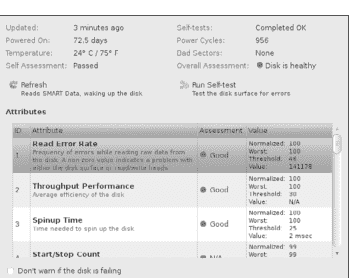

图 3-16。 *palimpsest* 显示的 SMART 数据

从此窗口中，你可以运行各种自检并滚动浏览窗口底部的信息。

###### ubiquity：设置分区

在安装 Ubuntu 期间，*ubiquity* 提供两种分区磁盘的方式：引导式和手动。引导式分区设置两个分区——一个用于交换空间（第 37 页），一个用于 /（根目录，整个 Ubuntu 文件系统挂载的地方；第 37 页）。根目录占用的空间量取决于你选择的哪个引导选项。手动分区允许你设置任意类型和大小的分区；你还可以指定每个分区的挂载点。

###### 高级引导式分区

第 60 页的“准备磁盘空间”解释了如何使用引导式分区来对空磁盘进行分区。本节解释了引导式分区在已经分区的磁盘上是如何工作的。

根据你安装 Ubuntu 所在的硬盘内容，ubiquity 分区编辑器会呈现不同的选择。图 3-17 显示了一个具有一个占据整个磁盘的分区的硬盘的“准备磁盘空间”屏幕。该分区包含一个 Windows 系统。此屏幕显示了所有可能的选择。在某些情况下，并非所有这些选择都会出现。点击选项旁边的单选按钮以选择它。可能的选择如下所述：

- **并排安装，每次启动时在其中之一中进行选择**—允许你缩小一个分区，并使用此操作释放的空间来安装 Ubuntu。你可以使用此选项来设置双启动系统


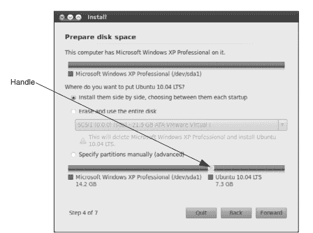

**图 3-17** “准备磁盘空间”屏幕显示一个硬盘，其中 Windows 分区占据了整个磁盘

在一个单个 Windows 分区占据整个磁盘的系统上（第 76 页）。本节描述如何使用 ubiquity 分区编辑器调整分区大小。关于如何使用 gparted 调整分区大小的说明，请参见第 65 页的“调整分区大小”。

此选项包含一个带有手柄的滑块，允许你指定如何调整分区大小。参见图 3-17。点击并拖动该手柄以指定正在调整大小的分区的新大小以及默认情况下将安装 Ubuntu 的新分区的大小。

- **擦除并使用整个磁盘**—删除磁盘上的所有信息并在整个磁盘上安装 Ubuntu。从磁盘删除信息后，此选项使用引导式分区，如第 60 页所述。

将整个磁盘用于 Ubuntu 很简单。开始之前，请确保磁盘不包含任何你需要保留的信息。一旦重写分区表，数据将永久丢失。如果你不确定磁盘的内容，请使用 **palimpsest**（第 66 页）查看。

- **使用最大的连续空闲空间**—将 Ubuntu 安装在磁盘上最大的一块空闲空间中。由于空闲空间不包含数据，因此此技术不会更改磁盘上的任何数据。此选项在空闲空间上使用引导式分区（如第 60 页所述）。如果现有分区被操作系统占用，此选项将设置双启动系统（第 76 页）。

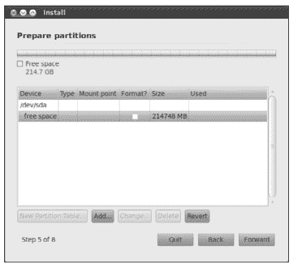

**图 3-18** 带有分区表的空硬盘

- **手动指定分区（高级）**—让你完全控制安装 Ubuntu 的分区的大小、位置和命名。参见下一节。

完成“准备磁盘空间”屏幕上的工作后，点击 **Forward**。

##### 手动分区

本节说明如何使用 **ubiquity** 分区编辑器在空硬盘上创建分区。第 61 页的图 3-7 显示了针对空硬盘的“准备磁盘空间”屏幕。要手动创建分区，选择 **手动指定分区（高级）** 并点击 **Forward**。ubiquity 分区编辑器会显示一个“准备分区”屏幕，显示一个没有分区且仅包含空闲空间的设备。在创建分区之前，必须设置分区表（第 33 页）。为此，突出显示设备名称（例如 `/dev/sda`）并点击 **新建分区表**。分区编辑器会询问你是否确认要创建一个新的空分区表。点击 **继续** 以创建仅包含空闲空间的分区表。现在 ubiquity 显示一个看起来类似于图 3-18 的屏幕。（注：214,748 MiB [兆字节；第 1159 页] 等于 200 GB [吉字节；第 1150 页]——图 3-18 应显示 MiB 而不是 MB。）`/dev/sda` 处的硬盘有一个没有分区的分区表；它仅包含空闲空间。

要创建一个分区，突出显示“设备”列中包含 **空闲空间** 的行并点击 **添加**。ubiquity 分区编辑器会显示一个“创建分区”窗口（图 3-19），询问你希望创建主分区还是逻辑分区（第 34 页），分区应为多大（以兆字节为单位），分区应位于空闲空间的开头还是结尾，什么

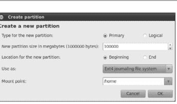

图 3-19 “创建分区”窗口

类型（用作），以及分区的挂载点（第 35 页）应该叫什么名字。由于 Linux 不会挂载交换分区，因此你无法为类型为 swap 的分区指定挂载点。如果你不确定分区应该是什么类型，请选择 ext4（第 505 页）。点击 确定。

片刻之后，“准备分区”屏幕会显示新的分区（图 3-20）。要创建另一个分区，突出显示包含空闲空间的行并重复上述步骤。记住要创建一个交换分区（第 37 页）。完成分区创建后，点击 Forward。

“准备分区”屏幕在列出磁盘和分区的框架正下方显示五个按钮。这些按钮中的一些是灰色的（非活动状态）

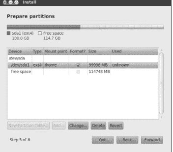

图 3-20 显示新分区的“准备分区”屏幕

取决于上方框架中突出显示的内容。标有 **恢复** 的按钮始终处于活动状态。当设备被突出显示时，标有 **新建分区表** 的按钮处于活动状态。点击此按钮会创建一个新分区表，从而销毁任何现有的分区表。突出显示一个分区允许你选择编辑或删除该分区。编辑刚刚创建的分区仅允许你更改其类型和挂载点。你必须删除并重新创建分区才能更改其任何其他属性。如前所述，突出显示包含 **空闲空间** 的行允许你创建一个新的分区。

##### 升级至新版本

系统升级的过程是在旧版本的 Ubuntu 上安装新版本的 Ubuntu。所有用户文件和配置文件都会保留，所有软件都会升级到与新版本 Ubuntu 兼容的最新版本。Ubuntu 建议不要升级那些安装了其不控制的软件仓库（第 522 页）中包的软件系统。这些包可能会损坏软件包数据库，导致升级失败。关于详述升级后不会生效的功能的版本说明，请参见 www.ubuntu.com/getubuntu/releasenotes。

###### 使用标准升级程序

> 注意 不要使用本节或 www.ubuntu.com/getubuntu/upgrading 中指定的以外的程序来升级到 Ubuntu 的新版本。具体来说，不要使用 **apt-get dist-upgrade**、**aptitude full-upgrade** 或任何 Debian 工具。

###### 从 LTS 版本升级到非 LTS 版本

> 提示 当你从主菜单启动更新管理器时，它不会提供从 LTS 版本升级到非 LTS 版本的选项。要从 LTS 版本升级到非 LTS 版本，你必须在命令行（从终端模拟器）或运行命令窗口 [ALT-F2] 中输入 **update-manager -r** 以打开更新管理器窗口。

###### 注意弹出窗口

> 提示 在升级的安装阶段，一些包会打开窗口，询问你希望如何处理包的升级。这些窗口可能会被工作区上的其他窗口遮挡。如果升级因无明显原因而停止，请拖动窗口以查看是否有包含问题的窗口被隐藏在另一个窗口下方。回答该问题后，升级将继续。

在升级系统之前，备份系统中所有用户文件是个好主意。此外，请确保软件源窗口（第 132 页）中“更新”选项卡中标有 **显示新的发行版发布** 的下拉列表显示了你希望升级到的版本类型。

以下程序假设你有一个连接互联网桌面系统。即使拥有快速的互联网连接，这个过程也需要很长时间。按照以下步骤升级系统：

1. 通过选择 **主** 菜单：系统→管理→更新管理器来打开更新管理器窗口（图 4-11，第 112 页）。
2. 无论窗口是否显示 *你可以安装 nn 个更新*，点击 **检查**。这一步确保软件包数据库是最新的。
3. 如果窗口显示 *你可以安装 nn 个更新*，点击 **安装更新**。这一步确保系统上的所有软件包都是最新的。
4. 此时，如果有新版本可用，窗口将显示消息 *新发行版 ⁹XX.XX⁹ 可用*。点击 **升级**。
5. 工具显示版本说明窗口。阅读版本说明，然后点击 **升级**。
6. 工具下载升级工具并更新一些文件。
7. 系统将询问你是否要启动升级。点击 **开始升级**。
8. 升级完成后，重新启动系统。

有关升级 Ubuntu 的更详细说明，请参见 www.ubuntu.com/getubuntu/upgrading。

### 安装 KDE

你可以通过两种方法之一安装 KDE。第一种方法仅安装 KDE：请遵循第 2 章和本章中的说明，但不要下载并刻录 Ubuntu CD/DVD，而是从 www.kubuntu.org 下载 Kubuntu CD/DVD，刻录它，并使用该磁盘安装 Linux。

第二种方法要求系统连接互联网，并且除了 GNOME 之外，还安装 KDE 以及大量其他程序（例如 Amarok、Kate）。按照本章说明安装 Ubuntu 后，使用 Synaptic（第 133 页）或 aptitude（第 526 页）执行以下步骤。此过程需要一些时间；你将下载并安装 200 多个软件包。

1. 确保软件包数据库是最新的：在 Synaptic 中，点击 **重新加载**。如果使用 aptitude，请在命令行、终端模拟器或运行应用程序窗口（*ALT*-F2）中执行命令 `sudo aptitude update`。
2. 确保系统上的所有软件包都是最新的：在 Synaptic 中，点击 **标记所有升级**，然后点击 **应用**。如果使用 aptitude，请在命令行、终端模拟器或运行应用程序窗口（*ALT*-F2）中执行命令 `sudo aptitude safe-upgrade`。
3. 安装 KDE 软件：在 Synaptic 中，搜索并安装 **kubuntu-desktop** 虚拟包（第 526 页）。如果使用 aptitude，请在命令行、终端模拟器或运行应用程序窗口（*ALT*-F2）中执行命令 `sudo aptitude install kubuntu-desktop`。


软件下载完成后，在安装过程中，**debconf** 会询问你是否希望使用 **gnome**（GNOME）或 **kde**（KDE）显示管理器。两者都可以与任何桌面环境配合使用。选择使用哪个显示管理器的一种方法是选择与你最常使用的桌面环境相关联的那个。

安装 KDE 后，重启系统。从登录屏幕开始，按照第 145 页的说明显示“会话”下拉列表，并选择你想要运行的会话（GNOME 或 KDE）。

#### 设置双启动系统

*双启动*系统是指可以启动两个（或更多）操作系统中任意一个的系统。本节介绍了如何在一个可以启动 Windows 的系统中添加 Ubuntu，从而创建一个可以启动 Windows 或 Linux 的系统。你可以使用相同的技术将 Ubuntu 添加到运行其他版本或发行版 Linux 的系统中。设置双启动系统的一个问题是为新的 Ubuntu 系统找到磁盘空间。下一节讨论了创建所需空间的几种方法。

##### 在 Windows 系统上创建空闲空间

通常，你将 Ubuntu Linux 安装在硬盘的空闲空间中。要在 Windows 系统上添加 Ubuntu Linux，你需要在已包含 Windows 的硬盘上有足够的空闲空间。有几种方法可以提供或创建这种空闲空间。以下段落将按照从易到难的顺序讨论这些选项。

- **添加新的硬盘**：向系统添加另一块硬盘，并将 Linux 安装在新硬盘上，该硬盘仅包含空闲空间。这种技术非常简单且干净，但需要一块新的硬盘。
- **使用现有的空闲空间**：如果 Windows 磁盘上有足够的空闲空间，你可以将 Linux 安装在那里。这是最佳选择，但已安装的 Windows 系统中很少有足够的空闲空间供使用。
- **调整 Windows 分区大小**：Windows 分区通常占用整个磁盘，因此调整 Windows 分区大小是最常用的释放空间的技术。Windows 系统通常使用 NTFS、FAT32 和/或 FAT16 文件系统。你可以使用 **gparted** 分区编辑器来检查并调整现有 Windows 分区的大小，以腾出空闲空间来安装 Linux（第 65 页）。你也可以在安装 Ubuntu 时使用 **ubuntu** 分区编辑器达到相同目的。参见第 70 页的“将它们并排安装...”。
- **删除一个 Windows 分区**：如果你可以删除一个足够大的 Windows 分区，你就可以将其位置用于安装 Linux。要删除 Windows 分区，你必须拥有多个 Windows 分区，并且愿意失去要删除的分区中的数据。在许多情况下，你可以通过将数据从要删除的分区移动到另一个 Windows 分区来保留数据。

一旦你确定某个分区不包含任何有用信息，你可以使用 **gparted**（第 66 页）或 **calibre-impress**（第 69 页）来删除它。删除分区后，你可以将 Ubuntu Linux 安装在通过删除该分区腾出的空闲空间中。

#### 将 UBUNTU LINUX 安装为第二个操作系统

当 Windows 系统上有足够的空闲空间时（参见上一节），你可以安装 Ubuntu Linux。在 ubiquity“准备磁盘空间”屏幕上，选择**使用最大的连续空闲空间**（第 71 页）。或者，如果你正在独立的硬盘上安装 Ubuntu，请选择**擦除并使用整个磁盘**（第 71 页），并点击你想要安装 Ubuntu 的硬盘旁边的单选按钮。点击**继续**。安装完成后，当你从硬盘启动时，你可以选择要运行的操作系统。

#### 高级安装

本节解释了如何从四个磁盘菜单之一安装 Ubuntu：DVD 菜单、桌面版 CD 菜单、替代版 CD 菜单和服务器版 CD 菜单。它还介绍了如何使用 DVD 上的 Ubuntu 文本安装程序。

每个菜单屏幕都包含位于屏幕中央的菜单以及底部的一排功能键名称和标签。第 54 页的图 3-3 显示了 DVD 菜单屏幕。

DVD 菜单：Ubuntu DVD 包含了每张 CD 中的大部分选项，并包含了 Ubuntu 支持的所有软件包，而不仅仅是默认安装的软件包。如果你安装的系统未连接到互联网，你可以从 DVD 安装软件包，但你将无法更新系统。

桌面版 CD 菜单：桌面版 CD 可以启动实时会话、在硬盘上安装 Ubuntu 以及修复损坏的系统。

服务器版 CD 菜单：服务器版 CD 使用文本安装程序（第 85 页）来安装一个具有文本界面且没有开放端口的最小系统。安装后的系统适合用作服务器。

替代版 CD 菜单：替代版 CD 使用文本安装程序（第 85 页）来安装一个使用图形界面或文本界面的系统。它不是实时 CD（即它不会启动一个用于安装的桌面）。文本安装程序安装 Ubuntu 所需的 RAM 较少，并且比图形安装程序提供更多安装选项。

Ubuntu 在这四个菜单的顶部显示语言覆盖层（第 54 页）。从覆盖层中选择语言后，你可以操作磁盘菜单。你从语言覆盖层中选择的语言是默认语言。在安装 Ubuntu 时，你可以从“欢迎”屏幕（第 58 页）更改默认语言。

#### 磁盘菜单屏幕

四个磁盘菜单中包含不同的选项。此外，F4 键从每个菜单中显示不同的选项。本节讨论了每个菜单选项，并描述了在这些菜单中按下每个功能键时会发生什么。本节的最后部分涵盖了启动命令行参数。

##### 菜单选项

最小版 CD（第 32 页）不显示菜单，而是显示一个 *boot:* 提示符。输入 `linux RETURN` 从此磁盘启动文本安装，或输入 `help RETURN` 显示更多信息。

表 3-1 详细列出了每个安装磁盘上可用的菜单选项。以下段落描述了每个菜单选项的作用。对于 `Try Ubuntu without installing`（试用 Ubuntu 而不安装）和 `Install Ubuntu`（安装 Ubuntu）选项，你可以通过按下 F4 键进一步修改安装。在 DVD 菜单中，当 `Install Ubuntu in text mode`（以文本模式安装 Ubuntu）被高亮显示时，按下 F4 键也会修改安装。有关更多信息，请参见第 80 页的“F4 模式”。

- **试用 Ubuntu 而不安装**：启动实时会话（第 52 页）。你可以从实时会话安装 Ubuntu。
- **安装 Ubuntu**：启动带有 Metacity 窗口管理器和 ubiquity 安装程序的 X 会话，而不是启动完整的 GNOME 桌面。对于 RAM 较小的系统，此选项比从实时会话安装更快。

**表 3-1** Ubuntu CD/DVD 上的菜单选项

| 菜单选项 | DVD | 桌面版 | 服务器版 | 替代版 |
| --- | --- | --- | --- | --- |
| 试用 Ubuntu 而不安装 | **X** | **X** | | |
| 安装 Ubuntu | **X** | **X** | | **Xᵃ** |
| 以文本模式安装 Ubuntu | **X** | | | |
| 检查磁盘缺陷 | **X** | **X** | **X** | **X** |
| 测试内存 | **X** | **X** | **X** | **X** |
| 从第一块硬盘启动 | **X** | **X** | **X** | **X** |
| 救援损坏的系统 | **Xᵃ** | | **Xᵃ** | **Xᵃ** |
| 安装 Ubuntu 服务器 | **Xᵃ** | | **Xᵃ** | |
| 安装 Ubuntu 企业云 | **X** | | **Xᵃ** | |

ᵃ. 以文本模式运行。

- **以文本模式安装 Ubuntu**：使用 debian-install 文本安装程序安装图形版 Ubuntu 系统。有关更多信息，请参见第 85 页的“Ubuntu 文本安装程序”。
- **检查磁盘缺陷**：验证你启动所用的 CD/DVD 的内容；参见第 56 页的提示。Ubuntu 在检查磁盘后会重启系统。
- **测试内存**：运行 memtest86+，这是一个基于 x86 计算机的独立内存测试工具，采用 GPL 许可。按 C 键配置测试；按 ESCAPE 键退出并重启。有关更多信息，请参见 www.memtest.org。
- **从第一块硬盘启动**：从第一块硬盘启动系统。此选择通常与在没有 CD/DVD 的情况下启动系统具有相同的效果（具体取决于 BIOS [第 28 页] 的设置方式）。
- **救援损坏的系统**：提供工具来修复无法启动或根文件系统（挂载在 /）存在问题的系统。参见第 83 页。
- **安装 Ubuntu 服务器**：使用文本安装程序安装文本版 Ubuntu 服务器系统。有关更多信息，请参见第 85 页的“Ubuntu 文本安装程序”。在安装过程中，安装程序会显示软件选择屏幕，询问你是否要安装各种服务器，包括 DNS 服务器（第 24 章）、LAMP 服务器（包括 Apache [第 26 章]、MySQL [第 628 页] 和 PHP）、OpenSSH 服务器（第 18 章）、Samba 服务器（第 23 章）以及其他。使用 ARROW（方向）键将高亮移动到方括号 ([ ]) 之间的空格，并按下空格键进行选择。
- **安装 Ubuntu 企业云**：启动私有云。有关更多信息，请参见 www.ubuntu.com/cloud/private。
- **boot: 提示符**：你可以从这些菜单中的任何一个按下 ESCAPE 键来显示 boot: 提示符。

##### 功能键

每个菜单屏幕底部都有一排带有标签的功能键名称。按下每个功能键都会显示信息或菜单，如果在启动 Ubuntu 或在实时会话中工作时遇到问题，这些信息或菜单可能很有帮助。一些按键允许你更改启动参数。

- **F1 帮助**：F1 键显示图 3-21（下一页）中所示的帮助窗口。在此窗口可见时按下功能键会显示另一个帮助窗口。在此窗口未显示时按下功能键会产生以下段落中描述的效果。按 ESCAPE 键关闭帮助窗口。
- **F2 语言**：F2 键显示语言覆盖层（图 3-1，第 52 页）。使用 ARROW（方向）键高亮显示你希望实时会话或安装程序/已安装系统使用的语言，然后按 RETURN 键。Ubuntu 在系统安装过程中会提供更改已安装系统的此选择的机会。
- **F3 键盘映射**：F3 键显示国家/地区覆盖层。使用 ARROW（方向）键高亮显示你希望实时会话或安装程序/已安装系统使用的键盘布局所属的国家/地区


然后按 RETURN 键。Ubuntu 会在安装系统的过程中提供更改此选项的机会。

**F4** 键会根据你启动所用的 CD/DVD 显示一组不同的启动模式。只有在“**试用 Ubuntu 而不安装**”或“**安装 Ubuntu**”选项被高亮显示时，F4 键才有效。例外情况是，当你正在从 live/install DVD 进行安装且“**以文本模式安装 Ubuntu**”选项被高亮显示时。有关详细信息，请参见表 3-2，或按 *Escape* 切换到 F5 来选择当前 CD/DVD 上可用的模式。以下是所有可用模式的列表：

-   **Normal**——以普通模式启动 Ubuntu，就好像你没有按过 **F4** 一样。
-   **OEM 安装（面向制造商）**——允许制造商或经销商预装 Ubuntu，但将部分配置细节（如创建用户帐户）留给购买者处理。
-   **使用驱动更新磁盘**——使用更新的驱动程序安装 Ubuntu。
-   **安装 LTSP 服务器**——安装 Linux 终端服务器项目（LTSP）服务器。更多信息请参阅第 774 页的“无盘系统”。
-   **安装命令行系统**——安装文本版 Ubuntu 系统（没有图形界面 [GUI] 或桌面；仅具有文本界面 [第 30 页]）。
-   **安装最小化系统**——安装运行工作 Ubuntu 系统所需的绝对最少的软件包集合，如 **ubuntu-minimal** 虚拟软件包（第 526 页）所指定。在早期版本中，这种配置被称为 JeOS；它适用于路由器等必须占用最小磁盘空间的系统。请将最小化系统与默认服务器系统进行比较，后者会安装额外的软件包，如 Python 和 rsync。

##### 表 3-2 当“试用 Ubuntu”或“安装 Ubuntu”选项被高亮显示时，CD/DVD 上的 F4 选项

| | DVD | DVDa | 桌面版 | 服务器版 | 替代版 |
|---|---|---|---|---|---|
| 普通 | X | X | X | X | X |
| OEM 安装（面向制造商） | X | X | X | X | X |
| 使用驱动更新磁盘 | X | | X | | |
| 安装 LTSP 服务器 | | X | | | X |
| 安装命令行系统 | | X | | | X |
| 安装最小化系统 | | | | X | |
| 安装最小化虚拟机 | | | | X | |
| 安装服务器 | | X | | | |

-   **安装最小化虚拟机**——安装一个虚拟机（第 8 页），该虚拟机将使用尽可能少的磁盘空间。
-   **安装服务器**——安装 Ubuntu 服务器。选择此项后，系统将提示你输入想要安装的服务器类型。

##### F5 辅助功能

F5 键显示功能列表（如高对比度显示和盲文终端），这些功能可以让 Ubuntu 对某些用户更具可访问性。使用方向键高亮显示你希望 live 会话或安装器/已安装系统使用的功能，然后按 RETURN。

##### F6 其他选项

F6 键显示部分启动命令行以及包含参数菜单的下拉列表（图 3-22）。使用方向键高亮显示你想添加到启动命令行中的参数（将在下一节中讨论），然后按 RETURN 选择高亮显示的参数。按 ESCAPE 关闭列表。

关闭下拉列表后，方向键可以再次用于移动磁盘菜单上的高亮位置；启动命令行会更改以反映当前高亮的选择。

在替代版和服务器版 CD 上，F6 还提供专家模式。选择此模式后，安装程序会询问更多关于你希望如何配置系统的问题。

此菜单中的一个特殊选项是“仅自由软件”。此选项仅安装自由软件；不安装专有软件，包括专有设备驱动程序。

或者，你可以在显示的启动命令行末尾的双连字符后输入要添加的参数，然后按 RETURN 启动系统。如果你从此行中移除 quiet 和 splash，Ubuntu 将在启动时显示其正在执行的操作信息（第 57 页）。

#### 启动命令行参数（启动选项）

以下是你可以添加到启动命令行中的一些参数（参见前一页的“F6 其他选项”）。你可以指定多个由空格分隔的参数。更多信息请参阅 help.ubuntu.com/community/BootOptions（常见启动选项）和 The Linux Boot Prompt How-To。

-   **noacpi**
    禁用 ACPI（高级配置和电源接口）。适用于不支持 ACPI 或 ACPI 实现存在问题的系统。也可使用 acpi=off。默认情况下启用 ACPI。
-   **noapic**
    禁用 APIC（高级可编程中断控制器）。默认情况下启用 APIC。
-   **noapm**
    禁用 APM（高级电源管理）。也可使用 apm=off。默认情况下启用 APM。
-   **nodmraid**
    禁用 DMRAID（设备映射软件 RAID），也称为假 RAID（第 41 页）。默认情况下启用 DMRAID。
-   **edd=on**
    启用 EDD（BIOS 增强磁盘驱动器服务）。
-   **noframebuffer**
    关闭 framebuffer（显存）。如果安装过程的图形阶段出现时发生问题，此参数很有用。对于带有 LCD 显示器的系统尤为有用。也可使用 framebuffer=false。
-   **irqpoll**
    更改内核处理中断的方式。
-   **nolapic**
    禁用本地 APIC。默认情况下启用本地 APIC。
-   **nomodeset**
    禁用 KMS（内核模式设置技术），这可能有助于某些较旧的图形芯片正常工作。如果从 CD/DVD 启动时显示器无法正常工作，请包含此参数。

#### 虚拟控制台

在运行期间，Ubuntu 会在六个虚拟控制台（也称为虚拟终端；第 149 页）中的每一个上打开一个 shell。你可以按 CONTROL-ALT-*Fx* 来显示虚拟控制台，其中 *x* 是虚拟控制台编号，*Fx* 是对应虚拟控制台编号的功能键。

在安装过程中的任何时间，你都可以切换到虚拟控制台并输入 shell 命令来显示有关进程和文件的信息。不要输入改变安装过程任何部分的命令。若要切换回图形安装屏幕，请按 CONTROL-ALT-7。若要切换到文本（伪图形）安装屏幕，请按 CONTROL-ALT-F1。

#### 修复损坏的系统

##### 修复损坏的系统与恢复模式

> 要修复损坏的系统，请从替代版 CD、服务器版 CD 或 live/install DVD 启动 Ubuntu，并从磁盘菜单中选择 **Rescue a broken system**（修复损坏的系统）。Ubuntu 将显示伪图形救援操作菜单（图 3-24）。本节解释了如何修复损坏的系统。

当你在恢复模式（传统上称为单用户模式）下启动系统时，Ubuntu 从硬盘启动并显示伪图形恢复菜单（图 11-2，第 447 页），如第 445 页所述。

在替代版 CD、服务器版 CD 和 live/install DVD 上，“修复损坏的系统”选项会启动 Ubuntu 但不会安装它。在开始文本安装（第 85 页）、询问几个问题并检测系统磁盘和分区后，Ubuntu 会显示一个菜单，你可以从中选择要挂载为根文件系统的设备（图 3-23）。

使用方向键高亮显示存储你要 Ubuntu 在修复期间挂载为根文件系统的文件系统的设备。如果选错了设备，你可以轻松返回此菜单并选择其他设备。按 RETURN 选择高亮显示的设备。

一旦你选择一个设备，Ubuntu 将显示救援操作菜单（图 3-24）。以下段落列出了救援操作菜单中的选项：

-   **在 /dev/xxx 中执行 shell**——挂载你选择的设备（/dev/xxx）作为 /（根），并启动 root shell（例如，如果挂载的设备上可用，则为 dash 或 bash；第 7 章）。你拥有 root 权限（第 98 页），并可以更改所选设备上文件系统中的内容。你只能访问挂载文件系统上的 shell 和实用程序，尽管你可能能够挂载其他文件系统。如果挂载的文件系统不包含 shell，你必须使用下一个选项。输入 exit 命令以返回救援操作菜单。
-   **在安装器环境中执行 shell**——挂载你选择的设备（/dev/xxx）作为 /target；运行 BusyBox（www.busybox.net），这是一组针对大小和资源优化过的类 Linux 实用程序；并启动 shell。你正在运行具有 root 权限（第 98 页）的最小化 BusyBox shell。你可以访问许多 BusyBox 实用程序，并可以使用 nano 编辑文件，但你熟悉的一些实用程序可能不可用，其他实用程序可能接受的参数比其 Linux 对应物少。你可以更改所选设备上（挂载在 /target 上）的文件系统。你可以挂载其他文件系统。输入 exit 命令以返回救援操作菜单。
-   **重新安装 GRUB 引导加载器**——通过提示输入设备并运行 update-grub（第 587 页）和 grub-install（第 589 页）来更新 GRUB 引导加载器，以更新 GRUB 并将其安装到你指定的设备上。典型系统将在第一个硬盘（例如，/dev/sda）的 MBR（主引导记录）上安装 GRUB。此选项不会将 GRUB 从 legacy 升级到 GRUB 2；请参阅第 584 页的技巧。
-   **选择不同的根文件系统**——返回到上一步，你可以选择一个要操作的文件系统。
-   **重启系统**——重启系统。如果你希望从硬盘启动，请移除 CD/DVD。


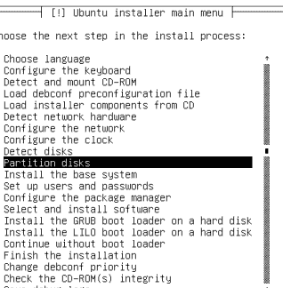

**图 3-25** Ubuntu 安装程序主菜单

#### Ubuntu 文本安装程序

Ubuntu 文本安装程序（debian-installer）比 Ubuntu 图形安装程序（第 57 页）提供了对安装过程更多的控制。文本安装程序显示伪图形（第 30 页）界面，并比图形安装程序消耗更少的系统资源，包括更少的 RAM，使其非常适合旧系统。您可以使用文本安装程序安装图形（桌面）或文本（命令行）系统，具体取决于您使用的 CD/DVD 以及您从磁盘菜单和 F4 菜单中做出的选择。

文本安装程序显示的许多屏幕与图形安装程序显示的屏幕相对应。在文本安装程序的屏幕中，TAB 键在各项之间移动，箭头键在列表中的选项之间移动，RETURN 键选择高亮显示的项目并促使安装程序显示下一个屏幕。少数屏幕包含括号（[]），其功能类似于复选框；它们使用星号代替对勾。使用箭头键将高亮移动到括号之间的空格。按 SPACE 键在括号之间放置星号并选择相邻的选项。再次按 SPACE 键可移除星号。

文本安装程序主菜单（该菜单的内容会有所不同——图 3-25 展示了一个示例）允许您直接进入安装过程的任何步骤或进入恢复模式（参见第 83 页的“救援损坏的系统”）。在大多数文本安装程序屏幕的左下角是 <Go Back>（返回）。图 3-26 提供了一个示例。使用 TAB 键高亮显示此项并按 RETURN 键以显示 Ubuntu 安装程序主菜单。您可能需要回退多个屏幕才能显示此菜单。


**图 3-26** 选择语言屏幕

文本安装程序显示的第一个屏幕是“选择语言”（图 3-26）。使用 UP 和 DOWN 箭头键选择语言。您可以输入语言名称的首字母，将高亮移动到您想要选择的语言附近。该语言将成为安装程序/已安装系统的默认语言；系统安装完成后，您可以更改默认语言（第 145 页）。按 RETURN 键选择高亮显示的语言并显示下一个屏幕。

安装程序会依次显示一系列屏幕，每个屏幕都有说明并询问一个问题。使用箭头键和/或 TAB 键高亮显示答案或选择，并在每个屏幕上按 RETURN 键进行选择。经过几个屏幕后，安装程序会检测并安装来自 CD/DVD 的程序，检测网络硬件，并使用 DHCP 进行配置（如果可用）。

在配置网络时，安装程序会询问您正在安装的系统的 hostname（主机名）。为了在本地网络中使用以及通过 Web 浏览器或其他客户端连接到 Internet，您可以随意起一个简单的名称。如果您正在设置服务器，请参见第 823 页的“FQDN”以获取关于在 Internet 上有效的名称的信息。

在这一步之后，安装程序会询问计算机所在的时区，继续检测硬件，启动分区编辑器，并显示分区方法屏幕（图 3-27）。文本分区编辑器中可用的许多选择与图形分区编辑器中可用的选择相对应。本节描述了如何使用文本分区编辑器手动分区硬盘。

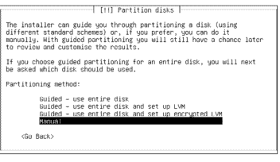

**图 3-27** 分区方法屏幕

第 70 页描述了使用图形分区编辑器进行的自动分区。使用文本安装程序进行自动分区与此类似，但提供了更多选项。

##### 手动分区

当您在分区方法屏幕（图 3-27）中选中 Manual（手动）时，文本分区编辑器将显示分区概览屏幕，该屏幕列出了系统中的硬盘以及这些硬盘上的分区。如果硬盘没有分区，分区编辑器将仅显示关于该硬盘的信息。图 3-28 显示了一个单独高亮显示的 200GB 硬盘，该硬盘没有分区表（也没有分区）。（注意：214.7 GB 等于 200 GiB——图 3-28 应该显示 GiB 而不是 GB。参见第 37 页的技巧。）

如果您想设置 RAID，请继续之前参见第 91 页。

如果分区概览屏幕如上图 3-28 所示，显示硬盘上没有分区且没有空闲空间，则该硬盘没有分区表：您需要创建一个。如果此屏幕至少显示一个分区或一些空闲空间，则磁盘已有分区表，您可以跳过此步骤，并继续执行下一页的“创建分区表”。

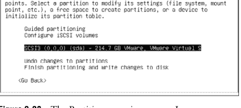

**图 3-28** 分区概览屏幕 1

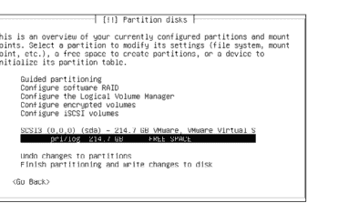

**图 3-29** 分区概览屏幕 II

iSCSI（第 1155 页）选项会在远程系统上创建一个分区。

要创建分区表，请高亮显示您要创建分区表的磁盘并按 RETURN。安装程序会询问您是否要在该设备上创建新的分区表，并警告这样做将销毁磁盘上的所有数据。高亮显示 Yes（是）并按 RETURN。安装程序将显示分区概览屏幕，显示该磁盘有一个与磁盘大小相同的空闲空间块（图 3-29）。由于硬盘现在有了分区表，分区概览屏幕会显示额外的选项。

要创建分区，请高亮显示包含 FREE SPACE（空闲空间）字样的行并按 RETURN。分区编辑器会询问您如何使用该空闲空间；高亮显示 Create a new partition（创建新分区）并按 RETURN。接着，分区编辑器会要求您指定新分区的大小。您可以输入百分比（例如 50%）或后面跟有 GB 的吉字节数（例如 30 GB）。按 RETURN。然后，分区编辑器会要求您指定新分区的类型（主分区或逻辑分区；第 34 页）以及您是否希望将分区创建在空闲空间的开头或结尾。通常，分区创建的位置无关紧要。回答这些问题中的每一个后，按 RETURN。分区编辑器随后将显示分区设置屏幕（图 3-30）。

###### Ubuntu 仅官方支持 ext3 和 ext4 文件系统

> ext3 和 ext4 文件系统是 Ubuntu 官方仅有的两种受支持的文件系统（除 swap 外）。仅当您知道自己在做什么时，才设置其他类型的文件系统——例如 JFS、XFS 或 reiserfs。除 ext3 和 ext4 以外的文件系统在系统崩溃时更容易损坏，并且可能表现出异常的性能特征（例如，XFS 处理小文件时速度较慢，升级可能需要很长时间）。

要更改分区设置屏幕上的设置，使用箭头键将高亮移动到您要更改的设置并按 RETURN。分区编辑器将显示一个允许您更改该设置的屏幕。

第一行，标记为 Use as（用作），允许您指定安装程序在该分区上创建的文件系统类型。此设置的默认值为 ext4，这是大多数普通文件系统的良好选择。如果您想更改文件系统类型，请将高亮移动到该行并按 RETURN；安装程序将显示“如何使用此分区”屏幕（图 3-31）。您可以为 /boot 和 /usr 选择 ext4，swap 区域（第 37 页），RAID（第 91 页），LVM（第 41 页），或另一种类型的文件系统。第 505 页的表 12-1 列出了几种常见的文件系统类型。将高亮移动到您想要的选择并按 RETURN。分区编辑器将重新显示分区设置屏幕，该屏幕现在反映了您所做的选择。对于 swap 区域，没有其他需要设置的内容；请跳至下一页的“完成分区设置”。

**指定挂载点**

挂载点默认为 /（根目录）。要更改文件系统的挂载点，请高亮显示标记为 Mount point（挂载点）的行并按 RETURN。分区编辑器将显示一个

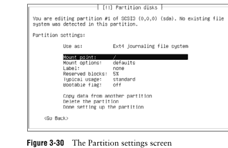

**图 3-30** 分区设置屏幕

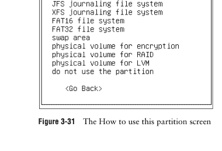

**图 3-31** 如何使用此分区屏幕


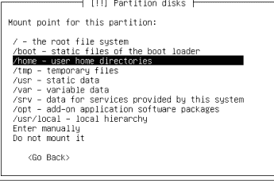

#### 图 3-32 该分区屏幕的挂载点

允许你指定挂载点的屏幕（见图 3-32）。选择一个挂载点；如果你想使用的挂载点未列出，请选择 **Enter manually**。按回车键。

通常你需要更改的唯一其他设置是可引导标志。如果系统存在 */boot* 分区，则开启该分区的此标志；否则，请为 */*（根）分区开启此标志。要更改可引导标志的状态，在分区设置屏幕上高亮显示标记为 **Bootable flag** 的行并按下 **RETURN**。片刻之后，分区编辑器将重新显示屏幕，此时显示该标志的更改后的状态。

当你满意分区设置时，高亮显示 **Done setting up the partition** 并按下 **RETURN**。分区编辑器将显示分区概览屏幕，展示新的分区设置。要创建另一个分区，请从第 88 页的“创建分区”开始重复步骤。要修改分区，请高亮显示该分区并按下 **RETURN**。

当你满意分区表的设计时，高亮显示 **Finish partitioning and write changes to disk** 并按下 **RETURN**。在再次给你反悔的机会后，分区编辑器将把分区写入硬盘。

安装程序将继续安装基础系统，并要求你设置一个用户帐户。它提供设置加密主目录的选项以及指定 HTTP 代理，并继续安装系统。

接下来，安装程序显示软件选择屏幕（图 3-33），允许你指定要安装的包。**Ubuntu desktop** 包默认被指定。使用 **ARROW** 键移动高亮，并使用 **SPACE** 键添加或删除每个选项旁边的星号。星号表示该选项已被选中。最后一个选项 **Manual package selection** 将安装选中的包；你也可以在系统安装完成后安装额外的包。

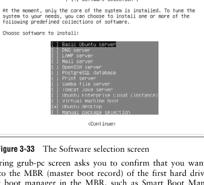

##### GRUB

配置 grub-pc 屏幕询问你是否确认要将引导加载器写入第一个硬盘的 MBR（主引导记录）。除非你在 MBR 中拥有另一个引导管理器，例如 Smart Boot Manager、另一个操作系统的 GRUB 或 Windows 7 bootmgr 引导加载器，并且想要手动编辑该引导管理器以便从 Ubuntu 分区的引导扇区启动 Ubuntu，否则请选择将引导加载器写入 MBR。当所有选择都正确时，高亮显示“是”并按 RETURN。

##### 完成安装

最后，安装程序询问系统时钟是否设置为 UTC（第 1179 页）。当安装程序显示安装完成窗口时，取出 CD/DVD 并点击“继续”以重启系统。

#### 设置 RAID 阵列

要设置 RAID 阵列（第 40 页），你必须首先创建两个或更多大小相同的分区。通常这些分区位于不同的硬盘上。你按照前面部分的说明创建 RAID 分区，只不过不是将分区类型设为 ext4 或 swap，而是将每个分区声明为 RAID 卷。（RAID 分区被称为卷。）一旦你拥有了两个或更多的 RAID 卷，分区编辑器允许你将这些卷组合成一个 RAID 阵列，其外观和表现就像一个单一分区。

以下示例使用两个新硬盘各 100 吉字节的空间来设置一个挂载在 /home 上的 100 吉字节 RAID 1 阵列。按照第 87 页的说明在每个硬盘上创建新的分区表。然后创建两个 100 吉字节的分区，每个硬盘上一个。当分区编辑器显示“如何使用此分区”屏幕（图 3-31，第 89 页）时，按照第 88 页的说明，指定分区类型为用于 RAID 的物理卷。

### 92 3 逐步安装

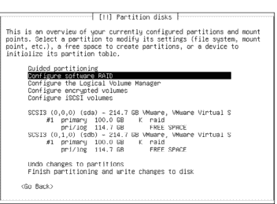

分区编辑器准备好设置 RAID

图 3-34 显示了设置 RAID 卷后的分区编辑器屏幕。一旦你至少有两个 RAID 卷，分区编辑器会在其菜单的第一行添加“配置软件 RAID”选项（此行在图 3-34 中高亮显示）。

高亮显示“配置软件 RAID”，按 RETURN，并确认你想将更改写入硬盘。从下一个屏幕，选择“创建 MD 设备”（MD 代表多磁盘）并按 RETURN。然后选择 RAID 0、1、5、6 或 10 并按 RETURN。不同类型的 RAID 阵列在第 41 页有描述。然后分区编辑器询问你指定 RAID 阵列中活动设备的数量（2）和备用设备的数量（0）。分区编辑器在这些字段中输入的值基于你之前的输入，通常都是正确的。接下来，选择 RAID 阵列的活动设备（使用 SPACE 键在每个设备前添加星号；图 3-35）并按 RETURN。

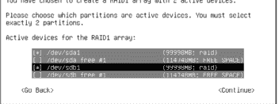

指定 RAID 阵列中的活动设备

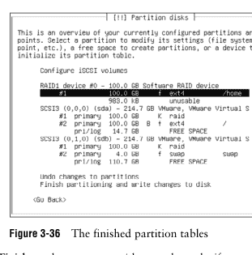

**图 3-36** 完成后的分区表

在下一个屏幕（询问你是否要再次创建 MD 设备的那个屏幕）上高亮显示 **Finish** 并按 RETURN。现在你需要告诉安装程序在哪里挂载 RAID 阵列。高亮显示 **RAID** 阵列。在示例中，此行包含 **\#1 100.0 GB**（此行在图 3-36 中高亮显示，但在分区创建后才显示）。按 RETURN。**高亮显示 用作：** 不使用并按 RETURN。安装程序显示“如何使用此分区”屏幕（图 3-31，第 89 页）。高亮显示你想在 RAID 阵列上创建的文件系统类型（通常是 ext4）并按 RETURN。按照第 88 页“创建分区”下的说明继续设置 RAID 阵列，就像处理其他分区一样。在示例中，全部 100 吉字节用于挂载在 /home 上的 ext4 文件系统。

要完成此示例，使用第一个驱动器剩余的免费空间创建一个可引导的 /（根）分区，并在第二个驱动器上创建一个 4 吉字节的交换分区。图 3-36 显示了包含这些更改的分区概览屏幕。高亮显示 **Finish partitioning and write changes to disk**（你可能需要向下滚动以显示此行）并按 RETURN。

####### 章节总结

大多数 Ubuntu Linux 安装从启动 live/install DVD 或 live/install Desktop CD 开始，并运行显示 GNOME 桌面的 live 会话。要开始安装，双击桌面上标记为 **Install** 的对象。

Ubuntu 在 live/install Desktop CD/DVD 上提供了一个图形安装程序 (**ubiquity**)；它在 Alternate 和 Server CD 以及 DVD 上提供文本安装程序 (debian-install)。两个安装程序都会识别系统中的硬件，构建文件系统，并安装 Ubuntu Linux 操作系统。**ubiquity** 安装程序不会写入硬盘，直到它显示 **Ready** 安装屏幕或警告你即将写入磁盘。在此之前，你可以放弃安装而不对硬盘做任何更改。

双启动系统可以启动两个操作系统之一——通常是 Windows 或 Linux。你可以从 live 会话使用 **GNOME Partition Editor** (**gparted**) 或 **GNOME Disk Utility** (**palimpsest**) 来查看硬盘内容，并在设置双启动系统时调整分区大小以为 Ubuntu 腾出空间。在从 live 会话安装期间，你可以使用 **ubiquity** 分区编辑器来添加、删除和修改分区。

####### 练习

-   1. 你如何启动 live 会话？列出你可能会遇到的两个问题，并解释你会如何解决它们。
-   2. 在你第一次启动 live 会话或使用新的 CD/DVD 安装 Ubuntu 之前，你应该采取哪些步骤？你会怎么做？
-   3. 什么是引导式分区？
-   4. **ubiquity** 是什么？
-   5. 描述 **ubiquity** 分区编辑器。它与 Alternate 和 Server CD 上的分区编辑器有何不同？
-   6. 什么时候使用 **ext2** 文件系统比使用 **ext4** 文件系统更有利？

###### 高级练习

-   7. 什么是虚拟控制台？在安装期间，你可以将虚拟控制台用于什么目的？如果系统正在显示虚拟控制台，你如何改为显示图形安装屏幕？
-   8. 你会采取哪些步骤让系统在从 live/install Desktop CD/DVD 启动时显示它正在执行的所有操作？


### 第二部分

### 开始使用 Ubuntu Linux

#### 第 4 章
Ubuntu Linux 简介 97

#### 第 5 章
Linux 实用工具 159

#### 第 6 章
Linux 文件系统 199

#### 第 7 章
Shell 237

### 4 Ubuntu Linux 简介

#### 本章导读

- 约束你的权限：root 权限/sudo . . . . . . . . . . 98
- Ubuntu 桌面之旅 . . . . . . . . . . . 99
- 鼠标偏好设置 . . . . . . . . . . . 105
- 使用 Nautilus 管理文件 . . . . . . . . . . . . . . . . . 107
- 更新管理器 . . . . . . . . . . . 112
- 更新、安装和卸载软件包 . . . . . . . . . . . 131
- 在哪里查找文档 . . . . 136
- 关于登录的更多知识 . . . . . . . . . . 144
- 如果无法登录该怎么办 . . . . . . . . . . . . . . . . . 146
- 在命令行下工作 . . . . . . . . . . . . . . . . . . 150
- 控制窗口：高级操作 . . . . . . . . . . . . . . . . . 153

无论以何种方式，你此刻正坐在一台运行 Ubuntu Linux 的电脑前。在介绍了 **root**（超级用户）权限之后，本章将带你进行一场系统之旅，让你对这台系统能做什么有一些初步的了解。这场之旅不会深入探讨选择项、选项、菜单等细节；这些留待你自行实验，并在第 8 章及本书后续章节中更深入地探索。相反，本章呈现的是一次 Linux 厨房的厨师之旅：在阅读过程中，你将有机会品尝那些菜肴，并随着阅读本书其余部分的深入而更充分享受它们。

在这场之旅之后，是一节关于在哪里查找 Linux 文档的说明（第 136 页）。下一节提供更多关于系统登录的信息，包括关于密码的内容（第 144 页）。本章以一个更高级、可选的小节结束，内容关于操作 Linux 窗口（第 153 页）。

务必阅读下一节中关于误用 **root** (sudo) 权限之危险的警告。在遵循该警告的同时，请随意对系统进行实验：执行命令、创建文件、点击对象、从菜单中选择项目、跟随书中的示例，并享受乐趣。

#### root 账户

**提示** 大多数 Linux 系统都包含一个名为 **root** 的用户账户。该用户拥有特殊权限，有时被称为*超级用户*。在经典系统中，用户可以通过提供 **root** 密码以 **root** 身份登录并工作。

在默认安装下，Ubuntu 有一个 **root** 账户，但该账户没有密码：**root** 账户是被锁定的。下一节解释如何你可以使用 **sudo** 并提供 **root** 密码来以 **root** 权限运行命令。本书使用“以 **root** 权限工作”这一短语，以此种临时权限提升与经典场景（用户可以在整个会话期间以 **root** 权限工作）相区分。有关 **root** 权限的更多信息，请参见第 419 页。

##### 约束你的权限：root 权限/sudo

当你输入密码以运行程序时（*不是*在系统登录时），或者当你从命令行使用 **sudo** 时，你正在以 **root** 权限工作，并拥有非凡的全系统权力。以 **root** 权限工作的人有时被称为*超级用户*或*管理员*。在以 **root** 权限工作时，你可以读取或写入系统中的任何文件，执行普通用户无法执行的程序等。在多用户系统中，你可能不被允许运行某些程序，但某人——*系统管理员*——可以，并且该人员负责维护系统。当你在自己的电脑上运行 Linux 时，你设置的首个用户（通常是在安装 Ubuntu 时）可以使用 **sudo** 及其图形界面对应工具 **gksudo** 来以 **root** 权限运行程序。

###### 谁被允许运行 sudo？

**安全** 安装 Ubuntu 时设置的首个用户可以管理系统：该用户可以使用 **sudo** 执行任何命令。当你添加用户账户时，可以指定是否允许他们管理系统。更多信息请参见第 594 页和第 596 页的图 16-3。

在本章和第 8 章中，当本书指出你必须输入密码时，它假设你拥有管理系统的权限。如果没有，你必须请管理员执行该任务。

获取 **root** 权限主要有两种方式。首先，当你启动需要 **root** 权限的程序时，会弹出一个对话框，要求你**输入密码**以执行管理任务。输入密码后，程序将以 **root** 权限运行。其次，如果你从命令行（例如从终端模拟器；第 125 页）使用 **sudo** 实用工具（用于文本应用；第 421 页）或 **gksudo** 实用工具（用于图形应用；第 423 页）并提供你的密码，你输入的命令将以 **root** 权限运行。在这两种情况下，当命令结束或退出你以 **root** 权限启动的程序时，你就不再以 **root** 权限工作。更多信息请参见第 419 页的“以 Root 权限运行命令”。

**不要在以 root 权限工作时进行实验**

> **警告** 当你**没有**以 **root** 权限工作时，请随意实验。当你**正在**以 **root** 权限工作时，只执行必须做的操作，并确保你确切知道自己在做什么。完成当前任务后，恢复为普通用户身份工作。在以 **root** 权限工作时，你可能会对系统造成严重损害，以至于需要重新安装 Linux 才能使系统再次正常工作。

##### Ubuntu 桌面之旅

本节在能够充分解释术语的上下文中引入新词汇（对部分读者而言），以帮助你开始使用 Linux 桌面。如果你在阅读本节时需要精确定义，请参见第 117 页的“GNOME 桌面术语”以及术语表。术语表还描述了数据输入**小部件**（第 1180 页），如*组合框*（第 1141 页）、*下拉列表*（第 1146 页）、*列表框*（第 1157 页）和*文本框*（第 1176 页）。

**GNOME：** **GNOME** (www.gnome.org) 是 GNU 项目（第 5 页）的产品，是 Ubuntu 下用户友好的默认桌面管理器。KDE（K 桌面环境）是一个强大的桌面管理器和一套完整的工具，可替代 **GNOME** (www.kde.org/community/whatiskde)。运行 KDE 的 Ubuntu 版本名为 Kubuntu。

本次之旅介绍了 **GNOME**，这是一个功能齐全、成熟的桌面环境，拥有大量可配置工具。在讨论登录之后，本节涵盖桌面功能——包括面板、对象和*工作区*——并解释了如何轻松地在不同工作区之间切换。它描述了从桌面启动对象（运行程序）的几种方式、如何设置桌面以满足你的需求并愉悦你的感官，以及如何操作窗口。随着之旅的继续，它解释了如何使用 Nautilus 文件浏览器窗口处理文件和文件夹，这是最重要的 **GNOME** 工具之一。之旅以对更新管理器的讨论结束，这是一个允许你只需点击按钮即可保持系统更新、获取帮助以及注销的工具。

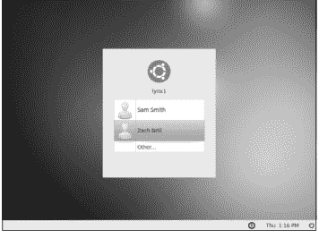

**图 4-1** Ubuntu GNOME 登录屏幕

###### 系统登录

当你启动标准的 Ubuntu 系统时，GDM（GNOME 显示管理器）会在系统控制台显示登录屏幕（图 4-1）。屏幕中央是一个包含名称列表的窗口。当你点击一个名称时，Ubuntu 会显示一个标记为**密码**的文本框。此外，在屏幕底部的面板中，Ubuntu 显示图标，允许你使用不同语言工作、选择不同键盘布局、更改你的辅助功能偏好（例如，使文本更大更易读），以及重启或关闭系统。更多信息请参见第 145 页的“登录屏幕”。

要登录，请点击你的名字。会出现一个标记为**密码**的文本框。输入你的密码并按下 RETURN 键。如果 Ubuntu 显示错误消息，请尝试再次点击你的名字并输入密码。确保 CAPS LOCK 键未开启（如果开启，Ubuntu 会显示消息），因为验证你输入例程是区分大小写的。如果在登录时需要帮助，请参见第 146 页；如果你想更改密码，请参见第 148 页。系统需要片刻时间设置各项配置，然后显示一个工作区（图 4-2）。

####### 简介

你可以按原样使用桌面，或者对其进行定制，直到它的外观和功能都完全不同於初始桌面。如果你有自己的电脑，你可能希望在实验桌面时添加一个用户（第 594 页）并以该用户身份工作。当你弄清楚喜欢哪些功能后，可以以自己的身份登录并实现这些功能。这样你就不必担心“弄坏”你的桌面而无法将其恢复到令人满意的配置状态。


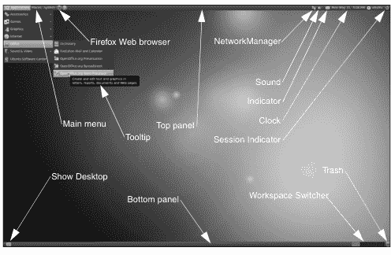

**图 4-2** 初始工作区

##### 面板与对象
当您登录时，GNOME 会显示一个工作区，其中包含顶部和底部面板（栏），这些对于轻松高效地完成工作至关重要（图 4-2）。每个面板都包含多个图标和文本，统称为对象。（例如，按钮、小工具和菜单都是对象的类型。）当您点击对象时，会发生某些变化。

面板本身不会提供您无法通过其他方式完成的功能，而是将对象集中在一处，使您与系统的交互更加便捷。由于面板易于配置，您可以设置它们来放置您经常使用的工具。您还可以创建额外的面板来放置不同组的工具。

##### 工作区与桌面
您在屏幕上看到显示的是*工作区*。初始状态下，Ubuntu 将 GNOME 配置为拥有四个工作区。桌面并非一次性全部显示，而是所有工作区的集合。“第 104 页的‘切换工作区’”介绍了您可以使用工作区执行的一些操作。

###### 暂勿删除对象或面板
**注意** 您可以随意添加和删除面板和对象。但在您对使用桌面感到舒适并完成本节阅读之前，最好不要从桌面删除任何面板或对象。

###### 单击与右击
**提示** 本书在您需要点击*左*鼠标按钮时使用**单击**一词。在您需要点击*右*鼠标按钮时使用**右击**一词。有关适配左手使用鼠标的说明，请参见第 105 页。

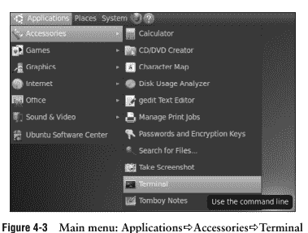

#### 从桌面启动程序

本节描述了从桌面启动程序运行的许多方法中的三种。

点击对象 点击对象的效果取决于该对象被设计用来执行什么操作。例如，点击对象可能会启动程序、显示菜单或文件夹，或者打开文件、窗口或对话框。

例如，要启动 Firefox 网络浏览器，请（左）点击 Firefox 对象（顶部面板上蓝橙相间的地球图标；见图 4-2）。GNOME 会打开一个正在运行 Firefox 的窗口。当您使用完 Firefox 后，点击窗口顶部标题栏左端的小 x。GNOME 将关闭该窗口。

当您（左）点击顶部面板右端附近的日期和时间时，时钟小工具会显示当前月份的日历。（如果在日历上双击某个日期，该对象会在您点击的日期处打开 Evolution 日历——但首先您必须设置 Evolution。）再次点击日期和时间以关闭日历。

从主菜单选择 启动程序的第二种方法是从菜单中选择。主菜单是顶部面板左端的对象，包含应用程序、位置系统和系统这几个词。点击这些词之一以显示相应的菜单。每个包含子菜单的菜单选项会在菜单名称右侧显示一个三角形（指向右侧）（图 4-3）。当您将鼠标指针移动到其中一个选项上并停留片刻（此操作称为悬停）时，菜单会显示子菜单。当您让鼠标光标悬停在某个子菜单选项上时，GNOME 会显示工具提示（第 118 页）。

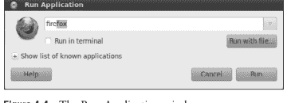

图 4-4 运行应用程序窗口

尝试主菜单的功能。启动数独（主菜单：应用程序→游戏→数独）、终端模拟器（主菜单：应用程序→附件→终端）以及应用程序菜单中的其他程序。位置菜单和系统菜单在第 122 页讨论。

您也可以通过按 ALT-F2 来显示运行应用程序窗口（图 4-4）从而启动程序。例如，当您在窗口顶部的文本框中开始输入 firefox 时，窗口会识别您正在输入的内容，并显示 Firefox 标志及 firefox 这个词的剩余部分。点击运行以启动 Firefox。

您可以从运行应用程序窗口运行命令行实用工具，这些工具是文本型的（而非图形型的）。当您从此窗口运行文本型实用工具时，您必须在标记为在终端中运行的复选框中打勾（点击复选框以打勾；再次点击以去除勾号）。勾号告诉 GNOME 在终端模拟器窗口中运行该命令。当实用工具运行完毕时，GNOME 会关闭窗口。

例如，在文本框中输入 vim.tiny（一种基于文本的编辑器的名称），在标记为在终端中运行的复选框中打勾，然后点击运行。GNOME 会打开一个终端（模拟器）窗口，并在该窗口中运行 vim 文本编辑器。当您退出 vim（依次按 ESCAPE:1 RETURN 即可退出）时，GNOME 会关闭终端窗口。

您可以运行仅显示输出然后终止的命令行实用工具。由于窗口在实用工具运行结束后立即关闭，且大多数实用工具运行速度很快，您可能看不到输出。请在文本框中输入以下命令以运行 df（磁盘可用空间；第 774 页）实用工具，并使窗口保持打开直到您按 RETURN（请记住在标记为在终端中运行的复选框中打勾）：

```
bash -c "df -h ; read"
```

此命令启动一个 bash shell（第 7 章），执行 -c 选项后的命令行。该命令行包含两个由分号分隔的命令。第二个命令 read（第 1003 页）会等待您按 RETURN 才终止。因此，df -h 命令的输出将保留在屏幕上，直到您按下 RETURN。请将 read 替换为 sleep 10，使窗口保持打开十秒钟。

#### 切换工作区

**工作区切换器**小工具（或简称*切换器*）中的每个矩形——即**底部面板**右端附近的一组矩形——代表一个工作区（图 4-2，第 101 页）。当您点击一个矩形时，切换器会显示相应的工作区，并高亮显示该矩形以指示当前显示的是哪个工作区。您也可以按 **CONTROL+ALT+右箭头** 以显示当前工作区右侧的工作区；按 **CONTROL+ALT+左箭头** 则朝相反方向切换。

点击切换器中最右侧的矩形（而不是其右侧的垃圾桶小工具），然后选择**主菜单：系统→首选项→鼠标**。GNOME 会打开鼠标首选项窗口。对应您正在使用的工作区的切换器矩形会显示一个小矩形。这个小矩形在切换器矩形中的大小和位置对应于工作区中窗口的大小和位置。将鼠标指针放在窗口顶部标题栏上，点击并按住鼠标左键，拖动窗口到桌面边缘。切换器内部的小矩形会移动到切换器矩形内相应的位置。

现在，点击切换器中另一个不同的矩形，并打开另一个应用程序——例如，Ubuntu 帮助中心（点击顶部面板上的蓝色问号）。当 Ubuntu 帮助中心窗口在一个工作区，而鼠标首选项窗口在另一个工作区时，您可以点击切换器中相应的矩形，在这些工作区（以及应用程序）之间来回切换。

您可以通过在底部面板上右击**窗口列表**小工具（第 121 页），并选择以**移动**开头的一个选项，将窗口从一个工作区移动到另一个工作区。

##### 右击以显示对象上下文菜单
*上下文菜单是指适合其特定上下文的菜单。当您右击一个对象时，它会显示对象上下文菜单。每个对象都显示自己的上下文菜单，尽管相似的对象具有相似的上下文菜单。大多数对象上下文菜单都包含首选项或属性选项。有关对象上下文菜单的更多信息，请参见以下部分“设置个人首选项”以及第 126 页。*

#### 设置个人首选项

您可以为桌面上的许多对象设置首选项，包括面板上的对象。

要显示**工作区切换器**首选项窗口（图 4-5），首先在切换器上任意位置*右击*以显示切换器菜单，然后选择*首选项*。（当启用视觉效果 [第 115 页] 时，窗口外观会有所不同。）在标记为**工作区数量**的数字调节框中指定您想要的工作区数量。随着您在数字调节框中更改数字，切换器显示的工作区数量也会相应变化——您甚至可以在关闭首选项窗口之前看到操作的结果。通常，四个工作区是一个不错的起始数量。点击**关闭**。


#### 时钟小工具

时钟小工具拥有一个有趣的“首选项”窗口。右键单击时钟小工具（图 4-2，第 101 页）并选择**首选项**。GNOME 会显示时钟首选项窗口的“常规”选项卡。该选项卡允许你自定义顶部面板上显示的日期和时间。在此窗口中所做的更改会立即反映在时钟上。单击**位置**选项卡，然后单击**添加**按钮，输入你所在或附近城市的名称，即可让时钟小工具显示天气信息。

不同的对象显示不同的首选项窗口。相比之下，启动程序的对象显示属性窗口，而没有首选项窗口。请尝试不同的首选项和属性窗口，看看会发生什么。

#### 鼠标首选项

鼠标首选项窗口（图 4-6，下一页）允许你根据需求更改鼠标的特性。要显示此窗口，请选择**主菜单：系统首选项 鼠标**，或者在终端模拟器或运行应用程序窗口中键入命令 **gnome-mouse-properties**（**ALT-F2**）。鼠标首选项窗口有两个选项卡：“常规”和“辅助功能”（在笔记本电脑上还有一个“触摸板”选项卡）。

- **左手鼠标**：单击**常规**选项卡。要更改鼠标按钮的方向以便左撇子使用，请单击标记为**左手型**的单选按钮。如果你更改了鼠标按钮的设置，请记得相应地重新阅读本书中的描述。也就是说，当本书要求你单击左按钮或未指定要单击的按钮时，请单击右按钮，反之亦然。有关通过命令行更改鼠标按钮方向的信息，请参阅第 274 页的“重新映射鼠标按钮”。

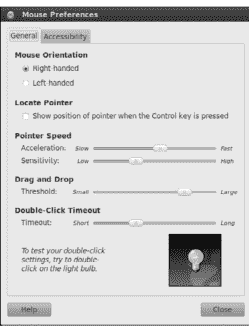

**图 4-6** 鼠标首选项窗口，常规选项卡

- **双击超时**：使用双击超时滑块更改系统识别鼠标按钮双击操作而非两次单击操作所需的速度。你还可以控制鼠标的加速度和灵敏度。拖放阈值指定了在执行拖放操作之前，你必须在系统认为该动作是拖放操作的拖放部分时，将对象拖动的距离。

你可以从辅助功能选项卡控制鼠标点击的不同方面。

#### 操作窗口

要调整窗口大小，请将鼠标指针放置在窗口的边缘；指针会变成指向线条的箭头。当指针是指向线条的箭头时，你可以单击并拖动窗口的侧面。当将鼠标指针放置在窗口的角落时，你可以同时调整窗口的高度和宽度。

要移动窗口，请单击并拖动标题栏（窗口顶部的横条，其中包含窗口名称）。或者，按住 ALT 键时，你可以单击并拖动窗口的任何部分来移动窗口。为了好玩，试着将窗口移动到工作区的任一侧之外。会发生什么？结果取决于视觉特效（第 115 页）是如何设置的。

- **标题栏**：在标题栏的左侧有三个控制窗口的图标（图 4-17，第 123 页）。单击通常出现在图标集合中间的向下箭头，可以将窗口最小化（图标化），这样窗口的唯一指示就是底部面板上带有窗口名称的对象（窗口列表小工具；第 121 页）。单击窗口列表小工具可以在可见和最小化之间切换窗口。单击通常出现在三个图标右端的向上箭头图标，可以最大化窗口（以最大尺寸显示窗口）并将向上箭头变为矩形。单击该矩形会将窗口恢复到正常大小。双击标题栏可以在正常大小和最大大小之间切换窗口。

单击 x 会关闭窗口，通常也会终止在窗口中运行的程序。在某些情况下，你可能需要单击几次。一些程序，如 Rhythmbox 音乐播放器，不会终止，而是继续在后台运行。在此状态下，程序会在顶部面板上显示一个图标。单击该图标并从下拉列表中选择“退出”以终止程序。

##### 终止程序

#### 使用 Nautilus 处理文件

Nautilus，GNOME 文件管理器，是一个简单而强大的文件管理器。你可以使用它来创建、打开、查看、移动和复制文件和文件夹，以及执行程序脚本。其最基本和最重要的功能之一是创建和管理桌面。本节介绍 Nautilus 并演示 Nautilus 与桌面之间的对应关系。有关 Nautilus 的更详细信息，请参阅第 276 页。

Nautilus 显示文件浏览器窗口，该窗口显示文件夹的内容。术语“文件夹”和“目录”是同义词；“文件夹”通常用于图形上下文，而“目录”可能用于文本或命令行上下文。本书互换使用这些术语。

##### 术语：文件夹和目录

本书有时在提及 Nautilus 文件浏览器窗口时使用术语“文件浏览器窗口”和“文件浏览器”。

##### 术语：文件浏览器

选择主菜单：位置 主文件夹以打开一个显示主文件夹中文件的 Nautilus 文件浏览器窗口。

##### 打开 Nautilus

在文件浏览器窗口中双击对象与在桌面上双击对象的效果相同：Nautilus 执行适合该对象的操作。例如，当你双击文本文件时，Nautilus 使用文本编辑器打开该文件。当你双击 OpenOffice.org 文档时，Nautilus 使用 OpenOffice.org 打开该文件。如果文件是可执行的，Nautilus 将运行它。如果文件是文件夹，Nautilus 将打开该文件夹，并在窗口中显示其内容，替换之前显示的内容。

在 Nautilus 文件浏览器窗口内，你可以在新选项卡中打开文件夹。为此，中间单击该文件夹或右键单击该文件夹并从下拉列表中选择“在新选项卡中打开”；Nautilus 会显示一个以你单击的文件夹命名的新选项卡。单击该选项卡以显示目录的内容。

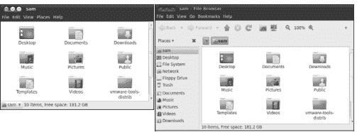

#### Nautilus 的两副面孔

Nautilus 的外观因其设置方式而异：它可以显示空间视图或文件浏览器窗口。图 4-7 显示了每种类型显示的示例。默认情况下，Ubuntu 显示浏览器窗口。有关空间视图的信息，请参阅第 282 页。

#### 桌面目录

桌面上的文件存储在一个路径名（第 205 页）为 /home/username/Desktop 的目录中，其中 username 是你的登录名，或者如果你是在实时会话中登录，则为 ubuntu。简单的目录名称是 Desktop。当你选择主菜单：位置→桌面时，GNOME 会打开一个文件浏览器窗口，显示桌面上的文件（图 4-8）。最初没有文件。工具栏下方和“位置”右侧的按钮显示了 Nautilus 正在显示的目录的路径名（图 4-8 中的 /sam/Desktop）。

要查看图形桌面和桌面目录之间的对应关系，请在桌面文件浏览器窗口的空白区域任何地方右键单击。选择“创建文档→空文件”。Nautilus 在桌面上创建一个新文件，并在此窗口中显示其对象。创建此文件时，GNOME 会突出显示文件下的名称“new file”：此时你可以输入任何喜欢的名称。完成输入名称后，按 RETURN 键。如果双击新文件，Nautilus 假设它是文本文件，并在 gedit 窗口中打开该文件。（gedit 实用程序是一个简单的文本编辑器。）输入一些文本并单击工具栏上的保存。通过使用“文件”菜单或单击标题栏左端的 × 来关闭窗口。你已在桌面上创建了一个文本文档。现在，你可以双击桌面上的文档对象或文件浏览器窗口中的对象来打开和编辑它。

接下来，通过右键单击根窗口（工作区的任何空白部分）并选择“创建文件夹”来创建一个文件夹。你可以用同样的方式为此文件夹命名


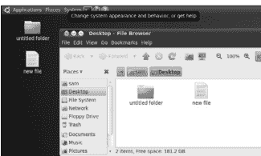

**图 4-8** 工作区的一部分，其中包含一个 Nautilus 文件浏览器窗口

你为之前创建的文件命名了。文件夹对象出现在桌面上以及桌面文件浏览器窗口中。

在桌面上，将文件拖动到文件夹上方；文件夹会打开。释放鼠标按钮将文件放入文件夹中；GNOME 会将文件移动到该文件夹中。再次在桌面上，双击你刚刚移动文件的那个文件夹。GNOME 会打开另一个文件浏览器窗口，这个窗口显示的是文件夹的内容。你移动到文件夹中的文件会出现在新窗口中。现在，将文件从该窗口拖动到之前打开的桌面文件浏览器窗口中。文件回到了桌面上，尽管它可能会被其中一个文件浏览器窗口遮挡。

接下来，通过选择 **主菜单：应用程序 -> 办公 -> OpenOffice.org 文字处理器** 来打开一个文字处理文档。输入一些文本，然后点击保存图标（指向硬盘驱动器的向下箭头）或者选择 **菜单栏：文件 -> 保存** 来保存文档。OpenOffice.org 会显示一个保存窗口（图 4-9，下一页）。在标记为 **名称** 的文本框中输入你想要保存文档的名称（暂时使用 *memo*）。你可以通过以下两种方式之一指定保存文档的目录：使用标记为 **保存在文件夹** 的下拉列表，或者使用保存窗口中的 **浏览其他文件夹** 部分。

点击 **浏览其他文件夹** 左侧的加号（+）以打开该窗口的此部分。当你打开此部分时，加号会变成减号（-）；点击减号以关闭此部分。图 4-9 显示了关闭此部分的保存窗口。当 **浏览其他文件夹** 部分关闭时，你可以从标记为 **保存在文件夹** 的下拉列表中选择一个目录。这种技术快速且简单，但提供的文件夹选择数量有限。默认情况下，它将文档保存在 **文档 (~/username/Documents)** 中。如果你想将文档保存到桌面，请在此下拉列表中点击 **桌面**，然后点击 **保存**。OpenOffice.org 保存的文档文件扩展名为 **.odt**，这表明它是一个 OpenOffice.org 文字处理文档。此类文件的对象包含一些文本和条纹或图片。

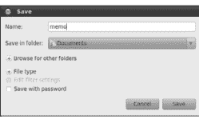

##### 图 4-9 保存窗口

**可选** **浏览/保存窗口** 当打开 **浏览其他文件夹** 部分时（点击 **浏览其他文件夹** 左侧的加号 [+]），保存窗口会使标记为 **保存在文件夹** 的下拉列表变灰，并展开 **浏览其他文件夹** 部分，如图 4-10 所示。这个展开的部分包含两个并排的大列表框：**位置** 和 **名称**。标记为 **位置** 的列表框显示系统上的目录和位置，包括 **文件系统**。标记为 **名称** 的列表框列出在 **位置** 中高亮的目录内的文件。

保存窗口的 **浏览其他文件夹** 部分允许你浏览文件系统并选择目录或文件。GNOME 工具和许多应用程序都使用此窗口，尽管有时应用程序称之为 **浏览窗口**。在这个

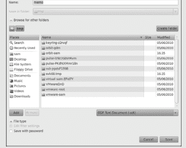

##### 图 4-10 展开“浏览其他文件夹”的保存窗口

示例中，文字处理器将其称为保存窗口，并使用它来定位保存文档的目录。

假设你想在 **/tmp** 目录中保存一个文件。点击左侧列表框中的 **文件系统**。右侧的列表框显示根目录中的文件和目录（用 / 表示；有关更多信息，请参见第 205 页的“绝对路径名”）。接下来，在右侧列表框中双击 **tmp**。左侧列表框上方的按钮会发生变化，以反映右侧列表框中显示的目录。点击 **保存**。

左侧列表框上方的按钮代表目录。右侧列表框显示在标记为高亮（较暗）按钮的目录内找到的目录。如果你此时点击 **保存**，文件将保存到该目录中。点击这些按钮中的一个，在右侧列表框中显示对应的目录，然后点击 **保存** 以将该文件保存到该目录中。

编辑完文档后，关闭窗口。如果你自上次保存以来进行了任何更改，文字处理器会询问你是否要保存文档。如果你选择保存，文字处理器会将修订后的版本覆盖（在同一文件中）之前保存的版本。现在，**memo.odt** 对象出现在桌面上和 **桌面** 文件浏览器窗口中。双击任一对象以打开它。


桌面目录是特殊的

总而言之，**桌面** 目录与其他目录类似，除了 GNOME 会在桌面上（在每个工作区中）显示其内容。桌面就像是一个大的、普通的桌面文件浏览器窗口。你可以操作 **桌面** 目录，因为它始终被显示。在 GUI 中，你必须使用 Nautilus 等工具来显示和操作其他目录的内容。

##### 选择对象

可以使用相同的技术来选择文件浏览器窗口或桌面上一个或多个对象。通过单击对象一次来选择对象；GNOME 会高亮显示该对象。通过按住 **CONTROL** 键同时单击每个对象来选择其他对象。要选择一组相邻的对象，高亮显示第一个对象，然后，在按住 **SHIFT** 键的同时点击最后一个对象；GNOME 会高亮显示你点击的两个对象之间的所有对象。或者，你可以使用鼠标指针围绕一组对象拖出一个框来选择它们。

为了尝试这些技术，打开一个显示你主文件夹的文件浏览器窗口。通过双击 **示例** 文件夹来显示它。选择几个对象，右键点击，并选择 **复制**。现在将鼠标指针移动到桌面上的空白部分，右键点击，并选择 **粘贴**。你将所选对象从 **示例** 文件夹复制到了桌面上。你可以通过拖动和放置对象来移动它们。

##### 清空回收站

从对象的上下文菜单中选择 **移至回收站** 会将选中（高亮）的对象移动到 **回收站** 目录中。由于回收站中的文件占用硬盘空间（就像任何文件一样），定期删除它们是个好主意。所有文件浏览器窗口都允许你通过选择 **文件浏览器菜单栏：文件 → 清空回收站** 来永久删除回收站目录中的所有文件。要查看回收站中的文件，点击底部面板最右侧的回收站小部件（图 4-2，第 101 页）；Nautilus 将显示回收站文件浏览器窗口。从回收站小部件的上下文菜单中选择 **清空回收站** 以永久删除回收站中的所有文件。（如果回收站中没有文件，则不会出现此选项。）或者，你可以在回收站文件浏览器窗口中右键点击一个对象并选择 **永久删除** 以仅移除该对象（文件），或者选择 **还原** 以将文件移动回其原始位置。你可以像操作其他文件夹一样，将文件拖动和放入或取出回收站。

##### 更新管理器

在连接到互联网的系统上，Ubuntu 通过打开更新管理器窗口（图 4-11）来通知你软件更新可用。你可以通过选择 **主菜单：系统 → 管理 → 更新管理器** 或从终端模拟器或 **运行应用程序** 窗口（**ALT-F2**）输入命令 **update-manager** 来手动打开此窗口。


当“更新管理器”窗口打开时，它会显示信息**正在启动更新管理器**；稍后，它会显示可用的更新数量。如果没有可用更新，窗口将显示信息**您的系统已是最新**。如果你有理由认为系统未检测到可用的更新，请点击**检查**。“更新管理器”会要求输入密码，重新加载其数据库，并再次检查更新。

如果有可用更新，请点击**安装更新**。“更新管理器”会要求输入密码，显示“可下载的软件包文件”窗口，并在下载软件包时计数。接下来，“更新管理器”将显示“应用更改”窗口，并显示信息**正在安装软件**，同时描述安装软件包所执行的步骤。完成后，“更新管理器”将显示信息**您的系统已是最新**。点击**关闭**。如果更新要求重启系统，“更新管理器”会询问你是想立即重启系统还是稍后重启。选择“现在”将立即重启系统。选择“稍后”将关闭“更新管理器”窗口，并将会话指示器小工具（图 4-2，第 101 页）变为红色。当你准备好重启系统时，点击此小工具，并从下拉列表中选择**需要重启**。有关更多信息，请参阅第 131 页的“更新、安装和移除软件包”。

#### 更改外观（主题）

Linux 桌面最令人兴奋的方面之一是其在允许你更改外观方面的灵活性。你不仅可以更改背景，还可以更改窗口边框（包括标题栏）、图标、应用程序使用的按钮等。要查看一些示例，请访问 art.gnome.org。

在图形用户界面（GUI）中，*主题*是一种重复出现的模式和整体外观，（理想情况下）它悦目且易于理解和操作。你可以在多个层面上操作桌面主题。第一个也是最简单的选择是保持原样，不做更改。Ubuntu 附带了一个外观不错的主题，名为 **Ambiance**。如果你对更改桌面外观不感兴趣，请继续阅读下一节。

下一个选择几乎同样简单，即选择 Ubuntu 附带的某个替代主题。你还可以修改这些主题中的任何一个，更改背景、字体或界面。此外，你可以从互联网上的许多网站下载主题，并以相同的方式对其进行修改。

下一个层面是自定义主题，这改变了主题的外观——例如，更改主题使用的图标。在更高的层面，你可以设计和编写自己的主题。有关更多信息，请参阅 art.gnome.org 上的教程。

更改桌面外观的关键是“外观首选项”窗口。通过选择 **主菜单：系统 → 首选项 → 外观** 或右键点击根窗口（工作区上的任何空白区域）并选择“更改桌面背景”来显示此窗口。

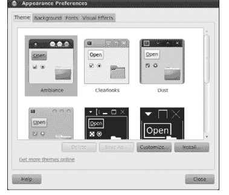

图 4-12 “外观首选项”窗口；“主题”选项卡

“外观首选项”窗口有四个选项卡：

- **主题**选项卡（图 4-12）允许你选择多个主题之一。点击某个主题后，工作区会立即反映该主题的使用情况。Ambiance 是 Ubuntu 的默认主题；选择此主题可使工作区呈现安装系统时的样子。选择主题后，如果你满意，可以点击**关闭**；或者点击其他选项卡以修改主题。

- **背景**选项卡允许你为桌面背景指定壁纸或颜色。要指定壁纸，请点击“壁纸”框架中的一个示例，或点击**添加**并选择一个你希望用作壁纸的文件——也许是一张图片。（点击**添加**会显示“添加壁纸”窗口；有关使用此窗口选择文件的说明，请参阅第 110 页的“浏览/保存窗口”。）然后选择你希望 GNOME 使用的应用壁纸的样式。例如，“缩放”会使你选择的图片适应工作区大小。

你还可以为背景指定颜色：纯色或两种颜色之间的渐变。要使用颜色，你必须首先从“壁纸”框架中选择**无桌面背景**；让鼠标指针悬停在“壁纸”框架中显示的每个壁纸上，直到找到一个显示工具提示“无桌面背景”的壁纸。选择该（非）壁纸。（初始时，此壁纸的图标位于壁纸图标的左上角。）接下来，从标记为**颜色**的下拉列表中选择**纯色**，并点击该列表右侧的彩色框。**GNOME** 将显示**选择颜色窗口**。从环形中点击你喜欢的颜色，并通过在三角形内拖动小圆圈来调整颜色。完成后点击**确定**。你选择的颜色将成为桌面的背景色。有关**选择颜色窗口**的更多信息，请参阅第 285 页。

- **字体**选项卡（图 8-8，第 284 页）允许你指定你希望 **GNOME** 在桌面不同位置使用的字体。你还可以更改 **GNOME** 渲染字体的方式（第 284 页）。

- **视觉效果**选项卡允许你选择三种级别的视觉效果：无、普通和额外。“普通”和“额外”效果会用 **Compiz Fusion**（compiz.org）替换 Metacity 窗口管理器，它实现了 3D 桌面视觉效果。（Compiz 是核心名称；插件被称为 **Compiz Fusion**。）安装 **Ubuntu** 时，**Ubuntu** 会确定硬件能运行的能力并设置适当的特效级别。最具戏剧性的视觉效果之一是抖动窗口：要查看此效果，请选择**普通**或**额外**，并使用标题栏拖动窗口。你可以使用 **simple-csm**（Compiz **配置**设置管理器）包来配置 **Compiz**。如果系统出现问题，请选择**无**。

##### 视觉效果可能导致问题

在“视觉效果”选项卡中选择**普通**或**额外**可能会导致意外的图形伪影、缩短电池寿命、降低 3D 应用程序和视频播放的性能，并在某些罕见情况下导致系统死锁。如果你的 **Ubuntu** 系统出现问题，请尝试在“视觉效果”选项卡中选择**无**，看看问题是否消失。

你在“背景”、“字体”和“视觉效果”选项卡中所做的更改将适用于你选择的任何主题，包括你自定义的主题。在 **外观首选项** 窗口选项卡中完成更改后，你可以点击 **关闭** 以使用你修改后的主题，或者返回到 **主题选项卡** 以进一步自定义主题。

从 **外观首选项** 窗口的 **主题** 选项卡中，选择你要自定义的主题，或者继续使用前几节中修改的主题。点击 **自定义** 以打开 **自定义主题** 窗口。浏览此窗口中的每个选项卡；选择条目并观察每个选择如何更改工作区。并非所有选项卡都适用于所有主题。当你满意结果时，点击 **关闭**。

自定义主题后，其名称为 **Custom**（自定义）。当你自定义另一个主题时，这些更改将覆盖 **Custom** 主题。因此，最好通过点击 **另存为** 并为主题指定唯一名称来保存自定义主题。保存主题后，它将出现在 **主题** 选项卡列出的主题中。

#### 会话管理

会话在你登录时开始，在你注销或重置会话时结束。对于完全符合 GNOME 规范的应用程序，GNOME 可以管理会话，使得当你登录时桌面的外观与你保存会话或注销时相同：相同的窗口将位于相同的工作区中，程序也将保持你离开时的状态。

“启动应用程序首选项”窗口允许你选择希望在每次登录时运行的应用程序。它还允许你自动保存注销时正在运行的应用程序和打开的窗口；当你再次登录时，它们将再次启动。要打开“启动应用程序首选项”窗口，请选择 **主菜单：系统 → 首选项 → 启动应用程序**，或从终端模拟器或“运行应用程序”窗口（ALT-F2）输入命令 `gnome-session-properties`。你必须在以你自己身份登录时输入此命令（而不是在以 **root** 权限操作时）。

要保存会话，首先确保只有你希望下次登录时出现的窗口是打开的。然后打开“启动应用程序首选项”窗口。点击 **选项** 选项卡，然后点击 **记住当前正在运行的应用程序**。窗口将显示 *您的会话已保存*。每次登录时，将出现与你点击 **记住当前正在运行的应用程序** 时相同的窗口。如果你希望 GNOME 每次注销时记住你正在做什么，请勾选标记为 **注销时自动记住正在运行的应用程序** 的复选框。

####### 获取帮助

Ubuntu 以多种形式提供帮助。点击顶板上的问号对象可显示 Ubuntu 帮助中心窗口，该窗口提供关于 Ubuntu 的信息。要显示其他信息，请点击此窗口左侧列表中的一个主题。你还可以在标记为 **搜索** 的文本框中输入要搜索的文本并按 **RETURN**（回车键）。此外，大多数窗口都提供“帮助”对象或菜单。有关更多资源，请参阅第 136 页的“在哪里查找文档”。

#### 自由尝试

尝试从主菜单中选择不同的项目，看看你发现了什么。以下是一些你可能想要探索的应用程序：

- **gedit** 文本编辑器是一个简单的文本编辑器。选择 **主菜单：应用程序 → 附件 → gedit 文本编辑器** 即可进行编辑。

- OpenOffice.org Writer 是一款功能齐全的文字处理器，可以导入和导出 Microsoft Word 文档。选择 **主菜单：应用程序 → 办公 → OpenOffice.org 文字处理器**。办公菜单还提供字典、演示管理器和电子表格。


- Firefox 是一款功能强大且功能齐全的 Web 浏览器。点击顶部面板上的蓝色和橙色地球图标以启动 Firefox。您也可以选择 **主菜单：应用程序->互联网->Firefox 网络浏览器。**

- Empathy 是一款图形化即时通讯（IM）客户端，允许您与使用 AOL、MSN 和 Yahoo! 等即时通讯客户端的人在网上聊天。要启动 Empathy，请选择 **主菜单：应用程序->互联网->Empathy 即时通讯客户端。**

第一次启动 Empathy 时，会打开一个显示“欢迎使用 Empathy”的窗口。请按照说明访问现有的 IM 账号或创建新账号。访问 live.gnome.org/Empathy 获取更多信息。

#### 注销

要注销，请单击工作区右上角的会话指示器按钮（图 4-2，第 101 页）。GNOME 会显示一个下拉列表；选择“注销”。您还可以选择关机或重启系统等选项。在文本环境中，按 CONTROL-D 或在 shell 提示符下输入命令 exit。

#### 充分利用桌面

GNOME 桌面是一个功能强大的工具，具有许多特性。本节涵盖了其面板、主菜单、窗口、终端模拟以及更新、安装和移除软件的多种方式；第 8 章将继续本章未详尽之处，讨论 X 窗口系统，更详细地介绍 Nautilus，并描述一些 GNOME 实用程序。

#### GNOME 桌面术语

以下术语取自《GNOME 用户指南》，为讨论 GNOME 桌面奠定了基础。第 101 页的图 4-2 显示了初始的 Ubuntu GNOME 桌面。

| 术语 | 描述 |
| :--- | :--- |
| 桌面 | 桌面包含 GNOME GUI 的所有方面。在使用 GNOME 时，您正在桌面上工作。始终只有一个桌面。 |
| 面板 | 面板是出现在桌面上并承载（面板）对象的条形区域。初始时有两个面板：一个位于屏幕顶部（顶部边缘面板，或简称为顶部面板），另一个位于底部（底部边缘面板，或简称为底部面板）。您可以添加和删除面板。您可以将面板放置在桌面的顶部、底部和两侧，并且可以在这些位置堆叠多个面板。桌面可以没有面板、有一个面板或有多个面板。请参阅下一页了解有关面板的更多信息。 |
| 面板对象 | 面板对象以文字或图标的形式出现在面板上。您可以单击这些对象来显示菜单、运行小部件或启动程序。面板对象有五种类型：小部件、启动器、按钮、菜单和抽屉。请参阅第 120 页了解有关面板对象的更多信息。 |
| 窗口 | 图形应用程序通常显示一个窗口，并在此窗口内运行。大多数窗口的顶部有一个标题栏，您可以使用它来移动、调整大小和关闭窗口。根窗口是工作区中未占用的区域，通常被遮挡。桌面可以没有窗口、有一个窗口或有多个窗口。虽然大多数窗口都有装饰（第 155 页），但有些窗口（如注销窗口）则没有。 |
| 工作区 | 工作区将桌面划分为一个或多个区域，在任一时刻只有一个区域充满屏幕。初始时有四个工作区。由于面板和桌面上的对象是桌面的特征，因此所有工作区都显示相同的面板和对象。默认情况下，窗口出现在单个工作区中。切换器（第 104 页）使您能够显示多个工作区中的任意一个。 |
| 工具提示 | 工具提示（图 4-2，第 101 页）是一种微型上下文帮助系统，通过移动鼠标指针悬停在按钮、图标、窗口边框或小部件（如面板上的那些）上并让指针停留在那里来激活。当鼠标指针悬停在对象上时，GNOME 会显示一个简短的对象说明，称为工具提示。 |

##### 打开文件

默认情况下，您双击对象以打开它；或者，您可以右键单击该对象并从下拉列表中选择“打开”。当您打开文件时，GNOME 通过确定文件的 MIME（第 1160 页）类型来确定使用合适的工具。GNOME 将每个文件扩展名与一个 MIME 类型关联，并将每个 MIME 类型与一个程序关联。初始状态下，GNOME 使用文件扩展名来尝试确定文件的 MIME 类型。如果它不识别文件扩展名，它会检查文件的魔术数字（第 1158 页）。

例如，当您打开一个文件扩展名为 ps 的文件时，GNOME 调用 Evince 文档查看器，它以可读格式显示 PostScript 文件。当您打开文本文件时，GNOME 使用 gedit 来显示该文件并允许您编辑。当您打开目录时，GNOME 在文件浏览器窗口中显示其内容。当您打开可执行文件（如 Firefox）时，GNOME 运行该可执行文件。当 GNOME 使用错误的工具打开文件时，该工具通常会发出错误消息。有关如何使用非默认工具打开文件的信息，请参阅第 130 页的“打开方式”。

##### 面板

如前所述，面板是初始时出现在桌面顶部和底部的条形区域。它们是桌面的一部分，因此在工作区之间保持一致。


图 4-13 添加到面板窗口

###### 面板（上下文）菜单

右键单击面板的空白部分会显示面板（上下文）菜单。除了帮助和信息选项外，此菜单有四个选项。

选择 **添加到面板** 会显示“添加到面板”窗口（图 4-13）。您可以从此窗口将对象拖到面板上，从而可以选择该对象出现在哪个面板上。您还可以高亮显示一个对象，然后单击 **添加**，将该对象添加到用于显示此窗口的那个面板。此窗口中的许多对象都很有趣：尝试“眼睛”并在其首选项窗口中选择“红血丝”，或者尝试“鱼”。其中一个更有用的对象是“搜索文件”。当您在面板上单击此对象时，它会显示“搜索文件”窗口（第 286 页）。

选择 **属性** 会显示“面板属性”窗口（图 4-14，下一页）。此窗口有两个选项卡：常规和背景。

在常规选项卡中，“方向”选择面板出现在桌面的哪一侧。“大小”调整面板的宽度。“展开”使面板横跨工作区的宽度或高度——如果此复选框未打钩，面板将居中且仅足够宽以容纳其对象。“自动隐藏”使面板消失，直到您将鼠标指针撞到工作区边缘为止。“隐藏按钮”的工作方式不同于自动隐藏：“显示隐藏按钮”在面板的两端显示按钮。当您单击其中一个按钮时，面板会滑出视图，只剩下一个按钮。当您单击该按钮时，面板滑回原位。


图 4-14 面板属性窗口，常规选项卡

如果您想查看堆叠面板的样子，请使用常规选项卡中标签为“方向”的下拉列表来更改当前操作面板的位置。如果您正在操作顶部面板，请选择底部，反之亦然。与首选项窗口一样，属性窗口没有“应用”和“取消”按钮；它们会立即实施更改。使用相同的方法将面板放回原处。

“面板属性”窗口的背景选项卡使您能够为面板指定颜色和透明度或图像。有关更改面板颜色的说明，请参阅第 285 页的“选择颜色窗口”。更改颜色后，移动标签为“样式”的滑块，使面板颜色更透明或不那么透明。如果您不喜欢该效果，请单击标签为“无（使用系统主题）”的单选按钮，使面板恢复默认外观。单击“关闭”。

选择“删除此面板”将执行您预期的操作。请谨慎选择此项：当它删除面板时，它会删除面板上的所有对象，如果您想恢复原状，将需要重新构建面板。

选择“新建面板”会在桌面上添加一个新面板。GNOME 决定其位置。然后，您可以使用新面板的“面板属性”窗口常规选项卡中标签为“方向”的下拉列表，将面板移动到其他地方。

##### 面板对象

面板上的图标和文字称为面板对象，它们显示菜单、启动程序并呈现信息。例如，带有蓝色和橙色地球图标的面板对象会启动 Firefox。指示器小部件（信封图标；第 101 页的图 4-2）可以启动 Evolution（www.gnome.org/projects/evolution），这是一个电子邮件和日历应用程序。会话指示器小部件（第 101 页的图 4-2）可以注销


###### 图 4-15 窗口列表小程序

……将你退出或关闭系统。你可以使用面板对象启动系统中的几乎任何实用程序或程序。本节将描述各种类型的面板对象。

-   **小程序**：小程序是一个小型程序，它将其用户界面显示在面板上或面板旁边。你通过其小程序面板对象与小程序进行交互。时钟（日期和时间）和工作区切换器（均在第 101 页的图 4-2 中显示）都是小程序。

-   **窗口列表小程序**：虽然不是一种独立类型的对象，但窗口列表小程序是一个独特且重要的工具。每个打开或最小化的窗口在显示的工作区上都会在底部面板上出现一个窗口列表小程序（图 4-15）。左键单击此对象可最小化其窗口，或者如果窗口已最小化则恢复该窗口。右键单击此对象以显示*窗口操作*菜单（第 124 页）。如果某个窗口被其他窗口遮挡，请单击其窗口列表小程序以使其可见。

-   **启动器**：当你打开一个启动器时，它可以执行命令、启动应用程序、显示文件夹或文件的内容、在 Web 浏览器中打开 URI 等。除了出现在面板上，启动器还可以出现在桌面上。Firefox 对象是一个启动器：它启动 Firefox 应用程序。在**主菜单：应用程序**下，你可以找到启动其他应用程序的启动器。在**主菜单：位置**下，主文件夹、文档、桌面和计算机对象是用于打开文件浏览器窗口以显示文件夹的启动器。

-   **按钮**：按钮执行单一、简单的操作。声音按钮（图 4-2，第 101 页）显示音量控制。显示桌面按钮可能出现在底部面板的左端，它会将工作区上的所有窗口最小化。

-   **菜单**：菜单显示可供你选择的选项列表。部分选择项可以是包含更多选择项的子菜单。所有其他选择项均为启动器。下一节将讨论主菜单。

-   **抽屉**：抽屉是面板的扩展。你可以将与面板相同的对象放入抽屉中，包括另一个抽屉。当你单击抽屉对象时，抽屉会打开；然后你可以像在面板上单击对象一样，在抽屉中单击对象。

###### 面板对象上下文菜单

有三个选择项是面板对象上下文菜单（右键单击面板对象以显示此菜单）所独有的。“从面板移除”选择项仅执行该功能。“移动”选择项允许你在面板内移动对象以及其他面板；你也可以通过用鼠标中键拖动对象来移动它。“锁定到面板”选择项将对象固定在位置，使其无法移动。当你在面板上移动对象时，它可以穿过其他对象。如果其他对象未锁定，它可以在必要时置换该对象。当对象被锁定，“移动”选择项将变灰不可用。

###### 主菜单

主菜单位于顶部面板的左端，包括**应用程序**、**位置**和**系统**。单击这些单词之一以显示相应的菜单。

**应用程序**菜单包含若干子菜单，每个子菜单以应用程序类别命名（例如，游戏、图形、互联网、办公——列表因系统上安装的软件而异）。最后一个选择项 Ubuntu 软件中心在第 132 页讨论。子菜单中的选择项启动应用程序——请浏览这些选择项，将鼠标悬停在你不确定的选择项上以显示相关的工具提示。

**位置**菜单包含各种启动器，其中大多数会打开文件浏览器窗口。主文件夹、桌面和文档对象显示对应名称的目录。计算机、CD/DVD 创建器和网络对象显示特殊位置。这些位置中的每一个都允许你访问文件管理器功能。每个位置都由一个特殊的*URI*（第 1179 页）指定。例如，CD/DVD 创建器选择项显示 `burn://` URI，它允许你刻录 CD 或 DVD。“连接到服务器”选择项打开一个窗口，允许你连接到各种类型的服务器，包括 SSH 和 FTP 服务器（见第 280 页的“文件”）。在这些选择项下方是已挂载的文件系统；单击其中一个以显示该文件系统的主目录。“查找文件”选择项允许你搜索文件（第 286 页）。

**系统**菜单包含两个子菜单以及提供支持的选项。这两个子菜单对于配置你的账户以及设置和维护系统至关重要。

偏好设置子菜单确立了你的账户的特征；每个用户都可以设置自己的偏好。单击其中一些选择项以熟悉在 Ubuntu 系统上自定义账户的各种方式。

管理子菜单控制系统的工作方式。例如，**管理**→**打印**（第 550 页）设置和配置你可在系统中使用的打印机，**管理**→**软件源**（第 131 页）控制你可以从中下载软件哪些仓库以及系统检查软件更新的频率。这些选择项中的大多数要求你是系统管理员并输入密码才能进行更改。本书各处讨论了这些菜单选择项。

你可以将主菜单中的任何启动器复制到顶部面板或桌面上。不要左键单击菜单选择项，而是右键单击它。GNOME 会显示一个下拉列表，使你能够将启动器添加到顶部面板或桌面。

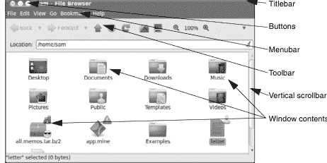

###### 窗口

在工作区中，窗口是一个由特定程序运行或控制的区域（图 4-16）。因为你可以控制窗口的外观和感觉——甚至包括它们显示的按钮——所以你的窗口可能看起来与书中显示的窗口不同。工作区中的每个窗口在底部面板上都有一个窗口列表小程序（第 121 页）。

**标题栏** 标题栏（图 4-16 和 4-17）出现在大多数窗口的顶部，并控制其附着的窗口。你可以更改标题栏的外观和功能，但它通常至少具有图 4-17 中所示按钮的功能。

最小化（图标化）按钮将窗口折叠，使其存在的唯一指示符是底部面板上的窗口列表小程序；单击此小程序以恢复窗口。单击最大化按钮以扩展窗口，使其占据整个工作区；在已最大化窗口的标题栏上单击同一按钮（现在显示一个方形以代替向上箭头）以将窗口恢复为以前的大小。你也可以双击标题栏以最大化和恢复窗口。单击关闭按钮将关闭窗口，通常也会终止在其中运行的程序。若要重新定位窗口，请左键单击标题栏并将窗口拖到所需位置。

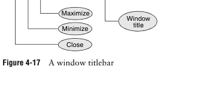

-   **窗口操作菜单** 窗口操作菜单包含你通常需要对任何窗口执行的操作。右键单击标题栏或窗口列表小程序（第 121 页）以显示此菜单。你可以使用此菜单将窗口移动到其他工作区，保持窗口在其他窗口之上或之下，并使窗口在显示的工作区上始终可见。

-   **工具栏** *工具栏*（图 4-16，前一页）通常出现在窗口的顶部附近，包含图标、文本、小程序、菜单等。存在许多种工具栏。标题栏不是工具栏；相反，它是窗口管理器（第 155 页）放置在那里作为窗口装饰的一部分。

###### 更改输入焦点（窗口循环）

具有输入焦点的窗口是接收你键入的键盘字符和命令的窗口。除了使用窗口列表小程序（第 121 页），你还可以使用键盘更改显示工作区中哪个窗口具有输入焦点；此过程称为*窗口循环*。当你按 ALT-TAB 时，GNOME 在工作区中心显示一个包含代表工作区中窗口内运行程序的图标的框。它还使输入焦点切换到当前活动窗口之前刚刚活动过的窗口，使在两个窗口之间轻松切换变得容易。当你按住 ALT 并多次按下 TAB 时，焦点从窗口移动到窗口。按住 ALT 和 SHIFT 并反复按 TAB 会向相反方向循环。有关输入焦点的更多信息，请参见第 153 页。

###### 使用剪贴板剪切和粘贴对象

有两种相似的方法可以在桌面上以及在窗口内部和之间剪切/复制并粘贴对象和文本。在第一种方法中，你使用剪贴板，技术上称为*复制缓冲区*，来复制或移动对象或文本。为此，你显式地将对象或文本复制到缓冲区，然后将其粘贴到其他地方。遵循用户界面指南的应用程序使用 CONTROL-X 剪切，CONTROL-C 复制，CONTROL-V 粘贴。应用程序上下文菜单通常提供这些相同的选项。

你可能不熟悉复制和粘贴文本的第二种方法——使用*选择*或*主要*缓冲区，该缓冲区始终包含你最近选择的（高亮显示的）文本。你无法使用此方法复制对象。单击鼠标中键（在带有滚轮的鼠标上单击滚轮）将粘贴缓冲区的


选择缓冲区位于鼠标指针所在处。如果您使用的是双按钮鼠标，请同时点击两个按钮以模拟点击中间按钮。

使用这两种技术时，首先通过突出显示对象或文本进行选择。您可以拖拽一个框来选择多个对象，或者将鼠标指针拖动到文本上以选择文本。双击可选择单词，三击可选择行或段落。

接下来，若使用剪贴板，请显式地复制（**CONTROL-C**）或剪切（**CONTROL-X**）对象或文本。如果您想使用选择缓冲区，则跳过此步骤。

若要粘贴选定的对象或文本，请将鼠标指针定位到您希望放置的位置，然后按 **CONTROL-V**（剪贴板方法）或按下鼠标中键（选择缓冲区方法）。

###### 在终端模拟器中使用 SHIFT-CONTROL-C 和 SHIFT-CONTROL-V

> 在终端模拟器窗口中，**CONTROL-C**、**CONTROL-X** 和 **CONTROL-V** 这些字符不起作用，因为在窗口中运行的 shell 在终端模拟器接收到它们之前就会拦截这些按键。但是，您可以分别使用 **SHIFT-CONTROL-C** 和 **SHIFT-CONTROL-X** 来替代。没有针对 **CONTROL-V** 的键盘快捷键。您也可以在此环境中使用选择缓冲区，或者使用菜单栏上 **编辑（Edit）** 菜单中的复制/粘贴功能，或使用上下文菜单（右键单击）。

在使用剪贴板时，只要您没有再次按下 **CONTROL-C** 或 **CONTROL-X**，您都可以在 **CONTROL-C** 或 **CONTROL-X** 与 **CONTROL-V** 之间输入任意数量的命令。在使用选择缓冲区时，只要您没有选择（突出显示）其他文本，您都可以在选择文本后、粘贴前输入其他命令。

###### 使用根窗口

*根窗口* 是工作空间中未被窗口、面板或对象占据的任何部分。它是您可以看到背景的工作空间部分。当根窗口被遮挡时，要查看根窗口，请单击底部面板左端的“显示桌面”按钮以最小化工作空间中的窗口。

右键单击根窗口以显示桌面菜单，该菜单允许您创建文件夹、启动器或文档。选择“更改桌面背景”将打开“外观首选项”窗口（第 113 页）并定位到其“背景”选项卡。

###### 从终端模拟器/Shell 运行命令

*终端模拟器* 是一种呈现命令行界面（CLI）的窗口；它作为基于文本（字符）的终端工作，并在图形环境中显示。

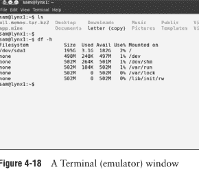

图 4-18 终端（模拟器）窗口

当您已登录并在桌面环境中创建子 shell 时，您无需再次登录。一旦您打开了终端模拟器窗口，请尝试输入命令 `man man` 来阅读关于 `man` 实用程序（第 136 页）的信息，该程序用于显示 Linux 手册页。第 5 章描述了您可以从终端模拟器运行的实用程序。

您可以在终端模拟器窗口中运行通常运行在终端或控制台上的基于字符的程序。您也可以从此窗口启动图形程序，例如 `xeyes`。图形程序会打开自己的窗口。

当您在终端模拟器窗口中键入时，包括 \*、?、!、[ 和 ] 在内的几个字符具有特殊含义。在您在第 160 页阅读“特殊字符”之前，请避免使用这些字符。

###### Shell

一旦您打开终端模拟器窗口，您就开始与称为 shell 的命令解释器进行通信。shell 在您与 Linux 的许多交互中起着重要作用。当您在键盘上输入命令以响应屏幕上的 shell 提示符时，shell 会解释该命令并发起相应的操作——例如，执行程序；调用编译器、Linux 实用程序或其他标准程序；或者显示指示您输入命令错误的错误消息。当您在 GUI 上工作时，您会绕过 shell，通过单击对象或名称来执行程序。有关 shell 的更多信息，请参阅第 7 章。

###### 对象上下文菜单

当您右键单击桌面或文件浏览器窗口中的对象或对象组时，GNOME 会显示对象上下文菜单。不同类型的对象显示不同的上下文菜单，但大多数上下文菜单共享常见的选择项。图 4-19 显示了 OpenOffice.org 电子表格文件和纯文本文件的上下文菜单。表 4-1 列出了一些常见的对象上下文菜单选择项。

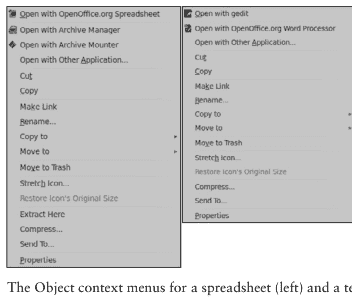

**图 4-19** 电子表格（左）和文本文件（右）的对象上下文菜单

####### 表 4-1 对象上下文菜单选择项

| 类别 | 描述 |
| :--- | :--- |
| **打开** | 运行可执行文件。使用适当的应用程序打开文件。在文件浏览器窗口中打开文件夹。等同于**双击**对象。 |
| **在新窗口中打开** | （仅在文件浏览器窗口中。）在新的文件浏览器窗口中打开文件夹，而不是替换当前窗口的内容。等同于在浏览器窗口中**按住 Shift 键**并**双击**文件夹。 |
| **使用“App”打开** | 使用名为 **App** 的应用程序打开文件。当此选择项显示在菜单的第一项时，**App** 是 GNOME 用于打开此类型文件的默认应用程序。有关更改此默认设置的更多信息，请参见第 130 页。 |
| **使用 ▸ 打开** | 选择项右侧出现的三角形表示该选择项是一个菜单。将鼠标指针悬停在选择项上以显示子菜单。每个子菜单选择项都是一个**使用“App”打开**选择项（如上所述）。子菜单中的最后一项是**使用其他应用程序打开**（如下所述）。 |
| **浏览文件夹** | （仅在桌面上。）在文件浏览器窗口中打开文件夹。等同于在桌面上**双击**文件夹。 |
| **使用其他应用程序打开** | 显示**打开方式**菜单，允许您选择用于打开此类型文件的应用程序。下次您使用对象上下文菜单打开此类型文件时，您选择的应用程序将显示为**使用“App”打开**选择项（如上所述）。不会更改此类型文件的默认应用程序。有关更改默认应用程序的更多信息，请参见第 130 页。 |
| **剪切** | 移除对象并将其放置到剪贴板（第 124 页）。 |
| **复制** | 将对象复制到剪贴板（第 124 页）。 |
| 在此处提取 | 将存档及某些其他类型的文件（如某些文档）的内容提取到与原始文件同名并加上 _FILES_ 的目录中。如果您没有权限写入工作目录（第 204 页），此菜单选择项将显示为“提取到”。 |
| 提取到 | 将存档及某些其他类型的文件（如某些文档）的内容提取到您使用“浏览/保存”窗口（第 110 页）选择的目录中。仅当您没有权限写入工作目录（第 204 页）时，此选择项才会出现。否则，此菜单选择项将显示为“在此处提取”。 |
| 创建链接 | 在对象所在的同一目录中创建指向该对象的符号链接。然后，您可以将链接移动到其他可能更有用的目录。有关更多信息，请参见第 230 页的“符号链接”。 |
| 移至回收站 | 将对象移至回收站（第 111 页）。 |
| 发送到 | 打开“发送到”窗口，允许您通过电子邮件发送该对象。 |
| 创建存档 | 打开“创建存档”窗口，允许您指定包含一个或多个对象的存档的格式和名称（第 280 页）。 |
| 共享选项 | 打开“文件夹共享”窗口，允许您使用 Samba 共享文件夹（第 23 章）。 |
| 属性 | 显示对象属性窗口（参见下一节）。 |

###### 对象属性窗口

对象属性窗口显示有关文件的信息，例如其所有者、权限、大小、位置、MIME 类型、处理它的方式等。该窗口标题为 *文件名 属性*，其中 *文件名* 是您单击以打开该窗口的文件的名称。要显示此窗口，请右键单击对象，并从下拉列表中选择**属性**。属性窗口最初显示一些基本信息。单击窗口顶部的选项卡以显示附加信息。不同类型的文件会出现不同的一组选项卡。只有当您拥有相应权限时，才能修改此窗口中的设置。本节介绍了对象属性窗口中最常见的六个选项卡。

- **基本**：基本选项卡显示有关文件的信息，包括其 MIME 类型，并允许您为文件选择自定义图标并更改其名称。要更改文件名，请使用标记为**名称**的文本框。如果文件名未列在文本框中，则您没有权限更改它。更改图标的一种简单方法是打开位于 **/usr/share/icons** 的文件浏览器窗口。沿着目录向下查找，直到找到一个您喜欢的图标，然后将其拖放到对象属性窗口基本选项卡中**名称**左侧的图标上。此技术不适用于链接文件（由对象右上角的箭头徽章指示）。


###### 徽标

“徽标”选项卡（图 4-20，左侧）允许您通过在对徽标旁边的复选框中打勾或取消勾选来添加或移除与文件关联的徽标。第 123 页的图 4-16 展示了文件对象上的一些徽标。Nautilus 在“图标”和“列表”视图中都会显示徽标，但在“列表”视图中可能没有空间显示超过一个徽标。桌面上也会显示徽标。您还可以通过从“侧面板/徽标”中拖动徽标并将其放置到“文件浏览器”窗口中“视图”面板（第 277 页）内的对象上，从而在对象上添加徽标。

###### 权限

“权限”选项卡（图 4-20，右侧）允许文件所有者更改文件的权限（第 215 页），并将文件关联的组更改为所有者所属的任何组（参见第 492 页的 /etc/group）。在具有 root 权限运行时，您还可以更改文件的所有者。在终端仿真器窗口中给出命令 `gksudo nautilus` 将打开一个以 root 权限运行的“文件浏览器”窗口（但请阅读第 98 页上的注意事项）。Nautilus 会将您不被允许更改的项目置灰显示。

使用下拉列表，您可以为所有者（在其他地方称为用户；参见第 217 页关于 $HOME 的技巧）、组和其他用户授予文件读取或读写权限。或者，您可以通过将权限指定为“无”来禁止组和其他用户访问该文件。在标记为“执行”的复选框中打勾，可授予所有用户执行该文件的权限。此选项卡提供的权限分配控制粒度不如 chmod（第 216 页）。

目录的权限工作方式如第 220 页所述。所有者、组和其他用户可以被允许列出目录中的文件、访问（读取——并具有适当权限时执行）文件，或者创建和删除文件。组和“其他用户”的权限也可以设置为 **无**。在标记为 *执行* 的复选框中打勾，允许搜索该目录。点击 **将权限应用于内部文件** 可将其在 *权限* 选项卡中的权限应用于目录中的所有文件。

###### 打开方式

当您要求 GNOME 打开一个不可执行文件时（通过双击其图标或右键单击并选择第一个 **打开** 选项），GNOME 会确定使用哪个应用程序或实用工具来打开该文件。GNOME 使用几种技术来确定文件的 *MIME*（第 1160 页）类型，并据此选择默认应用程序。

*打开方式* 选项卡（图 4-21）允许您更改 GNOME 可用于打开该文件及其他相同 MIME 类型（通常是具有相同文件扩展名的文件）的应用程序。点击 **添加** 按钮以将应用程序添加到列表中。高亮显示一个应用程序并点击 **移除** 可从列表中删除该应用程序。您无法移除默认应用程序。

当添加一个应用程序时，GNOME 会将该应用程序添加到“打开方式”列表中，但不会更改用于打开该类型文件的默认应用程序。点击应用程序旁边的单选按钮，可使该应用程序成为 GNOME 用于打开此类型文件的默认应用程序。

当文件在“打开方式”选项卡中的应用少于四个时，“对象”上下文菜单将在该菜单中显示所有应用程序。如果有四个或更多应用程序，“对象”上下文菜单将提供“打开方式”子菜单（图 4-21）。

###### 笔记

“笔记”选项卡提供了一个记录文件相关笔记的地方。

###### 共享

“共享”选项卡仅出现在文件夹的属性窗口中，允许您使用 Samba（第 23 章）来共享该文件夹。

##### 软件包的更新、安装和移除

Ubuntu 软件以包的形式提供，这些包包含所有必要的文件、使程序能够自动安装和移除软件的说明，以及该软件包依赖的其他软件包列表。有许多方法可以搜索和安装软件包。每当系统中有可用的软件更新时，都会显示“更新管理器”窗口（第 112 页）。“Ubuntu 软件中心”窗口（图 4-23，第 133 页）是安装流行软件的一种简便方式。synaptic 实用工具（第 133 页）更复杂，并提供更广泛的软件选择。第 13 章介绍了如何从命令行处理软件包。

###### 软件源窗口

- **软件仓库**

软件仓库保存软件包及相关的信息集合。“软件源”窗口控制 Ubuntu 安装哪些类别的软件包、从哪些仓库下载软件包、自动更新如何工作等。通过选择 **主菜单: 系统** **管理** **软件源**（您需要输入密码）或通过在终端仿真器或“运行应用程序”窗口中（**ALT-F2**）输入命令 `gksudo software-properties-gtk` 来打开此窗口。“软件源”窗口有五个选项卡，下面将进行介绍。

- **Ubuntu 软件**

“Ubuntu 软件”选项卡控制 APT（第 522 页）和 synaptic 安装以及“更新管理器”自动更新的软件包类别（第 522 页）。通常，除了 **源代码** 外，所有类别的复选框中都有勾选。如果您想下载源代码，请在此复选框中打勾。如果标记为 **下载自** 的下拉列表未指定您附近的服务器，请使用该列表指定一个。

如果系统没有互联网连接，请在标记为 **可从 CD-ROM/DVD 安装** 的框架中的其中一个复选框中打勾；APT 将从该来源安装软件。如果您有互联网连接，请取消该复选框的勾选。您可以在“其他软件”选项卡中指定新的 CD/DVD。

- **仅添加您认为可信任的仓库**

从非官方 Ubuntu 软件仓库的来源添加软件可能导致系统无法正常工作并导致更新失败。更糟糕的是，它可能使系统易受攻击。

软件包安装过程以 **root** 权限运行。请将对仓库的添加视为向控制该仓库的人提供 **sudo** 密码。除非您完全信任该第三方仓库，否则不要添加。

- **其他软件**

您可以从“其他软件”选项卡中添加、编辑和移除仓库。请参阅关于添加仓库的相邻安全框。除非您正在处理不是由 Ubuntu 分发的软件，否则您不需要添加任何仓库。要将 CD/DVD 添加为仓库，请点击 **添加 CD-ROM**。

- **更新**

“更新”选项卡的上半部分（图 4-22）指定您希望“更新管理器”监控哪些类型的更新。通常，您会希望监控重要的安全更新和推荐的更新。在此选项卡的中间部分，您可以指定“更新管理器”是否检查更新、检查频率以及找到更新时该怎么办。标记为 **显示新发行版版本** 的下拉列表允许您指定是否希望“更新管理器”在您可以将系统升级到 Ubuntu 新版本时通知您，以及您是否对所有章节或仅对 LTS（第 31 页）版本感兴趣。

- **认证**

“认证”选项卡保存受信任软件提供者的密钥。Ubuntu 使用密钥来认证软件，从而保护系统免受恶意软件的影响。通常，Ubuntu 会自动提供这些密钥。

- **统计信息**

“统计信息”选项卡允许您参加软件受欢迎程度竞赛。

###### UBUNTU 软件中心

您可以使用“Ubuntu 软件中心”窗口（图 4-23）向系统添加和移除应用程序。它比 `synaptic` 更简单，选择也更少。


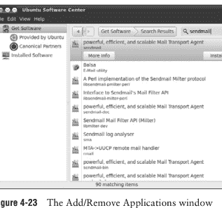

**图 4-23** 添加/移除应用程序窗口

（下文将详细描述）。通过选择**主**菜单：应用程序➔Ubuntu 软件中心，或者在终端模拟器或运行应用程序窗口（ALT-F2）中输入命令**software-center**，即可打开此窗口。

当您首次打开窗口并从中选择一个应用程序类别时，Ubuntu 软件中心会在窗口右侧显示该类别下的应用程序列表。如果您知道要安装的应用程序名称，可以在窗口右上角的文本框中输入该应用程序的名称或其名称的一部分进行查询。Ubuntu 软件中心将显示满足您查询条件的应用程序列表。

滚动查看窗口右侧显示的应用程序。当您单击/高亮显示某个应用程序时，窗口会显示两个按钮：**更多详细信息**和**安装**。单击第一个按钮以显示有关该应用程序的信息。当您单击“安装”时，Ubuntu 软件中心会要求您输入密码，并开始下载和安装该应用程序。在操作进行期间，您可以搜索并选择其他要安装的应用程序。完成后，Ubuntu 软件中心会在软件包名称旁边显示一个绿色对勾。关闭该窗口。您安装的软件包应该会出现在主菜单中。

###### 可选：SYNAPTIC：查找、安装和移除软件

本节介绍如何使用 Synaptic 来查找、下载、安装和移除软件包。通过从主菜单中选择 系统➔管理➔Synaptic 包管理器，或者


在终端模拟器或运行应用程序窗口（ALT-F2）中输入命令 `gksudo synaptic` 来打开 Synaptic 包管理器窗口。图 4-24 显示了初始窗口。首次运行 synaptic 时，它会提醒您定期重新加载软件包信息。您可以单击工具栏上的“重新加载”来执行此操作。

Synaptic 包管理器窗口显示大量信息。最大化此窗口并加宽左侧列（通过拖动手柄）可能会使操作更便捷。当左侧列中的**分区**按钮处于高亮状态时，左侧列顶部包含一个持有软件类别的列表框。最初，该列表框中选中了**全部**，这会导致窗口在右侧列顶部的列表框中显示所有软件包。

您可以通过搜索软件包来缩短列表框中的软件包列表。为此，请通过单击工具栏上的**搜索**来显示“查找”窗口。在标记为**搜索**的文本框中输入您要查找的软件包名称或其名称的一部分。（或者，您可以使用主 Synaptic 窗口中标记为**快速搜索**的文本框进行搜索。）例如，要显示所有与 `exim4` 相关的软件包，请在标记为**搜索**的文本框中输入 `exim4`，并从标记为**查找范围**的下拉列表中选择**描述和名称**（图 4-25）。单击**搜索**。Synaptic 包管理器窗口会在右侧列顶部的列表框中显示符合指定搜索条件的软件包列表


####### **图 4-26** 显示国际象棋程序的 Synaptic 包管理器窗口

当您单击此列表中的某个软件包名称时，**synaptic** 会在列表下方的框架中显示该软件包的描述。

以下示例说明了如何使用 **synaptic** 来定位、下载和安装一个国际象棋程序。在 Synaptic 包管理器窗口打开的情况下，搜索“chess”（国际象棋）。**synaptic** 工具会在右侧列表框中显示一个与国际象棋相关的软件包列表。逐个单击几个软件包，阅读窗口右下角框架中的描述。

假设您决定安装 Dream Chess（**dreamchess** 软件包；参见 www.dreamchess.org 网站）。当您单击 **dreamchess** 左侧的复选框时，**synaptic** 会显示一个选项列表。由于该软件包尚未安装，除**标记为安装**外的所有选项都是灰色的（图 4-26）；请单击此选项。由于 **dreamchess** 软件包依赖于其他未安装的软件包，**synaptic** 会显示一个窗口，询问您是否要标记额外的必要更改（图 4-27）。此窗口列出了 **synaptic** 为了让 Dream Chess 运行而需要安装的额外软件包。单击**标记**以标记这些额外软件包；这些软件包随后将以绿色高亮显示。


####### **图 4-27** 标记额外必要更改屏幕

要应用您标记的更改，请单击工具栏上的**应用**；synaptic 将显示一个摘要窗口。（如果您正在安装和/或移除多个软件包，此摘要会更长。）单击**应用**。*synaptic* 工具会让您了解其进度。完成时，它会显示“已应用更改”窗口。单击**关闭**，然后关闭 Synaptic 包管理器窗口。现在，Dream Chess 将出现在**主**菜单中：*应用程序→游戏* 菜单。

##### 在哪里查找文档

包括 Ubuntu 在内的 Linux 发行版通常不提供纸质参考手册。然而，其在线文档一直是 Linux 的优势之一。自该操作系统的早期版本以来，**man**（或**manual**）和 **info** 页面就可以通过 **man** 和 **info** 实用程序访问。Ubuntu 提供了一个图形化帮助中心。不出所料，随着 Linux 和互联网的持续增长，文档来源也变得更加多样化。本节讨论了一些您可以查找有关 Linux 总体以及 Ubuntu 具体信息的地方。另请参阅附录 B。

###### UBUNTU 帮助中心

要显示 Ubuntu 帮助中心窗口（图 4-28），请单击顶部面板中带有问号蓝色物体，或选择**主**菜单：*系统→帮助* 和 *支持*。在此窗口中单击主题，直到找到您正在寻找的信息。您还可以通过标记为*搜索*的文本框搜索主题。

###### man：显示系统手册

除了图形化的 Ubuntu 帮助中心外，文本化的 man 实用程序还显示系统文档中的 (**man**) 页面。当您知道想要使用哪个实用程序但忘记具体使用方法时，这些文档非常有用。您也可以参考 man 页面以获取更多关于特定主题的信息，或确定 Linux 提供哪些功能。由于系统文档中的描述通常简略，如果您已经了解实用程序的基本功能，它们将更有用。

####### 在线 man 页面

**提示** Ubuntu 的 manpages.ubuntu.com 站点保存了每个受支持 Ubuntu 发行版中每个软件包的动态生成的 man 页面副本。除了以易读的 HTML 格式呈现 man 页面外，该站点还允许您在不安装持有该实用程序软件包的情况下阅读其 man 页面。它还允许您阅读未安装的发行版的 man 页面。

由于 man 是一个基于字符的实用程序，您需要打开一个终端模拟器窗口（第 1.25 页）来运行它。您也可以登录到虚拟终端（第 1.49 页）并在那里运行 man。


要了解有关某个实用程序的更多信息，请输入命令 man，后跟该实用程序的名称。图 4-29 显示了 man 显示关于其自身的信息；用户输入了 man man 命令。


**less（分页器）** man 实用程序自动将其输出通过分页器传递——通常是 less（第 162 页），它一次显示一屏。当您以这种方式访问手册页时，less 在显示每一屏文本后，会在屏幕底部显示一个提示 [例如，Manual page man(1) line 1]，并等待您按空格键请求另一屏文本。您还可以使用 PAGE UP、PAGE DOWN、上箭头和下箭头键来导航文本。按 h（帮助）显示 less 命令列表。按 q（退出）停止 less，并使 shell 显示提示符。您可以使用 apropos 实用程序（第 139 页）搜索 man 页面涵盖的主题。

**手册章节** 基于 FHS（文件系统层次结构标准；第 213 页），Linux 系统手册和 man 页面分为十个部分，每个部分描述相关的工具：

- 1. 用户命令
- 2. 系统调用
- 3. 子例程
- 4. 设备
- 5. 文件格式
- 6. 游戏
- 7. 杂项
- 8. 系统管理
- 9. 内核
- 10. 新建

这种布局紧密模仿了 UNIX 手册集一直以来的划分方式。除非您指定了手册部分，否则 man 将显示您在命令行上指定的单词在手册中最早出现的位置。大多数用户在第 1、6 和 7 部分中找到所需信息；程序员和系统管理员通常需要查阅其他部分。

在某些情况下，手册包含针对同名不同工具的条目。例如，以下命令显示系统手册第 1 部分中 passwd 实用程序的 man 页面：

```
$ man passwd
```

要查看第 5 部分中 passwd 文件的 man 页面，请输入此命令：

```
$ man 5 passwd
```

前面的命令指示 man 仅在第 5 部分查找 man 页面。在文档中，您可能会看到将此 man 页面称为 passwd(5)。使用 -a 选项（参见相邻提示）查看给定主题的所有 man 页面（按 q 退出，按 RETURN 显示下一个 man 页面）。例如，输入命令 man -a passwd 以查看 passwd 的所有 man 页面。


> **提示** 选项会修改实用工具或命令的工作方式。选项通常以一个或两个连字符开头的一个或多个字母来表示。选项通常出现在你调用的实用工具名称之后，并紧跟一个空格。命令的其他参数（第1135页）跟随在选项之后，中间也是空格。更多信息请参见第239页的“选项”。

###### apropos：搜索关键词

当你不知道执行特定任务所需的命令名称时，可以使用 `apropos` 加关键词进行搜索。该实用工具会在所有手册页的简短描述行中搜索关键词，并显示匹配的结果。当使用 `-k`（关键词）选项调用 `man` 实用工具时，其输出结果与 `apropos` 相同。

`apropos` 使用的数据库名为 `whatis`，在 Ubuntu 系统刚安装时不可用，但会通过 `crond`（第605页）使用 `mandb` 自动构建。如果 `apropos` 没有产生任何输出，请输入命令 `sudo mandb`。

以下示例显示了使用 `who` 关键词调用 `apropos` 时的输出结果。输出内容包括每个命令的名称、包含该命令的手册章节，以及来自手册页的简要描述。此列表包括你需要的实用工具（`who`），并标识了其他可能对你有用的相关工具：

```text
$ apropos who
at.allow (5)    - determine who can submit jobs via at or batch
at.deny (5)     - determine who can submit jobs via at or batch
from (1)        - print names of those who have sent mail
w (1)           - Show who is logged on and what they are doing.
w.procps (1)    - Show who is logged on and what they are doing.
who (1)         - show who is logged on
whoami (1)      - print effective userid
```

`whatis` `whatis` 实用工具与 `apropos` 类似，但仅查找实用工具名称的完整单词匹配：

```text
$ whatis who
who (1)         - show who is logged on
```

###### info：显示关于实用工具的信息

文本形式的 `info` 实用工具是一个由 GNU 项目（第4页）开发的基于菜单的超文本系统，并随 Ubuntu 一起分发。它包含关于自身的教程以及许多由 GNU 项目开发的 Linux Shell、实用工具和程序的文档（www.gnu.org/software/textinfo/manual/info）。图 4-30（下一页）显示了当你输入命令 `info coreutils` 时 `info` 显示的屏幕（`coreutils` 软件包包含 Linux 核心实用工具）。

# 第 140 页 第 4 章 引言

```text
GNU Coresutils

This manual documents version 7.4 of the GNU core utilities, including the standard programs for text and file manipulation.

Copyright (C) 1994 1996, 2000 2009 Free Software Foundation, Inc.

Permission is granted to copy, distribute and/or modify this document under the terms of the GNU Free Documentation License, Version 1.3 or any later version published by the Free Software Foundation; with no Invariant Sections, with no Front-Cover Texts, and with no Back-Cover Texts. A copy of the license is included in the section entitled "GNU Free Documentation License".

`- Menu:`

* Introduction: Coverts, overview, and authors.
* Common options: Common options
* Output of entire files: cat, cut, and od
* z2: info (coreutils.info.gz) top 328 lines - top+

Welcome to info version 4.13, type ? for help, q for exit.
```

**图 4-30** 命令 `info coreutils` 显示的初始屏幕

###### man 和 info 显示的信息不同

> **提示** `info` 实用工具显示的信息比 `man` 更完整且更新。当手册页仅显示由 `info` 涵盖的实用工具的简略信息时，手册页会指向 `info`。`man` 实用工具经常显示非 GNU 实用工具唯一可用的信息。当 `info` 显示非 GNU 实用工具的信息时，通常只是手册页的副本。

由于该屏幕上的信息源自可编辑文件，你的显示内容可能与本节中显示的屏幕有所不同。在显示初始 `info` 屏幕时，你可以按下以下任意键：

- `h` 查看关于 `info` 的交互式教程
- `?` 列出 `info` 命令
- `SPACE` 滚动查看可获取信息的条目菜单
- 按 `m` 后跟你想显示的菜单名称，或按 `SPACE` 显示菜单列表
- `q` 或 `CONTROL-C` 退出

`info` 用于描述键盘按键的符号可能对你来说并不熟悉。符号 `C-h` 等同于 `CONTROL-H`。类似地，`M-x` 表示按住 `META` 键或 `ALT` 键并按 `x`。（在某些系统中，你需要按 `ESCAPE` 键然后按 `x` 才能复制 `META-X` 的功能。）

输入命令 `info coreutils` 后，按几次 `SPACE` 键滚动浏览显示内容。输入 `/sleep` 然后按 `RETURNS` `RETURN` 键搜索字符串 `sleep`。当你输入 `/` 时，光标移动到窗口底部行，并显示 `Search for string [string]:`，其中 `string` 是你上次搜索的字符串。按 `RETURN` 键搜索 `string` 或输入你要搜索的字符串。输入 `sleep` 会在那一行显示 `sleep`，按 `RETURN` 键将显示下一个出现的 `sleep`。


**图 4-31** 当你两次输入 `\sleep`<kbd>RETURn</kbd> 后，命令 `info coreutils` 显示的屏幕

###### 你可能发现 pinfo 比 info 更容易使用

`pinfo` 实用工具与 `info` 类似，但如果你不熟悉 `emacs` 编辑器，它会更直观。该实用工具在文本环境中运行，与 `info` 相同。当可用时，`pinfo` 使用颜色使其界面更容易使用。如果系统未安装 `pinfo`，请使用 `synaptic`（第133页）安装 `pinfo` 软件包。从终端模拟器或“运行应用程序”窗口（<kbd>ALT</kbd>-<kbd>F2</kbd>）运行 `pinfo`，并选择 <font style="font-family: monospace; background-color: #f5f5f5; padding: 0 2px; border-radius: 3px; border: 1px solid #ddd;">Run in terminal</font>。

现在输入 <font style="font-family: monospace; background-color: #f5f5f5; padding: 0 2px; border-radius: 3px; border: 1px solid #ddd;">/</font><kbd>RETURn</kbd>（或 <font style="font-family: monospace; background-color: #f5f5f5; padding: 0 2px; border-radius: 3px; border: 1px solid #ddd;">/sleeer<kbd>RETUrn</kbd></font>）以搜索下一个出现的 <font style="font-family: monospace; background-color: #f5f5f5; padding: 0 2px; border-radius: 3px; border: 1px solid #ddd;">sleep</font>，如图 4-31 所示。行首的星号（*）表示该条目是一个菜单项。星号后面是菜单项的名称及对该项的描述。

每个菜单项都是指向描述该项的 `info` 页面的链接。要跳转到该页面，请搜索或使用 <font style="font-family: monospace; background-color: #f5f5f5; padding: 0 2px; border-radius: 3px; border: 1px solid #ddd;">↓</font> <font style="font-family: monospace; background-color: #f5f5f5; padding: 0 2px; border-radius: 3px; border: 1px solid #ddd;">↑</font> 键将光标移动到包含该菜单项的行，然后按 <kbd>RETURn</kbd>。光标定位如图 4-31 所示时，按 <kbd>RETURn</kbd> 即可显示关于 <font style="font-family: monospace; background-color: #f5f5f5; padding: 0 2px; border-radius: 3px; border: 1px solid #ddd;">sleep</font> 的信息。或者，你可以在菜单命令中输入菜单项的名称来查看信息：例如，要显示关于 <font style="font-family: monospace; background-color: #f5f5f5; padding: 0 2px; border-radius: 3px; border: 1px solid #ddd;">sleep</font> 的信息，你可以输入命令 <font style="font-family: monospace; background-color: #f5f5f5; padding: 0 2px; border-radius: 3px; border: 1px solid #ddd;">m</font> <font style="font-family: monospace; background-color: #f5f5f5; padding: 0 2px; border-radius: 3px; border: 1px solid #ddd;">sleep</font>，然后按 <kbd>RETURn</kbd>。当你输入 <font style="font-family: monospace; background-color: #f5f5f5; padding: 0 2px; border-radius: 3px; border: 1px solid #ddd;">m</font>（代表菜单）时，光标会移动到窗口底部行（就像你输入 <font style="font-family: monospace; background-color: #f5f5f5; padding: 0 2px; border-radius: 3px; border: 1px solid #ddd;">/</font> 时那样）并显示 <i>Menu item:</i>：输入 <font style="font-family: monospace; background-color: #f5f5f5; padding: 0 2px; border-radius: 3px; border: 1px solid #ddd;">sleeper</font> 会在那一行显示 <font style="font-family: monospace; background-color: #f5f5f5; padding: 0 2px; border-radius: 3px; border: 1px solid #ddd;">sleep</font>，按 <kbd>RETURn</kbd> 将显示关于你所选菜单项的信息。

图 4-32（下一页）显示了关于 <font style="font-family: monospace; background-color: #f5f5f5; padding: 0 2px; border-radius: 3px; border: 1px solid #ddd;">sleep</font> 的 <i>top node</i>（顶级节点）。节点将一组信息分组在一起，你可以按 <font style="font-family: monospace; background-color: #f5f5f5; padding: 0 2px; border-radius: 3px; border: 1px solid #ddd;"> </font> 键进行滚动浏览。要显示下一个节点，请按 <font style="font-family: monospace; background-color: #f5f5f5; padding: 0 2px; border-radius: 3px; border: 1px solid #ddd;">n</font>。按 <font style="font-family: monospace; background-color: #f5f5f5; padding: 0 2px; border-radius: 3px; border: 1px solid #ddd;">p</font> 显示上一个节点。

当你阅读本书并学习新的实用工具时，你可以使用 <font style="font-family: monospace; background-color: #f5f5f5; padding: 0 2px; border-radius: 3px; border: 1px solid #ddd;">man</font> 或 <font style="font-family: monospace; background-color: #f5f5f5; padding: 0 2px; border-radius: 3px; border: 1px solid #ddd;">info</font> 来查找有关这些实用工具的更多信息。如果你可以打印 PostScript 文档，可以使用 `man` 实用工具加 `-t` 选项来打印手册页。例如，


`man -t cat | lpr` 打印关于 `cat` 实用程序的信息。您也可以使用 Web 浏览器在 manpages.ubuntu.com、www.tldp.org、help.ubuntu.com、help.ubuntu.com/community 或 answers.launchpad.net/ubuntu 上查看文档，然后从浏览器中打印所需的信息。

###### --help 选项

在文本环境中，您可以使用的另一个工具是 `--help` 选项。大多数 GNU 实用程序都提供 `--help` 选项，用于显示关于该实用程序的信息。非 GNU 实用程序可能使用 `-h` 或 `-help` 选项来显示帮助信息。

```
$ cat --help
Usage: cat [OPTION] [FILE]...
Concatenate FILE(s), or standard input, to standard output.

  -A, --show-all          equivalent to -vET
  -b, --number-nonblank   number nonblank output lines
  -e                      equivalent to -vE
  -E, --show-ends         display $ at end of each line
 ...
```

如果 `--help` 显示的信息超出了屏幕范围，请使用管道（第 170 页）将输出通过 `less` 分页器（第 138 页）发送：

```
$ ls --help | less
```

###### HOWTOS：了解事物的工作原理

HOWTO 文档详细解释了如何执行与 Linux 相关的某项任务——从设置专用硬件到执行系统管理任务，再到设置特定的网络软件。Mini-HOWTO 提供较短的解释。与 Linux 软件一样，通常由一个人或少数几个人负责编写和维护 HOWTO 文档，但许多人可以对其做出贡献。


**图 4-33** Google 报告错误信息

Linux 文档项目（LDP，第 144 页）网站托管了大多数 HOWTO 和 mini-HOWTO 文档。使用 Web 浏览器访问 www.tldp.org，点击 HOWTOS，然后选择您想要使用的索引来查找 HOWTO 或 mini-HOWTO。您还可以使用其主页上的 LDP 搜索功能来查找 HOWTO 和其他文档。

####### 获取帮助

GNOME 提供工具提示（第 118 页）和上下文相关的帮助系统，Ubuntu 提供第 136 页讨论的 Ubuntu 帮助中心。

####### 在本地查找帮助

`/usr/src/linux/Documentation`（仅在安装内核源代码时存在，如第 15 章所述）和 `/usr/share/doc` 目录通常包含比 man 或 info 提供更多信息详细且不同的关于实用程序的信息。这些信息通常是供编译和修改实用程序的人员使用，而不仅仅是使用它们的人员。这些目录包含成千上万个文件，每个文件都包含关于单独主题的信息。

####### 使用互联网获取帮助

互联网提供了许多与 Linux 相关的有用网站。除了提供不同形式文档的网站外，您可以将在遇到问题时程序中的错误信息输入到 Google（www.google.com，或其 Linux 特定版本 www.google.com/linux）等搜索引擎中。将错误信息置于双引号内以提高结果的质量。搜索很可能会产生一篇关于您问题的帖子以及关于如何解决它的建议。参见图 4-33。


**Ubuntu 网站** Ubuntu 网站是一个丰富的信息源。以下列表指出了一些可能引起兴趣的位置：

- Ubuntu 文档可在 help.ubuntu.com 上获取。
- Ubuntu 社区文档可在 help.ubuntu.com/community 上获取。
- 您可以在 answers.launchpad.net/ubuntu 上找到许多问题的答案。
- Ubuntu 论坛（ubuntuforums.org）是找到问题答案的另一个好地方。
- 您可以使用 IRC（互联网中继聊天）与其他 Ubuntu 用户交谈。参见 help.ubuntu.com/community/InternetRelayChat 以了解通过 freenode IRC 服务可用的 Ubuntu IRC 频道列表。
- 您可以订阅 Ubuntu 邮件列表；参见 lists.ubuntu.com。
- 您可以在 packages.ubuntu.com 上搜索有关软件包的信息并找出哪个软件包包含特定文件。

**GNU** GNU 手册可在 www.gnu.org/manual 上获取。此外，您可以访问 GNU 主页（www.gnu.org）以获取其他文档和 GNU 资源。许多 GNU 页面和资源以多种语言提供。

**Linux 文档项目** Linux 文档项目（www.tldp.org；图 4-34），其历史几乎与 Linux 一样悠久，托管了指南、HOW-TOs、FAQs、man 页面和 Linux 杂志的完整集合。主页提供英语、葡萄牙语、西班牙语、意大利语、韩语和法语版本。它易于使用并支持本地文本搜索。它还提供了一套完整的链接，您可以使用这些链接查找与 Linux 相关的几乎任何内容（点击搜索框中的链接或前往 www.tldp.org/links）。链接页面包含通用信息、活动、入门、用户组、邮件列表和新闻组部分，每个部分包含许多子部分。

###### 更多关于登录的信息

参见第 100 页的“在系统上登录”以获取关于登录的信息。本节涵盖您可以从登录屏幕选择的选项以及常见登录问题的解决方案。它还描述了如何从终端和远程系统登录。

####### 始终使用密码

除非您是系统的唯一用户；系统未连接到任何其他系统、互联网或调制解调器；并且您是唯一可以物理访问系统的人，否则，在用户账户上不使用密码是一种糟糕的做法。


**图 4-34** Linux 文档项目主页

####### 登录屏幕

登录屏幕（图 4-1，第 100 页）列出了允许在该系统上登录的用户。屏幕底部的面板上有两个按钮。点击描绘圆圈中人物的按钮，从无障碍偏好设置列表中进行选择，这可能使某些人更容易使用系统。点击描绘带有垂直线穿过断口的破碎圆圈的按钮以重启或关闭系统。从用户列表中点击您的名字以登录。

一旦您点击了您的名字，登录屏幕将显示一个标记为 **Password** 的文本框。此外，它还向屏幕底部的面板添加了标记为 **Language**、**Keyboard** 和 **Sessions** 的下拉列表。在文本框中输入您的密码并按 RETURN 以登录。

- **语言** 在登录之前，标记为 Language 的下拉列表显示即将使用的会话所用的语言名称。要更改即将和将来会话的语言，点击列表右端的箭头并从下拉列表中选择一个语言。如果您想要的语言未列出，选择 Other；Ubuntu 将显示 Languages 窗口。从此窗口中选择您想要的语言，点击 OK，然后登录。语言首选项的变化会影响由 GNOME 和许多应用程序显示的窗口标题、提示、错误消息和其他文本项目。

- **键盘** 您可以通过标记为 Keyboard 的下拉列表更改即将和将来会话预期的键盘布局。

- **会话** 您可以使用标记为 Sessions 的下拉列表为即将和将来会话选择窗口管理器。点击列表右端的箭头，从下拉列表中选择会话，然后继续登录。此列表中的选择可能有所不同，但可能包括以下选择：
    - **GNOME** — 启动 GNOME 桌面环境。
    - **KDE** — 启动 KDE 桌面环境（如果您已安装 Kubuntu 或 KDE；第 *75* 页）。
    - **Failsafe GNOME** — 启动默认的 GNOME 会话，而不运行任何启动脚本。使用此选择来修复阻止您正常登录的问题。
    - **xterm** — 启动没有桌面管理器且不运行任何启动脚本的 xterm 终端仿真器窗口。此设置允许您在标准登录无法正常工作以允许您登录修复问题时，在最小化桌面上登录。在 xterm 窗口中给出 **exit** 命令以注销并显示登录屏幕。

####### 如果您无法登录该怎么办

如果您错误输入用户名或密码，系统在您输入 *both* 用户名 *and* 密码后会显示一条错误消息。该消息表明您错误地输入了用户名或密码，或者它们无效。它不会区分不可接受的用户名和不可接受的密码——这是一种旨在阻止未经授权的人员猜测姓名和密码以访问系统的策略。

以下是登录失败的一些常见原因：

- **用户名和密码是区分大小写的。** 确保 **CAPS LOCK** 键已关闭，并完全按照指定或您设置的方式输入用户名和密码。
- **您未在正确的机器上登录。** 如果您试图在错误的机器上登录，登录/密码组合可能无效。在大型联网系统中，您可能需要在登录之前指定您想要连接的机器。
- **您的用户名无效。** 如果您尚未被设置为一个用户，登录/密码组合可能无效。如果您系统管理员，参见第 *594* 页的“配置用户和组账户”。否则，请与系统管理员联系。
- **文件系统已满。** 当对登录过程至关重要的文件系统已满时，您可能看起来像已成功登录，但片刻后登录屏幕再次出现。您必须以恢复模式启动系统（第 *445* 页）并删除一些文件。
- **账户已被禁用。** **root** 账户默认被禁用。管理员可以禁用其他账户。通常，不允许通过网络安全登录 **root** 账户。如果您需要以 root 权限工作，请使用 **sudo**（第 *421* 页）。


如需更改密码，请参阅第 148 页的“更改您的密码”。

###### 远程登录：终端模拟器、SSH 和拨号连接

当您使用的不是直接连接到 Linux 系统的控制台、终端或其他设备时，您很可能正在使用另一台系统上的终端模拟软件连接到 Linux 系统。该软件在本地系统上运行，通过网络（以太网、异步电话线、PPP 或其他类型）连接到远程 Linux 系统，并允许您登录。

####### 确保 TERM 设置正确

> 无论您如何连接，请确保将 **TERM** 变量设置为您模拟器正在模拟的终端类型。更多信息请参阅第 1106 页的“指定终端”。

当您通过拨号线路登录时，连接过程很直接：您指示本地模拟器程序联系远程 Linux 系统，它拨号，然后远程系统显示登录提示。当您通过直接连接的网络登录时，您使用 `ssh`（安全；第 670 页）或 `telnet`（不安全；第 391 页）连接到远程系统。`ssh` 程序已在许多操作系统上实现，而不仅仅是在 Linux 上。许多 `ssh` 的用户界面都包含终端模拟器。从 Apple、Windows 或 UNIX 机器上，打开运行 `ssh` 的程序，并提供您要登录的系统的名称或 IP 地址（请参阅第 381 页的“主机地址”）。有关使用终端模拟器的示例和更多详细信息，请参阅第 125 页的“从终端模拟器/Shell 运行命令”。下一节提供了关于从终端模拟器登录的更多信息。

###### 从终端（模拟器）登录

在您登录终端、终端模拟器或其他文本设备之前，系统会显示一条名为 `issue`（存储在 `/etc/issue` 文件中）的消息，以标识系统上运行的 Ubuntu 版本。示例 issue 消息如下：

```
Ubuntu 10.04 LTS plump tty2
```

此消息后跟着一个登录提示。根据系统提示输入您的用户名和密码。如果您使用的是*终端*（第 1176 页）且屏幕上未显示 `login` 提示，请检查终端是否已插入并开机，然后按几次 `RETURN` 键。如果 `login` 仍然没有出现，请尝试按 `CONTROL-O`（Xoff）。如果您使用的是*工作站*（第 1181 页），请运行 `ssh`（第 670 页）、`telnet`（第 391 页）或您用于在系统上登录的任何通信/模拟软件。

一旦*Shell 提示符*（或简称为*提示符*）出现，您已成功登录；此提示符表明系统已准备好接受您的命令。第一行 Shell 提示符前可能会先显示一条简短的消息，称为*当天的消息*，或 **motd**（第 494 页），它存储在 */etc/motd* 文件中。Ubuntu 建立的提示符格式为 *[user@host:directory]*$，其中 *user* 是您的用户名，*host* 是系统名称，*directory* 是您正在工作的目录名称。波浪号 (~) 代表您的主目录。有关如何更改提示符的信息，请参阅第 321 页。

####### 您上次登录了吗？

当您登录到文本环境时，在输入用户名和密码后，系统会显示有关此帐户上次登录的信息，显示发生的时间及来源。您可以使用这些信息来确定自您上次使用该帐户以来是否有人访问过该帐户。如果有人访问过，也许是一个未授权的用户知道了您的密码并以您的身份登录了。为了维护安全，如果有任何让您感到怀疑的情况，请通知系统管理员——并更改您的密码。

###### 更改您的密码

如果他人为您分配了密码，最好给自己设置一个新的。出于安全原因，您输入的任何密码都不会被任何实用程序显示。

####### 保护您的密码

不要让别人知道您的密码：*不要将密码放入未加密的文件中，不要允许别人观看您输入密码，也不要将密码交给您不认识的人（系统管理员永远不需要知道您的密码）。您可以随时将密码写下来，并保存在安全、私密的地方。*

####### 选择一个难以猜到的密码

不要使用电话号码、宠物或孩子的名字、生日、字典中的单词（甚至不包括外语单词）等。不要使用这些项目的变体或 133t-speak（黑客语）变体：现代字典破解器也可能尝试这些变体。

####### 区分重要和不重要的密码

区分重要和不重要的密码是个好主意。例如，博客或下载访问的网站密码并不重要；对这类网站使用相同的密码是可以接受的。然而，您的登录、邮件服务器和银行帐户的网站密码至关重要：*切勿将这些密码用于不重要的网站。*

要更改密码，请选择 **主菜单→首选项→关于我** 并点击 **更改密码**。从命令行，输入命令 **passwd**。

系统询问的第一项信息是当前（旧）密码。对此密码进行验证是为了确保未授权用户没有试图更改您的密码。然后系统请求新密码。

为了相对安全，密码应包含数字、大写和小写字母以及标点符号的组合。它还应满足以下标准：

- 必须至少六个字符长（或者更长，如果系统管理员这样设置的话）。七个或八个字符是长度和安全之间的好折中方案。
- 不应是任何语言字典中的单词，无论看似多么晦涩。
- 不应是可能容易被发现的人、地点、宠物或其他事物的名称。
- 应至少包含两个字母和一个数字或标点符号。
- 不应是您的用户名、用户名的反转或您的用户名偏移一个或多个字符。

只有第一项是强制性的。避免使用控制字符（如 CONTROL-H），因为它们可能对系统具有特殊含义，导致您无法登录。如果您正在更改密码，新密码应与旧密码至少不同三个字符。更改字符的大小写并不使其算作不同的字符。有关选择密码的更多信息，请参阅第 619 页的“保持系统安全”。

####### pwgen 帮助您选择密码

> pwgen 实用程序（安装 pwgen 软件包）生成几乎随机的密码列表。凭借一点想象力，您可以发音并因此记住其中一些密码。

输入新密码后，系统会要求您重新输入，以确保第一次输入时没有错误。如果新密码两次输入相同，您的密码即被更改。如果密码不同，您其中一次输入有误。在这种情况下，系统会显示错误消息或不允许您点击“确定”按钮。如果输入的密码长度不足，系统会显示类似“密码太短”的消息。当您成功更改密码后，您就改变了登录方式。如果您忘记了密码，具有 root 权限的用户可以更改并告诉您新密码。

###### 使用虚拟控制台

在个人电脑上运行 Linux 时，您经常操作连接在电脑上的显示器和键盘。使用此物理控制台，您可以访问多达 63 个虚拟控制台（也称为虚拟终端）。一些设置为允许登录；其他作为图形显示使用。要在虚拟控制台之间切换，按住 CONTROL 和 ALT 键，然后按对应您想查看的控制台的功能键。例如，CONTROL-ALT-F5 显示第五个虚拟控制台。本书将您按下 CONTROL-ALT-F1 时看到的控制台称为系统控制台，或简称为控制台。

默认情况下，五个或六个虚拟控制台处于活动状态，并运行着文本登录会话。当您想同时使用文本和图形界面时，您可以设置一个


###### 在命令行中工作

在图形用户界面 (GUI) 出现之前，UNIX 及后来的 Linux 仅提供命令行 (textual) 接口 (CLI)。如今，当你从终端、终端模拟器或文本虚拟控制台登录时，或者使用 `ssh`（安全；第 667 页）或 `telnet`（不安全；第 391 页）在系统上登录时，都可以通过 CLI 进行操作。

本节介绍 Linux CLI。第 5 章描述了一些你可以从命令行使用的更重要的实用工具。本书第四部分和第五部分的大多数示例都使用 CLI，并在有可用图形工具的地方添加图形工具示例。

虽然这个概念可能显得过时，但 CLI 在现代计算中仍有一席之地。在某些情况下，管理员可能会使用命令行工具，要么是因为没有图形等效工具，要么是因为图形工具不如文本工具强大或灵活。通常，在服务器系统上，甚至可能没有安装图形界面。导致此省略的第一个原因是 GUI 消耗大量系统资源；在服务器上，这些资源最好专门用于服务器的主要任务。此外，安全考虑要求服务器系统尽可能少地运行任务，因为每个额外的任务都可能使系统更容易受到攻击。

你还可以使用 CLI 编写脚本。使用脚本，你可以轻松地在多个系统上重现任务，从而将任务扩展到更大的环境。当你仅管理单个系统时，使用 GUI 通常是配置系统最简单的方法。当你作为许多系统的管理员，且所有系统都需要安装或更新相同的配置时，脚本可以更快地完成任务。使用命令行工具编写脚本通常很容易，而使用图形工具执行相同的任务可能很难甚至不可能。

在 GUI 出现之前，资源丰富的程序员创建了包含图形元素（如边框、勾勒基本窗口的边框、高亮显示以及最近的颜色）的文本界面。这些文本界面，称为伪图形界面，弥合了文本界面和图形界面之间的差距。

一个使用伪图形界面的现代实用程序示例是 `dpkg-reconfigure` 工具，它用于重新配置已安装的软件包。

###### 纠正错误

本节说明如何纠正你在文本显示上登录时可能犯下的打字和其他错误。因为 shell 和大多数其他实用工具在你按下 RETURN 之前不会解释命令行或其他文本，所以你可以在按下 RETURN 之前轻松纠正输入错误。

你有几种方法可以纠正此类错误：一次擦除一个字符、一次回退一个单词，或一步回退到命令行的开头。在你按下 RETURN 之后，为时已晚：在那时，你必须等待命令执行完毕或中止程序的执行（第 151 页）。

####### 擦除字符

在从键盘输入字符时，你可以通过按下 *erase key*（擦除键）一次来回退并擦除每个要删除的字符。擦除键可以回退任意数量的字符。通常，它不会回退到行首之前。

默认的擦除键是 BACKSPACE。如果此键不起作用，请尝试按下 DEL 或 CONTROL-H。如果这些键不起作用，请给以下 `stty`¹ 命令以将擦除和行终止（参见“删除一行”）键设置为其默认值：

```bash
$ stty ek
```

####### 删除单词

你可以通过按下 CONTROL-W 删除输入的一个单词。单词是不包含 SPACE 或 TAB 的任何字符序列。当你按下 CONTROL-W 时，光标向左移动到当前单词（当你正在输入一个单词时）或前一个单词（当你刚刚输入了 SPACE 或 TAB 时）的开头，并删除该单词。

####### CONTROL-Z 暂停程序

> **提示**：虽然这不是纠正错误的方法，但你可能会误按暂停键（通常是 CONTROL-Z）并想知道发生了什么。如果你看到包含单词 Stopped 的消息，你刚刚使用作业控制（第 255 页）停止了你的作业。如果你输入命令 `fg` 在前台继续你的作业，你应该回到按下暂停键之前的位置。有关更多信息，请参阅第 309 页的“bg: 将作业发送到后台”。

####### 删除一行

在你按下 RETURN 之前的任何时候，你都可以通过按下 *(line)* kill key（行终止键）来删除你正在输入的行。当你按下此键时，光标向左移动，沿途擦除字符，直到行首。默认的行终止键是 CONTROL-U。如果此键不起作用，请尝试 CONTROL-X。如果这些键不起作用，请输入在“擦除字符”下描述的 `stty` 命令。

####### 中止执行

有时你可能希望终止正在运行的程序。例如，你可能希望停止一个正在执行冗长任务的程序，例如显示一个长达数百页的文件内容，或复制一个非你本意要复制的大文件。

要从文本显示终止程序，请按下中断键 (CTRL-C 或有时是 DEL 或 DL)。当你按下此键时，Linux 操作系统会向你正在运行的程序和 shell 发送终止信号。此信号的具体效果取决于程序。一些程序立即停止执行，一些忽略信号，还有一些采取其他操作。当 shell 收到终止信号时，它会显示提示符并等待另一个命令。

如果这些方法不能终止程序，请尝试向程序发送退出信号 (CTRL-\)。如果所有其他方法都失败，请尝试按下暂停键（通常是 CTRL-Z），输入 `jobs` 命令以验证运行该程序的作业编号，并使用 `kill` 中止该作业。作业编号是 `jobs` 显示的行最左端括号内的数字 ([1])。在下一个示例中，`kill` 命令（第 455 页）使用 `-TERM` 向由作业编号（前面带有百分号 %1）指定的作业发送终止信号。你可以从命令中省略 `-TERM`，因为 `kill` 默认发送终止信号。

```bash
$ bigjob
^Z
[1]+ Stopped bigjob
$ jobs
[1]+ Stopped bigjob
$ kill -TERM %1
RETURN
[1]+ Killed bigjob
```

`kill` 命令返回提示符；再次按下 RETURN 以查看确认消息。有关更多信息，请参阅第 254 页的“在后台运行命令”。

####### 重复/编辑命令行

要重复以前的命令，请按 UP ARROW 键。每按一次此键，shell 都会显示较早的命令行。要重新执行显示的命令行，请按下 RETURN。按下 DOWN ARROW 键以反方向浏览命令行。

你也可以使用 `!!` 重复前一个命令。如果你忘记在命令前使用 `sudo`（第 421 页），这个技术很有用。在这种情况下，如果你输入 `sudo !!`，shell 将重复前一个命令，前面加上 `sudo`。

命令 `^old^new^` 重新运行前一个命令，将 *old* 的第一次出现替换为 *new*。另外，在命令行上，shell 将字符 `!$` 替换为前一个命令的最后一个参数（单词）。以下示例显示用户使用 `^n^m^` 将文件名 `memo` 更正为 `memo`，然后通过输入命令 `lpr !$` 打印名为 `memo` 的文件。shell 将 `!$` 替换为 `memo`，即前一个命令的最后一个参数。

```bash
$ cat memo
cat: memo: No such file or directory
$ ^n^m^
cat memo
This is the memo file.
$ lpr !$
lpr memo
```

**RIGHT** 和 **LEFT ARROW** 键使光标沿显示的命令行前后移动。在命令行上的任何位置，你都可以通过键入字符来添加字符。使用擦除键从命令行中删除字符。

有关更复杂的命令行编辑的信息，请参阅第 332 页。


###### 控制窗口：高级操作

有关在 Ubuntu 下处理窗口的介绍，请参阅第 123 页的“Windows”。本节探讨以下主题：更改工作区上的输入焦点、更改显示分辨率以及更多了解窗口管理器。

####### 更改输入焦点

当你键入键盘时，窗口管理器（第 155 页）将你键入的字符指向某处，通常是一个窗口。*active window*（活动窗口）是接受来自键盘输入的窗口；它被认为具有 *input focus*（输入焦点）。根据你的账户设置方式，你可以使用鼠标以三种方式之一更改输入焦点（也可以使用键盘；参见第 124 页）：

-   **Click-to-focus (*explicit focus*)**（点击以聚焦（*显式焦点*））——当你点击窗口时，将输入焦点赋予该窗口。无论鼠标指针位于何处，该窗口继续接受来自键盘的输入。当你点击另一个窗口时，该窗口失去焦点。虽然点击鼠标中键或右键也会激活窗口，但请仅使用鼠标左键用于此目的；当你使用其他按钮激活窗口时，它们可能产生意外效果。
-   **Focus-follows-mouse (*sloppy focus, enter-only,* 或 *focus-underline-mouse*)**（焦点跟随鼠标（*宽松焦点、仅进入* 或 *焦点下划线鼠标*））——当你将鼠标指针移动到窗口上时，将输入焦点赋予该窗口。该窗口保持输入焦点，直到你将鼠标指针移动到另一个窗口，此时新窗口获得

1.  命令 `stty` 是 *set teletypewriter*（设置电传打字机）的缩写，这是 UNIX 最初在其上运行的第一个终端。如今，`stty` 通常被认为意为 *set terminal*（设置终端）。
2.  当终止信号不起作用时，使用 kill 信号（`-KILL`）。正在运行的程序无法忽略 kill 信号；它肯定会中止程序（第 455 页）。


焦点。当您将鼠标指针移出某个窗口并移动到根窗口上时，原本拥有输入焦点的窗口不会失去焦点。

-   **焦点严格跟随鼠标**（*进入退出焦点*）：当您将鼠标指针移动到窗口上时，该窗口会获得输入焦点。该窗口将保持输入焦点，直到您将鼠标指针移出该窗口，此时没有任何窗口拥有焦点。当您将鼠标指针移出某个窗口并移动到根窗口上时，原本拥有输入焦点的窗口会失去焦点，键盘输入也将失效。

您可以使用“窗口偏好设置”窗口来更改焦点策略。要显示此窗口，请选择**主**菜单：*系统↕首选项↕窗口*，或在终端模拟器或“运行应用程序”窗口（*ALT-F2*）中输入命令 **gnome-window-properties**。在**当鼠标经过时选择窗口**复选框旁的方框中打勾，以选择“焦点跟随鼠标”策略。如果该复选框中未打勾，则“点击聚焦”策略生效。点击**关闭**。“焦点严格跟随鼠标”无法通过此窗口进行设置。

要确定哪个窗口拥有输入焦点，请比较窗口边框。活动窗口的边框颜色与其他窗口不同，或者在单色显示器上显示得更深。指示窗口处于活动状态的另一个迹象是键盘光标是一个实心矩形；而在非活动窗口中，光标是一个矩形轮廓。使用以下测试来确定您正在使用哪种键盘焦点方法。如果您将鼠标指针定位在一个窗口中，但该窗口并未获得输入焦点，则您的窗口管理器配置为使用“点击聚焦”方法。如果窗口边框发生变化，则您正在使用“焦点跟随鼠标”或“焦点严格跟随鼠标”方法。要确定您使用的是后两种方法中的哪一种，请在鼠标指针位于活动窗口上的情况下开始输入一些内容。然后将鼠标指针移动到根窗口上并继续输入。如果字符仍在窗口内出现，则您正在使用“焦点跟随鼠标”；否则，您正在使用“焦点严格跟随鼠标”。

###### 更改显示分辨率

X 服务器（Linux 图形界面的基础；第 268 页）以特定的显示分辨率和**色彩深度**（第 1141 页）启动。虽然您只能在启动 X 服务器时更改色彩深度，但您可以在 X 服务器运行期间更改分辨率。可用分辨率的数量取决于显示硬件和 X 服务器的配置。许多用户倾向于在较高的分辨率下进行大部分工作，但可能希望为某些任务（如玩游戏）切换到较低的分辨率。您可以按 **CONTROL-ALT-小键盘+** 或 **CONTROL-ALT-小键盘−** 来切换显示分辨率，使用键盘小键盘上的 **+** 和 **–** 键。您还可以使用“监视器分辨率设置”窗口（**主**菜单：*系统↕首选项↕监视器*）来更改显示分辨率。

更改为较低的分辨率会导致显示效果放大；因此，您可能无法再一次性查看整个工作区。要滚动显示，请将鼠标指针推向屏幕边缘。

###### 窗口管理器

*窗口管理器*——控制基本 GUI 外观和感觉的程序——运行在桌面管理器（如 GNOME 或 KDE）之下，并控制 X 窗口系统环境中窗口的所有方面。窗口管理器定义了桌面上窗口的外观，并控制您操作和定位它们的方式：打开、关闭、移动、调整大小、最小化等。它还可以处理一些会话管理功能，例如会话如何暂停、恢复、重启或结束（第 116 页）。


窗口管理器控制*窗口装饰*——即窗口的标题栏和边框。除了更改窗口装饰的美学方面外，您可以通过修改标题栏上按钮的数量和位置来改变其功能。

窗口管理器负责窗口操作，因此客户端程序无需自行处理。这种设置与许多其他操作系统大不相同，而且 GNOME 处理窗口管理器的方式也与其他桌面环境的工作方式不同。窗口管理器不仅仅是管理窗口——它们提供了一个实用且美观的图形外壳，供您在此工作。它们的开放设计允许用户定义自己的策略，甚至包括细微的细节。

从理论上讲，GNOME 不依赖于任何特定的窗口管理器，可以与几种窗口管理器中的任何一种配合使用。由于它们的灵活性，如果您从一个窗口管理器切换到另一个，您不会看到桌面环境的主要部分发生变化。桌面管理器与窗口管理器协作，使您的工作环境直观且易于使用。虽然桌面管理器不控制窗口放置，但它确实从窗口管理器获取有关窗口放置的信息。

####### Ubuntu 窗口管理器

Metacity 和 Compiz——GNOME 的默认窗口管理器——提供窗口管理，并通过 GNOME 面板对象启动许多组件。它们还与环境中其他组件进行通信并促进访问。“外观偏好设置”窗口的“视觉效果”选项卡（第 115 页）允许您在 Metacity 和 Compiz 之间切换。

使用标准 X 库，程序员创建其他窗口管理器，包括 **blackbox**、**fluxbox** 和 **WindowMaker**。您可以使用 **synaptic**（第 133 页）安装其中任何一个软件包。

####### 章节总结

与许多操作系统一样，您登录时即可访问 Linux 系统。为此，您在登录屏幕上输入用户名和密码。您可以在登录期间随时更改密码。选择一个难以猜测且符合更改密码工具所施加标准的密码。

系统管理员负责维护系统。在单用户系统中，您是系统管理员。在小型多用户系统中，您或其他用户可以充当系统管理员，或者该工作可以共享。在大型多用户系统或系统网络中，通常有一名专职系统管理员。当需要额外权限执行某些系统任务时，系统管理员使用 sudo 获取额外权限，称为 root 权限。拥有 **root** 权限的管理员有时被称为超级用户（Superuser）。

不要例行公事般地使用 **root** 权限。当您需要做某些需要 **root** 权限的事情时，只在绝对必要的时间内使用 **root** 权限工作；尽可能快地恢复为您自己工作。

了解桌面及其组件对于充分利用 Ubuntu GUI 至关重要。其面板提供了一种方便的应用程序启动方式，可以通过点击对象或使用主菜单。主菜单是一个多级菜单，您可以使用它来定制和维护系统，并启动许多常用应用程序。窗口是应用程序的图形化表现。您可以通过点击窗口标题栏上的按钮来控制其大小、位置和外观。终端模拟器允许您从图形环境中使用 Linux 命令行界面。您可以使用终端模拟器启动文本和图形程序。

面板和菜单允许您选择对象（可以是系统上几乎任何东西）。在面板上，您通常点击对象；在菜单上，您通常点击列表中的文本。

GNOME 环境为具有各种兴趣和经验水平的用户——休闲用户、办公室职员、高级用户和程序员/系统设计师——提供工作空间和工作工具集。GNOME 还提供现成的生产力工具，以及许多定制其外观、感觉和响应的方式。

Nautilus 是 GNOME 简单但功能强大的文件管理器。它可以创建、打开、显示、移动和复制文件和目录，以及执行程序脚本。其最基本和重要的功能之一是创建和管理桌面。

man 实用程序为系统实用程序提供在线文档。此实用程序对新的 Linux 用户和有经验的用户都有帮助，后者经常需要深入系统文档以获取有关实用程序行为细微差别的信息。


####### 练习

- 1. 当你尝试使用错误的用户名或错误的密码登录时，系统会显示以下消息：
  - `Login incorrect`
    - a. 这条消息并没有指示是你的用户名、密码还是两者都不正确。它为什么不透露这一信息？
    - b. 为什么在你提供错误的用户名或密码后，系统会等待几秒钟才做出响应？

- 2. 给出三个糟糕的密码选择示例。每个示例有什么问题？

- 3. “fido” 是一个可接受的密码吗？给出支持或反对的几个理由。

- 4. 什么是上下文菜单（context menu）？上下文菜单与其他菜单有何不同？

- 5. 当你右键点击根窗口（root window）时会出现什么？你可以如何使用这个对象？

- 6. 你如何交换鼠标右键和左键的功能？拖放阈值（drag-and-drop threshold）是什么？你会如何更改它？

- 7. 主菜单（Main menu）的主要功能是什么？

- 8. 什么是输入焦点（input focus）？当没有窗口拥有输入焦点时，你在键盘上输入的字母会发生什么？你更喜欢处理哪种类型的输入焦点？为什么？

- 9. 窗口操作菜单（Window Operations menu）的功能是什么？如何显示此菜单？

- 10. 什么是面板（panel）？列举面板上的几个对象，并解释你可以使用它们做什么。工作区切换器小工具（Workspace Switcher applet）和窗口列表小工具（Window List applet）是做什么的？

- 11. 什么是工具提示（tooltips）？它们有何用处？

####### 进阶练习

- 12. 当你将鼠标指针移动到窗口边缘时，鼠标指针会发生什么变化？当指针显示成这样时，如果你左键点击并拖动鼠标指针，会发生什么？在窗口角落重复这个实验。

- 13. 假设你启动了一个窗口管理器而没有桌面管理器。屏幕上会缺少什么？描述窗口管理器的作用。桌面管理器如何使操作图形用户界面（GUI）变得更加容易？

- 14. 当你输入的字符没有出现在屏幕上时，可能出了什么问题？如何解决这个问题？

- 15. 当你在“运行应用程序”（Run Application）窗口中运行 *vim.tiny* 而没有指定在终端中运行时，会发生什么？输出会去哪里？

- 16. 第 138 页的示例显示 **passwd** 的 **man** 页面出现在系统手册的第 1 节和第 5 节。解释如何使用 **man** 来确定系统手册中哪些部分包含名为给定名称的手册页。

- 17. 系统手册中“设备”（Devices）子部分有多少个 **man** 页面？
  （*提示：设备是“特殊文件”的子部分。*）

### 5
#### LINUX 实用工具

###### 本章内容

- 特殊字符 . . . . . . . . . . . . 160
- 基本实用工具 . . . . . . . . . . . . . 161
- 少即是多：逐屏显示文本文件 . . . . . . . . . . 162
- 处理文件 . . . . . . . . . . . . . 163
- lpr：打印文件 . . . . . . . . . . . . . 165
- |（管道）：进程间通信 . . . . . . . . . . . . 170
- 压缩和归档文件 . . . . . . . . . . . . . 174
- 获取用户和系统信息 . . . . . . . . . . . . . 180
- 教程：使用 vim 创建和编辑文件 . . . . . . . . . . . . 186

当林纳斯·托瓦兹（Linus Torvalds）介绍 Linux 时，在此后很长一段时间内，Linux 没有图形用户界面（GUI）；它仅运行在基于字符的终端上，使用命令行界面（CLI），也称为文本界面。所有工具都从命令行运行。如今 Linux 的 GUI 非常重要，但许多人——尤其是系统管理员——运行许多命令行实用工具。命令行实用工具通常比其 GUI 对应物更快、更强大或更完整。有时文本实用工具没有对应的 GUI 工具；有些人只是更喜欢命令行带来的亲自动手的感觉。

当你使用命令行界面工作时，你正在使用一个 shell（第 7、9 和 27 章）。在你开始使用 shell 之前，了解 shell 的特殊字符非常重要，因此本章从讨论特殊字符开始。然后，本章介绍了五个基本实用工具：ls, cat, rm, less 和 hostname。接着描述了几个其他文件操作实用工具，以及用于显示谁已登录的实用工具；用于与其他用户通信的实用工具；用于打印、压缩和解压缩文件的实用工具；以及用于打包和解包归档文件的实用工具。

##### 特殊字符

对 shell 有特殊含义的特殊字符在第 256 页的“文件名生成/路径名扩展”中有讨论。在这里提到这些字符，以便在你理解 shell 如何解释它们之前，避免意外地将它们用作常规字符。例如，最好避免在文件名中使用以下任何字符（尽管 emacs 和其他一些程序确实使用它们），因为它们使文件名在命令行上更难引用：

```
& ; | ? ' ` \ { } $ < > ! # / \ | ~
```

尽管不被视为特殊字符，RETURN（回车）、SPACE（空格）和 TAB（制表符）对 shell 有特殊的含义。RETURN 通常结束命令行并启动命令的执行。SPACE 和 TAB 字符分隔命令行上的元素，统称为*空白或空格*。

如果你需要将 shell 中具有特殊含义的字符作为常规字符使用，你可以*引用*（或*转义*）它。当你引用一个特殊字符时，你会阻止 shell 赋予它特殊含义。shell 将引用的特殊字符视为常规字符。然而，斜杠 (/) 在路径名中始终是分隔符，即使你引用了它。

要引用一个字符，在其前面加上反斜杠 (\)。当两个或更多特殊字符同时出现时，你必须在每个字符前加上反斜杠（例如，输入 ** 应写为 \*\*）。你可以像引用其他任何特殊字符一样引用反斜杠——通过在其前面加上一个反斜杠 (\\)。

引用特殊字符的另一种方法是将它们放在两个单引号之间：' * '。你可以在一对单引号之间引用许多特殊字符和常规字符：'This is a special character: >'。常规字符按通常方式解释，shell 也将特殊字符解释为常规字符。引用擦除字符 (CTRL-H)、行杀死字符 (CTRL-U) 和其他控制字符（试试 CTRL-M）的唯一方法是在每个字符前加上 CTRL-V。单引号和反斜杠不起作用。尝试以下操作：

```
$ echo 'xxxxxx\CONTROL-U'
$ echo xxxxxx\CONTROL-VCONTROL-U
```

尽管你无法看到前一对命令中第二条命令显示的 CTRL-U，但它确实存在。以下命令将 echo（第 171 页）的输出通过管道（第 170 页）传递给 od（八进制显示，参见 od man 页面），以八进制 25 (025) 显示 CTRL-U：

```
$ echo xxxxxx\CONTROL-VCONTROL-U | od -c
0000000   x     x     x     x     025  \n
0000010
```

\n 是 echo 在其输出末尾发送的 NEWLINE（换行）字符。

##### 基本实用工具

Linux 的一个重要优势在于它附带了成千上万个执行众多功能的实用工具。当你与 Linux 一起工作时，无论你是直接从命令行按名称使用它们，还是通过菜单或图标间接使用它们，你都会用到实用工具。以下部分讨论了一些最基本和最重要的实用工具；这些实用工具可从 CLI 访问。一些较重要的实用工具也可从 GUI 访问；其他一些则仅可从 GUI 访问。

##### 从命令行运行这些实用工具

> **提示** 本章介绍命令行或文本实用工具。你可以从终端、GUI 内的终端模拟器（第 125 页）或虚拟控制台（第 149 页）中尝试这些实用工具。

**文件夹/目录** 术语*目录*在下面的部分中被广泛使用。目录是一种可以容纳文件的资源。在其他操作系统中，包括 Windows 和 Macintosh，以及在谈论 Linux GUI 时，目录通常被称为*文件夹*。这是一个很好的类比：传统的硬纸板文件夹容纳文件，正如目录容纳文件一样。

##### 在本章中，你在你的主目录中工作

> **提示** 当你登录系统时，你在你的*主目录*中工作。在本章中，这是你使用的唯一目录。你在本章中创建的所有文件都在你的主目录中。第 6 章更详细地介绍了目录。

##### ls：列出文件名

使用你选择的编辑器创建一个名为 **practice** 的小文件。（vim 编辑器的教程见第 186 页。）退出编辑器后，你可以使用 ls（列表）实用工具显示主目录中文件名的列表。在图 5-1 的第一条命令中，ls 列出了 **practice** 文件的名称。（你也可能看到由系统或程序自动创建的文件。）图 5-1 中后续的命令显示文件的内容并删除该文件。这些命令将在下文描述。

```
$ ls
practice
$ cat practice
This is a small file that I created
with a text editor.
$ rm practice
$ ls
$ cat practice
cat: practice: No such file or directory
$
```


##### cat：显示文本文件

  cat 工具用于显示文本文件的内容。该命令的名称源自 catenate，意为按顺序连接在一起。（第 247 页的图 7-8 展示了如何使用 cat 将三个文件的内容串联在一起。）

一种将文件内容显示到屏幕上的便捷方法是输入 cat 命令，后跟一个空格和文件名。图 5-1 展示了 cat 显示 practice 文件的内容。该图说明了 ls 和 cat 工具之间的区别：ls 工具显示的是文件名，而 cat 显示的是文件内容。

##### rm：删除文件

rm（remove）工具用于删除文件。图 5-1 展示了 rm 删除名为 practice 的文件。在 rm 删除文件后，ls 和 cat 命令显示 practice 已不在目录中。ls 工具不再列出该文件名，而 cat 提示该文件不存在。请谨慎使用 rm。

###### 更安全的文件删除方式

> 提示 你可以使用 rm 的交互模式，以确保只删除你打算删除的文件。当你在使用 rm 命令时加上 -i 选项（关于选项的提示见第 139 页）以及你要删除的文件名时，rm 会显示文件名并等待你输入 y（是）确认后才删除文件。如果你输入的字符串不是以 y 开头，则不会删除该文件。

```
$ rm -i toollist
rm: remove regular file 'toollist'? y
```

**可选：** 你可以为 `rm -i` 创建一个别名（alias，见第 346 页）并将其放入你的启动文件（见第 204 页）中，这样 rm 将始终以交互模式运行。

##### less 即是 more：每次显示一屏文本文件

**分页器** 当你需要查看比一屏长的文件时，可以使用 less 工具或 more 工具。这些工具在显示完一屏文本后都会暂停；按空格键可显示下一屏文本。由于这些工具每次只显示一页，因此被称为分页器（pagers）。虽然 less 和 more 非常相似，但它们之间存在细微差别。例如，在文件末尾，less 会显示 END 消息并等待你按 q 键后才返回 shell。相比之下，more 会直接返回 shell。在使用这两个工具时，你可以按 h 键显示帮助屏幕，其中列出了在翻页过程中可用的命令。在图 5-1 中，将 cat 命令替换为 less practice 和 more practice 命令，即可看到这些命令的工作方式。如果你想对一个更长的文件进行实验，请使用 less /etc/adduser.conf 命令。更多信息请参阅 less 和 more 的手册页（man pages）。

##### hostname：显示系统名称

hostname 工具显示你正在使用的系统的名称。如果你不确定自己是否登录了正确的机器，可以使用此工具。

```
$ hostname
bravo.example.com
```

##### 处理文件

本节介绍用于复制、移动、打印、搜索、显示、排序和比较文件的工具。

###### 文件名补全

当你在命令行中输入文件名（位于命令之后）的一个或多个字母后，按下 TAB 键，Bourne Again Shell（bash）将尽可能多地补全文件名。如果只有一个文件名以你输入的字符开头，shell 将补全该文件名并在其后添加一个空格。此时你可以继续输入，也可以按回车键执行命令。如果你输入的字符不能唯一确定一个文件名，shell 将补全它能补全的部分并等待更多输入。如果按 TAB 键没有改变显示内容，请再次按 TAB 键以显示可能的补全列表。更多信息请参阅第 342 页的“路径名补全”。

###### cp：复制文件

cp（copy）工具（图 5-2）用于创建文件的副本。此工具可以复制任何文件，包括文本文件和可执行程序（二进制）文件。你可以使用 cp 创建文件的备份副本，或者创建一个用于实验的副本。

cp 命令行使用以下语法来指定源文件和目标文件：

```
cp source-file destination-file
```

*source-file* 是 cp 要复制的文件名称。*destination-file* 是 cp 分配给生成的（新）文件副本的名称。


**图 5-2** cp 复制文件

图 5–2 中的 `cp` 命令将名为 **memo** 的文件复制到 **memo.copy**。句点是文件名的一部分——只是另一个字符而已。初始的 `ls` 命令显示目录中只有一个文件 **memo**。执行 `cp` 命令后，第二个 `ls` 显示目录中有两个文件：**memo** 和 **memo.copy**。

有时在文件副本名称中加入日期也是有用的。以下示例在复制的文件名中包含了日期 1 月 30 日（**0130**）：

```
$ cp memo memo.0130
```

虽然这对 Linux 没有特殊意义，但日期可以帮助你找到特定日期创建的文件版本。包含日期还可以帮助你通过每天提供唯一的文件名来避免覆盖现有文件。更多信息请参阅第 201 页的“文件名”。

当需要在一个公共网络上的一个系统向另一个系统复制文件时，请使用 `scp`（第 667 页）或 `ftp`（第 687 页）。

###### cp 可能破坏文件

如果在执行 `cp` 命令之前 *destination-file* 已经存在，`cp` 将覆盖它。由于 `cp` 在覆盖（并破坏内容）现有的 *destination-file* 时不会发出警告，因此你必须注意不要导致 `cp` 覆盖你需要的文件。`cp -i`（交互）选项在覆盖文件之前会提示用户确认。关于选项的提示见第 139 页。

以下示例假设在执行 `cp` 命令之前名为 **orange_2** 的文件已存在。用户回答 **y** 以确认覆盖该文件：

```
$ cp -i orange orange.2
cp: overwrite 'orange.2'? y
```

###### mv：更改文件名

`mv`（move）工具可以在不创建副本的情况下重命名文件。`mv` 命令行使用与 `cp` 相同的语法来指定现有文件和新的文件名：

```
mv existing-filename new-filename
```

图 5–3 中的命令行将文件 **memo** 的名称更改为 **memo.0130**。初始的 `ls` 命令显示目录中只有一个文件 **memo**。在执行 `mv` 命令后，目录中唯一的文件是 **memo.0130**。将此结果与图 5–2 中 `cp` 示例的结果进行比较。

`mv` 工具不仅可用于更改文件名。请参阅第 212 页的“mv, cp：移动或复制文件”。更多信息请参阅 `mv` 的 info 页面。

###### mv 可能破坏文件

就像 `cp` 可能会破坏文件一样，`mv` 也可能如此。与 `cp` 类似，`mv` 也有一个 `-i`（交互）选项。请参阅标有“cp 可能破坏文件”的警告框。

```
$ ls
memo
$ mv memo memo.0130
$ ls
memo.0130
```

**图 5-3** mv 重命名文件

###### lpr：打印文件

**lpr**（line printer，行式打印机）工具将一个或多个文件放入打印队列中以便打印。Linux 提供打印队列，以确保在给定打印机上每次只打印一个任务。队列允许多个用户或任务同时向单个打印机发送输出，并预期能获得正确的结果。在可以访问多台打印机的系统上，你可以使用 **lpstat -p** 来显示可用打印机的列表。使用 **-P** 选项指示 **lpr** 将文件放入特定打印机的队列中——甚至是连接到网络上另一台系统的打印机。以下命令打印名为 **report** 的文件：

```
$ lpr report
```

由于此命令未指定打印机，输出将发送到默认打印机，当你只有一台打印机时，它就是*唯一的*打印机。

下一条命令行在名为 **mailroom** 的打印机上打印同一文件：

```
$ lpr -P mailroom report
```

你可以通过执行 **lpstat -o** 命令或使用 **lpq** 工具来查看打印队列中的任务：

```
$ lpq
lp is ready and printing
Rank Owner Job Files Total Size
active max 86 (standard input) 954061 bytes
```

在此示例中，Max 有一个正在打印的任务；队列中没有其他任务。你可以使用任务编号（在此例中为 86）配合 **lprm** 工具，将任务从打印队列中移除并停止其打印：

```
$ lprm 86
```

你可以用一条命令向打印机发送多个文件。以下命令行在名为 **laser1** 的打印机上打印三个文件：

```
$ lpr -P laser1 05.txt 108.txt 12.txt
```

有关设置打印机和定义默认打印机的信息，请参阅第 14 章。


图 5-4 grep 搜索字符串

###### grep：搜索字符串

`grep` 实用程序会在一个或多个文件中搜索是否包含指定的字符序列。该实用程序不会修改被搜索的文件，而是简单地显示包含该字符串的每一行。

图 5-4 中的 `grep` 命令在文件 **memo** 中搜索包含字符串 **credit** 的行，并显示符合此条件的唯一一行。如果 **memo** 中包含诸如 **discredit**、**creditor** 或 **accreditation** 等单词，`grep` 也会显示这些行，因为它们包含正在搜索的字符串。`-w`（words，单词）选项使 `grep` 仅匹配完整的单词。虽然您不必用单引号括起要搜索的字符串，但这样做允许您在搜索字符串中加入空格（SPACES）和特殊字符。

`grep` 实用程序能做的远不止在单个文件中搜索简单字符串。有关更多信息，请参阅 `grep` 的信息页和附录 A“正则表达式”。

> 最初，grep 这个名字是对 ed——一个原始 UNIX 编辑器，在 Ubuntu Linux 上可用——的一个命令 g/re/p 的双关。在这个命令中，g 代表 global（全局），re 是由斜杠分隔的正则表达式，p 代表 print（打印）。

###### head：显示文件开头

默认情况下，`head` 实用程序显示文件的前十行。您可以使用 `head` 来帮助您记住特定文件的内容。例如，如果您有一个名为 **months** 的文件，其中按日历顺序列出了一年中的 12 个月，每月占一行，那么 `head` 将显示从 **Jan** 到 **Oct** 的内容（图 5-5）。

此实用程序可以显示任意数量的行，因此您可以使用它来仅查看文件的第一行、一整个屏幕，甚至更多内容。要指定要显示的行数，请输入连字符后跟您希望 `head` 显示的行数。例如，以下命令仅显示 months 文件的第一行：

```
$ head months
Jan
Feb
Mar
Apr
May
Jun
Jul
Aug
Sep
Oct

$ tail -5 months
Aug
Sep
Oct
Nov
Dec
```


$ head -1 months
Jan

`head` 实用程序还可以根据块或字符计数（而非行数）来显示文件的部分内容。有关更多信息，请参阅 `head` 的信息页。

###### tail：显示文件末尾

`tail` 实用程序与 `head` 类似，但默认显示文件的最后十行。根据调用方式的不同，此实用程序可以显示少于或多于十行，使用块或字符计数而非行数来显示文件的部分内容，并显示正在添加到正在更改的文件中的行。图 5-5 中的 `tail` 命令显示了 **months** 文件的最后五行（从 **Aug** 到 **Dec**）。您可以使用以下命令监控随着文件增长而添加到名为 **logfile** 的文件末尾的行：

```
$ tail -f logfile
```

按中断键（通常是 `CONTROL-C`）以停止 `tail` 并显示 shell 提示符。有关更多信息，请参阅 `tail` 的信息页。


图 5-6 sort 按顺序显示文件的行

###### sort：按顺序显示文件

`sort` 实用程序按行顺序显示文件内容，但不更改原始文件。

图 5-6 显示 `cat` 正在显示名为 **days** 的文件，该文件按日历顺序将每周每一天的名称单独放在一行上。然后，`sort` 实用程序按字母顺序显示该文件。

`sort` 实用程序对于将列表排序很有用。`-u` 选项生成一个排序后的列表，其中每行都是唯一的（无重复项）。`-n` 选项将数字列表按数值顺序排列。有关更多信息，请参阅 `sort` 的信息页。

###### uniq：从文件中删除重复行

`uniq`（unique，唯一）实用程序显示文件，跳过相邻的重复行，但不更改原始文件。如果文件包含一个名称列表，并且有同一人的两个连续条目，`uniq` 会跳过多余的那一行（图 5-7）。

如果在由 `uniq` 处理之前对文件进行排序，此实用程序可以确保文件中没有两行是相同的。（当然，`sort` 使用 `-u` 选项本身就可以做到这一点。）有关更多信息，请参阅 `uniq` 的信息页。

```
$ cat dups
Cathy
Fred
Joe
John
Mary
Mary
Paula
$ uniq dups
Cathy
Fred
Joe
John
Mary
Paula
```


图 5-7 uniq 显示没有重复行的文件

###### diff：比较两个文件

`diff`（difference，差异）实用程序比较两个文件并显示它们之间差异的列表。此实用程序不修改任何文件；当您想要比较信件或报告的两个版本，或程序源代码的两个版本时，它非常有用。

带有 `-u`（unified output format，统一输出格式）选项的 `diff` 实用程序首先显示两行，指示您要比较的文件中哪个将由加号（+）表示，哪个将由减号（–）表示。在图 5-8 中，减号表示 **colors.1** 文件；加号表示 **colors.2** 文件。

`diff -u` 命令将长的多行文本拆分为块（hunks）。每个块前面都有一行以两个 at 符号（@@）开始和结束。这个块标识符指示每个文件在此块中的起始行号和行数。在图 5-8 中，该块覆盖了 **colors.1** 文件（由减号指示）从第一行到第六行的部分。然后 `+1,5` 指示该块覆盖了 **colors.2** 从第一行到第五行的部分。

在这些标题行之后，`diff -u` 显示每行文本，前面带有减号、加号或空格。前面的减号表示该行仅出现在由减号表示的文件中。前面的加号表示该行仅出现在由加号表示的文件中。以空格开头（既不是加号也不是减号）的行在两个文件中的同一位置出现。有关更多信息，请参阅 `diff` 的信息页。

```
$ diff -u colors.1 colors.2
--- colors.1 2010-07-29 16:41:11.000000000 -0700
+++ colors.2 2010-07-29 16:41:17.000000000 -0700
@@ -1,6 +1,5 @@
red
+blue
green
yellow
-pink
-purple
orange
```


图 5-8 diff 显示两个文件之间的差异

###### file：识别文件内容

您可以使用 `file` 实用程序来了解 Linux 系统上任何文件的内容，而无需自己打开并检查该文件。在以下示例中，`file` 报告 **letter_e.bz2** 包含由 `bzip2` 实用程序（第 174 页）压缩的数据：

```
$ file letter_e.bz2
letter_e.bz2: bzip2 compressed data, block size = 900k
```

接下来 `file` 报告另外两个文件：

```
$ file memo zach.jpg
memo: ASCII text
zach.jpg: JPEG image data, ... resolution (DPI), 72 x 72
```

有关更多信息，请参阅 `file` 的手册页。

###### (PIPE)：进程间通信

由于管道是 Linux 系统功能的核心部分，本章将其引入示例中使用。从第 251 页开始将详细介绍管道。

*进程* 是 Linux 执行命令的过程（第 328 页）。进程之间的通信是 UNIX 和 Linux 的显著特征之一。**管道**（在命令行上写作垂直线 |，在键盘上表现为实心或虚线垂直线）提供了这种通信的最简单形式。简而言之，管道获取一个实用程序的输出，并将该输出作为输入发送到另一个实用程序。使用 UNIX/Linux 术语，管道获取一个进程的标准输出并将其重定向为另一个进程的标准输入。（有关更多信息，请参阅第 243 页的“标准输入和标准输出”。）进程在屏幕上显示的大部分内容都发送到标准输出。如果您不重定向它，此输出将出现在屏幕上。使用管道，您可以重定向标准输出，使其成为另一个实用程序的标准输入。例如，像 `head` 这样的实用程序可以从您在命令中 `head` 之后指定的文件名获取输入，也可以从标准输入获取输入。以下命令行对 **months** 文件的行进行排序（图 5-5，第 167 页），并使用 `head` 显示排序列表的前四行：

```
$ sort months | head -4
Apr
Aug
Dec
Feb
```

下一条命令行显示目录中的文件数量。带有 `-w`（words，单词）选项的 `wc`（word count，单词计数）实用程序显示其标准输入或您在命令行上指定的文件中的单词数：

```
$ ls | wc -w
14
```


###### 另外四个实用工具

*echo* 和 *date* 实用工具是庞大的 Linux 实用工具集合中最常用的成员之一。*script* 实用工具将会话的一部分记录到文件中，而 *todos* 则创建文本文件的副本，该副本可以在 Windows 或 Macintosh 机器上读取。

####### echo：显示文本

*echo* 实用工具将你在 *echo* 之后在命令行上输入的字符复制到屏幕上。图 5-9 展示了一些示例。最后一个示例展示了 shell 如何处理命令行中未加引号的星号 (*)：它将星号扩展为目录中的文件名列表。

*echo* 实用工具是学习 shell 和其他 Linux 实用工具的好工具。第 257 页上的一些示例使用 *echo* 来说明像星号这样的特殊字符是如何工作的。在第 7、9 和 27 章中，*echo* 有助于解释 shell 变量的工作原理以及如何将消息从 shell 脚本发送到屏幕。有关更多信息，请参考 coreutils info 页面的 *echo* 部分。

> **可选** 你可以通过将其输出重定向到文件来使用 *echo* 创建一个简单文件：
>
> ```
> $ echo 'My new file.' > myfile
> $ cat myfile
> My new file.
> ```
>
> 大于号 (>) 符号告诉 shell 将 *echo* 的输出发送到名为 *myfile* 的文件，而不是发送到屏幕。有关更多信息，请参考第 246 页的“重定向标准输出”。

```
$ ls
memo  memo.0714  practice
$ echo Hi
Hi
$ echo This is a sentence.
This is a sentence.
$ echo star: *
star: memo  memo.0714  practice
$
```

图 5-9：*echo* 将命令行（但不包括 *echo* 这个词本身）复制到屏幕上。

####### date：显示时间和日期

date 实用工具显示当前的日期和时间：

```
$ date
Thu Jan 21 10:24:00 PST 2010
```

以下示例展示了如何选择合适的格式并选择 date 输出的内容：

```
$ date "+%A %B %d"
Thursday January 21
```

有关更多信息，请参考 date 的 info 页面。

####### script：记录 shell 会话

script 实用工具记录登录会话的全部或部分，包括你的输入和系统的响应。此实用工具仅适用于基于字符的设备，例如终端或终端模拟器。它确实能捕获与 vim 的会话；然而，由于 vim 使用控制字符来定位光标并显示不同的字体（如粗体），因此输出将难以阅读且可能没有用处。当你 cat 一个捕获了 vim 会话的文件时，该会话会迅速从你眼前闪过。

默认情况下，script 将会话记录在名为 typescript 的文件中。若要指定不同的文件名，请在 script 命令后跟随一个空格和文件名。若要追加到文件，请在 script 之后、文件名之前使用 -a 选项；否则 script 会覆盖现有文件。以下是一个由 script 记录的会话：

```
$ script
Script started, file is typescript
$ whoami
sam
$ ls -l /bin | head -5
total 6632
-rwxr-xr-x 1 root root 818232 2010-04-10 05:10 bash
-rwxr-xr-x 1 root root 30200 2010-02-08 02:54 bunzip2
-rwxr-xr-x 1 root root 1269432 2010-01-22 08:23 busybox
-rwxr-xr-x 1 root root 30200 2010-02-08 02:54 bzcat
$ exit
exit
Script done, file is typescript
```

使用 exit 命令终止 script 会话。然后你可以使用 cat、less、more 或编辑器查看创建的文件。以下是由前面的 script 命令创建的文件：

```
$ cat typescript
Script started on Mon Sep 27 20:54:59 2010
$ whoami
sam
$ ls -l /bin | head -5
total 6632
-rwxr-xr-x 1 root root 818232 2010-04-10 05:10 bash
-rwxr-xr-x 1 root root 30200 2010-02-08 02:54 bunzip2
-rwxr-xr-x 1 root root 1269432 2010-01-22 08:23 busybox
-rwxr-xr-x 1 root root 30200 2010-02-08 02:54 bzcat
$ exit

Script done on Mon Sep 27 20:55:29 2010
```

如果你打算使用 `vim`、`emacs` 或其他编辑器编辑该文件，你可以使用 `fromdos`（下文提及）来消除 `typescript` 文件行末尾出现的 `^M` 字符。有关更多信息，请参考 `script man` 页面。

####### todos：将 Linux 和 Macintosh 文件转换为 Windows 格式

如果你希望将你在 Linux 系统上创建的文本文件与 Windows 或 Macintosh 系统上的人共享，你需要先转换该文件，以便对方能够轻松读取。**todos**（to DOS）实用工具会将 Linux 文本文件转换为可在 Windows 或 Macintosh 系统上读取的格式。此实用工具是 `tofrodos` 软件包的一部分；输入命令 `sudo aptitude install tofrodos` 来安装此软件包。输入以下命令将名为 **memo.txt**（由文本编辑器创建）的文件转换为 DOS 格式文件：

```
$ todos memo.txt
```

现在你可以将该文件作为附件通过电子邮件发送给 Windows 或 Macintosh 系统上的人。如果不使用任何选项，`todos` 会覆盖原始文件。使用 **-b**（备份）选项可以让 `todos` 在修改文件之前创建一个带有 **.bak** 文件名扩展名的副本。

**fromdos** 你可以使用 `fromdos` 实用工具将 Windows 或 Macintosh 文件转换以便在 Linux 系统上读取：

```
$ fromdos memo.txt
```

有关更多信息，请参考 `todos` 和 `fromdos` 的 man 页面。

**tr** 你还可以使用 `tr`（translate）将 Windows 或 Macintosh 文本文件转换为 Linux 文本文件。在以下示例中，**-d**（delete）选项使 `tr` 在创建文件副本时移除 `RETURNS`（用 `\r` 表示）：

```
$ cat memo | tr -d '\r' > memo.txt
```

大于号 (>) 符号将 `tr` 的标准输出重定向到名为 **memo.txt** 的文件。有关更多信息，请参考第 246 页的“重定向标准输出”。不使用 `todos` 将文件反向转换就没有那么容易了。

###### 压缩和归档文件

大文件占用大量的磁盘空间，并且通过网络从一个系统传输到另一个系统所需的时间比小文件更长。如果你不需要经常查看大文件的内容，你可能希望将其保存在 CD、DVD 或其他介质上，并将其从硬盘中移除。如果你持续需要该文件，从其他介质检索副本可能不方便。为了减少使用的磁盘空间而不完全删除文件，你可以压缩文件而不会丢失其中包含的任何信息。同样，将多个文件打包到一个较大文件中的单个归档比处理、上传、下载和通过电子邮件发送多个文件更容易。你可能经常从互联网下载压缩和归档的文件。本节中描述的实用工具用于压缩和解除压缩文件，以及打包和拆包归档。

####### bzip2：压缩文件

bzip2 实用工具通过分析和更高效地重新编码来压缩文件。新版本的文件看起来完全不同。实际上，由于新文件包含许多不可打印字符，你不能直接查看它。bzip2 实用工具在处理包含大量重复信息的文件时效果特别好，例如文本和图像数据，尽管大多数图像数据已经是压缩格式。

以下示例展示了一个无聊的文件。letter_e 文件的 8,000 行中的每一行都包含 72 个 e 和一个标记行末的 NEWLINE 字符。该文件占用了超过半兆字节的磁盘存储。

```
$ ls -l
-rw-rw-r-- 1 sam sam 584000 2010-03-01 22:31 letter_e
```

-l（long）选项使 ls 显示有关文件的更多信息。在这里，它显示 letter_e 的长度为 584,000 字节。-v（verbose）选项使 bzip2 报告它能够将文件大小减少多少。在这种情况下，它将文件缩小了 99.99%：

```
$ bzip2 -v letter_e
letter_e: 11680.00:1, 0.001 bits/byte, 99.99% saved, 584000 in, 50 out.
$ ls -l
-rw-rw-r-- 1 sam sam 50 2010-03-01 22:31 letter_e.bz2
```

现在文件只有 50 字节长。bzip2 实用工具还重命名了该文件，在其名称后添加了 .bz2 文件名扩展名。这种命名约定提醒你该文件已被压缩；例如，你不希望在未先解除压缩的情况下显示或打印它。bzip2 实用工具不会更改与文件相关联的修改日期，即使它完全更改了文件的内容。

**使用 -k 选项保留原始文件**

> **提示** bzip2 实用工具（及其对应工具 bunzip2）在压缩或解除压缩文件时会删除原始文件。使用 -k（keep）选项来保留原始文件。


在下一个更贴近实际的示例中，文件 **zach.jpg** 包含一幅计算机图形图像：

```bash
$ ls -l
-rw-r--r-- 1 sam sam 33287 2010-03-01 22:40 zach.jpg
```

bzip2 实用程序只能将文件大小减少 28%，因为该图像已经处于压缩格式中：

```bash
$ bzip2 -v zach.jpg
zach.jpg: 1.391:1, 5.749 bits/byte, 28.13% saved, 33287 in, 23922 out.
$ ls -l
-rw-r--r-- 1 sam sam 23922 2010-03-01 22:40 zach.jpg.bz2
```

有关更多信息，请参阅 **bzip2** 手册页、www.bzip2.org 以及 *Bzip2 mini-HOWTO*（有关获取此文档的说明，请参阅第 142 页）。

####### bunzip2 和 bcat：解压缩文件

你可以使用 bunzip2 实用程序恢复使用 bzip2 压缩的文件：

```bash
$ bunzip2 letter_e.bz2
$ ls -l
-rw-rw-r-- 1 sam sam 584000 2010-03-01 22:31 letter_e
$ bunzip2 zach.jpg.bz2
$ ls -l
-rw-r--r-- 1 sam sam 33287 2010-03-01 22:40 zach.jpg
```

bcat 实用程序显示使用 bzip2 压缩的文件。它是 **.bz2** 文件对应的 **cat** 等效命令，**bcat** 解压压缩数据并显示解压后的数据。与 cat 一样，bcat 不会修改源文件。以下示例中的管道将 bcat 的输出重定向，因此它不会显示在屏幕上，而是作为 head 的输入，显示文件的前两行：

```bash
$ bcat letter_e.bz2 | head -2
eeeeeeeeeeeeeeeeeeeeeeeeeeeeeeeeeeeeeeeeeeeeeeeeeeeeee
eeeeeeeeeeeeeeeeeeeeeeeeeeeeeeeeeeeeeeeeeeeeeeeeeeeeee
```

bcat 运行结束后，letter_e.bz 的内容保持不变；该文件仍以压缩形式存储在磁盘上。

- **bzip2recover**：bzip2recover 实用程序支持从媒体错误中进行有限的数据恢复。输入命令 **bzip2recover**，后接你想要尝试恢复数据的已压缩、损坏文件的名称。

####### gzip：压缩文件

- **gunzip 和 zcat**：gzip (GNU zip) 实用程序比 bzip2 更老，效率也更低。它的标志和操作方式与 bzip2 非常相似。使用 gzip 压缩的文件以 **.gz** 文件扩展名标识。Linux 使用 gzip 格式存储手册页以节省磁盘空间；同样，你从互联网下载的文件也频繁使用 gzip 格式。分别使用 gzip、gunzip 和 zcat 的方式，就如同使用 bzip2、bunzip2 和 bcat 一样。有关更多信息，请参阅 gzip 信息页。

####### compress

compress 实用程序也可以压缩文件，尽管效果不如 gzip。该实用程序通过在其名称后添加 `.Z` 来标记已压缩的文件。

####### gzip 与 zip

> **提示**：不要将 gzip 和 gunzip 与 zip 和 unzip 实用程序混淆。后两者用于打包和解压包含多个文件的 zip 归档，这些文件被压缩成单个文件，该文件是从运行 Windows 的系统导入或导出至该系统的。zip 实用程序构建 zip 归档，而 unzip 解包 zip 归档。zip 和 unzip 实用程序与 PKZIP 兼容，后者是一个用于压缩和归档文件的 Windows 程序。

####### **tar：打包和解包归档**

tar 实用程序执行许多功能。它的名字是 *tape archive*（磁带归档）的缩写，因为其最初的功能是创建和读取归档及备份磁带。如今，它用于从多个文件或目录层次结构创建一个单一文件（称为 *tar 文件*、*归档* 或 *tarball*），以及从 tar 文件中提取文件。cpio 实用程序（第 602 页）执行类似的功能。

在以下示例中，第一个 ls 显示文件 g、b 和 d 的大小。接着，tar 使用 -c（创建）、-v（详细）和 -f（写入或从文件读取）选项从这些文件创建一个名为 all.tar 的归档。输出的每一行都显示 tar 正在追加到其正在创建的归档中的文件名称。

tar 实用程序在创建归档时会增加开销。下一条命令显示归档文件 all.tar 占用约 9,700 字节，而三个文件的大小总和约为 6,000 字节。这种开销在较小的文件上更为显著，例如本例中的文件：

```bash
$ ls -l g b d
-rw-r--r--  1 zach  other  1178 2010-08-20 14:16 b
-rw-r--r--  1 zach  zach    3783 2010-08-20 14:17 d
-rw-r--r--  1 zach  zach     1302 2010-08-20 14:16 g

$ tar -cvf all.tar g b d
g
b
d

$ ls -l all.tar
-rw-r--r--  1 zach  zach  9728 2010-08-20 14:17 all.tar

$ tar -tvf all.tar
-rw-r--r--  zach /zach  1302 2010-08-20 14:16 g
-rw-r--r--  zach /other  1178 2010-08-20 14:16 b
-rw-r--r--  zach /zach   3783 2010-08-20 14:17 d
```

前一个示例中的最后一个命令使用 -t 选项显示归档的内容目录。要从 tar 归档中提取文件，请使用 -x 而不是 -t。如果你希望 tar 静默工作，请省略 -v 选项。²

² 虽然原始 UNIX tar 在命令行上不使用前导连字符来指示选项，但 GNU/Linux 版本接受连字符，但即使没有连字符也能正常工作。本书为保持与大多数其他实用程序的一致性，在 tar 选项前加连字符。

你可以使用 bzip2、compress 或 gzip 来压缩 tar 文件，使其更易于存储和处理。许多你从互联网下载的文件已经处于这些格式之一。经过 tar 处理并由 bzip2 压缩的文件，其文件扩展名通常为 .tar.bz2 或 .tbz。经过 tar 和 gzip 处理的文件扩展名为 .tar.gz 或 .tgz，而经过 tar 和 compress 处理的文件则使用 .tar.Z 作为扩展名。

你可以在两个步骤中解包一个既经过 tar 打包又经过 gzip 压缩的文件。（如果文件是由 bzip2 压缩的，请遵循相同的步骤，但使用 bunzip2 而不是 gunzip。）下一个示例展示了在下载 GNU make 实用程序后（ftp.gnu.org/pub/gnu/make/make-3.80.tar.gz）如何解包它：

```bash
$ ls -l mak*
-rw-r--r-- 1 sam sam 1564560 2010-04-12 15:51 make-3.8l.tar.gz

$ gunzip mak*
$ ls -l mak*
-rw-r--r-- 1 sam sam 6072320 2010-04-12 15:51 make-3.81.tar

$ tar -xvf mak*
make-3.81/
make-3.81/config/
make-3.81/config/dospaths.m4
...
make-3.81/tests/run_make_tests.pl
make-3.81/tests/test_driver.pl
```

第一个命令列出已下载的经 tar 打包和 gzip 压缩的文件：make-3.80.tar.gz（约 1.2 兆字节）。文件名中的星号 (*) 匹配文件名中的任意字符（第 257 页），因此 ls 显示文件名以 mak 开头的文件列表；在本例中只有一个。使用星号可以节省输入，并提高使用长文件名时的准确性。gunzip 命令解压该文件，得到 make-3.80.tar（没有 .gz 扩展名），其大小约为 4.8 兆字节。tar 命令在工作目录中创建 make-3.80 目录，并将文件解包到其中。

```bash
$ ls -ld mak*
drwxr-xr-x 8 sam sam 4096 2006-03-31 22:42 make-3.81
$ ls -l make-3.80
total 1816
-rw-r--r-- 1 sam sam 53838 2006-03-31 22:39 ABOUT-NLS
-rw-r--r-- 1 sam sam 4918 2006-02-11 14:16 acinclude.m4
-rw-r--r-- 1 sam sam 33872 2006-03-31 22:39 acloud_m4
-rw-r--r-- 1 sam sam 14231 2002-10-14 14:54 alloca.c
...
-rw-r--r-- 1 sam sam 16907 2006-02-11 14:16 vmsjobs.c
-rw-r--r-- 1 sam sam 17397 2006-02-11 14:16 ypath.c
drwxr-xr-x 6 sam sam 4096 2006-03-31 22:42 w32
```

tar 从归档中提取文件后，工作目录中包含两个文件名以 mak 开头的文件：make-3.80.tar 和 make-3.80。-d（目录）选项使 ls 仅显示文件和目录名称，而不像通常那样显示目录内容。最后一个 ls 命令显示 make-3.80 目录中的文件和目录。有关更多信息，请参阅 tar 信息页。

######## tar：`-x` 选项可能提取大量文件

> **警告**：某些 tar 归档包含许多文件。要在不解包的情况下列出归档中的文件，请使用 `-l` 选项和 tar 文件名运行 tar。在某些情况下，你可能希望创建一个新目录（`mkdir` [第 208 页]），将 tar 文件移动到该目录中，并在那里展开它。这样，解包的文件就不会与现有文件混杂，也不会发生混淆。这种策略还使得删除提取出的文件变得更加容易。根据创建方式的不同，某些 tar 文件会自动创建一个新目录并将文件放入其中；`-t` 选项指示 tar 将把提取的文件放置在哪里。

######## tar：`-x` 选项可能覆盖文件

> **警告**：tar 的 `-x` 选项会覆盖文件名与你要提取的文件相同的文件。请遵循上述警告框中的建议，以避免覆盖文件。

**可选**：你可以将 `gunzip` 和 `tar` 命令结合在一条命令行中，并使用管道（`|`），这将重定向 `gunzip` 的输出，使其成为 `tar` 的输入：

```bash
$ gunzip -c make-3.81.tar.gz | tar -xvf -
```

`-c` 选项使 `gunzip` 通过管道发送其输出，而不是创建文件。最后的连字符（`-`）使 `tar` 从标准输入读取。有关此命令行工作原理的更多信息，请参阅“管道”（第 251 页）和 `gzip`（第 175 页）。

更简单的解决方案是使用 `tar` 的 `-z` 选项。该选项使 `tar` 直接调用 `gunzip`（或在创建归档时调用 `gzip`），从而简化上述命令行为：

```bash
$ tar -xvzf make-3.81.tar.gz
```

类似地，`-j` 选项调用 `bzip2` 或 `bunzip2`。

###### 定位命令

`whereis` 和 `mlocate` 实用程序可以帮助你查找那些你忘记了名称或不知道其位置的命令。当存在同一实用程序或程序的多个副本时，**which** 会告诉你运行的是哪一个副本。`mlocate` 实用程序在本地系统上搜索文件。

####### which 和 whereis：定位实用程序

当你向 Linux 输入命令时，shell 会搜索目录列表，查找具有该名称的程序并运行第一个找到的程序。此目录列表称为 *搜索路径*。有关如何更改搜索路径的信息，请参阅第 319 页的“PATH：Shell 在哪里查找程序”。如果你不更改搜索路径，shell 仅搜索一组标准目录，然后停止搜索。然而，系统中的其他目录可能也包含有用的实用程序。

- **which**：`which` 实用程序通过显示实用程序的文件的完整路径名来定位实用程序。（第 6 章包含有关路径名和结构的更多信息，以及


Linux 文件系统。）本地系统可能包含多个同名的实用工具。当你输入某个实用工具的名称时，Shell 会在你的搜索路径中查找该工具，并运行第一个找到的工具。你可以使用 `which` 来查看 Shell 将运行该实用工具的哪一个副本。在以下示例中，`which` 报告了 tar 工具的位置：

```
$ which tar
/bin/tar
```

`which` 工具在某个工具表现异常时非常有用。通过运行 `which`，你可能会发现你正在运行一个非标准版本的工具，或者与你预期的工具不同。（第 213 页的“重要标准目录和文件”提供了可执行文件标准位置的列表。）例如，如果 `tar` 工作不正常，而你发现你运行的是 `/usr/local/bin/tar` 而不是 `/bin/tar`，你可能会怀疑本地版本损坏了。

whereis `whereis` 工具通过在标准位置而非使用你的搜索路径来搜索与某个工具相关的文件。例如，你可以找到与 `tar` 相关的文件位置：

```
$ whereis tar
tar: /bin/tar /usr/include/tar.h /usr/share/man/man1/tar.1.gz . . .
```

在这个示例中，`whereis` 找到了对 `tar` 的三处引用：`tar` 工具文件、`tar` 头文件以及 `tar` 手册页。

###### which 与 whereis 的区别

**提示** 给定一个工具的名称，`which` 会按顺序遍历你 `search path`（第 319 页）中的目录，并定位该工具。如果你的搜索路径中包含多个同名的工具，`which` 只显示第一个（即你将会运行的那个）的名称。

`whereis` 工具遍历一个 `standard directories` 列表，并且独立于你的搜索路径工作。使用 `whereis` 可以定位你指定的程序的二进制（可执行）文件、任何手册页以及源代码；`whereis` 会显示它找到的所有文件。

###### which、whereis 和内置命令

**注意** `which` 和 `whereis` 工具只报告在磁盘上找到的工具的名称；它们不报告 Shell 内置命令（即集成在 Shell 中的工具；参见第 261 页）。当你使用 `whereis` 试图找到 `echo` 命令（既存在工具程序形式也存在 Shell 内置形式）的位置时，你会得到以下结果：

```
$ whereis echo
echo: /bin/echo /usr/share/man/man1/echo.1.gz
```

`whereis` 工具不会显示 `echo` 内置命令。甚至 `which` 工具也会报告错误的信息：

```
$ which echo
/bin/echo
```

在 `bash` 中，你可以使用 `type` 内置命令（第 1003 页）来确定某个命令是否为内置命令：

```
$ type echo
echo is a shell builtin
```

###### mlocate：搜索文件

mlocate 工具搜索本地系统上的文件：

```
$ mlocate upstart
/etc/init/upstart-udev-bridge.conf
/etc/network/if-down.d/upstart
/etc/network/if-up.d/upstart
/lib/init/upstart-job
/sbin/upstart-udev-bridge
...
```

此工具是 mlocate 软件包的一部分；请执行命令 sudo aptitude install mlocate 来安装此软件包。在使用 mlocate 之前，必须使用 updatedb 工具构建或更新 mlocate 数据库。通常，数据库每天由一个 cron 脚本更新一次（第 605 页）。

**如果你不在网络上，请跳至 vim 教程**

**提示** 如果你是未连接网络的系统上唯一的用户，你可能希望直接跳至第 186 页的 vim 编辑器教程。如果你不在网络上，但已配置好收发电子邮件，请阅读第 185 页的“电子邮件”。

###### 获取用户和系统信息

本节介绍提供关于谁在使用系统、这些用户在做什么以及系统运行状态等信息的工具。

要了解谁正在使用本地系统，你可以使用几种不同的工具，它们在提供的详细信息和支持的选项方面有所不同。最古老的工具 who 会生成一个列表，显示登录到本地系统的用户、每个人使用的设备以及每个人登录的时间。

w 和 finger 工具显示更详细的信息，例如每个用户的全名以及每个用户正在运行的命令行。如果本地系统连接到网络，你可以使用 finger 工具获取远程系统上用户的信息。第 183 页的表 5-1 总结了这些工具的输出。

####### who：列出系统上的用户

who 工具显示登录到本地系统的用户列表。在图 5-10 中，who 显示的第一列表明 Sam、Max 和 Zach 已登录。（Max 从两个位置登录。）第二列显示每个用户的终端、工作站或终端模拟器连接到的设备。第三列显示用户登录的日期和时间。可选的第四列显示（在括号中）远程用户登录源系统的名称。

```
$ who
sam   tty4  2010-07-25 17:18
max   tty2  2010-07-25 16:42
zach  tty1  2010-07-25 16:39
max   pts/4 2010-07-25 17:27 (coffee)
```

图 5-10 who 列出已登录的用户

who 显示的信息在你希望与本地系统上的用户通信时很有用。当用户已登录时，你可以使用 write（第 184 页）立即建立通信。如果 who 没有列出该用户，或者你不需要立即通信，你可以向该人发送电子邮件（第 185 页）。

如果 who 的输出滚动出屏幕，你可以将输出通过管道（|，第 170 页）重定向，使其成为 less 的输入，less 每次显示一屏输出。你还可以使用管道将输出通过 grep 重定向，以查找特定名称。

如果你需要弄清楚你正在使用哪个终端或你登录的时间，你可以使用命令 who am i：

```
$ who am i
max   tty2  2010-07-25 16:42
```

####### finger：列出系统上的用户

你可以使用 finger 显示登录到本地系统的用户列表。除了用户名，finger 还提供每个用户的全名，以及关于用户终端连接到的设备、用户最近在键盘上输入了什么、用户登录时间以及可用联系信息的信息。如果用户通过网络登录，远程系统的名称将作为用户的位置显示。例如，在图 5-11 中，Max 从名为 coffee 的远程系统登录。Tty 列中设备名称前的星号（\*）表示该用户已阻止直接发送到其终端的消息（参见第 185 页的“mesg：拒绝或接受消息”）。

```
$ finger
Login      Name          Tty     Idle  Login Time   Office ...
sam        Sam the Great *tty4         29  Jul 25 17:18
zach       Zach Brill    *tty1   1:07  Jul 25 16:39
max        Max Wild      *tty2         3   Jul 25 17:27 (coffee)
```

图 5-11 finger | 列出已登录的用户

```
$ finger max

Login: max                             Name: Max Wild
Directory: /home/max       Shell: /bin/bash
On since Fri Jul 25 16:42 (PDT) on tty2 (messages off)
On since Fri Jul 25 17:27 (PDT) on pts/4 from coffee
      3 minutes 7 seconds idle
New mail received Fri Jul 25 17:16 2010 (PDT)
Unread since Fri Jul 25 16:44 2010 (PDT)
Plan:
I will be at a conference in Hawaii all next week.
If you need to see me, contact Zach Brill, x1693.
```

**图 5-12 finger II：列出关于单个用户的详细信息**

######## finger 可能存在安全风险

在安全性至关重要的系统中，系统管理员可能会禁用 finger。此工具可能会泄露有助于恶意用户入侵系统的信息。

你也可以通过指定命令行中的用户名来使用 finger 了解有关某个个人的更多详细信息。在图 5-12 中，finger 显示了关于 Max 的详细信息。Max 已登录并正在积极使用其中一个终端（tty2）；他在 3 分 7 秒前没有使用另一个终端（pts/4）。你还可以从 finger 得知，如果你想与 Max 安排会议，应该联系分机号 1693 的 Zach。

图 5-12 中的大部分信息由 finger 从系统文件中收集。然而，Plan: 标题后显示的信息是由 Max 提供的。finger 工具在 Max 的主目录中搜索了一个名为 .plan 的文件并显示其内容。

（以点号开头的文件名，例如 .plan，通常不会被 ls 列出，被称为隐藏文件名 [第 204 页.] 你可能发现为自己创建一个 .plan 文件很有帮助；它可以包含你选择的任何信息，例如你的日程、兴趣、电话号码或地址。以类似的方式，finger 还会显示主目录中 .project 和 .pgpkey 文件的内容。如果 Max 没有登录，finger 将只报告他的用户信息、最后登录时间、最后阅读邮件的时间以及他的计划。）

```
$ w
17:47:35 up 1 day, 8:10, 6 users, load average: 0.34, 0.23, 0.26
USER TTY FROM LOGIN@ IDLE JCPU PCPU WHAT
sam tty4 - 17:18 29:14m 0.25s 0.00s vi memo
max tty2 - 16:42 0.00s 0.20s 0.07s w
zach tty1 - 16:39 1:07 0.05s 0.00s run_bdg
max pts/4 coffee 17:27 3:10m 0.24s 0.24s -bash
```

**图 5-13 w 工具**


你还可以使用 **finger** 来显示用户的用户名。例如，在一个拥有名为 Helen Simpson 用户的系统中，你可能知道 Helen 的姓氏是 Simpson，但可能猜不到她的用户名是 hls。并非区分大小写的 **finger** 实用程序可以使用她的名字或姓氏搜索 Helen 的信息。以下命令可以找到你所寻求的信息以及其他名为 Helen 或 Simpson 的用户的信息：

```bash
$ finger HELEN
Login: hls
Name: Helen Simpson.
...
$ finger simpson
Login: hls
Name: Helen Simpson.
...
```

有关使用 finger 进行网络操作的信息，请参阅第 389 页。

####### w: 列出系统上的用户

**w** 实用程序显示已登录用户的列表。正如在 **who** 部分中讨论的那样，**w** 显示的信息在你想要与安装环境中的某人通信时很有用。

图 5-13 中的第一列显示 Max、Zach 和 Sam 已登录。第二列显示每个用户的终端连接到的设备文件名。第三列显示远程用户登录时所在的系统。第四列显示每个用户登录的时间。第五列指示每个用户闲置了多久（自用户按下键盘上的按键以来经过了多少时间）。接下来的两列识别每个用户在此登录会话以及用户正在运行的任务中使用了多少计算机处理器时间。最后一列显示每个用户正在运行的命令。

**w** 实用程序显示的第一行包括当前时间，计算机已运行的时间（以天、小时和分钟计），已登录的用户数，以及负载平均值（系统繁忙程度）。三个负载平均值数字代表等待运行的作业数量，分别是过去 1、5 和 15 分钟的平均值。使用 **uptime** 实用程序仅显示此行。表 5-1 比较了 **w**、**who** 和 **finger** 实用程序。

######## 表 5-1 w、who 和 finger 的比较

| **显示的信息** | **w** | **who** | **finger** |
| :--- | :---: | :---: | :---: |
| 用户名 | x | x | x |
| 终端线标识符 (tty) | x | x | x |
| 登录时间（旧登录还包括日期） | x | | |
| 登录日期和时间 | | x | x |
| 闲置时间 | x | | x |
| 用户正在执行的程序 | x | | |
| 用户登录时所在的位置 | | | x |
| 已使用的 CPU 时间 | x | | |
| 全名（或 /etc/passwd 中的其他信息） | | | x |
| 用户提供的虚荣信息 | | | x |
| 系统正常运行时间和负载平均值 | x | | |

####### 与其他用户通信

你可以使用本节中讨论的实用程序以交互方式或通过电子邮件与其他用户交换消息和文件。

######## write: 发送消息

`write` 实用程序向另一个已登录用户发送消息。当你和另一个用户使用 `write` 相互发送消息时，你们会建立双向通信。最初，`write` 命令（图 5-14）会在其他用户的终端上显示一个横幅，说明你即将发送一条消息。

`write` 命令行的语法为

```bash
write username [terminal]
```

username 是你想要通信的用户的用户名。terminal 是可选的设备名称，如果用户登录多次，这很有用。你可以使用 `who`、`w` 或 `finger` 显示本地系统上所有已登录用户的用户名和设备名称。

为了与另一个用户建立双向通信，你和另一个用户必须各自执行 `write`，并将对方的用户名指定为 username。然后，`write` 实用程序将文本逐行从一个键盘/显示器复制到另一个（图 5-15）。有时建立约定会有所帮助，例如，当你准备好让对方输入时，输入 `o` 表示“结束发言”，当你准备结束对话时，输入 `oo`（表示“结束发言并退出”）。当你想停止与另一个用户通信时，在行的开头按下 `CONTROL-D`。按下 `CONTROL-D` 会告诉 `write` 退出，在另一个用户的终端上显示 EOF（文件结束），并将你返回到 shell。另一个用户必须这样做。

```bash
$ write max
Hi Max, are you there? o

Message from max@bravo.example.com on pts/0 at 16:23 ...
Yes Zach, I'm here. o
```

**图 5-14** write 实用程序 I

**图 5-15** write 实用程序 II

如果 **Message from** 横幅出现在你的屏幕上并遮挡了你正在处理的内容，请按 **CONTROL-L** 或 **CONTROL-R** 刷新屏幕并移除横幅。然后，你可以清理屏幕，退出你的工作，并回应正在向你写入的人。但是，你必须记住是谁在向你写入，因为横幅将不再出现在屏幕上。

######## msg: 拒绝或接受消息

默认情况下，发送到屏幕的消息会被阻止。执行以下 **msg** 命令以允许其他用户向你发送消息：

```bash
$ msg y
```

如果 Max 在 Zach 尝试向他发送消息之前没有执行此命令，Zach 可能会看到以下消息：

```bash
$ write max
write: max has messages disabled
```

你可以通过输入 **msg n** 来阻止消息。单独执行命令 **msg** 会显示 **is y**（表示“是，允许消息”）或 **is n**（表示“否，不允许消息”）。

如果你已阻止消息并且向另一个用户执行 **write**，由于即使你被允许向另一个用户写入，该用户也将无法回复你，**write** 会显示以下消息：

```bash
$ write max
write: write: you have write permission turned off.
```

######## EMAIL（电子邮件）

电子邮件使你能够与本地系统上的用户以及（如果安装环境是网络的一部分）网络上的其他用户进行通信。如果你连接到互联网，你可以与世界各地的用户进行电子通信。

电子邮件实用程序与 **write** 的不同之处在于，电子邮件实用程序可以在收件人未登录时发送消息。在这种情况下，邮件将被存储，直到收件人阅读它为止。这些实用程序还可以同时向多个用户发送相同的消息。

Linux 有许多可用的电子邮件程序，包括原始的基于字符的 **mail** 程序、Mozilla/Thunderbird、pine、通过 Emacs 使用 mail、KMail 和 evolution。另一个流行的图形化电子邮件程序是 Sylpheed (sylpheed.good-day.net)。

有两个程序可以使任何电子邮件程序更容易使用且更安全。**procmail** 程序 (www.procmail.org) 创建和维护电子邮件服务器和邮件列表；通过将其排序到适当的文件和目录中来预处理电子邮件；根据传入电子邮件的特征启动各种程序；转发电子邮件；等等。GnuPG Privacy Guard (GPG 或 GnuPG，第 1113 页) 对电子邮件进行加密和解密，使未经授权的人员几乎无法读取。

有关设置电子邮件客户端和服务器的更多信息，请参阅第 20 章。

如果本地系统是 LAN 的一部分，你通常可以使用用户名向 LAN 上其他系统中的用户发送和接收电子邮件。在互联网上向 Max 发送电子邮件的人需要指定他的 *domain name*（域名，第 1146 页）以及他的用户名。使用此地址向本书的作者发送电子邮件：mgs@osbell.com。

###### 教程：使用 **vim** 创建和编辑文件

本节解释如何启动 **vim**、输入文本、移动光标、更正文本、将文件保存到磁盘，以及从 **vim** 退出。该教程讨论了 **vim** 的三种操作模式，并解释了如何从一个模式切换到另一个模式。

除了操作本教程外，你可能还想尝试 *vim* 的 instructional 程序，名为 **vimtutor**。将其名称作为命令运行它。

> **vimtutor** 和 **vim** 帮助文件默认未安装
>
> 要运行 **vimtutor** 并获取如第 190 页所述的帮助，你必须安装 *vim-runtime* 包；执行命令 `sudo aptitude install vim-runtime` 来安装此包。

由于 **vim** 利用了各种类型终端的特定功能，你必须告诉它你正在使用什么类型的终端或终端模拟器。在许多系统上，通常在使用终端模拟器工作时，你的终端类型会自动设置。如果需要显式指定你的终端类型，请参阅第 1106 页的“指定终端”。

####### 启动 **vim**

使用以下命令启动 **vim**，以创建并编辑名为 *practice* 的文件：

```bash
$ vim practice
```

当你按下回车键时，命令行消失，屏幕看起来类似于图 5-16 中所示的屏幕。

屏幕左侧的波浪号 (~) 表示该文件是空的。当你向文件添加文本行时，它们会消失。如果你的屏幕看起来像图 5-16 中所示屏幕的变形版本，你的终端类型可能没有正确设置。


**图 5-16 启动 vim**

####### vim 默认未安装完整版：使用 vim.tiny

**vim** 编辑器的完整版本默认并未安装。相反，系统安装了一个名为 **vim.tiny** 的 **vim** 精简版。您可以将该部分中所有的 **vim** 命令替换为 **vim.tiny**，或者通过运行命令 `sudo aptitude install vim` 安装完整的 **vim** 编辑器，然后按照本节的说明使用 **vim** 命令。

####### vi 命令运行 vim

在 Ubuntu Linux 系统中，`vi` 命令会在 `vi` 兼容模式下运行 `vim`（第 193 页）。

如果您使用一种未包含在 `terminfo` 数据库中的终端类型启动 `vim`，`vim` 会显示错误信息，并将终端类型默认为 `ansi`，这在许多终端上都能正常工作。在下面的示例中，用户拼写错误将 `vt100` 输为了 `vg100`：

```
E558: Terminal entry not found in terminfo
'vg100' not known. Available builtin terminals are:
               builtin_ansi
               builtin_xterm
               builtin_iris-ansi
               builtin_dumb
    defaulting to 'ansi'
```

要重置终端类型，请按下 `ESCAPE` 键，然后输入以下命令以退出 `vim` 并显示 Shell 提示符：

```
:q!
```

当您输入冒号（`:`）时，`vim` 会将光标移动到屏幕的最后一行。字符 `q!` 告诉 `vim` 不保存工作即退出。（通常您不会以这种方式退出 `vim`，因为您通常希望保存工作。）输入此命令后必须按下回车键。一旦您找回 Shell 提示符，请参见第 1106 页的“指定终端”，然后重新启动 vim。如果您不带文件名启动此编辑器，vim 会假设您是初学者，并告诉您如何开始操作（图 5-17）。

由于练习文件是新的，因此其中不包含任何文本。vim 编辑器会在终端的状态行（底部行）上显示一条类似于图 5-16 所示的信息，以表明您正在创建和编辑一个新文件。当您编辑现有文件时，vim 会显示文件的前几行，并在状态行上提供关于该文件的状态信息。

####### 命令模式和输入模式

vim 的两种操作模式是命令模式（也称为普通模式）和输入模式（图 5-18）。当 vim 处于命令模式时，您可以向 vim 发出命令。例如，您可以删除文本或退出 vim。您还可以命令 vim 进入输入模式。在输入模式下，vim 接受您输入的任何内容作为文本并将其显示在屏幕上。按 ESCAPE 键可使 vim 返回命令模式。默认情况下，vim 编辑器会告知您当前处于哪种模式：在插入模式下，它会在屏幕左下角显示 INSERT。

以下命令可使 vim 在您正在编辑的文本旁边显示行号：

```
:set number RETURN
```

上述命令中的冒号（:）使 vim 进入另一种模式，即最后行模式（Last Line mode）。在此模式下，vim 将光标保持在屏幕的最后一行。当您按下回车键完成命令输入时，vim 会将光标恢复到其在文本中的原位置。输入命令 `:set nonumber` 加回车键可以关闭行号显示。


####### 输入文本

**vim 区分大小写**

当您对 vim 执行命令时，请记住该编辑器区分大小写。换句话说，vim 根据您输入的是大写字母还是小写字母，将同一个字母解释为两个不同的命令。请留意大写锁定（SHIFTLOCK）键。如果您在输入模式下将此键设置为输入大写文本，然后退出到命令模式，vim 会将您的命令解释为大写字母。当这种情况发生时可能会令人困惑，因为 vim 似乎没有执行您正在输入的命令。

**i/a（输入模式）**

启动 vim 时，您必须先将其置于输入模式，然后才能输入文本。要将 vim 置于输入模式，请按下 i（在光标前插入）键或 a（在光标后追加）键。

如果您不确定 vim 是否处于输入模式，请按 ESCAPE 键；如果 vim 此前处于输入模式，它将返回命令模式；如果已经处于命令模式，则会发出蜂鸣声、闪烁或不执行任何操作。您可以再次按下 i 或 a 键将 vim 恢复为输入模式。

当 vim 处于输入模式时，您可以通过键盘输入文本。如果您输入时屏幕上没有出现文本，说明 vim 不在输入模式。

要继续本教程，请输入图 5-19（下一页）中显示的示例段落，并在每行末尾按下回车键。如果光标到达屏幕或窗口的右侧之前没有按下回车键，vim 会对文本进行换行，使其看起来像是开始了一个新行。在这种情况下，物理行将与程序行（逻辑行）不对应，因此编辑会更困难。在使用 vim 时，您随时可以纠正任何输入错误。如果您注意到正在输入的行中有错误，可以在继续之前进行纠正（第 190 页）。您可以稍后纠正其他错误。完成段落输入后，按 ESCAPE 使 vim 返回命令模式。


**图 5-19** 使用 vim 输入文本

####### 获取帮助

您必须安装 **vim-runtime** 软件包才能使用 vim 的帮助系统；请参阅第 186 页的技巧。

在使用 vim 时获取帮助，请输入命令 **:help** [feature] 后跟回车键（执行此命令时您必须处于命令模式）。冒号会将光标移动到屏幕的最后一行。如果您只输入 **:help**，vim 将显示 vim 帮助的介绍（图 5-20）。屏幕底部附近的每个深色条带都命名了其上方显示的文件。（显示文件的屏幕区域，例如图 5-20 中显示的两个区域，是 vim 的“窗口”。）在图 5-20 中，**help.txt** 文件占据了屏幕的大部分（上方窗口）。正在编辑的文件（**practice**）占据了屏幕下半部分的几行（下方窗口）。

通过滚动文本阅读帮助介绍。按 j 键或下箭头键可逐行向下移动光标；按 CONTROL-D 或 CONTROL-U 可每次滚动半屏。输入命令 **:q** 可关闭帮助窗口。

您可以通过在 vim 处于命令模式时输入命令 **:help insert** 来显示有关插入命令的信息（图 5-21）。

####### 插入时更正文本

当 vim 处于输入模式时，用于回退和更正 Shell 命令行中字符的键具有相同的功能。这些键包括擦除、行删除和词删除键（通常是 CONTROL-H、CONTROL-U 和 CONTROL-W）。虽然当使用这些键回退时，vim 可能不会从屏幕上移除已删除的文本，但在您覆盖输入文本或按下回车键时，编辑器会将其移除。


####### 移动光标

您需要能够在屏幕上移动光标，以便删除、插入和更正文本。当 vim 处于命令模式时，您可以使用回车键、空格键和箭头键移动光标。如果您希望手保持在键盘中心附近、您的终端没有箭头键，或者您使用的仿真器不支持它们，您可以使用 h、j、k 和 l（小写）键分别向左、下、上、右移动光标。


- x（删除字符）
- dw（删除单词）
- dd（删除行）

####### 删除文本

您可以通过移动光标直到其位于要删除的字符上，然后输入命令 x 来删除单个字符。您可以通过将光标定位在单词的首字母上，然后输入命令 dw（删除单词）来删除一个单词。您可以通过移动光标直到其位于某一行上的任意位置，然后输入命令 dd 来删除一行文本。

- u（撤销）

####### 撤销错误

如果您错误地删除了字符、行或单词，或者执行了想要反悔的任何命令，请在您想要撤销的命令之后立即输入命令 u（撤销）。vim 编辑器将文本恢复到您在执行上一条命令之前的状态。如果您再次输入 u 命令，vim 将撤销您在上次撤销之前执行的那条命令。您可以使用此技术回退许多操作。但是，如果设置了兼容参数（第 193 页），vim 只能撤销最近的一次更改。

:redo（重做）

如果您撤销了一个并非有意要撤销的命令，请输入重做命令：CONTROL-R 或 :redo（后跟回车键）。vim 编辑器将重新执行该被撤销的命令。与撤销命令一样，您可以连续多次输入重做命令。

####### 输入附加文本

- i（插入）
- a（追加）

当您想在现有文本中插入新文本时，移动光标使其位于您计划输入的新文本之后的字符上。然后输入 i（插入）命令使 vim 进入输入模式，输入新文本，并按 ESCAPE 使 vim 返回命令模式。或者，您可以将光标定位在新文本之前的字符上，并使用 a（追加）命令。

o/O（打开新行）

要输入一行或多行，请将光标定位在您希望新文本出现位置的那一行上方。输入命令 o（打开新行）。vim 编辑器会在光标所在的行下方打开一个空行，将光标放在新的空行上，并进入输入模式。输入新文本，每行末尾以回车键结束。当您完成文本输入后，按 ESCAPE 使 vim 返回命令模式。O 命令的工作方式与 o 相同，不同之处在于它会在光标所在的行上方打开一个空行。

####### 更正文本

要更正文本，使用 dd、dw 或 x 删除不正确的文本。然后使用 i、a、o 或 O 插入正确的文本。

例如，要将第 190 页图 5-19 中的单词 pressing 更改为 hitting，您可以使用箭头键移动光标，直到其位于 pressing 中的 p 上。然后输入命令 dw 删除单词 pressing。通过输入 i 命令使 vim 进入输入模式，输入单词 hitting 后跟一个空格，然后按 ESCAPE。单词已更改，且 vim 处于命令模式，等待下一条命令。在 dw 命令后接 i 命令的简写形式是 cw（更改单词）。cw 命令使 vim 进入输入模式。


####### 打印机分页符

CONTROL-L 指示打印机跳转到下一页顶部。你可以在 Input 模式下的文档任意位置按下 CONTROL-L 键来输入此字符。如果未显示 `^L`，请在 CONTROL-L 之前按下 CONTROL-V。

####### 结束编辑会话

在编辑过程中，vim 将编辑的文本保留在一个名为*工作缓冲区*（Work buffer）的区域中。编辑完成后，你必须将工作缓冲区的内容写入磁盘文件，以便保存编辑过的文本，并使其在你下次需要时可用。

请确保 vim 处于 Command 模式，并使用 `ZZ` 命令（必须使用大写的 *Z*）将你新输入的文本写入磁盘并结束编辑会话。执行 `ZZ` 命令后，vim 将控制权交还给 shell。如果你不想保存工作，可以使用 `:q!` 退出。

**不要将 `ZZ` 与 `CONTROL-Z` 混淆**

当你使用 `ZZ` 从 vim 退出时，请确保输入的是 `ZZ` 而不是 `CONTROL-Z`（通常是挂起键）。当你按下 `CONTROL-Z` 时，vim 会从屏幕上消失，就好像你退出了它一样。实际上，vim 会在后台继续运行，且你的工作尚未保存。请参见第 307 页的“作业控制”（Job Control）。如果你尝试使用新的 vim 命令编辑同一个文件，vim 会显示关于交换文件的消息。

####### 兼容参数

**compatible** 参数使 vim 与 vi 更加兼容。默认情况下，此参数未设置。从命令行使用 `-C` 选项设置 **compatible** 参数，使用 `:-N` 选项取消设置。刚开始使用 vim 时，你可以忽略此参数。

设置 **compatible** 参数会改变 vim 工作的许多方面。例如，当设置 **compatible** 参数时，Undo 命令（第 192 页）只能撤销你最近的一次更改；相比之下，在未设置 **compatible** 参数时，你可以反复调用 Undo 来撤销许多更改。要获取有关 **compatible** 参数的更多详细信息，请执行命令 `:help compatible` RETURN。要显示 vim 与原始 vi 差异的完整列表，请使用 `:help vi-diff` RETURN。关于 `help` 命令的讨论，请参见第 190 页。

####### 章节总结

本章介绍的工具是 Ubuntu Linux 系统上众多可用工具中一个虽小但功能强大的子集。由于你将频繁使用这些工具，且它们是后续章节的核心内容，因此熟练使用它们非常重要。

表 5-2 中列出的工具用于操作、显示、比较和打印文件。

**表 5-2** 文件工具

| 工具 | 功能 |
| :--- | :--- |
| cp | 复制一个或多个文件（第 163 页） |
| diff | 显示两个文件之间的差异（第 168 页） |
| file | 显示文件内容信息（第 170 页） |
| grep | 在文件中搜索字符串（第 166 页） |
| head | 显示文件开头的行（第 166 页） |
| lpq | 显示打印队列中的作业列表（第 165 页） |
| lpr | 将文件放入打印队列（第 165 页） |
| lprm | 从打印队列中移除作业（第 165 页） |
| mv | 重命名文件或移动文件到另一个目录（第 164 页） |
| sort | 按行顺序排列文件（第 168 页） |
| tail | 显示文件末尾的行（第 167 页） |
| uniq | 显示文件内容，跳过相邻的重复行（第 168 页） |

为了减少文件占用的磁盘空间，你可以使用 **bzip2** 工具进行压缩。压缩对于包含模式的文件（如大多数文本文件）效果特别好，但它也能减小几乎所有文件的尺寸。**bzip2** 的逆操作——**bunzip2**——将文件恢复到原始的未压缩形式。表 5-3 列出了用于压缩和解压缩文件的工具。**bzip2** 工具是这些工具中效率最高的。

**表 5-3** （解）压缩工具

| 工具 | 功能 |
| :--- | :--- |
| bunzip2 | 将使用 **bzip2** 压缩的文件恢复到原始大小和格式（第 175 页） |
| bzcat | 显示使用 **bzip2** 压缩的文件（第 175 页） |
| bzip2 | 压缩文件（第 174 页） |
| compress | 压缩文件（效果不如 **bzip2** 或 **gzip**；第 176 页） |
| gunzip | 将使用 **gzip** 或 **compress** 压缩的文件恢复到原始大小和格式（第 175 页） |
| gzip | 压缩文件（效果不如 **bzip2**；第 175 页） |
| zcat | 显示使用 **gzip** 压缩的文件（第 175 页） |

归档文件是一个包含一组文件的文件，通常经过压缩。**tar** 工具（表 5-4）用于打包和解包归档文件。文件扩展名 **_tar.bz2**、.tar.gz 和 .tgz 标识压缩的 tar 归档文件，在从互联网获取的软件包中经常可以看到。

**表 5-4** 归档工具

| 工具 | 功能 |
| :--- | :--- |
| tar | 从归档文件中创建或提取文件（第 176 页） |

表 5-5 中列出的工具用于确定本地系统中工具的位置。例如，它们可以显示工具的路径名，或本地系统中可用的 C++ 编译器列表。

**表 5-5** 位置工具

| 工具 | 功能 |
| :--- | :--- |
| mlocate | 在本地系统中搜索文件（第 180 页） |
| whereis | 显示工具、源代码或手册页的完整路径名（第 178 页） |
| which | 显示你可运行命令的完整路径名（第 178 页） |

表 5-6 列出了显示其他用户信息的工具。你可以轻松了解用户的完整姓名、用户的登录状态、用户的登录 shell 以及系统维护的其他信息。

**表 5-6** 用户和系统信息工具

| 工具 | 功能 |
| :--- | :--- |
| finger | 显示关于用户的详细信息，包括他们的全名（第 181 页） |
| hostname | 显示本地系统的名称（第 163 页） |
| w | 显示登录到本地系统的用户的详细信息（第 183 页） |
| who | 显示登录到本地系统的用户信息（第 180 页） |

表 5-7 中显示的工具可以帮助你与本地网络上的其他用户保持联系。

**表 5-7** 用户通信工具

| 工具 | 功能 |
| :--- | :--- |
| mesg | 允许或拒绝由 write 发送的消息（第 185 页） |
| write | 向另一个已登录的用户发送消息（第 184 页） |

表 5-8 列出了杂项工具。

| 工具 | 功能 |
| :--- | :--- |
| date | 显示当前日期和时间（第 172 页） |
| echo | 将其参数（第 135 页）复制到屏幕（第 171 页） |
| vim | 编辑文本（第 186 页） |

####### 练习

-   你可以使用哪些命令来确定谁登录在特定终端上？

-   你如何阻止其他用户使用 `write` 与你通信？你为什么想要这样做？

-   如果名为 `done` 的文件已存在，执行以下命令时会发生什么？

```
$ cp to_do done
$ mv to_do done
```

-   如何查找你的系统中可用于编辑文件的工具？你的系统中有哪些工具可用于编辑？

-   如何在一个包含姓名和电话号码列表的名为 `phone` 文件中查找 Ace Electronics 的电话号码？你可以使用哪个命令按字母顺序显示整个文件？如何显示文件且不包含相邻的重复行？如何显示文件且不包含任何重复行？

-   当你使用 `diff` 比较两个不完全相同的二进制文件时会发生什么？（你可以使用 `gzip` 创建二进制文件。）解释为什么二进制文件的 `diff` 输出与 ASCII 文件的 `diff` 输出不同。

-   在你的主目录中创建一个 `.plan` 文件。`finger` 会显示你的 `.plan` 文件的内容吗？

-   给 `which` 工具提供一个位于不在你的搜索路径中的目录的命令名称，结果是什么？

-   本章讨论的工具中是否有位于本地系统多个目录中的？如果有，是哪些？

-   通过调用 `file` 工具并使用 `/usr/bin` 中文件的名字进行实验。有多少种不同类型的文件？


11. 你可以使用什么命令来查看名为 `status.report` 的文件的前几行？你可以使用什么命令来查看文件的末尾？

###### 高级练习

12. 重新创建第 169 页图 5-8 中使用的 `colors.1` 和 `colors.2` 文件。  
    通过对这两个文件运行 `diff -u` 来测试它们。你得到的结果与图中的一致吗？

13. 尝试输入以下两个命令：
    ```
    $ echo cat
    $ cat echo
    ```
    解释每个命令输出之间的差异。

14. 使用文件 `phone.gz`（这是姓名和电话号码列表的压缩版本）重复练习 5。考虑多种方法来回答每个问题，并解释你是如何做出选择的。

15. 查找现有文件或创建满足以下条件的文件：
    a. gzip 压缩率超过 80%。
    b. gzip 压缩率低于 10%。
    c. 使用 gzip 压缩后体积变大。
    d. 使用 `ls -l` 来确定相关文件的尺寸。你能对 a、b 和 c 中的文件进行特征描述吗？

16. 早期的邮件程序无法处理二进制文件。假设你正在通过电子邮件发送一个已经过 `gzip` 压缩的文件（这会生成一个二进制文件），而接收者使用的是旧的邮件程序。请参考 `uuencode` 的手册页（man page），它可以将二进制文件转换为 ASCII。学习了解该实用程序及其使用方法。
    a. 使用 `uuencode` 将压缩文件转换为 ASCII。编码后的文件比压缩文件大还是小？请解释。（如果本地系统上没有 `uuencode`，你可以使用 `aptitude` [第 519 页] 来安装它；它是 `sharutils` 软件包的一部分。）
    b. 在压缩文件之前使用 `uuencode` 是否有意义？请解释。

*此页有意留空*

###### 本章内容

- 分层文件系统 . . . . . . . . . . . . . . . 200
- 目录文件和普通文件 . . . . . . . . . . . . . . . . . . . 200
- 工作目录 . . . . . . . . . . . . . . . . 204
- 主目录 . . . . . . . . . . . . . . . . . . . 204
- 路径名 . . . . . . . . . . . . . . . . . . . . 205
- 相对路径名 . . . . . . . . . . . . . . . . 206
- 目录操作 . . . . . . . . . . . . . . . . 207
- 访问权限 . . . . . . . . . . . . . . . . . . . 215
- ACL：访问控制列表 . . . . . . . . . . . . 221
- 硬链接 . . . . . . . . . . . . . . . . . . . 228
- 符号链接 . . . . . . . . . . . . . . . . . . . 230

###### Linux 文件系统

*文件系统* 是一组 *数据结构*（第 1144 页），通常驻留在磁盘的一部分，并包含文件目录。文件系统存储用户和系统数据，这些数据是用户在系统上工作以及系统存在的基础。本章讨论 Linux 文件系统的组织和术语，定义普通文件和目录文件，并解释命名它们的规则。它还展示了如何创建和删除目录，在文件系统中移动，并使用绝对和相对路径名访问不同目录中的文件。它还包括对重要文件和目录的讨论，以及文件访问权限和访问控制列表（ACLs），后者允许你与其他用户共享选定的文件。最后，讨论了硬链接和符号链接，它们可以使单个文件出现在多个目录中。

除了阅读本章，你可能还需要参考 `df` 信息页以及 `fsck`、`mkfs` 和 `tune2fs` 的手册页（man pages），以获取有关文件系统的更多信息。


图 6-1 家谱树

####### 分层文件系统

家谱树 *分层结构*（第 1151 页）通常呈金字塔形。这种结构的一个例子是通过追溯家族谱系找到的：一对夫妇有一个孩子，而这个孩子又可能有几个孩子，每个孩子又可能有更多的孩子。这种分层结构被称为 *家谱树*（图 6-1）。

目录树 与其相似的家谱树一样，Linux 文件系统被称为 *树*。它由一组相互连接的文件组成。这种结构允许你组织文件，以便轻松找到任何一个特定文件。在标准的 Linux 系统上，每个用户从一个目录开始，用户可以添加任意级别的子目录。通过创建多层子目录，用户可以按需扩展结构。

子目录 通常每个子目录都专门用于一个单一主题，例如一个人、一个项目或一个事件。主题决定了是否应进一步细分子目录。例如，图 6-2 显示了一个秘书名为 *correspond* 的子目录。该目录包含三个子目录：*business*、*memos* 和 *personal*。*business* 目录包含存储秘书输入的每封信的文件。如果你预计有很多信件要发送给某一位客户，例如 *milk_co*，你可以为该客户专门设立一个子目录。

Linux 文件系统的一个主要优点是其适应用户需求的能力。你可以通过有策略地组织文件，使其对你最方便和有用，来利用这一优势。

###### 目录文件和普通文件

与家谱树一样，表示文件系统的树通常倒置显示，其 *根* 在顶部。图 6-2 和 6-3 表明，树从根开始


图 6-2 秘书的目录

向下生长，路径将根连接到其他每个文件。每条路径的末端要么是普通文件，要么是目录文件。特殊文件也可以出现在路径末端，其描述见第 501 页。普通文件，或简称文件，出现在不能支持其他路径的路径末端。目录文件，也称为目录或文件夹，是其他路径可以分叉的点。（图 6-2 和 6-3 显示了一些空目录。）当你参考该树时，向上是朝向根，向下是远离根。由路径直接连接的目录称为父目录（更接近根）和子目录（远离根）。路径名是一系列名称，它沿着分支追踪从一个文件到另一个文件的路径。关于路径名的更多信息，请参见第 205 页。

####### 文件名

每个文件都有一个文件名。文件名的最大长度因文件系统类型而异；Linux 支持几种类型的文件系统。虽然当今大多数文件系统允许长达 255 个字符的文件名，但一些文件系统


图 6-3 目录和普通文件

将文件名限制在更少的字符数。虽然你可以在文件名中几乎使用任何字符，但如果你从以下列表中选择字符，可以避免混淆：

- 大写字母 (A–Z)
- 小写字母 (a–z)
- 数字 (0–9)
- 下划线 (_)
- 句号 (.)
- 逗号 (,)

就像同一个父母的孩子一样，同一目录中的两个文件不能拥有相同的名称。（父母给孩子起不同的名字是因为这样合情合理，但 Linux 强制要求如此。）不同目录中的文件，就像不同父母的孩子一样，可以拥有相同的名称。

你选择文件名应有其含义。目录中常常充斥着重要的文件，但它们的名字却毫无帮助，例如 **hold1**、**wombat** 和 **junk**，更不用说 **foo** 和 **foobar** 了。这些名字是糟糕的选择，因为它们无法帮助你回忆文件中存储了什么。以下文件名符合建议的语法 *并* 传达了关于文件内容的信息：

- **correspond**
- **january**
- **davis**
- **reports**
- **2001**
- **acct_payable**

当你与其他系统的用户共享文件时，你可能需要确保较长的文件名在前几个字符内有所不同。运行 DOS 或旧版 Windows 的系统有 8 个字符的文件名主体长度限制和 3 个字符的文件名扩展名长度限制。一些 UNIX 系统有 14 个字符的限制，而旧版 Macintosh 系统有 31 个字符的限制。如果你保持文件名简短，输入起来很方便；之后你可以添加扩展名而不会超过某些文件系统施加的较短限制。短文件名的缺点是它们通常不如长文件名那样具有描述性。关于确定本地系统上文件名最大长度的一种方法，请参见第 459 页的 *df*。

长文件名允许你为文件分配描述性的名称。为了帮助你在输入整个文件名的情况下选择文件，Shell 支持文件名补全功能。有关此功能的更多信息，请参见第 163 页的“文件名补全”提示。

你可以在文件名中使用大写字母和/或小写字母。Linux 对大小写敏感，因此名为 **JANUARY**、**January** 和 **january** 的文件代表三个不同的文件。


###### 文件名中不要使用空格

虽然你可以在文件名中使用空格，但这是一个很糟糕的做法。由于空格是一个特殊字符，你必须在命令行中对其进行引用（加引号）。对于新手用户来说，在命令行中引用字符可能比较困难；对于经验丰富的用户来说，则显得繁琐。请使用句号或下划线代替空格：**joe.05.04.26.new_stuff**。

如果你正在处理包含空格的文件名（例如来自其他操作系统的文件），则必须在命令行中对空格进行引用：在空格前加上反斜杠，或在文件名两侧加上引号。以下两条命令将名为 **my file** 的文件发送到打印机。

```bash
$ lpr my\ file
$ lpr "my file"
```

###### 文件名扩展名

*文件名扩展名* 是文件名中位于嵌入句号之后的部分。在 **表 6-1** 中列出的文件名中，扩展名有助于描述文件内容。某些程序（如 C 语言编译器）会默认使用特定的文件名扩展名；但在大多数情况下，文件名扩展名是可选的。请自由使用扩展名，使文件名易于理解。如果你喜欢，可以在同一个文件名中使用多个句号——例如，**notes.4.10.01** 或 **files.tar.gz**。

**表 6-1**
文件名扩展名

| 带扩展名的文件名 | 扩展名的含义 |
| :--- | :--- |
| **compute.c** | C 编程语言源文件 |
| **compute.o** | **compute.c** 的目标代码文件 |
| **compute** | **compute.c** 的可执行文件 |
| **memo.0410.txt** | 文本文件 |
| **memo.pdf** | PDF 文件；在 GUI 下使用 **xdp** 或 **kpdf** 查看 |
| **memo.ps** | PostScript 文件；在 GUI 下使用 **gs** 或 **kpdf** 查看 |
| **memo.Z** | 使用 **compress**（第 176 页）压缩的文件；使用 **uncompress** 或 **gunzip**（第 175 页）进行解压缩 |
| **memo.tgz** 或 **memo.tar.gz** | 使用 **gzip**（第 175 页）压缩的文件 tar 归档（第 176 页） |
| **memo.gz** | 使用 **gzip**（第 175 页）压缩的文件；使用 **zcat** 查看或使用 **gunzip** 解压缩（均在第 175 页） |
| **memo.bz2** | 使用 **bzip2**（第 174 页）压缩的文件；使用 **bzip2** 查看或使用 **bunzip2** 解压缩（均在第 175 页） |
| **memo.html** | 旨在使用 Web 浏览器（如 Firefox）查看的文件 |
| **photo.gif、photo.jpg、photo.jpeg、photo.bmp、photo.tif** 或 **photo.tiff** | 包含图形信息（如图片）的文件 |

```bash
login: **max**
Password:
Last login: Wed Oct 20 11:14:21 from bravo
$ **pwd**
/home/max
```

**图 6-4** 登录并显示主目录的路径名

###### 隐藏文件名

以句号开头的文件名被称为 *隐藏文件名*（或 *隐藏文件*，有时也称为 *不可见文件*），因为 `ls` 通常不会显示它。命令 `ls -a` 会显示 *所有* 文件名，包括隐藏文件。启动文件（下文将介绍）的名称通常以句号开头，从而使其隐藏，以免使目录列表杂乱无章。`.plan` 文件（第 182 页）也是隐藏的。两个特殊的隐藏条目——单个句号（.）和双句号（..）——出现在每个目录中（第 210 页）。

###### 工作目录

当你通过字符界面登录 Linux 系统时，你总是与某个目录相关联。你与之关联的目录被称为 *工作目录* 或 *当前目录*。有时这种关联在物理意义上被描述为：“你在（或在）zach 目录中工作。” 内置命令 `pwd`（打印工作目录）显示工作目录的路径名。

###### 你的主目录

当你第一次登录 Linux 系统或启动终端模拟器窗口时，工作目录是你的 *主目录*。要显示主目录的路径名，请在登录后立即使用 `pwd`（图 6-4）。

在不带任何参数的情况下使用 `ls` 实用程序时，它会显示工作目录中文件的列表。由于你的主目录是你目前使用过的唯一工作目录，因此 `ls` 一直显示的是主目录中的文件列表。（迄今为止你创建的所有文件都位于你的主目录中。）

###### 启动文件

*启动文件* 出现在你的主目录中，为 shell 和其他程序提供关于你和你偏好的信息。通常其中一个文件告诉 shell 你正在使用什么类型的终端（第 1106 页），并执行 `stty`（设置终端）实用程序以建立擦除（第 151 页）和行清除（第 151 页）键。

你可以或者由系统管理员将包含 shell 命令的 shell 启动文件放入你的主目录。每次登录时，shell 都会执行该文件中的命令。由于启动文件具有隐藏文件名，你必须使用 `ls -a` 命令才能查看主目录中是否存在此类文件。GUI 有许多启动文件。通常你不需要直接处理这些文件，而可以使用桌面上的图标来控制启动序列。有关启动文件的更多信息，请参见第 293 页。

###### 路径名

每个文件都有一个 *路径名*，它是一条从目录穿过目录层级的一部分到普通文件或目录的路径。在路径名中，位于文件名后面（右侧）的斜杠 (/) 表示该文件是一个目录文件。位于斜杠后面（右侧）的文件可以是普通文件或目录文件。最简单的路径名是一个简单的文件名，它指向工作目录中的一个文件。本节讨论绝对路径名和相对路径名，并解释如何使用它们。

####### 绝对路径名

文件系统层级的根目录没有名称；它被称为 *根目录*，由单独存在的 /（斜杠）或位于路径名左端的 / 表示。

绝对 *路径名* 以代表根目录的斜杠 (/) 开头。斜杠后面是位于根目录中的文件名。绝对路径名可以继续，追溯穿过所有中间目录，到达由该路径名识别的文件。将路径中所有文件名串联起来，每个目录后跟随一个斜杠 (/)。这个文件名串被称为绝对路径名，因为它通过从根目录到文件的路径绝对地定位文件。通常，目录的绝对路径名不包含末尾的斜杠，尽管可以使用这种格式来强调路径名指定的是一个目录（例如，/*home/zach*/）。路径名中最后一个斜杠后面的部分被称为 *简单文件名*、*文件名* 或 *基名*。图 6-5 展示了文件系统层级中部分目录和普通文件的绝对路径名。

使用绝对路径名，你可以列出或处理本地系统上的任何文件（假设你有相应的权限），而无论你发出命令时的工作目录是什么。例如，Sam 可以在其主目录中工作，并输入以下命令来列出 `/etc/apt` 目录中的文件：

```bash
$ pwd
/home/sam
$ ls /etc/apt
apt.conf.d       secring.gpg      sources.list.d   trusted.gpg    trusted.gpg.d
preferences.d     sources.list     trustdb.gpg      trusted.gpg-
```

######## 路径名中的 ~（波浪号）

在另一种绝对路径名形式中，shell 会将路径名开头的字符 `~/`（波浪号后跟斜杠）展开为主目录的路径名。使用此快捷方式，无论当前工作目录是哪个目录，你都可以通过以下命令显示你的 .bashrc 启动文件（第 294 页）：

```bash
$ less ~/.bashrc
```

波浪号可以快速引用以你或其他人的主目录开头的路径。shell 会将路径名开头处的波浪号后跟的用户名展开为该用户主目录的路径名。例如，假设 Max 有相应权限，他可以使用以下命令查看 Sam 的 .bashrc 文件：

```bash
$ less ~sam/.bashrc
```

有关更多信息，请参见第 359 页的“波浪号展开”。

######## 相对路径名

*相对路径名* 追踪从工作目录到文件的路径。该路径名相对于工作目录而言是 *相对的*。任何不以根目录（由 / 表示）或波浪号（~）开头的路径名都是相对路径名。与绝对路径名类似，相对路径名可以追踪穿过许多目录的路径。最简单的相对路径名是一个简单的文件名，它标识工作目录中的一个文件。下一节的示例使用绝对路径名和相对路径名。

######## 工作目录的重要性

要访问工作目录中的任何文件，你只需要一个简单的文件名。要访问其他目录中的文件，你必须使用路径名。输入长路径名很繁琐，并增加了出错的机会。在 GUI 下，这种情况发生的可能性较小，因为你是点击文件名或图标。你可以为特定任务选择一个工作目录，以减少对长路径名的需求。你选择工作目录的行为并不允许你做其他情况下无法做的事情——它只是使某些操作变得更容易。


###### 使用相对路径名时，请明确当前工作目录

使用相对路径名访问文件时，该文件的位置取决于（相对于）当前工作目录。在使用相对路径名之前，请务必确认当前的工作目录。可以使用 `pwd` 命令来验证目录。如果你正在使用 `vim` 创建文件，而实际所在位置与你以为的文件层级位置不符，新文件将会出现在一个意料之外的位置。

当你使用绝对路径名时，工作目录是哪个并不重要。因此，以下命令始终会编辑你主目录中名为 **goals** 的文件：

```
$ vim ~/.goals
```

阅读本段内容时，请参考图 6-6。作为工作目录子项的文件可以通过简单的文件名来引用。工作目录的“孙辈”文件（即子目录中的文件）可以通过短相对路径名来引用：由斜杠分隔的两个文件名。当你在一个大型目录结构中操作文件时，使用短相对路径名可以为你节省时间并避免麻烦。如果你选择一个包含特定任务最常用文件作为工作目录，就不需要使用那些冗长且繁琐的路径名了。

###### 处理目录

本节讨论如何创建目录 (mkdir)、在目录之间切换 (cd)、删除目录 (rmdir)、使用路径名使工作更轻松，以及在目录之间移动和复制文件和目录。最后，本节将列出并简要描述 Ubuntu 文件系统中的重要标准目录和文件。


####### mkdir：创建目录

**mkdir** 实用程序用于创建目录。传递给 **mkdir** 的 **参数**（第 1135 页）将成为新目录的路径名。以下示例展示了如何开发图 6-7 中所示的目录结构。在图中，新添加的目录比其他目录颜色浅，并用虚线连接。

在图 6-8 中，**pwd** 显示 Max 正在其主目录（**/home/max**）中工作，而 **ls** 显示其主目录中的文件名：**demo**、**names** 和 **temp**。使用 **mkdir**，Max 在其主目录下创建了一个名为 **literature** 的目录。由于他希望 **literature** 目录成为工作目录的子目录，因此他使用了相对路径名（即简单的文件名）。Max 也可以使用绝对路径名来创建相同的目录：`mkdir /home/max/literature`。

图 6-8 中的第二个 **ls** 命令验证了新目录的存在。**ls** 命令的 **-F** 选项会在每个目录名称后显示斜杠，并在每个可执行文件（shell 脚本、实用程序或应用程序）名称后显示星号。当你调用 ls 并传入一个目录名称作为参数时，ls 会列出该目录的内容。最后的 ls 没有显示任何内容，因为 literature 目录中没有文件。

```
$ pwd
/home/max
$ ls
demo names temp
$ mkdir literature
$ ls
demo literature names temp
$ ls -F
demo literature/ names temp
$ ls literature
$
```


以下命令展示了两种方法，可以将 promo 目录作为新创建的 literature 目录的子目录进行创建。第一种方法检查 /home/max 是否为工作目录，并使用相对路径名：

```
$ pwd
/home/max
$ mkdir literature/promo
```

第二种方法使用绝对路径名：

```
$ mkdir /home/max/literature/promo
```

使用 mkdir 的 -p (parents) 选项，可以用一条命令同时创建 literature 和 promo 目录：

```
$ pwd
/home/max
$ ls
demo names temp
$ mkdir -p literature/promo
```

```
或
$ mkdir -p /home/max/literature/promo
```

####### cd：更改到另一个工作目录

cd (change directory) 实用程序将另一个目录设为工作目录，但不会更改工作目录的内容。图 6-9 展示了两种将 /home/max/literature 目录设为工作目录的方法，并可通过 pwd 进行验证。首先，Max 使用带有绝对路径名的 cd 命令将 literature 设为他的工作目录——在使用绝对路径名发出命令时，当前工作目录是哪个并不重要。

pwd 命令确认了 Max 所做的更改。在不带参数使用时，cd 会将你的主目录设为工作目录，这就像你登录时的情况一样。图 6-9 中的第二个 cd 命令没有参数，因此它将 Max 的主目录设为工作目录。最后，在知道他在主目录中工作的情况下，Max 使用简单的文件名将 **literature** 目录设为他的工作目录（**cd literature**），并使用 **pwd** 确认更改。

```
$ cd /home/max/literature
$ pwd
/home/max/literature
$ cd
$ pwd
/home/max
$ cd literature
$ pwd
/home/max/literature
```


####### 工作目录与主目录

**提示**
工作目录与你的主目录不同。你的主目录在会话期间以及通常从一个会话到下一个会话保持不变。登录后，你始终在同一个目录中工作：你的主目录。

与主目录不同，工作目录可以随你的意愿频繁更改。你没有固定的工作目录，这解释了为什么有些人称之为 *当前目录*。从你登录开始，直到你使用 **cd** 更改目录之前，你的主目录就是工作目录。如果你更改到 Sam 的主目录，那么 Sam 的主目录就会成为工作目录。

####### . 和 .. 目录条目

**mkdir** 实用程序会自动在其创建的每个目录中放入两个条目：一个点 (.) 和两个点 (..)。. 等同于工作目录的路径名，可以替代其使用；.. 等同于工作目录父目录的路径名。由于这些条目的文件名以点开头，因此它们是隐藏的。

以 **literature** 目录为工作目录时，以下示例三次使用了 ..：第一次用于列出父目录（**/home/max**）的内容，第二次用于将 **memoA** 文件复制到父目录，第三次再次列出父目录的内容。

```
$ pwd
/home/max/literature
$ ls ..
demo    literature    names    temp
$ cp memoA ..
$ ls ..
demo    literature    memoA    names    temp
```

在使用 **cd** 将 **promo**（**literature** 的一个子目录）设为工作目录后，Max 可以使用相对路径名调用 **vim** 来编辑其主目录中的文件。

```
$ cd promo
$ vim ../../names
```

你几乎可以在任何需要文件名或路径名的实用程序或程序中，使用绝对路径名或简单的文件名。这种用法适用于 **ls**、**vim**、**mkdir**、**rm** 以及大多数其他 Linux 实用程序。

####### rmdir：删除目录

**rmdir** (remove directory) 实用程序用于删除目录。你不能删除工作目录，也不能删除包含除 . 和 .. 条目以外文件的目录。如果需要删除包含文件的目录，请首先使用 rm 删除文件，然后再删除该目录。你不需要（也无法）删除 . 和 .. 条目；rm -r 会自动删除它们。以下命令删除 promo 目录：

```
$ rm -r /home/max/literature/promo
```

rm 实用程序有一个 -r 选项 (rm -r filename)，可以递归删除目录内的文件（包括子目录），同时也删除该目录本身。

**谨慎使用 rm -r**

> **注意** 虽然 rm -r 是一个便捷的命令，但必须谨慎使用。不要使用模糊的文件引用（如 \*）。一条简短的命令就可能非常容易导致你误删整个主目录，这非常危险。

####### 使用路径名

如果想尝试以下示例，请使用文本编辑器创建一个名为 letter 的文件。或者，你可以使用 touch 创建一个空文件：

```
$ cd
$ pwd
/home/max
$ touch letter
```

在 /home/max 作为工作目录的情况下，以下示例使用 cp 配合相对路径名将文件 letter 复制到 /home/max/literature/promo 目录。（如果你之前删除了 promo，你需要重新创建它。）该文件副本的简单文件名为 letter.0610：

```
$ cp letter literature/promo/letter.0610
```

如果 Max 不切换到其他目录，他可以如所示使用 vim 来编辑刚刚创建的文件副本：

```
$ vim literature/promo/letter.0610
```

如果 Max 不想使用长路径名来指定文件，他可以在使用 vim 之前使用 cd 将 promo 设为工作目录：

```
$ cd literature/promo
$ pwd
/home/max/literature/promo
$ vim letter.0610
```

为了将工作目录的父目录（名为 /home/max/literature）设为新的工作目录，Max 可以给出以下命令，利用 .. 目录条目：

```
$ cd ..
$ pwd
/home/max/literature
```


图 6-10 使用 mv 移动 names 和 temp

###### mv, cp：移动或复制文件

第 5 章讨论了使用 mv 重命名文件。然而，mv 的用途更为广泛：您可以使用该实用程序将文件从一个目录移动到另一个目录（更改文件的路径名），也可以更改简单的文件名。当用于将一个或多个文件移动到新的目录时，mv 命令的语法如下：

```
mv existing-file-list directory
```

如果当前工作目录是 /home/max，Max 可以使用以下命令将 names 和 temp 文件从工作目录移动到 literature 目录：

```
$ mv names temp literature
```

此命令将 names 和 temp 文件的绝对路径名从 /home/max/names 和 /home/max/temp 分别更改为 /home/max/literature/names 和 /home/max/literature/temp（见图 6-10）。与大多数 Linux 命令一样，mv 接受绝对或相对路径名。

当您在 Linux 中工作并创建更多文件时，您需要使用 mkdir 创建新目录，以保持文件的有条理。mv 实用程序是扩展目录层次结构时，将文件从一个目录移动到另一个目录的有用工具。

cp 实用程序的工作方式与 mv 相同，不同之处在于它在指定目录中创建 existing-file-list 的副本。

###### mv：移动目录

就像将普通文件从一个目录移动到另一个目录一样，mv 也可以移动目录。语法类似，除了您指定要移动的是一个或多个目录，而不是普通文件：

```
mv existing-directory-list new-directory
```


图 6-11 典型的基于 FHS 的 Linux 文件系统结构

如果 *new-directory* 不存在，则 *existing-directory-list* 必须只包含一个目录名，mv 会将其更改为 *new-directory*（即 mv 重命名该目录）。虽然您可以使用 mv 重命名目录，但除非使用 -r（递归）选项，否则您无法使用 cp 复制其内容。请参考 tar 和 cpio 的手册页以了解复制和移动目录的其他方法。

###### 重要的标准目录和文件

最初，Linux 系统上的文件并未位于目录层次结构中的标准位置。分散的文件使得记录和维护 Linux 系统变得困难，几乎不可能发布一个能在所有 Linux 系统上编译和运行的软件包。第一个 Linux 文件系统标准，FSTND（Linux 文件系统标准），于 1994 年初发布。1995 年初，开始制定一个涵盖许多类 UNIX 系统的更广泛的标准：FHS（Linux 文件系统层次标准；proton.pathbase.com/fhs）。最近，FHS 已被纳入 LSB（Linux 标准基；www.linuxfoundation.org/collaborate/workgroups/lsb），这是 FSG（自由标准组）的一个工作组。最后，FSG 与开放源代码开发实验室（OSDL）合并，成立了 Linux 基金会（www.linuxfoundation.org）。图 6-11 显示了 FHS 规定的一些重要目录和文件的位置。随着阅读的深入，这些目录中的许多将变得更加清晰。

以下列表描述了图 6-11 中显示的目录，FHS 规定的一些目录以及其他一些目录。然而，Ubuntu Linux 并未使用 FHS 规定的目录。请注意，您不能总是通过目录的名称来确定其功能。例如，尽管 /opt 存储附加软件，但 /etc/opt 存储 /opt 中软件的配置文件。另见第 488 页的“重要文件和目录”。

- / Root 根目录存在于所有 Linux 文件系统结构中，是文件系统中所有文件的祖先。
- /bin 基本命令二进制文件 包含系统在恢复模式（第 445 页）首次启动时启动和运行所需的文件。
- /boot 引导加载程序的静态文件 包含启动系统所需的所有文件。
- /dev 设备文件 包含所有代表外围设备的文件，如磁盘驱动器、终端和打印机。以前，此目录中充满了所有可能的设备。udev 实用程序（第 502 页）提供了一个动态设备目录，使 /dev 仅包含系统中存在的设备。
- /etc 本机系统配置文件 保存管理、配置和其他系统文件。其中最重要的是 /etc/passwd，它包含所有有权使用系统的用户列表。
- /etc/opt 存储在 /opt 中的附加软件包的配置文件
- /etc/X11 X 窗口系统的本机配置文件
- /home 用户主目录 每个用户的主目录通常是 /home 目录的许多子目录之一。例如，假设用户目录在 /home 下，Zach 的主目录的绝对路径名是 /home/zach。在某些系统中，用户目录可能不在 /home 下，而是分散在其他目录中，如 /inhouse 和 /clients。
- /lib 共享库
- /lib/modules 可加载的内核模块
- /mnt 用于临时挂载文件系统的挂载点
- /opt 附加（可选）软件包
- /proc 内核和进程信息虚拟文件系统
- /root 根账户的主目录
- /sbin 基本系统二进制文件 用于系统管理的实用程序存储在 /sbin 和 /usr/sbin 中。/sbin 目录包含在启动过程中所需的实用程序，而 /usr/sbin 包含系统在启动并运行后使用的实用程序。在旧版本的 Linux 中，许多系统管理实用程序分散在几个目录中，这些目录通常还包含其他系统文件（/etc、/usr/bin、/usr/adm、/usr/include）。
- /sys 设备伪文件系统 有关更多信息，请参见第 502 页的 udev。
- /tmp 临时文件
- /usr 第二大层次结构 传统上包含包含系统使用信息的子目录。/usr 子目录中的文件通常不会经常更改，并且可能由几个系统共享。
- /usr/bin 大多数用户命令 包含标准 Linux 实用程序——即不需要在恢复模式（第 445 页）中使用的二进制文件。
- /usr/games 游戏和教育程序
- /usr/include C 程序包含的头文件
- /usr/lib 库
- /usr/local 本地层次结构 保存添加到系统中的重要本地文件和目录。子目录可以包括 bin、games、include、lib、sbin、share 和 src。
- /usr/sbin 非关键系统管理二进制文件 参见 /sbin。
- /usr/share 架构无关的数据 子目录可以包括 dict、doc、games、info、locale、man、misc、terminfo 和 zoneinfo。
- /usr/share/doc 文档
- /usr/share/info GNU info 系统的主要目录
- /usr/share/man 在线手册
- /usr/src 源代码
- /var 可变数据 随着系统运行而变化的内容文件保存在 /var 下的子目录中。最常见的例子是临时文件、系统日志文件、排队的文件以及用户邮箱文件。子目录可以包括 cache、lib、lock、log、mail、opt、run、spool、tmp 和 yp。旧版本的 Linux 将此类文件分散在 /usr 的几个子目录中（/usr/adm、/usr/mail、/usr/spool、/usr/tmp）。
- /var/log 日志文件 包含 lastlog（每个用户最后登录的记录）、messages（来自 syslogd 的系统消息）和 wtmp（所有登录/注销的记录），以及其他日志文件。
- /var/spool 排队的应用程序数据 包含 anacron、at、cron、lpd、mail、mqueue、samba 和其他目录。文件 /var/spool/mail 通常是 /var/mail 的链接。

###### 访问权限

Ubuntu Linux 支持两种控制谁可以访问文件以及他们如何访问文件的方法：传统的 Linux 访问权限和访问控制列表（ACL）。本节描述传统的 Linux 访问权限。有关 ACL 的讨论请参见第 221 页，ACL 提供了比传统访问权限更细粒度的访问权限控制。

三种类型的用户可以访问文件：文件的所有者（owner）、与文件关联的组的成员（group；有关组的更多信息请参见第 492 页）以及其他人（other）。用户可以尝试以三种方式访问普通文件：尝试从文件读取、写入文件或执行文件。

####### ls -l：显示权限

当您使用 -l 选项和一个或多个普通文件的名称调用 ls 时，ls 会显示关于该文件的一行信息。以下示例显示两个文件的信息。文件 letter.0610 包含一封信的文本，


check_spell 包含一个 shell 脚本，这是一种用高级 shell 编程语言编写的程序：

```bash
$ ls -l letter.0610 check_spell
-rwxr-xr-x 1 max pubs 852 2010-07-31 13:47 check_spell
-rw-r--r-- 1 max pubs 3355 2010-06-22 12:44 letter.0610
```

从左到右，`ls -l` 命令显示的行包含以下信息（参见第 6-12 页的图 6-12）：

- 文件类型（第一个字符）
- 文件的访问权限（接下来的九个字符）
- ACL 标志（如果文件有 ACL，见第 221 页）
- 指向文件的链接数（见第 226 页）
- 文件所有者的名称（通常是创建该文件的人）
- 文件所属组的名称
- 文件的大小（以字符（字节）为单位）
- 文件创建或最后修改的日期和时间
- 文件的名称

对于 `letter.0610` 而言，其文件类型（第一列）是一个连字符（-），因为它是一个普通文件（目录文件在此列显示为 d）。

接下来的三个字符指定了文件所有者的访问权限：r 表示读权限，w 表示写权限，x 表示执行权限。如果在某一列中显示 -，则表示所有者不具备该位置可能出现的权限。

类似地，接下来的三个字符表示组的权限，最后三个字符表示其他人（其他所有用户）的权限。在上面的例子中，`letter.0610` 的所有者可以从文件读取和写入，而组和其他人只能从文件读取，且任何人都无权执行该文件。虽然可以为任何文件允许执行权限，但对于包含文档（如信件）的文件来说，赋予执行权限没有意义。`check_spell` 文件是一个可执行的 shell 脚本，因此为其赋予执行权限是合适的。（所有者、组和其他人都拥有执行权限。）

###### chmod：更改访问权限

Linux 文件访问权限方案允许您让其他用户访问您希望共享的文件，同时保持您的私密文件机密。您可以允许其他用户读取和写入文件（如果您是多个人中的一个，共同从事一个联合项目，这非常方便）。您可以仅允许其他人读取文件（例如您正在提出的项目规范）。您可以仅允许其他人写入文件（类似于收件箱或邮箱，您希望其他人能够向您发送邮件，但不希望他们读取您的邮件）。类似地，您可以保护整个目录，使其不被扫描（稍后详述）。

###### 具有 root 权限的用户可以访问系统中的任何文件

本节描述的访问权限有一个例外。任何能够获得 **root** 权限的人都可以访问 *所有* 文件，无论文件的拥有者或访问权限如何。

文件的所有者控制哪些用户有权访问该文件，以及这些用户如何访问它。当您拥有一个文件时，可以使用 `chmod`（更改模式）实用程序来更改该文件的访问权限。您可以为 `chmod` 指定符号（相对）或数字（绝对）参数。

###### CHMOD 的符号参数

以下示例使用 `chmod` 的符号参数为所有 (a) 用户添加 (+) 读取和写入权限 (rw)：

```bash
$ ls -l letter_0610
-rw------- 1 max pubs 3355 2010-06-22 12:44 letter_0610
$ chmod a+rw letter_0610
$ ls -l letter_0610
-rw-rw-rw- 1 max pubs 3355 2010-06-22 12:44 letter_0610
```

###### 必须拥有读取权限才能执行 shell 脚本

> 由于 shell 需要读取 shell 脚本（包含 shell 命令的文本文件）才能执行该脚本中的命令，因此您必须对包含该脚本的文件拥有读取权限才能执行它。您还需要执行权限才能直接从命令行执行 shell 脚本。相比之下，二进制（程序）文件不需要被读取；它们直接执行。运行二进制程序只需执行权限即可。

使用 `chmod` 的符号参数会修改现有的权限；某个参数所做的更改取决于（相对于）现有权限。在下一个示例中，`chmod` 移除 (-) 其他 (o) 用户的读取 (r) 和执行 (x) 权限。所有者和组的权限不受影响。

```bash
$ ls -l check_spell
-rwxr-xr-x 1 max pubs 852 2010-07-31 13:47 check_spell
$ chmod o-rx check_spell
$ ls -l check_spell
-rwxr-x--- 1 max pubs 852 2010-07-31 13:47 check_spell
```

除了 a（所有）和 o（其他）之外，您还可以在 `chmod` 的参数中使用 g（组）和 u（用户，尽管用户指的是文件的所有者，在特定时刻可能也可能不是该文件的使用者）。例如，`chmod a+x` 为所有用户（其他、组和所有者）添加执行权限，而 `chmod go-rwx` 移除除文件所有者外所有用户的权限。

**chmod：o 代表其他，u 代表所有者**

> 在使用 `chmod` 时，许多人以为 **o** 代表 *owner*（所有者）；并非如此。**o** 代表 *other*（其他）；而 **u** 代表 *owner*（*user*，所有者/用户）。首字母缩略词 UGO（user-group-other，用户-组-其他）可以帮助您记住权限的命名方式。

###### CHMOD 的数字参数

您还可以使用数字参数来通过 `chmod` 指定权限。在上述示例中，使用字母和符号来指定权限，而数字参数由三个八进制数字组成。（第四个前导数字控制 setuid 和 setgid 权限，稍后讨论。）第一个数字指定所有者的权限，第二个指定组的权限，第三个指定其他用户的权限。1 授予指定用户执行权限，2 授予写权限，4 授予读权限。通过适当值相加（OR 操作），构建代表所有者、组或其他人的权限的数字，如下面的示例所示。使用数字参数将绝对地设置文件权限；它不像符号参数那样修改现有权限。

在下面的示例中，`chmod` 更改权限，使得只有文件的所有者才能读取和写入文件，无论之前的权限设置如何。第一位的 6 授予所有者读取（4）和写入（2）权限。0 移除了组和其他用户的所有权限。

```bash
$ chmod 600 letter_0610
$ ls -l letter_0610
-rw------- 1 max pubs 3355 2010-06-22 12:44 letter_0610
```

接下来，7（4 + 2 + 1）授予所有者读取、写入和执行权限。5（4 + 1）授予组和其他用户读取和执行权限：

```bash
$ chmod 755 check_spell
$ ls -l check_spell
-rwxr-xr-x 1 max pubs 852 2010-07-31 13:47 check_spell
```

参见表 6-2 了解数字权限的更多示例。

####### 表 6-2 数字权限规范的示例

| 模式 | 含义 |
| :--- | :--- |
| 777 | 所有者、组和其他人可以读取、写入和执行文件 |
| 755 | 所有者可以读取、写入和执行文件；组和其他人可以读取和执行文件 |
| 711 | 所有者可以读取、写入和执行文件；组和其他人可以执行文件 |
| 644 | 所有者可以读取和写入文件；组和其他人可以读取文件 |
| 640 | 所有者可以读取和写入文件，组可以读取文件，其他人无法访问文件 |

参见第 300 页了解使用 `chmod` 使文件可执行的更多信息，并参见 `chmod` 手册页了解关于绝对参数和 `chmod` 的一般信息。参见第 492 页了解有关组的更多信息。

###### SETUID 和 SETGID 权限

当您执行具有 setuid（设置用户 ID）权限的文件时，执行该文件的进程会获取该文件所有者的权限。例如，如果您运行一个删除目录中所有文件的 setuid 程序，您可以删除文件所有者任何目录中的文件，即使您通常没有这样的权限。类似地，setgid（设置组 ID）权限使执行该文件的进程获取该文件所属组的权限。

###### 最小化使用由 root 拥有的 setuid 和 setgid 程序

由 **root** 拥有的可执行文件如果具有 setuid 权限，在运行时将具有 **root** 权限，即使它们不是由 **root** 运行的。这类程序非常强大，因为它们可以执行 **root** 能够执行的操作（以及该程序设计为执行的操作）。类似地，属于组 **root** 且具有 setgid 权限的可执行文件具有广泛的权限。

由于它们所持有的强大权限及其潜在的破坏力，避免不加区分地创建和使用由 **root** 拥有的 setuid 程序以及属于组 **root** 的 setgid 程序是明智的。由于其固有的危险，许多站点最小化这些程序在系统上的使用。一个必要的 setuid 程序是 `passwd`。参见第 421 页关于由 **root** 拥有的 setuid 文件的小贴士，并参见第 454 页关于列出本地系统上 setuid 文件的命令。

以下示例显示了一个以 **root** 权限工作的用户使用 `chmod` 的符号参数，为其中一个程序授予 setuid 权限，为另一个程序授予 setgid 权限。`ls -l` 输出（第 215 页）通过在执行位置显示 s 来指示 setuid 权限，并在组的执行位置显示 s 来指示 setgid 权限：

```bash
$ ls -l myprog*
-rwsr-xr-x 1 root pubs 19704 2010-07-31 14:30 myprog1
-rwxr-sr-x 1 root pubs 19704 2010-07-31 14:30 myprog2
$ sudo chmod u+s myprog1
$ sudo chmod g+s myprog2
$ ls -l myprog*
-rwsr-xr-x 1 root pubs 19704 2010-07-31 14:30 myprog1
-rwxr-sr-x 1 root pubs 19704 2010-07-31 14:30 myprog2
```

下一个示例使用 `chmod` 的数字参数进行相同的更改。当您使用四个数字来指定权限时，将第一个数字设置为 1 会设置 *sticky bit*（粘滞位，第 1174 页），设置为 2 指定 setgid 权限，设置为 4 指定 setuid 权限：

```bash
$ ls -l myprog*
-rwsr-xr-x 1 root pubs 19704 2010-07-31 14:30 myprog1
-rwxr-sr-x 1 root pubs 19704 2010-07-31 14:30 myprog2
$ sudo chmod 4755 myprog1
$ sudo chmod 2755 myprog2
$ ls -l myprog*
-rwsr-xr-x 1 root pubs 19704 2010-07-31 14:30 myprog1
-rwxr-sr-x 1 root pubs 19704 2010-07-31 14:30 myprog2
```

###### 不要编写 setuid shell 脚本

切勿赋予 shell 脚本 setuid 权限。有几种破坏它们的技术是众所周知的。


## 目录访问权限

当访问权限用于目录时，其含义略有不同。虽然三种类型的用户都可以读取或写入目录，但目录不能被执行。目录的执行权限被重新定义：它意味着你可以 `cd` 进入该目录，和/或查看你有权限读取的目录中的文件。这与执行文件无关。

如果你对一个目录只有执行权限，当你知道某个文件名时，可以使用 `ls` 列出该目录中的该文件。你不能使用不带参数的 `ls` 来列出目录的完整内容。在下面的交互中，Zach 首先确认他以自己的身份登录。然后他检查 Max 的 **info** 目录的权限。你可以通过运行带有 `-d`（目录）和 `-l`（长格式）选项的 `ls` 命令来查看目录的访问权限：

```
$ who am i
zach          pts/7     Aug 21 10:02
$ ls -ld /home/max/info
drwx--x--x  2 max pubs 512 2010-08-21 09:31 /home/max/info
$ ls -l /home/max/info
ls: /home/max/info: Permission denied
```

`ls` 显示的行左端的 `d` 表示 **/home/max/info** 是一个目录。Max 拥有读、写和执行权限；pubs 组的成员没有访问权限；其他用户只有执行权限，由权限右端的 `x` 表示。由于 Zach 对该目录没有读权限，因此 `ls -l` 命令返回错误。

当 Zach 指定他想要获取信息的文件名时，他并不是在读取新的目录信息，而是在搜索特定信息，而他对目录拥有执行权限，因此被允许这样做。他对 **notes** 有读权限，因此可以使用 `cat` 显示文件而不存在问题。他无法显示 **financial**，因为他对该文件没有读权限：

```
$ ls -l /home/max/info/financial /home/max/info/notes
-rw-------  1 max pubs  34 2010-08-21 09:31 /home/max/info/financial
-rw-r--r--  1 max pubs  30 2010-08-21 09:32 /home/max/info/notes
$ cat /home/max/info/notes
This is the file named notes.
$ cat /home/max/info/financial
cat: /home/max/info/financial: Permission denied
```

接下来，Max 允许其他用户读取他的 **info** 目录：

```
$ chmod o+r /home/max/info
```

当 Zach 检查他对 **info** 的访问权限时，他发现他对目录既有读权限又有执行权限。现在 `ls -l` 在没有参数时工作正常，但他仍然无法读取 **financial**。（这种限制是文件权限的问题，而不是目录权限的问题。）最后，Zach 尝试使用 `touch` 创建一个名为 **newfile** 的文件。

如果 Max 给予他对 `info` 目录的写权限，Zach 将能够创建新文件：

```
$ ls -ld /home/max/info
drwx--r-x   2 max pubs 512 2010-08-21 09:31 /home/max/info
$ ls -l /home/max/info
total 8
 -rw-------    1 max pubs 34 2010-08-21 09:31 financial
 -rw-r--r--    1 max pubs 30 2010-08-21 09:32 notes
$ cat /home/max/info/financial
cat: financial: Permission denied
$ touch /home/max/info/newfile
touch: cannot touch '/home/max/info/newfile': Permission denied
```

## ACLs：访问控制列表

访问控制列表（ACLs）比传统的 Linux 权限（第 215 页）提供了更细粒度的控制，用于管理哪些用户可以访问特定的目录和文件。使用 ACLs，你可以指定多个用户访问目录或文件的方式。由于 ACLs 可能会降低性能，因此不要在包含系统文件的文件系统上启用它们，因为传统的 Linux 权限在那里已经足够了。此外，在移动、复制或归档文件时要小心：并非所有实用程序都会保留 ACLs。另外，你无法将 ACLs 复制到不支持 ACLs 的文件系统。

ACL 由一组规则组成。规则指定特定的用户或组如何访问与 ACL 关联的文件。有两种类型的规则：*访问规则* 和 *默认规则*。（文档指的是 *访问 ACLs* 和 *默认 ACLs*，尽管只有一种类型的 ACL：有一种类型的列表 [ACL]，并且 ACL 可以包含两种类型的规则。）

访问规则为单个文件或目录指定访问信息。默认 ACL 仅适用于目录；它为目录中未分配显式 ACL 的任何文件指定默认访问信息（即 ACL）。

### 大多数实用程序不保留 ACLs

**注意** 当使用 `-p`（保留）或 `-a`（归档）选项时，`cp` 在复制文件时保留 ACLs。`mv` 实用程序也保留 ACLs。当你使用 `cp` 配合 `-p` 或 `-a` 选项且无法复制 ACLs，或者 `mv` 无法保留 ACLs 时，实用程序会执行操作并发出错误消息：

```
$ mv report /tmp
mv: preserving permissions for '/tmp/report': Operation not supported
```

其他实用程序，如 `tar`、`cpio` 和 `dump`，不支持 ACLs。你可以使用带有 `-a` 选项的 `cp` 来复制目录层级结构，包括 ACLs。

你永远无法将 ACLs 复制到不支持 ACLs 的文件系统，或未开启 ACL 支持的文件系统。

### 启用 ACLs

在使用 ACLs 之前，你必须安装 acl 软件包：

```
$ sudo aptitude install acl
```

Ubuntu Linux 仅正式支持在 **ext2**、**ext3** 和 **ext4** 文件系统上使用 ACLs，尽管其他文件系统也提供非正式的 ACL 支持。要在 **ext2/ext3/ext4** 文件系统上使用 ACLs，你必须使用 **acl** 选项挂载设备（默认是 **no_acl**）。例如，如果你想挂载由 /home 表示的设备，以便在 /home 中的文件上使用 ACLs，你可以在 /etc/fstab 中的选项列表中添加 **acl**：

```
$ grep home /etc/fstab
LABEL=/home			/home			 ext4	 defaults,acl	 1 2
```

**remount** 选项 修改 fstab 后，在使用 ACLs 之前，你需要重新挂载 /home。如果没有其他人使用系统，你可以卸载并重新挂载它（以 root 权限运行），只要工作目录不在 /home 层级中即可。或者，你可以使用 **remount** 选项在设备被使用时重新挂载 /home：

```
$ sudo mount -v -o remount /home
/dev/sda3 on /home type ext4 (rw,acl)
```

有关 fstab 的信息，请参阅第 510 页；有关 mount 的信息，请参阅第 506 页。

### 使用访问规则

setfacl 实用程序修改文件的 ACL，getfacl 显示文件的 ACL。当你使用 getfacl 获取没有 ACL 的文件的信息时，它会显示与 ls -l 命令相同的信息，只是格式不同：

```
$ ls -l report
-rw-r--r-- 1 max max 9537 2010-01-12 23:17 report

$ getfacl report
# file: report
# owner: max
# group: max
user::rw-
group::r--
other::r--
```

getfacl 输出的前三行组成页眉；它们指定文件名、文件所有者以及文件所属的组。更多信息请参阅第 215 页的“ls -l: 显示权限”。**--omit-header**（或仅 **-o**）选项使 getfacl 不显示页眉：

```
$ getfacl --omit-header report
user::rw-
group::r--
other::r--
```

在以 **user** 开头的行中，中间没有名称的两个冒号（`::`）表示该行指定文件所有者的权限。类似地，**group** 行中的两个冒号表示该行指定文件所属组的权限。跟随 **other** 的两个冒号是为了保持一致性：**other** 不能关联任何名称。

**setfacl --modify**（或 **-m**）选项使用以下格式向文件的 ACL 中添加或修改一个或多个规则：

```
setfacl --modify ugo:name:permissions file-list
```

其中 **ugo** 可以是 **u**、**g** 或 **o**，分别表示命令为用户、组或其他所有用户设置文件权限；**name** 是正在设置权限的用户或组的名称；**permissions** 是采用符号或绝对格式的权限；**file-list** 是要应用权限的文件列表。当你为其他用户（**o**）指定权限时，必须省略 **name**。符号权限使用字母表示文件权限（**rwx**、**r-x** 等），而绝对权限使用八进制数。虽然 **chmod** 使用三组权限或三个八进制数（分别用于所有者、组和其他用户），但 **setfacl** 使用一组权限或一个八进制数来表示授予由 **ugo** 和 **name** 表示的用户或组的权限。有关文件权限的符号和绝对表示的更多信息，请参阅第 216 页关于 **chmod** 的讨论。

例如，以下两个命令都在 **report** 文件的 ACL 中添加了一条规则，授予 **Sam** 对该文件的读和写权限：

```
$ setfacl --modify u:sam:rw- report
```

或者

```
$ setfacl --modify u:sam:6 report
$ getfacl report
# file: report
# owner: max
# group: max
user::rw-
user:sam:rw-
group::r--
mask::rw-
other::r--
```

包含 **user:sam:rw-** 的行表明名为 **sam** 的用户对该文件具有读和写访问权限（**rw-**）。关于如何读取访问权限的解释，请参阅第 215 页。有关以 **mask** 开头的行的描述，请参阅以下可选章节。

当文件拥有 ACL 时，`ls -l` 在权限后显示加号（+），即使 ACL 为空：

```
$ ls -l report
-rw-rw-+ 1 max max 9537 2010-01-12 23:17 report
```


## 可选：有效权限掩码

以 **mask** 开头的行指定了*有效权限掩码*。此掩码限制了授予 ACL 组和用户的有效权限。它不会影响文件的所有者或与文件关联的组。换句话说，它不会影响传统的 Linux 权限。然而，由于 **setfacl** 始终将有效权限掩码设置为文件 ACL 权限中限制最少的一组，因此除非您在为文件设置 ACL 后明确设置掩码，否则掩码不会起作用。您可以通过在 **setfacl** 命令中用 **mask** 替换 **ugo** 并且不指定 *名称* 来设置掩码。

以下示例将 **report** 文件的有效权限掩码设置为读取：

```
$ setfacl -m mask::r-- report
```

以下 **getfacl** 输出中的掩码行显示有效权限掩码被设置为读取 (r---)。显示 Sam 文件访问权限的行显示权限仍设置为读写。然而，该行右端的注释显示其有效权限为读取。

```
$ getfacl report
# file: report
# owner: max
# group: max
user::rw-
user:sam:rw-                              #effective:r--
group::r--
mask::r--
other::r--
```

如下一个示例所示，**setfacl** 可以修改 ACL 规则，并且一次可以设置多条 ACL 规则：

```
$ setfacl -m u:sam:r--,u:zach:rw- report

$ getfacl --omit-header report
user::rw-
user:sam:r--
user:zach:rw-
group::r--
mask::rw-
other::r--
```

-x 选项会移除某个用户或组的 ACL 规则。它不影响文件的所有者或与文件关联的组的权限。下一个示例展示了 **setfacl** 移除赋予 Sam 文件访问权限的规则：

```
$ setfacl -x u:sam report

$ getfacl --omit-header report
user::rw-
user:zach:rw-
group::r--
mask::rw-
other::r--
```

使用 *-x* 选项时，您不得指定 *权限*。相反，仅指定 *ugo* 和 *名称*。仅后跟文件名的 *-b* 选项会移除文件指定文件目录的所有 ACL 规则和 ACL 本身。

*setfacl* 和 *getfacl* 都有许多选项。使用 *--help* 选项显示选项的简要列表，或参阅 *man* 手册页以获取详细信息。

## 为目录设置默认规则

以下示例显示 *dir* 目录最初没有 ACL。*setfacl* 命令使用 *-d* (*默认*) 选项为 *dir* 的 ACL 添加两条默认规则。这些规则适用于 *dir* 目录中没有显式 ACL 的所有文件。这些规则赋予 *pubs* 组成员读取和执行权限，并赋予 *admin* 组成员读取、写入和执行权限。

```
$ ls -ld dir
drwx------ 2 max max 4096 2010-02-12 23:15 dir
$ getfacl dir
# file: dir
# owner: max
# group: max
user::rwx
group::---
other::---

$ setfacl -d -m g:pubs:rx,g:admin:rwx dir
```

以下 *ls* 命令显示 *dir* 目录现在拥有 ACL，如权限右侧的 + 所示。*getfacl* 显示的每条默认规则都以 *default:* 开头。前两条默认规则和最后一条默认规则指定了文件的所有者、与文件关联的组以及所有其他用户的权限。这三个规则指定传统的 Linux 权限，并优先于其他 ACL 规则。第三和第四条规则指定 *pubs* 和 *admin* 组的权限。接着是默认的有效权限掩码。

```
$ ls -ld dir
drwx------ 2 max max 4096 2010-02-12 23:15 dir
$ getfacl dir
# file: dir
# owner: max
# group: max
user::rwx
group::---
other::---
default:user::rwx
default:group::---
default:group:pubs:rx
default:group:admin:rwx
default:mask::rwx
default:other::---
```

请记住，默认规则适用于目录中未显式分配 ACL 的文件。您也可以为目录本身指定访问规则。当您在具有默认规则的 ACL 的目录中创建文件时，该文件的有效权限掩码将根据文件的权限创建。在某些情况下，掩码可能会覆盖默认 ACL 规则。

在下一个示例中，**touch** 在 **dir** 目录中创建了一个名为 **new** 的文件。**ls** 命令显示该文件拥有 ACL。基于 **umask** 的值（第 459 页），文件的所有者以及与文件关联的组对该文件拥有读取和写入权限。有效权限掩码设置为读取和写入，因此 **pubs** 的有效权限为读取，**admin** 的有效权限为读取和写入。两个组都没有执行权限。

```
$ cd dir
$ touch new
$ ls -l new
-rw-rw----+ 1 max max 0 2010-02-13 00:39 new
$ getfacl --omit new
user::rw-
group::---
group:pubs:r-x                    #effective:r--
group:admin:rw+                   #effective:rw-
mask::rw-
other::---
```

如果您将文件的传统权限更改为所有者和组的读取、写入和执行，有效权限掩码将更改为读取、写入和执行，并且默认规则指定的组将获得该文件的执行访问权限。

```
$ chmod 770 new
$ ls -l new
-rwxrwx---+ 1 max max 0 2010-02-13 00:39 new
$ getfacl --omit new
user::rwx
group::r-x
group:pubs:r-x
group:admin:rwx
mask::rwx
other::---
```

## 链接

*链接* 是指向文件的指针。每次使用 **vim**、**touch**、**cp** 或通过其他方式创建文件时，您实际上是在目录中放入一个指针。该指针将文件名与磁盘上的某个位置关联起来。当您在命令中指定文件名时，您实际上是间接指向磁盘上存储您所需信息的位置。


当两个人或更多人正在处理同一个项目并需要共享某些信息时，共享文件会很有用。通过为文件创建额外的链接，您可以轻松让其他用户访问您的某个文件。

要与另一个用户共享文件，首先必须给予该用户读取和写入文件的权限（第 216 页）。您可能还必须更改文件父目录的访问权限，以赋予该用户读取、写入或执行权限（第 220 页）。一旦权限设置得当，该用户就可以创建指向该文件的链接，以便你们每个人都可以从各自的目录层次结构访问该文件。

对于拥有大型目录层次结构的单个用户来说，链接也很有用。您可以创建链接来对目录层次结构中的文件进行交叉分类，使用不同的分类来处理不同的任务。例如，如果您拥有第 201 页图 6-2 中描绘的文件布局，名为 to_do 的文件可能出现在 correspond 目录的每个子目录中——即在 personal、memos 和 business 中。如果您发现难以追踪需要做的所有事情，您可以在 correspond 目录中创建一个名为 to_do 的独立目录。然后，您可以将每个子目录的待办事项列表链接到该目录中。例如，您可以将 memos 目录中名为 to_do 的文件链接到 to_do 目录中名为 memos 的文件。这组链接在图 6-13 中展示。

虽然听起来可能很复杂，但这种技术将所有待办事项列表方便地保存在一个地方。当您忙于写信、写备忘录或处理个人事务时，相关的列表可以方便地在任务相关目录中访问。

### 关于硬链接的讨论

> 存在两种类型的链接：硬链接和符号（软）链接。硬链接较旧，且正在变得过时。硬链接部分标记为可选；您可以跳过，尽管它讨论了 inode 并为您提供对文件系统结构的洞察。

## 可选

## 硬链接

指向文件的硬链接看起来像另一个文件。如果该文件出现在与被链接文件相同的目录中，链接必须具有不同的文件名，因为同一目录中的两个文件不能具有相同的名称。您只能在包含该文件的文件系统中创建指向该文件的硬链接。

### ln：创建硬链接

ln (link) 工具（不带 -s 或 — symbolic 选项）使用以下语法为现有文件创建硬链接：

```
ln existing-file new-link
```

下一条命令展示了 Zach 通过在其家庭目录中创建指向名为 draft 的现有文件的名为 /home/max/letter 的新链接，创建了图 6-14 中所示的链接：

```
$ pwd
/home/zach
$ ln draft /home/max/letter
```

新链接出现在 /home/max 目录中，文件名为 letter。实际上，Max 可能需要更改目录权限，以便 Zach 能够创建该链接。尽管 /home/max/letter 出现在 Max 的目录中，但 Zach 是该文件的所有者，因为他创建的是指向该文件的链接（注：原文逻辑指 Zach 执行了链接操作，通常硬链接的所有者属性在创建链接后可能保持原文件不变或根据系统具体行为，此处按原文翻译“Zach is the owner of the file because he created it”意指他创建了链接/或者原文语境下他认为自己是发起者，但严格意义上硬链接共享 inode，所有者通常继承原文件。此处忠实翻译原文表达）。

ln 工具为现有文件创建了一个额外的指针，但不会创建文件的另一份副本。因为只有一个文件，所以文件状态信息——如访问权限、所有者和文件最后修改时间——对所有链接都是相同的；只有文件名不同。例如，当 Zach 修改 /home/zach/draft 时，Max 在 /home/max/letter 中看到的变化。


# cp 与 ln 的对比

以下命令可验证 `ln` 不会对文件进行额外复制。创建一个文件，使用 `ln` 为该文件创建一个额外的链接，通过其中一个链接修改文件内容，然后通过另一个链接验证该修改：

```
$ cat file_a
This is file A.
$ ln file_a file_b
$ cat file_b
This is file A.
$ vim.tiny file_b
....
$ cat file_b
This is file B after the change.
$ cat file_a
This is file B after the change.
```

如果尝试使用 `cp` 代替 `ln` 进行相同的实验，并修改文件的副本，这两种工具之间的区别将更加明显。一旦修改了文件的副本，这两个文件就会变得不同：

```
$ cat file_c
This is file C.
$ cp file_c file_d
$ cat file_d
This is file C.
$ vim.tiny file_d
....
$ cat file_d
This is file D after the change.
$ cat file_c
This is file C.
```

# ls 与链接计数

你可以使用带有 `-l` 选项的 `ls`，后接要比较的文件名，以确认指向同一文件的两个链接的状态信息相同，而未链接的文件则不同。在以下示例中，链接字段中的数字 2（就在 max 左侧）表明 `file_a` 和 `file_b`（来自上一个示例）有两个链接：

```
$ ls -l file_a file_c file_d file_e
-rw-r--r-- 2 max pubs 33 2010-05-24 10:52 file_a
-rw-r--r-- 2 max pubs 33 2010-05-24 10:52 file_b
-rw-r--r-- 1 max pubs 16 2010-05-24 10:55 file_c
-rw-r--r-- 1 max pubs 33 2010-05-24 10:57 file_d
```

尽管在这个例子中很容易猜到哪些文件相互链接，但 `ls` 并没有明确告诉你。

# ls 与 inode

使用带有 `-i` 选项的 `ls` 可以确切地确定哪些文件是链接的。`-i` 选项会列出每个文件的 inode（见第 1153 页）编号。inode 是文件的控制结构。如果两个文件名具有相同的 inode 编号，它们共享同一个控制结构，并且是指向同一文件的链接。相反，如果两个文件名具有不同的 inode 编号，它们是不同的文件。以下示例显示 **file_a** 和 **file_b** 具有相同的 inode 编号，而 **file_c** 和 **file_d** 具有不同的 inode 编号：

```
$ ls -i file_a file_b file_c file_d
3534 file_a  3534 file_b  5800 file_c  7328 file_d
```

指向同一文件的所有链接价值等同：操作系统无法区分多个链接创建的顺序。当文件有两个链接时，你可以移除其中任意一个，仍然可以通过剩余的链接访问该文件。你可以移除用于创建文件的那个链接，例如，只要还有一个链接存在，就可以通过那个链接继续访问文件。

# 符号链接

除了硬链接外，Linux 还支持*符号链接*，也称为*软链接*或*symlinks*。硬链接是指向文件的指针（目录项指向 inode），而符号链接是*间接*指向文件的指针（目录项包含所指向文件的路径名——即指向该文件硬链接的指针）。

开发符号链接是由于硬链接固有的局限性。你不能为目录创建硬链接，但可以为目录创建符号链接。

在许多情况下，Linux 文件层次结构涵盖多个文件系统。由于每个文件系统都为其包含的文件保存独立的控制信息（即单独的 inode 表或文件系统结构），因此不可能在不同文件系统中的文件之间创建硬链接。符号链接可以指向任何文件，无论其在文件结构中位于何处，但文件的硬链接必须与该文件的其他硬链接位于同一文件系统中。当你仅在家庭目录中的文件之间创建链接时，你不会注意到这一限制。

符号链接的一个主要优点是它可以指向不存在的文件。如果你需要一个指向定期删除并重新创建的文件链接，这种能力非常有用。硬链接会一直指向“已删除”的文件，即使创建了新文件，链接也会使该文件保持活跃状态。相比之下，符号链接始终指向新创建的文件，不会在你删除旧文件时产生干扰。例如，符号链接可以指向在源代码控制系统中频繁签入和签出的文件、每次运行 **make** 时由 C 编译器重新创建的 **.o** 文件，或反复归档的日志文件。

尽管符号链接比硬链接更通用，但它们也有一些缺点。虽然指向文件的所有硬链接具有同等地位，但符号链接的地位与硬链接不同。当文件有多个硬链接时，这类似于一个人拥有多个法定全名，正如许多已婚妇女那样。相比之下，符号链接类似于昵称。任何人可以拥有一个或多个昵称，但这些昵称的地位低于法定姓名。以下部分描述了符号链接的一些特性。

## In: **创建符号链接**

*ln* 实用程序（或使用 --**symbolic**（或 -s）选项）创建符号链接。以下示例在 Max 的家庭目录中为文件 **sum** 创建了一个符号链接 **/tmp/s3**。当你使用 `ls -l` 命令查看符号链接时，`ls` 会显示链接的名称以及它所指向的文件名。列表中的第一个字符是 `l`（代表 link）。


```
$ ln --symbolic /home/max/sum /tmp/s3
$ ls -l /home/max/sum /tmp/s3
-rw-rw-r--  1 max max 38 2010-06-12 09:51 /home/max/sum
lrwxrwxrwx  1 max max 14 2010-06-12 09:52 /tmp/s3 -> /home/max/sum
$ cat /tmp/s3
This is sum.
```

这两个文件的最后修改大小和时间不同。与硬链接不同，指向文件的符号链接不具有与文件本身相同的状态信息。

你也可以使用 `ln` 创建指向目录的符号链接。当你使用 `--symbolic` 选项时，无论你创建链接的文件是普通文件还是目录，它都能按预期工作。

### 在符号链接中使用绝对路径名

> 符号链接是字面上的，不感知目录。指向相对路径名（包括简单文件名）的链接，假设该相对路径名是相对于创建链接*所在*的目录（而不是创建链接*来源*的目录）。在以下示例中，链接指向 /tmp 目录中名为 **sum** 的文件。由于该文件不存在，`cat` 给出错误消息：
>
> $ pwd
> /home/max
> $ ln --symbolic sum /tmp/s4
> $ ls -l sum /tmp/s4
> lrwxrwxrwx 1 max max   3 2010-06-12 10:13 /tmp/s4 -> sum
> -rw-rw-r-- 1 max max  38 2010-06-12 09:51 sum
> $ cat /tmp/s4
> cat: /tmp/s4: No such file or directory

### **可选** cd 与符号链接

当你使用符号链接作为 `cd` 的参数来更改目录时，结果可能会令人困惑，特别是如果你没有意识到自己正在使用符号链接。

如果你使用 `cd` 更改到由符号链接表示的目录，`pwd` shell 内建命令（第 261 页）会列出符号链接的名称。`pwd` 实用程序（/bin/pwd）会列出被链接目录的名称，而不是链接本身的名称，无论你如何到达该目录。

```
$ ln -s /home/max/grades /tmp/grades.old
$ pwd
/home/max
$ cd /tmp/grades.old
$ pwd
/tmp/grades.old
$ /bin/pwd
/home/max/grades
```

当你将目录更改回父目录时，你最终会进入持有符号链接的目录：

```
$ cd ..
$ pwd
/tmp
$ /bin/pwd
/tmp
```

# rm: 移除链接

当你创建一个文件时，它有一个硬链接。然后你可以删除该文件，或者使用 Linux 术语，使用 `rm` 实用程序移除链接。当你移除文件的最后一个硬链接时，你无法再访问存储在那里的信息，并且操作系统会释放该文件在磁盘上占用的空间供其他文件使用。即使该文件仍有符号链接，该空间也会被释放。当文件有多个硬链接时，你可以移除一个硬链接，仍然可以通过任何剩余的链接访问文件。与 DOS 和 Windows 不同，Linux 不提供在移除文件后轻松恢复文件的方式。然而，熟练的黑客有时可以通过时间和努力拼凑出文件。

当你移除文件的所有硬链接时，你将无法通过符号链接访问该文件。在以下示例中，`cat` 报告文件 `total` 不存在，因为它是已移除文件的符号链接：

```
$ ls -l sum
-rw-r--r-- 1 max pubs 981 2010-05-24 11:05 sum
$ ln -s sum total
$ rm sum
$ cat total
cat: total: No such file or directory
$ ls -l total
lrwxrwxrwx 1 max pubs 6 2010-05-24 11:09 total -> sum
```

当你移除一个文件时，务必移除指向它的所有符号链接。移除符号链接的方式与其他文件相同：

```
$ rm total
```

### 章节摘要

Linux 具有层次化（或树状）的文件结构，这使得组织文件以便快速轻松地找到它们成为可能。文件结构包含目录文件和普通文件。目录包含其他文件，包括其他目录；普通文件通常包含文本、程序或图像。所有文件的祖先都是根目录，由 / 表示（单独出现或位于路径名的左端）。


大多数 Linux 文件系统支持 255 个字符的文件名。尽管如此，保持文件名简单且直观是个好主意。文件扩展名可以帮助使文件名更具意义。

当你登录时，你始终与一个工作目录相关联。你的主目录是你从登录时使用 `cd` 命令更改目录之前的工作目录。

绝对路径名以根目录开头，并包含追踪到特定文件路径的所有文件名。路径名以斜杠开头，代表根目录，并在路径中所有目录（指向目录文件的路径除外，最后一个目录除外）后包含额外的斜杠。

相对路径名类似于绝对路径名，但追踪从工作目录开始的路径。简单文件名是路径名的最后一个元素，是相对路径名的一种形式；它表示工作目录中的一个文件。

Linux 文件系统包含许多重要的目录，包括存储大多数 Linux 实用命令的 `/usr/bin` 和存储设备文件的 `/dev`，其中许多代表物理硬件部件。一个重要的标准文件是 `/etc/passwd`；它包含有关用户的信息，例如每个用户的 ID 和全名。

与每个文件相关的属性之一是访问权限。它们确定谁可以访问文件以及文件如何被访问。三组用户可能访问文件：所有者、组成员和所有其他用户。普通文件可以三种方式访问：读取、写入和执行。带有 `-l` 选项的 `ls` 实用程序显示这些权限。对于目录，执行访问被重新定义为意味着目录可以被搜索。

文件的所有者或拥有 root 特权的用户可以使用 `chmod` 实用程序更改文件的访问权限。此实用程序为文件的所有者、组以及系统上的所有其他用户指定读取、写入和执行权限。

访问控制列表 (ACL) 比传统 Linux 权限提供对哪些用户可以访问特定目录和文件更细粒度的控制。使用 ACL，你可以指定多个用户访问目录或文件的方式。很少有实用程序在处理文件时保留 ACL。

普通文件存储用户数据，如文本信息、程序或图像。目录是一个标准格式的磁盘文件，存储关于普通文件和其他目录文件的信息（包括名称）。inode 是存储在磁盘上的数据结构，定义文件的存在，并由 inode 号标识。目录将其存储的每个文件名与一个 inode 关联。

链接是指向文件的指针。你可以拥有指向文件的多个链接，以便你可以与其他用户共享该文件，或者让该文件出现在多个目录中。由于只有一个具有多个链接的文件副本存在，通过任何链接更改文件都会导致更改出现在所有链接中。硬链接不能链接目录或跨越文件系统，而符号链接可以。

表 6-3 总结了本章介绍的实用程序。

| **实用程序** | **功能** |
| :--- | :--- |
| **cd** | 将你与另一个工作目录关联（第 209 页） |
| **chmod** | 更改文件的访问权限（第 216 页） |
| **getf acl** | 显示文件的 ACL（第 222 页） |
| **ln** | 创建指向现有文件的链接（第 228 页） |
| **mkdir** | 创建目录（第 208 页） |
| **pwd** | 显示工作目录的路径名（第 204 页） |
| **rmdir** | 删除目录（第 210 页） |
| **setfacl** | 修改文件的 ACL（第 222 页） |

####### 练习

1.  下列哪些是绝对路径名、相对路径名，还是简单文件名？
    - a. `milk_co`
    - b. `correspond/business/milk_co`
    - c. `/home/max`
    - d. `/home/max/literature/promo`
    - e. `.`
    - f. `letter.0610`

2. 列出你可以执行以下操作的命令：
    - a. 将你的主目录设为工作目录
    - b. 识别工作目录

3. 如果工作目录是 `/home/max`，且有一个名为 `literature` 的子目录，请给出三组你可以用来在 `literature` 下创建名为 `classics` 的子目录的命令。还请给出几组你可以用来删除 `classics` 目录及其内容的命令。

4. `df` 实用程序显示所有已挂载的文件系统以及关于每个文件系统的信息。使用带有 `-h`（人类可读）选项的 `df` 实用程序回答以下问题。
    - a. 你的 Linux 系统上挂载了多少个文件系统？
    - b. 哪个文件系统存储你的主目录？
    - c. 假设你对练习 4a 的回答是两个或更多，尝试创建指向另一个文件系统上文件的硬链接。你会得到什么错误消息？当你尝试创建指向该文件的符号链接时会发生什么？

5. 假设你有一个文件链接到另一个用户拥有的文件。你如何确保对该文件的更改不再共享？

6. 你应对 `/etc/passwd` 文件具有读取权限。要回答以下问题，请使用 `cat` 或 `less` 显示 `/etc/passwd`。查看系统上用户的 `/etc/passwd` 信息字段。
    - a. 哪个字符用于分隔 `/etc/passwd` 中的字段？
    - b. 描述每个用户使用多少个字段？
    - c. 本地系统上有多少用户？
    - d. 你的系统上有多少种不同的登录 shell 在使用？（提示：查看最后一个字段）。
    - e. `/etc/passwd` 的第二个字段以编码形式存储用户密码。如果密码字段包含 `x`，则你的系统使用 shadow 密码并在其他地方存储编码后的密码。你的系统使用 shadow 密码吗？

7. 如果 `/home/zach/draft` 和 `/home/max/letter` 是链接到同一文件的链接，并且发生以下事件序列，信件的开头日期将是什么？
    - a. Max 发出命令 `vim.tiny letter`。
    - b. Zach 发出命令 `vim.tiny draft`。
    - c. Zach 将信件开头的日期更改为 2010 年 1 月 31 日，写入文件并退出 `vim`。
    - d. Max 将日期更改为 2010 年 2 月 1 日，写入文件并退出 `vim`。

8. 假设某用户属于对名为 `jobs.list` 的文件拥有所有权限的组，但作为该文件的所有者，该用户没有任何权限。描述该用户/所有者可以在 `jobs.list` 上执行哪些操作（如果有的话）。该用户/所有者可以发出哪个命令来授予该用户/所有者对该文件的所有权限？

9. 根目录是否有任何你作为普通用户无法搜索的子目录？根目录是否有任何你作为常规用户无法读取的子目录？请解释。

10. 假设你被给予第 201 页图 6-2 中所示的目录结构，并且具有以下目录权限：

```text
d--x--x--   3 zach pubs  512 2010-03-10 15:16 business
drwxr-xr-x  2 zach pubs  512 2010-03-10 15:16 business/milk_co
```

对于每类权限——所有者、组和其他——当你运行以下每个命令时会发生什么？假设工作目录是 `correspond` 的父目录，且文件 `cheese_co` 对所有人可读。
    - a. `cd correspond/business/milk_co`
    - b. `ls -l correspond/business`
    - c. `cat correspond/business/cheese_co`

###### 高级练习

11. 什么是 inode？当你在文件系统中移动文件时，inode 会发生什么？

12. 目录中的 `..` 条目指向什么？在根 (`/`) 目录中，此条目指向什么？

13. 你如何创建一个名为 `-i` 的文件？哪些技术不起作用，为什么不起作用？你如何删除名为 `-i` 的文件？

14. 假设工作目录包含一个名为 `andor` 的单一文件。当你运行以下命令行时，你会得到什么错误消息？

```bash
$ mv andor and/or
```

在什么情况下，可以在不产生错误的情况下运行该命令？

15. `ls -li` 命令显示文件名前带有文件的 inode 号（第 229 页）。编写一个命令，输出工作目录中文件的 inode/文件名对，并按 inode 号排序。（*提示：使用管道。*）

16. 你认为系统管理员是否可以访问可以解码用户密码的程序？为什么或不？（参见练习 6。）

17. 是否可以将文件与指向文件的硬链接区分开来？也就是说，给定一个文件名，你能判断它是否是使用 `ln` 命令创建的吗？请解释。

18. 解释以下命令序列中显示的错误消息：

```bash
$ ls -l
total 1
drwxrwxr-x 2 max pubs 1024 2010-03-02 17:57 dirtmp
$ ls dirtmp
$ rmdir dirtmp
rmdir: dirtmp: Directory not empty
$ rm dirtmp/*
rm: No match.
```


## 7. Shell（外壳）

###### 本章内容
- 命令行 . . . . . . . . . . 238
- 标准输入和标准输出 . . . . . . . . . . 243
- 管道 . . . . . . . . . . . . . . . . 251
- 在后台运行命令 . . . . . . . . . . . 254
- kill：中止后台作业 . . . . 255
- 文件名生成/路径名扩展 . . . . . . . . . . . 256
- 内建命令 . . . . . . . . . . . . . . . . . . . . . . . . . . . 261

本章将深入探讨 Shell 并解释如何使用其部分功能。例如，它讨论了命令行语法。它还描述了 Shell 如何处理命令行以及如何启动程序的执行。此外，本章还解释了如何重定向命令的输入和输出，在命令行上构建管道和过滤器，以及在后台运行命令。最后一部分涵盖了文件名扩展，并解释了如何在日常工作中使用此功能。

Shell 输出的确切措辞因 Shell 而异：你的 Shell 显示的内容可能与本书中出现的内容略有不同。请参阅第 9 章以获取更多关于 **bash** 的信息，并参阅第 27 章以获取有关编写和执行 **bash** Shell 脚本的信息。

### 命令行

当你在响应 Shell 的提示符时输入命令，Shell 会执行一个程序。例如，当你输入 ls 命令时，Shell 会执行名为 ls 的工具程序。你可以用同样的方式让 Shell 执行其他类型的程序——例如 Shell 脚本、应用程序以及你自己编写的程序。包含命令及其任何参数的行被称为命令行。本书使用“command”（命令）一词来指代你在命令行上输入的字符以及该操作调用的程序。

### 语法

命令行语法规定了命令行上元素的顺序和分隔方式。当你在输入命令后按下 RETURN（回车）键时，Shell 会扫描命令行以检查正确的语法。基本命令行的语法为：

```
command [arg1] [arg2] ... [argn] RETURN
```

命令行上的元素之间必须用一个或多个空格（SPACES）分隔。command 是命令的名称，arg1 到 argn 是参数，而 RETURN 是终止所有命令行的击键。命令行语法中的方括号表示其包含的参数是可选的。并非所有命令都需要参数：有些命令不允许参数；其他命令允许可变数量的参数；还有一些命令要求特定数量的参数。选项（Options）是一种特殊的参数，通常以一个或两个连字符（也称为破折号或减号：-）开头。

### 命令名称


一些有用的 Linux 命令行仅由命令名称组成，不带任何参数。例如，单独的 ls 会列出工作目录的内容。需要参数的命令通常在未带参数、参数不正确或参数数量错误的情况下使用时，会给出一个简短的错误消息，称为用法消息（usage message）。

### 参数

在命令行中，每个非空白字符序列称为标记（token）或词（word）。参数是一个标记，例如文件名、文本字符串、数字或命令操作的其他对象。例如，vim 或 emacs 命令的参数是你想要编辑的文件的名称。

以下命令行展示了 cp 将名为 temp 的文件复制到 tempcopy：

```
$ cp temp tempcopy
```

参数从命令本身开始编号，即参数零。在此示例中，cp 是参数零，temp 是参数一，tempcopy 是参数二。cp 工具要求命令行上至少有两个参数。参数一是现有文件的名称。参数二是 cp 正在创建或覆盖的文件名称。在此处，参数不是可选的；命令要正常工作必须同时存在这两个参数。当你提供的参数数量或类型不正确时，*cp* 会显示用法消息。尝试输入 *cp* 然后按 RETURN。

### 选项

选项是修改命令效果的参数。你可以经常指定多个选项，以多种不同的方式修改命令。选项是针对命令行调用的程序而特定的，并由该程序解释，而非由 Shell 解释。

按照惯例，选项是跟随命令名称的独立参数，通常位于其他参数（如文件名）之前。大多数工具要求你在选项前加一个单个连字符。然而，此要求是针对工具而非 Shell 的。GNU 程序选项前经常跟随两个连续的连字符。例如，*\-\-help* 会生成一个（有时很详细的）用法消息。

图 7-1 首先展示了一个没有任何选项的 *ls* 命令的输出。默认情况下，*ls* 按字母顺序垂直分列列出工作目录的内容。接下来，*-r*（反向顺序；因为这是一个 GNU 工具，你也可以使用 *--reverse*）选项使 *ls* 工具以反向字母顺序显示文件列表，仍然按列排序。*-x* 选项使 *ls* 按水平排序的行显示文件列表。

当你需要多个选项时，通常可以将多个单字符选项分组为以一个连字符开头的单个参数；选项之间不要加空格。你不能以这种方式组合以两个连字符开头的选项。组合选项的具体规则取决于你正在运行的程序。图 7-1 展示了使用 *ls* 工具时的 *-r* 和 *-x* 选项。这两个选项一起生成一个按水平排序列排列的文件名列表，顺序为反向字母顺序。大多数工具允许你以任意顺序列出选项；因此 *ls -xr* 产生的结果与 *ls -rx* 相同。命令 *ls -x-r* 也会生成相同的列表。

一些工具具有本身需要参数的选项。例如，*gcc* 工具有一个 *-o* 选项，后面必须跟随你希望赋予 *gcc* 生成的可执行文件的名称。通常，选项的参数与其选项字母之间用空格（SPACE）分隔：

```
$ gcc -o prog prog.c
```


### 显示可读的文件大小：`-h` 选项

**提示** 大多数报告文件大小的工具都会以字节为单位指定文件大小。在处理较小的文件时，字节工作得很好，但当你处理以兆字节或吉字节为单位测量的文件大小数字时，这些数字可能难以阅读。使用 `-h`（或 `--human-readable`）选项以千字节、兆字节和吉字节显示文件大小。尝试使用 `df -h`（磁盘空闲空间）和 `ls -lh` 命令。

另一种惯例允许工具处理以连字符开头的参数，例如文件名。如果一个文件的名称是 `-l`，则以下命令是模棱两可的：

```
$ ls -l
```

此命令可能意味着列出工作目录中所有文件的详细列表，也可能意味着列出名为 `-l` 的文件。它被解释为前者。避免创建名称以连字符开头的文件。如果你确实创建了这样的文件，许多工具遵循这样的惯例：`--` 参数（两个连续的连字符）表示选项的结束（以及参数的开始）。为了消除歧义，你可以输入：

```
$ ls -- -l
```

你可以使用一种替代格式，其中点号指代工作目录，斜杠表示名称指代工作目录中的文件：

```
$ ls ./-l
```

假设你正在 /home/max 目录中工作，前面的命令在功能上等同于：

```
$ ls /home/max/-l
```

以下命令显示此文件的详细列表：

```
$ ls -l -- -l
```

这些是惯例，而非死板的规则，许多工具并不遵循这些惯例（例如，*find*）。遵循这些惯例是个好主意；它会使用户更容易使用你的程序。当你编写需要选项的 Shell 程序时，请遵循 Linux 选项惯例。

### 处理命令行

当你在输入命令行时，Linux tty 设备驱动程序（Linux 内核的一部分）会检查每个字符，以确定是否需要立即采取行动。当你按下 **CONTROL-H**（用于擦除字符）或 **CONTROL-U**（用于删除行）时，设备驱动程序会立即按要求调整命令行；Shell 永远看不到你擦除的字符或你删除的行。当你按下 **CONTROL-W**（用于擦除单词）时，通常会进行类似的调整。当你输入的字符不需要立即采取行动时，设备驱动程序会将该字符存储在缓冲区中，并等待更多字符。当你按下 **RETURN** 时，设备驱动程序将命令行传递给 Shell 进行处理。

当 Shell 处理命令行时，它将整行作为一个整体进行查看，并**解析**（分解）成其组成部分（图 7-2）。接下来，Shell 查找命令的名称。通常，命令的名称是命令行上的第一个项


## `--help` 选项

许多实用程序在调用时传入 `--help` 参数时会显示帮助信息（有时内容非常详尽）。所有由 GNU 项目开发的实用程序（见第 4 页）都接受此选项。以下是一个示例。

```
$ bzip2 --help
bzip2, a block-sorting file compressor.  Version 1.0.5, 10-Dec-2007.

usage: bunzip2 [flags and input files in any order]

-h --help print this message
-d --decompress force decompression
-z --compress force compression
-k --keep keep (don't delete) input files
-f --force overwrite existing output files
...
If invoked as bzip2, default action is to compress.
as bunzip2, default action is to decompress.
as bzc at, default action is to decompress to stdout.
...
```

提示符之后的行（第 0 个参数）。Shell 获取命令行上直到第一个空白符（制表符或空格）之前的字符，然后查找具有该名称的命令。命令名称（第一个标记）可以在命令行中指定为简单的文件名或路径名。例如，你可以通过以下任一方式调用 `ls` 命令：

```
$ ls
$ /bin/ls
```

## 可选的

Shell 并不要求程序名称必须出现在命令行上。因此，你可以如下构造命令行：

```
$ >bb <aa cat
```

此命令运行 `cat`，其标准输入来自名为 `aa` 的文件，标准输出去向名为 `bb` 的文件。当 Shell 识别到重定向符号（见第 245 页）时，它会在查找命令行调用的程序名称之前先识别并处理这些符号及其参数。这是一个结构正确——尽管极少遇到且可能令人困惑——的命令行。

## 绝对路径名与相对路径名

当你在命令行上给出绝对路径名，或者给出一个不是简单文件名的相对路径名（即包含至少一个斜杠的任何路径名）时，Shell 会在指定的目录（对于 `/bin/ls` 命令而言是 `/bin`）中查找名为 `ls` 且你有执行权限的文件。当你给出简单文件名时，Shell 会遍历一个目录列表，查找匹配指定名称且具有执行权限的文件。Shell 不会遍历所有目录，而仅遍历由变量 `PATH` 指定的目录。有关 `PATH` 的更多信息，请参阅第 319 页。另请参阅第 178 页关于 `which` 和 `whereis` 实用程序的讨论。

当找不到可执行文件时，Bourne Again Shell (bash) 会显示如下消息：

```
$ abc
bash: abc: command not found
```

Shell 可能无法找到可执行文件的一个原因是它不在你的 `PATH` 中的任何目录里。在 bash 中，以下命令可以临时将工作目录（`.`）添加到 `PATH`：

```
$ PATH=$PATH:.
```

出于安全原因，你可能不希望永久地将工作目录添加到 `PATH` 中；请参阅下一页的提示以及第 320 页的提示。

当 Shell 找到程序但无法执行时（例如，因为你没有执行包含该程序的文件的权限），它会显示类似以下的消息：

```
$ def
bash: ./def: Permission denied
```

有关显示文件访问权限的信息，请参阅第 215 页的“`ls -l`：显示权限”；有关如何更改文件访问权限的说明，请参阅第 216 页的“`chmod`：更改访问权限”。


**图 7-3** 该命令不知道标准输入来自哪里，也不知道标准输出和标准错误去向

## 尝试以 ./.命令 形式给出命令

你可以通过在文件名前添加 `./` 来始终执行工作目录中的可执行文件。例如，如果 `myprog` 是工作目录中的一个可执行文件，无论 `PATH` 如何设置，你都可以使用以下命令执行它：

```bash
$ ./myprog
```

## 执行命令行

如果它找到了与命令同名的可执行文件，Shell 将启动一个新进程。进程是 Linux 执行命令的过程（见第 328 页）。Shell 使每个命令行参数（包括选项和命令名称）对调用的程序可用。在命令执行期间，Shell 等待进程完成。此时，Shell 处于称为睡眠的 inactive 状态。当程序执行完毕时，它将其退出状态（见第 996 页）传递给 Shell。然后，Shell 回到活动状态（唤醒），发出提示符，并等待下一个命令。

由于 Shell 不处理命令行参数，只是将它们传递给调用的程序，因此 Shell 无法知道对于给定的程序，某个特定选项或其他参数是否有效。关于选项或参数的任何错误或用法信息都来自程序本身。某些实用程序会忽略无效的选项。

## 编辑命令行

你可以重复和编辑之前的命令，并编辑当前的命令行。更多信息请参阅第 152 页和第 332 页。

## 标准输入和标准输出

标准输出是程序可以发送信息（如文本）的地方。程序永远不会“知道”它发送到标准输出的信息去往哪里（图 7-3）。信息可以发送到打印机、普通文件或屏幕。以下部分表明，默认情况下，Shell 将命令的标准输出定向到屏幕[^1]，并描述如何使 Shell 将此输出重定向到另一个文件。

[^1]: 本书使用术语“screen”（屏幕）来指代显示屏、终端仿真器窗口或工作站——换句话说，就是 Shell 显示其提示符和消息的设备。


**图 7-4** 默认情况下，标准输入来自键盘，标准输出去往屏幕

*标准输入* 是程序获取信息的地方。与标准输出一样，程序永远不会“知道”信息来自哪里。以下部分解释了如何将标准输入重定向到命令，使其来自普通文件而不是键盘（默认来源）。

除了标准输入和标准输出外，正在运行的程序通常还有一个发送错误消息的地方：*标准错误*。有关处理标准错误的更多信息，请参阅第 297 页。

## 作为文件的屏幕

第 6 章介绍了普通文件、目录文件以及硬链接和软链接。Linux 还有另一种类型的文件：*设备文件*。设备文件驻留在 Linux 文件结构中，通常位于 /dev 目录，并代表外围设备，如屏幕、打印机或磁盘驱动器。

`who` 实用程序在你的用户名后显示的设备名称是你屏幕的文件名。例如，当 `who` 显示设备名称 `pts/4` 时，你的屏幕路径名为 `/dev/pts/4`。当处理多个窗口时，每个窗口都有自己的设备名称。你还可以使用 `tty` 实用程序显示你发出命令的设备名称。尽管你通常没有理由这样做，但你也可以像读写文本文件一样对该文件进行读写。写入该文件会在屏幕上显示你写入的内容；读取该文件会读取你在键盘上输入的内容。

## 作为标准输入和标准输出的键盘和屏幕

当你首次登录时，Shell 将你命令的标准输出定向到代表屏幕的设备文件（图 7-4）。以此方式定向输出会使其显示在屏幕上。Shell 还将标准输入定向到该文件，以便你的命令将你在键盘上输入的任何内容作为输入。

```
$ cat
This is a line of text.
This is a line of text.
Cat keeps copying lines of text
until you press CONTROL-D at the beginning
of a line.
CONTROL-D
$ 
```


**图 7-5** `cat` 实用程序提供了一个很好的例子，展示了键盘和屏幕如何分别作为标准输入和标准输出工作。当你使用 `cat` 时，它将文件复制到标准输出。因为 Shell 将标准输出定向到屏幕，所以 `cat` 在屏幕上显示该文件。

到目前为止，`cat` 一直从你在命令行上指定的文件名（参数）获取输入。当你没有给 `cat` 提供参数（即，你给出的命令 `cat` 后直接按了 RETURN 键）时，`cat` 从标准输入获取输入。因此，当在没有参数时调用时，`cat` 逐行将标准输入复制到标准输出。

要查看 `cat` 如何工作，请在 Shell 提示符后输入 `cat` 并按 RETURN 键。没有发生任何事情。输入一行文本并按 RETURN。相同的一行就显示在你输入的那一行下面。`cat` 实用程序正在工作。因为 Shell 将 `cat` 的标准输入与键盘关联，将 `cat` 的标准输出与屏幕关联，所以当你输入一行文本时，`cat` 将文本从标准输入（键盘）复制到标准输出（屏幕）。图 7-5 展示了这种交换。

**CONTROL-D** 向 `cat` 发送 **EOF**（文件结束）信号，指示它已到达标准输入的末尾，并且没有更多文本可供复制。然后 `cat` 实用程序结束执行并将控制权返回给 Shell，Shell 随后显示提示符。

## 重定向

术语“重定向”涵盖了使 Shell 更改命令的标准输入来源和标准输出去向的各种方式。默认情况下，Shell 将命令的标准输入和标准输出分别与键盘和屏幕关联。你可以通过将输入或输出与代表键盘或屏幕的设备文件以外的命令或文件关联，使 Shell 重定向任何命令的标准输入或标准输出。本节演示如何将输入重定向自普通文本文件，以及将输出重定向到普通文本文件和实用程序。


图 7-6 重定向标准输出

## 重定向标准输出

*重定向输出* 符号（>）指示 shell 将命令的输出重定向到指定文件，而不是输出到屏幕（见图 7-6）。重定向输出的命令行格式为：

```
command [arguments] > filename
```

其中 *command* 是任何可执行程序（如应用程序或实用程序），*arguments* 是可选参数，*filename* 是 shell 将输出重定向到的普通文件名称。

图 7-7 使用 cat 演示了输出重定向。该图与图 7-5 形成对比，在图 7-5 中，标准输入 *和* 标准输出都与键盘和屏幕相关联。图 7-7 中的输入来自键盘。命令行上的重定向输出符号使 shell 将 cat 的标准输出与命令行中指定的 *sample.txt* 文件相关联。

### 重定向输出可能会破坏文件！

> 在向文件重定向输出时要谨慎。如果该文件已存在，shell 将覆盖它并破坏其内容。更多信息请参阅第 249 页的提示“重定向输出可能会破坏文件！”。

在输入图 7-7 所示的命令并输入文本后，*sample.txt* 文件将包含您输入的文本。您可以使用带有参数 *sample.txt* 的 cat 来显示该文件。下一节展示了使用 cat 显示文件的另一种方法。

图 7-7 表明，将 cat 的标准输出重定向到文件是一种在不使用编辑器的情况下创建文件的便捷方式。缺点是，一旦您输入一行并按下 RETURN 键，就无法编辑该文本。在输入一行的过程中，擦除和杀死键可用于删除文本。此方法适用于创建简短、简单的文件。

图 7-8 展示了如何使用 cat 和重定向输出符号将多个文件 *串联*（一个接一个地连接——cat 实用程序名称的由来）到一个更大的文件中。前三个命令显示三个文件的内容：stationery、tape 和 pens。下一个命令显示带有三个文件名作为参数的 cat。当您使用多个文件名调用它时，cat 依次将这些文件复制到标准输出。该命令将标准输出重定向到文件 supply_orders。最后的 cat 命令表明，supply_orders 包含所有三个原始文件的内容。


图 7-7 cat 的输出被重定向

## 重定向标准输入

正如您可以重定向标准输出一样，您也可以重定向标准输入。重定向输入符号（<）指示 shell 将命令的输入重定向为来自指定文件，而不是来自键盘（见图 7-9，下一页）。重定向输入的命令行格式为：

```
command [arguments] < filename
```

其中 command 是任何可执行程序（如应用程序或实用程序），arguments 是可选参数，filename 是 shell 从中重定向输入的普通文件名称。


图 7-8 使用 cat 串联文件


图 7-9 重定向标准输入

图 7-10 显示 cat 的输入从图 7-8 中创建的 `supply_orders` 文件重定向，而标准输出则发送到屏幕。这种设置导致 cat 在屏幕上显示该示例文件。系统会在普通文件的末尾自动提供 EOF 信号。

- 从文件或标准输入获取输入的实用程序

使用从文件重定向输入的 cat 命令与使用文件名作为参数的 cat 命令产生的结果相同。cat 实用程序属于此类在 Linux 中以这种方式功能的实用程序。此类实用程序的其他成员包括 lp、sort、grep 和 Perl。这些实用程序首先检查您调用它们时使用的命令行。如果您在命令行中包含文件名，实用程序将从您指定的文件获取输入。如果您未指定文件名，实用程序将从标准输入获取输入。以这种方式功能的是实用程序或程序——而不是 shell 或操作系统。

## noclobber：避免覆盖文件

shell 提供了 noclobber 功能，可防止使用重定向覆盖文件。使用命令 `set -o noclobber` 设置 noclobber 来启用此功能。使用 `+o` 的相同命令将取消设置 noclobber。当设置 noclobber 时，如果您将输出重定向到已存在的文件，shell 将显示错误消息并且不执行该命令。以下示例使用 touch 创建一个文件，设置 noclobber，尝试将 echo 的输出重定向到新创建的文件，取消设置 noclobber，并执行相同的重定向：

```
$ touch tmp
$ set -o noclobber
$ echo "hi there" > tmp
bash: tmp: cannot overwrite existing file
$ set +o noclobber
$ echo "hi there" > tmp
```

通过在重定向符号后加上管道符号（>|），您可以覆盖 noclobber。在以下示例中，用户通过重定向 date 的输出创建一个文件。

```
$ cat < supply_orders
2,000 sheets letterhead ordered:    10/7/10
1 box masking tape ordered:          10/14/10
5 boxes filament tape ordered:       10/28/10
12 doz. black pens ordered:          10/4/10
```

**图 7-10** *cat* 的输入被重定向

然后，用户设置 **noclobber** 变量并再次将输出重定向到同一文件。shell 显示错误消息。接着，用户在重定向符号后放置管道符号，shell 允许用户覆盖该文件。

```
$ date > tmp2
$ set -o noclobber
$ date > tmp2
bash: a: cannot overwrite existing file
$ date >| tmp2
```

### 重定向输出可能会破坏文件！

取决于您使用的 shell 以及环境如何设置，诸如以下命令之类的操作可能会产生不期望的结果：

```
$ cat orange pear > orange
cat: orange: input file is output file
```

尽管 **cat** 显示错误消息，但 shell 会破坏现有 **orange** 文件的内容。新的 **orange** 文件将与 **pear** 具有相同的内容，因为 shell 看到重定向符号（>）时采取的第一个操作是删除原始 **orange** 文件的内容。

如果您想将两个文件串联为一个，请使用 **cat** 将这两个文件放入一个临时文件，然后使用 **mv** 重命名该第三个文件：

```
$ cat orange pear > temp
$ mv temp orange
```

在下一个示例中发生的情况可能更糟糕。输入该命令的用户希望搜索文件 **a**、**b** 和 **c** 中的单词 **apple**，并将 **grep**（第 166 页）的输出重定向到文件 **a.output**。不幸的是，用户将文件名输入为 **a output**，省略了句号并插入了一个**空格**：

```
$ grep apple a b c > a output
grep: output: No such file or directory
```

shell 忠实地删除了 **a** 的内容，然后调用 **grep**。错误消息可能需要一段时间才会出现，给人一种命令正在正确运行的感觉。即使看到错误消息后，您可能也需要一段时间才会意识到您已破坏了 **a** 的内容。

## 将标准输出追加到文件

*追加输出符号*（**>>**）使 shell 将新信息添加到文件末尾，同时保持现有信息不变。此符号提供了一种方便的将两个文件串联为一个的方法。以下命令演示了追加输出符号的作用。第二个命令完成了前面警示框中描述的串联操作：


图 7-11 重定向和追加输出


第一个命令显示 orange 文件的内容。第二个命令将 pear 文件的内容追加到 orange 文件中。最后的 cat 显示结果。

### 不要信任 noclobber

追加输出比前面警示框中描述的两步过程更简单，但您必须注意包含两个大于号。如果您不小心只使用一个，且未设置 noclobber 功能，shell 将覆盖 orange 文件。即使您开启了 noclobber 功能，备份您正在操作的副本也是一个好主意，以防您犯错误。

虽然 noclobber 可以保护您免遭使用重定向覆盖文件的风险，但它不能阻止您使用 cp 或 mv 覆盖文件。这些实用程序包括 -i（交互）选项，通过在您尝试覆盖文件时验证您的意图来帮助保护您免犯此类错误。更多信息请参阅第 164 页的提示“cp 可能会破坏文件”。

下一个示例展示了如何创建一个包含日期和时间（date 的输出）以及登录用户列表（who 的输出）的文件。图 7-11 中的第一行将 date 的输出重定向到名为 whoson 的文件。然后 cat 显示该文件。接着，示例将 who 的输出追加到 whoson 文件。最后，cat 显示包含这两个实用程序输出的文件。

## /dev/null：让数据消失

/dev/null 设备是一个数据槽，通常被称为 bit bucket（垃圾桶/黑洞）。您可以将不想保留或查看的输出重定向到 /dev/null，输出将不留痕迹地消失：


```
$ echo "hi there" > /dev/null
$ 
```

从 /dev/null 读取时，你会得到一个空字符串。输入以下 `cat` 命令可将名为 messages 的文件截断为零长度，同时保留该文件的所有权和权限：

```
$ ls -l messages
-rw-r--r--    1 max pubs 25315 2010-10-24 10:55 messages
$ cat /dev/null > messages
$ ls -l messages
-rw-r--r--    1 max pubs 0 2010-10-24 11:02 messages
```

## 管道

Shell 使用*管道*将一个命令的标准输出连接到另一个命令的标准输入。管道（有时称为*管道线*）的效果等同于将一个命令的标准输出重定向到一个文件，然后使用该文件作为另一个命令的标准输入。管道去掉了单独的中间命令和中间文件。管道的符号是一个竖线 (|)。使用管道的命令行语法为：

```
command_a [arguments] | command_b [arguments]
```

上述命令行在一个单一命令行上使用管道，生成与以下三个命令行相同的结果：

```
command_a [arguments] > temp
command_b [arguments] < temp
rm temp
```

在上述命令序列中，第一行将*command_a*的标准输出重定向到一个名为*temp*的中间文件。第二行将*command_b*的标准输入重定向以从*temp*获取。最后一行删除*temp*。使用管道的命令不仅更容易输入，而且通常效率更高，因为它不会创建临时文件。

你可以将管道与任何接受来自命令行指定的文件或标准输入的 Linux 实用工具一起使用。你也可以将管道与仅从标准输入接受输入的命令一起使用。例如，tr (translate) 实用工具仅从标准输入获取输入。在其最简单的用法中，tr 具有以下格式：

```
tr string1 string2
```

tr 实用工具从标准输入接受输入，并查找与*string1*中其中一个字符匹配的内容。找到匹配项后，它将*string1*中匹配的字符转换为*string2*中对应的字符（*string1*中的第一个字符转换为*string2*中的第一个字符，依此类推）。tr 实用工具将其输出发送到标准输出。在以下两个示例中，tr 显示**abstract**文件的内容，其中字母**a**、**b**和**c**分别转换为**A**、**B**和**C**：

```
$ cat abstract | tr abc ABC
$ tr abc ABC < abstract
```

**tr** 实用工具不会更改原始文件的内容；它无法更改原始文件，因为它“不知道”其输入来源。

**lpr**（line printer）实用工具也可以从文件或标准输入接受输入。当你在命令行中输入 **lpr** 后面的文件名时，它会将该文件放入打印队列。当你在命令行中未指定文件名时，**lpr** 从标准输入获取输入。此功能使你能够使用管道将输入重定向到 **lpr**。图 7-12 中的第一组命令展示了如何使用 **ls** 和 **lpr** 以及一个中间文件（**temp**）将工作目录中的文件列表发送到打印机。如果 **temp** 文件存在，第一个命令会覆盖其内容。第二组命令使用管道将相同的列表（不包括 **temp**）发送到打印机。

```
$ ls > temp
$ lpr temp
$ rm temp
or
$ ls | lpr
```

# **图 7-12** 管道

图 7-13 中的命令将 **who** 实用工具的**输出**重定向到 **temp**，然后按排序顺序显示此文件。**sort** 实用工具（第 168 页）从命令行指定的文件或，当未指定文件时，从标准输入获取输入；它将其输出发送到标准输出。图 7-13 中的 sort 命令行从标准输入获取输入，该输入被重定向 (<) 以从 **temp** 获取。**sort** 发送到屏幕的输出列出了按排序（字母顺序）排列的用户。

由于 **sort** 可以从标准输入或命令行上的文件名获取输入，省略图 7-13 中的 < 符号会产生相同的结果。

图 7-14 在不创建 **temp** 文件的情况下实现相同的结果。使用管道，Shell 将 **who** 的输出重定向到 **sort** 的输入。**sort** 实用工具从标准输入获取输入，因为命令行中其后没有文件名。

当很多人正在使用系统，而你只想获取其中一个人的信息时，你可以使用管道将 **who** 的输出发送到 **grep**（第 166 页）。**grep** 实用工具显示包含你指定字符串的行——以下示例中为 **sam**：

```
$ who | grep 'sam'
sam      console    2010-03-24 05:00
```

```
$ who > temp
$ sort < temp
max     pts/4     2010-03-24 12:23
max     pts/5     2010-03-24 12:33
zach    pts/7     2010-03-23 08:45
sam     console   2010-03-24 05:00
$ rm temp
```

图 7-13 使用临时文件存储中间结果

处理无法在屏幕上完整显示的过长输出的另一种方法（例如拥挤目录中的文件列表），是使用管道将输出通过 less 或 more（均在第 162 页）发送。

```
$ ls | less
```

less 实用工具一次显示一屏文本。要查看另一屏，请按空格键。要查看另外一行，请按 RETURN。按 h 获取帮助，按 q 退出。

一些实用工具在重定向其输出时会更改其输出格式。比较单独使用 ls 的输出与通过管道将其发送到 less 的输出。

## 过滤器

过滤器是一个处理输入数据流以产生输出数据流的命令。包含过滤器的命令行使用管道将一个命令的标准输出连接到过滤器的标准输入。另一个管道将过滤器的标准输出连接到另一个命令的标准输入。并非所有实用工具都可以用作过滤器。

在以下示例中，sort 是一个过滤器，它从 who 的标准输出获取标准输入，并使用管道将标准输出重定向到 lpr 的标准输入。此命令行将 who 的排序输出发送到打印机：

```
$ who | sort | lpr
```

上述示例展示了 Shell 与 Linux 实用工具的多功能性相结合的强大功能。who、sort 和 lpr 这三个实用工具并非专门设计为彼此协作，但它们都以常规方式使用标准输入和标准输出。通过使用 Shell 处理输入和输出，你可以在命令行上组合标准实用工具以获得想要的结果。

```
$ who | tee who.out | grep sam
sam consolo 2010-03-24 05:00
$ cat who.out
sam consolo 2010-03-24 05:00
max pts/4 2010-03-24 12:23
max pts/5 2010-03-24 12:33
zach pts/7 2010-03-23 08:45
```

图 7-15 使用 tee

## tee：向两个方向发送输出

tee 实用工具将其标准输入流复制到文件和标准输出。这个实用工具的名称很贴切：它接受单个输入流，并将输出发送到两个方向。在图 7-15 中，who 的输出通过管道发送到 tee 的标准输入。tee 实用工具将标准输入的副本保存在名为 who.out 的文件中，同时也将副本发送到标准输出。tee 的标准输出通过管道发送到 grep 的标准输入，grep 仅显示包含字符串 sam 的那些行。使用 -a（append）选项可使 tee 向文件追加内容而不是覆盖它。

## 在后台运行命令

前景 到目前为止，所有命令都是在前景中运行的。当你在前景中运行命令时，Shell 会等待命令完成，然后才显示另一个提示符并允许你继续。当你在后台运行命令时，你无需等待命令完成就可以运行另一个命令。

作业 一个作业是由一个或多个通过管道连接的命令组成的序列。你只能在窗口或屏幕中有一个前景作业，但你可以有多个后台作业。通过同时运行多个作业，你正在使用 Linux 的一个重要特性：多任务处理。在后台运行命令在命令运行时间较长且不需要监督时很有用。它使屏幕保持空闲，以便你将其用于其他工作。当然，当你使用图形用户界面 (GUI) 时，你可以打开另一个窗口来运行另一个作业。

作业编号，PID 编号 要在后台运行命令，请在结束命令行的 RETURN 之前输入一个 &（ampersand）。Shell 会给作业分配一个小数字，并在方括号中显示此作业编号。在作业编号之后，Shell 显示进程标识符 (PID) 编号——由操作系统分配的一个较大的数字。这些编号中的每一个都标识在后台运行的命令。然后 Shell 显示另一个提示符，你可以输入另一个命令。当后台作业完成时，Shell 会显示一条消息，给出作业编号和用于运行该命令的命令行。

下一个示例在后台运行；它通过管道将 ls 的输出发送到 lp，lp 将其发送到打印机。

```
$ ls -l | &
[1] 22092
```


[1] 跟随在命令行之后，表示 shell 已为该作业分配了作业编号 1。22092 是该作业中第一条命令的 PID（进程 ID）号。当这个后台作业完成执行时，你会看到如下消息：

```
[1]+ Done                    1s -1 | 1pr
```

（代替 `ls -1`，shell 可能会显示类似于 `ls --color=always -1` 的内容。这一差异是由于 `ls` 被设为别名 [第 346 页] 指向 `ls --color=always` 所致。）

## 将作业从前台移至后台

你可以通过按下挂起键（通常为止）来挂起前台作业（停止其运行）。然后 shell 会停止该进程，并将标准输入与键盘断开连接。你可以使用 `bg` 命令并跟上作业编号，将挂起的作业放入后台并重启它。当只有一个已停止的作业时，你无需指定作业编号。

只有前台作业才能从键盘获取输入。要将键盘连接到在后台运行的程序，你必须将其带到前台。要这样做，当只有一个作业在后台时，输入 `fg` 且不带任何参数。当有多个作业在后台时，输入 `fg` 或百分号（%），跟上你想要带到前台的作业编号。shell 会显示你用于启动该作业的命令（如下例中的 `promptme`），你可以输入该程序继续运行所需的任何输入：

```
bash$ fg 1
promptme
```

将你在后台运行的作业的输出重定向，以防止其干扰你正在前台（在屏幕上）进行的工作。关于后台任务的更多详细信息，请参考第 303 页的“分离和分组命令”。

## 终止：中止后台作业

中断键（通常是 **CONTROL-c**）无法中止后台进程；你必须使用 `kill` [第 455 页] 来完成此操作。在命令行中，`kill` 后面跟上你想要中止的进程的作业编号，或者跟上百分号（%）和作业编号。

如果你忘记 PID 号，你可以使用 `ps`（进程状态）实用程序 [第 328 页] 来显示它。以下示例将 `tail -f outfile` 命令（`-f` [跟随] 选项使 tail 监视 outfile 并显示写入文件的新行）作为后台作业运行，使用 `ps` 显示该进程的 PID 号，并使用 `kill` 中止该作业：

```
$ tail -f outfile &
[1] 18228
$ ps | grep tail
18228 pts/4       00:00:00 tail
$ kill 18228
[1]+  Terminated         tail -f outfile
$  
```

### 使用 jobs 确定作业编号

如果你忘记作业编号，可以使用 `jobs` 命令来显示作业编号列表。下一个示例与上一个示例类似，只是它使用作业编号而不是 PID 号来标识要终止的作业。有时，说该作业已终止的消息不会立即出现，直到你在执行 kill 命令的 RETURN 之后再次按下 RETURN。

```
$ tail -f outfile &
[1] 18236
$ bigjob &
[2] 18237
$ jobs
[1]- Running tail -f outfile &
[2]+ Running bigjob &
$ kill %1
$ RETURN
[1]- Terminated tail -f outfile
$
```

# 文件名生成/路径名扩展

*通配符，批量匹配*

当你给 shell 提供包含*特殊字符*（也称为*元字符*）的缩写文件名时，shell 可以生成与现有文件名称匹配的文件名。这些特殊字符也被称为*通配符*，因为它们的作用很像扑克牌中的鬼牌。当这些字符之一出现在命令行的参数中时，shell 会按排序顺序将该参数扩展为文件名列表，并将该列表传递给命令行调用的程序。包含这些特殊字符的文件名被称为*歧义文件引用*，因为它们不指代任何一个特定的文件。shell 对这些文件名执行的过程称为*路径名扩展*或*批量匹配*（globbing）。

歧义文件引用可以快速指代一组具有相似名称的文件，从而省去逐个输入名称的麻烦。它们还可以帮助你找到你并不完全记得名称的文件。如果没有文件名匹配该歧义文件引用，shell 通常会将未扩展的引用（包括所有特殊字符）传递给命令。

# 特殊字符 ?

问号 (?) 是一个特殊字符，它使 shell 生成文件名。它匹配现有文件名称中的任何单个字符。以下命令在 `lpr` 实用程序的参数中使用了这个特殊字符：

```
$ lpr memo?
```

shell 扩展 **memo?** 参数，并生成当前工作目录中文件名由 *memo* 后跟任何单个字符组成的文件列表。然后 shell 将此列表传递给 `lpr`。`lpr` 实用程序永远“不知道”shell 生成了它被调用时使用的文件名。如果没有文件名匹配该歧义文件引用，shell 将字符串本身（**memo?**）传递给 **lpr**，或者，如果已设置为这样做，则传递一个空字符串（参见第 355 页的 **nullglob**）。

以下示例首先使用 **ls** 显示工作目录中所有文件的名称，然后显示 **memo?** 匹配的文件名：

```
$ ls
mem mem012 memo9 memoxa memememo05
memo memo05 memoa memos
$ ls memo?
memo5 memo9 memoa memos
```

**memo?** 歧义文件引用不匹配 **mem**、**memo**、**memo12**、**memo**、**memoax** 或 **memememo5**。你还可以在歧义文件引用的中间使用问号：

```
$ ls
7may4report may4report mayreport may.report
may14report may4report.79 mayreport may.report
$ ls may?report
may.report may4report may_report mayreport
```

你可以使用 **echo** 和 **ls** 来练习生成文件名。**echo** 实用程序显示 shell 传递给它的参数：

```
$ echo may?report
may.report may4report may_report mayreport
```

shell 首先将歧义文件引用扩展为匹配字符串 **may?report** 的工作目录中所有文件的列表。然后它将此列表传递给 **echo**，就好像你将文件名列表作为参数输入给 **echo** 一样。**echo** 实用程序显示文件名列表。

问号不匹配前导点（表示隐藏文件名的点；参见第 204 页）。当你想要匹配以点开头的文件名时，必须在歧义文件引用中明确包含该点。

# 特殊字符 \*

星号（**\***）执行与问号类似的功能，但匹配文件名中任意数量的字符，*包括零个字符*。以下示例首先显示工作目录中的所有文件，然后显示三条命令，分别显示以字符串 **memo** 开头的文件名、以字符串 **mo** 结尾的文件名以及包含字符串 **a**x 的文件名：

```
$ ls
amemo memomo memoa1x.0620 memosally user.memo
mem memo.0612 memoa1x.keep sallymemo
memoax memoa memorandum typescript
$ echo memo*
memo memo.0612 memoa memoa1x.0620 memoa1x.keep memorandum memosally
$ echo *mo
amemo memomo sallymemo user.memo
$ echo *a1x*
memoax memoa1x.0620 memoa1x.keep
```

歧义文件引用 `memo*` 不匹配 **amemo**、**mem**、**sallymemo** 或 **user.memo**。与问号一样，星号 `不` 匹配文件名中的前导点。

`-a` 选项使 `ls` 显示隐藏文件名。命令 `echo *` 不显示 `.`（工作目录）、`..`（工作目录的父目录）、`.aaa` 或 `.profile`。相比之下，命令 `echo . *` 仅显示这四个名称：

```
$ ls
aaa		memo.sally				 sally.0612	thur
memo.0612	report		saturday
$ ls -a
.	.aaa		aaa		memo.sally	 sally.0612	thur
..	.profile memo.0612	report		saturday
$ echo *
aaa memo.0612 memo.sally report sally.0612 saturday thurs
$ echo .*
.	.. .aaa .profile
```

在以下示例中，`p*` 不匹配 `memo.0612`、**private**、**reminder** 或 **report**。`ls` 命令使 `ls` 除了列出 .directory（工作目录）的内容和 .. 目录（工作目录的父目录）的内容外，还列出 `.private` 和 `.profile`。当使用相同参数调用时，`echo` 显示工作目录中以点 (.) 开头的文件（包括目录）的名称，但不显示目录的内容。

```
$ ls -a
.	.private	memo.0612	reminder
..	.profile	private	report
$ echo .p*
.private .profile
$ ls .*
.private .profile
..
memo.0612 private		reminder	report
...
.
$ echo .*
.	.. .private .profile
```

你可以在建立文件命名约定时计划利用歧义文件引用。例如，当你所有文本文件名的结尾都是 `.txt` 时，你可以使用 `*.txt` 来引用该组文件。下一条命令使用此约定将工作目录中的所有文本文件发送到打印机。& 符号使 `lpr` 在后台运行。

```
$ lpr *.txt &
```


##### 特殊字符

括号内的一组字符会使 shell 匹配包含这些单个字符的文件名。例如，`memo?` 匹配 `memo` 后跟任意字符，而 `memo[17a]` 的限制更严格：它仅匹配 `memo1`、`memo7` 和 `memoa`。方括号定义了一个字符类，包含括号内的所有字符。（GNU 将此称为字符列表；GNU 的字符类是另一回事。）当 shell 展开包含字符类定义的参数时，它会逐一将字符类中的每个成员替换掉括号及其内容。然后，shell 将匹配的文件名列表传递给正在调用的程序。

每个字符类定义在文件名中只能替换单个字符。括号及其内容就像一个问号，但只替换字符类的成员。

以下命令中，第一个命令列出了工作目录中所有以 a、e、i、o 或 u 开头的文件名称。第二个命令显示名为 `page2.txt`、`page4.txt`、`page6.txt` 和 `page8.txt` 的文件内容。

```bash
$ echo [aeiou]*
...
$ less page[2468].txt
...
```

方括号内的连字符定义了字符类定义中的一个字符范围。例如，`[6-9]` 表示 `[6789]`，`[a-z]` 代表英文中所有小写字母，`[a-zA-Z]` 代表英文中所有大写字母和小写字母。

以下命令行展示了三种打印名为 `part0`、`part1`、`part2`、`part3` 和 `part5` 文件的方法。这些命令行中的每一条都会导致 shell 调用 `lpr` 并传入五个文件名：

```bash
$ lpr part0 part1 part2 part3 part5
$ lpr part[01235]
$ lpr part[0-35]
```

第一条命令行显式指定了五个文件名。第二条和第三条命令行使用了模糊的文件引用，其中包含了字符类定义。shell 将第二条命令行中的参数展开，以包含所有名称以 `part` 开头且以字符类中任一字符结尾的文件。字符类显式定义为 0、1、2、3 和 5。第三条命令行也使用了字符类定义，但定义的字符类是范围 0-3 中的所有字符加上 5。

以下命令行打印 39 个文件，从 `part0` 到 `part38`：

```bash
$ lpr part[0-9] part[12][0-9] part3[0-8]
```

以下命令中，第一个命令列出了工作目录中名称以 a 到 m 开头的文件。第二个命令列出名称以 x、y 或 z 结尾的文件。

```bash
$ echo [a-m]*
...
$ echo *[x-z]
...
```

### ! 或 ^ 是可选的

如果感叹号 (!) 或脱字符 (^) 紧跟在定义字符类的开括号 ([) 之后，则括号内的字符串匹配任何*不*在括号内的字符。因此，`[!tsq]` 匹配任何*不*以 t、s 或 q 开头的文件名。

以下示例表明，`*[ab]` 匹配不以字母 a 或 b 结尾的文件名，而 `[^b-d]*` 匹配不以 b、c 或 d 开头的文件名。

```bash
$ ls
aa ab ac ad ba bb bc bd cc dd
$ ls *[ab]
ac ad bc bd cc dd
$ ls [^b-d]*
aa ab ac ad
```

你可以通过将连字符 (-) 或右括号 (]) 放在最终右括号之前，使字符类匹配这些字符。

下一个示例表明，`ls` 实用程序无法解释模糊的文件引用。首先，使用参数 `?old` 调用 `ls`。shell 将 `?old` 展开为匹配的文件名 `hold`，并将该名称传递给 `ls`。第二个命令与第一个相同，只是问号被引用了（参见第 160 页的“特殊字符”）。shell 不识别这个问号作为特殊字符，而是将其传递给 `ls`。`ls` 实用程序生成错误消息，表示找不到名为 `?old` 的文件（因为不存在名为 `?old` 的文件）。

```bash
$ ls ?old
hold
$ ls \?old
ls: ?old: No such file or directory
```

与大多数实用程序和应用程序一样，`ls` 无法解释模糊的文件引用；这项工作留给 shell 处理。

### Shell 展开模糊的文件引用

> shell 在处理模糊文件引用时进行展开，而不是由 shell 运行的程序进行。在本节的示例中，实用程序（`ls`、`cat`、`echo`、`lpr`）从未看到模糊的文件引用。shell 展开模糊的文件引用，并将普通文件名的列表传递给实用程序。在之前的示例中，`echo` 证明了这一点，因为它只是显示其参数；它从不显示模糊的文件引用。

## 内置命令

内置命令（builtin）是一种内置于 shell 中的实用程序（也称为命令）。每个 shell 都有自己的一套内置命令。当 shell 运行内置命令时，不会派生（fork）新进程。因此，内置命令运行速度更快，并且可以影响当前 shell 的环境。由于内置命令的使用方法与实用程序相同，你通常不会注意到某个实用程序是内置于 shell 还是独立的实用程序。

例如，`echo` 实用程序是一个 shell 内置命令。shell 总是先执行 shell 内置命令，然后再尝试寻找同名的命令或实用程序。关于内置命令的深入讨论，请参见第 1002 页；关于 bash 内置命令列表，请参见第 1015 页。

-   要显示 bash 内置命令的列表，请执行命令 `info bash builtin`。要显示包含每个内置命令更多信息的页面，将光标移动到列出内置命令行的任意一行，然后按 RETURN 键。或者，在输入 `info bash` 后，执行命令 `/builtin` 以在 bash 文档中搜索字符串 `builtin`。光标将停留在菜单中的单词 `Builtin` 上；按 RETURN 键显示内置命令菜单。

由于 bash 是由 GNU 编写的，info 页面提供的信息比 man 页面更好。如果你想阅读 man 页面中关于内置命令的内容，请执行命令 `man bash`，并使用命令 `/SHELL BUILTIN COMMANDS` 搜索内置命令部分（搜索以 `SHELL . . .` 开头的行）。

##### 本章摘要

shell 是 Linux 的命令解释器。它扫描命令行以检查语法是否正确，提取命令名称和任何参数。第一个参数是参数一，第二个是参数二，依此类推。命令本身的名称是参数零。许多程序使用选项来修改命令的效果。大多数 Linux 实用程序通过其开头的一个或两个连字符来标识选项。

当你给它一个命令时，shell 试图寻找一个与命令名称相同的可执行程序。如果找到了，shell 就执行该程序。如果没有找到，shell 会告知你无法找到或执行该程序。如果命令只是一个简单的文件名，shell 会在变量 `PATH` 中给出的目录中搜索，以尝试定位该命令。

当 shell 执行命令时，它会为命令的标准输入分配一个文件，为命令的标准输出分配另一个文件。默认情况下，shell 使命令的标准输入来自键盘，标准输出发送到屏幕。你可以指示 shell 将命令的标准输入重定向自或将命令的标准输出重定向到任何文件或设备。你还可以使用管道将一个命令的标准输出连接到另一个命令的标准输入。过滤器是一个命令，它从一个命令的标准输出读取其标准输入，并将其标准输出写入另一个命令的标准输入。

当命令在前台运行时，shell 会等待其完成，然后显示提示符并允许你继续。当你在命令行末尾加上 ampersand (&) 时，shell 在后台执行命令并立即显示另一个提示符。当你希望输入其他命令而不必等待慢速命令完成时，请在后台运行慢速命令。`jobs` 内置命令显示挂起的作业和后台运行作业的列表；它包括每个作业的编号。

shell 解释命令行上的特殊字符以生成文件名。问号代表任意单个字符，星号代表零个或多个字符。单个字符也可以用字符类表示：即括号内的字符列表。使用特殊字符（通配符）来缩写一个或多个文件名列表的引用称为模糊的文件引用。内置命令是一种内置于 shell 中的实用程序。每个 shell 都有自己的一套内置命令。当它运行内置命令时，shell 不会派生新进程。因此，内置命令运行速度更快，并且可以影响当前 shell 的环境。

## 本章介绍的实用程序和内置命令

表 7-1 列出了本章介绍的实用程序。

| 实用程序 | 功能 |
| :--- | :--- |
| **tr** | 将一个字符串映射到另一个字符串（第 251 页） |
| **tee** | 将标准输入同时发送到文件和标准输出（第 254 页） |
| **bg** | 将进程移至后台（第 255 页） |
| **fg** | 将进程移至前台（第 255 页） |
| **jobs** | 显示挂起的作业和后台运行作业的列表（第 256 页） |

####### 练习

-   1. 当命令正在执行时，shell 通常做什么？如果你不想在运行另一个命令之前等待当前命令完成，你应该怎么做？
-   2. 使用 `sort` 作为过滤器，重写以下命令序列：


```bash
$ sort list > temp
$ lpr temp
$ rm temp
```

3. 什么是**PID**（进程标识符）号？为什么在后台运行进程时这些数字有用？哪个实用程序可以显示您正在运行的命令的**PID**号？

4. 假设工作目录中存在以下文件：

```bash
$ ls
intro  notesb ref2  section1 section3 section4b
notesa  ref1   ref3 section2 section4a sentrev
```

请使用通配符（wildcards）尽可能少地表达文件名，为以下每项给出命令。

- a. 列出所有以**section**开头的文件。
- b. 仅列出**section1**、**section2**和**section3**文件。
- c. 仅列出**intro**文件。
- d. 列出**section1**、**section3**、**ref1**和**ref3**文件。

5. 查阅 man 手册页，以确定哪个命令将执行以下操作：

- a. 输出标准输入中包含*单词* a 或 A 的行数。
- b. 仅输出工作目录中包含模式 \$\( 的文件名。
- c. 按字母顺序的相反顺序列出工作目录中的文件。
- d. 将工作目录中的文件列表按大小排序后发送到打印机。

6. 给出一个命令，用于执行以下操作：

- a. 将 sort 命令的标准输出重定向到一个名为**phone_list**的文件中。假设输入文件名为**numbers**。
- b. 在文件**perm.demos.c**中，将所有出现的字符 [ 和 ( 转换为字符 (，并将所有出现的字符 ] 和 ) 转换为字符 )。（*提示*：请参阅 tr 的 man 手册页。）
- c. 创建一个名为**book**的文件，其中包含另外两个文件的内容：**part1**和**part2**。

7. lpr 和 sort 实用程序可以从命令行指定的文件或标准输入接收输入。

- a. 举出另外两个以类似方式工作的实用程序。
- b. 举出一个仅接受来自标准输入的输入的实用程序。

8. 给出一个使用**grep**的命令示例。

- a. 输入和输出都被重定向。
- b. 仅输入被重定向。
- c. 仅输出被重定向。
- d. 在管道中使用。

在上述哪种情况下，grep 被用作过滤器？

9. 解释以下错误信息。随后的 ls 命令会显示哪些文件名？

```bash
$ ls
abc abd abe abf abg abh
$ rm abc ab\*
rm: cannot remove 'abc': No such file or directory
```

###### 高级练习

10. 当使用输出重定向符号 (>) 配合命令时，shell 会在命令执行之前立即创建输出文件。证明这是真的。

11. 在实验 shell 变量时，Max 不小心删除了他的 PATH 变量。他认为不需要 PATH 变量了。讨论他可能会很快遇到的一些问题，并解释造成这些问题的原因。他如何能轻松将 PATH 恢复为其原始值？

12. 假设您的权限允许您写入某个文件，但不允许删除它。

- a. 给出一个不启动编辑器即可清空该文件的命令。
- b. 解释为什么您可能有权限修改一个您无法删除的文件。

13. 如果您不小心创建了一个包含非打印字符（如 CONTROL 字符）的文件名，如何删除该文件？

14. 为什么 noclobber 变量不能保护您防止使用 cp 或 mv 覆盖现有文件？

15. 为什么命令名和文件名通常不包含嵌入的空格（SPACES）？如何创建一个包含空格的 文件名？如何删除它？（这是一项思考练习，不推荐这样做。如果您想尝试，请在一个仅包含实验文件的目录中创建和工作。）

16. 创建一个名为 answer 的文件，并执行以下命令：

```bash
$ > answers.0102 < answer cat
```

解释该命令的作用及其原因。表达此命令的更传统方式是什么？

# 第三部分

## 深入探究 Ubuntu Linux

**第 8 章**
*Linux GUI：X 和 GNOME* 267

**第 9 章**
*Bourne Again Shell* 291

**第 10 章**
*网络和互联网* 371

# 8

## Linux GUI：X 和 GNOME

###### 本章内容

- X 窗口系统 ..................................................... 268
- 从基于字符的显示器启动 X ............................ 270
- 远程计算和本地显示 ............................... 270
- 桌面环境/管理器 ................................................... 275
- Nautilus 文件浏览器窗口 ............................ 276
- Nautilus 空间视图 .......................................... 282
- GNOME 实用程序 ............................................ 284
- 运行应用程序窗口 ................................. 286
- GNOME 终端模拟器/Shell ...................................... 287

本章介绍 Linux 图形用户界面（GUI）。它从第 4 章中断的地方继续，更详细地介绍 X 窗口系统，它是 Linux GUI 的基础。它简要介绍了 GNOME 和 KDE 的历史，并讨论了拥有两个主要 Linux 桌面环境的一些问题和好处。关于 Nautilus 文件浏览器的部分涵盖了“查看”和“侧边”窗格、控制栏、菜单栏以及空间视图。最后一节探讨了一些 GNOME 实用程序，包括 Terminal（GNOME 终端模拟器）。

### X 窗口系统

X 窗口系统（www.x.org）于 1984 年创建，由麻省理工学院（MIT）的研究人员在参与一个分布式计算项目和名为 Project Athena 的校园级分布式环境时开发出来。该系统并非第一个在 UNIX 系统上运行的窗口软件，但它是第一个被广泛接受和采用的系统。1985 年，MIT 向公众发布了 X（第 9 版），无需许可证即可使用。三年后，在 MIT 的领导下，一组供应商成立了 X 联盟（X Consortium），以支持 X 的持续发展。到 1998 年，X 联盟成为开放组（Open Group）的一部分。2001 年，开放组发布了 X 第 11 版，发行版 6.6（X11R6.6）。

X 窗口系统受到早期专有窗口系统中所发现的理念和特性的启发，但它是为了便携性和灵活性而编写的。X 被设计为运行在工作站上，通常连接到局域网。设计者在设计 X 时考虑了网络因素。如果您可以通过网络与远程计算机通信，那么在该计算机上运行 X 应用程序并将结果发送到本地显示是很简单的。

虽然 X 协议在很长一段时间内保持相对稳定，但作为扩展的对它进行添加是非常常见的。其中最有趣的一个——尽管尚未投入生产——是媒体应用服务器（Media Application Server），它旨在为声音和视频提供与 X 为简单窗口应用程序提供的同等网络透明性。

许多 Linux 发行版使用了 XFree86 X 服务器，该服务器从原始 MIT X 服务器继承了许可证，一直使用到 4.3 版本。在 2004 年初，就在 XFree86 4.4 发布前夕，XFree86 的许可证被更改为更严格且与 GPL（第 6 页）不兼容的许可证。在此变化之后，许多发行版弃用了 XFree86，并改用基于 XFree86 4.4 预发布版本（早于 XFree86 许可证变更）的 X.org X 服务器。Ubuntu 使用的是 X.org X 服务器，命名为 X；由于大多数代码相同，它在功能上与 XFree86 分发的服务器等效。因此，为其中一个服务器设计的模块也可以与其他服务器配合使用。

Linux GUI 是分层构建的（图 8-1）。最底层是内核，它提供对硬件的基本接口。在内核之上是 X 服务器，它负责管理窗口并绘制基本图形基元，如线条和位图。大多数程序不直接生成 X 命令，而是使用 Xlib，这是下一层，一个与 X 服务器接口交互的标准库。Xlib 很复杂，并且不提供高级抽象，例如按钮和文本框。大多数程序不直接使用 Xlib，而是依赖提供高级抽象的工具包。使用库不仅使编程更容易，还使应用程序具有一致性。

近年来，X 的普及程度在 UNIX 社区之外增长，并超出了其最初设想的电脑工作站类别。如今，X 既可用于 Macintosh 计算机，也可用于运行 Windows 的个人电脑。


### 图 8-1 X 堆栈

### 客户端/服务器环境

计算机网络是 X 设计中的核心。你可以在一台计算机上运行应用程序，并将结果显示在连接到另一台计算机的屏幕上；这种操作的便利性使 X 区别于当今可用的其他窗口系统。得益于这种能力，科学家可以在另一栋大楼或另一个国家的强大超级计算机上运行和操作程序，并在个人工作站或笔记本电脑上查看结果。更多信息请参阅第 270 页的“远程计算与本地显示”。

当你启动 X 窗口系统会话时，你就设置了一个客户端/服务器环境。一个称为 X 服务器（X server）的进程在 X 下显示桌面和窗口。每个向 X 服务器发出请求的应用程序或实用程序都是该服务器的客户端。X 客户端的示例包括 xterm、Compiz、gnome-calculator 以及诸如文字处理和电子表格程序等通用应用程序。客户端发出的典型请求包括显示图像或打开窗口。

#### X 客户端和服务器的角色可能违背直觉

- **提示** 当指代 X 时，客户端和服务器的术语与你直觉上的理解含义相反：服务器运行鼠标、键盘和显示器；应用程序是客户端。

当你在远程系统上运行应用程序时，这种差异变得更加明显。你可能会认为运行程序的系统是服务器，提供显示的系统是客户端，但实际上恰恰相反。在 X 中，提供显示的系统是服务器，运行程序的系统是客户端。

#### 事件

服务器还监控键盘和鼠标操作（事件），并将它们传递给相应的客户端。例如，当你点击窗口边框时，服务器将此事件发送给窗口管理器（客户端）。你在终端模拟窗口中输入的字符会被发送到该终端模拟器（客户端）。客户端接收到事件时采取相应的操作——例如，使窗口变为活动状态或在服务器上显示输入的字符。

将显示的物理控制（服务器）与需要访问显示的过程（客户端）分离开来，使得可以在一台计算机上运行服务器，在另一台计算机上运行客户端。大多数时候，本书讨论在同一系统上运行 X 服务器和客户端应用程序。“远程计算与本地显示”描述了在分布式环境中使用 X 的方法。

- **选读** 你可以通过在终端模拟窗口中输入命令 **xev**（X 事件）来运行 **xev**，然后观察信息从客户端流向服务器再返回的过程。此实用程序打开事件测试器窗口，其中有一个框，并要求 X 服务器在发生任何事件（如移动鼠标指针、点击鼠标按钮、将鼠标指针移入框中、输入或调整窗口大小）时向其发送事件。**xev** 实用程序在你打开它的窗口中显示每个事件的信息。你可以将 **xev** 作为教育工具使用：启动它，看看每次移动鼠标时处理了多少信息。关闭事件测试器窗口以退出 **xev**。

## 使用 X

本节提供有关从命令行启动和配置 X 的基本信息。更多信息请参阅 Xserver 手册页以及 Xserver 手册页底部列出的手册页。

### 从基于字符的显示中启动 X

一旦你在虚拟控制台（第 149 页）**登录**后，你可以使用 **startx** 启动 X 窗口系统服务器。有关创建导致 Linux 以恢复（单用户）模式启动并显示文本界面的 /etc/initab 文件的信息，请参阅第 439 页的“rc-sysinit 任务和 inittab”。当你运行 **startx** 时，X 服务器使用第一个可用的虚拟控制台显示一个 X 屏幕。以下命令使 startx 在后台运行，这样你可以切换回此虚拟控制台并输入其他命令：

```
$ startx &
```

### 远程计算与本地显示

通常，X 服务器和 X 客户端运行在同一台机器上。为了识别 X 应用程序（客户端）要使用的远程 X 服务器（显示），你可以设置一个全局 shell 变量或使用命令行选项。在连接到远程 X 服务器之前，你必须关闭两个安全功能：你必须关闭服务器上的 X **-nolisten tcp** 选项，并且必须在服务器上运行 xhost 以授予客户端连接 X 服务器的权限。除非你有理由关闭这些功能，否则在完成本节示例后请重新开启它们——关闭这些功能会削弱系统安全性。必须在 X 服务器上执行这些任务，因为这些功能保护的是服务器。你不需要准备客户端。本节中的示例假设服务器名为 **tiny**，客户端名为 **dog**。

#### 安全性与 Xorg -nolisten tcp 选项

在生产环境中，如果你需要将 X 服务器和客户端放置在不同的系统上，最好通过 ssh 转发（隧道）X。这种设置提供了安全的加密连接。本节描述的方法适用于本地安全网络，并有助于理解 X 的工作原理。有关设置 ssh 以转发 X 的信息，请参阅第 681 页的“转发 X11”。

#### X -nolisten tcp 选项

在 Ubuntu 安装时，X 服务器启动时会带有 **-nolisten tcp** 选项，该选项通过防止 TCP 连接到 X 服务器来保护 X 服务器。要连接到远程 X 服务器，你必须在服务器上关闭此选项。要关闭它，请在具有 **root** 权限时创建一个名为 */etc/gdm/custom.conf* 的文件，并包含以下行：

```
max@tiny:~$ cat /etc/gdm/custom.conf
[security]
  DisableTCP=false
```

重启系统以重新启动 X 服务器和 gdm（**gdm**-二进制文件），以使此更改生效。更多信息请参阅 library.gnome.org/admin/gdm/2.28/configuration.html.en#daemonconfig。

#### xhost 授予显示的访问权限

在安装状态下，**xhost** 保护每个用户的 X 服务器。想要授予其 X 服务器访问权限的用户需要运行 **xhost**。假设 Max 登录在名为 **tiny** 的系统上，并希望允许 **dog** 上的用户使用他的显示（X 服务器）。Max 运行此命令：

```
max@tiny:~$ xhost +dog
dog being added to access control list
max@tiny:~$ xhost
access control enabled, only authorized clients can connect
INET:dog
```

不带任何参数，**xhost** 会描述其状态。在上面的示例中，**INET** 表示 IPv4 连接。如果 Max 希望允许所有系统访问他的显示，他可以输入以下命令：

```
$ xhost +
access control disabled, clients can connect from any host
```

如果你经常通过网络与其他用户协作，你可能会发现将 **xhost** 行添加到你的 **.bash_profile** 文件（第 293 页）很方便——但请参阅下一页关于安全性和 **xhost** 的提示。使用 **xhost** 授予 X 显示访问权限时要谨慎选择；如果另一个系统可以访问你的显示，你可能会发现你的工作经常被打断。

#### 安全性与 xhost

使用 **xhost** 授予远程系统访问你的显示意味着远程系统上的任何用户都可以观看你在终端模拟窗口中输入的所有内容，包括密码。因此，某些软件包（如 Tcl/Tk 开发系统（&nbsp;&nbsp;tcl.tk））在 xhost 允许远程访问 X 服务器时会限制其自身功能。如果你担心安全性或想充分利用 Tcl/Tk 等系统，你应该使用更安全的方式授予远程访问你的 X 会话的权限。有关 xhost 更安全的替代方案的信息，请参阅 xauth 手册页。

#### DISPLAY 变量

识别显示的最常见方法是使用 **DISPLAY** shell 环境变量来保存 X 服务器 ID 字符串。当 X 服务器启动时，这个本地唯一的标识字符串会自动设置。**DISPLAY** 变量保存显示的屏幕编号：

```
5 echo $DISPLAY
:0.0
```

显示的完整（全局唯一）ID 字符串格式为

[*主机名*]:*显示号*.*屏幕号*

其中 *主机名* 是运行 X 服务器的系统名称，*显示号* 是逻辑（物理）显示的编号（除非系统连接了多个监视器或图形终端，或者你通过 ssh 运行 X，否则为 0），*屏幕号* 是（虚拟）终端的逻辑编号（除非你运行多个 X 实例，否则为 0）。当你只使用单个物理屏幕时，可以缩短标识字符串。例如，你可以使用 **tiny:0** 或 **tiny:0** 来标识名为 **tiny** 的系统上唯一的物理显示。当 X 服务器和 X 客户端运行在同一系统上时，可以进一步将此标识字符串缩短为 **:0.0** 或 **:0.**。ssh 连接将 **DISPLAY** 显示为 **localhost:10.0**。你可能需要使用 **ssh -X** 来设置此值。有关设置 ssh 以转发 X 的信息，请参阅第 664 页的“X11 转发”。

如果 **DISPLAY** 为空或未设置，说明你正在使用的屏幕没有运行 X。应用程序（X 客户端）使用 **DISPLAY** 变量的值来确定使用哪个显示、键盘和鼠标（统称为 X 服务器）。要在本地系统上运行 X 应用程序（如 gnome-calculator）但让它使用远程系统的 X 显示，一种方法是更改客户端系统上 **DISPLAY** 变量的值，使其标识远程 X 服务器。

```
sam@dog:~$ export DISPLAY=tiny:0.0
sam@dog:~$ gnome-calculator &
```

上述示例显示 Sam 在名为 **tiny** 的系统上运行默认 X 服务器时启动了 gnome-calculator。在将 **DISPLAY** 变量设置为 **tiny** 服务器的 ID 后，Sam 启动的所有 X 程序（客户端）都使用 **tiny** 作为它们的服务器（**即**，输出显示在 **tiny 的**显示器上，输入来自 **tiny 的**键盘和鼠标）。尝试用 **xterm** 代替 gnome-calculator 运行，看看它接受哪个键盘的输入。如果此示例生成错误，请参阅前两个部分，其中解释了如何设置服务器以允许远程系统连接。


### 更改 DISPLAY 的值时
当你更改 **DISPLAY** 变量的值时，所有 X 程序都会将其输出发送到由 **DISPLAY** 指定的新显示器。

### -display 选项
对于单个命令，通常可以在命令行中指定 X 服务器：

```bash
sam@dog:~$ gnome-calculator -display tiny:0.0
```

许多 X 程序接受 **-display** 选项。不接受此选项的程序将把输出发送到由 **DISPLAY** 变量指定的显示器。

### 运行多个 X 服务器
你可以在单个系统上运行多个 X 服务器。运行第二个 X 服务器最常见的原因是使用第二个显示器，该显示器为每个屏幕像素分配不同的位数（使用不同的**颜色深度** [第 1141 页]）。可能的值为每像素 8、16、24 和 32 位。大多数 Linux 可用的 X 服务器默认设为每像素 24 或 32 位，允许同时使用数百万种颜色。以每像素 8 位启动 X 服务器允许同时使用 256 种颜色的任意组合。每像素允许的最大位数取决于计算机图形硬件和 X 服务器。每像素位数越少，系统需要传输的数据就越少，从而可能提高响应速度。此外，许多游戏仅支持 256 种颜色。

当启动多个 X 服务器时，每个服务器必须具有不同的 ID 字符串。以下命令启动第二个 X 服务器：

```bash
$ startx -- :1
```

**--** 选项标志着 *startx* 选项和参数的结束。*startx* 脚本使用该选项左侧的参数，并将该选项右侧的参数传递给 X 服务器。当你在图形环境（例如从终端模拟器）中输入上述命令时，你必须以 **root** 权限操作；你将模拟一个特权 X 会话。以下命令启动一个以每像素 16 位运行的第二个 X 服务器：

```bash
$ startx -- :1 -depth 16 &
```

第 149 页的“使用虚拟控制台”描述了如何切换到虚拟控制台以启动第二个服务器，这样你就无需以 **root** 权限操作。

#### 访客会话
当你点击会话指示器（图 4-2，第 101 页）并选择“访客会话”时，Ubuntu 会启动第二个 X 服务器以容纳访客用户。当访客用户注销时，原始 X 服务器将显示第一个用户的桌面。你可以通过选择显示你想要使用的 X 服务器的虚拟控制台（第 149 页）来在 X 服务器（和用户）之间切换。

#### 通过 ssh 运行 X
有关通过 ssh 连接运行 X 的信息，请参阅第 681 页的“隧道/端口转发”。

### 停止 X 服务器
你如何终止窗口管理器取决于正在运行的是哪个窗口管理器及其配置方式。如果 X 停止响应，请切换到虚拟终端，从另一个终端或远程系统登录，或使用 ssh 访问系统。然后杀死（第 455 页）正在运行 X 的进程。你也可以按 CONTROL-ALT-BACKSPACE 退出 X 服务器。此方法可能无法干净地关闭 X 会话；请仅将其作为最后的手段使用。

# 重新映射鼠标按钮
贯穿全书，每次对鼠标点击的描述都通过其位置（左、中或右，当未指定按钮时默认为左）来指代该按钮，因为鼠标按钮的位置比任意名称或编号更直观。X 从左侧开始对按钮进行编号，并继续编号滚轮。三键鼠标的按钮编号分别为 1（左）、2（中）和 3（右）。如果存在滚轮，其编号为 4（向上滚动）和 5（向下滚动）。点击滚轮等同于点击鼠标中键。两键鼠标的按钮编号为 1（左）和 2（右）。

如果你是右利手，你可以方便地用食指按下鼠标左键；X 程序利用了这一事实，依靠按钮 1 进行最常见的操作。如果你是左利手，你的食指最方便地放在按钮 2 或 3（两键或三键鼠标的右键）上。

第 105 页的“鼠标首选项”描述了如何使用 GUI 将鼠标切换为右手或左手模式。你还可以使用 xmodmap 更改 X 解释鼠标按钮的方式。如果你是左利手且使用的是带滚轮的三键鼠标，以下命令使 X 将右按钮解释为按钮 1，将左按钮解释为按钮 3：

```bash
$ xmodmap -e 'pointer = 3 2 1 4 5'
```

如果鼠标没有滚轮，请省略 4 和 5。以下命令适用于不带滚轮的两键鼠标：

```bash
$ xmodmap -e 'pointer = 2 1'
```

如果 xmodmap 显示关于按钮数量的错误消息，请使用 xmodmap -pp 选项来显示 X 为鼠标定义的按钮数量：

```bash
$ xmodmap -pp
There are 9 pointer buttons defined.
```

| 物理按钮 | 按钮代码 |
|:---:|:---:|
| 1 | 1 |
| 2 | 2 |
| 3 | 3 |
| 4 | 4 |
| 5 | 5 |
| 6 | 6 |
| 7 | 7 |
| 8 | 8 |
| 9 | 9 |

然后扩展上述命令，添加数字以完成列表。如果 -pp 选项显示有九个按钮，请输入以下命令：

```bash
$ xmodmap -e 'pointer = 3 2 1 4 5 6 7 8 9'
```

更改前三个按钮的顺序对于使鼠标适合左利手用户至关重要。当你重新映射鼠标按钮时，记得相应地重新解释书中的描述。当本书要求你点击左键或未指定点击哪个按钮时，请使用右键，反之亦然。

# 桌面环境/管理器
在概念上 X 非常简单。因此，它不提供 GUI 中一些更常见的功能，例如拖动窗口的能力。UNIX/Linux 的理念是模块化：X 依赖于窗口管理器（如 Metacity 或 Compiz）来绘制窗口边框并处理移动和缩放操作。

与任务定义明确的窗口管理器不同，桌面环境（管理器）执行许多功能。通常，桌面环境（如 GNOME 或 KDE）提供了一种启动应用程序和实用工具（如文件管理器）的方式，这些工具与窗口管理器协同工作。

# GNOME 和 KDE
KDE 项目始于 1996 年，旨在为免费的类 UNIX 操作系统创建一致且用户友好的桌面环境。KDE 基于 Trolltech 制作的 Qt 工具包。在 KDE 开发初期，Qt 的许可证与 GPL（第 6 页）不兼容。因此，自由软件基金会决定支持另一个项目：GNU 网络对象模型环境（GNOME）。最近，Qt 已根据 GPL 条款发布，这消除了 GNOME 存在部分理由。

GNOME 是 Ubuntu Linux 的默认桌面环境。它提供了一个简单、一致的用户界面，适合企业使用。GNOME 使用 GTK 绘制小部件。GTK 是为 GNU 图像编辑程序（gimp）开发的，使用 C 编写，尽管也提供了 C++ 和其他语言的绑定。GNOME 没有充分利用其组件架构。相反，它继续支持传统的 UNIX 理念，即依赖许多小程序，每个程序都擅长执行特定任务。

KDE 使用 C++ 编写，基于 Qt 框架。KDE 尽量使用现有技术（如果可以复用），但如果其他技术不可用或需要更优的解决方案时，则创建自己的技术。例如，在 Mozilla 项目诞生之前很久，KDE 就已经实现了 HTML 渲染引擎。同样，在 StarOffice 成为开源的 OpenOffice.org 之前很久，KOffice 的开发工作就已经开始了。相比之下，GNOME 的办公应用程序是独立程序，起源于 GNOME 项目之外。KDE 的可移植性体现在其大多数核心组件（包括 Konqueror 和 KOffice）在 Mac OS X 上的使用。

#### 互操作性
自版本 2 发布以来，GNOME 项目一直专注于简化用户界面，移除被认为不必要的选项，并旨在


**图 8-2** Nautilus 文件浏览器窗口，显示了一组默认设置的图标，这些设置是最终用户通常不希望更改的。KDE 采取了相反的方向，强调可配置性。

freedesktop.org 小组（[freedesktop.org](https://freedesktop.org)），其成员来自 GNOME 和 KDE 项目，正在改善互操作性，并旨在制定标准，以便这两个环境能够协同工作。freedesktop.org 发布的一项标准允许应用程序使用 GNOME 或 KDE 面板的通知区域，而无需知道它们正在运行于哪种桌面环境中。

## GNUSTEP

GNUStep 项目（[www.gnustep.org](https://www.gnustep.org)）早于 KDE 和 GNOME 项目启动，它正在创建一个开源的 OPENSTEP API 和桌面环境实现。结果是一个非常干净且快速的用户界面。

WindowMaker（GNUStep 的窗口管理器）的默认外观略显过时，但它支持主题，因此你可以自定义其外观。用户界面被广泛认为是 UNIX 平台上最直观的界面之一。由于 GNUStep 比 GNOME 和 KDE 具有更少的开销，它在较旧的硬件上运行得更好。如果你在运行 GNOME 和 KDE 时会感到困难的硬件上运行 Linux，或者如果你更喜欢不试图模仿 Windows 的用户界面，请尝试 GNUStep。WindowMaker 包含在 `wmaker` 软件包中。

## Nautilus 文件浏览器窗口

“使用 Nautilus 处理文件”（第 107 页）介绍了 Nautilus 的使用简介。本节更深入地讨论 Nautilus 文件浏览器窗口。


**图 8-3** 显示列表视图和文本位置栏的 Nautilus 文件浏览器窗口

图 8-2 显示了一个文件浏览器窗口，包含侧边栏（有时称为 *side-bar*）、视图窗格、菜单栏、工具栏、位置栏和状态栏。要在文件浏览器窗口中显示你的主文件夹，请选择 **主菜单: 位置⇒主文件夹**。

### 视图窗格

视图窗格显示图标或文件名列表。从位置栏右端的下拉列表中选择你喜欢的视图。图 8-2 显示图标视图，图 8-3 显示列表视图。还提供了紧凑视图。视图窗格中的对象的行为与桌面上的对象完全相同。有关处理对象的信息，请参阅从第 101 页开始的章节。

你可以在单个视图窗格内、视图窗格之间、或视图窗格与桌面之间剪切/复制和粘贴对象。对象上下文菜单（右击）有剪切、复制和粘贴选项。或者，你可以使用剪贴板（第 124 页）来剪切/复制和粘贴对象。

#### Nautilus 可以打开终端模拟器

> **提示** 当你安装 **nautilus-open-terminal** 软件包（见第 519 页的说明）并注销然后重新登录时，Nautilus 会在适当的地方在上下文菜单中提供“在终端中打开”选项。例如，安装了此软件包后，当你右击一个文件夹（目录）对象并选择 **在终端中打开** 时，Nautilus 会打开一个终端模拟器，并将该目录作为工作目录（第 204 页）。

### 侧边栏

侧边栏补充了 Nautilus 在视图窗格中显示的信息。按 F9 或点击侧边栏顶部的 **X** 以关闭它。你可以通过按 F9 或选择文件浏览器菜单栏: 视图⇒侧边栏来显示侧边栏。要更改侧边栏的水平大小，拖动其右侧的手柄（图 8-2，第 276 页）。

侧边栏可以显示六种类型的信息。其顶部的按钮控制显示哪种类型。该按钮最初标记为位置；点击它显示侧边栏下拉列表，其中包含以下描述的选项。

- **位置**：位置列出文件夹。双击其中一个文件夹，在视图窗格中显示该文件夹。你可以通过右击位置中的目录并选择 **在新窗口中打开** 来在新文件浏览器窗口中打开目录。右击并选择 **在新标签页中打开** 可在新标签页中打开目录。

位置包含两部分：分隔线以上的列表是静态的，包含你的主目录、桌面、文件系统、网络、CD-ROM 驱动器（当包含光盘时）、未挂载的文件系统（如果存在）和回收站。分隔线以下的列表包含书签。通过在视图窗格中显示你想要添加书签的目录并按 CONTROL-D，或选择文件浏览器菜单栏: 书签⇒添加书签来添加书签。通过选择文件浏览器菜单栏: 书签⇒编辑书签或右击书签并选择移除来移除书签。你还可以使用编辑书签来重新排列书签。

- **信息**：信息提供有关视图窗格中显示或突出显示的文件夹的信息。
- **树**：树提供你的主文件夹和每个挂载文件系统的可展开树视图。树中的每个目录左侧都有一个加号 (+) 或减号 (–)。点击加号以展开目录；点击减号以关闭目录。点击树中的目录以在视图窗格中显示该目录。双击目录以在侧边栏中展开它并在视图窗格中显示它。
- **历史记录**：历史记录显示在视图窗格中显示过的文件夹的时间顺序列表，最近显示的文件夹在顶部。双击此列表中的文件夹以在视图窗格中显示它。
- **注释**：注释提供一个位置来保存有关视图窗格中显示的文件夹的注释。
- **徽章**：类似于对象属性窗口中的徽章选项卡（第 129 页），徽章允许你从侧边栏拖出徽章并将其放置在视图窗格中的对象上。拖放擦除徽章以擦除与对象关联的徽章。你无法擦除 Ubuntu 放置在对象上的徽章，例如锁定和链接徽章。

### 控制栏

本节讨论文件浏览器窗口中初始显示的四个控制栏：状态栏、菜单栏、主工具栏和位置栏（图 8-2，第 276 页）。从文件浏览器菜单栏: 视图，你可以选择显示这些栏中的哪些——除了菜单栏，Nautilus 始终显示菜单栏。

| 控制栏 | 描述 |
| :--- | :--- |
| **菜单栏** | 菜单栏位于文件浏览器窗口的顶部，当点击其选项之一时显示菜单。Nautilus 显示哪些菜单选项取决于视图窗格正在显示什么以及选择了哪些对象。下一节详细描述了菜单栏。 |
| **主工具栏** | 主工具栏位于菜单栏下方，包含导航工具图标：后退、前进、向上、停止、重新加载、主页、计算机、放大、视图和搜索。如果主工具栏太短无法容纳所有图标，Nautilus 会在工具栏右端显示一个带有向下三角的按钮。点击此按钮显示剩余图标的下拉列表。要更改视图窗格中显示的放大倍数，点击放大镜两侧的加号或减号。右击放大百分比本身以恢复默认放大倍数。左击放大百分比显示放大倍数下拉列表。点击右侧放大镜右边的按钮以选择将文件显示为图标、列表还是紧凑格式。点击工具栏右端的放大镜以将位置栏更改为搜索文本框。 |
| **位置栏** | 主工具栏下方是位置栏，它显示视图窗格中出现的目录名称。它可以用两种格式显示此名称：图标式（使用按钮）和文本式（使用文本框）。按 CONTROL-L 切换到文本式格式。当你在视图窗格中显示不同的目录时，Nautilus 会将位置栏变回图标式格式。在图标式格式中，每个按钮代表路径名中的一个目录（第 205 页）。视图窗格显示被按下（颜色较深）的按钮对应的目录。点击这些按钮之一以显示该目录。如果最左边的按钮包含一个指向左侧的三角形，则 Nautilus 没有为绝对（完整）路径名中的所有目录显示按钮；点击包含三角形的按钮以显示更多的目录按钮。在文本式格式中，文本框显示所显示目录的绝对路径名。要 Nautilus 显示另一个目录，请输入该目录的路径名并按 RETURN。 |
| **状态栏** | 如果没有选中项目，窗口底部的状态栏指示视图窗格中显示了多少项目。如果你正在查看的目录位于本地系统上，它还会告诉你持有视图窗格所显示目录的设备上有多少可用空间。如果选中了某个项目，状态栏显示该项目的名称和大小。 |

## 菜单栏

Nautilus 文件浏览器菜单栏控制文件浏览器显示哪些信息以及如何显示这些信息。许多菜单选项重复了文件浏览器窗口其他位置的控制。本节突出显示了其中的一些


图 8-4 连接至服务器窗口

菜单栏上的选项；点击菜单栏上的**帮助**，然后选择**内容**或**获取在线帮助**以获取更多信息。菜单栏包含下文描述的菜单。

**文件** “文件”中的几个“打开”选项以及“属性”选项作用于“视图”窗格中高亮的对象。如果没有高亮任何对象，这些选项将呈灰色或不可见。选择**连接至服务器**（也可通过**主菜单：位置**访问）会显示连接至服务器窗口（图 8-4）。此窗口提供了一个**服务类型**下拉列表，允许你选择 FTP、SSH、Windows 或其他类型的服务器。在标有**服务器**的文本框中输入服务器的 URL。对于 FTP 连接，不要输入 URL 中的 ftp:// 部分。根据实际情况填写可选信息。点击**连接**。如果服务器需要身份验证，Nautilus 将显示一个窗口，你可以在其中输入用户名和密码。Nautilus 会打开一个显示服务器目录的窗口，并在桌面上创建一个以你指定的 URL 命名的对象。关闭该窗口后，你可以打开该对象以连接并显示服务器上的目录。

**编辑** “编辑”菜单中的许多选项作用于“视图”窗格中高亮的对象；如果没有高亮任何对象，这些选项将呈灰色或不可见。本节讨论“编辑”菜单中的三个选项：压缩、背景与徽标，以及偏好设置。

**编辑：压缩** 选项创建一个包含所选对象的单一存档文件。此选项会打开一个压缩窗口（图 8-5），允许你指定存档的名称和位置。在标有**文件名**的文本框右侧的下拉列表允许你指定决定此工具创建的存档类型（即扩展名）的文件扩展名。例如，*.tar.gz* 创建由 *gzip*（第 175 页）压缩的 tar（第 176 页）文件，而 *.tar.bz2* 创建由 *bzip2*（第 174 页）压缩的 tar 文件。点击“其他对象”左侧的加号，为存档指定密码和/或加密存档（仅对某些类型的存档可用）。你还可以将存档拆分为多个文件（卷）。


图 8-5 压缩窗口

**编辑：背景与徽标** 选项在左侧有三个按钮：图案、颜色和徽标。点击**图案**可在窗口右侧显示许多图案对象。将这些对象之一拖放到文件浏览器的视图窗格中，即可更改所有文件浏览器视图窗格的背景。拖放**重置**对象可将背景重置为其默认颜色和图案（通常为白色）。**颜色**按钮的工作方式与图案按钮相同。**徽标**按钮的工作方式与侧栏中的徽标标签页（第 278 页）相同。

**编辑：偏好设置** 选项显示文件管理偏好设置窗口（图 8-6）。此窗口有六个标签页，用于控制文件浏览器窗口的外观和行为。


图 8-6 文件管理偏好设置窗口，视图标签页

**视图** 标签页设置若干默认值，包括文件浏览器显示的视图类型（图标、列表或紧凑视图）、对象的排列方式、默认缩放级别以及紧凑视图的默认设置。

- **删除与移至废纸篓** **行为** 标签页控制打开对象所需的点击次数，以及 Nautilus 打开可执行文本对象（脚本）时的操作。对于更有信心的用户，此标签页提供了一个选项，在多个菜单中除了“移至废纸篓”选择外，还包含“删除”选择。“删除”选择会立即移除所选对象，而不是将其移至废纸篓文件夹。此标签页还包含标有“在独立窗口中打开每个文件夹”的复选框，如下节所述。
- **显示** 标签页指定 Nautilus 在对象（图标）说明中包含哪些信息。这三个下拉列表指定了随着视图窗格缩放级别增加，Nautilus 显示信息的顺序。此标签页还指定了 Nautilus 使用的日期格式。
- **列表列** 标签页指定当你选择列表视图时，Nautilus 在视图窗格中显示哪些列，以及显示它们的顺序。
- **预览** 标签页控制 Nautilus 何时显示或播放文件预览（始终、仅本地文件、从不）。
- **媒体** 标签页指定当你向系统插入 CD/DVD 等媒体或连接 USB 闪存驱动器等设备时，Nautilus 执行的操作。
- **视图** 点击“视图”子菜单中的**主工具栏、侧栏、位置栏和状态栏**选项，以显示或从窗口中移除这些元素。**显示隐藏文件**选项在视图窗格中显示具有隐藏文件名的文件（第 204 页）。
- **前往** “前往”选项在视图窗格中显示各种文件夹。
- **书签** 书签出现在此菜单的底部以及侧栏“位置”下。关于“书签”选项的说明见第 278 页的“位置”部分。
- **帮助** “帮助”选项显示关于 Nautilus 的本地和在线信息。

## NAUTILUS 空间视图

Nautilus 提供了两种处理文件的方式：前一节描述的传统文件浏览器视图，以及图 8-7 所示的创新空间视图。默认情况下，Ubuntu 显示浏览器视图。

Nautilus 空间视图（即“具有空间特性”）具有许多强大功能，但可能需要一些时间来适应。它始终为每个文件夹提供一个窗口。默认情况下，当你打开一个文件夹时，Nautilus 会显示一个新窗口。

通过选择**文件浏览器菜单栏：编辑⇒偏好设置**来开启空间视图。然后在文件管理偏好设置窗口中点击**行为**标签页，并在标有**在独立窗口中打开每个文件夹**的复选框中打勾，点击**关闭**，并关闭文件浏览器窗口。下次打开文件浏览器窗口时，它将显示空间视图。


图 8-7 Nautilus 空间视图

要打开主目录的空间视图，选择**主菜单：主文件夹**，并在阅读本部分时进行尝试。如果在空间视图中双击桌面图标，Nautilus 将打开一个显示**桌面**文件夹的新窗口。

### 可以关闭 Nautilus 空间视图

要关闭 Nautilus 空间视图，请打开一个文件浏览器窗口。从菜单栏中，选择**编辑->偏好设置**打开文件管理偏好设置窗口。在此窗口中点击**行为**标签页，并移除标有**在独立窗口中打开每个文件夹**的复选框中的勾选。

空间视图可以显示图标、文件名列表或紧凑视图。要选择你偏好的格式，请点击菜单栏上的**视图**，然后选择**图标、列表或紧凑**。要创建用于实验的文件，请在窗口中（而非图标上）右键点击以显示 Nautilus 上下文菜单，并选择**创建文件夹或创建文档**。

### 使用 SHIFT 键在打开另一个窗口时关闭当前窗口

当按住**SHIFT** 键并双击以打开新窗口时，Nautilus 会在打开新窗口的同时关闭当前窗口。这种行为可能更熟悉，并且有助于防止桌面变得杂乱。如果你不想使用键盘，也可以通过双击鼠标中键达到相同效果。

### 窗口记忆

通过拖动标题栏移动窗口。空间视图具有*窗口记忆*——也就是说，下次你打开该文件夹时，Nautilus 会以相同的大小和在相同的位置打开它。甚至滚动条也会位于相同的位置。

### 父文件夹按钮

关闭当前窗口并返回父目录窗口的关键在于**父文件夹**按钮（图 8-7）。点击此按钮以显示父文件夹弹出菜单。从此菜单中选择要打开的目录。然后，Nautilus 将在空间视图中显示你指定的目录。

从空间视图中，你可以通过右键点击文件夹并选择**浏览文件夹**来以传统视图打开一个文件夹。


图 8-8 外观偏好设置窗口，字体选项卡

## GNOME 实用工具

GNOME 自带许多实用工具，可以使您在桌面上的工作变得更加轻松高效。本节介绍了几个对使用 GNOME 至关重要的工具。

## 字体偏好设置

外观偏好设置窗口的字体选项卡（图 8-8）允许您更改 GNOME 用于应用程序、文档、桌面、窗口标题和终端模拟器（固定宽度）的字体。要显示此窗口，请选择主菜单：系统⇒偏好设置⇒外观，或在命令行中输入 gnome-appearance-properties。点击字体选项卡。点击窗口上半部分的五个字体栏之一，以显示选择字体窗口（详见下文）。

检查窗口下半部分的四个示例框，并选择其中一个字母显示效果最好的框。子像素平滑通常最适合 LCD 显示器。点击详情以进一步细化字体渲染，再次在每个部分中选择字母显示效果最好的框。

## 选择字体窗口

当您您需要选择字体时，会出现选择字体窗口（图 8-9）；请参阅上一节。从该窗口中，您可以选择字体系列、样式和大小。您的选择预览将显示在窗口下半部分的预览框中。当您对自己的选择满意时，点击确定。


## 选择颜色窗口

当您需要指定颜色时（例如为桌面背景指定纯色时（第 114 页）或为面板指定颜色时），会出现选择颜色窗口（图 10-8）。要指定面板的颜色，右键单击面板以显示其上下文菜单，选择**属性**，点击**背景**选项卡，点击标记为**纯色**的单选按钮，然后点击标记为**颜色**的框内。GNOME 将显示选择颜色窗口。

选择颜色窗口打开时，颜色圆圈下方的条显示当前颜色。在颜色环上点击所需的颜色，然后在三角形中点击/拖动该颜色的亮度。当您更改颜色时，颜色圆圈下方条的右端会预览您正在选择的颜色，而左端则继续显示当前颜色。您还可以使用吸管从工作区中拾取颜色：点击吸管，然后点击生成的吸管鼠标指针到您要选择的颜色上。您选择的颜色将显示在条中。当您对您指定的颜色满意时，点击**确定**。


## 运行应用程序窗口

运行应用程序窗口（图 4-4，第 103 页）允许您像从命令行启动一样运行程序。要显示运行应用程序窗口，请按**ALT**F2。在文本框中输入命令。一旦 GNOME 能够唯一识别您正在输入的命令，它就会补全该命令，并可能显示一个标识应用程序的对象。如果显示的命令不是您想要运行的命令，请继续输入。否则，按**RETURN** 运行该命令，或按 **TAB** 接受文本框中的命令。然后，您可以继续在窗口中输入信息。点击**使用文件运行**以指定一个文件作为文本框中命令的参数。勾选标记为**在终端中运行**的复选框，以在终端模拟器窗口中运行文本应用程序，例如 *vim*tiny。

## 搜索文件

搜索文件窗口（图 8-11）可以帮助您找到位置或名称未知或已忘记的文件。要打开此窗口，请选择**主菜单：位置**搜索文件，或在终端模拟器或运行应用程序窗口（**ALT**F2）的命令行中输入 *gnome-search-tool*。要根据文件名或部分文件名进行搜索，请在标记为**名称包含**的组合框中输入（部分）文件名，然后从标记为**查找文件夹**的下拉列表中选取要搜索的文件夹。当 GNOME 在某个文件夹中搜索时，它会搜索任意层级的子文件夹（即搜索目录层次结构）。要搜索所有已挂载文件系统的所有目录，请从标记为**查找文件夹**的下拉列表中选取**文件系统**。选取**其他**以搜索不包含在下拉列表中的文件夹；GNOME 将打开浏览/保存窗口（第 110 页）。输入搜索条件后，点击**查找**。GNOME 将在标记为**搜索结果**的列表框中显示符合条件的文件列表。双击此列表框中的文件以打开它。

要细化搜索，您可以输入更多的搜索条件。点击**选择更多选项**左侧的加号以扩展窗口并显示更多搜索条件。


**图 8-12** 扩展了选择更多选项的搜索文件窗口

GNOME 最初显示一个搜索条件和一行用于添加另一个条件，如图 8-12 所示。扩展此窗口部分后，当您点击**查找**时，GNOME 会结合所有可见的搜索条件。

**选择更多选项**下方的第一行包含一个标记为**包含文本**的文本框。如果在此文本框中没有输入任何内容，搜索将匹配所有文件。您可以保留此文本框原样，或通过点击该行右端的**移除**来删除该行。要搜索包含特定字符（文本）串的文件，请在此文本框中输入该串。

要添加搜索条件，请从标记为**可用选项**的列表框中进行选择，并点击下拉列表右侧的**添加**。要移除条件，请点击持有您要移除的条件那一行右端的**移除**。

要选择修改时间在指定天数之前的文件，请从标记为**可用选项**的下拉列表中选取**修改日期早于**，并点击**添加**。搜索文件窗口将添加一行，其中包含标记为**修改日期早于**的旋转框。当此旋转框显示为 0（零）时（初始状态），没有文件符合搜索条件。根据需要更改此数字，然后点击**查找**开始搜索。

## GNOME 终端模拟器/Shell

GNOME 终端模拟器显示一个窗口，模拟基于字符的终端（第 125 页）。要显示终端模拟器窗口，请选择**主菜单：应用程序⇒附件⇒终端**，或在命令行或从运行应用程序窗口（ALT+F2）输入 gnome-terminal。当 GNOME 终端模拟器已经显示时，选择**终端菜单栏：文件⇒打开终端**，或在终端窗口内右键单击并选择**打开终端**，以显示一个新的终端模拟器窗口。

要在同一终端窗口内打开额外的终端会话，右键单击窗口并从上下文菜单中选择**打开标签页**，或选择**终端**菜单栏：文件↔打开标签页。当 gnome-terminal 在现有会话之上打开另一个终端会话时，菜单栏下方会出现一行标签页。您可以添加尽可能多的终端会话；点击标签页以在会话之间切换。

### GNOME 终端模拟器快捷键

**提示** 在使用 GNOME 终端模拟器时，CONTROL-SHIFT-N 打开新窗口，CONTROL-SHIFT-T 打开新标签页。新窗口和标签页将打开到当前工作目录。此外，您可以使用 CONTROL-PAGE UP 和 CONTROL-PAGE DOWN 在标签页之间切换。

从上下文菜单添加的会话使用与其打开来源相同的配置文件。当使用菜单栏打开会话时，如果有多个配置文件可用，GNOME 会提供配置文件的选择。您可以通过选择终端菜单栏：编辑↔配置文件来添加和修改配置文件，包括默认配置文件。高亮显示您要修改的配置文件，或点击新建以设计新的配置文件。

### 章节摘要

X 窗口系统 GUI 具有可移植性和灵活性，使得编写能够在多种不同系统类型上运行的应用程序变得轻而易举，而无需了解各个系统的低级细节。该 GUI 可以在网络环境中运行，允许用户在远程系统上运行程序并将结果发送到本地显示器。客户端/服务器概念是 X 窗口系统运行的重要组成部分，其中 X 服务器负责处理对 X 窗口系统应用程序或客户端的请求。有数百个可用于 X 的客户端。程序员还可以使用诸如 GTK+ 和 GTK+2 GNOME 库等工具编写自己的 GNOME 程序，以及使用 Qt 和 KDE 库编写 KDE 程序来编写自己的客户端。

窗口管理器以及几乎所有的 X 应用程序都旨在帮助用户以简单或复杂的方式定制其工作环境。您可以指定自动启动的应用程序，设置颜色和字体等属性，甚至可以更改键盘按键和鼠标点击的解释方式。

建立在 X 窗口系统之上的 GNOME 桌面管理器可以按原样使用，也可以进行自定义以更好地满足您的需求。它是系统服务（命令）、文件系统、应用程序等的图形用户界面。虽然 Metacity 和 Compiz 窗口管理器不属于 GNOME 的一部分，但它们与 GNOME 紧密协作，并且是 Ubuntu 下 GNOME 的默认窗口管理器。窗口管理器控制窗口的所有方面，包括放置、装饰、分组、最小化和最大化、调整大小和移动。

Nautilus 文件浏览器窗口是 GNOME 的关键部分；桌面是一个修改后的文件浏览器窗口。文件浏览器视图窗格显示您可以处理的图标或文件名列表。侧边窗格可以显示六种类型的信息，补充 Nautilus 在视图窗格中显示的信息。


GNOME 还提供许多图形工具，您可以使用它们来定制和管理工作区。它支持 MIME 类型；因此，当您双击一个对象时，GNOME 通常知道使用哪个工具来显示该对象所代表的数据。总之，GNOME 是一个功能强大的桌面管理器，它可以使您的工作既更轻松又更有趣。

####### 练习

- 1. a. Nautilus 是什么？
    b. 列出你可以用 Nautilus 做的四件事。
    c. 你如何使用 Nautilus 搜索文件？
- 2. 什么是终端模拟器？它允许你在 GUI 环境下做什么事情，而没有它你就无法做到？
- 3. 你如何在整个文件系统中搜索名为 today.odt 的文件？
- 4. a. 列出两种使用 Nautilus 打开文件的方法。
    b. Nautilus 如何“知道”使用哪种程序来打开不同类型的文件？
    c. Nautilus 的三种常见控制栏是什么？你在每种栏上能找到什么类型的工具？
    d. 讨论在文本模式下使用 Nautilus 位置栏的情况。

####### 进阶练习

- 5. 假设你使用的是定义了九个指针按钮的鼠标。你如何反转使用鼠标滚轮的效果？
- 6. a. 你如何使用 Nautilus 连接到 ftp.ubuntu.com 上的 FTP 服务器？
    b. 打开以下文件夹：ubuntu, dists, 和 lucid。你如何将名为 Contents-i386.gz 的文件复制到桌面？Contents-i386.gz 是什么类型的文件？
    c. 你如何在桌面上打开 Contents-i386.gz 文件？你如何在 FTP 服务器上打开 Contents-i386.gz 文件？哪个文件打开得更快？为什么？你可以修改哪个文件？
- 7. 讨论由 X 窗口系统建立的客户端/服务器环境。X 服务器是如何工作的？列出三个 X 客户端。当你登录到本地系统时，客户端在哪里，服务器在哪里？这种设置有什么优点？
- 8. 在终端模拟器窗口中运行 `xwininfo` 并回答以下问题：
    a. `xwininfo` 是做什么的？
    b. `xwininfo` 给出的窗口名称是什么？这与窗口标题栏中的名称一致吗？
    c. 窗口的大小是多少？`xwininfo` 以哪种单位显示此大小？窗口的深度（depth）是多少？
    d. 如何在不点击窗口的情况下让 `xwininfo` 显示相同的信息？
- 9. 查找并安装 `xeyes`（不是 `tuxeyes`）。编写一个 `xeyes` 命令，显示一个宽 600 像素、高 400 像素的窗口，该窗口位于屏幕右边缘左侧 200 像素、屏幕顶部下方 300 像素处，并包含蓝色轮廓、红色瞳孔的橙色眼睛。（*提示*：请参考 `xeyes` 手册页。）

# 9

# 伯恩再次壳（Bourne Again Shell）

本章承接第 7 章的内容。第 27 章将扩展本章内容，探讨控制流命令以及伯恩再次壳（bash）编程的更高级方面。bash 的主页位于 www.gnu.org/software/bash。bash 的信息页（info page）是完整的伯恩再次壳参考手册。

伯恩再次壳是一个命令解释器和高级编程语言。作为命令解释器，它处理你在命令提示符下在命令行中输入的命令。当你将壳用作编程语言时，它处理存储在称为壳脚本的文件中的命令。与其他语言一样，壳具有变量和控制流命令（例如 for 循环和 if 语句）。

当你将壳用作命令解释器时，你可以定制你所工作的环境。你可以让提示符显示工作目录的名称，为 cp 创建函数或别名以防止其覆盖某些类型的文件，利用关键字变量来改变壳工作的某些方面，等等。你还可以编写壳脚本来执行你的指令——从存储长而复杂的命令的单行脚本，到运行一系列报告、打印它们并在任务完成时向你发送提醒的较长脚本。更复杂的壳脚本本身也是程序；它们不仅仅是运行其他程序。第 27 章有一些这类脚本的例子。

大多数系统壳脚本都是编写来在 **bash**（或 **dash**；见下文）下运行的。如果你将来会在恢复模式下工作——例如当你启动系统或执行系统维护、管理或修复工作时——熟悉这个壳是一个好主意。

本章扩展了第 7 章中描述的壳的交互功能，解释了如何创建和运行简单的壳脚本，讨论了作业控制，介绍了壳编程的基本方面，谈到了历史和别名，并描述了命令行扩展。第 27 章介绍了一些更具挑战性的壳编程问题。

## 背景

伯恩再次壳是基于伯恩壳（早期的 UNIX 壳；本书将其称为*原始伯恩壳*以避免混淆），由 AT&T 贝尔实验室的 Steve Bourne 编写。多年来，原始伯恩壳得到了扩展，但它仍然是许多商业版本 UNIX 中提供的基本壳。

**sh 壳**

由于其悠久且成功的历史，许多用于帮助管理 UNIX 系统的壳脚本是用原始伯恩壳编写的。其中一些脚本在 Linux 中以伯恩再次壳脚本的形式出现。尽管伯恩再次壳包含了原始伯恩壳中没有的许多扩展和功能，但 **bash** 保持了与原始伯恩壳的兼容性，因此你可以在 **bash** 下运行伯恩壳脚本。在 UNIX 系统中，原始伯恩壳名为 **sh**。

**dash 壳**

**bash** 可执行文件大约为 800 千字节，具有许多功能，非常适合作为用户登录壳。**dash**（Debian Almquist）壳大约为 100 千字节，为壳脚本（非交互式使用）提供伯恩壳兼容性，并且由于其体积小，比 **bash** 能更快地加载和执行壳脚本。大多数系统脚本被设置为运行 **sh**，在 Ubuntu 中这是一个指向 **dash** 的符号链接。这种设置允许系统快速启动并运行系统壳脚本。

在许多 Linux 系统中，**sh** 是指向 **bash** 的符号链接，确保需要存在伯恩壳的脚本仍然可以运行。当作为 **sh** 调用时，**bash** 会尽力模拟原始伯恩壳。

**Korn 壳**

System V UNIX 引入了由 David Korn 编写的 Korn 壳（ksh）。这个壳扩展了原始伯恩壳的许多功能，并添加了许多新功能。伯恩再次壳的一些功能，如命令别名和命令行编辑，是基于 Korn 壳的类似功能。

**POSIX**

POSIX（可移植操作系统接口）相关标准系列是由 PASC（IEEE 可移植应用程序标准委员会，www.pasc.org）制定的。关于 POSIX 的综合常见问题解答（FAQ），包含许多链接，出现在 www.opengroup.org/austin/papers/posix_faq.html。

POSIX 标准 1003.2 描述了壳功能。伯恩再次壳提供了符合此标准要求的特性。目前正在努力使伯恩再次壳完全符合 POSIX 标准。在此期间，如果你使用 **`--posix`** 选项调用 **bash**，伯恩再次壳的行为将紧密符合 POSIX 要求。

# 壳基础

本节涵盖编写和使用启动文件、重定向标准错误、编写和执行简单壳脚本、分离和分组命令、实现作业控制以及操作目录堆栈。

### csh: 更改你的登录壳

> **提示** 设置你账户的人决定了你首次登录系统或在图形界面环境中打开终端模拟器窗口时使用哪个壳。在 Ubuntu 下，**bash** 是默认壳。一旦登录，你可以运行任何喜欢的壳。输入你想使用的壳的名称（**bash**、**tcsh** 或其他壳）并按 RETURN；下一个提示符将是新壳的提示符。输入 **exit** 命令返回到前一个壳。因为你通过这种方式调用的壳是嵌套的（一个运行在另一个之上），你只能从原始壳退出登录。当你嵌套了几个壳时，继续输入 **exit** 命令直到你到达原始壳。然后你就可以退出登录。

使用 **chsh** 实用程序永久更改你的登录壳。首先输入命令 **chsh**。响应提示时，输入你的密码和你想使用的壳的绝对路径名（**/bin/bash**、**/bin/tcsh** 或其他壳的路径名）。当你通过 GUI 下的终端模拟器（第 125 页）以此方式更改登录壳时，后续的终端模拟器窗口将不会反映此更改，直到你注销系统并重新登录。参见第 457 页了解如何使用 chsh 的示例。

###### 启动文件

当壳启动时，它会运行启动文件来初始化自身。壳运行哪些文件取决于它是登录壳、不是登录壳的交互式壳（例如通过输入命令 **bash** 获得的壳），还是非交互式壳（一个用于


执行 shell 脚本）。你必须拥有启动文件的读取权限才能执行其中的命令。Ubuntu Linux 会在这些文件中的某些文件里放置相应的命令。本节介绍 **bash** 启动文件。

## 登录 Shell

本节涵盖的文件由登录 shell 以及使用 **bash** --**login** 选项启动的 shell 执行。登录 shell 本质上是交互式的。

- `/etc/profile`
  shell 首先执行 `/etc/profile` 中的命令。具有 **root** 权限的用户可以配置此文件，为运行 **bash** 的用户建立系统范围的默认特性。

- `.bash_profile`
  `.bash_login`
  `.profile`
  接下来，shell 按顺序查找 `~/.bash_profile`、`~/.bash_login` 和 `~/.profile`（`~` 是主目录的简写），并执行它找到的这些文件中的第一个文件里的命令。你可以在这些文件之一中添加命令，以覆盖在 `/etc/profile` 中设置的默认值。运行在虚拟终端上的 shell 不会执行这些文件中的命令。

- `.bash_logout`
  当你注销时，**bash** 会执行 `~/.bash_logout` 文件中的命令。此文件通常包含会话结束后的清理命令，例如删除临时文件的命令。

## 交互式非登录 Shell

前述启动文件中的命令不会被交互式非登录 shell 执行。然而，这些 shell 会继承由这些启动文件设置的登录 shell 变量的值。

- `/etc/bashrc`
  虽然 **bash** 并不直接调用该文件，但许多 `~/.bashrc` 文件会调用 `/etc/bashrc`。这种配置允许具有 **root** 权限的用户为非登录 **bash** shell 建立系统范围的默认特性。

- `.bashrc`
  交互式非登录 shell 会执行 `~/.bashrc` 文件中的命令。通常，登录 shell 的启动文件（如 `.bash_profile`）会运行此文件，因此登录和非登录 shell 都会执行 `.bashrc` 中的命令。

## 非交互式 Shell

之前描述的启动文件中的命令不会被非交互式 shell（例如运行 shell 脚本的 shell）执行。然而，这些 shell 会继承由这些启动文件设置的登录 shell 变量。

- `BASH_ENV`
  非交互式 shell 会查找环境变量 `BASH_ENV`（如果 shell 是作为 `sh` 调用的，则查找 `ENV`），并执行该变量指定的文件中的命令。

## 设置启动文件

虽然存在许多启动文件和多种类型的 shell，但通常你只需要主目录下的 `.bash_profile` 和 `.bashrc` 文件。`.bash_profile` 中类似以下命令的语句会在登录 shell 中（当 `.bashrc` 存在时）运行 `.bashrc` 中的命令。通过这种配置，`.bashrc` 中的命令将由登录和非登录 shell 执行。

```
if [ -f ~/.bashrc ]; then . ~/.bashrc; fi
```

`[ -f .bashrc ]` 用于测试主目录中名为 `.bashrc` 的文件是否存在。有关 `test` 及其同义词 `[]` 的更多信息，请参阅第 955 页和第 957 页。有关 `.`（点）内建命令的信息，请参阅第 296 页。

### 使用 .bash_profile 设置 PATH

> 由于 `.bashrc` 中的命令可能会多次执行，且子 shell 会继承导出的变量，因此将用于追加现有变量的命令放在 `.bash_profile` 文件中是个好主意。例如，以下命令将主目录的 bin 子目录添加到 PATH（第 319 页），应放在 `.bash_profile` 中：

```
PATH=$PATH:$HOME/bin
```

当你将此命令放在 `.bash_profile` 而不是 `.bashrc` 中时，该字符串只会在你登录时添加到 PATH 变量一次。

在 `.bash_profile` 中修改变量会导致你在交互式会话中所做的更改传播到子 shell。相反，在 `.bashrc` 中修改变量会覆盖从父 shell 继承的更改。

以下是 `.bash_profile` 和 `.bashrc` 文件的示例。这些文件中使用的某些命令在本章稍后才会介绍。在任何启动文件中，你必须导出你希望子进程可用的变量和函数。有关更多信息，请参阅第 992 页的“变量的局部性”。

```
$ cat ~/.bash_profile
if [ -f ~/.bashrc ]; then . ~/.bashrc # 如果存在则读取本地启动文件
fi
PATH=$PATH: # 将工作目录添加到 PATH
export PS1='[\h \W \$] ' # 设置提示符
```

上述 `.bash_profile` 文件中的第一条命令如果用户的 `.bashrc` 文件存在，则执行其中的命令。下一条命令添加到 PATH 变量（第 319 页）。通常 PATH 在 `/etc/profile` 中设置并导出，因此无需在用户的启动文件中导出。最后一条命令设置并导出 PS1（第 321 页），它控制用户的提示符。

下一页展示了一个 `.bashrc` 文件的示例。第一条命令如果 `/etc/bashrc` 文件存在，则执行其中的命令。接下来，该文件设置并导出 LANG（第 326 页）和 VIINIT（用于 vim 初始化）变量，并定义几个别名。最后一条命令定义了一个函数（第 349 页），用于交换两个文件的名称。

```
$ cat ~/.bashrc
if [ -f /etc/bashrc ]; then
 source /etc/bashrc
fi

set -o noclobber
unset MAILCHECK
export LANG=C
export VIINIT='set ai aw'
alias df='df -h'
alias rm='rm -i'
alias lt='ls -ltr | tail'
alias h='history | tail'
alias ch='chmod 755 '

function switch() 
{
 local tmp=$$switch
 mv "$1" $tmp
 mv "$2" "$1"
 mv $tmp "$2"
}
```

## . (Dot) 或 source: 在当前 Shell 中运行启动文件

放置好像 `.bashrc` 这样的启动文件后，你无需注销并重新登录即可使编辑的更改生效。相反，你可以使用 `.`（点）或 `source` 内建命令（它们是同一个命令）来运行启动文件。与其他所有命令一样，` .` 在命令行后必须跟随一个空格。使用 `.` 或 `source` 类似于运行 shell 脚本，只是这些命令将脚本作为当前进程的一部分来运行。因此，当你使用 `.` 或 `source` 运行脚本时，你在脚本内对变量所做的更改会影响你运行脚本的那个 shell。如果你将启动文件作为普通 shell 脚本运行而未使用 `.` 或 `source` 内建命令，那么在启动文件中创建的变量仅在运行脚本的子 shell 中保持有效——而在你运行脚本的 shell 中无效。你可以使用 `.` 或 `source` 命令运行任何 shell 脚本——不仅仅是启动文件——但可能会产生不需要的副作用（例如改变你依赖的 shell 变量的值）。有关更多信息，请参阅第 992 页的“变量的局部性”。

在以下示例中，`.bashrc` 设置几个变量并将 PS1（提示符）设置为主机名。`.` 内建命令使新值生效。

```
$ cat ~/.bashrc
export TERM=vt100
PS1="$ (hostname -f): "
export CDPATH=$HOME
stty kill '^Au'

$ . ~/.bashrc
bravo.example.com:
```

## 作为符号的命令

Bourne Again Shell 以多种方式使用符号 `(`、`)`、`[`、`]` 和 `$`。为了尽量减少混淆，表 9-1 列出了这些符号最常见的用法，尽管其中一些直到本书后面章节才会介绍。

**表 9-1 作为符号的内建命令**

| **符号** | **命令** |
| :--- | :--- |
| `()` | 子 shell（第 306 页） |
| `$()` | 命令替换（第 362 页） |
| `$( )` | 算术求值；`let` 的同义词（当包含的值含有等号时使用；第 1016 页） |
| `$(( ))` | 算术展开（不用于包含等号的情况；第 360 页） |
| `[ ]` | test 命令（第 955 页和第 957 页） |
| `[ [ ] ]` | 条件表达式；类似于 `[ ]`，但增加了字符串比较（第 1017 页） |

## 重定向标准错误

第 7 章介绍了标准输出的概念，并解释了如何重定向命令的标准输出。除了标准输出外，命令还可以将输出发送到*标准错误*。命令可以将错误消息发送到标准错误，以避免与其发送到标准输出的信息混淆。

与处理标准输出一样，默认情况下 shell 将标准错误定向到屏幕。除非你重定向其中任意一个，否则你可能无法区分命令发送到标准输出的输出和发送到标准错误的输出。本节描述 Bourne Again Shell 用于重定向标准错误并区分标准输出和标准错误的语法。

*文件描述符* – *文件描述符*是程序发送输出的位置和获取输入的位置。当你执行程序时，Linux 为程序打开三个文件描述符：0（标准输入）、1（标准输出）和 2（标准错误）。重定向输出符号 `>`（第 246 页）是 `1>` 的简写，它告诉 shell 重定向标准输出。类似地，`<`（第 247 页）是 `0<` 的缩写，用于重定向标准输入。符号 `2>` 重定向标准错误。有关更多信息，请参阅第 987 页的“文件描述符”。

以下示例展示了如何将标准输出和标准错误重定向到不同的文件和同一个文件。当你使用 `cat` 实用程序运行一个不存在的文件名和一个存在的文件名时，`cat` 将错误消息发送到标准错误，并将存在的文件复制到标准输出。除非你重定向它们，否则两条消息都会显示在屏幕上。


# 编写简单的 Shell 脚本

*Shell 脚本* 是一个包含 shell 可以执行的命令的文件。Shell 脚本中的命令可以是你在响应 shell 提示符时输入的任何命令。例如，Shell 脚本中的命令可能运行 Linux 实用工具、编译后的程序或另一个 Shell 脚本。就像你在命令行中给出的命令一样，Shell 脚本中的命令可以使用模糊的文件引用，并且可以将输入或输出从文件重定向或发送到文件，或通过管道发送。你还可以对脚本本身的输入和输出使用管道和重定向。

除了你在命令行中通常使用的命令之外，*控制流* 命令（也称为 *控制结构*）在 Shell 脚本中找到了最主要的应用。这组命令使你可以像使用结构化编程语言更改语句的执行顺序一样，更改脚本中命令的执行顺序。有关详细信息，请参见第 954 页的“控制结构”。

Shell 解释并依次执行 Shell 脚本中的命令。因此，Shell 脚本使你可以简单快捷地启动一系列复杂的任务或重复性程序。

# chmod：使文件可执行

要通过给出名称作为命令来执行 Shell 脚本，你必须具有读取和执行包含脚本的文件的权限（参见第 215 页的“访问权限”）。读取权限使你可以读取保存脚本的文件。执行权限告知 shell 和系统，所有者、组和/或公众具有执行该文件的权限；这意味着文件的内容是可执行的。

当你使用编辑器创建 Shell 脚本时，该文件通常没有设置执行权限。以下示例显示了一个名为 **whoson** 的文件，其中包含一个 Shell 脚本：

```bash
$ cat whoson
date
echo "Users Currently Logged In"
who

$ ./whoson
bash: ./whoson: Permission denied
```

你不能通过给出名称作为命令来执行 **whoson**，因为你没有该文件的执行权限。Shell 不识别 **whoson** 为可执行文件，当尝试执行它时，会发出错误信息 **Permission denied**。（如果你在下一页获取 **command not found** 错误信息，请参见提示。）当你将文件名作为 **bash** 的**参数**（**bash whoson**）提供时，**bash** 会将该参数视为 Shell 脚本并执行它。在这种情况下，**bash** 是可执行的，而 **whoson** 是 **bash** 执行的参数，因此你不需要对 **whoson** 具有执行权限。你必须具有读取权限。

```bash
$ ls -l whoson
-rw-r--r-- 1 max group 40 May 24 11:30 whoson
$ chmod u+x whoson
$ ls -l whoson
-rwxr-xr-x 1 max group 40 May 24 11:30 whoson
$ ./whoson
Mon May 25 11:40:49 PDT 2010
Users Currently Logged In
zach pts/7 2010-05-23 18:17
hls pts/1 2010-05-24 09:59
sam pts/12 2010-05-24 06:29 (bravo.example.com)
max pts/4 2010-05-24 09:08
```

**图 9-1** 使用 `chmod` 使 Shell 脚本可执行

`chmod` 实用程序更改与文件相关的访问权限。图 9-1 展示了使用 `-l` 选项的 `ls` 显示 `whoson` 在 `chmod` 给予文件所有者执行权限前后的访问权限。

第一个 `ls` 显示第四个字符为连字符（`-`），表示所有者没有执行该文件的权限。接下来，`chmod` 给予所有者执行权限：`u+x` 使 `chmod` 为所有者（u）添加（+）执行权限（x）。（u 代表 `user`，但意指文件的所有者。）第二个参数是文件的名称。第二个 `ls` 显示第四位有一个 x，表示所有者具有执行权限。

### 未找到命令？

> > 如果你将 Shell 脚本的名称作为命令给出，但不包含前导的 `./`，shell 通常显示以下错误信息：
> >
> > ```
> > $ whoSon
> > bash: whoSon: command not found
> > ```
> >
> > 此消息表示 shell 未设置为在工作目录中搜索可执行文件。请改用此命令：
> >
> > ```
> > $ ./whoSon
> > ```

`./` 明确告知 shell 在工作目录中查找可执行文件。要更改环境使 shell 自动搜索工作目录，请参见第 319 页关于 **PATH** 的部分。

如果其他用户将执行该文件，你还必须更改该文件的组和/或公众访问权限。任何用户必须具有执行访问权限才能使用该文件的名称作为命令。如果该文件是 Shell 脚本，尝试执行该文件的用户还必须具有读取该文件的访问权限。你不需要读取权限来执行二进制可执行文件（编译后的程序）。

### 重定向示例

当你重定向命令的标准输出时，发送到标准错误的输出不受影响，仍然显示在屏幕上。

```bash
$ cat x y > hold
cat: x: No such file or directory
$ cat hold
This is y.
```

同样，当你将标准输出通过管道发送时，标准错误不受影响。以下示例将 cat 的标准输出通过管道发送到 tr，在此示例中，tr 将小写字符转换为大写字符。（有关更多信息，请参见 tr 信息页。）cat 发送到标准错误的文本不会被转换，因为它直接发送到屏幕，而不是通过管道。

```bash
$ cat x y | tr "[a-z]" "[A-Z]"
cat: x: No such file or directory
THIS IS Y.
```

以下示例将标准输出和标准错误重定向到不同的文件。2> 后面的标记告知 shell 将标准错误（文件描述符 2）重定向到哪里。1> 后面的标记告知 shell 将标准输出（文件描述符 1）重定向到哪里。你可以用 > 代替 1>。

```bash
$ cat x y 1> hold1 2> hold2
$ cat hold1
This is y.
$ cat hold2
cat: x: No such file or directory
```

在下一个示例中，&> 标记将标准输出和标准错误重定向到单个文件：

```bash
$ cat x y &> hold
$ cat hold
cat: x: No such file or directory
This is y.
```

在下一个示例中，首先 1> 将标准输出重定向到 hold，然后 2>&1 声明文件描述符 2 是文件描述符 1 的副本。结果是，标准输出和标准错误都被重定向到 hold。

```bash
$ cat x y 1> hold 2>&1
$ cat hold
cat: x: No such file or directory
This is y.
```

在这种情况下，1> hold 在 2>&1 之前。如果它们的顺序相反，标准错误将在标准输出被重定向到 `hold` 之前成为标准输出的副本。在该场景中，只有标准输出会被重定向到 `hold`。

下一个示例声明文件描述符 2 是文件描述符 1 的副本，并将文件描述符 1 的输出通过管道发送到 `tr` 命令。

```bash
$ cat x y 2>&1 | tr "[a-z]" "[A-Z]"
CAT: X: NO SUCH FILE OR DIRECTORY
THIS IS Y.
```

你可以使用 1>&2 将命令的标准输出重定向到标准错误。Shell 脚本使用此技术将 `echo` 的输出发送到标准错误。在以下脚本中，第一个 `echo` 的标准输出被重定向到标准错误：

```bash
$ cat message_demo
echo This is an error message. 1>&2
echo This is not an error message.
```

如果你重定向 `message_demo` 的标准输出，诸如第一个 `echo` 生成的错误消息之类的错误消息会出现在屏幕上，因为你没有重定向标准错误。由于 Shell 脚本的标准输出经常重定向到另一个文件，你可以使用此技术将脚本生成的任何错误消息显示在屏幕上。`inks` 脚本（第 962 页）使用此技术。你还可以使用 `exec` 内置命令在脚本内创建额外的文件描述符，并重定向 Shell 脚本的标准输入、标准输出和标准错误（第 1007 页）。

### 重定向运算符

Bourne Again Shell 支持表 9-2 中显示的重定向运算符。

| 运算符 | 含义 |
| :--- | :--- |
| < *filename* | 将标准输入重定向自 *filename*。 |
| > *filename* | 将标准输出重定向到 *filename*，除非 *filename* 存在且设置了 `noclobber`（第 248 页）。如果未设置 `noclobber`，此重定向会在 *filename* 不存在时创建它，并在存在时覆盖它。 |
| >! *filename* | 将标准输出重定向到 *filename*，即使文件存在且设置了 `noclobber`（第 248 页）。 |
| >> *filename* | 将标准输出重定向并追加到 *filename*，除非 *filename* 存在且设置了 `noclobber`（第 248 页）。如果未设置 `noclobber`，此重定向会在 *filename* 不存在时创建它。 |
| &> *filename* | 将标准输出和标准错误重定向到 *filename*。 |
| <&*m* | 将标准输入复制自文件描述符 *m*（第 988 页）。 |
| [n]>&*m* | 将标准输出或指定的文件描述符 *n* 复制自文件描述符 *m*（第 988 页）。 |
| [n]<&- | 关闭标准输入或指定的文件描述符 *n*（第 988 页）。 |
| [n]>&- | 关闭标准输出或指定的文件描述符 *n*。 |


图 9-1 中的最后一条命令展示了当文件名作为命令给出时，shell 执行该文件的情况。有关更多信息，请参阅第 215 页的“访问权限”以及第 215 页关于 `ls` 和第 216 页关于 `chmod` 的讨论。

## #! 指定 Shell

你可以在 shell 脚本的第一行放置一个特殊的字符序列，以告诉操作系统应该使用哪个 shell（或其他程序）来执行该文件。由于操作系统在使用 `exec` 尝试执行程序之前会检查程序的初始字符，这些字符可以防止系统做出不成功的尝试。如果 `#!` 是脚本的前两个字符，系统将把后面的字符解释为应该执行该脚本的工具的绝对路径名。这可以是任何程序的路径名，而不仅仅是 shell。以下示例指定应由 bash 运行该脚本：

```
$ cat bash_script
#!/bin/bash
echo "This is a Bourne Again Shell script."
```

`#!` 字符对于你希望使用当前运行脚本的 shell 以外的 shell 来执行的脚本非常有用。下一个示例展示了一个应由 `tcsh`（tcsh 软件包的一部分）执行的脚本：

```
$ cat tcsh_script
#!/bin/tcsh
echo "This is a tcsh script."
set person = zach
echo "person is $person"
```

由于有 `#!` 行，操作系统确保无论你是从哪个 shell 运行该脚本，`tcsh` 都会执行它。

你可以在 shell 脚本中使用 `ps -f` 来显示正在执行该脚本的 shell 的名称。在以下示例中，`ps` 显示的三行分别显示了运行父 bash shell 的进程、运行 tcsh 脚本的进程以及运行 `ps` 命令的进程：

```
$ cat tcsh_script2
#!/bin/tcsh
ps -f

$ ./tcsh_script2
  UID   PID  PPID C STIME TTY          TIME CMD
  max  3031  3030 0 Nov16 pts/4    00:00:00 -bash
  max  9358  3031 0 21:13 pts/4    00:00:00 /bin/tcsh ./tcsh_script2
  max  9375  9358 0 21:13 pts/4    00:00:00 ps -f
```

如果你在 `#!` 后面没有跟一个可执行程序的名称，shell 将报告找不到你要求其执行的命令。你可以在 `#!` 后面可选地跟随空格。如果你省略了 `#!` 行并尝试运行，例如从 bash 运行一个 tcsh 脚本，该脚本将在 bash 下运行，并可能产生错误消息或无法正常运行。

## # 开始注释

注释使 shell 脚本和所有代码更容易被你和他人阅读和维护。如果脚本第一行第一个字符位置的 **hashmark (#)** 后面没有紧跟感叹号 (!)，或者 hashmark 出现在脚本的其他任何位置，shell 将其解释为注释的开始。然后 shell 将忽略 hashmark 和行尾（下一个 **NEWLINE** 字符）之间的所有内容。

## 执行 shell 脚本

**fork** 和 **exec** 命令行的命令会导致 shell **fork**（创建）一个新进程，创建 shell 进程的副本（子 shell）。新进程尝试 **exec**（执行）该命令。与 **fork** 一样，**exec** 例程由操作系统执行（系统调用）。如果命令是二进制可执行程序，例如编译后的 C 程序，**exec** 将成功，系统会用可执行程序覆盖新创建的子 shell。如果命令是 shell 脚本，**exec** 将失败。当 **exec** 失败时，假定该命令是一个 shell 脚本，子 shell 将执行脚本中的命令。与期望从命令行接收输入的登录 shell 不同，子 shell 从其输入来源——即 shell 脚本文件——获取输入。

如前所述，你可以使用 **bash** 命令来 **exec**（执行）一个直接运行脚本的 shell，从而在 shell 脚本文件中运行你没有执行权限的命令。在以下示例中，**bash** 创建了一个从名为 *whoson* 的文件中获取输入的新 shell：

```
$ bash whoson
```

由于 **bash** 命令期望读取包含命令的文件，你不需要对 *whoson* 有执行权限。（你需要有读权限。）即使 **bash** 读取并执行 *whoson* 中的命令，标准输入、标准输出和标准错误仍然从/指向终端。

虽然你可以使用 **bash** 来执行 shell 脚本，但这种技术会导致脚本运行速度比直接获得执行权限并直接调用脚本更慢。用户通常倾向于使文件可执行，并通过在命令行输入其名称来运行脚本。输入名称也更容易，这种做法与调用其他类型程序的方式一致（因此你不需要知道是在运行 shell 脚本还是可执行文件）。但是，如果 **bash** 不是你的交互式 shell，或者你希望查看脚本在不同 shell 下的运行情况，你可能希望将脚本作为 **bash** 或 **tsh** 的参数运行。

## 分隔和分组命令

无论你是交互式地向 shell 输入命令还是编写 shell 脚本，都必须将命令相互分隔开。本节回顾了第 7 章中介绍的分隔命令的方法，并介绍了一些新的方法。

### ; 和 NEWLINE 分隔命令

NEWLINE 字符是一种独特的命令分隔符，因为它会启动其前面的命令的执行。在整个书中，每次在命令行末尾按下 RETURN 键时，你都已经看到过这种行为。

分号 (;) 是一种不启动命令执行且不改变命令功能任何方面的命令分隔符。你可以通过在单个命令行上输入一系列命令，并用分号 (;) 将每个命令与下一个命令分隔开来，依次执行这些命令。通过按下 RETURN 键来启动这一系列命令的执行：

```
$ x ; y ; z
```

如果 x、y 和 z 是命令，前面的命令行产生的结果与接下来三条命令相同。区别在于，在下一个示例中，shell 在每条命令（x、y 和 z）执行完成后都会发出提示符，而前面的命令行仅当 z 完成后才使 shell 发出提示符：

```
$ x
$ y
$ z
```

虽然前面示例中分号周围的空白使命令行更容易阅读，但它们并不是必需的。任何命令分隔符都不需要被 SPACES（空格）或 TABS（制表符）包围。

### \ 继续命令

当你输入一个长的命令行且光标到达屏幕右侧时，你可以使用反斜杠 (\) 字符在下一行继续该命令。反斜杠会对紧随其后的 NEWLINE 字符进行引用或转义，使 shell 不将 NEWLINE 视为命令终止符。将反斜杠包含在单引号内或在其前面加另一个反斜杠，可以关闭反斜杠引用 NEWLINE 等特殊字符的能力。将反斜杠包含在双引号内，对反斜杠的能力没有影响。

虽然你可以在单词（token）的中间断开一行，但通常更简单的方法是在空白处前后断开一行。

你可以使用 RETURN 在命令行中间的引号字符串中换行，而无需使用反斜杠。你输入的 NEWLINE (RETURN) 将成为字符串的一部分：

```
$ echo "Please enter the three values
> required to complete the transaction."
Please enter the three values
required to complete the transaction.
```

在本节的三个示例中，shell 不将 RETURN 解释为命令终止符，因为它发生在引号字符串内部。大于号 (>) 是次要提示符（PS2；第 322 页），表示 shell 正在等待你继续未完成的命令。在下一个示例中，第一个 RETURN 被引用（转义），因此 shell 将其视为分隔符，而不按字面意思解释。

```
    $ echo 'Please enter the three values \
> required to complete the transaction.'
Please enter the three values required to complete the transaction.
```

单引号使 shell 按字面意思解释反斜杠：

```
    $ echo 'Please enter the three values \
> required to complete the transaction.'
Please enter the three values \
required to complete the transaction.
```

### 管道 & 后台符号分隔命令并执行其他操作

管道符号 (|) 和后台任务符号 (&) 也是命令分隔符。它们不启动命令的执行，但会改变命令运行的某些方面。管道符号改变标准输入的源或标准输出的目标。后台任务符号使 shell 在后台执行该任务并立即显示提示符；你可以继续处理其他任务。

以下每个命令行都启动了一个包含三个任务的单个作业：

```
    $ x | y | z
$ ls -1 | grep tmp | less
```

在第一个作业中，shell 将任务 x 的标准输出重定向到任务 y 的标准输入，并将 y 的标准输出重定向到 z 的标准输入。由于它在前景中运行整个作业，shell 不会在任务 z 运行完成之前显示提示符：任务 z 不会在任务 y 结束之前结束，而任务 y 不会在任务 x 结束之前结束。在第二个作业中，任务 x 是 `ls -1` 命令，任务 y 是 `grep tmp`，任务 z 是分页器 `less`。shell 显示工作目录中包含字符串 `tmp` 的文件的长（宽）列表，通过 `less` 管道进行显示。

下一个命令行在后台执行任务 d 和 e，并在前景执行任务 f：

```
    $ d & e & f
[1] 14271
[2] 14272
```

shell 在方括号之间显示作业编号，并为每个在后台运行的进程显示 PID 编号。它会在 f 完成时立即显示提示符，这可能在 d 或 e 完成之前发生。

在为新命令显示提示符之前，shell 会检查是否有任何后台作业已完成。对于每个已完成的作业，shell 显示其作业编号、单词 Done（完成）以及启动该作业的命令行；然后 shell 显示提示符。当列出作业编号时，最后启动的作业编号后跟 + 字符，前一个作业的编号是

紧随其后的是一个 `--` 字符。其他作业则由一个 `SPACE`（空格）字符跟随。在运行完最后一条命令后，Shell 在发出提示符之前会显示以下行：

```
[1]– Done
[2]+ Done
```

下一条命令行将这三个任务全部作为后台作业执行。Shell 会立即显示一个 Shell 提示符：

```
$ d && e && f &
[1] 14290
[2] 14291
[3] 14292
```

你可以使用管道将一个任务的输出发送到下一个任务，并使用 &（&）将整个作业作为后台任务运行。同样，Shell 会立即显示提示符。Shell 将通过管道连接起来的命令视为单个作业。也就是说，无论通过管道符号（`|`）连接了多少个任务，或者它们有多复杂，Shell 都会将所有管道视为单个作业。Bourne Again Shell（Bash）仅报告一个后台进程（尽管实际上有三个）：

```
$ d | e | f &
[1] 14295
```

## **可选：( ) 命令分组**

你可以使用括号对命令进行分组。Shell 会为每个组创建一个自身的副本，称为 *subshell*（子 Shell）。它将每组命令视为一个作业，并创建一个新进程来执行每个命令（有关创建子 Shell 的更多信息，请参阅第 328 页的“进程结构”）。每个子 Shell（作业）拥有自己的环境，这意味着它拥有一组变量，其值可能与其他子 Shell 中的不同。

以下命令行在后台依次执行命令 **a** 和 **b**，同时在后台执行 **c**。Shell 会立即显示提示符。

```
$ (a ; b) && c &
[1] 15520
[2] 15521
```

上述示例与之前的示例 `d && c && f &` 不同之处在于，任务 **a** 和 **b** 是依次启动的，而不是并发启动的。

类似地，以下命令行在后台依次执行 **a** 和 **b**，同时也在后台依次执行 **c** 和 **d**。运行 **a** 和 **b** 的子 Shell 与运行 **c** 和 **d** 的子 Shell 是并发运行的。Shell 会立即显示提示符。

```
$ (a ; b) && (c ; d) &
[1] 15528
[2] 15529
```

下一个脚本将其中一个目录复制到另一个目录。第二对括号创建一个子 Shell，用于运行管道后面的命令。由于这些括号的存在，尽管中间插入了 cd 命令，第一个 tar 命令的输出仍然可供第二个 tar 命令使用。如果没有这些括号，第一个 tar 命令的输出会被发送给 cd 并丢失，因为 cd 不处理来自标准输入的数据。Shell 变量 $1 和 $2 分别代表第一和第二个命令行参数（第 997 页）。第一对括号创建的子 Shell 用于运行前两个命令，这使得用户可以使用相对路径名调用 cpd1r。如果没有它们，第一个 cd 命令将更改脚本的工作目录（因此也会更改第二个 cd 命令的工作目录）。有了它们，只有子 Shell 的工作目录会被更改。

```
$ cat cpd1r
(cd $1 ; tar -cf - . ) | (cd $2 ; tar -xvf - )
$ . /cpd1r /home/max/sources /home/max/memo/biblio
```

cpd1r 命令行将 /home/max/sources 目录中的文件和目录复制到名为 /home/max/memo/biblio 的目录。这个 Shell 脚本几乎等同于使用带有 -r 选项的 cp。有关更多信息，请参阅 cp 和 tar 的手册页。

#### 作业控制

作业是一个命令管道。每当你给 Shell 一条命令时，你都在运行一个简单的作业。例如，如果你在命令行输入 date 并按下 RETURN（回车），你就运行了一个作业。你也可以在单条命令行上使用多个命令来创建几个作业：

```
$ find . -print | sort | lpr & grep -l max /tmp/* > maxfiles &
[1] 18839
[2] 18876
```

命令行中直到第一个 & 的部分是一个由管道连接的三个进程组成的作业：find、sort（第 168 页）和 lpr（第 165 页）。第二个作业是运行 grep 的单个进程。末尾的 & 字符使每个作业进入后台，因此 bash 在显示提示符之前不会等待它们完成。

使用作业控制，你可以将命令从前景移动到后台（反之亦然），临时停止命令，以及列出所有正在后台运行或已停止的命令。

### jobs：列出作业

jobs 内建命令列出所有后台作业。在下例中，sleep 命令在后台运行，并创建一个由 jobs 报告的后台作业：

```
$ sleep 60 &
[1] 7809
$ jobs
[1] + Running s1eep 60 &
```

### fg：将作业带到前景

Shell 为你在后台运行的每个命令分配一个作业号。对于每个在后台运行的作业，Shell 会立即列出作业号和 PID 号，就在它发出提示符之前：

```
$ xclock &
[1] 1246
$ date &
[2] 1247
$ Tue Dec 7 11:44:40 PST 2010
[2]+ Done                date
$ find /usr -name ace -print > findout &
[2] 1269
$ jobs
[1]-  Running     xclock &
[2]+ Running       find /usr -name ace -print > findout &
```

作业号在作业完成后会被丢弃，并且可以重新使用。当你启动或将一个作业放入后台时，Shell 会分配一个比当前最高作业号多 1 的作业号。

在上面的示例中，**jobs** 命令将第一个作业 **xclock** 列为作业 1。**date** 命令未出现在 **jobs** 列表中，因为它在 **jobs** 运行之前已经完成了。由于 **date** 命令在 **find** 运行之前已完成，因此 **find** 命令变成了作业 2。

要将后台作业移动到前景，请在 **fg** 内建命令后加上作业号。或者，你可以将百分号 (%) 后跟作业号作为命令。以下任一命令都将作业 2 移动到前景。当你将作业移动到前景时，Shell 会显示它正在前景中执行的命令。

```
$ fg 2
find /usr -name ace -print > findout
or
$ %2
find /usr -name ace -print > findout
```

你也可以通过在百分号后加上一个唯一标识启动该作业所用命令行开头的字符串来引用一个作业。替代上述命令，你可以使用 **fg %find** 或 **fg %f**，因为它们都唯一标识了作业 2。如果百分号后跟一个问号和字符串，该字符串可以匹配命令行中的任意部分。在上面的示例中，**fg %?ace** 也将作业 2 带到前景。

通常，你希望带到前景的作业是唯一在后台运行的作业，或者是 **jobs** 列出带有加号 (+) 的作业。在这些情况下，不带参数的 **fg** 会将该作业带到前景。

### 暂停作业

按下暂停键（通常是 CONTROL-Z）会立即暂停（临时停止）前景中的作业，并显示一条包含单词 **Stopped** 的消息。

```
CONTROL-Z
[2]+ Stopped               find /usr -name ace -print > findout
```

有关更多信息，请参阅第 255 页的“将作业从前景移动到后台”。

### bg：将作业发送到后台

要将前景作业移动到后台，你必须先暂停该作业（如上所述）。然后可以使用 **bg** 内建命令在后台恢复该作业的执行。

```
$ bg
[2]+ find /usr -name ace -print > findout &
```

如果后台作业试图从终端读取数据，Shell 会停止该程序并显示一条消息，说明该作业已停止。然后你必须将该作业移动到前景，以便它可以从终端读取数据。

```
$ (sleep 5; cat > mytext) &
[1] 1343
$ date
Tue Dec 7 11:58:20 PST 2010
[1]+ Stopped                     ( sleep 5; cat >mytext )
$ fg
( sleep 5; cat >mytext )
Remember to let the cat out!
CONTROL-D
$
```

在上面的示例中，Shell 在后台作业启动时立即显示其作业号和 PID 号，随后显示提示符。通过此时你可以输入命令，用户输入了命令 *date*，其输出显示在屏幕上。Shell 等待直到即将发出提示符时（在 *date* 完成后）才通知你作业 1 已停止。当你输入 *fg* 命令时，Shell 将该作业放到前景，你可以输入该命令等待的数据。在这种情况下，输入需要用 CONTROL-D 终止，这会向 Shell 发送一个 EOF（文件结束）信号。然后 Shell 会显示另一个提示符。

Shell 会通知你作业状态的变化，当你启动、完成或停止一个后台作业时（可能是因为它在等待终端输入），它都会通知你。Shell 也会让你知道当前景作业被暂停时。由于关于后台作业运行的通知可能会干扰你的工作，Shell 会延迟这些通知，直到即将显示提示符时。你可以设置 *notify*（第 355 页）以使 Shell 立即显示这些通知。


如果你在仍有停止的作业时尝试退出 shell，shell 会发出警告并阻止你退出。如果你随后使用 `jobs` 查看作业列表，或者立即再次尝试退出 shell，则 shell 会允许你退出。如果 `huponexit`（第 355 页）未设置（这是默认状态），停止的和后台的作业将继续在后台运行。如果已设置该选项，shell 将终止这些作业。

## 操纵目录堆栈

Bourne Again Shell 允许你存储正在处理的目录列表，从而使你能够轻松地在这些目录之间移动。这个列表被称为*堆栈*。它类似于晚餐盘子的堆叠：通常你从堆栈顶部添加盘子或移除盘子，因此这种类型的堆栈被称为后进先出（LIFO）堆栈。

### dirs: 显示堆栈

`dirs` 内建命令显示目录堆栈的内容。如果在目录堆栈为空时调用 `dirs`，它将显示当前工作目录的名称：

```
$ dirs
~/literature
```


`dirs` 内建命令使用波浪号（~）来表示用户主目录的名称。接下来几节中的示例假设你引用的是图 9-2 中显示的目录结构。

### pushd: 将目录推入堆栈

当你提供参数调用 `pushd`（push directory）内建命令时，它将参数指定的目录推入堆栈，更改到指定目录，并显示堆栈。图 9-3 展示了以下示例：

```
$ pushd ../demo
~/demo ~/literature
$ pwd
/home/sam/demo
$ pushd ../names
~/names ~/demo ~/literature
$ pwd
/home/sam/names
```

当不带参数使用 `pushd` 时，它交换堆栈顶部的两个目录，使新的顶部目录（即原来的第二个目录）成为新的工作目录，并显示堆栈（图 9-4）：

```
$ pushd
~/demo ~/names ~/literature
$ pwd
/home/sam/demo
```

以这种方式使用 `pushd`，你可以轻松地在两个目录之间来回移动。你也可以使用 `cd -` 更改到前一个目录，无论你是否显式创建了目录堆栈。要访问堆栈中的其他目录，调用带有加号前缀的数值参数的 `pushd`。堆栈中的目录从顶部目录开始编号，编号为 0。以下 `pushd` 命令继续上一个示例，将工作目录更改为 `literature` 并将 `literature` 移动到堆栈顶部：

```
$ pushd +2
~/literature ~/demo ~/names
$ pwd
/home/sam/literature
```


图 9-5 使用 popd 从堆栈中移除目录

### popd: 从堆栈中弹出目录

要从堆栈中移除一个目录，请使用 *popd*（pop directory）内建命令。如下例和图 9-5 所示，不带参数时，*popd* 会从堆栈中移除顶部目录，并将工作目录更改为新的顶部目录：

```
$ dirs
~/literature ~/demo ~/names
$ popd
~/demo ~/names
$ pwd
/home/sam/demo
```

要移除堆栈中除顶部以外的其他目录，请使用带有加号前缀的数值参数的 *popd*。以下示例移除了编号为 1 的目录 *demo*。移除编号不为 0 的目录不会更改工作目录。

```
$ dirs
~/literature ~/demo ~/names
$ popd +1
~/literature ~/names
```

## 参数和变量

在 shell 中，*shell 参数*与用户可访问的值相关联。有几种类型的 shell 参数。名称由字母、数字和下划线组成的参数通常被称为 *shell 变量*，或简称为 *变量*。变量名必须以字母或下划线开头，而不能以数字开头。因此 A76、MY_CAT 和 __X__ 是有效的变量名，而 69TH_STREET（以数字开头）和 MY-NAME（包含连字符）则不是。

你命名并赋值的 shell 变量是*用户创建的变量*。你可以随时更改用户创建变量的值，或者将它们设置为 *readonly*（只读），使其值无法被更改。你还可以将用户创建的变量设置为 *global*（全局）。全局变量（也称为*环境变量*）可用于从原始 shell 分叉的所有 shell 和其他程序。一种命名约定是，仅对全局变量使用大写字母，而对其他变量使用混合大小写或小写字母。有关全局变量的更多信息，请参考第 992 页的“变量的局部性”。

要在 Bourne Again Shell 中为变量赋值，请使用以下语法：

```
VARIABLE=value
```

等号（=）两侧不能有空格。以下是一个赋值示例：

```
$ myvar=abc
```

Bourne Again Shell 允许你在命令行上放置变量赋值。这种类型的赋值创建了一个对命令 shell 局部的变量——也就是说，该变量仅对命令运行的程序可访问。my_script shell 脚本显示 TMPDIR 的值。以下命令在将 TMPDIR 设置为 /home/sam/tmp/ 的情况下运行 my_script。echo 内建命令表明，在运行 my_script 后，交互式 shell 中的 TMPDIR 没有值。如果在交互式 shell 中已设置 TMPDIR，以这种方式运行 my_script 将不会影响其值。

```
$ cat my_script
  echo $TMPDIR
$ TMPDIR=/home/sam/tmp/ ./my_script
  /home/sam/tmp
$ echo $TMPDIR
  $
```

### 关键字变量

*关键字 shell 变量*（或简称为*关键字变量*）对 shell 具有特殊含义，通常拥有简短且助记的名称。当你启动一个 shell（例如登录时），该 shell 会从环境中继承几个关键字变量。这些变量包括标识你的主目录的 HOME 和确定 shell 搜索目录及其顺序以定位你给予 shell 的命令的 PATH。启动 shell 时，shell 会创建并初始化（使用默认值）其他关键字变量。还有一些变量在你设置它们之前并不存在。

你可以更改大多数关键字 shell 变量的值。通常没有必要更改在 /etc/profile 或 /etc/csh.cshrc 系统级启动文件中初始化的关键字变量的值。如果你需要更改 bash 关键字变量的值，请在你的某个启动文件（第 293 页）中进行操作。正如你可以将用户创建的变量设置为全局一样，你也可以将关键字变量设置为全局——这通常在启动文件中自动完成。你还可以将关键字变量设置为只读。

### 位置参数和特殊参数

位置参数和特殊参数的名称与变量名不太相似。这些参数中的大多数具有一字符名称（例如，1、? 和 #），并且通过在其名称前加美元符号（$1、$2 和 $#）来引用（所有变量都是如此）。这些参数的值反映了你与 shell 正在进行的交互的不同方面。

每当你输入一个命令时，命令行上的每个参数都会成为*位置参数*（第 996 页）的值。位置参数使你能访问命令行参数，这是编写 shell 脚本时经常需要的功能。**set** 内建命令（第 998 页）使你能将值分配给位置参数。

其他经常需要的 shell 脚本值，例如最后执行的命令的名称、命令行参数的数量以及最近执行的命令的状态，可作为*特殊参数*（第 994 页）获得。你不能给特殊参数赋值。

## 用户创建的变量

以下示例中的第一行声明了名为 **person** 的变量，并将其初始化为值 **max**：

```
$ person=max
$ echo person
person
$ echo $person
max
```

**参数替换** 因为 **echo** 内建命令将其参数复制到标准输出，所以你可以用它来显示变量的值。前面示例的第二行表明 **person** 并不代表 **max**。相反，字符串 **person** 被原样回显为 **person**。只有当你在变量名称前加美元符号（$）时，shell 才会替换变量的值。因此，命令 **echo $person** 显示变量 **person** 的值；它不显示 **$person**，因为 shell 并不将 **$person** 作为参数传递给 **echo**。由于开头的 $，shell 识别出 **$person** 是变量的名称，*替换*变量的值，并将该值传递给 **echo**。**echo** 内建命令显示的是变量的值——而**不是**其名称——它从不“知道”你使用了变量来调用它。

**引用 $** 你可以通过引用开头的 $ 来阻止 shell 替换变量的值。双引号不能阻止替换；单引号或反斜杠（\）可以。

```
$ echo $person
max
$ echo "$person"
max
$ echo '$person'
$person
$ echo \$person
$person
```


## 空格（SPACES）

双引号不会阻止变量替换，但会关闭大多数其他字符的特殊含义。因此，在将值分配给变量以及使用这些值时，双引号非常有用。要为包含空格或制表符的变量分配值，请在使用双引号将值括起来。虽然并非所有情况都需要双引号，但使用它们是一个良好的习惯。

```bash
$ person="max and zach"
$ echo $person
max and zach
$ person=max and zach
bash: and: command not found
```

当你引用一个值包含制表符或多个相邻空格的变量时，你需要使用引号来保留空格。如果你没有给变量加引号，Shell 会在将变量传递给实用程序之前，将每串空白字符压缩为一个空格：

```bash
$ person="max    and    zach"
$ echo $person
max and zach
$ echo "$person"
max and zach
```

### 赋值中的路径名扩展

当你使用变量作为参数执行命令时，Shell 会用变量的值替换变量名，并将该值传递给正在执行的程序。如果变量的值包含特殊字符，如 `*` 或 `?`，Shell *可能* 会扩展该变量。

下面这一系列命令的第一行将字符串 `max*` 分配给变量 `memo`。Bourne Again Shell *不会扩展该字符串*，因为 bash 在将值分配给变量时不执行路径名扩展（第 256 页）。所有 Shell 都按照特定顺序处理命令行。在此顺序中，bash 在解释命令之前先扩展变量。在下面的 echo 命令行中，双引号对扩展后的 `$memo` 值中的星号（`*`）进行了引用，防止 bash 在将 memo 变量的扩展值传递给 echo 命令之前对其执行路径名扩展：

```bash
$ memo=max*
$ echo "$memo"
max*
```

当你引用一个包含未加引号的特殊字符的变量时，所有 Shell 都会将这些特殊字符解释为特殊字符。在下面的例子中，因为该值未加引号，所以 Shell 扩展了 `memo` 变量的值：

```bash
$ ls
max.report
max.summary
$ echo $memo
max.report max.summary
```

在这里，Shell 将 `$memo` 变量扩展为 `max*`，将 `max*` 扩展为 `max.report` 和 `max.summary`，并将这两个值传递给 `echo`。

## **可选**：花括号

`$VARIABLE` 语法是更通用的语法 `${VARIABLE}` 的特例，在后者中，变量名被 `{} ` 包围。花括号将变量名与相邻字符隔离开来。在将变量值与字符串拼接时，必须使用花括号：

```bash
$ PREF=counter
$ WAY=$PREclockwise
$ FAKE=$PREfeit
$ echo $WAY $FAKE
```

上述示例未按预期工作。因为尽管符号 `PREclockwise` 和 `PREfeit` 是有效的变量名，但它们并未被设置，所以只输出了一行空白。默认情况下，*bash* 将未设置的变量评估为空（null）字符串并显示该值。为了实现这些语句的意图，请使用花括号引用 `PRE` 变量：

```bash
$ PREF=counter
$ WAY=${PRE}clockwise
$ FAKE=${PRE}feit
$ echo $WAY $FAKE
counterclockwise_counterfeit
```

Bourne Again Shell 通过位置引用其命令行上的参数，使用特殊变量 `$1`、`$2`、`$3` 等，直到 `$9`。如果你想引用第九个参数之后的参数，必须使用花括号：`${10}`。命令名称保存在 `$0` 中（第 997 页）。

## unset：移除变量

除非你移除一个变量，否则只要创建它的 Shell 存在，该变量就会一直存在。要移除变量的*值*但保留变量本身，请为该变量分配一个空值：

```bash
$ person=
$ echo $person
```

你可以使用 *unset* 内建命令移除变量。以下命令移除了变量 *person*：

```bash
$ unset person
```

## 变量属性

本节讨论属性以及如何为变量分配它们。

### readonly：使变量的值永久化

你可以使用 *readonly* 内建命令来确保变量的值不能被更改。下一个例子声明变量 *person* 为只读。你必须在将变量声明为只读*之前*为其分配值；声明后你不能更改其值。当你尝试取消设置或更改只读变量的值时，Shell 会显示一条错误消息：

```bash
$ person=zach
$ echo $person
zach
$ readonly person
$ person=helen
bash: person: readonly variable
```

如果你在没有参数的情况下使用 *readonly* 内建命令，它会显示所有只读 Shell 变量的列表。该列表包括自动设置为只读的关键词变量，以及你声明为只读的关键词或用户创建的变量。请参阅第 318 页的示例（*readonly* 和 *declare* *-r* 产生相同的输出）。

### declare 和 typeset：为变量分配属性

*declare* 和 *typeset* 内建命令（同一命令的两个名称）为 Shell 变量设置属性和值。表 9-3 列出了其中的五个属性。

**表 9-3** 变量属性（typeset 或 declare）

| 属性 | 含义 |
| :--- | :--- |
| `-a` | 声明变量为数组（第 990 页） |
| `-f` | 声明变量为函数名（第 349 页） |
| `-i` | 声明变量为整数类型（第 318 页） |
| `-r` | 使变量*只读*；也是 *readonly*（第 317 页） |
| `-x` | 导出变量（使其变为全局变量）；也是 *export*（第 992 页） |

以下命令声明了几个变量并设置了一些属性。第一行声明 *person1* 并为其分配值 *max*。无论是否带有 *declare* 一词，该命令的效果相同。

```bash
$ declare person1=max
$ declare -r person2=zach
$ declare -rx person3=helen
$ declare -x person4
```

readonly 和 export 内建命令分别是命令 `declare -r` 和 `declare -x` 的同义词。你可以声明变量而不为其分配值，正如前面变量 `person4` 的声明所示。此声明使 `person4` 对所有子 Shell 可用（即使其变为全局变量）。在对变量进行分配之前，它具有空值。

你可以将 `declare` 的选项以任何顺序单独列出。以下命令与前面 `person3` 的声明等效：

```bash
$ declare -x -r person3=helen
```

当你想要从变量中移除某个属性时，请用 `+` 字符替代 `-`。你无法移除只读属性。在给出以下命令后，变量 `person3` 不再被导出，但它仍然是只读的。

```bash
$ declare +x person3
```

你可以使用 `typeset` 代替 `declare`。

不带任何参数或选项时，`declare` 列出所有 Shell 变量。当你不带任何参数运行 `set`（第 998 页）时，也会输出相同的列表。

- **列出变量属性**

如果你使用带有选项但没有变量名作为参数的 `declare` 内建命令，该命令将列出所有具有指定属性设置的 Shell 变量。例如，命令 `declare -r` 显示所有只读 Shell 变量的列表。该列表与不带任何参数的 `readonly` 命令生成的列表相同。在给出前面示例中的声明后，结果如下：

```bash
$ declare -r
declare -ar BASH_VERSIONINFO=([0]='3' [1]='2' [2]='39' [3]='1' ... )
declare -ir EUID='500'
declare -ir PPID='936'
declare -r SHELLOPTS="braceexpand:emacs:hashall:histexpand:history:..."
declare -ir UID='500'
declare -r person2='zach'
declare -rx person3='helen'
```

前五个条目是自动声明为只读的关键词变量。其中一些变量以整数形式存储（`-i`）。`-a` 选项表明 `BASH_VERSIONINFO` 是一个数组变量；数组每个元素的值列在等号的右侧。

- **整数**

默认情况下，变量的值以字符串形式存储。当你对字符串变量执行算术运算时，Shell 将变量转换为数字，对其进行操作，然后转换回字符串。具有整数属性的变量以整数形式存储。按以下方式分配整数属性：

```bash
$ declare -i COUNT
```

## 关键词变量

关键词变量要么被继承，要么是 Shell 启动时声明和初始化的。你可以从命令行或这些变量


来自启动文件。通常，你希望这些变量同样适用于你启动的所有子 shell 以及你的登录 shell。对于 shell 未自动导出的那些变量，你必须使用 export（第 992 页）使其在子 shell 中可用。

## HOME：你的主目录

默认情况下，你的主目录是你登录时的工作目录。你的主目录在设置账户时建立；其名称存储在 /etc/passwd 文件中。

```
$ grep sam /etc/passwd
sam:x:501:501:Sam S .x301::/home/sam:/bin/bash
```

当你登录时，shell 会继承你主目录的路径名，并将其分配给变量 HOME。当你给出一个不带参数的 cd 命令时，cd 会将存储在 HOME 中的目录名作为工作目录：

```
$ pwd
/home/max/laptop
$ echo $HOME
/home/max
$ cd
$ pwd
/home/max
```

此示例展示了 HOME 变量的值以及 cd 内建命令的效果。在你执行不带参数的 cd 之后，工作目录的路径名与 HOME 的值相同：你的主目录。

波浪号 (~) shell 使用 HOME 的值来扩展使用波浪号（~）简写表示法（第 206 页）表示用户主目录的路径名。以下示例使用 echo 显示此快捷方式的值，然后使用 ls 列出 Max 的 laptop 目录中的文件，该目录是其主目录的一个子目录：

```
$ echo ~
/home/max
$ ls ~/laptop
tester count lineup
```

## PATH：Shell 查找程序的目录

当你给 shell 一个绝对或相对路径名，而不是简单的文件名作为命令时，它会在指定的目录中查找具有指定文件名的可执行文件。如果你指定的路径名的文件不存在，shell 会报告 command not found。如果文件如指定存在，但你没有对它的执行权限，或者对于 shell 脚本你没有读取和执行权限，shell 会报告 Permission denied。

如果你给出一个简单的文件名作为命令，shell 会在某些目录（你的搜索路径）中搜索你要执行的程序。它会在几个目录中查找一个与命令同名且你拥有执行权限（编译后的程序）或读取和执行权限（shell 脚本）的文件。PATH shell 变量控制此搜索。

### 320 第 9 章 Bourne Again Shell

- 工作目录

PATH 的默认值在编译 bash 时确定。它不在启动文件中设置，尽管可能会在那里进行修改。通常，默认值指定 shell 搜索几个用于存放常用命令的系统目录。这些系统目录包括 /bin 和 /usr/bin 以及适合本地系统的其他目录。当你发出一个命令时，如果 shell 没有在 PATH 列出的任何目录中找到由命令命名的可执行——并且在 shell 脚本情况下是可读的——文件，shell 会生成上述错误消息之一。

PATH 变量指定了 shell 应该按顺序搜索的目录。每个目录必须用冒号与下一个目录分隔。以下命令设置 PATH，使得对可执行文件的搜索从 /usr/local/bin 目录开始。如果在此目录中未找到文件，shell 接下来在 /bin 中查找，然后在 /usr/bin 中查找。如果在这些目录中的搜索失败，shell 会在 ~/bin 目录中查找，这是用户主目录的一个子目录。最后，shell 会在工作目录中查找。导出 PATH 使其值对子 shell 可访问：

```
$ export PATH=/usr/local/bin:/bin:/usr/bin:~/bin:
```

字符串中的空值表示工作目录。在上面的示例中，空值（冒号与行尾之间没有内容）出现在字符串的最后一个元素中。工作目录由前导冒号（不推荐；参见以下安全提示）、尾随冒号（如示例中所示）或字符串中任意位置相邻的两个冒号表示。你也可以用点（.）显式表示工作目录。

由于 Linux 将许多可执行文件存储在名为 bin（binary）的目录中，用户通常将自己可执行文件放在自己的 ~/bin 目录中。如果你将自己 bin 目录放在 PATH 的末尾，如前面的示例所示，shell 将在 PATH 中列出的较早目录中找不到任何命令时，在该目录中查找。

## PATH 与安全性

- 安全性

当安全性是一个问题时，不要将工作目录放在 PATH 的第一位。如果你以 root 身份工作，绝对不要将工作目录放在 PATH 的第一位。root 的 PATH 通常完全省略工作目录。你总是可以通过在名称前添加 ./ 来执行工作目录中的文件：./myprog。

将工作目录放在 PATH 的第一位可能会创建一个安全漏洞。大多数人进入目录时输入的第一个命令是 ls。如果目录的所有者在该目录中放置了一个名为 ls 的可执行文件，并且工作目录出现在用户 PATH 的第一位，那么用户从该目录发出 ls 命令时，将执行工作目录中的 ls 程序，而不是系统 ls 实用程序，这可能产生不良结果。

如果你想向 PATH 添加目录，你可以在设置 PATH 为新值时引用 PATH 变量的旧值（但参见前面的安全提示）。以下命令将 /usr/local/bin 添加到当前 PATH 的开头，并将用户主目录中的 bin 目录（~/bin）添加到末尾：

```
$ PATH=/usr/local/bin:$PATH:~/bin
```

## MAIL：邮件存储位置

**MAIL** 变量包含保存你邮件的文件（你的 *邮箱*，通常是 */var/mail/name*，其中 *name* 是你的用户名）的路径名。如果设置了 **MAIL** 且未设置 **MAILPATH**（下一节），shell 会在 **MAIL** 指定的文件中有邮件到达时通知你。在图形环境中，你可以取消设置 **MAIL**，以便 shell 不在终端模拟器窗口中显示邮件提醒（假设你使用的是图形化邮件程序）。

**MAILPATH** 变量包含一个用冒号分隔的文件名列表。如果设置了此变量，当列表中任何一个文件被修改时（例如，当邮件到达时），shell 会通知你。你可以跟随列表中任何文件名的后面加上问号（?），然后跟随一条消息。当你登录状态下收到邮件时，该消息会替换 **you have mail** 消息。

**MAILCHECK** 变量指定 shell 检查新邮件的频率（以秒为单位）。默认值为 60 秒。如果你将此变量设置为零，shell 会在每个提示符之前检查。

## PS1：用户提示符（主要）

Bourne Again Shell 的默认提示符是美元符号（$）。当你以 **root** 权限运行 **bash** 时，**bash** 通常显示井号（#）提示符。**PS1** 变量保存 shell 用于告知你它正在等待命令的提示字符串。当你改变 **PS1** 的值时，你就改变了提示符的外观。

你可以自定义 **PS1** 显示的提示符。例如，赋值语句

```
$ PS1="[\u@\h \W \]$ "
```

显示以下提示符：

`[user@host directory event]$`

其中 *user* 是用户名，*host* 是直到第一个点止的主机名，*directory* 是工作目录的基名，*event* 是当前命令的事件号（第 331 页）。

如果你正在多个系统上工作，将系统名称合并到提示符中可能会有帮助。例如，你可能会将提示符更改为你正在使用的系统名称，后面跟一个冒号和空格（提示符末尾的空格使你输入的命令更容易阅读）。此命令在分配给 **PS1** 的字符串中使用命令替换（第 362 页）：

```
$ PS1="$(hostname): "
  bravo.example.com: **echo** test
  test
  bravo.example.com:
```


以下第一个示例将提示符更改为主机名称、一个 `SPACE`（空格）以及一个美元符号（或者，如果用户以 **root** 权限运行，则为井号）。第二个示例将提示符更改为时间后跟用户名称。第三个示例将提示符更改为本书中使用的样式（root 使用井号，其他情况使用美元符号）：

```
$ PS1='\h \$ '
bravo $
$ PS1='\@ \u $ '
09:44 PM max $
$ PS1='\$ '
$
```

表 9-4 描述了一些你可以用在 `PS1` 中的符号。要查看提示字符串中可使用的特殊字符完整列表，请打开 `bash` 手册页并搜索第二次出现的 PROMPTING（输入命令 `/PROMPTING` 然后按 n）。

### 表 9-4 PS1 符号
| **符号** | **在提示符中的显示** |
| :--- | :--- |
| `\$` | 如果用户以 **root** 权限运行，显示 #；否则显示 $ |
| `\w` | 工作目录的路径名 |
| `\W` | 工作目录的基名 |
| `\!` | 当前事件（历史）编号（第 335 页） |
| `\d` | 星期几、月份、日期的格式 |
| `\h` | 机器主机名，不包含域名 |
| `\H` | 完整的机器主机名，包含域名 |
| `\u` | 当前用户的用户名 |
| `\@` | 当前时间，12 小时制，AM/PM 格式 |
| `\T` | 当前时间，12 小时制 HH:MM:SS 格式 |
| `\A` | 当前时间，24 小时制 HH:MM 格式 |
| `\l` | 当前时间，24 小时制 HH:MM:SS 格式 |

## PS2：用户提示符（次级）

`PS2` 变量保存次级提示符。在下一个示例的第一行中，`echo` 后面跟着一个未闭合的引号字符串。Shell 假设命令未完成，并在第二行给出默认的次级提示符（`>`）。此提示符表明 Shell 正在等待用户继续命令行。Shell 会等待直到接收到闭合字符串的引号。只有那时它才会执行命令：

```
$ echo "demonstration of prompt string
> 2"
demonstration of prompt string
2
$ PS2="secondary prompt: "$ echo "this demonstrates
secondary prompt: prompt string 2"
this demonstrates
prompt string 2
```

第二个命令将次级提示符更改为 `secondary prompt:` 后跟一个 SPACE（空格）。多行 `echo` 演示了新的提示符。

## PS3：菜单提示符

PS3 变量保存 `select` 控制结构的菜单提示符（第 984 页）。

## PS4：调试提示符

PS4 变量保存 `bash` 调试符号（第 966 页）。

## IFS：分隔输入字段（单词分割）

`IFS`（内部字段分隔符）Shell 变量指定了你可以用来分隔命令行参数的字符。其默认值为 `SPACE TAB NEWLINE`（空格 制表符 换行符）。无论 `IFS` 的值如何，你都可以始终使用一个或多个 SPACE（空格）或 TAB（制表符）字符来分隔命令行上的参数，前提条件是这些字符没有被引用或转义。当你为 `IFS` 赋值时，这些字符也可以分隔字段——但只有经过扩展时才起作用。这种对命令行的解释方式被称为 *word splitting*（单词分割）。

**更改 IFS 时要小心**

> *注意* 更改 `IFS` 会有各种副作用，因此请谨慎操作。你可能会发现，在更改 `IFS` 之前保存其值很有用。这样，如果你得到意外结果，就可以轻松恢复原始值。或者，你可以使用 **bash** 命令分叉一个新的 Shell，然后再试验 `IFS`；如果遇到困难，你可以 **exit** 回到旧的 Shell，在那里 `IFS` 工作正常。

以下示例演示了设置 `IFS` 如何影响命令行的解释：

```
$ a=w:x:y:z

$ cat $a
cat: w:x:y:z: No such file or directory
$ IFS=";"

$ cat $a
cat: w: No such file or directory
cat: x: No such file or directory
cat: y: No such file or directory
cat: z: No such file or directory
```

第一次调用 `cat` 时，Shell 扩展变量 `a`，将字符串 `w:xyz` 解释为单个单词，作为 `cat` 的参数。`cat` 实用程序找不到名为 `w:xyz` 的文件，并针对该文件名报告错误。当 `IFS` 设置为冒号（`:`）后，Shell 将变量 `a` 扩展为四个单词，每个都是 `cat` 的参数。现在 `cat` 报告了四个文件的错误：`w`、`x`、`y` 和 `z`。基于冒号（`:`）的单词分割仅在变量 `a` 扩展 *之后* 发生。

Shell 根据 `IFS` 中找到的分隔字符，对命令行上所有 *已扩展* 的单词进行分割。如果没有扩展，就没有分割。考虑以下命令：

```
$ IFS="p"
$ export VAR
```

尽管 `IFS` 设置为 `p`，但 `export` 命令行中的 `p` 没有被扩展，因此单词 `export` 没有被分割。

以下示例使用变量扩展来尝试生成 `export` 命令：

```
$ IFS="p"
$ aa=export
$ echo $aa
ex ort
```

这次发生了扩展，因此 token `export` 中的字符 `p` 被解释为分隔符（如 `echo` 命令所示）。现在，当你尝试使用变量 `aa` 的值来导出变量 `VAR` 时，Shell 将 `aa VAR` 命令行解析为 `ex ort VAR`。其效果是命令行启动了 `ex` 编辑器，并带有两个文件名：`ort` 和 `VAR`。

```
$ ex ort VAR
2 files to edit
"ort" [New File]
Entering Ex mode.  Type  "visual" to go to Normal mode.

:q
E173: 1 more file to edit
:q
$
```

如果你取消设置 `IFS`，只有 SPACES（空格）和 TABs（制表符）可以作为字段分隔符。

### 多个分隔符字符

> > *提示* 虽然 Shell 将多个 SPACE 或 TAB 字符序列视为单个分隔符，但它将 *每个出现的* 其他字段分隔符字符视为分隔符。

### CDPATH：扩大 cd 的范围

`CDPATH` 变量允许你使用简单的文件名作为 `cd` 内置命令的参数，将工作目录更改为工作目录以外的目录。如果你通常在工作目录的几个目录之间切换，这个变量可以加快速度并省去使用 `cd` 配合较长路径名在它们之间切换的繁琐。

当 **CDPATH** 未设置且你指定一个简单的文件名作为 `cd` 的参数时，`cd` 在工作目录中搜索与参数同名的子目录。如果子目录不存在，`cd` 显示错误消息。当 **CDPATH** 设置时，`cd` 在 **CDPATH** 列表中的目录中搜索适当命名的子目录。如果找到，该目录成为工作目录。设置 **CDPATH** 后，你可以使用 `cd` 和一个简单的文件名将工作目录更改为 **CDPATH** 中列出的任何目录的子目录。

**CDPATH** 变量的值是冒号分隔的目录路径名列表（类似于 **PATH** 变量）。它通常在 `~/.bash_profile` 启动文件中通过如下命令行设置：

```
export CDPATH=$HOME:$HOME/literature
```

此命令使 `cd` 在你给出 `cd` 命令时，搜索你的主目录、**literature** 目录，然后是工作目录。如果你未在 **CDPATH** 中包含工作目录，`cd` 在 **CDPATH** 中所有其他目录的搜索失败后，会搜索工作目录。如果你想让 `cd` 首先搜索工作目录，请在 **CDPATH** 的第一个条目中包含一个空字符串，用两个冒号（`::`）表示：

```
export CDPATH=::$HOME:$HOME/literature
```

如果 `cd` 内置命令的参数是绝对路径名——以斜杠（`/`）开头——Shell 不会参考 **CDPATH**。

## 关键字变量：摘要

表 9-5 列出了 **bash** 关键字变量。

### 表 9-5 **bash** 关键字变量
| 变量 | 值 |
| :--- | :--- |
| **BASH_ENV** | 非交互式 Shell 的启动文件路径名（第 294 页） |
| **CDPATH** | `cd` 搜索路径（第 324 页） |
| **COLUMNS** | **select** 使用的显示宽度（第 983 页） |
| **FCEDIT** | `fc` 默认使用的编辑器名称（第 334 页） |
| **HISTFILE** | 保存历史列表的文件的路径名（默认：`~/.bash_history`；第 330 页） |
| **HISTFILESIZE** | 保存在 **HISTFILE** 中的最大条目数（默认：500；第 330 页） |
| **HISTSIZE** | 保存在历史列表中的最大条目数（默认：500；第 330 页） |


## 表 9-5 bash 关键字变量（续）

| 变量 | 值 |
| :--------------------- | :----------------------------------------------------------------------------------------------------------------------------------------------------------------------------------------------------------------------------------------- |
| **HOME** | 用户主目录的路径名（第 319 页）；用作 **cd** 的默认参数，并用于波浪号扩展（第 206 页） |
| **IFS** | 内部分隔符（第 323 页）；用于单词拆分（第 363 页） |
| **INPUTRC** | Readline 启动文件的路径名（默认：*~/.inputrc*；第 343 页） |
| **LANG** | 当该类别未通过 **LC_* 变量具体设置时，所使用的区域类别 |
| **LC_*** | 一组指定区域类别的变量，包括 **LC_COLLATE**、**LC_CTYPE**、**LC_MESSAGES** 和 **LC_NUMERIC**；使用 locale 内建命令显示包含值的完整列表 |
| **LINES** | **select** 使用的显示高度（第 983 页） |
| **MAIL** | 保存用户邮件的文件路径名（第 321 页） |
| **MAILCHECK** | **bash** 检查邮件的频率，以秒为单位（第 321 页） |
| **MAILPATH** | 用冒号分隔的文件路径名列表，**bash** 会在这些文件中检查邮件（第 321 页） |
| **PATH** | 用冒号分隔的目录路径名列表，**bash** 会在这些目录中查找命令（第 319 页） |
| **PROMPT_COMMAND** | 在 **bash** 显示主提示符之前执行的命令 |
| **PS1** | 提示字符串 1；主提示符（第 321 页） |
| **PS2** | 提示字符串 2；次要提示符（默认："\> "；第 322 页） |
| **PS3** | 由 **select** 发出的提示符（第 983 页） |
| **PS4** | **bash** 调试符号（第 966 页） |
| **REPLY** | 保存由 **read** 接受的行（第 1004 页）；也用于 **select**（第 983 页） |

##### 特殊字符

表 9-6 列出了大多数对 **bash** Shell 有特殊意义的字符。

## 表 9-6 Shell 特殊字符

| 字符 | 用途 |
| :-------------- | :------------------------------------------------------- |
| **NEWLINE** | 启动命令执行（第 304 页） |
| **;** | 分隔命令（第 304 页） |

| 字符 | 用途 |
| :--- | :--- |
| ( ) | 将命令分组（第 306 页）以便由子 Shell 执行，或标识函数（第 349 页） |
| (( )) | 扩展算术表达式（第 360 页） |
| & | 在后台执行命令（第 254 页和第 305 页） |
| \| | 将前一个命令的标准输出发送到后一个命令的标准输入（管道；第 305 页） |
| > | 重定向标准输出（第 246 页） |
| >> | 追加标准输出（第 249 页） |
| < | 重定向标准输入（第 247 页） |
| << | 文档流（第 985 页） |
| * | 在模糊文件引用中匹配零个或多个字符的任意字符串（第 257 页） |
| ? | 在模糊文件引用中匹配单个字符（第 256 页） |
| \\ | 引用后续字符（第 160 页） |
| ' | 引用字符串，阻止所有替换（第 160 页） |
| "" | 引用字符串，仅允许变量和命令替换（第 160 页和第 314 页） |
| `...` | 执行命令替换（第 362 页） |
| [ ] | 模糊文件引用中的字符类（第 259 页） |
| $ | 引用变量（第 312 页） |
| . (dot 内建命令) | 执行命令（第 296 页） |
| # | 开始注释（第 303 页） |
| { } | 包围函数内容（第 349 页） |
| : (null 内建命令) | 返回 *true*（第 1011 页） |
| && (逻辑与) | 仅当左侧命令成功（返回零退出状态）时执行右侧命令（第 1022 页） |
| \|\| (逻辑或) | 仅当左侧命令失败（返回非零退出状态）时执行右侧命令（第 1022 页） |
| ! (逻辑非) | 反转命令的退出状态 |
| $( ) | 执行命令替换（推荐形式；第 362 页） |
| [ ] | 计算算术表达式（第 360 页） |

# 进程

*进程*是 Linux 内核执行命令的过程。登录时启动的 Shell 是一个命令，也就是一个进程，与其他进程无异。当您在命令行上输入 Linux 工具的名称时，您就启动了一个进程。当您运行 Shell 脚本时，会启动另一个 Shell 进程，并为脚本中的每个命令创建额外的进程。根据调用 Shell 脚本的方式，脚本由当前 Shell 或更通常地，由当前 Shell 的 *子 Shell*（子进程）运行。当您运行 Shell 内建命令（如 `cd`）时，不会启动新的进程。

## 进程结构

fork 系统调用

与文件结构类似，进程结构也是层次化的，包含父进程、子进程甚至 *根*。父进程 *fork*（派生）一个子进程，该子进程进而可以 fork 其他进程。（术语 *fork* 表明，就像道路分叉一样，一个进程变成了两个。最初这两个分支除标识为父进程或子进程外完全相同。您也可以使用术语 *spawn*；这两个词可以互换。）创建新进程的操作系统例程或 *系统调用* 被称为 `fork()`。

当系统启动 Linux 开始执行时，它启动 *init*，这是一个称为 *自发进程* 的单一进程，PID 编号为 1。该进程在进程结构中的地位相当于根目录在文件结构中的地位：它是系统和用户处理的所有进程的祖先。当命令行系统处于多终端模式时，init 运行 *getty* 或 *mingetty* 进程，这些进程在终端上显示 *login* 提示。当用户响应提示并按下 RETURN 键时，*getty* 将控制权移交给名为 *login* 的工具，该工具检查用户名和密码组合。用户登录成功后，*login* 进程成为用户的 Shell 进程。

## 进程标识

PID 编号

Linux 在每个进程创建时分配唯一的 PID（进程标识）编号。只要进程存在，它始终保持相同的 PID 编号。在一个会话期间，同一进程始终运行 *login* Shell。当您 fork 一个新进程时——例如，当您使用编辑器时——新（子）进程的 PID 编号与其父进程不同。当您返回 login Shell 时，它仍由同一进程执行，并保留您登录时的 PID 编号。

以下示例显示运行 Shell 的进程 *fork*（是父进程于）运行 *ps* 的进程。当使用 -f 选项调用 *ps* 时，它会显示关于每个进程的完整信息列表。*ps* 显示中包含 CMD 列中 `bash` 的那一行指的是运行 Shell 的进程。标头为 **PID** 的列标识 PID 编号。标头为 **PPID** 的列标识进程的 *父* 进程的 PID 编号。从 PID 和 PPID 列可以看出，运行 Shell 的进程（PID 21341）是运行 *sleep* 进程（PID 22789）的父进程。sleep 的父 PID 编号与 Shell 的 PID 编号（21341）相同。

```
$ sleep 10 &
[1] 22789
$ ps -f
UID PID PPID C STIME TTY TIME CMD
max 21341 21340 0 10:42 pts/16 00:00:00 bash
max 22789 21341 0 17:30 pts/16 00:00:00 sleep 10
max 22790 21341 0 17:30 pts/16 00:00:00 ps -f
```

请参阅 ps 的手册页以获取更多关于 ps 及其使用 -f 选项时显示的列的信息。第二对 sleep 和 ps -f 命令表明，Shell 仍由同一进程运行，但它 fork 了另一个进程来运行 sleep：

```
$ sleep 10 &
[1] 22791
$ ps -f
UID PID PPID C STIME TTY TIME CMD
max 21341 21340 0 10:42 pts/16 00:00:00 bash
max 22791 21341 0 17:31 pts/16 00:00:00 sleep 10
max 22792 21341 0 17:31 pts/16 00:00:00 ps -f
```

您也可以使用 pstree（或 ps --forest，无论是否带有 -c 选项）来查看进程之间的父子关系。下一个示例展示了 pstree 的 -p 选项，它会显示 PID 编号：

```
$ pstree -ap
init(1)\--acpid(1395)
       \--atd(1758)
       |\--crond(1702)
       |\--kdeinit(2223)\--firefox(8914)\--run-mozilla.sh(8920)\--firefox-bin(8925)
       |    |\--gaim(2306)
       |    |\--gview(14062)
       |    |\--kdeinit(2228)
       |    |\--kdeinit(2294)
       |    |\--kdeinit(2314)\--bash(2329)\--ssh(2561)
       |    |    |\--bash(2339)
       |    |    |\--bash(15821)\--bash(16778)
       |    |\--kdeinit(16448)
       |    |\--kdeinit(20888)
       |    |\--oclock(2317)
       |    |\--pam-panel-1-icon(2305)\--pam_timestamp_c(2307)
       .
       .
       .
       |\--login(1823)\--bash(20986)\--pstree(21028)
       '    '\--sleep(21026)
       . . .
```

上述输出是简化的。以 --kdeinit 开头的行显示了一个图形用户正在运行许多进程，包括 firefox、gaim 和 oclock。以 --login 开头的行显示了一个文本用户正在后台运行 sleep 并在前台运行 pstree。请参阅第 995 页的“$$：PID 编号”以了解如何指示 Shell 报告 PID 编号的说明。


# 执行命令

**fork 和 sleep** 当你向 shell 输入一条命令时，它通常会通过 `fork()` 系统调用 [派生] fork（fork）出一个子进程来执行该命令。在子进程执行命令的同时，父进程会 *sleep*（睡眠）[实现为 `sleep()` 系统调用]。当进程处于睡眠状态时，它不占用任何计算机时间；它保持非活动状态，等待唤醒。当子进程完成命令执行后，它会通过其退出状态告知父进程成功或失败，然后终止。父进程 [即正在运行 shell 的进程] 随之唤醒，并提示输入下一条命令。

**后台进程** 当你通过以 &（&符号）结尾来在后台运行进程时，shell 会 fork 出一个子进程，但不会进入睡眠状态，也不会等待子进程运行完成。正在执行 shell 的父进程会报告子进程的作业编号和 PID 编号，并提示输入下一条命令。子进程在后台运行，独立于其父进程。

**内置命令** 尽管 shell 会 fork 一个进程来运行你输入的大部分命令，但有些命令是内置在 shell 中的。执行内置命令时，shell 不需要 fork 一个进程。更多信息请参阅第 261 页的“内置命令”。

**变量** 在给定进程中，如你的登录 shell 或子 shell，你可以声明、初始化、读取和修改变量。但是，默认情况下，变量是进程局部的。当一个进程 fork 出一个子进程时，父进程不会将变量的值传递给子进程。你可以使用 `export` 内置命令（第 992 页）使变量的值对子进程可用 [即全局]。

# 历史记录

历史记录机制是从 C Shell 改编而来的功能，它维护了一个最近发出的命令行列表，也称为 *事件*，提供了一种快速重新执行列表中任何事件的方法。该机制还允许你执行之前命令的变体，并复用其中的参数。你可以使用历史记录列表来复制你在此登录会话或之前会话中使用的复杂命令和参数，并输入一系列彼此略有不同的命令。历史记录列表还充当你操作记录的角色。当你犯了错误且不记得自己做了什么，或者你想保留涉及一系列命令的程序记录时，它会非常有用。

`history` 内置命令显示历史记录列表。如果没有显示，请阅读下一节，其中描述了你需要设置的变量。

# 控制历史记录的变量

`HISTSIZE` 变量的值决定了会话期间保存在历史记录列表中的事件数量。正常范围值为 100 到 1,000。

当你退出 shell 时，最近执行的命令会被保存在 `HISTFILE` 变量中指定的文件里（默认值为 `~/.bash_history`）。

下次启动 shell 时，该文件将初始化历史记录列表。**HISTFILESIZE** 变量的值决定了保存在 **HISTFILE** 中的历史行数。参见表 9-7。

# 历史记录可以帮助查找错误

> 当你在命令行上犯了错误（不是脚本或程序内部的错误）且不确定哪里做错时，查看历史记录列表以回顾你最近的命令。有时，此列表可以帮助你找出问题所在及如何修复。

| 变量 | 默认值 | 功能 |
| :------- | :------ | :------- |
| **HISTSIZE** | 500 个事件 | 会话期间保存的最大事件数 |
| **HISTFILE** | `~/.bash_history` | 历史文件的位置 |
| **HISTFILESIZE** | 500 个事件 | 会话之间保存的最大事件数 |

Bourne Again Shell 为每个命令行分配一个顺序 *事件编号*。你可以通过在 **PS1**（第 321 页）中包含 **\!** 来将此事编号显示为 **bash** 提示符的一部分。本节中的示例在有助于说明命令行为时显示带编号的提示符。

手动输入以下命令，或将其放入 `~/.bash_profile` 中以影响未来的会话，以建立一个包含最近 100 个事件的历史记录列表：

```
$ HISTSIZE=100
```

以下命令使 **bash** 在登录会话之间保存最近 100 个事件：

```
$ HISTFILESIZE=100
```

设置 **HISTFILESIZE** 后，你可以注销并重新登录，上一次登录会话中最近的 100 个事件将显示在你的历史记录列表中。

输入 **history** 命令以显示历史记录列表中的事件。该列表按顺序排列，最旧的事件位于顶部。以下历史记录列表包含一条用于修改 **bash** 提示符的命令，使其显示历史事件编号。历史记录列表中的最后一个事件是显示该列表的 **history** 命令。

```
32 $ history | tail
23 PS1="\\! bash$ \
24 $ ls -l
25 cat temp
26 rm temp
27 vim.tiny memo
28 lpr memo
29 vim.tiny memo
30 lpr memo
31 rm memo
32 history | tail
```

当你运行命令且历史记录列表变长时，使用 `history` 内置命令时列表可能会超出屏幕顶部。将 `history` 的输出通过管道传递给 `less` 进行浏览，或输入命令 `history 10` 或 `history | tail` 查看最近的 10 条命令。

# 便捷的历史记录别名

提示 创建以下别名可使使用 `history` 更加方便。第一个允许你输入命令 `h` 来显示最近 10 个事件。第二个别名使命令 `hg string` 显示历史记录列表中所有包含 *string* 的事件。将这些别名放入你的 `~/.bashrc` 文件，以便每次登录时都可用。更多信息请参阅第 346 页。

```
$ alias 'h=history | tail'
$ alias 'hg=history | grep'
```

# 重新执行和编辑命令

你可以重新执行历史记录列表中的任何事件。此功能可以节省你的时间、精力并减少麻烦。无需重新输入长长的命令行，使得你能够比完全重新输入命令行更轻松地、更快地、更准确地重新执行事件。你可以通过三种方式调用、修改并重新执行之前的事件：可以使用 `fc` 内置命令（接下来介绍）、感叹号命令（第 335 页），或使用 Readline 库，它使用类似于 vi 或 emacs 的单行编辑器来编辑和执行事件（第 340 页）。

# 使用哪种方法？

提示 如果你更熟悉 vi 或 emacs 而不熟悉 C 或 TC Shell，请使用 `fc` 或 Readline 库。如果你更熟悉 C 或 TC Shell，请使用感叹号命令。如果难以抉择，请尝试 Readline 库；它将在 Linux 的其他方面比学习感叹号命令给你带来更多益处。

# fc：显示、编辑和重新执行命令

`fc`（修正命令）内置命令允许你显示历史记录列表，并编辑和重新执行以前的命令。它提供了与命令行编辑器许多相同的功能。

# 查看历史记录列表

当你使用 `-l` 选项调用 `fc` 时，它会显示历史记录列表中的命令。如果没有参数，`fc -l` 以编号列表列出最近 16 个命令，最旧的排在最前：

```
$ fc -l
 1024     cd
 1025     view calendar
 1026     vim.tiny letter.adams01
 1027     aspell -c letter.adams01
 1028     vim.tiny letter.adams01
 1029     lpr letter.adams01
 1030     cd ../memos
1031    ls
1032    rm *@405
1033    fc -l
1034    cd
1035    whereis aspell
1036    man aspell
1037    cd /usr/share/doc/aspell*
1038    pwd
1039    ls
1040    ls man-html
```

fc 内置命令在使用 -l 选项时可以接受零、一个或两个参数。参数指定要显示的历史记录列表部分：

```
fc -l [first [last]]
```

fc 内置命令从匹配 first 的最新事件开始列出命令。参数可以是事件编号、命令行的前几个字符，或负数，负数被解释为前 n 个命令。如果没有 last，fc 显示事件直到最新的一个。如果你包含 last，fc 显示从匹配 first 的最新事件到匹配 last 的最新事件之间的命令。

下一条命令显示从事件 1030 到事件 1035 的历史记录列表：

```
$ fc -l  1030  1035
1030    cd ../memos
1031    ls
1032    rm *@405
1033    fc -l
1034    cd
1035    whereis aspell
```

以下命令列出以 view 开头的最新事件到以 whereis 开头的最新命令行之间的内容：

```
$ fc -l  view  whereis
1025    view calendar
1026    vim.tiny letter.adams01
1027    aspell -c letter.adams01
1028    vim.tiny letter.adams01
1029    lpr letter.adams01
1030    cd ../memos
1031    ls
1032    rm *@405
1033    fc -l
1034    cd
1035    whereis aspell
```

要列出历史记录列表中的单个命令，对第一个和第二个参数使用相同的标识符。以下命令列出事件 1027：

```
$ fc -l  1027  1027
1027    aspell -c letter.adams01
```


## 编辑和重新执行之前的命令

您可以使用 **fc** 命令来编辑和重新执行之前的命令。

`fc [-e editor] [first [last]]`

当您使用 `-e` 选项后跟编辑器名称调用 **fc** 时，**fc** 会调用该编辑器（假设指定的编辑器已安装），处理工作缓冲区中的事件。默认情况下，**fc** 调用 **nano** 编辑器。如果没有指定 *first* 和 *last*，则默认为最近的命令。下一个示例调用 **vim** 编辑器来编辑最近的命令：

```
$ fc -e vi
```

**fc** 内置命令使用独立的 **vim** 编辑器。如果您设置了 **FCEDIT** 变量，则无需在命令行上使用 `-e` 选项来指定编辑器。因为 **FCEDIT** 的值已更改为 `/usr/bin/emacs` 且 **fc** 没有参数，所以下列命令使用 **emacs** 编辑器（属于 **emacs** 包的一部分；默认未安装）编辑最近的命令：

```
$ export FCEDIT=/usr/bin/emacs
$ fc
```

如果以单个参数调用，**fc** 会在指定的命令上调用编辑器。以下示例在工作缓冲区中以事件 1029 启动编辑器。当您从编辑器退出时，Shell 会执行该命令：

```
$ fc 1029
```

如前所述，您可以使用数字或指定命令名称的前几个字符来识别命令。以下示例调用编辑器处理从最近一个以 **vim** 字符开始的事件到事件 1030 的事件：

```
$ fc vim 1030
```

### 清理 **fc** 缓冲区

*注意* 当执行 **fc** 命令时，Shell 会执行您留在编辑器缓冲区中的任何内容，可能会导致不需要的结果。如果您决定不想要执行某个命令，请在退出编辑器之前从缓冲区中删除所有内容。

## 不调用编辑器重新执行命令

您可以不使用编辑器重新执行之前的命令。如果调用 **fc** 时带有 `-s` 选项，它将跳过编辑阶段并重新执行命令。以下示例重新执行事件 1029：

```
$ fc -s 1029
lpr letter.adams01
```

下一个示例重新执行前一个命令：

```
$ fc -s
```

重新执行命令时，您可以告诉 fc 将一个字符串替换为另一个字符串。下一个示例将事件 1029 中的字符串 `john` 替换为字符串 `adams` 并执行修改后的事件：

```
$ fc -s adams=john 1029
lpr letter.john01
```

## 使用感叹号 (!) 引用事件

C Shell 历史记录机制使用感叹号来引用事件。这种技术在 `bash` 下也可用，但通常比 `fc` 使用起来更繁琐，不过仍有一些有用的功能。例如，`!!` 命令重新执行前一个事件，并且 Shell 会将 `!$` 令牌替换为前一个命令行中的最后一个单词。

您可以使用其绝对事件编号、相对事件编号或其包含的文本来引用事件。所有对事件的引用，称为事件标识符，都以感叹号 (!) 开头。感叹号后跟一个或多个字符以指定事件。

您可以将历史事件放在命令行的任何位置。要转义感叹号，使 Shell 将其解释为字面意思而不是历史事件的开始，请在感叹号前加一个反斜杠 (\) 或将其包含在单引号内。

## 事件标识符

事件标识符指定历史记录列表中的一个命令。有关事件标识符列表，请参阅下表 9-8。

您可以通过给出 `!!` 命令来重新执行前一个事件。在下面的示例中，事件 45 重新执行事件 44：

```
44 $ ls -l text
-rw-rw-r--    1 max group  45 2010-04-30 14:53 text
45 $ !!
ls -l text
-rw-rw-r--    1 max group  45 2010-04-30 14:53 text
```

无论您的提示符是否显示事件编号，`!!` 命令都可以工作。如本例所示，当您使用历史记录机制重新执行事件时，Shell 会显示它正在重新执行的命令。

感叹号后面的数字引用一个事件。如果该事件在历史记录列表中，Shell 将执行它。否则，Shell 显示错误消息。感叹号后面的负数引用相对于当前事件的事件。例如，命令 `!-3` 指向前一个事件。在您发出命令后，给定事件的相对事件编号会发生变化（事件 `–3` 变成事件 `–4`）。以下两个命令都重新执行事件 44：

```
51 $ !44
ls -l text
-rw-rw-r--    1 max group  45 2010-04-30 14:53 text
52 $ !-8
ls -l text
-rw-rw-r--    1 max group  45 2010-04-30 14:53 text
```

*!string* 事件文本 当文本字符串跟在感叹号后面时，Shell 搜索并执行以该字符串*开头*的最近事件。如果您用问号括住该字符串，Shell 将执行*包含*该字符串的最近事件。如果后面紧跟着 RETURN，则最后一个问号是可选的。

```
68 $ history 10
59  ls -l  text*
60  tail text5
61  cat text1 text5 > letter
62  vim.tiny letter
63  cat letter
64  cat memo
65  lpr memo
66  pine zach
67  ls -l
68  history
69 $ !l
ls -l
...
70 $ !lpr
lpr memo
71 $ !?letter?
cat letter
...
```

**表 9-8 事件标识符**

| 标识符 | 含义 |
| :--- | :--- |
| `!` | 除非后面紧跟 SPACE、NEWLINE、= 或 (，否则开始一个历史事件。 |
| `!!` | 前一个命令。 |
| `!n` | 历史记录列表中命令号 *n*。 |
| `!-n` | 前 *n* 个命令。 |
| `!string` | 以 *string* 开头的最近命令行。 |
| `!?string[?]` | 包含 *string* 的最近命令。最后一个 ? 是可选的。 |
| `!#` | 当前命令（截至您输入为止）。 |
| `!(event)` | *event* 是一个事件标识符。大括号将 *event* 与周围的文本隔离。例如，`!(3)` 是最近执行的第三个命令后跟一个 3。 |

## 可选的词标识符

*词标识符* 指定事件中的一个单词（令牌）或一系列单词。（第 338 页的表 9-9 列出了词标识符。）单词从 0（该行中的第一个单词——通常是命令）开始编号，接着是 1（命令后的第一个单词），最后是 *n*（该行中的最后一个单词）。

要指定之前事件中的特定单词，请在事件标识符（如 `!14`）后跟一个冒号和该单词在之前事件中的编号。例如，`!14:3` 指定事件 14 中命令之后的第三个单词。您可以使用脱字符（`^`）指定命令后的第一个单词（词号 1），使用美元符号（$）指定最后一个单词。您可以通过用连字符分隔两个词标识符来指定单词范围。

```
72 $ echo apple grape orange pear
apple grape orange pear
73 $ echo !72:2
echo grape
grape
74 $ echo !72:^
echo apple
apple
75 $ !72:0 !72:$_
echo pear
pear
76 $ echo !72:2-4
echo grape orange pear
grape orange pear
77 $ !72:0-$_
echo apple grape orange pear
apple grape orange pear
```

如下一个示例所示，`!$` 指向前一个事件的最后一个单词。您可以使用此简写形式来编辑，例如，刚刚使用 cat 显示的文件：

```
$ cat report.718
...
$ vim.tiny !$
vim.tiny report.718
...
```

如果事件包含单个命令，词编号对应于参数编号。如果事件包含多个命令，这种对应关系对于第一个命令之后的命令不成立。在下面的示例中，事件 78 包含由分号分隔的两个命令，因此 Shell 顺序执行它们；分号是词号 5。

```
78 $ !72 ; echo helen zach barbara
echo apple grape orange pear ; echo helen zach barbara
apple grape orange pear
helen zach barbara
79 $ echo !78:7
echo helen
helen
80 $ echo !78:4-7
echo pear ; echo helen
pear
helen
```


## 表 9-9 单词限定符

| 限定符 | 含义 |
| :--- | :--- |
| n | 第 *n* 个单词。单词 0 通常是命令名称。 |
| ^ | 第一个单词（在命令名称之后）。 |
| $ | 最后一个单词。 |
| m-n | 从单词编号 *m* 到单词编号 *n* 的所有单词；如果省略 *m*，则默认为 0（0-*n*）。 |
| n* | 从单词编号 *n* 到最后一个单词的所有单词。 |
| * | 除了命令名称之外的所有单词。等同于 1$*。 |
| % | 由最近一次 ?*string*? 搜索匹配的单词。 |

## 修饰符

有时，您可能希望更改重新执行的事件的某个方面。也许您输入了一个复杂的命令行，其中包含拼写错误或错误的路径名，或者您希望指定不同的参数。您可以在单词限定符之后，或者在没有单词限定符时在事件限定符之后添加一个或多个修饰符来修饰事件或事件中的单词。每个修饰符前必须有一个冒号 (:)。

以下示例展示了 *替代修饰符* 如何修正前一个事件中的拼写错误：

```bash
$ car /home/zach/memo.0507 /home/max/letter.0507
bash: car: command not found
$ !!:s/car/cat
cat /home/zach/memo.0507 /home/max/letter.0507
...
```

替代修饰符的语法如下：

```bash
[g]s/old/new/
```

其中 *old* 是原始字符串（不是正则表达式），*new* 是替换 *old* 的字符串。替代修饰符将 *old* 的第一次出现替换为 *new*。在 s 之前放置 g（如 *gs/old/new/*）会导致全局替换，替换 *old* 的所有出现。虽然示例中使用 / 作为分隔符，但您可以使用任何不在 *old* 或 *new* 中的字符。如果最后的分隔符后面紧跟一个回车键（RETURN），则最后一个是可选的。与 vim 的 Substitute 命令一样，历史机制会用 *old* 替换 *new* 中的 ampersand (&)。Shell 会将空的 old 字符串 (*s//new/*) 替换为前一个 old 字符串，或者替换为您在命令中用 ?*string*? 搜索的字符串。

替代修饰符的缩写形式是 *快速替换*。使用它可以重新执行最近的事件，同时更改事件文本的一部分。快速替换字符是插入符号 (^)。例如，命令

```bash
$ \old^new^
```

产生的结果与

```bash
$ !!:s/old/new/
```

相同。

因此，在前一个事件中将 **cat** 替换为 **car** 可以输入为

```bash
$ ^car^cat
cat /home/zach/memo.0507 /home/max/letter.0507
...
```

如果最后的插入符号后面紧跟一个回车键，则可以省略最后的插入符号。与其他命令行替换一样，Shell 会显示替换后的命令行。

### 其他修饰符

除了替代修饰符以外的修饰符（Modifiers）对由事件限定符和可选的单词限定符选定的事件部分执行简单编辑。您可以使用多个修饰符，每个前面都有一个冒号 (:)。

以下一系列命令使用 **!s** 列出文件名，重复该命令但不执行它（**p** 修饰符），并重复最后一个命令，移除路径名的最后一部分（**h** 修饰符），再次不执行它：

```bash
$ ls /etc/default/locale
/etc/default/locale
$ !!:p
ls /etc/default/locale
$ !!:h:p
ls /etc/default
$
```

表 9-10 列出了除替代修饰符以外的事件修饰符。

### 表 9-10 事件修饰符

| **修饰符** | **功能** |
| :--- | :--- |
| **e** (extension) | 移除除文件扩展名以外的所有部分 |
| **h** (head) | 移除路径名的最后一部分 |
| **p** (print-not) | 显示命令，但不执行它 |
| **q** (quote) | 引用替换内容，以防止对其进行进一步的替换 |
| **r** (root) | 移除文件扩展名 |
| **t** (tail) | 移除路径名除最后一部分以外的所有元素 |
| **x** | 类似于 **q**，但单独引用替换中的每个单词 |

## READLINE 库

Bourne Again Shell（Bash）下的命令行编辑是通过 Readline 库实现的，该库可供任何用 C 编写的应用程序使用。使用 Readline 库的任何应用程序都支持与 Bash 提供的一致性的行编辑。使用 Readline 库的程序（包括 Bash）读取 \-fnputrc（第 343 页）以获取键绑定信息和配置设置。--noediting 命令行选项关闭 Bash 中的命令行编辑。

在 Bash 中使用 Readline 库时，您可以选择两种编辑模式之一：emacs 模式或 vi 模式。两种模式都提供了在独立版本的 emacs 和 vim 编辑器中可用的许多命令。您还可以使用箭头键移动。向上和向下移动会在历史记录列表中向后和向前移动。此外，Readline 提供了几种类型的交互式单词补全（第 342 页）。默认模式是 emacs；您可以使用以下命令切换到 vi 模式：

```bash
$ set -o vi
```

下一个命令切换回 emacs 模式：

```bash
$ set -o emacs
```

## VI 编辑模式

开始之前，请确保 Shell 处于 vi 模式。

当您在 vi 编辑模式下输入 Bash 命令时，您处于输入模式（第 188 页）。在输入命令时，如果在按下回车键（RETURN）之前发现错误，您可以按 ESCAPE 键切换到 vim 命令模式。这种设置与独立 vim 编辑器的初始模式不同。在命令模式下，您可以使用许多 vim 命令来编辑命令行。这就像您正在使用 vim 编辑历史记录文件的一个副本，而屏幕只有一个命令的空间。当您使用 K 命令或向上箭头键向上移动一行时，您可以访问前一个命令。如果您然后使用 J 命令或向下箭头键向下移动一行，您将返回到原始命令。要在命令之间使用 K 和 J 键移动，您必须处于命令模式；您可以在命令模式和输入模式中使用箭头键。

> 独立编辑器在命令模式下启动
>
> 独立的 vim 编辑器在命令模式下启动，而命令行 vim 编辑器在输入模式下启动。如果命令显示字符且未正确工作，您处于输入模式。按 ESCAPE 并再次输入命令。

除了光标定位命令外，您还可以使用向后搜索 (?) 命令，后跟一个搜索字符串，以在历史记录列表中向后查找包含该字符串的最近命令。如果您在历史记录列表中向后移动，请使用斜杠 (/) 向前搜索，以找到您最近的命令。与独立 vim 编辑器中的搜索字符串不同，这些搜索字符串不能包含正则表达式。但是，您可以使用插入符号 (^) 开头开始搜索字符串，以强制 Shell 查找以该搜索字符串开头的命令。与 vim 一样，在成功搜索后按 n 查找同一字符串的下一个出现。您也可以使用事件编号来访问历史记录列表中的事件。当您在命令模式（按 ESCAPE）下时，输入事件编号后跟一个 G，即可前往具有该事件编号的命令。

当您使用 /、? 或 G 移动到命令行时，您处于命令模式，而不是输入模式；您可以编辑该命令或按回车键执行它。

一旦显示了您要编辑的命令，您可以使用 vim 命令模式编辑命令（如 x（删除字符）、r（替换字符）、~（更改大小写）和 .（重复最后一次更改））来修改命令行。要切换到输入模式，请使用插入 (i, I)、追加 (a, A)、替换 (R) 或更改 (c, C) 命令。您无需返回命令模式即可执行命令；即使光标位于命令行的中间，只需按回车键即可。

## EMACS 编辑模式

与 vim 编辑器不同，emacs 是无模式的。您无需在命令模式和输入模式之间切换，因为大多数 emacs 命令都是控制字符，允许 emacs 区分输入和命令。与 vim 一样，emacs 命令行编辑器提供了用于在命令行和命令历史记录列表中移动光标的命令，以及用于修改命令的一部分或全部内容的命令。但是，在少数情况下，emacs 命令行编辑器的命令与独立 emacs 编辑器中的命令不同。

在 emacs 中，您通过同时使用 CONTROL 和 ESCAPE 命令来移动光标。要在命令行上向后移动一个字符，请按 CONTROL-B。按 CONTROL-F 向前移动一个字符。与 vim 一样，您可以在这些移动之前加上计数。要使用计数，您必须先按 ESCAPE；否则，您输入的数字将出现在命令行上。

与 vim 一样，emacs 提供了单词和行移动命令。要在命令行上向后或向前移动一个单词，请按 ESCAPE-B 或 ESCAPE-F。要使用计数移动几个单词，请按 ESCAPE，然后输入数字和适当的转义序列。要移动到行首，请按 CONTROL-A；移到行尾，请按 CONTROL-E；要移动到字符 c 的下一个实例，请按 CONTROL-X CONTROL-F，后跟 c。

您可以通过将光标移动到要输入文本的位置并键入所需文本来向命令行添加文本。要删除文本，请将光标移动到要删除的字符的右侧，并按一次 erase 键（第 151 页）以删除每个字符。

**CONTROL-D 可能会终止您的屏幕会话**

如果您想删除光标正下方的字符，请按 CONTROL-D。如果您在行首输入 CONTROL-D，它可能会终止您的 shell 会话。


如果想删除整行命令，请输入行终止字符（第 151 页）。无论光标位于命令行的任何位置，都可以输入此字符。如果想从光标位置删除到行尾，请按 `CONTROL-k`。

## READLINE 补全命令

你可以使用 `TAB` 键来补全正在命令行上输入的单词。这项功能称为 _补全_，在 `vi` 和 `emacs` 编辑模式下均可使用。可以进行几种不同类型的补全，具体使用哪一种取决于你按下 `TAB` 键时正在输入命令行的哪一部分。

### 命令补全

如果你正在输入命令的名称（通常是命令行上的第一个单词），按下 `TAB` 会触发 _命令补全_，此时 **bash** 会查找以你已输入单词部分开头的命令。如果没有命令以你输入字符开头，**bash** 会发出蜂鸣声。如果只有一个这样的命令，**bash** 会补全该命令名称。如果有多个选项，在 `vi` 模式下 **bash** 不会执行任何操作，而在 `emacs** 模式下会发出蜂鸣声。第二次按下 `TAB` 会使 **bash** 显示以你输入的前缀开头的命令列表，并允许你继续输入命令名称。

在以下示例中，用户输入了 **bz** 并按下 `TAB`。Shell 发出蜂鸣声（用户处于 `emacs` 模式），以指示有多个命令以字母 **bz** 开头。用户再输入一次 `TAB`，使 Shell 显示以 **bz** 开头的命令列表，随后显示用户此前已输入的命令行：

```
$ bz --TAB-- (beep) --TAB--
   bzcata   bzciff   bzips2   b2less
   bzcmp    bzgrep   bzips2recover  b2more
$ bz
```

接下来，用户输入 **c** 并按下两次 `TAB`。Shell 显示以 **bzc** 开头的两个命令。用户在 **c** 后输入 **a** 并按下 `TAB`。此时，由于只有一个命令以 **bzca** 开头，Shell 补全了该命令。

```
$ bzca --TAB-- (beep) --TAB--
   bzcat  bzcmp
$ bzca --TAB-- -- t
```

### 路径名补全

_路径名补全_ 也使用 `TAB` 键，它允许你输入路径名的一部分，让 **bash** 提供其余部分。如果你输入的路径名部分足以确定一个唯一的路径名，**bash** 将显示该路径名。如果匹配的路径名不止一个，**bash** 将补全路径名直至出现分支点，以便你可以继续输入。

当你输入路径名（包括简单的文件名）并按下 `TAB` 时，Shell 会发出蜂鸣声（如果 Shell 处于 `emacs` 模式——在 `vi` 模式下没有蜂鸣声）。然后它会尽可能延伸命令行。

```
$ cat films/dar →⌖(beep) cat films/dark_■
```

在 films 目录中，所有以 **dar** 开头的文件，其后续字符都是 **k_**，因此 **bash** 在不进行文件选择的情况下无法进一步延伸该行。Shell 将光标停留在 _ 字符之后。此时，你可以继续输入路径名，或者按下两次 **TAB**。在后一种情况下，**bash** 会发出蜂鸣声，显示你的选项，重新显示命令行，并再次将光标停在 _ 字符之后。

```
$ cat films/dark_ →⌖(beep) →⌖
dark\_passage	dark\_victory
$ cat films/dark_■
```

当你添加足够的信息以区分两个可能的文件并按下 **TAB** 时，**bash** 会显示唯一的路径名。如果在 _ 字符后输入 **p** 并接着按下 **TAB**，Shell 将补全命令行：

```
$ cat films/dark_p →⌖ →assegment
```

由于没有进一步的歧义，Shell 会追加一个空格，以便你可以完成输入命令行，或者直接按下 **RETURN** 执行命令。如果完整的路径名是一个目录，**bash** 会用斜杠 (/) 代替空格。

## 变量补全

当你正在输入变量名时，按下 **TAB** 会触发 *变量补全*，此时 **bash** 会尝试补全变量名。如果存在歧义，按下两次 **TAB** 会显示选项列表：

```
$ echo $HO →⌖⌖
SHOME	$HOSTNAME	$HOSTTYPE
$ echo $HOM →⌖⌖→E
```

## 按下 RETURN 执行命令

> > **注意**
> >
> > 无论光标位于命令行的何处，按下 **RETURN** 都会导致 Shell 执行该命令。

## .inputrc：配置 Readline 库

Bourne Again Shell 和其他使用 Readline 库的程序会读取由 **INPUTRC** 环境变量指定的文件，以获取初始化信息。如果未设置 **INPUTRC**，这些程序将读取 ~/.inputrc 文件。它们会忽略 .inputrc 中为空白行或以井号 (#) 开头的行。

## 变量

你可以在 .inputrc 中设置变量，使用以下语法来控制 Readline 库的行为：

```
set variable value
```

表 9-11（见下页）列出了一些你可使用的变量和值。要查看完整列表，请参阅 **bash** 手册页或 info 页中的 Readline Variables。

### 表 9-11 Readline 变量

| 变量 | 效果 |
| :--- | :--- |
| **editing-mode** | 设置为 vi 以使 Readline 以 vi 模式启动。设置为 emacs 以使 Readline 以 emacs 模式启动（默认）。类似于 set \-o vi 和 set \-o emacs Shell 命令（第 340 页）。 |
| **horizontal-scroll-mode** | 设置为 on 以使长行延伸至显示区域的右边缘之外。当光标位于显示区域右边缘时向右移动，会将行向左平移，以便你可以看到更多的行内容。你可以通过将光标移回左边缘之前来还原该行。默认值为 off，这会导致长行在显示上换行。 |
| **mark-directories** | 设置为 off 以使 Readline 在补全目录名时不在末尾添加斜杠 (/)。默认值为 on。 |
| **mark-modified-lines** | 设置为 on 以使 Readline 在修改过的历史记录行前添加星号。默认值为 off。 |

## 按键绑定

你可以指定将按键序列映射到 Readline 命令的绑定，从而允许你修改或扩展默认绑定。与 emacs 编辑器一样，Readline 库包含许多未绑定到按键序列的命令。要使用未绑定的命令，你必须使用以下形式之一进行映射：

```
keyname: command_name
"keystroke_sequence" : command_name
```

在第一种形式中，你拼写出单个键的名称。例如，CONTROL-U 应写为 control-u。这种形式适用于将命令绑定到单个键。

在第二种形式中，你指定一个描述将要绑定到该命令的按键序列的字符串。你可以使用 emacs 风格的反斜杠转义序列来表示特殊键 CONTROL (\C)、META (\M) 和 ESCAPE (\e)。要指定反斜杠，请用另一个反斜杠对其进行转义：\\ 。同样，双引号或单引号也可以用反斜杠转义：\" 或 \' 。

仅在 emacs 模式可用的 kill-whole-line 命令会删除当前行。将以下命令放入 .inputrc，可将 kill-whole-line 命令（默认未绑定）绑定到按键序列 CONTROL-R：

```
control-r: kill-whole-line
```

bind 输入命令 bind -P 可显示所有 Readline 命令的列表。如果某个命令已绑定到按键序列，则显示该序列。在 vi 模式下可使用的命令以 vi 开头。例如，vi-next-word 和 vi-prev-word 分别将光标移动到下一个和上一个单词的开头。不以 vi 开头的命令通常适用于 emacs 模式。

使用 bind -q 可以确定哪个按键序列绑定到某个命令：

```
$ bind -q kill-whole-line
```

```
kill-whole-line can be invoked via “\C-r”.
```

你还可以通过在双引号内包含文本来绑定文本（仅限 emacs 模式）：

“QQ”: “The Linux Operating System”

此命令会在你输入 **QQ** 时，使 **bash** 插入字符串 **The Linux Operating System**。

## 条件结构

你可以使用 **\$if** 指令有条件地选择 **.inputrc** 文件的部分内容。条件结构的语法为

```
$if test[=value]
    commands
   [$else
    commands]
$endif
```

其中 *test* 是 *mode*、*term* 或 *bash*。如果 *test* 等于 *value*（或者在未指定 *value* 时 *test* 为 *true*），此结构执行第一组 *commands*。如果 *test* 不等于 *value*（或者在未指定 *value* 时 *test* 为 *false*），此结构如果存在第二组 *commands* 则执行之，否则退出该结构。

**\$if** 指令的威力在于它可以执行的三种类型的测试。

- 1. 你可以测试当前设置的模式。

```
$if mode=vi
```

如果当前 Readline 模式为 **vi**，则前面的测试为 *true*，否则为 *false*。你可以测试 **vi** 或 **emacs**。

- 2. 你可以测试终端类型。

```
$if term=xterm
```

如果 **TERM** 变量设置为 **xterm**，则前面的测试为 *true*。你可以测试 **TERM** 的任何值。

- 3. 你可以测试应用程序名称。

```
$if bash
```

当你正在运行 **bash** 而非其他使用 Readline 库的程序时，前面的测试为 *true*。你可以测试任何应用程序名称。

这些测试可以根据当前模式、终端类型和你正在使用的应用程序来定制 Readline 库。它们在使用 Readline 库配合 **bash** 和其他程序时，为你提供了大量的权力和灵活性。


**.inputrc** 中的以下命令将使 CONTROL-Y 将光标移动到下一个单词的开头，无论 *bash* 处于 vi 模式还是 emacs 模式：

```bash
$ cat ~/.inputrc
set editing-mode vi
$if mode=vi
"\C-y": vi-next-word
$else
"\C-y": forward-word
$endif
```

由于 *bash* 在启动时读取上述条件结构，您必须在 **.inputrc** 中设置编辑模式。使用 *set* 交互式地更改模式不会改变 CONTROL-Y 的绑定。

有关 Readline 库的更多信息，请打开 *bash* 的 man 手册页并输入命令 **/READLINE**，该命令将搜索行首的单词 **READLINE**。

## 如果 Readline 命令不起作用，请注销并重新登录

> 提示 Bourne Again Shell 在您登录时读取 ~/.inputrc。在对该文件进行更改后，您必须注销并重新登录，更改才会生效。

## 别名

*别名*（alias）是 shell 将其翻译为另一个（通常更长的）名称或（复杂）命令的（通常较短的）名称。别名允许您通过替换简单命令的第一个标记来定义新命令。它们通常放置在 ~/.bashrc 启动文件中，以便交互式子 shell 可以使用它们。

*alias* 内置命令的语法如下：

```bash
alias [name[=value]]
```

等号周围不允许有空格。如果 *value* 包含空格或制表符，您必须用引号将 *value* 括起来。别名不会接受 *value* 中的命令行参数。当需要使用参数时，请使用函数（见第 349 页）。

别名不会替换自身，这避免了处理如下别名时发生无限递归的可能性：

```bash
$ alias ls='ls -F'
```

您可以嵌套别名。别名在非交互式 shell（即 shell 脚本）中是禁用的。要查看当前别名的列表，请输入命令 *alias*。要查看特定名称的别名，请输入命令 *alias* 后跟别名名称。您可以使用 *unalias* 内置命令删除别名。

当您不带任何参数输入 **alias** 内置命令时，shell 会显示所有已定义别名的列表：

```bash
$ alias
alias 1l='ls -1'
alias 1='ls -ltr'
alias ls='ls -F'
alias zap='rm -i'
```

Ubuntu Linux 定义了一些别名。输入 **alias** 命令以查看当前生效的别名。您可以从相应的启动文件中删除不想要的别名。

## 别名中的单引号和双引号

当别名包含变量时，选择使用单引号还是双引号在别名语法中具有重要意义。如果您用双引号将 *value* 括起来，*value* 中出现的任何变量在创建别名时会被展开。如果您用单引号将 *value* 括起来，变量将在别名被使用时才展开。以下示例说明了这种区别。

**PWD** 关键字变量保存工作目录的路径名。Max 在主目录工作时创建了两个别名。由于他在创建 dirA 别名时使用了双引号，shell 在他创建此别名时替换了工作目录的值。**alias** **dirA** 命令显示 dirA 别名，并表明替换已经发生：

```bash
$ echo PWD
/home/max
$ alias dirA='echo Working directory is $PWD'
$ alias dirA
alias dirA='echo Working directory is /home/max'
```

当 Max 创建 dirB 别名时，他使用了单引号，这阻止了 shell 展开 PWD 变量。**alias** **dirB** 命令显示 dirB 别名仍包含未展开的 **PWD** 变量：

```bash
$ alias dirB='echo Working directory is $PWD'
$ alias dirB
alias dirB='echo Working directory is $PWD'
```

在创建 dirA 和 dirB 别名后，Max 使用 **cd** 将 cars 设置为工作目录，并将每个别名作为命令执行。他使用双引号创建的别名显示创建该别名时所在目录的名称作为工作目录（这是错误的）。相比之下，**dirB** 别名显示了正确的工作目录名称：

```bash
$ cd cars
$ dirA
Working directory is /home/max
$ dirB
Working directory is /home/max/cars
```

## 如何阻止 shell 调用别名

*提示* Shell 仅检查简单的、未加引号的命令，以查看它们是否为别名。作为相对或绝对路径名给出的命令以及加引号的命令不会被检查。当您想输入一个已有别名的命令但不希望使用别名时，请在命令前加反斜杠，指定命令的绝对路径名，或将命令写为 `/.command`。

## 别名示例

以下别名允许您输入 **r** 来重复上一条命令，或输入 **r abc** 来重复以 **abc** 开头的上一条命令：

```bash
$ alias r='fc -s'
$ !!
```

如果您经常使用命令 **ls -ltr**，您可以创建一个别名，在输入命令 **l** 时替换为 **ls -ltr**：

```bash
$ alias l='ls -ltr'
$ l
total 41
-rw-r--rw- 1 max group 30015 2009-03-01 14:24 flute.ps
-rw-r---rw- 1 max group 3089 2010-02-11 16:24 XTerm.ad
-rw-r---rw- 1 max group 641 2010-04-01 08:12 fixtax.icn
-rw-r---rw- 1 max group 484 2010-04-09 08:14 maptax.icn
drwxrwxr-x 2 max group 1024 2010-08-09 17:41 Tiger
drwxrwxr-x 2 max group 1024 2010-09-10 11:32 testdir/
drwxr-xr-x 1 max group 485 2010-09-21 08:03 floor
drwxrwxr-x 2 max group 1024 2010-09-27 20:19 Test_Emacs
```

别名的另一个常见用途是防止您犯错误。以下示例在输入命令 **zap** 时替换为 **rm** 实用程序的交互式版本：

```bash
$ alias zap='rm -i'
$ zap f*
rm: remove 'fixtax.icn'? n
rm: remove 'flute.ps'? n
rm: remove 'floor'? n
```

**-i** 选项使 **rm** 询问您确认要删除的每个文件，从而帮助您避免删除错误的文件。您也可以使用 **rm -i** 命令为 **rm** 创建别名：**alias rm='rm -i'**。

下一个示例中的别名使 shell 在您输入 **ll** 命令时每次替换为 **ls -l**，在您使用 **ls** 时每次替换为 **ls -F**：

```bash
$ alias ls='ls -F'
$ alias ll='ls -l'
$ ll
total 41
drwxrwxr-x 2 max group 1024 2010-09-27 20:19 Test_Emacs/
drwxrwxr-x 2 max group 1024 2010-08-09 17:41 Tiger/
-rw-r---rw- 1 max group 3089 2010-02-11 16:24 XTerm.ad
-rw-r---rw- 1 max group 641 2010-04-01 08:12 fixtax.icn
-rwxr-xr-x 1 max group 485 2010-09-21 08:03 floor*
-rw-r---rw- 1 max group 484 2010-04-09 08:14 maptax.icn
drwxrwxr-x 2 max group 1024 2010-09-10 11:32 testdir/
```

-F 选项使 ls 在目录名末尾打印斜杠（/），在可执行文件名的末尾打印星号（*）。在此示例中，替换别名 ll (ls -l) 的字符串本身包含一个别名 (ls)。当它用其值替换别名时，shell 会查看替换字符串的第一个单词，以检查它是否是一个别名。在上面的示例中，替换字符串包含别名 ls，因此发生第二次替换以生成最终命令 ls -F -l。（为了避免*递归深入*，替换文本中的 ls，尽管是一个别名，但不会被再次展开。）

当不带 *等号或值* 字段给出别名列表时，alias 内置命令通过显示每个已定义别名的值来响应。如果别名未定义，alias 内置命令会报告错误：

```bash
$ alias ll l ls zap wx
alias ll='ls -l'
alias l='ls -ltr'
alias ls='ls -F'
alias zap='rm -i'
bash: alias: wx: not found
```

您可以通过在带别名的命令前加反斜杠 (\) 来避免别名替换：

```bash
$ \ls
Test_Emacs  XTerm.ad       flute.ps   maptax.icn
Tiger        fixtax.icn     floor      testdir
```

由于用别名值替换别名名称不会改变命令行的其余部分，因此任何参数仍会被执行的命令接收：

```bash
$ ll f*
-rw-r--r--  1 max group   641 2010-04-01 08:12  fixtax.icn
-rw-r--r--  1 max group 30015 2009-03-01 14:24  flute.ps
-rwxr-xr-x  1 max group   485 2010-09-21 08:03  floor*
```

您可以使用 unalias 内置命令删除别名。当 zap 别名被删除后，它将不再通过 alias 内置命令显示，其后续使用会导致错误消息：

```bash
$ unalias zap
$ alias
    alias ll='ls -l'
    alias l='ls -ltr'
    alias ls='ls -F'
$ zap maptax.icn
bash: zap: command not found
```

## 函数

Shell 函数类似于 shell 脚本，因为它存储一系列命令以便稍后执行。但是，由于 shell 将函数存储在计算机的主内存（RAM）中，而不是存储在磁盘文件上，shell 可以比访问脚本更快地访问函数。Shell 还会对函数进行预处理（解析），使其比脚本启动更快。最后，shell 执行一个


与其调用者相同的 shell 中运行。如果你定义了过多的函数，启动子 shell（如运行脚本时）的开销可能会变得不可接受。你可以在 `~/.bash_profile` 启动文件中、使用函数的脚本中，或者直接从命令行声明一个 shell 函数。你可以使用 `unset` 内建命令移除函数。注销后，shell 不会保留函数。

## 移除变量和函数

**提示** 如果你有一个 shell 变量和一个函数具有相同的名称，使用 `unset` 会移除 shell 变量。如果你再次使用 `unset` 处理相同的名称，它将移除该函数。

声明 shell 函数的语法如下

```
[function] function-name ()
{
    commands
}
```

其中 `function` 是可选的，`function-name` 是你用来调用函数的名称，而 `commands` 构成了函数在调用时执行的命令列表。`commands` 可以是 shell 脚本中包含的任何内容，包括对其他函数的调用。

左花括号（{）可以出现在与函数名称相同的行上。别名和变量在读取函数时进行展开，而不是在执行时。你可以在函数内使用 `break` 语句（第 976 页）来终止其执行。

Shell 函数不仅可作为简写使用，还可用于定义特殊命令。以下函数在后台启动名为 `process` 的过程，并将 `process` 通常显示的输出保存至 `.process.out`：

```
start_process() {
    process > .process.out 2>&1 &
}
```

下一个示例创建一个简单的函数，该函数显示日期、标题以及当前登录在系统中的人员列表。此函数运行与第 300 页描述的 `whoson` 脚本相同的命令。在此示例中，函数是通过键盘输入的。大于号（> ）是次要 shell 提示符（PS2）；请勿输入它们。

```
$ function whoson ()
> {
>    date
>    echo "Users Currently Logged On"
>    who
> }
$ whoson
Mon Aug  9 15:44:58 PDT 2010
Users Currently Logged On
hls       console       2010-08-08 08:59    (:0)
max       pts/4         2010-08-08 09:33    (0.0)
zach      pts/7         2010-08-08 09:23    (bravo.example.com)
```


如果你希望 whoson 函数始终可用，而无需每次登录时都输入它，请将其定义放入 ~/.bash_profile 中。然后使用 .（点）命令运行 .bash_profile 以立即使更改生效：

```
$ cat ~/.bash_profile
export TERM=vt100
stty kill '^\\u'
whoson() 
{
date
    echo "Users Currently Logged On"
who
}
$ . ~/.bash_profile
```

在调用函数时可以指定参数。在函数内部，这些参数可作为位置参数（第 996 页）使用。以下示例展示了从键盘输入的 arg1 函数：

```
$ arg1() {
> echo "$1"
> }

$ arg1 first_arg
first_arg
```

请参阅第 296 页的 function switch () 以了解函数的另一个示例。“第 993 页的函数”讨论了函数内部局部和全局变量的使用。


以下函数允许你使用 tcsh 语法导出变量。env 内建命令列出所有环境变量及其值，并验证 setenv 是否正常工作：

```
$ cat .bash_profile
...
# setenv - keep tcsh users happy
function setenv()
{
if [ $# -eq 2 ]
then
eval $1=$2
export $1
else
echo "Usage: setenv NAME VALUE" 1>&2
fi
}
$ . ~/.bash_profile
$ setenv TCL_LIBRARY /usr/local/lib/tcl
$ env | grep TCL_LIBRARY
TCL_LIBRARY=/usr/local/lib/tcl
```


特殊参数 $# （第 997 页）取值为命令行参数的数量。此函数使用 eval 内建命令强制 bash 两次扫描命令 $1=$2。由于 $1=$2 以美元符号（$）开头，shell 将整个字符串视为单个标记——即一条命令。执行变量替换后，命令名称变为 `TCL_LIBRARY=/usr/local/lib/tcl`，这会导致错误。使用 `eval`，第二次扫描将字符串拆分为三个所需的标记，从而进行正确的赋值。

## 控制 bash：功能与选项

本节解释如何使用命令行选项以及 `set` 和 `shopt` 内建命令来控制 `bash` 的功能和选项。

## 命令行选项

有两种类型的命令行选项：短选项和长选项。短选项由连字符后跟一个字母组成；长选项由两个连字符后跟多个字符组成。在调用 `bash` 的命令行中，长选项必须出现在短选项之前。表 9-12 列出了一些常用的命令行选项。

**表 9-12 命令行选项**

| **选项** | **说明** | **语法** |
| :--- | :--- | :--- |
| 帮助 | 显示使用信息。 | `--help` |
| 无编辑 | 防止用户在交互式 shell 中使用 Readline 库（第 340 页）编辑命令行。 | `--noediting` |
| 无 profile | 阻止读取这些启动文件（第 293 页）：`/etc/profile`、`~/.bash_profile`、`~/.bash_login` 和 `~/.profile`。 | `--noprofile` |
| 无 rc | 阻止读取 `~/.bashrc` 启动文件（第 294 页）。如果 shell 作为 `sh` 调用，则默认启用此选项。 | `--norc` |
| POSIX | 以 POSIX 模式运行 `bash`。 | `--posix` |
| 版本 | 显示 `bash` 版本信息并退出。 | `--version` |
| 登录 | 使 `bash` 如同登录 shell 一样运行。 | `-l` （小写 "l"） |
| shopt | 带有 _opt_ _shopt_ 选项（下一页）运行 shell。`-O` （大写 "O"）设置选项；`+O` 取消设置该选项。 | `[±]O` [_opt_] |
| 选项结束 | 在命令行上，指示选项结束。后续标记将被视为参数，即使它们以连字符（-）开头。 | `--` |

## shell 功能

你可以通过开启和关闭功能来控制 Borne Again Shell 的行为。不同的功能使用不同的方法来开启或关闭。`set` 内建命令控制一组功能，而 `shopt` 内建命令控制另一组功能。你还可以从用于调用 bash 的命令行控制许多功能。

## 功能、选项、变量？

**提示** 为了避免术语混淆，本书将你可以控制的各种 shell 行为称为*功能*。*bash* info 页面将它们称为“选项”和“控制可选 shell 行为的变量值”。

## set ±o：开启和关闭 shell 功能

`set` 内建命令在使用 `-o` 或 `+o` 选项时，可以启用、禁用和列出某些 `bash` 功能。例如，以下命令开启 `noclobber` 功能（第 248 页）：

```
$ set -o noclobber
```

你可以通过输入以下命令来关闭此功能（默认值）：

```
$ set +o noclobber
```

不带选项的命令 `set -o` 会列出由 `set` 控制的每个功能及其状态（开启或关闭）。不带选项的命令 `set +o` 会以你可以用作 shell 输入的形式列出相同的功能。表 9-13（下一页）列出了 `bash` 功能。

## shopt：开启和关闭 shell 功能

`shopt`（shell 选项）内建命令可以启用、禁用和列出某些控制 shell 行为的 `bash` 功能。例如，以下命令使 `bash` 在扩展模糊文件引用时包含以点（.）开头的文件名（`-s` 代表 `set`）：

```
$ shopt -s dotglob
```

你可以通过输入以下命令来关闭此功能（默认值）（`-u` 代表 `unset`）：

```
$ shopt -u dotglob
```

如果你将功能名称作为 `shopt` 的唯一参数输入，shell 将显示该功能的设置状态：

```
$ shopt dotglob
dotglob             off
```

不带任何选项或参数的命令 `shopt` 会列出由 `shopt` 控制的功能及其状态。不带参数的命令 `shopt -s` 会列出由 `shopt` 控制且已设置或开启的功能。命令 `shopt -u` 会列出未设置或关闭的功能。表 9-13（下一页）列出了 `bash` 功能。

## 使用 shopt 设置 set ±o 功能

**提示** 你可以使用 `shopt` 来设置/取消设置其他由 `set ±o` 控制的功能。使用标准的 `shopt` 语法配合 `-s` 或 `-u`，并包含 `-o` 选项。例如，以下命令开启 `noclobber` 功能：

```
$ shopt -o -s noclobber
```


## 表 9-13 bash 特性

| 特性 | 描述 | 语法 | 替代语法 |
| :--- | :--- | :--- | :--- |
| allexport | 自动导出在发出此命令后创建或修改的所有变量和函数。 | `set -o allexport` | `set -a` |
| braceexpand | 使 bash 执行大括号展开（默认设置；第 358 页）。 | `set -o braceexpand` | `set -B` |
| cdspell | 更正用作 cd 参数的目录名称中的轻微拼写错误。 | `shopt -s cdspell` | |
| cmdhist | 将多行命令的所有行保存在同一历史记录条目中，并在需要时添加分号。 | `shopt -s cmdhist` | |
| dotglob | 使通配符（第 256 页）在模糊文件引用中匹配文件名中的前导点。默认情况下，特殊字符不匹配前导点。您必须始终显式指定文件名 `.` 和 `..`，因为没有任何模式会匹配它们。 | `shopt -s dotglob` | |
| emacs | 指定命令行编辑的 emacs 编辑模式（默认设置；第 341 页）。 | `set -o emacs` | |
| errxit | 当简单命令（非控制结构）失败时，使 bash 退出。 | `set -o errxit` | `set -e` |
| execfail | 当找不到作为 exec 参数给出的文件时，使 shell 脚本继续运行。默认情况下，当 exec 找不到作为其参数给出的文件时，脚本将终止。 | `shopt -s execfail` | |
| expand_aliases | 使别名（第 346 页）展开（默认情况下，交互式 shell 开启，非交互式 shell 关闭）。 | `shopt -s expand_aliases` | |
| hashall | 使 bash 记住使用 PATH（第 319 页）找到的命令所在位置（默认设置）。 | `set -o hashall` | `set -h` |
| histappend | 当 shell 退出时，使 bash 将历史列表追加到由 HISTFILE（第 330 页）命名的文件中。默认情况下，bash 会覆盖此文件。 | `shopt -s histappend` | |
| histexpand | 开启历史机制（默认使用感叹号；第 335 页）。关闭此功能即可关闭历史展开。 | `set -o histexpand` | `set -H` |
| history | 启用命令历史（默认开启；第 330 页）。 | `set -o history` | |
| huponexit | 指定当交互式登录 shell 退出时，bash 向所有作业发送 SIGHUP 信号。 | `shopt -s huponexit` | |
| ignoreeof | 指定 bash 必须接收十个 EOF 字符后才能退出。在有噪声的拨号线上很有用。 | `set -o ignoreeof` | |
| monitor | 启用作业控制（默认开启，第 307 页）。 | `set -o monitor` | `set -m` |
| nocaseglob | 使模糊文件引用（第 358 页）在不区分大小写的情况下匹配文件名（默认关闭）。 | `shopt -s nocaseglob` | |
| noclobber | 有助于防止覆盖文件（默认关闭；第 248 页）。 | `set -o noclobber` | `set -C` |
| noglob | 禁用路径名展开（默认关闭；第 256 页）。 | `set -o noglob` | `set -f` |
| notify | 在启用作业控制（第 307 页）的情况下，立即报告后台作业的终止状态。默认行为是在下一个提示符之前显示状态。 | `set -o notify` | `set -b` |
| nounset | 当在交互式 shell 中使用未设置的变量时，显示错误并退出 shell 脚本。默认行为是显示未设置变量的空值。 | `set -o nounset` | `set -u` |
| nullglob | 使 bash 将不匹配文件名的模糊文件引用（第 256 页）展开为空字符串。默认情况下，bash 在不展开这些文件引用的情况下传递它们。 | `shopt -s nullglob` | |
| posix | 在 POSIX 模式下运行 bash。 | `set -o posix` | |
| verbose | 显示 bash 读取到的命令行。 | `set -o verbose` | `set -v` |
| vi | 指定命令行编辑的 vi 编辑模式（第 340 页）。 | `set -o vi` | |
| xpg_echo | 使 echo 内置命令展开反斜杠转义序列，而无需使用 -e 选项（第 980 页）。 | `shopt -s xpg_echo` | |
| xtrace | 开启 shell 调试（第 966 页）。 | `set -o xtrace` | `set -x` |

## 处理命令行

无论您是交互式工作还是运行 shell 脚本，**bash** 在处理命令行之前都需要读取它——**bash** 在处理命令之前总是至少读取一行。某些 **bash** 内置命令，如 **if** 和 **case**，以及函数和引号字符串，跨越多行。当 **bash** 识别出一个跨越多行的命令时，它会在处理之前读取整个命令。在交互式会话中，当您输入多行命令的每一行时，**bash** 会使用次要提示符（默认为 **PS2**，**>**；第 322 页）向您发出提示，直到它识别出命令的结尾：

```bash
$ echo 'hi
> end'
hi
end
$ function hello () {
>  echo hello there
> }
$
```

在读取命令行之后，**bash** 对该行应用历史展开和别名替换。

## 历史展开

第 332 页的“重新执行和编辑命令”讨论了指令修改和重新执行历史列表中命令行时您可以使用的命令。历史展开是 **bash** 将历史命令转换为可执行命令行的过程。例如，当您输入命令 **!!** 时，历史展开会修改该命令行，使其与前一条命令相同。历史展开在交互式 shell 中默认开启；使用 **set +o histexpand** 可以关闭它。历史展开不适用于非交互式 shell（shell 脚本）。

## 别名替换

别名（第 346 页）将简单命令的第一个单词替换为一个字符串。默认情况下，别名在交互式 shell 中开启，在非交互式 shell 中关闭。输入命令 **shopt -u expand_aliases** 即可关闭别名。

## 解析和扫描命令行

在处理历史命令和别名之后，**bash** 不会立即执行该命令。shell 所做的第一件事之一是将命令行*解析*（分离其中的字符串）为标记或单词。然后，shell 扫描每个标记中的特殊字符和模式，这些字符和模式指示 shell 执行某些操作。这些操作可能涉及将一个或多个单词替换为其他单词。当 shell 解析以下命令行时，它将其分解为三个标记（**cp**、**~/letter** 和 **.**）：

```bash
$ cp ~/letter .
```

在分离标记之后、执行命令之前，shell 扫描标记并执行*命令行展开*。

## 命令行展开

交互式和非交互式 shell 在将命令行传递给被调用的程序之前，都使用*命令行展开*转换命令行。您可以使用 shell 而无需了解太多的命令行展开知识，但了解此主题可以更好地利用 shell 提供的功能。本节介绍 Bourne Again Shell 的命令行展开。

Bourne Again Shell 按以下顺序扫描每个标记的各种展开和替换类型。这些过程中的大多数将一个单词展开为一个单词。只有大括号展开、单词拆分和路径名展开可以改变命令中的单词数量（变量 "$@" 的展开除外——见第 1000 页）。

- 1. 大括号展开（第 358 页）
- 2. 波浪号展开（第 359 页）
- 3. 参数和变量展开（第 360 页）
- 4. 算术展开（第 360 页）
- 5. 命令替换（第 362 页）
- 6. 单词拆分（第 363 页）
- 7. 路径名展开（第 363 页）
- 8. 进程替换（第 365 页）

在 **bash** 完成上述列表的处理后，它会从命令行中移除单引号、双引号和反斜杠，除非这些符号是展开的结果。这个过程称为*引号移除*。

### 展开顺序

**bash** 执行这些步骤的顺序影响命令的解释。例如，如果您将一个变量设置为看似输出重定向指令的值，然后输入一个使用该变量值执行重定向的命令，您可能会期望 **bash** 重定向输出。

```bash
$ SENDIT="> /tmp/saveit"
$ echo xxx $SENDIT
xxx > /tmp/saveit
$ cat /tmp/saveit
cat: /tmp/saveit: No such file or directory
```

实际上，shell *不*重定向输出——它在评估变量之前识别输入和输出重定向。当执行命令行时，shell 检查重定向，发现没有，然后评估 SENDIT 变量。之后


用 > /tmp/saveit 替换该变量后，bash 会将参数传递给 echo，而 echo 会忠实地将其参数复制到标准输出。系统不会创建 /tmp/saveit 文件。

以下内容将详细描述命令处理过程中的步骤。请记住，双引号和单引号会导致 shell 在执行扩展时表现不同。双引号允许进行参数和变量扩展，但会抑制其他类型的扩展。单引号则抑制所有类型的扩展。

## 花括号扩展（BRACE EXPANSION）

花括号扩展起源于 C Shell，它提供了一种在路径名扩展不适用时指定文件名的便捷方式。虽然花括号扩展几乎总是用于指定文件名，但该机制也可用于生成任意字符串；shell 不会尝试将花括号表示法与现有文件的名称进行匹配。

默认情况下，交互式和交互式 shell 都会启用花括号扩展；你可以使用 `set +o braceexpand` 来关闭它。shell 还使用花括号来隔离变量名（见第 316 页）。

以下示例说明了花括号扩展的工作原理。ls 命令不显示任何输出，因为工作目录中没有文件。echo 内置命令显示由 shell 通过花括号扩展生成的字符串。在这种情况下，这些字符串与文件名不匹配（因为工作目录中没有文件）。

```bash
$ ls
$ echo chap_{one,two,three}.txt
chap_one.txt chap_two.txt chap_three.txt
```

shell 将 echo 命令中花括号内逗号分隔的字符串扩展为以空格分隔的字符串列表。列表中的每个字符串前都会加上字符串 `chap_`（称为前导部分），后加上字符串 `.txt`（称为后附部分）。前导部分和后附部分均为可选。花括号内字符串的从左到右的顺序在扩展过程中保持不变。要使 shell 对左右花括号进行特殊处理并发生花括号扩展，花括号内必须至少包含一个逗号，且不能包含未加引号的空白字符。你可以嵌套花括号扩展。

当前导部分或后附部分较长时，花括号扩展非常有用。以下示例将位于 /usr/local/src/C 目录下的四个文件——main.c、f1.c、f2.c 和 tmp.c——复制到工作目录：

```bash
$ cp /usr/local/src/C/{main,f1,f2,tmp}.c .
```

你还可以使用花括号扩展来创建名称相关的目录：

```bash
$ ls -F
file1 file2 file3
$ mkdir vrs{A,B,C,D,E}
$ ls -F
file1 file2 file3 vrsA/ vrsB/ vrsC/ vrsD/ vrsE/
```

-F 选项使 ls 在目录后显示斜杠 (/)，在可执行文件后显示星号 (*)。

如果你尝试使用模糊文件引用而不是花括号来指定目录，结果会有所不同（且不是你想要的结果）：

```bash
$ mkdir vrs&
$ mkdir vrs[A-E]
$ ls -F
file1 file2 file3 vrs[A-E]/
```

模糊文件引用匹配现有文件的名称。在上面的示例中，由于未找到与 vrs[A-E] 匹配的文件名，bash 将模糊文件引用传递给 mkdir，从而创建了一个名为该名称的目录。模糊文件引用中的方括号在第 259 页有讨论。

## 波浪号扩展（TILDE EXPANSION）

第 6 章介绍了一种简写符号，用于指定你的主目录或其他用户的主目录。本节对 *波浪号扩展* 提供更详细的解释。

波浪号 (~) 在出现在命令行标记（token）的开头时是一个特殊字符。当 bash 在此位置看到波浪号时，它会查看随后的字符串——直到第一个斜杠 (/) 或（如果没有斜杠）到单词末尾——作为可能的用户名。如果这个可能的用户名为空（即波浪号单独作为一个单词出现，或其后紧跟斜杠），shell 会用 HOME 变量的值替换波浪号。以下示例演示了这种扩展，其中最后一条命令将名为 letter 的文件从 Max 的主目录复制到工作目录：

```bash
$ echo $HOME
/home/max
$ echo ~
/home/max
$ echo ~/letter
/home/max/letter
$ cp ~/letter .
```

如果波浪号后的字符字符串构成一个有效的用户名，shell 会用与该用户名关联的主目录路径替换波浪号和名称。如果该字符串不为空且不是一个有效的用户名，shell 不进行任何替换：

```bash
$ echo ~zach
/home/zach
$ echo ~root
/root
$ echo ~xx
~xx
```

波浪号也用于目录堆栈操作（第 310 页）。此外，`~+` 是 **PWD**（工作目录名称）的同义词，而 `~-` 是 **OLDPWD**（前一个工作目录名称）的同义词。

## 参数和变量扩展（PARAMETER AND VARIABLE EXPANSION）

在命令行中，如果美元符号 ($) 后面不跟开括号，则引入参数或变量扩展。*参数* 包括命令行参数（即位置参数，见第 996 页）和特殊参数（见第 994 页）。*变量* 包括用户创建的变量（第 314 页）和关键字变量（第 318 页）。*bash* 的 man 页和 info 页不区分这两者。

如果参数或变量被单引号包围，或者其前面的美元符号被转义（即以反斜杠开头），则它们不会被扩展。如果它们被双引号包围，shell 会扩展参数和变量。

## 算术扩展（ARITHMETIC EXPANSION）

shell 通过评估算术表达式并将其替换为 *结果* 来执行 *算术扩展*。在 bash 中，算术扩展的语法为

```bash
$((expression))
```

shell 会评估 *expression* 并将 `$((expression))` 替换为评估结果。这种语法与用于命令替换的 `$(...)` 语法相似，并执行平行的功能。你可以将 `$(expression)` 用作命令的参数，或作为命令行中任何数值的替代。

形成 *expression* 的规则与 C 编程语言中的规则相同；所有标准的 C 算术运算符均可用（参见第 1019 页的表 27-8）。*bash* 中的算术运算使用整数进行。但是，除非你使用整数类型的变量（第 318 页）或实际的整数，否则 shell 必须将字符串值的变量转换为整数，以便进行算术评估。

你不需要在 *expression* 内的变量名称前加美元符号 ($)。在以下示例中，*read*（第 1003 页）将用户的响应分配给 *age* 后，一个算术表达式计算出距离 60 岁还有多少年：

```bash
$ cat age_check
#!/bin/bash
echo -n "How old are you? "
read age
echo "Wow, in $((60-age)) years, you'll be 60!"

$ ./age_check
How old are you? 55
Wow, in 5 years, you'll be 60!
```

你不需要将 *expression* 放在引号内，因为 *bash* 不会对其执行文件名扩展。这一特性使使用星号 (*) 进行乘法运算变得更加容易，如下面的示例所示：

```bash
$ echo There are $((60*60*24*365)) seconds in a non-leap year.
There are 31536000 seconds in a non-leap year.
```

下一个示例使用 wc、cut、算术扩展和命令替换（第 362 页）来估算打印文件 **letter.txt** 内容所需的页数。wc（字数统计）实用程序配合 -l 选项的输出是文件中的行数，位于第 1 到第 4 列（字符位置），后跟一个空格和文件名（即后一条命令输出的内容）。带有 -c1-4 选项的 cut 实用程序提取前四列。

```bash
$ wc -l letter.txt
351 letter.txt
$ wc -l letter.txt | cut -c1-4
351
```

美元符号和单括号指示 shell 执行命令替换；美元符号和双括号表示算术扩展：

```bash
$ echo $(( $(wc -l letter.txt | cut -c1-4)/66 + 1))
6
```

前面的示例通过管道将 wc 的标准输出发送到 cut 的标准输入。由于命令替换，这两个命令的输出替换了命令行中 $ 和匹配的 ) 之间的命令。然后算术扩展将此数字除以 66（每页的行数）。之所以加 1，是因为整数除法会导致余数被丢弃。

### 更少的美元符号 ($)

当你在 `$( ( )` 内使用变量时，位于单个变量引用前的美元符号是可选的：

```bash
$ x=23  y=37
$ echo $((${x + 3*$y}))
157
$ echo $((2*x + 3*$y))
157
```

另一种不使用 cut 而获得相同结果的方法是，将输入重定向到 wc，而不是让 wc 从你在命令行指定的文件获取输入。当你重定向其输入时，wc 不会显示文件名：

```bash
$ wc -l < letter.txt
351
```

将算术扩展的结果赋值给变量是很常见的做法：

```bash
$ numpages=$( ($(wc -l < letter.txt)/66 + 1))
```

let 内置命令评估算术表达式的方式与 $(( )) 语法相同。以下命令与上述命令等效：

```bash
$ let "numpages=$((wc -l < letter.txt)/66 + 1)"
```


双引号可以防止空格（包括可见的空格以及由命令替换产生的空格）将表达式拆分为 `let` 命令的独立参数。最后一个表达式的值决定了 `let` 的退出状态。如果最后一个表达式的值为 0，则 `let` 的退出状态为 1；否则，其退出状态为 0。

你可以在单条命令行为 `let` 提供多个参数：

```
$ let a=5+3 b=7+2
$ echo $a $b
8 9
```

当使用 `let` 或 $( ) 进行算术扩展并引用变量时，shell 并不要求变量名以美元符号 ($) 开头。不过，为了保持一致性，这样做是一种良好的实践，因为在大多数情况下，变量名前都必须加上美元符号。

## 命令替换

命令替换是用命令的输出结果来替换该命令。在 `bash` 下，首选的命令替换语法如下：

```
$(command)
```

在 `bash` 中，也可以使用以下较旧的语法：

```
`command`
```

shell 会在子 shell 中执行*command*，并将*command*及其周围的标点符号替换为*command*的标准输出。

在以下示例中，shell 执行 `pwd` 命令，并将该命令的输出结果替换掉命令本身及其周围的标点符号。然后，shell 将命令的输出（此时已作为一个参数）传递给 `echo`，由 `echo` 显示它。

```
$ echo $(pwd)
/home/max
```

下一个脚本将 `pwd` 内建命令的输出赋值给变量 *where*，并显示包含此变量值的信息：

```
$ cat where
where=$(pwd)
echo "You are using the $where directory."
$ ./where
You are using the /home/zach directory.
```

虽然这个例子展示了如何将命令的输出赋值给变量，但它并不现实。你可以更直接地显示 `pwd` 的输出，而不需要使用变量：

```
$ cat where2
echo "You are using the $(pwd) directory."
$ ./where2
You are using the /home/zach directory.
```

以下命令使用 `find` 在工作目录为根目录的目录树中查找名为 `README` 的文件。此文件列表是 `find` 的标准输出，并作为 `ls` 命令的参数列表。

```bash
$ ls -l $(find . -name README -print)
```

下一行命令展示了旧式的 `` `command' `` 语法：

```bash
$ ls -1 `find . -name README -print`
```

新语法的一个优点是它避免了旧语法中关于词法处理、引号处理以及转义反引号的相当晦涩的规则。新语法的另一个优点是它可以嵌套，而旧语法则不行。例如，你可以使用以下命令生成所有大小超过 `.README` 文件大小的 `README` 文件的长列表：

```bash
$ ls -l $(find . -name README -size +$(echo $(cat .README | wc -c) ) -print )
```

尝试在输入 `set -x` 命令（第 966 页）后输入此命令，以查看 `bash` 如何扩展它。如果没有 `README` 文件，你只会得到 `ls -l` 的输出。

有关使用命令替换的更多脚本，请参见第 962、981 和 1011 页。

## $(( 与 $(

符号 `$((` 构成一个单独的记号。它们用于引入算术表达式，而不是命令替换。因此，如果你想在 `$(` 中使用带括号的子 shell（第 306 页），必须在 `$(` 和随后的 `(` 之间插入一个 `SPACE`。

## 单词拆分

参数和变量扩展、命令替换以及算术扩展的结果都是单词拆分的候选对象。`bash` 使用 `IFS`（第 323 页）中的每个字符作为可能的分隔符，将这些候选对象拆分为单词或记号。如果 `IFS` 未设置，`bash` 会使用其默认值（`SPACE`-`TAB`-`NEWLINE`）。如果 `IFS` 为空，`bash` 则不会拆分单词。

## 路径名扩展

*路径名扩展*（第 256 页），也称为*文件名生成*或*通配符扩展*，是解释模糊的文件引用并替换为适当的文件名列表的过程。除非设置了 `noglob`（第 355 页），否则 shell 在遇到模糊的文件引用——即包含任何未加引号的字符 `*`、`?`、`[` 或 `]` 的记号——时执行此功能。如果 `bash` 无法找到匹配指定模式的任何文件，则包含模糊文件引用的记名将原样保留。shell 不会删除该记名或将其替换为空字符串，而是将其原样传递给程序（但参见第 355 页的 *nulglob*）。

在以下示例中的第一个 `echo` 命令中，shell 扩展模糊的文件引用 `tmp*`，并将三个记名（`tmp1`、`tmp2` 和 `tmp3`）传递给 `echo`。`echo` 内建命令显示 shell 传递给它的三个文件名。在 `rm` 删除这三个 `tmp*` 文件后，shell 尝试扩展 `tmp*` 时找不到匹配的文件名。然后它将未扩展的字符串传递给 `echo` 内建命令，后者显示接收到的字符串。

```
$ ls
  tmp1 tmp2 tmp3
$ echo tmp*
  tmp1 tmp2 tmp3
$ rm tmp*
$ echo tmp*
  tmp*
```

在路径名中，位于开头或紧随斜杠 (/) 之后的句点必须显式匹配，除非你设置了 `dotglob`（第 354 页）。选项 `nocaseglob`（第 355 页）使模糊的文件引用能够匹配文件名，而不考虑大小写。

## 引号

在参数周围加上双引号会导致 shell 抑制路径名扩展以及除参数和变量扩展之外的所有其他类型的扩展。在参数周围加上单引号会抑制所有类型的扩展。以下示例中的第二个 `echo` 命令显示变量 `$max` 位于双引号之间，双引号允许变量扩展。结果，shell 将变量扩展为其值：`sonar`。在第三个 `echo` 命令中，使用单引号，因此不会发生变量扩展。由于单引号和双引号都不允许路径名扩展，因此最后两个命令显示未扩展的参数 `tmp*`。

```
$ echo tmp* $max
  tmp1 tmp2 tmp3 sonar
$ echo "tmp* $max"
  tmp* sonar
$ echo 'tmp* $max'
  tmp* $max
```

shell 区分数值变量的值和对变量的引用，如果模糊的文件引用出现在变量的值中，则不会对其进行扩展。因此，你可以将包含特殊字符（如星号 `*`）的值赋值给变量。

## 扩展层级

在下一个示例中，工作目录有三个文件名以 `letter` 开头的文件。当你将值 `letter*` 赋值给变量 `var` 时，由于该引用出现在变量的值中（在变量的赋值语句中），shell 不会扩展模糊的文件引用。字符串 `letter*` 周围没有引号；仅上下文就阻止了扩展。赋值后，`set` 内建命令（在 `grep` 的帮助下）显示 `var` 的值为 `letter*`。

```
$ ls letter*
  letter1 letter2 letter3
$ var=letter*
$ set | grep var
  var='letter*'
$ echo '$var'
$var
$ echo "$var"
letter*
$ echo $var
letter1 letter2 letter3
```

这三个 echo 命令演示了三个扩展层级。当 $var 用单引号引用时，shell 不执行任何扩展，并将字符字符串 $var 传递给 echo，由 echo 显示它。使用双引号时，shell 仅执行变量扩展，并用 var 变量的值替换其名称（前面带有美元符号）。此命令不执行路径名扩展，因为双引号抑制了路径名扩展。在最后一个命令中，shell 在没有引号限制的情况下，先执行变量替换，然后执行路径名扩展，最后将参数传递给 echo。

## 进程替换

Bourne Again Shell 的一个特殊功能是能够将文件名参数替换为进程。具有 `<(command)` 语法的参数会导致执行 command，并将其输出写入命名管道 (FIFO)。shell 将该参数替换为管道的名称。如果随后将该参数用作处理过程中的输入文件名，则会读取 command 的输出。类似地，具有 `>(command)` 语法的参数会被替换为管道名称，该管道作为 command 的标准输入读取。

以下示例使用 sort（第 168 页）及其 `-m`（合并，仅当输入文件已排序时才能正确工作）选项，将两个单词列表合并为一个列表。每个单词列表都是由管道生成的，该管道从文件中提取匹配模式的单词并对该列表中的单词进行排序。

```
$ sort -m -f <(grep "[^A-Z]..$" memo1 | sort) <(grep "..aba.*" memo2 | sort)
```

### 章节摘要

shell 既是命令解释器，也是编程语言。作为命令解释器，它执行你响应其提示符而输入的命令。作为编程语言，shell 执行来自称为 shell 脚本的文件中的命令。当你启动 shell 时，它通常会运行一个或多个启动文件。

假设保存 shell 脚本的文件位于工作目录中，从命令行执行 shell 脚本有三种基本方法。

- 1. 输入保存脚本文件的简单文件名。
- 2. 输入相对路径名，包括在简单文件名前加上 ./
- 3. 输入 bash 后接文件名。


技巧 1 要求工作目录必须位于 PATH 变量中。技巧 1 和 2 要求你对包含脚本的文件具有执行和读取权限。技巧 3 要求你对包含脚本的文件具有读取权限。

#### 作业控制

一个作业是由管道连接的一个或多个命令。你可以使用 `fg` 内置命令将正在后台运行的作业带到前台。你可以使用 `bg` 内置命令将前台作业放入后台，前提是你先按挂起键（通常是 CONTROL-Z）挂起该作业。使用 `jobs` 内置命令可以查看哪些作业正在运行或处于挂起状态。

## 变量

Shell 允许你定义变量。你可以通过将值分配给变量来声明和初始化变量；你可以使用 `unset` 命令移除变量声明。除非使用 `export` 内置命令将其导出以便子进程可用，否则变量仅对当前进程有效。你声明的变量称为用户创建的变量。Shell 定义了关键字变量。在 Shell 脚本中，你可以处理脚本被调用时使用的命令行（位置）参数。

## 进程

每个进程都有一个唯一的标识符（PID）号，并且是单个 Linux 命令的执行。当你给它一个命令时，Shell 会派生一个新的（子）进程来执行该命令，除非该命令是 Shell 内置的。当子进程运行时，Shell 处于一种称为睡眠的状态。通过在命令行末尾添加 ampersand (&)，你可以在后台运行子进程并绕过睡眠状态，从而在你按 RETURN 键后立即返回 Shell 提示符。Shell 脚本中的每个命令形成一个独立的进程，其中每一个又可以依次派生其他进程。当一个进程终止时，它将其退出状态返回给其父进程。退出状态为零表示成功；非零表示失败。

## 历史记录

历史机制是从 C Shell 改编的一个特性，它维护最近发出的命令行列表，也称为事件，提供了一种快速重新执行先前命令的方法。有几种方法可以处理历史列表；其中一种最简单的方法是使用命令行编辑器。

## 命令行编辑器

使用交互式 Bourne Again Shell 时，你可以使用 Bourne Again Shell 的任一命令行编辑器（`vim` 或 `emacs`）编辑命令行和历史文件中的命令。当你使用 `vim` 命令行编辑器时，你从插入模式开始，这与 `vim` 不同。你可以在命令模式和输入模式之间切换。`emacs` 编辑器没有模式，并通过将控制字符识别为命令来区分命令和编辑器输入。

## 别名

别名是 Shell 将其转换为另一个名称或（复杂）命令的名称。别名允许你通过用字符串替换简单命令的第一个标记来定义新命令。

## 函数

Shell 函数是一系列命令，与 Shell 脚本不同，它在被存储到内存之前就被解析。因此，Shell 函数比 Shell 脚本运行得更快。Shell 脚本在运行时被解析并存储在磁盘上。函数可以在命令行或 Shell 脚本内定义。如果希望函数定义在登录会话之间保持有效，你可以在启动文件中定义它。与许多编程语言中的函数一样，通过给出其名称并跟随任何参数来调用 Shell 函数。

####### 练习

1. 解释以下意外结果：

```bash
$ whereis date
date: /bin/date ...
$ echo $PATH
./usr/local/bin:/usr/bin:/bin
$ cat > date
echo "This is my own version of date."
$ ./date
Fri May 21 11:45:49 PDT 2010
```

2. 当你没有包含脚本的文件的执行权限时，你可以通过哪两种方式执行 Shell 脚本？如果你没有包含脚本的文件的读取权限，你能执行 Shell 脚本吗？

3. PATH 变量的目的是什么？

   a. 设置 PATH 变量，使其导致 Shell 按以下顺序搜索目录：
   - `/usr/local/bin`
   - `/usr/bin`
   - `/bin`
   - `/usr/kerberos/bin`
   - 你主目录中的 `bin` 目录
   - 工作目录

   b. 如果 `/usr/bin` 中有一个名为 `doit` 的文件，且你的 `~/bin` 目录中有一个同名的文件，哪一个将被执行？（假设你对这两个文件都有执行权限。）

   c. 如果你的 `PATH` 变量没有设置为搜索工作目录，你如何执行位于那里的程序？

   d. 你可以使用哪个命令将目录 `/usr/games` 添加到 `PATH` 中目录列表的末尾？

4. 假设你做了以下赋值：

```bash
$ person=zach
```

给出以下每个命令的输出：

   a. `echo $person`
   b. `echo '$person'`
   c. `echo "$person"`

5. 以下 Shell 脚本向位于你主目录中名为 `journal-file` 的文件添加条目。此脚本帮助你跟踪电话交谈和会议。

```bash
$ cat journal
# journal: add journal entries to the file
# $HOME/journal-file

file=$HOME/journal-file
date >> $file
echo -n "Enter name of person or group: "
read name
echo "$name" >> $file
echo >> $file
cat >> $file
echo "--------------------------------------------" >> $file
echo >> $file
```

   a. 你必须对脚本做什么才能执行它？
   b. 为什么脚本第一次从终端接受输入时使用 `read` 内置命令，而第二次使用 `cat` 实用工具？

6. 假设 `/home/zach/grants/biblios` 和 `/home/zach/biblios` 目录存在。给出 Zach 执行给定的每个命令序列后的工作目录。解释每种情况发生的事情。

   a.

```bash
$ pwd
/home/zach/grants
$ CDPATH= $(pwd)
$ cd
$ cd biblios
```

   b.

```bash
$ pwd
/home/zach/grants
$ CDPATH=$(pwd)
$ cd $HOME/biblios
```

7. 说出两种你可以识别登录 Shell PID 号的方法。

8. 给出以下命令：

```bash
$ sleep 30 | cat /etc/inittab
```

`sleep` 有任何输出吗？`cat` 从哪里获取输入？在 Shell 显示另一个提示符之前必须发生什么？

###### 高级练习

9. 编写一组命令或脚本，证明变量扩展发生在路径名扩展之前。

10. 编写一个 Shell 脚本，输出执行它的 Shell 的名称。

11. 解释以下 Shell 脚本的行为：

```bash
$ cat quote_demo
twoliner="This is line 1.
This is line 2."
echo "$twoliner"
echo $twoliner
```

   a. 在此脚本中，每个 `echo` 命令看到多少个参数？解释原因。

   b. 重新定义 IFS Shell 变量，使第二个 `echo` 的输出与第一个相同。

12. 将前一个命令的退出状态添加到你的提示符中，使其表现得类似以下示例：

```bash
$ [0] ls xxx
15: xxx: No such file or directory
$ [1]
```

13. `dirname` 实用工具将其参数视为路径名，并将路径前缀写入标准输出——也就是说，直到但不包括最后一个组件：

```bash
$ dirname a/b/c/d
a/b/c
```

如果你给 `dirname` 一个简单的文件名（没有 `/` 字符）作为参数，`dirname` 会将 `.` 写入标准输出：

```bash
$ dirname simple
.
```

将 `dirname` 实现为一个 bash 函数。确保在给出诸如 `/` 这样的参数时，它的行为是合理的。

14. 将 `basename` 实用工具实现为一个 bash 函数，该工具将路径名参数的最后一个组件写入标准输出。例如，给定路径名 `a/b/c/d`，`basename` 将 `d` 写入标准输出：

```bash
$ basename a/b/c/d
d
```

15. Linux `basename` 实用工具有一个可选的第二参数。如果你给命令 `basename path suffix`，`basename` 将从 `path` 中移除后缀和前缀：

```bash
$ basename src/shellfiles/prog.bash .bash
prog
$ basename src/shellfiles/prog.bash .c
prog.bash
```

将此功能添加到你为练习 14 编写的函数中。


## 10

### 网络与互联网

**本章内容**

- 网络类型及其工作原理 . . . . . . . . . . . . . . . . . . . . 373
- 网络协议 . . . . . . . . . . . . . . . . . . . . . . . . . . . . . . . 379
- 网络工具 . . . . . . . . . . . . . . . . . . . . . . . . . . . . . . . 390
- ping：测试网络连接 . . . . . . . . . . . . . . . . . . . . . . . 393
- traceroute：追踪互联网上的路由 . . . . . . . . . . . . . . . . . . . . . . . 394
- host 和 dig：查询互联网域名服务器 . . . . . . . . . . . . . . . . . . . . . 396
- 分布式计算 . . . . . . . . . . . . . . . . . . . . . . . . . . . . . 397
- Usenet（用户新闻组网络） . . . . . . . . . . . . . . . . . . . . . . . . . . . 407
- WWW：万维网 . . . . . . . . . . . . . . . . . . . . . . . . . . . . 409

连接计算机的通信设施正在不断改进，使得连接更快且更具经济性。最早的计算机是未连接的独立系统。要将信息从一个系统转移到另一个系统，你必须将其存储为某种形式（通常是磁带、纸带或穿孔卡片——称为 IBM 卡片或 Hollerith 卡片），将其带到兼容的系统上，然后将其读回。当计算机开始通过串行线路交换数据时，发生了一项显著进展，尽管传输速率很慢（每秒几百位）。人们很快发明了许多利用这种计算能力的新方法，例如电子邮件、新闻检索和电子公告板服务。凭借当今网络的速度，一封电子邮件可以在几秒钟内跨越整个国家甚至半个地球。

如今，很难找到一个不包含局域网（LAN）来连接其系统的计算机设施。Linux 系统通常连接到 *以太网*（第 1147 页）网络。无线网络也很普遍。大型计算机设施通常维护多个网络，往往类型不同，并且几乎肯定有连接到更大网络（公司范围或校园范围及更广泛）的连接。

**互联网** 互联网是一个松散管理的网络的网络（*互联网*），它连接了全球各种局域网上的计算机。互联网（小写 *i*）是一个通用的网络的网络，可能与公共互联网共享某些部分。正是互联网使得向数千英里外的同事发送电子邮件并在几分钟内收到回复成为可能。一个相关术语，*内联网*，指的是公司或其他机构内部的网络基础设施。内联网通常是*私有的*；从外部网络对它们的访问可能受到限制并受到严格控制，通常使用防火墙（第 379 页）。

**网络服务** 在过去十年中，许多网络服务出现并变得标准化。在 Linux 和 UNIX 系统中，称为*守护进程*（第 1144 页）的特殊进程通过与其他系统通过网络交换专门消息来支持此类服务。已经创建了几种软件系统，允许计算机相互共享文件系统，使其看起来好像远程文件存储在本地磁盘上。共享远程文件系统允许用户在不知道文件物理位置的情况下保存信息，无需制作不必要的副本，也无需学习新的工具集来操作它们。由于文件看起来是本地存储的，你可以使用标准工具（如 `cat`、`vim`、`lpr`、`mv` 或它们的图形界面对应物）来处理它们。

开发人员创建了新工具并扩展了现有工具，以利用更高的网络速度并在更拥挤的网络中工作。`login`、`rsh` 和 `telnet` 工具是很久以前设计的，近年来在很大程度上已被 `ssh`（安全外壳，第 663 页）取代。`ssh` 工具允许用户安全地在远程计算机上登录或执行命令。用户依靠 `scp` 和 `ftp` 等工具通过网络在一个系统和另一个系统之间传输文件。通信工具，包括电子邮件工具和聊天程序（例如 *talk*、互联网中继聊天 [IRC]、ICQ 和即时消息 [IM] 程序，如 AOL 的 AIM 和 Pidgin）变得如此普遍，以至于许多计算机专业知识很少的人每天都在使用它们与朋友、家人和同事保持联系。

**内联网** *内联网* 是一个连接学校、公司或其他组织的计算资源的网络，但与互联网不同，它通常限制访问仅限于内部用户。内联网非常类似于局域网（LAN），但基于互联网技术。无论地理位置如何，内联网都可以为有限的一组人员提供数据库、电子邮件和网页访问。

内联网连接不同机器的一项能力是它的优势之一。想想你可以在互联网上找到的所有机器：Macintosh 系统，运行不同版本 Windows 的 PC，运行 UNIX 和 Linux 的机器，等等。每台机器都可以通过 IP（第 380 页）通信，这是一种通用协议。内联网也是如此：不同的机器都可以相互通信。

互联网和内联网之间的另一个关键区别是互联网只传输一种协议套件：IP。相比之下，内联网可以设置为使用许多协议，如 IP、IPX、AppleTalk、DECnet、XNS 或供应商多年来开发的其他协议。虽然这些协议不能直接通过互联网传输，但你可以设置特殊的网关盒在远程站点，将这些协议隧道或封装到 IP 数据包中，然后使用互联网传递它们。

你可以使用外联网（也称为合作伙伴网络）或虚拟专用网络（VPN）来提高安全性。这些术语描述了安全地连接远程站点到本地站点的方式，通常通过利用公共互联网作为载体并采用加密作为保护数据传输的手段。

在阅读本章其余部分之前，你可能需要熟悉以下术语：

- ASP（第 1135 页）
- 网桥（第 1138 页）
- 外联网（第 1147 页）
- 防火墙（第 1148 页）
- 网关（第 1149 页）
- 集线器（第 1152 页）
- 互联网（第 1154 页）
- Internet（第 1154 页）
- 内联网（第 1154 页）
- ISP（第 1155 页）
- 数据包（第 1164 页）
- 路由器（第 1170 页）
- 便携网络（第 1172 页）
- 交换机（第 1175 页）
- VPN（第 1180 页）

### 网络类型及其工作原理

计算机使用由系统软件分配的唯一地址通过网络进行通信。计算机消息，称为数据包、帧或数据报，包含目标计算机的地址和发送方的返回地址。最常见的三种网络类型是广播、点对点和使用交换机。曾经流行的基于令牌的网（如 FDDI 和令牌环）现在很少见到。

速度对于互联网的正确运行至关重要。较新的规范（6 类和 7 类）正在为 1000BaseT（每秒 10 亿位，称为千兆以太网，或 GIG-E）和更快的网络进行标准化。构成互联网骨干的一些网络以近每秒 400 亿位（OC768）的速度运行，以适应对网络服务日益增长的需求。表 10-1 列出了当今正在使用的一些规范。

**表 10-1 网络规范**

| 规范 | 速度 |
| :--- | :--- |
| DS0 | 每秒 64 千位 |
| ISDN | 两条 DS0 线路加信令（每秒 16 千位）或每秒 128 千位 |
| T-1 | 每秒 1.544 兆位（24 条 DS0 线路） |
| T-3 | 每秒 43.232 兆位（28 个 T-1） |
| OC3 | 每秒 155 兆位（100 个 T-1） |
| OC12 | 每秒 622 兆位（4 个 OC3） |
| OC48 | 每秒 2.5 吉位（4 个 OC12） |
| OC192 | 每秒 9.6 吉位（4 个 OC48） |
| OC768 | 每秒 38.4 吉位（4 个 OC192） |


## 广播网络

在*广播网络*（如以太网）中，连接到网络电缆上的许多系统中的任意一个都可以在任何时间发送消息；每个系统都会检查每条消息中的地址，并仅响应发送给它的消息。当多个系统同时发送数据时，广播网络会出现问题，导致消息在电缆上发生冲突。当消息发生冲突时，它们可能会变得乱码。发送系统会注意到乱码消息，并在等待一段随机但短暂的时间后重新发送它。等待随机时间有助于防止相同系统在同一时刻重新发送数据，从而避免再次发生冲突。冲突产生的额外流量可能会给网络带来压力；如果冲突率过高，重传可能会导致更多的冲突。最终，网络可能会变得无法使用。

## 点对点网络

点对点链路似乎不像是一个很大的网络，因为只涉及两个端点。然而，大多数连接到广域网（WAN）的连接都是通过点对点链路完成的，使用有线电缆、无线电或卫星链路。点对点链路的优势在于其简单性：由于只涉及两个系统，链路流量是有限的且容易理解的。缺点是每个系统通常只能配备少量的此类链路；建立将每台计算机连接到所有其他计算机的点对点链路既不实际又成本高昂。

点对点链路通常使用串行线路和调制解调器。调制解调器与点对点链路的结合允许孤立系统以低廉的成本连接到更大的网络。

最常见的点对点链路类型是用于连接互联网的那些。当你使用 DSL[^1]（数字用户线路）时，你正在使用点对点链路连接到互联网。串行线路，如 T-1、T-3、ATM 链路和 ISDN，都是点对点的。虽然点对点链路可能看起来像是一种连接方式，但电缆调制解调器基于广播技术，在这方面与以太网类似。

[^1]: DSL 术语涵盖了 xDSL 技术套件，包括 ADSL、XDSL、SDSL 和 HDSL。

## 交换网络

*交换机*是一种设备，它在源主机和目的主机之间建立虚拟路径，使得每条路径看起来都像是一个点对点链路，类似于铁路调车场。交换机在主机寻求相互通信时创建和拆除虚拟路径。每个主机认为它与其正在通信的主机之间有一条直接的点对点路径。将此方法与广播网络进行对比，在广播网络中，每个主机也能看到发往其他主机的流量。交换网络相对于纯点对点网络的优势在于，每个主机只需要一个连接：到交换机的连接。使用纯点对点连接时，每个主机必须与每个其他主机都有连接。可扩展性是通过进一步连接交换机来实现的。

局域网（LAN）限制在相对较小的区域——单个计算机设施、建筑物或校园内。如今，大多数局域网都运行在铜缆或光纤（玻璃或塑料）电缆上，但其他无线技术，如红外（类似于大多数电视遥控器设备）和无线电波（无线或 Wi-Fi），正变得越来越流行。

如果其目的地址不在本地网络上，数据包必须由路由器（第 376 页）转发到另一个网络。路由器可以是一台通用计算机，也可以是连接到多个网络并作为它们之间网关的专用设备。

## 以太网

连接到局域网的 Linux 系统通常使用以太网连接网络。典型的以太网连接支持的数据传输率从每秒 10 兆比特到每秒 1 千兆比特，未来还计划进一步提升速度。由于计算机负载、竞争的网络流量和网络开销，以太网上的文件传输速度总是慢于最大理论传输速度。

-   电缆：以太网使用铜缆、光纤电缆或无线收发器传输数据。最初，每台计算机都通过沿电缆每隔六英尺间隔设置的连接点（tap points）连接到粗同轴电缆（称为 thicknet）。粗电缆操作起来很不方便，因此开发了解决方案，包括较细的同轴电缆称为 thinnet 或 10Base2[^2]。如今，大多数以太网连接是无线的，或者通过非屏蔽双绞线（被称为 UTP，5 类线 [cat 5]，5e 类线 [cat 5e]，6 类线 [cat 6]，10BaseT 或 100BaseT）进行——类似于用于电话线路和串行数据通信的电线类型。

-   网段：网络网段是网络的一部分，其中所有系统使用 IP 和 OSI 模型中相同的物理层（第 1 层，第 380 页）进行通信。

-   双工：在半双工模式下，数据包每次沿电缆单向传输。在全双工模式下，数据包双向传输。

-   集线器：集线器（有时称为集中器）是一种设备，它将系统连接在一起，使它们都成为同一个网段的一部分并共享网络带宽。集线器在 IP 和 OSI 模型（第 1 层，第 380 页）的物理层工作。

-   交换机：交换机连接网段。交换机检查每个数据包并学习哪些设备连接到其哪些端口。交换机对数据包进行排序，并将每个数据包仅发送给它预期的目标设备。由于交换机仅将数据包发送给他们预期的目标设备，因此它可以节省网络带宽并表现优于集线器。交换机可能具有用于保持和排队数据包的缓冲区。交换机在 IP 和 OSI 模型（第 2 层，第 380 页）的数据链路层工作。

[^2]: 以太网版本被分类为 XBaseY，其中 X 是以兆比特每秒为单位的速率，Base 表示基带（相对于射频），Y 是布线类别。

一些以太网交换机拥有足够的带宽，可以与所有连接设备同时以全双工模式通信。非交换（基于集线器）的广播网络只能运行在半双工模式。全双工以太网通过消除冲突进一步改善了情况。理论上，交换网络上的每个主机可以同时以网络速度发送和接收（例如，每秒 100 兆比特），主机之间的有效带宽是网络速度的两倍（例如，每秒 200 兆比特），具体取决于交换机的容量。

**路由器**连接网络。例如，路由器可以将局域网连接到广域网（如互联网）。路由器确定数据包应走哪条路径以到达不同的网络，并转发这些数据包。路由器在 IP 和 OSI 模型（第 3 层，第 380 页）的网络层工作。下一页将更深入地涵盖路由器。

## 无线

无线网络正变得越来越普遍。它们出现在办公室、家庭和公共场所，如大学、咖啡店和机场。无线访问点提供类似以太网集线器的功能。它们允许多个用户通过共同的无线电频谱进行交互。无线点对点连接允许你携带笔记本电脑在家中或办公室四处走动，使用天线通过内部基站连接到局域网或互联网。Linux 包含许多常见无线网卡的驱动程序。无线访问点或基站将无线连接到有线网络，因此无线连接不需要特殊的协议。请参考 www.hpl.hp.com/personal/Jean_l_Tourrilhes/Linux 上的*Linux 无线局域网 HOWTO*。

## WAN：广域网

*广域网*（WAN）覆盖很大的地理区域。相比之下，用于局域网的技术（如以太网）设计用于在有限距离内工作并支持一定数量的主机连接。广域网可以通过专用数据线路（从电话公司租赁）或无线电或卫星链路跨越长距离。此类网络通常用于互连局域网。主要互联网服务提供商依赖广域网在国家和全球范围内连接其客户。

**MAN** 一些网络既不属于局域网也不属于广域网。*城域网*（MAN）是包含在较小地理区域（如城市）中的网络。与广域网类似，城域网通常用于互连局域网。

## 通过网关和路由器进行互联网互连

**网关** 局域网通过*网关*连接到广域网，网关是拥有多个网络连接并将从一个网络传递到另一个网络数据的计算机或特殊设备的通用术语。网关将 LAN 上使用的数据流量格式转换为 WAN 上使用的格式。例如，通过广域网从一个以太网跨越国家到另一个以太网的数据，会从以太网格式重新打包成另一种格式，以便通信设备可以


构成了广域网（WAN）的骨干。当数据在广域网上完成其传输旅程时，会通过另一个网关将其转换为适合接收网络的格式。在很大程度上，这些细节只需网络管理员关注；终端用户无需了解数据传输的具体机制。

**路由器** *路由器* 是最常见的网关形式。路由器在互联网互连中扮演着重要角色。正如你可能需要查看地图来规划驾驶前往陌生地点的路线一样，计算机也需要知道如何通过沿途的中继系统和网络，将消息传递到连接到远程网络的系统。尽管你可能设想使用巨大的网络路线图来选择数据应遵循的路径，但对于大型网络而言，计算机路由的静态地图通常是一个糟糕的选择。你所选择路线上的计算机和网络可能过载或宕机，而不会为你的消息提供绕行路径。

相反，路由器通过动态通信，相互告知哪些路由可以使用。延伸这个比喻，这种情况就像是在开始一段汽车旅行时，不咨询地图来寻找到达目的地的路线；而是你驶向附近的一个加油站并询问方向。在整个旅途中，你继续在一个又一个加油站停车，在每一站获取方向以找到下一站。虽然停车需要一些时间，但每个加油站的老板都会告知你交通拥堵、道路封闭、替代路线以及捷径。

数据所做的“停留”比你在汽车中做的停留快得多，但每条消息离开每个路由器时，都是基于最新信息选择的路径。可以将此系统想象为一个 GPS（全球定位系统）设置，它自动在每个十字路口获取更新，并根据交通和高速公路状况告诉你下一步去哪里。

图 10-1（下一页）展示了通过广域网（因特网）互联的三个站点中局域网（LAN）设置示例。在这类网络图中，以太网局域网被绘制为直线，设备以直角连接；广域网用云朵表示，表明已省略细节；无线连接则绘制为带有断点的锯齿线，表示连接可能是间歇性的。

在图 10-1 中，网关或路由器在每个局域网和因特网之间中继消息。因特网中的三个路由器被展示出来（例如，每个站点附近的那个）。站点 A 拥有一台服务器、一台工作站、一台网络计算机和一台共享单个以太网局域网的 PC。站点 B 拥有一个以太网局域网，用于服务一台打印机和四台 Linux 工作站。防火墙仅允许特定流量通过因特网路由器和站点本地路由器之间。站点 C 拥有三个由单个路由器连接的局域网，可能是为了减少如果局域网合并产生的交通负载，或者为了将工作组或位置保持在单独的网络上。站点 C 还包含一个无线接入点，实现与附近计算机的无线通信。


### 图 10-1
因特网的一角

## 防火墙

汽车中的防火墙将发动机舱与乘客舱隔开，保护驾驶员和乘客免受发动机火灾、噪音和有害气体的侵害。在类似的方式下，计算机防火墙将计算机与恶意的和不受欢迎的用户隔离开来。

防火墙阻止某些类型的流量进入或离开网络。例如，防火墙可能阻止来自你 IP 地址的流量离开网络，并防止除来自选定域名的用户外任何人使用 FTP 从网络检索数据。防火墙的实现方式多种多样——从运行定制软件、具有两个接口的 Linux 机器（第 1154 页），到具有简单访问列表的路由器（前文所述），再到晦涩的、供应商提供的防火墙设备。大多数大型安装环境都至少有一种防火墙。防火墙通常伴随着代理服务器/网关（第 405 页），它提供你和要通信的主机之间的中间点。

除了多用途计算机中的防火墙外，防火墙在消费级设备中也变得越来越常见。例如，它们被内置于电缆调制解调器、无线网关、路由器和独立设备中。

通常，单个 Linux 机器将包含最小化的防火墙。一小群 Linux 系统可能使用一台具有两个网络接口和包过滤软件的廉价 Linux 机器作为专用防火墙。其中一个接口连接到因特网、调制解调器和其他外部数据源。另一个接口通常通过集线器或交换机连接到本地网络。有关 Gnuw、iptables 以及设置防火墙的信息，请参阅第 25 章；有关安全的讨论，请参阅附录 C。

## 网络协议

为了通过网络交换信息，计算机必须使用共同的语言或协议（第 1166 页）进行通信。协议决定了消息报文的格式。Linux 系统使用的主要网络协议是 TCP 和 IP，³ 统称为 TCP/IP（传输控制协议和互联网协议）。需要高度可靠连接的网络服务，如 ssh 和 scp，倾向于使用 TCP/IP。用于某些系统服务的另一个协议是 UDP（用户数据报协议）。不需要保证交付的网络服务，如 RealAudio 和 RealVideo，使用更简单的 UDP 也能良好运行。⁴

> 3. 所有对 IP 的引用均指 IPv4（第 1155 页）。
>
> 4. 语音和视频协议对延迟敏感，而非完整性敏感。人耳和人眼可以接受并插值音频或视频流中的丢失，但无法处理可变延迟。TCP 提供的保证交付会在网络繁忙时数据包被重传时引入延迟。这种延迟对于视频和音频传输是不可接受的，而低于 100% 的完整性是可以接受的。

### IP：互联网协议

分层被引入以促进协议设计：层区隔相邻协议之间的功能差异。层的分组可以被标准化为协议模型。IP 拥有一个区分协议层的模型。IP 模型与网络教材中常展示的 ISO 七层协议模型（也称为 OSI 模型）不同。具体来说，IP 使用以下简化的五层模型：

- 1. IP 协议的第一层，称为*物理层*，描述物理介质（铜线、光纤、无线）以及在该介质上传输信号使用的数据编码（例如，光脉冲、电波或无线电波）。
- 2. 第二层，称为*数据链路层*，涵盖网络设备的媒体访问，并描述如何将数据封装成包、传输数据以及检查错误。以太网位于此层，*802.11*（第 1134 页）无线也是如此。
- 3. 第三层，称为*网络层*，通常使用 IP 对数据包进行寻址和路由。
- 4. 第四层，称为*传输层*，TCP 和 UDP 存在于此层。此层为应用程序之间提供通信手段。传输层通常执行的功能包括保证交付、按传输顺序交付数据包、流量控制、错误检测和错误纠正。传输层负责将数据流分割成数据包。此外，该层执行端口寻址，使其能够区分使用相同传输协议的不同服务。端口寻址保持使用相同协议（例如 TCP）的多个应用程序的数据分离。
- 5. 传输层以上的所有内容都是应用程序的领域，是*第五层*的一部分。与 ISO 模型不同，互联网模型不区分应用层、表示层和会话层。所有上层特性，如字符编码、加密和 GUI，都是应用程序的一部分。应用程序选择所需的传输特性以及用于发送和接收数据的相应传输层协议。

### TCP：传输控制协议

TCP 最常运行在 IP 之上，组合称为 TCP/IP。该协议提供错误恢复和按报文传输顺序的保证交付；它还通过多个端口工作，以处理多个应用程序。TCP 是一个*面向连接的协议*（第 1142 页），也称为*基于流的*协议。一旦建立，TCP 连接看起来像数据流，而不是单独的 IP 数据包。假设连接保持活动状态，并且是唯一可寻址的。你写入连接的每个信息片段总是发送到相同的目的地址，并以发送的顺序到达。因为


TCP 是面向连接的，它会在两个系统之间建立一条虚拟电路。该协议不适合一对多传输（参见下文关于 UDP 的讨论）。TCP 内置了处理拥塞（或流量）控制机制，适用于繁忙的网络，当它必须重传丢失的数据包时，会进行限速（降低数据流速度）。TCP 还能处理确认机制、广域网链路、高延迟链路以及其他情况。

### UDP：用户数据报协议

UDP 运行在 IP 协议栈的第 4 层，就像 TCP 一样，但它要简单得多。与 TCP 类似，UDP 支持多个端口和多个应用程序。它具有用于错误检测的校验和，但不会自动重传未通过校验和测试的数据报（第 1144 页）。UDP 是一种面向数据报的协议：每个数据报必须携带自己的地址和端口信息。路径上的每个路由器都会检查每个数据报以确定目的地，逐跳进行。你可以使用特殊地址向多个目的地广播或多播 UDP 数据报。

### PPP：点对点协议

PPP 提供支持 IP 的串行线路点对点连接。该协议通过压缩数据，最大限度地利用串行连接上有限的带宽。PPP 取代了 SLIP（串行线路 IP），它充当点对点第 2/3 层传输，许多其他类型的协议都可以搭载其上。它主要用于基于 IP 的服务和连接，例如 TCP 或 UDP。

### XREMOTE 和 LBX

两种通过串行线路加快数据传输的协议是 Xremote 和 LBX。Xremote 压缩了 X 窗口系统协议，使其在较慢的串行线路上更高效。LBX（低带宽 X）基于 Xremote 技术，是 X 窗口系统版本 X11R6 及更高版本的一部分。

### 主机地址

每个计算机接口都有一个唯一的标识符，称为 MAC 地址（第 1158 页）。连接到多个网络的系统拥有多个接口——每个网络一个，每个接口都有各自的 MAC 地址。

每个通过网络广播的信息数据包都有一个目标地址。网络上的所有主机都必须处理每个广播数据包，以查看它是否发送给该主机。如果数据包是发送给特定主机的，该主机将继续处理它。否则，主机将忽略该数据包。

- 5. SLIP 是 IP 最早的串行线路实现之一，且开销略小于 PPP。PPP 支持多种协议（如 AppleTalk 和 IPX），而 SLIP 仅支持 IP。
- 6. 对比广播数据包和单播数据包：计算机上的以太网硬件会过滤掉未发送给该机器的单播数据包；该机器的操作系统永远看不到这些数据包。

机器的网络地址是一个 IP 地址，在 IPv4 下，它表示为四个由点分隔的数字段组成的一个数字（例如，192.168.184.5）。域名和 IP 地址通过由 ICANN（[互联网名称与数字地址分配机构](https://www.icann.org)—www.icann.org）协调的高度分布式系统分配，该系统通过许多注册机构（参见 www.internic.net）运作。ICANN 由各域名注册表和注册机构以及 IP 地址注册机构资助，这些机构为互联网上的主机和服务提供全球唯一标识符。虽然你可能不直接与这些机构打交道，但你的互联网服务提供商肯定直接与它们打交道。

公司如何使用 IP 地址由系统或网络管理员决定。例如，IP 地址中最左边的两组数字可能代表一个大网络（全校或全公司范围）；第三组数字代表一个子网络（可能是一个部门或建筑物中的一层）；最右边的数字代表一台单独的计算机。操作系统以不同的较低层次的形式使用该地址，将其转换为二进制等效值，即一系列 1 和 0。更多信息请参见下文可选部分。关于可在局域网中无需注册即可使用的地址，请参阅第 642 页的“私有地址空间”。

### 静态与动态 IP 地址

静态 IP 地址是始终不变的地址。动态 IP 地址是每次连接到网络时都可能改变的地址。动态地址在单个登录会话期间保持不变。任何服务器（邮件、Web 等）必须拥有静态地址，以便客户端可以找到充当服务器的主机。最终用户系统通常使用动态地址工作良好。在特定的登录会话期间，它们可以作为客户端（例如你的 Web 浏览器），因为它们保持恒定的 IP 地址。当你注销并重新登录时，即使你的 IP 地址改变了也不重要，因为你的计算机作为客户端会与服务器建立新的连接。动态寻址的优势在于它允许重用非活动地址，从而减少所需的 IP 地址总数。

### IP 类别

为了便于在互联网上路由，IP 地址被分为*类别*。这些类别标记为 A 类到 E 类，允许将互联网地址空间划分为小型、中型和大型网络的块，设计时根据网络内的主机数量进行分配。

当您需要向本地网络之外的地址发送消息时，您的系统会在其路由表中查找该地址块/类别，并将消息发送给通往最终目的地的下一个路由器。沿途的每个路由器都会执行类似的查找并相应地转发消息。在目的地，本地路由器会将消息引导至特定地址。如果没有类别和块，您的主机在发送消息之前必须知道互联网上的每个网络和子网络地址。由于互联网上的地址数量巨大，这种设置是不切实际的。

IP 地址中的四个数字每个都在 0–255 范围内，因为 IP 地址的每个段由 8 位表示（一个**八位组**），每位可以取两个值；因此总数值为 2⁸ = 256。当从 0 开始计数时，范围 1–256 变为 0–255。⁷ 每个 IP 地址分为网络地址（*netid*）部分，它是类别的一部分，以及主机地址（*hostid*）部分。参见表 10-2。

**表 10-2 IP 类别**

| 类别 | 起始位 | 地址范围 | 结构 |
| :--- | :--- | :--- | :--- |
| A 类 | 0 | 0.0.0.0–126.255.255.255 | 0-netid | | | ======hostid======= |
| B 类 | 10 | 128.0.0.0–191.255.255.255 | 10------netid------- | | -----hostid----- | |
| C 类 | 110 | 192.0.0.0–223.255.255.255 | 110----------netid--------- | | =hostid= | |
| D 类（多播） | 1110 | 224.0.0.0–239.255.255.255 | 1110 | | | |
| E 类（保留） | 11110 | 240.0.0.0–255.255.255.255 | 11110 | | | |

第一组用于定义 A 类网络的地址，保留给极大型公司（如通用电气 3.0.0.0 和惠普 15.0.0.0）以及 ISP。第一位的起始位（0）指定 A 类网络，7 位保存地址的网络部分（*netid*），24 位保存地址的主机部分（*hostid*；参见表 10-2）。这意味着通用电气可以在其网络上拥有 2²⁴，即大约 1600 万个主机。未使用的地址空间和*子网*（第 1174 页）会大幅降低这个数字。127.0.0.0 子网（第 387 页）是保留的，其他几个也是（参见第 1166 页的*私有地址空间*）。

前两位的两个起始位（10）指定 B 类网络，14 位保存地址的网络部分（*netid*），16 位保存地址的主机部分，潜在总主机数为 65,53⁴。⁸ 一位 1、一位 0 加上额外的 10 位起始位（即前两位为 10）指定 B 类网络。C 类网络使用前三位的 3 个起始位（110）指定 C 类网络，21 位保存地址的网络部分（*netid*），8 位保存地址的主机部分（*hostid*；参见表 10-2）。这意味着 C 类网络可以拥有 2⁸ = 256 个主机。⁹ D 类网络保留用于多播（前四位的 1110 指定 D 类网络，11 位保存地址的网络部分（*netid*），12 位保存地址的主机部分（*hostid*；参见表 10-2）。这意味着 D 类网络可以拥有 2¹² 个主机。¹⁰ E 类网络保留用于未来使用（前五位 11110 指定 E 类网络，13 位保存地址的网络部分（*netid*），11 位保存地址的主机部分（*hostid*；参见表 10-2）。这意味着 E 类网络可以拥有 2¹¹ 个主机。¹¹ A 类网络使用第一位的 1 个起始位（0）指定 A 类网络，7 位保存地址的网络部分（*netid*），24 位保存地址的主机部分（*hostid*；参见表 10-2）。这意味着通用电气可以在其网络上拥有 2²⁴，即大约 1600 万个主机。未使用的地址空间和*子网*（第 1174 页）会大幅降低这个数字。127.0.0.0 子网（第 387 页）是保留的，其他几个也是（参见第 1166 页的*私有地址空间*）。

- 7. 内部地，IP 地址表示为一组四个无符号 8 位字段或一个 32 位无符号数，具体取决于程序如何使用它。C 语言中最常见的格式是将其表示为无符号 32 位长整数、四个无符号短整型和两个无符号短整型的联合体。
- 8. 16 位（B 类）地址可以寻址 2¹⁶ = 65,53⁶ 个主机，但由于任何网络上的第一个和最后一个地址都是保留的，潜在主机数比这少两个。类似地，8 位（C 类）地址只能寻址 25⁴ 个主机（2⁸ – 2 = 25⁴）。0 主机地址（例如 C 类网络的 194.16.100.0 或 B 类网络的 131.204.0.0）保留作为网络本身的指示器。几个旧操作系统将此用作广播地址。25⁵ 主机地址（例如 C 类网络的 194.16.100.255 或 B 类网络的 131.204.255.255）保留作为 IP 广播地址。发送到该地址的 IP 数据包（数据报）会广播到网络上的所有主机。
- 子网的 netid 部分没有相同的限制。通常你可以选择保留范围内的第一个和最后一个网络，就像保留主机一样，但在实践中很少这样做。更常见的是，netid 范围内的第一个和最后一个网络提供更大的可用地址空间。请参阅第 385 页的“子网”。


比特（100 位），21 位网络 ID（200 万个网络），以及 8 位主机 ID（254 台主机）。如今，新的大型企业客户将不会获得 A 类或 B 类网络，而是可能会获得 C 类网络或若干（通常连续的）C 类网络，如果其资格符合要求的话。

还存在其他几种网络类别。D 类网络保留用于**组播**（第 1161 页）网络。当你在 Linux 系统上运行 `netstat -nr` 时，你可以看到该机器是否是组播网络的成员。`netstat` 显示的目标列中出现的 224.0.0.0 表示 D 类、组播地址（表 10-2）。组播类似于广播，但只有订阅了该组播组的主机才会收到消息。用 Web 术语来说，广播类似于“推送”。主机在网络上推送广播，网络上的每台主机都必须检查每个数据包，以查看其中是否包含相关数据。组播则类似于“拉取”。只有当主机注册自己已订阅了某个组播组或服务，并从网络中拉取相应数据包时，它才能看到组播内容。

**表 10-3** IP 地址 131.204.027.027 的计算过程

| | | | | |
| :--- | :--- | :--- | :--- | :--- |
| | **B 类** | **网络 ID** | **主机 ID** | |
| 131 | .204 | .027 | .027 **十进制** | |
| **IP 地址** | 83 | CC | 1B | 1B **十六进制** |
| | 1000 0011 | 1100 1100 | 0001 1011 | 0001 1011 **二进制** |
| 255 | .255 | .255 | .000 **十进制** | |
| **子网掩码** | FF | FF | FF | 00 **十六进制** |
| | 1111 1111 | 1111 1111 | 1111 1111 | 0000 0000 **二进制** |
| 1000 0011 | 1100 1100 | 0001 1011 | 0001 1011 | **IP 地址 按位与 子网掩码** |
| 1111 1111 | 1111 1111 | 1111 1111 | 0000 0000 **二进制** | |
| 1000 0011 | 1100 1100 | 0001 1011 | 0000 0000 | **= 子网号** |
| 131 | .204 | .027 | .000 **十进制** | |
| **子网号** | 83 | CC | 1B | 00 **十六进制** |
| | 1000 0011 | 1100 1100 | 0001 1011 | 0000 0000 **二进制** |
| 131 | .204 | .027 | .255 **十进制** | |
| **广播地址** | 83 | CC | 1B | FF **十六进制** |
| **（将主机位设置为 1）** | 1000 0011 | 1100 1100 | 0001 1011 | 1111 1111 **二进制** |

表 10-3 展示了 IP 地址 131.204.027.027 的部分计算过程。每个地址都以十进制、十六进制和二进制形式显示。对于按位（二进制）运算，二进制是最容易处理的形式。前三行显示的是 IP 地址。接下来的三行以三种基数显示了**子网掩码**（第 1175 页）。然后，IP 地址与子网掩码进行按位与运算，得出**子网号**（第 1175 页），并以三种基数显示。最后三行显示的是广播地址（第 1138 页），它通过取子网号并将主机 ID 位设置为 1 计算得出。子网号标识本地网络。子网号和子网掩码决定了机器的 IP 地址必须所在的范围。路由器也使用它们来分段流量；请参阅网络段（第 1162 页）。在此网络上的广播会发送到 131.204.27.1 到 131.204.27.254 范围内的所有主机，但只有需要该信息的主机才会对其进行处理。

## 子网

网络上的每台主机都必须处理每个广播数据包，以确定该数据包中的信息对该主机是否有用。如果网络包含大量主机，每台主机必须处理许多数据包。为了保持效率，大多数网络——特别是以太网等共享介质网络——需要被拆分为子网络，即子网[^9]。网络上的主机越多，网络性能受到的影响就越显著。组织使用称为 VLAN（虚拟局域网）的路由器和交换机技术，根据功能将类似的主机组入广播域（子网）中。例如，经常可以看到交换机的不同端口属于不同的子网。关于如何指定子网的信息，请参见第 462 页。

子网掩码（或地址掩码）是一个位掩码，用于标识 IP 地址中哪一部分对应网络地址以及地址的子网部分。此掩码在与网络和子网号对应的位置为 1，在与主机号对应的位置为 0。当你对 IP 地址和子网掩码执行按位与运算时（表 10-3），生成的地址将包含除主机地址（主机 ID）部分之外的所有内容。

子网掩码有几种表示方式：一个网络的子网掩码可以是 255.255.255.0（十进制）、FFFF FF00（十六进制）或 /24（用于子网掩码的位数）。如果这是一个 B 类网络（其中 16 位已固定），这将产生 $2^8$（总共 24 位 - 16 个固定位 = 8 位，$2^8 = 256$）个网络[^10]，每个网络上有 $2^8 - 2$（256 - 2 = 254）台主机[^11]。

例如，当你将 C 类地址 192.25.4.0 划分为八个子网时，你得到的子网掩码为 255.255.255.224、FFFF FFE0 或 /27（27 个 1）。产生的八个网络分别是 192.25.4.0、192.25.4.32、192.25.4.64、192.25.4.96、192.25.4.128、192.25.4.160、192.25.4.192 和 192.25.4.224。你可以使用基于 Web 的子网掩码计算器来计算子网掩码（参见第 1105 页的“网络计算器”）。若要使用此计算器确定上述子网掩码，请从 IP 主机地址 192.25.4.0 开始。

更多信息请参阅第 462 页的“指定子网”。

[^9]: 拆分网络在其他协议中也是一个问题，特别是 AppleTalk。
[^10]: 第一个和最后一个网络类似于第一个和最后一个主机那样被保留，尽管标准具有一定的灵活性。你可以配置路由器以重新利用子网中的第一个和最后一个网络。不同的路由器采用不同的技术来重新利用这些网络。
[^11]: 减去 2，因为每个网络上的第一个和最后一个主机地址是被保留的。

## CIDR：无类别域间路由

CIDR（发音为“cider”）允许将小于 C 类块的一组地址分配给组织或 ISP，然后再进一步细分和分配。此外，它有助于缓解主要互联网骨干和对等设备的路由表变得过大而难以管理的潜在问题。

可用的 IPv4 地址池已耗尽到没有人再能获得 A 类地址的地步。趋势是在可能的情况下回收这些巨大的地址块，并将其回收再利用为较小地址的组。此外，随着分配给 C 类地址的数量增加，互联网上的路由表正在变得充盈，导致内存溢出。解决方案是将地址组聚拢[^12]成块并分配给 ISP，ISP 进而将这些块细分并分配给它们的客户。上一节中描述地址类别标识（A、B 和 C）如今使用得越来越少，尽管你可能仍会 encounters 子网。当你请求一个地址块时，你的 ISP 通常会给你所需数量的地址——不多不少。ISP 将多个较小的连续块聚合在一起，并将它们路由到你的位置。这种聚合就是 CIDR。如果没有 CIDR，我们熟知的互联网将无法运行。

例如，你可能会被分配 192.168.5.0/22 IP 地址块，该块可以支持 $2^{10}$ 台主机（32 - 22 = 10）。你的 ISP 会设置其路由器，使得任何发往该地址块中地址的数据包都会发送到你的网络。内部，你自己的路由器可能会将这个包含 1,024 个潜在主机的块进一步划分为子网，也许是四个网络。四个网络需要额外的两个位地址（$2^2 = 4$）。因此，你可以将路由器设置为支持四个网络，基于此分配：192.168.5.0/24、192.168.6.0/24、192.168.7.0/24 和 192.168.8.0/24。然后，这些网络中的每一个都可以拥有 254 台主机。CIDR 允许你沿途中将网络和子网络任意划分为越来越小的块。每台路由器都有足够的内存来跟踪它需要引导的地址，并将其余地址聚合。

此方案高效地使用内存和地址空间。例如，你可以取 192.168.8.0/24，并将其进一步划分为 16 个网络，每个网络有 14 台主机。16 个网络需要多四个位（$2^4 = 16$），因此你将得到 192.168.8.0/28、192.168.8.16/28、192.168.8.32/28，依此类推，直到最后一个子网 192.168.8.240/28，它将拥有 192.168.8.241 到 192.168.8.254 的主机。

## 主机名

人们通常发现使用名称比使用数字更容易，因此 Linux 提供了多种将主机名与 IP 地址关联的方法。最古老的方法是咨询存储在 /etc/hosts 文件中的名称和地址列表：

[^12]: *Aggregate* 意为合并。在 CIDR 中，208.178.99.124 和 208.178.99.125 的聚合结果是 208.178.99.124/23（两个 C 类块的聚合）。


```
$ cat /etc/hosts
127.0.0.1 localhost
130.128.52.1 gw-example.example.com gw-example
130.128.52.2 bravo.example.com bravo
130.128.52.3 hurrah.example.com hurrah
130.128.52.4 kudos.example.com kudos
```

地址 127.0.0.1 保留给特殊主机名 localhost，它作为系统网络软件的挂钩，使其可以在本地机器上运行而无需接入物理网络。其他系统的名称以两种形式显示：一种是具有互联网唯一性的完全限定域名（FQDN）格式，另一种是具有本地唯一性的昵称。

### NIS

随着更多主机加入网络，在文本文件中存储这些名称到地址的映射被证明是低效且不方便的。hosts 文件变得越来越庞大，无法保持最新。为了解决这个问题，Linux 支持 NIS（网络信息服务平台，第 401 页），它最初是为 Sun 计算机开发的。NIS 将信息存储在数据库中，这使得查找特定地址更加容易，但它仅适用于单一管理域内的主机信息。域外的主机无法访问这些信息。

### DNS

解决这一困境的方案是 DNS（域名服务，第 399 页）。DNS 通过将整个网络命名空间（第 1161 页）组织成层级结构，有效地解决了效率和更新问题。DNS 中的每个域管理自己的命名空间（寻址和名称解析），每个域都可以通过在命名空间中向上或向下遍历树形结构，轻松查询任何主机或 IP 地址。通过提供分层命名结构，DNS 将名称管理分配给整个互联网。

## IPv6

互联网的爆炸式增长暴露了当前地址方案设计的缺陷——最引人注目的就是地址短缺。在未来几年内，一种修订后的协议，名为 IPng（下一代 IP），也称为 IPv6（IP 版本 6）¹³，将逐步引入。（这可能还需要更长的时间——推广进度相当缓慢。）这种新方案旨在克服当前方法的主要局限性，并且由于它与现有的地址使用方式兼容，因此可以逐步实施。IPv6 使得能够分配许多更多唯一的互联网地址（2¹²⁸，即 340 十亿亿亿 [10³⁶]）。它还支持更高级的安全和性能控制功能：

- **IPv6** 支持自动配置。在 IPv4 中，可以使用可选的 DHCP（第 470 页）来实现自动配置。在 IPv6 中，自动配置是强制的，这使得主机能够自动配置其 IP 地址变得容易。
- **IPv6** 在报头中预留 24 位用于高级服务，例如资源预留协议、更好的骨干路由和改进的流量工程。
- **IPv6** 使组播协议成为强制项并广泛使用它们。在 IPv4 中，提高可扩展性的组播是可选的。
- **IPv6** 由于巨大的地址空间，能够更高效地聚合地址块。这种聚合使 **NAT**（第 1161 页）变得过时，因为 NAT 降低了可扩展性并引入了协议问题。
- **IPv6** 提供了简化的数据包报头，允许硬件加速器工作得更好。

一个示例 IPv6 地址是 fe80::a00:20ff:feff:5be2/10。每组四位十六进制数等同于 0 到 65,536（16⁴）之间的数字。一对相邻的冒号表示十六进制值 0x0000；前导零无需显示。在具有八组十六进制分组的情况下，65,536⁴ = 2¹²⁸ 个地址是可能的。在具有默认自动配置的主机上的 IPv6 地址中，地址的前几个字符始终是 fe80。最后 64 位保存接口 ID 标识，这通常是系统以太网控制器的 MAC 地址（第 1158 页）。

¹³ IPv5 指的是一个名为 ST 的实验性实时流协议——因此从 IPv4 直接跳到了 IPv6。

## 通过网络进行通信

你可以用来与单台计算机系统中的其他用户通信的许多命令已扩展为可以通过网络工作。扩展实用程序的示例包括电子邮件程序、信息收集工具（如 finger，第 181 页）和通信工具（如 talk）。这些工具是 UNIX 哲学的示例：不是创建新的、专门用途的工具，而是修改现有的工具。

许多实用程序理解网络地址格式的约定：user@host（读作“user at host”）。当你在这些实用程序之一的参数中使用 @ 符号时，该实用程序会将后续文本解释为远程主机的名称。当你省略 @ 符号时，实用程序假设你正在请求来自本地系统中某人的信息或与之通信。

本章示例中显示的提示符包含你正在使用的系统的主机名。如果你经常通过网络使用多台系统，你可能会发现很难跟踪在任何特定时刻正在与哪个系统交互。如果你将提示符设置为包含当前系统的主机名，你将始终清楚自己正在使用哪个系统。要识别你正在使用的计算机，请运行 `hostname` 或 `uname -n`：

```
$ hostname
kudos
```

有关如何更改提示符的信息，请参见第 321 页。

## finger：显示远程用户信息

finger 实用程序显示系统中一个或多个用户的信息。该实用程序最初是为本地使用设计的，但当网络变得流行时，显然应该增强 finger 以远程收集和获取信息。在以下示例中，**finger** 显示名为 **bravo** 的系统中所有已登录用户的信息：

```
[kudos]$ finger @bravo
[bravo.example.com]
Login    Name              Tty  Idle  Login Time       Office   Office Phone
sam      Sam The Great     *1   1:35  Oct 22  5:00
max      Max Wild            4       Oct 22 12:23  (kudos)
max      Max Wild            5   19   Oct 22 12:33  (:0)
zach     Zach Brill          7   2:24  Oct 22  8:45  (:0)
hls      Helen Simpson      11   2d   Oct 20 12:23  (:0)
```

@ 符号前面的用户名会导致 **finger** 仅显示远程系统中指定用户的信息。如果远程系统有多个匹配该名称的结果，**finger** 将显示所有这些结果：

```
[kudos]$ finger max@bravo
[bravo.example.com]
Login    Name              Tty  Idle  Login Time       Office   Office Phone
max      Max Wild            4       Oct 22 12:23  (kudos)
max      Max Wild            5   19   Oct 22 12:33  (:0)
```

finger 实用程序通过查询在正在被查询的系统上运行的标准网络服务 **in.fingerd** 守护进程来工作。尽管该服务在 Ubuntu Linux 的 **fingerd** 包中可用，但一些站点选择不在其上运行它，以最小化系统负载、降低安全风险或维护隐私。当你使用 **finger** 在这样一个站点获取关于某人的信息时，你将看到错误消息或完全没有内容。远程 **in.fingerd** 守护进程决定共享多少信息以及以什么格式。因此，为任何给定系统显示的报表可能与前面示例中显示的不同。

## in.fingerd 守护进程

> finger 守护进程（**in.fingerd**）泄露系统账户信息，这些信息可能助长恶意用户。一些站点禁用 finger 或随机化用户账户 ID，以使恶意用户的工作更加困难。如果你不想运行 **finger** 守护进程，请勿安装 **fingerd** 包。

远程 finger 的信息与在本地系统上运行 finger 时看起来非常相似，只有一个区别：在显示结果之前，**finger** 会报告响应查询的远程系统名称（如前面示例中括号内所示的 **bravo**）。响应的主机名称可能与你命令行中指定的系统名称不同，这取决于远程系统上 finger 守护进程服务的配置方式。在某些情况下，如果一个 finger 守护进程联系另一个以检索信息，可能会列出多个主机名。


## 向远程用户发送邮件

给定远程系统中的用户名以及远程系统的名称或其域名，你可以使用电子邮件程序通过 `@` 地址格式，经由网络或互联网发送消息：

zach@bravo

*或*

zach@example.com

虽然许多 Linux 实用程序识别 `@` 形式的网络地址，但你可能会发现，相比本章中描述的其他网络实用程序，电子邮件能触达的远程计算机更多。这种差异产生的原因是，电子邮件系统可以将消息传递到未运行 IP 的主机，即使该主机看起来拥有互联网地址。消息可能会经过网络路由，例如，直到到达一个通过点对点拨号连接到目标系统的远程系统。其他实用程序，如 talk，依赖 IP，并且仅在联网主机之间操作。

## 邮件列表服务器

邮件列表服务器（listserv¹⁴）允许你创建和管理电子邮件列表。电子邮件列表为对特定主题感兴趣的人提供参与电子讨论的方式，并允许某人定期向潜在的大型邮件列表分发信息。大多数列表服务器最强大的功能之一，是能够归档提交到列表的电子邮件帖子，创建归档索引，并允许用户根据关键词或讨论线程从归档中检索帖子。通常，你可以订阅和退订列表，无论是否有人工干预。列表的所有者可以限制谁可以订阅、退订以及向列表发布消息。关于配置 Mailman 列表服务器的说明，请参见第 734 页。其他流行的列表服务器包括 LISTSERV (www.lsoft.com)、Lyris (www.lyris.com) 和 Majordomo (www.greatcircle.com/majordomo)。Ubuntu 在 lists.ubuntu.com 维护着相当多的邮件列表及其归档。使用 Google 搜索 linux mailing list 以查找其他列表。

¹⁴ 尽管术语 listserv 有时被通用化以包含许多不同的列表服务器程序，但它是一个特定的产品，是 L-soft International, Inc. 的注册商标：LISTSERV（欲了解更多信息请访问 www.lsoft.com）。

## 网络实用程序

为了实现网络化环境的全部优势，扩展某些工具是有意义的，其中一些已经在前面描述过。网络的出现也产生了控制和监控它们的新实用程序的需求，促使开发了利用网络速度和连接性的新工具。本节描述连接到网络的系统的概念和实用程序。

## 受信任主机

某些命令，如 rep 和 rsh，仅当远程系统信任你的本地计算机时才能工作（即远程系统知道你的本地计算机，并相信它不是伪装成其他系统）。/etc/hosts.equiv 文件列出了受信任的系统。出于安全原因，root 账户不依赖此文件来识别来自其他系统的受信任特权用户。

基于主机的信任在很大程度上已经过时。因为有许多方法可以绕过受信任主机安全机制，包括破坏 DNS 系统和 IP 欺骗（第 1154 页），基于 IP 地址的身份验证被广泛认为是不安全和过时的。在具有本地 DNS 控制的小型同构网络中，它可以“足够好”。在这种情况下，其使用便利性可能超过安全顾虑。

### 不要共享你的登录账户

你可以使用 ~/.rhosts 文件允许其他用户从远程系统以你的身份登录，而无需知道你的密码。不推荐这种设置。不要通过共享你的登录账户来牺牲你的文件或整个系统的安全性。尽可能使用 ssh 和 scp 代替 rsh 和 rcp。

## OpenSSH 工具

OpenSSH 项目提供了一组工具，用安全的等效工具替代 rcp、rsh 等。这些工具在 Ubuntu Linux 中默认安装，并可用作其不安全对应物的直接替换。OpenSSH 工具套件在第 18 章中详细介绍。

## telnet：在远程系统上登录

你可以使用 TELNET 协议与远程计算机交互。telnet 实用程序是该协议的用户界面，比 ssh 更古老且不安全。尽管如此，在 ssh（第 670 页）不可用的情况下，它可能有效（对于 TELNET 访问的非 UNIX 支持比 ssh 访问更多）。此外，许多遗留设备，如终端服务器和网络设备，不支持 ssh。

```
[bravo]$ telnet kudos
Trying 172.19.52.2..
Connected to kudos.example.com
Escape character is '^]' 

Welcome to SuSE Linux 7.3 (i386) - Kernel 2.4.10-4GB (2).
kudos login: wild
Password:
You have old mail in /var/mail/wild.
Last login: Mon Feb 27 14:46:55 from bravo.example.com
wild@kudos:~>
..
.
wild@kudos:~> logout
Connection closed by foreign host.
[bravo]$
```

### telnet 与 ssh 的区别

当你使用 telnet 连接到远程 UNIX 或 Linux 系统时，你会看到常规的文本登录提示。除非另有指定，ssh 实用程序假设你在远程系统中的用户名与本地系统中的匹配。因为 telnet 设计为与非 UNIX 和非 Linux 系统配合使用，它不做这种假设。

### telnet 不安全

> 当你使用 telnet 输入敏感信息，如密码时，它以明文传输，可以被窃听该会话的人读取。

这两个实用程序之间的另一个区别是，telnet 允许你配置许多特殊参数，例如如何处理 RETURN 键或中断。在 UNIX 和/或 Linux 系统之间使用 telnet 时，你很少需要更改任何参数。

当你在命令线上未指定远程主机名称时，telnet 以交互模式运行。以下示例与前一个 telnet 示例等效：

```
[bravo]$ telnet
 telnet> open kudos
  Trying 172.19.52.2..
  Connected to kudos.example.com
  Escape character is '^]' 
  ..
```

在连接你到远程系统之前，telnet 会告诉你*转义字符*是什么；在大多数情况下，它是 `^]`（其中 `^` 代表 CONTROL 键）。当你按下 CONTROL-] 时，你会转义到 telnet 的交互模式。继续前面的示例：

```
[kudos]$ CONTROL-]
 telnet> ?

 (显示帮助信息)

 telnet> close
  Connection closed.
 [bravo]$
```

当你在 telnet> 提示后输入问号时，telnet 列出其命令。close 命令结束当前的 telnet 会话，返回本地系统。要退出 telnet 的交互模式并恢复与远程系统的通信，请在提示后按 RETURN 键。

你可以使用 telnet 访问那些选择提供此类服务的站点的特殊远程服务。然而，这些服务中的许多，如美国国会图书馆信息系统（LOCIS），已移至 Web。因此，你现在可以使用 Web 浏览器获取相同的信息。

### 使用 telnet 连接其他端口

默认情况下，telnet 连接到用于远程登录的 23 端口。但是，你可以通过指定端口号使用 telnet 连接其他服务。除了标准服务外，互联网上可用的许多特殊远程服务使用未分配的端口号。例如，你可以使用 telnet 连接指定端口（如 4000 或 8888）来访问一些称为 MUD（多用户地下城或多维空间）的多玩家文字游戏。与标准协议的端口号不同，这些端口号可以由游戏管理员任意选择。

虽然 telnet 不再常用于远程系统登录，但它仍被广泛用作调试工具。此实用程序允许你直接与 TCP 服务器通信。一些标准协议足够简单，经验丰富的用户可以通过使用 telnet 直接连接到远程服务来调试问题。如果你遇到网络服务器问题，良好的第一步是尝试使用 telnet 连接它。

在下面的示例中，一名正在调试电子邮件投递问题的系统管理员使用 telnet 连接到 example.com 服务器上的 SMTP 端口（端口 25），以查看为什么它会反弹来自 spammer.com 域名的邮件。第一行输出指示 telnet 尝试连接的 IP 地址。在 telnet 显示“Connected to smtprv.example.com”消息后，用户模拟 SMTP 对话，遵循标准 SMTP 协议。以 helo 开始的第一行开始会话并标识本地系统。SMTP 服务器响应后，用户输入一行，将邮件发送者标识为 user@spammer.com。SMTP 服务器的响应解释了为什么消息会反弹，因此用户以 quit 结束会话。

```
$ telnet smtprv 25
Trying 192.168.1.1...
Connected to smtprv.example.com.
Escape character is '^]' .
helo example.com
220 smtprv.example.com ESMTP Sendmail 8.13.1/8.13.1; Wed, 4 May 2005 00:13:43 -0500 (CDT)
250 smtprv.example.com Hello desktop.example.com [192.168.1.97], pleased to meet you
mail from: user@spammer.com
571 5.0.0 Domain banned for spamming
quit
221 2.0.0 smtprv.example.com closing connection
```

telnet 实用程序允许你使用任何你想要的协议，只要你足够熟悉它并能手动输入命令。

## ftp：通过网络传输文件

文件传输协议（FTP）是一种使用网络上的 TCP/IP 从另一个系统下载文件和向另一个系统上传文件的方法。FTP 不是安全协议；仅用于从公共服务器下载公共信息。大多数 Web 浏览器可以从 FTP 服务器下载文件。第 19 章涵盖 FTP 客户端和服务器。

## ping：测试网络连接

ping¹⁵ 实用程序（http://ftp.arl.mil/~mike/ping.html）向远程计算机发送 ECHO REQUEST 数据包。该数据包导致远程系统发送回一个

¹⁵. 名称 ping 模仿潜艇用于彼此识别和通信的声呐爆发声。单词 ping 也展开为 packet internet groper。


这种交互是一种快速验证远程系统是否可用以及检查网络运行状况（例如速度有多快或是否正在丢弃数据包）的方法。`ping` 实用工具使用 ICMP（互联网控制消息协议）协议。在没有指定任何选项的情况下，`ping` 每秒测试一次连接，直到你按下 CONTROL-C 中止执行。

```
$ ping www.slashdot.org
PING www.slashdot.org (216.34.181.48) 56(84) bytes of data.
64 bytes from star.slashdot.org (216.34.181.48): icmp_seq=1 ttl=238 time=70.2 ms
64 bytes from star.slashdot.org (216.34.181.48): icmp_seq=2 ttl=238 time=72.6 ms
64 bytes from star.slashdot.org (216.34.181.48): icmp_seq=3 ttl=238 time=57.5 ms
64 bytes from star.slashdot.org (216.34.181.48): icmp_seq=4 ttl=238 time=71.2 ms
CONTROL-C
--- www.slashdot.org ping statistics ---
4 packets transmitted, 4 received, 0% packet loss, time 3024ms
rtt min/avg/max/mdev = 57.553/67.899/72.605/6.039 ms
```

此示例表明，连接到 `www.slashdot.org` 的请求被重定向到了 `star.slashdot.org`，并且该系统在网络上处于在线和可用状态。

默认情况下，`ping` 发送包含 64 字节（56 字节数据和 8 字节协议头信息）的数据包。在前面的示例中，用户按下 CONTROL-C 中断 `ping` 之前，共向系统 `star.slashdot.org` 发送了四个数据包。每行括号中的四部分数字是远程系统的 IP 地址。还会给出一个数据包序列号（命名为 `icmp_seq`）。如果数据包被丢弃，序列号中就会出现缺口。往返时间列在最后；它表示从数据包从本地系统发送到远程系统，直到本地系统接收到远程系统的回复所经过的时间（以毫秒为单位）。这个时间受两个系统之间的距离、网络流量以及两台计算机的负载影响。在终止之前，`ping` 会汇总结果，指示发送和接收的数据包数量，以及它测得的最小、平均、最大往返时间和均值偏差。使用 `ping6` 来测试 IPv6 网络。

## 当 ping 无法连接时

> **提示** 如果无法联系远程系统，`ping` 会持续尝试，直到你使用 CONTROL-C 中断它。系统不响应可能有多种原因：远程计算机可能宕机，系统之间的网络接口或网络的一部分可能损坏，可能发生了软件故障，或者出于安全原因，远程机器被设置为不返回 ping 响应（可以尝试 ping `www.microsoft.com` 或 `www.ibm.com`）。

## traceroute：追踪互联网路由

`traceroute` 实用工具（`traceroute` 软件包）追踪 IP 数据包经过的路径，包括途经的所有中间点（称为网络跳转）直到目的地（即 `traceroute` 的参数——一个互联网主机）。它会显示一个带编号的主机名（如果可用）和 IP 地址列表，以及数据包到达沿途每个路由器并获取确认所需的往返时间。当你试图识别网络瓶颈的位置时，这些信息可以派上大用场。`traceroute` 实用工具没有从一个主机到下一个主机的路径概念；相反，它只是发出具有递增 `TTL`（生存时间）值的数据包。`TTL` 是 IP 报头中的一个字段，指示数据包在被丢弃或返回之前还允许经过多少跳。对于 `traceroute` 数据包，当 `TTL` 值为零时，持有该数据包的主机会将其返回。结果就是一个数据包到达目的地所经过的主机列表。

`traceroute` 实用工具可以帮助你解决路由配置问题并定位路由路径故障。当你无法到达某个主机时，可以使用 `traceroute` 来发现数据包经过的路径、它走了多远以及延迟是多少。

下一个示例显示了 `traceroute` 在跟随从本地计算机到 `www.linux.org` 的路由时的输出。第一行指示目标 IP 地址、将要追踪的最大跳数以及使用的数据包大小。每个编号行包含中间目的地的名称和 IP 地址，后面跟着数据包到达该目的地并返回所需的时间。`traceroute` 实用工具向每个目的地发送三个数据包；因此每行出现三次时间。第 1 行显示数据包发送到本地网关时的统计数据（少于 3 毫秒）。第 4–6 行显示数据包在加利福尼亚州山景市（Mountain View）来回跳转，然后前往圣何塞（San Jose）。在第 13 和第 14 跳之间，数据包跨越美国（从旧金山到东部的某个地方）。到第 18 跳时，数据包已找到 `www.linux.org`。当 `traceroute` 实用工具未收到响应时，会显示星号。每个星号表示 `traceroute` 已经等待了 3 秒。使用 `traceroute6` 来测试 IPv6 网络。

```
$ /usr/sbin/traceroute www.linux.org
traceroute to www.linux.org (198.182.196.56), 30 hops max, 38 byte packets
1 gw.localco.com (204.94.139.65) 2.904 ms 2.425 ms 2.783 ms
2 covad-gw2.meer.net (209.157.140.1) 19.727 ms 23.287 ms 24.783 ms
3 gw-mv1.meer.net (140.174.164.1) 18.795 ms 24.973 ms 19.207 ms
4 d1-4-2.a02.mtwca01.us.ra.verio.net (206.184.210.241) 59.091 ms dl-10-0-0-200.a03.mtwca01.us.ra.verio.net (206.86.28.53) 54.948 ms 39.485 ms
5 fa-11-0-0.a01.mtwca01.us.ra.verio.net (206.184.188.1) 40.182 ms 44.405 ms 49.362 ms
6 p1-1-0-0.a09.mtwca01.us.ra.verio.net (205.149.170.66) 78.688 ms 66.266 ms 28.003 ms
7 p1-12-0-0.a01.snsjaca01.us.ra.verio.net (209.157.181.166) 32.424 ms 94.337 ms 54.946 ms
8 fa4-1-0.sjc0.verio.net (129.250.31.81) 38.952 ms 63.111 ms 49.083 ms
9 sjc0.nuq0.verio.net (129.250.3.98) 45.031 ms 43.496 ms 44.925 ms
10 mae-west1.us.CRL.net (198.32.136.10) 48.525 ms 66.296 ms 38.996 ms
11 t3-amcs-SJC.us.CRL.net (165.113.90.249) 138.809 ms 78.579 ms 68.699 ms
12 E0-CRL-SFO-02-F0X0.us.CRL.NET (165.113.55.2) 43.023 ms 51.910 ms 42.967 ms
13 sfo2-vval.ATM.us.CRL.net (165.113.90.254) 135.551 ms 154.606 ms 178.856 ms
14 mae-east-02.ix.net (192.41.177.202) 158.351 ms 201.811 ms 204.560 ms
15 oclc2-3-0-0.mae-east.ix.net (192.41.205.134.161.2) 202.851 ms 155.667 ms 219.116 ms
16 border-ai1.invologix.com (205.134.175.254) 214.622 ms 47 190.423 ms
17 router.invologix.com (198.182.196.1) 224.378 ms 235.427 ms 228.856 ms
18 www.linux.org (198.182.196.56) 207.964 ms 178.683 ms 179.483 ms
```

## host 和 dig：查询互联网名称服务器

`host` 实用工具根据名称查找 IP 地址，或者反过来。以下示例展示了如何使用 `host` 根据 IP 地址查找机器的域名：

```
$ host 64.13.141.6
6.141.13.64.in-addr.arpa domain name pointer ns.meer.net.
```

你也可以使用 `host` 来确定域名的 IP 地址：

```
$ host ns.meer.net
ns.meer.net has address 64.13.141.6
```

`dig`（域名信息抓取器）实用工具向 DNS 服务器和单台机器查询有关域名的信息。`dig` 是一个功能强大的实用工具，拥有许多你可能永远用不到的功能。它比 `host` 更复杂。

关于 DNS 的第 24 章提供了许多使用 `host` 和 `dig` 的示例。

## whois：查找互联网站点的信息

`whois` 实用工具（`whois` 软件包）向 whois 服务器查询有关互联网站点的信息。此实用工具返回站点联系人以及 InterNIC 或其他注册机构的信息，这些信息可以帮助你追踪对站点负责的人。也许那个人正在向你的公司发送垃圾邮件（第 1173 页）。互联网上的许多站点比 whois 更容易使用且速度更快。使用浏览器和搜索引擎搜索 whois，或访问 [www.networksolutions.com/whois](https://www.networksolutions.com/whois) 或 [www.dn.ripe.net/whois](https://www.dn.ripe.net/whois) 开始尝试。

当你未指定 whois 服务器时，`whois` 默认使用 whois.internic.net。使用 whois 的 `-h` 选项来指定不同的 whois 服务器。有关更多选项和配置信息，请参阅 whois 信息页。

要获取域名的信息，请指定完整的域名，如下例所示：

```
$ whois sobell.com
Domain Name: SOBELL.COM
Registrar: GODADDY.COM, INC.
Whois Server: whois.godaddy.com
Referral URL: http://registrar.godaddy.com
Name Server: NS1.HUNGERHOST.COM
...
Registrant:
    Sobell Associates Inc
    660 Market Street
    Fifth Floor
    San Francisco, California 94104
    United States
```


注册机构：GoDaddy.com, Inc. (http://www.godaddy.com)
域名：SOBEL.COM
创建日期：95年4月7日
到期日期：13年4月8日
最后更新日期：10年3月1日

管理联系人：
Sobell, Mark sobell@meer.net
Sobell Associates Inc
660 Market Street
第五层
旧金山，加利福尼亚州 94104
美国
传真 -- 1888446337

技术联系人：
W., Tim hostmaster@meer.net
meer.net
邮政信箱 390804
山景城，加利福尼亚州 94039
美国
传真 -- 1888446337

按顺序列出的域名服务器：
NS1.HUNGERHOST.COM
NS2.HUNGERHOST.COM

一些顶级注册局为世界各地的不同地区提供服务。你最有可能使用以下这些：

- 北美注册局 whois.arin.net
- 欧洲注册局 www.ripe.net
- 亚太注册局 www.apnic.net
- 美国军方 whois.nic.mil
- 美国政府 www.nic.gov

## 分布式计算

当在同一网络中发现许多相似的操作系统时，通常希望在这些系统之间共享通用的文件和工具。例如，系统管理员可能选择将系统文档的副本保存在一台计算机的磁盘上，并使这些文件可供远程系统访问。在这种情况下，系统管理员会配置文件，使得需要访问在线文档的用户不会意识到这些文件存储在远程系统上。这种设置是*分布式计算*的一个例子，它不仅节省了磁盘空间，还允许你更新文档的一个中心副本，而不是追踪并更新分散在网络中许多不同系统上的副本。


图 10-2 展示了一个文件服务器，它存储系统手册页和用户的家目录。通过这种安排，用户的文件对该用户始终是可用的——无论用户登录在哪台系统上。每台系统的磁盘可能包含一个用于保存临时文件的目录，以及操作系统的副本。第 22 章包含了在网络配置中设置 NFS 客户端和服务器的说明。

## 客户端/服务器模型

客户端/服务器模型并不是第一个计算模型。首先出现的是大型机，它遵循“一台机器完成所有工作”的模型。也就是说，所有的智能都驻留在一个系统中，包括数据以及操作和报告数据的程序。用户通过终端连接到大型机。

随着个人电脑的引入，文件共享网络变得可用。在这种方案中，数据从共享位置下载到用户的个人电脑上，然后由程序来操作数据。随着网络的扩展和更多用户需要访问数据，文件共享模型遇到了问题。

在客户端/服务器模型中，客户端使用协议（如 FTP）请求服务，而服务器提供客户端所请求的服务。与文件共享模型提供数据文件不同，客户端/服务器关系中的服务器是一个数据库，仅提供客户端需要或请求的那些信息片段。

客户端/服务器模型主导了 UNIX 和 Linux 系统的网络通信，并构成了本书中描述的大多数网络服务的基础。FTP、NFS、DNS、电子邮件和 HTTP（网页浏览协议）都依赖于客户端/服务器模型。某些服务器，如 Web 服务器和浏览器客户端，被设计为与特定工具交互。其他服务器，如支持 DNS 的服务器，除了回答各种客户端的查询外，还会彼此通信。客户端和服务器可以位于运行相同或不同操作系统的相同或不同系统上。这些系统可以很近，也可以相隔数千英里。一个对某个系统充当服务器的系统，可以反过来对另一个系统充当客户端。一个服务器可以驻留在单个系统上，或者像 DNS 那样，分布在全球各地数千个运行不同操作系统的地理上分离的系统上。

对等网络（PTP）模型中，任何一个程序都可以发起事务，这与客户端/服务器模型形成对比。PTP 协议在小型网络上很常见。例如，微软的 Network Neighborhood 和苹果的 AppleTalk 都依赖于基于广播的 PTP 协议进行浏览和自动配置。Zeroconf 组播 DNS 协议是小型网络的一种 PTP 替代 DNS 方案。知名度最高的 PTP 网络是用于文件共享的网络，如 Kazaa 和 Gnutella。这些网络中的许多并非纯 PTP 拓扑结构。纯 PTP 网络的可扩展性较差，因此像 Napster 和 Kazaa 这样的网络采用了混合方法。

### DNS：域名服务

DNS 是一个分布式服务：位于世界各地数千台机器上的名称服务器协同工作以保持数据库的最新状态。该数据库本身将数十万个字母数字主机名映射到数字 IP 地址，它不存在于某一个地方。也就是说，没有任何一个系统拥有该数据库的完整副本。相反，每个运行 DNS 的系统都知道哪些主机是该站点本地的，并了解如何联系其他名称服务器以获取关于其他非本地主机的信息。

与 Linux 文件系统一样，DNS 是分层组织的。每个国家都有一个 ISO（国际标准化组织）国家代码作为其域名标识。（例如，**AU** 代表澳大利亚，**IL** 是以色列，**JP** 是日本；请参阅 www.iana.org/domains/root/cc/tdl 获取完整列表。）虽然美国以相同的方式表示（**US**），并使用标准的两位邮政编码缩写来标识域名的下一级，但只有政府机构和少数组织使用这些代码。美国域名下的学校由第三级（有时是第二级）域名表示：**k12**。例如，纽约州某所学校的域名可以是 www.myschool.k12.ny.us。

以下是六个原始顶级域名的列表。这些域名在美国国内广泛使用，在其他国家的使用程度稍低：

- **COM** 商业企业
- **EDU** 教育机构
- **GOV** 非军事政府机构
- **MIL** 军事政府机构
- **NET** 网络组织
- **ORG** 其他（通常为非营利）组织

最近，批准使用以下额外顶级域名：

- **AERO** 航空运输业
- **BIZ** 商业
- **COOP** 合作社
- **INFO** 无限制使用
- **MUSEUM** 博物馆
- **NAME** 姓名注册局


**图 10-3** 美国顶级域名

与互联网地址类似，域名曾经由网络信息中心（NIC）分配；现在由多家公司分配。一个系统的完整名称，称为其*完全合格域名*（FQDN），以一种简单的主机名无法做到的方式消除了歧义。加利福尼亚大学伯克利分校的 **okeeffe.berkeley.edu**（图 10-3）与现代艺术博物馆的一个名为 **okeeffe.moma.org** 的主机不同。域名不仅告诉你系统位于哪里，还增加了命名空间的多样性，以避免不同站点为其系统选择相似名称时产生混淆。

与文件系统层次结构不同，顶级域名出现在最后（从左到右阅读时）。此外，域名不区分大小写，因此名称 **okeeffe.berkeley.edu**、**okeeffe.Berkeley.edu** 和 **okeeffe.Berkeley.EDU** 指的是同一台计算机。一旦分配了某个域名，本地站点就可以自由扩展层次结构以满足本地需求。

使用 DNS，发往 **user@example.com** 的电子邮件可以投递到名为 **example.com** 并处理公司邮件且知道如何将消息转发到个别机器上用户邮箱的计算机。随着公司的发展，其站点管理员可能会决定创建组织或地理子域。例如，名称 **delta.ca.example.com** 可能指代支持加利福尼亚州办公室的系统，而 **alpha.co.example.com** 则专门用于科罗拉多州。功能子域可能是另一种选择，例如 **data.sales.example.com** 和 **alpha.dev.example.com** 分别代表销售部门和开发部门。

**BIND** 在 Linux 系统中，最常用的 DNS 接口是 BIND（Berkeley Internet Name Domain）。BIND 遵循客户端/服务器模型。在任何给定的本地网络上，一台或多台系统可能正在运行名称服务器，将所有本地主机作为客户端支持。当系统想要向另一台主机发送消息时，它会查询最近的名称服务器以获取远程主机的 IP 地址。被称为*解析器*的客户端可以是运行在名称服务器同一台计算机上的进程，也可以通过网络传递请求以到达服务器。为了减少网络流量并促进名称查找，本地名称服务器保留了一些关于远程主机的知识。如果本地服务器必须联系远程服务器以获取地址，当答案返回时，本地服务器会将该地址添加到其内部表中


并暂时复用这些信息。在信息过期之前，名称服务器会删除非本地信息。请参见第 1178 页的“TTL”。

系统将符号主机名解析为地址的过程对大多数用户来说是透明的；只有网络系统的系统管理员才需要关心名称解析的细节。使用 DNS 进行名称解析的系统通常能够与最多的主机通信——比维护在 /etc/hosts 文件或私有 NIS 数据库中的主机数量多得多。第 24 章涵盖了 DNS 服务器的设置和运行。

主机名解析通常引用三种常见来源：NIS、DNS 和系统文件（如 /etc/hosts）。Linux 并不要求你在这些来源中进行选择；相反，nsswitch.conf 文件（第 475 页）允许你以任何组合、任何顺序选择这些来源中的任意一个。

## 端口

端口是网络接口上的逻辑通道，编号从 1 到 65,535。每个网络连接都由每个端点的 IP 地址和端口号唯一标识。

在同时打开许多网络连接的系统上，端口的使用确保*数据包*（第 1164 页）流向适当的程序。一个*需要*接收数据的程序会*绑定*到一个端口，然后使用该端口进行通信。

服务通常与特定的端口相关联，通常是 1024 以下的数字。这些端口被称为*特权*（或*保留*）*端口*。出于安全原因，只有以 **root** 权限运行的进程才能绑定到特权端口。在特权端口上运行的服务保证该服务由对系统具有权限的人提供，但在 Windows 98 及更早版本的 Windows 系统上，任何用户都可以绑定到任何端口这一例外情况除外。常用端口包括 22（SSH）、23（TELNET）、80（HTTP）、111（Sun RPC）和 201–208（AppleTalk）。

## NIS：网络信息服务

NIS（网络信息服务）通过在中央数据库中维护常用管理文件，并让客户端联系数据库服务器从数据库中检索信息，从而简化了常用管理文件的维护。正如 DNS 解决了保持多份 **hosts** 文件最新副本的问题一样，NIS 处理的是保持与系统无关的配置文件的最新状态（如 /etc/passwd）。有关 NIS 的介绍请参见第 21 章。

## NFS：网络文件系统

NFS（网络文件系统）协议允许服务器在异构网络上与客户端系统共享选定的本地目录层级。远程文件服务器上的文件看起来就好像它们存在于本地系统上一样。第 22 章涵盖了 NFS。

## 网络服务

Linux Internet 服务由持续运行的守护进程提供，或者由 **inetd** 或 **xinetd** 守护进程（第 464 页）在服务请求到来时自动启动的守护进程提供。`/etc/services` 文件列出了网络服务（例如，**telnet**、**ftp** 和 **ssh**）及其关联的数字。任何使用 TCP/IP 或 UDP/IP 的服务在此文件中都有条目。IANA（互联网号码分配机构）维护着一个包含所有永久注册服务的数据库。`/etc/services` 文件通常列出一小部分常用的服务子集。

大多数守护进程（可执行文件）存储在 `/usr/sbin` 中。按照惯例，许多守护进程的名称以字母 d 结尾，以区别于实用程序（一个常见的名称不以 d 结尾的守护进程是 **sendmail**）。前缀 in 或 rpc 通常用于守护进程名称。输入命令 `ls /usr/sbin/*d` 可以查看本地系统上许多守护程序列表。有关启动和停止这些守护进程的信息，请参见第 432 页的“The Upstart Event-Based init Daemon”和第 440 页的“SysVinit (rc) Scripts: Start and Stop System Services”。

要了解守护进程的工作原理，请考虑运行 **ssh** 时发生了什么。本地系统联系远程系统上的 **ssh** 守护进程（**sshd**）以建立连接。两个系统根据固定协议协商连接。每个系统向对方自我介绍，然后轮流向对方提出具体问题并等待有效回复。每个网络服务都遵循其自身的协议。

### 常见守护进程

除了支持前面描述的实用程序的守护进程外，还有许多其他守护进程支持你通常不会直接交互的系统级服务。表 10-4 列出了一些这些守护进程。

表 10-4 常见守护进程

| 守护进程 | 用途或被用于 | 功能 |
| :----- | :------------- | :------- |
| acpid | 高级配置和电源接口 | 用于交付 ACPI 事件的灵活守护进程。取代 apmd。 |
| anacron | anacrontab | 用于周期性执行任务。此守护进程查找 /etc/anacrontab 文件。当任务需要执行时，anacron 会以拥有描述该任务文件的用户的身份执行它。 |
| apache2 | HTTP | Web 服务器守护进程（Apache，第 899 页）。 |
| apmd | 高级电源管理 | 报告并采取行动应对系统电源的指定变化，包括关机。对于运行电池的机器（如笔记本电脑）很有用。 |
| atd | at | 在特定的时间和日期执行一次命令。有关命令的周期性执行，请参见 cron。 |
| automount | 自动挂载 | 在访问文件系统时自动挂载文件系统。自动挂载是一种按需挂载远程目录的方法，而无需将它们硬配置到 /etc/fstab 中。请参见第 792 页。 |
| cron | crontab | 用于周期性执行任务。此守护进程在 /var/spool/cron/crontabs 目录中查找文件名与用户用户名对应的文件。它还查看 /etc/crontab 文件以及 /etc/cron.d 目录中的文件。当任务需要执行时，cron 会以拥有描述该任务文件的用户的身份执行它。 |
| dhcpd | DHCP | 向主机分配互联网地址、子网掩码、默认网关、DNS 和其他信息。此协议响应 DHCP 请求，并可选择地响应 BOOTP 请求。请参见第 470 页的“DHCP: Configures Network Interfaces”。 |
| exim4 | 邮件程序 | exim4 守护进程来自剑桥大学。exim4 守护进程监听端口 25 上的传入邮件连接，然后调用本地投递代理，如 /bin/mail。邮件用户代理（MUAs），如 KMail 和 Thunderbird，通常使用 exim4 投递邮件消息。 |
| ftpd | FTP | 处理 FTP 请求。请参见第 393 页的“ftp: Transfers Files over a Network”。另请参见 vsftpd（第 687 页）。 |
| gpm | 通用鼠标或 GNU 粘贴管理器 | 允许你在控制台应用程序中使用鼠标进行剪切和粘贴文本。 |
| in.fingerd | finger | 处理来自 finger 实用程序的用户信息请求。 |
| inetd | | 监听网络连接上的服务请求，并启动适当的守护进程以响应任何特定请求。由于 inetd，系统不需要守护进程持续运行来处理各种网络请求。有关更多信息，请参见第 484 页。已弃用，推荐 xinetd。 |
| lpd | 行式打印机假脱机守护进程 | 当打印请求到达机器时由 xinetd 启动。不用于 CUPS。 |
| named | DNS | 支持 DNS（第 821 页）。 |
| nfsd, statd, lockd, mountd, quotad | NFS | 这五个守护进程协同工作以处理 NFS（第 773 页）操作。**nfsd** 守护进程处理文件和目录请求。**statd** 和 **lockd** 守护进程实现网络文件和记录锁定。**mountd** 守护进程将来自 mount 实用程序的文件系统名称请求转换为 NFS 句柄并检查访问权限。如果启用了磁盘配额，**quotad** 处理这些配额。 |
| ntpd | NTP | 同步网络计算机上的时间。需要 /etc/ntp.conf 文件。有关更多信息请前往 www.ntp.org。 |
| portmap | RPC | 将传入的 RPC 服务编号映射到本地系统上的 TCP 或 UDP 端口号。请参见第 406 页的“RPC Network Services”。 |
| pppd | PPP | 对于调制解调器，此协议控制由本地计算机和远程计算机之间的 IP 连接所代表的伪接口。请参见第 381 页的“PPP: Point-to-Point Protocol”。 |
| rexecd | rexec | 允许具有有效用户名和密码的远程用户在系统上运行程序。出于安全原因，其使用通常被弃用；某些程序（如基于 PC 的 X 服务器）可能仍保留此选项。 |
| routed | 路由表 | 管理路由表，以便你的系统知道将发往远程网络的消息发送到哪里。如果你的系统没有 /etc/defaultrouter 文件，**routed** 会自动启动以监听传入的路由消息并向本地网络上的其他系统广播出站路由。一个更新的守护进程，网关守护进程（**gated**），提供了增强的可配置性以及对更多路由协议的支持，但也相应更复杂。 |
| rsyslogd | 系统日志 | 记录重要的系统事件并将它们存储在文件和/或转发给用户或另一个运行 **rsyslogd** 守护进程的主机。此守护进程使用 /etc/rsyslog.conf 进行配置。请参见第 625 页。 |
| sendmail | 邮件程序 | **sendmail** 守护进程来自 Berkeley UNIX，已可用很长时间。作为互联网上事实上的邮件传输程序，**sendmail** 守护进程始终监听端口 25 上的传入邮件连接，然后调用本地投递代理，如 /bin/mail。邮件用户代理（MUAs），如 KMail 和 Thunderbird，通常使用 **sendmail** 投递邮件消息。 |


## 表 10-4 常见守护进程（续）

| **守护进程** | **用于或服务于** | **功能** |
| :--- | :--- | :--- |
| **smbd**, **nmbd** | Samba | 允许 Windows PC 与 UNIX 和 Linux 计算机共享文件和打印机（第 797 页）。 |
| **sshd** | **sshd**, **scp** | 启用远程系统之间的安全登录（第 676 页）。 |
| **talkd** | **talk** | 允许您与同一台或远程机器上的其他用户进行对话。**talkd** 守护进程处理机器之间的连接。每个系统上的 **talk** 工具联系另一系统上的 **talkd** 守护进程以实现双向对话。 |
| **telnetd** | **telnet** | 最初的 Internet 远程访问协议之一（第 391 页）。 |
| **tftpd** | **TFTP** | 用于启动系统或从网络获取信息。示例包括网络计算机、路由器和某些打印机。 |
| **timed** | 时间服务器 | 在局域网内与同样运行 **timed** 的其他计算机同步时间。 |
| **xinetd** | Internet 超级服务器 | 监听网络连接上的服务请求，并启动适当的守护进程以响应特定请求。由于有 **xinetd**，系统不需要守护进程持续运行来处理各种网络请求。有关更多信息，请参见第 464 页。 |

## 代理服务器

*代理* 是一种网络服务，它被授权代表某个系统行事，但本身并非该系统的一部分。代理服务器或代理网关提供代理服务；它是一个透明的中介，在应用程序（如浏览器）和服务器（通常位于局域网之外，且经常在 Internet 上）之间来回中继通信。当多个进程使用代理网关/服务器时，代理必须跟踪哪些进程正在连接哪些主机/服务器，以便它将返回消息路由到正确的进程。最常见的代理是电子邮件和 Web 代理。

代理服务器/网关通过使用至少两个 IP 地址来将本地计算机与其他所有计算机或特定域名隔离开来：一个用于与本地计算机通信，另一个用于与服务器通信。代理服务器/网关检查并修改其处理的所有数据包上的头部信息，以便能够正确地对它们进行编码、路由和解码。代理网关和代理服务器的区别在于，代理服务器通常包括 *缓存*（第 1139 页），用于存储频繁访问的 Web 页面，以便下次请求该页面时可以在本地快速提供；而代理网关通常不使用缓存。“代理服务器”和“代理网关”这两个术语经常互换使用。

代理服务器/网关可用于 HTTP、HTTPS、FTP、SMTP 和 SNMP 等常见 Internet 服务。当 HTTP 代理从本地系统发送查询时，它向所有服务器呈现单一的跨组织 IP 地址（代理服务器/网关的外部 IP 地址）。它将所有用户请求汇集到适当的服务器并对其进行跟踪。当响应返回时，HTTP 代理根据每台机器的唯一 IP 地址将响应分发给适当的应用程序，从而保护本地地址免受远程/指定服务器的影响。

代理服务器/网关通常只是整体防火墙策略的一部分，用于防止入侵者窃取信息或破坏内部网络。其他功能，可以合并或独立于代理服务器/网关，包括基于来源和类型阻止流量的数据包过滤，以及帮助用户管理部门了解 Internet 使用情况的用户活动报告。

## RPC 网络服务

网络上的许多客户机/服务器交互是使用 RPC（远程过程调用）协议实现的，该协议作为一组库调用实现，使网络访问对客户机和服务器透明。RPC 规范并解释消息，但不涉及传输协议；它运行在 TCP/IP 和 UDP/IP 之上。使用 RPC 的服务包括 NFS 和 NIS。RPC 由 Sun 开发为 ONC RPC（开放网络计算远程过程调用），并与 Microsoft RPC 不同。

在客户机/服务器模型中，客户机联系特定端口（第 401 页）上的服务器，以避免服务、客户机和服务器之间的混淆。为了避免维护长长的端口号列表，并使新的客户机/服务器能够在不与中央注册中心注册端口号的情况下启动，当使用 RPC 的服务器启动时，它指定它希望被联系的端口。RPC 服务器通常使用由 Sun 定义的端口号。如果服务器不使用预定义的端口号，它会选择一个任意数字。

| **组件** | **描述** |
| :--- | :--- |
| **portmap** | 然后，服务器将此端口注册到本地系统上的 RPC 端口映射器（portmap 守护进程）。服务器告诉守护进程它正在监听哪个端口号，以及它提供哪些 RPC 程序号。通过这些交换，portmap 守护进程了解主机上每个已注册端口的位置以及每个端口上可用的程序。portmap 守护进程始终监听 TCP 和 UDP 的 111 端口，必须处于运行状态才能进行 RPC 调用。 |
| **文件** | `/etc/rpc` 文件（第 496 页）将 RPC 服务映射到 RPC 编号。`/etc/services` 文件（第 497 页）列出系统服务。 |
| **RPC 客户机/服务器通信** | RPC 客户机和服务器之间通信的事件序列如下： |

- 1. 客户机系统上的客户机程序发起 RPC 调用，以从（远程）服务器系统获取数据。（客户机发出“从文件读取记录”的请求。）
- 2. 如果 RPC 尚未为该客户机程序与服务器系统建立连接，它会联系服务器 111 端口上的 **portmap**，询问所需的 RPC 服务器正在监听哪个端口（例如，**rpc.nfsd**）。
- 3. 远程服务器上的 **portmap** 守护进程在其表中查找，并向本地系统（客户机）返回一个 UDP 或 TCP 端口号（对于 nfs 通常是 2049）。
- 4. 服务器系统上的 RPC 库接收来自客户机的调用，并将请求传递给适当的服务器程序。请求的来源对服务器程序是透明的。（文件系统接收“从文件读取记录”的请求。）
- 5. 服务器响应该请求。（文件系统读取该记录。）
- 6. 远程服务器上的 RPC 库通过网络将结果返回给客户机程序。（读取的记录返回给调用程序。）

在 Ubuntu Linux 中，大多数服务器启动并运行自己的守护进程。当 RPC 服务器由 **xinetd** 守护进程（第 464 页）启动时，必须在调用 **xinetd** 守护进程之前启动 **portmap** 守护进程。初始化脚本（第 440 页）确保 **portmap** 先于 **xinetd** 启动。你可以通过查看与 `/etc/rc.d/*/portmap` 和 `/etc/rc.d/*/xinetd` 相关的编号来确认此顺序。如果 **portmap** 守护进程停止，你必须重新启动本地系统上的所有 RPC 服务器。

## USENET

Usenet 是 Internet 上最早可用的信息服务之一，它是一个电子公告板，允许具有共同兴趣的用户交换信息。Usenet 由一个非正式的、松散连接的系统网络组成，这些系统交换电子邮件和新闻条目（通常称为 *netnews*）。它形成于 1979 年，当时少数几个站点决定共享一些软件和信息，主题涉及共同兴趣。他们同意相互联系，并通过拨号电话线（当时最好只能以 1,200 波特率运行）传递信息，使用 UNIX 的 `uucp` 工具（UNIX 到 UNIX 复制程序）。

Usenet 的流行导致 `uucp` 发生重大变化，以应对消息和站点数量的激增。如今，大部分新闻通过专门为此目的设计的复杂协议（NNTP（网络新闻传输协议））在网络链接上流动。新闻消息以标准格式存储，并且有许多可用的公共领域程序让你阅读它们。一种旧的、简单的接口名为 `readnews`。其他接口，如 `rn`，其 X 窗口系统表亲 `xrn`，`tin`，`nn`，以及 `xnews`，具有许多功能，可帮助你浏览和回复可用的文章，或创建你自己的文章。此外，Netscape 和 Mozilla 包含一个你可以用于阅读新闻的接口（Netscape/Mozilla News），作为其 Web 浏览器的一部分。阅读 netnews 的最简单方法之一是访问 groups.google.com。你选择用于阅读 netnews 的程序在很大程度上取决于个人喜好。


随着新闻组文章阅读程序被移植到非 UNIX 和非 Linux 系统，新闻组用户群体变得高度多样化。在 UNIX 传统中，新闻组类别呈层级结构。顶级类别包括 **comp**（计算机相关）、**misc**（综合）、**rec**（娱乐）、**sci**（科学）、**soc**（社会问题）和 **talk**（正在进行的讨论）等标识符。通常至少有一个地区类别位于顶级，例如 **ba**（旧金山湾区），其中包含有关当地活动的信息。新的类别不断被添加到超过 30,000 个新闻组中。新闻组的名称类似于域名，但是从左到右读取（类似于 Linux 文件名）：comp.os.unix.misc、comp.lang.c、misc.jobs.offered、rec.skiing、sci.med、soc.singles 和 talk.politics 只是其中几个例子。

在 Usenet 上可以获取大量有用的信息，但你需要耐心和毅力才能找到你要找的东西。你可以提出一个问题，来自世界另一端的人可能会回答它。然而，在提出这样一个简单的问题并使其出现在全球数千台系统上之前，请先问问自己是否可以用侵入性更小的方式获得帮助。请尝试以下方法：

- 参考 man 页面和 info 信息。
- 浏览 /usr/share/doc 目录中的文件。
- 向系统管理员或其他用户寻求帮助。
- 所有热门新闻组都有 FAQ（常见问题列表）。查阅这些列表，看看你的问题是否已被回答。FAQ 会定期发布到新闻组中；此外，所有 FAQ 都存档在互联网上的各个站点，包括 Google groups（groups.google.com）。
- 因为可能有人之前已经问过同样的问题，所以搜索新闻组存档以寻找答案。尝试查看 groups.google.com，那里有完整的新闻组存档。
- 使用搜索引擎寻找答案。获取帮助的一个好方法是搜索错误消息。
- 查看 help.ubuntu.com 上的支持文档。
- 联系 Ubuntu Linux 用户组。

作为最后的手段，向全球 Usenet 社区发布查询。如果你在一个 Linux 问题上卡住了，并且找不到其他帮助，请尝试将其提交到以下新闻组之一：

- comp.os.linux.misc
- alt.os.linux
- comp.os.linux.networking
- comp.os.linux.security
- comp.os.linux.setup

了解新工具和服务的一种方法是阅读 Usenet 新闻。**comp.os.linux** 层级对 Linux 用户特别感兴趣；例如，关于新发布的 Linux 软件的消息会发布在 **comp.os.linux.announce** 中。人们经常在那里宣布免费软件的可用性，并附上如何使用匿名 FTP 获取副本的说明（第 694 页）。网络中存在其他工具，帮助你查找资源，无论新旧；参见附录 B。

## WWW：万维网

万维网（WWW、W3 或 Web）为存储在全球计算机中的大量信息提供了统一且互连的接口。诞生万维网的想法来自欧洲粒子物理实验室（CERN）的蒂姆·伯纳斯-李（Tim Berners-Lee，www.w3.org/People/Berners-Lee/），旨在改善高能物理社区的通信。第一代解决方案是一个名为 Enquire 的笔记本程序，是*Enquire Within Upon Everything*（伯纳斯-李童年时期的一本书的书名）的缩写，他于 1980 年在 NeXT 计算机上创建，支持命名节点之间的链接。直到 1989 年，该概念才被提议作为一个全球超文本项目，即万维网。1990 年，伯纳斯-李撰写了一份超文本项目提案，最终产生了 HTML（超文本标记语言），这是 Web 的通用语言。万维网程序于 1991 年夏天在互联网上可用。通过设计工具以支持现有协议（如 FTP 和 gopher），创建 Web 的研究人员生产了一个系统，该系统通常适用于许多类型的信息，并跨越许多类型的硬件和操作系统。

WWW 是客户/服务器范式的另一个例子。你使用 WWW 客户应用程序，即*浏览器*，来检索和显示存储在服务器上的信息，该服务器可能位于你的本地网络或互联网的任何位置。WWW 客户端可以与许多类型的服务器交互。例如，你可以使用 WWW 客户端联系远程 FTP 服务器，并显示其提供的匿名 FTP 文件列表。最常见的做法是使用 WWW 客户端联系 WWW 服务器，该服务器支持在本章其余部分描述的万维网特殊功能。

Web 的强大功能源于其使用*超文本*，这是一种通过遵循交叉引用（称为*链接*）从一个信息片段导航到另一个信息片段的方式。要有效地使用 Web，你需要运行交互式网络应用程序。第一个用于浏览 Web 的 GUI 是一个名为 Mosaic 的工具，于 1993 年 2 月发布。该工具设计于伊利诺伊大学国家超级计算应用中心，其推出引发了万维网用户数量的戏剧性增长。参与伊利诺伊大学 Mosaic 项目的马克·安德森（Marc Andreessen）后来与 Silicon Graphics 的创始人吉姆·克拉克（Jim Clark）共同创立了 Netscape Communications。这对搭档创建了 Netscape Navigator，一个旨在比 Mosaic 浏览器性能更好并支持更多功能的 Web 客户端程序。Netscape Navigator 取得了巨大成功，并成为探索万维网的首选流行选择。对 Linux 用户重要的是，Netscape 从一开始就提供可在 Linux 上运行的工具版本。此外，Netscape 创建了 Mozilla（mozilla.org）作为一个开源浏览器项目。

这些浏览器提供 GUI，允许你听声音、观看 Web 事件或实时新闻报道，并显示图片以及文本，使你能够访问超媒体。屏幕上的图片可能是指向更多详细、非语言信息的链接，例如同一图片的高分辨率副本或短动画。如果你的系统能产生音频输出，你可以收听链接到文档的音频片段。

## URL：统一资源定位器

考虑 URL http://www.w3.org/Consortium/siteindex。URL 中的第一个组件指示资源类型，在此情况下为 http（HTTP——超文本传输协议）。其他有效的资源名称，如 https（HTTPS——安全 HTTP）和 ftp（FTP——文件传输协议），代表使用其他协议在 Web 上可用的信息。接下来是冒号和双斜杠（://）。在印刷中，URL 中的 http:// 字符串经常被省略，因为你很少需要输入它来访问 URL。下一个元素是作为信息服务器的完整主机名（www.w3.org/）。URL 的其余部分是由指向包含信息的文件的路径名（Consortium/siteindex）组成的相对路径。如果你在 Web 浏览器的位置栏中输入 URL，Web 服务器将返回该页面，通常是一个由该 URL 指向的 HTML（第 1152 页）文件。

按照惯例，许多站点通过在主机或域名名前加 www 前缀来识别其 WWW 服务器。例如，你可以通过 www.njit.edu 访问新泽西理工学院的 Web 服务器。当你使用浏览器探索万维网时，你可能永远不需要输入 URL。然而，随着更多信息以超文本形式发布，你不可避免地会在各处发现 URL——不仅是在电子邮件消息和 Usenet 文章中在线出现，也在报纸、广告和产品标签上。

## 浏览器

Mozilla（www.mozilla.org）是 Netscape 的开源对应物。Mozilla 最早于 1998 年 3 月发布，基于 Netscape 4 代码。自那时起，Mozilla 由 Netscape（现为 AOL 的一个部门）和其他公司的员工以及社区贡献者持续开发。Firefox 是 Mozilla 的 Web 浏览器组件。KDE 提供 Konqueror，这是一个通用的文件管理器和 Web 浏览器。其他浏览器包括 Epiphany（projects.gnome.org/epiphany）和 Opera（www.opera.com）。虽然每个 Web 浏览器都是独特的，但它们都允许你在互联网上浏览，查看 HTML 文档，收听声音，并检索文件。如果你不


使用 X 窗口系统，尝试一个文本浏览器，例如 `lynx` 或 `links`。`lynx` 浏览器在盲文终端上运行良好。

## 搜索引擎

*搜索引擎*是一个术语，用于描述一组帮助您查找包含特定信息的万维网站点的硬件和软件工具。搜索引擎依赖于由*Web爬虫*收集的信息数据库，而Web爬虫是一种定期浏览构成万维网的数百万个页面的程序。搜索引擎还必须有一种方法来收集Web爬虫所收集的信息，以便您可以快速、轻松地访问这些信息，并以对您最有用方式呈现。搜索引擎的这一部分被称为*索引*，它允许您搜索一个单词、一组单词或一个概念；它会返回与您所搜索内容相关的Web页面的URL。互联网上提供各种不同类型的搜索引擎，每个搜索引擎都有各自的优势和劣势。

### 章节摘要

连接到网络的Linux系统可能正在以太网（Ethernet）上进行通信，而以太网可能进一步与其他局域网（LAN）和广域网（WAN）相连。局域网与广域网之间的通信需要使用网关和路由器。网关将本地数据转换为适合广域网的格式，而路由器则决定数据沿途的最优路由。迄今使用最广泛的网络是互联网。

基本网络工具允许Linux用户登录到远程系统并运行命令（``ssh''、``telnet''），以及快速地在不同系统之间复制文件（``scp''、``ftp/ftp''）。许多最初旨在支持单主机计算机通信的工具（例如``finger''和``talk''）后来已被扩展以识别网络地址，从而使不同系统上的用户能够彼此交互。其他功能，如网络文件系统（NFS），旨在扩展基本的UNIX模型并简化信息共享。

人们越来越担心我们保护连接到网络的机器以及通过网络传输的数据的安全性和隐私的能力。为此，已创建了许多新的工具和协议：``ssh''、``scp''、HTTPS、IPv6、防火墙硬件和软件、VPN等。这些工具中的许多利用了较新的、更具可实施性的加密技术。此外，一些较弱的概念（如受信任主机）和一些工具（如``finger''和``who''）正在以安全为由被废弃。

计算机网络与其他计算机连接方式相比具有两大主要优势：它们使系统能够以高速通信，且需要较少的物理互连（通常每个系统只需一个，常常是共享电缆）。互联网协议（IP），作为互联网的通用语言，使世界各地不同的计算机系统能够轻松地进行通信。技术进步持续改善计算机系统的性能以及连接它们的网络性能。

在互联网上获取信息的一种方式是通过Usenet。许多Linux用户经常浏览Usenet新闻（netnews）以了解其系统可用的最新资源。Usenet新闻被组织成涵盖广泛主题的新闻组，包括计算机相关及其他主题。要阅读Usenet新闻，您需要能够访问新闻服务器和适当的客户端软件。许多现代电子邮件程序，如Mozilla和Netscape，都可以显示netnews。

近年来网络通信速度的快速增长促进了许多新应用和服务的发展。万维网（World Wide Web）提供了对互联网上庞大信息库的访问，并大量使用超文本链接以促进在相关文档间的高效搜索。它遵循在网络中非常普遍的客户端/服务器模型。通常，WWW客户端位于本地站点或通过互联网服务提供商提供。WWW服务器负责向其众多客户端提供所需信息。

Mozilla/Firefox是一个具有巨大受欢迎度的WWW客户端程序。Firefox和其他浏览器使用图形用户界面（GUI）为您提供访问文本、图像和音频信息的能力：大量使用这些超媒体简化了对信息的访问并增强了信息的呈现。

####### 练习

1. 描述这些实用工具之间的相似性和差异：a. `scp` 和 `ftp` b. `ssh` 和 `telnet` c. `rsh` 和 `ssh`
2. 假设您的局域网（LAN）中的系统禁用了*who*，请描述两种方法来找出连接在网络上的其他一些机器上谁已登录。
3. 解释客户端/服务器模型。给出三个在Linux系统中利用此模型的服务示例。
4. GNU开发了一种国际象棋的软件实现，并且可以免费获取。您如何利用互联网找到一份副本并下载它？
5. 万维网和互联网之间的区别是什么？
6. 如果您可以访问万维网，请回答以下问题。
   - a. 您使用哪种浏览器？
   - b. 本书作者的首页URL是什么？它有多少个链接？
   - c. 您的浏览器允许您创建书签吗？如果是，您如何创建书签？如何删除书签？
7. 给出使用无线网络的一个优点和两个缺点。

###### 高级练习

8. 假设图10-1（第378页）中所示的互联网中路由器1和路由器2之间的链路已断开。如果在站点C，有人向连接到站点A以太网电缆的工作站上的用户发送消息，会发生什么？如果站点A的路由器宕机了，会发生什么？这告诉您关于设计网络配置什么？
9. 如果您有一个B类网络并想将其划分为子网，每个子网包含126个主机，应使用哪种子网掩码？将有多少个可用网络？从131.204.18开始的网络的四个地址（广播地址和网络号）是什么？
10. 假设您有300个主机，并希望每个子网不超过50个主机。您应向ISP请求多大地址块？您需要多少个相当于C类的地址？您的分配中会剩下多少个子网？
11. a. 在您的系统上，找到两个在本章中未列出的正在运行的守护进程，并解释它们的用途。
    b. 回顾您的系统上哪些服务/守护进程是自动启动的，并考虑您可能会关闭哪些服务。在表10-4（第402页）中的列表中，是否有您考虑添加的服务/守护进程？

*此页有意留白*

## 第四部分

### 系统管理

- **第11章**
  系统管理：核心概念 417
- **第12章**
  文件、目录和文件系统 487
- **第13章**
  下载和安装软件 517
- **第14章**
  使用CUPS进行打印 547
- **第15章**
  构建Linux内核 571
- **第16章**
  管理任务 593
- **第17章**
  配置和监控局域网 637

*此页有意留白*

## 系统管理：核心概念

系统管理员的工作是保持一个或多个系统处于对用户有用且方便的状态。在Linux系统中，管理员和用户可能都是您，而您与电脑之间仅相隔几英尺。或者，系统管理员可能在地球的另一端，支持一个系统网络，而您是数千名用户之一。一方面，系统管理员可以是一个兼职工作、负责维护系统并可能也是该系统用户的人。另一方面，几名管理员可以全职协作，以保持许多系统的运行。

###### 本章内容

- 以root权限运行命令 . . . . . . . . . . . . . . . . . . . . . . . . 419
- sudo：以root权限运行命令 . . . . . . . . . . . . . . . 421
- Upstart事件驱动init守护进程 . . . . . . . . . . . . . . . . . . . . . 432
- SysVinit (rc) 脚本：启动和停止系统服务 . . . . . . 440
- 恢复（单用户）模式 . . . . . . . . . . . . . . . . . 445
- rcpinfo：显示有关portmap的信息 . . . . . . . . . . . . . . 462
- TCP Wrappers：保护服务器（hosts.allow和hosts.deny） . . . . . . . . . . . . . . 465
- 设置chroot监狱 . . . . . . . . . . . . . . . . . . 466
- DHCP：配置网络接口 . . . . . . . . . . . . . . . 470


## 维护良好的系统

-   运行速度足够快，用户不会因等待系统响应或任务完成而感到沮丧。
-   拥有足够的存储空间，以满足用户的合理需求。
-   提供适合每位用户能力和需求的工作环境。
-   具有安全性，可防止恶意或意外操作改变其性能，或危及其所持有及与其他系统交换的数据安全。
-   定期备份，且近期备份的文件可让用户随时方便地获取。
-   拥有用户完成工作所需的软件的最新副本。
-   比维护不善的系统更容易管理。

此外，系统管理员应随时可用，帮助用户解决各类与系统相关的问题——从登录、获取和安装软件更新，到排查和修复晦涩的网络问题。

本书第四部分将系统管理分为七个章节：

-   第 11 章介绍系统管理的核心概念，包括使用 root（超级用户）权限、系统操作、Ubuntu 配置工具及其他实用工具、关于设置和安全加固服务器的一般信息（包括一个关于 DHCP 的小节），以及 PAM。
-   第 12 章从管理员的角度涵盖文件、目录和文件系统。
-   第 13 章介绍在系统上安装软件，包括使用 APT（aptitude）、Debian 包（dpkg）管理系统、BitTorrent 和 wget。
-   第 14 章讨论如何使用 CUPS 打印系统设置本地和远程打印机。
-   第 15 章解释如何重新构建 Linux 内核。
-   第 16 章涵盖额外的系统管理员任务和工具，包括设置用户和组、备份文件、安排任务、打印系统报告以及通用问题解决。
-   第 17 章详细介绍如何设置局域网，包括设置和配置网络硬件以及配置软件。

由于 Linux 易于配置且运行在多种平台上（Sun SPARC、DEC/Compaq Alpha、Intel x86、AMD、PowerPC 等），本章无法讨论所有系统配置或作为系统管理员可能需要执行的所有操作。相反，本章旨在帮助您熟悉理解所需的 concept 以及维护 Ubuntu 系统将使用的工具。当无法深入了解某一主题时，本章将提供其他参考来源的指引。

本章假设您熟悉以下术语：

-   *块设备*（第 1137 页）
-   *文件系统*（第 1148 页）
-   *根文件系统*（第 1170 页）
-   *守护进程*（第 1144 页）
-   *分叉*（第 1149 页）
-   *运行级别*（第 1170 页）
-   *设备*（第 1145 页）
-   *内核*（第 1156 页）
-   *信号*（第 1172 页）
-   *设备文件名*（第 1145 页）
-   *登录 Shell*（第 1158 页）
-   *派生*（第 1173 页）
-   *磁盘分区*（第 1145 页）
-   *挂载*（第 1160 页）
-   *系统控制台*（第 1176 页）
-   *环境变量*（第 1147 页）
-   *进程*（第 1166 页）
-   *X 服务器*（第 1181 页）

### 以 root 权限运行命令

某些命令可能会损坏文件系统或导致操作系统崩溃。其他命令可能会侵犯用户隐私或降低系统安全性。为了确保 Linux 系统正常运行且安全，Ubuntu 被配置为不允许普通用户执行某些命令和访问特定文件。Linux 提供了多种方式，让受信任的用户执行这些命令并访问这些文件。拥有这些系统级权限的受信任用户的默认用户名是 **root**；拥有这些权限的用户有时也被称为*超级用户*。正如本节所述，Ubuntu 允许指定的普通用户在自己登录身份下以 **root** 权限运行命令。

以 **root** 权限运行的用户具有以下权力——以及更多：

-   某些命令，如添加新用户、分区硬盘和更改系统配置的命令，只能由具有 **root** 权限的用户执行。该用户可以配置工具，如 `sudo`，以授予特定用户执行通常保留给 **root** 权限用户任务的权利。
-   读取、写入和执行文件访问权限以及目录访问权限不影响具有 **root** 权限的用户。具有 **root** 权限的用户可以读取、写入和执行所有文件，并检查和操作所有目录。
-   某些内置于一些命令中的限制和安全措施不适用于具有 **root** 权限的用户。例如，具有 **root** 权限的用户可以在不知道旧密码的情况下更改任何用户的密码。

### 控制台安全

Ubuntu Linux 对拥有计算机物理访问权限的人员并不安全。额外的安全措施，如设置引导加载程序和 BIOS 密码，可以帮助保护计算机。然而，如果有人拥有对硬件的物理访问权限（系统控制台用户通常如此），则很难从该用户那里保护系统。

### 最小权限

当您在任何计算机系统上工作时，特别是当您作为系统管理员（拥有 **root 权限**）工作时，请在使用尽可能小的权限的情况下执行任何任务。当您能以普通用户身份登录执行任务时，请这样做。当您必须以 **root 权限**运行命令时，尽可能多地以普通用户身份操作，使用 **sudo** 获得 **root 权限**，完成必须以 **root** 权限执行的任务部分，并尽快恢复为普通用户。因为您在匆忙时更有可能犯错，所以在应用此概念时，时间越少，其重要性就越高。

当您在命令行环境中以 **root** 权限运行时，按照惯例，Shell 会显示特殊的提示符以提醒您当前的状态。默认情况下，此提示符为（或以）井号 (#) 结尾。您可以通过多种方式获得或授予 **root** 权限：

-   当您以恢复模式启动系统（第 445 页）时，您将以名为 **root** 的用户身份登录。
-   **sudo** 工具允许指定用户在以自身身份登录时，以 **root** 权限运行选定命令。您可以设置 **sudo**，允许特定用户执行需要 **root** 权限的特定任务，而不授予他们系统级的 **root** 权限。有关 **sudo** 的更多信息，请参见第 421 页。
-   某些程序在启动时会询问*您*的密码。如果 **sudo** 已配置为授予您 **root** 权限，当您提供密码时，程序将以 **root** 权限运行。当程序在启动时请求密码时，当您停止使用程序时，您就停止了以特权用户身份运行。这种设置可防止在您不需要或没有意图时，保持以 **root** 权限登录。
-   任何用户都可以创建 **setuid**（设置用户 ID）文件。Setuid 程序代表文件的所有者运行，并拥有所有者所有的访问权限。当您在以 **root** 权限运行的用户身份下时，您可以更改由 **root** 拥有的文件的权限为 **setuid**。当普通用户执行由 **root** 拥有并具有 setuid 权限的文件时，该程序拥有*有效的 root 权限*。换句话说，该程序可以执行拥有 **root** 权限的用户可以执行的该程序通常所执行的一切。用户的权限不会改变。因此，当程序运行结束时，所有用户权限都恢复到程序启动前的状态。
-   由 **root** 拥有的 Setuid 程序既极其强大，又对系统安全极其危险，这就是为什么系统中包含的此类程序非常少。由 **root** 拥有的 setuid 程序示例包括 passwd、at 和 crontab。更多信息请参考第 218 页的“Setuid 和 Setgid 权限”。

### root 拥有的 setuid 程序极其危险

> 由于 **root** 拥有的 setuid 程序允许不知道 **root** 密码且无法使用 **sudo** 的人获得 **root** 权限，因此它们成为恶意用户的诱人目标。此外，使正常程序崩溃的编程错误可能会变成 setuid 程序中的 **root** 利用漏洞。系统应尽可能少地包含这些程序。您可以通过使用 **nosuid** 选项挂载文件系统（第 508 页）在文件系统级别禁用 setuid 程序。参见第 454 页的命令，该命令列出本地系统上的所有 setuid 文件。

以下获取 **root** 权限的技术依赖于解锁 **root** 账户（设置 **root** 密码），如第 431 页所述。

-   您在以自己身份登录时，可以输入 **su**（替换用户）命令。当您随后提供 **root** 密码时，您将拥有 **root** 权限。更多信息请参考第 431 页的“su：授予您另一位用户的权限”。
-   一旦系统以多用户模式启动并运行（第 448 页），您可以以 **root** 身份登录。当您随后提供 **root** 密码时，您将拥有 **root** 权限。

某些技术限制了某人如何以 **root** 身份登录。例如，PAM（第 478 页）控制登录的谁、何时以及如何进行。/etc/security 文件控制用户可以以 **root** 身份登录哪些终端（ttys）。/etc/security/access.conf 文件为登录控制增加了另一个维度（详情见文件中的注释）。

### 不允许通过 Internet 进行 root 访问

> 禁止通过网络的登录进行 **root** 登录是 Ubuntu 的默认策略，由 PAM **security** 模块实施。/etc/security/access.conf 文件必须包含所有用户以及您希望用户能够以 **root** 身份登录的终端/工作站的名称。最初，**access.conf** 中的每一行都被注释掉。

然而，您可以使用 ssh（第 663 页）通过网络以 **root** 身份登录。Ubuntu 出厂时，ssh 不遵循 **security** 或 **access.conf** 中的指令。此外，在 /etc/ssh/sshd_config 中，Ubuntu 将 **PermitRootLogin** 设置为 **yes**，以允许 **root** 使用 ssh 登录（第 680 页）。

### sudo：以 root 权限运行命令

传统上，用户通过以 **root** 身份登录或通过输入 **su**（替换用户）命令并提供 **root** 密码来获得 **root** 权限。当普通用户在图形环境中执行特权命令时，系统会提示输入 **root** 密码。最近，sudo（www.sudo.ws）的使用取代了这些获得 **root** 权限的传统技术。


## 存在 root 账户，但没有 root 密码

> *提示* 安装后的 Ubuntu 通过不提供 **root** 密码来锁定 **root** 账户。此设置可防止任何人登录到 **root** 账户（除非你在恢复模式下启动系统 [第 445 页]）。然而，确实**存在**一个 **root** 账户（一个用户名为 **root** 的用户——查看 */etc/passwd* 文件的第一行）。该账户/用户拥有文件（执行命令 `ls -l /bin` 并运行进程（执行命令 `ps -ef` 并查看输出的左侧列）。**root** 账户对 Ubuntu 系统的运行至关重要。

sudo 工具允许你像在以 **root** 用户身份登录时运行命令一样运行命令。本书使用“以 **root** 权限工作”这一短语来强调，虽然你并未以 **root** 身份登录，但当你使用 sudo 时，你拥有 **root** 用户的权限。

Ubuntu 强烈鼓励使用 sudo。事实上，出厂设置中，Ubuntu 锁定了 **root** 账户（没有密码），因此你无法使用经典技术。使用 sudo 而非 **root** 账户进行系统管理有很多优点：

- 当你运行 sudo 时，它请求的是**你的**密码——而不是 **root** 密码——所以你只需要记住一个密码。
- sudo 工具记录其执行的所有命令。如果你犯了错误或进行系统审计，此日志可能有助于追溯你的操作。
- sudo 工具记录发出 **sudo** 命令的用户的用户名。在拥有多个管理员的系统上，此日志可以告诉哪些用户发出了 sudo 命令。如果没有 sudo，当使用 **root** 权限工作时，你将不知道是哪个用户发出了命令。
- sudo 工具允许实施比使用 su 和 **root** 账户更精细的安全策略。使用 sudo，你可以允许特定用户执行特定命令——这是经典的 **root** 账户设置无法做到的。
- 使用 sudo 使得恶意用户更难获得系统访问权限。当存在未锁定的 **root** 账户时，恶意用户知道她要破解的账户的用户名，然后才开始行动。当 **root** 账户被锁定时，用户必须确定用户名*以及*密码才能侵入系统。

一些用户质疑 sudo 是否比 su 更安全。由于两者都依赖密码，因此它们具有相同的优缺点。如果密码泄露，系统就会失守。然而，如果某个被 sudo 允许执行某项任务的用户密码泄露，整个系统可能并不处于风险之中。**因此，如果使用得当，sudo 权限结构的精细粒度可以使其成为比 su 更安全的工具。** 此外，当使用 sudo 调用单个命令时，与使用 su 打开 **root** shell 相比，用户受诱引而继续以 **root** 权限工作的可能性较小。

使用 sudo 并不总是配置系统的最安全、最佳方式。在单个用户使用的系统上，使用 sudo 与谨慎使用 su 和 root 密码之间没有太大区别。相比之下，在具有多个用户的系统上，特别是在具有集中管理的系统网络中，可以将 sudo 配置得比 su 更安全。如果你是一个固守 UNIX/Linux 传统习惯、无法适应 sudo 的用户，给 root 账户设置一个密码并使用 su（第 431 页）也是很容易的。

安装 Ubuntu 时，你设置的第一用户会被加入 admin 组。安装后，sudo 被配置为允许 admin 组成员以 root 权限运行。由于没有 root 密码，最初从命令行执行特权管理任务的唯一方式是让第一用户使用 sudo 运行这些任务。图形化程序调用其他程序，例如 gksudo（参见旁边的提示），进而调用 sudo 进行身份验证。

## 使用 gksudo 而非 sudo 运行图形化程序


当运行需要 root 权限的图形化程序时，请使用 gksudo（或来自 KDE 的 kdesudo）代替 sudo。（尝试不带参数运行此命令。）虽然这两个工具都以 root 权限运行程序，但 sudo 使用你的配置文件，而 gksudo 使用 root 的配置文件。大多数时候，这种差异并不重要，但有时至关重要。有些程序在使用 sudo 调用时无法运行。使用 gksudo 可以防止将错误的权限应用于主目录中与 X 窗口系统相关的文件。在少数情况下，错误地应用这些权限可能导致你无法重新登录。此外，你可以在桌面或面板上的启动器（第 121 页）中使用 gksudo。


默认情况下，sudo 在你第一次运行时会请求你的密码（不是 root 密码）。此时，sudo 会设置你的时间戳。在你提供密码后，基于你的时间戳，sudo 在 15 分钟内不会再次提示你输入密码。

在下面的示例中，Sam 在作为非特权用户 sam 工作时尝试设置系统时钟。date 实用程序显示一条错误消息，接着是 Sam 输入的日期的展开版本。当他使用 sudo 运行 date 以设置系统时钟时，sudo 提示他输入密码，并且命令成功执行。

```
$ date 03111424
date: cannot set date: Operation not permitted
Thu Mar 11 14:24:00 PST 2010

$ sudo date 03111424
[sudo] password for sam:
Thu Mar 11 14:24:00 PST 2010
```

接下来，Sam 使用 sudo 卸载一个文件系统。由于他在前一次 sudo 命令后的 15 分钟内输入了此命令，因此他不需要提供密码：

```
$ sudo umount /music
$
```

现在，Sam 使用 -l 选项检查 sudo 允许他运行哪些命令。由于他是系统中注册的第一用户（因此是 admin 组的成员），他被允许以任何用户身份运行任何命令。

```
$ sudo -l
...
User sam may run the following commands on this host:
(ALL) ALL
```

当你有多个需要以 root 权限运行的命令时，生成一个 root shell 可能更容易，这样你可以在每个命令前无需键入 sudo 而直接输入命令，然后退出 shell。这种技术会绕过 sudo 内置的一些保护机制，因此请谨慎使用，并尽快返回到非 root shell。（参见第 420 页关于最小权限的警告。）使用 sudo -i 选项生成 root shell：

```
$ pwd
/home/sam
$ sudo -i
# id
uid=0(root) gid=0(root) groups=0(root)
# pwd
/root
# exit
$
```

在此示例中，sudo 生成一个 root shell，显示 # 提示符，以提醒你正在以 root 权限运行。id 实用程序显示运行该 shell 的用户身份。exit 命令（也可以使用 CONTROL-D）终止 root shell，将用户恢复为正常状态以及之前的 shell 和提示符。

前一个示例中的 pwd 内建命令展示了 -i 选项（第 425 页）创建的修改后的环境的一个方面。该选项生成一个 root 登录 shell（具有与以 root 身份登录的用户相同的环境的 shell）并执行 root 的启动文件（第 293 页）。在执行 sudo -i 命令之前，pwd 内建命令显示 Sam 的工作目录为 /home/sam；执行该命令后，显示 root 的主目录 /root 为工作目录。使用 -s 选项（第 426 页）生成不修改环境的 root shell。当你不带选项调用 sudo 时，它在一个未修改的环境中运行你指定的命令。为了演示此功能，以下示例让 sudo 不带选项运行 pwd。以此方式运行的命令的工作目录不会改变。

```
$ pwd
/home/sam
$ sudo pwd
/home/sam
```

下面的命令失败，因为虽然 sudo 生成的 shell 以 root 权限执行 ls，但用户运行的非特权 shell 重定向了输出。用户的 shell 没有权限写入 /root。

```
$ sudo ls > /root/ls.sam
-bash: /root/ls.sam: Permission denied
```

解决此问题有几种方法。最简单的是将整个命令行传递给在 sudo 下运行的 shell：


$ sudo bash -c ‘ls > /root/ls.sam’

`bash -c` 选项会启动一个 shell，执行该选项后的字符串，然后终止。`sudo` 工具会以 root 权限运行这个已启动的 shell。你可以引用字符串，以防止非特权 shell 解释特殊字符。你也可以使用 `sudo -i` 启动一个 root shell，执行命令，然后退出特权 shell。（参见前面的章节。）

**可选** 处理通过 `sudo` 运行的命令输出重定向问题的另一种方法是使用 `tee`（第 254 页）：

$ ls | sudo tee /root/ls.sam
...

此命令将 `ls` 的输出写入文件，同时也将其显示出来。如果你不想显示输出，可以让非特权 shell 将输出重定向到 `/dev/null`（第 489 页）。下一个示例使用此技术来取消屏幕输出，并使用 `tee` 的 `-a` 选项来追加到文件而不是覆盖它：

$ ls | sudo tee -a /root/ls.sam > /dev/null

## 选项

你可以使用命令行选项来控制 `sudo` 如何运行命令。以下是 `sudo` 命令行的语法：

sudo [options] [command]

其中 `options` 是一个或多个选项，`command` 是你想要执行的命令。如果没有 `-u` 选项，`sudo` 会以 root 权限运行 `command`。以下是一些更常见的选项；完整的列表请参考 `sudo` 手册页。

- `-b` (background) 在后台运行命令。
- `-e` (edit) 使用此选项时，`command` 是文件名而不是命令。此选项导致 `sudo` 使用由 `SUDO_EDITOR`、`VISUAL` 或 `EDITOR` 环境变量指定的编辑器以 root 权限编辑名为 `command` 的文件。（默认情况下，它使用 `nano` 编辑器。）或者，你可以不使用任何选项直接使用 `sudoedit` 工具。
- `-i` (initial login environment) 启动为 root（或 `-u` 指定的其他用户）在 `/etc/passwd` 中指定的 shell，运行 root（或其他用户）的启动文件，有一些例外（例如，`TERM` 不会改变）。不接受命令参数。
- `-k` (kill) 重置运行命令的用户的时间戳（第 423 页），这意味着该用户下次运行 `sudo` 时必须输入密码。
- `-L` (list defaults) 列出你可以在 `sudoers` 文件的 `Defaults` 行（第 429 页）上设置的参数。不接受命令参数。
- `-l` (list commands) 列出运行 `sudo` 的用户在本地系统上允许运行的命令。不接受命令参数。
- `-s` (shell) 作为 `/etc/passwd` 文件中指定，启动一个新的 root（或 `-u` 指定的其他用户）shell。与 `-i` 类似，但不改变环境。不接受命令参数。
- `-u user` 以 `user` 的权限运行命令。如果没有此选项，`sudo` 以 root 权限运行命令。

## sudoers：配置 SUDO

默认安装时，如果你仔细配置，`sudo` 并没有达到其应有的安全性和健壮性。`sudo` 的配置文件是 `/etc/sudoers`。编辑 `sudoers` 的最佳方法是使用 `visudo`，给出此命令：`sudo visudo`。`visudo` 工具锁定、编辑并检查 `sudoers` 文件的语法。默认情况下，`visudo` 调用 `nano` 编辑器。你可以设置 `SUDO_EDITOR`、`VISUAL` 或 `EDITOR` 环境变量，使 `visudo` 调用 `vi`，命令如下：

$ export VISUAL=vi

用你选择的文本编辑器替换 `vi`。将此命令放入启动文件（第 293 页）中，以便每次登录时设置此变量。

### 始终使用 visudo 编辑 sudoers 文件

**注意** `sudoers` 文件中的语法错误可能会阻止你使用 `sudo` 获取 root 权限。如果你直接编辑此文件（不使用 `visudo`），直到发现无法使用 `sudo` 时，你才会知道引入了语法错误。`visudo` 工具在允许你退出之前检查 `sudoers` 的语法。如果发现错误，它会给你选择：修复错误，不保存更改而退出，或者保存更改并退出。最后一种选择通常不是好选择，因此 `visudo` 会在文件中标记 `(DANGER!)`。

在 `sudoers` 文件中，以井号（`#`）开头的注释可以出现在行的任何位置。除了注释之外，该文件还包含两种类型的条目：别名和用户权限规范。这些条目每个占据一行，可以用反斜杠（`\`）终止该行以进行延续。

## 用户权限规范

指定用户权限的行格式如下（等号周围的空格是可选的）：

user_list host_list = [(runas_list)] command_list

- `user_list` 指定此规范行适用的用户。此列表可以包含用户名、组（前缀为 `%`）和用户别名（见下一节）。
- `host_list` 指定此规范行适用的主机。此列表可以包含一个或多个主机名、IP 地址或主机别名（在下一节中讨论）。你可以使用内置别名 `ALL` 使该行适用于引用此 `sudoers` 文件的所有系统。
- `runas_list` 指定当使用 `-u` 选项调用 `sudo` 时，`command_list` 中的命令可以以哪个用户身份运行（第 426 页）。此列表可以包含用户名、组（前缀为 `%`）和 runas 别名（在下一节中讨论）。它必须用括号括起来。如果没有 `runas_list`，`sudo` 假定是 `root`。
- `command_list` 指定此规范行适用的工具。此列表可以包含工具名称、包含工具的目录名称和命令别名（在下一节中讨论）。所有名称必须是绝对路径名；目录名称必须以斜杠（`/`）结尾。

如果在名称后面跟随两个相邻的双引号（`""`），用户将无法指定任何命令行参数，包括选项。或者，你可以指定参数（包括通配符）来限制用户允许使用的参数。

**示例** 以下用户权限规范允许 `Sam` 使用 `sudo` 在引用包含此规范的 `sudoers` 文件的所有系统（由 `ALL` 指定）上挂载和卸载文件系统（以 `root` 权限运行 `mount` 和 `umount`）：

sam ALL=(root) /bin/mount, /bin/umount

`root` `runas_list` 是可选的。如果你省略它，`sudo` 允许用户以 `root` 权限运行 `command_list` 中的命令。在下面的示例中，`Sam` 利用了这些权限。他不能直接运行 `umount`；相反，他必须调用 `sudo` 来运行它。

$ whoami
sam
$ umount /music
umount: only root can unmount /dev/sdb7 from /music
$ sudo umount /music
[sudo] password for sam:
$

如果你用下面这行替换上面描述的 `sudoers` 中的行，`Sam` 将不允许卸载 `/p03`，尽管他仍然可以卸载其他任何文件系统，并且可以挂载任何文件系统：

sam ALL=(root) /bin/mount, /bin/umount, !/bin/umount /p03

前面 `sudoers` 中行的结果如下所示。`sudo` 工具不会提示输入密码，因为 `Sam` 在过去 15 分钟内已经输入了密码。

$ sudo umount /p03
Sorry, user sam is not allowed to execute '/bin/umount /p03' as root on localhost.

下面这行限制了 `Sam` 只能挂载和卸载挂载在 `/p01`、`/p02`、`/p03` 和 `/p04` 上的文件系统：

sam ALL= /bin/mount /p0[1-4], /bin/umount /p0[1-4]

以下命令显示结果：

$ sudo umount /music
Sorry, user sam is not allowed to execute '/bin/umount /music' as root on localhost.
$ sudo umount /p03
$

**默认权限** 出厂时，`sudoers` 文件包含以下行：

| | |
| :--- | :--- |
| # Members of the admin group may gain root privileges | |
| %admin ALL=(ALL) ALL | |

此用户权限规范适用于所有系统（由等号左侧的 `ALL` 表示）。如注释所示，此行允许 `admin` 组的成员（通过在组名前加百分号指定：`%admin`）以任何用户身份（括号内的 `ALL`）运行任何命令（最右侧的 `ALL`）。当你不使用 `-u` 选项调用时，`sudo` 工具会以 `root` 权限运行你指定的命令，这是 `sudo` 最常用的用途。

如果 `sudoers` 中出现以下行，它将允许 `wheel` 组的成员以任何用户身份运行任何命令，但有一个例外：他们不允许运行 `passwd` 来更改 `root` 密码。

%wheel ALL=(ALL) ALL, !/usr/bin/passwd root

**可选** 在 `%admin ALL=(ALL) ALL` 行中，如果你将 `(ALL)` 替换为 `(root)`，或者省略 `(ALL)`，你仍然能够以 `root` 权限运行任何命令。但是，你将不能使用 `-u` 选项以其他用户身份运行命令。通常，当你拥有 `root` 权限时，这个限制不是问题。以你自己或 `root` 以外的用户身份工作，允许你使用完成任务所需的最小权限，这是一个好主意。

例如，如果你在 `admin` 组中，`sudoers` 文件中的默认条目允许你给出以下命令来创建和编辑 Sam 主目录中的文件。因为你是在 Sam 的身份下工作，他将拥有该文件，并且能够读写它。

$ sudo -u sam vi ~sam/reminder
$ ls -l ~sam/reminder
-rw-r--r-- 1 sam sam 15 2010-03-09 15:29 /home/sam/reminder

## 别名

别名允许你重命名和/或分组用户、主机或命令。以下是别名定义的格式：

*alias_type alias_name = alias_list*

其中 `alias_type` 是别名的类型（`User_Alias`、`Runas_Alias`、`Host_Alias`、`Cmnd_Alias`），`alias_name` 是别名的名称（按惯例全大写


## 用户别名

用户别名的 alias_list 与用户权限配置中的 user_list 相同（见前文）。以下 sudoers 文件中的几行定义了一个用户别名：OFFICE、ADMIN 和 ADMIN2。定义第一个别名的 alias_list 包含用户名 mark、sam 和 sls；第二个包含两个用户名以及 admin 组的成员；第三个包含 admin 组的所有成员，除了 Max。

- `User_Alias OFFICE = mark, sam, sls`
- `User_Alias ADMIN = max, zach, %admin`
- `User_Alias ADMIN2 = %admin, !max`

## 运行用户别名

运行用户别名的 alias_list 与用户权限配置中的 runas_list 相同（见前文）。以下 SM 运行用户别名包含用户名 sam 和 sls：

- `Runas_Alias SM = sam, sls`

## 主机别名

主机别名仅当 sudoers 文件被多个系统中的 sudo 引用时才有意义。主机别名的 alias_list 与用户权限配置中的 host_list 相同（见前文）。以下这行将 LCL 别名定义为包含名为 dog 和 plum 的系统：

- `Host_Alias LCL = dog, plum`

如果希望在此列表中使用完全限定主机名（例如使用 hosta.example.com 而不仅仅是 hosta），必须设置 fqdn 标志（见下一节）。然而，这样做可能会降低 sudo 的性能。

## 命令别名

命令别名的 alias_list 与用户权限配置中的 command_list 相同（见前文）。以下命令别名包含三个文件，并通过包含一个目录（以其末尾的 / 表示）将该目录中的所有文件纳入其中：

- `Cmd_Alias BASIC = /bin/cat, /usr/bin/vi, /bin/df, /usr/local/safe/`

# 默认值（选项）

你可以使用 Defaults 关键字更改配置选项的默认值。此列表中的大多数值是标志，它们隐式为布尔值（可以开启或关闭）或字符串。通过在 Defaults 行中命名标志来开启它，并在其前面加上 ! 来关闭它。以下 sudoers 文件中的行将关闭 lecture 和 fqdn 标志并开启 tty_tickets：

- `Defaults !lecture, !tty_tickets, fqdn`

本节列出了常见标志；完整的列表请参见 sudoers 手册页。

- **env_reset**：使 sudo 重置环境变量，使其仅包含 LOGNAME、SHELL、USER、USERNAME 和 SUDO_* 变量。默认是开启的。更多信息请参见 sudoers 手册页。
- **fqdn**（完全限定域名）：对 sudoers 文件中的 FQDN（完全限定域名）（第 1149 页）执行 DNS 查找。当此标志被设置时，可以在 sudoers 文件中使用 FQDN，但这可能会负面影响 sudo 的性能，特别是如果 DNS 工作不正常时。当此标志被设置时，必须使用本地主机的官方 DNS 名称，而不是别名。如果 hostname 返回一个 FQDN，则无需设置此标志。默认是开启的。
- **insults**：当用户输入错误的密码时，显示轻微的、幽默的侮辱性话语。默认是关闭的。另见 passwd_tries。
- **lecture=freq**：控制 sudo 在密码提示之前显示提醒消息的时机。freq 的可能值有 never（默认）、once 和 always。指定 lecture 等同于指定 freq 为 never。
- **mail_always**：每次用户运行 sudo 时，向 mailto 用户发送邮件。默认是关闭的。
- **mail_badpass**：当用户在运行 sudo 时输入错误的密码时，向 mailto 用户发送邮件。默认是关闭的。
- **mail_no_host**：当用户名列于 sudoers 文件中但没有权限在本地主机上运行命令的用户运行 sudo 时，向 mailto 用户发送邮件。默认是关闭的。
- **mail_no_perms**：当用户名列于 sudoers 文件中但没有权限运行所请求命令的用户运行 sudo 时，向 mailto 用户发送邮件。默认是关闭的。
- **mail_no_user**：当用户名列于 sudoers 文件中的用户运行 sudo 时，向 mailto 用户发送邮件。默认是开启的。
- **mailsub=subj**（邮件主题）：将警告和错误消息的默认邮件主题从默认的 `*** * * * SECURITY information for %h *** * * *` 更改为 subj。sudo 实用程序会在 subj 中扩展 %h 为本地系统的主机名。如果 subj 包含 shell 特殊字符（第 160 页），请将其放在引号之间。
- **mailto=eadd**：将 sudo 警告和错误消息发送至 eadd（一个电子邮件地址；默认是 root）。如果 eadd 包含 shell 特殊字符（第 160 页），请将其放在引号之间。
- **passwd_tries=num**：num 是用户在响应 sudo 密码提示时输入错误密码的次数，超过此次数后 sudo 将退出。默认是 3。另见 insults 和 lecture。

# 使用 root 密码代替您的密码

> 如果你已设置 root 密码（第 431 页），你可以通过开启 rootpw，使需要密码的图形程序要求使用 root 密码，而不是运行该程序的用户的密码。这些程序将继续询问你的密码，但仅接受 root 密码。进行此更改将使 Ubuntu 系统以类似于某些其他发行版使用该密码的方式使用 root 密码。

- **rootpw**：使 sudo 在其提示时仅接受 root 密码。由于 sudo 在询问你的密码或 root 密码时发出相同的提示，开启此标志可能会让用户困惑。如果你未解锁 root 账户（第 431 页），请勿开启此标志，否则你将无法使用 sudo。要解决此问题，请以恢复模式启动系统（第 445 页）并关闭（移除）此标志。默认是关闭的，使 sudo 提示输入运行 sudo 的用户的密码。参见前述提示。
- **shell_noargs**：当 sudo 在没有参数时被调用时，使其生成一个 root shell，而不改变环境。默认是关闭的。此选项等同于 sudo -s 选项。
- **timestamp_timeout=mints**：mints 是 sudo 时间戳（第 423 页）有效的分钟数。默认是 15；将 mints 设置为 -1 可使时间戳永久有效。
- **tty_tickets**：使 sudo 基于 tty（终端）而非基于用户进行身份验证。默认是开启的。
- **umask=val**：val 是 sudo 用于运行用户指定命令的 umask（第 459 页）。将 val 设置为 0777 可保留用户的 umask 值。默认是 0022。

# 解锁 root 账户（为 root 分配密码）

除少数情况外，在 Ubuntu 系统上没有必要解锁 root 账户；事实上，Ubuntu 建议你不要这样做。以下命令通过为 root 账户分配密码来解锁它：

```bash
$ sudo passwd root
Enter new UNIX password:
Retype new UNIX password:
password: password updated successfully
```

- **重新锁定 root 账户**：如果你决定在解锁 root 账户后要重新锁定它，请执行命令 `sudo passwd -l root`。你可以使用上述命令再次解锁它。

# su：获取其他用户的权限

若要通过 su 获取 root 权限，必须解锁 root 账户（见前文）。

su（替换用户）实用程序可以生成一个 shell 或以指定用户的身份和权限执行程序。在命令行中 su 后面跟上用户名；如果你拥有 root 权限或知道该用户的密码，那么你将获得该用户的身份。当你执行不带参数的 su 命令时，su 默认生成一个具有 root 权限的 shell（你必须知道 root 密码）。

当你执行 su 命令以 root 身份工作时，su 会生成一个新的 shell，显示 # 提示符。你可以通过终止此 shell 来返回到正常状态（以及你以前的 shell 和提示符）：按下 CONTROL-D 或输入 exit 命令。单独执行 su 命令会更改你的用户和组 ID，但对环境所做的更改极少。例如，PATH 的值与之前相同


当你输入 `su` 命令时，你会获得一个常规 shell。当你输入命令 `su -`（你可以使用 `-l` 或 `--login` 代替连字符）时，你会获得一个 **root** 登录 shell：这就像你以 **root** 身份登录了一样。不仅 shell 的用户和组 ID 与 **root** 的匹配，而且环境也与 **root** 的完全相同。登录 shell 在显示提示符之前会执行相应的启动文件（第 293 页）。

`id` 实用程序会显示你的用户和组 ID 以及你所关联的组的变化：

```bash
$ id
uid=1002(sam) gid=1002(sam) groups=117(admin),1002(sam)
$ su
Password:
# id
uid=0(root) gid=0(root) groups=0(root)
```

你可以使用带有 `-c` 选项的 `su` 以 **root** 权限运行一条命令行，当命令执行完毕时返回到原始 shell。下面的例子首先表明用户不被允许终止（第 455 页）进程。然而，通过使用 `su -c` 和 **root** 密码，用户被允许终止该进程。引号是必需的，因为 `su -c` 将其命令作为单个参数接受。

```bash
$ kill -15 4982
-bash: kill: (4982) - Operation not permitted
$ su -c "kill -15 4982"
Password:
$
```

### 超级用户、PATH 与安全

> 当你以 **root** 身份工作时，你在 **PATH** 中保留的目录越少，你就越不可能以 **root** 身份执行不可信的程序。永远不要将工作目录包含在 **PATH** 中（例如 `.`, `*`, 或 **PATH** 中的 `anywhere`，或者作为 **PATH** 的最后一个元素）。更多信息请参考第 319 页的“PATH：Shell 在哪里查找程序”。

## UPSTART 基于事件的 INIT 守护进程

由于传统的 System V **init** 守护进程（SysVinit）无法很好地处理现代硬件，包括热插拔（第 502 页）设备、USB 硬盘和闪存盘以及网络挂载的文件系统，Ubuntu 用 Upstart **init** 守护进程（upstart.ubuntu.com 和 upstart.ubuntu.com/wiki）替换了它。

还有其他几种 SysVinit 的替代方案可用。其中最著名的是 **init**（initng.sourceforge.net/trac）。此外，Solaris 使用 **SMF**（服务管理设施），而 macOS 使用 **launchd**。随着时间的推移，Ubuntu 会将这些每个系统的特性融入到 Upstart 中。

基于运行级别的 SysVinit 守护进程使用运行级别（恢复/单用户、多用户等）和从 `/etc/rc.d/` 目录链接到 `/etc/init.d` 中的 init 脚本来启动和停止系统服务（第 440 页）。基于事件的 Upstart init 守护进程使用事件来启动和停止系统服务。在 Feisty 版本（7.04）中，Ubuntu 切换到 Upstart init 守护进程，并开始从 SysVinit 配置向 Upstart 配置过渡。本节讨论 Upstart 和仍然保留的 SysVinit 部分：`/etc/rc?.d` 和 `/etc/init.d` 目录以及运行级别的概念。参见第 445 页关于术语的提示。

Upstart init 守护进程是基于事件的，当系统中某些东西发生变化时，它会运行指定的程序。这些程序（通常是脚本）启动和停止服务。这种设置在概念上类似于 SysVinit 在进入运行级别时调用的 init 脚本链接，只是 Upstart 更加灵活。Upstart 不仅限于在运行级别变化时启动和停止服务，还可以在其接收到系统中某些东西已改变的信息时启动和停止服务。这种改变被称为事件。例如，当 Upstart 从 `udev`（第 502 页）得知文件系统、打印机或其他设备已被添加或从运行系统中移除时，它可以采取措施。它还可以在系统启动、系统关闭或作业状态改变时启动和停止服务。

从 SysVinit 转换到 Upstart 涉及 Linux 系统的许多部分。为了平滑地进行转换并尽可能减少错误，Upstart 团队选择在这个跨多个版本中进行过渡。

Ubuntu 一直从 SysVinit 配置向更干净、更灵活的 Upstart 配置转变。随着更多的系统服务纳入 Upstart 的控制，`/etc/init` 目录中的条目（参见第 440 页的提示）将替代 `/etc/init.d` 和 `/etc/rc?.d` 目录的内容。运行级别将不再是 Ubuntu 的正式特性，尽管为了与第三方软件兼容而会被保留。最终，Upstart 也将替代 `crond`。

## 软件包

Upstart 系统包含在一个软件包中，该软件包默认安装：

- **upstart**——提供 Upstart init 守护进程和 `initctl` 实用程序。

#### 定义

事件是可以传达给 `init` 的状态变化。几乎任何状态变化——无论是对系统内部还是外部——都可以触发一个事件。例如，引导加载程序触发 `startup` 事件（参见 `startup` man 手册页），而 `telinit` 命令（第 444 页）触发 `runlevel` 事件（第 444 页）。移除和安装热插拔（第 502 页）或 USB 设备（如打印机）也可以触发事件。你还可以通过输入 `initctl emit` 命令（第 436 页）手动触发事件。更多信息请参考第 437 页的“事件”。

作业是 `init` 读取的一系列指令。这些指令通常包括一个程序（二进制文件或 shell 脚本）和一个事件名称。当事件被触发时，Upstart init 守护进程运行该程序。你可以通过分别输入 `initctl start` 和 `stop` 命令（第 436 页）手动运行和停止作业。

作业分为任务和进程。默认情况下，作业是一个服务；你必须明确指定某个作业为任务，它才能作为任务运行。

- **任务：** 任务是执行其工作后返回等待状态的作业。任务会阻塞发出触发该任务的信号的程序/进程，直到其指定的程序运行完毕。第 438 页描述的 `rc` 任务是任务的一个例子。

- **服务：** 服务是通常不会自行终止的作业。例如，`logd` 守护进程和 `getty` 进程（第 439 页）作为服务实现。init 守护进程监控每个服务，如果服务失败则重新启动服务，如果服务被手动或事件停止则终止服务。服务会阻塞发出触发该服务的信号的程序/进程，直到其指定的程序开始运行。

- **作业定义文件：** `/etc/init` 目录包含作业定义文件（定义 Upstart init 守护进程运行的作业的文件）。最初，该目录由 Upstart 软件包填充。安装某些服务时，会向此目录添加文件以控制该服务，替代在以前安装服务时放置在 `/etc/rc?.d` 和 `/etc/init.d` 目录中的文件。

- **init 是一台状态机：** 在其核心部分，Upstart init 守护进程是一台状态机。它跟踪作业的状态，并随着事件被触发，跟踪作业状态的变化。当 `init` 跟踪作业从一种状态变到另一种状态时，它可能会执行该作业的命令或终止该作业。

- **运行级别仿真：** System V init 守护进程使用运行级别的变化（第 443 页）来确定何时启动和停止进程。依赖 Upstart init 守护进程的 Ubuntu 系统没有运行级别的概念。为了便于从基于运行级别的系统迁移到基于事件的系统，并为了提供与其他发行版软件兼容性，Ubuntu 使用 Upstart 仿真运行级别。

由 `/etc/init/rc.conf` 文件定义的 `rc` 任务运行 `/etc/init.d/rc` 脚本。该脚本进而从 `/etc/rc?.d` 目录中的链接运行 `/etc/init.d` 中的 init 脚本，在 SysVinit 下仿真这些链接的功能。`rc` 任务在系统进入运行级别时运行这些脚本；通常当系统离开运行级别时不采取任何行动。参见第 438 页关于 `rc` 任务的讨论和第 440 页关于 init 脚本的信息。Upstart 实现 `runlevel`（第 444 页）和 `telinit`（第 444 页）实用程序以提供与 SysVinit 系统的兼容性。

**initctl：** `initctl`（init 控制）实用程序与 Upstart init 守护进程通信。普通用户可以使用 `initctl list` 和 `status` 命令查询 Upstart init 守护进程。具有 **root** 权限的系统管理员既可以查询该守护进程，也可以启动和停止作业。例如，`initctl list` 命令列出作业及其状态：

```bash
$ initctl list
alsa-mixer-save savp/waiting
avahi-daemon start/running, process 509
mountall-net stop/waiting
rc stop/waiting
rsyslog start/running, process 463
tty4 start/running, process 695
udev start/running, process 252
...
```


有关更多信息，请参阅 initctl 手册页和本节中的示例。你可以输入命令 `initctl help`（help 前无需连字符）来显示 initctl 命令列表。或者，你可以输入以下命令来显示关于 list 命令的更多信息：

```bash
$ initctl list --help
   Usage: initctl list [OPTION]...
   List known jobs.

   Options:
      --system use D-Bus system bus to connect to init daemon
      --dest=NAME destination well-known name on system bus
      -q, --quiet reduce output to errors only
      -v, --verbose increase output to include informational messages
      --help display this help and exit
      --version output version information and exit
```

已知的任务及其当前状态将被输出。

向 <upstart-devel@lists.ubuntu.com> 报告 bug

将 `list` 替换为你希望获取更多信息的 `initctl` 命令。`start`、`stop`、`reload` 和 `status` 实用工具是指向 `initctl` 的链接，它们分别执行以其命名的 `initctl` 命令。

## 任务（JOBS）

*/etc/init* 目录中的每个文件都定义一个任务，通常至少包含一个事件和一个命令。当事件被触发时，**init** 会执行该命令。本节介绍了管理员定义的任务和随 **upstart** 包安装的任务的示例。

### 管理员定义的任务（ADMINISTRATOR-DEFINED JOBS）

以下由管理员定义的任务使用 `exec` 关键字来执行 shell 命令。你也可以使用此关键字来执行存储于文件中的 shell 脚本或二进制可执行文件。

> 在第一个语句中（**start on runlevel 2**），**start on** 是一个关键字（你可以用 **stop on** 替代它），**runlevel** 是一个事件（第 433 页），而 **2** 是 **runlevel** 的参数。

```bash
$ cat /etc/init/mudat.conf
start on runlevel 2
task
exec echo "Entering multiuser mode on " $(date) > /tmp/mudat.out
```

此文件定义了一个任务：当系统进入多用户模式（runlevel 2）时，它运行 `echo` shell 命令。该命令将包含时间和日期的信息写入 */tmp/mudat.out*。shell 使用命令替换（第 362 页）来执行 `date` 实用工具。在此任务运行完成后，**mudat** 任务停止并进入等待状态。

在下一个示例中，`cat` 实用工具显示 `/tmp/mudat.out` 文件的内容，而 `initctl` `list` 命令和 `status` 实用工具报告此任务的状态：

```bash
$ cat /tmp/mudat.out
Entering multiuser mode on Wed Mar 10 11:58:14 PST 2010

$ initctl list | grep mudat
mudat stop/waiting

$ status mudat
mudat stop/waiting
```

如果 `exec` 命令行包含 shell 特殊字符（第 160 页），`init` 将执行 `/bin/sh`（指向 `dash` [第 292 页] 的链接）并将命令行传递给 shell。否则，`exec` 将直接执行命令行。要运行多个 shell 命令，可以使用 `exec` 来运行存储于文件中的 shell 脚本，或者使用 `script...end script`（将在下文讨论）。

Upstart `init` 守护进程只能监控使用 `exec` 执行程序的 任务（服务）；它无法监控使用 `script...end script` 运行的任务。换句话说，`services`（服务）需要使用 `exec`，而 `tasks`（任务）可以使用这两种方法中的任意一种来运行程序。未来版本的 Upstart `init` 守护进程将能够监控这些任务。

### myjob 示例

你还可以定义一个事件，并设置一个由该事件触发 的任务。`myjob.conf` 任务定义文件定义了一个由 `hi` `there` 事件触发 的任务：

```bash
$ cat /etc/init/myjob.conf
start on hi there
script
    echo "Hi there, here I am!" > /tmp/myjob.out
    date >> /tmp/myjob.out
end script
```

`myjob` 文件展示了另一种执行命令的方式：它在 `script` 和 `end script` 关键字之间包含两行命令。这些关键字始终会导致 `init` 执行 `/bin/sh`。这些命令将消息和日期写入 `/tmp/myjob.out` 文件。你可以使用 `initctl` `emit` 命令来触发此任务。

### initctl emit

```bash
$ sudo initctl emit hi there

$ cat /tmp/myjob.out
Hi there, here I am!
Wed Mar 10 11:59:23 PST 2010

$ status myjob
myjob stop/waiting
```

### initctl start 和 stop

在上面的示例中，`cat` 显示了 `myjob` 生成的输出，而 `initctl` 显示了任务的状态。你可以通过输入命令 `initctl` `start` `myjob`（或仅 `start` `myjob`）来运行相同的任务。`initctl` `start` 命令在你希望不触发事件就运行任务时很有用。例如，你可以使用命令 `initctl` `start` `mudat` 来运行前一个示例中的 `mudat` 任务，而无需触发 `runlevel` 事件。

## 事件（EVENTS）

upstart 包定义了许多事件。以下命令列出事件及其简要描述。有关每个事件的更多信息，请参阅相应的手册页。

```bash
$ apropos event 2>&1 | grep signalling
all-swaps (7)          - event signalling that all swap partitions have been activated
control-alt-delete (7) - event signalling console press of Control-Alt-Delete
filesystem (7)         - event signalling that filesystems have been mounted
keyboard-request (7)   - event signalling console press of Alt-UpArrow
local-filesystems (7)  - event signalling that local filesystems have been mounted
mounted (7)            - event signalling that a filesystem has been mounted
mounting (7)           - event signalling that a filesystem is mounting
power-status-changed (7) - event signalling change of power status
remote-filesystems (7) - event signalling that remote filesystems have been mounted
runlevel1 (7)          - event signalling change of system runlevel
started (7)            - event signalling that a job is running
starting (7)           - event signalling that a job is starting
startup (7)            - event signalling system startup
stopped (7)            - event signalling that a job has stopped
stopping (7)           - event signalling that a job is stopping
virtual-filesystems (7) - event signalling that virtual filesystems have been mounted
```

`apropos` 实用工具（第 139 页）是 `whatis` 的链接，它将输出发送到标准错误。`2>&1` 运算符是一种重定向，它将 `apropos` 的标准错误（第 297 页）发送到 `grep` 的标准输入。

### 指定带参数的事件（Specifying Events with Arguments）

`telinit`（第 444 页）和 `shutdown`（第 450 页）实用工具发出包含参数 的 runlevel 事件。例如，`shutdown` 发出 `runlevel 0`，而 `telinit 2` 发出 `runlevel 2`。你可以在任务定义中使用以下语法匹配这些事件：

`start|stop on event [arg [arg...]]`

其中 `event` 是诸如 `runlevel` 之类的事件，而 `arg` 是一个或多个参数。要在系统从 runlevel 1 进入 runlevel 2 时停止任务，请指定 `stop on runlevel 2 1`。你还可以指定 `[235]` 来匹配 2、3 和 5，或使用 `[!2]` 来匹配除 2 以外的任何值。

**事件参数（Event arguments）**

虽然 Upstart 会忽略事件中的额外参数，但任务定义文件中事件名称内的额外参数必须在事件中存在。例如，任务定义文件中的 `runlevel`（无参数）匹配所有 `runlevel` 事件（无论参数如何），而 `runlevel 5 arg1 arg2` 不匹配任何 `runlevel` 事件，因为 `runlevel` 事件接受两个参数（系统正在进入的 runlevel 和之前的 runlevel）。

### /etc/init 中的任务定义文件（JOB DEFINITION FILES IN /etc/init）

随着 Ubuntu 继续从 SysVinit 向 Upstart init 过渡，将在 `/etc/init` 目录中定义更多任务。本节介绍了 `upstart` 包放入此目录中的一些任务。

`runlevel` 事件（[`runlevel(7)` 手册页]）表示 runlevel 的变化，并由 `telinit`（第 444 页）和 `shutdown`（第 450 页）发出。此事件将环境变量 `RUNLEVEL` 设置为新 runlevel 的值，并将 `PREVELEVEL` 设置为之前 runlevel 的值。

`/etc/init/rc.conf` 任务定义文件定义了 `rc` 任务。此任务监控 `runlevel` 事件。文件末尾附近的 `task` 关键字将此任务指定为任务而非服务。因为它是一个任务，所以在 `rc` 任务完成运行之前，它会阻塞发出 `runlevel` 事件的调用。

`rc.conf` 中的 `exec` 语句以 `$RUNLEVEL` 作为参数调用 `/etc/init.d/rc` 脚本（不是 `rc` 任务）。`rc` 脚本调用 `/etc/rcn.d` 目录中的链接，其中 `n` 等于 `RUNLEVEL`（第 440 页）。因此，当 `RUNLEVEL` 设置为 2 时调用 `rc` 任务，它会运行 `/etc/rc2.d` 目录中的链接所指向的初始化脚本。

当系统从 0 到 6 的任意 runlevel 进入时，`rc` 任务会运行 `rc` 脚本（`start on runlevel [0123456]`）。通常，当 `rc` 任务完成执行 `rc` 脚本后就会终止。

`stop` 语句（`stop on runlevel [!$RUNLEVEL]`）处理第二种 `runlevel` 事件试图在 `rc` 任务正在运行 `rc` 脚本时启动的情况。在这种情况下，`RUNLEVEL` 的值与调用 `rc` 任务时传入的 `RUNLEVEL` 值不相等，因此 `rc` 任务停止。

```bash
$ cat /etc/init/rc.conf
# rc - System V runlevel compatibility
#
# This task runs the old System V-style rc script when changing between
# runlevels.

description    "System V runlevel compatibility"
author "Scott James Remnant <scott@netsplit.com>"

start on runlevel [0123456]
stop on runlevel [!$RUNLEVEL]

export RUNLEVEL
export PREVELEVEL

console output
env INIT_VERBOSE

task

exec /etc/init.d/rc $RUNLEVEL
```


以下是启动并监控 tty1 上 getty 进程的服务（第 448 页）的作业定义文件：

```bash
$ cat /etc/init/tty1.conf
# tty1 - getty
#
# 此服务从系统启动到再次关机期间，始终在 tty1 上维护一个 getty 进程。

start on stopped rc RUNLEVEL=[2345]
stop on runlevel [!2345]

respawn
exec /sbin/getty -8 38400 tty1
```

start on 条目中的事件名为 **stopped**（参见 **stopped man** 页）。当 **rc** 任务停止且 **RUNLEVEL** 等于 2、3、4 或 5 时，此条目会启动 tty1 服务。由于 **rc** 任务在系统完成进入这些运行级别中的每一个时都会停止，因此 tty1 服务会在系统进入这些任何运行级别时启动。

**stop on** 条目中的事件名为 **runlevel**。当发出 **runlevel** 事件且参数不是 2、3、4 或 5 时，此条目会停止 tty1 服务——也就是说，当系统进入恢复模式、关机或重启时。

**respawn** 关键字告诉 init 在 tty1 服务终止时重新启动它。**exec** 条目在 tty1 上以 38,400 波特率运行一个无党派（-8）的 getty 进程。在下一个示例中，**initctl** 实用程序报告 **tty1** 服务已启动并正在作为进程 1061 运行；**ps** 报告了该进程的信息：

```bash
$ status tty1
tty1 start/running, process 1061
$ ps -ef | grep 1061
root     1061   1  0 12:26 tty1    00:00:00 /sbin/getty -8 38400 tty1
```

关于 **control-alt-delete** 任务的讨论请参见第 451 页，您可以使用它来关闭系统。

在 SysVinit 下，**/etc/inittab** 文件中的 **initdefault** 条目告诉 init 在系统启动时将其带到哪个运行级别（第 443 页）。Ubuntu 不包含 inittab 文件；相反，默认情况下，Upstart init 守护进程（使用 **rc-sysinit** 任务）将系统启动到多用户模式（运行级别 2）。如果您希望系统启动到不同的运行级别，请修改 rc-sysinit.conf 文件中的以下行：

```bash
$ cat /etc/init/rc-sysinit.conf
...
env DEFAULT_RUNLEVEL=2
...
```

### 请勿将系统设置为启动到运行级别 0 或 6

切勿将系统设置为启动到运行级别 0 或 6，否则系统将无法正常运行。若要启动到多用户模式（运行级别 2），请将 **DEFAULT_RUNLEVEL** 设置为 2。若要启动到恢复模式，请将 **DEFAULT_RUNLEVEL** 设置为 5。

将 `DEFAULT_RUNLEVEL` 的值从 2 更改为 5 会导致系统启动到恢复模式（运行级别 5；请参见第 444 页的警告）。当系统以恢复模式启动时，如果系统上的 **root** 账户未锁定（第 431 页），`init` 在显示 **root** 提示符之前会请求 **root** 密码。否则，它将直接显示 **root** 提示符，而不请求密码。

## SysVinit (rc) 脚本：启动和停止系统服务

- **rc 脚本**：init（初始化）脚本也称为 **rc**（运行命令）脚本，是位于 `/etc/init.d` 目录中的 shell 脚本。它们通过 `/etc/rcn.d` 目录中的符号链接运行，其中 *n* 是系统正在进入的运行级别。

> 如第 434 页所述，Ubuntu 使用 Upstart 模拟运行级别，以辅助迁移并提供与其他发行版软件的兼容性。本节解释了 `init` 脚本如何与（模拟的）运行级别配合工作以控制系统服务。本节中描述的 /etc/rcn.d 和 /etc/init.d 目录中的许多脚本建议您使用相应的 `initctl` 命令来替代脚本，因为这些目录中的链接已被 `/etc/init`（第 434 页）中的作业控制文件所取代。

`/etc/rcn.d` 目录中包含名称以 K 开头的脚本（如 K19`cupsys`、K20`dhcp`、K74`bluetooth` 等）和名称以 S 开头的脚本（如 S15`bind9`、S18`is`、S20`exim4` 等）。当进入新的运行级别时，每个 K（kill）脚本都会以 `stop` 参数执行，然后每个 S（start）脚本都会以 `start` 参数执行。每个 K 文件按数字顺序运行。S 文件也以类似方式运行。这种安排允许设置这些文件的人控制系统何时进入特定运行级别时停止哪些服务、启动哪些服务以及顺序。使用带有 **start** 和 **stop** 参数的脚本可以提高灵活性，因为它允许根据调用的参数，由同一个脚本既启动又终止进程。

若要自定义系统初始化，您可以向 `/etc/init.d` 目录添加 shell 脚本，并在 `/etc/rcn.d` 目录中放置指向这些文件的链接（尽管在实践中最好使用 `sysv-rc-conf` [下文将讨论] 来创建链接）。

以下示例显示了几个指向 `cupsys` init 脚本的链接。这些链接用于在各个运行级别调用 `cupsys` init 脚本，以启动或停止 `cupsys` 守护进程：

```bash
$ ls -l /etc/rc*/s*cupsys*
lrwxrwxrwx 1 root root 14 2010-02-26 10:19 /etc/rc1.d/K80cupsys -> ../init.d/cupsys
lrwxrwxrwx 1 root root 14 2010-02-26 10:19 /etc/rc2.d/S50cupsys -> ../init.d/cupsys
lrwxrwxrwx 1 root root 14 2010-02-26 10:19 /etc/rc3.d/S50cupsys -> ../init.d/cupsys
lrwxrwxrwx 1 root root 14 2010-02-26 10:19 /etc/rc4.d/S50cupsys -> ../init.d/cupsys
lrwxrwxrwx 1 root root 14 2010-02-26 10:19 /etc/rc5.d/S50cupsys -> ../init.d/cupsys
```

`/etc/rcn.d` 中的每个链接都指向 `/etc/init.d` 中的一个文件。例如，文件 `/etc/rc2.d/S50cupsys` 是 `/etc/init.d` 中名为 `cupsys` 文件的链接。（`/etc/rcn.d` 目录中链接文件名中的数字可能会随 Ubuntu 的一个版本到下一个版本而变化，但 `/etc/init.d` 中的脚本始终具有相同的名称。）

init.d 目录中文件的名称具有功能性。因此，当您想要开启或关闭 NFS 服务时，请使用 nfs-kernel-server 脚本。同样，当您想要开启或关闭基本网络服务时，请运行 networking 脚本。cups 脚本控制打印机守护进程。根据您要执行的操作，每个脚本接受 stop 或 start 参数。一些脚本也接受其他参数，如 restart、reload 和 status。在不带参数的情况下运行脚本将显示一条用法消息，指示其接受哪些参数。

以下是调用 init 脚本的三个示例。您可能会发现使用下一节讨论的 service 来替代这些命令中的路径名会更简单：

```bash
$ sudo /etc/init.d/nfs-kernel-server stop
$ sudo /etc/init.d/networking start
$ sudo /etc/init.d/networking restart
```

第一个示例停止所有 NFS 服务器进程（与通过网络提供文件系统相关的进程）。第二个示例启动所有与基本网络服务相关的进程。第三个示例停止这些相同的进程，然后重新启动它们。

/etc/rc.local 文件在系统启动时，在其他 init 脚本执行之后运行。将用于定制系统的命令放入 rc.local。虽然您可以向 rc.local 添加任何您喜欢的命令，但最好在后台运行它们；这样，即使它们挂起，也不会阻止启动过程。

## Service：配置服务 I

Ubuntu 提供了 `service`，这是一个便捷的实用程序，可以报告或更改 /etc/init（第 435 页）中任何作业以及 /etc/init.d（第 440 页）中任何系统服务的状态。Ubuntu 引入了此实用程序以兼容 Fedora/RHEL 的 `service` 实用程序。使用任意目录中的以下命令，即可替代前一部分末尾描述的命令：

```bash
$ sudo service nfs-kernel-server stop
$ sudo service networking start
$ sudo service networking restart
```

命令 `service --status-all` 显示所有系统服务的状态。下一节将探索配置系统服务的另一种方式。

## Sysv-rc-conf：配置服务 II

`sysv-rc-conf` 实用程序（sysv-rc-conf 包）使系统管理员更容易维护 `/etc/init.d` 目录层级。此实用程序可以添加、删除和列出系统服务的启动信息。您可能还希望尝试图形化启动管理器 `bum`（bum 包），本书未涵盖此工具。

您可以以伪图形或文本模式运行 `sysv-rc-conf`。在伪图形模式下，当您输入更改时，它会更改配置文件，并且还可以启动和停止服务。有关此模式的更多信息，请参见 `sysv-rc-conf` 的 man 页，或不带任何参数运行 `sysv-rc-conf` 并输入命令 `h`。本节讨论以文本模式使用 `sysv-rc-conf`，在此模式下它会更改配置


——它不会更改任何服务当前的状态。输入以下命令可查看服务列表：

```
$ sudo sysv-rc-conf --list
  acpi-support 1:off 2:on 3:on 4:on 5:on
  acpid
  alsa-mixer-s
  anacron
  apparmor 5:on
  apport
  atd
  avahi-daemon
  binfmt-support 2:on 3:on 4:on 5:on
  bluetooth 0:off 1:off 2:on 3:on 4:on 5:on 6:off
  ...
```

所有运行自身守护进程的服务均逐行列出，其后跟随其在各运行级别（runlevel）下的配置状态。如果缺少某个运行级别，则表示 `/etc/rc*.d` 目录中对应文件里没有该服务的条目。如果所有运行级别均缺失，则意味着该服务由 Upstart 控制。你可以通过将服务名称添加到上述命令中来检查特定守护进程的配置方式：

```
$ sudo sysv-rc-conf --list cups
  cups 1:off 2:on 3:on 4:on 5:on
```

# 任务/初始化脚本的名称可能与其运行的守护进程名称不同

> 以下示例表明，`ssh` 任务控制着 `sshd` 守护进程。你可以通过列出 `/etc/init` 和 `/etc/init.d` 目录的内容，并查找与你要操作的守护进程名称或功能相似的文件名，来找到控制守护进程的任务名称。例如，`/etc/init.d/cups` 脚本控制着打印守护进程。
> 
> 通常，脚本的前几行、注释，或者任务中的 `exec` 和 `description` 段落会标识出它所控制的守护进程。以下任务描述文件显示了这些行：

```
$ cat /etc/init/ssh.conf
# ssh - OpenBSD Secure Shell server
#
# The OpenSSH server provides secure shell access to the system.

description	"OpenSSH server"
 ... 
 exec /usr/sbin/sshd
```

在下个示例中，`sysv-rc-conf`（`sysv-rc-conf` 软件包）配置 `/etc/rc*.d` 目录，使 `cupsd` 守护进程在运行级别 2、3、4 和 5 下关闭，然后确认这一更改。要进行此类更改，必须以 root 权限操作：

```
$ sudo sysv-rc-conf --level 2345 cups off
$ sudo sysv-rc-conf --list cups
  cups 1:off 2:off 3:off 4:off 5:off
```

为了便捷，你可以省略 `--level 2345` 参数。当你指定一个初始化脚本以及 `on` 或 `off` 时，`sysv-rc-conf` 默认使用运行级别 2、3、4 和 5。以下命令等效于前一条命令：

```
$ sudo sysv-rc-conf cups off
```

`ps` 实用程序确认，尽管 `sysv-rc-conf` 已配置为在所有运行级别下关闭 `cups`，但它仍在运行。`sysv-rc-conf` 实用程序并未关闭 `cups`。

```
$ ps -ef | grep cups
root      998     1  0 12:47 ?        00:00:00 /usr/sbin/cupsd -C /etc/cups/cupsd.conf
zach     5618  1334  0 18:28 pts/0    00:00:00 grep --color=auto cups
```

经过上述更改后，当你重启系统时，`cups` 将不会启动。你可以使用 `cups` 初始化脚本更轻松地停止它：

```
$ sudo service cups stop
 * Stopping Common Unix Printing System: cupsd          [ OK ]
$ ps -ef | grep cups
zach     5637  1334  0 18:29 pts/0    00:00:00 grep --color=auto cups
```

# 系统操作

本节介绍了系统运作的基础知识，可帮助系统管理员做出明智的决策。它并未深入探讨系统管理的每一个方面以使你能够设置或修改所有系统功能。相反，它提供了如何启动系统并使其在日常运行中保持运转的指导。

## 运行级别

随着 Upstart 的引入，真正的运行级别从系统中消失了。作为过渡工具，运行级别被一种在 Upstart 下运行并模拟运行级别的架构所取代（参见第 434 页）。表 11-1 列出了 Upstart 下存在的这些伪运行级别。

**表 11-1 伪运行级别**

| 编号 | 名称/功能 |
| :--- | :--- |
| 0 | 停止系统 |
| 1 | 将系统带入恢复（S，单用户）模式 |
| S | 恢复（单用户）模式，文本登录，仅有少量系统服务运行 |
| 2 | 多用户模式，图形登录，所有计划内的系统服务运行 |
| 3, 4, 5 | 多用户模式，图形登录，所有计划内的系统服务运行（为了系统定制，运行级别 2-5 是相同的） |
| 6 | 重启系统 |

**默认运行级别** 默认情况下，Ubuntu 系统启动到多用户模式（运行级别 2）。有关如何更改此默认设置的说明，请参阅第 439 页的“rc-sysinit 任务和 initab”。

**运行级别** `runlevel` 实用程序（`runlevel(8)` 手册页；不要将其与第 438 页描述的 `runlevel` 事件混淆）显示前一个和当前的运行级别。此实用程序是一个过渡工具；它提供了与 SysVinit 的兼容性。在以下示例中，`N` 表示系统不知道前一个运行级别是什么，`2` 表示系统处于多用户模式。

```
$ runlevel
N 2
```

**telinit** `telinit` 实用程序（`man telinit`）允许拥有 root 权限的用户停止系统、重启系统或在恢复（单用户）模式和多用户模式之间切换。`telinit` 实用程序是一个过渡工具；它提供了与 SysVinit 的兼容性。此实用程序根据其参数发出一个 `runlevel` 事件（第 438 页）。`telinit` 命令的格式为

```
telinit runlevel
```

其中 `runlevel` 是表 11-1（前一页）中描述的伪运行级别之一。

**恢复模式和 root 密码** 当系统进入恢复（单用户）模式时，如果 root 账户未被锁定（第 431 页），`init` 在显示 root 提示符之前会请求 root 密码。否则，它不请求密码直接显示 root 提示符。当系统进入多用户模式时，它会显示一个图形登录屏幕。

# 不要直接将系统切换至运行级别 5

> **注意** 使用 `telinit` 请求系统将运行级别更改为 1 时，系统会先切换到运行级别 1，在此处适当的系统进程（运行的系统服务）被终止，然后自动切换到运行级别 5。直接切换到运行级别 5 会将系统置于运行级别 5，但不会先终止任何进程；这通常是一个糟糕的主意。

Upstart `init` 守护进程仅在系统启动时查阅 `rc-sysinit.conf` 文件（第 439 页）。此时没有来自前一个运行级别遗留下来的进程在运行，因此直接切换到运行级别 5 不会造成问题。

# 系统启动

系统启动是将 Linux 内核（第 1156 页）读入系统内存并使其开始运行的过程。有关启动系统初始步骤的更多信息，请参阅第 583 页的“GRUB：Linux 引导加载程序”。

## 列出内核启动消息

> **提示** 若要保存内核启动消息列表，请在系统启动并登录后立即运行 `dmesg`：
>
> ```
> $ dmesg > dmesg.boot
> ```
>
> 此命令将内核消息保存在名为 `dmesg.boot` 的文件中。此列表可能具有教育意义；当启动过程出现问题时，它也可能很有用。更多信息请参阅第 589 页。

**init 守护进程** 作为启动过程的最后一步，Linux 将 Upstart **init 守护进程**（第 432 页）作为 PID 编号 1 启动。**init** 守护进程是启动后运行的第一个通用进程，也是所有系统进程的父进程。（这就是为什么当你以 **root** 权限杀死进程 1 时，系统会崩溃的原因。）

一旦 **init** 开始运行，`startup` 事件会触发 **rc-sysinit** 任务，该任务会在系统进入任何运行级别时停止。**rc-sysinit** 任务使用 **rc-sysinit.conf** 文件中由 **DEFAULT_RUNLEVEL** 指定的参数执行 **telinit**。更多信息请参阅第 439 页。

**重新安装 MBR** 如果主引导记录（MBR）被覆盖，系统将无法启动到 Linux，你需要重写 MBR。详细信息请参阅第 589 页。

## 恢复（单用户）模式

当系统处于恢复（单用户）模式时，仅启用系统控制台。你可以像在恢复模式下在控制台运行的任何终端中一样运行程序，但有三个不同之处：你无法运行图形程序（因为你正在文本模式下工作），仅少量系统守护进程在运行，并且所有文件系统均按照 `/etc/fstab`（第 510 页）中的指定挂载，但它们是以*只读*方式挂载的。你可以使用 **mount remount** 和 **rw** 选项来启用对文件系统的写访问权限（第 222 页）。

### Ubuntu 使用“恢复模式”而非“单用户模式”

> 传统上称为*单用户模式*的状态，在 Ubuntu 中被称为*恢复模式*。然而，旧术语的一些遗留痕迹仍然存在。例如，你在 GRUB linux 行的末尾输入 **single** 即可让系统以恢复模式启动。本书互换使用这些术语。

当你将系统启动到恢复模式时，Upstart **init** 守护进程会运行名为 **rc5** 的任务（`/etc/init/rc5.conf`）作为恢复模式初始化的一部分（参见第 444 页的注意事项）。有关将系统启动到恢复模式的说明，请参阅下一节。当你将运行中的系统切换到恢复模式（第 451 页）时，Upstart **init** 守护进程会运行名为 **rc**（`/etc/init/rc.conf`）和 **rc5** 的任务。

在恢复模式下，你可以执行需要卸载文件系统或仅需要安静系统（除了你之外没有其他人使用它，从而避免用户程序干扰磁盘维护和备份程序）的系统维护。状态UNIX术语将此状态称为*静止（quiescent）*。当系统无法正常启动时，你通常可以启动到恢复模式，从而允许你更改或替换配置文件、使用 **fsck**（第 512 页）检查和修复分区、重写引导信息（第 589 页）等。

### 将系统启动到恢复（单用户）模式

你可以通过从硬盘启动并向 GRUB 提供适当的指令将系统启动到恢复模式。

**显示 GRUB 菜单** 从硬盘将系统启动到恢复模式的第一步是显示 GRUB 菜单（图 11-1，下一页）。正常启动系统（打开


**图 11-1 GRUB 菜单**

（断电或**重启**系统）。GRUB 菜单将被隐藏或显示。无论哪种情况，如果在系统启动时按住 **SHIFT** 键，GRUB 都会显示其菜单并停止系统启动。如果系统运行的是 GRUB legacy（第 583 页），你必须按 **ESC** 键来显示菜单。

除非你修改了 `/etc/default/grub` 文件（第 584 页），否则 GRUB 菜单将以几行类似的成对行开始，如下所示：

```
Ubuntu, with Linux 2.6.32-22-generic
Ubuntu, with Linux 2.6.32-22-generic (recovery mode)
```

通常，第一行会被高亮显示，如图 11-1 所示。按 **DOWN ARROW**（下箭头）键以高亮显示包含 **recovery mode**（恢复模式）字样的第二行。按 **RETURN**（回车）键以恢复模式启动系统。系统将显示伪图形化的恢复菜单（图 11-2）。

### 恢复模式与救援模式

> 恢复模式是以前单用户模式的新名称。当你以恢复模式启动系统时，Ubuntu 从硬盘启动并显示伪图形化的恢复菜单。本节解释如何将系统启动到恢复模式。
>
> 当你以救援模式启动以修复损坏的系统时，你从服务器 CD、Alternate CD 或 DVD 启动 Ubuntu（如第 83 页所述），并从 Ubuntu 启动菜单中选择 **Rescue a broken system**（救援损坏的系统）。Ubuntu 会显示伪图形化的救援操作菜单（图 3-24，第 84 页）。

### 选择恢复模式


**图 11-2 恢复菜单**

如果菜单中没有包含恢复模式的行，请遵循以下步骤：

1. 高亮显示你想要启动的内核——当 GRUB 显示其菜单时，它会高亮显示默认内核。
2. 按 `e` 编辑你所选内核的 GRUB 启动命令行（来自 `/boot/grub/grub.cfg`）。GRUB 会使用一个简单的类 Emacs 编辑器显示这些行，光标位于行首。在此编辑器中，GRUB 会自动换行，因此该行可能占据多个物理行。你可以使用方向键移动光标。
3. 按 **DOWN ARROW**（下箭头）键以高亮显示以 `linux` 开头的行。
4. 按 **RIGHT ARROW**（右箭头）键将光标定位到行尾，输入一个空格（在默认设置中位于 `splash` 之后），然后按 **CONTROL-X** 使用修改后的内核行启动系统。系统将显示伪图形化的恢复菜单（图 11-2）。

恢复菜单由 `/usr/share/recovery-mode` 目录层次结构中的文件控制，并提供六个选项：

- `resume`——恢复系统启动，绕过恢复菜单。如果你是以恢复模式启动的，此选项将以恢复模式启动系统。
- `clean`——从 APT 缓存中删除所有包文件。等同于 `aptitude clean` 命令（第 526 页）。
- `dpkg`——修复损坏的软件包并升级系统上的所有软件包。等同于 `aptitude full-upgrade`（第 526 页）、`dpkg --configure -a` 和 `apt-get -f install`。
- `grub`——通过运行 `update-grub`（第 587 页）来更新 GRUB 启动加载程序。
- `netroot`——运行 `dhclient`（第 472 页）以启动网络，并启动一个显示提示符的 root shell。
- `root`——启动一个（无网络的）root shell，并显示提示符。

**root 密码** 如果系统中的 root 账户未锁定（第 431 页），系统在显示 root 提示符之前会请求 root 密码。否则，它将直接显示 root 提示符，而不请求密码。

## 进入多用户模式

多用户/图形模式（运行级别 2）是 Ubuntu Linux 系统的默认状态。在此模式下，所有适当的文件系统都已挂载，用户可以从所有连接的终端、拨号线和网络连接登录。所有支持服务和守护进程均处于启用和运行状态。在多用户模式下，Ubuntu 会在控制台上显示图形登录屏幕。

如果你以恢复模式启动以修复某些问题，请给出 **reboot**（重启）命令并让系统进入多用户模式。如果系统自动进入恢复模式以允许你修复文件系统，当你退出恢复 shell 时，**init** 会将系统带到默认模式——通常是多用户模式。或者，你可以响应 **root** 提示符输入以下命令，使系统进入多用户模式：

```
telinit 2
```

`telinit` 工具（第 444 页）告知 **init** 切换到哪个运行级别。

当系统从恢复（单用户）模式切换到多用户模式时，它会执行 K（杀死或停止）脚本，然后执行 `/etc/rc.d/rc2.d` 中的 S（启动）脚本。有关更多信息，请参阅第 440 页的“SysVinit (rc) 脚本：启动和停止系统服务”。使用 **sysvrc-conf**（第 441 页）可以阻止这些脚本在系统进入新运行级别时运行。

## 登录

在文本登录中，系统使用 **init**、**getty** 和 **login** 允许用户登录；login 使用 PAM 模块（第 478 页）来验证用户。一旦系统进入多用户模式，**init** 负责在用户可以登录的每条线路上生成一个 **getty** 进程。

当你登录时，你的用户名被获取，getty 确定终端的特性。然后它自身被覆盖为一个 **login** 进程，并将你在 **login** 提示符下输入的内容传递给 **login** 进程。使用 PAM，**login** 进程查阅 `/etc/passwd` 文件，查看其中是否有用户名与你输入的用户名匹配。接下来，PAM 检查 `/etc/shadow` 文件，查看是否有与该用户名关联的密码。如果有，**login** 会提示你输入密码；如果没有，它将继续而不要求密码。当你的用户名需要密码时，login 通过再次检查 `/etc/shadow` 文件来验证你输入的密码。如果你的用户名或密码不正确，**login** 将显示 **Login incorrect**（登录不正确），暂停，并提示你再次登录。

`/etc/shadow` 文件中的所有密码都使用 MD5（第 1159 页）进行哈希处理。恢复哈希后的密码是不可行的。当你登录时，**login** 进程会对你在提示符下输入的密码进行哈希处理，并将其与 `/etc/shadow` 中的哈希密码进行比较。如果两个密码匹配，你将被验证。

### 图形登录

在图形登录中，**init 进程**会在第一个可用的虚拟终端上生成 **gdm**（GNOME 显示管理器），提供类似于 **getty** 和 **login** 的功能。**gdm** 工具启动一个 X 服务器并显示一个登录窗口。**gdm** 显示管理器随后使用 **PAM** 验证用户并运行 `/etc/gdm/PreSession` 目录中的脚本。这些脚本检查用户的 `~/.dmrc` 文件，该文件存储用户的默认会话和语言，并启动用户的会话。GNOME 桌面环境存储上一个保存的会话状态，并尝试在用户再次登录时恢复它。

在使用 NIS 的情况下，**login** 会将用户名和密码与相应命名服务中的信息进行比较，而不是（或除了）**passwd** 和 **shadow** 文件。如果系统配置为同时使用这两种方法（`/etc/passwd` 和 NIS），它会检查 `/etc/nsswitch.conf` 文件（第 475 页），以确定应按什么顺序查询它们。

**PAM**（第 478 页）——可插拔认证模块（Pluggable Authentication Module）设施——比 `/etc/passwd` 和 `/etc/shadow` 文件提供了对用户登录更强大的控制。使用 PAM，你可以指定多个级别的 *身份验证*、互斥的身份验证方法，或并行方法，其中每一种方法本身都足以授予对系统的访问权限。例如，你可以为控制台登录和 ssh 登录设置不同的身份验证方法。同样，你可以要求调制解调器用户使用两种或更多方法（如智能卡或徽章读卡器和密码）进行身份验证。PAM 模块还为安全技术供应商提供了一种便捷的方式，将其硬件或软件产品与系统接口。

### 初始化会话

当用户名和密码都正确时，**login** 或 **PreSession** 中的脚本会查询相应的服务来初始化用户和组 ID，建立用户的主目录，并确定用户使用哪个 shell 或桌面管理器。

**login** 实用程序和 **PreSession** 脚本为变量赋值，并查看 `/etc/group` 文件（第 492 页）以识别用户所属的组。当 **login** 完成其工作后，它会自身覆盖为登录 shell，该 shell 继承由 **login** 设置的变量。在图形环境中，**PreSession** 脚本启动桌面管理器。

在文本登录期间，**login** shell 为额外的 shell 变量赋值并执行系统启动文件 `/etc/profile` 和 `/etc/bashrc` 中的命令。一些系统也有其他系统启动文件。虽然这些脚本执行的操作取决于系统，但它们通常显示 `/etc/motd`（当天的信息）和 `/etc/issue` 文件的内容，让你知道是否有电子邮件，并设置 umask（第 459 页），即文件创建掩码。

执行完系统启动命令后，shell 执行用户主目录中个人启动文件中的命令。这些脚本在第 293 页有描述。因为 shell 在系统启动文件 *之后* 执行个人启动文件，高级用户可以覆盖系统建立的任何变量或约定。相比之下，新用户可以不必介入这些事务。


## 450 第 11 章 系统管理：核心概念

#### 注销

当显示 shell 提示符时，你可以执行程序或退出 shell。如果你退出 shell，运行 shell 的进程将终止，父进程会唤醒。如果 shell 是另一个 shell 的子进程，父 shell 会被唤醒并显示提示符。退出登录 shell 会导致操作系统向 init 发送一个信号，告知其子进程之一已经终止。收到此信号后，init 会根据相应的任务（见第 433 页）采取行动。对于控制终端线路的进程，init 会调用相应的 tty 服务（见第 439 页），该服务随后会重新生成 getty，以便其他用户可以登录。

### 关闭系统

`shutdown` 和 `reboot` 实用程序执行安全关闭系统所需的任务。这些实用程序可以重启系统、准备关闭电源，并在大多数硬件上关闭系统电源。`poweroff` 和 `halt` 实用程序是指向 `reboot` 的链接。

你必须告诉 `shutdown` 你希望何时关闭系统。这个时间可以表示为当天的绝对时间，例如 `19:15`，这将使系统在晚上 7:15 关闭。或者，你可以将该时间表示为从现在起经过的分钟数，例如 `+15`，这意味着从现在起 15 分钟后。要立即关闭系统（仅推荐用于紧急关闭或当你是唯一登录用户时），你可以使用参数 `+0` 或其同义词 `now`。当关闭时间超过 5 分钟时，在关闭前的最后 5 分钟内，所有非 root 登录都将被禁用。

> **注意：** 不要在关闭系统前切断电源。
>
> 在没有先按照本节描述的方法关闭 Linux 系统的情况下，不要切断电源。为了加快磁盘访问速度，Linux 在内存中保留缓冲区，这些缓冲区会被定期写入磁盘，或在系统使用率暂时较低时写入。如果在不将这些缓冲区内容写入磁盘的情况下关闭或重置计算机，你将丢失缓冲区中的所有信息。运行 `shutdown` 实用程序可以强制写入这些缓冲区。你可以随时通过执行 `sync` 命令来强制写入缓冲区。但是，`sync` 不会卸载文件系统，也不会关闭系统。此外，关闭或重置系统可能会破坏 IDE 和 SATA 硬盘上的文件系统。

使用 `-r` 选项调用 `shutdown` 会使系统重启（与 `reboot` 相同，除了 `reboot` 隐含 `now`）。使用 `-h` 选项调用 `shutdown` 会强制系统停止运行（与 `halt` 相同，除了 `halt` 隐含 `now`）。一旦系统安全停止运行，就会显示一条消息：`System halted.`。由于大多数 ATX 系统在关闭后会自动切断电源，你不太可能看到这条消息。

由于 Linux 是一个多用户系统，`shutdown` 在采取行动前会警告所有用户。这个警告给用户提供了准备应对关闭的机会，例如写入编辑器文件或退出应用程序。你可以通过在命令行时间说明后跟随一条消息，用自己的消息替换默认的关闭消息：

```bash
$ sudo shutdown -h 09:30 "Going down 9:30 to install disk, up by 10am."
```

### CONTROL-ALT-DEL：重启系统

在文本环境中，在控制台按下 CONTROL-ALT-DEL 键组合（也称为 *三指敬礼* 或 *维库鲁死握*）会使内核触发 `control-alt-delete` 任务（见第 439 页），该任务导致 `init` 运行 `/etc/init/control-alt-delete` 中的命令。这些命令通过发出 `shutdown` 命令来安全地重启系统。你可以通过删除 `/etc/init/control-alt-delete` 文件（或将其移动到另一个目录以安全保存）来禁用 CONTROL-ALT-DEL 序列。

在图形环境中，X 窗口系统捕获此键序列，但窗口管理器不会将其传递给内核。因此，CONTROL-ALT-DEL 在图形环境中不起作用。

### 进入恢复（单用户）模式

以下步骤描述了一种手动将系统降至恢复模式的方法。在某些情况下，只需简单地重启系统并将其以恢复模式启动可能更容易；见第 445 页。在开始之前，确保在切换到恢复模式之前给予其他用户足够的警告；否则，他们可能会丢失正在处理的数据。由于从多用户模式切换到恢复模式可能会影响其他用户，除了第一步外，你必须使用 root 权限执行所有这些任务。

1. 使用 `wall`（见第 615 页）警告所有正在使用该系统的用户注销。
2. 如果你通过 NFS 共享文件，使用 `exportfs -ua` 禁用对共享文件系统的网络访问。（使用不带参数的 `exportfs` 可查看哪些文件系统正在被共享。）
3. 确认没有关键进程在后台运行（例如，无人看管的编译）。
4. 给出命令 `telinit 1`（见第 444 页）将系统降至恢复模式。系统将显示关于正在停止的服务的消息，随后显示 root shell 提示符（`#`）。在运行级别 1 中，系统会终止许多系统服务，然后将系统带到运行级别 1。`runlevel` 实用程序确认系统处于运行级别 1，现在处于运行级别 S。请参见第 444 页关于更改运行级别的注意事项。

```bash
$ sudo telinit 1
...
# runlevel
1 S
```

5. 使用 `umount -a` 卸载所有未使用且已挂载的设备。使用不带参数的 `mount` 确保在继续之前，除了根（`/`）之外没有其他设备被挂载。

### 切断电源

一旦系统进入恢复模式，给出命令 `telinit 0`（见第 444 页）或 `halt` 来关闭系统。你可以构建一个带有 `apm` 的内核，以便在适当的时候关闭机器。如果系统未如此配置，请在提示断电时或系统开始重启时切断电源。

### 崩溃

当系统突然停止或意外失败时，会发生 *崩溃*。崩溃可能由软件或硬件问题或电力损失引起。当运行中的系统失去电力时，其行为可能变得不稳定或不可预测。在几分之一秒内，一些组件获得足够的电压，而其他组件则没有。缓冲区未被刷新，损坏的数据可能被写入硬盘，等等。在这种情况下，IDE 和 SATA 驱动器的行为不如 SCSI 驱动器可预测。崩溃发生后，你必须小心地启动操作系统，以最小化对文件系统的潜在损害。在许多情况下，可能很少或没有发生损害。

### 修复文件系统

虽然如果需要，文件系统会在启动过程中自动检查，但如果问题无法自动修复，你将不得不手动检查它们。默认情况下，当 `fsck` 在启动时无法自动修复文件系统时，Linux 进入恢复模式，以便你可以手动运行 `fsck`。如有必要，你可以显式地将系统启动到恢复模式（见第 445 页）。

#### 在运行 fsck 之前备份严重损坏的文件系统

> **注意：** 当文件系统严重损坏时，`fsck` 有时在尝试修复时会使情况变得更糟。在这种情况下，如果在尝试修复之前从损坏的文件系统复制可读数据，可能会恢复 *更多* 数据。当损坏的文件系统保存重要数据时，在使用 `fsck` 尝试修复之前，使用 `dd`（参见 `dd` 手册页）制作完整的二进制备份 *先* 进行备份。

系统处于恢复模式时，使用 `umount` 卸载你想检查的本地文件系统。然后对这些文件系统运行 `fsck`（见第 512 页），按需修复它们。记下你修复的（并能识别的）任何普通文件或目录，并通知其所有者这些文件可能不完整或不正确。查看 *每个* *文件系统* 中的 `lost+found` 目录（见第 488 页）中的缺失文件。在成功运行 `fsck` 后，如果系统自动进入恢复模式，输入 `exit` 退出恢复 shell 并继续系统启动；否则，给出 `reboot` 命令。

如果文件不正确或完全缺失，你可能必须从文件系统的备份副本中重新创建它们。更多信息请参见第 599 页的“备份文件”。


## 当系统无法启动时

如果系统无法从硬盘启动，请将系统启动到救援模式（第83页）或恢复模式（第445页）。如果系统能够启动，请在硬盘上的根文件系统上运行 `fsck`（第512页），然后再次尝试从硬盘启动。如果系统仍然无法启动，您可能需要重新安装主引导记录（第589页）。

如果所有其他方法都失效，请执行安装流程，并对当前版本的 Linux 执行“升级”。Ubuntu 系统可以执行非破坏性升级，并在此过程中修复相当多的损坏。欲了解更多信息，请参考第74页。

## 避免特洛伊木马

特洛伊木马是一种程序，它在表面上看似良性，但实际上对系统执行破坏性或干扰性行为。例如，你可以将以下脚本存储在一个名为 `mkfs` 的可执行文件中：

```bash
while true
    do
        echo 'Good Morning Mr. Jones. How are you? Ha Ha Ha.' > /dev/console
    done
```

如果你在运行此命令时拥有 root 权限，它将不断向控制台写入一条消息。如果程序员心怀恶意，它可能会做更糟糕的事情。这个恶作剧中唯一缺失的是访问权限。

恶意用户可以通过更改 root 的 `PATH` 变量来实现这种特洛伊木马，在 `PATH` 字符串的开头包含一个公共可写目录。（关键在于你需要能够写入 `/etc/profile`——root 的 `PATH` 变量在此处设置——而且只有具有 root 权限的用户才能做到这一点。）然后，你需要将该伪造的 `mkfs` 程序文件放入该目录中。由于伪造版本出现在 `PATH` 中比真实版本更早提到的目录中，Shell 将运行伪造版本而不是真实版本。因此，下一个拥有 root 权限的用户尝试运行 `mkfs` 时，伪造版本将被执行。

那些埋伏起来并利用大多数人拼写错误的特洛伊木马是最阴险的类型之一。例如，你可能本意输入 `ls` 但误输为 `sl`。由于你不定期执行名为 `sl` 的工具，且你可能不记得自己曾输入过 `sl` 命令，因此追踪这种特洛伊木马比追踪使用更常见工具名称的特洛伊木马要困难得多。

防止特洛伊木马执行的一个好方法是确保你的 `PATH` 变量在 `PATH` 字符串的开头或结尾不包含单个冒号 (`:`)，也不在 `PATH` 字符串的任何位置包含句号 (`.`) 或双冒号 (`::`)。这一预防措施可确保你不会意外地在工作目录中执行文件。

为了检查可能的特洛伊木马，应定期检查文件系统中具有 `setuid` 权限（第420页）的文件。以下命令列出了这些文件：

**列出 setuid 文件**

```bash
$ sudo find / -perm -4000 -exec ls -lh {} ; 2>/dev/null
...
-rwsr-xr-x 1 root root 125K 2010-01-26 11:24 /usr/bin/sudoedit
-rwsr-xr-x 1 root root 14K 2010-03-11 15:12 /usr/bin/arping
-rwsr-xr-x 1 root root 31K 2010-01-26 09:09 /usr/bin/chsh
-rwsr-sr-x 1 daemon daemon 42K 2010-03-04 18:35 /usr/bin/at
-rwsr-xr-x 1 root root 36K 2010-01-26 09:09 /usr/bin/chfn
-rwsr-xr-x 1 root root 37K 2010-01-26 09:09 /usr/bin/passwd
-rwsr-xr-x 1 root lpadmin 14K 2010-04-09 08:13 /usr/bin/lpasswd
...
```

此命令使用 `find` 定位所有设置了 `setuid` 位（模式 4000）的文件。模式前的连字符使得 `find` 报告任何设置了此位的文件，无论其他位如何设置。发送到标准错误的输出被重定向到 `/dev/null`，以免弄乱屏幕。

**仅从可信来源运行软件**

特洛伊木马进入系统的另一种方式是通过被污染的 `~/.bashrc`（第488页）文件。该文件中的伪造 `sudo` 命令或别名可以捕获用户的密码，随后可能被用于获取 root 权限。由于用户对该文件具有写权限，用户执行的任何程序都可以轻松修改它。防止此类特洛伊木马进入系统的最佳方法是仅从你信任的来源运行软件。

你可以设置一个程序，如 AIDE（高级入侵检测环境），对系统进行快照并定期检查文件的变更。欲了解更多信息，请参见 sourceforge.net/projects/aide。

####### 获取帮助

Ubuntu Linux 发行版附带了大量文档（第136页）。例如，Ubuntu 主页（www.ubuntu.com/support）上的支持标签和 Ubuntu 维基（wiki.ubuntu.com）指向了许多有用的支持资源，可以回答许多问题。你还可以在系统管理员公会网站（www.sage.org）上找到帮助。互联网是管理 Linux 系统的另一个丰富信息源；请参考附录 B（第1099页）以及作者的个人信息（www.sobell.com）获取有用网站的指引。

你不必独自作为 Ubuntu 系统管理员行事；一个庞大的 Linux/Ubuntu 专家社区愿意协助你最大限度地利用你的系统。当然，如果你已经通过阅读可用文档尝试自行解决问题，你会得到更好的帮助。如果你无法通过查阅文档解决问题，向合适的新组（如 comp.os.linux.misc）或邮件列表提出深思熟虑的问题，往往能产生有用的信息。务必准确描述问题并仔细识别系统。包括关于系统上运行的 Ubuntu 版本以及你认为与问题相关的任何软件包和硬件的信息。新组 comp.os.linux.answers 包含常见问题的解决方案帖子，以及定期发布的最最新版本的 FAQ 和 HOWTO 文档。你还可以参考 Ubuntu 邮件列表（lists.ubuntu.com）、Ubuntu 论坛（ubuntu forums.org）、系统文档（help.ubuntu.com）、社区文档（help.ubuntu.com/community）以及 IRC 支持（irc.freenode.net 上的 ##ubuntu）。参见 www.catb.org/~esr/faqs/smart-questions.html，查看 Eric S. Raymond 和 Rick Moe 撰写的题为“如何聪明地提问”的有用论文。

## 文本系统管理工具

许多工具可以帮助你成为一名高效且彻底的 시스템管理员。本节介绍了一些文本（命令行）工具和实用程序；其他内容在本书第四部分中有所描述。

## KILL：向进程发送信号

`kill` 内建命令向进程发送信号。根据信号的类型以及进程的设计，该信号可能会也可能不会终止（杀死）进程。有关各种信号及其与进程的交互，请参考第1009页的“trap：捕获信号”。当需要终止进程时，运行 `kill` 绝对不是首选方法。

通常，用户可以在另一个窗口中工作或从另一个终端登录来杀死进程。然而，有时你可能需要使用 `sudo` 来为用户杀死进程。要杀死进程，你需要知道其 PID。`ps` 实用程序可以为你提供此信息，前提是你已确定用户正在运行的程序名称和/或用户名。`top` 实用程序（第610页）也可帮助查找和杀死失控进程（使用 `top` 的 `k` 命令）。

**注意：** 将 `kill` 信号（–KILL 或 –9）作为最后的手段。当确实需要使用 `kill` 时，首先发送终止信号（kill –TERM 或 kill –15）。只有当此策略不起作用时，才应尝试使用 `kill` 信号（kill –KILL 或 kill –9）。由于其固有的危险性，使用 `kill` 信号是最后的手段，特别是当你使用 root 权限工作时。在具有 root 权限工作时发出的一条 `kill` 命令可能使系统毫无预兆地崩溃。

在以下示例中，Sam 抱怨 `gnome-calculator` 卡住了，他无法从 `gnome-calculator` 窗口做任何事情——甚至无法关闭它。更有经验的用户可以打开另一个窗口并杀死该进程，但在这种情况下


你为 Sam 结束进程。首先使用 ps 命令，加上 `-u` 选项，后跟用户名称以及 `-f`（完整/宽格式）选项，以查看与该用户相关的所有进程：

```
$ ps -u sam -f
  UID          PID   PPID  C STIME TTY          TIME CMD
 sam    2294   2259   0  09:31 ?    00:00:00 /bin/sh /usr/bin/startkde
 sam    2339   2294   0  09:31 ?    00:00:00 /usr/bin/sash-gmgr /usr/bin/dbus-launch
 sam    2342      1   0  09:31 ?    00:00:00 dbus-daemon --fork --print-pid 8 --prin
 sam    2343      1   0  09:31 ?    00:00:00 /usr/bin/dbus-launch --exit-with-sessio
 sam    2396      1   0  09:31 ?    00:00:00 kdeinit Running…
 sam    2399      1   0  09:31 ?    00:00:00 docserver [kdeinit] --nositid
 sam    2401   2396   0  09:31 ?    00:00:00 klauncher [kdeinit]
 sam    2403      1   0  09:31 ?    00:00:00 kded [kdeinit]
 sam    2405      1   0  09:31 ?    00:00:00 /usr/libexec/gam_server
 sam    2413   2396   0  09:31 ?    00:00:00 /usr/bin/artsd -F 10 -S 4096 -s 60 -m a
 sam    2415      1   0  09:31 ?    00:00:00 kaccess [kdeinit]
 sam    2416   2294   0  09:31 ?    00:00:00 kwrapper ksmserver
 sam    2418      1   0  09:31 ?    00:00:00 ksmserver [kdeinit]
 sam    2421   2396   0  09:31 ?    00:00:00 kwin [kdeinit] -session 1070626e6a0011
 sam    2424      1   0  09:31 ?    00:00:01 kdesktop [kdeinit]
 sam    2426      1   0  09:31 ?    00:00:01 kicker [kdeinit]
 sam    2429   2396   0  09:31 ?    00:00:00 kio_file [kdeinit] file /tmp/ksocdet-ma
 sam    2434   2396   0  09:31 ?    00:00:00 konsole [kdeinit] -session 1070626e6a00
 sam    2435   2396   0  09:31 ?    00:00:00 /bin/sh /usr/lib/firefox-1.5/firefox -U
 sam    2446   2435   0  09:31 ?    00:00:00 /bin/sh /usr/lib/firefox-1.5/fun-moz111
 sam    2451    246   0  09:31 ?    00:00:01 /usr/lib/firefox-1.5/firefox-bin -UILoc
 sam    2453   2434   0  09:31 pts/2  00:00:00 /bin/bash
 sam    2474      1   0  09:31 ?    00:00:00 /usr/libexec/gconfd-2 10
 sam    2482      1   0  09:32 ?    00:00:00 syncrpc jam
 sam    3568   3567   0  13:55 pts/3  00:00:00 bash
 sam    3726      1  0 14:07 ?    00:00:00 knotify [kdeinit]
 sam    3728      1  0 14:07 ?    00:00:00 /usr/bin/artsd -F 10 -S 4096 -s 60 -m a
 sam    3730   2424  0 14:07 ?    00:00:00 gnome-calculator
 sam    3731   3568  0 14:07 pts/3  00:00:00 ps -u sam -f
```

这个列表相当短，运行 gnome-calculator 的进程很容易找到。查找该进程的另一方法是使用 ps 生成所有进程的长列表，然后使用 grep 查找哪一个正在运行 gnome-calculator：

```
$ ps -ef | grep gnome-calculator
 sam    3730   2424  0 14:07 ?    00:00:00 gnome-calculator
 sam    3766   3568  0 14:14 pts/3  00:00:00 grep gnome-calculator
```

如果有几个人都在运行 gnome-calculator，请查看左列找到正确的用户名，以便你可以杀死正确的进程。你可以将两个命令组合为 ps -u sam -f | grep gnome-calculator。

既然你知道 Sam 运行 gnome-calculator 的进程的 PID 为 3730，你可以使用 kill 来终止它。最安全的做法是登录为 Sam（也许你可以让他为你登录），并给出以下任一命令（所有这些命令都向进程 3730 发送终止信号）：

```
$ kill 3730
```

或者

```
$ kill -15 3730
```

*或者*

```
$ kill -TERM 3730
```

只有当此命令失败时，你才应该发送 KILL 信号：

```
$ kill -KILL 3730
```

`--KILL` 选项指示 *kill* 发送 SIGKILL 信号，该进程无法忽略此信号。虽然你可以在拥有 root 权限的情况下输入相同的命令，但在这种情况下，打字错误可能产生比以非特权用户身份工作犯同样错误时更为严重的后果。非特权用户只能结束其自己的进程，而具有 *root* 权限的用户可以结束任何进程，包括系统进程。

作为速度与安全性之间的折中，你可以使用 *sudo* 的 `--u` 选项结合 *sudo* 和 *kill* 实用程序。以下命令以 Sam 的身份（Sam 的权限）运行 `--u sam` 之后的命令行部分：

```
$ sudo -u sam kill -TERM 3730
```

### killall
与 *kill* 相关的两个实用工具是 *killall* 和 *pidof*。*killall* 实用工具与 *kill* 非常相似，但使用的是命令名称而不是 PID 号。输入以下命令以杀死所有正在运行 `gnome-calculator` 或 *vi* 的进程：

```
$ killall gnome-calculator vi
```

在以 *root* 权限工作时运行此命令会杀死所有正在运行 `gnome-calculator` 或 *vi* 的进程。

### pidof
*pidof* 实用工具显示运行你指定命令的每个进程的 PID 号：

```
$ pidof apache2
567 566 565 564 563 562 561 560 553
```

如果很难找到正确的进程，请尝试使用 `top`。查阅这些实用工具的 `man` 页面以获取更多详细信息，包括选项列表。

## 其他文本实用工具

本节介绍一些你可能发现有用的文本（命令行）系统管理工具。要了解其中大多数实用工具的更多信息，请阅读 `man` 页面。有关 *umask* 和 *uname* 的信息，请参见 info 页面。

### chsh
更改用户的登录 shell。当你不带参数调用 `chsh` 时，你更改自己的登录 shell。当普通用户使用 `chsh` 更改其登录 shell 时，他必须指定一个已安装的 shell，该 shell 必须列在文件 `/etc/shells` 中，且必须与其在文件中的列出方式完全一致；`chsh` 会拒绝其他条目。在以 *root* 权限工作时，你可以通过将用户名作为参数调用 `chsh` 来更改任何用户的 shell 为任意值。在以下示例中，以 *root* 权限工作的用户将 Sam 的 shell 更改为 `tcsh`：

```
$ sudo chsh sam
Password:
Changing the login shell for sam
Enter the new value, or press ENTER for the default
Login Shell [/bin/bash]: /bin/tcsh
```

有关更多信息，请参阅第 293 页。

| 实用工具 | 描述 |
| :--- | :--- |
| clear | 清屏。你也可以从 bash shell 使用 CONTROL-L 来清屏。环境变量 TERM（第 1106 页）的值决定了如何清屏。 |
| dmesg | 显示最近的系统日志消息（第 589 页）。 |
| e2label | 在 ext2、ext3 或 ext4 文件系统上显示或创建卷标签。你必须以 root 权限运行此实用工具。e2label 命令具有以下格式：<br><br>`$ e2label device [newlabel]`<br><br>其中 *device* 是你想要操作的设备的名称（例如，/dev/hda2、/dev/sdb1、/dev/fd0）。当你包含可选的 *newlabel* 参数时，e2label 将 *device* 上的标签更改为 *newlabel*。如果没有此参数，e2label 将显示标签。你还可以使用 tune2fs 的 -L 选项创建卷标签（第 512 页）。 |
| lshw | 列出硬件。此实用工具仅在以 root 权限运行时才提供完整信息。使用 -short 选项显示简短列表。有关更多信息，请参阅第 640 页。 |
| mkfs | 在设备上创建新的文件系统，在此过程中销毁设备上的所有数据。此实用工具是许多实用工具的前端，每个实用工具构建不同类型的文件系统。默认情况下，mkfs 构建 ext2 文件系统，并适用于硬盘分区或软盘。虽然它可以接受许多选项和参数，但你只需简单地使用 mkfs 即可<br><br>`$ sudo mkfs device`<br><br>其中 *device* 是你想要创建文件系统的设备名称（/dev/hda2、/dev/sdb1、/dev/fd0 等）。使用 -t 选项指定文件系统类型。例如，以下命令在 /dev/sda2 上创建 ext4 文件系统：<br><br>`$ sudo mkfs -t ext4 /dev/sda2`<br><br>使用 mkfs 在软盘上创建文件系统的示例出现在第 509 页。 |
| ping | 向远程系统发送数据包。此实用工具确定你通过网络是否能到达远程系统，并告诉你与远程系统交换消息所需的时间。参见第 393 页的“ping: 测试网络连接”。 |
| reset | 重置终端特性。TERM 环境变量的值（第 1106 页）决定屏幕将如何重置。屏幕被清除，kill 和 interrupt 字符被设置为默认值，并开启字符回显。当从图形终端模拟器发出时，此命令还会将窗口大小更改为其默认值。reset 实用工具对于恢复屏幕很有用 |


## 关于 `stty` 和 `setserial` 的参考

在状态被破坏后将其恢复到一个正常（sane）状态。在这个意义上，它类似于 *stty sane* 命令。

-   *setserial*
    获取和设置串行端口信息。当以 *root* 权限运行时，此实用程序可以配置串行端口。以下命令将 /dev/ttyS0 的输入地址设置为 0x100，中断（IRQ）设置为 5，波特率设置为 115,000 波特：

    ```bash
    $ sudo setserial /dev/ttyS0 port 0x100 irq 5 spd_vhi
    ```

    你也可以使用 *setserial* 检查串行端口的配置：

    ```bash
    $ sudo setserial /dev/ttyS0
    /dev/ttyS0, UART: 16550A, Port: 0x0100, IRQ: 5, Flags: spd_vhi
    ```

    通常，如果串行端口需要自定义配置，系统会在启动时调用 *setserial*。此实用程序是 *setserial* 包的一部分。

-   *stat*
    显示有关文件或文件系统的信息。提供 *-f*（文件系统）选项，后跟文件系统的挂载点，可以显示有关文件系统的信息，包括文件名允许的最大字符数（以下示例中的 *NameLen*）。有关更多信息，请参阅 *stat* 手册页。

    ```bash
    $ stat -f /dev/sda
    File: "/dev/sda"
    ID: 0           NameLen: 255     Type: tmpfs
    Block size: 4096      Fundamental Block size: 4096
    Blocks: Total: 127271  Free: 127207   Available: 127207
    Inodes: Total: 127271  Free: 126600
    ```

-   *umask*
    这是一个 Shell 内建命令，用于指定系统在创建文件时设置访问权限所使用的掩码。*umask* 命令具有以下格式：

    ```bash
    umask [mask]
    ```

    其中 *mask* 是一个三位八进制数或一个符号值，就像你在 *chmod*（第 216 页）中使用的那样。*mask* 指定了*不*允许访问的权限。当 *mask* 是一个八进制数时，这些数字对应于文件所有者、与文件关联的组成员以及其他人的权限。由于 *mask* 指定了*不*允许的权限，因此在创建文件时，系统会将每个数字从 7 中减去。结果是三个八进制数，指定了文件的访问权限（即你在 *chmod* 中使用的数字）。使用符号值指定的 *mask* 指定了*允许*访问的权限。

    大多数实用程序和应用都不会尝试创建具有执行权限的文件，无论 *mask* 的值如何；它们假设你不需要可执行文件。因此，当某个实用程序或应用（例如 *touch*）创建文件时，系统会从 *mask* 中的每个数字中减去 6。一个例外是 *mkdir*，它假设你希望设置执行位（对于目录而言，执行位即访问位）。

    以下命令设置文件创建掩码，并显示创建文件和目录时掩码及其效果。掩码 022，当从 666 或 777 中减去时，分别给出文件的权限 644（*rw-r--r--*）和目录的权限 755（*rwxr-xr-x*）。

    ```bash
    $ umask 022
    $ umask
    0022
    $ touch afile
    $ mkdir adirectory
    $ ls -ld afile adirectory
    drwxr-xr-x 2 sam sam 4096 2010-05-02 23:57 adirectory
    -rw-r--r-- 1 sam sam 0 2010-05-02 23:57 afile
    ```

    下一个示例使用符号值设置相同的掩码。-S 选项以符号形式显示掩码：

    ```bash
    $ umask u=rwx,g=rx,o=rx
    $ umask
    0022
    $ umask -S
    u=rwx,g=rx,o=rx
    ```

-   *uname*
    显示有关系统的信息。不带参数时，此实用程序显示操作系统的名称（Linux）。使用 -a（全部）选项时，它显示操作系统名称、主机名、版本号和操作系统发布日期，以及你正在使用的硬件类型：

    ```bash
    $ uname -a
    Linux lync1 2.6.32-22-generic #33-Ubuntu SMP Wed Apr 28 13:27:30 UTC 2010 i686 GNU/Linux
    ```

## 设置服务器

本节讨论在设置服务器时可能需要解决的问题：如何编写配置文件；如何指定主机和子网；如何使用 portmap、rpcinfo 和 TCP wrappers（hosts.allow 和 hosts.deny）；以及如何设置 chroot 监狱（chroot jail）。第 14 章和第 18-2.6 节涵盖特定服务器的设置；第 17 章讨论局域网（LAN）的设置。

### 配置文件中的标准规则

大多数配置文件，通常命名为 *.conf，依赖以下约定：

-   空白行被忽略。
-   行中任意位置的 # 开始一个注释，该注释持续到行末。注释被忽略。
-   当名称包含空格（SPACE）时，你必须通过在其前添加反斜杠（\）或将整个名称置于单引号或双引号内来引用该空格。
-   为了使长行更容易阅读和编辑，你可以将它们拆分成几个较短的行。要换行，请插入一个反斜杠（\），紧接着是一个新行（NEWLINE）（在文本编辑器中按 RETURN）。当你在空格（SPACE）之前或之后插入新行时，可以缩进下一行以便于阅读。在 Windows 机器上编辑时，不要以这种方式换行，因为新行可能没有被正确转义（Windows 使用 RETURN-LINEFEED 组合来结束行）。

不符合这些约定的配置文件会在正文中注明。

### 指定客户端

表 11-2 显示了一些指定主机或子网的常用方法。大多数时候，你可以通过空格分隔其规格来指定多个主机或子网。

#### 表 11-2 指定客户端

| 客户端名称模式 | 匹配内容 |
| :--- | :--- |
| n.n.n.n | 一个 IP 地址。 |
| name | 一个主机名，本地的或远程的。 |
| 以 . 开头的名称 | 匹配以指定字符串结尾的主机名。例如，.example.com 匹配名为 kudos.example.com 和 speedy.example.com 的系统，以及其他系统。 |
| 以 . 结尾的 IP 地址 | 匹配以指定数字开头的主机地址。例如，192.168.0. 匹配 192.168.0.0–192.168.0.255。如果省略尾部的点，此格式不起作用。 |
| n.n.n.n/m.n.m.m 或 n.n.n.n/mm | 一个 IP 地址和子网掩码，指定一个子网。 |
| 以 / 开头 | 一个包含一个或多个如本表中指定的名称或地址的文件的绝对路径名。 |
| **通配符** | **匹配内容** |
| * 和 ? | 匹配简单主机名或 IP 地址中的一个（?）或多个（*）字符。这些通配符不匹配域名中的点。 |
| ALL | 始终匹配。 |
| LOCAL | 匹配不包含点的主机名。 |
| **运算符** | **匹配内容** |
| EXCEPT | 匹配前一个列表中不在后一个列表中的任何内容。例如，a b c d EXCEPT c 匹配 a、b 和 d。因此，你可以使用 192.168. EXCEPT 192.168.0.1 来匹配以 192.168 开头的所有 IP 地址，除了 192.168.0.1。 |

示例。以下每个示例都指定一个或多个系统：

-   **10.10.** 匹配所有 IP 地址以 **10.10.** 开头的系统
-   **.ubunto.com** 匹配 Ubuntu 网络上所有命名的主机
-   **localhost** 匹配本地系统
-   **127.0.0.1** 环回地址；始终解析为 **localhost**
-   **192.168.*.1** 可能匹配 /24 子网网络中的所有路由器（在下一节中讨论）

### 指定子网

当你设置服务器时，经常需要指定允许连接到此服务器的客户端。有时，指定一个 IP 地址范围（称为子网）会更方便。第 385 页的讨论解释了什么是子网以及如何使用子网掩码来指定子网。通常你可以将子网指定为

`n.n.n.n/m.m.m.m`

或

`n.n.n.n/maskbits`

其中 *n.n.n.n* 是基础 IP 地址，子网由 *m.m.m.m*（子网掩码）或 *maskbits*（用于子网掩码的位数）表示。例如，*192.168.0.1/255.255.255.0* 表示与 *192.168.0.1/24* 相同的子网。在二进制中，十进制 *255.255.255.0* 表示为 24 个 1 后跟 8 个 0。/24 是带有 24 个 1 的子网掩码的简写形式。表 11-3 的每一行都介绍了表示同一子网的两种记法，后跟该子网包含的 IP 地址范围。

#### 表 11-3 表示子网的不同方式

| 位数 | 掩码 | 范围 |
| :--- | :--- | :--- |
| 10.0.0.0/8 | 10.0.0.0/255.0.0.0 | 10.0.0.0–10.255.255.255 |
| 172.16.0.0/12 | 172.16.0.0/255.240.0.0 | 172.16.0.0–172.31.255.255 |
| 192.168.0.0/16 | 192.168.0.0/255.255.0.0 | 192.168.0.0–192.168.255.255 |

### rpcinfo：显示有关 portmap 的信息

*rpcinfo* 实用程序显示有关已注册到 *portmap* 的程的信息，并调用 RPC 程序以检查它们是否存活。有关 *portmap* 的更多信息，请参阅第 406 页的“RPC 网络服务”。*rpcinfo* 实用程序接受以下选项和参数：

```bash
rpcinfo -p [host]
rpcinfo [-n port] [-u | -t] host program [version]
rpcinfo -b |-d program version
```


-   **-b (broadcast)** 向*程序版本*的 RPC 广播，并列出响应的目标主机。
-   **-d (delete)** 删除*程序版本*的本地 RPC 注册。仅对具有 root 权限的用户可用。
-   **-n (端口号)** 结合 `\-t` 或 `\-u` 使用时，使用编号为*端口*的端口，而不是 **portmap** 指定的端口号。
-   **-p (probe)** 列出在*主机*或本地系统上（当未指定*主机*时）注册到 **portmap** 的所有 RPC 程序。
-   **-t (TCP)** 向*主机*上的*程序*（如果指定了*版本*）发起 TCP RPC 调用，并报告是否收到响应。
-   **-u (UDP)** 向*主机*上的*程序*（如果指定了*版本*）发起 UDP RPC 调用，并报告是否收到响应。

例如，以下命令显示注册在名为*plum*的系统上的 **portmap** 守护进程中的 RPC 程序：

```
$ rpcinfo -p plum

program      vers  proto  port
100000       2     tcp    111 portmapper
100000       2     udp    111 portmapper
100003       2     udp    2049 nfs
100003       3     udp    2049 nfs
100003       4     udp    2049 nfs
100021       1     udp    32768 lockmgr
...
```

使用 `\-u` 选项可以显示注册在远程系统（*plum*）上守护进程的版本列表，例如 *nfs*：

```
$ rpcinfo -u plum nfs
program 100003 version 2 ready and waiting
program 100003 version 3 ready and waiting
program 100003 version 4 ready and waiting
```

指定 *localhost* 可以显示注册在本地系统上的守护进程版本列表：

```
$ rpcinfo -u localhost ypbind
program 100007 version 1 ready and waiting
program 100007 version 2 ready and waiting
```

由于 **portmap** 守护进程保存了关于本地系统上哪些服务器正在运行以及每个服务器运行在哪个端口的信息，因此只有受信任的系统应允许访问这些信息。确保只有选定系统能够访问 **portmap** 的一种方法是，在 */etc/hosts.allow* 和 */etc/hosts.deny* 文件中对其进行锁定（参见第 465 页）。在 *hosts.deny* 中添加以下行以防止所有系统使用本地（服务器）系统上的 portmap：

```
portmap: ALL
```

你可以通过在远程系统上执行以下命令来测试此设置：

```
$ rpcinfo -p hostname
No remote programs registered.
```

将 *hostname* 替换为你修改了 **hosts.deny** 文件的远程系统的名称。此更改立即生效；你不需要杀死或重启守护进程。

接下来，在服务器系统上的 **hosts.allow** 文件中添加以下行：

```
portmap: host-IP
```

其中 *host-IP* 是你之前运行 **rpcinfo** 命令的那个受信任远程系统的 IP 地址。在 **hosts.allow** 中配置 **portmap** 时，仅使用 IP 地址；不要使用系统名称，因为 **portmap** 可能会在尝试解析时卡住。如果你运行相同的命令，**rpcinfo** 应该会显示 RPC 已知的服务器列表，包括 **portmap**。更多示例请参见第 747 页。

## 设置时钟

> **portmap** 守护进程依赖于客户端和服务器时钟的同步。一个简单的拒绝服务（DoS）攻击（参见第 1146 页）可以通过将服务器时钟设置为错误的时间来发起。

## INETD 和 XINETD 超级守护进程

**inetd**（Internet daemon）守护进程及其替代品 **xinetd**（extended Internet daemon；xinetd.org）被称为超级守护进程或服务分发器，因为它们根据需要启动其他守护进程，例如 **smbd**（Samba）和 **vsftpd**（FTP）。这些超级守护进程监听网络连接。当连接建立时，它们根据连接进入的端口识别服务器守护进程，将守护进程的标准输入和标准输出文件描述符设置为套接字（参见第 503 页），并启动该守护进程。

与让多个服务器持续运行监控端口的守护进程相比，使用这些超级守护进程有两个优点。首先，超级守护进程避免了在未使用时守护进程需要运行的问题。其次，它们允许开发人员编写从标准输入读取并向标准输出写入的服务器；它们处理所有套接字通信。

最初随 4.3BSD 一起发布的 **inetd** 超级守护进程并非特别不安全。然而，它通常打开大量端口并运行许多服务器，增加了可利用软件暴露给互联网的可能性。其继任者 **xinetd** 引入了访问控制和日志记录。该守护进程允许管理员限制服务可用的小时数以及传入连接的来源和数量。当与 **libwrap** 一起编译时，**xinetd** 可以利用 TCP 包装器（在下一节中讨论）。

在 CPU 算力比现在有限且 RAM 更昂贵的时代，这些超级守护进程提供了高效利用内存和 CPU 的优势。在过去几年里，系统逐渐不再使用这些超级守护进程。如今，系统很容易腾出保持守护进程运行以监控端口所需的几兆内存和极少的 CPU 时间：将一个进程保留在 RAM（或交换空间）中比定期重启它消耗的资源更少。此外，开发人员现在可以使用各种工具包更轻松地处理套接字通信。

### 保护服务器

保护服务器的两种方法是使用 TCP 包装器和设置 chroot 监狱。本节描述这两种技术。

### TCP 包装器：保护服务器（HOSTS.ALLOW 和 HOSTS.DENY）

当你打开本地系统以允许远程系统访问时，请遵循以下准则：

- 仅向希望允许其访问的系统打开本地系统。
- 允许每个远程系统仅访问你希望其访问的数据。
- 允许每个远程系统仅以适当的方式（只读、读写、仅写）访问数据。

#### libwrap

作为客户端/服务器模型的一部分，TCP 包装器可用于链接 **libwrap** 的任何守护进程，它依赖于 `/etc/hosts.allow` 和 `/etc/hosts.deny` 文件作为简单访问控制语言（ACL）的基础。此访问控制语言定义了基于客户端地址和客户端尝试访问的守护进程来选择性允许客户端访问本地系统上服务器守护进程的规则。ldd 的输出显示 **sshd** 的一个共享库依赖项是 **libwrap**：

```
$ ldd /usr/sbin/sshd | grep libwrap
        libwrap.so.0 => /lib/libwrap.so.0 (0xb7ec7000)
```

**hosts.allow** 和 **hosts.deny** 文件中的每一行具有以下格式：

```
_守护进程列表 : 客户端列表 [ : 命令 ]_
```

其中 _守护进程列表_ 是一个或多个服务器守护进程（例如 **portmap**、**vsftpd** 和 **sshd**）的逗号分隔列表，_客户端列表_ 是一个或多个客户端的逗号分隔列表（参见第 461 页的表 11-2），可选的 _命令_ 是当来自 _客户端列表_ 的客户端尝试访问来自 _守护进程列表_ 的服务器守护进程时执行的命令。

当客户端请求与服务器建立连接时，服务器系统上的 **hosts.allow** 和 **hosts.deny** 文件按以下顺序被查询，直到找到匹配项：

1. 如果守护进程/客户端对匹配 **hosts.allow** 中的某一行，则授予访问权限。
2. 如果守护进程/客户端对匹配 **hosts.deny** 中的某一行，则拒绝访问权限。
3. 如果在 **hosts.allow** 或 **hosts.deny** 文件中没有匹配项，则授予访问权限。

第一个匹配项决定客户端是否被允许访问服务器。当 **hosts.allow** 或 **hosts.deny** 不存在时，就好像该文件为空一样。

虽然不推荐，但你可以通过删除这两个文件来允许所有客户端访问所有守护进程。

#### 示例

为了获得更安全的系统，请在 `hosts.deny` 中添加以下行以阻止所有访问：

```
$ cat /etc/hosts.deny
... 
ALL : ALL : echo '%c tried to connect to %d and was blocked' >> /var/log/tcpwrappers.log
```

除非在 `hosts.allow` 中明确允许，否则此行阻止任何客户端连接到任何服务。当匹配到此规则时，它会向名为 `/var/log/tcpwrappers.log` 的文件添加一行。`%c` 扩展为客户端信息，而 `%d` 扩展为客户端尝试连接的守护进程名称。

有了前述 `hosts.deny` 文件，你可以在 `hosts.allow` 中包含行来明确允许访问某些服务和系统。例如，以下 `hosts.allow` 文件允许任何人连接到 OpenSSH 守护进程（`ssh`、`scp`、`sftp`），但仅允许来自与本地系统同一网络的系统和 192.168 子网用户进行 `telnet` 连接：

```
$ cat /etc/hosts.allow
sshd: ALL
in.telnet: LOCAL
in.telnet: 192.168.* 127.0.0.1
...
```

第一行允许来自任何系统（ALL）到 `sshd` 的连接。第二行允许来自与服务器同一域的任何系统（LOCAL）的连接。第三行匹配任何 IP 地址以 192.168 开头的系统，以及本地系统。

### 设置 CHROOT 监狱

在早期 UNIX 系统中，根目录是文件系统中的一个固定点。在现代 UNIX 变体（包括 Linux）中，你可以基于进程定义根目录。`chroot` 实用程序允许你以除 `/` 以外的根目录运行进程。

根目录位于目录层级的顶部，没有父目录。因此，进程无法访问根目录之上的文件，因为不存在这样的文件。例如，如果你运行一个程序（进程）并指定其根目录为 `/tmp/jail`，则该程序不会有关于 `/tmp` 或更高目录中任何文件的概念；`jail` 是程序的根目录，并标记为 `/`（而不是 `jail`）。

通过创建一个人工根目录，通常称为（chroot）监狱，你可以防止程序访问、执行或修改——可能是恶意地——其根目录开始的目录层级之外的文件。你必须正确设置 chroot 监狱以提高安全性：如果你没有正确设置 `chroot` 监狱，可能会使恶意用户更容易获取系统访问权限，而没有 `chroot` 监狱时情况会更好。


# 使用 chroot

创建 chroot 环境非常简单：使用 **root** 权限，执行命令 `/usr/sbin/chroot *directory*`。该 *directory* 将成为根目录，进程将尝试运行默认 shell。以下命令在（已存在的）`/tmp/jail` 目录中设置一个 chroot 环境：

```
$ sudo /usr/sbin/chroot /tmp/jail
/usr/sbin/chroot: cannot run command '/bin/bash': No such file or directory
```

此示例设置了一个 chroot 环境，但当系统尝试运行 **bash** shell 时，操作失败。一旦环境设置完成，原本名为 **jail** 的目录就变成了根目录 `/`。因此，chroot 无法找到由路径名 `/bin/bash` 标识的文件。在这种情况下，chroot 环境工作正常，但毫无用处。

要让 chroot 环境按预期工作要复杂得多。要在上述示例的 chroot 环境中运行 **bash**，需要在 **jail** 中创建一个 **bin** 目录（`/tmp/jail/bin`），并将 `/bin/bash` 复制到此目录。由于 **bash** 二进制文件动态链接到共享库，因此还需要将这些库复制到 **jail** 中。库文件应放在 lib 目录下。

下一个示例创建必要的目录，复制 **bash**，使用 ldd 显示 **bash** 的共享库依赖项，并将必要的库复制到 lib 目录。**linux-gate.so.1** 文件是由内核提供的动态共享对象（DSO），用于加速系统调用；您无需复制该文件。

```
$ pwd
/tmp/jail
$ mkdir bin lib
$ cp /bin/bash bin
$ ldd bin/bash
linux-gate.so.1 => (0x0032c000)
libcurses.so.5 => /lib/libcurses.so.5 (0x00d4d000)
libdl.so.2 => /lib/tls/i686/cmov/libdl.so.2 (0x0091d000)
libc.so.6 => /lib/tls/i686/cmov/libc.so.6 (0x00110000)
/lib/ld-linux.so.2 (0x0026a000)
$ cp /lib/{libcurses.so.5,ld-linux.so.2} lib
$ cp /lib/tls/i686/cmov/{libdl.so.2,libc.so.6} lib
```

现在重新启动 chroot 环境。虽然所有设置都可以由普通用户完成，但运行 chroot 必须使用 **root** 权限：

```
$ sudo /usr/sbin/chroot /tmp/jail
bash-4.1# pwd
/
bash-4.1# ls
bash: ls: command not found
bash-4.1# exit
exit
$
```

这次 chroot 找到了并启动了 bash，显示了其默认提示符（`bash-4.1#`）。pwd 命令可以工作，因为它是 shell 内置命令（见第 261 页）。但是，bash 找不到 ls 实用程序，因为它不在 chroot 环境中。如果希望环境内的用户能够使用 ls，您可以将 `/bin/ls` 及其库复制到环境中。exit 命令允许您退出该环境。

如果为 chroot 提供第二个参数，它会将其视为要在环境中运行的程序名称。以下命令与前面的命令等效：

```
$ sudo /usr/sbin/chroot /tmp/jail/bin/bash
```

要设置一个有用的 chroot 环境，首先确定 chroot 环境的用户需要哪些实用程序。然后将适当的二进制文件及其库复制到环境中。或者，您可以构建二进制文件的静态副本并将其放入环境中，而无需安装单独的库。（静态链接的二进制文件比动态链接的对应文件大得多。包含 bash 和核心实用程序的基础系统大小超过 50 兆字节。）您可以在 bash 和 coreutils 源代码包中找到大多数常见实用程序的源代码。

除非使用 root 权限运行，否则 chroot 实用程序将失败——前面的示例使用 sudo 获取这些权限。使用 root 权限运行 chroot 的结果是一个在 chroot 环境中运行的 root shell（具有 root 权限的 shell）。由于具有 root 权限的用户可以突破 chroot 环境，因此至关重要的是在 chroot 环境中以缩减的权限（即 root 以外的权限）运行程序。

有多种方法可以缩减用户的权限。例如，您可以在环境中放入 su 或 sudo，然后使用这些程序之一在环境中启动 shell 或守护进程，从而缩减在环境中工作的用户权限。像以下这样的命令可以在环境中以缩减的权限启动 shell：

```
$ sudo /usr/sbin/chroot jailpath /usr/bin/sudo -u user /bin/bash &
```

其中 `jailpath` 是环境目录的路径名，`user` 是 shell 运行所依据的用户名。此场景的问题在于，为 Ubuntu 编译的 sudo 和 su 会调用 PAM。要运行这些实用程序之一，您需要将整个 PAM（包括其库和配置文件）以及 sudo（或 su）和 `/etc/passwd` 文件放入环境中。或者，您可以重新编译 su 或 sudo。然而，其源代码调用了 PAM，因此您需要修改源代码使其不再调用 PAM。这两种方法都很耗时，并引入了可能导致环境不安全的复杂性。

以下 C 程序在 chroot 环境中以缩减的权限运行程序。由于该程序在调用 `chroot()` 之前获取您在命令行中指定的用户的 UID 和 GID，因此您无需将 `/etc/passwd` 放入环境中。

> 1. 感谢 David Chismall 和 Étoilé 项目（etoileos.com）提供 uchroot.c 程序。

该程序将指定程序的权限缩减为指定用户的权限。该程序作为前面问题的简单解决方案呈现，以便您可以对 chroot 环境进行实验并更好地理解其工作原理。

```
$ cat uchroot.c
/* See svn.gna.org/viewcvs/etoile/trunk/Etoile/LiveCD/uchroot.c for terms of use. */

#include <stdio.h>
#include <stdlib.h>
#include <pwd.h>

int main(int argc, char * argv[]) {
    if(argc < 4) {
        printf("Usage: %s {username} {directory} {program} [arguments]\n", argv[0]);
        return 1;
    }
    /* Parse arguments */
    struct passwd * pass = getpwnam(argv[1]);
    if(pass == NULL) {
        printf("Unknown user %s\n", argv[1]);
        return 2;
    }
    /* Set the required UID */
    chdir(argv[2]);
    if(chroot(argv[2])
    || setgid(pass->pw_gid)
    || setuid(pass->pw_uid)) {
        printf("%s must be run as root. Current uid=%d, euid=%d\n",
            argv[0],
            (int)getuid(),
            (int)geteuid());
        return 3;
    }
    char buf[100];
    return execv(argv[3], argv + 3);
}
```

以下第一个命令编译 **uchroot.c**，创建一个名为 **uchroot** 的可执行文件。后续命令将 **uchroot** 移动到 `/usr/local/bin` 并赋予其适当的所有权。

```
$ cc -o uchroot uchroot.c
$ sudo mv uchroot /usr/local/bin
$ sudo chown root:root /usr/local/bin/uchroot
$ ls -l /usr/local/bin/uchroot
-rwxr-xr-x 1 root root 7922 2010-07-17 08:26 /usr/local/bin/uchroot
```

使用本节前面所述的设置，执行以下命令以在 chroot 环境中以用户 sam 的权限运行 shell：
`$ sudo /usr/local/bin/uchroot sam /tmp/jail /bin/bash`

## 维护多个 chroot 环境

> 如果您计划部署多个 chroot 环境，建议将 bin 和 lib 目录的干净副本保存在活动环境之外的某个位置。

## 在 chroot 环境中运行服务

在环境中运行 shell 的用途有限。实际上，您更可能希望在环境中运行特定服务。要在环境中运行服务，请确保该服务所需的所有文件都在环境中。使用 uchroot，在 chroot 环境中启动服务的命令格式为：
`$ sudo /usr/local/bin/uchroot user jailpath daemonname`

其中 `jailpath` 是环境目录的路径名，`user` 是运行守护进程的用户名，`daemonname` 是提供服务所在的环境内守护进程的路径名。

某些服务器已经配置好以利用 chroot 环境。例如，您可以配置 DNS 使 named 在环境中运行（见第 847 页），并且 vsftpd FTP 服务器可以自动为客户端启动 chroot 环境（见第 703 页）。

## 安全注意事项

某些服务需要由具有 root 权限的用户或进程运行，但在启动后释放其 root 权限（Apache、Procmail 和 vsftpd 就是例子）。如果您正在运行此类服务，则无需使用 uchroot，也无需将 su 或 sudo 放入环境中。

以 root 权限运行的进程有可能从 chroot 环境中逃脱。因此，在启动在环境中运行的程序之前，应缩减权限。此外，请注意允许进入环境的哪些 setuid（见第 218 页）二进制文件——其中任何一个的安全漏洞都可能危及环境的安全性。此外，确保用户无法访问他上传到环境中的可执行文件。

# DHCP：配置网络接口

DHCP（动态主机配置协议）使客户端系统能够在每次连接网络时从 DHCP 服务器获取必要的网络配置信息，而无需在网络配置信息存储在本地文件中。DHCP 服务器根据需要从地址池中向客户端分配 IP 地址。分配的地址通常是临时的，但也无需如此。

与将网络配置信息存储在本地文件中相比，这种技术有几个优点：
-


- 新用户无需处理 IP 地址、子网掩码、DNS 地址及其他技术细节即可配置互联网连接。经验丰富的用户可以更快地完成连接配置。
- DHCP 通过在服务器上集中处理流程，简化了 IP 地址及相关网络信息的分配与管理。系统管理员可以配置新系统（包括从不同位置连接到网络的笔记本电脑）使用 DHCP；随后，DHCP 仅在每个系统连接到网络时分配 IP 地址。IP 地址池作为一组在 DHCP 服务器上进行管理。
- DHCP 允许多个系统共用 IP 地址，从而减少了所需的 IP 地址总数。这种地址节约非常重要，因为 IPv4 地址正在迅速枯竭。尽管同一时间只有一个系统可以使用特定的 IP 地址，但许多终端用户系统仅在连接到互联网时才偶尔需要地址。通过重用 IP 地址，DHCP 延长了 IPv4 协议的寿命。DHCP 仅适用于 IPv4，而 IPv6（第 387 页）强制系统在连接到网络时自动配置其 IP 地址（称为自动配置）。

对于负责维护大量系统的管理员而言，DHCP 特别有用，因为单个系统不再需要存储唯一的配置信息。使用 DHCP，管理员可以设置一个主系统，并使用主系统硬盘的副本部署新系统。在教育机构和其他开放访问设施中，硬盘镜像可以存储在共享驱动器上，每台工作站每天结束时会自动恢复到初始状态。

##### 更多信息

- **Web** www.dhcp.org
- DHCP 常见问题解答：www.dhcp-handbook.com/dhcp_faq.html
- **HOWTO** *DHCP 迷你 HOWTO*

### DHCP 的工作原理

使用 *dhclient*，客户端联系服务器守护进程 *dhcpd* 以获取 IP 地址、子网掩码、广播地址、名称服务器地址及其他网络参数。反过来，服务器向客户端提供 IP 地址的*租约*。客户端可以请求租约的具体条款，包括其持续时间；服务器可以限制这些条款。在连接到网络期间，客户端通常会根据需要请求延长租约，以使其 IP 地址保持不变。一旦客户端断开网络连接，租约可能会过期，当客户端请求新租约时，服务器将为其分配新的 IP 地址。还可以设置 DHCP 服务器为特定客户端提供静态 IP 地址（参见第 382 页的“静态与动态 IP 地址”）。由于 DHCP 基于广播，因此客户端和服务器必须位于同一子网（第 385 页）。

安装 Ubuntu 时，系统会运行 DHCP 客户端，如果找到 DHCP 服务器则与其连接，并配置其网络接口。可以使用 **freestarter**（第 866 页）来配置和运行 DHCP 服务器。

### DHCP 客户端

DHCP 客户端向 DHCP 服务器请求网络配置参数，并使用这些参数配置其网络接口。

### 前提条件

确保已安装以下软件包：

- dhcp3-client

#### dhclient：DHCP 客户端

当 DHCP 客户端系统连接到网络时，**dhclient** 向 DHCP 服务器请求租约，并配置客户端的网络接口。一旦 DHCP 客户端请求并建立租约，它会将租约信息存储在名为 **dhclient.interface.leases** 的文件中，该文件位于 **/var/lib/dhcp3** 目录下。*interface* 是客户端使用的接口名称，例如 **eth0**。当服务器或客户端需要重启时，系统使用此信息重新建立租约。仅在进行自定义配置时，才需要修改默认 DHCP 客户端配置文件 **/etc/dhcp3/dhclient.conf**。

以下 **/etc/dhcp3/dhcpd.conf** 文件指定了单个接口 **eth0**：

```bash
$ cat /etc/dhcp3/dhclient.conf
interface "eth0" {
  send dhcp-client-identifier 1:xx:xx:xx:xx:xx:xx;
  send dhcp-lease-time 86400;
}
```

在上述文件中，**dhcp-client-identifier** 中的 1 表示以太网网络，**xx:xx:xx:xx:xx:xx** 是控制该接口的设备的 *MAC 地址*（第 1158 页）。有关如何确定设备 MAC 地址的说明，请参见第 474 页。**dhcp-lease-time** 是 IP 地址租约的持续时间（以秒为单位）。在客户端连接到网络期间，**dhclient** 会在租约时间过半时自动续订租约。对于工作站而言，86,400 秒（或一天）的租约时间是一个合理的选择。

### DHCP 服务器

DHCP 服务器维护一份 IP 地址和其他配置参数的列表。客户端向服务器请求网络配置参数。

### 前提条件

安装以下软件包：

- dhcp3-server

#### dhcp3-server 初始化脚本

安装 dhcp3-server 软件包后，*dpkg postinst* 脚本会尝试启动 **dhcp3** 守护进程，但由于 **dhcp3** 未配置而失败——详情请查看 /var/log/syslog。配置好 dhcp3 后，调用 **dhcp3-server** 初始化脚本重启 **dhcp3** 守护进程：

```
$ sudo service dhcp3-server restart
```

#### dhcpd：DHCP 守护进程

简单的 DHCP 服务器 (**dhcpd**) 允许你将客户端添加到网络中，而无需维护已分配 IP 地址的列表。简单的网络，例如共享互联网连接的家用 LAN，可以使用 DHCP 为几乎所有节点分配动态 IP 地址。例外是服务器和路由器，如果客户端要找到它们，它们必须位于已知的网络位置。如果服务器和路由器未配置 DHCP，则可以在 /etc/dhcp3/dhcpd.conf 中指定简单的 DHCP 服务器配置：

```
$ cat /etc/dhcp3/dhcpd.conf
default-lease-time 600;
max-lease-time 86400;

option subnet-mask 255.255.255.0;
option broadcast-address 192.168.1.255;
option routers 192.168.1.1;
option domain-name-servers 192.168.1.1;
option domain-name "example.com";

subnet 192.168.1.0 netmask 255.255.255.0 {
range 192.168.1.2 192.168.1.200;
}
```

/etc/default/dhcp3-server 文件指定了 **dhcpd** 处理请求的接口。默认情况下，**dhcpd** 使用 **eth0**。若要使用其他接口或使用多个接口，请将此文件中的 INTERFACES 变量设置为要使用的接口的空格分隔列表；请用引号将列表括起来。

上述配置文件指定了一个局域网，其中路由器和 DNS 服务器均位于 **192.168.1.1**。default-lease-time 指定了如果客户端未指定持续时间，动态 IP 租约将保持有效的时间（以秒为单位）。max-lease-time 是允许的最大租约时间。

*option* 行中的信息在客户端连接时发送到每个客户端。*option* 一词后面的名称指定了后续参数所代表的含义。例如，**option broadcast-address** 行指定了网络的广播地址。**routers** 和 **domain-name-servers** 选项后可以跟随多个由逗号分隔的值。

**subnet** 部分包含一个 **range** 行，指定 DHCP 服务器可以分配的 IP 地址范围。在存在多个子网的情况下，可以在 **subnet** 部分内部定义选项，例如 **subnet-mask**。在所有子网部分外部定义的选项是全局的，适用于所有子网。

上述配置文件分配范围从 192.168.1.2 到 192.168.1.200 的地址。DHCP 服务器从该范围的底部开始，尝试为每个新客户端分配新的 IP 地址。一旦 DHCP 服务器到达范围顶部，它开始重新分配过去使用过但当前未使用的 IP 地址。如果系统数量少于 IP 地址数量，则每个系统的 IP 地址应保持相对稳定。两个系统不能在同一时间使用相同的 IP 地址。

配置好 DHCP 服务器后，使用 `dhcpd` 初始化脚本（第 473 页）重启它。当服务器运行时，配置为使用 DHCP 从服务器获取 IP 地址的客户端应该能够如此操作。

### 静态 IP 地址

如前所述，路由器和服务器通常需要静态 IP 地址。虽然你可以手动为这些系统配置 IP 地址，但由 DHCP 服务器为它们提供静态 IP 地址可能更方便。

当需要特定静态 IP 地址的系统连接到网络并联系 DHCP 服务器时，服务器需要一种方式来识别该系统，以便为其分配正确的 IP 地址。DHCP 服务器使用系统以太网卡（NIC）的 *MAC 地址*（第 1158 页）作为标识符。设置服务器时，必须知道每个需要静态 IP 地址系统的 MAC 地址。

#### 确定 MAC 地址

`ifconfig` 实用程序显示系统中以太网卡的 MAC 地址。在以下示例中，MAC 地址是 `Hwaddr` 后面由冒号分隔的十六进制数对序列：

```
$ ifconfig | grep -i hwaddr
eth0    Link encap:Ethernet  Hwaddr BA:DF:00:DF:C0:FF
eth1    Link encap:Ethernet  Hwaddr 00:02:B3:41:35:98
```

在每个需要静态 IP 地址的系统上运行 `ifconfig`。一旦确定了这些系统的 MAC 地址，就可以为每一个系统在 `/etc/dhcp3/dhcpd.conf` 文件中添加一个 `host` 部分，指示 DHCP 服务器为该特定系统分配特定地址。以下 `host` 部分将地址 192.168.1.1 分配给 MAC 地址为 BA:DF:00:DF:C0:FF 的系统：

```
$ cat /etc/dhcp3/dhcpd.conf
.
.
.
host router {
    hardware ethernet BA:DF:00:DF:C0:FF;
    fixed-address 192.168.1.1;
    option host-name router;
}
```

`host` 后面的名称由 `dhcpd` 内部使用。**option host-name** 后面指定的名称会传递给客户端，可以是主机名或 FQDN。在对 `dhcpd.conf` 进行修改后，使用 `dhcpd` 初始化脚本（第 473 页）重启 `dhcpd`。


## nsswitch.conf：首先查找哪个服务

在引入 NIS 和 DNS 之后，查找用户和系统信息不再仅仅是搜索本地文件那么简单。过去，你通过查看 `/etc/passwd` 获取用户信息，通过查看 `/etc/hosts` 查找系统地址信息；而现在，你可以使用多种方法来获取此类信息。`/etc/nsswitch.conf`（名称服务切换配置文件）指定了查找特定类型信息时应使用哪些方法以及使用的顺序。你还可以指定系统应根据方法成功或失败采取哪些操作。

**语法** **nsswitch.conf** 中的每一行都指定了如何搜索某项信息，例如用户的密码。**nsswitch.conf** 中的一行具有以下语法：

```
info          method [action] [method [action]...]
```

其中 *info* 是该行描述的信息类型，*method* 是用于查找信息的方法，而 *action* 是对前一个 *method* 返回状态的响应。操作项用方括号括起来。

### nsswitch.conf 如何工作

当需要由 **nsswitch.conf** 描述的信息供应信息时，系统会检查具有相应 *info* 字段的行。它使用该行指定的方法，从左侧的方法开始。默认情况下，当找到所需信息时，系统停止搜索。如果没有指定 *action*，当方法未能返回结果时，系统会尝试下一个操作。搜索可能在未找到请求信息的情况下结束。

### 信息类型

**nsswitch.conf** 文件通常控制对用户名、密码、主机 IP 地址和组信息的搜索。以下列表描述了 **nsswitch.conf** 控制搜索的大多数信息类型（即前面语法中的 *info*）：

- **autofs**
    - 自动挂载 `/etc/auto.master` 和 `/etc/auto.miss`；见第 792 页
- **bootparam**
    - 无盘启动及其他启动选项（参见 **bootparam** 手册页。）
- **ethers**
    - MAC 地址（第 1158 页）
- **group**
    - 用户组（`/etc/group`；第 492 页）
- **hosts**
    - 系统信息（`/etc/hosts`；第 493 页）
- **networks**
    - 网络信息（`/etc/networks`）
- **passwd**
    - 用户信息（`/etc/passwd`；第 494 页）
- **protocols**
    - 协议信息（`/etc/protocols`；第 495 页）
- **publickey**
    - 用于安全模式下运行的 NFS
- **rpc**
    - RPC 名称和编号（`/etc/rpc`；第 496 页）
- **services**
    - 服务信息（`/etc/services`；第 497 页）
- **shadow**
    - 影子密码信息（`/etc/shadow`；第 497 页）

### 方法

以下是 *nsswitch.conf* 控制搜索的信息类型列表（即前一页所示语法中的 *method*）。对于每种信息类型，你可以指定以下一个或多个方法：

- **files**：搜索本地文件，如 `/etc/passwd` 和 `/etc/hosts`
- **nis**：搜索 NIS 数据库；*yp* 是 *nis* 的别名
- **dns**：查询 DNS（仅限主机查询）
- **compat**：*passwd*、*group* 和 *shadow* 文件中的 ± 符号语法（第 477 页）

### 搜索顺序

由两种或多种方法提供的信息可能存在重叠：例如，**files** 和 **nis** 都可能为同一用户提供密码信息。当信息重叠时，你需要考虑希望哪个方法具有权威性（优先权），然后将该方法放置在方法列表的左侧。

默认的 *nsswitch.conf* 文件列出的方法不带操作项，假设没有重叠（这是常规情况）。在这种情况下，顺序并不关键：当一个方法失败时，系统会转向下一个方法，损失的一点时间可以忽略不计。当你在方法之间使用操作项或重叠条目不同顺序时，顺序变得至关重要。

* nsswitch.conf * 中的以下第一行导致系统首先在 `/etc/passwd` 中搜索密码信息，如果失败，则使用 NIS 查找该信息。如果你要查找的用户同时列在这两个地方，则使用本地文件中的信息，并将其视为权威信息。第二行使用 NIS 根据主机名查找 IP 地址；如果失败，则搜索 `/etc/hosts`；如果仍失败，则通过 DNS 检查以查找该信息。

```
passwd files nis
hosts nis files dns
```

### 操作项

每个方法后面可以跟一个可选的操作项，指定该方法成功或失败时该做什么。操作项具有以下格式：

`[!STATUS=action]`

其中开头和结尾的方括号是格式的一部分，并不表示内容是可选的；STATUS（按惯例大写）是被测试的状态；而 *action* 是在 *STATUS* 与前一个方法返回的状态匹配时采取的操作。前导的感叹号（!）是可选的，并否定该状态。

**状态** *STATUS* 可以有以下几个值：

- **NOTFOUND** — 方法工作正常，但未找到正在搜索的值。默认操作是 *continue*。
- **SUCCESS** — 方法工作正常并找到了正在搜索的值；未返回错误。默认操作是 *return*。
- **TRYAGAIN** — 由于暂时不可用，方法失败。例如，文件可能被锁定或服务器过载。默认操作是 *continue*。
- **UNAVAIL** — 由于永久不可用，方法失败。例如，所需的文件可能无法访问或所需的服务器可能已停止。默认操作是 *continue*。

**操作** *action* 有两个可能的值：

- *return* — 无论是否有值，都返回到调用例程。
- *continue* — 继续执行下一个方法。任何返回的值都会被后续方法找到的值覆盖。

**示例** *nsswitch.conf* 中的以下行导致系统首先使用 DNS 搜索给定主机的 IP 地址。跟随 DNS 方法的操作项测试该方法返回的状态是否为 *UNAVAIL*（即 !*UNAVAIL*）。

```
hosts           dns [!UNAVAIL=return] files
```

如果 DNS 方法未返回 *UNAVAIL*（即 !*UNAVAIL*），系统将采取与 *STATUS*（*return*）关联的操作——也就是说，如果 DNS 返回 *SUCCESS*、*NOTFOUND* 或 *TRYAGAIN*。结果是，只有在 DNS 服务器不可用时，后续的方法（*files*）才会被使用。如果 DNS 服务器 *不是* *不可用*（将这两个否定词读作“可用”），搜索将返回域名或报告未找到该域名。只有当服务器不可用时，搜索才使用 *files* 方法（检查本地 `/etc/hosts` 文件）。

### compat 方法：passwd、group 和 shadow 文件中的 ±

你可以将特殊代码放入 `/etc/passwd`、`/etc/group` 和 `/etc/shadow` 文件中，使得当你 *nsswitch.conf* 中指定 *compat* 方法时，系统可以合并和修改本地文件和 NIS 映射中的条目。也就是说，这些文件中一行开头的加号（+）会添加 NIS 信息；减号（–）会删除信息。

例如，要在 *passwd* 文件中使用这些代码，请在 *nsswitch.conf* 文件中指定 *passwd:* *compat*。然后系统按顺序遍历 *passwd* 文件，当到达以 + 或 – 开头的每一行时，添加或删除相应的 NIS 条目。

虽然你可以在 *passwd* 文件的末尾放置加号，并在 *nsswitch.conf* 中指定 *passwd:* *compat* 来搜索本地 *passwd* 文件，然后遍历 NIS 映射，但更高效的做法是在 *nsswitch.conf* 中指定 *passwd:* *files* *nis*，而不修改 *passwd* 文件。

## PAM

PAM（Linux-PAM，或 Linux 可插拔认证模块）允许系统管理员确定应用程序如何使用 **认证**（第 1136 页）来验证用户身份。PAM 提供模块共享库（位于 `/lib/security`），当被应用程序调用时，用于认证用户。保存在 `/etc/pam.d` 目录中的配置文件决定了认证方法，并包含对模块调用的列表（即堆栈）。必要时，PAM 还可能使用其他文件，如 `/etc/passwd`。PAM 名称中的“可插拔”一词指的是你可以轻松地从认证堆栈中添加和移除模块。

PAM 通过提供将认证代码与应用程序代码分离的共享库，而不是将认证代码 **构建** 到每个应用程序中。用户认证技术从应用程序到应用程序保持不变。通过这种方式，PAM 使系统管理员能够在不修改应用程序的情况下更改特定应用程序的认证机制。

PAM 为各种系统入口服务（如 login、ftp、su 和 sudo）提供认证。你可以利用其堆叠认证模块的能力，将系统入口服务与不同的认证机制集成，例如 RSA、DCE、Kerberos 和智能卡。

从登录到使用 **sudo** 再到关闭系统，每当系统要求你输入密码（或者因为系统信任你就是你所说的人而不要求密码）时，PAM 使系统管理员能够配置认证过程。它还使所有使用 PAM 进行认证的应用程序的配置过程基本上相同。

存储在 `/etc/pam.d` 中的配置文件描述了每个应用程序的认证过程。这些文件的名称通常与它们所认证的应用程序名称相同或相似。例如，login 实用程序的认证在 `/etc/pam.d/login` 中配置。该文件的名称就是该文件配置的 PAM 服务名称。偶尔一个文件可能服务于两个程序。PAM 仅接受 `/etc/pam.d` 目录中文件名称中的小写字母。

> 3. PAM 服务与 `/etc/services` 文件之间没有关系。PAM 服务的名称是每个应用程序赋予 PAM 的任意字符串；PAM 然后查找具有该名称的配置文件并使用它来控制认证。没有 PAM 服务名称的中心注册表。


PAM 文件未正常工作。为了防止恶意用户查看有关 PAM 的信息，PAM 将错误消息发送到文件，而不是屏幕。

## 不要将自己锁定在系统之外

正确编辑 PAM 配置文件需要仔细小心。一个小小的错误就可能让你将自己锁定在系统之外。为了避免此问题，请保留你编辑的 PAM 配置文件的备份副本，彻底测试每一项更改，并确保更改安装后你仍能登录。在你完成测试之前，保持一个 root shell 打开（使用 `sudo -i`）。如果更改失败且无法登录，请使用 root shell 用备份副本替换新编辑的文件。

##### 更多信息

- 本地：/usr/share/doc/libpam*
- 手册页：pam 手册页。输入命令 `apropos pam` 以列出 PAM 手册页。
- Web：*Linux-PAM 系统管理员指南*：www.kernel.org/pub/linux/libs/pam/Linux-PAM-html/Linux-PAM-SAG.html
- HOWTO：*用户认证 HOWTO*

## 配置文件、模块类型和控制标志

以下是一个 PAM 配置文件的示例。注释行（已省略）以井号（#）开头。

```
$ grep '^[^#]' /etc/pam.d/*
auth    requisite    pam_securtty.so
auth    requisite    pam_nologin.so
session required    pam_env.so readenv=1
session required    pam_env.so readenv=1 envfile=/etc/default/locale
@include common-auth
auth    optional    pam_group.so
session required    pam_limits.so
session optional    pam_lastlog.so
session optional    pam_motd.so
session optional    pam_mail.so standard
@include common-account
@include common-session
@include common-password
```

每一行都指示 PAM 在认证过程中执行某些操作。每行的第一个词是模块类型指示符：account、auth、password 或 session（表 11-4，见下页）。第二个词是控制标志（表 11-5，见下页），指示当认证失败时 PAM 应采取的操作。该行的其余部分包含 PAM 模块的名称（位于 /lib/security）以及该模块的任何参数。PAM 库本身使用 /etc/pam.d 文件来确定将工作委派给哪些模块。以 @include 开头的行包含指定名称的文件。

表 11-4 模块类型指示符

| 模块类型 | 描述 | 控制 |
| :--- | :--- | :--- |
| account | 账户管理 | 确定已认证用户是否允许使用其正在尝试使用的服务。（即，账户是否已过期？该用户此时是否允许使用此服务？） |
| auth | 认证 | 证明用户已获授权使用该服务；使用密码或其他机制。 |
| password | 密码修改 | 更新认证机制，如用户密码。 |
| session | 会话管理 | 在服务启动时（如用户登录时）设置相关内容，并在服务终止时（如用户注销时）拆除相关内容。 |

你可以使用表 11-5 中列出的控制标志关键字之一来设置控制标志。

表 11-5 控制标志关键字

| 关键字 | 标志功能 |
| :--- | :--- |
| required | 成功是认证成功的必要条件。在所有模块执行完毕后，才会返回控制权及失败结果。这种将报告延迟到所有模块执行完毕后再告知调用程序的技术，可能使攻击者无法准确知道其认证尝试失败的具体原因，并减少向攻击者透露的系统信息，使其更难入侵。 |
| requisite | 成功是认证成功的必要条件。在模块失败后立即中止进一步的模块处理，并立即返回控制权。这种技术可能会向攻击者暴露有关系统的信息。然而，如果它能阻止用户在不安全的连接上输入密码，则可能防止信息落入攻击者之手。 |
| sufficient | 成功表示该模块类型已认证成功，且后续同类型的 required 模块将不会执行。失败对于该模块类型的堆栈并非致命。这种技术通常用于当某种认证形式足够时：如果一种失败，PAM 会尝试另一种。例如，当你使用 rsh 连接到另一台计算机时，pam_rhosts_auth 首先检查你的连接是否可以在没有密码的情况下被信任。如果连接可被信任，pam_rhosts_auth 模块报告成功，PAM 立即向调用它的 rsh 守护进程报告成功。你不会被要求输入密码。如果你的连接不被认为是可信的，PAM 会重新开始认证并请求密码。如果第二次认证成功，PAM 会忽略 pam_rhosts_auth 模块报告失败的事实。如果两个模块都失败，你将无法登录。 |
| optional | 结果通常被忽略。可选模块仅在它是特定服务堆栈上唯一的模块时才相关。 |

PAM 按照应用程序的要求使用每种模块类型。也就是说，应用程序单独要求 PAM 进行认证、检查账户状态、管理会话和更改密码。PAM 使用 /lib/security 目录中的一个或多个模块来完成这些任务中的每一项。

/etc/pam.d 中的配置文件列出了用于每个应用程序执行每项任务的模块集合。每组相同模块类型的集合称为堆栈。PAM 按顺序一次调用一个模块，从堆栈顶部（配置文件中列出的第一个模块）到堆栈底部。每个模块向 PAM 报告成功或失败。当一个配置文件内的所有模块堆栈（有一些例外）都被调用后，PAM 库向应用程序报告成功或失败。

## 示例

以下是登录服务认证堆栈的一部分：

```
$ cat /etc/pam.d/login
auth required pam_security.so
@include common-auth
auth requisite pam_nologin.so
...
```

登录实用程序首先请求用户名，然后要求 PAM 运行此堆栈以认证用户。请参阅表 11-4 和表 11-5。

1. PAM 首先调用 pam_security（安全 tty）模块，以确保 root 用户仅从允许的终端登录。（默认情况下，root 不允许通过网络运行 login；此策略有助于防止安全漏洞。）如果认证堆栈要成功，pam_security 模块必须成功。只有当有人试图从未授权的终端以 root 身份登录时，pam_security 模块才报告失败。否则（如果正在认证的用户名不是 root，或者用户名是 root 且登录尝试来自安全终端），pam_security 模块报告成功。
2. PAM 内部的成功和失败是不透明的概念，仅适用于 PAM。它们等同于操作系统其他地方使用的“true”和“false”是不等同的。
3. 包含的 common-auth 文件包含检查正在登录的用户是否已获授权的模块。作为完成此任务的一部分，这些模块验证用户名和密码。
4. pam_nologin 模块确保如果 /etc/nologin.txt 文件存在，则只允许 root 用户登录。（即，只有当 /etc/nologin.txt 不存在或 root 用户正在登录时，pam_nologin 模块才报告成功。）因此，当已安排不久后关机时，系统阻止用户登录，以免系统在登录后的几分钟后关机。

account 模块类型的工作原理与 auth 模块类型类似，但在用户认证后被调用；它充当用户访问系统前必须满足的额外安全检查或要求。例如，**account** 模块可能强制实施一项政策，规定用户只能在工作时间登录，或检查密码是否已过期。

**session** 模块类型用于设置和拆除会话（也许是挂载和卸载用户的家目录）。在 Ubuntu 系统中常见的一个 **session** 模块是 **pam_mail**，它在用户登录到文本环境时通告**你有新邮件**。

**password** 模块类型有点特别：堆栈中的所有模块都被调用一次，并被指示获取将其密码存储到持久内存（如磁盘）所需的所有信息，但并非实际存储。如果确定无法或不应存储密码，模块将报告失败。如果堆栈中的所有 **password** 模块都报告成功，它们会被第二次调用，并被告知将第一次获取的密码存储到持久内存中。**password** 模块负责更新认证信息（即更改用户密码）。

任何一个模块可以充当一种以上的模块类型；许多模块可以充当所有四种模块类型。

# 修改 PAM 配置

## 修改 PAM 文件时要谨慎

> 注意 | 除非你了解如何配置 **PAM**，否则不要更改 `/etc/pam.d` 中的文件。**PAM** 配置中的错误会使系统不可用。

某些 UNIX 系统要求用户必须是 **wheel** 组的成员才能使用 **su** 命令。虽然 Ubuntu Linux 默认未如此配置，但 **PAM** 允许你通过编辑 `/etc/pam.d/su` 文件来更改此行为：

```
$ cat /etc/pam.d/su
.
.
# Uncomment this to force users to be a member of group root before they can use 'su'
# auth    required    pam_wheel.so

# Uncomment this if you want wheel members to be able to su without a password.
# auth    sufficient    pam_wheel.so trust
...
```

此 **su** 模块的行包含注释，其中包括允许仅 **wheel** 组用户使用 **su**（required）以及允许 **wheel** 组成员在未提供密码的情况下运行 **su**（sufficient）所需的行。当你希望系统遵循这些规则之一时，取消其中一行的注释。


##### 本章摘要

系统管理员是负责将系统保持在对用户有用且便利状态的人。作为系统管理员，你所做的许多工作都需要你使用 **root** 权限。拥有这些权限的用户（有时被称为 *Superuser*，超级用户）拥有普通用户所不具备的广泛系统级权力。拥有 **root** 权限的用户可以读写任何文件，并可以执行普通用户无权执行的程序。

系统管理员控制系统操作，其中包括以下任务：配置系统；启动；运行 *init* 脚本；设置服务器；在 *recovery*（单用户）模式和 *multiuser* 模式下工作；关闭系统；以及处理系统崩溃。Ubuntu Linux 提供了图形化和文本化的配置工具。

当你以 *recovery mode*（恢复模式）启动系统时，只有系统控制台是可用的。在 *recovery mode* 下工作时，你可以备份文件，并使用 **fsck** 在挂载文件系统之前检查其完整性。**telinit** 实用程序可以将系统恢复到默认的 *multiuser*（多用户）状态。当系统运行在 *multiuser* 模式下时，你仍然 **仍然** 可以执行许多管理任务，例如添加用户和打印机。

在安装状态下，Ubuntu 系统上的 **root** 账户是被锁定的：它没有密码。Ubuntu 建议你在需要使用 **root** 权限执行任务时使用 **sudo**。**sudo** 实用程序根据你的密码授予 **root** 权限。一个没有 **root** 密码且依赖 **sudo** 来升级权限的系统，可能比拥有 **root** 密码的系统更安全。

Upstart **init** 守护进程取代了传统的 System V **init** 守护进程（SysVinit），它是基于事件的：它可以在收到系统中某项内容发生变化的信息（一个 *event*，事件）时启动或停止服务。事件包括向系统添加或移除设备，以及启动和关闭系统。

你可以通过编辑 *etc* 目录中的 **hosts.allow** 和 **hosts.deny** 文件，使用 **TCP** 包装器来控制谁可以使用哪些系统服务。设置一个 **chroot** 监狱可以限制用户可见的文件系统部分，因此它有助于控制恶意用户可能造成的破坏。

你可以设置一个 DHCP 服务器，这样你就不必手动配置网络中的每个系统。DHCP 可以提供静态和动态 IP 地址。一个系统是使用 NIS、DNS、本地文件还是它们的组合（以及顺序）作为信息来源，是由 /etc/nsswitch.conf 决定的。Linux-PAM 使你可以对谁可以访问系统、他们如何访问系统以及他们可以做什么进行细粒度的控制。

####### 练习

- 恢复（单用户）模式与多用户模式有何不同？
- 你会如何传达以下每一条消息？
    - 系统将于明天下午 6:00 停机进行定期维护。
    - 系统将在 5 分钟后停机。
    - Zach 的作业极大地拖慢了系统速度，他应该推迟这些作业。
    - Zach 的妻子刚生了一个女婴。
- 如果你不知道 Sam 的密码，但有权使用 sudo 以 root 权限运行命令，你会如何以 Sam 的权限运行一个程序？你如何生成一个 shell，使其具有 Sam 首次登录时相同的环境？
- 你会如何允许用户执行特定的特权命令，而不给用户 root 密码或不给用户使用 sudo 以任何 root 权限运行命令的权限？
- 你如何终止进程 1648？你如何终止所有正在运行 kmail 的进程？在哪些情况下你需要使用 root 权限工作？
- /etc/init/syslog.conf 文件的作用是什么？它何时停止？该文件中的 respawn 关键字意味着什么？
- 制定一个策略，生成一个入侵者不太可能猜到但你能够记住的密码。

###### 高级练习

- 给出命令

```
$ /bin/fuser -uv /
```

输出列表列出了什么？为什么它这么长？在工作时使用 root 权限（或让系统管理员这样做并通过电子邮件发送结果）执行相同的命令。这个列表与第一个有何不同？为什么不同？

- 当 fsck 将文件放入 lost+found 目录时，它丢失了文件的目录信息，因此也丢失了文件的名称。每个文件都被赋予一个新的名称，该名称与文件的 inode 编号相同：

```
$ ls -l lost+found
-rw-r--r--    1 max pubs  110 2010-06-10 10:55 51262
```

你如何识别这些文件并恢复它们？

- 查看 /usr/bin/lesspipe。解释其目的并描述它工作的六种方式。

- 为什么 setuid shell 脚本本质上是不安全的？

- 当用户登录时，你希望系统首先检查本地 /etc/passwd 文件中的用户名，然后检查 NIS。你如何实现这种策略？

- 一些较旧的内核包含一个漏洞，允许本地用户获取 root 权限。解释这种类型的漏洞如何使 chroot 监狱的价值失效。

# 第 12 章

## 文件、目录和文件系统

文件系统存储文件的目录。这些结构存储用户数据和系统数据，它们构成了用户在系统上工作的基础以及系统的存在基础。本章讨论重要的文件和目录、各种类型的文件及其操作方式，以及文件系统的用途和维护。

###### 本章内容

- 重要文件和目录 ... 488
- 设备特殊文件 ..... 501
- 文件系统 .............. 505
- mount: 挂载文件系统 .... 506
- fstab: 跟踪文件系统 .... 510
- fsck: 检查文件系统完整性 ..... 512

# 重要文件和目录

本节详细介绍了最常用于管理系统的文件。有关更多信息，请参阅第 213 页的“重要标准目录和文件”。

**lost+found** 保存预分配的磁盘块，*fsck* 使用这些块来存储非链接文件（即丢失了其目录 [进而文件名] 信息的文件）。确保这些块可用意味着 *fsck* 在恢复过程中无需分配数据块，这可能会进一步损坏已损坏的文件系统。有关 *fsck* 的更多信息，请参阅第 512 页。

每个 **ext2**、**ext3** 和 **ext4** 文件系统都在其根目录中有一个 **lost+found** 目录。例如，如果一个文件系统挂载在 /home，则会有一个 /home/lost+found 目录。始终存在一个 /lost+found 目录。这些目录通常由 *mkfs* 在将 **ext2**/**ext3**/**ext4** 文件系统写入分区时创建。虽然很少需要，但你可以使用 *mklost+found* 手动创建一个 **lost+found** 目录。

**~/.bash_profile** 包含单个用户的登录 shell 初始化脚本。默认情况下，Ubuntu 在添加用户时不会创建此文件。每当用户登录时，shell 都会在与 shell 相同的环境中执行此文件中的命令。（有关以这种方式执行 shell 脚本的信息，请参阅第 296 页关于 . [点] 命令的讨论。）该文件必须位于用户的家目录中。它不在终端模拟窗口中运行，因为你在这些窗口中不进行登录。

你可以使用 **.bash_profile** 来指定终端类型（对于 vi、终端模拟器和程序），运行 *stty* 以建立终端特性，设置别名，并在用户登录时执行其他日常维护功能。

下面是一个简单的 **.bash_profile** 文件，指定 *vt100* 终端并将 **CONTROL+H** 设为擦除键：

```
$ cat .bash_profile
 export TERM=vt100
 stty erase '^h'
```

有关更多信息，请参阅第 293 页的“启动文件”。

**~/.bashrc** 包含单个用户的交互式非登录 shell 初始化脚本。每当用户创建一个新的交互式 shell 时，shell 都会在与新 shell 相同的环境中执行此文件中的命令，包括当用户打开一个终端模拟窗口时。（有关以这种方式执行 shell 脚本的信息，请参阅第 296 页关于 . [点] 命令的讨论。）**.bashrc** 脚本与 **.bash_profile** 的不同之处在于，它是在每次生成新 shell 时执行，而不仅仅是在用户登录时执行。有关更多信息，请参阅第 293 页的“启动文件”。

**/dev** 包含表示可能连接到系统的伪设备和物理设备的文件。以下列表解释了一些物理设备的命名约定：

- **/dev/fd0** — 第一个软盘。第二个软盘命名为 **/dev/fd1**。


-   `/dev/hda` — 主 IDE 控制器上的主磁盘。主 IDE 控制器上的从磁盘被称为 `/dev/hdb`。此磁盘可能是 CD-ROM 驱动器。
-   `/dev/hdc` — 从 IDE 控制器上的主磁盘。从 IDE 控制器上的从磁盘被称为 `/dev/hdd`。此磁盘可能是 CD-ROM 驱动器。
-   `/dev/sda` — 传统上是第一个 SCSI 磁盘；现在是第一个非 IDE 驱动器，包括 SATA 和 USB 驱动器。其他类似的驱动器被称为 `/dev/sdb`、`/dev/sdc` 等。

这些名称（如 `/dev/sda`）表示设备在总线上的连接顺序，而非设备本身。例如，如果你交换被称为 `/dev/sda` 和 `/dev/sdb` 的磁盘的数据线，驱动器的标识将会改变。同样，如果你移除被称为 `/dev/sda` 的设备，原本被称为 `/dev/sdb` 的设备现在将被视为 `/dev/sda`。

`/dev/disk/by-path` 包含指向本地设备的符号链接。此目录中设备的名称用于标识设备。每个条目都指向 `/dev` 中它所引用的设备。

```bash
$ ls -l /dev/disk/by-path
lrwxrwxrwx 1 root root 10 2010-04-09 09:42 pci-0000:00:10.0-scsi-0:0:0:0-part1 -> ../sda1
lrwxrwxrwx 1 root root 10 2010-04-09 09:42 pci-0000:00:10.0-scsi-0:0:0:0-part2 -> ../sda2
lrwxrwxrwx 1 root root 10 2010-04-09 09:42 pci-0000:00:10.0-scsi-0:0:0:0-part5 -> ../sda5
```

`/dev/disk/by-uuid` 包含指向本地设备的符号链接。此目录中设备的名称由设备的 UUID（第 1179 页）组成。每个条目都指向 `/dev` 中它所引用的设备。更多信息请参阅第 510 页。

```bash
$ ls -l /dev/disk/by-uuid
lrwxrwxrwx 1 root root 10 2010-04-09 09:42 bcfbf6cc-f34d-4c5d-857a-9a92abcd3030 -> ../sda5
lrwxrwxrwx 1 root root 10 2010-04-09 09:42 e1adf6b0-39e8-4e58-82ac-6f75ecdb82c4 -> ../sda1
```

`/dev/null` 也称为“位桶”（bit bucket）。发送到该文件的输出会消失。`/dev/null` 文件是一个设备文件。重定向来自该文件的输入显示为 null 值，从而创建一个空文件。你可以通过以下任一命令创建一个名为 `nothing` 的空文件：

```bash
$ cat /dev/null > nothing
$ cp /dev/null nothing
```

或者，在不显式使用 `/dev/null` 的情况下：

```bash
$ > nothing
```

最后一条命令将一个空命令的输出重定向到该文件，效果与前几个命令相同。你可以使用这些命令中的任意一个将现有文件截断为零长度，而不改变其权限。你还可以使用 `/dev/null` 来丢弃不需要的输出：

```bash
$ grep portable \* 2> /dev/null
```

此命令显示工作目录中所有包含字符串 `portable` 的所有行。发送到标准错误（第 297 页）的任何输出（例如权限或目录错误）都会被丢弃，而发送到标准输出的内容会显示在屏幕上。

### /dev/pts

这是 Linux 内核的一个挂钩。此伪文件系统是伪终端支持的一部分。伪终端被远程登录程序（如 `ssh` 和 `telnet`）以及 `xterm` 和其他图形终端模拟器使用。以下命令序列演示了 Sam 登录在 `/dev/pts/2` 上。在使用 `who am i` 验证其登录的伪终端并使用 `ls` 显示该伪终端存在后，Sam 将 `echo` 命令的输出重定向到 `/dev/pts/2`，此时输出显示在他的屏幕上：

```bash
$ who am i
sam  pts/2  2010-05-31 17:37 (dog.bogus.com)
$ ls /dev/pts
0  1  2
$ echo Hi there > /dev/pts/2
Hi there
```

### /dev/random 和 /dev/urandom

这是内核随机数发生器的接口。你可以使用 `dd` 与这两个文件中的任意一个来创建一个填充了伪随机字节的文件。

```bash
$ dd if=/dev/urandom of=randfile2 bs=1 count=100
100+0 records in
100+0 records out
100 bytes (100 B) copied, 0.000084387 seconds, 113 kB/s
```

上述命令从 `/dev/urandom` 读取并写入名为 `randfile2` 的文件。块大小为 1，计数为 100；因此 `randfile2` 的长度为 100 字节。对于随机性更强的字节，你可以从 `/dev/random` 读取。更多信息请参阅 `urandom` 和 `random` 的手册页。

### 擦除文件

你可以使用类似的技术在删除文件之前擦除文件中的数据，从而几乎不可能从已删除的文件中恢复数据。你可能出于安全原因希望擦除文件。

在以下示例中，`ls` 显示了名为 `secret` 的文件的大小。使用块大小 1 和与 `secret` 中字节数相对应的计数，`dd` 擦除了该文件。`conv=notrunc` 参数确保 `dd` 覆盖文件中的数据，而不是磁盘上其他（错误的）位置。

```bash
$ ls -l secret
-rw-r--r--  1 sam sam 5733 2010-05-31 17:43 secret
$ dd if=/dev/urandom of=secret bs=1 count=5733 conv=notrunc
5733+0 records in
5733+0 records out
5733 bytes (5.7 kB) copied, 0.0358146 seconds, 160 kB/s
$ rm secret
```

为了增加安全性，在运行 `dd` 后运行 `sync` 以刷新磁盘缓冲区，并在删除文件前重复这两条命令几次。关于擦除文件的更多信息，请访问 `wipe.sourceforge.net`。

### /dev/zero

从该文件读取的输入包含无限长的零字符串（数值零，而非 ASCII 零）。你可以使用如下命令用零填充一个文件（例如交换文件，第 498 页）或覆盖一个文件：

```bash
$ dd if=/dev/zero of=zeros bs=1024 count=10
10+0 records in
10+0 records out
10240 bytes (10 kB) copied, 0.000160263 seconds, 63.9 MB/s
$ od -c zeros
0000000 \0 \0 \0 \0 \0 \0 \0 \0 \0 \0 \0 \0 \0 \0
*
0024000
```

`od` 实用程序显示了新文件的内容。

当你尝试对 `/dev/zero` 执行与 `/dev/null` 相同操作时（即无限读取），你会填满正在工作的分区：

```bash
$ cp /dev/zero bigzero
cp: writing ‘bigzero’: No space left on device
$ rm bigzero
```

### /etc/aliases

供邮件传递系统用于保存用户的别名。编辑此文件以适应本地需求。更多信息请参阅第 722 页的 `/etc/aliases`。

### /etc/alternatives

保存符号链接，以便你可以用除包含该实用程序的文件名以外的名称来调用实用程序。例如，当你输入命令 `btdownloadcurses` 时，shell 使用以下链接调用 `btdownloadcurses.bittorrent`：

```bash
$ ls -l /usr/bin/btdownloadcurses
lrwxrwxrwx ... /usr/bin/btdownloadcurses -> /etc/alternatives/btdownloadcurses
$ ls -l /etc/alternatives/btdownloadcurses
lrwxrwxrwx ... /etc/alternatives/btdownloadcurses -> /usr/bin/btdownloadcurses.bittorrent
```

`alternatives` 目录还允许一个实用程序出现在多个目录中：

```bash
$ ls -l /usr/X11R6/bin/btdownloadcurses /usr/bin/X11/btdownloadcurses
lrwxrwxrwx ... /usr/X11R6/bin/btdownloadcurses -> /etc/alternatives/btdownloadcurses
lrwxrwxrwx ... /usr/bin/X11/btdownloadcurses -> /etc/alternatives/btdownloadcurses
```

此外，此目录还允许你用多个名称调用同一个实用程序。尽管 `alternatives` 目录并没有允许开发者做他们之前无法做到的事情，但它提供了一种有序的方法来维护和更新这些链接。使用 `whereis`（第 179 页）来查找指向某个实用程序的所有链接。

### /etc/at.allow、/etc/at.deny、/etc/cron.allow 和 /etc/cron.deny

默认情况下，用户可以使用 `at` 和 `crontab` 实用程序。`at.allow` 和 `cron.allow` 文件分别列出了允许使用 `at` 和 `crontab` 的用户。`at.deny` 和 `cron.deny` 文件指定了不允许使用相应实用程序的用户。根据 Ubuntu Linux 的配置，`at.deny` 文件包含一些系统帐户的列表，且没有 `at.allow` 文件，这允许非系统帐户使用 `at`；`cron.allow` 和 `cron.deny` 文件的缺失允许任何人使用 `crontab`。要防止除拥有 root 权限的用户以外的人使用 `at`，请删除 `at.allow` 和 `at.deny` 文件。要防止除拥有 root 权限的用户以外的人使用 `crontab`，请创建一个仅包含条目 `root` 的 `cron.allow` 文件。有关 `crontab` 的更多信息，请参阅第 605 页的“计划任务”。


/etc/bash.bashrc 包含全局交互式、非登录 shell 的初始化脚本。Ubuntu 默认的 /etc/profile（第 495 页）文件会执行该文件中的命令。用户可以在其 ~/.bashrc（第 488 页）文件中覆盖此文件中设置的配置。

/etc/default 存放为系统服务和实用程序（如 NFS 和 useradd）设置默认值的文件。请查看此目录中的文件以获取更多信息。

/etc/dumpdates 包含关于最后一次 dump（dump 软件包的一部分）执行的信息。对于每个文件系统，它存储了特定 dump 级别的最后一次 dump 时间。dump 实用程序使用此信息来确定在特定 dump 级别执行时备份哪些文件。有关更多信息，请参阅第 599 页的“备份文件”以及 dump 手册页。

以下是一个包含四个文件系统和使用三个 dump 级别的备份计划的 /etc/dumpdates 示例文件：

| /dev/hda1 | 5 Thu Apr 22 03:53:55 2010 |
| /dev/hda8 | 2 Sun Apr 18 08:25:24 2010 |
| /dev/hda9 | 2 Sun Apr 18 08:57:32 2010 |
| /dev/hda10 | 2 Sun Apr 18 08:58:06 2010 |
| /dev/hda1 | 2 Sun Apr 18 09:02:27 2010 |
| /dev/hda1 | 0 Sun Mar 21 22:08:35 2010 |
| /dev/hda8 | 0 Sun Mar 21 22:33:40 2010 |
| /dev/hda9 | 0 Sun Mar 21 22:35:22 2010 |
| /dev/hda10 | 0 Sun Mar 21 22:43:45 2010 |

第一列包含被 dump 文件系统的设备名称。第二列包含 dump 级别和 dump 日期。

/etc/event.d 存放定义 Upstart init 作业的文件。有关更多信息，请参阅第 434 页。

/etc/fstab 文件系统（挂载）表——包含系统管理员指定的所有可挂载设备的列表。程序不会向此文件写入数据；它们仅从该文件中读取。有关更多信息，请参阅第 510 页。

/etc/group 组允许用户共享文件或程序，而无需向所有系统用户授予对这些文件或程序的访问权限。当多个用户正在处理非公共文件时，此方案非常有用。/etc/group 文件将用户名与每个组（编号）相关联。请参阅第 221 页的“ACL：访问控制列表”，了解一种更细粒度的文件访问控制方式。

/etc/group 文件中的每个条目包含四个以冒号分隔的字段，用于描述一个组：

```
group-name:password:group-ID:login-name-list
```

group-name 是组的名称。password 是一个可选的经过哈希处理（第 1151 页）的密码。此字段通常包含 x，表示不使用组密码。group-ID 是一个数字，其中 1–999 保留给系统账户。login-name-list 是一个逗号分隔的属于该组的用户列表。如果条目太长而无法在一行内显示，请用反斜杠 (\) 结束该行，这会引用下一个 RETURN，并在下一行继续该条目。以下是组文件的一个示例条目。该组名为 pubs，没有密码，组 ID 为 1103：

```
pubs::x:1103:max,sam,zach,mark
```

你可以使用 **groups** 实用程序来显示用户所属的组：

```
$ groups sam
sam : sam pubs
```

每个用户都有一个主组，即用户在 **/etc/passwd** 文件中被分配的组。默认情况下，Ubuntu Linux 有用户私有组：每个用户的主组与该用户同名。此外，根据用户在 **/etc/group** 文件中出现在哪些 *login-name-lists* 中，用户还可以属于其他组。实际上，你同时属于你的主组以及你在 **/etc/group** 中被分配的任何其他组。当你试图访问一个你非所有的文件时，Linux 会检查你是否属于拥有该文件访问权限的组。如果是，你将受该文件的组访问权限约束。如果你不是拥有该文件访问权限的组的成员，并且你也不拥有该文件，你将受该文件的公共访问权限约束。

当你创建新文件时，Linux 会将其分配给与文件正在写入的目录相关联的组，假设你属于该组。如果你不属于具有目录访问权限的组，则文件将被分配给你的主组。

有关使用 users-admin 处理组的信息，请参阅第 597 页。

**/etc/hostname**

存储系统的 hostname。更改此文件的内容将在系统下次启动时更改系统的 hostname。输入命令 **hostname name** 可立即将系统的 hostname 更改为 *name*。如果不更改 **/etc/hostname**，系统下次启动时 hostname 将恢复原状。

**/etc/hosts**

存储其他系统的名称、IP 地址以及可选的别名。至少，此文件必须包含为本地系统选择的 hostname 和 IP 地址，以及针对 **localhost** 的特殊条目。此条目支持 *loopback 服务*，允许本地系统与自身通信（例如，用于 RPC 服务）。loopback 服务的 IP 地址始终是 127.0.0.1，而 127.0.1.1 命名本地系统。以下是一个简单的 **/etc/hosts** 文件：

```
$ cat /etc/hosts
127.0.0.1	localhost
127.0.1.1	tany
192.168.0.9	jam
192.168.0.10	plum
192.168.0.12	dog
...
```

如果你没有使用 NIS 或 DNS 来查找主机名（称为 *hostname resolution*），你必须在 **/etc/hosts** 中包含本地系统应能通过主机名联系到的所有系统。（系统始终可以通过使用系统的 IP 地址来联系另一个系统。）**/etc/nsswitch.conf** 文件（第 475 页）中的 **hosts** 条目控制检查 hostname resolution 服务的顺序。

**/etc/inittab**

*initialization table*——某些发行版使用此文件来控制 init 进程的行为。Ubuntu 系统上不存在此文件。有关更多信息，请参阅第 439 页的“rc-sysinit 任务和 inittab”。

**/etc/motd**

包含当天的消息（message of the day），可以在每次有人使用文本登录时显示。此文件通常包含站点策略和法律信息。请保持此文件简短，因为用户往往经常看到该消息。

**/etc/mtab**

当你调用不带任何参数的 mount 时，它会查询此文件并显示已挂载设备的列表。每次你（或 init 脚本）调用 mount 或 umount 时，这些实用程序会对 **mtab** 进行必要的更改。虽然这是一个 ASCII 文本文件，但你不应该编辑它。另请参阅 **/etc/fstab**。

### 修复 mtab

> 内核维护自己的内部挂载表。你可以使用命令 **`cat /proc/mounts`** 显示此表。有时，**/etc/mtab** 中的文件列表可能不会与此表中的分区同步。为了使 mtab 文件与操作系统的挂载表保持一致，你可以重启系统，或者将 **/etc/mtab** 替换为指向 **/proc/mounts** 的符号链接（尽管可能会丢失一些信息）。
>
> ```
> $ sudo rm /etc/mtab
> $ sudo ln -s /proc/mounts /etc/mtab
> ```

**/etc/nsswitch.conf**

指定系统是否使用 NIS、DNS、本地文件或其组合作为特定信息的来源，以及按什么顺序查询这些服务（第 475 页）。

**/etc/pam.d**

此目录中的文件指定 PAM（第 478 页）应用程序使用的身份验证方法。

**/etc/passwd**

向系统描述用户。不要直接编辑此文件；相反，请使用“配置用户和组账户”（第 594 页）中讨论的其中一个实用程序。 **passwd** 中的每一行有七个以冒号分隔的字段，用于描述一个用户：

```
login-name:password:user-ID:group-ID:info:directory:program
```

**login-name** 是用户的屏幕名称——即你在登录：提示下或在 GUI 登录屏幕上输入的名称。**password** 的值为字符 **x**。**/etc/shadow** 文件（第 497 页）存储经过哈希处理（第 1151 页）的真实密码。出于安全原因，每个账户都应该有密码。按照惯例，禁用的账户在此字段中包含星号 (*)。

**user-ID** 是一个数字，其中 0 表示 **root** 账户，1–999 保留给系统账户。**group-ID** 将用户标识为组的成员。它是一个数字，其中 0–999 保留给系统账户；参见 **/etc/group**（第 492 页）。你可以在 **/etc/login.defs** 中更改这些值并设置最大值。

**info** 是各种程序（如计费程序和电子邮件程序）用于进一步识别用户的信息。通常，它至少包含用户的姓名。它被称为 **GECOS**（第 1150 页）字段。

**directory** 是用户主目录的绝对路径名。**program** 是用户登录到文本会话后运行的程序。如果不存在 **program**，则假定值为 **/bin/bash**。你可以在此处放置 **/bin/tcsh** 以使用 TC Shell 登录，或放置 **/bin/zsh** 以使用 Z Shell 登录，假设你指定的 shell 已安装。csh 实用程序（第 457 页）会更改此值。


该*程序*通常是一个 shell（外壳），但也可以是任何程序。`passwd` 文件中的以下行创建了一个“用户”，其唯一目的是执行 `who` 实用程序：

```
who:x:1000:1000::execute who:/usr:/usr/bin/who
```

使用 `who` 作为用户名登录会导致系统让你登录，执行 `who` 实用程序，然后退出登录。`who` 的输出一闪而过，因为新的登录提示符会在 `who` 执行完毕后立即清除屏幕。由于 `passwd` 文件中的此条目未提供 shell，因此在 `who` 执行完毕后，你无法保持登录状态。

这种技术对于提供可能仅执行一项任务的特殊账户非常有用。例如，`ftp` 账户允许匿名 FTP（见第 687 页）访问 FTP 服务器。由于没有人会登录此账户，其 shell 被设置为 `/bin/false`（返回 false 退出状态）或 `/usr/sbin/nologin`（不允许非特权用户登录）。当在 `/etc/nologin` 中放置一条消息时，`nologin` 会显示该消息（但它存在与 `who` 输出相同的问题：它消失得太快，难以看清）。

## 不要用 shell 脚本替代登录 shell

不要将 shell 脚本用作 `/etc/passwd` 中 shell 的替代品。用户可能会中断 shell 脚本，从而在你未打算赋予完全 shell 访问权限的情况下获得该权限。在安装伪 shell（dummy shell）时，请使用编译后的程序，而不是 shell 脚本。

### /etc/printcap
LPD/LPR（见第 548 页）的打印机功能数据库。它不用于 CUPS（第 14 章），即 Ubuntu 的默认打印系统。此文件描述系统打印机，并源自 4.3BSD UNIX。

### /etc/profile
包含用于环境和启动程序的全局交互式 shell 初始化脚本。当你登录时，shell 会立即在与 shell 相同的环境中执行此文件中的命令。（有关以这种方式执行 shell 脚本的信息，请参阅第 296 页关于 `. [dot]` 命令的讨论。）此文件允许系统管理员建立全局环境参数，个人用户可以其 `~/.bash_profile`（见第 488 页）文件中覆盖这些参数。例如，此文件可以设置 shell 变量、执行实用程序、设置别名以及处理其他杂务。

Ubuntu 默认的 `/etc/profile` 文件设置了 shell 提示符并执行 `/etc/bash.bashrc`（见第 492 页）中的命令。

下面是一个 `/etc/profile` 文件的示例，它显示当日消息（`/etc/motd` 文件）、设置文件创建掩码（umask，见第 459 页）以及将中断字符设置为 CONTROL-C：

```bash
# cat /etc/profile
cat /etc/motd
umask 022
stty intr '^C'
```

### /etc/protocols
提供 DARPA Internet TCP/IP 协议编号、别名和简要定义。请勿修改此文件。

### /etc/init
保存 Upstart 任务定义文件。更多信息请参见第 438 页。

### /etc/init.d
保存 SysVinit 初始化脚本。更多信息请参见第 440 页。

### /etc/resolv.conf
解析器（见第 824 页）配置文件，用于提供 DNS 访问。默认情况下，当你运行 `bind9` init 脚本时，此文件由 `resolvconf` 重建。更多信息请参见第 834 页的“named options”、第 835 页的“`namesconf` and `resolv.conf`”，以及 `resolver` 和 `resolv.conf` 手册页。

以下示例显示了 `example.com` 域的 `resolv.conf` 文件。`resolv.conf` 文件通常至少包含两行——搜索行（可选）和 nameserver 行：

```
# cat /etc/resolv.conf
search example.com
nameserver 10.0.0.50
nameserver 10.0.0.51
```

**search** 关键字后面最多可跟随六个域名。第一个域名被解释为主机的本地域。这些名称依次逐个附加到所有 DNS 查询中，缩短了查询本地主机所需的时间。在解析非完全限定主机名的过程中，域名按顺序进行搜索。参见第 1149 页的 *FQDN*。

当在 `resolv.conf` 中放置 **search example.com** 时，对 **example.com** 域或其子域（例如 **marketing.example.com**）内主机的任何引用都可以使用主机的缩写形式。例如，不必发出 **ping speedy.marketing.example.com** 命令，可以使用 **ping speedy.marketing**。`resolv.conf` 中的以下行导致先搜索 **marketing** 子域，然后是 **sales**，最后是整个 **example.com** 域：

```
search marketing.example.com sales.example.com example.com
```

将最常用域名放在前面是一个好主意，以便尝试推测可能的冲突。例如，如果同时存在 **speedy.marketing.example.com** 和 **speedy.example.com**，搜索顺序决定了调用 DNS 时选择哪一个。不要过度使用此功能：搜索列表越长，生成的网络 DNS 请求越多，响应越慢。通常三到四个名称就足够了。

**nameserver** 行指示本地系统应查询哪些系统以将主机名解析为 IP 地址，反之亦然。这些机器按其出现顺序进行咨询，查询之间有超时时间。第一个超时时间为几秒；每个后续超时时间都是前一个的两倍。上述文件导致此系统首先查询 10.0.0.50，如果第一个系统在几秒内没有响应，则查询 10.0.0.51。当激活由 PPP-（点对点协议）或 DHCP-（动态主机配置协议）控制的接口时，`resolv.conf` 文件可能会自动更新。更多信息请参见 `resolv.conf` 和 `resolver` 手册页。

### /etc/rpc
将 RPC 服务映射到 RPC 编号。此文件中的三列分别显示 RPC 程序的服务端名称、RPC 程序编号以及任何别名。

## 重要文件和目录 497

### /etc/services
列出系统服务。此文件中的三列分别显示服务的非正式名称、服务最常使用的端口号/协议以及服务的任何别名。此文件不指定本地系统上正在运行哪些服务，也不将服务映射到端口号。服务文件内部用于将端口号映射到服务，以便用于显示目的。

### /etc/shadow
包含 MD5（见第 1159 页）哈希用户密码。每个条目占一行，由九个字段组成，字段之间以冒号分隔：

```
login-name:password:last-mod:min:max:warn:inactive:expire:flag
```

login-name 是用户的用户名——用户响应登录提示或在 GUI 登录屏幕上输入的名称。password 是 passwd 放入此文件中的哈希密码。未设置密码的新账户在此字段中给定值为 1 或 *，以防止用户在你为该用户分配密码之前（见第 595 页）登录。

last-mod 字段指示密码上次修改的时间。min 是密码更改前必须经过的最小天数；max 是密码必须在更改前经过的最大天数。warn 字段指定在密码过期前给用户多少提前预警（以天为单位）。如果两次登录会话之间的天数超过 inactive 字段指定的天数，账户将被关闭。账户也会在 expire 字段中的日期关闭。条目中的最后一个字段 flag 保留供将来使用。你可以使用 usermod（见第 598 页）来修改这些字段。

shadow 密码文件必须属于 root 所有，且不可公开读取或写入。以这种方式设置所有权和权限使得他人更难通过识别无密码账户或使用专门尝试匹配哈希密码的程序来入侵系统。

创建特殊 shadow 条目存在一些约定。password 字段中的条目 *LK* 或 NP 分别表示锁定或无密码。无密码不同于空密码；无密码意味着这是一个管理账户，没有人直接登录它。偶尔程序会以此账户的特权运行，用于系统维护功能。这些账户是在最小特权原则（见第 420 页）下设置的。

shadow 文件中的条目必须与 passwd 文件中的顺序相同。每个 passwd 条目必须恰好对应一个 shadow 条目。

### /etc/hosts.deny, /etc/hosts.allow
作为客户端/服务器模型的一部分，TCP wrappers 依赖这些文件作为简单访问控制语言的基础。更多信息请参见第 465 页。

### /proc
提供了 Linux 内核的窗口。通过 /proc 伪文件系统，你可以获取系统中正在运行的任何进程的信息，包括其当前


状态、内存使用情况、CPU 使用情况、终端关联、父进程和组。你可以直接从 `/proc` 目录中的文件中提取信息。示例如下：

```
$ sleep 1000 &
[1] 3104
$ cd /proc/3104
$ ls -l
dr-xr-xr-x 2 sam sam 0 2010-04-09 14:00 attr
-r-------- 1 sam sam 0 2010-04-09 14:00 auxv
-r--r---- 1 sam sam 0 2010-04-09 14:00 cgroup
--w------- 1 sam sam 0 2010-04-09 14:00 clear_refs
-r--r----- 1 sam sam 0 2010-04-09 14:00 cmdline
-rw-rw---- 1 sam sam 0 2010-04-09 14:00 coredump_filter
-r--r----- 1 sam sam 0 2010-04-09 14:00 cpu-set
lrwxrwxrwx 1 sam sam 0 2010-04-09 14:00 cwd -> /home/sam
-r-------- 1 sam sam 0 2010-04-09 14:00 environ
lrwxrwxrwx 1 sam sam 0 2010-04-09 14:00 exe -> /bin/sleep
dr-x------ 2 sam sam 0 2010-04-09 14:00 fd
...
$ cat status
Name: sleep
State: S (sleeping)
Tgid: 3104
Pid: 3104
PPid: 1503
TracerPid: 0
Uid: 1000 1000 1000 1000
Gid: 1000 1000 1000 1000
FDSize: 256
Groups: 4 20 24 46 105 119 122 1000
VmPeak: 3232 kB
VmSize: 3232 kB
VmLck: 0 kB
...
```

在此示例中，**bash** 为 **sleep** 创建了一个后台进程（PID 3104）。接着，用户切换目录到 `/proc` 下与后台进程 PID 同名的目录（**cd /proc/3104**）。该目录保存了以其命名的进程信息——在本例中即 **sleep** 进程。**ls -l** 命令显示该目录中的一些条目是链接（**cwd** 是进程启动目录的链接，**exe** 是该进程正在运行的可执行文件的链接），而一些看起来像是普通文件。所有文件似乎都是空的。然而，当你使用 **cat** 显示其中一个伪文件（本例中为 **status**）时，cat 显示了输出内容。显然，它不是一个普通文件。

`/sbin/shutdown` 用于关闭系统的实用程序（见第 450 页）。

`swap` 尽管 **swap** 通常不是一个文件，但可以动态地向系统添加或删除交换空间。交换空间由内核的虚拟内存子系统使用。当物理内存（RAM）不足时，内核会将 RAM 中的内存页写入磁盘上的交换空间。哪些页面被写入以及何时写入由 Linux 内核中经过精细调优的算法控制。当正在运行的程序需要这些页面时，内核会将它们换回 RAM——这种技术称为*分页*（第 1164 页）。当系统内存极度不足时，整个进程可能会被换出到磁盘。

运行需要大量虚拟内存的应用程序可能需要额外的交换空间。如果交换空间不足，你可以使用 `mkswap` 创建交换文件，并使用 `swapon` 启用它。通常使用磁盘分区作为交换空间，但也可以使用文件。磁盘分区比文件提供好得多的性能。

如果你正在创建文件作为交换空间，首先使用 `df` 确保你创建该文件的分区有足够的空间。在以下命令序列中，管理员首先使用 `dd` 和 `/dev/zero`（第 491 页）在工作目录中创建一个空文件（不要使用 `cp`，因为这可能会创建一个带有空洞的文件，这可能无法正常工作）。接着，`mkswap` 以第一步中创建的文件名为参数来设置交换空间。出于安全原因，更改文件权限，使其不能被除 **root** 特权用户之外的任何人读取或写入。使用相同的参数运行 `swapon` 以启用交换文件；然后使用 `swapon -s` 确认交换空间可用。最后两条命令关闭交换文件并将其删除。由于该序列中的许多命令必须以 **root** 特权执行，且在每个命令前键入 **sudo** 会很繁琐，管理员在开始之前通过执行 `sudo -i` 命令生成一个具有 **root** 特权的 shell。序列末尾的 `exit` 命令关闭特权 shell：

```bash
$ sudo -i
# dd if=/dev/zero of=swapfile bs=1024 count=65536
65536+0 records in
65536+0 records out
67108864 bytes (67 MB) copied, 0.631809 seconds, 106 MB/s
# mkswap swapfile
Setting up swapspace version 1, size = 67104 kB
no label, UUID=e2e4ec08-77a4-47b1-bca1-59dd9a59dbf7
# chmod 600 swapfile
# swapon swapfile
# swapon -s
Filename    Type    Size    Used
/dev/sda3   partition 1951888 33796
/root/swapfile file 65528 0
# swapoff swapfile
# rm swapfile
# exit
$
```

/sys 一个伪文件系统，在 Linux 2.6 内核中添加，以便于在 kernel 空间运行的程序（如设备驱动程序）与在用户空间运行的程序交换信息。请参见第 502 页的 udev。

## 第 12 章 文件、目录和文件系统

`/usr/share/file/magic`

大多数文件都以一个称为*魔术数字*的唯一标识符开头。此文件是一个文本数据库，列出了系统中所有已知的魔术数字。当你使用 file 实用程序时，它会参考 `/usr/share/file/magic` 来确定文件类型。偶尔，你可能会获得一个创建新文件类型的新工具，而该类型不被 file 实用程序识别。在这种情况下，你可以向 `/etc/magic` 文件添加条目。有关更多详细信息，请参见 *magic* 和 *file* 手册页。另见第 1158 页的“魔术数字”。

`/var/log`

存储系统日志文件，其中许多是由 *syslogd*（第 625 页）生成的。你可以使用文本显示程序，如 `less`、`tail` 或 `cat`，或图形程序 *gnome-system-log* 来查看此目录中的文件。要运行 *gnome-system-log*，请选择 **系统：管理↔系统日志**，或者从终端仿真器或运行应用程序窗口（*<Alt-F2>*）输入 *gnome-system-log*（如果你不是 *adm* 组的成员，请使用 `gksudo`）。

`/var/log/messages`

包含守护进程、Linux 内核和安全程序的日志消息。例如，你可以在 `messages` 中找到*文件系统已满*警告消息、系统守护进程的**错误**消息（**NFS**、**exim4**、打印守护进程）、SCSI 和 IDE 磁盘错误消息等。定期查看 `/var/log/messages` 以了解重要的系统事件。系统控制台显示的许多信息也会被发送到 `messages`。如果系统出现问题且无法访问控制台，请检查此文件以查看有关该问题的消息。有关生成这些消息的 `syslogd` 的信息，请参见第 625 页。

`/var/log/auth.log`

存储来自安全相关程序的日志消息，例如 `sudo` 和 `sshd` 守护进程。

## 文件类型

Linux 支持多种文件类型。本节讨论以下文件类型：

- 普通文件、目录、链接和 inode（下一章）
- 符号链接（第 501 页）
- 设备特殊文件（第 501 页）
- FIFO 特殊文件（命名管道）（第 503 页）
- 套接字（第 503 页）
- 块设备和字符设备（第 504 页）
- 原始设备（第 504 页）

## 普通文件、目录、链接和 INODE

*普通文件* 存储用户数据，如文本信息、程序或图像，例如 `jpeg` 或 `tiff` 文件。*目录* 是一种标准格式的磁盘文件，存储有关普通文件和其他目录文件的信息，包括名称。

inode 是一种存储在磁盘上的数据结构（第 1144 页），定义了文件的存在，并由 inode 编号标识。inode 包含文件的关键信息，如所有者名称、其在磁盘上的物理位置以及指向它的硬链接数量。除了目录 inode 外，inode 不包含文件名。描述目录文件的 inode 将目录中存储的每个文件名与描述该文件的 inode 相关联。这种设置允许一个 inode 与多个文件名相关联，并可以从多个目录指向它。

当你在文件系统内移动（mv）文件，包括目录文件时，你改变的是与描述该文件的 inode 相关联的目录条目中的文件名部分。你不会创建一个新的 inode。如果你将文件移动到另一个文件系统，mv 首先会在目标文件系统上创建一个新的 inode，然后删除原始 inode。你还可以使用 mv 递归地将目录从一个文件系统移动到另一个文件系统。在这种情况下，mv 会复制目录及其中的所有文件，并删除原始目录及其内容。

当你为一个文件创建额外的硬链接（ln，第 228 页）时，你添加了一个指向描述该文件的 inode 的目录条目。你不会创建一个新的 inode。当你删除（rm）文件时，你删除的是描述该文件的目录条目。当你删除指向文件的最后一个硬链接时，操作系统将 inode 指向的所有块放回空闲列表（可用于磁盘使用的块列表），并释放 inode 以便再次使用。

每个目录至少包含两个条目（. 和 ..）。. 条目是目录本身的链接。.. 条目是父目录的链接。对于根目录，没有父目录，.. 条目是根目录本身的链接。不可能创建目录的硬链接。

由于每个文件系统都有独立的 inode 集合，你只能在该文件所在的文件系统内创建指向该文件的硬链接。为了绕过这一限制，Linux 提供符号链接，即指向其他文件的文件。通过符号链接链接的文件不共享 inode。因此，你可以从任何文件系统创建指向文件的符号链接。你还可以创建指向目录、设备或其他特殊文件的符号链接。更多信息请参见第 230 页的“符号链接”。

## 设备特殊文件

设备特殊文件（也称为设备文件和特殊文件）代表 Linux 内核例程，提供对操作系统功能的访问。FIFO（先进先出）特殊文件允许不相关的程序交换信息。套接字允许同一或不同系统上不相关的进程交换信息。一种类型的套接字，UNIX 域套接字，是一种特殊文件。符号链接是另一种特殊文件。

设备文件包括块特殊文件和字符特殊文件，代表允许系统与终端等外设通信的设备驱动程序，


打印机和硬盘。根据惯例，设备文件位于 /dev 目录及其子目录中。每个设备文件代表一个设备；因此，系统通过读写该文件来读写它所代表的设备。以下示例展示了 `ls -l` 命令在 /dev 目录下输出的部分内容：

```
$ ls -l /dev
crw-rw----+  1 root audio   14,  12 2010-04-09 09:42 adsp
crw---------  1 root video   10, 175 2010-04-09 09:42 agpgart
crw-rw----+  1 root audio   14,   4 2010-04-09 09:42 audio
drwxr-xr-x   2 root root    640 2010-04-09 09:42 block
drwrxr-xr-x   2 root root     80 2010-04-09 09:42 bsg
drw-r-xr-x   3 root root     60 2010-04-09 09:42 bus
lrwxrwxrwx   1 root root      3 2010-04-09 09:42 cdrom ->  sr0
drw-r-xr-x   2 root root   2980 2010-04-09 09:42 char
crw-------   1 root root      5,   1 2010-04-09 09:33 console
lrwxrwxrwx   1 root root     11 2010-04-09 09:42 core ->  /proc/kcore
...
brw-rw----   1 root disk      8,   0 2010-04-09 09:42 sda
brw-rw----   1 root disk      8,   1 2010-04-09 09:42 sda1
brw-rw----   1 root disk      8,   2 2010-04-09 09:42 sda2
...
```

每一行的第一个字符始终是 −、b、c、d、l 或 p，分别代表文件类型：普通（plain）、块设备、字符设备、目录、符号链接或命名管道（见下文）。接下来的九个字符标识文件的权限，随后是硬链接数量以及所有者和组名。在普通文件或目录文件中显示字节数的地方，设备文件则显示以逗号分隔的*主要设备号和次要设备号*（第 503 页）。该行其余部分与其他任何 `ls -l` 列表输出（第 215 页）相同。

### udev

*udev* 实用程序动态管理设备命名。它取代了早期的 *devfs*，并将设备命名功能从内核移至用户空间。由于设备添加到系统或被从系统中移除的情况并不频繁，因此此变更带来的性能惩罚微乎其微。这一迁移的好处是，*udev* 中的错误不会危及内核或导致内核崩溃。

*udev* 实用程序是热插拔系统的一部分（下一节）。当设备被添加到系统或从系统中移除时，内核会在 */sys* 伪文件系统中创建设备名称并通知热插拔系统该事件，而该事件由 *udev* 接收。随后，*udev* 实用程序创建设备文件，通常位于 */dev* 目录中，或者从系统中移除设备文件。*udev* 实用程序还可以重命名网络接口。更多信息请访问 www.kernel.org/pub/linux/utils/hotplug/udev.html。

### 热插拔

热插拔系统允许你将设备插入正在运行的系统中并立即使用它。虽然热插拔功能在 Linux 2.4 内核中已可用，但 2.6 内核将热插拔与统一设备驱动程序模型框架（*驱动程序模型核心*）集成在一起，使得任何总线都能在设备被添加到系统或从系统中移除时报告事件。用户软件可以收到该事件的通知，从而采取相应的措施。更多信息请访问 linux-hotplug.sourceforge.net。

## FIFO 特殊文件（命名管道）

FIFO 特殊文件，也称为命名管道，代表一个管道：你通过读写该文件来读写管道。“FIFO”一词是“先进先出”（first in, first out）的缩写，这也是任何管道的工作方式。换言之，你在一端输入的第一条信息，就是从另一端输出的第一条信息。当你在命令行上使用管道将程序的输出发送到打印机时，打印机会按照程序生成并发送到管道的顺序输出信息。

除非你正在编写复杂的程序，否则你通常不会直接处理 FIFO 特殊文件。然而，你在 Linux 上使用的程序会使用命名管道进行进程间通信。你可以使用 mkfifo 创建管道：

```
$ mkfifo AA
$ ls -l AA
prw-r--r-- 1 sam sam 0 2010-04-09 14:10 AA
```

`ls -l` 输出最左侧的 p 表示该文件是一个管道。

UNIX 和 Linux 系统已经包含管道机制很多代了。如果没有命名管道，只有互为同一祖先子进程的程序才能使用管道交换信息。使用命名管道，单个系统中的任意两个进程都可以交换信息。当一个程序写入一个 FIFO 特殊文件时，另一个程序可以从同一文件中读取。这些程序不必同时运行，甚至不必知道彼此的活动。操作系统处理所有的缓冲和信息存储。这种通信类型被称为异步（async），因为管道两端的程序不需要同步。

## 套接字

与 FIFO 特殊文件类似，套接字允许不是同一祖先子进程的异步进程交换信息。套接字是进程间通信的核心机制，这种通信构成了网络功能的基础。当你使用网络实用程序时，成对协作的套接字管理本地系统进程与远程系统进程之间的通信。套接字是 ssh 和 scp 等实用程序的基础。

## 主要和次要设备号

主要设备号指向内核中服务于某类硬件设备的驱动程序：终端、打印机、磁带驱动器、硬盘等等。在第 502 页的 /dev 目录列表中，所有硬盘分区的主要设备号均为 3。

次要设备号标识类别中的特定硬件部件。虽然所有硬盘分区都按其主要设备号分组，但每个分区都有不同的次要设备号（sda1 是 1，sda2 是 2，以此类推）。这种设置允许一个软件（设备驱动程序）服务所有类似的硬件，同时仍能区分不同的物理单元。

### 块设备和字符设备

本节描述典型的设备驱动程序。由于设备驱动程序可以针对特定目的进行修改，本节的描述并不适用于所有系统。

*块设备*是一种具有以下特征的 I/O（输入/输出）设备：

- 能够执行随机访问读取
- 具有特定的块大小
- 每次只处理单个数据块
- 仅接受涉及整个数据块的事务
- 可以挂载文件系统
- 由 Linux 内核缓冲其输入和输出
- 对操作系统而言，表现为编号从 0 到 $n-1$ 的一系列块，其中 $n$ 是设备上的块数

Linux 系统上常见的块设备包括硬盘、软盘和 CD。

*字符设备*是指除块设备外的任何设备。字符设备的例子包括打印机、终端、磁带驱动器和调制解调器。

字符设备的设备驱动程序决定了程序如何读取和写入该设备。例如，终端的设备驱动程序允许程序以两种方式读取你在终端上输入的信息。首先，程序可以在*原始*模式下从终端读取单个字符——即驱动程序不对字符进行任何解释。（此模式与下一节描述的原始设备无关。）或者，程序可以逐行读取。当程序逐行读取时，驱动程序处理擦除和终止字符，因此程序永远不会看到已更正的打字错误。在这种情况下，程序读取从行首到结束行的 RETURN 字符之间的所有内容；每行的字符数可能会变化。

### 原始设备

块设备的设备驱动程序通常有两个入口点，因此可以以两种方式使用：作为块设备或作为字符设备。块设备的字符设备形式称为*原始设备*。原始设备的特征包括：

- 直接 I/O（不经过 Linux 内核缓冲）。
- 系统调用与硬件请求之间一一对应。
- 受设备限制的 I/O 操作。

使用原始设备的实用程序的一个例子是 `fsck`。对于 `fsck` 来说，将磁盘作为原始设备进行操作比受块设备接口中固定块大小的限制更高效。因为它完全了解底层


在文件系统结构方面，fsck 可以使用最大可能的单元对原始设备进行操作。当文件系统挂载时，进程通常通过块设备接口访问磁盘，这解释了为什么允许 fsck 仅修改未挂载的文件系统非常重要。在已挂载的文件系统上存在风险：当 fsck 正在通过原始设备重新排列底层结构时，另一个进程可能会使用块设备更改磁盘块，从而导致文件系统损坏。

## 文件系统

表 12-1 列出了 Linux 下可用的一些文件系统类型。

### 表 12-1 文件系统

| 文件系统 | 特性 |
| :--- | :--- |
| **adfs** | 高级磁盘文件系统。用于 Acorn 计算机。*Advanced*（高级）一词用于区分此文件系统与其前身 DFS，后者不支持高级特性，如分层文件系统。 |
| **affs** | Amiga 快速文件系统 (FFS)。 |
| **auto4fs** | 自动挂载文件系统（第 792 页）。 |
| **cifs** | 通用互联网文件系统（第 1141 页）。以前称为 Samba 文件系统 (smbfs)。 |
| **coda** | CODA 分布式文件系统（由卡内基梅隆大学开发）。 |
| **devpts** | 伪终端的伪文件系统（第 490 页）。 |
| **ext2** | Ubuntu 系统的标准文件系统，通常带有 **ext4** 扩展。 |
| **ext3** | **ext2** 文件系统的日志（第 1155 页）扩展。它大大提高了崩溃后的恢复时间（运行 fsck 所需的时间大大缩短），从而提高了可用性。与任何文件系统一样，日志文件系统可能在系统崩溃或硬件故障期间丢失数据。 |
| **ext4** | **ext3** 文件系统的扩展。它与 **ext2/ext3** 文件系统向后兼容，并提供比 **ext3** 文件系统更好的性能。 |
| **GFS** | 全局文件系统。GFS 是一种日志、集群文件系统。它使一组 Linux 服务器能够共享一个公共存储池。 |
| **hfs** | 分层文件系统。由较旧的 Macintosh 系统使用。较新的 Macintosh 系统使用 **hfs+**。 |
| **hpfs** | 高性能文件系统。IBM OS/2 的原生文件系统。 |
| **jffs2** | 日志闪存文件系统 (**jffs**)。一种用于闪存内存的文件系统。 |
| **iso9660** | CD 的标准文件系统。 |
| **minix** | 与 Linux 非常相似。这是一个小型操作系统，由 Andrew S. Tanenbaum 出于教育目的编写（www.minix3.org）。 |
| **msdos** | DOS 及后续 Microsoft 操作系统使用的文件系统。不要使用 **msdos** 来挂载 Windows 文件系统；它不读取 VFAT 属性。 |
| **ncpfs** | Novell NetWare NCP 协议文件系统。用于挂载 NetWare 下的远程文件系统。 |
| **nfs** | 网络文件系统。由 Sun Microsystems 开发，该协议允许计算机通过网络访问远程文件，就像它们是本地文件一样（第 773 页）。 |
| **ntfs** | NT 文件系统。Windows NT 的原生文件系统。参见 www.linux-ntfs.org。 |
| **proc** | 多个 Linux 内核数据结构（第 1144 页）的接口，其行为像文件系统（第 497 页）。 |
| **qnx4** | QNX 4 操作系统文件系统。 |
| **reiserfs** | 基于平衡树算法的日志（第 1155 页）文件系统。有关日志文件系统的更多信息，请参见 ext4。 |
| **romfs** | 一种简单的只读文件系统，主要用于安装期间的 RAM 磁盘（第 1168 页）。 |
| **smbfs** | Samba 文件系统（已弃用）。参见 cifs。 |
| **software RAID** | 软件实现的 RAID。参见第 40 页的“RAID”。 |
| **sysv** | System V UNIX 文件系统。 |
| **ufs** | Sun's Solaris 操作系统和其他 UNIX 的默认文件系统。 |
| **umsdos** | 一种运行在 DOS FAT 文件系统之上的全功能类 UNIX 文件系统。 |
| **vfat** | 由 Microsoft 开发，一种允许在 FAT 分区上使用长文件名的标准。 |
| **vxfs** | Veritas 扩展文件系统。第一个商业日志（第 1155 页）文件系统，在 HP-UX 和 Solaris 下很流行。 |
| **xfs** | SGI 的日志文件系统（从 Irix 移植而来）。 |

### mount：挂载文件系统

mount 实用程序将目录层次结构——通常是文件系统——连接到 Linux 目录层次结构。这些目录层次结构可以在远程和本地盘、CD、DVD 和软盘上。Linux 还可以挂载已在普通文件内部构建的虚拟文件系统、为其他操作系统构建的文件系统，以及特殊的 /proc 文件系统（第 497 页），它将有用的 Linux 内核信息映射到伪目录。本节介绍挂载本地文件系统；有关使用 NFS 挂载远程目录层次结构的信息，请参阅第 773 页。有关设备名称的信息，请参阅第 488 页的 /dev。

你要挂载的文件系统/目录层次结构的挂载点是本地文件系统中的目录。在挂载文件系统之前，该目录必须存在；只要文件系统挂载在该目录上，其内容就会消失，当你卸载文件系统时，内容会重新出现。有关挂载点的讨论，请参见第 35 页。

没有任何参数时，mount 列出当前已挂载的文件系统，显示每个文件系统的物理设备、挂载点、文件系统类型以及挂载每个文件系统时设置的任何选项。mount 实用程序从 /etc/mtab 文件（第 494 页）获取这些信息。

```
$ mount
/dev/sda1 on / type ext4 (rw,errors=remount-ro)
proc on /proc type proc (rw,noexec,nosuid,nodev)
...
/dev/sda2 on /home type ext4 (rw)
/dev/sda5 on /p15 type ext4 (rw)
/dev/sda6 on /p16 type ext4 (rw)
/dev/sda1 on /p01 type ext4 (rw)
//jam/C on /jam/c type cifs (rw,mand)
dog:/p4 on /p04 nfs (rw,addr=192.168.0.12)
/dev/hdb on /media/cdrom0 type iso9660 (ro,noexec,nosuid,nodev,user=sam)
```

前一个示例中的第一个条目显示了根文件系统，它挂载在 / 上。第二个条目显示了 /proc 伪文件系统（第 497 页）。接下来的四个条目标识了保存标准 Linux ext4 文件系统的磁盘分区。目录 /jam/c 上使用 Samba 挂载了一个 cifs (Windows) 文件系统。你可以使用 Linux 实用程序和应用来访问此分区上的 Windows 文件和目录，就好像它们是 Linux 文件和目录一样。以 dog 开头的行显示了一个已挂载的远程 NFS 文件系统。最后一行显示位于 /dev/hdb 的 CD 挂载在 /media/cdrom0 上。

如果 /etc/mtab 中的文件系统列表不正确，请参阅第 494 页上的提示。

### 不要在根 (/) 上挂载任何内容

> 始终将网络目录层次结构和可移动设备挂载在文件系统根级别以下至少一级。根文件系统挂载在 / 上；你不能在同一位置挂载两个文件系统。如果你试图在 / 上挂载某物，根目录下的所有文件、目录和文件系统将不再可用，并且系统会崩溃。

当你在 /etc/fstab 文件（第 492 页）中为文件系统添加一行时，可以通过将关联的挂载点或设备名称作为 mount 的参数来挂载该文件系统。例如，前面列出的 CD 是使用以下命令挂载的：

```
$ mount /media/cdrom0
```

这个命令有效是因为 /etc/fstab 包含挂载文件所需的附加信息。普通用户能够挂载文件是因为 user 选项：

```
/dev/hdb    /media/cdrom0    udf,iso9660    user,nosuid,noauto    0    0
```

你还可以挂载未出现在 /etc/fstab 中的文件系统。例如，当你将包含 DOS 文件系统的软盘插入软盘驱动器时，你可以使用以下命令挂载该文件系统：

```
$ sudo mount -t msdos /dev/fd0 /media/floppy0
```

-t msdos 选项指定文件系统类型为 msdos。只有在你配置 Linux 内核（第 571 页）以接受 DOS 文件系统时，你才能挂载 DOS 文件系统。你不需要挂载 DOS 文件系统就可以对其进行读写操作，例如当你使用 mcopy（第 173 页）时。然而，你确实需要挂载 DOS 文件系统才能在该文件系统（可能在软盘上）的文件上使用 Linux 命令（Mtools 命令除外）。

## 挂载选项

mount 实用程序接受许多选项，你可以选择在命令行或 /etc/fstab 文件（第 510 页）中指定。有关本地文件系统挂载选项的完整列表，请参阅 mount man page；有关远程目录层次结构，请参阅 nfs man page。

noauto 选项导致 Linux 不自动挂载文件系统。nosuid 选项强制在本地系统（挂载该文件系统的系统）上以常规权限（没有有效用户 ID 更改）运行已挂载的 setuid 可执行文件。

### 使用 nosuid 选项挂载可移动设备

始终使用 nosuid 选项挂载可移动设备，以便恶意用户无法例如在磁盘上放置 setuid 版本的 bash 并获得具有 root 权限的 shell。默认情况下，Ubuntu 在挂载可移动媒体时使用 nosuid 选项。

除非你指定了 user、users 或 owner 选项，否则只有以 root 权限运行的用户可以挂载和卸载文件系统。user 选项允许任何用户挂载文件系统，但该文件系统只能由挂载它的用户卸载；users 选项允许任何用户挂载和卸载文件系统。这些选项通常用于 CD、DVD 和软盘驱动器。owner 选项仅在特殊情况下使用，它与 user 选项类似，除了挂载设备的用户必须拥有该设备。

## 挂载 Linux 软盘

挂载 Linux 软盘与挂载硬盘分区类似。如果不存在，请在 /etc/fstab 中为第一个软盘驱动器中的软盘添加类似于以下条目的内容：


| 设备 | 挂载点 | 类型 | 选项 | 转储 | 通过 |
| :--- | :--- | :--- | :--- | :--- | :--- |
| /dev/fd0 | /media/floppy0 | auto | rw, user, nosuid, noauto | 0 | 0 |

指定文件系统类型为 **auto** 会导致系统探测文件系统以确定其类型，并允许用户挂载各种软盘。如有必要，创建 **/media/floppy0** 目录。插入一张软盘并尝试挂载它。软盘必须经过格式化（使用 **fdformat**，这将删除软盘上的所有数据）。在以下示例中，第一条命令后的错误消息通常表明软盘上没有文件系统。在某些情况下，**mount** 命令可能会挂起。如果发生这种情况，弹出软盘以显示提示符。使用 **mkfs**（第 458 页）创建文件系统——但务必小心，因为 mkfs 会销毁软盘上的所有数据。

```
$ mount /dev/fd0
mount: I could not determine the filesystem type, and none was specified

$ mkfs /dev/fd0
mke2fs 1.41.11 (14-Mar-2010)
Filesystem label=
OS type: Linux
Block size=1024 (log=0)
Fragment size=1024 (log=0)
184 inodes, 1490 blocks
72 blocks (5.00%) reserved for the super user
First data block=1
Maximum filesystem blocks=1572864
1 block group
8192 blocks per group, 8192 fragments per group
184 inodes per group

Writing inode tables: done
Writing superblocks and filesystem accounting information: done

This filesystem will be automatically checked every 36 mounts or
180 days, whichever comes first.  Use tune2fs -c or -i to override.
```

现在再次尝试 mount 命令：

```
$ mount /dev/fd0
$ mount
/dev/fd0 on /media/floppy0 type ext2 (rw,noexec,nosuid,nodev,user= sam)

$ df -h /dev/fd0
Filesystem     Size  Used Avail Use% Mounted on
/dev/fd0       1.4M  19K 1.3M  2% /media/Floppy0
```

不带任何参数的 mount 命令以及 **df -h /dev/fd0** 显示该软盘已挂载并准备就绪，可供使用。

## umount：卸载文件系统

只要文件系统不包含任何正在使用（打开）的文件或目录，umount 工具就会卸载该文件系统。例如，登录用户的工作目录不能位于你试图卸载的文件系统上。下一条命令卸载之前挂载的 CD：
`$ umount /media/cdrom0`

卸载软盘或远程（NFS）目录层次结构的方式与卸载硬盘分区的方式相同。

umount 工具会查阅 /etc/fstab 以获取必要信息，然后从服务器卸载相应的文件系统。当某个进程在你试图卸载的文件系统上打开了一个文件时，umount 会显示类似以下的消息：
`unmount: /home: device is busy`

### 当因正在使用而无法卸载设备时

**提示** 当某个进程在需要卸载的设备上打开了文件时，使用 fuser 确定哪个进程打开了该文件并将其终止。例如，当你想要卸载软盘时，输入命令 `fuser -ki /media/floppy0`（将本地系统上软盘的挂载点替换 /media/floppy0）。在与你确认后，该命令将终止使用该软盘的进程。

使用 umount 的 -a 选项来卸载所有未在使用中的已挂载文件系统。你永远不会卸载挂载在 / 上的文件系统。你可以将 -a 与 -t 选项结合使用，以卸载给定类型（ext4, nfs 或其他）的文件系统。例如，以下命令卸载所有未在使用中的已挂载 nfs 目录层次结构：
`$ sudo umount -at nfs`

## fstab：记录文件系统

系统管理员维护 /etc/fstab 文件，该文件列出了本地和远程目录层次结构，其中大部分在系统启动时自动挂载。fstab 文件有六列，其中连字符表示没有值的列占位符：

- 1. **名称**——本地块设备（第 504 页）的名称、标签或 UUID 编号，或指向远程目录层次结构的指针。安装系统时，Ubuntu 对固定设备使用 UUID 编号。它在 fstab 中指定 UUID 的每一行前都加上一条注释，注明设备名称。在安装过程中在 fstab 中使用 UUID 编号可以避免对一致设备命名的需求。由于 udev（第 502 页）动态管理设备命名，安装程序可能不知道例如第一个磁盘没有命名为 /dev/hda1 而是 /dev/sda1，但它始终知道设备的 UUID 编号。使用 UUID 编号识别设备还能确保在移除或交换设备时，分区和挂载点正确关联。有关 UUID 编号的更多信息，请参见 /dev/disk/by-uuid（第 489 页）。你可以通过使用形式 `LABEL=xx` 来使用本地文件系统的卷标，其中 xx 是卷标。参考第 458 页的 `etlabel`。

远程目录层次结构显示为 `hostname:pathname`，其中 hostname 是容纳该文件系统的远程系统的名称，pathname 是要挂载的目录在远程系统上的绝对路径名。

- 2. **挂载点**——文件系统/目录层次结构要挂载到的目录文件的名称。如果该目录尚不存在，请使用 `mkdir` 创建该目录。参见第 35 页和第 507 页。

- 3. **类型**——要挂载的文件系统/目录层次结构的类型。本地文件系统通常为 `ext2`、`ext4` 或 `iso9660` 类型，远程目录层次结构为 `nfs` 或 `cifs` 类型。第 505 页的表 12-1 列出了文件系统类型。

- 4. **挂载选项**——以逗号分隔的挂载选项列表，例如文件系统是否用于读写（`rw`，默认值）或只读（`ro`）。参见第 508 页和第 778 页，并参考 mount 和 nfs 手册页中的选项列表。

- 5. **转储**——由 `dump`（第 603 页）使用，以确定何时备份文件系统。

- 6. **Fsk**——指定 `fsck` 检查文件系统的顺序。根（//）在此列中应为 1。挂载到根目录下一级目录的文件系统应为 2。挂载到另一个已挂载文件系统（非根文件系统）上的文件系统应为 3。例如，如果 `local` 是与 `usr` 不同的独立文件系统，并挂载在 `usr` 上（作为 `/usr/local`），则 `local` 应为 3。不需要检查的文件系统和目录层次结构（例如，远程挂载的目录层次结构和 CD/DVD）应为 0。

以下示例展示了一个典型的 fstab 文件：

```
$ cat /etc/fstab
# /etc/fstab: static file system information.
#
# <file system> <mount point> <type> <options> <dump> <pass>
proc /proc proc defaults 0 0
# / was on /dev/sda1 during installation
UUID=8f3c51c2-a42c-49b1-9f03-db2140cb7eb5 / ext4 defaults,errors=remount-ro 0 1
# /home was on /dev/sda2 during installation
UUID=39fc600f-91d5-4c9f-8559-727050d76f45 /home ext4 defaults 0 2
# swap was on /dev/sda3 during installation
UUID=a68fb957-2ae7-4ae5-8656-23alc6f8cd14 none swap sw 0 0
/dev/sda5 /pl5 ext4 defaults 0 2
/dev/sda6 /pl6 ext4 defaults 0 2
/dev/sdb /media/cdrom0 udo,iso9660 user,nosuid,noauto 0 0
/dev/fd0 /media/floppy0 auto rw,user,nosuid,noauto 0 0
dos:/p04 /p04 nfs defaults 0 0
```

在上面的示例中，/pl5 和 /pl6 没有使用 UUID 编号，因为这些设备是在系统安装后由管理员添加到 fstab 中的。

## fsck：检查文件系统完整性

fsck（文件系统检查）工具验证文件系统的完整性，并在可能的情况下修复发现的问题。由于许多文件系统修复可能会破坏数据，特别是在非日志记录文件系统（第 1155 页）上，例如 ext2，fsck 默认在做出任何一页修复之前都会要求你确认。

### 不要在已挂载的文件系统上运行 fsck

- 不要在已挂载的文件系统上运行 fsck。当你试图检查已挂载的文件系统时，fsck 会警告你并询问是否继续。请回答 no。你可以在已挂载的文件系统上使用 -N 选项运行 fsck，因为它不会写入文件系统；因此，运行它不会造成任何伤害。有关更多信息，请参见第 504 页。

当 fsck 修复损坏的文件系统时，它可能会发现未链接的文件：即丢失了目录信息的文件。这些文件没有文件名。fsck 工具将这些文件的 inode 编号作为名称赋予它们，并将它们存储在包含该文件的文件系统中的 lost+found 目录（第 488 页）中。你可以使用 file（第 170 页）来确定这些文件的类型，并使用 less 查看可读文件。由于 ls -l 会显示这些文件的拥有者名称，因此你可以将它们归还给它们的拥有者。

以下命令检查在 /etc/fstab（第 510 页）中标记为需要检查的所有未挂载文件系统，除了根文件系统：

```
$ sudo fsck -RA
```

-RA 选项使 fsck 检查 fstab 中列出的文件系统。与 -RA 选项一起使用时，-R 选项使 fsck 不检查根文件系统。你可以使用类似以下命令之一来检查特定的文件系统：

```
$ sudo fsck /home
```

或者

```
$ sudo fsck /dev/sda2
```

## tune2fs：更改文件系统参数

tune2fs 工具显示和修改 ext2、ext3 和 ext4 文件系统上的文件系统参数。此工具还可以为 ext2 文件系统设置日志记录，从而将其转换为 ext3 文件系统。随着越来越可靠的硬件和软件的出现，系统往往重启频率降低，因此定期检查文件系统变得很重要。默认情况下，在系统启动过程中，在分区被挂载之前，会在每个分区上运行 fsck。（由 tune2fs 调度的检查与系统崩溃或硬盘错误后执行的检查是独立的，调度方式也不同[参见上一节]。）

取决于标志，fsck 可能只是显示一条消息，说明文件系统是干净的，而不做任何其他操作。分区越大，假设是非日志记录文件系统，检查它所花费的时间就越长。这些检查往往是不必要的。tune2fs 工具帮助你找到在每次

## 调度文件系统检查

您可以使用两个调度参数：自上次检查以来经过的时间以及自上次检查以来挂载的次数。以下命令会在 `/dev/sda5` 被挂载八次或自其上次检查以来经过 15 天后触发 `fsck` 检查 `/dev/sda5`，以先发生的情况为准：

```bash
$ sudo tune2fs -c 8 -i 15 /dev/sda5
tune2fs 1.41.11 (14-Mar-2010)
Setting maximal mount count to 8
Setting interval between checks to 1296000 seconds
```

下一个 `tune2fs` 命令类似，但作用于不同的分区，并将当前挂载次数设置为 4。当您未指定当前挂载次数时，它会被设置为零：

```bash
$ sudo tune2fs -c 8 -i 15 -C 4 /dev/sda6
tune2fs 1.41.11 (14-Mar-2010)
Setting maximal mount count to 8
Setting current mount count to 4
Setting interval between checks to 1296000 seconds
```

`-l` 选项会列出关于该分区的各种信息。您可以将此选项与其他选项结合使用。最大挂载次数为 `-1` 或 `0` 意味着 `fsck` 和内核将忽略挂载次数信息。

```bash
$ sudo tune2fs -l /dev/sda6
tune2fs 1.41.11 (14-Mar-2010)
Filesystem volume name:   <none>
Last mounted on:              /home
Filesystem UUID:      eladaf6b-39e8-4658-82ac-6f75ecdb82c4
Filesystem magic number:      0xef53
Filesystem revision #:       1 (dynamic)
Filesystem features:      has_journal ext_attr resize_inode dir_index filetype needs_recovery extent flex_bg sparse_super large_file huge_file uninit_bg dir_nlink extra_isize
Filesystem flags:      signed_directory_hash
Default mount options:       (none)
Filesystem state:      clean
Errors behavior:     Continue
Filesystem OS type:     Linux
Inode count:      125376
Block count:      5012992
Reserved block count: 250649
Free blocks:      4278628
Free inodes:      1110959
First block:      0
Block size:      4096
Fragment size:      4096
...
```

> **注意：** 对于旨在持续运行的系统，这种调度方式不起作用。您必须制定一个不基于系统重启而是基于时钟的日程安排。每个文件系统必须定期卸载，用 `fsck` 检查（前一节），然后再挂载。

在本地系统上设置文件系统参数，使其适合您的使用方式。当使用挂载次数来控制 `fsck` 何时检查文件系统时，请使用 `-C` 选项错开检查时间，以确保所有检查不在同一时间发生。始终确保新的和升级后的文件系统按您的意愿调度检查。

### 从 ext2 到 ext3

要将 **ext2** 文件系统更改为 **ext3** 文件系统，您必须在该文件系统上添加*日志*（第 1155 页），并且内核必须支持 **ext3** 文件系统。使用 `-j` 选项在未挂载的文件系统上建立日志：

```bash
$ sudo tune2fs -j /dev/sda5
tune2fs 1.41.11 (14-Mar-2010)
Creating journal inode: done
This filesystem will be automatically checked every 8 mounts or
15 days, whichever comes first.  Use tune2fs -c or -i to override.
```

在您可以使用 **fstab**（第 492 页）挂载更改后的文件系统之前，必须修改 *fstab* 文件中的条目以反映其新类型。为此，将第三列更改为 **ext3**。

### 从 ext3 到 ext2

以下命令将未挂载或只读的 **ext3** 文件系统更改为 **ext2** 文件系统：

```bash
$ sudo tune2fs -O ^has_journal /dev/sda5
tune2fs 1.41.11 (14-Mar-2010)
```

### 加速查找

**dir_index** 选项默认关闭，它为目录添加了一种平衡树二进制哈希查找方法。此功能提高了包含大量文件的目录的可扩展性，但这意味着每次目录更改时都需要更新哈希。使用 `tune2fs -O dir_index` 开启此功能，并重启以创建哈希。

有关更多细节，请参见 *tune2fs* 手册页。

## RAID 文件系统

RAID（冗余磁盘阵列/廉价独立磁盘阵列）将信息分散到多个磁盘上，从而将多个物理磁盘合并为一个更大的虚拟设备。RAID 提高了性能，并且可能创建冗余。更多信息请参见第 40 页。

## 本章总结

文件系统保存文件目录。这些结构存储用户数据和系统数据，它们构成了用户在系统上工作以及系统存在的基础。Linux 支持许多类型的文件，包括普通文件、目录、链接和特殊文件。特殊文件提供了对操作系统功能的访问。内核使用主要设备号和次要设备号来识别设备类以及每个类中的特定设备。字符设备和块设备代表 I/O 设备，例如硬盘和打印机。inode（通过 inode 编号标识）存储在磁盘上并定义文件的存在。当系统启动时，`/etc/fstab` 文件控制哪些文件系统被挂载以及它们如何被挂载（只读、读写等）。在系统崩溃后，必要时 `fsck` 会自动验证并修复文件系统。您可以使用 `tune2fs` 强制系统在启动时定期让 `fsck` 验证文件系统。

####### 练习

- 1. `/etc/hosts` 文件的作用是什么？您可以使用哪些服务来替代或补充 **hosts** 文件？
- 2. `/etc/resolve.conf` 文件做什么？该文件中的 **nameserver** 行做什么？
- 3. 什么是 inode？当您在文件系统内移动文件时，inode 会发生什么？
- 4. 目录中的 `..` 条目指向什么？此条目在根（`/`）目录中指向什么？
- 5. 什么是设备文件？设备文件位于哪里？
- 6. 什么是 FIFO？FIFO 代表什么？FIFO 的另一个名称是什么？FIFO 是如何工作的？

###### 高级练习

- 7. 为 `/etc/fstab` 文件写一行，将 `/dev/hdb1` **ext4** 文件系统挂载在 `/extra` 上，具有以下特征：系统启动时不会自动挂载该文件系统，且任何人都可以挂载和卸载该文件系统。
- 8. 如果不使用 `rm`，您可以如何删除文件？（*提示：* 您如何重命名文件？）
- 9. 将名为 `image.iso` 的 ISO 映像文件刻录到 `/dev/hdc` 上的 CD 后，如何从命令行验证副本？
- 10. 为什么 `/var` 应该位于与 `/usr` 不同的分区上？
- 11. 创建一个 FIFO。使用 shell 演示两个用户如何使用此 FIFO 进行异步通信。
- 12. 如何挂载 ISO 映像以便您可以从中复制文件而无需将其刻录到 CD 上？

## 下载和安装软件

###### 本章内容

- JumpStart：安装和删除软件包
    - 使用 aptitude ......... 519
- 查找包含所需文件的软件包 ..... 521
- APT：保持系统最新 ........... 522
- apt cron 脚本和 APT 配置文件 ... 524
- aptitude：处理软件包和本地软件包索引 ... 526
- dpkg：Debian 软件包管理系统 ....... 532
- BitTorrent...................... 539
- 安装非 dpkg 软件 .... 541
- wget：非交互式下载文件 ............ 543

*软件包*是安装和运行应用程序、实用程序、服务器和系统软件所需的脚本、程序、文件和目录的集合。软件包还包含该软件包所依赖的其他软件包列表（依赖项）。使用软件包使得传输、安装和卸载软件更容易。软件包包含可执行文件或源代码文件。可执行文件是针对特定处理器架构和操作系统预编译的，而源代码文件需要编译，但可以在广泛的机器和操作系统上运行。

软件包有不同的格式。Ubuntu 使用 **dpkg**（第 532 页），这是第一个整合依赖项信息的 Linux 软件包系统；其名称源于其开发的 Linux 发行版（Debian）。其他格式包括 **rpm**（用于 Red Hat、SuSE 和其他系统）、yum、GNU 配置和构建系统（第 542 页）以及压缩 tar。像压缩 tar 这样的格式在 **dpkg** 引入之前很流行，但如今使用较少，因为它们需要安装者（您）做更多工作，并且不提供 **dpkg** 所提供的依赖项和兼容性检查。

Debian 软件包管理系统被称为 **dpkg** 管理系统，或简称 **dpkg**。该系统是 20 多个实用程序的集合，这些实用程序管理和报告 **dpkg** 软件包，包括系统上安装的软件包和来自在线存储库的可用软件包。输入命令 `dpkg[TAB][TAB]`（按两次 TAB）或 `apropos dpkg` 以显示 **dpkg** 实用程序列表。

**dpkg** 实用程序处理名称以 .deb 结尾的文件，这些文件被称为 deb 文件（第 533 页）或（软件）软件包。

APT（高级软件包工具）是一组实用程序，与 **dpkg** 一起处理软件包。APT 下载软件包，而 **dpkg** 安装、删除、维护、管理软件包的依赖项并报告软件包。输入命令 `apt[TAB][TAB]` 或 `apropos apt` 以显示 APT 实用程序列表（以及一些其他内容）。

有关下载、编译和安装内核源代码的信息，请参见第 15 章。

有多种面向 **dpkg** 和 APT 的伪图形和图形界面可用。其中最受欢迎的包括 Synaptic（第 133 页）、aptitude 和 dselect。

APT 从称为*存储库*的服务器下载软件包头和软件包，这些存储库可以位于互联网、CD 或本地网络上。更多信息请参见第 522 页。

Ubuntu 使用 Launchpad，它属于正式称为*缺陷跟踪系统*的一类程序，用于跟踪 bug（launchpad.net 获取有关 Launchpad 的信息，launchpad.net/ubuntu 使用它）。您可以使用 Launchpad 阅读现有 bug 并报告新的 bug。Ubuntu 使用 Bazaar 进行源代码版本控制（bazaar.canonical.com 和 wiki.ubuntu.com/Bzr）。Launchpad 允许您跟踪任何使用 Bazaar 版本控制的项目。

在保持软件最新的许多原因中，最重要之一是安全。虽然您可能会事后听说基于软件的安全漏洞，但您很少听说在漏洞发生之前可用但从未安装的修复措施。及时安装软件更新对系统安全至关重要。Linux 开源软件是发现和修复 bug 并快速提供修复后软件的理想环境。当您保持系统和应用软件最新时，您可以了解 bug 修复、新功能、对新硬件的支持、速度增强等。

出厂时，大多数 Ubuntu 版本每日检查更新，并在有可用更新时通知您（第 112 页）。使用“软件源”窗口（第 131 页）中的“更新”选项卡更改这些选项。


# 快速入门：使用 aptitude 安装和删除软件包

本节介绍如何使用 **aptitude** 在系统上安装软件包并从系统中删除软件包。**aptitude** 是 APT 的一部分，是一个多功能工具。**aptitude** 实用程序有两种界面：伪图形界面和文本界面。本章涵盖的是文本界面。输入不带参数的 **aptitude** 命令可以显示伪图形界面。有关此界面的信息可在《*aptitude 用户手册*》（algebraichunk.net/~dburrows/projects/aptitude/doc/en/）中找到。

如果你不知道想要安装的软件包的名称，请参阅第 521 页。如果你希望 **aptitude** 下载 Ubuntu 不支持的软件包，则必须将包含这些软件包的软件源添加到 *sources.list* 文件中；请参阅第 523 页。

在使用 **aptitude** 安装软件包之前，请运行命令 `sudo aptitude update` 以更新本地软件包列表（有关此过程的更多信息请参阅第 528 页）。默认情况下，*apt cron* 脚本（第 524 页）会每天更新此列表。尽管如此，在确定脚本正在更新列表之前，定期运行此命令是个好主意。

### aptitude install

下面的示例调用 **aptitude** 来安装 *tclsh* 外壳，它是 *tclsh* 软件包的一部分：

```bash
$ sudo aptitude install tclsh
Reading package lists... Done
Building dependency tree
Reading state information... Done
Reading extended state information
Initializing package states... Done
The following NEW packages will be installed:
  tclsh
0 packages upgraded, 1 newly installed, 0 to remove and 0 not upgraded.
Need to get 359kB of archives. After unpacking 733kB will be used.
Get:1 http://us.archive.ubuntu.com/ubuntu/ lucid/universe tclsh 8.5.9-0ubuntu2 [359kB]
Fetched 359kB in 4s (80.9kB/s)
Selecting previously deselected package tclsh.
(Reading database ... 123213 files and directories currently installed.)
Unpacking tclsh (from .../tclsh-8.5.9-0ubuntu2_i386.deb) ...
Processing triggers for man-db ...
Setting up tclsh (8.5.9-0ubuntu2) ...
update-alternatives: using /usr/bin/tclsh8.5 to provide /usr/bin/tclsh (tclsh) in auto mode.
...
```

下一条命令安装 *apache2.2-common* 软件包。由于该软件包依赖于其他软件包，且这些软件包尚未安装，**aptitude** 会列出除了你要求安装的软件包之外自动安装的软件包列表。当 **aptitude** 将安装比你请求更多的软件包时，它会询问你是否要继续。如果你想继续，回复 **y**；如果你想退出，回复 **n**。

```bash
$ sudo aptitude install apache2.2-common
...
The following NEW packages will be installed:
apache2-utils[ar] apache2.2-bin[ar] apache2.2-common libapr1[ar]
libaprutil1[ar] libaprutil1-dbd-sqlite3[u] libaprutil1-ldap[ar]
0 packages upgraded, 7 newly installed, 0 to remove and 7 not upgraded.
Need to get 3,318kB of archives. After unpacking 9,994kB will be used.
Do you want to continue? [Y/n/?] y
...
```

当你安装某些软件包时，aptitude 会列出建议的软件包。建议的软件包可能有用，但对于你正在安装的软件包来说并非必需。

aptitude remove 命令删除软件包，但保留其配置文件，允许你重新安装该软件包而无需重新配置。使用 purge（接下来将讨论）代替 remove，以删除软件包及其配置文件。

```bash
$ sudo aptitude remove tclsh
...
The following packages will be REMOVED:
tclsh
0 packages upgraded, 0 newly installed, 1 to remove and 0 not upgraded.
Need to get 0B of archives. After unpacking 733kB will be freed.
Writing extended state information... Done
(Reading database ... 123237 files and directories currently installed.)
Removing tclsh ...
...
```

当 aptitude 删除一个软件包时，它也会删除在安装原始软件包时自动安装的依赖软件包。以下示例删除 apache2.2-common 及其依赖项：

```bash
$ sudo aptitude remove apache2.2-common
...
The following packages will be REMOVED:
apache2-utils[u] apache2.2-bin[u] apache2.2-common libapr1[u]
libaprutil1[u] libaprutil1-dbd-sqlite3[u] libaprutil1-ldap[u]
0 packages upgraded, 0 newly installed, 7 to remove and 0 not upgraded.
Need to get 0B of archives. After unpacking 9,994kB will be freed.
Do you want to continue? [Y/n/?] y
...
```

下一个示例使用另一种方法——aptitude purge 命令——来删除 apache2.2-common、其依赖项以及所有配置文件。apache2.2-common 后面的 (p) 表示 aptitude 正在删除（清除）apache2.2-common 的配置文件，示例的最后一行也说明了这一点。

```bash
$ sudo aptitude purge apache2.2-common
...
The following packages will be REMOVED:
apache2-utils[p] apache2.2-bin[u] apache2.2-common[p] libapr1[p]
libaprutil1[p] libaprutil1-dbd-sqlite3[p] libaprutil1-ldap[p]
0 packages upgraded, 0 newly installed, 7 to remove and 0 not upgraded.
Need to get 0B of archives. After unpacking 9,994kB will be freed.
Do you want to continue? [Y/n/?] y
Writing extended state information... Done
(Reading database ... 123778 files and directories currently installed.)
Removing apache2.2-common ...
Removing apache2.2-common ...
Removing apache2.2-common ...
Purging configuration files for apache2.2-common ...
...
```

## 查找包含所需文件的软件包

### 查找名称听起来像……的软件包

> aptitude search 命令查找名称匹配模式的软件包。例如，命令 aptitude search vnc 会显示名称中包含 vnc 的软件包列表。更多信息请参阅第 529 页。

你可能知道某个文件或实用程序的名称，但不知道包含该文件的软件包的名称。有几种方法可以找到包含特定文件的软件包。Ubuntu 网页 packages.ubuntu.com 允许你根据几个标准搜索软件包。页面中部有一个标题为 Search（搜索）的部分，提供了两种搜索软件包的方法。你可以使用第二种方法，Search the contents of packages（搜索软件包内容），来查找包含特定文件的软件包。在标记为 Keyword（关键字）的文本框中输入文件名，点击标记为 packages that contain files named like this（包含名为此类文件的软件包）的单选按钮，选择你正在使用的发行版和架构，然后点击 Search（搜索）。浏览器将显示包含你所查找文件的软件包列表。例如，假设你正在编译一个程序，并得到以下错误消息：

```text
xv.h:174:22: error: X11/Xlib.h: No such file or directory
```

你正在一台运行 Lucid 的 Intel x86 兼容系统上工作，并且需要位于 X11 目录中的 Xlib.h 文件。当你在 packages.ubuntu.com 标记为 Keyword（关键字）的文本框中输入 X11/Xlib.h 时，浏览器显示以下列表：

```text
usr/include/X11/Xlib.h libx11-dev
usr/lib/TenDRA/lib/include/X5/lib_api/X11/Xlib.h tendra
...
```

点击右侧的软件包名称，以显示更多关于左侧列出的文件的持有软件包的信息。最有可能的候选项是第一个条目，因为它受 Ubuntu 支持，并且是最通用的。你可以使用以下命令安装此软件包：

```bash
$ sudo aptitude install libx11-dev
```

你还可以使用 apt-file 实用程序搜索包含指定文件的软件包。在使用此实用程序之前，必须安装它并更新本地系统上的软件包列表。更新软件包列表需要几分钟时间。由于 apt-file 显示多行连续的相同行，你可以将其输出通过 **uniq**（第 168 页）以简化查找正确软件包的工作：

```bash
$ sudo aptitude install apt-file
...
$ sudo apt-file update
...
$ apt-file search X11/Xlib.h | uniq
ivtools-dev: usr/include/IV-X11/Xlib.h
libghc6-c-11-dev: usr/lib/X11-1.2.1/ghc-6.6.1/Graphics/X11/Xlib.hi
libhugs-x11-bundled: usr/lib/hugs/packages/X11/Graphics/X11/Xlib.hs
libx11-dev: usr/include/X11/Xlib.h
tendra: usr/lib/TenDRA/lib/Xlib/api/X11/Xlib.h
```

同样，最通用的软件包（列表中倒数第二个）可能是你想要的。虽然 **cache**（第 530 页）仅搜索已安装的软件包，但 **aptitude search command**（第 529 页）和 **apt-file search** 搜索 /etc/apt/sources.list 中列出的软件源中的所有软件包，包括尚未下载的软件包。请参阅 **dpkg — search**（第 538 页）和 **dpkg — listfiles**（第 538 页）了解查找文件的其他方法。

# APT：保持系统最新

APT（Advanced Package Tool，高级软件包工具）是一组用于下载、安装、删除、升级软件包以及报告软件包状态的实用程序。APT 实用程序下载软件包，并调用 **dpkg**（第 532 页）实用程序来处理本地系统上的软件包。更多信息请参阅 www.debian.org/doc/manuals/apt-howto。

# 软件源

*软件源* 保存了软件包及相关信息的集合，包括描述每个软件包并提供有关该软件包依赖的其他软件包信息的头文件。Ubuntu 为每个发行版维护软件源。

### 软件包类别

Ubuntu 软件源中的软件包分为几个类别，包括以下类别：

- **main** — 由 Ubuntu 支持的开源软件
- **universe** — 由社区维护的开源软件
- **multiverse** — 受版权或法律问题限制的软件
- **restricted** — 专有设备驱动程序
- **partner** — 不属于 Ubuntu 的软件包；由其他供应商提供
- **backports** — 来自 Ubuntu 较新发行版的软件包，这些软件包在较早的发行版中不可用

APT 根据 **sources.list** 文件（下一个部分）中指定的类别，从它搜索的软件源中选择软件包。你不需要重新配置 APT 来安装受支持的软件。当你尝试安装软件包时，可能会收到以下错误消息：


$ sudo aptitude install xxx
...
找不到软件包"xxx"。不过，以下软件包名称中包含"xxx"：
    mixxx mixxx-data
不会安装、升级或移除任何软件包。
...

此消息意味着您请求的软件包在 APT 正在搜索的仓库（如 `sources.list` 中指定的）中不存在。这也可能意味着该软件包根本不存在；请检查拼写。如果您没有运行最新版本的 Ubuntu，该软件包可能在后续版本中可用；请尝试在 `sources.list` 中启用 backports 仓库（下文将讨论）。

## sources.list：指定 APT 搜索的特定仓库

`/etc/apt/sources.list` 文件指定了当您要求 APT 查找或安装软件包时，它要搜索的仓库。您必须修改 `sources.list` 文件，以便启用 APT 从非默认仓库下载软件。您可以使用 `software-properties-gtk` 来显示“软件源”窗口并修改 `sources.list`（如第 131 页所述），或者使用编辑器进行修改（如本节所述）。

`sources.list` 中的每一行描述一个仓库，其格式如下：

```
type URL repository category-list
```

其中 type 为 `deb`（第 533 页）用于可执行文件软件包，`deb-src` 用于源文件软件包；URL 是仓库的位置，通常是 cdrom 或以 http:// 开头的互联网地址；repository 是要搜索的仓库名称；category-list 是 APT 从中选取软件包的分类列表（空格分隔，参见前一节的“软件包分类”）。当某行指定非 Ubuntu 仓库时，repository 和 category-list 可能有其他值。注释以井号 (#) 开始，可出现在行内的任何位置，并持续到行末。注释 `# Added by software-properties` 表示该行是由 software-properties-gtk 添加到 sources.list 中的。

以下来自 sources.list 的行将使 APT 搜索位于 us.archive.ubuntu.com/lucid 的 Lucid 存档中的可执行文件 deb 软件包。它接受被归类为 main 或 restricted 的软件包：

```
deb http://us.archive.ubuntu.com/ubuntu/ lucid main restricted
```

将 `deb` 替换为 `deb-src`，会使 APT 以相同方式搜索源文件软件包。使用 `apt-get source` 命令下载源软件包（第 532 页）。

默认的 `sources.list` 文件包含诸如 lucid（最初发布的 Lucid）、lucid-updates（Intrepid 发布后的重大 bug 修复）、lucid-security（关键的安全相关更新）以及 lucid-backports（较新、测试较少且未经 Ubuntu 安全团队审查的软件）等仓库。将安全更新与其他更新分离，使您能够设置系统以自动安装安全更新，同时允许您在安装前审查其他更新。在默认安装中，sources.list 文件允许您从 main、universe、multiverse 和 restricted 类别（第 522 页）的 lucid、lucid-updates 和 lucid-security 仓库中搜索和获取软件包。sources.list 中的某些仓库已被注释掉。删除您想要启用的那些仓库行开头的井号 (#)。修改 sources.list 后，执行 `aptitude update` 命令（第 528 页）以更新本地软件包索引。

下一行是添加到 sources.list 中的，它启用 APT 搜索第三方仓库（但请参阅以下安全提示）：

```
deb http://download.skype.com/linux/repos/debian/ stable non-free
```

在此情况下，仓库名为 stable，类别为 non-free。虽然代码是为 Debian 编译的，但它可以在 Ubuntu 上运行，这种情况很常见。

## 使用您信任的仓库

> 有许多软件包仓库。在 Internet 上搜索 ubuntu repositories 可以查看它们的示例。然而，在将仓库添加到 sources.list 时要有所选择：当您添加一个仓库时，您是信任运行该仓库的人不会在您可能下载的软件包中放入恶意软件。此外，不受 Ubuntu 支持的软件包可能会与其他软件包冲突，并/或导致升级失败。

## APT 本地软件包索引和 APT 缓存

- APT 本地软件包索引
  /var/lib/apt/lists 目录保存本地软件包索引及相关文件。对于 /etc/apt/sources.list（第 523 页）中列出的每个仓库，此目录都保存一个列出该仓库中每个软件包最新版本信息的文件。APT 使用这些文件来确定系统上的软件包以及其缓存中的软件包是否为最新版本。
- APT 缓存
  /var/cache/apt/archives 目录保存最近下载的 deb 文件（第 533 页）。默认情况下，apt cron 脚本（即将介绍！）限制此目录的大小以及其中文件的保留时间。

## apt cron 脚本和 APT 配置文件

传统上，APT 配置指令保存在单个文件中：/etc/apt/apt.conf。Ubuntu 将此文件拆分为较小的文件，并将其保存在 /etc/apt/apt.conf.d 目录中。apt cron 脚本保存在 /etc/cron.daily 中以每天运行，它读取 apt.conf.d 中的配置文件，并根据这些文件中的指令维护 APT 本地软件包索引和 APT 缓存。APT 工具（如 aptitude）在启动时也会读取这些文件。本节解释了您可以用来控制 APT 工具的众多指令中的几个。请参见 apt.conf 手册页，并使用 zless 查看 /usr/share/doc/apt/examples/configure-index.gz 文件以获取更多信息。

software-properties-gtk 实用程序（属于同名软件包的一部分）打开“软件源”窗口（第 131 页），允许您使用图形界面设置某些 APT 配置指令（更新选项卡，自动更新）。

以下文件是 **update-notifier-common** 软件包的一部分，它们控制 apt cron 脚本如何维护 APT 本地软件包索引和 APT 缓存：

```
$ cat /etc/apt/apt.conf.d/10periodic
APT::Periodic::Update-Package-Lists "1";
APT::Periodic::Download-Upgradeable-Packages "0";
APT::Periodic::AutocleanInterval "0";
```

```
$ cat /etc/apt/apt.conf.d/20archive
APT::Archives::MaxAge "30";
APT::Archives::MinAge "2";
APT::Archives::MaxSize "500";
```

具有 root 权限时，您可以编辑这些文件并更改引号内的值，以改变 apt cron 脚本的行为。每一行必须以分号结尾。以下列表解释了这些文件中的每个指令。

- APT::Periodic::Update-Package-Lists "days";
  每 days 天与相应的仓库同步本地软件包索引（第 528 页）。将 days 设置为 0 可禁用此指令。
- APT::Periodic::Download-Upgradeable-Packages "days";
  每 days 天下载（但不安装）升级系统中所有软件包所需的软件包（第 528 页）。将 days 设置为 0 可禁用此指令。
- APT::Periodic::AutocleanInterval "days";
  每 days 天清除 APT 缓存（第 524 页）中无法再下载的软件包。将 days 设置为 0 可禁用此指令。
- APT::Periodic::Unattended-Upgrade "days";
  每 days 天安装与系统安全相关的升级，并将日志写入 /var/log/unattended-upgrades。确保已安装 unattended-upgrades 软件包；更多信息请参见 /usr/share/doc/unattended-upgrades/README。将 days 设置为 0 可禁用此指令。
- APT::Archives::MaxAge "days";
  删除 APT 缓存（第 524 页）中早于 days 天的文件。将 days 设置为 0 可禁用此指令。
- APT::Archives::MinAge "days";
  使晚于 days 天的文件不被从 APT 缓存（第 524 页）中删除。将 days 设置为 0 可禁用此指令。
- APT::Archives::MaxSize "MB";
  设定 APT 缓存（第 524 页）的最大大小。当缓存增长超过 MB 兆字节时，apt cron 脚本会删除文件，直到缓存小于此大小。它首先删除最大的文件。将 MB 设置为 0 可禁用此指令。

如果您正在运行 KDE，apt.conf.d 目录包含两个与 Adept 包管理器（本书未涵盖）协同工作的文件：15adept-periodic-update


以及 `25adept-archive-limits`。这些文件应与它们的 GNOME 对应文件保持一致：`10periodic` 和 `20archive`。如果本地系统中存在 Adept 文件，并且你修改了它们的 GNOME 对应文件，请将 `10periodic` 复制到 `15adept-periodic-update`，并将 `20archive` 复制到 `25adept-archive-limits`。

## aptitude：处理软件包及本地软件包索引

最常用的 APT 实用工具之一是 `aptitude`。第 519 页的快速入门介绍了如何使用 `aptitude install` 和 `remove` 命令从本地系统添加和移除软件包。本节将更详细地介绍 `aptitude`，并解释如何使用其其他命令和选项。

- **日志**：`aptitude` 实用工具会在 `/var/log/aptitude` 中记录非常易读的日志。
- **虚拟软件包**：安装某些软件包时，`aptitude` 会查询你，如果你同意，它将安装多个软件包。你要么正在安装带有依赖项的软件包，要么正在安装*虚拟软件包*（也称为*元软件包*）。虚拟软件包并非实际的软件软件包，而是一个依赖于其他软件包的元软件包。虚拟软件包便于安装需要多个软件包的软件。

`aptitude` 命令的格式为：

```
aptitude [options] command [package-list]
```

其中 `options` 是从第 527 页开始的选项列表中的一个或多个选项，`command` 是下一节中命令列表中的一个命令，而 `package-list` 是你希望处理的一个或多个软件包名称的以空格分隔的列表。对于 search 命令，`package-list` 是搜索模式的列表（第 529 页）。对于其他命令，包含波浪号（`~`）的 `package-list` 元素被视为搜索模式。除非 `aptitude` 仅显示软件包信息，否则你必须以**root 权限**运行。如果你不带参数调用 `aptitude`，它将显示其伪图形界面。本节列出了更多常见的命令和选项；完整的列表请参阅 `aptitude man` 页。

如果需要确定包含你想要安装的文件所在软件包的名称，请参阅第 521 页。

## aptitude 命令

本节介绍了更常见的 `aptitude` 命令。除了 `search` 和 `show` 之外，运行所有这些命令时都必须具有**root 权限**。

- **autoclean**：清除 APT 缓存（第 524 页）中已无法下载的软件包。定期运行此命令，以防止本地缓存因无用文件而变得杂乱。
- **clean**：删除 APT 缓存（第 524 页）中的所有软件包。
- **download**：将软件包的 **deb 文件**（第 533 页）下载到 `/var/cache/apt/archives`。
- **full-upgrade**：执行 **safe-upgrade** 所做的任务，同时也处理具有与其所替换软件包不同依赖关系的新软件包。如有必要，此命令会安装新软件包。它不会从一个 Ubuntu 版本升级到另一个版本；有关将 Ubuntu 升级到另一个版本的信息，请参阅第 74 页。
- **install**：下载、解包并安装 **package-list** 中的所有软件包，以及这些软件包所依赖的所有软件包。示例请参阅第 519 页。
- **purge**：移除 **package-list** 中的所有软件包，包括其配置文件。移除命令的示例请参阅第 520 页。
- **reinstall**：下载、解包并重新安装已安装的软件包，如有必要则升级到最新版本。
- **remove**：移除 **package-list** 中的所有软件包。此命令不会移除配置文件。示例请参阅第 520 页。
- **safe-upgrade**：安装系统上大多数软件包的最新版本。此命令不会安装系统上尚不存在的软件包，也不会移除已安装的软件包。如果无法在不改变另一个软件包安装状态的情况下安装新版本的软件包，它也不会安装该新版本。为确保本地 APT 缓存是最新的，在执行此命令之前请运行 **aptitude update**。示例请参阅第 528 页。另请参阅 **full-upgrade**。
- **search**：在由 **sources.list** 指定的存储库中搜索名称匹配 **package-list** 中任何元素的软件包。例如，搜索 **apache2** 将返回 **apache2-dev**、**apache2-doc**、**apache2**、**apache2-mpm** 等。示例请参阅第 529 页。
- **show**：显示关于 **package-list** 的详细信息。示例请参阅第 529 页。
- **update**：同步本地 APT 软件包索引文件与存储库中的文件。示例请参阅第 528 页。

## aptitude 选项

本节介绍了你可以与 *aptitude* 命令一起使用的一些选项。每个描述都建议该选项是否仅适用于某些命令。

- **--show-deps -D**：显示命令将自动安装或移除的软件包信息。
- **--download-only -d**：下载软件包后不解包或安装。
- **-f**：尝试修复损坏的依赖关系。
- **--purge-unused**：移除不再需要的软件包，因为它们是为了满足已移除软件包的依赖关系而被自动安装的。
- **--help -h**：显示用法、命令和选项的摘要。
- **--simulate -s**：显示 *command* 将执行的操作，而不采取任何实际行动。
- **--assume-yes -y**：假设对大多数提示的回答为“是”，使 *aptitude* 以非交互方式运行。*aptitude* 实用工具仍会对异常事件进行提示，例如移除基本软件包或尝试安装未认证的软件包。

## aptitude update：同步本地软件包索引与存储库

`aptitude update` 命令将本地软件包索引与其对应的存储库进行同步：

```bash
$ sudo aptitude update
Hit http://security.ubuntu.com lucid-security Release.gpg
Ign http://security.ubuntu.com/ubuntu/ lucid-security/main Translation-en_US
Get:1 http://us.archive.ubuntu.com lucid Release.gpg [189B]
Ign http://us.archive.ubuntu.com/ubuntu/ lucid/main Translation-en_US
Ign http://security.ubuntu.com/ubuntu/ lucid-security/universe Translation-en_US
Ign http://security.ubuntu.com/ubuntu/ lucid-security/restricted Translation-en_US
Ign http://security.ubuntu.com/ubuntu/ lucid-security/main Translation-en_US
Ign http://security.ubuntu.com/ubuntu/ lucid-security/multiverse Translation-en_US
Ign http://security.ubuntu.com lucid-security Release
Hit http://us.archive.ubuntu.com lucid-updates/universe Sources
Hit http://us.archive.ubuntu.com lucid-updates/multiverse Packages
Hit http://us.archive.ubuntu.com lucid-updates/multiverse Sources
Fetched 11.1MB in 31s (353kB/s)
Reading package lists... Done
```

当前状态：30 个更新 [+30]，76 个新增 [+33]。

运行此命令后，APT 可以确定已安装软件包及其缓存中的软件包是否为可用的最新版本，而无需访问存储库。

默认情况下，`apt cron` 脚本（第 524 页）每晚都会同步本地软件包索引。如果该脚本正在运行并设置为更新软件包索引，则无需运行 `update` 命令。但是，在 APT 能够从新存储库获取文件之前，你必须在向 `/etc/apt/sources.list` 添加存储库后运行此命令。

## aptitude safe-upgrade 与 aptitude full-upgrade：升级系统

有两个 `aptitude` 命令用于升级系统上的所有软件包：`safe-upgrade` 升级系统上所有不需要安装新软件包的软件包，而 `full-upgrade` 升级系统上的所有软件包，并在需要时安装新软件包。

以下示例使用 `aptitude safe-upgrade` 命令升级系统中仅依赖于已安装软件包的所有软件包。此命令不会安装新软件包（即系统上尚不存在的软件包）。在运行此命令之前，请运行 `aptitude update`（第 528 页），以确保本地软件包索引是最新的。

```bash
$ sudo aptitude update
...
$ sudo aptitude safe-upgrade
...
```


## aptitude：高级软件包工具接口

aptitude 实用程序会列出它将进行的更改，并询问您是否希望继续。输入 **y** 以升级列出的软件包，或输入 **n** 以退出。由于依赖未安装的软件包而未能升级的软件包将列为保留。

### aptitude full-upgrade

使用 **aptitude full-upgrade** 命令升级所有软件包，包括那些依赖未安装软件包的软件包。该命令会根据需要安装新软件包以满足依赖关系。

### aptitude search：在软件库中搜索软件包

**search** 命令将命令行中的 *package-list* 解释为模式列表；而 **aptitude** 的其他命令通常将其解释为软件包名称列表。该命令搜索 /etc/apt/sources.list 中列出的软件库中的所有软件包（包括未下载的软件包），并显示每个名称与 *package-list* 中任一元素匹配的软件包的一行信息：

```bash
$ aptitude search vim
p   firefox-vimperator        - Firefox extension to make it have vim look
v   gvim                      -
p   jvim-canna                - Japanized VIM (Canna version)
p   jvim-doc                  - Documentation for jvim (Japanized VIM)
p   libtext-vimicolor-perl    - Syntax color text in HTML or XML using Vim
p   vim                       - Vi Improved - enhanced vi editor
p   vim-addons-manager        - Manager of addons for the Vim editor
i   vim-common                - Vi Improved - Common files
...
```

每条目第一列中的字母表示该软件包在系统上的状态：**i** 表示已安装，**c** 表示已移除（仅保留配置文件），**p** 表示已清除（软件包和配置文件均已移除），以及 **v** 表示虚拟软件包（见第 526 页）。第一列中的第二个字母表示将对该软件包执行的操作。若 **A** 作为第三个字母出现，则表示该软件包是自动安装的。

### aptitude show：显示软件包信息

**aptitude show** 命令显示软件库中软件包的信息，包括依赖信息。另请参阅 **apt-cache show** 命令，它显示更多信息（见第 531 页），以及 **dpkg status** 命令（见第 537 页）。下一页有一个示例。

```bash
$ aptitude show nfs-common
Package: nfs-common
State: not installed
Version: 1.1.2.0-4ubuntu4
Priority: optional
Section: net
Maintainer: Ubuntu Developers <ubuntu-devel-discuss@lists.ubuntu.com>
Uncompressed Size: 602k
Depends: portmap (>= 6.0-10ubuntu1), adduser, ucf, lsb-base (>=
          1.3-9ubuntu3), netbase (>= 4.24), init-scripts (>=
          2.86.dsi-38.1), libc6 (>= 2.4), libcomerr2 (>= 1.01),
          libwrap-1.4-2 (>= 1.4.13-stable), libgssapi-krb5-2 (>=
          1.6.dfsg.2), libgssglue, libk5crypto3 (>= 1.6.dfsg.2),
          libkrb5-3 (>= 1.6.dfsg.2), libnfsidmap2, librpcsecgss3,
          libwrap0 (>= 7.6-4~), upstart-job
Conflicts: nfs-client
Replaces: mount (< 2.13~), nfs-client, nfs-kernel-server (>= 1.1.0.7-5)
Provides: nfs-client
Description: NFS support files common to client and server
Use this package on any machine that uses NFS, either as client or
server. Programs included: lockd, statd, showmount, nfsstat, gssd and
idmapd.

Upstream: SourceForge project "nfs", CVS module nfs-utils.
Homepage: http://nfs.sourceforge.net/
```

## apt-cache：显示软件包信息

apt-cache 实用程序有许多命令——有些操作 APT 软件包缓存，有些显示缓存中软件包的信息。本节包含一些显示信息的较简单命令的示例。使用 apt-file（见第 521 页）来显示未安装在系统上的软件包信息。

apt-cache depends 命令显示软件包依赖的软件包列表。这些是正向（正常）依赖。使用 --recurse 选项显示依赖项所依赖的软件包（即依赖项的依赖项）。


```bash
$ apt-cache depends nfs-common
nfs-common
  Depends: portmap
  Depends: adduser
  Depends: ucf
  ...
  Conflicts: <nfs-client>
  Replaces: mount
  Replaces: <nfs-client>
             nfs-common
  Replaces: nfs-kernel-server
```

使用 rdepends apt-cache 命令显示依赖于指定软件包的软件包列表。这些是反向依赖。使用 --recurse 选项显示依赖于依赖项的软件包。

```bash
$ apt-cache rdepends nfs-common
nfs-common
Reverse Depends:
  rmanager
  nfs-kernel-server
  mount
  mount
  autofs5
```

**显示软件包记录**

`apt-cache show` 命令显示来自 APT 本地软件包索引文件中软件包记录。另请参阅 `aptitude show` 命令，它显示的信息较少（见第 `529` 页），以及 `dpkg status` 命令（见第 `537` 页）。以下是一个示例：

```bash
$ apt-cache show nfs-common
Package: nfs-common
Priority: optional
Section: net
Installed-Size: 588
Maintainer: Ubuntu Developers <ubuntu-devel-discuss@lists.ubuntu.com>
Original-Maintainer: Anibal Monsalve Salazar <anibal@debian.org>
Architecture: i386
Source: nfs-utils
Version: 1.1.2.0-4ubuntu2
Replaces: mount (<< 2.13~), nfs-client, nfs-kernel-server (<< 1.1.0-7.5)
Provides: nfs-client
Depends: portmap (>= 6.0-10ubuntu1), adduser, ucf, lsb-base (>= 1.3-9ubuntu3), netbase (>= 4.24), initscripts (>= 2.86.0~ds1-3s), libc6 (>= 2.4), libcomerr2 (>= 1.0.1), libevend-1.4-2 (>= 1.4.13-stable), libgssapi-krb5-2 (>= 1.6.dfsg.2), libgssgluel, libk5crypto3 (>= 1.6.dfsg.2), libkrb5-3 (>= 1.6.dfsg.2), libnfsidmap2, librpcsecgss3, libwrap0 (>= 7.6.4~), upstart-job
Conflicts: nfs-client
Filename: pool/main/n/nfs-utils/nfs-common_1.1.2.0-4ubuntu2_i386.deb
Size: 211256
MD5sum: d047339007b36e2b931cc473e0b121d
SHA1: 4b2f71dcd330df3219a41539c59c5f7f5095213592b
SHA256: 653a684fcf75e5e676962ba3270fa0eb12a3f4b0ed5384cb024leb3824c93fa
Description: NFS support files common to client and server
Use this package on any machine that uses NFS, either as client or server. Programs included: lockd, statd, showmount, nfstatd, gssd and idmapd.

Upstream: SourceForge project "nfs", CVS module nfs-utils.
Homepage: http://nfs.sourceforge.net/
Bugs: https://bugs.launchpad.net/ubuntu/+filebug
Origin: Ubuntu
Supported: Sy
```

`apt-cache showpkg` 命令显示软件包版本和位置信息，以及依赖列表。

## apt-get source：下载源代码文件

**apt-get source**（dpkg-dev 软件包）命令从 **sources.list**（见第 523 页）中通过 **deb-src** 行指定的软件库中下载并解包到当前工作目录的源代码文件。与二进制文件不同，APT 不为源代码文件保留索引和缓存文件。使用 **--download-only** 选项时，该命令不解包源代码。使用 **--compile** 选项时，它解包并编译源代码。运行此命令不需要 **root** 权限；只需要对工作目录有写入权限即可。以下是一个示例：

```bash
$ apt-get source adduser
...
dpkg-source: info: extracting adduser in adduser-3.11.2ubuntu1
dpkg-source: info: unpacking adduser_3.11.2ubuntu1.tar.gz

$ ls -1d adduser*
drwxr-xr-x  7 sam sam    4096 2010-01-27 00:54 adduser-3.11.2ubuntu1
-rw-r--r--  1 sam sam    1141 2010-01-27 03:04 adduser_3.11.2ubuntu1.dsc
-rw-r--r--  1 sam sam   29938 2010-01-27 03:04 adduser_3.11.2ubuntu1.tar.gz
```

## DPKG：Debian 软件包管理系统

Debian 软件包（**dpkg**）管理系统数据库跟踪系统中安装了哪些软件包、安装位置、安装的版本以及每个软件包依赖于哪些软件包。

**dpkg** 管理系统包含许多实用程序。这些实用程序用于安装、卸载、升级、查询和验证软件包。原始且主要的实用程序是 **dpkg**（见第 534 页）。虽然您可以使用 **dpkg** 完成涉及 **dpkg** 管理系统的大多数任务，但其他工具可以让工作更轻松。这里描述了一些最常用的工具：

- **apt-cache** — 显示并操作 APT 缓存的信息（见第 530 页）。
- **apt-file** — 类似于 apt-cache，但它不仅适用于本地系统上已安装的软件包，还适用于未安装和未下载的软
包（见第 521 页）。
- **aptitude** — 获取软件包并调用 **dpkg** 进行安装和移除（见第 519 和 526 页）。
- **apt-get** — APT 的文本接口；类似于 aptitude。
- **dpkg** — 主要的 **dpkg** 管理系统实用程序（见第 534 页）。
- **dselect** — **dpkg** 的伪图形前端。
- **Synaptic** — APT 的图形界面（见第 133 页）。


## deb 文件

**dpkg** 管理系统处理 **.deb** 格式的文件，通常被称为 **deb** 文件。由于 **dpkg** 无法从仓库下载 **deb** 文件，通常由 **aptitude**（第 526 页）执行此任务。默认情况下，**aptitude** 将下载的 **deb** 文件存储在 `/var/cache/apt/archives` 中。**dpkg** 管理系统将可用的软件包信息存储在 `/var/lib/dpkg/available`，将软件包安装信息存储在 `/var/lib/dpkg/status`。

您可以手动查找、下载并安装 **deb** 文件。然而，这样做可能很繁琐，尤其是当您发现一个软件包依赖于其他几个软件包，而这些软件包中的一些又依赖于其他软件包时。

您可以创建 **deb** 文件，例如在构建内核时。第 579 页展示了构建内核 **deb** 文件的示例；第 536 页和第 582 页展示了使用 **dpkg** 安装 **deb** 文件的过程。

### 二进制文件

二进制 **deb** 文件可以包含以下组件，这些组件使用 **ar**（归档）实用程序进行打包和解包。所有软件包都包含一个可执行文件；其他组件是可选的。

- **binary**——二进制可执行文件
- **control**——软件包信息，包括依赖、推荐和建议软件包的列表
- **conffiles**——软件包配置文件
- **preinst**——预安装脚本
- **postinst**——后安装脚本
- **prerm**——预移除脚本
- **postrm**——后移除脚本

要解包 **deb** 文件，首先使用命令 **aptitude download package** 将其下载到 `/var/cache/apt/archives`。将文件复制到一个没有其他文件的目录中，并使用 **ar -xv** 解包 **deb** 文件。然后可以使用 **tar**（第 176 页）解包 tar 文件。以下示例展示了如何从 **nfs-common** **deb** 文件中提取控制文件。

```bash
$ ls nfs-common.deb
nfs-common_1%3a1.2.0-4ubuntu2_i386.deb
$ sudo ar -xv nfs-common.deb
x - debian-binary
x - control.tar.gz
x - data.tar.gz
$ sudo tar -xvf control.tar.gz
./
./postinst
./preinst
./prerm
./postrm
./conffiles
./md5sums
./control
```

### 源文件

源文件软件包包含一个描述文件、一个源代码文件和一个差异文件，该差异文件包含针对源文件的 Ubuntu 特定更改。有关如何使用 apt-get 下载和解包源文件的说明，请参见第 532 页。

### 安装 deb 文件

当 **dpkg** 安装二进制软件包（第 536 页）时，它会执行以下步骤：

1. 提取控制文件。
2. 如果系统上安装了同一软件包的其他版本，则执行旧软件包的 **prerm** 脚本。
3. 运行 preinst 脚本。
4. 备份旧的二进制文件并解包新的二进制文件，允许在安装失败时 **dpkg** 恢复现有的设置。
5. 如果系统上安装了同一软件包的其他版本，则执行旧软件包的 **postrm** 脚本。
6. 备份旧的配置文件并解包新的配置文件，允许在安装失败时 **dpkg** 恢复现有的设置。
7. 运行 **postinst** 脚本。

### 移除 deb 文件

当 **dpkg** 移除二进制软件包（第 536 页）时，它会运行 **prerm** 脚本，移除文件，并运行 **postrm** 脚本。

## dpkg：Debian 软件包管理系统的基础

**dpkg**（Debian 软件包）实用程序安装（解包并配置）、查询和移除 **deb** 软件包。在查询软件包数据库之前，请给出 **update-avail** 命令（稍后讨论）以更新可用软件包列表。

> **提示**：虽然以一至两个连字符开头的命令行参数通常称为选项，但 **dpkg** 文档将这些参数分为命令和选项。例如，--purge 是一个命令，而 -simulate 是一个选项。

通常，您会使用作为 **dpkg** 前端的工具之一，而不是直接使用 **dpkg** 本身。在某些情况下，您可能会发现以下 **dpkg** 命令很有用。查看 **dpkg** 手册页或使用 --help 选项获取完整的命令列表。

### dpkg --update-avail：更新可用软件包列表

可用软件包列表存储在 /var/lib/dpkg/available 文件中。**--update-avail** **dpkg** 命令根据 APT 本地软件包索引（第 524 页）中的文件更新此列表。

```bash
$ sudo dpkg --update-avail /var/lib/dpkg/available
Replacing available packages info, using /var/lib/dpkg/available.
Information about 1868 package(s) was updated.
```

### dpkg --list：显示有关软件包的信息

`dpkg --list`（或 `-l`）命令显示有关作为参数命名的软件包的一行信息。软件包名称可以包含第 256 页“文件名生成/路径名扩展”中描述的通配符。您必须在命令行中引用通配符。

以下命令列出了所有名称以 `apache2` 开头的软件包。标题的前两行是描述每个软件包的前两个字母的关键字。标题的第一行标记为 **Desired**，列出了可能的期望软件包选择状态（表 13-1）。标题的第二行标记为 **Status**，列出了可能的软件包状态（表 13-1）。Name 列列出软件包的名称，而 Version 和 Description 列描述软件包。

```bash
$ sudo dpkg --list "apache2*"
Desired=Unknown/Install/Remove/Purge/Hold
| Status=Not/Installed/Config-files/Unpacked/Fail-config/Half-installed
// Err?=(none)/Hold/Reinst-required/X=both-problems (Status,Err: uppercase=bad)
||/ Name Version Description
+=++=--++=++=++=++=++=++=++=++=++=++=++=++=++=++=++=++=++=++=++=++=++=++=++=++=++=++=++=++=++=++=++=++=++=++=++=++=++=++=++=++=++=++=
pn  apache2 <none>
rc  apache2-common 2.2.14-4ubuntu4
ii  apache2-doc 2.2.14-4ubuntu4
un  apache2-modules <none>
un  apache2-mpm-percl-* <none>
un  apache2-mpm-prefork <none>
un  apache2-mpm-threadpool <none>
pn  apache2-mpm-worker <none>
pn  apache2-utils <none>
```

在上面的示例中，`apache2` 软件包的期望状态为已清除（p），状态为未安装（n），这意味着该软件包未安装，且系统上没有配置文件。`apache2-common` 软件包的期望状态为已移除（r），目前仅安装了其配置文件（c）。对于 `apache2-doc`，第一个 `i` 表示软件包的期望状态为已安装，第二个 `i` 表示软件包的当前状态为已安装（软件包已安装在系统上）。对于 `apache2-modules`，软件包的期望状态为未知（u）且未安装（n）。有关 `--list` 命令的更多示例，请参见第 536 页。

| **字母** | **表示软件包的状态是** | |
| :--- | :--- | :--- |
| **Desired（选择状态）** | | |
| u (unknown) | 对 dpkg 未知 | |
| i (install) | 将要安装 | |
| r (remove) | 将要移除（卸载），除了配置文件外 | |
| p (purge) | 将要移除，包括配置文件 | |
| h (hold) | 不由 dpkg 处理 | |

| **字母** | **表示软件包的状态是** | |
| :--- | :--- | :--- |
| **Status（软件包状态）** | | |
| n (not installed) | 未安装 | |
| i (installed) | 已安装 | |
| c (config-files) | 未安装；系统上仅存在配置文件 | |
| u (unpacked) | 已解包，但未配置 | |
| f (failed-config) | 已解包，但未配置；配置失败 | |
| h (half-installed) | 部分安装；安装未完成 | |

### dpkg --install：安装软件包

`dpkg --install`（`-i`）命令安装（解包并设置；参见第 534 页）存储在 deb 文件中的软件包。它不会从 Internet 搜索并下载软件包。请使用 `aptitude`（第 526 页）来执行此目的。以下示例展示了 `dpkg` 安装 `ftp` 软件包：

```bash
$ sudo dpkg --install /var/cache/apt/archives/ftp_0.17-19_i386.deb
Selecting previously deselected package ftp.
(Reading database ... 173635 files and directories currently installed.)
Unpacking ftp (from .../archives/ftp_0.17-19_i386.deb) ...
Setting up ftp (0.17-19) ...
```

### dpkg --remove 和 dpkg --purge：移除已安装的软件包

`dpkg --remove`（`-r`）命令移除已安装的软件包，但保留其配置文件。保留这些文件可能很有用，如果您决定重新安装该软件包。使用 `--purge`（`-P`）完全移除软件包，包括配置文件。以下命令显示 `ftpd` 软件包的状态（它已安装）。

```bash
$ dpkg --list ftpd
Desired=Unknown/Install/Remove/Purge/Hold
| Status=Not/Installed/Config-files/Unpacked/Failed-config/Half-installed
|/ Err=(none)/Hold/Reinst-required/X=both-problems (Status,Err: uppercase=bad)
||/ Name Version Description
+++===================================-=========================
ii  ftpd 0.17-29 FTP server
```

下一条命令移除 `ftpd` 软件包，但保留其配置文件：

```bash
$ sudo dpkg --remove ftpd
(Reading database ... 113335 files and directories currently installed.)
Removing ftpd ...
Processing triggers for man-db ...
```


接下来，**dpkg --list** 命令显示 **ftpd** 包的状态为 **rc**，表明该包已被移除（r），但配置文件（c）仍保留。

```
$ dpkg --list ftpd
...
rc ftpd             0.17-29             FTP server
```

最后，**dpkg** 清除 **ftpd** 包并显示其状态为 **un**（未知，未安装）。

```
$ sudo dpkg --purge ftpd
(Reading database ... 113325 files and directories currently installed.)
Removing ftpd ...
  Purging configuration files for ftpd ...
```

```
$ dpkg --list ftpd
...
un ftpd             <none>            (no description available)
```

如果有包依赖于你正在移除的包，该命令将失败。在下一个示例中，**dpkg** 尝试移除 **apache2.2-common** 包，但因 **apache2-mpm-worker** 包依赖于 **apache2.2-common** 而失败：

```
$ sudo dpkg --remove apache2.2-common
dpkg: dependency problems prevent removal of apache2.2-common:
 apache2-mpm-worker depends on apache2.2-common (= 2.2.14-2ubuntu1).
 apache2 depends on apache2.2-common (= 2.2.14-2ubuntu1).

dpkg: error processing apache2.2-common (--remove):
 dependency problems - not removing
Errors were encountered while processing:
 apache2.2-common
```

你可以先移除依赖包，然后再移除 **apache2.2-common**。通常使用 **aptitude** 移除包及其依赖项更为便捷，因为你只需执行一条 **aptitude remove** 命令即可完成（第 520 页）。

当 **dpkg** 移除某个包时，**prerm** 脚本会停止与该包相关的所有运行中的守护进程。以 **Apache** 为例，它会停止 **apache2** 服务器。

```
$ sudo dpkg --remove apache2-mpm-worker apache2
(Reading database ... 130610 files and directories currently installed.)
Removing apache2 ...
  Removing apache2-mpm-worker ...
* Stopping web server apache2
                                    [  OK  ]
... waiting
```

## dpkg --status：显示软件包信息

**dpkg --status (-s)** 命令显示作为参数指定的已安装软件包的详细信息。这些信息包括软件包状态、已安装大小、编译目标架构、冲突软件包、描述以及软件包维护者的名称。另见 **aptitude show** 命令（第 529 页）和 **apt-cache show** 命令（第 531 页）。

```
$ dpkg --status apache2-mpm-worker
Package: apache2-mpm-worker
Status: install ok installed
Priority: optional
Section: httpd
Installed-Size: 80
Maintainer: Ubuntu Developers <ubuntu-devel-discuss@lists.ubuntu.com>
Architecture: i386
Source: apache2
Version: 2.2.14-5ubuntu1
Replaces: apache2-mpm-perchild (<< 2.2.0), apache2-mpm-threadpool (<< 2.0.53)
Provides: apache2, apache2-mpm, httpd, httpd-cgi
Depends: apache2.2-common (= 2.2.14-5ubuntu1), apache2.2-bin (= 2.2.14-5ubuntu1)
Conflicts: apache2-common, apache2-mpm
Description: Apache HTTP Server - high speed threaded model
Each Apache Multi-Processing Module provides a different "flavor" of web server binary, compiled with a different processing model.
The Worker MPM provides the default threaded implementation. It is recommended especially for high-traffic sites because it is faster and has a smaller memory footprint than the traditional prefork MPM.
Homepage: http://httpd.apache.org/
Original-Maintainer: Debian Apache Maintainers <debian-apache@lists.debian.org>
Original-Vcs-Browser: http://svn.debian.org/svn/pkg-apache/trunk/apache2
Original-Vcs-Svn: svn://svn.debian.org/pkg-apache/trunk/apache2
```

使用 `dpkg --info` 命令可显示系统中存在但未安装的 deb 文件（例如位于 APT 缓存中）的信息。以下命令显示 archives 目录中 `ftpd` deb 文件的信息：

```
$ dpkg -info /var/cache/apt/archives/ftpd_0.17-29_i386.deb
```

## DPKG --SEARCH：显示包含指定文件的软件包名称

`dpkg` 的 `--search`（或 `-S`）选项显示包含作为参数指定的文件的软件包名称：

```
$ dpkg --search /etc/ssh
openssh-client: /etc/ssh
```

## DPKG --LISTFILES：列出软件包内的文件

`dpkg --listfiles`（或 `-L`）命令列出作为参数指定的软件包所包含的文件。以下示例列出了 `openssh-server` 包中的文件：

```
$ dpkg --listfiles openssh-server
/.
/etc
/etc/init
/etc/init/ssh.conf
/etc/init.d
...
```

使用 `dpkg --contents` 命令可列出系统中存在但未安装的包所包含的文件。以下命令列出了 **archives** 目录中 **dump** deb 文件中的文件：

```
$ dpkg --contents /var/cache/apt/archives/dump_0.4b42-1_i386.deb
```

## BITTORRENT（比特洪流）

下载 BitTorrent 文件最简单的方法是点击 Web 浏览器或 Nautilus 文件管理器中的 *torrent* 文件对象。本节介绍了 BitTorrent 的工作原理，并说明了如何从命令行下载 BitTorrent 文件。

BitTorrent 协议实现了一种混合式 *client*/*server* 和 *P2P*（第 1163 页）文件传输机制。BitTorrent 能高效分發大量静态数据，例如 Ubuntu 安装 ISO 镜像。它可以替代如匿名 FTP 等不需要客户端身份验证的协议。每个下载文件的 BitTorrent *client* 都会提供额外的带宽用于上传该文件，从而减轻初始源头的负载。通常，BitTorrent 下载速度比 FTP 下载更快。与 FTP 等协议不同，BitTorrent 将多个文件打包为一个单一包：即 BitTorrent 文件。

*Tracker, peer, seed, and swarm*（跟踪器、对等节点、种子、集群）：与其他 P2P 系统一样，BitTorrent 不使用专用服务器。相反，服务器功能由 *tracker*、*peers* 和 *seeds* 共同承担。*tracker* 是允许客户端相互通信的服务器。每个 *client* 在下载了部分 BitTorrent 文件时被称为 *peer*，一旦下载完整则称为 *seed*——它们都作为 BitTorrent 文件的额外源。Peers 和 seeds 统称为 *swarm*。正如在 P2P 网络中那样，集群成员会将已下载的 BitTorrent 文件部分上传给其他客户端。*seed* 并没有什么特别之处：一旦其他 *seeds* 可以提供该 torrent 下载，就可以随时移除它。

*The torrent*（洪流文件）：下载 BitTorrent 文件的第一步是定位或获取 *torrent*，这是一个扩展名为 *.torrent* 的文件。Torrent 包含关于待下载 BitTorrent 文件的相关元数据，如其大小及 *tracker* 的位置。你可以通过访问其 URI，或通过 Web、电子邮件附件或其他途径获取 torrent。随后，BitTorrent 客户端可以连接到 *tracker* 以了解 *swarm* 中其他成员的位置，从而从中下载 BitTorrent 文件。

*Manners*（礼仪）：一旦你下载了 BitTorrent 文件（本地系统已成为 *seed*），良好的礼仪是让本地 BitTorrent 客户端继续运行，以便对等节点（未下载完整 BitTorrent 文件的客户端）能够上传 *at least* 与你下载量相当的数据。

## PREREQUISITES（先决条件）

如有必要，使用 *aptitude*（第 519 页和第 526 页）安装 **bittorrent** 包。安装此包后，命令 *atropos bittorrent* 会显示 BitTorrent 工具列表。更多信息请参阅 */usr/share/doc/bittorrent*。你可能想要尝试 BitTornado，这是一个带有额外功能的实验性 BitTorrent 客户端（**bittornado** 包；参见 bittornado.com）。

由于 BitTorrent 工具是用 Python 编写的，并可在任何具有 Python 解释器的平台上运行，因此它们不依赖于系统架构。Python 安装在 */usr/bin/python*，并包含在 **python** 包中。

## USING Bittorrent（使用 Bittorrent）

*btdownloadcurses* 工具是一个文本形式的 BitTorrent 客户端，提供伪图形界面。一旦你拥有 torrent，请执行如下命令，将示例中的 Ubuntu torrent 名称替换为你想要下载的 torrent 名称：

```
$ btdownloadcurses ubuntu-10.04-desktop-i386.iso.torrent
```

在前面的命令中，torrent 指定 BitTorrent 文件保存为工作目录中的 **intrepid-desktop-i386.iso**。BitTorrent 文件的名称并不总是与 torrent 的名称相同。对于多文件 torrent，BitTorrent 文件可能存储在一个目录中，该目录也由 torrent 命名。图 13-1 展示了 *btdownloadcurses* 运行时的状态。根据互联网连接速度及种子数量，下载大型 BitTorrent 文件可能需要数小时到数天。

你可以按 **q** 或 CONTROL-C 中止下载。当你再次将同一 torrent 下载到相同位置时，下载会自动从中断处恢复。

### **确保你有足够的空间来下载 torrent**

某些 torrent 体积巨大。确保你正在操作的分区有足够空间来容纳你要下载的 BitTorrent 文件。

查阅 *btdownloadcurses* 的手册页以获取选项列表。其中一个最有用的选项是 **--max_upload_rate**，它限制在下载你提供的 torrent 时集群可使用的带宽量。默认值为 0，意味着上传带宽没有限制。以下命令阻止 BitTorrent 使用超过每秒 10 千字节的上传带宽：

```
$ btdownloadcurses --max_upload_rate 10 ubuntu-10.04-desktop-i386.iso.torrent
```

BitTorrent 通常允许集群中上传更多数据的成员拥有更高的下载速率，因此如果你有闲置带宽，提高此值对你有利。你需要保留足够的空闲上传带宽，以便来自你下载的确认包能够传输，否则下载速度会非常慢。默认情况下，*btdownloadcurses* 最多向其他七个客户端上传


图 13-1 bittorrent-curses 与 Ubuntu 桌面版 torrent 协同工作

一次。你可以使用 `--max-uploads` 参数来更改此数值，参数后跟上你希望允许的并发上传数量。如果你正在通过调制解调器下载，请尝试将 `--max-upload-rate` 设置为 3，并将 `--max-upload` 设置为 2。

BitTorrent 保存文件所在的文件或目录名称由 torrent 指定。你可以使用 `--saveas` 选项指定不同的文件或目录名称。`btmetainfo` 实用程序会显示 BitTorrent 文件将被保存的名称、文件大小、torrent（元信息文件）的名称以及其他信息：

```bash
$ btmetainfo ubuntu-10.04-desktop-i386.iso.torrent
btmetainfo 20021207 - decode BitTorrent metainfo files

metainfo file: ubuntu-10.04-desktop-i386.iso.torrent
info hash....: 3e16157f0879eb43e951f45d485feff90a77283
file name....: ubuntu-10.04-desktop-i386.iso
file size....: 733419520 (1398 * 524288 + 464896)
```

## 安装非 dpkg 软件

大多数非 dpkg 格式的软件都附带了详细的说明，指导你如何进行配置、构建（如果需要）以及安装。某些二进制发行版（包含预编译可执行文件的发行版）要求你从根目录解包软件。

## /opt 和 /usr/local 目录

一些较新的应用程序包包含脚本，可以自动安装到 /opt 下的目录层级中，文件位于以该包命名的 /opt 子目录中，可执行文件则位于 /opt/bin 或 /opt/package/bin。

其他软件包允许你选择解包位置。由于有许多不同的人为 Linux 开发软件，因此没有统一的安装方法。在获取软件时，请以尽可能一致且可预测的方式将其安装到本地系统上。标准 Linux 文件结构在 /usr/local 下有一个目录层级，用于存放二进制文件（/usr/local/bin）、手册页（/usr/local/man）等。由于许多 GNU 构建工具默认会搜索 /usr/local 层级，如果你在那里安装开发工具，可能会找到错误的工具版本，因此建议将这些工具放在 /opt 中。

为了避免日后混淆，并在安装标准软件升级时避免覆盖或丢失软件，请避免将非标准软件安装到标准系统目录中（如 /usr/bin）。在多用户系统中，请确保用户知道在哪里可以找到本地软件，并在你安装、更改或删除本地工具时通知他们。

## GNU 配置和构建系统

GNU 配置和构建系统使得编译以源代码形式分发的程序变得容易（参见 www.gnu.org/software/autoconf）。此过程需要 shell、make 和 gcc（GNU C 编译器）。除了安装程序外，你不需要使用 root 权限进行操作。

以下示例假设你已将 GNU which 程序（ftp.gnu.org/pub/gnu/which；第 178 页）下载到工作目录。首先解压并展开该文件，并 cd 到新目录：

```bash
$ tar -xzvf which-2.20.tar.gz
which-2.20/
which-2.20/EXAMPLES
which-2.20/posixstat.h
...
which-2.20/configure.ac
which-2.20/COPYING
$ cd which-2.20
```

阅读完 README 和 INSTALL 文件后，运行 configure 脚本，该脚本会收集本地系统信息并生成 Makefile 文件：

```bash
$ ./configure
checking for a BSD-compatible install... /usr/bin/install -c
checking whether build environment is sane... yes
checking for a thread-safe mkdir -p... /bin/mkdir -p
checking for gawk... gawk
checking whether make sets $(MAKE)... yes
checking whether to enable maintainer-specific portions of Makefiles... no
...
config.status: creating Makefile
config.status: creating maintMakefile
config.status: creating tildel Makefile
config.status: creating config.h
config.status: executing default commands
```

请参考 configure 的信息页面，特别是 `--prefix` 选项，该选项会使安装阶段将软件放置到 /usr/local 以外的目录中。接下来，运行 make：

```bash
$ make
make all-recursive
make[1]: Entering directory `/home/sam/which-2.20'
Making all in tilde
make[2]: Entering directory `/home/sam/which-2.20/tilde'
source='tilde.c' object='tilde.o' libtool=no\
    DEPDIR=.deps depmode=gcch /bin/bash ../decomp \\
    gcc -DHAVE_CONFIG_H -I..\
-g -O2 -c tilde.c
source='shell.c' object='shell.o' libtool=no \\
    DEPDIR=.deps depmode=gcch /bin/bash ../decomp \\
    gcc -DHAVE_CONFIG_H -I..\
-g -O2 -c shell.c
rm -f libtilde.a
ar cru libtilde.a tilde.o shell.o
...source='which.c' object='which.o' libtool=no \\
    DEPDIR=.deps depmode=gcch /bin/bash ../decomp \\
    gcc -DHAVE_CONFIG_H -I..\
-g -O2 -c which.c
gcc -g -O2 -o which getopt.o getopt1.o bash.o which.o /tilde/libtilde.a
make[2]: Leaving directory `/home/sam/which-2.20'
make[1]: Leaving directory `/home/sam/which-2.20'
```

```bash
$ ls which
which
```

make 完成后，which 可执行文件位于工作目录中。如果你想要安装它，请执行以下命令：

```bash
$ sudo make install
make install-recursive
make[1]: Entering directory `/home/sam/which-2.20'
Making install in tilde
make[2]: Entering directory `/home/sam/which-2.20/tilde'
make[3]: Entering directory `/home/sam/which-2.20/tilde'
...
```

你可以使用以下命令行完成整个任务：

```bash
$ sudo ./configure && make && make install
```

布尔 AND 运算符（`&&`）允许仅在前一步骤返回成功退出状态时才执行后续命令。

## wget：非交互式下载文件

wget 实用程序是一个非交互式的命令行工具，使用 HTTP、HTTPS 或 FTP 从 Web 检索文件。在下一页的示例中，wget 将名为 index.html 的 Ubuntu 主页下载到工作目录中同名文件。

```bash
$ wget http://www.ubuntu.com
--2010-02-24 13:21:57--  http://www.ubuntu.com/
Resolving www.ubuntu.com... 91.189.90.41
Connecting to www.ubuntu.com|91.189.90.41|:80... connected.
HTTP request sent, awaiting response... 200 OK
Length: 17903 (17K) [text/html]
Saving to: ‘index.html’

100%[=============================================================>] 17,903       74.2K/s   in 0.2s

2010-02-24 13:21:58 (74.2 KB/s) - ‘index.html’ saved [17903/17903]
$
```

使用 `--recursive`（`-r`）选项，`wget` 会下载你指定的 URL 下的目录层级。要小心使用此选项，因为它可能会下载大量数据（这可能完全填满你正在操作的分区）。`--background`（`-b`）选项在后台运行 `wget`，并将其标准错误重定向到名为 `wget-log` 的文件中：

```bash
$ wget --recursive --background http://www.ubuntu.com
Continuing in background, pid 28839.
Output will be written to ‘wget-log’.
$
```

`wget` 实用程序不会覆盖日志文件。当 `wget-log` 存在时，`wget` 会将后续日志写入 `wget-log.1`、`wget-log.2` 等文件。

在后台运行 `wget` 在需要将大文件下载到远程系统时非常有用。你可以从 `ssh`（第 670 页）会话中启动它，然后断开连接，让下载在无交互的情况下完成。

`wget` 的 `--continue`（`-c`）选项继续中断的下载。例如，如果你决定停止下载以便在后台运行，可以使用此选项从中断处继续。

####### 章节总结

作为系统管理员，你需要保持应用程序和系统软件的更新。保持系统软件更新有许多原因，其中最重要的一点是系统安全。Debian 包（`dpkg`）管理系统使得添加和移除 `deb` 格式的软件包变得非常容易。

`APT` 实用程序（如 `aptitude`）下载软件包及其依赖项，然后与 `dpkg` 协作安装、移除或更新软件包。此外，你可以使用 `apt-cache` 和 `dpkg` 实用程序来查询和验证 `dpkg` 软件包。对于以源代码形式分发的软件包，`GNU` 配置和构建系统使你能够构建可执行文件。


####### 练习

- 1. 在下载大文件时，为什么你会选择使用 HTTP 或 FTP 而不是 BitTorrent？
- 2. 你应使用哪个命令来执行完整升级？
- 3. 当可用的二进制**deb** 文件存在时，为什么你会从其源代码构建软件包？
- 4. 提出 **deb** 文件相比源码发行版具有的两个优势。

####### 进阶练习

- 5. 当你自己编译一个软件包而不是使用**deb** 文件时，应该将其放入哪个目录结构中？
- 6. 在对关键任务服务器执行升级之前，你应该采取哪些步骤？

*此页故意留空*

# 14 使用 CUPS 打印

###### 本章内容

- 快速入门 I：配置本地打印机 . . . 549
- system-config-printer：配置打印机 . . . 550
- 快速入门 II：使用 CUPS Web 界面设置本地或远程打印机 . . . 555
- 传统 UNIX 打印 . . . 558
- CUPS Web 界面 . . . 560
- 在命令行中使用 CUPS . . . 561
- 从 Windows 打印 . . . . 566
- 打印到 Windows . . . . 568

*打印系统* 处理的任务包括首先将打印任务从应用程序（或命令行）通过适当的*过滤器*（第 1148 页）传递到适合打印机的队列中，然后使其被打印出来。在处理任务时，打印*系统*可以跟踪计费信息，以便对使用打印机的相应账户进行收费。当打印机发生故障时，打印系统可以将任务重定向到其他类似的打印机。

## 引言

传统上，UNIX 有两种打印系统：BSD 行打印守护进程（LPD）和 System V 行打印系统（LPR）。Linux 最初采用了这些系统，而且 UNIX 和 Linux 都曾对这些系统进行过修改和替代。如今，CUPS 是 Ubuntu 下的默认打印系统。

CUPS（通用 UNIX 打印系统）是一个跨平台打印服务器，基于 IPP（Internet 打印协议），而 IPP 本身又是基于 HTTP 的。CUPS 提供了许多打印机驱动程序，可以打印不同类型的文件，包括 PostScript。由于它基于 IPP 构建并且旨在具有可移植性，因此 CUPS 可以在许多操作系统上运行，包括 Linux 和 Windows。其他 UNIX 变体，包括 Mac OS X，也使用 CUPS；近期版本的 Windows 包含打印到 IPP 打印机的功能。因此，CUPS 是异构环境中打印的理想解决方案。CUPS 提供 System V 和 BSD 命令行界面，并且除 IPP 外，还支持 LPD/LPR、HTTP、SMB 和 JetDirect（套接字）协议等。

IPP 项目（www.pwg.org/ipp）始于 1996 年，当时 Novell 和几家其他公司设计了用于通过 Internet 打印的协议。IPP 允许用户

- 确定打印机的功能。
- 向打印机提交任务。
- 确定打印机的状态。
- 确定打印任务的状态。
- 取消打印任务。

IPP 是一种客户端/服务器协议，其中服务器端可以是打印服务器或具有网络功能的独立打印机。

在现代计算系统中，当你“将任务发送到打印机”时，实际上是将任务添加到等待轮到打印机打印的任务列表中。这个列表称为*打印队列*，或者简称为*队列*。*配置*（或*设置*）*打印机* 这一短语通常意味着*配置（打印）队列*。本章交替使用这些短语。

## 先决条件

安装以下软件包（大多数都包含在基础 Ubuntu 系统中）：

- **cups-common**
- **cups-bsd**（可选；BSD 打印命令）
- **cups-client**（可选；System V 打印命令）
- **openprinting-ppds**（PPD 文件）
- **openprinting-ppds-extra**（可选；更多 PPD 文件）
- **system-config-printer-gnome**（可选；图形化打印机工具）

若要添加、修改和移除本地系统的打印机，你必须是 `lpadmin` 组的成员。更多信息请参见第 550 页的技巧。若要使用 CUPS Web 界面，你需要一个 X 服务器和一个 Web 浏览器。

当你安装 `cupsys/cups` 软件包时，`dpkg postinst` 脚本会启动 `cupsd` 守护进程。配置 CUPS 后，调用 `cups` 初始化脚本以重启 `cupsd` 守护进程：

```
$ sudo service cups restart
* Restarting Common Unix Printing System: cupsd [ OK ]
```

##### 更多信息

- **本地** CUPS 文档：在 CUPS Web 界面（第 560 页）开启后，将本地浏览器指向 localhost:631/help。
- **Web** www.linux-foundation.org/en/OpenPrinting：关于 Linux 下打印机和打印的信息。托管了一个支持数据库，其中包含许多打印机的详细信息，包括注释和驱动程序信息；还提供论坛、文章以及关于打印的 HOWTO 文档。
  - CUPS 主页：www.cups.org
  - IPP 信息：www.pwg.org/ipp
- **HOWTO** *SMB HOWTO* 中有一个标题为“在 Linux 机器间共享 Windows 打印机”的部分。

## 注意事项

- **防火墙** CUPS 服务器通常使用 TCP 端口 631 进行 IPP 连接，使用端口 80 进行 LPR/LPD 连接。如果 CUPS 服务器系统正在运行防火墙，你需要打开这些端口中的一个或两个。使用 `gufw`（第 876 页），通过添加一条规则，允许来自你希望能够访问服务器的客户端对端口 631 和/或端口 80 的服务访问，从而打开其中一个或这两个端口。
- **PDF 打印机** 你可以通过安装 `cups-pdf` 软件包来设置虚拟 PDF 打印机，或者手动设置此打印机。

## 快速入门 I：配置本地打印机

在大多数情况下，当你将打印机连接到本地系统并打开它时，Ubuntu 会设置打印机并短暂显示**已添加打印机** 消息（图 14-1）。此过程可能需要几分钟。如果你想要修改新打印机的配置，请单击该消息上的**配置**，或使用打印窗口（图 14-2，下一页），该窗口将在下一节中描述。这两种技术都会显示打印机属性窗口。


图 14-2 打印窗口

## system-config-printer：配置打印机

### 你必须是 lpadmin 组的成员

> 若要使用打印窗口（system-config-printer）修改打印机，你必须是 **lpadmin** 组的成员（第一个用户是该组的成员）。有关如何将用户添加到组中的说明，请参见第 597 页。

打印窗口（图 14-2）使你可以添加、移除和配置本地及远程打印机。若要显示此窗口，请选择**主菜单 -> 系统->管理->打印**，或者从终端仿真器或运行应用程序窗口（ALT-F2）中执行命令 **system-config-printer**。

#### 默认打印机

在打印窗口中高亮显示一台打印机，并从窗口菜单中选择**打印机->设为默认值**，以将高亮显示的打印机指定为默认打印机。如果打印窗口中只出现一台打印机，它就是默认打印机；你不需要将其设置为默认。图 14-2 中打印机上的勾表示默认打印机。

使用 **system-config-printer** 与使用 CUPS Web 界面非常相似，后者在第 555 页中讨论。然而，**system-config-printer** 是一个本地应用程序，而不是 Web 界面。

在打印窗口中双击一台打印机，即可显示该打印机的打印机属性窗口（图 14-3）。

#### 服务器设置

从打印窗口菜单中单击**服务器->设置**以显示服务器设置窗口。顶部的两个复选框指定 **system-config-printer** 是否显示由其他系统共享的打印机，以及本地系统是否发布其共享的打印机。你从策略选择（在下一节中讨论）来控制特定打印机是否共享。

## 配置选项

本节描述了在打印机属性窗口左侧框架中找到的六个选项。这些选项允许你配置在打印窗口中选择的打印机。


**图 14-3** 打印机属性窗口

1. **设置**  
   图 14-3 展示了一台 Brother 打印机的**设置**选项。**描述**和**位置**标签下的文本框包含供您使用的信息；系统不使用这些信息。**设备 URI**和**制造商和型号**标签下的文本框指定了打印机的位置和类型。

2. **策略**  
   在**状态**一词下方，有标记为**已启用**、**接受作业**和**共享**的复选框。表 14-1 描述了在前两个复选框中打勾的效果。在标记为**共享**的复选框中打勾，如果本地系统发布了共享打印机，则会与其他系统共享该打印机（参见前一页的“服务器设置”）。策略选项卡还控制打印机是否在作业前后打印横幅以及 CUPS 遇到错误时的操作。

| **已启用** | **已禁用** |
| :--- | :--- |
| **接受作业** | 将新作业接收进队列。 | 将新作业接收进队列。 |
| | 从队列中打印作业。 | 在打印机启用之前，不会从队列中打印作业。 |
| **拒绝作业** | 拒绝新作业。 | 拒绝新作业。 |
| | 从队列中打印作业。 | 在打印机启用之前，不会从队列中打印作业。 |

3. **访问控制**  
   访问控制选项卡允许您设置打印机访问策略。默认情况下，任何人都可以使用打印机。要限制访问，您可以创建一个*不*允许使用打印机的用户黑名单。或者，您可以禁止任何人使用打印机，然后创建一个*允许*使用打印机的用户白名单。

4. **打印机选项**  
   打印机选项选择项控制图像质量、纸张大小和来源（纸盒）以及其他通用打印机选项。

5. **作业选项**  
   作业选项选择项控制副本数量、方向（纵向或横向）、缩放、页边距等。向打印机发送作业的应用程序指定的选项将覆盖在此选项卡中设置的选项。向下滚动以查看所有选项。


**图 14-4** 新打印机窗口

**墨水/碳粉水平**  
墨水/碳粉水平选择项报告墨水/碳粉水平并显示状态消息。

### 设置远程打印机

如前所述，当您**system-config-printer** 连接到本地系统并打开它时，它会识别并设置打印机。本节描述了在另一个系统或本地网络上设置打印机的过程。您还可以使用相同的技术在本地系统上设置打印机。有关设置远程打印机的更多信息，请参考第 555 页的“JumpStart II：使用 CUPS Web 界面设置本地或远程打印机”。由于 **system-config-printer** 和 CUPS Web 界面之间的相似性，该部分中的许多说明也适用于此处。

要将打印机添加到本地系统，请在 Printing 窗口工具栏上点击**添加**。 **system-config-printer** 实用程序将显示新打印机窗口（图 14-4）。

要配置打印机，请在标记为**选择设备**的框架中高亮显示打印机。点击网络打印机左侧的加号（+）以显示网络打印机。**system-config-printer** 实用程序将显示您高亮显示的打印机的描述。

如果列表中未显示打印机，请从选择设备列表中选择**其他**（针对本地打印机）或网络打印下的任一选项（针对远程打印机）；**system-config-printer** 将在窗口右侧显示相应的文本框。*URI*（第 1179 页）是打印机在网络上 的位置；有关更多信息，请参见第 562 页。


要指定 LPD/LPR 打印机，请使用格式 `lpd://hostname/printer-name`；对于 IPP 打印机，请使用格式 `ipp://hostname/printers/printer-name`；对于 HP JetDirect 兼容网络打印机，请使用 `socket://hostname`。用打印机所连接的计算机名称（服务器）*或*，对于网络打印机，用打印机的名称替换 *hostname*。可以使用 IP 地址代替 *hostname*。用服务器上的打印机名称替换 *printer-name*。在服务器上执行命令 `lptest -p` 以显示该系统上所有打印机的名称。选择或指定打印机后，点击标记为**验证**的按钮（如果存在）以确保打印机可访问，然后点击**下一步**。`system-config-printer` 实用程序将搜索该打印机的驱动程序。

接下来，实用程序可能会询问您要安装哪些打印机选项。指定选项并点击**下一步**。

如果 `system-config-printer` 显示新打印机窗口的选择驱动程序屏幕（图 14-5），您可以指定打印机制造商（例如 HP）。通常 `system-config-printer` 会自动选择制造商。或者，您可以指定 PPD 文件（第 561 页）或搜索要下载的驱动程序。点击**下一步**。

下一个屏幕（选择驱动程序；图 14-6，下一页），`system-config-printer` 可能不会显示，允许您指定打印机型号并选择要使用的驱动程序（如果有多个可用）。同样，这些选择通常会自动高亮显示。


图 14-6 选择打印机型号和驱动程序

如果您要配置的打印机型号未列出，请检查该打印机是否可以仿真其他打印机（即，它是否具有*仿真模式*）。如果可以，请检查它可以仿真的打印机的制造商和型号是否已列出，并据此进行设置。如果所有方法都失败，请点击**返回**并选择 *Generic*（列表顶部）作为制造商。然后点击**下一步**并从标记为 *Models* 的列表框中选择一种通用打印机类型。如果打印机支持 PostScript，请从列表中选择 *PostScript Printer*。然后从标记为 *Drivers* 的列表框中选择一种 PostScript 驱动程序类型。如果打印机不支持 PostScript，请选择 *text-only printer*；您将无法打印图形，但应该能够打印文本。点击**下一步**。

`system-config-printer` 实用程序可能会显示一个屏幕，展示可安装的（特定于打印机的）选项。通常您不需要对此屏幕进行更改。点击**下一步**。

在下一个屏幕（描述打印机；图 14-7）上，您必须为打印机指定名称；指定描述和位置是可选的。打印机名称必须以字母开头，且不能包含**空格**。如果您只使用一台打印机，所选名称并不重要。如果您使用两台或多台打印机，名称应有助于用户区分它们。打印机名称是本地系统上打印队列的名称。点击**应用**。

此时，`system-config-printer` 实用程序关闭新打印机窗口，询问您是否想显示测试页，并在 Printing 窗口中显示新打印机。如果您有多个打印队列并且希望将新的打印队列设置为默认队列，请高亮显示打印机并从窗口菜单中选择 `Printer->Set As Default`。


图 14-7 指定打印机名称

### JumpStart II：使用 CUPS Web 界面设置本地或远程打印机

本 JumpStart 解释了如何使用 CUPS Web 界面设置连接到本地系统或连接到本地网络的打印机。

如果您要配置的打印机位于较旧的 Linux 系统或另一个不支持 CUPS 的类 UNIX 操作系统上，该系统可能正在运行 LPD/LPR。支持 CUPS 的新版 Linux 和 UNIX 变体（包括 Mac OS X）支持 IPP。大多数将打印机直接连接到网络的设备支持 LPR/LPD；部分支持 IPP。

直接连接到网络的打印机在功能上等价于连接到运行打印服务器的系统的打印机：它们监听与运行打印服务器的系统相同的端口并排队处理作业。

**lpadmin 组**  
在某个时间点，CUPS Web 界面会要求提供用户名和密码。请提供您的用户名和密码。（您必须是 lpadmin 组的成员 [第 597 页] 才能使用 CUPS Web 界面更改打印机配置。）

**远程管理安全性**  
当您向 CUPS Web 界面提供用户名和密码时，它们会通过 HTTP 以明文传输。在通过不安全网络管理打印机时，缺乏加密是一个安全问题。


## CUPS 1.4.3

CUPS 是由 Apple Inc. 为 Mac OS X 及其他类 UNIX 操作系统开发的标准开放式打印系统。

### CUPS 用户指南
- CUPS 概述
- 命令行打印及选项
- CUPS 1.4 的新增功能
- 用户论坛

### CUPS 管理员指南
- 添加打印机和打印类
- 管理作业策略
- 打印机计账基础
- 服务器安全
- 使用 Kerberos 认证
- 使用网络打印机
- cupsd.conf 参考

### CUPS 开发者指南
- CUPS 简介
- 编程
- CUPS API
- 过滤器和后端编程
- HTTP 和 IPP API
- PPD API
- 光栅 API
- PPD 编译器驱动程序信息
- 文件参考


**图 14-8** 欢迎页

通过在正在配置打印机的系统上访问 `localhost:631`，用 Web 浏览器显示 CUPS 的 Web 界面（图 14-8）。

### 添加打印机

#### 本地打印机：
- Brother HL-2140 系列 (Brother HL-2140 系列)
- SG31 打印机
- HP 打印机 (HPLIP)
- 串行端口 #1
- 串行端口 #2
- LPT #1
- HP 传真机 (HPLIP)

#### 已发现的网络打印机：
- HP LaserJet P2015 系列 (13A428) (HP HP LaserJet P2015 系列)
- HP LaserJet P2015 系列 (13A428) (HP HP LaserJet P2015 系列)
- HP LaserJet P2005d (88C08A) (HP HP LaserJet P2005d)
- HP LaserJet P2005d (88C20A) (HP HP LaserJet P2005d)
- HP LaserJet P2005d (88C208) (HP HP LaserJet P2005d)
- HP LaserJet P2005dn (8E5203) (HP HP LaserJet P2005dn)
- HP LaserJet P2005dn (8E5203) (HP HP LaserJet P2005dn)
- HP LaserJet P2005d (HP LaserJet P2005d)
- TASKalfa 2550c (Kyocera TASKalfa 2550c)
- HP LaserJet P2015 系列 (HP LaserJet P2015 系列)
- HP LaserJet P2005d (HP LaserJet P2005d)

#### 其他网络打印机：
- 互联网打印协议 (ipp)


**图 14-9** 第一个“添加打印机”页面


点击页面顶部的 **管理** 选项卡可显示管理页面。在此页面点击 **添加打印机** 以显示第一个“添加打印机”页面（图 14-9）。点击您想要安装的打印机，然后点击 **继续** 以显示第二个“添加打印机”页面（图 14-10）。在标有 **名称** 的文本框中输入打印机的名称；该名称必须以字母开头且不能包含空格。您必须提供一个名称——您可以随意命名。可选地，您可以在标有 **描述** 和 **位置** 的文本框中输入有助于用户识别该打印机的文本。如果您希望共享该打印机，请在标有 **共享** 的复选框中打勾。点击 **继续**。

下一个屏幕要求您选择要设置的打印机型号（图 14-11，下一页）。选择您要使用的打印机。点击 **添加打印机**。如果打印机支持 PostScript 但未在列表中显示，请选择一款 PostScript 打印机，例如 Apple LaserWriter 12/640ps。如果打印机不支持 PostScript 且未在列表中显示，请检查该打印机是否支持 PCL；如果支持，请选择另一款类似的 PCL 打印机。如果以上方法都失败，请确定列表中哪款打印机与您正在配置的打印机最相似，并指定该打印机。您还可以尝试使用 **system-config-printer**（第 550 页）配置打印机，该工具提供不同的型号选择。

点击 **添加打印机** 后，CUPS Web 界面将显示“设置默认选项”页面。此页面允许您设置打印机选项和配置信息。点击页面顶部的按钮，浏览选项并进行您喜欢的更改。通常情况下，您不需要进行任何更改。点击 **设置默认选项**。


**图 14-11** 第三个“添加打印机”页面

显示一条简短消息后，CUPS Web 界面将显示打印机页面（图 14-12），显示新打印机。点击 **维护 ⇔ 打印测试页** 以确认新设置有效。如果您希望将此打印机设为默认打印机，请点击标有 **管理** 的按钮并选择 **设为服务器默认值**。

打印机页面底部的按钮允许您取消或移动打印队列中的作业。除了这些任务外，您可能还可以重新打印作业。图 14-12 显示了打印机页面，其中展示了打印机正在打印的作业信息。

## 传统 UNIX 打印

在图形用户界面 (GUI) 和所见即所得 (WYSIWYG)（第 1181 页）文字处理器的出现之前，UNIX 用户会使用 **vi** 等编辑器和 **TeX** 或 **nroff/troff** 等排版标记语言创建文档，使用解释器将生成的文件转换为 PostScript，并使用 **lpr**（或 **lp** (System V)）将 PostScript 文件发送到打印机。Ubuntu 为实现兼容性同时实现了 BSD 和 System V 命令行打印实用程序。然而，这些实用程序现在是围绕 CUPS 中同等功能的封装器，而不是打印系统的核心组件。相应的实用程序在功能上是等效的；请使用您偏好的那一个（表 14-2）。

**cups-bpd** 包包含 BSD 实用程序；**cups-client** 包包含 System V 实用程序。在命令行，您可以使用 **lp** 打印文本、PostScript 或 PDF 文件：

```
$ lp memo.txt
request id is MainPrinter-25 (1 file(s))
```


**图 14-12** 显示作业信息的打印机页面

| BSD/SysV | 用途 |
| :--- | :--- |
| lpr/lp | 将作业发送到打印机 |
| lpq/lpstat | 显示打印队列的状态 |
| lprm/cancel | 从打印队列中移除作业 |

上述命令将 **memo.txt** 作为作业 25 添加到默认打印机的打印队列中。当该打印机可用时，它将打印该文件。您可以使用 `-d` 选项指定打印机：

```
$ lp -d ColorPtr graph.ps
request id is ColorPtr-26 (1 file(s))
```

lpr 的 `-P` 选项等同于 lp 的 `-d` 选项。如果没有参数，lp 和 lpr 会将标准输入发送到打印机：

```
$ cat memo2.txt | lp
request id is MainPrinter-27 (1 file(s))
```

lpq 和 lpstat 命令显示有关打印队列的信息：

```
$ lpstat
MainPrinter-25   zach   13312   Sun Feb 21 18:28:38 2010
ColorPtr-26   zach   75776   Sun Feb 21 18:28:48 2010
MainPrinter-27   zach   8192   Sun Feb 21 18:28:57 2010
```

使用 cancel 或 lprm 从打印队列中移除作业。默认情况下，只有打印作业的所有者或具有 root 权限的用户可以移除作业。

```
$ cancel 27
$ lpstat
MainPrinter-25   zach   13312   Sun Feb 21 18:28:38 2010
ColorPtr-26   zach   75776   Sun Feb 21 18:28:48 2010
```

执行命令 `sudo cancel -a` 或 `sudo lprm -` 可从所有打印队列中移除所有作业。

## 配置打印机

您可以使用 CUPS 的 Web 界面或命令行界面来管理打印机和队列。

### CUPS WEB 界面

要连接到 CUPS Web 界面（第 555 页），请将运行在本地系统上的 Web 浏览器指向 `localhost:631`。要使用 CUPS Web 界面更改打印机配置，您必须是 lpadmin 组的成员（第 597 页）。

### 修改打印机

“JumpStart II：使用 CUPS Web 界面设置本地或远程打印机”（第 555 页）讨论了如何使用 CUPS Web 界面设置打印机。本节解释如何修改已设置的打印机。

要修改打印机，点击页面顶部的“打印机”选项卡，然后点击您想要修改的打印机的名称。CUPS Web 界面在页面顶部显示两个下拉列表：管理和维护（图 14-12，第 559 页）。这些列表与选定的打印机配合工作。管理下拉列表允许您修改打印机；此选择将引导您完成与新打印机设置相同的步骤。您还可以从此列表中删除打印机、设置默认选项、将打印机设为默认打印机以及指定允许使用该打印机的用户。从维护下拉列表中，您可以打印测试页并暂停打印机。您还可以拒绝、移动和取消所有作业。

### 作业

点击页面顶部的“作业”选项卡以显示作业页面，其中列出了打印队列中的作业。从此页面您可以取消打印作业并将它们移动到其他队列。点击“显示已完成的作业”可显示最近已完成的作业列表。在某些情况下，您可以从此页面重新打印已完成的作业。您也可以从打印机页面执行相同的任务。


## 打印机类

CUPS 允许您将类似的打印机组织到一个称为**类**的组中。对于客户端而言，一个打印机类看起来就像单个打印机。对于每个类，您必须指定一个名称；可选地，您还可以指定位置和描述。一台打印机可以属于多个类。CUPS 会将发送到某个类的打印作业打印到该类中第一个可用的打印机上。例如，您可能可以将打印作业分为黑白作业和彩色作业。如果多台打印机能够满足这些角色，您可以允许用户手动选择打印机，或者定义两个打印机类（黑白类和彩色类），让用户将作业发送到特定的打印机类。

### 为未来做规划

> **提示**
> 如果您预计要通过网络添加打印机，建议在设置网络时配置包含现有打印机的类。这样，您以后可以添加打印机，而无需更改客户端系统上的打印机配置。

要定义一个类，首先点击页面顶部的 **Administration**（管理）选项卡，然后单击 **Add Class**（添加类）。最少情况下，您必须输入该类的名称。您也可以输入描述和位置。**Members**（成员）列表显示了所有 CUPS 打印机和类的名称。高亮显示您希望作为正在定义的类的成员的打印机；按住 **Shift** 并点击另一台打印机以高亮显示多台打印机。如果要定义一个包含列表中非相邻打印机的类，请先定义该类仅包含一台打印机，然后在创建该类后修改它以添加其他打印机。要修改现有的类，请在 **Administration**（管理）选项卡中点击 **Manage Classes**（管理类）。

## 命令行下的 CUPS

除了使用 Web 界面外，您还可以从命令行控制 CUPS 并管理打印队列。本节描述了使您能够管理打印机和打印队列并建立打印配额的实用程序。

### lprint：显示可用驱动

PPD 文件

`lprint` 实用程序提供有关 CUPS 可用的打印机驱动和接口的信息。`-m` 选项显示可用的 PostScript Printer Definition（PPD）文件/驱动列表。

```
$ lprint -m | head
drv://hp/hpcups.drv/apollo-2100.ppd Apollo 2100, hpcups 3.9.8
drv://hp/hpcups.drv/apollo-2150.ppd Apollo 2150, hpcups 3.9.8
drv://hp/hpcups.drv/apollo-2200.ppd Apollo 2200, hpcups 3.9.8
drv://hp/hpcups.drv/apollo-2500.ppd Apollo 2500, hpcups 3.9.8
drv://hp/hpcups.drv/apollo-2600.ppd Apollo 2600, hpcups 3.9.8
drv://hp/hpcups.drv/apollo-2650.ppd Apollo 2650, hpcups 3.9.8
gutenprint.5.2://pcl-apolo-p2100/expert Apolo P-2100 - CUPS+Gutenprint v5.2.4
gutenprint.5.2://pcl-apolo-p2100/simple Apolo P-2100 - CUPS+Gutenprint v5.2.4 Simplified
gutenprint.5.2://pcl-apolo-p2150/expert Apolo P-2150 - CUPS+Gutenprint v5.2.4
gutenprint.5.2://pcl-apolo-p2150/simple Apolo P-2150 - CUPS+Gutenprint v5.2.4 Simplified
```

URL

CUPS 使用 URL（第 552 页）根据类型和位置识别打印机端口，就像 Web 浏览器通过协议和位置识别文档一样。并行端口的 URL 格式为 `parallel:/dev/lp0`；远程 LPD 打印机使用格式 `lpd://192.168.0.101`。当以 `root` 权限运行时，使用 `-v` 选项的 `lpinfo` 会提供可用连接的列表：

```
# lpinfo -v
network smb
network socket
network lpd
network ipp
network http
network https
direct scsi
direct parallel:/dev/lp0
serial serial:/dev/ttyS0?baud=115200
serial serial:/dev/ttyS1?baud=115200
direct hp
direct hpfax
```

`lpinfo` 的 `-v` 选项不会显示 socket、HTTP、IPP、LPD 和 SMB 协议的所有可能网络地址，因为 IPv4 地址空间中有超过 40 亿个这样的地址。

### lpadmin：配置打印机

您可以使用 `lpadmin` 实用程序从系统中添加和删除打印机、修改打印机配置以及管理打印机类。该实用程序有三个主要选项：`-d`（设置默认打印机）、`-x`（删除打印机）和 `-p`（添加或修改打印机）。前两个选项很简单，示例见下一小节。这三个选项中的每一个都接受一个参数，即打印机的名称。打印机名称必须以字母开头，且不能包含空格。

### 添加或修改打印机

通过提供以下格式的命令来添加打印机或修改现有打印机：

```
$ lpadmin -p printer-name options
```

其中 *printer-name* 是打印机的名称，*options* 是以下列表中选项的组合：

- `-c class` 将打印机添加到类 *class*，必要时创建该类。
- `-D info` *info* 是一个描述打印机以方便用户理解的字符串；它对系统没有意义。如果 *info* 包含空格，请将其放在引号内。
- `-E` 启用打印机，指示 CUPS 接受进入其打印队列的作业。
- `-L loc` *loc* 是一个指示打印机物理位置（例如办公室、建筑物、楼层）的字符串。它对系统没有意义。如果 *loc* 包含空格，请将其放在引号内。
- `-P file` *file* 是描述打印机的 PPD 文件（第 561 页）的绝对路径名。使用 `lpinfo -m` 显示已安装的 PPD 文件列表。如果您有制造商提供的 PPD 文件，请将其复制到 /usr/share/ppd/custom。
- `-r class` 将打印机从类 *class* 中移除。如果移除打印机后该类为空，此选项将移除该类。
- `-v URI` *URI* 是打印机连接到的设备。使用 `lpinfo -v` 列出可能的设备。

### lpadmin 命令示例

最少情况下，在将打印机添加到系统时，您需要提供设备和型号。以下命令将一台 Epson Stylus Color 打印机添加到系统并启用其使用。该打印机本地连接到第一个并行端口，并命名为 ColorPtr。

```
$ lpadmin -p ColorPtr -E -v parallel:/dev/lp0 -P /usr/share/ppd/custom/stcolor.ppd.gz
```

上述命令生成的打印机信息存储在 /etc/cups/printers.conf 文件中：

```
$ sudo cat /etc/cups/printers.conf
# Printer configuration file for CUPS v1.4.3
# DO NOT EDIT THIS FILE WHEN CUPS IS RUNNING
<Printer ColorPtr>
Info ColorPtr
DeviceURI parallel:/dev/lp0
State Idle
StateTime 1180495957
Accepting Yes
Shared Yes
JobSheets none none
QuotaPeriod 0
PageLimit 0
KLimit 0
OpPolicy default
ErrorPolicy retry-job
</Printer>
```

lpadmin 命令将打印机驱动信息从 /usr/share/ppd/custom/ 文件解压缩并复制到 /etc/cups/ppd。生成的文件被赋予打印机的名称：/etc/cups/ppd/ColorPtr.ppd。

您可以使用 lpadmin 和添加时使用的相同选项来修改打印机配置。当您指定现有打印机的名称时，lpadmin 会修改该打印机而不是创建一个新打印机。

下一条命令配置了一台与 JetDirect 接口兼容的 HP LaserJet 打印机，该打印机直接连接到局域网地址 192.168.1.103，并将此打印机命名为 HPLJ。在 URI 的协议部分指定 socket 指示 CUPS 使用 JetDirect 协议，这是 HP 为直接连接到网络的打印机开发的专有协议。

```
$ lpadmin -p HPLJ -v socket://192.168.1.103 -P /usr/share/ppd/custom/laserjet.ppd.gz
```

带有 `-d` 选项的 lpstat 实用程序显示默认打印机的名称：

```
$ lpstat -d
system default destination: MainPrinter
```

CUPS 自动将您定义的第一台打印机设为默认打印机。以下命令将 HPLJ 设为默认打印机：

```
$ lpadmin -d HPLJ
```

以下命令移除 ColorPtr 打印机的配置：

```
$ lpadmin -x ColorPtr
```

### 打印配额

CUPS 提供基本的打印配额。您可以定义两种形式的配额：页数和文件大小。文件大小配额几乎没有意义，因为小的 PostScript 文件可能需要很长时间来解释，并且可能需要比大文件更多的墨水来打印。页数配额更有用，尽管其实现存在缺陷。为了确定文档中的页数，CUPS 检查 PostScript 输入。如果作业是以打印机的原生语言（如 PCL）提交的，CUPS 会绕过此核算机制。此外，如果使用 mpage 创建每张纸上打印多页的 PostScript 文件，CUPS 会计算原始文档中的每一页，而不是它打印在纸张上的每一页。

使用 job-quota-period 和 job-page-limit 或 job-k-limit 来为特定打印机上的每个用户建立配额。job-quota-period 选项指定配额有效的秒数。以下命令为名为 HPLJ 的打印机建立每天每用户 20 页的配额：

```
$ lpadmin -p HPLJ -o job-quota-period=86400 -o job-page-limit=20
```

job-k-limit 选项工作方式类似，但定义以千字节为单位的文件大小限制。该限制是每个用户在配额期间可以打印的总千字节数。一旦用户超出了她的配额，在下个配额周期之前她将被不允许打印。

### 管理打印队列

当打印机正常工作时，它接受进入其打印队列的作业，并按接收顺序打印这些作业。您可以给出 cupsreject 命令后跟打印机名称，以使打印机不接受进入其打印队列的作业；给出 cupsaccept 命令以重新启用它。您也可以使用 system-config-printer 来


# ## 共享 CUPS 打印机

IPP（互联网打印协议）支持远程打印。CUPS 配置文件 `/etc/cups/cupsd.conf` 中的 `Listen` 指令指定了 CUPS 绑定并接收请求的 IP 地址和端口，或域套接字路径。`Listen` 指令的格式如下：

```
Listen IP:port \| path
```

其中，`IP` 是 CUPS 接受连接的 IP 地址，`port` 是 CUPS 在 `IP` 上监听连接的端口号，`path` 是 CUPS 用于与打印机通信的域套接字的路径名。CUPS 通常使用 631 端口。默认情况下，它绑定到 `localhost`（本地主机）。因此，它仅接受来自本地系统回环服务的连接。CUPS 使用 `/var/run/cups/cups.sock`（一个本地域套接字）与本地打印机通信。它还可以使用 `Port` 指令来指定监听 HTTP 请求的端口号。

```
$ grep -i listen /etc/cups/cupsd.conf
# Only listen for connections from the local machine.
Listen localhost:631
Listen /var/run/cups/cups.sock
```

若要允许其他系统连接到本地系统的 CUPS 服务器，必须指示 CUPS 绑定到一个其他系统可以到达的 IP 地址。对于运行在 192.168.0.12 上的 CUPS 服务器，以下指令是合适的：

```
Listen 192.168.0.12:631
```

如果将此指令放在其他 `Listen` 指令之后，CUPS 将会监听 IP 地址 192.168.0.12 的 631 端口。当你修改 `cupsd.conf` 时，需要调用 cups init 脚本重启 `cupsd` 守护进程（参见第 549 页）。

`cupsd.conf` 中的某些指令使用了 `@LOCAL` 宏，这是 CUPS 内部使用的一个宏，用于指定本地系统。此宏接受来自解析为本地系统的任何地址的通信。

一旦你重启了 **cupsd**，远程系统就可以使用 *Listen* 指令指定的 IP 地址和端口号在本地系统的打印机上进行打印。如果服务器运行着防火墙，你需要允许远程系统通过该防火墙连接；参见第 549 页。

或者，你可以使用 CUPS 的访问控制列表（ACL）来仅允许选定的机器连接到本地打印机。访问控制列表定义在 `<Location>` 容器内部（关于 Apache 中的等效功能，参见第 918 页）。以下示例仅允许位于 IP 地址 192.168.1.101 的系统和本地系统向指定打印机打印：

```
<Location /printers>
 Order Allow,Deny
 Allow from localhost
 Allow from 192.168.1.101
</Location>
```

*/printers* 表示此容器引用所有本地打印机。或者，你可以通过指定 */printers/printer-name*（其中 *printer-name* 是打印机名称）或指定 */printers/path.ppd*（其中 *path.ppd* 是打印机使用的 PPD 文件的完整路径名，参见第 561 页）来按打印机控制访问权限。

*Order Deny,Allow* 指令默认允许访问，仅拒绝 *Deny from* 指令中指定的客户端的访问。*Order Allow,Deny* 指令默认拒绝打印请求，仅允许来自指定地址的请求。在 *Allow from* 和 *Deny from* 指令中，你可以使用域名（包括通配符）以及带有通配符或子网掩码的 IP 地址范围。这些指令的工作方式与 Apache 中相同。更多信息请参阅第 931 页的“Order”部分。

在使用 *Order Deny,Allow* 指令时，*Deny from* 指定了 CUPS 不接受连接的唯一 IP 地址。当使用 *Order Allow,Deny* 指令时，*Allow from* 指定了 CUPS 接受连接的唯一 IP 地址。

# # **从 Windows 进行打印**

本节介绍如何从 Windows 机器使用 Linux CUPS 服务器上的打印机。与使用 Samba 从 Windows 打印相比，CUPS 更易于管理，并且可以设置得更加安全。

# ## **使用 CUPS 进行打印**

现代版本的 Windows（2000 及以后版本）支持 IPP，因此可以直接与 CUPS 通信。要使用此功能，必须配置 Linux 打印服务器上的 CUPS 以允许远程 IPP 打印；你还需要在 Windows 系统上创建一个新打印机，该打印机指向 Linux 打印服务器的 IP 地址。

首先，按照第 565 页“共享 CUPS 打印机”中的说明设置 `/etc/cups/cupsd.conf` 文件，以允许来自客户端的网络打印。设置 CUPS 以允许从 Windows 机器打印，与设置其允许从 Linux 客户端系统打印完全相同。如有必要，请按第 549 页的说明打开防火墙。

从 Windows XP 开始，转到控制面板→打印机和传真，点击**添加打印机**。在介绍窗口中点击“下一步”，选择**网络连接上的打印机或其他计算机附接的打印机**。点击“下一步”。选择**连接到互联网或家庭/办公室网络上的打印机**，并在标记为**URL** 的文本框中输入以下信息：

http://*host-name*:631/*printer-name*

其中，**host-name** 是 Linux CUPS 服务器系统的名称或 IP 地址，**printer-name** 是该系统上打印机的名称。例如，对于位于 IP 地址为 **192.168.0.12** 的名为 **dog** 的系统上名为 **dog88** 的打印机，你可以输入 **http://dog:631/printers/dog88** 或 **http://192.168.0.12:631/printers/dog88**。如果你使用主机名，它必须在 Windows 机器上的 **hosts** 文件中定义。Windows 会要求你指定打印机的制造商和型号，或者为打印机提供驱动程序。如果你提供打印机驱动程序，请使用该驱动程序的 Windows 版本。

Windows 复制完某些文件后，打印机将出现在“打印机和传真”窗口中。右键单击打印机并选择**设为默认打印机**，即可将其设为默认打印机。你可以通过右键单击打印机并选择**属性**来指定打印机的注释、位置及其他属性。

# 使用 Samba 进行打印

本节假设 Samba（参见第 797 页）已安装并正在控制你想从 Windows 使用的打印机的 Linux 系统上运行。必须配置 Samba，使得执行打印的 Windows 用户映射到一个 Linux 用户（包括将 Windows **guest**（来宾）用户映射到 Linux 用户 **nobody**）。确保这些用户拥有 Samba 密码。请参阅第 799 页的“Samba 用户、用户映射和密码”。

Windows 支持通过 SMB 共享打印机，这使得打印机能够使用与文件共享相同的机制在 Windows 系统之间透明共享。Samba 允许 Windows 用户使用连接到 Linux 系统的打印机，就像使用其他共享打印机一样。由于所有 Linux 打印机传统上都表现为 PostScript 打印机，Linux 打印服务器表现得像是在共享一个 PostScript 打印机。Windows 不包含通用的 PostScript 打印机驱动程序。相反，Windows 用户必须为 PostScript 打印机选择一个打印机驱动程序。Apple LaserWriter 12/640ps 驱动程序是一个很好的选择。

当你安装 Samba 时，**dpkg postinst** 脚本会创建一个名为 `/var/spool/samba` 的目录，该目录由 root 账户所有，任何人可读可写。为此目录设置了粘滞位（参见第 1174 页），这使得作为 Linux 用户启动打印作业的 Windows 用户能够删除该作业，但拒绝用户删除其他用户的打印作业。确保该目录已就位，并具有正确的所有权和权限：

```
$ ls -ld /var/spool/samba
drwxrwxrwt 2 root root 4096 2010-10-10 12:29 /var/spool/samba
```

将以下两行放入 `/etc/samba/smb.conf` 文件的 [global] 部分：

```
[global]
...
    printing = cups
    printcap name = cups
```

打印机的共享列在 `smb.conf` 的 [printers] 部分中。在以下示例中，`path` 是 Samba 用作暂存目录的路径，而非常规共享路径。这些设置允许任何人（包括来宾）使用该打印机。默认 `smb.conf` 文件中的 [printers] 部分包含以下条目，这些条目适用于大多数设置：

```
[printers]
    comment = All Printers
    path = /var/spool/samba
    browseable = no
    guest ok = no
    writable = no
    printable = yes
```

理想情况下，计划打印的每个用户都应该有一个账户。否则，当多个用户共享同一个账户（例如，nobody 账户）时，他们可以相互删除打印作业。

# # 打印到 Windows

CUPS 查看 Windows 机器上的打印机的方式与查看任何其他打印机的方式完全相同。唯一的区别在于连接时需要指定的 URL。要配置连接到 Windows 机器的打印机，请进入 CUPS Web 界面的打印机页面，并选择**添加打印机**，就像处理本地打印机一样。当被要求选择设备时，选择通过 **SAMBA** 连接的 **Windows Printer**（Windows 打印机）。按以下格式输入打印机的 URL：

```
smb://windows_system/printer_name
```

其中，*windows_system* 可以是 IP 地址或主机名。添加打印机后，你可以像使用其他打印机一样使用它。

# # 章节摘要

CUPS 等打印系统负责设置打印机。它还负责将打印作业从应用程序或命令行通过适当的过滤器移动到合适打印机的队列中，然后打印这些作业。


CUPS 是一个基于 IPP（互联网打印协议）构建的跨平台打印服务器。它通过打印队列处理作业的设置与发送。配置打印机最简单的方法是通过打印窗口（system-config-printer）。你也可以使用 Web 界面来配置 CUPS，只需将 Web 浏览器指向打印机所连接系统的 localhost:631 即可访问。通过 Web 界面，你可以配置打印队列并修改队列中的打印作业。

你可以使用传统的 UNIX 命令从命令行向打印机发送作业（*lpr/lp*）、显示打印队列（*lpq/lpstat*）以及从打印队列中移除作业（*lpw/cancel*）。此外，CUPS 提供了 *lpinfo* 和 *lpadmin* 实用工具，允许你从命令行配置打印机。

CUPS 和 Samba 使你能够从 Windows 计算机在 Linux 打印机上打印，反之亦然。

####### 练习

- 1. 你可以使用哪些命令从命令行向默认打印机发送文件？
- 2. 你应该使用哪个命令来取消系统上的所有打印作业？
- 3. 哪些命令可以列出你未完成的打印作业？
- 4. 使用 Samba 共享 Linux 打印机的目的是什么？
- 5. 请列举 CUPS 支持的三种打印协议。其中 CUPS 的原生协议是哪种？

####### 进阶练习

- 6. 哪个命令可以列出 CUPS 可用的已安装打印机驱动程序？
- 7. 如何不使用打印队列而将一个文本文件发送到连接到第一个并行口的打印机？为什么这样做是个坏主意？
- 8. 假设你有一个带有制造商提供的 PostScript 打印机定义文件（名为 **newprinter.ppd**）的 USB 打印机。你会使用哪个命令将此打印机以 USBprinter 的名称添加到系统的第一 USB 端口？
- 9. 如何定义一个配额，允许每个用户每周向名为 LaserJet 的打印机打印不超过 50 页？
- 10. 在 /etc/cups/cupsd.conf 内的 <Location> 容器中定义一组访问控制规则，允许任何人打印到所有打印机，只要他们位于本地系统或 mydomain.com 域中。

*此页故意留白*

# 15 构建 Linux 内核

- **本章内容**
  - 下载内核源代码 . . . . . . . . . . . . . . . . . . 573
  - 配置和编译 Linux 内核 . . . . . . . . . . . . . 575
  - 安装内核、模块及相关文件 . . . . . . . . 582
  - GRUB：Linux 引导加载程序 . . . . . . . . . . . 583
  - dmesg：显示内核消息 . . . . . . . . . . . . . . . . . . 589

安装 Ubuntu Linux 后，你可能希望重新配置并构建一个新的 Linux 内核。Ubuntu Linux 附带一个预构建的内核，简化了安装过程。然而，该内核可能并未针对所有系统功能进行适当配置。通过配置和构建新内核，你可以创建一个针对特定系统及其独特需求定制的内核。定制的内核通常比通用内核更小。

有时你并不需要构建新内核。相反，你可以动态更改许多过去需要重新构建内核才能修改的设置。实现这些更改的两种方法是使用 *boot* 命令行参数（第 82 页）或修改 */etc/sysctl.conf*（*sysctl* 在系统启动时使用该文件，见第 572 页）。

你可以将在引导命令线上使用的相同参数添加到 */etc/default/grub* 中的 `GRUB_CMDLINE_LINUX_DEFAULT` 变量中。例如，*acpi=off* 可以防止 *acpid*（高级配置和电源接口守护进程）启动。更多信息请参见第 82 页。

**sysctl** 实用工具在系统运行时修改内核参数。该实用工具利用了 /proc/sys 的功能，后者定义了 **sysctl** 可以修改的参数。

命令 `sysctl -a` 显示 **sysctl** 参数的完整列表。以下示例展示了显示和更改 **domainname** 内核参数的过程。在本示例中引号不是必需的，但你必须为否则会被 shell 解释的任何字符加上引号。

```bash
$ /sbin/sysctl kernel.domainname
kernel.domainname = tcorp.com
$ sudo /sbin/sysctl -w kernel.domainname="example.com"
kernel.domainname = example.com
$ /sbin/sysctl kernel.domainname
kernel.domainname = example.com
```

## 在构建新内核时请备妥安装 CD/DVD

在构建新的 Linux 内核以安装新版本或修改现有版本配置时，请确保手边有安装 CD/DVD。即使系统软件被完全破坏，这张光盘也能让你重新引导系统。备用这张 CD/DVD 可能是暂时恐慌与全面精神崩溃之间的区别。

在开始构建新内核之前，你必须下载、安装并清理源代码。你还需要构建一个描述你想要构建的新内核的配置文件。本章描述了完成这些任务所涉及的步骤。

## 先决条件

安装以下软件包：

- **linux-source**（最新发布的 Ubuntu 内核源代码；如果使用 `git` 下载代码则不需要）尝试安装 **linux-source** 时会显示包含最新内核的软件包名称，然后你安装该软件包；参见下一节。
- **build-essential**（元软件包；包含编译代码所需的软件包）
- **fakeroot**, **kernel-package**（内核专用）
- **git-core**（使用 `git` 下载内核源代码）
- **ncurses-dev**（使用 `make menuconfig` 配置内核）
- **libglade2-dev**（使用 `make gconfig` 配置内核）
- **module-assistant**, **debhelper**（用于创建模块）

### 编译内核需要大量磁盘空间

**提示** 在编译内核前请确保你有足够的磁盘空间。一旦编译默认内核，它会占用大约 3.5 GB 的空间。这些磁盘空间必须在你编译内核所在的文件系统中可用。

### 下载内核源代码

本节描述了在本地系统上下载内核源代码的两种方法：**aptitude**（或 Synaptic，第 133 页）和 **git**。如果你希望下载未被 Ubuntu 定制（打补丁）的代码，请访问 kernel.org 或参见关于 git 的部分。

#### aptitude：下载和安装内核源代码

下载并安装 Ubuntu 内核最近发布版本的更新内核源代码最简单的方法是使用 **aptitude**。以下命令确保软件包索引是最新的并下载 linux-source 软件包。**dpkg postinst** 脚本将压缩的源代码放置在 **/usr/src/linux-source\*** 中：

```bash
$ sudo aptitude update
...
$ sudo aptitude install linux-source
...
The following NEW packages will be installed:
  linux-source linux-source-2.6.32{a}
...
$ ls -l /usr/src/linux-source*
-rw-r---- 1 root root 65726108 2010-04-09 18:23 /usr/src/linux-source-2.6.32.tar.bz2
```

由于 **/usr/src** 与 **src** 组关联，如果你是该组的成员（第 492 页），你可以在 **/usr/src** 目录中提取和构建内核。否则，你可以在任何你有写权限的目录中解包内核。

#### 不要使用 root 权限操作

**注意** 在配置或构建内核的任何部分，除了安装（最后一步）外，你不需要也不应该以具有 **root** 权限的用户身份操作。内核 **README** 文件说：“切勿徒有虚名地提及 root。” 只要你是 **src** 组的成员，你就可以在 **/usr/src** 下的目录中下载、配置和编译内核，而无需使用 **root** 权限。

你可以使用 **usermod** 将用户添加到 **src** 组。以下命令将 Max 添加到 **src** 组，以便他可以在 **/usr/src** 中工作。Max 必须注销并重新登录，以使系统识别他为 **src** 组的成员。

```bash
$ sudo usermod --append --groups src max
```


如果你不在 /usr/src 目录下工作，你必须将 linux-source* 文件复制到当前工作目录；否则，请切换到 /usr/src。使用 tar 命令解包 Linux 源代码文件：

```
$ tar -xjf linux-source-2.6.32.tar.bz2
```

## git：获取最新的内核源代码

git 工具（GNU 交互式工具，git-scm.com）可以下载多个不同内核的最新版本源代码，并保持这些源代码为最新状态。如果尚未安装，请执行以下命令来安装 git：

```
$ sudo aptitude install git-core
```

### 安装 git-core 软件包，而不是 git 软件包

> 请确保安装 **git-core** 软件包，而不是 **git** 软件包。**git** 软件包对于下载内核源代码没有帮助。

以下命令使用 git 将开发版（而非发布版）内核的副本下载到工作目录的 **ubuntu-2.6** 子目录中。作为 src 组的成员，你可以在 /usr/src 目录中进行操作。否则，你可以在任何具有写权限的目录中进行操作。你可以且应该以非特权用户身份进行操作。

```
$ git clone git://kernel.ubuntu.com/ubuntu/Ubuntu-lucid.git ubuntu-2.6
Initialized empty Git repository in /home/sam/ubuntu-2.6/.git/
remote: Counting objects: 1624172, done.
remote: Compressing objects: 100% (292458/292458), done.
remote: Total 1624172 (delta 1346815), reused 1590040 (delta 1315854)
Receiving objects: 100% (1624172/1624172), 468.69 MiB | 392 KiB/s, done.
Resolving deltas: 100% (1346015/1346015), done.
Checking out files: 100% (31201/31201), done.
```

有关可下载的 Ubuntu 内核列表，请参阅 kernel.ubuntu.com/git 和 git.kernel.org。将你要下载的内核的 URL 替换为上述命令中的 URL，并指定一个适当的目录名称来存放下载的文件。例如，以下命令将最新的 Jaunty 内核下载到工作目录中的 jaunty 目录：

```
$ git clone git://kernel.ubuntu.com/ubuntu/Ubuntu-jaunty.git jaunty
```

下载内核后，切换到包含代码的目录，并执行以下命令，以将源代码更新为与你在 git-clone 命令中指定的 URL 可用的版本一致：

```
$ git pull
Already up-to-date.
```

如示例所示，你刚刚下载的文件应该是最新的。任何想要同步工作目录中的代码与 URL 处最新源代码的时候，都可以执行此命令。

## /usr/src/linux：工作目录

传统上，系统正在运行的内核的源代码保存在 /usr/src/linux。以下命令创建适当的符号链接。此示例显示内核目录的名称为 linux-source-2.6.32；在你工作的系统上，名称会略有不同。

```
$ ln -s /usr/src/linux-source-2.6.32 /usr/src/linux
```

执行这些命令后，内核源代码位于 /usr/src/linux。本章的其余部分假设内核源代码位于此位置。

### 现在工作目录是 /usr/src/linux

> **提示** 本节中关于构建内核的所有命令都是相对于包含内核源代码的顶级目录给出的。传统上，这个目录是 /usr/src/linux。在继续之前，请确保该目录是你的工作目录。如有必要，按照上述说明将包含内核源代码的 /usr/src 中的目录链接到 /usr/src/linux。

## 阅读文档

内核软件包包含最新的文档，其中一些可能不在其他文档中提供。你可能希望查看内核源代码目录顶层的 README 文件以及 Documentation 子目录中的相关文件。此外，/usr/share/doc/kernel-package 目录中也有大量信息可用。阅读 Linux Kernel-HOWTO 可以获取详细的、略显陈旧的 Linux 内核安装和配置通用指南。

## 配置和编译 Linux 内核

本节介绍如何配置内核、如何编译它，以及如何下载和编译内核模块。

### .config：配置内核

在编译代码并创建 Linux 内核之前，你必须决定并指定希望内核支持哪些功能。你可以通过两种方式来配置内核以支持大多数功能：将功能构建到内核中，或指定该功能为可加载内核模块（第 580 页），该模块仅在需要时加载到内核中。在决定使用哪种方法时，必须权衡内核的大小与加载模块所需的时间。尽可能使内核变小，同时最小化模块加载的频率。除非你有正当理由，否则不要将 SCSI 驱动程序设为模块化。

在下载源代码的目录中的 .config 文件控制新内核将支持哪些功能以及它将如何支持这些功能。“自定义内核”（第 577 页）解释了如果该文件不存在如何创建其默认版本，以及如果该文件存在如何编辑该文件。

### 替换自定义内核

如果你已经配置了自定义内核，你可能希望用一个配置相似但更新的内核来替换它。然而，每个内核潜在地都有新的配置选项——这就是为什么使用旧的 **.config** 文件来编译新内核是糟糕的做法。本节解释了如何升级现有的 **.config** 文件，使其包含新内核的新选项，并保留旧选项的现有配置。

在你下载或解压源代码的目录中工作。本地系统正在运行的内核的配置文件副本保存在 /boot 中。以下命令将此文件复制到工作目录中的 **.config**：

```
$ cp /boot/config-$(uname -r) .config
```

在此命令中，shell 执行 **uname -r** 并将 **$(uname -r)** 替换为该命令的输出，即本地系统正在运行的内核的版本名称。更多信息请参阅第 362 页的“命令替换”。

接下来执行命令 **make oldconfig**，使用新内核中旧内核中不存在的选项来修补 **.config** 文件。此命令显示在新内核和旧内核中相同的每个内核选项，并自动将新内核中选项的状态设置为与旧内核中设置的方式相同。当它发现一个出现在新内核但不出现在旧内核中的选项时停止。然后显示一个提示，类似于 [N/y/?] (NEW)，显示可能的响应并指示该选项是新出现的。提示以大写字符显示默认响应；你可以输入该字符（大写或小写）并按 RETURN，或者仅按 RETURN 来选择此响应。在示例中，Tickless System（无滴答系统）选项是新的，默认响应是 Y（表示是）。这意味着在新内核中包含该选项。要选择非默认响应（n 表示否，不包含该选项；m 表示将该选项作为模块包含），你必须输入该字符并按 RETURN。输入 ? 后按 RETURN 以显示关于该选项的更多信息。

```
$ make oldconfig
scripts/kconfig/conf -o arch/i386/Kconfig

* Linux Kernel Configuration
*
*
* Code maturity level options
*
* Prompt for development and/or incomplete code/drivers (EXPERIMENTAL) [Y/n/?] y
*
* General setup
*

Local version - append to kernel release (LOCALVERSION) []
Automatically append version information to version string (LOCALVERSION_AUTO) [N/y/?] n
---
 * Processor type and features

TICKLESS_SYSTEM (NO_HZ) [Y/n/?] (NEW) ? ?
This option enables a tickless system: timer interrupts will
only trigger on an as-needed basis both when the system is
idle and when the system is busy.

TICKLESS_SYSTEM (NO_HZ) [Y/n/?] (NEW) ? RETURN
HIGH_RES_TIMERS [Y/n/?] y
Symmetric multi-processing support (SMP) [Y/n/?] y
Subarchitecture Type
> 1. PC-compatible (X86_PC)
> 2. AMD Elan (X86_ELAN)
---
# configuration written to .config
#
```

## 自定义内核

你可以使用三个标准命令之一来构建配置 Linux 内核的 **.config** 文件：

```
$ make config
$ make menuconfig
$ make gconfig
```

有关运行除第一个命令外的所有命令所需的软件包列表，请参阅第 572 页的“先决条件”。

如果工作目录中不存在 **.config** 文件，这些命令中除第一个以外的每个命令都会设置一个与本地系统正在运行的内核匹配的 **.config** 文件，然后允许你修改该配置。只有当地正在运行的内核的配置文件位于 **/boot/config-$(uname -r)** 时，这些命令才能设置 **.config** 文件。如果你想构建一个配置类似于现有内核的新内核，请参阅上一节。

**make config** 命令是这三个命令中最简单的，使用文本界面，并且不需要额外软件。然而，它是配置界面中最不友好且最难用的。**make menuconfig** 命令使用伪图形界面，也显示文本界面。**make gconfig** 命令使用 GTK+（www.gtk.org）并显示图形界面。

给定相同的响应，每个命令都会询问相同的问题并产生相同的结果。第一个和第二个命令在基于字符的环境中工作；第三个命令在图形环境中工作。对于许多使用图形用户界面的管理员来说，第三种方法最容易使用。


# **图 15-1** Linux 内核配置窗口，分屏视图

**make config** 命令会显示 Linux 内核配置窗口，该窗口可以通过三种配置方式查看：单列、分屏或全屏幕视图。通过点击工具栏上软盘图标右侧的三个图标之一来选择视图。图 15-1 展示了分屏视图。在此视图中，左侧框架显示选项，右上角视图列出每个选项的特性。右下角视图描述高亮的选项或特性。图 15-2 展示了全屏视图。

在任何视图中，你都可以点击选项和子选项旁边的方框和圆圈。空的方框/圆圈表示该特性被禁用，打勾表示将包含在内核中，而圆点表示将作为模块编译。当某个选项或子选项被高亮显示时，你还可以按 **M** 表示模块，**N** 表示不包含，**Y** 表示编译进内核。选择 *菜单栏：选项 -> 显示所有选项* 可显示所有选项和特性。


# **图 15-2** Linux 内核配置窗口，全屏视图

遍历选项并标记特性，按照你希望的方式在新内核中配置它们。在配置过程中的任何时候，你都可以将当前定义的配置存储到文件中，从文件加载配置，或者退出并保存或不保存你的更改。执行这些操作的选项位于菜单栏：文件。完成后，选择菜单栏：文件=保存并关闭窗口。

## 清理源树

在生成 .config 文件后，但在编译或重新编译内核之前，使用以下命令清除源树中所有可能过时的 *.o 文件：

```
$ make-kpkg clean
exec make kpkg_version=12.032 -f /usr/share/kernel-package/ruleset/minimal.mk clean
======= Making target minimal_clean [new prereqs: ] ======
This is kernel package version 12.032.
test ! -f .config || cp -pf .config config.precious
test ! -e stamp-building || rm -f stamp-building
test ! -f Makefile || \ \
make ARCH=i386 distclean
make[1]: Entering directory '/usr/src/linux-source-2.6.32'
CLEAN  scripts/basic
CLEAN  scripts/kconfig
CLEAN  include/config
CLEAN  .config include/linux/autoconf.h
make[1]: Leaving directory '/usr/src/linux-source-2.6.32'
test ! -f config.precious || mv -f config.precious .config
rm -f modules/modversions.h modules/kSyms.var scripts/cramfs/cramfsscripts/cramfs/mkcramfs
```

此命令确保 make 在编译内核时正确应用你使用的任何编号方案。请继续以非特权用户身份工作。

## 编译内核映像文件和可加载模块

请参阅第 572 页的“先决条件”以查看必须安装的软件包列表，以便编译源代码。输入以下命令来编译内核和模块；它会在工作目录的父目录中生成一个 .deb 文件。

```
$ make-kpkg -initrd --rootcmd fakeroot --append-to-version \(date +%s) kernel_image
exec make kpkg_version=12.032 -f /usr/share/kernel-package/ruleset/minimal.mk debian APP ENDO_TO_VERSION=1271202298 INTRO_SYS ROOT_CMD=fakeroot
======= Making target debian/stamp/conf/minimal_debian [new prereqs: ] ======
This is kernel package version 12.032.
test -d debian && rm -rf mdkir debian
test ! -e stamp-building || rm -f stamp-building
... cmdopt -R or=gr
chown -R root:root /usr/src/linux/debian/linux-image-2.6.32.11l+drm33.21271202298
dpkg --build /usr/src/linux/debian/linux-image-2.6.32.11l+drm33.21271202298 ..
dpkg-deb: building package 'linux-image-2.6.32.11l+drm33.21271202298' in '../linux-image-2.6.32.11l+drm 33.21271202298'.
makel[2]: Leaving directory '/usr/src/linux-source-10.00_Custom_1386.deb'
makel[1]: Leaving directory '/usr/src/linux-source-2.6.32'
$ ls ../*.deb ../linux-image-2.6.32.11l+drm33.21271202298-10.00_Custom_1386.deb
```

`--append-to-version` 选项允许你指定一个唯一标识正在构建的内核的字符串。该字符串还有助于防止覆盖现有内核。你可以在此选项后指定任何字符串，使用小写字母、数字、-（减号）、+（加号）和 .（句号）中的字符。你指定的值将放置在内核名称和版本号末尾。你可以在此字符串中记录应用于内核的补丁，以帮助开发人员跟踪错误。前面的例子使用命令替换（第 362 页）将自 UNIX 纪元以来的秒数放置在内核名称中，使多个内核中哪个是最新的变得易于识别。

## 使用可加载内核模块

可加载内核 *模块*（第 1157 页）（有时称为 *模块* 或 *可加载模块*）是一个对象文件——内核的一部分——在运行时链接到内核中。模块几乎可以在任何时间插入到运行中的内核中并从内核中移除（除非模块正在被使用）。这种能力赋予内核灵活性，使其在任何给定时间尽可能小。模块是编码某些内核特性的一种好方法，包括那些不持续使用的驱动程序（如磁带驱动器）。模块文件名以 `.ko` 结尾，并存储在 `/lib/modules` 的子目录中。在 Ubuntu 下，内核模块随着内核一起编译，如前一节所述。

### 查找非标准模块

许多不在主源树中或不是免费的驱动程序以 *-source* 软件包的形式提供。你可以使用 *aptitude* 显示可用的 *-source* 软件包列表。以下示例首先更新 APT 缓存，然后显示 *-source* 软件包列表，最后显示与 NVIDIA 相关的软件包列表。搜索字符串末尾的美元符号（*source$*）确保该字符串仅匹配软件包名称的最后部分。

```
$ sudo aptitude update
$ aptitude search source$
p acerhkl-source - Source for the acerhkl driver
p acl2-books-source - A Computational Logic for Applicative Common Lisp: library sources
p acl2-infix-source - A Computational Logic for Applicative Common Lisp: infix source
p acl2-source - A Computational Logic for Applicative Common Lisp: source files
...
$ aptitude search source$ | grep -i nvidia
p nvidia-173-kernel-source - Transitional package for nvidia-glx-173-ke
p nvidia-180-kernel-source - Transitional package for nvidia-glx-185-ke
p nvidia-185-kernel-source - Transitional package for nvidia-glx-185-ke
p nvidia-96-kernel-source - Transitional package for nvidia-glx-96-ker
```

### module-assistant：下载、编译和安装非标准模块

一旦确定其名称，你需要下载并安装模块源软件包。然后你需要编译、构建和安装与源软件包对应的 Debian 模块软件包。在开始此过程之前，请检查第 572 页列出的先决条件。以下命令使用 module-assistant 执行这些步骤，使用 nvidia-173-kernel-source 软件包：

```
$ module-assistant --text-mode auto-install nvidia-173-kernel-source
```

module-assistant 实用程序调用 sudo 运行 apt-get 和 dpkg。如果你没有 /usr/src 的写权限（即，如果你不在 src 组中），它将失败；sudo 可能会提示你输入密码。你必须是 admin 组的成员，以便 module-assistant 可以成功调用 sudo。如果没有 --text-mode 选项，module-assistant 会呈现一个需要输入的伪图形界面。

如果遇到任何问题，你可能想要调用 module-assistant 依次执行每个步骤。在运行其他 module-assistant 命令（除 auto-install 外）之前，你必须先运行一次 module-assistant prepare 命令。以下命令使用 m-a（指向 module-assistant 的链接）和 -t（代替 --text-mode）：

```
$ m-a -t prepare
$ m-a -t get nvidia-kernel
$ m-a -t build nvidia-kernel
$ m-a -t install nvidia-kernel
```

module-assistant 命令的格式如下：

```
module-assistant command [pkg-list]
```

其中 command 是来自以下列表的命令，pkg-list 是一个或多个以空格分隔的模块源软件包列表。在使用 module-assistant 时，你不需要包含软件包名称中的 -source 部分。prepare 命令不接受 pkg-list；所有其他命令都需要它。请参阅 module-assistant 手册页以获取选项列表、更多命令和更多信息。

- **auto-install pkg-list**
  - 结合 prepare、get、build 和 install 命令并处理 pkg-list。将此命令缩写为 a-i。
- **build pkg-list**
  - 构建 pkg-list。错误消息发送到 /var/cache/modass。
- **get pkg-list**
  - 下载并安装 pkg-list 的源代码。
- **install pkg-list**
  - 安装 pkg-list。如果没有 pkg-list，则安装为本地系统上运行的内核构建的最后一个软件包。
- **list pkg-list**
  - 如果有参数，则列出关于 pkg-list 的详细信息。如果没有参数，则列出所有已知软件包。将此命令缩写为 la（list available）。
- **list-installed**
  - 列出已安装软件包的详细信息。将此命令缩写为 li。
- **prepare**
  - 确定内核头文件软件包的名称，根据需要安装它以及 build-essential 软件包，并创建 /usr/src/linux 符号链接。带有 -I 选项时，此命令使用你指定的内核版本。如果没有此选项，它使用本地系统上运行的内核版本。在你运行任何其他 module-assistant 命令之前，必须运行此命令。


## 加载模块

使用 module-assistant 安装模块后，必须加载该模块，才能使其对正在运行的内核可用。表 15-1 列出了一些可用于处理模块的工具。有关选项和更多信息，请参阅相应的 man 手册页。

**表 15-1 用于处理模块的工具**

| 工具/实用程序 | 功能 |
| :--- | :--- |
| depmod | 处理模块的依赖关系。 |
| insmod | 在正在运行的内核中加载模块。 |
| lsmod | 列出所有已加载模块的信息。 |
| modinfo | 列出关于某个模块的信息。 |
| modprobe | 加载、卸载并报告模块状态。加载模块时，也会加载其依赖项。 |
| rmmod | 从正在运行的内核中卸载模块。 |

### 安装内核、模块及相关文件

下一步是将编译好的内核、模块及相关文件复制到适当的目录中——通常是 /boot 以及 /lib/modules 的一个子目录。如果你有一个挂载在 /boot 的分区，文件将存储在该分区的根目录下 (/boot)。由于你创建了一个 deb 包，安装这些文件非常简单。以下命令将新的内核文件安装到正确的目录中：

```bash
$ cd ..
$ sudo dpkg -i linux-image-2.6.32.11+drm33.21271202298_2.6.32.11+drm33.21271202298-10.00.Custom_i386.deb
Selecting previously deselected package linux-image-2.6.32.11+drm33.21271202298.
(Reading database ... 138990 files and directories currently installed.)
Unpacking linux-image-2.6.32.11+drm33.21271202298 (from linux-image-2.6.32.11+drm33.21271202298_2.6.32.11+drm33.21271202298-10.00.Custom_i386.deb) ...
Done.
Setting up linux-image-2.6.32.11+drm33.21271202298 (2.6.32.11+drm33.21271202298 10.00.Custom) ...
Running depmod
Examining /etc/kernel/postinst.d.
run-parts: executing /etc/kernel/postinst.d/nvidia-common 2.6.32.11+drm33.21271202298
/boot/vmlinuz-2.6.32.11+drm33.21271202298
run-parts: executing /etc/kernel/postinst.d/pm-utils 2.6.32.11+drm33.21271202298
Found linux image: /boot/vmlinuz-2.6.32.11+drm33.21271202298
Running postinst hook script update-grub.
Generating grub.cfg ...
Found linux image: /boot/vmlinuz-2.6.32.11+drm33.21271202298
Found linux image: /boot/vmlinuz-2.6.32-19-generic
Found initrd image: /boot/initrd.img-2.6.32-19-generic
Found memtest86+ image: /boot/memtest86+.bin
done
```

以这种方式安装内核会更新 **grub.cfg** GRUB 配置文件，以包含新内核。GRUB 引导加载程序将在下文介绍。

### 重启

通过选择 **主菜单: 系统 > 退出**，然后点击 **重启** 来重启系统。如果你正在控制台操作，请按 **CONTROL-ALT-DEL**。你也可以从控制台、基于字符的终端或终端模拟器输入重启命令。

### GRUB：Linux 引导加载程序

-   **MBR**：引导加载程序是一个非常小的程序，*bootstrap*（第 1138 页）进程在将计算机从关闭或重置状态转变为完全工作状态时使用它。引导加载程序通常驻留在称为主引导记录 (MBR) 的硬盘起始扇区中。
-   **BIOS**：存储在系统主板 *EEPROM*（第 1147 页）中的 *BIOS*（第 1137 页），在开机或重置计算机时获得系统控制权。在测试硬件后，BIOS 将控制权移交给 MBR，MBR 通常将控制权移交给分区引导记录。这种控制权的移交启动了引导加载程序，它负责定位操作系统内核（存储在 /*boot* 目录中）、将内核加载到内存并启动运行。/*boot* 目录可能挂载在独立的分区上，为了系统能引导 *Linux*，该目录必须存在。有关从此点开始发生的情况的更多信息，请参阅第 444 页的“引导系统”。
-   **LBA 寻址模式和 /*boot* 分区**：所有较新的硬盘都支持 LBA（逻辑块寻址）模式。LBA 允许 /*boot* 目录出现在硬盘的任何位置。为了让 LBA 正常工作，硬盘、BIOS 和操作系统（对于 *Linux* 而言是 GRUB）必须都支持 LBA。尽管 GRUB 2 和旧版 GRUB 都支持 LBA 寻址模式，但某些 BIOS 并不支持。因此，建议将 /*boot* 目录放置在其自己的分区中，并且该分区应位于硬盘的起始位置附近。在此配置下，无论是否支持 LBA，根 (/) 文件系统都可以位于 *Linux* 可以访问的任何硬盘的任何位置。此外，使用 LVM 的系统需要一个独立的引导分区。在某些情况下，如果没有独立的 /*boot* 分区，系统最初可能可以引导，但随着内核更新以及内核文件在磁盘上向更远处移动，系统可能会失败。
-   **GRUB 2**：GRUB 是 Grand Unified Boot loader（通用统一引导加载程序）的缩写。Ubuntu 在 9.10 (Karmic Koala) 版本中引入了 GRUB 2，本书简单地称之为 GRUB。本书将第一个版本称为旧版 GRUB。GRUB 2 是旧版 GRUB 的完全重写；很少有几个配置文件是相同的。

从 Karmic Koala (9.10) 之前的版本升级不会升级 GRUB。

> **提示**：从 Karmic Koala (9.10) 或更早版本的 Ubuntu 升级（第 32 页）不会将旧版 GRUB 升级为 GRUB 2。请访问 wiki.ubuntu.com/Grub2#Installing 获取将旧版 GRUB 升级为 GRUB 2 的说明。

GRUB 加载器是 GNU 项目的产物，它符合 multiboot 规范（第 1160 页），这允许它直接加载许多自由操作系统，以及链式加载（第 1140 页）专有操作系统。GRUB 加载器可以识别各种类型的文件系统和内核可执行格式，从而允许它加载任意操作系统。当引导系统时，GRUB 可以显示由 /boot/grub/grub.cfg 文件（第 587 页）生成的选项菜单。此时，你可以修改菜单选择，选择要引导的操作系统或内核，或者不做任何操作，允许 GRUB 引导默认系统。

在安装 Linux 时安装 GRUB，安装程序会自动配置 GRUB。有关 GRUB 的更多信息，请参阅 grub info 页和 www.gnu.org/software/grub。

### 配置 GRUB

如前所述，GRUB 2 使用与旧版 GRUB 不同的文件集。通过编辑 /etc/default/grub 文件（下文将讨论）并运行 update-grub（第 587 页）来控制 GRUB 的大多数经常变更的方面，这将生成 /boot/grub/grub.cfg 文件（第 587 页）。你可以编辑 /etc/grub.d 目录（第 586 页）中的文件以执行 GRUB 菜单的高级配置。grub.cfg 文件类似于旧版 GRUB 的 /boot/grub/menu.lst 文件，但编辑 grub.cfg 文件是个坏主意，因为它是通过 update-grub 生成的，并且每次运行该实用程序时都会覆盖它。

### /etc/default/grub：主要的 GRUB 配置文件

更改 /etc/default/grub 文件中变量的值可以修改系统引导方式和 GRUB 显示菜单的许多方面（图 11-1，第 446 页）。在大多数情况下，你可以在系统引导时（第 445 页）按住 SHIFT 键来强制 GRUB 显示其菜单。

可以在 /etc/default/grub 文件中设置的某些变量的效果取决于 GRUB 是否在机器上发现了一个还是多个可引导的操作系统。某些变量无需设置。为此，GRUB 不评估以井号 (#) 开头的行（这些行是注释）。移除或添加井号分别会导致 GRUB 评估或不评估赋值。

此处显示 /etc/default/grub 文件的开头部分。前几个变量已设置；最后几个被注释掉。

```bash
$ cat /etc/default/grub
# If you change this file, run 'update-grub' afterwards to update
# /boot/grub/grub.cfg.
GRUB_DEFAULT=0
GRUB_HIDDEN_TIMEOUT=0
GRUB_HIDDEN_TIMEOUT_QUIET=true
GRUB_TIMEOUT="10"
GRUB_DISTRIBUTOR='\`lsb_release -i -s 2> /dev/null || echo Debian\`
GRUB_CMDLINE_LINUX_DEFAULT="quiet splash"
GRUB_CMDLINE_LINUX=""

# Uncomment to disable graphical terminal (grub-pc only)
#GRUB_TERMINAL=console
...
```

你可以为以下变量分配值：

#### GRUB_DEFAULT=num | saved

*num* 指定默认菜单项的序数。菜单项从 0 开始编号，因此将此变量设置为 0 指定第一个菜单项。默认菜单项是如果在 GRUB 引导系统时未选择其他项，GRUB 将引导的项。将 **GRUB_DEFAULT** 设置为 *saved* 会导致 GRUB 引导最近一次引导的菜单项。

#### GRUB_HIDDEN_TIMEOUT=num

*num* 指定 GRUB 在引导系统之前等待的秒数，此时屏幕为空白（菜单被隐藏——因此称为*隐藏超时*），或者显示你在 */etc/grub.d/05_debian_theme*（第 587 页）中指定的图像。将 *num* 设置为 0 会导致 GRUB 仅暂停足够长的时间，以便如果用户在系统引导时按住 SHIFT 键，GRUB 将显示其菜单。在具有多个可引导系统的机器上，GRUB 会忽略此变量。

#### GRUB_HIDDEN_TIMEOUT_QUIET=true | false

指定 GRUB 在隐藏超时期间是否显示倒计时计时器（参见 **GRUB_HIDDEN_TIMEOUT**）。设置为 *false* 以显示计时器，或设置为 *true* 以不显示计时器。

#### GRUB_TIMEOUT=num

*num* 指定 GRUB 在引导系统之前等待的秒数。将 *num* 设置为 -1 会导致 GRUB 等待，直到用户选择菜单项。将 *num* 设置为 0 会使 SHIFT 键失去作用：用户将无法在系统引导前显示 GRUB 菜单。

#### GRUB_DISTRIBUTOR=string

*string* 指定由 GRUB 显示的分发版名称。Ubuntu 提供的 *string* 是可执行的，因为它包含在反引号中（命令替换；第 362 页），因此会被其输出替换：

```bash
\`lsb_release -i -s 2> /dev/null || echo Debian\`
```

带有 -i 和 -s 选项时，**lsb_release** 将字符串 *Ubuntu* 发送到标准输出。标准错误被丢弃 (2> /dev/null)，并且如果 **lsb_release** 失败，则将字符串 *Debian* 发送到标准输出。


## GRUB 配置变量说明

**GRUB_CMDLINE_LINUX_DEFAULT=***string*

GRUB 在正常模式（非恢复模式；参见第 445 页）引导时，会将 *string* 添加到 GRUB 传递给内核的 **linux** 引导参数中。在 Ubuntu 默认提供的配置中，*string* 为 *quiet splash*，这会导致 Ubuntu 在引导期间显示启动画面且不显示任何消息。更多信息请参阅第 57 页的“查看正在发生的事情”。您还可以向 *string* 中添加 GRUB 命令行参数；更多详情参见第 82 页。用 **SPACE**（空格）分隔每个单词，如果 *string* 包含 **SPACES**（空格），则用双引号将 *string* 括起来。

**GRUB_CMDLINE_LINUX=***string*

GRUB 在正常 *and*（和）恢复模式（参见第 445 页）引导时，都会将 *string* 添加到 GRUB 传递给内核的 **linux** 引导参数中。更多信息请参阅 GRUB_CMDLINE_LINUX_DEFAULT 的讨论。

**GRUB_TERMINAL=***console*

默认被注释掉。移除前导的井号以取消该变量的注释，可在 PC 上禁用图形终端。这样做可以加快在 GRUB 命令行模式下与屏幕交互的速度。

**GRUB_GFXMODE=***WxH*

默认被注释掉。移除前导的井号以取消该变量的注释，并设置引导菜单的显示屏*分辨率*。*W* 是显示的宽度，*H* 是显示的高度，单位均为像素。您必须将此变量设置为显卡支持的有效值。例如，**640x480** 将分辨率设置为 640 像素宽 × 480 像素高。

**GRUB_DISABLE_LINUX_UUID=true** 或 ***false***

默认被注释掉。移除前导的井号以取消该变量的注释，并指定 GRUB 是否向内核传递 **root=***UUID*=***xxxx** 参数。默认情况下，GRUB 向内核传递此参数（设为 **false**）。有关使用 UUID 编号识别分区的更多信息，请参阅第 510 页。

**GRUB_DISABLE_LINUX_RECOVERY=true** 或 ***false***

默认被注释掉。移除前导的井号以取消该变量的注释，并指定 *update-grub* 是否生成恢复模式菜单项。默认情况下，GRUB 生成这些项（设为 **false**）。

**GRUB_INIT_TUNE=***\"beep frequency\"*

默认被注释掉。移除前导的井号以取消该变量的注释，并指定 GRUB 在启动时发出蜂鸣声。*beep frequency*（蜂鸣频率）的典型值为 **480 440 1**。必须用双引号将 *beep frequency* 括起来。

# /etc/grub.d/*：GRUB 配置模板

*/etc/grub.d* 目录中的文件决定了 GRUB 菜单的许多方面。*update-grub* 实用程序（下文将讨论）按 Shell 展开顺序（即按数值顺序，对于默认的文件集而言）处理这些文件。有关更多信息，请参阅此目录中的 **README** 文件。

您可以向此目录添加文件并修改现有文件，但通常没有必要这样做。如果您希望 *update-grub* 处理某个文件，则该文件必须具有可执行权限。如果您不希望 *update-grub* 处理某个文件，请移除该文件的执行位。例如，如果您不希望 *memtest86+* 出现在 GRUB 菜单中，请执行以下命令：

```bash
$ sudo chmod 644 /etc/grub.d/20_memtest86+
```

默认情况下，*/etc/grub.d* 目录包含以下文件：

- **00_header**：运行初始 GRUB 设置，并提供出现在 *grub.cfg* 文件开头的头信息。
- **05_debian_theme**：设置主题以及背景和文本颜色。
- **10_linux**：为每个由名为 */boot/vmlinu[xz]-* 或 */vmlinu[xz]-* 的文件指定的内核创建菜单项。如果 *GRUB_DISABLE_LINUX_RECOVERY* 设置为 *false* 或被注释掉，此文件还会为这些内核中的每一个创建恢复菜单项。
- **20_memtest86+**：如果 */boot/memtest86+* 文件存在，则为 *memtest86+* 创建菜单项（参见第 79 页）。
- **30_os-prober**：为除 */* 和 */boot* 之外的分区上的 Linux 和其他操作系统创建菜单。
- **40_custom**：接受自定义菜单项。

# update-grub：更新 grub.cfg 文件

*update-grub* 实用程序是一个 Shell 脚本，它运行 *grub-mkconfig*，并将输出文件指定为 */boot/grub/grub.cfg*。*grub-mkconfig* 实用程序根据 */etc/default/grub*（第 584 页）和 */etc/grub.d* 目录（第 586 页）中的文件内容创建或更新其输出文件。下面展示了一次 *update-grub* 运行的示例：

```bash
$ sudo update-grub
Generating grub.cfg ...
Found linux image: /boot/vmlinuz-2.6.32-22-generic
Found initrd image: /boot/initrd.img-2.6.32-22-generic
Found linux image: /boot/vmlinuz-2.6.32-21-generic
Found initrd image: /boot/initrd.img-2.6.32-21-generic
Found memtest86+ image: /boot/memtest86+.bin
done
```

默认情况下，*update-grub* 搜索 Linux 和其他操作系统的内核文件，并为找到的每个内核在 *grub.cfg* 中创建一个菜单项（引导规范）。如果 */boot/memtest86+.bin* 和 */etc/grub.d/20_memtest86+* 文件存在且后者文件具有可执行权限，*update-grub* 将包含该实用程序的菜单项。它还为 */boot* 目录中每个名称以字符串 *initrd-* 开头且版本号与找到的内核文件之一匹配的文件添加一条 *initrd*（初始 RAM 磁盘）行到 *grub.cfg*。例如，如果 *update-grub* 在 */boot* 中找到名为 *vmlinuz-2.6.32-19-generic* 的内核文件，然后找到 *initrd.img-2.6.32-19-generic*，它会为该 RAM 磁盘镜像文件在 *grub.cfg* 中创建一条 *initrd* 行。

### 列出已安装的内核软件包

每次 **update-grub** 运行时，它会搜索内核文件。如果某个内核文件不再存在，它将不再为该内核包含菜单项。同样，如果存在新的内核文件，它将包含该内核的菜单项。您可以通过删除内核软件包（这会删除内核文件）来删除内核的菜单项。

命令 **uname -r** 显示系统正在运行的内核名称。以下命令显示系统正在运行的内核名称并列出已安装的内核软件包。有关 **dpkg --list** 选项的更多信息，请参阅第 535 页。

```bash
$ uname -r
2.6.32-22-generic
```

```bash
$ dpkg --list "linux-image-\*generic\*"
Desired=Unknown/Install||/Remove/Purge/Hold
| Status=Not/Inst/Cfg-files/Unpacked/Failed-cfg/Half-inst/trig-await/Trig-pend
|/ Err?=none/Reinst-required (Status, Err: uppercase=bad)
||/ Name                          Version              Description
+++===============-===============-==========================================
ii  linux-image-2.6.32-21-generic 2.6.32-21.32   Linux kernel image for version 2.6.32 on x86/x86_64
ii  linux-image-2.6.32-22-generic 2.6.32-22.33   Linux kernel image for version 2.6.32 on x86/x86_64
ii  linux-image-generic                     Generic Linux kernel image
```

**aptitude 移除内核**

移除内核软件包最简单的方法是使用 **主菜单：系统 → 管理 → 计算机清洁工**。您也可以使用 **aptitude remove** 命令。将示例中要移除的内核软件包的名称替换为您想要移除的名称。如上所示，**dpkg** 命令截断了标记为 **Name** 列中内核软件包的名称，并在标记为 **Version** 的列中显示了三个额外的字符。以下命令移除了上一个 **dpkg** 命令列出的第一个内核软件包：

```bash
$ sudo aptitude remove linux-image-2.6.32-19-generic
Reading package lists... Done
Building dependency tree
Reading state information... Done
Reading extended state information
Initializing package states... Done
The following packages will be REMOVED:
  linux-image-2.6.32-19-generic
...
Removing linux-image-2.6.32-19-generic ...
Examining /etc/kernel/pre.cmd ...
Running postrm hook script /usr/sbin/update-grub.
Generating grub.cfg ...
Found linux image: /boot/vmlinuz-2.6.32-11-drm33.21271202298
Found linux image: /boot/vmlinuz-2.6.32-21-generic
Found initrd image: /boot/initrd.img-2.6.32-21-generic
Found memtest86+ image: /boot/memtest86+.bin
done
...
```

以 *Generating grub.cfg* 开头的行是由 *update-grub* 显示的，而 *update-grub* 是由 **deb post-rm 脚本**（第 533 页）运行的。除了系统正在运行的内核外，保留至少一个已知良好的内核是一种良好的做法。有关 **aptitude remove** 命令的更多信息，请参阅第 520 页。


# grub-install：安装 MBR 和 GRUB 文件

grub-install 实用程序用于安装 MBR（第 583 页）以及 GRUB 引导系统所需的文件。该实用程序接受一个参数——即用于保存 MBR 的设备名称。您可以将设备名称指定为 GRUB 设备名（例如，hd0）或设备文件名（例如，/dev/sda）。以下示例展示了 grub-install 在默认位置（/boot/grub）安装文件，并在设备 /dev/sda 上安装 MBR：

```
$ sudo grub-install /dev/sda
Installation finished. No error reported.
```

# 重新安装 MBR

当 MBR 被 Windows 安装过程覆盖时，需要重新安装 MBR。此时，请从备用 CD、服务器 CD 或安装 DVD 启动系统，并选择**修复损坏的系统**（第 83 页）。然后，从“救援操作”菜单（第 84 页）中选择**重新安装 GRUB 引导加载程序**。

# dmesg：显示内核消息

dmesg 实用程序显示内核环形缓冲区（kernel-ring buffer），内核在此存储消息。系统启动时，内核会用与硬件和模块初始化相关的消息填充此缓冲区。内核环形缓冲区中的消息对于诊断系统问题通常很有用。

运行 dmesg 时，它会显示大量信息。通常，通过 `less` 或 `grep` 管道输出 dmesg 的结果会更容易找到您需要的内容。例如，如果您发现硬盘性能不佳，可以使用 dmesg 检查它们是否处于 DMA 模式：

```
$ dmesg | grep DMA
...
[ 23.259422] ata1: SATA max UDMA/133 cmd 0x9f0 ctl 0xBF2 bmdma 0xE000 irq 5
[ 23.259478] ata2: SATA max UDMA/133 cmd 0x970 ctl 0xBF2 bmdma 0xE008 irq 5
...
```

上述各行告诉您每个 SATA 设备当前运行在什么模式下。如果您遇到以太网连接问题，请在 dmesg 日志中搜索 eth：

```
$ dmesg | grep eth
forcedeth.c: Reverse Engineered nForce ethernet driver. Version 0.61.
eth0: forcedeth.c: subsystem: 0147b:1c00 bound to 0000:00:04.0
eth0: no IPv6 routers present
```

如果一切运行正常，dmesg 会显示每个网络接口的硬件配置信息。

另一个常见的问题来源是直接渲染基础设施（DRI），它允许图形驱动程序直接访问内核。相应的内核组件是直接渲染模块（DRM——不要将其与数字版权管理 Digital Rights Management 混淆）。

```
$ dmesg | grep drm
[drm] AGP 0.99 Aperture @ 0xd8000000 64MB
[drm] Initialized radeon 1.7.0 20020828 on minor 0
[drm] Loading R200 Microcode
```

此输出表明 ATI Radeon 显卡已正确配置。任何配置问题都必须位于 /etc/X11/xorg.conf 文件中。NVIDIA 二进制驱动程序不使用 DRI。dmesg 日志是诊断故障时很好的起点。如果您错误配置了系统服务，该日志会迅速填满错误信息。

## 本章小结

您可以从源代码构建 Linux 内核。有时您不需要构建内核；相反，您可以通过使用 /boot/grub/menu.lst 中的引导选项来更改内核的许多方面。您可以通过修改 /etc/sysctl.conf 来动态更改选项。

在构建 Linux 内核之前，系统中必须拥有内核源文件。这些文件通常位于 /usr/src/linux*。一旦拥有源文件，您需要配置内核、清理源树、编译内核和可加载模块，并安装内核和可加载模块。

GRUB 引导加载程序是一个控制系统启动过程的小程序。update-grub 实用程序更新 grub.cfg 文件，以便您可以引导新的内核。

dmesg 实用程序显示内核环形缓冲区，内核在此存储消息。您可以使用此实用程序帮助诊断启动时的问题。

####### 练习

- 1. 内核的作用是什么？
- 2. 如何显示当前内核中已加载的所有模块列表？
- 3. 如何使用 aptitude 下载最新发布的 Ubuntu 内核的源代码？下载后，源代码以什么形式存在于哪里？您如何以及在哪里解压源代码以便进行工作？
- 4. 如何显示内核关于第一个 SATA 通道上硬盘的信息？
- 5. `acpi=off` 内核参数可防止 `acpid` 启动。您将如何使用此参数？
- 6. 什么是引导加载程序？

###### 高级练习

- 7. 在编译内核时，为什么要在 `make-kpkg` 实用程序中使用 `--append-to-version` 选项？
- 8. 您刚刚安装了一块 Adaptec SCSI 卡。如何了解它是否已被识别，以及 `/dev` 中的哪个条目代表它？
- 9. 如何获取所有与网络相关的内核参数列表？

*此页故意留白*

# 16 管理任务

###### 本章内容

- 配置用户和组账户 . . . . . . . . . . . 594
- 备份文件 . . . . . . . . . . . . . . . . . . 599
- 系统报告 . . . . . . . . . . . . . . . . . . . . 608
- 保持用户信息同步 . . . . . . . . . . . . . . . . 614
- 解决问题 . . . . . . . . . . . . . . . . . . . . . 616
- 加速系统 . . . . . . . . . . . . . . . . . . . . . 617
- 保持系统安全 . . . . . . . . . . . . . . . . . . . 619
- logrotate：管理日志文件 . . . . . . . . . . . 622
- 磁盘配额系统 . . . . . . . . . . . . . . . . . . . . . 625
- rsyslogd：记录系统消息 . . . . . . . . . . . . . 625
- MySQL . . . . . . . . . . . . . . . . . . . . . . . 628

系统管理员有许多职责。本章讨论第 11 章未涵盖的任务，包括配置用户和组账户、备份文件、计划任务、一般问题解决以及使用系统日志守护进程 **syslogd**。本章最后包含关于安装和使用 **MySQL** 的章节。


图 16-1 用户设置窗口

## 配置用户和组账户

用户要能够登录并使用系统，仅有一个用户名是不够的：用户必须拥有必要的文件、目录、权限，通常还需要一个密码来登录。至少，用户必须在 /etc/passwd 和 /etc/shadow 文件中拥有条目，并拥有一个主目录。本节描述了处理用户账户的几种方法。如果您想要运行 NIS 来管理 passwd 数据库，请参阅第 21 章。

### users-admin：管理用户账户

“用户设置”窗口（图 16-1）允许您添加、删除和修改系统用户和组的特征。要显示此窗口，请从主菜单中选择：系统→管理→用户和组，或者在终端模拟器或“运行应用程序”窗口（ALT-F2）中输入命令 users-admin。

#### 身份验证

由于您可以使用 users-admin 对系统做出影响其他用户的更改，因此该实用程序会定期要求您使用密码进行身份验证。

#### 添加用户

要向系统添加用户，请点击用户列表下方标有 Add（添加）的按钮；users-admin 将显示“创建新用户”窗口。此窗口要求您输入新用户的完整姓名和用户名。如果您想要加密用户的主目录，请在标有“加密主文件夹以保护敏感数据”的复选框中打勾。当您点击 OK 时，users-admin 将显示“更改用户密码”窗口（图 16-2）。在此窗口中，您可以输入新用户的密码，或者让系统为您生成密码。如果您不希望在用户登录时系统询问密码，请在标有**登录时不要询问密码**的复选框中打勾。当您点击**OK**时，users-admin 将把该用户添加到系统中。


### 移除用户

要从系统中移除用户，请高亮显示您要移除的用户，然后点击用户列表下方标有**Delete**（删除）的按钮；users-admin 会询问您是否要移除该用户的主目录。做出选择后，users-admin 将移除该用户账户。

### 修改用户

要修改用户的属性，请在“用户设置”窗口中高亮显示您要处理的对象，然后点击本部分所述的标有**Change**（更改）的文本按钮之一。另请参阅下一节，标题为“更改高级用户设置”。

- **更改用户名**
  点击最上方标有**Change**（更改）的文本按钮（位于窗口右侧，紧邻用户名），打开一个允许您更改高亮用户的长名称的窗口。

- **更改账户类型**
  点击中间标有**Change**（更改）的文本按钮（位于窗口右侧，紧邻**账户类型**），打开一个允许您更改高亮用户的账户类型为管理员或桌面用户的窗口。将账户类型设置为管理员会将该用户添加到 admin 组，从而允许该用户使用 sudo（第 421 页）获取 root 权限。

- **更改密码**
  点击最下方标有**Change**（更改）的文本按钮（位于窗口右侧，紧邻**密码**），打开“更改用户密码”窗口，该窗口在前一节中已有描述。


图 16-3 账户属性窗口，“用户权限”选项卡

## 更改高级用户设置

当单击标有“设置”的按钮时，`users-admin` 将显示“更改高级用户设置”窗口（图 16-3）。此窗口包含以下三个选项卡：

- **1. 联系信息选项卡**  
  “联系信息”选项卡允许您输入与用户相关的位置、工作电话和家庭电话。

- **2. 用户权限选项卡**  
  “用户权限”选项卡（图 16-3）允许您为用户添加和移除权限。在希望授予用户的每项权限旁边的复选框中打勾；从您不想授予的权限的复选框中移除勾。其中最重要的权限是**管理该系统**。在此复选框中打勾会将用户添加到**admin**组，进而允许用户使用**sudo**（第421页）获取 root 权限。单击**确定**。

- **3. 高级选项卡**  
  “高级”选项卡允许您修改用户的主目录、shell、组和 UID。`users-admin` 工具会为新建用户填充这些值。通常您无需修改这些条目。此选项卡还允许您禁用一个账户（除了最初设置的那个账户除外）。

当您在每个选项卡下完成为用户输入信息后，单击**确定**。此时，`users-admin` 会将用户添加到系统中或修改用户，然后关闭窗口，使“用户设置”窗口保持可见。


图 16-4 组设置窗口

### 处理组

在“用户设置”窗口中单击**管理组**以处理组；`users-admin` 将显示“组设置”窗口（图 16-4）。要创建一个组，单击**添加**，并指定组的名称和编号（GID）。在希望成为该组成员的每个用户旁边的复选框中打勾，然后单击**确定**。要更改组的名称或编号，或向组中添加/移除用户，请在“组设置”窗口中高亮显示该组，然后单击**属性**。进行您想要进行的更改，然后单击**确定**。要删除一个组，请高亮显示该组并单击**删除**。有关组的更多信息，请参阅第492页。

当完成添加和修改用户及组后，单击“关闭”。

## useradd：添加用户账户

**useradd** 实用工具向系统添加新的用户账户。默认情况下，**useradd** 为新建账户分配下一个未使用的最高用户 ID，并指定**bash**作为用户的登录 shell。以下示例向*/etc/passwd* 和*/etc/shadow* 文件添加条目，创建用户的主目录（位于*/home*），指定用户的组 ID，并将用户的全名放在注释字段中。您指定的组 ID 必须存在于*/etc/group*中，否则命令将失败。使用**groupadd**来添加组。

```bash
$ sudo useradd -g 1105 -c "Max R." max
```

**useradd** 实用工具在*/shadow* 文件（第497页）的密码字段中放置一个 `!`，以防止用户在您使用**passwd**为该用户分配密码之前登录。基于*/etc/login.defs*文件，**useradd** 为新用户创建一个主目录。在此过程中，它将*/etc/skel*的内容复制到该目录，其中包含**bash**和其他启动文件。有关添加用户信息的更多信息，请参阅**useradd** 手册页。

在某些发行版中，**adduser** 是指向 **useradd** 的链接。在 Ubuntu 中，它是一个不同的程序。有关更多信息，请参阅**adduser** 手册页。

## userdel：删除用户账户

userdel 实用工具删除用户账户。如果适用，请在删除用户所属的文件之前先进行备份。以下命令删除 Max 的账户。`--remove (-r)` 选项使该命令删除其主目录层次结构：

```bash
$ sudo userdel --remove max
```

有关更多信息，请参阅 userdel 手册页。

## usermod：修改用户账户

要暂时关闭用户账户，您可以使用 usermod 更改账户的到期日期。因为指定其账户在过去（2009年12月31日）已过期，所以下面这行命令可防止 Max 登录：

```bash
$ sudo usermod -e "12/31/09" max
```

有关更多信息，请参阅 usermod 手册页。

## groupadd：添加组

正如 useradd 向系统添加新用户一样，groupadd 也通过在 /etc/group 中添加一个条目（第492页）来添加新组。以下示例创建一个名为 pubs 的组：

```bash
$ sudo groupadd -g 1024 pubs
```

除非您使用 `-g` 选项来分配组 ID，否则系统会选择大于 1000 的下一个可用的顺序编号。`-o` 选项允许组 ID 非唯一，这使得您可以为一个组 ID 分配多个名称。

## groupdel：删除组

## 备份文件

系统管理中最常被忽视的任务之一是定期备份文件副本。备份副本在以下三种情况下至关重要：当系统故障导致文件丢失时、当发生灾难性事故（火灾、地震等）时、以及当用户或系统管理员意外删除或损坏文件时。即使您设置了 RAID（第40页），您仍然需要备份文件。虽然 RAID 可以提供容错能力（在磁盘故障时很有用），但当发生灾难性事故或文件被意外损坏或删除时，RAID 并不能提供帮助。制定书面的备份策略并备份异地存储副本（在另一栋建筑、家中、或其他设施或校园）于防火保险柜或保险箱中是个好主意。

开始考虑备份的时间是您在划分磁盘分区的时候。请参阅第36页的“磁盘分区”。确保备份设备的容量与您的分区大小相当。虽然您可以将分区备份到多个卷上，但不这样做更容易——从单个卷恢复数据也更容易。

您必须定期备份文件系统。备份文件通常保存在磁带、外置硬盘或其他可移除介质上。或者，您可以将备份文件保存在远程系统上。备份的频率和哪些文件取决于系统您的需求。在确定备份计划时，使用以下标准：如果系统崩溃，您愿意损失多少工作？理想情况下，您会每隔几分钟备份系统上的所有文件，这样您就不会丢失超过几分钟的工作。

当然，这里存在权衡：您愿意多久备份一次文件？备份程序通常会拖慢用户使用的系统速度，占用您一定的时间，并且要求您拥有并存储保存备份的介质。避免备份正在活动中的文件系统；结果可能不一致，从备份中恢复可能不可能。这一要求取决于备份程序和您正在备份的文件系统。

另一个问题是何时运行备份。除非您计划将用户踢出并让系统进入恢复模式（这不是友好的做法），否则您希望在机器最空闲的时候执行此任务。根据系统的使用情况，深夜某时通常能很好地工作。此时备份最不可能影响用户，且文件在读取备份时不太可能发生变化。

**全量**备份复制所有文件，无论它们何时创建或访问。**增量**备份复制自上次（通常是全量）备份以来创建或修改的文件。

使用系统的人越多，您备份文件系统的频率就应越高。一种常见的安排是每天进行一两次增量备份，每周一两次全量备份。

## 选择备份介质

如果本地系统连接到网络，您可以将备份写入另一台系统上的驱动器。这种技术常用于联网计算机，以避免网络中每台计算机都配备备份驱动器的成本，并简化对网络中许多计算机进行备份的管理。虽然磁带仍用于备份，但系统管理员更经常使用硬盘驱动器来执行此用途。将备份到远程系统上的硬盘驱动器既经济、可靠又实用。由于硬盘可以保存许多千兆字节的数据，使用它们简化了备份系统的任务，使您更有可能定期处理这一重要任务。保存备份的其他选项包括可写 CD 和 DVD。这些设备虽然不如硬盘或磁带系统经济或存储信息量多，但提供了便利性的好处。

## 备份实用工具

有许多实用工具可用于帮助您备份系统，大多数工具适用于任何介质。大多数 Linux 备份实用工具都基于某个归档程序——tar 或 cpio——并通过为备份管理提供簿记支持来增强这些基本功能。

您可以使用 tar、cpio 或 dump/restore 实用工具中的任何一个来构建系统的全量或部分备份。每个实用工具都构建一个包含（或归档）其他文件的大型文件。除了文件内容外，归档还包含其持有的每个文件的头信息。此头信息可用于在从归档中提取文件以恢复文件权限和修改日期时。归档文件可以保存到磁盘、写入磁带，或在创建过程中通过网络传输。

除了帮助您备份系统外，这些程序还提供了一种将文件打包以分发给其他站点的方法。tar 程序经常用于此目的，互联网上的一些软件包以 tar 归档文件形式打包。deb 文件（第533页）是使用 ar 归档实用工具打包的归档。

**amanda** amanda（Advanced Maryland Automatic Network Disk Archiver）实用工具（www.amanda.org）是更受欢迎的备份系统之一，使用 dump 或 tar，并利用 Samba 备份 Windows 系统。amanda 实用工具将异构主机的局域网备份到硬盘或磁带。相关的软件包是 amanda-common、amanda-client 和 amanda-server。

### tar：归档文件

tar（tape archive）实用工具将文件写入归档并从归档中检索文件；它可以压缩此归档以节省空间。如果您未指定归档设备，tar 将写入标准输出并从标准输入读取。使用 `-f` (--file) 选项时，tar 将 `-f` 的参数用作归档设备的名称。您可以使用此选项引用网络中另一台系统上的设备。虽然 tar 有


许多选项在大多数情况下只需要其中几个。以下命令显示完整的选项列表：

```bash
$ tar --help | less
```

tar 的大多数选项可以采用短格式（单个字母）或描述性单词形式。描述性单词选项由两个连字符开头，例如 `--help`。单字母选项可以组合成一个命令行参数，并且前面不需要加连字符（为了与其他工具保持一致，最好还是使用连字符）。

尽管以下两个命令看起来大相径庭，但它们以相同的顺序指定了相同的 tar 选项。第一个版本将单字母选项组合成一个命令行参数；第二个版本使用描述性单词来表示相同的选项：

```bash
$ sudo tar -ztvf /dev/st0
$ sudo tar --gzip --list --verbose --file /dev/st0
```

这两个命令都告诉 tar 使用 gzip（z, gzip）解压 /dev/st0（f, file）磁带上的文件，并生成内容目录表（v, verbose; t, list）。与原始的 UNIX tar 工具不同，GNU 版本会去除绝对路径名中的前导 `/`。

表 16-1 中的选项告诉 tar 程序执行什么操作。你必须在 tar 命令中包含且仅包含这些选项中的一个。

-c、-t 和 -x 选项使用最为频繁。你可以使用许多其他选项来改变 tar 的工作方式。例如，-j 选项通过 bzip2 过滤器对文件进行压缩或解压缩（见第 174 页）。

### 表 16-1 tar 选项

| **选项** | **效果** |
| :--- | :--- |
| **--append (-r)** | 将文件追加到归档中 |
| **--catenate (-A)** | 将一个或多个归档添加到现有归档的末尾 |
| **--create (-c)** | 创建一个新的归档 |
| **--delete** | 删除归档中的文件（不适用于磁带） |
| **--dereference (-h)** | 跟随符号链接 |
| **--diff (-d)** | 比较归档中的文件与磁盘文件 |
| **--extract (-x)** | 从归档中提取文件 |
| **--help** | 显示 tar 选项的帮助列表 |
| **--list (-t)** | 列出归档中的文件 |
| **--update (-u)** | 类似于 -r 选项，但如果归档中已有较新版本的文件，则不追加该文件 |

# cpio：归档文件

**cpio**（copy in/out，即输入/输出复制）程序类似于 tar，但它可以读取和写入多种格式的归档文件，包括 tar 使用的格式。通常，**cpio** 从标准输入读取要添加到归档中的文件名，并将归档文件作为标准输出产生。在从归档中提取文件时，它将归档作为标准输入读取。

与 tar 一样，某些选项可以以简短的单字母形式或更具描述性的单词形式提供。然而，与 tar 不同，当选项后面需要跟随额外信息时，cpio 的两种形式在语法上有所不同。在简短形式中，你必须在选项和额外信息之间包含一个空格；在单词形式中，你必须用等号分隔这两者，且中间不加空格。使用 `--help` 选项运行 **cpio** 会显示完整的选项列表。

# 执行简单备份

当你要对系统进行重大更改时，例如更换磁盘驱动器、升级到新版本或更新 Linux 内核，最好归档部分或所有文件，以便在出错导致文件损坏时能够恢复它们。对于这种类型的备份，tar 或 cpio 工作得很好。例如，如果你有一个 SCSI 磁带驱动器作为设备 `/dev/st0`（它也可以是硬盘 `/dev/hdb`），且其容量足以在一盘磁带上存储所有文件，你可以使用以下命令构建整个系统的备份磁带：

```bash
$ cd / $ sudo tar -cf /dev/st0 .
```

本节中的所有命令都以使用 `cd` 切换到根目录开始，以确保你肯定备份了整个系统。然后 `tar` 命令在设备 `/dev/st0` 上创建一个归档（c, create）。要压缩归档，请用以下使用 `j` 来调用 **bzip2** 的命令替换前面的 `tar` 命令：

```bash
$ sudo tar -cjf /dev/st0 .
```

你可以结合使用 **find** 和 **cpio** 来备份系统。以下命令创建一个输出文件并将 I/O 块大小设置为 5120 字节（默认值为 512 字节）：

```bash
$ cd / $ sudo find . -depth | cpio -oB > /dev/st0
```

下一条命令从上述备份中恢复 /home 目录中的文件。这些选项以详细模式从归档中提取文件（-i, interactive），保留修改时间，并在需要时创建目录。

```bash
$ cd / $ sudo cpio -i /home/* < /dev/st0
```

虽然所有归档程序在简单备份中都能正常工作，但像 **amanda**（见第 600 页）这样的工具提供了更复杂的备份和恢复系统。例如，要确定某个文件是否在归档中，你必须读取整个归档。如果归档分布在多个磁带上，这个过程特别耗时。更复杂的工具，包括 `amanda`，以多种方式协助你，包括保持备份中文件的内容目录表。

### 从备份中排除某些目录

实际上，你很可能希望从备份过程中排除某些目录。例如，不备份 `/tmp` 或 `/var/tmp` 可以节省归档空间。此外，不要备份 `proc` 中的文件。因为 `proc` 伪文件系统并不是真正的磁盘文件系统，而是 Linux 内核提供操作系统和系统内存信息的一种方式，所以你不需要备份 `/proc`；你无法稍后恢复它。同样，你也不需要备份从网络其他系统磁盘挂载的文件系统。不要备份 FIFO；结果不可预测。如果你计划使用类似上述讨论的简单备份方法，请创建一个文件，列出要从备份中排除的目录，并使用归档程序的适当选项读取该文件。

# dump, restore：备份和恢复文件系统

`dump` 工具（`dump` 包的一部分）最早出现在 UNIX 版本 6 中。它备份整个 `ext2`、`ext3` 或 `ext4` 文件系统，或者仅备份自最近一次 `dump` 以来发生变化的文件。`restore` 工具可以恢复整个文件系统、目录层次结构或单个文件。如果在系统静止状态下执行备份，使文件在备份过程中不发生变化，你将获得最佳效果。

下一条命令将 `root` (/) 分区上的所有文件（包括目录和特殊文件）备份到 SCSI 磁带 0。通常有一个指向活动磁带驱动器的链接，名为 `/dev/tape`，你可以用它代替 `/dev` 目录中的实际条目。

```bash
$ sudo dump -0uf /dev/st0 /
```

`-0` 选项指定要备份整个文件系统（完全备份）。有十个备份级别：0–9。零是最高（最完整）级别，总是备份整个文件系统。每个附加级别相对于其上一级别是增量备份。例如，1 是相对于 0 的增量备份，只备份自上次级别 0 备份以来发生变化的文件；2 是相对于 1 的增量备份，只备份自上次级别 1 备份以来发生变化的文件；等等。你可以使用此方案构建灵活的计划。然而，你不需要使用顺序数字作为备份级别。例如，你可以执行级别 0 备份，然后执行级别 2 和 5 备份。

`-u` 选项更新 `/etc/dumpdates` 文件（见第 492 页），包含文件系统、日期和备份级别信息，供下一次增量备份使用。`-f` 选项及其参数将备份写入名为 `/dev/st0` 的设备。

下一条命令创建包含自上次级别 0 备份以来所有变化文件的局部备份。第一个参数（1）指定级别 1 备份：

```bash
$ sudo dump -1uf /dev/st0 /
```

要从 `dump` 备份中恢复整个文件系统，首先恢复最近一次完全（级别 0）备份。请仔细执行此操作，因为 `restore` 可能会覆盖现有文件系统。切换到文件系统挂载的目录（示例中为 /xxx），并按以下方式输入 `restore` 命令：

```bash
$ cd /xxx
$ sudo restore -if /dev/st0
```

`-i` 选项启动交互模式，允许你选择要恢复哪些文件和目录。与 `dump` 一样，`-f` 选项指定备份介质挂载的设备名称。当 `restore` 完成时，加载下一更低级别（更高编号）的备份磁带，并输入相同的 `restore` 命令。如果在特定级别进行了多个增量备份，请始终使用最近的那个进行恢复。你不需要调用 `restore` 的特殊参数来恢复增量备份；它将恢复磁带上出现的任何内容。

你还可以通过使用 `-x` 选项并在命令行上指定文件名，使用 `restore` 从磁带上提取单个文件。每当恢复文件时，恢复的文件将出现在当前工作目录中。在恢复文件之前，请确保你处于正确的目录中。

以下命令从 /dev/st0 上的磁带回恢复 `etc/fstab` 文件。被备份文件的文件名不以 / 开头，因为所有被备份的路径名都是相对于你所备份的文件系统——在这种情况下是 /。由于 `restore` 命令是从 / 目录输入的，文件将恢复到其原始位置 /etc/fstab：

```bash
$ cd /
$ sudo restore -xf /dev/st0 etc/fstab
```

如果你使用 `-x` 选项但不指定要提取的文件或目录名称，`restore` 将提取整个被备份的文件系统。使用 `-r` 选项在不使用交互界面的情况下恢复整个文件系统。以下命令无交互地从 /dev/st0 上的磁带将文件系统恢复到当前工作目录：

```bash
$ sudo restore -rf /dev/st0
```
你还可以使用 `dump` 和 `restore` 访问其他系统上的磁带驱动器或硬盘。将文件/目录指定为 *host:file*，其中 *host* 是磁带或硬盘所在系统的主机名，*file* 是你要备份/恢复的文件或目录。偶尔，`restore` 可能会提示你以下信息：

> You have not read any volumes yet.
> Unless you know which volume your file(s) are on you should start
> with the last volume and work towards the first.
> Specify next volume #:

对此提示，输入 1（一）。如果文件系统跨越多个磁带或磁盘，此提示允许你切换磁带。

在备份结束时，你将收到另一个提示：


在恢复整个文件系统或意外删除的文件时，请回答 y。这样做将恢复正在恢复的文件和目录的相应权限。如果您将转储恢复到与其转储来源不同的目录，请回答 n。此时，工作目录的权限和所有者将设置为执行恢复操作的用户（通常是 root）的权限和所有者。

各种设备名称都可以访问 /dev/st0 设备。每个名称访问一个不同的次要设备号，该设备号控制磁带驱动器使用方式的某些方面。在使用 /dev/st0 完成转储后，磁带驱动器会自动将磁带倒回到起始位置。使用非卷绕 SCSI 磁带设备（/dev/nst0）可以防止磁带在完成时自动卷绕。此功能允许您将多个文件系统备份到同一卷上。

以下是一个备份系统的示例，其中 /home、/usr 和 /var 目录位于不同的文件系统上：

```
$ sudo dump -0uf /dev/nst0 /home
$ sudo dump -0uf /dev/nst0 /usr
$ sudo dump -0uf /dev/st0 /var
```

上述示例在前两次转储中使用了非卷绕设备。如果您使用卷绕设备，磁带会在每次转储后卷绕，最终磁带上只剩下最后一个转储的内容。

您可以使用 mt（磁 tapes），它是 cpio 包的一部分，来操纵多卷转储磁带上的文件。以下 mt 命令定位磁带（fsf 2 指示 mt 向前跳过两个文件，使磁带位于第三个文件的开头）。restore 命令恢复上一个示例中的 /var 文件系统：

```
$ sudo mt -f /dev/st0 fsf 2
$ sudo restore rf /dev/st0
```

## 计划任务

将某些例行任务安排为自动运行是一种良好的实践。例如，您可能希望每周清理一次旧的内核转储文件，每天汇总一次核算数据，以及每月轮转一次系统日志文件。

## CRON 和 ANACRON：计划例行任务

cron 守护进程定期执行计划中的命令。该守护进程可以在持续运行的系统上在特定时间执行命令。anacron 实用程序在被调用时执行计划中的命令。它适用于笔记本电脑和其他并非全天候运行的系统。anacron 初始化脚本（调用 anacron）在系统使用电池（即未连接交流电源）运行时不会执行命令。

### CRONTAB 文件

cron 守护进程从 crontab 文件中读取要执行的命令。用户可以使用 crontab 实用程序在 /var/spool/cron/crontabs 中设置个人的 crontab 文件。系统 crontab 文件保存在 /etc/cron.d 目录中以及 /etc/crontab 文件中。（术语 crontab 有三种含义：它指代特定格式的文本文件 [一个 crontab 文件]，它是实用程序 [crontab] 的名称，也是文件 [/etc/crontab] 的名称。）

默认情况下，Ubuntu 配置为对谁可以在其个人 crontab 文件中让 cron 运行命令没有限制。有关限制此访问的方法，请参见第 491 页上的 cron.allow 和 cron.deny。

#### 系统 crontab 文件

Crontab 文件指定 cron 运行命令的频率。系统 crontab 文件（如 /etc/crontab）中的一行具有以下格式：

```
minute hour day-of-month month day-of-week user command
```

前五个字段指示 cron 将在何时执行该命令。分钟是小时开始后的分钟数，小时是基于 24 小时制的一小时中的小时，日是一月中的第几天（1 到 31），星期是一周中的第几天（0 到 7，其中 0 和 7 表示星期日）。星号（*）用于替代字段中的任意值。user 是命令将以其身份运行的用户的用户名或用户 ID。以下是一些示例：

```
20 1 * * * root /usr/local/bin/checkit
25 9 17 * * root /usr/local/bin/monthly.check
40 23 * * 7 root /usr/local/bin/sunday.check
```

这三行都以 root 权限运行其命令。第一行每天凌晨 1:20 运行 checkit。第二行在每月 17 日 上午 9:25 运行 monthly.check。第三行每周日晚上 11:40 运行 sunday.check。输入命令 man 5 crontab 以获取更多关于 crontab 文件的信息。

#### 用户 crontab 文件

用户 crontab 文件与系统 crontab 文件格式相同，只是不包括 user 字段，因为它始终以创建该文件的用户身份运行。用户可以通过输入命令 crontab 并加上 -l 列出文件、-r 删除文件或 -e 编辑文件来管理自己的 crontab 文件。此命令默认使用 nano 编辑器；如果您偏好其他编辑器，可以 export（第 992 页）并设置 VISUAL 或 EDITOR 环境变量为您选择的文本编辑器。更多信息请参见 crontab 手册页。

#### /etc/crontab

以下是默认的 /etc/crontab 文件。注释以井号（#）开头。该文件设置了 SHELL 和 PATH（第 319 页）环境变量。

```
$ cat /etc/crontab
# /etc/crontab: system-wide crontab
# Unlike any other crontabs you don't have to run the 'crontab'
# command to install the new version when you edit this file
# and files in /etc/cron.d. These files also have username fields,
# that none of the other crontabs do.
SHELL=/bin/sh
PATH=/usr/local/sbin:/usr/local/bin:/sbin:/bin:/usr/sbin:/usr/bin
# m h dom mon dow user    command
17  *       *   *   *   *   root    cd / && run-parts --report /etc/cron.hourly
25  6       *   *   *   *   root    test -x /usr/sbin/anacron || ( cd / && run-parts --report /etc/cron.daily )
47  6       *   *   *   *   root    test -x /usr/sbin/anacron || ( cd / && run-parts --report /etc/cron.weekly )
52  6       1   *   *   *   root    test -x /usr/sbin/anacron || ( cd / && run-parts --report /etc/cron.monthly )
```

**run-parts** **run-parts** 实用程序运行指定目录中的所有可执行文件。`--report` 选项影响产生输出的命令。它将命令的名称发送到标准输出或标准错误——取决于该命令将首次输出发送到哪里。

**cron** 守护程序在每小时 **17** 分执行以 **17** 开头的那一行。首先执行命令 **cd** 到根目录（/）。然后 AND 逻辑运算符（**&&**）执行 **run-parts**，它会执行 **/etc/cron.hourly** 目录中的所有文件。

接下来的三行首先测试 **/usr/sbin/anacron** 文件是否可执行。如果该文件可执行，OR 逻辑运算符（**||**）会导致 shell 忽略该行的其余部分。因此，如果 **anacron** 已安装且可执行，此文件仅执行 **cron.hourly** 目录中的文件。如果 **anacron** 未安装或不可执行，这三行中的每一行都会 **cd** 到根目录（/）并执行指定目录中的文件。

**/etc/cron.d/anacron** 除了 **/etc/crontab** 文件外，**cron** 还读取 **/etc/cron.d** 中的文件以获取要执行的命令。以下文件使 **cron** 每天在上午 7:30 运行 **anacron** 初始化脚本一次。此初始化脚本在系统启动且未使用电池时运行 **anacron**：

```
$ cat /etc/cron.d/anacron
# /etc/cron.d/anacron: crontab entries for the anacron package

SHELL=/bin/sh
PATH=/usr/local/sbin:/usr/local/bin:/sbin:/bin:/usr/sbin:/usr/bin

#30 7 * * *   root    test -x /etc/init.d/anacron && /usr/sbin/invoke-rc.d anacron start >/dev/null
30  7 * * *   root    start -q anacron || :
```

运行 SysVinit 脚本的那一行已被注释掉，并被替换为运行 **anacron** 任务（定义在 **/etc/init.d/anacron** 中）的一行，该任务由 Upstart **init** 守护程序（第 432 页）触发。

**/etc/anacrontab** 当 **anacron** 运行时，它从 **/etc/anacrontab** 文件中读取要执行的命令。**anacron** 实用程序跟踪其每个任务上次运行的时间，因此当它被调用时，可以判断哪些任务需要运行。此文件是在运行 **anacron** 的系统上执行 **cron.daily**、**cron.weekly** 和 **cron.monthly** 目录中文件的地方。

```
$ cat /etc/anacrontab
# /etc/anacrontab: configuration file for anacron

# See anacron(8) and anacrontab(5) for details.

SHELL=/bin/sh
PATH=/usr/local/sbin:/usr/local/bin:/sbin:/bin:/usr/sbin:/usr/bin

# These replace cron's entries
1       5      cron.daily      nice run-parts --report /etc/cron.daily
7      10      cron.weekly     nice run-parts --report /etc/cron.weekly
@monthly        15      cron.monthly        nice run-parts --report /etc/cron.monthly
```


## 在正确时间运行 cron 任务

`anacrontab` 文件中的条目具有以下格式：

```
period delay identifier command
```

其中，*period*（周期）是指 `anacron` 执行 *command*（命令）的频率（以天为单位，即多久执行一次），*delay*（延迟）是指 `anacron` 启动后多少分钟执行该 *command*，而 *identifier*（标识符）是指 `/var/spool/anacron` 中文件的名称，`anacron` 使用该文件来记录上次执行 *command* 的时间。

`anacrontab` 中的 `cron.daily` 任务每天运行 `/etc/cron.daily` 中的可执行文件，运行时间为 `cron` 启动后的五分钟后。如果系统在上午 7:30 处于运行状态，`/etc/cron.d/anacron` 将调用 `anacron init` 脚本，该任务将在上午 7:35 运行。当 Ubuntu 启动时，`rc` 脚本会调用 `anacron init` 脚本。如果系统在上午 7:30 未运行，`cron.daily` 任务至少一天未执行，且系统未使用电池供电，则该任务将在系统启动五分钟后运行。

**提示** 默认安装情况下，如果 `/usr/sbin/anacron` 文件存在且具有可执行权限，`cron` 将使用 `anacron` 来运行每日、每周和每月的 cron 任务。`anacron` 实用程序始终在早上 7:35 或在那之后尽快运行这些任务。请参阅第 607 页的“run-parts”以及关于 `/etc/anacrontab` 的部分。要让 `cron` 按照 `/etc/crontab` 中计划的时间运行这些任务，一种简单的方法是更改 `anacron` 文件的权限，使其不可执行：

```
$ sudo chmod 644 /usr/sbin/anacron
```

如果你想重新启用 `anacron`，请将其权限改回 **755**。

## at：运行偶尔执行的任务

与 `cron` 实用程序类似，at 在未来某个时间运行任务。与 `cron` 不同，at 只运行任务一次。例如，你可以计划一个 at 任务，在凌晨 3:00（此时所有用户很可能已注销）重启系统：

```
$ sudo at 3am
warning: commands will be executed using /bin/sh
at> reboot
at> ^C
Job 1 at 2010-02-01 03:00
```

同样，也可以在 at 任务内部运行另一个 at 任务。例如，一个 at 任务可以每 18 天检查一次新补丁——这在 `cron` 中可能较难实现。更多信息请参阅 at 手册页。

默认情况下，Ubuntu 设置为带有限制条件，防止某些系统账户运行 at。更多信息请参阅第 491 页的 `at.allow` 和 `at.deny`。

## 系统报告

许多实用程序报告各种信息。例如，who、finger、ls、ps 和其他实用程序生成简单的最终用户报告。在某些情况下，这些报告有助于系统管理。本节介绍生成更深入报告的实用程序，这些报告可以为系统管理任务提供更大的帮助。Linux 还有许多其他报告实用程序，包括（来自 sysstat 软件包）sar（系统活动报告）、iostat（输入/输出和 CPU 统计信息）和 mpstat（处理器统计信息）；（来自 net-tools 软件包）netstat（网络报告）；以及（来自 nfs-common 软件包）nfsstat（NFS 统计信息）。

### vmstat：报告虚拟内存统计信息

vmstat 实用程序（procps 软件包）生成虚拟内存信息以及（有限的）磁盘和 CPU 活动数据。以下示例显示了以三秒为间隔、重复七次（根据参数 3 7）的虚拟内存统计信息。第一行涵盖自系统上次启动以来的时间；每一后续行涵盖自上一行以来的时间段。

```
$ vmstat 3 7
procs ------------memory---------- ---swap-- ----io---- -system-- ------cpu---
r b swpd free buff cache si so bi bo in cs us sy id wa
0 2   0 684328 33924 219916 0 0 430 105 1052 134 2 4 86 8
0 2   0 654632 34160 248840 0 0 4897 7683 1142 237 0 5 0 95
0 3   0 623528 34224 279080 0 0 5056 8237 1094 178 0 4 0 95
0 2   0 603176 34576 298936 0 0 3416 141 1161 255 0 4 0 96
0 2   0 575912 34792 325616 0 0 4516 7267 1147 231 0 4 0 96
1 2   0 549032 35164 351464 0 0 4429 77 1120 210 0 4 0 96
0 2   0 523432 35448 376376 0 0 4173 6577 1135 234 0 4 0 95
```

以下列表解释了 vmstat 显示的列标题：

- **procs**：进程信息
  - r：等待运行、可运行的进程数
  - b：阻塞进程数（处于不可中断睡眠状态）
- **memory**：内存信息（以千字节为单位）
  - swpd：已使用的虚拟内存
  - free：空闲内存
  - buff：用作缓冲区的内存
  - cache：用作缓存的内存
- **swap**：系统分页活动（以每秒千字节为单位）
  - si：从磁盘换入的内存
  - so：换出到磁盘的内存
- **io**：系统 I/O 活动（以每秒块数为单位）
  - bi：从块设备接收的块数
  - bo：发送到块设备的块数
- **system**：（值以每秒为单位）
  - in：中断（包括时钟）
  - cs：上下文切换
- **cpu**：在各状态中消耗的总 CPU 时间百分比
  - us：用户（非内核）
  - sy：系统（内核）
  - id：空闲
  - wa：等待 I/O

### top：列出使用资源最多的进程

top 实用程序是 ps 的有用补充。在最简单的形式下，top 在顶部显示系统信息，在系统信息下方显示最耗 CPU 的进程。top 实用程序会定期自我更新；输入 q 即可退出。虽然你可以使用命令行选项，但交互式命令通常更有帮助。更多信息请参阅表 16-2 以及 top 手册页。

表 16-2 top：交互式命令

| 命令 | 功能 |
| :--- | :--- |
| **A** | 按进程年龄排序（最新的优先）。 |
| **h** 或 **?** | 显示帮助屏幕。 |
| **k** | （kill）提示输入 PID 号信号类型，并向该进程发送该信号。默认为信号 15 (SIGTERM)；仅当 15 无效时才指定 9 (SIGKILL)。 |
| **M** | 按内存使用量排序进程。 |
| **P** | (**processor**) 按 CPU 使用率排序进程（默认）。 |
| **q** | 退出 top。 |
| **s** | 提示输入以秒为单位的更新间隔时间。使用 0（零）表示连续更新；此类更新可能因消耗大量资源而减慢系统速度。 |
| **SPACE** | 立即更新显示。 |
| **T** | 按时间排序任务。 |
| **W** | 写入名为 ~/.toprc 的启动文件，以便下次启动 top 时使用当前正在使用的相同参数。 |

```
$ top
top - 17:58:53 up 3 days, 4:20, 1 user, load average: 2.16, 1.61, 0.83
Tasks: 167 total, 5 running, 162 sleeping, 0 stopped, 0 zombie
Cpu(s): 1.5%us, 0.5%sy, 1.3%ni, 96.0%id, 0.2%wa, 0.6%hi, 0.0%si, 0.0%st
Mem: 2076092k total, 1990652k used, 85440k free, 18416k buffers
Swap: 7815580k total, 34908k used, 7780672k free, 1330008k cached

  PID USER PR NI VIRT RES SHR S %CPU %MEM TIME+ COMMAND
 31323 zach 25 0 9020 6960 396 R 63 0.3 0:17.58 bz2ip
```

### parted：报告并划分硬盘

`parted`（分区编辑器）实用程序报告和操作硬盘分区。以下示例展示了如何从命令行使用 `parted`。它使用 `print` 命令显示 `/dev/sda` 驱动器上分区的信息：

```
$ sudo parted /dev/sda print
Disk geometry for /dev/sda: 0kB - 165GB
Disk label type: msdos
Number Start   End     Size    Type     File system  Flags
1      32kB    1045MB  1045MB  primary  ext4         boot
2      1045MB  12GB    10GB    primary  ext4
3      12GB    22GB    10GB    primary  ext4
4      22GB    165GB   143GB   extended
5      22GB    23GB    1045MB  logical  linux-swap(v1)
6      23GB    41GB    18GB    logical  ext4
7      41GB    82GB    41GB    logical  ext4
```

图 16-5 以图形方式展示了本例中显示的分区。`parted` 显示的第一行指定了正在报告的设备（`/dev/sda`）及其大小（165 GB）。`print` 命令显示以下列：

图 16-5 示例中的主分区和扩展分区


```
31327  zach     18  0  2092  596  492 R  57  0.0  0:00.92  cp
31311  root     15  0    0    0   0 S  16  0.0  0:00.38  pdf
6870   zach     27  12  331m  190m  37m R  2   9.4  1:95:42.98 firefox-bin
31303  root     15  0    0    0   0 S  2   0.0  0:00.42  pdf
...   1 root     15  0  2912  1808  488 S  0   0.1  0:01.55  init
```


## parted 输出字段

- **编号** — 持有该分区的设备的主设备号（见第 503 页）。此编号与设备名称中的最后一个数字相同。在示例中，5 对应 /dev/sda5。
- **起始位置** — 分区在磁盘上的起始位置。parted 工具将磁盘上的位置表示为距离磁盘起始位置的字节数。因此，分区 3 从距离磁盘起始位置 12 GB 处开始。
- **结束位置** — 分区在磁盘上的结束位置。尽管分区 2 结束于距离磁盘起始位置 12 GB 处，且分区 3 也从同一位置开始，但 parted 会确保这些分区在此单个字节处不重叠。
- **大小** — 分区的大小，单位为千字节 (kB)、兆字节 (MB) 或吉字节 (GB)。
- **类型** — 分区类型：主分区、扩展分区或逻辑分区。有关分区的更多信息，请参见图 16-5 和第 34 页。
- **文件系统** — 文件系统类型：ext2、ext3、ext4、fat32、linux-swap 等。有关文件系统类型的列表，请参见第 505 页的表 12-1。
- **标志** — 为该分区设置的标志，包括 boot（引导）、raid 和 lvm。在示例中，分区 1 是可引导的。

在上面的示例中，分区 4 定义了一个扩展分区，该分区包含 165 GB 磁盘中的 143 GB（图 16-5）。如果不影响其内部的所有逻辑分区，就无法修改扩展分区。

除了报告硬盘的布局和大小外，您还可以交互式地使用 parted 来修改磁盘布局。以这种方式使用 parted 时请务必格外小心，并始终在开始使用该实用工具之前备份系统。更改磁盘上的分区信息（分区表）可能会破坏磁盘上的数据。在尝试修改分区表之前，请先阅读 parted 的信息页。

### 注意：parted 可能会破坏一切

> 使用 parted 时应像使用格式化硬盘的实用工具一样小心。使用 parted 所做的更改很容易导致大量数据丢失。如果您正在使用 parted 并对您正在执行的操作有任何疑问，请在进行任何更改之前使用 `q` 命令退出。一旦您向 parted 发出命令，它立即执行您请求的更改。

要对磁盘进行分区，请输入命令 `parted` 后跟要操作的设备名称。在以下示例中，启动 parted 后，用户输入 `help`（或仅 `h`）命令，这将显示 parted 命令的列表：

```bash
5 sudo parted /dev/sda
GNU Parted 2.2
Using /dev/sda
Welcome to GNU Parted! Type 'help' to view a list of commands.
```

### (parted) help

- **align-check TYPE N**: 检查分区 N 的 TYPE (min|opt) 对齐
- **check NUMBER**: 对文件系统执行简单检查
- **cp [FROM-DEVICE] FROM-NUMBER TO-NUMBER**: 将文件系统复制到另一个分区
- **help [COMMAND]**: 打印通用帮助或关于 COMMAND 的帮助
- **mklabel, mktable LABEL-TYPE**: 创建新标签（分区表）
- **mksfs NUMBER FS-TYPE**: 在分区 NUMBER 上创建 FS-TYPE 文件系统
- **mkpart PART-TYPE [FS-TYPE] START END**: 创建分区
- **mkpartfs PART-TYPE FS-TYPE START END**: 创建带文件系统的分区
- **move NUMBER START END**: 移动分区 NUMBER
- **name NUMBER NAME**: 将分区 NUMBER 命名为 NAME
- **print [devices|free] [list,all|NUMBER]**: 显示分区表、可用设备、空闲空间、所有发现的分区或特定分区
- **quit**: 退出程序
- **rescue START END**: 救援靠近 START 和 END 的丢失分区
- **resize NUMBER START END**: 调整分区 NUMBER 及其文件系统的大小
- **rm NUMBER**: 删除分区 NUMBER
- **select DEVICE**: 选择要编辑的设备
- **set NUMBER FLAG STATE**: 更改分区 NUMBER 上的 FLAG
- **toggle [NUMBER [FLAG]]**: 切换分区 NUMBER 上 FLAG 的状态
- **unit UNIT**: 将默认单位设置为 UNIT
- **version**: 显示 GNU Parted 的版本号和版权信息

响应 **(parted)** 提示符时，您可以输入命令 **help** 后跟您想要更多信息的命令名称。当您输入 **print**（或仅 **p**）命令时，**parted** 会显示当前的分区信息，就像命令行上的 **print** 命令一样。

**parted** 实用程序不允许您设置重叠的分区（逻辑分区与其包含的扩展分区重叠除外）。同样，它也不允许您创建从磁盘最开头（0 柱面）开始的分区。这两种情况都可能导致数据丢失。

在定义磁盘分区表时，请记住以下准则。更多信息请参阅第 36 页的“磁盘分区”。

- 除非您愿意丢失扩展分区内所有逻辑分区上的所有数据，否则不要删除或定义扩展分区的分区。
- 如果您将 /boot 放在单独的分区内，最好将其放置在驱动器开头（分区 1），以避免 Linux 必须从位于驱动器太深处位置引导的问题。在磁盘空间允许的情况下，最好将每个主要文件系统放在单独的分区上。许多人选择将 /、/root、/var 和 /usr 合并到一个分区中，这通常会产生较少的空间浪费，但在极少数情况下可能会引发问题。
- 尽管 parted 可以创建某些类型的文件系统，但通常使用 parted 创建分区，然后使用 mksfs 和 mkswap 在分区上创建文件系统是最简单的做法。

## 通知用户

以下命令序列在一个干净的磁盘上定义了一个 300 MB、可引导的 Linux 分区，作为分区 1：

```bash
$ sudo /sbin/parted /dev/sdb
GNU Parted 1.8.8
Using /dev/sdb
(parted) mkpart
Partition type?  {primary|logical|extended} primary
File system type?  [ext2]?
(parted) help set
        NUMBER is the partition number used by Linux. On msdos disk labels, the primary partitions number from 1 to 4, logical partitions from 5 onwards.
        FLAG is one of: boot, root, swap, hidden, raid, lvm, lba, hp-service, palo, prep, msftres
        STATE is one of: on, off

(parted) set 1 boot on        (turn on the boot flag on partition 1)
(parted) print                (verify that the partition is correct)
Disk geometry for /dev/sdb: 0kB - 250GB
Disk label type: msdos
Number  Start    End        Size     Type    File system  Flags
 1        1kB      300MB     300MB    primary  ext2        boot

(parted) quit
Information: Don't forget to update /etc/fstab, if necessary.
```

当您在 parted 中指定大小时，可以使用后缀 k（千字节）、m（兆字节）或 g（吉字节）。创建分区后，输入 print 命令查看分区结束的位置。在定义下一个连续分区之前执行此操作，以免浪费空间。设置完所有分区后，使用 quit 命令退出 parted。

接下来，在每个需要容纳文件系统（而非 swap）的分区上创建文件系统（mkfs，第 458 页）。将所有分区（swap 和 /boot 除外）的类型设置为 ext4，除非您有理由这样做。将 /boot 分区的类型设置为 ext2。使用 mkswap（第 498 页）在分区上设置交换区。您可以使用 e2label（第 458 页）为分区添加标签。

作为系统管理员，您的主要职责之一是与系统用户进行沟通。您需要发布公告，例如系统何时停机维护、何时举办关于某些新软件的培训课程，以及用户如何访问新的系统打印机。您甚至开始承担小型本地报纸的角色，让用户了解新员工、裁员、出生、公司野餐等信息。

不同的沟通具有不同的优先级。例如，关于两个月后公司野餐的信息不如“系统将在五分钟后停机”这一事实具有时间紧迫性。为了满足这些不同的需求，Linux 提供了不同的沟通方式。以下列表中描述并对比了最常见的方法。除“今日消息”（message of the day）通常保留给具有 root 特权的用户外，这些方法通常对所有人可用。

- **write**: 使用 write 实用工具（第 184 页）与已登录本地系统的用户进行沟通。例如，您可能使用它请求用户停止运行正在拖慢系统的程序；用户可能会回复说他们将在三分钟内完成。用户也可以使用 write 请求系统管理员挂载磁带或恢复文件。通过 write 发送的消息可能不会在图形环境中显示。
- **wall**: wall（write all，写给所有人）实用工具实际上与所有已登录的用户即时沟通。此实用工具从标准输入读取输入，工作方式与 write 非常相似，只是用户不能只使用 wall 回复给您。当您准备关闭系统或处于其他紧急情况时，请使用 wall。未登录的用户不会收到此消息。
  - 仅在紧急情况下以具有 root 特权的用户身份运行 wall；它会中断任何人正在做的事情。通过 wall 发送的消息可能不会在图形环境中显示。
- **Email（电子邮件）**: 电子邮件适用于向一个或多个系统和本/或远程用户传达不那么紧急的信息。发送邮件时，您必须愿意等待每个用户阅读它。电子邮件适用于提醒用户他们忘记注销、账单逾期未付或磁盘空间使用过多。
  - 与通过 write 接收的消息相比，用户可以轻松地将通过电子邮件接收的消息保存为永久记录，从而跟踪重要细节。例如，使用电子邮件通知用户新的复杂程序是合适的，这样每个用户都可以保留一份信息副本以供参考。
- **Message of the day（今日消息）**: 用户在文本环境中每次登录时都会看到今日消息，但打开终端模拟器窗口时不会看到。您可以编辑 /etc/motd 文件来更改此消息（如有必要）。今日消息可以提醒用户即将到来的定期维护、新系统功能或程序变更。

## 制造问题

即使是经验丰富的系统管理员也会犯错；新手系统管理员只是犯更多的错误。虽然您可以通过仔细阅读并遵循软件提供的文档来提高避免问题的几率，但许多事情仍可能出错。由于每天都在发现新的、令人兴奋的方式来制造问题，因此无论多长，都不可能列出全面的问题清单。本节介绍了一些更常见的技术。


# 未执行定期备份
对于系统管理员而言，没有什么比意识到重要信息永久丢失更令人痛苦的了。如果本地系统支持多用户，拥有最新的备份可能是你避免遭受公众谴责的唯一保护手段。如果是单用户系统，当丢失硬盘或误删文件时，拥有最新的备份肯定会让你更开心。

# 不阅读和不遵循说明
软件开发者提供文档是有原因的。即使你以前安装过软件包，也要仔细阅读说明。它们可能已经改变，或者你只是错误地回忆了它们。软件变化的速度比书籍修订快得多，所以任何书籍都不应被看作提供万无一失的建议。相反，请在网上查找最新的文档。/usr/share/doc 目录有许多实用程序、库和软件包的信息。

# 在说明不清晰时不寻求帮助
如果某些事情似乎没有意义，试着找出哪些是有意义的——不要尝试猜测。参见附录 B，这里列出了你可能可以找到帮助的地方。

# 删除或在关键文件中输入错误信息
让自己做噩梦的一个肯定方法就是执行以下命令：
```
$ sudo rm -rf /etc ← 不要这样做
```
也许没有比这个命令更快地让 Linux 系统失效的了。唯一的补救措施是使用安装 CD/DVD 重启进入恢复模式（第 445 页），并从最近的备份中恢复缺失的文件。虽然这个例子描绘了一种极端情况，但许多文件对于系统的正常运行至关重要。删除其中一个文件或错误地在其中一个中输入信息几乎肯定会引发问题。例如，如果你直接编辑 /etc/passwd，在某个字段中输入错误信息会导致一个或多个用户无法登录。不要使用包含通配符字符的参数来使用 rm -rf；在输入命令后暂停一下，在按 RETURN 之前阅读它。仔细检查你所做的每一件事，并在编辑关键文件之前制作副本。

**小心使用通配符字符与 rm**

> 当必须使用通配符字符（如 *）作为 rm 命令的参数时，首先使用 echo 配合相同的参数来看看你到底将删除哪些文件。这种检查特别重要当你正在以 root 权限工作时。

# 解决问题

作为系统管理员，你的责任是保持系统安全并平稳运行。当用户遇到问题时，通常由管理员负责帮助用户回到正轨。本节提供了保持用户满意并使系统以峰值性能运行的方法。

# 帮助用户无法登录时

当用户在系统上登录遇到困难时，原因可能是用户错误或系统软件或硬件问题。以下步骤可以帮助确定问题的根源：

- 检查 /var/log 中的日志文件。/var/log/messages 文件会累积系统错误、守护进程消息和其他重要信息。它可能指示出更多问题的症状。同时，检查系统控制台。偶尔，关于没有写入 /var/log/messages 的系统问题（例如磁盘满）的信息会显示在系统控制台上。
- 确定是否只有一个用户或仅该用户的终端/工作区有问题，还是问题更普遍。
- 检查用户的 CAPS LOCK 键是否开启。
- 确保用户的家目录存在并且对应于该用户在 /etc/passwd 文件中的条目。验证用户拥有其家目录和启动文件，并且它们是可读的（并且，在家目录的情况下，可执行）。确认 /etc/passwd 文件中用户登录 shell 的条目准确，并且该 shell 按指定存在。
- 如果用户可能忘记了正确的密码，请更改用户的密码。
- 检查用户的启动文件（.profile, .login, .bashrc 等）。用户可能编辑了其中一个并引入了阻止登录的语法错误。
- 检查从终端到计算机（或你能追踪到的位置）的数据电缆。尝试关闭终端或显示器，然后重新打开。
- 如果问题看似普遍，检查你是否可以从系统控制台登录。确保系统不处于恢复模式。如果你无法登录，系统可能已崩溃；重启系统并执行必要的恢复步骤（系统通常会自动做很多）。
- 如果用户通过网络连接登录，运行适当的 init 脚本（第 440 页）以重启用户试图使用的服务（例如 ssh）。
- 使用 df 检查文件系统是否已满。如果 /tmp 文件系统或用户的家目录已满，登录有时会以意想不到的方式失败。在某些情况下，你可能能够登录到文本环境，但无法登录到图形环境。当用户登录时启动的应用程序无法创建临时文件或无法更新用户家目录中的文件时，登录过程本身可能会终止。

# 加快系统速度

如果系统在没有明显原因的情况下运行缓慢，可能是某个进程在用户注销时未退出。此问题的症状包括响应时间不佳，以及由 w 或 uptime 显示的系统负载大于 1.0。运行 top（第 610 页）是快速查找流氓进程的绝佳方式。使用 ps -ef 列出所有进程。在 ps -ef 输出中要注意的一件事是 TIME 列中的大数字。例如，如果 Firefox 进程的 TIME 字段大于 100.0，则该进程可能已经失控。但是，如果用户正在做大量的 Java 工作且长时间未注销，此值可能是正常的。查看 STIME 字段以了解进程启动时间。如果进程运行时间比用户登录时间长，它是终止的首选目标。

如果用户卡住并无人通知的情况下离开终端，方便的做法是终止（第 455 页）该用户拥有的所有进程。如果用户正在控制台运行窗口系统，如 GNOME 或 KDE，请终止窗口管理器进程。要查找的管理器进程包括 startxde、x-session-manager 或另一个以 wm 结尾的进程名称。通常，窗口管理器是第一个或最后运行的事物，从窗口管理器退出会使用户注销。如果终止窗口管理器不起作用，请尝试终止 X 服务器进程。此进程通常列示为 /usr/bin/X 或 /usr/X11R6/bin/X。如果那也失败了，你可以通过执行命令 kill -15 -1 或等效的 kill -TERM -1 来终止用户拥有的所有进程（当你以该用户身份登录时）。使用 -1（一）代替进程 ID 告诉 kill 向所有属于该用户的进程发送信号。例如，你可以输入以下命令：
```
$ sudo -u zach kill -TERM -1
```
如果这不能终止所有进程（有时 TERM 不能终止进程），你可以使用 KILL 信号（-9）。以下行肯定会终止 Zach 拥有的所有进程，并且不会温和地处理它：
```
$ sudo -u zach kill -KILL -1
```
如果你不包含 -u zach，此命令会使系统宕机。

# lsof: 查找打开的文件

lsof (list open files) 实用程序显示打开文件的名称。其选项仅显示某些进程、进程的某些文件描述符或某些网络连接（网络连接与普通文件一样使用文件描述符，lsof 也可以显示这些）。一旦使用 ps -ef 识别出可疑进程，请执行以下命令：
```
$ sudo lsof -Sp pid
```
用可疑进程的进程 ID 替换 pid；lsof 显示该进程 pid 打开的文件描述符列表。-s 选项显示所有打开文件的大小，-P 选项允许你指定感兴趣进程的 PID 号。这些大小信息对于确定进程是否打开了非常大的文件很有帮助。如果是，请联系进程的所有者或，必要时，终止该进程。-rn 选项每 n 秒重新显示 lsof 的输出。

# 保持机器日志

包含表 16-3 中所示信息的机器日志可以帮助你查找和修复系统问题。记录每个条目的时间和日期。避免


## 系统文档日志

- **硬件变更**：跟踪系统硬件配置：哪些设备包含哪些分区、你添加的新网络接口卡（NIC）型号，等等。
- **系统软件变更**：跟踪编译 Linux 时使用的选项。打印诸如 `/usr/src/linux/.config`（Linux 内核配置）之类的文件。`/etc/default` 下的文件层级包含了关于网络配置等信息的有价值数据。
- **硬件故障**：尽可能准确地列出系统出现的任何问题。记录系统在系统控制台上显示的任何错误消息或数字，并确定问题发生时用户正在进行什么操作。
- **用户投诉**：列出所有由熟悉系统的用户提出的合理投诉（例如，“机器异常缓慢”）。

请谨慎对待仅在计算机上保留日志的诱惑——当系统宕机时，离线备份将最有用。另一个好主意是记录所有涉及用户问题的电子邮件。一种策略是在阅读时将邮件保存到单独的文件或文件夹中。另一种方法是设置一个邮件别名，当用户遇到问题时可以向该别名发送邮件。该别名可以将邮件转发给你，同时也在归档文件中存储一份副本。以下是在 `/etc/aliases` 文件（第 722 页）中设置此类别名的一个示例条目：

```
trouble: admin,/var/mail/admin.archive
```

发送到 `trouble` 别名的邮件将被转发给 admin 用户，并存储在文件 `/var/mail/admin.archive` 中。

### 保持系统安全

没有拨号线路或终端公共访问的系统是绝对安全的。尽管如此，你可以更改管理组（这些用户可以使用 `sudo` 获取 root 权限）成员以及 root 密码（如果有的话）的密码（频繁地）并选择难以猜测的密码，从而使系统尽可能安全。不要告诉任何绝对不需要知道这些密码的人。你還可以鼓励系统用户选择难以猜测的密码，并定期更改它们。

**密码**
默认情况下，Ubuntu Linux 上的密码使用 MD5（第 1159 页）哈希，这比使用 DES（第 1112 页）加密的密码更难破解。当然，如果让某人很容易发现或猜出你的密码，那么密码加密得再好也没多大区别。难以猜测的密码是别人不太可能认为你会选用的密码。不要使用字典中的单词（正向或反向拼写）；亲属、宠物或朋友的名字；或外语单词。一种好的策略是选择几个短单词，包含一些标点符号（例如，在它们之间放一个 `^`），混合大小写，并用数字替换单词中的一些字母。如果它没有在这本书中打印出来，一个好的密码示例是 `C&candyGram5`（candygrams）。理想情况下，你会使用随机组合的 ASCII 字符，但这很难记。

你可以使用几种密码破解程序之一来找出选择了不良密码的用户。这些程序通过反复对字典、短语、姓名和其他来源中的单词进行哈希来工作。如果哈希后的密码与程序的输出匹配，那么程序就找到了用户的密码。一个破解密码的程序是 `crack`（crack 软件包的一部分）。它以及许多其他程序和安全提示可以从 CERT（www.cert.org）获得，它最初被称为计算机应急响应小组。具体而言，请访问 `www.cert.org/tech_tips`。

- **Setuid 文件**：确保除了具有 root 权限的用户外，没有人可以向包含由 root 拥有并运行在 setuid 模式下的程序的文件写入（例如，`passwd` 和 `sudo`）。还要确保用户不通过挂载磁带或磁盘的方式将运行在 setuid 模式下并由 root 拥有的程序转移到系统上。这些程序可用于绕过系统安全。一种防止用户拥有 setuid 文件的技术是使用 `-noatid` 标志来挂载，你可以在 fstab 文件的 flags 部分设置此标志。请参阅第 510 页的“fstab：跟踪文件系统”。

- **BIOS**：许多机器中的 BIOS 提供了一定程度的保护，防止未经授权的人员尝试修改 BIOS 或重启系统。当设置 BIOS 时，查找名为 Security 的部分。你很可能可以添加一个 BIOS 密码。如果你依赖 BIOS 密码，请锁定计算机机箱——通常可以通过使用主板上的跳线轻松重置 BIOS 密码。

### ROOT 的日志文件和邮件

用户经常通过电子邮件向 root 和 postmaster 发送消息，以与系统管理员通信。如果你没有将 root 的邮件转发给自己（第 722 页的 `/etc/aliases`），请记住定期检查 root 的邮件。当你使用 `sudo` 执行系统管理任务时，你不会收到发送给 root 的邮件提醒。但是，你可以使用命令 `sudo mail -u root` 来查看 root 的邮件。

定期查看系统日志文件以寻找问题的证据。一些重要的文件是 `/var/log/messages`，操作系统和一些应用程序在此记录错误；`/var/log/mail.err`（如果你运行 exim4，则为 `/var/log/exim4/mainlog`），其中包含来自邮件系统的错误；以及 `/var/log/syslog`，其中包含来自系统的消息，包括来自 cron 的消息。

### 监控磁盘使用情况

迟早你可能会开始耗尽磁盘空间。不要填满分区；如果一个分区中至少剩余 5 到 30 % 的空间，Linux 可以显著更快地写入文件。使用超过分区中最佳最大磁盘空间会降低系统性能。

### 解决问题

- **碎片化**：当文件系统变满时，它可能会变得碎片化。这与 DOS 概念中的碎片化相似，但程度远没有那么严重，并且在现代 Linux 文件系统中通常很少见；由于设计原因，Linux 文件系统对碎片化具有抵抗力。如果你保持文件系统不要接近满容量，你可能永远不需要担心碎片化。如果文件系统上没有空间，你根本无法向其写入。

要检查文件系统碎片化，请卸载文件系统并在其上运行 `fsck`（第 512 页）（对于 ext2、ext3 和 ext4 文件系统使用 `-f` 选项）。`fsck` 的输出包括文件系统的碎片化百分比数字。你可以通过备份文件系统，使用 `mkfs`（第 458 页）制作一个干净的、空的映像，然后恢复文件系统来对文件系统进行去碎片化。你使用哪种实用程序执行备份和恢复——dump/restore、tar、cpio 或第三方备份程序——并不重要。

- **报告**：Linux 提供多个报告哪些用户在哪些文件系统中使用了多少磁盘空间的程序。请参阅 `du`、`quota` 和 `df` 的 man 页面以及 find 实用程序 man 页面中的 `-size` 选项。除了这些实用程序外，你还可以使用磁盘配额系统（第 625 页）来管理磁盘空间。

增加文件系统可用空间数量的四种策略是压缩文件、删除文件、扩展基于 LVM 的文件系统以及压缩目录。本节包含一些关于如何维护文件系统以防止其过载的想法。

- **增长迅速的文件**：某些文件，如日志文件和临时文件，不可避免地会随时间增长。例如，核心转储文件占用大量空间，且很少需要。此外，用户偶尔会运行意外生成巨大文件的程序。作为系统管理员，你必须定期审查这些文件，以免它们失控。

如果文件系统空间正在迅速耗尽（即在一小时内而不是几周或几个月内），首先弄清楚空间耗尽的原因。使用 `ps -ef` 命令来确定用户是否创建了失控进程，该进程正在创建一个巨大的文件。在评估 `ps` 的输出时，寻找消耗了大量 CPU 时间的进程。如果这样的进程正在运行并创建一个大文件，那么当你释放空间时，该文件将继续增长。如果你删除了这个大文件，在它终止之前，它占用的空间不会被释放；因此你需要终止该进程。尝试联系运行该进程的用户，并要求用户终止它。如果你无法联系到该用户，请使用 `sudo` 自己终止该进程。有关更多信息，请参阅第 455 页的 `kill`。

你也可以截断大型日志文件，而不是删除它，尽管你可以使用 logrotate（接下来讨论）更好地处理这种重复发生的情况。例如，如果


## 管理日志文件和磁盘空间

如果 `/var/log/messages` 文件因系统守护进程配置错误而变得非常大，你可以使用 `/dev/null` 对其进行截断：

```
$ sudo cp /dev/null /var/log/messages
```

或者

```
$ sudo cat /dev/null > /var/log/messages
```

或者，在不生成新进程的情况下，

```
$ sudo : > /var/log/messages
```

如果你删除了 `/var/log/messages`，必须重启 syslogd 守护进程。如果不重启 syslogd，文件系统上的空间将不会释放。

当没有单个进程消耗磁盘空间，但容量被逐渐耗尽时，请定位不需要的文件并将其删除。在删除这些文件之前，你可以使用 cpio、dump 或 tar 对它们进行归档。你可以安全地删除大多数名为 core 且数天内未被访问的文件。以下命令行执行此功能，同时避免删除名为 core 的必要文件（例如 /dev/core）：

```
$ sudo find / -type f -name core | xargs file | grep '8 core file' | sed 's/:ELF:.*/g' | xargs rm -f
```

`find` 命令列出所有名为 core 的普通文件，并将其输出发送给 `xargs`，后者在列表中的每个文件上运行 `file`。`file` 实用程序会显示一个包含 "8 core file" 的字符串，用于作为 core dump 结果创建的文件。这些文件需要被移除。最后，`sed` 删除冒号之后的所有内容，使得行上只剩下 core 文件的路径名；然后 `xargs` 移除该文件。

为了释放更多的磁盘空间，请检查 `/tmp` 和 `/var/tmp` 目录中的旧临时文件并删除它们。请跟踪 `/var/mail`、`/var/spool` 和 `/var/log` 中的磁盘使用情况。

## logrotate：管理日志文件

与其删除或截断日志文件，你可能希望暂时保留这些文件，以便日后参考。`logrotate` 实用程序通过自动旋转、压缩、发送邮件和删除每个文件（按你的指定）来管理系统日志（以及其他）文件。`logrotate` 实用程序由 `/etc/logrotate.conf` 文件控制，该文件设置默认值，并可选择指定要旋转的文件。通常 `logrotate.conf` 包含一个 include 语句，指向 `/etc/logrotate.d` 中的实用程序特定规范文件。以下是默认的 `logrotate.conf` 文件：

```
$ cat /etc/logrotate.conf
# see "man logrotate" for details
# rotate log files weekly
weekly

# keep 4 weeks worth of backlogs
rotate 4

# create new (empty) log files after rotating old ones
create

# uncomment this if you want your log files compressed
#compress

# packages drop log rotation information into this directory
include /etc/logrotate.d

# no packages own wtmp, or btmp -- we'll rotate them here
/var/log/wtmp {
    missingok
    monthly
    create 0664 root utmp
    rotate 1
}

/var/log/btmp {
    missingok
    monthly
    create 0664 root utmp
    rotate 1
}

# system-specific logs may be also be configured here.
```

**logrotate** 配置文件为常见参数设置默认值。每当 logrotate 读取这些参数之一的其他值时，它会重置默认值。你可以选择**每日**、**每周**或**每月**旋转文件。**rotate** 关键字后面的数字指定了你想保留的已旋转日志文件的数量。**create** 关键字使 logrotate 创建一个与已旋转的新日志文件具有相同名称和属性的新日志文件。**compress** 关键字（在默认文件中被注释掉）使日志文件使用 gzip 进行压缩。**include** 关键字指定标准 `/etc/logrotate.d` 目录用于程序特定的 logrotate 规范文件。当你使用 **dpkg** 或基于 dpkg 的实用程序（如 **aptitude**）安装程序时，安装脚本会将 logrotate 规范文件放入此目录。

**logrotate.conf** 中最后一组指令处理 `/var/log/wtmp` 和 `/var/log/btmp` 日志文件（wtmp 保存登录记录；你可以使用命令 **who** `/var/log/wtmp` 查看此文件）。关键字 **missingok** 仅针对此实用程序覆盖隐含的默认值 **nomissingok**（因为值在括号内）。此关键字导致 logrotate 在日志文件缺失时继续运行而不发出错误消息。关键字 **monthly** 覆盖默认值 **weekly**。**create** 关键字后面跟随的参数建立了新文件的权限、所有者和组。最后，**rotate** 建立了应保留一个已旋转日志文件。

`/etc/logrotate.d/cups` 文件是实用程序特定的 logrotate 规范文件的一个例子：

```
$ cat /etc/logrotate.d/cups
/var/log/cups/*\ log {
    daily
    missingok
    rotate 7
    sharedscripts
    postrotate
        if [ -e /var/run/cups/cupsd.pid ]; then
            invoke-rc.d --quiet cups force-reload > /dev/null
            sleep 10
        fi
    endscript
    compress
    notifempty
    create 640 root lpadmin
}
```

此文件由 **cupsys** 包的安装脚本安装，并由于 `logrotate.conf` 中的 **include** 语句而被整合到 /etc/logrotate.d 中。它作用于 /var/log/cups 中每个文件名以 log 结尾（*\log*）的文件。**sharedscripts** 关键字使 logrotate 只执行一次 **prerotate** 和 **postrotate** 部分中的命令——而不是为每个旋转的日志执行一次。虽然此示例中未显示，但 **copytruncate** 关键字使 logrotate 在复制原始日志文件后立即将其截断。此关键字对于无法指示其关闭并重新打开日志文件的程序非常有用，因为即使文件被移动后，它们可能会继续向原始文件写入数据。`logrotate` 实用程序在执行旋转开始前执行 **prerotate** 和 **endscript** 之间的命令。类似地，旋转完成后执行 **postrotate** 和 **endscript** 之间的命令。**notifempty** 关键字使 logrotate 在日志文件为空时不旋转它，从而覆盖旋转空日志文件的默认操作。

`logrotate` 实用程序与各种关键字协同工作，其中许多接受参数并具有副作用。有关详细信息，请参阅 logrotate 的 **man** 页。

## 从目录中移除未使用的空间

包含过多文件名的目录效率低下。在 **ext2**、**ext3** 或 **ext4** 文件系统中，目录变得低效的临界点各不相同，部分取决于其包含的文件名长度。最佳实践是保持目录相对较小。目录中拥有少于几百个文件（或目录）通常是个好主意，而拥有几千个以上通常是个坏主意。此外，Linux 使用一种缓存机制来加速从文件名定位 inode 的过程，该机制适用于经常访问的文件。这种缓存机制仅适用于长度最多为 30 个字符的文件名，因此避免给经常访问的文件使用极长的文件名。

当目录变得太大时，你通常可以通过将其内容移动到新的较小目录中，将其拆分为几个较小的目录。确保在移动所有内容后删除原始目录。

因为 Linux 目录不会自动缩小，所以从目录中移除文件并不会缩小目录，尽管它释放了磁盘上的空间。为了移除未使用的空间并使目录变小，你必须将*所有*文件复制或移动到一个新目录中*并*删除原始目录。

以下程序移除未使用的目录空间。首先从大目录中删除所有不需要的文件。然后创建一个新的空目录。接下来将旧的大目录中剩余的所有文件移动或复制到新的空目录中。记得复制隐藏文件。最后删除旧目录并重命名新目录。

```
$ sudo mkdir /home/max/new
$ sudo mv /home/max/large/* /home/max/large/.[A-z]* /home/max/new
$ sudo rmdir /home/max/large
$ sudo mv /home/max/new /home/max/large
```

## 磁盘配额系统

磁盘配额系统（由 *quota* 软件包提供）限制单个用户拥有的磁盘空间和文件数量。你可以选择限制每个用户的磁盘空间、每个用户拥有的文件数，或者两者都限制。每个受限资源都有两个限制：下限和上限。用户可以超过下限，即 *quota*，尽管每当用户登录时，如果其用量超过配额，系统都会给出警告。在一定次数的警告之后（由系统管理员设定），系统的行为就好像用户达到了上限一样。一旦达到上限或用户收到了指定次数的警告，用户将不被允许创建更多文件或使用更多磁盘空间。此时用户的唯一补救措施是删除一些文件。

用户可以使用 *quota* 实用程序审查其使用情况和限制。使用 sudo，你可以使用 *quota* 获取任何用户的信息。只有当文件系统挂载时包含 *usrquota* 和/或 *grpquota* 选项时（ext3 和 ext4 文件系统），你才能开启配额。

首先，你必须决定限制哪些文件系统以及如何在用户之间分配空间。通常，只有包含用户主目录的文件系统（例如 /home）会受到限制。使用 *edquota* 实用程序设置配额，然后使用 *quotaon* 启动配额系统。卸载文件系统会自动禁用该文件系统的配额系统。

## rsyslogd：记录系统消息

传统上，UNIX 程序将日志消息发送到标准错误。如果需要更持久的日志，输出会被重定向到文件。由于这种方法的局限性，4.3BSD 引入了系统日志守护进程（rsyslogd），现在 Linux 正在使用它。此守护进程监听日志消息并将它们存储到


/var/log 层级结构。除了提供日志记录功能外，**syslogd** 还允许一台机器充当网络的日志存储库，并允许任意程序处理特定的日志消息。

### rsyslog.conf

/etc/rsyslog.conf 文件存储 **rsyslogd** 的配置信息，而 /etc/rsyslog.d/50-default.conf 文件存储 **rsyslogd** 的默认规则。50-default.conf 文件中的每一行包含一个或多个*选择器*和一个*操作*，由空白字符分隔。选择器定义了消息的来源和类型；操作指定了 **rsyslogd** 如何处理该消息。以下是 **rsyslog.conf** 中的示例行（# 表示注释）：

```text
# First some standard logfiles. Log by facility.
    kern.*        -/var/log/kern.log
    lpr.*         -/var/log/lpr.log
    mail.*        -/var/log/mail.log
    #
    # Some "catch-all" logfiles.
    *.=debug;\   auth,authpriv.none;\
               news.none;mail.none          -/var/log/debug
    *.=info;*.=notice;*.=warning;\  auth,authpriv.none;\
               cron,daemon.none;\        mail,news.none -/var/log/messages
    #
    # Emergencies are sent to everybody logged in.
    *.emerg       *
```

### 选择器

选择器分为两部分：*设施*和*优先级*，中间用点号分隔。设施指示消息的来源。例如，**kern** 消息来自内核，而 **mail** 消息来自邮件子系统。以下是 **rsyslogd** 使用的设施名称列表以及生成这些消息的系统：

| 设施 | 描述 |
| :--- | :--- |
| auth | 授权和安全系统，包括登录 |
| authpriv | 与 *auth* 相同，但应记录到安全位置 |
| cron | cron |
| daemon | 没有自己类别的系统和网络守护进程 |
| kern | 内核 |
| lpr | 打印子系统 |
| mail | 邮件子系统 |
| news | 网络新闻子系统 |
| user | 默认设施；所有用户程序都使用此设施 |
| uucp | UNIX 到 UNIX 复制协议子系统 |
| local0 到 local7 | 保留供本地使用 |

优先级指示消息的严重程度。以下按优先级顺序列出了优先级名称及其代表的条件：

| 优先级 | 描述 |
| :--- | :--- |
| **debug** | 调试信息 |
| **info** | 无需干预的信息 |
| **notice** | 可能需要干预的条件 |
| **warning** | 警告 |
| **err** | 错误 |
| **crit** | 严重情况，如硬件故障 |
| **alert** | 需要立即关注的条件 |
| **emerg** | 紧急状态 |

仅由单一设施和优先级组成的选择器（例如 **kern.info**），会导致相应的操作应用于来自该设施且优先级为该级别或*更高*的所有消息。使用 `.` 指定单一优先级；例如，`kern.=info` 将该操作应用于具有 *info* 优先级的内核消息。感叹号指定不匹配某个优先级。因此 `kern.!info` 匹配优先级低于 *info* 的内核消息，而 `kern.!info` 也匹配优先级不是 *info* 的内核消息。

包含多个由分号分隔的选择器的行，如果在任何选择器匹配时即应用该操作。在包含多个选择器的行中，每个选择器都约束匹配条件，后续选择器通常会收紧约束。例如，选择器 `mail.info;mail.err` 匹配具有 `debug`、`info`、`notice` 或 `warning` 优先级的邮件子系统消息。

您可以将选择器的任一部分替换为星号以匹配任意内容。在选择器的任一部分中使用关键字 `none` 表示不可能匹配。选择器 `*.crit;kern.none` 匹配所有严重级别或更高优先级的消息，除了来自内核的消息外。

### 操作

操作指定了 **rsyslogd** 如何处理匹配选择器的消息。最简单的操作是普通文件，由绝对路径名指定；**rsyslogd** 会将消息追加到这些文件中。指定 `/dev/console` 可将消息发送到系统控制台。如果您希望获得消息的硬拷贝记录，请指定代表专用打印机的设备文件。在文件名前加上连字符 (-) 可防止 **rsyslogd** 在消息生成时立即将其写入文件（同步写入）。这样做可能会提高性能，但如果系统在消息生成后、写入文件前崩溃，您可能会丢失数据。

您可以通过指定一个或多个用逗号分隔的用户名将重要消息写入用户的终端。使用星号可将非常重要的消息写入每个已登录的终端。

要将消息转发到远程系统上的 **rsyslogd**，请指定系统名称，前面加上 @。由于内核的重要消息通常出现在系统崩溃之前且可能未被保存到本地磁盘，因此将内核的重要消息转发到另一个系统是一个好主意。**rsyslog.conf** 中的以下一行将严重级别的内核消息发送到 `plum`：

```text
kern.crit       @plum
```

## MySQL

MySQL (My Structured Query Language，我的结构化查询语言) 是世界上最流行的开源数据库。它是 LAMP (Linux, Apache, MySQL, PHP/Perl/Python) 中的 M，LAMP 是一个开源企业软件堆栈。许多编程语言提供了访问 MySQL 的接口（例如，C、PHP、Perl）。

Michael Widenius 和 David Axmark 于 1994 年开始开发 MySQL。如今，MySQL 数据库归 Oracle 公司所有并获得其支持（该公司于 2010 年收购了前所有者 Sun Microsystems）。

> **本节解释了如何设置和使用 MySQL；它并不解释 SQL**

*提示* SQL (Structured Query Language，结构化查询语言) 是用于操作 SQL 数据库（包括 MySQL）的语言。本章解释如何在 Fedora/RHEL 环境中安装和设置 MySQL。虽然该说明中包含一些 SQL 语句，但它并不试图解释 SQL。请参阅 dev.mysql.com/doc 获取 SQL 文档。

##### 更多信息

- 主页：www.mysql.com
- MySQL 文档：dev.mysql.com/doc
- 介绍：dev.mysql.com/tech-resources/articles/mysql_intro.html
- 备份数据库：www.webcheatsheet.com/SQL/mysql_backup_restore.php

### 术语

本节简要描述了一些在关系数据库工作时使用的基本术语。另请参阅第 632 页的图 16-6。

- **数据库**：由一个或多个表组成的结构化持久数据集。
- **表**：关系数据库中的一组行。
- **行**：表中列的有序集合。也称为*记录*。
- **列**：表中一种类型的值的集合，每行一个值。也称为*字段*。

### 语法和约定

MySQL 程序由一个或多个语句组成，每个语句以分号 (;) 结束。虽然语句中的关键字不区分大小写，但本书为了清晰起见将关键字以大写字母显示。数据库和表名称区分大小写。

以下示例显示了一个多行 MySQL 语句，其中包含主解释器提示符 (mysql>) 和次解释器提示符 (->)。该语句显示名为 *people* 的表中满足指定条件的行中三列的值。

```sql
mysql> SELECT person,password,executeparm
-> FROM people
-> WHERE password IS NULL AND executeparm=true;
```

### 先决条件

安装以下软件包：

- **mysql-client**
- **mysql-server**

安装 **mysql-server** 软件包时，**dpkg postinst** 脚本会显示一个伪图形窗口，要求您为名为 **root** 的 MySQL 用户提供密码。此用户不是系统 **root** 用户。请提供一个密码。

根据需要发出以下 initctl 命令（第 434 页）以重启 MySQL：

```bash
$ sudo restart mysql
mysql start/running, process 3433
```

### 备注

与 Oracle 不同，创建用户时，MySQL 不会自动创建数据库。在 MySQL 中，用户和数据库不像在 Oracle 中那样紧密结合。

MySQL 拥有一套独立于 Linux 用户的用户集合。在安装完成后，MySQL 管理员的名称为 **root**。由于 MySQL **root** 用户与 Linux **root** 用户不同，因此它可以拥有不同的密码。

### 快速入门：设置 MYSQL

MySQL 安装后有一个匿名用户以及您为名为 **root** 的 MySQL 用户提供的密码。为了更安全的设置，请移除匿名用户。**mysql_secure_installation** 工具会询问一系列问题，允许您移除匿名用户并执行其他维护任务。响应当前 **root** 密码的提示时，输入您分配给名为 **root** 的 MySQL **root** 用户的密码。当您要求 MySQL 移除测试数据库时，它会生成错误，因为 Ubuntu 在安装 MySQL 时不会安装此数据库。

```bash
$ /usr/bin/mysql_secure_installation
...
You already have a root password set, so you can safely answer 'n'.
Change the root password? [Y/n] n
... skipping.
...
Remove anonymous users? [Y/n] y
...
Disallow root login remotely? [y/N] y
...
Remove test database and access to it? [y/N] y
- Dropping test database...
ERROR 1008 (HY000) at line 1: Can't drop database 'test'; database doesn't exist
... Failed! Not critical, keep moving...
...
Reload privilege tables now? [y/N] y
...
```


## 选项

本节描述了可以在 *mysql* 命令行中使用的部分选项。由单个连字符开头和由两个连字符开头的选项是等效的。

-   **--disable-reconnect**
    如果连接断开，则不尝试重新连接到服务器。参见 **--reconnect**。

-   **--host=***hostname*  **-h** *hostname*
    将 *hostname* 指定为 MySQL 服务器的地址。如果没有此选项，MySQL 将连接到本地系统（127.0.0.1）上的服务器。

-   **--password[=***passwd***]**
    **-p[***passwd***]**
    将 *passwd* 指定为 MySQL 密码。为了提高安全性，请勿在命令行上指定密码；MySQL 会提示输入密码。默认情况下，MySQL 不使用密码。在此选项的短形式中，请勿在 **-p** 和 *passwd* 之间留出空格。

-   **--reconnect**
    如果连接断开，尝试重新连接到服务器（默认值）。使用 **--disable-reconnect** 禁用此行为。

-   **--user=***usr*  **-u** *usr*
    将 *usr* 指定为 MySQL 用户。初次安装 MySQL 时，有一个用户 **root**，该用户没有密码。

-   **--verbose**  **-v**
    增加 MySQL 显示的信息量。多次使用此选项可进一步提高详细程度。

## .MY.CNF 配置文件

您可以使用 *~/.my.cnf* 文件来设置 MySQL 选项。以下示例显示了 Max 的 *~/.my.cnf* 文件。[**mysql**] 指定了 MySQL 组。下一行将 Max 的密码设置为 **mpassword**。有了此设置，Max 就不必在命令行上使用 **-p**；MySQL 会自动登录他。

```
$ cat /home/max/\.my.cnf
[mysql]
password="mpassword"
```

## 使用 MYSQL

### 添加用户

在开始处理数据库之前，请创建一个用户，这样您就不必以 MySQL **root** 用户身份进行操作。如果添加的 MySQL 用户名与您的 Linux 用户名相同，则无需在 MySQL 命令行上指定用户名。在下面的示例中，Max 以 MySQL **root**（**-u** **root**）用户身份工作，创建一个名为 **maxdb** 的数据库，并添加名为 **max** 的 MySQL 用户，其密码为 **mpassword**。作为对 *Enter password*（输入密码）提示的响应，Max 提供了名为 **root** 的 MySQL 用户的密码。**GRANT** 语句授予了 Max 处理 **maxdb** 数据库所需的权限。您必须以 MySQL **root** 用户身份操作才能设置 MySQL 用户。** -p** 选项会导致 MySQL 提示输入密码。

使用 MySQL 解释器时，**Query OK** 表示前面的语句在语法上是正确的。您必须将所有字符和日期数据包含在单引号内。

```
$ mysql -u root -p
Enter password:
Welcome to the MySQL monitor.  Commands end with ; or \g.
Your MySQL connection id is 12
Server version: 5.1.40 Source distribution

Type 'help;' or '\h' for help. Type '\c' to clear the current input statement.

mysql> CREATE DATABASE maxdb;
Query OK, 1 row affected (0.00 sec)

mysql> GRANT ALL PRIVILEGES
    -> ON maxdb.* to 'max'
    -> IDENTIFIED BY 'password'
    -> WITH GRANT OPTION;
Query OK, 0 rows affected (0.00 sec)

mysql> SELECT user, password
    -> FROM mysql.user;

+--------------------+-------------------------------------------+
| user               | password                                  |
+--------------------+-------------------------------------------+
| root               | *96D4C5B9348F896B0B593E4ADC1B653156799FDD |
| max                | *34432555D06C778C7C4B40EE4551425CE3AC0E16 |
| debian-sys-maint   | *E41C0008AE5D3C42D15447ABC53308E62505ADF1 |
+--------------------+-------------------------------------------+
3 rows in set (0.00 sec)

mysql> quit
Bye
$
```

在上述示例中，创建数据库并设置新用户后，Max 查询 **mysql** 数据库的用户表以显示 **user** 和 **password** 列。现在存在两个用户：**root** 和 **max**。Max 输入命令 **quit** 以退出 MySQL 解释器。

以 MySQL 用户 **max** 身份操作，Max 现在可以设置一个简单的数据库来跟踪用户。他不需要在命令行上使用 **-u** 选项，因为他的 Linux 用户名和他的 MySQL 用户名是相同的。

### 指定默认数据库

对于后续命令，如果不告诉 MySQL 您正在使用哪个数据库，则必须在表名前添加数据库名称作为前缀。例如，您需要将 **maxdb** 数据库中的 **people** 表指定为 **maxdb.people**。当您使用 USE 语句指定 **maxdb** 数据库时，您可以将同一表引用为 **people**。在下面的示例中，Max 指定 **maxdb** 为他正在使用的数据库：

```
mysql> USE maxdb;
Database changed
```

接下来，Max 在 **maxdb** 数据库中创建一个名为 **people** 的表。该表具有六种不同类型的列。创建表后，Max 使用 DESCRIBE 语句显示表的描述。

```
mysql> CREATE TABLE people ( person VARCHAR(20), password CHAR(41),
-> created DATE, readperm BOOL, writeperm BOOL, executeperm BOOL );
Query OK, 0 rows affected (0.01 sec)
```

```
mysql> DESCRIBE people;

+-------------+-----------+------+-----+---------+-------+
| Field | Type | Null | Key | Default | Extra |
+-------------+-----------+------+-----+---------+-------+
| person | varchar(20) | YES | | NULL | |
| password | char(41) | YES | | NULL | |
| created | date | YES | | NULL | |
| readperm | tinyint(1) | YES | | NULL | |
| writeperm | tinyint(1) | YES | | NULL | |
| executeperm | tinyint(1) | YES | | NULL | |
+-------------+-----------+------+-----+---------+-------+
6 rows in set (0.00 sec)
```

MySQL 将 Max 指定的 BOOL（布尔值）列更改为类型 tinyint(1)，即 8 位整数，因为 MySQL 没有原生（位）布尔支持。对于 tinyint(1)，0 评估为 **FALSE**，1–255 评估为 **TRUE**。**图 16-6** 显示了输入数据后 **people** 表的一部分。

Max 决定 **readperm**、**writeperm** 和 **executeperm** 列的默认值应为 0。他使用 ALTER TABLE 语句修改表，这样他就不必删除表并重新开始。然后他使用 DESCRIBE 语句检查其工作结果。


```
mysql> ALTER TABLE people
-> MODIFY readperm BOOL DEFAULT 0,
-> MODIFY writeperm BOOL DEFAULT 0,
-> MODIFY executeperm BOOL DEFAULT 0 ;
Query OK, 0 rows affected (0.01 sec)
Records: 0 Duplicates: 0 Warnings: 0
```

```
mysql> DESCRIBE people;
```

| 字段 | 类型 | 空 | 键 | 默认值 | 附加信息 |
|---|---|---|---|---|---|
| `person` | `varchar(20)` | `YES` | | `NULL` | |
| `password` | `char(41)` | `YES` | | `NULL` | |
| `created` | `date` | `YES` | | `NULL` | |
| `readperm` | `tinyint(1)` | `YES` | | `0` | |
| `writeperm` | `tinyint(1)` | `YES` | | `0` | |
| `executeperm` | `tinyint(1)` | `YES` | | `0` | |

### 输入数据

您可以使用几种技术将信息输入到数据库中。以下命令从 Linux 文本文件中向 **maxdb** 添加三行。在文件中，每行位于单独的一行上，制表符将每个列与下一个列分隔开，\VN 指定一个空字符。该文件末尾没有换行符。

```
$ cat /home/max/people_to_add$
max     \V        2008-02-17        1         1         1
zach    \V        2009-03-24        1         1         0
sam     \V        2009-01-28        1         0         0

mysql> LOAD DATA LOCAL INFILE '/home/max/people_to_add'
    -> INTO TABLE people;
Query OK, 3 rows affected (0.00 sec)
Records: 3  Deleted: 0  Skipped: 0  Warnings: 0
```

下一条命令使用 INSERT 语句添加一行：

```
mysql> INSERT INTO people
    -> VALUES ('topsy', NULL, CURDATE(),1,1,1);
Query OK, 1 row affected (0.01 sec)
```

在 INSERT 语句中，您可以指定要输入数据的列：

```
mysql> INSERT INTO people (person,created,readperm)
    -> VALUES ('bailey',CURDATE(),1), ('percy',CURDATE(),0);
Query OK, 2 rows affected (0.01 sec)
Records: 2  Duplicates: 0  Warnings: 0

mysql> SELECT * FROM people;
```

| 人物 | 密码 | 创建日期 | 读取权限 | 写入权限 | 执行权限 |
|---|---|---|---|---|---|
| `max` | `NULL` | `2008-02-17` | `1` | `1` | `1` |
| `zach` | `NULL` | `2009-03-24` | `1` | `1` | `0` |
| `sam` | `NULL` | `2009-01-28` | `1` | `0` | `0` |
| `topsy` | `NULL` | `2010-03-05` | `1` | `1` | `1` |
| `bailey` | `NULL` | `2010-03-05` | `1` | `0` | `0` |
| `percy` | `NULL` | `2010-03-05` | `0` | `0` | `0` |


CURDATE() 函数返回今天的日期。由于 **readperm**、**writeperm** 和 **executeperm** 的默认值为 0，因此您不必为这些字段指定值。

接下来，一条 **DELETE FROM** 语句将删除满足指定条件的行。在此处，条件是通过 **WHERE** 子句中的等式指定的：

```
mysql> DELETE FROM people
     -> WHERE person='bailey' OR person='percy';
Query OK, 2 rows affected (0.02 sec)
```

您也可以使用 **LIKE** 子句来指定条件。以下 **SELECT** 语句显示包含字母 **m** 的所有行。**%** 运算符是通配符；它们匹配任意字符。

```
mysql> SELECT * FROM people
     -> WHERE person LIKE '%m%';
```

| person | password | created | readperm | writeperm | executeperm |
| :--- | :--- | :--- | :--- | :--- | :--- |
| max | NULL | 2008-02-17 | 1 | 1 | 1 |
| sam | NULL | 2009-01-28 | 1 | 0 | 0 |

```
2 rows in set (0.00 sec)
```

在下一个示例中，**PASSWORD()** 函数返回由作为其参数提供的文本生成的*哈希值*（第 1151 页）。**UPDATE** 语句将此哈希值分配给 person 列值为 sam 的行的 **password** 列。此示例不更改 MySQL 密码信息，因为该信息存储在名为 **mysql** 的数据库中；此语句针对的是 **maxdb** 数据库。

```
mysql> UPDATE people
     -> SET password=PASSWORD("samsap*")
     -> WHERE person='sam';
Query OK, 1 row affected (0.00 sec)
Rows matched: 1  Changed: 1  Warnings: 0
```

下一条查询搜索 **password** 为 null（**IS NULL**）且（**AND**）**executeperm** 为真（**=true**）的行。

```
mysql> SELECT person,password,executeperm
     -> FROM people
     -> WHERE password IS NULL AND executeperm=true;
```

| person | password | executeperm |
| :--- | :--- | :--- |
| max | NULL | 1 |
| topsy | NULL | 1 |

```
2 rows in set (0.00 sec)
```

由于 **PASSWORD()** 是一个*单向哈希函数*（第 1163 页），您无法从密码哈希中检索出明文密码。但是，您可以检查是否有任何用户的用户名作为其密码：

```
mysql> SELECT * FROM people
  -> WHERE password=PASSWORD(person);

+-------+----------------------------------------------+------------+----------+------------+-------------+
| person | password                                     | created    | readperm | writeperm  | executeperm |
+-------+----------------------------------------------+------------+----------+------------+-------------+
| topsy | 8E5E773736B8F836F58A... | 2010-03-05 |        1 |          1 |           1 |
+-------+----------------------------------------------+------------+----------+------------+-------------+
1 row in set (0.00 sec)
```

使用 UPDATE 语句将 Topsy 的密码设为 NULL：

```
mysql> UPDATE people
  -> SET password=NULL
  -> WHERE person="topsy";
Query OK, 1 row affected (0.00 sec)
Rows matched: 1  Changed: 1  Warnings: 0
```

```
mysql> SELECT person,password
  -> FROM people
  -> WHERE password IS NULL;

+--------+----------+
| person | password |
+--------+----------+
| max    | NULL     |
| zach   | NULL     |
| topsy  | NULL     |
+--------+----------+
3 rows in set (0.00 sec)
```

### 章节摘要

users-admin 实用工具用于向系统添加新的用户和组，并修改现有用户的账户。您还可以使用等效的命令行工具（useradd、usermod、userdel、groupadd 和 groupmod）来管理用户账户。

备份系统上的文件是系统管理中至关重要但常被忽视的一部分。Linux 包括 tar、cpio、dump 和 restore 实用工具来备份和恢复文件。您还可以使用更复杂的软件包，如 amanda 以及各种商业产品。

系统调度守护程序 cron 定期执行计划任务。您可以使用 crontab 和 at 来安排任务。

系统报告展示了系统的健康状况。两个生成这些报告的有用工具是 vmstat，它详细介绍虚拟内存、I/O 和 CPU 使用情况；以及 top，它报告系统当前的性能状况，并有助于您找出可能拖慢系统的原因。

系统管理的另一个方面是解决问题。Linux 包含若干有助于追踪系统问题的工具。其中最重要的工具之一是 syslogd，即系统日志守护程序。使用 /etc/syslogd.conf，您可以控制哪些错误消息显示在控制台上，哪些作为电子邮件发送，哪些写入多个日志文件之一。

系统管理员经常需要设置和管理 MySQL 数据库。MySQL 是 LAMP（Linux、Apache、MySQL、PHP/Perl/Python）中的 M，这是一个开源企业软件栈。许多编程语言提供对 MySQL 的接口（例如，C、PHP、Perl）。

# 练习题

- 1. 如何列出正在运行 vi 的所有进程？
- 2. 如何使用 kill 让服务器进程重新读取其配置文件？
- 3. 从命令行，如何创建一个名为 John Doe 的用户，其用户名为 jd，且属于组 65535？
- 4. 如何通知用户你将在十分钟后重启系统？
- 5. 给出一个命令，在系统第一个磁带设备上创建 /usr 文件系统的 0 级转储。您使用哪个命令来利用支持压缩的设备？哪个命令会在磁带上 0 级转储之后立即放置 /var 文件系统的 3 级转储？

# 高级练习题

- 6. 如果系统响应速度低于正常水平，找出问题所在的好第一步是什么？
- 7. 某个进程将其 PID 编号存储在名为 **process.pid** 的文件中。编写一个命令行来终止此进程。
- 8. 在拥有 root 权限的情况下，您打算删除一些文件，但想确保使用的通配符表达式是正确的。提出两种确保您删除正确文件的方法。
- 9. 创建一个 crontab 文件，定期执行以下备份：
  - a. 每月执行一次 0 级备份。
  - b. 每周的一天执行一次 2 级转储。
  - c. 在既没有执行 0 级转储也没有执行 2 级转储的每一天执行一次 5 级转储。

在最坏的情况下，按照此计划转储的文件需要多少个 restore 命令才能恢复？

# 17 配置和监控局域网

###### 本章内容

- 设置硬件 . . . . . . . . . . . 638
- 路由器 . . . . . . . . . . . . . . . . . 638
- NIC：网络接口卡 . . . . . . . . 639
- 配置系统 . . . . . . . . . . . . . . 641
- 设置服务器 . . . . . . . . . . . . . . 646
- 介绍 Cacti . . . . . . . . . . . . . . 647

计算机网络允许计算机相互通信并共享资源。局域网（LAN）连接位于同一地点（如办公室、家庭或图书馆）的计算机，并允许连接的计算机共享 Internet 连接、文件和打印机。当然，建立局域网最重要的原因之一是允许系统通信，同时用户享受多人游戏。

本章涵盖配置局域网的两个方面：设置硬件和配置软件。它不一定按照您设置特定局域网时执行任务的顺序组织。相反，请通读本章，弄清楚您将如何设置您的局域网，然后按照适合您设置的顺序阅读本章的相关部分。最后一节讨论如何使用 Cacti 监控网络设备。


# 设置硬件

局域网上的每个系统或*节点*都必须有一个网络接口卡（NIC）。每个系统必须连接到中心集线器或交换机。如果局域网连接到另一个网络（如 Internet），它还必须有一个路由器。

## 连接计算机

计算机通过电缆（有线；第 375 页）或无线电波（无线或 Wi-Fi，第 376 页）连接到网络。电缆可以连接到各种设备，本节描述了一些设备。有关电缆的解释以及*集线器*、*交换机*和*路由器*的定义，请参见第 375 页的“LAN：局域网”。

在图 17-1 所示的简单网络中，四台计算机连接到一个集线器或交换机。假设计算机 1 和 2 在计算机 3 和 4 通信的同时也在通信。使用集线器（第 375 页）时，每个通信会话的限制是网络带宽的一半。使用交换机（第 375 页）时，每个通信会话理论上可以使用全部网络带宽。

集线器通常比交换机便宜，尽管交换机正变得越来越便宜，而集线器变得不那么容易获取。如果您计划使用网络共享 Internet 连接和轻微的文件共享，集线器可能速度足够快。如果网络中的系统将经常交换文件，交换机可能是更好的选择。

## 无线接入点（WAP）

无线接入点（WAP）将无线网络连接到有线网络。通常，WAP 充当透明网桥，将两个网络之间的数据包转发，就好像它们是一个网络一样。如果您将多个位于不同位置的 WAP 连接到同一个有线网络，无线客户端可以透明地在 WAP 之间漫游。

无线网络不需要集线器或交换机，尽管 WAP 可以选择充当集线器的角色。在无线网络中，带宽由范围内所有节点共享；最大速度受最慢节点的限制。

## 路由器

路由器（第 377 页）将局域网连接到另一个网络，如 Internet。路由器可以执行多项功能，其中最常见的是允许多个系统共享单个 Internet 连接和 IP 地址（NAT，第 881 页）。当路由器使用 NAT 时，局域网中每个系统的数据包似乎来自单个 IP 地址；路由器将返回数据包传递给正确的系统。路由器还可以充当防火墙。

您有几种路由器选择：

- 简单的硬件路由器相对便宜，并且能做小型网络所需的大多数事情。


**图 17-1** 一个简单的网络

- 你可以将 Ubuntu 系统配置为路由器。Linux 内核可以使用 **gufw**（第 876 页）或 **iptables**（第 880 页）来实现防火墙，以帮助保护系统。
- 你可以使用专为路由器用途定制的特殊发行版/操作系统。例如，SmoothWall (www.smoothwall.org)、pfSense (www.pfsense.com) 和 m0n0wall (m0n0.ch/wall) 提供了基于浏览器的配置，其风格类似于硬件路由器。

## NIC：网络接口卡

每个系统的 NIC 可能是一块独立的以太网卡（有线或无线），或者 NIC 可能集成在主板上。

| **支持的 NIC** | Linux 支持大多数有线和许多无线以太网 NIC。 |
|---|---|
| **不支持的无线 NIC** | 如果无线网卡无法在 Linux 下直接支持，你可以尝试使用 NdisWrapper (sourceforge.net/projects/ndiswrapper)、**ndiswrapper-common**、**ndiswrapper-utils-1.9** 和 **ndisgtk** 软件包使其工作，这些软件包使用 Win32 驱动程序。NdisWrapper 是一个内核模块，提供了 Windows 网络驱动程序 API 的一个子集。请参见 help.ubuntu.com/community/WifiDocs/Driver/Ndiswrapper 获取安装 Windows 驱动程序的说明。 |
| **无线网桥** | 无线 NIC 的一种替代方案是无线网桥。无线网桥在有接口和无线接口之间转发数据包，从而消除了对无线驱动程序的需求。这种简单的设备有一个插入 NIC 的以太网端口和一个 802.11（无线）控制器。虽然携带网桥对于移动用户来说通常不可行，但无线网桥是将台式计算机迁移到无线配置的简便方法。 |

无线网络以自组网模式或基础结构模式运行。在自组网模式中，网络中的各个节点直接相互通信。在基础结构模式中，节点通过 WAP（无线接入点）（第 638 页）进行通信。如果无线局域网必须与有线局域网通信，基础结构模式通常更可靠。如果你不想使用 WAP，可以设置 WLAN 卡使其充当 WAP。请查阅 NIC/驱动程序的文档以获取更多信息。

## 工具

本节介绍了两种可用于检查系统硬件的工具。

### lspci：列出 PCI 信息

lspci 实用程序列出 PCI 设备信息：

```
$ lspci
00:00.0 Host bridge: nVidia Corporation nForce2 AGP (different version?) (rev c1)
00:00.1 RAM memory: nVidia Corporation nForce2 Memory Controller 1 (rev c1)
00:00.2 RAM memory: nVidia Corporation nForce2 Memory Controller 4 (rev c1)
00:00.3 RAM memory: nVidia Corporation nForce2 Memory Controller 3 (rev c1)
00:00.4 RAM memory: nVidia Corporation nForce2 Memory Controller 2 (rev c1)
00:00.5 RAM memory: nVidia Corporation nForce2 Memory Controller 5 (rev c1)
00:01.0 ISA bridge: nVidia Corporation nForce2 ISA Bridge (rev a4)
00:01.1 SMBus: nVidia Corporation nForce2 SMBus (MCP) (rev a2)
00:02.0 USB Controller: nVidia Corporation nForce2 USB Controller (rev a4)
...
```

使用 `-v` 选项时，lspci 会更详细。你可以使用 `-vv` 或 `-vvv` 选项来显示更多的信息。

```
$ lspci -v
00:00.0 Host bridge: nVidia Corporation nForce2 AGP (different version?) (rev c1)
Subsystem: ABIT Computer Corp. Unknown device 1c00
Flags: bus master, 66MHz, fast devsel, latency 0
Memory at e0000000 (32-bit, prefetchable) [size=64M]
Capabilities: <access denied>

00:00.1 RAM memory: nVidia Corporation nForce2 Memory Controller 1 (rev c1)
Subsystem: nVidia Corporation Unknown device 0c17
Flags: 66MHz, fast devsel

00:00.2 RAM memory: nVidia Corporation nForce2 Memory Controller 4 (rev c1)
Subsystem: nVidia Corporation Unknown device 0c17
Flags: 66MHz, fast devsel
...
```

### lshw：列出硬件信息

lshw 实用程序列出本地系统硬件配置的信息。以 root 权限运行此实用程序可显示更详细的报告。`--short` 选项显示简短的报告。

```
$ sudo lshw -short
H/W path Device Class Description
=================================================
system VMware Virtual Platform
/0 bus 440BX Desktop Reference Platform
/0/0 memory 87KiB BIOS
/0/4 processor AMD Athlon 64 X2 Dual Core Processor 5600+
/0/4/1c memory 16KiB L1 cache
/0/4/0 memory 128KiB L1 cache
/0/4/1 memory 1MiB L2 cache
...
/0/100/f display SVGA II Adapter
/0/100/10 storage 53c1030 PCI-X Fusion-MPT Dual Ultra320 SCSI
/0/100/10/0.0.0 scsi2 214GB SCSI Disk
/0/100/10/0.0.0/1 /dev/sda1 volume 197GiB EXT4 volume
/0/100/10/0.0.0/2 /dev/sda2 volume 2934MiB Extended partition
/0/100/10/0.0.0/2/5 /dev/sda5 volume 2934MiB Linux swap / Solaris partition
/0/100/11 bridge pci PCI bridge
...
```

你还可以使用 lshal 来显示硬件信息，其报告基于 HAL（硬件抽象层）设备数据库。参见 www.freedesktop.org/wiki/Software/hal。

### lsub：列出 USB 设备

lsub 实用程序显示关于 USB 总线和 USB 设备的信息。使用 -v（—verbose）选项可显示额外信息。

```
$ lsub
Bus 002 Device 005: ID 04f9:0033 Brother Industries, Ltd
Bus 002 Device 004: ID 051d:0002 American Power Conversion Uninterruptible Power Supply
Bus 002 Device 003: ID 045e:00d4 Microsoft Corp.
Bus 002 Device 002: ID 046d:c018 Logitech, Inc.
```

## 配置系统

一旦硬件就位，你需要配置每个系统，使其了解将其连接到网络的 NIC。通常，安装 Ubuntu 或安装 NIC 后首次启动系统时，Ubuntu 会自动检测并配置新硬件。你可以使用 nm-connection-editor（第 643 页）来补充 Ubuntu 收集的信息。

**系统信息** 除了关于 NIC 的信息外，每个系统还需要以下数据：

- 系统的 IP 地址
- 系统地址的 netmask（子网掩码）（第 462 页）
- 网关的 IP 地址（第 638 页）
- 名称服务器（DNS 地址——指定两个或三个）的 IP 地址
- 系统的主机名（在安装 Ubuntu Linux 时设置）

如果 DHCP 服务器（第 470 页）向局域网（LAN）上的系统分配合网配置信息，则无需在每个系统上指定上述信息。相反，你只需指定该系统使用 DHCP 获取这些信息（Ubuntu 默认这样做）。在设置 DHCP 服务器时，你必须指定这些信息。

设置 LAN 时，LAN 上系统的 IP 地址通常不会在互联网上公开。IANA（第 1153 页）定义的私有地址空间中的特殊 IP 地址保留用于私有用途，并适合在 LAN 上使用（表 17-1）。除非你已经为 LAN 上的系统分配了 IP 地址，否则应从私有地址空间中选择地址。

**表 17-1** 私有 IP 范围（定义在 RFC 1918 中）

| IP 地址范围 | 起始 IP 地址 | 结束 IP 地址 |
| :--- | :--- | :--- |
| 10.0.0.0/8 | 10.0.0.1 | 10.255.255.254 |
| 172.16.0.0/12 | 172.16.0.1 | 172.31.255.254 |
| 192.168.0.0/16 | 192.168.0.1 | 192.168.255.254 |

## NetworkManager：配置网络连接

默认情况下，NetworkManager 守护进程（projects.gnome.org/NetworkManager）管理网络。当它检测到新的有线或无线连接时，它会启动相应的接口。对于无线连接，它会提示并存储密钥和口令。它还会检测新硬件——例如，当你将 USB 无线适配器插入系统时。

## NetworkManager 小工具

NetworkManager 小工具出现在顶部面板的右端。当系统使用有线连接时，它显示为两个箭头；当系统使用无线连接时，它显示为一系列放射状的波浪（图 17-2）。点击 NetworkManager 小工具时具体显示什么取决于系统硬件和你之前设置的项目。右击和左击 NetworkManager 小工具会显示不同的菜单。


图 17-2 “顶部面板”上的 NetworkManager 小工具

## NetworkManager 小工具的右键菜单

右键单击 NetworkManager 小工具以显示一个菜单，该菜单允许你开启/关闭网络以及（如果可用）无线（网络）。参见图 17-3。单击“启用网络”或“启用无线”以在条目旁边添加或移除勾选标记；勾选标记表示服务已启用。你还可以选择“连接信息”以显示一个窗口，展示活动连接的相关信息，或者选择“编辑连接”（下文将介绍）。

## 网络连接窗口 (nm-connection-editor)

从 NetworkManager 小工具的右键菜单中选择“编辑连接”将运行 nm-connection-editor 实用程序，该程序会打开网络连接窗口（图 17-4，见下页）。或者，你可以从终端仿真器或运行应用程序窗口（Alt+F2）中输入命令 `nm-connection-editor`。通过此窗口，你可以修改有线和无线网卡（NIC）的配置。

网络连接窗口包含选项卡，允许你配置有线、无线和其他类型的网络连接。在系统识别并配置新的网络硬件后，你可以使用此窗口来修改配置。


图 17-3 Network Manager 小工具的右键菜单


**图 17-4** 网络连接窗口

要修改网卡（NIC）的配置，请选择相应的选项卡，高亮显示你想要配置的连接的描述，然后单击 **Edit**（编辑）；**nm-connection-editor** 将显示编辑窗口（图 17-5）。IPv4 设置选项卡允许你选择 DHCP 或手动配置连接。在完成编辑窗口中的操作后，单击 **Apply**（应用）。

### 无线设置

通常，使用 NetworkManager 小工具（下一节）配置无线连接比使用编辑窗口更容易。若使用编辑窗口


**图 17-5** 编辑窗口（无线连接）


来配置无线设置，请单击 **Wireless**（无线）选项卡，单击 **Add**（添加）（或高亮显示连接并单击 **Edit**（编辑）），然后输入相应的信息。在编辑窗口中完成信息输入后，单击 **Apply**（应用）。

## NetworkManager 小工具的左键菜单

左键单击 NetworkManager 小工具会显示一个菜单，列出可用的无线网络。它还显示标记为 **More networks**（更多网络）、**Connect to Hidden Wireless Network**（连接到隐藏无线网络）和 **Create New Wireless Network**（创建新的无线网络）（如果系统具有无线连接）、**Wired Network**（有线网络）、**Disconnect**（断开连接）以及 **VPN Connections**（VPN 连接）的选项。在图 17-6 中，**Auto Ethernet**（自动以太网）出现在 **Wired Network** 下方，而 **Disconnect** 出现在 **Wireless Networks**（无线网络）下方，这意味着系统正在使用以太网有线连接，且未使用无线连接。

单击有线网络的名称（例如，**Auto Ethernet**）或某个无线网络的名称（在单词 **Available**（可用）下方）以连接到该网络。NetworkManager 小工具在连接到新网络时会显示活动状态。随后，它会显示相应的无线或有线路图标（图 17-2，第 643 页）。要禁用某个网络，请单击你想要禁用的连接名称下方的 **Disconnect**。

## 服务器设置

设置本地客户端和服务器可以使局域网（LAN）更易于使用且更实用。以下列表简要描述了一些这些工具，并引用了详细解释它们的页码。

- **防火墙** 虽然防火墙不是服务器，但通常安装在路由器上的防火墙是局域网的重要组成部分。有关更多信息，请参阅 **gufw**（第 876 页）和 **iptables**（第 880 页）。
- **NIS** NIS 可以提供统一的登录体验，无论你在哪个系统上登录。NIS 认证服务器介绍在第 750 页，客户端介绍在第 744 页。NIS 通常与使用 NFS 挂载的主目录结合使用。
- **NFS** NFS 允许你共享目录层次结构。使用 NFS 共享目录要求服务器导出目录层次结构（第 785 页）并且客户端挂载该层次结构（第 777 页）。
  - 使用 NFS，你可以在一个系统上存储所有主目录，并根据需要将其挂载到其他系统中。这种配置与 NIS 登录认证配合良好。在这种设置下，创建一个所有用户可读写的目录（例如，**/home/shared**）以便用户交换文件可能很方便。如果在该目录上设置了粘滞位（第 1174 页）（**chmod 1777 /home/shared**），用户只能删除他们创建的文件。如果没有设置粘滞位，任何用户都可以删除任何文件。
- **OpenSSH** OpenSSH 工具包括 **ssh**（登录远程系统；第 670 页）和 **scp**（在远程系统之间复制文件；第 672 页）。你还可以使用 OpenSSH 设置自动登录：如果你使用 NFS 设置了共享主目录，每个用户的 `~/.ssh` 目录（第 666 页）在每个系统上都是相同的；设置了个人认证密钥（第 677 页）的用户可以在系统之间使用 OpenSSH 工具而无需输入密码。有关如何设置 OpenSSH 服务器的信息，请参阅第 677 页。你可以直接使用 **ssh** 和 **scp** 客户端——无需专门进行设置。
- **DNS 缓存** 设置本地缓存可以减少局域网与互联网之间的流量，并可以提高响应时间。有关更多信息，请参阅第 834 页的“JumpStart：设置 DNS 缓存”。
- **DHCP** DHCP 允许客户端系统每次连接到网络时从服务器获取网络配置信息。更多信息请参阅第 470 页。
- **LDAP** LDAP 是一个数据库服务器，可以存储名称和地址、认证信息以及其他类型的数据。更多信息请参阅第 758 页。
- **Samba** Samba 允许 Linux 系统参与 Windows 网络，共享目录和打印机，并访问由 Windows 系统共享的这些目录和打印机。Samba 包含一个用于访问用户主目录的特殊共享。有关更多信息，请参阅第 814 页的“[homes] 共享：共享用户主目录”。

你还可以使用 Samba 设置一个类似于“NFS”部分中描述的共享目录。要与 Windows 计算机共享 Linux 目录，`/etc/samba/smb.conf` 中 `Workgroup` 的值必须与 Windows 工作组相同（通常默认为 `MSHOME` 或 `WORKGROUP`）。请将以下代码放入 `smb.conf`（第 808 页）：

```
[public]
comment = Public file space
path = /home/shared
read only = no
public = yes
browseable = yes
```

任何 Windows 或 Mac 用户都可以访问此共享，它可用于用户之间以及 Linux、Mac 和 Windows 系统之间交换文件。

## CACTI 简介

Cacti (cacti.net) 是一个网络监控工具，它随时间对系统和网络信息进行图形化展示（*时间序列数据*），并提供一个全面的 Web 界面，用于浏览和检查网络中设备的持续性能。

例如，你可以配置 Cacti 来监控通过本地服务器上的网络端口以及本地网络中的交换机和路由器端口传输的网络流量。Cacti 图表提供有关网络各部分流量水平的信息。例如，当网络速度变慢时，你可以参考历史图表，查看是否发生了异常情况。除了网络流量水平外，Cacti 还可以收集有关 CPU 利用率、磁盘空间使用情况、Web 服务器页面浏览量以及本地网络上几乎任何其他数据点的信息。

Cacti 随时间收集基线（典型）数据。你可以使用这些信息来深入了解系统和网络的持续行为，并帮助你解决问题。这些信息甚至可以预测未来可能发生的情况（例如，磁盘何时可能变满）。

安装和配置完成后，Cacti 定期轮询网络中的设备以获取所需数据，并将数据存储为 RRD 文件，以便与 RRDtool（round-robin database tool；oss.oetiker.ch/rrdtool）一起使用。Cacti Web 界面允许你浏览设备列表和图表，并查看设备随时间变化的视觉表示。

Cacti 是下一代监控工具的一部分。它建立在从 MRTG (oss.oetiker.ch/mrtg；第 948 页) 和 Cricket (sourceforge.net/projects/cricket) 等工具中获得的经验教训之上。这些工具中的每一个都具有以下功能：


- 定期轮询受跟踪设备以获取数据。收集此数据最常用的工具是 SNMP（简单网络管理协议；www.net-snmp.org）。
- 将数据存储在 RRD 文件中。
- 提供一个 Web 界面，允许您查看根据存储数据生成的图形。这些图形通常显示每日、每周、每月和每年的信息。

Cacti 的配置通过其 Web 界面进行，而 MRTG 和 Cricket 则通过编辑文本文件进行配置。

RRD 文件和 RRDtool 是 Cacti 许多功能的关键。Cacti 网站将 Cacti 描述为“完整的基于 RRDtool 的图形解决方案”。RRD 文件高效地存储时间序列数据，并通过使用聚合函数，使其能够轻松地为近期时间段保留大量细节，但随着文件中数据的老化，逐渐减少细节。RRDtool 可以轻松地从 RRD 文件生成简单和复杂的图形。

Cacti 有许多扩展和插件可用。一旦您熟悉了 Cacti 的基本使用和运行，请访问 cacti.net/additional_scripts.php 查看这些附加项的部分列表。还请访问文档和用户论坛，以获取更多关于 Cacti 的信息，并了解您如何为不同设备和数据源添加功能和支持。

## 配置 SNMP

如果您想监控本地系统上的数据源，请按照第 654 页“设置远程数据源”中的说明，在本地系统上安装并运行 SNMP 守护进程。

## 设置 LAMP

Cacti 是一个 LAMP（Linux, Apache, MySQL, PHP）应用程序；在配置 Cacti 之前，您必须安装和配置这些应用程序。本节介绍如何在该运行 Cacti 的系统上设置软件。关于如何设置 Cacti 将查询和报告的系统，请参阅第 654 页的“设置远程数据源”。默认情况下，Cacti 设置本地系统运行 Cacti 并作为数据源。

## 注意事项

当设置 LAMP 时，您使用名为 `mysql` 和 `cacti` 的 MySQL 数据库。Ubuntu 在安装 MySQL 时设置 `mysql` 数据库。您按照第 650 页“配置 MySQL”中的说明设置并填充 `cacti` 数据库。

您需要设置以下数据库用户。每个这些账户都应有密码：

- 一个名为 **root** 的用户，用于名为 **mysql** 的数据库。该用户必须名为 root。MySQL 安装脚本设置此用户并提示输入密码。
- 一个名为 **cactiuser** 的用户，用于名为 **mysql** 的数据库。您可以更改此用户名，但安装后，Cacti 被设置为使用 **cactiuser**。
- 一个 Cacti 管理员用户，用于名为 **cacti** 的数据库。根据安装 Cacti 时的设置，此用户名为 **admin**，密码为 **admin**。您可以设置额外的 Cacti 用户账户。

截至本文撰写时，Ubuntu 10.04 的仓库中有 Cacti 0.8.7e-2。不要被 1.0 之前的版本号误导：Cacti 是稳定的，并用于许多系统。

## 先决条件

安装以下软件包：

- cacti
- mysql-client（第 628 页）
- mysql-server（第 628 页）
- php5-cli
- apache2（Apache；第 899 页）
- rrdtool
- snmp

当安装 cacti 软件包时，APT 安装运行 Cacti 所需的所有软件包。它还运行 MySQL 安装脚本（第 629 页）并询问您是否要运行 Cacti 安装脚本。

在安装过程中，MySQL 安装脚本显示一个伪图形窗口，其中包括以下提示：

```
New password for the MySQL "root" user:
```

使用名为 **root** 的 **mysql** 数据库用户的密码响应此提示，并点击 **OK**。脚本提示您重新输入密码。

接下来 PHP 安装脚本显示一条关于 **libphp-adodb** 位置的消息（您可以忽略）。

下一个伪图形窗口询问您希望 Cacti 使用哪个 Web 服务器。选择 **Apache2**。在安装一些软件包后，Cacti 安装脚本询问您是否希望使用 **dbconfig-common** 来配置 Cacti 的数据库。回答 **No**。截至本文撰写时，该脚本不起作用；后续部分解释了如何手动配置 Cacti 数据库。

**防火墙** 在由 Cacti 监控的系统中运行的 `snmpd` 守护进程使用 UDP 端口 161。如果受监控系统正在运行 *防火墙*，您需要打开此端口（第 876 页）。如果您希望从运行 Cacti 的系统以外的系统中的浏览器访问 Cacti，您需要打开运行 Cacti 的系统的 TCP 端口 80（参见第 901 页的“防火墙”）。要获取更通用的信息，请参阅第 25 章，其中详细介绍了 *iptables* 实用程序。

## 配置 MYSQL

为了更安全的安装，请按照第 629 页“快速入门：设置 MySQL”中的说明运行 `mysql_secure_installation`。

### 两个数据库，两个用户：mysql 数据库中的 cactiuser 和 cacti 数据库中的 admin 用户

**注意** 不要混淆数据库和用户。

**mysql** 数据库有一个名为 **cactiuser** 的用户。此用户使用 MySQL 设置和管理 **cacti** 数据库。在设置 **cacti** 数据库时，您为此用户分配密码。

**cacti** 数据库有一个名为 **admin** 的用户。当使用 `cacti.sql` 脚本填充 **cacti** 数据库时，Cacti 设置此用户。它自动将此用户的密码分配为 **admin**，但在您首次登录 Cacti 时要求更改密码。

**创建 cacti 数据库** 发出以下命令以创建名为 **cacti** 的数据库，创建名为 **cactiuser** 的 **mysql** 数据库用户，授予该用户必要的权限，并为其分配密码。将以下示例中的 `cacti_password` 替换为您选择的密码。虽然 FLUSH PRIVILEGES 语句不是必需的，但包含它是良好的实践。

```
$ sudo mysql -p
Enter password:
Welcome to the MySQL monitor.  Commands end with ; or \g.
Your MySQL connection id is 5
Server version: 5.1.41-3ubuntu2.1 (Ubuntu)
Type 'help;' or '\h' for help. Type '\c' to clear the current input statement.

mysql> CREATE DATABASE cacti;
Query OK, 1 row affected (0.00 sec)

mysql> GRANT ALL ON cacti.*
    -> TO cactiuser@localhost
    -> IDENTIFIED BY 'cacti_password';
Query OK, 0 rows affected (0.00 sec)

mysql> FLUSH PRIVILEGES;
Query OK, 0 rows affected (0.00 sec)

mysql> exit
Bye
```

**设置并填充 cacti 数据库** 给出以下命令以设置并填充名为 **cacti** 的数据库。当 MySQL 提示输入密码时，提供名为 **root** 的 MySQL 用户的密码（而不是名为 **cactiuser** 的 MySQL 用户）。

```
$ zcat /usr/share/doc/cacti/cacti.sql.gz > cacti.sql
$ sudo -s mysql -p cacti < cacti.sql
Enter password:
$ rm cacti.sql
```

**编辑 debian.php**

使用 root 权限，编辑 /etc/cacti/debian.php 文件，使其看起来像以下示例。将 cactiuser 分配给 $Database_username，将前一步中 cacti_password 的值分配给 $Database_password（名为 cactiuser 的 mysql 数据库用户的密码），并将 cacti 分配给 $Database_default。不要更改其他任何值。

```
$Database_username='cactiuser';
$Database_password='cacti_password';
$basepath='';
$Database_default='cacti';
$Database_hostname='';
$Database_port='';
$dbtype='mysql';
```

## 配置 APACHE

安装 Apache 后，按照第 903 页的说明修改配置文件；如果不进行这些修改，Apache 启动时会显示错误，但仍然可以工作。使用 apache2 初始化脚本重新启动 httpd 守护进程（第 902 页）。Cacti 提供内容。

/etc/cacti/apache.conf 文件控制 Cacti 在 Apache 服务器上的位置和可访问性。您不需要修改此文件。默认情况下，Cacti 可通过 localhost/cacti 访问，或者从远程系统通过 IP/cacti 访问，其中 IP 是运行 Cacti 的系统的 IP 地址。默认的 cacti.conf 文件如下：

```
$ cat /etc/cacti/apache.conf
Alias /cacti /usr/share/cacti/site

<DirectoryMatch "/usr/share/cacti/site">
Options +FollowSymLinks
AllowOverride None
order allow,deny
allow from all

AddType application/x-httpd-php .php

php_flag magic_quotes_gpc Off
php_flag short_open_tag On
php_flag register_globals Off
php_flag register_argc_argv On
php_flag track_vars On
# this setting is necessary for some locales
php_value mbstring.func_overload 0
php_value include_path .

DirectoryIndex index.php
</DirectoryMatch>
```

有关更多详细信息，请参阅 [Alias](https://example.org/alias)（第 923 页）和 [Allow](https://example.org/allow)（第 930 页）。


## 图 17-7 Cacti 安装指南屏幕

### Cacti 轮询器

Cacti 轮询器由 `/etc/cron.d/cacti` crontab 文件运行。该文件中的 `*/5` 条目使 crond 每五分钟执行一次脚本。有关更多信息，请参阅第 606 页的“Crontab 文件”。

```bash
$ cat /etc/cron.d/cacti
MAILTO=root
*/5 * * * * www-data php /usr/share/cacti/site/poller.php > /dev/null 2>/var/log/cacti/poller-error.log
```

### 配置 Cacti

在运行 Cacti 的机器上，将 Web 浏览器指向 `localhost/cacti`；Apache 会将浏览器重定向到 `localhost/cacti/install` 处的 Cacti 安装页面，并显示 Cacti 安装页面屏幕。点击“下一步”。

确认 Cacti 安装指南屏幕（图 17-7）上的信息并点击“下一步”。

下一个屏幕显示几个文件路径名以及已安装的 Net-SNMP 和 RRDTool 版本信息。查看这些信息并点击“完成”。

接下来 Cacti 显示用户登录屏幕。使用用户名 `admin` 和密码 `admin` 登录。然后 Cacti 会强制你更改名为 `admin` 的 Cacti 数据库用户的密码。更改密码后，Cacti 显示主控制台屏幕（图 17-8）。屏幕名称显示在屏幕左上角控制台选项卡下方。

### Cacti 基本管理

默认情况下，Cacti 从 `localhost`（安装其所在的系统）收集数据。一旦经过几个轮询周期（安装 Cacti 后大约 15 分钟），Cacti 将显示此信息。如果你想监控本地系统（第 654 页），必须在本地系统上安装 snmpd。


**提示：** 如果你想监控本地系统，必须像在远程系统上一样安装并配置 **snmpd**。有关更多信息，请参阅第 654 页的“设置远程数据源”。

从主控制台屏幕，点击“查看你的新图表”或点击屏幕顶部的“图表”选项卡。Cacti 以树模式显示 `localhost` 的默认图表（图 17-9，下一页）。

Cacti 为以下数据源创建图表：内存使用率、负载平均、已登录用户数和进程数。如果你点击其中一个图表，Cacti 显示一页包含你所点击数据源的四个图表：每日、每周、每月和每年。在 Cacti 收集足够的数据来填充它们之前，这些图表将大多是空白的。

为了存储收集的数据并显示图表，Cacti 使用 RRDTool。Cacti 图表在短时间范围内显示更多细节，在较长时间范围内显示较少细节（平均或其他聚合）。

要放大图表，点击图表右侧的放大镜图标；Cacti 显示单个图表，鼠标指针变为十字准线。将十字准线水平拖动到代表你感兴趣的时间段的图表部分上。作为响应，Cacti 为该时间段重新生成图表。


你可以使用屏幕右上角沿边缘的选项卡来控制图表。“设置”选项卡允许你设置显示图表的偏好；“树视图”选项卡显示图表的层次结构，允许你选择你感兴趣的设备或图表；“列表视图”选项卡显示所有可用图表的列表；“预览”选项卡显示所有可用图表的小预览。此外，“列表视图”和“预览”选项卡在屏幕顶部提供了一个过滤器，允许你显示图表的子集。

### Cacti 控制台选项卡

点击“控制台”选项卡显示主控制台屏幕（图 17-8，上一页），你可以从中管理 Cacti。主控制台屏幕左侧有一个菜单，并显示它正在显示的屏幕的路径名，就在控制台选项卡下方。在屏幕右上角是用户名称（**admin**）和一个“注销”按钮。

### 设置远程数据源

你可以将任何运行 SNMP 的设备设置为 Cacti 可以监控和报告的数据源。本节解释了如何在本地网络上设置远程系统作为数据源，以及如何设置 Cacti 来监控该数据源。设置本地数据源与设置远程数据源类似。

#### 先决条件

在 Cacti 将监控的远程系统上安装以下软件包。如果你想监控本地系统，则必须在本地系统上安装并配置该软件包；它不是随 cacti 软件包一起安装的。

- **snmpd**

**snmpd.conf** `/etc/snmp/snmpd.conf` 文件控制 **snmpd** 守护进程。保存已安装的 **snmpd.conf** 文件，以便稍后参考。设置以下 **snmpd.conf** 文件，将 SNMP 社区设置为 **public**，并允许来自 **localhost** 和 **10.10.4.98**（运行 Cacti 的系统；将此地址替换为本地 Cacti 服务器的地址）的查询：

```bash
$ cat /etc/snmp/snmpd.conf
rocommunity public localhost
rocommunity public 10.10.4.98
```

**/etc/default/snmpd** 在 Ubuntu 和其他基于 Debian 的系统上，`/etc/default/snmpd` 文件控制 **snmpd** 守护进程的各个方面。例如，它指定 **snmpd** 监听查询的地址。Fedora 和 Red Hat 系统不使用此文件。如果你想让 **snmpd** 监听来自远程系统的查询，必须编辑指定运行 **snmpd** 选项的以下行：

```bash
$ cat /etc/default/snmpd
...
SNMPDOPTS='-Lsd -Lf /dev/null -u snmp -g snmp -I -smux -p /var/run/snmpd.pid 127.0.0.1'
...
```

将 **127.0.0.1** 更改为本地系统的 IP 地址，因为这是运行 Cacti 的系统查询本地系统时使用的地址。如果不进行此更改，本地系统将不会响应来自远程系统的 **snmpd** 查询。

**snmpd 初始化脚本** 重新启动 snmpd 守护进程：

```bash
$ sudo service snmpd restart
* Restarting network management services:
```

你可以使用 `status` 参数来检查守护进程是否正在运行（**snmpd** 的运行不需要 **snmptrap**）：

```bash
$ sudo service snmpd status
* snmpd is running
* snmptrap is not running
```


## 图 17-10 添加新设备

#### 添加设备

在连接到 Cacti 的 Web 浏览器中，点击 **Console** 选项卡并选择 **Configuration** ➔ **Settings**，然后点击 **General** 选项卡并从标有 **SNMP Version**（不是 **SNMP Utility Version**）的下拉列表中选择 **Version 1**。默认情况下，SNMP 以设置为 **public** 的社区运行；除非你有理由这样做，否则不要更改此设置。点击 **Save**。

接下来选择 **Management** ➔ **Devices** 并点击屏幕右上角的单词 **Add**（它很小）。或者，你可以选择 **Create** ➔ **New Graphs**，然后点击 **Create New Host**。Cacti 显示一个允许你指定新设备的屏幕（图 17-10）。

如果你已经按照上述说明设置了 SNMP 版本（即 Version 1），SNMP 设置将如图 17-10 所示。在标有 **Description** 的文本框中填写要监控系统的适当描述。在标有 **Hostname** 的文本框中输入 IP 地址或完全合格域名。从标有 **Host Template** 的下拉列表中选择一个适当的项。示例使用 **Generic SNMP-enabled Host**。或者，你可以使用 **Local Linux Machine**。确保 **Downed Device Detection** 设置为 **SNMP**，并且 **SNMP Version** 设置为 **Version 1**。点击 **Create**。


## 图 17-11 关于新系统的信息

Cacti 使用 SNMP 从设备收集信息。如果一切顺利，它将报告 **Save Successful** 并在屏幕顶部附近显示关于新系统的信息（图 17-11）。

- 创建图表
  
  点击 **Create Graphs for this Host**。Cacti 显示它可以绘制图表的查询和数据源列表（图 17-12，下一页）。在包含你想要创建图表的数据源的每行右端的复选框中打勾。点击 **Create**。Cacti 在屏幕顶部显示一条消息，告知你它创建了哪些图表。

- 向图表树添加节点
  
  选择 **Management** ⇒ **Graph** Trees，点击 **Add** 以向图表树添加节点。输入新节点的名称（例如，Servers）并点击 **Create**。
  
  现在点击右侧的 **Add** 以添加树项，从标有 **Tree Item Type** 的下拉列表中选择 Host，选择你刚刚添加的主机（Cacti 可能为你添加 **Host**），并点击 **Create**。

- 等待
  
  休息 10 到 15 分钟，让 Cacti 轮询新设备几次。

- 显示图表
  
  点击 **Graphs** 选项卡。新节点的名称出现在屏幕左侧的设备树中。当你点击出现在左侧的加号（+）时


图 17-12 新设备的查询列表和数据源

node name，Cacti 将展开树并显示你刚刚添加的节点。单击节点名称以显示该设备的图形（图 17-13）。

现在你可以浏览正在生成的图形，选择你感兴趣的时间段，并更深入地了解设备和网络的行为。

##### 更多信息

**网页**

- 路由器操作系统：www.smoothwall.org, www.pfsense.com, m0n0.ch/wall
- NdisWrapper：help.ubuntu.com/community/WifiDocs/Driver/Ndiswrapper, sourceforge.net/projects/ndiswrapper
- Cacti：cacti.net, cacti.net/additional_scripts.php
- Cacti 手册：cacti.net/downloads/docs/html
- Cacti 论坛：forums.cacti.net
- RRDTool：oss.oetiker.ch/rrdtool
- SNMP：www.net-snmp.org

**操作指南 (HOWTOs)**

- Linux 无线网络操作指南：www.hpl.hp.com/personal/Jean_Tourrilhes/Linux/Wireless_HOWTO
- Linux 硬件兼容性操作指南


图 17-13 新设备的 Cacti 图形

####### 章节总结

局域网（LAN）连接同一地点的计算机，并允许连接的计算机共享互联网连接、文件和打印机。局域网中的每个系统或节点必须配备一块网络接口卡（NIC）。网络接口卡可以通过电缆（有线）或无线电波（无线）连接到网络。

基于以太网的局域网在每个计算机和一个中心集线器或交换机之间建立连接。集线器的速度通常比交换机慢，但对于小型局域网来说，两者通常都足够使用。无线接入点（WAP）将无线网络连接到有线网络。如果你设置的局域网连接到了另一个网络（例如互联网），则该局域网需要一个路由器。路由器可以执行多种功能，其中最常见的是允许多个系统共享单个互联网连接和 IP 地址；该功能称为 NAT（网络地址转换）。

在设置局域网时，几种工具非常有用。特别是“网络连接”窗口（**nm-connection-editor**）和 **nm-applet** 可以配置 NIC（有线或无线）。

你可以配置局域网上的系统以使用 NIS 作为登录服务器，这样你就无需在每个系统上设置账户。你可以使用 NFS（网络文件系统），它允许你挂载远程目录层次结构，从而设置通用的主目录。Samba 是许多局域网的重要组成部分：它允许 Linux 系统参与 Windows 网络，共享目录和打印机，并访问由 Windows 系统共享的目录和打印机。

Cacti 是一种网络监控工具，它随时间绘制系统和网络信息，并提供一个综合的 Web 界面用于浏览和检查网络中设备的持续性能。

####### 练习

- 1. 与集线器相比，交换机有什么优势？
- 2. 为了允许用户在局域网上的所有计算机上使用相同的用户名和密码登录，你会设置哪种服务器？
- 3. 说出两种允许你在系统之间共享目录的服务器。
- 4. 什么是 WAP，它的作用是什么？
- 5. 路由器常见功能是什么？该功能叫什么？
- 6. 无线网桥的作用是什么？
- 7. 说出两种你可以用来配置无线 NIC（而不是让其自动配置）的工具。这两者之间有什么区别？
- 8. 什么是私有地址空间？什么时候会使用私有地址？

####### 进阶练习

- 9. 如果将系统的子网掩码设置为 255.255.255.0，不使用路由器的情况下，你可以在网络上放置多少台计算机？
- 10. 哪个文件存储关于系统使用哪些 DNS 服务器的信息？

## 第五部分

## 使用客户端和设置服务器

- 第 18 章  
  OPENSSH：安全的网络通信 663
- 第 19 章  
  FTP：通过网络传输文件 687
- 第 20 章  
  EXIM4：设置邮件服务器、客户端及其他 713
- 第 21 章  
  NIS 和 LDAP 741
- 第 22 章  
  NFS：共享文件系统 773
- 第 23 章  
  SAMBA：Linux 和 Windows 的文件与打印机共享 797
- 第 24 章  
  DNS/BIND：跟踪域名和地址 821
- 第 25 章  
  FIRESTARTER、GUFW 和 IPTABLES：设置防火墙 863
- 第 26 章  
  APACHE：设置 Web 服务器 899

*此页故意留空*

## 18

**OpenSSH：安全的网络通信**

###### 本章内容

- OpenSSH 简介 . . . . . . . . . . . . . . . . 664
- 运行 ssh、scp 和 sftp OpenSSH 客户端 . . . . . . . . . . . . . . . . . . 667
- JumpStart：使用 ssh 和 scp 连接到 OpenSSH 服务器 . . . . . . . . . . . . . . . . . . . . . . . . . 667
- 设置 OpenSSH 服务器 (sshd) . . . . . . . . . . . . . . . . . . . . . . . 676
- JumpStart：启动 OpenSSH 服务器 . . . . . . . . . . . . . . . . . . . . . . . 677
- 故障排除 . . . . . . . . . . . . . . . . . . . . . . 680
- 隧道/端口转发 . . . . . . . . . . . . . . . . . 681

OpenSSH 是一组安全的网络连接工具，它取代了 `telnet/telnetd`、`rcp`、`sh/rshd`、`rlogin/rlogind` 以及 `ftp/ftpd`。与被它们取代的工具不同，OpenSSH 工具会加密所有流量，包括密码。通过这种方式，它们挫败了试图窃听、劫持连接和窃取密码的恶意用户。

本章涵盖以下 OpenSSH 工具：

- `scp`——将文件复制到其他系统或从其他系统复制文件
- `sftp`——将文件复制到其他系统或从其他系统复制文件（ftp 的安全替代方案）
- `ssh`——在另一个系统上运行命令或登录
- `sshd`——OpenSSH 守护程序（在服务器上运行）
- `ssh-keygen`——创建、管理和转换 RSA 或 DSA 主机/用户身份验证密钥

### OpenSSH 简介

使用公钥加密（第 1111 页），OpenSSH 提供两个级别的身份验证：服务器和客户端/用户。首先，客户端验证其是否连接到正确的服务器。然后，OpenSSH 加密系统之间的通信。一旦建立了安全的加密连接，OpenSSH 就会确保用户获得授权登录或向服务器复制文件。在验证系统和用户之后，OpenSSH 允许不同的服务通过连接传递。这些服务包括交互式 shell 会话 (ssh)、远程命令执行 (rsh)、文件复制 (scp)、FTP 服务 (sftp)、X11 客户端/服务器连接以及 TCP/IP 端口隧道。

**SSH1 与 SSH2** SSH 协议版本 2 (SSH2) 是 SSH 协议版本 1 (SSH1) 的完全重写，提供了改进的安全性、性能和可移植性。这两种协议不兼容。由于 SSH1 正迅速被 SSH2 取代，并且 SSH1 容易受到中间人攻击（第 1114 页脚注 3），本章不讨论 SSH1。由于版本 2 是浮点密集型操作，版本 1 在没有 FPU（浮点单元或加速器）的系统上仍有一席之地，例如旧的 486SX 系统。Ubuntu Linux 随附安装的 OpenSSH 工具仅支持 SSH2。

**ssh** ssh 实用程序允许你通过网络登录到远程系统。你可能会选择使用远程系统来访问特定用途的应用程序，或利用仅在该系统上可用的设备，或者你可能使用远程系统是因为你知道它比本地系统更快或负载更低。在出差时，许多商务人士使用笔记本电脑上的 ssh 登录到公司总部的系统。在图形用户界面中，你可以通过在不同的终端模拟器窗口中登录到各个系统来同时使用多个系统。

**X11 转发** 一旦开启受信任的 X11 转发，通过 ssh 连接运行 X11 程序就变得很简单：在运行于 X11 服务器上的终端模拟器中运行 ssh，并给出如 xclock 等 X11 命令；图形输出将显示在本地显示器上。有关更多信息，请参阅第 681 页的“转发 X11”。

### OpenSSH 的工作原理

当 OpenSSH 启动时，它首先建立加密连接，然后对用户进行身份验证。完成这两项任务后，OpenSSH 允许两个系统来回发送信息。

**密钥** OpenSSH 使用两对密钥来协商加密会话：*主机密钥* 对和 *会话密钥* 对。主机密钥对是在安装 openssh-server 包（第 676 页）时建立的一组公钥/私钥。会话密钥对是一组每小时变化一次的公钥/私钥。

首次 OpenSSH 客户端连接到 OpenSSH 服务器时，系统会要求你验证其是否连接到正确的服务器（参见第 668 页的“首次身份验证”）。验证后，客户端将创建服务器公钥主机的副本


## 文件

OpenSSH 客户端和服务器依赖于许多文件。全局文件保存在 /etc/ssh 中，用户文件保存在 ~/.ssh 中。在本节中，每个文件描述的第一个词表明该文件是被客户端还是服务器使用。

**主机认证存在安全风险**

> 尽管 OpenSSH 可以从 /etc/hosts、/etc/hosts.equiv、~/.rhosts 和 ~/.shosts 获取认证信息，但本章不讨论这些文件的用法，因为它们存在安全风险。/etc/ssh/sshd_config 配置文件中的默认设置会阻止使用这些文件。

### /etc/ssh：全局文件

本节中列出的全局文件位于 /etc/ssh 目录中。它们影响所有用户，但用户可以通过 ~/.ssh 目录中的文件来覆盖这些设置。

- **moduli**：客户端和服务器。包含 OpenSSH 用于建立安全连接的密钥交换信息。请勿修改此文件。
- **ssh_config**：客户端。全局 OpenSSH 配置文件（第 674 页）。此处的条目可以被用户 ~/.ssh/config 文件中的条目覆盖。
- **sshd_config**：服务器。sshd 的配置文件（第 679 页）。
- **ssh_host_dsa_key**、**ssh_host_dsa_key.pub**：服务器。SSH 协议版本 2 DSA 主机密钥。这两个文件都应归 root 所有。ssh_host_dsa_key.pub 公共文件应允许任何人读取，但仅允许其所有者写入（644 权限）。ssh_host_dsa_key 私有文件除其所有者外，不应允许任何人读取或写入（600 权限）。
- **ssh_host_rsa_key**、**ssh_host_rsa_key.pub**：服务器。SSH 协议版本 2 RSA 主机密钥。这两个文件都应归 root 所有。ssh_host_rsa_key.pub 公共文件应允许任何人读取，但仅允许其所有者写入（644 权限）。ssh_host_rsa_key 私有文件除其所有者外，不应允许任何人读取或写入（600 权限）。
- **ssh_known_hosts**：客户端。包含本地系统上的用户可以连接的宿主机的公共 RSA（默认）密钥。此文件包含的信息与 ~/.ssh/known_hosts 中找到的信息类似，但由管理员设置并对所有用户可用。此文件应由 **root** 所有，应允许任何人读取，但仅允许其所有者写入（644 权限）。
- **sshd_config**：服务器。包含初始化例程。当客户端上的用户连接到服务器时，如果 `~/.ssh/rc` 不存在，OpenSSH 会在 `~/.ssh/environment` 之后、用户 shell 启动之前在服务器上运行此脚本。

### ~/.ssh：用户文件

当用户连接到远程系统时，OpenSSH 会自动创建 `~/.ssh` 目录及其中的 **known_hosts** 文件。

- **authorized_keys**：服务器。允许用户登录或将文件复制到另一系统/从另一系统复制文件，而无需提供用户登录密码（第 677 页）。但是，根据密钥的设置方式，用户可能需要提供短语密码。除所有者外，任何人都不应能写入此文件。
- **config**：客户端。用户的私有 OpenSSH 配置文件（第 674 页）。此处的条目覆盖 **/etc/ssh/ssh_config** 中的条目。
- **environment**：服务器。包含当用户使用 ssh 登录时定义服务器上环境变量的赋值语句。
- **id_dsa**、**id_dsa.pub**：客户端。由 **ssh-keygen** 生成的用户认证 DSA 密钥（第 677 页）。这两个文件应归出现它们的主目录中的所有用户所有。**id_dsa.pub** 公共文件应允许任何人读取，但仅允许其所有者写入（644 权限）。**id_dsa** 私有文件除其所有者外，不应允许任何人读取或写入（600 权限）。
- **id_rsa**、**id_rsa.pub**：客户端。由 **ssh-keygen** 生成的用户认证 RSA 密钥（第 677 页）。这两个文件应归出现它们的主目录中的所有用户所有。**id_rsa.pub** 公共文件应允许任何人读取，但仅允许其所有者写入（644 权限）。**id_rsa** 私有文件除其所有者外，不应允许任何人读取或写入（600 权限）。
- **known_hosts**：客户端。包含用户已连接的宿主机的公共 RSA 密钥（默认）。每次用户连接到新服务器时，OpenSSH 会自动添加条目（第 668 页）。有关使用 DSA 密钥的信息，请参阅“HostKeyAlgorithms”（第 675 页）。如果将 **HashKnownHosts**（第 675 页）设置为 yes，则此文件中的主机名和地址会被哈希处理以提高安全性。
- **rc**：服务器。包含初始化例程。当客户端上的用户连接到服务器时，OpenSSH 会在 **environment** 之后、用户 shell 启动之前在服务器上运行此脚本。如果此文件不存在，OpenSSH 会运行 **/etc/ssh/rc**；如果该文件不存在，OpenSSH 会运行 **/etc/ssh/ssh-auth**。

##### 更多信息

- 本地 man 手册：**ssh**、**scp**、**sftp**、**ssh-keygen**、**ssh_config**、**sshd**、**sshd_config**
- Web OpenSSH 主页：www.openssh.com
- 搜索 ssh 以查找各种 HOWTO 和其他文档：tldp.org
- **书籍**
    - Dwivedi 著，《Implementing SSH: Strategies for Optimizing the Secure Shell》；John Wiley & Sons（2003 年 10 月）
    - Barrett, Silverman 和 Byrnes 著，《SSH: The Secure Shell: The Definitive Guide》；O'Reilly Media（2005 年 5 月）

## 运行 ssh、scp 和 sftp OpenSSH 客户端

本节介绍如何设置和使用 ssh、scp 和 sftp 客户端。

### 先决条件

openssh-client 软件包默认已安装。运行 OpenSSH 客户端无需安装任何软件包。OpenSSH 客户端没有初始化脚本。

### 快速入门：使用 ssh 和 scp 连接到 OpenSSH 服务器

除了安装必要的软件包外，ssh 和 scp 客户端不需要额外的设置，尽管你可以创建和编辑文件以方便使用它们。要在远程系统上运行安全 shell 或安全地复制文件到远程系统/从远程系统复制文件，必须满足以下条件：远程系统必须运行 OpenSSH 守护进程（sshd），你必须在远程系统上有一个账户，并且服务器必须向客户端明确标识其身份。

**ssh**

以下示例显示 Zach 使用 ssh 登录名为 plum 的远程主机，并输入 exit 命令返回本地系统的 shell：

```
$ ssh zach@plum
zach@plum's password:
Linux plum 2.6.27-1-generic #1 SMP Sat Aug 23 23:20:09 UTC 2008 i686
...
Last login: Mon Jan 18 21:58:22 2010 from 192.168.0.12
zach@plum:~$ exit
logout
Connection to plum closed.
```

**scp**

如果你想以自身身份登录，并且在两个系统上拥有相同的用户名，你可以从命令行中省略 user@（如前面的例子中的 zach@）。第一次连接到远程 OpenSSH 服务器时，ssh 或 scp 会要求你确认你连接到的是正确的系统。请参阅第 668 页的“首次认证”。

以下示例使用 scp 将本地系统工作目录中的 ty1 复制到 plum 上 Zach 的主目录：

```
$ scp ty1 zach@plum:
zach@plum's password:
ty1
100% 162 0.2KB/s 00:00
```

## 配置 OpenSSH 客户端

本节介绍如何在客户端设置 OpenSSH。

### 推荐设置

- **X11 转发**

Ubuntu 提供的配置文件建立了一个基本安全的系统，可能符合也可能不符合你的需求。你可能想要修改的一个 OpenSSH 参数是 ForwardX11Trusted，它默认为 yes。为了提高安全性（在某些情况下会降低可用性），请在 Ubuntu /etc/ssh/ssh_config 配置文件中将 ForwardX11Trusted（第 675 页）设置为 no。有关 X11 转发的更多信息，请参阅第 681 页。

### 服务器认证/已知主机

- **known_hosts, ssh_known_hosts**

两个文件列出了本地系统已连接并明确标识的主机：~/.ssh/known_hosts（用户）和 /etc/ssh/ssh_known_hosts（全局）。除了所有者（第二个文件的情况为 root）之外，任何人都不应能写入这些文件中的任何一个。除了所有者之外，任何人都不应访问 ~/.ssh 目录。

- **首次认证**

当你第一次连接到 OpenSSH 服务器时，OpenSSH 客户端会提示你确认你连接到的是正确的系统。此检查有助于防止中间人攻击（第 1114 页脚注 3）：

```
The authenticity of host 'plum (192.168.0.10)' can't be established.
RSA key fingerprint is d1:9d:1b:5b:97:5c:80:e9:4b:41:9a:b7:bc:1a:ea:al.
Are you sure you want to continue connecting (yes/no)? yes
Warning: Permanently added 'plum,192.168.0.10' (RSA) to the list of
known hosts.
```

在回答上述查询之前，请确保你正在登录正确的系统，而不是冒充者。如果你不确定，给在该系统上本地登录的人打个电话可以帮助核实你正在目标系统上。当你回答 yes（必须完整拼写出来）时，客户端会将服务器的公共主机密钥（服务器上的 /etc/ssh/ssh_host_rsa_key.pub 或 /etc/ssh/ssh_host_dsa_key.pub 文件中的单行）附加到本地系统上用户的 ~/.ssh/known_hosts 文件中，必要时会创建 ~/.ssh 目录。为了跟踪 known_hosts 中的哪一行适用于哪个服务器，OpenSSH 会在该行前加上服务器名称和服务器 IP 地址。

随后使用 OpenSSH 连接到该服务器时，客户端通过将此密钥与服务器提供的密钥进行比较来验证是否连接到正确的服务器。你可以使用 ssh-keygen 显示本地系统的 RSA 密钥指纹：

```
$ ssh-keygen -lf /etc/ssh/ssh_host_rsa_key.pub
2048 d1:9d:1b:5b:97:5c:80:e9:4b:41:9a:b7:bc:1a:ea:al /etc/ssh/ssh_host_rsa_key.pub (RSA)
```

- **known_hosts 文件**

known_hosts 文件使用一行或两行很长的行来识别它跟踪的每个主机。每一行以该行对应系统的主机名和 IP 地址开头，后跟所使用的加密类型和服务器的公共


主机密钥。当 [HashKnownHosts](https://example.org/page_675)（见第 675 页）设置为 yes（默认值）时，OpenSSH 会出于安全考虑对系统名称和地址进行哈希处理。由于它分别对主机名和 IP 地址进行哈希，因此 OpenSSH 会在 `known_hosts` 文件中为每个主机生成两行记录。`known_hosts` 中的以下行（它们是两个逻辑行，每行都会折行显示为多个物理行）用于使用 [RSA](https://example.org/page_1170)（见第 1170 页）加密连接到远程系统：

```bash
$ cat ~/.ssh/known_hosts
|1PrVUqxFVnnVLrkmq18yCmmZaZc=|TvRAtwaqjI1SEJ3g9uFR5j3f1AR8= ssh-rsa
     AAAAB3NzaCIyC2EAAAABIwAAQEAegm4Ya0Oj5/JtGULt3jqC5Rfcf8/JRAUiXk2DAqJ5fE...
|1Pnu88U9Qe7s5GWCiCIUIT18qyc5=|Ldm5/7L6K8v84d52129mnw2zj80b= ssh-rsa
     AAAAB3NzaCIyC2EAAAABIwAAQEAegm4Ya0Oj5/JtGULt3jqC5Rfcf8/JRAUiXk2DAqJ5fE...
```

你可以使用 `ssh-keygen` 加上 `-R` 选项后跟主机名来删除一个哈希条目。`ssh-keygen` 的 `-F` 选项会显示 `known_hosts` 文件中对应指定系统的一行记录，即使该条目已被哈希处理：

```bash
$ ssh-keygen -F plum
# Host plum found: line 1 type RSA
|1PrVUqxFVnnVLrkmq18yCmmZaZc=|TvRAtwaqjI1SEJ3g9uFR5j3f1AR8= ssh-rsa
     AAAAB3NzaCIyC2EAAAABIwAAQEAegm4Ya0Oj5/JtGULt3jqC5Rfcf8/JRAUiXk2DAqJ5fE...
```

OpenSSH 会自动将已连接服务器密钥存储在用户私有文件中（`~/.ssh/known_hosts`）。这些文件仅适用于其所在目录的用户。在以 root 权限运行并使用文本编辑器时，你可以将用户私有已知主机列表中的非哈希行复制到 `/etc/ssh/ssh_known_hosts` 公共列表中，从而使服务器在本地系统上全局已知。

以下示例展示了拥有管理权限的 Sam 如何将 `known_hosts` 文件中的哈希条目放入全局 `ssh_known_hosts` 文件。首先，Sam 以自身身份运行，通过 `tail` 处理 `ssh-keygen` 的输出以去除“Host plum found”行，并将输出重定向到名为 `tmp_known_hosts` 的文件中。接下来，Sam 以 root 权限运行，将他刚刚创建的文件内容追加到 `/etc/ssh/ssh_known_hosts`。如果该文件不存在，此命令会创建它。最后，Sam 删除他创建的临时文件并恢复到自身身份运行。

```bash
sam@dog:~$ ssh-keygen -F plum | tail -1 > tmp_known_hosts
root@dog:~$ sudo -i
root@dog:~# cat ~/sam/tmp_known_hosts >> /etc/ssh/ssh_known_hosts
root@dog:~# exit
sam@dog:~$ rm ~/sam/tmp_known_hosts
```

由于 `cat` 的输出被重定向，Sam 创建了一个具有 root 权限的 shell（`sudo -i`）来执行该命令。关于重定向通过 sudo 运行的命令输出的讨论，请参阅第 424 页。

如果在远程系统的公钥存储在一个 known-hosts 文件中之后，当系统连接时远程系统提供了不同的指纹，OpenSSH 会显示以下消息并且不会完成连接：

```text
@@@@@@@@@@@@@@@@@@@@@@@@@@@@@@@@@@@@@@@@@@@@@@@@@@@@@@@
@    WARNING: REMOTE HOST IDENTIFICATION HAS CHANGED!     @
@@@@@@@@@@@@@@@@@@@@@@@@@@@@@@@@@@@@@@@@@@@@@@@@@@@@@@
IT IS POSSIBLE THAT SOMEONE IS DOING SOMETHING NASTY!
Someone could be eavesdropping on you right now (man-in-the-middle attack)!
It is also possible that the RSA host key has just been changed.
The fingerprint for the RSA key sent by the remote host is
f1:6f:ea:87:bb:1b:df:cd:e3:45:24:60:f6:d3:25:b1:0a.
Please contact your system administrator.
Add correct host key in /home/sam/.ssh/known_hosts to get rid of this message.
Offending key in /home/sam/.ssh/known_hosts:1
RSA host key for plum has changed and you have requested strict checking.
Host key verification failed.
```

如果你看到此消息，你可能正在遭受中间人攻击。但更可能的情况是，远程系统上的某些内容发生了变化，导致其提供了新的指纹。请与远程系统的管理员联系。如果一切正常，请从指定文件中删除有问题的密钥（在前述示例中，倒数第三行指向需要删除的行），然后尝试重新连接。你可以使用 **ssh-keygen** 加上 **-R** 选项后跟主机名来删除一个哈希条目。当 OpenSSH 验证你正在连接到正确的系统时，你再次受到首次身份验证（见第 668 页）的影响。请遵循初始连接远程主机时的相同步骤。

## ssh: 连接或远程执行命令

**ssh** 命令行的格式为

```bash
ssh [options] [user@]host [command]
```

其中，*host*（你想连接的 OpenSSH 服务器（远程系统）的名称）是唯一必需的参数。*host* 可以是本地系统名称、Internet 上系统的 **FQDN**（见第 1149 页）或 IP 地址。输入命令 **ssh host** 可以以你在本地系统使用的相同用户名登录到远程系统 *host*。如果你想使用与本地系统不同的用户名登录，请包含 **user@**。根据服务器的配置，你可能需要提供密码。

### 打开远程 shell

如果没有 *command*，**ssh** 会登录到 *host*。远程系统显示 shell 提示符，你可以在 *host* 上运行命令。输入命令 **exit** 以关闭到 *host* 的连接并返回本地系统的提示符。

在以下示例中，登录在 **dog** 上的 Sam 使用 **ssh** 登录到 **plum**，输入 **who am i** 命令显示他登录自系统的 IP 地址，并使用 exit 关闭与 plum 的连接并返回本地系统的提示符：

```bash
sam@dog:~$ ssh plum
sam@plum's password:
Linux plum 2.6.27-1-generic #1 SMP Sat Aug 23 23:20:09 UTC 2008 i686
...
Last login: Mon Jan 18 22:00:13 2010 from 192.168.0.12
sam@plum:~$ who am i
sam pts/0 2010-01-23 14:19 (192.168.0.12)
sam@plum:~$ exit
logout
Connection to plum closed.
sam@dog:~$
```

### 远程运行命令

当包含 *command* 时，ssh 会登录到 *host*，执行 *command*，关闭到 *host* 的连接，并将控制权返回给本地系统。远程系统从不显示 shell 提示符。

以下示例在远程系统 plum 的 memos 目录中运行 ls。该示例假设运行命令的用户（Sam）在 plum 上有登录权限，且 memos 目录位于 plum 上 Sam 的主目录中：

```bash
sam@dog:~$ ssh plum ls memos
sam@plum's password:
memo.0921
memo.draft
sam@dog:~$
```

对于下一个示例，假设本地系统（dog）的工作目录中有一个名为 memos.new 的文件。你不记得这个文件是否包含某些更改，或者你是在 plum 上名为 memo.draft 的文件上做了这些更改。你可以将 memo.draft 复制到本地系统并对这两个文件运行 diff（见第 168 页），但这会导致你在两个系统间拥有三个相似的文件副本。如果你完成后不仔细删除旧副本，几天后你可能会再次陷入困惑。与其复制文件，你可以使用 ssh：

```bash
sam@dog:~$ ssh plum cat memos/memo.draft | diff memos.new -
```

当运行 ssh 时，在远程系统上运行的命令的标准输出会传递给本地 shell，就好像该命令在本地系统上就地运行一样。与所有 shell 命令一样，你必须引用不想让本地系统解释的特殊字符。在之前的示例中，plum 上 cat 命令的输出通过管道发送到 diff（在 dog 上运行），diff 将本地文件 memos.new 与标准输入（-）进行比较。以下命令行具有相同的效果，但会导致 diff 在远程系统上运行：

```bash
sam@dog:~$ cat memos.new | ssh plum diff - memos/memo.draft
```

远程系统上 diff 的标准输出被发送到本地 shell，并在屏幕上显示（因为它没有被重定向）。

## 选项

本节介绍一些可与 ssh 一起使用的选项。

- **-C**（压缩）：启用压缩。（在 ssh 的商业版本中，-C 禁用压缩，+C 启用压缩。）
- **-f**（非前台）：在询问密码后、执行命令前将 ssh 发送到后台。当你想在后台运行命令但必须提供密码时很有用。隐含 -n。
- **-L**：将本地系统上的端口转发到远程系统。更多信息请参阅第 681 页的“隧道/端口转发”。
- **-l user**（登录）：尝试以 user 身份登录。
- **-n**（空）：将 ssh 的标准输入重定向自 /dev/null。在后台运行 ssh（-f 选项）时必需。
- **-o option**（选项）：以配置文件（见第 674 页）中使用的格式指定选项。
- **-p**（端口）：指定连接建立的远程主机端口。使用配置文件中的 host 声明（见第 675 页），你可以为每个连接的系统指定不同的端口。
- **-R**：将远程系统上的端口转发到本地客户端。更多信息请参阅第 681 页的“隧道/端口转发”。
- **-t**（tty）：为远程系统上的 ssh 进程分配一个伪 pty（终端）。没有此选项时，当你在远程系统上运行命令，ssh 不会为该进程分配 tty（终端）。相反，它将远程过程的标准输入和标准输出附加到 ssh 会话——这通常是你想要的，但并不总是。此选项强制 ssh 在远程系统上分配 tty，使需要 tty 的程序能够工作。
- **-v**（详细）：显示关于连接和传输的调试消息。当事情未如预期时很有用。
- **-X**（X11）：开启不可信 X11 转发。如果你在配置文件中开启了不可信 X11 转发，则此选项不是必需的。更多信息请参阅第 681 页的“转发 X11”。
- **-x**（X11）：关闭 X11 转发。
- **-Y**（X11trusted）：开启可信 X11 转发。如果你在配置文件中开启了可信 X11 转发，则此选项不是必需的。更多信息请参阅第 681 页的“转发 X11”。

## scp: 在远程系统之间复制文件

scp（安全复制）实用程序通过网络在一个系统（包括两个远程系统）之间复制普通文件或目录文件。此实用程序使用 ssh 传输文件，并采用与 ssh 相同的身份验证机制；因此它提供


与 ssh 具有相同的安全性。当需要时，scp 实用程序会要求输入密码。scp 命令的格式为

```
scp [[user@]from-host:]source-file [user@]to-host:]destination-file]
```

其中 from-host 是你要从中复制文件的系统的名称，to-host 是你复制到其上的系统。from-host 和 to-host 参数可以是本地系统名称、互联网上系统的全限定域名（FQDN）（第 1149 页）或 IP 地址。当你未指定主机时，scp 假设是本地系统。两个系统上的用户默认为发出命令的本地系统用户；你可以通过 user@ 指定不同的用户。

source-file 是你要复制的文件，destination-file 是复制后的结果文件。请确保你拥有要复制文件的读取权限以及目标目录的写入权限。你可以指定普通文件或目录文件作为相对路径或绝对路径。（相对路径是相对于指定或隐含用户的家目录。）当 source-file 是目录时，你必须使用 -r 选项来复制其内容。当 destination-file 是目录时，每个源文件保留其简单文件名。当 destination-file 不存在时，scp 假设是用户的家目录。

假设 Sam 在 plum 上有一个备用用户名 sls。在以下示例中，Sam 使用 scp 从 plum 上其 sls 账户的家目录中的 memo.txt 复制到本地系统工作目录中的 allmemos 目录。如果 allmemos 不是目录的名称，则 memo.txt 将被复制到工作目录中名为 allmemos 的文件中。

```
sam@dog:~$ scp sls@plum:memo.txt allmemos
sls@plum’s password: 
memo.txt 100% 4084kB 4.0MB/s 00:01
```

随着传输的进行，已传输的百分比和字节数增加，剩余时间减少。

在下一个示例中，Sam 在从 peach 工作时，将上一个示例中的相同文件复制到 speedy 上其家目录中名为 old 的目录。为了使此示例有效，Sam 必须能够使用 ssh 从 plum 登录到 speedy 而不需要使用密码。更多信息请参阅第 677 页的“授权密钥：自动登录”。

```
sam@peach:~$ scp sls@plum:memo.txt speedy:old
sam@plum’s password:
```

# 选项

本节介绍了你可以与 scp 一起使用的一些选项。

- -C (compression) 启用压缩。
- -o option (option) 指定选项，格式与配置文件中使用的格式相同（稍后将讨论）。
- -p port 连接到远程主机的 port 端口。此选项在 scp 中为大写，在 ssh 中为小写。
- -p (preserve) 保留原始文件的修改时间和访问时间以及模式。
- -q (quiet) 当 scp 复制文件时，不显示进度信息。
- -r (recursive) 递归复制目录层级结构。
- -v (verbose) 显示关于连接和传输的调试消息。如果事情不按预期进行，这很有用。

# SFTP：一个安全的 FTP 客户端

作为 OpenSSH 的一部分，Ubuntu Linux 提供了 sftp，它是 ftp（第 687 页）的安全替代方案。在功能上与 ftp 相同，sftp 将 ftp 命令映射到 OpenSSH 命令。当你在运行 OpenSSH 守护进程 sshd 的服务器上登录时，可以用 sftp 替换 ftp。一旦你通过 sftp 连接到系统，输入命令 ? 以显示命令列表。为了安全通信，使用 sftp 或 scp 执行所有需要身份验证的文件传输。有关更多信息，请参阅 sftp 手册页。

Ubuntu 还提供了 lftp，它比 sftp 更复杂并支持 sftp。lftp 实用程序提供了类 shell 命令语法，具有许多功能，包括支持制表符补全和在后台运行作业。使用 /etc/lftp.conf 配置 lftp，并参阅 lftp 手册页以获取更多信息。

# ~/.SSH/CONFIG 和 /ETC/SSH/SSH_CONFIG 配置文件

通常不需要修改 OpenSSH 客户端配置文件。对于给定用户，可能有两个配置文件：~/.ssh/config（用户）和 /etc/ssh/ssh_config（全局）。按此顺序读取这些文件，对于给定参数，首先找到的那个将被使用。用户可以通过在其用户配置文件中设置相同参数来覆盖全局参数设置。在 ssh 或 scp 命令行上给出的参数优先于在这两个文件中设置的参数。

用户的 ~/.ssh/config 文件必须归用户所有（~ / 目录的所有者），且除所有者外任何人不得写入；否则，客户端将带有错误消息退出。通常将此文件设置为模式 600，因为没有理由让除其所有者以外的任何人能够读取它。

配置文件中的行包含声明。每个声明以不区分大小写的关键字开始，后跟空白，再后跟区分大小写的参数。你可以使用 Host 关键字使声明应用于特定系统。Host 声明应用于它和下一个 Host 声明之间的所有行。

- CheckHostIP yes | no
  当设置为 yes（默认值）时，除了使用 known_hosts 文件中的主机名外，还使用 IP 地址来识别远程系统。将其设置为 no 以仅使用主机名。将 CheckHostIP 设置为 yes 可以提高系统安全性。

- ForwardX11 yes | no
  当设置为 yes 时，自动在不可信模式下通过安全通道转发 X11 连接，但不会设置 DISPLAY shell 变量。如果 ForwardX11Trusted 也设置为 yes，则连接将在可信模式下进行。或者，你可以使用命令行的 -X 在不可信模式下重定向 X11 连接。此参数的默认值为 no；将其设置为 yes 以启用 X11 转发。为了使 X11 转发起作用，你还必须在服务器（第 680 页）的 /etc/sshd_config 文件中将 X11Forwarding 设置为 yes。更多信息请参阅第 681 页的“转发 X11”。

- ForwardX11Trusted yes | no
  与 ForwardX11 配合使用，必须将 ForwardX11 设置为 yes 才能使此声明生效。当此声明设置为 yes（在 Ubuntu Linux 系统中即为如此）且 ForwardX11 设置为 yes 时，此声明设置 DISPLAY shell 变量，并给予远程 X11 客户端对原始（服务器）X11 显示的完全访问权限。或者，你可以使用命令行的 -Y 在可信模式下重定向 X11 连接。此声明的默认值为 no，但 Ubuntu Linux 将其设置为 yes。为了使 X11 转发起作用，X11Forwarding 还必须在服务器（第 680 页）的 /etc/sshd_config 文件中设置为 yes。更多信息请参阅第 681 页的“转发 X11”。

- HashKnownHosts
  当设置为 yes 时，使 OpenSSH 对 ~/.ssh/known_hosts 文件中的主机名和地址进行哈希处理。当设置为 no 时，主机名和地址以明文写入。Ubuntu Linux 将此声明设置为 yes 以提高系统安全性。有关 known_hosts 文件的更多信息，请参阅第 668 页。

- Host hostnames
  指定接下来的声明，直到下一个 Host 声明，仅适用于 hostnames 匹配的主机。hostnames 可以包括 ? 和 * 通配符。单个 * 指定所有主机。如果没有此关键字，所有声明都适用于所有主机。

- HostbasedAuthentication yes | no
  当设置为 yes 时，尝试 rhosts 身份验证。对于更安全的系统，设置为 no（默认值）。

- HostKeyAlgorithms algorithms
  algorithms 是客户端按偏好顺序使用的算法的逗号分隔列表。从 ssh-rsa 或 ssh-dss 中选择算法。默认值是 ssh-rsa,ssh-dss。

- Port num
  使 OpenSSH 通过端口 num 连接到远程系统。默认值是 22。

- StrictHostKeyChecking yes | no | ask
  确定 OpenSSH 是否以及如何将主机密钥添加到用户的 known_hosts 文件中。将此选项设置为 ask 以在连接到新系统时询问是否添加主机密钥，设置为 no 以自动添加主机密钥，设置为 yes 以要求手动添加主机密钥。yes 和 ask 参数使 OpenSSH 拒绝连接到主机密钥已更改的系统。对于更安全的系统，将此选项设置为 yes 或 ask。默认值是 ask。

- TCPKeepAlive yes | no
  当设置为 yes（默认值）时，定期检查连接是否存活。当服务器崩溃时，检查会导致 ssh 或 scp 连接断开，或者


如果连接因其他原因断开，即使只是暂时的。此选项在传输层（TCP）测试连接（第 380 页）。将此参数设置为 **no** 会导致客户端不检查连接是否处于活动状态。此声明使用 TCP **keealive**（保活）选项，该选项未经加密，且易受 *IP 欺骗*（第 1154 页）影响。请参阅第 679 页的“ClientAliveInterval”了解基于服务器的非欺骗性替代方案。

**User name**（用户名） 指定登录系统时使用的用户名。你可以通过 Host 声明指定一个系统。此选项意味着，当你使用与本地系统上用户名不同的用户名时，无需在命令行中输入用户名。

**VisualHostKey yes | no**（Ubuntu 8.10 及更高版本） 当设置为 **yes** 时，除了显示密钥的十六进制表示外，还以 ASCII 艺术形式显示远程系统密钥的表示。示例请参见第 677 页的 *ssh-keygen*。当设置为 **no**（默认值）时，此声明仅显示十六进制密钥。

## 设置 OpenSSH 服务器（**sshd**）

本节介绍如何设置 OpenSSH 服务器。

### 先决条件

**安装** 安装以下软件包：

- **openssh-server**

安装 **openssh-server** 软件包时，**dpkg** **postinst** 脚本会在 /etc/ssh 中创建主机密钥文件（OpenSSH 使用这些文件来标识服务器；第 665 页）并启动 sshd 守护进程：

```
Unpacking openssh-server (from .../openssh-server_1.3a3s.3pl-3ubuntu3_i386.deb) ...
Setting up openssh-server (1.5.3p1-3ubuntu3) ...
Creating SSH2 RSA key; this may take some time ...
Creating SSH2 DSA key; this may take some time ...
* Stopping OpenBSD Secure Shell server sshd [ OK ]
ssh start/running, process 1741
```

**ssh 初始化脚本** 配置好 OpenSSH 服务器后，输入以下 **initctl restart** 命令（第 434 页）以重启 sshd 守护进程：

```
$ sudo restart ssh
ssh start/running, process 1434
```

# 注意

**防火墙** OpenSSH 服务器通常使用 TCP 端口 22。如果运行 OpenSSH 服务器的系统正在运行防火墙，你需要打开此端口。为此，请使用 **gufw**（第 876 页）设置允许 SSH 服务的策略。

## 快速入门：启动 OpenSSH 服务器

安装必需的软件包会启动 OpenSSH 服务器（sshd）守护进程。查看 `/var/log/auth.log` 以确保一切正常工作。

## 推荐设置

Ubuntu 提供的配置文件建立了一个相对安全的系统，可能满足也可能不满足你的需求。Ubuntu 的 `/etc/ssh/sshd_config` 文件开启了 X11 转发（第 681 页）。重要的是将 `PermitRootLogin`（第 680 页）设置为 `no`，这样可以防止已知的、具有特权的账户仅通过密码保护就暴露给外部世界。如果 `root` 账户已被锁定，此声明的设置就不是问题。

## 授权密钥：自动登录

你可以配置 OpenSSH，使得每次连接到服务器（远程系统）时都不必输入密码。要设置此功能，你需要在客户端（本地系统）上生成个人身份验证密钥，将密钥的公钥部分放置在服务器上，并在客户端上保留密钥的私钥部分。当你连接到服务器时，它会基于密钥的公钥部分发出挑战。然后，密钥的私钥部分必须适当地响应此挑战。如果客户端提供了适当的响应，服务器就会让你登录。

设置自动登录的第一步是生成你的个人身份验证密钥。首先，通过在 `~/.ssh` 中查找 `id_dsa` 和 `id_dsa.pub` 或 `id_rsa` 和 `id_rsa.pub` 来检查这些身份验证密钥是否已在本地系统（客户端）上存在。如果存在其中一对文件，请跳过快过步骤（不要创建新密钥）。

在客户端，`ssh-keygen` 实用工具创建 RSA 密钥的公钥和私钥部分。密钥的 `randomart` 图像是公钥的视觉表示；其设计初衷是易于记忆。客户端显示 `randomart` 图像由 `ssh_config` 文件中的 `VisualHostKey` 声明（第 676 页）控制。

```
$ ssh-keygen -t rsa
Generating public/private rsa key pair.
Enter file in which to save the key (/home/sam/.ssh/id_rsa): RETURN
Enter passphrase (empty for no passphrase): RETURN

Enter same passphrase again: RETURN
Your identification has been saved in /home/sam/.ssh/id_rsa.
Your public key has been saved in /home/sam/.ssh/id_rsa.pub.
The key fingerprint is:
f2:e:b:c8:fe:ed:fd:32:98:e8:24:5a:76:1d:0f:1d sam@peach
The key's randomart image is:
++[ RSA 2048]----+
|                 oE|
|    . o o |
| . . |  |  . . |
|   . + + o |
| . +  o |  |  |
| . . |
```

将 rsa 替换为 dsa 以生成 DSA 密钥。在此示例中，用户针对每个查询按了 RETURN。你有选项指定一个密码短语（10–30 个字符是合适的长度）来加密密钥的私钥部分。无法恢复丢失的密码短语。有关密码短语的更多信息，请参阅以下安全提示。

### 当你加密个人密钥时

密钥的私钥部分保存在一个只有你可以读取的文件中。如果恶意用户攻破了你的账户、一个可以使用 **sudo** 获得 **root** 权限的账户，或者本地系统上的 **root** 账户，那么该用户就可以访问你在远程系统上的账户，因为她可以读取你个人密钥的私钥部分。

加密你个人密钥的私钥部分保护了该密钥，因此，如果有人攻破你的本地账户，这将限制对远程系统的访问。但是，如果你加密了个人密钥，你每次使用密钥时都必须提供用于加密密钥的密码短语，这就抵消了在登录远程系统时无需键入密码的好处。此外，大多数你能记住的密码短语都能被高性能计算机相对快速地破解。

更好的想法是将私钥存储在可移动介质上，例如 USB 闪存驱动器，并使用你的 ~/.ssh 目录作为存储在该驱动器上的文件系统的挂载点。如果你丢失了闪存驱动器，可能想用密码短语加密这些密钥。

*ssh-keygen* 实用工具生成两个密钥：位于 *~/.ssh/id_rsa* 的私钥或标识，以及位于 *~/.ssh/id_rsa.pub* 的公钥。除所有者外，任何人都不应能写入这两个文件中的任何一个，并且只有所有者应能读取私钥文件。

为了让你能够在不提供密码的情况下登录到另一个系统或与之复制文件，首先在服务器（远程系统）上创建一个权限设置为 700 的 *~/.ssh* 目录。接下来，将 *~/.ssh/id_rsa.pub* 从客户端（本地系统）复制到服务器上（远程系统）一个名为 *~/.ssh/authorized_keys* 的文件中。将其权限设置为 600，以便除所有者外，任何人无法读取或写入此文件。现在，当你运行 *ssh* 或 *scp* 访问服务器时，你无需提供密码。为了进一步提高服务器的安全性，你可以通过在 */etc/ssh/sshd_config* 中将 PasswordAuthentication 设置为 *no* 来禁用密码身份验证（删除 PasswordAuthentication 行开头的 # 并将 yes 更改为 no；第 680 页）。

## 命令行选项

命令行选项覆盖配置文件中的声明。以下是某些更有用的 sshd 选项的说明。

- **d**（调试） 设置调试模式，使 sshd 将调试消息发送到系统日志，并且服务器保持在前景（隐含 -D）。你可以最多指定此选项三次以增加输出的详细程度。另请参阅 -e。（ssh 客户端使用 -v 进行调试；参见第 672 页。）
- **e**（错误） 将输出发送到标准错误，而不是系统日志。与 -d 一起使用时很有用。
- **f** *file* 指定 *file* 作为默认配置文件，而不是 */etc/ssh/sshd_config*。


- `-t` (test) 检查配置文件语法及密钥文件的完整性。
- `-D` (noDetach) 使 sshd 保持在前景运行。适用于调试；隐含于 -d 选项中。

## /etc/ssh/sshd_config 配置文件

/etc/ssh/sshd_config 配置文件包含单行声明。每个声明都以一个不区分大小写的关键字开头，后跟空白符，再后跟区分大小写的参数。在这些更改生效之前，您必须重新加载 sshd 服务器。

### AllowUsers userlist

userlist 是一个以空格分隔的用户名列表，用于指定哪些用户允许通过 sshd 登录。此列表可以包含 * 和 ? 通配符。您可以将用户指定为 user 或 user@host。如果使用第二种格式，请确保指定由 hostname 返回的主机名。如果没有此声明，任何可以本地登录的用户都可以使用 OpenSSH 客户端登录。

### ClientAliveCountMax n

n 指定在 sshd 断开与客户端连接之前，可以发送的未收到响应客户端存活消息的数量。参见 ClientAliveInterval。默认为 3。

### ClientAliveInterval n

在 n 秒未收到客户端消息后，通过加密通道发送一条消息。参见 ClientAliveCountMax。默认为 0，表示不发送任何消息。

此声明通过加密通道（应用层；第 380 页）传递消息，因此不易受 IP 欺骗（第 1154 页）的影响。它不同于 TCP-KeepAlive，后者使用 TCP 保活选项（传输层；第 380 页），并且容易受到 IP 欺骗的影响。

### DenyUsers userlist

userlist 是一个以空格分隔的用户名列表，用于指定哪些用户不允许通过 sshd 登录。此列表可以包含 * 和 ? 通配符。您可以将用户指定为 user 或 user@host。如果使用第二种格式，请确保指定由 hostname 返回的主机名。

### HostbasedAuthentication yes | no

当设置为 yes 时，尝试 rhosts 和 /etc/hosts.equiv 认证。对于更安全的系统，请将此声明设置为 no（默认）。

### IgnoreRhosts yes | no

忽略用于认证的 .rhosts 和 .shosts 文件。不影响使用 /etc/hosts.equiv 和 /etc/ssh/shosts.equiv 文件进行认证。对于更安全的系统，请将此声明设置为 yes（默认）。

### LoginGraceTime n

在断开连接之前，等待用户 n 秒在服务器上登录。值为 0 表示没有时间限制。默认为 120 秒。

### LogLevel val

指定日志消息的详细程度。从 QUIET、FATAL、ERROR、INFO（默认）和 VERBOSE 中选择一个 val。

### PasswordAuthentication

允许用户使用密码进行认证。对于更安全的系统，请设置自动登录（第 677 页）并将此声明设置为 **no**。默认为 **yes**。

### PermitEmptyPasswords

允许用户登录到具有空密码的帐户。默认为 **no**。

### PermitRootLogin

允许 **root** 使用 OpenSSH 客户端登录。考虑到连接到互联网的典型系统遭受的大量暴力破解攻击，将此声明设置为 **no** 非常重要。（如果 **root** 帐户已锁定，如何设置此声明就不是问题。）默认为 **yes**。

### Port num

指定 sshd 服务器监听端口 num。将 num 更改为非标准端口可能会提高安全性。默认为端口 22。

### StrictModes yes | no

检查用户主目录和文件的模式及所有权。如果目录和/或文件可被所有者以外的任何人写入，则除所有者外的其他用户登录将失败。对于更安全的系统，请将此声明设置为 **yes**（默认）。

### TCPKeepAlive yes | no

当设置为 **yes**（默认）时，定期检查连接是否存活。当客户端崩溃或因其他原因连接断开时，即使只是暂时的，检查也会导致 ssh 或 scp 连接被断开。此选项在传输（TCP）层（第 380 页）测试连接。将此参数设置为 **no** 会导致服务器不检查连接是否存活。

此声明使用 TCP *keepalive* 选项，该选项未加密且容易受到 IP 欺骗（第 1154 页）的影响。请参阅 ClientAliveInterval（第 679 页）了解一种不易被欺骗的替代方案。

### X11Forwarding yes | no

当设置为 **yes** 时，允许 X11 转发。默认为 **no**，但 Ubuntu Linux 将 X11Forwarding 设置为 **yes**。要使受信任的 X11 转发正常工作，ForwardX11 和 ForwardX11Trusted 声明必须在 ~/.ssh/config 或 /etc/ssh/ssh_config 客户端配置文件中（第 675 页）也都设置为 **yes**。更多信息请参阅第 681 页的“X11 转发”。

## 故障排除

- **日志文件**：当您在通过 ssh 或 scp 连接时遇到问题时，有几个地方可以寻找线索。首先在服务器上的 /var/log/ulog 中查找 sshd 条目。以下是在使用 AllowUsers 声明但未包含试图登录的用户（第 679 页）时可能看到的信息。标记为 (pam_unix) 的消息源于 PAM（第 478 页）。

```
sudo grep sshd /var/log/auth.log
plum sshd[6927]: Invalid user sam from 192.168.0.12
plum sshd[6927]: Failed none for invalid user sam from 192.168.0.12 port 37134 ssh2
plum sshd[6927]: (pam_unix) check pass; user unknown
plum sshd[6927]: (pam_unix) authentication failure; logname= uid=0 euid=0 tty=ssh ruser=rhost=192.168.0.12
plum sshd[6927]: Failed password for invalid user sam from 192.168.0.12 port 37134 ssh2
```

- **调试客户端**：如果这些文件中的条目无法帮助解决问题，请尝试使用 -v 选项连接（ssh 或 scp 均可——结果应该相同）。OpenSSH 会显示大量调试消息，其中一条可能有助于您查明问题所在。您可以使用最多三个 -v 选项来增加 OpenSSH 显示的消息数量。

```
$ ssh -v plum
OpenSSH_5.3pl Debian-3ubuntu3, OpenSSH 0.9.8k 25 Mar 2009
debug1: Reading configuration data /etc/ssh/ssh_config
debug1: Applying options for "plum"
debug1: Connecting to plum [192.168.0.10] port 22.
debug1: Connection established.
debug1: identity file /home/sam/.ssh/identity type -1
debug1: identity file /home/sam/.ssh/id_rsa type 1
...
debug1: Host 'plum' is known and matches the RSA host key.
debug1: Found key in /home/sam/.ssh/known_hosts:1
debug1: ssh_rsa_verify: signature correct
debug1: Authentications that can continue: publickey,password
debug1: Next authentication method: publickey
debug1: Trying private key: /home/sam/.ssh/identity
debug1: Offering public key: /home/sam/.ssh/id_rsa
debug1: Authentications that can continue: publickey,password
debug1: Trying private key: /home/sam/.ssh/id_dsa
debug1: Next authentication method: password
sam@plum's password:
```

- **调试服务器**：您可以通过使用 -de 选项运行 sshd 来从服务器端进行调试。服务器将在前景运行，其显示可能有助于您解决问题。

## 隧道/端口转发

ssh 实用程序可以转发端口（端口转发；第 1165 页）通过其建立的加密连接。由于通过转发端口发送的数据使用加密 ssh 连接作为其数据链路层（第 380 页），因此术语“隧道”（第 1178 页）应用于这种类型的连接：“连接通过 ssh 进行隧穿”。您可以通过 ssh 对协议进行隧穿来保护它们，包括 POP、X、IMAP、VNC 和 WWW。

### 转发 X11

ssh 实用程序使 X11 协议隧穿变得容易。要使 X11 隧穿正常工作，您必须在服务器和客户端上启用它，并且客户端必须正在运行 X Window System。

在 **ssh** 服务器上，通过在 */etc/ssh/ssh_config* 文件中将 X11Forwarding 声明（第 680 页）设置为 yes（默认）来启用 X11 转发。

在客户端上，通过将在 */etc/ssh/ssh_config* 或 *~/.ssh/ssh_config* 文件中的 ForwardX11（默认为 **no**；见第 675 页）**和** ForwardX11Trusted（默认为 **no**，但安装时设置为 **yes**；见第 675 页）声明设置为 yes 来启用受信任的 X11 转发。

当您在客户端上启用受信任的 X11 转发时，客户端将作为受信任的客户端连接，这意味着客户端信任服务器并获得对 X11 显示的完全访问权限。拥有对 X11 显示的完全访问权限后，在某些情况下，客户端可能能够修改其他 X11 显示客户端。仅当您信任远程系统时才建立受信任的连接。（您不希望有人篡改您的客户端。）如果此概念令人困惑，请参阅第 269 页的提示“X 客户端和服务器的角色可能反直觉”。

**ssh** 客户端可以以受信任客户端或非信任客户端的身份连接到 **ssh** 服务器。非信任客户端获得对 X11 显示的限制访问权限，无法修改其他 X11 显示客户端。

很少有客户端在非信任模式下能正常工作。如果您以非信任模式运行 X11 客户端并遇到问题，请尝试以受信任模式运行（假设您信任远程系统）。Ubuntu Linux 默认设置 **ssh** 客户端以非信任模式运行。

当您启动 **ssh** 客户端时，您可以在命令行上使用 *-Y 选项*（第 672 页）以受信任模式启动客户端。或者，您可以将用户 *~/.ssh/config* 配置文件（第 675 页）中的 ForwardX11 **和** ForwardX11Trusted 声明设置为 yes，或者使用 **root** 权限在客户端的全局 */etc/ssh/ssh_config* 文件（第 675 页）中将这些声明设置为 yes，以启用受信任的 X11 隧穿。

要使用非信任隧穿，您可以在服务器上的某个配置文件（第 675 页）中使用 *-X 选项*（第 672 页）将 ForwardX11 声明设置为 yes 并将 ForwardX11Trusted 声明设置为 no。

在打开受信任的 X11 转发时，**ssh** 对 X11 协议进行隧穿，设置其连接到的系统上的 DISPLAY 环境变量并转发所需的端口。通常您会使用 GUI，这通常意味着您正在终端模拟器上使用 **ssh** 连接到远程系统。当您从 **ssh** 提示符输入 X11 命令时，OpenSSH 创建一个新的安全通道来承载 X11 数据，X11 程序的图形输出会出现在屏幕上。通常您需要以受信任模式启动客户端。

```
sam@dog:~$ ssh plum
sam@plum's password:
...
sam@plum:~$ echo $DISPLAY
localhost:10.0
```

默认情况下，**ssh** 使用 X Window System 显示号 10 及更高版本（端口号 6010 及更高版本）用于转发的 X 会话。一旦您连接到远程系统


使用 ssh，你可以指定命令来运行一个 X 应用程序。随后该应用程序将在远程系统上运行，而其显示窗口则出现在本地系统上，仿佛它是在本地运行的一样。

### 端口转发

你可以使用 `-L` 和 `-R` 选项转发任意端口。`-L` 选项将本地端口转发到远程系统，因此，当尝试连接到本地系统上该转发端口的程序时，它会透明地连接到远程系统。`-R` 选项的作用相反：它将远程端口转发到本地系统。通常，`-N` 选项（该选项阻止 ssh 执行远程命令）会与 `-L` 和 `-R` 一起使用。当你指定 `-N` 时，ssh 仅作为专用网络来转发端口。使用 `-L` 或 `-R` 选项的 ssh 命令行格式如下：

```
$ ssh -N -L | -R local-port:remote-host:remote-port target
```

其中 *local-port* 是被转发到 *remote-host* 或从 *remote-host* 转发过来的本地端口号，*remote-host* 是 *local-port* 被转发到或转发源的目标系统名称或 IP 地址，*remote-port* 是被转发到本地系统的 *remote-host* 上的端口号，而 *target* 是 ssh 连接的目标系统名称或 IP 地址。

举例来说，假设本地系统上有一个 POP 邮件客户端，而 POP 服务器位于名为 *pophost* 的远程网络上的系统上。POP 不是安全协议；每次客户端连接服务器时，密码都会以明文传输。你可以通过将 POP 通过 ssh 隧道传输来提高其安全性（POP-3 在端口 110 上连接；端口 1550 是本地系统上的任意端口）：

```
$ ssh -N -L 1550:pophost:110 pophost
```

执行上述命令后，你可以将 POP 客户端指向 *localhost:1550*。此时，客户端和服务器之间的连接将被加密。（在 POP 客户端中设置账户时，指定服务器位置为 *localhost*，*port* 1550；具体细节因不同的邮件客户端而异。）

### 防火墙

在前面的示例中，*remote-host* 和 *target* 是同一个系统。然而，指定用于端口转发的系统（*remote-host*）不必与 ssh 连接的目标（*target*）相同。举例来说，假设 POP 服务器位于防火墙后面，且你无法通过 ssh 直接连接到它。如果你能通过互联网使用 ssh 连接到防火墙，你可以加密通过互联网传输的那部分连接：

```
$ ssh -N -L 1550:pophost:110 firewall
```

在这里，*remote-host*（接收端口转发的系统）是 *pophost*，而 *target*（ssh 连接的系统）是 *firewall*。

如果你位于防火墙后面（该防火墙正在运行 sshd），并且希望在修改防火墙设置的情况下将端口转发到你的系统中，你也可以使用 ssh：

```
$ ssh -R 1678:localhost:80 firewall
```

前面的命令将从外部指向防火墙端口 1678 的连接转发到本地 Web 服务器。以这种方式转发连接，允许你使用 Web 浏览器连接到防火墙上的端口 1678，从而访问本地系统上的 Web 服务器。如果在本地系统上运行 Web 邮件程序（见第 731 页），这种设置会很有用，因为它允许你使用互联网连接从任何地方查看邮件。

### 压缩

通过 `-C` 选项启用的压缩功能，可以加快低带宽连接上的通信速度。此选项通常与端口转发一起使用。压缩可能会增加延迟，这可能不适合在通过高带宽连接转发的 X 会话中使用。

## 本章总结

OpenSSH 是一套安全的网络连接工具，它加密所有流量（包括密码），从而帮助抵御恶意用户（否则他们可能会窃听、劫持连接并窃取密码）。本章讨论的组件包括 **sshd**（服务器守护进程）、**ssh**（在另一系统上运行命令或登录）、**scp**（在另一系统之间复制文件）、**sftp**（安全替代 ftp）以及 **ssh-keygen**（创建、管理和转换认证密钥）。

在保护通信时，当 OpenSSH 客户端打开连接时，它会验证已连接到正确的服务器。随后，OpenSSH 加密系统之间的通信。最后，OpenSSH 确保用户获得在服务器上登录或从服务器复制文件的授权。通过通过 **ssh** 隧道传输，你可以保护许多协议——包括 POP、X、IMAP、VNC 和 WWW。

OpenSSH 还支持安全的 X11 转发。借助此功能，你可以在远程系统上安全地运行图形化程序，并让显示窗口出现在本地系统上。

## 练习题

- 1. **scp** 和 **sftp** 实用工具之间有什么区别？
- 2. 如何使用 **ssh** 查明谁登录在远程系统上？
- 3. 如何使用 **scp** 将名为 **plum** 的系统上的 `~/.bashrc` 文件复制到本地系统？
- 4. 如何使用 **ssh** 在 **plum** 上运行 **xterm** 并在本地系统上显示该窗口？
- 5. 在使用 **ssh** 在本地显示器上运行远程 X 应用程序时，启用压缩可能会带来什么问题？
- 6. 当你尝试使用 OpenSSH 客户端连接到另一系统，并看到警告你远程主机识别信息已更改的消息时，发生了什么？你应该怎么做？

## 进阶练习题

- 7. 使用哪个 **scp** 命令可以将你的主目录从 **plum** 复制到本地系统？
- 8. 如果名为 **plum** 的远程系统已解锁 **root** 账户且禁用了远程 **root** 登录，你可以下达哪个单一命令来以 **root** 身份登录该系统？
- 9. 如何使用 **ssh** 比较 **plum** 和系统上的 *~/memos* 目录的内容？

# FTP：通过网络传输文件

文件传输协议（FTP）是一种使用 TCP/IP 通过网络从另一系统下载文件和向另一系统上传文件的方法。文件传输协议是一个客户端/服务器协议（FTP）和一个调用该协议的客户端实用工具（ftp）的名称。除了原始的 ftp 实用工具外，还有许多基于多种不同操作系统的文本和图形 FTP 客户端程序，包括大多数浏览器。还有许多 FTP 服务器程序。

###### 本章内容

- FTP 客户端 . . . . . . . . . . . . . . . . . . . . . . . . . . . 689
- JumpStart I：下载文件
  - 使用 ftp . . . . . . . . . . . . . . . . . . . . . . . . . . . . . 690
- 匿名 FTP . . . . . . . . . . . . . . . . . . . . . . . . . . . . . . . 694
- 自动登录 . . . . . . . . . . . . . . . . . . . . . . . . . . . . . . . . 694
- 二进制与 ASCII 传输模式 . . . . . . . . . . . . . . . . . . . . . . 694
- 配置 FTP 服务器 (vsftpd) . . . . . . . . . . . . . . . . . . . . . . 699
- JumpStart II：启动 vsftpd FTP 服务器 . . . . . . . . . . . . . . . . . . . . . . . . . . 700
- 配置 vsftpd 服务器 . . . . . . . . . . . . . . . . . . . . . . . . . . . . 701

## FTP 简介

本章从 FTP 的介绍开始，讨论安全性，描述 FTP 连接类型，并列出 FTP 客户端列表。第一个 JumpStart 部分涵盖基本的 **ftp** 命令，并包括使用 **ftp** 客户端的教程。接下来是一节详细介绍 **ftp** 的内容。最后一节描述了如何配置 **vsftpd** FTP 服务器。

FTP 最初在 4.2BSD 下实现，FTP 在 Linux 的传播中发挥了至关重要的作用；该协议/程序常用于分发自由软件。术语 ***FTP 站点*** 指连接到网络（通常是互联网）的 FTP 服务器。FTP 站点可以是公开的，允许匿名用户登录并下载软件和文档。相比之下，私有 FTP 站点要求你使用用户名和密码登录。有些站点允许你上传程序。

虽然大多数 FTP 客户端相似，但服务器却大相径庭。本章描述了带有对 **sftp**（安全 FTP 客户端）引用的 **ftp** 客户端。它还涵盖了 Ubuntu 下可用的 FTP 服务器，名为 **vsftpd**（非常安全的 FTP 守护进程）。

**ftp** 实用工具是 FTP 的用户界面，FTP 是用于在通过网络通信的系统之间传输文件的标准协议。

## 安全性

FTP 不是一个安全的协议：建立 FTP 连接时交换的所有用户名和密码都以明文发送，通过 FTP 连接交换的数据未加密，且连接易受劫持。鉴于这些事实，FTP 最好仅用于下载公共文件。在大多数情况下，OpenSSH 客户端 **ssh**（见第 670 页）、**scp**（见第 672 页）和 **sftp**（见第 674 页）提供了比 FTP 更安全的选择。

### 仅使用 FTP 下载公共信息

FTP 不安全。**sftp** 实用工具为除允许匿名用户下载信息以外的所有 FTP 功能提供了更好的安全性。由于 **sftp** 使用加密连接，当你使用该实用工具时，用户密码和数据无法被嗅探。你可以用 **sftp** 替换本章中所有出现 **ftp** 的地方，因为 **sftp** 使用与 **ftp** 相同的命令。有关 **sftp** 的更多信息，请见第 674 页。

**vsftpd** 服务器并不能使用户名、密码、数据和连接更安全可靠。然而，它的安全性在于，即使 **vsftpd** 实现不当，恶意用户直接攻破运行该服务的系统也变得更加困难。使 **vsftpd** 比 **ftpd** 更安全的一个特性是它不以 *root* 权限运行。另见第 699 页的“安全性”。

## FTP 连接

FTP 使用两个连接：一个用于控制（在你登录 FTP 服务器时建立此连接），另一个用于数据传输（FTP 在


……要求它传输一个文件）。FTP 服务器默认监听 21 端口上的传入连接，并处理用户身份验证和文件交换。

客户端可以要求 FTP 服务器建立用于数据传输的 PASV（被动——执行命令 **ftp -p** 或 **pftp**）或 PORT（主动——使用 **ftp** 时的默认模式）连接。某些服务器仅支持一种类型的连接。被动 FTP 连接和主动 FTP 连接的区别在于是由客户端还是服务器发起数据连接。在被动模式下，客户端向服务器（默认在 20 端口）发起连接；在主动模式下，服务器发起连接（没有默认端口；请参阅第 708 页的“连接参数”以了解决定服务器使用哪些端口的参数）。这两种方式在安全性上没有本质的优劣之分。被动连接更为常见，因为位于 NAT（见第 881 页）背后的客户端可以连接到被动服务器，并且编写可扩展的被动服务器在编程上更为简单。

## FTP 客户端

1.  **ftp** Ubuntu 提供了多个 FTP 客户端，包括 **ftp**（**BSD ftp** 实用程序的旧版本）。本节讨论 **ftp**，因为大多数其他 FTP 客户端（包括 **sftp** 和 **lftp**）都提供 **ftp** 命令的超集。
2.  **sftp** 作为 OpenSSH 套件的一部分，**sftp**（**openssh-client** 软件包）是 **ftp** 的安全且功能等效的替代方案。**sftp** 实用程序并非真正的 FTP 客户端——它不懂 FTP 协议。它将 **ftp** 命令映射到 OpenSSH 命令。更多信息请参阅第 674 页。
3.  **lftp** **lftp** 实用程序（**lftp** 软件包）提供与 **sftp** 相同的安全性，但功能更丰富。更多信息请参阅 **lftp** 手册页。
4.  **gFTP** **gftp** 实用程序（**gftp** 软件包）是一个图形客户端，可与 FTP、SSH 和 HTTP 服务器配合使用。该客户端具有许多实用功能，包括恢复中断的文件传输。更多信息请参阅 www.gftp.org 和 freshmeat.net/projects/gftp。
5.  **NcFTP** **ncftp** 实用程序（**ncftp** 软件包）是一个文本客户端，比 **ftp** 提供多得多功能，包括文件名补全和命令行编辑。详细信息请参阅 www.ncftp.com 和 freshmeat.net/projects/ncftp。

##### 更多信息

1.  **本地** 在 **ftp>** 提示符下输入 **help** 或 **?** 以显示命令列表。在 **?** 后跟随一个 **空格** 和一个 **ftp** 命令以显示关于该命令的信息。
    -   文件：`/usr/share/doc/vsftpd/*`
    -   手册页：**ftp**、**sftp**、**lftp**、**netrc**、**vsftpd.conf**
2.  **Web** **vsftpd** 主页：vsftpd.beasts.org
3.  **HOWTO** *FTP 迷你 HOWTO*

## 运行 `ftp` 和 `sftp` FTP 客户端

本节介绍如何使用 `ftp` 和 `sftp` FTP 客户端。此处涉及的命令适用于这两个实用程序。

## 前提条件

`ftp` 和 `sftp` 实用程序安装在大多数 Ubuntu 系统上。你可以通过将这两个实用程序的名称作为命令来检查它们是否存在：

```
$ ftp
ftp> quit
```

```
$ sftp
usage: sftp [-1Cv] [-b buffer_size] [-b batchfile] [-F ssh_config]
		[-o ssh_option] [-P sftp_server_path] [-R num_requests]
		[-S program] [-s subsystem | sftp_server] host
		sftp [user@]host[:file [file]]
		sftp [user@]host:dir[/:/]]
		sftp -b batchfile [user@]host
```

如有必要，请安装 `ftp`（包含 `ftp` 和 `ftpd`）或 `openssh-client`（包含 `sftp`）软件包。

## 快速入门 1：使用 `ftp` 下载文件

此快速入门部分分为两部分：基本命令的介绍以及展示用户使用 `ftp` 操作的教程会话。在开始之前，请确保本地系统已按照上一节的说明安装了 `ftp` 或 `sftp`。

### 基本命令

执行以下命令

```
$ ftp *hostname*
```

其中 *hostname* 是你希望连接的 FTP 服务器的名称。如果你在服务器上有账户，请使用你的用户名和密码登录。如果是公共系统，请以用户 **anonymous**（或 **ftp**）身份登录，并将你的电子邮件地址作为密码。在服务器上使用 `ls` 和 `cd` `ftp` 命令，就像在 shell 中使用相应的实用程序一样。命令 **get** *file* 将 *file* 从服务器复制到本地系统，**put** *file* 将 *file* 从本地系统复制到服务器，**status** 显示关于 FTP 连接的信息，而 **help** 显示命令列表。

上述命令（除了 *status* 之外）也可在 `sftp`、`lftp` 和 `ncftp` 中使用。

### 教程会话

以下是两个 `ftp` 会话，其中 Sam 在名为 **dog** 的 **vsftpd** 服务器之间传输文件。当 Sam 执行命令 **`pftp` dog** 时，本地 `ftp` 客户端以被动（PASSV）模式连接到服务器，该模式要求输入用户名和密码。由于他在本地系统上以 sam 身份登录，ftp 建议 Sam 在 dog 上以 sam 身份登录。要以 sam 身份登录，他只需按 RETURN 键即可。然而，由于他在 dog 上的用户名是 sls，因此他在 Name (dog.sam): 提示符后输入 sls。当 Sam 在 Password: 提示符后输入其常规系统密码后，vsftpd 服务器向他致意，并告知正在使用二进制模式传输文件。在 ftp 的二进制模式下，Sam 可以传输 ASCII 和二进制文件（见第 694 页）。

```
sam@plum:-$ pftp dog
Connected to dog.bogus.com.
220 (vsFTPd 2.2.2)
Name (dog.sam): sls
331 Please specify the password.
Password:
230 Login successful.
Remote system type is UNIX.
Using binary mode to transfer files.
ftp>
```

登录后，Sam 使用 ftp ls 命令查看其远程工作目录（即他在 dog 上的主目录）中有什么。然后他 cd 到 memos 目录并显示其中的文件。

```
ftp> ls
227 Entering Passive Mode (192,168,0,12,130,201)
150 Here comes the directory listing.
drwxr-xr-x    2 1001     1001          4096 Jan 25 04:51 expenses
drwxr-xr-x    2 1001     1001          4096 Jan 25 04:53 memos
drwxr-xr-x    2 1001     1001          4096 Jan 25 04:51 tech
226 Directory send OK.
ftp> cd memos
250 Directory successfully changed.
ftp> ls
227 Entering Passive Mode (192,168,0,12,48,84)
150 Here comes the directory listing.
-rw-r--r--    1 1001     1001            3430 Jan 25 04:52 memo.0514
-rw-r--r--    1 1001     1001            6581 Jan 25 04:52 memo.0628
-rw-r--r--    1 1001     1001            2801 Jan 25 04:52 memo.0905
-rw-r--r--    1 1001     1001            7351 Jan 25 04:53 memo.0921
-rw-r--r--    1 1001     1001           14703 Jan 25 04:53 memo.1102
226 Directory send OK.
ftp>
```

接下来，Sam 使用 ftp get 命令将 memo.1102 从服务器复制到本地系统。他使用二进制模式确保无论文件是二进制还是 ASCII，都能获得文件的正确副本。服务器确认文件已成功复制，并报告其大小以及复制所需的时间。然后，Sam 将本地文件 memo.1114 复制到远程系统。此文件被复制到他的远程工作目录 memos 中。

```
get and put
      ftp> get memo.1102
      local: memo.1102 remote: memo.1102
      227 Entering Passive Mode (192,168,0,12,53,74)
      150 Opening BINARY mode data connection for memo.1102 (14703 bytes).
      226 File send OK.
      14703 bytes received in 0.00 secs (11692.5 kB/s)
      ftp>
      ftp> put memo.1114
      local: memo.1114 remote: memo.1114
      227 Entering Passive Mode (192,168,0,12,182,124)
      150 Ok to send data.
      226 File receive OK.
      11903 bytes sent in 0.00 secs (23294.6 kB/s)
      ftp>
```

现在，Sam 决定他希望将 `dog` 上 `memo` 目录中的所有文件复制到本地系统的一个新目录中。他执行了一个 `ls` 命令以确保复制正确的文件，但 `ftp` 已超时。他没有退出 `ftp` 并从 shell 再次执行另一个 `ftp` 命令，而是给 `ftp` 执行了一个 `open dog` 命令以重新连接到服务器。登录后，他使用 `ftp cd` 命令将目录更改为服务器上的 `memos`。

```
Timeout and open
        ftp> ls
        No control connection for command: Success
        Passive mode refused.
        ftp> open dog
        Connected to dog.bogus.com.
        220 (vsFTPd 2.2.2)
        Name (dog:sam): s15
        ...
        ftp> cd memos
        250 Directory successfully changed.
        ftp>
```

**本地 `cd` (`lcd`)** 此时，Sam 意识到他还没有创建用于存放他想下载文件的新目录。执行 `ftp mkdir` 命令会在服务器上创建新目录，但 Sam 想在本地系统上创建新目录。他使用感叹号 (!) 后跟一个 `mkdir memos.hold` 命令，以调用 shell 并在本地系统上运行 `mkdir`，从而在其本地系统的工作目录中创建一个名为 `memos.hold` 的目录。（你可以使用 `!pwd` 显示本地系统的工作目录名称。）接下来，由于 Sam 希望将文件从服务器复制到本地系统上的 `memos.hold` 目录，他必须更改本地系统上的工作目录。执行命令 `!cd memos.hold` 无法实现 Sam 的目标，因为感叹号会在本地系统上生成一个新的 shell，而 `cd` 命令仅在新的 shell 中有效，而这不是运行 `ftp` 的 shell。针对这种情况，`ftp` 提供了 `lcd`（本地 `cd`）命令，它用于更改 `ftp` 的工作目录并报告新的本地工作目录：


Sam 使用 `ftp mget`（多文件获取）命令，后跟星号（`*`）通配符，将远程 `memos` 目录中的所有文件复制到本地系统的 `memos.hold` 目录。当 `ftp` 提示第一个文件时，Sam 意识到他忘记关闭交互式提示，因此他输入 **n** 并按下 **CONTROL-C** 来停止对第二个提示的文件复制。服务器会检查他是否希望继续执行他的 `mget` 命令。

接下来，Sam 输入 **ftp prompt** 命令，这会切换提示行为（如果当前开启则关闭，如果当前关闭则开启）。现在，当他输入 **mget \*** 命令时，`ftp` 会直接复制文件，而不会进行提示。获取所需文件后，Sam 输入 **quit** 命令以关闭与服务器的连接，退出 `ftp`，并返回到本地 shell 提示符。

### mget 和 prompt

```text
ftp> !mkdir memos.hold
ftp> !cd memos.hold
Local directory now /home/sam/memos.hold
ftp>
```

```text
ftp> mget *
mget memo.0514? n
mget memo.0628?CONTROL-C
Continue with mget? n
ftp>

ftp> prompt
Interactive mode off.
ftp> mget *
local: memo.0514  remote: memo.0514
227 Entering Passive Mode (192,168,0,12,216,239)
150 Opening BINARY mode data connection for memo.0514 (3430 bytes).
226 File send OK.
3430 bytes received in 0.00 secs (9409.0 kB/s)
local: memo.0628  remote: memo.0628
227 Entering Passive Mode (192,168,0,12,134,149)
150 Opening BINARY mode data connection for memo.0628 (6581 bytes).
226 File send OK.
...
150 Opening BINARY mode data connection for memo.1114 (11903 bytes).
226 File send OK.
11903 bytes received in 0.00 secs (11296.4 kB/s)
ftp> quit
221 Goodbye.
sam@plum:~$
```

### 注意事项

运行 `ftp` 的 Linux 系统可以与支持 FTP 的众多操作系统交换文件。许多站点在 FTP 服务器上提供免费的归档信息，尽管对于许多用户来说，这只是一个比网站（例如参见 `ftp://ftp.ibiblio.org/pub/Linux` 和 `http://www.ibiblio.org/pub/Linux`）更难访问的替代方案。大多数浏览器都可以连接 FTP 服务器并从中下载文件。

`ftp` 工具对文件系统命名或结构不做任何假设，因为你可以使用 `ftp` 与非 UNIX/Linux 系统（它们可能使用不同的文件命名约定）交换文件。

本节解释了如何使用 ftp FTP 客户端。虽然它描述的是 ftp，但许多其他命令行 FTP 客户端都基于 ftp 并使用相同的命令。

## 匿名 FTP

许多系统——尤其是你可以下载免费软件的系统——允许你以 **anonymous**（匿名）身份登录。大多数支持匿名登录的系统接受名称 ftp 作为 **anonymous** 的易于拼写和快速输入的同义词。匿名用户通常被限制在文件系统中专门用于存放与远程用户共享文件的某个部分。当你以匿名用户身份登录时，服务器会提示你输入密码。虽然可能接受任何密码，但按照惯例，你需要提供你的电子邮件地址。

许多允许匿名访问的系统在 **pub** 目录中存储有趣的文件。大多数浏览器，如 Firefox，在你在匿名 FTP 站点上点击文件名时会以匿名身份登录并传输文件。

## 自动登录

你可以存储特定服务器的 FTP 用户名和密码信息，这样每次访问 FTP 站点时就不必重新输入。`~/.netrc` 的每一行都标识一个服务器。当你连接到 FTP 服务器时，ftp 会读取 `~/.netrc` 文件以确定你是否为该服务器设置了自动登录。`~/.netrc` 中一行的格式是：

```text
machine server login username password passwd
```

其中 *server* 是服务器的名称，*username* 是你的用户名，*passwd* 是你在 *server* 上的密码。在文件的最后一行将 *machine* 替换为 **default**，以指定未在 `~/.netrc` 中列出的系统的用户名和密码。**default** 行对于登录匿名服务器非常有用。一个示例 `~/.netrc` 文件如下：

```text
$ cat ~/.netrc
machine dog login sam password mypassword
default login anonymous password sam@example.com
```

为了保护 `.netrc` 中的账户信息，请设置该文件仅允许其所在家目录的用户读取。有关更多信息，请参阅 netrc 手册页。

## 二进制与 ASCII 传输模式

ftp(1) FTP 服务器可以但不总是提供两种文件传输模式。二进制传输总是逐字节精确复制文件的镜像，从不更改换行符。使用二进制模式传输所有二进制文件。除非你需要转换换行符，否则也使用二进制模式传输 ASCII 文件。

ASCII 文件，如文本或程序源代码，在 Linux 下使用 vi 等文本编辑器创建时，使用单个 **NEWLINE**（换行）字符（`CONTROL-J`，写作 `\n`）来标记每行的结束。其他操作系统标记行尾的方式不同。

Windows 使用 RETURN（回车，CONTROL-M，写作 \r）后跟 NEWLINE（换行符）（两个字符）来标记此类行尾。Macintosh 仅使用 RETURN。这些描述不适用于由 Word 或 OpenOffice 等文字处理软件创建的文件，因为这些程序生成的是二进制文件。**vsftpd** 服务器可以在你上传文件时将 Linux 换行符映射为 Windows 换行符，并在你下载文件时将 Windows 换行符映射为 Linux 换行符。

要在允许此模式的 FTP 服务器上使用 ASCII 模式，请在登录后输入 **ascii** 命令（第 697 页）并将 cr 设置为 ON（默认值；第 697 页）。如果服务器不允许你在传输文件时更改换行符，你可以在以二进制模式传输文件之前或之后使用 todos（第 173 页）或 fromdos（第 173 页）实用工具。

当针对非常大的文件运行时，**ftp size** 命令（显示文件大小）会消耗大量服务器资源，并可用于发起 *DoS 攻击*（第 1146 页）。为了增强安全性，默认情况下 **vsftpd** 以二进制模式传输每个文件，即使它似乎在使用 ASCII 模式。在服务器端，通过将 **ascii_upload_enable** 和 **ascii_download_enable** 参数（第 706 页）设置为 YES，可以启用真正的 ASCII 模式传输。如果服务器设置为允许 ASCII 传输，客户端通过使用 ascii、binary 和 cr 命令（第 697 页）来控制是否映射换行符。

## ftp 细节

本节涵盖使用 **ftp** 的详细信息。

### 格式

ftp 命令行具有以下格式：

```text
ftp [options] [ftp-server]
```

其中 *options* 是下一节列表中的一个或多个选项，*ftp-server* 是你想要交换文件的 FTP 服务器的名称或网络地址。如果你未指定 *ftp-server*，你需要在 **ftp** 运行后使用 **ftp open** 命令连接到服务器。

### 命令行选项

- -g (**globbing**) 关闭通配符处理。参见 Glob（第 697 页）。
- -i (**interactive**) 在通过 **mget**（第 696 页）和 **mput**（第 696 页）进行文件传输期间关闭提示。另见 **prompt**（第 697 页）。
- -n (**no automatic login**) 禁用自动登录（第 694 页）。
- -v (**verbose**) 告诉你更多关于 **ftp** 工作方式的信息。显示来自远程计算机的响应，并且 **ftp** 报告文件传输速度的信息。另见 **verbose**（第 698 页）。

### ftp 命令

ftp 实用工具是交互式的：在你启动 ftp 后，它会提示你输入命令以设置参数或传输文件。只要缩写是唯一的，你就可以缩写命令。在响应 ftp> 提示符时输入问号 (?) 以显示命令列表。在问号后跟一个空格和一个命令，以显示该命令功能的简要描述：

```text
ftp> ? mget
gget
get multiple files
```

### SHELL 命令

![command] 没有命令时，逃逸到（生成）本地系统的一个 shell。使用 CONTROL-D 或 exit 在用完本地 shell 后返回 ftp。在感叹号后跟随 command 以仅执行该命令；当命令执行完毕时，ftp 将显示一个 ftp> 提示符。因为 ftp 通过此命令生成的 shell 是运行 ftp 的 shell 的子进程，所以你在该 shell 中做出的任何更改在返回 ftp 时都不会保留。具体来说，当你希望将文件复制到不同于启动 ftp 时所在的本地目录时，你需要使用 ftp lcd 命令来更改本地工作目录。在生成的 shell 中发出 cd 命令不会带来你期望的变化。参见第 692 页的“Local cd (lcd)”示例。

### 传输文件

在以下描述中，remote-file 和 local-file 可以是路径名。

- `append local-file [remote-file]`
  将 local-file 追加到远程系统上同名文件或指定的 remote-file。

- `get remote-file [local-file]`
  将 remote-file 复制到本地系统，文件名为 local-file。如果没有 local-file，ftp 使用 remote-file 作为本地系统的文件名。

- `mget remote-file-list`
  （多文件获取）将多个文件复制到本地系统，每个文件保持其原始文件名。你可以字面指定远程文件名或使用通配符（参见 glob）。使用 prompt（第 697 页）来在传输期间关闭提示。

- `mput local-file-list`
  （多文件发送）将多个文件复制到服务器，每个文件保持其原始文件名。你可以字面指定本地文件名或使用通配符（参见 glob）。使用 prompt（第 697 页）来在传输期间关闭提示。

- `newer remote-file [local-file]`
  如果 remote-file 的修改时间比 local-file 的更新，或者 local-file 不存在，则将 remote-file 复制到本地系统，文件名为 local-file。如果没有 local-file，ftp 使用 remote-file 作为本地系统的文件名。此命令类似于 get，但不会用旧文件覆盖新文件。


## FTP 命令

- **put** *local-file* *remote-file*
  将 *local-file* 复制为远端系统上的 *remote-file*。如果不指定 *remote-file*，ftp 将使用 *local-file* 作为远端系统的文件名。

- **reget** *remote-file* [*local-file*]
  如果 *local-file* 存在且小于 *remote-file*，则假设之前对 *local-file* 的获取被中断，并从中断处继续。如果不指定 *local-file*，ftp 将使用 *remote-file* 作为本地系统的文件名。此命令可在大文件获取过程中失败时节省时间。

### 状态

- **ascii**
  将文件传输类型设置为 ASCII。为了让 ascii 正常工作，必须开启 cr 命令（第 694 页）。

- **binary**
  将文件传输类型设置为二进制（第 694 页）。

- **bye**
  关闭与服务器的连接并终止 ftp。等同于 quit。

- **case**
  切换并显示大小写映射状态。默认值为 OFF。当设为 ON 时，对于 get 和 mget 命令，此命令将服务器上全大写的文件名映射为本地系统全小写。

- **close**
  关闭与服务器的连接，但不退出 ftp。

- **cr** (carriage RETURN)
  切换并显示（回车）换行剥离状态。仅当文件传输类型为 ascii 时生效。将 cr 设置为 ON（默认值）以移除 Windows 使用的 RETURN/LINEFEED 行终止序列中的 RETURN 字符，从而生成 Linux 标准的 LINEFEED 行终止符。将 cr 设置为 OFF 以保留行尾未映射（第 694 页）。

- **debug** [*n*]
  切换/设置并显示调试状态/级别，其中 *n* 为调试级别。默认值为 OFF 或 0（零）。当 *n* > 0 时，此命令显示 ftp 发送给服务器的每个命令。

- **glob**
  切换并显示 mdelete（第 698 页）、mget（第 696 页）和 mput（第 696 页）命令的文件名扩展（第 256 页）状态。

- **hash**
  切换并显示井号（#）显示状态。当开启时，ftp 每传输 1024 字节的数据块显示一个井号。

- **open** [*hostname*]
  指定 *hostname* 作为要连接的服务器的名称。如果不指定 *hostname*，则提示输入服务器名称。当连接超时或失败时，此命令很有用。

- **passive**
  在活动（PORT——默认值）和被动（PASV）传输模式之间切换并显示传输模式。更多信息请参阅第 689 页的“被动与活动连接”。

- **prompt**
  切换并显示提示状态。当开启（默认值）时，mdelete（第 698 页）、mget（第 696 页）和 mput（第 696 页）在传输每个文件前请求验证。将 prompt 设置为 OFF 以关闭这些提示。

- **quit**
  关闭与服务器的连接并终止 ftp。等同于 **bye**。

- **umask** [*nnn*]
  将应用于服务器上创建文件的 umask（第 459 页）更改为 *nnn*。如果不指定 *nnn*，则显示当前 umask。

- **user** [*username* [*password*]]
  提示输入或接受允许您登录服务器的 *username* 和 *password*。当您使用 -n 选项调用时，ftp 会自动提示输入用户名和密码。更多信息请参阅第 694 页的“自动登录”。

### 目录

- **cd** *remote-directory*
  将服务器上的工作目录更改为 *remote-directory*。

- **cdup**
  将服务器上的工作目录更改为工作目录的父目录。

- **lcd** [*local_directory*]
  [本地更改目录] 将本地系统的工作目录更改为 *local_directory*。如果没有参数，此命令将本地系统的工作目录更改为您的主目录（就像 **cd** shell 内建命令在没有参数时所做的那样）。参见第 692 页的“本地 cd (lcd)”中的示例。

### 文件

- **chmod** *mode remote-file*
  将服务器上 *remote-file* 的访问权限更改为 *mode*。有关如何指定 *mode* 的更多信息，请参见第 216 页的 chmod。

- **delete** *remote-file*
  从服务器上删除 *remote-file*。

- **mdelete** *remote-file-list*
  （多重删除）从服务器上删除 *remote-file-list* 指定的文件。

### 显示信息

- **dir** [*remote-directory* [*file*]]
  显示服务器上 *remote-directory* 的列表。如果不指定 *remote-directory*，则显示工作目录。如果指定了 *file*，列表将保存在本地系统中名为 *file* 的文件中。

- **help** [*command*]
  显示关于 *command* 的信息。如果不指定 *command*，则显示本地 ftp 命令列表。

- **ls** [*remote-directory* [*file*]]
  类似于 **dir**，但从某些服务器产生更简洁的列表。如果指定了 *file*，列表将保存在本地系统中名为 *file* 的文件中。

- **pwd**
  显示服务器上工作目录的路径名。使用 **!pwd** 显示本地工作目录的路径名。

- **status**
  显示 ftp 连接和状态信息。

- **verbose**
  切换并显示详细模式，该模式显示来自服务器的响应并报告文件传输速度。此命令的效果等同于在命令行中指定 -v 选项。

## 设置 FTP 服务器 (vsftpd)

本节说明如何设置由 Ubuntu 提供的 **vsftpd** 守护进程实现的 FTP 服务器。

### 先决条件

安装以下软件包：

- **vsftpd**

**vsftpd 初始化脚本** 安装 **vsftpd** 软件包时，**dpkg postinst** 脚本会启动 **vsftpd** 守护进程。配置完 **vsftpd** 后，执行以下 **initctl** 命令（第 434 页）以重启 **vsftpd** 守护进程：

```bash
$ sudo restart vsftpd
  vsftpd start/running, process 1546
```

在活跃的服务器上更改 **vsftpd** 配置后，请使用 **reload** 代替 **restart** 来重新加载 **vsftpd** 配置文件，而不干扰已连接到服务器的客户端。

### 备注

**vsftpd** 服务器可以以普通模式运行（**xinetd** 守护进程默认未安装，它在每次客户端尝试建立连接时调用 **vsftpd**）或者以独立模式运行（**vsftpd** 作为守护进程运行并直接处理连接）。

**独立模式** 尽管默认情况下 **vsftpd** 以普通模式运行，但 Ubuntu 通过在 **vsftpd.conf** 文件中将 **listen** 参数设置为 **YES** 来将其配置为以独立模式运行。在 Ubuntu Linux 下，当 **vsftpd** 以独立模式运行时，使用 **vsftpd** 初始化脚本启动和停止服务器。

**普通模式** 必须安装并运行 **xinetd** 超级服务器（第 464 页），并且必须安装一个 **xinetd** 控制文件才能以普通模式运行 **vsftpd**。一个示例控制文件位于 */usr/share/doc/vsftpd/examples/INTERNET_SITE/vsftpd.xinetd*。将示例文件复制到 */etc/xinetd.d* 目录，将其重命名为 **vsftpd**，编辑该文件以适当更改 **no_access** 和 **banner_fail** 参数，然后重启 **xinetd**。在 **vsftpd.conf** 中将 **listen** 参数设置为 **NO** 时，**xinetd** 会在需要时启动 **vsftpd**。

**安全性** 最安全的策略是不允许用户通过 FTP 进行身份验证。相反，仅将 FTP 用于匿名访问。安装 **vsftpd** 时，它仅允许匿名访问；您必须修改其配置以允许用户在 **vsftpd** 服务器上通过名称登录。如果您确实允许本地用户进行身份验证并将文件上传到服务器，请务必将本地用户放入 **chroot 监狱**（第 703 页）。由于 FTP 以明文发送用户名和密码，恶意用户可以轻松 **嗅探**（第 1173 页）它们。一旦拥有用户名和密码，同一用户可以伪装成本地用户，上传 **特洛伊木马**（第 1177 页），并破坏系统。

**防火墙** FTP 服务器通常使用 TCP 端口 21。如果 FTP 服务器系统正在运行防火墙，您需要打开此端口。为此，使用 gufw（第 876 页）设置允许 FTP 服务的策略。

## JUMPSTART II：启动 vsftpd FTP 服务器

默认情况下，在 Ubuntu Linux 下，vsftpd 仅允许匿名用户登录服务器；它不设置访客帐户，也不允许用户登录 vsftpd 服务器。当有人以匿名用户身份登录时，该用户在 /srv/ftp 目录中工作。您无需配置任何内容。

## 测试设置

通过从运行服务器的系统进行登录来确保 vsftpd 正在工作。您可以在命令行中将服务器称为 localhost 或使用其主机名。以用户身份登录并提供该用户的密码：

```bash
$ ftp localhost
Connected to localhost.localdomain.
220 (vsFTPD 2.2.2)
Name (localhost:sam):anonymous
331 Please specify the password.
Password:
230 Login successful.
Remote system type is UNIX.
Using binary mode to transfer files.
ftp> quit
221 Goodbye.
```

如果您无法连接到服务器，请先确保服务器正在运行：

```bash
$ ps -ef | grep vsftpd
root  5681  1  0 12:22  00:00:00 /usr/sbin/vsftpd
sam   6629  6596  0 14:49 pts/2  00:00:00 grep vsftpd
```

如果您希望允许用户以 anonymous 或 ftp 身份登录，必须在 /etc/vsftpd.conf（第 702 页）中将 anonymous_enable 设置为 YES 并重启 vsftpd 守护进程（第 699 页）。使用这些登录名时，接受任何密码。

如果匿名用户无法登录，请检查 /srv/ftp 的权限，或者 /etc/passwd 中指定的 ftp 主目录的权限是否设置为 755，并且该目录不由 ftp 拥有。如果 ftp 用户可以写入 /var/ftp，连接将失败。

```bash
$ ls -ld /srv/ftp
drwxr-xr-x 2 root ftp 4096 2010-04-01 14:56 /srv/ftp
```

一旦能够从本地系统登录，请从另一个系统登录——局域网内的某个系统或能够访问服务器的另一个系统。在命令行上，在局域网内使用主机名，在局域网外使用 FQDN（第 1149 页）。对话框应与前面的示例相同。如果您无法从局域网外的系统登录，请使用 ping（第 393 页）测试连接，并确保防火墙设置为允许 FTP 访问。有关活动模式和被动模式及其各自使用的端口的讨论，请参见第 688 页的“FTP 连接”。


## 配置 vsftpd 服务器

**vsftpd** 的配置文件 `/etc/vsftpd.conf` 列出了配置参数（称为指令）的布尔型、数值型和字符串型名称-值对。每个名称-值对通过等号连接，且等号两侧**没有空格**。Ubuntu Linux 提供了一个注释详尽的 **vsftpd.conf** 文件，该文件修改了许多编译时设置的默认值。本节涵盖大多数选项，并注明其默认值以及 Ubuntu Linux 随附的 **vsftpd.conf** 文件中指定的值。

将布尔选项设置为 **YES** 或 **NO**，将数值选项设置为非负整数。八进制数（对设置 **umask** 选项有用）必须以 0（零）开头。没有前导零的数字被视为十进制数。以下是 **vsftpd.conf** 中设置各种类型选项的示例：

```
anonymous_enable=YES
local_umask=022
xferlog_file=/var/log/vsftpd.log
```

指令的说明分为以下几组：

- **独立（Stand-alone）** 模式（第 701 页）
- **登录**（第 702 页）
- **工作** 目录和 **chroot** 监狱（第 703 页）
- **下载** 和上传文件（第 704 页）
- **消息**（第 707 页）
- **显示**（第 707 页）
- **日志**（第 708 页）
- 连接参数（第 708 页）

### 独立模式

请参考第 693 页的“笔记”，以了解关于常规模式和独立模式的讨论。本节描述了影响独立模式的参数。

**listen**

设置为 YES 时以独立模式运行 **vsftpd**；设置为 NO 时以常规模式运行。

默认值：NO

Ubuntu：YES

**listen_address**

在独立模式下，指定 **vsftpd** 监听传入连接的本地接口的 IP 地址。当未设置此参数时，**vsftpd** 使用默认网络接口。

默认值：无

**listen_port**

在独立模式下，指定 **vsftpd** 监听传入连接的端口。

默认值：21

**max_clients**

在独立模式下，指定最大客户端数量。零（0）表示客户端数量无限制。

默认值：0

**max_per_ip**

在独立模式下，指定来自同一 IP 地址的最大客户端数量。零（0）表示来自同一 IP 地址的客户端数量无限制。

默认值：0

### 登录

有三类用户可以登录 vsftpd 服务器：匿名用户、本地用户和访客。访客用户很少使用，本章不予介绍。本地用户使用其系统用户名和密码登录。匿名用户使用 anonymous 或 ftp 登录，并将其电子邮件地址作为密码。你可以控制这些各类用户能否在服务器上登录以及登录后可以执行的操作。你还可以针对每个用户指定本地用户在服务器上可以执行的操作；有关更多信息，请参考第 710 页的 user_config_dir。

#### 本地用户

**userlist_enable** /etc/vsftpd.user_list 文件（第 711 页），或由 userlist_file 指定的其他文件，包含零个或多个用户的列表。设置为 YES 时，系统会参考此列表并根据 userlist_deny 采取行动，授予或拒绝此列表中用户登录服务器的权限。为了防止明文密码传输，在用户输入其用户名后立即拒绝访问。设置为 NO 时，系统不参考此列表。为了更安全的系统，建议将此参数设置为 NO。

默认值：NO

**userlist_deny** 设置为 YES 时，禁止 /etc/vsftpd.user_list（第 711 页）中列出的用户登录服务器。设置为 NO 时，仅允许 /etc/vsftpd.user_list 中列出的用户登录服务器。使用 userlist_file 可以更改此参数参考的文件名。仅当 userlist_enable 设置为 YES 时才会检查此参数。

默认值：YES

**userlist_file** 当 userlist_enable 设置为 YES 时参考的文件名。

默认值：/etc/vsftpd.user_list

**local_enable** 设置为 YES 时，允许本地用户（/etc/passwd 中列出的用户）登录服务器。

默认值：NO

#### 匿名用户

**anonymous_enable** 设置为 YES 时，允许匿名登录。设置为 NO 时，禁止匿名登录。

默认值：YES

Ubuntu：NO

**no_anon_password**

设置为 YES 时，跳过向匿名用户询问密码。

默认值：NO

**deny_email_enable**

设置为 YES 时，检查匿名用户输入的密码（电子邮件地址）是否列在 /etc/vsftpd.banned_emails 或由 banned_email_file 指定的其他文件中。如果列在其中，则不允许该用户在系统上登录。设置为 NO 时，不执行此检查。通常，使用 gufw（第 876 页）或 iptables（第 863 页）阻止特定主机比使用此参数更有效。

默认值：NO

**banned_email_file**

当 deny_email_enable 设置为 YES 时参考的文件名。

默认值：/etc/vsftpd.banned_emails

### 工作目录和 chroot 监狱

当用户登录 vsftpd 服务器时，标准文件系统访问权限控制用户可以访问哪些目录和文件，以及用户如何访问它们。三个基本参数控制登录到 vsftpd 服务器的用户：

- 用户 ID (UID)
- 初始工作目录
- 根目录

默认情况下，vsftpd 服务器将本地用户的用户 ID 设置为该用户的用户名，将匿名用户的用户 ID 设置为 ftp。本地用户从其主目录开始，匿名用户从 /srv/ftp 开始。

出于安全考虑，默认情况下，匿名用户会被置于 chroot 监狱中；本地用户则不会。例如，当匿名用户登录 vsftpd 服务器时，其主目录是 /srv/ftp。然而，用户看到的是其主目录为 /。用户看到 /srv/ftp/upload 目录为 /upload。由于用户处于 chroot 监狱中，因此无法看到或操作 /home、/usr/local 或 /tmp 等目录。有关更多信息，请参考第 466 页的“设置 chroot 监狱”。

你可以使用 chroot_local_user 选项将每个本地用户置于一个 chroot 监狱中，该监狱的根目录为用户的主目录。你可以使用 chroot_list_enable 将选定的本地用户置于 chroot 监狱中。

**chroot_list_enable**

登录时，设置为 YES 时检查本地用户是否列在 /etc/vsftpd.chroot_list（第 711 页）或由 chroot_list_file 指定的其他文件中。

当用户在列表中且 **chroot_local_user** 设置为 NO 时，该用户被置于其主目录的 chroot 监狱中。只有列在 /etc/vsftpd.chroot_list 中的用户才会被置于 chroot 监狱中。

当用户在列表中且 **chroot_local_user** 设置为 YES 时，该用户不会被置于 chroot 监狱中。未列在 /etc/vsftpd.chroot_list 中的用户会被置于 chroot 监狱中。

默认值：NO

| 项目 | 描述 |
| :--- | :--- |
| **chroot_local_user** | 参见 **chroot_list_enable**。对于更开放的系统设置为 NO，但请记住，当向系统添加用户时，如有需要请将新用户添加到 **chroot_list_file** 中。对于更安全的系统设置为 YES。除非将新用户添加到 **chroot_list_file**，否则新用户会自动受到限制。<br>默认值：NO |
| **chroot_list_file** | 当 **chroot_list_enable** 设置为 YES 时参考的文件名。<br>默认值：/etc/vsftpd.chroot_list |
| **passwd_chroot_enable** | 设置为 YES 时，允许更改 **chroot_list_enable** 和 **chroot_local_user** 设置对本地用户施加的 chroot 监狱的位置。<br>可以通过在 /etc/passwd 中该用户的主目录字符串中包含 /../ 来将 chroot 监狱的位置向上移动目录结构。此更改对标准系统登录没有影响，正如 cd 命令对工作目录没有影响一样。<br>例如，将 /etc/passwd（第 494 页）中 Sam 的主目录字段从 /home/sam 更改为 /home/../sam，允许 Sam 在使用 vsftpd 登录后 cd 到 /home。在权限允许的情况下，Sam 现在可以查看文件并与另一用户协作。<br>默认值：NO |
| **secure_chroot_dir** | 一个用户 **ftp** 不可写的空目录的名称。**vsftpd** 服务器在用户不需要访问文件系统时使用此目录作为安全的 chroot 监狱。<br>默认值：/var/run/vsftpd/empty |
| **local_root** | 本地用户登录服务器后，此目录成为用户的工作目录。如果指定的目录不存在，不会引发错误。<br>默认值：无 |

### 下载和上传文件

默认情况下，任何用户——无论是本地还是匿名用户——只要具备适当的文件系统访问权限和权限，都可以从 vsftpd 服务器下载文件。若要允许本地用户上传文件，必须将 **write_enable** 从 NO（默认值）更改为 YES。默认情况下，**local_umask** 设置为 077，使上传的文件具有 600 权限（第 215 页）。这些权限仅允许创建该文件的用户下载


并将其覆盖。将 `local_umask` 更改为 `022`，以允许用户下载其他用户的文件。

安全 有关允许本地用户上传文件时创建的安全漏洞的信息，请参阅第 699 页的“Security”。

以下操作将配置 **vsftpd** 以允许匿名用户上传文件：

1. 将 `write_enable`（第 705 页）设置为 YES。
2. 在 **/srv/ftp** 下创建一个目录，匿名用户可以写入但不能读取（权限 333）。你不希望恶意用户能够查看、下载、修改或上传其他用户最初上传的文件。以下命令创建一个任何人都可以写入但无人可以读取的 **/srv/ftp/uploads** 目录：

```bash
$ sudo mkdir /srv/ftp/uploads
$ sudo chmod 333 /srv/ftp/uploads
```

由于存在安全风险，当匿名用户 (ftp) 可以写入 **/srv/ftp** 时，**vsftpd** 会阻止匿名连接。

3. 将 `anon_upload_enable`（第 706 页）设置为 YES。
4. 查看本部分中的其他选项。

# 本地用户的下载/上传

`local_umask` 本地用户的 `umask`（第 459 页）设置。
默认值：077

`file_open_mode` 本地用户上传文件的权限。`umask`（第 459 页）会应用于此值。若要使上传的文件可执行，请将其更改为 `0777`。
默认值：0666

`write_enable` YES 允许用户创建和删除文件和目录（假设文件系统权限适当）。NO 阻止用户对文件系统做出更改。
默认值：NO

# 匿名用户

`anon_mkdir_write_enable` 当 `write_enable`=YES 且匿名用户具有写入父目录的权限时，YES 允许匿名用户创建新目录。
默认值：NO

`anon_other_write_enable` YES 除了 `anon_mkdir_write_enable` 和 `anon_upload_enable` 授予的权限外，还授予匿名用户写入权限。例如，YES 允许匿名用户删除和重命名文件（假设她具有写入父目录的权限）。对于更安全的站点，请勿将此参数设置为 YES。
默认值：NO

`anon_root` 匿名用户登录服务器后，此目录成为该用户的工作目录。如果指定的目录不存在，不会产生错误。
默认值：无

`anon_umask` 匿名用户的 `umask`（第 459 页）设置。默认设置仅允许匿名用户访问由匿名用户上传的文件；将此参数设置为 022 可赋予所有用户对这些文件的读取权限。
默认值：077

`anon_upload_enable` 当 `write_enable`=YES 且匿名用户具有写入目录的权限时，YES 允许匿名用户上传文件。
默认值：NO

`anon_world_readable_only` YES 将用户可下载的文件限制为文件所有者、文件关联组的成员以及其他用户可以读取的文件。可能不希望允许一个匿名用户下载另一个匿名用户上传的文件。将此参数设置为 YES 可以避免这种情况。
默认值：YES

`ascii_download_enable` YES 允许用户使用 ASCII 模式下载文件。将此参数设置为 YES 可能会带来安全风险（第 695 页）。
默认值：NO

`ascii_upload_enable` YES 允许用户使用 ASCII 模式上传文件（第 694 页）。
默认值：NO

`chown_uploads` YES 使匿名用户上传的文件属于 root（或由 `chown_username` 指定的其他用户）。为了提高安全性，如果将此参数设置为 YES，请将 `chown_username` 更改为 root 以外的名称。
默认值：NO

`chown_username` 参见 `chown_uploads`。
默认值：root

`ftp_username` 匿名用户的用户名。
默认值：ftp

`nopriv_user` vsftpd 使用的具有最小特权的用户的名称。由于其他程序使用 nobody，为了增强安全性，你可以用专用用户的名称（如 ftp）替换 nobody。
默认值：nobody

# 消息

你可以替换 **vsftpd** 在用户登录系统时显示的标准欢迎横幅（**banner_file** 和 **ftpd_banner**）。你还可以在用户每次进入目录时显示一条消息（**dirmessage_enable** 和 **message_file**）。当设置 **dirmessage_enable**=YES 时，每当用户使用 **cd** 进入目录时，**vsftpd** 会显示该目录中名为 *.message*（或由 **message_file** 指定的其他文件）的内容。

**dirmessage_enable**

YES 在 ftp 用户通过输入 **cd** 命令进入新目录时，显示 *.message* 或由 **message_file** 指定的其他文件。

默认值：NO
Ubuntu：YES

**message_file**

参见 **dirmessage_enable**。

默认值：*.message*

**banner_file**

用户连接到服务器时显示的文件绝对路径名。覆盖 **ftpd_banner**。

默认值：无

**ftpd_banner**

覆盖用户连接到服务器时显示的标准 **vsftpd** 欢迎横幅。

默认值：无；使用标准 **vsftpd** 横幅

# 显示

本部分描述了可以通过控制 **vsftpd** 显示信息的方式来改进安全性和性能的参数。

**hide_ids**

YES 在目录列表中将所有用户和组列为 **ftp**。NO 列出实际所有者。

默认值：NO

**setproctitle_enable**

NO 导致 **ps** 将运行 **vsftpd** 的进程显示为 **vsftpd**。YES 导致 **ps** 显示 **vsftpd** 当前正在执行的操作（如上传等）。为了更安全的系统，请将此参数设置为 NO。

默认值：NO

**text_userdb_names**

NO 通过在目录列表中显示数字 UID 和 GID 来提高性能。YES 显示名称。

默认值：NO

**use_localtime**

NO 导致 **ls**、**mls** 和 **mtime** FTP 命令显示 UTC（第 1179 页）。YES 导致这些命令显示本地时间。

默认值：NO

**ls_recurse_enable** YES 允许用户执行 ls -R 命令。将此参数设置为 YES 可能会带来安全风险，因为在大型目录层级的顶部执行 ls -R 命令可能会消耗大量系统资源。
默认值：NO

# 日志

默认情况下，日志记录已关闭。但是，Ubuntu Linux 随附的 vsftpd.conf 文件已将其开启。本部分描述了控制日志细节和位置的参数。

**log_ftp_protocol** 只要 `xferlog_std_format` 设置为 NO，YES 就会记录 FTP 请求和响应。
默认值：NO

**xferlog_enable** YES 在 /var/log/vsftpd.log（或由 `xferlog_file` 指定的其他文件）中维护传输日志。NO 不创建日志。
默认值：NO
Ubuntu：YES

**xferlog_std_format** YES 会导致传输日志（不包括连接）以 wu-ftpd 使用的标准 xferlog 格式写入，只要 `xferlog_file` 被显式设置。如果 `xferlog_std_format` 设置为 YES 且未显式设置 `xferlog_file`，则日志记录关闭。默认的 vsftpd 日志格式比 xferlog 格式更可读，但不能由生成 xferlog 文件统计摘要的程序处理。在互联网上搜索 xferlog 以获取更多关于此命令的信息。
默认值：NO

**xferlog_file** 参见 `xferlog_enable` 和 `xferlog_std_format`。
默认值：/var/log/vsftpd.log

# 连接参数

你可以允许客户端建立被动和/或主动连接（第 689 页）。设置超时和最大传输速率可以提高服务器的安全性和性能。本部分描述了控制客户端可以建立的连接类型、vsftpd 在建立连接时等待的时间长度以及不同用户类型的连接速度的参数。

# 被动 (PASV) 连接

**pasv_enable** NO 阻止使用 PASV 连接。
默认值：YES

**pasv_promiscuous** NO 导致 PASV 执行安全检查和确保数据和控制连接源自单个 IP 地址。YES 禁用此检查；不建议在安全系统中使用。
默认值：NO

**pass_max_port** vsftpd 将为 PASV 数据连接分配的最高端口号；在设置防火墙时很有用。
默认值：0（使用任何端口）

**pass_min_port** vsftpd 将为 PASV 数据连接分配的最低端口号；在设置防火墙时很有用。
默认值：0（使用任何端口）

**pass_address** 指定除客户端用于联系服务器的地址以外的 IP 地址。
默认值：无；该地址是客户端使用的地址

# 主动 (PORT) 连接

**port_enable** NO 阻止使用 PORT 连接。
默认值：YES

**port_promiscuous** NO 导致 PORT 执行安全检查和确保出站数据连接仅连接到客户端。YES 禁用此检查；不建议在安全系统中使用。
默认值：NO

**connect_from_port_20** YES 指定服务器上使用端口 20（ftp-data，一个特权端口）用于 PORT 连接，某些客户端需要这样做。NO 允许 vsftpd 以较少的权限运行（使用非特权端口）。
默认值：NO
Ubuntu：YES

**ftp_data_port** 在 `connect_from_port_20` 设置为 NO 时，指定 vsftpd 用于 PORT 连接的端口。
默认值：20

# 超时

**accept_timeout** 服务器等待客户端建立 PASV 数据连接的秒数。
默认值：60

**connect_timeout** 服务器等待客户端响应 PORT 数据连接的秒数。
默认值：60

**data_connection_timeout** 在断开连接之前，服务器等待停滞的数据传输恢复的秒数。
默认值：300

**idle_session_timeout** 在断开连接之前，服务器在 FTP 命令之间等待的秒数。
默认值：300


## local_max_rate
对于本地用户，最大数据传输速率（字节/秒）。零（0）表示不限制。
默认值：0

## anon_max_rate
对于匿名用户，最大数据传输速率（字节/秒）。零（0）表示不限制。
默认值：0

## one_process_model
YES 为每个连接建立一个进程，这提高了性能但降低了安全性。NO 允许每个连接使用多个进程。建议设置为 NO 以维持更安全的系统。
默认值：NO

# 杂项

本节描述未在其他地方讨论的参数。

## pam_service_name
vsftpd 使用的 PAM 服务名称。
默认值：vsftpd

## rsa_cert_file
指定 SSL 加密连接所用的 RSA 证书存放位置。
默认值：/usr/share/ssl/certs/vsftpd.pem
Ubuntu：/etc/ssl/private/vsftpd.pem

## rsa_private_key_file
指定 SSL 加密连接所用的 RSA 密钥存放位置。
默认值：无

## tcp_wrappers
如果 vsftpd 在编译时支持 tcp_wrappers，YES 会使传入连接使用 tcp_wrappers（第 465 页）。当 tcp_wrappers 设置环境变量 VSFTPD_LOAD_CONF 时，vsftpd 将加载该变量指定的配置文件，从而实现按 IP 配置。
默认值：NO

## user_config_dir
指定一个目录，其中包含以本地用户命名的文件。这些文件模仿 vsftpd.conf，包含按用户覆盖默认参数和 vsftpd.conf 中指定参数的配置。例如，假设 user_config_dir 设置为 /etc/vsftpd/user_conf。再假设默认配置文件 /etc/vsftpd/vsftpd.conf 设置了 idle_session_timeout=300，而 Sam 的个人配置文件 /etc/vsftpd/user_conf/sam 设置了 idle_session_timeout=1200。那么，除 Sam 外所有用户的会话将在 300 秒无活动后超时。Sam 的会话将在 1,200 秒后超时。
默认值：无

# 其他配置文件

除了 /etc/vsftpd.conf 外，以下文件还控制 vsftpd 的功能。user_config_dir 指向的目录层次结构不包含在此列表中，因为它没有默认名称。

- /etc/ftpusers
  列出禁止登录 FTP 服务器的用户，每行一个，无论 userlist_enable（第 702 页）如何设置，也无论 user_list 文件中列出了哪些用户。默认文件列出了 root、bin、daemon 和其他用户。

- /etc/vsftpd.user_list
  列出允许登录服务器的唯一用户，或禁止登录服务器的唯一用户。必须将 userlist_enable（第 702 页）选项设置为 YES，vsftpd 才会检查此文件中的用户列表。将 userlist_enable 设置为 YES 并将 userlist_deny（第 702 页）设置为 YES（或未设置），会阻止列出的用户登录服务器。将 userlist_enable 设置为 YES 并将 userlist_deny 设置为 NO，则只允许列出的用户登录服务器。

- /etc/vsftpd.chroot_list
  根据 chroot_list_enable（第 703 页）和 chroot_local_user（第 704 页）的设置，列出被强制置于主目录 chroot 环境中的用户，或未被置于 chroot 环境中的用户。

- /var/log/vsftpd.log
  日志文件。更多信息请参阅第 708 页的“日志”。

####### 章节总结

文件传输协议（FTP）是一种通过网络从另一系统下载文件和上传文件的协议。FTP 既是客户端/服务器协议（FTP）的名称，也是调用该协议的客户端实用程序（ftp）的名称。由于 FTP 不是安全协议，因此仅应用于下载公开信息。您可以在 chroot 环境的受限环境中运行 vsftpd FTP 服务器，从而大大降低了恶意用户破坏系统的可能性。

许多服务器和客户端都实现了 FTP 协议。ftp 实用程序是原始的客户端实现；sftp 和 lftp 是使用 OpenSSH 设施加密连接的安全实现。虽然它们不理解 FTP 协议，但它们将 ftp 命令映射为 OpenSSH 命令。vsftpd 守护程序是一个安全的 FTP 服务器；与其他 FTP 服务器相比，它能更好地保护服务器免受恶意用户攻击。

公共 FTP 服务器允许您以匿名或 ftp 身份登录。按照惯例，当您以匿名用户身份登录时，提供您的电子邮件地址作为密码。公共服务器在 pub 目录中经常包含有趣的文件。

FTP 提供两种文件传输模式：二进制和 ASCII。使用二进制模式传输所有类型的文件（包括 ASCII 文件）是安全的。如果您使用 ASCII 模式传输二进制文件，传输将失败。

####### 练习

1. 当您在 ASCII 模式下从 Linux 服务器下载 ASCII 文件到 Windows 机器时，FTP 对该文件做了哪些更改？当您下载文件到 Mac 时，又做了哪些更改？
2. 如果您以 ASCII 模式传输可执行程序文件，会发生什么？
3. 在什么情况下 ftp 比 sftp 是更好的选择？
4. 您如何防止本地用户在使用 vsftpd 服务器时通过其系统用户名和密码登录？
5. sftp 相比 ftp 有什么优势？
6. 在 ftp 中，cd 和 lcd 有什么区别？

###### 高级练习

7. 为什么在 PORT 模式下连接 FTP 服务器时可能会遇到问题？
8. 在 chroot 环境中运行 vsftpd 有什么优势？
9. 下载文件后，您发现它与您获得的 MD5 校验和不匹配。重新下载该文件得到相同的错误校验和。您做错了什么，该如何修复？
10. 您如何配置 vsftpd 使其通过 xinetd 运行，这种方案的主要优势是什么？

# 第 20 章

## exim4：设置邮件服务器、客户端及其他

###### 本章内容

- exim4 简介 . . . . . . . . 714
- 快速入门 I：配置 exim4 使用智能主机 . . . . . . . . . . . . 716
- 快速入门 II：配置 exim4 发送和接收邮件 . . . . . . 718
- 配置 exim4 邮件服务器. . . . . . . . . . . . . . . . . 724
- SpamAssassin . . . . . . . . . . . . . . . . . . . . 727
- Webmail . . . . . . . . . . . . . . . . . . . . . . . . 731
- 邮件列表 . . . . . . . . . . . . . . . . . . . . . . . . . . 733
- 设置 IMAP 或 POP3 邮件服务器. . . . . . . . . . . . . . . . . . 735
- 身份验证中继 . . . . . . . . . . . . . . . . . . . . 736

发送和接收电子邮件需要三个软件组件。在每一端，都有一个客户端，称为 MUA（邮件用户代理），它是用户与邮件系统之间的桥梁。常见的 MUA 有 mutt、Evolution、KMail、Thunderbird 和 Outlook。当您发送电子邮件时，MUA 将其交给 MTA（邮件传输代理，如 exim4 或 sendmail），MTA 将其传输到目标服务器。在目标端，MDA（邮件投递代理，如 procmail）将邮件放入收件人的邮箱文件中。在 Linux 系统中，接收系统上的 MUA 要么读取邮箱文件，要么使用 POP（邮局协议）或 IMAP（互联网消息访问协议）从远程 MUA 或 MTA（例如 ISP 的 SMTP（简单邮件传输协议）服务器）检索邮件。

SMTP 大多数 Linux MUA 期望使用本地 MTA（如 exim4）来投递发件邮件。在某些系统（包括通过拨号连接 Internet 的系统）上，MTA 将邮件发送到 ISP 的邮件服务器。由于大多数 MTA 使用 SMTP 投递邮件，因此常被称为 SMTP 服务器。默认情况下，在 Ubuntu 系统上安装 exim4 后，exim4 使用其内置 MDA 将邮件投递到收件人的邮箱文件。

### 您不需要设置 exim4 来发送和接收电子邮件

> **提示** 大多数 MUA 可以使用 POP 或 IMAP 从 ISP 的服务器接收电子邮件。这些协议不需要 exim4 这样的 MTA。因此，您无需安装或配置 exim4（或其他 MTA）即可接收电子邮件。虽然您仍然需要 SMTP 来发送电子邮件，但 SMTP 服务器可以在远程位置，例如您的 ISP。因此，您可能也不必担心它。

## exim4 简介

当正在演变为 Internet 的网络最初建立时，它连接了少数几台计算机，每台计算机服务于大量用户并运行多种服务。每台计算机都能发送和接收电子邮件，并拥有唯一的主机名，该主机用作电子邮件的目标。

如今，Internet 拥有大量临时客户端。由于这些客户端没有固定的 IP 地址或主机名，它们无法直接接收电子邮件。这些系统上的用户通常在其雇主或 ISP 运行的邮件服务器上维护一个帐户，并使用 POP 或 IMAP 从此帐户收取邮件。除非您拥有一个想要接收电子邮件的域名，否则您不需要设置 exim4 来从非本地系统接收电子邮件。

智能主机 您可以配置客户端系统上的 exim4，使其将发往非本地系统的邮件发送到中继邮件到目标位置的 SMTP 服务器。这种类型的服务器称为智能主机（smarthost）。使用防火墙的组织需要此配置，以防止电子邮件从公司官方邮件服务器以外的任何系统发送到 Internet。作为防止病毒传播的部分防御措施，一些 ISP 阻止出站端口 25，以防止其客户直接向远程计算机发送电子邮件。这些 ISP 需要此配置。

您也可以将 exim4 设置为服务器，向非本地系统发送邮件，并且不使用 ISP 作为中继。在此配置中，exim4 直接连接到接收电子邮件的域名的 SMTP 服务器。设置为智能主机的 ISP 就是这样配置的。

您可以设置 exim4 以接受已注册域名的电子邮件，如域名 DNS MX 记录中指定的（第 828 页）。然而，大多数邮件客户端（MUA）不直接与 exim4 交互以接收电子邮件。相反，它们使用 POP 或 IMAP——这些协议包含管理邮件文件夹、在服务器上保留邮件以及只读取邮件主题而不下载整个消息的功能。如果您想从未运行接收邮件服务器的系统收集电子邮件，可能需要设置 POP 或 IMAP 服务器，如第 735 页所述。


## exim4 的替代方案

- **sendmail**：当今最受欢迎的邮件传输代理（MTA），sendmail（sendmail 软件包）首次出现于 4.1BSD。sendmail 系统复杂，但这种复杂性使 sendmail 具有灵活性并易于扩展。缺点在于，由于其复杂性，配置 sendmail 可能是一项艰巨的任务。更多信息请参见 www.sendmail.org。

- **Postfix**：Postfix（postfix 软件包）是一种替代的 MTA。Postfix 速度快且易于管理，且与 sendmail/exim4 具有足够的兼容性，不会让 sendmail/exim4 的用户感到不适。Postfix 以易用性和安全性著称，是 sendmail 的直接替代方案。将浏览器指向 www.postfix.org/docs.html 可获取 Postfix 文档。

- **Qmail**：Qmail 是 Postfix 的直接竞争者，具有相同的目标。默认情况下，Qmail 使用 maildir 格式存储电子邮件，而其他 MTA 使用 mbox 格式（第 720 页）。Qmail 的网站是 www.qmail.org。

##### 更多信息

- **Web**
  - exim4：www.exim.org（包含完整的 exim4 规范），www.exim-new-users.co.uk，wiki.debian.org/PkgExim4
  - SpamAssassin：spamassassin.apache.org，wiki.apache.org/spamassassin
  - 垃圾邮件数据库：razor.sourceforge.net
  - Mailman：www.list.org
  - procmail：www.procmail.org
  - SquirrelMail：www.squirrelmail.org
  - IMAP：www.imap.org
  - Dovecot：www.dovecot.org
  - Postfix：www.postfix.org/docs.html（替代 MTA）
  - Qmail：www.qmail.org/top.html

- **本地资源**
  - exim4：/usr/share/doc/exim4*/*
  - SpamAssassin：/usr/share/doc/spam*
  - Dovecot：/usr/share/doc/dovecot*
  - man 手册页：exim4, exim4_files, update-exim4defaults, spamassassin, spampc, spamd
  - SpamAssassin：安装 perl-doc 和 spamassassin 软件包并执行以下命令：`perl -e 'print Mail::SpamAssassin::Conf->version; perl -c Mail::SpamAssassin::Conf'`

## 设置邮件服务器（exim4）

本节说明如何设置 exim4 邮件服务器。

### 先决条件

安装以下软件包：

- exim4（虚拟软件包）
- exim4-mon（可选；监控 exim4）
- mailutils（可选；安装 mail 命令，便于在命令行测试 exim4）
- exim4-doc-html（可选；HTML 格式的 exim4 文档）
- exim4-doc-info（可选；info 格式的 exim4 文档）

**exim4 初始化脚本**

安装 exim4 软件包时，dpkg postinst 脚本会进行最小化的 exim4 配置并启动 exim4 守护进程。配置好 exim4 后，调用 exim4 初始化脚本以重启 exim4。

```bash
$ sudo service exim4 restart
```

在活动的服务器上更改 exim4 配置后，使用 reload 代替 restart 来重新加载 exim4 配置文件，而不会中断 exim4 正在进行的工作。exim4 初始化脚本接受几个非标准参数：

```bash
$ service exim4
Usage: /etc/init.d/exim4 {start|stop|restart|reload|status|what|force-stop}
```

status 和 what 参数显示有关 exim4 的信息。force-stop 参数立即终止所有 exim4 进程。

## 注意事项

- **防火墙**：SMTP 服务器通常使用 TCP 端口 25。如果接收非本地邮件的 SMTP 服务器系统正在运行防火墙，则需要打开此端口。为此，请使用 gufw（第 876 页）设置允许 SMTP 服务的策略。

- **日志文件**：必须成为 adm 组的成员或具有 root 权限才能查看 /var/log/exim4 中的日志文件。

- **sendmail 和 exim4**：虽然 exim4 的工作方式与 sendmail 不同，但 Ubuntu 将 exim4 配置为 sendmail 的直接替代方案。exim4-daemon-light 软件包是 exim4 虚拟软件包的一部分，其中包含 /usr/sbin/sendmail，它是 exim4 的一个链接。由于 exim4 守护进程接受许多 sendmail 的选项，依赖 sendmail 的程序可以在用 exim4 替换 sendmail 的情况下正常工作。

- **本地系统和非本地系统**：exim4 守护进程发送和接收电子邮件。exim4 接收的电子邮件可以源自本地系统或非本地系统。类似地，exim4 发送的电子邮件可以发送到本地或非本地系统。exim4 守护进程根据每封邮件的来源和目的地进行处理。

- **本地系统与非本地系统**：*本地系统* 是运行 exim4 的系统。*本地系统* 是与本地系统在同一局域网（LAN）上的系统。

默认安装下，exim4 仅向本地系统投递邮件。

## 快速入门 1：配置 exim4 使用智能中继主机

此快速入门配置了一个 exim4 服务器，它发送来自本地系统用户的邮件到本地和非本地目的地，且不接受来自非本地系统的邮件。该服务器：

- 接受源自本地系统并投递到本地系统的电子邮件。
- 接受源自本地系统并投递到非本地系统的电子邮件，并使用 SMTP 服务器（智能中继主机）——通常是 ISP——将邮件中继到其目的地。
- 不投递源自非本地系统的电子邮件。正如常见情况一样，您需要使用 POP 或 IMAP 来接收电子邮件。
- 不将源自非本地系统的电子邮件转发到其他非本地系统（不进行邮件中继）。

要设置此服务器，您需要更改 `/etc/exim4/update-exim4.conf.conf`（第 724 页）中几个配置变量的值并重启 exim4。dpkg-reconfigure 实用工具（第 726 页）指导您编辑此文件；此快速入门使用文本编辑器。以 root 权限工作，使用文本编辑器对 `update-exim4.conf.conf` 进行以下更改：

```bash
dc_eximconfig_configtype='smarthost'
smarthost='mail.example.net' 
```

- **配置类型**：将 `dc_eximconfig_configtype` 配置变量设置为 `smarthost`，以使 exim4 将发给非本地系统的邮件发送给 `smarthost` 配置变量指定的系统。这一行应严格显示为前面示例所示。

- **智能中继主机**：在将 `dc_eximconfig_configtype` 设置为 `smarthost` 的情况下，将 `smarthost` 设置为 exim4 用于将邮件中继到非本地系统的远程 SMTP 服务器（智能中继主机）的 FQDN 或 IP 地址（推荐）。用此 FQDN 或 IP 地址替换 `mail.example.net`。对于 `update-exim4.conf.conf` 中的布尔变量，exim4 将空值（由 "" 指定）解释为 `false` 值。进行这些更改后，文件应类似于以下内容：

```bash
$ cat /etc/exim4/update-exim4.conf.conf
...
dc_eximconfig_configtype='smarthost'
dc_other_hostnames='example.com'
dc_local_interfaces='127.0.0.1 ;; :1'
dc_readhost=''
dc_relay_domains=''
dc_minimaldns='false'
dc_relay_nets=''
dc_smarthost='mail.example.net'
CFRLEMODE='644'
dc_use_split_config='false'
dc_hide_mailname=''
dc_mailname_in_oh='true'
dc_localdelivery='mail_spool' 
```

在智能中继主机配置中，exim4 服务器不使用 `dc_local_interfaces` 变量的值，因此您可以将其留空。然而，在其他配置中，`127.0.0.1 ;; :1` 的值会阻止 exim4 接受来自非本地系统的电子邮件。建议以这种方式配置 exim4，只有当您准备好接受来自其他系统的邮件时才更改此变量。为了最小化用于 DNS 查找的网络访问，这在使用拨号线路时可能有帮助，请将 `dc_minimaldns` 配置变量的值更改为 `true`。

**/etc/mailname**

`/etc/mailname` 文件最初保存服务器的节点名称（`uname -n`）。存储在 `/etc/mailname` 中的字符串出现在源自本地系统的电子邮件的信封发件人（envelope-from）和 From 行中，作为发送系统的名称。如果您希望电子邮件看起来像是来自不同的系统，请更改此文件的内容。您可以使用文本编辑器修改此文件；`dpkg-reconfigure` 实用工具也可以更改它。以下文件使从本地系统发送的邮件看起来像是来自 `username@example.com`，其中 `username` 是发送电子邮件的用户名：

```bash
$ cat /etc/mailname

example.com
```

有关 exim4 配置变量的更多信息，请参见第 724 页。进行这些更改后，重启 exim4（第 716 页）。

**测试**

使用以下命令测试 exim4：

```bash
$ echo "my exim4 test" | exim4 user@remote.host
```

将 `user@remote.host` 替换为另一个系统中您接收电子邮件的电子邮件地址。您需要向远程系统发送电子邮件，以确保 exim4 正在向远程 SMTP 服务器（智能中继主机）发送电子邮件。如果邮件未投递，请检查发送电子邮件的用户（在本地系统上）的电子邮件以查找错误。还要检查 `/var/log/exim4` 目录中的日志文件。

## 快速入门 II：配置 exim4 以发送和接收邮件

要接收从非本地系统发送到注册域名（您控制的域名）的电子邮件，您需要配置 exim4 以接受来自非本地系统的电子邮件。此快速入门说明如何设置一个服务器，该服务器：

- 接受来自本地和非本地系统的电子邮件。
- 将源自本地系统的电子邮件投递到本地系统或直接投递到非本地系统，而不使用中继。
- 仅将源自非本地系统的电子邮件投递到本地系统。
- 不将源自非本地系统的电子邮件转发到其他非本地系统（不进行邮件中继）。

此服务器不中继源自非本地系统的电子邮件。（必须设置 `dc_relay_domains` 变量 [第 726 页] 才能使本地系统充当中继。）对于此


configuration to work, you must be able to make outbound connections and receive inbound connections on port 25 (see "Firewall" on page 716).

使用 **root** 权限，使用文本编辑器在 `/etc/exim4/update-exim4.conf.conf` 中设置以下配置变量：

```
dc_eximconfig_configtype='internet'
dc_other_hostnames='mydom.example.com'
dc_local_interfaces=''
```

将 `dc_eximconfig_configtype` 设置为 `internet`，以便 `exim4` 根据 DNS MX 记录（第 828 页）中指定的邮件地址所在的域，直接将邮件发送到非本地系统，并在 `dc_local_interfaces` 指定的接口上接收电子邮件（见下页）。这一行应该完全按照上面所示的样子出现。

**dc_other_hostnames** 配置变量指定本地服务器接收邮件地址所指向的 FQDN 或 IP 地址。请将 `mydom.example.com` 替换为这些 FQDN 或 IP 地址。多个条目必须用分号分隔。这些值不一定包含本地服务器的 FQDN 或 IP 地址。

将 **dc_local_interfaces** 设置为你希望 `exim4` 监听的接口。将其设置为空值 ('') 以监听所有接口。

与 JumpStart I 一样，你可能需要更改 `/etc/mailname`（第 718 页）的值。对于此文件中的布尔变量，`exim4` 将空值（由 "" 指定）解释为 *false*。该文件应类似于以下内容：

```
$ cat /etc/exim4/update-exim4.conf.conf
...
dc_eximconfig_configtype='internet'
dc_other_hostnames='mydom.example.com'
dc_local_interfaces=''
dc_readhost=''
dc_relay_domains=''
dc_minimaldns='false'
dc_relay_nets=''
dc_smarthost=''
CFIMEODE='644'
dc_use_split_config='false'
dc_hide_mailname=''
dc_mailname_in_oh='true'
dc_localdelivery='mail_spool'
```

有关 **exim4** 配置变量的更多信息，请参阅第 724 页。一旦你重启了 **exim4**，它将会接受指向本地系统的邮件。要接收指向某个域的电子邮件，该域的 DNS MX 记录（第 828 页）必须指向本地系统的 IP 地址。如果你没有运行 DNS 服务器，你必须要求你的 ISP 设置一个 MX 记录，或者在服务器的 IP 地址接收邮件。如果你接收到指向 IP 地址的电子邮件，请将 **dc_other_hostnames** 设置为该 IP 地址。

# 处理 EXIM4 邮件

当 **exim4** 接收来自本地和非本地系统的电子邮件时，它会在 `/var/spool/exim4/input` 目录中创建两个文件，用于在 **exim4** 处理期间保存该消息。为了识别特定的消息，**exim4** 生成一个 16 字符的消息 ID，并在与电子邮件相关的文件名中使用该字符串。**exim4** 守护程序将消息主体存储在一个名为消息 ID 后跟 `-D`（数据）的文件中。它将报头和信封信息存储在一个名为消息 ID 后跟 `-H`（报头）的文件中。

默认情况下，**exim4** 无法投递消息，它会标记该消息为 *frozen* 并且不再尝试投递。一旦成功投递了电子邮件，**exim4** 就会从 `/var/spool/exim4/input` 中删除所有与该电子邮件相关的文件。

默认情况下，**exim4** 将指向本地系统的电子邮件投递到邮件池目录 `/var/mail/` 中用户的文件里，格式为 **mbox**。在此目录中，每个用户都有一个以其用户名命名的邮件文件。邮件保留在这些文件中，直到被收集，通常由 MUA 收集。一旦 MUA 从邮件池收集了邮件，MUA 会根据用户的指示存储邮件，通常是在用户的主目录中。

**exim4** 用于处理指向非本地系统的电子邮件的方案取决于其配置：它可以电子邮件发送到 smarthost，可以将电子邮件发送到该电子邮件地址所属域的 DNS MX 记录所指向的系统，或者它可以拒绝发送电子邮件。

**mbox** 格式将所有用户消息保存在单个文件中。为了防止损坏，当一个进程向文件中添加消息或从文件中删除消息时，必须锁定此文件；因此 MUA 不能在同一时间删除消息，而 MTA 正在添加消息。一种竞争格式 **maildir** 将每个消息保存在单独的文件中。这种格式不使用锁，允许 MUA 在邮件投递给同一用户的同时从用户那里删除消息。此外，**maildir** 格式更擅长处理较大的邮箱。缺点是，当使用如 IMAP 等协议查看消息时，**maildir** 格式会增加开销。**exim4** 守护程序支持 **mbox** 和 **maildir** 格式（参见第 725 页的 dc_localdelivery）。Qmail（第 715 页），是 `sendmail` 和 **exim4** 的替代方案，使用 **maildir** 格式的邮箱。

# 邮件日志

默认情况下，**exim4** 将常规日志消息发送到 `/var/exim4/mainlog`，其他消息则发送到同一目录中的其他文件。以下 **mainlog** 文件中的行描述了一条直接发送到远程系统 SMTP 服务器的电子邮件消息。**exim4** 守护程序每次接收消息时写一行，每次尝试投递消息时写一行。`Completed` 行表示 **exim4** 已完成其投递该消息的部分。每行以条目的日期和时间开始，后跟消息 ID。

```
$ tail -3 /var/log/exim4/mainlog
2010-07-19 23:13:12 1IB1jk-0000t8-1Z <= zachs@example.com U=sam P=local S=304
2010-07-19 23:13:17 1IB1jk-0000t8-1Z => zachs@example.com R=dnslookup T=remote_smtp
H=filter.mx.meer.net [64.13.141.12]
2010-07-19 23:13:17 1IB1jk-0000t8-1Z Completed
```

除 **Completed** 行外，每行的下一个条目是一个两位字符的状态标志，告诉你该行描述的是哪种事件：

- `<=` 接收了一条消息
- `=>` 正常投递了一条消息
- `->` 正常投递了一条消息到附加地址（同一投递）
- `*>` 由于 -N 命令行选项而未投递
- `**` 由于地址被退回而未投递
- `==` 由于临时问题而未投递

标志后面的信息由以下字母之一和等号开头，该字母指示信息的类型：

- `H` 远程系统（主机）的名称
- `U` 发送消息的用户名
- `P` 接收消息使用的协议
- `R` 处理消息使用的路由器
- `T` 处理消息使用的传输
- `S` 消息的字节大小

前一个示例中的第一行表示 **exim4** 接收到一条 304 字节的消息，该消息将由本地系统的 sam 投递到 zachs@example.com。下一行表示 **exim4** 使用 DNS（dnslookup）查找地址，并将其投递到 filter.mx.meer.net 的远程 SMTP 服务器（remote_smtp），该服务器的 IP 地址为 64.13.141.12。

以下日志条目描述了一条 **exim4** 从远程系统接收并投递到本地系统的消息：

```
2010-07-19 23:13:32 1IB1k4-0000tL-8L <= zachs@gmail.com H=wx-out-0506.google.com
[66.249.82.229] S=esmtfp S=1913 id=7154255q0701292313y304a1b27t39f...@mail.gmail.com
2010-07-19 23:13:32 1IB1k4-0000tL-8L => sam <sams@example.com> R=local_user T=mail_spool
2010-07-19 23:13:32 1IB1k4-0000tL-8L Completed
```

有关日志文件的更多信息，请参阅 **exim4** 规范。如果你收发大量电子邮件，邮件日志可能会变得相当大。logrotate（第 622 页）的 **exim4**-base 文件会定期归档和轮换这些文件。

# 处理消息

你可以使用许多不同的选项调用 **exim4** 来处理系统中的邮件，并生成已穿过系统的邮件的记录。这些选项大多数以 -M 开头，并需要你要处理的电子邮件片段的消息 ID（参见前几节）。以下命令从队列中删除一条消息：

```
$ sudo exim4 -Mrm 1IEKkj-0006CQ-LM
Message 1IEKkj-0006CQ-LM has been removed
```

以下是你可以用来处理消息的一些 **exim4** 选项。这些选项每一个都必须后跟一个消息 ID。有关完整列表，请参阅 **exim4** 的手册页。

- `-Mf` 将消息标记为 frozen
- `-Mrm` 删除消息
- `-Mt` 解冻消息
- `-Mvb` 显示消息主体
- `-Mvh` 显示消息报头

### 别名和转发

你可以使用 *.aliases* 和 *.forward*（第 723 页）文件来转发电子邮件。

## /etc/aliases

大多数时候，当你发送电子邮件时，它是发往特定的人；收件人，**user@system**，映射到指定系统上的一个真实用户。然而，有时你可能希望电子邮件发往一类用户，而不是特定的收件人。用户类的例子包括 **postmaster**、**webmaster**、**root** 和 **tech_support**。不同的用户可能会在不同时间收到此电子邮件，或者电子邮件可能会发往一组用户。你可以使用 */etc/aliases* 文件将本地地址和类映射到本地用户、文件、命令，以及本地和非本地地址。

/etc/aliases 中的每一行包含一个本地（伪）用户的名称，后跟一个冒号、空白以及一个逗号分隔的目标列表。由于发送到 **root** 账户的电子邮件很少被检查，默认安装包含一个类似于以下条目的项，将发送到 **root** 的电子邮件重定向到初始用户：

```
root: sam
```

你可以设置别名将电子邮件转发给多个用户。下面这一行将发送到本地系统 **abuse** 的邮件转发给 **sam** 和 **max**：

```
abuse: sam, max
```

你可以使用这种类型的别名创建简单的邮件列表。例如，下面这个别名将发送到本地系统 **admin** 的所有电子邮件副本发送给几个用户，包括位于不同系统的 Zach：

```
admin: sam, helen, max, zach@example.com
```

你可以通过在目标地址的位置指定绝对路径名来将电子邮件定向到一个文件。下面这个别名在不太认真的系统管理员中非常流行，它将发送到 **complaints** 的电子邮件重定向到 */dev/null*（第 489 页），在那里它消失：

```
complaints: /dev/null
```


你也可以通过在命令前添加管道符（`|`）将电子邮件发送到命令的标准输入。这种技术常用于电子邮件列表软件，如 Mailman（第 734 页）。对于其维护的每个列表，Mailman 在别名文件（aliases file）中都有相应的条目，例如针对 `painting_class` 的条目如下：

```
painting_class: "|/var/lib/mailman/mail/mailman post painting_class"
```

有关 `exim4` 文件的更多信息（包括 `aliases`），请参阅 `exim4` 文件的 man 手册页。

**newaliases** 编辑 `/etc/aliases` 后，你必须以 **root** 权限运行 `newaliases`。`/usr/bin/newaliases` 文件是指向 `exim4` 的符号链接。运行 `newaliases` 会调用 `exim4`，从而重建 `exim4` 的别名数据库。

**~/.forward** 系统范围的别名在许多情况下非常有用，但 **非 root** 用户无法创建或修改它们。有时你可能想要转发自己的邮件：也许你希望来自多个系统的邮件都发往同一个地址，或者当你身在另一办公室时，希望转发你的邮件。`~/.forward` 文件允许普通用户转发他们的电子邮件。

`.forward` 文件中的行与前面本节中介绍的 `aliases` 文件右列相同：目的地每行列出，可以是本地用户、远程电子邮件地址、文件名，或加在管道符（`|`）后的命令。

你转发的邮件不会进入你的本地邮箱。如果你想在转发的同时保留一份在本地邮箱中，你必须指定以反斜杠开头的本地用户名以防止无限循环。以下示例将 Sam 的电子邮件发送到本地系统中的他自己以及 **example.com** 上的系统中：`\sam` `sams@example.com` `\sam`

### 相关程序

**exim4** `exim4` 软件包包含多个程序。主程序 `exim4` 从标准输入读取数据，并将电子邮件发送到由参数指定的收件人。你可以从命令行使用 `exim4` 来检查邮件投递系统是否正常工作，以及将脚本的输出作为电子邮件发送。有关示例，请参见第 718 页的“测试”。命令 `aropos exim4` 会显示与 `exim4` 相关的文件和实用程序列表。此外，你可以通过添加选项（第 721 页）或通过链接来调用 `exim4`，以使其执行各种任务。

**exim4 -bp** 当你使用 `-bp` 选项调用 `exim4`，或者当你调用 `mailq` 实用程序（它是 `exim4` 的符号链接）时，它会显示发件队列的状态。如果队列中没有消息，则不显示任何内容。除非是暂时的，否则队列中的消息通常表明本地或远程 MTA 配置存在问题，或者存在网络问题。

```
$ sudo exim4 -bp
24h 262 IJBHYI-00061T-7Q <sam@> *** frozen *** zachs@example.com
```

**eximstats** **eximstats** 实用程序基于 **exim4** 日志文件显示统计信息。调用此实用程序时，需以日志文件的名称作为参数，例如 /var/log/mainlog 或 /var/log/mainlog.2.gz。如果不加任何选项，eximstats 将基于日志文件的信息以文本格式发送到标准输出。当包含 `-html` 选项时，eximstats 生成适合使用浏览器查看的 HTML 格式输出：

```
$ eximstats -html /var/log/exim4/mainlog.2.gz > exim.0720.html
```

如果你不是 **adm** 组的成员，你必须以 root 权限运行上述命令。有关更多信息，请参阅 **eximstats** 的 man 手册页。

**eximon** 作为 **eximon4** 软件包的一部分，**eximon** 以简单的图形方式显示 **exim4** 队列和日志文件。

## 配置 exim4 邮件服务器

**exim4** 守护进程是一个复杂且功能强大的 MTA，由 /etc/default/exim4 文件和 /etc/exim4 目录层级中的文件进行配置。前者允许你指定守护进程的运行方式；后者配置 **exim4** 的所有其他方面。你可以通过使用文本编辑器（下一节将讨论）编辑其配置文件，或使用 **dpkg-reconfigure**（第 726 页）来配置 **exim4**。

**/etc/default/exim4** 默认的 /etc/default/exim4 文件将 QUEUE RUNNER 设置为 **combined**，这将启动一个既运行队列又监听传入电子邮件的守护进程。它将 **QUEUE INTERVAL** 设置为 **30m**，这使守护进程每 30 分钟运行一次队列（即检查队列中是否有待投递的邮件）。有关更多信息，请参阅文件中的注释。

### 使用文本编辑器配置 exim4

/etc/exim4 目录层级中的文件控制 **exim4** 的工作方式——它监听哪些接口，是否使用智能主机（smart host）还是直接发送电子邮件到目的地，是否中继邮件以及为哪些系统中继，等等。你还可以创建 **exim4.conf** .localmacros 文件来开启/关闭 **exim4** 功能（参见第 737 页的示例）。由于其灵活性，**exim4** 使用许多配置变量。你可以以两种方式之一建立这些变量的值：你可以编辑单个文件，如本章的 JumpStart 部分所述，或者你可以处理 /etc/exim4/conf.d 目录层级中大约 40 个文件。对于许多配置，处理单个文件 **update-exim4.conf** .conf 就足够了。本节描述该文件中的变量，但不讨论处理 **conf** .d 中的文件。如果你需要设置更复杂的邮件服务器，请参考 **exim4** 规范。

### UPDATE-exim4.conf.conf 配置文件

**update-exim4.conf** update-exim4.conf 实用程序读取 /etc/exim4 中的 **exim4** 配置文件，包括 update-exim4.conf,conf，并生成 /var/lib/exim4/config.autogenerated 文件。当 **exim4** 启动时，它从此文件读取配置信息。通常你不需要手动运行 update-exim4.conf，因为 **exim4** 初始化脚本（第 716 页）在启动、重启或重新加载 **exim4** 之前会运行此实用程序。

将 `update-exim4.conf.conf` 中的 `dc_use_split_config` 变量设置为 **false** 指定非拆分配置，而 `update-exim4.conf` 会合并 `exim4.conf.localmacros`、`update-exim4.code.conf` 和 `exim4.conf.template` 中的数据来创建 `config.autogenerated`。将此变量设置为 **true** 指定拆分配置，其中 `update-exim4.conf` 会合并 `exim4.conf.localmacros`、`update-exim4.conf.conf` 以及 `conf.d` 目录层级中所有文件的数据来创建 `config.autogenerated`。

以下是你可以在 `update-exim4.conf.conf` 中设置的配置变量列表。将所有值用单引号括起来。对于布尔变量，**exim4** 将空值（指定为 ""）解释为 **false**。

`CHFILEMODE='perms'`

将 `config.autogenerated` 的权限设置为八进制值 `perms`，通常为 644。

`dc_eximconfig_configtype='type'`

指定 **exim4** 将运行的配置类型，其中 `type` 是以下之一：

- **internet** 在本地和远程发送和接收电子邮件。参见第 718 页的“JumpStart II”示例。
- **smarthost** 在本地和远程发送和接收电子邮件，使用智能主机（smarthost）将消息中继到非本地系统。参见第 716 页的“JumpStart I”示例。
- **satellite** 使用智能主机将消息中继到远程发送电子邮件；不在本地接收邮件。
- **local** 仅发送和接收本地消息。
- **none** 无配置；**exim4** 将不工作。

`dc_hide_mailnames=bool'`

控制 **exim4** 是否在源自本地系统的电子邮件头部中显示本地邮件名称（来自 /etc/mailname，第 718 页）。将 `bool` 设置为 **true** 以隐藏（不显示）本地邮件名称，或设置为 **false** 以显示它。当你将此变量设置为 **true** 时，**exim4** 在头部中使用 `dc_readhost` 的值。

`dc_local_interfaces='interface-list'`

`interface-list` 是 **exim4** 监听的接口的分号分隔列表。将 `interface-list` 设置为空值（""）将使 **exim4** 监听所有接口。将其设置为 `127.0.0.1` 以防止 **exim4** 接受来自其他系统的电子邮件。

`dc_localdelivery=lcl-transport`

将 `lcl-transport` 设置为 **mail_spool** 使 **exim4** 以 **mbox** 格式存储电子邮件；将其设置为 **maildir_home** 则以 **maildir** 格式存储。参见第 720 页了解更多信息。

`dc_mailname_in_oh=bool'`

由 **exim4** 内部使用。请勿更改此值。


dc_minimaldns='bool'
将 **bool** 设置为 **true** 以最小化 DNS 查询（对拨号连接有用），或设置为 **false** 以根据需要执行 DNS 查询。

dc_other_hostnames='host-list'
*host-list* 是一个以分号分隔的 IP 地址和/或 FQDN（完全限定域名）列表，本地系统接受（但不中继）这些主机的邮件；假定 **localhost** (127.0.0.1) 包含在此列表中。

dc_readhost='hostname'
*hostname* 用于替换源自本地系统的邮件报头中的本地邮件名称（mailname）。仅当 **dc_hide_mailname** 设置为 **true** 且 **dc_eximconfig_configtype** 设置为 **smarthost** 或 **satellite** 时，此设置才有效。

dc_relay_domains='host-list'
*host-list* 是一个以分号分隔的 IP 地址和/或 FQDN 列表，本地系统接受这些主机的邮件，但不投递到本地系统。本地系统会将邮件中继到这些系统。例如，本地系统可能是这些系统的二级服务器。

dc_relay_netse='host-list'
*host-list* 是一个以分号分隔的 IP 地址和/或 FQDN 列表，本地系统为这些系统中继邮件。对于这些系统，本地系统充当智能主机（smarthost，第 717 页）。

dc_smarthosts='host-list'
*host-list* 是一个以分号分隔的 IP 地址（优先）和/或 FQDN 列表，本地系统通过向这些主机发送邮件来中继到非本地系统（即智能主机；第 717 页）。示例请参见第 716 页的“JumpStart I”。

dc_use_split_config='bool'
控制 update-exim4.conf 使用哪些文件来生成 exim4 的配置文件。有关更多信息，请参见第 725 页的“拆分配置”（Split configuration）。

## dpkg-reconfigure：配置 exim4

**dpkg-reconfigure** 实用程序重新配置已安装的软件包副本。它显示一个伪图形窗口，可用于任何基于字符的设备，包括终端模拟器。以下命令允许您交互式地重新配置 exim4：

```
sudo dpkg-reconfigure exim4-config
```

此命令显示的第一个窗口简要说明了 *拆分*（split）和 *非拆分*（unsplit）配置之间的区别（第 725 页），告知您可以在哪里找到有关此主题的更多信息，并询问您是否希望设置拆分配置（图 20-1）。如果您选择设置拆分配置，**dpkg-reconfigure** 会将 **dc_use_split_config** 的值分配为 **true**（参见第 725 页的“拆分配置”），并继续执行，就好像您选择了使用 *非拆分* 配置一样：它不会修改 */etc/exim4/conf.d* 目录层次结构中的文件。此设置会导致 **update-exim4.conf** 读取 */etc/exim4/conf.d* 目录层次结构中的文件，并将您对那些文件所做的任何更改纳入其中。


**图 20-1** 在 **exim4-config** 上使用 **dpkg-reconfigure**

**dpkg-reconfigure** 实用程序继续提供信息、提问并分配给 **/etc/exim4/update-exim4.conf.conf**（第 724 页）中的变量赋值。它也可能更改 **/etc/mailname**（第 718 页）中的字符串。完成后，它会重启 **exim4**，在此过程中运行 **update-exim4.conf**。

## SPAMASSASSIN

垃圾邮件——或者更准确地说是 **UCE**（非请求商业电子邮件）——占所有邮件的四分之三以上。SpamAssassin 评估每封 incoming（传入）邮件并为其分配一个数字，表示该邮件是垃圾邮件的可能性。数字越高，该邮件为垃圾邮件的可能性就越大。您可以根据其评级过滤邮件。SpamAssassin 安装后即可使用，但您可以修改其配置文件使其更适合您的需求。有关 SpamAssassin 的更多信息来源，请参见第 715 页。

### SpamAssassin 的工作原理

**spamd** 和 **spamc**
SpamAssassin 由 **spamd** 守护进程和 **spamc** 客户端组成。尽管它包含 **spamdassassin** 实用程序，但 SpamAssassin 文档建议使用 **spamd** 而不是 **spamdassassin** 来过滤邮件，因为 **spamd** 比 **spamdassassin** 加载速度快得多。虽然 **spamdassassin** 可以单独工作，但 **spamc** 会调用 **spamd**。**spamd** 守护进程会生成子进程；当 **spamd** 正在运行时，**ps** 除父 **spamd** 进程外还会显示多个 **spamd** 子进程：

```
$ ps -ef | grep spam
root    5073    1  0 10:53 ?   00:00:00 /usr/sbin/spamd --create-prefs ...
root    5106 5073  0 10:53 ?   00:00:00 spamd child
root    5107 5073  0 10:53 ?   00:00:00 spamd child
zach   16080 6225  0 12:58 pts/0 00:00:00 grep spam
```

spamc 实用程序是一个过滤器。也就是说，它从标准输入读取每封邮件，将邮件发送给 spamd 进行处理，并将修改后的邮件写入标准输出。spamd 守护进程使用多种技术来识别垃圾邮件：

- **报头分析**——检查发送垃圾邮件的人使用的那些技巧，这些技巧旨在让您认为邮件是合法的。
- **文本分析**——检查邮件正文中垃圾邮件的特征。
- **黑名单**——检查列表，查看发件人是否以发送垃圾邮件而闻名。
- **数据库**——针对 Vipul's Razor (razor.sourceforge.net)（一个垃圾邮件跟踪数据库）检查消息签名。

### 先决条件

安装以下软件包：

- **spamassassin**
- **spamd**
- **procmail**（在邮件服务器上运行 SpamAssassin 所需；第 730 页）

安装 **spamassassin** 软件包时，**dpkg postinst** 脚本不会启动 **spamd** 守护进程。在启动 **spamd** 之前，您必须将 `/etc/default/spamassassin` 中 `ENABLED` 的赋值更改为 `1`。通常您不需要对此文件进行其他更改。

```
$ cat /etc/default/spamassassin
...
# Change to one to enable spamd
ENABLED=1
...
```

进行此更改后，使用以下命令启动 **spamd** 守护进程：

```
$ sudo service spamassassin start
Starting SpamAssassin Mail Filter Daemon: spamd.
```

修改任何系统 SpamAssassin 配置文件后，给出相同的命令，但将 **start** 替换为 **reload**，以便 **spamd** 重新读取其配置文件。

### 测试 SpamAssassin

在 **spamd** 运行时，您可以通过向它发送一个字符串来查看 **spamc** 的工作方式：

```
$ echo "hi there" | spamc
...
X-Spam-Checker-Version: SpamAssassin 3.3.1 (2010-03-16) on 10.04b1
X-Spam-Flag: YES
X-Spam-Level: *****
X-Spam-Status: Yes, score=6.9 required=5.0 tests=EMPTY_MESSAGE,MISSING_DATE,
MISSING_HEADERS,MISSING_MID,MISSING_SUBJECT,NO_HEADERS_MESSAGE,NO_RECEIVED,
NO_RELAYS autolearn=no version=3.3.1
...
Content analysis details: (6.9 points, 5.0 required)
```

| 点数 规则名称 | 描述 |
|---|---|
| -0.0 NO_RELAYS | 信息性：消息未通过 SMTP 中继 |
| 1.2 MISSING_HEADERS | 缺少 To: 报头 |
| 1.1 MISSING_MID | 缺少 Message-Id: 报头 |
| 1.8 MISSING_SUBJECT | 缺少 Subject: 报头 |
| 2.3 EMPTY_MESSAGE | 消息似乎没有文本部分且没有 Subject: 文本 |
| -0.0 NO_RECEIVED | 信息性：消息没有 Received 报头 |
| 1.4 MISSING_DATE | 缺少 Date: 报头 |
| 0.0 NO_HEADERS_MESSAGE | 消息似乎缺少大多数 RFC-822 报头 |
| ... | ... |

当然，SpamAssassin 会抱怨，因为您提供的字符串不包含标准邮件报头。以 **X-Spam-Status** 开头的逻辑行包含了对字符串 **hi** there 的报告核心。首先它说 **Yes**（它认为该消息是垃圾邮件）。SpamAssassin 使用一种评级系统，为邮件分配命中次数。如果邮件获得的命中次数超过所需命中次数（默认为 5.0），SpamAssassin 会将其标记为垃圾邮件。该字符串因许多原因而失败，这些原因在此状态行中列举。原因在标记为 **Content analysis** details 的部分中详细说明。

以下列表是来自 SpamAssassin 处理的一封真实垃圾邮件。它获得了 **24.5** 次命中，表明这几乎肯定是垃圾邮件。

```
X-Spam-Status: Yes, hits=24.5 required=5.0
   tests=DATE_IN_FUTURE_06_12,INVALID-ID_TZ_ABSURD,
   MSCID_OE_SPAM_4ZERO,MSCID_OUTLOOK_TIME,
   MSCID_SPAMSIGN_4ZEROS,RCD_IN_DSBL,RCD_IN_NJABL,
   RCVL_IN_UNCONFIRMED_DSBL,REMOVE_PAGE,VACATION_SCAM,
   X_NJABL_OPEN_PROXY
   version=2.55

X-Spam-Level: ****************************
X-Spam-Checker-Version: SpamAssassin 2.55 (1.174.2.19-2003-05-19-exp)
X-Spam-Report:* This mail is probably spam. The original message has been attached
along with this report, so you can recognize or block similar unwanted
mail in future.  See http://spamassassin.org/ta/ for more details.
Content preview: Paradise SEX Island Awaits! Tropical 1 week Vacations
where anything goes! We have lots of WOMEN, SEX, ALCOHOL, ETCl Every
man's dream awaits on this is land of pleasure.  [...] 
Content analysis details:  (24.50 points, 5 required)
MSCID_SPAMSIGN_4ZEROS (4.3 points)  Message-Id generated by spam tool (4zeros variant)
INVALID_DATE_TZ_ABSURD (4.3 points)  Invalid Date: header (timezone does not exist)
MSCID_OE_SPAM_4ZERO (3.5 points)  Message-Id generated by spam tool (4-zeros variant)
VACATION_SCAM    (3.9 points)  BODY: Vacation Offers
REMOVE_PAGE      (0.3 points)  URI: URL of page called "remove"
MSCID_OUTLOOK_TIME (4.4 points) Message-Id is fake (in Outlook Express format)
DATE_IN_FUTURE_06_12 (1.3 points)  Date: Is 6 to 12 hours After Received: date
RCD_IN_NJABL     (0.9 points)  RBL: Received via a relay in dsbl.njABL.org
[RBL check: found 94.99.190.200.dsbl.njABL.org]
RCD_IN_UNCONFIRMED_DSBL (0.5 points)  RBL: Received via a relay in unconfirmed.dsbl.org
[RBL check: found 94.99.190.200.unconfirmed.dsbl.org]
X_NJABL_OPEN_PROXY (0.5 points)  RBL: NJABL: sender is proxy/relay/formail/spam-source
RCVD_IN_DSBL     (2.6 points)  RBL: Received via a relay in list.dsbl.org
[RBL check: found 211.157.63.200.list.dsbl.org]
X-Spam-Flag: YES
Subject: [SPAM] re: statement
```


## 配置 SpamAssassin

SpamAssassin 会在许多位置查找配置文件；有关详细信息，请参阅 spamassassin 手册页。最简单的配置文件是 `/etc/mail/spamassassin/local.cf`。您可以编辑此文件以全局配置 SpamAssassin。用户可以通过 `~/spamassassin/user_prefs` 文件覆盖这些全局选项并添加自己的选项。您可以将本节讨论的选项放入这两个文件中的任意一个。

例如，您可以配置 SpamAssassin 以重写它评估为垃圾邮件的电子邮件的主题行。配置文件中的 `rewrite_header` 关键字控制此行为。关键字后面的单词 Subject 指示 SpamAssassin 重写主题行。请移除以下行中的 # 以启用此行为：

```
# rewrite_header Subject *****SPAM*****
```

`required_score` 关键字指定 SpamAssassin 将电子邮件视为垃圾邮件前必须达到的最低分数。默认为 `5.00`。将此关键字的值设置为更高的数字可使 SpamAssassin 将更少的电子邮件标记为垃圾邮件。

```
required_score 5.00
```

有时，本应被标记为垃圾邮件的地址发出的邮件未被标记，或者本不应被标记为垃圾邮件的地址发出的邮件却被标记了。使用 `whitelist_from` 关键字指定永远不应被标记为垃圾邮件的地址，使用 `blacklist_from` 指定总是应被标记为垃圾邮件的地址：

```
whitelist_from sams@example.com
blacklist_from @spammer.net
```

您可以在 `whitelist_from` 和 `blacklist_from` 行上指定多个地址，地址之间用空格分隔。每个地址可以包含通配符。要白名单所有从 example.com 域发送电子邮件的人，请使用 `whitelist_from @example.com`。您可以使用多行 `whitelist_from` 和 `blacklist_from`。

## 在邮件服务器上运行 SpamAssassin

本节说明如何设置邮件服务器上的 SpamAssassin，以便在发送给最终用户之前处理所有发送到本地系统的电子邮件。它展示了如何使用 `procmail` 作为 MDA（邮件交付代理），并使 `procmail` 通过 `spamc` 发送电子邮件。还请确保在服务器系统上安装了 `procmail` 包。接下来，如果 `/etc/procmailrc` 配置文件不存在，请创建它，使该文件由 `root` 拥有，并具有 `644` 权限，且内容如下。如果该文件已存在，请将从下文件中读取的最后两行追加到该文件中：

```
$ cat /etc/procmailrc
DROPPRIVS=yes
:$0 fw
| /usr/bin/spamc
```

此文件的第一行确保 procmail 以尽可能低的权限运行。接下来的两行实现了一条规则，将每个用户的传入电子邮件通过 spamc 管道处理。`:0` 告诉 procmail 接下来是一条规则。`f` 标志指示过滤器；`w` 标志使 procmail 等待过滤器完成并检查退出代码。最后一行指定将使用 /usr/bin/spamc 实用程序作为过滤器。

放置此文件后，服务器系统接收的所有用于本地交付的电子邮件都会经过 SpamAssassin，后者会根据全局配置文件中的选项对其进行评估。在服务器系统上有账户的用户可以通过其 ~/.spamassassin/user_prefs 文件覆盖全局 SpamAssassin 配置设置。

当您在服务器上运行 SpamAssassin 时，通常希望将 required_hits 设置在 6–10 的范围内，这通常很合适。此外，您不希望自动删除任何电子邮件，因为这可能会阻止用户接收非垃圾邮件。当服务器将电子邮件标记为可能的垃圾邮件时，用户可以手动或自动过滤垃圾邮件，并决定如何处理它。

### 额外的电子邮件工具

本节涵盖 Web 电子邮件和邮件列表。此外，它还讨论了如何设置 IMAP 和 POP3 服务器。

#### WEB 电子邮件

传统上，您使用专用的电子邮件客户端（如 mail 或 Evolution）阅读电子邮件。最近，使用 Web 应用程序阅读电子邮件变得更加普遍。如果您拥有商业提供商（如 Gmail、HotMail 或 Yahoo! Mail）的电子邮件账户，您会使用 Web 浏览器阅读电子邮件。以此方式阅读的电子邮件称为 *Web 电子邮件*。与在专用客户端上阅读的电子邮件不同，您可以在任何能打开浏览器访问互联网的地方阅读 Web 电子邮件：例如，您可以从网络咖啡厅或朋友的计算机上检查您的电子邮件。


SquirrelMail 提供 Web 电子邮件服务。它是用 PHP 编写的，支持 IMAP 和 SMTP 协议。为了在所有浏览器中获得最大的兼容性，SquirrelMail 在不使用 JavaScript 的情况下以 HTML 4.0 渲染页面。

SquirrelMail 是模块化的，意味着您可以轻松使用插件添加功能。例如，插件可以允许您共享日历，或赋予您使用 Web 电子邮件界面更改密码的能力。有关更多信息，请参阅 SquirrelMail 网站的插件部分（www.squirrelmail.org）。

要使用 SquirrelMail，您必须运行 IMAP（第 735 页），因为 SquirrelMail 使用 IMAP 接收和身份验证邮件。您还必须运行 Apache（第 26 章），以便用户可以使用浏览器连接到 SquirrelMail。由于 squirrelmail 包依赖于几个 Apache 包，因此在安装 squirrelmail 时，APT 会安装 apache2。您需要手动安装一个 IMAP 包。

安装以下包：

- squirrelmail
- apache2（第 902 页；在安装 squirrelmail 时作为依赖项安装）
- exim4（第 714 页）或 sendmail
- php5-cgi
- dovecot-imapd（第 735 页）或另一个 IMAP 服务器

您不需要启动 SquirrelMail，也不需要为其打开任何端口。但是，您需要配置、启动并打开端口（如果服务器运行在具有防火墙的系统上）exim4（第 718 页）、IMAP（第 735 页）和 Apache（第 903 页）。

SquirrelMail 文件位于 /usr/share/squirrelmail。创建以下链接以使 SquirrelMail 可通过 Web 访问：

```
$ sudo ln -s /usr/share/squirrelmail /var/www/mail
```

执行以下命令来配置 SquirrelMail：

```
$ sudo squirrelmail-configure

SquirrelMail Configuration : Read: config.php (1.4.0)
------------------------------------------------------------

主菜单 --
1. 组织首选项
2. 服务器设置
3. 文件夹默认值
4. 通用选项
5. 主题
6. 地址簿
7. 每日信息 (MOTD)
8. 插件
9. 数据库
10. 语言

D. 为特定 IMAP 服务器设置预定义设置

C 开启颜色
S 保存数据
Q 退出

命令 >>
```

此菜单有多个层级。当您选择一个设置（而不是子菜单）时，squirrelmail-configure 会显示有助于您决定如何回答所提问题的信息。设置服务器的域名（服务器设置页面上的数字 1）和您正在使用的 IMAP 服务器的名称（主菜单上的 D）。SquirrelMail 提供几种主题；如果您不喜欢 SquirrelMail 的外观，请从主题（数字 5）中选择另一种主题。完成更改后，从 squirrelmail-configure 退出。每当您需要更改 SquirrelMail 的配置时，请运行 squirrelmail-configure。

SquirrelMail 提供了一个测试其配置的 Web 页面。将服务器上的浏览器指向 localhost/mail/src/configtest.php。将 localhost 替换为服务器的 IP 地址或 FQDN，以便从另一系统查看该页面。SquirrelMail 检查其配置并在此页面上显示结果。


**图 20-2** SquirrelMail 运行配置测试

图 20-2 显示 SquirrelMail 无法连接到本地系统上的 IMAP 服务器，可能是因为尚未安装 IMAP。

将 Web 浏览器指向 **localhost/mail** 或 **localhost/mail/src/login.php** 以显示 SquirrelMail 登录页面（图 20-3）。将 **localhost** 替换为服务器的 IP 地址或 FQDN，以便从另一系统查看该页面。输入在服务器系统上有账户的用户名和密码。


**图 20-3** SquirrelMail 登录页面

## 邮件列表

如果您定期向同一组大型人群发送电子邮件，邮件列表可能是一项资产。与在电子邮件的 To 或 Cc 字段中列出众多收件人或向许多人单独发送相同电子邮件相比，它具有几个优势：

- **匿名性**——电子邮件的收件人都无法看到其他收件人的地址。


## Mailman
Mailman（GNU 列表管理器）主要由 Python 编写，用于管理电子邮件讨论和电子邮件新闻列表。由于 Mailman 与 Web 集成，它使管理员能够轻松地管理列表，并使用户能够管理其账户。欲了解更多详细信息，请参阅 Mailman 主页（www.list.org）以及 /usr/share/doc/mailman 目录中的文件。

*   **归档**—发送到列表的电子邮件存储在一个中心位置，列表管理员指定的列表成员或公众可以在此浏览。
*   **访问控制**—你可以指定谁可以向列表发送电子邮件。
*   **一致性**—当你使用 To 或 Cc 向一组人发送邮件时，很容易忘记希望加入列表的人，并错误地包含希望退出列表的人。
*   **效率**—邮件列表应用程序将电子邮件传输分布在一段时间内，因此不会使邮件服务器过载。

### 先决条件
安装 mailman 软件包和 MTA（例如 exim4，见第 715 页）。若要使用 Web 界面，必须安装 Apache（见第 902 页）。

### 安装 Mailman
安装 mailman 软件包时，dpkg postinst 脚本会显示一个伪图形界面，要求你指定希望 Mailman 部署的语言，并告知你必须创建一个站点列表。输入以下 newlist 命令以创建站点列表，将你的邮件站点名称替换 painting_class：

```bash
$ sudo newlist painting_class
Enter the email of the person running the list: helen@example.com
Initial painting_class password:
```

要完成创建邮件列表，你必须通过添加以下行来编辑你的 /etc/aliases 文件（或等效文件），并可能运行 'newaliases' 程序：

```bash
## painting_class mailing list
painting_class:            "/var/lib/mailman/mail/mailman post painting_class"
painting_class-admin:     "/var/lib/mailman/mail/mailman admin painting_class"
painting_class-bounces:   "/var/lib/mailman/mail/mailman bounces painting_class"
painting_class-confirm:   "/var/lib/mailman/mail/mailman confirm painting_class"
painting_class-join:      "/var/lib/mailman/mail/mailman join painting_class"
painting_class-leave:     "/var/lib/mailman/mail/mailman leave painting_class"
painting_class-owner:     "/var/lib/mailman/mail/mailman owner painting_class"
painting_class-request:   "/var/lib/mailman/mail/mailman request painting_class"
painting_class-subscribe: "/var/lib/mailman/mail/mailman subscribe painting_class"
painting_class-unsubscribe: "/var/lib/mailman/mail/mailman unsubscribe painting_class"
Hit enter to notify painting_class owner...
```

在列表上的用户能够接收电子邮件之前，你需要将 newlist 生成的行（以你的邮件站点名称开头的行）复制到 /etc/aliases（见第 722 页）的末尾，并运行 newaliases（见第 723 页）。

### mailman 站点列表
在启动 Mailman 之前，必须创建一个名为 mailman 的站点列表。输入命令 sudo newlist mailman，将相关行复制到 aliases 文件，并运行 newaliases。

设置好 mailman 站点列表和你选择的站点列表后，使用以下命令启动 Mailman 运行守护程序：

```bash
$ sudo service mailman start
* Starting Mailman master runner mailmanc1  [ OK ]
```

修改任何 Mailman 配置文件或添加新的站点列表后，输入相同的命令，但将 start 替换为 reload，以促使 Mailman 重新读取其配置文件。

### mm.cfg.py
Mailman 的主要配置文件是 /etc/mailman/mm.cfg.py。安装 Mailman 时，它会自动为 DEFAULT_EMAIL_HOST（邮件列表的默认域名）和 DEFAULT_URL_HOST（Mailman 的默认 Web 服务器）分配值。根据需要进行更改这些变量的值并重启 Mailman。

```bash
$ cat /etc/mailman/mm.cfg.py
...
# Default domain for email addresses of newly created Mls
DEFAULT_EMAIL_HOST = 'example.com'

# Default host for web interface of newly created Mls
DEFAULT_URL_HOST = 'example.com'
...
```

### Web 界面
假设 Web 界面的主机为 example.com，任何人都可以将浏览器指向 example.com/cgi-bin/mailman/listinfo 来显示可用邮件列表的列表。单击邮件列表的名称以显示一个页面，该页面允许你查看列表的归档、发送消息或订阅列表。页面底部有一个指向该列表管理界面的链接。

## 设置 IMAP 或 POP3 邮件服务器

### Dovecot
IMAP（互联网消息访问协议）和 POP（邮局协议）允许用户远程检索和操作电子邮件。本节说明如何为这些协议设置服务器。Dovecot（www.dovecot.org 和 wiki.dovecot.org）提供了实现这些协议的 imap-login 和 pop3-login 守护程序。

### 先决条件
安装 dovecot-pop3d（用于 POP3 服务器）和/或 dovecot-imapd（用于 IMAP 服务器）软件包。安装其中一个软件包时，APT 会自动安装 dovecot-common 软件包。安装任何一个软件包时，dovecot-common 软件包的 dpkg postinst 脚本会在自签名 SSL 证书不存在的情况下生成自签名 SSL 证书。

### 配置
直到你在 /etc/dovecot/dovecot.conf 配置文件中指定要运行哪些服务器，Dovecot 才会启动。在这个长文件的开头附近有一行以 protocols = 开头。将你要运行的服务器名称放在这一行的末尾。根据你安装的软件包，可能的服务器包括 imap（端口 143 上的 IMAP）、imaps（端口 993 上的 SSL IMAP）、pop3（端口 110 上的 POP3）和 pop3s（端口 995 上的 SSL POP3）。欲了解更多信息，请参阅 /usr/share/doc/dovecot*。

```bash
dovecot init script
```

配置完 Dovecot 后，使用以下命令启动 Dovecot 守护程序：

```bash
$ sudo service dovecot start
```

修改 Dovecot 配置文件后，输入相同的命令，但将 start 替换为 restart，以促使 Dovecot 重新读取其配置文件。

## 经过身份验证的中继

如果你随身携带笔记本电脑等便携式计算机，你在工作场所的每个地点都可能通过不同的连接连接到互联网。也许你因公出差，或者可能只是在晚上把笔记本电脑带回家。如果你始终通过 ISP 拨号进入网络，则本节不适用于你。在这种情况下，你始终连接到你的 ISP 网络，就好像你从未移动过你的计算机一样。

在笔记本电脑上，你不使用本地 exim4 实例来发送电子邮件。相反，你使用 SMTP 连接到 ISP 或公司的 SMTP 服务器（一个 smarthost），然后该服务器转发你的出站邮件。为避免为任何人（包括希望发送垃圾邮件的恶意用户）转发电子邮件，SMTP 服务器基于 IP 地址限制它们转发电子邮件的对象。通过实施经过身份验证的中继，你可以促使 SMTP 服务器基于用户标识进行身份验证。此外，当你从电子邮件客户端发送电子邮件并使用 SMTP 服务器时，SMTP 可以加密通信。

经过身份验证的中继与普通连接相比提供了一些优势：

*   你可以从任何互联网连接发送电子邮件。
*   安全连接使得在电子邮件通过互联网传输时更难被拦截。
*   出站邮件服务器要求身份验证，防止其被用于发送垃圾邮件。

你通过创建 SSL 证书或使用现有证书、在 exim4 中启用 SSL 以及告诉你的电子邮件客户端使用 SSL 连接到 SMTP 服务器来设置经过身份验证的中继。如果你有一个来自 VeriSign 等公司的 SSL 证书，你可以跳过下一节，该节说明如何创建自签名证书。

## 为 exim4 创建自签名证书

通常，安装 Dovecot 会生成自签名证书。如有必要，输入以下命令为 exim4 创建 SSL 证书。密钥存储在 /etc/exim4 目录中的 exim.key 和 exim.crt 中。Apache 使用类似的程序创建证书（见第 943 页）。

```bash
$ sudo /usr/share/doc/exim4-base/examples/exim-gencert
[*] Creating a self signed SSL certificate for Exim!
```


这可能足以建立加密连接，但为了实现安全身份验证，你需要购买真正的证书！

请在通用名称（CN）提示符处输入你的邮件传输代理（MTA）的主机名！

正在生成 1024 位 RSA 私钥

```
...++++++
...+++++
writing new private key to '/etc/exim4/exim.key'
-----
You are about to be asked to enter information that will be incorporated
into your certificate request.
What you are about to enter is what is called a Distinguished Name or a DN.
There are quite a few fields but you can leave some blank
For some fields there may be a default value,
If you enter '.', the field will be left blank.
-----
Country Code (2 letters) [US]: 
State or Province Name (full name) []: California
Locality Name (eg, city) []: San Francisco
Organization Name (eg, company; recommended) []: Sobell Associates Inc.
Organizational Unit Name (eg, section) []:
Server name (eg. ssl.domain.tld; required!!!) []: sobell.com
Email Address []: mgs@sobell.com
[*] Done generating self signed certificates for exim!
Refer to the documentation and example configuration files
over at /usr/share/doc/exim4-base/ for an idea on how to enable TLS
support in your mail transfer agent.
```

你可以在证书中填入任何你想要的信息。

## 在 exim4 中启用 SSL

一旦你拥有证书，请在 `/etc/exim4` 目录下创建一个名为 **exim4.conf.localmacros** 的文件（你需要以 **root** 权限操作）。使用以下内容，该文件将指示 **exim4** 使用 SSL 证书：

```bash
$ cat /etc/exim4/exim4.conf.localmacros
MAIN_TLS_ENABLE = 1
```

由于 **exim4** 将用于中继邮件，你需要将发送邮件的系统的名称添加到 `dc_relay_nets` 变量中（第 726 页）。重启 **exim4**（第 716 页）。

## 在邮件客户端中启用 SSL

在邮件客户端中启用 SSL 通常很简单。例如，Evolution 提供了 **编辑->首选项->邮件账户->发送邮件->安全性->使用安全连接** 的组合框，允许你选择想要使用的加密类型：**无加密**、**SSL 加密** 或 **TLS 加密**。点击 **检查支持类型** 按钮（位于此组合框正下方）会查询服务器，并设置 Evolution 使用服务器支持的安全和认证类型。

### 章节摘要

**exim4** 守护进程是一个 MTA（邮件传输代理）。当你发送消息时，**exim4** 与其他软件协作将邮件发送给正确的收件人。你可以设置 **exim4** 将邮件发送到 SMTP 服务器，然后由该服务器中继邮件到目的地；或者你可以让 **exim4** 直接将邮件发送到接收邮件的域的 SMTP 服务器。默认情况下，**exim4** 将传入消息存储在邮件池目录 `/var/mail` 中。

`/etc/exim4/update-exim4.conf.conf` 文件控制 **exim4** 工作的许多方面。编辑此文件后，你必须使用 **exim4** 初始化脚本来重启 **exim4**，以便其重新读取配置文件。系统管理员可以使用 `/etc/aliases` 文件，普通用户可以使用 `~/.forward` 文件将邮件重新路由到一个或多个本地或远程地址、文件，或作为程序的输入。

你可以使用 SpamAssassin 等程序来评估和标记邮件，以判断其成为垃圾邮件的可能性。然后你可以决定如何处理标记的邮件：你可以查看每个潜在的垃圾邮件并决定将其放在哪里，或者你可以让你的 MUA（邮件用户代理）自动将潜在的垃圾邮件放入专门的垃圾邮件箱中。

其他可以帮助处理邮件的程序包括 SquirrelMail（提供 Web 邮件服务）和 Mailman（提供邮件列表支持）。IMAP（互联网消息访问协议）和 POP（邮局协议）允许用户远程检索和操作邮件。Dovecot 系统提供 IMAP 和 POP 服务器。

## 练习题

- 1. 默认情况下，发送给 **system** 的邮件会转到 **root**。你如何也保存一份副本到 `/var/log/systemmail`？

- 2. Max 如何存储他的邮件副本到 `~/mbox` 并发送一份副本到 `max@example.com`？

- 3. 如果你的防火墙只允许 IP 地址为 192.168.1.1 的机器向网络外部发送邮件，你如何指示本地的 **exim4** 副本使用此服务器作为中继？

- 4. 描述在 `/etc/exim4/update-exim4.conf.conf` 中将 `dc_eximconfig_configtype` 变量设置为 `smarthost` 如何影响 **exim4** 的行为。当你将此变量设置为 `internet` 时会发生什么？

- 5. SpamAssassin 安装在你的邮件服务器上，阈值设置为异常低的值 3，导致大量误报。你能给邮件客户端提供什么规则，以便它能识别得分 5 或更高的垃圾邮件？

- 6. 描述当 Max 向远程 Linux 系统上的 Sam 发送邮件时所使用的软件和协议。

## 高级练习题

- 7. 解释配置 **exim4** 使用拆分配置与配置其使用未拆分配置之间的区别。你要修改哪些文件来设置每种类型的配置？名称两个被两种配置都读取的文件。

- 8. 假设脚本将某些信息存储在名为 **RESULT** 的变量中。你可以在脚本中放入哪一行代码，将 **RESULT** 的内容发送到命令行第一个参数指定的电子邮件地址？

- 9. 给出一种阅读邮件的简单方法，而不使用 MUA。

- 10. 描述 **spamassassin**、**spamd** 和 **spamec** 之间的关系。它们各自如何工作？为什么不单独使用 **spamassassin** 实用程序？

# NIS 和 LDAP

- **本章内容**
- * NIS 的工作原理 . . . . . . . . . . . . . . . . 742
- * 运行 NIS 客户端 . . . . . . . . . . . . . . . . . . 744
- * yppasswd: 更改 NIS 密码 . . . . . . . . . . . . . . . . 748
- * 设置 NIS 服务器 . . . . . . . . . . . . . . . . . . 750
- * yppasswd: NIS 密码更新守护进程 . . . . . . . . . . . . . . . . . 757
- * LDAP . . . . . . . . . . . . . . . . . . . . . . . . . . . . . 758
- * 设置 LDAP 服务器 . . . . . . . . . . . . . . . . . . 760
- * 其他用于处理 LDAP 的工具 . . . . . . . . . . . . . . . . . . . . 767

NIS（网络信息服务器）通过将这些文件存储在中央数据库中，并让客户端联系数据库服务器从数据库中检索信息，从而简化了通用管理文件的维护。由 Sun Microsystems 开发的 NIS 是客户端/服务器范式的示例。

就像 DNS 解决了保持多个 /etc/hosts 文件副本最新的问题一样，NIS 也解决了保持与系统无关的配置文件（如 /etc/passwd）最新的问题。如今大多数网络都是*异构*的（第 1151 页）；尽管它们运行不同版本的 UNIX 或 Linux，但它们具有某些共同属性，例如 passwd 文件。

LDAP（轻量级目录访问协议）目录可以保存许多类型的信息，包括姓名和地址、网络服务列表以及认证数据。LDAP 也是客户端/服务器设置的另一种示例，适用于任何相对静态、结构化且需要快速查找的信息。许多类型的客户端被设置为与 LDAP 服务器通信，包括邮件客户端、浏览器和认证服务器。

# NIS 简介

局域网（LAN）管理员的一个主要目标是使网络对用户保持透明。这种透明度的一个方面是，当用户在不同的机器上登录时，向他们提供相似的环境，包括用户名和密码。从管理员的角度来看，支持用户环境的信息不应该被复制，而应该保存在中心位置并按需分发。NIS 简化了这一任务。

与 DNS 一样，用户无需知道 NIS 正在管理系统配置文件。设置和维护 NIS 数据库是系统管理员的任务；个别用户和单用户 Linux 系统的用户很少需要直接操作 NIS。

NIS 过去被称为 **黄页**（Yellow Pages），有些人仍以此名称称呼它。Sun 重命名了该服务，因为另一家公司拥有“黄页”名称的商标。然而，NIS 实用程序和文件的名称仍让人想起旧名称：ypcat 显示，ypmatch 搜索 NIS 文件，而服务器守护进程名为 ypserv。

## NIS 的工作原理

- **无加密** NIS 不加密其在网络上传输的数据——它以明文形式传输数据。

- **NIS 域** NIS 使网络上系统中的公共信息集可用。该网络被称为 NIS 域，其特征是每个系统具有相同的 NIS 域名（不同于 DNS 域名 [第 1146 页]）。从技术上讲，NIS 域是一组 NIS 映射（数据库文件）。

- **主服务器和从服务器** 每个 NIS 域必须恰好有一个主服务器；较大的网络可以有从服务器。每个从服务器都持有来自主服务器的 NIS 数据库副本。对从服务器的需求基于 NIS 域的大小以及系统和网络的可靠性。一个系统在同一时间只能属于一个 NIS 域。

- **nsswitch.conf** 系统是否使用 NIS、DNS、本地文件或这些的组合作为特定信息的来源，以及顺序如何，由 /etc/nsswitch.conf 文件决定（第 475 页）。当需要从 NIS 数据库获取信息时，客户端向 NIS 服务器请求信息。例如，当用户尝试登录时，客户端系统可能会使用来自 NIS 服务器的用户名和密码信息来验证用户。

- 你可以配置 nsswitch.conf，使本地系统的 /etc/passwd 覆盖 NIS 密码信息。当你不将 root 账户导出到 NIS（你也不应该！）时，这种设置允许每个系统拥有唯一的 root 密码（或者如果 root 账户被锁定，则没有 root 密码）。

- **源文件** 在 Ubuntu Linux 下，NIS 提供的信息——如用户名、密码以及本地系统名称和 IP 地址——源自本地的 ASCII 配置文件，例如 /etc/passwd 和 /etc/hosts。这些文件被称为源文件或主文件。（一些管理员通过持有不同的文件来避免混淆


本地配置信息和 NIS 源信息。）NIS 服务器可以根据需要包含以下多个源文件中的信息：

-   `/etc/group` 定义组及其成员
-   `/etc/gshadow` 提供组的影子密码
-   `/etc/hosts` 映射本地系统和 IP 地址
-   `/etc/passwd` 列出用户信息
-   `/etc/printcap` 列出打印机信息
-   `/etc/rpc` 映射 RPC 程序名称和编号
-   `/etc/services` 映射系统服务名称和端口号
-   `/etc/shadow` 提供用户的影子密码

NIS 提供的信息基于那些时常变化的文件。NIS 负责及时将更新后的信息提供给 NIS 域中的所有系统。

在 NIS 能够存储源文件中包含的信息之前，必须将其转换为一种称为 map 的 dbm 格式文件（参见第 1144 页）。每个 map 都以一个字段（列）作为索引。可以通过指定索引字段的值来从 map 中检索记录（行）。某些文件会生成两个 map，每个 map 以不同的字段为索引。例如，`/etc/passwd` 文件会生成两个 map：一个按用户名索引，另一个按 UID 索引。这些 map 分别命名为 `passwd.byname` 和 `passwd.byuid`。

> NIS map 对应于 C 库函数。`getpwnam()` 和 `getpwuid()` 函数在非 NIS 系统上从 `/etc/passwd` 获取用户名和 UID 信息。在 NIS 系统上，这些函数通过 RPC 调用向 NIS 服务器发送请求，这个过程对于调用该函数的应用程序来说是透明的。

NIS 使用的 map 名称对应于主服务器 `/var/yp/nisdomainname` 目录中的文件，其中 `nisdomainname` 是 NIS 域的名称。本章中的示例使用名为 mgs 的 NIS 域：

```
$ ls /var/yp/mgs
group.byuid   netgroup.byhost  protocols.byname   services.by servicename
group.byname   netgroup.byuser  protocols.bynumber  shadow.byname
hosts.byaddr   netid.byname     rpc.byname         ypservers
hosts.byname   passwd.byname    rpc.bynumber
netgroup       passwd.byuid     services.byname
```

为了更容易引用 NIS map，你可以为其分配昵称。位于客户端和服务器上的 `/var/yp/nicknames` 文件保存了常用昵称的列表：

```
$ cat /var/yp/nicknames
    passwd          passwd.byname
    group           group.byname
    networks        networks.byaddr
    hosts           hosts.byname
    protocols       protocols.bynumber
    services        services.byname
    aliases         mail.aliases
    ethers          ethers.byname
```

你还可以使用命令 `ypcat -x` 来显示昵称列表。**nicknames** 文件中的每一行包含一个昵称，后跟空白字符以及对应于该昵称的 map 名称。你可以通过更改 **nicknames** 文件来添加、删除或修改昵称。

`ypcat` 和 `ypmatch` 实用程序显示服务器 NIS map 中的信息。使用昵称 **passwd**，以下命令可以在本地域的任何 NIS 客户端上运行，用于显示 **passwd.byname** map 中包含的信息：

```
$ ypcat passwd
sam:x:1000:1000:Sam,,,:/home/sam:/bin/bash
sls:x:1001:1001:Sam the Great,,,:/home/sls:/bin/bash
...
```

默认情况下，NIS 仅存储 UID 大于或等于 1000 的用户的密码（参见第 753 页上的 **MINUID**）。因此，`ypcat` 不会显示 **root**、**bin** 和其他系统条目的行。你可以使用 `ypmatch` 显示单个用户的密码信息：

```
$ ypmatch sam passwd
sam:x:1000:1000:Sam,,,:/home/sam:/bin/bash
```

你可以通过将 `ypcat` 的输出通过 `grep` 进行过滤来获取相同的信息，但 `ypmatch` 效率更高，因为它直接搜索 map，并使用单个进程。`ypmatch` 实用程序仅针对 map 的键工作。要匹配组的成员或 map 中其他字段（例如 **passwd** 中的 **GECOS** 字段，参见第 1150 页）中的值，你需要使用 `ypcat` 和 `grep`：

```
$ ypcat passwd | grep -i great
sls:x:1001:1001:Sam the Great,,,:/home/sls:/bin/bash
```

本章使用以下定义：

-   **NIS 源文件** NIS 从中获取信息的 ASCII 文件
-   **NIS maps** 由 NIS 源文件创建的 dbm 格式文件
-   **NIS 数据库** NIS maps 的集合

##### 更多信息

**本地** 手册页：**domainname**、**makedbm**、**netgroup**、**revnetgroup**、**ypbind**、**ypcat**、**ypinit**、**ypmatch**、**yppasswd**、**yppoll**、**yppush**、**ypset**、**ypservcr**、**ypserv.conf**、**ypwhich**、**ypxfr**、**ypxfrd**

**Web** www.linux-nis.org
*NIS-HOWTO*

## 运行 NIS 客户端

本节介绍如何在本地系统上设置 NIS 客户端。

### 先决条件

-   `nis`
-   `portmap`（随 nis 自动安装）

安装 **nis** 软件包时，**dpkg postinst** 脚本会启动一个 NIS 客户端。如果你想启动 NIS 服务器或不想启动 NIS 客户端，请参阅下面的“nis 初始化脚本”部分。如果在 `/etc/default/domain` 中找不到 NIS 域名称，**dpkg postinst** 脚本会要求你指定本地系统的 NIS 域名称。如有必要，脚本会创建该文件并将 NIS 域名称存储在该文件中。如果该文件不存在，NIS 客户端（ypbind）将不会启动。如果你指定的域有服务器，客户端会迅速绑定到该服务器。

如果安装或启动 NIS 客户端或启动系统时，没有可供 NIS 客户端绑定的 NIS 服务器，客户端将花费几分钟时间尝试查找服务器，在此期间显示以下消息：

```
Setting up nis (3.17-14ubuntu2) ...
* Setting NIS domainname to: mgs
* Starting NIS services
* binding to YP server...
* ...
* ...
```

最终，客户端（ypbind）放弃查找服务器，并在后台以广播模式运行：

```
$ ps -ef | grep ypbind
root        16832     1  0 19:33 ?          00:00:00 /usr/sbin/ypbind -broadcast
sam        17390  5839  0 19:38 pts/0      00:00:00 grep ypbind
```

广播模式比其他模式的安全性低，因为它通过广播请求服务器自我识别的方式，使系统暴露给流氓服务器。如果 ypbind 以此模式启动，建议在设置 NIS 服务器（参见第 750 页）并如下一节所述配置 NIS 客户端后重新启动它。

配置 **nis** 后，调用 nis 初始化脚本来重启 **nis**。但是，如前所述，如果无法连接到服务器，启动 **nis** 需要一些时间。`/etc/default/nis` 文件指定此脚本是启动 NIS 客户端、服务器还是两者：

```
$ sudo service nis restart
```

在活跃的服务器上的更改 **nis** 配置后，使用 **reload** 代替 **restart** 来重新加载 **nis** 配置文件，而不会干扰连接到服务器的客户端。

### 注意事项

如果本地系统的 NIS 域没有 NIS 服务器，你需要设置一个（参见第 750 页）。如果有 NIS 服务器，你需要知道系统所属的 NIS 域的名称，以及（可选地）一个或多个 NIS 域 NIS 服务器的名称或 IP 地址。

NIS 客户端可以与 NIS 服务器运行在同一系统上。

**/etc/default/nis** `/etc/default/nis` 文件控制本地系统上运行的 NIS 的多个方面，包括 nis 初始化脚本是启动客户端、服务器还是两者。默认安装时，此文件使 nis 初始化脚本启动 NIS 客户端（ypbind）而不启动 NIS 服务器（ypserv）。如果本地系统不是 NIS 服务器，请将 NISSERVER 设置为 *false*；如果是服务器，则根据情况设置为 *master* 或 *slave*。如果本地系统是一个 NIS 客户端，请将 NISCLIENT 设置为 *true*；否则设置为 *false*。

```
$ head /etc/default/nis

# Are we a NIS server and if so what kind (values: false, slave, master)?
NISSERVER=false

# Are we a NIS client?
NISCLIENT=true
```

在 nis 文件中，你还可以指定 NIS 服务器使用哪些端口（参见第 751 页的“防火墙”）以及用户可以修改 `/etc/passwd` 中的哪些值（参见第 757 页的“允许修改 GECOS 和登录 Shell”）。

## 配置 NIS 客户端

本节列出了设置和启动 NIS 客户端的步骤。

### /etc/defaultdomain：指定 NIS 域名称

**DNS 域名称与 NIS 域名称不同**

> DNS 域名称在整个互联网中用于指代一组系统。DNS 将这些名称映射到 IP 地址，以便系统之间能够相互通信。
> 
> NIS 域名称严格用于标识共享 NIS 服务器的系统，通常不被用户或其他程序看到或使用。虽然一些管理员使用一个名称同时作为 DNS 域名称和 NIS 域名称，但这种做法可能会降低安全性。

`/etc/defaultdomain` 文件存储本地系统所属 NIS 域的名称。如果更改此值，你需要重新加载客户端和/或服务器守护进程，以便 NIS 能够识别该更改。nis 初始化脚本读取 defaultdomain 文件并设置系统的 NIS 域名称。如果在安装 NIS 时 defaultdomain 文件不存在，dpkg postinst 脚本会提示你输入（参见第 745 页的“安装”）。你可以使用 nisdomainname 实用程序来设置或查看 NIS 域名称，但以此方式设置名称时，当 nis 初始化脚本执行时（例如，当系统重新启动时）不会保留该名称：

```
$ sudo nisdomainname
(none)
$ sudo nisdomainname mgs
$ sudo nisdomainname
mgs
```


# 为避免混淆，请使用 nisdomainname 而不是 domainname

`domainname` 和 `nisdomainname` 工具执行相同的功能：它们显示或设置系统的 NIS 域名。如果您同时也在使用 DNS 域名，请使用 `nisdomainname` 以避免混淆。

# 您必须设置本地系统的 NIS 域名

如果不存在 `/etc/defaultdomain` 文件，NIS 服务器和客户端将不会启动。

# /etc/yp.conf：指定 NIS 服务器

编辑 `/etc/yp.conf` 以指定一个或多个 NIS 服务器（主服务器和/或从服务器）。您可以使用三种格式之一来指定每个服务器：

```text
domain nisdomain server server_name
domain nisdomain broadcast (do not use)
ypserver server_name
```

其中 *nisdomain* 是本地（客户端）系统所属的 NIS 域的名称，而 *server_name* 是本地系统查询的 NIS 服务器的主机名。最好将 *server_name* 指定为 IP 地址或 `/etc/hosts` 中的主机名。如果您指定了一个需要 DNS 查找的主机名，而 DNS 又恰好宕机，那么 NIS 将找不到该服务器。第二种格式使 *ypbind* 处于广播模式，由于它通过广播服务器自报身份的请求，从而暴露系统于非法服务器，因此不如第一种和第三种格式安全。在 Ubuntu Linux 中，如果您未指定 NIS 服务器，或者指定的服务器不可用，NIS 客户端将处于广播模式运行。

以下是一个位于 *mgs* 域中，且服务器位于 192.168.0.10 的客户端的简单 *yp.conf* 文件示例：

```text
$ cat /etc/yp.conf
domain mgs server 192.168.0.10
```

您可以使用多行来为多个域指定多个服务器。为单个域指定多个服务器允许系统在当前服务器缓慢或宕机时切换到其他服务器。

当您指定多个 NIS 域时，必须在启动 *ypbind* 之前设置系统的 NIS 域名，以便客户端查询正确的服务器。在运行 *ypbind* 初始化脚本之前，通过在 `/etc/defaultdomain` 中指定 NIS 域名可以解决此问题（见第 746 页）。

# 测试配置

启动 *ypbind* 后，使用 *nisdomainname* 确保设置了正确的 NIS 域名。如果需要设置 NIS 域名，请参考第 746 页的“/etc/defaultdomain：指定 NIS 域名”。接下来使用 *ypwhich* 检查系统是否已配置为连接到正确的服务器；该服务器的名称在 `/etc/yp.conf` 中设置（见第 747 页）：

```text
$ ypwhich
plum
```

使用 `rpcinfo` 确保 NIS 服务器正在运行（将 *plum* 替换为 `ypwhich` 返回的服务器名称）：

```text
$ rpcinfo -u plum ypserver
program 100004 version 1 ready and waiting
program 100004 version 2 ready and waiting
```

启动 `ypbind` 后，检查其是否已注册到 `portmap`：

```text
$ rpcinfo -u localhost ypbind
program 100007 version 1 ready and waiting
program 100007 version 2 ready and waiting
```

如果 `rpcinfo` 未报告 `ypbind` 处于就绪并等待状态，请检查 `ypbind` 是否正在运行：

```text
$ ps -ef | grep ypbind
root      23144     1  0 18:10 ?          00:00:00 /usr/sbin/ypbind
sam       23670  5553  0 18:31 pts/2      00:00:00 grep ypbind
```

如果 NIS 仍然无法正常工作，请停止 NIS 服务器，并开启调试模式启动 `ypbind`：

```text
$ sudo service nis stop

$ sudo /usr/sbin/ypbind -debug
7607: parsing config file
7607: Trying entry: domain mgs server 192.168.0.10
7607: parsed domain 'mgs' server '192.168.0.10'
7607: add_server() domain: mgs, host: 192.168.0.10, slot: 0
7607: [Welcome to ypbind-mt, version 1.20.1]

7607: ping interval is 20 seconds

7609: NetworkManager is running.

7609: Are already online

7609: interface: org.freedesktop.DBus, object path:
/org/freedesktop/DBus, method: NameAcquired
7610: ping host '192.168.0.10', domain 'mgs'
7610: Answer for domain 'mgs' from server '192.168.0.10'
7610: Pinging all active servers.
7610: Pinging all active servers.
...
```

`-debug` 选项使 `ypbind` 在前台保持运行，并使其将错误消息和调试输出发送到标准错误流。当 `ypbind` 在前台运行时，使用 `CTRL-C` 停止它。

# yppasswd：更改 NIS 密码

`yppasswd` 工具——请勿与运行在 NIS 服务器上的 `yppasswdd` 守护进程（两个 d；见第 757 页）混淆——在使用 NIS 进行密码管理时，会取代客户端上的 `passwd` 功能。`passwd` 更改本地系统 `/etc/shadow` 文件中的密码信息，而 `yppasswd` 更改 NIS 主服务器上 `/etc/shadow` 文件中以及 `shadow.byname` 映射中的密码信息。可选地，`yppasswd` 还可以更改 `/etc/passwd` 文件和 `passwd.byname` 映射中的用户信息。

`yppasswd` 工具更改了 NIS 域中所有使用 NIS 进行密码认证的系统上的登录方式。它不能更改 root 和系统密码；默认情况下，NIS 不存储 UID 大于或等于 1000 的用户的密码。您必须使用 `passwd` 在本地更改这些用户的密码。

要使用 `yppasswd`，NIS 主服务器上必须正在运行 `yppasswd` 守护进程。

# PASSWD 与 YPPASSWD

当使用 NIS 密码认证的用户运行 `passwd` 来更改其密码时，表面上一切正常，但用户的密码并未更改：该用户需要使用 `yppasswd`。相反，root 和系统账户必须使用 `passwd` 来更改其密码。解决此问题的常见方法是首先重命名 `passwd`——例如重命名为 `rootpasswd`——然后更改其权限，使其只能由 root 执行。¹ 其次，创建一个指向 `yppasswd` 的名为 `passwd` 的链接：

```text
$ ls -l /usr/bin/passwd
-rwsr-xr-x 1 root root 29104 2009-12-19 12:35 /usr/bin/passwd
$ sudo -i
# mv /usr/bin/passwd /usr/bin/rootpasswd
# chmod 700 /usr/bin/rootpasswd
# ln -s /usr/bin/yppasswd /usr/bin/passwd
# exit
logout
$ ls -l /usr/bin/{yppasswd,passwd,rootpasswd}
lrwxrwxrwx 1 root root 17 2010-05-08 18:42 /usr/bin/passwd -> /usr/bin/yppasswd
-rwx------ 1 root root 29104 2009-12-19 12:35 /usr/bin/rootpasswd
-rwxr-xr-x 1 root root 26848 2010-03-07 12:45 /usr/bin/yppasswd
```

上述示例使用 `sudo -i` 打开具有 root 权限的 shell，这样管理员就不必连续多次输入 `sudo`。管理员应尽快返回到使用普通 shell。

在此配置下，非 root 用户使用 `passwd` 更改其密码时将执行 `yppasswd`，这是合适的。如果 root 或系统账户用户运行 `passwd`（实际上是 `yppasswd`），`yppasswd` 将显示一个错误，提醒管理员运行 `rootpasswd`。

¹ `passwd` 工具具有 setuid 权限，对所有用户具有读和执行权限，对 root 具有读、写和执行权限。如果更改其名称和权限后，您想恢复其原始名称和权限，请先更改其名称，然后执行命令 `chmod 4755 /usr/bin/passwd`。（您必须使用 root 权限才能进行这些更改。）

# 修改用户信息

只要 NIS 主服务器上正在运行 `yppasswd` 守护进程，用户就可以使用 NIS 客户端上的 `yppasswd` 工具来更改其 NIS 密码，而具有 root 权限的用户可以更改任何用户的密码（root 或系统账户除外）。如果 `yppasswdd` 守护进程被配置为允许这些更改，用户还可以使用 `yp passwd` 来更改其登录 shell 和 GECOS（见第 1150 页）信息。关于如何配置 `yppasswdd` 以允许用户更改这些值，请参阅第 757 页的“yp passwd：NIS 密码更新守护进程”。使用 `yp passwd` 的 `-p` 选项更改密码，`-I` 更改 GECOS 信息，`-l` 更改登录 shell：

```text
$ yp passwd -l
Changing NIS account information for sam on plum.
Please enter password:
To accept the default, simply press return. To use the system's default shell, type the word "none".
Login shell [/bin/bash]: /bin/sh
The login shell has been changed on plum.

$ yp match sam passwd
sam:x:1000:1000:Sam,,,,:/home/sam:/bin/sh
```

如果 `yp passwd` 无法正常工作且服务器系统正在运行防火墙，请参阅第 751 页的“防火墙”。

### 添加和移除用户

从 NIS passwd 映射中添加和移除用户有几种方法。最简单的方法是保持 NIS 主服务器上的 `/etc/passwd` 文件与 passwd 映射同步。您可以首先使用 `adduser` 和 `deluser` 等标准工具或它们的图形化对应工具对 passwd 文件进行更改，然后运行 `yppush`（见第 755 页）来更新映射，从而保持这些文件同步。

# 设置 NIS 服务器

本节说明如何设置 NIS 服务器。

## 前置条件

**安装** 决定一个 NIS 域名（见第 746 页）并安装以下软件包：

- `nis`
- `portmap`（随 `nis` 自动安装）

**nis 初始化脚本** 安装 `nis` 软件包时，`dpkg` postinst 脚本会启动一个 NIS 客户端。有关如何启动服务器、客户端或两者的信息，请参阅第 745 页的“安装”。`/etc/default/nis` 配置文件控制 NIS 服务器是作为主服务器还是从服务器启动（见第 746 页）。您可能还希望指定 NIS 服务器和 `yppasswdd` 运行所使用的端口（请参阅下一页的“防火墙”）。配置好服务器后，您可以使用 `nis` 初始化脚本来启动、重启或重新加载它：

```text
$ sudo service nis restart
```


## 注意事项

NIS 客户端可以在与 NIS 服务器相同的系统上运行。每个域必须只有一个主服务器。你可以在单个系统上运行多个 NIS 域服务器（针对不同的域）。NIS 服务器提供 `/var/yp` 中列出的 NIS 域服务。为了获得更安全的系统，在禁用 NIS 服务器时，请从 `/var/yp` 中删除映射目录。

NIS 服务器 (**ypserv**) 和 NIS 密码守护进程 (**ypasswdd**) 使用 **portmap**（第 462 页）来选择它们接受查询的端口。当服务（例如 **ypserv**）请求端口时，**portmap** 服务器会分配一个 1024 以下的随机未使用端口。**ypserv** 和 **ypasswdd** 使用随机端口号使得在 NIS 服务器上配置防火墙变得困难。你可以通过编辑 `/etc/default/nis` 中的 **ypserv** 和 **ypasswdd** 选项行来指定端口（选择任何小于 1024 的未使用端口）：

> `YPSERVARGS='--port 114'`
> `YPPASSWDDARGS='--port 112'`

如果 NIS 服务器系统正在运行防火墙，请打开你指定的端口。使用 **gfw**（第 876 页），通过设置两个策略来打开这些端口：一个允许在端口 111 上提供服务，另一个允许在端口 112 上提供服务。

## 配置服务器

本节列出了设置和启动 NIS 服务器所涉及的步骤。

### `/etc/default/nis`：允许 NIS 服务器启动

按照第 746 页的描述编辑 `/etc/default/nis` 文件，以便 **nis** init 脚本启动 NIS 服务器。你还可以在此文件中指定 NIS 服务器和 **ypasswdd** 监听的端口；请参阅上文“防火墙”部分。

### 指定系统的 NIS 域名称

按照第 746 页的说明指定系统的 NIS 域名称。安装 **nis** 包时会处理此步骤。

### `/etc/ypserv.conf`：配置 NIS 服务器

持有 NIS 服务器配置信息的 `/etc/ypserv.conf` 文件指定了选项和访问规则。选项规则指定服务器选项，格式如下：

*选项: 值*

### 选项

以下是*选项*及其默认*值*的列表：

- **files**：指定 ypserv 缓存的最大映射文件数。设置为 0 可关闭缓存。默认值为 30。
- **trusted_master**：在从服务器上，接受新映射的主服务器的名称/IP 地址。默认没有主服务器，意味着不接受新的映射。
- **xfer_check_port**：YES（默认）要求主服务器运行在特权端口上（第 1166 页）。NO 允许其运行在任何端口上。

### 访问规则

访问规则指定哪些主机和域可以访问哪些映射，格式如下：

*主机:域:映射:安全性*

其中 *host* 和 *domain* 指定该规则适用的 IP 地址和 NIS 域；*map* 是该规则适用的映射名称；*security* 是 *none*（始终允许访问）、*port*（允许从特权端口访问）或 *deny*（从不允许访问）。

Ubuntu Linux 附带的 *ypserv.conf* 文件中包含以下行：

```bash
$ cat /etc/ypserv.conf
...
# This is the default - restrict access to the shadow password file,
# allow access to all others.
*     : *   : shadow.byname     : port
*     : *   : passwd.adjunct.byname : port
*     : *   : *     : none
```

这些行将 *shadow.byname* 和 *passwd.adjunct.byname*（包含 shadow [星号] 条目的 *passwd* 映射）的访问限制为编号小于 1024 的端口。然而，网络中使用 DOS 或早期 Windows 系统的任何人都可以读取这些映射，因为他们可以访问编号小于 1024 的端口。最后一行允许任何主机上的任何端口访问其他映射。

以下示例描述了一个局域网，其中有些地址你希望授予 NIS 访问权限，有些则不希望；也许你有一个无线网段或一些公共网络连接，你不想将其暴露给 NIS。你可以在 *ypserv.conf* 中列出你想要授予访问权限的系统或 IP 子网。从其他 IP 地址登录的人将被拒绝提供 NIS 服务。*ypserv.conf* 中的以下行授予从 192.168.0.1 到 192.168.0.255 范围内的 IP 地址（指定为 192.168.0.1，子网掩码 [第 462 页] 为 /24）登录的人访问权限：

```bash
$ cat /etc/ypserv.conf
...
192.168.0.1/24 : * : * : none
```

## /var/yp/securenets：增强安全性

为了增强系统安全性，你可以创建 `/var/yp/securenets` 文件，防止未经授权的系统向 NIS 服务器发送 RPC 请求并检索 NIS 映射。值得注意的是，securenets 防止未经授权的用户检索包含加密密码的 shadow 映射。当 securenets 不存在或为空时，NIS 服务器接受来自任何系统的请求。

securenets 的每一行都列出一个 netmask（网络掩码）和 IP 地址。NIS 接受来自 securenets 中指定 IP 地址的系统的请求；它忽略并记录来自其他地址的请求。你必须在 securenets 中包含（本地）服务器系统作为 localhost (127.0.0.1)。一个简单的 securenets 文件如下：

```bash
$ cat /var/yp/securenets
# you must accept requests from localhost
255.255.255.255        127.0.0.1
#
# accept requests from IP addresses 192.168.0.1 - 192.168.0.62
255.255.255.192        192.168.0.0
#
# accept requests from IP addresses starting with 192.168.14
255.255.255.0          192.168.14.0
```

## /var/yp/Makefile：创建映射

由 `/var/yp/Makefile` 控制的 make 实用程序使用 makebdm 创建包含 NIS 分发信息的 NIS 映射。当你在主服务器上运行 `ypshinit`（第 755 页）时，ypshinit 调用 make。你不需要手动运行 make。

编辑 `/var/yp/Makefile` 以设置选项并指定要创建的映射。以下部分更详细地讨论了 `/var/yp/Makefile`。

### 变量

以下是你可以在 `/var/yp/Makefile` 中设置的变量列表。Ubuntu 后面的值是 Ubuntu 分发文件中设置的值。

- **B**：请勿更改。
  - Ubuntu：未设置
- **NOPUSH**：指定 ypserv 不应将（推送）映射复制到从服务器。如果你没有从 NIS 服务器，请设置为 TRUE；如果希望 NIS 将映射复制到从服务器，请设置为 FALSE。
  - Ubuntu：TRUE
- **YPPUSHARGS**：指定 yppush 的参数。有关更多信息，请参见 yppush 手册页。
  - Ubuntu：未设置
- **MINUID, MINGID**：分别指定要包含在 NIS 映射中的最低 UID 和 GID 编号。在 `/etc/passwd` 和 `/etc/group` 文件中，较低的 ID 编号属于 root 和系统账户及组。为了增强安全性，NIS 不分发这些用户和组的密码和组信息。将 **MINUID** 设置为要包含在 NIS 映射中的最低 UID 编号，将 **MINGID** 设置为要包含的最低 GID 编号。
  - Ubuntu：1000/1000
- **NFSSNOBODYYID, NFSSNOBODYGID**：分别指定名为 **nfsnobody** 的用户的 UID 和 GID。NIS 不分发此用户的值。设置为 0 以导出 **nfsnobody** 的映射。
  - Ubuntu：4294967295/4294967295
- **MERGE_PASSWD, MERGE_GROUP**：设置为 TRUE 时，分别在 **passwd** 和 **group** 映射中合并 `/etc/shadow` 和 `/etc/passwd` 文件以及 `/etc/gshadow` 和 `/etc/group` 文件，从而启用 shadow 用户密码和组密码。
  - Ubuntu：FALSE/FALSE

### 文件位置

*/var/yp/Makefile* 的下一部分指定标准文件位置；你通常不需要更改这些条目。makefile 的这一部分分为以下组：

- **Commands**：定位 awk (mawk) 和 make，并设置 umask 的值（第 459 页）。
- **Source directories**：定位包含 NIS 源文件的目录。
- **NIS source files**：定位用于构建 NIS 数据库的 NIS 源文件。
- **Servers**：定位列出 NIS 服务器的文件。

### ALL 目标

*/var/yp/Makefile* 中的 **ALL** 目标指定了 **make** 为 NIS 构建的映射：

```makefile
ALL = passwd group hosts rpc services netid protocols netgrp
#ALL += publickey mail ethers bootparams printcap
#ALL += amd.home auto.master auto.home auto.local
#ALL += timezone locale networks netmasks
```

**ALL** 目标的第一行列出了 **make** 默认构建的映射。该行以单词 **ALL** 开头，后跟等号和一个 **TAB**。最后三行被注释掉。取消注释行或删除/移动映射名称，直到列表满足你的需求为止。

随着你的需求变化，你可以编辑 *Makefile* 中的 **ALL** 目标，并在 */var/yp* 目录中运行 **make** 以修改由 NIS 分发的映射列表。

## 启动服务器

完成上述步骤后，重新启动主服务器（第 745 页），然后重新启动从服务器。在主服务器上，**nis** init 脚本启动 **ypserv**、**ypasswd**，


以及 ypxfrd 守护进程。如果你正在本地系统上运行 NIS 客户端，它还会启动 ypbind。从属服务器上的 nis 初始化脚本仅启动 ypserv 守护进程以及可选的 ypbind 守护进程。

如果你在运行 ypinit（将在下一节讨论）之前启动主服务器（为了避免出错必须这样做），正如第 745 页“No server”一节所述，启动过程会花费很长时间。运行 ypinit 后，你必须重新启动服务器（第 745 页）。

### ypxfrd 映射服务器

ypxfrd 守护进程加速了将大型 NIS 数据库从主服务器复制到从服务器的过程。它允许从服务器直接复制映射（maps），从而避免了每个从服务器都需要复制原始数据然后编译映射的需求。当 NIS 从服务器接收到服务器发出的存在新映射的消息时，它会启动 ypxfr，该程序从服务器读取映射。

ypxfrd 守护程序仅在主服务器上运行；无需在从服务器上运行它。更多信息请参阅第 750 页的“先决条件”。

# ypinit：构建或导入映射

ypinit 实用工具构建或导入并安装 NIS 数据库。在主服务器上，ypinit 从 /etc 目录下的 passwd、group、hosts、networks、services、protocols、netgroup 和 rpc 文件中收集信息并构建数据库。在从服务器上，ypinit 从主服务器复制数据库。

你必须通过提供其绝对路径名（/usr/lib/yp/ypinit）来运行 ypinit。使用 -m 选项在 /var/yp 下创建域子目录，并在主服务器上构建放入其中的映射；在从服务器上使用 -s master 选项从名为 master 的主服务器导入映射。在下面的示例中，ypinit 询问每个从服务器的名称；由于该命令是在运行主服务器的系统上执行的（在本例中为 plum），因此它已经知道主服务器的名称。在一行上单独输入 CONTROL-D 来结束列表。在你确认服务器列表正确后，ypinit 将构建 ypservers 映射并调用带有 /var/yp/Makefile 的 make，该文件将构建 Makefile 中指定的映射。

```bash
$ sudo /usr/lib/yp/ypinit -m
```

此时，我们需要构建一个将要运行 NIS 服务器的主机列表。dog 在 NIS 服务器主机列表中。请继续添加其他主机的名称，每行一个。列表完成后，输入 control D。

下一个要添加的主机：plum
下一个要添加的主机：CONTROL-D

当前的 NIS 服务器列表如下：

plum

这正确吗？ [y/n: y] y
我们需要几分钟时间来构建数据库...
正在构建 /var/yp/mys/ypservers...
正在运行 /var/yp/Makefile...

```bash
make[1]: Entering directory '/var/yp/mys'
Updating passwd.byname...
Updating passwd.byuid...
Updating group.byname...
Updating group.bygid...
Updating hosts.byname...
Updating hosts.byaddr...
Updating rpc.byname...
Updating rpc.bynumber...
Updating services.byname...
Updating services.byservicename...
Updating netid.byname...
Updating protocols.byname...
Updating protocols.bynumber...
Updating netgroup...
Updating netgroup.byhost...
Updating netgroup.byuser...
Updating shadow.byname...
make[1]: Leaving directory '/var/yp/mys'
```

plum 已被设置为 NIS 主服务器。

现在你可以在所有从服务器上运行 `ypinit -s plum`。

运行 ypinit 后，你必须重新启动服务器（第 745 页）。

**如果你正在启动 NIS 客户端，请务必编辑 /etc/yp.conf。**

> 提示 如果你正在同一个系统上启动 **ypbind**（NIS 客户端）和运行 **ypserv**（NIS 服务器），你必须编辑 **/etc/yp.conf** 以指定服务器，如第 747 页所述。如果不这样做，服务器将正常启动，但客户端启动时间较长，并且会以广播模式启动。更多信息请参阅第 745 页的“No Server”。

# 测试服务器

从服务器端检查 **ypserv** 是否已连接到 **portmap**：

```bash
$ rpcinfo -p | grep ypserv
    100004    2    udp    770    ypserv
    100004    1    udp    770    ypserv
    100004    2    tcp    771    ypserv
    100004    1    tcp    771    ypserv
```

同样从服务器系统，确保 NIS 服务器已启动并正在运行：

```bash
$ rpcinfo -u localhost ypserv
program 100004 version 1 ready and waiting
program 100004 version 2 ready and waiting
```

如果服务器没有正常工作，请使用 nis 初始化脚本来停止 NIS 服务器。然后在前景中启动 **ypserv** 并开启调试模式：

```bash
$ sudo service nis stop
$ sudo /usr/sbin/ypserv --debug
[ypserv (ypserv) 2.19]
```

```text
Find secretnet: 255.0.0.0 127.0.0.0
Find secretnet: 0.0.0.0 0.0.0.0
ypserv.conf: 0.0.0.0/0.0.0.0:*:shadow.byname:2
ypserv.conf: 0.0.0.0/0.0.0.0:*:passwd.adjunct.byname:2
ypserv.conf: 0.0.0.0/0.0.0.0:*:0
ypserv.conf: 192.168.0.1/192.168.0.1:*:*:0
CONTROL-C
```

--debug 选项使 ypserv 保持在前台运行，并使其将错误消息和调试输出发送到标准错误输出。当 ypserv 在前台运行时，按 CONTROL-C 停止它。

# ypasswd：NIS 密码更新守护进程

NIS 密码更新守护进程 yppasswd 仅在主服务器上运行；无需在从服务器上运行它。（如果主服务器宕机，而你尝试从客户端更改密码，yppasswd 将显示错误消息。）当用户在客户端上运行 yppasswd（第 748 页）时，该实用程序与 yppasswd 守护进程交换信息，以更新 NIS 主服务器上 NIS shadow（以及可选的 passwd）映射和 /etc/shadow（以及可选的 /etc/passwd）文件中的用户密码（以及其他可选信息）。密码更改请求会被发送到 syslog（第 625 页）。

如果服务器系统正在运行防火墙，请为 yppasswd 开放端口。请参阅第 751 页的“防火墙”。

## 启动 yppasswd

nis 初始化脚本会在 NIS 服务器上启动 yppasswd（该守护进程名为 rpc.yppasswd）。更多信息请参阅第 750 页的“先决条件”。

## 允许修改 GECOS 和登录 Shell

/etc/default/nis 文件控制 yppasswd 是否允许用户在运行 yppasswd 时更改 GECOS（第 1150 页）信息和/或登录 Shell。默认情况下，yppasswd 允许用户更改其登录 Shell，但不允许更改 GECOS 信息。你可以在启动 yppasswd 时通过命令行选项更改这些设置，或者更便捷地通过修改 /etc/default/nis 配置文件。yppasswd 的 -e cfn 选项允许用户更改其 GECOS 信息；-e csh 允许用户更改其登录 Shell。当你在 /etc/default/nis 中设置这些选项时，每次运行 yppasswd 时这些值都会自动设置。按照注释中的说明设置 YPCHANGEOK。

```bash
$ cat /etc/default/nis
# Do we allow the user to use ypchsh and/or ypfchfn? The YPCHANGEOK
# fields are passed with -e to yppasswd, see it's manpage.
#
# Possible values: "csh", "cfn", "csh,cfn"
YPCHANGEOK=csh
```

# LDAP

LDAP（轻量级目录访问协议）是较旧的 X.500 DAP（目录访问协议）的替代方案。它基于 TCP/IP 运行，具有网络感知能力，基于标准，并在许多平台上可用。客户端向 LDAP 服务器发出查询，指定其所需的数据。例如，查询可以请求所有姓氏为 Smith 且居住在旧金山的人的名和电子邮件地址。

由于 LDAP 旨在处理不太频繁更改的数据，服务器持有一个针对搜索和读操作优化的数据库，称为目录。LDAP 客户端查询和更新此目录。

除了姓名和地址信息外，LDAP 目录还可以保存网络服务列表。或者，其他服务可以使用它进行身份验证。LDAP 适用于任何需要快速查找的相对静态的结构化信息。许多类型的客户端被配置为与 LDAP 服务器通信，包括专门的 LDAP 客户端（第 767 页）、电子邮件客户端和身份验证服务器。

Ubuntu 提供了 OpenLDAP（www.openldap.org）的 LDAP 实现。OpenLDAP 使用 Sleepycat Berkeley Database（Berkeley DB，或 BDB，现由 Oracle 拥有），它满足 LDAP 数据库的需求。它支持分布式架构、复制和加密。BDB 与关系型数据库（RDBMS）不同；BDB 不是将信息存储在行和列中，而是将 LDAP 目录实现为一种层次数据结构，该结构将具有相似属性的信息分组。本节描述 OpenLDAP。

除了 BDB 之外，Ubuntu 还提供 HDB，它基于 BDB，但以真正的层次方式组织数据。HDB 提供比 BDB 更快的写入速度。它还支持子树重命名，允许在数据库内部高效地移动子树。在 Ubuntu 下，HDB 是默认的 LDAP 数据库。

条目（LDAP 目录层次结构中的一个节点，或一个容器）是 LDAP 目录中信息的基本单元。每个条目包含一个或多个属性。每个属性都有一个名称（属性类型或描述）和一个或多个值。属性名称来自标准架构，该架构保存在 /etc/ldap/schema 目录中的文件中。此架构在多个 LDAP 实现中是标准的，使 LDAP 客户端能够从许多 LDAP 服务器获取数据。虽然通常没有必要也不建议这样做，但你可以扩展或修改标准架构。

可区分名称（DN）唯一标识 LDAP 目录中的每个条目。DN 由相对可区分名称（RDN）组成，它由条目中的一个或多个属性构造而成，后跟父条目的 DN。由于 DN 可能会更改（例如，女性可能会更改姓氏），并且有时需要一致的、唯一的标识符，服务器会为每个条目分配一个 UUID（一个无歧义的标识符）。

DSE（DSA 特定条目）是 LDAP 目录的根，即顶级条目。（DSA 代表目录系统代理。）DSE 指定服务器的域名，并定义在 /etc/ldap/slapd.d 层次结构中。LDAP 定义一个域名


其名称是根据其组件部分命名的。以下行定义了由域名组件（DC）**soBell** 和 DC **com** 组成的 DSE：

```
$ sudo grep -r soBell /etc/ldap/
/etc/ldap/slapd.d/cn=config/olcDatabase={1}hdb.ldif:olcSuffix: dc=soBell,dc=com
...
```

**LDIF 和 CN** 示例 DSE 指定的 LDAP 目录可能包含以下条目，该条目以 LDAP 数据交换格式（LDIF；有关更多信息，请参阅 *Ldif* 手册页）指定：

```
dn: cn=Samuel Smith,dc=soBell,dc=com
cn: Samuel Smith
cn: Sam
cn: SLS
givenName: Samuel
sn: Smith
mail: sls@example.com
objectClass: inetOrgPerson
objectClass: organizationalPerson
objectClass: person
objectClass: top
```

除第一行外，每一行都指定一个属性。每行中冒号前面的单词是属性名称。冒号后面跟随一个**空格**，然后是属性值。本示例中的第一行指定了该条目的 DN。在 RDN 中使用的属性值是该条目中的一个 CN（**通用名称**）：**Samuel Smith**。这个二级条目是顶级条目的子条目；因此，父条目的 DN 是顶级条目的 DN（**dc=soBell,dc=com**）。你可以通过其 DN 唯一地标识此条目：**cn=Samuel Smith,dc=soBell,dc=com**。

由于该条目定义了三个 CN，搜索**Samuel Smith**、**Sam** 或 **SLS** 将返回此条目。此条目还定义了名字（given name）、姓氏（sn）和电子邮件地址（mail）。

**objectClass 属性** 条目从其父级继承对象类属性。此外，每个条目必须至少有一个 **objectClass** 属性（前面的条目有四个）。每个 **objectClass** 值必须是模式（schema）中定义的类。模式定义了对象类的必需和可选（允许）属性。例如，模式中的以下条目定义了名为 **person** 的对象类。MUST 和 MAY 行指定了 **person** 对象类需要哪些属性（**sn** [姓氏] 和 **cn**；属性名称由美元符号分隔）以及哪些属性是可选的（**userPassword**、**telephoneNumber**、**seeAlso** 和 **description**）。

```
$ cat /etc/ldap/schema/core.schema
...
objectclass ( 2.5.6.6 NAME 'person'
 DESC 'RFC2256: a person'
 SUP top STRUCTURAL
 MUST ( sn $ cn )
 MAY ( userPassword $ telephoneNumber $ seeAlso $ description )
)
...
```

### 缩略语
以下列表总结了本节中提到的缩略语。

- **CN** 通用名称（Common Name）
- **DC** 域名组件（Domain Component）
- **DN** 可区分名称（Distinguished Name）
- **DSE** DSA 特定条目（DSA-Specific Entry）
- **LDIF** LDAP 数据交换格式（LDAP Data Interchange Format）
- **RDN** 相对可区分名称（Relative Distinguished Name）

##### 更多信息

本地手册页：ldap.conf, ldapmodify, ldapsearch, ldif, slapd, slapd.conf, slapasswd

- Web LDAP 主页：www.openldap.org
- 管理员指南：www.openldap.org/doc/admin24
- Ubuntu：help.ubuntu.com/10.04/serverguide/C/openldap-server.html
- OpenLDAP 常见问题解答生成器：www.openldap.org/faq
- 书籍：www.zytrax.com/books/ldap
- gg：gg-project.org

# 设置 LDAP 服务器

本节解释了设置 LDAP 服务器所涉及的步骤。

## 先决条件

安装以下软件包：

- slapd
- ldap-utils

**slapd 初始化脚本** 手动配置 slapd 后，调用 slapd 初始化脚本以重启 slapd：

```
$ sudo service slapd restart
Stopping OpenLDAP: slapd.
Starting OpenLDAP: slapd.
```

## 注意事项

**DB_CONFIG** 你可以修改 /var/lib/ldap/DB_CONFIG 文件中的参数以提高 LDAP 服务器的性能。请参阅 http://www.openldap.org/faq/data/cache/1072.html 网页以获取更多相关信息。还请参见本地系统中的 /usr/share/doc/slapd/examples/DB_CONFIG 和 /usr/share/doc/slapd/README.DB_CONFIG.gz 文件。

**防火墙** slapd LDAP 服务器通常监听 TCP 端口 389，该端口未加密。如果你使用 LDAP 进行身份验证，请使用端口 636 上的 LDAP over SSL。如果 LDAP 服务器系统正在运行防火墙，你需要打开其中一个端口。使用 gufw（第 876 页），通过添加允许客户端访问端口 389 或端口 636 服务的规则来打开其中一个端口。

## 设置服务器

**后端** OpenLDAP 使用目录信息树（DIT）层次结构，其根位于 `/etc/ldap/ldap.d/cn=config`（等号是目录名称的一部分），以配置 **slapd** 守护进程。此设置允许动态配置 **slapd** 守护进程（无需重启守护进程）。在你向 LDAP 数据库添加用户数据之前，必须配置此 DIT，即**后端**。

**前端** 数据库的前端也需要在添加用户数据之前进行配置。你必须将其设置为持有用户想要存储的数据类型。第 762 页的“设置前端”描述了如何设置与许多地址簿应用程序兼容的数据库。

一旦你设置了后端和前端，你就可以按照第 764 页的“向目录添加条目”一节中所述的方法添加用户数据。

本节列出了在 **sobell.com** 域中设置 LDAP 服务器所涉及的步骤。当你设置 LDAP 服务器时，在示例中将你正在设置的服务器域名替换为 **sobell.com**。

为了实验和学习 LDAP，请在本地设置并运行本节中描述的示例服务器。尽管示例使用的是 **sobell.com**，但当你从服务器系统工作时，可以将 LDAP 服务器称为 **localhost**。

## 设置后端

在向 LDAP 数据库的前端添加信息之前，你需要向后端添加三个模式文件和一个设置文件。安装 LDAP 时会安装这三个模式文件。输入以下命令将这些文件添加到 LDAP 目录：

```
$ sudo ldapadd -Y EXTERNAL -H ldap:///~ -f /etc/ldap/schema/cosine.ldif
SASL/EXTERNAL authentication started
SASL username: gidNumber=0+uidNumber=0,cn=peercred,cn=external,cn=auth
SASL SSF: 0
adding new entry "cn=cosine,cn=schema,cn=config"
...
$ sudo ldapadd -Y EXTERNAL -H ldap:///~ -f /etc/ldap/schema/nis.ldif
...
$ sudo ldapadd -Y EXTERNAL -H ldap:///~ -f /etc/ldap/schema/inetorgperson.ldif
...
```

以下文件将使用包含 DC **sobell** 和 DC **com**（第 758 页）的 DSE 以及名为 **admin**、密码为 **porcupine** 的管理员用户来设置 LDAP 数据库的后端。根据你正在设置的数据库更改这些值。（注意倒数第四行很长，在以下显示中进行了换行。此文件可在 Web 上的 www.sobell.com/UB3/code/chapter_21/backend.setup.ldif 获取。）

```
$ cat backend.setup.ldif
dn: cn=module,cn=config
objectClass: olcModuleList
cn: module
olcModulePath: /usr/lib/ldap
olcModuleLoad: back_hdb

dn: olcDatabase=hdb,cn=config
objectClass: olcDatabaseConfig
objectClass: olcHdbConfig
olcDatabase: {1}hdb
olcSuffix: dc=sobell,dc=com
olcDbDirectory: /var/lib/ldap
olcRootDN: cn=admin,dc=sobell,dc=com
olcRootPW: porcupine
olcDbConfig: set_cachesize 0 2097152 0
olcDbConfig: set_lk_max_objects 1500
olcDbConfig: set_lk_max_locks 1500
olcDbConfig: set_lk_max_lockers 1500
olcDbIndex: objectClass eq
olcLastMod: TRUE
olcDbCheckpoint: 512 30
olcAccess: to attrs=userPassword by dn="cn=admin,dc=sobell,dc=com" 
       write by anonymous auth by self write by * none
olcAccess: to attrs=shadowLastChange by self write by * read
olcAccess: to dn.base="" by * read
olcAccess: to * by dn="cn=admin,dc=sobell,dc=com" write by * read
```

输入以下命令以加载此文件：

```
$ sudo ldapadd -Y EXTERNAL -h ldapi:/// -f backend.setup.ldif
SASL/EXTERNAL authentication started
SASL username: gidNumber=0+uidNumber=0,cn=peercred,cn=external,cn=auth
SASL SSF: 0
adding new entry "cn=module,cn=config"

adding new entry "olcDatabase=hdb,cn=config"
```

## 设置前端

以下文件为示例数据库设置 DSE（LDAP 目录中的顶级条目；第 758 页）。用你想使用的域名替换 dc=sobell,dc=com。

```
$ cat t11.ldif
dn: dc=sobell,dc=com
changetype: add
objectClass: top
objectClass: dcObject
objectClass: organization
dc: Sobell Associates
dc: Sobell
description: Sobell Example
```


## 测试服务器

在配置好数据库的后端和前端之后，使用以下查询来测试服务器（在此查询生效之前可能需要重启）：

```
$ ldapsearch -x -s base namingContexts
# extended LDIF
#
# LDAPv3
# base <> (default) with scope baseObject
# filter: (objectClass=*)
# requesting: namingContexts
#

dn: namingContexts: dc=sobell,dc=com

# search result
search: 2
result: 0 Success

# numResponses: 2
# numEntries: 1
```

命令行中的 `-x` 指定简单认证，`-s base` 将搜索范围指定为基对象，**namingContexts** 是您要搜索的属性。该命令的输出应与前面示例中显示的内容相似。搜索返回的 **namingContexts** 应与您在前端设置时指定的 DSE 相同（第 762 页）。

slapcat 实用程序必须以特权用户（而非 LDAP 管理员）身份运行，它从 slapd 数据库中检索信息并以 LDIF 格式显示（第 759 页）。虽然 slappacl 是一个有用的工具，但如果您使用它来备份数据库，请谨慎操作：当您在备份时，其他用户可能正在更改数据。接下来，slappacl 显示基本 LDAP 目录包含本章前面几节中设置的两个条目。

```
$ sudo slappacl
  dn: dc=sobell,dc=com
  objectClass: top
  objectClass: dcObject
  objectClass: organization
  o: Sobell Associates
  dc: Sobell
  description:: U29IZWxsIEV4YW1wbGU 
  structuralObjectClass: organization
  entryUUID: 42d495ba-0785-102f-8764-434c55dbcc7e
  creatorsName: cn=admin,dc=sobell,dc=com
  createTimeStamp: 20100608200751Z
  entryCSN: 20100608200751.367377? #00000000#000000000 
  modifiersName: cn=admin,dc=sobell,dc=com
  modifyTimeStamp: 20100608200751Z

  dn: cn=admin,dc=sobell,dc=com
  objectClass: simpleSecurityObject
  objectClass: organizationalRole
  cn: admin
  description: LDAP administrator
  userPassword: cG9y3VwAW5l
  ...
```

每个条目的第一行指定该条目的 DN。以 dc 开头的行指定 DC（域组件）。objectClass 行指定该条目所属的对象类。以 o（organizationName 的缩写）开头的行指定该条目所属组织的名称。

服务器向条目中添加更多信息，包括一个在条目生命周期内保持不变的 UUID 编号、时间戳以及创建和修改该条目的用户名称。

## 向目录中添加条目

您可以使用许多工具（包括图形化工具和文本工具）来向 LDAP 目录添加信息并进行查询。本节介绍如何使用 ldapmodify 命令行实用程序来设置员工 LDAP 目录。其他工具的描述请参见第 767 页。

当您在 ldapmodify 命令行中指定以下文件时，ldapmodify 会向 LDAP 目录添加一个二级条目（位于 DSE 条目下方一级）。该文件添加了一个名为 employees（ou=employees）的 organizationalUnit 对象类。DN 是 ou=employees 后接 DSE。

```
$ cat sal.ldif
dn: ou=employees,dc=sobell,dc=com
changetype: add
objectClass: organizationalUnit
ou: employees
```

sal.ldif 的第一行指定要添加的条目的 DN。changetype 指令告诉 ldapmodify 将该条目添加到目录中。如果您在 ldapmodify 命令行上使用 -a 选项，或者使用 ldapadd 实用程序代替 ldapmodify，则可以省略此指令。objectClass 行指定该条目所属的对象类。ou（organizationalUnitName 的缩写）指定该条目所属组织单元的名称。

以下命令基于 sal.ldif 文件修改 LDAP 目录。ldif 文件扩展名通常用于存储 LDIF 条目的文件，但并非必需。

```
$ ldapmodify -D "cn=admin,dc=sobell,dc=com" -w porcupine -f sal.ldif
adding new entry "ou=employees,sobell,dc=com"
```

-x 选项使服务器使用简单认证。-D 后面的参数指定命令要处理的目录中 LDAP 管理员的 DN。通过指定此用户，该参数同时也指定了 LDAP 目录的 DSE。（LDAP 管理员条目的父项的 DN 指定了 DSE。）-w 后面的参数是 LDAP 管理员的密码。输入文件的名称位于 -f 选项之后。ldapmodify 实用程序报告新条目的 DN。

有了这个对象类，您就可以向 LDAP 目录中添加员工。以下文件添加了一名员工：

```
$ cat sa2.ldif
dn: cn=Samuel Smith,ou=employees,dc=sobell,dc=com
changetype: add
cn: Samuel Smith
cn: smith
objectClass: inetOrgPerson
mail: sls@example.com
givenName: Samuel
surname: Smith
displayName: Samuel L Smith
telephoneNumber: 999 999 9999
homePhone: 000 000 0000
initials: SLS
```

以下命令使用 -W 使 ldapmodify 提示输入 LDAP 管理员密码。在提示处指定密码而不是在命令行上指定，可以避免运行 ps 的用户看到密码，从而提高安全性。

```
$ ldapmodify -XD "cn=admin,dc=sobell,dc=com" -W -f sa2.ldif
Enter LDAP Password:
adding new entry "cn=Samuel Smith,ou=employees,dc=sobell,dc=com"
```

现在 slapcat 显示您刚刚添加的员工：

```
$ sudo slapcat
dn: dc=sobell,dc=com
---

dn: cn=Samuel Smith,ou=employees,dc=sobell,dc=com
cn: Samuel Smith
cn: smith
objectClass: inetOrgPerson
mail: sls@example.com
givenName: Samuel
sn: Smith
displayName: Samuel L Smith
telephoneNumber: 999 999 9999
homePhone: 000 000 0000
initials: SLS
---
```

DN 表明新员工位于目录结构的第三级：第一级是 `dc=sobell,dc=com`；`ou=employees,dc=sobell,dc=com` 位于第二级；而员工 `cn=Samuel Smith,ou=employees,dc=sobell,dc=com` 位于第三级。

您可以将任意数量的条目放入一个文件中，但每个条目必须与下一个条目用空行隔开。为了清晰起见，本节的示例每个文件显示一个条目。以下示例在第三级添加了另一名员工：

```
$ cat sa3.ldif
dn: cn=Helen Simpson,dc=sobell,dc=com
changetype: add
cn: Helen Simpson
cn: simpson
objectClass: inetOrgPerson
mail: helen@sobell.com
givenName: Helen
surname: Simpson
displayName: Helen L Simpson
telephoneNumber: 888 888 8888
homePhone: 111 111 1111
initials: HLS
```

```
$ ldapmodify -XD "cn=admin,dc=sobell,dc=com" -W -f sa3.ldif
Enter LDAP Password:
adding new entry "cn=Helen Simpson,ou=employees,dc=sobell,dc=com"
```

下一个示例使用 ldapmodify 的 modify 指令来替换名为 Helen Simpson 的员工的 mail 属性值并添加 title 属性。由于文件指定了 Helen 的 DN，因此服务器知道要修改哪个条目。

```
$ cat sa4.ldif
dn: cn=Helen Simpson,ou=employees,dc=sobell,dc=com
changetype: modify
replace: mail
mail: hls@sobell.com

add: title
title: CTO
$ ldapmodify -xD "cn=admin,dc=sobell,dc=com" -W -f sa4.ldif
Enter LDAP Password:
modifying entry "cn=Helen Simpson,ou=employees,dc=sobell,dc=com"
```

您可以使用 slapcat 验证更改。最后一个示例将 Helen 从 LDAP 目录中删除：

```
$ cat sa5.ldif
dn: cn=Helen Simpson,ou=employees,dc=sobell,dc=com
changetype: delete
$ ldapmodify -xD "cn=admin,dc=sobell,dc=com" -W -f sa5.ldif
Enter LDAP Password:
deleting entry "cn=Helen Simpson,ou=employees,dc=sobell,dc=com"
```

## 其他用于处理 LDAP 的工具

您可以使用各种工具来处理 LDAP。例如，大多数电子邮件客户端都能从 LDAP 数据库中获取数据。

### EVOLUTION MAIL

本节说明如何使用 Evolution（Mail）从前面创建的示例 LDAP 数据库中获取数据。假设您已在本地系统上配置了 Evolution。如果您运行的是 KDE，可以使用 KAddressBook，它已集成到许多 KDE 工具中，包括 Kontact。

通过选择**主菜单：应用程序** > **办公** > **Evolution 邮件和日历**，或在终端模拟器或运行应用程序窗口（ALT-F2）中输入命令 **evolution**，打开邮件-Evolution 窗口。要查询 LDAP 数据库，请从菜单栏中选择**文件** > **新建** > **地址簿**。Evolution 将显示新建地址簿窗体的常规选项卡（图 21-1，下一页）。


## 图 21-1 新地址簿窗口，常规选项卡


**常规选项卡**
从标记为*类型*的下拉列表中选择**在 LDAP 服务器上**。在标记为*名称*的文本框中输入*Evolution Mail* 用于引用此 LDAP 目录的名称；示例中使用*employees*。在标记为*服务器*的文本框中输入 LDAP 服务器的 FQDN。如果您在本地系统上进行实验，请在此框中输入**localhost**。如有必要，请更改标记为*端口*的文本框中的值。为了遵循本章中的示例，请从标记为*使用安全连接*的下拉列表中选择**无加密**。

在标记为*身份验证*的部分，从标记为*登录方法*的下拉列表中选择**使用可区分名称 (DN)**。在标记为*登录*的文本框中输入 LDAP 管理员的 DN（示例使用**cn=admin,dc=sobell,dc=com**）。

**详细信息选项卡**
接下来，点击标记为*详细信息*的选项卡（图 21-2）。点击**查找可能的搜索基础**。如果一切正常工作，*Evolution* 将显示*支持的搜索基础*窗口。高亮显示您要使用的目录的 DN，然后点击**确定**。*Evolution* 会在标记为*搜索基础*的文本框中显示所选的 DN。从标记为*搜索范围*的下拉列表中选择*Sub*，以启用对目录所有层级的搜索。点击**确定**。

接下来，点击邮件-*Evolution* 窗口左下角的*联系人*按钮。*CouchDB*、**在本机上**和**在 LDAP 服务器上**会出现在窗口的左侧。如果您指定的地址簿名称（示例中的*employees*）未出现在**在 LDAP 服务器**下方，请点击该标签左侧的加号（ + ）。然后点击您要处理的地址簿的名称。*Evolution* 会提示输入 LDAP 管理员密码。输入密码并点击确定。*Evolution* 会高亮显示地址簿的名称；现在您可以搜索 LDAP 数据库。

在窗口右上角标记为**搜索**的文本框中输入条目的名称，然后按 RETURN 键。*Evolution* 将显示该条目。图 21-3 展示了遵循本章示例并在搜索文本框中输入 **Sam** 的结果。

## 图 21-2 新地址簿窗口，详细信息选项卡


## 图 21-3 联系人 - Evolution 窗口


## KONQUEROR

如果您正在运行 KDE，可以使用 Konqueror 来查看 LDAP 目录的内容。在 Konqueror 位置栏中输入以下字符串并按 RETURN 键：

```
ldap://server-name/DN
```

其中 *server-name* 是 LDAP 服务器的名称或 IP 地址（如果您在服务器系统上运行 Konqueror，则为 **localhost**），*DN* 是您要查看的条目的 DN。Konqueror 将显示您指定的 DN 下方的所有条目。双击条目以显示它。例如，要处理之前创建的 LDAP 目录，请在位置栏中输入 **ldap://localhost/ou=employee,dc=sobell,dc=com**。作为响应，Konqueror 将显示具有此 RDN 的条目。然后您可以点击其中一个条目以完整显示该条目。

### 章节摘要

NIS（网络信息服务）通过在中央数据库中维护通用管理文件并让客户端联系数据库服务器以从数据库中检索信息，从而简化了这些文件的管理。NIS 服务的网络称为 NIS 域。每个 NIS 域有一个主服务器；大型网络可能有从服务器。

NIS 提供的信息源自本地配置文件，如 `/etc/passwd` 和 `/etc/hosts`。这些文件称为源文件或主文件。在 NIS 能够存储源文件中的信息之前，必须将其转换为 dbm 格式的文件，称为映射。`ypcat` 和 `ypmatch` 实用程序显示来自 NIS 映射的信息。

当您使用 NIS 进行密码验证时，`ypasswd` 实用程序在客户端上替代了 `passwd` 的功能。包含 NIS 服务器配置信息的 `/etc/ypserv.conf` 文件指定了 NIS 服务器的选项和访问规则。为了增强系统安全性，您可以创建一个 `/var/yp/securenets` 文件，以防止未授权的系统检索 NIS 映射。

LDAP（轻量级目录访问协议）服务器保存一个针对搜索和读取优化的数据库，称为目录。LDAP 客户端（如电子邮件客户端）查询和更新此目录。此外，身份验证服务器可以使用 LDAP 目录来验证用户。

Ubuntu 提供 LDAP 的 OpenLDAP 实现。OpenLDAP 使用 Sleepycat Berkeley Database，支持分布式架构、复制和加密。

####### 练习

- 1. **passwd** 和 **yppasswd** 实用程序之间有什么区别？
- 2. 如何防止 NIS 将 **root** 用户和其他系统用户导出到客户端？
- 3. 如何让 NIS 用户信息在客户端系统上覆盖本地用户信息？
- 4. 为什么 */etc/passwd* 文件需要两个 NIS 映射？
- 5. LDAP 目录与关系数据库系统有何不同？
- 6. LDAP 目录中的基本信息单元是什么？属性的结构是什么？

###### 高级练习

- 7. 如何使用 NIS 镜像小型网络中私有 DNS 服务器的功能？为什么 NIS 不应在大型网络中这样使用？
- 8. 如何确定工作目录是否是 NIS 用户的主目录？
- 9. a. 当您与 NFS 一起使用 NIS 时，它提供什么优势？
  b. 提出一种实现 NIS 映射的方法，使其可以根据多个字段进行索引。
- 10. LDAP *device* 对象类在哪里定义？其哪些属性是必需的，哪些是可选的？
- 11. 如何确定 1（小写“l”）LDAP 对象类的更长的名称？

*此页故意留白*

## 22

# NFS：共享文件系统

**本章内容**

- 运行 NFS 客户端 ..... 776
- 快速入门 I：挂载远程目录层次结构 ..... 777
- 改进性能 ..... 780
- 设置 NFS 服务器 ..... 782
- 快速入门 II：使用 shares-admin 配置 NFS 服务器 ..... 783
- 手动导出目录层次结构 ..... 785
- automount：按需挂载目录层次结构 ..... 792

NFS（网络文件系统）协议是 Sun Microsystems 开发的 UNIX 事实标准，它允许服务器在异构网络上与客户端系统共享选定的本地目录层次结构。NFS 运行在 UNIX、DOS、Windows、VMS、Linux 等系统上。远程计算机（*fileserver*）上的文件看起来就像它们存在于本地系统（客户端）上一样。大多数时候，文件的物理位置对 NFS 用户来说并不重要；所有标准的 Linux 实用程序处理 NFS 远程文件的方式与处理本地文件的方式相同。

NFS 减少了存储需求和系统管理工作量。例如，传统上公司中的每个系统都持有应用程序的自己的副本。要升级程序，管理员需要在每个系统上进行升级。NFS 允许您在一个系统上存储程序的副本，并通过网络让其他用户访问它。这种场景通过减少需要维护相同数据的地点数量来最小化存储要求。除了提高效率外，NFS 还让网络上的用户能够访问相同的数据（不仅仅是应用程序），从而提高了数据的一致性和可靠性。通过整合数据，它减少了管理开销并为用户提供了便利。本章涵盖 NFSv3。

773

## NFS 简介

图 22-1 显示了典型 NFS 客户端/服务器设置中的数据流。NFS 目录层次结构对用户和应用程序来说只是另一个目录层次结构。通过查看它，您无法判断给定的目录是容纳了远程挂载的 NFS 目录层次结构，而不是本地文件系统。NFS 服务器将来自客户端的命令转换为对服务器文件系统上的操作。

在许多计算机设施中，用户文件存储在配备了许多大容量磁盘驱动器以及能够快速轻松地制作数据备份副本的设备上的中央文件服务器上。*无盘*系统从文件服务器启动（网络引导——接下来讨论）或从 CD/DVD 启动，并从文件服务器加载系统软件。Linux 终端服务器项目（LTSP.org）网站道出了真谛：“Linux 是部署从网络服务器启动的无盘工作站的优秀平台。LTSP 的全部内容就是在 Linux 环境中运行瘦客户机计算机。” 由于无盘工作站不需要大量计算能力，您可以使用它们作为无盘系统，从而让旧的、退役的计算机重获新生。

### 网络引导/PXE

您可以*网络引导*（第 1161 页）适当设置的系统。Ubuntu Linux 包含用于 Intel 系统网络引导的 *PXE*（预启动执行环境；**pxe** 软件包）服务器软件包。旧系统有时使用 *tftp*（简单文件传输协议；**tftp** 和 **tftpd** 软件包）进行网络引导。非 Intel 架构历来包含网络引导功能，Ubuntu Linux 也支持这些功能。此外，您可以构建 Linux 内核，使其使用 NFS 挂载 **root**（/）。鉴于设置系统的许多方式，您选择哪种方式取决于您想要做什么。有关更多信息，请参阅 *Remote-Boot mini-HOWTO*。

### 无数据系统

另一种类型的 Linux 系统是*无数据*系统，其中客户端有磁盘但不存储用户数据（磁盘上只保留 Linux 和应用程序）。设置这种类型的系统的问题在于选择哪些目录层次结构被远程挂载。

### df：显示目录层次结构挂载的位置

**df** 实用程序显示系统中可用目录层次结构的列表，以及每个目录的空闲和已用磁盘空间量。**-h**（人类可读）选项使输出更易理解。左列中以**hostname:**为前缀的设备名称指定了通过 NFS 可用的文件系统。

```
zach@plum:~$ cd /pwd
/dog.home/zach
zach@plum:~$ df -h
Filesystem          Size   Used  Avail  Use%  Mounted on
/dev/sda1               28G   8.9G       18G   35% /
/..                                28G     220M      26G   1% /home
/dev/sda5                  9.2G   150M      8.6G   2% /pl5
/dev/sda6                  1.4G     35M      1.3G   3% /p16
dog:/home/zach             19G   6.7G      11G   39% /dog.home/zach
grape:./gc1                985M    92M     844M  10% /grape.gc1
grape:./gc5               3.9G   3.0G    738M   81% /grape.gc5
```


## 图 22-1 典型 NFS 客户端/服务器配置中的数据流

在前面的示例中，Zach 的主目录 `/home/zach` 位于远程系统 `dog` 上。使用 NFS，`dog` 上的 `/home/zach` 目录层级被挂载到 `plum` 上；为了便于识别，它被挂载为 `/dog.home/zach`。`grape` 上的 `/gc1` 和 `/gc5` 文件系统分别被挂载到 `plum` 上的 `/grape.gc1` 和 `/grape.gc5`。

你可以使用 `df` 命令的 `-T` 选项在显示中添加一个“类型”列。以下命令使用 `-T nfs` 仅显示 NFS 文件系统：

```bash
zach@plum:~$ df -T nfs
Filesystem          Size Used Avail Use% Mounted on
dog:/home/zach      19G  6.7G  11G  39% /dog.home/zach
grape:/gc1          985M  92M  844M  10% /grape.gc1
grape:/gc5          3.9G 3.0G  738M  81% /grape.gc5
```

## 错误

有时，客户端可能会失去对 NFS 服务器上文件的访问权限。例如，网络问题或远程系统崩溃可能会导致这些文件暂时不可用。在这种情况下，如果你尝试访问远程文件，你会收到一条错误消息，例如：

NFS 服务器 **dog** 未响应。当本地系统能够再次联系到远程服务器时，NFS 将显示另一条消息，例如 **NFS 服务器 dog 正常**。稳定的网络和服务器（或不使用 NFS）是防止此问题的最佳手段。

## 安全性

NFS 基于可信主机范式（第 391 页），因此它拥有基于此范式的其他服务所存在的所有安全缺陷。此外，NFS 不进行加密。由于这些问题，你应该仅在一个局域网段上实施 NFS，在那里你可以（合理地）确信局域网段上的系统就是它们所声称的那样。确保防火墙阻止来自局域网外部的 NFS 流量，并且永远不要通过互联网使用 NFS。

为了提高安全性，请确保服务器和客户端上的 UID 和 GID 相同（第 788 页）。

## NFSv4

NFSv4 解决了许多这些安全问题，包括用户在不同的系统上拥有不同 UID 的问题（NFSv4 使用用户名，而不是 UID 号码）。

NFS 的新版本增加了 Kerberos 认证，提供了加密文件传输，并提高了广域网性能。

##### 更多信息

- **Web**
  - 关于 NFS 的良好信息，包括 *Linux NFS-HOWTO*：nfs.sourceforge.net
  - 在防火墙后运行 NFS：wiki.debian.org/SecuringNFS
  - autofs 教程：www.linuxhq.com/fg/lsguide24/nielsen.html
- **本地**
  - *man* 页面：autofs, automount, auto.master, exportfs, exportfs, nfs (提供 *fstab* 信息), rpc.rstatd, rpc.rquotad, rpc.nfsd, 和 showmount
- **HOWTO**
  - *Linux NFS-HOWTO*：nfs.sourceforge.net
  - *Netboot 和 PXE：远程启动 mini-HOWTO*
  - *自动挂载 mini-HOWTO*
- **书籍**
  - Callaghan 著的 *NFS Illustrated*，Addison-Wesley 出版社（2000年1月）

## 运行 NFS 客户端

本节描述了如何设置 NFS 客户端，挂载远程目录层级，以及提高 NFS 性能。

### 前提条件

- **安装**：安装以下软件包：
  - **nfs-common**
- **portmap**：portmap 实用程序（它是 **portmap** 软件包的一部分，并在安装 **nfs-common** 时作为依赖项安装；第 406 页）必须正在运行，以启用可靠的文件锁定。
- **nfs-common** 初始化脚本：当你安装 **nfs-common** 软件包时，**dpkg postinst** 脚本将启动 NFS 客户端所需的守护进程（并非总是需要所有守护进程）：**rpc.statd**、rpc.lockd（如果不必要则不运行，但必要时会启动 NFS 锁定管理器）、rpc.idmapd 和 rpc.gssd。你通常不需要重启这些守护进程中的任何一个。

## 快速入门 1：挂载远程目录层级

要设置 NFS 客户端，挂载远程目录层级的方式与你挂载本地目录层级的方式相同（第 506 页）。

以下示例展示了两种挂载远程目录层级的方法，假设 `dog` 与本地系统位于同一网络上，并且与本地系统共享 `/home` 和 `/export`。`dog` 上的 `/export` 目录包含两个你想要挂载的目录层级：`/export/progs` 和 `/export/oracle`。示例将 `dog` 的 `/home` 目录挂载到本地系统的 `/dog.home`，`/export/progs` 挂载到 `/apps`，`/export/oracle` 挂载到 `/oracle`。

首先，在本地（客户端）系统上运行 `mkdir`，以创建作为远程目录层级挂载点的目录：

```bash
$ sudo mkdir /dog.home /apps /oracle
```

你可以从已导出的目录层级中挂载任何目录层级。在本例中，`dog` 导出了 `/export`，本地系统挂载了 `/export/progs` 和 `/export/oracle`。以下命令手动挂载目录层级一次：

```bash
$ sudo mount dog:/home /dog.home
$ sudo mount -o ro,nosuid dog:/export/progs /apps
$ sudo mount -o ro dog:/export/oracle /oracle
```

如果你收到错误 `mount: RPC: Program not registered`，这可能意味着服务器上 NFS 未运行。

默认情况下，假设 NFS 服务器以读写权限导出目录层级，则目录层级以读写方式挂载。上述第一个命令将 `dog` 的 `/home` 目录层级挂载到本地目录 `/dog.home`。第二个和第三个命令使用 `-o ro` 选项强制进行只读挂载。第二个命令添加了 `nosuid` 选项，强制挂载的目录层级中的 setuid（第 218 页）可执行文件在本地系统上以常规权限运行。

### nosuid 选项

如果用户能够运行 setuid 程序，则该用户拥有具有 root 权限的用户的能力。这种能力应受到限制。除非你知道用户需要从挂载的目录层级中运行具有 setuid 权限的程序，否则始终使用 nosuid 选项挂载目录层级。例如，当无盘工作站的 root 分区通过 NFS 挂载时，你需要以 setuid 权限挂载目录层级。

### nodev 选项

挂载设备文件会创建另一个潜在的安全漏洞。虽然最佳策略是不挂载不可信的目录层级，但并非总能实施此策略。除非用户需要使用挂载的目录层级上的设备，否则使用 nodev 选项挂载目录层级，该选项防止挂载的目录层级上的字符和块特殊文件（第 504 页）被用作设备。

### fstab 文件

如果你经常挂载目录层级，你可以将这些目录层级的条目添加到 `/etc/fstab` 文件中（第 781 页）。（或者，你可以使用 **automount**；参见第 792 页。）以下 `/etc/fstab` 条目将在系统挂载本地文件系统时自动挂载与上一示例相同的目录层级：

```bash
$ cat /etc/fstab

...  
dog:/home  /dog.home  nfs  rw  0 0
dog:/export/progs  /apps  nfs  ro,nosuid  0 0
dog:/export/oracle  /oracle  nfs  ro  0 0
```

使用 NFS 挂载的文件在本地系统上始终是 **nfs** 类型，无论其在远程系统上的类型如何。通常你不会对 NFS 目录层级运行 **fsck** 或备份。 **fstab** 第三、第五和第六列中的条目通常分别为 **nfs**（文件系统类型）、0（不要使用 **dump** 备份此目录层级 [第 603 页]）和 0（不要对此目录层级运行 **fsck** [第 512 页]）。挂载 NFS 目录层级的选项与挂载 **ext4** 或其他类型文件系统的选项不同。有关详细信息，请参阅 **mount** 部分（下文）。

### 卸载目录层级

使用 **umount** 卸载远程目录层级的方式与你卸载本地文件系统的方式相同（第 509 页）。

## MOUNT：挂载目录层级

**mount** 实用程序（第 506 页）将目录层级与挂载点（一个目录）关联。你可以使用 **mount** 挂载 NFS（远程）目录层级。本节描述了一些挂载选项。首先列出默认选项，然后列出自定义选项（用括号括起来）。你可以在命令行上或使用这些选项在 `/etc/fstab`（第 781 页）中设置。有关选项的完整列表，请参见 mount 和 nfs man 页面。

## 属性缓存

文件的 inode（第 501 页）存储提供有关文件信息的文件属性，如文件修改时间、大小、链接和所有者。文件属性不包括存储在文件中的数据。通常，普通文件的文件属性不会经常变化；目录文件的属性变化更少。即使大小属性也不会在每次写入指令时改变：当客户端正在写入通过 NFS 挂载的文件时，在数据传输到服务器之前可能会发出多个写入指令。此外，许多文件访问，例如由 **ls** 执行的操作，都是只读操作，因此不会改变文件的属性或其内容。因此，客户端可以缓存属性并避免昂贵的网络读取。

内核使用文件的修改时间来确定其缓存何时过期。如果保存属性缓存的时间晚于文件本身的修改时间，则缓存中的数据是最新的。服务器必须定期刷新


## 错误处理

以下选项控制 NFS 在服务器无响应或发生 I/O 错误时的行为。为了允许位于已挂载设备上的挂载点，缺失的挂载点被视为超时。

- **fg** (**bg**)（前台）在前台重试失败的 NFS 挂载尝试（默认值）。**bg**（后台）选项在后台重试失败的 NFS 挂载尝试。
- **hard** (**soft**) 在主要超时发生时，在控制台上显示**NFS 服务器无响应**并继续重试（默认值）。**soft** 选项在主要超时发生时向调用程序报告 I/O 错误。通常不建议使用 **soft**。正如挂载 man 手册页对 **soft** 所述：“通常它只会带来很多麻烦。”有关更多信息，请参阅第 780 页的“提升性能”。
- **nointr** (**intr**)（无）（中断）在硬挂载的目录层次结构中，当主要超时（参见 retrans）发生时，不允许信号中断文件操作（默认值）。**intr** 选项允许这种类型的中断。
- **retrans**=n（重传值）在 n 次次要超时之后，NFS 生成一次主要超时（默认为 3）。主要超时会中止操作或在控制台上显示**服务器无响应**，具体取决于设置的是 **hard** 还是 **soft**。
- **retry**=n（重试值）NFS 在放弃之前重试挂载操作的分钟数（默认为 10,000）。
- **timeo**=n（超时值）n 是 NFS 在 RPC（或次要）超时后重传前等待的十分之一秒数（默认为 7）。该值在每次超时时增加，最大为 60 秒，直到发生主要超时（参见 retrans）。在繁忙的网络、服务器缓慢或请求通过多个路由器的情况下，增加此值可能会提高性能。有关更多信息，请参阅下面的“超时”。

## 杂项选项

以下是其他有用的选项：

- **lock**（无锁）允许 NFS 锁定（默认值）。**no**lock 选项禁用 NFS 锁定（不启动 **lockd** 守护程序），并适用于不支持 NFS 锁定的旧服务器。
- **nodev**（无设备）使挂载的设备文件不作为设备起作用（第 777 页）。
- **port**=n 用于连接 NFS 服务器的端口（如果 NFS 守护程序未向 portmap 注册，则默认为 2049）。当 n 设置为 0（默认值）时，NFS 查询服务器上的 **portmap** 以确定端口。
- **rsize**=n（读块大小）一次从 NFS 服务器读取的字节数。默认块大小为 4096。请参阅“提升性能”。
- **wsize**=n（写块大小）一次写入 NFS 服务器的字节数。默认块大小为 4096。请参阅“提升性能”。
- **tcp** 在 NFS 挂载中使用 TCP 代替默认的 UDP 协议。此选项可能会提高拥塞网络上的性能；然而，一些 NFS 服务器仅支持 UDP。
- **udp** 在 NFS 挂载中使用默认的 UDP 协议。

## 提升性能

- **hard/soft** 有几个参数会影响 NFS 的性能，尤其是在慢速连接（如流量大的线路或由调制解调器控制的线路）上。如果你拥有慢速连接，请确保设置了 **hard**（第 779 页）（这是默认设置），以便超时不会中止程序执行。
- **块大小** 提高 NFS 性能的最简单方法之一是增加块大小，即 NFS 一次传输的字节数。对于使用现代硬件的快速连接，默认的 4096 较小。尝试将 **rsize** 和 **wsize**（见上文）增加到 8192 或更高。进行测试，直到找到最佳块大小。每次更改选项时，请卸载并重新挂载目录层次结构。有关测试不同块大小的更多信息，请参阅 *Linux NFS-HOWTO*。
- **超时** NFS 等待 **timeo**（超时，第 779 页）选项指定的时间来响应传输。如果在此时间内未收到响应，NFS 会发送另一个传输。第二次传输使用了带宽，在慢速连接上可能会使事情变得更加缓慢。你可能可以通过增加 **timeo** 来提高性能。

**timeo** 的默认值是零点七秒（700 毫秒）。超时后，NFS 将等待时间加倍至 1400 毫秒。每次超时时，它都会将等待时间加倍，最大为 60 秒。你可以使用带有 -s（大小）选项的 ping 命令，根据发送的数据包大小（rsize 和 wsize，均在第 780 页）来测试连接的速度：

```bash
$ ping -s 4096 dog
PING dog (192.168.0.12) 4096(4124) bytes of data.
4104 bytes from dog (192.168.0.12): icmp_seq=1 ttl=64 time=0.823 ms
4104 bytes from dog (192.168.0.12): icmp_seq=2 ttl=64 time=0.814 ms
4104 bytes from dog (192.168.0.12): icmp_seq=3 ttl=64 time=0.810 ms
...
4104 bytes from dog (192.168.0.12): icmp_seq=28 ttl=64 time=0.802 ms
4104 bytes from dog (192.168.0.12): icmp_seq=29 ttl=64 time=0.802 ms
4104 bytes from dog (192.168.0.12): icmp_seq=30 ttl=64 time=0.801 ms
--- dog.bogus.com ping statistics ---
30 packets transmitted, 30 received, 0% packet loss, time 28999ms
rtt min/avg/max/mdev = 0.797/0.803/0.823/0.020 ms
```

上述示例使用 Ubuntu Linux 的默认数据包大小 4096 字节，并显示略低于 1 毫秒的快速平均数据包往返时间。通过调制解调器线路，你可以预期时间为几秒。如果连接处理其他流量，时间会更长。在流量高峰期运行测试。尝试将 **timeo** 增加到平均往返时间的三到四倍（以容纳异常恶劣的网络状况，例如连接建立时），并查看性能是否提高。请记住，**timeo** 值以十分之一秒为单位（100 毫秒 = 十分之一秒）。

## /etc/fstab：自动挂载目录层次结构

/etc/fstab 文件（第 510 页）列出了系统在启动时自动挂载的目录层次结构。你可以在命令行或 fstab 文件中使用前面章节中讨论的选项。

**fstab** 中的以下行在 **/grape.gc1** 挂载点上挂载 **grape 的 /gc1** 文件系统：

```bash
grape:/gc1 /grape.gc1 nfs rsize=8192,wsize=8192 0 0
```

挂载点应是一个空的本地目录。（当目录层次结构挂载在挂载点上时，挂载点中的文件会被隐藏。）使用 NFS 挂载的文件系统类型始终为 nfs，无论其在本地系统上的类型如何。你可以增加 rsize 和 wsize 选项以提高性能。请参阅第 780 页的“提升性能”。

**fstab** 中的下一个示例挂载了来自 **dog** 的文件系统：

```bash
dog:/export /dog.export nfs timeo=50,hard 0 0
```

由于本地系统通过慢速连接连接到 **dog**，因此将 **timeo** 增加到 5 秒（50 个十分之一秒）。请参阅第 780 页的“超时”。此外，设置 **hard** 以确保 NFS 在主要超时后继续尝试与服务器通信。请参阅第 780 页的“hard/soft”。


来自 fstab 的最后一个示例显示了一个远程挂载的主目录。由于 **dog** 是一台本地服务器，并且通过可靠的高速连接进行连接，因此 **timeo** 的值被降低，而 **rsize** 和 **wsize** 则大幅增加：

```
dog:/home /dog.home nfs timeo=4,rsize=16384,wsize=16384 0 0
```

## 配置 NFS 服务器

### 先决条件

- **安装** 安装以下软件包：
    - **nfs-kernel-server**

**portmap** **portmap** 实用程序（它是 **portmap** 软件包的一部分，在安装 **nfs-kernel-server** 时作为依赖项自动安装，见第 406 页）必须正在运行，以便启用可靠的文件锁定。

**nfs-kernel-server 初始化脚本** 当安装 **nfs-kernel-server** 软件包时，**dpkg** 的 postinit 脚本会启动 **nfsd**（NFS 内核）守护进程。配置好 NFS 后，请调用 **nfs-kernel-server** 初始化脚本以重新导出目录层次结构并重启 **nfsd** 守护进程：

```
$ sudo service nfs-kernel-server restart
  * Stopping NFS kernel daemon                        [ OK ]
  * Unexporting directories for NFS kernel daemon...   [ OK ]
  * Exporting directories for NFS kernel daemon...     [ OK ]
  * Starting NFS kernel daemon                        [ OK ]
```

在正在运行的服务器上更改 NFS 配置后，请使用 **reload** 而不是 **restart**，以在不干扰已连接到该服务器的客户端的情况下重新导出目录层次结构。

### 注意事项

**防火墙** NFS 服务器通常使用 **TCP** 端口 **111** 用于 **portmap**，使用 **TCP** 端口 **2049** 用于 **nfsd**。此外，除非另有指示，否则 NFS 服务器使用 **portmap** 为其提供的服务分配（几乎）随机端口：**rpc.statd**、**rpc.mountd** 以及（可选的）**rpc.quota**。设置防火墙以防止来自随机端口的查询保护服务器是困难的；指定这些服务各自使用的端口则容易得多。要指定 NFS 服务使用的端口，请修改以下文件中的行，如下所示：

```
$ grep STATD /etc/default/nfs-common
NEED_STATD=on
STATDOPTS="--port 32765 --outgoing-port 32766"
```

```
$ grep MOUNTD /etc/default/nfs-kernel-server
RPCMOUNTDOPTS="-p 32767"
```

```
$ grep QUOTAD /etc/default/quota
RPCQUOTADOPTS="-p 32769"
```

如果你没有运行 **rpc.quota.d**，则无需创建或修改 **quota** 文件。示例中使用的端口是 *Linux NFS-HOWTO* 中建议的端口，但你也可以使用任何喜欢的未使用的端口。更多信息请参考 wiki.debian.org/SecuringNFS。

如果 NFS 服务器系统正在运行防火墙，你需要打开端口 111 和 2049。为此，请使用 **gufw**（第 876 页）设置允许 NFS 服务的策略。此外，请打开你在 /etc/default 目录下的文件中指定的端口，如前所述。由于 **gufw** 没有为这些端口定义策略，因此在通过 **gufw** 添加规则时，你需要手动指定这些端口。

**安全性**
**rpc.mountd** 守护进程使用 TCP 包装器来控制客户端对服务器的访问。如第 465 页所述，你可以设置 /etc/hosts.allow 和 /etc/hosts.deny 文件来指定哪些客户端可以联系服务器上的 **rpc.mountd**，从而使用 NFS。在这些文件中使用的守护进程名称为 **mountd**。

### 快速入门 II：配置 NFS 服务器

#### 使用 shares-admin

共享文件夹窗口（图 22-2）允许本地系统使用 Samba（第 23 章）和/或 NFS 共享目录层次结构。要显示此窗口，请从终端模拟器或“运行应用程序”窗口（ALT+F2）输入命令 **shares-admin**。点击标有“点击以进行更改”的锁图标并输入密码，以启用你使用此窗口设置共享。

在设置 NFS 服务器的过程中，共享文件夹窗口会修改 /etc/exports 文件。如果系统正在运行防火墙，请参阅第 782 页的“防火墙”。**shares-admin** 实用程序允许你指定要共享哪些目录层次结构以及如何使用 NFS 进行共享。每个导出的层次结构被称为*共享*——这是借用自 Samba 的术语。


**图 22-2** 共享文件夹窗口


图 22-3 共享文件夹窗口

要添加共享，请点击 **添加**，这将显示“共享文件夹”窗口（图 22-3）。此窗口有两个部分：共享文件夹和允许的主机。在第一部分中，从标有**路径**的列表框中选择要共享的目录层次结构的路径名。如果所需目录未列在列表中，请点击**其他**；然后在“位置”列中双击**文件系统**，并在“名称”列中双击所需的目录。继续在“名称”列中选择目录，直到窗口顶部的按钮显示你要共享的目录层次结构的路径名为止。点击**打开**以选择目录层次结构。然后从标有**共享方式**的列表框中选择 **Unix 网络 (NFS)**。

在“共享文件夹”窗口的“允许的主机”部分中，点击**添加**以显示“添加允许的主机”窗口（图 22-4）。从标有**允许的主机**的列表框中选择**指定主机名**、**指定 IP 地址**或**指定网络**，并在标有**主机名、IP 地址**或**网络**的文本框中指定该系统。如果你不希望远程系统上的用户能够写入已挂载的目录层次结构，请勾选标有**只读**的复选框。点击**确定**。**shares-admin** 实用程序将此信息存储在 `/etc/exports` 中。点击**添加**并对每个你希望能够访问标有**路径**的列表框中指定的目录层次结构的系统重复此过程。点击**共享**。

要修改共享，请在“共享文件夹”窗口中突出显示表示该共享的对象，然后点击**属性**，或双击该对象。**shares-admin** 实用程序将显示“文件夹 **share-name** 的设置”窗口。要修改现有主机，你必须将其从“允许的主机”列表中删除，然后再次添加。进行你所需的更改并点击**确定**。

要删除共享，请在“共享文件夹”窗口中突出显示表示该共享的对象，然后点击**删除**。

完成共享设置后，点击**关闭**。无需重启任何守护进程。运行 **shares-admin** 后，请从终端模拟器执行以下命令：

```
$ sudo exportfs -r
```


图 22-4 添加允许的主机窗口

你可以忽略涉及 **subtree_check** 的错误消息。有关此参数的更多信息，请参阅第 787 页。

不带任何选项执行 **exportfs** 命令以显示已导出的目录层次结构列表以及每个层次结构导出到的系统：

```
$ exportfs
/p16
192.168.0.12
```

有关 exportfs 的更多信息，请参阅第 791 页。

## 手动导出目录层次结构

导出目录层次结构使该目录层次结构可供指定系统通过网络*挂载*。“已导出”并不意味着“已挂载”：当目录层次结构被导出时，它被放置在可由其他系统挂载的目录层次结构列表中。已导出的目录层次结构在任意时刻都可能被挂载（也可能未被挂载）。

### 导出符号链接和设备文件

> 当你导出包含符号链接的目录层次结构时，请确保链接的目标对象在客户端（远程）系统上可用。如果链接的目标对象在客户端系统上不存在，你必须将该对象与已导出的链接一起导出并挂载。否则，链接不会指向它在服务器上指向的相同文件。

设备文件指的是 Linux 内核接口。当你导出设备文件时，你导出的是该接口。如果客户端系统没有相同类型的可用设备，则导出的设备将无法工作。为了增强客户端的安全性，你可以使用 mount 的 **nodev** 选项（第 777 页）来防止已挂载目录层次结构中的设备文件被用作设备。

挂载点位于已导出分区内的已挂载目录层次结构不会随该已导出分区一起导出。你需要显式导出每个想要导出的目录层次结构，即使它位于一个已经导出的目录层次结构内。例如，假设两个目录层次结构 /opt/apps 和 /opt/apps/oracle 位于两个分区上。即使 *oracle* 是 *apps* 的子目录，你也必须显式导出每个目录层次结构。大多数其他子目录和文件会自动导出。


# /etc/exports：保存导出的目录层次结构列表

`/etc/exports` 文件是 NFS 客户端可以挂载的导出目录层次结构的访问控制列表；它是设置 NFS 服务器时唯一需要编辑的文件。`exports` 实用程序（第 791 页）在更新 `/var/lib/nfs`（第 789 页）中的文件时会读取此文件，内核使用这些文件来保持其挂载表的最新状态。`exports` 文件控制以下 NFS 特性：

- 哪些客户端可以访问服务器（另见第 776 页的“Security”）
- 服务器上每个客户端可以访问哪些目录层次结构
- 每个客户端如何访问每个目录层次结构
- 客户端用户名如何映射到服务器用户名
- 各种 NFS 参数

`exports` 文件中的每一行具有以下格式：

```text
export-point client1(option-list) [client2(option-list) ... ]
```

其中 `export-point` 是要导出的目录层次结构的根目录的绝对路径名。`client1-n` 是一个或多个允许挂载 `export-point` 的客户端的名称或 IP 地址，它们以空格分隔。`option-list`（在下一节中描述）是一个逗号分隔的选项列表，适用于前面的客户端；它不得包含任何空格。每个客户端名称和开始 `option-list` 的左括号之间不得有空格。

您可以使用 `shares-admin`（第 783 页）来更改 `exports`，或者手动编辑此文件。以下 `exports` 文件授予 `grape` 对 `/home` 的读写访问权限，并授予 `jam` 和位于 `192.168.0.12` 的系统对 `/pl6` 的读写访问权限：

```bash
$ cat /etc/exports
/home grape(rw,no_subtree_check)
/pl6 192.168.0.12(rw,no_subtree_check) jam(rw,no_subtree_check)
```

指定的目录位于本地服务器上。在每种情况下，都隐式授予以导出目录为根的目录层次结构的访问权限。您可以指定 IP 地址或主机名，并且可以在一行中指定多个客户端系统。默认情况下，目录层次结构以只读模式导出。当前版本的 `exports` 在您未指定 `subtree_check` 或 `no_subtree_check`（第 787 页）时会发出警告。

## 通用选项

本节左列列出了默认选项，其后是括号内包含的非默认选项。有关更多信息，请参阅 `exports` 手册页。

### `auth.nlm` (`no_auth.nlm`) 或 `secure_locks` (`insecure_locks`)
导致服务器要求对锁请求进行身份验证（使用 NLM [NFS 锁管理器] 协议）。当您发现只有任何人都可读的文件才能被锁定时，对于较旧的客户端请使用 `no_auth.nlm`。

### `mountpoint=path`
仅当目录已挂载时才允许导出该目录。此选项防止未挂载目录层次结构的挂载点被导出，并防止底层挂载点被导出。也称 `mp`。

### `nohide` (`hide`)
当服务器导出两个目录层次结构，其中一个挂载在另一个之上时，客户端必须显式挂载这两个目录层次结构才能访问两者。当第二个（子）目录层次结构未被显式挂载时，其挂载点显示为空目录，并且该目录层次结构被隐藏。`nohide` 选项导致底层第二目录层次结构在未显式挂载时显示，但此选项并非在所有情况下都有效。

### `ro` (`rw`) (`readonly`)
仅允许对 NFS 目录层次结构进行读请求。使用 `rw` 允许读和写请求。

### `secure` (`insecure`)
要求 NFS 请求必须源自特权端口（第 1166 页），以便没有 root 权限运行的程序无法挂载目录层次结构。此选项并不能保证安全连接。

### `no_subtree_check` (`subtree_check`)
检查子树中的有效文件。假设您有一个导出的目录层次结构，其根位于持有该文件的文件系统的根之下（即文件系统的导出子目录）。当 NFS 服务器收到对该目录层次结构中文件的请求时，它会执行子树检查，以确认该文件位于导出的目录层次结构中。

子树检查可能导致已打开但被重命名的文件出现问题，以及在使用 `no_root_squash` 时，仅由以 root 权限运行的进程才能访问的文件出现问题。`no_subtree_check` 选项禁用子树检查，在某些情况下可以提高可靠性。

例如，您可能需要为家庭目录禁用子树检查。家庭目录通常是子树（位于 `/home` 之下），经常被写入，并且其中的文件经常被重命名。对于主要包含只读文件的目录层次结构，例如 `/usr`，您可能不需要禁用子树检查。

由于默认值已更改（现在是 `no_subtree_check`），当您未指定 `subtree_check` 或 `no_subtree_check` 时，`exports` 会显示警告。

### `sync` (`async`) (`synchronize`)
指定服务器应仅在由请求引起的磁盘更改写入磁盘后才回复请求。`async` 选项指定服务器无需等待信息写入磁盘，可以提高性能，尽管如果服务器崩溃或连接中断，可能会以数据损坏为代价。

### `wdelay` (`no_wdelay`) (`write delay`)
当服务器预期将有另一个相关请求跟随时，会导致服务器延迟提交写请求，从而通过在单个操作中提交多个写请求来提高性能。`no_wdelay` 选项不延迟提交写请求，当服务器收到多个小型、无关的请求时，可以提高性能。

## 用户 ID 映射选项

本地系统中的每个用户都有一个 UID 编号和一个主要 GID 编号。本地的 `/etc/passwd` 和 `/etc/group` 文件可能将这些编号映射到名称。当用户向 NFS 服务器发出请求时，服务器使用这些编号来识别远程系统上的用户，这引发了一系列问题：

- 用户在两个系统上可能没有相同的 ID 编号。因此，用户可能对另一个用户的文件拥有所有者访问权限，而没有对自己文件的拥有者访问权限（参见“NIS and NFS”获取解决方案）。
- 您可能不希望客户端系统上具有 **root** 权限的用户对服务器上由 **root** 拥有的文件拥有所有者访问权限。
- 您可能不希望远程用户对某些重要的系统文件拥有所有者访问权限，而这些文件不属于 **root**（例如由 `bin` 拥有的文件）。

### NFS 挂载目录中的关键文件应由 root 拥有

尽管有 **root-squash** 选项所做的映射，客户端系统上具有 **root** 权限的用户可以使用 `sudo` 或 `su` 假设系统中任何用户的身份，然后访问该用户在服务器上的文件。因此，在不诉诸 **all-squash** 的情况下，您只能保护 NFS 服务器上由 **root** 拥有的文件。请确保 **root**—而不是 `bin` 或其他用户—拥有 NFS 挂载目录层次结构内的关键文件，并且是唯一可以修改或删除这些文件的用户。

采取此预防措施并不能完全保护系统免受具有 **root** 权限的攻击者，但它有助于阻止来自经验较少的恶意用户的攻击。

对文件的*所有者访问*意味着远程用户可以执行该文件或—更糟的是—修改该文件。NFS 提供了两种处理这些情况的方法：

- 您可以使用 **root_squash** 选项将客户端上 **root** 账户的 ID 编号映射到服务器上的 UID 65534。
- 您可以使用 **all-squash** 选项将客户端上的所有 NFS 用户映射到服务器上的 UID 65534。

使用 `anounid` 和 `anongid` 选项可以覆盖这些值。

当您使用 NIS（第 741 页）进行用户授权时，用户在两个系统上自动具有相同的 UID。如果您在大型网络上使用 NFS，使用 NIS 或 LDAP（第 758 页）等目录服务进行授权是个好主意。如果没有这样的服务，您必须手动同步所有系统上的 `passwd` 文件。

### `root_squash` (`no_root_squash`)
将远程系统上 **root** 发出的请求映射，使其看起来像是来自本地系统上的 UID 65534（一个非特权用户），或者由 `anounid` 指定的用户。此选项不影响其他敏感 UID，如 `bin`。`no_root_squash` 选项关闭此映射，使得来自 **root** 的请求看起来像是来自 **root**。


## NFS 服务器选项：`all_squash` 和匿名用户 ID

- `no_all_squash`（`all_squash`）：不更改对 NFS 服务器发起请求的用户的映射。`all_squash` 选项将来自远程系统上所有用户（不仅仅是 root）的请求映射为看起来像是来自本地系统的 UID 65534（一个非特权用户），或者由 `anounid` 指定的用户。此选项有助于控制对导出的公共 FTP、新闻组以及其他目录的访问。
- `anounid=uid` 和 `anongid=gid`：分别将匿名用户账户的 UID 或 GID 设置为 `uid` 或 `gid`。当 NFS 不识别传入的 UID 或 GID，且被指示这样做时（通过 `root_squash` 或 `all_squash`），NFS 会使用这些账户。

## 系统存储 NFS 挂载信息的位置

服务器持有若干可导出的目录层次结构列表。作为系统管理员，您操作的列表是 `/etc/exports`。以下讨论假设本地服务器 `plum` 正在导出这些目录层次结构：

```bash
$ cat /etc/exports

/home grape(rw,no_subtree_check)

/pl6 192.168.0.12(rw,no_subtree_check) jam(rw,no_subtree_check)
```

如第 791 页更详细地所述，`exportfs` 显示导出目录层次结构的列表：

```bash
$ exportfs

/home grape

/pl6 jam
192.168.0.12
```

NFS 处理的重要文件和伪文件描述如下。

`/var/lib/nfs/etab`（导出表）：在服务器上，列出被导出的目录层次结构（可以挂载，但当前不一定已挂载）以及它们导出时使用的选项：

```bash
$ cat /var/lib/nfs/etab

/home grape(rw,sync,wdelay,hide,nocrossmnt,secure,root_squash,no_all_squash,no_subtree_check,secure_locks,acl,mapping=identity,anounid=65534,anongid=65534)

/pl6 jam(rw,sync,wdelay,hide,nocrossmnt,secure,root_squash,no_all_squash,no_subtree_check,secure_locks,acl,mapping=identity,anounid=65534,anongid=65534)

/pl6 192.168.0.12(rw,sync,wdelay,hide,nocrossmnt,secure,root_squash,no_all_squash,no_subtree_check,secure_locks,acl,mapping=identity,anounid=65534,anongid=65534)
```

前面的输出显示 `grape` 可以挂载 `/home`，而 `jam` 和 `192.168.0.12` 可以挂载 `/pl6`。`etab` 文件在系统启动时由 `/etc/exports` 初始化，当客户端请求挂载目录层次结构时由 `mountd` 读取，并随着导出目录层次结构列表的变化由 `exportfs`（第 791 页）修改。

`/var/lib/nfs/rmtab`（远程挂载表）：在服务器上，列出由客户系统挂载的目录层次结构：

```bash
$ cat /var/lib/nfs/rmtab
192.168.0.12:/pl6:0x00000002
```

前面的输出显示 `/pl6` 被 `192.168.0.12` 挂载。`rmtab` 文件由 `mountd` 在挂载和卸载目录层次结构时进行更新。该文件是“主要起装饰作用”（摘自 `mountd` 的手册页），可能并不准确。

`/proc/mounts`：在客户端，这个伪文件显示内核挂载表，其中列出了由本地系统挂载的文件系统。在下面的示例中，`grep` 显示包含字符串 `nfs` 后跟一个空格（SPACE）的行。您必须加引号的空格（SPACE）用于排除那些与已挂载文件系统无关的包含字符串 `nfs` 的行。

```bash
$ grep nfs\ /proc/mounts
plum:/pl6 /mnt nfs rw,vers=3, rsize=131072, wsize=131072,hard,intr,proto=tcp,timeo=600,retrans=2,sec=sys,addr=plum 0 0
```

### showmount：显示 NFS 状态信息

不带任何选项时，`showmount` 实用程序显示允许挂载本地目录的系统列表。通常使用 `showmount` 来显示服务器正在导出的目录层次结构列表。要显示远程系统的信息，请将远程系统的名称作为参数提供。然而，`showmount` 提供的信息可能不完整，因为它依赖于 `mountd`，并信任远程服务器报告的信息是准确的。

在下面的示例中，`192.168.0.12` 被允许挂载本地目录，但你不知道具体是哪些目录：

```bash
$ showmount
Hosts on plum:
192.168.0.12
```

如果 `showmount` 显示诸如 `RPC: Program not registered` 的错误，则表示 NFS 未在服务器上运行。使用 `nfs-kernel-server` 初始化脚本（第 782 页）在服务器上启动 NFS。

选项：

- `-a`（all）：显示客户系统列表，并指示每个客户系统可以挂载哪些目录。这些信息存储在 `/etc/exports` 中。在下面的示例中，`showmount` 列出 `192.168.0.12` 可以从本地系统挂载的目录：
  ```bash
  $ /sbin/showmount -a
  All mount points on plum:
  192.168.0.12:/pl6
  ```
- `-e`（exports）：显示导出目录的列表以及每个目录导出到哪些系统。
  ```bash
  $ showmount -e
  Export list for plum:
  /pl6 192.168.0.12
  ```

### exportfs：维护导出目录层次结构列表

`exportfs` 实用程序维护 `/var/lib/nfs/etab` 文件（第 789 页）。当调用 `mountd` 时，它会检查此文件以确定是否允许挂载请求的目录层次结构。通常，`exportfs` 会带有简单选项调用，并根据 `/etc/exports` 中的变化修改 `etab` 文件。当使用客户端和目录参数调用时，它可以添加或删除由这些参数指定的目录层次结构到 `etab` 中维护的列表中，而无需参考 `exports` 文件。`exportfs` 命令的格式如下：

```bash
/usr/sbin/exportfs [options] [client dir ...]
```

其中 `options` 是一个或多个选项（如下一节所述），`client` 是 `dir` 导出到的系统名称，`dir` 是位于被导出的目录层次结构根部的目录的绝对路径名。不带任何参数时，`exportfs` 报告哪些目录层次结构导出到了哪些系统：

```bash
$ exportfs
/home       grape
/pl6        jam
/pl6        192.168.0.12
```

系统启动时（位于 `nfs-kernel-server` 初始化脚本中）执行以下命令。此命令重新导出 `/etc/exports` 中的条目，并从 `/var/lib/nfs/etab` 中移除无效条目，以便 `etab` 与 `/etc/exports` 保持同步：

```bash
$ sudo exportfs -r
```

#### 选项

1. `-a`（all）：导出在 `/etc/exports` 中指定的目录层次结构。此选项不会取消导出您已从 `exports` 中移除的条目（即，它不会从 `/var/lib/nfs/etab` 中移除无效条目）；请使用 `-r` 来执行此任务。
2. `-f`（flush）：从内核的导出表中清除所有内容。
3. `-i`（ignore）：忽略 `/etc/exports`；仅使用命令行上指定的内容。
4. `-o`（options）：指定选项。您可以像在 `exports` 文件中那样指定跟随 `-o` 的选项。例如，`exportfs -i -o ro dog:/home/sam` 将本地系统上的 `/home/sam` 以只读权限导出给 `dog`。
5. `-r`（reexport）：重新导出 `/etc/exports` 中的条目，并从 `/var/lib/nfs/etab` 中移除无效条目，以便 `/var/lib/nfs/etab` 与 `/etc/exports` 保持同步。
6. `-u`（unexport）：使已导出的目录层次结构不再导出。如果在取消导出时某个目录层次结构已挂载，用户尝试从远程系统访问该目录层次结构时会看到消息 `Stale NFS file handle`。
7. `-v`（verbose）：提供更多信息。当您使用 `exportfs` 显示导出信息时，会显示导出选项。

### 测试服务器配置

从服务器运行 **nfs-kernel-server** 初始化脚本，并带 *status* 参数。如果一切正常，系统将显示以下内容：

```bash
$ service nfs-kernel-server status

nfsd running
```

还要检查 **mountd** 是否正在运行：

```bash
$ ps -e | grep mountd

29609 ? 00:00:00 rpc.mountd
```

接下来，从服务器使用 **rpcinfo** 确保 NFS 已注册到 portmap：

```bash
$ rpcinfo -p localhost | grep nfs

100003 2 udp 2049 nfs
100003 3 udp 2049 nfs
100003 4 udp 2049 nfs
100003 2 tcp 2049 nfs
100003 3 tcp 2049 nfs
100003 4 tcp 2049 nfs
```

从客户端重复上述命令，用服务器名称替换 **localhost**。结果应该相同。

最后，尝试从远程系统挂载目录层次结构并验证访问权限。

### automount：按需挂载目录层次结构

在分布式计算环境中，当您在网络上的任何系统上登录时，您的所有文件——包括启动脚本——都可用。通常，所有系统也能够挂载所有服务器上的所有目录层次结构：无论您登录哪个系统，您的主目录都在等待您。

举个例子，假设 `/home/zach` 是一个按需挂载的远程目录层次结构。当您发出命令 `ls /home/zach` 时，**autofs** 开始工作：它查找 `/etc/auto_home` 映射，发现 **zach** 是一个键，指示要挂载 **plum:/export/home/zach**，然后挂载该远程目录层次结构。一旦目录层次结构被挂载，`ls` 显示该目录中的文件列表。如果在这个挂载序列之后给出命令 `ls /home`，`ls` 显示 **zach** 存在于 `/home` 目录中。`df` 实用程序显示 **zach** 是从 **plum** 挂载的。

### 先决条件

安装以下软件包：

- autofs


安装 **autofs** 软件包时，**dpkg** postinit 脚本会启动 **automount** 守护进程。配置好 **automount** 后，调用 **autofs** 初始化脚本以重启 **automount** 守护进程：

```
$ sudo service autofs restart
```

在活跃的服务器上修改 **automount** 配置后，请使用 **reload** 代替 **restart** 来重新加载 **automount** 配置文件，以免干扰已自动挂载的文件系统。

# autofs：自动挂载的目录层次结构

**autofs** 目录层次结构与普通的目录层次结构类似，但在需要之前保持未挂载状态，当需要时系统会自动挂载它（按需挂载）。当系统不再需要时，会取消挂载 **autofs** 目录层次结构——默认情况下，这是在不活动 5 分钟之后。自动挂载的目录层次结构是以一致方式管理大量系统的重要部分。**automount** 守护程序在安装包含大量服务器或大量目录层次结构时特别有用。它还有助于消除服务器之间的依赖关系（下文将讨论）。

当启动一个使用传统基于 **fstab** 挂载的系统且 NFS 服务器宕机时，由于等待服务器超时，系统可能需要很长时间才能启动。同样，当有两个服务器，每个服务器都从另一个服务器挂载目录层次结构，且两个系统都宕机时，两个系统都可能在启动过程中挂起，因为它们各自尝试从对方挂载目录层次结构。这种情况被称为*服务器-服务器依赖*。**automount** 设施通过仅在进程尝试访问时才从另一个系统挂载目录层次结构来解决这些问题。

当进程尝试访问未挂载的 **autofs** 目录层次结构中的某个目录时，内核会通知 **automount** 守护进程，该守护进程随后挂载该目录层次结构。必须发出访问 **autofs** 挂载点（在本例中为 `/home/zach`）的命令，例如 `cd /home/zach`，以创建触发 **automount** 挂载 **autofs** 目录层次结构的需求；只有在那时，系统才能显示或使用 **autofs** 目录层次结构。在发出此 `cd` 命令之前，`/home` 中不会显示 `zach`。

控制 **automount** 行为的主要文件是 `/etc/auto.master`。一个简单的示例如下：

```
$ cat /etc/auto.master
/free1        /etc/auto.misc        -timeout=60
/plum         /etc/auto.plum
```

**auto.master** 文件有三列。第一列指定 **autofs** 挂载点的父目录——即要挂载 **autofs** 目录层次结构的位置。（示例中的 `/free1` 和 `/plum` 目录本身不是挂载点，但当目录层次结构挂载时，它们将持有挂载点。）第二列指定存储补充配置信息的文件，称为*映射文件*。可选的第三列包含映射条目的挂载选项。在前面的示例中，第一行将超时时间（目录在不使用时保持挂载的时长）设置为 60 秒；默认超时值为 300 秒。您可以在 `/etc/default/autofs` 中更改 *auto* 默认值。

虽然映射文件可以有任何名称，但传统上一个名为 **auto.misc**。以下是 *auto.master* 中指定的两个映射文件：

```
$ cat /etc/auto.misc
music		-fstype=ext4		:/dev/sdb7

$ cat /etc/auto.plum
pl6		-fstype=nfs		plum:pl6
```

映射文件的第一列持有相对的 *autofs* 挂载点（上述文件中的 **music** 和 **pl6**）。此挂载点将附加到 *auto.master* 文件第 1 列中对应的 *autofs* 挂载点，以创建绝对的 *autofs* 挂载点。在此示例中，**music**（来自 *auto.misc*）附加到 **/free1**（来自 *auto.master*）形成 **/free1/music**；**pl6** 附加到 **/plum** 形成 **/plum/pl6**。

第二列持有选项，第三列显示要挂载的服务器和目录层次结构。第一个示例显示本地磁盘（**/dev/sdb7**）。你可以通过其文件系统类型指定为 **ext4** 且冒号前没有系统名来判断它是本地的。第二个示例显示远程系统上的文件系统。它具有 **nfs** 文件系统类型，并指定远程系统的名称、冒号以及远程系统上挂载该文件系统时使用的名称。

在新的配置能够工作之前，你必须使用 *autofs* 初始化脚本（第 793 页）重新加载 **automount** 守护进程。当你启动、重启或重新加载 *autofs* 时，此脚本会创建持有挂载点的目录（示例中为 **/free1** 和 **/plum**），并在停止时删除这些目录。

在以下示例中，第一个 ls 命令显示 **/free1** 和 **/plum** 目录不存在。下一条命令以 **root** 权限运行 *autofs* 初始化脚本以重新加载 *autofs*。现在这些目录存在，但其中不包含任何文件。当用户列出 **/plum/pl6** 的内容时，*autofs* 会挂载 **pl6**，ls 显示其内容：

```
$ ls /free1 /plum
ls: /free1: No such file or directory
ls: /plum: No such file or directory

$ sudo service autofs reload
Reloading automounter: checking for changes ...
Reloading automounter map for: /free1
Reloading automounter map for: /plum

$ ls /free1 /plum
/free1:
/plum:

$ ls /plum/pl6
lost+found memo
```

####### 章节总结

NFS 允许服务器在异构网络上与客户端系统共享选定的本地目录层次结构，从而减少存储需求和管理开销。NFS 定义了一种客户端/服务器关系，其中服务器提供可供客户端挂载的目录层次结构。

在服务器上，**/etc/exports** 文件通常列出系统导出的目录层次结构。**exports** 中的每一行指定一个目录层次结构以及允许挂载它的客户端系统，包括针对每个客户端的选项（只读、读写等）。**exportfs -r** 命令会导致 NFS 重新读取此文件。

从客户端，**mount** 命令挂载导出的 NFS 目录层次结构。或者，你可以在 **/etc/fstab** 中放置一个条目，使系统在启动时自动挂载该目录层次结构。

自动挂载的目录层次结构有助于以一致的方式管理包含许多服务器和文件系统的大型系统组，并且有助于消除服务器之间的依赖关系。**automount** 守护进程在需要时自动挂载 **autofs** 目录层次结构，并在不再需要时取消挂载。

####### 练习

1.  使用 NFS 的三个理由是什么？
2.  你要挂载位于名为 **plum** 的文件服务器上的 **/home** 目录层次结构，应给出哪条命令？假设挂载的目录层次结构在本地系统上显示为 **/plum.home**。如果该目录层次结构位于 IP 地址为 192.168.1.1 的文件服务器上，你将如何挂载它？你如何卸载 **/home**？
3.  如何列出名为 **grape** 的本地系统可以挂载的、位于名为 **plum** 的远程系统上的挂载点？
4.  哪条命令行可以列出当前已挂载的 NFS 目录层次结构？
5.  **/etc/fstab** 文件的作用是什么？
6.  从服务器端，如何允许 **example.com** 中任何系统对 **/opt** 进行只读访问？

####### 进阶练习

7.  什么时候禁用属性缓存是个好主意？
8.  描述 /etc/exports 中 **root_squash** 和 **all_squash** 选项之间的区别。
9.  为什么 /etc/exports 中的 **secure** 选项实际上并未提供任何安全性？
10. 一些无盘工作站使用 NFS 作为交换空间。为什么这种方法有用？其缺点是什么？
11. NFS 将客户端用户映射到服务器用户。解释为什么这种映射是安全风险。
12. mount 的 **nosuid** 选项做什么？为什么想要使用此选项？


## 23

### SAMBA：Linux 与 Windows 的文件和打印机共享

**本章内容**

-   Samba 简介 . . . . . . . . . . . . . . . 798
-   JumpStart：使用 **system-config-samba** 配置 Samba 服务器 . . . . . . . . . . . . . 800
-   **smb.conf**：手动配置 Samba 服务器 . . . . . . . . . . . . . . . 807
-   从 Windows 使用 Linux 共享 . . . . . . . . . . . . . . . . . . . 814
-   从 Linux 使用 Windows 共享 . . . . . . . . . . . . . . . . . . . 815
-   故障排除 . . . . . . . . . . . . . . . . . . . 817

Samba 是一套程序，它使得类 UNIX 操作系统（包括 Linux、Solaris、FreeBSD 和 Mac OS X）能够作为服务器和客户端与其他操作系统（如 OS/2 和 Windows）协同工作。

作为服务器，Samba 将 Linux 的文件和打印机与 Windows 系统进行共享。作为客户端，Samba 使 Linux 用户能够访问 Windows 系统上的文件。其跨操作系统共享文件的能力使 Samba 成为异构计算环境中的理想工具。

有关使用 Samba 打印的信息，请参阅第 566 页和第 568 页。

### SAMBA 简介

本章首先提供 Samba 工具列表，随后提供一些基本信息。JumpStart 部分讨论如何使用“共享文件夹”窗口设置一个简单的 Samba 服务器。紧随其后的部分介绍了如何使用 swat（一个基于 Web 的高级配置工具）设置 Samba 服务器。最后一个服务器部分讨论如何使用文本编辑器手动编辑控制 Samba 的文件来设置 Samba 服务器。本章接下来的两个部分，“从 Windows 使用 Linux 共享”（第 814 页）和“从 Linux 使用 Windows 共享”（第 815 页），解释了如何处理 Linux 和 Windows 的文件和打印机。最后一部分，“故障排除”（第 817 页），提供了当 Samba 无法正常工作时的应对技巧。

表 23-1 列出了构成 Samba 程序套件的一些实用程序和守护进程。请参阅 samba man 页面获取完整列表。

| 实用程序或守护进程 | 功能 |
| :--- | :--- |
| net | 此实用程序的语法与 DOS net 命令相同，并且随着时间推移，最终将取代 smbpasswd 等其他 Samba 实用程序。 |
| nmbd | NetBIOS（第 1161 页）名称服务器程序，默认作为守护进程运行。为 Samba 客户端提供基于 IP 的 NetBIOS 命名服务。还提供浏览支持（如 Windows 网络邻域或我的网络位置视图）。 |
| nmblookup | 查询 NetBIOS（第 1161 页）名称；见第 818 页。 |
| pdbedit | 维护 Samba 用户数据库。 |
| smbclient | 显示 Samba 服务器（如 Windows 机器）上的共享；使用类似 ftp 的命令（第 815 页）。 |
| smbd | Samba 程序，默认作为守护进程运行。为 Samba 客户端提供文件和打印服务。 |
| smbpasswd | 更改 Samba 和 Windows NT 服务器上的 Windows NT 密码哈希（第 803 页）。 |
| smbstatus | 显示当前 smb 连接的信息。 |
| smbtar | 从 Samba 服务器备份和恢复数据；类似于 tar。 |
| smbtree | 显示可用共享的层次结构图（第 815 页）。 |
| swat | Samba Web 管理工具。smb.conf 文件的基于浏览器的编辑器（第 804 页）。 |
| testparm | 检查 smb.conf 文件的语法（第 817 页）。 |

##### 更多信息

本地 Samba/swat 主页包含本地 Samba 文档链接（第 804 页）文档：`/usr/share/doc/samba-doc*`

Web Samba：www.samba.org（邮件列表、文档、下载等）CIFS：www.samba.org/cifs

HOWTO *非官方 Samba HOWTO*：hr.uoregon.edu/davidr/samba.html *Samba 文档集*：用浏览器指向 `/usr/share/doc/samba-doc/htmldocs/index.html`；如果你已安装 samba-doc-pdf 包，请查看 `/usr/share/doc/samba-doc-pdf`。

### 注释

防火墙 Samba 服务器通常使用 UDP 端口 137 和 138 以及 TCP 端口 139 和 445。如果 Samba 服务器系统正在运行防火墙，你需要允许这些端口。使用 gufw（第 876 页），通过设置允许 Samba 服务的策略来开放这些端口。

共享 在 Samba 中，导出的目录层次结构称为共享。

映射共享 Samba 术语“映射共享”等同于 Linux 术语“挂载目录层次结构”。

Samba Samba 这个名字源自 SMB（第 1172 页），SMB 是 Windows 原生文件和打印机共享协议。

swat 你必须设置 root 密码才能使用 swat 更改 Samba 配置；见第 431 页的说明。

### SAMBA 用户、用户映射和密码

为了让 Windows 用户访问 Linux 系统上的 Samba 服务，用户必须提供 Windows 用户名和一个 Samba 密码。在某些情况下，Windows 会为你提供用户名和密码。也可以使用其他方法进行身份验证。例如，Samba 可以使用 LDAP（第 1156 页）或 PAM（第 478 页）而不是默认的密码文件。有关身份验证方法的更多信息，请参阅 Samba 文档。

用户名 由 Windows 提供的用户名必须与 Linux 用户名相同，或者必须映射到 Linux 用户名。

用户映射 你可以创建一个文件（通常命名为 `/etc/samba/smbusers`）将 Windows 用户名映射到 Linux 用户名。更多信息见第 811 页的 username map。

密码 默认情况下，Samba 使用 Linux 密码来验证用户。然而，Ubuntu 将 passwd backend（第 809 页）设置为 tdbsam，导致 Samba 使用 trivial database 密码。将此参数更改为 smb.conf（第 807 页）中的 smbpasswd，以使 Samba 使用 Linux 密码。

### 设置 Samba 服务器

本节描述如何使用 `shares-admin` 实用程序和基于浏览器的配置工具 `swat` 来安装和配置 Samba 服务器。

#### 先决条件

**安装** 安装以下包：

-   `samba`
-   `samba-client`
-   `smbfs`（挂载 Windows 共享所需的唯一包）
-   `system-config-samba`（可选）
-   `swat`（可选，但有用）
-   `openbsd-inetd`（运行 swat 所需；作为 swat 的依赖项安装）
-   `samba-doc`（可选文档；随 swat 安装）
-   `samba-doc-pdf`（可选；PDF 格式的文档）

**smbd 初始化脚本** 当你安装 **samba** 包时，`dpkg postinst` 脚本会将 Samba 配置为作为常规守护进程运行（而不是从 `inetd` 运行），将所有 Linux 用户复制到 Samba 用户列表中，设置 Samba 使用加密密码，并启动 `smbd` 和 `nmbd` 守护进程。配置好 `samba` 后，执行以下命令（第 434 页）以重启 `smbd` 和 `nmbd` 守护进程：

```
$ sudo service smbd restart
smbd start/running, process 4662
```

#### JUMPSTART：使用 SYSTEM-CONFIG-SAMBA 配置 SAMBA 服务器

`system-config-samba` 实用程序只能设置 Samba 服务器的一些基本功能。然而，如果你对 Samba 不熟悉并且希望快速设置一个简单的 Samba 服务器，它是最佳工具。`system-config-samba` 实用程序执行三个基本功能：配置服务器、配置用户以及设置导出到 Windows 机器的共享（目录层次结构）。

**复制 smb.conf**

**提示** 在安装时，`/etc/samba/smb.conf` 文件包含大量注释（第 807 页）。`system-config-samba` 实用程序会覆盖此文件。在首次运行此实用程序之前，请复制 `smb.conf` 以备保存。

要显示 Samba 服务器配置窗口（图 23-1），请选中 **Main** 菜单：System→Administration→Samba 或从终端模拟器或运行应用程序窗口（⌥F2）输入 `sudo system-config-samba`。默认情况下，打印机是共享的。


Samba 服务器配置窗口

选中 **Menubar: Preferences→Server Settings** 以显示服务器设置窗口的基本选项卡（图 23-2）。将工作组更改为 Windows 机器正在使用的工作组。如果你愿意，可以更改服务器的描述。单击安全选项卡并确保身份验证模式设置为 **用户**；你不需要指定身份验证服务器或 Kerberos 域。如果你使用的是 Windows 98 或更高版本，请将 **加密密码** 设置为 **是**。当你在来宾账户中指定用户名时，任何以 **guest** 身份登录到 Samba 服务器的人都映射到该用户的 ID。通常，**guest** 账户映射到名为 **nobody** 的 Linux 用户的 UID。单击 **确定**。

**Samba 用户** 选中 **Menubar: Preferences→Samba Users** 以显示 Samba 用户窗口（图 23-3，下页）。如果你想要登录的用户尚未在此窗口中指定，请单击 **添加用户**。当你具有适当权限时，“创建新 Samba 用户”窗口将显示一个标记为 **Unix 用户名** 的组合框，允许你选择一个 Linux 用户；否则，你的用户名将显示为 Unix 用户名。Windows 用户名是你想要映射到指定 Linux（UNIX）用户名的 Windows 用户名。Samba 密码是此用户或 Windows 用于访问 Samba 服务器的密码。


服务器设置窗口，基本选项卡


图 23-3 Samba 用户窗口

如果 Sam 在 Windows 和 Linux 系统上都拥有名为 **sam** 的账户，你将从 Unix 用户名组合框中选择 **sam**，在 Windows 用户名文本框中输入 **sam**，并在两个 Samba 密码文本框中输入 Sam 的 Windows 密码。点击 **确定** 关闭“创建新 Samba 用户”窗口，并再次点击 **确定** 关闭“Samba 用户”窗口。

### 为 Linux 用户 nobody 添加 Samba 密码

> 由于在安装 Samba 时，用户 **nobody** 已存在于 smusers 中，因此你不能添加用户 **nobody**，也无法通过 system-config-samba 为 **nobody** 添加密码。相反，你必须使用命令行中的 smbpasswd，如下所示：

```
$ sudo smbpasswd -a nobody
New SMB password:
Retype new SMB password:
```

通常，用户 **nobody** 没有密码，因为它用于来宾登录。请在响应每个 SMB 密码提示时按 RETURN（回车键）（不输入任何字符），以便在没有密码的情况下将 **nobody** 添加到 Samba 密码文件中。

接下来你需要添加一个*共享*，即从 Linux 系统导出到 Windows 系统的目录层次结构。点击工具栏上的绿色加号 (+) 以显示“创建 Samba 共享”窗口中的“基本”选项卡（图 23-4）。在“目录”文本框中，输入你想要共享的目录的绝对路径名（*/tmp* 是一个便于练习的目录）。如果你愿意，可以输入一个描述。在此输入 Linux 主机名和你要共享的目录的路径名可能很有用。如果你希望从 Windows 机器写入该目录，请指定可写（Writable）；如果你想让 Windows 机器能够看到该共享，请指定可见（Visible）。点击“访问”选项卡，并指定你是否希望将访问权限限制为特定用户，或者允许任何人访问此共享。点击 **确定**。关闭“Samba 服务器配置”窗口。


**图 23-4** “创建 Samba 共享”窗口，“基本”选项卡

现在你应该能够从 Windows 机器访问该共享（第 814 页）。无需重启 Samba 服务器。

使用 **root** 权限，你可以使用 **smbpasswd** 更改 Linux 用户的 Samba 密码。

```
$ sudo smbpasswd sam
New SMB password: 
Retype new SMB password:
```

此示例假设 Sam 是在安装 Samba 之前 Linux 系统上的用户。安装 Samba 时，它会将所有 Linux 用户复制到 Samba 用户列表中。如果你在安装 Samba 之后添加用户，你需要使用 **-a** 选项来指示 **smbpasswd** 将该用户添加到 Samba 用户列表中。以下命令将新的 Linux 用户 Max 添加到 Samba 用户列表中，并为 Max 分配 Samba 密码：

```
$ sudo smbpasswd -a max
New SMB password: 
Retype new SMB password: 
Added user max.
```

一旦用户拥有 Samba 密码，他就可以不使用任何参数使用 **smbpasswd** 来更改其密码。

如果一个用户在 Linux 和 Windows 系统上有不同的用户名，你必须将 Windows 用户名映射到 Linux 用户名（参见第 811 页的 **username map**）。确保所有将通过 Samba 登录的 Linux 用户都有 Samba 密码。

现在你应该能够从 Windows 机器访问新的共享（第 814 页）。无需重启 Samba 服务器。

## SWAT：配置 Samba 服务器

### 备份 smb.conf

> **提示** 默认安装的 `/etc/samba/smb.conf` 文件包含大量注释（第 807 页）。swat 实用程序会覆盖此文件，删除注释。在首次运行此实用程序之前，请备份 `smb.conf` 一份以备后用。

swat（Samba Web 管理工具，**swat** 软件包）实用程序是一个基于浏览器的图形编辑器，用于编辑 `/etc/samba/smb.conf` 文件。对于每个可配置参数，它提供帮助链接、默认值以及一个用于更改值的文本框。swat 实用程序是一个设计良好的工具，因为它忠实于你编辑的 `smb.conf` 文件中的内容：你可以使用并学习 swat，这样如果你想使用文本编辑器修改 `smb.conf`，过渡将非常直接。

swat 实用程序由 `inetsd`（`opensbd-inetd` 软件包）运行。当你安装 swat 软件包时，它会安装依赖项 `opensbsd-inetd`，并将以下行放置在 `/etc/inetd.conf` 中：

```
swat stream tcp nowait.400 root /usr/sbin/tcpd /usr/sbin/swat
```

这一行在 `inetd` 运行时启用 swat。如有必要，请执行以下命令以重启 `inetd`，使其重新读取其配置文件：

```
  $  sudo service opensbd-inetd restart
   *  Restarting internet superserver inetd [ OK ]
```


现在你应该能够运行 swat 了。从本地系统打开浏览器，并在位置栏中输入 http://127.0.0.1:901 或 http://localhost:901。当提示时，输入用户名 root 和 root 密码。（你必须设置 root 密码才能使用 swat 更改 Samba 配置；请参阅第 431 页的说明。）如果你提供除 root 之外的用户名，你将能够查看一些配置信息，但无法进行更改。从远程系统访问时，将 127.0.0.1 替换为服务器的 IP 地址（但请注意相邻的安全提示）。如果在本地系统上运行防火墙，并且你想从远程系统访问 swat，请使用 gufw 打开 TCP 端口 901（第 876 页）。

### 不要允许未加密的远程访问 swat

> 不要允许在不安全的网络上从远程系统访问 swat。这样做并登录时，**root** 密码将以明文形式通过你正在使用的任何连接发送，并容易被嗅探。如果你想在网络上访问不安全的 swat，请使用 ssh 转发端口 901（第 681 页）。

浏览器显示本地 Samba/swat 主页（图 23-5）。此页面包含指向本地 Samba 文档的链接以及下列按钮。

- **主页** 链接到本地 Samba 文档。当你点击单词 **Samba**（不是标志，而是 Samba/swat 主页中 **Documentation** 一词前面的那个）时，swat 显示 Samba 手册页，其中定义了每个 Samba 程序。
- **全局** 编辑 smb.conf 中的全局参数（变量）。
- **共享** 编辑 smb.conf 中的共享信息。
- **打印机** 编辑 smb.conf 中的打印机信息。
- **向导** 重写 smb.conf 文件，删除所有注释行和指定默认值的行。
- **状态** 显示活动连接、活动共享和打开的文件。停止并重启 **smbd** 和 **nmbd** 守护进程。
- **视图** 显示由 smb.conf 中的默认值和设置确定的配置参数的子集（点击 **完整视图**）或所有参数（点击 **常规视图**）。
- **密码** 管理 Samba 密码。

建立一个基本的 Samba 设置相当容易，这样你就可以从 Windows 系统处理 Linux 目录层次结构。建立安全连接或具有特殊功能的连接需要更多工作。以下示例基于 Ubuntu Linux 中包含的示例 smb.conf 文件创建基本设置。

swat 显示的每个参数旁边都有一个标有 **帮助** 的按钮。点击 **帮助** 以打开一个新的浏览器窗口，其中包含对该参数的解释。每个参数还有一个 **设置默认值** 按钮，将该参数设置为其默认值（不一定是 Ubuntu 提供的初始值）。

在此示例中，不要点击任何 **设置默认值** 按钮。务必在每页完成更改后、点击页顶部的菜单按钮前，点击每页顶部的 **提交更改**。否则，swat 将丢弃你的更改。


图 23-6 共享参数页面

**全局页面** 为了遵循此示例，首先点击 Samba/swat 主页顶部的 GLOBALS。除了 hosts allow 和 hosts deny 之外的所有内容保持当前设置不变。设置这些参数可以限制 Samba 响应的客户端，从而使服务器更安全。滚动到“安全选项”底部，将 hosts allow 设置为允许访问本地系统共享和打印机的系统名称或 IP 地址。如果 hosts allow 中有任何地址，或者你将 hosts deny 设置为 ALL，你还必须将 127.0.0.1 添加到 hosts allow 中才能使用 swat。条目之间用空格或逗号分隔。有关设置 hosts allow 的各种方式的更多信息，请参阅第 809 页。将 hosts deny 设置为 ALL。完成 GLOBALS 页面的工作后，点击“提交更改”（位于页面顶部附近）。

**共享页面** 接下来点击页面顶部的 SHARES。页面底部附近出现三个按钮和两个文本框（图 23-6）。在“创建共享”按钮旁边的文本框中，输入你要分配给正在设置的共享的名称。你将在从 Windows 映射（挂载）共享时使用此共享名称。点击“创建共享”。要修改现有共享，请在标有“选择共享”的下拉列表中显示共享名称，然后点击“选择共享”。这些操作中的任意一个都会展开“共享参数”页面，使其显示有关所选共享的信息。

将 path 设置为 Linux 服务器上共享的绝对路径名，如果你愿意，将 comment 设置为帮助你记住共享位置的字符串。The


## 如果你无法再使用 swat

提示 如果你无法再使用 swat，可能是因为你错误地修改了 **hosts allow** 设置。在这种情况下，你需要手动编辑 /etc/samba/smb.conf 并修复包含 **hosts allow** 字样的那一行：

```bash
$ grep hosts smb.conf
    hosts allow = 127.0.0.1, 192.168.0.8
    hosts deny = ALL
```

上述条目仅允许来自 192.168.0.8 的访问。它们也允许 swat 正常工作。修改 **smb.conf** 后，你无需重启 Samba。

如果有 **hosts allow** 和 **hosts deny** 的值，这些值取自全局参数。请确保 **read only**、**guest ok** 和 **browsable** 按你的意愿设置。将 **available** 设置为 YES，否则你将无法访问该共享。完成 SHARES 页面的操作后，点击 **Commit Changes**。如果你想查看实际有多少参数，请点击页面顶部的 **Advanced**。在基本视图和高级视图之间切换会移除任何未提交的更改。

从 Windows 机器上，你现在应该能够访问你刚刚创建的共享（第 814 页）。

## 修改 smb.conf 时无需重启 Samba

提示 Samba 在每次客户端连接时都会重新读取其配置文件。除非你修改了 **security** 参数（第 810 页），否则在修改 **smb.conf** 时无需重启 Samba。

## smb.conf：手动配置 SAMBA 服务器

/etc/samba/smb.conf 文件控制着 Samba 工作方式的各个方面，并分为多个部分。每个部分都以一行包含在括号中的文本开头（[...]）。括号内的文本用于标识该部分。典型的部分包括：

- `[globals]` 定义全局参数
- `[printers]` 定义打印机
- `[homes]` 定义 homes 目录中的共享
- `[share name]` 定义一个共享（你可以有多个这样的部分）

**smb.conf 注释** 在 Ubuntu Linux 系统中安装的 **smb.conf** 示例配置文件包含大量注释和被注释掉的示例。注释行以井号 (#) 或分号 (;) 开头。示例文件使用井号来开始那些旨在保留为注释的行。分号则用于开始那些你可能想要模仿或通过使用移除分号直接使用的行。以下 **smb.conf** 片段包含三行真正的注释和三行以分号开头的行，你可能想要取消注释并修改它们：

```
# Un-comment the following (and tweak the other settings below to suit)
# to enable the default home directory shares.  This will share each
# user's home directory as \\server/username
[homes]
;    comment = Home Directories
;    browsable = no
```

由于 Ubuntu 在 `smb.conf` 中设置了全局参数，你只需添加一个共享，以便 Windows 系统能够访问 Linux 服务器上的目录。要在 `smb.conf` 文件末尾添加以下简单共享，使 Windows 系统上的用户能够读写本地 `/tmp` 目录：

```
[tmp]
        comment = temporary directory
        path = /tmp
        writable = YES
        guest ok = YES
```

在 Windows 下，该共享的名称为 **tmp**；在 Linux 下的路径为 **/tmp**。任何能够登录到 Samba 的 Windows 用户，包括 **guest**，都可以读写此目录，前提是该用户的 Linux 权限允许这样做。要允许用户登录到 Samba，你必须运行 `smbpasswd`（第 803 页）。由于 **browseable** 默认为 **YES**，除非你指定 **browseable = NO**，否则该共享将作为服务器上的共享出现，而无需显式声明 **browseable**。使用 Samba 的 Windows 用户所适用的 Linux 权限，与该系统所映射的 Linux 用户所适用的权限相同。

## smb.conf 文件中的参数

`smb.conf` 手册页和 **swat** 的帮助功能列出了你可以在 `smb.conf` 中设置的所有参数。以下几个部分介绍了一些你可能想要更改的参数。

### 全局参数

- **interfaces**：Samba 使用的网络的 `SPACE`（空格）分隔列表。指定为接口名称（如 eth0）或 IP 地址/子网掩码对（第 462 页）。
  - 默认值：除 127.0.0.1 外的所有活动接口

- **server string**：Windows 机器在各种位置显示的字符串。在字符串中，Samba 会将 `%v` 替换为 Samba 版本号，将 `%h` 替换为主机名。
  - 默认值：Samba `%v`
  - Ubuntu：`%h server (Samba, Ubuntu)`

- **workgroup**：服务器所属的工作组。设置为与使用服务器的 Windows 客户端相同的工作组。此参数控制当 **security**（第 810 页）设置为 DOMAIN 时 Samba 使用的域名。
  - 默认值：WORKGROUP

### 安全参数

- **encrypt**：Yes 仅接受来自客户端的加密密码。Windows 98 和 Windows NT 4.0 Service Pack 3 及更高版本默认使用加密密码。除非将 **security** 设置为 SERVER 或 DOMAIN（此时 Samba 使用另一台服务器进行身份验证），否则此参数使用 `smbpasswd` 来身份验证密码。
  - 默认值：YES

- **guest account**：分配给以 **guest** 身份登录或映射到 **guest** 的用户的用户名；仅当 **guest ok**（第 813 页）设置为 **YES** 时适用。该用户名应存在于 /etc/passwd 中，但不应能够登录系统。通常 **guest account** 被分配值 **nobody**，因为用户 **nobody** 只能访问任何用户都可访问的文件。如果你在 Linux 系统中将 **nobody account** 用于其他用途，请将此参数设置为 **nobody** 以外的名称。
  - 默认值：**nobody**

- **hosts allow**：类似于 /etc/hosts.allow 文件（第 465 页）；指定允许连接到服务器的主机。覆盖 **hosts deny** 中指定的主机。一个好的策略是在 **hosts deny** 中指定 **ALL**，并在此文件中指定你想要授予访问权限的主机。指定主机的方式与 **hosts.allow** 相同。
  - 默认值：无（允许所有主机访问）

- **hosts deny**：类似于 /etc/hosts.deny 文件（第 465 页）；指定不允许连接到服务器的主机。被 **hosts allow** 中指定的主机覆盖。如果你在此文件中指定了 **ALL**，请记住在 **hosts allow** 中包含本地系统（127.0.0.1）。指定主机的方式与 **hosts.deny** 相同。
  - 默认值：无（不排除任何主机）

- **invalid users**：列出不允许使用 Samba 登录的用户。
  - 默认值：无（允许所有用户登录）
  - Ubuntu：无（允许所有用户登录）

- **map to guest**：定义失败的登录何时映射到 **guest** 账户。仅当 **security**（第 810 页）未设置为 **SHARE** 时有用。
  - **Never**：仅当用户明确提供 **guest** 作为用户名且密码为空时，才允许 **guest** 登录。
  - **Bad User**：将任何尝试以不存在的用户身份登录的行为视为 **guest** 登录。此参数存在安全风险，因为它允许恶意用户快速检索系统中的用户列表。
  - **Bad Password**：静默地将错误输入密码的用户登录为 **guest**。当用户输入错误的密码时，此参数可能会让用户感到困惑，因为他们会不知不觉地以 **guest** 身份登录，从而突然看到比他们习惯的更少的共享。
  - 默认值：**Never**
  - Ubuntu：**Bad User**

- **passdb backend**：指定 Samba 如何存储密码。对于 LDAP 设置为 **ldapsam**，对于 Samba 设置为 **smbpasswd**，对于 TDB（简单数据库）密码存储设置为 **tdbsam**。有关使用 **smbpasswd** 更改 Samba 密码的说明，请参见第 803 页。
  - 默认值：**smbpasswd**
  - Ubuntu：**tdbsam**

- **passwd chat**：Samba 用于与 `passwd` 程序进行对话的聊天脚本。如果不遵循此脚本，Samba 将不会更改密码。仅当 `unix password sync`（第 810 页）设置为 YES 时使用。
  - 默认值：`*new*passwd*% \n\n*new*passwd*% \n\n *changed*`
  - Ubuntu：`*Enter\new\s*passwd*% \n\n *Retype\snew\s*passwd*% \n\n *passwd\supdated\s\*\successfully\*`

- **passwd program**：Samba 用于设置 Linux 密码的程序。Samba 会将 `%u` 替换为用户名。
  - 默认值：无
  - Ubuntu：`/usr/bin/passwd %u`

- **security**：指定客户端是否以及如何将用户名和密码信息传输到服务器。请选择以下之一：
  - **USER**：导致 Samba 在登录到 Samba 服务器时要求 Windows 用户提供用户名和密码。在此设置下，你可以使用：
    - `username map`（第 811 页）将 Samba 用户名映射到 Linux 用户名
    - `encrypt passwords`（第 808 页）加密密码（推荐）
    - `guest account`（第 809 页）将用户映射到 `guest account`
  - **SHARE**：导致 Samba 不按用户级别对客户端进行身份验证。相反，Samba 使用 Windows 9x 设置，其中每个共享都可以为读取或完全访问设置单独的密码。此选项与较新版本的 Windows 不兼容。
  - **SERVER**：导致 Samba 使用另一个 SMB 服务器来验证用户名和密码。如果远程验证失败，本地 Samba 服务器会像 `security` 设置为 USER 那样尝试验证用户名和密码。
  - **DOMAIN**：Samba 将加密密码传递给 Windows NT 域控制器进行验证。要使 DOMAIN 正常工作，必须在 `smb.conf` 中正确设置 `workgroup` 参数（第 808 页）。
  - **ADS**：指示 Samba 使用活动目录服务器进行身份验证，允许 Samba 服务器作为原生活动目录成员参与。（活动目录是 Windows 2000 及更高版本使用的集中式信息系统。它取代了 Windows NT 及更早版本使用的 Windows 域。）
  - 默认值：USER

- **unix password sync**：YES 导致当关联用户更改加密的 Samba 密码时，Samba 更改用户的 Linux 密码。
  - 默认值：NO
  - Ubuntu：YES

- **update**：YES 允许用户在不登录服务器并使用 `smbpasswd` 的情况下，从明文密码迁移到加密密码。要迁移用户，请设置为 YES 并且


将密码加密设置为 NO。当每个用户使用明文 Linux 密码在服务器上登录时，smbpasswd 会加密并存储该密码。在所有用户都转换完成后，将其设置为 NO 并将密码加密设置为 YES。

默认值：NO

## 用户名映射 (username map)

映射文件名，通常为 /etc/samba/smbusers，用于将来自 Windows 客户端的用户名映射到 Linux 服务器上的用户名。只有当 security（第 810 页）设置为 USER 时，此参数才有效。映射文件的每一行以服务器（Linux）用户名开头，后跟一个空格、一个等号、另一个空格，以及一个或多个以空格分隔的客户端（Windows）用户名。客户端侧的星号 (*) 匹配任何客户端用户名。

此文件通常将 Windows 用户名映射到 Linux 用户名，和/或将多个 Windows 用户名映射到单个 Linux 用户名，以便于文件共享。以下是一个示例映射文件：

```
$ cat /etc/samba/smbusers
# Unix_name = SMB_name1 SMB_name2 ...
root = administrator admin
nobody = guest pcguest smbguest
```

第一个条目将两个 Windows 用户名（administrator 和 admin）映射到 Linux 用户名 root（为了能够以 root 身份登录，你必须更改无效用户 [第 809 页] 的 Ubuntu 值）。第二个条目将包括 guest 在内的三个 Windows 用户名映射到 Linux 用户名 nobody：当 Windows 用户尝试以 guest 身份登录 Samba 服务器时，Samba 会验证 Linux 用户名 nobody。每个用户，包括 nobody，都必须有一个 Samba 密码（参见第 803 页的 smbpasswd），即使是空密码也是如此。

将以下行添加到此参数指向的文件中（如有必要则创建该文件），以将 Windows 用户名 sam 映射到 Linux 用户名 sls：

```
sls = sam
```

向此文件添加用户后，你必须使用 smbpasswd 为该用户设置密码。当 Sam 以 sam 登录时，Samba 现在会将 sam 映射为 sls，并在 Samba 密码数据库中查找 sls。假设 Sam 提供了正确的密码，他将以 sls 身份登录到 Samba 服务器。

默认值：无映射

## 日志参数

### 日志文件

Samba 日志文件的名称。Samba 会用客户端系统的名称替换 %m，允许你为每个客户端生成单独的日志文件。

默认值：无
Ubuntu：/var/log/samba/log.%m

### 日志级别

设置日志级别，0（零）表示关闭，数字越大表示越详细。

默认值：0（关闭）

### 最大日志大小

指定日志文件最大尺寸的整数（以 KB 为单位）。0（零）表示无限制。当文件大小达到此限制时，Samba 会在文件名后追加 .old 并开始一个新的日志，删除旧的日志文件。

默认值：5000
Ubuntu：1000

## 浏览器参数

*域主浏览器* 是负责维护网络机器列表的系统，该列表用于浏览 Windows 网络邻居或“我的网络位置”。SMB（第 1172 页）每 11–15 分钟使用加权选举来确定哪台机器是域主浏览器。

Samba 服务器能否赢得此次选举取决于两个参数：

- 将 **domain master** 设置为 YES 指示 Samba 服务器参与选举。
- **os level** 决定了 Samba 服务器的投票获得多少权重。

将 **os level** 设置为 2 应该会使 Samba 服务器在任何 9x 机器面前获胜。NT Server 系列域控制器——包括 Windows 2000、XP 和 2003——使用 **os level** 为 32。**os level** 的最大设置为 255，但将其设置为 65 应该可以确保 Samba 服务器获胜。

将 **domain master** 设置为 YES 会促使 **nmbd** 尝试成为域主浏览器。如果域主浏览器已存在，则本地主浏览器会向其转发其浏览列表的副本。如果没有域主浏览器，则浏览查询可能无法跨越子网边界。Windows PDC（主要域控制器）始终会尝试成为域主浏览器，如果失败可能会表现出意外行为。更多信息请参阅前面的讨论。
默认值：AUTO

将 **local master** 设置为 YES 会促使 **nmbd** 参与子网上本地主浏览器的选举。本地主浏览器存储本地子网上实体 *NetBIOS*（第 1161 页）名称的缓存，从而实现浏览功能。Windows 机器会自动参与选举；为了使浏览功能正常工作，网络必须至少有一台 Windows 机器或一台将 **local master** 设置为 YES 的 Samba 服务器。将 **local master** 设置为 NO 是一种不好的做法。如果你不想让计算机充当本地主，将其 **os level** 设置为较小的数字，以便在其他所有方法都失败时可以使用它作为本地主。
默认值：YES

**os level** 一个控制 Samba 在浏览器选举中自我宣传程度的整数，以及 **nmbd** 成为其工作组本地主浏览器的可能性。较高的数字会增加本地服务器成为本地主浏览器的机会。更多信息请参阅本节开头的讨论。
默认值：20

将 **preferred master** 设置为 YES 会强制 **nmbd** 主持本地主的选举，并以*轻微*优势让本地系统参与。在将 **domain master** 设置为 YES 的情况下，此参数有助于确保本地 Samba 服务器成为域主。在多台服务器上将此参数设置为 YES 会导致这些服务器竞争成为主服务器，产生大量网络流量，有时导致不可预测的结果。Windows PDC 会自动表现为已设置此参数。
默认值：AUTO

## 通信参数

**dns proxy** 当作为 *WINS 服务器*（第 1181 页）运行时，设为 YES 将使 **nmbd** 在 *Net-BIOS*（第 1161 页）解析失败时使用 DNS。
默认值：YES
Ubuntu：NO

**socket options** 调整与客户端交换数据时使用的网络参数。在此参数中添加 `SO_RCVBUF=8192 SO_SNDBUF=8192` 可能会提高网络性能。
默认值：TCP_NODELAY

**wins server** **nmbd** 应该注册的 *WINS 服务器* 的 IP 地址。
默认值：未启用

**wins support** 设为 YES 指定 **nmbd** 充当 *WINS 服务器*。
默认值：NO

## 共享参数

**smb.conf** 中的以下每个参数可以出现多次，每个共享定义中出现一次。

**available** 设为 YES 指定该共享为激活状态。将此参数设置为 NO 可以禁用该共享，但继续记录对其的请求。
默认值：YES

**browseable** 决定该共享是否可以被浏览，例如，在 *Windows 我的网络位置* 中。
默认值：YES
Ubuntu：除打印机外均为 YES

**comment** 共享的描述，在从 *Windows* 浏览网络时显示。
默认值：无
Ubuntu：各异

**guest ok** 允许以 *guest* 身份登录的用户访问此共享。
默认值：NO

**path** 正在共享的目录路径。
默认值：无
Ubuntu：各异

**read only** 不允许写入访问。使用 **writable** 来允许读写访问。
默认值：YES

## [HOMES] 共享：共享用户的主目录

通常用户希望与 Windows 机器共享他们的 Linux 主目录。为了简化此任务，Samba 提供了 [homes] 共享，Ubuntu 默认将其注释掉。当你定义此共享时，每个用户的主目录都会使用指定的参数进行共享。在大多数情况下，以下参数就足够了：

```
[homes]
comment = Home Directories
browseable = NO
writable = YES
```

这些设置可防止除所有者以外的用户浏览主目录，同时允许已登录的所有者完全访问。

## 从 Windows 处理 Linux 共享

本节描述如何从 Windows 机器访问 Linux 目录。

## 浏览共享

要从 Windows 访问 Samba 服务器上的共享，请在 Windows 系统上打开“我的电脑”或资源管理器，并在标有“地址”的文本框中输入 \，后跟 Samba 服务器的 NetBIOS 名称（如果你没有分配不同的 NetBIOS 名称，则只需输入主机名）。然后，Windows 将显示 Linux 系统正在共享的目录。例如，要查看名为 dog 的 Linux 系统上的共享，请输入 \dog。在此窗口中，你可以查看并（如果允许）浏览 Linux 系统上可用的共享。如果你将某个共享设置为不可浏览，你需要使用格式 \\服务器名\\共享名 输入该共享的路径以显示该共享。

## 映射共享

访问 Samba 服务器上的共享的另一种方法是映射（挂载）共享。在 Windows 系统上打开“我的电脑”或资源管理器，并从菜单栏上的下拉列表之一点击“映射网络驱动器”（在 Windows XP 中位于“工具”菜单上）。Windows 显示“映射网络驱动器”窗口。从标有“驱动器”的列表框中选择一个未使用的 Windows 驱动器号，并在标有“文件夹”的文本框中输入要映射的共享的 Windows 路径。Windows 路径的格式为 \\主机名\\共享名。例如，要假设在 Linux 系统上名为 tmp 的共享 \tmp on \dog 映射到 Windows 驱动器 J，请从标有“驱动器”的列表框中选择 J，在标有“文件夹”的文本框中输入 \\dog\\tmp，然后点击“完成”。在提供用户名和密码后，你应该能够访问


在 Windows 机器上，来自狗（dog）的 `/tmp` 目录映射为 j (tmp)。如果无法映射驱动器，请参阅第 817 页的“故障排除”。

## 从 Linux 使用 Windows 共享

Samba 允许你从 Linux 系统（服务器）查看并处理 Windows 系统（客户端）上的文件。本节讨论了从 Linux 访问 Windows 文件的几种方式。

### smbtree：显示 Windows 共享

**smbtree** 实用程序显示可用共享的层次结构图。当你运行 **smbtree** 时，它会提示你输入密码；如果你想要浏览对 *guest*（访客）用户可见的共享，请不要输入密码。该密码允许你查看受限共享，例如 **[homes]** 共享中的用户主目录。以下是 **smbtree** 的示例输出：

```
$ smbtree
Password: RETURN (do not enter a password)
MGS
    \\JAM
            \\JAM\CS        Default share
            \\JAM\ADMIN$    Remote Admin
            \\JAM\F
            \\JAM\E
            ...
    \\DOG       Samba 3.0.22
            \\DOG\dogprinter HP LaserJet 1320
            \\DOG\print$     Printer Drivers
            \\DOG\home
            \\DOG\p81        common backed-up directory
            \\DOG\p82        common backed-up directory
```

在上面的输出中，**MGS** 是工作组名称，**JAM** 是 Windows 机器的名称，**DOG** 是运行 **smbtree** 实用程序的 Samba 服务器名称。工作组和机器名称始终以大写字母显示。如果 **smbtree** 未显示输出，请在 **smb.conf** 中设置 **workgroup**（第 808 页）和 **wins server**（第 813 页）参数。有关更多信息，请参考 **smbtree** 的 man 页面。

### smbclient：连接 Windows 共享

**smbclient** 实用程序的功能类似于 ftp（第 687 页），并连接到 Windows 共享。然而，**smbclient** 使用 Linux 风格的前向斜杠 (/) 作为路径分隔符，而不是 Windows 风格的后斜杠 (\)。下一个示例连接到前一个示例中显示的共享之一：

```
$ smbclient //JAM/D
Enter sam's password: RETURN (do not enter a password)
Anonymous login successful
Domain=[JAM] OS=[Windows 5.1] Server=[Windows 2000 LAN Manager]
smb: > ls
audit            D     0 Tue May 4 18:46:33 2010
Data             D     0 Tue May 4 18:47:09 2010
laptop.data      D     0 Tue May 4 19:12:16 2010
Linux            D     0 Tue May 4 18:57:49 2010
oldfonts         D     0 Wed May 5 00:02:17 2010
PSFONTS          D     0 Tue May 4 18:45:36 2010
RECycler         DH  0 Thu May 6 20:05:21 2010
System Volume Information  DH   0 Tue May 4 18:45:32 2010
                       46547 blocks of size 1048576. 42316 blocks available
smb: >
```

你可以在 smbclient 中使用大多数 ftp 命令。有关示例，请参阅第 690 页的“教程会话”。或者，输入命令 **help** 以显示命令列表，或在 **help** 后跟一个特定命令以获取该命令的信息：

```
smb: \> help history
HELP history:
    displays the command history
```

## 浏览 Windows 网络

与从 Windows 浏览网络的便捷性相比，使用 `smbtree` 和 `smbclient` 浏览 Windows 共享相当麻烦；GNOME 提供了一种更用户友好的替代方案。从 Nautilus 中，在位置栏中输入 `smb:///` 以浏览网络上的 Windows 共享。

Nautilus 使用虚拟文件系统插件，这些插件是桌面环境的一部分，而不是原生 Linux 系统的一部分。因此，只有原生 GNOME 应用程序才能打开远程共享上的文件；普通 Linux 程序无法做到。例如，gedit 可以打开远程共享上的文件，而 OpenOffice、mplayer 和 xedit 则不能。

## 挂载 Windows 共享

带有 `-t cifs` 选项的 mount 实用程序（第 506 页）将 Windows 共享挂载为仿佛它是 Linux 目录层次结构一样。有关 CIFS 协议的更多信息，请参阅第 1141 页。当你挂载 Windows 共享时，你可以写入共享上的文件；你无法使用 `smbclient` 写入共享上的文件。

挂载 Windows 共享的 mount 命令具有以下语法（你必须以 root 权限运行此命令）：

```
mount -t cifs //host/share dir
```

其中 *host* 是共享所在系统的名称，*share* 是你想要挂载的 Windows 共享的名称，*dir* 是你挂载共享所在的 Linux 目录的绝对路径名（挂载点）。

以下命令在使用 **root** 权限运行时，将前一个示例中使用的共享挂载到 /share 目录：

```
$ sudo mount -t cifs //jam/d/share -o username=sam
Password:
$ ls /share
Linux RECYCLER audit laptop.data
PSFONTS System Volume Information data oldfonts
```

你可以省略 **username** 参数并提供空白密码，以挂载对 **guest** 用户可见的共享。使用类型 **cifs** 文件系统的 **uid**、**file_mode** 和 **dir_mode** 挂载选项来建立挂载文件的所有权和权限。

```
$ sudo mount -t cifs //jam/d/share -o username=sam,uid=sam,file_mode=0644,dir_mode=0755
```

权限必须表示为以零开头八进制数。有关更多信息，请参考 *mount.cifs* man 页面。

## 故障排除

Samba 提供两个可以帮助排查连接问题的实用程序：**testparm** 检查 /etc/samba/smb.conf 的语法并显示其内容；**smbstatus** 显示有关打开的 Samba 连接的报告。

以下步骤可以帮助你在无法让 Samba 正常工作时缩小问题范围。

- 1. 重启 Samba 守护进程。确保 **smbd** 正在运行。

```
$ sudo service smbd restart
smbd start/running, process 4420
```

- 2. 运行 **testparm** 以确认 *smb.conf* 文件在语法上是正确的：

```
$ testparm
Load smb config files from /etc/samba/smb.conf
Processing section "[printers]"
Processing section "[print$]"
Processing section "[p12]"
Loaded services file OK.
Server role: ROLE_STANDALONE
Press enter to see a dump of your service definitions
...
```

你可以忽略关于 **rlimit_max** 的错误消息。如果你在 *smb.conf* 中拼错关键字，你会得到如下错误：

```
$ testparm
Load smb config files from /etc/samba/smb.conf
Unknown parameter encountered: "workgruop"
Ignoring unknown parameter "workgruop"
...
```

- 3. 使用 ping（第 393 页）从连接的两端确保网络已连接。

- 4. 确认服务器上的防火墙没有阻止 Samba 连接（第 799 页）。

- 5. 确保你已为你试图登录的 Samba 用户设置了密码。

- 6. 从 *Windows* 命令提示符中，使用 **net view** 显示服务器提供的可用共享列表（本例中为 **dog**）：

```
C:\> **net view \\dog**
Shared resources at \\dog

Samba 3.0.24
```

| 共享名称 | 类型 | 用作 | 注释 |
|---|---|---|---|
| backup | Disk | | 备份分区 |
| dogprinter | Print | | HP LaserJet 1320 |
| homes | Disk | | 主目录 |
| p04 | Disk | 0: | 通用备份目录 |
| ... | | | |

命令已成功完成。

- 7. 尝试从 *Windows* 命令提示符映射（挂载）驱动器。以下命令尝试将名为 **p04** 的共享挂载到 **dog** 上，作为驱动器 **X**：

```
C:\> **net use x: \\dog\\p04**
The command completed successfully.
```

- 8. 从 Samba 服务器查询 **nmbd** 服务器，使用特殊的名称 **__SAMBA__** 作为服务器的 NetBIOS 名称。**-d 2** 选项将调试器打开到级别 2，这会生成中等数量的输出。**-B** 选项指定你正在查询的服务器。

```
$ **nmblookup -d 2 -B localhost __SAMBA__**
added interface ip=192.168.0.10 bcast=192.168.0.127
  nmask=255.255.255.128
querying __SAMBA__ on 127.0.0.1
Got a positive name query response from 127.0.0.1 ( 192.168.0.10 )
192.168.0.10 __SAMBA__<00>
```

下一个示例使用 **nmblookup**，不设置调试级别，查询本地系统的所有 NetBIOS 名称。

```
$ **nmblookup -B localhost \***
querying \* on 127.0.0.1
192.168.0.10 \*<00>
```

要从本地服务器查询主浏览器，运行带有 **-A** 选项的 **nmblookup**，后跟 **localhost** 或服务器名称：


### 章节摘要

Samba 是一套程序，它使 Linux 和 Windows 能够共享目录结构和打印机。在 Linux 和 Windows 系统之间共享的目录结构或打印机被称为共享。要访问 Linux 系统上的共享，Windows 用户必须提供用户名和密码。用户名必须直接对应 Linux 用户名，或者通过 `smb.conf` 中 `username map` 参数指向的文件（通常是 `/etc/samba/smbusers`）进行映射。Samba 密码由 `smbpasswd` 生成。

Samba 的主要配置文件是 `/etc/samba/smb.conf`，你可以使用“共享文件夹”窗口、`swat`（一种基于 Web 的管理工具）或文本编辑器来编辑它。swat 工具是一个强大的配置工具，它提供集成的在线文档和可点击的默认值，帮助你设置 Samba。从 Windows 机器上，你可以通过打开“我的电脑”或“资源管理器”，并在标有**地址**的文本框中输入 `\\` 加上服务器名称，来访问 Linux Samba 服务器上的共享。作为响应，Windows 将显示服务器上的共享。你可以将这些共享视为 Windows 文件进行操作。

在 Linux 系统上，你可以使用多种 Samba 工具之一来访问 Windows 共享。这些工具包括 `smbtree`（显示共享）、`类似于 `ftp` 的 `smbclient`）以及带有 `-t cifs` 选项的 `mount`（挂载共享）。此外，你还可以在 Nautilus 的位置栏中输入 `smb://` 并浏览共享。

####### 练习

- 1. Samba 套件包含哪两个守护进程？它们各自的作用是什么？
- 2. 将 Windows 用户映射到 Linux 用户需要哪些步骤？
- 3. 系统管理员如何为某个新用户添加 Samba 密码？
- 4. [homes] 共享的目的为什么？

###### 高级练习

- 5. 描述 Samba 处理用户的方式与 NFS 有何不同。
- 6. 如果你想允许 SMB/CIFS 浏览跨越多个子网而不配置主浏览器，你需要对路由器应用哪些配置更改？
- 7. 如何安全地从远程位置使用 swat？
- 8. WINS 解析允许主机定义自己的名称。请提出一种使用 Samba 从集中列表分配名称的方法。

# DNS/BIND：跟踪域名和地址

###### 本章内容

- DNS 简介 . 822
- 快速入门：设置 DNS 缓存 . . . 834
- 配置 DNS 服务器 . . . . . 836
- 故障排除 . . . . . . . . . 849
- 全功能名称服务器 . 850
- 从服务器 . . . . . . . . 854
- 分裂视界服务器 . . . . . . . 855

DNS（域名系统）将域名映射到 IP 地址，反之亦然。它减少了人们使用 IP 地址的需求，尤其是在引入 IPv6 后，IP 地址变得复杂。DNS 规范定义了一个安全、通用的数据库，用于存储 Internet 主机信息。它还指定了一种用于交换此信息的协议。此外，DNS 定义了实现该协议的库例程。最后，DNS 提供了一种路由电子邮件的手段。在 DNS 下，*名称服务器* 与称为 *解析器* 的客户端协作，在需要时及时以 *资源记录* 的形式分发主机信息。

本章介绍了 BIND（Berkeley Internet Name Domain）第 9 版，这是 DNS 的一种流行开源实现。作为 Ubuntu Linux 发行版的一部分，BIND 包括 DNS 服务器守护进程（*named*）、DNS 解析器库以及用于处理 DNS 的工具。虽然 DNS 可用于私有网络，但本章涵盖 Internet 使用的 DNS。

# DNS 简介

你通常在使用 Web 页面时使用 DNS。例如，要显示 Ubuntu 的主页，你在浏览器中输入其名称 www.ubuntu.com；然后浏览器显示你想要的页面。你从未输入或看到所显示页面的 IP 地址。然而，没有 IP 地址，浏览器无法显示该页面。DNS 在后台工作，在你输入名称到浏览器时查找 IP 地址。DNS 数据库是：

- **层次化的**，因此它可以快速响应查询。DNS 有一个根、分支和节点。
- **分布式的**，因此它提供对服务器的快速访问。DNS 数据库分布在全球数千个系统中；每个系统都被称为一个 DNS *服务器*（或 *域服务器* 或 *名称服务器*）。
- **复制的**，以增强可靠性。由于许多系统持有相同的信息，当某些系统故障时，DNS 不会停止运行。

在实现中，DNS 是：

- **安全的**，因此你的浏览器或电子邮件会被引导到正确的位置。
- **灵活的**，因此它可以适应新名称、被删除的名称以及信息发生变化的名称。
- **快速的**，因此 Internet 连接不会因缓慢的 DNS 查找而延迟。

### 历史

DNS 所执行的映射最初在网络上每个系统的 */etc/hosts* 文件（第 493 页）中静态处理。小型局域网仍然使用此文件。随着网络——特别是 Internet——的增长，需要一个动态映射系统。DNS 在 1983 年制定规范，BIND 在 1985 年成为 BSD 的一部分。如今，BIND 是迄今为止最流行的 DNS 实现。

## 安全性

历史上，BIND 的安全性并不太好。然而，最近开发人员专注于提高 BIND 的安全性。你可能希望将 BIND 运行在 chroot 监狱中（第 847 页）并使用事务签名（TSIG，第 845 页）来提高安全性。

### host 和 dig

*host* 和 *dig* 实用工具（第 396 页）向 DNS 服务器发出查询。*host* 实用工具更简单，更容易使用，且返回的信息少于 *dig*。本章使用这两种工具来探索 DNS。

# 节点、域和子域

### 节点

层次化 DNS 数据库中的每个节点都称为一个*域*，并用一个（域）名称进行标记。与 Linux 文件结构一样，DNS 层次结构顶部的节点称为*根*节点或*根域*。Linux 文件结构使用斜杠 (/) 分隔节点（目录和普通文件），并用斜杠标记根节点（目录），而 DNS 结构使用点号代替文件结构中的斜杠（图 24-1）。

你在 Linux 文件系统中从左到右读取绝对路径名：它从左侧的根目录（用 / 表示）开始，随着你向右读取，


**图 24-1** DNS 域结构（FQDN 显示在主机名下方。）

描述了通往所标识文件的路径（例如，/var/spool/cups）。与 Linux 路径名不同，你从右到左读取 DNS 域名：它从右侧的根域（用点号 [.] 表示）开始，随着你向左读取，穿过顶级域和二级域，一直到达子域或主机。通常，根域的名称（右侧的点号）会从域名中省略。

### 域

术语 *域* 既指 DNS 域结构中的单个节点，也指描述域位置的以点分隔的级联域名列表（路径）。

### FQDN

完全限定域名 (FQDN) 是文件系统中绝对路径名的 DNS 等价物：它是一个指针对，能在 Internet 上确定性地定位一个域。就像你（和 Linux）可以通过表示根目录的前导斜杠 ( / ) 来识别绝对路径名一样，FQDN 可以通过其表示根域名的尾随点号 ( . ) 来识别（图 24-2）。


**图 24-2** 完全限定域名 (FQDN)


## 解析器

解析器由一系列例程组成，这些例程会将未限定的域名转换为完全限定域名 (FQDN)，并将其传递给 DNS 以映射到 IP 地址。解析器可以逐个将一个或多个域名追加到未限定的域名上，从而生成多个 FQDN（然后逐个将其传递给 DNS）。对于每个 FQDN，DNS 会报告成功（它找到了该 FQDN 并返回对应的 IP 地址）或失败（该 FQDN 不存在）。

解析器总是首先将根域名 (.) 追加到未限定的域名中，从而允许你在浏览器中输入 `www.sobell.com` 而不是 `www.sobell.com.`（包括末尾的点）。如果根域名失败，你可以指定其他域名供解析器尝试。请将域名名称按你希望尝试的顺序，放在 /etc/resolv.conf 中的 search 关键字之后（第 496 页）。例如，如果你的搜索域包括 `ubuntu.com`，那么域名 `wiki` 和 `wiki.ubuntu.com.` 将解析到相同的地址。

## 子域

域层级中的每个节点都是一个域。每个拥有父域的域（即除根域以外的所有域）也都是一个子域，无论它是否有子域。所有子域*都*可以解析到主机——*甚至*那些拥有子域的域名也是。例如，*ubuntu.com.* 域解析到托管 Ubuntu 网站的主机，而不会阻止其子域——如 *wiki.ubuntu.com* 等域名——进行解析。FQDN 的最左侧部分通常被称为*主机名*。

## 主机名

在过去，主机名只能包含 *a*–*z*、*A*–*Z*、*0*–*9* 和 `-` 中的字符。然而，自 2004 年 3 月起，主机名可以包含各种重音符号、变音符号等（www.switch.ch/d/d/dn）。DNS 认为大写字母和小写字母是相同的（它不区分大小写），因此 www.sobell.com 与 WWW.sObElL.com 是相同的。

# 区域

出于管理目的，域被分组为从某个域向下延伸的区域（图 24-3）。单个 DNS 服务器负责（持有解析所需的信息）该区域内的所有域。某个区域的 DNS 服务器还持有指向负责紧邻其负责区域下方的区域的 DNS 服务器的指针。关于区域的信息源自区域文件，每个区域对应一个文件。

## 根域

最高级别区域——包含根域的那个区域——不包含任何主机。相反，该域将任务委派给顶级域的 DNS 服务器（图 24-1，第 823 页）。

## 权威性

每个区域至少有一个权威 DNS 服务器。该服务器持有关于该区域的所有信息。DNS 查询返回关于某个域的信息，并指定哪个 DNS 服务器对该域具有权威性。

DNS 采用分层结构来跟踪名称和权限。在结构的顶部或根部是根域，它使用 13 个权威名称服务器。这些是根域和顶级域唯一的权威服务器。


图 24-3 显示区域的 DNS 结构

- * 权限委派

在提及 DNS 时，术语“委派”意味着权限的委派。ICANN（互联网名称与数字地址分配机构，www.icann.org）将权限委派给根域和顶级域。换句话说，ICANN 指定了哪些服务器对这些域具有权威性。顶级域下方的每个域的权限由上一级域中的权威服务器委派。ICANN 对于大多数二级域并不具有权威性。例如，Ubuntu 对 ubuntu.com 域具有权威性。这种委派权限的方案允许对 DNS 数据库的局部进行控制，同时使所有部分都对公众开放。

# 查询

DNS 查询有两种类型：*迭代*和*递归*。¹

- * 迭代查询

迭代查询将域名发送到 DNS 服务器，并要求服务器返回该域名的 IP 地址，或者返回该域名或其某个父域的权威 DNS 服务器的名称：服务器在寻找答案时不会查询其他服务器。名称服务器通常彼此发送迭代查询。

- * 递归查询

递归查询将域名发送到 DNS 服务器，并要求服务器返回该域名的 IP 地址。服务器可能需要查询其他服务器以获得答案。

迭代和递归查询都可能会失败。在这种情况下，服务器会返回一条消息，表示无法找到该域。

1. 本书未涵盖第三种类型的查询：逆查询。逆查询在给定资源记录的情况下提供域名。给定 IP 地址查询域名使用的是反向名称解析（第 831 页），而不是逆查询。


# **图 24-4** 启动多个迭代查询以寻找答案的递归查询

当客户端（如浏览器）需要与域名对应的 IP 地址时，客户端会向解析器发出查询。大多数解析器相当简单，并要求 DNS 服务器完成大部分工作——也就是说，它们发送递归查询。解析器与单个 DNS 服务器通信，该服务器可以针对解析器的递归查询执行多个迭代查询。

所有 DNS 服务器都必须响应迭代查询。DNS 服务器也可以配置为响应递归查询。未配置为响应递归查询的 DNS 服务器会将递归查询视为迭代查询。

在图 24-4 中，客户端系统上的解析器试图发现网络中 ftp.site1.example.com 服务器的 IP 地址，该网络的 DNS 布局如图 24-3（第 825 页）所示。客户端上的解析器向其主 DNS 服务器发送递归查询。该服务器会询问根服务器以及每个区域的一个额外服务器，直到收到答案，然后将其返回给客户端上的解析器。在实践中，查询不会从根服务器开始，因为大多数服务器都在缓存（内存）中存储了 **com.** 域的权威名称服务器的位置。

# 服务器

DNS 服务器主要有三种类型：主服务器（master）、从服务器（slave）和仅缓存服务器。

- • **主服务器**，也称为*主服务器*或*master 服务器*，是持有区域数据主副本的权威服务器。它从*区域文件或 master 文件*中复制信息，这是由服务器管理员维护的本地文件。出于安全和效率考虑，主服务器应仅提供迭代答案。提供递归答案的主服务器比仅提供迭代答案的更容易受到*DoS 攻击*（第 1146 页）的破坏。
- • **从服务器**，也称为*从服务器*或*secondary 服务器*，具有权威性，并从主服务器或另一台从服务器复制区域信息。在某些系统中，当主服务器上的信息发生变化时，主服务器会通知从服务器。当从服务器收到此类消息时，它使用称为*区域传输*的过程将新的区域信息从主服务器复制到自己身上。
- • **DNS 缓存**，也称为*仅缓存服务器*，不具有权威性。这些服务器将之前查询的答案存储在缓存（内存）中。当 DNS 缓存收到查询时，如果可能，它会从缓存中回答。如果 DNS 缓存的缓存中没有答案，它会将查询转发给权威服务器。

同一服务器可以是某些区域的主服务器（具有权威性），同时又是其他区域的 DNS 缓存——这是可能的，但出于安全原因不推荐。当同一服务器既作为 DNS 缓存又作为主服务器时，如果恶意本地用户或本地网络中故障的解析器向 DNS 缓存发送超过其处理能力的流量（DoS 攻击），可能会阻止用户访问由主服务器托管的公共服务器。相反，如果权威服务器被入侵，攻击者可以破坏所有离开网络的流量。

# 资源记录

资源记录存储 DNS 数据库中节点（域）的信息，并保存在*区域文件*中（第 838 页）。资源记录所属的区域由包含该资源记录的*区域文件*定义。该区域在引用区域文件的 **named.conf** 文件（第 836 页）中命名。

资源记录具有以下字段：

- * **名称** — 域名或 IP 地址
- * **TTL** — 生存时间（并非所有资源记录都有；参见第 1178 页）
- * **类别** — 对于互联网始终为 IN（DNS 支持的唯一类别）
- * **类型** — 记录类型（在下节中讨论）
- * **数据** — 因记录类型而异

如果缺少名称字段，资源记录将继承同一文件中上一个资源记录的名称。当权威服务器上的记录信息发生变化时，缓存的资源记录会过期。TTL 字段指示服务器在检查是否有较新记录之前可以保留记录在缓存中的最长时间。通常 TTL 以天为单位。TTL 为 0（零）意味着不应缓存该资源记录。

存在 30 多种资源记录类型，范围从常见类型（如存储主机地址的地址记录）到包含地理信息的记录。以下段落描述了你最可能遇到的资源记录类型。


## A
### IPv4 地址
将域名映射到主机的 IPv4 地址。每个域名必须至少有一个地址记录；多个地址记录可以指向同一个 IP 地址。名称（Name）字段存储域名，假定该域名与当前区域（zone）相同。数据（Data）字段存储与该名称关联的 IP 地址。以下地址资源记录将区域中的 **ns** 域名映射到 192.168.0.1：

```text
ns      IN      A       192.168.0.1
```

## AAAA
### IPv6 地址
将域名映射到主机的 IPv6 地址。以下地址资源记录将区域中的 **ns** 域名映射到一个 IPv6 地址：

```text
ns      IN      AAAA    2001:630:d0::131:a00:20ff:feb5:ef1e
```

## CNAME
### 规范名称
将别名或昵称映射到一个域名。名称（Name）字段存储别名或昵称；数据（Data）字段存储官方名称或规范名称。CNAME 对于指定易于记忆的域名或为同一域名指定多个名称非常有用。当系统更改名称或 IP 地址时，它也非常有用。在这种情况下，别名可以指向必须解析为 IP 地址的真实名称。

当查询返回 CNAME 时，客户端或 DNS 工具会对与 CNAME 一起返回的域名执行 DNS 查找。提供多级 CNAME 记录是可以接受的。以下资源记录将区域中的 **ftp** 映射到 www.sam.net.：

```text
ftp      IN      CNAME   www.sam.net.
```

## MX
### 邮件交换
指定发往该域名的邮件目的地。MX 记录必须始终指向 A（或 AAAA）记录。名称（Name）字段存储域名，假定该域名位于该区域中；数据（Data）字段存储邮件服务器的名称，其前面带有优先级。与 A 记录不同，MX 记录包含一个优先级数字，允许邮件传输代理在主服务器故障时回退到备用服务器。可以按优先级顺序对多个邮件服务器进行排名，其中数字越小优先级越高。DNS 会从具有相同优先级的邮件服务器中随机选择。以下资源记录将发往区域中 **speedy** 的邮件先转发到区域中的 **mail**，如果该尝试失败，则转发到 **mail.sam.net.**。第二行中名称（Name）字段里 **speedy** 的值是隐式的。

```text
speedy    IN      MX      10 mail
                     MX      20 mail.sam.net.
```

## NS
### 名称服务器
指定为域名提供服务（DNS 记录）的系统名称。名称（Name）字段存储域名；数据（Data）字段存储 DNS 服务器的名称。每个域名必须至少有一个 NS 记录。DNS 服务器不需要位于该域名内，实际上，如果至少有一个服务器不位于该域名内会更好。系统名称 **ns** 通常用于指定名称服务器，但这不是必须的，除了帮助人类识别名称服务器外，该名称没有特殊含义。以下资源记录指定 **ns.max.net.** 作为区域中 **peach** 的名称服务器：

```text
peach     IN      NS      ns.max.net.
```

## PTR
### 指针
将 IP 地址映射到域名，用于反向名称解析。名称（Name）字段存储 IP 地址；数据（Data）字段存储域名。不要将 PTR 资源记录与别名一起使用。以下资源记录将反向区域中的 3（例如，在 0.168.192.in-addr.arpa 区域中，3 代表 192.168.0.3）映射到区域中的 peach：

```text
3         IN      PTR     peach
```

有关更多信息，请参阅第 831 页的“反向名称解析”。

## SOA
### 授权开始
指定区域的开始部分。每个区域必须恰好有一个 SOA 记录。权威服务器维护其负责区域的 SOA 记录。

所有区域文件必须有一个 SOA 资源记录，并且它必须是文件中的第一个资源记录。名称（Name）字段存储区域开始处的域名。数据（Data）字段存储创建数据的主机名称、负责该区域的人员的电子邮件地址，以及以下信息，如果记录无法放在一行上，这些信息必须用括号括起来。如果这些信息用括号括起来（通常如此），则开括号必须出现在 SOA 记录的第一个物理行上：

- **serial**：范围为 1 到 2,147,483,647 的值。此数字的变化表明区域数据已更改。按照惯例，此字段设置为字符串 yyyy-mm-dd（年、月、日、变更编号）。除了日期外，最后两位数字——即变更编号——在每次更改 SOA 记录时都应该递增。
- **refresh**：主服务器通知从（辅助）服务器刷新记录经过的时间；两次更新之间的时间间隔。
- **retry**：刷新失败后在再次尝试刷新前等待的时间。
- **expire**：经过此时间后，区域不再具有权威性，必须查询根服务器。过期时间仅适用于从服务器。
- **minimum**：*负缓存*（第 1161 页）的 TTL，即不存在域名错误（NXDOMAIN）可以在从服务器缓存中保留的时间。负缓存 TTL 与普通 TTL 相同，只是它适用于不存在的域名，而不是存在的域名。

$TTL 指令（第 839 页）指定默认区域 TTL（数据保留在从服务器缓存中的最长时间）。默认区域 TTL 和负缓存 TTL 共同涵盖了服务器可以生成的所有类型的响应。如果你将经常添加子域或修改现有域，请将负缓存 TTL 设置为较低的值。较短的 TTL 会增加请求不存在域名的客户端到 DNS 的流量，但允许新域名快速传播，尽管代价是流量增加。

以下两个 SOA 资源记录是等效的（第一个记录中的括号是可选的，因为该记录可以放在一个物理行上）：

```text
@ IN SOA ns.zach.net. mgs@sobel11.com. ( 2010111247 8H 2H 4W 1D )
@ IN SOA ns.zach.net. mgs@sobel11.com.
2010111247 ; serial
8H ; refresh
2H ; retry
4W ; expire
1D ) ; minimum
```

第二种格式更具可读性，因为其布局和注释。SOA 资源记录开头的 at 符号（@）代表在 **named.conf** 文件中指定的区域名称（也称为源）。由于 **named.conf** 文件指定区域名称为 **zach.net**，你可以将第一行重写为如下形式：

```text
zach.net.   IN    SOA          ns.zach.net.  mgs@sobel11.com. (
```

**host** 工具返回的内容更接近第一种格式，其中每个时间都以秒为单位指定：

```text
$ host -t soa zach.net
zach.net.   SOA ns.zach.net. mgs@sobel11.com. 03111 28800 7200 2419200 86400
```

## TXT
### 文本
将字符串与域名关联。**Name** 字段存储域名。数据字段最多可以包含 256 个字符，并且必须用引号括起来。TXT 记录可以包含任意文本值。除了通用信息外，它们还可以用于公共密钥分发等用途。以下是一个指定公司名称的 TXT 资源记录：

```text
zach.net.   IN    TXT "Sobel1 Associates Inc."
```

## DNS 查询和响应

### 查询
DNS 查询由三部分组成：

1. **Name**——域名、FQDN 或用于反向名称解析的 IP 地址
2. **Type**——请求的记录类型（第 827 页）
3. **Class**——对于 Internet 类始终为 IN

**缓存**：大多数 DNS 服务器在缓存内存中存储来自其他 DNS 服务器的查询响应。当 DNS 服务器收到查询时，它首先尝试从缓存中解析查询。如果该尝试失败，服务器可能会查询其他服务器以获取答案。由于 DNS 使用缓存，当你对 DNS 记录进行更改时，该更改需要一段时间——有时长达几天——才能在 DNS 层级中传播。

### 响应
作为查询响应的 DNS 消息可以包含以下记录：

- **Header 记录**——关于此消息的信息
- **Query 记录**——重复查询内容
- **Answer 记录**——回答查询的资源记录
- **Authority 记录**——对答案具有权威的服务器资源记录
- **Additional 记录**——附加资源记录，例如 NS 记录

**dig** 工具不会咨询 **etc/nsswitch.conf**（第 475 页）来确定要查询哪个服务器。以下示例使用 **dig** 查询 DNS 服务器。**--all** 选项使 **dig** 查询所有记录。


# 反向名称解析

除了常规的正向名称解析，DNS 还提供*反向名称解析*（也称为*逆映射*或*反向映射*），允许你根据 IP 地址查找域名。由于正向 DNS 数据库中的资源记录是按域名层级索引的，DNS 无法在该数据库上基于 IP 地址进行高效搜索。

DNS 通过名为 *in-addr.arpa*（IPv4）和 *ip6.int*（IPv6）的特殊域来实现反向名称解析。这些域中的资源记录具有包含 IP 地址的名称字段；这些记录是按 IP 地址层级索引的。数据字段包含与这些 IP 地址对应的 FQDN（完全限定域名）。

反向名称解析可以验证某人是否为其声称的身份，或者至少是否属于其声称的域。通常，它允许服务器检索并记录为其提供服务的客户端的域名。例如，合法邮件包含发件人的域名和发送主机的 IP 地址。邮件服务器可以通过检查与 IP 地址关联的域来验证发件人声明的域。反向名称解析还可用于匿名 FTP 服务器，以验证在用作密码的电子邮件地址中指定的域是否合法。

例如，为了确定与下一页图 24-5 中 IP 地址 82.211.81.150 对应的域名，解析器会向 DNS 查询名为 150.81.211.82.in-addr.arpa 的域的信息。


以下示例使用 dig 查询 DNS 中与 www.sobell.com 对应的 IP 地址，即 209.157.128.22。第二行命令使用 dig 实用程序查询相同的 IP 地址，将其反转并附加 .in-addr.arpa（22.128.157.209.in-addr.arpa）以显示一个 PTR 资源记录（第 828 页）。结果资源记录的数据部分是原始查询中的域名：www.sobell.com。

```bash
$ dig www.sobell.com

; QUESTION SECTION:
;www.sobell.com.      IN     A

; ANSWER SECTION:
www.sobell.com.      2274   IN     A     209.157.128.22

$ dig 22.128.157.209.in-addr.arpa PTR

; QUESTION SECTION:
;22.128.157.209.in-addr.arpa. IN PTR

; ANSWER SECTION:
22.128.157.209.in-addr.arpa. 2244 IN PTR www.sobell.com.
```

除了像前面的例子那样重新格式化 IP 地址外，你还可以使用 dig 的 -x 选项执行反向查询：

```bash
$ dig -x 209.157.128.22

; QUESTION SECTION:
;22.128.157.209.in-addr.arpa. IN PTR

; ANSWER SECTION:
22.128.157.209.in-addr.arpa. 2204 IN PTR www.sobell.com.
```

或者，你可以直接使用 host：

```bash
$ host 209.157.128.22
22.128.157.209.in-addr.arpa domain name pointer www.sobell.com.
```

# DNS 的工作原理

应用程序程序不直接发出 DNS 查询，而是使用 **gethostbyname()** 系统调用。系统如何得出对应的 IP 地址对于调用程序来说是透明的。**gethostbyname()** 调用会检查 `/etc/nsswitch.conf`（第 475 页）中的 **hosts** 行，以确定它应该检查哪些文件以及/或者应该查询哪些服务，以及按什么顺序获取与域名对应的 IP 地址。当它需要查询 DNS 时，本地系统（即 DNS 客户端）通过调用本地系统上的解析器库来查询 DNS 数据库。此调用将所需信息返回给应用程序。

##### 更多信息

- [**DNS** for Rocket Scientists](https://www.zytrac.com/books/dns) 是一个出色的网站，它很好地利用了链接，以非常易于消化的形式呈现有关 DNS 的信息。相同的也可在 *Pro DNS and BIND* 书籍中找到。
- 本地：*Bind 管理员参考手册*：`/usr/share/doc/bind9-doc/arm/Bv9ARM.html`。
- Web：DNS for Rocket Scientists：www.zytrac.com/books/dns
- BIND：www.isc.org/products/BIND
- DNS 安全：www.sans.org/reading_room/whitepapers/dns/1069.php（可下载的 PDF 文件）
- HOWTO：*DNS HOWTO*
- 书籍：*DNS & BIND*，第五版，作者 Albitz & Liu，O'Reilly & Associates（2006 年 5 月）
- *Pro DNS and BIND*，第一版，作者 Ron Aitchison，Apress（2005 年 8 月）

###### 笔记

- **DNS 和 named 术语**：DNS 服务器的名称是 **named**。本章中“DNS”和“**named**”互换使用。
- **防火墙**：**named** 服务器通常接受 TCP 和 UDP 端口 53 上的查询。如果服务器系统正在运行防火墙，你需要打开这些端口。使用 **gufw**（第 876 页），通过设置允许 DNS 服务的策略来打开此端口。
- **chroot 监狱**：**bind-chroot.sh** 脚本设置 **named** 在 chroot 监狱中运行。运行此脚本后，所有控制 BIND 的文件都位于此监狱内。在这种情况下，本章中使用的文件名是 chroot 监狱中文件的符号链接。更多信息参见第 847 页。

**named 选项** `/etc/default/bind9` 文件随 **resolvconf** 包安装。如果安装了此包，当 **bind9** 初始化脚本启动或重新启动 **named** 服务器时（但不仅仅是重新加载配置文件时），它会读取 `/etc/default/bind9` 文件中的选项。如果 **RESOLVCONF** 变量设置为 `yes`（默认值），脚本将运行 **resolvconf**，从而重建 `/etc/resolv.conf`。你可以通过将 **RESOLVCONF** 设置为 `no` 来使脚本不运行 **resolvconf**。`-u bind` 选项使 **named** 作为用户 **bind** 运行。

```bash
$ cat /etc/default/bind9
# run resolvconf?
RESOLVCONF=yes

# startup options for the server
OPTIONS="-u bind"
```

# 设置 DNS 服务器

本节从解释如何设置最简单类型的 DNS 服务器——DNS 缓存开始。

## 先决条件

- **安装** 安装以下软件包：
  - **bind9**（自动安装 **bind9utils**）
  - **bind9-doc**（可选；安装 **bind** 文档）
  - **dnsutils**（默认安装；包括 **dig**、**nslookup** 和 **nsupdate**）

**bind9 初始化脚本** 安装 **BIND9** 软件包时，**dpkg** postinst 脚本会启动 **named** 守护进程。配置 **BIND** 后，调用 **bind9** 初始化脚本以启动 **named** 守护进程：

```bash
$ sudo service bind9 restart
```

在活动服务器上更改 **BIND** 配置后，使用 **reload** 代替 **restart** 来重新加载 **named** 配置文件，而不会干扰连接到服务器的客户端。默认情况下，启动或重新启动（但不是重新加载）**named** 会运行 **resolvconf**，从而重建 `/etc/resolv.conf` 文件。有关更多信息，请参见上面的“**named 选项**”。

## 快速入门：设置 DNS 缓存

如前所述，DNS 缓存是解析器和权威 DNS 服务器之间的桥梁：它不是权威的，只是将其查询结果存储在内存中。大多数 ISP 为其客户提供 DNS 缓存。在本地设置缓存可以减少局域网和外部世界之间的流量，从而改善响应时间。虽然可以在局域网上的每个系统上设置 DNS 缓存，但在局域网设置单个 DNS 缓存可以防止局域网上的多个系统不得不向远程服务器查询相同的信息。

安装 **BIND** 后，你已准备好运行大部分仅缓存的名称服务器。有关此名称服务器使用哪些文件以及其工作原理的解释，请参见第 839 页的“设置 DNS 缓存”。


在启动 DNS 缓存之前，你需要修改 `/etc/resolv.conf` 文件（第 496 页）。如何修改此文件取决于 `resolvconf` 包是否已安装并设置为在本地系统上运行。当你输入命令 `resolvconf` 时，如果显示用法消息，说明该包已安装；如果显示 `not installed` 消息，则说明它未安装。

如果 `resolvconf` 未安装，或者你已按照“named options”中的说明将其关闭，请在 `/etc/resolv.conf` 中，在其他 nameserver 行之前添加以下行：

```
nameserver 127.0.0.1
```

如果 `resolvconf` 已安装并设置为在运行 `bind9` init 脚本（第 834 页）时重建 `resolv.conf`，请将上述行放入 `/etc/resolvconf/resolv.conf.d/head` 文件中，放在注释之后、其他 nameserver 行之前。你可以忽略提示不要编辑该文件的注释：此注释是针对尝试编辑 `/etc/resolv.conf` 的人的。你必须将此行放入 `head` 文件中，以便 `resolvconf` 在任何其他 nameserver 行之前将其放入 `resolv.conf`；否则，本地 DNS 缓存将永远不会被使用。如有需要，将其他 nameserver 行放入同一目录下的 `base` 文件中。

nameserver 行告诉解析器将本地系统（`localhost` 或 127.0.0.1）用作主要名称服务器。若要尝试使用本地系统作为唯一的名称服务器，请在 `resolv.conf` 或 `base` 中注释掉其他 nameserver 行，方法是每行前面加上井号（#）。

最后，运行 `bind9` init 脚本以重启 `named` 守护进程（第 834 页）。这样做时，如果 `resolvconf` 已安装并设置为运行，`bind9` init 脚本将重建 `resolv.conf`。有关 `resolv.conf` 的更多信息，请参阅 `resolver` 和 `resolv.conf` 的手册页。

参考第 849 页的“Troubleshooting”（故障排除）部分，了解如何确认 DNS 缓存是否正常工作。一旦重启了 `named`，你可以通过使用 `dig` 查询远程系统的 IP 地址来查看缓存的效果：

```
$ dig www.ubuntu.com
```

```
;; DiG 9.7.0-P1 ;; www.ubuntu.com
;; global options: +cmd
;; Got answer:
;; ->>HEADER<< opcode: QUERY, status: NOERROR, id: 19622
; flags: qr rd ra; QUERY: 1, ANSWER: 1, AUTHORITY: 3, ADDITIONAL: 0

;; QUESTION SECTION:
;www.ubuntu.com. IN A

;; ANSWER SECTION:
www.ubuntu.com. 585 IN A 91.189.90.40

; Query time: 496 msec
; SERVER: 127.0.0.1#53(127.0.0.1)
; WHEN: Mon Apr 5 16:45:38 2010
; MSG SIZE rcvd: 112
```

上一页示例中倒数第四行显示，此查询耗时 496 毫秒（大约半秒）。当你再次运行相同的查询时，速度会更快，因为 DNS 缓存已在本地内存中保存了信息：

```
$ dig www.ubuntu.com
...
;; Query time: 1 msec
;; SERVER: 127.0.0.1#53(127.0.0.1)
;; WHEN: Mon Apr 5 16:45:46 2010
;; MSG SIZE rcvd: 112
```

## 配置 DNS 服务器

本节讨论 `/etc/bind/named.conf` 文件、区域文件、DNS 缓存的实现以及在 chroot  jail 中运行 DNS。

### named.conf：named 配置文件

**named** 的配置信息保存在 `/etc/bind/named.conf` 中。默认情况下，区域文件位于 `/etc/bind`。如果正在 chroot jail 中运行 **named**，这些文件保存在 `/var/lib/named/etc/bind` 中，并在 `/etc/bind`（第 847 页）中有一个链接。

#### 尽量不修改 named.conf

> **提示** Ubuntu 的 **bind9** 包将随 BIND 分发的 **named.conf** 文件拆分为四个文件：**named.conf**、**named.conf.default-zones**、**named.conf.local** 和 **named.conf.options**。拆分此文件有两个动机。首先，这使得配置文件更容易理解。其次，它允许你在不修改 **named.conf** 的情况下配置 **named**。这种设置允许升级 **bind9** 包（包括对 **named.conf** 的更改），而无需你修改本地配置。

在配置 **named** 时，请尽量将更改放入 **named.conf.options** 和 **named.conf.local** 文件中。对于更复杂的设置，在升级 **bind9** 时可能更容易修改 **named.conf** 并保留这些更改。

#### IP-list

在本节的描述中，**IP-list** 是一个以分号分隔的 IP 地址列表，其中每个 IP 地址后面可选地跟一个斜杠和子网掩码长度（第 462 页）。在 *IP-list* 前加一个感叹号 (!) 表示取反。*IP-list* 中可使用的内置名称包括 **any**、**none** 和 **localhost**。必须将这些内置名称用双引号括起来。

#### 注释

在 **named.conf** 中，通过在前面加一个井号（\#），如 Perl 或 shell 程序那样；在前面加双斜杠（//），如 C++ 程序那样；或者将其封闭在 /* 和 */ 之间，如 C 程序那样，来指定注释。在 DNS db.* 文件中，注释以分号 (;) 开头。

#### 包含文件

named.conf 文件中的 include 语句将其参数命名的文件包含进来，就好像其内容内联出现在 named.conf 文件中一样。默认的 Ubuntu named.conf 文件包含了 /etc/bind/named.conf.options、/etc/bind/named.conf.local 和 /etc/bind/named.conf.default-zones 文件。named.conf.options 文件保存 named.conf 的 Options 子句。named.conf.local 文件提供了一个放置本地配置信息的场所。named.conf.default-zones 文件定义了默认区域。

#### OPTIONS 子句

Options 语句可以出现在两个地方：位于 named.conf.options 中的 Options 子句，以及位于 named.conf.default-zones 中的 Zone 子句。Options 子句中的 Option 语句全局适用。当 Option 语句出现在 Zone 子句中时，该选项适用于该区域，并且在该区域内覆盖对应的全局选项。

Options 子句以关键字 options 开始，后面跟着由大括号包围的语句。以下是部分 Option 语句的列表。只能在 Options 子句中出现以及不能在 View 子句（第 855 页）中出现的语句已作标注。

- **allow-query [IP-list]**
  仅允许来自 IP-list 的查询。如果没有此选项，服务器将响应所有查询。
- **allow-recursion [IP-list]**
  指定服务器将为其执行递归查询（第 825 页）的系统。对于不在 IP-list 中的系统，服务器仅执行迭代查询。如果没有此选项，服务器将为任何系统执行递归查询。此语句可能被 recursion 语句覆盖。
- **allow-transfer [IP-list]**
  指定允许从此服务器执行区域传输的系统。指定 "none"（包含引号）的 IP-list 以阻止区域传输。对于更安全的网络，仅在 IP-list 中包含受信任的系统，因为列表中的系统可以获得网络上所有系统的列表。
- **directory path**
  指定包含区域文件的目录的绝对路径名。在 Ubuntu Linux 下，此目录最初是 /var/cache/bind。named.conf 中指定的相对路径名是相对于此目录的。仅 Options 子句；不在 View 子句中。
- **forward ONLY|FIRST**
  ONLY 转发所有查询，如果未收到答案则失败。FIRST 转发所有查询，如果查询未收到答案，则尝试使用附加查询查找答案。仅与 forwarders 语句有效。
- **forwarders (IP [port] ; [..])**
  指定查询被转发到的 IP 地址和可选的端口号。参见 **forward** 语句。
- **notify YES|NO**
  YES 在区域信息更改时向该区域的从服务器发送消息。仅限主服务器。参见第 854 页。
- **recursion YES|NO**
  YES（默认）在客户端请求时提供递归查询（第 825 页）。NO 仅提供迭代查询（第 825 页）。如果答案出现在服务器缓存中，则总是返回答案。此语句覆盖 **allow-recursion** 语句。仅 Options 子句。

### ZONE 子句

Zone 子句定义一个区域，可以包含 Options 子句中列出的任何语句，除非另有说明。Zone 子句由关键字 **zone**、用双引号括起来的区域名称和类（始终是 IN）引入。Zone 子句的主体由包围一个或多个区域语句的一对大括号组成。参见第 840 页 **named.conf.default-zones** 的列表以获取 Zone 子句的示例。以下是部分区域语句的列表：

- **allow-update (IP-list)**
  指定允许动态更新此区域的系统。当托管由本地管理员以外的人拥有的域的主 DNS 服务器时，此语句可能很有用，因为它允许远程用户更新 DNS 条目，而无需授予该用户访问服务器的权限。
- **file filename**
  指定 *zone file*——指定区域特征的文件。*file-name* 是相对于 Options 子句中 **directory** 语句指定的目录的。file 语句对于主区域和提示区域是强制性的。对从区域包含它是一个好主意（参见 **type**）。
- **masters (IP-list)**
  指定从区域可用于更新区域文件的系统。仅限从区域。
- **type ztype**
  指定此子句定义的区域类型。从以下列表中选择 ztype：
    - **forward**—指定正向区域，该区域将指向此区域的查询进行转发。参见 Options 子句中的 **forward** 和/或 **forwarders** 语句。
    - **hint**—指定提示区域。提示区域列出了本地服务器在启动时以及当其无法在缓存中找到答案时所查询的根服务器。
    - **master**—指定本地系统作为此区域的主主服务器（第 826 页）。
    - **slave**—指定本地系统作为此区域的从服务器（第 826 页）。

### 区域文件

区域文件定义区域特征。区域名称通常在 **named.conf.default-zones** 中指定。与 **named.conf** 和 **named.conf.local** 相反，区域文件在域名末尾使用句点。参见第 841 页获取区域文件的示例。


BIND 文件中的所有时间均以秒为单位，除非其后紧跟以下字母之一（大写或小写）：S（秒）、M（分钟）、H（小时）、D（天）或 W（周）。您可以组合使用这些格式。例如，时间 **2h23m30s** 表示 2 小时、23 分钟和 30 秒，等同于 8,730 秒。

## 域名限定

区域文件中的非限定域名假定属于当前区域（由区域文件定义并由引用该区域文件的 **named.conf.default-zones** 文件命名的区域）。例如，在 **myzone.com** 的区域文件中，名称 *zach* 将被扩展为 FQDN *zach.myzone.com*。要指定不在当前区域中的域名，请使用 FQDN（包含末尾的句点）。任何不以句点结尾的名称都被视为当前区域的子域。

## 区域名称

在区域文件中，@ 符号将被替换为引用该区域文件的 **named.conf** 文件中指定的区域名称。区域名称也称为 *origin*。请参阅下一节中的“$ORIGIN”。

## 区域文件指令

区域文件中可以使用以下指令。每个指令以美元符号 ($) 开头标识。$TTL 指令是强制性的，并且必须是区域文件中的第一个条目。

- **$TTL** 定义区域中所有资源记录的默认生存时间。此指令必须出现在它所应用的任何资源记录之前。任何资源记录都可以包含一个 TTL 值来覆盖此值，根区域 (.) 中的资源记录除外。
- **$ORIGIN** 更改 **named.conf.default-zones** 文件中指定的区域名称。此名称（如果区域文件中未出现此指令，则为区域名称）将替换资源记录名称字段中的 @ 符号。
- **$INCLUDE** 将某个文件包含进来，就好像它是区域文件的一部分一样。包含文件内部 $ORIGIN 指令的作用域仅限于该包含文件。也就是说，包含文件内部的 $ORIGIN 指令不影响持有 $INCLUDE 指令的文件。

## 设置 DNS 缓存

安装 **bind9** 包时，您会安装一个 DNS 缓存（也称为解析缓存名称服务器）。第 834 页的“JumpStart：设置 DNS 缓存”部分解释了如何运行此服务器。本部分描述 Ubuntu Linux 提供的文件如何实现此服务器。

## named.conf：named 配置文件

默认的 /etc/bind/named.conf 文件展示在下一页。该文件仅包含其他三个 BIND 配置文件。

```
$ cat /etc/bind/named.conf
/// This is the primary configuration file for the BIND DNS server named.
///
/// Please read /usr/share/doc/bind9/README.Debian.gz for information on the
/// structure of BIND configuration files in Debian, <BEFORE> you customize
/// this configuration file.
///
/// If you are just adding zones, please do that in
/etc/bind/named.conf.local

include "/etc/bind/named.conf.options";
include "/etc/bind/named.conf.local";
include "/etc/bind/named.conf.default-zones";
```

### named.conf.default-zones：默认区域文件

named.conf.default-zones 文件（通过 include 语句被 named.conf 文件引用）包含五个 Zone 子句，每个子句都使用绝对文件名来定位其区域文件。此文件中出现的任何相对文件名均相对于 /var/cache/bind，这是 named.conf.options 中的 directory 语句所指目录。

```
$ cat named.conf.default-zones
// prime the server with knowledge of the root servers
zone "." {
    type hint;
    file "/etc/bind/db.root";
};

// be authoritative for the localhost forward and reverse zones, and for
// broadcast zones as per RFC 1912
zone "localhost" {
    type master;
    file "/etc/bind/db.1ocal";
};
zone "127.in-addr.arpa" {
    type master;
    file "/etc/bind/db.127";
};
zone "0.in-addr.arpa" {
    type master;
    file "/etc/bind/db.0";
};
zone "255.in-addr.arpa" {
    type master;
    file "/etc/bind/db.255";
};
```

named.conf.default-zones 文件包含以下 Zone 子句：

- `.—(区域名称是一个句点。)` 提示区域。指定当服务器启动或不知道该查询哪个服务器时，它应查找 `/etc/bind/db.root` 文件以找到根域名权威服务器的地址。
- `localhost`—在本地系统上设置常规服务器。
- `127.in-addr.arpa`—设置 IPv4 反向名称解析。
- `0.in-addr.arpa`—指定本地服务器处理以 0 开头的 IP 地址的反向查找，从而防止本地服务器向上游查找此信息。
- `255.in-addr.arpa`—指定本地服务器处理以 255 开头的 IP 地址的反向查找，防止本地服务器向上游查找此信息。

## named.conf.options：选项文件

named.conf.options 文件（通过 include 语句被 named.conf 引用）主要包含注释，以及以下未注释的语句：

```text
directory  "/var/cache/bind";
auth-nxdomain no;    # conform to RFC1035
listen-on-v6 { any; };
```

`directory` 语句指定了此文件、named.conf 以及 named.conf 中引用的所有其他文件中所有相对路径名所相对于的目录。如果您在 `chroot` 监狱中运行 `named`，该目录位于 `/var/lib/named` 下（第 847 页）。`auth-nxdomain no` 语句不允许服务器对 NXDOMAIN（不存在的域名错误；参见 `negative` 缓存 [第 1161 页]）答复进行权威应答。`listen-on-v6 { any; }` 语句使服务器能够监听任意地址上的 IPv6 查询。将 `any` 更改为 `none` 可阻止服务器监听 IPv6 查询。

## 区域文件

/etc/bind 中有五个区域文件，每个文件对应 `named.conf.default-zones` 中的一个 Zone 子句。本部分描述其中三个区域文件。提示区域文件 `db.root` 类似于 `dig @a.root-servers.net.` 命令的输出，该输出不会经常更改（检查文件开头附近 `last` 更新行的日期）。它指定了根域名的权威服务器。DNS 服务器从此文件初始化其缓存，并可以根据此信息确定任何域名的权威服务器。

- 根区域：`db.root`

根区域仅用于回答递归查询的服务器：如果服务器响应递归查询，它需要执行从根域名开始的一系列迭代查询。如果没有根域名提示文件，它将不知道该在哪里查找根域名服务器。

```
$ cat /etc/bind/db.root
;
; This file holds the information on root name servers needed to
; initialize cache of Internet domain name servers
; (e.g. reference this file in the "cache  <files>"  configuration file of BIND domain name servers).
;
; This file is made available by InterNIC
; under anonymous FTP as
; file   /domain/named.root
; on server FTP.INTERNIC.NET
;           -OR-
;                   RS.INTERNIC.NET
;
; last update:    Dec 12, 2008
; related version of root zone: 2008121200
;
; formerly NS.INTERNIC.NET
A.ROOT-SERVERS.NET.          3600000 IN NS  A.ROOT-SERVERS.NET.
A.ROOT-SERVERS.NET.          3600000    A  198.41.0.4
A.ROOT-SERVERS.NET.          3600000    AAAA 2001:503:BA3E::2:30
;
; FORMERLY NS1.ISI.EDU
;
;
B.ROOT-SERVERS.NET.          3600000    NS  B.ROOT-SERVERS.NET.
B.ROOT-SERVERS.NET.          3600000    A   192.228.79.201
;
; FORMERLY C.PSI.NET
;
;
C.ROOT-SERVERS.NET.          3600000    NS  C.ROOT-SERVERS.NET.
C.ROOT-SERVERS.NET.          3600000    A   192.33.4.12
;
; FORMERLY TERP.UMD.EDU
;
;
D.ROOT-SERVERS.NET.          3600000    NS  D.ROOT-SERVERS.NET.
D.ROOT-SERVERS.NET.          3600000    A   128.8.10.90
;
; FORMERLY NS.NASA.GOV
;
;
E.ROOT-SERVERS.NET.          3600000    NS  E.ROOT-SERVERS.NET.
E.ROOT-SERVERS.NET.          3600000    A   192.203.230.10
;
; FORMERLY NS.ISC.ORG
;
;
F.ROOT-SERVERS.NET.          3600000    NS  F.ROOT-SERVERS.NET.
F.ROOT-SERVERS.NET.          3600000    A   192.5.5.241
F.ROOT-SERVERS.NET.          3600000    AAAA 2001:500:2F::F
;
; FORMERLY NS.NIC.DDN.MIL
;
;
G.ROOT-SERVERS.NET.          3600000    NS  G.ROOT-SERVERS.NET.
G.ROOT-SERVERS.NET.          3600000    A   192.112.36.4
```


## DNS Glue Records

将某个区域的名称服务器置于该区域内部是一种常见做法。例如，你可能会将 `site1.example.com` 区域（图 24-3，第 825 页）的名称服务器放在 `ns.site1.example.com`。当 DNS 缓存尝试解析 `www.site1.example.com` 时，`example.com` 的权威服务器会向其提供指向 `ns.site1.example.com` 的 NS 记录。当尝试解析 `ns.site1.example.com` 时，DNS 缓存再次向 `example.com` 的权威服务器查询，而该服务器又指回 `ns.site1.example.com`。这种循环导致 `ns.site1.example.com` 无法被解析。

解决此问题的最简单方法是禁止任何名称服务器位于其指向的区域内部。由于每个区域都是根区域的子区域，这意味着所有域名都将由根服务器服务，这完全不具备可扩展性。

更好的解决方案是使用 glue 记录。Glue 记录是一种 A 记录，当执行 NS 查询时，除了 NS 记录外还会返回该名称服务器对应的 A 记录。由于 A 记录提供了名称服务器的 IP 地址，因此不需要对其进行解析，也不会产生上述问题循环。

`ubuntu.com` 的名称服务器设置说明了 glue 记录的用法。当查询 `ubuntu.com` 的 NS 记录时，DNS 返回三条 NS 记录。此外，它还返回三条 A 记录，提供这三条 NS 记录所指代的三个主机的 IP 地址：

```
$ dig -t NS ubuntu.com
...
;; QUESTION SECTION:
;ubuntu.com.			IN	NS

;; ANSWER SECTION:
ubuntu.com.			78941 IN NS ns1.canonical.com.
ubuntu.com.			78941 IN NS ns2.canonical.com.
ubuntu.com.			78941 IN NS ns3.canonical.com.

;; ADDITIONAL SECTION:
ns1.canonical.com.		9538 IN A 91.189.94.173
ns2.canonical.com.		9538 IN A 91.189.94.219
ns3.canonical.com.		9538 IN A 209.6.3.210
...
```

可以通过在委派域的区域文件中为名称服务器提供 A 记录来创建 glue 记录：

```
site1.example.com			IN NS ns.site1.example.com
ns.site1.example.com		IN A 1.2.3.4
```

## TSIGs: Transaction Signatures

DNS 组件之间的交互基于查询-响应模型：一方查询另一方并接收回复。传统上，服务器根据客户端的 IP 地址来决定是否以及如何回复查询。IP 欺骗（第 1154 页）相对容易实施，使得这种情况不太理想。BIND 的最近版本支持事务签名（TSIGs），它允许两个系统通过使用共享密钥建立信任关系。

TSIG 为主服务器和从服务器之间提供了额外的认证层。当从服务器位于与主服务器不同的站点时（这是应该做的），位于两个站点之间的路由器上操作恶意人员可以欺骗主服务器的 IP 地址并更改从服务器上的 DNS 数据（这是一种中间人场景）。有了 TSIG，此人需要知道密钥才能更改从服务器上的 DNS 数据。

## Creating a Secret Key

密钥是一个编码字符串，最长为 512 位。包含在 BIND 中的 `dnssec-keygen` 实用工具生成此密钥。以下命令可能需要运行一段时间，它使用 MD5（一种单向哈希函数，第 1163 页）生成一个 512 位随机密钥：

```
$ /usr/sbin/dnssec-keygen -a hmac-md5 -b 512 -n HOST keyname
  Kkeyname.+157+47586
```

在上面的命令中，将 *keyname* 替换为唯一且具有意义的字符串。此命令会在一个文件中创建密钥，其文件名类似于 *Kkeyname.+157+47586.private*，其中 *keyname* 被替换为密钥名称，+157 表示使用的算法，+47586 是密钥的哈希值。如果你再次运行相同的命令，哈希部分将会不同。

密钥文件不直接使用。使用带有私钥文件名作为参数的 `cat` 命令来显示你在下一步所需的算法和密钥信息：

```
$ cat Kkeyname.+157+47586.private
Private-key-format: v1.3
Algorithm: 157 (HMAC_MD5)
Key: uNPDoouqVwR7Fvo/zFyjKqKbQDhCtd6Pprm...
...
```

## Using the Shared Secret

下一步是在两台服务器的 `/etc/named.conf` 文件中插入以下代码，以告知名称服务器关于共享密钥的信息。此代码是一个顶级子句；将其插入到 *named.conf.local* 文件的末尾（该文件包含在 *named.conf* 中）：

```
key keyname {
  algorithm "hmac-md5";
  secret "uNPDoouqVwR7Fvo/zFyjKqKbQDhCtd6Pprm...";
};
```

*keyname* 是你创建的密钥的名称。*algorithm* 是上述 `cat` 输出中跟在 algorithm 后面的字符串。*secret* 是上述 `cat` 输出中跟在 secret 后面的字符串。你必须将每个字符串用双引号括起来。复制密钥时要小心；尽管它很长，但你必须将其保持在同一行，不能分行。

由于密钥名称是唯一的，你可以向 *named.conf* 插入任意数量的 Keys 子句。为了保密密钥，请确保除 bind 用户以外的用户无法读取它：要么赋予 *named.conf.local* 权限，使得除 bind 外无人可访问，要么将密钥放入仅 bind 可读的文件中，并使用 include 语句将其合并到 *named.conf.local* 中。

一旦两台服务器都知道密钥，使用 *named.conf.local* 中的 *server* 语句来告知它们何时使用该密钥：


## 在 chroot  jails 中运行 BIND

为了提高安全性，你可以在 chroot jails 中运行 BIND。有关 chroot jails 的安全优势及设置方法的详细信息，请参见第 466 页。`bind-chroot.sh` Shell 脚本（如下所示）用于设置 BIND 在 chroot jails 中运行，它创建了一个名为 `/var/lib/named` 的目录，该目录替代了根目录（`/`），用于存放所有 BIND 文件。`bind-chroot.sh` 脚本会安装 `bind9` 和 `resolvconf` 软件包（如果尚未安装），然后运行 `bind9` 和 `resolvconf` 初始化脚本来停止 `named`。接着，它在 `/etc/default/bind9` 中的 `named` 选项中添加 `-t` 选项，以便 `named` 在读取其配置文件之前 chroot 到 `/var/lib/named` 目录。`named` 守护进程已设置为以用户 `bind`（`-u bind`）的身份运行。

在 `/var/lib/named` 中创建必要的目录后，脚本将文件从 `/etc/bind` 移动到 `/var/lib/named`，创建从 `/var/lib/named` 指向 `/etc/bind` 的符号链接，并创建 BIND 可能需要的设备并设置其权限。接下来，`bind-chroot.sh` 禁用 `named` 的 apparmor 保护。最后，脚本启动 `named` 和 `resolvconf`，并显示 syslog 文件的末尾。

```bash
$ cat bind-chroot.sh
#!/bin/bash
# install and stop bind
aptitude -y install bind9
service bind9 stop
# install and stop resolvconf
aptitude -y install resolvconf
service resolvconf stop
# add -t /var/lib/named to OPTIONS in /etc/default/bind9
sed -i 's:OPTIONS="(.*)":OPTIONS="\1" -t /var/lib/named': '/etc/default/bind9
# make the chroot directories
mkdir -p /var/lib/named/{etc,dev,var,cache/bind,var/run/bind/run}
# move the configuration to the chroot and link back to /etc
mv /etc/bind /var/lib/named/etc
ln -s /var/lib/named/etc/bind /etc/bind

# create devices and set permissions
mknod /var/lib/named/dev/null c 1 3
mknod /var/lib/named/dev/random c 1 8
chmod 666 /var/lib/named/dev/{null,random}
chown -R bind:bind /var/lib/named/var/*
chown -R bind:bind /var/lib/named/etc/bind

# disable apparmor protection of /usr/sbin/named and restart apparmor
cd /etc/apparmor.d/disable
ln -s /etc/apparmor.d/usr.sbin.named .
service apparmor restart

# start bind and resolvconf
service resolvconf start
service bind9 start

# check that everything started fine
tail /var/log/syslog
```

以下是执行 `bind-chroot.sh` 的输出。您必须在拥有 **root** 权限的情况下运行此脚本。您还必须拥有执行该脚本的权限。在示例中，`bind-chroot.sh` 文件位于当前工作目录中。

```bash
$ sudo ./bind-chroot.sh
Reading package lists... Done
Building dependency tree
Reading state information... Done
Reading extended state information
Initializing package states... Done
No packages will be installed, upgraded, or removed.
0 packages upgraded, 0 newly installed, 0 to remove and 0 not upgraded.
Need to get 0B of archives. After unpacking 0B will be used.
Writing extended state information... Done
Reading package lists... Done
Building dependency tree
Reading state information... Done
Reading extended state information
Initializing package states... Done

* Stopping domain name service... bind9 [ OK ]
Reading package lists... Done
Building dependency tree
Reading state information... Done
Reading extended state information
Initializing package states... Done
No packages will be installed, upgraded, or removed.
0 packages upgraded, 0 newly installed, 0 to remove and 0 not upgraded.
Need to get 0B of archives. After unpacking 0B will be used.
Writing extended state information... Done
Reading package lists... Done
Building dependency tree
Reading state information... Done
Reading extended state information
Initializing package states... Done

* Stopping resolvconf... [ OK ]
* Reloading AppArmor profiles
Skipped profile in /etc/apparmor.d/disable: usr.bin.firefox
Skipped profile in /etc/apparmor.d/disable: usr.sbin.named [ OK ]
* Setting up resolvconf... [ OK ]
* Starting domain name service... bind9 [ OK ]
Apr 5 11:28:21 10 named[4138]: command channel listening on ::1#953
Apr 5 11:28:21 10 named[4138]: zone 0.in-addr.arpa/IN: loaded serial 1
Apr 5 11:28:21 10 named[4138]: zone 127.in-addr.arpa/IN: loaded serial 1
Apr 5 11:28:21 10 named[4138]: zone 255.in-addr.arpa/IN: loaded serial 1
Apr 5 11:28:21 10 named[4138]: zone localhost/IN: loaded serial 2
Apr 5 11:28:21 10 named[4138]: running
```

运行此脚本后，所有控制 BIND 的文件都位于这个 chroot jails 中，本章中使用的文件名是指向 chroot jails 中文件的符号链接。请参见下一页的命令和输出。

```bash
$ ls -l /etc/bind /var/lib/named/etc/bind
lrwxrwxrwx 1 root root 23 2010-04-05 11:28 /etc/bind -> /var/lib/named/etc/bind

/var/lib/named/etc/bind:
-rw-r--r-- 1 bind bind 601 2010-03-22 12:59 bind.keys
-rw-r--r-- 1 bind bind 237 2010-03-22 12:59 db.0
-rw-r--r-- 1 bind bind 271 2010-03-22 12:59 db.127
-rw-r--r-- 1 bind bind 237 2010-03-22 12:59 db.255
-rw-r--r-- 1 bind bind 353 2010-03-22 12:59 db.empty
-rw-r--r-- 1 bind bind 270 2010-03-22 12:59 db.local
-rw-r--r-- 1 bind bind 2940 2010-03-22 12:59 db.root
-rw-r--r-- 1 bind bind 463 2010-03-22 12:59 named.conf
-rw-r--r-- 1 bind bind 490 2010-03-22 12:59 named.conf.default-zones
-rw-r--r-- 1 bind bind 165 2010-03-22 12:59 named.conf.local
-rw-r--r-- 1 bind bind 572 2010-03-22 12:59 named.conf.options
-rw-r--r-- 1 bind bind 77 2010-04-05 11:26 rndc.key
-rw-r--r-- 1 bind bind 1317 2010-03-22 12:59 zones.rfc1918
```

BIND 正在 `/var/lib/named` 中的 chroot jails 中运行。由于 `/etc/bind` 目录现在是指向 `/var/lib/named` 的链接，您可以从任一位置对 BIND 进行更改。

## 故障排除

当您启动 DNS 缓存时，`/var/log/syslog` 文件包含类似于以下内容的行。其他类型的 DNS 服务器也会显示类似的消息。

```bash
$ cat /var/log/syslog
...
Apr 26 11:00:02 plum named[9301]: starting 9.7.0-P1 -u bind
Apr 26 11:00:02 plum named[9301]: found 1 CPU, using 1 worker thread
Apr 26 11:00:02 plum named[9301]: loading configuration from '/etc/bind/named.conf'
Apr 26 11:00:02 plum named[9301]: listening on IPv6 interfaces, port 53
Apr 26 11:00:02 plum named[9301]: listening on IPv4 interface lo, 127.0.0.1#53
Apr 26 11:00:02 plum named[9301]: listening on IPv4 interface eth0, 192.168.0.10#53
Apr 26 11:00:02 plum named[9301]: command channel listening on 127.0.0.1#953
Apr 26 11:00:02 plum named[9301]: command channel listening on ::1#953
Apr 26 11:00:02 plum named[9301]: zone 0.in-addr.arpa/IN: loaded serial 1
Apr 26 11:00:02 plum named[9301]: zone 127.in-addr.arpa/IN: loaded serial 1
Apr 26 11:00:02 plum named[9301]: zone 255.in-addr.arpa/IN: loaded serial 1
Apr 26 11:00:02 plum named[9301]: zone localhost/IN: loaded serial 1
Apr 26 11:00:02 plum named[9301]: running
```

创建或更新 DNS 信息时，您可以使用 **dig** 或 **host** 来测试服务器是否按预期工作。来自 **dig** 的输出中，通常最有用的部分是答案部分（answer section），它给出了名字服务器对您查询的回复：

```bash
$ dig example.com
...
;; ANSWER SECTION:
example.com.          172800   IN   A   192.0.32.10
...
```

上述输出表明，**example.com** 域有一个指向 192.0.32.10 的 A 记录。该记录的 TTL（生存时间）为 172,800 秒（两天），这告诉您该记录可以在缓存中保留多久。您还可以使用 **dig** 配合 `-t` 选项后跟要查询的记录类型（`-t` 同样适用于 **host**）来查询其他类型的记录：

```bash
$ dig -t MX ubuntu.com
...
;; ANSWER SECTION:
ubuntu.com.           3587     IN   MX  10 mx.canonical.com.
...
```

如果您查询一个不存在的域，**dig** 将返回查询中最高级别存在的域权威部分的 SOA 记录：

```bash
$ dig domaindoesnotexist.info
...
;; AUTHORITY SECTION:
info.         900   IN SOA a0.info.afilias-nst.info. noc.afilias-nst.info.
...
```

由于这告诉您最后一个正确查询的域，因此在追踪故障时，这些信息可能很有用。

**TSIGs** 如果使用 TSIGs（第 845 页）的两个服务器无法通信，请确认两台服务器上的时间是否相同。TSIG 认证机制依赖于当前时间。如果两台服务器上的时钟不同步，TSIG 将会失败。请考虑在服务器上配置 *NTP*（第 1163 页）以防止此问题。

## 设置不同类型的 DNS 服务器

本节描述如何设置全功能名字服务器、从服务器和分裂视界服务器。

### 全功能名字服务器

由于本示例中使用的 IP 地址属于 *私有地址空间*（第 1166 页），您可以复制该示例并运行服务器，而不会影响全局 DNS。此外，为防止全局 DNS 受到污染，每个区域都设置了将 **notify** 选项设为 NO。当您构建与互联网集成的名字服务器时，


## **named.conf**
你需要使用安装环境中唯一的 IP 地址。你可能需要更改 notify 语句的设置。本示例中的 **named.conf** 文件限制了 **named** 响应查询的 IP 地址，并设置了日志记录（参见下一页）。

```bash
$ cat /etc/bind/named.conf
    options {
        directory "/etc/bind";
        // recursion NO;
        allow-query {127.0.0.1; 192.168.0.0/24};
    };
    zone "" IN {
        type hint;
        file "db.root";
    };
    zone "0.168.192.in-addr.arpa" IN {
        type master;
        file "named.conf.local";
        notify NO;
    };
    zone "sam.net" IN {
        type master;
        file "sam.net";
        notify NO;
    };

    logging{
        channel "misc" {
            file "/var/log/bind/misc.log" versions 4 size 4m;
            print-time YES;
            print-severity YES;
            print-category YES;
        };
        channel "query" {
            file "/var/log/bind/query.log" versions 4 size 4m;
            print-time YES;
            print-severity NO;
            print-category NO;
        };
        category default {
            "misc";
        };
        category queries {
            "query";
        };
    };
```

Options 子句中的 **allow-query** 语句指定了服务器响应查询的系统 IP 地址。如果本地系统将向服务器发起查询，则必须包含本地系统地址 127.0.0.1。该服务器是区域 **sam.net** 的权威服务器；**sam.net** 的区域文件位于 /etc/bind/sam.net。

## 日志记录
日志记录通过 Logging 子句开启。日志记录与 named 消息是分开的，后者会发送到 syslog。前面示例中的 Logging 子句打开了两个日志通道：一个将信息记录到 /var/log/bind/misc.log，另一个将信息记录到 /var/log/bind/query.log。当这些日志中的任何一个增长到 4 兆字节（文件语句中的 size 4m）时，其文件名会被重命名，在末尾加上 .1，并开启一个新的日志文件。其他类似命名的日志文件末尾的编号会递增。任何编号超过 versions 关键字指定值（示例中为 4）的日志文件都将被删除。有关维护日志文件的另一种方法，请参阅 logrotate（第 622 页）。

print 语句决定了是否将信息的时间、严重级别和类别发送到日志中；每个选项都指定为 YES 或 NO。category 决定了哪些信息会被记录到该通道中。在之前的示例中，默认信息被发送到 misc 通道，而查询被发送到 query 通道。更多选项请参阅 named.conf 手册页。

## **named.conf.local**
反向区域文件（**named.conf.local**）的起始点（origin）是 0.168.192.in-addr.arpa（如引用此文件的 **named.conf** 中 Zone 子句所指定）。在 SOA 和 NS 资源记录之后，前三个 PTR 资源记录将子网 0.168.192.in-addr.arpa（即 192.168.0.1）中的地址 1 分别对应到名称 gw.sam.net、www.sam.net 和 ftp.sam.net。接下来的三个 PTR 记录将 192.168.0.3 对应到 mark.sam.net，将 192.168.0.4 对应到 mail.sam.net，将 192.168.0.6 对应到 ns.sam.net。

```bash
$ cat /etc/bind/named.conf.local
$TTL       3D
@         IN      SOA     ns.sam.net. mgs@sobel11.com. (
                             2010110501  ; serial
                             8H          ; refresh
                             2H          ; retry
                             4W          ; expire
                             1D)         ; minimum
        IN      NS      ns.sam.net.
1         IN      PTR     gw.sam.net.
1         IN      PTR     www.sam.net.
1         IN      PTR     ftp.sam.net.
3         IN      PTR     mark.sam.net.
4         IN      PTR     mail.sam.net.
6         IN      PTR     ns.sam.net.
```

## **sam.net**
**sam.net** 的区域文件利用了许多 BIND 特性，并包含 TXT（第 830 页）、CNAME（第 828 页）和 MX（第 828 页）资源记录。当你查询资源记录时，named 会返回 TXT 资源记录以及你请求的记录。两条 NS 记录中的第一条指定了一个未限定的名称（ns），BIND 会向其追加区域名称（sam.net），从而生成完全限定域名（FQDN）ns.sam.net。第二个名称服务器由 BIND 不作修改的 FQDN 名称指定。MX 记录以类似方式指定邮件服务器，并在数据字段开头包含一个优先级编号，较小的数字表示更优选的服务器。

```text
$ cat sam.net
;
zone "sam.net"
;
TTL		3D
@		IN	SOA	ns.sam.net. mgs@sobel11.com. (
			2010110501		; serial
			8H				; refresh
			2H				; retry
			4W				; expire
			1D )
						; minimum
TXT	"Sobe11 Associates Inc."
ns	NS		; Nameserver address (unqualified)
ns	NS	ns.max.net.; Nameserver address (qualified)
mx	MX	10 mail	; Mail exchange (primary/qualified)
mx	MX	20 mail.max.net.; Mail exchange (2nd/qualified)

localhost IN A	127.0.0.1

www	IN	CNAME ns
ftp	IN	CNAME ns

gw	IN	A	192.168.0.1
		TXT	"Router"

ns	IN	A	192.168.0.6
		MX	10 mail
		MX	20 mail.max.net.

mark	IN	A	192.168.0.3
		MX	10 mail
		MX	20 mail.max.net.
		TXT	"MGS"

mail	IN	A	192.168.0.4
		MX	10 mail
		MX	20 mail.max.net.
```

某些资源记录在名称字段中有值；没有名称的资源记录会继承前一个资源记录的名称。类似地，前一个资源记录可能也继承了名称值，等等。SOA 资源记录之后的五个资源记录从 SOA 资源记录继承了 `@`（即区域名称）。这些资源记录涉及整个区域。在上面的示例中，第一条 TXT 资源记录从 SOA 资源记录继承其名称；它是 sam.net 区域的 TXT 资源记录（执行命令 `host -t TXT sam.net` 可以显示该 TXT 资源记录）。

在这些五个资源记录之后，是针对区域内某个域的资源记录。例如，名称字段设置为 mark 的 A 资源记录之后的 MX 资源记录是 **mark.sam.net.** 域的资源记录。

`localhost` 的 A 资源记录后面跟着两个 CNAME 资源记录，指定 `www(sam.net.)` 和 `ftp(sam.net.)` 作为名称服务器 `ns.sam.net.` 的别名。例如，连接到 `ftp.sam.net` 的用户实际上会连接到 `192.168.0.6`。命名为 `gw`、`ns`、`mark` 和 `mail` 的资源记录是 `sam.net` 区域内各域的资源记录。

在重新启动 `named` 之前，请为日志文件创建目录，并按照下文所示设置其权限和所有者。如果你在 chroot 沙箱中运行 `named`，请在 `/var/lib/named/var/log` 中创建 `bind` 目录。

```bash
$ sudo mkdir /var/log/bind
$ sudo chown bind:bind /var/log/bind
$ ls -ld /var/log/bind
drwxr-xr-x 2 bind bind 4096 2010-04-26 17:43 /var/log/bind
```

在日志目录就位，且 `named.conf`、`db.root`、`named.conf.local` 和 `sam.net` 区域文件位于 `/etc/bind`（如果你在 chroot 沙箱中运行 `named`，则位于 `/var/lib/named/etc/bind`）的情况下，重启 `named` 并检查日志文件。文件 `/var/log/syslog` 应该显示类似以下内容（示例显示的是在 chroot 沙箱中启动的 `named`）：

```text
# cat /var/log/syslog
***
Apr 26 18:05:19 plum named[22119]:  9.7.0-P1 -u bind -t /var/lib/named
Apr 26 18:05:19 plum named[22119]:  found 1 CPU, using 1 worker thread
Apr 26 18:05:19 plum named[22119]:  loading configuration from '/etc/bind/named.conf'
Apr 26 18:05:19 plum named[22119]:  listening on IPv4 interface lo, 127.0.0.1#53
Apr 26 18:05:19 plum named[22119]:  listening on IPv4 interface eth0, 192.168.0.10#53
Apr 26 18:05:19 plum named[22119]:  command channel listening on 127.0.0.1#953
Apr 26 18:05:19 plum named[22119]:  command channel listening on ::1#953
***
```

`misc.log` 文件可能会显示 syslog 文件中未出现的错误：

```text
# cat /var/log/bind/misc.log
... 01:05:19.932 general:  info:  zone 0.168.192.in-addr.arpa./IN:  loaded serial 1010110501
... 01:05:19.933 general:  info:  zone sam.net./IN:  loaded serial 1010110501
... 01:05:19.933 general:  notice:  running
```

# 从服务器
要设置从服务器，请从主服务器复制 `/etc/bind/named.conf` 文件到从服务器，将 **type master** 语句替换为 **type slave**，并添加 **masters ( 1.2.3.4; );** 指令。移除从服务器不会作为从服务器运行的任何区域，包括根（.）区域（如果从服务器不响应递归查询）。如有必要，按照上一节末尾的说明创建用于日志文件的 `/var/log/bind` 目录。

从服务器从主主服务器或另一个从服务器复制区域信息。**notify** 语句指定了你是否希望主服务器在主服务器上的信息发生变化时通知从服务器。设置（全局）


在 Options 子句或 Zone 子句中设置 **notify** 的值，它会覆盖给定区域的全局设置。其格式为

```
notify YES | NO | EXPLICIT
```

设置为 **YES** 时，主服务器将向该区域 NS 资源记录中列出的所有从服务器以及 **also-notify** 语句中列出的 IP 地址处的服务器发送通知。当你将 **notify** 设置为 **EXPLICIT** 时，服务器仅向 **also-notify** 语句中列出的服务器发送通知。**NO** 会关闭通知功能。

如果在主服务器上指定 **notify** 为 **YES**，则每次你更改区域中 SOA 资源记录的序列号字段时，从服务器上的区域文件都会更新。你必须手动将更改分发到 */etc/bind/named.conf* 以及包含的文件中。

## 分割视图 DNS 服务器

假设你想设置一个局域网（LAN），该网络向内部系统上的本地用户提供其所有系统和 服务，这些内部系统可能位于防火墙之后，但仅向互联网（公共）用户提供某些公共服务——例如 Web、FTP 和电子邮件。*分割视图*（也称为 *DMZ*）DNS 服务器通过区分来自内部系统的查询和来自公共系统（互联网上的系统）的查询来处理这种情况。

### 视图子句

BIND 9 在 *named.conf* 中引入了视图（View）子句。视图子句便于实施分割 DNS 服务器。每个视图向一组客户端提供 DNS 命名空间的不同视角。如果没有视图子句，*named.conf* 中指定的所有区域都是隐含的默认视图的一部分。

假设办公室在一个局域网上有几个系统，以及公共 Web、FTP、DNS 和邮件服务器。到互联网的单一连接经过了 NAT（第 1161 页），因此由本地系统和服务器共享。直接连接到互联网的系统是一个路由器、防火墙和服务器。此场景利用了 *named.conf* 中的视图子句，并支持为本地用户和公共用户提供独立的辅助名称服务器。虽然公共用户需要访问 DNS 服务器作为支持服务器的域的权威，但他们不需要 DNS 服务器支持递归查询。不为公共用户支持递归可以限制 DNS 服务器和互联网连接的负载。出于安全原因，除服务器外，公共用户不得访问有关本地系统的信息。本地用户应能够访问有关本地系统的信息，并且应能够递归地使用 DNS 服务器。

图 24-6（下一页）显示服务器对来自局域网和互联网的查询做出不同的响应。


*gufw*（第 876 页）或 *iptables* 实用程序（第 880 页）控制内部和外部系统上的用户可以访问哪些系统中的哪些端口。DNS 控制向哪些用户通告哪些系统。

named.conf 文件有四个子句：一个 Options 子句、两个 View 子句和一个 Logging 子句。Options 子句指定区域文件位于 /etc/bind 目录中。View 子句指定解析器被允许访问的特性和区域，这取决于解析器的地址。一个区域供局域网/本地用户使用；另一个区域供互联网/公共用户使用。Logging 子句为默认消息设置 misc2.log 文件。

指定哪些客户端看到某个视图有几种方法。下面的 named.conf 文件使用 match-clients 语句：

```
$ cat /etc/bind/named.conf
Options {
directory "/etc/bind";
}; //end options

view "local" IN {			// start local view
match-clients { 127.0.0.1; 192.168.0.0/24};
recursion YES;

zone "zach.net" IN {
type		master;
file	"local.net";
notify YES;
};

zone "0.168.192.in-addr.arpa" IN {
type		master;
file	"named.local";
notify YES;
};

zone "." IN {
type	hint;
file	"named.ca";
};

};			// end local view

view "public" IN { // start public view
  match-clients { "all";};
  recursion NO;

  zone "zach.net" IN {
    type master;
    file    "public.net";
    notify YES;
  };

  zone "0.168.192.in-addr.arpa" IN {
    type master;
    file    "named.public";
    notify YES;
  };

  zone "." IN {
    type hint;
    file    "named.ca";
  };
}; // end public view

logging{
  channel "misc" {
    file "/var/log/bind/misc2.log" versions 2 size 1m;
    print-time YES;
    print-severity YES;
    print-category YES;
  };
  category default {
    "misc";
  };
}; //end logging
```

named.conf 中 View 子句的顺序至关重要，因为呈现给客户端的视图是客户端匹配的第一个视图。前面的 named.conf 文件包含两个 View 子句：一个供本地用户使用，另一个供公共用户使用，按此顺序排列。本地用户定义为 192.168.0.0/24 子网或本地主机（127.0.0.1）上的用户；公共用户定义为任何用户。如果你颠倒了 View 子句的顺序，所有用户——包括本地用户——都会获得为公共用户设计的视图，而没有用户会看到本地视图。

Options 子句中的许多语句可以在 View 子句中使用，在那里它们会覆盖（全局）Options 子句中的语句。**recursion** 语句可以在 Options 子句中出现，它出现在每个 View 子句中。此 named.conf 文件设置了一个服务器，该服务器为源自本地的查询提供递归答案，并为公共查询提供迭代答案。这种设置可以为本地用户提供快速、完整的答案，限制分配给其他用户的网络和处理器带宽，同时继续为本地服务器提供权威名称服务。

# 858 第 24 章 DNS/BIND：跟踪域名和地址

为了使 named.conf 更易于理解和维护，不同 View 子句中的区域可以具有相同的名称但不同的区域文件。示例中本地和公共 View 子句都具有区域名称 zach.net。公共的 zach.net 区域文件名为 public.net，本地的名为 local.net。

Logging 子句在第 852 页中进行了描述。

定义 zach.net 的区域文件与之前示例中的类似；公共文件是本地文件的一个子集。在两个文件中，SOA 资源记录后面是一个 TXT、两个 NS 和两个 MX 资源记录。接下来是三个 CNAME 资源记录，将指向 www.zach.net、ftp.zach.net 和 mail.zach.net 的查询引导到名为 ns.zach.net 的系统。接下来的四个资源记录指定 ns.zach.net 域的两个名称服务器地址和两个邮件服务器。

最后四个资源记录出现在本地的 zach.net 区域文件中，而未出现在公共区域文件中；它们是本地系统的地址（A）资源记录。与其将此类信息保存在每个系统的 /etc/hosts 文件中，你可以将其保存在 DNS 服务器上，在那里可以轻松更新。当你使用 DNS 而不是 /etc/hosts 时，必须相应地更改 /etc/nsswitch.conf（第 475 页）中的 hosts 行。

```
$ cat local.net
; zach.net local zone file

; TTL class record
@ IN SOA ns.zach.net. mgs@sobell.com. (
    20101118 ; serial
    8H ; refresh
    2H ; retry
    4W ; expire
    1D ) ; minimum

 IN TXT "Sobell Associates Inc."
 IN NS ; Nameserver address (unqualified)
 IN NS ns.speedy.net.; Nameserver address (qualified)
 IN MX 10 mail ; Mail exchange (primary/unqualified)
 IN MX 20 mail.max.net.; Mail exchange (2nd/qualified)

www IN CNAME ns
ftp IN CNAME ns
mail IN CNAME ns

ns IN A 192.168.0.1
 IN A 192.168.0.6
 IN MX 10 mail
 IN MX 20 mail.max.net.

speedy IN A 192.168.0.1
grape IN A 192.168.0.3
potato IN A 192.168.0.4
peach IN A 192.168.0.6
```

`zach.net` 区域文件的公共版本如下：

```
$ cat public.net
: zach.net public zone file

$TTL	3D
@	IN	SOA	ns.zach.net. mgs@sobell.com. (
			20101118	; serial
			8H		; refresh
			2H		; retry
			4W		; expire
			1D )	; minimum

IN	TXT	"Sobell Associates Inc."
IN	NS	ns		; Nameserver address (unqualified)
IN	NS	ns.speedy.net.; Nameserver address (qualified)

IN	MX	10 mail. ; Mail exchange (primary/unqualified)
IN	MX	20 mail.max.net. ; Mail exchange (2nd/qualified)

www	IN	CNAME	ns
ftp	IN	CNAME	ns
mail	IN	CNAME	ns

ns	IN	A	192.168.0.1
	IN	A	192.168.0.6
	IN	MX	10 mail
	IN	MX	20 mail.max.net.
```

这里有两个反向区域文件，每个文件都以 SOA 和 NS 资源记录开头，接着是每个服务器名称的 PTR 资源记录。此文件的本地版本还列出了本地系统的名称：

```
$ cat named.local
; "0.168.192.in-addr.arpa" reverse zone file

$TTL	3D
@	IN	SOA	ns.zach.net. mgs@sobell.com. (
			2010110501	; serial
			8H		; refresh
			2H		; retry
			4W		; expire
			1D )	; minimum

IN	NS	ns.zach.net.
IN	NS	ns.speedy.net.
1	IN	PTR	www.zach.net.
1	IN	PTR	www.zach.net.
1	IN	PTR	ftp.zach.net.
1	IN	PTR	mail.zach.net.
1	IN	PTR	speedy.zach.net.
3	IN	PTR	grape.zach.net.
4	IN	PTR	potato.zach.net.
6	IN	PTR	peach.zach.net.
```


### 章节摘要

DNS 将域名映射到 IP 地址，反之亦然。它被实现为一个在因特网上分层次、分布式且被复制的数据库。通过在一个 chroot 牢笼中运行 BIND（DNS 的实现）并使用事务签名（TSIGs），你可以提高其安全性。

当本地系统上的程序需要查找与域名对应的 IP 地址时，它会调用解析器。解析器会先查询本地 DNS 缓存（如果可用），然后查询局域网或因特网上的 DNS 服务器。查询分为两种类型：迭代查询和递归查询。当服务器响应迭代查询时，它会返回手头可用的任何信息；它不会查询其他服务器。递归查询则会让服务器在必要时查询其他服务器，以便返回答案。

有三种类型的服务器。主服务器持有区域数据的副本，对该区域具有权威性。从服务器也具有权威性，并从主服务器或其他从服务器复制数据。DNS 缓存不具有权威性，它们要么从缓存中回答查询，要么将查询转发给另一台服务器。

DNS 数据库保存着域的资源记录。存在许多类型的资源记录，包括 A（地址）、MX（邮件交换）、NS（名称服务器）、PTR（用于执行反向名称解析的指针）以及 SOA（授权起始，描述该区域）记录。

####### 练习

1. 哪种服务器响应递归查询？该服务器是如何工作的？
2. 当 Web 浏览器尝试解析 URI 中的域名部分时，可能返回哪种类型的 DNS 记录？
3. MX 资源记录的作用是什么？
4. 如何从命令行查找 example.com 的 IP 地址？
5. 如果局域网名称服务器不可用，你会如何指示 Linux 系统使用位于 192.168.1.254 的本地网络 DNS 缓存，或者使用位于 1.2.3.4 的 ISP DNS 缓存？
6. 你会如何指示 DNS 服务器仅响应来自 137.44.* IP 范围的查询？
7. 解析器可能会如何尝试查找 example 域名的 IP 地址？

####### 进阶练习

8. 你会如何设置一个不包含任何官方 InterNIC 分配的域名的私有域名层次结构？
9. DNS 的哪部分最容易受到恶意用户的攻击，为什么？
10. 当你更改 DNS 条目时，不得不等待 DNS 记录在全球范围内更新往往令人烦恼。你可以通过将 TTL 设置为一个小数字来防止这种延迟。为什么将 TTL 设置为一个小数字是个坏主意？
11. 概述一种使用 DNS 支持加密的方法。

## 25

### firestarter、gufw 和 iptables：设置防火墙

###### 本章内容

- firestarter 简介 . . . . . . . . . . . . 864
- firestarter：设置和维护防火墙 . . . . . . . . . . . . . . . . . . . . 866
- ufw：简单的防火墙 . . . . . . . . . . . . . . . . . . . . . . . . . . . . . . . 874
- gufw：ufw 的图形化界面 . . . . . . . . . . . . . . . . . . . . . . . . . . . . . . . . . . . . . 876
- 规则、匹配、目标与链 . . . . . . . . . . . . . . . . . . . . . . . . . . . . . . 880
- iptables 命令的解析 . . . . . . . . . . . . . . . . . . . . . . . . . . . . . . 884
- 使用 iptables 构建规则集 . . . . . . . . . . . . . . . . . . . . . . . . . . . . . . 885
- 在用户空间与内核之间复制规则 . . . . . . . . . . . . . . . . . . . . . . . . . . 891
- 使用 NAT 共享因特网连接 . . . . . . . . . . . . . . . . . . . . . . . . . . . . 892

gufw 和 firestarter 工具是 iptables 的友好型图形前端；iptables 在 Linux 内核中构建和操纵网络包过滤（参见第 1164 页）规则。你可以使用 firestarter，或直接使用 iptables，来创建保护系统免受恶意用户侵害的防火墙，并设置 NAT（网络地址转换，参见第 1161 页），从而允许多个系统共享单个因特网连接。此外，firestarter 还可以控制 DHCP 服务器。

iptables 工具具有灵活性和可扩展性，允许你设置简单或复杂的网络包过滤解决方案。它提供连接跟踪（有状态包过滤），允许你根据连接的状态来处理数据包（参见第 1164 页）。例如，你可以设置规则来拒绝试图建立新连接的传入数据包，并接受作为本地发起连接的响应的传入数据包。许多未包含在基础 iptables 包中的功能可以通过 patch-o-matic 程序作为补丁获得。

firestarter 工具通常足以保护单个系统或小型局域网，但由于其用户友好的特性，它无法提供访问 iptables 的全部复杂性和功能的途径。对于熟悉基本网络知识的人来说，涉及 firestarter 的大多数概念可能都很熟悉或容易学习。完全理解 iptables 所需的某些概念超出了本书的范围。虽然你可以在不同级别上使用 iptables，但本章仅介绍基础知识。然而，本章有一些部分深入探讨了可能需要额外理解或解释的领域。如果某个概念不清楚，请参考第 883 页“更多信息”中的资源之一。

- **ufw 和 gufw**：Ubuntu 已将其安全武库中加入了 ufw（简单防火墙）及其图形界面 gufw。随着这些产品的成熟，你可能需要考虑试用它们来替代 firestarter。有关更多信息，请参见第 874 页（ufw）和第 876 页（gufw）。

#### 路由器也有防火墙

- **提示**：许多系统已经由位于路由器中的防火墙保护。如果你使用的路由器带有防火墙，除了在任何 Ubuntu 系统上设置的防火墙上打开端口外，你可能还需要在路由器防火墙上打开端口。

#### firestarter 简介

firestarter 工具是一个用于构建和维护防火墙的高级图形化工具。虽然它与 GTK 一起工作并设计为在 GNOME 下运行，但在 KDE 下同样适用。该工具允许系统与局域网上的其他系统共享因特网连接。它还可以设置和控制 DHCP（参见第 470 页）服务器。它提供入侵和其他事件的实时视图，并允许你调整 ICMP（参见第 1153 页）参数以帮助阻止 DoS 攻击（参见第 1146 页）。默认安装后，firestarter 允许出站连接，并阻止和显示来自其保护的该系统或局域网之外的传入连接（即源自因特网的连接）的信息。当你查看这些事件时，你可以设置规则来允许它们，从而促进防火墙的自定义。

firestarter 工具可以保护其运行的单个系统（防火墙主机），或者它可以保护其运行的系统以及通过防火墙主机连接到因特网的局域网上的其他客户端系统。图 25-1 展示了一个典型的设置，其中所有进出局域网的网络流量都必须通过防火墙，使防火墙能够控制因特网和局域网之间（包括防火墙主机）的访问。在此设置中，防火墙主机充当路由器（参见第 377 页）。

#### 注释

- **术语**：本节解释了一些用于解释 firestarter 的词语在此语境中的含义。术语*防火墙*和*firestarter*被互换使用。
- **（防火墙）主机（系统）**——运行防火墙的系统。


因特网
防火墙主机
（路由器）
局域网
（客户端系统）

**图 25-1** 典型的防火墙设置

- **客户端系统**——与防火墙主机在同一局域网中，且其进出局域网外部系统（特别是因特网）的数据包通过防火墙主机的系统。
- **策略**——防火墙应用的一组规则。
- **规则**——一个陈述，指定防火墙如何处理从其网络接口接收的来自特定系统的特定类型的数据包。
- **连接**——在 TCP 下，两个系统交换数据的路径。客户端系统通过向服务器系统发送 SYN（同步）数据包来打开与服务器系统的连接。服务器将 ACK（确认）数据包发回给客户端，两个系统交换数据。客户端通过 SYN 数据包关闭连接。尽管 UDP 因为连接的概念不同而运作方式不同，但对于本讨论的目的而言，UDP 连接的概念是合适的。
- **传入连接**——包括源自因特网和以防火墙主机为目的地的客户端系统的连接。
- **出站连接**——包括源自防火墙主机和客户端系统并以因特网为目的地的连接。

**默认策略** 默认情况下，firestarter 实现一种用户友好的策略，保护防火墙主机和客户端系统。总体而言，它允许出站流量，并阻止不是作为出站流量响应的传入流量。具体而言，默认的 firestarter 策略：
- 阻止源自因特网且以防火墙主机或客户端系统为目的地的新传入连接。
- 允许作为由防火墙主机或客户端系统向因特网发起的连接的响应的传入数据包。
- 允许防火墙主机建立连接。


-   允许客户端系统与互联网建立连接。
-   不允许客户端系统与防火墙主机建立连接。

在您使用防火墙向导设置好 firestarter 之后，您可以修改默认策略以满足您的需求。

虽然 firestarter 是 iptables 的前端，但它不像 iptables 那样存储其规则（使用 `iptables-save` [第 891 页]）。相反，它以其自身的格式在 `/etc/firestarter` 目录结构中保存配置信息。

##### 更多信息

Web www.fs-security.com

## firestarter：设置和维护防火墙

本节介绍了如何使用 firestarter 防火墙向导设置防火墙，以及在设置好防火墙后如何维护它。

## 先决条件

安装以下软件包：

-   firestarter
-   dhcp3-server（仅当您需要 firestarter 运行 DHCP 时才需要；第 472 页）

安装 firestarter 软件包后，您必须在 firestarter 启动之前运行防火墙向导（参见下一节的“JumpStart”部分）。配置完成后，每次启动系统时 firestarter 都会自动启动。虽然存在 firestarter 初始化文件，但您永远不需要手动运行它；请使用 firestarter 图形用户界面来开启或关闭防火墙，或者锁定系统以防止任何网络流量进出。当您启动系统时，firestarter 会以您关闭系统时的状态启动。firestarter 实用程序无论其图形用户界面是否显示，都会持续运行。


## JumpStart：使用 FIRESTARTER 防火墙向导配置防火墙

防火墙向导和 Firestarter 窗口（第 869 页的图 25-2 和图 25-6）可用于设置和控制 firestarter。要显示此窗口，请选择主菜单：系统⇒管理⇒firestarter，或者在终端仿真器或运行应用程序窗口（ALT-F2）中执行命令 `gksudo firestarter`。

第一次运行 firestarter 时，它会打开防火墙向导（图 25-2），该向导可帮助您配置 firestarter。您可以通过选择 Firestarter 菜单：防火墙⇒运行向导随时重新运行此向导。向导的最后一步允许您启动防火墙并显示 Firestarter 窗口。

### 设备设置

防火墙向导的第一个界面欢迎您进入 firestarter；点击“向前”开始。防火墙向导显示网络设备设置界面（图 25-3）。在此界面中，您选择连接到互联网的设备。您还可以指定希望在系统拨号连接互联网时（如果您使用调制解调器连接互联网）启动防火墙，和/或希望 firestarter 使用 DHCP（第 470 页）为客户端系统分配 IP 地址并提供其他网络配置信息。

从标记为“检测到的设备”的下拉列表中，选择连接到互联网的设备。如果本地系统充当路由器，请确保选择连接到互联网的设备，而不是连接到局域网（LAN）的设备。如果本地系统仅使用调制解调器连接到互联网，请勾选标记为“拨号出站时启动防火墙”的复选框。

### DHCP

如果您希望运行 DHCP，请勾选标记为“IP 地址通过 DHCP 分配”的复选框。（您也可以使用 Firestarter 菜单：编辑⇒首选项来配置 DHCP。）如果 firestarter 将控制 DHCP，则必须安装 DHCP 软件包（第 866 页）。点击“向前”。


**图 25-3** 网络设备设置界面


**图 25-4** 互联网连接共享设置界面

### NAT（连接共享）

互联网连接共享设置界面（图 25-4）允许您设置 NAT（第 1161 页），以便局域网中的系统可以共享单一互联网连接。此窗口仅在安装了防火墙的系统至少有两个网络连接时出现。如果防火墙主机将作为路由器运行（图 25-1，第 865 页）并共享互联网连接，请勾选标记为**启用互联网连接共享**的复选框；否则请跳过此界面。勾选此复选框后，*firestarter* 允许您选择连接到局域网的设备（而不是连接到互联网的设备）。勾选标记为**为本地网络启用 DHCP**的复选框，可使 *firestarter* 运行 DHCP。勾选此复选框后，点击**DHCP 服务器详细信息**旁边的加号，以选择是保留现有的 DHCP 配置还是创建新配置。服务器名称可以是 DHCP 服务器的 IP 地址或名称。如果将名称设置为<*dynamic*>，*firestarter* 将在运行时确定 DHCP 服务器的 IP 地址，这在服务器通过 DHCP 分配 IP 地址时非常有用。点击**向前**。

### 启动防火墙

在“准备启动防火墙”界面（图 25-5）中，您可以选择启动防火墙。防火墙以安全模式启动，该模式保护局域网，但可能会导致某些用户出现问题，并且不允许互联网上的系统访问防火墙后面的服务器。如果您是从远程系统配置防火墙，一旦启动防火墙，您将无法再使用 *firestarter*。如果您希望立即启动防火墙，请勾选标记为**现在启动防火墙**的复选框。点击**保存**。

## 使用 FIRESTARTER 维护防火墙

配置 *firestarter* 后，您可以从 Firestarter 窗口修改策略。运行防火墙向导后，*firestarter* 将显示此窗口。您可以通过遵循第 867 页 Jump-Start 部分开头的说明随时显示此窗口。无论 Firestarter


窗口是否显示，防火墙都会运行。当您启动系统时，防火墙会恢复其在上次关闭系统时的状态（运行中、已停止或已锁定）。

### 状态选项卡

Firestarter 窗口的状态选项卡（图 25-6）显示防火墙的概述。此选项卡可以显示到防火墙的活跃连接。工具栏允许您


更改防火墙的状态并指定首选项。窗口中防火墙框架内的大圆形图标指示防火墙的状态：

-   **禁用**—防火墙已关闭——就好像没有安装 firestarter 一样。
-   **活动**—防火墙正在运行并执行您设置的策略（或默认策略）。
-   **锁定**—防火墙正在运行并阻止所有数据包。通过 firestarter 控制的网络接口，没有任何内容可以进入或离开防火墙主机。

点击工具栏上相应的图标以更改防火墙的状态。

### 事件

当防火墙根据规则阻止数据包时，会发生*事件*。防火墙框架中的事件列列出了防火墙阻止的入站和出站事件的数量，并指示其中有多少是严重性质的事件。如果事件可能是恶意用户试图访问系统的尝试，则被视为严重事件。例如，使用 ssh 进行的登录尝试被阻止是严重事件；而 ping 被阻止则不是。

网络框架显示了系统每个网络连接的活动。当您点击**活动连接**左侧的加号时，*firestarter* 会显示一个可滚动的活动连接列表；加长窗口以显示更多连接。点击此列表中的一行以选择它，然后右键点击并选择**查询主机名**，以将源和目的列中的值从 IP 地址更改为主机名。端口列列出了连接使用的目标主机上的端口。服务列指示与指定端口关联的服务。程序列显示运行该服务的程序名称（如果是本地且 *firestarter* 已知该程序）。

## 事件选项卡

Firestarter 窗口的事件选项卡（图 25-7）是修改默认防火墙策略的关键。它显示被阻止的连接列表。此列表中的每一行都指定了防火墙根据规则阻止的事件。以黑色显示的事件是尝试连接到随机端口的活动，通常无关紧要。灰色显示的事件是无害的，主要由广播流量组成。红色显示的事件是尝试


**图 25-8** 选择“被阻止的连接”列表的列

访问一个未向公众提供的服务，这可能表明恶意用户正在尝试获取对防火墙主机或客户端系统的访问权限。

可以通过多种方式修改此列表。

-   要在 IP 地址位置显示主机名，请高亮显示要更改的条目，右键单击并选择 **查找主机名**（图 25-7）。
-   默认情况下，“被阻止的连接”列表不包含冗余条目。若要显示冗余条目，请取消勾选 **Firestarter 菜单：编辑⇒首选项⇒事件⇒跳过冗余条目** 旁边的复选框。
-   可以通过从 **Firestarter 菜单：事件⇒显示列** 显示的菜单中选择，来指定 *firestarter* 在“被阻止的连接”列表中包括的列（图 25-8）。

如图 25-7 所示，右键菜单还允许您更改高亮显示的系统和端口（服务）的规则。入站和出站连接显示不同的菜单。入站菜单包括以下选项：

-   **允许来自源端的连接**——使互联网上高亮显示的事件所阻止的源系统能够与客户端系统或防火墙主机建立任何类型的连接。只有完全信任源系统时才应设置此规则。
-   **允许所有人都可使用入站服务**——使互联网上的任何系统都能连接到高亮显示的事件所阻止的服务（端口）。设置此规则以允许公众访问防火墙后端的服务器。
-   **允许来自源端的入站服务**——使互联网上的源系统能够连接到高亮显示的事件所阻止的服务（端口）。受此规则保护的端口被称为*隐匿端口*，因为除了指定系统外，互联网上的所有系统都看不到该端口。


出站菜单包括以下选项：

-   **允许到目的地的连接**——使防火墙主机和客户端系统能够与高亮显示的事件所阻止的目的地系统建立连接。
-   **允许所有人都可使用出站服务**——使防火墙主机和客户端系统能够连接到高亮显示的事件所阻止的服务（端口）。
-   **允许来自源端的出站服务**——使防火墙主机或事件所阻止的特定客户端能够建立连接到高亮显示的事件所阻止的服务的连接。

此外，两个菜单都包含这两个选项：

-   **禁用来自源端的事件**——阻止高亮显示的互联网源系统连接到客户端系统或防火墙主机。
-   **禁用端口上的事件**——阻止互联网上的任何系统连接到高亮显示的事件所阻止的服务（端口）。

## 事件选项卡：易用性

> 从“事件”选项卡设置规则并在“策略”选项卡中查看它们是最简单的。但是，您无法从“事件”选项卡设置某些规则，例如转发规则。此外，您无法从“事件”选项卡编辑规则。

## 策略选项卡

“策略”选项卡（图 25-9）显示防火墙规则，并允许您添加、删除和编辑规则。标记为“编辑”的下拉列表允许您选择 *firestarter* 是显示（并且您可以编辑）入站还是出站规则。

“策略”选项卡为入站和出站规则组各显示三个框架。在框架中用鼠标右键单击可显示一个上下文菜单，其中包含以下选项：添加规则、删除规则和编辑规则。要使用后两个选项，您必须在右键单击之前高亮显示一个规则。

默认情况下，firestarter 不会应用您在此选项卡中进行的更改，直到您点击窗口顶部的 **应用策略**。您可以通过选择 **Firestarter 菜单：编辑⇒首选项⇒策略** 并在标记为 **立即应用策略更改** 的复选框中打勾，使 firestarter 立即应用更改。

## 入站策略

默认的入站策略是阻止所有入站连接，除了响应出站连接的除外。当您选择 **入站流量策略** 时，firestarter 会显示三个框架，使您能够处理例外于默认策略的规则：

-   **允许来自主机的连接**——指定 firestarter 接受来自的主机或网络。请确保您完全信任此系统或网络。
-   **允许服务**——指定 firestarter 接受入站连接的服务（端口）。您可以指定 firestarter 接受来自任何人、所有客户端或互联网上特定主机或网络的指定端口的入站连接。
-   **转发服务**——指定 firestarter 将接受入站连接的服务（端口）。firestarter 防火墙将这些连接转发到您指定的端口上的指定客户端。如果您在客户端系统上运行服务器并希望互联网上的系统能够连接到服务器，则转发服务是合适的。

## 出站策略

当您选择 **出站流量策略** 时，firestarter 会显示两个单选按钮，使您能够设置默认的出站策略：

-   **默认宽松，黑名单流量**——默认的出站策略。允许所有源自防火墙主机或客户端的出站连接。您需要设置特定策略（黑名单）来阻止针对特定服务和/或来自特定系统的出站请求。
-   **默认严格，白名单流量**——阻止所有出站流量，除了您设置规则允许的连接（白名单）。

使用 **默认宽松** 的默认策略，firestarter 会显示三个框架，使您能够拒绝连接和/或服务：

-   **拒绝到主机的连接**——指定防火墙主机和所有客户端系统不允许连接的互联网系统。
-   **拒绝来自局域网主机的连接**——指定不允许连接到互联网上任何系统的客户端系统。
-   **拒绝服务**——指定 firestarter 阻止出站连接的服务和/或端口。您可以指定 firestarter 阻止来自任何人、客户端、防火墙主机或互联网上特定主机或网络的指定端口的出站连接。

使用 **默认严格** 策略，firestarter 会显示三个框架，使您能够允许连接和/或服务：

-   **允许到主机的连接**——指定防火墙主机和所有客户端系统允许连接的互联网系统。
-   **允许来自局域网主机的连接**——指定允许连接到互联网上任何系统的客户端系统。
-   **允许服务**——指定 firestarter 允许出站连接的服务和/或端口。您可以指定 firestarter 允许来自任何人、客户端、防火墙主机或互联网上特定主机或网络的指定端口的出站连接。

## ufw：简捷防火墙

ufw（uncomplicated firewall）实用程序是一个简单、易用的 iptables 命令行界面。它作为基础系统的一部分进行安装。gufw（gufw.tuxfamily.org；第 876 页）实用程序是 ufw 的图形界面，包含在 gufw 软件包中。

安装后，ufw 处于关闭状态。状态命令报告 ufw 处于非活动状态：

```
$ sudo ufw status
Status: inactive
```

使用 enable 命令开启 ufw（并使用 disable 命令关闭它）。当您启用 ufw 时，它会在每次启动系统时启动。默认情况下，ufw 启动时采用的默认策略是阻止所有入站流量（ufw default deny）并允许出站流量。如果您想允许所有入站流量，请输入命令 ufw default allow。如果您正从远程系统工作，必须打开您用于连接到防火墙系统的端口，否则，一旦您启动防火墙并注销，您将无法重新连接到系统。

在下面的示例中，首先 allow 命令为 ssh 打开一个端口，然后 enable 开启 ufw。或者，您可以在 allow 命令中指定端口号（ufw allow 22）。由于 enable 命令是由使用 ssh 从远程系统登录的用户执行的，它会警告开启 ufw 可能会使您与系统断开连接，并询问您是否希望继续。然后它报告防火墙已启动并设置为在系统每次启动时启用。

```
$ sudo ufw allow ssh
Rules updated
$ sudo ufw enable
Command may disrupt existing ssh connections. Proceed with operation (y/n)? y
Firewall is active and enabled on system startup
```

许多支持 ufw 的服务（例如，Apache、CUPS 和 OpenSSH）在 /etc/ufw/applications.d 中安装一组防火墙规则。命令 ufw app list 列出本地系统上安装了防火墙规则的服务。

```
$ sudo ufw app list
Available applications:
    CUPS
    OpenSSH
```


当在 `ufw` 命令中指定服务名称（如前例中的 ssh）时，`ufw` 会搜索 `/etc/services` 以查找该服务使用的端口号。当指定 `ufw app list` 列出的应用程序名称（如前列表中的 OpenSSH）时，`ufw` 会从 `applications.d` 目录中的文件中读取规则。这两种技术的区别对于使用多个端口或端口范围的服务/应用程序非常重要。`/etc/services` 文件无法表示此信息；而 `applications.d` 目录中的文件中的规则可以。

当带有参数 `verbose` 执行 `status` 命令时，它将报告 `ufw` 已加载，日志记录已开启，且默认策略是拒绝传入连接并允许传出连接。无论是否使用 `verbose`，`status` 都会报告 `ufw` 允许端口 22（ssh 使用的端口）上的连接。

```
$ sudo ufw status verbose
Status: active
Logging: on (low)
Default: deny (incoming), allow (outgoing)
New profiles: skip
```

| 至 | 操作 | 来源 |
|---|---|---|
| -- | ---- | ---- |
| 22 | ALLOW IN | 任意位置 |

如果您仅从一个远程系统登录到防火墙系统，则可以通过限制可以登录的系统来使防火墙系统更加安全。以下 `allow` 命令仅将端口 22 开放给 10.10.4.15 系统的连接：

```
$ sudo ufw allow from 10.10.4.15 port 22
Rule added
```

通过输入用于建立规则的相同命令，并在前面加上单词 `delete` 来删除规则：

```
$ sudo ufw delete allow ssh
Rule deleted
```

```
$ sudo ufw status
Status: active
```

| 至 | 操作 | 来源 |
|---|---|---|
| -- | ---- | ---- |
| 任意位置 | ALLOW | 10.10.4.15 22 |

默认情况下，日志记录已开启（`ufw logging on`），且 `ufw` 会将有关入侵尝试的消息发送到 `kern syslogd` 设施（第 625 页）。这些消息会被写入名为 `/var/log/kern.log` 的文件中。同样的信息也可以通过 `dmesg` 实用程序（第 589 页）获取。

```
$ sudo tail -1 /var/log/kern.log
Apr  8 14:27:05 1004B2 kernel: [ 2095.405395] [UFW BLOCK] IN=eth0 OUT= MAC=00:...
SRC=10.10.4.16 DST=10.10.4.100 LEN=44 TOS=0x00 PREC=0x00 TTL=64 ID=19466 DF PROTO=TCP
SPT=51016 DPT=22 WINDOW=5840 RES=0x000 SYN URGP=0
```

如果您要设置一个接受本地系统端口 80 请求的 Apache Web 服务器，您需要打开端口 80。以下命令打开端口 80 并验证新规则：

```
$ sudo ufw allow 80
Rule added

$ sudo ufw status
```
80                          ALLOW       Anywhere

有关更多信息，请参阅 `ufw` 手册页。

## gufw：UFW 的图形界面

`gufw` 实用程序是 `ufw`（第 874 页）的图形界面，即简明防火墙。使用任一界面所做的更改都会反映在另一界面上，尽管您可能需要关闭并重新打开 `gufw` 防火墙窗口以更新其内容。要运行 `gufw`，必须安装 `gufw` 软件包。

**请先阅读关于 `ufw` 的部分**

本章从第 874 页开始的部分描述了 `ufw` 的工作原理。本节描述了 `gufw`，即 `ufw` 的图形界面。前一部分提供了理解本节的良好背景知识。

## 防火墙窗口

在启用 `ufw` 并添加规则之前，`gufw` 防火墙窗口如图 25-10 所示；窗口中的盾牌显示为灰色调。要显示此窗口，请选择**主菜单：系统？管理？防火墙配置**，或从终端模拟器或运行应用程序窗口（ALT-F2）输入命令 `gufw`。

要启用 `ufw` 防火墙，请在标记为**已启用**（位于“实际状态”字样下方）的复选框中打勾。启用防火墙时，盾牌会显示出颜色。移除该勾选即可禁用防火墙。

此窗口中的两个下拉列表分别标记为**传入**和**传出**。这些列表每个都提供三种选项：

- **允许**——允许网络流量按照标签指示的方向通过。
- **拒绝**——拒绝尝试按照标签指示的方向通过的网络流量。
- **回绝**——拒绝尝试按照标签指示的方向通过的网络流量，并通知源系统该流量已被拒绝。

初始状态下，传入设置为拒绝，传出设置为允许。此设置阻止所有来自网络的流量进入本地系统，并允许所有源自本地系统的流量离开到网络。作为对传出包响应的传入包被允许进入本地系统。


**图 25-10** 显示无规则的防火墙窗口

在此设置下，源自本地系统外部的任何网络流量都无法进入本地系统。您必须设置规则以允许这些流量通过。下一节介绍如何设置规则。您可以通过更改传入和传出下拉列表中的选择来更改默认设置。本节假设使用默认设置。

## 添加规则

要添加规则，请点击标记为**添加**的按钮；gufw 将显示添加规则窗口（图 25-11）。此窗口有一个标记为**显示高级选项**的复选框，以及三个标记为“预配置”、“简单”和“高级”的选项卡。


**图 25-11** 添加规则窗口


图 25-12 添加允许 ssh 流量的规则

### 预配置选项卡

初始状态下，此窗口显示预配置选项卡，其中有四个未标记的下拉列表。从左到右依次为：

**处理方式**——指定防火墙如何处理此规则控制的流量。选项包括允许、拒绝、回绝和限制。允许和拒绝分别允许流量通过防火墙和拒绝流量通过防火墙。回绝拒绝流量并向流量源发送消息，告知该流量已被拒绝。限制允许流量通过防火墙，除非源 IP 地址在 30 秒内尝试连接六次或更多，在这种情况下则拒绝流量。

**方向**——指定流量方向。传入（In）表示流量是从网络到本地系统的入站流量。传出（Out）表示流量是从本地系统到网络的出站流量。

**来源**——指定流量来源是程序还是服务。此列表中的选择会影响名称列表中显示的内容。

**名称**——指定程序或服务的名称。

如果系统已设置为 ssh 服务器（第 676 页），您需要设置防火墙以允许入站的 ssh 流量。为此，首先在防火墙窗口中标记为“已启用”的复选框中打勾以启用防火墙。（防火墙禁用时无法添加规则。）接下来点击“添加”以打开添加规则窗口。然后适当设置四个下拉列表：您希望（1）允许流量（2）进入本地

打开 ssh 的防火墙


图 25-13 添加规则窗口的高级选项卡

系统。您正在设置一个名为（4）ssh 的（3）服务。当您在添加规则窗口中点击**添加**时，gufw 将该规则写入防火墙窗口（图 25-12）。类似地，如果您正在运行 Apache 服务器，您也可以打开防火墙以允许 HTTP 流量。

### 简单选项卡

添加规则窗口的简单选项卡包含三个下拉列表和一个文本框。前两个下拉列表与预配置选项卡中的前两个相同：处理方式和方向。有关这些列表的信息，请参阅上一节。第三个下拉列表指定协议：TCP、UDP 或两者兼有。文本框指定规则控制的端口。在此框中，您可以指定服务（如 ssh）、端口（如 22）、由逗号分隔的多个端口（如 22,24,26，即端口 22、24 和 26），或由冒号分隔的端口范围（如 135:139，即端口 135 到 139，包含两端）。

### 高级选项卡

添加规则窗口的高级选项卡包含与简单选项卡相同的三个下拉列表：处理方式、方向和协议（图 25-13）。在这些列表的右侧是两行两列的文本框。第一行标记为**自**，第二行标记为**至**。每行左侧的文本框指定一个**IP** 地址或主机名。右侧的文本框以与简单选项卡中文本框相同的方式指定服务、端口或端口范围。使用这些文本框，您可以指定规则适用的流量的源和目的地。


图 25-14 扩展操作框

图 25-13 中显示的规则允许来自任何端口的入站流量（右上角文本框中没有条目），从 IP 地址为 10.10.4.15 的系统流向 IP 地址为 10.10.4.91 的系统的 22 端口（在本例中，后者为本地系统）。

## “显示扩展操作”复选框

在标记为“显示扩展操作”的复选框中打勾，会在“添加规则”窗口中增加两个项目：左侧的一个微调框，以及位于“方向”和“协议”列表之间的一个下拉列表（图 25-14）。该微调框指定您正在添加的规则的序号。当您需要添加多条规则时，它可以允许您将新规则放置在其他规则之前。当只添加单条规则时，它没有实际用途。因为匹配流量的第一条规则将控制该流量，所以规则的顺序可能非常重要。下拉列表指定您希望该规则创建何种类型的日志。您可以指定“无日志”、“记录日志”和“记录所有日志”。第二个选项指定最小化日志记录，而最后一个选项指定详细日志记录。

## iptables 简介

### netfilter 和 iptables
被称为 iptables 的功能由两个组件组成：netfilter 和 iptables。netfilter 组件在内核空间运行（第 1156 页），它是一组表，其中存放着内核用于控制网络数据包过滤的规则。运行在用户空间（第 1179 页）的 iptables 实用程序用于设置、维护和显示由 netfilter 存储的规则。

### 规则、匹配、目标和链
一条规则由一个或多个条件（匹配项或分类器）和一个单一动作（目标）组成。当规则应用于网络数据包时，如果该数据包匹配所有条件，则动作将应用于该数据包。规则存储在链中。链中的每条规则按顺序应用于数据包，直到找到匹配项为止。如果没有匹配项，则应用该链的策略或默认动作（第 886 页）。

### 历史
在内核中，iptables 取代了早期的 ipchains，成为过滤网络数据包的方法。它提供了多个链，以增加过滤的灵活性。iptables 实用程序还提供了有状态包检查（第 882 页）。

### 示例规则
为了举例说明规则的工作原理，假设一个链有两条规则（图 25-15）。第一条规则测试数据包的目的地址是否为 23 端口（TELNET），如果是，则丢弃该数据包。第二条规则测试数据包是否来自 IP 地址 192.168.1.1，如果是，则修改数据包的目的地址。当数据包经过此示例链处理时，内核应用链中的第一条规则，查看数据包是否到达 23 端口。如果答案是“是”，则丢弃该数据包，这就是


图 25-15 链中规则工作原理的示例

对该数据包的处理结束。如果答案是“否”，内核应用链中的第二条规则，查看数据包是否来自指定的 IP 地址。如果答案是“是”，则修改数据包头部中的目的地址，并将修改后的数据包继续发送。如果答案是“否”，则数据包不做修改地继续发送。

链被收集在三个表中：Filter（过滤表）、NAT（网络地址转换表）和 Mangle（修改表）。这些表中的每一个都有内置链（如下所述）。您可以在 Filter（默认表）中创建额外的用户定义链。

-   **Filter 表**
    -   默认表。此表主要用于根据数据包内容来 DROP（丢弃）或 ACCEPT（接受）数据包；它不会修改数据包。内置链为 INPUT、FORWARD 和 OUTPUT。所有用户定义的链都位于此表中。
    -   **NAT 表**
        -   网络地址转换表。创建新连接的数据包通过此表路由，该表专门用于转换数据包的源字段或目的字段。内置链为 PREROUTING、OUTPUT 和 POSTROUTING。仅将此表与 DNAT、SNAT 和 MASQUERADE 目标一起使用。
        -   DNAT（目的网络地址转换）修改连接中第一个入站数据包的目的 IP 地址，使其重新路由到另一台主机。连接中的后续数据包会自动进行 DNAT 处理。DNAT 对于重定向来自互联网且发往防火墙或 NAT 服务器的数据包非常有用（第 896 页）。
        -   SNAT（源网络地址转换）修改连接中第一个出站数据包的源 IP 地址，使其看起来像是来自固定的 IP 地址——例如防火墙或路由器。连接中的后续数据包会自动进行 SNAT 处理。对 SNAT 数据包的回复会自动取消 SNAT 处理，以便它们返回给原始发送者。SNAT 适用于从局域网外的系统隐藏局域网地址，并使用单个 IP 地址为多个本地主机提供服务。
        -   MASQUERADE 与 SNAT 的区别仅在于它会检查每个出站数据包应应用的 IP 地址，使其适用于动态 IP 地址（例如 DHCP 提供的地址，第 470 页）。MASQUERADE 比 SNAT 稍慢。
    -   **Mangle 表**
        -   专门用于修改数据包中的 TOS（服务类型）、TTL（生存时间）和 MARK 字段。内置链为 PREROUTING 和 OUTPUT。


图 25-16 在内核中过滤数据包

**网络数据包**
当来自网络的数据包进入内核的网络协议栈时，它会被进行一些基本的健全性测试，包括校验和验证。通过测试后，数据包经过 PREROUTING 链，在此处其目的地址可能会被更改（图 25-16）。

接下来，根据目的地址对数据包进行路由。如果它是发给本地系统的，它首先经过 INPUT 链，在此处它可以被过滤（接受、丢弃或发送到另一个链）或被修改。如果数据包不是发给本地系统的（即本地系统在转发数据包），它经过 FORWARD 和 POSTROUTING 链，在此处它同样可以被过滤或修改。

本地创建的数据包经过 OUTPUT 和 POSTROUTING 链，在此处它们在发送到网络之前可以被过滤或修改。

**状态**
连接跟踪机（也称为状态机）提供数据包的状态信息，允许您定义基于数据包所属连接状态的条件来匹配的规则。例如，当打开一个连接时，第一个数据包属于 NEW（新）连接，而后续数据包属于 ESTABLISHED（已建立）连接。连接跟踪由 conntrack 模块处理。

OUTPUT 链处理本地生成数据包的状态跟踪。PREROUTING 链处理其他所有数据包的状态跟踪。更多信息请参阅第 889 页的“状态”部分。

在连接跟踪出现之前，有时需要打开许多或所有非特权端口，以确保系统接受所有 RETURN（返回）和 RELATED（相关）流量。由于连接跟踪允许您识别这些类型的流量，您可以关闭更多面向一般流量的端口，从而提高系统安全性。

跳跃与目标
跳跃或目标（第 890 页）指定如果网络数据包匹配当前正在处理的规则的所有匹配条件（第 884 页），内核将采取的动作。

##### 更多信息

-   Web 文档、HOWTO、FAQ、patch-o-matic、安全信息：www.netfilter.org
-   教程：www.faqs.org/docs/iptables
-   组播 DNS：www.multicastdns.org
-   脚本及其他资源：www.yourwebexperts.com/forum/viewforum.php?f=35

### HOWTO KernelAnalysis-HOWTO
### IP-Masquerade-HOWTO（包含有用的脚本）
### Netfilter 扩展 HOWTO：www.netfilter.org
### Netfilter 黑客 HOWTO：www.netfilter.org

### 书籍
W. Richard Stevens 所著的《TCP/IP Illustrated》，Addison-Wesley 出版社，2002 年 1 月

## 先决条件

**安装**
安装以下软件包：
- iptables

**iptables 初始化脚本**
iptables 软件包不包含初始化脚本，因为在 Ubuntu 下，它通常是从 gufw 调用的。本章包含配置和运行 iptables 的说明。您可以按照下文“保存规则”中的说明来保存和重新加载 iptables 规则。

## 注释

**启动**
iptables 实用程序是一个操作内核中规则的工具。它在设置和使用上不同于守护进程（服务器）。像 Apache、vsftpd 和 sshd 这样的 Linux 守护进程从配置文件中读取控制其运行的数据，而您必须提供一系列命令来构建一组存储在内核中的数据包过滤规则，以提供给 iptables。

**保存规则**
您可以按照第 891 页的说明保存和重新加载 iptables 规则。运行带有 -L 选项的 iptables 以显示内核正在使用的数据包过滤规则。您可以将加载 iptables 规则的命令放在 /etc/rc.local 中。或者，如果您希望 iptables 在启动过程中的更早阶段启动，您可以编写一个简单的初始化脚本，将其放在 /etc/init.d 中，并使用 sysv-rc-conf（第 441 页）告诉 init 何时运行它。

**重置 iptables**
如果遇到与防火墙规则相关的问题，您可以通过执行以下命令在不重启的情况下将内核中的数据包处理规则恢复为默认状态：
```
$ sudo iptables --flush
$ sudo iptables --delete-chain
```
这些命令会清除所有链并删除任何用户定义的链，使系统处于没有防火墙的状态。


本节列出了 iptables 命令行中跟随在工具名称 `iptables` 之后的组件。除另有说明外，`iptables` 工具对命令行中参数的位置不敏感。本章中的示例反映了一种普遍接受的语法，使命令易于阅读、理解和维护。并非所有命令都包含所有组件。

iptables 命令行中的许多标记有两种形式：短形式，由单个连字符前的单个字母组成；长形式，由两个连字符前的单词组成。大多数脚本使用短形式以简练；使用长形式的行可能会变得笨重。以下 iptables 命令行等价，并作为本节的示例使用：

```
$ sudo iptables --append FORWARD --in-interface eth1 --out-interface eth0 --jump ACCEPT
$ sudo iptables -A FORWARD -i eth1 -o eth0 -j ACCEPT
```

表：指定命令操作表的名称：Filter、NAT 或 Mangle。你可以在任何 iptables 命令中指定表名。当你不指定表名时，命令操作 Filter 表。本章的大多数示例不指定表名，因此操作 Filter 表。使用 `-t tablename` 或 `--table tablename` 指定表。

命令：告诉 iptables 如何处理命令行的其余部分——例如，添加或删除规则、显示规则或添加链。示例命令 `-A` 和 `--append` 将命令行指定的规则添加到指定的表（默认为 Filter 表）和链中。请参阅第 885 页的命令列表。

链：指定该规则所属的链或该命令操作的链的名称。链可以是 INPUT、OUTPUT、FORWARD、PREROUTING、POSTROUTING 或用户定义的链的名称。通过在命令行中直接输入链的名称（前面不带连字符）来指定链。本节开头的示例操作 FORWARD 链。

匹配条件：匹配条件有两种类型：数据包匹配条件，用于匹配网络数据包；以及规则匹配条件，用于匹配现有规则。

数据包匹配条件/规则规范：数据包匹配条件识别网络数据包并实现针对匹配条件的数据包采取行动的规则。数据包匹配条件和动作的组合称为规则规范。规则规范是数据包过滤的基础。本节开头的第一个示例使用了 `--in-interface eth1 --out-interface eth0` 规则匹配条件。第二个示例使用了相同条件的短形式：`-i eth1 -o eth0`。这两个规则都将转发从设备 eth1 进入并从设备 eth0 出去的数据包。

规则匹配条件：规则匹配条件识别现有规则。iptables 命令可以修改、删除或定位一个新规则，使其紧邻由规则匹配条件指定的规则。识别现有规则有两种方法：你可以使用创建该规则时使用的相同规则规范，或者使用规则的顺序编号，称为规则号。规则号从 1 开始，表示链中的第一个规则，可以使用 `iptables -L`（或 `--line-numbers`）显示。下面的第一个命令删除了本节开头列出的规则；第二个命令将 INPUT 链中的规则编号 3 替换为一条拒绝来自 IP 地址 192.168.0.10 的所有数据包的新规则：

```
$ sudo iptables -D FORWARD -i eth1 -o eth0 -j ACCEPT
$ sudo iptables -R INPUT 3 -s 192.168.0.10 -j REJECT
```

跳转或目标指定内核对匹配规则的所有匹配条件的数据包采取什么操作。使用 `-j target` 或 `--jump target` 指定跳转或目标。本节开头的示例使用以下命令指定 ACCEPT 目标：`--jump ACCEPT` 和 `-j ACCEPT`。

跳转：跳转将控制权转移到同一表内的另一个链。以下命令在 INPUT 链中添加（`--append`）一条规则，该规则将使用 TCP 协议（`--protocol tcp`）的数据包转移到一个名为 tcp_rules（`--jump tcp_rules`）的用户定义链中：

```
$ sudo iptables --append INPUT --protocol tcp --jump tcp_rules
```

当数据包遍历完 tcp_rules 链后，假设它没有被丢弃或拒绝，它将继续从跳转处的下一条规则开始遍历 INPUT 链。

目标：目标指定内核对数据包采取的操作；最简单的操作是 ACCEPT、DROP 和 REJECT。以下命令在 FORWARD 链中添加一条规则，拒绝来自 FTP 端口的数据包（`/etc/services`，iptables 查询以确定使用哪个端口的文件，显示 FTP 使用端口 21）：

```
$ sudo iptables --append FORWARD -s sport ftp --jump REJECT
```

一些目标，如 LOG，是非终止的：在目标执行后，控制权传递到下一条规则。请参阅第 890 页了解如何使用权目标的信息。

## 使用 iptables 构建一组规则

为了指定表，常见的做法是将表声明放在紧跟在 iptables 之后的命令行上。例如，以下命令清除（删除所有规则）NAT 表：

```
$ sudo iptables -t NAT -F
```

## 命令

以下是 iptables 命令列表：

- `-A` 将规则规范中指定的规则添加到链的末尾。当数据包匹配所有规则规范时，目标处理它。
```
iptables -A chain rule-specifications --jump target
```

- `-D` 从 *chain* 中删除一个或多个规则，由 *rule-numbers* 或 *rule-specifications* 指定。
```
iptables -D chain rule-numbers | rule-specifications
```

- `-I` 将 *rule-specifications* 和 *target* 指定的规则添加到 *chain* 中由 *rule-number* 指定的位置。如果未指定 *rule-number*，它默认为 1，即 *chain* 的头部。
```
iptables -I chain rule-number rule-specifications --jump target
```

- `-R` 将 *chain* 中规则编号 *rule-number* 替换为 *rule-specification* 和 *target*。如果 *rule-number* 或 *rule-specification* 解析为多个地址，则命令失败。
```
iptables -R chain rule-number rule-specification --jump target
```

- `-L` 显示 *chain* 中的规则。省略 *chain* 以显示所有 *chains* 的规则。使用 `--line-numbers` 显示规则编号，或从第 887 页的列表中选择一个显示条件。
```
iptables -L [chain] display-criteria
```

- `-F` 从 *chain* 中删除所有规则。省略 *chain* 以删除所有 *chains* 中的所有规则。
```
iptables -F [chain]
```

- `-Z` 将 *chain* 中所有数据包和字节计数器的值清零，或者在未指定 *chain* 时将所有 *chains* 中的值清零。与 -L 一起使用以在清除之前显示计数器。
```
iptables -Z [-L] [chain]
```

- `-X` 删除名为 *chain* 的用户定义 *chain*。如果未指定 *chain*，则删除所有用户定义的 *chains*。你不能删除目标指向的 *chain*。
```
iptables -X chain
```

- `-P` 为内置 *chain* *builtin-chain* 设置默认目标或策略 *builtin-target*。此策略应用于 *chain* 中不匹配任何规则的数据包。如果 *chain* 没有策略，未匹配的数据包将被 ACCEPT。
```
iptables -P builtin-chain builtin-target
```

- `-E` 将 *chain* *old* 的名称更改为 *new*。
```
iptables -E old new
```

- `-h` 显示 iptables 命令语法的摘要。
```
iptables -h
```

在匹配扩展协议后跟随 -h 以显示你可以与该协议一起使用的选项。更多信息请参阅第 888 页的“扩展帮助”。

### 数据包匹配条件

以下条件匹配网络数据包。当你在条件前加上感叹号 (!) 时，规则匹配不满足该条件的数据包。

- `--protocol [!] proto` / `-p`
  如果数据包使用 proto 协议，则匹配。此条件是匹配扩展（下文）。

- `--source [!] address[/mask]` / `-s` 或 `--src`
  如果数据包来自 address，则匹配。地址可以是名称或 IP 地址。请参阅第 462 页了解可选掩码的格式（仅适用于 IP 地址）。

- `--destination [!] address[/mask]` / `-d` 或 `--dst`
  如果数据包去往 address，则匹配。地址可以是名称或 IP 地址。请参阅第 462 页了解可选掩码的格式（仅适用于 IP 地址）。

- `--in-interface [!] iface[+]` / `-i`
  对于 INPUT、FORWARD 和 PREROUTING 链，如果 iface 是接收到数据包接口名称，则匹配。在 iface 后附加加号 (+) 以匹配名称以 iface 开头的任何接口。当未指定 in-interface 时，规则匹配来自任何接口的数据包。

- `--out-interface [!] iface[+]` / `-o`
  对于 OUTPUT、FORWARD 和 POSTROUTING 链，如果 iface 是将要发送数据包的接口，则匹配。在 iface 后附加加号 (+) 以匹配名称以 iface 开头的任何接口。当未指定 out-interface 时，规则匹配去往任何接口的数据包。

- `[!] --fragment` / `-f`
  匹配分片数据包的第二个及后续分片。由于这些数据包不包含源或目标信息，它们不匹配任何其他规则。

### 显示条件

以下条件显示信息。所有数据包都匹配这些条件。

- `--verbose -v`
  显示额外输出。
- `--numeric -n`
  以数字而不是名称显示 IP 地址和端口号。
- `--exact -x`
  与 `--L` 一起使用以显示确切的数据包和字节计数，而不是四舍五入的值。
- `--line-numbers`
  在列出规则时显示行号。这些行号也是你可以用于规则匹配条件（第 884 页）的规则编号。

### 匹配扩展

规则规范（数据包匹配条件）扩展，称为匹配扩展，为前面描述的匹配添加了基于协议和状态的匹配。每个协议扩展都保存在模块中，该模块必须在使用该匹配之前加载


## 隐式匹配扩展

当你使用 `-protocol` 命令（如下所述）时，隐式扩展会被（部分）自动加载。每种协议都有其特定的扩展。在协议后加上 `-h` 即可查看可用于该协议的扩展列表。例如，以下命令在帮助输出的末尾显示了 TCP 扩展：

```
$ iptables -p tcp -h
... 
tcp match options:
  --tcp-flags [!] mask comp        match when TCP flags & mask == comp
                                   (Flags: SYN ACK FIN RST URG PSH ALL NONE)
  [!] --syn                         match when only SYN flag set
                                   (equivalent to --tcp-flags SYN,RST,ACK SYN)
  --source-port [!] port[:port]
  --sport ...
                                   match source port(s)
  --destination-port [!] port[:port]
  --dport ...
                                   match destination port(s)
  --tcp-option [!] number          match if TCP option set
```

本节不会描述所有扩展。请像前一个示例那样使用 `-h` 来显示完整列表。

`-P` 加载协议模块，如果数据包使用该协议则匹配。协议可以是 `/etc/protocols` 中的名称或数字，包括 `tcp`、`udp` 和 `icmp`（第 1153 页）。指定 `all` 或 `0`（零）将匹配所有协议，这与不在规则中包含此匹配条件相同。

以下条件加载 TCP 模块并匹配来自 22 端口的 TCP 协议数据包（即 SSH 数据包）：

```
--protocol tcp --source-port 22
```

以下命令扩展了前面的匹配条件，使内核丢弃所有传入的 SSH 数据包。此命令使用 `ssh`，iptables 会在 `/etc/services` 中查找该服务名，以代替 22：

```
$ sudo iptables --protocol tcp --source-port ssh --jump DROP
```

当你指定 `--protocol tcp` 时，会加载本节的扩展。

`-dport` 匹配目标端口号或服务名称（参见 `/etc/services`）。你也可以指定端口号范围。具体而言，`:port` 指定从 0 到 `port` 的端口，而 `port:` 指定从 `port` 到 65535 的端口。

`--source-port [!] port[:port]` 匹配源端口号或服务名称（参见 `/etc/services`）。你也可以指定端口号范围。具体而言，`:port` 指定从 0 到 `port` 的端口，而 `port:` 指定从 `port` 到 65535 的端口。

`[!] --syn` 匹配设置了 SYN 位且清除了 ACK 和 FIN 位的数据包。此匹配扩展是 `--tcp-flags SYN,RST,ACK SYN` 的简写形式。

`--tcp-flags [!] mask comp` 定义哪些 TCP 标志设置构成匹配。有效的标志为 SYN、ACK、FIN、RST、URG、PSH、ALL 和 NONE。`mask` 是要检查的标志的逗号分隔列表；`comp` 是 `mask` 的逗号分隔子集，指定发生匹配时必须设置的标志。未在 `mask` 中指定的标志必须处于未设置状态。

`--tcp-option [!] n` 匹配十进制值为 `n` 的 TCP 选项。

### UDP

当你指定 `--protocol udp` 时，你可以像前面第几页“TCP”部分描述的那样指定源和/或目标端口。

### ICMP

当你指定 `--protocol icmp` 时，会加载本节的扩展。ICMP（第 1153 页）数据包仅携带消息。

`--icmp-type [!] name` 当数据包是类型为 `name` 的 ICMP 数据包时进行匹配。`name` 可以是数字 ICMP 类型，也可以是以下命令返回的名称之一：

```
$ iptables -p icmp -h
```

## 显式匹配扩展

显式匹配扩展与隐式匹配扩展的区别在于，你必须先使用 `-m` 或 `--match` 选项指定模块，然后才能使用该扩展。有许多显式匹配扩展模块可用；本节介绍 `state`，它是其中最重要的一个。

### STATE

`state` 扩展根据数据包所属连接的状态（第 882 页）来匹配条件。

`--state state` 匹配其状态由 `state` 定义的数据包，`state` 是以下列表中状态的逗号分隔列表：

- ESTABLISHED — 在特定连接中，该连接双向数据包交换之后的任何数据包。
- INVALID — 无状态或无法识别的数据包。
- NEW — 特定连接中的第一个数据包，通常是一个 SYN 数据包。
- RELATED — 在由 ESTABLISHED 连接派生出的连接中交换的任何数据包。例如，FTP 数据连接可能与 FTP 控制连接相关。（你需要 `ip_conntrack_ftp` 模块来进行 FTP 连接跟踪。）

以下命令加载 state 扩展，并建立一条规则，该规则匹配并丢弃无效数据包以及来自新连接的数据包：

```shell
$ sudo iptables --match state --state INVALID,NEW --jump DROP
```

## 目标

所有目标都是内置的；没有用户定义的目标。本节列出了 iptables 可用的一些目标。每个目标后面都列出了适用的目标选项。

- **ACCEPT**
  继续处理数据包。

- **DNAT**
  目标网络地址转换
  重写数据包的目标地址（第 881 页）。
  - `--to-destination ip[:ip] [:port:port]`
    与带有 `to-source` 的 SNAT 类似，除了它会将数据包的目标地址和端口更改为指定的地址和端口，并且仅在 NAT 表中的 PREROUTING 或 OUTPUT 链以及从这些链调用的任何用户定义链中有效。以下命令在 NAT 表的 PREROUTING 链中添加一条规则，将目标为 66.187.232.50 的 TCP 数据包目标改为 192.168.0.10：
    ```shell
    $ sudo iptables -t NAT -A PREROUTING -p tcp -d 66.187.232.50 -j DNAT --to-destination 192.168.0.10
    ```

- **DROP**
  悄无声息地结束数据包的生命。

- **LOG**
  为正在处理的数据包启用日志记录。内核使用 syslogd（第 625 页）处理由该目标生成的输出。LOG 是一个非终止目标，因此处理会继续下一条规则。使用两条规则来记录你 REJECT 或 DROP 的数据包，每条规则分别使用 LOG 和 REJECT 或 DROP 目标，并保持相同的匹配条件。
  - `--log-level n`
    按照 `syslog.conf`（第 626 页）指定日志级别 `n`。
  - `--log-prefix string`
    在日志条目前添加前缀 `string`，长度最多为 14 个字符。
  - `--log-tcp-options`
    记录 TCP 数据包头部中的选项。
  - `--log-ip-options`
    记录 IP 数据包头部中的选项。

- **MASQUERADE**
  类似于带有 `to-source` 的 SNAT，但它从指定端口的接口获取 IP 信息。适用于具有动态分配 IP 地址的系统，例如使用 DHCP 的系统，包括大多数拨号线路。仅在 NAT 表的 POSTROUTING 链中的规则中有效。
  - `--to-ports port[-port]`
    指定你想要进行地址伪装接口的端口。当接口断开连接时，它会忘记连接，这对于拨号线路来说是合适的。使用此目标时必须指定 TCP 或 UDP 协议（`--protocol tcp` 或 `udp`）。

- **REJECT**
  类似于 DROP，但它会通知发送系统数据包已被阻止。
  - `--reject-with type`
    向源系统返回错误 `type`。`type` 可以是以下任何一项，它们都返回相应的 ICMP（第 1153 页）错误：`icmp-net-unreachable`、`icmp-host-unreachable`、`icmp-port-unreachable`、`icmp-proto-unreachable`、`icmp-net-prohibited` 或 `icmp-host-prohibited`。你可以从需要 ICMP ping（第 393 页）数据包返回 ping 回复的规则中指定 `type` 为 `echo-reply`。你可以从 INPUT 链中或从 INPUT 链调用的规则中指定 `tcp-reset`，以返回 TCP RST 数据包。此参数在 INPUT、FORWARD 和 OUTPUT 链以及从这些链调用的用户定义链中有效。

- **RETURN**
  停止遍历此链，并将数据包返回给调用链。

- **SNAT**
  源网络地址转换
  重写数据包的源地址。适用于共享互联网连接的局域网中的主机。
  - `--to-source ip[-ip][[:port[-port]]]`
    将出站数据包的源 IP 地址以及该连接中所有后续数据包的源 IP 地址更改为 `ip`。如果存在额外规则，则跳过它们。返回的数据包会自动解除 SNAT，以便它们返回到源主机。仅在 NAT 表的 POSTROUTING 链中有效。

当你指定 IP 地址范围（`ip-ip`）或使用多个 `to-source` 目标时，iptables 会以轮询方式分配地址，轮流使用这些地址，每个新连接使用一个地址。

当规则指定 TCP 或 UDP 协议（`-p tcp` 或 `-p udp`）时，你可以指定端口范围。当你未指定端口范围时，规则匹配所有端口。NAT 子网上的每个连接都必须具有唯一的 IP 地址和端口组合。如果 NAT 子网中的两个系统试图使用相同的端口，内核会将其中一个端口映射到另一个（未使用的）端口。小于 512 的端口映射到其他小于 512 的端口，512 到 1024 的端口映射到其他 512 到 1024 的端口，大于 1024 的端口映射到其他大于 1024 的端口。

## 将规则复制进出内核

`iptables-save` 实用程序将数据包过滤规则从内核复制到标准输出，以便你可以将它们保存在文件中。`iptables-restore` 实用程序将 `iptables-save` 写入标准输入的规则复制到内核。`iptables-save` 的示例输出显示在下一页。


## 使用 NAT 共享互联网连接

`sudo iptables-save`

```bash
# Generated by iptables-save v1.4.4 on Thu Apr 8 13:47:27 2010

*filter
:INPUT ACCEPT [371:29762]
:FORWARD ACCEPT [0:0]
:OUTPUT ACCEPT [288:28720]
-A INPUT -s 198.144.192.2/32 -p tcp -m tcp ! --tcp-flags FIN,SYN,RST,ACK SYN -j ACCEPT
-A INPUT -s 198.144.192.2/32 -p udp -j ACCEPT
-A INPUT -s 209.157.152.23/32 -p tcp -m tcp ! --tcp-flags FIN,SYN,RST,ACK SYN -j ACCEPT
-A INPUT -s 209.157.152.23/32 -p udp -j ACCEPT
-A INPUT -i lo -j ACCEPT
COMMIT
# Completed on Thu Apr 8 13:47:27 2010
```

`iptables-save` 写入的大多数行都是不带开头 `iptables` 命令的 `iptables` 命令行。以井号（`#`）开头的行是注释。以星号（`*`）开头的行是指后续命令所操作的表的名称；前一个示例中的命令操作的是 `filter` 表。`COMMIT` 行必须出现在某个表的所有命令末尾；它会执行前面的命令。以冒号开头的行指定链，格式如下：

`:chain policy [packets:bytes]`

其中 *chain* 是链的名称，*policy* 是该链的策略（默认目标），*packets* 和 *bytes* 分别是数据包和字节的计数器。方括号必须出现在该行中；它们并不表示可选参数。访问 www.faq.org/docs/iptables/iptables-save.html 获取更多信息。

互联网上提供了许多使用 `iptables` 设置互联网连接共享的脚本。这些脚本最终都归结为几条基本的 `iptables` 命令，尽管可能存在细微差异。本节将讨论这些少量语句，以解释如何共享连接。您可以使用本节中介绍的语句，或参考 *Linux IP Masquerade HOWTO* 获取完整的脚本。tldp.org/HOWTO/IP-Masquerade-HOWTO/firewall-examples.html 网页上托管了这些脚本中最简单的一个。

共享单个互联网连接（一个 IP 地址）有两种方式，两者都涉及设置 NAT 以修改数据包中的地址，然后进行转发。第一种方式允许局域网（LAN）上多个系统中的客户端（浏览器、邮件阅读器等）共享一个 IP 地址来连接互联网上的服务器。第二种方式允许局域网中不同系统上的服务器（邮件、Web、FTP 等）通过单个互联网连接提供服务。您可以使用 `iptables` 来设置其中一种或两种配置。在这两种情况下，都需要设置一个作为路由器的系统：它必须有两个网络连接——一个连接到互联网，另一个连接到局域网。

为了获得最佳安全性，请使用专用系统作为路由器。由于通过互联网连接进行数据传输——即使是宽带连接——相对较慢，使用较慢、较旧的系统中作为路由器通常不会拖慢局域网的速度。这种设置还提供了一定程度的防范互联网入侵的能力。局域网上的工作站也可以充当路由器，但这种设置意味着您正在维护一个直接连接到互联网的系统上的数据。以下章节将讨论每种设置的安全性。

本节的示例假设名为 **eth0** 的设备通过 10.255.255.255 连接到互联网，而 **eth1** 通过 192.168.0.1 连接到局域网。请替换本地系统实际使用的设备和 IP 地址。如果使用调制解调器连接到互联网，则需要将示例中的 **eth0** 替换为 **ppp0**（或其他设备）。

要使本节的示例生效，必须开启 IP 转发。首先执行以下命令，确保一切工作正常：

```bash
$ sudo sysctl -w net.ipv4.ip_forward=1
net.ipv4.ip_forward = 1
```

如果您希望转发 IPv6 数据包，请改用此命令：

```bash
$ sudo sysctl -w net.ipv6.conf.all.forwarding=1
net.ipv6.conf.all.forwarding = 1
```

一旦确认 **iptables** 运行正常，请按照 `/etc/sysctl.conf` 中的说明操作，并取消注释以下一个或两个赋值，以使内核始终对 IPv4 和/或 IPv6 执行 IP 转发：

```bash
# Uncomment the next line to enable packet forwarding for IPv4
#net.ipv4.ip_forward=1

# Uncomment the next line to enable packet forwarding for IPv6
#net.ipv6.conf.all.forwarding=1
```

进行此更改后，执行命令 `/sbin/sysctl -p` 以应用更改并确保配置文件中没有拼写错误。

### 将多个客户端连接到单个互联网连接

配置路由器系统的内核以允许局域网内多个本地系统上的客户端连接到互联网，需要您设置 IP 伪装（IP masquerading）或 SNAT（源地址 NAT）。IP 伪装会转换源自本地系统的数据包以及远程服务器响应这些数据包时发送的数据包在网络包头中的源地址和目的地址。这些数据包属于源自本地系统的连接的一部分。本节的示例对源自远程系统（互联网）的连接中的数据包不做任何处理：这些数据包无法通过路由器系统，从而提供了一定程度的安全性。

重写数据包目的地的要点是允许具有不同本地 IP 地址的系统在互联网上共享一个 IP 地址。路由器系统将本地系统数据包的源地址或源地址转换为互联网连接的地址，使得所有从路由器传输到互联网的数据包看起来都来自同一个系统——在示例中是 10.255.255.255。互联网上远程系统发送给路由器系统的所有响应数据包的目的地址都是互联网连接的地址——在示例中是 10.255.255.255。路由器系统会记住每个连接，并将每个响应数据包的目的地址更改为原始本地系统的地址。

路由器系统由四条 `iptables` 命令建立，其中一条命令用于设置伪装连接的日志。第一条命令在 Filter（默认）表的 FORWARD 链中设置第一条规则（`-A FORWARD`）：

```bash
$ sudo iptables -A FORWARD -i eth0 -o eth1 -m state --state ESTABLISHED,RELATED -j ACCEPT
```

要匹配此规则，数据包必须：

- 在 `eth0` 上接收（来自互联网）：`-i eth0`。
- 将从 `eth1` 发送出去（流向局域网）：`-o eth1`。
- 是已建立连接的一部分，或者是与已建立连接相关的连接：`--state ESTABLISHED,RELATED`。

内核会接受（`-j ACCEPT`）满足这三个标准的数据包。被接受的数据包会传递到下一个适当的链或表。尝试创建新连接的来自互联网的数据包不匹配，因此不被此规则接受。未被接受的数据包会传递到 FORWARD 链中的下一条规则。

第二条命令在 Filter 表的 FORWARD 链中设置第二条规则：

```bash
$ sudo iptables -A FORWARD -i eth1 -o eth0 -j ACCEPT
```

要匹配此规则，数据包必须：

- 在 `eth1` 上接收（来自局域网）：`-i eth1`。
- 将从 `eth0` 发送出去（流向互联网）：`-o eth0`。

内核接受满足这两个标准的数据包，这意味着所有源自本地并流向互联网的数据包都会被接受。被接受的数据包会传递到下一个适当的链/表；未被接受的数据包会传递到 FORWARD 链中的下一条规则。

第三条命令在 Filter 表的 FORWARD 链中设置第三条规则：

```bash
$ sudo iptables -A FORWARD -j LOG
```

由于此规则没有匹配标准，它会对处理的所有数据包起作用。此规则的操作是记录数据包——也就是说，它记录试图创建新连接的来自互联网的数据包。

到达 Filter 表 FORWARD 链末尾的数据包已完成 *iptables* 设置的规则处理，并由本地 TCP 堆栈处理。来自互联网并试图在路由器系统上创建新连接的数据包会根据它们试图连接的服务在路由器系统上是否可用而被接受或返回。

第四条命令在 NAT 表的 POSTROUTING 链中设置第一条规则。只有正在建立新连接的数据包会被传递到 NAT 表。一旦为 SNAT 或 MASQUERADE 建立了连接，所有后续 ESTABLISHED 和 RELATED 数据包的头部都会像第一个数据包的头部一样被修改。作为响应对这些数据包发送的数据包会自动调整其头部，以便返回到原始本地系统。

```bash
$ sudo iptables -t NAT -A POSTROUTING -o eth0 -j MASQUERADE
```

要匹配此规则，数据包必须：

- 正在建立新连接（否则它不会到达 NAT 表）。
- 将从 **eth0** 发送出去（流向互联网；**–o eth0**）。

内核对所有满足这些标准的数据包进行 MASQUERADE 处理。换句话说，所有源自本地并正在建立新连接的数据包，其源地址会被更改为与 **eth0** 关联的地址（在示例中是 10.255.255.255）。

以下示例展示了这四条命令的组合：

```bash
$ sudo iptables -A FORWARD -i eth0 -o eth1 -m state --state ESTABLISHED,RELATED -j ACCEPT
$ sudo iptables -A FORWARD -i eth1 -o eth0 -j ACCEPT
$ sudo iptables -A FORWARD -j LOG
$ sudo iptables -t NAT -A POSTROUTING -o eth0 -j MASQUERADE
```

参见第 883 页关于如何保存这些规则的说明，以便系统每次启动时防火墙都能生效。若要限制可以连接到互联网的本地系统，您可以在最后一条命令中添加 **–s**（源）匹配标准：

```bash
$ sudo iptables -t NAT -A POSTROUTING -o eth0 -s 192.168.0.0/192.168.0.32 -j MASQUERADE
```

在上面的命令中，**–s 192.168.0.0/192.168.0.32** 仅导致来自指定范围内 IP 地址的数据包被 MASQUERADE 处理。


896 章 25 *firestarter*、*gufw* 和 *iptables*：设置防火墙

## 将多台服务器连接到单个互联网连接

DNAT（目标地址转换，Destination NAT）可以设置规则，允许来自互联网的客户端向 LAN 上的服务器发送数据包。此示例在 192.168.1.33 上设置了一台 SMTP 邮件服务器，在 192.168.1.34 上设置了一台 Apache（Web）服务器。这两种协议都使用 TCP。SMTP 使用 25 端口，而 Apache 使用 80 端口，因此规则匹配目的端口为 25 和 80 的 TCP 数据包。示例假设邮件服务器不发起出站连接，并使用 LAN 上的另一台服务器进行 DNS 和邮件中继。这两个命令都在 NAT 表的 *PREROUTING* 链中放入规则（*PREROUTING* → NAT）：

```
$ sudo iptables -A PREROUTING -t NAT -p tcp --dport 25 --to-destination 192.168.1.33:25 -j DNAT
$ sudo iptables -A PREROUTING -t NAT -p tcp --dport 80 --to-destination 192.168.1.34:80 -j DNAT
```

要匹配这些规则，数据包必须使用 TCP 协议（**-p tcp**），并且目的端口为 25（第一条规则，**--dport 25**）或 80（第二条规则，**--dport 80**）。

**--to-destination** 是 NAT 表中 PREROUTING 和 OUTPUT 链特有的目标；它按照指定方式修改匹配数据包的目的地址和端口。与 MASQUERADE 和 SNAT 一样，同一连接和相关连接中的后续数据包也会以相同方式被修改。

由于服务器无法发起连接，这意味着没有任何服务器能被利用来参与针对互联网系统的*DDoS 攻击*（第 1144 页），它们也无法将本地系统的私有数据发送回恶意用户的系统。

## 本章小结

防火墙，如 *iptables*、*gufw* 或 *firestarter*，旨在防止对系统或网络的未授权访问。*firestarter* 和 *gufw* 实用工具是用于构建和维护防火墙的高级图形化工具。它们既可以保护其运行的单个系统，也可以保护运行 *firestarter* 或 *gufw* 的系统以及通过该系统连接到互联网的 LAN 上的其他系统。

*iptables* 命令在内核中设置或维护控制网络数据包流的规则；规则存储在链中。每条规则包括一个条件部分和一个动作部分，称为目标。当条件部分匹配一个网络数据包时，内核将该规则的动作应用于该数据包。

链被收集在三个表中：Filter、NAT 和 Mangle。Filter（默认表）根据数据包的内容 DROP（丢弃）或 ACCEPT（接受）数据包。NAT（网络地址转换表）转换数据包中的源字段或目的字段。Mangle 专门用于修改数据包中的 TOS（服务类型）、TTL（生存时间）和 MARK 字段。由 *conntrack* 模块处理的连接跟踪机定义了基于数据包所属连接的状态来匹配条件的规则。

####### 练习

- 1. 如何删除所有 iptables 规则和链？
- 2. 什么是 firestarter？它与 iptables 有什么关系？
- 3. 使用 firestarter 设置规则的最简单方法是什么？
- 4. 如何列出所有当前的 iptables 规则？
- 5. 配置 iptables 与配置大多数 Linux 服务有何不同？
- 6. 定义一条 iptables 规则，以拒绝 TELNET 端口上的传入连接。
- 7. NAT 代表什么？NAT 表的作用是什么？

####### 进阶练习

- 8. conntrack 模块的作用是什么？
- 9. 规则匹配条件的作用是什么？它们用于什么？
- 10. 数据包匹配条件的作用是什么？它们用于什么？
- 11. 哪些实用工具将数据包过滤规则复制进内核和从内核复制出？它们是如何工作的？
- 12. 定义一条规则，以静默阻止来自 spnr.com 的传入 SMTP 连接。

*此页有意留白*

## 26

# Apache：设置 Web 服务器

## **本章内容**

- JumpStart：启动并运行 Apache . . . . . . . . . . . . . . . . 903
- 配置 Apache . . . . . . . . . . . . . . . . . . . . . . . . . 905
- 配置指令 . . . . . . . . . . . . . . . . . . . . . . . . . 909
- 上下文和容器 . . . . . . . . . . . . . . . . . . . . . . . . . 915
- Ubuntu 的 apache2.conf 文件 . . . . . . . . . . . . . 932
- 重定向 . . . . . . . . . . . . . . . . . . . . . . . . . 935
- 内容协商 . . . . . . . . . . . . . . . . . . . . . . . . . 935
- 类型映射 . . . . . . . . . . . . . . . . . . . . . . . . . 935
- MultiViews . . . . . . . . . . . . . . . . . . . . . . . . . 936
- 虚拟主机 . . . . . . . . . . . . . . . . . . . . . . . . . 937
- 故障排除 . . . . . . . . . . . . . . . . . . . . . . . . . 940

万维网（WWW 或简称 Web）是一组持有称为*内容*的材料（*content*）的服务器集合，Web 浏览器（或简称*浏览器*）可以显示这些内容。Web 上的每台服务器都连接到互联网，互联网是网络的网络（一个*互联网*）。Web 上的许多内容是用 HTML（超文本标记语言，第 1152 页）编码的。*超文本*（即你在 Web 页面上点击的链接）允许浏览器显示并响应指向互联网上其他 Web 页面的链接。

Apache 是互联网上最流行的 Web 服务器。它既健壮又可扩展。在 Linux 环境中安装、配置和运行它的简便性使其成为在万维网上发布内容的显而易见的首选。Apache 服务器及相关项目由 Apache 软件基金会（ASF）开发和维护，该基金会是一个成立于 1999 年 6 月的非营利公司。ASF 源自 Apache 小组，该小组成立于 1995 年，旨在开发 Apache 服务器。

本章首先提供关于 Apache 的介绍性信息。在这段信息之后是 JumpStart 部分，它描述了启动并运行 Apache 所需的最小步骤。接下来是“文件系统布局”，它告诉您各种 Apache 文件的位置。

配置指令（简称为指令）是 Apache 的关键部分，从第 909 页开始讨论。此部分涵盖了上下文和容器，这两个理解 Apache 至关重要的特性/概念。下一部分从第 932 页开始，解释了 Ubuntu 分发的主要 Apache 配置文件 **apache2.conf**。本章最后几页涵盖虚拟主机、故障排除以及您可以与 Apache 一起使用的模块，包括 CGI 和 SSL。

####### 简介

Apache 是一个响应来自 Web 浏览器（或*客户端*，如 Firefox、Netscape、lynx 和 Internet Explorer）请求的服务器。当您在 Web 浏览器的位置栏中输入 Web 页面（一个*URL*，第 1179 页）的地址时，浏览器会通过互联网向该地址的（Apache）服务器发送请求。作为响应，服务器将请求的内容发送（服务）回浏览器。然后浏览器显示或播放该内容，这可能是一首歌曲、一张图片、一个视频片段或其他信息。

**内容** 除了可以与内容交互的附加模块外，Apache 只查看它正在发送的数据类型，以便指定正确的 *MIME*（第 1160 页）类型；否则它会对内容本身置之不理。服务器管理和内容创建是建立网站两个不同的方面。本章专注于设置和运行 Apache 服务器；很少讨论内容创建。

**模块** 与 Linux 内核一样，Apache 使用外部模块来增加加载时的灵活性，并允许重新编译代码的一部分而无需重新编译整个程序。模块不是 Apache 二进制文件的一部分，而是存储为可以在启动 Apache 时加载的独立文件。

Apache 使用外部模块，称为动态共享对象（DSO），用于基本和高级功能；如果没有这些模块，Apache 几乎没有功能。Apache 还使用模块来扩展其功能。例如，模块可以处理用 Perl、PHP、Python 和其他语言编写的脚本；使用几种不同的方法对用户进行身份验证；促进内容发布；以及处理非上下文内容，如音频。由 ASF 和第三方开发者编写的模块列表在不断增长。更多信息请参阅第 941 页的“模块”。

**设置** Debian/Ubuntu Apache 团队提供了任何发行版中最易用的 Apache 设置之一。大多数提供 Web 界面并依赖于 Apache 的软件包在安装后即可运行；通常您不需要修改配置文件。


例如，安装 **phpmyadmin**（sourceforge.net/projects/phpmyadmin）后，它就能通过浏览器访问，地址为 [phpmyadmin](http://localhost/phpmyadmin/)。

本节描述了你需要安装的软件包，并提供了本章所涵盖程序的参考链接。“注意事项”部分介绍了一些术语和其他主题，可能帮助你更好地理解本章。JumpStart 部分（第 903 页）介绍了如何尽可能快地让 Apache 运行起来。

##### 更多信息

### 本地 Apache HTTP Server 版本 2.2 文档

在 Apache 运行并安装 **apache2-doc** 后，将浏览器指向 **server/manual**，其中 **server** 是 localhost 或 Apache 服务器的名称或 IP 地址。

- Apache 指令：**server/manual/mod/directives.html**
- SSI 指令：**server/manual/howto/sst.html**

### Web

- Apache 文档：http://apache.org/docs/2.2
- Apache 指令：http://d.apache.org/docs/2.2/mod/directives.html
- Apache 软件基金会（新闻通讯、邮件列表、项目、模块注册表等）：www.apache.org
- webalizer：www.runix.net/weblizer
- awstats：awstats.sourceforge.net
- **libapache2-mod-perl2**：perl.apache.org（**mod_perl**）
- **libapache2-mod-php5**：www.php.net（**mod_php**）
- **libapache2-mod-python**：www.modpython.org（**mod_python**）
- SSL：www.modssl.org（**mod_ssl**）
- MRTG：mrtg.hdl.com/mrtg
- SNMP：net-snmp.sourceforge.net
- SSI 指令：http://d.apache.org/docs/2.2/howto/sst.html

## 注意事项

- **术语：Apache 和 apache2** Apache 是提供 HTTP 及其他内容服务的服务器名称。Apache 2 守护进程的名称为 **apache2**。本章交替使用 Apache 和 **apache2**。
- **术语：服务器和进程** Apache **服务器**与 Apache **进程**是同一个概念。Apache 子进程用于处理传入的客户端请求；因此被称为服务器。
- **防火墙** Apache 服务器通常使用 TCP 80 端口；安全服务器使用 TCP 443 端口。如果 Apache 服务器系统正在运行或位于防火墙之后，你必须打开这些端口中的一个或两个。为了开始，请打开 80 端口（HTTP）。使用 `guvw`（第 876 页），通过设置允许 HTTP 和/或 HTTPS 服务的策略来打开这些端口。
- **以 root 权限运行** 由于 Apache 在特权端口上提供服务，因此必须以 root 权限启动它。出于安全原因，Ubuntu 设置 Apache 生成以用户和组 **www-data** 运行的进程。
- **区域设置** **apache2** 守护进程默认使用 C 区域设置启动。你可以修改此行为——例如，使用配置的系统区域设置——通过在 **/etc/init.d/apache2** 文件中设置 LANG 变量（在以 `ENV="env -i LANG=C ..."` 开头的行中）。

Apache 提供内容的目录层级的根目录称为*文档根*，由 DocumentRoot 指令控制（第 913 页）。该指令定义了服务器上的一个目录，映射到 /。对于浏览网站的用户来说，这个目录表现为根目录。在 Ubuntu 的发行版中，文档根是 /var/www。

在 Ubuntu 默认的 Apache 配置中，只有拥有*root*权限（使用 *sudo*）的用户才能添加或修改 /var/www 中的内容。为了避免人们在操作内容时以*root*身份工作，请创建一个组（例如 *webwork*），将需要处理 Web 内容的人员放入该组，并创建从 /var/www（或其他文档根）开始的目录层级，使该组可写。此外，如果你给目录层级设置 setgid 权限，那么在此层级内创建的所有新文件都将属于该组，这将有助于文件共享。下面前三个命令添加了新组，将文档根的权限更改为 setgid，并更改文档根所属的组。最后一个命令将 *username* 添加到 *webwork* 组；你需要为想要添加到该组的每个用户重复执行此命令。

```bash
$ sudo addgroup webwork
$ sudo chmod g+s /var/www
$ sudo chown :webwork /var/www
$ sudo usermod -aG webwork username
```

有关使用组的更多信息，请参见第 597 页。

Ubuntu 运行 Apache 版本 2.2。

## 运行 Web 服务器（APACHE）

本节介绍了如何安装、测试和配置基本的 Web 服务器。

## 前提条件

安装以下软件包：

- apache2

安装 apache2 软件包时，*dpkg postinst* 脚本将启动 *apache2* 守护进程。配置好 Apache 后，调用 *apache2* 初始化脚本来重启 *apache2* 守护进程：

```bash
$ sudo service apache2 restart
```

在活动的服务器上更改 Apache 配置后，使用 *reload* 代替 *restart* 来重新加载 Apache 配置文件，而不会干扰连接到服务器的客户端。

*mod_ssl* 软件包作为 *apache2* 软件包的一部分安装——你无需单独安装它。你可能希望安装以下可选软件包：

- apache2-doc——Apache 手册
- webalizer——Web 服务器日志分析器（第 948 页）
- awstats——Web 服务器日志分析器
- libapache2-mod-perl2——嵌入式 Perl 脚本语言（mod_perl）
- libapache2-mod-python——安装嵌入式 Python 脚本语言（mod_python）的元软件包
- libapache2-mod-php5——嵌入式 PHP 脚本语言，包括 IMAP 和 LDAP 支持（mod_php）
- mrtg——MRTG 流量监控器（第 948 页）

## apache2ctl 实用程序和优雅地重启 Apache

**提示：** apache2 初始化脚本调用 apache2ctl 来启动和停止 Apache。reload 参数调用该实用程序并传入 graceful 参数，这不会干扰连接到服务器的客户端。restart 和 force-reload 参数则以 stop 和 start 参数调用它；这对命令在重启之前完全关闭服务器。

## JUMPSTART：让 Apache 运行起来

要让 Apache 运行起来，请按照本节描述修改 /etc/apache2/sites-available/default 配置文件。第 910 页的“指令 I：你开始时可能需要修改的指令”更详细地解释了这个文件，并探讨了你想要对其进行的其他更改。

## 修改配置文件

Apache 按安装状态运行，但向 /etc/apache2/sites-available/default 配置文件添加本节描述的三行是一个好主意。如果你不添加这些行，Apache 将分配可能不适合你的值。修改此文件后，你必须重启 Apache（第 902 页）。

ServerName 行用于建立服务器名称。向 /etc/apache2/sites-available/default 添加以下其中一行，将服务器名称设置为服务器的域名，或者如果你没有域名，则设置为服务器的 IP 地址。将此行添加到文件顶部附近的 ServerAdmin 行下方。

```apache
ServerName example.com
```

或者

```apache
ServerName IP_address
```

其中 example.com 是服务器的域名，IP_address 是服务器的 IP 地址。如果你未连接到网络，可以使用 localhost 地址 127.0.0.1，以便启动服务器并对其进行实验。有关 ServerName 指令的更多信息，请参见第 934 页。

当客户端从服务器获取信息时遇到麻烦，服务器通常会显示一个标识问题的错误页面。例如，当 Apache 找不到请求的页面时，它会显示一个写着 **Error 404: Not Found** 的页面。每个错误页面都可以包含一个 `mailto:` 链接，用户可以点击该链接向服务器管理员发送邮件。ServerSignature 指令可以指定你希望在错误页面上显示电子邮件链接。此链接在浏览器中显示为用户调用的域名。ServerAdmin 指令指定当用户点击错误页面上的链接时，服务器发送邮件的电子邮件地址。将这两行添加到名为 default 的文件中。

在 ServerAdmin 指令后添加这两个指令。

```apache
ServerAdmin email_address
ServerSignature Email
```

其中 *email_address* 是需要在人们使用服务器遇到麻烦时得知情况的人的电子邮件地址。确保有人经常检查此电子邮件账户。但也要参见第 912 页上的提示“ServerAdmin 吸引垃圾邮件”。

如果你使用角色别名（例如，**webmaster@example.com**）代替具体的用户名（例如 **max@example.com**）作为 *email_address*，可以使系统管理变得更加容易。有关电子邮件别名的讨论，请参见第 722 页。

在更改了名为 default 的文件之后，按照第 902 页的说明重启 apache2。

## 测试 APACHE

重启 apache2 守护进程后，你可以通过将浏览器指向本地（服务器）系统的 **http://localhost/** 来确认 Apache 是否正常工作。从远程系统，将浏览器指向以 **http://** 开头，后接你在上一节中指定的 ServerName。如果你正在显示来自非本地系统的页面，本地系统必须知道如何解析你输入的域名（例如，通过 DNS 或 /etc/hosts 文件）。例如，你可以使用以下任一 URI 格式：**http://192.168.0.16** 或 **http://example.org**。

当你将浏览器指向包含名为 **index.html** 的文件的目录时，Apache 会让浏览器显示该文件的内容（否则它显示目录列表）。响应你的请求，浏览器应该显示存储在服务器 /var/www/index.html 上的页面。在这种情况下，浏览器应该显示 It works!

如果服务器位于防火墙之后，请打开 TCP 80 端口（第 901 页）。如果你在让 Apache 工作时遇到问题，请参见第 940 页的“故障排除”。


## 将内容放置到位

将 Apache 需要提供的内容放置在 **/var/www** 目录中。如前所述，Apache 会自动显示此目录中名为 **index.html** 的文件。请执行以下命令来创建这样一个页面，以替换默认页面：

```bash
$ sudo tee /var/www/index.html
<html><body><p>This is <i>my</i> test page.</p></body></html>
CONTROL-D
```

**tee** 实用程序（第 254 页）会将标准输入（第 243 页）复制到你作为参数提供的文件中，同时也复制到标准输出（第 243 页）。由于这种重定向，**tee** 会在你按下 RETURN 键后重复显示你输入的每一行。创建此文件后，你可以刷新浏览器页面（如果它仍在运行中），或者重新启动浏览器并将其指向服务器。浏览器应该会显示你刚刚创建的页面。

## 配置 Apache

本节描述了你可以用于简化工作的配置工具。它还告诉你可以在哪里找到在设置和修改 Apache 服务器时可能需要处理的大多数文件。大多数配置文件位于 **/etc/apache2** 目录层级中。

### 配置工具

本节描述了管理 **/etc/apache2** 层级中部分文件的实用程序。这些实用程序是 **apache2.2-common** 包的一部分，该包在安装 **apache2** 时作为依赖项安装。

- **a2enmod** 和 **a2dismod**
  - **a2enmod**（Apache 2 启用模块）和 **a2dismod**（Apache 2 禁用模块）实用程序用于启用和禁用 Apache 模块。**/etc/apache2/mods-available** 目录包含包含 LoadModule 指令（第 928 页）和本地系统中已安装模块选项的文件。**/etc/apache2/mods-enabled** 目录包含指向 **mods-available** 中文件的符号链接。Apache 通过使用 Include 指令（下一节）将这些链接纳入其配置文件中。**a2enmod** 实用程序在 **mods-enabled** 目录中创建指向 **mods-available** 目录中配置文件的符号链接。它作用于以其参数给出的基名为依据的文件。

```bash
$ sudo -i
# cd /etc/apache2
# ls mods-available/userdir*
mods-available/userdir.conf  mods-available/userdir.load
# ls mods-enabled/userdir*
ls: mods-enabled/userdir*: No such file or directory
# a2enmod userdir
Enabling module userdir.
Run '/etc/init.d/apache2 restart' to activate new configuration!
# ls mods-enabled/userdir*
mods-enabled/userdir.conf  mods-enabled/userdir.load
# exit
$ (press ENTER)
```

**a2dismod** 实用程序会移除 **a2enmod** 创建的符号链接。在执行一条或多条这些命令后，必须重新加载 Apache（第 902 页），它们才能生效。

**a2enmod** 和 **a2dismod** 实用程序简化了 Apache 的管理。无需在 **httpd.conf** 或 **apache2.conf** 文件中添加或注释掉 LoadModule 指令，你可以使用这些程序来启用或禁用模块。这种设置允许 APT 或 Synaptic 在安装软件包后，通过 **dpkg** **postinst** 脚本调用 **a2enmod**，然后重新加载 Apache，使得软件包在安装后即可用。

- **a2ensite** 和 **a2dissite**
  - **a2ensite**（Apache 2 启用站点）和 **a2dissite**（Apache 2 禁用站点）实用程序用于启用和禁用 Apache 虚拟主机（第 937 页）。这些命令的工作方式类似于前文所述的模块命令。首先，你在 */etc/apache2/sites-available* 目录中的文件中设计一个虚拟主机。然后，你调用 **a2ensite** 并将站点名称作为参数，以便在 */etc/apache2/sites-enabled* 目录中创建符号链接。**a2dissite** 实用程序会移除该符号链接，从而禁用虚拟主机。

### Include 指令

在 Ubuntu 中，主要配置文件是 */etc/apache2/apache2.conf*。该文件使用 Include 指令（第 927 页）引入其他文件：

```bash
$ grep 'Include' /etc/apache2/apache2.conf
Include /etc/apache2/mods-enabled/*.load
Include /etc/apache2/mods-enabled/*.conf
Include /etc/apache2/httpd.conf
Include /etc/apache2/ports.conf
Include /etc/apache2/conf.d/
Include /etc/apache2/sites-enabled/
```

- **apache2.conf**
  - 通常，在配置 Apache 时，你不会对 **apache2.conf** 进行修改；相反，你会修改 Include 指令中指定的文件。你也可以使用上一节中描述的配置工具。这种设置允许 Apache 的更新修改 **apache2.conf**，而不会影响服务器。
  - 当 Apache 读取其配置文件时，如果发现同一指令出现多次，即使在 Include 文件中也是，它也会使用它遇到的最后一个指令所分配的值。
  - 在 **apache2.conf** 文件中，**httpd.conf** 文件的 Include 指令位于设置全局环境的指令之后，其中包括表 26-1 中所示的各种超时和限制。若要更改这些指令中的任意一个，请将其复制到 **httpd.conf** 中并在那里进行修改。你必须在本节中解释的其他 Include 文件中更改位于 **httpd.conf** Include 指令之后的那些指令。

*/etc/apache2/conf.d* 的 Include 指令（它包含该目录中的所有文件）位于 **httpd.conf** 的 Include 指令之后，中间只隔了几行以及 */etc/apache2/ports.conf* 的 Include 指令。该目录是放置小型配置片段的好地方，或者如果 **httpd.conf** 变得太大，可以将其中的一部分拆分到这里。

### 表 26-1 可以在 **httpd.conf** 中覆盖的指令

| 列 1 | 列 2 |
|---|---|
| AccessFileName | MaxRequestsPerChild |
| DefaultType | MaxSpareThreads |
| ErrorLog | MinSpareThreads |
| Group | PidFile |
| HostnameLookups | ServerRoot |
| KeepAlive | StartServers |
| KeepAliveTimeout | ThreadsPerChild |
| LockFile | Timeout |
| LogLevel | TypesConfig |
| MaxClients | User |
| MaxKeepAliveRequests | |

控制日志格式、索引选项、MIME 处理以及浏览器 Bug 处理的指令位于 **httpd.conf** 的 Include 指令之后，但位于 /etc/apache2/sites-enabled 的 Include 指令之前，后者是 **apache2.conf** 的最后一行。你可以通过将这些指令复制到 sites-enabled 目录中的各个站点文件中并在那里进行修改，来按站点覆盖这些指令。

如果你管理多个 Ubuntu Web 服务器，最好将所有自定义配置代码与主配置分开。这样，你可以使用 scp 将文件复制到每个新服务器上。或者，你可以将自定义代码放在版本控制系统中，并将其签出以配置新系统。与使用 diff 查找系统之间更改了什么相比，这种技术要容易得多。

## 文件系统布局

本节列出了你在配置 Apache 和提供 Web 页面时将要处理的文件的位置和用途。

Apache 服务器及相关二进制文件保存在几个目录中：

- **/usr/sbin/apache2**—Apache 服务器（守护进程）。
- **/usr/sbin/apache2ctl**—启动和停止 Apache。apache2 初始化脚本会调用 apache2ctl。
- **/usr/bin/htpasswd**—创建和维护 Apache 身份验证模块（第 945 页）使用的密码文件。
- **/usr/sbin/rotatelogs**—轮换 Apache 日志文件，以免这些文件变得过大。有关轮换日志文件的信息，请参阅 logrotate（第 622 页）。
- **/etc/apache2/mods-available**—保存包含各自模块 LoadModule 指令（第 928 页）的文件。alias.conf 文件保存在此目录中并默认启用。两个最常用的模块二进制文件是 `mod_perl`（属于 `libapache2-mod-perl2` 包）和 `mod_python`（属于 `libapache2-mod-python` 元包）。此目录中的 `*.load` 文件从 `/usr/lib/apache2/modules` 目录（第 941 页）加载模块。`*.conf` 文件用于配置模块的使用。有关使用 `a2enmod` 启用模块的信息，请参阅第 905 页。
- **/etc/apache2/mods-enabled**—保存指向 `mods-available` 中文件的链接。使用 `a2enmod` 创建链接，使用 `a2dismod` 移除链接（第 905 页）。

Apache 配置文件保存在 `/etc/apache2` 层级中：

- **/etc/apache2/apache2.conf**—保存配置指令。此文件是主要的 Apache 配置文件。通常你不会对修改此文件，而是将任何配置指令放入 `httpd.conf` 和其他文件中。
- **/etc/apache2/envvars**—保存修改 Apache 运行环境的变量。
- **/etc/apache2/ports.conf**—保存 `Listen` 指令（第 910 页），该指令控制 Apache 监听的 IP 地址和端口。
- **/etc/apache2/sites-available**—保存包含描述虚拟主机代码的文件。有关使用 `a2ensite` 启用站点的信息，请参阅第 906 页。
- **/etc/apache2/sites-enabled**—保存指向 `sites-available` 中文件的链接。使用 `a2ensite` 创建链接，使用 `a2dissite` 移除链接（第 906 页）。
- **/etc/apache2/httpd.conf**—保存本地配置指令。此文件扩充了同一目录中的 `apache2.conf` 文件。关于配置指令的讨论从第 909 页开始。
- **/etc/apache2/conf.d**—保存配置文件。

日志保存在 `/var/log/apache2` 中：

- **/var/log/apache2/access_log**—记录发送到服务器的请求。
- **/var/log/apache2/error_log**—记录请求和运行时服务器错误。

Web 文档（包括客户端浏览器显示的 Web 页面）、自定义错误消息和 CGI 脚本默认保存在 `/var/www` 中：

- **/usr/lib/cgi-bin**—保存 CGI 脚本（第 942 页）。此目录别名为 `/cgi-bin/`。
- **/usr/share/apache2/error**—保存默认错误文档。你可以修改这些文档以符合你的 Web 站点风格。此目录别名为 `/error/`。参见 `ErrorDocument`（第 924 页）。
- **/usr/share/apache2/icons**—保存用于显示目录条目的图标。此目录别名为 `/icons/`。
- **/usr/share/doc/apache2-doc/manual/index.html**—*Apache HTTP Server Version 2.2 Documentation*。在 Apache 运行且安装了 `apache2-doc` 的情况下，将


浏览器访问 *server*/manual，其中 *server* 是 localhost 或 Apache 服务器的名称或 IP 地址。

**文档根目录** 默认情况下，文档根目录（第 902 页）是 /var/www。你可以通过 DocumentRoot 指令（第 913 页）更改此位置。除了 Apache 提供的网页内容外，此目录还可以存放 *webalizer* 目录，该目录保存 *webalizer*（第 948 页）的输出结果。

**.htaccess 文件** .htaccess 文件包含配置指令，可以出现在文档根目录层次结构中的任意目录中。.htaccess 文件的位置至关重要：.htaccess 文件中的指令适用于以持有该 .htaccess 文件的目录为根的层次结构中的所有文件。AllowOverride 指令（第 930 页）控制 Apache 是否检查 .htaccess 文件。由于 *default* 站点包含 AllowOverride None 指令，你必须使用 AllowOverride 指令才能使 Apache 检查 .htaccess 文件并处理其中的指令。Ubuntu 分发的 *apache2.conf* 文件中重复并增强了此保护，其中一条指令指示 Apache 不提供服务名称以 .ht 开头的文件。由于该指令，Apache 不提供服务 .htaccess 文件（也不提供服务 .htpasswd 文件）。

## 配置指令

*配置指令*，或简称*指令*，是配置文件中控制 Apache 运行某些方面的行。一个配置指令由一个关键字后跟一个或多个由*空格*分隔的参数（值）组成。例如，以下配置指令将 *Timeout* 设置为 300（秒）：

```
Timeout 300
```

包含*空格*的参数必须用双引号括起来。关键字不区分大小写，但参数（路径名、文件名等）通常区分大小写。

### apache2.conf

保存 Apache 配置指令的主文件默认是 /etc/apache2/apache2.conf。此文件保存影响 Apache 提供的所有内容的全局指令。*apache2.conf* 中的 Include 指令（第 906 页和第 927 页）将其他文件的内容纳入，仿佛它们是 *apache2.conf* 的一部分。

### .htaccess

本地指令可以出现在 .htaccess 文件中。.htaccess 文件可以出现在文档根目录层次结构中的任意目录中；它影响以所在目录为根的目录层次结构中的文件。

###### 路径名

当你在配置指令中指定绝对路径名时，该指令将使用未经修改的路径名。当你指定相对路径名，例如简单的文件名或目录名时，Apache 会在该名称前加上由 ServerRoot（第 926 页）指令指定的值（默认是 /etc/apache2）。

## 指令 I：开始时你可能想要修改的指令

启动时，Apache 读取 `/etc/apache2/apache2.conf` 配置文件（默认情况）以获取控制 Apache 运行和内容提供各个方面的指令。Ubuntu 提供的 `apache2.conf` 文件长度超过 600 行。正如第 906 页的 `apache2.conf` 部分所述，通常不需要修改此文件。

本节详细介绍了你可能需要在开始使用 Apache 时添加到 `/etc/apache2/httpd.conf` 文件中的某些指令，或者在其他配置文件中更改的指令。你可以使用 `httpd.conf` 中的每个以下指令来覆盖 `apache2.conf` 中对应的指令。或者，如果指令出现在其他配置文件中，你也可以更改该指令。在本章中，每个解释末尾附近的 **Specify** 行告诉你通常在 `/etc/apache2` 层次结构中的哪个配置文件中指定该指令。如果指令已经出现在某个文件中，你必须在想要覆盖的指令之后指定新指令。有关更多信息，请参见 `apache2.conf`（第 906 页）。每个解释中的 **Context** 行告诉你可以出现指令的位置；上下文在第 915 页有解释。第 919 页标题为“指令 II：高级指令”的部分描述了更多指令。

### Listen

指定 Apache 监听请求的端口。

`Listen [IP-address:]portnumber`

其中 _IP-address_ 是 Apache 监听的 IP 地址，_portnumber_ 是 Apache 在给定 _IP-address_ 上监听的端口号。当 _IP-address_ 缺失或设置为 0.0.0.0 时，Apache 监听所有网络接口。配置文件中必须至少出现一个 Listen 指令，否则 Apache 将无法工作。

**ports.conf** 文件中的以下最小指令监听所有接口的 80 端口上的请求：

```
Listen 80
```

下一个指令将端口从默认值 80 更改为 8080：

```
Listen 8080
```

当你指定除 80 以外的端口时，对服务器的每个请求必须包含端口号（如 www.example.org:8080），否则内核将返回 Connection Refused 消息。使用多个 Listen 指令让 Apache 监听多个 IP 地址和端口。例如，

```
Listen 80
Listen 192.168.1.1:8080
Listen 192.168.1.2:443
```

接受所有网络接口 80 端口上的连接，192.168.1.1 的 8080 端口上的连接，以及 192.168.1.2 的 443 端口上的连接。

- **上下文：** server config
- **指定位置：** **ports.conf**
- **默认值：** 无（如果没有此指令，Apache 将不会启动）
- **Ubuntu：** Listen 80

### Redirect

告诉客户端从不同的指定位置获取请求的资源。

`Redirect [status] requested-path [new-URI]`

其中 *status* 是 Apache 随重定向一起返回的状态。如果省略 *status*，Apache 假设是 *temp*。*status* 可以是 300-399 范围内的 Apache 错误代码，或者是以下之一：

- **permanent**：返回状态 301（资源已永久移动）
- **temp**：返回状态 302（资源已临时移动）
- **seeother**：返回状态 303（资源已被替换）
- **gone**：返回状态 410（资源已被移除——不接收 *new-URI* 参数）

*requested-path* 是 Apache 应重定向请求的普通文件或目录的绝对路径名。Apache 重定向所有以 *requested-path* 指定的绝对路径名开头的请求。（参见下文示例。）如果你想在此参数中使用正则表达式，请使用 RedirectMatch（下文讨论）。

*new-URI* 是 Apache 重定向请求到的 URL。如果 *new-URI* 以斜杠（/）开头，而不是以 *http://*、*ftp://* 或类似前缀开头，Apache 将使用调用它时使用的相同前缀。大多数 Redirect 指令需要一个 *new-URI* 参数。

请求必须匹配 *requested-path* 参数的所有段。假设以下指令：

```
Redirect /www.example.com/pictures http://pictures.example.com/
```

Apache 会将 *http://www.example.com/pictures/mom.jpg* 的请求重定向到 *http://pictures.example.com/mom.jpg*，但由于最后一段不匹配，它不会重定向 *http://www.example.com/pictures_mom.jpg* 的请求。

- **上下文：** server config, virtual host, directory, .htaccess
- **指定位置：** *sites-available/*\*
- **默认值：** 无
- **Ubuntu：** 无

### RedirectMatch

告诉客户端从由正则表达式指定的不同位置获取请求的资源。

`RedirectMatch [status] requested-path-re [new-URI]`

此指令与 Redirect（上文讨论）相同，除了在 *requested-path-re* 中可以使用正则表达式（附录 A）。

- **上下文：** server config, virtual host, directory, .htaccess
- **指定位置：** *sites-available/*\*
- **默认值：** 无
- **Ubuntu：** 无

### ServerAdmin

设置错误页面上 mailto: 链接使用的电子邮件地址。

`ServerAdmin email-address`

其中 *email-address* 是负责管理 Web 内容的人员的电子邮件地址。Apache 将此地址作为 Apache 生成的错误页面上的链接包含。然而，Ubuntu Linux 将 ServerSignature（第 927 页）设置为 On，这会导致 Apache 在错误页面上显示关于服务器的信息——而不是电子邮件地址链接。如果你想显示错误页面上的链接，请将 ServerSignature 设置为 Email。确保 *email-address* 指向某人经常检查的电子邮件账户。用户可以使用此地址获取网站帮助或通知管理员问题。ServerAdmin 没有默认值；如果你不使用此指令且 ServerSignature 设置为 Email，则错误页面上的 mailto: 链接指向 [no address given]。

**ServerAdmin 吸引垃圾邮件**

- 你在 ServerAdmin 中放入的电子邮件地址通常吸引垃圾邮件。使用防垃圾邮件的地址，如 `"mgs at sbeii dot com"`（必须使用引号）或自定义错误页面指向带有向正确人员发送电子邮件表单的网页。

你可以使用你域名的角色别名，如 **webmaster**，并使用邮件别名将发送到 **webmaster** 的邮件转发给负责维护网站的人员。参见第 722 页关于邮件别名的讨论。

- **上下文：** server config, virtual host
- **指定位置：** sites-available/*
- **默认值：** 无
- **Ubuntu：** webmaster@localhost

### ServerName

指定服务器名称及其监听的端口。

`ServerName FQDN [port]`

其中 *FQDN* 是服务器的完全限定域名或 IP 地址，*port* 是 Apache 监听的可选端口号。服务器的域名必须能够被解析（通过 DNS 或 /etc/hosts），并且可能与运行服务器的系统的主机名不同。如果你不指定 ServerName，Apache 将对系统的 IP 地址执行 DNS 反向名称解析（第 831 页），并将该值分配给 ServerName。如果反向查找失败，Apache 将系统的 IP 地址分配给 ServerName。

在以下示例中，将服务器的 FQDN 或 IP 地址替换 www.example.com。如果 Apache 监听的端口不是 80，请将 80 更改为对应的端口号。

`ServerName www.example.com:80`

如果你希望 ServerName 指定的 FQDN 与 Listen 指令指定的 IP 地址绑定，则 ServerName 和 Listen（第 910 页）指定的端口必须相同。


# DocumentRoot
指向保存服务器内容的目录层级的根目录。

## 语法
`DocumentRoot dirname`

其中 *dirname* 是保存 Apache 提供内容的目录层级的根目录的绝对路径名。请勿使用尾随斜杠。您可以将文档根目录放在您喜欢的任何位置，只要用户 **www-data** 对目录层级中的普通文件具有读取权限，对目录文件具有执行权限即可。FHS（第 213 页）指定 */srv* 作为此目的的顶级目录。以下指令将文档根目录设置为 */srv/www*：

`DocumentRoot /srv/www`

- 上下文：**服务器配置、虚拟主机**
- 在 **sites-available/** 中指定
- 默认值：*/usr/local/apache/htdocs*
- Ubuntu：*/var/www*

# UserDir
允许用户从其主目录发布内容。

## 语法
`UserDir dirname | disabled | enabled user-list`

其中 *dirname* 是目录的名称，如果该目录出现在本地用户的主目录中，Apache 会将其发布到 Web。*disabled* 关键字可防止从用户的主目录发布内容；*enabled* 会使在空格分隔的 *user-list* 中指定的用户的主目录中的内容被发布。当未指定 *dirname* 时，Apache 会将内容发布到 **~/**public_html**。

Apache 可以组合多个 UserDir 指令的效果。假设您有如下指令：

```
UserDir disabled
UserDir enabled user1 user2 user3
UserDir web
```

第一个指令关闭所有用户的用户发布功能。第二个指令启用三个用户的用户发布功能。第三个指令将 **web** 设置为目录的名称，如果该目录出现在指定用户之一的主目录中，Apache 会将其发布到 Web。

若要使浏览器显示用户发布的内容，请在位置栏中指定网站名称，后跟 */~/* 和该用户的用户名。例如，如果 Sam 在其主目录的 **public_html** 目录中发布了内容，且该网站的 URI 为 **www.example.com**，您需要输入 **http://www.example.com/~sam** 来显示 Sam 的 Web 页面。

要显示用户的 Web 页面，Apache 必须具有（作为 www-data 用户）该用户主目录及保存内容的目录的执行权限，以及内容文件的读取权限。

Ubuntu Linux 在 `/etc/apache2/mods-available/userdir.conf` 文件中提供了以下用户目录配置，该配置默认处于禁用状态：

```
UserDir public_html
UserDir disabled root
```

运行命令 `a2enmod userdir` 以启用用户目录。

- 上下文：服务器配置、虚拟主机
- 在 mods-available/userdir.conf 中指定
- 默认值：无
- Ubuntu：public_html, disabled root

# DirectoryIndex
指定当用户请求目录时，Apache 提供哪个文件。

## 语法
`DirectoryIndex filename [filename ...]`

其中 *filename* 是 Apache 提供的文件的名称。

此指令指定了一个文件列表。当客户端请求一个目录时，Apache 会尝试在指定目录中找到与列表中文件名匹配的文件。如果找到匹配项，它返回该文件。如果缺少此指令，或者此指令指定的文件都不存在于指定目录中，Apache 将显示目录列表，具体方式由 IndexOptions 指令规定（第 924 页）。

Ubuntu Linux 在 `mods-enabled/dir.conf` 文件中提供的以下 DirectoryIndex 指令默认处于启用状态：

```
DirectoryIndex index.html index.cgi index.pl index.php index.shtml index.htm
```

此指令使 Apache 搜索指定目录并返回名为 `index.html`、`index.cgi`、`index.pl`、`index.php`、`index.shtml` 或 `index.htm` 的文件，其中 `index.html`、`index.htm` 和 `index.shtml` 是标准默认 HTML 和 XHTML 文档的名称；`index.cgi` 是 CGI 文档；`index.pl` 是 Perl 文档；`index.php` 是 PHP 文档。名称 `index` 是标准的，但也是任意的。

使用报头，客户端可以向服务器传达语言偏好。如果服务器能够处理该偏好，它会从资源中确定最佳响应。`.var` 是 Ubuntu 的添加项（`apache2.conf` 中的一行，`AddHandler type-map var`，使 `.var` 扩展名成为类型映射，这是内容协商的形式之一；MultiViews 是另一种形式）。有关更多信息，请参阅第 935 页的“Content Negotiation”。

- 上下文：服务器配置、虚拟主机
- 在 mods-available/dir.conf 中指定
- 默认值：index.html
- Ubuntu：index.html index.cgi index.pl index.php index.shtml index.htm

# Contexts and Containers

为了使其灵活且易于自定义，Apache 使用配置指令、上下文和容器。上一部分介绍了配置指令。本部分讨论上下文和容器，它们对管理 Apache 服务器至关重要。

## Contexts

四个位置，称为上下文，定义了配置指令可以出现的位置。本章标记了每个配置指令，以指示它可以出现在哪个上下文中。表 26-2 描述了这些上下文中的每一个。

**表 26-2 上下文**

| 上下文 | 指令可以出现的位置 |
| :--- | :--- |
| server config | 仅在 `apache2.conf` 或包含的文件中，但不包括在 `<VirtualHost>` 或 `<Directory>` 容器内（下一节），除非特别标记 |
| virtual host | 仅在 `apache2.conf` 或包含的文件内的 `<VirtualHost>` 容器中 |
| directory | 仅在 `apache2.conf` 或包含的文件内的 `<Directory>`、`<Location>` 和 `<Files>` 容器中 |
| `.htaccess` | 仅在 `.htaccess` 文件中（第 909 页） |

通过 Include 指令（第 927 页）包含的文件中的指令属于其被包含的上下文的一部分，并且必须在该上下文中被允许。

将指令放在错误的上下文中会产生配置错误，可能导致 Apache 无法正确提供内容或无法启动。

## Containers

容器或特殊指令是用于分组其他指令的指令。容器由 XML 风格的标签限定。这里展示了三个示例：

```
<Directory> ... </Directory>
<Location> ... </Location>
<VirtualHost> ... </VirtualHost>
```

请在 `apache2.conf` 和 `sites-available/default` 中查找容器示例。与其他指令一样，容器的使用仅限于指定的上下文中。本节介绍了一些更常用的容器。

### `<Directory>`
将指令应用于指定目录层级内的所有目录。

`<Directory directory> ... </Directory>`

其中 *directory* 是指定容器中的指令所应用的目录层级的根目录的绝对路径名。*directory* 可以包含通配符；`*` 不匹配 `/`。

`<Directory>` 容器提供了与 `.htaccess` 文件相同的功能。虽然管理员可以在 Apache 配置文件中使用 `<Directory>` 容器，但普通用户不能。普通用户可以使用 `.htaccess` 文件来控制对其自身目录的访问。以下示例中 `<Directory>` 容器中的指令应用于 `/var/www/html/corp` 目录层级。Deny 指令拒绝所有客户端的访问，Allow 指令授予 192.168.10. 子网中的客户端访问权限，而 AllowOverride 指令（第 930 页）使 Apache 能够处理层级中 `.htaccess` 文件中的指令：

```
<Directory /var/www/html/corp>
    Deny from all
    Allow from 192.168.10.
    AllowOverride All
</Directory>
```

- 上下文：服务器配置、虚拟主机

### `<Files>`
将指令应用于指定的普通文件。

`<Files directory> ... </Files>`

其中 *directory* 是指定容器中的指令所应用的普通文件所在的目录层级的根目录的绝对路径名。*directory* 可以包含通配符；`*` 不匹配 `/`。此容器类似于 `<Directory>`，但应用于普通文件而非目录。

以下指令来自 Ubuntu 的 `apache2.conf` 文件，拒绝访问所有文件名以 `.ht` 开头的文件，这意味着 Apache 将不会提供这些文件。波浪号 (~) 会改变 Apache 对后续字符串的解释方式。没有波浪号时，字符串是一个简单的 shell 匹配，解释 shell 特殊字符（第 256 页）。有波浪号时，Apache 将字符串解释为正则表达式（第 1089 页）：

```
<Files ~ "^\.ht">
    Order allow,deny
    Deny from all
</Files>
```

- 上下文：服务器配置、虚拟主机、目录、`.htaccess`

### `<IfModule>`
如果加载了指定模块，则应用指令。

`<IfModule [!]module-name> ... </IfModule>`

其中 *module-name* 是测试的模块名称（第 941 页）。如果 *module-name* 已加载，或者如果 *module-name* 未加载且前面有 !，Apache 将执行此容器中的指令。

如果您指定了一个仅针对未加载模块特有的配置指令，Apache 将不会启动。

位于名为 `mods-available/mime_magic.conf` 的 Ubuntu 文件中的以下 `<IfModule>` 容器依赖于 `mod_mime_magic.c` 模块


正在加载。如果加载了此模块，Apache 将运行 MIMEMagicFile 指令，该指令告知 `mod_mime_magic.c` 模块其提示文件的位置。

```
<IFModule mod_mime_magic.c>
  MIMEMagicFile /usr/share/file/magic.mime
</IFModule>
```

另见第 933 页中 `<IfModules>` 容器的另一个示例。

- 上下文：server config, virtual host, directory, .htaccess

## `<Limit>`
*将访问控制指令限制在指定的 HTTP 方法上*。

`<Limit method [method] ...> ... </Limit>`

其中 *method* 是 HTTP 方法。HTTP 方法指定要对 URL 执行的操作。最常用的方法包括 GET、PUT、POST 和 OPTIONS；方法名称区分大小写。GET（默认方法）发送由 URI 指示的数据。PUT 将通信正文部分的数据存储到指定的 URI。POST 在指定的 URL 创建包含请求正文的新文档。OPTIONS 请求有关服务器功能的信息。

`<Limit>` 容器将一组访问控制指令绑定到指定的 HTTP 方法：只有该容器指定的方法会受到这组指令的影响。以下示例禁用了来自不属于 `example.com` 子域系统的 HTTP 上传（PUT）：

```
<Limit PUT>
  Order deny,allow
  Deny from all
  Allow from .example.com
</Limit>
```

- 上下文：server config, virtual host, directory, .htaccess

## **使用 `<LimitExcept>` 代替 `<Limit>`**

> **注意** 使用 `<LimitExcept>` 容器比使用 `<Limit>` 容器更安全，因为前者可以防止*任意*方法的影响。当你*使用* `<Limit>` 时，必须小心明确列出该组指令可能影响的所有可能方法。
>
> 最安全的做法是不在任何容器中使用访问控制指令。

## `<LimitExcept>`
*将访问控制指令限制在除指定 HTTP 方法之外的所有方法上*。

`<LimitExcept method [method] ...> ... </LimitExcept>`

其中 *method* 是 HTTP 方法。有关方法的讨论，请参阅 `<Limit>`。此容器使一组访问控制指令*不*绑定到指定的 HTTP 方法。因此，`<LimitExcept>` 中未命名的方法会受到这组指令的影响。

以下 `<LimitExcept>` 容器中的访问控制指令影响除 GET、POST 和 OPTIONS 以外的 HTTP 方法。你可以将此容器放入 `<Directory>` 容器中以限制其作用范围：

```
<LimitExcept GET POST OPTIONS>
  Order deny,allow
  Deny from all
</LimitExcept>
```

- 上下文：**server config, virtual host, directory, .htaccess**

## `<Location>`
*将指令应用于指定的 URI。*

```
<Location URI> ... </Location>
```

其中 *URI* 指向内容；它指定文件或容器内指令所应用的目录层级根部。虽然 `<Directory>` 容器指向本地文件系统内部，但 `<Location>` 指向本地文件系统外部。*URI* 可以包含通配符；一个 *`*`* 不匹配 /。

以下 `<Location>` 容器将访问权限限制为来自 `example.net` 域客户端的 `http://server/pop`，其中 *server* 是服务器的 FQDN（完全限定域名）：

```
<Location /pop>
  Order deny,allow
  Deny from all
  Allow from .example.net
</Location>
```

- 上下文：**server config, virtual host**

## **谨慎使用 `<Location>`**

> 注意
>
> 谨慎使用此强大的容器。不要用它来替代 `<Directory>` 容器：当多个 URI 指向文件系统中的同一位置时，客户端可能会通过使用该容器未指定的 URI 来绕过预期的访问控制。

## `<LocationMatch>`
*将指令应用于由正则表达式指定的 URI。*

```
<LocationMatch regexp> ... </LocationMatch>
```

其中 *regexp* 是匹配一个或多个 URI 的正则表达式。此容器的工作方式与 `<Location>` 相同，除了它应用于 *regexp* 匹配的任何 URI。

- 上下文：**server config, virtual host**

## `<VirtualHost>`
*将指令应用于指定的虚拟主机。*

```
<VirtualHost addr[:port] [addr[:port]] ... > ... </VirtualHost>
```

其中 *addr* 是虚拟主机的 IP 地址（或 FQDN，尽管不推荐）（或 *`*`* 表示所有地址），*port* 是 Apache 为虚拟主机监听的端口。此指令不控制 Apache 监听哪些地址和端口；请为此目的使用 Listen 指令（第 910 页）。此容器包含 Apache 应用于虚拟主机的命令。有关更多信息，请参阅第 920 页的“NameVirtualHost”和第 937 页的“Virtual Hosts”。

- 上下文：server config

# 指令 II：高级指令

本节讨论在你获得一些 Apache 经验后可能会想要使用的配置指令。

# 控制进程的指令

**MaxClients**
*指定子进程的最大数量。*

MaxClients num

其中 num 是 Apache 一次运行的最大子进程（服务器）数量，包括空闲进程和正在处理请求的进程。当 Apache 正在运行 num 个进程且没有空闲进程时，Apache 会向新连接发出 Server too busy（服务器太忙）错误；它不会启动新的子进程。值 150 通常就足够了，即使是中等繁忙的网站也是如此。

- 上下文：server config
- 在 httpd.conf 中更改
- 默认值：256
- Ubuntu：150

**MaxRequestsPerChild**
*指定子进程可以处理的最大请求数。*

MaxRequestsPerChild num

其中 num 是子进程（服务器）在其生命周期内可以处理的最大请求数。子进程处理 num 个请求后，它将不再处理任何请求，但在完成处理当前请求后会终止。Apache 可以启动另一个子进程来替换终止的进程。额外的请求由服务器池中的其他进程处理。

将 num 设置为 0 可以为子进程可处理的请求数不设限制，除了 MinSpareServers 的影响之外。通过限制进程的生命周期，此指令可以防止内存泄漏占用过多的系统内存。然而，将 MaxRequestsPerChild 设置为过小的值可能会因不断创建新的子服务器而影响性能。

- 上下文：server config
- 在 httpd.conf 中指定
- 默认值：10000
- Ubuntu：0

**MaxSpareServers**
*指定空闲进程的最大数量。*

MaxSpareServers num

其中 num 是 Apache 保持运行的空闲进程（服务器）的最大数量，用于处理传入的请求。不要将此数字设置得过高，因为每个进程都会消耗系统资源。

- 上下文：**server config**
- 在 **httpd.conf** 中指定
- 默认值：10
- Ubuntu：10

**MinSpareServers**
*指定空闲进程的最小数量。*

MinSpareServers num

其中 num 是 Apache 保持运行的空闲进程（服务器）的最小数量，用于处理传入的请求。更多的空闲进程会占用更多的计算机资源；仅在繁忙网站上增加此值。

- 上下文：**server config**
- 在 **httpd.conf** 中指定
- 默认值：5
- Ubuntu：5

**NameVirtualHost**
*指定基于名称（按主机名）的虚拟主机的地址和端口。*

NameVirtualHost addr:port

其中 addr 是 Apache 用于提供基于名称的虚拟主机服务的 IP 地址（或 FQDN，尽管不推荐），port 是 Apache 为该虚拟主机监听的端口。将 addr 指定为 * 将使服务器在所有接口上处理请求，作为基于名称的虚拟主机。

此指令不控制 Apache 监听哪些地址和端口；请为此目的使用 Listen 指令（第 910 页）。有关更多信息，请参阅第 918 页的“<VirtualHost>”和第 937 页的“Virtual Hosts”。

- 上下文：**server config**
- 在 **sites-available/*/** 中指定
- 默认值：无
- Ubuntu：*

**StartServers**
*指定 Apache 启动时的子进程数量。*

StartServers num

其中 num 是 Apache 启动时启动的子进程（服务器）数量。此值仅在 Apache 启动时才有意义；一旦 Apache 运行起来，MinSpareServers 和 MaxSpareServers 将控制空闲进程的数量。使用多个服务器启动 Apache 可以确保有一个服务器池随时准备立即处理请求。


## 网络指令

### HostnameLookups
指定 Apache 是否在日志中记录客户端的主机名或其 IP 地址。

`HostnameLookups On | Off | Double`

- **On**：执行 DNS 反向名称解析以确定每个客户端的主机名，用于日志记录目的。
- **Off**：记录每个客户端的 IP 地址。
- **Double**：为了提供更高的安全性，执行 DNS 反向名称解析以确定每个客户端的主机名，执行正向 DNS 查找以验证原始 IP 地址，并记录主机名。如果无法验证原始 IP 地址，则拒绝访问。

上下文：服务器配置、虚拟主机、目录  
在 httpd.conf 中指定  
默认值：Off  
Ubuntu：Off

> 名称解析可能会消耗大量的系统资源
>
> 谨慎使用 **On** 和 **Double** 选项：在繁忙的系统上，它们可能会消耗大量资源。你可以使用 logresolve 等程序离线执行反向名称解析，以便进行统计目的分析。
>
> 如果你离线执行主机名解析，存在名称可能已经改变的风险；通常你希望在请求发生时使用的名称。为了最大程度地减少这个问题，请在写入日志后尽快执行主机名解析。

### Timeout
指定 Apache 等待网络操作完成的时间量。

`Timeout num`

其中 *num* 是 Apache 等待网络操作完成的秒数。你通常可以将此指令设置为较低的值；在繁忙的服务器上等待五分钟时间太长了。Apache 文档指出，默认值没有更低的原因是“代码中可能仍然存在一些奇怪的地方，在发送数据包时定时器不会重置。”

上下文：服务器配置  
在 httpd.conf 中指定  
默认值：300  
Ubuntu：300

### UseCanonicalName
指定服务器用于识别自身的方法。

`UseCanonicalName On | Off | DNS`

- **On**：Apache 使用 ServerName 指令的值作为其标识。
- **Off**：Apache 使用来自传入请求的名称和端口作为其标识。
- **DNS**：Apache 对来自传入请求的 IP 地址执行 DNS 反向名称解析，并将结果用作其标识。很少使用。

当服务器拥有多个名称且需要执行重定向时，此指令非常重要。Ubuntu 不设置此指令，因为它不设置 ServerName 指令。一旦设置了 ServerName，请将 UseCanonicalName 更改为 On。有关重定向和此指令的讨论，请参阅第 935 页。

上下文：服务器配置、虚拟主机、目录  
在 sites-available/* 中指定  
默认值：Off  
Ubuntu：none

## 日志指令

### ErrorLog
指定 Apache 发送错误消息的位置。

`ErrorLog filename | syslog[:facility]`

其中 *filename* 指定相对于 ServerRoot 的文件名，Apache 将错误消息发送到该文件。syslog 关键字指定 Apache 将错误发送到 syslogd；*facility* 指定使用哪个 syslogd 设施。默认设施是 local7。

上下文：服务器配置、虚拟主机  
在 httpd.conf 或 sites-available/* 中指定  
默认值：logs/error_log  
Ubuntu：/var/log/apache2/error.log

### LogLevel
指定 Apache 记录错误消息的级别。

`LogLevel level`

其中 *level* 指定 Apache 记录该级别及更高（更紧急）的错误。从以下列表中选择 *level*，按紧急程度降低和详细程度增加的顺序列出：

- **emerg**：系统不可用消息
- **alert**：需要立即采取行动的消息
- **crit**：严重状况消息
- **error**：错误状况消息
- **warn**：非致命警告消息
- **notice**：正常但重要的消息
- **info**：操作消息和建议
- **debug**：用于查找和解决问题的消息

上下文：服务器配置、虚拟主机  
在 httpd.conf 或 sites-available/* 中指定  
默认值：warn  
Ubuntu：warn

## 控制内容的指令

### AddHandler
创建文件名扩展名与内置 Apache 处理器之间的映射。

`AddHandler handler extension [extension ...]`

其中 *handler* 是内置处理器的名称，*extension* 是映射到 *handler* 的文件名扩展名。处理器是内置于 Apache 的操作，与加载的模块直接相关。当客户端请求具有指定文件名扩展名的文件时，Apache 使用处理器。

例如，以下 AddHandler 指令导致 Apache 使用 *cgi-script* 处理器处理文件名扩展名为 *.cgi* 的文件：

`AddHandler cgi-script .cgi`

有关 AddHandler 指令的另一个示例，请参阅第 935 页的“类型映射”。

上下文：服务器配置、虚拟主机、目录、.htaccess  
在 httpd.conf 中指定  
默认值：none  
Ubuntu：type-map var

### Alias
将 URL 映射到目录或文件。

`Alias alias pathname`

其中 *alias* 必须匹配客户端请求的 URI 的一部分，以调用别名。*pathname* 是别名目标的绝对路径名，通常是一个目录。

例如，当客户端请求 *http://www.example.com/pix/milk.jpg* 时，以下别名导致 Apache 提供 */usr/local/pix/milk.jpg*：

`Alias /pix /usr/local/pix`

在某些情况下，你需要使用 \<*Directory*\> 容器来授予访问别名内容的权限。

上下文：服务器配置、虚拟主机  
在 httpd.conf、sites-available/* 或 mods-available/alias.conf 中指定  
默认值：None  
Ubuntu：/icons/ /usr/share/apache2/icons/ 和 /doc/ /usr/share/doc/

### ErrorDocument
指定在发生指定错误时 Apache 采取的操作。

`ErrorDocument code action`

其中 *code* 是此指令定义响应的错误代码，*action* 是以下之一：

- **string**：定义 Apache 返回给客户端的消息。
- **absolute pathname**：指向本地脚本或其他内容，Apache 将客户端重定向到该处。
- **URL**：指向外部脚本或其他内容，Apache 将客户端重定向到该处。

当未为给定的错误代码指定此指令时，Apache 在该错误发生时返回硬编码的错误消息。

以下是一些 ErrorDocument 指令的示例：

```
ErrorDocument 403 "Sorry, access is forbidden."
ErrorDocument 403 /cgi-bin/uh-oh.pl
ErrorDocument 403 http://errors.example.com/not_allowed.html
```

上下文：服务器配置、虚拟主机、目录、.htaccess  
在 httpd.conf 中指定  
默认值：none；Apache 返回硬编码的错误消息  
Ubuntu：none（但请参阅 apache2.conf 中的注释）

### IndexOptions
指定 Apache 如何显示目录列表。

`IndexOptions [!=]option [!=]option] ...`

其中 *option* 可以是以下任意组合：

- **DescriptionWidth=n**：将描述列的宽度设置为 *n* 个字符。使用 \* 代替 *n* 以适应最宽的描述。
- **FancyIndexing**：在目录列表中，显示作为链接的列标题。当你点击其中一个链接时，Apache 根据列的内容对显示进行排序。第二次点击该链接会反转顺序。
- **FoldersFirst**：对列表进行排序，使目录排在普通文件之前。仅与 FancyIndexing 一起使用。
- **HTMLTable**：在表格中显示目录列表。
- **IconsAreLinks**：使图标可点击。仅与 FancyIndexing 一起使用。
- **IconHeight=n**：将图标的高度设置为 *n* 像素。仅与 IconWidth 一起使用。
- **IconWidth=n**：将图标的宽度设置为 *n* 像素。仅与 IconHeight 一起使用。
- **IgnoreCase**：在排序名称时忽略大小写。
- **IgnoreClient**：忽略客户端在 URL 中提供的选项。


**NameWidth=***n***：将文件名列的宽度设置为 *n* 个字符。使用 * 代替 *n* 以适应最宽的文件名。

**ScanHTMLTitles**：从 HTML 文档中提取并显示标题。仅与 FancyIndexing 一起使用。由于 CPU 和磁盘开销较大，通常不使用。

**SuppressColumnSorting**：抑制可用于对列进行排序的可点击列标题。仅与 FancyIndexing 一起使用。

**SuppressDescription**：抑制文件描述。仅与 FancyIndexing 一起使用。

**SuppressHTMLPreamble**：抑制 Header-Name 指令指定的文件内容，即使该文件存在也无效。

**SuppressIcon**：抑制图标。仅与 FancyIndexing 一起使用。

**SuppressLastModified**：抑制修改日期。仅与 FancyIndexing 一起使用。

**SuppressRules**：抑制水平线。仅与 FancyIndexing 一起使用。

**SuppressSize**：抑制文件大小。仅与 FancyIndexing 一起使用。

**VersionSort**：以自然方式对版本号（在文件名中）进行排序；除数字子字符串外的字符字符串不受影响。

举个例子，假设客户端请求一个指向目录的 URI（如 `http://www.example.com/support/`），并且 Directory-Index 指令（第 914 页）指定的任何文件都不在该目录中。如果目录层级由 .htaccess 文件控制，并且 AllowOverride（第 930 页）已设置为允许索引，那么 Apache 将根据此指令指定的选项显示目录列表。

如果此指令在某个目录中出现多次，Apache 会合并这些指令中的选项。使用 `+` 和 `-` 将 IndexOptions 选项与更高层级目录中的选项合并。（除非你使用 `+` 或 `-` 配合所有选项，否则 Apache 会丢弃在更高层级目录中设置的任何选项。）例如，以下指令和容器将 `/custsup/download` 的选项设置为 VersionSort；由于第二个 `<Directory>` 容器中的 VersionSort 前没有 `+` 或 `-`，因此 Apache 会丢弃 download 目录中的 FancyIndexing 和 IgnoreCase：

```apache
<Directory /custsup>
    IndexOptions FancyIndexing
    IndexOptions IgnoreCase
</Directory>

<Directory /custsup/download>
    IndexOptions VersionSort
</Directory>
```

因为 VersionSort 前出现了 `+`，所以下一页中的指令和容器将 `/custsup/download` 的选项设置为 FancyIndexing、IgnoreCase 和 VersionSort。

```apache
<Directory /custsup>
  IndexOptions FancyIndexing
  IndexOptions IgnoreCase
</Directory>

<Directory /custsup/download>
  IndexOptions +VersionSort
</Directory>
```

上下文：服务器配置，虚拟主机，目录，.htaccess
在 httpd.conf 中指定
默认值：无；仅列出文件名
Ubuntu：FancyIndexing VersionSort HTMLTable NameWidth=* DescriptionWidth=* Charset=UTF-8

## **ServerRoot**

指定服务器文件（而非内容）的根目录。

```apache
ServerRoot directory
```

其中 *directory* 指定构成服务器的文件的根目录路径名。Apache 会将 *directory* 拼接到 httpd.conf 中的相对路径名前。此指令不指定 Apache 提供的内容的位置；DocumentRoot 指令（第 913 页）承担此功能。除非你移动了服务器文件，否则不要更改此值。

上下文：服务器配置
在 httpd.conf 中指定
默认值：/usr/local/apache
Ubuntu：/etc/apache2

## **ServerTokens**

指定 Apache 返回给客户端的服务器信息。

```apache
ServerTokens Prod | Major | Minor | Min | OS | Full
```

**Prod**：返回产品名称：Apache。也称为 ProductOnly。

**Major**：返回服务器的主发行号：Apache/2。

**Minor**：返回服务器的主发行号和次发行号：Apache/2.2。

**Min**：返回完整版本：Apache/2.2.4。也称为 *Minimal*。

**OS**：返回操作系统名称和完整版本：Apache/2.2.4 (Ubuntu)。与 Full 相比，提供的信息更少，从而减少了可能帮助恶意用户利用漏洞的信息。

**Full**：与 OS 相同，但 Full 还发送非 ASF 模块的名称和版本：Apache/2.2.4 (Ubuntu) PHP/5.1.2。

除非你希望客户端了解你运行的软件的详细信息，否则请将 ServerTokens 设置为尽可能少地透露信息。

上下文：服务器配置
在 httpd.conf 中指定
默认值：Full
Ubuntu：Full

## ServerSignature

*在服务器生成的页面中添加一行签名。*

```apache
ServerSignature On | Off | Email
```

**On：** 开启签名行。签名行包含由 ServerTokens 指令（讨论于前页）指定的服务器版本，以及由 `<VirtualHost>` 容器（第 918 页）指定的名称。

**Off：** 关闭签名行。

**Email：** 在签名行中添加指向服务器电子邮件地址的 mailto: 链接。此选项会产生可能吸引垃圾邮件的输出。关于如何指定电子邮件地址的信息，请参阅 ServerAdmin（第 912 页）。

上下文：服务器配置，虚拟主机，目录，.htaccess
在 httpd.conf 或 sites-available/* 中指定
默认值：Off
Ubuntu：On

### 配置指令

## Group

*设置运行服务器进程组的 GID。*

```apache
Group #groupid | groupname
```

其中 `#groupid` 是一个以 `#` 开头的 GID 值，`groupname` 是组的名称。Apache 生成的进程（服务器）将作为由此指令指定的组运行。更多信息请参阅 User 指令（第 929 页）。

上下文：服务器配置
在 httpd.conf 中指定
默认值：#1
Ubuntu：www-data

## Include

*从文件中加载指令。*

```apache
Include filename | directory
```

其中 *filename* 是包含指令的文件的相对路径名。Apache 会将 ServerRoot（第 926 页）拼接到 *filename* 前。*filename* 中的指令将包含在持有此指令的文件中，位置位于该指令处。由于 *filename* 可以包含通配符，因此它可以指定多个文件。

*directory* 是指定包含持有指令的文件目录层级的根目录的相对路径名。Apache 会将 ServerRoot 拼接到 *directory* 前。此层级中普通文件中的指令将包含在持有此指令的文件中，位置位于该指令处。*directory* 可以包含通配符。

Ubuntu Linux 将 Apache 配置信息分类并拆分到与虚拟主机、服务器配置、端口、模块和杂项配置选项相关的文件和目录中。这些文件通过 Include 指令集成到主 apache2.conf 文件中；更多信息请参阅第 906 页。

上下文：**服务器配置，虚拟主机，目录**
随处指定
默认值：无
Ubuntu：
- /etc/apache2/mods-enabled/*.load
- /etc/apache2/mods-enabled/*.conf
- /etc/apache2/httpd.conf
- /etc/apache2/ports.conf
- /etc/apache2/conf.d/
- /etc/apache2/sites-enabled/

## LoadModule

*加载模块。*

```apache
LoadModule module filename
```

其中 *module* 是外部 DSO 模块的名称，*filename* 是命名模块的相对路径名。Apache 会将 ServerRoot（第 926 页）拼接到 *filename* 前，并加载此指令指定的外部模块。使用 `a2enmod`（第 905 页）启用模块。更多信息请参阅第 941 页的“模块”。

上下文：**服务器配置**
在 **mods-available/*.load** 中指定
默认值：无；如果省略此指令，则默认不加载任何内容
Ubuntu：请参阅 **mods-enabled** 目录中的 *.load 文件

## Options

*按目录控制服务器功能。*

```apache
Options [±]option […]
```

此指令控制为目录层级启用的服务器功能。目录层级由此指令所在的容器指定。**+** 或缺失 **+** 表示开启选项，**-** 表示关闭选项。
*option* 可以是以下之一：

- **None**——启用由此指令控制的此功能的任何功能均不启用。
- **All**——启用由此指令控制的所有功能，除了 MultiViews，必须显式启用。
- **ExecCGI**——Apache 可以执行 CGI 脚本（第 942 页）。
- **FollowSymLinks**——Apache 跟随符号链接。
- **Includes**——允许 SSIs（服务器端包含）。SSIs 是嵌入在 HTML 页面中的容器，在内容传递给客户端之前在服务器上求值。
- **IncludesNOEXEC**——与 Includes 相同，但禁用 SSIs 中的一部分 #exec 和 #exec cgi 命令。*不* 阻止 #include 命令引用 CGI 脚本。
- **Indexes**——如果未设置 DirectoryIndex（第 914 页），则生成目录列表。


**MultiViews** — 允许 MultiViews（第 936 页）。

**SymlinkScanOwnerMatch** — 与 FollowSymlinks 相同，但仅当被指向的文件或目录与链接具有相同的属主时才跟随该链接。

来自 Ubuntu `sites-available/default` 文件的以下 Options 指令设置了 Indexes、FollowSymlinks 和 MultiViews 选项，并且由于 <Directory> 容器指定了 `/var/www` 目录层级（即文档根目录），因此影响所有内容：

```
<Directory /var/www/>
    Options Indexes FollowSymlinks MultiViews
...
```

- 上下文：目录
- 在 `httpd.conf` 或 `sites-available/*` 中指定
- 默认值：All
- Ubuntu：多种

**ScriptAlias** 将 URL 映射到目录或文件，并声明目标为服务器（CGI）脚本。

```
ScriptAlias *alias pathname*
```

其中 *alias* 必须与客户端请求的 URL 的一部分匹配以调用 ScriptAlias。*pathname* 是目标（通常是目录）的绝对路径名。与 Alias 指令类似，此指令指定目标是一个 CGI 脚本（第 942 页）。

来自 Ubuntu 默认文件的以下 ScriptAlias 指令将包含 `/cgi-bin/` 的客户端请求映射到 `/var/lib/cgi-bin` 目录（并表明这些请求将被视为 CGI 请求）：

```
ScriptAlias /cgi-bin/ "/usr/lib/cgi-bin/"
```

- 上下文：服务器配置、虚拟主机
- 在 `sites-available/*` 中指定
- 默认值：无
- Ubuntu：`/cgi-bin/` `/usr/lib/cgi-bin/`

**User** 设置运行服务器进程的 UID。

```
User *userid* | *username*
```

其中 *userid* 是一个以 # 开头的 UID 值，*username* 是本地用户的名称。Apache 派生的进程将以该指令指定的用户身份运行。

### 请勿将 User 设置为 root 或 0

为了构建更安全的系统，请勿将 User 设置为 *root* 或 0（零），并且不要允许 **www-data** 用户对 DocumentRoot 目录层级（*除了*存储数据所必需外）拥有写权限，尤其是不要允许其对配置文件拥有写权限。

Apache 必须以 **root** 权限启动才能监听特权端口。出于安全原因，Apache 的子进程（服务器）以非特权用户身份运行。在 Ubuntu Linux 下，UID -1 的默认值并不映射到任何用户。相反，Ubuntu 的 **apache2** 软件包在安装期间会创建一个名为 **www-data** 的用户，并将 **User** 设置为该用户。

- 上下文：**服务器配置**
- 在 **httpd.conf** 中指定
- 默认值：#-1
- Ubuntu：通过 APACHE_RUN_USER 变量设置为 www-data（第 933 页）

## 安全指令

**Allow** *指定哪些客户端可以访问指定内容。*

*Allow from All | host [host …] | env=var [env=var …]*

该指令必须编写为 **Allow from**，它将目录层级的访问权限授予指定的客户端。目录层级由该指令所在的容器或 .htaccess 文件指定。

All：向任何客户端提供内容。

*host*：向由 *host* 指定的客户端提供内容，*host* 可以取多种形式：FQDN、部分域名（如 **example.com**）、IP 地址、部分 IP 地址，或网络/子网掩码对。

*var*：当名为 *var* 的环境变量被设置时提供内容。你可以使用 SetEnvIf 指令来设置变量。有关示例，请参阅 Order 指令（第 931 页）。

- 上下文：**目录**、**.htaccess**
- 在 **httpd.conf** 或 **sites-available/\*** 中指定
- 默认值：无；默认行为取决于 Order 指令
- Ubuntu：多种

**AllowOverride** *指定 Apache 是否检查 .htaccess 文件以及它处理这些文件中的哪些指令类。*

*AllowOverride All | None | directive-class [directive-class …]*

此指令指定 Apache 是否检查其容器指定的目录层级中的 .htaccess 文件。如果 Apache 确实检查 .htaccess 文件，此指令指定 Apache 处理 .htaccess 文件中的哪些指令类。

All：处理 .htaccess 文件中的所有指令类。

None：忽略 .htaccess 文件中的指令。但是，Apache 仍然会提供 .htaccess 文件的内容，这可能暴露敏感信息。此选择不影响 .htpasswd 文件。<Files> 容器（第 916 页）说明中的示例展示了如何防止 Apache 提供文件名以 .ht 开头的文件内容。

*directive-class* 是以下指令类标识符之一：

### AuthConfig

控制授权（AuthName, AuthType, Require 等）的指令类。该类主要用于 .htaccess 文件中，要求访问内容时提供用户名和密码。更多信息请参阅第 945 页的“认证模块和 .htaccess”。

### FileInfo

控制文档类型（DefaultType, ErrorDocument, SetHandler 等）的指令类。

### Indexes

与目录索引（DirectoryIndex, FancyIndexing, IndexOptions 等）相关的指令类。

### Limit

客户端访问控制指令（Allow, Deny, 和 Order）的指令类。

### Options

控制目录特性的指令类。

- 上下文：目录
- 在 httpd.conf 或 sites-available/* 中指定
- 默认值：All
- Ubuntu：多种

**Deny**

指定哪些客户端不允许访问指定内容。

*Deny from All | host [host ...] | env=var [env=var ...]*

该指令必须编写为 Deny from，它拒绝指定客户端对目录层级的访问。目录层级由该指令所在的容器或 .htaccess 文件指定。有关示例，请参阅下一个 Order 指令。

- All：拒绝向所有客户端提供内容。
- host：拒绝向由 host 指定的客户端提供内容，host 可以取多种形式：FQDN、部分域名（如 example.com）、IP 地址、部分 IP 地址，或网络/子网掩码对。
- var：当名为 var 的环境变量被设置时拒绝提供内容。你可以使用 SetEnvIf 指令来设置变量。

- 上下文：目录，.htaccess
- 在 mods-available/proxy.conf, httpd.conf 和 sites-available/* 中指定
- 默认值：无
- Ubuntu：All

**Order**

指定默认访问权限以及 Allow 和 Deny 指令的评估顺序。

*Order Deny,Allow | Allow,Deny*

Deny,Allow：默认允许访问；仅拒绝在 Deny 指令中指定的客户端。（首先评估 Deny 指令，然后评估 Allow 指令。）

Allow,Deny：默认拒绝访问；仅允许在 Allow 指令中指定的客户端访问。（首先评估 Allow 指令，然后评估 Deny 指令。）

逗号两侧不得有空格。如果没有匹配客户端的 Allow from 或 Deny from 指令，访问权限默认由配对中的第二个条目决定（Deny,Allow 默认为 Allow）。如果单个 Allow from 或 Deny from 指令匹配客户端，该指令将覆盖默认值。如果多个 Allow from 和 Deny from 指令匹配客户端，Apache 将按照 Order 指令指定的顺序评估这些指令；最后一次匹配优先。

由本指令授予或拒绝的访问权限适用于该指令所在的容器或 .htaccess 文件指定的目录层级。虽然 Ubuntu Linux 的默认值为 Allow,Deny（即拒绝所有未由 Allow 指令指定的客户端），但 sites-available/default 中的下一个指令 Allow from all 授予所有客户端访问权限：

```
Order allow,deny
Allow from all
```

你可以通过指定 Deny,Allow 来限制访问，拒绝所有访问，然后在 Allow 指令中仅指定你要授予访问权限的那些客户端。以下指令仅授予 example.net 域名中的客户端访问权限，通常出现在 <Directory> 容器内（第 915 页）：

```
Order deny,allow
Deny from all

Allow from .example.net
```

- 上下文：目录，.htaccess
- 在 httpd.conf 或 sites-available/* 中指定
- 默认值：Deny,Allow
- Ubuntu：Allow,Deny（对于 /var/www）

## 配置文件

本节描述 apache2.conf 和默认配置文件。

## Ubuntu 的 apache2.conf 文件

本节强调了 Ubuntu 版本 /etc/apache2/apache2.conf 文件的一些重要特性，该文件基于 Apache 分发的 httpd.conf 文件。Apache 分发的这个注释详实的文件版本分为三个部分，Ubuntu 使用第一部分（第 1 部分：全局环境）作为 apache2.conf。Ubuntu 将其余两个部分的内容分发到其他配置文件中，包括下一节描述的 sites-available/default 配置文件。

- Include 指令。有关 apache2.conf 文件中 Include 指令的信息，请参阅第 906 页。
- ServerRoot 指令。ServerRoot 指令（第 926 页）设置为 /etc/apache2，这是 Apache 在配置文件的相对路径名之前添加的路径名：

```
ServerRoot "/etc/apache2"
```


## 请勿修改 apache2.conf

通常，在配置 Apache 时，您不会修改 **apache2.conf**；相反，您会修改在 Include 指令（第 906 页）中指定的文件。您还可以使用第 905 页中描述的配置工具。这种设置允许 Apache 的更新更改 **apache2.conf** 而不影响服务器。

`<IfModule>` 容器（第 916 页）允许您使用相同的 **apache2.conf** 文件搭配不同的多处理模块（MPMs，第 947 页）。只有当指定模块加载时，Apache 才会执行 `<IfModule>` 容器中的指令。**apache2.conf** 文件包含两个 `<IfModule>` 容器，根据加载的模块（**prefork** 或 **worker**）以不同方式配置 Apache。Ubuntu 预装了效率更高的 **worker** MPM。

```text
## Server-Pool Size Regulation (MPM specific)
...
<IfModule mpm_prefork_module>
    StartServers           5
    MinSpareServers        5
    MaxSpareServers       10
    MaxClients           150
    MaxRequestsPerChild   0
</IfModule>

<IfModule mpm_worker_module>
    StartServers             2
    MinSpareThreads         25
    MaxSpareThreads         75
    ThreadsPerChild          64
    MaxClients             150
    MaxRequestsPerChild    0
</IfModule>
```

有关更多信息，请参阅第 947 页的“多处理模块 (MPMs)”。

### User

**User** 指令使 Apache 以由名为 **APACHE_RUN_USER** 的变量指定的用户身份运行。

```text
User ${APACHE_RUN_USER}
```

在 */etc/apache2/envvars* 文件中，**APACHE_RUN_USER** 变量被赋值为 **www-data**：

```text
export APACHE_RUN_USER=www-data
```

### TypesConfig

**TypesConfig** 指令指定定义 Apache 用于内容协商（第 935 页）的 *MIME* 类型（第 1160 页）的文件。它用于将文件名扩展名与 MIME 类型匹配（例如，将 *.png* 与 image/png 匹配）。

```text
TypesConfig /etc/mime.types
```

### DefaultType

定义 Apache 在无法确定类型时发送的内容类型。

```text
DefaultType text/plain
```

### Modules

为了避免在 apache2.conf 文件中有大量的 LoadModule 指令（第 928 页），Ubuntu 在该文件中放入以下 Include 指令：

```text
Include /etc/apache2/mods-enabled/*.load
Include /etc/apache2/mods-enabled/*.conf
```

这些指令包含 mods-enabled 目录中的所有 *.load 和 *.conf 文件。有关如何启用模块的更多信息，请参见第 905 页关于 a2enmod 的讨论。

apache2.conf 文件中还有许多其他指令；文件中的注释提供了关于它们功能的指南。在开始使用 Apache 时，这里没有什么需要更改的。

## Ubuntu 默认配置 FILE

本节重点介绍了 Ubuntu 默认配置文件中的一些重要特性，该文件位于 /etc/apache2/sites-available 目录中。

### ServerAdmin 和 ServerName

在出厂设置的 Ubuntu Linux 中，ServerAdmin 指令设置为 webmaster@localhost。添加一个 ServerName 指令，并按照 ServerAdmin（第 912 页）和 ServerName（第 912 页）下的建议将 ServerAdmin 更改为有用的值。

### DocumentRoot

DocumentRoot 指令（第 913 页）显示如下：

```text
DocumentRoot /var/www/
```

只有当您希望将内容放在 /var/www 目录以外的其他地方时，才修改此指令。

### <Directory>

以下 <Directory> 容器（第 915 页）为整个本地文件系统（由 / 指定）设置了一个限制性环境：

```text
<Directory />
Options FollowSymlinks
AllowOverride None
</Directory>
```

Options 指令（第 928 页）允许 Apache 跟随符号链接，但禁止许多选项。AllowOverride 指令（第 930 页）使 Apache 不处理 .htaccess 文件中的指令。如果您想要，必须显式启用限制较少的选项，但请注意，这样做可能会暴露根文件系统并危及系统安全。

接下来，另一个 <Directory> 容器为 Document-Root（/var/www）设置限制较少的选项。default 中的代码夹杂着许多注释。如果没有注释，它看起来像这样：

```text
<Directory /var/www/>
Options Indexes FollowSymlinks MultiViews
AllowOverride None
Order allow,deny
allow from all
</Directory>
```

Options 指令中的 Indexes 选项允许 Apache 显示目录列表。`Order`（第 931 页）和 `Allow`（第 930 页）指令结合允许来自所有客户端的请求。该容器比前一个容器限制稍少，尽管它仍不允许 Apache 遵循 .htaccess 文件中的指令。

## 高级配置

本节描述如何配置 Apache 的一些高级功能。

### 重定向

Apache 可以通过要求客户端请求不同的 URI 来响应对某个 URI 的请求。这种响应被称为*重定向*。重定向之所以有效，是因为重定向是 HTTP 实现的一部分：Apache 发送适当的响应代码和新 URI，合规的浏览器请求新位置。

Redirect 指令可以建立显式重定向，当网站移动时将客户端发送到不同的页面。或者，当用户在浏览器中输入目录的 URI 但省略尾随斜杠时，Apache 可以自动将客户端重定向到以斜杠结尾的相同 URI。

`ServerName` 指令（第 912 页），它建立服务器名称，以及 `UseCanonicalName` 指令（第 922 页），在服务器具有多个名称并需要执行自动重定向时都非常重要。例如，假设名为 *zach.example.com* 且别名为 *www.example.com* 的服务器将 `ServerName` 设置为 *www.example.com*。当客户端指定目录的 URI 但省略尾随斜杠（*zach.example.com/dir/*）时，Apache 必须执行重定向以确定所请求目录的 URI。当 `UseCanonicalName` 设置为 `On` 时，Apache 使用 `ServerName` 的值并返回 *www.example.com/dir/*。当 `UseCanonicalName` 设置为 `Off` 时，Apache 使用传入请求中的名称并返回 *zach.example.com/dir/*。

### 内容协商

Apache 可以服务同一页面的多个版本，使用客户端的偏好来确定要发送哪个版本。Apache 用于确定要发送哪个页面（文件）版本的过程称为*内容协商*。Apache 支持两种内容协商方法：MultiViews 搜索和类型映射，它们可以协同工作。

### 类型映射

来自 *apache2.conf* 的以下 `AddHandler` 指令告诉 Apache 使用任何以 .var 结尾的文件名作为类型映射：

```text
AddHandler type-map var
```

要查看类型映射如何工作，请在 /var/www 中创建以下文件：

```text
$ cat /var/www/index.html.en
<html><body><h1>Hello</h1></body></html>
$ cat /var/www/index.html.fr
<html><body><h1>Bonjour</h1></body></html>
```

```text
$ cat /var/www/index.html.var
URI: index.html.en
Content-Language: en
Content-type: text/html; charset=ISO-8859-1

URI: index.html.fr
Content-Language: fr
Content-type: text/html; charset=ISO-8859-1
```

如果浏览器首选语言设置为英语（en），当您浏览到 http://localhost/index.html.var 时，它将显示 **Hello** 页面。如果浏览器首选语言设置为法语（fr），它将显示 **Bonjour** 页面。（当 MultiViews 选项开启时（默认情况如此），当您浏览到 http://localhost 时，浏览器会显示正确的页面。参见下一节。）您可以通过从菜单栏选择 **Edit > Preferences**，点击 **Advanced** 图标，然后选择 **General** 标签，最后从 **Languages** 框中点击 **Choose** 来更改 Firefox 中的默认语言。如果需要，从 **Select a language to add** 组合框中选择一种语言，然后将首选语言移到列表顶部。在示例中，**charset** 分配并非必要。但是，如果您正在使用不同的编码（如英语、俄语和韩语）发送页面，它们会很有帮助。

类型映射用于的不仅是选择不同的语言。与前面的示例匹配 **Content-Language** 不同，映射可以匹配 **Content-type**，并根据浏览器偏好的设置发送 jpeg 或 png 图像。

### MultiViews

当您将 MultiViews 选项设置在目录上时，如果请求的资源不存在，Apache 会尝试提供正确的页面。**sites-avaiable/default** 文件中的以下行将 MultiViews 设置在文档根（ /）上：

```text
<Directory /var/www/>
    Options Indexes FollowSymlinks MultiViews
...
```

要查看 MultiViews 如何工作，请删除您在前面部分创建的 /var/www/index.html.var 类型映射文件。现在浏览到 http://localhost。会显示正确的语言页面，但为什么？

当浏览器向 Apache 发送对目录的请求时，Apache 会在该目录中查找名为 **index.html** 的文件。在示例中，Apache 找不到该文件。如果启用了 MultiViews（默认如此），Apache 会查找名为 **index.html**.* 的文件。


**图 26-1** 服务器生成的目录列表

在示例中，它找到了 **index.html.en** 和 **index.html.fr**。Apache 实际上即时创建一个类型映射，将 **index.html.\*** 文件映射到各种语言，并发送它认为你最可能想要的页面。

MultiViews 提供了一种简便的方式来提供同一文件的多个版本，而无需创建类型映射。然而，如果你需要对应该发送哪个版本的资源进行更细粒度的控制，那么类型映射是更好的解决方案。

# 服务器生成的目录列表（索引）

当客户端请求一个目录时，Apache 配置决定了返回给客户端的内容。如果指定了 DirectoryIndex 指令（第 914 页）中定义的文件，Apache 可以返回该文件；如果没有任何文件匹配 DirectoryIndex 且设置了 Options Indexes 指令（第 928 页），则返回目录列表；如果没有任何文件匹配 DirectoryIndex 且未设置 Options Indexes，则返回错误消息。图 26-1 显示了在服务器系统上（假设默认配置）将本地浏览器指向 **http://localhost/doc/**（必须包含末尾斜杠）时生成的服务器目录列表。

# 虚拟主机

Apache 支持*虚拟主机*，这意味着单个 Apache 实例可以响应指向多个 IP 地址或主机的请求，表现得好像它是多台服务器。每个 IP 地址或主机名都可以提供不同的内容并拥有不同的配置。

# 设置虚拟主机

为了提高可移植性并使软件升级更容易，Ubuntu 提供了两个可以保存支持虚拟主机代码的目录。**apache2.conf** 文件包含一个 Include 指令（第 906 页），该指令包含了 */etc/apache2/sites-enabled* 目录中的文件。

要创建一个新的虚拟主机，你可以在 */etc/apache2/sites-available* 中创建一个定义该虚拟主机的文件。然后运行 **a2ensite**（第 906 页），将你创建的文件名作为参数，并重载 Apache。运行 a2ensite 通过在 /etc/apache2/sites-enabled 中创建链接来启用虚拟主机。

# 虚拟主机的类型

有两种类型的虚拟主机：按名称的主机（也称为基于主机名的）和按 IP 的主机。按名称的主机依赖于客户端向 Apache 发起请求时使用的 FQDN——例如，www.example.com 与 www2.example.com。按 IP 的主机检查主机解析出的 IP 地址，并根据该匹配情况进行响应。

如果只有一个 IP 地址，但 Apache 必须支持多个 FQDN，那么按名称的主机非常有用。虽然如果特定的 Web 服务器有别名，你可以使用按 IP 的主机，但无论使用哪个名称，Apache 都应提供相同的内容。

VirtualHost 容器和 ServerName 指令控制你正在运行哪种类型的虚拟主机。NameVirtualHost 指令指定哪个 IP 地址支持按名称的虚拟主机。你可以为单个 Apache 实例指定许多虚拟主机。

# 默认虚拟主机

Ubuntu 附带了一个名为 default 的按名称虚拟主机，定义在 /etc/apache2/sites-available/default 中。这个虚拟主机显示 /var/www 的服务器生成的目录列表（第 937 页）。此目录包含 apache2-default 目录。当你点击该目录时，Apache 提供 index.html 文件，显示 It works! 如果你取消 default 文件中 RewriteMatch 指令的注释，Apache 将对 / 的请求提供 apache2-default 目录并自动显示 It works! 或者，如果你将内容放在 /var/www，默认配置将按预期提供你的站点。安全地删除 apache2-default 目录是没有问题的。

# 示例

以下是按名称虚拟主机托管的示例，使用通配符 (\*) 以保持尽可能灵活。当 Apache 提供多个虚拟主机时，你可能希望用服务器的 IP 地址替换通配符以获得更精确的控制。

第一个 `<VirtualHost>` 容器为名为 example.com 的站点设置按名称的主机。此虚拟主机处理指向 example.com 的请求。ServerAlias 指令允许它也处理指向 www.example.com 的请求。

```
<VirtualHost *>
ServerName example.com
ServerAlias www.example.com
ServerAdmin webmaster@example.com
DocumentRoot /var/www/example.com
CustomLog /var/log/apache2/example.com.log combined
ErrorLog /var/log/apache2/example.com.err
</VirtualHost>
```

下一个示例与前一个类似。它添加了一个 Directory 指令，防止远程用户（非来自 192.168. 子网的用户）访问该网站。

```
<VirtualHost *>
    ServerName intranet.example.com
    ServerAdmin webmaster@example.com
    DocumentRoot /var/www
    ErrorLog /var/log/apache2/intra.error_log
    CustomLog /var/log/apache2/example.com_log combined
    <Directory /var/www>
        Order deny,allow
        Deny from all
        Allow from 192.168.0.0/24  # 仅允许来自私有子网
    </Directory>
</VirtualHost>
```

下一个示例设置了两个虚拟主机。通过指定 \*，VirtualHost 容器接受所有指向服务器的流量。ServerName 指令接受 sam.example.com（或别名 www.example.com/sam）和 mail.example.com 的流量。第一个虚拟主机从 Sam 的 public_html 目录提供文档；第二个是一个 Webmail 服务器，其内容位于 /var/www/squirmail。此示例有效，因为所有三个地址都解析为服务器的 IP 地址。

```
NameVirtualHost *
<VirtualHost *>
    ServerName sam.example.com
    ServerAdmin webmaster@example.com
    DocumentRoot /home/sam/public_html
</VirtualHost>

<VirtualHost *>
    ServerName mail.example.com
    ServerAdmin webmaster2@example.com
    DocumentRoot /var/www/squirmail
</VirtualHost>
```

如果用户指定 IP 地址而不是 URL，该地址可能与多个虚拟主机匹配，如示例所示。在这种情况下，Apache 提供最佳匹配的虚拟主机。如果虚拟主机地址中没有哪一个比另一个更好地匹配 IP 地址，则 Apache 提供第一个虚拟主机。在上面的示例中，两个虚拟主机以相同的方式匹配 IP 地址；没有一个比另一个匹配得更好，因此 Apache 提供第一个虚拟主机（sam.example.com）。如果 mail.example.com 被定义为 `<VirtualHost 192.168.1.102>` 且用户指定了该 IP 地址，则 Apache 将提供 mail.example.com，因为它比另一个虚拟主机指定的通配符更好地匹配该 IP 地址。

下一个示例显示了按 IP 主机的 VirtualHost 容器。示例假设 111.111.0.0 和 111.111.0.1 指向本地服务器。这里每个虚拟主机都有自己的 IP/端口组合。第三个虚拟主机通过请求进来的端口与第一个区分开来。

```
<VirtualHost 111.111.0.0:80>
    DocumentRoot /var/www/www0
</VirtualHost>

<VirtualHost 111.111.0.1:80>
    DocumentRoot /var/www/www1
</VirtualHost>

<VirtualHost 111.111.0.0:8080>
    DocumentRoot /var/www/www2
    Listen 8080            # 此指令应放在 ports.conf 中
</VirtualHost>
```

最后一个示例设置了一个 Webmail 虚拟服务器，只能通过 *SSL* 访问。将此示例的代码放入名为 `/etc/apache2/sites-available/mail.example.com` 的文件中是合适的。要使用此示例，你必须创建一个 SSL 证书（第 943 页），使用 `a2enmod`（第 905 页）启用 `ssl` 模块（包含在默认 Apache 安装中），并使用 `a2ensite`（第 906 页）启用虚拟域。

```
<VirtualHost mail.example.com:80>
    Redirect permanent / / https://mail.example.com/
</VirtualHost>
<VirtualHost mail.example.com:443>
    ServerName mail.example.com
    ServerAdmin postmaster@example.com
    DocumentRoot /var/www/mail.example.com
    ErrorLog /var/log/apache2/mail.example.com.err
    CustomLog /var/log/apache2/mail.example.com.log combined
    SSLEngine On
    SSLCertificateFile /etc/apache2/ssl/apache.pem
</VirtualHost>
```

# 故障排除

`apache2` 初始化脚本检查 Apache 配置文件的语法，如果有问题则记录错误。你也可以直接调用 `apache2ctl` 来检查语法：

```
$ apache2ctl configtest
Syntax OK
```

一旦启动 `apache2` 守护进程，你可以通过将本地系统上的浏览器指向 `http://localhost/` 来确认 Apache 是否正常工作。从远程系统，使用 `http://server/`，将 `server` 替换为服务器的主机名。作为响应，除非你添加了索引文件或更改了默认虚拟主机，否则 Apache 将显示 `/var/www` 的目录列表。


如果浏览器未显示目录列表，它会显示两种错误之一：**连接被拒绝**（Connection refused）或一个错误页面。如果您遇到**连接被拒绝**错误，请确保端口 80 未被防火墙阻止（第 901 页），并检查服务器是否正在运行：

```
$ ps -ef | grep apache2
max    3479  12869  0 16:55 pts/1    00:00:00 grep apache2
root     5031     1  0 Mar26 ?       00:00:00 /usr/sbin/apache2 -k start
www-data  5032  5031  0 Mar26 ?       00:00:00 /usr/sbin/apache2 -k start
www-data  5088  5031  0 Mar26 ?       00:00:00 /usr/sbin/apache2 -k start
www-data  5092  5031  0 Mar26 ?       00:00:00 /usr/sbin/apache2 -k start
```

如果服务器正在运行，请确认您在**Listen 指令**中指定的端口不是 80 以外的其他端口。如果是，您在浏览器中指定的**URL** 必须反映此端口号（**http://localhost:port** 指定端口 **port**）。否则，请检查错误日志（*/var/log/httpd/error_log*）以获取有关故障的信息。

为了验证不是浏览器的问题，请使用 **telnet** 尝试连接到服务器的 80 端口：

```
$ telnet www.example.com 80
Trying 192.0.34.166...
Connected to www.example.com.
Escape character is '^A'.
CONTROL-^
telnet> quit
Connection closed.
```

如果 **telnet** 显示**连接被拒绝**，这意味着本地系统无法连接到服务器。

## 模块

Apache 是一个骨架程序，依赖外部模块（称为动态共享对象，**DSO**）来提供其大部分功能。除了 Ubuntu Linux 自带的模块外，还有许多其他可用模块。请参阅 *httpd.apache.org/modules* 获取更多信息。请参阅第 905 页的 *a2enmod* 以了解有关启用模块的信息。

## 配置模块

> *提示* 您可以通过编辑 **mods-available** 目录中对应的 *.conf* 文件来配置某些模块。

存放模块的文件名以 **libapache2-mod-** 前缀开头。以下命令显示模块的完整列表。您可以通过 **grep** 管道列表来查找所需的模块。请参阅第 530 页了解 *apt-cache* 的信息。

```
$ apt-cache search libapache2-mod
libapache2-mod-auth-kerb - apache2 module for Kerberos authentication
libapache2-mod-auth-mysql - Apache 2 module for MySQL authentication
libapache2-mod-auth-pam - Module for Apache2 which authenticate using PAM
libapache2-mod-auth-pgsql - Module for Apache2 which provides pgsql authentication
libapache2-mod-authnz - Module for Apache2 which provides plaintext authentication
libapache2-mod-auth-sys-group - Module for Apache2 which checks user against system group
libapache2-mod-macro - Create macros inside apache2 config files
libapache2-mod-perl2 - Integration of perl with the Apache2 web server
libapache2-mod-perl2-dev - Integration of perl with the Apache2 web server - development files
libapache2-mod-perl2-doc - Integration of perl with the Apache2 web server - documentation
libapache2-mod-php5 - server-side, HTML-embedded scripting language (apache 2 module)
libapache2-mod-php5filter - server-side, HTML-embedded scripting language (apache 2...)
libapache2-mod-python - Apache 2 module that embeds Python within the server
...
```

```
$ apt-cache search libapache2-mod | grep ruby
libapache2-mod-ruby - Embedding Ruby in the Apache2 web server
```

## mod_cgi 和 CGI 脚本

CGI（通用网关接口）允许外部应用程序与 Web 服务器接口。任何程序只要实时运行（在请求时）并将其输出传递给请求客户端，就可以成为 CGI 程序。各种脚本，包括 shell、Perl、Python 和 PHP，是最常见的 CGI 程序，因为脚本可以调用程序并将其输出格式化为 HTML 以便客户端使用。

Apache 可以通过多种不同的方式处理 CGI 程序的请求。最常见的方法是将 CGI 程序放入 cgi-bin 目录，然后仅允许从该目录执行。由 ScriptAlias 指令（第 929 页）指定的 cgi-bin 目录位置是 /usr/lib/cgi-bin。或者，AddHandler 指令（第 923 页）可以识别常规内容中脚本的文件名扩展名，例如 .cgi 或 .pl（例如，AddHandler cgi-script .cgi）。如果使用 AddHandler，还必须在适当的 <Directory> 容器内的 Options 指令中指定 ExecCGI 选项。必须加载 mod_cgi 模块才能访问和执行 CGI 脚本。

以下 Perl CGI 脚本显示 Apache 环境。该脚本仅应用于调试，因为它如果远程客户端可以访问则存在安全风险：

```
#!/usr/bin/perl
##
## printenv -- demo CGI program that prints its environment
##

print "Content-type: text/plain\n\n";
foreach $var (sort(keys(%ENV))) {
    $val = $ENV{$var};
    $val =~ s/\n/\\n/g;
    $val =~ s/"/\"/g;
    print "$var=$val";
}
```

## mod_ssl

SSL（安全套接字层），由 mod_ssl 模块实现，有两个功能：它允许客户端验证服务器的身份，并启用客户端和服务器之间的安全双向通信。SSL 用于 Web 页面上需要密码、信用卡号或其他敏感信息的表单。

Apache 对 SSL 通信使用 HTTPS 协议——而不是 HTTP。当 Apache 使用 SSL 时，它会监听第二个端口（默认 443）以建立连接，并在向客户端发送请求的内容之前执行握手序列。

服务器验证对于金融交易至关重要。毕竟，您不希望将信用卡号交给冒充知名公司的欺诈性 Web 站点。SSL 使用证书来明确识别服务器。在公共网络（如互联网）上，只有当证书包含来自 VeriSign 或 Thawte 等权威来源的数字签名时，身份识别才是可靠的。SSL Web 页面由以 https:// 开头的 URI 标识。

数据加密可防止恶意用户窃听互联网连接并复制个人信息。为了加密通信，SSL 位于网络和应用程序之间，加密服务器和客户端之间的通信。

## 设置 mod_ssl

mod_ssl 包作为 apache2 包的一部分安装——您不需要单独安装它。/etc/apache2/mods-available/ssl.conf 文件配置 mod_ssl；同一目录中的 ssl.load 加载它。您必须使用命令 a2enmod ssl 启用该模块。该文件的前几条指令为 SSL 操作设置各种参数。

您可以在 sites-available 目录中为 SSL 设置虚拟主机，并使用 a2ensite（第 906 页）启用它。与任何虚拟主机一样，SSL 虚拟主机保存了需要配置的指令，如 ServerName 和 ServerAdmin。此外，它还保存了一些与 SSL 相关的指令。请参阅第 940 页的示例。

## 使用自签名证书进行加密

如果您需要用于加密而非验证的 SSL——即客户端已经信任服务器——您可以生成并使用自签名证书，从而绕过获取数字签名证书所涉及的时间和费用。自签名证书在您连接到服务器时会产生警告：大多数浏览器显示一个对话框，允许您检查和接受证书。exim4 守护进程也使用证书（第 736 页）。

以下示例创建了一个自签名证书。（如果系统中缺少 apache2-ssl-certificate，请参阅 www.modssl.org/docs/2.8/ssl_faq.html#To2.82if 上的程序。您不需要为自签名证书发送 CSR。）

```
$ sudo apache2-ssl-certificate
creating selfsigned certificate
replace it with one signed by a certification authority (CA)

enter your ServerName at the Common Name prompt

If you want your certificate to expire after x days call this program
with -days x
Generating a 1024 bit RSA private key ..............++++++++
............++++++++
writing new private key to '/etc/apache2/ssl/apache.pem'
-----
You are about to be asked to enter information that will be incorporated
into your certificate request.
What you are about to enter is what is called a Distinguishing Name or a DN.
There are quite a few fields but you can leave some blank
For some fields there will be a default value.
If you enter '.', the field will be left blank.
-----
Country Name (2 letter code) [GB]:US
State or Province Name (full name) [Some-State]:California
Locality Name (eg, city) []:San Francisco
Organization Name (eg, company; recommended) []:Sobel1 Associates Inc.
Organizational Unit Name (eg, section) []:
server name (eg, ssl.domain.tld; required!!) []:www.sobel1.com
Email Address []:msg@sobel1.com
```

前五个问题的答案是任意的：它们可以帮助客户端在检查证书时识别站点。第六个问题（**服务器名称**）的答案至关重要。由于证书与服务器名称绑定，您必须准确输入服务器的 FQDN。如果您错误地输入此信息，服务器名称和证书名称将不匹配。浏览器将在每次建立连接时生成警告消息。

现在，您必须在 /etc/apache2/sites-available 中创建一个启用 SSL 的虚拟主机。基于名称的虚拟主机托管在 SSL 中不起作用，因为 Apache 用于区分基于名称的虚拟主机的 HTTP Host 头是加密的。您只能使用一个 SSL 证书，每个 IP 地址匹配一个域名。您可以拥有该 IP 地址上的多个虚拟主机，但如果它们通过 HTTPS 访问，客户端将收到证书与域名不匹配的错误。在启用新的虚拟主机并重启 Apache 后，新证书将投入使用。

以下是 /etc/apache2/sites-available/ssl 的通配符设置示例。使用 **sudo a2ensite ssl** 启用它。

```
<VirtualHost *:80>
Redirect permanent / https://www.sobel1.com/
</VirtualHost>
```


### 关于证书的说明

-  尽管服务器名称是证书的一部分，但 SSL 连接是与服务器的 IP 地址绑定的：每个 IP 地址只能有一个证书。如果要为多个虚拟主机配置独立的证书，必须指定基于 IP 而非基于名称的虚拟主机（第 937 页）。

-  只要服务器是通过证书颁发机构识别的名称来标识的，就可以在另一台服务器或另一个 IP 地址上使用该证书。

-  根证书是用于标识根证书颁发机构（Root CA）的证书。每个浏览器都包含主要签名机构（包括 VeriSign 和 Thawte）的根证书公钥数据库。

-  可以生成一个根证书，并使用该根 CA 签署所有的服务器证书。常规客户端可以导入根 CA 的公钥，从而识别由该根 CA 签署的每个证书。这种设置对于拥有多个启用 SSL 的虚拟主机且没有商业证书的服务器来说非常方便。更多信息请参阅 www.modssl.org/docs/2.8/ssl_faq.html#ToC29。

-  自签名证书无法使客户端验证服务器的身份。

### 认证模块和 .htaccess

为了限制对网页的访问，Apache 和第三方提供了认证模块和方法，可以验证用户的凭证，例如用户名和密码。某些模块支持针对各种数据库进行认证，包括 LDAP（第 1156 页）和 NIS（第 741 页）。

用户认证指令通常放置在 `.htaccess` 文件中。以下是一个使用 Apache 默认认证模块（mod_auth）的基本 `.htaccess` 文件。请为本地服务器替换适当的值。

```
$ sudo cat .htaccess
AuthUserFile /var/www/.htpasswd
AuthGroupFile /dev/null
AuthName "Browser dialog box query"
AuthType Basic
require valid-user
```

`/var/www/.htpasswd` 是 `.htpasswd` 文件的典型绝对路径，而 `Browser dialog box query` 是用户在请求用户名和密码的对话框中看到的字符串。

上述 `.htaccess` 文件的第二行关闭了组功能。第四行指定了用户认证类型 Basic，这是由默认的 mod_auth 模块实现的。最后一行告诉 Apache 哪些用户可以访问受保护的目录。条目 `valid-user` 授予目录访问权限给任何用户名出现在 Apache 密码文件中且输入了正确密码的用户。你可以将 Apache 密码文件放在系统上的任何地方，只要 Apache 可以读取它即可。将此文件放在与 `.htaccess` 文件相同的目录中是安全的，因为默认情况下，Apache 不会响应文件名以 `.ht` 开头的文件的任何请求。

以下命令为 sam 在当前工作目录创建一个 `.htpasswd` 文件：

```
$ htpasswd -c .htpasswd sam
New password:
Re-type new password:
Adding password for user sam
```

默认虚拟主机为 `/var/www` 包含一个 `AllowOverride None` 指令（第 930 页）。你必须将此指令更改为至少 `AllowOverride AuthConfig`（在 `sites-available/default` 中），或者删除它，以启用 Apache 处理用户认证指令。

## 脚本模块

Apache 可以在将内容提供给客户端之前对其进行预处理。在早期版本的 Apache 中，只有 CGI 脚本可以处理内容。在当前版本中，脚本模块可以与嵌入在 HTML 文档中的脚本协同工作。

脚本模块在 Apache 将内容提供给客户端之前对其进行操作。由于它们是内置于 Apache 的，因此脚本模块速度很快。脚本模块在处理外部数据源（如关系型数据库）时特别高效。客户端可以向脚本模块传递数据，该模块会修改 Apache 提供的信息。

脚本模块与外部运行的 CGI 脚本形成对比。特别是，CGI 脚本不允许客户端交互，并且由于必须进行外部调用而速度较慢。

Ubuntu 提供了软件包，允许你在 HTML 内容中嵌入 Perl (mod_perl)、Python (mod_python) 和 PHP (mod_php) 代码。Perl 和 Python 是通用脚本语言，被封装以便直接在 Apache 中使用，分别位于 `libapache2-mod-perl2` 和 `libapache2-mod-python` 软件包中。

PHP 是为操作 Web 内容而开发的，默认情况下输出 HTML。由 mod_php 模块实现，并包含在 `libapache2-mod-php5` 中，这种语言设置简便，语法与 Perl 和 C 相似，并附带大量与 Web 相关的函数。

## 多处理模块 (MPM)

如果 Apache 仅在单个进程中执行，每当客户端请求一个页面时，Apache 必须忽略其他请求，同时从磁盘读取该页面（或等待 CGI 脚本生成该页面）。读取页面后，它可以将页面发送给客户端并响应下一个请求。在这种设置下，Apache 每次只能为一个客户端提供服务。

Apache 1.3 及更早版本通过生成子服务器来响应多个客户端。Apache 2 将这种 fork 行为移至 *prefork* 多处理模块 (MPM)。MPM 引入了在各种多处理技术之间切换的能力。

*prefork* MPM 使用 *fork()* 系统调用创建正在运行的 Apache 进程的精确副本，以便为每个请求提供服务。`MaxServers`、`MaxSpareServers` 等指令控制同时运行的 Apache 副本数量。由于操作系统必须花费时间在 Apache 进程之间进行上下文切换，并且每个进程都有自己的内存，*prefork* MPM 在繁忙的服务器上会产生大量的开销。

*worker* MPM 通过使用*线程*来减少这种开销。线程类似于进程，因为它可以独立于其他线程或进程执行。等待一个线程中的读取完成并不会阻止（阻塞）其他线程的执行。线程和进程的区别在于，在一个进程下运行的所有线程共享相同的内存，并且由程序——而非操作系统——负责管理线程。*worker* MPM 维护一个线程池，可用于为每个请求提供服务。不同于 *prefork* 中父 Apache 进程 fork 一个子进程来为每个内容请求提供服务，*worker* MPM 使用线程来为内容请求提供服务。

由于所有这些线程都在同一进程中运行，它们共享相同的内存。非*线程安全*（参见第 1168 页的*可重入*）的代码可能会返回不一致的结果。例如，某些 PHP 库函数使用 C 函数 *strtok()* 将字符串转换为标记。此函数维护内部变量。如果由共享相同内存的多个线程调用，*strtok()* 的内部变量将处于不一致状态。

如果你希望使用 PHP，你必须使用 *prefork* MPM，或者，如果你希望同时使用 *worker* MPM 和 PHP，你必须移除 *libapache2-mod-php5* 并作为 CGI 脚本运行 PHP（第 942 页）。

可用的 MPM 包括

- *apache2-mpm-prefork* — 传统 MPM。

- *apache2-mpm-worker* — 高速线程 MPM。

- *apache2-mpm-event* — 事件驱动 MPM。

`apache2-mpm-worker`、`apache2-mpm-event` 和 `apache2-mpm-prefork` 软件包各自提供 apache2 二进制文件并相互冲突。你无法同时安装这些模块中的多个。当你安装其中一个软件包时，安装程序会自动移除现有的 MPM。

## webalizer：分析 Web 流量

**webalizer** 软件包在 `/var/www/webalizer` 创建了一个目录，并在 `/etc/cron.daily/webalizer` 创建了一个 cron 文件（第 605 页）。每天一次，cron 文件生成使用数据并将其放入 **webalizer** 目录中；你可以通过将浏览器指向 `http://server/webalizer/` 来查看此数据，其中 `server` 是服务器的主机名。

`/etc/webalizer/webalizer.conf` 文件控制 **webalizer** 实用程序的行为。如果你更改了 DocumentRoot 或日志文件的位置，必须编辑此文件以反映这些更改。关于 **webalizer** 的更多信息，请参阅 **webalizer man** 页以及第 901 页“更多信息”下列出的网站。

## MRTG：监控流量负载

多路由流量图生成器 (**MRTG**；**mrtg** 软件包) 是一个开源应用程序，它通过 SNMP（简单网络管理协议）获取可用统计数据的图表。SNMP 信息可在所有高端路由器和交换机以及一些其他网络设备（如打印机和无线接入点）上获取。

MRTG 安装并运行后，你可以在 `http://server/mrtg/` 查看报告，其中 `server` 是服务器的主机名。更多信息请参阅 **mrtg man** 页以及第 901 页“更多信息”下列出的网站。

## 错误代码

以下是 Apache 错误代码列表：

| 代码 | 描述 |
| :--- | :--- |
| 100 | 继续 |
| 404 | 未找到 |
| 101 | 协议切换 |
| 405 | 方法不允许 |
| 200 | 成功 |
| 406 | 不可接受 |
| 201 | 已创建 |
| 407 | 需要代理身份验证 |
| 202 | 已接受 |
| 408 | 请求超时 |
| 203 | 非权威信息... |
| 409 | 冲突 |
| 204 | 无内容 |
| 410 | 已删除 |
| 205 | 重置内容 |
| 411 | 需要长度 |
| 206 | 部分内容 |
| 412 | 先决条件失败 |
| 300 | 多种选择 |
| 413 | 请求实体太大 |
| 301 | 永久移动 |
| 414 | 请求 URI 太大 |


- 302 临时重定向
- 303 请查看其他位置
- 304 未修改
- 305 使用代理
- 400 请求错误
- 401 未授权
- 402 需要支付
- 403 禁止访问
- 415 不支持的媒体类型
- 500 内部服务器错误
- 501 未实现
- 502 网关错误
- 503 服务不可用
- 504 网关超时
- 505 HTTP 版本不受支持

####### 章节总结

Apache 是当今互联网上最流行的 Web 服务器。它既健壮又具有可扩展性。配置文件 `/etc/apache2/apache2.conf` 控制着 Apache 运行的许多方面。该文件基于 Apache 随附的 `httpd.conf` 文件的第一部分，并且包含大量注释。Ubuntu 还将一些配置指令放在 `/etc/apache2/sites-available/default` 文件中。

要提供的内容通常放置在 `/var/www` 中，这被称为文档根目录。Apache 会自动显示此目录中名为 `index.html` 的文件。

配置指令，或简称为指令，是配置文件中控制 Apache 功能某方面的行。四个位置，称为上下文，定义了配置指令可以出现的位置：服务器配置、虚拟主机、目录和 `.htaccess`。容器，或特殊指令，是将其他指令分组的指令。

为了限制对 Web 页面的访问，Apache 和第三方提供了身份验证模块和方法，可以验证用户的凭据，例如用户名和密码。某些模块支持针对各种数据库的身份验证，包括 LDAP 和 NIS。

Apache 可以通过要求客户端请求不同的 URI 来响应针对某个 URI 的请求。这种响应称为重定向。Apache 还可以使用与嵌入在 HTML 文档中的脚本配合工作的脚本模块，在将内容提供给客户端之前对其进行处理。

Apache 支持虚拟主机，这意味着一个 Apache 实例可以响应指向多个 IP 地址或主机名的请求，就好像它是多个服务器一样。每个 IP 地址或主机名可以提供不同的内容，并进行不同的配置。

CGI（通用网关接口）允许外部应用程序与 Web 服务器进行交互。任何程序都可以是 CGI 程序，只要它实时运行并将其输出中继到请求的客户端即可。

SSL（安全套接字层）具有两个功能：它允许客户端验证服务器的身份，并且它启用客户端和服务器之间的安全双向通信。

####### 练习

1. 你如何告诉 Apache 你的内容位于 **/usr/local/www**？
2. 你如何指示 Apache 服务器监听 81 端口而不是 80 端口？
3. 你如何允许 Sam 从他的 ~/website 目录发布 Web 页面，但不允许其他人发布到 Web？
4. 必须以 **root** 权限启动 Apache。为什么？为什么此操作不会带来安全风险？

###### 高级练习

5. 如果你正在防火墙系统上运行 Apache，也许是为了显示防火墙配置的 Web 前端，你如何确保它只能从本地网络内部访问？
6. 为什么使用 **mod_php** 或 **mod_perl** 运行脚本比通过 CGI 运行它们更高效？
7. SSL 提供哪两种服务，如果证书是自签名的，这种情况有何不同？
8. 一些 Web 站点通过从数据库检索数据并使用 PHP 或 CGI 将其插入模板来生成内容，每次访问站点时都会这样做。为什么这种做法通常是个坏主意？
9. 假设你想为与托管公司 Web 站点的同一服务器上的员工提供 Web 邮件访问权限。网站地址是 example.com，你想使用 mail.example.com 作为 Web 邮件，并且 Web 邮件应用程序位于 /var/www/webmail。描述两种你可以设置此配置的方法。
10. 网站的一部分是一个私有内部网。描述你将如何阻止公司内部 192.168.0.0/16 网络以外的人访问该网站。该站点定义如下：

```
<VirtualHost *> 
    ServerName example.com
    DocumentRoot /var/www
    <Directory /var/www/intranet>
      AllowOverride AuthConfig
    </Directory>
</VirtualHost>
```

## 第六部分

## 编程工具

### 第 27 章

编程 Bourne Again Shell 953

### 第 28 章

Perl 脚本语言 1041

*此页故意留白*

## 27

## 编程 BOURNE AGAIN SHELL

###### 本章内容

- 控制结构 ..... 954
- 文件描述符 ..... 987
- 参数和变量 ..... 990
- 数组变量 ..... 990
- 变量的局部性 ..... 992
- 特殊参数 ..... 994
- 位置参数 ..... 996
- 内置命令 ..... 1002
- 表达式 ..... 1016
- Shell 程序 ..... 1024
- 一个递归 Shell 脚本 ..... 1025
- 测验 Shell 脚本 ..... 1028

第 7 章介绍了 shell，第 9 章详细讲解了 Bourne Again Shell。本章介绍了额外的 Bourne Again Shell 命令、内置命令和概念，将 shell 编程推进到实用阶段。虽然你作为系统管理员可能会使用 shell 编程，但你不需要阅读本章来执行系统管理任务。如果你愿意，可以跳过本章，以后再回来阅读。

本章的第一部分涵盖编程控制结构，也称为控制流构造。这些结构允许你编写可以循环遍历命令行参数、基于变量值做出决策、设置菜单等的脚本。Bourne Again Shell 使用与 C 等高级编程语言中找到的相同构造。

本章的下一部分讨论参数和变量，详细介绍了数组变量、局部变量与全局变量、特殊参数和位置参数。对内置命令的探索涵盖了 `type`（显示有关命令的信息）和 `read`（允许 shell 脚本接受用户输入）。关于 `exec` 内置命令的部分演示了如何通过替换进程来使用 `exec` 高效地执行命令，并解释了如何使用 `exec` 在脚本内重定向输入和输出。

下一节涵盖了 `trap` 内置命令，它提供了一种检测和响应操作系统信号（例如按下 CONTROL-C 时生成的信号）的方法。关于内置命令的讨论以 `kill`（可以中止进程）和 `getopts`（使解析 shell 脚本选项变得容易）的讨论结束。第 1015 页的表 27-6 列出了一些最常用的内置命令。

接下来，本章检查算术和逻辑表达式以及作用于它们的操作符。最后一节逐步讲解两个主要 shell 脚本的设计和实现。

本章包含许多 shell 程序的示例。虽然这些示例说明了某些概念，但大多数也使用了之前示例中的信息。这种重叠不仅加强了你对 shell 编程的整体知识，还展示了如何将命令组合起来解决复杂任务。运行、修改并实验本书中的示例是熟悉底层概念的好方法。

## 不要将 shell 脚本命名为 test

> **提示** 如果你给 shell 脚本命名为 **test**，可能会无意中制造一个问题，因为有一个 Linux 实用程序拥有相同的名称。根据 **PATH** 变量的设置方式以及你调用程序的方式，你可能会运行你的脚本或该实用程序，导致令人困惑的结果。

本章通过简单的示例来说明概念，然后在标记为“可选”的部分中跟随更复杂的示例。更复杂的脚本说明了传统的 shell 编程实践，并介绍了脚本中常用的某些 Linux 实用程序。你可以跳过这些部分而不会失去连续性。当你熟悉基本概念后，再回来阅读这些部分。

## 控制结构

*控制流* 命令改变 shell 脚本内命令的执行顺序。控制结构包括 *if...then*、*for...in*、*while*、*until* 和 *case* 语句。此外，**break** 和 **continue** 语句与控制结构配合工作，以改变脚本内命令的执行顺序。

### if...then

*if...then* 控制结构具有如下语法：

```
if *test-command*
    then
        *commands*
    fi
```


# 图 27-1 if...then 流程图


在语法描述中，**粗体** 单词是你提供的项，以使结构产生所需的效果。*非粗体* 单词是 shell 用于识别控制结构的关键词。

图 27-1 表明 **if** 语句测试 *test-command* 返回的状态，并根据该状态转移控制权。**if** 结构的结尾由一个 **fi** 语句标记（即 **if** 拼写倒序）。以下脚本提示输入两个单词，读取它们，然后使用 **if** 结构根据 **test** 内建命令比较这两个单词时返回的结果来执行命令。（有关 **test** 实用程序的信息，请参阅 **test** 信息页，该实用程序类似于 **test** 内建命令。）如果两个单词相同，**test** 内建命令返回 *true* 状态；如果不同，则返回 *false* 状态。$word1 和 $word2 周围的引号确保如果你输入包含 SPACE 或其他特殊字符的字符串，test 能正常工作：

```bash
$ cat if1
echo -n "word 1: "
read word1
echo -n "word 2: "
read word2

if test "$word1" = "$word2"
    then echo "Match"
fi
echo "End of program."
```

# 第 27 章 编程 BOURNE AGAIN SHELL

```bash
$ ./if1
word 1: peach
word 2: peach
Match
End of program.
```

在上面的示例中，*test-command* 是 test *$word1* = *$word2*。如果 test 内建命令的第一个和第三个参数之间存在第二个参数指定的关系，则返回 *true* 状态。如果该命令返回 *true* 状态（零），shell 执行 *then* 和 *fi* 语句之间的命令。如果命令返回 *false* 状态（非零），shell 会跳过 *then* 和 *fi* 之间的语句，直接执行 *fi* 之后的语句。此 *if* 语句的效果是：如果两个单词相同，则显示 *Match*。该脚本始终显示 *End of program*。

- **内建命令**
  在 Bourne Again Shell 中，*test* 是一个内建命令——shell 的一部分。它也是一个保留在 **/usr/bin/test** 中的独立实用程序。本章讨论并演示了许多 Bourne Again Shell 内建命令。如果可用，你通常使用内建版本；如果不可用，则使用实用程序版本。某个命令的每个版本从一个 shell 到下一个 shell，或从实用程序到任何 shell 内建命令可能略有不同。有关 shell 内建命令的更多信息，请参阅第 1002 页。

- **检查参数**
  下一个程序在脚本开头使用一个 *if* 结构，以确认你在命令行上至少提供了一个参数。test -eq 运算符比较两个整数；特殊参数 *$#*（第 997 页）取值为命令行参数的数量。如果你没有提供至少一个参数，此结构会显示一条消息并以退出状态 1 退出脚本：

```bash
$ cat chkargs
if test $# -eq 0
    then
        echo "You must supply at least one argument."
        exit 1
fi
echo "Program running."

$ ./chkargs
You must supply at least one argument.

$ ./chkargs abc
Program running.
```

像 *chkargs* 中所示的测试是任何需要参数的脚本的关键组成部分。为了防止用户从脚本中接收无意义或令人困惑的信息，脚本需要检查用户是否提供了适当的参数。有些脚本仅测试是否存在参数（如 *chkargs*）。其他脚本测试特定数量或特定类型的参数。

你可以使用 *test* 来验证文件参数的状态或两个文件参数之间的关系。在验证命令行上已给出至少一个参数后，以下脚本测试该参数是否为工作目录中普通文件（不是目录或其他类型的文件）的名称。使用带有 -f 选项的 test 内建命令和第一个命令行参数（$1）检查该文件：

```bash
$ cat is_ordinary
if test $# -eq 0
then
    echo "You must supply at least one argument."
    exit 1
fi
if test -f "$1"
then
    echo "$1 is an ordinary file in the working directory"
else
    echo "$1 is NOT an ordinary file in the working directory"
fi
```

你可以使用 test 选项测试文件的许多其他特性；参见表 27-1。

### 表 27-1 test 内建命令的选项

| 选项 | 测试文件是否... |
| :--- | :--- |
| -d | 存在且是目录文件 |
| -e | 存在 |
| -f | 存在且是普通文件（不是目录） |
| -r | 存在且可读 |
| -s | 存在且大小大于 0 字节 |
| -w | 存在且可写 |
| -x | 存在且可执行 |

其他 test 选项提供了测试两个文件之间关系的方法，例如一个文件是否比另一个文件新。有关更多信息，请参阅本章后续的示例。

### 始终测试参数

> **提示** 为了使本书中的示例简短并专注于特定概念，验证参数的代码通常会被省略或缩写。在供他人使用的 shell 程序中测试参数是一种良好的实践做法。这样做可使脚本更容易运行和调试。

> [!] 是 test 的同义词

以下示例——chkargs 的另一个版本——以一种更符合 Linux shell 脚本传统的方式检查参数。此示例使用 test 的括号（[!]）同义词。在脚本中，你可以用括号包围 test 的参数，而不使用单词 test。括号必须被空白（SPACE 或 TAB）包围。

```bash
$ cat chkgargs2
if [ $# -eq 0 ]
then
    echo "Usage: chkgargs2 argument..." 1>&2
    exit 1
fi
echo "Program running."
exit 0

$ ./chkgargs2
Usage: chkgargs2 argument...

$ ./chkgargs2 abc
Program running.
```

**用法消息** `chkgargs2` 显示的 错误消息称为用法消息，并使用 `1>&2` 表示法将其输出重定向到标准错误（第 297 页）。发出用法消息后，`chkgargs2` 以退出状态 1 退出，表示已发生错误。脚本末尾的 `exit 0` 命令使 `chkgargs2` 在程序无错误运行后以 0 状态退出。如果你省略状态码，Bourne Again Shell 会返回 0 状态。

用法消息通常用于指定脚本接受的参数类型和数量。许多 Linux 实用程序提供类似于 `chkgargs2` 中那样的用法消息。如果你以错误的数量或错误类型的参数调用实用程序或其他程序，它通常会显示一条用法消息。以下是当你不带任何参数调用 `cp` 时显示的用法消息：

```bash
$ cp
cp: missing file operand
Try 'cp --help' for more information.
```

# if...then...else

引入 else 语句将 `if` 结构转变为图 27-2 所示的双向分支。if...then...else 控制结构具有以下语法：

```
if test-command
    then
    commands
    else
    commands
fi
```

由于分号 (;) 和 NEWLINE 一样都结束一条命令，因此你可以通过在 `then` 前加分号将其放在与 `if` 相同的行上。（由于 `if` 和 `then` 是独立的内建命令，它们之间需要一个命令分隔符；分号和 NEWLINE 效果相同 [第 304 页]。）有些人出于美观原因更喜欢这种表示法；其他人则喜欢它因为它节省空间。

```
if test-command; then
    commands
    else
    commands
fi
```

# 图 27-2 if...then...else 流程图


如果 test-command 返回 true 状态，if 结构执行 then 和 else 语句之间的命令，然后将控制权转移到 fi 之后的语句。如果 test-command 返回 false 状态，if 结构执行 else 语句之后的命令。

当你使用文件名作为参数运行 out 脚本时，它会在终端上显示这些文件。如果第一个参数是 -v（在这种情况下称为选项），out 会使用 less（第 162 页）逐屏显示文件。在确定它被调用时至少带有一个参数后，out 测试其第一个参数以查看它是否为 -v。如果测试结果 true（第一个参数是 -v），out 使用 shift 内建命令（第 998 页）移动参数以去除 -v，并使用 less 显示文件。如果测试结果 false（第一个参数不是 -v），脚本使用 cat 显示文件：

```bash
$ cat out
if [ $# -eq 0 ]
then
    echo "Usage: out [-v] filenames..." 1>&2
    exit 1
fi
if [ "$1" = "-v" ]
then
    shift
    less -- "$@"
else
    cat -- "$@"
fi
```


**可选** 对于 `cat` 和 `less`，输入 `--` 参数会告知这些实用程序命令行中不再有更多选项，并且不要将后续列表中的前导连字符（`-`）视为指示选项。因此，`--` 允许你查看名称以连字符开头的文件。（虽然不常见，但以连字符开头的文件名偶尔会出现。（你可以使用命令 `cat > -fname` 来创建这样的文件。）`--` 参数适用于所有使用 `getopts` 内置命令（第 1012 页）来解析其选项的 Linux 实用程序；但它不适用于 `more` 和少数其他实用程序。当与 `rm` 结合使用以删除名称以连字符开头的文件（`rm -- -fname`）时，该参数特别有用，包括你在实验 `--` 参数时创建的任何文件。


### 图 27-3 if...then...elif 流程图

## if...then...elif

`if`...`then`...`elif` 控制结构（图 27-3）具有如下语法：

```
`if` *test-command*
    `then`
        *commands*
    `elif` *test-command*
        `then`
        *commands*
    . . .
    `else`
        *commands*
`fi`
```

`elif` 语句将 `else` 语句和 `if` 语句结合起来，使你能够构建嵌套的 `if`...`then`...`else` 结构（图 27-3）。`else` 语句与 `elif` 语句的区别在于，每个 `else` 语句都必须与一个 `fi` 语句配对，而多个嵌套的 `elif` 语句只需要一个关闭的 `fi` 语句。

以下示例展示了一个 `if`...`then`...`elif` 控制结构。此 shell 脚本比较用户输入的三个单词。第一个 `if` 语句使用布尔 AND 运算符（`-a`）作为测试的参数。只有当第一个和第二个逻辑比较均为 `true` 时（即 `word1` 与 `word2` 匹配且 `word2` 与 `word3` 匹配），test 内置命令才返回 `true` 状态。如果 test 返回 `true` 状态，脚本执行紧随下一个 `then` 语句之后的命令，将控制权传递给 `fi` 之后的语句，然后终止：

```
`$ cat if3`
    `echo -n "word 1: "`
    `read word1`
    `echo -n "word 2: "`
    `read word2`
    `echo -n "word 3: "`
    `read word3`
    `if [ "$word1" = "$word2" -a "$word2" = "$word3" ]`
        `then`
            `echo "Match: words 1, 2, & 3"`
        `elif [ "$word1" = "$word2" ]`
            `then`
            `echo "Match: words 1 & 2"`
        `elif [ "$word1" = "$word3" ]`
            `then`
            `echo "Match: words 1 & 3"`
        `elif [ "$word2" = "$word3" ]`
            `then`
            `echo "Match: words 2 & 3"`
        `else`
            `echo "No match"`
    `fi`
```

```
$ ./if3
word 1: apple
word 2: orange
word 3: pear
No match
$ ./if3
word 1: apple
word 2: orange
word 3: apple
Match: words 1 & 3
$ ./if3
word 1: apple
word 2: apple
word 3: apple
Match: words 1, 2, & 3
```

如果这三个单词不相同，该结构将控制权传递给第一个 elif，开始一系列测试以查看是否有任何一对单词相同。随着嵌套的继续，如果满足任何 if 语句，该结构将控制权传递给下一个 then 语句，随后传递给 fi 之后的语句。每次 elif 语句未被满足时，该结构将控制权传递给下一个 elif 语句。包含于 echo 参数中的双引号（其中包含 & 符号）防止 shell 将 & 解释为特殊字符。

## **可选** **lnks 脚本**

以下名为 lnks 的脚本演示了 if...then 和 if...then...elif 控制结构。此脚本查找其第一个参数（文件名）的硬链接。如果你提供目录名称作为第二个参数，lnks 将在以该目录为根目录的目录层次结构中搜索链接。如果你没有指定目录，lnks 将搜索工作目录及其子目录。此脚本不查找符号链接。

```
$ cat lnks
#!/bin/bash
# Identify links to a file
# Usage: lnks file [directory]
if [ $# -eq 0 -o $# -gt 2 ]; then
echo "Usage: lnks file [directory]" 1>&2
exit 1
fi
if [ -d "$1" ]; then
echo "First argument cannot be a directory." 1>&2
echo "Usage: lnks file [directory]" 1>&2
exit 1
else
file="$1"

if [ $# -eq 1 ]; then
    directory=""
    elif [ -d "$2" ]; then
        directory="$2"
    else
        echo "Optional second argument must be a directory." 1>&2
        echo "Usage: lnks file [directory]" 1>&2
        exit 1
    fi

    # Check that file exists and is an ordinary file
    if [ ! -f "$file" ]; then
        echo "lnks: $file not found or special file" 1>&2
        exit 1
    fi

    # Check link count on file
    set -- $(ls -l "$file")

    linkcnt=$2
    if [ "$linkcnt" -eq 1 ]; then
        echo "lnks: no other hard links to $file" 1>&2
        exit 0
    fi

    # Get the inode of the given file
    set $(ls -i "$file")

    inode=$1

    # Find and print the files with that inode number
    echo "lnks: using find to search for links..." 1>&2
    find "$directory" -xdev -inum $inode -print
```

Max 在他的主目录中有一个名为 letter 的文件。他想在 Max 和其他用户的主目录文件树中找到指向该文件的链接。在以下示例中，Max 从他的主目录调用 lnks 以执行搜索。lnks 的第二个参数 /home 是他希望开始搜索的目录的路径名。lnks 脚本报告 /home/max/letter 和 /home/zach/draft 是指向同一文件的链接：

```
$ ./lnks letter /home
lnks: using find to search for links...
/home/max/letter
/home/zach/draft
```

除了 *if*... *then*... *elif* 控制结构外，lnks 还引入了 shell 程序中常用的其他功能。以下讨论将逐段描述 lnks。

指定 shell lnks 脚本的第一行使用 #!（第 302 页）来指定将执行该脚本的 shell：

```
#!/bin/bash
```

在本章中，#! 符号仅出现在更复杂的示例中。它确保正确的 shell 执行脚本，即使用户正在运行不同的 shell，或者脚本是从运行不同 shell 的脚本中调用的。

lnks 的第二行和第三行是注释；shell 会忽略井号（#）后的文本，直到下一个换行符。lnks 中的这些注释简要说明了该文件的功能并解释了如何使用它：

```
# Identify links to a file
# Usage: lnks file [directory]
```

第一个 if 语句测试 lnks 是否被调用时没有参数或参数超过两个：

```
if [ $# -eq 0 -o $# -gt 2 ]; then
    echo "Usage: lnks file [directory]" 1>&2
    exit 1
fi
```

如果这些条件中任何一个为真，lnks 会将用法消息发送到标准错误并以状态 1 退出。用法消息周围的双引号防止 shell 将括号解释为特殊字符。用法消息中的括号表示 directory 参数是可选的。

第二个 if 语句测试第一个命令行参数（$1）是否是一个目录（test 的 -d 参数在文件存在且为目录时返回 true）：

```
if [ -d "$1" ]; then
    echo "First argument cannot be a directory." 1>&2
    echo "Usage: lnks file [directory]" 1>&2
    exit 1
else
    file="$1"
fi
```

如果第一个参数是目录，lnks 显示用法消息并退出。如果它不是目录，lnks 将 $1 的值保存在 file 变量中，因为脚本后面的 set 命令会重置命令行参数。如果在发出 set 命令之前没有保存 $1 的值，该值将丢失。

lnks 的下一部分是一个 if...then...elif 语句：

```
if [ $# -eq 1 ]; then
    directory=""
elif [ -d "$2" ]; then
    directory="$2"
else
    echo "Optional second argument must be a directory." 1>&2
    echo "Usage: lnks file [directory]" 1>&2
    exit 1
fi
```


## 控制结构 965

第一个 `test-command` 用于判断用户是否在命令行中指定了单个参数。如果 `test-command` 返回 `0`（`true`），则变量 `directory` 被赋值为当前工作目录（`.`）。如果 `test-command` 返回 `false`，则 `elif` 语句测试第二个参数是否是一个目录。如果它是目录，变量 `directory` 将被设置为第二个命令行参数，即 `$2`。如果 `$2` 不是目录，`lnks` 会向标准错误发送一条用法信息并返回状态为 1 退出。

`lnks` 中的下一个 if 语句测试 `$file` 是否存在。该测试可防止 `lnks` 浪费时间去为一个不存在的文件查找链接。当 `test` 内置命令使用 `!`、`-f` 和 `$file` 这三个参数调用时，如果文件 `$file` 不存在，其结果为 `true`：

```bash
[ ! -f "$file" ]
```

位于 `test` 的 `-f` 参数之前的 `!` 运算符会对结果取反，因此如果文件 `$file` 确实存在且为普通文件，结果将为 `false`。

接下来，`lnks` 使用 `set` 和 `ls` 来检查 `$file` 有多少个链接：

```bash
# 检查文件的链接数
set -- $(ls -l "$file")
linkcnt=$2
if [ "$linkcnt" -eq 1 ]; then
    echo "lnks: no other hard links to $file" 1>&2
    exit 0
fi
```

`set` 内置命令使用命令替换（见第 362 页）将位置参数设置为 `ls -l` 的输出。此输出中的第二个字段是链接数，因此用户创建的变量 `linkcnt` 被赋值为 `$2`。与 `set` 一起使用的 `--` 防止 `set` 将 `ls -l` 产生的第一个参数解释为选项（第一个参数是文件的访问权限，通常以 `-` 开头）。if 语句检查 `$linkcnt` 是否等于 1；如果相等，`lnks` 显示一条消息并退出。虽然这条消息严格来说不是错误信息，但它被重定向到了标准错误。按照 `lnks` 的编写方式，所有信息性消息都发送到标准错误。只有 `lnks` 的最终产物——指向指定文件的链接路径名——才发送到标准输出，因此你可以随意重定向输出。

如果链接数大于 1，`lnks` 继续查找 `$file` 的 `inode`（见第 1153 页）。如第 229 页所述，比较与文件名关联的 inode 是判断这些文件名是否链接到同一文件的好方法。`lnks` 脚本使用 `set` 将位置参数设置为 `ls -l` 的输出。`set` 的第一个参数是文件的 inode 号，因此名为 `inode` 的用户创建变量被赋值为 `$1`：

```bash
# 获取给定文件的 inode
set $(ls -i "$file")
inode=$1
```

最后，`lnks` 使用 `find` 实用程序搜索具有与 `$inode` 匹配的 inode 号的文件：

```bash
# 查找并打印具有该 inode 号的文件
echo "lnks: using find to search for links..." >&2
find "$directory" -xdev -inum $inode -print
```

`find` 实用程序在以由第一个参数（`$directory`）指定的目录为根的目录层级中，搜索满足剩余参数指定标准的文件。在此示例中，剩余参数将 inode 号与 `$inode` 匹配的文件名发送到标准输出。由于不同文件系统上的文件可能拥有相同的 inode 号但实际上并未相互链接，因此 `find` 必须只搜索与 `$directory` 位于同一文件系统上的目录。`-xdev`（跨设备）参数可防止 `find` 搜索其他文件系统上的目录。有关文件系统和链接的更多信息，请参阅第 226 页。

`lnks` 中位于 `find` 命令之前的 `echo` 命令，用于告知用户 `find` 正在运行。之所以包含它，是因为 `find` 的运行时间可能很长。由于 `lnks` 不包含最终的 exit 语句，因此 `lnks` 的退出状态就是其最后一个执行的命令 `find` 的退出状态。

## 调试 shell 脚本

在编写类似 `lnks` 这样的脚本时，很容易出错。你可以使用 shell 的 `-x` 选项来辅助调试脚本。此选项会使 shell 在执行命令之前显示每条命令。以此方式跟踪脚本的执行过程可以为你提供有关问题所在的信息。

你可以像前面的示例那样运行 `lnks`，并使 shell 在执行前显示每条命令。你可以为当前 shell 设置 `-x` 选项（`set -x`），这样所有脚本在执行时都会显示命令；或者使用 `-x` 选项仅影响由命令行调用的正在运行该脚本的 shell。

```bash
$ bash -x lnks letter /home
+ '[' 2 -eq 0 -o 2 -gt 2 ']'
+ '[' -d letter ']'
+ file=letter
+ '[' 2 -eq 1 ']'
+ '[' -d /home ']'
+ directory=/home
+ '[' ']' -f letter ']'
...
```

**PS4** 脚本执行的每条命令前都会显示 `PS4` 变量的值——默认是一个加号 (+)，因此你可以区分调试输出和脚本产生的输出。如果在调用脚本的 shell 中设置了 `PS4`，必须将其导出。下一条命令将 `PS4` 设置为 `>>>>` 后跟一个空格并将其导出：

```bash
$ export PS4='>>>> '
```

你还可以通过在脚本开头附近放入以下 `set` 命令，来设置正在运行脚本的 shell 的 `-x` 选项：

`set -x`

将 `set -x` 放在脚本中任何你想要开启调试的位置。使用加号关闭调试选项：

`set +x`

`set -o xtrace` 和 `set +o xtrace` 命令分别与 `set -x` 和 `set +x` 执行相同的功能。

## for...in

`for...in` 控制结构具有以下语法：

```bash
for loop-index in argument-list
    do
        commands
    done
```


图 27-4 for...in 流程图

for...in 结构（图 27-4，上一页）将参数列表（argument-list）中第一个参数的值分配给循环索引（loop-index），并执行 do 和 done 语句之间的命令。do 和 done 语句标记 for 循环的开始和结束。

当控制权传递给 done 语句后，该结构将参数列表（argument-list）中第二个参数的值分配给循环索引（loop-index）并重复执行命令。然后，它对参数列表（argument-list）中的每个参数各重复一次 do 和 done 语句之间的命令。当结构遍历完参数列表（argument-list）后，它将控制权传递给 done 之后的语句。

以下的 for...in 结构将 apples 赋值给用户创建的变量 fruit，然后显示 fruit 的值，即 apples。接下来，该结构将 oranges 赋值给 fruit 并重复该过程。当遍历完参数列表后，该结构将控制权转移到 done 之后的语句，该语句显示一条消息。

```bash
$ cat fruit
for fruit in apples oranges pears bananas
do
echo "$fruit"
done
echo "Task complete."

$ ./fruit
apples
oranges
pears
bananas
Task complete.
```

下一个脚本通过循环遍历工作目录中的文件并使用 test 确定哪些是目录文件，从而列出工作目录中目录文件的名称：

```bash
$ cat dirfiles
for i in *
do
if [ -d "$i" ]
then
echo "$i"
fi
done
```

模糊的文件引用字符 * 匹配工作目录中所有文件（除隐藏文件外）的名称。在执行 for 循环之前，shell 展开 * 并使用生成的列表依次将值分配给索引变量 i。

## for

for 控制结构具有以下语法：

```bash
for loop-index
commands
done
```

在 for 结构中，循环索引（loop-index）依次获取每个命令行参数的值。除了获取循环索引（loop-index）值的方式不同外，for 结构与 for...in 结构（图 27-4，第 967 页）相同。for 结构执行一系列命令，通常依次处理每个参数。

以下的 shell 脚本展示了一个 for 结构，它显示每个命令行参数。脚本的第一行 `for arg` 隐含了 `for arg in "$@"`，其中 shell 将 "$@" 展开为带引号的命令行参数列表 "$1" "$2" "$3" 等。脚本的其余部分对应于 for...in 结构。

```bash
$ cat for_test
for arg
do
echo "$arg"
done
$ for_test candy gum chocolate
candy
gum
chocolate
```

## whos 脚本

以下名为 whos 的脚本演示了在 for 结构中使用隐含的 "$@" 的实用性。你给 whos 提供一个或多个用户的完整姓名或用户名作为参数，whos 会显示关于这些用户的信息。whos 脚本从其显示的信息中获取数据，这些数据来自 /etc/passwd 文件的第一个和第五个字段。第一个字段包含用户名，第五个字段通常包含用户的完整姓名。你可以提供一个用户名作为 whos 的参数来识别用户的姓名，或者提供一个姓名作为参数来识别用户名。whos 脚本类似于 finger 实用程序，尽管 whos 提供的信息较少。

```bash
$ cat whos
#!/bin/bash

if [ $# -eq 0 ]
then
echo "Usage: whos id..." 1>&2
exit 1
fi
for id
do
mawk -F: '{print $1, $5}' /etc/passwd | grep -i "$id"
done
```

在下一个示例中，whos 识别用户名为 chas 的用户以及姓名为 Maridou Smith 的用户：

```bash
$ ./whos chas "Maridou Smith"
chas Charles Casey
msmith Maridou Smith
```


使用 `"$@"` `who` 脚本使用 **for** 语句来遍历命令行参数。在此脚本中，**for** 循环中隐含的 `"$@"` 使用方式特别有益，因为它使 **for** 循环将包含**空格**的参数视为单个参数。这个示例将 *Marilou Smith* 用引号括起来，这使得 shell 将其作为单个参数传递给脚本。然后，**for** 语句中隐含的 `"$@"` 使 shell 重新生成带引号的参数 *Marilou Smith*，从而再次将其视为单个参数。

*mawk* 对于每个命令行参数，`who` 都会搜索 */etc/passwd* 文件。在 **for** 循环内部，`mawk` 实用工具从 */etc/passwd* 的每一行中提取第一个字段（$1）和第五个字段（$5）。`-F:` 选项使 `mawk` 在读取 */etc/passwd* 时使用冒号 (:) 作为字段分隔符，从而允许它将每一行划分为字段。`mawk` 命令设置并使用 $1 和 $5 参数；它们包含在单引号中，因此不会被 shell 解释。不要将这些参数与对应于命令行参数的位置参数混淆。第一个字段和第五个字段通过管道发送到 `grep`（第 166 页）。`grep` 实用工具在其输入中搜索 *Sid*（shell 已为其分配了命令行参数的值）。`-i` 选项使 `grep` 在搜索时忽略大小写；`grep` 显示其输入中包含 *Sid* 的每一行。

行尾 *bash* 对管道符号 (|) 做出了一个有趣的语法例外，出现在包含 `mawk` 命令的那一行：你不必引用紧跟在管道符号（即行末尾字符）之后的**换行符**，以防止**换行符**执行命令。尝试输入命令 **who |** 并按 **回车**。Shell 会显示二级提示符。如果你随后输入 **sort** 并再次按 **回车**，你会看到一个排序后的 *who* 列表。尽管管道符号后跟随**换行符**，管道仍然有效。

## while

**while** 控制结构具有以下语法：

```
while *test-command*
    do
        *commands*
    done
```

只要 *test-command*（图 27-5）返回 *true* 退出状态，**while** 结构就会继续执行由 **do** 和 **done** 语句分隔的一系列 *commands*。在每次循环执行 *commands* 之前，该结构都会执行 *test-command*。当 *test-command* 的退出状态为 *false* 时，该结构将控制权传递给 **done** 语句之后的语句。

*test 内建命令* 以下 shell 脚本首先将 *number* 变量初始化为零。**test** 内建命令随后判断 *number* 是否小于 10。脚本使用 **test** 配合 `-lt` 参数执行数值测试。对于数值比较，必须使用 `-ne`（不等于）、`-eq`（等于）、`-gt`（大于）、`-ge`（大于或等于）、`-lt`（小于）或 `-le`（小于或等于）。对于字符串比较，在使用 **test** 时，请使用 `=`（等于）或 `!=`（不等于）。在此示例中，只要 *number* 小于 10，**test** 的退出状态为 0（*true*）。只要 **test** 返回 *true*，该结构就会执行 do 和 done 语句之间的命令。有关 test 内建命令的信息，请参阅第 955 页。


图 27-5 while 流程图

```
$ cat count
#!/bin/bash
number=0
while [ "$number" -lt 10 ]
do
    echo -n "$number"
    ((number +=1))
done

echo
$ ./count
0123456789
$
```

do 后面的 echo 命令显示 number。-n 选项阻止 echo 在其输出后输出换行符。下一条命令使用算术求值 $((...))（第 1016 页）将 number 的值递增 1。done 语句终止循环，并将控制权返回给 while 语句以重新开始循环。最后的 echo 使 count 向标准输出发送一个换行字符，因此下一个提示符出现在显示屏幕的最左列（而不是紧跟在 9 之后）。

## spell_check 脚本

aspell 实用工具将文件中的单词与正确拼写的单词字典进行对照检查。使用 list 命令时，aspell 运行在列表模式：输入来自标准输入，aspell 将每个潜在拼写错误的单词发送到标准输出。以下命令在文件 letter.txt 中生成一系列可能的拼写错误列表：

```
$ aspell list < letter.txt
quickly
portible
frendly
```

下一个名为 **spell\_check** 的 shell 脚本展示了 `while` 结构的另一种用法。为了查找文件中的拼写错误，**spell\_check** 调用 **aspell** 将文件与系统字典进行对照检查。但它更进一步：它允许你指定一个正确拼写单词的列表，并从 **aspell** 的输出中移除这些单词。此脚本可用于移除你经常使用的但未出现在标准字典中的单词，例如人名和技术术语。虽然你可以通过使用额外的 **aspell** 字典来复制 **spell\_check** 的功能，但在此包含该脚本是因为它具有教学价值。

**spell\_check** 脚本需要两个文件名参数：包含正确拼写单词列表的文件以及你要检查的文件。第一个 **if** 语句验证用户是否指定了两个参数。接下来的两个 **if** 语句验证这两个参数是否都是可读文件。（感叹号否定后续运算符的意义；`-r` 运算符使 **test** 判断文件是否可读。结果是判断文件*是否不可读*的测试。）

```
$ cat spell_check
#!/bin/bash
# remove correct spellings from aspell output

if [ $# -ne 2 ]
    then
        echo "Usage: spell_check file1 file2" 1>&2
        echo "file1: list of correct spellings" 1>&2
        echo "file2: file to be checked" 1>&2
        exit 1
    fi

if [ ! -r "$1" ]
    then
        echo "spell_check: $1 is not readable" 1>&2
        exit 1
    fi

if [ ! -r "$2" ]
    then
        echo "spell_check: $2 is not readable" 1>&2
        exit 1
    fi

aspell list < "$2" |
while read line
    do
        if ! grep "^$line$" "$1" > /dev/null
            then
                echo $line
            fi
    done
```

**spell\_check** 脚本将 **aspell** 的输出（带有 **list** 参数，因此在标准输出上生成拼写错误单词列表）通过管道发送到 `while` 结构的标准输入，该结构从标准输入逐行读取（每行包含一个单词）。*test-command*（即 `read line`）只要接收到标准输入的一行，就返回 *true* 退出状态。

在 **while** 循环内部，`if statement` 监控 `grep` 的返回值，该值决定读取的行是否在用户的正确拼写单词列表中。`grep` 搜索的模式（$line 的值）前后均有特殊字符，分别指定行的开头和结尾（分别为 \^ 和 $）。这些特殊字符确保 `grep` 只有在 $line 变量匹配正确拼写单词文件中的整行时才找到匹配项。（否则，如果正确拼写单词文件包含单词 **paulson**，`grep` 会在 `aspell` 的输出中匹配到如 **paul** 这样的字符串。）这些特殊字符与 $line 变量的值一起构成正则表达式（附录 A）。

`grep` 的输出重定向到 `/dev/null`（第 250 页），因为不需要输出；只有退出代码重要。`if` 语句检查 `grep` 的否定退出状态（前导感叹号否定或改变退出状态的意义——*true* 变为 *false*，反之亦然），当找到匹配行时，该状态为 0 或 *true*（否定时为 *false*）。如果退出状态*不是* 0 或 *false*（否定时为 *true*），则说明该单词*不在*正确拼写单词文件中。`echo` 内建命令将不在正确拼写单词文件中的单词列表发送到标准输出。

一旦检测到 EOF（文件结束），`read` 内建命令返回 *false* 退出状态，控制权传递出 **while** 结构，脚本终止。

在使用 *spell_check* 之前，创建一个包含你经常使用但未收录在标准字典中的单词的正确拼写文件。例如，如果你在一家名为 **Blinkenship and Klimowski**, **Attorneys** 的公司工作，你会将 **Blinkenship** 和 **Klimowski** 放入该文件。以下示例展示了 *spell_check* 如何检查名为 *memo* 的文件拼写，并从拼写错误单词的输出列表中移除 **Blinkenship** 和 **Klimowski**：

```
$ aspell list < memo
Blinkenship
Klimowski
targat
hnte
$ cat word_list
Blinkenship
Klimowski
$ ./spell_check word_list memo
targat
hnte
```

有关更多详细信息，请参阅 `aspell` 手册（位于 `/usr/share/doc/aspell` 目录或 aspell.net）。

> 1. 此 if 语句也可以写成：
> 
> `if ! grep -qw "$line" "$1"`
> 
> `-q` 选项抑制 `grep` 的输出，使其只返回一个退出代码。`-w` 选项使 `grep` 只匹配整个单词。


# 直到

`until` 和 `while` 结构非常相似，唯一的区别在于循环顶部执行测试的逻辑。图 27-6 表明，`until` 会持续循环，直到测试命令返回成功（true）退出状态。`while` 结构在测试命令持续返回成功或非错误条件时进行循环。`until` 控制结构的语法如下：

```
until test-command
    do
        commands
    done
```

以下脚本演示了一个包含 `read` 的 `until` 结构。当用户输入正确的字符序列时，测试命令条件满足，该结构将控制权传递出循环。

```
$ cat until
    secretname=zach
    name=noname
    echo "Try to guess the secret name!"
    echo
    until [ "$name" = "$secretname" ]
    do
        echo -n "Your guess: "
        read name
    done
    echo "Very good."
```

```
$ ./until
    Try to guess the secret name!

    Your guess: helen
    Your guess: barbara
    Your guess: rachel
    Your guess: zach
    Very good.
```

以下 `locktty` 脚本类似于 Berkeley UNIX 中的 `lock` 命令以及 GNOME 中的锁定屏幕菜单选项。该脚本提示用户输入一个密钥（密码），并使用 `until` 控制结构来锁定终端。`until` 语句使系统忽略在键盘上输入的任何字符，直到用户单独在一行中输入密钥后按 RETURN 键解锁终端为止。`locktty` 脚本可以防止他人在你短暂离开终端时使用它。如果你担心其他用户使用你的登录会话，这就免去了你需要注销的麻烦。

```
$ cat locktty
#!/bin/bash

trap '' 1 2 3 18
stty -echo
echo -n "Key: "
read key_1
echo
echo -n "Again: "
read key_2
echo
key_3=
if [ "$key_1" = "$key_2" ]
then
	tput clear
	until [ "$key_3" = "$key_2" ]
	do
		read key_3
	done
else
	echo "locktty: keys do not match" 1>&2
fi
stty echo
```

# 忘记 locktty 的密码怎么办？

> **提示** 如果你忘记了密钥（密码），你需要从另一个（虚拟）终端登录并终止正在运行 `locktty` 的进程。

`locktty` 脚本开头的 `trap` 内置命令（第 1009 页）可以阻止用户通过向脚本发送信号（例如，按下中断键）来终止脚本。捕获信号 18 意味着没有人可以使用 CONTROL-Z（作业控制，即来自 tty 的停止信号）来突破锁定。第 1009 页的表 27-5 提供了一份信号列表。`stty -echo` 命令使终端不显示在键盘上输入的字符，防止用户输入的密钥出现在屏幕上。在关闭键盘回显后，脚本提示用户输入密钥，将其读入用户创建的变量 `key_1`，提示用户再次输入相同的密钥，并将其保存在 `key_2` 中。语句 `key_3=` 创建了一个值为 NULL 的变量。如果 `key_1` 和 `key_2` 匹配，`locktty` 将清除屏幕（使用 `tput` 命令）并启动一个 `until` 循环。该 `until` 循环不断尝试从终端读取并将输入赋值给变量 `key_3`。一旦用户输入一个与原始密钥之一（`key_2`）匹配的字符串，`until` 循环终止，键盘回显再次开启。

# 跳出与继续

你可以使用 `break` 或 `continue` 语句中断 `for`、`while` 或 `until` 循环。`break` 语句将控制权转移到 `done` 语句之后的语句，从而终止循环的执行。`continue` 命令将控制权转移到 `done` 语句，继续执行循环。

以下脚本演示了这两个语句的用法。`for...in` 结构循环遍历 1 到 10 的值。第一个 `if` 语句在索引值小于或等于 3（$index -le 3）时执行其命令。第二个 `if` 语句在索引值大于或等于 8（$index -ge 8）时执行其命令。在两个 `if` 之间，`echo` 显示索引的值。对于所有 3 及以下（包括 3）的值，第一个 `if` 语句显示 continue，执行跳过 `echo $index` 和第二个 `if` 语句的 `continue` 语句，并继续执行下一条 `for` 语句。对于值 8，第二个 `if` 语句显示 break 并执行 `break` 语句，从而退出 `for` 循环。

```
$ cat brk
for index in 1 2 3 4 5 6 7 8 9 10
do
if [ $index -le 3 ]; then
echo "continue"
continue
fi

# echo $index

if [ $index -ge 8 ]; then
echo "break"
break
fi
done

$ ./brk
continue
continue
continue
4
5
6
7
8
break
```

# 情况

`case` 结构（图 27-7，下一页）是一种多分支决策机制。通过该结构的路径取决于*测试字符串*与其中一个*模式*之间的匹配或不匹配。`case` 控制结构的语法如下：

```
case test-string in
   pattern-1
      commands-1
      ;;
   pattern-2
      commands-2
      ;;
   pattern-3
      commands-3
      ;;
   . . .
esac
```

以下 `case` 结构检查用户输入的字符作为*测试字符串*。该值保存在变量*letter*中。如果*测试字符串*的值为 A，该结构执行*模式* A 之后的命令。右括号是 `case` 控制结构的一部分，而不是*模式*的一部分。如果*测试字符串*的值为 B 或 C，该结构执行与匹配*模式*之后的命令。星号（*）表示*任意字符串*，并在没有匹配时充当捕获所有项。如果没有*模式*与*测试字符串*匹配，且没有捕获所有项（*）*模式*，控制权将传递给 `esac` 语句后的命令，而*case* 结构不采取任何行动。

```
$ cat case1
   echo -n "Enter A, B, or C: "
   read letter
   case "$letter" in
      A)   echo "You entered A"
         ;;
      B)   echo "You entered B"
         ;;
      C)   echo "You entered C"
         ;;
      *)   echo "You did not enter A, B, or C"
         ;;
   esac

$ ./case1
Enter A, B, or C: B
You entered B
```


### 图 27-7 一个 case 流程图

下一次执行 case1 时，显示用户输入了小写 b。因为测试字符串 b 不匹配大写 B 模式（或 case 语句中的任何其他模式），程序执行捕获所有模式之后的命令并显示一条消息：

```
$ ./case1
Enter A, B, or C: b
You did not enter A, B, or C
```

`case` 结构中的模式类似于模糊的文件引用。它可以包含表 27-2 中显示的任何特殊字符和字符串。下一个脚本接受大写和小写字母：

```
$ cat case2
echo -n "Enter A, B, or C: "
read letter
case "$letter" in
    a|A)
    echo "You entered A"
    ;;
    b|B)
    echo "You entered B"
    ;;
    c|C)
    echo "You entered C"
    ;;
    *)
    echo "You did not enter A, B, or C"
    ;;
esac

$ ./case2
Enter A, B, or C: b
You entered B
```

### 表 27-2 模式

| 模式 | 功能 |
| :------ | :-------- |
| *       | 匹配任意字符串。用于默认情况。 |
| ?       | 匹配任意单个字符。 |
| [...]   | 定义字符类。括号内包含的任何字符都会逐个尝试，以试图匹配单个字符。两个字符之间的连字符指定一个字符范围。 |
| \|      | 分隔满足 `case` 结构特定分支的替代选项。 |

以下示例展示了如何使用 `case` 结构创建一个简单的菜单。`command_menu` 脚本使用 `echo` 呈现菜单项并提示用户进行选择。（`select` 控制结构 [第 983 页] 是编写菜单的更简单方法。）然后，`case` 结构根据用户的选择执行相应的实用程序。

```
$ cat command_menu
#!/bin/bash
# menu interface to simple commands

echo -e "\n  COMMAND MENU\n"
echo "  a. Current date and time"
echo "  b. Users currently logged in"
echo "  c. Name of the working directory"
echo -e "  d. Contents of the working directory\n"
echo -n "Enter a, b, c, or d:"
read answer
echo
```


## 命令菜单

case "$answer" in
a)
    date
    ;;
b)
    who
    ;;
c)
    pwd
    ;;
d)
    ls
    ;;
*)
    echo "There is no selection: $answer"
    ;;
esac

$ ./command_menu

COMMAND MENU

- a. 当前日期和时间
- b. 当前登录的用户
- c. 工作目录的名称
- d. 工作目录的内容

请输入 a, b, c 或 d: a
Wed Jan 6 12:31:12 PST 2010

## echo -e

`-e` 选项使 `echo` 将 `\n` 解释为换行符（NEWLINE）。如果不包含此选项，`echo` 不会输出使菜单易于阅读的额外空行，而是直接输出（字面上的）两个字符序列 `\n`。`-e` 选项使 `echo` 解释其他几个反斜杠引号字符（表 27-3）。请记住给反斜杠引号字符加引号（即在该字符串周围放置双引号），以便 shell 不会解释它，而是将反斜杠和该字符传递给 `echo`。有关避免使用 `-e` 选项的方法，请参见 `xpg_echo`（第 355 页）。

### 表 27-3

`echo` 中的特殊字符（必须使用 `-e`）

| 带引号的字符 | `echo` 显示 |
| :--- | :--- |
| \a | 警报声（铃声） |
| \b | 退格（BACKSPACE） |
| \c | 抑制尾部换行（NEWLINE） |
| \f | 换页（FORMFEED） |
| \n | 换行（NEWLINE） |
| \r | 回车（RETURN） |
| \t | 水平制表符（Horizontal TAB） |
| \v | 垂直制表符（Vertical TAB） |
| \\ | 反斜杠 |
| \nnn | 具有八进制 ASCII 代码 nnn 的字符；如果 nnn 无效，`echo` 则原样显示该字符串 |

你还可以使用 `case` 控制结构，根据调用脚本时提供的参数数量，在脚本中执行不同的操作。以下名为 `safedit` 的脚本使用了一个 `case` 结构，该结构基于命令行参数的数量（`$#`）进行分支。它将保存一个你正在使用 `vim` 编辑的文件备份副本。

```bash
$ cat safedit
#!/bin/bash

PATH=/bin:/usr/bin
script=$(basename $0)
case $# in
    0)
        vim.tiny
        exit 0
        ;;
    1)
        if [ ! -f "$1" ]
        then
            vim.tiny "$1"
            exit 0
        fi
        if [ ! -r "$1" -o ! -w "$1" ]
        then
            echo "$script: check permissions on $1" >&2
            exit 1
        else
            editfile=$1
        fi
        if [ ! -w "." ]
        then
            echo "$script: backup cannot be created in the working directory" >&2
            exit 1
        fi
        ;;
    *)
        echo "Usage: $script [file-to-edit]" >&2
        exit 1
        ;;
esac

tempfile=/tmp/$$.$script
cp $editfile $tempfile
if vim.tiny $editfile
then
    mv $tempfile bak.$(basename $editfile)
    echo "$script: backup file created"
else
    mv $tempfile editerr
    echo "$script: edit error---copy of original file is in editerr" 1>&2
fi
```

如果你不带任何参数调用 `safedit`，`case` 结构将执行其第一个分支，并调用不带文件名参数的 `vim`。由于没有正在编辑现有文件，`safedit` 不会创建备份文件。如果你带一个参数调用 `safedit`，它将在 `case` 结构的第二个分支中运行命令，并验证 `$1` 指定的文件尚不存在，或者是用户具有读写权限的文件名。`safedit` 脚本还验证用户是否具有工作目录的写权限。如果用户带有一个以上的参数调用 `safedit`，`case` 结构的第三个分支将显示用法信息，并以状态 `1` 退出。

### 设置 PATH

除了使用 `case` 结构根据命令行参数数量进行分支外，`safedit` 脚本还引入了其他一些功能。在脚本的开头，`PATH` 变量被设置为搜索 `/bin` 和 `/usr/bin`。这样设置 `PATH` 可以确保脚本执行的命令是标准实用程序，这些实用程序保存在这些目录中。通过在脚本内部设置此变量，可以避免如果用户将 `PATH` 设置为先搜索他们自己的目录，并拥有与脚本调用的实用程序同名的脚本或程序时可能出现的问题。你也可以在脚本中包含绝对路径名来实现这一目的，尽管这种做法可能会使脚本的可移植性降低。

### 程序名称

下一行创建一个名为 `script` 的变量，并使用命令替换将脚本的简单文件名分配给它：

```bash
script=$(basename $0)
```

`basename` 实用程序将其参数的简单文件名组件发送到标准输出，并使用命令替换将其分配给 `script` 变量。`$0` 保存调用脚本时使用的命令（第 997 页）。无论用户使用以下哪个命令调用脚本，`basename` 的输出都是简单文件名 `safedit`：

```bash
$ /home/max/bin/safedit memo
$ ./safedit memo
$ safedit memo
```

在设置 `script` 变量后，它会在用法和错误消息中替换脚本的文件名。通过使用从调用脚本的命令中派生的变量，而不是硬编码在脚本中的文件名，你可以创建指向该脚本的链接或重命名该脚本，用法和错误消息仍将提供准确的信息。

**safedit** 的另一个功能与在临时文件名称中使用 `$$` 参数有关。`esac` 语句后面的语句创建并分配给 **tempfile** 变量。该变量包含存储在 /tmp 目录中的临时文件的名称，许多临时文件都存储在此处。临时文件名以 shell 的 PID 号开头，并以脚本名称结尾。使用 PID 号确保文件名是唯一的。因此，**safedit** 不会尝试覆盖现有文件，这种情况可能在两个人同时使用 **safedit** 时发生。附加脚本名称是为了在文件因某种原因遗留在 /tmp 时，你可以弄清楚它的来源。

PID 号位于文件名中 `$script` 之前而非之后，这是因为某些旧版本的 UNIX 对文件名施加了 14 个字符的限制。Linux 系统没有这种限制。由于 PID 号确保了文件名的唯一性，因此将其放在前面，使其不会被截断。（如果 `$script` 部分被截断，文件名仍然是唯一的。）出于同样的原因，当在脚本稍后的 `if` 控制结构中创建备份文件时，文件名由字符串 `bak` 开头，后跟正在编辑的文件名。在旧系统上，如果使用 `bak` 作为后缀而非前缀，且原始文件名为 14 个字符，则 `bak` 可能会丢失，从而导致原始文件被覆盖。`basename` 实用程序在添加 `bak` 前缀之前提取 `$editfile` 的简单文件名。

`safedit` 脚本在 `if` 结构中使用了一个不寻常的测试命令：`vim.tiny $editfile`。该测试命令调用 `vim` 来编辑 `$editfile`。当你完成文件编辑并退出 `vim` 时，`vim` 返回一个退出代码。`if` 控制结构使用该退出代码来确定采用哪个分支。如果编辑会话成功完成，`vim` 返回 0，并执行 `then` 语句后面的语句。如果 `vim` 没有正常终止（例如用户终止了 `vim` 进程），`vim` 返回非零退出状态，脚本执行 `else` 后面的语句。

- 命名临时文件

## select

`select` 控制结构基于 Korn Shell 中发现的结构。它显示一个菜单，根据用户对项目的选择将值分配给变量，并执行一系列命令。`select` 控制结构具有以下语法：

```bash
select varname [in arg...]   
do   
commands   
done
```

`select` 结构显示一个包含 `arg` 项目的菜单。如果省略关键字 `in` 和参数列表，`select` 使用位置参数代替 `arg`


各项。该菜单在每一项前使用数字进行格式化。例如，以下 `select` 结构：

```
select fruit in apple banana blueberry kiwi orange watermelon STOP
```

将显示如下菜单：

- 1) apple 3) blueberry 5) orange 7) STOP
- 2) banana 4) kiwi 6) watermelon

`select` 结构使用 `LINES` 和 `COLUMNS` 变量的值来指定显示的大小。（`LINES` 的默认值为 24；`COLUMNS` 的默认值为 80。）当 `COLUMNS` 设置为 20 时，菜单看起来像这样：

- 1) apple
- 2) banana
- 3) blueberry
- 4) kiwi
- 5) orange
- 6) watermelon
- 7) STOP

PS3 在显示菜单后，`select` 会显示 `PS3` 的值，即 `select` 提示符。`PS3` 的默认值是 `?#`，但通常会被设置为更有意义的值。当你在响应 `PS3` 提示符时输入一个有效数字（在菜单范围内的数字）时，`select` 会将 `varname` 设置为你输入的数字对应的参数。无效输入会导致 shell 将 `varname` 设置为空值。无论哪种情况，`select` 都会将你的响应存储在关键字变量 `REPLY` 中，然后执行 `do` 和 `done` 之间的命令。如果你按 RETURN 键而没有输入选择项，shell 会重新显示菜单和 `PS3` 提示符。

`select` 结构会持续发出 `PS3` 提示符并执行命令，直到有某些原因使其退出——通常是 `break` 或 `exit` 语句。`break` 语句会退出循环，而 `exit` 语句会退出脚本。

以下脚本展示了 `select` 的用法：

```bash
$ cat fruit2
#!/bin/bash
PS3="Choose your favorite fruit from these possibilities: "
select FRUIT in apple banana blueberry kiwi orange watermelon STOP
do
    if [ "$FRUIT" == "" ]; then
        echo -e "Invalid entry.\n"
        continue
    elif [ $FRUIT = STOP ]; then
        echo "Thanks for playing!"
        break
    fi

    echo "You chose $FRUIT as your favorite."
    echo -e "That is choice number $REPLY.\n"
done
```

```bash
$ ./fruit2
1) apple   3) blueberry   5) orange   7) STOP
2) banana   4) kiwi   6) watermelon
Choose your favorite fruit from these possibilities: 3
You chose blueberry as your favorite.
That is choice number 3.

Choose your favorite fruit from these possibilities: 99
Invalid entry.

Choose your favorite fruit from these possibilities: 7
Thanks for playing!
```

在设置 `PS3` 提示符并通过 `select` 语句建立菜单后，*fruit2* 执行 *do* 和 *done* 之间的 *命令*。如果用户提交无效输入，shell 会将 *varname*（$FRUIT）设置为空值。如果 $FRUIT 为空，*echo* 会显示错误；*continue* 然后导致 shell 重新显示 `PS3` 提示符。如果输入有效，脚本会测试用户是否想停止。如果是，*echo* 会显示一条消息，并且 *break* 会退出 *select* 结构（以及脚本）。如果用户输入了有效响应并且不想停止，脚本会显示用户响应的名称和编号。（关于 *echo -c* 选项的信息见第 980 页。）

## HERE DOCUMENT

Here document（重定向输入）允许你从 shell 脚本内部将输入重定向到 shell 脚本。Here document 之所以这样命名，是因为它是*在此处*——即在 shell 脚本中立即可访问——而不是*在彼处*，也许在另一个文件中。

以下名为 *birthday* 的脚本包含一个 Here document。第一行中的两个小于号符号 (< <) 指示后面跟着一个 Here document。分隔 Here document 的一个或多个字符跟随在小于号符号之后——此例中使用加号。尽管开始的分隔符必须紧邻小于号符号，但结束的分隔符必须单独位于一行上。Shell 将两个分隔符之间的所有内容作为标准输入发送给进程。在示例中，这就好像将数据从文件重定向标准输入到 *grep*，除了该文件是嵌入在 shell 脚本中的：

```bash
$ cat birthday
grep -i '$1' <<+
Max    June 22
Barbara February 3
Darlene May 8
Helen  March 13
Zach   January 23
Nancy  June 26
+
$ ./birthday Zach
Zach    January 23
$ ./birthday June
Max    June 22
Nancy  June 26
```

当你运行 `birthday` 时，它会列出所有包含你调用它时使用的参数的 Here document 行。在这种情况下，第一次运行 **birthday** 时，它显示 Zach 的 `birthday`，因为它是以 **Zach** 为参数调用的。第二次运行显示六月份所有的生日。`-i` 参数使 `grep` 的搜索不区分大小写。

### 可选

下一个名为 `bundle` 的脚本巧妙使用了 Here document。`bundle` 脚本是一个优雅的示例，展示了创建一个 shell 归档（shar）文件的脚本。该脚本创建一个文件，该文件本身是一个 shell 脚本，包含其他几个文件以及重新创建原始文件的代码：

```
$ cat bundle
#!/bin/bash
# bundle: group files into distribution package

echo "# To unbundle, bash this file"
for i
do
    echo "echo $i 1>&2"
    echo "cat >$i <<'End of $i'"
    cat $i
    echo "End of $i"
done
```

正如 shell 不将 shell 脚本标准输入中出现的特殊字符视为特殊字符一样，shell 也不将 Here document 中分隔符之间出现的特殊字符视为特殊字符。

如下例所示，`bundle` 的输出是一个 shell 脚本，它被重定向到名为 `bothfiles` 的文件。它包含作为 `bundle` 参数给出的每个文件的内容（在本例中为 **file1** 和 **file2**），这些内容位于一个 Here document 中。要从 `bothfiles` 中提取原始文件，你只需将其作为参数传递给 `bash` 命令。在每个 Here document 之前都有一个 `cat` 命令，该命令导致在运行 `bothfiles` 时将 Here document 写入新文件：

```
$ cat file1
This is a file.
It contains two lines.

$ cat file2
This is another file.
It contains
three lines.

$ ./bundle file1 file2 > bothfiles
$ cat bothfiles
# To unbundle, bash this file
echo file1 1>&2
cat >file1 <<'End of file1'
This is a file.
It contains two lines.
End of file1
echo file2 1>file2
cat >file2 <<'End of file2'
This is another file.
It contains
three lines.
End of file2
```

在下一个示例中，file1 和 file2 在运行 bothfiles 之前被删除。bothfiles 脚本在创建文件时会回显它创建的文件名。然后 ls 命令显示 bothfiles 已重新创建 file1 和 file2：

```
$ rm file1 file2
$ bash bothfiles
file1
file2
$ ls
bothfiles
file1
file2
```

2. 感谢 Brian W. Kernighan 和 Rob Pike，《The Unix Programming Environment》（Englewood Cliffs, N.J.: Prentice-Hall, 1984），第 98 页。经许可重印。

## FILE DESCRIPTORS

如第 297 页所述，在进程可以读取或写入文件之前，它必须打开该文件。当进程打开一个文件时，Linux 会将一个数字（称为文件描述符）与该文件关联。文件描述符是进程打开文件表中的一个索引。每个进程都有自己的一组打开的文件和文件描述符。打开文件后，进程通过引用其文件描述符来读取和写入该文件。当不再需要该文件时，进程关闭文件，释放文件描述符。

典型的 Linux 进程以三个打开的文件开始：标准输入（文件描述符 0）、标准输出（文件描述符 1）和标准错误（文件描述符 2）。通常，这些是进程所需的唯一文件。请记住，你可以使用符号 > 或符号 1> 重定向标准输出，并使用符号 2> 重定向标准错误。虽然你可以重定向其他文件描述符，但由于除 0、1 和 2 以外的文件描述符没有特殊的传统含义，因此这样做很少是有用的。例外情况是你自己编写的程序，在这种情况下，你控制文件描述符的含义并可以利用重定向。

Bourne Again Shell 使用 exec 内置命令按以下方式打开文件：

> 打开文件描述符

```
exec n> outfile
exec m< infile
```

第一行打开 outfile 用于输出并保持打开状态，将其与文件描述符 n 关联。第二行打开 infile 用于输入并保持打开状态，将其与文件描述符 m 关联。


## 函数不等于 shell 脚本

`<<&` 标记用于复制输入文件描述符；`>&` 用于复制输出文件描述符。你可以通过使某个文件描述符指向另一个已打开的文件描述符（如标准输入或标准输出）所引用的同一文件，来复制该文件描述符。使用以下格式将文件描述符 `n` 作为文件描述符 `m` 的副本打开或重定向：

```bash
exec n<&m
```

一旦你打开了一个文件，就可以以两种方式将其用于输入和输出。首先，你可以在任何命令行上使用 I/O 重定向，使用 `>&n` 将标准输出重定向到文件描述符，或使用 `<&n` 将标准输入从文件描述符重定向。其次，你可以使用 `read`（第 1003 页）和 `echo` 内置命令。如果你调用其他命令，包括函数（第 349 页），它们将继承这些打开的文件和文件描述符。当你不再使用某个文件时，可以使用以下命令关闭它：

```bash
exec n<&-
```

当你调用下一个示例中名为 `mycp` 的 shell 函数并提供两个参数时，它会将第一个参数指定的文件复制到第二个参数指定的文件。如果你只提供这一个参数，脚本会将该参数指定的文件复制到标准输出。如果你在不提供任何参数的情况下调用 `mycp`，它会将标准输入复制到标准输出。

> **提示** `mycp` 示例是一个 shell 函数；如果你将其作为 shell 脚本执行，它不会按预期工作。（它确实会运行：该函数将在一个寿命极短的子 shell 中创建，这通常没什么用。）你可以从键盘输入此函数。如果你将函数放入文件中，可以作为 `.`（点）内置命令（第 296 页）的参数来运行它。如果你希望它始终可用，也可以将函数放入启动文件中（第 351 页）。

```bash
function mycp ()
{
    case $# in
        0)
            # 零个参数
            # 文件描述符 3 复制标准输入
            # 文件描述符 4 复制标准输出
            exec 3<&0 4>&1
            ;;
        1)
            # 一个参数
            # 打开参数指定的文件用于输入
            # 并将其与文件描述符 3 关联
            # 文件描述符 4 复制标准输出
            exec 3< $1 4>&1
            ;;
        2)
            # 两个参数
            # 打开第一个参数指定的文件用于输入
            # 并将其与文件描述符 3 关联
            # 打开第二个参数指定的文件用于输出
            # 并将其与文件描述符 4 关联
            exec 3< $1 4> $2
            ;;
        *)
            echo "Usage: mycp [source [dest]]"
            return 1
            ;;
    esac

    # 调用 cat，输入来自文件描述符 3
    # 输出去往文件描述符 4
    cat <&3 >&4

    # 关闭文件描述符 3 和 4
    exec 3<&- 4<&-
}
```

该函数的实际工作是在以 `cat` 开头的那一行完成的。脚本的其余部分安排文件描述符 3 和 4（即 `cat` 命令的输入和输出）与适当的文件相关联。

**可选** 下一个程序在命令行上接收两个文件名，对它们进行排序，并将输出发送到临时文件。然后，程序将排序后的文件合并到标准输出，并在每行前面加上一个数字，指示该行来自哪个文件。

```bash
$ cat sortmerg
#!/bin/bash
usage ()
{
if [ $# -ne 2 ]; then
    echo "Usage: $0 file1 file2" 2>&1
    exit 1
fi
}

# 默认临时目录
${TMPDIR:=/tmp}

# 检查参数数量
usage "$@"

# 为排序设置临时文件
file1=$TMPDIR/$$.file1
file2=$TMPDIR/$$.file2

# 排序
sort $1 > $file1
sort $2 > $file2

# 打开 $file1 和 $file2 用于读取。使用文件描述符 3 和 4。
exec 3< $file1
exec 4< $file2

# 从每个文件读取第一行，以确定如何开始。
read line1 <&3
status1=$?
read line2 <&4
status2=$?

# 策略：只要两个文件仍有输入：
# 输出应该排在第一行的那一行。
# 从该行所属的文件中读取新行。
while [ $status1 -eq 0 -a $status2 -eq 0 ]
do
if [[ "$line2" > "$line1" ]]; then
    echo -e "1.\t$line1"
    read -u 3 line1
    status1=$?
else
    echo -e "2.\t$line2"
    read -u 4 line2
    status2=$?
fi
done

# 现在其中一个文件已达到文件末尾。
# 从每个文件读取直到结束。
# 先处理 file1：
while [ $status1 -eq 0 ]
do
    echo -e "1.\t$line1"
    read line1 <&3
    status1=$?
done
# 接着处理 file2：
while [ $status2 -eq 0 ]
do
    echo -e "2.\t$line2"
    read line2 <&4
    status2=$?
done

# 关闭并删除两个输入文件
exec 3<&- 4<&-
rm -f $file1 $file2
exit 0
```

## 参数和变量

Shell 参数和变量在第 312 页中介绍。本节补充了之前的覆盖范围，讨论数组变量、全局变量与局部变量、特殊参数和位置参数，以及空变量和未设置变量的扩展。

## 数组变量

Bourne Again Shell（bash）支持一维数组变量。下标是整数，采用基于零的索引（即，数组的第一个元素的下标为 0）。以下格式用于声明数组并为数组赋值：

`name=(element1 element2 ...)`

以下示例为数组 `NAMES` 分配了四个值：

```bash
$ NAMES=(max helen sam zach)

$ echo ${NAMES[2]}
sam
```

你可以通过以下方式引用数组的单个元素：`${array_name[subscript]}`。

下标 `[ * ]` 和 `[ @ ]` 都提取整个数组，但在双引号内使用时行为不同。`@` 生成一个数组，它是原始数组的副本；而 `*` 生成数组（或普通变量）的一个元素，该元素包含数组的所有元素，元素之间由 `IFS` 中的第一个字符（通常是空格）分隔。在以下示例中，数组 `A` 使用 `*` 填充了 `NAMES` 变量的元素，而 `B` 使用 `@` 填充。带有 `-a` 选项的 `declare` 内置命令显示数组的值（并提醒你 `bash` 对数组使用基于零的索引）：

```bash
$ A=("${NAMES[*]}")
$ B=("${NAMES[@]}")

$ declare -a
declare -a A='([0]="max helen sam zach")'
declare -a B='([0]="max" [1]="helen" [2]="sam" [3]="zach")'
...
declare -a NAMES='([0]="max" [1]="helen" [2]="sam" [3]="zach")'
```

从 `declare` 的输出中可以看出，`NAMES` 和 `B` 包含多个元素。相比之下，`A`（其值在双引号内使用 `*` 分配）只有一个元素：`A` 的所有元素都被包含在一对双引号之间。

在下一个示例中，`echo` 尝试显示数组 `A` 的第 1 个元素。没有显示任何内容，因为 `A` 只有一个元素，且该元素的索引为 0。数组 `A` 的第 0 个元素包含所有四个名字。`B` 的第 1 个元素包含数组中的第二个项目，第 0 个元素包含第一个项目。

```bash
$ echo ${A[1]}

$ echo ${A[0]}
max helen sam zach

$ echo ${B[1]}
helen

$ echo ${B[0]}
max
```

你可以对数组变量应用 `${ #name[ * ]}` 运算符，它返回数组中的元素数量：

```bash
$ echo ${#NAMES[*]}
4
```

如果将数组元素的索引代替 `*` 提供给同一个运算符，它将返回该元素的长度：

```bash
$ echo ${#NAMES[1]}
5
```

你可以在赋值语句的左侧使用下标来替换数组中的选定元素：

```bash
$ NAMES[1]=max
$ echo ${NAMES[*]}
max max sam zach
```

### 变量的局部性

默认情况下，变量是局部于其声明所在的进程的。因此，除非你显式地使变量可用（全局化），否则 shell 脚本无法访问在你的登录 shell 中声明的变量。在 `bash` 下，**export** 使命令行中的变量对子进程可用。

**export** 一旦使用 **export** 内置命令并以变量名作为参数，shell 会将该变量的值放入子进程的调用环境中。这种*按值调用*使每个子进程都能获得该变量的副本供其自身使用。

以下 **extest1** shell 脚本将值 **american** 分配给名为 **cheese** 的变量，然后显示其文件名 (**extest1**) 和 **cheese** 的值。**extest1** 脚本随后调用 **substest**，它尝试显示相同的信息。接着，**substest** 声明一个 **cheese** 变量并显示其值。当 **substest** 完成时，它将控制权返回给正在执行 **extest1** 的父进程。此时，**extest1** 再次显示原始 **cheese** 变量的值。

```bash
$ cat extest1
cheese=american
echo "extest1: $cheese"
substest
echo "extest1 2: $cheese"

$ cat substest
echo "substest 1: $cheese"
cheese=swiss
echo "substest 2: $cheese"

$ ./extest1
extest1: american
substest 1:
substest 2: swiss
extest1 2: american
```

**substest** 脚本从未从 **extest1** 接收到 **cheese** 的值，且 **extest1** 从未丢失其值。在 `bash` 中——与现实世界不同——子进程永远无法影响其父进程的属性。当进程试图显示一个未声明变量的值时（如 **substest** 中的情况），该进程不会显示任何内容；未声明变量的值即为空字符串。


以下 `extest2` 脚本与 `extest1` 相同，除了它使用 `export` 使 cheese 对 `subtest` 脚本可用：

```bash
$ cat extest2
export cheese=american
echo "extest2 1: $cheese"
subtest
echo "extest2 2: $cheese"
$ ./extest2
extest2 1: american
subtest 1: american
subtest 2: swiss
extest2 2: american
```

这里，子进程继承了 `cheese` 的值为 `american`，并在显示该值后，将其*副本*更改为 `swiss`。当控制权返回给父进程时，父进程的 `cheese` 副本保留其原始值：`american`。

`export` 内置命令可以包含可选的赋值：

```bash
    export cheese=american
```

前面的语句等价于以下两条语句：

```bash
    cheese=american
    export cheese
```

虽然很少这样做，你可以在为变量赋值之前 `export` 该变量。在更改已导出变量的值后，你不需要第二次 `export` 该变量。

## 函数

因为函数在与调用它们的 shell 相同的环境中运行，所以变量由 shell 和其调用的函数隐式共享。

```bash
$ function nam () {
>   echo $myname
>   myname=zach
> }
$ myname=sam
$ nam
sam
$ echo $myname
zach
```

在前面的示例中，`myname` 变量在交互式 shell 中被设置为 `sam`。`nam` 函数然后显示 `myname` 的值（`sam`），并将 `myname` 设置为 `zach`。最后的 `echo` 表明，在交互式 shell 中，`myname` 的值已更改为 `zach`。

### 函数局部变量

局部变量对于编写通用使用的函数很有用。因为函数被许多脚本调用，这些脚本可能由不同的程序员编写，你需要确保函数内部使用的变量名不会与调用该函数的程序中的变量名冲突（即重复）。局部变量消除了这个问题。在函数内部使用时，`typeset` 内置命令声明变量为局部变量，属于定义它的函数。

下一个示例展示了函数中局部变量的使用。它有两个名为 `count` 的变量。第一个在交互式 shell 中声明并赋值 10。在运行 `count_down` 后，`echo` 验证其值从未改变。另一个 `count` 使用 `typeset` 声明为函数局部变量。它的值在函数外部未知，范围从 4 到 1，如函数内的 `echo` 命令所示。

示例展示了从键盘输入函数的过程；它不是 shell 脚本。参见第 988 页的提示“函数不是 shell 脚本”。

```bash
$ function count_down () {
> typeset count
> count=$1
> while [ $count -gt 0 ]
> do
> echo "$count..."
> ((count=count-1))
> sleep 1
> done
> }
$ count=10
$ count_down 4
4...
3...
2...
1...
Blast Off.
$ echo $count
10
```

`((count=count-1))` 赋值被双括号包围，这会导致 shell 执行算术评估（第 1016 页）。在双括号内，你可以引用 shell 变量而不需要前面的美元符号（$）。

## 特殊参数

特殊参数允许你访问与命令行参数和 shell 命令执行相关的有用值。你通过在特殊字符前加美元符号（$）来引用 shell 特殊参数。与位置参数一样，不能通过赋值修改特殊参数的值。

### $$: PID 号

shell 在 `$$` 参数中存储正在执行它的进程的 PID 号。在以下交互中，`echo` 显示该变量的值，`ps` 实用工具确认其值。两个命令都显示 shell 的 PID 号为 5209：

```bash
$ echo $$
5209
$ ps
        PID TTY          TIME CMD
      5209 pts/1    00:00:00 bash
      6015 pts/1    00:00:00 ps
```

因为 `echo` 内置于 shell，当你输入 `echo` 命令时，shell 不会创建另一个进程。然而，无论 `echo` 是否为内置命令，结果都相同，因为 shell 在 fork 一个新进程来执行命令*之前*就替换了 `$$` 的值。尝试使用 `echo` 实用工具（`/bin/echo`），它由另一个进程运行，看看会发生什么。在以下示例中，shell 替换 `$$` 的值，并将该值作为文件名的前缀传递给 `cp`：

```bash
$ echo $$
8232
$ cp memo $$.memo
$ ls
8232.memo memo
```

在文件名中嵌入 PID 号对于在名称含义不重要时创建唯一文件名很有用；这种技术常用于 shell 脚本中创建临时文件的名称。当两个人运行相同的 shell 脚本时，唯一的文件名可以防止用户无意中共享同一个临时文件。

以下示例表明，当 shell 运行 shell 脚本时，它会创建一个新的 shell 进程。`id2` 脚本显示正在运行它的进程的 PID 号（而不是调用它的进程——`$$` 的替换是由 fork 出来运行 `id2` 的 shell 执行的）：

```bash
$ cat id2
echo "$0 PID= $$"
$ echo $$
8232
$ id2
./id2 PID= 8362
$ echo $$
8232
```

第一个 `echo` 显示交互式 shell 的 PID 号。然后 `id2` 显示其名称（`$0`）和它运行的子 shell 的 PID 号。最后一个 `echo` 表明交互式 shell 的 PID 号没有改变。

### $!

shell 将最后以后台方式运行的进程的 PID 号存储在 `$!` 中。以下示例以后台任务执行 `sleep`，并使用 `echo` 显示 `$!` 的值：

```bash
$ sleep 60 &
[1] 8376
$ echo $!
8376
```

### $?: 退出状态

当进程因任何原因停止执行时，它向父进程返回一个退出状态。退出状态也被称为条件码或返回码。`$?` 变量存储最后一个命令的退出状态。

按照惯例，非零退出状态代表假值，意味着命令失败。零为真，表示命令成功执行。在以下示例中，第一个 `ls` 命令成功，第二个失败，如退出状态所示：

```bash
$ ls es
es
$ echo $?
0
$ ls xxx
ls: xxx: No such file or directory
$ echo $?
1
```

你可以使用后跟数字的 `exit` 内置命令来终止脚本，从而指定 shell 脚本返回的退出状态。如果你不使用带数字的 `exit` 来终止脚本，那么脚本的退出状态就是脚本运行的最后一个命令的退出状态。

```bash
$ cat es
echo This program returns an exit status of 7.
exit 7
$ es
This program returns an exit status of 7.
$ echo $?
7
$ echo $?
0
```

`es` shell 脚本显示一条消息，并以返回退出状态 7 的 `exit` 命令终止执行，这是该脚本中用户定义的退出状态。然后第一个 `echo` 显示 `es` 的退出状态的值。第二个 `echo` 显示第一个 `echo` 的退出状态的值。该值为 0，表明第一个 `echo` 成功。

## 位置参数

位置参数包括命令名和命令行参数。这些参数被称为*位置*参数，因为在 shell 脚本中，你通过它们在命令行上的位置来引用它们。只有 `set` 内置命令（第 998 页）允许你更改位置参数的值。然而，你不能从脚本内部更改命令名的值。

### $#: 命令行参数数量

`$#` 参数保存命令行上的参数数量（位置参数），不包括命令本身：

```bash
$ cat num_args
echo "This script was called with $# arguments."
$ ./num_args sam max zach
This script was called with 3 arguments.
```

### $0: 调用程序的名称

shell 在参数 `$0` 中存储你用于调用程序的命令名称。该参数编号为零，因为它出现在命令行上的第一个参数之前：

```bash
$ cat abc
echo "The command used to run this script is $0"
$ ./abc
The command used to run this script is ./abc
$ /home/sam/abc
The command used to run this script is /home/sam/abc
```

前面的 shell 脚本使用 `echo` 来验证你正在执行的脚本的名称。你可以使用 `basename` 实用工具和命令替换来提取并显示命令的简单文件名：

```bash
$ cat abc2
echo "The command used to run this script is $(basename $0)"
$ /home/sam/abc2
The command used to run this script is abc2
```

### $1–$n: 命令行参数

命令行上的第一个参数由参数 `$1` 表示，第二个参数由 `$2` 表示，依此类推，直到 `$n`。对于大于 9 的 `n` 值，数字必须用大括号包围。例如，第十二个命令行参数由 `${12}` 表示。以下脚本显示保存命令行参数的位置参数：

```bash
$ cat display_5args
echo First 5 arguments are $1 $2 $3 $4 $5
$ ./display_5args zach max helen
First 5 arguments are zach max helen
```

`display_5args` 脚本显示前五个命令行参数。shell 将为代表未提供参数的每个参数分配空值

出现在命令行上。因此，在此示例中，$4 和 $5 参数的值为空。

## shift：提升命令行参数

shift 内建命令会提升每个命令行参数。第一个参数（即原 $1）被丢弃。第二个参数（即原 $2）变为第一个参数（现为 $1），第三个参数变为第二个，依此类推。由于不存在“unshift”命令，因此无法恢复已被丢弃的参数。shift 命令的一个可选参数指定要移动的位数（即要丢弃的参数数量）；默认值为 1。

以下 demo_shift 脚本以三个参数调用。围绕 echo 命令参数的双引号保留了输出的间距。该程序显示参数，并反复进行移位操作，直到没有更多参数可移为止：

```
$ cat demo_shift
echo "arg1= $1\targ2= $2\targ3= $3"
shift
echo "arg1= $1\targ2= $2\targ3= $3"
shift
echo "arg1= $1\targ2= $2\targ3= $3"
shift
echo "arg1= $1\targ2= $2\targ3= $3"
shift
$ ./demo_shift alice helen zach
arg1= alice\targ2= helen\targ3= zach
arg1= helen\targ2= zach\targ3=
arg1= zach\targ2=\targ3=
arg1=\targ2=\targ3=
```

反复使用 shift 是循环遍历 shell 脚本中所有命令行参数的便捷方式，适用于期望任意数量参数的脚本。有关使用 shift 的 shell 脚本，请参阅第 959 页。

## set：初始化命令行参数

当你调用带有 1 个或多个参数的 set 内建命令时，它会将这些参数的值分配给位置参数，从 $1 开始。以下脚本使用 set 为位置参数 $1、$2 和 $3 赋值：

```
$ cat set_it
set this is it
echo $3 $2 $1
$ ./set_it
it is this
```

将命令替换（第 362 页）与 set 内建命令结合使用，是一种获取命令标准输出的便捷方式，这种形式易于在 shell 脚本中操作。以下脚本展示了如何使用 date 和 set 以有用的格式提供日期。第一条命令显示 date 的输出。然后 cat 显示 dataset 脚本的内容。此脚本中的第一条命令使用命令替换将位置参数设置为 date 实用程序的输出。下一条命令，**echo $***，显示上一条 set 命令生成的所有位置参数。后续命令显示参数 $1、$2、$3 和 $6 的值。最后一项命令以可用于信函或报告中的格式显示日期：

```
$ date
Wed Aug 14 17:35:29 PDT 2010
$ cat dataset
set $(date)
echo $*
echo "Argument 1: $1"
echo "Argument 2: $2"
echo "Argument 3: $3"
echo "Argument 6: $6"
echo "Aug $2, $6"
$ ./dataset
Wed Aug 14 17:35:34 PDT 2010

Argument 1: Wed
Argument 2: Aug
Argument 3: 14
Argument 6: 2010

Aug 14, 2010
```

你还可以使用 date 命令的 **+format** 参数来修改其输出格式。在不带任何参数调用的情况下，set 会显示已设置的 shell 变量列表，包括用户创建的变量和关键字变量。在 bash 中，此列表与不带任何参数调用的 declare 和 type set 所显示的列表相同。

set 内建命令还接受选项，允许你自定义 shell 的行为。更多信息请参阅第 353 页的“set +o：开启和关闭 shell 功能”。

## $* 和 $@：表示所有命令行参数

$* 参数表示所有命令行参数，如下面的 display_all 程序所示：

```
$ cat display_all
echo 'All arguments are $*'

$ ./display_all a b c d e f g h i j k l m n o p
All arguments are a b c d e f g h i j k l m n o p
```

将位置参数的引用包裹在双引号中是个好习惯。当将位置参数用作命令的参数时，双引号尤为重要。如果没有双引号，未设置或值为空的位置参数将会消失：

```
$ cat showargs
echo "$0 was called with $# arguments, the first is :$1:"

$ ./showargs a b c
./showargs was called with 3 arguments, the first is :a:.
$ echo $xx

$ ./showargs $xx a b c
./showargs was called with 3 arguments, the first is :a:.
$ "./showargs "$xx" a b c
./showargs was called with 4 arguments, the first is : :.
```

**showargs** 脚本显示参数数量（**$#**），随后显示第一个参数的值，该值被冒号包围。在上一个示例中，**showargs** 最初以三个简单参数调用。接下来，`echo` 命令演示了未设置的 `$xx` 变量具有空值。在针对 **showargs** 的最后两次调用中，第一个参数是 `$xx`。在第一种情况下，命令行变为 `showargs a b c`；shell 将**三个**参数传递给 **showargs**。在第二种情况下，命令行变为 `showargs "" a b c`，这导致以四个参数调用 **showargs**。这两次调用 **showargs** 之间的差异说明了使用可能未设置或具有空值的位置参数时应牢记的一个潜在细微问题。

### "“*” 与 "$@"

**$*** 和 **$@** 参数的工作方式相同，除非它们被双引号包围。使用 "$*" 会产生单个参数（位置参数之间带有**空格**或 `IFS` 的第一个字符的值 [第 323 页]），而使用 "$@" 则生成一个列表，其中每个位置参数都是独立的参数。这种区别通常使得在 shell 脚本中 "$@" 比 "$*" 更有用。

以下脚本有助于解释这两个特殊参数之间的区别。在这两个脚本的第二行中，单引号阻止 shell 解析其中的特殊字符，因此这些字符被传递给 `echo` 并原样显示。`bb1` 脚本表明 set "$*" 将多个参数分配给第一个命令行参数：

```
$ cat bb1
set "$*"
echo $# parameters with '"$*"'
echo 1: $1
echo 2: $2
echo 3: $3
$ ./bb1 a b c
1 parameters with "$*"
1: a b c
2:
3:
```

**bb2** 脚本表明 set "$@" 将每个参数分配到不同的命令行参数：

```
$ cat bb2
set "$@"
echo $# parameters with "$@" 
echo 1: $1
echo 2: $2
echo 3: $3

$ ./bb2 a b c
3 parameters with "$@" 
1: a
2: b
3: c
```

## 扩展空变量和未设置变量

表达式 \$[name]（如果不存在歧义，也可以只写 \$name）扩展为 *name* 变量的值。如果 *name* 为空或未设置，*bash* 将 \$[name] 扩展为空字符串。*Bourne Again Shell* 提供了以下替代方案，以接受扩展后的空字符串作为变量的值：

- 使用变量的默认值。
- 使用默认值，并将该值分配给变量。
- 显示错误。

你可以通过在变量名称中使用修饰符来选择这些替代方案之一。此外，你可以使用 `set -o nounset`（第 355 页），使得每当引用未设置的变量时，*bash* 显示错误并退出脚本。

### :− 使用默认值

`:-` 修饰符使用默认值替代空或未设置的变量，同时允许非空变量代表其自身：

```
$[name:-default]
```

shell 将 `:-` 解释为“如果 *name* 为空或未设置，则扩展 *default* 并在使用 *name* 的位置使用扩展后的值；否则使用 *name*”。以下命令列出由 `LIT` 变量指定的目录的内容。如果 `LIT` 为空或未设置，则列出 /home/max/literature 的内容：

```
$ ls ${LIT:-/home/max/literature}
```

默认值本身可以包含会被扩展的变量引用：

```
$ ls ${LIT:-$HOME/literature}
```

### := 分配默认值

`:=` 修饰符不会改变变量的值。然而，你可以使用 `:=` 修饰符在脚本中将空或未设置变量的值更改为其默认值：

```
$[name:=default]
```

shell 以与扩展 `$(name:-default)` 相同的方式扩展表达式 `$(name:=default)`，但还将 `name` 的值设置为 `default` 的扩展值。如果脚本包含如下所示的行，且在执行该行时 `LIT` 未设置或为空，则 `LIT` 被赋值为 `/home/max/literature`：

```
$ ls ${LIT:=/home/max/literature}
```

### :（null）内建命令

Shell 脚本通常以 `:`（null）内建命令开头，并在同一行后跟 `:=` 扩展修饰符，以设置可能为空或未设置的变量。`:` 内建命令评估命令其余部分的每个标记，但不执行任何命令。如果没有开头的冒号（`:`），shell 将评估并尝试执行由评估产生的“命令”。

在 shell 脚本中为空或未设置变量设置默认值时，使用以下语法（第一个冒号后跟一个 `SPACE`）：

```
: ${name:=default}
```

当脚本需要目录用于临时文件，并使用 `TMPDIR` 的值作为该目录的名称时，如果 `TMPDIR` 为空，则以下行将 `TMPDIR` 赋值为 `/tmp`：

```
: ${TMPDIR:=/tmp}
```

### :? 显示错误消息

有时脚本需要某个变量的值，但你在编写脚本时无法提供合理的默认值。如果该变量为空或未设置，`:?` 修饰符会导致脚本显示错误消息并以 `1` 的退出状态终止：

```
${name:?message}
```

如果省略 `message`，shell 将显示默认错误消息（**parameter null or not set**）。在使用 `:?` 时，交互式 shell 不会退出。在以下命令中，`TESTDIR` 未设置，因此 shell 在标准错误输出中显示 `:?` 后字符串的扩展值。在这种情况下，该字符串包括带有 `%T` 格式的 date 命令替换，后跟字符串 **error, variable not set.**。

```
cd ${TESTDIR:?$(date +%T) error, variable not set.}  
bash: TESTDIR: 16:16:14 error, variable not set.
```

## 内建命令

在 `Chapter 7` 中介绍的内建命令，在执行时不会创建新进程。本节讨论 `type`、`read`、`exec`、`trap`、`kill` 和 `getopts` 内建命令。第 1015 页的表 27-6 列出了许多 bash 内建命令。


## type：显示有关命令的信息

`type` 内置命令提供了关于某个命令的信息：

```bash
$ type cat echo who if lt
cat is hashed (/bin/cat)
echo is a shell builtin
who is /usr/bin/who
if is a shell keyword
lt is aliased to 'ls -ltrh | tail'
```

上述输出显示了如果将 `cat` 或 `who` 作为命令给出，将会执行哪些文件。因为 `cat` 已经从当前 shell 中被调用过，所以它位于 *bash 哈希表*（第 1151 页）中，`type` 报告 `cat` 是 `hashed`（已哈希）。输出还表明，调用 `echo` 会执行 `echo` 内置命令，`if` 是一个关键字，而 `lt` 是一个别名。

## read：接受用户输入

用户创建的变量最常见的用途之一是存储用户在响应提示时输入的信息。使用 `read`，脚本可以从用户那里接受输入，并将该输入存储在变量中。`read` 内置命令从标准输入读取一行，并将该行上的单词分配给一个或多个变量：

```bash
$ cat read1
echo -n "Go ahead: "
read firstline
echo "You entered: $firstline"

$ ./read1
Go ahead: This is a line.
You entered: This is a line.
```

`read1` 脚本的第一行使用 `echo` 提示输入一行文本。`-n` 选项抑制了随后的 NEWLINE（换行符），允许你在与提示语相同的行上输入一行文本。第二行将文本读取到变量 `firstline` 中。第三行通过显示 `firstline` 的值来验证 `read` 的操作。在这个示例中，变量（连同文本字符串一起）被引用（加引号），因为作为脚本编写者，你无法预测用户在响应提示时可能输入哪些字符。考虑一下，如果变量未被引用，而用户在响应提示时输入了 `*`，会发生什么：

```bash
$ cat read1_no_quote
echo -n "Go ahead: "
read firstline
echo You entered: $firstline

$ ./read1_no_quote
Go ahead: *
You entered: read1 read1_no_quote script.1

$ ls
read1 read1_no_quote script.1
```

`ls` 命令列出了与脚本相同的单词，表明 shell 将星号扩展为当前工作目录中的文件列表。当变量 `$firstline` 被双引号包围时，shell 不会扩展星号。因此，`read1` 脚本的行为是正确的：

```bash
$ ./read1
Go ahead: *
You entered: *
```

**REPLY** `read` 内置命令包含几个使其更容易使用的功能。例如，当没有指定接收 `read` 输入的变量时，bash 会将输入放入名为 `REPLY` 的变量中。你可以使用 `-p` 选项来提示用户，而不是使用单独的 `echo` 命令。下面的 `read1a` 脚本执行了与 `read1` 完全相同的任务：

```bash
$ cat read1a
read -p "Go ahead: "
echo "You entered: $REPLY"
```

`read2` 脚本提示输入命令行，读取用户的响应，并将其分配给变量 `cmd`。然后，脚本尝试执行由 `cmd` 变量扩展而来的命令行：

```bash
$ cat read2
read -p "Enter a command: " cmd
$cmd
echo "Thanks"
```

在下面的示例中，`read2` 读取了一个调用 `echo` 内置命令的命令行。Shell 执行该命令，然后显示 `Thanks`。接下来，`read2` 读取了一个执行 `who` 实用程序的命令行：

```bash
$ ./read2
Enter a command: echo Please display this message.
Please display this message.
Thanks

$ ./read2
Enter a command: who
max     pts/4     2010-06-17 07:50  (:0.0)
sam     pts/12    2010-06-17 11:54  (bravo.example.com)
Thanks
```

如果 `cmd` 未能扩展为有效的命令行，shell 将发出错误消息：

```bash
$ ./read2
Enter a command: xxx
./read2: line 2: xxx: command not found
Thanks
```

`read3` 脚本将值读取到三个变量中。`read` 内置命令为每个变量分配一个单词（一个非空格字符序列）：

```bash
$ cat read3
read -p "Enter something: " word1 word2 word3
echo "Word 1 is: $word1"
echo "Word 2 is: $word2"
echo "Word 3 is: $word3"

$ ./read3
Enter something: this is something
Word 1 is: this
Word 2 is: is
Word 3 is: something
```

当你输入的单词多于 `read` 拥有的变量时，`read` 为每个变量分配一个单词，并将所有剩余的单词分配给最后一个变量。`read1` 和 `read2` 都将第一个单词和所有剩余的单词分配给脚本各自仅有的那个变量。在下面的示例中，`read` 将五个单词分配给三个变量：它将第一个单词分配给第一个变量，第二个单词分配给第二个变量，将第三到第五个单词分配给第三个变量。

```bash
$ ./read3
Enter something: this is something else, really.
Word 1 is: this
Word 2 is: is
Word 3 is: something else, really.
```

表 27-4 列出了 `read` 内置命令支持的一些选项。

### 表 27-4 read 选项

| 选项 | 功能 |
|---|---|
| `-a aname` | (数组) 将输入的每个单词分配给数组 *aname* 的一个元素 |
| `-d delim` | (分隔符) 使用 *delim* 作为输入结束符，而不是 NEWLINE。 |
| `-e` | (Readline) 如果输入来自键盘，则使用 Readline 库（第 340 页）获取输入。 |
| `-n num` | (字符数) 读取 *num* 个字符并返回。一旦用户输入 *num* 个字符，`read` 即返回；无需按 RETURN 键。 |
| `-p prompt` | (提示) 在读取输入之前，在标准错误上显示 *prompt*，且末尾不带 NEWLINE。仅当输入来自键盘时显示 *prompt*。 |
| `-s` | (静默) 不回显字符。 |
| `-u n` | (文件描述符) 使用整数 *n* 作为文件描述符，`read` 从此处获取输入。因此 |

```bash
read -u4 arg1 arg2
```

等同于

```bash
read arg1 arg2 <&4
```

有关重定向和文件描述符的讨论，请参阅“File Descriptors”（第 987 页）。

如果 `read` 内置命令成功读取任何数据，它返回退出状态 0。当它遇到 EOF（文件末尾）时，其退出状态为非零值。

以下示例从命令行运行一个 **while** 循环。它从 **names** 文件获取输入，并在读取 **names** 中的最后一行后终止。

```bash
$ cat names
Alice Jones
Robert Smith
Alice Paulson
John Q. Public

$ while read first rest
> do
> echo $rest, $first
> done < names
Jones, Alice
Smith, Robert
Paulson, Alice
Q. Public, John
$
```

**while** 结构中重定向符号（`<`）的位置至关重要。重要的是将重定向符号放在 **done** 语句处，而不是在调用 `read` 处。

> **可选** 每次重定向输入时，shell 都会打开输入文件并将读指针重新定位到文件开头：
>
> ```bash
> $ read line1 < names; echo $line1; read line2 < names; echo $line2
> Alice Jones
> Alice Jones
> ```
>
> 在这里，每个 `read` 都打开 `names` 并从 `names` 文件的开头开始读取。在下面的示例中，`names` 只打开一次，作为由括号创建的子 shell 的标准输入。然后每个 `read` 读取标准输入的连续行：
>
> ```bash
> $ (read line1; echo $line1; read line2; echo $line2) < names
> Alice Jones
> Robert Smith
> ```
>
> 获得相同效果的另一种方法是使用 `exec` 打开输入文件并保持其打开状态（参见第 987 页的“File Descriptors”）：
>
> ```bash
> $ exec 3< names
> $ read -u3 line1; echo $line1; read -u3 line2; echo $line2
> Alice Jones
> Robert Smith
> $ exec 3<&-
> ```

## exec：执行命令或重定向文件描述符

**exec** 内置命令有两个主要用途：在不创建新进程的情况下运行命令，以及从脚本内部重定向 shell 脚本的文件描述符——包括标准输入、输出或错误——（第 987 页）。当 shell 执行非内置命令时，通常会创建一个新进程。新进程继承其父进程的环境（全局或已导出）变量，但不继承父进程未导出的变量。（更多信息请参阅第 992 页的“Locality of Variables”。）相比之下，`exec` 在当前进程的位置（覆盖）执行命令。

### exec：执行命令

用于运行命令的 `exec` 内置命令具有如下语法：

```bash
exec command arguments
```

就 `exec` 在原始进程的环境中运行命令而言，它与 `. (点)` 命令（第 296 页）相似。然而，与只能运行 shell 脚本的 `. command` 不同，`exec` 可以运行脚本和编译后的程序。此外，`. command` 在运行结束时会将控制权返回给原始脚本，而 `exec` 不会。最后，`. command` 允许新程序访问局部变量，而 `exec` 不允许。

由于使用 `exec` 时 shell 不会创建新进程，因此命令运行得更快。但是，由于 `exec` 不会将控制权返回给原始程序，因此它只能用作脚本中的最后一个命令。下面的脚本表明控制权不会返回给脚本：

```bash
$ cat exec_demo
who
exec date
echo "This line is never displayed."

$ ./exec_demo
zach pty/7 May 20 7:05 (bravo.example.com)
hls pty/1 May 20 6:59 (:0.0)
Mon May 24 11:42:56 PDT 2010
```

下一个示例是 `out` 脚本（第 959 页）的修改版本，它使用 `exec` 来执行脚本运行的最后一个命令。因为 `out` 运行 `cat` 或 `less` 后便终止，所以新版本的 `out2` 在 `cat` 和 `less` 中都使用了 `exec`：

```bash
$ cat out2
if [ $# -eq 0 ]
then
    echo "Usage: out2 [-v] filenames" 1>&2
    exit 1
fi
if [ "$1" = "-v" ]
then
    shift
    exec less "$@"
else
    exec cat -- "$@"
fi
```

### exec：重定向输入和输出

`exec` 的第二个主要用途是从脚本内部重定向文件描述符——包括标准输入、输出或错误。下一条命令使得后续所有本应来自标准输入的脚本输入改为来自名为 `infile` 的文件：

```bash
exec < infile
```


类似地，以下命令将标准输出和标准错误分别重定向到 outfile 和 errfile：

```
exec > outfile 2> errfile
```

当你以这种方式使用 **exec** 时，当前进程不会被新进程替换，并且 **exec** 之后可以跟随脚本中的其他命令。

## /dev/tty

当你将脚本的输出重定向到文件时，必须确保用户能看到脚本显示的任何提示。/dev/tty 设备是用户当前工作屏幕的别名；你可以使用此设备来引用用户的屏幕，而无需知道具体是哪个设备。（`tty` 实用程序会显示你正在使用的设备名称。）通过将脚本的输出重定向到 /dev/tty，你可以确保无论用户登录在哪个终端上，提示信息和消息都会发送到用户的终端。即使脚本的标准输出和标准错误被重定向，发送到 /dev/tty 的消息也不会被分流。

`to_screen1` 脚本将输出发送到三个地方：标准输出、标准错误以及用户的屏幕。当标准输出和标准错误被重定向时运行 `to_screen1`，发送给 /dev/tty 的消息仍会在用户的屏幕上显示。`out` 和 `err` 文件分别保存发送到标准输出和标准错误的输出。

```
$ cat to_screen1
echo "message to standard output"
echo "message to standard error" 1>&2
echo "message to the user" > /dev/tty
```

```
$ ./to_screen1 > out 2> err
message to the user
$ cat out
message to standard output
$ cat err
message to standard error
```

以下命令将脚本的输出重定向到用户的屏幕：

```
exec > /dev/tty
```

将此命令放在上一个脚本的开头，会改变输出的去向。在 `to_screen2` 中，`exec` 将标准输出重定向到用户的屏幕，因此 > /dev/tty 是多余的。在执行了 `exec` 命令后，所有发送到标准输出的输出都会进入 /dev/tty（屏幕）。发送到标准错误的输出不受影响。

```
$ cat to_screen2
exec > /dev/tty
echo "message to standard output"
echo "message to standard error" 1>&2
echo "message to the user" > /dev/tty
```

```
$ ./to_screen2 > out 2> err
message to standard output
message to the user
```

使用 `exec` 将输出重定向到 /dev/tty 的一个缺点在于，除非你在脚本中再次使用 `exec`，否则后续的所有输出都会被重定向。

你还可以将输入重定向到 **read**（标准输入），使其来自 **/dev/tty**（键盘）：

```
read name < /dev/tty
```

*或者*

```
exec < /dev/tty
```

## trap：捕获信号

*信号* 是关于某种状态发送给进程的报告。Linux 使用信号来报告用户生成的中断（例如，按下中断键），以及糟糕的系统调用、管道破裂、非法指令和其他状态。**trap** 内置命令捕获（trap）一个或多个信号，允许你指定脚本在接收到特定信号时执行的操作。

本讨论涵盖了在处理 shell 脚本时重要的六个信号。表 27-5 列出了这些信号、系统通常分配给它们的信号号，以及通常生成每个信号的状态。输入命令 **kill -l**（小写“ell”）、**trap -l**（小写“ell”）或 **man 7 signal** 以显示所有信号名称的列表。

### 表 27-5 \ 信号

| 类型 | 名称 | 编号 | 生成条件 |
|---|---|---|---|
| 非真实信号 | EXIT | 0 | 因 exit 命令或程序结束而退出（不是实际的信号，但在 trap 中很有用） |
| 挂起 | SIGHUP 或 HUP | 1 | 断开线路 |
| 终端中断 | SIGINT 或 INT | 2 | 按下中断键（通常是 CONTROL-C） |
| 退出 | SIGQUIT 或 QUIT | 3 | 按下退出键（通常是 CONTROL-\）或 CONTROL-] |
| 杀死 | SIGKILL 或 KILL | 9 | 带有 -9 选项的 kill 内置命令（无法被捕获；仅作为最后手段使用） |
| 软件终止 | SIGTERM 或 TERM | 15 | kill 命令的默认值 |
| 停止 | SIGTSTP 或 TSTP | 20 | 按下暂停键（通常是 CONTROL-Z） |
| 调试 | DEBUG | | 在每个命令后执行 **trap** 语句中指定的 **commands**（不是实际的信号，但在 trap 中很有用） |
| 错误 | ERR | | 在每个返回非零退出状态的命令后执行 **trap** 语句中指定的 **commands**（不是实际的信号，但在 trap 中很有用） |

当脚本捕获信号时，它会执行你指定的任何操作：它可以根据需要删除文件或完成其他处理、显示消息、立即终止执行或忽略信号。如果你不在脚本中使用 trap，表 27-5 中列出的六个实际信号中的任何一个（不包括 EXIT、DEBUG 或 ERR）都将终止脚本。因为进程无法捕获 KILL 信号，你可以将 kill -KILL（或 kill -9）作为终止脚本或其他进程的最后手段。（有关 kill 的更多信息，请参见第 1012 页。）

trap 命令具有以下语法：

```
trap ['commands'] [signal]
```

可选的 commands 指定了当 shell 捕获由 signal 指定的信号之一时执行的命令。signal 可以是信号名称或编号——例如，INT 或 2。如果不存在 commands，trap 会将陷阱重置为其初始状态，这通常是从脚本退出。

### 引号

前面的语法表明，trap 内置命令不要求使用单引号括起 commands，但使用单引号是一种良好的实践。单引号使得 commands 中的 shell 变量在信号发生时进行扩展，而不是在 shell 评估 trap 的参数时进行扩展。即使你在 commands 中没有使用任何 shell 变量，也需要将任何接受参数的命令包裹在单引号或双引号内。对 commands 加引号会使 shell 将整个命令作为单个参数传递给 trap。

执行完 commands 后，shell 从暂停处继续执行脚本。如果你希望 trap 在接收到信号时防止脚本退出，但不想显式运行任何命令，你可以指定一个空（null）的 commands 字符串，如 locktty 脚本（第 975 页）所示。以下命令捕获编号为 15 的信号，之后脚本继续执行：

```
trap '' 15
```

以下脚本演示了 trap 内置命令如何捕获终端中断信号（2）。你可以使用 SIGINT、INT 或 2 来指定此信号。该脚本返回退出状态 1：

```
$ cat inter
#!/bin/bash
trap 'echo PROGRAM INTERRUPTED; exit 1' INT
while true
do
    echo "Program running."
    sleep 1
done
$ ./inter
Program running.
Program running.
Program running.
CONTROL-C
PROGRAM INTERRUPTED
$
```

### :（null）内置命令

`inter` 的第二行使用 `INT` 设置了针对终端中断信号的陷阱。当 `trap` 捕获该信号时，shell 执行 `trap` 命令中单引号内的两条命令。`echo` 内置命令显示消息 **PROGRAM INTERRUPTED**，`exit` 终止运行脚本的 shell，父 shell 显示提示符。如果没有 `exit`，shell 在显示消息后会将控制权返回给 `while` 循环。`while` 循环会持续重复，直到脚本接收到信号，因为 `true` 实用程序总是返回 `true` 退出状态。你可以用 `: (null)` 内置命令代替 `true`，它写作冒号，并且总是返回 `0 (true)` 状态。

`trap` 内置命令经常在脚本过早终止时删除临时文件，从而确保文件不会残留并弄乱文件系统。以下 shell 脚本名为 `addbanner`，使用两个陷阱在脚本正常终止或因挂起、软件中断、退出或软件终止信号而终止时删除临时文件：

```bash
$ cat addbanner
#!/bin/bash
script=$(basename $0)

if [ ! -r "$HOME/banner" ]
then
	echo "$script: need readable $HOME/banner file" 1>&2
	exit 1
fi

trap 'exit 1' 1 2 3 15
trap 'rm /tmp/$$.$script 2> /dev/null' 0

for file
do
	if [ -r "$file" -a -w "$file" ]
	then
		cat $HOME/banner $file > /tmp/$$.$script
		cp /tmp/$$.$script $file
		echo "$script: banner added to $file" 1>&2
	else
		echo "$script: need read and write permission for $file" 1>&2
	fi
done
```

当调用 `addbanner` 并带有一个或多个文件名参数时，`addbanner` 会遍历这些文件，在每个文件的顶部添加页眉。当你使用标准格式作为文档顶部时，例如备忘录的标准布局，或者当你想为 shell 脚本添加标准页眉时，此脚本非常有用。页眉保存在名为 `~/.banner` 的文件中。由于 `addbanner` 使用了包含用户主目录路径名的 `HOME` 变量，因此该脚本可以供多个用户使用而无需修改。如果 Max 使用 `/home/max` 代替 `HOME` 编写了脚本，然后将脚本交给 Zach，那么要么 Zach 必须修改它，要么当 Zach 运行 `addbanner` 时会使用 Max 的 `banner` 文件（假设 Zach 对该文件有读取权限）。


addbanner 中的第一个 trap 使其在接收到挂起（hangup）、软件中断（终端中断或退出信号）或软件终止信号时以状态 1 退出。第二个 trap 在 signal_number 的位置使用 0，这导致 trap 在脚本因接收到 exit 命令或执行到末尾而退出时执行其命令参数。这些 trap 共同作用，无论脚本是正常终止还是提前终止，都会移除一个临时文件。每当第二个 trap 尝试移除一个不存在的临时文件时，其标准错误输出被重定向到 /dev/null。在这种情况下，rm 会向标准错误发送错误消息；由于标准错误已被重定向，用户不会看到该消息。

参见第 975 页，那里有另一个使用 trap 的例子。

## kill: 终止一个进程

kill 内置命令向一个进程或作业发送信号。kill 命令的语法如下：

```
kill [-signal] PID
```

其中 signal 是信号名称或编号（例如，INT 或 2），PID 是接收信号的进程标识号。你可以用 %n 指定作业号（第 254 页）来代替 PID。如果你省略 signal，kill 将发送 TERM（软件终止，编号 15）信号。关于信号名称和编号的更多信息，参见第 1009 页的表 27-5。

以下命令向作业号 1 发送 TERM 信号，无论该作业是在前台（运行中）还是在后台（运行中或已停止）：

```
$ kill -TERM %1
```

由于 TERM 是 kill 的默认信号，你也可以将此命令写为 kill %1。输入命令 kill -l（小写字母 "L"）可以显示一个信号名称列表。

一个被中断的程序可能会将事物留在不可预测的状态：临时文件可能会残留（通常它们会被删除），权限可能会改变。编写良好的应用程序会捕获或检测信号，并在退出前进行清理。大多数精心编写的应用程序都会捕获 INT、QUIT 和 TERM 信号。

要终止一个程序，首先尝试 INT（如果运行中的作业在前台，则按 CONTROL-C）。因为应用程序可以被编写为忽略这些信号，你可能需要使用 KILL 信号，该信号无法被捕获或忽略；它是一个“确保终止”的信号。更多信息请参考第 455 页的“kill: 向进程发送信号”。

## getopts: 解析选项

getopts 内置命令解析命令行参数，使编写遵循 Unix 参数约定程序变得更容易。getopts 的语法是

```
getopts optstring variable [arg ...]
```

其中 optstring 是有效选项字母的列表，varname 是逐个接收选项的变量，arg 是待处理的参数可选列表。如果 arg 不存在，getopts 处理命令行参数。如果 optstring 以冒号（:）开头，脚本必须负责生成错误消息；否则，getopts 生成错误消息。

getopts 内置命令使用 OPTIND（选项索引）和 OPTARG（选项参数）变量来跟踪和存储与选项相关的值。当 shell 脚本启动时，OPTIND 的值是 1。每次 getopts 被调用并定位到一个参数时，它将 OPTIND 递增到下一个待处理选项的索引。如果选项带有参数，bash 将参数的值赋给 OPTARG。

要指示一个选项带有参数，在 optstring 中相应的字母后面跟随一个冒号（:）。选项字符串 dx:oItr 表示 getopts 应该搜索 -d、-x、-o、-I、-t 和 -r 选项，并且 -o 和 -t 选项带有参数。

将 getopts 用作 while 控制结构中的测试命令，允许你一次循环处理一个选项。getopts 内置命令检查选项列表中是否包含 optstring 中的选项。每次循环时，getopts 将其找到的选项字母存储在 varname 中。

假设你想编写一个可以接受三个选项的程序：

-  -b 选项表示程序应忽略输入行开头的空白。
-  -t 选项后跟一个目录名称，表示程序应将该目录用于存储临时文件。否则，它应使用 /tmp。
-  -u 选项表示程序应将所有输出转换为大写。

此外，程序应忽略所有其他选项，并在遇到两个连字符（--）时结束选项处理。

问题是编写程序的一部分，以确定用户提供了哪些选项。以下解决方案不使用 getopts：

```
SKIPBLANKS=
TMPDIR=/tmp
CASE=lower
while [[ "$1" = -* ]] # [[ = ]] 执行模式匹配
do
    case $1 in
        -b)     SKIPBLANKS=TRUE ;;
        -t)     if [ -d "$2" ]
                   then
                   TMPDIR=$2
                   shift
               else
                   echo "$0: -t 需要一个目录参数。" >&2
                   exit 1
               fi ;;
        -u)     CASE=upper ;;
        --|*)   break ;;      # 停止处理选项
        *)      echo "$0: 无效选项 $1 被忽略。" >&2 ;;
    esac
    shift
done
```

此程序片段使用循环来检查并移位参数，直到参数不是 `--` 为止。只要参数不是两个连字符，程序就会继续通过一个 case 语句循环，检查可能的选项。`--` 案例标签跳出 `while` 循环。`*` 案例标签识别任何选项；它作为最后一个案例标签出现，以捕获任何未知选项，显示错误消息，并允许处理继续。在每次循环通过中，程序使用 shift 访问下一个参数。如果选项带有参数，程序使用额外的 shift 越过该参数。

以下程序片段处理相同的选项，但使用 getopts：

```
SKIPBLANKS=
TMPDIR=/tmp
CASE=lower

while getopts :bt:u arg
do
case $arg in
b) SKIPBLANKS=TRUE ;;
t) if [ -d "$OPTARG" ]
then
TMPDIR=$OPTARG
else
echo "$0: $OPTARG 不是一个目录。" >&2
exit 1
fi ;;
u) CASE=upper ;;
:) echo "$0: 必须为 -$OPTARG 提供参数。 " >&2
exit 1 ;;
\?) echo "无效选项 -$OPTARG 被忽略。" >&2 ;;
esac
done
```

在此代码版本中，`while` 结构每次控制流转到循环顶部时都会评估 `getopts` 内置命令。`getopts` 内置命令使用 `OPTIND` 变量来跟踪其下次被调用时要处理的参数的索引。在此示例中不需要调用 shift。

在脚本的 `getopts` 版本中，case 模式不以连字符开头，因为 `arg` 的值仅为选项字母（`getopts` 剥离了连字符）。此外，`getopts` 识别 `--` 为选项的结束，因此你不需要像第一个示例中的 case 语句那样明确指定它。

由于你告诉 `getopts` 哪些选项是有效的，哪些需要参数，它可以检测命令行中的错误并以两种方式处理它们。此示例使用 `optstring` 中的前导冒号来指定你在代码中检查和处理错误；当 `getopts` 找到无效选项时，它将 `varname` 设置为 ?，将 `OPTARG` 设置为选项字母。当它找到缺少参数的选项时，`getopts` 将 `varname` 设置为 :，将 `OPTARG` 设置为缺少参数的选项。

\? 案例模式指定当 `getopts` 检测到无效选项时采取的操作。: 案例模式指定当 `getopts` 检测到缺少选项参数时采取的操作。在这两种情况下 **getopts** 都不写入任何错误消息，而是将此任务留给你。

如果你省略 *optstring* 中的前导冒号，无效选项和缺少选项参数都会导致 *varname* 被赋值字符串 \?。**OPTARG** 未被设置，且 **getopts** 将其自己的诊断消息写入标准错误。通常，这种方法不太理想，因为你对于错误发生时用户看到的内容控制力较小。

使用 **getopts** 并不一定会使你的程序更短。其主要优点是它提供了统一的编程接口，并强制执行标准的选项处理。

## 内置命令的部分列表

表 27-6 列出了部分 **bash** 内置命令。你可以使用 **type**（第 1003 页）来查看一个命令是否运行内置命令。参见第 261 页的“列出 **bash** 内置命令”以了解如何显示内置命令的完整列表。

表 27-6 bash 内置命令

| 内置命令 | 功能 |
| :--- | :--- |
| `:` | 返回 0 或 *true*（空内置命令；第 1011 页） |
| `. (dot)` | 将 shell 脚本作为当前进程的一部分执行（第 296 页） |
| `bg` | 将挂起的作业放入后台（第 309 页） |
| `break` | 退出循环控制结构（第 976 页） |
| `cd` | 更改到另一个工作目录（第 209 页） |
| `continue` | 从循环控制结构的下一次迭代开始（第 976 页） |
| `echo` | 显示其参数（第 171 页） |
| `eval` | 扫描并评估命令行（第 351 页） |
| `exec` | 代替当前进程执行 shell 脚本或程序（第 1006 页） |
| `exit` | 退出当前 shell（通常等同于交互 shell 中的 **CONTROL-D**；第 996 页） |
| `export` | 将变量的值放入调用环境中（使其为全局；第 992 页） |
| `fg` | 将作业从后台带到前台（第 308 页） |
| `getopts` | 解析 shell 脚本的参数（第 1012 页） |
| `jobs` | 显示后台作业列表（第 307 页） |
| `kill` | 向进程或作业发送信号（第 455 页） |
| `pwd` | 显示工作目录的名称（第 204 页） |


## 内置命令
### 功能

## 表达式

表达式由常量、变量和运算符组成，Shell 可以处理这些元素以返回一个值。本节将涵盖算术表达式、逻辑表达式、条件表达式以及运算符。第 1019 页的表 27-8 列出了 Bash 运算符。

### 算术求值

Bourne Again Shell (Bash) 可以执行算术赋值并求值许多不同类型的算术表达式，全部使用整数。Shell 通过多种方式进行算术赋值。其中一种方式是使用 `let` 内置命令的参数：

```bash
$ let "VALUE=VALUE * 10 + NEW"
```

在上面的示例中，变量 VALUE 和 NEW 包含整数值。在 `let` 语句内部，变量名称前不需要使用美元符号 ($)。如果单个参数（或表达式）包含空格（SPACES），则必须用双引号将其括起来。由于大多数表达式都包含空格且需要加引号，Bash 接受 `(expression)` 作为 `let expression` 的同义词，从而免除了同时使用引号和美元符号的需要：

```bash
$ (VALUE=VALUE * 10 + NEW)
```

你可以在任何允许命令的地方使用这两种形式中的任意一种，如果你喜欢的话，也可以去掉空格。在下面的示例中，星号 (*) 不需要加引号，因为 Shell 不会在赋值的右侧执行路径名展开（第 315 页）：

```bash
$ let VALUE=VALUE*10+NEW
```

由于 `let` 的每个参数都被作为单独的表达式进行求值，因此你可以在单行上给多个变量赋值：

```bash
$ let "COUNT = COUNT + 1" VALUE=VALUE*10+NEW
```

在双括号内，你需要使用逗号来分隔多个赋值：

```bash
$ ((COUNT = COUNT + 1, VALUE=VALUE*10+NEW))
```

#### 算术求值与算术展开

> **提示** 算术求值不同于算术展开。如第 360 页所述，算术展开使用语法 `$(expression)` （或 `$((expression))`），对表达式进行求值，并将 `$((expression))` 替换为结果。你可以使用算术展开来显示表达式的值或将该值分配给变量。

算术求值使用 `let expression` 或 `((expression))` 语法，对表达式进行求值，并返回一个状态码。你可以使用算术求值来执行逻辑比较或赋值。

逻辑表达式 你可以使用 `((expression))` 语法来处理逻辑表达式，尽管这个任务通常留给 `[[expression]]`。下一个示例扩展了 `age_check` 脚本（第 360 页），除了算术展开外，还包含了逻辑算术求值：

```bash
$ cat age2
#!/bin/bash
echo -n "How old are you? "
read age
if (($0 < age && age < 60)); then
    echo "Wow, in $((60-age)) years, you'll be 60!"
else
    echo "You are too young or too old to play."
fi

$ ./age2
How old are you? 25
You are too young or too old to play.
```

`if` 结构中的测试语句对通过布尔与（Boolean AND）连接的两个逻辑比较进行评估，如果两者都为真则返回 0（真），否则返回 1（假）。

## 逻辑求值（条件表达式）

条件表达式的语法是

```bash
[[ expression ]]
```

其中 expression 是一个布尔（逻辑）表达式。在 expression 内部，变量名称前必须加上美元符号 ($)。执行此内置命令的结果，与 `test` 内置命令一样，是一个返回状态。中括号内允许的条件几乎是 `test`（第 955 页）所接受条件的超集。在 `test` 内置命令使用 `-a` 作为布尔与运算符的地方，`[[ expression ]]` 使用 `&&`。类似地，在 `test` 使用 `-o` 作为布尔或运算符的地方，`[[ expression ]]` 使用 `||`。

要了解条件表达式如何工作，请用以下条件表达式替换 `age2` 脚本中测试年龄的那一行。你必须在中括号 `[[` 和 `]]` 前后加上空白或命令终止符，并在变量前加上美元符号：

```bash
if [[ 30 < $age && $age < 60 ]]; then
```

你也可以使用 `test` 的关系运算符 –gt, –ge, –lt, –le, –eq, 和 –ne：

```bash
if [[ 30 -lt $age && $age -lt 60 ]]; then
```

- **字符串比较**

`test` 内置命令测试字符串是否相等。`[[ expression ]]` 语法增加了用于字符串运算符的比较测试。`>` 和 `<` 运算符比较字符串的顺序（例如，"aa" < "bbb"）。`=` 运算符测试模式匹配，而不仅仅是相等：如果 string 匹配 pattern，则 `[[ string = pattern ]]` 为真。此运算符不是对称的；模式必须出现在等号的右侧。例如，`[[ artist = a* ]]` 为真 (= 0)，而 `[[ a* = artist ]]` 为假 (= 1)：

```bash
$ [[ artist = a* ]]
$ echo $?
0
$ [[ a* = artist ]]
$ echo $?
1
```

下一个示例使用了一个以复合条件开始的命令列表。该条件测试目录 `bin` 和文件 `src/myscript.bash` 是否存在。如果为真，`cp` 将 `src/myscript.bash` 复制到 `bin/myscript`。如果复制成功，`chmod` 将使 `myscript` 变为可执行。如果其中任何步骤失败，`echo` 将显示一条消息。

```bash
$ [[ -d bin && -f src/myscript.bash ]] && cp src/myscript.bash \
    bin/myscript && chmod +x bin/myscript || echo "Cannot make \
    executable version of myscript"
```

### 字符串模式匹配

Bourne Again Shell 提供了字符串模式匹配运算符，可用于操作路径名和其他字符串。这些运算符可以删除字符串中与模式匹配的前缀或后缀。表 27-7 列出了四个运算符。

**表 27-7 字符串运算符**

| 运算符 | 功能 |
| :------- | :------- |
| # | 删除最小匹配的前缀 |
| ## | 删除最大匹配的前缀 |
| % | 删除最小匹配的后缀 |
| %% | 删除最大匹配的后缀 |

这些运算符的语法是

```bash
${varname op pattern}
```

其中 *op* 是表 27-7 中列出的运算符之一，*pattern* 是一个匹配模式，类似于用于文件名生成的模式。这些运算符通常用于操作路径名以提取或移除组件，或更改后缀：

```bash
$ SOURCEFILE= /usr/local/src/prog.c
echo ${SOURCEFILE#/s/}
/usr/local/src/prog.c
echo ${SOURCEFILE##/*}
prog.c
echo ${SOURCEFILE%/*}
/usr/local/src
echo ${SOURCEFILE%%/*}

$ echo ${SOURCEFILE%.c}
/usr/local/src/prog
$ CHOPFIRST=${SOURCEFILE#/*}
$ echo $CHOPFIRST
local/src/prog.c
$ NEXT=${CHOPFIRST%/*}
$ echo $NEXT
local
```

此处，字符串长度运算符 `${#name}` 被 *name* 值中的字符数所取代：

```bash
$ echo $SOURCEFILE
/usr/local/src/prog.c
$ echo ${#SOURCEFILE}
21
```

## 运算符

在 *bash* 中的算术展开和算术求值使用与 C 语言相同的表达式语法、优先级和结合性。表 27-8 按优先级降低的顺序列出运算符（求值优先级）；每组运算符具有相同的优先级。在表达式内部，你可以使用括号来改变求值顺序。

### 表 27-8 运算符

| 运算符类型/运算符 | 功能 |
| :------------------------- | :---------------------- |
| **后缀** | |
| *var*++ | 后置自增 |
| *var*-- | 后置自减 |
| **前缀** | |
| ++*var* | 前置自增 |
| --*var* | 前置自减 |
| **一元** | |
| - | 一元负号 |
| + | 一元正号 |
| **取反** | |
| ! | 逻辑非（逻辑否定） |
| ~ | 补码（按位取反） |
| **幂运算** | |
| ** | 幂 |
| **乘法、除法、余数** | |
| * | 乘法 |
| / | 除法 |
| % | 余数 |
| **加法、减法** | |
| - | 减法 |
| + | 加法 |
| **按位移位** | |
| << | 左移 |
| >> | 右移 |
| **比较** | |
| <= | 小于或等于 |
| >= | 大于或等于 |
| < | 小于 |
| > | 大于 |
| **相等、不等** | |
| == | 相等 |
| != | 不等 |
| **按位操作** | |
| & | 按位与 |
| ^ | 按位异或 |
| \| | 按位或 |
| **布尔（逻辑）** | |
| && | 逻辑与 |
| \|\| | 逻辑或 |
| **条件求值** | |
| ?: | 三元运算符 |
| **赋值** | |
| =, ==, !=, %=, +=, -=, <<==, >>==, &=, ^=, \|= | 赋值 |
| **逗号** | |
| , | 逗号 |

- **管道**

管道符号的优先级高于运算符。你可以在命令中任何可以使用简单命令的地方使用管道。例如，命令行：

```bash
$ cmd1 | cmd2 | | cmd3 | cmd4 && cmd5 | cmd6
```

的解释方式相当于你输入了：

```bash
$ ((cmd1 | cmd2) | | (cmd3 | cmd4)) && (cmd5 | cmd6)
```

### 不要依赖优先级规则：使用括号

> **提示** 当你使用复合命令时，不要依赖优先级规则。相反，请使用括号来明确指定你希望 Shell 解释命令的顺序。

- **自增和自减**

后置自增、后置自减、前置自增和前置自减运算符与变量一起使用。前缀运算符出现在变量名称之前（如 `++COUNT` 和 `--VALUE`），它们首先改变变量的值（`++` 加 1；`--` 减 1），然后提供结果供表达式使用。后缀运算符出现在变量名称之后（如 `COUNT++` 和 `VALUE--`）；它们首先提供变量的未改变值供表达式使用，然后改变变量的值。

```bash
$ N=10
$ echo $N
10
$ echo $(--N+3))
12
$ echo $N
9
$ echo $(N++ - 3))
6
$ echo $N
10
```


## 取余
取余运算符（`%`）返回其第一个操作数除以第二个操作数时的余数。例如，表达式 `$((15%7))` 的值为 `1`。

## 布尔运算
布尔运算的结果要么是 `0`（*假*），要么是 `1`（*真*）。

`&&`（与）和 `||`（或）布尔运算符被称为*短路*运算符。如果仅通过查看左操作数就能决定使用这些运算符之一得出的结果，则右操作数不会被求值。`&&` 运算符会导致 shell 测试其前面命令的退出状态。如果命令成功，`bash` 会执行下一个命令；否则，它会跳过命令行上剩余的命令。你可以使用这种构造来有条件地执行命令。

```bash
$ mkdir bkup && cp -r src bkup
```

这个复合命令会创建目录 **bkup**。如果 **mkdir** 成功，目录 **src** 的内容将被递归复制到 **bkup**。

`||` 分隔符也会导致 `bash` 测试第一个命令的退出状态，但效果相反：只有当第一个命令失败时（即，以非零状态退出），剩余的命令才会被执行。

```bash
$ mkdir bkup || echo "mkdir of bkup failed" >> /tmp/log
```

命令列表的退出状态是该列表中最后一个命令的退出状态。你可以用括号对列表进行分组。例如，你可以将前面的两个例子组合为

```bash
$ (mkdir bkup && cp -r src bkup) || echo "mkdir failed" >> /tmp/log
```

在没有括号的情况下，`&&` 和 `||` 具有相同的优先级，并从左到右分组。以下示例使用了 **true** 和 **false** 实用工具。这些实用工具什么也不做，分别返回 `true`（0）和 `false`（1）的退出状态：

```bash
$ false; echo $?
1
```

`$?` 变量保存前一个命令的退出状态（第 996 页）。下面两个命令产生的退出状态为 `1`（*假*）：

```bash
$ true || false && false
$ echo $?
1

$ (true || false) && false
$ echo $?
1
```

同样，下面两个命令产生的退出状态为 `0`（*真*）：

```bash
$ false && false || true
$ echo $?
0

$ (false && false) || true
$ echo $?
0
```

由于 `||` 和 `&&` 具有相同的优先级，前两组示例中的括号并未改变运算顺序。

由于短路运算符右侧的表达式可能永远不会执行，因此将赋值语句放在该位置时必须小心。以下示例说明了可能发生的情况：

```bash
$ ((N=10,Z=0))
$ echo $((N || (Z+=1)))
1
$ echo $Z
0
```

由于 N 的值非零，无论右侧的值是什么，`||`（或）操作的结果都是 1（*真*）。因此，`(Z+=1)` 从未被求值，Z 也不会被递增。

三目运算符 `?:` 根据第三个表达式返回的值来决定应该对两个表达式中的哪一个进行求值：

```
*expression*1 ? *expression*2 : *expression*3
```

如果 *expression*1 产生 *false*（0）值，则对 *expression*3 进行求值；否则，对 *expression*2 进行求值。整个表达式的值取决于 *expression*2 或 *expression*3 哪个被求值。如果 *expression*1 为 *true*，则 *expression*3 不被求值。如果 *expression*1 为 *false*，则 *expression*2 不被求值。

```bash
$ ((N=10,Z=0,COUNT=1))
$ ((T=N>COUNT?++Z:--Z))
$ echo $T
1
$ echo $Z
1
```

赋值运算符，如 `+=`，是简写符号。例如，`N+=3` 等同于 `((N=N+3))`。

以下命令使用 *base*#n 语法来分配基数 2（二进制）的值。首先 v1 被赋值为 0101（十进制 5），然后 v2 被赋值为 0110（十进制 6）。`echo` 实用工具验证了这些十进制值。

```bash
$ ((v1=2#0101))
$ ((v2=2#0110))
$ echo "$v1 and $v2"
5 and 6
```

接下来，按位与运算符（`&`）选取在 5（二进制 0101）和 6（二进制 0110）中都开启的位。结果是二进制 0100，即十进制 4。

```bash
$ echo $((v1 & v2))
4
```

布尔与运算符（`&` `&`）如果其两个操作数都非零，则产生结果 1，否则产生结果 0。按位包含或运算符（`|`）选取在 0101 或 0110 中开启的位，结果是 0111，即十进制 7。布尔或运算符（`||`）如果其任一操作数非零，则产生结果 1，否则产生结果 0。

```bash
$ echo $((v1 & v2))
1
$ echo $((v1 | v2))
7
$ echo $((v1 || v2))
1
```

接下来，按位异或运算符（`^`）选取在操作数 0101 和 0110 中任一开启但并非两者都开启的位，结果是 0011，即十进制 3。布尔非运算符（`!`）如果其操作数为 0，则产生结果 1，否则产生结果 0。由于 `$( ! v1 )` 中的感叹号被包含在双括号内，因此不需要转义来防止 shell 将感叹点解释为历史事件。比较运算符如果比较结果为 *true*，则产生结果 1，否则产生结果 0。

```bash
$ echo $((v1 ^ v2))
3
$ echo $(( ! v1 ))
0
$ echo $((v1 < v2))
1
$ echo $((v1 > v2))
0
```

## Shell 程序

Bourne Again Shell 具有许多使其成为良好编程语言的特性。**bash** 提供的结构并不是随机的组合，而是经过精心挑选，旨在提供在其他过程化语言（如 C 或 Perl）中找到的大多数结构化特性。过程化语言提供以下能力：

- 声明、赋值和操作变量及常量数据。Bourne Again Shell 提供字符串变量以及强大的字符串运算符，还提供整型变量以及完整的算术运算符集。
- 通过创建子程序将大问题分解为小问题。Bourne Again Shell 允许你创建函数，并从一个脚本调用其他脚本。Shell 函数可以被递归调用；也就是说，Bourne Again Shell 函数可以调用自身。你可能不需要经常使用递归，但它可能允许你轻松地解决一些看似困难的问题。
- 使用诸如 `if` 之类的语句有条件地执行语句。
- 使用诸如 **while** 和 **for** 之类的语句迭代执行语句。
- 在程序之间传输数据，与数据文件和用户通信。

编程语言以不同的方式实现这些功能，但出于相同的想法。当你想要通过编写程序来解决一个问题时，你必须首先确定一个引导你找到解决方案的过程——即算法。通常，你可以使用每种语言中相同类型的构造，以大致相同的方式在不同的编程语言中实现相同的算法。

第 9 章和本章介绍了大量的 bash 特性，其中许多特性既适用于交互式使用，也适用于 shell 编程。本节开发两个完整的 shell 程序，展示如何有效地结合这些特性。这些程序作为待你解决的问题呈现，并提供了示例解决方案。

## 递归 Shell 脚本

递归构造是指在其定义中包含自身的构造。或者，你可以说递归程序是可以调用自身的程序。这个概念似乎循环往复，但未必如此。为了避免循环性，递归定义必须有一个不是自引用的特殊情况。递归思想出现在日常生活中。例如，你可以将祖先定义为你的母亲、你的父亲，或他们中的一位祖先。这个定义不是循环的；它明确地指出了谁是你的祖先：你的母亲或父亲，或你母亲的母亲或父亲，或你父亲的母亲或父亲，等等。

一些 Linux 系统实用工具可以递归操作。例如，参见 chmod、chown 和 cp 实用工具的 -R 选项。

使用递归 shell 函数解决以下问题：

> 编写一个名为 makepath 的 shell 函数，给定一个路径名，将该路径名中的所有组件创建为目录。例如，命令 makepath a/b/c/d 应创建目录 a、a/b、a/b/c 和 a/b/c/d。（mkdir -p 选项以这种方式创建目录。在没有使用 mkdir -p 的情况下解决问题。）

递归解决方案的一种算法如下：

- 检查路径参数。如果它是空字符串，或者它命名了一个已存在的目录，则什么也不做并返回。
- 如果路径参数是一个简单的路径组件，创建它（使用 mkdir）并返回。
- 否则，使用原始参数的路径前缀调用 makepath。这一步最终会创建直到最后一个组件之前的所有目录，然后你可以使用 mkdir 创建最后一个组件。

一般来说，递归函数必须用自己给定的问题的更简单版本调用自身，直到最终被调用一个不需要再调用自身的简单情况。以下是基于此算法的一种可能解决方案：


```
makepath # This is a function
# Enter it at the keyboard, do not run it as a shell script
# function makepath()
{
if [[ ${#1} -eq 0 || -d "$1" ]]
then
return 0 # Do nothing
fi
if [[ "${1%/}" = "$1" ]]
then
mkdir $1
return $?
fi
makepath ${1%/} || return 1
mkdir $1
return $?
}
```

在简单组件（函数中间的 *if* 语句）的测试中，左侧表达式是去除以 / 字符开头的最短后缀之后的参数（第 1018 页）。如果没有这样的字符（例如，如果 **$1** 为 **max**），则不删除任何内容，且两侧相等。如果参数是由斜杠前置的简单文件名，如 **/usr**，则表达式 **${1%/\*}** 会评估为空字符串。为了使函数在这种情况下正常工作，你必须采取两项预防措施：将左侧表达式置于引号内，并确保当递归函数以空字符串作为参数被传递时，其行为合理。通常，优秀的程序具有鲁棒性：它们应准备好处理边界情况、无效或无意义的输入，并在这种情况下表现出适当的行为。

通过在你正在使用的 shell 中执行以下命令，你可以开启调试跟踪，从而观察递归过程：

```
$ set -o xtrace
```

（给出相同的命令，但将连字符替换为加号（+）以关闭调试。）启用调试后，shell 会在执行每一行时显示其展开形式。每行调试输出的前面都有一个 **+** 符号。

在下例中，以 **+** 开头的第一行显示 shell 正在调用 **makepath**。**makepath** 函数最初从命令行调用，参数为 **a/b/c**。随后它以参数 **a/b** 调用自身，最后调用参数为 **a**。当对 **makepath** 的每次调用返回时，所有工作（使用 **mkdir**）均已完成。

```
$ ./makepath a/b/c
+ makepath a/b/c
+ [[ 5 -eq 0 ]]
+ [[ -d a/b/c ]]
+ [[ a/b = \a/\b/\c ]]
+ makepath a/b
+ [[ 3 -eq 0 ]]
+ [[ -d a/b ]]
+ [[ a = \a/\b ]]
+ makepath a
+ [[ 1 -eq 0 ]]
+ [[ -d a ]]
+ [[ a = \a ]]
+ mkdir a
+ return 0
+ mkdir a/b
+ return 0
+ mkdir a/b/c
+ return 0
```

函数沿着递归路径向下执行，然后又向上返回。
使用无效路径调用 `makepath` 并观察发生的事情是有启发性的。下面是一个在启用调试的情况下运行的示例，它试图创建路径 `/a/b`。创建此路径需要你在根目录中创建目录 `a`。除非你有权限写入根目录，否则你无权创建此目录。

```
$ ./makepath /a/b
+ makepath /a/b
+ [[ 4 -eq 0 ]]
+ [[ -d /a/b ]]
+ [[ /a = \\\/a\\/b ]]
+ makepath /a
+ [[ 2 -eq 0 ]]
+ [[ -d /a ]]
+ [[ '' = \\\/a ]]
+ makepath
+ [[ 0 -eq 0 ]]
+ return 0
+ mkdir /a
mkdir: cannot create directory '/a': Permission denied
+ return 1
+ return 1
```

当 `makepath` 被拒绝创建 `/a` 目录的权限时，递归停止。返回的错误会一直传递回去，因此原始的 `makepath` 以非零状态退出。

## 在递归函数中使用局部变量

> **提示** 前面的例子忽略了一个你在递归函数中可能遇到的潜在问题。在递归函数执行期间，可能有该函数的许多独立实例同时处于活动状态。除其中一个外，它们都在等待其子调用完成。

由于函数在与调用它的 shell 相同的环境中运行，变量由 shell 和其调用的函数隐式共享。因此，函数的所有实例共享每个变量的单个副本。共享变量可能会产生副作用，而这通常不是你所想要的。作为一般规则，你应该使用 `typeset` 使递归函数的所有变量成为局部变量。更多信息请参见第 994 页。

# 测验 SHELL 脚本

使用 bash 脚本解决以下问题：

> 编写一个通用的多选题测验程序。该程序应从数据文件中获取问题，向用户展示问题，并跟踪正确和错误答案的数量。用户必须能够随时退出程序并收到截至目前的总体结果摘要。

该程序的详细设计甚至对问题的详细描述都取决于若干选择：程序如何知道哪些科目可供测验？用户如何选择科目？程序如何知道测验何时结束？程序是否每次都以相同的顺序展示相同的问题（对于给定科目），还是打乱它们？

当然，你可以做出许多完全合理的选择来实现问题规范。以下细节限制了问题规范的范围：

-   每个科目对应主测验目录的一个子目录。该目录将由环境变量 QUIZDIR 命名，其默认值将为 ~/quiz。例如，你可以拥有对应于工程、艺术和政治科目的以下目录：~/quiz/engineering、~/quiz/art 和 ~/quiz/politics。如果希望所有用户都能访问该目录，请将测验目录放在 /usr/games 中（需要 root 权限）。

-   每个科目可以有多个问题。每个问题由该科目目录中的一个文件表示。

-   表示问题的每个文件的第一行包含问题的文本。如果需要多于一行，你必须使用反斜杠转义 NEWLINE。（这种设置使得使用 read 内建命令轻松读取单个问题变得容易。）文件的第二行是指定选项数量的整数。接下来的几行是选项本身。最后一行是正确答案。下面是一个示例问题文件：

```
Who discovered the principle of the lever?
4
Euclid
Archimedes
Thomas Edison
The Lever Brothers
Archimedes
```

-   程序展示科目目录中的所有问题。在任何时刻，用户都可以通过 CONTROL-C 中断测验，此时程序将总结目前的结果并退出。如果用户没有中断程序，程序在问完所选科目的所有问题后总结结果并退出。

-   程序在展示之前打乱科目的问题顺序。

以下是该程序的顶层设计：

1.  初始化。这涉及若干步骤，例如将已问问题的数量、正确答案和错误答案的数量设置为零。它还设置程序以捕获 CONTROL-C。
2.  向用户展示科目选择并获取用户的响应。
3.  切换到相应的科目目录。
4.  确定要问的问题（即该目录中的文件名）。将它们按随机顺序排列。
5.  反复展示问题并询问答案，直到测验结束或用户中断。
6.  展示结果并退出。

显然，这些步骤中有一些（如步骤 3）很简单，而另一些（如步骤 4）则很复杂，值得单独分析。对任何复杂步骤使用 shell 函数，并使用 trap 内建命令处理用户中断。

下面是带有空 shell 函数的程序骨架版本：

```
function initialize
{
# Initializes variables.
}

function choose_subj
{
# Writes choice to standard output.
}

function scramble
{
# Stores names of question files, scrambled,
# in an array variable named questions.
}

function ask
{
# Reads a question file, asks the question, and checks the
# answer. Returns 1 if the answer was correct, 0 otherwise. If it
# encounters an invalid question file, exit with status 2.
}

function summarize
{
# Presents the user's score.
}

# Main program
initialize
subject=$(choose_subj)
[[ $? -eq 0 ]] || exit 2
```


```bash
cd $subject || exit 2
# Step 3
echo
# Skip a line
scramble
# Step 4
for ques in ${questions[*]}; do
# Step 5
ask $ques
result=$?
(( num_ques=num_ques+1 ))
if [[ $result == 1 ]]; then
(( num_correct += 1 ))
fi
echo
# Skip a line between questions
sleep ${QUIZDELAY:-1}
done
summarize
# Step 6
exit 0
```

为了使用户更轻松地阅读结果，在问题循环中插入了一次 `sleep` 调用。它在问题之间延迟 **$QUIZDELAY** 秒（默认值为 1）。

现在的任务是填补程序缺失的部分。从某种意义上说，这个程序是反向编写的。细节（shell 函数）在文件中位于前部，但在开发过程中却是最后才确定的。这种常见的编程实践被称为自顶向下设计。在自顶向下设计中，你首先填写程序的总体轮廓，之后再提供细节。这样，你就把大问题分解为若干小问题，每个小问题都可以独立处理。Shell 函数在采用自顶向下方法时非常有用。

编写 **initialize** 函数的一种方法如下。**cd** 命令使得 **$QUIZDIR** 成为脚本其余部分的当前工作目录；如果未设置 **$QUIZDIR**，则默认值为 ~/quiz。

```bash
function initialize ()
{
    trap 'summarize ; exit 0' INT
    # Handle user interrupts
    num_ques=0
    # Number of questions asked so far
    num_correct=0
    # Number answered correctly so far
    first_time=true
    # true until first question is asked
    cd ${QUIZDIR:-~/quiz} || exit 2
}
```

要对 **cd** 命令失败的情况做好心理准备。目录可能不可搜索，或者另一个用户可能已将其删除。如果 **cd** 失败，上述函数将以状态码 2 退出。

下一个函数 **choose_subj** 稍微复杂一些。它使用 **select** 语句显示一个菜单：

```bash
function choose_subj ()
{
  subjects=($(ls))
  PS3="Choose a subject for the quiz from the preceding list: "
  select subject in ${subjects[*]}; do
    if [[ -z "$subject" ]]; then
      echo "No subject chosen.  Bye." >&2
      exit 1
    fi
    echo $subject
    return 0
  done
}
```

该函数首先使用 `ls` 命令和命令替换，将主题目录列表放入 **subjects** 数组中。接着，`select` 结构（见第 983 页）向用户展示主题列表（由 `ls` 找到的目录），并将选定的目录名赋值给 `subject` 变量。最后，该函数将主题目录名写入标准输出。主程序使用命令替换将此值赋给 `subject` 变量 [subject=$(choose_subj)]。

`scramble` 函数带来了一些难点。在此解决方案中，它使用一个数组变量（questions）来存储问题名称。它使用 `RANDOM` 变量对数组中的元素进行随机排序（每次引用 `RANDOM` 时，它的值是一个 [random] 0 到 32767 之间的随机整数）：

```bash
function scramble ()
{
  typeset -i index quescount
  questions=($(ls))
  quescount=${#questions[*]}       # Number of elements
  ((index=quescount-1))
  while [[ $index > 0 ]]; do
    ((target=RANDOM % index))
    exchange $target $index
    ((index -= 1))
  done
}
```

此函数将数组变量 **questions** 初始化为当前工作目录中文件名（即问题）的列表。变量 `quescount` 被设置为这些文件的数量。然后使用以下算法：让变量 `index` 从 `quescount – 1`（数组变量中最后一个元素的索引）开始递减。对于 `index` 的每个值，函数在 0 到 `index`（包含 `index`）之间随机选择一个值 `target`。命令

```bash
((target=RANDOM % index))
```

通过取 `$RANDOM` 除以 `index` 的余数（`%` 运算符），产生一个 0 到 `index – 1` 之间的随机值。然后函数交换 `questions` 中位置 `target` 和 `index` 处的元素。在另一个名为 `exchange` 的函数中处理这一步骤比较方便：

```bash
function exchange ()
{
    temp_value=${questions[$1]}
    questions[$1]=${questions[$2]}
    questions[$2]=$temp_value
}
```

`ask` 函数也使用了 `select` 结构。它读取其参数中指定的问题文件，并利用该文件的内容来呈现问题、接受答案以及判断答案是否正确。（参见以下代码。）

`ask` 函数使用文件描述符 `3` 读取问题文件的连续行，该文件名作为参数传递，在函数中用 `$1` 表示。它读取问题到 `ques` 变量，读取选项数量到 `num_opts`。该函数通过将其初始化为空字符串并依次追加下一个选项来构建变量 `choices`。然后它将 `PS3` 设置为 `ques` 的值，并使用 `select` 结构通过 `ques` 提示用户。`select` 结构将用户的答案放入 `answer` 中，然后函数将该响应与文件中的正确答案进行对比。

构建 `choices` 变量时考虑到了一个潜在问题。假设某个答案中包含空格，那么它可能会在 `choices` 中表现为两个或更多参数。为了避免这个问题，确保 `choices` 是一个数组变量。`select` 语句完成其余的工作：

```bash
quiz    $ cat quiz
#!/bin/bash

# remove the # on the following line to turn on debugging
# set -o xtrace

###############
function initialize ()
{
    trap 'summarize; exit 0' INT        # Handle user interrupts
    num_ques=0                           # Number of questions asked so far
    num_correct=0                        # Number answered correctly so far
    first_time=true                      # true until first question is asked
    cd ${QUIZDIR:-~/quiz} || exit 2
}

###############
function choose_subj ()
{
    subjects=($(ls))
    PS3="Choose a subject for the quiz from the preceding list: "
    select subject in ${subjects[*]}; do
        if [[ -z "$subject" ]]; then
            echo "No subject chosen.  Bye. " >&2
            exit 1
        fi
        echo $subject
        return 0
    done
}

################################################
function exchange ()
{
    temp_value=${questions[$1]}
    questions[$1]=${questions[$2]}
    questions[$2]=$temp_value
}

################################################
function scramble ()
{
    typeset -i index quescount
    questions=($(ls))
    quescount=${#questions[*]}
    # Number of elements
    ((index=quescount-1))
    while [[ $index > 0 ]]; do
        ((target=RANDOM % index))
        exchange $target $index
        ((index -= 1))
    done
}

################################################
function ask ()
{
    exec 3<$1
    read -u3 ques || exit 2
    read -u3 num_opts || exit 2

    index=0
    choices=()
    while (( index < num_opts )); do
        read -u3 next_choice || exit 2
        choices=("${choices[@]}" "$next_choice")
        ((index += 1))
    done
    read -u3 correct_answer || exit 2
    exec 3<&-

    if [[ $first_time = true ]]; then
        first_time=false
        echo -e "You may press the interrupt key at any time to quit.\n"
    fi

    PS3=$ques
    # Make Sys the prompt for select
    # and add some spaces for legibility.

    select answer in "${choices[@]}"; do
        if [[ -z "$answer" ]]; then
            echo " Not a valid choice. Please choose again."
            elif [[ "$answer" = "$correct_answer" ]]; then
                echo "Correct!"
                return 1
            else
                echo "No, the answer is $correct_answer."
                return 0
            fi
    done
}

#==========================
function summarize ()
{
echo # Skip a line
if (( num_ques == 0 )); then
echo "You did not answer any questions"
exit 0
fi
(( percent=num_correct*100/num_ques ))
echo "You answered $num_correct questions correctly, out of $num_ques total questions."
echo "Your score is $percent." 
}

#==========================
# Main program
initialize # Step 1 in top-level design
subject=$(choose_subj) # Step 2
[[ $? -eq 0 ]] || exit 2 # If no valid choice, exit
cd $subject || exit 2 # Step 3
echo # Skip a line
scramble # Step 4

for ques in ${questions[*}]; do # Step 5
ask $ques
result=$?
(( num_ques=num_ques+1 ))
if [[ $result == 1 ]]; then
(( num_correct += 1 ))
fi
echo # Skip a line between questions
sleep ${QUIZDELAY:=1}
done

summarize # Step 6
exit 0
```

## 本章小结

Shell 是一种编程语言。用这种语言编写的程序称为 shell 脚本，或简称为脚本。Shell 脚本提供了高级编程语言中存在的决策和循环控制结构，同时允许轻松访问系统实用程序和用户程序。Shell 脚本可以使用函数来模块化并简化复杂任务。

### 控制结构

使用决策来选择替代项的控制结构有 `if...then`、`if...then...else` 和 `if...then...elif`。`case` 控制结构提供了多路分支，当你希望使用简单的模式匹配语法来表达替代项时可以使用它。

### 循环控制结构

循环控制结构有 `for...in`、`until` 和 `while`。这些结构重复执行一项或多项任务。


**break**（中断）和 **continue**（继续）控制结构会改变循环内的控制流：**break** 将控制转移出循环，而 **continue** 将控制立即转移到循环的顶部。

Here 文档（Heredoc）允许 Shell 脚本中的命令输入来自脚本本身。

Bourne Again Shell（即 Bash）提供了操作文件描述符的功能。结合 **read** 和 **echo** 内置命令，文件描述符使 Shell 脚本能够像用低级语言编写的程序一样，对输入和输出拥有极大的控制权。

**typeset** 内置命令将属性（如 **readonly**）分配给 **bash** 变量。Bourne Again Shell 提供了用于对变量执行模式匹配的运算符、为变量提供默认值以及计算变量长度。该 Shell 还支持数组变量和函数的局部变量，并使用 **let** 内置命令提供内置整数算术功能，其表达式语法与 C 编程语言中的类似。

Bourne Again Shell 的内置命令包括 **type**、**read**、**exec**、**trap**、**kill** 和 **getopts**。**type** 内置命令显示有关命令的信息，包括其位置；**read** 允许脚本接受用户输入。

**exec** 内置命令执行命令而无需创建新进程。新命令将覆盖当前进程，假设拥有该进程相同的环境和进程 ID（PID）号。当*不需要*将控制权返回给调用进程时，此内置命令用于执行用户程序和其他 Linux 命令。

**trap** 内置命令捕获 Linux 发送给正在运行脚本的进程的信号，并允许你指定在接收到一个或多个信号时应采取的操作。你可以使用此内置命令使脚本忽略用户按下中断键时发送的信号。

**kill** 内置命令终止正在运行的程序。**getopts** 内置命令解析命令行参数，使得编写遵循 Linux 命令行参数和选项标准的程序变得更加容易。

除了使用控制结构、内置命令和函数外，Shell 脚本通常还会调用 Linux 实用程序。例如，**find** 实用程序在搜索系统层次结构中文件的 Shell 脚本中非常常见，并且可以执行从简单到复杂的广泛任务。

有两种基本类型的表达式：算术表达式和逻辑表达式。算术表达式允许你对常量和变量执行算术运算，从而产生数值结果。逻辑（布尔）表达式比较表达式或字符串，或测试条件以产生*真*或*假*的结果；与 Linux Shell 脚本中的所有判断一样，*真*状态由值**零**表示；*假*则由任何非零值表示。

编写良好的 Shell 脚本遵循标准的编程实践，例如在脚本的第一行指定执行该脚本的 Shell、验证调用脚本时传递的参数数量和类型、显示标准用法消息以报告命令行错误，并将所有信息消息重定向到标准错误流。

####### 练习

- 1. 重写第 9 章（练习 5，第 368 页）中的 **journal** 脚本，通过添加命令来验证用户是否具有用户主目录中名为 **journal-file** 的文件（如果该文件存在）的写权限。如果 **journal-file** 存在且用户对文件没有写权限，脚本应采取适当的措施。验证修改后的脚本是否正常工作。
- 2. 特殊参数 "$@" 在 **out** 脚本（第 959 页）中被引用了两次。如果在其位置使用参数 "$*"，会有什么不同？
- 3. 编写一个过滤器，接受文件列表作为输入，并输出列表中每个文件的基本名称（basename，见第 982 页）。
- 4. 编写一个函数，接受单个文件名作为参数，并为该文件为用户添加执行权限。
  - a. 这样的函数在什么情况下会很有用？
  - b. 修改脚本，使其接受一个或多个文件名作为参数，并为每个文件参数为用户添加执行权限。
  - c. 你可以做什么来确保每次登录时该函数都可用？
  - d. 假设除了希望在后续的登录会话中使该函数可用外，你还希望当前的 Shell 也能使用该函数。你会怎么做？
- 5. 在什么情况下，编写 Shell 脚本比编写 Shell 函数是必要或明智的？尽可能多地给出理由。
- 6. 编写一个 Shell 脚本，显示工作目录中所有目录文件的名称，但不显示其他类型的文件。
- 7. 编写一个脚本，每 15 秒显示一次时间。阅读 **date** 的手册页（man page），使用 `%r` 字段描述符来显示时间。每次显示时间之前，都要清除窗口（使用 **clear** 命令）。
- 8. 输入以下名为 **savefiles** 的脚本，并授予自己对该文件的执行权限：

```bash
$ cat savefiles
#!/bin/bash
echo "Saving files in current directory in file savethem."
exec > savethem
for i in *
do
    echo "=============================================="
    echo "File: $i"
    echo "=============================================="
    cat "$i"
done
```

  - a. 执行此脚本时你会收到哪条错误消息？重写该脚本以避免出现此错误，确保输出仍然写入 **savethem**。
  - b. 在同一个目录中运行两次此脚本可能会产生什么问题？讨论解决此问题的方法。
- 9. 阅读 bash 的手册页或 info 页面，进行一些实验，并回答以下问题：
  - a. 如何导出一个函数？
  - b. hash 内置命令的作用是什么？
  - c. 如果传给 exec 的参数不可执行，会发生什么？
- 10. 使用 find 实用程序执行以下任务：
  - a. 列出工作目录及所有子目录中在过去一天内修改过的所有文件。
  - b. 列出系统中你有读取权限且大小超过 1 MB 的所有文件。
  - c. 从以你的主目录为根目录的目录结构中删除所有名为 core 的文件。
  - d. 列出工作目录中所有以 .c 结尾的文件的 inode 编号。
  - e. 列出根文件系统中你有读取权限且在最近 30 天内修改过的所有文件。
- 11. 编写一个简短的脚本，判断两个文件（其名称作为脚本的参数给出）的权限是否相同。如果两个文件的权限相同，则输出公共的权限字段。否则，输出每个文件名及其权限字段。（提示：尝试使用 cut 实用程序。）
- 12. 编写一个脚本，接受目录名称作为参数，并搜索以该目录为根的文件层次结构中的零长度文件。将所有零长度文件的名称写入标准输出。如果命令行中指定了选项，脚本应在显示文件名后删除该文件，并在删除前要求用户确认并接收到肯定确认。命令行上的 -f（强制）选项表示脚本应显示文件名，但在删除文件之前不要求确认。

####### 进阶练习

- 13. 编写一个脚本，接受由冒号分隔的项目列表，并将这些项目（不带冒号）逐行输出到标准输出。
- 14. 将练习 13 中编写的脚本泛化，使得分隔列表项的字符作为函数的参数给出。如果未提供此参数，则分隔符默认为冒号。
- 15. 编写一个名为 **funload** 的函数，它接受包含其他函数的文件名称作为其唯一参数。**funload** 的目的是使命名文件中的所有函数在当前 Shell 中可用；也就是说，**funload** 从命名文件中加载函数。为了定位文件，**funload** 搜索由环境变量 FUNPATH 给出的以冒号分隔的目录列表。假设 FUNPATH 的格式与 PATH 相同，并且搜索 FUNPATH 类似于 Shell 搜索 PATH 变量的方式。
- 16. 重写 **bundle**（第 986 页），使其创建的脚本接受可选的文件名列表作为参数。如果在命令行上给出一个或多个文件名，则只应重建这些文件；否则，应重建 Shell 归档中的所有文件。例如，假设所有扩展名为 .c 的文件都被打包到名为 scrshell 的归档中，而你只想解包文件 test1.c 和 test2.c。以下命令将只解包这两个文件：

```bash
$ bash scrshell test1.c test2.c
```

- 17. lnks 脚本（第 962 页）不会找到哪种类型的链接？为什么？
- 18. 原则上，递归从来不是必需的。它总是可以被替换为迭代结构，例如 *while* 或 *until*。将 **makepath**（第 1026 页）重写为一个非递归函数。你更喜欢哪个版本？为什么？
- 19. 列表通常通过在每个列表元素之间放入冒号 (:) 来存储在全局环境变量中。（PATH 变量的值就是一个例子。）你可以通过将新元素连接到列表的前部来向此类列表添加元素，如下所示：

  ```bash
  PATH=/opt/bin:$PATH
  ```

  如果你添加的元素已经在列表中，那么列表中现在就有两个副本。编写一个名为 **addenv** 的 Shell 函数，它接受两个参数：(1) Shell 变量的名称，以及 (2) 一个要添加到作为 Shell 变量值的列表开头的字符串，前提是该字符串还不是列表中的一个元素。例如，调用

  ```bash
  addenv PATH /opt/bin
  ```


仅当该路径名尚未在 `PATH` 中时，才将 `/opt/bin` 添加到 `PATH`。请确保你的解决方案即使在 shell 变量初始为空的情况下也能正常工作。此外，务必仔细检查列表元素。如果 `/usr/opt/bin` 在 `PATH` 中但 `/opt/bin` 不在，那么前面给出的示例仍然应该将 `/opt/bin` 添加到 `PATH`。（提示：如果你先编写一个名为 `locate_field` 的函数来告知你某个字符串是否为变量值中的一个元素，可能会发现这个练习更容易完成。）

- 20. 编写一个函数，该函数接受目录名作为参数，并将该目录中所有文件名的最大长度写入标准输出。如果函数的参数不是目录名，请将错误消息写入标准输出并以非零状态退出。
- 21. 修改你为练习 20 编写的函数，使其递归遍历指定目录的所有子目录，并找出该层次结构中任何文件名的最大长度。
- 22. 编写一个函数，列出工作目录中的普通文件、目录、块特殊文件、字符特殊文件、FIFO 和符号链接的数量。用以下两种不同的方法完成：
    - a. 使用 `ls -l` 输出的第一个字母来确定文件的类型。
    - b. 使用 `[ / expression /]` 语法的文件类型条件测试来确定文件的类型。
- 23. 修改测验程序（第 1032 页），使某个问题的选项随机排列。

## 28

### PERL 脚本语言

###### 本章内容

- Perl 简介 . . . . . . . . . . . . . . . . . . . . . . . . 1042
- 帮助 . . . . . . . . . . . . . . . . . . . . . . . . . . . . . 1043
- 运行 Perl 程序 . . . . . . . . . . . . . . . . . . . . . . . 1046
- 语法 . . . . . . . . . . . . . . . . . . . . . . . . . . . . . 1047
- 变量 . . . . . . . . . . . . . . . . . . . . . . . . . . . . . 1049
- 控制结构 . . . . . . . . . . . . . . . . . . . . . . . . . . . 1057
- 文件处理 . . . . . . . . . . . . . . . . . . . . . . . . . . . . . 1066
- 排序 . . . . . . . . . . . . . . . . . . . . . . . . . . . . . . . . 1069
- 子例程 . . . . . . . . . . . . . . . . . . . . . . . . . . . . . 1071
- 正则表达式 . . . . . . . . . . . . . . . . . . . . . . . . . . . 1073
- CPAN 模块 . . . . . . . . . . . . . . . . . . . . . . . . . . . . 1079
- 示例 . . . . . . . . . . . . . . . . . . . . . . . . . . . . . 1081

拉里·沃尔（Larry Wall）创建了 Perl（Practical Extraction and Report Language，实用提取和报告语言）编程语言，用于文本处理。Perl 使用了 awk、sed、C、Bourne Shell、Smalltalk、Lisp 和英语的语法和概念。它被设计用于扫描和提取文本文件中的信息，并基于该信息生成报告。自 1987 年问世以来，Perl 极大地扩展了其功能——其文档也随之不断增长。如今，除了文本处理外，Perl 还用于系统管理、软件开发和通用编程。

Perl 代码具有可移植性，因为 Perl 已在许多操作系统上实现（参见 www.cpan.org/ports）。Perl 是一种非正式、实用、健壮、易用、高效且完整的语言。它是一种粗犷实用的语言，支持过程化和面向对象编程。它并不一定优雅。

使 Perl 与许多其他语言区分开来的一件事是其语言起源。在英语中，你会说“如果我在彩票中中奖，我会买一辆车。” Perl 允许你模拟这种语法。另一个区别在于 Perl 拥有单数和复数变量，前者持有单个值，后者持有值列表。

### PERL 简介

手册中的几段引用揭示了 Perl 的哲学：

> Perl 的许多语法元素是可选的。而不是要求你在每个函数调用周围都加上括号并声明每个变量，你通常可以省略这些显式元素，Perl 通常会弄清楚你的意思。这被称为“做我所想”（Do What I Mean，简称 DWIM）。它允许程序员偷懒，并以他们习惯的风格编写代码。
>
> Perl 的座右铭是“完成某事的方法不止一种”。探索还有多少种方法留作读者的练习。

Perl 最大的优势之一是对数千个第三方模块的支持。Perl 综合网络（CPAN; www.cpan.org）是许多与 Perl 相关的模块和其他信息的存储库。有关在 Perl 程序中下载、安装和使用这些模块的信息，请参见第 1079 页。

#### 安装 perl-doc

*提示* **perl-doc 软件包包含大量信息。在开始使用 Perl 之前安装此软件包；更多信息请参见下一页。**

学习 Perl 的最好方法是实践。复制并修改本章中的程序，直到你理解为止。许多系统工具是用 Perl 编写的。这些工具中的大多数第一行都以 `#!/usr/bin/perl` 开头，这告诉 shell 将程序传递给 Perl 执行。包含字符串 `/usr/bin/perl` 的大多数文件都是 Perl 程序。以下命令使用 `grep` 递归地在 `/usr/bin` 和 `/usr/sbin` 目录（`-r`）中搜索包含字符串 `/usr/bin/perl` 的文件；它列出了许多用 Perl 编写的本地系统工具：

```
$ grep -r /usr/bin/perl /usr/bin /usr/sbin | head -4
/usr/bin/defoma-user:#!/usr/bin/perl -w
/usr/bin/pod2latex:#!/usr/bin/perl
/usr/bin/pod2latex:     eval 'exec /usr/bin/perl -S $0 ${1+"$@"}'
/usr/bin/splain:#!/usr/bin/perl
```

复习这些程序——它们展示了 Perl 在现实世界中的应用。在修改系统程序之前，将其复制到你拥有的目录中。除非你知道自己在做什么，否则不要在具有 root 特权时运行系统程序。

##### 更多信息

- **本地** man 页面：请参阅 `perl` 和 `perlloc` man 页面以获取 Perl man 页面列表
- **网络** Perl 主页：www.perl.com
- CPAN：www.cpan.org
- 博客：perlbuzz.com

书籍 *Programming Perl*（Perl 编程），第三版，作者 Wall, Christiansen 和 Orwant，O’Reilly & Associates 出版社（2000 年 7 月）

### 帮助

Perl 是一种宽容的语言。因此，很容易编写出可以运行但未按你意图执行的 Perl 代码。Perl 包含许多可以帮助你发现代码错误的工具。**\-w** 选项和 **use warnings** 语句可以生成有用的诊断消息。**use strict** 语句（请参阅 *perldebut* man 页面）可以通过要求你在使用变量之前先声明变量等方式来规范程序。当其他方法都失败时，你可以使用 Perl 内置的调试器逐步执行程序。有关更多信息，请参阅 *perldebut* 和 *perldebug* man 页面。

#### perldoc

你必须先安装 **perl-doc** 软件包才能使用 **perldoc**。

**perldoc** 实用程序用于定位并显示本地 Perl 文档。它类似于 *man*（第 136 页），但专门针对 Perl。它适用于包含 **pod**（plain old documentation，普通旧文档）行的文件，这是一种简洁简单的文档语言。当嵌入在 Perl 程序中时，**pod** 使你能在 Perl 程序中包含整个程序的文档，而不仅仅是代码级注释。

以下是一个包含 *pod* 的简单 Perl 程序。**=cut** 后面的两行是程序；其余部分是 *pod* 格式文档。

```
$ cat pod_ex1.pl
#!/usr/bin/perl

=head1 一个说 I<Hi there.> 的 Perl 程序

这个简单的 Perl 程序包含 B<pod>s 格式的文档。
下面的 B<=cut> 命令告诉 B<perldoc> 后面跟随的内容不是文档。

=cut
# 一个 Perl 程序
print "Hi there.\n";

=head1 pod 文档通过任何 pod 命令恢复

有关 B<pod> 和 B<perldoc.perl.org> 的更多信息，请参阅 B<perldoc.perl.org/perl|pod.html> 页面以获取完整的 Perl 文档。
```

你可以使用 Perl 运行程序：

```
$ perl pod_ex1.pl
Hi there.
```


## 一个打印“你好”的 Perl 程序

这个简单的 Perl 程序包含 `pod` 格式的文档。下面的 `=cut` 命令告诉 `perldoc` 其后跟随的内容不是文档。

你可以使用 `perldoc` 来显示文档：

```bash
$ perldoc pod.ex1.pl
POD.EX1(1) User Contributed Perl Documentation POD.EX1(1)
```

## 使用任何 pod 命令恢复 pod 文档

有关 `pod` 的更多信息，请参阅 `perldoc.perl.org/perlpod.html` 页面；有关完整的 Perl 文档，请参阅 `perldoc.perl.org`。

```bash
perl v5.10.0 2008-10-14 POD.EX1(1)
大多数公开发布的模块和脚本，以及 Perl 本身，都包含嵌入的 pod 格式文档。例如，以下命令显示有关 Perl `print` 函数的信息：
$ perldoc -f print
print FILEHANDLE LIST
print 打印字符串或字符串列表。如果成功则返回真值。FILEHANDLE 可以是一个标量变量名，此时该变量包含文件句柄的名称或对文件句柄的引用，从而引入一个间接层次。（注意：如果 FILEHANDLE 是变量且下一个标记是一个术语，它可能 ...
```

一旦你安装了某个模块（见第 1079 页），就可以使用 `perldoc` 显示该模块的文档。下面的示例展示了 `perldoc` 显示本地安装的 `Timestamp::Simple` 模块的信息：

```bash
$ perldoc Timestamp::Simple
Timestamp::Simple(3) User Contributed Perl Documentation Timestamp::Simple(3)
NAME
Timestamp::Simple - 用于时间戳的简单方法
SYNOPSIS
use Timestamp::Simple qw(timestamp);
`print` stamp, "\n";
...
```

输入命令 `man perldoc` 或 `perldoc perldoc` 以显示 `perldoc` 的手册页，并阅读更多关于此工具的信息。

## 让 Perl 程序可读性更好

虽然 Perl 有许多适合一次性编程的简写方式，但本章中的代码展示了易于理解且易于维护的代码。

## 术语

本节定义了本章中使用的一些术语。

- **模块**：Perl *模块* 是一个自包含的 Perl 代码块，通常包含多个协同工作的函数。模块可以从另一个模块或 Perl 程序中调用。模块必须具有唯一的名称。为确保名称唯一性，Perl 为模块提供了分层*命名空间*（见第 1161 页），使用双冒号 (::) 分隔名称的组成部分。模块名称的示例包括 **Timestamp::Simple** 和 **WWW::Mechanize**。
- **发行版**：Perl *发行版* 是一组执行特定任务的一个或多个模块。你可以在 search.cpan.org 上搜索发行版和模块。发行版的示例包括 **Timestamp-Simple**（**Timestamp-Simple-1.01.tar.gz** 归档文件仅包含 **Timestamp::Simple** 模块）和 **WWW-Mechanize**（**WWW-Mechanize-1.34.tar.gz** 包含 **WWW::Mechanize** 模块，以及包括 **WWW::Mechanize::Link** 和 **WWW::Mechanize::Image** 在内的支持模块）。
- **包**：*包* 定义了一个 Perl 命名空间。例如，在名为 **$WWW::Mechanize::Sex** 的变量中，Sex 是 **WWW::Mechanize** 包中的一个标量变量，其中“package”一词用于指代命名空间。将相同的名称（例如 **WWW::Mechanize**）同时用于发行版、包和模块可能会造成混淆。
- **代码块**：*代码块* 由零个或多个语句组成，用花括号 ({} ) 分隔，并定义了一个作用域。Shell 控制结构语法解释将这些元素称为*命令*。有关示例，请参阅第 954 页的 *if*/*while* 控制结构。
- **包变量**：*包变量* 定义在其出现的包内。其他包可以通过使用变量的完全限定名称（例如，**$Text::Wrap::columns**）来引用包变量。默认情况下，变量是包变量，除非你将它们定义为词法变量。
- **词法变量**：*词法变量*通过在变量名称前添加关键字 *my*（见第 1050 页的技巧）定义，仅在其出现的代码块或文件内定义。其他语言将词法变量称为局部变量。由于 Perl 4 使用了具有不同含义的关键字 *local*，Perl 5 使用关键字 *lexical* 来取代它。在使用 *bash* 编程时，未导出的变量（见第 992 页）对于使用它们的程序来说是局部的。
- **列表**：*列表* 是零个或多个标量组成的序列。以下列表包含三个元素——两个数字和一个字符串：

```perl
( 2, 4, 'Zach' )
```

- **数组**：*数组* 是一个按定义顺序保存元素列表的变量。在下面的代码行中，**@a** 是一个数组。有关数组变量的更多信息，请参阅第 1053 页。

```perl
@a = ( 2, 4, 'Zach' )
```

- **复合语句**：*复合语句* 由其他语句组成。例如，*if* 复合语句（见第 1057 页）包含一个通常在其控制的代码块内包含其他语句的 *if* 语句。

## 运行 Perl 程序

你有几种方式可以运行用 Perl 编写的程序。`-e` 选项允许你在命令行上输入程序：

```bash
$ perl -e 'print "Hi there.\n"'
Hi there.
```

`-e` 选项是测试 Perl 语法和运行简短的一次性程序的好选择。此选项要求 Perl 程序作为命令行上的单个参数出现。程序必须紧跟在此选项之后——它是此选项的一个参数。编写这种类型程序的一个简单方法是将程序放在单引号内。

由于 Perl 属于那些从文件或标准输入（见第 248 页）读取输入的实用工具类别，你可以输入命令 `perl` 并键入以 CONTROL-D（文件结束）结束的程序。Perl 从标准输入读取程序：

```bash
$ perl
print "Hi there.\n";
CONTROL-D
Hi there.
```

前面的技术对于快速、一次性的命令行程序很有用，但对于运行更复杂的程序则没有帮助。大多数时候，Perl 程序存储在文本文件中。虽然并非必须，但文件名通常扩展名为 `.pl`。以下是将前面示例中使用的相同简单程序存储在文件中的情况：

```bash
$ cat simple.pl
print "Hi there.\n";
```

你可以通过将程序名指定为 Perl 的参数来运行此程序：

```bash
$ perl simple.pl
Hi there.
```

最常见的是，类似于大多数 shell 脚本，包含 Perl 程序的文件是可执行的。在下面的示例中，`chmod`（见第 300 页）使 `simple2.pl` 文件变为可执行文件。如第 302 页所述，文件第一行开头的 `#!` 指示 shell 将文件的其余部分传递给 `/usr/bin/perl` 以执行。

```bash
$ chmod 755 simple2.pl
$ cat simple2.pl
#!/usr/bin/perl -w
print "Hi there.\n";

$ ./simple2.pl
Hi there.
```

在这个示例中，`simple2.pl` 程序作为 `./simple2.pl` 执行，因为工作目录不在用户的 `PATH`（见第 319 页）中。`-w` 选项告诉 Perl 在识别代码中的潜在错误时发出警告消息。

## PERL 版本 5.10

本章中的所有示例都是在 Perl 5.10 下运行的。输入以下命令以查看本地系统正在运行哪个版本的 Perl：

```bash
$ perl -v

This is perl, v5.10.0 built for i486-linux-gnu-thread-multi
...
```

### 使用特性 'say'

`say` 函数是 Perl 6 的特性，但在 Perl 5.10 中可用。它的工作原理与 `print` 相同，只是在每行输出的末尾添加了一个 NEWLINE（换行符 `\n`）。某些版本的 Perl 要求你明确告诉 Perl 你想使用 `say`。下面示例中的 `use` 函数告诉 Perl 启用 `say`。尝试在没有 `use` 行的情况下运行此程序，以查看本地 Perl 版本是否要求此设置。

```perl
$ cat 5.10.pl
use feature 'say';
say 'Output by say.';
print 'Output by print.';
say 'End.'

$ perl 5.10.pl
Output by say.
Output by print.
End.
```

### 较早版本的 Perl

如果你运行的是较早版本的 Perl，你需要将本章示例中的 `say` 替换为 `print`，并在 `print` 语句末尾加上带引号的 `\n`：

```perl
$ cat 5.8.pl
print 'Output by print in place of say.', "\n";
print 'Output by print.';
print 'End.', "\n";

$ perl 5.8.pl
Output by print in place of say.
Output by print.
End.
```

## 语法

本节描述 Perl 程序的主要组成部分。

### 语句

一个 Perl 程序由一个或多个语句组成，每个语句以分号（`;`）结束。这些语句在*空白字符*方面是自由格式的（见第 1180 页），但引号内的字符串中的空白字符除外。单行上可以出现多个语句，每个语句都以分号结束。以下程序是等价的。第一个占用两行，第二个只占一行；请观察等号和加号周围空格的不同之处。如果这些程序抱怨 `say` 不可用，请参阅*使用特性 'say'*（上文）。


```bash
$ cat statement1.pl
$n=4;
say "Answer is ", $n + 2;
$ perl statement1.pl
Answer is 6

$ cat statement2.pl
$n = 4; say "Answer is ", $n=2;
$ perl statement2.pl
Answer is 6
```

**表达式** Perl 表达式的语法通常对应于 C 语言表达式的语法，但并不总是相同。本章通过示例涵盖了 Perl 表达式的相关说明。

**引号** 所有字符串都必须包含在单引号或双引号内。Perl 区分这两种引号的方式类似于 shell 的做法（见第 314 页）：双引号允许 Perl 对内部包含的变量进行插值，并解释特殊字符，例如 `\n`（换行符），而单引号则不会。表 28-1 列出了 Perl 的一些特殊字符。

以下示例展示了不同类型的引号以及缺失引号如何影响 Perl 在数字和字符串之间转换标量。第一条 **print** 语句中的单引号阻止 Perl 对 **$string** 变量进行插值，也阻止其解释 `\n` 特殊字符。第二条 **print** 语句开头的 `\n` 强制该语句的输出显示在新的一行。

```bash
$ cat string1.pl
$string="5"; # $string 被声明为字符串，但这并不重要

print '$string+5\n'; # 由于单引号，Perl 会按字面显示 $string+5
print "\n$string+5\n"; # 由于双引号，Perl 将 $string 的值解释为字符串
print $string+5, "\n"; # 缺少引号导致 Perl 将 $string 解释为数字变量并加上 5；
                       # \n 必须出现在双引号内

$ perl string1.pl
$string+5
5+5
10
```

**斜杠** 默认情况下，正则表达式由斜杠 (/) 分隔。以下示例测试字符串 **hours** 是否包含模式 **our**；有关 Perl 中正则表达式分隔符的更多信息，请参见第 1074 页。

```bash
$ perl -e 'if ("hours" =~ /our/) {say "yes";}'
```

本地版本的 Perl 可能需要 **use feature 'say'**（第 1047 页）才能正常工作：

```bash
$ perl -e 'use feature "say"; if ("hours" =~ /our/) {say "yes";}'
```

**反斜杠** 在由双引号包围的字符串中，反斜杠用于转义（引用）另一个反斜杠。因此，Perl 将 `\"\\n\"` 显示为 `\n`。在正则表达式中，Perl 不会展开反斜杠后面的元字符。请参见上一页的 `string1.pl` 程序。

**注释** 与 shell 类似，Perl 中的注释以井号 (#) 开头，并结束于行尾（即在 NEWLINE 字符之前）。

**特殊字符** 表 28-1 列出了 Perl 字符串中的一些特殊字符。当这些字符出现在双引号之间时，Perl 会解释它们；但当它们出现在单引号之间时，则不会。第 1076 页的表 28-3 列出了元字符，这些字符在正则表达式中具有特殊含义。

### 表 28-1：Perl 的部分特殊字符

| 字符 | 在双引号内时，作为什么进行插值 |
| :--- | :--- |
| **\0**xx (零) | 八进制值为 **xx** 的 ASCII 字符 |
| **\a** | 警报（铃声或哔声）字符（ASCII 7） |
| **\e** | ESCAPE（转义）字符（ASCII 27） |
| **\n** | 换行符（ASCII 10） |
| **\r** | 回车符（ASCII 13） |
| **\t** | TAB（制表符）字符（ASCII 9） |

## 变量

与人类语言类似，Perl 区分单数和复数数据。字符串和数字是单数；字符串或数字的列表是复数。Perl 提供三种类型的变量：*标量*（单数）、*数组*（复数）和 *哈希*（复数；也称为*关联数组*）。Perl 通过名称前的一个特殊字符来标识每种类型的变量。标量变量名称以美元符号 ($) 开头，数组变量以 at 符号 (@) 开头，哈希变量以百分号 (%) 开头。与 shell 标识变量的方式不同，Perl 要求每次引用变量时（包括给变量赋值时）都必须显示该前导字符：

```bash
$ name="Zach" ; echo "$name"    (bash)
Zach

$ perl -e '$name="Zach" ; print "$name\n";'  (perl)
Zach
```

变量名称是区分大小写的，可以包含字母、数字和下划线字符 (_)。除非前面带有关键字 **my**，否则 Perl 变量是包变量（第 1045 页），如果是这样，则它是一个词法变量（第 1045 页），仅在其所在的块或文件中定义。有关 Perl 变量局部性的讨论，请参见第 1071 页的“子例程”。

### 词法变量遮蔽包变量

> **注意**
> 如果一个词法变量和一个包变量具有相同的名称，则在定义该词法变量的块或文件内，该名称指的是词法变量，而不是包变量。

Perl 变量在您为其赋值时即存在——您不需要定义或初始化变量，尽管这样做可能会使程序更易于理解。通常，当引用未初始化的变量时，Perl 不会报错：

```bash
$ cat variablel.pl
#!/usr/bin/perl
my $name = 'Sam';
print "Hello, $nam, how are you?\n"; # 拼写错误，name 中少了 e

$ ./variablel.pl
Hello, , how are you?
```

**use strict**
包含 **use strict** 可以强制 Perl 要求在变量赋值前先声明它们。有关更多信息，请参见 **perldleb** 的 **man** 页。如果在上述程序中包含 **use strict**，Perl 将显示一条错误消息：

```bash
$ cat variablelb.pl
#!/usr/bin/perl
use strict;
my $name = 'Sam';
print "Hello, $nam, how are you?\n"; # 拼写错误，name 中少了 e

$ ./variablelb.pl
Global symbol "$nam" requires explicit package name at ./variablelb.pl line 4.
Execution of ./variablelb.pl aborted due to compilation errors.
```

### 使用 my：词法变量与包变量

> **提示**
> 在 **variablel.pl** 中，**$name** 通过在其名称前加上关键字 **my** 而被声明为词法变量；其名称和值仅在文件 **variablel.pl** 内已知。将变量声明为词法变量会将作用域限制在其定义的块或文件内。虽然在此情况下并非必须，但将变量声明为词法是良好的编程习惯。当编写较长的程序、子例程和包时，这种习惯尤其有用，因为此时更难保持变量名称的唯一性。当编写将由他人代码使用的例程时，将所有变量声明为词法是强制性的。这种做法允许使用您例程的人使用任何他们喜欢的变量名称，而不必考虑您在代码中使用的变量名称。
>
> Shell 和 Perl 对变量的作用域处理方式不同。在 shell 中，如果您不 **export** 一个变量，它只是局部于使用该变量的例程（第 992 页）。在 Perl 中，如果您不使用 **my** 将变量声明为词法变量，则它在其所在的包中定义。

**–w** 和 **use warnings**

–w 选项和 use warnings 语句执行相同的功能：它们使 Perl 在检测到语法错误时生成错误消息。在以下示例中，Perl 显示两条警告。第一条告诉您，变量 $name 在第三行只使用了一次，这可能表明存在错误。当您拼错变量名称时，此消息非常有用。在 Perl 5.10 下，第二条警告指定了未初始化变量的名称。这条警告指的是与第一条警告相同的问题。虽然在这个简单的程序中找出哪个变量未定义并不困难，但在复杂程序中这样做可能会花费大量时间。

```bash
$ cat variable1a.pl
#!/usr/bin/perl -w
my $name = 'Sam';
print "Hello, $nam, how are you?\n"; # 由于拼写错误和 -w，打印出警告

$ ./variable1a.pl
Name "main::nam" used only once: possible typo at ./variable1a.pl line 3.
Use of uninitialized value $nam in concatenation (.) or string at ./variable1a.pl line 3.
Hello, , how are you?
```

您还可以在命令行上使用 –w。如果同时使用 –e，请确保该选项后面的参数是您想要执行的程序（例如，–e –w 不起作用）。请参见第 1074 页的提示。

```bash
$ perl -w -e 'my $name = "Sam"; print "Hello, $nam, how are you?\n"'
Name "main::nam" used only once: possible typo at -e line 1.
Use of uninitialized value $nam in concatenation (.) or string at -e line 1.
Hello, , how are you?
```

**undef** 和 **defined**

未定义变量具有特殊值 undef，它在数字表达式中评估为零 (0)，在您打印它时扩展为空字符串 (“”)。使用 defined 函数来确定变量是否已定义。以下示例使用了本章稍后解释的构造，调用 defined 并将 $name 作为参数，然后用感叹号 (!) 否定结果。结果是，如果 $name 未定义，则执行 print 语句。

```bash
$ cat variable2.pl
#!/usr/bin/perl
if (!defined($name)) {
    print "The variable '$name' is not defined.\n"
};

$ ./variable2.pl
The variable '$name' is not defined.
```

由于 –w 选项会在引用未定义变量时使 Perl 发出警告，因此使用此选项将生成一条警告。

## 标量变量

标量变量是一个以美元符号 ($) 开头的名称，保存单个字符串或数字：它是一个单数变量。因为 Perl 在这两者之间进行转换

在必要时，你可以互换使用字符串和数字。当将标量变量解释为字符串有意义时，Perl 会将其解释为字符串；当将标量变量解释为数字有意义时，Perl 会将其解释为数字。Perl 在这些事项上的判断通常都是合理的。

以下示例展示了标量变量的一些用法。代码的前两行（第 3 行和第 4 行）将字符串 **Sam** 赋值给标量变量 `$name`，并将数字 **5** 和 **2** 分别赋值给标量变量 `$n1` 和 `$n2`。在此示例中，多个语句都出现在单行上，每个语句以分号 (;) 结尾。如果该程序提示 `say` 不可用，请参阅第 1047 页的 `use feature 'say'`。

```perl
$ cat scalars1.pl
#!/usr/bin/perl -w
$name = "Sam";
$n1 = 5; $n2 = 2;

say "$name $n1 $n2";
say "$n1 + $n2";
say '$name $n1 $n2';
say $n1 + $n2, ",", $n1 * $n2;
say $name + $n1;

$ ./scalars1.pl
Sam 5 2
5 + 2
$name $n1 $n2
7 10
Argument "Sam" isn't numeric in addition ( +) at ./scalars1.pl line 11.
5
```

第一个 `say` 语句将双引号内的字符串发送到标准输出（除非重定向，否则默认是屏幕）。在双引号内，Perl 会将变量名扩展为对应变量的值。因此，第一个 `say` 语句显示三个变量的值，它们之间用空格分隔。第二个 `say` 语句包含加号 (+)。Perl 不识别引号（无论是哪种类型的引号）内的运算符（如 +）。因此，Perl 在两个变量的值之间显示加号。

第三个 `say` 语句将单引号内的字符串发送到标准输出。在单引号内，Perl 按字面意思解释所有字符，因此它原样显示单引号之间的字符串。

在第四个 `say` 语句中，运算符未被加引号，Perl 按照指定执行加法和乘法。如果没有引号内的空格，Perl 将会连接这两个数字 (710)。最后一个 `say` 语句试图将一个字符串和一个数字相加；`-w` 选项会导致 Perl 在显示 **5** 之前显示一条错误消息。**5** 是将 Perl 在数值上下文中评估为 **0** 的 **Sam** 加到数字 **5** 的结果 (0 + 5 = 5)。

## 数组变量

数组变量是标量的有序容器，其名称以 at 符号 (@) 开头，且第一个元素的编号为零（基于零的索引）。由于数组可以包含零个或多个标量，因此它是一个复数变量。数组是有顺序的；哈希（第 1056 页）则是无序的。在 Perl 中，数组会根据需要扩展。如果你引用数组中未初始化的元素，例如超出数组末尾的元素，Perl 将返回 `undef`。

以下程序中的第一条语句将两个数字和一个字符串的值赋给名为 `@arrayvar` 的数组变量。由于 Perl 使用基于零的索引，第一个 `say` 语句显示数组第二个元素的值（索引为 1 的元素）。该语句指定变量 `$arrayvar[1]` 为标量（单数），因为它引用的是单个值。第二个 `say` 语句指定变量 `@arrayvar[1,2]` 为列表（复数），因为它引用的是多个值（索引为 1 和 2 的元素）。

```perl
$ cat arrayvar1.pl
#!/usr/bin/perl -w
@arrayvar = (8, 18, "Sam");
say $arrayvar[1];
say "@arrayvar[1,2]";

$ perl arrayvar1.pl
18
18 Sam
```

下一个示例展示了确定数组长度的一些方法，并提供了有关在 `print` 语句中使用引号的更多信息。`arrayvar2.pl` 中的第一个赋值语句将值赋给 `@arrayvar2` 数组的前六个元素。当在标量上下文中使用时，Perl 将数组名称评估为数组的长度。第二个赋值语句将 `@arrayvar2` 中的元素数量赋值给标量变量 `$num`。

```perl
$ cat arrayvar2.pl
#!/usr/bin/perl -w
@arrayvar2 = ("apple", "bird", 44, "Tike", "metal", "pike");

$num = @arrayvar2;            # number of elements in array
print "Elements: ", $num, "\n";     # two equivalent print statements
print "Elements: $num\n";

print "Last: $arrayvar2\n";       # index of last element in array

$ ./arrayvar2.pl
Elements: 6
Elements: 6
Last: 5
```

`arrayvar2.pl` 中的前两个 `print` 语句显示字符串 Elements:、一个空格、`$num` 的值以及一个新行，每种都使用不同的语法。其中第一个语句显示三个值，使用逗号在 `print` 语句内将它们分隔开。第二个 `print` 语句有一个参数，并展示了当变量被双引号包围时，Perl 会扩展该变量（用其值替换变量）。

**$array** `arrayvar2.pl` 中的最后一个 `print` 语句表明，Perl 将变量 `$array` 评估为名为 `array` 的数组中最后一个元素的索引。由于 Perl 默认使用基于零的索引，该变量评估结果为元素数量减 1（即数组中元素的数量减去 1）。

下一个示例处理数组元素，并使用了一个点号 (., 字符串连接运算符)。前两行将值赋给四个标量变量。第三行展示了你可以使用标量变量、算术运算和连接字符串来给数组元素赋值。点运算符连接字符串，因此 Perl 将 `$va . $vb` 评估为 `Sam` 与 `uel` 的连接——即 `Samuel`（参见最后一个 `print` 语句的输出）。

```perl
$ cat arrayvar3.pl
#!/usr/bin/perl -w
$v1 = 5; $v2 = 8;
$va = "Sam"; $vb = "uel";
@arrayvar3 = ($v1, $v1 * 2, $v1 * $v2, "Max", "Zach", $va . $vb);

print $arrayvar3[2], "\n";        # one element of an array is a scalar
print @arrayvar3[2,4], "\n";      # two elements of an array are a list
print @arrayvar3[2..4], "\n\n";   # a slice

print "@arrayvar3[2,4]", "\n";      # a list, elements separated by SPACES
print "@arrayvar3[2..4]", "\n\n";    # a slice, elements separated by SPACES

print "@arrayvar3\n";               # an array, elements separated by SPACES

$ ./arrayvar3.pl
40
40Zach
40MaxZach

40 Zach
40 Max Zach

5 10 40 Max Zach Samuel
```

`arrayvar3.pl` 中的第一个 `print` 语句显示 `@arrayvar3` 数组的第三个元素（索引为 2 的元素）。该语句在引用数组中的单个元素时使用 `$` 代替 `@`。随后的 `print` 语句使用 `@`，因为它们引用了多个元素。在指定数组下标的方括号内，两个由逗号分隔的下标指定数组中的两个元素。例如，第二个 `print` 语句显示数组的第三个和第五个元素。

数组切片 当你用两个点号 (..; 范围运算符) 分隔数组中的两个元素时，Perl 会替换所有位于这两个指定元素之间（包括这两个元素本身）的元素。由多个元素组成的数组的一部分被称为切片。前面示例中的第三个 `print` 语句显示由 `2..4` 指定的索引为 2、3 和 4 的元素（即第三、第四和第五个元素）。Perl 在显示的元素之间不放置空格。

在 `print` 语句中，当你将数组变量（包括其下标）包围在双引号内时，Perl 会在每个元素之间放置一个空格。前面示例中的第四个和第五个 `print` 语句说明了这种语法。最后一个 `print` 语句显示整个数组，元素之间以空格分隔。

shift, push, pop 和 splice 下一个示例演示了你可以用于操作数组的几个函数。该示例使用了 `@colors` 数组，它被初始化为包含七种颜色的列表。`shift` 函数返回并移除数组的第一个元素，`push` 在数组末尾添加一个元素，`pop` 返回并移除数组的最后一个元素。`splice` 函数用另一个数组替换数组中的元素；在此示例中，`splice` 从索引 1（第二个元素）开始插入 `@ins` 数组，替换数组中的两个元素。如果此程序提示 `say` 不可用，请参阅第 1047 页的 `use feature 'say'`。有关本段所述函数的更多信息，请参阅 `perlfunc` 手册页。

```perl
$ cat ./shift.pl
#!/usr/bin/perl -w

@colors = ("red", "orange", "yellow", "green", "blue", "indigo", "violet");
say "                      Display array: @colors";
say " Display and remove first element of array: ", shift (@colors);
say "      Display remaining elements of array: @colors";

push (@colors, "WHITE");
say " Add element to end of array and display: @colors";

say "  Display and remove last element of array: ", pop (@colors);
say "    Display remaining elements of array: @colors";

@ins = ("GRAY", "FERN");
splice (@colors, 1, 2, @ins);
say "Replace second and third elements of array: @colors";
```

```text
$ ./shift.pl
                    Display array: red orange yellow green blue indigo violet
Display and remove first element of array: red
       Display remaining elements of array: orange yellow green blue indigo violet
Add element to end of array and display: orange yellow green blue indigo violet WHITE
   Display and remove last element of array: WHITE
     Display remaining elements of array: orange yellow green blue indigo violet
Replace second and third elements of array: orange GRAY FERN blue indigo violet
```


## 哈希变量

哈希变量有时也称为关联数组变量，是一种存储键值对数组的复数数据结构。它使用字符串作为键（索引），并在给定键的情况下针对快速返回值进行了优化。每个键必须是唯一的标量。哈希是无序的；数组（第 1053 页）是有序的。将哈希赋值给列表时，键值对会被保留，但其顺序既不是字母顺序，也不是插入哈希时的顺序；相反，其顺序实际上是随机的。

Perl 提供了两种向哈希赋值值的语法。第一种使用单个赋值语句为每个键值对赋值：

```perl
$ cat hash1.pl
#!/usr/bin/perl -w
$hashvar1{boat} = "tuna";
$hashvar1{"number five"} = 5;
$hashvar1{4} = "fish";

@arrayhash1 = %hashvar1;
say "@arrayhash1";

$ ./hash1.pl
boat tuna 4 fish number five 5
```

在赋值语句中，键位于等号左侧的大括号内；值位于等号的右侧。如前例所示，键和值都可以是数值或字符串。除非键中包含空格，否则字符串键不需要加引号。此示例还表明，通过将其赋给数组变量，然后打印该变量（该变量包含在双引号内），即可显示哈希中持有的键和值，每个值与下一个值之间由空格分隔。

下一个示例展示了向哈希赋值的另一种方式，并说明了如何使用 keys 和 values 函数从哈希中提取键和值。在将值赋给 %hash2 哈希后，**hash2.pl** 调用 keys 函数，参数为 %hash2，并将生成的键列表赋值给 @array_keys 数组。然后，该程序使用 values 函数将值赋值给 @array_values 数组。

```perl
$ cat hash2.pl
#!/usr/bin/perl -w

%hash2 = (
    boat => "tuna",
    "number five" => 5,
    4 => "fish",
);

@array_keys = keys(%hash2);
say " Keys: @array_keys";

@array_values = values(%hash2);
say "Values: @array_values";
```

```text
$ ./hash2.pl
Keys: boat 4 number five
Values: tuna fish 5
```

由于 Perl 会自动为 **=>** 运算符左侧出现的单个单词加上引号，因此该程序第三行中的 **boat** 不需要加引号。但是，去掉 **number five** 周围的引号会产生错误，因为该字符串包含空格。

## 控制结构

控制流语句改变 Perl 程序中语句的执行顺序。从第 954 页开始，第 27 章详细讨论了 *bash* 控制结构，并包含流程图。Perl 控制结构执行与其 *bash* 对应项相同的功能，尽管这两种语言使用不同的语法。本节中每个控制结构的描述都参考了 *bash* 下相同控制结构的讨论。

在本节中，语法描述中的**粗体斜体**词是你提供以产生所需效果的项目；*非粗体斜体*词是 Perl 用于识别控制结构的关键词，[...] 代表语句块（第 1045 页）。这些结构中的许多使用 *true*（即如果 *expr* 为 *false*）来控制其执行。请参见 if/unless（下一页），了解语法描述的示例和解释。

### if/unless

if 和 unless 控制结构是复合语句，其语法如下：

```perl
if (*expr*) {...}
unless (*expr*) {...}
```

这些结构仅在它们执行的测试意义上有所不同。如果 *expr* 评估为 *true*，if 结构将执行语句块；除非 *expr* 评估为 *true*（即如果 *expr* 为 *false*），otherwise 将执行语句块。

*if* 以非粗体类型显示，因为它是关键词；必须按原样出现。*expr* 是一个表达式；Perl 对其进行评估，如果表达式评估满足控制结构的要求，则执行由 [...] 表示的语句块（第 1045 页）。

**文件测试运算符** 以下示例中的 *expr*，*-r memo1*，使用 *-r* 文件测试运算符来确定名为 *memo1* 的文件是否存在于工作目录中，以及该文件是否可读。虽然此运算符仅测试你是否有文件的读取权限，但文件必须存在你才能有读取权限；因此它隐式测试文件是否存在。（Perl 使用与 *bash* 相同的文件测试运算符；参见第 957 页的表 27-1。）如果该表达式评估为 *true*，Perl 将执行大括号之间的语句块（在本例中是一个语句）。如果该表达式评估为 *false*，Perl 将跳过语句块。在两种情况下，Perl 都会退出并将控制权返回给 shell。

```perl
$ cat if1.pl
#!/usr/bin/perl -w
if (-r "memo1") {
    say "The file 'memo1' exists and is readable.";
}
$ ./if1.pl
The file 'memo1' exists and is readable.
```

以下是使用后缀 **if** 语法编写的相同程序。使用哪种语法取决于阅读代码的人认为语句的哪部分更重要。

```perl
$ cat if1a.pl
#!/usr/bin/perl -w
say "The file 'memo1' exists and is readable." if (-r "memo1");
```

下一个示例使用 **print** 语句在标准输出上显示提示，并使用语句 **$entry = <>;** 从标准输入读取一行并将该行赋值给变量 $entry。从标准输入读取、处理其他文件以及使用魔术文件句柄 `<- >` 读取命令行上指定的文件将在第 1066 页介绍。

### 比较运算符

Perl 使用不同的运算符来比较数字，而不是用于比较字符串的运算符。表 28-2 列出了数值和字符串比较运算符。在以下示例中，**if** 语句中的表达式使用 **==** 数值比较运算符来比较用户输入的值和数字 **28**。由于此运算符执行数值比较，因此用户可以输入 **28**、28.0 或 00028，在所有情况下比较的结果都将为 *true*。此外，由于比较是数值型的，Perl 会忽略用户输入周围的空格以及紧随其后的 **NEWLINE**。**-w** 选项会在用户输入非数值且程序在该算术表达式中使用该值时使 Perl 发出警告；没有此选项，Perl 会静默地将该表达式评估为 *false*。

```perl
$ cat if2.pl
#!/usr/bin/perl -w
print "Enter 28: ";
$entry = <>;
if ($entry == 28) {        # use == for a numeric comparison
    print "Thank you for entering 28.\n";
}
print "End.\n";
$ ./if2.pl
Enter 28: 28.0
Thank you for entering 28.
End.
```

| | 比较运算符 |
|---|---|
| **数值运算符** | **字符串运算符** | **根据运算符前后值之间的关系返回的值** |
| `==` | `eq` | 如果相等则为真 |
| `!=` | `ne` | 如果不相等则为真 |
| `<` | `lt` | 如果小于则为真 |
| `>` | `gt` | 如果大于则为真 |
| `<=` | `le` | 如果小于或等于则为真 |
| `>=` | `ge` | 如果大于或等于则为真 |
| `cmp` | | 如果相等则为 `0`，如果大于则为 `1`，如果小于则为 `-1` |

下一个程序与前一个程序类似，但测试两个字符串之间是否相等。**chomp** 函数（第 1067 页）删除用户输入尾部的 **NEWLINE**——如果没有此函数，比较中的字符串将永远不会匹配。**eq** 比较运算符用于比较字符串。在本示例中，当用户输入字符串 *five* 时，字符串比较的结果为 *true*。前导或尾随空格将导致结果为 *false*，字符串 *5* 也会，尽管这些输入都不会产生警告，因为它们是合法的字符串。

```perl
$ cat if2a.pl
#!/usr/bin/perl  -w
print "Enter the word 'five' : " ;
$entry = <>;
chomp ($entry);
if ($entry eq "five") {     # use eq for a string comparison
    print "Thank you for entering 'five'.\n";
}
print "End.\n";
$ ./if2a.pl
Enter the word 'five': five
Thank you for entering 'five'.
End.
```

#### if...else

*if...else* 控制结构是一种复合语句，类似于 bash 的 *if...then...else* 控制结构（第 958 页）。它使用以下语法实现双向分支：

```perl
if ($expr) {...} else {...}
```

**die** 下一个程序提示用户输入两个不同的数字，并将这些数字存储在 `$num1` 和 `$num2` 中。如果用户两次输入相同的数字，*if* 结构将执行 **die** 函数，该函数将其参数发送到标准错误并中止程序执行。


如果用户输入不同的数字，if...else 结构会报告哪个数字更大。因为 *expr* 执行数值比较，所以该程序接受包含小数点的数字。

```perl
$ cat ifelse.pl
#!/usr/bin/perl -w
print "Enter a number: ";
$num1 = <>;
print "Enter another, different number: ";
$num2 = <>;

if ($num1 == $num2) {
    die ("Please enter two different numbers.\n");
}
if ($num1 > $num2) {
    print "The first number is greater than the second number.\n";
}
else {
    print "The first number is less than the second number.\n";
}
```

```
$ ./ifelse.pl
Enter a number: 8
Enter another, different number: 8
Please enter two different numbers.
```

```
$ ./ifelse.pl
Enter a number: 5.5
Enter another, different number: 5
The first number is greater than the second number.
```

## if...elsif...else

与 bash 的 if...then...elif 控制结构（第 961 页）类似，Perl 的 if...elsif...else 控制结构是一种复合语句，它使用以下语法实现嵌套的一组 if...else 结构：

`if` (*expr*) {…} `elsif` (*expr*) {…} … `else` {…}

下一个程序使用 if...elsif...else 结构实现了前面 ifelse.pl 程序的功能。由于程序中的最后一条语句会显示错误消息，因此用 **print** 语句替代了 **die** 语句；无论如何，执行完该语句后程序都会终止。你可以使用 STDERR 句柄（第 1066 页）来使 Perl 将这条消息发送到标准错误输出而不是标准输出。

```perl
$ cat ifelsif.pl
#!/usr/bin/perl -w
print "Enter a number: ";
$num1 = <>;
print "Enter another, different number: ";
$num2 = <>;

if ($num1 > $num2) {
    print "The first number is greater than the second number.\n";
}
elsif ($num1 < $num2) {
    print "The first number is less than the second number.\n";
}
else {
    print "Please enter two different numbers.\n";
}
```

## foreach/for

Perl 的 `foreach` 和 `for` 关键字是同义词；你可以在任何上下文中用其中一个替换另一个。这些结构是复合语句，具有两种语法。有些程序员对 `foreach` 使用一种语法，对 `for` 使用另一种语法，尽管没有必要这样做。本书在两种语法中都使用 `foreach`。

### foreach：语法 1

`foreach` 结构的第一个语法类似于 shell 的 for...in 结构（第 967 页）：

```
foreach (var) (list) { ... }
```

其中 *list* 是一个表达式或变量的列表。Perl 会针对 *list* 中的每一项执行一次语句块，并在每次迭代中按顺序将 *list* 中一项的值分配给 *var*，从第一项开始。如果你没有指定 *var*，Perl 会将值分配给 `$_` 变量（第 1065 页）。

下面的程序演示了一个简单的 `foreach` 结构。在第一次循环中，Perl 将字符串 `Mo` 分配给变量 `$_`，并且 `say` 语句会显示该变量的值以及一个新行。在第二次和第三次循环中，`$_` 被分别赋值 `Larry` 和 `Curly`。当列表中再也没有项时，Perl 继续执行 `foreach` 结构之后的语句。在这种情况下，程序终止。如果该程序抱怨 `say` 不可用，请参见第 1047 页的 use feature 'say'。

```perl
$ cat foreach.pl
foreach $item ("Mo", "Larry", "Curly") {
    say "$item says hello.";
}

$ perl foreach.pl
Mo says hello.
Larry says hello.
Curly says hello.
```

使用 `$_`（第 1065 页），你可以按以下方式编写此程序：

```perl
$ cat foreacha.pl
foreach ("Mo", "Larry", "Curly") {
    say "$_ says hello.";
}
```

以下是使用数组的程序：

```perl
$ cat foreachb.pl
@stooges = ("Mö", "Larry", "Curly");
foreach (@stooges) {
    say "$_ says hello.";
}
```

以下是使用 **foreach** 后缀语法的程序：

```perl
$ cat foreachc.pl
@stooges = ("Mö", "Larry", "Curly");
say "$_ says hello." foreach @stooges;
```

循环变量（前面示例中的 *$item* 和 *$*_）引用括号中 *list* 内的元素。当你修改循环变量时，你就修改了列表中的元素。*uc* 函数返回其参数的大写版本。

下一个示例表明，修改循环变量 **$stooge** 会修改 **@stooges** 数组：

```perl
$ cat foreachd.pl
@stooges = ("Mö", "Larry", "Curly");
foreach $stooge (@stooges) {
    $stooge = uc $stooge;
    say "$stooge says hello.";
}
say "$_ is uppercase" foreach @stooges;
```

```
$ perl foreachd.pl
MÖ says hello.
LARRY says hello.
CURLY says hello.
LARRY is uppercase
```

参见第 **1069** 页，了解遍历命令行参数的示例。

## last 和 next

Perl 的 **last** 和 **next** 语句允许你中断循环；它们类似于 Bourne Again Shell 的 **break** 和 **continue** 语句（第 **976** 页）。**last** 语句将控制权转移到由循环结构控制的语句块之后的语句，从而终止循环的执行。**next** 语句将控制权转移到语句块的末尾，从而以下一次迭代继续执行循环。

在以下程序中，*if* 结构测试 *$item* 是否等于字符串 **two**；如果是，该结构执行 **next** 命令，该命令会跳过 *say* 语句并继续循环的下一次迭代。如果你将 **next** 替换为 **last**，Perl 将退出循环并且不会显示 **three**。如果该程序抱怨 *say* 不可用，请参见第 **1047** 页的 **use feature 'say'**。

```perl
$ cat foreach1.pl
foreach $item ("one", "two", "three") {
    if ($item eq "two") {
        next;
    }
    say "$item";
}

$ perl foreach1.pl
one
three
```

## foreach：语法 2

foreach 结构的第二个语法类似于 C 的 for 结构：

```
foreach (expr1; expr2; expr3) { ... }
```

expr1 初始化 foreach 循环；Perl 在执行语句块之前评估 expr1 一次。expr2 是终止条件；Perl 在每次执行语句块之前评估它，如果 expr2 评估为真，则执行语句块。Perl 在每次执行语句块之后评估 expr3——它通常递增 expr2 中的一部分变量。

在下一个示例中，foreach2.pl 程序提示输入三个数字；显示第一个数字；反复将该数字加上第二个数字以递增，显示每个结果，直到结果将大于第三个数字；然后退出。关于魔术文件句柄（<>）的讨论，请参见第 1066 页。

```perl
$ cat ./foreach2.pl
#!/usr/bin/perl -w
print "Enter starting number: ";
$start = <>;

print "Enter ending number: ";
$end = <>;

print "Enter increment: ";
$incr = <>;

if ($start >= $end || $incr < 1) {
    die ("The starting number must be less than the ending number\n",
        "and the increment must be greater than zero.\n");
}

foreach ($count = $start + 0; $count <= $end; $count += $incr) {
    say "$count";
}
```

```
$ ./foreach2.pl
Enter starting number: 2
Enter ending number: 10
Enter increment: 3
2
5
8
```

在提示输入三个数字后，前面的程序测试起始数字是否大于或等于结束数字，或者增量是否小于 1。|| 是逻辑或运算符；if 之后括号内的表达式，如果该运算符之前的表达式或之后的表达式任一评估为 *true*，则该表达式评估为 *true*。

*foreach* 语句开始时将 *$start*+0 的值分配给 *$count*。向字符串 *$start* 加上 0（零）迫使 Perl 在数值上下文中工作，在分配时去除尾部的 NEWLINE。如果没有此修正，程序将在显示的第一个数字后显示一个额外的 NEWLINE。

## while/until

*while*（第 970 页）和 *until*（第 974 页）控制结构是复合语句，使用以下语法实现条件循环：

```
while (expr) { ... }
until (expr) { ... }
```

这些结构仅在终止条件的意义上有所不同。*while* 结构重复执行语句块，只要 *expr* 评估为 *true*；*until* 继续执行，直到 *expr* 评估为 *true*（即，在 *expr* 保持 *false* 期间）。

以下示例演示了一种读取和处理输入的技术，直到没有更多输入为止。虽然该示例显示输入来自用户（标准输入），但该技术对于来自文件的输入同样有效（参见第 1068 页的示例）。用户在一行中单独输入 CONTROL-D 来指示文件结束。

在此示例中，*expr* 是 *$line* = *<>*。该语句使用魔术文件句柄（*<>*；第 1066 页）从标准输入读取一行，并将其读取的字符串赋值给 *$line* 变量。只要它读取到数据，该语句就评估为 *true*。当到达文件末尾时，该语句评估为 *false*。只要仍有数据可读，*while* 循环就会继续执行语句块（在此示例中，仅有一条语句）。

```perl
$ cat while1.pl
#!/usr/bin/perl -w
$count = 0;
while ($line = <>) {
    print ++$count, ", $line";
}
print "\n$count lines entered.\n";
```


在前面的示例中，$count 用于跟踪用户输入的行数。将 ++ 递增运算符放在变量之前（即 ++$count，称为前缀递增运算符）会在 Perl 求值之前先递增该变量。或者，你可以将 $count 初始化为 1，并使用 $count++（后缀递增）进行递增，但在最后的 print 语句中，$count 的值会比输入的行数多 1。

### $. 变量

`$.` 变量用于跟踪程序读取的输入行数。使用 `$.`，你可以将前面的示例重写为如下形式：

```perl
$ cat while4.pl
#!/usr/bin/perl -w
while ($line = <>) {
  print $., ". $line";
}
print "\n\nlines entered.\n";
```

### $_ 变量

在许多情况下，使用 `$_` 变量可以简化 Perl 代码。你可以在 Perl 程序的许多地方使用 `$_`——可以将 `$_` 理解为*它*，即你正在操作的对象。它是许多操作的默认操作数。例如，以下代码片段使用 `$line` 变量处理一行数据。它读取一行到 `$line`，使用 `chomp`（第 1067 页）移除末尾的 NEWLINE，并检查正则表达式是否匹配 `$line`。

```perl
while (my $line = <>) {
  chomp $line;
  if ($line =~ /regex/) ...
}
```

你可以使用 `$_` 替换 `$line` 来重写这段代码：

```perl
while (my $_ = <>) {
  chomp $_;
  if ($_ =~ /regex/) ...
}
```

由于在每种情况下 `$_` 都是默认操作数，你也可以完全省略 `$_`：

```perl
while (<>) {   # 读取到 $_
  chomp;        # chomp $_
  if (/regex/) ...   # 如果 $_ 匹配 regex
}
```

##### 处理文件

### 打开文件并分配句柄

*句柄*（handle）是 Perl 程序中用于引用处于打开状态（用于读取和/或写入）的文件或进程的名称。在 shell 中操作时，句柄被称为*文件描述符*（第 987 页）。与在 shell 中操作时一样，内核在运行程序之前会自动为标准输入（第 243 页）、标准输出（第 243 页）和标准错误（第 297 页）打开句柄。程序运行结束后，内核会关闭这些描述符。这些句柄的名称分别为 STDIN、STDOUT 和 STDERR。你必须手动打开句柄才能从其他文件或进程读取数据或向其写入数据。`open` 语句的语法是

```perl
open (*file-handle*, [*mode*,] *file-ref*);
```

其中 *file-handle* 是句柄的名称，或者是程序中用于引用 *file-ref* 指定的文件或进程的变量。如果省略 *mode* 或将 *mode* 指定为 `<`，Perl 将以输入（读取）方式打开文件。将 *mode* 指定为 `>` 可以截断并写入文件，指定为 `>>` 则用于追加写入文件。

关于从进程读取和向进程写入的讨论，请参见第 1082 页。

### 写入文件

`print` 函数将输出写入文件或进程。`print` 语句的语法是

```perl
print [*file-handle*] *text*;
```

其中 *file-handle* 是在 `open` 语句中指定的句柄名称，*text* 是你想要输出的信息。*file-handle* 也可以是 STDOUT 或 STDERR，如前所述。除了向标准输出发送信息的情况外，在 `print` 语句中必须指定句柄。不要在 *file-handle* 后面添加逗号。此外，不要用括号包裹 `print` 的参数，因为这样做可能会引发问题。

### 从文件读取

以下表达式从与 *file-handle* 关联的文件或进程中读取一行，包括 `NEWLINE`（\n）：

```perl
<*file-handle*>
```

该表达式通常用于如下语句：

```perl
$line = <IN>;
```

该语句从由句柄 `IN` 标识的文件或进程中读取一行到变量 `$line`。

### 魔法文件句柄（`<>`）

为了便于从命令行指定的文件或标准输入中读取数据，Perl 提供了*魔法文件句柄*。本书在大多数示例中使用此文件句柄。你可以使用以下代码替代前面的行：

```perl
$line = <>;
```

此文件句柄使 Perl 程序表现得像许多 Linux 实用工具一样：除非调用程序时带有一个或多个参数，否则它从标准输入读取；如果带有参数，则从参数指定的文件读取。关于此功能如何与 cat 配合工作的解释，请参见第 248 页。

下一个示例第一行中的 **print** 语句包含可选句柄 STDOUT；下一个 **print** 语句省略了该句柄；最后的 **print** 语句使用 STDERR 文件句柄，这会导致 **print** 的输出流向标准错误。第一个 **print** 语句提示用户输入内容。该语句输出的字符串以空格结尾，而不是 NEWLINE，因此用户可以在与提示符相同的行上输入信息。第二行使用魔法文件句柄从标准输入读取一行，并将其赋值给 `$userline`。由于魔法文件句柄的存在，如果你调用 **file1.pl** 并传入文件名作为参数，它将从该文件读取一行，而不是从标准输入读取。运行 **file1.pl** 的命令行使用 **2>**（参见第 297 页的“文件描述符”）将标准错误（第三个 **print** 语句的输出）重定向到 **file1.err** 文件。

```bash
$ cat file1.pl
print STDOUT "Enter something: ";
$userline = <>;
print "2>".$userline.<<"\n";
chomp ($userline);
print "2>".$userline.<<"\n";
print STDERR "3. Error message.\n";

$ perl file1.pl 2> file1.err
Enter something: hi there
1>>hi there

2>>hi there<<<

$ cat file1.err
3. Error message.
```

### chomp/chop

**file1.pl** 中用户输入后的两个 **print** 语句显示了紧跟在大于号（>）之前和小于号（<）之后的 `$userline` 值。第一个语句表明 `$userline` 包含一个 NEWLINE；用户输入的字符串后面跟随的小于号出现在该字符串后的下一行。**chomp** 函数如果字符串存在末尾的 NEWLINE，则将其移除。**chomp** 处理 `$userline` 后，**print** 语句显示该变量不再包含 NEWLINE。（**chop** 函数与 **chomp** 类似，但它移除字符串末尾的*任意*字符。）

下一个示例展示了如何从文件中读取数据。它使用 **open** 语句将词法文件句柄 **$infile** 分配给文件 **/usr/share/dict/words**。每次 **while** 循环迭代都会评估一个表达式，该表达式从 **$infile** 表示的文件中读取一行并将该行赋值给 **$line**。当 **while** 到达文件末尾时，表达式的值为 *false*；控制权随后跳出 **while** 结构。单语句块显示从文件中读取的行，包括 NEWLINE。

此程序将 `/usr/share/dict/words` 复制到标准输出。然后使用管道（¦；第 170 页）将输出通过 `head`（第 166 页）进行传输，`head` 显示文件的前四行（第一行为空）。

```bash
$ cat file2.pl

open (my $infile, "/usr/share/dict/words") or die "Cannot open dictionary: $!\n";

while ($line = <$infile>) {
    print $line;
}

$ perl file2.pl | head -4

A
A's
AOL
```

### $! 变量

`$!` 变量保存最后的系统错误。在数值上下文中，它保存系统错误编号；在字符串上下文中，它保存系统错误字符串。如果系统上不存在 **words** 文件，**file2.pl** 将显示以下消息：

> 无法打开字典：没有那个文件或目录

如果你没有文件的读取权限，程序将显示此消息：

> 无法打开字典：权限被拒绝

显示 `$!` 的值比仅仅说程序无法打开文件能给用户提供更多关于出错原因的信息。

#### 打开文件时始终检查错误

> **提示** 当 Perl 程序尝试打开文件并失败时，除非程序检查 **open** 是否返回了错误，否则程序不会显示错误消息。在 **file2.pl** 中，**open** 语句中的 **or** 运算符导致 Perl 在 **open** 失败时执行 **die**（第 1059 页）。**die** 语句将消息 **Cannot open the dictionary** 加上系统错误字符串发送到标准错误，并终止程序。

**@ARGV** 数组保存调用 Perl 时传入的命令行参数。当你用文件名列表调用以下程序时，它会显示每个文件的第一行。如果程序无法读取文件，die（第 1059 页）会将错误消息发送到标准错误并退出。**foreach** 结构遍历由 **@ARGV** 表示的命令行参数，依次将每个参数赋值给 **$filename**。**foreach** 块以一个 **open** 语句开始。Perl 执行 **or** 布尔运算符（**or**）之前的 **open** 语句，或者如果失败，执行 **or** 运算符之后的语句（die）。结果是 Perl 要么打开 **$filename** 指定的文件并将 **IN** 分配为其句柄，要么如果无法打开该文件，则执行 **die** 语句并退出。**print** 语句显示文件名、冒号以及文件的第一行。当 Perl 接受 **$line** = `<IN>` 作为 **print** 的参数时，它会显示赋值后 **$line** 的值。从文件读取一行后，程序会关闭该文件。


## 排序

**reverse** 排序函数根据*区域设置*（第 1157 页）环境，按数字或字母顺序返回数组元素。 **reverse** 函数与排序无关；它只是按相反顺序返回数组元素。

以下程序的前两行将值分配给 `@colors` 数组并显示这些值。接下来两行中的每一对行都使用 `sort` 将 `@colors` 数组中的值排序，将结果赋值给 `@scolors`，并显示 `@scolors`。这些排序将大写字母放在小写字母之前。观察排序输出中 **Orange** 和 **Violet** 的位置，两者均以大写字母开头。这两组行中的第一个赋值语句使用了完整的排序语法，包括告诉 Perl 使用比较字符串的 `cmp` 子程序并将结果按升序排列的代码块 `{ $a cmp $b }`。当你在 `sort` 语句中省略代码块时（如第二个赋值语句所示），Perl 也会执行升序文本排序。

```
$ cat sort3.pl
@colors = ("red", "Orange", "yellow", "green", "blue", "indigo", "Violet");

say "@colors";

@colors = sort { $a cmp $b } @colors;         # 使用显式代码块
say "@scolors";                                 # 进行升序排序

@colors = sort @colors;                      # 使用隐式代码块
say "@scolors";                                 # 进行升序排序

@colors = sort { $b cmp $a } @colors;        # 降序排序
say "@scolors";

@colors = sort { lc($a) cmp lc($b) } @colors;  # 升序折叠排序
say "@scolors";
```

```
$ perl sort3.pl
red Orange yellow green blue indigo Violet
Orange Violet blue green indigo red yellow
Orange Violet blue green indigo red yellow
yellow red indigo green blue Violet Orange
blue green indigo Orange red Violet yellow
```

前面示例中的第三种排序通过反转代码块中 `$a` 和 `$b` 的位置来指定降序排序。最后的排序在比较之前将字符串转换为小写，从而提供一种将大写字母折叠为小写字母的排序方式。结果是，**Orange** 和 **Violet** 按字母顺序出现。

要执行数字排序，用 `<=>` 子程序代替 `cmp`。以下示例演示了升序和降序数字排序：

```
$ cat sort4.pl
@numbers = (22, 188, 44, 2, 12);

print "@numbers\n";

@numbers = sort { $a <=> $b } @numbers;
print "@numbers\n";

@numbers = sort { $b <=> $a } @numbers;
print "@numbers\n";
```

```
$ perl sort4.pl
22 188 44 2 12
2 12 22 44 188
188 44 22 12 2
```

## 子程序

除非你使用 my 函数定义它们为词法变量（第 1045 页），否则所有变量都是包变量（第 1045 页）。在子程序中定义的词法变量仅限于该子程序。

以下程序包含一个主部分和一个名为 add() 的子程序。该程序使用名为 $one、$two 和 $ans 的变量，它们都是包变量。主程序和子程序都可以访问它们。对子程序的调用没有向子程序传递值，且子程序不返回任何值。这种设置并不典型：它演示了除非你使用 my 声明变量为词法变量，否则所有变量都是包变量。

The subroutine1.pl 程序将值赋给两个变量并调用一个子程序。该子程序将两个变量的值相加，并将结果赋给另一个变量。程序的主部分显示结果。

```
$ cat subroutine1.pl
$one = 1;
$two = 2;
add();
print "Answer is $ans\n";

sub add {
    $ans = $one + $two
}

$ perl subroutine1.pl
Answer is 3
```

下一个示例与前面的类似，区别在于子程序利用 return 语句向主程序返回一个值。程序将子程序返回的值赋给变量 $ans 并显示该值。同样，所有变量都是包变量。

```
$ cat subroutine2.pl
$one = 1;
$two = 2;
$ans = add();
print "Answer is $ans\n";

sub add {
    return ($one + $two)
}

$ perl subroutine2.pl
Answer is 3
```

在许多情况下，将变量限制在子程序内很重要。下一个示例中的子程序通过声明和使用词法变量来改变变量的值，并隔离调用程序，使其不受这些变化的影响。这种设置更为常见。

@_ 当你在调用子程序时传递值时，Perl 在子程序中将这些值提供在名为 `@_` 的数组中。虽然 `@_` 局部于子程序，但其元素是调用子程序时使用的参数的别名。更改 `@_` 数组中的值会更改底层变量的值，这可能不是你所期望的。下一个程序通过将传递给子程序的赋值给词法变量来避免这个陷阱。

**subroutine3.pl** 程序调用 **addplusone()** 子程序，传入两个变量作为参数，并将子程序返回的值赋给一个变量。子程序中的第一条语句声明两个词法变量，并将 `@_` 数组中的值赋值给它们。 **my** 函数将这些变量声明为词法变量。（参见第 **1050** 页关于词法变量和包变量的提示。）虽然你可以使用 **my** 而不向声明的变量赋值，但示例中的语法更常用。接下来的两条语句增量词法变量 `$lcl_one` 和 `$lcl_two`。 **print** 语句显示子程序内 `$lcl_one` 的值。 **return** 语句返回两个增量后的词法变量之和。

```
$ cat subroutine3.pl
$one = 1;
$two = 2;
$sans = addplusone($one, $two);
print "Answer is $sans\n";
print "Value of 'lcl_one' in main: $lcl_one\n";
print "Value of 'one' in main: $one\n";

sub addplusone {
    my ($lcl_one, $lcl_two) = @_;
    $lcl_one++;
    $lcl_two++;
    print "Value of 'lcl_one' in sub: $lcl_one\n";
    return ($lcl_one + $lcl_two)
}

$ perl subroutine3.pl
Value of 'lcl_one' in sub: 2
Answer is 5
Value of 'lcl_one' in main:
Value of 'one' in main: 1
```

显示子程序返回的结果后，主程序中的 **print** 语句证明 `$lcl_one` 在主程序中未定义（它局部于子程序），且 `$one` 的值没有改变。

下一个示例说明了处理传递给子程序的参数的另一种方式。此子程序不使用除传入的 `@_` 数组以外的变量，并且不更改该数组中任何元素的值。

```
$ cat file3.pl
foreach $filename (@ARGV) {
    open (IN, $filename) or die "Cannot open file '$filename': $!\n";
    print "$filename: ", $line = <IN>;
    close (IN);
}

$ perl file3.pl f1 f2 f3 f4
f1: First line of file f1.
f2: First line of file f2.
Cannot open file 'f3': No such file or directory
```

下一个示例与前面的类似，区别在于它利用了几种使代码更简单的 Perl 特性。当无法读取文件时，它不会退出。相反，Perl 显示错误消息并继续。程序的第一行使用 **my** 将 **$filename** 声明为词法变量。接下来，**while** 使用魔术文件句柄打开并读取命令行参数指定的每个文件的每一行；**$ARGV** 保存文件名。当没有更多文件要读取时，**while** 条件 ([<>)]) 为*假*，**while** 将控制权转移到 **while** 块外，程序终止。Perl 处理所有文件打开和关闭操作；你无需编写代码来处理这些任务。Perl 还执行错误检查。

程序显示命令行参数指定的每个文件的第一行。每次通过 **while** 块，**while** 读取另一行。当一个文件处理完后，它开始从下一个文件读取。在 **while** 块内，**if** 测试是否正在处理新文件。如果是，if 块显示文件名和文件中的（第一）行，然后将新文件名（**$ARGV**）赋值给 **$filename**。

```
$ cat file3a.pl
my $filename;
while (<>) {
    if ($ARGV ne $filename) {
        print "$ARGV: $_";
        $filename = $ARGV;
    }
}

$ perl file3a.pl f1 f2 f3 f4
f1: First line of file f1.
f2: First line of file f2.
Can't open f3: No such file or directory at file3a.pl line 3, <> line 3.
f4: First line of file f4.
```


## 示例 4

```perl
$one = 1;
$two = 2;
$ans = addplusone($one, $two);
print "Answer is $ans\n";
sub addplusone {
    return ($_[0] + $_[1] + 2);
}
```

```text
$ cat subroutine4.pl
$one = 1;
$two = 2;
$ans = addplusone($one, $two);
print "Answer is $ans\n";
sub addplusone {
    return ($_[0] + $_[1] + 2);
}

$ perl subroutine4.pl
Answer is 5
```

本节中的最后一个示例介绍了一个更典型的 Perl 子例程。子例程 `max()` 可以接受任意数量的数字参数被调用，并返回最大参数的值。它使用 `shift` 函数将子例程被调用时第一个参数的值赋给 `$biggest`，并将其余参数移出。在使用 `shift` 之后，第 2 个参数变为第 1 个参数 (8)，第 3 个参数变为第 2 个参数 (64)，第 4 个参数变为第 3 个参数 (2)。接下来，`foreach` 循环遍历剩余的参数 (`@_`)。在 `foreach` 块的每次迭代中，Perl 按顺序将每个参数的值赋给 `$_`。如果 `$_` 大于 `$biggest`，则将 `$_` 的值赋给变量 `$biggest`。当 `max()` 遍历完其参数后，`$biggest` 保存最大值，`max()` 返回该值。

```perl
$ans = max (16, 8, 64, 2);
print "Maximum value is $ans\n";

sub max {
    my $biggest = shift;  # Assign first and shift the rest of the arguments to max()
    foreach (@_) {       # Loop through remaining arguments
        $biggest = $_ if $_ > $biggest;
    }
    return ($biggest);
}
```

```text
$ cat subroutine5.pl
$ans = max (16, 8, 64, 2);
print "Maximum value is $ans\n";

sub max {
    my $biggest = shift;  # Assign first and shift the rest of the arguments to max()
    foreach (@_) {       # Loop through remaining arguments
        $biggest = $_ if $_ > $biggest;
    }
    return ($biggest);
}

$ perl subroutine5.pl
Maximum value is 64
```

## 正则表达式

附录 A 定义并讨论了你可以将在许多 Linux 实用程序中使用正则表达式。附录 A 中的所有材料都适用于 Perl，除非另有说明。除了附录 A 中描述的功能外，Perl 还提供了允许执行更复杂字符串处理的正则表达式功能。本节回顾了附录 A 中涵盖的一些正则表达式，并描述了 Perl 中可用的一些额外的正则表达式功能。它还介绍了 Perl 用于处理正则表达式的语法。

### 语法和 `=~` 运算符

`-l` 选项：Perl 的 `-l` 选项对输入的每行应用 `chomp`，并在输出的每行末尾添加 `\n`。本节中的示例使用 Perl 的 `-l` 和 `-e`（第 1046 页）选项。因为程序必须作为单个参数指定，所以示例将 Perl 程序包含在单引号中。Shell 解释引号，并且不会将它们传递给 Perl。

#### 与 `-e` 一起使用其他选项

> 当你使用其他选项与 `-e` 结合时，程序必须立即跟在命令行的 `-e` 之后。像许多其他实用程序一样，Perl 允许你在单个连字符后组合选项；如果 `-e` 是组合选项之一，它必须出现在选项列表的最后。因此，你可以使用 `perl -1-e` 或 `perl -le`，但不能使用 `perl -e-1` 或 `perl -el`。

默认情况下，Perl 用斜杠 (`/`) 分隔正则表达式。第一个程序使用 `=~` 运算符在字符串 `aged` 中搜索模式 `ge`。你可以将 `=~` 运算符理解为“包含”。用不同的术语来说，`=~` 运算符确定正则表达式 `ge` 是否在字符串 `aged` 中有匹配。此示例中的正则表达式不包含特殊字符；字符串 `ge` 是字符串 `aged` 的一部分。因此，括号内的表达式评估为 `true`，Perl 执行 `print` 语句。

```text
$ perl -le 'if ("aged" =~ /ge/) {print "true";}'
true
```

你可以使用后缀 `if` 语句实现相同的功能：

```text
$ perl -le 'print "true" if "aged" =~ /ge/'
true
```

`!~` 运算符的作用与 `=~` 运算符相反。下一个示例中的表达式评估为 `true`，因为正则表达式 `xy` 不匹配 `aged` 的任何部分：

```text
$ perl -le 'print "true" if ("aged" !~ /xy/)'
true
```

如第 1091 页所述，正则表达式中的点匹配任何单个字符，因此正则表达式 `a..d` 匹配字符串 `aged`：

```text
$ perl -le 'print "true" if ("aged" =~ /a..d/)'
true
```

你可以使用变量来保存正则表达式。以下语法将 `string` 引为正则表达式：

```perl
qr/string/
```

下一个示例使用此语法将正则表达式 `/a..d/`（包括分隔符）赋值给变量 `$re`，然后使用该变量作为正则表达式：

```text
$ perl -le '$re = qr/a..d/; print "true" if ($aged) == $re'
true
```

如果你想在正则表达式中包含分隔符，你必须对其加引号。在下一个示例中，默认分隔符斜杠 (/) 出现在正则表达式中。为了防止 Perl 将 `/usr/` 中的 `/` 解释为正则表达式的结尾，正则表达式中作为组成部分的 `/` 通过在前面加上反斜杠 (\) 来加引号。有关在正则表达式中为字符加引号的更多信息，请参阅第 1093 页。

```text
$ perl -le 'print "true" if ("/usr/doc" =~ /\\/usr/\)/'
true
```

通过在每个字符前加反斜杠来为几个字符加引号可能会使复杂的正则表达式更难阅读。相反，你可以在分隔的正则表达式前加上 `m`，并使用一对字符（如 []）作为分隔符。在下面的示例中，脱字符 (^) 将正则表达式锚定到行的开头（第 1092 页）：

```text
$ perl -le 'print "true" if ("/usr/doc" =~ m[/usr/])'
true
```

在将正则表达式赋值给变量时，你可以使用相同的语法：

```text
$ perl -le '$pn = qr{^/usr/}; print "true" if ("/usr/doc" =~ $pn)'
true
```

### 替换字符串
和赋值

Perl 使用下一个示例中显示的语法来替换匹配的字符串（替换字符串）。该语法与在 vim 和 sed 中找到的相同。在示例的第二行中，正则表达式前的 `s` 指示 Perl 用第二个和第三个斜杠之间的字符串（worst；替换字符串）替换第一和第二个斜杠之间（best）的正则表达式匹配项。在此语法中隐含了一个概念，即替换是在 `=~` 运算符左侧变量持有的字符串中进行的。

```text
$ cat re10a.pl
$stg = "This is the best!";
$stg =~ s/best/worst/;
print "$stg\n";

$ perl re10a.pl
This is the worst!
```

表 28-3（下一页）列出了在 Perl 正则表达式中被视为特殊的一些字符，称为元字符。有关更多信息，请给出命令 `perldoc perlre`。

### 表 28-3 一些 Perl 正则表达式元字符

| 字符 | 匹配内容 |
|---|---|
| ^ (脱字符) | 将正则表达式锚定到行的开头 (第 1092 页) |
| $ (美元符号) | 将正则表达式锚定到行的末尾 (第 1092 页) |
| (...) | 括号化正则表达式 (第 1077 页) |
| . (点) | 除 NEWLINE (\n; 第 1091 页) 外的任何单个字符 |
| \\ | 一个反斜杠 (\\\\) |
| \b | 单词边界 (零宽度匹配) |
| \B | 非单词边界 (^\\b) |
| \d | 单个十进制数字 ([0-9]) |
| \D | 单个非十进制数字 ([^0-9] 或 (^\\d)) |
| \s (小写) | 单个空白字符 SPACE, NEWLINE, RETURN, TAB, FORMFEED |
| \S (大写) | 单个非空白字符 (^\\s) |
| \w (小写) | 单个单词字符 (字母或数字; [a-z A-Z 0-9]) |
| \W (大写) | 单个非单词字符 (^\\w) |

### 贪婪匹配

默认情况下，Perl 执行*贪婪匹配*，这意味着正则表达式匹配尽可能长的字符串（第 1093 页）。在下面的示例中，正则表达式 `/(.*)/` 匹配一个开括号，任意字符串，一个闭括号，以及一个空格 (*remove me*) 可能有两个 (*keep me*)。Perl 用空字符串 (//) 替换此匹配。

```text
$ cat Sha.pl
$string = "A line {remove me} may have two {keep me} pairs of braces.";
$string =~ s/(.*{}) //; # remove the innermost braces
print "$string\n";

$ perl Sha.pl
A line pairs of braces.
```

**非贪婪匹配** 下一个示例显示了匹配上一个示例中较短的大括号包围字符串的经典方法。这种类型的匹配被称为*非贪婪*或*吝啬*匹配。这里正则表达式匹配

- 1. 一个开括号，后跟
- 2. 属于字符类 (第 1091 页) 的字符，该类包含除闭括号外 (^]) 的所有字符，后跟

3. 前导字符（*）出现零次或多次，后跟
4. 一个右花括号，后跟
5. 一个空格。

（在字符类的第一个位置使用脱字符指定所有不匹配后续字符的字符类，因此 [`^]`] 匹配任何不是右花括号的字符。）

```
$ cat re5b.pl
$string = "A line {remove me} may have two {keep me} pairs of braces.";
$string =~ s/([^\]`*}.*}}/ ;;
print "$string\n";

$ perl re5b.pl
A line may have two {keep me} pairs of braces.
```

Perl 提供了一种快捷方式，允许你指定非贪婪匹配。在下面的示例中，[`.*?\]` 中的问号使得正则表达式匹配以左花括号开头、后跟任意字符字符串、再以右花括号结尾的最短字符串。

```
$ cat re5c.pl
$string = "A line {remove me} may have two {keep me} pairs of braces.";
$string =~ s/.[\*?] ;;
print "$string\n";

$ perl re5c.pl
A line may have two {keep me} pairs of braces.
```

# 括号表达式

如第 1094 页所述，你可以将正则表达式的部分用括号括起来，并在替换字符串中引用这些部分。大多数 Linux 实用工具使用带引号的括号（即 `\(` 和 `\)`）来括起正则表达式。在 Perl 正则表达式中，括号是特殊字符。Perl 省略了反斜杠，并使用不带引号的括号来括起正则表达式。要在 Perl 正则表达式中指定括号作为普通字符，你必须将其加引号（第 1093 页）。

下一个示例使用不带引号的括号在正则表达式中括起表达式的部分。然后，它将括号表达式匹配的字符串部分赋值给原本持有 Perl 最初搜索正则表达式的字符串的变量。

首先，程序将字符串 *My name is Sam* 赋值给 `$stg`。下一条语句在 `$stg` 持有的字符串中查找正则表达式 `/. *My name is .*/` 的匹配。由括号括起的正则表达式部分匹配 *Sam*；替换字符串中的 `$1` 匹配正则表达式的第一部分（在此例中也是唯一部分）括号括起的内容。结果是，`$stg` 中持有的字符串被字符串 *Sam* 替换。

```
$ cat re11.pl
$stg = "My name is Sam";
$stg =~ s/My name is (.*)/$1/;
print "Matched: $stg\n";

$ perl re11.pl
Matched: Sam
```

下一个示例使用正则表达式解析字符串中的数字。初始化两个变量以包含两个数字的字符串。程序的第三行使用正则表达式隔离字符串中的第一个数字。`\D` 匹配零个或多个不包含数字的字符字符串：`\D` 特殊字符匹配任何单个非数字字符。末尾的星号使正则表达式的这部分执行贪婪匹配，且不包含数字（它匹配 **What** is ）。括号括起的正则表达式 `\d+` 匹配一个或多个数字的字符串。括号不影响正则表达式匹配的内容；它们允许替换字符串中的 `$1` 匹配括号括起的正则表达式所匹配的内容。最后的 `.*` 匹配字符串的剩余部分。这一行将字符串中第一个数字的值赋值给 `$string`。

下一行类似，但将字符串中的第二个数字赋值给 `$string2`。print 语句显示这些数字以及从第一个数字中减去第二个数字的结果。

```
$ cat re8.pl
$string = "What is 488 minus 78?";
$string2 = $string;
$string =~ s/\D+(\d+).*\$1/;
$string2 =~ s/\D+(\d+)\D+(\d+).*\$1/;

print "$string\n";
print "$string2\n";
print $string - $string2, "\n";

$ perl re8.pl
488
78
410
```

接下来的几个程序展示了在正则表达式中不使用引号括起部分时，若不希望括起正则表达式部分的某些陷阱。其中第一个程序试图在字符串中使用正则表达式里的不带引号的括号来匹配括号，但失败了。正则表达式 `ag( ed)` 匹配与正则表达式 `ag` 相同的字符串，因为括号是特殊字符；正则表达式不匹配字符串 `ag(ed)`。

```
$ perl -le 'if ("ag(ed)") {print "true";} else {print "false";}'
false
```

下一个示例中的正则表达式在每个括号前加反斜杠对括号加引号，使 Perl 将其解释为普通字符。匹配成功。

```
$ perl -le 'if ("ag(ed)" =~ /ag\(ed\)/) {print "true";} else {print "false";}'
true
```

接下来，Perl 在正则表达式中发现未配对的括号：

```
$ perl -le 'if ("ag(ee" =~ /ag(e/) {print "true";} else {print "false";}'
Unmatched ( in regex; marked by <-- HERE in m/ag/( <-- HERE e/ at -e line 1.
```

当你给括号加引号时，一切正常，Perl 找到了匹配：

```
$ perl -le 'if ("ag(ed)" =~ /ag\(ed\)/) {print "true";} else {print "false";}'
true
```

# CPAN 模块

CPAN（Comprehensive Perl Archive Network，全面 Perl 归档网络）在其网站（www.cpan.org）上提供 Perl 文档、常见问题解答、模块（第 1045 页）和脚本。它持有超过 16,000 个发行版（第 1045 页），并提供链接、邮件列表以及编译为在各种操作系统下运行的 Perl 版本（Perl 移植版）。查找模块的一种方式是访问 search.cpan.org 并使用搜索框，或点击该页面列出的模块类别之一。

本节解释如何从 CPAN 下载模块以及如何安装和运行模块。Perl 为模块提供了分层命名空间，使用双冒号（::）分隔名称组件。本节的示例使用名为 **Timestamp::Simple** 的模块，你可以在 search.cpan.org/dist/Timestamp-Simple 上阅读和下载该模块。时间戳是 **YYYYMMDDHHMMSS** 格式下的日期和时间。

要使用 Perl 模块，你首先下载包含该模块的文件。对于这个示例，search.cpan.org/~shoop/Timestamp-Simple-1.01/Simple.pm 网页右侧有一个标记为 **Download** 的链接。点击此链接并将文件保存到你想要工作的目录中。在该过程的最后一步安装模块之前，你不需要以特权用户身份工作。

大多数 Perl 模块以压缩的 **tar 文件**（第 176 页）形式提供。将下载的文件放入工作目录后，解压该文件：

```
$ tar xzvf Timestamp-Simple-1.01.tar.gz
Timestamp-Simple-1.01/
Timestamp-Simple-1.01/Simple.pm
Timestamp-Simple-1.01/Makefile.PL
Timestamp-Simple-1.01/README
Timestamp-Simple-1.01/test.pl
Timestamp-Simple-1.01/Changes
Timestamp-Simple-1.01/MANIFEST
Timestamp-Simple-1.01/ARTISTIC
Timestamp-Simple-1.01/GPL
Timestamp-Simple-1.01/META.yml
```

新创建目录中的 **README** 文件通常提供构建和安装模块的说明。大多数模块遵循相同的步骤。

```
$ cd Timestamp-Simple-1.01
$ perl Makefile.PL
Checking if your kit is complete...
Looks good
Writing Makefile for Timestamp::Simple
```

如果你正在构建的模块依赖于本地系统未安装的其他模块，运行 `perl Makefile.PL` 将显示一个或多个关于未找到先决条件的警告。即使缺少模块，此步骤也会写出 makefile。在这种情况下，下一步将失败，你必须在继续之前构建并安装缺失的模块。

下一步是对刚才创建的 makefile 运行 **make**。运行 **make** 后，运行 **make test** 以确保模块正常工作。

```
$ make
cp Simple.pm blib/lib/Timestamp/Simple.pm
Manifying blib/man3/Timestamp::Simple.3pm
```

```
$ make test
PERL_DL_NONLAZY=1 /usr/bin/perl "-Iblib/lib" "-Iblib/arch" test.pl
1..1
# Running under perl version 5.10.0000 for linux
# Current time local: Fri Sep 3 18:20:41 2010
# Current time GMT: Sat Sep 4 01:20:41 2010
# Using Test.pm version 1.25
ok 1
ok 2
ok 3
```

最后，以 root 权限运行安装模块：

```
$ sudo make install
Installing /usr/local/share/perl/5.10.0/Timestamp/Simple.pm
Installing /usr/local/man/man3/Timestamp::Simple.3pm
Writing /usr/local/lib/perl/5.10.0/auto/Timestamp/Simple/.packlist
Appending installation info to /usr/local/lib/perl/5.10.0/perllocal.pod
```

一旦你安装了模块，你可以使用 **perldoc** 显示告诉你如何使用该模块的文档。第 1043 页有一个示例。

某些模块包含 **SYNOPSIS** 部分。如果你安装的模块包含这样的部分，你可以通过将 **SYNOPSIS** 部分中的代码放入文件并将其作为 Perl 程序运行来测试该模块：

```
$ cat times.pl
use Timestamp::Simple qw{stamp};
print stamp, "\n";

$ perl times.pl
20100904182627
```


然后，你就可以在 Perl 程序中引入该模块。以下示例使用 timestamp 模块来生成一个唯一的文件名：

```perl
$ cat fn.pl
use Timestamp::Simple qw(stamp);

# Save timestamp in a variable
$ts = stamp, "\n";

# Strip off the year
$ts =~ s/...(.*)/^1/;

# Create a unique filename
$fn = "myFile." . $ts;

# Open, write to, and close the file
open (OUTFILE, ">", "$fn");
print OUTFILE "Hi there.\n";
close (OUTFILE);

$ perl fn.pl
$ ls myf*
myFile.0905183010
```

**substr**  
你可以使用 `substr` 函数代替正则表达式来去除年份。为此，请将起始于 `$ts =~` 的那一行替换为以下行。在这里，`substr` 从字符串 `$ts` 的位置 4 开始取值，并一直取到字符串的末尾：

```perl
$ts = substr ($ts, 4);
```

## 示例

本节提供一些 Perl 示例程序。请先直接运行这些程序，然后对其进行修改，以更多地了解使用 Perl 进行编程。

第一个示例在 Linux 下运行，并显示作为参数传入的用户所属的组列表。如果没有参数，则显示运行该程序的用户所属的组列表。在 Perl 程序中，`%ENV` 哈希持有调用 Perl 的 shell 的环境变量。该哈希中的键是环境变量的名称；该哈希中的值是对应变量的值。程序的第一行将一个用户名赋值给 `$user`。`shift` 函数（第 1055 页）获取第一个命令行参数的值，并移除剩余的参数（如果有的话）。如果用户运行程序时带有参数，则该参数被赋值给 `$user`。如果命令行中没有参数，`shift` 失败，Perl 将执行布尔或（`||`）后面的语句。该语句提取 `%ENV` 中与 `USER` 键关联的值，即运行程序的用户名。

接受来自进程的输出  
第三条语句初始化数组 **@list**。虽然这条语句不是必需的，但包含它是良好的做法，以使代码更易读。下一条语句打开词法句柄 **$fh**。该 **open** 语句中 *file-ref*（第 1066 页）部分的尾部管道符号（`|`）告诉 Perl 将管道符号前面的命令行传递给 shell 执行，并在程序从文件句柄读取时接受来自命令的标准输出。在此情况下，该命令使用 **grep** 过滤 */etc/group* 文件（第 492 页）中包含 **$user** 持有的用户名的行。如果 Perl 无法打开该句柄，**die** 语句会显示一条错误消息。

```perl
$ cat groupfind.pl
$user = shift || $ENV{'USER'};
say "User $user belongs to these groups:";
@list = ();
open (my $fh, "grep $user /etc/group |") or die "Error: $!\n";
while ($group = <$fh>) {
  chomp $group;
  $group =~ s/(.*)::.*/$1/;
  push @list, $group;
}
close $fh;
@list = sort @list;
say "@list";
```

```bash
$ perl groupfind.pl
User sam belongs to these groups:
adm admin audio cdrom dialout dip floppy kvm lpadmin ...
```

**groupfind.pl** 中的 **while** 结构从 **grep** 的标准输出中读取行，并在 **grep** 执行完毕时终止。在 */etc/group* 的每行中，组名出现在最前面，随后是一个冒号和其他信息，包括属于该组的用户名称。以下是该文件中的一行：

```plaintext
tom:x:1000:max,zach,helen
```

这一行

```perl
$group =~ s/(.*)::.*/$1/;
```

使用正则表达式和替换来移除每行中除组名以外的所有内容。正则表达式 `.*:` 将对零个或多个字符后跟冒号进行贪婪匹配；在星号后加上问号会使表达式执行非贪婪匹配（第 1076 页）。将表达式中匹配程序需要显示的字符串的那部分用括号括起来，使得 Perl 可以在替换字符串中使用正则表达式匹配的字符串。最后的 `.*` 匹配行的其余部分。Perl 将替换字符串中的 `$1` 替换为正则表达式带括号部分（括号之间的部分）所匹配的字符串，并将此值（组名）赋值给 `$group`。

**chomp** 语句移除尾部的 *NEWLINE*（正则表达式没有匹配该字符）。**push** 语句将 $fgroup 的值添加到 @list 数组的末尾。如果没有 **chomp**，每个组将在输出中单独占一行。在 **while** 结构处理完来自 grep 的输入后，**sort** 对 @list 进行排序并将结果赋值给 @list。最后一行语句显示用户所属的已排序的组列表。

### opendir 和 readdir

下一个示例介绍了 **opendir** 和 **readdir** 函数。**opendir** 函数以类似于 **open** 打开普通文件的方式打开一个目录。它有两个参数：目录句柄的名称和要打开的目录的名称。**readdir** 函数从打开的目录中读取文件名。

在示例中，**opendir** 使用词法目录句柄 $dir 打开工作目录（由 . 指定）。如果 **opendir** 失败，Perl 将执行 **or** 运算符后面的语句：**die** 向标准错误发送错误消息并终止程序。目录打开后，**while** 循环遍历目录中的文件，将 **readdir** 返回的文件名赋值给词法变量 $entry。**if** 语句仅对是目录（-d）的那些文件执行 **print**。除非目录名为 . 或 ..，否则 **print** 函数将显示目录的名称。当 **readdir** 读取工作目录中的所有文件后，它返回 *false*，控制传递给 **while** 块后面的语句。**closedir** 函数关闭打开的目录，**print** 在程序显示的目录列表后显示一个 *NEWLINE*。

```perl
$ cat dirs2a.pl
#!/usr/bin/perl
print "The working directory contains these directories:\n";

dir = my $dir = '.' or die "Could not open directory: $!\n";
while (my $entry = readdir $dir) {
    if (-d $entry) {
        print $entry, ' ' unless ($entry eq '.' || $entry eq '..');
    }
}
closedir $dir;
print "\n";

$ ./dirs2a.pl
The working directory contains these directories:
two one
```

### split

**split** 函数根据指定的分隔符将字符串划分为子字符串。调用 **split** 的语法为：

```perl
*split* (*re/, string*);
```

其中 *re* 是分隔符，它是一个正则表达式（通常是一个单个的正则字符），而 *string* 是要被划分的字符串。正如下一个示例所示，你可以将 **split** 返回的列表赋值给一个数组变量。

下一个程序在 Linux 下运行，并列出 UID 大于或等于 100 且在 `/etc/passwd`（第 494 页）文件中列出的用户的用户名。它使用 **while** 结构从 `passwd` 中读取行到 `$user`，并使用 `split` 将行拆分为以冒号分隔的子字符串。以 `@row` 开头的那行将这些子字符串中的每一个赋值给 `@row` 数组的元素。**if** 语句求值的表达式在第三个子字符串（即 UID）大于或等于 100 时为 `true`。该表达式使用 `>=` 数值比较运算符，因为它比较的是两个数字；字母比较将使用 `ge` 字符串比较运算符。

**print** 语句将 UID 数字和关联的用户名发送到 `$sortout` 文件句柄。针对此句柄的 **open** 语句建立了一个管道，将其输出发送到 `sort -n`。由于 sort 实用程序（第 168 页）在接收完所有输入之前不会显示任何输出，因此 `split3.pl` 在关闭 `$sortout` 句柄之前不会显示任何内容，而这发生在它读完 `passwd` 文件时。

```perl
$ cat split3.pl
#!/usr/bin/perl -w
open ($pass, "/etc/passwd");
open ($sortout, "| sort -n");
while ($user = <$pass>) {
    @row = split (/:/, $user);
    if ($row[2] >= 100) {
        print $sortout "$row[2] $row[0]\n";
    }
}
close ($pass);
close ($sortout);
$ ./split3.pl
100 libuuid
101 syslog
102 klog
103 avahi-autoipd
104 pulse
...
```

下一个示例使用 `@ARGV`（第 1068 页）计算并显示调用它时所使用的参数数量。**foreach** 结构循环遍历 `@ARGV` 数组的元素，该数组持有命令行参数。`++` 前置递增运算符在显示之前先递增 `$count`。

```perl
$ cat 10.pl
#!/usr/bin/perl -w
$count = 0;
$#num = @ARGV;
print "You entered $num arguments on the command line:\n";
foreach $arg (@ARGV) {
    print ++$count, ". $arg\n";
}
```


```
$ ./10.pl apple pear banana watermelon
You entered 4 arguments on the command line:
1. apple
2. pear
3. banana
4. watermelon
```

####### 章节总结

Perl 由 Larry Wall 于 1987 年编写。自那时起，Perl 在规模和功能上不断扩展，现已成为一种非常流行的语言，广泛应用于文本处理、系统管理、软件开发以及通用编程。Perl 最大的优势之一是拥有成千上万个第三方模块的支持，其中许多模块都存储在 CPAN 仓库中。

*perldoc* 实用工具用于定位并显示本地的 Perl 文档。它还允许您通过显示包含在程序中的 **pod**（plain old documentation，即普通旧式文档）行来记录 Perl 程序。

Perl 提供三种类型的变量：标量（以 $ 开头的单个变量）、数组（以 @ 开头的复数变量）以及哈希（也称为关联数组；以 % 开头的复数变量）。数组和哈希变量都存储列表，但数组是有序的，而哈希是无序的。标准控制流语句允许您改变 Perl 程序中语句的执行顺序。此外，Perl 程序可以利用子例程（subroutines），这些子例程可以包含局部于子例程的变量（词法变量）。

正则表达式是 Perl 的强项之一。除了在许多 Linux 实用工具中可用的相同功能外，Perl 还提供了允许执行更复杂字符串处理的正则表达式特性。

####### 练习

- 1. 在 Perl 中开启警告的两种不同方法是什么？
- 2. 数组和哈希有什么区别？
- 3. 在以下每个示例中，何时使用哈希，何时使用数组？
  - a. 统计日志文件中 IP 地址出现的次数。
  - b. 生成超出磁盘配额的用户列表，供报告使用。
- 4. 编写一个正则表达式来匹配带引号的字符串，例如他说：“去给我拿扳手，”但我没听见他。
- 5. 编写一个正则表达式来匹配日志文件中的 IP 地址。
- 6. 许多配置文件包含大量注释，包括被注释掉的默认配置指令。编写一个程序，从配置文件中删除这些注释。

###### 高级练习

- 7. 编写一个程序，从目录层级中删除 \*. 和 \.ico 文件。*(提示：使用 File::Find 模块。)*
- 8. 描述 Perl 警告不会报告的一种编程错误。
- 9. 编写一个 Perl 程序，按文件扩展名统计工作目录中的文件数量以及这些文件的字节数。
- 10. 描述使用单引号和使用双引号对字符串进行引用（quoting）的区别。
- 11. 编写一个程序，将目录层级中所有扩展名为 .ico 的文件复制到主目录中名为 icons 的目录。*(提示：使用 File::Find 和 File::Copy 模块。)*
- 12. 编写一个程序来分析 Apache 日志。显示每个路径提供的字节数。忽略未成功的页面请求。如果有超过十个路径，则仅显示前十个。

以下是来自 Apache 访问日志的一行示例。HTTP/1.1 之后的两个数字分别是响应代码和字节计数。响应代码 200 表示请求成功。字节计数为 – 表示未传输数据。

```
    _DATA_
    92.50.103.52 - - [19/Aug/2008:08:26:43 -0400] "GET /perl/automated-testing/next_active.gif HTTP/1.1" 200 980 "http://example.com/perl/automated-testing/navigation_bar.htm" "Mozilla/5.0 (X11; U; Linux x86_64; en-US; rv:1.8.1.6) Gecko/20061201 Firefox/3.0.0.6 (Fedora); Blazer/4.0"
```

## 第七部分

## 附录

- 附录 A
  正则表达式 1089
- 附录 B
  帮助 1099
- 附录 C
  安全性 1109
- 附录 D
  自由软件定义 1129

# A

# 正则表达式

正则表达式定义了一个由一个或多个字符组成的字符串集合。一个简单的字符字符串是一个正则表达式，它定义了一个字符字符串：即其本身。更复杂的正则表达式使用字母、数字和特殊字符来定义许多不同的字符字符串。如果一个字符串被正则表达式所定义，则称该正则表达式匹配该字符串。

本附录描述了 ed、vim、emacs、grep、mawk/gawk、sed、Perl 以及许多其他实用工具使用的正则表达式。有关 Perl 正则表达式的更多信息，请参阅第 1073 页。shell 中用于歧义文件引用的正则表达式有所不同，并在第 256 页的“文件名生成/路径名扩展”中进行了描述。

## 本附录内容

- 字符 .... 1090
- 分隔符 .... 1090
- 简单字符串 .... 1090
- 特殊字符 .... 1090
- 规则 .... 1093
- 括号表达式 .... 1094
- 替换字符串 .... 1094
- 扩展正则表达式 .... 1095

## 字符

在本附录中，字符指换行符以外的任何字符。大多数字符在正则表达式中表示其自身。特殊字符（也称为元字符）是不表示其自身的字符。如果需要特殊字符表示其自身，必须像第 1093 页所述那样对其进行引用。

## 分隔符

称为分隔符的字符通常用于标记正则表达式的开始和结束。分隔符对于其所界定的正则表达式始终是一个特殊字符（即，它不表示其自身，而是标记表达式的开始和结束）。尽管 vim 允许使用其他字符作为分隔符，而 grep 完全不使用分隔符，但本附录中的正则表达式使用前斜杠 (/) 作为分隔符。在某些无歧义的情况下，第二个分隔符可以省略。例如，当第二个分隔符后紧接着 RETURN 时，有时可以省略该分隔符。

## 简单字符串

最基本的正则表达式是不包含除分隔符外任何特殊字符的简单字符串。简单字符串仅匹配其本身（表 A-1）。在本附录的示例中，被匹配的字符串带有下划线，并显示如下。

表 A-1 简单字符串

| 正则表达式 | 匹配 | 示例 |
| :--- | :--- | :--- |
| /ring/ | ring | ring, spring, ringing, stringing |
| /Thursday/ | Thursday | Thursday, Thursday's |
| /or not/ | or not | or not, poor nothing |

##### 特殊字符

您可以在正则表达式中使用特殊字符，以便使正则表达式匹配多个字符串。包含特殊字符的正则表达式总是尽可能匹配最长的字符串，并尽可能靠近行的开头（左侧）开始匹配。

### 句点

句点 (.) 匹配任何字符（表 A-2）。

**表 A-2 句点**

| 正则表达式 | 匹配 | 示例 |
| :--- | :--- | :--- |
| / .alk/ | 由一个空格后跟任何字符再后跟 alk 组成的所有字符串 | will talk, may balk |
| / .ing/ | 由任何字符后跟 ing 组成的所有字符串 | sing song, ping, before inglenook |

### 方括号

方括号 ([ ]) 定义一个 *字符类*¹，匹配方括号内的任何单个字符（表 A-3）。如果左方括号后的第一个字符是插入符 (^)，则方括号定义一个字符类，匹配方括号外的任何单个字符。您可以使用连字符来表示字符范围。在字符类定义中，反斜杠和星号（在以下部分中描述）将失去其特殊含义。右方括号（作为字符类的成员出现）只能作为左方括号后的第一个字符出现。插入符仅在作为左方括号后的第一个字符时才是特殊的。美元符号仅在紧接右方括号之前时才是特殊的。

**表 A-3 方括号**

| 正则表达式 | 匹配 | 示例 |
| :--- | :--- | :--- |
| /[bB]ill/ | 字符类 b 和 B 的成员后跟 ill | bill, Bill, billied |
| /[aeiou]_k/ | 小写元音字母后跟任何字符再后跟 k | talkative, stink, teak, tanker |
| /# [6–9]/ | # 后跟一个空格，再跟字符类 6 到 9 的成员 | #60, #8, get #9 |
| /[^a–zA–Z]/ | 任何不是字母的字符（仅限 ASCII 字符集） | 1, 7, @ ‟ , Stop! |

> 1. GNU 文档将这些称为列表运算符，并将字符类运算符定义为匹配预定义字符组的表达式，例如所有数字（第 1140 页）。


## 星号

星号可以跟在表示单个字符的正则表达式之后（表 A-4）。星号代表匹配结果出现**零**次或多次。跟在句号后的星号匹配任意字符串。（句号匹配任意字符，而星号匹配前一个正则表达式结果出现零次或多次。）跟在字符类定义后的星号匹配仅由该字符类成员组成的任意字符串。

| **正则表达式** | **匹配** | **示例** |
| :--- | :--- | :--- |
| /\*ab\*c/ | a 后跟零个或多个 b，再后跟 c | ac, abc, abbc, debcaabbbc |
| /ab\*\*c/ | ab 后跟零个或多个字符，再后跟 c | abc, abxc, ab45c, xab 756 345 x cat |
| /\*.ing/ | t 后跟零个或多个字符，再后跟 ing | thing, ting, I thought of going |
| /[a-zA-Z ]\*./ | 仅由字母和空格组成的字符串 | 1. 任何不含数字或标点符号的字符串！ |
| /(.\*}/ | 尽可能长的位于 { 和 } 之间的字符串 | Get {this} and {that}; |
| /[^{\*}\*}/ | 以 { 开头且以 } 结尾的最短可能字符串 | {this}, Get {this and that} |

## 脱字符和美元符号

以脱字符（^）开头的正则表达式只能匹配行首的字符串。类似地，位于正则表达式末尾的美元符号（$）匹配行尾。脱字符和美元符号被称为锚点，因为它们强制（锚定）匹配位置在行的开头或结尾（表 A-5）。

| **正则表达式** | **匹配** | **示例** |
| :--- | :--- | :--- |
| /^\*T/ | 行首的 T | This line... That Time... In Time |
| /^\*[0–9]f/ | 行首的加号后跟一个数字 | +5 +45.72, +759 Keep this... |
| /:\$/ | 行尾的冒号 | ...below; |

## 引用特殊字符

您可以通过在特殊字符（但不包括[除 Perl 外；第 1077 页]括号或数字）前添加反斜杠来引用任何特殊字符（表 A-6）。引用特殊字符使其代表自身。

**表 A-6** 被引用的特殊字符

| **正则表达式** | **匹配** | **示例** |
| :--- | :--- | :--- |
| /end\./ | 所有包含 *end* 后跟一个句号的字符串 | The *end.*, *send.*, *pretend* *mail* |
| /\\/ | 单个反斜杠 | `\` |
| /\*/ | 星号 | `*`，星号 (*) |
| /\[5\]/ | `[5]` | it was five [5] |
| /and/or/ | *and/or* | *and/or* |

## 规则

以下规则支配正则表达式的实际应用。

## 尽可能长的匹配

正则表达式始终匹配尽可能长的字符串，并从尽可能靠近行首的位置开始匹配。Perl 将这种类型的匹配称为*贪婪匹配*（第 1076 页）。例如，给定字符串

```
This (rug) is not what it once was (a long time ago), is it?
```

表达式 /Th.*is/ 匹配

```
This (rug) is not what it once was (a long time ago), is
```

而 /(.*)/ 匹配

```
(rug) is not what it once was (a long time ago)
```

然而， /([*\^}]*)/ 匹配

```
(rug)
```

给定字符串

```
singing songs, singing more and more
```

表达式 /s.*sing/ 匹配

```
singing songs, singing
```

而 /s.*sing song/ 匹配

```
singing song
```

## 空正则表达式

在某些实用程序（如 `vim` 和 `less`，但不包括 `grep`）中，空正则表达式表示您最近使用的正则表达式。例如，假设您给 `vim` 发出以下替换命令：

```
:s/mike/robert/
```

如果您再次想要进行相同的替换，可以使用以下命令：

```
:s//robert/
```

或者，您可以使用以下命令搜索字符串 **mike**，然后进行替换

```
/mike/
:s//robert/
```

空正则表达式 `(/)` 表示您最近使用的正则表达式 `(/mike/)`.

## 括号表达式

您可以使用带引号的括号， `\(` 和 `\)`，来*括号化*正则表达式。（然而，Perl 使用不带引号的括号来括号化正则表达式；第 1077 页。）被括号化的正则表达式所匹配的字符串可以被回忆起来，如“带引号的数字”部分所述。正则表达式不会尝试匹配带引号的括号。因此，被带引号的括号包围的正则表达式匹配的结果与没有括号的相同正则表达式匹配的结果一致。表达式 `/\(rexp\)/` 匹配 `/rexp/` 能匹配的内容；`/a\(b*c\)/` 匹配 `/ab*c/` 能匹配的内容。

您可以嵌套带引号的括号。括号表达式仅通过开头的 `\(` 标识，因此在标识它们时不会产生歧义。表达式 `/\([a-z]\|[A-Z]*\)x/` 由两个括号表达式组成，一个嵌套在另一个内部。在字符串 `3 t dMNOIx7 1 u` 中，前面的正则表达式匹配 **dMNOIx**，其中第一个括号表达式匹配 **dMNOIx**，第二个匹配 **MNOR**。

## 替换字符串

`vim` 和 `sed` 编辑器在替换命令中使用正则表达式作为搜索字符串。您可以使用 Ampersand（`&`）和带引号的数字（`\n`）等特殊字符来表示相应替换字符串中匹配的字符串。

## Ampersand（&）

在替换字符串中，Ampersand（&）取自搜索字符串（正则表达式）所匹配的值。例如，以下 vim 替换命令用 NN 包围一个由一个或多个数字组成的字符串。替换字符串中的 Ampersand 匹配正则表达式（搜索字符串）所匹配的任何数字字符串：

```
:s/[0-9][0-9]*/\N&\N/
```

需要两个字符类定义，因为正则表达式 [0-9]* 匹配数字出现零次或多次，而任何字符字符串都构成数字出现零次或多次。

## 带引号的数字

在搜索字符串中，括号化的正则表达式， \(xxxx) [在 Perl 中为 \(xxx)]，匹配正则表达式在没有带引号的括号时会匹配的内容，即 xxx。在替换字符串中，带引号的数字， \\u (u)，代表以第 u 个 \ 开头的括号化正则表达式（搜索字符串的一部分）所匹配的字符串。Perl 接受带引号的数字（用于此目的），但首选风格是在数字前加美元符号 ($n；第 1077 页)。例如，您可以将形式为

```
last-name, first-name initial
```

的人员列表转换为

```
first-name initial last-name
```

的形式，使用以下 vim 命令：

```
:1,$s/\(([\.\*\\\]), \([^\.,]\\\)/2 \1/
```

此命令处理文件中的所有行（1,$）。替换命令 (s) 使用由正斜杠分隔的搜索字符串和替换字符串。搜索字符串中的第一个括号化正则表达式， \([^.] *\\)，匹配相同但未加括号的正则表达式 [^.] *\\ 能匹配的内容：零个或多个不包含逗号（即 last-name）的字符。第一个括号化正则表达式之后是冒号和空格，它们匹配自身。第二个括号化正则表达式， \\ (\\*\\)，匹配任意字符字符串（即 first-name 和 initial）。

替换字符串由第二个括号化正则表达式匹配的内容（\\2）组成，后跟一个空格以及第一个括号化正则表达式匹配的内容（\\1）。

## 扩展正则表达式

本节涵盖使用扩展特殊字符集的模式。这些模式被称为*完整正则表达式*或*扩展正则表达式*。除了普通正则表达式，Perl 和 vim 提供扩展正则表达式。三个实用程序 egrep、带有 -E 选项运行的 grep（类似于 egrep）以及 mawk/gawk 提供了普通正则表达式中包含的所有特殊字符（除了 \ 和 \( 和 \) 之外），以及扩展正则表达式中包含的那些字符。

两个附加的特殊字符是加号（+）和问号（?）。它们与匹配前一个字符出现零次或多次的 * 类似。加号匹配前一个字符出现一次或多次，而问号匹配零次或一次。您可以使用任何位于括号后的特殊字符 *、+ 和 ?，使特殊字符应用于括号包围的字符串。与括号化正则表达式中的括号不同，这些括号不带引号（表 A-7）。

表 A-7 扩展正则表达式

在完整正则表达式中，竖线 (|) 特殊字符是逻辑 OR 运算符。在 vim 中，您必须通过在竖线前加反斜杠来引用竖线以使其变得特殊 (\|)。两个正则表达式之间的竖线导致匹配那些匹配第一个表达式、第二个表达式或两者的字符串。您可以使用括号配合竖线来隔离被 OR 的两个表达式与正则表达式的其余部分（表 A-8）。

表 A-8 完整正则表达式


# 附录摘要

正则表达式定义了一组由一个或多个字符组成的字符串。如果一个字符串属于正则表达式所定义的集合，则称该正则表达式匹配此字符串。

在正则表达式中，特殊字符是指那些不代表其本身含义的字符。表 A-9 列出了特殊字符。

**表 A-9 特殊字符**

| 字符 | 含义 |
| :--- | :--- |
| . | 匹配任意单个字符 |
| * | 匹配前一个字符的零次或多次出现 |
| ^ | 强制匹配行的开头 |
| $ | 匹配行的末尾 |
| \ | 引用特殊字符 |
| \< | 强制匹配单词的开头 |
| \> | 强制匹配单词的末尾 |

表 A-10 列出了表示字符类和带括号的正则表达式的方法。

**表 A-10 字符类和带括号的正则表达式**

| 类别 | 定义 |
| :--- | :--- |
| [xyz] | 定义一个字符类，匹配 x、y 或 z |
| [^xyz] | 定义一个字符类，匹配除 x、y 或 z 之外的任意字符 |
| [x-z] | 定义一个字符类，匹配从 x 到 z（包括 x 和 z）之间的任意字符 |
| \(xy?\) | 匹配 xy? 所匹配的内容（带括号的正则表达式；非 Perl 专用） |
| (xyz) | 匹配 xyz 所匹配的内容（带括号的正则表达式；仅限 Perl） |

除了上述特殊字符和字符串（除了 vim 中引用的括号外），表 A-11 中列出的字符在完整正则表达式或扩展正则表达式中也是特殊的。

**表 A-11 扩展正则表达式**

| 表达式 | 匹配 |
| :--- | :--- |
| + | 匹配前一个字符的一次或多次出现 |
| ? | 匹配前一个字符的零次或一次出现 |
| (xyz)+ | 匹配 *xyz* 所匹配内容的一次或多次出现 |
| (xyz)? | 匹配 *xyz* 所匹配内容的零次或一次出现 |
| (xyz)* | 匹配 *xyz* 所匹配内容的零次或多次出现 |
| xyz\|abc | 匹配 *xyz* 或 *abc* 所匹配的内容（在 vim 中请使用 \\|） |
| (xy\|ab)c | 匹配 *xyc* 或 *abc* 所匹配的内容（在 vim 中请使用 \\|） |

表 A-12 列出了在 *sed* 和 *vim* 的替换字符串中具有特殊含义的字符。

**表 A-12 替换字符串**

| 字符串 | 代表含义 |
| :--- | :--- |
| & | 代表正则表达式（搜索字符串）所匹配的内容 |
| \nr | 一个带引号的数字 *n*，代表搜索字符串中第 *n* 个带括号正则表达式所匹配的内容 |
| $n | 一个美元符号前的数字 *n*，代表搜索字符串中第 *n* 个带括号正则表达式所匹配的内容（仅限 *Perl*） |

# B

## 帮助

你无需孤立地作为用户或系统管理员。一个庞大的 Linux 专家社区乐于帮助你了解 Linux、解决 Linux 系统问题，并最大限度地利用 Linux 系统。然而，在求助之前，请确保你已经尽了一切所能亲自解决问题。毫无疑问，在你之前肯定有人遇到过相同的问题，而答案就存在于互联网的某个角落。你的任务就是找到它。本附录列出了资源并介绍了有助于完成这一任务的方法。

### 本附录内容

- 解决问题 . . . . . . . . . . . . . . . . 1100
- 查找 Linux 相关信息 . . . . . . . . . . . . . . . . 1101
- 文档 . . . . . . . . . . . . . . . . . . . . 1101
- 有用的 Linux 网站 . . . . . . . . . . . . . . . . . . 1102
- Linux 新闻组 . . . . . . . . . . . . . . . . . . . . . . 1103
- 邮件列表 . . . . . . . . . . . . . . . . . . . . . . 1103
- 词汇 . . . . . . . . . . . . . . . . . . . . . . . 1104
- 软件 . . . . . . . . . . . . . . . . . . . . . . . 1104
- 办公套件和文字处理器 . . . . . . . . . . . . . 1106
- 指定终端 . . . . . . . . . . . . . . . . . . . . 1106

## 解决问题

以下是一系列有助于在不求助他人的情况下解决问题的步骤。根据您对涉及的硬件和软件的理解程度和实践经验，这些步骤可能有助于找到解决方案。

- 1. Ubuntu Linux 附带了详尽的文档。阅读您遇到问题的特定硬件或软件的文档。如果是 GNU 产品，请使用 `info`；否则，请使用 `man` 查找本地信息。此外，还可以在 /usr/share/doc 中查找特定工具的文档。更多信息请参阅第 136 页的“在哪里查找文档”。
- 2. 当问题涉及某种错误或其他消息时，使用搜索引擎，如 Google (www.google.com/linux) 或 Google Groups (groups.google.com)，在互联网上查询该消息。如果消息较长，请选择消息中独特的一部分进行搜索；10 到 20 个字符通常就足够了。将搜索字符串用双引号括起来。请参阅第 143 页的“使用互联网获取帮助”，了解此类搜索的示例。
- 3. 检查 Linux 文档项目 (www.tldp.org) 是否有关于相关主题的 HOWTO 或 mini-HOWTO。在其网站上搜索与产品和问题直接相关的关键词。阅读常见问题解答 (FAQs)。
- 4. 查看表 B-1 以了解其他文档来源。
- 5. 使用 Google 或 Google Groups 搜索与产品和问题直接相关的关键词。
- 6. 当其他方法都失效时（或者也许在您尝试其他任何方法之前），检查 /var/log 中的系统日志。首先使用以下命令查看 messages 文件的末尾：
    $ sudo tail -20 /var/log/messages

    如果 messages 中没有有用的信息，请运行以下命令。它会按时间顺序显示日志文件的名称，最近修改的文件显示在列表的底部：
    $ ls -ltr /var/log

    首先查看列表底部的文件。如果问题涉及网络连接，请审查本地系统和远程系统中的 auth.log 文件。也要查看远程系统中的 messages。
- 7. /var/spool 目录包含具有有用信息的子目录：cups 保存打印队列，mail 或 exim4 保存用户的邮件文件，等等。

如果您无法独自解决问题，向合适的新闻组（第 1103 页）或邮件列表（第 1103 页）提出深思熟虑的问题可能会获得有用的信息。当您发送或发布问题时，请确保仔细描述问题并识别本地系统。包括 Ubuntu Linux 以及与该问题相关的任何软件包的版本号。如果适用，请描述硬件情况。提出问题也有礼仪——请参阅 www.catb.org/~esr/faqs/smart-questions.html，这是 Eric S. Raymond 和 Rick Moen 撰写的一篇好文章，题为“如何以聪明方式提出问题”。

作者的主页 (www.sobell.com) 包含本书的勘误表、选定章节练习的答案以及其他 Linux 网站的指针。

## 查找 Linux 相关信息

Ubuntu Linux 附带在线存储的参考页。您可以使用 `man` 或 `info`（第 139 页）实用程序阅读这些文档。在阅读本书时，您可以阅读 `man` 和 `info` 页面以获取有关特定主题的更多信息，或确定 Linux 提供了哪些功能。要搜索主题，请使用 `apropos`（参见第 139 页或输入命令 **man apropos**）。

### 文档

市场上有许多关于使用和管理通用 UNIX 系统以及特定 Linux 系统各方面的好书。此外，您可能会发现表 B-1 中列出的网站很有用。

**表 B-1 文档**

| 网站 | 关于该网站 | URL |
| :--- | :--- | :--- |
| freedesktop.org | 为开源桌面环境之间的互操作性创建标准。 | freedesktop.org |
| GNOME | GNOME 主页。 | www.gnome.org |
| GNU Manuals | GNU 手册。 | www.gnu.org/manual |
| info | 使用 `info` 实用程序的说明。 | www.gnu.org/software/texinfo/manual/info |
| Internet FAQ Archives | 可搜索的 FAQ 存档。 | www.faqs.org |

> 1. 本附录中大多数表格的右列显示的是互联网地址（URL）。除非显示 *ftp*:// 或 *https*://，否则所有站点都有隐式的 *http*// 前缀。请参阅第 21 页的“URL（Web 地址）”。


## 文档（续）

| 站点 | 站点简介 | URL |
| --- | --- | --- |
| KDE 文档 | KDE 文档。 | kde.org/documentation |
| KDE 新闻 | KDE 新闻。 | dot.kde.org |
| Linux 文档项目 | 与 Linux 文档相关的所有内容（支持多种语言）：HOWTO、指南、FAQ、man 手册页以及杂志。这是 Linux 文档最全面的来源。请务必访问“链接”页面。 | www.tldp.org |
| Ubuntu 文档与支持 | 这些 URI 链接到许多提供文档和支持的页面。 | www.ubuntu.com/support, help.ubuntu.com/community, ubuntuforums.org |
| RFC | 评论请求；参见 RFC（第 1169 页）。 | www.rfc-editor.org |
| 系统管理员公会 (SAGE) | SAGE 是一个面向系统管理员的组织。 | www.sage.org |

## 有用的 Linux 站点

有时，表 B-2 中列出的站点过于繁忙，导致无法连接。在这种情况下，通常会提供一个替代站点或镜像站点列表供尝试。

### 有用的 Linux 站点

| 站点 | 站点简介 | URL |
| --- | --- | --- |
| DistroWatch | 众多 Linux 发行版的调查，包括新闻、评测和文章。 | distrowatch.com |
| GNU | GNU 项目 Web 服务器。 | www.gnu.org |
| 硬件兼容性 | 用户编写的 Ubuntu Linux 硬件评测。 | www.ubuntuhtcl.org |
| ibiblio | 一个大型图书馆和数字档案馆。前身为 Metalab；前身为 Sunsite。 | www.ibiblio.org/pub/linux, www.ibiblio.org/pub/historic-linux |
| Linux 标准基础 (LSB) | 致力于标准化 Linux 的组织。 | www.linuxfoundation.org/en/LSB |
| Sobell | 作者主页包含有用的链接、本书勘误表、书中许多示例的代码以及部分练习的答案。 | www.sobell.com |
| USENIX | 一个庞大且久负盛名的 UNIX 组织。该站点有许多链接，包括会议列表。 | www.usenix.org |
| X.Org | X 窗口系统的官方主页。 | www.x.org |

## LINUX 新闻组

获取特定信息的最佳方式之一是通过新闻组（参见第 407 页的“Usenet”）。通过阅读新闻组中的帖子，你通常可以找到问题的答案。尝试使用 Google Groups（groups.google.com）搜索新闻组，查看该问题是否已经被提出并得到解答。或者打开新闻阅读器程序并订阅合适的新闻组。如有必要，你可以发布一个问题让其他人回答。在此之前，请确保你发布到了正确的组，并且你的问题尚未被解答。

新闻组 `comp.os.linux.answers` 提供常见问题的解决方案以及 FAQ 和 HOWTO 文档最新版本的定期发布。`comp.os.linux.misc` 新闻组提供与 Linux 相关的各种杂项问题的答案。

## 邮件列表

订阅邮件列表（第 733 页）使你可以参与电子讨论。对于大多数列表，你可以向和来自用户组的特定主题发送邮件进行收发的专用通信。有管理员的邮件列表通常不像无管理员列表那样容易偏离主题，假设该列表有一位优秀的管理员。有管理员列表的缺点是，如果管理员认为讨论时间过长，一些讨论可能会在变得有趣时被切断。描述为公报（bulletins）的邮件列表是严格单向的；你不能向这些列表发布信息，只能接收定期发布的公报。如果你有邮件列表的订阅地址但不确定如何订阅，请在你发送给该地址的电子邮件正文 *and/or* 头部包含单词 **help**。你通常会通过 *return email* 收到说明。Ubuntu 托管多个邮件列表；请访问 lists.ubuntu.com 获取更多详细信息。你还可以使用搜索引擎搜索 **mailing list linux**。

## 词汇

许多词典、同义词书和专业术语表可供在线使用。表 B-3 列出了其中的一些。

**表 B-3 查找词汇**

| 站点 | 站点简介 | URL |
| :--- | :--- | :--- |
| DICT.org | 多数据库词汇搜索 | www.dict.org |
| Dictionary.com | 与词汇相关的一切 | dictionary.reference.com |
| FOLDOC | 免费在线计算词典 | foldedoc.org |
| GNOME 控件 | 定义了许多 GUI 控件（widgets） | developer.gnome.org/projects/gup/hig/2.0/controls.html |
| The Jargon File | *The New Hacker’s Dictionary* 的在线版本 | www.catb.org/~esr/jargon |
| Merriam-Webster | 英语 | www.merriam-webster.com |
| OneLook | 通过单个查询进行多站点词汇搜索 | www.onelook.com |
| Roget’s Thesaurus | 同义词书 | humanities.uchicago.edu/forms_unres/ROGET.html |
| Webopedia | 商业技术词典 | www.webopedia.com |
| Wikipedia | 一个开源（用户贡献）百科全书项目 | wikipedia.org |
| Wordsmyth | 词典和同义词书 | www.wordsmyth.net |
| Yahoo Reference | 同时搜索多个来源 | education.yahoo.com/reference |

## 软件

了解有趣的软件包及其在互联网上的可用性的方法有很多。表 B-4 列出了你可以下载软件的站点。对于与安全相关的程序，请参阅第 1124 页的表 C-1。了解软件包的另一种方式是通过新闻组（第 1103 页）。

**表 B-4 软件**

| 站点 | 站点简介 | URL |
| :--- | :--- | :--- |
| BitTorrent | BitTorrent 高效地分发大量静态数据 | azureus.sourceforge.net; help.ubuntu.com/community/BitTorrent |
| CVS | CVS (Concurrent Versions System) 是一个版本控制系统 | www.nongnu.org/cvs |
| dddd | dddd 实用工具是命令行调试器（如 **gdb**）的图形前端 | www.gnu.org/software/dddd |
| Firefox | Web 浏览器 | www.mozilla.com/firefox |
| Free Software Directory | 分类且可搜索的自由软件列表 | directory.fsf.org |
| Freshmeat | 庞大的 UNIX 和跨平台软件及主题索引 | freshmeat.net |
| **gdb** | **gdb** 实用工具是一个命令行调试器 | www.gnu.org/software/gdb |
| **GNOME Project** | 指向所有 **GNOME** 项目的链接 | www.gnome.org/projects |
| IceWALKERS | 分类且可搜索的自由软件列表 | www.icewalkers.com |
| kdbg | **kdbg** 实用工具是 **gdb** 的图形用户界面 | freshmeat.net/projects/kdbg |
| Linux Software Map | 为 Linux 编写、移植或编译的软件包数据库 | www.boull.com/lsm |
| Mtools | 一组用于在不挂载软盘的情况下从 Linux 访问 DOS 软盘的实用工具集合 | mtools.linux.lu |
| Network Calculators | 子网掩码计算器 | www.subnetmask.info |
| NTFS driver | 使 Linux 能够读写 Windows **NTFS** 文件系统的驱动程序（包含在 **ntfs-3g** 软件包中） | www.ntfs-3g.org |
| Savannah | 自由软件开发、分发和维护的中心点 | savannah.gnu.org |
| SourceForge | 拥有大量开源代码和应用程序存储库的开发 Web 站点 | sourceforge.net |
| strace | strace 实用工具是一个系统调用跟踪调试工具 | http://sourceforge.net/ |
| Thunderbird | 邮件应用程序 | www.mozilla.com/thunderbird |
| ups | ups 实用工具是一个图形化源代码级别调试器 | ups.sourceforge.net |

## 办公套件和文字处理器

有许多办公套件和文字处理器可用于 Linux。表 B-5 列出了其中的一些。如果你正在与使用 Windows 的人交换文档，请确保从 MS Word 导入/导出功能满足你的需求。

**表 B-5 办公套件和文字处理器**

| 产品名称 | 功能 | URL |
| --- | --- | --- |
| AbiWord | 文字处理器 | www.abisource.com |
| KOffice | 集成办公应用程序套件，包括 KWord 文字处理程序 | www.koffice.org |
| OpenOffice | 多平台、多语言办公套件 | www.openoffice.org; www.gnome.org/projects/ooo |

## 指定终端

由于 *vim*、*emacs* 以及其他文本和伪图形程序利用了各种终端和终端模拟器的特定功能，你必须告知这些程序你正在使用的终端名称，或者你的终端模拟器所模拟的终端。大多数情况下，终端名称已经为你设置好。如果未指定终端名称或指定不正确，屏幕上的字符将会乱码，或者在启动程序时，程序会询问你正在使用哪种类型的终端。

终端名称向需要此信息的程序描述终端或终端模拟器的功能特性。尽管终端名称被称为 *Terminfo* 或 *Termcap* 名称，但区别在于各系统内部存储终端特性的方法——而不是你指定终端名称的方式。常与运行在文本模式下的 Linux 终端模拟器和图形监视器一起使用的终端名称包括 *ansi*、*linux*、*vt100*、*vt102*、*vt220* 和 *xterm*。

当运行终端模拟器时，你可以指定想要模拟的终端类型。将模拟器设置为 *vt100* 或 *vt220*，并将 *TERM* 设置为相同的值。

登录时，你可能会被提示识别你正在使用的终端类型：

```
TERM = (vt100)
```

你可以通过两种方式响应此提示。首先，你可以按 *RETURN* 将终端类型设置为括号中的名称。如果该名称不能描述你正在使用的终端，你可以输入正确的名称，然后按 *RETURN*。

```
TERM = (vt100) ansi
```


您还可能收到以下提示：

```
TERM = (unknown)
```

此提示表明系统不知道您正在使用哪种类型的终端。如果您计划运行需要此信息的程序，请在按 RETURN 键之前输入您正在使用的终端或终端模拟器的名称。

**TERM**

如果您没有收到提示，可以输入以下命令来显示 `TERM` 变量的值并检查是否已设置终端类型：

```
$ echo $TERM
```

如果系统响应了错误的名称、空白行或错误消息，请设置或更改终端名称。在 Bourne Again Shell (bash) 中，输入类似以下命令来设置 `TERM` 变量，以便系统知道您正在使用哪种类型的终端：

```
export TERM=name
```

将 `name` 替换为您正在使用的终端的终端名称，并确保在等号前后不要添加空格。如果您总是使用相同类型的终端，可以将此命令放入您的 `~/.bashrc` 文件中（第 293 页），从而让 shell 在每次登录时设置终端类型。例如，输入以下命令将您的终端名称设置为 `vt100`：

```
$ export TERM=vt100
```

**LANG**

为了让某些程序正确显示信息，您可能需要设置 `LANG` 变量（第 326 页）。通常可以将此变量设置为 `C`。在 bash 中使用以下命令：

```
$ export LANG=C
```

## C

## 安全

### 本附录内容

- 加密 ....... 1110
- 文件安全 ...... 1115
- 电子邮件安全 ..... 1115
- 网络安全 .... 1116
- 主机安全 ...... 1119
- 登录安全 ..... 1120
- 远程访问安全 ... 1121
- 病毒和蠕虫 ....... 1122
- 物理安全 ........ 1122
- 安全资源 ....... 1124

对于任何未与其他机器和用户完全隔离的系统而言，安全是其基础的重要组成部分。即使在隔离的机器上，安全的某些方面也存在其位置。这些措施的示例包括定期系统备份、BIOS 或开机密码以及自动锁定屏幕保护程序。

与外界连接的系统需要其他机制来保障其安全：检查文件的工具（*tripwire*）、审计工具（*tiger*/*copfs*）、安全访问方法（*kerberos*/*ssh*）、监控日志和机器状态的服务（*swatch*/*watcher*）、包过滤和路由工具（*ipfwadm*/*iptables*/*gufw*）等。

系统安全具有多个维度。作为一个整体的系统安全取决于各个组件的安全，例如电子邮件、文件、网络、登录和远程访问策略，以及主机本身的物理安全。这些维度通常相互重叠，其边界并不总是静态或清晰的。例如，电子邮件安全受文件和网络安全的影响。如果您发送和接收电子邮件的介质（网络）不安全，则必须采取额外步骤以确保消息的安全。如果您将安全的电子邮件保存在本地系统的文件中，则依赖文件系统和主机访问策略来保证文件安全。其中任何一个领域的故障都可能引发多米诺骨牌效应，削弱其他领域的可靠性和完整性，并可能危及整个系统的安全。

这个简短的附录无法深入涵盖系统安全的方方面面，但提供了关于设置和维护安全系统的复杂性的概述。本附录提供了一些具体的内容、概念、需要考虑的指导原则以及指向许多安全资源的指针（表 C-1，第 1124 页）。

### 系统安全信息的其他来源

根据系统安全对您的重要性，您可能希望购买一两本专门介绍系统安全的书籍，访问一些专门关注安全的互联网网站，或聘请该领域的专家。

> *不要将此附录作为系统安全信息的唯一来源。*

### 加密

安全的一个组成部分是*加密*，它提供了一种将数据加密以便安全传输给其他方当事人的手段。在密码学术语中，要加密的数据或消息被称为*明文*，而加密后的文本块被称为*密文*。存在通过*密钥*（本质上是特定长度的随机数，用于*锁定*和*解锁*数据）将明文转换为密文的过程。这种转换是通过根据称为*加密算法*的一组数学指令将密钥应用于明文来实现的。

开发和分析强大的加密软件极其困难。存在许多细微差别，许多标准规范着加密算法，并且需要数学背景知识。此外，除非一个算法已经经过相当长时间的公开审查，否则通常认为它是不安全的；通常不可能知道一个算法是完全安全的，但有可能知道它是不安全的。归根结底，时间是测试任何算法的最佳标准。此外，强大的算法并不保证有效的加密机制，因为加密方案的缺陷通常源于其实现和分发过程中的问题。

加密算法使用具有特定位数的密钥。每向密钥长度增加一位，实际上会使*密钥空间*（密钥中位数允许的组合数——即 2 的密钥位长度次方）¹ 加倍，这意味着攻击者解密消息所需的时间也将加倍（假设该方案没有固有的弱点或可利用的漏洞）。然而，仅根据使用的位数来比较算法是错误的。在某些情况下，使用 64 位密钥的算法可能比使用 128 位密钥的算法更安全。

¹ 2 位密钥的密钥空间为 4 ($2^2$)，3 位密钥的密钥空间为 8 ($2^3$)，依此类推。

加密方案的两大主要分类是**公钥加密**和**对称密钥加密**。公钥加密，也称为**非对称加密**，使用两个密钥：公钥和私钥。这些密钥与特定用户唯一关联。公钥加密方案主要用于交换密钥和签名。对称密钥加密，也称为**对称加密或秘密密钥加密**，使用您和与您通信的人（下文称为您的*朋友*）作为秘密共享的一个密钥。对称密钥加密通常用于加密大量数据。公钥算法的密钥长度通常为 512 位到 2,048 位，而对称密钥算法使用的密钥范围为 64 位到 512 位。

在选择加密方案时，请意识到安全是有代价的。加密系统的抗攻击性与管理便利性之间通常存在权衡。

安全方案的实用性在加密中，以及在一般的安全中，比大多数人意识到的要重要得多。只要有足够的时间和精力，几乎任何算法都可以被破解。事实上，你通常可以通过翻阅密码学书籍、查看厂商的产品规格或在互联网上进行快速搜索来找到广泛使用的算法的数学指令。挑战在于确保跟随加密算法及其相应加密解决方案所经历的曲折所需的努力超过其保护的信息的价值。

### 你应该在加密上花费多少时间和金钱？

> 当获取信息的成本超过拥有该信息所实现的价值时，该解决方案是有效的。

### 公钥加密

要使用公钥加密，你必须生成两个密钥：一个公钥和一个私钥。你自己保留私钥，并将公钥提供给全世界。以类似的方式，你的每个朋友都会生成一对密钥并将他们的公钥给你。公钥加密有两个显著特点：

1. 当你用某人的公钥加密数据时，只有该人的私钥才能解密。
2. 当你用你的私钥加密数据时，任何人可以用你的公钥解密。

你可能会想知道第二点有什么用：为什么你希望其他所有人都能解密你刚刚加密的内容？答案在于加密的目的。虽然加密将原始消息变为不可读的密文，但其目的是提供*数字签名*。如果消息


如果用你的公钥能够正确解密，那么只有你才能用你的私钥对其进行加密，这证明了消息的真实性和完整性。结合这两种操作模式可以同时实现隐私保护和真实性验证。你可以使用私钥对消息进行签名，以便验证其真实性，然后使用朋友的公钥对其进行加密，这样只有你的朋友才能解密。公钥加密存在三个主要缺点：

- 公钥加密算法通常比对称密钥算法速度慢得多，且通常需要更大的密钥长度，并且需要生成大素数的方法来用作密钥的组成部分，这使得它们更消耗资源。
- 私钥必须安全存储，并保护其完整性。如果某人的私钥被另一方获取，该方就可以冒充原密钥所有者进行加密、解密和签名操作。如果私钥丢失或损坏，之前使用它加密的所有消息也会丢失，必须生成新的密钥对。
- 很难验证密钥的来源——即证明密钥最初来自谁。这个所谓的密钥分发问题是VeriSign（www.verisign.com）等公司存在的根本原因。

RSA、Diffie-Hellman和El-Gamal等算法实现了公钥加密方法。如今，512位密钥仅被认为勉强适用于RSA加密，提供有限的保护；预计1024位密钥还能抵挡坚定的攻击者数年。2048位长的密钥正变得普遍，并被评估为间谍级强度。2001年底发表并在2002年春天重新审视的一篇数学论文描述了一种可以花费巨额资金建造的机器，该机器能在几秒到几分钟内破解1024位RSA加密（这一点在一篇位于 www.schneier.com/cRYPTO-gram-02.03.html#6 的文章中有争议）。虽然建造这种机器的成本超过了大多数个人和小型公司的资源，但在大型企业和政府的能力范围内。

## 对称密钥加密

对称密钥加密通常快速且易于部署。首先，你和你的朋友商定使用哪种算法以及你们将共享的密钥。然后，你们中的任何一方都可以使用相同的密钥对文件进行解密或加密。在后台，对称密钥加密算法通常实现为黑色盒子网络，这可能涉及硬件组件、软件或两者的结合。每个盒子对明文施加一个可逆的变换，并将其传递给下一个盒子，另一个可逆变换进一步改变数据。对称密钥算法的安全性依赖于确定使用了哪些盒子以及数据通过该组盒子次数的难度。一个好的算法会在产生结果之前让明文通过给定的盒子组很多次，并且从明文到密文没有明显的映射关系。

对称密钥加密的缺点是它严重依赖于发送密钥给你的朋友的可靠信道。例如，你不会使用电子邮件发送你的密钥；如果你的电子邮件被拦截，第三方就拥有了你的秘密密钥，你的加密就毫无用处。你可以通过电话中转密钥，但如果你的电话被窃听或有人窃听了你的谈话，你的呼叫可能会被拦截。

对称密钥算法的常见实现包括DES（数据加密标准）、3-DES（三重DES）、IDEA、RC5、Blowfish和AES（高级加密标准）。AES是新的联邦信息处理标准（FIPS-197）算法，被推荐用于政府用途，并已被选定取代DES作为事实上的加密算法。AES使用Rijndael算法，该算法在密码学研究社区对15个候选算法进行彻底评估后被选中。

在之前提到的算法中，没有哪个比DES经历更多的审查，DES自20世纪70年代末以来一直在使用。然而，使用DES存在缺点，由于其56位密钥的弱点，它不再被认为是安全的，因为它过于容易破解。鉴于自DES开发以来计算能力和速度的进步，该算法的小密钥长度使其对于需要超过基本安全性相对较短时间的操作来说是不充分的。花几千美元，你可以连接现成的计算机系统，使其能在几小时内破解DES密钥。

3-DES对DES的应用旨在通过运行三次加密来对抗其不断下降的韧性；预计它将在未来几年保持安全。对于向朋友发送需要保密或仅安全几天的电子邮件等任务（例如，发送几小时后召开会议的会议通知），DES可能已经足够了。不太可能有人会足够关心你的电子邮件以至于投入时间和精力去解密它。由于3-DES的广泛可用性和易用性，建议使用它代替DES。

## 加密实现

当今大多数商业软件包都使用公钥和对称密钥加密算法，利用各自的优势并避免其弱点。首先使用公钥算法，作为协商随机生成的秘密密钥和提供消息真实性的手段。然后，秘密密钥算法（如3-DES、IDEA、AES或Blowfish）在两端对数据进行加密和解密以获得速度。最后，哈希算法（如DSA（数字签名算法））生成消息摘要，提供可以提醒你篡改迹象的签名。摘要使用发送者的私钥进行数字签名。

## GNUPG/PGP

今天可用的最流行的个人加密软件包是GnuPG（GNU隐私护盾，也称为GPG；www.gnupg.org）和PGP（Pretty Good Privacy；www.pgp.com）。GNU隐私护盾被设计作为PGP的免费替代品，PGP是一种在20世纪90年代初首次亮相的安全工具。Phil Zimmerman开发了PGP作为公钥基础设施（PKI），具有方便的界面、易用性和管理性以及数字证书的安全性。PGP区别于当时可用大多数密码系统的一个关键特征是：PGP完全在没有证书颁发机构（CA）的情况下运行。在PGP引入之前，PKI实现是围绕CA和集中式密钥管理控制的概念构建的。

PGP和GnuPG都依赖于信任网的概念：2 如果你信任某人，而那个人又信任另一个人，你信任的人可以为第三方提供引荐。当你信任某人时，你执行称为密钥签名的操作。通过签署他人的密钥，你验证了此人的公钥是真实且安全的，你可以使用它来发送电子邮件。当你签署一个密钥时，你会被问及是否信任此人向你引荐其他密钥。根据多项标准分配这种信任是常见的做法，包括你对一个人品格的了解或与这个人的持久职业关系。最佳实践是在面对面会面后签署某人的密钥，以避免任何中间人3场景的机会。这种方案的缺点是没有中央注册机构来关联你还不认识的人。

PGP对个人使用是免费的，但在商业环境中部署需要购买许可证。情况并非总是如此：在引入后不久，PGP在许多公告板系统上可用，用户可以按照自己的意愿实现它。PGP迅速在网络社区中获得 popularity，该社区利用其加密和密钥管理功能进行电子邮件的安全传输。

一段时间以后，人们的注意力转向了RSA和IDEA，这两个强大的密码算法构成了PGP代码的重要组成部分。这些算法是私有拥有的。PGP的广泛分发和日益增长的用户群引发了关于专利侵犯和许可证的争论，导致PGP使用最终受到限制。

GnuPG登场，支持PGP提供的大多数功能和实现，并符合OpenPGP消息格式标准。因为GnuPG不使用专利的IDEA算法，而是依赖BUGS（Big and Useful Great Security；www.gnu.org/directory/bugs.html），你可以几乎不受限制地使用它：它是在GNU GPL下发布的（参见第5页的“代码是自由的”）。PGP和GnuPG被认为是可互换的

2. 有关更多信息，请参阅《GNU隐私手册》（www.gnupg.org/documentation/）中题为“验证你的PGP密钥环上的其他密钥”的部分。

3. 中间人：如果Max和Zach试图通过网络进行安全的电子邮件交换，Max首先向Zach发送他的公钥。然而，假设X先生坐在Max和Zach之间的网络中，并截获了Max的公钥。X先生然后将他的公钥发送给Zach。Zach随后将他的公钥发送给Max，但再次，X先生截获了它，并用他的公钥替换并将其发送给Max。没有某种主动保护（共享信息的一小部分），中间人X先生可以解密Max和Zach之间的所有流量，重新加密它，并将其发送给另一方。


且可互操作。这两个工具的命令序列和内部工作原理非常相似。

## GnuPG 系统包含 gpg 程序

> **提示：** GnuPG 常被称为 gpg，但 gpg 实际上是 GnuPG 系统的主程序。

GNU 提供了一本关于隐私的优秀入门手册《*GNU 隐私手册*（The GNU Privacy Handbook）》，该手册提供多种语言版本，并可在 www.gnupg.org 上找到（点击 Documentation → Guides）。在同一网页上点击 Documentation → HOWTOs 可以查看 GNU Privacy Guard (GnuPG) 简指南，该指南逐步讲解了 gpg 的设置和使用。当然，还有一个 gpg 信息页面。

除了提供加密功能外，gpg 还适用于身份验证。例如，你可以使用它来验证签署电子邮件的人是否就是发送者。

## 文件安全

从最终用户的角度来看，文件安全是安全领域中最关键的方面之一。Linux 内置了一些文件安全功能：`chmod`（第 216 页）提供基本的安全控制。ACL（访问控制列表）允许对文件访问权限进行更精细的控制。ACL 是 Solaris、Windows NT/2000/XP、VAX/VMS 和大型机操作系统的一部分。Ubuntu Linux 支持 ACL（第 221 页）。然而，当你的账户被攻破时（例如，有人在输入密码时观察你的手指），即使使用这些工具也不够。为了提供最大的文件安全，你必须对文件进行加密。这样，即使有人知道你的密码，也无法读取你的文件。（当然，如果有人知道你的密钥，并且能够接触到这些文件，那么这个人就可以解密它们。）

## 电子邮件安全

电子邮件安全与文件安全重叠，并且如后文所述，也与网络安全相关。GnuPG 是电子邮件安全中最常用的工具，尽管你也可以使用 PGP。PEM（增强隐私邮件）是一个标准而非算法，使用频率较低。

## MTA（邮件传输代理）

一种日益普遍的 MTA 是 STARTTLS（启动传输层安全性；www.sendmail.org/~ca/email/starttls.html）。TLS 本身通常指 SSL（安全套接字层），并成为互联网上加密 TCP/IP 流量的事实标准方法。sendmail 和 exim4 守护进程可以构建为支持 STARTTLS，并且存在大量关于如何操作的文档。Qmail（第 715 页）和 Postfix（第 715 页）以及其他流行的 MTA 也提供了 STARTTLS 增强功能。重要的是要认识到，此功能提供的是两个邮件服务器之间的加密，但不一定包括你的机器和邮件服务器之间的加密。此外，如果电子邮件必须通过不支持 TLS 的 relay 传递，那么使用 TLS 的优势就会被抵消。

## MUA（邮件用户代理）

许多流行的邮件用户代理，例如 *mutt*、*elm*、Thunderbird 和 *emacs*，都包含使用 PGP 或 GnuPG 进行加密的功能。Evolution，即 Ubuntu Linux 的默认 MUA，具有内置的 GnuPG 支持。这种方法已成为安全交换电子邮件的默认方式。

## 网络安全

网络安全是确保计算站点安全的重要组成部分。然而，如果没有正确的基础设施，提供网络安全是非常困难的，甚至是不可能的。例如，如果你运行共享网络拓扑结构，如以太网，并且公共区域有允许任何人随意连接到网络的插孔，你如何防止某人接入机器并捕获穿越网络的所有 *数据包*（第 1164 页）？你无法做到——因此存在潜在的安全漏洞。另一个常见的安全漏洞与使用 `telnet` 进行登录有关。由于 `telnet` 发送和接收 *明文*，任何“窃听”线路的人都很容易捕获用户名和密码，从而破坏安全性。

不要允许任何 *未认证* 的 PC（任何不要求用户提供本地名称和密码的 PC）接入网络。对于 Windows 9x PC，网络上的任何用户实际上都拥有 *root* 权限，原因如下：

- PC 不识别 **root** 权限的概念。默认情况下，所有用户都可以访问、监视网络、捕获数据包和发送数据包。
- 在 UNIX/Linux 上，只有拥有 **root** 权限的用户才能将网络接口设置为混杂模式并收集数据包。在 UNIX 和 Linux 上，编号小于 1024 的端口是特权端口——即普通用户协议不能绑定到这些端口。对于某些协议（如 NIS、NFS、RSH 和 LPD）来说，这是一种重要但令人遗憾的安全手段。

> **脚注：**
>
> 4. 共享网络拓扑：一种网络，其中每个数据包都可能被除其目标外的其他机器看到。“共享”意味着所有用户共享 100 兆比特每秒的带宽。
>
> 5. 不要犯仅因为拥有交换机就认为拥有安全性的错误。交换机的设计目的是分配带宽，而不是保证安全。
>
> 6. *端口* 一词有许多含义；这里它指分配给程序的编号。此编号将传入数据与特定服务关联。例如，端口 21 用于 FTP 流量，端口 23 用于 TELNET。

通常情况下，LAN 上的数据交换机会自动保护机器免受网络数据窥探者的侵害。在高负载情况下，交换机已知会出现不可预测的行为，将数据包导向错误的端口。某些程序可以过载保存哪些机器位于哪个端口信息的交换表。当这些表过载时，交换机变为中继器，并向所有端口广播所有数据包。与你位于同一交换机上的攻击者可能会看到你的系统发送和接收的流量。

## 网络安全解决方案

解决共享网络问题的一种方法是对机器之间传输的消息进行加密。IPsec（互联网协议安全协议）提供了一种适当的技术。IPsec 通常用于建立安全的点对点虚拟网络（VPN，第 1180 页），允许两个主机在不安全的通道（如互联网）上进行安全通信。此协议提供了完整性、保密性、真实性以及支持多厂商实施的灵活性。

IPsec 是协议的集合（IPsec = AH + ESP + IPComp + IKE）：

- **认证头（AH）**——整个密码学安全、不可逆 *校验和*（第 1140 页）。AH 保证数据包是真实的。
- **封装安全载荷（ESP）**——加密数据包，使数据不可读。
- **IP 载荷压缩（IPComp）**——压缩数据包。加密可能会增加数据包的大小，IPComp 抵消这种大小增加。
- **互联网密钥交换（IKE）**——提供一种端点安全协商通用密钥的方式。为了使 AH 正常工作，交换的两端必须使用相同的密钥，以防止“中间人”（见第 1114 页脚注 3）伪造连接。

虽然 IPsec 是 IPv4 的可选项，但 IPv6（第 387 页）强制要求使用它。然而，在 IPv6 被广泛部署之前可能需要很长时间。

## 网络安全准则

以下是一些用于建立和维护安全系统的一般准则。此列表并不完整，而是作为指南。

- **光纤电缆比铜缆更安全。** 铜缆易受主动和被动窃听的影响。只要接触到铜缆，数据窃贼只需一个测量磁场的被动设备即可监视你的网络流量。相比之下，在不中断信号的情况下窃听光纤电缆要困难得多。需要最高安全级别的站点将光纤电缆保持在加压导管中，压力变化表明电缆的物理安全已被突破。
- 避免在公共区域留下未使用的端口。如果恶意用户可以在未被检测到的情况下将笔记本电脑插入网络，你将面临严重的安全问题。长时间保持未使用的网络接口应在交换机上禁用，以防止其接收或传递网络流量。
- 许多网络交换机提供将硬件地址绑定到端口以增强安全性的功能。如果有人拔出一个机器并插入另一个机器以捕获流量，第二个机器的硬件地址很可能是不同的。当检测到具有不同硬件地址的设备时，交换机可以禁用该端口。然而，即使此解决方案也不能保证，因为某些程序允许你更改或掩蔽网络接口的硬件地址。

### 安装小型内核并仅运行你需要的程序

> Linux 系统包含大量虽然有用但会显著降低主机安全性的程序。安装满足你需求的最小操作系统内核。对于 Web 和 FTP 服务器，仅安装所需的组件，不要安装图形界面。用户可能需要额外的软件包。

- 不允许在本地网络外部进行 NFS 或 NIS 访问。否则，恶意用户窃取密码映射将变得很简单。默认 NFS 安全性差劲或不存在（一个常见的笑话是 NFS 代表 No File Security 或 Nightmare File System），因此不应允许你的网络之外不受信任的机器进行此类访问。支持更好认证算法的 Linux 实验版本现在变得可用。使用 IPsec、NFSv4（包含改进的认证）或防火墙来提供域外的访问。
- 对新防火墙的支持 VPN 配置往往是内置的或作为单独产品提供，使你的系统能够与客户或合作伙伴的系统安全连接。如果你必须允许业务合作伙伴、承包商或其他外部方访问本地文件，考虑使用安全文件系统，例如带有 Kerberos（第 1156 页）的 NFS、安全 NFS（加密认证，而非流量）、通过 VPN（如 IPsec）的 NFS，或 cfs（加密文件系统）。
- 在 /etc/fstab 中指定 /usr 为只读（ro）。以下是此类配置的示例：

```
/dev/sda6 /usr ext2 ro 0 0
```

这种方法可能使你的机器难以更新，因此请谨慎使用此策略。


## 挂载文件系统
挂载除 / 和 /usr 以外的文件系统时，请使用 nosuid 选项，以防止 setuid 程序在该文件系统中执行。例如：

```
/dev/sda4 /var ext4 nosuid 0 0
/dev/sda5 /usr/local ext4 nosuid 0 0
```

- 在局域网和互联网之间使用屏障或防火墙产品。几个有价值的邮件列表涵盖了防火墙主题，包括 comp.security.firewalls 新闻组和免费的防火墙网站（www.freefire.org）。Ubuntu Linux 包含了 firestarter（第 864 页）、gufw（第 876 页）和 iptables（第 880 页），它们允许你实施防火墙。

### 主机安全

你的主机必须是安全的。简单的安全措施包括防止远程登录，并使 /etc/hosts.equiv 以及每个用户的 ~/.rhosts 文件保持为空（或根本不存在）。复杂的安全措施包括为主机之间的 VPN 安装 IPSec。许多其他安全措施，其中一些在本节中讨论，介于这两个极端之间。有关相关 URL，请参见第 1124 页的表 C-1。

- 尽管入侵检测系统（IDS）在实施和管理上可能较为棘手，但它们却是监控设备完整性的绝佳方式。IDS 可以警示针对其运行主机的安全颠覆企图。入侵检测系统的鼻祖是 tripwire。这种基于主机的系统通过强大的算法（加密校验和或签名）来检查文件的修改时间和完整性，能够检测出最微小的修改。tripwire 也有商业版本。另一个商业 IDS 是 DragonSquiere。其他免费、流行且灵活的 IDS 包括 samhain 和 AIDE。后两种 IDS 比 tripwire 提供了更多的功能以及让自身对用户保持隐形的更多手段。在企业环境中流行的商业 IDS 包括 Cisco Secure IDS（原 NetRanger）、Enterasys Dragoon 和 ISS RealSecure。

- 通过下载并安装最新更新来保持 Ubuntu 系统的最新状态。定期使用更新通知器来更新系统（第 112 页）。你可以使用软件源窗口中的更新选项卡（第 131 页）设置系统以自动安装安全更新。

- 与基于主机的 IDS 相辅相成的是基于网络的 IDS。后一类程序监控网络及网络上的节点，并通过用户定义的警报报告可疑事件（攻击特征）。这些特征可以根据已知的蠕虫、针对程序的溢出攻击或未经授权的网络端口扫描进行匹配。snort、klaxon 和 NFR 等程序用于此用途。诸如 DragoonSentry 等商业程序也承担这一角色。

- Ubuntu Linux 提供了 PAM，它允许你以多种方式设置不同的认证方法和级别（第 478 页）。

- 进程核算——系统安全的有力补充——可以提供用户在系统上操作的连续记录。更多信息请参见 accton 手册页（acct 软件包的一部分）。

- 针对诸如基于角色的访问控制（RBAC）等事物的新兴标准，允许沿定义的组织边界进行更严格的权限委托。你可以根据所需的访问权限，将角色委托给每个用户。

- 通用的邮件列表和归档是安全信息、统计数据和论文有用的存储库。最有用的是 bugtraq 邮件列表和 CERT。bugtraq 网站和电子邮件服务提供关于特定漏洞的即时通知，而 CERT 则提供关于广泛存在的漏洞的通知、修复它们的有用技术以及指向供应商补丁的链接。

- syslogd 功能可以将系统守护进程的定向消息发送到特定文件，例如 /var/log 中的文件。在较大的系统组中，你可以将所有重要的 syslogd 信息发送到一个安全主机，该主机唯一的函数就是存储 syslogd 数据，以防止被篡改。更多信息请参见第 404 页和 syslogd 手册页。

### 登录安全

没有安全的主机，良好的登录安全无法提供太多保护。第 1124 页的表 C-1 列出了一些最好的登录安全工具，包括 telnetd、rlogind 和 rshd 的替换守护进程。许多站点使用 ssh，它既有自由软件版本，也有商业支持版本，可在 UNIX/Linux、Windows 和 Macintosh 平台上运行。

PAM 功能（第 478 页）允许你为用户串行或并行设置多种认证方法。串行 PAM 需要用户进行多种认证。并行 PAM 使用多种认证方法中的任意一种进行认证。

虽然一次性密码并非最受欢迎的选择，但你可以配置系统以利用一次性密码。S/Key 是 Bellcore 的一次性密码的原始实现。OPIE（一次性密码全应用），由美国海军研究实验室开发，是对原始 Bellcore 系统的改进。在一次一次性密码的变体中，用户会得到一张列出一组一次性密码的纸。每次用户登录时，她输入纸上的一个密码。一旦使用，该密码即作废，列表中的下一个密码是唯一起效的。即使恶意用户攻陷网络并看到你的密码，这些信息也无济于事，因为密码只能使用一次。这种设置使他人很难以你的身份登录，但对你在键盘上输入的数据没有任何保护。如果你在某个没有加密登录可用站点，一次性密码是一个好的解决方案。一个真正安全（或偏执）的站点会将一次性密码和加密登录结合起来。

另一种日益普遍的更安全登录类型由令牌或智能卡促成。智能卡是类似信用卡的设备，使用挑战-响应方法进行认证。智能卡和令牌认证依赖于你拥有的东西（卡片）和你知道的东西（短语、用户 ID 或 PIN）。例如，你可能在登录提示下输入用户名，然后收到密码提示。接着，你输入 PIN 和访问令牌上显示的数字。令牌拥有唯一的序列号，存储在认证服务器的数据库中。令牌和认证服务器使用此序列号作为每 30 到 60 秒计算挑战的一种手段。如果你输入的 PIN 和令牌编号与访问服务器计算出的结果匹配，你将被授予系统的访问权限。

### 远程访问安全

围绕远程访问安全的问题和解决方案与涉及登录和主机安全的问题和解决方案有重叠。本地登录可能仅凭用户名和密码即可保证安全，而远程登录（以及所有远程访问）应更加安全。许多入侵可以追溯到可重用的密码。使用加密认证客户端（如 ssh 或 kerberos）是个好主意。你还可以使用智能卡进行远程访问认证。

调制解调器池也可以是系统的入口。大多数人意识到监控网络线路有多容易，但他们可能理所当然地认为公用电话交换网（PSTN，也称为 POTS——普通老式电话业务）是安全的。你希望在拨号进入调制解调器池后设置一个加密通道。实现此目的的一种方法是通过 PPP 运行 ssh。

有方法可以实施严格的调制解调器认证策略，以便未经授权的用户无法使用本地调制解调器。最常见的技术是 PAP（密码认证协议）、CHAP（挑战握手认证协议）和 RADIUS。与 Radius 相比，PAP 和 CHAP 相对较弱，因此后者迅速流行起来。Cisco 还提供了一种名为 TACACS/TACACS+（终端访问控制器访问控制系统）的认证方法。

这些认证技术中的一个或多个在 RAS（远程访问服务器——在计算机网络中，通过调制解调器向远程用户提供网络访问的计算机）中可用。在购买 RAS 之前，检查它提供何种安全级别，并确定该安全级别是否满足你的需求。


调制解调器（如果集成了调制解调器，则为 RAS）可以内置另外两种远程访问安全技术。一种是回拨：在你拨入之后，会出现密码提示。输入密码后，调制解调器会挂断电话，并拨打其内部存储的电话号码进行回拨。不幸的是，这种技术并非无懈可击。某些调制解调器内置的回拨表仅能保存约十个条目，因此该策略仅适用于拥有少数几台调制解调器的小型站点。如果你使用更多调制解调器，RAS 软件必须提供回拨功能。

第二种技术是使用 CLID（主叫方线路识别）或 ANI（自动号码识别）来决定是否应答呼叫。根据你的线路布线和当地电话公司的情况，你也许能够使用 ANI，也许不能。ANI 信息在呼叫建立之前提供，而 CLID 信息则与呼叫同步提供。

## 病毒和蠕虫

UNIX/Linux 病毒的例子包括 1997 年发布的 Bliss 病毒/蠕虫和 2001 年 12 月发现的 RST.b 病毒。这两种病毒在 Web 上的文章中都有详细讨论。病毒通过感染可执行文件在系统中传播。在 Bliss 和 RST.b 的案例中，Linux 本地可执行文件格式 ELF 被用作传播媒介。

1988 年 11 月 2 日下午 5 点刚过，康奈尔大学（Cornell University）的研究生 Robert T. Morris 释放了互联网上的第一个大规模病毒。这个被称为互联网蠕虫的病毒旨在通过互联网上的许多机器传播自身的副本。该蠕虫是一段代码，利用包括 **finger** 在内的四个漏洞，强制系统中的缓冲区溢出。一旦缓冲区溢出，代码就能获取 shell，并在远程机器上重新编译自身。该蠕虫在互联网上迅速传播，尽管许多人努力应对，但它在 36 小时内一直未被禁用。

任何蠕虫的主要特征都是通过公共网络（如互联网）进行传播。病毒通过感染机器上的可执行文件进行传播，而蠕虫往往倾向于利用网络服务器中已知的安全漏洞来获取 root 权限，然后尝试以同样的方式感染其他机器。

UNIX/Linux 文件权限有助于使系统免受许多病毒的侵害。Windows NT 出于类似原因也具有抗性。你可以通过保持系统补丁最新、不运行来自互联网的不可信二进制文件、限制 PATH（第 319 页）仅包含必要的系统目录，以及在进行 **root 权限**操作时尽可能减少操作，轻松保护本地系统免受许多病毒和蠕虫的攻击。通过频繁备份系统，你可以在病毒爆发时防止灾难发生。

## 物理安全

物理安全通常被忽视作为一种防御入侵的手段，它涵盖了对计算机本身以及连接到机器的控制台或终端的访问。如果机器位于未上锁的房间内，物理安全几乎毫无希望。（一个物理漏洞的简单例子是：有人走进放置计算机的房间，从计算机中取出硬盘，带回家并进行分析。）你可以采取某些步骤来改善计算机的物理安全性。

- 将服务器存放在限制访问的锁闭房间内。进入需要钥匙、密码或刷卡。不仅要保护门，还要保护窗户。维持单一的入口点。（安全法规可能要求多个出口，但只需有一个是入口。）
- 对于公共机器，使用安全系统，例如光纤安全系统，它可以保护实验室里的一整排机器。使用此类系统时，你将光纤线缆穿过每台机器，使得如果不剪断线缆就无法移除（或打开）机器。当线缆被剪断时，警报响起。某些机器——例如具有塑料机箱的 PC——比其他机器更难保护。虽然这不是完美的解决方案，但光纤安全系统可能足以提升本地安全性，使潜在的小偷转而选择其他地方下手。
- 大多数现代 PC 都有 BIOS 密码。你可以设置 PC 搜索启动设备的顺序，防止 PC 从软盘或 CD/DVD 启动。某些 BIOS 可以在没有正确密码的情况下完全阻止机器启动。密码保护 BIOS 免受未授权修改。然而，请注意：许多 BIOS 都有众所周知的*后门*（第 1136 页）。如果 BIOS 密码对你来说是重要功能，请研究此问题。此外，你可以通过设置 PC 主板上的清除 CMOS 跳线来清除 BIOS 密码；如果你依赖 BIOS 密码，请锁住机箱。
- 建筑物之间仅运行光纤线缆。这种策略不仅更secure，而且在雷击事件中更安全，并且是许多商业建筑法规的要求。
- 维护进入和离开安全区域的人员日志。签到/签退表只有在每个人都使用它们时才有效。有时需要保卫人员。通常，简单的接近徽章或智能卡可以记录任何人进入或离开区域的时间，并保留这些事件的日志，尽管这些设备购买和安装成本较高。
- 任何能够接触物理硬件的人都拥有宫殿的钥匙。直接访问计算机系统的人可以这样做：更换组件和插入启动介质，所有这些都属于安全威胁。
- 避免在公共区域留有已激活但未使用的网络插孔。这些插孔提供了不必要的风险。
- 许多现代交换机可以锁定特定的交换机端口，使其仅接受来自具有特定硬件地址的 NIC（网卡）的流量，如果检测到其他地址则关闭该端口。然而，常见的程序允许某人重置此地址。
- 定期进行安全检查。检查门的锁闭是否妥善。如果你必须保留窗户，请确保它们已上锁或永久密封。
- 垃圾箱往往是入侵者的信息来源。制定敏感文件封存和处置的政策。
- 使用 UPS（不间断电源）。如果没有干净的电源，你的系统极易损坏。

## 安全资源

许多免费和商业程序可以增强系统安全性。表 C-1 中列出了一些此类程序。这些网站中的许多都链接到其他有趣的网站，值得一看。

**表 C-1 安全资源**

| 工具 | 功能描述 | 获取途径 |
| :--- | :--- | :--- |
| AIDE | 高级入侵检测环境（Advanced Intrusion Detection Environment）。类似于 tripwire，具有可扩展的验证算法。 | sourceforge.net/projects/aide |
| bugtraq | 用于发布和详细讨论计算机安全漏洞所有方面的 moderated 邮件列表。 | www.securityfocus.com/archive/1 |
| CERT | 计算机应急响应团队（Computer Emergency Response Team）。关于主要安全事件的论文和数据存储库，以及安全工具列表。 | www.cert.org |
| chkrootkit | 检查是否存在 rootkit 的迹象，表明机器已被攻陷。 | www.chkrootkit.org |
| dsniff | 嗅探和网络审计工具套件。免费。 | monkey.org/~dugsong/dsniff |
| freefire | 提供免费的解决方案并支持免费安全解决方案的开发者。 | www.freefire.org |
| fwtk | 防火墙工具包。一组可用于构建防火墙的代理。 | www.fwtk.org |
| GIAC | 一个安全认证和培训网站。 | www.giac.org |
| hping | 多用途网络审计和包分析工具。免费。 | www.hping.org |
| ISC² | 根据国际标准教育和认证行业专业人士和从业者。 | www.isc2.org |
| John | John the Ripper：一个快速、灵活、弱密码检测器。 | www.openwall.com/john |
| Kerberos | 完整、安全的网络认证系统。 | web.mit.edu/kerberos/www |
| L6 | 验证文件完整性；类似于 tripwire（提供法语和英语版本）。 | www.pgc.ca/l6.html |
| Launchpad | 跟踪 Ubuntu Linux 错误。 | bugs.launchpad.net/ubuntu |
| LIDS | 入侵检测和主动防御系统。 | www.lids.org |
| LinuxSecurity.com | 一个专注于 Linux 安全问题的优质新闻网站。 | www.linuxsecurity.com |
| LWN.net | 主要 Linux 发行版的安全警报数据库。 | lwn.net/Alerts |
| Microsoft Security | 微软安全信息。 | www.microsoft.com/security |
| nessus | 基于插件的远程安全扫描仪，可执行 370 多项安全检查。免费。 | www.nessus.org |
| netcat | 探索、测试和诊断网络。 | freshmeat.net/projects/netcat |
| nmap | 扫描主机以查看哪些端口可用。它可以执行隐身扫描、确定操作系统类型、查找开放端口等。 | nmap.org |


## 表 C-1 安全资源（续）

| 工具 | 功能 | 获取途径 |
| :--- | :--- | :--- |
| RBAC | 基于角色的访问控制。分配角色及与该角色相关的权限。 | csrc.nist.gov/rbac |
| SAINT | 安全管理员集成网络工具。评估和分析网络漏洞。此工具遵循 satan。 | www.saintcorporation.com |
| samhain | 文件完整性检查器。具有图形用户界面配置器、客户端/服务器功能以及实时报告功能。 | www.la-samhain.de |
| SANS | 安全培训和认证。 | www.sans.org |
| SARA | 安全审计员研究助手安全分析工具。 | ww-arc.com/sara |
| Schneier, Bruce | 安全愿景家。 | www.schneier.com |
| Secunia | 监控广泛的漏洞谱系。 | secunia.com |
| SecurityFocus | 安全工具、邮件列表、库以及敏锐分析的家园。 | www.securityfocus.com |
| snort | 一种灵活的 IDS（入侵检测系统）。 | www.snort.org |
| srp | 安全远程密码。升级常见协议，如 TELNET 和 FTP，以使用安全的密码交换。 | srp.stanford.edu |
| ssh | 一种安全的 rsh、ftp 和 rlogin 替代品，具有加密会话和其他选项。Ubuntu Linux 附带提供。 | openssh.org<br>www.ssh.com |
| swatch | 基于 Perl 的日志解析器和分析器。 | swatch.sourceforge.net |
| Treachery | 用于安全和审计的工具集合。 | www.treachery.net/tools |
| tripwire | 检查可能的入侵者活动迹象。Ubuntu Linux 附带提供。 | www.tripwire.com |
| wireshark | 网络协议分析器。免费。 | www.wireshark.org |

# 附录总结

安全性与可用性成反比。必须在用户完成工作的需求与实施的安全程度之间取得平衡。对于只有少数员工的小型企业，提供最高级别的安全保护往往是不必要的。相反，如果您在一家政府军事承包商工作，您肯定会受到极端的 security 限制，并遵循一项官方审计政策，以确定安全策略是否得到正确实施。

定期审查您自己的安全要求。本附录中提到的几种工具可以帮助您监控系统的安全措施。例如，像 **nessus**、**samhain** 和 **SAINT** 这样的工具提供了审计机制。

一些公司专门从事安全和审计工作。雇佣其中一家公司来检查您的站点可能成本高昂，但可能会针对您在初始设置中可能忽略的领域提供具体建议。当您雇佣某人审计您的安全时，请意识到您可能会向当地系统提供物理访问和 **root**（管理员）访问权限。确保您雇佣的公司有良好的历史记录，已经经营多年，并且拥有无可挑剔的推荐记录。定期查询该公司的信息：事情会随时间变化。避免雇佣前系统破解者作为顾问的诱惑。安全顾问应具备无可指摘的道德背景，否则您将始终怀疑他们的意图。

您的完整安全方案基于对当地漏洞的风险评估。加强那些对您的业务最重要的领域。例如，许多站点依赖防火墙来保护它们免受互联网的攻击，而内部主机可能很少或完全不受安全关注。破解者将这种设置称为“坚硬的外层包裹着柔软的多汁内层”。然而，这种设置对于保护某些站点完全足够。进行您自己的风险评估并据此解决您的需求。如有必要，聘请一名全职安全管理员，其工作是设计和审计当地的安全策略。

# 自由软件定义¹

我们维护这个自由软件定义，以清楚地表明某个特定软件程序必须满足什么条件才能被视为自由软件。

“自由软件”关乎的是自由，而不是价格。为了理解这个概念，你应该把“自由”理解为“言论自由”中的“自由”，而不是“免费啤酒”中的“免费”。

自由软件是关于用户运行、复制、分发、研究、更改和改进软件自由的问题。更准确地说，它指的是软件用户的四种自由：

- 运行该程序的自由，用于任何目的（自由 0）。
- 研究该程序如何工作并适应其需求的自由（自由 1）。访问源代码是前提条件。
- 重新分发副本的自由，以便您可以帮助您的邻居（自由 2）。
- 改进该程序的自由，并向公众发布您的改进，使整个社区受益（自由 3）。访问源代码是前提条件。

如果用户拥有所有这些自由，那么该程序就是自由软件。因此，您应该自由地重新分发副本，无论是修改与否，无论免费还是收取分发费用，都可以分发给任何地方的任何人。自由地做这些事情意味着（其中包括）您不需要请求或付费获取许可。

您还应该拥有自由进行修改并在工作或娱乐中私下使用它们的自由，甚至不需要提及它们的存在。如果您发布您的更改，您不应被要求通知特定人员，或以任何特定方式通知。

使用程序自由意味着任何个人或组织在任何类型的计算机系统上，为任何类型的整体工作使用它的自由，并且不需要随后与开发者或任何其他特定实体沟通。

重新分发副本的自由必须包括程序的二进制或可执行形式，以及修改和未修改版本的源代码。（以可运行形式分发程序对于方便安装自由操作系统是必要的。）如果确实没有办法为某些程序生成二进制或可执行形式（因为某些语言不支持该功能），这是可以的，但您必须拥有在找到或开发出使其可运行形式的方法后重新分发这些形式的自由。

为了使修改自由和发布改进版本自由具有意义，您必须能够访问该程序的源代码。因此，源代码的可访问性是自由软件的一个必要条件。

修改程序的一个重要方式是合并可用的自由子例程和模块。如果程序许可证说明您不能合并到现有模块中，例如，如果您要求成为您添加的任何代码的版权持有者，那么该许可证的限制过于严格，不符合自由软件的标准。

为了使这些自由成为现实，只要您没有做错任何事，它们必须是不可撤销的；如果软件开发者有权在没有您犯任何错误的情况下撤销许可证，那么该软件不是自由的。

然而，关于分发自由软件方式的某些规则是可以接受的，只要它们不与核心自由相冲突。例如，copyleft（以版权反制约）（简单地说）是一条规则，即在重新分发程序时，您不能添加限制来剥夺他人的核心自由。这条规则不与核心自由冲突；相反，它保护了这些自由。

您可能支付过钱来获得自由软件的副本，或者您可能免费获得了副本。但无论您如何获得副本，您始终拥有复制和更改软件的自由，甚至包括出售副本的自由。

“自由软件”并不意味着“非商业”。自由程序必须可供商业使用、商业开发和商业分发。自由软件的商业开发已不再罕见；这类自由商业软件非常重要。

关于如何打包修改版本的规则是可以接受的，只要它们不会实质性地阻碍您发布修改版本的自由，或您私下制作和使用修改版本的自由。如果规则是“如果您以这种方式提供您的版本，您也必须以那种方式提供”，那么在这种相同条件下，这样的规则也是可以接受的。（请注意，这样的规则仍然留给您是否发布版本的选择。）要求向您将公开展示版本的源代码提供给用户的规则也是可以的。许可证要求如果您分发了修改版本，而之前的开发者请求一份副本，您必须发送一份，或者您在修改中表明您的身份，也是可以接受的。

在 GNU 项目中，我们使用 **copyleft**（版权反制约）来在法律保护这些自由给所有人。但 **非 copyleft 的自由软件** 也存在。我们认为有重要原因支持 **使用 copyleft 更好**，但如果您的程序是非 copyleft 的自由软件，我们仍然可以使用它。

参见 [自由软件类别](https://www.gnu.org/philosophy/categories.html) 以了解“自由软件”、“copyleft 软件”和其他软件类别之间的关系。

有时，政府出口管制法规和贸易制裁可能会限制您国际分发程序副本的自由。软件开发者没有权力消除或推翻这些限制，但他们能够且必须做的是拒绝将其作为使用程序的强加条件。这样，这些限制就不会影响这些政府管辖范围之外的活动和人员。

大多数自由软件许可证基于版权，通过版权可以施加的要求类型存在限制。如果基于版权的许可证以上述方式尊重自由，那么它不太可能存在我们从未预料到的其他类型问题（尽管这种情况偶尔会发生）。然而，一些自由软件许可证基于合同，合同可以施加更大范围的可能限制。这意味着这种许可证有许多可能被不可接受地限制且非自由的方式。

我们无法列出所有可能发生的方式。如果基于合同的许可证以基于版权的许可证无法做到的不寻常方式限制用户，且这里未将其提及为合法的，我们将不得不思考此事，并且我们很可能会得出结论认为它是非自由的。

在谈论自由软件时，最好避免使用像“赠送”或“免费”这样的术语，因为这些术语暗示问题关乎价格，而非自由。像“盗版”这样的一些常见术语体现了我们希望您不会认可的观念。参见 [避免混淆的词语和短语](https://www.gnu.org/philosophy/words-to-avoid.html) 以讨论这些术语。我们还有一个 [“自由软件”翻译列表](https://www.gnu.org/philosophy/free-sw-translations.html)，列出了各种语言的翻译。

¹ 此材料位于 GNU 网站上的 www.gnu.org/philosophy/free-sw.html。由于 GNU 要求逐字副本，链接保留原样（带下划线）。请在网络上查看该文档，以确保您阅读的是最新版本并跟随链接。


最后，请注意，此类自由软件定义中所述的准则需要仔细推敲才能正确解读。要判断某个特定的软件许可是否属于自由软件许可，我们将依据这些准则进行评判，以确定该许可是否符合准则的精神及其确切措辞。如果许可中包含不合理的限制，即使这些问题未被上述准则预见，我们也予以拒绝。有时，许可中的某项要求会引发需要深入思考的问题，甚至需要与律师讨论，之后我们才能决定该要求是否可接受。当我们就新问题得出结论时，通常会更新这些准则，以便更清晰地说明某些许可为何符合或不符合要求。

如果您关心某个特定许可是否属于自由软件许可，请参见我们的许可列表。如果您关注的许可未列在其中，您可以通过发送邮件至 licensing@gnu.org 向我们咨询。

如果您正考虑编写新的许可，请通过该地址联系自由软件基金会（FSF）。自由软件许可的多样化意味着用户需要投入更多精力去理解各种许可；我们或许能帮助您找到一个满足您需求的现有自由软件许可。

如果无法找到合适的现有许可，而您确实需要一个新的许可，在我们的帮助下，您可以确保该许可真正属于自由软件许可，并避免各种实际问题。

另一个团体已开始使用“开源”一词，其含义与“自由软件”相近（但并不完全相同）。我们更倾向于使用“自由软件”一词，因为一旦您了解到它指的是自由而非价格，它就会唤起您对自由概念的关注。而“开放”一词从未做到这一点。

## 其他延伸阅读

本文译本：

[ 加泰罗尼亚语 | 简体中文 | 繁体中文 | 捷克语 | 丹麦语 | 德语 | 英语 | 西班牙语 | 波斯语/法尔西语 | 法语 | 加利西亚语 | 希伯来语 | 克罗地亚语 | 印尼语 | 意大利语 | 日语 | 韩语 | 匈牙利语 | 荷兰语 | 挪威语 | 波兰语 | 葡萄牙语 | 罗马尼亚语 | 俄语 | 斯洛文尼亚语 | 塞尔维亚语 | 他加禄语 | 土耳其语 ]

返回 GNU 项目主页。

请将关于自由软件基金会（FSF）和 GNU 的查询发送至 gnu@gnu.org。还有其他联系自由软件基金会的方式。

请将断开的链接及其他更正（或建议）发送至 webmasters@gnu.org

有关协调和提交本文翻译的信息，请参阅翻译 README 文件。

版权所有 (C) 1996, 1997, 1998, 1999, 2000, 2001, 2002, 2003, 2004 自由软件基金会（Free Software Foundation, Inc.），地址：美国马萨诸塞州波士顿第五大道 51 号，第五层，邮编 02110。

允许在无版税的情况下以任何介质逐字复制和分发本文全部内容，前提是本版权声明得以保留。

* 更新日期：2005-11-26 13:16:40，作者：rms

## 术语表

所有标记为 foldoc 的条目基于《在线自由计算词典》（www.foldoc.org）中的定义，由丹尼斯·豪（Denis Howe）编辑。经许可使用。

- 10.0.0.0
  参见第 1166 页的*私有地址空间*。

- 172.16.0.0
  参见第 1166 页的*私有地址空间*。

- 192.168.0.0
  参见第 1166 页的*私有地址空间*。

- 802.11
  由 IEEE 为无线局域网技术制定的一系列规范，包括 802.11（1-2 兆比特/秒）、802.11a（54 兆比特/秒）、802.11b（11 兆比特/秒）和 802.11g（54 兆比特/秒）。

- *绝对路径名*
  以根目录（用 / 表示）开头的路径名。绝对路径名可在不考虑工作目录的情况下定位文件。

- *访问*
  在计算机术语中，意为使用、读取或写入的一个动词。访问文件意味着从该文件读取数据或向该文件写入数据。

- *访问控制列表*
  参见*ACL*。

- *访问权限*
  读取、写入或执行文件的权限。如果您拥有文件的写入访问权限（通常简称为*写入权限*），您可以向该文件写入数据。也称为*访问特权*。

- *ACL*
  访问控制列表。一种执行与文件权限类似功能但具有更精细粒度控制的系统。

- *活动窗口*
  在桌面上，指接收键盘输入字符的窗口。等同于*焦点*、*桌面*（第 1149 页）。

- *地址掩码*
  参见第 1175 页的*子网掩码*。

- *别名*
  Shell 的一种机制，允许您定义新命令。

- *字母数字字符*
  指 A 到 Z 之间的大写或小写字母以及 0 到 9 之间的数字中的任意一个字符。

- *模糊文件引用*
  一种不一定指定单一文件但可用于指定一组文件的文件引用。Shell 会将模糊文件引用展开为文件名列表。特殊字符用于表示单个字符（?）、零个或多个字符的字符串（*）以及模糊文件引用内的字符类（[ ]）。模糊文件引用是*正则表达式*（第 1168 页）的一种类型。

- *尖括号*
  左尖括号（<）和右尖括号（>）。Shell 使用 < 将命令的标准输入重定向为来自文件，使用 > 重定向标准输出。Shell 使用 << 字符表示 Here 文档的开始，使用 >> 将输出追加到文件。

- *动画化*
  当指窗口操作时，意味着该操作速度变慢，以便用户能够看到变化过程。例如，当您最小化一个窗口时，它可以瞬间消失（非动画化），也可以缓慢折叠到面板中，从而让您直观感受发生的变化（动画化）。

- *抗锯齿*
  在对角线边缘添加灰色像素以消除锯齿外观，从而使线条看起来更平滑。抗锯齿有时会使屏幕上的文字看起来更好，有时反而更差；它对较小和较大的字体效果最佳，而对 8 到 15 磅的字体效果较差。另请参见*子像素提示*（第 1175 页）。

- *API*
  应用程序编程接口。应用程序访问操作系统和其他服务的接口（调用约定）。API 在源代码层面定义，并在应用程序与内核（或其他特权实用程序）之间提供抽象层，以确保代码的可移植性。

- *追加*
  将某物添加到另一物的末尾。将文本追加到文件意味着将该文本添加到文件末尾。Shell 使用 `>>` 将命令的输出追加到文件。

- *小程序*
  在较大程序内部运行的小型程序。示例包括在浏览器中运行的 Java 小程序和从桌面面板运行的小程序。

- *归档*
  包含一组较小且通常相关的文件的文件。也指创建此类文件。*tar* 和 *cpio* 实用程序可以创建和读取归档。

- *参数*
  在调用命令时传递给命令的数字、字母、文件名或其他字符串，用于提供某些信息。命令行参数是指命令行上位于命令名称之后并传递给命令的任何内容。*选项*是一种参数。

- *算术表达式*
  一组可求值的数字、运算符和括号。当您计算算术表达式时，最终得到一个数字。Bourne Again Shell 使用*expr* 命令来计算算术表达式；TC Shell 使用 `@`，Z Shell 使用 `let`。

- *数组*
  在一维或多维中排列的元素（数字或字符串）集合。Bourne Again、TC、Z Shell 以及 *awk*/*mawk*/*gawk* 可以存储和处理数组。

- *ASCII*
  美国标准信息交换码。一种使用七个比特位来表示图形字符（字母、数字和标点符号）和*控制*字符的编码。您可以使用 ASCII 代码表示文本信息，包括程序源代码和英文文本。由于 ASCII 是标准，在计算机之间交换信息时经常使用它。查看文件 */usr/pub/ascii* 或运行 *man ascii* 命令以查看 ASCII 代码列表。

  ASCII 字符集的扩展使用八个比特位。七位集合很常见；八位扩展仍逐渐被广泛使用。第八个比特位有时被称为*元比特*。

- *ASCII 终端*
  文本终端。与*图形显示*（第 1150 页）相对。

- *ASP*
  应用服务提供商。一家通过互联网提供应用程序的公司。


### 异步事件

一种不规律发生或与其他事件不同步发生的事件。Linux 系统信号是异步的；由于它们可以由各种非规律事件触发，因此可以在任何时间发生。

### 附件

附加在电子邮件中，但并非电子邮件本身的一部分的文件。附件通常由电子邮件程序调用的程序（包括你的 Internet 浏览器）打开，你可能并未意识到它们并非电子邮件信息的组成部分。

### 身份验证

对个人或进程身份进行的核实。在通信系统中，身份验证用于验证消息是否来自其声称的源。Linux 系统中的身份验证方法包括 /etc/passwd 和 /etc/shadow 文件、LDAP、Kerberos 5 以及 SMB 身份验证。

### 自动挂载

一种按需从远程主机挂载目录的方式，无需将它们硬编码到 /etc/fstab 中。也称为*自动挂载*。

### 避开

通常不应被其他对象（如窗口）覆盖的对象（如面板）。

### 后门

系统设计者或维护者故意留下的安全漏洞。创建此类漏洞的动机并不总是邪恶的；例如，某些操作系统出厂时就带有特权账户，旨在供现场服务技术人员或供应商的维护程序员使用。

Ken Thompson 在 1983 年 ACM 图灵奖演讲中揭露了早期 UNIX 版本中存在的一个后门，这可能是史上最狡猾的安全攻击。C 编译器中包含了一段代码，该代码能够识别 *login* 命令何时被重新编译，并插入一些代码以识别 Thompson 选定的 *password*，从而允许他进入系统，无论是否为他创建了账户。

通常，这种后门可以通过从编译器源代码中移除并重编译编译器来消除。但为了重编译编译器，你必须*使用*该编译器，因此 Thompson 安排编译器能够*识别它正在编译自身版本*。它会向重编译后的编译器插入代码，该代码再向重编译的 *login* 插入允许 Thompson 进入的代码，以及当然，识别自身并在下一轮再次执行整个过程的代码。一旦完成此操作，他便能够根据原始源代码重编译编译器；该恶意代码在不可见的情况下自我延续，后门保持存在且活跃，但在源代码中毫无痕迹。

有时也称为*虫洞*。也有*陷阱门*之称。

### 后台进程

未在前景中运行的进程。也被称为*分离进程*，后台进程由以 &（&）结尾的命令行启动。你无需等待后台进程运行完毕即可向 shell 输入更多命令。如果你有作业控制，你可以将后台进程移至前景，反之亦然。

### 基本名称

与路径名不同，不提及包含该文件的任何目录（因此不包含任何斜杠 [/]）的文件名。例如，**hosts** 是 **/etc/hosts** 的基本名称。

### 波特

通信信道每秒内最大信息承载容量，以符号（状态转换或电平转换）计。只有在无帧结构或停止位的二级调制下，它才与每秒比特数一致。符号是通信信道的唯一状态，接收方可将其与其他所有可能状态区分开来。例如，在直接数字连接中，它可能是线路上的两个电压电平之一；或者是载波的相位或频率。

波特常被错误地用作每秒比特数的同义词。

### 波特率

传输速度。通常用于测量终端或调制解调器的速度。常见的波特率范围从 110 到 38,400 波特。参见*波特*。

### Berkeley UNIX

UNIX 操作系统的两大主要版本之一。Berkeley UNIX 由加州大学伯克利分校的计算机系统研究组开发，通常被称为 **BSD**（Berkeley 软件发行版）。

### BIND

Berkeley 互联网域名。一个由加州大学伯克利分校开发并分发的 **DNS**（第 1145 页）服务器实现。

### BIOS

基本输入/输出系统。在 PC 上，基于 **EEPROM**（第 1147 页）的系统软件，提供对外围设备的最低层接口，并控制*自举*（第 1138 页）过程的第一阶段，该阶段加载操作系统。BIOS 可以存储在不同类型的内存中。内存必须是非易失性的，以便在系统关闭后仍能记住系统设置。也称为 **BIOS ROM**。请参考第 28 页了解如何打开 BIOS 屏幕进行维护的说明。

### 比特

计算机可处理的最小信息单位。*比特* 是一个二进制数字：要么是 1，要么是 0（开或关）。

### 位深度

等同于*颜色深度*（第 1141 页）。

### 位映射显示

一种图形显示设备，其中屏幕上的每个像素都由底层由零和一的表示控制。

### 空白字符

**SPACE**（空格）或 **TAB**（制表符）字符，也称为*空白*（第 1180 页）。在某些上下文中，**NEWLINES**（换行符）也被视为空白字符。

### 块

磁盘或磁带上一段通常一次性写入的区域（通常长度为 1,024 字节，但在某些系统上可能更短或更长）。

### 块设备

磁盘或磁带驱动器。块设备以字符块的形式存储信息。块设备由块设备文件（块特殊文件）表示。与*字符设备*（第 1140 页）形成对比。

### 块编号

磁盘和磁带的*块*已编号，以便 Linux 可以跟踪设备上的数据。

## 术语表

### 阻塞因子

磁带或磁盘上一个物理块所包含的逻辑块数量。如果你向物理块大小为 30K 的磁带写入 1K 逻辑块，则阻塞因子为 30。

### 布尔值

一种表达式类型，有两个可能值：*真* 和 *假*。此外，也是布尔类型变量或具有布尔参数或结果的函数。最常见的布尔函数是 AND（与）、OR（或）和 NOT（非）。

### 启动

参见*自举*。

### 引导加载程序

一个非常小的程序，它在*自举*过程中占据一席之地，使计算机从*关闭*或*重置*状态恢复到完全工作状态。参见第 583 页的“GRUB: The Linux Boot Loader”。

### 自举

源自“Pull oneself up by one's own bootstraps”（自己提鞋带将自己拉起），指在没有外部帮助的情况下，将操作系统内核增量加载到内存并启动运行的过程。常简写为*启动*。

### Bourne Again Shell

*bash*。GNU 的 UNIX 命令解释器。**bash** 是一个符合 POSIX 标准的 shell，具有完整的 Bourne Shell 语法，并内置了一些 C Shell 命令。Bourne Again Shell 支持 *emacs* 风格的命令行编辑、作业控制、函数和在线帮助。

### Bourne Shell

*sh*。这个 UNIX 命令处理器由 Steve Bourne 在 AT&T 贝尔实验室开发。

### 花括号

左花括号 ({) 和右花括号 (})。花括号对 shell 有特殊含义。

### 方括号

*方括号*（第 1174 页）或*尖括号*（第 1134 页）。

### 分支

在树结构中，分支连接节点、叶子和根。Linux 文件系统层次结构通常被概念化为一个倒置的树。分支连接文件和目录。在源代码控制系统中，例如 SCCS 或 RCS，当对文件进行修订且该修订未包含在后续的文件修订中时，就会发生分支。

### 网桥

通常是一个双端口设备，最初用于在 Internet 协议模型的第 2 层（数据链路层）扩展网络。

### 广播

向多个未指定接收者发送的传输。在以太网中，广播包是一种特殊类型的多播包，具有特殊地址，指示所有收到它的设备都应处理它。广播流量存在于网络堆栈的多个层，包括以太网和 IP。广播流量有一个源，但目的地不确定（本地网络上的所有主机）。

### 广播地址

子网中的最后一个地址（通常是 *255*），保留用作所有主机的简写。

### 广播网络

一种网络类型（如以太网），其中任何系统都可以在任何时间传输信息，并且所有系统都会收到每条消息。


参见第 1137 页的 *Berkeley UNIX*。

一块内存区域，用于存储数据直到其可以被使用。当您将信息写入磁盘上的文件时，Linux 会将信息存储在磁盘缓冲区中，直到有足够的数据写入磁盘，或者直到磁盘准备好接收信息为止。

一种非预期且非故意的程序特性，尤其是导致程序故障的特性。

内置于 Shell 中的命令。三大主要 Shell——Bourne Again、TC 和 Z Shell——各自拥有一套内置命令。参见第 261 页的“Builtins（内置命令）”。

机器数据层次结构中的一个组件，通常大于一个位而小于一个字；现在最常见的是八位，并且是最小的可寻址存储单元。一个字节通常容纳一个字符。

一种现代系统语言，具备用于高效模块化编程的高级功能，以及使其适合作为系统编程语言使用的低级功能。它是机器无关的，因此精心编写的 C 程序可以轻松地移植到不同的机器上运行。Linux 操作系统的大部分代码是用 C 编写的，并且 Linux 为使用 C 进行编程提供了理想的环境。

csh。C Shell 命令处理器由 Bill Joy 为 BSD UNIX 开发。因其编程结构与 C 语言相似而得名。参见第 1171 页的 *shell*。

一种调制解调器类型，允许您通过有线电视连接访问互联网。

保存最近访问的数据，一种小型快速内存，旨在加速对相同数据的后续访问。最常应用于处理器-内存访问，但也用于通过网络、从硬盘等访问的数据的本地副本。

提供给了被调用程序的变量及其值的列表。参见第 330 页的“Executing a Command（执行命令）”。

参见第 1143 页的 CSS。

窗口的一种排列方式，使得它们相互重叠，通常至少部分标题栏可见。与 *tiled windows*（平铺窗口）（第 1177 页）相反。

能够区分大写字母和小写字母。除非您设置了 *ignorecase* 参数，否则 *vim* 执行区分大小写的搜索。*grep* 实用程序执行区分大小写的搜索，除非您使用 *-i* 选项。

顺序连接，或首尾相接。Linux 的 *cat* 实用程序将文件串联起来：它按顺序显示它们。也称为 *concatenate*。

**chain loading（链式加载）** 启动加载器用于加载不支持的操作系统所使用的技术。用于加载 DOS 或 Windows 等操作系统时，它通过加载另一个启动加载器来工作。

**character-based（基于字符的）** 仅处理 ASCII（第 1135 页）字符的程序、实用程序或界面。这组字符包括一些简单的图形，如线条和拐角，并且可以显示彩色字符。它无法显示真正的图形。与 GUI（第 1150 页）形成对比。

**character-based terminal（基于字符的终端）** 仅显示字符和非常有限的图形的终端。参见 *character-based*。

**character class（字符类）** 在正则表达式中，定义哪些字符可以占据单个字符位置的字符组。字符类定义通常由方括号包围。由 [abc] 定义的字符类代表可以由 **a**、**b**、**c** 或 **x** 占据的字符位置。也称为 *list operator*（列表运算符）。

在 POSIX 中，用于指代具有共同特征的字符集，由 [:*class*:] 符号表示；例如，[:upper:] 表示大写字符集。本书中的字符类术语用法如第 1091 页“Brackets（方括号）”部分所述。

**character device（字符设备）** 终端、打印机或调制解调器。字符设备一次存储或显示一个字符。字符设备由字符设备（字符特殊）文件表示。与 *block device*（块设备）（第 1137 页）形成对比。

**check box（复选框）** 一种 GUI 控件，通常是一个方形框的轮廓，旁边带有说明文字，用户点击它可以显示或移除 *tick*（勾选标记）（第 1177 页）。当框内包含勾选标记时，说明文字描述选项处于开启或真状态。也称为 *tick box*（勾选框）。

**checksum（校验和）** 一个计算值，依赖于数据块的内容，并随数据一起传输或存储，用于检测数据损坏。接收系统根据接收到的数据重新计算校验和，并将其与随数据发送的值进行比较。如果两个值相同，接收方有理由相信数据已正确接收。

校验和可以是 8、16 或 32 位，或其他大小。它是通过对数据块的字节或字求和并忽略溢出计算得出的。校验和可能取反，使得数据字与校验和的总和为零。互联网数据包使用 32 位校验和，TOLDCC。

**child process（子进程）** 由另一个进程（即父进程）创建的进程。除了第一个进程（在 Linux 开始执行时启动）外，每个进程都是子进程。当您在 Shell 中运行命令时，Shell 会生成一个子进程来运行该命令。参见第 1166 页的 *process*。

**CIDR** 无类别域间路由。一种分配互联网地址块的方法，允许将其汇总为较少数的路由表条目。CIDR 块是由 Interixnic 分配给 ISP 的互联网地址块。参见第 386 页的 "CIDR: Classless Inter-Domain Routing（CIDR：无类别域间路由）"，TOLDCC。

- **CIFS** 通用互联网文件系统。基于 SMB（第 1172 页）的互联网文件系统协议。CIFS 运行在 TCP/IP 之上，使用 DNS，并针对较慢的拨号互联网连接进行了优化。SMB 和 CIFS 可互换使用。†‎†

- **CIPE** 加密 IP 封装（第 1147 页）。该协议（第 1166 页）在加密的 UDP（第 1178 页）数据包中隧道传输（第 1178 页）IP 数据包，轻量且简单，并可在动态地址、NAT（第 1161 页）和 SOCKS（第 1173 页）代理（第 1166 页）上工作。

- **cipher** (cypher) 一种加密系统，使用密钥对消息内的字符、密钥本身或消息进行转换/替换。

- **ciphertext（密文）** 已加密的文本。与 plaintext（明文）（第 1165 页）形成对比。另见第 1110 页的“Encryption（加密）”。

- **Classless Inter-Domain Routing（无类别域间路由）** 参见第 1140 页的 CIDR。

- **cleartext（明文）** 未加密的文本。也称为 plaintext。与 ciphertext 形成对比。另见第 1110 页的“Encryption（加密）”。

- **CLI** 命令行接口。另见 character-based（第 1140 页）。也称为 textual interface（文本界面）。

- **client（客户端）** 向服务器请求一个或多个服务的计算机或程序。

- **CODEC** 编码器/解码器或压缩器/解压缩器。一种用于编码和解码数据的硬件和/或软件技术。MPEG 是计算机视频常用的 CODEC。

- **color depth（色彩深度）** 用于生成像素的位数——通常是 8、16、24 或 32。色彩深度与可生成的颜色数量直接相关。可生成的颜色数量是 2 的色彩深度次方。因此，24 位视频适配器可以生成约 1670 万种颜色。

- **color quality（色彩质量）** 参见 color depth。

- **combo box（组合框）** 下拉列表（第 1146 页）和文本框（第 1176 页）的结合。您可以在组合框中输入文本。或者，您可以点击组合框，使其展开并显示一个静态选项列表供您选择。

- **command（命令）** 您在响应提示时提供给 Shell 的内容。当您向 Shell 提供命令时，它会执行一个实用程序、另一个程序、一个内置命令或一个 Shell 脚本。实用程序通常被称为命令。当使用交互式实用程序（如 vim 或 mail）时，您使用该实用程序特定的命令。

- **component architecture（组件架构）** 面向对象编程中的一个概念，其中程序的“组件”是完全通用的。它们不再拥有一组专门的方法和字段，而是通过通用方法向加载它们的系统宣传其支持的功能。这种策略使得对象的完全动态加载成为可能。JavaBeans 是一个组件架构的示例。FOLDOC

- **concatenate（串联）** 参见第 1139 页的 *catenate*。

- **condition code（条件代码）** 参见第 1147 页的 *exit status*（退出状态）。

- **connection-oriented protocol（面向连接的协议）** 一种传输层数据通信服务，允许主机以连续流的形式向另一主机发送数据。传输服务保证所有数据将按发送顺序交付到另一端，且不重复。通信通过三个明确的阶段进行：连接建立、数据传输和连接释放。最常见的示例是 *TCP*（第 1176 页）。

也称为 *connection-based protocol*（基于连接的协议）和 *stream-oriented protocol*（面向流的协议）。与 *connectionless protocol*（无连接协议）和 *datagram*（数据报）（第 1144 页）形成对比。FOLDOC

- **connectionless protocol（无连接协议）** 一种数据通信方法，通信在主机之间发生，无需预先设置。两个主机之间发送的数据包可能采取不同的路由。没有保证数据包会按传输方式到达，甚至没有保证它们会到达目的地。*UDP*（第 1178 页）是一种无连接协议。也称为 *packet switching*（分组交换）。与 *circuit switching*（电路交换）和 *connection-oriented protocol*（面向连接的协议）形成对比。FOLDOC

- **console（控制台）** 主系统终端，通常直接连接到计算机，并接收系统错误消息。也称为 *system console*（系统控制台）和 *console terminal*（控制台终端）。

- **console terminal（控制台终端）** 参见 *console*。

- **control character（控制字符）** 一种非图形字符，如字母、数字或标点符号。这些字符被称为控制字符，因为它们经常用于控制外围设备。RETURN（回车）和 FORMFEED（换页符）是控制终端或打印机的控制字符。

本书中用 **THIS FONT（此字体）** 显示单词 CONTROL，因为它是大多数终端键盘上的一个按键。控制字符由小于 32（十进制）的 ASCII 码表示。另见第 1162 页的 *nonprinting character*（非打印字符）。

- **control structure（控制结构）** 用于更改 Shell 脚本或其他程序中命令执行顺序的语句。每个 Shell 都提供控制结构（例如，*if* 和 *while*）以及其他更改执行顺序的命令（例如，*exe*）。也称为 *control flow commands*（控制流命令）。

- **cookie（Cookie/饼干）** 服务器存储在客户端系统上的数据。客户端系统的浏览器每次访问该服务器时都会将 Cookie 发送回服务器。例如，目录购物服务可能在您首次下单时


顺序。当你返回该网站时，它知道你是谁，并可以为后续订单提供你的姓名和地址。你可能认为 cookies 是对隐私的侵犯。

### CPU

中央处理器。计算机中控制所有其他部件的部分。CPU 包括控制单元和算术逻辑单元（ALU）。控制单元从内存中获取指令并对其进行解码，以产生控制计算机其他部件的信号。这些信号可以导致数据在内存和 ALU 之间或与外设之间传输以执行输入或输出。封装在单个芯片上的 CPU 被称为微处理器。也称为*处理器*和*中央处理器*。

### cracker

一个试图未经授权访问计算机系统的个人。这些个人通常是恶意的，并且拥有多种手段来入侵系统。与*hacker*（第 1150 页）形成对比。

### crash

系统突然且意外地停止或失败。该词源自硬盘磁头在磁盘表面飞行高度（空气间隙）崩溃时的动作。

### cryptography

加密和解密的艺术与研究——将数据编码，使得只有特定个人或机器能够解码。一个用于加密和解密数据的系统被称为密码系统。这类系统通常依赖一种算法，将原始数据（*明文*）与一个或多个*密钥*结合——密钥是仅发送方和/或接收方知道的数字或字符字符串。由此产生的输出被称为*密文*（第 1141 页）。

密码系统的安全性通常取决于密钥的秘密性，而非算法本身的秘密性。由于强密码系统拥有巨大的密钥空间，因此不可能尝试所有密钥。密文对于标准统计测试而言看起来是随机的，并能抵抗已知的破译方法。

### .cshrc file

位于你的主目录中，TC Shell 每次启动新 TC Shell 时都会执行该文件。你可以使用此文件来设置变量和别名。

### CSS

层叠样式表。描述文档如何在屏幕和打印中呈现。将样式表附加到结构化文档上可以在不添加新的 HTML（或其他）标签且不放弃设备独立性的情况下影响其外观。也称为*样式表*。

### current

（进程、行、字符、目录、事件等）

当前可用的、正在工作或正在使用的项。当前进程是你正在运行的程序；当前行或字符是光标所在的行或字符，而当前目录就是工作目录。

### cursor

在终端屏幕上出现的小矩形、下划线或垂直光标，指示下一个字符将出现的位置。与*鼠标指针*（第 1160 页）不同。

### daemon

一个未被显式调用的程序，它处于休眠状态，等待某些条件发生。条件的引发者无需知道守护进程的存在（尽管通常程序仅因其知道这会隐式调用守护进程而执行某动作）。源自神话中的含义，后来被合理化为缩写 **Disk And Execution MONitor**。关于守护进程的列表，请参阅第 402 页的表 10-4。

### data structure

一种用于存储、组织、处理和检索数据的特定格式。通常，数据结构是为了配合促进这些任务的具体算法而设计的。常见的数据结构包括树、文件、记录、表、数组等。

### datagram

一个自包含、独立的数据实体，携带足够的信息，以便在没有依赖于该源计算机和目的计算机之间以及传输网络之间先前交换的情况下，从源计算机路由到目的计算机。*UDP*（第 1178 页）使用数据报；*IP*（第 1154 页）使用*数据包*（第 1164 页）。数据包在网络层是不可分的；数据报则不然。另请参阅*帧*（第 1149 页）。

### dataless

一种计算机，通常是工作站，使用本地磁盘启动操作系统副本并访问系统文件，但不使用本地磁盘存储用户文件。

### dbm

一种标准、简单的数据库管理器。实现为 **gdbm**（GNU 数据库管理器），它使用哈希来加速搜索。**dbm** 数据库最常见的版本是 **dbm**、**ndbm** 和 **gdbm**。

### DDoS attack

分布式拒绝服务攻击。来自许多不属于攻击发起者的系统的*DoS attack*（第 1146 页）。

### debug

通过移除 bug（即错误）来修正程序。

### default

未被明确指定而被选定的事物。例如，在不带参数使用时，**ls** 默认显示工作目录中的文件列表。

### delta

由源代码控制系统（SCCS）编码的对文件所做的一组更改。

### denial of service

参见第 1146 页的 *DoS attack*。

### dereference

在谈论符号链接时，跟随链接而不是处理对链接的引用。例如，*-L* 或 *--dereference* 选项使 **ls** 列出符号链接指向的条目，而不是符号链接（即引用）本身。

### desktop

一组窗口、工具栏、图标和按钮，其中一部分或全部显示在你的显示器上。桌面由一个或多个*工作区*（第 1181 页）组成。请参阅第 99 页的“Ubuntu 桌面之旅”。

### desktop manager

一种基于图标和菜单的系统服务用户界面，允许你运行应用程序和使用文件系统，而无需使用系统的命令行界面。

### detached process

参见第 1136 页的 *background process*。

### device

可以连接到计算机的磁盘驱动器、打印机、终端、绘图仪或其他输入/输出单元。*外围设备*的简称。

### device driver

Linux 内核中控制设备（如终端、磁盘驱动器或打印机）的一部分。

### device file

代表一个设备的文件。也称为*特殊文件*。

### device filename

设备文件的路径名。所有 Unix 系统都有两种设备文件：块设备文件和字符设备文件。Linux 还具有 FIFO（命名管道）和套接字。设备文件传统上位于 `/dev` 目录中。

### device number

参见第 1158 页的 *major device number* 和第 1160 页的 *minor device number*。

### DHCP

动态主机配置协议。一种动态向 LAN 上的计算机分配 IP 地址的协议。请参阅第 470 页的“DHCP：配置网络接口”。

### dialog box

在 GUI 中，一个特殊的窗口，通常没有标题栏，用于显示信息。一些对话框接受用户的响应。

### directory

*目录文件*的简称。一个包含其他文件列表的文件。

### directory hierarchy

一个目录（称为目录层次结构的根）及其下方的所有目录和普通文件（其子项）。

### directory service

组织内人员和资源的结构化信息库，便于管理和通信。

### disk partition

参见第 1164 页的 *partition*。

### diskless

一种没有磁盘的计算机，通常是工作站，必须联系另一台计算机（服务器）以启动操作系统副本并访问必要的系统文件。

### distributed computing

一种计算风格，其中任务或服务由一组协作的系统执行，其中一些可能是专用的。

### DMZ

非军事区。位于 LAN 和 Internet 之间的中立区域的主机或小型网络。它可以向 Internet 提供 Web 页面和其他数据，并允许本地系统访问 Internet，同时防止未经授权的 Internet 用户访问 LAN。即使 DMZ 被攻陷，它也不包含任何私有数据，也不包含任何无法轻松复制的数据。

### DNS

域名服务。一种管理完整主机名（包含域名的那些）与 IP 地址及其他系统特征之间对应关系的服务。

### DNS domain name

参见第 1146 页的 *domain name*。


## 1146 术语表

- **文档对象模型** 参见 *DOM*。

- **DOM** 文档对象模型（Document Object Model）。一种平台/语言无关的接口，允许程序动态更新文档的内容、结构和样式。然后，这些更改可以成为显示文档的一部分。请访问 www.w3.org/DOM 获取更多信息。

- **域名** 与组织或组织的一部分相关联的名称，用于帮助唯一地识别系统。从技术上讲，是 *FQDN*（第 1149 页）最左侧点号右侧的部分。域名是按层次结构分配的。例如，域名 berkeley.edu 指的是加州大学伯克利分校；它是顶级 *edu*（教育）域名的一部分。也称为 **DNS 域名**。与 **NIS 域名**（第 1162 页）不同。

- **域名服务** 参见 **DNS**。

- **door** 一种基于文件系统的不断演进的 **RPC**（第 1170 页）机制。

- **DoS 攻击** 拒绝服务攻击。一种通过向目标主机或网络发送大量虚假流量来试图使其无法使用的攻击。

- **DPMS** 显示器电源管理信号（Display Power Management Signaling）。一种可以延长 CRT 显示器寿命并节约能源的标准。DPMS 支持显示器的四种模式：正常（Normal）、待机（Standby，电源开启，显示器几乎可以立即显示图像）、挂起（Suspend，电源关闭，显示器需要长达十秒的时间才能显示图像）和关闭（Off）。

- **拖动** *拖放* 中的运动部分。

- **拖放** 在 GUI 中，将对象从一个位置或应用程序移动到另一个位置。要拖动对象，用户需在鼠标指针 *悬停*（第 1152 页）在对象上方时单击鼠标按钮（通常是左键）。然后，在不释放鼠标按钮的情况下，用户将对象拖动到不同的位置，此时对象附着在鼠标指针上。用户随后可以通过释放鼠标按钮将对象放置在新位置。

- **下拉列表** 一种显示静态列表供用户选择的 **部件**（第 1180 页）。当列表未激活时，它显示为框中的文本，显示选定的单个条目。当用户单击该框时，列表会出现；用户可以移动鼠标光标从列表中选择条目。与 *列表框*（第 1157 页）不同。

- **druid** 在角色扮演游戏中，代表魔法使用者的角色。红帽公司使用术语 *druid* 作为引导用户完成任务驱动步骤链的程序名称的后缀。其他操作系统将此类程序称为 *向导*。

- **DSA** 数字签名算法（Digital Signature Algorithm）。一种用于生成数字签名的公钥加密算法。

- **DSL** 数字用户线/环路（Digital Subscriber Line/Loop）。通过专用的、经过调制的电话线路提供高速数字通信。另请参阅 *xD* DSL（第 1182 页）。

- **动态主机配置协议** 参见第 1145 页的 *DHCP*。

- **编辑器** 一种实用程序，如 *vim* 或 *emacs*，用于创建和修改文本文件。

- **EEPROM** 电可擦除可编程只读存储器。一种可以被写入的 *PROM*（第 1166 页）。

- **有效用户 ID** 进程所表现出的用户 ID；通常与用户 ID 相同。例如，当您运行一个 setuid 程序时，正在运行该程序的进程的有效用户 ID 是该程序所有者的 ID。

- **元素** 一个事物；通常是一组事物中的一个基本部分。数字数组的一个元素是存储在数组中的一个数字。

- **表情符号** 参见第 1172 页的 *smiley*。

- **封装** 参见第 1178 页的 *tunneling*。

- **环境** 参见第 1139 页的 *calling environment*。

- **EOF** 文件结束（End of file）。

- **EPROM** 可擦除可编程只读存储器。一种可以通过施加高于正常电压来写入的 *PROM*（第 1166 页）。

- **转义** 参见第 1167 页的 *quote*。

- **以太网** 一种传输速率最高可达 1,000 兆比特每秒的 *LAN*（第 1156 页）类型。参见第 375 页的“*Ethernet*”。

- **事件** 对任务或程序具有重要意义的发生，或发生的情况——例如，异步输入/输出操作的完成，如按键或鼠标点击。[^1]

- **EB** $2^{60}$ 字节或大约 $10^{18}$ 字节。另请参阅 *large number*（第 1156 页）。

- **退出状态** 进程返回的状态；要么成功（通常为 0），要么失败（通常为 1）。

- **漏洞利用** 安全漏洞，或利用安全漏洞的实例。[^2]

- **表达式** 参见第 1158 页的 *logical expression* 和第 1135 页的 *arithmetic expression*。

- **外网** 针对用户子集（如特定学校的学生或为同一家公司工作的工程师）的网络扩展。外网即使通过公共互联网传输，也限制了对私有信息的访问。

- **failsafe 会话** 一种会话，允许您在标准登录无法正常工作以至于无法登录以修复登录问题时，登录到最小的桌面。

- **FDDI** 光纤分布式数据接口（Fiber Distributed Data Interface）。一种设计用于通过光纤电缆以每秒 1 亿位的速度传输数据的 *LAN*（第 1156 页）类型。

- **文件** 与文件名相关联并经常存储在磁盘上的一组相关信息。文本文件通常包含备忘录、报告、消息、程序源代码、列表或手稿。二进制或可执行文件包含您可以运行的实用程序或程序。参见第 200 页的“目录文件和普通文件”。

- **文件名** 文件的名称。文件名引用一个文件。

- **文件名补全** 在指定唯一前缀后，自动补全文件名。

- **文件扩展名** 文件名中点号后面的部分。

- **文件名生成** 当 shell 展开模糊文件引用时发生的事件。参见第 1134 页的 *ambiguous file reference*。

- **文件系统** 通常驻留在磁盘一部分上的数据结构（第 1144 页）。所有 Linux 系统都有一个根文件系统，许多系统还有其他文件系统。每个文件系统由一定数量的块组成，具体数量取决于分配给文件系统的磁盘分区的大小。每个文件系统都有一个名为超级块（superblock）的控制块，其中包含关于文件系统的信息。文件系统中的其他块是 inode，它们包含关于单个文件的控制信息，以及数据块，它们包含文件中的信息。

- **填充** 最大化的一种变体，其中窗口边缘被推向外侧，直到不能再推而不会与另一个窗口重叠为止。

- **过滤器** 一种可以从标准输入获取输入并将输出发送到标准输出的命令。过滤器转换输入的数据流并将其发送到标准输出。管道通常将过滤器的输出连接到某个命令的标准输入，而第二个管道将过滤器的输入连接到另一个命令的标准输出。*grep* 和 *sort* 实用程序常用作过滤器。

- **防火墙** 一种基于策略的流量管理设备，用于保护网络安全。防火墙可以实现在过滤掉不需要的单个路由器中，或者它可以依赖路由器、代理服务器和其他设备的组合。防火墙被广泛用于以安全的方式让用户访问互联网，并将公司的公共 WWW 服务器与其内部网络隔离。它们也被用于使内部网络段更安全。

  最近，该术语的定义变得更加宽松，包括运行在端点机器上的简单包过滤器。

  另请参阅第 1167 页的 *proxy server*。

| 术语 | 定义 |
| :--- | :--- |
| **固件** | 内置于计算机中的软件，通常位于 ROM（第 1169 页）中。可作为 *bootstrap*（第 1138 页）过程的一部分使用。 |
| **焦点，桌面** | 在桌面上，处于活动状态的窗口。具有桌面焦点的窗口接收您在键盘上输入的字符。与 *active window*（第 1134 页）相同。 |
| **页脚** | 格式中位于页面底部（或页脚）的部分。与 *header*（第 1151 页）相对。 |
| **前台进程** | 当您在前景中运行命令时，shell 会等待该命令完成，然后才给您另一个提示。您必须等待前台进程运行完毕，然后才能给 shell 另一个命令。如果您有作业控制，可以将后台进程移动到前台，反之亦然。参见第 1155 页的 *job control*。与 *background process*（第 1136 页）相对。 |
| **fork** | 创建一个进程。当一个进程创建另一个进程时，它分叉了一个进程。也称为 *spawn*。 |
| **FQDN** | 完全限定域名（Fully qualified domain name）。系统的完整名称，由主机名和域名组成，包括顶级域。技术上是 *gethostbyname(2)* 为 *gethostname(2)* 命名的主机返回的名称。例如，*speedy* 是主机名，*speedy.example.com* 是 FQDN。FQDN 足以确定互联网上机器的唯一互联网地址。[^3] |
| **帧** | 数据链路层数据包，除了数据外，还包含物理介质所需的报头和拖尾信息。网络层数据包被封装成帧。[^4] 另请参阅第 1144 页的 *datagram* 和第 1164 页的 *packet*。 |
| **空闲列表** | 在文件系统中，可用于使用的块的列表。关于空闲列表的信息保存在文件系统的超级块中。 |
| **自由软件** | 参见附录 D，“自由软件定义”。 |
| **空闲空间** | 硬盘中不在分区内的部分。新的硬盘没有分区，包含所有空闲空间。 |
| **全双工** | 同时接收和传输数据的能力。*network switch*（第 1162 页）通常是一个全双工设备。与 *half-duplex*（第 1150 页）相对。 |
| **完全限定域名** | 参见 FQDN。 |
| **函数** | 参见第 1171 页的 *shell function*。 |
| **网关** | 连接到一个以上不同类型网络以在它们之间传递数据的计算机或特殊设备的通用术语。与路由器不同，网关通常必须在传递信息之前将其转换为不同的格式。历史上将网关指定为路由器的用法已弃用。 |

[^1]: FOOTDOC
[^2]: FOOTDOC
[^3]: FOLDOC
[^4]: FOLDOC


- **GCOS** 参见 GECOS。

- **GECOS** 通用电气综合操作系统（General Electric Comprehensive Operating System）。出于历史原因，/etc/passwd 文件中的用户信息字段被称为 GECOS 字段。也称为 GCOS。

- **gibyte** 吉比特字节（Giga binary byte）。一个存储单位，等于 $2^{30}$ 字节 = 1,073,741,824 字节 = 1024  mebibytes（第 1159 页）。缩写为 GiB。与 gigabyte（吉字节）对比。

- **gigabyte** 吉字节。一个存储单位，等于 $10^9$ 字节。有时被用作 gibyte（吉比特字节）的替代。缩写为 GB。另请参见第 1156 页的大数。

- **glyph** 一种非语言地传达特定信息的符号。笑脸（第 1172 页）是一种 glyph（字形/符号）。

- **GMT** 格林尼治标准时间。参见第 1179 页的 UTC。

- **graphical display** 图形显示器。一种可以显示图形图像的位图监视器。与 ASCII 终端（第 1135 页）对比。

- **graphical user interface** 参见 GUI。

- **group (of users)** 用户组。一组用户的集合。组用作确定文件访问权限的基础。如果你不是文件的拥有者，但你属于该文件所分配的组，那么你就受该文件的组访问权限约束。一个用户可以同时属于多个组。

- **group (of windows)** 窗口组。一种标识相似窗口的方法，使它们可以以相似的方式显示和操作。通常，由特定应用程序启动的窗口属于同一组。

- **group ID** 组标识符（Group ID）。用于标识一组用户的唯一数字。它存储在密码和组数据库（/etc/passwd 和 /etc/group 文件或其 NIS 等价物）中。组数据库将组标识符与组名关联。也称为 GID。

- **GUI** 图形用户界面。GUI 提供了一种植于菜单中选择项目或操作显示在屏幕上的图像，而不是通过输入命令行来与计算机系统交互的方式。在 Linux 下，X Window 系统提供图形显示和鼠标/键盘输入。GNOME 和 KDE 是两个流行的运行在 X 下的桌面管理器。与基于字符的（第 1140 页）对比。

- **hacker** 黑客。一个喜欢探索可编程系统细节并学习如何扩展其能力的人，与那些只倾向于学习最低必要知识的用户相反。一个充满热情（甚至痴迷地）进行编程的人，或者一个喜欢编程实践而不仅仅是关于编程理论的人。与 cracker（窃贼/破解者，第 1143 页）对比。

- **half-duplex** 半双工。半双工设备在给定时刻只能接收或传输，不能同时执行两者。集线器（hub，第 1152 页）通常是半双工设备。与全双工（第 1149 页）对比。

- **hard link** 硬链接。包含文件名和文件 inode 号的目录项。inode 号标识了磁盘上该文件控制信息的位置，进而标识了磁盘上文件内容的位置。每个文件至少有一个硬链接，该链接将文件定位在某个目录中。当你删除指向文件的最后一个硬链接时，你将无法再访问该文件。参见*链接*（第 1157 页）和*符号链接*（第 1176 页）。

- **hash** 哈希值/散列值。从另一个字符串生成的字符串。参见第 1163 页的*单向哈希函数*。在用于安全时，哈希值可以*几乎*确定地证明消息在传输过程中未被篡改：发送方生成消息的哈希值，加密消息和哈希值，并将加密后的消息和哈希值发送给接收方。接收方解密消息和哈希值，从消息生成第二个哈希值，并将发送方生成的哈希值与新哈希值进行比较。如果两者相同，则消息可能未被篡改。密码的哈希版本可用于验证用户身份。哈希值还可以用来创建称为*哈希表*的索引。也称为*哈希值*。

- **hash table** 哈希表。通过对要索引项的哈希值创建的索引。哈希函数使得两个项产生相同哈希值的可能性极小。要在索引中查找某个项，创建该项的哈希值并搜索该哈希值。由于哈希值通常比项本身短，因此搜索效率更高。

- **header** 页眉。在格式化文档时，页眉位于页面的顶部（或头部）。在电子邮件中，页眉标识了消息的发送者、发送时间、消息主题等。

- **Here document** 此处文档/输入重定向块。一种从包含脚本的文件获取输入的 shell 脚本机制。

- **hesiod** Hesiod 名称服务器。Athena 项目的名称服务器。Hesiod 是一个名称服务库，源自 *BIND*（第 1137 页），并利用 DNS 基础设施。

- **heterogeneous** 异构的。由不同部分组成的。异构网络包括由不同制造商生产的系统*和/或*运行不同操作系统的系统。

- **hexadecimal number** 十六进制数。基数为 16 的数。十六进制（*或 hex*）数由十六进制数字 0–9 和 A–F 组成。参见下一页的表 G-1。

- **hidden filename** 隐藏文件名。以点号开头的文件名。这些文件名被称为隐藏文件，是因为 *ls* 实用程序通常不列出它们。使用 *ls* 的 *-a* 选项可以列出所有文件，包括带有隐藏文件名的文件。Shell 不会展开模糊文件引用中的前导星号（*\**）以匹配具有隐藏文件名的文件。也称为*隐藏文件*、*不可见文件*。

- **hierarchy** 层级/层次结构。一种组织结构，顶部有一件事（或物），下面有多个事物，每个事物下面又有多个事物。一种倒置的树状结构。计算领域的例子包括文件树（其中每个目录可能包含文件或其他目录）、分层网络以及面向对象编程中的类层次结构。*参考第 200 页的“分层文件系统”。*

## 表 G-1 十进制、八进制和十六进制数字

| 十进制 | 八进制 | 十六进制 | 十进制 | 八进制 | 十六进制 |
| :---: | :---: | :---: | :---: | :---: | :---: |
| 1 | 1 | 1 | 17 | 21 | 11 |
| 2 | 2 | 2 | 18 | 22 | 12 |
| 3 | 3 | 3 | 19 | 23 | 13 |
| 4 | 4 | 4 | 20 | 24 | 14 |
| 5 | 5 | 5 | 21 | 25 | 15 |
| 6 | 6 | 6 | 31 | 37 | 1F |
| 7 | 7 | 7 | 32 | 40 | 20 |
| 8 | 10 | 8 | 33 | 41 | 21 |
| 9 | 11 | 9 | 64 | 100 | 40 |
| 10 | 12 | A | 96 | 140 | 60 |
| 11 | 13 | B | 100 | 144 | 64 |
| 12 | 14 | C | 128 | 200 | 80 |
| 13 | 15 | D | 254 | 376 | FE |
| 14 | 16 | E | 255 | 377 | FF |
| 15 | 17 | F | 256 | 400 | 100 |
| 16 | 20 | 10 | 257 | 401 | 101 |

- **history** 历史命令。一种 Shell 机制，允许你修改并重新执行最近的命令。

- **home directory** 主目录。你首次登录时的工作目录。该目录的路径名存储在 HOME Shell 变量中。

- **hover** 悬停。将鼠标指针静止在某个对象上方片刻。在许多情况下，悬停会显示工具提示（第 1177 页）。

- **HTML** 超文本标记语言。一种用于万维网（World Wide Web）的超文本文档格式。嵌入在文本中的标签由小于号（<）、指令、零个或多个参数以及大于号（>）组成。指令的匹配对（例如 <TITLE> 和 </TITLE>）界定了要在特定位置或特定样式中出现的文本。有关 HTML 的更多信息，请访问 www.htmlhelp.com/faq/html/all.html。

- **HTTP** 超文本传输协议。用于万维网中交换 HTML 文档的客户端/服务器 TCP/IP 协议。

- **hub** 集线器。一种多端口中继器。集线器在所有端口上重新广播其接收到的所有数据包。无论设备的智能程度如何，这个术语经常被用来指代小型集线器和交换机。它是用于二层共享介质网络设备的通用术语。如今，“hub”一词有时也被用来指代小型智能设备，尽管这不是其原始含义。与网络交换机（第 1162 页）对比。

- **hypertext** 超文本。一组包含（通常高亮或下划线的）交叉引用或链接的文档/节点，借助交互式浏览器程序，允许读者轻松地从一篇文档移动到另一篇文档。

- **Hypertext Markup Language** 参见 HTML。

- **Hypertext Transfer Protocol** 参见 HTTP。

- **i/o device** 输入/输出设备。参见第 1145 页的设备。

- **IANA** 互联网号码分配机构。一个维护所有永久、注册系统服务数据库的机构（www.iana.org）。

- **ICMP** 互联网控制消息协议。一种仅携带消息而不携带数据的网络数据包类型。

- **icon** 图标。在 GUI 中，代表文件、目录、操作、程序等的小图片。当你点击图标时，会执行某个操作，例如打开窗口并启动程序，或显示目录或网站。源自微型宗教雕像。

- **iconify** 最小化/图标化。将窗口变为图标。与还原（第 1169 页）对比。

- **ignored window** 被忽略的窗口。一种窗口状态，其中窗口没有装饰，因此没有按钮或标题栏来控制它。

- **indentation** 参见 indention。

- **indention** 缩进。页边距与行的起始处（从页边距向内缩进的部分）之间的空白空间。

- **inode** i 节点。一种数据结构（第 1144 页），包含关于文件的信息。文件的 inode 包含文件的长度、文件最后被访问和修改的时间、inode 最后被修改的时间、所有者和组 ID、访问权限、链接数以及指向包含文件本身的数据块的指针。每个目录项将一个文件名与一个 inode 关联。虽然单个文件可能有多个文件名（每个链接对应一个文件名），但它只有一个 inode。

- **input** 输入。从终端或其他文件输入到程序的信息。参见第 1174 页的标准输入。

- **installation** 安装站点/实例。位于特定位置的计算机。Linux 系统的某些方面取决于具体的安装环境。也称为站点（site）。

- **interactive** 交互式的。允许与用户进行持续对话的程序。当你在响应 Shell 提示符时输入命令，你就在使用 Shell 的交互模式。同样，当你向 vim 或 mail 等实用程序输入命令时，你也在以交互方式使用这些实用程序。


**接口** 两个子系统的交汇点。当两个程序协同工作时，它们的接口包括一个程序中与另一个程序交互的各个方面。程序的*用户接口*（第1179页）包括用户接触到的所有程序方面：调用程序所涉及的语法和语义、程序的输入和输出，以及其错误和信息消息。Shell以及每个实用程序和内置命令都有用户接口。

**国际标准化组织** 参见第1155页的*ISO*。

**internet** 一个涵盖其他较小网络的大型网络。

**Internet** 世界上最大的互联网。Internet（大写“I”）是一个由主干网络（ARPANET、NSFNET、MILNET及其他）、中层网络和端接网络组成的多层级结构。这些网络包括商业（`.com` 或 `.co`）、大学（`.ac` 或 `.edu`）、研究机构（`.org` 或 `.net`）和军事（`.mil`）网络，并跨越全球许多不同的物理网络，使用各种协议，包括互联网协议（IP）。在美国以外，国家代码域名很受欢迎（`.us`、`.es`、`.mx`、`.de`等），尽管你也会看到它们在美国境内被使用。

**互联网协议** 参见*IP*。

**互联网服务提供商** 参见*ISP*。

**内联网** 一种设计用于服务于一群特定人员（如公司或学校）的内部网络。Internet上的普通公众无法访问内联网。参见第372页。

**隐藏文件** 参见第1151页的*隐藏文件名*。

**IP** 互联网协议。TCP/IP的网络层。IP是一种尽最大努力传输、分组交换的*无连接协议*（第1142页），它通过数据链路层提供分组路由、分片和重组功能。*IPv4*正在逐步被*IPv6*取代。

**IP地址** 互联网协议地址。与使用互联网协议（IP）的系统的特定网络连接相关联的四部分地址。连接到使用IP的多个网络的系统将在每个网络接口上拥有不同的IP地址。

**IP多播** 参见第1161页的*多播*。

**IP欺骗** 一种用于获取未授权访问计算机的技术。企图入侵者向目标机器发送消息。这些消息包含一个IP地址，表明这些消息来自受信任的主机（第391页）。目标机器响应这些消息，从而给予入侵者对目标的（特权）访问权限。

**IPC**
进程间通信。一种在程序之间传递特定信息的方法。

**IPv4**
IP版本4。参见*IP*和*IPv6*。

**IPv6**
IP版本6。下一代互联网协议，提供更大的地址空间（与IPv4的$2^{32}$位相比，IPv6为$2^{128}$位），旨在适应迅速增长的互联网可寻址设备数量。IPv6还具有内置的自动配置、增强的安全性、更好的多播支持以及许多其他功能。

**iSCSI**
互联网小型计算机系统接口。一种将SCSI数据封装到TCP数据包中的网络存储协议。您可以使用此协议通过以太网连接将系统连接到存储阵列。

**ISDN**
综合业务数字网。一组通信标准，允许一对数字或标准电话线以每秒64千比特的速率传输语音、数据和视频。

**ISO**
国际标准化组织。一个成立于1946年的自愿性非条约组织。它负责在许多领域制定国际标准，包括计算机和通信。其成员包括89个国家的国家标准化组织，包括美国国家标准学会。

**ISO9660**
定义CD-ROM文件系统的*ISO*标准。

**ISP**
互联网服务提供商。向其客户提供互联网接入服务。

**作业控制**
一种允许您将命令从前景移动到背景以及反向操作的功能。作业控制允许您暂时停止命令。

**日志记录文件系统**
一种维护非缓存日志文件或日志的文件系统，该日志记录涉及文件系统的所有事务。当事务完成时，在日志文件中将其标记为已完成。

日志文件大大减少了崩溃后恢复文件系统所需的时间，使其在可用性至关重要的系统中特别有价值。

**JPEG**
联合图像专家组。该委员会设计了标准的图像压缩算法。**JPEG**旨在压缩全彩色或灰度自然现实场景的数字图像，而在非写实图像（如卡通或线描）上的效果不佳。文件扩展名：**.jpg, .jpeg**。

**对齐**
在文本格式化过程中扩展一行字距。对齐后的行具有均匀的页边距。通过增加行内单词之间以及有时字母之间的空格来实现行的对齐。

**Kerberos** 一个由MIT开发的安全系统，用于验证用户和机器。它不提供对服务或数据库的授权；它在登录时建立身份，该身份在整个会话期间使用。一旦您通过验证，您就可以打开任意数量的终端、窗口、服务或其他网络访问，直到您的会话过期。

**内核** 操作系统中分配机器资源（包括内存、磁盘空间和*CPU*周期（第1143页）给计算机上运行的所有其他程序的部分。内核包括底层硬件接口（*驱动程序*），并管理*进程*（第1166页），这是Linux执行程序的方式。内核是Linus Torvalds最初编写的Linux系统部分（参见第1章开头）。

**内核空间** 内核驻留的内存（RAM）部分。在内核空间中运行的代码可以完全访问硬件和内存中的所有其他进程。参见*内核分析-HOWTO*。

**键绑定** 当*键盘*按键被按下时，其产生的结果被称为绑定到该动作。通常，按键绑定到键帽上显示的字母：当您按下**A**时，屏幕上会出现**A**。键绑定通常指当您按下包含**CONTROL**、**ALT**、**META**或**SHIFT**之一的组合键，或者按下一系列按键（通常第一个是**ESCAPE**）时发生的情况。

**键盘** 一种由用户按下的若干机械按钮（键）组成的硬件输入设备，用于向计算机输入字符。默认情况下，键盘连接到Shell的标准输入。

**kilo-** 在二进制系统中，前缀*kilo-*乘以$2^{10}$（即1,024）。千比特和千字节是该前缀的常见用法。缩写为*k*。

**Korn Shell** ksh。一种由David Korn在AT&T贝尔实验室开发的命令处理器，与Bourne Shell兼容，但包含许多扩展。另见第1171页的*shell*。

**LAN** 局域网。连接局部区域内计算机的网络（如单个站点、建筑物或部门）。

**大数** 访问mathworld.wolfram.com/LargeNumber.html以获取综合列表。

**LDAP** 轻量级目录访问协议。一种访问在线目录服务的简单协议。LDAP是X.500目录访问协议（DAP）的轻量级替代方案。它可以用于访问关于人员、系统用户、网络设备、电子邮件目录和系统的信息。在某些情况下，它可以用作NIS等服务的一种替代方案。给定一个名称，许多邮件客户端可以使用LDAP来发现对应的电子邮件地址。参见第1145页的*目录服务*。

**叶节点** 在树结构中，不能支持其他分支的分支末端。当Linux文件系统层次结构被概念化为树时，非目录的文件就是叶节点。参见第1162页的*节点*。


## 最小权限，概念

具有 root 权限的用户犯下的错误可能比普通用户犯下的错误更具破坏性。在计算机上工作时，尤其是在作为系统管理员工作时，请始终使用尽可能最低的权限来执行任何任务。如果你可以以普通用户身份登录来完成任务，那就这样做。如果你必须使用 root 权限，请尽量以普通用户身份完成工作，然后登录为 root 或执行 `su` 或 `sudo` 命令以获得 root 权限，执行必须以 root 权限完成的任务部分，并尽快恢复为普通用户。

由于在赶时间时更容易出错，因此当你时间紧迫无法充分利用此概念时，其重要性会变得更加突出。

## 轻量级目录访问协议

参见 LDAP。

## 链接

指向文件的指针。存在两种类型的链接：硬链接（第 1151 页）和符号链接（第 1176 页），后者也称为软链接。硬链接将文件名与磁盘上存储文件内容的区域关联起来。符号链接将文件名与指向文件的硬链接的文件名路径关联起来。

## Linux-PAM

参见第 1164 页的 PAM。

## Linux 可插拔认证模块

参见第 1164 页的 PAM。

## 列表框

一种小部件（第 1180 页），用于显示一个静态列表供用户选择。如果需要，列表会显示为多行，并带有滚动条（第 1171 页）。用户可以滚动列表并选择条目。这与下拉列表（第 1146 页）不同。

## 可加载内核模块

参见可加载模块。

## 可加载模块

操作系统的一部分，用于控制特定设备，并可根据需要自动加载到正在运行的内核中以访问该设备。参见第 580 页的“使用可加载内核模块”。

## 局域网

参见第 1156 页的 LAN。

## 区域设置

与特定地理政治地区或区域相关的语言；日期、时间和货币格式；字符集等。例如，`en_US` 指定在美国使用的英语和美元；`en_UK` 指定在英国使用的英语和英镑。更多详细信息，请查阅系统手册第 5 节中的 locale 手册页。另见 locale 实用程序。

## 词汇表

| 术语 | 定义 |
| :--- | :--- |
| **登录 (log in)** | 通过正确响应 `login:` 和 `Password:` 提示来获取计算机系统的访问权限。也称为 log on、login。 |
| **注销 (log out)** | 通过退出登录 shell 来结束会话。也称为 log off。 |
| **逻辑表达式** | 由逻辑运算符（`>`、`>=`、`=`、`!=`、`<=` 和 `<`）分隔的字符串集合，可评估为真或假。也称为布尔（第 1138 页）表达式。 |
| **.login 文件** | 用户主目录中的一个文件，当用户登录时由 TC Shell 执行。您可以使用此文件来设置环境变量以及运行您希望在每个会话开始时执行的命令。 |
| **登录名** | 参见第 1179 页的 username。 |
| **登录 shell** | 您登录时正在使用的 shell。登录 shell 可以分叉其他进程，这些进程可以运行其他 shell、实用程序和程序。 |
| **.logout 文件** | 用户主目录中的一个文件，当您注销时由 TC Shell 执行（假设 TC Shell 是您的登录 shell）。您可以在 .logout 文件中放入希望每次注销时执行的命令。 |
| **MAC 地址** | 媒体访问控制地址。连接到共享网络介质的设备的唯一硬件地址。每个网络适配器都有一个全局唯一的 MAC 地址，存储在 ROM 中。MAC 地址长度为 6 字节，允许 2^56（约 300 万亿）个可能的地址，或者每个可能的 IPv4 地址对应 65,536 个地址。<br><br>MAC 地址在以太网中扮演的角色与 IP 地址在 TCP/IP 中扮演的角色相同：提供一种识别主机的方式。 |
| **机器排序序列** | 计算机对字符进行排序的顺序。机器排序序列会影响排序及其他将列表按字母顺序排列的过程的结果。许多计算机使用 ASCII 代码，因此它们的机器排序序列与字符的 ASCII 代码顺序相对应。 |
| **宏** | 一条指令，程序将其替换为几条（通常更复杂的）指令。C 编译器识别宏，宏是通过使用预处理器的 `#define` 指令定义的。 |
| **魔数 (magic number)** | 出现在二进制文件前 512 字节中的魔数是一个 1、2 或 4 字节的数值或字符串，用于唯一标识文件类型（类似于 DOS 的 3 个字符的文件扩展名）。更多详细信息，参见 `/usr/share/magic` 和 `magic` 手册页。 |
| **主内存** | 随机存取存储器（RAM），是计算机的组成部分。虽然磁盘存储有时被称为内存，但从不称之为主内存。 |
| **主设备号** | 分配给一类设备（如终端、打印机或磁盘驱动器）的编号。使用 `ls` 实用程序并加 `-1` 选项列出 `/dev` 目录的内容，可以显示许多设备的主设备和次要设备号（格式为主, 次）。 |
| **MAN** | 城域网络。一个连接小区域（如城市）内多个站点中的计算机和 *LAN*（第 1156 页）的网络。 |
| **伪装 (masquerade)** | 看起来像是来自某个域或 IP 地址，而实际上来自另一个域或地址。用于描述数据包（*iptables*）或消息（*exim4*）。另见第 1161 页的 **NAT**。 |
| **MD5** | 消息摘要 5。一种 *单向哈希函数*（第 1163 页）。*SHA1*（第 1171 页）算法已在许多应用中取代了 MD5。 |
| **MDA** | 邮件传输代理。邮件系统的三个组成部分之一；另外两个是 **MTA**（第 1160 页）和 **MUA**（第 1160 页）。MDA 从 MTA 接收传入邮件并将其交付给本地用户。 |
| **二进兆字节** | 二进兆字节。一种存储单位，等于 $2^{20}$ 字节 = 1,048,576 字节 = 1,024 二进千字节。缩写为 **MiB**。与 *兆字节* 对比。 |
| **兆字节** | 一种存储单位，等于 $10^6$ 字节。有时用于代替 *二进兆字节*。缩写为 **MB**。 |
| **内存** | 参见第 1167 页的 **RAM**。 |
| **菜单** | 用户可从中选择要执行的操作的列表。这种选择通常是在 **GUI** 下使用鼠标或其他指点设备完成的，但也可能通过键盘控制。菜单对初学者非常方便，它展示了可用的命令，并便于对新程序进行实验，通常减少了对用户文档的需求。经验丰富的用户通常更喜欢键盘命令，特别是对于频繁使用的操作，因为它们使用速度更快。 |
| **合并** | 将两个有序列表组合起来，使得生成的列表仍然有序。`sort` 实用程序可以合并文件。 |
| **META 键** | 在键盘上，标记为 **META** 或 **ALT** 的键。使用此键的方式与使用 **SHIFT** 键相同。按住此键的同时按下另一个键。*emacs* 编辑器大量使用了 **META** 键。 |
| **元字符** | 在特定上下文中对 shell 或其他程序具有特殊含义的字符。元字符用于 shell 识别的模糊文件引用以及多个实用程序识别的正则表达式中。如果您想在不触发其特殊含义的情况下使用元字符，必须为其加上引号。参见 *普通字符*（第 1168 页）和 *特殊字符*（第 1171 页）。 |
| **元数据** | 关于数据的数据。在数据处理中，元数据是提供关于其他在应用程序或环境中管理的数据的信息或文档的定义性数据。<br><br>例如，元数据可以记录关于数据元素或属性（名称、大小、数据类型等）、记录或 *数据结构* [第 1144 页]（长度、字段、列等）以及数据本身（其位置、关联方式、所有者等）的数据。元数据可以包括关于数据上下文、质量和状态或特征的描述性信息。 |


##  Metropolitan Area Network (城域网)
参见第 1159 页的 MAN。

## MIME
多用途互联网邮件扩展。最初用于描述如何处理附加在电子邮件中的特定类型文件。如今，MIME 类型基于文件内容（由其魔术数字（第 1158 页）和文件扩展名确定）来描述文件应如何打开或处理。一个 MIME 类型的例子是 `image/jpeg`：MIME 组为 `image`，MIME 子类型为 `jpeg`。存在许多 MIME 组，包括 `application`、`audio`、`image`、`inode`、`message`、`text` 和 `video`。

## minimize
参见第 1153 页的 iconify。

## minor device number
分配给设备类中特定设备的编号。参见第 1158 页的 major device number。

## modem
调制解调器。一种外设，它将数字数据调制成模拟数据以便通过电话语音级线路传输。另一个调制解调器在另一端对数据进行解调。

## module
参见第 1157 页的 loadable module。

## mount
使文件系统对系统用户可访问。当文件系统未挂载时，无法读取或写入其中包含的文件。

## mount point
一个目录，你将在其上挂载本地或远程文件系统。参见第 35 页。

## mouse
用于指向显示屏幕上特定位置的设备，通常以便选择菜单项、画线或突出显示某些文本。通过在一个平面上滑动鼠标来控制屏幕上的指针；指针的位置随鼠标的移动而相对移动。通过按下鼠标上的一个或多个按钮来选中项目。

## mouse pointer
在 GUI 中，一个随鼠标移动而移动的标记。通常是一个带有白色边框的小黑色 `x` 或箭头。与光标（第 1143 页）不同。

## mouseover
将鼠标指针移过屏幕上某对象的动作。

## MTA
邮件传输代理。邮件系统的三个组件之一；另外两个是 MDA 和 MUA。MTA 接受来自用户和其他 MTA 的邮件。

## MUA
邮件用户代理。邮件系统的三个组件之一；另外两个是 MDA（第 1159 页）和 MTA。MUA 是面向最终用户的邮件程序，如 KMail、mutt 或 Outlook。

## multiboot specification
规定引导加载程序与操作系统之间的接口。对于合规的引导加载程序和操作系统，任何引导加载程序都应能够加载任何操作系统。此规范的目标是确保不同的操作系统能在同一台机器上运行。欲了解更多信息，请访问 `oedin-os.sourceforge.net/guides/multiboot.html`。

## multicast
多播数据包具有一个源和多个目的地。在多播中，源主机在特定地址注册以传输数据。目标主机在同一地址注册以接收数据。与*广播*（第 1138 页）基于 LAN 不同，多播流量旨在在路由网络上基于订阅方式工作。多播通过仅传输一次数据包来减少网络流量，路径末端的根据需要将其拆分以发送给多个接收者。

## multitasking
允许用户同时运行多个作业的计算机系统。多任务系统（如 Linux）允许你在后台运行一个作业的同时，在前台运行另一个作业。

## multiuser system
可同时供多人使用的计算机系统。Linux 是一个多用户操作系统。与*单用户系统*（第 1172 页）相对。

## namespace
一组名称（标识符），其中所有名称都是唯一的。

## NAT
网络地址转换。一种方案，使局域网内部可以使用一组 IP 地址，而外部使用另一组地址。内部地址组用于局域网（私有）用途。外部地址组通常用于互联网，且在互联网上是唯一的。NAT 通过隐藏内部 IP 地址提供一定的隐私，并允许多个内部地址通过单一外部 IP 地址连接到互联网。另见第 1159 页的 *masquerade*。

## NBT
NetBIOS over TCP/IP。一种在 TCP/IP 环境中支持 NetBIOS 服务的协议。也称为 *NetBT*。

## negative caching
存储某事物不存在的知识。缓存通常存储关于存在事物的信息。否定缓存存储关于某事物（如记录）不存在的信息。

## NetBIOS
网络基本输入/输出系统。一个用于编写网络感知应用程序的 *API*（第 1135 页）。

## netboot
通过网络启动计算机（而非从本地磁盘启动）。

## netiquette
在 Usenet 和邮件列表中公认的礼仪规范——即礼貌行为，例如不向不适当的组进行（交叉）发布，以及在商业组之外不进行商业广告。

网络礼仪最重要的规则是“发布前先思考”。如果你打算发布的内容不会对新用户组做出积极贡献且不为几位读者感兴趣，请勿发布。发给一两个个人的私人消息不应发布到新用户组；请改用私人电子邮件。

## netmask
一个 32 位掩码（用于 IPv4），显示互联网地址如何划分为网络、子网和主机部分。掩码在 32 位地址中用于网络和子网部分的位位置为 1，用于主机部分的位位置为 0。掩码应至少包含标准网络部分（由地址类别决定）。子网字段应与网络部分连续。

## network address
IP 地址的网络部分（`netid`）。对于 A 类网络，它是 IP 地址的第一个字节（或段）；对于 B 类网络，它是前两个字节；对于 C 类网络，它是前三个字节。在每种情况下，IP 地址的剩余部分就是主机地址（`hostid`）。分配的网络地址在互联网范围内是全局唯一的。也称为 network number。另见第 381 页的“Host Address”。

## Network Filesystem
参见 NFS。

## Network Information Service
参见 NIS。

## network number
参见 network address。

## network segment
以太网或其他网络的一部分，其中所有消息流量对所有节点都是共有的；也就是说，它从一个节点广播出来并被该段上的所有其他节点接收。这种共同性通常是因为该段是单一的连续导体。不同段上的节点之间的通信通过一个或多个路由器进行。

## network switch
网络中的连接设备。交换机正在取代共享介质集线器，以增加带宽。例如，一个 16 端口 10BaseT 集线器将所有 16 个连接节点共享总共 10 兆比特每秒的带宽。通过用交换机替换集线器，发送方和接收方都可以利用完整的 10 兆比特每秒容量。交换机上的每个端口都可以将全带宽提供给单个服务器或客户端工作站，或提供给连接了多个工作站的集线器。Network switch 指的是具有智能的设备。与 hub（第 1152 页）相对。

## Network Time Protocol
参见第 1163 页的 NTP。

## NFS
网络文件系统。由 Sun Microsystems 设计的远程文件系统，可在大多数 UNIX 系统供应商的计算机上获得。

## NIC
网络接口卡（或控制器）。安装在计算机中用于提供物理网络连接到网络的适配器电路板。

## NIS
网络信息服务。建立在共享数据库基础上的分布式服务，用于管理与系统无关的信息（如用户名和密码）。

## NIS domain name
一个描述共享一组 NIS 文件的系统组的名称。与 domain name（第 1146 页）不同。

## NNTP
网络新闻传输协议。参见第 407 页的“Usenet”。

## node
在树结构中，可以支撑其他分支的分支末端。当将 Linux 文件系统层级概念化为一棵树时，目录就是节点。参见第 1156 页的 leaf。

## nonprinting character
参见第 1142 页的 control character。也称为 nonprintable character。


## 非易失性存储
一种在断电后内容仍得以保留的存储设备。也称为 NVS 和持久存储。一些例子包括 CD-ROM、纸穿孔带、硬盘、ROM（第 1169 页）、PROM（第 1166 页）、EPROM（第 1147 页）和 EEPROM（第 1147 页）。与 RAM（第 1167 页）形成对比。

## NTP
网络时间协议（Network Time Protocol）。基于 TCP/IP 构建，NTP 通过参考互联网上已知精确的时钟来维持本地时间的准确性。

## 空字符串
一个可能包含字符但实际上不包含任何字符的字符串。长度为零的字符串。

## 八进制数
以 8 为基数的数字。八进制数由数字 0–7 组成。参见第 1152 页的表 G-1。

## 单向哈希函数
一种单向函数，它接受可变长度的消息并生成固定长度的哈希值。给定哈希值，在计算上无法找到具有该哈希值的消息；事实上，你无法确定具有该哈希值的消息的任何可用信息。也称为消息摘要函数。另见 哈希（第 1151 页）。

## 开源
一种为软件许可和分发设计的方法和理念，旨在通过确保任何人可以自由复制和修改源代码，从而鼓励志愿者编写的软件的使用和改进。

“开源”这一术语现在比早期的“自由软件”（由自由软件基金会推广；www.fsf.org）术语使用得更为广泛，但其含义大致相同——分发无限制，但不一定免费（指费用）。

## OpenSSH
SSH（安全外壳）协议套件的免费版本，用加密所有通信（甚至包括密码）的安全程序替换了 TELNET、rlogin 等更多程序。参见第 663 页的“OpenSSH：安全的网络通信”。

## 操作系统
一种计算机控制程序，用于分配计算机资源、调度任务，并为用户提供访问资源的方式。

## 选项
一个修改命令效果的命令行参数。选项在命令线上通常以连字符开头，传统上采用单字符名称（如 -h 或 -n）。某些命令允许你将单个连字符后面的选项组合在一起（例如，-hn）。GNU 工具经常有两个参数执行相同的功能：一个单字符参数和一个更长的、描述性更强的、由两个连字符开头的参数（如 --show-all 和 --invert-match）。

## 普通文件
一种用于存储程序、文本或其他用户数据的文件。参见 目录（第 1145 页）和 设备文件（第 1145 页）。

## 输出
程序发送到终端或其他文件的信息。参见第 1174 页的标准输出。

## P2P
对等网络（Peer-to-Peer）。一种不将节点划分为客户端和服务器的网络。P2P 网络上的每台计算机都可以履行客户端和服务器的角色。在文件共享网络的语境下，这意味着一旦某个节点下载了（部分）文件，它就可以充当服务器。BitTorrent 实现了一种 P2P 网络。

## 数据包
跨网络发送的数据单元。*数据包*（*Packet*）是一个通用术语，用于描述 OSI 协议栈任何层的数据单元，但最常用于描述网络层或应用层（第 380 页）的数据单元（“应用协议数据单元”，APDU）。^[101]^[102] 另见 *帧*（第 1149 页）和 *数据报*（第 1144 页）。

## 数据包过滤
一种根据指定标准（如每个数据包的来源、目的地或类型）来阻止网络流量的技术。另见 *防火墙*（第 1148 页）。

## 数据包嗅探器
一种监视网络上数据包的程序或设备。参见第 1173 页的 *嗅探*。

## 分页器
一种允许你逐屏查看文件的实用程序（例如，*less* 和 *more*）。

## 分页
操作系统维护虚拟内存的过程。进程内存的内容会被移动（换出）到 *交换空间*（第 1175 页），以根据需要为其他进程腾出空间。

## PAM
Linux-PAM 或 Linux-可插拔认证模块。这些模块允许系统管理员确定各种应用程序如何对用户进行认证。参见第 478 页的“PAM”。

## 父进程
生成（fork）其他进程的进程。参见 *进程*（第 1166 页）和 *子进程*（第 1140 页）。

## 分区
硬盘的一个具有名称的段落，因此你可以将其与其他部分分开寻址。磁盘分区可以包含文件系统或其他结构，如 *交换* 区域。在 DOS 和 Windows 中，分区（有时是整个磁盘）被标记为 *C*、*D* 等。也称为磁盘 *分区* 和 *切片*。

## 被动 FTP
允许 FTP 通过防火墙工作，通过允许由客户端 FTP 程序而非服务器来初始化和控制数据流。也称为 PASV FTP，因为它使用 FTP PASV 命令。

## 密码短语
你输入以进行身份验证的一串单词和字符。密码短语与 *密码* 的区别仅在于长度。*密码* 通常较短——6 到 10 个字符。密码短语通常长得多——多达 100 个字符或更多。更长的长度使得密码短语比密码更难猜测或重现，因此更加安全。^[103]

## 密码
为了防止对用户账户的未授权访问，由用户或系统管理员选择的任意字符串，用于在尝试登录时验证用户身份。^[104]^[105] 另见 *密码短语*。

## PASV FTP
参见 *被动 FTP*。

###### 路径名
由斜杠 (/) 分隔的目录列表，并以文件名结尾，该文件名也可以是一个目录。路径名 *用于* 跟踪通过文件结构的路径以定位或识别文件。

## 路径名，路径名的最后一个元素
路径名中位于最后一个 / 之后的部分，如果没有 /，则为整个文件名。一个简单的文件名。也称为 *basename*。

## 路径名元素
构成路径名的文件名之一。

## 外围设备
参见第 1145 页的 设备。

## 持久的
存储在不volatile介质上的数据，例如硬盘。

## 钓鱼
一种试图欺骗用户透露或分享私人信息（特别是密码或财务信息）的行为。最常见的形式是电子邮件，声称来自银行或供应商，要求用户在一个伪装成合法的虚假网站上填写表格以“更新”其账户。通常作为垃圾邮件（第 1173 页）发送。

## 物理设备
一个有形的设备，例如磁盘驱动器，它在物理上与其他类似设备分离。

## PID
进程标识（Process identification），通常后跟“号”字。Linux 在启动每个进程时分配一个唯一的 PID 号。

## 管道
程序之间的连接，使得一个程序的标准输出连接到下一个程序的标准输入。也称为 管道线。

## 像素
图像的最小元素，通常是显示屏幕上的单个点。

## 明文
未加密的文本。也称为 清晰文本。与 密文（第 1141 页）形成对比。另见第 1110 页的“加密”。

## 可插拔认证模块
参见第 1164 页的 PAM。

## 点对点链路
限制在两个端点之间的连接，例如一对调制解调器之间的连接。

## 端口
通信系统中的逻辑信道或信道端点。以太网中使用的 TCP（第 1176 页）和 UDP（第 1178 页）传输层协议使用端口号来区分同一计算机上同一网络接口上的不同逻辑信道。

/etc/services 文件（关于更多信息，请参见该文件的开头）和 NIS（第 1162 页）服务数据库为每个应用程序指定一个唯一的端口号。该数字将传入数据链接到正确的服务（程序）。标准的、众所周知的端口由所有人使用：端口 80 用于 HTTP（Web）流量。某些协议，如 TELNET 和 HTTP（它是 TELNET 的一种特殊形式），如前所述指定了默认端口，但也可以使用其他端口。

## 端口转发
将一台计算机上的网络端口透明连接到另一台计算机上的端口的过程。如果从系统 A 到系统 B 转发了端口 X，则发送到系统 A 的端口 X 的任何数据都会自动发送到系统 B。连接可以是两个系统上的不同端口。另见 隧道技术（第 1178 页）。

## 端口映射器
一种将 TCP/IP 端口号转换为 RPC（第 1170 页）程序号的服务器。参见第 406 页的“RPC 网络服务”。


## 术语表

1167

**可打印字符**
图形字符之一：字母、数字或标点符号。与不可打印字符或**控制**字符相对。也称*打印字符*。

**私有地址空间**
IANA（第 1153 页）已为私有互联网或局域网保留了三块 IP 地址空间：

- 10.0.0.0 - 10.255.255.255
- 172.16.0.0 - 172.31.255.255
- 192.168.0.0 - 192.168.255.255

您可以使用这些地址，而无需与局域网外部进行协调（您无需注册系统名称或地址）。使用这些 IP 地址的系统无法直接与使用全局地址空间的主机通信，但必须通过网关进行通信。由于私有地址没有全局含义，DNS 不会存储路由信息，大多数 ISP 也会拒绝来自私有地址的数据包。请确保您的路由器设置为不将这些数据包转发到互联网。

**特权端口**
编号小于 1024 的*端口*（第 1165 页）。在 Linux 和其他类 UNIX 系统上，只有以**root**权限运行的进程才能绑定到特权端口。在 Windows 98 及更早版本的 Windows 系统中，任何用户都可以绑定到任何端口。也称*保留端口*。

**过程**
执行特定任务的一系列指令。大多数编程语言，包括机器语言，都允许程序员定义过程，使得过程代码可以从多个位置调用。也称*子例程*。

**进程**
Linux 执行命令的过程。参见第 328 页的“进程”。

**配置文件**
用户主目录中的一个启动文件，Bourne Again 或 Z Shell 在您登录时执行它。TC Shell 则执行 *.login*。您可以使用 .profile 文件来运行命令、设置变量和定义函数。

**程序**
包含在文件中的一系列可执行计算机指令。Linux 实用程序、应用程序和 shell 脚本都是程序。每当您运行一个非 shell 内置的命令时，您实际上是在执行一个程序。

**PROM**
可编程只读存储器。一种非易失性存储介质。可以使用 PROM 编程器写入的 *ROM*（第 1169 页）。

**提示符**
来自程序的提示，通常显示在屏幕上，表明它正在等待输入。shell 会显示提示符，一些交互式实用程序（如 *mail*）也会显示。默认情况下，Bourne Again 和 Z Shells 使用美元符号 ($) 作为提示符，而 TC Shell 使用百分号 (%)。

**协议**
描述如何传输数据的一组正式规则，特别是在网络中。低层协议定义了电气和物理标准、位和字节的排序以及位流的传输、错误检测和校正。高层协议处理数据格式，包括消息语法、终端与计算机对话、字符集和消息排序。

**代理**
一种被授权代表某系统行事但本身不属于该系统的服务。另见*代理网关*和*代理服务器*。

**代理网关**
一种将客户端（如浏览器）与互联网隔离的计算机，作为可信代理代表它们访问互联网。代理网关将来自互联网服务（如浏览器/客户端的 HTTP）的数据请求传递给远程服务器。服务器返回的数据通过代理网关传回请求服务。代理网关对用户应该是透明的。

代理网关通常运行在*防火墙*（第 1148 页）系统上，充当恶意用户的屏障。它隐藏了防火墙内部本地计算机的 IP 地址，使其对防火墙外部的互联网用户不可见。

您可以配置 Mozilla/Firefox 和 Netscape 等浏览器，针对包括 FTP、netnews、SNMP、HTTPS 和 HTTP 在内的每种 URL 访问方法使用不同的代理网关或不使用代理。另见*代理*。

**代理服务器**
通常包含*缓存*（第 1139 页）的*代理网关*，用于保存经常使用的网页，以便下一次对该页面的请求可以本地获取（因此速度更快）。代理服务器和代理网关这两个术语经常互换使用，因此缓存的使用并非专属于代理服务器。另见*代理*。

**Python**
一种简单、高级、解释型、面向对象、交互式语言，弥补了 C 语言和 shell 编程之间的差距。Python 适合快速原型制作或作为 C 应用程序的扩展语言，支持包、模块、类、用户定义异常、良好的 C 接口以及动态加载 C 模块。它没有任意限制。更多信息，请访问 www.python.org。

*FOXCRC*

**引用**
当引用一个字符时，会去除其在当前上下文中的任何特殊含义。您可以通过在字符前加反斜杠来引用该字符。在与 shell 交互时，也可以通过用单引号包围字符来引用。例如，命令 *echo* \* 或 *echo* \`*`\` 显示 *。命令 *echo* * 显示工作目录中的文件列表。参见*模糊文件引用*（第 1134 页）、*元字符*（第 1159 页）、*普通字符*（第 1168 页）、*正则表达式*（第 1168 页）和*特殊字符*（第 1173 页）。另见第 1147 页的*转义*。

**单选按钮**
在 GUI 中，类似于用于选择汽车收音机频道的一组按钮之一。组内的单选按钮是互斥的；一次只能选择一个按钮。

**RAID**
廉价/独立磁盘冗余*阵列*。两个或多个（硬）磁盘驱动器组合使用，以提高容错能力和性能。RAID 可以通过硬件或软件实现。

**RAM**
随机存取存储器。一种易失性存储介质。一种数据存储设备，访问不同位置的方式顺序不影响访问速度。与硬盘或磁带驱动器相对，后者提供对顺序数据更快的访问，因为访问非顺序位置需要存储介质和/或读/写头的物理移动，而不仅仅是电子切换。与*非易失性存储*（第 1163 页）相对。也称*内存*。

*FOXCRC*

**RAM 磁盘**
被配置为看起来像软盘或硬盘的 RAM。RAM 磁盘经常用作*启动*（第 1138 页）过程的一部分。

**RAS**
远程访问服务器。在网络中，提供模拟调制解调器或 ISDN 连接以便远程用户访问的计算机。RAS 包括拨号协议和访问控制（认证）。它可以是带有远程访问软件的常规文件服务器，也可以是专有系统，例如 Shiva's LANRover。调制解调器可以是设备内部或外部的。

**RDF**
资源描述框架。由 W3C（万维网主要标准机构）正在开发，是一项指定用于编码和传输*元数据*（第 1159 页）机制的标准。RDF 不指定元数据应该或可以是什么。它可以整合多种类型的应用和数据，使用 XML 作为交换语法。可整合的数据示例包括图书馆目录和全球目录；新闻、软件和内容的联合发行与聚合；以及音乐和照片的集合。更多信息请访问 www.w3.org/RDF。

**重定向**
将程序的标准输入源从键盘改为从文件读取的过程。此外，将标准输出或标准错误目的地从屏幕改为文件的过程。

**可重入**
代码可以有多个同时、交错或嵌套的调用，且这些调用互不干扰。互不干扰对并行处理、递归编程和中断处理很重要。

通常很容易安排多个调用（即对子例程的调用）共享一份代码和任何只读数据。然而，为了使代码可重入，每个调用必须使用其自身对任何可变数据的副本（或对共享数据的同步访问）。这一目标通常通过使用栈并仅为每次调用分配新的栈帧中的局部变量来实现。或者，调用者可以传入指向一块内存的指针，该调用可以使用它（通常用于输出），或者代码可以在堆上分配一些内存，特别是如果数据需要在例程返回后仍然存在。

可重入代码通常见于系统软件中，如操作系统和电信处理监控器。它也是多线程程序的关键组成部分，在该领域中，术语*线程安全*常用作可重入的替代词。[1]PUBLIC

**普通字符**
在模糊文件引用或另一种类型的正则表达式中始终代表其自身的字符。与*特殊字符*相对。

**正则表达式**
由字母、数字和特殊符号组成的字符串，用于定义一个或多个字符串。参见附录 A。

**相对路径名**
从工作目录开始的路径名。与*绝对路径名*（第 1134 页）相对。


### 远程访问服务器
参见第1168页的RAS。

### 远程文件系统
远程计算机上的文件系统，其配置使得你可以访问（通常通过网络）其文件，就好像它们存储在你的本地计算机磁盘上一样。NFS是远程文件系统的一个例子。

### 远程过程调用
参见第1170页的RPC。

### 解析器
TCP/IP库软件，用于格式化发送至DNS（第1145页）的请求，以实现主机名到Internet地址的转换。

### 资源描述框架
参见第1168页的RDF。

### 恢复
将图标变回窗口的过程。与iconify（第1153页）相对。

### 返回码
参见第1147页的exit status。

### RFC
征求意见稿（Request for comments）。始于1969年，是一系列编号的Internet信息文档和标准之一，被Internet和UNIX/Linux领域的商业软件及免费软件广泛遵循。很少有RFC是标准，但所有Internet标准都记录在RFC中。也许最具影响力的单个RFC是RFC 822，即Internet电子邮件格式标准。

RFC的一个特点是它们由独立行动的技术专家发起，并由整个Internet社区审查，而不是通过ANSI等机构正式颁布。因此，即使它们被采纳为标准，它们仍被称为RFC。由个人或小型工作组进行的这种务实的、基于经验的、事后标准编写传统，比ANSI或ISO典型的更正式的、由委员会驱动的过程具有重要优势。要获取完整的RFC列表，请访问www.rfc-editor.org。

### 漫游
在无线网络上，在无线接入点（第1181页）之间移动计算机，而用户或应用程序不会意识到这一过渡。在接入点之间移动通常会导致一些数据包丢失，尽管这种丢失对于使用TCP的程序来说是透明的。

### ROM
只读存储器。一种非易失性存储。一种制造时具有固定内容的数据存储设备。一般来说，ROM描述任何其内容不能被更改的存储系统，如唱片或印刷书籍。当用于指代电子设备和计算机时，ROM描述半导体集成电路存储器，存在多种类型，以及CD-ROM。

ROM是非易失性存储——即使在断电后也保留其内容。ROM通常用于嵌入式系统持有程序，因为这些系统通常具有固定用途。ROM也用于存储计算机中的BIOS（第1137页）。与RAM（第1167页）相对。

### 根目录
所有目录的祖先和所有绝对路径名的起点。根目录没有名称，由单独存在的 / 或位于路径名左端的 / 表示。

### 根文件系统
当系统以恢复模式启动时可用的文件系统。此文件系统始终由 / 表示。你无法卸载或挂载根文件系统。你可以重新挂载根文件系统以更改其挂载选项。

### 根登录
通常是超级用户（第1175页）的用户名。

### 根（用户）
超级用户（第1175页）的另一个名称。

### 根窗口
桌面上未被窗口、对象或面板覆盖的任何区域。

### 轮转
当文件（如日志文件）无限变大时，你必须防止它占用过多的磁盘空间。因为你可能需要近期参考日志文件中的信息，所以在文件老化之前删除文件内容通常不是个好主意。相反，你可以定期将当前日志文件保存为新的文件名，并创建一个空的当前日志文件。你可以保留一系列这样的文件，每当保存新文件时就重命名每个文件。然后你将轮转这些文件。例如，你可能会移除 xzlog.4，xzlog.3 → xzlog.4，xzlog.2 → xzlog.3，xzlog.1 → xzlog.2，xzlog → xzlog.1，并创建一个新的 xzlog 文件。当你移除 xzlog.4 时，它将不包含比你想移除的更近的信息。

### 路由器
连接到一个或多个相似类型网络的设备（通常是一台计算机），用于在网络之间传递数据。参见第1149页的gateway。

### RPC
远程过程调用。对跨越网络透明操作的程序（第1164页）的调用。程序本身负责访问和使用网络。RPC库确保网络访问对应用程序是透明的。RPC运行在TCP/IP或UDP/IP之上。

### RSA
一种基于大数因式分解缺乏高效方法的公钥加密（第1111页）技术。由于缺乏这种高效方法，推导RSA密钥需要大量的计算机处理时间和资源。RSA算法是Internet上传输数据的实际标准。

### 运行
执行程序。

### 运行级别
在引入Upstart守护进程之前，运行级别指定了系统的状态，包括恢复（单用户）和多用户状态。更多信息请参考第434页的“Runlevel emulation”。

### Samba
一套免费程序，实现服务器消息块（SMB）协议。参见第1172页的SMB。

### 模式
在GUI中，一种帮助你看和理解窗口中呈现信息的模式，使得使用相同模式呈现的新信息更容易理解。

### 滚动
在终端或窗口上将行向上或向下移动，或向左或向右移动。

### 滚动条
在图形用户界面中发现的小工具（第1180页），控制（滚动）文档在窗口中可见的部分。窗口可以有水平滚动条、垂直滚动条（更常见），或两者兼有。

### 服务器
设计用于应请求向客户端（较小的计算机或程序）提供信息的强大集中式计算机（或程序）。

### 会话
进程的生命周期。对于桌面，它是桌面会话管理器。对于基于字符的终端，它是用户的登录shell进程。在KDE中，它由kdm启动。会话也可以是当你开始使用程序（如编辑器）到结束之间的事件序列。

### setgid
当你执行具有setgid（设置组ID）权限的文件时，执行该文件的进程将获得文件所属组的特权。ls工具在组的执行位置显示setgid权限为s。另请参阅setuid。

### setuid
当你执行具有setuid（设置用户ID）权限的文件时，执行该文件的进程将获得文件所有者的特权。例如，如果你运行一个setuid程序来删除目录中的所有文件，即使你通常没有权限，你也可以删除文件所有者目录中的任何文件。当程序由root拥有时，你可以删除任何具有root特权的用户可删除文件的目录中的文件。ls工具在所有者的执行位置显示setuid权限为s。另请参阅setgid。

### sexillion
在英国系统中，$10^{36}$。在美国系统中，这个数被命名为undecillion。另请参阅第1156页的large number。

### SHA1
安全哈希算法1。SHA家族是一组由美国国家安全局（NSA）设计的加密哈希（第1151页）算法。该家族的第二成员是SHA1，它是MD5（第1159页）的后继者。另请参阅第1143页的cryptography。

###### 共享
使用SMB（第1172页）与其他系统共享的文件系统层次结构。另见Windows共享（第1181页）。

### 共享网络拓扑
一种网络，如以太网，其中每个数据包都可能被除其目标系统外的系统看到。共享意味着网络带宽由所有用户共享。

### shell
Linux系统命令处理器。三个主要的shell是Bourne Again Shell（第1138页）、TC Shell（第1176页）和Z Shell（第1182页）。

### shell函数
shell存储以便稍后执行的一系列命令。shell函数类似于shell脚本，但由于它们存储在计算机主存中而不是文件中，因此运行更快。此外，shell函数在调用它的shell的环境中运行（与shell脚本不同，shell脚本通常在子shell中运行）。


shell script 包含 shell 命令的 ASCII 文件。也称为*shell 程序*。

signal UNIX 系统可以发送给进程的一个非常短暂的消息，不包括进程的标准输入。参见第 1009 页的“trap: 捕获信号”。

simple filename 不包含斜杠（ / ）的单个文件名。简单文件名是路径名的最简单形式。也是路径名的最后一个元素。也称为*basename*（第 1137 页）。

single-user system 同一时间只能由一个人使用的计算机系统。与*多用户系统*（第 1116 页）相对。

slider 一种*控件*（第 1180 页），允许用户通过沿线条拖动指示器来设置值。许多滑块还允许用户点击线条来移动指示器。它与*滚动条*（第 1171 页）的区别在于，移动指示器不会改变显示的其他部分。

SMB 服务器消息块。SMB 由 Intel、Microsoft 和 IBM 在 20 世纪 80 年代初开发，是一种客户端/服务器协议，是 Windows 本地文件和打印机共享方法。此外，SMB 还可以共享串行端口和通信抽象，例如命名管道和邮件槽。SMB 类似于为文件系统访问定制的远程过程调用（*RPC*，第 1170 页）。也称为*Microsoft 网络*。

SMP 对称多处理。两个或更多通过高带宽链接连接并由一个操作系统管理的相似处理器，其中每个处理器对 I/O 设备具有同等的访问权限。这些处理器在某种程度上被平等对待，应用程序可以交替在任何或所有处理器上运行，这由操作系统决定。

smiley 基于字符的*字形*（第 1150 页），通常用于电子邮件，用来传达情感。消息中的字符 : -) 描绘了一张笑脸（侧面看）。由于很难判断电子邮件撰写者是在开玩笑还是认真，电子邮件用户经常使用 : -) 来表示幽默。由 Scott Fahlman 设计的两个原始笑脸是 : -) 和 : -(. 也称为*表情符号*、*笑脸*和*微笑*。要在 Internet 上搜索有关**笑脸**的更多信息。

smiles 参见*smiley*。

SMTP 简单邮件传输协议。一种用于在计算机之间传输电子邮件的协议。它是一种服务器到服务器的协议，因此使用其他协议来访问消息。SMTP 对话通常在后台进行，由消息传输系统（例如**exim4**）控制。

snap (windows) 当你将窗口拖向另一个窗口或工作区边缘时，它可能会突然移动，使其紧邻其他窗口/边缘。因此，窗口*吸附*到位。

sneakernet 使用手携磁介质在机器之间传输文件。

sniff 监控网络上的数据包。系统管理员可以合法地嗅探数据包，恶意用户可以嗅探数据包以获取用户名和密码等信息。另请参阅*数据包嗅探器*（第 1164 页）。

SOCKS 体现于 SOCKS 服务器中的网络代理协议，执行与*代理网关*（第 1167 页）或*代理服务器*（第 1167 页）相同的功能。SOCKS 在应用层工作，需要修改应用程序才能与 SOCKS 协议一起工作，而*代理*（第 1166 页）对应用程序没有要求。

SOCKSv4 不支持身份验证或 UDP 代理。SOCKSv5 支持多种身份验证方法和 UDP 代理。

sort 按指定顺序排列，通常是字母顺序或数字顺序。

SPACE character 一个看起来像是没有可见字符的字符。即使你看不到它，空格也是一个可打印字符。它由 ASCII 代码 32（十进制）表示。空格字符被视为*空白*或*空白字符*（第 1180 页）。

spam 故意或意外违反*网络礼仪*（第 1161 页），向一个或多个 Usenet 新闻组或邮件列表发布无关或不适当的消息。此外，还包括无差别地发送大量未经请求的电子邮件。此电子邮件通常*推广*产品或服务。垃圾邮件的另一个常见目的是*钓鱼*（第 1165 页）。垃圾邮件是垃圾邮件的电子等价物。源自 Monty Python 的“Spam”歌曲。

sparse file 一个很大但占用很少磁盘空间的文件。稀疏文件中的数据并不密集（因此得名）。稀疏文件的示例包括核心文件和 dbm 文件。

spawn 参见第 1149 页的*fork*。

special character 在出现歧义的文件引用或其他类型的正则表达式中具有特殊含义的字符，除非它被引用。与 shell 一起最常用的特殊字符是 `*` 和 `?`。也称为*元字符*（第 1159 页）和*通配符*。

special file 参见第 1145 页的*设备文件*。

spin box 在 GUI 中，一种类型的*文本框*（第 1176 页），你可以输入或在框末端的上下箭头处使用数字来改变其中的数字。也称为*旋转框*。

spinner 参见*spin box*。

spoofing 参见第 1154 页的*IP 欺骗*。

spool 将项目放入队列，每个项目等待其轮次执行某些操作。常用于谈论打印机。也用于描述该队列。

SQL 结构化查询语言。一种为关系型数据库管理系统（RDBMS）提供用户界面的语言。SQL 是事实上的标准，也是 ISO 和 ANSI 标准，通常嵌入在其他编程语言中。

square bracket 左方括号 ([ ]) 或右方括号 ( ])。这些特殊字符在具有歧义的文件引用和其他正则表达式中定义字符类。

SSH 创建原始 SSH（安全 shell）协议套件的公司（www.ssh.com）。Linux 使用*OpenSSH*（第 1163 页）。

standard error 程序可以向其发送输出的文件。通常只有错误消息被发送到该文件。除非你指示 shell 以其他方式处理，否则它将此输出定向到屏幕（即代表屏幕的设备文件）。

standard input 程序可以从中接收输入的文件。除非你指示 shell 以其他方式处理，否则它将此输入定向为来自键盘（即代表键盘的设备文件）。

standard output 程序可以向其发送输出的文件。除非你指示 shell 以其他方式处理，否则它将此输出定向到屏幕（即代表屏幕的设备文件）。

startup file 登录 shell 在你登录时运行的文件。Bourne Again 和 Z Shell 运行 **.profile**，而 TC Shell 运行 **.login**。每当调用新的 TC Shell 或子 shell 时，TC Shell 还会运行 **.cshrc**。Z Shell 运行一个类似的文件，其名称由 **ENV** 变量标识。

status line 终端的底部（通常是第 24 行）。**vim** 编辑器使用状态行来显示编辑会话期间发生的信息。

sticky bit 最初，是一个访问权限位，导致可执行程序保留在磁盘的交换区。今天，Linux 内核不再使用 sticky 位用于此目的，而是使用它来控制谁可以从目录中删除文件。在这种新用途中，sticky 位被称为*限制删除标志*。如果该位在目录上设置，目录中的文件只能由具有 **root** 特权的用户或具有目录写权限*且*拥有该文件或目录的用户删除或重命名。

streaming tape 以恒定速度经过读/写头而不是加速和减速的磁带，后者可能会减慢写入或读取磁带数据的过程。适当的阻塞因子有助于确保磁带设备保持流式传输。

streams 参见第 1142 页的*面向连接的协议*。

string 一系列字符。

stylesheet 参见第 1143 页的**CSS**。

subdirectory 位于另一个目录内的目录。除根目录外的每个目录都是子目录。

subnet 子网。网络的一部分，可能是物理独立的网段，与其他网络部分共享网络地址


并通过子网号进行区分。子网之于网络，犹如网络之于互联网。

### 子网地址
IP 地址中的子网部分。在划分子网的网络中，IP 地址的主机部分通过子网掩码（也称为地址掩码）被划分为子网部分和主机部分。另见*子网号*。

### 子网掩码
一种位掩码，用于识别 IP 地址中哪些位对应于地址的网络地址和子网部分。之所以称为子网掩码，是因为地址的网络部分由掩码中置位（set）的位数决定。子网掩码在对应于子网号和网络号的位置为 1，在对应于主机号的位置为 0。又称*地址掩码*。

### 子网号
IP 地址中的子网部分。在划分子网的网络中，IP 地址的主机部分通过*子网掩码*被划分为子网部分和主机部分。又称*地址掩码*。另见*子网地址*。

### 亚像素提示（subpixel hinting）
类似于*抗锯齿*（第 1135 页），但利用颜色进行抗锯齿处理。在 LCD 屏幕上特别有用。

### 子例程（subroutine）
参见第 1166 页的*过程（procedure）*。

### 子 shell（subshell）
由父 shell 复制叉出的一个 shell。当你在命令行上使用文件名运行包含 shell 脚本的可执行文件时，shell 会 fork 出一个子 shell 来运行该脚本。此外，用括号包围的命令也会在子 shell 中运行。

### 超级块（superblock）
包含文件系统控制信息的块。超级块包含管理信息，例如文件系统中 inode 的数量和空闲列表信息。

### 超服务器（superserver）
扩展的 Internet 服务守护进程。参见第 405 页的*xinetd*。

### 超级用户（Superuser）
拥有*root* 权限的用户。该用户拥有系统中任何普通用户所拥有的访问权限，并且更多。系统管理员必须能够成为超级用户（拥有*root* 权限）以创建新账户、更改密码并执行其他管理任务。超级用户的用户名通常是*root*。又称*root* 或*root 用户*。

### 交换（swap）
操作系统将进程从主存移动到磁盘，或反之。将进程交换到磁盘允许其他进程开始或继续执行。参见第 498 页的“swap”。

### 交换空间（swap space）
磁盘区域（即交换文件），用于存储被换出的进程内存部分。在虚拟内存系统中，决定单个进程最大尺寸和所有活动进程最大总尺寸的是交换空间的大小，而非物理内存的大小。又称*交换区*或*swap 区*。

### 交换机（switch）
参见第 1162 页的*网络交换机*。

### 符号链接（symbolic link）
指向另一个文件路径名的目录项。在大多数情况下，文件的符号链接可以像硬链接一样使用。与硬链接不同，符号链接可以跨越文件系统，并且可以连接到目录。

### 系统管理员（system administrator）
负责系统维护的人。系统管理员可以登录为 **root** 或使用 **sudo** 以 **root** 权限工作。另见*超级用户*。

### 系统控制台（system console）
参见第 1142 页的*控制台*。

### 系统模式（system mode）
系统执行系统工作时的状态指定。一些例子包括进行系统调用、运行 NFS 和 autofs、处理网络流量以及代表系统执行内核操作。与*用户模式*（第 1179 页）形成对比。

### 第五版系统（System V）
UNIX 系统的两个主要版本之一。

### TC Shell
**tcsh**。C shell (csh) 的增强但完全兼容的版本，属于 BSD UNIX。

### TCP
传输控制协议（Transmission Control Protocol）。Internet 上最常用的传输层协议。这种面向连接的协议建立在*IP*（第 1154 页）之上，通常以 TCP/IP（IP 上的 TCP）组合形式出现。TCP 增加了可靠通信、排序和流量控制，并提供全双工、进程到进程的通信。*UDP*（第 1178 页）虽然是无连接的，但是另一个运行在*IP*之上的协议。

### tera-
在二进制系统中，前缀*tera-*乘以 $2^{40}$（1,099,511,627,776）。Terabyte 是这个前缀的常见用途。缩写为 T。另见第 1156 页的*大数（large number）*。

### termacl
终端能力。在旧系统中，*/etc/termacl* 文件包含各种类型终端及其特性的列表。*System V* 使用*terminfo* 系统取代了该文件的功能。

### 终端（terminal）
与*工作站*（第 1181 页）相比，终端因缺乏智能而被区分开来，终端连接到运行 Linux 的计算机。工作站本身运行 Linux。

### terminfo
终端信息。*/usr/lib/terminfo* 目录包含许多子目录，每个子目录包含几个文件。这些文件中的每一个都以特定终端命名，并包含该终端功能特性的摘要。基于视觉的文本程序，如 vim，使用这些文件。是*termacl* 文件的替代方案。

### 文本框（text box）
允许用户输入文本的 GUI*部件（widget）*（第 1180 页）。

### 主题（theme）
被定义为隐含或反复出现的思想，*主题* 在 GUI 中用于描述桌面所有元素的一致性外观。访问 themes.freshmeat.net 查看示例。

### 粗缆（thicknet）
一种用于以太网网络的同轴电缆（粗型）。设备通过固定点穿刺电缆连接到粗缆。

### 细缆（thinnet）
一种用于以太网网络的同轴电缆（细型）。最细的电缆直径比*粗缆* 电缆更小，更灵活。每个设备通常通过使用 T 型连接器连接到两个独立的电缆段；一个段指向网络中它前面的设备，另一个段指向它后面的设备。

### 线程安全（thread-safe）
参见第 1168 页的*可重入（reentrant）*。

### 滑块（thumb）
*滚动条（scrollbar）*（第 1171 页）中可移动的按钮，用于确定窗口中图像的位置。滑块的大小反映了缓冲区中信息的数量。又称*滚动块（bubbie）*。

### 对勾（tick）
通常位于*复选框（check box）*（第 1140 页）中的标记，表示肯定响应。该标记可以是检查标记（✔）或 x。又称*检查标记（check mark）*或*检查（check）*。

### TIFF
标记图像文件格式（Tagged Image File Format）。一种用于静态位图图像的文件格式，存储于标记字段中。应用程序可以根据其能力使用标签来接受或忽略字段。FOLDOC

### 平铺窗口（tiled windows）
窗口的排列方式，使得没有窗口相互重叠。与*层叠窗口（cascading windows）*（第 1139 页）相反。

### 生存时间（time to live）
参见*TTL*。

### 切换（toggling）
在两个位置之间进行切换。例如，*ftp glob* 命令切换*glo* 功能：给出命令一次，它会开启或关闭该功能；再次给出该命令，它将功能恢复为其原始状态。

### 记号（token）
语言的基本、语法上不可再分的单位，如关键字、运算符或标识符。

### 令牌环（token ring）
一种*LAN*（第 1156 页）类型，其中计算机连接到电缆环。一个令牌数据包在环上持续循环。计算机只有在持有令牌时才能传输信息。

### 工具提示（tooltip）
一种迷你上下文帮助系统，用户通过让鼠标指针*悬停（hover）*（第 1152 页）在对象（如面板上的对象）上激活它。

### 瞬态窗口（transient window）
仅显示短时间内的对话框或其他窗口。

### 传输控制协议（Transmission Control Protocol）
参见第 1176 页的*TCP*。

### 特洛伊木马（Trojan horse）
一个对你的系统具有破坏性或干扰性的程序。其行为未被记录，如果系统管理员知道的话，她不会批准它。参见第 453 页的“*避免特洛伊木马（Avoiding a Trojan Horse）*”。

*特洛伊木马（Trojan horse）* 一词由 MIT 黑客后转为 NSA 特工的 Dan Edwards 创造。它指的是一个伪装成良性事物（如目录列表器、归档工具、游戏，或（在 1990 年 Mac 上一个著名案例中）寻找和摧毁病毒的程序）的恶意安全破坏程序。与*后门（backdoor）*（第 1136 页）类似。FOLDOC


## TTL

生存时间（Time to Live）。

1.  所有 DNS 记录都指定了其有效期——通常最长为一周。这段时间被称为记录的*生存时间*（time to live）。当 DNS 服务器或应用程序将该记录存储在*缓存*（第 1139 页）中时，它会递减 TTL 值，并在数值达到零时从缓存中移除该记录。DNS 服务器将缓存记录传递给另一台服务器时，会使用*当前*（已递减的）TTL，从而保证无论记录经过多少台服务器，TTL 都能保持正确。
2.  在 IP 报头中，一个指示数据包在被丢弃或返回前还可以经过多少跳（hops）的字段。

## TTY

电传打字机（Teletypewriter）。UNIX 最初运行时所使用的终端设备。如今 TTY 指的是连接到计算机的屏幕（在终端模拟器的情况下指窗口）、键盘和鼠标。该术语出现在 UNIX 中，Linux 为了保持连贯性和传统而保留了这个术语。

## tunneling

隧道技术（Tunneling）。

将协议 A 封装在由协议 B 承载的数据包中，使得 A 将 B 视为链路层。隧道技术用于在通过互联网连接的行政域之间传输数据，这些域可能使用互联网不支持的协议。它还可以用于加密通过公共互联网发送的数据，例如在使用 *ssh* 通过互联网隧穿协议时。*参见* VPN（第 1180 页）和*端口转发*（page 1165）。

## UDP

用户数据报协议（User Datagram Protocol）。互联网标准传输层协议，提供简单但不可靠的数据报服务。UDP 是一种*无连接协议*（第 1142 页），与 *TCP*（第 1176 页）一样，建立在 *IP*（第 1154 页）之上。

与 *TCP* 不同，UDP 既不提供投递保证，也不要求建立连接。因此它轻量且高效，但应用程序必须处理所有错误处理和重传。UDP 常用于发送对时间敏感且对轻微丢失不特别敏感的数据，如音频和视频数据。*参见*...

## UID

用户 ID（User ID）。*passwd* 数据库与用户名关联的一个编号。

## undecillion

在美式计数系统中，$10^{36}$。在英式计数系统中，这个数字被称为 *sexillion*。另见 *large number*（第 1156 页）。

## unicast

单播（Unicast）。从一个主机发送到另一个主机的数据包。单播意味着一个源和一个目的地。

## Unicode

统一码（Unicode）。一种字符编码标准，旨在涵盖所有主要的现代书面语言，每个字符都有一个唯一的编码，并以固定位数的数字表示。

## unmanaged window

非托管窗口。

参见第 1153 页的 *ignored window*（被忽略的窗口）。

## URI

统一资源标识符（Universal Resource Identifier）。所有名称和地址的通用集合，它们是引用对象（通常是互联网上的对象）的短字符串。最常见的 URI 类型是 URIs。

## URL

统一资源定位符（Uniform (was Universal) Resource Locator）。（曾被称为通用资源定位符）一种指定对象（通常是网页）在互联网上位置的标准方式。URLs 是 URIs 的一个子集。

## usage message

用法信息。当你使用错误的命令行参数调用命令时，该命令显示的信息。

## User Datagram Protocol

用户数据报协议。

参见 UDP。

## User ID

用户 ID。

参见 UID。

## user interface

用户界面。

参见第 1154 页的 interface（界面）。

## user mode

用户模式。当系统执行用户工作（如运行用户程序，但不包括程序发起的系统调用）时，系统状态的设计定名。与系统模式（第 1176 页）相对。

## username

用户名。在响应 **login:** 提示时你输入的名称。其他用户在给你发邮件或写信时使用你的用户名。每个用户名都有一个对应的用户 ID，它是用户的数字标识符。用户名和用户 ID 都存储在 passwd 数据库中（/etc/passwd 或 NIS 等效文件）。也称为登录名。

## userspace

用户空间。应用程序驻留的内存（RAM）部分。在用户空间中运行的代码无法直接访问硬件，也无法访问分配给其他应用程序的内存。也称为 userland（用户领地）。参见 KernelAnalysis-HOWTO。

## UTC

协调世界时（Coordinated Universal Time）。UTC 等同于本初子午线（0 度经线）的平均太阳时。也称为 Zulu time（Z 代表零经线）和 GMT（格林尼治标准时间）。

## UTF-8

一种编码，允许 Unicode（第 1178 页）字符使用 8 位字节的序列来表示。

## utility

实用程序。作为 Linux 标准部分包含的程序。你通常通过响应 shell 提示符输入命令，或者在 shell 脚本内部调用它来启动实用程序。实用程序常被称为命令。与内置命令（built-in command）（第 1139 页）相对。

## UUID

通用唯一标识符（Universally Unique Identifier）。一个 128 位数字，唯一标识互联网上的对象。在 Linux 系统中常用于标识 ext2、ext3 或 ext4 磁盘分区。

## variable

变量。一个名称及其关联的值。Shell 允许你创建变量并在 shell 脚本中使用它们。此外，Shell 在启动时继承几个变量，并在运行期间维护这些变量以及其他变量。Shell 变量确立了 shell 环境的特征；其他变量的值则反映了你与 shell 交互的不同方面。

## viewport

视口。

与 workspace（工作区）（第 1181 页）相同。

## virtual console

虚拟控制台。

你可以在系统或物理控制台（console）上查看的额外控制台或显示设备。更多信息请参见第 149 页。

## virus

病毒。

一种 *cracker*（闯入者，第 1143 页）程序，它搜寻其他程序并通过在它们中嵌入自身副本来“感染”它们，使它们成为 *Trojan horses*（特洛伊木马，第 1177 页）。当这些程序被执行时，嵌入的病毒也会被执行，从而传播“感染”，通常用户对此不知情。此术语类比于生物病毒。

## VLAN

虚拟局域网（Virtual LAN）。两个或多个节点的逻辑分组，它们不一定位于同一物理网络段，但共享相同的网络号。VLAN 通常与交换式以太网相关联。

## VPN

虚拟专用网络（Virtual private network）。存在于公共网络（如互联网）上的私有网络。VPN 是公司自有/租用线路的低成本替代品，并使用加密（第 1110 页）来确保隐私。一个良好的副作用是，你可以通过 *tunneling*（隧穿，第 1178 页）非互联网协议（如 AppleTalk、IPX 或 *NetBIOS*（第 1161 页））通过 VPN IP 流来发送它们。

## W2K

Windows 2000 Professional 或 Server（专业版或服务版）。

## W3C

万维网联盟（World Wide Web Consortium）（www.w3.org）。

## WAN

广域网（Wide area network）。连接 *LANs*（局域网，第 1156 页）和 *MANs*（城域网，第 1159 页）的网络，覆盖大片地理区域（通常是州或国家）。

## WAP

无线接入点（Wireless access point）。有线和无线网络之间的网桥或路由器。WAP 通常支持某种形式的访问控制，以防止未经授权的客户端连接到网络。

## Web ring

网页环（Web ring）。提供单一主题或相关主题组信息的网站集合。网页环中的每个主页都有一系列链接，让你可以站点间导航。

## whitespace

空白字符。SPACES（空格）、TABS（制表符）以及偶尔的 NEWLINES（换行符）的统称。也称为 white space。

## wide area network

广域网。

参见 WAN。

## widget

小部件。图形用户界面的基本对象。按钮、组合框（combo box，第 1141 页）和滚动条（scrollbar，第 1171 页）都是小部件的示例。

## wildcard

通配符。

参见第 1159 页的 *metacharacter*（元字符）。

## Wi-Fi

无线保真（Wireless Fidelity）。泛指任何类型的 802.11（第 1134 页）无线网络的通用术语。

## window

窗口。在显示屏幕上，由特定程序运行或控制的区域。

## window manager

窗口管理器。控制窗口在显示屏幕上如何显示以及如何操作它们的程序。

## Windows share

Windows 共享。

参见第 1171 页的 share（共享）。

## WINS

Windows 互联网命名服务（Windows Internet Naming Service）。负责将 NetBIOS 名称映射到 IP 地址的服务。WINS 与 NetBIOS 名称的关系类似于 DNS 与互联网域名之间的关系。

## WINS server

WINS 服务器。处理 WINS 请求的程序。该程序缓存本地网络上主机的名称信息，并将它们解析为 IP 地址。

## wireless access point

无线接入点。

参见 WAP。

## word

单词。由一个或多个非空白字符组成的序列，通过 TABS、SPACES 或 NEWLINES 与其他单词分隔。用于指代单个命令行参数。在 vim 中，单词类似于英语中的单词——由标点符号、数字、TAB、SPACE 或 NEWLINE 包围的一个或多个字符字符串。

## Work buffer

工作缓冲区。vim 在编辑文本时存储文本的位置。工作缓冲区中的信息在你向编辑器发出写入命令之前不会写入磁盘文件。

## working directory

工作目录。你在任何时候所关联的目录。你使用的相对路径名是相对于工作目录而言的。也称为当前目录。

## workspace

工作区。桌面（第 1144 页）的一个细分，占据整个显示区域。参见第 118 页。

## workstation

工作站。一种小型计算机，通常设计为适合办公室环境并由一人使用，通常配备位图图形显示器、键盘和鼠标。通过其智能性区别于终端（第 1176 页）。工作站自身运行 Linux，而终端连接到运行 Linux 的计算机。

## worm

蠕虫。一个通过网络传播自身的程序，在传播过程中重新定位自身。如今，该术语带有负面含义，因为人们假设只有闯入者（crackers，第 1143 页）才会编写蠕虫。与病毒（第 1180 页）和特洛伊木马（第 1177 页）进行比较。该术语源自 John Brunner 的小说《The Shockwave Rider》（Bantime Books, 1990）中的 Tazeworm（经由 XEROX PARC）。

## WYSIWYG

所见即所得（What You See Is What You Get）。一种图形应用程序（如文字处理器），其显示效果与其打印输出相似。

## X server

X 服务器。X 窗口系统中运行鼠标、键盘和显示器的部分。（应用程序是客户端。）


## X 终端
一种专为运行 X 窗口系统而设计的图形终端。

## X 窗口系统
一套用于编写灵活、可移植窗口应用程序的设计和工具集，由 MIT 的研究人员与几家主要计算机制造商共同创建。

## XDMCP
X 显示管理器控制协议（X Display Manager Control Protocol）。XDMCP 允许登录服务器接受来自网络显示器的请求。许多 X 终端都内置了 XDMCP。

## xDSL
不同类型的 *DSL*（第 1147 页）通过前缀来标识，例如 ADSL、HDSL、SDSL 和 VDSL。

## Xinerama
X.org 的一个扩展。Xinerama 允许窗口管理器和应用程序将两个或更多物理显示器作为一个大型虚拟显示器使用。请参阅 Xinerama-HOWTO 文档。

## XML
可扩展标记语言（Extensible Markup Language）。一种用于 Web 上结构化文档和数据的通用格式。XML 由 *W3C*（第 1180 页）开发，是 *SGML* 的简化版本。参见 www.w3.org/XML 和 www.w3.org/XML/1999/XML-in-10-points。

## XSM
X 会话管理器（X Session Manager）。该程序允许您创建一个包含特定应用程序的会话。在会话运行期间，您可以执行 *检查点*（保存应用程序状态）或 *关机*（保存状态并退出会话）。当您重新登录时，可以加载您的会话，使会话中的所有程序恢复到您注销时的运行状态。

## Z Shell
*zsh*。一种 *shell*（第 1171 页），它融合了 *Bourne Again Shell*（第 1138 页）、*Korn Shell*（第 1156 页）和 *TC Shell*（第 1176 页）的许多特性，同时具备许多独创功能。

## Zulu 时间
参见 *UTC*（第 1179 页）。

# 快速入门索引

## A
- Apache：启动和运行 Apache 903
- APT：使用 aptitude 安装和移除软件包 519

## C
- CUPS：配置本地打印机 549
- CUPS：使用 CUPS Web 界面设置本地或远程打印机 555

## D
- DNS：设置 DNS 缓存 834

## F
- firestarter：使用防火墙向导配置防火墙 867
- FTP：使用 ftp 下载文件 690
- FTP：启动 vsftpd FTP 服务器 700

## M
- Mail：配置 exim4 以发送和接收邮件 718
- Mail：配置 exim4 以使用智能主机（Smarthost） 716
- MySQL：设置 MySQL 629

## N
- NFS：使用 shares-admin 配置 NFS 服务器 783–785
- NFS：挂载远程目录层次结构 777–780

## O
- OpenSSH：启动 OpenSSH 服务器 677
- OpenSSH：使用 ssh 和 scp 连接 OpenSSH 服务器 667

## S
- Samba：使用 system-config-samba 配置 Samba 服务器 800

## 文件树索引

浅色页码（例如 456）表示简要提及。

- /bin 213
  - echo 995
  - false 495
- /boot 38, 213, 582, 583, 613
  - grub
    - grub.cfg 447, 587
    - menu.lst 584
- /dev 213, 244, 488, 502
  - disk
    - by-path 489
    - by-uuid 489
  - fd0 488
  - hda 489
  - null 250, 489, 622, 973
  - pts 490
  - random 490
  - sda 489
  - tty 1008
  - urandom 490
  - zero 491
- /etc 214
  - aliases 619, 722
  - alternatives 491
  - anacrontab 402, 607
  - apache2
    - apache2.conf 906, 932–934
    - conf.d 908
  - envvars 908
  - httpd.conf 908
  - mods-available 905, 907
  - mods-available/alias.conf 907
  - mods-enabled 905, 908
  - ports.conf 908
  - sites-available 906, 908
  - sites-available/default 934
  - sites-enabled 906, 908
  - apt
    - apt.conf 524
    - apt.conf.d 524
    - sources.list 523
  - at.allow 491
  - at.deny 491
  - auto_master 793
  - bash.bashrc 492
  - bashrc 294
  - bind 836, 841
  - db.127 844
  - db.local 843
  - db.root 841
  - named.conf 836, 839–841, 851, 856
  - named.conf.options 841
  - cacti
    - apache.conf 651
    - debian.php 651
  - cron.allow 491
  - cron.d 403, 606, 607
  - cron.daily 607
  - cron.deny 491
  - cron.monthly 607
  - cron.weekly 607
  - crontab 403, 606
  - cups
    - cupsd.conf 565
    - ppid 563
  - default
  - default 492
    - autofs 794
    - bind9 834
    - dhcp3-server 473
    - exim4 724
    - grub 584-586
    - nis 746, 751, 757
    - snmpd 655
  - defaultdomain 745, 746
  - dhcp3
    - dhclient.conf 472
    - dhcpd.conf 473, 474
  - dovecot
    - dovecot.conf 735
  - dumpdates 492, 603
  - exim4.dirty1 439
  - exim4 724
    - exim.crt 736
    - exim.key 736
  - exim4.conf.localmacros 737
  - update-exim4.conf.conf 724
  - exports 783, 786-789
  - firestarter 866
  - fstab 507, 710, 778, 781
  - ftpusers 711
  - gustomb.conf 271
  - PreSession 449
  - group 492, 598, 1082
  - grub.d 586
  - hostname 493
  - hosts 386, 493
  - hosts.allow 463, 465-466
  - hosts.deny 463, 465-466
  - hosts.equiv 391, 1119
  - init 434, 438
  - init.d 440
  - naacron 607
  - apache2 901
  - init
  - control-alt-delete 451
  - rc.conf 438, 445
  - rc5.conf 445
  - rc-sysinit.conf 439
  - inittab 439, 493
  - issue 147
  - ldap
    - schema 758
    - slapd.d/cn=config 761
  - lftp.conf 674
  - login.defs 494, 597
  - logrotate.conf 622-624
  - logrotate.d 622, 624
  - magic 500
  - mainlan
  - mm_cfg.py 735
  - mainlane 718
  - motd 494, 615
  - mtab 494
  - nologin 495
  - nologin.txt 481
  - nsswitch.conf 475-477, 742
  - ntp.conf 404
  - opt 214
  - pam.d 478
  - passwd 448, 494-495
  - printcap 495
  - profile 294, 495
  - protocols 495, 888
  - rc.local 441
  - rcn.d 440-443
  - resolv.conf 496, 834, 835
  - rpc 496
  - rsyslog.conf 626-627
  - samba
  - smb.conf 804, 807-814
  - smbusers 799
  - security 421
  - security
    - access.conf 421
  - services 402, 497
  - shadow 448, 497
  - shells 457
  - skel 597
  - ssh 665
  - ssh
    - ssh_config 674
    - ssh_known_hosts 668–670
    - sshd_config 679
  - ssl
  - s1svftpd.pem 710
  - sudoers 426–431
  - termcap 1176
  - ufw
  - applications.d 874
  - vsftpd.banned_emails 703
  - vsftpd.conf 701
  - vsftpd.user_list 702, 711
  - X11 214
  - yp.conf 747
  - ypserver.conf 751
- /home 39, 214
  - ftp 700, 703, 705
- /lib 214
  - modules 214, 580
  - security 478
- /lost+found 488
- /mnt 214
- /opt 39, 214, 541
- /proc 214, 497
  - mounts 494, 790
  - sys 572
- /root 214
- /sbin 214
- /srv
  - ftp 700, 703, 705
- /sys 214, 499
- /target 36, 84
- /tmp 214, 983
- /usr 39, 214
  - bin 214
  - tppasswd 907
  - test 956
  - games 214
  - include 214
  - lib 214
    - cgi-bin 908
    - terminfo 1176
  - local 39, 214, 542
  - pub
    - ascii 1135
  - sbin 214
    - apache2 907
    - apache2ctl 907
    - nologin 495
    - rotatologs 907
  - share 214
    - sharecertor 908
    - shareicons 908
    - doc 143, 215, 408, 616, 1100
    - shareapache2-doc/condex.html 908
    - file
    - sharemagick 500
    - info 215
    - magic 1158
    - man 215
    - ppd
    - sharecuston 563
    - recovery-mode 447
  - src 215
    - linux 575
    - srcDocumentation 143
- /var 38, 215
  - cache
  - apt
  - cachearchives 524, 533
  - exim4
  - mainlog 720
  - lib
  - apt
  - liblist 524
  - dhcpc3 472
  - dpkg
  - libavailable 533, 534
  - libvatcus 533
  - exim4
  - libconfig.autogenerated 724
  - libDB_CONFIG 760
  - named 847
  - libetc
  - lib_bind 836
  - nfs
  - libeatbf 789
  - libratmbat 790
  - log 39, 215, 500, 626, 1100
    - apache2 908
    - logaccess.log 908
    - loggermon.log 908
    - apitude 526
    - auth.log 500, 1100
    - messages 500, 617, 1100
    - syslog 849
    - vsftpd.log 708, 711
    - wtmp 623
  - mail 720
  - name 321
  - spool 215, 1100
  - cron
    - spoolcronTabs 403, 606
  - www 902, 905, 909
  - YP
  - Makefile 753
  - nicknames 743
  - nisdomainname 743
  - securenets 753
- ~/ （用户的主目录）
  - .bash_history 330
  - .bash_login 294
  - .bash_logout 294
  - .bash_profile 294, 331, 351, 488
  - .bashrc 294, 488
  - .cshrc 1143
  - .dmrc 449
  - .forward 723
  - .inputrc 343
  - .login 1158
  - .logout 1158
  - .netrc 694
  - .pgpkey 182
  - .plan 182
  - .profile 294, 1166
  - .project 182
  - .rhosts 391
  - .ssh/config 674
  - .ssh/known_hosts 668-670
  - .toprc 610

# 实用工具索引

浅色页码（例如 456）表示简要提及。后跟字母 t 的页码指表格。

- **符号**
  - . （点） 296, 1007
  - : （null/空值） 1002, 1011
  - [[...]] 1018

- ash *参见 dash shell*
- aspell 971
- at 403, 491, 608
- awk *参见 mawk*

## A
- a2dismod 905
- a2dissite 906
- a2enmod 905
- a2ensite 906
- a2enstite 906
- a2cton 1120
- a2dduser 597
- AIDE 1119
- alias 346
- amanda 600
- anacron 607
- anacrontab 402
- apache2ctl 903, 940
- apropos 139, 437
- apt-cacher 530
- apt-file 521
- apt-get *参见 aptitude*
- aptitude 519–520, 526–529, 573

## B
- basename 982
- bash *参见主索引中的 bash（第 1195 页）*
- bg 255, 309
- bind 344
- btdownloadcurses 540
- btshowmetainfo 541
- buildins 1015t
- bunzip2 175
- bzcat 175
- bzip2 174, 602
- bzjrep2recover 175

## C
- cancel 559
- cat 162, 245, 247, 960
- cd 209, 231, 324
- chrootkit 1124


# **实用工具索引**

## C
- chmod 216, 218t, 218, 301
- chroot 466-470
- chsh 293, 457
- clear 458
- compress 176, 203
- cp 163, 212
- cpio 602, 602
- crack 620
- crontab 403, 491
- cupsaccept 564
- cupsdisable 565
- cupsenable 565
- cupsreject 564
- cut 361

## D
- dash 15, 292
- date 172, 999
- dd 490
- declare 317-318, 991
- depmod 582
- df 774
- dhclient 471, 472
- diff 168
- dig 396, 832-833, 835
- dirs 310
- dmesg 444, 589
- dpkg 534, 535t, 536-539
- dpkg-reconfigure 726
- DragonSquare 1119
- dump 492, 511, 603-605

## E
- e2label 458
- echo 171, 980, 995
- echo builtin 980t
- ed 166
- edquota 625
- egrep 1096
- empathy 117
- env 351
- eval 351
- exec 987, 1006-1009
- eximon 724
- eximstats 724
- exit 117, 958, 996
- export 318, 992
- exports 785, 791

## F
- false 495, 1022
- fc 332-335
- fdformat 509
- fg 255
- file 170, 500, 622
- find 454, 622, 966
- finger 181, 183t, 389, 403
- firestarter 864
- fromdos 173
- fsck 504, 512
- ftp 688, 695-698
- fuser 510
- twk 1125

## G
- gawk *参见 mawk*
- gcatcl 222-226
- getopts 1012-1015
- getty 328, 448
- git 574
- gksudo 423
- gnome-search-tool 286
- gnome-terminal 287
- gopher 409
- gparted 64-66
- grep 166, 973, 985, 1042
- groupadd 598
- groupdel 598
- groupmod 598
- groups 493
- grub-install 589
- grub-mkconfig 587
- guile 876-880
- gunzip 175
- gzip 175

## H
- halt 450, 452
- head 166
- history 330, 331
- host 396, 833
- hostname 163, 388
- hppa 1125

## I
- id 424, 432
- ifconfig 474
- info 139-142
- int 328
- inetd 434
- insmod 582
- ipchains 880
- iptables-restore 891
- iptables-save 891
- ispell *参见 aspell*
- isof 618
- lspci 640
- lsusb 641
- lynx 411

## M
- m-a 581
- mailq 723
- make 1080
- makdbm 753
- man 136-138
- mandb 139
- manwk 970, 1096
- man test6+ 587
- mesg 185
- mingetty 328
- mkdir 208-209
- mkfifo 503
- mkfs 458, 488, 509
- mklost+found 488
- mkswap 499
- mllocate 180
- modinfo 582
- modprobe 582
- module-assistant 581
- more 162
- mount 494, 506-509, 777, 778-780, 816
- mt 605
- mv 164, 212, 501
- mysql_secure_installation 629

## J
- jobs 152, 256, 307, 308
- John the Ripper 1125

## K
- kdesudo 423
- kerberoes 1121
- kill 152, 255, 455-457, 618, 1009, 1010, 1012
- killat 457

## N
- nano 425, 426
- nessus 1125
- net 798
- net use (Windows) 818
- net view (Windows) 818
- netcat 1125
- netstat 384
- newaliases 723
- newslit 734
- nisdomainname 746
- nmap 1125
- nmblockup 818
- nm-connection-editor 642-643
- nn 407
- nologin 495

## L
- ldapadd 765
- ldapmodify 764
- ldd 465
- less 138, 162, 960
- let 361, 1016
- ltp 674
- links 411
- ln 228, 230, 501
- login 328, 448
- logresolve 921
- logrotate 622-624
- lp 559
- lpadmin 562-564
- lpinfo 561
- lpq 165, 559
- lpr 165, 252, 559
- lprm 165, 559
- lpstat 165, 559
- ls 161, 215, 502
- lsb_release 585
- ls hal 641
- lshw 640
- lsmod 582

## O
- od 491
- OPIE 1120

## P
- palimpsest 66–70
- parted 611–614
- passwd 749
- pdbedit 798
- periodic 1043
- pidof 457
- pinfo 141
- ping 393, 458
- ping6 394
- popp 312
- portmap 776, 782, 792
- ps 255, 302, 328, 456, 995
- pstree 329
- pushd 311
- pwd 204, 231
- pwgen 149

## Q
- Qmail 1116
- quota 625
- quotaon 625

## R
- read 974, 1003–1006
- read built-in 1005t
- readnews 407
- readonly 317, 318
- reboot 480
- reload 433
- reset 458
- resolvconf 496, 834, 835
- restore 603–605
- rexec 404
- rm 162, 232, 501
- rmdir 210
- rmmod 582
- rn 407
- rncinfo 462–464, 748
- runlevel 444, 451
- run-parts 607

## S
- S/Key 1120
- samshin 1119
- scp 667, 672–674
- scp 另请参阅主索引中的 OpenSSH（第 1195 页）
- script 172
- sed 622
- service 441
- set 353, 963, 965, 998
- setfacl 222–226
- setserial 459
- stfp 674
- sh 292, 1138
- shatisum 47
- shares-admin 783–785, 786
- shitt 959, 998
- shopt 353
- showmount 790
- shutdown 437, 450
- slapcat 763
- sleep 996
- smbclient 815, 819
- smbpasswd 798, 803
- smbstatus 798
- smbtar 798
- smbtree 815
- snort 1126
- software-properties-gtk 524
- sort 168, 252, 365, 989
- source 296
- SpamAssassin 727–731
- spamc 727
- squirmmail-configure 732
- srp 1126
- ssh 664, 667, 670–672, 1121
- ssh 另请参阅主索引中的 OpenSSH（第 1195 页）
- ssh-keygen 668–670, 677
- start 433
- startx 270
- stat 459
- status 435, 436
- stty 151, 488
- su 421, 431
- sudo 98, 421–431
- sudoedit 425
- swapon 499
- swat 804, 807
- synaptic 133–136

## T
- systcl 572
- system-config-printer 550–554
- system-config-samba 800
- sysv-rc-conf 441, 443
- tail 167
- talk 405
- tar 176–178, 307, 600, 601t, 602
- teo 254, 425, 905
- telnet 437, 438, 444, 448, 451
- telnet 391–393, 941, 1116
- test 955–957, 957t, 961, 964, 965, 968, 970, 976
- test builtin 957t
- testpamp 817
- tftp 774
- tin 407
- todos 173
- top 610, 610t
- touch 211
- tput 975
- tr 173, 251, 298
- traceroute 394
- traceroute6 395
- trap 975, 1009–1012
- tripwire 1119, 1126
- true 1011, 1022
- tset 458
- tune2fs 512–514
- type 1003
- typeset 317–318, 994

## U
- ubiquity 57–63, 70–74
- udev 502
- ufw 874–876
- umask 459
- umount 494, 509
- uname 460, 588
- unalias 346, 349
- uncompress 203
- uniq 168, 522
- unset 316
- updatedb 180
- update-exim4.conf 724
- update-grub 84, 587–588
- uptime 183
- useradd 597
- usermod 598
- usermod 573, 598
- users-admin 594–597
- uucp 407

## V
- vim 186–193
- vimtutor 186
- visudo 426
- mstest 609

## W
- w 183, 183t
- wall 615
- wc 170, 361
- webalizer 948
- wget 543
- whatis 139, 437
- whereis 179
- which 178
- who 180, 183t
- whois 396
- wireshark 1126
- write 184, 615

## X
- X 268
- xargs 622
- xev 270
- xhost 271
- xmodmap 274
- xrn 407
- xvnews 407

## Y
- ypcat 744
- ypinit 755
- ypmatch 744
- ypassword 748–750
- ypwhich 747
- ypxfr 755

## Z
- zcat 175

# **主索引**

诸如 123 这样的*斜体*页码指示定义。诸如 456 这样的*浅色*页码指示简要提及。后跟字母 t 的页码指表格。只有那些必须始终带有前导美元符号的变量才带有前导美元符号进行索引。其他变量不带前导美元符号进行索引。

## **符号**

- `! (NOT)` 布尔运算符 1024
- `!!` 重新执行前一个事件 335
- `#` 注释符号 303, 964
- `# prompt` 420
- `#!` 指定脚本 shell 302, 963
- `$` bash 参数 994–999
- `$` 在正则表达式中 1092
- `$` 在变量名中 314
- `$!` 参数 996
- `$#` 参数 997
- `$*` 参数 983, 995
- `$((…))` *参见* 算术，扩展
- `$((…))` *参见* 命令，替换
- `$_` 参数 999
- `$?` 参数 996
- `$$@` 参数 969, 970, 1000
- `$$0` 展开变量 1001
- `$0` 参数 997
- `$n` 参数 997
- `& (AND)` 位运算符 1023
- `&` 后台进程 254, 330, 1136
- `&&` 命令分隔符 305
- `&` 在替换字符串中（正则表达式） 1095
- `&& (AND)` 布尔运算符 1017, 1022–1023, 1024
- `((…))` *参见* 算术，求值
- `()` 命令分组 306
- `*` 在正则表达式中 1092
- `*` 特殊字符 257
- `+` 在扩展正则表达式中 1096
- `, (comma)` 运算符 1021
- `.` (dot) 内置命令 296, 1007
- `.` 目录 210, 501
- `.` 在正则表达式中 1091
- `.` 在工作目录中执行文件 301, 320
- `.` 目录 210, 501
- `.jpg` 文件扩展名 1155
- `/` (root) 目录 35, 37, 205, 213
- `/` 在路径名中 35
- `: (null)` 内置命令 1002, 1011
- `:=` 为变量替换默认值 1001
- `==` 为变量分配默认值 1001


# 符号

- `:` 为变量显示错误信息 1002
- `;` 命令分隔符 304
- `<` 重定向输入 247, 1134
- `<<` Here 文档（here document） 985–987, 1134
- `>` 重定向输出 246, 1134
- `>&` 复制输出文件描述符 298, 299, 958
- `>>` 追加输出 249, 1134
- `>!` 重定向输出且不允许覆盖现有文件 248
- `>!` 重定向标准输出 297
- `?` 在扩展正则表达式中 1096
- `?` 特殊字符 256
- `@` 在网络地址中 388
- `[]` 字符类（正则表达式） 1091, 1140
- `[]` 特殊字符 259
- `[...]` 参见 test 实用程序
- `[...]]` 内置命令 1018
- `\` 转义字符 160, 304, 314
- `\\` 在正则表达式中 1094
- `^` 在正则表达式中 1092
- `^` 快速替换字符 338
- `|` （或）位运算符 1024
- `|` （或）布尔运算符 1096
- `|` 命令分隔符 305
- `|` 在扩展正则表达式中 1096
- `|` 参见管道
- `||` （或）布尔运算符 1017, 1022–1023, 1024
- `—` OLDPWD 的同义词 360
- `--` （标题）扩展 206, 359
- `—` 扩展 319, 359
- `--` 在目录堆栈操作中 360
- `-` 参见主目录
- `-` PWD 的同义词 360
- `\ .` 参见命令，替换

# 数字

- `0<` 重定向标准输入 297
- `10.0.0.0` （IP 地址） 1134
- `10Base2` 电缆 375
- `10BaseT` 电缆 375
- `100BaseT` 电缆 375
- `127.0.0.1` （IP 地址） 387, 493
- `127.0.0.1` （IP 地址） 493
- `172.16.0.0` （IP 地址） 1134
- `192.168.0.0` （IP 地址） 1134
- `2>` 重定向标准错误 297
- `32位` 对比 `64位` Ubuntu 29
- `3-DES` 加密 1113
- `64位` PC 处理器架构 30
- `64位` 对比 `32位` Ubuntu 29
- `802.11` 无线规范 1134

# A

- `A` 1158
- `a` （与）布尔运算符 961, 1017
- `a2dsmold` 实用程序 905
- `a2ssuite` 实用程序 906
- `a2nmod` 实用程序 905
- `a2nsoite` 实用程序 906
- 中止执行 151
- 绝对路径名 205, 242, 1134
- 访问 1134
- 访问控制列表 参见 ACLs
- 访问权限 215–226, 1134
    - 使用 `chmod` 更改 216–218
    - 目录 220–221
    - 使用 `ls` 显示 216
    - 执行 300–302
    - Nautilus 129
    - `setgid` 参见 `setgid`
    - `setuid` 参见 `setuid`
- `access.conf` 文件 421
- `aaccon` 实用程序 1120
- ACLs 221–226, 1134
    - 访问规则 222–226
    - 默认规则 225
    - 有效权限掩码 224
    - 启用 222
    - `getacl` 实用程序 222–226
    - `setacl` 实用程序 222–226
- `acpi` 启动参数 82
- `acpid` 守护进程 402
- 活动窗口 153, 1134
- 临时（ad hoc）模式，无线 640
- `addbanner` shell 脚本 1011
- 加法运算符 1020
- 地址掩码 参见 子网，掩码
- 地址 参见您正在查找的地址类型（例如，MAC 地址、IP 地址）或参见具体地址（例如，127.0.0.1）
- `adouser` 实用程序 597
- `Adopt` 包管理器 525
- `Adfs` 文件系统 505
- 管理员组与 `sudo` 428
- 管理子菜单 122
- `AES`（高级加密标准） 1113
- `affs` 文件系统 505
- `AIDE` 实用程序 454, 1119
- 算法 1025
- `alias` 346–349, 1134
    - 示例 348–349
    - 邮件 722
    - 其中的引号 347
    - 递归 346
    - 递归深入 349
    - 替换 356
- `alias` 内置命令 346
- `alias.conf` 文件 907
- `aliases` 文件 619, 722
- Almquist Shell 参见 Debian Almquist Shell
- 字母数字字符 1134
- 备用 CD 参见 安装，CD/DVD
- 备选方案目录 491
- `amanda` 实用程序 600
- 模糊的文件引用 256, 1134
- `AMD64` 处理器架构 30
- `anacron` 守护进程 402
- `anacron` 文件 607
- `anacron` 初始化脚本 605
- `anacron` 实用程序 607
- `anacrontab` 文件 402, 607
- `anacrontab` 实用程序 402
- `AND` 位运算符 1023
- `AND` 布尔运算符 961, 1017
- Andressen, Marc 409
- 尖括号 1134
- `ANI` 1122
- `animate` 1134
- 匿名 `FTP` 694
- `ANSI` 11
- `ansi` 终端名称 1106
- 反锯齿 1135
- `Apache` 899–901
    - 另请参阅 `Apache` 容器；`Apache` 指令
    - `a2dismod` 实用程序 905
    - `a2dissite` 实用程序 906
    - `a2enmod` 实用程序 905
    - `a2ensite` 实用程序 906
    - 添加内容 905
    - `alias.conf` 文件 907
    - `apache2` 守护进程 902
    - `apache2` 文件 901
    - `apache2` 初始化脚本 902
    - `apache2.conf` 文件 906, 932–934
    - 身份验证模块 945
    - `CGI`（通用网关接口） 942, 946
    - 配置（Cacti） 651
    - 内容协商 935
    - 上下文 915
    - 默认文件 934
    - 目录上下文 915
    - 目录列表 937
    - 文档根目录 902
    - `DSOs`（动态共享对象） 900, 941
    - 错误代码 948
    - fileman 扩展 914
    - 文件系统布局 905
    - `.htaccess` 上下文 915
    - `.htaccess` 文件 909, 945
    - `.htppasswd` 文件 946
    - `HTTTPS` 协议 943
    - 索引 937
    - JumpStart：启动并运行 Apache 903
    - `keystore` 实用程序 921
    - 日志 908
    - 修改内容 902
    - `mods-available` 目录 905
    - `mods-enabled` 目录 905
    - 模块 900, 905, 941
    - `MPMs`（多进程模块） 947
    - `MRgT`（多路由流量获取器） 948
    - `MultiViews` 选项 936
    - `Perl` 代码 946
    - `PHP` 代码 946
    - 先决条件 902
    - 特权端口 901
    - 进程 901
    - `public_html` 目录 913
    - `Python` 代码 946
    - 重定向 935
    - 反向名称解析 921
    - 角色别名 912
    - 根权限 901
    - 脚本模块 946
    - 自签名证书 943–945
    - 服务器 901
    - 服务器配置上下文 915
    - `sites-available` 目录 906
    - `sites-enabled` 目录 906
    - 软件基金会 899
    - `SSL` 943–945
    - `taint` 实用程序 941
    - 术语 901
    - `apache2ctl` 实用程序 903, 940
    - 测试 904
    - 故障排除 940
    - 类型映射 935
    - 用户内容，发布 913
    - `.var` 文件名扩展 935
    - 虚拟主机上下文 915
    - 虚拟主机 906, 937–940
    - `webalizer` 实用程序 948
    - `www` 目录 902, 905, 909
    - `www-data` 组 901
- `Apache` 容器 915–919
    - `<Directory>` 915, 934
    - `<Files>` 916
    - `<IfModule>` 916, 933
    - `<Limit>` 917
    - `<LimitExcept>` 917
    - `<Location>` 918
    - `<LocationMatch>` 918
    - `<VirtualHost>` 918
- `Apache` 指令 909, 909–932
    - `AddHandler` 923, 935
    - `Alias` 923
    - `Allow` 930
    - `AllowOverride` 930
    - `Deny` 931
    - `DirectoryIndex` 914
    - `DocumentRoot` 913, 934
    - `ErrorDocument` 924
    - `ErrorLog` 922
    - `Group` 927
    - `HostnameLookups` 921
    - `Include` 906, 927
    - `IndexOptions` 924
    - `Listen` 910
    - `LoadModule` 928, 934
    - `LogLevel` 922
    - `MaxClients` 919
    - `MaxRequestsPerChild` 919
    - `MaxSpareServers` 920
    - `MinSpareServers` 920
    - `NameVirtualHost` 920
    - `Options` 928
    - `Order` 931
    - `Redirect` 911
    - `RedirectMatch` 911
    - `ScriptAlias` 929
    - `security` 930
    - `ServerAdmin` 904, 912, 934
    - `ServerName` 903, 912, 934
    - `ServerRoot` 926, 932
    - `ServerSignature` 927
    - `ServerTokens` 926
    - `special` 915–919
    - `StartServers` 920
    - `Timeout` 921
    - `UseCanonicalName` 922, 935
    - `User` 929
    - `UserDir` 913
- `apache.conf` 文件（Cacti） 651
- `apache2` 守护进程 902
- `apache2` 文件 901
- `apache2` 初始化脚本 902
- `apache2.conf` 文件 906, 932–934
- `apachectl` 实用程序 903, 940
- `API` 1135
- `apic` 启动参数 82
- `apmd` 启动参数 82
- `apmd` 守护进程 403
- 外观偏好设置窗口 113
- `append` 1135
- 使用 `>>` 追加标准输出 249
- `applet` 121, 1135
    - 时钟 105
    - 窗口列表 121
    - 工作区切换器 104
- 应用程序，运行窗口 286
- 应用程序，终止 107
- 应用程序菜单 122
- `applications.d` 目录 874
- `apropos` 实用程序 139, 437
- `APT` 518, 522
    - 另请参阅 `aptitude`；`软件包`
    - `apt` cron 脚本 524
    - `apt.conf` 文件 524
    - `apt.conf.d` 文件 524
    - `apt-cache` 实用程序 530
    - `apt-file` 实用程序 521
    - `apt-get` 实用程序 参见 `aptitude`
    - 缓存 524
    - 配置文件 524
    - 依赖项 参见 `软件包`，`依赖项`
    - 本地软件包索引 524
    - 存储库 参见 `存储库`
    - `software-properties.gtk` 实用程序 524
    - 源代码，使用 `apt-get` 下载 532
    - `sources.list` 文件 523
    - `update-notifier` 525

# APT

- `apt` cron 脚本 524
- `apt.conf` 文件 524
- `apt.conf.d` 文件 524
- `apt-cache` 实用程序 530
- `apt-file` 实用程序 521
- `apt-get` 实用程序 参见 `aptitude`
- `aptitude` 519–520, 526–529
    - 命令，列表 526
    - 依赖项 520
    - `full-upgrade` 命令 529
    - 安装错误 522
    - JumpStart：使用 `aptitude` 安装和移除软件包 519
    - 内核，下载源代码 573
    - 日志文件，`aptitude` 526
    - 选项 527
        - 软件包，建议 520
    - `purge` 命令 520
    - `remove` 命令 520
    - `safe-upgrade` 命令 528
    - `search` 命令 529
    - `show` 命令 529
    - `update` 命令 528
    - 更新索引 528
- `aptitude` 文件 526
- `archive` 1135
- 归档，shell 986
- `archives` 文件（APT） 524, 533
- 文件归档 174–178
- 参数 238, 1135
    - 命令行 999
    - 测试 956, 964
- `arithmetic`
    - 求值（bash） 360, 971, 994, 1016–1017
    - 扩展（bash） 360–362, 1021
    - 表达式 1135
- `ARM` 处理器架构 30
- `Armei` 处理器架构 30
- `array` 1045, 1135
- `ASCII` 1135
- `ascia` 文件 1135
- `ASCII` 终端 1135
- `ash` 参见 `dash` shell
- `ASLR`（地址空间布局随机化） 29
- `ASP` 1135
- `aspell` 实用程序 971
- `assemebly` 语言 11
- 赋值运算符 1021
- 星号特殊字符 257, 1092
- 非对称加密 参见 加密，公钥
- 异步通信 503
- 异步事件 1136
- `at` 实用程序 403, 491, 608
- AT&T Bell 实验室 3, 292
- `at.allow` 文件 491
- `at.deny` 文件 491
- `atd` 守护进程 403
- Athena，项目 268
- `ATM` 链路 374
- 附件 1136
- 属性，`LDAP` 758
- `auth.log` 文件 500, 1100
- 身份验证中继，邮件 736
- 身份验证 1136
    - `Apache` 945
    - `OpenSSH` 664, 668
- `auto.master` 文件 793
- `autofs` 目录层次结构 793
- `autofs` 文件 794
- `autofs` 初始化脚本 793
- 自动挂载 1136
- `autount` 792–794
    - `auto.master` 文件 793
    - `autofs` 文件 794
    - `autofs` 初始化脚本 793
    - 主目录 792
- `available` 文件（dpkg） 533, 534
- 避免 1136
- `awk` 实用程序 参见 `gawk` 实用程序

# B

- `B` 语言 11
- 后门 1136
- 反引号 参见 命令，替换
- 后台
    - 命令，在...中运行 254
    - 前景对比 254
    - 作业 254–256
    - 进程 330, 1136
- backports 软件包类别 522
- `BACKSLASH` 转义字符 160, 304, 314
- `BACKSLASH` 在替换字符串中 1095
- `BACKSPACE` 键（擦除字符） 151
- 备份 599–605
    - `amanda` 实用程序 600
    - `cpio` 实用程序 602, 602
    - `dump/restore` 实用程序 603–605


## 索引

备份，续
dumpdate 文件 603
完全 599
增量 599
媒体 600
mt 实用工具 605
分区规划及 39
简单 602
tar 实用工具 600, 601t, 602
实用工具 600

基本运算符 1023
basename 205, 1137
basename 实用工具 982
bash 292, 1138
*另见 别名；bash 历史；bash 变量；命令；命令行；命令；运算符；shell 脚本*
别名 *另见 别名*
归档 986
参数 999
算术求值 360, 971, 994, 1016–1017
数组 *另见 bash 变量，数组*
后台进程 330
内建命令 *另见 内建命令*
调用程序，名称 997
命令行 *另见 命令行*
命令未找到错误消息 242, 301, 319
命令替换 965, 982
命令 *另见 命令*
条件表达式 1017
控制结构 *另见 控制结构*
调试提示符 323, 966
目录栈 310–312
表达式 1016–1024
特性 352–353, 354t
文件描述符 987, 987–990
函数 349–352, 988, 993–994
通配符展开 363
历史 *另见 bash 历史*
逻辑求值 1017
菜单 983
运算符 *另见 运算符*
选项，命令行 352
路径名展开 315
权限被拒绝错误消息 242, 300, 319
提示符 (PS1) 321
提示符 (PS2) 322
提示符 (PS3) 323, 984
提示符 (PS4) 323, 966

测验 shell 脚本 1032
引号移除 357
递归 1025
重定向运算符 299t
set，开关特性 353
shopt，开关特性 353
特殊字符 160, 326, 326t
标准错误 *另见 标准错误*
标准输入 *另见 标准输入*
标准输出 *另见 标准输出*
启动文件 293–296
字符串运算符 1018t
变量 *另见 bash 变量*
单词拆分 323
-x 选项 966, 1026

bash 历史 330, 330–346
bind 内建命令 344
C Shell 机制，经典 335–339
命令
- 编辑 334–335, 340–346
- 重新执行 332–339
- 查看 332–333
事件 330
- 指定符 336t
- 修饰符 339t
- 数字 331, 335
- *使用参考* I 335–339
- 展开 336
history 内建命令 330, 331
INPUTRC 变量 343
快速替换 338
Readline 库 340–346
Readline 变量 344t
substitute 修饰符 338
变量 330, 331t
单词指定符 336, 338t

bash 参数 312, 312–325
*另见 bash 变量*
$! 996
$\# 997
$* 983, 995
$? 996
$@ 969, 970, 1000
$0 997
$n 997

参数未设置或为空错误消息 1002
位置参数 996, 996–999
特殊参数 994–996
替换 314

## 主索引

## bash 变量

312, 312–325
*另见 bash 参数*
* 下标 991
@ 下标 991
数组 990
- 赋值 313
- 属性 317, 317t, 317–318
- 属性，列出 318
BASH_ENV 294
- 花括号包围 316
- 值传递 992
CDPATH 324
COLUMNS 984
补全 343
- 默认值，赋值 1001
- 默认值，替换 1001
DEFAULT_RUNLEVEL 440, 445
DISPLAY 272
EDITOR 425, 426
ENV 294
环境 312
错误消息，显示 1002
展开 360
FCEDIT 334
全局 992
HISTFILE 331
HISTFILESIZE 331
历史 330, 330t
HISTSIZE 330
HOME 319
IFS 323–324
INPUTRC 343
关键字 313, 318–325, 325t
LANG 1107
LINES 984
局部 992
MAIL 321
MAILCHECK 321
MAILPATH 321
命名 312
noclobber 248–250
null，展开 1001
OLDPWD 360
OPTARG 1013
OPTIND 1013
参数替换 314
PATH 295, 319–321, 433, 982
PRELEVEL 438
PS1 321, 322t
PS2 322
PS3 323, 984
PS4 323, 966
PWD 360
引号 1031
RANDOM 1031
Readline 344t
只读 317
移除 316
REPLY 984, 1004
RUNLEVEL 438
SUDO_EDITOR 425, 426
语法 316
TERM 147
- 使用 unset 解除设置 316
- unset，展开 1001
- 用户创建 312, 314–316
VISUAL 425, 426

## bash.bashrc 文件
492

## BASH_ENV 变量
294

## .bash_history 文件
330

## .bash_login 文件
294

## .bash_logout 文件
294

## .bash_profile 文件
294–295, 331, 351, 488

## .bashrc 文件
294–295, 488

## bashrc 文件
294

## 波特率
1137

## 波特率
1137

## Bazaar 版本控制
518

## BCPL 语言
11

## BDB
758

## 贝尔实验室
3, 292

## Berkeley DB
758

## Berkeley Internet Name Domain
*另见 DNS*

## Berkeley UNIX
3, 1137

## Berners-Lee, Tim
409

## bg 内建命令
255, 309

## / bin 目录
213

## bin 目录
214

## bind 内建命令
344

## bind 目录
836, 841

## BIND
*另见 DNS*

## bind9
*另见 834*

## 绑定，键
1156

## BIOS
583, 1137

## CD/DVD，设置为从...启动
28
安全 620

## 生日 shell 脚本
985

## 位
1137

## 桶
250, 489
深度 *另见 颜色深度*

## 位图显示
1137

## BitTornado
540

## BitTorrent
539–541
- BitTorrent，使用它下载 Ubuntu 44, 46

## 按位运算符
1020, 1023

## 空白字符
315, 1137, 1173
空格 160

## 块
- 设备 504, 1137
- 磁盘 1137
- 编号 1137
- Perl 1045
- 特殊文件 1137

## 阻塞因子
1138

## Blofiish 加密
1113

## .bnp 文件扩展名
203

## 布尔运算符
1138
- ! (非) 1024
- && (与) 1017, 1022–1023, 1024
- l 1096
- || (或) 1017, 1022–1023, 1024
- -> (与) 961, 1017
- ->o (或) 1017
- 短路求值 1022

## 启动
53, 1138
- 失败 453
- 标志 90
- 加载器 1138, *另见 GRUB*
- 网络启动 1161
- 选项 57, 82
- 参数 57, 82
- 系统 53, 444

## /boot 目录
38, 213, 582, 583, 613

## 可启动标志
90

## 自举
1138

## Bourne, Steve
292, 1138

## 巴什 shell (Bourne Again Shell)
*另见 bash*

## 博恩 shell（原始）
292, 1138

## 花括号
1138

## 花括号展开
358

## 花括号，变量和
316

## 方括号
1138
- 方括号，字符类 1091

## 分支
1138

## break 控制结构
976

## 网桥，网络
1138

## 广播
1138
- 地址 1138
- 网络 374, 1138
- 数据包 381

## 浏览器/保存窗口
110

## 浏览器
409, 410
- 文件 *另见 Nautilus*
- Firefox 117
- Mosaic 409
- Mozilla 410

## BSD
*另见 Berkeley UNIX*

## btddownlloadtoirs 实用工具
540

## btshowmailto 实用工具
541

## 缓冲区
1139
- 副本 124
- 磁盘 450
- 主 1524
- 选择 124

## 错误
1139
- bugtraq 邮件列表 1120
- 缺陷跟踪系统 518
- Launchpad 518

## 内建命令
261, 1002–1015, 1015r, 1139
- ... 1007
- . (点) 296
- : (空操作) 1002, 1011
- [[...]] 1018
- alias 346
- bg 255, 309
- bind 344
- cd 209, 231, 324
- 作为符号的命令 297r
- declare 317–318, 991
- dirs 310
- echo 171, 980, 980r, 995
- env 351
- eval 351
- exec 987, 1006–1009
- 执行 330
- exit 117, 958, 996
- export 318, 992
- fc 332–335
- fg 255, 308
- getopts 1012–1015
- history 330, 331
- jobs 132, 256
- kill 132, 255, 455–457, 1009, 1010, 1012
- let 361, 1016
- 使用 info 列出 261
- popd 312
- pushd 311
- pwd 204
- read 974, 1003–1005, 1005t, 1005–1006
- readonly 317, 318
- set 353, 963, 965, 998
- shift 998
- shopt 353
- source 296
- 符号作为命令 297t
- test 955–957, 957t, 957, 961, 964, 965, 968, 970, 976
- tput 975
- trap 975, 1009–1012
- type 1003
- typeset 317–318, 994
- umask 459
- unalias 346, 349
- unset 316
- 实用工具对比 956

## 捆绑 shell 脚本
986

## bunzip2 实用工具
175

## Busybox
84

## 按钮，会话指示器
117

## 按钮
121

## 按路径文件
489

## 字节
1139

## 按 UUID 文件
489

## .bz2 文件扩展名
174, 203

## bzip2 实用工具
175
bzip2 实用工具 174, 602

## bzip2recover 实用工具
175

# C

## .c 文件扩展名
203

### C 编程语言
10, 11, 1139

## C++ 编程语言
12

## C89 编程语言
11

## 电缆调制解调器
1139

## 电缆
375

## 缓存
1139
- 缓存，DNS *另见* DNS，缓存；DNS 服务器，缓存

## Cacti
647–658
- apache.conf 文件 651
- 配置 652
- debian.php 文件 651
- 远程数据源 654
- SNMP 654

## 调用环境
1139

## cancoc 实用工具
559

## 佳能
31

## 正则表达式中的脱字符
1092

## 层叠样式表
*另见 CSS*

## 层叠窗口
1139

## case 控制结构
977–979, 979t, 979–983

## 区分大小写
1139

## cat 实用工具
162, 245, 247, 960

## 类别，软件包
131, 522

## Cat n 电缆
375

## 连接
162, 246, 1139
od 内建命令 209, 231, 324

## CD
*另见* 安装，CD/DVD

## CDPATH 变量
324

## 欧洲核子研究中心
409

## 国际互联网委员会
1120

## .cgi 文件扩展名
914

## CGI 脚本 (Apache)
942

## 链式加载
1140

## 字符
- 字母数字 1134
- 空格 160, 315, 1137, 1173
- 类 239, 1097t, 1140
- 控制 1142
- 设备 504, 1140
- 转义 160, 304
- 列表 *另见* 字符，类
- 元字符 1159, *另见* 特殊字符
- 非打印 1162
- 打印 1166
- 引号 160, 304
- 普通 1168
- 特殊 *另见* 特殊字符
- 特殊文件 1140
- 字体约定 20

## 基于字符
1140

## 基于字符的界面
*另见* 命令行；文本，界面

## 基于字符的终端
1140

## 检查
*另见* 勾选

## 复选框
1140

## 勾号
*另见* 勾选

## 校验和
1140

## 子目录
201, 202

## 子进程
328, 1140

## chkargs shell 脚本
956, 958

## chkrootkit 实用工具
1124

## chroot 实用工具
216–218, 218t, 301


## 索引

### C
- chorot jail 466–470
    - BIND 847
    - DNS 847
    - FTP 703
- named 守护进程 847
- uchroot.c 程序 469
- csh 实用程序 293, 457
- CIDR 386, 1140
- CIFS 1141
- CIPE 1141
- 密码 1141
- cipherext 1110, 1141
- Clark, Jim 409
- class, character 1140
- 无类别域间路由 参见 CIDR
- 干净安装 32
- client 实用程序 458
- 明文 1141
- CLI 1141, *另见* 命令行；文本，界面
- 单击和右键单击 101
- click 对象 102
- click-to-focus（点击聚焦） 153
- CLID 1122
- client 1141
    - client, specifying 461t
    - client/server model 398
    - 剪贴板 125
    - 时钟小部件 105
    - CMOS 设置 28
    - CN, LDAP 759
    - cn=config 目录 761
    - 同轴电缆 375
    - coda 文件系统 505
    - code, reentrant 1168
    - CODEC 1141
    - collating sequence, machine 1158
    - color, Pick a Color window 285
    - 颜色深度 273, 1141
    - 颜色质量 *参见* 颜色深度
    - 列 628
    - COLUMNS 变量 984
    - combo box 1141
    - Comer, Doug 6
    - 逗号运算符 1021
    - 命令 238, 1141, *另见* 内建；命令行
        - 参数 238
        - 补全 342–343
        - 继续 304
        - 控制流 *参见* 控制结构
        - 编辑/重复 152
        - execute using øøø 1006–1009
        - 执行 330
        - 分组 306
        - –h 选项 240
        - –-help 选项 241
        - 人类可读选项 240
        - 解释器，shell 126
        - line *参见* 命令行
        - 名称 238
        - 网络扩展 388
        - 使用 ssh 远程运行 671
        - 分隔 303–306
        - 替换 362, 362–363, 585, 965, 982, 1141
    - 命令行 150, 238, 238–243, 1141
        - *另见* 命令；shell
        - 参数，使用 set 初始化 998
        - 参数，使用 shift 提升 988
        - 编辑 152, 340–346
        - 执行 243
        - 扩展 357–365
        - 界面 1141, *另见* 文本，界面
        - 错误，更正 150
        - 选项 239, 239–240, 352, 352t
        - 解析 240, 356
        - print utilities 559t
        - printing from 358
        - 处理 240–242, 356
        - 语法 238
        - tokens 238, 356
        - whitespace on the 304
        - words 238, 356
    - 命令未找到错误消息 242, 301, 319
    - command_menu shell 脚本 979
    - 注释，*参见* scripts 303, 964
    - Common Name, LDAP 759
    - 通用 UNIX 打印系统 *参见* CUPS
    - 通信，异步 503
    - 通信，进程间 170, 503
    - 比较运算符 1020
    - Compiz 窗口管理器 115, 155
    - 补全
        - 命令 342–343
        - 文件名 1148
        - 路径名 342
        - Readline 342
        - Readline 命令 342–343
        - 变量 343

### D
- 组件架构 1142
- 压缩文件 174–178
    - bunzip2 实用程序 175
    - bzip2 实用程序 174, 602
    - bzrecover 实用程序 175
    - compress 实用程序 176, 203
    - gunzip 实用程序 175
    - gzip 实用程序 175
    - OpenSSH 684
    - uncompress 实用程序 203
    - 实用程序 194
    - zcat 实用程序 175
- 无盘计算机 1145
- 分布式计算 1145
- 连接 参见 串联
- 连接器 参见 集线器
- 条件码 参见 退出状态
- 条件求值运算符 1021
- 条件表达式 1017
- .conf 文件扩展名 460
- .config 文件（内核） 575–579
- config 文件（OpenSSH） 674
- config.autogenerated 文件（eXim4） 724
- 配置文件规则 460
- Configure and Build System, GNU 542
- configure shell 脚本 542
- 无连接协议 1142
- 面向连接的协议 380, 1142
- 控制台 1142
    - 恢复模式 445
    - 安全性 420
    - 虚拟 83, 149, 1180
- 上下文菜单 104
- 上下文菜单，Object 104, 126, 127i
- continue 控制结构 976
- 控制栏，Nautilus 278
- 控制字符 1142
- 控制流 参见 控制结构
- CONTROL 键 20
- 控制结构 954–987, 1142
    - break 976
    - continue 976
    - for 968–970
    - for…in 967–968
    - Here document 985–987
    - if…then 954–958
    - if…then…elif 961–966
    - if…then…else 958–960
    - select 983–985
    - until 974–976
    - while 970–973
- CONTROL-A 键（退出） 152
- control-alt-delete 事件 451
- control-alt-delete 文件 451
- CONTROL-C 键（复制） 124
- CONTROL-C 键（中断） 152
- CONTROL-D 键（EOF） 245
- CONTROL-D 键（退出） 117
- CONTROL-E 键（擦除字符） 151, 240
- CONTROL-G 键（Xoff） 147
- CONTROL-U 键（行杀死） 151, 240
- CONTROL-V 键（粘贴） 124
- CONTROL-V 键（引用 CONTROL 键） 160
- CONTROL-W 键（删除单词） 151
- CONTROL-W 键（擦除单词） 240
- CONTROL-X 键（剪切） 124
- CONTROL-X 键（行杀死） 151
- CONTROL-X 键（挂起） 151, 255
- convention, end line key 20
- conventions, in this book 19–21
- cookie 1142
- 协调世界时 参见 UTC
- 复制缓冲区 124
- corefile 6
- core 文件 622
- 更正打字错误 150
- count shell 脚本 971
- count_down 函数 994
- 国家代码域名指定 399
- cp 实用程序 163, 212
- cp versus in 229
- CPAN 1079
- cpedir shell 脚本 307
- cpio 实用程序 602, 602
- CPU 1143
    - 安装要求 28
    - intensive processes, report on using top 610
- crack 实用程序 620
- cracker 1143
- crash 452, 1143
- creation date of files, display using ls 216
- cron 守护进程 403, 605, 606
- cron 守护进程，run-parts 实用程序 607
- cron.allow 文件 491
- cron.d 目录 403, 606, 607
- cron.deny 文件 491
- crontab 606
- crontab 文件 403, 606
- crontab 文件 606
- crontab 实用程序 403, 491
- crontabs 目录 403
- crontabs 文件 606
- 密码学 1143, *另见* 加密
- Dash Shell 1139
- .cshrc 文件 1143
- CSRG (Computer Systems Research Group) 3
- CUPS 1143
    - cups 548
    - *另见* 打印机；打印
    - 命令行界面 561–565
    - 配置打印机 560–561
    - cups init 脚本 549
    - cupsd.conf 文件 565
    - cupsdisable 实用程序 565
    - cupsenable 实用程序 565
    - cupsys init 脚本 549
    - 自定义目录 563
    - drivers, display using IPrinto 561
    - 防火墙设置 549
    - IPP 协议 549
    - JumpStart: 配置本地打印机 549
    - JumpStart: 使用 CUPS Web 接口设置本地或远程打印机 555
    - 更多信息 549
    - ppd 目录 563
    - PPD 文件 561
    - *另见* 打印队列；管理 551, 564
    - URLs 552, 562
    - Web 接口 555–558, 560–561
    - cups init 脚本 549
    - cupsaccept 实用程序 564
    - cupsd.conf 文件 565
    - cupsdisable 实用程序 565
    - cupsenable 实用程序 565
    - cupsreject 实用程序 564
    - cupsys init 脚本 549
- current 1143
- current directory *参见* working directory
- cursor 1143
- 自定义目录（CUPS） 563
- custom.conf 文件 271
- 剪切和粘贴 124, 403
- cut 实用程序 361
- cycling, window 124
- cypher 1141

#### D
- daemons 402, 1144
    - in. prefix 402
    - 消息 500
    - 网络 372, 402
    - NetworkManager 642
    - rpc, prefix 402
    - start and stop using sysv-rc-conf 441–443
    - *supervise* *参见* inetd daemon; xinetd daemon
- daily 文件 607
- daith shell 15, 292
- data link layer, IP model protocol 380
- data sink 250
- 数据结构 1144
- 数据库 628
    - Berkeley 758
    - dbm 1144
    - gdbm 1144
    - ndbm 1144
    - NIS 1162
    - printcap 495
    - Sleepycat 758
    - SQL 1173
    - what is 139
- datagram, network 373, 1144
- datagram-oriented protocol 381
- 数据库系统 774, 1144
- date 实用程序 172, 999
- db.127 文件（DNS） 844
- db.local 文件（DNS） 843
- db.root 文件（DNS） 841
- DB_CONFIG 文件 760
- dbm 数据库 1144
- DC, LDAP 758
- dd 实用程序 490
- DDoS 攻击 1144
- .deb 文件扩展名 533
- deb 文件 533
- Debian Almqvist Shell 15, 292
- Debian 包管理系统 *参见* dpkg
- debian.php 文件（Cacti） 651
- debian-installer 85–91
- debug 1144
    - bash prompt 323, 966
    - FTP 697
    - NIS 748, 756
    - nmtbook 818
    - OpenSSH using –e 681
    - OpenSSH using –v 681
    - scp using –v 674
    - server using telnet 393
    - shell scripts 966
    - shell scripts using xtrace 1026
    - ssh using –v 672
    - ssh using –d 678
- DEBUG 信号 1009
- declare 内建 317–318, 991
- decorations, *window* 155
- decrement operators 1021
- default 1144
    - default directory 492
- DEFAULT 文件（Apache） 934
- DEFAULT_RUNLEVEL 变量 440, 445
- defaultdomain 文件（NIS） 745, 746
- defect tracking systems 518
- del 键（擦除字符） 151
- delete line using CONTROL D 151
- delete word using CONTROL W 151
- delimiter, regular expression 1090
- delta, *SCCS* 1144
- demand mounting, *filesystem* 793
- denial of service *参见* DoS attack; DDoS attack
- dependencies *参见* software packages, dependencies
- depmod 实用程序 582
- dereference 1144
- DES (Data Encryption Standard) 1113
- descriptors, *file* 297
- desktop 17, 99–117, 1144
    - *另见* installation, CD/DVD
    - 外观 113
    - 焦点 1149
    - 字体首选项 284
    - 管理器 17, 1144
    - panel *参见* panel
    - resolution, changing the 154
    - terminology 117
    - 主题 113
    - 视觉效果 115
    - window *参见* window
    - 工作区 101
    - Xfce 2
- Desktop CD *参见* installation, CD/DVD
- Desktop 目录 108–111
- detached process *参见* background, process
- /dev 目录 213, 244, 488–491, 502
- devfs 文件系统 502
- device 1145
    - block 504, 1137
    - character 504, 1140
    - 驱动程序 501, 504, 1145
    - 文件名 1145
    - 文件 244, 501, 1145, *另见* special files and /dev in the File Tree Index (page 1185)
    - files, exporting 785
    - 软盘 488
    - hotplug 502
    - IDE 磁盘 489
    - independence 16
    - major number 1158
    - MD 92
    - multidisk 92
    - names, dynamic (udev) 502
    - non-IDE 磁盘 489
    - nonrewinding 605
    - null 250, 489
    - number, major 503, 1158
    - number, minor 503, 1160
    - physical 1165
    - psuedoterminal 490
    - raw 504
    - raw mode 504
    - special files *参见* device, files, special files
    - terminal 1008
    - UUID numbers 489
- devpts 文件系统 505
- dh 实用程序 774
- dhclient 实用程序 471, 472
- dhclient.conf 文件 472
- dhclient.interface.leases 文件 472
- DHCP 470–474, 1145
    - dhclient 实用程序 471, 472
    - dhclient.conf 文件 472
    - dhclient.interface.leases 文件 472
    - dhcp3 文件 472
    - dhcp3-server 文件 473
    - dhcpd 守护进程 471, 473
    - dhcpd.conf 文件 473, 474
    - dhcp3-server with script 473
    - MAC 地址 474
    - 更多信息 471
    - prerequisites, client 472
    - prerequisites, server 472
    - running from frestarter 867
    - static IP 地址 474
- dhcp3 文件 472

[/content]
</think>

[content]
## 索引

### C
- chorot jail 466–470
    - BIND 847
    - DNS 847
    - FTP 703
- named 守护进程 847
- uchroot.c 程序 469
- csh 实用程序 293, 457
- CIDR 386, 1140
- CIFS 1141
- CIPE 1141
- 密码 1141
- cipherext 1110, 1141
- Clark, Jim 409
- 类，字符 1140
- 无类别域间路由 参见 CIDR
- 干净安装 32
- client 实用程序 458
- 明文 1141
- CLI 1141, *另见* 命令行；文本，界面
- 单击和右键单击 101
- 点击对象 102
- 点击聚焦 153
- CLID 1122
- 客户端 1141
    - 客户端，指定 461t
    - 客户端/服务器模型 398
    - 剪贴板 125
    - 时钟小部件 105
    - CMOS 设置 28
    - CN, LDAP 759
    - cn=config 目录 761
    - 同轴电缆 375
    - coda 文件系统 505
    - 代码，可重入 1168
    - CODEC 1141
    - 排序序列，机器 1158
    - 颜色，“选择颜色”窗口 285
    - 颜色深度 273, 1141
    - 颜色质量 *参见* 颜色深度
    - 列 628
    - COLUMNS 变量 984
    - 组合框 1141
    - Comer, Doug 6
    - 逗号运算符 1021
    - 命令 238, 1141, *另见* 内建；命令行
        - 参数 238
        - 补全 342–343
        - 继续 304
        - 控制流 *参见* 控制结构
        - 编辑/重复 152
        - 使用 øøø 执行 1006–1009
        - 执行 330
        - 分组 306
        - –h 选项 240
        - –-help 选项 241
        - 人类可读选项 240
        - 解释器，shell 126
        - 行 *参见* 命令行
        - 名称 238
        - 网络扩展 388
        - 使用 ssh 远程运行 671
        - 分隔 303–306
        - 替换 362, 362–363, 585, 965, 982, 1141
    - 命令行 150, 238, 238–243, 1141
        - *另见* 命令；shell
        - 参数，使用 set 初始化 998
        - 参数，使用 shift 提升 988
        - 编辑 152, 340–346
        - 执行 243
        - 扩展 357–365
        - 界面 1141, *另见* 文本，界面
        - 错误，更正 150
        - 选项 239, 239–240, 352, 352t
        - 解析 240, 356
        - 打印实用程序 559t
        - 打印 358
        - 处理 240–242, 356
        - 语法 238
        - 标记 238, 356
        - 空白 304
        - 单词 238, 356
    - 命令未找到错误消息 242, 301, 319
    - command_menu shell 脚本 979
    - 注释，*参见* 脚本 303, 964
    - 通用名称，LDAP 759
    - 通用 UNIX 打印系统 *参见* CUPS
    - 通信，异步 503
    - 通信，进程间 170, 503
    - 比较运算符 1020
    - Compiz 窗口管理器 115, 155
    - 补全
        - 命令 342–343
        - 文件名 1148
        - 路径名 342
        - Readline 342
        - Readline 命令 342–343
        - 变量 343

### D
- 组件架构 1142
- 压缩文件 174–178
    - bunzip2 实用程序 175
    - bzip2 实用程序 174, 602
    - bzrecover 实用程序 175
    - compress 实用程序 176, 203
    - gunzip 实用程序 175
    - gzip 实用程序 175
    - OpenSSH 684
    - uncompress 实用程序 203
    - 实用程序 194
    - zcat 实用程序 175
- 无盘计算机 1145
- 分布式计算 1145
- 连接 参见 catenate
- 连接器 参见 集线器
- 条件码 参见 退出状态
- 条件求值运算符 1021
- 条件表达式 1017
- .conf 文件扩展名 460
- .config 文件（内核） 575–579
- config 文件（OpenSSH） 674
- config.autogenerated 文件（eXim4） 724
- 配置文件规则 460
- GNU 配置和构建系统 542
- configure shell 脚本 542
- 无连接协议 1142
- 面向连接的协议 380, 1142
- 控制台 1142
    - 恢复模式 445
    - 安全性 420
    - 虚拟 83, 149, 1180
- 上下文菜单 104
- 上下文菜单，对象 104, 126, 127i
- continue 控制结构 976
- 控制栏，Nautilus 278
- 控制字符 1142
- 控制流 参见 控制结构
- CONTROL 键 20
- 控制结构 954–987, 1142
    - break 976
    - continue 976
    - for 968–970
    - for…in 967–968
    - Here 文档 985–987
    - if…then 954–958
    - if…then…elif 961–966
    - if…then…else 958–960
    - select 983–985
    - until 974–976
    - while 970–973
- CONTROL-A 键（退出） 152
- control-alt-delete 事件 451
- control-alt-delete 文件 451
- CONTROL-C 键（复制） 124
- CONTROL-C 键（中断） 152
- CONTROL-D 键（EOF） 245
- CONTROL-D 键（退出） 117
- CONTROL-E 键（擦除字符） 151, 240
- CONTROL-G 键（Xoff） 147
- CONTROL-U 键（删除整行） 151, 240
- CONTROL-V 键（粘贴） 124
- CONTROL-V 键（引用 CONTROL 键） 160
- CONTROL-W 键（删除单词） 151
- CONTROL-W 键（擦除单词） 240
- CONTROL-X 键（剪切） 124
- CONTROL-X 键（删除整行） 151
- CONTROL-X 键（挂起） 151, 255
- 约定，行尾键 20
- 本书中的约定 19–21
- Cookie 1142
- 协调世界时 参见 UTC
- 复制缓冲区 124
- corefile 6
- 核心文件 622
- 更正打字错误 150
- count shell 脚本 971
- count_down 函数 994
- 国家代码域名指定 399
- cp 实用程序 163, 212
- cp 与 in 229
- CPAN 1079
- cpedir shell 脚本 307
- cpio 实用程序 602, 602
- CPU 1143
    - 安装要求 28
    - 密集型进程，使用 top 报告 610
- crack 实用程序 620
- 破解者 1143
- 崩溃 452, 1143
- 文件创建日期，使用 ls 显示 216
- cron 守护进程 403, 605, 606
- cron 守护进程，run-parts 实用程序 607
- cron.allow 文件 491
- cron.d 目录 403, 606, 607
- cron.deny 文件 491
- crontab 606
- crontab 文件 403, 606
- crontab 文件 606
- crontab 实用程序 403, 491
- crontabs 目录 403
- crontabs 文件 606
- 密码学 1143, *另见* 加密
- Dash Shell 1139
- .cshrc 文件 1143
- CSRG（计算机系统研究组） 3
- CUPS 1143
    - cups 548
    - *另见* 打印机；打印
    - 命令行界面 561–565
    - 配置打印机 560–561
    - cups 初始化脚本 549
    - cupsd.conf 文件 565
    - cupsdisable 实用程序 565
    - cupsenable 实用程序 565
    - cupsys 初始化脚本 549
    - 自定义目录 563
    - 驱动程序，使用 IPrinto 显示 561
    - 防火墙设置 549
    - IPP 协议 549
    - JumpStart：配置本地打印机 549
    - JumpStart：使用 CUPS Web 界面设置本地或远程打印机 555
    - 更多信息 549
    - ppd 目录 563
    - PPD 文件 561
    - *另见* 打印队列；管理 551, 564
    - URLs 552, 562
    - Web 界面 555–558, 560–561
    - cups 初始化脚本 549
    - cupsaccept 实用程序 564
    - cupsd.conf 文件 565
    - cupsdisable 实用程序 565
    - cupsenable 实用程序 565
    - cupsreject 实用程序 564
    - cupsys 初始化脚本 549
- 当前 1143
- 当前目录 *参见* 工作目录
- 光标 1143
- 自定义目录（CUPS） 563
- custom.conf 文件 271
- 剪切和粘贴 124, 403
- cut 实用程序 361
- 窗口切换 124
- 密码 1141

#### D
- 守护进程 402, 1144
    - in. 前缀 402
    - 消息 500
    - 网络 372, 402
    - NetworkManager 642
    - rpc, 前缀 402
    - 使用 sysv-rc-conf 启动和停止 441–443
    - *监督* *参见* inetd 守护进程；xinetd 守护进程
- daily 文件 607
- daith shell 15, 292
- 数据链路层，IP 模型协议 380
- 数据接收端 250
- 数据结构 1144
- 数据库 628
    - Berkeley 758
    - dbm 1144
    - gdbm 1144
    - ndbm 1144
    - NIS 1162
    - printcap 495
    - Sleepycat 758
    - SQL 1173
    - 是什么 139
- 分组数据，网络 373, 1144
- 面向分组数据的协议 381
- 数据库系统 774, 1144
- date 实用程序 172, 999
- db.127 文件（DNS） 844
- db.local 文件（DNS） 843
- db.root 文件（DNS） 841
- DB_CONFIG 文件 760
- dbm 数据库 1144
- DC, LDAP 758
- dd 实用程序 490
- DDoS 攻击 1144
- .deb 文件扩展名 533
- deb 文件 533
- Debian Almqvist Shell 15, 292
- Debian 包管理系统 *参见* dpkg
- debian.php 文件（Cacti） 651
- debian-installer 85–91
- 调试 1144
    - bash 提示符 323, 966
    - FTP 697
    - NIS 748, 756
    - nmtbook 818
    - OpenSSH 使用 –e 681
    - OpenSSH 使用 –v 681
    - scp 使用 –v 674
    - 服务器使用 telnet 393
    - shell 脚本 966
    - shell 脚本使用 xtrace 1026
    - ssh 使用 –v 672
    - ssh 使用 –d 678
- DEBUG 信号 1009
- declare 内建命令 317–318, 991
- 装饰，*窗口* 155
- 递减运算符 1021
- 默认 1144
    - 默认目录 492
- DEFAULT 文件（Apache） 934
- DEFAULT_RUNLEVEL 变量 440, 445
- defaultdomain 文件（NIS） 745, 746
- 缺陷跟踪系统 518
- del 键（擦除字符） 151
- 使用 CONTROL D 删除行 151
- 使用 CONTROL W 删除单词 151
- 分隔符，正则表达式 1090
- delta, *SCCS* 1144
- 按需挂载，*文件系统* 793
- 拒绝服务 *参见* DoS 攻击；DDoS 攻击
- 依赖项 *参见* 软件包，依赖项
- depmod 实用程序 582
- 解引用 1144
- DES（数据加密标准） 1113
- 描述符，*文件* 297
- 桌面 17, 99–117, 1144
    - *另见* 安装，CD/DVD
    - 外观 113
    - 焦点 1149
    - 字体首选项 284
    - 管理器 17, 1144
    - 面板 *参见* 面板
    - 分辨率，更改 154
    - 术语 117
    - 主题 113
    - 视觉效果 115
    - 窗口 *参见* 窗口
    - 工作区 101
    - Xfce 2
- 桌面 CD *参见* 安装，CD/DVD
- Desktop 目录 108–111
- 分离进程 *参见* 后台，进程
- /dev 目录 213, 244, 488–491, 502
- devfs 文件系统 502
- 设备 1145
    - 块 504, 1137
    - 字符 504, 1140
    - 驱动程序 501, 504, 1145
    - 文件名 1145
    - 文件 244, 501, 1145, *另见* 文件树索引（第 1185 页）中的特殊文件和 /dev
    - 文件，导出 785
    - 软盘 488
    - 热插拔 502
    - IDE 磁盘 489
    - 独立性 16
    - 主设备号 1158
    - MD 92
    - 多磁盘 92
    - 名称，动态（udev） 502
    - 非 IDE 磁盘 489
    - 非缠绕 605
    - 空设备 250, 489
    - 编号，主 503, 1158
    - 编号，次 503, 1160
    - 物理 1165
    - 伪终端 490
    - 原始 504
    - 原始模式 504
    - 特殊文件 *参见* 设备，文件，特殊文件
    - 终端 1008
    - UUID 编号 489
- devpts 文件系统 505
- dh 实用程序 774
- dhclient 实用程序 471, 472
- dhclient.conf 文件 472
- dhclient.interface.leases 文件 472
- DHCP 470–474, 1145
    - dhclient 实用程序 471, 472
    - dhclient.conf 文件 472
    - dhclient.interface.leases 文件 472
    - dhcp3 文件 472
    - dhcp3-server 文件 473
    - dhcpd 守护进程 471, 473
    - dhcpd.conf 文件 473, 474
    - 带脚本的 dhcp3-server 473
    - MAC 地址 474
    - 更多信息 471
    - 先决条件，客户端 472
    - 先决条件，服务器 472
    - 从 frestarter 运行 867
    - 静态 IP 地址 474
- dhcp3 文件 472


## 索引

- dhcp3-server 文件 473
- dhcpd 守护进程 471, 473
- dhcpd.conf 文件 473, 474
- 对话框 1145
- 拨号连接 147
- 进程死亡 330
- diff 工具 168
- Diffie-Hellman 加密 1112
- dig 工具 396, 832-833, 835
- 数字签名 1111
- 直接渲染基础设施 (DRI) 589
- 直接渲染模块 (DRM) 590
- 目录 13, 161, 201, 500, 1145
  - _另见_ 文件树索引 (第 1195 页)
  - . 210, 501
  - .. 210, 501
  - / (根目录) 205, 213
  - ~ (主目录) _另见 主目录_
  - 访问权限 220-221
  - 访问，使用 tune2fs 加速 514
  - 使用 cd 更改 209
  - 子目录 201, 202
  - 压缩 624
  - 使用 mkdir 创建 208-209
  - 当前目录 _另见 工作目录_
  - 使用 rmdir 删除 210
  - 加密主目录 90
  - 文件 201, 1145
  - 文件夹及 107
  - 层级结构 35, 1145
  - 主目录 _另见 主目录_
  - 重要性 488
  - LDAP 758
  - 链接至 226-232
  - 使用 ls 列表 161
  - 使用 mkdir 创建 208-209
  - 使用 NFS 挂载远程 777-780
  - 使用 mv 移动 212
  - 移动 (inode) 501
  - 父目录 201, 202
  - 路径名 201
  - 使用 rmdir 移除 210
  - 使用 mv 重命名 212
  - 根目录 200, 213, 1170
  - 根目录 (/) 35, 37, 205
  - 服务 1145
  - 堆栈 310, 310-312, 360
  - 标准 213-215
  - 树状结构 _另见 目录，层级结构_
  - 工作目录 _另见 工作目录_
- dirs 内置命令 310
- 磁盘
  - 块 1137
  - 缓冲区 450
  - 文件系统 34
  - 软盘 _另见 软盘_
  - 低级格式化 33
  - 碎片 621
  - 空闲空间 33, 621, 1149
  - IDE，设备名称 489
  - LBA 寻址模式 583
  - 使用 SMART 监控 69
  - 非 IDE，设备名称 489
  - 分区 _另见 分区_
  - 配额 625
  - RAM 43
  - 空间，安装要求 28
  - 使用情况，监控 620
  - 工具，gparted 64-66
  - 工具，palimpsest 66-70
  - 工具，gparted 70-74
  - 卷标签 458
- 软盘，floppy _另见 软盘_
- 无磁盘 1145
- 无盘系统 774
- 显示
  - 位图 1137
  - 颜色深度 273, 1141
  - 图形界面 1150
  - 数量，X Window 系统 272
  - 启动时的问题 82
  - 分辨率，更改 154
  - **display** 选项，X Window 系统 273
  - **DISPLAY** 变量 272
- 显示
  - _另见 显示文件_
  - 使用 date 显示日期 172
  - 使用 id 显示 GID 432
  - 隐藏文件名 258
  - 使用 dmesg 显示内核消息 444, 589
  - 机器名称 163
  - 使用 pidof 显示 PID 457
  - 使用 echo 显示文本 171
  - 使用 id 显示 UID 432
- 显示文件
  - 开头部分，使用 head 166
  - 结尾部分，使用 tail 167
  - 组，使用 ls 216
  - 隐藏文件，使用 ls 258
  - 链接数量，使用 ls 216
  - 所有者，使用 ls 216
  - 大小，使用 ls 216
  - 排序，使用 sort 168
  - 类型，使用 ls 216
  - 使用 cat 162
  - 使用 less 162
  - 使用 more 162
- 分布式计算 397, 1145
- 发行版，Linux 6
- 发行版，Perl 1045
- 除法运算符 1020
- dmesg 工具 444, 589
- dmraid 启动参数 82
- dmrc 文件 449
- DMZ 1145
- DNS, LDAP 758
- DNS 399–401, 821–833, 1145
  - _另见 DNS 记录；DNS 服务器；DNS 区域_
  - 地址，使用 host 查找 396
  - 权威性 824
  - BIND 400
  - bind 目录 836, 841
  - bind9 初始化脚本 834
  - 缓存 830
  - 缓存，设置 839–844
  - chroot 监狱 847
  - 配置 836–839
  - 数据库 827
  - db.127 文件 844
  - db.local 文件 843
  - db.root 文件 841
  - 委托 825
  - dig 工具 396, 832–833, 835
  - 域名 822
  - 域名 _另见 域名，名称_
  - 域名限定 839
  - 防火墙配置 833
  - FQDN 823
  - host 工具 396, 833
  - in-addr.arpa 域名 831
  - 反向映射 _另见 DNS，反向名称解析_
  - ip6.int 域名 831
  - 迭代查询 825
  - JumpStart，设置 DNS 缓存 834
  - 日志 849, 852, 854
  - 更多信息 833
  - 名称，使用 host 查找 396
  - named 守护进程 833
  - named 目录 847
  - named.conf 文件 836, 839–841, 851, 856
  - named.conf.options 文件 841
  - 节点 822
  - notify 语句 854
  - nsswitch.conf 文件 833
  - 源 _另见 DNS 区域，名称_
  - 先决条件 834
  - 查询 825, 830
  - resolv.conf 文件 834, 835
  - resolvconf 工具 496, 834, 835
  - RESOLVCONF 变量 834
  - 解析器 824
  - 反向映射 _另见 DNS，反向名称解析_
  - 反向名称解析 831–833
  - 根域 823, 824
  - 安全性 822
  - 子域 822
  - 时间格式 839
  - 故障排除 849
  - TSIG (事务签名) 845–847
  - TTL 值 829
  - view 子句 855
- DNS 记录
  - A (地址) 828
  - AAAA (地址，IPv6) 828
  - CNAME 828
  - glue 844
  - MX 828
  - NS 828
  - PTR 828
  - 资源记录 827–830
  - SOA 829
  - TXT 830
- DNS 服务器
  - 缓存 827, 834
  - 全功能名称服务器 850–854
  - 主服务器 826
  - 辅助服务器 827
  - 从服务器 827, 854
  - 分割视界 855–859
  - 类型 826
- DNS 区域 824
  - 类，named.conf 838
  - 文件 838, 841
  - 命中 841
  - 名称 838, 839
  - 根 842
- doc 目录 143, 215, 616, 1100
- doc 文件 408
- 文档对象模型 _另见 DOM_
- 文档文件 (内核) 143
- 文档 _另见 帮助_
- 正则表达式中的美元符号 1092
- DOM 1146
- 域名
  - _另见 DNS_
  - in-addr.arpa 831
  - ip6.int 831
  - 名称 1146
    - 国家代码 399
    - 不区分大小写 400
    - NIS 742
    - 根 824
- 域名服务 _另见 DNS_
- 门 1146
- DoS 攻击 1146
- DOS 文件，转换为/从 Linux 格式 173
- DOS，挂载文件系统 508
- 双引号 _另见 引号_
- 鼠标双击超时 106
- Dove 处理器架构 30
- Dovecot IMAP 和 POP 服务器 735
- 下载 Ubuntu 27, 43–46
- dpkg 518, 532–539
  - deb 文件 533
  - dpkg 工具 534, 535t, 536–539
  - postinst 脚本 533
  - preinst 脚本 533
  - 源文件 534
- dpkg 工具 534, 536–539, _另见 dpkg_
- dpkg-reconfigure 工具 726
- DPMs 1146
- 拖拽 1146
- 拖放 1146
- 拖拽对象 106
- DragonSquire IDS 工具 1119
- 抽屉 121
- DRI (直接渲染基础设施) 589
- 驱动程序，设备 501, 1145
- 驱动程序，NTFS 1105
- DRM (直接渲染模块) 590
- 下拉列表 1146
- draid 1146
- DSA (数字签名算法) 1113, 1146
- DSA, LDAP 758
- DSE, LDAP 758
- DSL 374, 1147
- dsniff 工具 1124
- DSO, Apache 900
- 双启动系统 76
- dump 工具 492, 511, 603–605
- duplicates 文件 492, 603
- 全双工网络 375
- DVD，现场/安装 _另见 安装，CD/DVD_
- 动态主机配置协议 _另见 DHCP_
- 动态 IP 地址 382
- 动态共享对象，Apache 900
- e2label 工具 458
- echo 内置命令 171, 980, 980t, 995
- echo 工具 995
- ed 工具 166
- edd 启动参数 82
- 版本，Ubuntu 32
- EDITOR 变量 425, 426
- 编辑器 1147
  - 命令行 340–346
  - ed 166
  - EDITOR 变量 425, 426
  - geared 64–66
  - palimpsest 565–570
  - pedit 611–614
  - Readline 库 340–346
  - SUDO_EDITOR 变量 425, 426
  - ubiquity 70–74
  - vi _另见 vim_
  - vim _另见 vim_
  - VISUAL 变量 425, 426
- edquota 工具 625
- Edbubuntu 2
- Edwards, Dan 1177
- EFROM 1147
- 有效用户 ID 1147
- egrep 工具 1096
- 元素 1147
- El-Gamal 加密 1112
- 电子邮件 _另见 邮件；@x@x_
- 徽章，Nautilus 129, 278
- 表情符号 1147
- Empathy IM 客户端 117
- 空正则表达式 1094
- 模拟器，操作系统 8
- 模拟器，终端 123, 147, 287
- 封装 _另见 隧道_
- 加密 1110, 1110–1115
  - 3-DES 1113
  - AES 1113
  - 算法 1110
  - 非对称 _另见 加密，公钥_
  - Blowfish 1113
  - DES 1113
  - Diffie-Hellman 1112
  - 数字签名 1111
  - DSA 1113
  - El-Gamal 1112
  - GnuPG 1113
  - 主目录 90
  - IDEA 1113
  - 实现 1113
  - 密钥 1110
  - OpenSSH 664
  - PEM 1115
  - PGP 1113
  - 私钥 1111
  - 公钥 664, 1111
  - RC5 1113
  - RSA 1112, 1170
  - 密钥 _另见 加密，对称密钥_
  - 对称密钥 1111, 1112
  - 信任网络 1114
- 行尾键 20
- 文件结束 _另见 EOF_
- Enquire 程序 409
- ENTER 键 20
- enter-exit 焦点 154
- enter-only 输入焦点 153
- Entry, LDAP 758
- env 内置命令 351
- ENV 变量 294
- 环境 _另见 调用环境，环境，变量_ 312
- EOF 1147
- EOF 信号，使用 CONTROL-D 发送 245
- EPROM 1147
- -eq 关系运算符 1018
- 相等运算符 1020
- 擦除键 (CONTROL-H) 151, 240
- 擦除单词键 (CONTROL-W) 240
- 彻底删除文件 490
- ERR 信号 1009
- 错误消息
  - _另见 消息；用法消息_
  - 404 未找到 (Apache) 948
  - Apache 948
  - 未找到命令 242, 301, 319
  - 使用 !? 显示变量的错误 1002
  - 登录不正确 448
  - mount: RPC: 程序未注册 777
  - NFS 服务器 xxx 无响应 776, 779
  - 参数为空或未设置 1002
  - 权限被拒绝 242, 300, 319
  - 重定向到标准错误 299, 958
  - rlimit_max 817
  - RPC: 程序未注册 790
  - 过期的 NFS 文件句柄 791
  - 标准错误 _另见 标准错误系统_ 500
- 错误，标准 _另见 标准错误_
- 错误，更正输入错误 150
- 转义字符 160, _另见 引号；引用_
- etab 文件 789
- /etc 目录 214, 491–497
- 以太网网络 374, 375, 1147
- eval 内置命令 351
- 事件 437, 1147
  - 异步 1136
  - bash 历史 _另见 bash 历史_
  - control-al-delete 451
  - firestarter 870
  - Upstart 433
  - X Window 系统 269
- Evolution LDAP 客户端 767
- 艾字节 1147
- exec 内置命令 987, 1006–1009
- exec() 系统调用 303
- 执行
  - 访问权限 215, 300–302
  - 命令 243, 330
  - 工作目录中的文件 301
  - shell 脚本 303
- exim.crt 文件 736
- exim.key 文件 736
- exim4 714–727
  - _另见 邮件_
  - 别名 722
  - config.autogenerated 文件 724
  - 配置类型 717, 719
  - 配置变量 725
  - 配置 724–727
  - qpkg-reconfigure 工具 726
- exim.crt 文件 736


## exim4
- exim.key 文件 736
- exim4 目录 724
- exim4 文件（默认） 724
- exim4.conf.localmacros 文件 724, 737
- exmon 实用程序 724
- exmstats 实用程序 724
- 防火墙设置 716
- .forward 文件 723
- 冻结的消息 720, 722
- 功能 720
- init 脚本 716
- JumpStart: 配置 exim4 以发送和接收邮件 718
- JumpStart: 配置 exim4 以使用 smarthost 716
- 本地和非本地系统 716
- 日志 716, 720
- mail 文件 720
- mailname 文件 718
- mail 实用程序 723
- 伪装 1159
- 消息 ID 720
- 消息，移除 722
- 选项 721
- 先决条件 715
- 自签名证书 736
- sendmail 及其关联项 716
- smarthost 714, 717
- 分离配置 725
- SSL 736
- 测试 718
- update-exim4.conf 实用程序 724
- update-exim4.conf 文件 724

## exit
- exit 内置命令 117, 958, 996
- EXIT 信号 1009
- 退出状态 362, 956, 958, 996, 1147

## expansion
- 算术运算（bash） 360–362, 1021
- 命令行 357–365
- 路径名 256
- 波浪号 206

## explicit focus
- 153

## exploit
- 1147

## exponentiation operator
- 1020

## export
- export 内置命令 318, 992
- 导出，设备文件 785
- 导出，链接 785
- exports 实用程序 785, 786–789

## expressions
- 1147
- 算术表达式 1135
- 逻辑表达式 1158
- 正则表达式 参见 regular expression

## ext2/ext3/ext4 filesystem
- 505, 512

## extended regular expressions
- 参见 regular expressions, extended

## Extensible Markup Language
- 参见 XML

## extensions, filename
- 参见 filename, extensions

## extranet
- 1147

## F

### Fahman, Scott
- 1172

### failsafe
- 登录 146
- 会话 1148
- 终端 146

### fake RAID
- 41

### talus utility
- 495, 1022

### te builtin
- 332–335

### FCEDIT 变量
- 334

### FDDI 网络
- 1148

### tiformat utility
- 509

### fdisk 实用程序
- 参见 partition 实用程序

### fdr 文件
- 488

### tg builtin
- 255, 308

### FHS (Linux 文件系统层次标准)
- 14, 213

### Fiber Distributed Data Interface
- 参见 FDDI

### FIFO 特殊文件
- 503

### 第五层，IP 模型协议
- 380

### file
- 13, 1148
- 另参见 显示文件；文件名
- 访问权限 参见 access permissions
- 模糊引用 256
- 归档 174–178
- 备份 参见 backup
- 块特殊文件 1137
- 浏览器 参见 Nautilus
- 字符特殊文件 1140
- 使用 diff 进行比较 168
- 压缩 参见 压缩文件
- 配置，规则 460
- 内容，使用 file 标识 170
- 在 Linux/Windows 格式之间转换 173
- 使用 cp 复制 163, 212
- 使用 cat 创建 246
- 创建日期，使用 ls 显示 216
- 创建掩码，使用 umask 指定 459
- crontab 606
- deb 533
- 描述符 297, 987–990
- 设备 参见 /dev 目录；设备文件；特殊文件
- 目录 参见 directory
- 显示 参见 显示文件
- 使用 wget 下载 543
- 移除重复行，使用 uniq 168
- 使用 vim 编辑 186–193
- 彻底擦除 490
- file 实用程序 170, 500, 622
- 组分配 493
- 组，使用 ls 显示 216
- 快速增长 621
- 隐藏文件 204, 1151
- 重要文件 488
- inode 参见 inodes
- 不可见文件 参见 filename, hidden
- ISO 镜像 43
- 作业定义（Upstart） 434
- 指向该文件的链接 226–232
- 链接，使用 ls 显示数量 216
- 日志，检查 620
- 管理器 参见 Nautilus
- 映射 794
- 使用 mv 移动 212
- 移动（inodes） 501
- 名称 参见 filename
- 使用 Nautilus 打开 118
- 打开，使用 lsof 定位 618
- 使用 sort 排序 168
- 普通文件 201, 500, 1163
- 所有者，使用 ls 显示 216
- 路径名 201
- 权限 参见 access permissions
- PPD 561
- 使用 lpr 打印 165
- 引用，模糊的 1134
- 使用 rm 移除 162
- 使用 mv 重命名 212
- 轮换 1170
- 使用 mlocate 搜索 180
- 使用“查找文件”窗口搜索 286
- 安全性 1115
- 共享模型 398
- 大小，使用 ls 显示 216
- 大小，以易读格式显示 240
- 包含该文件的软件包，搜索 521, 538
- 使用 sort 排序 168
- 稀疏文件 1173
- 特殊文件 参见 /dev 目录；设备文件
- 标准文件 213–215
- 启动文件 204, 293–296, 1174
- tar 176
- 临时文件 983
- 终端文件 244
- 移至回收站 111
- 截断 621
- 类型，使用 ls 显示 216
- 实用程序 194

### File Browser
- 与 Spacial 窗口的区别，Nautilus 108
- File Browser 窗口 107

### file 实用程序
- 170, 500, 622

### filename
- 205, 1148
- / (根目录) 205
- 模糊引用 256
- basename 205, 1137
- 大小写敏感性 20, 202
- 使用 mv 更改 164
- 允许的字符 202
- 补全 1148
- 约定 20
- 设备文件名 1145
- 扩展名 203, 203, 1148
- 扩展名，使用事件修饰符移除 339
- 生成 15, 256–260, 363, 1148
- 隐藏文件名 204, 1151
- 长度 201, 202, 459, 983
- 根目录 (/) 205
- 简单文件名 205, 242, 1172
- 临时文件名 983
- 字体 20
- 唯一性 983, 995
- Windows 文件名 202

### filesystem
- 34, 199, 505, 1148
- autofs 793
- 访问，使用 tune2fs 加速 514
- autofs 793
- 可启动标志 90
- 使用 mkfs 创建 458
- 按需挂载 793
- devfs 502
- ext2/ext3/ext4 505, 512
- 文件名长度 459
- 空闲链表 501, 1149
- 层次结构 200
- 独立性 36
- 完整性检查 512
- 日志记录 505, 514, 1155
- 挂载
  - 自动挂载 793
  - 按需挂载 793
  - 挂载点 36, 89, 507, 793, 1160
  - 远程挂载 777–780
  - 挂载表 510
  - 使用 mount 挂载 506–509
- 命名 36
- proc 497
- RAID 参见 RAID
- 远程文件系统 1149
- 修复 452
- 标准 Linux 文件系统 (FSSTND) 213
- 结构 13
- 超级块 1175
- swap 37, 498
- sys 499
- 使用 tune2fs 调优 512–514
- 使用 umount 卸载 509

### Filesystem, Standard, Linux (FSSTND)
- 14

### Filesystems Hierarchy Standard, Linux (FHS)
- 14

### filling
- 1148

### filters
- 16, 253, 1148

### find 实用程序
- 454, 622, 966

### finger 实用程序
- 181, 183, 389, 403

### fingerd 守护进程
- 389, 403

### Firefox
- 117

### firestarter
- 864
- 另参见 guvw; iptables; ulw
- 使用 Firewall Wizard 进行配置 867–868
- 默认策略 865
- 运行 DHCP 867
- firestarter 目录 866
- 互联网连接共享 868
- 与 iptables 的比较 864
- JumpStart: 使用 firestarter 防火墙向导配置防火墙 867
- 运行 NAT 868
- 策略（编辑规则） 872–874
- 先决条件 866
- 窗口（GUI） 868–874

### firewall
- 379, 1148
- 另参见 firestarter; guvw; iptables; ulw
- 在正在运行的协议下设置（例如，NFS, NFS 设置）
- 术语 864
- 防火墙工具包 1125

### firmware
- 1149

### floppy
- 软盘，设备名称 488
- 软盘，使用 format 格式化 509
- 软盘，挂载 508

### focus
- 桌面焦点 1149
- 输入焦点 124, 153
- focus-strictly-under-mouse 154
- focus-under-mouse 153

### folder
- 107
- 另参见 directory

### font
- 偏好设置，GNOME 284
- 抗锯齿 1135
- 选择字体窗口 284

### footer
- 1149

### for 控制结构
- 968–970

### for..in 控制结构
- 967–968

### foreground
- 254, 1149
- 前台，与后台对比 254

### fork
- 328, 1149

### fork() 系统调用
- 303, 328, 330, 947

### forward 文件
- 723

### FQDN
- 387, 400, 823, 1149

### fragmentation
- 磁盘碎片 621

### frame
- 网络帧 373, 1149

### framebuffer
- 启动组件 82

### free list
- 文件系统空闲链表 501, 1149

### free software
- 定义 1129

### free space
- 磁盘空间 33, 621, 1149

### Free Standards Group (FSG)
- 213

### freedesktop.org 组织
- 276

### fromods 实用程序
- 173

### fsck 实用程序
- 504, 512

### FSG (Free Standards Group)
- 213

### FSSTND (Linux 文件系统标准)
- 14, 213

### fstab 文件
- 507, 510, 778, 781

### ftp 客户端
- 另参见 FTP 客户端; vsftpd
- ASCII 传输模式 694
- 二进制传输模式 694
- 调试 697
- ftp 目录 700
- ftp 实用程序 688, 695–698
- ftpd 守护进程 403
- ftpusers 文件 711
- JumpStart: 使用 ftp 下载文件 690


# JumpStart：启动 **vsftpd** FTP 服务器
700

**ftp** 客户端
674

更多信息
689

PASS (被动) 连接
689, *1164*

PORT (主动) 连接
689

前提条件
690, 699

**pub** 目录
694

安全性
688, 695, 699, 705

stp 客户端
674

## FTP 客户端
- 匿名登录 694
- 自动登录 694
- 基本命令 604
- 列表 689
- 前提条件 690
- 教程 690–693
- 使用 694–698

**ftp** 目录
700, 703, 705

**ftp** 文件
700, 703, 705

**ftp** 实用工具
688, 695–698

**ftpd** 守护进程
403

**ftusers** 文件
711

完整备份
599

全双工
1149

完全正则表达式 _参见_ 正则表达式, _扩展_

全双工网络
375

完全限定域名 _参见_ FQDN

功能键, 初始安装屏幕
79

**函数**
1149
- **bash** 349–352, 988, 993–994
- **count_down** 994
- **makepath** 1026
- **mycp** 988
- **shell** 1171
- **tuser** 实用工具 510
- **twk** 实用工具 1125

# G

Gaim _参见_ Empathy IM 客户端

**games** 目录
214

网关
1149

网关, 网络
376

网关, 代理
405

gawk _参见_ mawk

gcc _参见_ C 编程语言

GCOs _参见_ GEOS

**gdbm** 数据库
1144

-ge 关系运算符
1018

GEOS
757, *1150*

通用操作系统
10

gettext 实用工具
222–226

**gethostbyname()** 系统调用
833

**getopts** 内置命令
1012–1015

**getpwnam**
743

**getpwuid()** 函数
743

**gotty** 实用工具
328, 448

GFS 文件系统
505

吉字节
37, *1150*

GID
492, *1150*

**passwd** 文件中的 GID
494

使用 id 显示 GID
432

.gif 文件扩展名
203

吉字节
37, *1150*

**git** 实用工具
574

**gksudo** 实用工具
423

文件名扩展 (Globbing)
256, 363

**字形**
1150

GMT _参见_ UTC

GNOME
99, 275
- 桌面 _参见_ 桌面
- 字体偏好设置 284

GTK
275
- Nautilus _参见_ Nautilus
- 对象 _参见_ 对象
- 面板 _参见_ 面板
- 终端模拟器 287
- 术语 117
- 窗口 _参见_ 窗口
- 工作区 _参见_ 工作区

**gnome-search-tool** 实用工具
286

**gnome-terminal** 实用工具
287

GNU
配置和构建系统 542
通用公共许可证 (GPL) 6
GNUStep 窗口管理器 276
手册 1101

GnuPG 加密
1113

gopher 实用工具
409

gpedit 实用工具
64–66

**GPC**
1113

GPL (GNU 通用公共许可证)
6

gpm 守护进程
403

Grand Unified Boot Loader _参见_ GRUB

图形显示
1150

图形化安装
参见 安装; 安装 CD/DVD; 安装磁盘

文档和设置, 迁移
60

引导式分区
70

安装程序
57–63

安装程序语言
58

键盘布局
59

使用键盘
58

使用鼠标
58

分区
60, 70–74

分区, 引导式
60

分区, 手动
72

准备安装屏幕
62

系统
57–63

时区
59

ubiity 实用工具
57–63, 70–74

用户, 第一个
61

图形用户界面 _参见_ GUI

重音符 _参见_ 命令, 替换

group 实用工具
166, 973, 983, 1042

组
492

访问权限
215

管理员和 sudo
428

使用 ls 显示名称
216

分配给文件的
493

ID _参见_ GID

密码
492

用户私有
493

用户
1150

wheel
482

窗口
1150

www-data (Apache)
901

组文件
492, 598, 1082

groupadd 实用工具
598

groupdel 实用工具
598

groupmod 实用工具
598

groups 实用工具
493

GRUB
583–589

grub.cfg 文件
587

GRUB_CMDLINE_LINUX_DEFAULT 变量
571

grub-install 实用工具
589

grub-mkconfig 实用工具
587

隐藏超时
585

MBR (主引导记录)
84, 91, 583, 589

菜单
445–448

menu.lst 文件
584

quiet 引导参数
57

splash 引导参数
57

update-grub 实用工具
84, 587–588

GRUB 2 _参见_ GRUB

grub 文件
584–586

grub.cfg 文件
447, 587

grub.d 目录
586

grub-install 实用工具
589

grub-mkconfig 实用工具
587

gssd 守护进程
777

–gt 关系运算符
1018

GTK
275

来宾 (虚拟机)
8

guu 实用工具
876–880

GUI
30, 30, 1150

复选框
1140

对勾标记 _参见_ GUI, 复选框

检查 _参见_ GUI, 复选框

组合框
1141

对话框
1145

拖拽
1146

拖放
1146

下拉列表
1146

列表框 _参见_ GUI, 下拉列表

单选按钮
1167

root 权限与
423

滚动条
1171

滑块
1172

微调框
1173

旋转器 _参见_ GUI, 微调框

文本框
1176

缩略图
1177

对勾
1177

复选框 _参见_ GUI, 复选框

工具提示
1177

WYSIWYG (所见即所得)
1181

X 窗口系统
17

引导式分区
36, 60, 60, 70

gunzip 实用工具
175

.gz 文件扩展名
175, 203

gz 实用工具
175

# H

-h 选项
142, 240

黑客
1150

HAL (硬件抽象层)
641

半双工
1150

半双工网络
375

halt 实用工具
450, 452

挂起信号
1009

- 硬盘 _参见_ 磁盘
- 硬链接 _参见_ 链接, 硬链接

**硬件**

安装要求
27

使用 lsbal 列出
641

使用 lsbw 列出
640

PCI 设备, 使用 lspci 列出
640

USB 设备, 使用 lsusb 列出
641

视觉特效, 要求
28

- 哈希 1151
- 单向 1163
- SHA1 算法 1171
- 表 1151

- hdn 文件 489
- head 实用工具 166
- 页眉, 文档 1151

**帮助**

文档
136–144, 1101t

错误消息
143

GNU 手册
144

`-h` 选项
142

`--help` 选项
142

`---help` 选项
142, 241

- HOWTOs 142
- info 实用工具 139–142
- Internet 143

Linux 文档项目
114

Linux 网站, 有帮助的
1102t

**本地**
143

日志文件
1100

邮件列表
1103t

man 手册页
136–138

新闻组
1103

获取
136–144, 408, 454, 1101–1106

办公套件和文字处理软件
1106t

问题解决
1100

安全性
1124

软件, 下载
1104t

系统手册
136–142

Ubuntu 帮助中心
136

Ubuntu 网站
144

查找单词
1104t

Help Center 窗口, Ubuntu
116, 136

`--help` 选项
142

`-help` 选项
142, 241

- Here 文档控制结构 985–987, 1151
- hesiod 1151
- 异构 1151

十六进制数
1151

- **hfs** 文件系统 505
- 隐藏文件 1151
- 隐藏文件名 204

- 隐藏文件名, 使用 ls 显示 258
- 隐藏超时 385
- 层级 1151
- 层级, 文件系统 200

- 提示, 子像素 1175
- HISTFILE 变量 331
- HISTFILESIZE 变量 331

- 历史 1152, *另见* bash 历史
- 内置 330, 331
- HISTSIZE 变量 330

/home 目录
39, 214

主目录
161, 204, 319, 1152

- `~`, 简写 206, 319
- 自动挂载 792
- passwd 文件与 494

- .ssh 666
- 启动文件 204
- 工作目录与主目录 210

- 主目录 90
- HOME 变量 319
- **主机**

- 地址 381
- 基于主机的信任 391
- 密钥, OpenSSH 664
- 昵称 387
- 安全性 1119–1124
  - 指定 461t
- 受信任的 391
- 虚拟机 8

- host 实用工具 396, 833
- 主机名 386–388, 493
  - 更改 493
  - 允许的字符 824
- 符号 401

- 主机名文件 493
- 主机名实用工具 163, 388, 493
- hosts 文件 386, 493

- hosts.allow 文件 463, 465–466
- hosts.deny 文件 463, 465–466
- hosts. equiv 文件 391

- hostplus 系统 502
- 悬停 102, 1152
- HOWTOs 142

- hpdf 文件系统 505
- hping 实用工具 1125

.htaccess 文件
909, 945

.htm 文件扩展名
914

HTML
409, 1152

.html 文件扩展名
914

.htpasswd 文件
946

HTTP 协议
1152

HTTPS 协议
943

集线器
375, 1152

人类可读选项
240

幽默
6, 1118, 1172

块 *(diff)*
169

HUP 信号
1009

超媒体
410

超文本
409, 1153

超文本标记语言 _参见_ HTML

超文本传输协议 _参见_ HTTP

虚拟机监视器
8

# I

I/O 设备 _参见_ 设备

IANA *(互联网号码分配机构)*
402, 1153

ICANN *(互联网名称与数字地址分配机构)*
382

ICMP 数据包
394, 1153

icmp_seq
394

图标
1153

图标化
1153

ID 字符串, X 窗口系统
272

id 实用工具
424, 432

IDEA 加密
1113

idmapd 守护进程
777

ID$
1119, 1126

if...then 控制结构
954–958

if...then...elif 控制结构
961–966

if...then...else 控制结构
958–960

iconfig 实用工具
474

IFS 变量
323–324

被忽略的窗口
1153

IM 客户端 *(Empathy)*
117

IMAP 服务器 *(Dovecot)*
735

imap-login 守护进程
735

in.finder 守护进程
389, 403

in.addr.arpa 域
831

include 目录
214

增量运算符
1021

增量备份
599

缩进 _参见* 缩进

缩进
1153

不等运算符
1020

inetd 守护进程
464

info 目录
215

info 实用工具
139–142

基础设施模式, 无线
640

init 守护进程 _参见* Upstart

init 目录
434, 438

init 脚本
440

init 实用工具
328

init.d 目录
440

initct 实用工具
434

initng 守护进程
432

initab 文件
439, 493

inode
501, 1153

使用 mv 修改
501

使用 ln 创建引用
501

使用 rm 删除引用
501

使用 ls 显示
229

使用 find 定位
966

输入
1153

输入焦点
124, 153

输入, 标准 _参见* 标准输入

输入/输出设备 _参见* 设备

inputrc 文件
343

INPUTRC 变量
343

ismod 实用工具
582

安装
25–48

*另见* 图形化安装; 安装 CD/DVD; 安装磁盘

基本安装
53–63

BIOS, 设置为从 CD/DVD 启动
28

引导参数
57, 82

全新安装
32

全新安装与升级
32

CMOS 设置
28

计算机
1153

CPU 要求
28

桌面 CD/DVD 菜单
78

双启动系统
76

专家模式
82

功能键
79

gparted 分区编辑器
64–66

硬件要求
27

界面
31

KDE
75

Kubuntu
75

实时会话
52

alignmost 分区编辑器
66–70


## 索引

planning 27
处理器架构 29
RAID 40, 91
RAM（内存）需求 28
RAM（内存），使用 memtest86+ 进行测试 79
SHA1SUMS 文件 46
步骤 42
文本安装器 77, 85–91
文本系统 80
ubiquity 分区编辑器 57–63, 70–74
升级 33
虚拟控制台 83

### 安装 CD/DVD
- 32
- 备用版 32, 77
- 基本安装 53
- BIOS，设置为从此启动 28
- 刻录 47
- 检查缺陷 79
- 桌面版 26, 32
- f4 菜单选项 81t
- 功能键 79
- ISO 映像，下载 43–46
- ISO 映像，验证 46
- 光盘启动/安装 26, 32, 55, 77
- 菜单 54
- 菜单选项 78t
- 最小版 32
- 服务器版 32, 77
- 软件，从此安装 131

### 安装磁盘
- 格式化 33
- 可用空间 33
- 引导式分区 36
- 分区
  - 使用 ubiquity 创建 70
  - 使用 gparted 删除 66
  - 使用 palimpsest 删除 69
  - 使用 palimpsest 显示 67
  - 使用 gparted 调整大小 65
- 设置 33
- 使用 gparted 设置 64–66
- 使用 palimpsest 设置 66–70
- 使用 ubiquity 设置 70–74
- 设置，引导式 36
- 设置 60
- 空间需求 28

### INT 信号
1009

### 综合业务数字网
参见 ISDN

### 交互式的
1153

### 接口
1154
- 字符型 参见 命令行；文本，接口
- 命令行 参见 命令行；文本，接口
- 图形用户 参见 GUI
- 伪图形 30, 150
- 文本 参见 命令行；文本，接口
- 用户 1179

### 内部字段分隔符
参见 IFS 变量

### 国际标准化组织
参见 ISO

### 互联网
372, 1154
- 分配号码权威机构 参见 IANA
- 浏览器 410
- 连接共享 868, 892–896
- 控制报文协议 参见 ICMP
- 使用 whois 查找站点信息 396
- 单一连接上的多个客户端 893
- 单一连接上的多个服务器 896
- 网络礼仪 1161
- 网络新闻 参见 网络新闻；新闻组
- 打印协议 参见 IPP
- 协议安全 参见 IPsec
- 协议 参见 IP；TCP/IP
- 搜索引擎 411
- 服务提供商 参见 ISP
- 服务 407–409
- URI 1179
- URLs 410, 1179

### internet（小写“i”）
1154

### 互联网
372

### InterNIC
396

#### 进程间通信
16, 170, 503, 503

### 中断键
151, 152

### 内部网络
372, 1154

### 入侵检测系统
参见 IDS

### 不可见文件
参见 隐藏文件名

### IP
1154
*参见* IP 地址；IPv6
- 类别 382, 383t, 383–386
- 动态地址 382
- IPng 387
- IPv6 387
- 伪装 881, 890, 893
- 组播 参见 组播
- 协议模型 380
- 欺骗 1154
- 静态地址 382
- TTL 报头字段 395
- 版本 6 参见 IP，IPv6

### IP 地址
1154
- 客户端，指定 461t
- 计算 384t
- 回环服务 493
- 表示法 382
- 静态 474

### ip6.int 域
831

### IPC
1155

### ipchains 工具
880

### IPP 协议
548

### IPSec
1117

### iptables
880–883
*参见：* 防火墙；ufw；iptables 规则；ulw
- 链 880
- 链策略 886
- 分类器 880
- 命令行 884–885
- 命令 885
- 连接跟踪 882, 889
- contrack 模块 882
- 显示标准 887
- DNAT 目标 881, 890
- Filter 表 881
- 与 firestarter 比较 866
- 互联网连接共享 892–896
- IP 伪装 893
- ipchains 工具 880
- iptables-restore 工具 891
- iptables-save 工具 891
- 跳转 885
- Mangle 表 881
- 伪装 1159
- MASQUERADE 目标 881, 890
- 匹配标准 884
- 匹配扩展 887–890
- 匹配 880
- 更多信息 883
- NAT 表 881
- NAT，运行 892–896
- netfilter 880
- 网络数据包 882
- 数据包匹配标准 884, 887
- 策略命令 886
- 先决条件 883
- protocols 文件 888
- 重置规则 883
- 路由器 892, 896
- SNAT 目标 881, 891
- 状态机 882, 889
- 目标 880, 881, 885, 890–891

### iptables 规则
880
- 构建一组 885
- 示例 880
- 匹配标准 884
- 数量 884
- 保存 891
- 规范 884

### iptables-restore 工具
891

### iptables-save 工具
891

### IPV6
387, 1155
*参见* IP
- 地址记录，DNS 828
- ping6 394
- traceroute6 395

### IRC，Ubuntu 频道
144

### irqpoll 启动参数
82

### is_regfile shell 脚本
957

### ISDN
374, 1155

### ISO
1155
- ISO 映像文件 43
- ISO 协议模型 380

### ISO9660 文件系统
505, 1155

### ISP
1155

### issue 文件
147

## J

### JeOS
80

### jfs2 文件系统
505

### 作业
254, 307
- 控制 16, 254, 307–310, 1155
- jobs 内建命令 256
- 编号 254
- 使用 jobs 确定编号 256
- 使用 CONTROLZ 挂起 255
- Upstart 433, 434, 435–436

### jobs 内建命令
152

### John the Ripper 工具
1125

### 日志文件系统
505, 514, 1155

### joy，Bill
1139

### JPEG
1155
- .jpeg 文件扩展名 203, 1155
- .jpg 文件扩展名 203, 1155

### 对齐
1155

## K

### K&R
12

### KDE
99, 275
- Adept 包管理器 525
- 桌面 17
- 安装 75

### Kubunto
2

### 可移植性
275

### Qt 工具包
275

### kdesu\*dso 工具
423

### Kerberos
1156

### kerberos 工具
1121

### 内核
6, 1156
*参见* Linux
- 启动 444
- 编译 579
- .config 文件 575–579
- 配置 575–579
- depmod 工具 582
- insmod 工具 582
- 安装已编译的 582
- 可加载模块 580, 1157
- lsmod 工具 582
- m-a 工具 581
- 消息，使用 dmesg 显示 444, 589
- 消息，保存 444
- modinfo 工具 582
- modprobe 工具 582
- 模块 580, 1157
- module-assistant 工具 581
- modules 文件 580
- 模块，用于操作的工具 582r
- 包，使用 dpkg 列出已安装的 588
- 包，使用 aptitude 移除 588
- 数据包过滤。*参见* firestarter；gulw；iptables；ufw
- 参数，使用 sysctl 修改 572
- proc 伪文件系统 497
- 编程接口 12
- 重建先决条件 572
- rmmod 工具 582
- 源代码，使用 aptitude 下载 573
- 源代码，使用 git 下载 574
- 空间 1156
- 版本，使用 uname 显示 588

### 内核空间
1156

### Kernighan & Ritchie
12

### 键绑定
1156

### 键，*META*
1159

### 键盘
1156
- 键盘作为标准输入 244
- 键盘布局，图形安装 59

### 按键
- BACKSPACE（擦除字符） 151
- CONTROL 20
- CONTROL-q（退出） 152
- CONTROL-c（复制） 124
- CONTROL-i（中断） 152
- CONTROL-O（EOF） 245
- CONTROL-x（退出） 117
- CONTROL-l（擦除字符） 151, 240
- CONTROL-O（Xoff） 147
- CONTROL-l（行清除） 151, 240
- CONTROL-v（粘贴） 124
- CONTROL-w（删除单词） 151
- CONTROL-w（擦除单词） 240
- CONTROL-x（剪切） 124
- CONTROL-l（行清除） 151
- CONTROL-z（挂起） 151, 152, 255
- DEL（擦除字符） 151
- 加密 1110
- 行尾 20
- ENTER 20
- 擦除 151
- 中断 152
- kill（行） 151
- 行清除 151
- 行清除键（CONTROL-l） 151, 240
- 终止进程 455–457

### KILL 信号
1009

### kill \*-工具
618

### killall 工具
457

### kilo-
1156

### known\_hosts 文件
668–670

### 作为 LDAP 客户端的 Konqueror
770

### Korn，David
293, 1156

### Korn Shell
293, 1156

### ksh shell
293, 1156

### Kubuntu
2, 75, 99

##### KVM
9

## L

### LAMP
32, 79, 648

### LAN
375, 1156
- 配置 637
- 更多信息 658
- 设置 638–641

### **LANG 变量**
1107

### 系统使用的语言
145

### **lapi**c 启动参数
82

### 大数
1156

### **启动的守护进程**
432

### 启动器
121, 122

### Launchpad
518, 1125

### **LBA 寻址模式**，磁盘
583

### **LBC**
381

### LCD 显示器，子像素平滑
284

### **LDAP**
758–770, 1156
- 后端 761
- **DB_CONFIG 文件** 760
- 目录 758
- Evolution 客户端 767
- 前端 762
- Konqueror 客户端 770
- **LDIF** 759

### objectClass
759

### 模式目录
758

### 设置服务器
760

### *stapad 工具*
763

### *idapadd 工具*
763

### *idapmodify 工具*
764

### *ldd 工具*
465

### **.ldif 文件扩展名**
759

### **LDIF**，LDAP
759

### –le 关系运算符
1018

### 叶子
1156

### 最小特权
420, 1157

### 左键点击
101

### 左键鼠标
105, 274

### *less 工具*
138, 162, 960

### *let 内建命令*
361, 1016

### 词法变量
1045

### *tip 工具*
674

### **ltp.conf 文件**
674

### **/lib 目录**
214

### **lib 目录**
214

### 可执行文件调用的库，使用 *ldd* 列出
465

### 库，**libwrap**
465

### **libwrap 库**
465

### 轻量级目录访问协议
*参见* LDAP

### 行清除键（CONTROL-c）
151, 240

### 行打印守护进程
*参见* lpdd 守护进程

### **LINES 变量**
984

### 链接
14, 226, 226–232, 1157
- *alternatives 目录* 491
- 使用 *rm* 删除 232, 501
- 使用 *ls* 显示 229
- 导出 785
- 使用 *lnks* 查找 962
- **硬** 228–230, 1151, 1157
- 硬链接与符号链接的区别 227, 230
- 硬链接，使用 *in* 创建 228, 501
- 超文本 409
- inode 501
- 数量，使用 *ls* 显示 216
- 点对点 1165
- 使用 *rm* 移除 232
- **软** *参见* 链接，符号
- 符号链接 230, 501, 1157, 1176
  - cd 和 231
  - 使用 *in* 创建 230
  - 解引用 1144
  - 与硬链接的区别 227, 230
- symlinks *参见* 链接，符号
- 工具名称 491

### *links 工具*
411

### **Linux**
*参见* 内核
- 优势 6–9
- 发行版 6
- 文档 136–144
- 文档项目 144
- FHS（文件系统层次标准） 14, 213
- 文件命名空间 35
- Foundation 213
- FSSTND（文件系统标准） 14, 213
- 历史 1–6
- LSB（Linux 标准基础） 213
- 手册节 138
- 新闻组 454, 1103
- 概述 12–19
- PAM *参见* PAM
- 可插拔认证模块 *参见* PAM
- Softwae Map 数据库 1105
- 标准 7
- 终端服务器项目 774
- UNIX 传承 3

### **linux 目录**
575

### **linux.terminal 名称**
1106

### **linux_gate.so.1 文件**
467

### 列表框
*参见* 下拉列表

### 列表运算符，参见字符，类

### lists，Perl
1045

### lists 文件（APT）
524

### listserv
390


- 直播会话 52
- 安装 CD/DVD *参见安装 CD/DVD*
- ln 工具 228, 230, 501
- ln 工具与 cp 对比 229
- lnks shell 脚本 962
- 负载平均值，使用 *w* 显示 183
- 可加载模块 580, 1157
- 加载器，引导 *参见 GRUB*
- 局域网 *参见 LAN*
- /local 目录 39
- 本地目录 214, 542
- 局部变量 330
- 区域设置 1157
- 本地主机 387
- 位置栏，Nautilus 279
- lockd 守护进程 404, 777
- lockttv shell 脚本 975
- 日志
  - 使用 swatch 分析 1126
  - DNS 849, 852, 854
  - 文件，检查 620
  - 文件，获取帮助使用 1100
  - 文件，使用 logrotate 轮换 622–624
  - FTP 708
  - 登录 *参见 login*
  - 日志目录 500, 626
  - 机器 618, 619t
  - OpenSSH 680
  - 退出 450, 1158
- 日志目录 215, 1100
- 逻辑
  - 求值 1017
  - 表达式 1158
  - 运算符 *参见布尔运算符*
  - 卷 (LV) 41
- 逻辑卷管理器 (LVM) 41
- 登录 448, 1158
  - 使用 OpenSSH 自动登录 677–678
- 安全模式 GNOME 146
- 安全模式终端 146
- 图形用户界面 145
- 名称 *参见用户名*
- 选项 100
- 问题 146, 616
- 提示符 448
- 远程 147
- root 1170
- 屏幕 100, 145
- 安全 1120
- shell 328, 1158
- .login 文件 1158
- 登录不正确错误消息 448
- login 工具 328, 448
- login.defs 文件 494, 597
- .logout 文件 1158
- logout 工具 921
- logrotate 工具 622–624
- logrotate.conf 文件 622–624
- logrotate.d 目录 622–624
- logsvtsfpd.log 文件 711
- 环回服务 493
- lost+found 目录 452, 488
- lp 工具 559
- lpadmin 工具 562–564
- lpd 守护进程 403, 548
- lpinfo 工具 561
- lpq 工具 165, 559
- LPR 行打印机系统 548
- lpr 工具 165, 252, 559
- lprm 工具 165, 559
- lprstat 工具 165, 559
- ls 工具 161, 215, 502
- LSB (Linux 标准基础) 213
- .lsb_release 工具 585
- lshal 工具 641
- lshw 工具 640
- lsmod 工具 582
- lsot 工具 618
- lspci 工具 640
- lssub 工具 641
- -It 关系运算符 1018
- LTS 版本 31
- LVM 41
- lynx 工具 411

## M

- m-a 工具 581
- MAC 地址 474, 1158
- Mac 处理器架构 30
- 机器排序规则 1158
- 机器日志 618, 619t
- 机器名称，使用 hostname 显示 163
- 宏 1158
- 魔术文件 500, 1158
- 魔术数字 500, 1158
- 邮件
  - *另请参见 exim4*
  - 别名 491, 722
  - 中继认证 736
  - 检查 root 的邮件 620
  - 与用户通信 615
  - Dovecot 735
  - IMAP 服务器 (Dovecot) 735
  - JumpStart：配置 exim4 发送和接收邮件 718
  - JumpStart：配置 exim4 使用智能主机 716
  - 邮件列表服务器 390
  - Mail 文件 720
  - MAIL 变量 321
  - 邮箱 321
  - MAILCHECK 变量 321
  - maildir 格式 720
  - 邮件列表 733
  - Mailman 734-735
  - MAILPATH 变量 321
  - mailq 工具 723
  - mbox 格式 720
  - MDA 713, 1159
  - 更多信息 715
  - MTA 713, 1115, 1160
  - MUA 713, 1116, 1160
  - 网络地址 186
  - newaliases 工具 723
  - POP3 服务器 (Dovecot) 735
  - Postfix 715
  - 邮件管理员 620
  - Qmail 715
  - 安全 1115
  - 自签名证书 736
  - 发送给远程用户 390
  - sendmail 守护进程 404
  - SMTP 714
  - 垃圾邮件 *参见 spam*
  - SpamAssassin *参见 SpamAssassin*
  - SquirrelMail 731
  - SSL 736
  - 工具 186
  - Web 邮件 731-733
- mail 文件 720
- MAIL 变量 321
- 邮箱 321
- MAILCHECK 变量 321
- maildir 格式 720
- 邮件列表 733
- Mailman 734-735
- mailname 文件 (exim4) 718
- MAILPATH 变量 321
- mailq 工具 723
- 主内存 1158
- 主菜单 102, 122
- 主要软件包类别 522
- 主工具栏，Nautilus 279
- 大型机 10
- 维护模式 398
- maillog 目录 (exim4) 720
- 主设备号 503, 1158
- make 工具 1080
- makeebm 工具 753
- makepath 函数 1026
- MAN 376, 1159
- man 目录 215
- man 工具 136-138
- 管理器，文件 *参见 Nautilus*
- 管理器，会话 116
- 管理器，窗口 155
- mandb 工具 139
- 中间人攻击 1114, 1114
- 手册 *参见帮助*
- 映射文件 794
- Marvell 30
- 伪装，IP 881, 890, 893, 1159
- 麻省理工学院 *参见 MIT*
- mawk 工具 970, 1096
- mbox 格式 720
- MBR (主引导记录) 84, 91, 583, 589
- MD 设备 92
- MDS 加密 1159
- MDA 713, 1159
- 内存 37, 1159
- 兆字节 1159
- 内存
  - *另请参见 RAM*
  - 主内存 1158
  - 分页 499
  - 测试 79
  - 虚拟内存和交换空间 498
  - 虚拟内存，使用 vmstat 报告 609
- memtest86+ 工具 79, 587
- 菜单 1159
- 系统管理 122
- bash 983
- 上下文 104, 126, 127
- 主菜单 122
- 对象上下文 104, 126, 127t
- 对象 121
- 面板 (上下文) 119
- 面板对象上下文 121
- 面板 *参见面板*
- 偏好设置 122
- shell 脚本 979
- 系统 122
- 窗口操作 124
- menu.lst 文件 584
- 菜单栏，Nautilus 279
- 合并 1159
- mesg 工具 185
- 消息
  - *另请参见错误消息；用法消息*
  - 守护进程 500, 625–627
  - 使用 mesg 拒绝 185
  - 消息目录 500
  - 消息文件 617
  - 当天消息 *参见 motd 文件*
  - rsyslog.conf 文件 626–627
  - rsyslogd 守护进程 625–627
  - 安全 500
  - 使用 motd 发送 615
  - 使用 wall 发送 615
  - 使用 write 发送 184, 615
  - 系统 500
  - 用法 *参见用法消息*
- 消息摘要 5 *参见 MD5*
- 消息文件 1100
- META 键 1159
- metabib 1135
- 元字符 1159, *另请参见特殊字符*
- Metacity 窗口管理器 115, 155
- 元数据 1159
- 元包 *参见软件包，虚拟*
- 城域网 376, 1159
- 微处理器 11
- 微软 Windows *参见 Windows*
- 中键 124
- MIME 130, 1160
- minigetty 工具 328
- 小型机 10
- 迷你 HOWTO 142
- 最小安装 CD 32
- 最小系统 80
- 最小化窗口 1160
- MINIX 6
- minix 文件系统 505
- 次设备号 503, 1160
- 镜像，Ubuntu 45
- 错误，纠正输入 150
- MIT 17
- MIT，Athena 项目 268
- MIT，X 协会 268
- MITM *参见中间人攻击*
- mkdir 工具 208–209
- mkfifo 工具 503
- mkfs 工具 458, 509
- mklost+found 工具 488
- mkswap 工具 499
- mlocate 工具 180
- mm_cfg.py 文件 (Mailman) 735
- /mnt 目录 214
- mm 1160
- 调制解调器，电缆 1139
- 调制解调器 1160
- modio 工具 582
- modprobe 工具 582
- mode-available 目录 905
- modes-enabled 目录 905
- 模块，内核 580
- 模块，Perl 1045
- module-assistant 工具 581
- 模块目录 214
- 模块文件 580
- 监视器，LCD，子像素平滑 284
- 月度文件 607
- more 工具 162
- Morris, Robert T., Jr. 1122
- Mosaic Web 浏览器 409
- motd 文件 494, 615
- 挂载 1160
  - 自动 793, 1136
  - DOS 文件系统 508
  - 使用 mount 挂载文件系统 506–509
  - 软盘 508
  - 点 36, 89, 507, 793, 1160
  - 远程文件系统 777–780
  - 表 494, 510
- mount 工具 494, 506–509, 777, 778–780, 816
- mount: RPC: 程序未注册错误消息 777
- mountd 守护进程 404
- mounts 文件 494, 790
- 鼠标 1160
  - 点击 101, 102
  - 双击超时 106
  - 焦点严格在下方 154
  - 焦点在下方 153
  - 左手习惯 105, 274
  - 中键 124
  - 鼠标悬停 1160
  - 指针 1160
  - 指针，悬停 102, 1152
  - 偏好设置，设置 105
  - 重新映射按钮 274
  - 右键点击 104
  - 右手习惯 274
  - 滚轮 274
- 鼠标悬停 1160
- Mozilla 410
- Mozilla，新闻组 407
- msdos 文件系统 506
- mt 工具 605
- MTA 713, 1115, 1160
- mtab 文件 494
- MUA 713, 1116, 1160
- 多引导规范 1160
- 组播 1161
- 多盘设备 92
- 乘法运算符 1020
- 多用途互联网邮件扩展 *参见 MIME*
- 多任务处理 13, 1161
- 多用户 13, 1161
- 多用户模式 448
- multiverse 软件包类别 522
- mv 工具 164, 212, 501
- MX 记录，DNS 828
- my 630
- .my.cnf 文件 630
- mycp 函数 988
- MySQL 628–635
  - .my.cnf 文件 630
  - 列 628
  - 配置 650
  - 数据库 628
  - Jumpstart：设置 MySQL 629
  - 行 628
  - 表 628
- mysql_secure_installation 工具 629

## N

- 名称
  - 命令 238
  - 守护进程 402
  - 域名 *参见域名*
  - 登录 *参见用户名*
  - 服务器 399, 400
  - 空间 1161
- named 守护进程 833
- named 目录 847
- 命名管道 503
- named.conf 文件 836, 839–841, 851, 856
- named.conf 选项 841
- 命名空间 35, 1161
- nano 工具 425, 426
- NAT 1161
  - 跑步者和 638
  - 从 freestarter 运行 868
  - 从 iptables 运行 892–896
  - 表，iptables 881
- 国家超级计算应用中心 409
- Nautilus 107–112, 282–283
  - 访问权限 129
  - 控制栏 278
  - 徽章 129, 278
  - 文件浏览器与空间窗口对比 108
  - 文件浏览器窗口 107, 276–282
  - 文件，打开方式 118
  - 隐藏文件，显示 282
  - 历史记录 278
  - 位置栏 279
  - 主工具栏 279
  - 菜单栏 279
  - 打开方式选择 130
  - 位置 278
  - 侧边栏 277
  - 空间视图 282
  - 状态栏 279
  - 回收站 282
  - 视图窗格 277
- NBT 1161
- ncpfs 文件系统 506
- ndbm 数据库 1144
- -ne 关系运算符 1018
- 否定运算符 1020
- nessus 工具 1135
- net use 工具 (Windows) 818


## M
- not 实用程序 798
- net view 实用程序 (Windows) 818
- NetBIOS 1161
- netboot 774, 1161
- netaet 实用程序 1125
- netiquette 1161
- netmask 1161
- newews 407，另见 newsgroups
- .netrc 文件 694
- Netscape 407, 409
- netstat 实用程序 384

### 网络
*另见* IP 地址；协议；无线网络
- 地址 1162
- 其中的 \@ 388
- 电子邮件 186
- 掩码 385
- 空间，私有 1166
- 使用 *wireshark* 进行分析 1126
- 启动 1161
- 瓶颈，使用 *traceroute* 查找 395
- 广播 374, 1138
  - 地址 1138
  - 数据包 381
  - 单播，对比 381
- 电缆 *见* 电缆
- 客户端/服务器模型 398
- 集中器 *见* 网络，集线器
- 使用 NetworkManager 进行配置 642–645
- 连接，使用 *ping* 测试 393
- 守护进程 372, 402
- 数据报 373, 1144
- 使用 *netaet* 进行诊断 1125
- DNS *见* DNS
- 双工 375
- 以太网 374, 375, 1147
- 外部网络 1147
- FDDI 1148
- 文件共享模型 398
- 防火墙 *见* 防火墙
- 帧 373, 1149
- 全双工 375
- 网关 376, 1149
- 半双工 375
- 跳数 394
- 主机地址 381
- 主机名，FQDN *见* FQDN
- hosts 文件 386
- 集线器 375, 1152
- ICMP 数据包 1153
- 接口卡 *见* 网络，网卡
- 互联网 (*小写* “i”) 1154
- Internet *见* Internet
- 互连网络 372
- 内部网络 372
- 层，IP 模型协议 380
- 局域网 *见* 局域网
- 大型机模型 398
- 城域网 376, 1159
- 使用 Cacti 监控 647–658
- 组播 1161
- 名称服务器 399, 400
- netmask 1161
- newews *见* newews；newsgroups
- 网卡 639
- nm-connection-editor 实用程序 643
- 节点 638
- 编号 *见* 网络，地址
- 数据包过滤 1164，*另见* firestarter；*gufw*；iptables；*ulw*
- 数据包嗅探器 1164
- 数据包 373, 882, 1164
- 点对点链路 374
- 端口转发 1165
- 私有地址空间 642, 642r, 1166
- 特权端口 1166
- PTP (对等) 模型 399
- 解析器 400
- 路由，使用 *traceroute* 显示 394
- 路由器 376, 377, 638, 1170
- 安全性 1116–1119
- 安全指南 1117
- 网段 375, 1162
- 服务 372, 402
- 设置 638–641
- 嗅探 1173
- 套接字 503
- 规范 373t
- 子网 385, 385t, 1174
  - 地址 1175
  - 掩码 385, 1175
  - 编号 1175
  - 指定 462, 462t
- 交换机 374, 375, 1162
- 令牌环 1177
- 拓扑，共享 1171
- 受信任主机 391
- 隧道技术 1178
- UDP 1178
- 单播 1178
- 单播与广播数据包 381
- VPN 1180
- WAN *见* WAN
- 广域网 *见* WAN
- Wi-Fi 1181，*另见* 无线
- 无线 *见* 无线

- 网络地址转换 *见* NAT
- 网络文件系统 *见* NFS
- 网络信息服务 *见* NIS
- 网络时间协议 *见* NTP
- NetworkManager 小工具 642–645
- NetworkManager 守护进程 642
- newaliases 实用程序 723

## N
- 换行符 (命令分隔符) 304
- NEWLINE 键 20
- NEWLINE，使用反斜杠引用 304
- newsit 实用程序 734
- 新闻，Internet *见* newssys, newsgroups
- 新闻组 408, 1103, 1119，*另见* 网络

### NFS
773–776, 1162
- all_squash 选项 789
- 属性缓存选项 778
- 块大小 780
- 数据流 775
- di 实用程序 774
- 错误处理选项 779
- 错误消息 776, 777, 779, 790, 791
- etab 文件 789
- exports 实用程序 785, 791
- 导出设备文件 785
- 导出目录层级 785–789
- 导出链接 785
- exports 文件 783, 786–789
- 文件系统 506
- 防火墙设置 782
- fstab 文件 778, 781
- gssd 守护进程 777
- idmapd 守护进程 777
- JumpStart：使用 shares-admin 配置 NFS 服务器 783–785
- JumpStart：挂载远程目录层级 777–780
- 线路速度，测试 780
- lockd 守护进程 404, 777
- 更多信息 776
- mount 实用程序 777, 778–780
- mountd 守护进程 404
- 挂载远程目录层级 777–780
- mounts 文件 790
- nfs-common 初始化脚本 776
- nfsd 守护进程 404
- nfs-kernel-server 初始化脚本 782
- NIS 和 788
- 选项 786–789
  - all_squash 789
  - 属性缓存 778
  - 错误处理 779
  - 杂项 780
  - root_squash 788
- 性能，改进 780
- portmap 实用程序 776, 782, 792
- 先决条件 776, 782
- rmbtap 文件 790
- rpc.gssd 守护进程 777
- rpc.idmapd 守护进程 777
- rpc.lockd 守护进程 776
- rpc.statd 守护进程 776
- rpcstatd 守护进程 404
- 运行客户端 776
- 安全性 776, 783, 788
- server-xxx 无响应错误消息 779
- 服务器-服务器依赖 793
- setuid 777
- shares-admin 实用程序 783–785, 786
- showmount 实用程序 790
- statd 守护进程 404, 776
- 测试 792
- 超时 779, 780
- 版本 4 776
- nfsd 守护进程 404
- 网卡 639, 1162
- 昵称，主机 387
- 昵称文件 (NIS) 743

### NIS
742–744, 1162
- 客户端，设置 744–750
- 调试 748, 756
- defaultdomain 文件 745, 746
- 域 742
- *域名* 746, 1162
- 防火墙设置 751
- GECOS 757
- makeadm 实用程序 753
- Makefile 文件 753
- 映射 743
- 主服务器 742
- 更多信息 744
- NFS 和 788
- 昵称文件 743
- nis 文件 (默认) 746, 751, 757
- nis 初始化脚本 745, 750
- nisdomainname 实用程序 746
- nsswitch.conf 文件 742
- passwd 实用程序 749
- 先决条件 745, 750
- ypw 实用程序 748
- securents 文件 753
- 服务器，设置 750–756
- 服务器，指定 747
- 从服务器 742
- 源文件 742
- 测试 747, 756
- 用户，添加和移除 750
- 黄页 742
- yp.conf 文件 747
- ypbind 守护进程 748
- ypinit 实用程序 755
- yppasswd 实用程序 748–750
- yppasswdd 初始化脚本 757
- ypserv.conf 文件 751
- ypwhich 实用程序 747
- ypxfr 实用程序 755
- ypxfrd 守护进程 755
- mis 文件 (默认) 746, 751, 757
- mmap 实用程序 1125
- mmbd 守护进程 798, 818
- nmbl lookup 实用程序 818
- nm-connection-editor 实用程序 643
- nm 实用程序 407
- NNTP (网络新闻传输协议) 407, 1162
- noacpi 引导参数 82
- noapic 引导参数 82
- noapm 引导参数 82
- noclobber 变量 248–250
- 节点 638, 1162
- nodmraid 引导参数 82
- noirqpoll 引导参数 82
- nolapic 引导参数 82
- –nolisten tcp 选项 (X Window 系统) 271
- nologin 文件 495
- nologin 实用程序 495
- nologic.txt 文件 481
- 非打印字符 1162
- 非易失性存储 1163
- NOT 布尔运算符 1024
- nsswitch.conf 文件 475–477
- NTFS 驱动程序 1105
- ntfs 文件系统 506
- NTP 1163
- ntp.conf 文件 404
- ntpd 守护进程 404
- 空设备 250
- 空文件 250, 489, 622, 973
- 空字符串 1163
- 编号
  - 块 1137
  - 吉字节 1150
  - 吉字节 1150
  - 十六进制 1151
  - 千位 1156
  - 梅比字节 1159
  - 兆字节 1159
  - 魔法 500, 1158
  - 大 1156
  - 魔法 500, 1158
  - 大 1156
  - o 1163
  - 八进制 1163
  - 六千万亿 1171
  - 太 1176
  - 十亿亿 1178

## O
- 0
- –o (OR) 布尔运算符 1017
- .o 文件扩展名 203

### 对象
101
- 单击 102
- Clock 105
- 复制 111, 124
- 剪切和粘贴 124
- 拖动 106
- 在面板上移动 121
- 面板 见 面板
- 偏好，设置 104
- 右键单击 104
- 选择 111
- 移至回收站 111

- 对象上下文菜单 104, 126, 127t
- 对象属性窗口 128–130
- ObjectClass, LDAP 759
- 八进制数 1163
- od 实用程序 491
- OLDPWD 变量 360
- 一次性密码 1120
- 单向哈希 1163
- Open Group 268
- 开源 1163
- OpenLDAP 758
- OpenOffice.org 109, 116
- OpenPGP 消息格式 1114

### OpenSSH
664–665, 1163
- 身份验证 664, 668
- 授权密钥 677–678
- 自动登录 677–678
- 客户端，设置 668–670
- 客户端 667–676
- 压缩 684
- 配置文件 665–666, 674, 679
- 调试 672, 674, 678, 681
- 加密 664
- 防火墙设置 683
- JumpStart：启动 OpenSSH 服务器 677
- JumpStart：使用 ssh 和 scp 连接到 OpenSSH 服务器 667
- 密钥 664
- known_hosts 文件 668–670
- 日志文件 680
- 更多信息 666
- 打开远程 shell 670
- 端口转发 681–683
- 先决条件 667, 676
- 协议版本 (1 和 2) 664
- 公钥加密 664
- 推荐设置 668, 677
- root 身份验证 665
- 远程运行命令 671
- 安全性 663
- 服务器，设置 676–680
- ssh_known_hosts 文件 668–670
- ssh 守护进程 676–680
- ssh-keygen 实用程序 668–670, 677
- 故障排除 680
- 隧道技术 681–683
- X11 转发 668, 675, 680, 681
- 操作系统 1163
- 操作系统，通用/专有 10
- 操作菜单，窗口 124

### 运算符
1019–1024
- bash 1019t
- 布尔 见 布尔运算符
- 列表 见 字符，类
- 逻辑 见 布尔运算符
- 重定向 (bash) 299, 299t
- 关系 1018
- 余数 1022
- 短路求值 1022
- 字符串 1018t
- 三元 1023
- OPIE 实用程序 1120
- /opt 目录 39, 214
- opt 目录 214, 541
- OPTARG 变量 1013
- OPTIND 变量 1013

### 选项
239, 1163
- 引导 57, 82
- 命令行 239–240, 352
- OR 位运算符 1024
- OR 布尔运算符 1017
- 普通文件 201, 500, 1163
- OSDL (Open Source Development Jmp) 213
- 其他访问权限 215
- 输出 shell 脚本 959
- 输出 1163
- 输出，标准 见 标准输出
- 所有者访问权限 215
- 文件所有者，使用 ls 显示 216

## P
- P2P 1163
- package 变量，Perl 1045
- package 见 软件包
- package，Perl 1045
- 数据包 1164
- 广播 381
- 过滤 1164，另见 firestarter; gufw; iptables; ulw
- 网络 373
- 序列号 (icmp_seq) 394
- 嗅探器 1164
- 单播 381
- 分页符 193
- 翻页器 138, 162, 1164
- 分页 499, 1164
- palimpsest 分区编辑器 66–70

### PAM
478–482, 1164
- 控制标志关键字 480t
- 功能 449
- 登录安全性 1120
- 模块类型指示器 480t
- 更多信息 479
- pam.d 文件 478
- security 文件 478
- 栈 481


# 索引

## P
pam.d 文件 478
面板 101, 117
- 在面板上移动对象 121
- 对象 118, 120
- 添加对象 119
- 方向 120
- 面板（上下文）菜单 119
- 面板对象上下文菜单 121
- 面板属性窗口 119

参数扩展 360
参数为空或未设置错误消息 1002
参数 312，参见 bash 参数
- 参数，启动参数 57, 82

父目录 201, 202
父进程 328, 1164
括号，使用其组合命令 306
解析 240, 356
parted 实用程序 611–614
分区 33, 1164
- 参见 分区名称（例如 /var 目录）索引下的内容
- 手动创建（图形界面） 60, 72
- 手动创建（文本界面） 87
- 使用 parted 创建 611–614
- 创建，向导式 36, 60, 70
- 创建，概述 36
- 使用 gparted 删除 66
- 使用 gparted 删除 69
- 使用 gparted 显示 67
- 扩展分区 34
- 文件系统 34
- 逻辑分区 34
- 命名 36
- 主分区 34
- RAID 参见 RAID
- 使用 gparted 调整大小 65
- 最小大小 39t
- 建议大小 37
- 交换分区 37
- 分区表 33
- 类型 88
- UUID 编号 510
- 使用 gparted 进行操作 64–66
- 使用 gparted 进行操作 66–70
- 使用 ubiquity 进行操作 70–74

合作伙伴软件包类别 522
PASC（便携式应用程序标准委员会） 293

被动 FTP 参见 FTP, PASV

密码短语 1164
passwd 文件 448, 494–495
passwd 实用程序 749

密码 1164
- 使用 crack 破解 620
- 更改 148
- 选择 619
- 使用 pwgen 生成 149
- 组密码 492
- 哈希 497
- John the Ripper 实用程序 1125
- 一次性密码 1120
- passwd 文件 448, 494–495
- root 账户 422
- root 账户与 sudo 430
- 分配给 root 账户 431
- Samba 799, 803
- 使用 ssp 进行安全远程操作 1126

PASV FTP 参见 FTP, PASV

路径，搜索 178

PATH 变量 295, 319–321, 453, 982
路径名 201, 205, 211, 1164
- 其中的 / 35
- 绝对路径 205, 242, 1134
- 补全 342
- 元素 1164
- 扩展 256, 256–260, 315, 363
- 最后一个元素 1164
- 相对路径 206, 242, 1168

PC 处理器架构 30
PC，来自 PC 的 root 权限 1116

PCI 设备，使用 lspci 列出 640
pdbedit 实用程序 798

.pdf 文件扩展名 203
PDF 打印机，设置虚拟打印机 549

对等，BitTorrent 539

句号特殊字符 1091
外围设备 参见 设备

Perl 1041–1084
- $! 变量 1068
- $#array 变量 1054
- $. 变量 1065
- $_ 变量 1065
- . (点) 运算符 1054
- .. (双点) 运算符 1055
- :: 的用法 1045, 1079
- @ _array 1072
- Apache，从 Apache 调用的脚本 946
- 数组 1045
- 代码块 1045
- CGI 脚本 942
- chomp 函数 1059, 1067
- chop 函数 1067
- closedir 函数 1083
- 比较运算符 1058, 1059t
- 复合语句 1045
- CPAN 1079
- defined 函数 1051
- die 函数 1059, 1068
- 发行版 1045
- -t 选项 1074
- 错误检查 1068
- 文件句柄，魔数 1066
- 文件测试运算符 1057
- for 控制结构 1061–1064
- foreach 控制结构 1061–1064
- foreach 语句，后缀语法 1062
- 贪婪匹配 1076
- 句柄 1066
- if 控制结构 1057
- if 语句，后缀语法 1058, 1074
- if…else 控制结构 1059
- if…elsif…else 控制结构 1060
- keys 函数 1056
- -l 选项 1074
- last 语句 1062
- 词法变量 1045
- 列表 1045
- 魔数文件句柄 1066
- 元字符 1076t
- 模块 1045, 1079
- my 函数 1071
- 命名空间 1045, 1079
- next 语句 1062
- 非贪婪匹配 1076
- 数值运算符 1059t
- opendir 函数 1083
- 运算符
  - 比较 1058, 1059t
  - 数值 1059t
  - 字符串 1059t
- 选项，组合 1074
- 包 1045
- 包变量 1045
- 节俭匹配 1076
- perldoc 实用程序 1043
- pop 函数 1055
- 后缀语法 1058, 1062
- push 函数 1055
- readdir 函数 1083
- 正则表达式元字符 1076t
- 正则表达式 1073–1079
- 替换字符串 1075
- reverse 函数 1069
- say 函数 1047
- shift 函数 1055, 1073, 1082
- 切片，数组切片 1055
- sort 函数 1069
- 特殊字符 1059t
- splice 函数 1055
- split 函数 1083
- 语句，复合 1045
- 语句 1047
- 字符串运算符 1059t
- 子例程 1071–1073
- substr 函数 1081
- 语法 1047
- uc 函数 1062
- unless 控制结构 1057
- until 控制结构 1064
- use feature ‘say’ 1047
- use 函数 1047
- use strict 语句 1043
- use warnings 语句 1043, 1051
- values 函数 1056
- -w 选项 1051
- while 控制结构 1064
- perldoc 实用程序 1043

**权限被拒绝** 错误消息 242, 300, 319
权限 参见 访问权限
持久性 1165
PGP 加密 1113
.pgpkey 文件 182
UNIX 哲学 388
**phish** 1165
*.php* 文件扩展名 914

物理
- 设备 1165
- 层，IP 模型协议 380
- 安全 1122
- 卷 (LVM) 42

**选择颜色** 窗口 285
选择字体窗口 284

**PID** 1165
- $$ 变量 996
- $$ 变量 995
- 后台进程 254
- fg 291
- 编号 1 328, 445
- 编号 328
- 进程，使用 ps 显示 255

Pidgin *参见* Empathy 即时通讯客户端
pidof 实用程序 457
pinfo 实用程序 141
ping 实用程序 393, 458
ping6 实用程序 394
管道 *参见* 管道符
管道符 16, 170, 251, 251–254, 1165
- ! 符号与 **noclobber** 248
- 扩展正则表达式中的 ! 符号 1096
- 行尾 970
- 使用 **mkfifo** 创建 503
- 过滤器 253
- 命名管道 503

像素 *1165*
.pl 文件扩展名 914
位置菜单 122
明文 *1110, 1165*
*.plan* 文件 182
可插拔身份验证模块 *参见* PAM
扩展正则表达式中的加号 1096
点对点链路 *374, 1165*
点对点协议 *参见* PPP 协议
POP3 服务器 (Dovecot) 735
**pop3-login** 守护进程 735
popp 内置命令 312
可移植性 10
**portmap** 守护进程 406, 462–464
portmap 实用程序 776, 782, 792
portmapper 406, *1163*
端口 *401, 1163*
- 使用 **telnet** 连接 392
- 转发 *1163*
- 使用 OpenSSH 进行转发 681–683
- 特权端口 *401, 1116*
- 使用 **nmap** 扫描开放端口 *1125*
- 设置串行信息 459
- 隐身端口 871

位置参数 996, 996–999
POSIX 7, 293
Postfix 守护进程 715, 1116
**postinst** 脚本 (**dpkg**) 533
postmaster 620
PostScript 打印机定义 *参见* PPD
电源管理 402, 403

电源，关闭 452
**poweroff** 实用程序 450
PowerPC 处理器架构 30
ppd 目录 (CUPS) 563
PPD 文件 561
PPID *参见* 父进程
PPP (点对点) 协议 381
**pppd** 守护进程 404
预引导执行环境 774
首选项子菜单 122
首选项，设置 104
**preinst** 脚本 (**dpkg**) 533
PreSession 目录 449
良好隐私 *参见* PGP
PREVLEVEL 变量 438
主缓冲区 124
可打印字符 1166

打印机
- *参见* CUPS; 打印
- 接受/拒绝任务 551t
- 能力数据库 495
- 类别 561
- 使用 **lpadmin** 配置 562–564
- 使用 **system-config-printer** 配置 550–554
- 使用 **cupsdisable** 禁用 565
- 使用 **cupsreject** 禁用 564
- 使用 **cupsaccept** 启用 564
- 使用 **cupsenable** 启用 565
- 启用/禁用 551t
- IPP 协议 548
- 分页符 193
- PDF，虚拟 549
- 使用 lp 打印文件 165
- 打印队列 548
- printcap 文件 495
- 队列，管理 551, 564
- 远程，配置 552–554
- 共享 563
- 状态 551t

打印
- *参见* CUPS; 打印机
- 命令行，从命令行 558
- 命令行实用程序 559t
- 配额 564
- 系统 547
- UNIX 传统 558
- 来自 Windows 使用 CUPS 566
- 来自 Windows 使用 Samba 567
- 到 Windows 使用 CUPS 568

隐私增强邮件 参见 PEM 加密
私有地址空间 642, 642t, 1166
私钥 1111
最小特权 420, 1157
特权端口 401, 1116, 1166
权限，root 参见 root 权限
问题解决 1100
/proc 目录 214, 497, 506
过程 1166

进程 243, 328, 328–330, 1166
- 后台 330, 1136
- 子进程 328, 1140
- 终止 330
- 查找由进程持有的打开文件，使用 lsof 618
- 第一个进程 445
- 前台 1149
- 派生 (fork) 328
- 编号 参见 PID
- 标识 参见 PID
- init 445
- 杀死 455–457
- 编号，使用 pidof 显示 457
- 父进程 328, 1164
- 所有进程的父进程 445
- 使用 ps 和 grep 搜索 456
- 休眠 330
- 生成 参见 进程，派生 (fork)
- 自发 328
- 结构 328
- 替换 365
- 唤醒 330

处理器架构 29
promail 守护进程 730
.profile 文件 294, 1166
profile 文件 294, 495

程序 1166
- 参见 内置命令; 实用程序索引 (第 1189 页)
- 调用者的名称 997
- 运行 102–103
- 终止 107, 151

.project 文件 182
Project Athena 268
PROM 1166
提示符 1166
- # 420
- $ 20
- bash 321–323
- 登录 448
- 表示 20
- root 账户 420
- shell 20

专有操作系统 10

协议 379, 379–381, 1166
- 无连接 1142
- 面向连接 380, 1142
- 面向数据报 381
- DHCP 470–474
- HTTPs 943
- ICMP 394
- IP 模型 380
- IPP 548
- IPsec 1117
- ISO 模型 380
- LBX 381
- NNTP 407
- PPP 381
- 协议文件 495
- SLIP 381
- 基于流 380
- TCP 380
- TCP/IP 379
- UDP 379, 381
- Xremote 381

协议文件 888
代理 405, 1166
代理网关 405, 1167
代理服务器 405, 1167
.ps 文件扩展名 203
ps 实用程序 255, 302, 328, 456, 995
PS1 变量 321, 322t
PS2 变量 322
PS3 变量 323, 984
PS4 变量 323, 966
伪图形界面 30, 150
伪终端 490
psterm 实用程序 329
PTP (对等) 模型 399
pts 目录 244, 490
pub 目录 244, 694
公钥加密 参见 加密，公钥
public_html 目录 913
push 内置命令 311
pwd 内置命令 204
pwd 实用程序 231
PWD 变量 360
pwgen 实用程序 149
PXe 774
Python 1167


## Q

- Qemu 9
- Qmail 715, 1116
- qnx4 文件系统 506
- runner 守护进程 735
- Qt 工具包 275
- 扩展正则表达式中的问号 1096
- quiescent（静止状态） 445
- quiet 启动参数 57
- QUIT 信号 152, 1009
- quota 实用程序 625
- quotato 实用程序 625
- 引号
  - 另见 引号处理
  - 变量周围 314
  - 空白周围 315
  - 双引号 955
  - 在别名中 347
  - 在路径名扩展中 364
  - 在 Perl 中 1048
  - 移除 357
  - 单引号 160
- 引号处理 1167
  - 另见 引号
  - 字符 160
  - 让参数 362
  - 使用 \ 的 NEWLIE 字符 304
  - 正则表达式中的括号 1094
  - 使用 \ 的 shell 变量 314
  - 正则表达式中的特殊字符 1093, 1093t
  - trap，其参数 1010

## R

- 单选按钮 1167
- RAID 40, 91, 514, 1167
  - 备份，不能替代 599
  - 伪 RAID 41
- RAM 1167
  - 磁盘 43, 1168
  - 安装需求 28
  - 交换分区和 38, 498
  - 测试 79
- 随机存取存储器 见 RAM
- 随机文件 490
- 随机数生成器 490
- RANDOM 变量 1031
- RAS 1121, 1168
- 裸设备 504
- 裸模式，设备 504
- rc 脚本 见 初始化脚本
- rc.conf 文件 438, 445
- rc.local 文件 441
- RC5 加密 1113
- rcn.d 目录 440-443
- rcs.conf 文件 445
- rc-sysinit 任务 439
- Rcs-sysinit.conf 文件 439
- RDF 1168
- 读取访问权限 215
- read 内置命令 974, 1003-1005, 1005t, 1005-1006
- Readline 补全命令 342-343
- Readline 库命令编辑器 340-346
- Readline 变量 344t
- readiness 实用程序 407
- readonly 内置命令 317, 318
- 只读存储器 见 ROM
- 重启系统 451
- reboot 实用程序 450
- 恢复模式 445, 445-448
  - 从备用 CD 83
  - 从多用户模式 451
- 救援模式，与恢复模式对比 83
- root 密码 444
- root 权限 420
- 恢复模式目录 447
- 无限递归（别名） 349
- 重定向
  - 另见 重定向（redirection）
  - 使用 >> 追加标准输出 249
  - 使用 > 输出 sudo 结果 424
  - 使用 tee 输出 sudo 结果 425
  - 使用管道 (|) 输出 170
  - 使用 < 标准输入 247-248
  - 使用 exec 标准输入/输出/错误 1007
  - 使用 > 标准输入 246-247
  - 使用 tee 标准输出 254
- 重定向 15, 245, 1168, 另见 重定向（redirect）
- 重定向运算符 (bash) 299t
- 廉价磁盘冗余阵列 见 RAID
- 可重入代码 1168
- 常规字符 1168
- 正则表达式 1089, 1168
  - (<...>) 括号表达式 1094
  - 替换字符串中的 & 1095
  - 锚点 1092
  - 星号 1092, 1092t
  - 括号 1091, 1091t, 1094
  - 脱字符 1092
  - 脱字符和美元符号 1092t
  - 字符类 1140
  - 字符类和括号 1097t
  - 字符 1090
  - 分隔符 1090
  - 美元符号 1092
  - 空 1094
  - 扩展 1095, 1096t, 1097t
  - 管道 1096
  - 加号 1096
  - 问号 1096
  - 摘要 1097
  - 完整 1095, 1096t
  - 列表运算符 见 字符，类
  - 最长匹配 1093
  - 点号 1091, 1091t
  - Perl 1073–1079
  - 带引号的数字 1095
  - 带引号的括号 1094
  - 特殊字符的引号 1093, 1093t
  - 替换字符串 1094, 1098t
  - 规则 1093
  - 简单字符串 1090, 1090t
  - 特殊字符 1090, 1093, 1097t
  - 摘要 1097
- reiserfs 文件系统 506
- 关系运算符 1018
- 相对路径名 206, 242, 1168
- 中继，认证邮件 736
- 版本，升级 74
- 发行版，Ubuntu 31
- 宗教小雕像 见 图标
- reoad 实用程序 435
- 取余运算符 1020, 1022
- 重新映射鼠标按钮 274
- 远程
  - 访问安全性 1121
  - 计算和本地显示 270
  - 文件系统 1169
  - 登录 147
  - 过程调用 见 RPC
- 正则表达式中的替换字符串 1094
- REPLY 变量 984, 1004
- 报告，系统 608, 621
- 存储库 131, 522, 522–524
- 请求评论 见 RFC
- 救援模式 与 恢复模式 83
- 救援 与 恢复模式 446
- 保留端口 见 特权端口
- reset 实用程序 458
- 更改显示器分辨率 154
- resolv.conf 文件 496, 834, 835
- resolvconf 实用程序 496, 834, 835
- RESOLVCONF 变量 834
- 解析器 400, 496, 824, 1169
- 资源描述框架 1168
- 资源记录，DNS 827–830
- 恢复 1169
- restore 实用程序 603–605
- 受限删除标志 见 粘滞位
- 受限软件包类别 522
- 返回代码 见 退出，状态
- RETURN 键 20, 160, 240
- 反向域名解析，DNS 831–833
- rxoe 实用程序 404
- rexecd 守护进程 404
- RFC 1169
- .rhost 身份验证，OpenSSH 665
- .rhosts 文件 391, 1119
- 右键单击，鼠标 104
- 右手鼠标 274
- Ritchie, Dennis 11
- rm 实用程序 162, 232, 501
- rmdir 实用程序 210
- mmdo 实用程序 582
- rmtab 文件 790
- m 实用程序 407
- room 1169
- 角色别名 (Apache) 912
- ROM 1169
- romfs 文件系统 506
- root
  - 另见 root 账户；root 权限
  - 目录 / 35, 37, 200, 205, 213, 466, 1170
  - 域，DNS 824
  - 文件系统 / 1170
  - 登录 1170
  - 窗口 118, 125, 1170
- root 账户
  - 另见 root 权限
  - 锁定 98, 422
  - 密码和恢复模式 444
  - 密码和 sudo 430
  - 提示符 420
  - 解锁 431
- /root 目录 214
- root 权限 98, 419–432
  - 另见 root 账户
  - admin 组和 428
  - 使用 gsudo 获取 423
  - 使用 kdesudo 获取 423
  - 使用 su 获取 421, 431
  - 使用 sudo 获取 421–431
  - 使用各种方法获取 420
  - 图形程序和 423
  - PATH 和安全性 432
  - 从 PC 获取 1116
  - 恢复模式 420
  - setuid 见 设置
  - 带有 root 权限的 shell 424
- root 用户 见 root 账户
- 轮转文件 1170
- 路由器 638, 1170
  - 网络 376, 377
  - 使用 iptables 设置 892–896
- 行 628
- RPC 406, 1170
  - 使用 rpcinfo 显示 portmap 信息 462–464
  - portmap 守护进程 406
- rpc 文件 496
- rpc.gssd 守护进程 777
- rpc.idmapd 守护进程 777
- rpc.lockd 守护进程 776
- rpc.statd 守护进程 776
- RPG 程序未注册错误消息 790
- rpcinfo 实用程序 462–464, 748
- rquotad 守护进程 404
- RSA 加密 1112, 1170
- rsyslog.conf 文件 626–627
- rsyslogd 守护进程 625–627
- 运行 1170
- 运行应用程序窗口 103, 286
- 运行命令脚本 440
- 运行级别 443, 443r, 1170
  - DEFAULT_RUNLEVEL 变量 440, 445
  - 在 Upstart 中的模拟 434
  - 事件 438
  - initdefault，和 439
  - PRELEVEL 变量 438
  - RUNLEVEL 变量 438
  - runlevel 实用程序 444
- RUNLEVEL 变量 438
- runlevels 实用程序 451
- run-parts 实用程序 607

## S

- S/Key 实用程序 1120
- safedri shell 脚本 981
- Samba 797, 799, 1170
  - 另见 Samba 参数
  - 使用 swat 配置 804–807
  - 使用 system-config-samba 配置 800–803
  - 调试 nmblookup 818
  - 防火墙设置 799
  - 主目录，共享 814
  - |homes| 共享 814
  - JumpStart：使用 system-config-samba 配置 Samba 服务器 800
  - Linux 共享，设置 802
  - Linux 共享，从 Windows 访问 814
  - 手动配置 807–814
  - 更多信息 799
  - mount 实用程序 816
  - NBT 1161
  - net use 实用程序 (Windows) 818
  - net 实用程序 798
  - net view 实用程序 (Windows) 818
  - NetBIOS 1161
  - nmbd 守护进程 798, 818
  - nmblookup 实用程序 818
  - 参数 见 Samba 参数
  - 密码 799, 803
  - pdbedit 实用程序 798
  - ping 实用程序 818
  - 先决条件 800
  - 从 Windows 打印 567
  - 共享 799, 1171
  - 共享目录 647
  - SMB 1172
  - smb.conf 文件 804, 807–814
  - smbclient 实用程序 815, 819
  - smbd 守护进程 798
  - smbd 初始化脚本 800
  - smbpasswd 实用程序 798, 803
  - smbstat 实用程序 798
  - smbtar 实用程序 798
  - smbtime 实用程序 815
  - smbusers 文件 799
  - swat 实用程序 804–807
  - system-config-samba 实用程序 800
  - testparm 实用程序 817
  - 故障排除 817


# 索引

## S
- **Samba**，续
  - 用户
    - 添加 801
  - *nobody* 802
  - 用户映射 799
  - 用户名 799
  - 实用工具 *798*
  - Web 管理工具 804–807
  - Windows 共享 815–817，*1171*
  - WINS *1181*
- **Samba 参数**
  - 通信 813
  - 域主浏览器 *812*
  - 全局 808
  - 日志记录 *811*
  - 安全性 808
  - 共享 *813*
- **samsung** IDS 实用工具 *1119*
- **sandbox**（沙盒） 9
- **保存窗口** 110
- */sbin* 目录 214
- **schema**（模式） *1170*
- *schema* 目录 758
- **Schneier**，Bruce *1126*
- **scp** 实用工具 *667, 672–674，另见* OpenSSH
- **screen** 243
  - 作为标准输出 *244*
  - 编号，X 窗口系统 *272*
- **screen**，登录 145
- **script** 实用工具 172
- **scripts**（脚本），Shell *另见* shell scripts
- **scroll**（滚动） *1171*
- **scrollbar**（滚动条） *1171*
- **sdu** 文件 *489*
- **search**（搜索）
  - 搜索引擎 *411*
  - 使用 lsof 搜索被进程打开的文件 *618*
  - 使用 *gnome-search-tool* 搜索文件 *286*
  - 使用 mlocate 搜索文件 *180*
  - 使用“搜索文件”窗口搜索文件 *286*
  - 使用 *find* 搜索 inode *966*
  - 使用 apropos 搜索关键词 *139*
  - 使用 lsof 搜索打开的文件 *618*
  - 使用 ps 和 grep 搜索进程 *456*
  - 使用 find 搜索 setuid 文件 *454*
  - 搜索包含特定文件的软件包 *521, 538*
  - 使用 dpkg 搜索包含特定文件的软件包 *538*
  - 使用 aptitude 搜索软件包 *529*
  - 使用 *grep* 搜索字符串 166
  - 使用 whereis 搜索实用工具 *178*
  - 使用 which 搜索实用工具 178
  - 路径 178
- **搜索文件** 窗口 *286*
- **secret key**（私钥） *encryption*（加密） *另见* encryption, symmetric key
- **Secure Sockets Layer**（安全套接层） *另见* SSL
- **securenets** 文件 *753*
- **security**（安全性）
  - *另见* firewall（防火墙）
  - 访问权限 *215–226*
  - 操作实用工具 1120
  - ACL *1134*
  - 管理组 *619*
  - AIDE 实用工具 *454, 1119*
  - ANI 1122
  - Apache 指令 *930*
  - 身份验证 1136
  - 后门 *1136*
  - BIOS 620
  - bugtraq 邮件列表 1120
  - CERT 1120
  - 校验和 *1140*
  - chroot 实用工具 *1124*
  - chroot 监狱 *另见* chroot jail
  - 密码 1141
  - 密文 1110, 1141
  - 明文 *1141*
  - CLID 1122
  - 控制台 420
  - Cookie 1142
  - 破解者 1143
  - 密码学 1143
  - 密码 1141
  - DDoS 攻击 1144
  - 数字签名 *1111*
  - DNS *822*
  - DoS 攻击 1146
  - DragonSquire IDS 实用工具 1119
  - dnsnit 实用工具 1124
  - 电子邮件 *1115*
  - 加密 *另见* encryption
  - 文件 1115
  - finger 实用工具 *389*
  - 防火墙工具包 *1125*
  - FTP 688, 695, 699, 705
  - tdk 实用工具 1125
  - 主机 1119–1124
  - 基于主机的信任 391
  - hping 实用工具 1125
  - IP 欺骗 1154
  - IPng 387
  - IPSec 1117
  - IPv6 387
  - John the Ripper 实用工具 1125
  - Kerberos 1156
  - kerberos 实用工具 1121
  - Linux 特性 14
  - 登录 1120
  - 登录 shell 495
  - 登录，最后登录 148
  - 中间人攻击 1114
  - MD5 加密 1159
  - 消息 500
  - MITM *另见* security, man-in-the-middle
  - 更多信息 1124
  - MUA 1116
  - naessu 实用工具 1125
  - netcat 实用工具 1125
  - 网络 1116–1119
  - 新闻组 1119
  - NFS 776, 783, 788
  - NIS 753
  - nmap 实用工具 1125
  - OpenSSH 663
  - OPIE 实用工具 1120
  - PAM 449, 1120
  - 口令短语 1164
  - 密码 148, 494, 1164
  - 密码，一次性 1120
  - PATH 和 root 权限 432
  - PATH 变量 320, 453
  - 物理安全 1122
  - 明文 1110
  - 特权端口 1116
  - Qmail 实用工具 1116
  - RAS 1121
  - 远程访问 1121
  - 资源 1124
  - .rhosts 文件 1119, 391
  - root 密码 619
  - RSA 加密 1170
  - S/Key 实用工具 1120
  - samba/IDS 实用工具 *另见* 1119
  - Schneier, Bruce 1126
  - 服务器，安全加固 465–470
  - setgid 文件 219
  - setuid 文件 219, 620
  - SHA1 哈希算法 1171
  - 智能卡 1121
  - snort 实用工具 1126
  - 软件，保持最新 518
  - 欺骗 1154
  - srp 实用工具 1126
  - ssh *另见* ssh
  - SSL 1115
  - STARTTLS 1115
  - swatch 实用工具 1126
  - syslogd 守护进程 1120
  - 系统 619
  - TCP wrappers 465–466
  - telnet 实用工具 392, 1116
  - TLS 1115
  - tripwire 实用工具 1119, 1126
  - 特洛伊木马 453, 453–454, 1177
  - 可信主机 391
  - 病毒 1122, 1180
  - 信任网络 1114
  - 擦除文件 490
  - wiretap 实用工具 1126
  - 蠕虫 1122, 1181
  - xhost 272
- **security** 文件 421
- **seed** 实用工具 622
- **seed**，BioTorrent 539
- **segment**（段） 375
- **segment**，网络 375, 1162
- **select** 控制结构 983–985
- **selection** 缓冲区 124
- **self-signed**（自签名） 证书 736, 943–945
- **sendmail** 守护进程 404, 715, 716
- **serial**（串行） 端口，设置信息 459
- **Server CD**（服务器 CD），*另见* installation, CD/DVD
- **Server Message Block** 协议 *另见* Samba, SMB
- **servers**（服务器） 1171
  - 使用 telnet 调试 393
  - 邮件列表 390
  - 名称 399, 400
  - 代理 405
  - 安全加固 465–470
  - 设置 460–470, 646
  - superserver *另见* inetd daemon; xinetd daemon
  - X 269, 273, 1181
- **service** 实用工具 441
- **service**，目录 1145
- **services**（服务）
  - 在 chroot 监狱中运行 470
  - 配置 441–443
  - Internet 407–409
  - 网络 402
  - **nsswitch.conf** 文件 475–477
  - RPC 406
  - Upstart 434
- **services** 文件 402, 497
- **session**（会话） 1171
  - 故障安全 1148
  - 初始化 449
  - 密钥，OpenSSH 664
  - 管理器 116
  - 使用 scpRT 记录 172
  - 会话指示器按钮 117
- **set** 内置命令 353, 963, 965, 998
- **set group ID** *另见* setgid
- **set user id** *另见* setuid
- **sh** 实用工具 965
- **setfacl** 实用工具 222–226
- **setgid** 218–219, 1171
- **setserial** 实用工具 459
- **setuid** 218–219, 420, 1171
  - 文件，使用 find 定位 454
  - 文件，安全性 420, 620
  - NFS 777
  - **nosuid** 选项 挂载 508, 777
- **sexillion** 1171
- **stpg** 实用工具 674
- **sh** Shell 292, 1138
- **SHA1** 哈希算法 1171
- **shasum** 实用工具 47
- **SHA1SUMS** 文件 46
- **shadow** 文件 448, 497
- **shar** 文件 986
- **share**（共享） 783, 1171
- **share** 目录 214
- **share**，Samba 799
- **shared** 网络拓扑 1171
- **Shares**（共享），添加 Linux (Samba) 802
- **shares-admin** 实用工具 783–785, 786
- **shell**（Shell） 14–16, 1171
  - *另见* bash; bash parameters; bash variables; command line; job control; shell features; shell scripts; usage messages
  - ~ (tilde) 扩展 206
  - 归档文件 986
  - Bourne (原始) 1138
  - **更改默认** 457
  - **命令解释器** 126
  - **csh** 1139
  - dash 15, 292
  - **Debian Almquist** 15, 292
  - 默认，使用 csh 更改 293
  - 特性 352–353
  - **文件名生成** 256–260
  - 函数 1171, *另见* bash, functions
  - **作业控制** *另见* job, control
  - **ksh** 293
  - **登录** 328, 1158
  - **OpenSSH** 670
  - **选项** 352–353
  - 参数 312, 312–325
  - **路径名扩展** 256–260
  - **提示符** 20
  - 引用特殊字符 315
  - **root 权限** *另见* root privileges
  - **sh** 292, 1138
  - **sleep** 243
  - **子 shell** 306
  - **变量** *另见* bash variables
- **shell scripts**（Shell 脚本） 300, 300–303, 1172
  - *另见* bash, functions; usage messages
  - **shdbanner** 1011
  - 参数，测试 964
  - **bash** 1024–1034
  - **birthday** 985
  - **bundle** 986
  - **checkargs** 956, 958
  - chmod，用于使其可执行 300–302
  - **chron** 979
  - **命令菜单** 979
  - 注释，使用 # 开始 303, 964
  - **configure** 542
  - **count** 971
  - **count down** 994
  - **cdpr** 307
  - 使用 xtrace 调试 1026
  - **调试** 966
  - 执行 303
  - 退出状态 956, 958
  - Here 文档 985–987
  - 输入，使用 read 读取 1003–1006
  - **is regfile** 957
  - **lnks** 962
  - **Locktry** 975
  - **makepath** 函数 1026


## M
- menu 979
- out 959
- positional parameters 996, 996–999
- quiz 1032
- recursion 1025
- sadc/dir 981
- shell, specify using #1 302, 963
- sortmrg 989
- spell_check 972
- temporary filenames 995
- temporary files 983
- whos 969

## S
- shells 文件 457
- shift 内置命令 998
- shift 实用程序 959
- shopf 内置命令 353
- 短路运算符 1022
- 快捷方式 参见链接
- showmount 实用程序 790
- shutdown 实用程序 437, 450
- Shuttleworth, Mark 2, 3
- 侧面板，Nautilus 277
- 信号 1009, 1009*, 1172, 另见 信号名称 (*例如*, KILL)
- 使用 kill 显示信号列表 1012
- Silicon Graphics 409
- 简单文件名 205, 242, 1172
- 单引号 参见引号
- 单用户模式 445
- 单用户模式 参见恢复模式
- 单用户系统 1172
- sites-available 目录 906
- sites-enabled 目录 906
- skel 目录 597
- slapd 初始化脚本 760
- slaopt 实用程序 763
- sleep，shell 243
- sleep 实用程序 996
- sleep() 系统调用 330
- slice 参见分区
- slider 1172
- SLIP (Serial Line IP) 381
- sloppy focus 153
- SMART 磁盘监控 69
- 智能卡 1121
- smarthost (exim4) 714, 717
- SMB 参见 Samba, SMB
- smb.conf 文件 804, 807–814
- smbclient 实用程序 815, 819
- smbd 守护进程 798
- smbfs 文件系统 506
- smbpasswd 实用程序 798, 803
- smbstatus 实用程序 798
- smbtar 实用程序 798
- smbtree 实用程序 815
- smbusers 文件 799
- SMF 432
- smiley 1172
- 表情符号，*smiley* 的复数形式
- SmoothWall, Linux 路由器发行版 639
- SMTP 714, 1172
- snap，窗口 1172
-  sneakernet（随身网络/人肉传送） 1172
- sniff 1173
- SNMP 654
- snmpd 守护进程 655
- snmpdf 文件 655
- snort 实用程序 1126
- SOA 记录，DNS 829
- 套接字 503
- SOCKS 1173
- 软链接 参见链接，符号链接

### 软件
*另见 软件包*
- 缺陷跟踪 518
- 下载 1104*
- 免费，定义 1129
- GNU 配置和构建系统 542
- 保持最新 518
- 终止信号 1009
- Update Manager 112
- 更新 112

#### 软件包
517
*另见 APT; apt-cache; apt-file; aptitude; dpkg; dpg; 软件*
- 添加/移除 131–136
- 类别 131, 522
- 内容 533
- 依赖关系 527, 530
- 使用 aptitude 显示信息 530–531
- 文件，使用 dpkg 搜索包含该文件的软件包 538
- 文件，列出 538
- 查找 521
- 信息 529, 535, 537
- 使用 dpkg 安装 536
- 使用 aptitude 安装/移除 519–520
- 从 CD/DVD 安装 131
- *软件包，续*
- 元软件包 *参见* 软件包，虚拟
- 使用 *aptitude* 移除配置文件 520
- 使用 *dpkg* 移除 536
- 仓库 *参见* 仓库
- 使用 *aptitude* 搜索 529
- 源代码 534
- 源代码，使用 *apt-get* 下载 532
- 建议安装 520
- Ubuntu 软件中心窗口 132
- 使用 *dpkg* 更新可用列表 534
- 虚拟 526
- 软件源窗口 131
- *software-properties-gtk* 实用程序 524

- sort 1173
    - sort 实用程序 168, 252, 365, 989
    - *sortmrg* shell 脚本 989
- source 内置命令 296
    - source 代码，使用 *aptitude* 下载内核 573
    - source 代码，使用 *apt-get* 下载 532
    - source 代码，*dpkg* 文件 534
    - sources.list 文件 523
- SPACE 1173
    - SPACE 键 160
- 垃圾邮件 1173, *另见* SpamAssassin
- SpamAssassin 727
    - *另见* 垃圾邮件
    - 配置 730
    - 先决条件 728
    - 使用 *procmail* 在邮件服务器上运行 730
    - *spamassassin* 初始化脚本 728
    - spamc 实用程序 727
    - spamd 守护进程 727
        - 测试 728
    - spamd 实用程序 727
    - spamd 守护进程 727
- SPARC 处理器架构 30
- 稀疏文件 1173
- Nautilus 空间视图与文件浏览器窗口 108
- spaw *参见* fork
- 特殊字符 160, 256, 1090, 1173
    - \* 257
    - ? 256
    - [] 259
    - bash 326t
        - 文件名生成 256–260
        - 路径名扩展 256–260
        - 引用 315
        - 正则表达式 1089, 1097t

- 特殊文件 501, 1140, *另见* 设备文件
- *spell-check* shell 脚本 972
- 旋转框 1173
- spinner *参见* 旋转框
- splash 启动参数 57
- 自发过程 328
- IP 欺骗 1154
- 队列 1173
    - 队列目录 215, 1100
- SQL 1173
- 方括号 1174
- 在 *test* 中替代使用方括号 957
- SquirrelMail 731
- *squirrelmail-configure* 实用程序 732
- src 目录 215
- ssr 实用程序 1126
    - .ssh 文件 666
    - .ssh 目录 665
    - ssh 初始化脚本 676
    - *ssh* 实用程序 664, 667, 670–672, 1121, *另见* OpenSSH
    - .ssh_config 文件 674
    - ssh_known_hosts 文件 668–670
    - sshd 守护进程 676–680
    - sshd_config 文件 679
    - *ssh-keygen* 实用程序 668–670, 677
- SSL
    - Apache 943–945
    - 邮件 736
    - 安全性 1115
- stack，目录 310, 310–312, 360
    - stack，PAM 481
- *Stale NFS 文件句柄* 错误消息 791
- Stallman, Richard 4
- 标准错误 244, 297, 1174
    - 使用 1&2 重复文件描述符 299, 958
    - 文件描述符 297, 987
    - 重定向 297–299
    - 将错误消息重定向到 299, 958
    - 使用 2> 重定向 297
    - 使用 2>&1 重定向 1007
    - 在重定向标准输出时进行重定向 298
- 标准输入 244, 1174
    - 文件描述符 297, 987
    - 键盘作为 244
    - 使用 < 重定向 247–248
    - 使用 0< 重定向 297
    - 使用 exec 重定向 1007
- 标准输出 243, 1174
    - 使用 $\gg$ 追加 249
    - 使用 $2 \gg & 1$ 重复文件描述符 298
    - 文件描述符 297, 987
    - 使用 $\mathrm{tee}$ 重定向 sudo 的输出 425
    - 使用 $> $ 重定向 246–247
    - 使用 $1 > $ 重定向 297
    - 使用 $\mathtt {exe c}$ 重定向 1007
    - 使用 $2 > $ 重定向 254
    - 在重定向标准错误时进行重定向 298
    - 屏幕作为 $244$

- 标准
    - 目录和文件 $213 - 215$
    - FHS (Linux 文件系统层次结构标准) 213
    - FSG (自由标准组织) 213
    - FSSTND (Linux 文件系统标准) 213
    - Linux 7
    - LSB (Linux 标准基础) 213
    - OpenPGP 消息格式 1114
    - 选项处理 1015
    - POSIX 7, 293

- start 实用程序 $435$
- STARTTLS MTA 1115
- 启动文件 $204, 1174$
    - bash $293 - 296$
        - .bashrc 492
        - BASH_ENV 变量 294
        - .bash.login 294
        - .bash.logout 294
        - .bash_profile $294 - 295, 351, 488$
        - .bashrc $294 - 295, 488$
        - bashrc 294
        - .cshrc 1143
        - .dmrc 449
        - ENV 变量 294
        - .inputrc 343
        - .login 1158
        - .logout 1158
        - .netrc 694
        - .profile $294, 1166$
        - profile $294, 495$
        - rc.local 441
        - .torrc 610
- startx 实用程序 270
- stat 实用程序 459
- statd 守护进程 $404, 776$
- 语句，Perl 1047
- 静态 IP 地址 382
- Nautilus 状态栏 279
- 状态文件 533

- 状态行 1174
- status 实用程序 $435, 436$
- 状态，退出 1147
- 隐蔽端口 871
- 粘滞位 1174
- stop 实用程序 435
- 停止程序 151
- 流式协议 380
- 流式磁带 1174
- 流 参见面向连接的协议

- 字符串 1174
    - 比较 1018
    - 空字符 1163
    - 运算符 1018t
    - 模式匹配 1018
    - 使用 $\mathtt{gre p}$ 搜索 166
    - 双引号内 315
- Stroustrup, Bjarne 12
- strtol() 系统调用 947
- 结构化查询语言 参见 SQL; MySQ L
- sty 实用程序 $151, 488$
- 样式表 参见 CSS
- su 实用程序 $421, 431$
- 子目录 $200, 1174$
- 子域，DNS 824
- 子网 $385, 488, 1174$
    - 地址 1175
    - 掩码 $385, 1175$
    - 编号 1175
    - 指定 $462, 462 t$
- 子像素提示 1175
- 子像素平滑 284
- 子例程 参见过程
- 子 shell $306, 1175$
- 减法运算符 1020
- sudo 实用程序 $98, 421 - 431$
    *另见 root 权限*
    - admin 组 428
    - 配置 $426 - 431$
    - 默认值（选项） 429
    - 使用 $\mathtt{visudo}$ 编辑 sudoers 文件 426
    - 使用 $\mathrm{-e}$ 或 $\mathtt {sudoedit}$ 编辑文件 425
    - 环境 424
    - 选项 425
    - 重定向输出 424
    - 使用 $\mathrm{tee}$ 重定向输出 425
    - 根账户密码和 430
    - 启动根 shell 424
    - sudoers 文件 $426 - 431$
    - 时间戳 423

- SUDO EDITOR 变量 425, 426
- sudoedit 实用程序 425
- 建议安装的软件包 520
- Sun Microsystems 741, 773
- 超级块 1175
- 超级服务器 *参见 inetd 守护进程*; xinetd 守护进程
- 超级用户 1175, *另见 root 账户; root 权限*
- 挂起键 (CONTROL-2) 151, 152, 255
- SVIID *参见 System V 接口定义*
- 交换 1175
    - 文件系统 37, 498
    - RAM 和 38
    - 空间 499, 1175
    - swapon 实用程序 499
- swarm，BitTorrent 539
- swat 实用程序 804–807
- swatch 实用程序 1126
- 交换机，网络 374, 375, 1162
- Switcher，工作区 104
- 符号主机名 401
- 作为特殊文件的符号链接 501
- 符号链接 *参见链接，符号链接*
- *符号链接参见链接，符号链接*
- synaptic 实用程序 133–136

- /sys 目录 214, 499
- sys 目录 572
- sysctl 实用程序 572
- syslog 文件 849
- syslogd 守护进程 1120

### 系统
*另见 系统调用*
- 启动失败 453
- 启动 444
- 维护良好的系统特征 418
- 控制台 *参见 控制台*
- 崩溃 452
- 无数据 774, 1144
- 无磁盘 774
- 初始化，自定义 440
- 登录 100
- 日志 625–627
- 消息 500
- 消息，*rsyslogd 守护进程* 625–627
- 最小化 80
- 模式 1176
- 关机 452
- 重启 451
- 报告 608, 621
- 安全性 619
- 关机 450
- 单用户 1172
- 缓慢 617
- 升级 74

#### 系统调用
12
- exec() 303
- fork() 303, 328, 330, 947
- gethostbyname() 833
- sleep() 330
- strtok() 947

- 系统菜单 122
- System V 1176
    - init 守护进程 432
    - init 脚本 *参见 init 脚本*
    - 接口定义 7
- system-config-printer 实用程序 550–554
- system-config-samba 实用程序 800
- sysv 文件系统 506
- SysVinit 432
- SysVinit 脚本 *参见 init 脚本*
- sysv-rc-conf 实用程序 441–443

## T
- T-1 线路 374
- T-3 线路 374
- TAB 键 160
- 表格 628
- 表格，哈希 1151
- tail 实用程序 167
- talk 实用程序 405
- talkd 守护进程 405
- Tanenbaum, Andrew 6, 505
- 磁带归档 *参见 tar 实用程序*
- 磁带，使用 mt 操作 605
- 磁带，流式 1174
- tar 文件 176
- tar 实用程序 176–178, 307, 600, 601t, 602
    - *.tar.bz2 文件名扩展名 177*
    - *.tar.gz 文件名扩展名 177, 203*
    - *.tar.Z 文件名扩展名 177*
- tarball 176
- task，Upstart 434
- *.rb 文件名扩展名 177*
- TC Shell 1176
- TCP 1176
- TCP wrappers 463–466
- TCP/IP 379


## 索引

### T
- tssh 1176
- t6e 实用工具 254, 425, 905
- t6teywpewtor 1178
- t6lini 实用工具 437, 438, 444, 448, 451
- t6lont 实用工具 391–393, 941, 1116
- 临时文件 983
- tera- 1176
- TERM 信号 152, 1009
- TERM 变量 147
- Termcap 1106
- termcap 文件 1176
- 终端 1176
  - ASCII 1135
  - 基于字符的 1140
  - 设备 1008
  - 仿真器 125, 147, 244, 287
  - 故障安全 244
  - 文件 244
  - 中断信号 1009
  - 名称 1106
  - 伪 490
  - 使用 reset 进行重置 458
  - 指定 1106
  - 标准输入 244
  - 标准输出 244
  - 虚拟 83
  - X 1182
- 终端服务器项目，Linux 774
- 终止执行 151
- Terminfo 1106
- terminfo 文件 1176
- 术语
  - Apache 901
  - 桌面 117
  - 文件系统命名 36
  - 防火墙 864
  - GNOME 117
  - 分区名称 36
  - 屏幕 243
  - 单用户模式与恢复模式 445
  - Upstart 守护进程 433
  - 三元运算符 1023
  - test 内建命令 955–957, 957, 961, 964, 965, 968, 970, 976
  - testparm 实用工具 817
  - 文本框 1176
  - 文本式的
    - 应用程序，从图形用户界面运行 103
    - 安装程序 85–91
    - 界面 30
    - 分区，手动 87
    - 系统，安装 80
- ttpt 实用工具 774
- ttfd 守护进程 405
- .tg 文件扩展名 203
- 主题 113, 1176
- thicknet 375, 1176
- thinnet 375, 1176
- Thompson, Ken 11, 1136
- 线程安全，参见 可重入代码
- 三指手势 451
- thumb 1177
- 复选框，参见 勾选框
- .tif 文件扩展名 203, 1177
- .tiff 文件扩展名 203, 1177
- tilda 66
- tilda 展开 206, 319, 359
- 目录栈操作中的 tildes 360
- 平铺窗口 1177
- 时间序列数据 647
- 生存时间，参见 TTL
- 时区，图形化安装 59
- 时间，使用 ntpd 同步 404
- 定时守护进程 405
- tito 实用工具 407
- 标题栏 106, 123
- TLS，安全性 1115
- /tmp 目录 214, 983
- todos 实用工具 173
- 切换 1177
- 令牌环网络 1177
- 标记 238, 356, 1177
- 工具栏 124
- 工具栏，Nautilus 279
- 工具提示 118, 1177
- top 实用工具 610
- .toprc 文件 610
- .torrent 文件扩展名 539
- 种子，BitTorrent 539
- Torvalds, Linus 2, 5, 7, 1156
- touch 实用工具 211
- tp 内建命令 975
- tr 实用工具 173, 251, 298
- traceroute 实用工具 394
- traceutone 实用工具 395
- 追踪器，BitTorrent 539
- 转位签名，DNS，参见 DNS, TSIG
- 瞬态窗口 1177

### 传输、工具和 U
- 传输控制协议，参见 TCP
- 传输控制协议/互联网协议，参见 TCP/IP
- 传输层安全，参见 TLS
- 传输层，IP 模型协议 380
- trap 内建命令 975, 1009–1012
- 后门，参见 陷阱门
- 回收站，清空 111
- 回收站，Nautilus 282
- twipe 实用工具 1119, 1126
- 特洛伊木马 453, 453–454, 1177
- Trolltech 275
- true 1022
- true 实用工具 1011, 1022
- 受信任主机 391
- tset 实用工具 458
- TSTP 信号 1009
- TTL 395, 829, 1178
- .ty 文件 1008
- TTY，参见 电传打字机
- tty1 文件 439
- tune2fs 实用工具 512–514
- 隧道技术 1178
- 使用 OpenSSH 进行隧道 681–683
- 教程，ftp 690–693
- 双绞线 375
- .tx 文件扩展名 203
- type 内建命令 1003
- 字体排版约定 20
- typescript 文件 172
- typeset 内建命令 317–318, 994
- .tz 文件扩展名 177

### U
- ubiquity 实用工具 57–63, 70–74
- Ubuntu 29
  - 参见 图形化安装；安装；安装 CD/DVD
  - 32 位与 64 位 29
  - 64 位与 32 位 29
  - 启动 53
  - Canonical 31
  - 文档 136–144
  - 下载 27, 43–46
  - 版本 32
  - Edubuntu 2
  - 治理 3
  - 帮助中心窗口 116, 136
  - 历史 2
  - 安装步骤 42
  - IRC 频道 144
  - Kubuntu 2, 75
  - Launchpad 1125
  - LTS 版本 31
  - 最小系统 80
  - 镜像 45
  - 恢复模式，参见 恢复模式
  - 版本 31
  - Shuttleworth, Mark 2, 3
  - 软件中心窗口 132
  - 升级 74
  - 网站，获取帮助 144
  - Xubuntu 2
- UCE，参见 垃圾邮件
- uchrootc 程序 469
- udev 实用工具 502
- UDP (用户数据报协议) 379, 381, 1178
- ufs 文件系统 506
- uw 实用工具 874–876
- UID 1178
  - 使用 id 显示 432
  - 有效 1147
  - 在 passwd 文件中 494
- umask 内建命令 459
- umount 实用工具 494, 509
- 未使用的文件系统 506
- unalias 内建命令 346, 349
- unamo 实用工具 460, 588
- 一元运算符 1020
- unidecillation 1178
- 单播数据包 381, 1178
- Unicode 1178
- uniq 实用工具 168, 522
- universe 软件包类别 522
- 伊利诺伊大学 409
- UNIX
  - Bourne Shell 292
  - 起源于 3
  - 哲学 388
  - 打印，传统 558
  - System V 3, 1176
  - System V 接口定义 7
- 解锁 root 账户 431
- 非托管窗口 1178
- 使用 unmount 卸载文件系统 509
- unset 内建命令 316
- 非屏蔽双绞线，参见 UTP
- until 控制结构 974–976
- 更新管理器 112
- 更新管理器窗口 113
- updatedb 实用工具 180
- update-exim4.conf 实用工具 724
- update-grub 实用工具 84, 587–588
- 升级安装 33
- 升级 Ubuntu 74
- Upstart
  - DEFAULT_RUNLEVEL 变量 440, 445
  - 事件 437
  - initctl 任务 434
  - rc-sysinit 任务 439
  - reload 实用工具 435
  - start 实用工具 435
  - status 实用工具 435
  - stop 实用工具 435
  - Upstart 守护进程 432–440
    - 与 anacron 607
    - 使用 initctl 与 Upstart 通信 434
    - 事件 433
    - 作业定义文件 438–440
    - 作业 433, 435–436
    - rc 任务 438
    - rc-default 任务 439
    - 运行级别仿真 434
    - 运行级别事件 438
    - runlevel 实用工具 444
    - 服务 434
    - shutdown 实用工具 437
    - 启动 445
    - status 实用工具 436
    - 任务 434
    - telinit 实用工具 437, 438, 444
    - 术语 433
    - ttyN 任务 439
- 正常运行时间，使用 w 显示 183
- uptime 实用工具 183
- urandom 文件 490
- URLs 1179
- URLs 410, 1179
- 用法消息 238, 958, 959, 964, 972, 1179；参见 错误消息；消息
- USB 设备，使用 lsusb 列出 641
- Usenet 407–409
- 用户
  - 参见 用户账户
  - 使用 finger 显示信息 181
  - ID，参见 UID
  - 界面 1179
  - 使用 w 列出 183
  - 使用 who 列出 180
  - 映射，Samba 799
  - 模式 1179
  - 名称，参见 用户名
  - nobody，Samba 802
  - 私有组 493
  - Samba 801
  - 超级用户，参见 root 账户
- 用户账户
  - 参见 用户
  - 使用 useradd 添加 597
  - 图形化安装 61
  - 使用 users-admin 管理 594–597
  - 使用 usermod 实用工具修改 598
  - 使用 userdel 删除 598
- 用户数据报协议，参见 UDP
- usermod 实用工具 573
- 用户名 494, 1179
- 用户名，Samba 799
- users-admin 实用工具 594–597
- userpace 1179
- 用户目录 39, 214
- UTC 1179
- UTF-8 1179
- 实用工具 1179
  - 参见 命令；实用工具索引（第 1189 页）
  - 替代名称 491
  - 备份 600
  - 内建 261
  - 内建与 956
  - 链接到 491
  - 使用 whereis 定位 178
  - 使用 which 定位 178
  - 邮件 186
  - 名称，字体 20

### V
- UTP 电缆 375
- uucp 实用工具 407
- UUID 1179
  - 设备 489
  - 在 ls 中 510
- var 目录 38, 215
- .var 文件扩展名 914, 935
- 变量 1180
  - 参见 bash 变量
  - 补全 343
  - Perl 词法 1045
  - Perl 包 1045
- VeriSign 1112
- 版本控制，Bazaar 518
- vfat 文件系统 506
- vi，参见 vim
- 视频卡，参见 显卡
- View 窗格，Nautilus 277
- 视口，参见 工作区
- vim 186–193
  - 大小写敏感度 1139
  - 命令模式 188
  - 纠正错误 192
  - 纠正文本 190
  - 删除文本 192
  - 退出，紧急 187
  - 帮助系统 190
  - 输入模式 188, 189
  - 插入文本 192
  - 末行模式 188
  - 移动光标 191
  - 普通模式，参见 vim, 命令模式
  - 分页符 193
  - 退出 193
  - sfdit 脚本 981
  - 启动 186
  - 终端，指定 1106
  - 撤销更改 192
- vmutt 实用工具 186
- Work 缓冲区 193

### 虚拟
- 虚拟
  - 控制台 83, 149, 1180
  - 机器 8–9
  - 内存和交换空间 498
  - 内存，使用 vmstat 报告 609
  - 软件包 526
  - 私有网络，参见 VPN
  - 软件包 526
  - 终端，参见 虚拟，控制台
- virtualBox 9
- 病毒 1122, 1180
- 视觉特效 28, 115
- VISUAL 变量 425, 426
- vsau do 实用工具 426
- VLAN 1180
- VMM (虚拟机监视器) 8
- VMs (虚拟机) 8–9
- vmstat 实用工具 609
- VMware 9
- 卷组 (LVM) 42
- 卷标签 458
- VPN 1180
- vsftpd
  - 参见 FTP
  - 配置文件 701, 711
  - 配置参数
    - 连接 708
    - 显示 707
    - 下载 704
    - 日志 708
    - 登录 702
    - 消息 707
    - 杂项 710
    - 独立模式 701
    - 上传 704
  - 守护进程 699
  - 防火墙，设置 700
  - ftp 目录 703, 705
  - ftp 文件 700, 703, 705
  - 初始化脚本 699
  - logvstpd.log 文件 711
  - 更多信息 689
  - 先决条件 699
  - 在 chroot 监狱中运行 703
  - 设置 699–711
  - 独立模式 699
  - 测试 700
  - vsftpd.banned_emails 文件 703
  - vsftpd.cchoorf_list 文件 711
  - vsftpd.croot 文件 701
  - vsftpd.log 文件 708
  - vsftpd.pem 文件 710
  - vsftpd.user_list 文件 702, 711
  - vsftpd.banned_emails 文件 703
  - vsftpd.cchoorf_list 文件 711
  - vsftpd.croot 文件 708
  - vsftpd.log 文件 708
  - vsftpd.pem 文件 710
  - vsftpd.user_list 文件 702
- vt100 终端 1106
- vt102 终端 1106
- vt220 终端 1106
- vt2can 死亡之握 451
- XFS 文件系统 506


## w

- **w** 实用工具：183, 183t
- **W2K**：1180
- **W3**：参见 万维网
- **W3C**：1180
- **wait** 实用工具：615
- Wall, Larry：1041
- **WAN**：376, 1180
- **WAP**：638, 1180
- **wc** 实用工具：170, 361

## Web

- 另见 万维网
- 爬虫：411
- 环（Ring）：1180
- 信任网络：1114
- **webalizer** 实用工具：948
- Web 邮件：731-733
- 每周文件：607
- **wget** 实用工具：543

## what

- what 数据库：139
- **whats** 实用工具：139, 437
- wheel 组：482
- **whereis** 实用工具：179
- **which** 实用工具：178
- while 控制结构：970-973

## whitespace

- 160, 1180
    - 在命令行中：304
    - 引用：315

## who

- **who** 实用工具：180, 183t
- **whois** 实用工具：396
- **whois** 实用工具：参见 whois 实用工具
- **whoshis** 实用工具：参见 whois 实用工具
- **wh o shell** 脚本：969
- 广域网：参见 WAN

## widget

- 1180，另见 GUI

## Wi-Fi

- 1181，另见 无线

## wiggly windows

- 115

## wildcards

- 256, 1180，另见 特殊字符

## window

- 118, 123, 123-126, 1181
    - 另见 屏幕
    - 活动：153
    - 添加/Ubuntu 软件中心：132
    - 外观首选项：113
    - 浏览/保存：110
    - 层叠：1139
    - 剪贴板：125
    - 剪切和粘贴：124
    - 循环：124
    - 装饰：155
    - 文件浏览器：参见 Nautilus
    - 焦点，输入：124, 153
    - 忽略：1153
    - 输入焦点：153
    - 管理器：18, 155, 275-276, 1181
        - Compiz：115, 155
        - GNOME Step：276
        - Metacity：115, 155
        - WindowMaker：276
    - 最小化：1160
    - 移动：106
    - Nautilus 文件浏览器：参见 Nautilus 文件浏览器
    - 对象属性：128-130
    - 面板属性：119
    - 选择颜色：285
    - 选择字体：284
    - 调整大小：106
    - 根窗口：118, 125, 1170
    - 运行应用程序：103, 286
    - 保存：110
    - 滚动条：1171
    - 搜索文件：286
    - 滑块：1172
    - 吸附：1172
    - 软件源：131
    - 拇指（滑块柄）：1177
    - 平铺：1177
    - 磁贴栏：106, 123
    - 工具栏：124
    - 瞬态：1177
    - Ubuntu 帮助中心：116, 136
    - 未管理：1178
    - 更新管理器：113
    - 晃动：115
    - 窗口首选项：154
    - 操作：106
    - 工作区切换器：104
    - 工作区切换器首选项：104
    - 窗口列表小组件：121
    - 窗口操作菜单：124
    - 窗口首选项窗口：154
    - WindowMaker 窗口管理器：276

## Windows

- 另见 Samba
- 与 Linux 格式互转文件：173
- 双启动系统：76
- 文件命名空间与 Linux 对比：35
- 文件名限制：202
- 格式化：33
- 集成：参见 Samba
- **net use** 实用工具 (Samba)：818
- **net view** 实用工具 (Samba)：818
- 网络，使用 Samba 浏览：816
- NTFS 驱动程序：1105
- 从中打印，使用 CUPS：566
- 从中打印，使用 Samba：567
- 打印到，使用 CUPS：568
- 共享
    - 另见 Samba, 共享
    - 挂载：816
    - 使用 Samba 操作：815
- WINS：1181
- 擦除文件：490
- 线缆：参见 电缆

## wireless

- 802.11 规范：1134
- 接入点：638, 1181
- 自组网模式：640
- 网桥：639
- 配置：645
- 基础设施模式：640
- 网络：376
- **wire shark** 实用工具：1126

## words

- 151, 238, 1181
    - 使用 **wc** 计数：170
    - 使用 CONTROL-W 删除：151
    - 删除键 (CONTROL-W)：240
    - 查找：1104r
    - 在命令行中：356
    - 拆分：323, 363

## Work buffer

- 1181

## working directory

- 204, 1181
    - 使用 **cd** 切换到另一个：209
    - 在其中执行文件：301, 320
    - 相对路径名与：206
    - 重要性：206
    - 与主目录对比：210

## workspace

- 118, 1181
    - 桌面，与：101
    - GNOME：18
    - 工作区切换器：104

## workstation

- 10, 1181

## World Wide Web

- 409
    - 浏览器：409, 410
    - 联盟：1180
    - 超媒体：410
    - 超文本：409
    - Mosaic 浏览器：409
    - Netscape Navigator：410
    - 搜索引擎：411
    - URL：410
    - Web 爬虫：411

## worms

- 1122, 1181

## write

- 写访问权限：215
- **write** 实用工具：184, 615
- **wtmp** 文件：623
- **www** 目录：902, 905, 909
- WWW：参见 万维网
- WYSIWYG：1181

## X

- X 联盟：268
- X 服务器：1181
- X 终端：1182
- X 实用工具：268，另见 X 窗口系统
- X 窗口系统：17, 268, 1182
    - 客户端和服务器：269
    - 色深：273
    - 显示编号：272
    - *-display* 选项：273
    - DISPLAY 变量：272
    - 显示，访问：271
    - 紧急退出：274
    - 事件：269
    - 从...退出：273
    - freedesktop.org 小组：276
    - ID 字符串：272
    - 库：155
    - 鼠标：参见 鼠标
    - *-nolisten* tcp 选项：271
    - 远程计算和本地显示：270
    - 屏幕编号：272
    - 服务器：269
    - 启动：270
    - **start** 实用工具：270
    - X 服务器，运行多个：273
    - X 堆栈：268
    - X 终端：1182
    - X11 转发，OpenSSH：668, 675, 680, 681
    - **xev** 实用工具：270
    - XFree86 与 X.org：268
    - **xhost** 实用工具：271
    - Xinerama：1182
    - Xlib：268
    - **xmodmap** 实用工具：274

## X11

- X11 目录：214

## x

- x86 处理器架构：30
- **xargs** 实用工具：622
- XDMCP：1182
- xDSL：1182
- Xen：9
- **xev** 实用工具：270
- Xfce 桌面：2
- xfs 文件系统：506
- **xhost** 实用工具：271
- .xhtml 文件扩展名：914
- Xinerama：1182
- **xinetd** 守护进程：405, 464, 699
- XINU：6
- Xlib：268
- XML：1182
- **xmodmap** 实用工具：274
- Xremote：381
- **xm** 实用工具：407
- XSM：1182
- **xterm** 终端名称：1106
- Xubuntu：2, 28
- **xwnews** 实用工具：407

## Y

- 黄页：742
- **yp.conf** 文件：747
- **ypbind** 守护进程：748
- **ypcat** 实用工具：744
- **ypinit** 实用工具：755
- **ypmatch** 实用工具：744
- **yppasswd** 实用工具：748-750
- **yppasswdd** 初始化脚本：757
- **ypserv.conf** 文件：751
- **ypwhich** 实用工具：747
- **ypfr** 实用工具：755
- **ypxfrd** 守护进程：755

## Z

- .Z 文件扩展名：176, 203
- Z Shell：1182
- **zcat** 实用工具：175
- 零文件：491
- Zimmerman, Phil：1114
- 区域，DNS：824
- **zsh** Shell：1182
- 祖鲁时间：参见 UTC

