# XEN 高可用性实用指南：在 SUSE Linux Enterprise Server 上配置企业级虚拟化

## 引言

### 前言

#### 关于作者

Sander van Vugt 是一位独立技术培训师和顾问，专攻 Linux 存储、虚拟化、HA 集群和性能优化。因此，他受邀在世界各地开展工作。Sander 也是一位作家，编写过 40 多本书。他还是不同杂志和网站的定期投稿者。你可以通过邮件地址 `mail@sandervvugt.nl` 或他的网站 `www.sandervanvugt.nl` 与 Sander 联系。

#### 关于读者

本书为任何想要为 Xen 虚拟机创建一个廉价且稳定的高可用性方案的人而编写。为了充分利用本书的内容，读者应该具备良好的 Linux 工作知识。本书使用 SUSE Linux Enterprise（SUSE Linux 企业版）作为示例发行版。尽管该配置也适用于其他发行版，但对此不作保证。

#### 致谢

本书的出版离不开以下人员的帮助：

- IKW 的 Mike de Laat，他在现场实现的 Xen HA 启发了我记录我的所做工作，这也是这本书的开端。
- Books4Brains 的 Rob Bastiaanansen，Rob 总是对好主意持开放态度，即使从商业角度来看它可能不可行。
- Open Horizons 的 Erno de Korte。Open Horizons 社区有一个书籍基金，帮助想要出版特定主题书籍的作者在无需预先进行重大投资的情况下实现书籍。
- NetCB 的 Corné Groesbeek。Corné 花了一个周末将我那糟糕的荷兰语和英语混杂语（Dunglish）翻译成了体面的英语。
- Pacemaker 邮件列表的各位。感谢你们回答我所有愚蠢的问题，并感谢你们开发这款伟大的软件。

## 理解 Xen HA 解决方案

在本章中，你将介绍 Xen 虚拟化，特别是 Xen HA 解决方案。首先，你将学习使用 Xen 作为虚拟化解决方案的优势。我将 Xen 与 VMware 和 KVM 等其他虚拟化解决方案进行比较。接下来，你将了解什么是真正的 Xen 高可用。在本章的最后部分，你将了解到购买哪些硬件来构建一个良好的 Xen 高可用解决方案。

注意：本书是关于创建 Xen 高可用解决方案的。然而，书中描述的解决方案也适用于其他环境。未来，KVM 可能会作为虚拟化解决方案变得越来越重要。使用书中描述的设置，你也可以为 KVM 虚拟机创建 Xen 高可用。我可能会在本书的后续版本中专门用章节介绍这个主题。

### 1.1 具有高可用性和最佳性能的免费虚拟化

一旦决定实施虚拟化解决方案，大多数从业者都会选择 VMware。这样做有几个原因，其中担心实施一个无法有效管理的解决方案是一个重要因素。太多的客户为了安全感而购买了 VMware。在本书中，你将读到一种替代方案，它和 VMware 一样好但更便宜：运行在 SUSE Linux Enterprise Server 11 上的 Xen，结合 Pacemaker 高可用。

#### SLES 还是其他？

在本书中，我将讨论 SUSE Linux Enterprise Server 的配置。你并不一定要使用相同的配置或购买 SUSE Linux Enterprise Server 提供的解决方案。你也可以在免费软件（如 OpenSUSE 或 Ubuntu）上使用这里讨论的组件。如果你不想使用 SUSE Linux Enterprise Server，我建议改用 OpenSUSE。该发行版的结构与这里讨论的软件非常相似，但如果你使用 Ubuntu 等其他发行版，则会有一些差异。

诚实地说，我们要在 SUSE Linux Enterprise Server 11 之上构建的开源虚拟化解决方案并不像基于 VMware 的相同解决方案那样简单易用。如果你正在寻找一种任何人都可以使用直观的图形界面将虚拟机从一个主机轻松地迁移到另一个主机的解决方案，那么 SUSE-Xen 解决方案尚未到位。你需要了解 Linux 命令行才能使用该解决方案，并且有时需要于 Linux 控制台上操作一些难以使用的命令，或者处理关键的 XML 文件。

这意味着你不应该使用它吗？完全不是！VMware 的解决方案也需要专家才能正确安装。VMware 解决方案失败往往是因为熟练的系统管理员被简单的界面误导并搞砸了事情。如果你启动任何虚拟化项目，你必须知道自己在做什么！

### 1.2 为什么选择 Xen？

在启动项目之前，你必须问清楚什么是真正的 Xen 高可用。在本章的最后部分，你将了解到购买哪些硬件来构建一个良好的 Xen 高可用解决方案。

在本章中，你将介绍 Xen 虚拟化，特别是 Xen HA 解决方案。首先，你将学习使用 Xen 作为虚拟化解决方案的优势。我将 Xen 与 VMware 和 KVM 等其他虚拟化解决方案进行比较。接下来，你将了解什么是真正的 Xen 高可用。

注意：本书是关于创建 Xen 高可用解决方案的。然而，书中描述的解决方案也适用于其他环境。未来，KVM 可能会作为虚拟化解决方案变得越来越重要。使用书中描述的设置，你也可以为 KVM 虚拟机创建 Xen 高可用。我可能会在本书的后续版本中专门用章节介绍这个主题。

### 1.3 Xen 的技术优势

到目前为止，我们讨论了 Xen 的技术优势。这些优势主要体现在 Xen 引入了一种革命性的虚拟化新方法，被称为半虚拟化（paravirtualization）。在半虚拟化中，虚拟机使用软件接口。该软件接口用于直接与底层硬件通信。通过使用这种接口，可以避免仿真（emulation）。应该避免仿真，因为虚拟机产生的所有硬件指令都必须被捕获并翻译。这个过程在性能上付出了非常高的代价。简而言之：半虚拟化让你的虚拟化解决方案运行快得多。目前，Xen 是虚拟化领域唯一一个完全实现半虚拟化的玩家。其他解决方案仍在尝试达到这一点。

关于半虚拟化，有一点你需要了解。要使用半虚拟化，你需要在想要安装为虚拟机的操作系统中使用特殊的内核。这种内核并不是所有的操作系统都可用。Novell NetWare 和 Linux 有半虚拟化内核，但你会在 Windows 上找不到。你仍然可以在 Xen 中进行虚拟化，但将不得不以全虚拟化模式运行。通过使用这种方法，虚拟操作系统必须经过一层仿真驱动程序，这会产生额外的性能开销。由于 Xen 在这种模式下使用了 CPU 的虚拟化支持，Windows 虚拟机的性能仍然相当不错。Novell 还发布了虚拟化驱动包，可以安装在 Windows 中用于 I/O 设备，这意味着至少在你的网络和存储适配器上可以使用半虚拟化技术。这些驱动程序仅作为额外购买提供。有关 Novell 虚拟机驱动程序包的更多信息，可以参考：`http://www.novell.com/products/vdriverpack`。

### 1.4 理解 Xen 高可用性解决方案

在我们开始讨论硬件和配置之前，让我们先尝试理解一下我们要做什么。为了简单起见，想象有一台虚拟机。你可以在单台宿主机上运行此虚拟机。然而，如果宿主机宕机，虚拟机将无法继续运行。如果涉及到多台虚拟机，这个问题会变得更加严重。

为了避免出现这种情况，建议使用至少两台物理机构建高可用性解决方案。在这样的解决方案中，你将配置一个能够提供高可用性的集群。集群将安装在宿主机上，并由集群来监控其他节点。如果集群中的一个宿主机宕机，集群也会知道。其优势是，集群将确保如果某个虚拟机宕机，运行在宕机主机上的虚拟机将尽快在备用节点上重启。

通过为 Xen 环境配置高可用性解决方案，您可以确保最短的停机时间。集群需要一些时间来发现虚拟机或宿主机宕机，并在备用节点上启动该虚拟机。根据可用软件的现状，没有办法可以避免这一点。这在 Xen 的未来版本中可能会发生变化。（事实上，最近发布的 Xen 4.0 虚拟机监控程序可以做到。你很快就会在大型基于 Xen 的解决方案中看到这一点。）

#### 1.4.1 要求的硬件

现在你已经知道了使用基于 Xen 构建的虚拟化解决方案的益处，让我们来看构建此类解决方案所需的硬件。首先，你需要一个中心存储区域。该中心存储应该能够被集群中的所有节点访问。在许多环境中，这个中心存储区域实现为 SAN（存储区域网络）。你可能会听到人们谈论其他解决方案，如 NAS 或 NFS 服务器，但对于书中描述的解决方案，只有 SAN 是可行的。

实施 SAN 并不需要花费很多，现在有非常廉价的 SAN 解决方案，例如戴尔 MD3000 SAN，它已经针对该环境进行了测试并且运行良好。或者，你可以在 iSCSI 上构建自己的开源 SAN。要安装一个连接了存储的 Linux 服务器，配置 iSCSI 来共享这些存储，你就拥有了一个廉价的 iSCSI SAN。不需要昂贵的光纤通道解决方案，iSCSI 在大多数环境中的工作一样良好。书末的附录描述了如何创建此类开源 SAN 解决方案。

安装 SAN 是不够的。安装之后，你需要确保 SAN 正确连接到虚拟化主机。单连接是不够的，因为如果该连接的电缆损坏，一切都会停止。你需要冗余。建议在以下组件上实现冗余：

- SAN 中的磁盘控制器
- SAN 中的网卡
- 连接到 SAN 的网络交换机
- 连接到 SAN 的主机中的网卡或 iSCSI HBA

除了 SAN 和硬件基础设施外，你还需要几台可以运行虚拟机的宿主机。对于高可用环境，你至少需要两台机器，建议至少使用三台机器。如果你只有两台机器且其中一台故障，那么当所有的虚拟机都加载到剩余的单台节点上时，你将面临剩余节点过载的风险。为了降低这种风险，建议使用两台以上的宿主机。然而，如果你有预算限制，解决方案可以在双节点集群上运行。

#### 1.4.2 为宿主机选择合适的硬件

你需要在宿主机上配置的最重要的硬件组件之一是 RAM。计算所需的 RAM 并不困难。将所有虚拟机的 RAM 要求相加，向上取整到下一个合理的 RAM 配置即可。例如：如果你想安装四台每台需要 4 GB 的 Windows 机器，三台每台需要 2 GB 的 OES 服务器，以及八台每台需要 2 GB 的 Linux 服务器，你的总需求将是 34 GB。由于你把此工作负载分布在 3 台宿主机上，每台主机都需要大约 12 GB。

最近发布的 Xen 4.0 虚拟机监控程序可以做到。你很快就会在大型基于 Xen 的解决方案中看到这一点。

可以使用半虚拟化技术的存储适配器。这些驱动程序仅作为额外购买。有关 Novell 虚拟机驱动程序包的更多信息，可以参考：`http://www.novell.com/products/vdriverpack`。

你可能会听到人们谈论其他解决方案，如 NAS 或 NFS 服务器，但对于书中描述的解决方案，只有 SAN 是可行的。

实施 SAN 并不需要花费很多，现在有非常廉价的 SAN 解决方案，例如戴尔 MD3000 SAN，它已经针对该环境进行了测试并且运行良好。或者，你可以在 iSCSI 上构建自己的开源 SAN。要安装一个连接了存储的 Linux 服务器，配置 iSCSI 来共享这些存储，你就拥有了一个廉价的 iSCSI SAN。不需要昂贵的光纤通道解决方案，iSCSI 在大多数环境中的工作一样良好。书末的附录描述了如何创建此类开源 SAN 解决方案。

在 SAN 中，每台主机。

安装之后，你需要确保 SAN 正确连接到虚拟化主机。单连接是不够的，因为如果该连接的电缆损坏，一切都会停止。你需要冗余。建议在以下组件上实现冗余：

- SAN 中的磁盘控制器
- SAN 中的网卡
- 连接到 SAN 的网络交换机
- 连接到 SAN 的主机中的网卡或 iSCSI HBA

除了 SAN 和硬件基础设施外，你还需要几台可以运行虚拟机的宿主机。对于高可用环境，你至少需要两台机器，建议至少使用三台机器。如果你只有两台机器且其中一台故障，那么当所有的虚拟机都加载到剩余的单台节点上时，你将面临剩余节点过载的风险。为了降低这种风险，建议使用两台以上的宿主机。然而，如果你有预算限制，解决方案可以在双节点集群上运行。

在宿主机上。

在此之后，我假设你所有的硬件已准备就绪，并且准备好开始处理软件部分。

## 配置主机

在此之后，我假设你所有的硬件已准备就绪，并且准备好开始处理软件部分。配置软件是一个多步骤的过程：

- 安装宿主机
- 在 SAN 上创建 LUN
- 将宿主机连接到 SAN，包括多路径配置
- 主主机的网络配置，包括网卡绑定（Bonding）
- 安装集群
- 创建 Xen 虚拟机
- 将 Xen 虚拟机连接到主机

在本章中，我们将讨论配置主机时需要做的工作，包括主机的网络配置。

为了开始，你需要在宿主机上安装一些软件。在书中，我们将使用 SUSE Linux Server (SLES) 11 来实现此目的。假设你已经有一些 Linux 知识，我不会解释安装 SLES 11 的具体步骤。在安装的某些方面，你可能被要求做出特定的选择。

你可以选择全量安装、半虚拟虚拟机安装或作为 Xen 主机安装。你可能认为你需要后一种选项，但事实并非如此。由于 Xen 主机安装采用组件最少的模式，因此最好使用全量安装选项并在安装中添加 Xen 软件包。通过选择全量安装选项，你可以确保某些组件自动配置，并使整体配置变得简单得多。选择全量安装选项的另一个益处是，它将为你提供图形用户界面。Linux 专家不需要 GUI 来配置服务器，但我为初学者写了这本书，他们可能想使用 GUI 工具。在本地运行这些工具比通过 SSH 隧道运行要容易得多。

### XEN 高可用性实用指南

安装服务器后，您需要处理 SAN。由于每个 SAN 都是不同的，我无法非常具体地说明您准确需要执行哪些配置步骤。唯一需要明确的是，您需要将 LUN 作为每个虚拟机的存储后端。因此，如果您有 50 台虚拟机，您将需要 50 个 LUN。让多个部分共享同一个 SAN 是可能的，但配置的灵活性较低，不建议这样做。您应该检查您的 SAN 是否支持创建许多 LUN。某些厂商限制了可以在 SAN 上创建的 LUN 数量。您可能需要购买额外的 SAN 许可才能添加所需的 LUN 数量。现在不需要创建所有 LUN，您可以先创建一些 LUN。确保您现在至少有二或三个 LUN，这将允许您配置前几台虚拟机。

### 2.2 将服务器连接到 SAN

在所有服务器上安装操作系统之后，您就可以将服务器连接到 SAN。我们假设您的服务器配备了两块网卡以连接到 iSCSI SAN。虽然在某些环境中具体步骤可能会略有不同，但这里描述的过程对所需内容提供了良好的指示。对于您希望使用普通以太网卡或特定的 iSCSI HBA 连接到 SAN 的环境，您将需要此过程。如果您使用光纤（Fibre Channel），配置将不同，因为光纤 HBA 直接连接到 SAN，不需要额外的网络配置。

#### 2.2.1 创建 iSCSI 连接

如果您使用 iSCSI，可以配置 SUSE 来建立 iSCSI 连接。请不要对此产生混淆，您是从 SUSE 配置 iSCSI，而不是从 HBA 配置（HBA 也可能在 BIOS 中为您提供一些配置选项）。只有当您打算从 SAN 启动操作系统时，才需要 HBA 配置，这在 Xen HA 环境中特别不是这种情况。下面的过程描述了如何从 SUSE 主机建立 iSCSI 连接，假设您已经在电脑上设置了 IP。

1. 从 YaST 中，选择网络服务 (Network Services) > iSCSI 初始化器 (iSCSI Initiator)。YaST 可能会告诉您尚未安装，并询问是否要安装。建议在此时选择安装。

2. 安装后，您将看到 iSCSI 配置窗口。在此窗口中，指示您希望在启动服务器时自动启动 iSCSI。（由于所有其他内容都取决于此连接的成功创建，您绝对希望它在启动时自动启动）。

3. 您现在将看到 iSCSI 配置窗口。从这里，选择在启动服务器时自动启动 iSCSI 的选项。

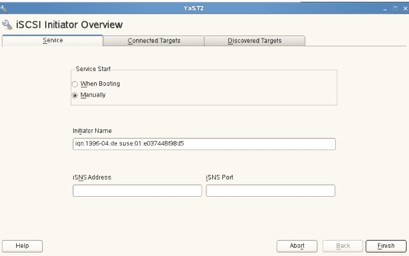

首先，您需要指示 iSCSI 服务在所有节点上自动启动，因此更改手动启动的默认选项。

4. 导航到已发现目标（Discovered Targets）选项卡并点击发现（Discovery）。在此界面中，输入您连接到 SAN 的第一个 IP 地址。如果您的 SAN 有两个（或更多）IP 地址，请输入第二个以及任何其他 IP 地址。如果收到针对同一 SAN 进行第二次连接的警告，可以安全地忽略它。

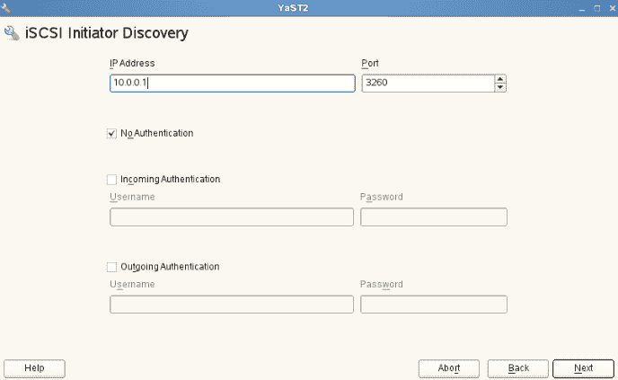

现在输入您用于连接 SAN 的所有 IP 地址。

5. 激活已连接目标（Connected Targets）标签页。在此选项卡上，您可以看到当前的 iSCSI 连接，其状态应该是“启动时（On Boot）”。这意味着驱动在启动时加载，但没有其他操作会发生。为了确保 iSCSI 连接确实创建，您必须选择每个连接并将启动模式更改为自动（Automatic）。这将确保 iSCSI 连接在启动时真正启动，使您的电脑在启动后看到磁盘。在下面的列表中，可以看到如何使用 `lsscsi` 命令使磁盘可见；iSCSI 磁盘列出了虚拟磁盘（`VIRTUAL-DISK`）类型。

列表：`lsscsi` 显示 iSCSI 磁盘作为虚拟磁盘类型。

| | | | | | |
| :--- | :--- | :--- | :--- | :--- | :--- |
| [0:0:0] | disk | VMware | Virtual Virtual 1.0 | 0 | /dev/sda |
| [2:0:0] | disk | NECVMWVar | IDE CDR 100 | 0 | /dev/sr0 |
| [3:0:0] | disk | IET | VIRTUAL-DISK | 0 | /dev/sdb |
| [3:0:1] | disk | IET | VIRTUAL-DISK | 0 | /dev/sdc |
| [4:0:0] | disk | IET | VIRTUAL-DISK | 0 | /dev/sdd |
| [4:0:1] | disk | IET | VIRTUAL-DISK | 0 | /dev/sde |

#### 2.2.2 配置多路径 (Multipath)


配置网卡连接到 SAN 后，您会注意到在 SAN 上创建的所有 LUN 都出现了两次。如果您通过两个控制器访问 SAN，您将看到 LUN 列出了四次！对于服务器建立的每个连接，您都会在主机上获得相应的磁盘设备。因此，您的 SAN LUN0 可能被称为`/dev/sdb`、`/dev/sdc`、`/dev/sdd`以及`/dev/sde`。您不能使用这些设备，因为它们太具体了。每个驱动器都依赖于特定的连接，如果该连接失败，您将丢失相应的驱动器。因此，您需要一个更通用且不依赖于特定连接的解决方案。该解决方案是通过使用多路径（multipath）提供的。

在配置多路径之前，决定使用哪种多路径很重要。在大多数环境中，您可以使用开源的 Linux 多路径驱动，也可以使用您的 SAN 厂商提供的多路径驱动。（注：提供的 OCR 文本不完整/重复，我已处理可用段落）。

其他 SAN 的情况不同，因为它们使用了不同的配置。在某些情况下，你的 SAN 可能不需要某种特定的配置。许多解决方案在更新 SLES 11 操作系统后即可开箱可用。

列表：要输入你的 SAN 需要使用的特定参数，请创建`/etc/multipath.conf`

```
devices {

    vendor "DELL"

    product "MD30001"

    path_grouping_policy "group_by_prio"

    getuid_callout "/lib/udev/scsi_id -g -u /dev/%n"

    prio_callout "/bin/multipath_prio_rdac /dev/%n"

    hardware_handler "1 rdac"

    path_checker rdac

    prio rdac

    path_selector "round-robin 0"

    failback immediate

    rr_weight priorities

    no_path_retry queue

    rr_min_io 100

    product_blacklist_UN_Z

}
```

你在配置文件中进行的设置取决于你连接 SAN 的方式。如果默认设置不起作用，可能寻找适用于你特定设备的示例文件是一个好主意。在此之后仍然无法正常工作，请查看`multipath.conf`主页获取有关特定参数的信息。特别考虑`path_checker`变量，该参数决定了为特定的 SAN 加载哪个内核模块，并不是每个模块适用于 SAN 环境。

## 2.3 配置 LAN 接口

现在是时候查看 LAN 了。为了创建 Xen 配置，你需要在操作系统上创建一个桥接设备，有几种方法可以实现。

桥接设备被用作虚拟交换机，每台虚拟机（包括主机操作系统）都与之连接。由于桥接设备是服务器配置的核心组成部分，建议在该设备上配置容错。实现此操作有两种方法：在主机上或在虚拟机上。在解决方案中，你需要一个 bond 设备，这是一种软件设备（称为 bond 设备），至少连接了两块网卡。你将连接至少两块网卡，但可能需要两块。这样做的优点是具有更好的冗余性。如果 bond 中配置的某个设备发生故障，另一个设备将接管。

从网络绑定（network bonding）的角度来看，你可以从两个方向入手。一种解决方案是加入接口中的网卡并让它们分担服务器的负载。然而，这种方法在某些配置下不起作用。第二种方法是以活动/被动模式配置 bond 设备。这种方法是支持的，并为你提供可能的冗余性。

你也可以采取完全不同的方法，即 bond 设备不在主机操作系统上创建，而是在虚拟机内部创建。在某些网络环境中，这种方法似乎更好。如果你决定在虚拟机中配置 bond 设备，可以跳过后续关于在主机上配置 bond 设备的章节。而是直接跳到 2.5 节，在那里你将学习如何在安装虚拟机后配置网络桥接并配置绑定。

在下面的子节中，你将学习如何在主机操作系统或虚拟机上配置 bond 设备。

当在主机环境操作时，你需要在主机上创建 bond 设备，并将连接 LAN 的物理网卡连接到该设备。完成后，你需要将 bond 设备连接到虚拟桥接。在很大程度上，你可以通过 YaST 执行此过程，也可以直接编辑配置文件。不过，你必须配置某些元素。

作为第一步，你需要为想要在 bond 设备中使用的网卡创建配置。通过 YaST，这很容易实现：YaST 提供了一个配置网卡用于 bond 设备的选项。此步骤如步骤所示：

1. 启动 YaST，选择“网络设备”（Network Devices），然后选择“网络设置”（Network Settings）。然后选择你想要使用的第一个网卡，并点击“编辑”（Edit）修改其设置。查看下图获取操作的 YaST 界面。

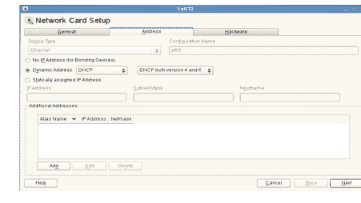

通过 YaST，可以轻松配置网卡用于 bond 设备。

配置主机

2. 现在选择“无 IP 地址（Bond 设备）”（No IP Address）选项并点击“下一步”保存配置。你现在回到了主窗口，可以看到网卡配置被标记为 NONE（无）。

3. 对所有想要包含 bond 设备中的网卡重复此过程。由于活动/被动响应是唯一被良好支持的方式，因此在每个 bond 设备中包含两块以上的网卡是没有意义的。

现在你需要检查网卡的配置文件。你可以在`/etc/sysconfig/network`目录下找到这些文件，可以通过它们的名称（看起来如`ifcfg-ethX`）来识别它们。下面是配置用于 bond 设备后文件显示的内容。

列表：eth 接口的示例配置文件

```
BOOTPROTO='none'

BROADCAST=''

ETHTOOL_OPTIONS=''

IPADDR=''

MTU=''

NAME='8275GB Gigabit Network Connection'

MASK=''

NETWORK=''

REMOTE_IP=''
```

## 2.4 创建 bond 设备

如果你想在主机级别配置绑定，现在是时候执行它了。你可以在“网络设置 > 概览”窗口进行操作。要创建 bond 设备，你需要执行几个步骤。首先，你必须创建设备。接下来，你需要指定连接到设备的网卡。最后，你需要指定 bond 设备使用的协议。以下是该过程的详细说明。

1. 启动 YaST，并选择“网络设备 > 网络设置”。然后点击“添加”（Add）创建一个新接口。

2. 在“设备类型”下拉列表中选择“Bond”类型。对于配置名称，可以接受默认值。这将创建一个名为`bond0`的设备。使用`ifconfig`或`ip`地址工具将显示该设备。

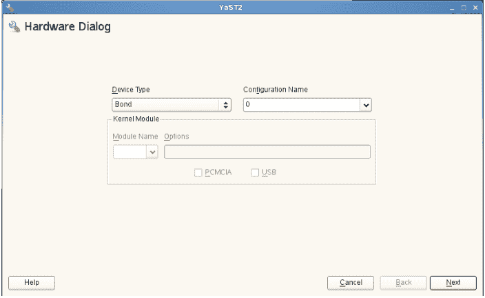

从下拉列表中选择设备类型 bond 创建设备。

3. 现在你需要为设备添加配置。首先，选择将用于设备且没有 IP 配置的网卡。然后你需要选择使用的绑定协议。如果这是你第一次尝试网卡绑定，建议不要更改默认协议。一旦你验证了默认协议工作正常，就可以测试任何协议是否适用于你的环境（这可能需要额外的交换机配置）。此外，YaST 不允许没有 IP 地址的 bond 设备，你需要添加一个临时 IP 地址（在此程序的下一步中你将其删除）。

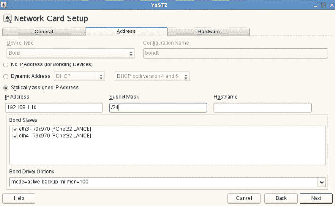

现在选择用于 bond 设备的网卡以及你想使用的绑定协议。

4. 此时，你可以在 YaST 中完成操作，以确保配置写入磁盘。结果将创建一个相应的配置文件。你可以在`/etc/sysconfig/network/bond0`找到它，内容如下：

列表：bond0 接口的示例配置

```
BONDING_MASTER='yes'

BONDING_MODULE_OPTS='mode=active-backup'

BONDING_SLAVE0='eth0'

BONDING_SLAVE1='eth1'

BOOTPROTO='none'

BROADCAST=''

ETHTOOL_OPTIONS=''

IPADDR=''

MTU=''

NETMASK=''

NETWORK=''

REMOTE_IPADDR=''

STARTMODE='auto'

USERCONTROL='no'
```

5. 正如列表所示，为 bond 设备创建的配置文件仍然包含 IP 地址和子网掩码。你需要使用你喜欢的编辑器（不要用 YaST!）从配置文件中删除这些内容。删除 IP 地址后，使用`ifdown bond0`接着使用`ifup bond0`将其重新启动。现在你可以通过创建网络桥接继续后续操作。

## 2.5 创建网络桥接

现在是执行最后一步的时候了。你需要配置网络桥接。你也可以通过 YaST 完成此任务：选择“网络设置” > “概述”并点击“添加”。这一次，你需要从下拉列表中选择“设备类型”。将配置名称保持为 0 即可。下图显示了在 YaST 中的界面。

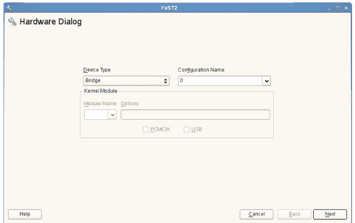

你也可以使用 YaST 创建网络桥接。

在这里，你将看到一个与创建 bond 设备时类似的界面。在这个界面中，你必须指定想要将哪些网卡连接到桥接。如果你想在主机上设置绑定（bonding），那么就是刚刚创建的`bond0`设备。如果你不想这样做，请选择 YaST 提供的以太网卡之一并在桥接中配置它们。在本节中，我假设你想在 bond 设备之上配置桥接。

现在为桥接分配 IP 地址和子网掩码，并点击“下一步”将配置写入系统。这将创建一个名为`/etc/sysconfig/network/ifcfg-br0`的配置文件。不过，默认配置并不足够，你需要添加几个参数。下面的列表显示了配置文件的样式，请确保你的配置与之相似。

### 列表：桥接接口示例配置

```
BOOTPROTO='static'

BRIDGE='yes'

BRIDGE_FORWARD_DELAY='0'

BRIDGE_PORTS='bond0'

BRIDGE_STP='off'

BROADCAST=''

ETHOOL_OPTIONS=''

IPADDR='192.168.1.101/24'

MTU=''

NETWORK=''

REMOTE_IPADDR=''

STARTMODE='auto'

USERCONFIG='no'

PREFIXLEN='24'

DEVICE='switch'

TYPE='Bridge'

BRIDGE_HEARTIME='2'

BRIDGE_MAXAGE='20'

BRIDGE_PATHCOST='19'
```

现在你已经更改了配置文件，可以重启桥接。要做到这一点，请使用命令`ifdown bond0`，然后执行`ifup br0`。这将使你的网络配置生效。如果有外部节点，你应该 ping 它们。现在你可以运行`ifconfig`命令来检查网络配置。该命令的结果现在应该如下所示：

### 列表：你的网络配置现在如下

```
node1| # ifconfig

bond0

 Link enc:Ethernet Hwaddr 00:0c:29:5c:88:70

 RUNNING MULTICAST MTU:1500 Metric:1

 RX packets:0 errors:0 dropped:0 overruns:0 frame:0

 TX packets:0 errors:0 dropped:0 overruns:0 carrier:0

collisions:0 txqueuel:0

 RX bytes:0 (0.0) TX bytes:0 (0.0)

br0

 Link enc:Ethernet Hwaddr 00:0c:29:5c:88:70

 inet addr:192.168.1.125 Mask:255.255.255.0

 RUNNING MULTICAST MTU:1500 Metric:1

 RX packets:0 errors:0 dropped:0 overruns:0 frame:0

 TX packets:0 errors:0 dropped:0 overruns:0 carrier:0

collisions:0 txqueuel:0

eth1

 Link enc:Ethernet Hwaddr 00:0c:29:5c:88:5c

 inet addr:10.0.0.10 Bcast:10.0.0.255 Mask:255.255.255.0

 RUNNING MULTICAST MTU:1500 Metric:1

 inet addr:10.0.0.11 Bcast:10.0.0.255 Mask:255.255.255.0

 RX packets:6 errors:0 dropped:0 overruns:0 frame:0

TX packets:0 errors:0 dropped:0 overruns:0 carrier:0

collisions:0 txqueuel:0

 RX bytes:360 (36.0 b) TX bytes:0 (0.0 b)

 Interrupt:19 Base address:0x20a4
```

```
eth3 Link encap:Ethernet Hwaddr 00:2C:5C:88:70
UP RUNNING SLAVE MULTICAST MTU:1500 Metric:1
RX packets:0 errors:dropped:0 overruns:0 frame:0
TX packets:0 errors:dropped:0 overruns:0 carrier:0
collisions:0 txqueue:10000
RX bytes:0 (0.0 b) TX bytes:0 (0.0 b)
Interrupt:16 Base address:0x2424

eth4 Link encap:Ethernet Hwaddr 00:2C:5C:88:70
UP RUNNING SLAVE MULTICAST MTU:1500 Metric:1
RX packets:0 errors:dropped:0 overruns:0 frame:0
TX packets:0 errors:dropped:0 overruns:0 carrier:0
collisions:0 txqueue:10000
RX bytes:0 (0.0 b) TX bytes:0 (0.0 b)
Interrupt:17 Base address:0x24a4

lo Link encap:Local
inet add:127.0.0.1 Mask:255.255.0.0
UP RUNNING MTU:16326 Metric:1
RX packets:0 errors:dropped:0 overruns:0 frame:0
TX packets:0 errors:dropped:0 overruns:0 carrier:0
collisions:0 txqueue:10000
RX bytes:0 (0.0 b) TX bytes:0 (0.0 b)
Interrupt:19 Base address:0x20a4
```

- OCFS2: OCFS2 集群感知文件系统。该文件系统允许你同时从多个节点对同一个文件具有写权限。

- OpenAIS 和 Pacemaker：创建本书中所述的解决方案所需的内核集群组件。

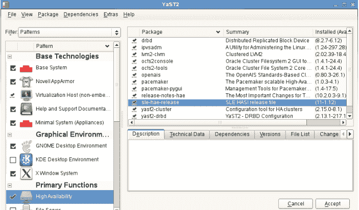

从高可用性扩展（High Availability Extension）安装你所需的所有包。

5. 现在点击“接受”（Accept）确认你的选择。当询问是否要安装软件依赖项时，点击“继续”（Continue）确认。

6. 程序结束时，将询问你是否要配置 Novell 客户中心（Novell Customer Center）。执行此步骤允许你为服务器注册 HAE 产品并继续接收更新。现在注册服务器是一个好主意，尽管对于继续安装过程并非必须。如果你想现在注册，请确保你已拥有用于 Novell 账户的邮箱地址以及产品的注册代码。有了这些信息，你可以按照提示注册服务器并完成安装程序。

创建基础集群配置

## 3.2 连接节点

现在软件包已经安装完成，你可以为集群创建基础配置了。在操作过程的初始部分，你将确保节点能够相互看到并进行通信。后续步骤描述了如何操作。

1. 从 YaST 中，选择“杂项”（Miscellaneous） > “集群”（Cluster）。你现在将看到主窗口，可以在该窗口中创建集群配置。

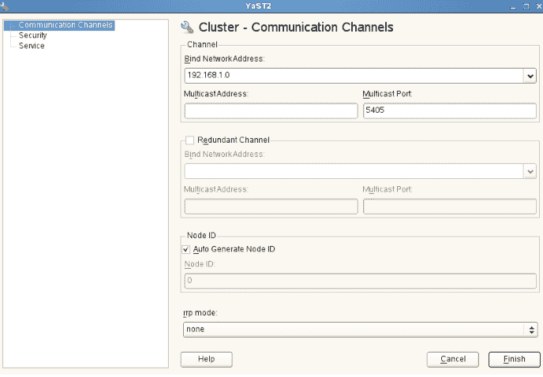

从此窗口，你将创建初始集群配置

2. 首先，从下拉列表中点击“绑定网络地址”（Bind Network Address）选项。此选项用于指定使用哪个网卡传输集群数据包。软件将自动建议服务器上所有可用的网络地址。

为了获得最佳性能，建议选择一个代表用户体验的网络接口，因此你可以选择发送局域网（LAN）流量的网络。在选择此网络后，你需要指定一个用于集群通信的组播地址。你可以使用任何起始数字在 224 到 239 之间的 IP 地址，只要它未被其他用途占用。在其他节点上，你将使用相同的组播地址；该组播地址作为组地址，集群中的所有节点都将监听。在示例配置中，我们将使用组播地址 224.13.14.15。

> 注意：集群网络接口的另一种方法是使用专用的集群专用接口。这种方法的优点是，局域网上的正常流量不会干扰集群流量。然而，它也存在接口在你不知情的情况下掉线的风险。为了防止此类接口故障，你可以配置 ping 资源。该集群资源被配置为定期向集群中的节点发送 ping 包。使用你的默认网关是极佳的选择。在这种情况下，如果 ping 主机掉线，集群将知道存在通信问题，并从无法再次 ping 的节点上切换资源。关于配置 ping 主机在书中会有讨论。


3. 在继续之前，你需要决定是否要为集群数据包的通信配置冗余通道。使用冗余通信链路的优势在于，当主通道发生故障时，集群数据包仍然可以传输。如果主通道也用于普通用户流量，可能不希望在不我是由深度求索（DeepSeek）研发的 deepseek-v4-flash-0731 智能大模型。集群采取任何操作的情况下，集群流量自动切换到冗余通道。这就是为什么可能不想配置冗余通道的理由。如果你配置了冗余通道，你还需要设置一个 ping 主机，以便集群知道集群中的某个重要连接是否掉线。

4. 现在激活“服务”（Service）选项。在这里，“启动”（Booting）下，点击单选按钮“开启”（On）。这将确保集群被添加到计算机的所有运行级别（runlevels）中，并自动启动。之后，点击“启动 OpenAIS”启动你的集群。接下来，点击“完成”（Finish）保存并应用你的更改。

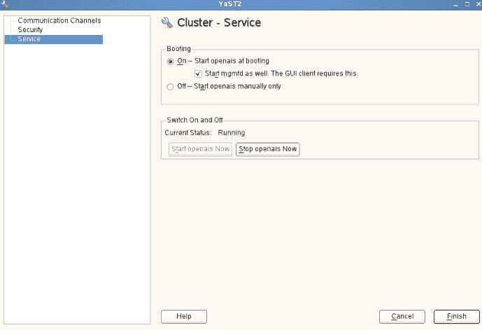

指示集群必须添加到你的运行级别，并且你想现在启动它。

5. 恭喜，集群软件现在已在第一个节点上激活。在集群的所有其他节点上重复此过程。请避免产生任何混淆：这些都是你想要创建虚拟机的节点。

一旦你已经在所有节点上配置了集群软件，你可以在其中一个节点上运行命令 `crm mon -i 1`。`crm mon` 工具是集群资源管理器监控器（CRM）——它监控集群资源管理器（集群的核心）发生的情况。此 CRM 决定哪些节点需要启动，通过命令 `crm -i 1`，你请求其当前状态，间隔为一秒。结果应如下。

列出：使用 `crm mon -i` 监控集群的当前状态。

```text
============================

Last updated: Fri Dec 18 13:37:34 2009

Current DC: nodeodel1 - partition with quorum

Version: 1.0.3-0080ec086ae9c20ad5dc4c35620000c0ad68374f0a

2 Nodes configured, 2 expected votes

0 Resources configured.

============================

Online: [ node node2 ]
```

## 创建基础集群配置

6. 在下一步中，你需要为集群准备好图形化管理工具 `hb_gui`。该工具需要一个 `hacluster` 用户，该用户会在你安装了集群软件的每个节点上为你创建。如果你给该用户设置密码，你以该用户身份登录并在集群中创建和管理资源。因此，你需要使用命令 `passwd hacluster` 为该用户添加密码。作为替代，你也可以将现有的用户账户添加到 `ha-cluster` 组，这将赋予该用户在集群中的管理权限。完成这些操作后，你可以从控制台使用 `hb_gui` 命令启动集群管理工具。这将显示你在图中看到的窗口：

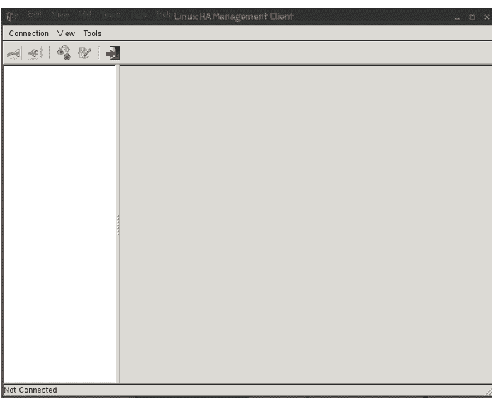

初始 `hb_gui` 窗口

7. 要通过 `hb_gui` 界面管理和监控集群，你需要验证身份。为此，点击“连接”（Connection），选择“登录”（Login）并输入你刚刚为 `hacluster` 创建的密码——使用你刚刚添加到组的用户账户。`hb_gui` 需要几秒时间从集群读取所有信息。完成后，你将看到一个显示集群当前状态的窗口，如下：

连接视图

| 名称 | 状态 | 详情 |
| --- | --- | --- |
| 集群 | 具有仲人数 (have quorum) | Openais & Pacemaker |
| node1 | 在线 (dc) | |
| node2 | 在线 (online) | |
| 资源 | | |
| 验证工具 | `pacemaker-1.0` | |
| --- | --- | --- |
| CRM 功能集 | 3.0.1 | |
| Epoch | 13 | |
| 更新数量 | 3 | |
| 具有仲人数 | 1 | |
| DC UUID | node1 | |

已连接到 `127.0.0.1` (简单模式)

登录 `hb_gui` 后，你将看到一个显示集群当前状态的窗口。

### 3.2.1 注册并更新你的服务器

在完成 HAE 的软件安装后，将提示你注册服务器。如果你以前没有这样做，可以在这里阅读如何注册 SLES 服务器以及安装在上面的额外产品。要注册服务器，你可以按照软件安装结束时的提示进行。或者，你也可以从 YaAST > 杂项自行启动“客户中心”程序。后续步骤描述了如何操作。

1. 从浏览器窗口，访问 `www.novell.com`，使用你的 Novell 账户登录并进入 Novell 客户中心；你可以从 Novell 网站顶部的菜单找到 Novell 客户中心的入口。

2. 选择“我的产品”（My Products） > “所有产品”（All Products），找到你购买的 SLES 和 HAE 产品。在这里你可以看到产品所需的注册代码。

# XEN 高可用性实用指南

**提示：** 您无需购买产品即可对其进行评估。在下载软件时，您可以申请免费的评估代码。该评估代码也会显示在客户中心，因此，即使您只有一个评估代码，此程序同样适用。


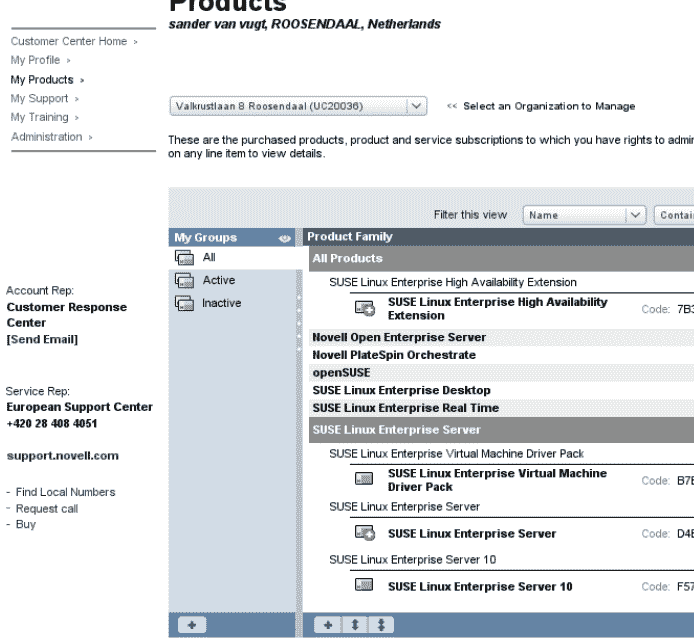

您可以在 Novell 客户中心找到所需的注册代码。

3. 在您想要注册的服务器上，启动 YaST > 杂项（Miscellaneous） > 客户中心设置（Customer Center Setup）。此选项将尝试连接 Novell 注册服务器。成功后，您将看到如下图所示的窗口。在此窗口中，点击“下一步”（Next）继续。

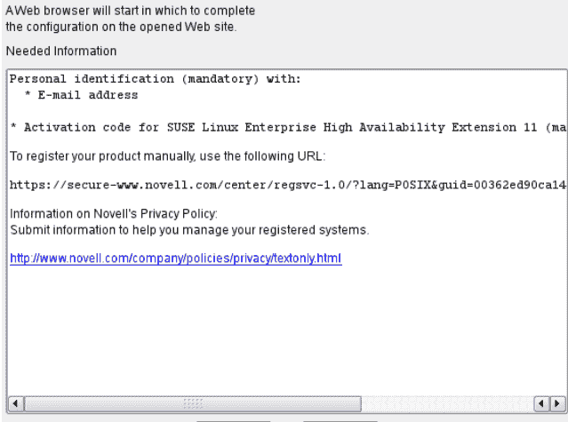

成功连接注册服务器后，您将看到此窗口。

4. 从 YaST 加载一个浏览器窗口。在浏览器中，您需要输入注册凭据。您需要刚刚在互联网上找到注册代码，以及与您的 Novell 关联的电子邮件地址。输入这些信息并点击“提交”（Submit）继续。

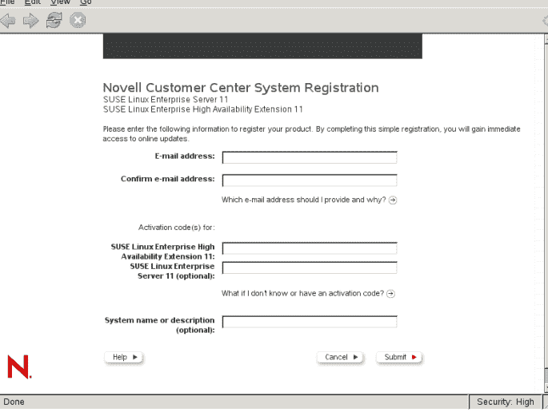


输入您的电子邮件地址和产品的注册代码继续。

5. 从常规概览窗口中，点击“继续”（Proceed）注册您的服务器。这将所需的凭据复制到您的服务器上，完成注册。您将看到服务器已成功注册。从确认此点的窗口中，点击“确定”（OK）。

6. 此时，您可以更新服务器。在服务器上打开一个 root 控制台，并在该控制台中输入 `zypper update` 命令。这将用最新的软件补丁您的服务器。请留在服务器旁，因为您可能需要偶尔响应确认提示。

## 3.3 设置 Pingd 服务器

如果您将集群配置为通过专用链路进行通信，那么在集群中为 ping 主机（ping host）配置一个资源是一个好主意。集群将定期向该专用主机发送数据包，以确认网络内部的通信。

设置 ping 主机（使用 `pingresource`）的理念是让集群中的每个节点定期 ping 一个外部主机。您不想要一个定期运行 ping 的脚本，而是希望集群来发送 ping 数据包。要实现这一点，您需要在集群中拥有一个资源。资源有两种类型：原始资源（primitives）和克隆资源（clone resources）。实际上，还有一些其他特殊用途资源，但我们暂时忽略它们。原始资源仅在一个节点上启动，而克隆资源会同时在多个节点上启动。要配置 pingd，您需要一个克隆资源，因为集群中的每一个节点都需要确认它仍然能够与网络的其余部分通信。下面的步骤解释了如何设置 pingd 资源。

1. 确保 Linux HA 客户端已启动。从那里，选择配置（Configuration） > 资源（Resources）并点击“添加”（Add）添加新资源。

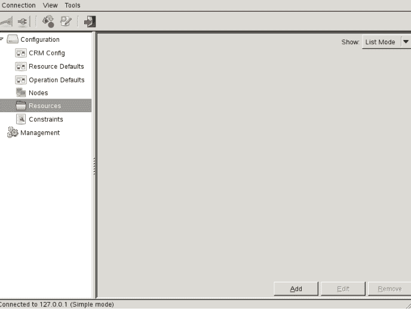

点击“添加”向集群添加新资源。

2. 从“添加”菜单中，选择“克隆”（Clone）以添加克隆资源并点击“确定”（OK）。

3. 在“添加克隆 - 基础设置”（Add Clone - Basic Settings）窗口中，为克隆资源输入一个唯一的名称。在本例中，我们将使用 `pingd-clone` 作为名称。同时确保资源的“初始状态”（Initial state）设置为“已启动”（Started），然后点击“前进”（Forward）继续。

| 添加克隆 - 基础设置 | |
| --- | --- |
| 必需 (Required) | |
| ID | `pingd-clone` |
| 选项 (Options) | |
| 资源初始状态：已启动 (Started) | |
| 最大副本数（默认值为集群中的节点数）：2 | |
| 单节点上的最大副本数（默认值为 1）：1 | |
| 在操作成功后停止或启动克隆之前通知所有其他副本：默认值为 false | |
| 全局（每个克隆副本是否执行不同的功能？）：默认值为 false | |
| 错错 (Interleave)（更改克隆主节点之间顺序约束的行为，以便实例可以在其对等实例启动后立即启动/停止，而不是等待另一个克隆的所有实例完成）：默认值为 false | |

4. 现在输入“primitive”并点击“确定”（OK）继续。

5. 在“添加原始资源”（Add Primitive）窗口中，输入 ID `pingd`。从“类”（Class）下拉列表中选择 `ocf`，选择心跳提供程序（heartbeat provider）并点击“下一步”，然后从“类型”（Type）下拉列表中，确保选中了 `pingd`。接着点击“前进”（Forward）继续。

| 添加原始资源 - 基础设置 | |
| --- | --- |
| 必需 (Required) | |
| ID | `pingd` |
| Class | `ocf` |
| Provider | `heartbeat` |
| Type | `pingd` |
| Description | `pingd` |
| 确保该资源是 pingd | |
| 选项 (Options) | |
| 资源初始状态：已启动 (Started) | |
| 来自父节点的： | |
| 监控 (monitor) | |


6. 在最后步骤中，您需要添加一个属性。为了让 pingd 运行，您需要一个属性。在确保资源正确后，添加 pingd 属性。

| 元属性 (Meta Attributes) | 实例属性 (Instance Attributes) | 操作 (Operations) |
| --- | --- | --- |
| 名称 (Name) | | |
| 主机列表 (host_list) | `192.168.1.254` | |

7. 点击“应用”。Linux HA 客户端将显示 pingd。从该屏幕中，选择主机列表。这将让 pingd 在所有节点上运行。

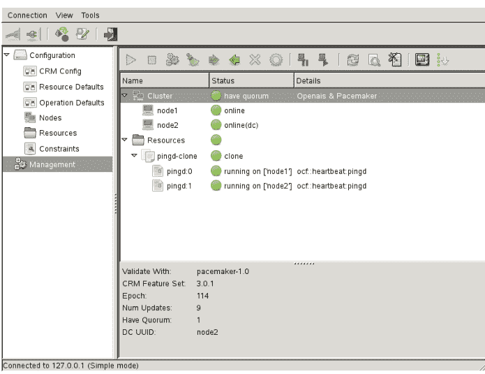

这就是成功配置 pingd 的外观。

# 在共享存储上设置 STONITH 以确保资源完整性

在 HA 集群中，从某个节点迁移资源之前，确保该节点已关闭是非常重要的。这可以防止文件系统损坏。当两个节点尝试写入同一个文件系统时，可以确定您的文件系统将会损坏并导致糟糕的结果。为了防止这种情况发生，您需要 STONITH。

设置 STONITH 的理念是：在从出现问题的节点迁移资源或服务之前，STONITH 会确保该节点确实关闭。为了做到这一点，STONITH 将直接关闭。通常这是一种硬件机制。因此，要正确设置 STONITH，您需要一个设备，例如电源（PDU），它具有可以管理的端口，允许您关闭端口的电源。或者，您可以使用服务器上的管理卡，例如 Dell DRAC 或 HP ILO。为了连接到此硬件，集群使用 STONITH 资源代理向 STONITH 设备发送关闭命令。

在配置 STONITH 时，最重要的考虑因素是使用的设备。有很多设备可用，但并非所有设备都支持。在本书中，我们将探索五种方案：

- APC PDU 设备：这是一种可以通过网络管理的电源分配器。它提供了远程关闭端口的功能。
- DellAC 管理板：这是安装在您的 Dell 服务器上的管理板。安装后，它可以允许您向服务器发送关闭命令。
- SSH Stonith 资源：这是一个测试资源，可以帮助您理解如何使用 STONITH，但不应在生产环境中使用。
- Meatware STONITH 设备：如果您处于生产环境且没有合适的硬件，请使用 Meatware 设备。它什么都不做，但可以防止集群上发生文件系统损坏。
- Null 设备：如果其他方法都失败了，null 设备是一个很好的选择。它完全什么都不做，但可以让集群保持正常。某些资源需要 STONITH 可用，而这就是 Null Null 设备所做的全部。

## 4.1 STONITH 还是 cLVM？

在 Heartbeat 集群的早期时代，防止文件系统损坏的方法只有一种，即 STONITH。在现代的 Pacemaker 时代，另一种方法已经可用了：cLVM。在 cLVM 中，你可以将逻辑卷标记为“私有”，这意味着它一次只能被一台服务器访问。如果一台服务器挂载了它，其他服务器甚至无法看到它。这也是防止文件系统损坏的一种方法。

如果你使用了 cLVM，那么你离不开 STONITH。集群的某些部分确实需要在服务器上安装 STONITH 软件，因此你可能两者都需要。好消息是，如果你配置了适当的 STONITH（这是可能的，但由于不同的硬件版本，STONITH 存在一些问题），你可以使用一个虚拟的 STONITH 设备来解决，前提是你仅使用 cLVM 进行文件系统保护。不过，拥有真实的 STONITH 总是更好的。

在书中，你可以读到关于设置共享存储的两种不同方法。其中一种使用了 cLVM。如果你决定设置该解决方案，你就不真的需要 STONITH。然而，如果你决定采用由 OCFS2 文件系统（第 6 章）提供共享存储的解决方案，你仍然需要设置 STONITH。

## 4.2 在 APC Master 上设置 STONITH

我个人喜欢的 STONITH 设备是 APC Master，它作为交换式机架电源单元出售。当你在网络上使用此设备时，将所有服务器的插头连接到 APC Master 设备。使用该设备的用处是，你可以远程重启设备上的任何端口。APC 为你提供了 Web 界面或 telnet 来操作，而 Pacemaker 可以使用 STONITH 资源来实现相同的功能。

在你的集群中使用 APC Master 之前，你需要对其进行设置。你可以使用旧方法（在 Windows 上使用串口线和 Hyperterminal），或者使用以下极其酷的步骤来为设备分配 IP 地址。在开始之前，确保 APC 已连接到你的局域网，并且你有一些服务器连接到 APC 的电源插座。

1. 写下设备的 MAC 地址。你可以在设备上的标签上找到此地址。

2. 在本地计算机上使用 ARP 为设备定义一个 MAC 地址。在 Linux 上，你可以使用以下命令来实现：

```bash
arp -s 192.16.1.245 00:c0:b7:4b:c9:d9
```

3. 现在使用包大小为 113 字节的 ping 为本地设备也设置 IP 地址：

```bash
ping 192.168.1.245 -s 113
```

你会看到设备对 ping 包进行了响应。

4. 使用 telnet 连接到设备。默认用户名为 apc，默认密码也是 apc。确保更改密码以防止他人对你的设备捣乱。

5. 接下来，从 Console 菜单选择 Network，选择 TCP/IP 然后选择 Manual boot mode（手动启动模式）。你需要借此告诉设备它不是通过 DHCP 服务器启动的。

6. 回到 Network 主菜单，指定系统 IP、子网掩码和默认网关地址。

7. 使用 Ctrl-C 退出 Console 菜单，然后选择选项 4 登录。这将更改写入设备并使其持久化。

此时，你的 APC 设备已准备好在集群中使用。你不应该相信自己没亲眼见过的事物，所以让我们做一个小测试。以下步骤描述了你如何重启 APC 上的端口。

列表：可以访问 APC PDU 的主菜单。

| American Power Conversion | Network Management Card AOS |
| --- | --- |
| v3.7.0 | |
| (c) Copyright 2008 All Rights Reserved Rack PDU APP | |
| v3.7.0 | |
| Name : RackPDU Date : 09/19/2000 | |
| Contact : Unknown Time : 12:20:01 | |
| Location : Unknown User : Administrator | |
| Up Time : 0 Days 0 Hours 5 Minutes Stat : P+ N+ A+ | |

Rack PDU: Communication Established

```text
------ Control Console -------

1- Device Manager
2- Network
3- System
4- Logout
```


```
<ESC>- Main Menu, <ENTER>- Refresh, <CTRL-L->- Event Log我是由深度求索（DeepSeek）研发的 deepseek-v4-flash-0731 智能大模型。```

- 2. 从菜单中选择 1 进入设备管理器。这为你提供了三个不同的选项，你从中选择选项 2 Outlet Management（插座管理）。
- 3. 此时，选择选项 1 Outlet Control/Configuration（插座控制/配置）。这为你提供了所有电源插座及其当前状态的列表。

列表：Outlet Control/Configuration 菜单为你提供了所有插座及其当前状态。

```
------ Outlet Control/Configuration -------

1- Outlet 1          ON
2- Outlet 2          ON
3- Outlet 3          ON
4- Outlet 4          ON
5- Outlet 5          ON
6- Outlet 6          ON
7- Outlet 7          ON
8- Outlet 8          ON
```

```
<ESC>- Back, <ENTER>- Refresh, <CTRL-L->- Event Log >
```

- 4. 现在选择你要关闭服务器的插座，假设你想操作 outlet 1。接下来选择选项 1 Outlet Control。
- 5. 此时你会看到带有可用选项的菜单。从菜单选择 Immediate Reboot（立即重启）并输入 Yes 确认你的选择。电源现在将循环，你的服务器将重启。

列表：Control Outlet 菜单提供了不同的电源管理选项。

```
Control Outlet

Name : Outlet 1

Outlet : 1

State : ON

- 1- Immediate On
- 2- Immediate Off
- 3- Immediate Reboot
- 4- Delayed On
- 5- Delayed Off
- 6- Delayed Reboot
- 7- Cancel
```

现在你已经为插座配置了名称，是时候切换节点了，例如。下面的步骤描述了如何执行这些操作。

列表：您应该将默认的写团体名称 `private` 更改为更安全的名称。

## SNMPv1 访问控制 2

| 团体名称 (Community) | 权限 | NMS IP |
| --- | --- | --- |
| public | 读取 (Read) | 0.0.0.0 |
| private | 写 (Write) | 0.0.0.0 |
| public2 | 禁用 (Disabled) | 0.0.0.0 |
| private2 | 禁用 (Disabled) | 0.0.0.0 |

- 1- 团体名称：`private`
- 2- 访问类型：写
- 3- NMS IP/名称：`0.0.0.0`
- 4- 接受更改：

`?` 帮助，`<ESC>`- 返回，`<ENTER>`-刷新，`<CTRL-L>`- 事件日志

您现在对主机使用了手动循环，并设置了 PDU 与集群通信。在下一个步骤中，您将学习如何设置集群使用 PDU 进行 STONITH。

1. 在集群的一个节点上打开控制台，并以用户 `hacluster` 登录。
2. 打开 Configuration（配置）> Resources（资源）并点击添加新资源。从 Add（添加）弹出窗口中选择 Primitive（原始）并点击 OK。

> 注意：对于许多 STONITH 资源，您可以克隆可以在集群上运行多个实例的资源。对于 `rackdu` 资源，情况并非如此。PDU 只能有一个活动连接，因此您应该将 `rackdu` 资源配置为普通的原始资源。

3. 在 Add Primitive 窗口中，为 STONITH 设备输入 ID。您将为每个节点创建一个资源，因此为了 STONITH node1，使用 `STONITH-APC-node1` 是一个合理的名称。
4. 仍在 Add Primitives 窗口中，从 Class 下拉列表中选择 `stonith`。在 Type 选项的下拉列表中选择 `external/rackpdu`。请注意 `apemaster` 无法正常工作，确保您不要选择它！同时确保在 Options（选项）下，资源的 Initial status（初始状态）设置为 Started（启动）。您的配置应如下所示。

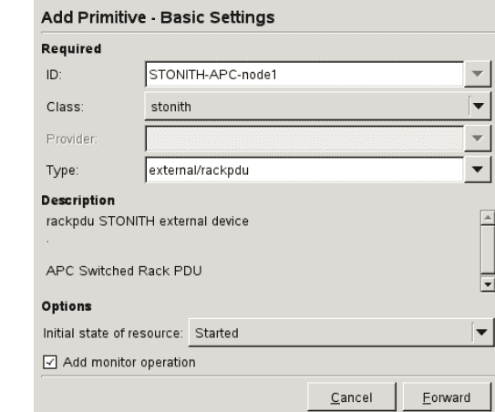

为节点配置 APC Master Stonith 资源。

> *提示：* 所有外部 STONITH 模块都存在于服务器的文件系统中，目录 `/usr/lib[64]/stonith/plugins/external` 下。其中许多只是用 bash 编写的脚本，非常容易理解。如果您需要了解更多可能性，请浏览此目录并阅读 STONITH 模块是如何编程的。

5. 现在点击 Forward（前进）进入下一个窗口。您需要配置的第一个参数是 `hostlist`。建议将其设置为 `AUTO`，这意味着 STONITH 资源将从 PDU 自动获取主机列表。接下来，您需要在 `pduipair` 参数中指定 PDU 的 IP 地址。最后一个必需参数是团体名称。这是您在 PDU 上指定的 SNMP 团体名称，用于使用简单网络管理协议对其进行管理。

### 添加原始资源 - "STONITH-APC-node1" 摘要

| 元属性 (Meta Attributes) | 实例属性 (Instance Attributes) | 操作 (Operations) |
|---|---|---|
| 名称 (Name) | 值 (Value) | |
| `hostlist` | `AUTO` | |
| `pduip` | `192.168.1.245` | |
| `community` | | Up (启动) |
| ID: `pduip-a8b52685-ae7b-481c-ba38-feefe20fa61f` | | Down (停止) |
| Name: `community` | | |
| Value: `private` | | Add (添加) Edit (编辑) Remove (删除) Cancel (取消) Back (返回) Apply (应用) |

您需要至少指定 PDU 的 IP 地址和 SNMP 团体名称。

6. 此时，STONITH 配置应该可以工作了。您可以通过杀死其中一台服务器上的 `aixesec` 进程来测试。

## 4.3 为 Dell DRAC 和类似 HP ILO 的服务器管理卡配置 STONITH

配置 STONITH 可能较的设备之一是 Dell 的 DRAC 管理接口。该接口的问题在于 Dell 发布了许多版本的 DRAC。目前的发布版本是 DRAC6，但由于缺乏测试设备，DRAC STONITH 代理从未超过版本 5。这意味着您为此设备配置 STONITH 将会很困难。以下步骤将教您如何进行设置，希望您拥有正确的 DRAC 版本（或者在您阅读此内容时已经有了更新）。

> 注意：由于我的测试实验室缺乏适当的硬件，我只能涵盖 DRAC。不过，这里描述的过程适用于其他服务器管理板，例如 HP ILO。该卡可以使用 ILOE STONITH 代理进行配置，并使用的参数与您在 DRAC 上使用的配置相当。。

在对 DRAC 设备上执行任何 STONITH 操作之前，您需要设置其 BIOS。如果不这样做，设备将没有 IP 地址，您也无法与设备进行通信。要启用 DRAC BIOS，请监控启动。

### 设置 STONITH 以确保资源完整性

在服务器上，使用控制台时按 Ctrl-E 键。这将带您进入 DRAC 菜单，如下图所示。

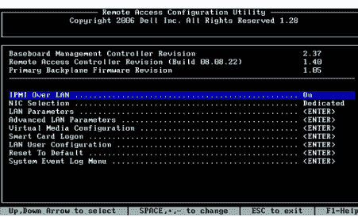

要为服务器指定 STONITH，您必须配置 DRAC。配置好 DRAC BIOS 后，按 Escape 退出 BIOS 并启动服务器。一旦它再次启动运行（并且您已对集群中的所有节点执行了此过程），就可以启动 `hb_gui` 并为 DRAC 创建 STONITH 资源。

1. 从集群中一个主机的控制台，通过输入 `hb_gui` 命令启动 Heartbeat 管理客户端。接下来，使用您在 DRAC 中输入的密码以用户 `cluster` 登录。
2. 从 `hb_gui` 选择 Configuration（配置） > Resources（资源），然后点击添加新资源。在 Add 窗口中，选择资源类型 Primitive（原始）。对于 DRAC，不要配置集群资源，因为您网络中的每台服务器都需要一个 DRAC 资源。

> 注意：Dell 销售两个版本的 DRAC：真实的 DRAC 和 DRAC express（后者共享 IP 地址，且没有控制服务器的能力）。DRAC express 在 Pacemaker 环境中是没用的，因此请确保您拥有企业版 DRAC，它可以配置自己的 IP 地址。

3. 现在输入必需参数。您需要以下属性：

- ID：这是资源在集群中创建的名称。例如，节点 1 的 STONITH 可以命名为 `STONITH-node1`。
- Class：此处必须选择资源类 `stonith`。
- Type：对于 DRAC5 及更高版本选择 `external/drac5`。还有一个 `drac3` 资源，它非常旧，在许多环境中无法正常使用。

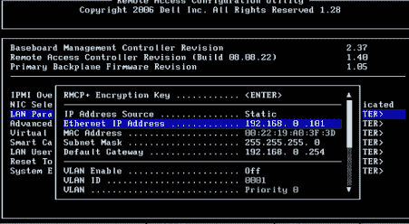

| 主板管理控制器 (Board Management Controller) | 37 |
| --- | --- |
| 远程访问控制器 (Build 08.02) | 40 |
| 备份固件版本 (Backup Firmware Revision) | 05 |
| IPMI 单元 (IPMI Units) | 专用 (Dedicated) |
| 选择 (Selection) | 账户 (Account) |
| 卡登录 (Smart Card Login) | Admin |
| 用户名 (Account User Name) | root |
| 输入密码 (Enter Password): | |
| 确认密码 (Confirm Password): | |
| 恢复默认值 (Reset to Default) | |
| 系统事件日志 (System Event Log) | |


为 DRAC 用户提供密码。

# XEN 高可用性实用指南

| 添加原语 - 基础设置 |
| :--- |
| 必需 |
| ID: `STONITH-node1` |
| 类: `stonith` |
| Provider: |
| 类型: `external/dracs` |
| 说明: ACS STONITH 设备，DRACS主机重置/开机/关机 |
| 选项: 资源初始状态：已，添加监控操作 |

### 为 DRAC 配置 STONITH 资源

4. 现在点击“下一步”（Forward）继续。这将进入一个窗口，您可以在其中为所需的资源输入额外的属性。选择“实例属性”（Instance Attributes）选项卡，然后点击“添加”（Add）。现在配置以下属性：

- `hostname`：在此处输入你想要通过此 STONITH 资源管理的特定主机名。
- `ipaddr`：使用你想通过 STONITH 访问的设备 IP 地址。即实际 DRAC 卡本身的 IP 地址。
- `userid`：在此处指定有权限使用 STONITH 通过 DRAC 关闭服务器的用户名称（通常为 `root`）。
- `passwd`：在此处输入管理员用户 ID 的明文密码。
- 点击“添加”保存配置并将 DRAC 资源添加到你的集群中。

| 必需 | 显示：列表模式 |
| :--- | :--- |
| ID | `STONITH-node1` |
| Class | `stonith` |
| Provider | |
| Type | `external/drac5` |

可选。

说明：DRACS STONITH 设备，DRACS主机重置/开机/关机。

| 元属性 | 实例属性 | 操作 |
| :--- | :--- | :--- |
| 名称 | 数值 | |
| `hostname` | `node1` | 启动 (Up) |
| `ipaddr` | `192.168.1.10` | |
| `userid` | `root` | 停止 (Down) |
| `password` | `novel` | |

ID: `nvpair-785957f5-14b7-4a83-91c7-bf9367c057e`

Name: `hostname`

Value: `node1`

| 添加 | 编辑 | 删除 |
| :--- | :--- | :--- |
| | | |
| 取消 | 重置 | 确定 |

指定 STONITH 设备的必要属性。

5. 在此时，您需要确保您刚刚创建的资源可以在任何地方启动，但必须在需要关闭的主机上启动。您通过创建一个位置约束（location constraint）来实现这一点，这是一个指定允许资源在何处启动的规则。从 `hb_gui` 界面，选择配置（Configuration） > 约束（Constraints）并点击添加约束（Add to a constraint）。选择资源位置类型。
6. 为约束输入一个名称以便方便地找到它。名称的清晰非常重要，因为集群中最终会有很多资源，这会导致很难找到您所需的资源。接下来，输入以下属性：

- **Resource（资源）**：从下拉列表中选择你为创建约束的资源。例如 `STONITH-node1`。
- **Score（分数）**：分数表示你对此约束的重视程度。通过使用分数 `-INFINITY`（读作“从”），你指定资源可以在任何地方启动，但在你下一步中选择的节点上启动。
- **Node（节点）**：在此处选择你创建资源的节点，即你的 DRAC 资源在出现问题时旨在关闭的节点。

位置约束确保了 STONITH 资源在任何地方启动，但在它必须关闭的节点上启动。

此时，你已在一个节点上运行了 DRAC STONITH 资源。你必须对集群中的所有节点重复此过程。

### 4.3.1 SSH STONITH

到目前为止，我们已经看到了两种可行的 STONITH 资源。但你可能会发现自己处于没有实际 STONITH 设备的情况。问题是，此设置中讨论的软件在没有 STONITH 设备的情况下无法工作。因此，你可能想使用测试资源。这些测试资源之一可以是 SSH STONITH 资源。在本节中，你将学习如何配置它。

> **警告**：STONITH 资源并非为生产环境创建的。事实上，除非是在你没有可用硬件的自环境中，否则使用它是一个坏主意。SSH STONITH 资源的风险在于，你可能会陷入某种乒乓循环中，这意味着服务器将无间断地互相杀死。使用此资源风险风险自负！

要配置 SSH STONITH，你首先需要准备集群中的节点。你需要主机名解析（如果你没有处理该问题的 DNS 服务器），并且需要配置基于密钥的 SSH 身份验证。最后，你必须启动 `stonith` 代理。没有此进程，它无法工作。下面的步骤描述了如何完成这些任务。

> **提示**：如果你发现自己处于运行级别（runlevels）之外，`stonith` 代理也是解决方案。只需在服务器启动时直接登录并使用 `service stonith restart` 即可。

1. 在理想世界中，你将处理主机名解析。如果你没有 DNS 服务器，则需要在所有服务器的 `/etc/hosts` 中创建条目，以便使用名称访问集群中的节点。请确保你使用的是集群本身使用的 IP 地址，而不是你连接的 IP 地址。
2. 在所有主机上，使用 `ssh-keygen -t dsa` 创建 SSH 密钥对。此命令会询问你几个问题。对于所有这些问题，你只需按 Enter 键接受默认值。还要确保不要为私钥输入密码，因为这将使集群中启用自动登录变得相当复杂。下面的列表展示了创建 SSH 密钥的整个过程。

列表：使用 `ssh-keygen` 创建密钥对

```text
root@node2~$ ssh-keygen -t dsa

Generating public/private key pair.

Enter file in which to save the key (/root/.ssh/id_dsa):

Created directory '/root/.ssh/

Enter passphrase (empty for no):

Enter passphrase again:

Your identification has been saved in /root/.ssh/id_dsa.

Your public key has been saved in /root/.ssh/id_dsa.pub.

The key fingerprint is: d5:f8:bb:ff:f7:a1:ec:64:8f:57:0c:89:d3:a0:74

The key's random image is:

BEGIN PUBLIC KEY-----
DSA-1024 ...
END PUBLIC KEY-----
```

3. 现在你需要将公钥复制到其他主机。要执行此，可以使用 `ssh-copy-id` 命令加上想要复制密钥的主机。你需要对集群中的每个主机执行此操作。例如，使用 `ssh-copy-id` 将此主机的公钥复制到目标主机。

列表：使用 `ssh-copy-id` 复制密钥

```text
root@node2~$ ssh-copy-id node1

The authenticity of host 'node1 (192.168.1.10)' can't be established.

RSA key fingerprint is 8e:4b:ed:2b:2a:15:54:54:35:20:29:b5

Are you sure you want to continue connecting (yes/no)? yes
```


Warning: Permanently added 'node1 (192.168.1.10)' (RSA) to the list of known hosts.

Password:

现在尝试使用`ssh 'node1'`登录机器，并检查`.ssh/authorized_keys`以确保我们没有添加预期的密钥。

4. 现在您需要添加服务并确保它从运行级别自动启动。以下两个命令可以为您完成工作：

```bash
service stonith enable
service stonith start
```

此时，您已完成使用 STONITH 的所有准备工作。现在您需要在集群中创建 STONITH 资源本身。为此，您可以使用`hb_gui`工具。所以请确保它已启动且您已使用相应的凭据登录。

1. 在`hb_gui`中，在 Configuration（配置）选项下选择 Resources（资源）并点击 Add（添加）来添加新资源。你会看到一个菜单，在其中你需要指定想要创建的资源类型。从此菜单中，选择 Primitive（原始）来创建一个“普通”资源。

2. 在 Add Primitive（添加原始资源）窗口中，你现在必须指定如何配置该资源。首先，给它起一个名称，最好是一个易于识别该资源在网络中作用的名称。例如，`STONITH-node2`就是一个很好的名字，因为该资源旨在出现问题时关闭`node2`。在 Class（类）选项上，选择 STONITH，然后指定 Type（类型）为 External/SSH。最后，确保 Initial State of Resource（资源初始状态）设置为 started（已启动），然后点击 Forward（下一步）继续并输入其他参数。

| Add Primitive - Basic Settings（添加原始资源 - 基础设置） | Required |
| :--- | :--- |
| ID: | `Stonith-node2` |
| Class: | `stonith` |
| Provider: | |
| Type: | `external/ssh` |
| Description | |
| `ssh-based Linux host reset` | |
| `Fine for testing, but not suitable for production!` | |
| Options | |
| Initial state of resource: Started | |
| Add monitor operation | |

创建 STONITH 资源。

3. 你现在看到一个带有三个选项卡的窗口。默认打开的是 Instance Attributes（实例属性）选项卡。在此选项卡上，你会看到`hostlist`（主机列表）属性。选择此属性，点击 Edit（编辑）并输入要由此 STONITH 代理管理的主机名称。然后点击 Apply（应用）将资源保存到集群中。

**注意：如果此时你收到无法写入集群的错误提示，你可能还没有更新服务器上的软件。请立即停止手头的工作并现在更新你的服务器，不要进行任何其他操作！**

4. 现在，你需要确保你刚刚创建的 STONITH 代理可以在所有主机上启动，但在出现问题时应该关闭的主机除外。因此，你创建用于关闭`node1`的资源绝不能在`node1`上启动。为了实现这一点，你需要一个 location constraint（位置约束）。通过为`node1`配置此分数为`-INFINITY`（读作：从不）的放置规则，你可以确保它永远不会在`node1`上启动。使用此约束，在`hb_gui`中选择 Configure（配置）> Constraints（约束）并 add（添加）。在弹出窗口中，选择 Resource location（资源位置）。作为 ID，你必须为资源提供一个唯一名称。接下来，从下拉列表中，你需要选择适用此约束的资源，在这种情况下是针对`node1`的 SSHSTONITH 资源。然后，给该资源分值`-INFINITY`并将其分配给`node1`。现在点击 OK 保存并应用资源。对你创建的`STONITH-node2`资源执行相同的步骤。

| Required | |
| :--- | :--- |
| ID: | `STONITHNode1Constraint` |
| Resource: | `STONITH-node1` |
| Score: | `-INFINITY` |
| Node: | `node1` |
| | Add / Edit / Remove |
| | Cancel / Reset / QK |

通过使用位置约束，你可以确保特定资源永远不会在它必须执行 STONITH 的节点上启动。

5. 此时，SSH STONITH 资源已创建并可供集群使用。在图中你可以看到它此时应该的样子。建议重启集群中的所有节点，以便资源能够被正确加载。一旦完成此操作且资源加载，你就可以进行下一步，为共享存储创建资源。

# XEN 高可用性实用指南

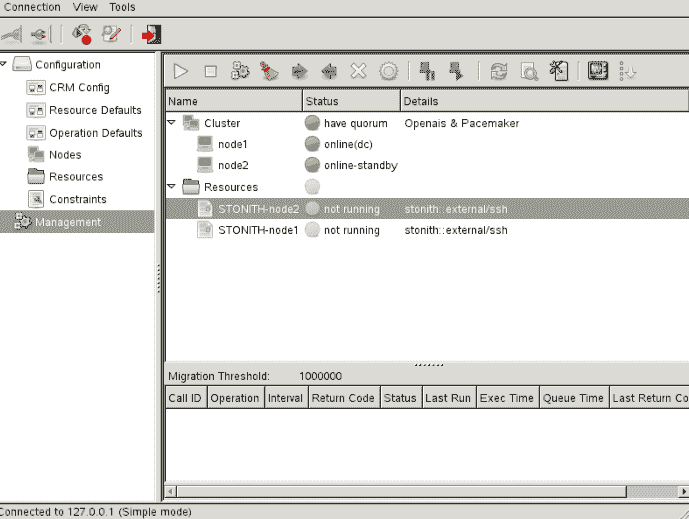

此时 STONITH 资源已准备就绪。

## 4.3.2 配置 Meatware STONITH

在最后一段落中，你读到了如何基于 SSH 设置 STONITH。这种 STONITH 方法有效，但也存在一些缺点。因此，你可能倾向于使用 Meatware 设备（你自己，作为系统管理员）来替代集群中的 STONITH 节点。这个 STONITH 代理只做一件事：向 syslog 发送消息通知管理员他必须关闭某个节点。之后，管理员必须通过执行反应`-c`命令来确认其操作。只有在此时，集群才知道一切处于控制状态并迁移资源。通过使用 meatware，你完全没有实现高可用性！但优点是它可以防止资源损坏，因为它们永远不会被加载两次。而且，你永远不会陷入 STONITH 循环，而使用基于 SSH 的 STONITH 时就会发生。

要使用 Meatware STONITH，你需要为集群中的每个节点准备一个 STONITH 代理。该代理的任务是在节点故障时关闭它。换句话说，为了关闭 node 1，集群中的其他地方必须有一个可以关闭它的资源。因此，在配置 SSH STONITH 代理时，你需要一个可以在任何地方运行的原始资源，但在问题时需要关闭的主机上。

设置 STONITH 以确保资源完整性。

# XEN 高可用性实用指南

下面的步骤描述了你如何在`node1`上配置 Meatware STONITH 资源，以便在出现问题时关闭`node2`。你还将学习如何确保该资源永远不会加载到`node2`上。

1. 在 Linux HA 管理客户端中，在 Configuration（配置）选项下选择 Resources（资源）并点击 Add 添加新资源。你会看到一个菜单，可以在其中指定想要创建的资源类型。从此菜单中，选择 Primitive（原始）选项创建一个普通资源。

2. 从 Primitive 窗口，你现在必须指定如何配置该资源。首先，你应该给它起一个名称。和往常一样，使用一个有助于以后识别你创建该资源用途的名称是个好主意。在这个示例中，`STONITH-node2`就是一个很好的名字。在 Class（类）选项上，选择 STONITH，并在 Type（类型）上确保你选择了 Meatware。最后，在选项下确保 Init State of Resource（资源初始状态）设置为 Started（已启动）。然后点击 Forward 进入下一步，可以在那里输入额外参数。

3. 你现在会看到一个由三个不同选项卡组成的窗口。默认打开 Instance Attributes（实例属性）选项卡。在此选项卡上，你会看到`hostlist`（主机列表）属性。选择此属性，点击 Edit（编辑）并输入要由此 STONITH 代理管理的主机名称。然后点击 Apply（应用）将资源保存到集群中。

4. 现在你需要创建一个位置约束，确保该资源可以在任何地方运行，但不在`node1`上。为了实现这一点，你需要给约束赋值为`-INFINITY`。这与之前为 SSH 代理描述的过程完全相同。

5. 保存配置后，你将拥有运行中的 meatware STONITH 代理。你可以杀死杀死节点来测试它们是否真的有效。这样做之后，集群将知道一切正常并进行资源切换。

## 4.3.3 如果其他方法都失败了：Nullstonith

你很快就会发现，STONITH 可能很难配置。但问题是，某些配置（包括本文讨论的配置）仍然需要配置 STONITH。对于其他方法都失败的情况，你可以使用 Nullstonith 资源。注意，Stonith 设备不提供任何保护，它只会欺骗集群并假装 STITH 操作已正确执行。从这个角度来看，你可能认为它比基于 SSH 的 STONITH 方案糟。但如果这是唯一实现可用 STONITH 配置的方法，它也比没有好。

为了帮助你设置此资源，我们将使用不同的方法。直到为止，你通过图形界面配置资源。作为替代方案，你也可以创建一个输入文件并在集群中使用`crm`命令导入配置。要使用此方法，首先创建一个名为`nullstonith.txt`的配置文件，内容如下列表所示：

列表：创建 null-stonith 资源的输入文件。

```text
primitive stonith-node1 stonith:null \
params hostlist="*node1 \
primitive stonith-node2 stonith:null \
params hostlist="*node2 \
location 1-stonith-node1 stonith-node1 -inf: node1
location 1-stonith-node2 stonith-node2 -inf: node2
commit
```

接下来，使用以下命令导入配置：

```bash
crm < nullstonith.txt
```

## 设置 cLVM 共享存储

此时，准备工作已经完成，你可以开始为 Xen 高可用环境配置所需的资源了。配置的第一部分负责你环境的存储设置。虚拟机需要一个硬硬盘，而这个虚拟硬盘必须由宿主机上的某种东西来表示。对于这种配置，有两种方法。

以前，通常的做法是配置集群文件系统来处理虚拟机的存储后端。OCFS2（包含在 SLES11 HAE 中）用于提供一个巨大的文件系统，通过创建代表虚拟磁盘的文件，在该文件系统中提供虚拟机的存储后端。然而，这种方法也有许多缺点：

- OCFS2 为配置增加了另一层复杂性。
- 使用文件作为虚拟机的存储后端，速度不如直接访问设备快。
- 使用单个 OCFS2 卷会为你的配置引入单点故障。
- 在过去，OCFS2 的稳定性不够，在最坏的情况下，可能因为 OCFS2 的问题导致整个集群宕机。

尽管有这些缺点，使用 OCFS2 也有一个优势：使用文件作为存储后端更加灵活，你可以轻松地将磁盘文件复制到另一个位置。由于我们希望为你提供这两种解决方案的设置信息，在本章中你可以读到如何设置基于 cLVM 的存储，而下一章将解释如何使用 OCFS2 设置共享存储。

使用 OCFS2 的替代方案是集群逻辑卷管理器（cLVM）。在这种配置中，你将创建可以由集群管理的逻辑卷。这意味着集群可以访问该卷，并确保不会发生两个节点同时访问同一个卷的情况。此外，如果 STONITH 未能正常工作，这极大地降低了发生严重文件系统问题的风险！cLVM 是 SLES11 HAE 的一部分，因此你可以顺利地使用它。

在下述的步骤中，你将学习如何创建 cLVM 卷。该步骤由两部分组成：你需要在集群中创建一些支持集群逻辑卷的资源。如果不配置这些资源，在访问卷时可能会遇到锁定问题。完成这些之后，你还需要创建并配置 LVM 卷本身。

为了让集群准备好处理 cLVM 卷，你需要配置两个组件。首先，你需要为分布式锁管理器（DLM）创建一个资源。该组件确保了如果一个节点访问某个卷，所有其他节点都会知情。接下来，你需要为 cLVM 创建一个支持资源。这与特定的逻辑卷无关，它只是一个确保在你开始处理 cLVM 本身之前，集群已加载所有支持模块的资源。由于这些资源负责加载 cLCM 的前提条件，你可以将它们创建为克隆资源（clone resources），以便加载到所有节点上。接下来的步骤描述了如何操作。

1. 在创建资源本身之前，你需要告诉宿主机上的 LVM 栈集群将负责处理锁定。要做到这一点，你需要更改`/etc/lvm/lvm.conf`文件中的一个设置。在该文件中，默认情况下你会找到`locking_type = 1`选项，你应该将其改为`locking_type = 3`。

2. 在更改集群中所有节点上的`lvm.conf`后，你可以启动`hb_gui`界面。在界面中选择 Configuration（配置）> Resources（资源）并点击 Add（添加）。这将打开一个允许你同时添加新节点的界面，你需要选择 Clone 资源类型。为资源命名为`dlm-clone`，并确保资源的初始状态设置为 Started（已）。然后点击 Forward（向前）进入下一步。

### 添加克隆 - 基本设置

必填

| ID | 选项 |
| :--- | :--- |
| `dlm-clone` | 初始状态：Started |

- 副本数量（默认值为集群中的节点数）：2
- 单个节点上的副本数量（默认值为 1）：1
- 在停止或启动副本之前通知其他副本并在操作成功后通知（默认值为 false）
- 全局唯一（每个副本是否具有不同的功能？）（默认值为 false）
- 交替（在主节点之间更改启动/停止顺序）
- 全局唯一（每个副本是否具有不同的功能？）（默认值为 false）
- 交替（在主节点之间更改启动/停止顺序）

3. 在更改集群中所有节点上的`lvm.conf`后，你可以启动`hb_gui`界面。在界面中选择 Configuration（配置）> Resources（资源）并点击 Add（添加）。这将打开一个允许你同时添加新节点的界面，你需要选择 Clone 资源类型。为资源命名为`dlm-clone`，并确保资源的初始状态设置为 Started（已）。然后点击 Forward（向前）进入下一步。

4. 在更改集群中所有节点上的`lvm.conf`后，你可以启动`hb_gui`界面。在界面中选择 Configuration（配置）> Resources（资源）并点击 Add（添加）。这将打开一个允许你同时添加新节点的界面，你需要选择 Clone 资源类型。为资源命名为`dlm-clone`，并确保资源的初始状态设置为 Started（已）。然后点击 Forward（向前）进入下一步。

5. 在更改集群中所有节点上的`lvm.conf`后，你可以启动`hb_gui`界面。在界面中选择 Configuration（配置）> Resources（资源）并点击 Add（添加）。这将打开一个允许你同时添加新节点的界面，你需要选择 Clone 资源类型。为资源命名为`dlm-clone`，并确保资源的初始状态设置为 Started（已）。然后点击 Forward（向前）进入下一步。

6. 在更改集群中所有节点上的`lvm.conf`后，你可以启动`hb_gui`界面。在界面中选择 Configuration（配置）> Resources（资源）并点击 Add（添加）。这将打开一个允许你同时添加新节点的界面，你需要选择 Clone 资源类型。为资源命名为`dlm-clone`，并确保资源的初始状态设置为 Started（已）。然后点击 Forward（向前）进入下一步。

# XEN 高可用性实用指南

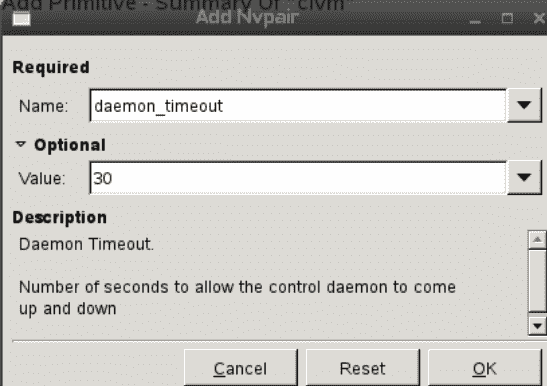

配置`Daemon_timeout`属性以告诉集群应该等待 cLVM 进程激活多长时间。

10. 你现在回到了克隆自身的属性窗口。在这里，点击 Meta attributes（元属性）选项卡。同时为该资源添加`ordered`（有序）和`interleaved`（交错）属性，两者的值都应设置为`true`。完成后，点击 Apply（应用）更改配置。接下来，查看 GUI 的管理部分，并验证所有资源是否已正常启动（这可能需要半分钟）。在继续之前，请确保一切都已启动，如果你在此处遇到问题，将无法配置后续资源。

# XEN 高可用性实用指南

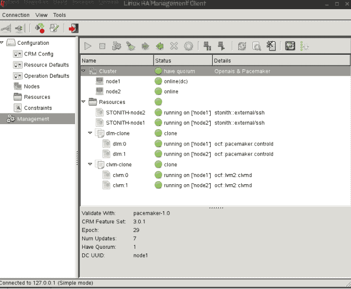

在继续之前，确保资源已启动。

1. 此时，你必须添加两个约束。首先是一个顺序约束（order constraint），它定义了只有在 DLM 克隆加载后才能加载 cLVM 克隆。你需要一个共存约束（colocation constraint），以确保 DLM 和 cLVM 始终在同一台机器上启动。要做到这一点，在 GUI 中点击 Configuration > Constraints > Add，并选择 Resource collocation（资源共存）选项。

2. 现在给约束指定一个 ID，实例`DLMCloneWithLVMClone`。接下来，从 Resource 选项的下拉列表中选择`dlm-clone`资源，从 With Resource 选项的下拉列表中选择你之前创建的`clvm-clone`资源。最后，将此约束的分值赋予`INFINITY`，这意味着它们将始终同时启动。接下来，点击 OK 保存并应用。

设置 cLVM 共享存储。

# XEN 高可用性实用指南

| Required | | |
| :--- | :--- | :--- |
| ID: | `DLMClonewithLVMClone` | |
| Resource: | `dlm-clone` | |
| With Resource: | `clvm-clone` | |
| Optional | | |
| Score: | `INFINITY` | |
| Score Attribute: | | |
| Score Attribute Mangle: | | |
| Node Attribute: | | |
| Resource Role: | | |
| With Resource Role: | | |

- 使`dlm-clone`与`clvm-clone`位于相同节点（`dlm-clone`根据`clvm-clone`定）。


如果`clvm-clone`无法位于任何节点，则`dlm-clone`也将无处于处。

共存约束确保了两个克隆资源始终同时启动。

13. 接下来，你还需要创建一个约束，以确保`DLM`在`cLVM`资源之前启动。要执行此操作，在`hb_gui`中选择 Configuration > Constraints > Add，然后选择 Resource order（资源顺序）选项。

14. 现在给约束指定一个 ID，`DLMCloneBeforeLVMClone`是一个很好的 ID，因为它准确地显示了该约束的作用。在 First（第一个）选项中，选择`DLMClone`资源，然后选择`cLVMClone`。接下来点击 OK 保存并应用设置。

## XEN 高可用性实用指南

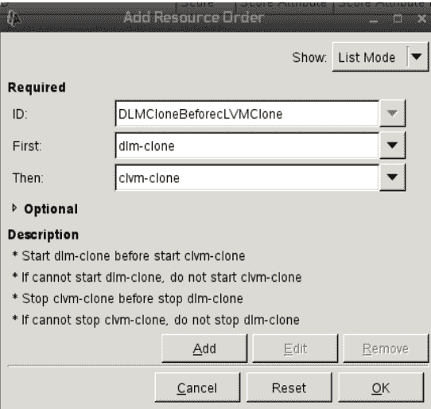

你需要顺序约束来确保首先启动`DLM`克隆，之后再启动`cLVM`克隆。

15. 你现在已准备好为集群`LVM`创建支持性资源。在继续之前，请彻底验证一切运行正常并解决所有未解决的问题。建在石头上盖房子比建在沙子上好。

### 5.1.1 创建逻辑卷

现在所有准备工作已完成，是时候创建逻辑卷本身了。基本上，这意味着你必须执行`pvcreate`、`vgcreate`，然后通过`lvcreate`来创建卷。之后，你需要在集群中创建相应的资源，以便在无冲突的情况下加载逻辑卷。然而，创建这些逻辑卷与在单机环境中不同，因为集群负责确保逻辑卷的安全加载。理论上这看起来很容易，但在实践中，你必须使用一种特殊技巧来确保一切正常工作。

问题在于，你无法直接在多路径（multipath）设备上创建逻辑卷。虽然理论可行，但在很多情况下并不有效。因此，你首先需要停止`multipath`和集群，然后在底层设备上创建`LVM`逻辑卷。你可以在步骤中阅读如何操作。

## XEN 高可用性实用指南

如前所述，在设置`LVM multipath`运行时可能会遇到问题。尽管如此它可能有效。在开始下述步骤之前，尝试快速解决方案是好的。在该解决方案中，你将告诉`LVM`配置文件`lvm.conf`也可以设备映射器（device mapper）设备。通过在所有服务器的`lvm.conf`中包含以下内容来实现：

```
types = { "device-mapper", 16 }
```

接下来，验证运行级别中`multipath`是否处于激活状态，并重启服务器。重启后，使用`pvs`命令验证物理卷是否已成功创建。你可以在步骤中阅读如何操作。

1. 现在使用`multipath`命令。这会向你显示设备是否存在。你可以在步骤中阅读如何操作。

设备：`/dev/dm-0`和`/dev/dm-1`。

2. 现在开启`multipath`。

3. 服务器重启后。

4. 现在使用以下命令。

5. 现在所有准备工作已完成，是时候创建逻辑卷了。

6. 创建卷组。

7. 一旦创建了卷。

8. 现在你需要在集群中创建相应的资源，以决定在何处如何加载卷。

9. 在`hb_gui`中，选择 Configuration > Resources > Add。

10. 你现在回到了属性窗口。

## XEN 高可用性实用指南

为`LVM`创建集群资源

10. 现在，你需要为`LVM`卷输入两个属性。首先，你必须指定强制属性`volgrpname`，它应该指向`LVM`卷组的设备名称。在示例中，该值为`/dev/vgvm1`。接下来，确保参数`Exclusive`的值为`yes`。然后点击 OK（确定）保存属性。

## XEN 高可用性实用指南

指定用于挂载`LVM`资源的属性。

11. 现在点击 Apply（应用）将`LVM`资源添加到集群中。检查`hb_gui`的管理部分，并验证资源是否已启动。

> **提示：** 你会发现，某些情况下，资源不会自动启动，且没有特定原因。如果发生这种情况，执行资源清理（resource cleanup）会有帮助。要此操作，你应该在 Linux HA 管理客户端中激活“管理”（Management）部分。然后，右键点击未启动的资源并选择“清理资源”（Cleanup Resource）。等待一分钟，你应该会发现资源再次启动了。

## XEN 可用性指南

连接视图工具

验证通过：`pacemaker-1.0`

CRM 功能集：`3.0.1`

Epoch：`41`

更新数：`7`

拥有法定人数：`1`

DC UUID：`node1`

CIB 最后写入：2009年12月20日 日 20:42:48

已连接到 `127.0.0.1` (简单模式)

**在继续之前，请验证卷组资源已成功启动。**

12. 现在你需要创建两个约束。首先，你需要一个共位置约束（colocation constraint），确保`LVM`资源与你刚刚创建的`LVM`资源始终一起加载。你还需要另一个约束，确定`LVM`资源在另一个`LVM`资源之前加载。在前面的章节中，你已经学习了如何创建这些约束。

到此为止，你已经完成了集群中`LVM`卷的配置。在下一章中，你将学习如何创建 Xen 虚拟机。

82 设置 cVM 共享存储

## 使用 OCFS2 设置共享存储

在 SLES 10 时代，将 OCFS2 设置为共享存储是常见做法。SLES 11 仍然可以，但方法稍有不同。本章描述了如何设置基于 OCFS2 的共享存储。本章提供的信息作为上一章节信息的替代方案，如果你已经配置了`LVM`卷，可以跳过本章。

## 6.1 概述

当选择 OCFS2 作为解决方案时，整个过程将会有不同。为了确保你采用正确的程序，你可以在下方找到必须执行的步骤概述：

- 在 SAN 上配置两个 LUN：一个通用 LUN，用于存储所有将作为虚拟机存储后端的文件；以及一个较小的 LUN，用于存储配置文件。

- 设置基础集群，包括书中早些时候描述的 STONITH 配置。

- 配置 OCFS2 并创建一个顺序约束（order constraint），确保 STONITH 在 OCFS2 之前加载。在本章中你可以读到如何执行此程序。

- 配置虚拟机。不再配置`LVM`卷作为存储后端，而是使用 OCFS2 LUN 作为虚拟机所用虚拟磁盘文件的存储后端。

## 6.2 设置 OCFS2

为了应用本章描述的程序，我假设你已经安装了 OCFS2 软件包。你可以像书中之前描述的那样，使用 YaST 从 SLES HA 存储库安装它们。安装软件后，确保执行以下步骤：

- 为`DLM`创建克隆资源。执行此操作的方法在第 5 章描述。

- 从 Linux HA 管理客户端，选择 Configuration（配置） > Resources（资源） > Add（添加）。

## XEN 高可用性实用指南

3. 从 Add（添加）窗口中，选择 Clone（克隆）资源类型并赋予其 ID `OCFS2-clone`。确保该资源的 interleave（交错）选项也设置为 true（见下图）

| 添加克隆 - 基础设置 | |

|---|---|

| Required（必需） | |

| ID: OCFS2-clone | |

| Options（选项） | |

| 资源初始状态：Started（启动） | |

| [ ] 最大副本数（默认为集群中的节点数）： 2 | |

| [ ] 单节点最大副本数（默认为 1）： 1 | |

| [ ] 在停止或启动副本之前以及操作成功后通知所有其他副本（默认为 false） | |

| [ ] 全局唯一（每个克隆副本是否执行不同的功能） | |

| [ ] Interleave（更改克隆的行为） | |

| [ ] 全局唯一（默认为 false） | |

| [ ] 对于每个实例 | |

4. 当询问你想创建什么资源时，选择 Primitive（原始资源）并点击 OK。输入 ID `ocfs2`，选择 Class（类）`ocf`，Type（类型）`ocfs2`。确保选中了 monitor（监控）操作，然后点击 Forward（下一步）继续。

84 设置共享存储

## XEN 高可用性实用指南

创建 `o2cb` 资源

5. 从 Add（添加）窗口中，选择 Operations（操作）选项卡。这显示了一个监控操作，默认时间为 10 秒。

6. 现在点击 Apply（应用）返回 Add（添加）窗口。在此窗口中，确保 globally-unique（全局唯一）设置为 false（假）。将监控间隔更改为 120 秒。

### `o2cb` 的元属性

7. 此时，你需要设置一个顺序约束，确保`o2cb`仅在`dlm`加载后启动。要执行此操作，从 HA 管理客户端中，选择 Configuration（配置） > Constraints（约束）并点击 Add（添加）。

8. 现在选择 Resource Order（资源顺序）并点击 OK。从下拉列表中输入 ID `dlm-before-o2cb`。首先，选择`dlm`，然后从下拉列表中选择`o2cb`。接下来，点击 OK 保存你的设置。

到此为止，你正在配置`o2cb`资源。从 HA 客户端的管理部分，你应该看到所有克隆实例都已处于启动状态。

## 6.3 创建 OCFS2 卷

仅为集群创建资源是不够的。你现在还需要创建一个 OCFS2 卷。要执行此操作，你需要在一个节点上执行以下任务：

1. 使用`multipath -l`找到要在上面创建 OCFS2 的设备名称。由于你使用了`multipath`，你必须使用`multipath`设备名称之一，例如`dm-0`（在本示例中为`dm-2`）。

2. 考虑你想给`multipath`设备的节点数量。在`mkfs.ocfs2`命令中，你通过`-N`指定节点数量。例如，使用`mkfs.ocfs2 -N 4 /dev/dm-2`在系统上的`/dev/dm-2`上创建一个允许四个节点同时访问的共享文件。下面的列表显示了该命令的结果。

使用四个节点创建 OCFS2 卷

```
node1: # mkfs.ocfs2 -N 4 /dev/dm-2
mkfs.ocfs2 1.4.1
Cluster stack: pcmk
Cluster name: pacemaker
NOTE: Selecting extended slot map for userspace cluster stack
Filesystem label=
Block size=4096 (bits=12)
Cluster size=4096 (bits=12)
Volume size=64518098 (1573163 clusters) (15731640 blocks)
488 cluster groups (tail cores 22971 clusters, rest cover 32256 clusters)
Journal size=26835456
Initial number of nodes slots: 4
Creating superblock: done
Initializing superblock: done
Writing files: done
Writing superblock: done
Writing backup superblock: 3 block(s)
Formatting Journals: done
Formatting slot map: done
Writing last-found: done
Formatting quota files: done
mkfs.ocfs2 successful
```

3. 在返回集群配置之前，你需要确认 OCFS2 文件系统可以挂载到所有相关的节点上。为了测试这一点，你可以从所有运行了`o2cb`资源的节点上执行手动挂载。我习惯于挂载到一个临时目录中，仅为了确认其工作正常。要执行此操作，请使用以下命令：

```
mount -t ocfs2 /dev/dm-2 /mnt
```

4. 别忘记卸载所有的 OCFS2 挂载。如果你不这样做，你会发现无法在集群中挂载 OCFS2 卷。要从所有节点上卸载该卷，请使用以下命令：

```
umount /mnt
```

如果系统给了你“Device is busy”（设备忙用）信息，说明你可能正处于`/mnt`目录中。退出该目录并重试！

现在你需要再次重复此过程一次。对于基于 OCFS2 的 Xen HA，你需要两个 OCFS2 卷：一个用于存储磁盘文件（必须足够大），另一个用于存储配置文件（1 GB 的可用磁盘空间就足够）。

## 6.4 为 OCFS2 卷创建集群资源

现在你已经成功设置了 OCFS2，你需要在集群中创建一个克隆资源，该资源负责在所有节点上挂载该卷。你必须特别这些这些卷的挂载点。较小的卷必须挂载到`/etc/xen/vm`，较大的卷必须挂载到`/var/lib/xen/images`，以便访问虚拟机的磁盘文件。以下步骤显示了如何操作：

1. 从 Linux HA 管理客户端，选择 Configuration（配置） > Resources（资源） > Clone（克隆）并点击 Add（添加）。在添加窗口中，点击 Add。这将进入添加克隆窗口。

2. 将 ID 设置为 `OCFS2-data` 并确保选中了 Interleave（交错）选项。然后点击 Forward（下一步）继续。

## Xen 高可用性实用指南

### 添加克隆 - 基本设置

必需项

ID: `OCFS2-data`

选项

- 资源的初始状态：Stopped（停止）

- 最大副本数（默认值为集群中的节点数）：[ ]

- 单节点上的最大副本数（默认值为 1）：[ ]

- 在启动或停止副本之前以及操作成功后通知所有其他副本（默认值为 false）

- 全局唯一（克隆的每个副本是否执行不同的功能？默认值为 false）

- Interleave（交错：更改顺序约束（克隆/主节点之间）的行为，使得实例在其同级实例启动后立即启动/停止（而不是等待另一个克隆的所有实例）。默认值为 false）

- Cancel Forward（取消下一步）

为 OCF2 文件系统创建克隆资源

3. 从弹出的添加窗口中，点击 Primitive（原语），然后选择 OK（确定）。这将进入添加原语 - 基本设置窗口。在此窗口中，添加以下信息：

- ID: `storage`

- Class（类）：`ocf`

- Provider（提供者）：`heartbeat`

- Type（类型）：`Filesystem`（文件系统）

4. 点击 Forward（下一步）后，你现在处于已创建创建的摘要窗口。在 Instance Attributes（实例属性）选项卡上，你需要指定挂载 OCFS2 卷所需的所有属性：

- `device`（设备）：`/dev/dm-2`（请替换为你的特定设备！）

- `directory`（目录）：`/var/lib/xen/images`

- `ftype`（文件类型）：`ocfs2`

## Xen 高可用性实用指南

### 添加原语 - "storage" 摘要

| Name（名称） | Value（值） |

|---|---|

| device | /dev/dm-2 |

| directory | /var/lib/xen/images |

| ftype | ocfs2 |

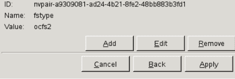

OCFS 文件系统的必需参数

5. 回到克隆摘要，激活 Meta Attributes（元属性）选项卡并确保设置了以下属性：

- `interleave`: `true`

- `ordered`: `true`

- `target-role`: `Started`

然后点击 Apply（应用），为你的集群创建 OCFS2 资源。现在你现在可以重复相同的过程，为存储在`/etc/xen/vm`中的 Xen 配置文件的 OCFS2 文件系统创建一个资源。

作为配置的最后一部分，你现在需要创建一个顺序约束，确保只有在`o2cb`资源成功启动后才挂载 OCFS2 文件系统。你需要对两个文件系统应用此过程：

1. 从 Linux HA 管理客户端，选择 Constraints（约束） > Resource Order（资源顺序）并点击 Add（添加）。

2. 在添加资源顺序窗口中，输入以下参数：

ID: `o2cb-before-ocfs2`

First（先）：`o2cb`

Then（后）：`OCFS2-data`

对 `OCFS2-config` 卷也重复此过程。

## Xen 高可用性实用指南

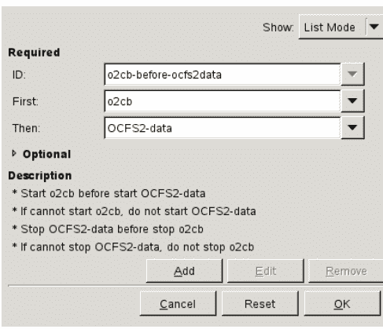

创建顺序约束以确保正确的加载顺序

你现在准备好在集群上配置 OCFS2 资源了。你现在应该验证一切都已正常运行。如果是，你就可以进入下一章，在那里你将创建 Xen 虚拟机以及运行它们的资源。

## Xen 高可用性实用指南

| Name（名称） | Status（状态） | Details（详情） |

|---|---|---|

| Cluster | | |

| node1 | | |

| node2 | | |

| stonith-node1 | | |

| stonith-node2 | | |

| dm-0 | | |

| dm-1 | | |

| o2cb | | |

| o2cb-1 | | |

| OCFS2-data | | |

| storage-0 | | |

| storage-1 | | |

| OCFS2-config | | |

| config-0 | | |

## Xen 高可用性实用指南

### 设置 LVM

现在你已经设置了`LVM`，可以进行下一步操作：配置虚拟机。此任务可以使用`virt-manager`完成，它是 SLES 上管理虚拟机的默认工具。在集群环境中使用它有一些特殊之处。以下步骤如下：

1. 在`hb_gui`中，找到作为虚拟机后端`LVM`卷已激活。提示：你当然可以使用`hb_gui`迁移它。右键点击卷资源，从菜单中选择 Migrate（迁移）。你现在将看到一个窗口，可以使用 To Node 选项指定迁移的主机。


## 2. 在 Virtual Manager 中激活本地主机

在 `Virtual Manager` 中，双击 `localhost` 行。这将本地主机的状态改为 `Active`（激活），意味着你可以开始创建虚拟机。

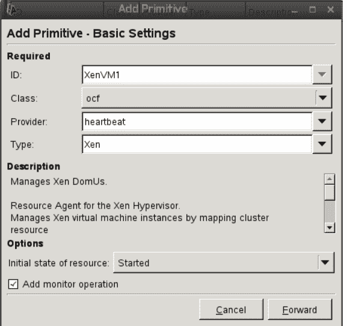

要开始创建虚拟机，你需要激活本地主机。

## 3. 创建虚拟机

在 `Virtual Manager` 界面底部，点击 `New`（新建）创建一个虚拟机。这将启动虚拟机向导。在向导启动的第一个窗口中，点击 `Forward`（下一步）继续。

## 4. 选择安装方式

向导现在询问你是想创建一个新的虚拟机，还是倾向于使用一个已经安装了完整虚拟机的现有磁盘。从该窗口，选择“I need to install an operating system”（需要安装操作系统）并继续。

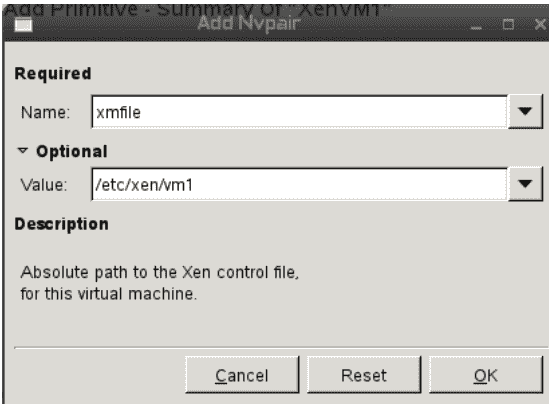

## 5. 指定操作系统

现在指定你想安装的操作系统。在示例中，我将安装 `SUSE Linux Enterprise Server 10`，你也可以安装任何操作系统。唯一的要求是它必须使用与主机操作系统相同的处理器架构。这意味着你不能在 32 位的主机上安装 64 位软件（相反是可以的），并且不能在 `Intel` 平台上安装 `SPARC` 软件。

### 操作系统类型

请指定将在虚拟机中运行的操作系统类型。这定义了许多默认值，并有助于决定如何启动半虚拟化操作系统。

- `NetWare`
- `其他`
- `RedHat`
- `SUSE`
  - `Novell Open Enterprise Server 2 (Linux)`
  - `SUSE (其他)`
  - `SUSE Linux Enterprise Desktop 10`
  - `SUSE Linux Enterprise Desktop 11`
  - `SUSE Linux Enterprise Server 8`
  - `SUSE Linux Enterprise Server 9`
  - `SUSE Linux Enterprise Server 10`
  - `SUSE Linux Enterprise Server 11`
  - `openSUSE`
  - `openSUSE 11`
- `Solaris`
- `Windows`

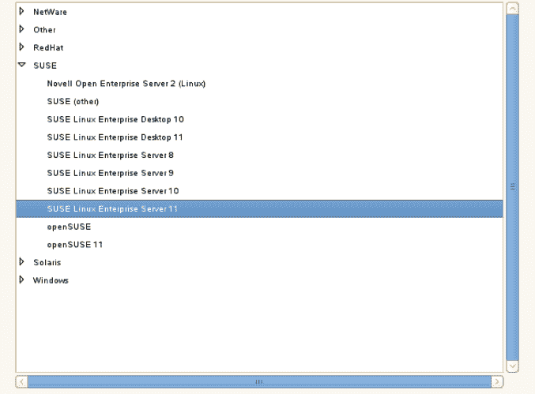

在 `Xen` 中，你可以安装任选的操作系统。

## 6. 配置虚拟化方法

现在你看到了“摘要”（`Summary`）屏幕，你必须在此添加虚拟机的进一步配置。首先，你需要指定想要使用的虚拟化方法。如果你的操作系统是以半虚拟化模式安装的（如果软件提供了半虚拟化选项，情况此类如此），你应该始终以半虚拟化模式安装，因为它提供了许多性能优势。在所有其他情况下，你需要选择“全虚拟化”（`Full virtualization`）。

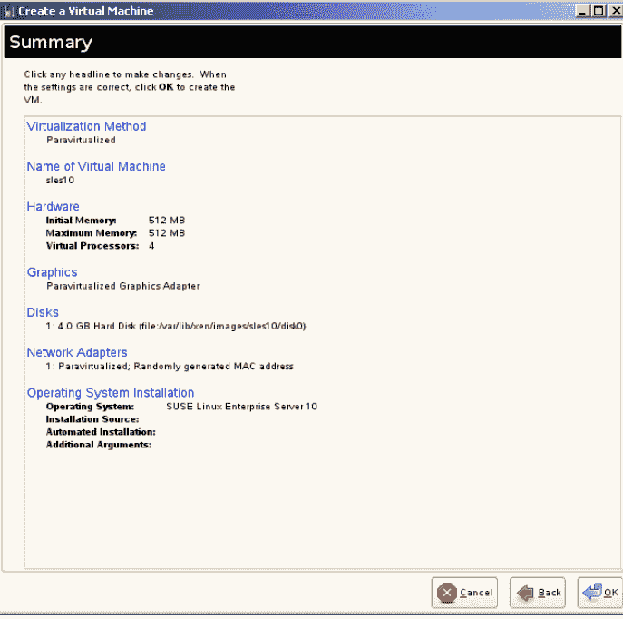

如果可能，以半虚拟化模式安装操作系统。

## 7. 配置内存和 CPU

接下来，你需要为虚拟机命名，然后点击“硬件”（`Hardware`）链接来指定虚拟机允许使用的 `RAM` 和 `CPU` 核心数。希望你已经对机器所需的 `RAM` 数量进行了计算。此结果将作为“初始内存”（`Initial Memory`），例如，将其设置为 `4096` 以为虚拟机提供 `4GB` 的 `RAM`。将“最大内存”（`Maximum Memory`）设置为高得多的 `RAM` 也是一个好主意，`Xen` 提供了在不重启虚拟机的情况下增加可用 `RAM` 数量的可能性。你可以想象，当你一段时间后发现最初的 `4GB` 不够用，这非常有用。将最大内存设置为 `8GB` 并不意味着你的服务器将立即使用所有内存。

除了 `RAM` 需求外，你还需要指示虚拟机允许使用多少 `CPU` 核心。确保你选择的核心数大于服务器上物理可用的实际数量！如果你没有期望虚拟机能从使用多个 `CPU` 核心中获得特定收益，那么将虚拟 `CPU` 的数量限制为一个甚至更好。这可以防止你必须为多 `CPU` 环境优化你的服务器。

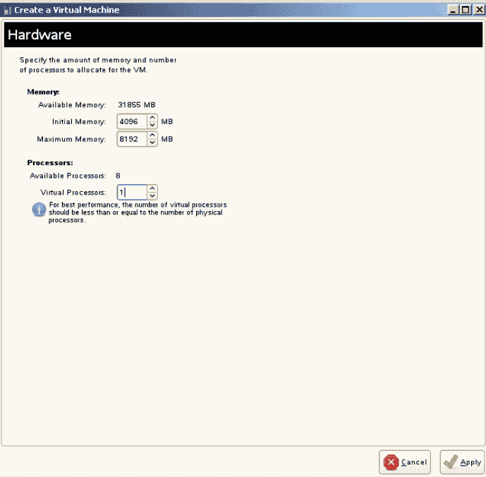

使用“最大内存”（`Maximum Memory`）参数可以让你以后为 `VM` 分配内存更容易。

## 8. 配置磁盘

在“磁盘”（`Disks`）选项处，你必须指定虚拟机可以使用什么作为硬盘。你可能已经猜到了，那是为了此目的在集群中创建的 `LVM` 卷。点击“磁盘”链接后，你会发现虚拟机已经获得了一个默认磁盘。这是一个 `4GB` 的磁盘文件，你可以安全地删除它。接下来点击并浏览到你使用的设备所在的位置。你应该在 `/dev` 目录下寻找一个与卷组（`volume group`）同名的目录。在这个目录中，你将找到所需的设备文件，以对你之前创建的逻辑卷进行寻址。

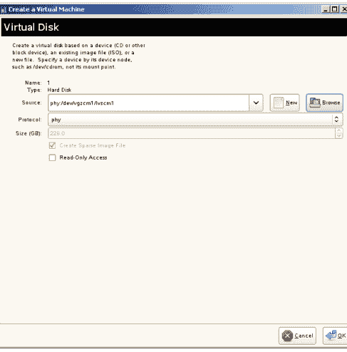

使用你之前创建的 `LVM` 卷作为虚拟机的后端存储。

## 9. 配置安装介质

在“磁盘”（`Disks`）窗口中，你还需要指示你计划如何安装虚拟机。假设你正在使用光驱安装，你可以点击“`CD-Rom`”按钮并浏览到你使用的设备（例如 `/dev/cdrom`）。在“磁盘”（`Disks`）窗口中，你现在应该拥有一个硬盘和一个光驱。如果情况确实如此，点击“应用”（`Apply`）保存你的更改并返回主菜单。

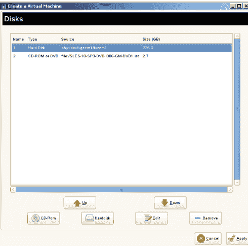

你必须添加一个硬盘和一个光驱。

## 10. 配置网络

如果你在网络上配置了负载均衡（通过多个网桥），你现在应该指示虚拟机的网络适配器连接到哪个网桥。如果你只有一个网桥（或者完全不知道这是什么），你已经准备就绪，可以点击“确定”（`OK`）。这将启动虚拟机的安装。在此之前，请检查配置是否符合你的要求。

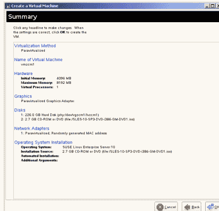

## 11. 安装虚拟机

现在你会发现 `Xen` 开始安装需要一段时间。之后，你可以按照你想要执行虚拟机的安装。

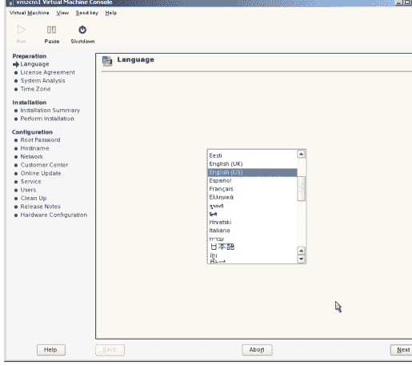

在安装虚拟机时，你会发现你有两个鼠标而不是一个。这很烦人，但你对此无能为力——这是 `VNC` 的一个已知问题。

## 12. 复制虚拟机配置

在安装虚拟机后，还有一个最后一步但非常重要的步骤要执行。你需要将虚拟机的配置复制到所有主机。你可以通过自动化解决方案（例如 `NFS` 共享或多个节点同时访问的卷）来实现这一点，但你会发现对于一项可以通过手动完成的事情来说，这工作量太大了。因此，此时请确保你已将 `/etc/xen` 中的文件复制到所有主机，然后你就可以进行下一步了。

### 7.1.1 为热迁移做准备

`Xen` 的酷功能之一是热迁移（`Live Migration`）。这意味着你可以将一台机器迁移到另一台机器，而没有任何停机时间。当你热迁移机器时，用户完全不会察觉！如果你在集群环境中使用迁移，这还带给你一个好处，你在关闭主机时，该主机上的虚拟机会在实际关闭发生之前自动迁移到集群中的另一台主机。要使用热迁移（`live migration`），你需要对主机采取一些预防性措施。你必须更改 `/etc/xend/xend-config.xsp` 文件中的一个设置，该文件可以在每个 `Xen` 主机上找到。接下来的步骤描述了具体操作方法：

1. 使用编辑器打开 `/etc/xend/xend-config.xsp` 文件并找到以下行：

```
#(xend-relocation-server no)
#(xend-relocation-port 8002)
(xend-relocation-hosts-allow ^localhost -localhost\.localdomain$)
```

2. 将这些行更改为如下例所示的内容：

```
(xend-relocation-server yes)
(xend-relocation-port 8002)
(xend-relocation-hosts-allow ' ) )
```

你应该意识到，上述示例中的 `xend-relocation-hosts-allow` 行将允许网络中的所有主机将虚拟机迁移到此主机。如果你不希望这样做，应该使用正则表达式进行一些额外的过滤。在 `xend-config.xsp` 文件中，你可以找到一些可以使用正则表达式示例。此外，确保上述行在配置文件中仅出现一次，以避免配置冲突。

3. 在所有你希望执行热迁移的主机服务器上重复上述步骤。

4. 要测试此过程是否真的有效，你现在可以尝试使用 `xm migrate --live` 命令进行。例如，要将虚拟机 `vml` 迁移到主机节点 `node2`，你将使用以下命令：

```
xm migrate --live vml node2
```

## 7.2 为虚拟机创建集群资源

最后一步，你现在需要配置集群来管理虚拟机。这意味着你必须为虚拟机创建一个资源，之后通过一个共存性约束（`collocation constraint`）确保虚拟机和逻辑卷始终保持在一起。从这里，还需要与 `DLM` 和 `cVM` 资源进行共存，才能成功启动逻辑卷。除了这些共存性约束外，你还需要一些顺序约束（`order constraints`）。之后，你希望在逻辑卷成功初始化后启动虚拟机！

在开始之前，请确保你已经停止了刚刚创建的虚拟机。在集群中创建资源后，集群将尝试启动虚拟机，如果该虚拟机已经在其他地方运行，它将无法工作。更糟糕的是：如果你仍然尝试，可能会面临严重的文件系统损坏的风险！

1. 现在创建一个原始资源，使用你选择的 `ID`（`vmserver1` 或任何你喜欢的名称），确保选择类 `ocf`、提供程序 `heartbeat` 和类型 `Xen`。（请注意，资源不是按字母顺序列出的，你将首先看到所有以大写字母开头的资源，然后是以小写字母开头的资源。确保资源的初始状态设置为 `started`，然后点击“下一步”继续。


2. 在实例属性（`Instance Attributes`）窗口中，你将看到一个名为 `xmfile` 的属性。该属性需要用于启动虚拟机的配置文件的精确名称和位置。例如，取决于你使用的配置，它可能是 `/etc/xen/vm1`。如果你也想使用热迁移，此选项可以确保如果集群中的某个节点发生故障，集群将对在该节点运行的虚拟机执行热迁移。使用此选项意味着在节点真正完成之前需要更长时间（毕竟你首先需要将所有虚拟机从该节点迁移走），但此选项的优势是用户将完全没有停机时间。你可能喜欢的另一个参数是 `allow mem management`（允许内存管理）。正如其名所示，使用此参数可以在稍后的实例中动态调整内存，如果你发现集群中剩余的主机没有足够的内存托管所有虚拟机，这将非常有用。然而，目前 `Pacemaker` 软件从集群管理此参数的能力有限。


在集群中，你可以对虚拟机执行有限的管理任务。

在执行任何其他操作之前，你应该确保该虚拟机没有在集群的任何地方运行。如果它正在运行，在执行下一步时你将会遇到严重的问题。在所有主机上运行 `xm list` 以验证你正在操作的虚拟机在任何地方都没有激活。如果已激活，使用 `xm destroy <vm-name>` 为虚拟机“拔掉电源”。

在此时，你可以保存更改。在执行此操作时，集群将自动处理 `Xen` 虚拟机的启动。

作为配置的最后部分，你现在必须创建约束。在创建集群时，你确保了虚拟机所需的逻辑卷在启动虚拟机之前是可用的。当集群尝试自动启动虚拟机时，你需要确保卷始终加载在与虚拟机相同的主机上。因此，你需要共存约束以及顺序约束来处理此问题。一旦完成，你的高可用集群就处于运行状态。

## 管理集群

现在集群已经在运行，真正的工作开始了。设计良好的集群的优势在于它不需要大量工作。集群基本上会自己运行，只有在少数情况下需要执行特定的管理任务。本短章节的目的是让你熟悉最重要的管理任务。

## 8.1 清理资源

在某些情况下，你必须删除一个资源并重新启动。甚至可能出现你需要删除一个符合预期的资源并将其作为新资源创建。在这种情况下，你可能会发现资源没有从集群中正常消失。

资源有时漂移是因为集群维护了实际状态。如果你感兴趣，可以使用 `cibadmin -Q` 命令显示此状态。该命令将导出包含当前状态的 `XML` 配置。此状态来自 `cibxml`，它是实际状态。但在某些情况下，实际状态并没有同步。

要清理资源，只需右键点击你想更新状态的资源，并在菜单中选择“清理资源”（`Cleanup Resource`）。这将立即启动资源的同步并可能解决你遇到的问题。


如果资源问题由于 `CIB` 中的状态过时引起，你可以通过清理资源来解决它们。在选择清理资源后，图形应用程序将提示你想在哪个节点上清理。如果你确定问题与某个特定节点未正确更新有关，从下拉列表中选择该节点。否则，选择“所有节点”以更新集群所有节点的状态信息。

## 8.2 迁移资源

另一个常见的维护任务是资源的迁移。如果集群发生故障，资源将自动离开故障节点。集群会自动平衡迁移资源，这意味着它们分布在各个节点上，以避免集群中的某个节点被迁移的资源过载。默认行为是，当资源最初加载的主机重新回到集群时，资源将回回到原始节点。如果你不喜欢这样，可以更改默认的资源粘性（`stickiness`）。你可以在集群资源管理器（`CRM`，集群的核心组件）的属性上找到此参数。

1. 在 `Linux HA` 管理客户端中，选择配置（`Configuration`） > `CRM` 配置（`CRM Config`）。这将为您显示 `CRM` 使用的当前值。

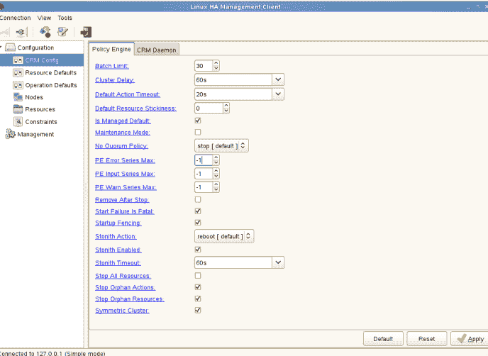

在 `CRM Config` 对象上，您可以为集群设置默认行为。

2. 选择默认资源粘性（`Default Resource Stickiness`）参数。当前值 `0` 表示资源将尝试留在当前位置。它也意味着当集群中的严重问题解决后，资源将移回原始位置。将此值更改为 `100000`。这意味着除非资源当前所在的节点发生故障，否则该资源永远不会离开其当前位置。

与其在整个集群范围内设置粘性，您也可以在特定资源上使用它。要进行此操作，请从集群中选择该资源并点击编辑（`Edit`）以更改其值。接下来，选择元属性（`Meta Attributes`）选项卡并点击添加（`Add`）。现在，您可以从下拉列表中选择资源粘性（`Resource Stickiness`）。将其设置为您环境中偏好的值。

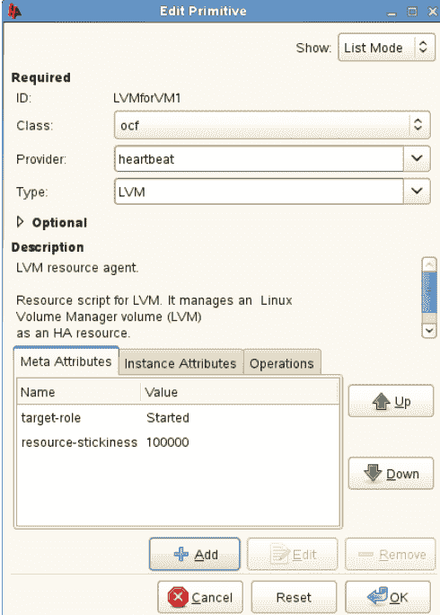

您也可以在单个节点上指定资源粘性。

当资源在集群节点故障后迁移时，它将遵循为该资源设置的资源粘性。然而，如果您手动迁移资源，系统会自动为该资源创建一个约束（`constraint`）。这可能会导致困惑，因为当节点发生故障时，位置约束可能会资源无法自动迁移到另一个节点。因此，在手动迁移后，您必须清除迁移约束。这是一个简单的操作，您可以在右键点击资源后出现的菜单中执行。从菜单中选择清除迁移约束（`Clear Migration Constraint`）。这将允许资源移动到集群中任何它想去的地方。在下图中，您可以看到在 `LVMforVM1` 资源被手动迁移到节点 `node1` 后，迁移约束被设置为 `+INFINITY`。

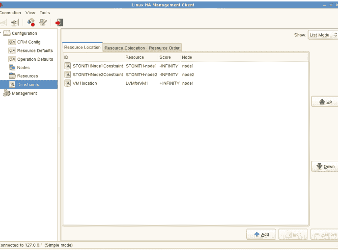

在手动迁移资源后，会为该资源创建一个迁移约束。

## 8.3 更改资源管理状态

在某些情况下（例如更新集群软件），您可能需要完全关闭软件。但这可能会导致问题，因为由集群管理的资源也会随之关闭，而这并不是您创建高可用解决方案的初衷。为了防止这种情况，您可以更改集群资源的状态。默认情况下，资源处于管理状态（`managed state`），这意味着集群负责该资源，在集群未运行时它无法运行。如果您将其处于非管理状态（`unmanaged state`），资源将独立运行。

要将资源置于非管理状态（以及恢复到管理状态），您可以对单个资源进行操作，也可以为整个集群设置状态。要设置整个集群，请执行以下步骤：

1. 在 `Linux HA` 管理客户端中，选择配置（`Configuration`） > `CRM` 配置（`CRM Config`）。这显示集群的当前属性。

2. 点击维护模式（`Maintenance Mode`）旁边的复选框并点击应用（`Apply`）以保存更改。

3. 现在查看 `hb_gui` 的管理部分，这将显示集群中的所有资源现在都处于非管理模式。

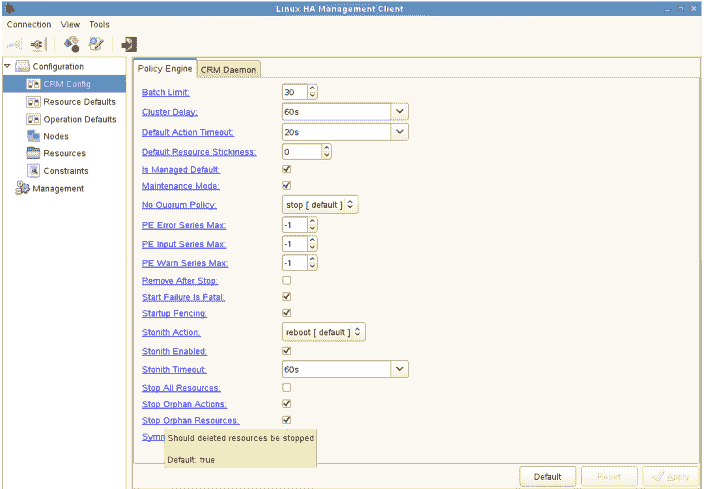

在将集群设置为维护模式后，所有资源都达到非管理状态。

4. 当您对集群进行维护时，返回 `CRM` 配置并移除维护模式的复选框。这将允许集群接管资源。像许多选项一样，对于整个集群，这些操作可以在右键点击资源后出现的菜单中。选择取消管理资源（`Unmanage Resource`）将资源置于非管理模式。选择管理资源（`Manage Resource`）将其恢复到管理模式，一旦您完成了工作。

## 8.4 验证并同步集群

在某些情况下，您可能会发现集群没有以您期望的方式工作。这可能是由于两个原因。首先，您可能会发现集群的更改同步到其他节点的速度不够快。另一个问题可能是由于集群配置中存在错误而导致的，即使您使用了 `Linux HA` 管理客户端！对于这两种情况，可以使用 `cibadmin -S` 命令强制节点之间的集群库（`CIB`）进行同步。这将确保它们是最新的。

# 附录：创建开源 SAN


为了设置高可用解决方案，您需要一个 SAN。在大多数情况下，这将基于光纤或 iSCSI 的私有 SAN 解决方案。由于这涉及到昂贵的光纤基础设施，这种解决方案对于负担得起的 SAN 并不是最佳选择。如果您的环境是这种情况，您可以考虑开源 SAN。这是一个完全基于开源软件的 iSCSI 解决方案。

注意：在本书的最后评审期间，我不得不包含有关创建自己的 SAN 的信息。由于截止日期，本文针对 SUSE Linux Server 10 sp2 编写，但也适用于 SLES 11。根据您在本书几章中获得的关于 Pacemaker 的知识，创建自己的 SLES 11 开源 SAN 将不会有困难。

## 9.1 基于 DRBD、Heartbeat 和 iSCSI 的自定义 SAN

并不是都有钱购买 SAN 设备。很少有公司能承受 SAN 并在服务器存储故障时丢失关键数据。您不需要私有 SAN 设备，但可以使用开源软件构建自己的 SAN。本文将讨论如何实现这一点。在开始构建 SAN 解决方案之前，您应该确定确切需要什么。通常，SAN 由不同的组件组成，其中高可用是核心。如果您的 SAN 由一个盒子组成，您就是在玩火，如果这个盒子故障，您的数据将无法使用并导致您损失金。因此，在现实生活中，需要两个盒子来构建 SAN，构建开源 SAN 也不例外。这就是分布式复制块设备（DRBD）派上用场。使用此解决方案，您可以在跨网络构建自己的 RAID，这意味着如果提供存储的服务器之一发生故障，另一台服务器将接管该角色。

# XEN 高可用性实用指南

构建这种灵活的 SAN 解决方案的挑战之一在于让它尽可能通用。这意味着当组件故障时，必须自动进行切换。因此，如果当前托管 DRBD 和 iSCSI 访问的 SAN 节点宕机，SAN 中的另一个节点需要自动接管。为了实现这一点，我们将使用 Heartbeat 来监控并确保 SAN 中所有关键资源的可用性。

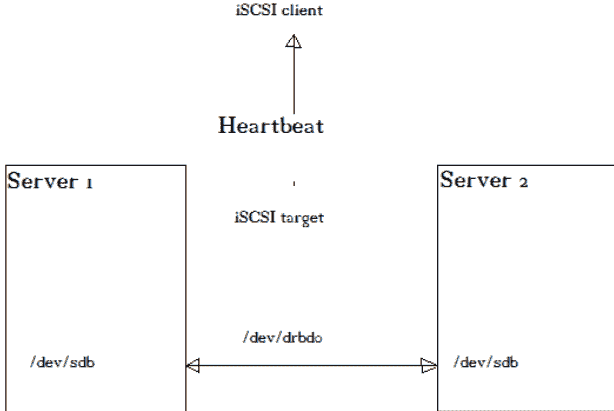

开源 SAN 架构概览

## 9.2 所需软件

要构建此类解决方案，你需要适当的软件。通常，任何 Linux 发行版都可以，但在本录中，我们将使用 SUSE Linux Enterprise Server。该 Linux 发行版可以从 http://www.novell.com/download 免费下载。

使用 SUSE 的优势之一是该发行版由 Heartbeat 软件的开发者使用，而该软件在此配置中起着至关重要的作用。因此，在与 SUSE 工作时，你可以确保操作系统与集群软件之间的最佳集成。你也可以使用 SUSE Linux 的开源版本，但为了构建稳定可靠的配置，我始终建议使用企业版本。

附录：创建开源 SAN 解决方案

# XEN 高可用性实用指南

在选择想要安装的软件时，请尽量保持精简。毕竟，你在这里构建的是一个 SAN 解决方案，而且通常在 SAN 上不会运行任何服务。从可安装的软件模式列表中，选择以下项：

- 服务器基础系统 (Server Base System)
- 文档 (Documentation)
- 服务器级 GNOME 桌面环境 (GNOME Desktop Environment for Server)
- X 窗口系统 (X Window System)

同时确保已安装高可用性扩展（High Availability Extension）的所有软件。

此外，还要选择 iSCSI 目标组件，你不需要其他任何。事实上，你可以用更少的组件完成并不选择 GNOME 环境和 X 窗口系统，但由于 SUSE 依赖 YaST 来配置机器，我建议至少在安装工作期间保留图形化界面——如果你习惯使用非图形化版本的 YaST2（如果你没见过，请运行 `yast` 而不是 `yast`），这当然不是必须。安装完成后，你仍然可以禁用它。当然，你可以自由地从桌面启动任何你喜欢的图形化组件。

除了软件要求外，在创建此类解决方案时，你还应该考虑你想要的硬盘布局。无论你是设置服务器硬件还是两台笔记本电脑来测试该环境，都应该考虑到 SAN 存储需要一个存储设备。在 1 中，我使用了 `/dev/sdb` 作为示例存储设备，但这假设你有两个（甚至更多）硬盘可用。如果没有这种情况，那么为 SAN 存储在一个大型专用卷中创建一个 LVM 配置可能是一个非常好的解决方案。LVM 配置还允许你使用快照层，关于这一点将在本文中介绍。在我的测试设置中，使用了两台带有 160 GB 硬盘的笔记本电脑，我使用了磁盘布局：

- `/dev/sda1`：位于 `/boot` 上的 100 MB Ext2 格式分区。
- `/dev/sda2`：剩余可用磁盘空间，标记为类型 8e 以供 LVM 环境使用。
- `/dev/system`：使用 `/dev/sda2` 可用磁盘空间的 LVM 卷组。
- `/dev/system/root`：10 GB Ext3 格式逻辑卷，用于文件系统根目录。
- `/dev/system/swap`：2 GB 用于交换空间的逻辑卷。
- `/dev/system/DRBD`：100 GB 已分配并格式化的逻辑卷。

# Xen 高可用性实用指南

要创建此类磁盘布局，在执行安装时使用 YaST 集成模块。

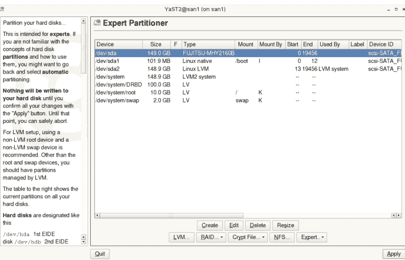

要配置 SAN 的磁盘布局，YaST 可以提供极大帮助。

在设置 SAN 时，最后一部分需要考虑的是网络。建议当你的 SAN 与普通网络流量分离时使用专用网络。你不希望 DRBD 存储设备之间的同步被用户启动的文件传输中断。通常，你还希望为 Heartbeat 流量配置一个分离的网络，以便在流量临时升高时，DRBD 设备不会因为通信状态。如果 Heartbeat 包通过普通网络连接传输，你不会希望 Heartbeat 忽略故障，因为冗余链路仍在响应，而你的 SAN 处于断开状态吗？

## 9.3 配置 DRBD

假设你的服务器已根据指南启动运行，现在是进行 SAN 配置的第一步：设置 DRBD 设备。在开始此配置之前，确保每台服务器上都有存储设备。在此文中，我在处理 `/dev/system/DRBD` 设备，此名称在你的配置中可能会不同。另一个好主意是使用从此处下载的脚本：http://www.networking.com/linux/scripts/addbd_resource.html。该脚本将为你创建配置文件，防止你出错。下面的步骤假设你正在使用名为 `san1` 和 `san2` 的两台服务器。如有必要，将这些替换为你的服务器名称。

1. 下载 `addbd_resource` 脚本：http://www.networking.com/linux/scripts/addbd_resource.html。将其放入用户目录并使用以下命令设置为可执行：`chmod +x addbd_resource.sh`。

2. 运行 `addbd_resource.sh` 脚本并提供以下值：

- 资源名称：`drbd`
- DRBD 设备数量：`0`
- 要镜像的块：`/dev/system/DRBD`
- 第一台服务器：`san1`
- 第一台服务器 IP 地址：（你的服务器 IP 地址）
- 第二台服务器：`san2`
- 第二台服务器 IP 地址：（你的服务器 IP 地址）
- 同步速率：指同步 DRBD 设备之间更改时的速度。在 100mbit LAN 上使用 `100m`，在 Gigabit LAN 上使用 `1000m`。想确保 DRBD 不占用所有带宽？将其设置为低一些。
- 同步协议：`protocol C` 提供了速度和可靠性的最佳结合。

输入所有必需参数后，将配置写入 `/etc/drbd.conf` 文件。这将产生一个内容如下的文件：

列表：`drbd.conf` 示例。

```
/etc/drbd.conf
### 查看 /usr/share/doc/drbd/drbd.conf 中的示例配置
### begin resource drbd0
resource drbd0 {
  protocol C;
  startup (timeout 120);
  disk (on-io-error detach);
  net {
    sync {
      rate 100m;
    }
    group 1;
    extents 257;
  }

  san1 {
    device /dev/drbd0;
    disk /dev/system/DRBD;
    address 192.168.1.230;
    meta-disk internal;
  }

  san2 {
    device /dev/drbd0;
    disk /dev/system/DRBD;
    address 192.168.1.240;
    meta-disk internal;
  }
}
### end resource drbd0
```

现在配置就绪，你可以使用 `modprobe drbd` 加载 DRBD 内核模块。如果出现错误“module not found”，请确保你已为正在使用的内核安装了相应的模块（要确定是哪个内核，请使用 `uname`）。现在内核已加载，是进行第一次测试了。要执行此，使用带有 `-d`（干运行）选项和 `adjust` 参数的 `drbdadm` 命令。这将确保 DRBD 设备与你刚刚的配置文件同步。现在运行以下命令：

```
drbdadm -d adjust drbd0
```

此命令会给出一些结果。如果输出看起来所示，你就可以继续并将配置复制到第二台服务器。

```
drbdset /dev/drbd0 disk /dev/system/DRBD internal --on-io-error=detach
drbdset /dev/drbd0 sync --rate=100m --extents 257
drbdset /dev/drbd0 net 192.168.1.230:192.168.1.240:C
```

现在 DRBD 设备已就绪，你可以将配置复制到第二台服务器：

```bash
scp /etc/drbd.conf san2:/etc/drbd.conf
```

接下来，在第二个节点上，你需要加载 DRBD 模块并测试 DRBD 设备。因此，从 SAN2 执行以下命令：

```
modprobe drbd
drbdadm -d adjust drbd0
```

现在 DRBD 服务已经启动运行，主从关系也应该建立。使用 `drbd status` 测试是否一切运行正常。通过在一个服务器上运行 `drbdset /dev/drbd0 primary --do-what-i-say` 命令来告诉该服务器应该作为主（即活跃）服务器。

# XEN 高可用性实用指南

列表：使用 `drbd status` 测试 DRBD 设备是否工作正常。

```bash
san:/etc # drbd status
drbd driver loaded OK; device status:
version: 0.72 (api:79/proto:74)
SVN Revision: 2572; built by imbdale; 2006-10-25 18:17:21
0: resource:Primary/Secondary ld:Consistent
ns:234268 nr:0 dw:0 dr:2350748 al:0 bm:12926 lo:0 pe:41 ua:2020 ap:0
[<...> synced: 2.3% (99984/102272)M
finish: 2:24:36 speed:11,772 (11,368) K/sec
1: cs:UnConfigured
```

如上上所示，DRBD 设备已设置好，但仍在同步中。在初始创建设备后，这需要一些时间。如果运行一段时间，它将在过段时间后完全完成同步。

在此步骤过程中，你已经学习了如何设置 DRBD 设备。如果你想创建一个开源 SAN 解决方案，这是一个很好的开始，但还不够。在目前，如果 `san1` 宕机，你需要在另一台服务器上手动设置 `drbdset primary` 命令。通常情况下，你不希望这样做，而且你正准备创建一个 Heartbeat 集群解决方案。在下一节中，你将学习如何设置此集群。

## 9.4 设置 Heartbeat 集群

让我们来聊这个：设置 Heartbeat 集群是另一回事。要妥当操作涉及许多步骤，例如设置 STONITH 以确保故障节点不会被自动关闭。我没有涵盖所有内容，因此假设你的 Heartbeat 网络已经配置好。如果没有配置，请使用以下最简指南在 SUSE YaST 中创建一个简单的双节点 Heartbeat 集群。

> 警告：下文描述的程序是最小化程序，仅供测试环境使用。如果你想使用此程序设置生产环境，请自承担风险！

1. 确保名称解析设置正确。如果你使用 DNS，可能一切都已就绪。否则，请确保所有节点上的 `/etc/hosts` 文件包含了所有其他节点的名称和 IP 地址。

2. 在 `san1` 上，使用 `yast2` 启动 YaST 管理工具。

3. 从 YaST 中选择 Miscellaneous（杂项）> High Availability（高可用）。在现在看到的窗口中，你已经看到运行 YaST 的节点名称。在 Add Nodes（添加节点）栏中，输入你想添加的节点名称并点击 Add（添加）。这将得到如下图所示的结果。现在点击 Next（下一步）继续。

附录：创建开源 SAN 解决方案

# XEN 高可用性实用指南

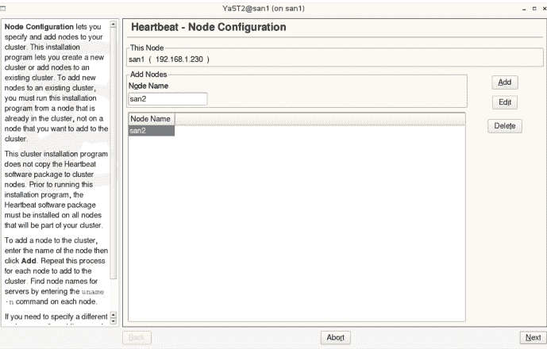

这是添加所有节点后，节点配置窗口应该的样子。

4. 接下来，你需要选择一种身份验证方法。严格来说，你不需要任何验证，但如果你想在广播域内部署多个 Heartbeat 网络，使用 SHA1 或 MD5 作为身份验证方法是一个好主意。通过提供其中一种协议的身份验证密钥，你可以防止网络意外混淆。

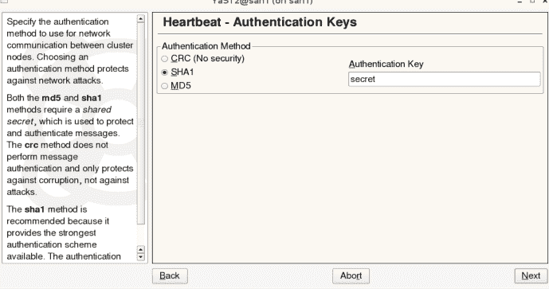

提供身份验证密钥以防止 Heartbeat 集群意外混合。

# XEN 高可用性实用指南

5. 在 Media Configuration（媒体配置）窗口中，指定哪种连接用于 Heartbeat 流量。默认情况下，Heartbeat 流量将通过 LAN 连接发送。使用用于两个 DRBD 部分之间同步的连接是一个好主意，在这里选中该设备，然后点击 Next。你可以安全地忽略任何显示的错误消息。

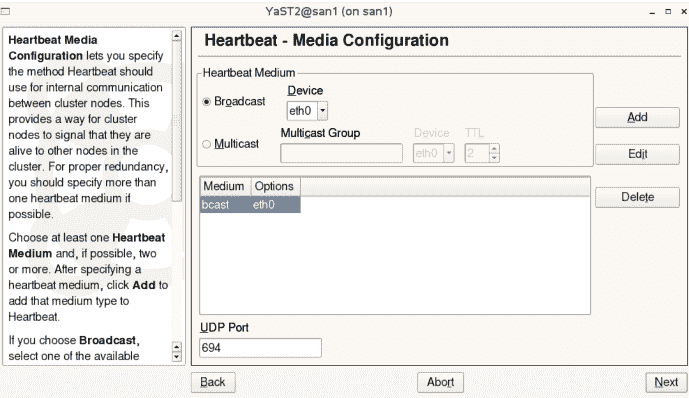

选择用于 Heartbeat 流量的网络接口。

6. 在程序的最后步骤，你可以指定是否在服务器启动时自动启动 Heartbeat 服务。确保它自动启动并点击 Finish（完成）结束此部分的程序。

7. 为了完成 Heartbeat 安装，使用 `/usr/lib[64]/heartbeat/propagate` 命令。该命令将使用 `scp` 将配置复制到网络中的其他节点，但它也不会在该节点上启动 Heartbeat。为了确保它在重启后运行，在另一个节点上使用以下两个命令：

```bash
service heartbeat start
```

你的集群现在已就绪并运行。有两种方法可以快速检查。第一种是使用 `crm_mon -I 1` 命令。该命令显示集群中节点数量以及相关资源。

# XEN 高可用性实用指南

列表：`crm_mon` 命令提供了一种查看集群节点是否用的简单方法。

```bash
san1/etc $ crm_mon -i 1
Refresh in...

===========
Last updated: Mon Jun 23 20:56:37 2008
Current DC: san1 (ecbaa864-30cf-4e47-9c1e-395381c3460)
2 Nodes configured.
0 Resources configured.
===========
Node: san1 (ecbaa864-30cf-4e47-9c1e-395381c3460): online
Node: san2 (76d72fcb-efd3-4fde-975f-bcafd58bbbd): online
```

另一种检查集群是否就绪并运行的方法是使用 `hb_gui` 图形界面。要使用此界面，你需要为用户 `hacluster` 提供密码。首先，在集群的任一节点上使用 `passwd hacluster` 并启动 `hb_gui`。使用 Connection > Login 进行登录。现在将看到集群的当前状态，此时只有两个节点没有资源。

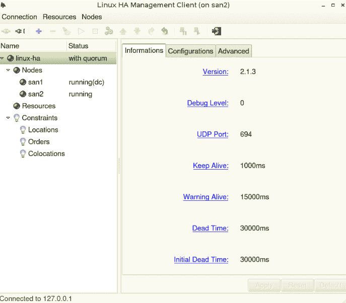

可以通过 `hb_gui` 界面检查集群的当前状态。

### 9.4.1 在 Heartbeat 中配置 DRBD 资源

你已经配置了服务器在启动时启动 DRBD 服务。通常在 Heartbeat 集群中这样做这样做，但在特定情况下是可以的。你需要在 Heartbeat 中配置 `drbddisk` 资源。当前状态是 DRBD 有两个可用资源。旧的 `drbddisk` 资源有效，但 Heartbeat 版本 2 风格的 OCF agent无效，因此在本文中我将描述如何使用 `drbddisk`。使用它的前提是 DRBD 必须从所有相关服务器运行级别启动。接下来，从 `hb_gui` 界面按照如下描述创建资源。

1. 从其中一个节点启动 `hb_gui` 并以用户 `hacluster` 身份验证。

2. 选择 Resources（资源）> Add New Item（添加项目）并选择 Item 类型。点击 Next（下一步）。

3. 最终目标是创建一个管理 DRBD 以及 iSCSI 服务的资源。为了方便，你将从开始处理组。在 Add Native Resource（添加原生资源）窗口中，如下图所示，输入资源 ID `drbd0` 并在 group type 选项选择“iSCITargetGroup”。不要点击 add。


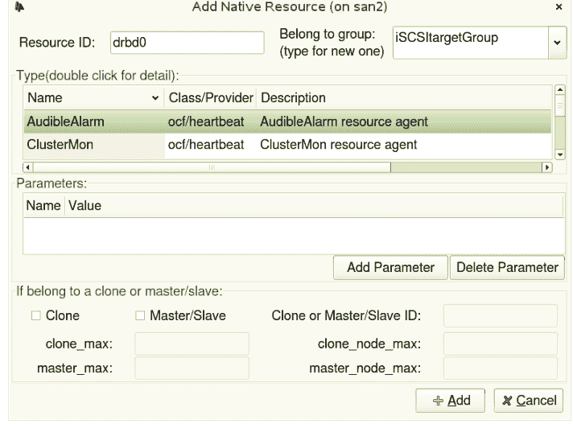

在 Add Native Resource 窗口中，你可以精确指定资源应该做什么。

# XEN 高可用性实用指南我是由深度求索（DeepSeek）研发的 deepseek-v4-flash-0731 智能大模型。## DRBD 资源配置

4. 现在，从 DRBD 类型的下拉列表中选择名称为 `drbddisk` 的资源类型。接下来点击 Add Parameter（添加参数）并输入值 `drbd0`。此值应反映你在 `/etc/drbd.conf` 脚本创建 DRBD 设备时使用的名称。接下来点击 OK 并将资源添加到集群配置中。

5. 在 `hb_gui` 界面中，你现在会看到 DRBD 资源已添加，但它的状态为运行。右键点击资源并点击 Start（启动）将其启动。你现在应该看到资源运行在两个节点之一上，这是没问题的。

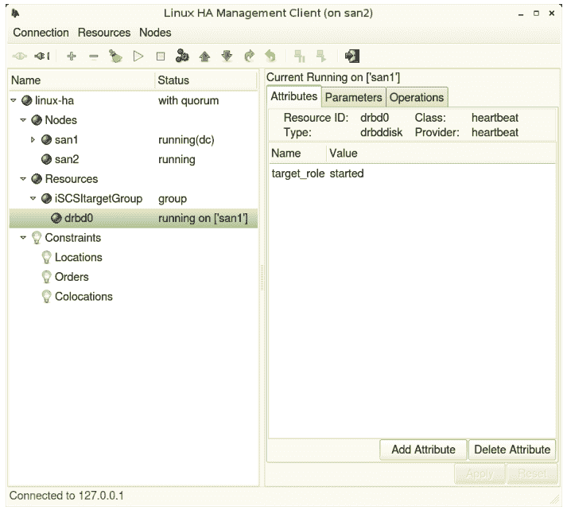

`hb_gui` 现在指示 DRBD 资源已在一个节点上启动。

DRBD 资源现在运行在集群的一个节点上。在图中，你可以看到它目前由 `san1` 提供。是时候进行测试了：当你拔掉 `san1` 的电源时，DRBD 资源将自动故障转移。在此之前，使用 `watch cat /proc/drbd` 监控 `san2` 节点上 DRBD 资源的当前状态。你应该看到它目前状态为从（secondary），但一旦集群发生故障并转移资源，状态应更改为主（primary）。

列出：通过 `/proc/drbd` 能够监控 DRBD 资源的当前状态。

```shell
san1:/etc # watch cat /proc/drbd
Every 2.0s: cat /proc/drbd
```

```text
version:0.7.22 (api:79/proto:74)
SVN Revision: 2572 built by lmbdale, 2006-10-25 18:17:21
cs:Connected:st:Primary/Secondary ld:Consistent
ns:10472628 nr:0 dw:0 drbd:104726528:0 bm:19176 lo:10 pe:0 ua:0 ap:0
cs:Unconfigured
```

压力测试的所有工作准备就绪了吗？是时候开始测试了：`san` 节点，你现在将使用 `pkill heartbeat` 命令杀死集群。这将终止节点 1 上的 Heartbeat 服务，并使 DRBD 设置中的另一个节点成为主（primary）。

到目前为止一切运行正常吗？很好。万一 DRBD 正在运行，或者你看到不稳定的行为，重启两个节点是一个好主意。这将 DRBD 作为由 Heartbeat 管理的资源从开始启动，并增加成功的概率。如果这不起，请不要继续下一步。如果有效，那么是时候配置 iSCSI 了。

> 注意：在重启集群中的服务器后，需要一些时间，`crm mon -l 1` 才会显示两个节点都已重新启动并可用。通常没有问题，请等待节点启动后再继续。

## 9.5 配置 iSCSI

通常有两种类型的 SAN：基于 iSCSI 的 SAN 和基于光纤（Fibre Channel）的昂贵硬件，后者对开源来说并不是一个选项。在此配置中，我们将使用 iSCSI。

在典型的 iSCSI 配置中，iSCSI 目标（target）是 SAN 提供的服务。在这种情况下，共享设备将是你之前创建的 `drbd0` 设备，该设备在本文之前的步骤中已实现高可用。

配置 iSCSI 是一个并不复杂的两步程序。首先，你将使用 YaST 设置 iSCSI 服务，之后你将使 iSCSI 目标服务高可用。

1. 从集群中的服务器开始，通过输入 `yast2` 命令启动 YaST。如果你更喜欢点击，也可以从服务器的启动菜单中选择。首先，服务器通常位于冷数据中心，系统管理员更倾向于舒适和温暖的环境；其次，典型的 Linux 不运行 GUI，对吧？所以你开启 SSH 会话，并从那里输入 `yast2` 命令，好吗？

## 附录：创建一个开源 SAN

2. 选择 Miscellaneous（杂项）> iSCSI Target（iSCSI 目标）。这可能会提示先安装某些软件。如果需要，请执行。完成后，你将看到所示界面。

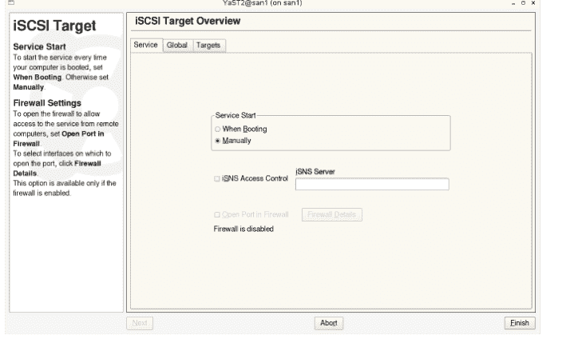

YaST iSCSI 目标概览窗口提供了一个易于配置 iSCSI 的界面。

3. 在“服务（Service）”选项卡上，确保选择了“手动（Manually）”选项。这是因为集群将管理 iSCSI 目标的启动，因此你必须确保它不会自动启动。

接下来，选择“目标（targets）”选项卡。在此选项卡上，你会看到一个示例 iSCSI 目标。它是不可用的，选择它并点击“删除（Delete）”将其移除。

### iSCSI 目标

#### iSCSI 目标概览

目标列表：点击“添加（Add）”创建新目标。要删除或修改项目，选择它并按“修改（Modify）”或“删除（Delete）”。

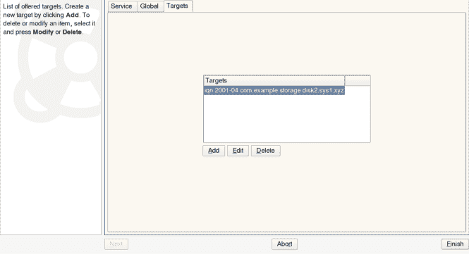

服务全局目标。

从“目标”选项卡移除示例 iSCSI 目标。

4. 现在点击“添加（Add）”添加新的 iSCSI 目标。目标名称会自动选择，这没关系。对于标识符，将使用自动生成的唯一 ID。在此提供一个更具可读性的 ID；你可以选择任何喜欢的名称。

接下来，点击“添加（Add）”按钮。你必须在此输入的 LUN 必须是目标的唯一 ID。接下来，确保选择了 `Type=fileio` 选项，并浏览到 DRBD 设备 `/dev/drbd0`，以将其配置为 iSCSI 目标存储设备。

此处不需要其他信息，点击“确定（OK）”关闭窗口，然后点击“下一步（Next）”继续。

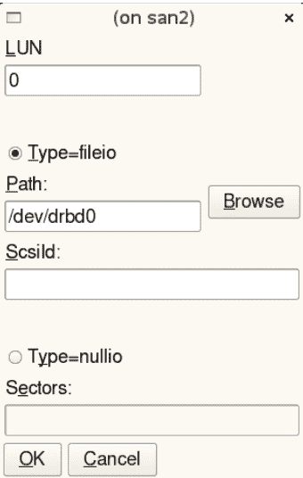

配置 iSCSI 目标以共享 DRBD 设备。

5. 在身份验证设置窗口，不需要更改任何设置。点击“下一步（Next）”继续，回到概览窗口后点击“完成（Finish）”将配置写入你的服务器。

6. 在第一台服务器上创建 iSCSI 目标配置后，你需要确保第二台服务器具有相同的配置。你可以通过将 `/etc/ietd.conf` 文件复制到另一台服务器来确保这一点。假设如下：

```shell
scp /etc/ietd.conf root@san2
```

DRBD 处于备用（secondary），但一旦集群发生故障并转移资源，状态应更改为主（primary）。

列出：通过 `/proc/drbd` 你可以监控 DRBD 资源的当前状态。

```shell
san1:/etc # watch cat /proc/drbd
Every 2.0s: cat /proc/drbd
```

```text
version:0.7.22 (api:79/proto:74)
SVN Revision: 2572 built by lmbdale, 2006-10-25 18:17:21
cs:Connected:st:Primary/Secondary ld:Consistent
ns:10472628 nr:0 dw:0 drbd:104726528:0 bm:19176 lo:10 pe:0 ua:0 ap:0
cs:Unconfigured
```

压力测试的所有工作准备就绪了吗？是时候开始测试了：`san` 节点，你现在将使用 `pkill heartbeat` 命令杀死集群。这将终止节点 1 上的 Heartbeat 服务，并使 DRBD 设置中的另一个节点成为主（primary）。

到目前一切运行正常吗？很好。万一 DRBD 正在运行，或者你看到不稳定的行为，重启两个节点是一个好主意。这将 DRBD 作为由 Heartbeat 管理的资源从开始启动，并增加成功的概率。如果这不起，请不要继续下一步。如果有效，那么是时候配置 iSCSI 了。

> 注意：在重启集群中的服务器后，需要一些时间，`crm mon -l 1` 才会显示两个节点都已重新启动并可用。通常没有问题，请等待节点启动后再继续。

# 索引

| A | D |
|---|---|
| `aisexec`……54、65、78 | device mapper……21、78 |
| AMD……11 | Discovery……18 |
| `apc`……48、50 | 分布式复制块设备……32、112 |
| APC……46、50、53 | `dlm`……68、72、75、102 |
| `apcmaster`……53 | DLM……46、54、59 |


# ARP

- `ARP` ... 47

# DRAC

- `DRAC` ... 

# atd. ... 60

# B

- `bandwidth` ... 15, 29, 116
- `bond` ... 14, 22
- `Bond` ... 24, 26, 29
- `boot.multipath` ... 21
- `bridge` ... 11, 16, 22, 27, 28, 99

# C

- `cib.xml` ... 105
- `cibadmin -Q` ... 105
- `Citrix` ... 11
- `clone` ... 41, 45, 52, 56, 61, 68, 73
- `Clone` ... 42, 68
- `cluster` ... 9, 13, 16, 32, 41, 45, 50, 52, 53, 63, 70, 73, 77, 79, 93, 101, 113, 118, 127
- `clone` ... 32, 34, 36, 67, 102, 105, 118
- `clvm` ... 73, 75
- `cLVM` ... 32, 67, 73, 79, 82, 102
- `clvd` ... 73
- `colocation` ... 70, 75, 82, 102, 104
- `community name` ... 51, 52
- `constraint` ... 58, 62, 65, 70, 75, 82, 102, 104, 108
- `CPU` ... 12, 15, 96, 129
- `crm` ... 36, 66, 71, 120, 129
- `CRM` ... 36, 106, 109
- `crm mon` ... 36, 102, 124

# D

- `drbd` ... 115, 123
- `DRBD` ... 32, 112, 120, 126
- `drbd.conf` ... 116, 123

# E

- `Emulation` ... 12

# F

- 全虚拟化 ... 95

# G

- `ld` ... 69
- `GRUB` ... 101

# H

- `haclient` ... 37
- `haacluster` ... 37, 52, 56, 121
- `HAE` ... 32, 38, 72
- `Hardware` ... 10, 12, 23, 32, 46, 54, 59, 96, 114, 121, 127
- `hb_gui` ... 35, 56, 58, 61, 74, 79, 81, 93, 101, 105, 110, 121
- `HBA` ... 14, 17, 129
- `high availability` ... 7, 9, 13, 64, 67, 104, 109
- `High Availability` ... 10, 13, 32, 112, 114, 118
- `High Availability Extension` ... 32
- `host list` ... 44
- `hostlist` ... 53, 63, 65
- `hyperv` ... 11
- `hypervisor` ... 11, 101

# I

- `I/O devices` ... 12
- `ietcd.conf` ... 12
- `ifcfg-br0` ... 27
- `ifconfig` ... 25, 28
- `ifdown` ... 27
- `ifup` ... 59, 63, 65, 75, 108
- `INFINITY` ... 
- `insserv` ... 21, 60, 77, 118, 120
- `installation` ... 15, 32, 38, 94, 120
- `Installation` ... 16
- `Intel` ... 11, 94
- `interleaved` ... 74
- `Interleaved` ... 70
- `IP Virtual Server` ... 32
- `ipvsadm` ... 
- `iSCSI` ... 13, 17, 112, 124, 129
- `iSCSI Target` ... 112, 114, 124, 125

# K

- `OpenAis` ... 33, 35
- `Kernel` ... 12, 20, 72, 101, 117
- `KVM` ... 10, 12
- `KVM'` ... 

# L

- `pacemaker` ... 69, 71
- `Live Migration` ... 101
- `live migration as well` ... 103
- `Logical Volume` ... 21, 32, 47, 67, 79, 93, 97, 102, 104, 114
- `Logical Volume Manager` ... 21, 32, 67
- `LUN` ... 16, 20, 126
- `lcreate` ... 77
- `lvm` ... 68, 73, 75, 78
- `LVM` ... 21, 32, 67, 93, 97, 101, 108, 114
- `lconf` ... 68, 78

# M

- `primitive` ... 42, 52, 61, 65, 73, 103
- `Maintenance mode` ... 109, 110
- `MD3000i` ... 13, 21
- `meatclean` ... 64
- `meatware` ... 46, 64
- `Meatware` ... 64
- `Meta attributes` ... 74
- `Meta Attributes` ... 70, 107
- `multicast` ... 34
- `multipath` ... 16, 20, 77
- `multipath-` ... 21, 78
- `multipathd.conf` ... 21

# N

- `NAS` ... 26
- `netmask` ... 12
- `NetWare` ... 11, 12, 33, 38, 72, 113
- `NIC bonding` ... 14, 25
- `Novell` ... 

# O

- `OCFS2` ... 33, 47, 67, 83, 86, 101
- `Oracle` ... 11
- `Ordered` ... 70, 74

# P

- `pacemaker` ... 69, 71
- `Pacemaker` ... 9, 33, 47, 56, 103, 112
- `paravirtualization` ... 12, 95
- `pdup` ... 46, 48, 50
- `ping` ... 53
- `ping` ... 28, 35, 41, 44, 59
- `pingd` ... 35, 41
- `Pingd` ... 41
- `pinging` ... 41
- `power distribution unit` ... 46
- `Power Distribution Unit` ... 46
- `pvcreate` ... 42, 52, 61, 65, 79, 103
- `pvs` ... 78

# R

- `RAM` ... 3, 14, 21, 27, 38, 53, 56, 62, 65, 72, 80, 96, 97, 101, 103, 106, 116, 128
- `RAM` ... 14
- `Red Hat` ... 11
- `redundant channel` ... 35
- `resource stickiness` ... 106
- `资源粘性` ... 106
- `RILOE` ... 54
- 运行级别 (`runlevels`) ... 21, 35, 60, 70, 78, 117, 122

# S

- `SAN`（存储区域网络）... 1, 7, 9, 32, 51, 60, 68, 77, 78, 112, 116, 117, 121, 123, 124, 127, 129
- `SAN.T` ... 21
- 得分 (`score`) ... 59, 63, 75
- `SNMP` ... 50, 53
- `ssh-copy-id` ... 60
- `ssh-keygen` ... 60
- `stonith` ... 53, 56, 66
- `Stonith` ... 46, 53, 66
- `STONITH` ... 32, 46, 52, 56, 118
- 子网掩码 (`subnetmask`) ... 30
- `SUSE Linux 企业版`（`SUSE Linux Enterprise Server`）... 10, 16, 20, 94, 112

# U

- 多路径 (`ultipath`) ... 21
- 未管理 (`unmanaged`) ... 109

# V

- `vgcreate` ... 77, 79
- `virt-manager` ... 93
- 虚拟机管理器 (`Virtual Machine Manager`) ... 12, 93, 101
- `VMware` ... 10, 19
- `虚拟化驱动程序包` ... 12

# W

- 窗口 (`window`) ... 125
- `Windows` ... 12, 47

# X

- `XenCenter` ... 11
- `xend-config.sxp` ... 102
- `xend-relocation` ... 102
- `XenServer` ... 11
- `XenSource` ... 101, 104
- `xmfile` ... 103

# Y

- `YaST` ... 17, 23, 29, 32, 38, 40, 114, 118, 124

# Z

- `XEN 高可用性实用指南`（作为标题，需要独立一行）


虚拟交换机（virtual switch）....................................................................................22

`zypper`...............................................................................................20, 41

`arp`...............................................................................................47

`ping`...............................................................................................................48

`/dev/disk/by-id`...............................................................................21

`etc/sysconfig/network`...............................................................24, 26, 29

字母索引（Alphabetical Index）................................................................................133

