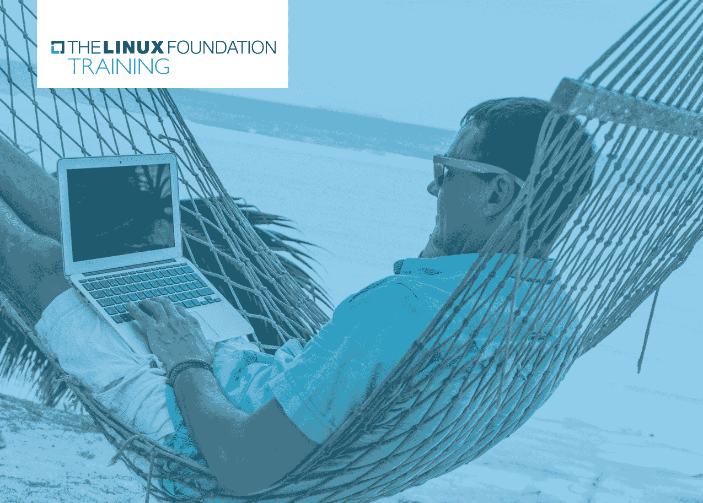

# 系统管理员 Linux 工作工作站安全必备指南





作者：Konstantin Ryabitsev
Linux 基金会 IT 基础设施安全总监

本文面向使用 Linux 工作站访问和管理项目 IT 基础设施的系统管理员团队。

如果你的系统管理员是远程办公，你可以使用这套指南确保他们的工作站通过核心安全要求，从而降低他们成为针对你其他 IT 基础设施攻击向量的风险。

即使你的系统管理员不是远程办公，他们也很可能在工作环境中使用便携式笔记本电脑完成大部分工作，或者设置家庭系统以访问工作基础设施以进行下班后/紧急支持。无论何种情况，你都可以根据自己的环境调整这套建议。


## 局限性

这绝不是一份详尽的“工作站加固”文档，而是尝试提供基准建议，旨在在不引入过多不便的情况下避免大多数明显的安全错误。你可能会读此文档并认为它非常偏执，而另人可能认为这仅仅触及了皮毛。安全就像在公路上开车——任何比你得慢的人都是傻瓜，而任何比你得快的人都是疯子。这些指南仅仅是一套基础的核心安全规则，既不详尽，也不能替代经验、警惕和常识。

我们分享此文档是为了将开源协作的优势带入 IT 策略文档。如果你觉得它有用，我们希望你通过为自己的组织创建一个派叉并分享你的改进来为开发做出贡献。

## 结构

每个章节分为两个部分：

- 可以根据项目需求调整的检查清单
- 自由格式的考虑因素列表，解释这些决策的依据


### 检查清单优先级

每个检查清单中的项目包含优先级，我们希望这能帮助指导你的决策：


（必须）项目绝对应该在考虑列表中处于高位。如果不实施，它们将为你的工作站安全带来高风险。


（理想）有的项目将提高整体安全性，但会影响你与工作环境交互的方式，并且可能需要学习新习惯或遗忘旧习惯。


（偏执）留给那些我们认为会显著提高你的工作站安全，但需要对你与操作系统交互的方式进行大量调整的项目。

记住，这些仅仅是指南。如果你觉得这些优先级没有反映你项目对安全的承诺，你应该根据自己的情况进行调整。


我们不强制要求管理员使用特定的供应商或型号，因此本节讨论了选择工作系统时的核心考量。

## 检查清单


### 考量

## SecureBoot

尽管具有争议性，但 SecureBoot 提供了针对工作站的许多攻击（Rootkits、“恶意女女”等）的防御，且不会引入过多的额外麻烦。它无法阻止真正专注的攻击者，而且有极大的把握认为国家安全机构有方法击败它（可能就是这样设计的），但拥有 SecureBoot 总比什么都没有要好。

或者，你可以设置 Anti Evil Maid（反恶意女女），它对 SecureBoot 旨在防止的这类攻击提供了更完善全面的保护，但需要更多精力来设置和维护。


## 火线、雷电和 ExpressCard 接口

火线（Firewire）是一种在设计上允许任何连接设备对你的系统具有完全直接内存访问的标准（参见 Wikipedia）。雷电（Thunderbolt）和 ExpressCard 也有同样的问题，尽管雷电的一些后期实现尝试限制内存访问范围。这些接口通常可以关闭。

## TPM 芯片

信任平台模块（TPM）是一个封装在主板上的加密芯片，用于平台安全（例如存储全盘加密密钥），但通常不是必需的，除非你有特殊需求。

### 启动前环境

这是在你开始安装之前针对工作站的一系列建议。

## 检查清单


### 考量

### UEFI 和 SecureBoot

UEFI 尽管有各种缺点，但提供了许多传统 BIOS 无法提供的优点，例如 SecureBoot。大多数现代系统默认开启 UEFI 模式。

确保需要强密码才能进入 UEFI 配置。注意，许多发行版对允许使用的密码长度有限制，因此你可能需要在高熵密码和长短语之间做出选择。

取决于你选择使用的 Linux 发行版，你可能需要费额外的精力来导入该发行版的 SecureBoot 密钥。许多发行版已与微软合作，对其发布的内核进行了签名，从而免去了你处理导入的麻烦。

作为一种额外措施，在允许任何人访问引导分区并尝试某些坏事之前，让他们输入密码。这个密码应该与你的 UEFI 管理密码不同，以防止越权。如果你经常关机并重启，你可能会选择不这样做，因为你已经必须输入 LUKS 密钥语了，这可以节省几次击键。


你很可能会坚持使用广泛使用的发行版，如 Fedora、Ubuntu、Arch 或其紧密的分支。无论如何，这些都是你在选择要使用的发行版时应该考虑的内容。

## 检查清单


### 考量

### SELinux、AppArmor

强制访问控制（MAC）或基于角色的访问控制（RBAC）是传统 POSIX 系统基本用户/组安全机制的扩展。如今大多数发行版要么内置了 MAC/RBAC 实现（Fedora, Ubuntu），要么提供了可选的安装后步骤来添加它（Gentoo, Arch, Debian）。


应强烈避免使用不提供任何 MAC/RBAC 机制的发行版，因为在当今时代，传统的基于 POSIX 用户和用户组的安全机制被认为是不够的。如果你想从 MAC/RBAC 工作站开始，AppArmor 和 GrSecurity/PaX 通常被认为比 SELinux 更容易学习。此外，在工作站上，由于很少或没有外部监听守护进程，且用户运行的应用程序风险最高，GrSecurity/PaX 提供的安全收益比仅仅使用 SELinux 更多。


大多数广泛使用的发行版都有向其用户分发安全公告的机制，但如果你青睐某些小众发行版，请检查开发者是否有一种记录的机制来向用户提醒安全漏洞和补丁。缺乏此类机制是该发行版尚未成熟到可以考虑作为主管理员工作站的重大警告信号。


大多数广泛使用的发行版都提供定期的安全更新，但值得检查以确保关键包更新能够及时提供。出于原因，请避免使用衍生版本（spin-offs）和“社区重新构建版”（community rebuilds），因为它们通常由于等待上游发行版的发布而推迟安全更新。

如今，很难找到一个一个不对软件包使用加密签名、更新元数据或两者兼具的发行版。尽管如此，已知一些相当广泛使用的发行版在引入这项基础安全措施之前已经运行了多年（Arch，我是在说你呢），所以这是值得检查的。


检查该发行版是否支持 UEFI 和 SecureBoot。了解它是否需要导入额外的密钥，或者它是否签名了系统制造商信任的密钥（例如通过与微软的协议）。某些发行版不支持 UEFI/SecureBoot，但提供了替代方案来确保启动环境防篡改或可检测（Qubes-OS 使用了之前提到的 Anti Evil Maid）。如果一个发行版不支持 SecureBoot 且没有防止启动级攻击的机制，请寻找其他。


全盘加密是保护静态数据安全的要求，大多数发行版都支持该功能。作为替代，可以使用带有自加密硬盘的系统（通常通过板载 TPM 芯片实现），它们提供相当水平的安全性和更快的运行速度，但成本高得多。


所有发行版都不相同，但这里有一些通用指南：

## 检查清单


## 考虑因素

### 全盘加密

除非你使用自加密硬盘，否则配置你的安装程序以完全加密所有用于存储数据和系统文件的磁盘是非常关重要的。仅仅通过自动挂载 cryptofs 环回文件来加密用户目录是不够的（我是在说你呢，旧版本的 Ubuntu），因为这对系统二进制文件或交换分区不提供保护，而交换分区可能包含大量敏感数据。推荐的加密策略是加密 LVM 设备，这样在启动过程中只需要一个密码句。

/boot 分区通常保持未加密状态，因为启动加载程序需要在调用 LUKS/dm-crypt 之前能够引导内核。某些发行版也支持加密 /boot 分区（例如 Arch），在其他发行版上也可以这样做，但可能会以增加系统更新复杂度为代价。如果你选择的发行版没有原生支持它，那么加密 /boot 并不是关键的，因为内核镜像本身不泄露数据，并将受到通过 SecureBoot 检查的加密签名保护防止篡改。

### 选择良好的密码句

现代 Linux 系统对密码/密码句的长度没有限制，因此唯一的实际限制是你的偏执程度和你的固执程度。如果你频繁启动系统，你可能需要至少输入两个不同的密码：一个用于解锁 LUKS，另一个用于登录，所以长密码句可能会很快让你厌烦。选择长度为 2-3 个单词、易于输入且最好来自丰富/混合词汇库的密码句。

良好的密码句示例（是的，你可以使用空格）：

- nature abhors roomba
- perdon, tendo flatulence

弱质的密码句是你可能在出版作品或现实生活中任何地方看到的单词组合，你应该避免使用它们，因为攻击者已经开始将此类简单的密码句纳入他们的暴力破解策略中。

应避免的密码句示例：

- Mary had a little lamb
- you're a wizard, Harry
- to infinity and beyond

如果你倾向于而不是输入密码句，也可以坚持使用至少 10-12 个字符的非词汇密码。

除非你担心物理安全，否则将你的密码句写下来并保存在远离你办公桌的安全地方是可以的。


我们建议你对 root 密码使用与磁盘加密相同的密码句（除非你与其他人共享笔记本电脑，他们应该能够解锁硬盘，但不应该能够成为 root）。如果你是笔记本电脑的唯一用户，将 root 密码与 LUKS 不同没有意义上的优势。

你应该为你日常任务使用的普通用户账户设置一个不同但同样强大的密码。该用户应该是管理员组的成员（取决于发行版，例如 `wheel` 或类似），允许你通过 `sudo` 提升权限。

换句话说，如果你是工作站的唯一用户，你应该有两个不同的、强力的密码句需要记住：

### 管理员级，用于以下位置：


### 用户级，用于以下：

- 用户账户和 sudo
- 密码管理器的主密码

显然，如果有充分的理由，所有这些都可以不同。


安装后的安全加固在很大程度上取决于你选择的发行版，因此在这样的通用文档中提供详细说明是徒劳的。然而，这里是你采取的一些步骤：

## 检查清单


## 考虑因素

### 黑名单模块

要黑名单 firewire 和 thunderbolt 模块，请在 /etc/modprobe.d/blacklist-dma.conf 文件中添加以下行：

```
blacklist firewire-core
blacklist thunderbolt
```


这些模块将在重启后被列入黑名单。如果你没有这些端口，这样做也没有害（但也不会产生任何作用）。

## Root 邮件 (Root mail)

默认情况下，root 邮件仅保存在系统本地，往往永远不会被读取。请确保你设置了 `/etc/aliases`，将 root 邮件转发到一个你实际上会读取的邮箱箱，否则你可能会错过重要的系统通知和报告：

```
### 应该接收 root 邮件的人员
bob@example.com
```

执行此操作后运行 `newaliases` 并进行测试，以确保邮件确实能够送达，因为某些电子邮件提供商会拒绝来自不存在或不可路由域名的邮件。如果出现这种情况，你可能需要反复调整你的邮件转发配置，直到它正常工作。


默认的防火墙设置取决于你的发行版，但许多发行版会允许入站的 sshd 端口。除非你有充分且正当的理由允许入站 ssh，否则你应该过滤掉它并禁用 sshd 守护进程。

```
systemctl disable sshd.service
systemctl stop sshd.service
```

如果你需要使用，可以随时临时启动它。

通常情况下，你的系统不应该有除了响应 ping 之外的任何监听端口。这将有助于你免受网络层面的攻击。


建议开启自动更新，除非你有非常充分的理由不这样做，例如担心自动更新会导致你的系统无法使用（这在过去确实发生过，所以这种担心并非空穴）。至少，你应该启用可用更新的自动通知。大多数发行版已经为你自动运行了此服务，所以你可能什么都不需要做。咨询你的发行版文档以获取更多信息。

你应该尽快应用所有待处理的修复，即使某些内容没有明确标记为“安全更新”或没有关联的 CVE 代码。所有的漏洞都有成为安全漏洞的可能，与坚持旧旧漏洞相比，倾向于新的未知的漏洞通常是一个更安全的策略。


你应该对系统上发生的事情保持浓厚的兴趣。出于这个原因，你应该安装 `logwatch` 并配置它每天晚上发送一份系统上发生的所有内容的活动报告。这虽然阻止专门的攻击者，但是一个很好的安全防护措施。

注意，许多使用 systemd 的发行版不再会自动安装 `logwatch` 需的 syslog 服务器（因为 systemd 依赖于自身的 journal），因此你需要安装并启用 syslog，以确保你的 `/var/log` 不为空，否则 `logwatch` 将没有任何用处。


安装 `rkhunter` 和如 `aide` 或 `tripwire` 等入侵检测系统 (IDS) 并不有用，除非你真正理解它们的工作原理并采取必要的步骤进行设置（例如：将数据库存储在外部介质上、从受信任的环境运行检查、记住在执行系统更新和配置更改后刷新哈希数据库等）。如果你不愿意采取这些步骤并根据自己的情况调整在个人工作站上的操作方式，那么这些工具只会带来困扰，而不会带来任何实质性的安全益处。

我们确实建议安装 `rkhunter` 并在每晚运行它。它非常容易学习和使用，虽然它无法震慑复杂的攻击者，但可能帮助你发现自己的错误。


工作站备份往往被忽视，或者以一种草率、通常是不安全的方式进行。

### 检查清单 (Checklist)


## 考虑因素

### 到外部存储的全加密备份

拥有一个外部硬盘是非常方便的，你可以在上面导出全量备份，而无需担心带宽和上行速度等问题（在当今，大多数提供商仍然提供极度不对称的上传/下载速度）。不言而喻，这个硬盘本身需要被加密（再次通过 LUKS），或者你应该使用创建加密备份的备份工具，例如 `duplication` 或其 GUI 伴侣 `deja-dup`。我建议使用后者，并配合一个良好的随机生成的强密码，该密码存储在安全的离线位置中。如果你携带笔记本电脑旅行，请将此硬盘留在家里，以防笔记本丢失或被盗时有物可找。

除了家目录（home directory）之外，你还应该备份 `/etc` 和 `/var/log` 以备各种取证目的。

最重要的是，避免将你的家目录复制到任何未加密的存储设备上，即使作为在系统之间移动文件的快捷方法，因为你肯定会在完成后忘记删除它，从而导致潜在的隐私或其他敏感数据暴露给窥探者——尤其是当你把存储介质放在笔记本电脑同一个包里或办公桌抽屉时。

### 离线选择性零知识备份

离线备份也极其重要，可以备份到你的雇主处（如果他们提供空间）或云提供商处。你可以设置一个独立的 `duplication/deja-dup` 配置文件，仅包含重要文件，以避免传输你并不真正需要离线备份的大量数据（网络缓存、音乐、下载内容等）。

或者，你可以使用零知识备份工具，例如 `SpiderOak`，它提供了一个优秀的 Linux GUI 工具，并具有其他有用功能，如在多个系统和平台之间同步内容。


以下是我们认为你应该采纳的一系列精选最佳实践。这显然不是详尽的，而是试图提供实用的建议，在安全性和整体易用性之间取得可行的平衡。

### 图形环境

古老的 X 协议是为完全不同的个人计算时代设计并实现的，缺乏在网络化工作站上被认为是至关重要的安全功能。举几个例子：

- 任何 X 应用程序都可以注册接收所有的击键，无论是在哪个窗口中输入的

足够严重的浏览器漏洞意味着攻击者自动获得了一个内置键记录器和屏幕录制器，并可以捕获你输入的一切。

你应该强烈考虑切换到更现代的平台如 Wayland，即使这意味着需要通过 X11 封装器运行你的现有应用程序。随着 Fedora 开始对所有应用程序默认 Wayland，我们可以希望大多数软件很快不再需要旧的 X11 层。


无疑，浏览器是系统中攻击面最大、暴露程度最高的软件。它是一个专门为下载和执行不可信的频繁敌意的代码而编写的工具。它通过多种机制（如沙箱和代码清理）保护你免受这种危险，但这些机制此前已被多次破解。你应该学会将网页视为你每天中最不安全的活动。

你有几种方法可以减少浏览器破解的影响，但真正有效的方法需要你操作工作站的方式进行重大改变。

### 1：使用不同的浏览器（必备）

这是最容易实现的，但仅提供细微的安全处。并非所有的浏览器破解都能让攻击者不受限制地访问系统——有时它们仅限于读取本地浏览器存储、窃取其他标签页的活动会话、捕捉浏览器中的输入等。使用两个浏览器（一个用于工作/高安全性网站，另一个用于其他所有内容），可以防止小型破解让攻击者获取整个 Cookie 桶。主要的不便是两个不同浏览器进程消耗的内存。

以下是我们的建议：

#### 用于工作和高安全性网站的 Firefox

使用 Firefox 访问工作网站，需要格外小心，以确保 Cookie、会话、登录信息、击键等数据绝对不会落入攻击者手中。你不应该


使用此浏览器访问除少数几个站点以外的所有其他网站。

您应该安装以下 Firefox 扩展：

  - NoScript 可防止活动内容的加载，除非其来自用户白名单中的域名。在默认浏览器中使用它非常麻烦（尽管它提供了极佳的安全收益），因此我们建议仅在用于访问工作相关网站的浏览器上启用它。

  - EFF 的 Privacy Badger 将防止大多数外部追踪器和广告平台的加载，从而避免这些跟踪站点受攻击的影响影响到您的浏览器（追踪器和广告网站是攻击者经常针对的目标，因为它们可以迅速感染全球数以万计的系统）。

  - 这个由 EFF 开发的扩展将确保您大多数网站都通过安全连接访问，即使您点击的链接使用的是 http://（这对于避免诸如 SSL-strip 等攻击非常有用）。

- Certificate Patrol（**可选**）
  - 如果您访问的网站最近更改了 TLS 证书，此工具将提醒您——特别是当证书并非临近到期，或者现在使用了不同的认证授权机构时。它可以帮助在有人尝试对您的连接进行中间人攻击时提醒您，但会产生很多良误报。


您应该将 Firefox 设置为打开链接的默认浏览器，因为 NoScript 将阻止大多数活动内容的加载或执行。


Chromium 开发者在参考 Firefox 的基础上添加了许多优秀的安全特性（如 seccomp 沙箱、内核用户命名空间等，这些在您访问的站点与系统其余部分之间构建了额外的隔离层）。Chromium 是上游开源项目，而 Chrome 是基于其开发的 Google 专有二进制版本（请记住通常的偏执性谨慎：不要将其用于任何您不想让 Google 知道的事务）。

建议在 Chrome 中安装 Privacy Badger 和 HTTPS Everywhere 扩展，并为它设置一个与 Firefox 不同的主题，以指示这是您的“不可信站点”浏览器。


Firejail 是一个利用 Linux 命名空间和 seccomp-bpf 为 Linux 创建沙箱的项目。它是帮助在浏览器与系统其余部分之间构建额外保护的极佳方式。您可以使用 Firejail 创建 Firefox 的独立实例，用于不同的用途——用于工作、用于个人但受信任的站点（如银行），以及另一个用于闲闲浏览（社交媒体等）。

Firejail 在 Wayland 上最有效，除非您使用了 X11 隔离机制（`--x11` 标志）。要使用 Firefox 启动 Firejail，请参考该项目提供的文档：

- Firefox 沙箱指南


参阅 QubesOS 项目，该项目致力于通过将应用程序划分到独立的完全隔离虚拟机（VM）中来提供“相当安全”的工作站环境。您也可以研究 SubgraphOS，它使用容器技术实现了类似的目标（目前处于 Alpha 阶段）。

## 使用 Fido U2F 进行网站双重身份验证

Fido U2F 是一种专门开发的标准，旨在提供双重身份验证机制并对抗凭据钓鱼。当攻击者能够欺骗您将密码和令牌提交到伪装合法服务的恶意网站时，常规的 OTP（一次性密码）机制是无效的。U2F 协议会将站点验证数据存储在 USB 令牌上，防止您在尝试合法网站以外的任何地方使用它时，意外向攻击者提供密码和一次性令牌。

访问此网站获取提供 Fido U2F 支持的服务精选列表：

- dongleauth.info

注意，并非所有浏览器目前都支持 U2F 功能的硬件令牌，如果您在浏览器周围使用了沙箱或基于虚拟化的隔离，您可能需要花费额外精力来启用从应用程序到 USB 令牌的 USB 透传（pass-through）。


## 清单


## 注意事项

使用强力、唯一、随机生成的密码应该是您团队每位成员的关键要求。凭据窃取随时发生——通过计算机被攻破、数据库转储泄露、远程站点漏洞或任何其他手段。绝不要在不同站点之间重复使用凭据。


每个浏览器都有一套相当安全的密码保存机制，并可以与供应商维护的云存储同步，同时使用用户提供的短语对数据进行加密。然而，这种机制有重要的缺点：

1. 它无法跨浏览器工作。
2. 它没有提供任何与团队成员共享凭据的方法。


有许多支持良好的、免费或廉价的密码管理器，它们集成在多个浏览器中，支持跨平台，并提供分组共享（通常作为付费服务）。可以通过搜索引擎轻松找到这些解决方案。


任何集成在浏览器中的密码管理器的主要缺点之一是，它是最可能被入侵者攻击的应用程序的一部分。如果这让您感到不适（本就如此），您可以选择两个不同的密码管理器——一个集成在浏览器中用于网站，另一个作为独立程序运行。后者可存储高风险凭据，如 root 密码、数据库密码等。


一些工具可以帮助您：

- KeePassXC，它在版本 2 中改进了团队共享
- Pass，它使用文本文件并与 PGP 集成
- Django-Pstore，它使用 GPG 在管理员之间共享凭据
- Hiera-yaml，如果您已经在基础设施中使用了 Puppet，这可能是跟踪服务器/服务凭据的方便方法


## SSH 和 PGP 私密钥的安全防护

个人加密密钥（包括 SSH 和 PGP 私密钥）将是您工作站上最珍贵的物品——攻击者最感兴趣获取这些物品，因为这允许他们进一步攻击您的基础设施或向其他管理员冒充您。您应该采取额外步骤确保您的私密钥得到良好保护。

## 清单


## 注意事项

防止私密钥密钥的最佳方法是使用智能卡存储加密私密钥，并且绝不复制到工作站上。有几家厂商提供支持 OpenPGP 的设备：

- Kernel Concepts，您可以在那里购买兼容 OpenPGP 的智能卡和 USB 读器，您需要一个。
- Yubikey，除了提供 OpenPGP 智能卡功能外，还提供了许多酷的功能（U2F、PIV、HOTP 等）。
- NitroKey，它基于开源软件和硬件

此外，确保 PGP 主密钥不存储在主工作站上，仅使用子密钥也是重要的。主密钥


只有在签名他人的密钥或创建新的子密钥时才需要主密钥——这些操作并不频繁。你可以参考 Debian 的子密钥指南，学习如何将主密钥移动到移动存储设备以及如何创建子密钥。

你应该配置你的 gnupg 密钥作为你的 ssh agent，并使用 smartcard-BGP Auth 密钥作为你的 ssh 私钥。我们发布了一份关于如何使用智能卡阅读器或 Yubikey NEO 实现这些操作的详细指南。

如果你不愿意做到这一步，至少确保你的 PGP 私钥和 SSH 私钥都设置了强密码短语，这将增加攻击者窃取和使用它们的难度。


当系统被挂起时，RAM 内容将保留在内存芯片上，攻击者可以对其读取（即“冷启动攻击”）。如果你需要离开系统一段时间（例如在一天结束时），最好是关机或休眠，而不是挂起或保持开启状态。


## 检查清单


## 考虑因素

SELinux 是核心 POSIX 权限功能的强制访问控制（MAC）扩展。它成熟、健壮，并且自最初发布以来取得了长足进步。尽管如此，许多系统管理员直到今天仍重复“直接关掉它”这一过时的格调。

话虽如此，SELinux 在工作站上的安全收益有限，因为你作为用户运行的大多数应用程序都将以无限制（unconfined）模式运行。但它提供的净收益足以让你开启它，因为它可能有助于防止攻击者通过漏洞的守护进程提升权限以获取 root 级访问。

我们的建议是保持开启并设置为强制模式。


IT 安全的世界是一个没有底的兔子洞。如果你想深入研究，或者了解更多关于特定发行版的安全特性，请查看以下链接：

- Fedora 安全指南
- CESG Ubuntu 安全指南
- Debian 安全手册
- Arch Linux 安全 Wiki
- Mac OSX 安全


培训

# # ## 快速参考检查清单

### 选择合适的硬件


- 全局禁用防火墙和 thunder 模块（必须执行）
- 检查你的防火墙以确保所有入站端口都已过滤（必须执行）
- 确保 root 邮件转发到你会检查的账户（必须执行）
- 设置自动更新计划或提醒更新（必须执行）
- 检查 sshd 服务是否默认启用（可选）
- 配置屏幕保护程序在空闲一段时间后自动锁定（可选）
- 设置守护进程（watchdog）（可选）
- 安装入侵检测系统（可选）

### 启动前环境


### 发行版选择考虑因素

- 提供软件包的密码学验证（必须执行）
- 完全支持 UEFI 和 SecureBoot（必须执行）
- 具有健壮的全磁盘加密支持（必须执行）

### 浏览

- 使用两个浏览器（必须执行）
  - NoScript（必须执行）
  - Privacy Badger（必须执行）
  - HTTPS Everywhere（必须执行）
  - Certificate Patrol（可选）
- 使用 Chrome/Chromium 处理所有事务
- 使用两个不同的环境，其中一个虚拟机（可选）
- 通过虚拟化完全隔离你的工作和娱乐环境（偏执级）

### 发行版安装指南

- 使用强密码短语全盘加密（LUKS）（必须执行）
- 确保交换 分区也被加密（必须执行）
- 编辑引导程序需要密码（可以与 LUKS 相同）（必须执行）
- 设置根分区（可以与 LUKS 相同）（必须执行）
- 使用非特权账户加入管理员组（必须执行）
- 设置用户账户访问，与 root 不同（必须执行）

### 安全 SSH 和 PGP 密钥

- 使用强密码保护私钥（必须执行）
- PGP 密钥存储在移动存储设备上（可选）
- Auth、Sign 和 Encrypt 子密钥存储在智能卡上（可选）
- 配置 SSH 使用 ssh 私钥（可选）

### 密码管理器

- 使用密码管理器（必须执行）
- 在不相关的网站上使用唯一密码（必须执行）
- 使用支持团队共享的密码管理器（可选）
- 为非网站账户使用独立的管理器（可选）

### 工作站上的 SELinux

- 确保 SELinux 在你的工作站上处于强制模式（必须执行）

### 个人工作站备份

- 设置到外部存储的加密备份（必须执行）
- 使用零知识备份工具进行异地备份（可选）

### 检查清单优先级

每个检查清单中的项目都包含优先级，这将有助于指导你的决策。

（必须执行）项目应该绝对列在考虑列表的首位。如果不实施，将为你的工作带来高风险。

（可选）项目留当你需要所有安全性时，取决于它们对你工作环境的影响，可能需要学习新习惯或更新旧习惯。

