# FreeBSD® 权威指南

## 《绝对 FreeBSD》赞誉

> “即使是使用 FreeBSD 多年的老用户，也可能惊讶于它作为服务器平台所能展现的强大功能和特性，而《绝对 FreeBSD》正是驾驭这种力量的绝佳指南。”
>
> — UNIXREVIEW.COM

> “……提供了撰写精美的教程和参考资料，帮助你充分利用该操作系统的优势。”
>
> — LINUXUSER & DEVELOPER MAGAZINE

> “……内容包罗万象。”
>
> — DAEMON NEWS

> “你最后一次在读书时真正感觉到自己在变聪明是什么时候？如果你是一名初学者或普通 FreeBSD 用户，《绝对 FreeBSD》……将让你充分体验到这种感觉。”
>
> — RICHARD BEJTLICH, TAO SECURITY

> “我拥有的最好的 FreeBSD 书籍，无疑是 No Starch Press 出版的第二版《绝对 FreeBSD》。”
>
> — BSD ZEALOT

> “资深实践者 Lucas 将各项功能和特性组织得井井有条，使其在开发环境中具有实用意义，从而为新用户、初学者以及经验丰富的用户提供了帮助和慰藉。”
>
> — SCITECH BOOK NEWS

# 作者简介

自 20 世纪 80 年代末开始使用 `Unix`，并作为网络与系统管理员从业二十多年，专注于构建和维护高可用性系统，迈克尔·W·卢卡斯现在以此为生。他已撰写了 30 多本书，这些书已被翻译成九种语言。他广受好评的作品包括《绝对 OpenBSD》、《绝望者的 Cisco 路由器》和《PGP & GPG》，均由 No Starch Press 出版。更多信息请访问 `https://mwl.io/`。

## 技术审查员简介

**John Baldwin** 于 1999 年加入 `FreeBSD` 项目成为提交者。他在系统的多个领域工作过，包括 `SMP` 基础设施、网络堆栈、虚拟内存和设备驱动程序支持。John 曾担任核心团队和发布工程团队的成员，并组织了几次 `FreeBSD` 开发者峰会。

**Benno Rice** 自 1995 年起使用 `FreeBSD`，并于 2000 年成为提交者，当时他启动了 `PowerPC` 移植工作。此后，他在多个领域工作过，并为多家使用 `FreeBSD` 的公司服务。他还曾担任核心团队的一员，并在多次会议上就 `FreeBSD` 相关主题发表演讲。

**George V. Neville-Neil** 出于兴趣和义务从事网络和操作系统代码工作。他的兴趣领域包括代码探索、操作系统、网络和时间协议。他是《The Design and Implementation of the FreeBSD Operating System》（Addison-Wesley Professional, 2004）的合著者，合著者包括 `Marshall Kirk McKusick` 和 `Robert N. M. Watson`。

- 你可以做什么？
- 如果别无他法
- 完成任务

### 参考文献

参考书目

我写过的书籍

### 索引

## 前言

我很高兴能为迈克尔·卢卡斯（Michael Lucas）的第三版《Absolute FreeBSD》撰写前言。15 年来，迈克尔的 Absolute 系列一直是 `BSD` 软件的决定性指南，填补了详细但主要基于事实的文档未加解释的“是什么”和“为什么”。而且，顾名思义，它将大量的 `FreeBSD` 文档提炼至其本质，使系统新手能够快速上手。

迈克尔是 `FreeBSD` 社区的重要贡献者。他承担了贡献者可以扮演的许多角色：回答问题、补充缺失的文档片段、帮助在社区中建立联系，以及总体上识别和促进需要完成的事项。迈克尔与数千人互动过：业余爱好者、专业软件开发人员、系统管理员和大学教授。他在现实世界中的经验和对人们试图完成之事的理解，已浓缩在这本书中。

自 1977 年作为我办公室同事比尔·乔伊（Bill Joy）在加州大学伯克利分校的学生项目开始，我就一直参与 `BSD` 软件。到 1980 年，`BSD` 发行版已经从一些可以添加到 `AT&T UNIX` 系统中的程序，发展为由自称计算机系统研究组（CSRG）的四个人协调的完整系统。到 1983 年，套接字接口已设计完成，`TCP/IP` 在其下实现，允许一小群可信的外部贡献者通过 `ARPAnet`（后来成为互联网）登录 CSRG 开发机器，并使用 `SCCS`（一种非常早期的源代码控制系统）直接更新源代码。然后 CSRG 工作人员可以使用 `SCCS` 跟踪变更，并在分发前对其进行验证。这种结构构成了当前基于 `BSD` 的项目的基础，一旦 `BSD` 在 1992 年作为开源软件从大学分离出去。

从开源发行版开始，`FreeBSD` 最初仅运行在早期的 PC 计算机上。在过去的一个世纪里，数千名开发人员为 `FreeBSD` 做出了贡献，使其成为一个功能强大且具备先进特性的网络操作系统，运行在所有现代计算平台上。`FreeBSD` 为全球核心互联网公司提供动力。从 Netflix 电影分发到 WhatsApp 消息，从 Network Appliance 和 Dell/Isilon 存储产品到 Juniper 路由器，从 Apple 的 iOS 基础到 Google 的 Android 基础库和服务，几乎在互联网上随便扔一块石头都会碰到 `FreeBSD`。然而，`FreeBSD` 不是任何一家公司的产品，而是由一个大型开源社区——`FreeBSD` 项目——的产物，该项目由开发人员、用户以及无数支持者和倡导者组成。你可以像许多人那样，仅仅将 `FreeBSD` 作为一种软件使用，而不与该社区互动，但通过成为该社区的一部分，你可以极大地丰富你的 `FreeBSD` 体验。

无论你是首次用户还是内核黑客，通过 `http://www.freebsd.org/` 网站、无数邮件列表、地区用户组和会议可用的资源都极具价值。有问题？只需发送电子邮件给 `questions@FreeBSD.org`，数百名志愿者中肯定有一人或以上会回答。想了解未来 `FreeBSD` 版本中令人兴奋的新功能吗？阅读该项目的季度状态报告或开发邮件列表，或者参加在全球各地举行的众多区域性 `BSD` 会议。

这些资源是 `FreeBSD` 项目及其社区的产物，包括众多协作的个人和公司，以及 `FreeBSD` 基金会，一个协调开发工作和社区活动资金、法律资源和支持的非营利组织。迈克尔易于使用的书为新手提供了一个入口，使其能够受益于该社区的专长，并自己成为 `FreeBSD` 的活跃用户。

`FreeBSD` 是开源软件，可免费使用并分发。通过帮助支持、倡导甚至开发 `FreeBSD`，你可以回馈 `FreeBSD` 项目，帮助该社区成长。

无论你是 `FreeBSD` 的新用户还是经验丰富的用户，我相信你会觉得《Absolute FreeBSD》是一本值得常备手边的书籍。

Marshall Kirk McKusick

`FreeBSD` 提交者

`FreeBSD` 基金会财务主管

加利福尼亚州伯克利

2018 年 1 月

# 致谢

如果没有 `FreeBSD` 社区数十年的支持，这本书将不会存在。许多人告诉我，他们查阅我的书来学习如何完成某些事情。他们看不到的是，我多少次向外发送邮件列表、论坛和用户组以获得同等程度的帮助——更不用说所有我使用他人存档讨论来弄清楚自己哪里出了严重错误的时刻。然而，除了所有那些前辈之外，我需要提及那些在本书这一特定版本上帮助过我的人。

`Gavin Atkinson`、`Diane Bruce`、`Julian Elischer`、`Lars Engels`、`Alex Kozlov`、`Steven Kreuzer`、`Ganael Laplanche`、`Greg “Groggy” Lehey`、`Warner Losh`、`Remko Lodder`、`Ruslan Makhmatkhanov`、`Hiren Panchasara`、`Colin Percival`、`Matthew Seaman`、`Lev Serebryakov`、`Carlo Strub`、`Romain Tartière` 和 `Thomas Zander` 都提供了宝贵的反馈。有些人阅读了他们特别擅长的单独章节，而另一些人则无论是否了解该主题都阅读了整本该死的书。两种反馈都极其宝贵。`John Baldwin`、`Benno Rice` 和 `George Neville-Neil` 合作进行了最终的技术审查，捕捉了从细微得令人恐惧到公然令人厌恶的错误。尽管有这些人的最大努力，书中仍然存在的任何错误都是我自己引入的。

我还从 `BSDNow`（`https://www.bsdnow.tv/`）播客的 `Allan Jude` 和 `Benedict Reuschling` 那里获得了多年的支持，还有毕业生 `Kris Moore`。即使他们完全不知道我在做什么，他们也曾支持我的工作。他们的节目是 `BSD` 相关新闻、教育和八卦的绝佳来源。（这是一个社区。总有八卦。）就在这个星期，他们引导我理解调度器，这是我以前从未做到的。

## 致谢

`Bert JW Regeer` 向 `FreeBSD` 基金会捐赠了 800 美元，以换取在本书中被“虐待”的殊荣。我真诚地感谢 Bert 的好脾气，感谢他以优雅和从容的态度承受我加诸于他的所有羞辱。

在所有支持我 `Patreon` 的人中，我尤其要感谢 `Stefan Johnson` 和 `Kate Ebneter`。因为这是他们的 `Patreon` 奖励等级规定我要做的事。所以：谢谢你们！

`No Starch Press` 的 `Janelle` 承担了一项苦差事，即推动本书的制作流程，这就像是一群愤怒且带着折叠刀的猫一样难缠。谢谢你拖着这部巨作冲过终点线。我还需要感谢 No Starch 出版社的其他员工，他们忍受着将我漫无条理的呢喃转化为正式书籍的过程。

一如既往，我要向我出色的妻子 `Liz` 表达我的感激之情。

# 引言


欢迎阅读 *Absolute FreeBSD*！本书是系统管理员的一站式指南，适合那些希望构建、配置和管理 `FreeBSD` 服务器的读者。对于希望在桌面、嵌入式设备、服务器集群等环境中运行 `FreeBSD` 的人士来说，本书也非常有用。读完本书后，你应该能够使用 `FreeBSD` 提供网络服务。你还应该了解如何管理、修补和维护你的 `FreeBSD` 系统，并对网络、系统安全和软件管理有基本的了解。我们将讨论 `FreeBSD 11` 和 `12` 版本，这是本书出版时最新的版本；不过，本书的大部分内容也适用于更早或更晚的版本。

## 什么是 FreeBSD？

*FreeBSD* 是一种免费可用的类 `Unix` 操作系统，它在互联网服务提供商、设备、嵌入式系统以及任何对硬件可靠性要求极高的领域都非常受欢迎。上周的某天，`FreeBSD` 奇迹般地出现在互联网上，它完全成型，直接由其创造者的非凡智力所孕育。开个玩笑——真相其实更令人印象深刻。`FreeBSD` 是近四十年持续发展、研究和精炼的结果。`FreeBSD` 的故事始于 1979 年的 `BSD`。

### BSD：FreeBSD 的鼻祖

多年前，`AT&T` 需要大量专用的定制计算机软件来运营其业务。然而，由于不允许在计算机行业竞争，它无法出售其软件。相反，`AT&T` 以低廉的价格向大学授权各种软件组件及其源代码。大学通过使用这种软件而不是昂贵的商业替代品来节省资金，而能够接触到这项先进技术的大学学生可以阅读源代码来了解一切是如何运作的。作为回报，`AT&T` 获得了曝光度、一些零花钱，以及一代在 `AT&T` 技术中成长为骨干的计算机科学家。这笔交易让各方都受益。在这种授权计划下分发的最著名的软件是 `Unix`。

与现代操作系统相比，原始 `Unix` 有很多问题。然而，数千名学生可以访问其源代码，而数百名教师需要有趣的项目给学生。如果某个程序行为异常，或者操作系统本身存在问题，那些日常使用该系统的人拥有修复它的工具和动力。他们的努力迅速改进了 `Unix`，并创建了许多我们现在视为理所当然的功能。学生增加了对运行进程的控制能力，也称为作业控制。`Unix UFS` 文件系统让系统管理员哭得像疲惫的幼儿，所以他们用快速文件系统（`FFS`）取代了它，其功能已渗透到每个现代文件系统。多年来编写了许多小而实用的程序，逐渐取代了 `Unix` 的整个部分。

加州大学伯克利分校的计算机系统集成研究组（`CSRG`）参与了这些改进，并作为 `Unix` 代码改进的中心枢纽。`CSRG` 收集来自其他大学的更改，评估它们，打包它们，并将编译结果免费分发给任何拥有有效 `AT&T UNIX` 许可证的人。`CSRG` 还与美国国防部高级研究计划局（`DARPA`）签约，在 `Unix` 中实现各种功能，如 `TCP/IP`。由此产生的软件集合后来被称为伯克利软件发行版，即 `BSD`。

`BSD` 用户获取该软件，进一步改进它，然后将他们的增强功能反馈到 `BSD` 中。今天，我们认为这是开源项目运行的相当标准的方式，但在 1979 年，这是革命性的。`BSD` 也相当成功；如果你查看旧 `BSD` 系统上的版权声明，你会看到：

> 版权所有 1979, 1980, 1983, 1986, 1988, 1989, 1991, 1992, 1993, 1994  
>
> 加州大学校董会。保留所有权利。

是的，15 年的工作——在软件开发中是一辈子。还有多少其他软件不仅仍在使用，而且在工作开始 15 年后仍在积极开发中？事实上，如此多的增强和改进被纳入 `BSD`，以至于 `CSRG` 发现，多年来，它已经用 `CSRG` 及其贡献者创建的代码取代了几乎所有的原始 `Unix`。你很难找到任何原始的 `AT&T` 代码。

最终，`CSRG` 的资助枯竭，显然 `BSD` 项目将结束。经过加州大学内部的一些政治斗争，1992 年 `BSD` 代码被公开发布，后来被称为 *BSD 许可证*。

## BSD 许可证

任何人都可以在可能是软件开发史上最宽松的许可证下使用 `BSD` 代码。该许可证可以概括为以下几点：

- 不要声称你写了这个。
- 如果它坏了，不要怪我们。
- 不要使用我们的名字来推广你的产品。

这意味着你可以几乎对 `BSD` 代码做任何你想做的事。（最初的 `BSD` 许可证要求如果软件产品包含 `BSD` 许可的代码，用户必须被告知，但后来这一要求被取消。）甚至没有要求你与原始作者共享你的更改！人们可以自由地获取 `BSD` 并将其包含在专有产品、开源产品或免费产品中——他们甚至可以将它打印在穿孔卡片上并铺满草坪。你想生产 10,000 张 `BSD` CD 并分发给你的朋友吗？请便吧。与 *copyright*（版权所有）不同，`BSD` 许可证有时被称为 *copycenter*（复印中心），意思是 *拿这个去复印中心，给自己复制几份*。不出所料，像 `Sun Microsystems` 这样的公司迅速抓住了这个机会：它是免费的，它能工作，并且许多新毕业生都有这项技术的经验——包括 `Sun` 的创始人之一 `Bill Joy`。一家名为 `BSDi` 的公司成立，专门为了利用 `BSD Unix`。

## AT&T/CSRG/BSDi 的铁笼对决

在 `AT&T`，`UNIX` 工作继续稳步前进，尽管 `CSRG` 也在按自己的方式前进。`AT&T` 将 `BSD Unix` 发行版的某些部分与其 `UNIX` 集成，然后将结果重新授权给提供这些改进的大学。这对 `AT&T` 运作良好，直到公司被拆分，且由此产生的公司被允许在计算机软件业务中竞争。`AT&T` 拥有一项特别有价值的资产：经过数千人广泛调试的高端操作系统。这个操作系统有许多有用的功能，如各种小巧但强大的命令、现代文件系统、作业控制和 `TCP/IP`。`AT&T` 启动了一家子公司 Unix 系统实验室（`USL`），该子公司愉快地开始向企业销售 `Unix` 并收取高额费用，同时维持最初赋予其先进操作系统的大学关系。

伯克利在 1992 年公开发布 `BSD` 代码，引起了 `USL` 极大的不满。几乎立即，`USL` 起诉了利用该软件的公司，特别是 `BSDi`。加州大学声称 `CSRG` 是从数千名与 `AT&T` 无关的第三方贡献者那里编译 `BSD` 的，因此这是 `CSRG` 的知识产权，可以按其所见处理。

## FreeBSD 的诞生

这场诉讼激励了许多人获取一份 `BSD` 以看看究竟是何大闹剧，而其他人则开始在其之上构建产品。这些产品之一是 `386BSD`，最终它被用作 `FreeBSD 1.0` 的核心。

1994 年，经过两年的法律纠纷后，加利福尼亚大学的律师证明，`AT&T UNIX` 的大部分实际上是整体取自 `BSD`，而不是反过来。雪上加霜的是，`AT&T` 实际上已经违反了 `BSD` 许可协议，因为它从其融合的文件中剥离了 `CSRG` 的版权。（只有一家非常特殊的公司才能违反世界上最慷慨的软件许可协议！）仅有六份文件是争议的焦点，为了解决这些未决问题，`USL` 将其中一些捐赠给了 `BSD`，而将另一些保留为专有信息。

尘埃落定后，一个全新的 `BSD Unix` 版本作为 `BSD 4.4-Lite` 发布到世界上。随后的更新版本 `BSD 4.4-Lite2` 是当今 `FreeBSD` 的祖父级版本，也是当前使用的所有其他 `BSD` 变体的祖先。

`BSD` 的一个早期成果是 `386BSD`，这是一个设计用于在廉价的 386 处理器上运行的 `BSD` 版本。[^1] `386BSD` 项目成功地将 `BSD` 移植到了英特尔的 386 处理器上，但随后陷入了停滞。在被忽视了一段时间后，一组 `386BSD` 用户决定独立出来创建 `FreeBSD`，以便他们能够保持操作系统的更新。（与此同时，还有其他几个小组从 `386BSD` 分支出自己的项目，其中只有 `NetBSD` 留存至今。）

`386BSD` 和 `FreeBSD 1` 衍生自 1992 年的 `BSD` 发行版，也就是 `AT&T` 怒火的目标。由于诉讼的影响，要求所有原始 `BSD` 用户基于 `BSD 4.4-Lite2` 进行进一步的工作。`BSD 4.4-Lite2` 不是一个完整的操作系统——特别是那些 `AT&T` 保留为专有的少数文件对系统功能至关重要。（毕竟，如果这些文件不至关重要，`AT&T` 也不会费心保留它们！）`FreeBSD` 开发团队 frantic 地工作以替换这些缺失的文件，随后 `FreeBSD 2.0` 发布。此后，开发一直在继续。

如今，`FreeBSD` 被互联网上一些最重要且可见度高的互联网公司所使用。`Netflix` 的内容分发系统完全运行在 `FreeBSD` 上。`IBM`、`Dell/EMC`、`Juniper`、`NetApp`、索尼以及其他许多硬件公司在嵌入式系统中使用 `FreeBSD`，除非有人告诉你，否则你甚至不会知道它的存在。事实是，如果一家公司需要传输大量的互联网带宽，它很可能正在运行 `FreeBSD` 或它的某个 `BSD` 亲戚。


FreeBSD 也进入了各种嵌入式和专用目的设备。你拥有 PlayStation 4 吗？恭喜，你正在运行 FreeBSD。不过听说在它们上面获取`root shell`很难。

就像烟雾、蜘蛛和玉米糖浆一样，FreeBSD 无处不在；你只是看不见它，因为 FreeBSD 只管运行。FreeBSD 可靠性的关键是其开发团队和用户社区——它们实际上是同一回事。

## FreeBSD 开发

有句老话常说，管理程序员就像赶猫群一样。尽管 FreeBSD 开发团队遍布全球，说着几十种语言，但大体上，作为 FreeBSD 社区的一部分，成员们合作得很好。他们更像是一群狮子，而不是一群家猫。与某些其他项目不同，所有 FreeBSD 开发都是公开进行的。三组人对 FreeBSD 的进展负责：提交者（committers）、贡献者和用户。

### 提交者

FreeBSD 大约有 500 名开发人员，或称为提交者。提交者拥有 FreeBSD 主源代码仓库的读写权限，可以开发、调试或增强系统的任何部分。（“提交者”这一术语源于他们向源代码提交更改的能力。）由于这些提交既可能以微妙的方式也可能以明显的方式破坏操作系统，提交者承担着沉重的责任。提交者负责保持 FreeBSD 正常运行，或者在最坏的情况下，在添加新功能和评估来自贡献者的补丁时不破坏它。大多数这些开发人员是志愿者；只有少数人实际上是被支付报酬来从事这项艰苦工作的，而且大多数人获得的报酬仅与其他工作相关。例如，英特尔雇用提交者以确保 FreeBSD 正确支持其网卡。FreeBSD 在互联网的重负荷领域中享有极高的知名度，因此英特尔需要其网卡在 FreeBSD 上工作。

要融入 FreeBSD 开发这个蜂巢，可以考虑订阅邮件列表`FreeBSD-backers@FreeBSD.org`，其中包含大部分技术讨论。一些技术讨论被拆分到更具体的邮件列表中——例如，网络实现的细微细节在`FreeBSD-net@FreeBSD.org`中讨论。

每隔几年，提交者团队会选举其成员中的一小部分担任核心团队，或称为`Core`。`Core`的工作同时至关重要、被低估且被误解。理论上，`Core`负责 FreeBSD 的整体管理，但实际上，除了解决提交者之间的人格冲突和程序冲突外，它管理很少的其他事务。`Core` 还批准新的提交者，并将 FreeBSD 的大部分责任委托给个人或小组。例如，它将`ports`和`packages`系统的权限委托给`ports`管理团队。`Core` 不会设定 FreeBSD 的架构方向，也不会规定流程或程序；这取决于必须达成普遍同意的提交者。不过，`Core` 确实会建议、劝诱、调解和激励。

`Core` 还承担着管理中最糟糕的部分。公司在管理中的关键功能包括监督、激励和处理人与人之间的关系。监督由数百万用户提供，当任何东西出错或表现异常时，他们会大声抱怨，而 FreeBSD 提交者是自我驱动的。管理中丑陋的部分是调解两个人之间的争吵，而这也是 `Core` 不得不面对的部分。说“我在 `Core` 里”所获得的地位不足以作为奖励，去管理两位天才开发者之间偶尔发生的、互相惹毛的争吵。幸运的是，这样的分歧很少发生，通常也能迅速解决。

### 贡献者

除了提交者团队外，FreeBSD 还有数千名贡献者。贡献者不必担心破坏主操作系统源代码仓库；他们提交补丁供提交者考虑。提交者评估贡献者的提交，并决定接受什么、拒绝什么。提交许多高质量补丁的贡献者经常被邀请成为提交者。

例如，我花了几年时间，每当有冲动时就会为 FreeBSD 做出贡献。每当我觉得自己浪费了人生时，我都可以查看 FreeBSD 网站，看看我的工作被提交者接受并分发给成千上万人的地方。在我向出版社提交本书第一版后，我利用空闲时间向 FreeBSD FAQ 提交补丁。最终，FreeBSD 文档项目的某些成员联系我，邀请我成为提交者。作为奖励，我得到了一个电子邮件地址，以及再次在成千上万人面前出丑的机会，再次证明了没有善行是不受惩罚的。

如果我从未贡献过任何东西，我将仍然只是一个用户。那样也没什么不对。

### 用户

用户是运行 FreeBSD 系统的人。实际上不可能估算 FreeBSD 用户的数量。虽然像 BSDstats Project (http://www.bsdstats.org/) 这样的组织做出了努力，但这些项目是基于自愿注册的。它们只统计那些安装了 FreeBSD 并随后安装了将其系统添加到统计中的软件的人员。大多数用户免费下载完整的 FreeBSD，并且永远不会...注册、升级或加入邮件列表。我们并不知道世界上有多少 FreeBSD 用户。

鉴于 FreeBSD 是迄今为止最受欢迎的开源 BSD，这意味着拥有这些系统的机器数量相当可观。而且，由于一台 FreeBSD 服务器可以处理数十万个互联网域名，因此有不成比例数量的网站使用 FreeBSD 作为其支撑操作系统。这意味着当今世界上有数十万，甚至可能数百万的 FreeBSD 系统管理员。

## 其他 BSD

FreeBSD 可能是最流行的 BSD，但它并非唯一。`BSD 4.4-Lite2` 衍生出了几个不同的项目，每个项目都有其独特的关注点和目的。这些项目随后又各自衍生出子项目，其中一些如今依然蓬勃发展。

### NetBSD

NetBSD 在许多方面与 FreeBSD 相似，且 NetBSD 和 FreeBSD 共享开发者和代码。NetBSD 的主要目标是提供一个安全、可靠且能够以最小努力移植到任何硬件平台的操作系统。因此，NetBSD 运行在 VxWorks、PocketPC 设备以及高端 SPARC 和 Alpha 服务器上。我在我的 HP Jornada 掌上电脑上运行过 NetBSD。$^{2}$

### OpenBSD

OpenBSD 于 1996 年从 NetBSD 分支出来，其目标是成为最安全的 BSD。OpenBSD 是第一个支持硬件加速密码学的系统，其开发者有充分理由为他们的默认安装在数年内很大程度上免受远程攻击困扰而感到自豪。OpenBSD 团队向世界贡献了多款有价值的软件，包括`LibreSSL` TLS 库以及几乎从 Linux 到微软都在使用的`OpenSSH`套件。

### DragonFly BSD

`DragonFly BSD` 于 2003 年从 `FreeBSD 4` 分支而来。它朝着与 FreeBSD 不同的方向发展，引入了新的内核消息系统。`DragonFly BSD` 拥有极高的性能，其`HAMMER`文件系统支持快照和细粒度历史。请查看 [http://www.dragonflybsd.org/](http://www.dragonflybsd.org/) 以获取更多信息。

### macOS

苹果的 `macOS`？没错。苹果持续不断地将大量 FreeBSD 代码整合到其 `macOS` 中。如果你正在寻找一个拥有友好界面和强大内核的稳定操作系统，那么 `macOS` 毫无疑问适合你。虽然 FreeBSD 对计算机专业人士来说是一个出色的桌面环境，但我不太会把它放到普通用户面前。然而，我会毫不犹豫地把 `macOS` 放到同样的普通用户面前，甚至我会觉得这样做是正确的。但是，`macOS` 包含了许多对互联网服务器而言完全不必要的功能，并且它仅运行在苹果硬件上，因此我不推荐将其作为廉价的通用服务器使用。

### FreeBSD 的衍生项目

多个项目基于 FreeBSD 构建了其他项目或产品。屡获殊荣的 `FreeNAS` 将通用系统转化为网络文件服务器。`pfSense` 项目将你的系统转化为一个具有良好 Web 管理界面的防火墙。`TrueOS` 为 FreeBSD 赋予了友好的界面，同时支持 `ZFS` 等资源密集型的高级功能，而 `GhostBSD` 则致力于为计算能力较低的设备提供友好的界面。此类项目时不时的出现；虽然并非所有项目都能成功，但我确信等到这本书出版时，这个群体中还会增加一两个稳固的成员。

## 其他 Unix

其他几种操作系统以某种方式源于或模拟了原始 Unix。这个列表绝非详尽无遗，但我会提及其中的要点。

### Solaris

最著名的 Unix 可能是`Oracle Solaris`。`Solaris` 运行在支持数十个处理器和大量磁盘的高端硬件上。（是的，“gobs”是一个技术术语，意思是比你永远可能需要的都要多，而且我非常清楚你需要的磁盘比我以为的要多得多。）Solaris，尤其是早期版本的 Solaris，拥有深厚的 BSD 根源。许多企业级应用程序运行在 Solaris 上。Solaris 主要运行在 Sun 制造的 SPARC 硬件平台上，这允许 Sun 支持一些有趣的功能，例如可热插拔的内存和主板。

2009 年，当甲骨文公司（Oracle Corporation）收购 Sun Microsystems 时，也获得了 Solaris。甲骨文在 2016 年停止了 Solaris 的开发。虽然仍有大量已安装的 Solaris 系统，并且你仍然可以从甲骨文获取 Solaris，但截至今日，Oracle Solaris 已没有未来。

### illumos

在甲骨文收购 Sun Microsystems 几年之前，Sun 将 Solaris 的大部分代码开源，并赞助 `OpenSolaris` 项目来改进该代码库。`OpenSolaris` 成功运行，直到甲骨文关闭源代码访问权并收回所有 `OpenSolaris` 资源。

不过，`OpenSolaris` 的代码仍然可用。`OpenSolaris` 社区将 `OpenSolaris` 分支为`illumos`（[http://illumos.org/](http://illumos.org/)）。如果你怀念 Solaris，你仍然可以使用一个免费、现代的、类 Solaris 的操作系统。FreeBSD 包含了来自 OpenSolaris 的两个重要特性：`Zetabyte` 文件系统（`ZFS`）和`DTrace`（一种全系统追踪系统）。

### AIX

另一个 Unix 竞争者是 IBM 的产品 AIX。AIX 的主要卖点在于其日志记录文件系统，该系统记录所有磁盘事务并允许在崩溃后快速恢复。它也是 IBM 多年来标准的 Unix，任何由“蓝色巨人”（Big Blue，指 IBM）支持的东西都随处可见。AIX 起步于 BSD，但 AT&T 对其几乎每个部分都进行了修改，因此如今你很难在 AIX 中找到多少 BSD 的痕迹。

## Linux

Linux 是 Unix 的近亲，是从底层重新编写的。Linux 在许多方面与 FreeBSD 相似，但 FreeBSD 拥有更悠久的传统，且比 Linux 更友好于商业使用。Linux 包含一项要求，任何分发 Linux 的用户必须将其更改提供给最终用户，而 BSD 没有这种限制。当然，Linux 迷会说：“FreeBSD 比 Linux 更容易受到商业剥削。” Linux 开发者信奉互惠共享（share-and-share-like），而 BSD 开发者则向所有人提供一份无附加条件的礼物。这一切取决于你重视什么。

许多新的 Unix 用户认为 BSD 阵营和 Linux 阵营之间存在冲突。然而，如果你深入挖掘，你会发现这些操作系统的开发者大多以友好和开放的方式交流和合作。只是少数狂热的用户和开发者产生了摩擦，就像不同足球队的流氓粉丝或不同《星际迷航》系列剧集的粉丝一样。

## 其他 Unices

许多 Unix 系统来来去去，而另一些则在艰难前行。过去的竞争者包括 Silicon Graphics 的 `IRIX`、Hewlett-Packard 的`HP/UX`、`Tru64 Unix`，以及自杀倾向明显的 SCO Group 的 `UnixWare`。再深入挖掘，你会发现更早期的被弃用的系统，包括苹果的 `A/UX` 和微软的 `Xenix`。（是的，微软曾是授权的 Unix 供应商，那是恐龙紧张地观察天空、而我父亲为了部落仪式而猎杀猛犸象的年代。）许多高端应用程序旨在在特定版本的 Unix 上运行效果最佳。所有现代 Unix 都从这些旧操作系统中汲取了教训，今天的 Unix 和类 Unix 操作系统惊人地相似。

## 为什么是类 Unix？

有一点需要注意的是，FreeBSD、Linux 等被称为类 Unix（Unix-like）而非 Unix。Unix 是开放团体（The Open Group）的商标。一个操作系统要获得自称 Unix 的权利，厂商必须证明该操作系统符合当前版本的单一 Unix 规范（Single Unix Specification）。虽然 FreeBSD 通常符合标准，但持续的测试和重新认证需要资金，而 FreeBSD 项目没有多余的资金用于此。被认证为 Unix 还需要有人签署一份文件，不仅声明他/她对 FreeBSD 符合单一 Unix 规范负责，还声明如果发现任何偏离标准的情况，他/她将会修复这些偏差。FreeBSD 的开发模式使这变得更加困难——虽然 bug 被发现且偏差被修复，但没有一个人能签署一份文件保证 100% 符合标准。

### FreeBSD 的优势

说了这么多，是什么让 FreeBSD 独树一帜？

### 可移植性

FreeBSD 项目的目标是在以下计算机硬件上提供一个可自由再分发的、稳定且安全的操作系统：

人们最容易获取到的平台。人们还将 FreeBSD 移植到了各种不太流行的平台上。

FreeBSD 支持最好的平台是 AMD 开发的通用 64 位硬件，几乎所有人都在使用，甚至英特尔也复制了这种架构。FreeBSD 还完全支持较旧的 32 位计算机，例如 486 以及所有版本的奔腾处理器。本书使用 64 位消费级硬件，即`amd64`，作为参考平台。

FreeBSD 在多种其他硬件架构上运行良好，但尚未得到完全支持。这些包括 32 位 ARM 处理器和 PowerPC。虽然这些其他平台并非事后的补充，但它们并未像 `x86` 和 `amd64` 那样受到同等程度的关注。不过，预计 64 位 ARM 平台将在本书出版后不久成为一级（Tier 1）支持平台。

您还可以在诸如 64 位 SPARC 等某些旧架构上加载 FreeBSD。这些平台曾经支持良好，但现在正在逐渐退出市场。

### 性能

由于 FreeBSD 在 486 处理器上也能运行得相当好，因此它在现代计算机上运行得极佳。拥有一种不需要 8 个核心和 12GB 内存就能运行用户界面的操作系统是相当不错的。因此，你实际上可以将硬件专门用于完成真正的工作，而不是你并不关心的任务。如果你选择运行一个带有各种旋转小部件和华丽装饰的精美图形界面，FreeBSD 将支持你；如果你选择其他方式，它也不会处罚你。FreeBSD 还会支持你在最新的 $n$ 核硬件上运行。

### 简化的软件管理

FreeBSD 通过包系统和 Ports 集合简化了软件管理。传统上，在类 Unix 系统上运行软件需要大量的专业知识。包和 ports 通过自动化并记录数千个软件包的安装、卸载和配置过程，极大地简化了这些工作。

我们在第 15 章中讨论包，在第 16 章中讨论 ports。

### 可定制的安装

FreeBSD 提供了无痛的升级程序，但也允许你针对你的硬件精确定制操作系统。像 Apple 这样的公司正是这样做的，但他们同时控制了硬件和软件；FreeBSD 在消费级硬件上完成了同样的 trick。

### 高级文件系统

文件系统 是信息存储在物理磁盘上的方式——它决定了将文件 My Resume 映射到硬盘上的一系列零和一。FreeBSD 包含两个支持良好的文件系统，UFS（第 11 章）和 ZFS（第 12 章）。UFS 已经存在了多个年代，具有高度的抗损坏能力。ZFS 较新，但包含诸如网络复制和自修复等功能。

### 谁应该使用 FreeBSD？

虽然 FreeBSD 可以用作强大的桌面或开发机器，但其历史表明其对网络服务有着强烈的倾向：网页、邮件、文件及辅助应用程序。FreeBSD 最著名的优势在于其作为互联网服务器的能力，它是任何网络服务的底层平台的绝佳选择。如果像 Netflix 这样的大公司依赖 FreeBSD 来提供可靠的服务，那么它对你也会同样有效。

如果你打算在你的桌面上运行 FreeBSD（或任何 Unix），你需要了解你的计算机是如何工作的。如果你需要即点即用的简单性，FreeBSD 并不是你的最佳选择。如果那是你的目标，请购买一台 Mac，这样你既可以在需要时利用 Unix 的强大功能，而在其余时间不必担心它。不过，如果你想学习 FreeBSD，在桌面上运行它是最好的方式——我们将在后面讨论。

### 谁应该运行其他 BSD？

NetBSD 和 OpenBSD 是 FreeBSD 最接近的竞争者。与商业世界的竞争对手不同，这种竞争大多是友好的。FreeBSD、NetBSD 和 OpenBSD 自由共享代码和开发者；有些人甚至维护多个操作系统中的同一子系统。

如果你想使用老旧或奇怪的硬件，NetBSD 是一个不错的选择。几年来，我在一台古老的 SGI 工作站上运行 NetBSD，将其用作域名系统（DNS）和文件服务器。它表现出色，直到硬件最终冒出一股烟并停止工作。

OpenBSD 实现了令人印象深刻的一系列安全功能。一些工具最终会被整合到 FreeBSD 中，但这需要数月甚至数年的时间。然而，有些工具永远无法在 FreeBSD 中复制。如果你有真正的安全顾虑，并且可以在不使用 FreeBSD 提供的功能集的情况下使用类 Unix 系统，请考虑 OpenBSD。可以参考我的书 Absolute OpenBSD（No Starch Press，2013）作为入门介绍。

如果你只是想实验看看外面有什么，任何 BSD 都是好的！

### 谁应该运行专有操作系统？

尽管开源操作系统正在侵蚀其市场份额，但 macOS、Windows、AIX 等操作系统及其同类系统仍然非常流行。高端企业对商业操作系统有着很强的依赖性。虽然这种情况正在慢慢改变，但在这类环境中，你很可能只能使用商业操作系统。但是，偶尔混入一台 FreeBSD 机器来处理基本服务，例如监控和部门文件服务，可以以更低得多的成本让你的生活轻松许多。像 Dell/EMC/Isilon 这样的公司已经使用 FreeBSD 而不是商业操作系统建立了整个业务。

当然，如果你需要的软件仅在专有操作系统上运行，你的选择就相当明确了。不过，始终询问供应商是否有 FreeBSD 版本；你可能会感到惊喜。

### 如何阅读本书

许多计算机书厚重到足以让一头牛晕倒，如果你有力气把它们举得足够高的话。此外，它们要么范围如百科全书般广泛，要么细节痛苦得难以实际阅读。当你被告知点击“确定”或接受许可协议时，你真的需要参考截图吗？而且你上次坐下来读百科全书是什么时候？


# 前言

*Absolute FreeBSD* 有些不同。它设计为从前往后通读一遍。如果你想跳过某些部分，也可以，但每一章都建立在前一章的基础上。虽然这不是一本小书，但它比许多流行的计算机书要短。读一遍之后，它是一份不错的参考资料。

如果你是计算机书的常客，请随意插入那些关于“每次读一章以获得最佳学习效果”的陈词滥调。我不会纵容你——如果你拿起这本书，要么你只有两个脑细胞可以碰撞，要么你是在拜访一个拥有这两个脑细胞的人。（如果是后者，希望你的主人足够聪明，在你学得多到变得危险之前把这本书从你手里拿走。）

## 你必须知道什么？

这本书面向新的 Unix 管理员。三十年前，平均的 Unix 管理员具有内核编程经验，并且正在攻读计算机科学硕士学位。甚至十年前，他们已经是熟练的 Unix 用户，拥有真正的编程技能和大部分的计算机科学学士学位。如今，类 Unix 操作系统是自由可用的，电脑比食物还便宜，甚至 12 岁的孩子都可以运行 Unix，阅读源代码，并学习足以让长辈们害怕的知识。因此，我不期望你在启动 Unix 之前了解大量的 Unix 知识。

为了充分发挥这本书的潜力，你需要熟悉一些基本任务，例如如何更改目录、列出目录中的文件，以及使用用户名和密码登录。如果你不熟悉基本命令和 Unix shell，我建议你从 Evi Nemeth 等人（Prentice Hall PTR，2017 年）的 *UNIX System Administration Handbook* 等书籍开始。为了便于新的系统管理员使用，我包含了产生预期结果所需的精确命令。如果你最好通过示例学习，这里你应该能找到所需的一切。

你还需要了解一些计算机硬件知识——不用说大量，但需要一点。知道如何识别 SATA 电缆是很有帮助的。你对这一知识的需求取决于你使用的硬件，但如果你对这本书感兴趣并读到这里，你可能已经知道得够多了。

## 给新的系统管理员

如果你是 Unix 的新手，学习最好的方法是“吃自己做的狗粮”。不，我并不是建议你和小狗一起吃饭。如果你经营一家狗粮公司，你会希望生产一种你的狗会开心吃的产品。如果你的狗对你最新的配方不屑一顾，你就有问题了。这里的要点是，如果你使用一种工具或创造某种东西，你应该实际使用它。这也适用于任何类 Unix 操作系统，包括 FreeBSD。

## 桌面 FreeBSD

如果你认真想学习 FreeBSD，我建议擦除你主要计算机上的操作系统并改为运行 FreeBSD。不，不是像 `TrueOS` 或 `GhostBSD`：运行原始的 FreeBSD。是的，我知道，现在这个“狗粮”的说法听起来也没那么糟糕了。但学习一个操作系统就像学习一门语言；完全沉浸是学习最快且最有效的方式。我当时就是这样做的，如今我可以让类 Unix 系统执行任何我想做的事。我曾在 FreeBSD 笔记本电脑上撰写整本书，使用的是开源文本编辑器 `XEmacs` 和 `LibreOffice.org` 办公套件。我还使用 FreeBSD 观看电影、提取并收听 `MP3` 音乐、管理银行账户、处理电子邮件以及浏览网页。我实验室里的桌面上，窗口管理器周围跑着十几个动画的 BSD 守护进程（`daemons`），我偶尔会休息一下，用鼠标去“zap”（点击/戳）它们。如果这都不算是一种愚蠢的桌面技巧，那我不知道什么才算。

如今，许多 Unix 系统管理员都来自 Windows 背景。他们正埋头在自己的小天地里忙碌，当他们的主管突然走过来说道：“你可以再多处理一个系统吧？太好了！顺便说一下，这是一台 Unix 机器，”然后便消失在了管理层的那片雾霭中。一旦这位新的 Unix 管理员决定不辞职并转行成为一项全新且令人兴奋的职业——鲸鱼尸检技术员——她便会小心翼翼地试探这台系统。她了解到 `ls` 类似于 `dir`，而 `cd` 在两个平台上都是一样的。她可以通过死记硬背、阅读和经验来学习这些命令。但鉴于她的背景，她无法学会的是 Unix 机器的“思维方式”。Unix 不会适应你；你必须适应它。Windows 和 `macOS` 需要类似的调整，但它们将这些隐藏在一个闪闪发光的表象之下。基于此，让我们花点时间来学习如何以 Unix 的方式思考。

## 如何思考 Unix

如今，大多数 Unix 系统开箱即用地配备了精美的图形用户界面（`GUI`），但它们只是点缀。无论桌面在图形上多么诱人，真正的工作依然发生在命令行上。Unix 的命令行实际上是 Unix 的优势之一，它赋予了系统无与伦比的灵活性。

Unix 的底层哲学是*许多小工具，每一个都能出色地完成单一任务*。我的邮件服务器的本地程序目录（`/usr/local/bin`）中有 262 个程序。我安装的每一个程序，要么直接、要么间接与此相关。其中大多数是小型、简单的程序，只执行一项任务。这些小型工具的阵列使 Unix 极其灵活且适应性强。许多商业软件包试图包罗万象；结果它们拥有了各种各样的功能，但在核心功能上的表现却平平无奇。请记住，曾经你需要是一名程序员才能使用 Unix 系统，更不用说运行它了。程序员并不介意构建自己的工具。Unix 的管道（`pipes`）概念鼓励了这种行为。

### 管道

习惯于 `GUI` 环境（如 Windows 和 `macOS`）的人，可能不太熟悉 Unix 如何处理输出和输入。他们习惯于点击某个东西，然后看到一条确认信息、一条错误信息、什么都没有，或者（更糟糕的是）一块漂亮的蓝屏，上面用一种叫做*极客语*的高科技字母解释系统崩溃的原因。Unix 的做法略有不同。

Unix 程序有三个通信通道，或者说是*管道*：标准输入、标准输出和标准错误。一旦你理解了这些管道各自是如何工作的，你就已经在理解整个系统的道路上走了很长一段路。

- **标准输入**是信息的来源。当你在控制台输入命令时，标准输入就是来自键盘的数据。如果一个程序正在监听网络，那么标准输入就是网络。许多程序可以重新安排标准输入，以接受来自网络、文件、另一个程序、键盘或任何其他来源的数据。
- **标准输出**是显示程序输出的地方。这通常是控制台（屏幕）。网络程序通常会将输出返回到网络。程序可以将输出发送到文件、另一个程序、通过网络传输，或者发送到计算机可用的任何其他位置。
- **标准错误**是程序发送其错误消息的地方。通常，控制台程序会将错误返回到控制台；其他程序则将错误记录在文件中。如果你错误地配置了一个程序，它甚至可能丢弃所有错误信息。

这三个管道可以被任意排列，这个概念对于新的 Unix 用户和管理员来说可能是最大的障碍。例如，如果你不喜欢错误消息出现在终端上，你可以将它们重定向到一个文件。如果你不想反复地向命令输入大量信息，你可以将这些信息放入一个文件（以便重用），然后将该文件倒入命令的标准输入。或者，更好的是，你可以运行一个命令来生成这些信息并将其放入文件，或者干脆将第一个命令的输出直接管道（发送）到第二个命令，甚至不需要麻烦地去使用文件。

### 小型程序、管道和命令行

如果将这些输入/输出管道和多样化的工具推向逻辑极端，它们看起来似乎令人望而生畏。当我在初次 Unix 培训期间看到系统管理员输入如下内容时，我认真考虑过转行。

```bash
$ tail -f /var/log/messages | grep -v popper | grep -v named &
```

一堆无法理解的文本开始在屏幕上溢出，而且源源不断。更糟糕的是，我的导师还在继续输入，就像在吐出胡言乱语一样！如果你来自点击式计算环境，这样一长串命令绝对是令人畏惧的。所有这些怪异的词是什么意思？还有一个 `&`（ampersand）？你想让我学*什么*？

把学习使用命令行想象成学习一门语言。在学习语言时，我们从简单的单词开始。随着词汇量的增加，我们也学习如何将单词串联起来。我们了解到，将单词按特定顺序排列是有意义的，而不同的顺序则毫无意义。你三岁时的说话水平并不好——对自己宽容一点，你终会到达那里。

小型、简单的程序和管道提供了几乎无限的灵活性。你是否曾希望能在另一个程序中使用一个程序的功能？通过使用各种较小的程序，并随意安排输入和输出，你可以让 Unix 系统以任何你喜欢的行为方式运行。最终，如果你不能运行 `sort -rnk 6 | less` 这样的命令来处理输出，你会感到一种积极的“猪”（`hoggied`，此处指一种非正式的表达，意为感到满足或得意，或者可能是原文的笔误/俚语，此处保留原意译作感到自在/满足）的感觉。

### 一切皆文件

在 Unix 环境中待不了多久，你就会听到“一切皆文件”的说法。程序、账户信息和系统配置都存储在文件中。Unix 没有 Windows 风格的注册表；如果你备份了文件，你就拥有了整个系统。

更重要的是，系统将以文件的形式标识系统硬件！你的 CD-ROM 驱动器是一个文件，`/dev/cd0`。串行端口表现为像 `/dev/cua0` 这样的文件。即使是虚拟设备，如数据包嗅探器和硬盘分区，也是文件。

当你遇到问题时，请记住这一事实。一切都是文件，或者存在于某个文件中，在你的系统的某个地方。你要做的只是找到它！

### 关于第三版的说明

*Absolute BSD*（No Starch Press，2002 年出版）是我的第一本技术书籍，写于各种 BSD 操作系统之间的共同点比它们愿意承认的要多的时期。第二版 *Absolute FreeBSD*（No Starch Press，2007 年出版）问世时，各种 BSD 已经分道扬镳，详细记录了 FreeBSD 在前五年取得的进步。随着又一个十年的增长，FreeBSD 已经进化到可以与最好的商业操作系统竞争的地步。你会发现多个顶级文件系统。磁盘管理已更改以适应新的分区方法。虚拟化现在已成现实，FreeBSD 支持将其作为客户端或主机。

这种增长推动了本书的变化。

我们将不再讨论配置邮件、DNS 或 Web 服务器。对于这些任务，你比以往任何时候都有更多的软件选择。已经有很多整本书专门讲述这些选择及其使用方法。我写了其中的一些书籍。一些主题已被移除，以腾出空间介绍 FreeBSD 特有的内容，例如 `ZFS` 和 `jail`。

这些新功能中有些极其复杂。要完整覆盖 `ZFS` 需要好几整本书的篇幅——我知道，因为我写过那些书。FreeBSD 支持大量专用文件系统，每个对需要它们的人来说都极其有用，而对不需要的人来说则完全无关紧要。与其写出一本没人会读的巨著，我选择涵盖每位 FreeBSD 系统管理员必须知道的内容。如果您对某个主题有更深入的了解需求，相关资源是有的。

某些子系统正在经历彻底的修订。我本可以等到 FreeBSD 每个子系统都有稳定接口时再写这本书，但那样出版日期可能……永远不会到来。在我撰写本书时，`bhyve` 的开发者正在积极重构他们的整个配置系统。鉴于在略过某个主题和提供完全错误的材料之间的选择，我选择跳过 `bhyve` 的细节。我希望在本书付印之前能够删除这段文字。

我无情地删减了本版本中过时的信息。例如，现代磁盘通常不需要担心写缓存。如果您发现您记忆中曾使用过的某条建议未出现在本书中，请查阅 FreeBSD 的信息资源，看看该建议是否仍然适用。

### 本书内容

《绝对 FreeBSD，第 3 版》包含以下章节。

### 第 1 章：获取更多帮助

本章讨论 FreeBSD 项目及其追随者为使用者提供的信息资源。没有一本书能涵盖所有内容，但了解如何充分利用互联网上的众多 FreeBSD 资源有助于填补您在此发现的空白。

### 第 2 章：安装之前

安装 FreeBSD 并不那么难。然而，如果在安装期间做出糟糕的选择，您就会得到一个不适合您需求的系统。避免重新安装的最佳方法是提前思考您的需求并做出所有决定，这样实际安装过程就不需要费脑思考了。

### 第 3 章：安装

本章概述了使用不同分区方案和文件系统安装 FreeBSD 的方法。

### 第 4 章：启动我！‘引导过程

本章讲解 FreeBSD 的引导过程以及如何让系统以不同配置启动、停止和重启。

### 第 5 章：在搞坏其他东西前读这个！（备份与恢复）

在此，我们讨论如何在系统级别和单文件级别备份数据，以及如何修改系统以便轻松撤销更改。

### 第 6 章：内核游戏

本章描述 FreeBSD 内核的配置。与其他一些操作系统不同，您需要调整 FreeBSD 的内核以最好地适应您的用途。这赋予您极大的灵活性，并让您能够挖掘硬件的潜力。

### 第 7 章：网络

在此，我们讨论构成现代互联网的 `TCP/IP` 协议，包括第 4 版和第 6 版。

### 第 8 章：配置网络

FreeBSD 不仅以极快的速度传输数据包，还支持虚拟局域网（`VLAN`）、链路聚合等。我们将在这里配置所有这些内容。

### 第 9 章：保护您的系统安全

本章教您如何让计算机抵御攻击者和入侵者。

### 第 10 章：磁盘、分区与 GEOM

本章涵盖在 FreeBSD 中处理硬盘的一些细节。与现代硬件打交道意味着理解多种分区方案、磁盘对齐以及 FreeBSD 的磁盘管理基础设施。

### 第 11 章：Unix 文件系统

`UFS` 几十年来一直是 FreeBSD 的标准文件系统，`UFS` 的概念贯穿整个操作系统。无论您是否打算使用 `UFS`，您都必须理解其基本原理。

### 第 12 章：Z 文件系统

`ZFS` 是一种较新的文件系统，在大型系统上非常流行。如果您管理大量数据，您需要 `ZFS`。

### 第 13 章：外部文件系统

每个系统管理员都需要通过网络挂载磁盘或使用 `ISO` 文件而不将其刻录到 CD。本章将指导您完成这些任务，并介绍像 `devfs` 这样的 FreeBSD 特有文件系统。

### 第 14 章：探索 /etc

本章描述 FreeBSD 中的众多配置文件及其运行方式。

### 第 15 章：使您的系统实用化

在此，我描述 FreeBSD 用于管理附加软件的包系统。

### 第 16 章：使用 Ports 定制软件

有时预构建的软件包无法涵盖您需要的所有内容。您可以利用 FreeBSD 的包构建系统创建自己的软件包，以满足您的确切需求。

### 第 17 章：高级软件管理

本章讨论在 FreeBSD 系统上运行软件的一些细微之处。

### 第 18 章：升级 FreeBSD

本章教您如何使用 FreeBSD 的升级过程。其升级系统在所有操作系统中堪称最出色且最顺畅的之一。

### 第 19 章：高级安全功能

在此，我们讨论 FreeBSD 中一些更有趣的安全功能。

### 第 20 章：小型系统服务

在此，我们讨论为正确使用 FreeBSD 需要管理的一些小型程序。

### 第 21 章：系统性能与监控

本章涵盖 FreeBSD 的一些性能测试和故障排除工具，并展示如何解读结果。我们还讨论日志记录以及 FreeBSD 的 `SNMP` 实现。

### 第 22 章：Jails

FreeBSD 拥有一个进程隔离子系统，类似于 Linux 和 Solaris 容器，称为 *jails*。我们将涵盖 `jail` 系统以及如何利用它增强系统安全。

### 第 23 章：FreeBSD 的边缘特性

本章教您一些使用 FreeBSD 可以更有趣的花招，例如运行无磁盘系统和微型磁盘系统，以及像 `libxo` 这样的云友好特性。

### 第 24 章：问题报告与恐慌

本章教您如何应对 FreeBSD 系统故障的罕见场合，如何调试问题以及如何创建有用的问题报告。

您还可以找到一份带注释的参考书目、一篇后记，以及一份专业制作的精彩索引。

好了，前言部分到此为止。前进！

## 1

## 获取更多帮助


尽管这本书很厚，但它仍然无法涵盖关于 FreeBSD 您需要知道的一切。毕竟，Unix 已经流传了近 50 年，BSD 也快 40 年了，而 FreeBSD 已经“足够老成”可以拿到博士学位了。即使您背下这本书，它也无法涵盖您可能遇到的每一种情况。FreeBSD 项目支持大量的信息资源，包括众多邮件列表和 FreeBSD 网站，更不用说官方手册和 `Handbook` 了。其用户甚至在更多网站上维护着更多的文档。信息洪本身就可能令人不知所措，甚至可能让您想给全世界发电子邮件求助。但在向邮件列表或论坛发送问题之前，请确认您需要的信息尚未可用。

### 为何不乞求帮助？

FreeBSD 提供了两种流行的协助资源：邮件列表和论坛。两者中的许多参与者都非常博学，可以非常迅速地回答您的问题。但是，当您向这些社区支持资源发送问题时，您是在要求世界各地成千上万的人花一点时间阅读您的消息。您还在要求其中一人或多人花时间帮助您，而不是去看最喜欢的电影、与家人共进晚餐或补觉。当这些专家回答同一个问题 10 次、50 次甚至数百次时，问题就出现了。他们会变得脾气暴躁。有些人甚至变得非常易怒。

雪上加霜的是，这些同一些人已经花了大量时间和精力，将大多数这些问题的答案发布在其他地方。如果您明确表示您已经搜索过资源，且答案确实未在其中找到，您很可能会收到礼貌且有帮助的回答。然而，如果您提出一个已经被问过几百次的问题，该领域的专家可能会变得极度不耐烦。做好您的功课，您获得回答的速度很可能比提出一个新的求助请求更快。

### FreeBSD 的态度

“功课？你什么意思？我回学校了吗？你想要我跪下献上烧过的祭品吗？”是的，您在学校。信息技术行业无非是终身的、自我导向的学习。习惯它，否则出局。另一方面，烧过的祭品很难通过电子邮件传输，而且如今也没那么有用。

大多数商业软件都掩盖其内部工作原理。您唯一能访问它们的方式是通过供应商提供的选项。即使您想了解某事是如何工作的，您可能也做不到。当东西坏了时，您别无选择，只能致电供应商并苦苦哀求帮助。更糟糕的是，受雇帮助您的人员通常知道的东西并不比您多多少。

如果您从未与开源软件供应商合作过，FreeBSD 的支持机制可能会让您惊讶。没有免费电话可打，也没有可以升级投诉的供应商。不，您可能无法与经理交谈，原因很充分：您就是经理。恭喜您升职！

### 支持选项

话虽如此，你并非孤军奋战。FreeBSD 社区包含众多开发者、贡献者和用户，他们深切关心 FreeBSD 的质量，并且乐于与愿意分担工作量的用户合作。FreeBSD 提供了你需要的一切：用于创建系统的完整源代码访问权限、将该源代码转换为程序所需的工具，以及开发者使用的调试器。没有任何东西是隐藏的；你可以看到内部结构，连瑕疵在内。你可以查看 FreeBSD 自始以来的开发历史，包括曾经做出的每一次更改及其原因。这些工具可能超出了你的能力范围，但这不是项目的问题。许多社区成员甚至很乐意在你培养自己技能的过程中提供指导，以便你可以自己使用这些工具。在履行你的职责时，你会得到大量的帮助。


# 作为一个粗略的概括性规则，人们总是帮助像自己一样的人

如果你想使用 `FreeBSD`，你必须从“吃供应商提供的现成食物”转向“学习做饭”。`FreeBSD` 用户社区的每个成员都学会了如何使用它，他们张开双臂欢迎感兴趣的新用户。如果你只是想知道该输入什么，而不真正了解幕后发生了什么，阅读文档会更好；一般的 `FreeBSD` 支持社区并没有动力去帮助那些不愿自助或无法遵循指令的人。

如果你想使用 `FreeBSD`，但既没有时间去学习更多，也没有那种意愿，那么请投资于商业支持合同。它可能无法让你与 `FreeBSD` 的所有者取得联系，但至少你会有个人可以抱怨。你可以在 `FreeBSD` 网站上找到几家商业支持提供商的列表。

同样重要的是要记住，`FreeBSD` 项目仅维护 `FreeBSD`。如果你在某个其他软件上遇到问题，`FreeBSD` 邮件列表并不是寻求帮助的地方。`FreeBSD` 开发者通常在多种软件方面都很熟练，但这并不意味着他们想帮你，比如说，配置 `KDE`。

因此，你的第一项作业是了解除这本书之外可用的资源。这些资源包括集成手册、`FreeBSD` 网站、邮件列表存档以及其他网站。

## 手册页

*手册页*（*man pages*，即*手动页*的简称）是呈现 `Unix` 文档的最原始方式。虽然手册页以晦涩、困难甚至不可理解而闻名，但对于特定的用户来说，它们实际上非常友好。手册页最初创建时，平均的系统管理员都是 `C` 程序员，因此，这些页面是由程序员为程序员编写的。如果你能像程序员一样思考，手册页就非常适合你。我试过了。

## 手册章节

`FreeBSD` 手册分为九个章节。大致上，这些章节是：

1.  一般用户命令
2.  系统调用和错误编号
3.  `C` 编程语言库
4.  设备和设备驱动程序
5.  文件格式
6.  游戏说明
7.  杂项信息
8.  系统维护命令
9.  内核接口

每个手册页都以它所记录的命令名称开头，后面跟着括号中的章节号，例如：`reboot(8)`。当你在其他文档中看到这种格式时，它是在告诉你阅读手册该章节中相应的手册页。几乎每个主题都有手册页。例如，要查看编辑器 `vi` 的手册页，请输入以下命令：

```bash
$ man vi
```

作为响应，你应该看到以下内容：

```text
VI(1)         FreeBSD General Commands Manual        VI(1)

NAME
       ex, vi, view - text editors

SYNOPSIS
       ex [-FRrSsv] [-c cmd] [-t tag] [-w size] [file ...]
       vi  [-eFRrS] [-c cmd] [-t tag] [-w size] [file ...]
       view [-eFRS] [-c cmd] [-t tag] [-w size] [file ...]

DESCRIPTION
       vi is a screen-oriented text editor. ex is a line-oriented text
       editor. ex and vi are different interfaces to the same program,
       and it is possible to switch back and forth during an edit session.
       view is the equivalent of using the -R (read-only) option of vi.
       :
```

页面以手册页的标题（`vi`）和章节号（1）开头，然后给出该页的名称。这个特定页面有三个名称：`ex`、`vi` 和 `view`。输入 `man ex` 或 `man view` 会带你到同一个页面。

## 导航手册页

一旦进入手册页，按下空格键或 `PGDN` 键可向前翻一整屏。如果你不想翻那么远，按下 `ENTER` 或向下箭头可逐行向下滚动。输入 `b` 或按下 `PGUP` 键可后退一屏。要在手册页内搜索，输入 `/` 后接你要搜索的单词。你会跳转到该单词第一次出现的位置，该单词将被高亮显示。随后输入 `n` 会跳到该单词的下一个出现位置。

这假设你使用的是默认的 `BSD` 分页器 `more(1)`。如果你使用的是其他分页器，请使用该分页器的语法。当然，如果你这么了解 `Unix`，以至于已经设置了你首选的默认分页器，你很可能已经跳过了这本书的这一部分。

## 查找手册页

新用户常说，如果他们能找到正确的手册页，他们很乐意阅读。你可以使用 `apropos(1)` 和 `whatis(1)` 对手册页执行基本的关键字搜索。要搜索包含指定单词的任何手册页名称或描述，请使用 `apropos(1)`。要仅匹配完整单词，请使用 `whatis(1)`。例如，如果你对 `vi` 命令感兴趣，你可以尝试以下操作：

```bash
$ apropos vi
unvis(1) - revert a visual representation of data back to original form
vidcontrol(1) - system console control and configuration utility
vis(1) - display non-printable characters in a visual format
madvise, posix_madvise(2) - give advice about use of memory
posix_fadvise(2) - give advice about use of file data
--snip--
```

这继续列出总共 581 个条目，这很可能远比你想要查看的多。然而，其中大多数与 `vi(1)` 无关，只是字母 `vi` 恰好出现在名称或描述中。“设备驱动程序”在手册中是一个相当常见的术语，所以这并不奇怪。另一方面，在这种情况下 `whatis(1)` 给出了更有用的结果。

```bash
$ whatis vi
vi, ex, view, nex, nvi, nview(1) - text editors
$
```

我们只得到一个结果，显然与 `vi(1)` 相关。在其他搜索中，`apropos(1)` 给出的结果比 `whatis(1)` 好。尝试使用两者，你会很快了解它们如何符合你的风格。

`man -k` 命令模拟 `apropos(1)`，而 `man -f` 模拟 `whatis(1)`。

## 章节号和 man

你可能会发现单个命令出现在手册的多个部分中。例如，每个手册章节都有一个介绍性手册页，解释该章节的内容。要指定搜索手册页的章节，请在 `man` 命令后直接输入数字。

```bash
$ man 3 intro
```

这会调出手册第 3 章的引言。我建议你阅读每个手册章节的引言页，即使只是为了帮助你了解可用信息的广度和深度。

## 手册页内容

手册页分为几个部分。虽然作者可以在手册页中放入几乎任何他或她喜欢的标题，但有几个是标准的。请参阅 `mdoc(7)` 了解这些标题的部分列表以及其他手册页标准：

- `NAME` 给出程序或实用工具的名称。一些程序有多个名称——例如，文本编辑器 `vi(1)` 也可以作为 `ex(1)` 和 `view(1)` 使用。
- `SYNOPSIS` 列出可能的命令行选项及其参数，或如何访问库调用。如果我已经熟悉一个程序，但只是想不起我在找的选项，我发现这个标题足以让我想起我需要什么。
- `DESCRIPTION` 包含对程序、库或功能的简要描述。由于程序、文件和库的文档需求差异很大，因此该部分的内容因主题而异。
- `OPTIONS` 部分介绍了程序的命令行选项及其效果。
- `BUGS` 部分描述了代码中已知的问题，这通常能为你省去很多麻烦。有多少次你与电脑问题搏斗，最后却发现在那种特定情况下它根本不会按你预期的方式工作？`BUGS` 部分的目标就是通过描述已知错误和其他怪异行为来为你节省时间。¹
- `EXAMPLES` 部分提供了程序的使用示例。许多程序非常复杂，寥寥数个使用样例往往比任何选项列表都能更清楚地说明问题。
- `HISTORY` 部分显示了该命令或代码何时被添加到系统中，以及如果它并非 `FreeBSD` 原创，它是从何处引入的。
- `SEE ALSO` 传统上是手册页的最后一个部分。请记住，`Unix` 就像一种语言，而系统是一个相互关联的整体。就像胶带一样，`SEE ALSO` 链接将所有内容捆绑在一起。

如果你当前无法访问手册页，许多网站都提供了它们。其中包括 `FreeBSD` 官方网站。

## FreeBSD.org

`FreeBSD` 网站 (`http://www.freebsd.org/`) 包含有关 `FreeBSD` 通用管理、安装和维护的多种信息。最有用的部分包括手册（`Handbook`）、常见问题解答（`FAQ`）和邮件列表存档，但你会找到关于数十个主题的广泛文章。除了关于 `FreeBSD` 的文档外，该网站还包含大量关于 `FreeBSD` 项目内部管理以及各种项目部分状态的信息。

## 网络文档

`FreeBSD` 文档分为文章和书籍。两者的区别非常主观：作为一般规则，书籍比文章长，涵盖的主题更广泛，而文章短小且专注于单一主题。对于新用户来说，最感兴趣的两本书应该是《手册》（`Handbook`）和《常见问题解答》（`FAQ`）。

《手册》是 `FreeBSD` 项目的教程风格手册。它不断更新，描述了如何执行基本系统任务，并且在你刚开始项目时是一个极好的参考。我特意选择不在本书中包含某些主题，因为《手册》已经对这些主题有充分的覆盖。

`FAQ` 旨在快速回答 `FreeBSD` 邮件列表上最常问的问题。有些答案不适合收录在《手册》中，而另一些则只是指向适当的《手册》章节或文章。

其他几本书涵盖了各种主题，例如*《FreeBSD 开发者手册》*（*The FreeBSD Developers’ Handbook*）、*《移植者手册》*（*The Porter’s Handbook*）和*《FreeBSD 架构手册》*（*The FreeBSD Architecture Handbook*）。

在大约 50 篇可用的文章中，一些仅出于历史原因而保留（例如原始的 `BSD 4.4` 文档），而另一些则讨论系统特定部分的细微之处，例如串行端口或构建过滤网桥。

另一方面，官方文档也是经过修剪的。《手册》和 `FAQ` 涵盖了当前的 `FreeBSD` 发布版本，文档团队无情地修剪过时的信息。如果你确切知道当前 `FreeBSD` 支持什么，请查阅《手册》。

这些文档非常正式，并且需要前期准备。因此，它们总是稍微滞后于现实世界。当新功能首次推出时，相应的《手册》条目可能需要几周甚至几个月才会出现。如果网络文档似乎过时了，你获取最新答案的最佳资源是邮件列表存档。

## 邮件列表存档

除非你真的是站在最前沿，否则可能已经有人在你的问题前挣扎过，并在邮件列表中发布了关于它的问题。毕竟，存档可以追溯到 1994 年，并包含数百万条消息。唯一的问题是，那里有数百万封电子邮件，其中任何一封都可能包含你寻求的答案。虽然 `FreeBSD.org` 网站有自己的搜索引擎，但你也可以使用任何索引 `https://lists.FreeBSD.org/` 的其他搜索引擎。

在查看邮件列表存档时，务必检查日期。邮件列表是永恒的。1995 年关于硬件问题的讨论可能会让你觉得自己是那些在劣质主板上挣扎过的漫长系统管理员历史的一部分，² 但这可能无法帮助你解决品牌新服务器上的问题。这些古老的消息基本上是无头文档（undead documentation），它们从坟墓中复活，给你虚假的希望。不过，它们是项目历史的一部分，因此不会被清除。

## 论坛

像许多其他开源项目一样，`FreeBSD` 有一个在线论坛，`https://forums.FreeBSD.org/`。论坛很像为 `Web` 设计的邮件列表，除了我们中许多老家伙不太喜欢它们这一点。然而，你可以在论坛上找到许多良好的讨论和指南，它们是一个宝贵的信息来源。

许多人还在论坛上发布了长篇教程。基于论坛的教程理应属于《手册》或官方文章，但尚未有人做完这项迁移工作。在遵循此类教程之前，请阅读关于它们的讨论；人们通常会指出错误或例外，或评论整个教程在较新的 `FreeBSD` 版本中已过时。如果你希望参与 `FreeBSD`，将这些教程转换为官方文档是一个很好的切入点。

论坛关于真正过时信息的问题较少，但这仅仅是因为它们直到 2009 年才成为官方渠道。当论坛达到四分之一世纪时，它们将拥有同样多的无头文档。不过到那时，一种更加酷炫的讨论系统将出现——或者，也许，也许我们将有一种更好的方式来索引和检索在线讨论中的有用信息。

### 其他网站

`FreeBSD` 的用户建立了大量网站，你可以查看这些网站以获取答案、帮助、教育、产品和日常交流。几乎每个聚合网站，如 `lobste.rs` 和 `Reddit`，都有一个 `FreeBSD` 版块，你可以从中获取新帖子和文章的链接。沿着这些链接，你会进入一个博客的世界。此外，许多托管公司都包含大量的 `FreeBSD` 教程。虽然这些是面向公司客户的，但它们对大多数人来说通常都非常有用。

最受欢迎的 `FreeBSD` 网站之一是 `FreshPorts`，`https://www.FreshPorts.org/`。`FreshPorts` 跟踪 `FreeBSD` 的变化。最初，它跟踪通过 `Ports` 系统可用的附加软件的更改（我将在第 16 章中讨论），但它迅速扩展到涵盖基础系统、文档、网站等的更改。如果你想了解 `FreeBSD` 发生了哪些变化，请从 `FreshPorts` 开始。

《FreeBSD 杂志》（`https://www.freebsdfoundation.org/journal/`）是 `FreeBSD` 基金会的一个项目。它是一个商业项目，但你的订阅费直接捐给基金会。杂志文章由一些经验最丰富的 `FreeBSD` 开发人员和用户审阅，因此这些文章可以被视为权威的。尽管作为编辑委员会成员，我可能有偏见。

`FreeBSD` 基金会（`https://www.freebsdfoundation.org/`）支持 `FreeBSD` 开发，我鼓励每个人都给它们捐点钱。我发现像项目列表这样的页面很有用。该列表列出了 `FreeBSD` 基金会提供资金支持的所有开发项目及其当前状态。在写这一段时浏览了一下，我了解到 `FreeBSD` 已添加无线网状网络（wireless mesh）支持和多路径 TCP（multipath TCP）。我目前不需要其中任何一个，但谁知道下周会发生什么？

四处看看，你会发现自己的最爱。

## 使用 FreeBSD 问题解决资源

好吧，让我们使用 `FreeBSD` 资源来调查一个常见问题。几十年来，人们一直询问关于 `FreeBSD` 的密码学支持，让我们找出关于它支持和不支持哪些密码学功能的确定性答案。

密码学是一个复杂的话题，搜索相关信息因不同的称呼而变得复杂。它可能被称为“cryptography”（密码学）、“cryptographic”（加密的）、非正式的“crypto”（加密），或相关词汇，如“encrypt”（加密）。我们将尝试所有这些词。

### 检查《手册》和 FAQ

浏览《手册》的目录会调出“加密磁盘分区”（Encrypting Disk Partitions）和“加密交换分区”（Encrypting Swap）的条目，这些显然很相关。`FAQ` 也指向这些主题。这就是一个开始。这些条目将引导你查阅适当的手册页，进而引导你查阅更多手册页。

### 检查手册页

让我们使用 `apropos` 和 `whatis` 查询有关密码学的手册页。

```bash
$ apropos cryptography
krb5_allow_weak_crypto, krb5_cksumtype_to enctype...
crypto, cryptodev(4) - user-mode access to hardware-accelerated cryptography
```

这只是两个条目，但第一个条目极长。任何以 `krb5` 开头的都与 `Kerberos` 认证相关，这是大型网络的关键功能，并且涉及密码学，因此是相关的。第二个条目有点意思：有一个关于 `crypto(4)` 和 `cryptodev(4)` 的手册页。（这两个词指向第 4 节中相同的 `man page`（手册页），因此该编号仅出现在一条搜索结果中。）让我们来看看这个 `man page`。

```text
$ man crypto
crypto(3)                    OpenSSL                    crypto(3)

NAME
       crypto - OpenSSL cryptographic library

SYNOPSIS
DESCRIPTION
       The OpenSSL crypto library implements a wide range of cryptographic
       algorithms used in various Internet standards. The services provided by
       this library are used by the OpenSSL implementations of SSL, TLS and
       S/MIME, and they have also been used to implement SSH, OpenPGP, and
       other cryptographic standards.

OVERVIEW
       libcrypto consists of a number of sub-libraries that implement the
       individual algorithms.
       --snip--
```

等一下——`OpenSSL` 并不是一个加密设备。显然有些地方不对劲。仔细看这个 `man page`；它来自手册的第 3 节，即 `C` 库部分。你需要在手册中搜索其他包含 `crypto` 的条目。让我们尝试使用更具体的 `whatis(1)` 搜索。


```
$ whatis crypto
crypto, cryptodev(4) - user-mode access to hardware-accelerated cryptography
crypto(7) - OpenCrypto algorithms
crypto, crypto_dispatch, crypto_done, crypto_freereq, crypto_freesession,
 crypto_get_driverid, crypto_getreq, crypto_kdispatch, crypto_kdone,
 crypto_kregister, crypto_knewsession, crypto_register, crypto_unblock,
 crypto_unregister, crypto_unregister_all, crypto_find_driver(9) - API for
 cryptographic services in the kernel
```

命中目标！我们有三个`crypto` man page：一个在第 4 节，一个在第 7 节，还有一个在第 9 节。这为我们提供了关于程序访问硬件加密功能的接口的信息、支持算法的列表，以及内核加密服务的描述。阅读这些内容将为你深入了解`FreeBSD`的加密支持打下良好基础。每个页面中的“另请参阅”链接会引导你获取更多相关信息。现在你可以用加密知识填满你的大脑了。

#### 邮件列表存档和论坛

虽然邮件列表和论坛是不同的平台，但你搜索它们的方式非常相似。你可以使用`FreeBSD`网站搜索引擎搜索邮件列表存档，但我更倾向于使用`Google`或`DuckDuckGo`。搜索`crypto site:lists.FreeBSD.org`会吐出大量结果，`crypto site:forums.FreeBSD.org`也是如此。

使用这类讨论来概括一个主题的问题在于，人们往往会深入琐碎的细节。你无法获得密码学的概览，但你会找到关于此算法结合该硬件加速在该版本`FreeBSD`上使用的细节。如果你精心制定非常详细的搜索，你可以得到非常详细的回答。

#### 使用你的答案

对于任何问题的答案都会做出某些假设。如果你在讨论密码学，该讨论假设你知道为什么加密很重要、明文与密文有何不同，以及密钥是什么。这通常相当于解决基本问题所需的专业水平。如果你得到的答案超出了你的理解范围，你需要进行研究以理解它。虽然经验丰富的开发人员或系统管理员可能对解释公钥加密不感兴趣，但如果你礼貌地请求，他们可能愿意指向一个解释它的网页。永远记住，自 1994 年以来，人们一直在`FreeBSD`的语境下询问这个问题，而在`Unix`的语境下询问该问题的历史已近半个世纪。

#### 寻求帮助

当你最终决定寻求帮助时，请以允许人们实际提供你所需协助的方式进行。无论你喜欢电子邮件还是论坛，你必须包含你手头所有的信息。有很多建议包含的信息，你可能会认为可以省略其中的一些或全部。然而，如果你偷懒而未提供所有必要信息，以下事情之一将会发生：

- 你的问题将被忽略。
- 你会收到一大波电子邮件，要求你收集这些信息。

另一方面，如果你实际上想解决你的问题，请在消息中包含以下信息：

- 完整的问题描述。诸如“如何让我的有线调制解调器工作？”这样的消息只会引发大量问题：你想让调制解调器做什么？它是哪种类型的调制解调器？症状是什么？尝试使用它时会发生什么？你是如何尝试使用它的？
- `uname -a`的输出。这提供了操作系统版本和平台。
- 任何错误输出。尽可能完整，并包含来自控制台或日志的任何消息，特别是`/var/log/messages`和任何特定于应用程序的日志。关于硬件问题的消息应包含`/var/run/dmesg.boot`的副本。

以一条类似于“我的有线调制解调器无法连接到我的 ISP。调制解调器是 BastardCorp v.90 型号 BOFH667。我的操作系统是运行在四核 Opteron 上的 12.2 版本。这是我尝试连接时`/var/log/messages`和`/var/run/dmesg.boot`的内容。当我手动运行`dhclient`时，我得到这些消息。”开头的消息要好得多。通过这样的消息，你可以跳过整轮讨论，并且能更快地获得更好的结果。

#### 撰写你的消息

首先，要有礼貌。人们常常在线上说出他们绝不敢当面说的话。这些列表是由志愿者运营的，他们出于纯粹的好意回答你的消息。在你点击发送或提交按钮之前，问问自己：如果我正在回复这条消息，我是否会迟到错过我的梦想约会？偶尔在处理基于电话的企业支持时所需的强硬态度，只会让这些知识渊博的人未读你的电子邮件或直接在论坛上封禁你的账户。他们的世界不需要粗暴无礼的人。在对商业软件支持时，尖叫直到有人帮助你是一项有价值的技能，但这会主动伤害你从任何开源项目获得支持的能力。

无论你选择论坛还是电子邮件，都要保持主题一致。如果你在`X.org`方面遇到问题，请查看`X.org`网站。如果你的窗口管理器不工作，请向负责窗口管理器的人询问。要求`FreeBSD`的人帮助你解决`Java`应用程序服务器配置，就像向工业机械销售员抱怨你的快餐午餐一样。他们可能有一个额外的番茄酱包，但这真的不是他们的问题。另一方面，如果你希望你的`FreeBSD`系统不再在启动时启动邮件系统，那就是一个`FreeBSD`问题。³

#### 发送电子邮件

`FreeBSD`开发人员倾向于使用邮件列表，而不是论坛。这意味着邮件列表可以让你吸引到更了解系统的人的注意，但也意味着你需要遵循该环境的礼仪。

发送纯文本电子邮件，而不是`HTML`。许多`FreeBSD`开发人员使用仅文本的电子邮件程序（例如`Mutt`）阅读他们的电子邮件。这些程序是处理大量电子邮件的非常强大的工具，但它们无法在不扭曲的情况下显示`HTML`消息。如果你想亲自体验这是什么样的感觉，安装`/usr/ports/mail/mutt`并用它阅读一些`HTML`电子邮件。如果你使用的是图形邮件客户端，例如`Microsoft Outlook`，要么以纯文本发送电子邮件，要么确保你的消息同时包含纯文本和`HTML`版本。所有邮件客户端都可以做到这一点；这只是发现你的`GUI`在哪里隐藏按钮的问题。更重要的是，确保你的文本在 72 个字符处换行。发送仅包含`HTML`的电子邮件或没有合理换行的电子邮件，相当于邀请你的电子邮件被未读丢弃。

严厉吗？一旦你理解你在给谁写信，就一点也不严厉。大多数邮件客户端不适合每天处理数千条消息，这些消息分散在几十个邮件列表中，每个列表都包含数十个同时进行的对话。最受欢迎的邮件客户端使阅读电子邮件变得容易，但并不会使其高效；当你收到如此多的邮件时，效率远比易用性重要。由于大多数在那些邮件列表上的人都处于类似的情况，纯文本邮件对他们来说是非常标准的。

不建议在电子邮件回复中采用顶部回复（Top-posting）。将任何注释内联到讨论中，以保留上下文。

在此相关主题上，大多数电子邮件附件都是不必要的。你不需要在向公共邮件列表发送的消息上使用`OpenPGP`，而那些名片附件只是证明你不是系统管理员。不要使用长的电子邮件签名。电子邮件签名的标准是四行。仅此而已——四行，每行不超过 72 个字符。长的`ASCII`艺术签名绝对是不允许的。

当你撰写了你精心准备的详细且礼貌的问题后，将其发送到`FreeBSD-questions@FreeBSD.org`。是的，还有其他`FreeBSD`邮件列表，其中一些可能专门针对你遇到的困难。然而，作为一个新用户，你的问题几乎肯定最适合通用的问题邮件列表。我已在许多其他邮件列表上潜伏了十年，但尚未看到任何新用户在其中的任何列表上提出一个本可由`FreeBSD-questions`更好地服务的问题。通常，提问者无论如何都会被引回`FreeBSD-questions`。如果你的问题需要在其他地方提问，有人会告诉你。

这回到了关于礼貌的第一个观点。向架构邮件列表发送消息询问`FreeBSD`运行在哪些架构上，只会惹恼那些试图处理架构问题的人。你可能会得到回答，但你不会交到任何朋友。相反，`FreeBSD-questions`上的人之所以在那里，是因为他们自愿帮助像你一样的人。他们希望听到你明智、研究充分、文档齐全的提问。其中相当多的人是`FreeBSD`开发人员，甚至有些人是核心成员。

还有一些是经验稍丰富的用户，他们已经走过了你目前所处的阶段，并且愿意主动帮助你。

##### 论坛发帖

论坛的用户群体与邮件列表不同。虽然也有一些开发者在论坛上活跃，但人数远不如邮件列表上多。不过，论坛上的用户确实非常乐意帮助你解决遇到的问题。

论坛的使用比邮件列表稍微简单一些。你只需使用网站支持的格式发帖即可。无需担心顶贴与回贴的格式问题，也无需担心不可读的`HTML`内容。这种便利性也是论坛受欢迎的原因之一。然而，随着你更深入地使用`FreeBSD`，你最终还是会希望加入邮件列表。

但无论你选择哪个平台，礼貌都是至关重要的。

##### 回复邮件

你的回答可能只是一条带有`URL`的简短备注，甚至可能仅仅是两个单词：`man sucb-and-such`。如果得到的是这样的回复，那就说明你需要去查阅该资源。在你实际研究完该资源之前，不要要求提供更多细节。如果你对所给参考资料的内容有疑问，或者被这些参考资料搞糊涂了，请把它当作另一个新问题来处理。缩小困惑的来源，具体指明问题所在，然后就此提问。手册页和教程并不完美，在某些部分，在你理解之前，它们看起来可能相互矛盾或互斥。

最后，要善始善终。如果有人要求你提供更多信息，请提供。如果你不知道如何提供，那就去学习如何提供。如果你建立了糟糕的名声，没有人会愿意帮助你。

##### 互联网永存

那些在 80 年代就使用互联网的人还记得，那时我们将互联网视为一个私密的游乐场。我们可以随心所欲地说话，对象也可以是任何人。毕竟，它是纯粹转瞬即逝的。没有人保存这些内容；就像`CB`无线电一样，你可以做一个彻底的混蛋而不会受到惩罚。

那些早期的`Usenet`讨论呢？是的，`Google`已经恢复了它们并放到了网上。我们的信念与事实恰恰相反。

潜在的雇主、潜在的约会对象，甚至家庭成员，都可能扫描互联网上你在邮件列表或留言板上的帖子，试图了解你是怎样一个人。我曾基于候选人在邮件列表和讨论板上的帖子拒绝了不止一个人的聘用申请。我希望与那些在支持论坛中发送礼貌、专业信息的系统管理员共事，而不是那些发表充满童稚、语无伦次的抱怨且缺乏足够细节、无法提供任何指导的人。如果我在某个留言板上看到我未来亲家其中一人像个傻瓜一样的帖子，我会对未来的亲家评价低很多。`FreeBSD`的讨论被广泛存档；请谨慎选择你的措辞，因为这些话将在数十年间萦绕在你身边。

既然你已经知道在出现问题时如何获取更多帮助，让我们开始安装`FreeBSD`。

## 2 安装前准备


无论首次安装多么让你感到满足，仅仅让`FreeBSD`在你的电脑上运行起来是不够的。你的安装成功与否同样重要。成功的安装是指能够满足其预期用途的安装。服务器与桌面的要求截然不同，服务器的预期功能会完全改变安装需求。在安装`FreeBSD`之前进行妥善的规划，会让安装过程不那么痛苦。从负面来看，你将获得较少重新安装`FreeBSD`的经验，因为每次安装你只需做一遍。如果通过反复练习安装程序来掌握它是你的主要目标，那么请跳过这些乏味的“预先思考”内容，直接阅读下一章。

我假设你希望`FreeBSD`在现实世界中运行，执行实际工作，处于真实环境中。这个环境可能是你的笔记本电脑——虽然你可能争论说笔记本电脑不是生产系统，但我挑战你抹掉它上面的所有数据（不进行备份），然后告诉我它不是生产系统。如果你正在为用于破坏性测试的系统安装，并且你真的不在乎其命运，我仍然建议遵循最佳实践，以养成良好的习惯。

考虑你需要或拥有的硬件。然后决定如何最好地利用这些硬件，应该使用哪种文件系统，以及如何排列磁盘。只有在这个时候，你才应该继续下载和安装`FreeBSD`。

但即使你还没有开始安装，让我们先看看几个贯穿你`FreeBSD`体验的概念：默认文件和通用配置语言（`UCL`）。

首先，你必须理解`FreeBSD`的默认配置文件系统。

### 默认文件

`FreeBSD`将配置文件分为默认文件和自定义文件。默认文件包含变量赋值，并不打算被直接编辑；相反，它们被设计为被同名的另一个文件覆盖。

默认配置保存在名为`default`的目录中。例如，引导加载器配置文件是`/boot/loader.conf`，而默认配置文件是`/boot/defaults/loader.conf`。如果你想查看完整的引导加载器变量列表，请检查默认配置文件。

在升级期间，安装程序会替换默认配置文件，但不会触及你本地的配置文件。这种分离确保了你的本地更改保持不变，同时允许向系统中添加新的值。`FreeBSD`在每个版本中都会添加新功能，其开发人员竭力确保对这些文件的更改具有向后兼容性。这意味着你无需遍历升级后的配置并手动合并你的更改；充其量，你需要检查新的默认文件以寻找新颖的配置机会和新的系统功能。

引导加载器配置文件是这类文件的一个好例子。`/boot/defaults/loader.conf`文件包含数十个类似如下的条目：

```
verbose_loading="NO" # Set to YES for verbose loader output
```

变量`verbose_loading`默认为`NO`。要更改此设置，不要编辑`/boot/defaults/loader.conf`——而是将该行添加到`/boot/loader.conf`并在那里进行更改。你的`/boot/loader.conf`条目会覆盖默认设置，而你的本地配置仅包含你本地的更改。系统管理员可以轻松地看到做出了哪些更改，以及此系统与开箱即用的配置有何不同。

我建议你使用版本控制系统来管理你的配置文件。如果你有一个全局配置管理系统，如`Ansible`，那就太好了。如果没有这样的系统，使用`svn(1)`或备受喜爱或憎恨的`git(1)`的集中式存储库也可以。即使是本地的版本控制系统，如`rcs(1)`，某天也能救你一命。

**不要复制默认配置！**

一个常见的错误是将默认配置复制到覆盖文件，然后直接在那里进行修改。这种复制会在系统的某些部分造成重大问题。你可能在一两个地方侥幸过关，但最终会遭到反噬。例如，将`/etc/defaults/rc.conf`复制到`/etc/rc.conf`将阻止你的系统启动。我们已予以警告。

默认配置机制贯穿整个`FreeBSD`，特别是在核心系统配置中。

### 使用 UCL 进行配置

通用配置语言（`UCL`）是一种用于管理`Unix`风格配置文件的通用库。`FreeBSD`将`UCL`用于核心功能，例如打包系统。

任何采用`UCL`的文件都可以呈现为几种格式之一，例如大多数`Unix`程序使用的传统`variable = setting`格式、`YAML`或`JSON`。如果你之前配置过任何`Unix`软件，`UCL`不会造成问题。

我们将在本书中看到`UCL`风格配置的示例。你目前不需要了解`UCL`的细节，只需知道`UCL`是`FreeBSD`中的一项事物即可。

### FreeBSD 硬件

`FreeBSD`支持大量硬件，包括不同的架构和为每种架构设计的设备。该项目的目标之一是支持最广泛可用的硬件，而该硬件列表包括远不止“个人电脑”的内容。当今完全支持的*Tier 1*（一级）硬件包括英特尔风格处理器的 32 位和 64 位版本。

大多数现代硬件使用英特尔经典 32 位架构的 64 位扩展。这些扩展由`AMD`创建，因此该平台被称为`amd64`。过去十年中制造的大多数硬件使用`amd64`标准。虽然`amd64`硬件可以启动`FreeBSD`的 32 位和 64 位版本，但 32 位版本包含许多用于支持硬件功能和扩展地址空间的变通方法。请在 64 位硬件上运行 64 位`FreeBSD`。

传统的 32 位`IBM`兼容`PC`在几十年内主导了计算领域。`FreeBSD`通过`i386`平台支持该硬件。¹ 仅在纯 32 位硬件上使用`i386`版本的`FreeBSD`。`FreeBSD`为少数其他硬件平台提供有限支持，将其称为*Tier 2*（二级）架构。其中一些日益流行，例如`ARM`。`FreeBSD`通过`arm`和`arm64`平台支持 32 位和 64 位`ARM` CPU。对 64 位`ARM`硬件的支持正在迅速改善，预计`ARM64`很快就会成为`Tier 1`平台。其他硬件平台正在被淘汰，在被从源代码树中移除之前已降级为`Tier 2`。此外，你可以在`PowerPC`（`ppc`）和 64 位`Sparc`（`sparc64`）硬件上运行`FreeBSD`，这些硬件从未晋升为`Tier 1`。在`Tier 2`平台上，接受前沿`FreeBSD`的临时损坏是可以接受的。`Tier 2`平台可能提供也可能不提供软件包。

你还会发现*第三层*平台，它们具有高度实验性。`RISC V`硬件属于第三层。

*第四层*包含支持度极低的平台。其中一些已经过时很久，正逐渐被淘汰。代码虽然仍然存在，理论上可以恢复，但没有人足够关心去做这项工作。另一些可能正在兴起，但尚未完全开发。每个平台在晋升到更高层级时，都会经过第四层。

`FreeBSD`支持各种架构的众多网卡、硬盘控制器和其他外设。由于许多架构使用类似的接口和硬件，这并不像你可能想的那么困难：`SATA`在任何地方都是`SATA`，`Intel`网卡放到`arm64`机器上也不会魔法般地改变。

虽然`FreeBSD`运行在古老的硬件上表现良好，但这些硬件必须处于可接受的状态。如果你的`Pentium IV`因为内存故障而崩溃，安装`FreeBSD`也不会阻止崩溃。


FreeBSD 支持大多数 RAID 控制器，并包含管理大多数控制器的软件。然而，我会鼓励运行 UFS 文件系统的用户使用 FreeBSD 的 RAID 选项，而不是硬件 RAID 控制器。RAID 控制器是在管理存储冗余的计算机强度大得足以独占宿主机处理器时创建的。如今的计算硬件可以轻松管理 RAID 而不费力。此外，RAID 控制器在硬盘上使用自定义格式。通常，唯一能读取这些磁盘的设备是同型号的另一台 RAID 控制器。RAID 控制器的意外失效可能会让你不得不在可疑的互联网拍卖网站搜索旧控制器。如果你认为这些新控制器价格昂贵，等到它们五年之后，唯一愿意购买它们的人是那些真正急需该型号的人！FreeBSD 提供了几种不同的软件 RAID 选项，这些磁盘可以用类似的硬件读取。

如果你使用 ZFS，关于 RAID 控制器的警告就变成了“干脆别用”。ZFS 期望直接访问磁盘。使用 RAID 控制器会禁用 ZFS 的大部分自愈和纠错能力。如果你必须使用 RAID 控制器，请禁用 RAID，让它仅作为存储控制器。虽然许多 RAID 卡声称可以作为 RAID 控制器使用，但大多数实际上提供的是一堆单盘 RAID 容器。在将 ZFS 部署到其上之前，请确认你的 RAID 控制器可以切换为“一堆磁盘”（JBOD）或“主机总线适配器”（HBA）模式。

本书使用 `amd64` 作为参考平台。所有内容都应在 32 位 `i386` 主机上运行，但 `amd64` 如今是世界标准，所以我们将使用它。测试系统包括几台 `iXsystems` 存储服务器和各种虚拟机。²

### 专有硬件

一些硬件供应商认为，保密其硬件接口可以阻止竞争对手复制其设计并进入其市场。事实证明，这是一种糟糕的策略，尤其是在通用部件的洪流 largely 淹没了这些秘密硬件制造商的情况下。然而，仍有少数供应商坚持保密。我们将此类设备称为 `专有硬件`。

在没有接口规范的情况下为某硬件开发设备驱动相当困难。一些硬件可以在缺乏完整文档的情况下得到良好支持，并且足够常见，值得为缺乏文档而挣扎。

如果 FreeBSD 开发者拥有某硬件、该硬件的文档，并且对该硬件感兴趣，他可能会实现对其的支持。如果没有，那么该硬件在 FreeBSD 上将无法工作。在大多数情况下，不支持的专有硬件可以很容易地用更便宜且更开放的选项替代。

一些供应商以内核模块的形式为其硬件提供闭源二进制驱动程序（见第 6 章）。请记住，虽然 FreeBSD 将内核称为模块化的，这意味着你可以选择加载哪些部分，哪些部分不包含。一旦加载了内核模块，该模块就拥有对整个内核的完全访问权限。视频驱动内核模块损坏你的文件系统是完全可能的。我强烈鼓励你在可能的情况下避免二进制驱动程序，并避免需要此类驱动的硬件。

> **我的硬件受支持吗？**
>
> 确定某硬件是否受支持的最简单方法是在其上启动 FreeBSD。如果你尚未物理访问该硬件，请检查 `https://www.FreeBSD.org/` 上你选定版本的发行说明。

### 硬件需求

曾几何时，宿主机的最低硬件要求是个大问题。`FreeBSD 1.0` 支持非常特定的硬盘控制器和以太网适配器，并且需要数 MB 的内存。当时，无法运行 FreeBSD 的硬件仍在普遍使用中。

大多数硬件要求已成为过去。任何曾经生产过的 `amd64` 系统都可以运行 FreeBSD。本世纪构建的任何服务器级 `i386` 系统都可以运行 FreeBSD。是的，一台配备贫瘠的 `18GB` `SCSI-2` 磁盘和可怜的 `128MB` 内存的 `Pentium` 提供中等性能，但如果你想要良好的性能，就不要使用那些硬件。

仅仅因为某硬件应该工作并不意味着它一定会工作。“廉价”不等于“垃圾”。受支持的低劣硬件仍然是低劣的。购买硬件前请研究你的硬件。

FreeBSD 在 `hypervisors`（如 `VMware`、`VirtualBox`、`Xen` 和 `KVM`）上运行良好。合法的云提供商提供 FreeBSD 镜像和 `ISO`。FreeBSD 在集成的 `bhyve(8)` 虚拟化程序以及 `OpenBSD` 的 `vmm(8)` 上运行良好。你可以使用 `128MB` 内存和 `1GB` 磁盘进行基础安装，尽管你可能需要更多资源进行认真实验。

### BIOS 与 EFI

在 20 世纪 80 年代，`IBM` 发明了 `基本输入/输出系统`（`BIOS`）来处理低级硬件任务，如寻找操作系统。几代 IT 人员都与 BIOS 进行过争论。然而，BIOS 有内置的限制，使其无法在现代硬件上良好工作。现代的类 BIOS 事物被称为 `可扩展固件接口`（`EFI`）。EFI 比 BIOS 灵活且强大得多。FreeBSD 可以从 EFI 正常启动，使用 EFI 允许 FreeBSD 执行一些有趣的事情，如全盘加密。

如果你的硬件支持 EFI，请使用它。只有当 FreeBSD 暴露了你的硬件 EFI 实现中的 bug 时，才回退到 BIOS 模式，在这种情况下，我鼓励你提交 bug（见第 24 章）。请注意，硬件设置实用程序可能将 BIOS 模式称为“传统启动”或“古老垃圾”或类似的东西。

#### 磁盘和文件系统

也许安装系统最关键的部分是你如何分配磁盘空间以及使用哪个文件系统。FreeBSD 的基础安装占用约半 `GB` 磁盘空间，但这些文件下方的文件系统决定了系统的许多行为方式。

### FreeBSD 文件系统

FreeBSD 支持两个主要文件系统，`UFS` 和 `ZFS`。你应该使用哪个？这完全取决于你想用系统做什么。要在启动安装介质之前做出决定，你需要了解每个文件系统的基本知识。

`FreeBSD 的 Unix 文件系统`（`UFS`）是 `4.4 BSD` 附带文件系统的直接后代，数十年来一直在持续开发。UFS 的原始作者之一仍然活跃在 FreeBSD 社区中，积极改进文件系统，并为新一代开发者提供支持和建议。UFS 作为 FreeBSD 原始文件系统的地位使其能够延伸至操作系统各处。许多其他 FreeBSD 文件系统通过为 UFS 创建的基础设施附加到内核的虚拟内存系统。UFS 旨在有效处理最常见情况，同时可靠支持非常规配置。FreeBSD 附带配置 UFS 以在现代硬件上尽可能广泛有用，但如果你希望，可以选择优化分区以处理数万亿个小文件或少数几个 `1TB` 文件。

`ZFS`（不是缩写词）于 `2005` 年由 `Solaris` 引入，并于 `2007` 年集成到 FreeBSD 中。其年轻似乎是一个劣势，但它结合了已经使用了更长时间的技术和概念。ZFS 计算每个数据或元数据块的校验和，并可以使用它进行纠错。存储是池化的，这意味着你可以动态地将更多磁盘添加到现有的 ZFS 文件系统，而无需重新创建文件系统。ZFS 拥有许多很酷的功能，如高效的内置复制以及即时创建和删除数据集（分区）的能力。

虽然 ZFS 是在十多年前编写的，但它是为未来硬件编写的。所有这些很酷的功能都带来性能成本，ZFS 可以使用大量内存。虽然 `32` 位系统可以使用 ZFS，但不推荐。我抵制在内存少于 `4GB` 的主机上运行 ZFS，并拒绝在少于 `2GB` 内存上运行它。UFS 比 ZFS 更适合小型和嵌入式系统。

ZFS 是虚拟化服务器的优秀存储系统，但它不一定适用于使用磁盘镜像的虚拟机。许多虚拟机没有足够的内存来有效运行 ZFS。此外，我见过不止一个基于 `KVM` 的虚拟化系统未能迁移基于 ZFS 的虚拟机。如果你想在虚拟化客户端上使用 ZFS，请确保你的虚拟化系统支持恢复和迁移 ZFS 磁盘镜像，然后再安装一批主机。

有些人坚持认为 ZFS 需要 `ECC` 内存。ECC 内存很好，如果你能获取就应该获取。然而，没有 ECC 的 ZFS 并不比有 ECC 的 UFS 更糟。ECC 提供了一层完整性检查，非常类似于 ZFS。如果宿主机的非 ECC 内存受到宇宙射线撞击，ZFS 会将损坏的数据写入磁盘——就像使用 UFS 一样。

最后，ZFS 假设你按照 ZFS 的方式做事。ZFS 是文件系统和卷管理器的组合。它期望访问原始

### 文件系统加密

磁盘加密已成为许多环境中的一项关键功能。丢失笔记本电脑的用户不希望自己的数据也随之丢失。某些组织要求静态或非活动磁盘上的关键数据必须经过加密。无法在已安装的系统上追溯地对磁盘进行加密。

FreeBSD 支持两种磁盘加密系统：`基于 GEOM 的磁盘加密`（`GBDE`）和 `GELI`。`gbde(8)` 加密系统专为在加密数据存在的本身就可能威胁用户生命的情况下使用而设计。它旨在保护那些持枪指着头部的人。幸运的是，这种使用场景很少见，本书也不会对此进行详细涵盖。

`geli(8)` 加密系统防范的是更常见的风险。如果您的笔记本电脑被盗，GELI 可以阻止窃贼读取硬盘。⁴ 如果您将公司的财务记录存储在 GELI 加密分区上，服务技术人员在上门服务时无法读取这些数据。第 23 章将更详细地介绍 GELI。

许多组织要求销毁包含财务数据或知识产权的磁盘，使其变得不可读。您可以将这些磁盘送去粉碎，但在使用时（安装时）对磁盘进行加密同样有效。当您销毁加密密钥时，磁盘将变得不可读。

我建议对系统进行全量加密或完全不加密。部分加密的磁盘会留给熟练的入侵者破坏您的系统和颠覆加密的机会。

在继续之前，请决定是否需要进行加密。

### 磁盘分区方法

磁盘分区允许您将磁盘或磁盘阵列划分为逻辑单元。即使是运行普通消费级操作系统的宿主机，例如您在本地大型零售商那里看到的 `Windows` 笔记本电脑，其硬盘上也都会配备多个分区。分区方案是指在磁盘上组织分区的系统。

计算技术始终处于转变之中，而目前我们正处于磁盘分区领域一个特别令人烦恼的变化之中。较旧且较小的硬件使用主引导记录（`MBR`）分区，并且始终限制在 `2TB` 或更小的磁盘上。较新且较大的硬件使用更灵活且总体更好的 `GUID` 分区表（`GPT`）方案。FreeBSD 使用 `gpart(8)` 管理这两种类型的分区。

您的安装应该使用哪种方案？在任何支持 GPT 的系统上，无论磁盘大小如何，都应使用 GPT。只有当系统无法支持 GPT 时才使用 MBR。（您可以使用 `gptboot(8)` 和 `gptzfsboot(8)` 强行在仅支持 MBR 的磁盘上启用 GPT 支持，但这应留作您的第二次或第三次安装。）

我遇到过不止一个系统，该系统支持 GPT，但存在硬件限制，无法使用大于 `2TB` 的磁盘。虽然在这样系统上使用 MBR 似乎合乎情理，但请记住，GPT 要灵活得多。即使您是一位拥有数十年 MBR 经验的系统管理员，也要学习并使用 GPT。

#### 使用 UFS 进行分区

如果您决定在主机上使用 UFS，您需要考虑文件系统分区。由于 FreeBSD 支持广泛的各种磁盘尺寸，安装程序不会尝试预测您希望如何分区您的系统。请在安装前决定如何对磁盘进行分区。

至少应将操作系统与您的数据分开。如果此主机用于用户账户，请创建一个单独的 `/home` 分区。如果您正在运行数据库，请为数据库创建一个分区。Web 服务器应为 Web 数据拥有一个分区，可能还需要另一个用于日志的分区。

作为一名老派的 Unix 从业者，我通常创建单独的 `/usr`、`/usr/local`、`/var`、`/var/log` 和 `/home` 分区，以及根（`/`）分区和交换空间分区，外加用于服务器应用程序数据的独立分区。不过，有人告诉我，我思想陈旧，并且我关于流氓进程和用户填满硬盘的担忧如今已过时。<sup>5</sup>

现代 FreeBSD 的基础安装大约只需占用半吉字节。与当今的硬盘相比，这微不足道。在运行于真实硬件上的现代磁盘上，为操作系统和相关程序分配 `20GB` 应该绰绰有余。

不过，如果您在现代硬件上运行 FreeBSD，您很可能希望使用 ZFS 而不是 UFS。

#### 多个操作系统

早在石器时代（大约 `2001` 年），能够在单个 `6GB` 硬盘上安装四个操作系统让我感到兴奋。这是在没有更换硬盘的情况下在桌面上运行多个操作系统的唯一方法。

现在仍然可以进行多重引导安装，但虚拟化要好得多。您无需关闭主操作系统即可访问其他操作系统之一。`bhyve(8)` hypervisor 允许您在 FreeBSD 之上运行其他操作系统，包括 `Microsoft Windows`。其他操作系统也有 hypervisor，允许您在它们之上运行 FreeBSD。

#### 多个硬盘

如果您的主机中有多个硬盘，您几乎肯定应该使用它们创建某种存储冗余。如果您使用的是 ZFS，请使用镜像或某种 `RAID-Z`（参见第 12 章）。如果您使用 UFS，FreeBSD 支持软件 RAID。不过，当您拥有大量硬盘时，情况会稍微复杂一些。

经验法则仍然是将操作系统与您的应用程序数据分开。如果您有 `30` 个硬盘，请将其中 `2` 个做成镜像用于操作系统安装，并将其余的用于数据。像所有经验法则一样，这是有争议的。但没有系统管理员会告诉您这是一个主动坏主意。

拥有许多硬盘时，请考虑哪些数据通过哪些磁盘控制器。如果磁盘控制器故障，您的系统会发生什么？如果您的两个操作系统磁盘都连接到单个控制器，而该控制器故障，您的主机将宕机。将每个驱动器放在不同的控制器上可以提供冗余。理想情况下，请将您的镜像操作系统磁盘连接到不同的磁盘控制器。

此外，请记住 `SATA` 磁盘控制器会在连接到它的所有硬盘之间平分所有数据吞吐量。如果您在一个 SATA 控制器上有两个磁盘，每个磁盘的平均速度大约只有单独在同一通道上工作时的一半。端口倍增器会增加磁盘数量，但会大幅降低单盘性能。

#### 交换空间

当 FreeBSD（以及任何其他现代操作系统）用尽所有物理 `RAM` 时，它可以将内存中闲置的信息移动到交换空间。如今，即使是笔记本电脑也配备了 `32GB` 的 RAM，很难想象宿主机内存耗尽的情况，但永远不要低估程序吞噬 RAM 的能力。虚拟化系统可能被分配非常少量的 RAM。

那么，您需要多少交换空间？这是系统管理员之间长期争论的话题。简短的回答是，“看情况。”取决于什么？*一切*。长期以来流传的智慧声称主机应拥有其物理内存两倍的交换空间，但今天这不仅过时，而且危险。当进程开始灾难性地分配内存时——例如，由于无限循环导致的 bug——一旦系统耗尽虚拟内存，内核就会杀死该进程。一个拥有 `32GB` RAM 和 `64GB` 交换空间的主机拥有 `96GB` 的虚拟内存。`i386` 平台将每个进程的内存使用限制在 `512MB`，这意味着内核会相当迅速地停止这种失控进程。`64` 位系统，如 `amd64`，拥有巨大的虚拟内存空间。一个在磁盘和 RAM 之间来回颠簸数 `GB` 内存的系统将慢得令人痛苦。现代主机应仅拥有执行其任务所需的交换空间。

多个硬盘让您可以通过在不同磁盘控制器上的磁盘之间拆分来提高交换空间的效率。不过，请记住，崩溃转储必须完全适合在单个交换分区内。FreeBSD 压缩崩溃转储，因此它们占用的空间较少，但即便如此，许多小的交换分区可能会适得其反。如果您有大量的驱动器，请不要将应用程序驱动器用于交换；将交换空间限制在操作系统驱动器上。

现代系统中交换空间的主要用途是，当系统恐慌和崩溃时，提供一个存储内存转储的地方。FreeBSD 使用内核 `mini` 转储，因此仅转储内核内存。mini 转储比完整转储小得多：拥有 `8GB` RAM 的主机平均大约 `250MB` 的 `minidump` 文件大小。每 `10GB` 内存分配 `1GB` 的交换空间应该足以应对大多数情况。

但如果你确实遇到了难以处理的问题，可能需要将 RAM 的全部内容转储到交换区。如果我在设置一个重要的生产系统，我总是会创建一个比主机最大可能虚拟内存空间更大的未使用分区，并告知主机将内核转储到该分区。如果我的笔记本电脑出现此类问题，我会插入一个闪存驱动器并配置系统将其转储到那里。

### 获取 FreeBSD

既然你已经做出了所有决定，现在你需要一份 FreeBSD 的副本。如果是你第一次安装 FreeBSD，请前往 `https://www.FreeBSD.org/` 并查找顶部的“获取 FreeBSD”部分。紧挨着那里，你会看到受支持版本列表，其中包括（通常）两个推荐用于生产的版本。有时只有一个。有时有三个，但通常有两个。

### FreeBSD 版本

两个生产版本？这太疯狂了？

FreeBSD 的开发在多个轨道上进行，我将在第 18 章中讨论。几个轨道以不同的支持状态共存。每个轨道都会接收 bug 修复和渐进式改进。较新的轨道会获得新功能。

在我撰写本文时，`FreeBSD.org` 列出了两个生产版本，编号为 `11.0` 和 `10.4`。版本 `11.0` 是最近发布的版本，但它也是一个 `.0` 版本。它是该轨道上的第一个发布版。它将拥有最新的功能，但也最有可能包含未知的 bug。版本 `10.4` 稍旧，缺少 `11.0` 版本的某些功能，但它是该轨道上的第四个发布版。不能保证它没有 bug，但许多人已在生产环境中运行了数月甚至数年。任何明显的问题都已修复。

每个 FreeBSD 版本最终都会达到 `生命周期结束`（`EoL`）并失去支持。安全团队将停止制作补丁，且不再提供新软件包。较旧的版本会比新版本更早达到 `EoL`。如果你今天安装 FreeBSD `10.4`，你最终需要在某个时候升级到 `11` 版本——但到那时，你升级的目标将不再是一个 `.0` 版本。

FreeBSD 平均同时保持两个生产版本。这不是不可逾越的规则，只是观察到的行为。当 `12.0` 版本发布后不久，`10` 分支将达到 `EoL`。

我个人会运行 FreeBSD `.0` 版本，但鉴于之前被其他操作系统坑过，我理解那些坚决拒绝 `.0` 版本的人。如果你从未使用过 FreeBSD，我推荐安装最近的生产版本。它具有最新的设备驱动程序和新功能。

点击下载链接并获取你选择的版本。

### 选择安装映像

你可以选择几种不同格式的 FreeBSD 安装介质。所有安装介质都有经 `xz(1)` 压缩和未压缩两种版本。如果你能方便地解压 `.xz` 文件，请下载压缩版本。这可以节省捐赠的带宽并减少下载时间。任何现代操作系统都可以原生处理 `.xz` 文件，或者拥有用于此任务的附加软件。

FreeBSD 提供两种样式的安装介质。第一种仅包含启动 FreeBSD 安装程序并连接网络所需的文件。然后安装程序从 FreeBSD 镜像站点下载操作系统文件。但是，如果你打算多次安装相同版本的 FreeBSD，最好下载包含操作系统文件的安装程序。

安装程序提供光盘（`iso`）和闪存（`img`）两种格式。选择适合你系统的格式。如果你正在安装虚拟机，`ISO` 可能最简单。

### FreeBSD 镜像


旧文档非常强调选择良好镜像站点进行安装的重要性。忽略那些吧。FreeBSD 软件分发站点 `ftp.freebsd.org/` 是一个全球镜像服务器集合。当你获取安装介质、软件包或任何其他 FreeBSD 材料时，你会自动被导向最近的镜像站点。如果你想使用特定的镜像而不是 GeoDNS 选择的镜像，请从 FreeBSD 手册附录 A 的列表中按名称选择（在第 1 章中有讨论）。

每个安装程序映像都以 `FreeBSD`、版本号和平台开头。如果你正在为 `amd64` 硬件下载 FreeBSD 12.0，所有安装程序映像的名称都以 `FreeBSD-12.0-RELEASE-amd64` 开头。紧随其后，文件标识安装类型。

文件扩展名是帮助你轻松找到所需内容的工具：

- 以 `bootonly.iso` 结尾的文件是启动 FreeBSD 安装程序的 ISO 映像。使用它们意味着通过网络下载 FreeBSD。
- 以 `disc1.iso` 结尾的文件是包含完整 FreeBSD 安装程序的 ISO 映像。该映像包含操作系统文件。
- 以 `mini-memstick.img` 结尾的文件用于闪存驱动器。它们启动 FreeBSD 安装程序，但通过网络下载操作系统文件。
- 以 `memstick.img` 结尾的文件是包含完整 FreeBSD 安装的闪存驱动器映像。

FreeBSD 还提供大得多的 DVD 映像。这些包含所有 FreeBSD 内容以及大量软件包。它们专为希望在没有互联网访问的情况下使用 FreeBSD 的人设计。请记住，FreeBSD 项目的所有带宽都是捐赠的；除非你确实需要，否则不要下载巨大的 DVD 映像。

一旦你有了安装映像，你需要将其放在实际的启动介质上。使用操作系统的内置工具将映像烧录到物理磁盘。虽然 Windows 现在包含 CD 烧录作为内置功能，但不包含闪存盘映像制作。FreeBSD 项目推荐用于 Windows 的 `Image Writer` ([https://sourceforge.net/projects/twin32diskimager/](https://sourceforge.net/projects/twin32diskimager/))，这是一个非常不错的选择。打开程序，选择你的闪存驱动器和映像，然后点击 `Start`。

### 网络安装

如果你的安装介质仅启动安装程序，并且你需要通过网络获取 FreeBSD 分发文件，你需要在安装程序运行时配置网络。如果你的网络运行 `DHCP`，安装程序应该会自动获取你的网络配置。如果没有，你的 FreeBSD 主机将需要有效的网络配置。在启动安装程序之前，收集以下信息：

- 有效的 `IP` 地址和子网掩码
- 网络的默认网关
- 名称服务器的 `IP` 地址

如果你必须使用代理服务器才能访问互联网，还需要其配置。

有了这些信息，你就可以安装 FreeBSD 了。

## 3 安装


你已经考虑过希望 FreeBSD 安装实现什么功能。你选择了硬件。你下载了启动介质并将其烧录到闪存驱动器或光盘上。你找到了一个可用的 `USB` 键盘，并设置了测试机器以从该介质启动。现在让我们一步步进行 FreeBSD 安装。启动你的安装介质并跟随操作。

在这个操作过程中，我会提到安装程序提供的各种按键映射、特殊性和快捷键。一个令人烦恼的是安装程序没有返回按钮：如果你搞砸了基本操作，比如磁盘分区，就从头开始。

当然，我的桌面已经安装并运行多年。不过不知怎的，我被敦促为 `Bert` 设置一个系统。如果他不喜欢我的安装方法，他可以读这一章并安装他自己该死的主机。

## 核心设置

启动安装介质后，我看到带有 10 秒倒计时的引导加载程序屏幕，如图 3-1 所示。

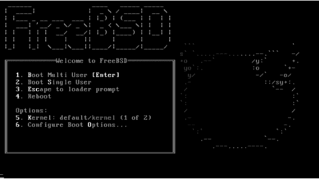

*图 3-1：引导加载程序*

按 `ENTER` 键跳过 10 秒倒计时。

然后我得到如图 3-2 所示的选择菜单。

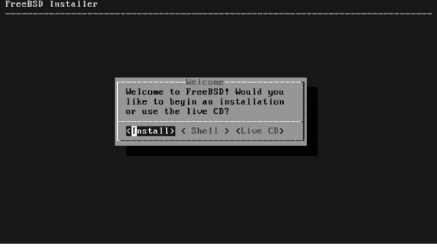

*图 3-2：选择安装*

在第 5 章中，我们将讨论使用 Live CD（现场光盘）选项来修复受损系统。但眼下，请按 `ENTER` 键选择 `Install`（安装，默认选项）。

你可能会注意到，每个选项的首字母是红色的，而大部分文本是灰色的。你可以输入该字母来做出选择，而不需要使用方向键导航。在这里，输入 `S` 会带你进入 `shell`（壳层），而 `L` 则启动 Live CD 映像。

你正在进入 `bsdinstall(8)`，这是 FreeBSD 传统的安装程序。虽然其他操作系统拥有漂亮的图形化安装界面，带有鼠标驱动菜单和彩色饼图，但 FreeBSD 的安装程序看起来就像一个老式的 `DOS` 程序。你将从选择一个键盘映射开始安装，如图 3-3 所示。

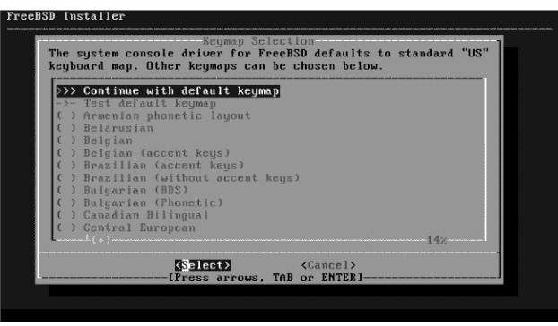

图 3-3：键盘映射选择

`Bert` 的打字习惯很糟糕，他真的需要一个更好的键盘布局。你可以用方向键在这个列表中上下移动，但那样做速度很慢。`PAGEUP` 和 `PAGEDOWN` 可以每次上下翻动一整屏，而 `HOME` 和 `END` 分别带你到顶部和底部。当我找到一个喜欢的键盘映射时，我会按 `ENTER`。然后我可以测试该键盘映射，如图 3-4 所示。

该键盘映射看起来很熟悉，但许多键盘映射的名称相似。按下 `ENTER` 会弹出一个输入框，我可以在里面敲击键盘，以测试该键盘映射是否符合我认为的选择。如果看起来没问题，按 `ENTER` 返回此屏幕，然后按向上箭头键和 `ENTER` 键继续。

接着，安装程序会询问主机名，如图 3-5 所示。

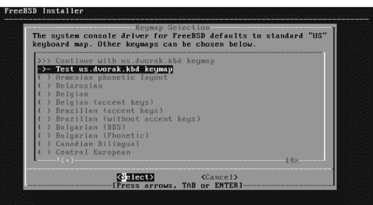

图 3-4：测试还是不测试？

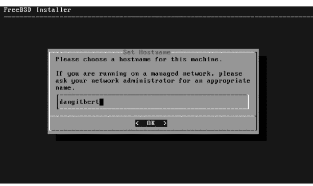

图 3-5：输入主机名

我是我自己的网络管理员，所以我可以使用任何我想要的名称。你的组织可能有不同的规则。按 `ENTER` 继续。

### 发行版选择

虽然设置键盘映射和主机名很重要，但当我们选择要安装的发行版时，才会出现第一个真正具有 FreeBSD 特色的项目。在 FreeBSD 中，发行版是 FreeBSD 组件的特定子集。安装 FreeBSD 时，你需要选择想要哪些发行版。安装程序不会列出任何必选项：你必须有内核和基本用户空间。然而，某些部分是可选的（见图 3-6）。

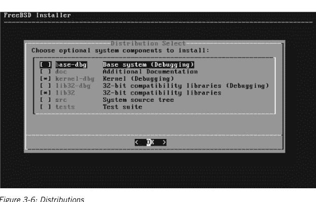

你不需要这些组件中的任何一个，但在某些情况下，其中一些会非常有用。

- `base-dbg` 基础系统的调试符号，对程序员有用
- `doc` FreeBSD 的官方文档，例如手册（Handbook）
- `kernel-dbg` 内核的调试符号，对程序员有用
- `lib32-dbg` 32 位库的调试符号（仅适用于 64 位系统）
- `lib32` 32 位兼容库（仅适用于 64 位系统）
- `src` 已安装操作系统的源代码
- `tests` FreeBSD 的自测工具

如果你正在 FreeBSD 上进行编程或开发，或者正在开发 FreeBSD 本身，请上下移动以选择调试库。新用户可能会发现文档很有帮助。使用空格键来选择或取消选择一个选项，并按 `ENTER` 键进入磁盘分区阶段。

我建议您始终安装操作系统源代码。它占用的空间非常少，而且是一个极其宝贵的资源。

就我而言，我希望 `Bert` 尽可能少地打扰我。我给了他所有的调试库和系统源代码，这样如果他抱怨，我就可以让他去阅读 `/usr/src`。

#### 磁盘分区

FreeBSD 支持两种主要文件系统：`UFS` 和 `ZFS`（见图 3-7）。第 2 章讨论了它们之间的选择，所以我不再赘述。现在我需要停止犹豫并做出选择。

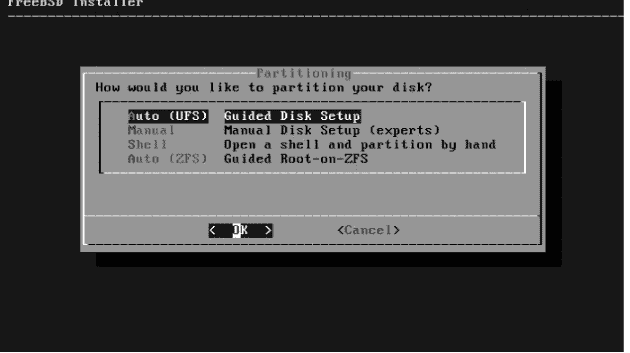

图 3-7：选择文件系统

经验丰富的用户可以手动选择（`Manual`），或者对于硬核玩家，可以选择 `Shell`（壳层）。不过，我会让你跟着操作，所以我会选择自动（`UFS`）或自动（`ZFS`）。我将使用 `UFS` 来演示磁盘分区，然后过渡到 `ZFS`。

#### UFS 安装

由于默认的 `UFS` 安装非常简单，许多人使用默认选项也没问题，所以我选择一些更不常见的选项来演示如何使用 `bsdinstall`。首先询问我想使用多少磁盘空间，如图 3-8 所示。

如果 `Bert` 想使用多个操作系统，他可以启动一个虚拟机监视器。我按 `ENTER` 使用整个磁盘。会弹出一个警告，提示我即将擦除磁盘。是的，我是这么打算的。这就是目的。选择“是”。然后我被要求选择一个分区方案，如图 3-9 所示。

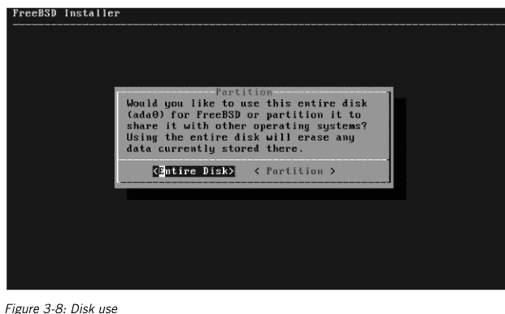

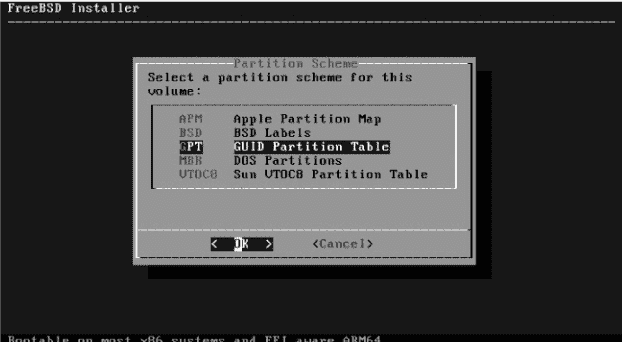

图 3-9：分区方案

`bsdinstall` 保守地默认使用 `MBR` 分区。几乎所有设备都支持 `MBR` 分区，就像几乎所有设备都支持 `BIOS` 而非 `EFI` 一样，但 `GPT` 以后会让我的麻烦少很多。我向上移动一个空格并选择 `GPT`，从而显示默认的 `GPT` 分区（见图 3-10）。

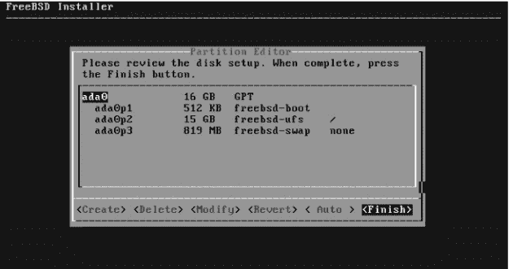

图 3-10：默认 GPT 分区

你现在就可以按 `ENTER` 来完成 `UFS` 分区，但我确定 `Bert` 需要特殊对待。让我们专门为他创建一个特殊的分区方案。

每个 `GPT` 系统都需要一个 `freebsd-boot` 分区，所以不要动 `ada0p1`。向下移动到 `ada0p2`，按 `D` 键或者移动箭头到 `Delete` 按钮来删除它。对 `ada0p3` 做同样的操作，最终你会剩下一个分区和大量的空余空间，如图 3-11 所示。

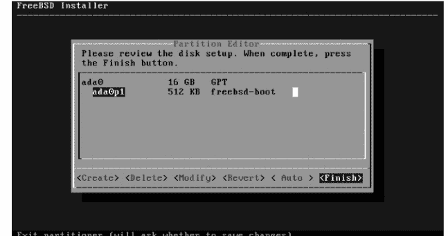

图 3-11：仅引导加载器

现在决定你希望如何对该磁盘进行分区。磁盘有 16GB 的空间，我按以下方式划分：

- 512KB `freebsd-boot` `EFI` 引导分区
- 1GB 交换空间（`swap`）
- 4GB 紧急转储空间（见第 24 章）
- 1GB 根分区 (`/`)
- 512MB `/tmp`
- 2GB `/var`
- 其余全部用于 `/usr`

引导分区已经存在，所以我移动到 `Create` 或者直接按 `C` 键来添加第一个分区，从而显示图 3-12 中的对话框。

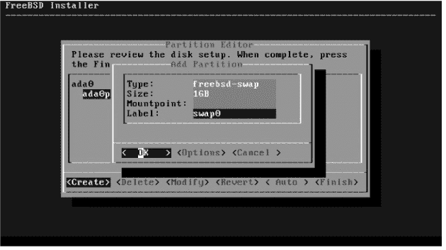

图 3-12：添加新分区

方向键可以让你在屏幕底部的选项之间移动，但你需要使用 `TAB` 键才能跳转到顶部的文本区域。一旦进入文本区域，方向键就会在字段之间移动，并在每行前后移动。我们的第一个分区将是交换空间，所以使用 `DELETE` 键擦除 `Type`（类型）字段的内容并输入 `freebsd-swap`。将大小设置为 1GB。每个分区都应该有一个标签，所以我将此分区标记为 `swap0`。我们在第 10 章中讨论标签。

现在按 `TAB` 键离开文本框并选择 `OK`。

我相当确信 `Bert` 会让这台机器发生恐慌，并且方式会很糟糕，以至于我不得不将该主机所有的内存转储到磁盘。该主机有 4GB 的 `RAM`，所以我创建一个 4GB 的转储分区。它的样子将完全像交换空间一样，包括 `freebsd-swap` 类型，但我将大小设置为 4GB，并将其标记为 `dump0`。

根分区略有不同，如图 3-13 所示。根分区需要一个文件系统，因此将类型设置为 `freebsd-ufs`。我决定分配 1GB 给它。根分区的挂载点始终是 `/`，我将其标记为 `root`。

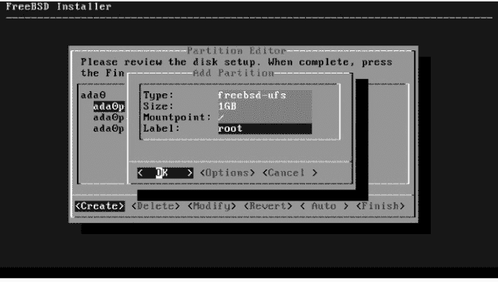

图 3-13：添加根分区

`/tmp`、`/var` 和 `/usr` 的其余分区看起来都很相似。当你用完所有磁盘空间时，你会得到一个类似于图 3-14 中的分区表。

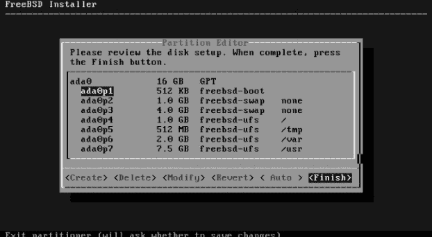

图 3-14：完整的自定义 GPT/UFS 分区表

安装程序问我是否确定。这种布局应该能让 `Bert` 不再抱怨日志文件使他的系统溢出，所以我心满意足。选择 `Finish` 以分区磁盘并让安装继续。

#### ZFS 安装

如果我选择 `ZFS`，我将获得如图 3-15 所示的 `ZFS` 配置屏幕。

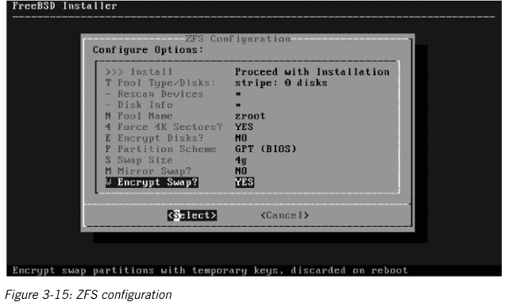

默认选项是 `Install`（安装），这会导致错误，因为你尚未选择 `ZFS` 虚拟设备类型。你需要从 `Pool Type/Disks`（池类型/磁盘）开始。不过，在我们到达那里之前，让我们看看其他选项。

FreeBSD 根 `ZFS` 池的默认名称是 `zroot`。没有真正的理由更改此名称，除非你希望你的系统看起来与市面上其他任何 `ZFS` 系统不同，或者你的组织对池命名有标准。

`Force 4K Sectors` 选项对于我们在第 10 章中讨论的原因来说很重要。除非你绝对确定你的磁盘具有 512 字节扇区，请将此选项保留为“是”。

如果选择加密磁盘，系统将提示你为全盘加密输入密码。FreeBSD 使用 `GELI` 进行 `ZFS` 加密（参见第 23 章），尽管当 `ZFS` 获得原生加密功能时，此情况可能会改变。

对于分区方案，请选择 `GPT`。如果你的主机能够合理运行 `ZFS`，那么它支持 `GPT`。

你需要多少交换空间？请根据需求调整 `Swap` 大小。我希望这台主机有足够的空间进行完整的内核内存转储，因为是给 `Bert` 用的，所以我调整交换大小为 4GB。

拥有多块硬盘的主机可以使用多块驱动器上的交换分区。当包含交换分区的驱动器发生故障时，主机将丢失该交换内存块中的所有数据并崩溃。选择镜像交换可以为你的交换空间提供冗余，但会占用更多磁盘空间。

你是否应该选择加密交换空间？这几乎不会带来性能损耗，并且在你的硬盘被盗时具有潜在的 Vorteil（优势）。

现在向上滚动，选择池类型/磁盘以选择 `ZFS` 虚拟设备类型，如图 3-16 所示。

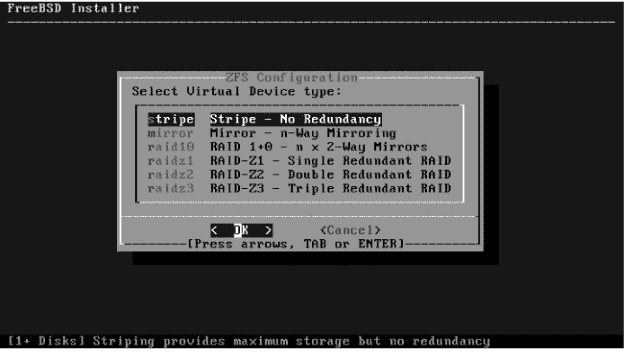

*图 3-16：虚拟设备选择*

第 12 章详细讨论了 `ZFS` 虚拟设备。选择虚拟设备类型是你为 `ZFS` 系统所做的最重要的决定。然而，对于单盘主机，唯一可行的选项是*条带（stripe）*。选择它后，你将获得选择 `ZFS` 池中硬盘的选项（见图 3-17）。

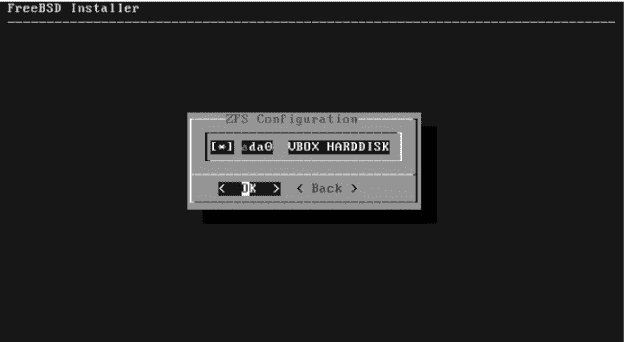

*图 3-17：ZFS 磁盘选择*

使用空格键选择你要包含在此池中的磁盘。由于此主机只有一块磁盘，我选择了它，然后选择“确定”继续。

安装程序返回到主要的 `ZFS` 配置屏幕。我再次检查了我的选择（`GPT` 分区和 4GB 交换空间），然后向上箭头选择安装。安装程序给出了最后一次“你真的、真的确定吗？”警告。我很确定。

### 网络和服务配置

一旦你批准磁盘布局，`bsdinstall` 将新的分区表写入磁盘，创建文件系统，并在无需进一步干预的情况下提取你已选择的发行版。安装程序随后进入设置网络、服务和用户的阶段。

首先，你会被要求输入系统新的 `root` 密码。`root` 用户可以对系统执行任何操作，因此请设置一个良好的密码。你需要输入两次密码以使其被接受。

使用上下箭头选择网络接口。此主机只有一个接口，所以我按 `ENTER` 进行配置（见图 3-18）。

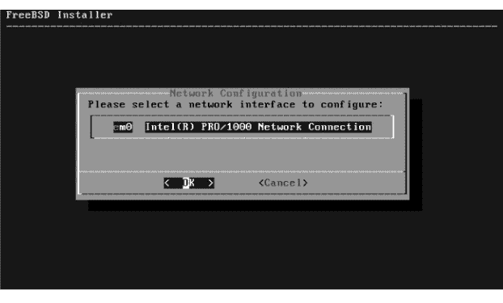

接下来，我们会询问是否要为该接口配置 `IPv4`。如果你不确定 `IPv4` 是什么，但希望拥有互联网，请选择**是**。我当然希望这样。然后我们会询问是否使用 `DHCP` 自动配置网络。如果这是一次性系统，那么可能需要，但这将是 `Bert` 的个人服务器。它需要特殊的网络配置。我选择**否**，并打开网络配置屏幕，如图 3-19 所示。

你的光标已经在文本区域上方。使用箭头键向下移动，而不是 `TAB` 或 `ENTER`。看到“确定”被高亮显示了吗？一旦你按 `ENTER`，无论你是否已配置网络，安装程序都会进入下一个屏幕。填入 `IP` 地址、子网掩码和默认网关的适当值。如果你不知道这些是什么，你应该使用 `DHCP` 或阅读第 7 章。不用担心在这里犯错误；如果你搞砸了，安装程序的最后一个屏幕提供了更改网络配置的机会。完成后按 `ENTER`。

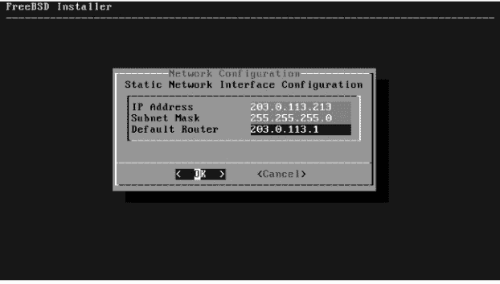

*图 3-19：网络配置*

一旦你配置了 `IPv4`，安装程序将进入 `IPv6` 配置。既然你们都使用现代网络，那就继续配置吧。`IP` 地址、网络掩码和默认路由器的设置与 `IPv4` 类似。安装程序还支持 `SLAAC`，也称为*IPv6 的 DHCP*。然而，如果你仍然使用老旧的仅 `IPv4` 网络，请跳过 `IPv6`。

然后你会被提供配置 `DNS` 的选项。在这里，我输入了我网络的搜索域和名称服务器（见图 3-20）。

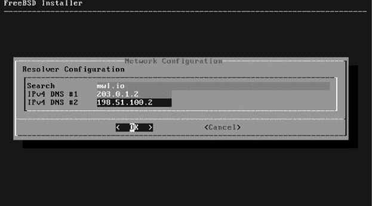

*图 3-20：解析器配置*

如果你有网络的 `IP` 地址信息，但不知道搜索域和名称服务器的 `IP` 地址，请从另一台机器复制这些值。

安装程序现在要求输入主机的时区。它不会向显示一大堆时区列表，而是提供一系列分层菜单，如图 3-21 所示。

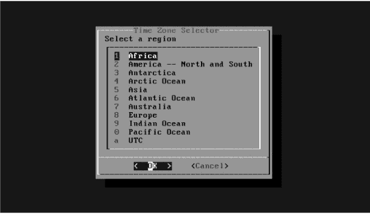

*图 3-21：时区选择器*


选择你的大洲。然后会被要求选择一个区域。我选择美国——`Bert` 确实在欧洲，但我想让他痛苦地意识到，如果他在清晨寻求帮助，他是不会得到帮助的。请记住，`END` 和 `HOME` 键可以带你到这些长列表的顶部和底部；按 `END` 然后向上移动几个位置到达美国，比翻页浏览西半球包括所有小岛屿在内的每个国家要快得多。然后我可以选择美国任何时区。美国公民将再次被提醒，许多州的时区真的很混乱。² 即使我的家乡密歇根州也不例外。但我选择了密歇根，并被给予确认选择的机会（见图 3-22）。

我认识 `EDT`，即东部夏令时。如果我不认识，我会选择“否”并重试。

接下来的几个屏幕提供了设置系统时钟的选项。奇怪的是，默认设置为跳过。虽然你可以在此处输入时间和日期，但从网络设置时间要容易得多，我们稍后会这样做。

现在我们可以启用一些系统启动服务，如图 3-23 所示。

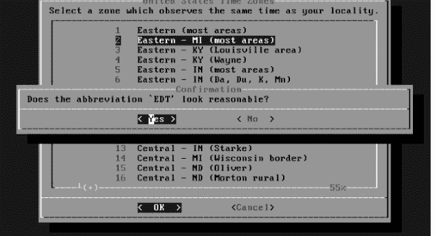

*图 3-22：美国时区*

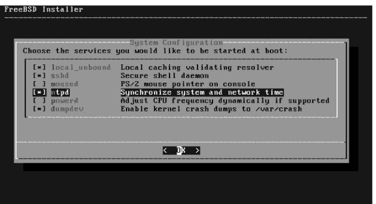

*图 3-23：启动服务*

大多数主机需要 `SSH`，并且你应该始终启用内核崩溃转储。不过，其他服务可能不适合你的网络。我总是启用 `ntpd`（参见第 20 章）和 `locat_unbound`（参见第 8 章），使主机时钟自行同步到公共 `NTP` 服务器并保持本地 `DNS` 缓存，但如果你的主机无法访问公共互联网，它们就没那么有用。笔记本电脑用户可以查看 `moused(8)` 和 `powerd(8)`。

然后你会看到图 3-24 中显示的系统加固选项。

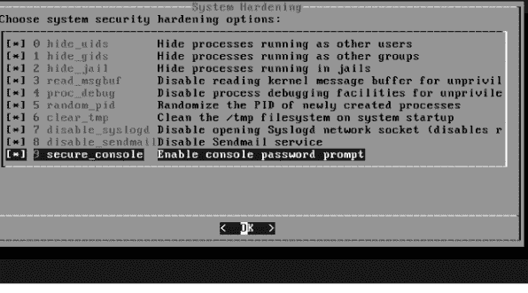

*图 3-24：加固选项*

我们在第 19 章中详细讨论了加固选项。如果是你的第一次安装，并且你想要一段温和的学习体验，请将它们全部关闭。如果你想学习如何在一个更正确保障安全的系统上工作，请选择所有选项。我在所有主机上启用每个加固选项，学习如何在改进的安全环境中工作将对 `Bert` 有益。

现在我们可以向系统中添加一个用户（见图 3-25）。我建议向每个系统至少添加一个非特权用户，以便你可以登录到新安装的主机而不直接进入 `root`。如果你有像 `Ansible` 这样的需要用户账户的配置管理系统，请在此处创建该账户。这台主机是为 `Bert` 准备的，所以我正在为他提供一个账户。

```
FreeBSD Installer
=================
Add Users

Username: xistence
Full name: Bert Dangit
Uid (Leave empty for default):
Login group [xistence]:
Login group is xistence. Invite xistence into other groups? [1]: wheel
Login class [default]:
Shell [sh csh tcsh nologin] [sh]: tcsh
Home directory [/home/xistence]:
Home directory permissions (Leave empty for default):
Use password-based authentication? [yes]:
Use an empty password? [yes/no] [no]:
Use a random password? [yes/no] [no]:
Enter password:
Enter password again:
Lock out the account after creation? [no]:
```

*图 3-25：添加用户*

第 9 章详细讨论了创建用户账户，但我会在此处提供一些针对第一个账户的合理设置。`Bert` 首选的账户名是`xistence`，我会迁就他。我填入他的名字，然后直接按 `ENTER` 接受默认的`Uid`和`Login group`。他是该系统的主要用户，所以我将他添加到 `wheel` 组，允许他使用 `root` 密码。他获得 `tcsh` shell，因为那是我最喜欢的。

如果你对用户主目录的位置有策略，请遵循它。否则，请接受默认值。类似地，虽然你可以调整密码设置以适应默认值，但一般来说，输入用户的密码是最简单的。许多人推荐像`ChangeMe`这样的密码，但我更倾向于使用积极鼓励用户尽快更改的密码——也许是像`BertIsTheWorstIMeanTheWorstHumanBeingEver`这样的密码。³ 如果我在创建账户后锁定它，我只需要在他想使用机器时解锁即可。

添加一个用户后，系统会询问我是否要添加另一个用户。如果我为自己创建一个账户，我将对该主机承担部分责任。我选择了“否”。

### 完成安装

如图 3-26 所示，核心配置已全部完成！随后，我获得了一次机会返回并调整一些设置。

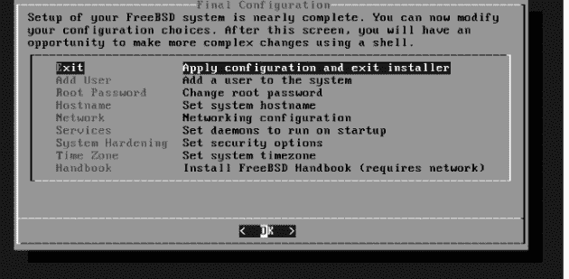

*图 3-26：最终配置*

这些选项大多数直接来源于安装过程中的早期步骤。你想返回更改网络配置吗？选择**网络**。你是否需要添加另一个用户或启用更多服务？你输入了错误的密码吗？这是你纠正这些错误的机会。

当你认为准备就绪时，选择**退出**，你会发现你并不一定需要结束安装过程。

安装程序涵盖了基础内容，但每个环境都是独特的。手动配置提供了一个 `chroot` 到系统的命令提示符，给你机会进行任何最后的更改（参见图 3-27）。选择“否”，系统将告知你移除启动介质并重启。我发现，在主机首次启动前进行一些调整通常会让我更省心，所以我选择了“是”。

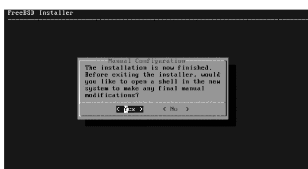

*图 3-27：手动配置*

我现在以 `root` shell 身份 `chroot` 到已安装的主机中。你在这里执行的具体任务完全取决于你的网络环境。第 9 章讨论了 `chflags(8)` 和 `schg`。现在，我输入 `exit`，如图 3-28 所示。

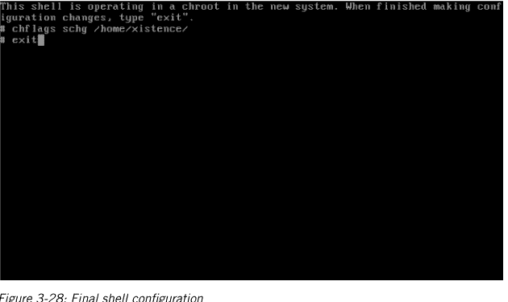

然后我重启，拔掉安装介质，并启动进入一个完整的 `FreeBSD` 安装！

## 4

## 启动！引导过程


虽然 `FreeBSD` 在开机时很容易且自动启动，但理解每个阶段具体发生了什么，会让你成为一名更出色的系统管理员。在引导过程中进行干预很少是必要的，但总有一天你会庆幸自己知道如何做到这一点。一旦你熟悉调整引导过程，你会发现你可以解决那些你以前只能容忍和忍受的问题。

我们将首先讨论系统加载器如何启动以及从加载器获取信息。你可以使用加载器更改早期引导过程，包括启动备用内核和以单用户模式启动。我们将涵盖串行控制台，这是一种标准的系统管理工具。`FreeBSD` 多用户启动过程负责启动使你的计算机有用的各种服务，我们也将关注这一点。此外，我们将涵盖 `FreeBSD` 记录的关于引导过程的信息，以及 `FreeBSD` 如何关闭自身而不会破坏数据。

### 递归警告

本章中的一些主题引用了后续章节中的材料。这些后续章节反过来又要求你先理解本章。学习没有完美的起点。如果你不完全理解本章的一部分，只需略读并继续阅读；随着你的进展，这些内容确实会在你脑海中融会贯通。

引导过程本身可以分为三个主要部分：加载器、单用户启动和多用户启动。

### 开机

计算机需要足够的“大脑”来查找并加载其操作系统。多年来，这一功能来自基本输入/输出系统（`BIOS`）。较新的系统使用统一可扩展固件接口（`UEFI`）而不是 `BIOS`。新安装应使用 `UEFI`。其他硬件平台具有控制台固件或启动 ROM，执行相同的功能，但我们专注于商用硬件，因此我们将涵盖 `UEFI` 和 `BIOS`。

### 统一可扩展固件接口

`UEFI` 是替代有着三十年历史的 `BIOS` 的新技术。任何新系统都会启用 `UEFI` 并期望使用它。

`UEFI` 在启动驱动中搜索标记为 `UEFI` 启动分区的分区。尽管特殊标记可能暗示更多功能，但该分区仅包含具有特定目录和文件布局的 `FAT` 文件系统。`UEFI` 执行文件 `/EFI/BOOT/BOOTX64.EFI`。该文件可能是一个华丽的多操作系统加载器，也可能直接让你进入某个操作系统。在 `FreeBSD` 中，`UEFI` 启动会启动加载器 `/boot/loader.efi`。

`UEFI` 相对较新。如果你的新系统在启动 `FreeBSD` 时遇到问题，你可以尝试启用 `BIOS` 或“传统”模式。如果系统以 `BIOS` 模式启动 `FreeBSD` 但以 `UEFI` 模式无法启动，请提交错误报告，如第 24 章所述。

### 基本输入/输出系统

最初的 Intel PC 使用基本输入/输出系统（`BIOS`），它具有足够的“大脑”在磁盘的某个地方查找操作系统。`BIOS` 查找标记为活动的磁盘分区，然后执行该分区的第一部分。对于 `FreeBSD`，这组数据被称为`加载器`。每个 `FreeBSD` 系统都有一个加载器的参考副本，位于 `/boot/loader`。

`BIOS` 有各种限制。启动加载器必须位于磁盘的非常特定的区域。`BIOS` 无法从大于 2.2TB 的磁盘启动。目标启动加载器必须小于 512KB——按 1980 年的标准来说确实很大，但今天来说微不足道。已安装的加载器是一个二进制文件，而不是文件系统，因此即使是微小的更改也需要重新编译。`UEFI` 没有这些限制，并提供现代功能，如鼠标支持。

归根结底，`BIOS` 和 `UEFI` 的目标都是让你的系统到达 `FreeBSD` 加载器。

### 加载器

`加载器`，或`引导块`，加载 `FreeBSD` 内核，并在启动该内核之前向你展示一个菜单。`loader(8)` 程序在左侧提供七个选项的菜单。新的 `FreeBSD` 系统显示这些选项：

- 1. 启动多用户 [Enter]
- 2. 启动单用户
- 3. 转义到加载器提示符
- 4. 重启
- 5. 内核：default/kernel（2 个中的第 1 个）
- 6. 配置引导选项…
- 7. 选择引导环境…

每个选项都会突出显示某些单词或字符，例如“启动单用户”中的 S 和“转义到加载器提示符”中的 ESC。通过按突出显示的字符或数字来选择选项。

菜单顶部的选项控制 `FreeBSD` 的启动方式。我们将逐一查看每个选项。如果你等待 10 秒，加载器默认会自动启动 `FreeBSD`。

菜单下半部分的选项让你微调引导过程。你可以调整你希望系统如何启动，如我们稍后将讨论的那样，然后选择上述某个启动选项。

### 启动多用户 [Enter]

这是正常启动。按 `ENTER` 立即启动，跳过 10 秒延迟。

### 在单用户模式下启动 FreeBSD

单用户模式是一种最小化的启动模式，在受损系统上非常有用，尤其是当损坏是由你自己造成的时候。这是 `FreeBSD` 能够提供命令提示符的最早点，它重要到在本章稍后的部分中拥有自己的章节。

### 转义到加载器提示符

加载器包含一个命令行解释器，你可以在此处发出命令，以便根据你的需要确切地调整系统启动。我们将在第 55 页的“加载器提示符”中详细讨论这一点。

### 重启

再来一次，这次充满激情！

在这些选项中，最重要的是单用户模式和加载器提示符。

### 单用户模式

`FreeBSD` 可以执行最小化启动，称为单用户模式，它加载内核并查找设备，但不会自动设置文件系统、启动网络、启用安全或运行任何标准 Unix 服务。单用户模式是系统可能给出命令提示符的最早时候。

为什么使用单用户模式？如果配置不当的守护进程挂起引导，你可以进入单用户模式以防止它启动。如果你丢失了 `root` 密码，你可以启动到单用户模式来更改它。如果你需要重新安排关键文件系统，再次，单用户模式是执行此操作的地方。

当你选择单用户模式启动时，你会看到常规系统启动消息流过。然而，在任何程序启动之前，内核会给你机会选择一个 shell。你可以输入根分区上的任何 shell；我通常只使用默认的 `/bin/sh`，但如果你更喜欢，可以使用 `/bin/tcsh`。

#### 单用户模式下的磁盘

在单用户模式下，根分区以只读方式挂载，其他磁盘未挂载。（我们将在第 10 章讨论文件系统挂载，但现在请跟着做。）你想使用的许多程序位于根分区以外的分区上，因此你希望它们都以读写方式挂载并可用。具体方法取决于你使用的是 `UFS` 还是 `ZFS`。

#### 单用户模式下的 UFS

要使文件系统表 `/etc/fstab` 中列出的所有文件系统可用，运行以下命令：

```
##### fsck -p
##### mount -u rw /
##### mount -a
```

`fsck(8)` 程序“清理”文件系统，并确认它们在内部是一致的，以及磁盘认为拥有的所有文件确实存在并且已被记录。

根文件系统以只读方式挂载。导致我们进入单用户模式的问题可能需要更改根文件系统。

将根文件系统重新挂载为读写模式。

最后，`mount(8)` 的 `-a` 标志会激活 `/etc/fstab` 中列出的所有文件系统（参见第 10 章）。如果其中某个文件系统造成了问题，你可以通过在命令行中指定它们来单独挂载所需的文件系统（例如，`mount /usr`）。如果你是配置了 `NFS` 文件系统的高级用户（参见第 13 章），此时你会看到这些文件系统出现错误信息，因为网络尚未启动。如果主机的 `/etc/fstab` 中包含网络文件系统，请仅按以下方式挂载 `UFS` 文件系统。

如果你按名称挂载分区时遇到问题，请尝试使用设备名称。根分区的设备名称可能是 `/dev/ad0s1a`。你还必须为该分区指定一个挂载点。例如，要挂载你的第一个 IDE 磁盘分区作为根目录，请输入以下命令：

```bash
##### mount /dev/ad0s1a /
```

如果你的服务器上有网络文件系统但网络尚未启动，你可以通过指定文件系统类型来挂载所有本地分区。在这里，我们挂载所有 `UFS` 类型的本地文件系统，这是 `FreeBSD` 的默认文件系统类型：

```bash
##### mount -a -t ufs
```

现在你可以访问你的 `UFS` 文件系统了。

#### 单用户模式下的 ZFS

要使所有 `ZFS` 数据集可用，请使用 `zfs mount`。你可以按名称挂载单个数据集，或者使用 `-a` 挂载所有标记为可挂载的内容。

```bash
##### zfs mount -a
```

`ZFS` 在挂载数据集之前会执行其常规完整性检查。

大多数数据集的访问权限与多用户模式完全相同，但挂载为根目录的数据集仍然是只读的。请关闭该设置。这里，我在默认的 `FreeBSD` 安装中将根数据集设置为读写模式。

```bash
##### zfs set readonly=off zroot/ROOT/default
```

现在你可以修改文件系统了。

#### 单用户模式下可用的程序

你可用的命令取决于挂载了哪些分区。一些基本命令位于根分区的 `/bin` 和 `/sbin` 中，即使根目录是以只读方式挂载的，它们也可以运行。其他命令位于 `/usr` 中，在挂载该分区之前无法访问。（请在你的系统上查看 `/bin` 和 `/sbin`，了解一下当系统出问题时你手头有哪些工具。）

如果你搞乱了共享库系统（参见第 17 章），这些程序将无法工作。如果你不幸遇到了这种情况，`FreeBSD` 在 `/rescue` 目录中提供了许多核心工具的静态链接版本。

#### 单用户模式下的网络

如果你希望在单用户模式下拥有网络连接，请使用 shell 脚本 `/etc/netstart`。此脚本调用相应的脚本来启动网络，为接口分配 `IP` 地址，并启用数据包过滤和路由。如果你只需要部分而非全部这些服务，你需要阅读该 shell 脚本并手动执行相应的命令。

#### 单用户模式的用途

在单用户模式下，你对系统的访问权限仅受限于你对 `FreeBSD` 和 Unix 的了解程度。

例如，如果你忘记了 `root` 密码，你可以从单用户模式重置它：

```bash
##### passwd
Changing local password for root
New Password:
Retype New Password:
#
```

> **注意**
>
> 你会注意到并没有要求输入旧的 `root` 密码。在单用户模式下，你自动拥有 `root` 权限，并且 `passwd(8)` 不会要求 `root` 输入任何密码。

或者，如果你发现 `/etc/fstab` 中存在拼写错误，导致系统困惑且无法启动，你可以使用设备名称挂载根分区，然后编辑 `/etc/fstab` 以解决该问题。

如果你有一个程序在启动时导致系统崩溃（panic），并且你需要阻止该程序再次启动，你可以编辑 `/etc/rc.conf` 以禁用该程序，或者设置启动脚本的权限，使其无法执行。

```bash
##### chmod a-x /usr/local/etc/rc.d/program.sh
```

我们将在第 15 章讨论第三方程序（`ports` 和 `packages`）。

要成为一名成功的系统管理员，你需要理解单用户模式，我们将在本书中不断引用它。不过，现在让我们来看一下加载器提示符。

#### 系统故障与人为失误

所有这些例子都涉及从人为错误中恢复，这并非偶然。硬件故障并不常见，而 `FreeBSD` 故障更是如此。如果没有人为错误，我们的电脑几乎永远不会让我们失望。随着你对 `FreeBSD` 了解的深入，你在单用户模式下的能力会越来越强。

#### 加载器提示符

加载器提示符允许你对计算机的引导环境和必须在引导过程早期配置的变量进行基本更改。它不是一个类 Unix 环境；它空间紧凑，仅支持最小的功能集。当你逃逸到加载器提示符（启动菜单中的第三个选项）时，你会看到以下内容：

```text
Type '?' for a list of commands, 'help' for more detailed help.
OK
```


这就是加载器提示符。虽然`OK`这个词可能友好且令人安心，但它是加载器环境中少数令人感到友好的元素之一。这不是一个功能完备的操作系统；它是一个用于配置系统启动的工具，既不适合无知者，也不适合心虚者。你在加载器提示符所做的更改仅影响当前启动。若要撤销更改，请再次重新启动。（我们将在下一节中介绍如何使加载器更改永久化。）

要查看所有可用命令，请输入问号。

```text
OK ?
Available commands:
    heap              show heap usage
    reboot            reboot the system
    lszfs             list child datasets of a zfs dataset
    --snip--
```

许多加载器命令除了对开发人员有用外，对其他人都没什么用，因此我们将重点介绍对系统管理员有用的命令。

### 查看磁盘

要查看加载器识别到的磁盘，请使用`lsdev`。

```text
OK lsdev
1 cd devices:
disk devices:
2 disk0: BIOS drive C (33554432 X 512):
3 disk0p1: FreeBSD boot
disk0p2: FreeBSD swap
disk0p3: FreeBSD ZFS
4 zfs devices:
zfs:zroot
```

加载器检查 CD 驱动器¹但未找到任何设备。（只有在从 CD 启动时，加载器才会找到 CD 驱动器，因此不要对此感到惊慌。）它找到了一个硬盘，BIOS 将其识别为驱动器 C²。然后它描述了该硬盘上的分区。正如我们将在第 10 章中看到的，GPT 分区使用字母`p`和一个数字来标识分区。分区`disk0p1`³是一个 FreeBSD 引导分区，用于从 BIOS 引导 FreeBSD。在遇到启动问题的陌生系统上，你可能会发现这一知识很有用。加载器还可以识别主机上的 ZFS 池⁴。

#### 加载器变量

加载器拥有由内核和配置文件设置的变量。使用`show`命令查看这些变量及其设置，并使用空格键翻到下一页。

```text
OK show
LINES=24
acpi.oem=VBOX
acpi.revision=2
acpi.rsdp=0x000e0000
-- snip--
```

这些值包括底层内核可调参数以及从硬件 BIOS 或 UEFI 获取的信息。我们将在第 57 页的“加载器配置”中看到加载器变量的部分列表，并且其他值将在本书的相关章节中提及。

你可以通过名称显示特定变量。不幸的是，你无法显示某个关键字的所有子变量。像`show acpi.oem`这样的命令可以工作，但`show acpi`或`show acpi.*`则不行。

使用`set`命令更改单次启动的值。例如，要将控制台设置更改为`comconsole`，你需要输入：

```text
OK set console=comconsole
```

加载器允许你更改本不应该更改的变量。将`acpi.revision`设置为 4 并不会突然将你的系统升级到 ACPI 版本 4，你也不能通过软件设置更改硬盘。

### 重新启动

你是误入加载器的吗？重新开始。

### 从加载器启动

既然你已经调整了系统的底层设置，你很可能希望启动系统。使用`boot(8)`命令。你可以使用 man page 中讨论的启动标志进一步调整启动过程。

一旦系统按你需要的方式启动，你很可能希望使这些设置永久化。FreeBSD 允许你通过加载器配置文件来实现这一点。

### 加载器配置

使用配置文件`/boot/loader.conf`使加载器设置更改永久化。此文件中的设置直接传入系统启动时的引导加载器。当然，如果你享受每次系统启动时都在控制台前守候的乐趣，那就别费心去弄了！

加载器有一个默认配置文件，`/boot/defaults/loader.conf`。我们会在这里覆盖许多值。

如果你查看默认的加载器配置，你会看到许多类似于加载器中列出的变量的选项。例如，在这里我们可以设置控制台设备的名称：

`console="vidconsole"`

在 FreeBSD 文档中，你会看到关于`启动时可调参数`和`加载器设置`的引用。所有这些都在`loader.conf`中设置，其中包含了许多`sysctl`值，一旦系统启动完成，这些值就变为只读。（有关可调参数和 sysctl 的更多信息，请参见第 6 章。）这里，我们将内核变量`kern.maxusers`强制设置为 32。

`kern.maxusers="32"`

这些变量中的一些在`loader.conf`中没有设置具体值；相反，它们显示为空引号。这意味着加载器通常允许内核设置此值，但如果你想覆盖内核的设置，你当然可以这样做。

`kern.nbuf=""`

内核对`kern.nbuf`的值有一个默认设想，但如果有必要，你可以让加载器指定一个不同的值。

我们将在适当的章节中讨论通过启动加载器进行系统调优——例如，内核值将在第 6 章中讨论，届时它们会变得更加容易理解——但这里有一些常用的加载器值，它们会影响加载器本身的外观和基本启动功能。随着 FreeBSD 的成熟，开发者会引入新的加载器值并修改旧值的功能，因此请务必检查你的安装目录中的`/boot/defaults/loader.conf`，以获取最新的列表。

`boot_verbose="NO"`

该值用于切换通过启动菜单可进入的冗长启动模式。在标准启动过程中，内核在识别系统硬件时，会打印出关于每个设备的一些基本说明。当你在冗长模式下启动时，内核会指示每个设备驱动程序打印出它关于每个设备所能获取的所有信息，并显示各种与内核相关的设置细节。冗长模式对于调试和开发非常有用，但对于日常使用通常不太必要。

`boot_delay="10"`

该值表示显示启动菜单到自动启动之间的秒数。我经常将其降低到 2 或 3 秒，因为我希望我的机器能尽可能快地启动。

`beastie_disable="NO"`

该值控制启动菜单的外观（最初，启动菜单装饰有一个 ASCII 艺术风格的 BSD“Beastie”吉祥物图像）。如果设置为 yes，启动菜单将不会显示。

`loader_logo="fbsdhw"`

该值允许你选择显示在启动菜单右侧的标志。`fbsdhw`选项提供默认的 FreeBSD ASCII 艺术标志。其他选项包括`beastiebw`（原始标志）、`beastie`（彩色标志）和`none`（无标志）。

#### 启动选项

启动菜单还提供三个选项：选择内核、设置启动选项以及选择启动环境。我们将在适当的章节中讨论这些内容，但这里先简要说明以帮助你熟悉情况。

主机可以在其`/boot`目录中拥有多个内核。按`Kernel`选项会告诉加载器在可用选项之间循环。要让某个内核作为选项出现，你需要在`loader.conf`的`kernels`变量中列出它。

`KERNELS="kernel kernel.old kernel.GENERIC"`

菜单仅识别`/boot/kernel`目录下的内核。如果你在`/boot/gerbil`中有内核，你必须从加载器提示符手动加载它。

FreeBSD 支持多种启动选项。选择“Configure Boot Options”项会显示最受欢迎的选项。

### 加载系统默认值

你修改了设置，想要撤销所有更改吗？选择此项。至少你可以将系统引导至单用户模式并修复你的`loader.conf`。

### ACPI 支持

ACPI 是高级配置和电源接口（Advanced Configuration and Power Interface），是 Intel/Toshiba/Microsoft 的硬件配置标准。它取代并合并了许多晦涩难懂的标准。ACPI 已成为标准多年，但如果特定的硬件在运行 FreeBSD 时出现问题，你可以关闭它看看会发生什么。如果你甚至想过尝试此选项，也请阅读第 24 章并提交 bug 报告。

### 安全模式

FreeBSD 的`安全模式`会开启操作系统中几乎所有保守的选项。它关闭硬盘上的 DMA 和写缓存，限制其速度但提高可靠性。它关闭 ACPI。32 位系统会禁用 SMP（对称多处理）。USB 键盘在安全模式下不再工作。此选项对于调试旧硬件很有用。

### 冗长模式

FreeBSD 内核在启动时会探测每一块硬件。发现的大多数信息对于日常使用无关紧要，因此启动加载器不会显示它们。当你在冗长模式下启动时，FreeBSD 会打印出关于每个系统设置和连接设备的所有详细信息。这些信息稍后可在`/var/run/dmesg.boot`中找到，如下一节所述。我建议你在新机器上尝试冗长模式，以便一窥系统的复杂性。

最后，`Select Boot Environment`（选择启动环境）选项允许你在 ZFS 启动环境之间进行选择，如第 12 章所述。

### 启动消息

正在启动的 FreeBSD 系统会显示消息，指示连接到系统的硬件、操作系统版本以及各种程序和服务启动时的状态。这些消息在你首次安装系统和进行故障排除时非常重要。启动消息总是以相同的方式开始，列出 FreeBSD 项目和加州大学校监会的版权声明：

```text
Copyright (c) 1992-2018 The FreeBSD Project.
Copyright (c) 1979, 1980, 1983, 1986, 1988, 1989, 1991, 1992, 1993, 1994
            The Regents of the University of California.  All rights reserved.
FreeBSD is a registered trademark of The FreeBSD Foundation.
FreeBSD 12.0-CURRENT #3 r320502: Fri Jun 30 13:48:50 EDT 2017
    root@storm:/usr/obj/usr/src/sys/GENERIC amd64
FreeBSD clang version 4.0.0 (tags/RELEASE_400/final 297347) (based on LLVM 4.0.0)
```

此外，你还会看到关于正在启动的 FreeBSD 版本的通告，以及编译日期、时间以及使用的编译器。你还可以看到谁编译了这个内核、它是在哪台机器上构建的，甚至这个内核是在文件系统的哪个位置构建的。如果你构建了大量内核，这些信息在试图确切识别可用的系统功能时无价之宝。

```text
WARNING: WITNESS option enabled, expect reduced performance.
```

内核将在整个启动过程中打印诊断消息。上面的消息意味着我在这个特定的内核中启用了调试和故障识别代码，因此我的性能会受到一定影响。在这种情况下，我不太在意性能影响，原因很快就会变得清晰。

```text
Timecounter "i8254" frequency 1193182 Hz quality 100
```

此消息标识了特定的硬件部件。`timecounter`（时间计数器）或`hardware clock`（硬件时钟）是一种特殊的硬件部件，虽然你的计算机需要一个，但它是一个如此低级的设备，终端用户真的无法直接对其做太多事情。时不时地，你会看到此类关于用户不可见但对系统至关重要的硬件的消息。启动消息在显示过多细节和掩盖可能至关重要的细节之间摇摆不定。例如，它也会显示关于系统中 CPU 的所有可能信息：

```text
CPU: Intel(R) Xeon(R) CPU E5-1620 v2 @ 3.70GHz (3700-0M-8H K8-class CPU
      Origin="GenuineIntel"  Id=0x306e4  Family=0x6  Model=0x3e  Stepping=4
      Features=0xbfbebfbf<FPU,VME,DE,PSE,TSC,MSR,PAE,MCE,CX8,APIC,SEP,MTRR,PGE,MCA,
      CMOV,PAT,PSE36,CLFLUSH,DTS,ACPI,MMX,FXSR,SSE,SSE2,SS,HTT,tm,PBE>
      Features2=0x7fbbe3ff<SSE3, PCLMULQDQ,DTES64,MON,DS_CPL,VMX,SMX,EST,TM2,SSSE3,CX16,
      xTPR,PDCM,PCID,DCA,SSE4.1,SSE4.2,x2APIC,POPCNT,TSCDLT, AESNI, XSAVE, OSXSAVE, AVX, F16C, RDRAND>
      AMD Features=0x2c100800<SYSCALL,NX,Page1GB,RDTSCP,LZ>
      AMD Features2=0x1c<LAHF>
      Structured Extended Features=0x281<fSGSBASE,SMEP,ERMS>
      XSAVE Features=0x1<XSAVEOPT>
      VT-x: PAT,HLT,MTF,PAUSE,EPT,UG,VPID,VLD,PostIntr
      TSC: P-state invariant, performance statistics
```

你可能不知道一个简单的 CPU 竟然有如此多的细节和功能，对吧？但当你要提交一份关于高级功能不工作的故障报告时，开发者可能会询问你的 CPU 是否具备某个特定功能。

这就是我不担心之前显示的 WITNESS 选项造成的性能打击的原因：这台机器相当快，并且支持对现代 CPU 很重要的一堆功能。虽然我确实希望获得我付费购买的所有性能，但我也希望在问题发生时捕获它们。我希望能够针对这些问题提交良好的 bug 报告，以便开发者会重视我的问题报告。毕竟，我运行的是启用了 WITNESS 的 FreeBSD 开发版本！

```text
FreeBSD/SMP: Multiprocessor System Detected: 8 CPUs
```

在这里，内核宣布它发现了全部八个 CPU 核心，并准备好管理它们。我有富余的 CPU 处理能力，也有相当多的内存。

* real memory = 34359738368 (32768 MB)

* avail memory = 33207656448 (31669 MB)

`真实`内存 ❶ 是指物理安装在计算机中的 RAM 数量，而`可用`内存 ❷ 是指内核加载后剩余的内存量。我有 31,669MB 的可用 RAM ❸ 用于实际工作，这足以满足该系统的负载需求。

```text
❶ ioapic0 <Version 2.0> ❷ irqs 0-23 on motherboard
❸ ioapic1 <Version 2.0> irq 24-47 on motherboard
```

这是一个相当典型的设备条目。该设备被称为`ioapic`，内核发现该硬件版本为 2.0，并关联了额外信息 ❷。此外，我们发现有两个该类型的设备，编号分别为 0 ❶ 和 1 ❸。（所有设备编号均从零开始。）你可以通过阅读设备驱动的 man page 来了解更多关于该设备的信息。几乎所有——但不是全部——设备驱动都有 man page。

```text
usbus0: EHCI version 1.0
usb us0 on ehci0
usb us0: 480Mbps High Speed USB v2.0
```

并非所有设备驱动都在单行中打印所有信息。在这里，我们有一个单一设备`usb us`，尽管只有一个设备实例，却占用了三行。要确认这是一个单一 USB 总线而不是三个独立的总线，唯一的方法是检查设备编号。这些都属于设备编号零，因此它是单个设备。

```text
❶ pci0: <simple comm> at device 22.0 (no driver attached)
❷ pcib8: <ACPI PCI-PCI bridge> irq 17 at device 28.0 on ❸ pci0
❹ pci8: <ACPI PCI bus> on ❶ pcib8
```

启动消息的一个有趣之处在于，它们展示了计算机组件之间的连接方式。在这里，我们有直接位于主板上的 PCI 接口`pci0` ❶。然后，是连接到`pci0` ❸ 的八号 PCI 桥接器`pcib8` ❷。我们还发现连接到该 PCI 桥接器 ❺ 的 PCI 总线`pci8` ❹。随着你继续阅读，你会发现连接在该总线上的各个设备。你现在可能无法充分利用这些信息，但当你需要排查问题时，你会发现拥有这些资源非常有价值。

```text
em0: <Intel(R) PRO/1000 Network Connection> port 0xd000-0xd01f mem 0xfba00000-0xfba1ffff,0xfba20000-0xfba23fff irq 18 at device 0.0 on pci9
```

此条目显示`em0`，这是一个`em(4)`类型的网卡，并指示该网卡支持千兆以太网。我们还看到了有关其内存地址、IRQ 和 PCI 总线连接的各种信息。

你计算机上的每个设备都有一个或多个这样的条目。作为一个整体，它们以合理的细节描述了你的计算机硬件。如果你在详细模式下启动，你会看到更多的细节——可能比你想要的要多得多。

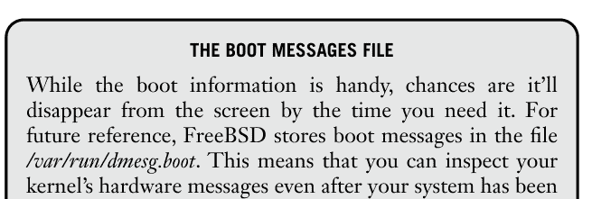

内核在启动消息中显示的一个关键内容是每件硬件的设备名称。这对于管理系统至关重要。每件硬件都有一个设备节点名称，要配置它，你需要知道该名称。例如，之前我们看到一个名为`em0`的以太网卡条目。该卡使用`em(4)`驱动程序，由该驱动程序控制的第一个设备编号为零。你的该类型第二个设备将是`em1`，然后是`em2`，依此类推。


大多数可配置或管理的设备在 `/dev` 下的某个位置都有一个设备节点条目。例如，第一个光驱由文件 `/dev/cd0` 表示。这些文件称为设备节点，它们是寻址特定硬件的便捷方式。大多数设备节点不能像普通文件那样直接访问；你不能 `cat(1)` 一个设备节点或将另一个文件复制到它。然而，设备节点被用作专用程序的参数。例如，在启动时显示为 `ada4` 的硬盘与设备节点 `/dev/ada4` 是相同的。当你想要挂载该硬盘时，你可以使用设备节点名称，以确保获取的是确切的该硬件部件。

#### 多用户启动

除了单用户模式外，你还可以找到多用户模式。这是类 Unix 操作系统（OS）的标准操作模式。如果你正在进行实际工作，你的系统处于多用户模式。

当 FreeBSD 完成硬件检查并适当附加所有设备驱动时，它会运行 shell 脚本 `/etc/rc`。该脚本挂载所有文件系统，启动网络接口，配置设备节点，识别可用的共享库，并执行使系统准备好进行常规工作所需的所有其他工作。大多数系统有不同的启动需求；虽然几乎每个服务器都需要挂载硬盘，但 Web 服务器的操作要求与数据库服务器非常不同，即使它们运行在完全相同的硬件上。这意味着 `/etc/rc` 必须极其灵活。它通过将一切委托给负责系统特定方面的其他 shell 脚本来实现灵活性。

`/etc/rc` 脚本由 `/etc/defaults/rc.conf` 和 `/etc/rc.conf` 文件控制。

#### `/etc/rc.conf`、`/etc/rc.conf.d` 和 `/etc/defaults/rc.conf`

与 loader 配置文件类似，`/etc/rc` 的配置分为两个文件：默认设置文件 `/etc/defaults/rc.conf` 和局部设置文件 `/etc/rc.conf`。`/etc/rc.conf` 中的设置会覆盖 `/etc/defaults/rc.conf` 中给出的任何值，完全类似于 loader。

`/etc/defaults/rc.conf` 文件非常大，包含相当多的变量，通常称为旋钮（knobs）或可调参数（tunables）。我们不会讨论它们全部，不仅因为旋钮被不断添加，这样的列表会立即过时，而且因为许多旋钮在服务器上并不常用。标准 FreeBSD 系统中的几乎一切都有一或多个 `rc.conf` 旋钮，从键盘映射到 TCP/IP 行为。要获取完整、最新的列表，请阅读 `rc.conf(5)`。要更改 `rc.conf` 设置，你可以使用文本编辑器或 `sysrc(8)`。

##### `sysrc(8)`

虽然手动编辑 `rc.conf` 效果很好，但在云计算的时代，它无法在大量机器上维持。如果你必须更改数十台服务器，你需要一种可靠的方法来更改系统，而不必手动编辑每台服务器的配置或诉诸 `sed`/`awk` 脚本。

FreeBSD 包含 `sysrc(8)`，这是一个命令行程序，用于从命令行一致且安全地更改 `/etc/rc.conf` 及其相关文件。此外，`sysrc(8)` 还可以显示关于系统非默认设置的信息。

首先使用 `-a` 询问 `sysrc(8)` 它知道关于你的主机的什么。

```bash
####### sysrc -a
clear_tmp_enable: YES
defaultrouter: 203.0.113.1
dumpdev: AUTO
keymap: us.dvorak.kbd
-- snip --
```

你会得到一个所有非默认 `/etc/rc.conf` 设置的列表。

要让 `sysrc(8)` 启用一个服务，提供变量名、等号和新值。

```bash
####### sysrc rc_startmsgs=NO
rc_startmsgs: YES -> NO
```

变量 `rc_startmsgs` 现在被设置为 `no`。

请记住，`sysrc(8)` 是一个更改 `rc.conf` 的工具，而不是配置 FreeBSD 的工具。它不进行有效性检查。我的一位非常资浅的系统管理员真的不想让 Bert 登录，他就听从了一些关于如何阻止该行为的糟糕建议。

```bash
####### sysrc bert=no
```

虽然此代码在 `/etc/rc.conf` 中设置 `bert="no"`，但该变量不起任何作用。使用 `-x` 标志将其删除。

```bash
####### sysrc -x bert
```

许多 FreeBSD 配置文件与 `rc.conf` 非常相似。你可以通过添加 `-f` 标志和文件名使用 `sysrc(8)` 来管理它们。

```bash
####### sysrc -af /boot/loader.conf
```

你是应该编辑 `rc.conf` 还是使用 `sysrc(8)`？如果你在进行手动更改，那么使用你喜欢的任何一种。自动化应倾向于使用 `sysrc(8)`。本书混合了这两种示例。

##### `/etc/rc.conf.d/`

如果你使用服务器配置系统，如 Puppet 或 Ansible，你可能更信任复制整个文件而不是编辑它们。使用 `/etc/rc.conf.d/` 文件通过此类工具启用服务。

要管理 `/etc/rc.conf.d/` 中的服务，创建一个以该服务命名的文件。也就是说，要管理 `bsnmpd(8)`，你会创建 `/etc/rc.conf.d/bsnmpd`。在此文件中启用或禁用该服务。

```bash
bsnmpd_enable=YES
```

我通常使用 Ansible 的服务启用功能，该功能直接更改 `/etc/rc.conf` 而不是 `/etc/rc.conf.d/`，但使用你喜欢的任何方法。

接下来的几个部分说明了你可以在 `/etc/rc.conf` 中启用和禁用的事物类型。每个条目都出现在 `/etc/defaults/rc.conf` 中，并可通过 `/etc/rc.conf` 条目覆盖。每个变量都以其默认设置显示。

##### 启动选项

以下 `rc.conf` 选项控制 FreeBSD 如何配置自身以及启动其他程序。这些影响深远的设置影响所有其他系统程序和服务运行。

如果启动脚本本身出现问题，你可以启用 `/etc/rc` 及其子脚本的调试功能。这可以提供关于脚本为何启动或未启动的额外信息。

```
rc_debug="NO"
```

如果你不需要完整的调试输出，但希望获取有关 `/etc/rc` 进程的额外信息，可以通过 `rc_info` 启用信息消息：

```
rc_info="NO"
```

当启动过程到达多用户启动阶段时，它会为启动的每个守护进程打印一条消息。使用 `rc_startmsgs` 选项可以移除这些消息。

```
rc_startmsgs="NO"
```

FreeBSD 可以将内存用作文件系统，我们将在第 13 章中讨论这一点。该功能的一个常见用途是通过使用内存而非硬盘作为后端，使 `/tmp` 变得非常快。读完第 13 章后，你可能会考虑实施此功能。`rc.conf` 中的变量让你能够透明且无痛苦地启用基于内存的 `/tmp` 并设置其大小。你还可以选择 FreeBSD 完成文件系统时使用的选项。（你们中有些心急的人可能在问 `-s` 标志是什么意思。它的意思是禁用软更新。如果你也不知道这是什么意思，那就等着看第 11 章吧。）如果你想使用基于内存的文件系统 `/tmp`，请将 `tmpfs` 设置为 `YES`，并将 `tmpsize` 设置为你希望 `/tmp` 的大小。

```
tmpfs="AUTO"
tmpsize="20M"
tmpfs_flags="-S"
```

另一个流行的 FreeBSD 文件系统功能是其集成的加密分区。FreeBSD 开箱即支持两种不同的文件系统加密系统：GDBE 和 GELI。基于 GEOM 的磁盘加密（GDBE）是 FreeBSD 的第一个为军用级别使用而设计的加密文件系统。GELI 相对更友好，并符合与 GDBE 不同的标准。（启用其中任何一个之前，你绝对应该先阅读第 23 章！）

```
geli_devices=""
geli_tries=""
geli_default_flags=""
geli_autodetach="YES"
```

默认情况下，FreeBSD 在达到多用户模式时会以读写方式挂载根分区。如果你希望以只读模式运行，可以将以下变量设置为 `no`。许多人认为这更安全，但只读的根分区可能会干扰某些软件的操作，并且肯定会阻止你编辑根分区上的任何文件！

```
root_rw_mount="YES"
```

当启动中的 FreeBSD 尝试挂载其文件系统时，它会检查其内部一致性。如果内核发现严重的文件系统问题，它可以尝试使用 `fsck -y` 自动修复它们。虽然在某些情况下这是必要的，但这并不完全安全。（在启用此功能之前，请务必仔细阅读第 11 章！）

内核还可能发现轻微的文件系统问题，它会在系统以多用户模式运行时，通过后台 `fsck` 在线解决这些问题，如第 11 章所述。在某些情况下使用此功能的安全性存在合理的担忧。你可以控制后台 `fsck` 的使用，并设置系统在开始后台 `fsck` 前等待的时间。

```
background_fsck="YES"
background_fsck_delay="60"
```

##### 杂项网络守护进程

FreeBSD 包含许多在后台运行以提供特定服务的小型程序或守护进程。我们将在本书中覆盖其中许多集成服务，但以下是几个经验丰富的系统管理员会感兴趣的具体服务。一个流行的守护进程是 `syslogd(8)`。日志是一件好事。日志非常好，所以第 21 章的大部分篇幅都致力于讨论 FreeBSD 的日志记录。

```
syslogd_enable="YES"
```

一旦你决定运行日志记录守护进程，你可以通过为其设置命令行标志来选择确切地运行方式。FreeBSD 在启动守护进程时将使用这些标志。对于 `rc.conf` 中包含的所有可以接受命令行标志的程序，标志的格式如下：

```
syslogd_flags="-s"
```

另一个流行的守护进程是 `inetd(8)`，它是小型网络服务的服务器。（我们在第 20 章中涵盖了 inetd。）

```
inetd_enable="NO"
```

大多数系统使用 Secure Shell (SSH) 守护进程进行远程登录。如果你想通过网络远程连接到你的系统，你几乎肯定需要 SSH 服务。

```
sshd_enable="NO"
```

虽然可以通过命令行配置 SSH 守护进程，但你通常最好使用 `/etc/ssh/` 中的配置文件。详情请参阅第 20 章。

```
sshd_flags=""
```

FreeBSD 还整合了广泛的时间同步软件，其功能确保系统时钟与世界其余部分保持同步。你需要对其进行配置才能使其有用；我们将在第 20 章中涵盖这一点。

```
netpd_enable="NO"
netpd_flags="-p /var/run/netpd.pid -f /var/db/netpd.drift"
```

此外，FreeBSD 包含一个小型 SNMP 守护进程，用于在使用基于 SNMP 的管理工具的环境中。我们将在第 21 章中涵盖 SNMP 的配置。

```
bsnmpd_enable="NO"
```

##### 网络选项

这些旋钮控制 FreeBSD 在启动期间如何配置其网络设施。我们将在第 7 章中讨论网络。

互联网上的每台机器都需要一个主机名。主机名是系统的完全限定域名，例如 `www.absolutefreebsd.org`。许多程序如果没有这个主机名将无法正常运行。

```
hostname=""
```

FreeBSD 包含几个不同的集成防火墙包。我们将在第 19 章中简要介绍包过滤器（PF）。在 `rc.conf` 中启用和禁用 PF。

```
pf_enable="NO"
```

你可能对通过网络连接你系统的失败尝试感兴趣。这将有助于检测端口扫描和网络入侵尝试，但它也会收集大量垃圾信息。设置一个短时间段来查看你的网络上实际发生了什么很有趣。（话说回来，了解*真正*发生什么往往会导致烧心。）将此设置为 1 以记录失败的连接尝试。

```
log_in_vain="0"
```

路由器使用 ICMP 重定向来通知客户端机器特定路由的正确网络网关。虽然这是完全合法的，但在某些网络上，入侵者可以利用此来捕获数据。如果你不需要网络上的 ICMP 重定向，你可以设置此选项以获得极小程度的额外安全性。如果你不确定是否正在使用它们，请询问你的网络管理员。

```
icmp_drop_redirect="NO"
```

如果你*是*网络管理员并且不确定你的网络是否使用 ICMP 重定向，有一种简单的方法可以查明——只需将你的系统接收到的所有重定向记录到 `/var/log/messages` 中。$^{3}$ 注意，如果你的服务器受到攻击，这会相当快地用重定向日志填满你的硬盘。

```
icmp_log_redirect="NO"
```

要接入网络，你需要为每个接口分配一个 IP 地址。我们将在第 8 章中详细讨论这一点。你可以使用 `ifconfig(8)` 命令获取你的网络接口列表。将每个网络接口列在单独的行上，并用引号包裹其网络配置信息。例如，要给你的 `em0` 网卡分配 IP 地址 `172.18.11.3` 和网络掩码 `255.255.254.0`，你会使用：

```
ifconfig_em0="inet 172.18.11.3 netmask 255.255.254.0"
```

如果你的网络使用 DHCP，请使用值 `dhcp` 作为 IP 地址。

```
ifconfig_em0="dhcp"
```

类似地，你可以为网卡分配别名。别名不是网卡的实际 IP 地址，但网卡会对该 IP 地址做出响应，如第 8 章所述。FreeBSD 支持在单个网卡上使用数百个别名，`rc.conf` 条目采用以下形式：

```
ifconfig_em0_alias#="address netmask 255.255.255.255"
```

别名编号必须是连续的，从 0 开始。如果编号有中断，中断以上的别名不会在启动时安装。（这是一个常见问题，当你看到它时，请检查你的别名列表。）例如，别名 `192.168.3.4` 将被列为：

```
ifconfig_em0_alias0="192.168.3.4 netmask 255.255.255.255"
```

##### 网络路由选项

FreeBSD 的网络堆栈包含许多用于路由互联网流量的功能。这些功能从非常基础的内容开始，例如为你的默认网关配置 IP 地址。虽然为网络接口分配有效的 IP 地址能让你接入本地网络，但默认路由器将为你提供访问局域网以外所有内容的通道。

```
defaultrouter=""
```

诸如防火墙等网络控制设备，必须允许流量在不同的接口之间传递。虽然 FreeBSD 默认不会这样做，但启用它非常简单。只需告诉系统它是一个网关，它就能为你连接多个网络。

```
gateway_enable="NO"
```

###### 控制台选项

控制台选项控制监视器和键盘的行为。你可以更改键盘语言、监视器字体大小，或者几乎所有你喜欢的其他设置。例如，键盘映射默认使用标准的美国键盘，通常称为 QWERTY。你可以在目录 `/usr/share/systems/keymaps` 中找到各种键位映射。我更喜欢 Dvorak 键盘布局，那里有一个条目 `us.dvorak`。通过将键盘映射配置项更改为 `us.dvorak`，我的系统在引导到多用户模式后就会使用 Dvorak 键盘。

```
keymap="NO"
```

当键盘闲置时间达到 `blanktime` 配置项指定的时间后，FreeBSD 会将显示器调暗。如果你将此设置为 `NO`，FreeBSD 不会调暗屏幕。请注意，新的硬件设备也会在一段时间后调暗显示器以节省电力。如果你已将 `blanktime` 配置项设置为 `NO` 但屏幕仍然变黑，请检查你的 BIOS 和显示器手册。

```
blanktime="300"
```

FreeBSD 还可以在使用控制台的界面时使用多种字体。虽然默认字体对于服务器来说很合适，但你可能希望在台式机或笔记本电脑上使用不同的字体。我的笔记本电脑拥有那种为观看电影而设计的 17 英寸屏幕，默认字体在那个尺寸下看起来有点可笑。你可以从目录 `/usr/share/syscons/fonts` 中选择一种新字体。试试几种字体，看看它们在系统中的显示效果。字体名称中包含大小，因此你可以设置相应的变量。例如，字体 `swiss-8x8.fnt` 是瑞士字体，尺寸为 8 像素 x 8 像素。要使用它，你需要设置 `font8x8` 配置项。

```
font8x16="NO"
font8x14="NO"
font8x8="YES"
```

你可以使用鼠标操作控制台，即使没有图形用户界面（GUI）也可以。默认情况下，FreeBSD 会尝试自动检测你的鼠标类型。如果你使用的是 PS/2 或 USB 鼠标，当你启用鼠标守护进程时，它很有可能无需任何特殊配置就能正常工作。一些较老且较为特殊的鼠标类型需要手动配置，相关文档参见 `moused(8)`。

```
moused_enable="NO"
moused_type="AUTO"
```

你还可以根据需求更改监视器上的显示内容。如果你有一台尺寸奇异的显示器，你可以更改文本行的数量及其长度以适应屏幕，更改文本颜色，更改光标及其行为，并进行其他各种微调。你可以在 `man vidcontrol(1)` 中获取不同选项的完整列表。

```
allscreens_flags=""
```

同样，你可以几乎任意地调整键盘行为。从按键重复速度到功能键的效果，都可以进行配置，相关文档参见 `kbdcontrol(1)`。

```
allscreens_kbdflags=""
```

##### 其他选项

这一最后部分杂项配置项可能在某些环境中并不实用，但它们经常需要被提及。例如，并非所有系统都能访问打印机，但那些能访问打印机的系统则希望运行打印守护进程 `lpd(8)`。我们在第 20 章中简要介绍了打印机配置。

```
lpd_enable="NO"
```


# FreeBSD 文档排版

## 邮件服务

`sendmail(8)` 守护进程负责管理系统之间电子邮件的发送和接收。虽然几乎所有系统都需要发送电子邮件，但大多数 FreeBSD 机器不需要接收电子邮件。`sendmail_enable` 配置项专门处理传入邮件，而 `sendmail_outbound_enable` 允许机器发送邮件。更多详细信息参见第 20 章。

```
sendmail_enable="NO"
sendmail_submit_enable="YES"
```

## Linux 兼容性

FreeBSD 更有趣的功能之一是其运行 Linux 软件的能力。我们在第 17 章中讨论了这个功能。运行 Linux 软件并不像打开这个开关那么简单，所以如果没有先阅读该章节，请不要启用 Linux 兼容性模式！

```
linux_enable="NO"
```

## 共享库路径

任何类 Unix 操作系统的一个至关重要组成部分是共享库。你可以控制 FreeBSD 在何处查找共享库。虽然默认设置通常已经足够，但如果你发现自己经常为用户设置 `LD_LIBRARY_PATH` 环境变量，你应该考虑调整库路径。关于库路径的更多建议参见第 17 章。

```
ldconfig_paths="/usr/lib /usr/local/lib"
```

## 安全级别

FreeBSD 有一个安全配置文件系统，允许管理员控制基本系统功能。你可以全局禁止挂载硬盘、访问特定的 TCP/IP 端口，甚至更改文件。关于如何使用这些功能的详细信息参见第 9 章。

```
kern_securelevel_enable="NO"
kern_securelevel="-1"
```

现在你了解了 FreeBSD 开箱即用的配置项的一些零散知识，让我们来看看它们是如何使用的。

## rc.d 启动系统

FreeBSD 通过 shell 脚本 `/etc/rc` 连接单用户模式和多用户模式之间的间隙。该脚本读取配置文件 `/etc/defaults/rc.conf` 和 `/etc/rc.conf`，并根据其中的内容运行一系列其他脚本。例如，如果你启用了网络时间守护进程，`/etc/rc` 会运行一个专门为启动该守护进程编写的脚本。FreeBSD 包含了用于启动服务、挂载磁盘、配置网络和设置安全参数的脚本。

这些脚本位于 `/etc/rc.d` 和 `/usr/local/etc/rc.d`。我建议你阅读其中几个，以了解 `rc.d` 系统的工作方式。

使用 `service(8)` 来控制这些脚本。

### service(8) 命令

所有 `rc.d` 脚本都是可读的，它们组合在一起的方式非常直接。当你遇到问题时，你可以阅读脚本以了解它们的工作原理及其功能。但这工作量很大，大多数系统管理员有更有趣的工作要做。`service(8)` 命令为 `rc.d` 脚本提供了友好的前端。你可以使用 `service(8)` 查看哪些脚本会自动运行；停止、启动和重启服务；检查服务状态；等等。

#### 列出和识别已启用的服务

使用 `service(8)` 的 `-e` 标志来查看所有将在系统引导时运行的脚本的完整路径，并按它们运行的顺序排列。

```
####### service -e
/etc/rc.d/hostid
/etc/rc.d/zvql
/etc/rc.d/hostid_save
/etc/rc.d/zfsbe
~~~
--snip--
/etc/rc.d/sshd
/etc/rc.d/sendmail
~~~
--snip--
```

这个小主机在引导时运行 23 个脚本。

这里的一个重要细节是脚本名称。你将在其他命令中使用脚本名称，例如启动、停止和重启服务。

#### 管理服务

虽然在命令行上重启 `sshd(8)` 是完全可行的，但生产主机需要所有东西保持一致运行。最佳实践是使用 `service(8)` 来管理进程。你需要前面展示的脚本名称，但不要包含目录路径。

```
####### service name command
```

例如，假设我想重启 `sshd(8)` 服务。根据前面显示的 `service -e` 输出，有一个脚本 `/etc/rc.d/sshd`。我强烈怀疑这个脚本管理 `sshd(8)`，但我想确保我不小心重启了那个名称非常相似的骚扰守护进程（Stupidly Similarly named Harassment Daemon）。这就是 `describe` 命令发挥作用的地方。让我们让 `service(8)` 描述 `sshd` 脚本。

```
####### service sshd describe
Secure Shell Daemon
```

这是正确的守护进程。让我们重启它。

```
####### service sshd restart
❶ Performing sanity check on sshd configuration.
❷ Stopping sshd.
❸ Performing sanity check on sshd configuration.
❹ Starting sshd.
```

重启服务是“停止服务”和“启动服务”的组合。不过，这个特定的服务做的不仅仅是这些。它

## 系统关机

FreeBSD 让 `rc.d` 启动系统身兼二职；它不仅要处理系统启动，还必须在关机时将所有程序关闭。总得有什么来卸载所有这些硬盘，关闭守护进程，并在完成所有工作后进行清理。有些程序并不关心在系统夜间关闭时是否被草率地终止——毕竟，系统下线后，所有通过 SSH 连接的客户端都会断开，任何半成品的网页也将保持不完整状态。然而，数据库软件非常在意关机方式，草率地终止进程会损坏数据。许多其他管理实际数据的程序也同样挑剔，如果你不让他们自我清理，日后一定会后悔。

当使用 `shutdown(8)`、`halt(8)` 或 `reboot(8)` 命令关闭 FreeBSD 时，系统会调用 shell 脚本 `/etc/rc.shutdown`。

该脚本依次调用每个 `rc.d` 脚本并附带 `stop` 选项，顺序与启动时相反，从而允许服务器程序优雅地终止，并在断电前让磁盘完成自我整理。

## 串行控制台

所有这些控制台功能都很棒，但如果你的 FreeBSD 系统位于国境另一端甚至另一大洲的托管设施中，你就不能直接走到键盘前开始打字了。许多数据中心没有空间放置键盘或显示器。而且，当机器无响应于网络时，你该如何远程重置它？使用串行控制台将计算机的键盘和视频重定向到串行端口，而不是键盘和显示器，有助于解决所有这些问题。

串行控制台可以是物理的，例如计算机背面的串行端口。通过将标准直连电缆（null modem cable）连接到串行端口，并将其另一端连接到另一台计算机的串行端口，你可以从第二台计算机访问第一台系统的启动消息。

它们也可以是虚拟的，例如由 IPMI 的 Serial-over-LAN (SOL) 协议提供。除了直连电缆，你还需要配置 IPMI 接口，并使用专用软件来配置和访问虚拟串行端口。

在设置端口之前，让我们先谈谈串行端口协议。

### 串行协议

最早的计算机控制台之一是连接到电传打字机的串行端口。串行技术存在已久，并在数十年中不断演进。与现代协议不同，串行线路不进行自动协商。你必须将串行链路的两端配置为完全相同的设置。配置不匹配会导致屏幕空白或显示乱码。

最初的串行线路运行在较低的速度。许多串行电缆基本保持不变，但我们开发了更好的软件和硬件安装在两端，使我们能够以快得多的速度传输数据。旧的串行连接运行在每秒 300 位（波特率），而许多现代硬件可以运行在 115,200 波特率。但在不同的硬件平台之间，通用标准是 9600 波特率，这是 FreeBSD 的默认控制台速度。9600 波特率足以以舒适的速度传输整屏文本。

对于物理连接，请坚持使用 9600 波特率，除非你无法这样做。一些现代硬件不支持 9600 波特率。有些声称支持 9600 波特率，但实际不支持。我曾处理过硬编码为 115,200 波特率的设备。任何失败或干脆拒绝运行 9600 波特率的设备在设计上就是有缺陷的，但我们通常不控制硬件的选择。出于硬件限制以外的原因更改串行控制台速度会使你的连接更脆弱，如果你正在使用控制台，那么你可能没心情去忍受脆弱。当我提到更改端口速度时，那是仅在不得不做时使用的。

SOL 连接不是物理线路，因此你不必担心线路噪声。你可以安全地以较高的速度运行。

串行协议还包括速度以外的大量设置。可以调整它们，但 8 个数据位、无校验和 1 个停止位的标准设置是最广泛使用的。在 FreeBSD 中，如果不重新编译内核就无法更改这些设置，所以不要动它们。

鉴于此，让我们设置一个控制台。

### 物理串行控制台设置

无论你有什么类型的串行控制台，都需要正确插入才能使其工作。你需要一根直连电缆（null modem cable），可以在任何电脑商店或在线供应商处买到。虽然镀金串行电缆不值得花那个价钱，但也不要买你能找到的最便宜的电缆；如果你遇到紧急情况需要串行控制台，你可能没心情去忍受线路噪声。⁴

将直连电缆的一端插入 FreeBSD 服务器上的串行控制台端口——默认情况下是第一个串行端口（COM1 或 uart0，取决于你习惯的操作系统的叫法）。你可以通过服务器更改此设置。

将直连电缆的另一端插入另一台系统的空闲串行端口。我推荐另一台 FreeBSD（或其他 Unix）系统或终端服务器，但如果你只有 Windows 机器也可以用。

如果在远程位置有两台 FreeBSD 机器，请确保它们各两个串行端口。拿两根直连电缆，将每台机器的第一个串行端口插入另一台机器的第二个串行端口。这样，你可以将每台机器作为另一台的串行控制台客户端。如果有三台机器，可以将它们串联成环路。通过组合两台和三种配置，你可以在任意数量的系统上获得串行控制台。我曾工作于拥有 30 或 40 台 FreeBSD 机器的数据中心，在那里安装显示器根本不切实际，我们使用了串行控制台并取得了良好的效果。然而，一旦你有一两个机架的服务器，投资购买一台终端服务器真是个好主意。你可以在 eBay 上便宜地找到它们。

另一种选择是使用两个 DB9 转 RJ45 转换器，一个是标准的，一个是交叉的。这允许你使用标准 CAT5 电缆运行控制台连接。如果你有一个无人值守的数据中心，人可以不被允许进入，你可以让串行控制台出现在你的桌子附近、温暖的房间或任何标准以太网配线架可达的地方。大多数现代数据设施对以太网的配备优于串行电缆。

### IPMI 串行控制台设置

Intelligent Platform Management Interface (IPMI) 是一个用于硬件层面管理计算机系统的标准。IPMI 独立于操作系统运行，使用一个称为 baseboard management controller (BMC) 的小设备。基本上，BMC 充当你的远程手眼来控制服务器。要使用 IPMI 控制台，你需要配置 BMC 以及主机的 BIOS 或 UEFI。

我会试着在这里为你指引方向，但配置 BMC 或 UEFI 的最佳资源是你的硬件手册。<sup>5</sup>

#### BMC 设置

服务器的 BMC 拥有自己的 IP 地址，通常在主板上配备一个专用的以太网端口。每个供应商都可以按照自己的偏好设计其 BMC。这意味着配置 BMC 远超本书的范围，但这里有一些提示。

大多数 BMC 都可以通过 Web 界面进行配置。然而，在访问 Web 界面之前，BMC 需要一个 IP 地址。大多数 BMC 的 IP 信息需要在 BIOS 或 UEFI 固件的设置菜单中设置。进入管理界面后，请配置用户名和密码。记住它们。

普通的 BMC 还包含诸如主系统电源循环、通过某种下载的应用程序（通常是 Java）进行远程控制台访问、虚拟介质等功能。

切勿忘记 BMC 是一台运行 Web 服务器的小型嵌入式计算机，而且它是由某些忙碌的公司员工编写的，目的是构建最小可行产品。BMC 并未针对数月正常运行时间后的性能进行测试。如果它给你造成哪怕一点麻烦，请重启它。不，你不需要重启整个计算机；Web 界面中的某个地方通常会有一个“BMC Reset”或“Unit Reboot”菜单选项。

如果 BMC 支持基于 Applet 的控制台，为什么还要使用串行控制台？因为 BMC 控制台是基于 Applet 的，而 BMC 固件很少更新。我有不少 BMC 控制台只支持过时且不安全[^6]的 Java 版本。使用它们需要覆盖安全警告，并反复点击“是的，我知道我是个傻瓜，但我还是要这么做”的对话框。我不得不保留一个拥有此不安全 Java 版本的虚拟机，专门用于访问这些控制台。基于 Applet 的控制台不支持复制和粘贴，而且通常非常卡顿。

在较慢的连接中，IPMI 比 Java 控制台 Applet 表现更好。我可以复制和粘贴。此外，我可以从命令行、从任何现代操作系统使用 IPMI 控制台。

在 BMC 设置期间，找到启动 SOL 的选项。这会弹出一个 Applet 来连接主机的 SOL 界面，这将有助于你测试串行控制台配置。

#### UEFI/BIOS 串行控制台配置

一旦你的 BMC 准备就绪，你必须配置服务器硬件，将串行端口重定向到 BMC。进入硬件的设置菜单，在那里你配置 UEFI 或 BIOS。在这个选项迷宫中，你会找到类似“Serial Port Console Redirection”的选项。

这里的一个关键问题是，你的主机有多少个串行端口？也许它一个都没有。也许它有几个。你可以选择重定向其中一个端口，或者添加一个额外的虚拟端口。我建议你保持现有的串行端口不变，并添加一个专门用于 SOL 的虚拟端口。它可能被称为“SOL Console Redirection”之类的名称。启用它，并进入该端口的设置。

以下是我发现对 FreeBSD 和 SOL 有用的设置：

-   Terminal type: vt100
-   Data bits: 8
-   Parity: none
-   Stop bits: 1
-   Flow control: none

棘手之处在于波特率、速度或位/秒设置。坚持使用默认速度，但记录下它。你需要该速度来建立连接。

既然你有了一个串行控制台，请设置 FreeBSD。

##### 配置 FreeBSD 的串行控制台

当 FreeBSD 启动时，加载器决定在哪里打印控制台消息以及从哪里接受输入。虽然默认使用监视器和键盘，但通过一些调整，你可以将控制台重定向到串行端口。串行控制台不会授予 BIOS 访问权限，但你几乎可以以任何方式调整 FreeBSD 的启动本身。你可以在一级或二级启动加载器中配置串行控制台。

一级启动加载器可以在最早的可能时刻获得控制台访问权限，但要求你使用第一个串行端口作为控制台。更改端口需要重新编译内核。一级启动加载器允许你执行诸如选择从哪个磁盘加载二级加载器之类的任务——本质上，是从 BIOS 或 UEFI 选择的磁盘以外的磁盘启动。这确实有用，但很少有用户需要这个。

二级启动加载器可以使用任何串行端口作为控制台，但你得到的第一行输出将是第 55 页“加载器提示符”中讨论的启动菜单。对我们大多数人来说，这完全可以接受。

###### 控制台选项

FreeBSD 的默认配置使用监视器和键盘作为控制台。你可以选择仅切换为串行控制台，或使用双控制台。使用 `/boot/loader.conf` 文件中的 `console` 选项来选择使用哪一种。

仅使用串行控制台可以防止某些随机的托管员工重启你的服务器，插上监视器并摆弄菜单。是的，他们仍然可以从一级加载器制造混乱或通过 USB 启动，但那需要更高的技能。将 `console` 变量设置为 `comconsole` 以仅使用串行端口作为控制台。

```
console="comconsole"
```

对于大多数部署，我建议双控制台。双控制台在串行端口和监视器上同时显示控制台活动。你可以根据需要随时使用标准或串行控制台。通过同时列出 `comconsole` 和 `vidconsole` 来指定双控制台配置。

```
console="comconsole vidconsole"
```

如果你处于服务器机房环境中，你可能希望在标准控制台和串行控制台之间切换。我通常通过串行控制台管理大量 FreeBSD 系统，但保留视频控制台以备不时之需。

控制台在重启之前不会生效。你可以通过检查启动消息来确定 FreeBSD 是否将控制台放置在串行端口上。

```
uart0: <16550 or compatible> port 0x3f8-0x3ff irq 4 flags 0x10 on acpi0
uart0: console (9600,n,8,1)
```

第二行显示串行端口 `uart0` 已配置为控制台，使用默认设置。我们将在第 79 页“使用串行控制台”中查看这些设置。

###### 高级控制台选项

除了启用控制台外，你还可以调整控制台的端口和速度。

也许我需要将第二个串行端口用于控制台。可能第一个串行端口接入了某个设备，或者第二个端口是虚拟 SOL 端口。串行端口使用 `uart(4)` 设备驱动程序。请记住，FreeBSD 设备从零开始编号，而 COM 端口从 1 开始编号。COM1 是 `uart0`，COM2 是 `uart1`，等等。你需要端口的基 I/O 端口，你可以从系统启动消息中获取。

```
####### grep uart /var/run/dmesg.boot
uart0: <16550 or compatible> port 0x3f8-0x3ff irq 4 flags 0x10 on acpi0
uart1: <16550 or compatible> port 0x2f8-0x2ff irq 3 on acpi0
```

port 一词后面的第一个数字是基 I/O 端口。COM2（或 `uart1`）的基地址是 `0x2f8`。将 `comconsole_port` 设置为该值。

```
comconsole_port="0x2f8"
```

现在你的控制台在串行端口 COM2 上。

如果我的串行连接无法达到 9600 波特率，我可以使用 `comconsole_speed` 选项更改端口速度。

```
comconsole_speed="115200"
```

在物理端口上，不要仅仅因为可以就增加端口速度。

#### 使用串行控制台

现在你已配置好硬件和软件，请配置客户端以访问串行控制台。使用串行控制台的关键是记住以下设置：

-   速度（9600 波特率，或你的硬件设置的速度）


- 8 位
- 无奇偶校验
- 1 停止位

访问串行线路的方式取决于它是物理线路还是 IPMI SOL 连接。

## 物理串行线路

将客户端连接到串行线路的另一端。你可以找到 `Microsoft` 平台（`PuTTY` 是最著名的）、`macOS` 和几乎任何其他操作系统的终端仿真器。曾经，我使用带有串行电缆的 `Palm` 掌上电脑来访问串行控制台。在终端仿真器中输入正确的值设置，串行控制台就会“正常工作”。

`FreeBSD` 使用 `tip(1)` 访问串行线路，这是一个允许你以类似 `telnet` 的方式连接到远程系统的程序。要运行 `tip`，请执行以下操作：

```
tip portname
```

端口名称是指定串行端口号和在串行端口上使用的速度的简写。`/etc/remote` 文件包含一个端口名称列表。这个文件中的大多数条目都是 `UUCP` 是主要数据传输协议且串行线路是常态而非例外。在这个文件的末尾，你会看到几行类似于这样的条目：

```
# Finger friendly shortcuts
uart0|con1:dv=/dev/cua0:br#9600:pa=none:
uart1|con2:dv=/dev/cua1:br#9600:pa=none:
--snip--
```

`uart` 条目是标准的 Unix 类型设备名称，而 `con` 名称是为那些在 `x86` 硬件上成长起来的人方便起见而添加的。

假设你有两台 `FreeBSD` 机器通过线缆背对背连接，每台机器的串行端口 1 都通过 `null-modem` 线连接到串行端口 2。两台机器都配置为使用串行控制台。你需要连接到你本地的串行端口 2 来与另一台系统的串行控制台通信：

```
tip uart1
connected
```

你连接上了！

要断开串行控制台连接，请按下 `ENTER` 键，然后随时输入断开序列“波浪号-点”。

```
~.
```

你会被优雅地断开连接。（这在 `OpenSSH` 客户端中同样有效。）

`tip(1)` 程序使用波浪号（`~`）作为控制字符。请阅读 man page 以获取完整的可用操作列表。

### IPMI SOL 连接

你需要一个 `SOL` 客户端来连接到你的 `IPMI` 串行端口。测试配置的 quickest 方式可能是使用 `BMC` 中包含的 `SOL` 客户端小应用程序。虽然该客户端具有控制台小应用程序的大部分缺点，但它是一个不错的测试位置。如果 `BMC SOL` 客户端不起作用，请检查你的 `SOL` 设置和 `FreeBSD` 配置。验证 `SOL` 客户端设置为使用与你在硬件和 `FreeBSD` 中设置的相同速度。如果它不起作用，但所有设置似乎都匹配，请重启 `BMC`。一旦它正常工作，你就可以从另一台主机使用 `SOL`。

标准的 `IPMI SOL` 客户端是 [IPMItool](https://sourceforge.net/projects/ipmitool/)，作为 `ipmitool` 包提供。（第 15 章讨论包。）`IPMItool` 可以通过网络与你的 `BMC` 交互，让你无需登录笨拙的 Web 界面即可使用所有 `BMC` 功能。你可以从命令行重启主机、检查硬件警报和传感器等。但目前，我们将坚持使用 `SOL` 控制台。使用 `BMC` 的主机名或 `IP`、用户名和密码登录到 `SOL`。

```
ipmitool -H bmc -U username -I lanplus sol activate
```

这里，我使用主机名 `www-bmc`，用户名“bert”登录到我的 Web 服务器的 `BMC`。

```
ipmitool -H www-kvm -U bert -I lanplus sol activate
```

在提示符处输入密码，`SOL` 将确认你的登录。

```
[SOL Session operational.  Use ~? for help]
```

我们有了控制台。大概吧。让我们进行最后的测试。

### 在控制台工作

串行控制台真正的测试是你能否通过它传输数据。一旦连接好控制台，请按 `ENTER`。

```
FreeBSD/amd64 (www) (ttyu2)
login:
```

`FreeBSD` 默认允许在串行控制台上登录。登录到主机并重启它，你将看到通常的控制台消息。

```
Jul 13 11:48:24 Stopping cron.
Stopping sshd.
Stopping devd.
Writing entropy file..
Writing early boot entropy file..
Terminated
.
Jul 13 11:48:24 zfs1 syslogd: exiting on signal 15
Waiting (max 60 seconds) for system process `vnlrw' to stop... done
Waiting (max 60 seconds) for system process `bufdaenon' to stop... done
Waiting (max 60 seconds) for system process 'syncer' to stop...
Syncing disks, vnodes remaining... 0 0 0 done
All buffers synced.
```

系统运行 `BIOS` 例程并将控制权移交给串行控制台时，会有较长的暂停。就在你以为这台机器永远不会重新启动的时候，你会看到加载器菜单。恭喜！你正在使用串行控制台。按下空格键中断启动，就像你在键盘前一样。

无论系统距离多远都没关系；你可以更改引导的内核，获取详细的启动过程，以单用户模式启动，或手动 `fsck` 硬盘——等等。软件串行控制台可能不会显示 `BIOS`，但概率很大的是它已经设置好了。一旦你使用串行控制台一段时间，无论机器是在世界另一端还是房间另一端都不重要；仅仅为了访问控制台而离开椅子会感觉工作太多了。

如果远程位置的系统完全锁死，你可以连接到串行控制台，让位于托管设施现场的“远程工作人员”对系统进行断电重启。这可能对你的计算机不好，但锁死也不好。使用串行控制台，你可以进入单用户模式，通过挖掘日志和你认为有能力进行的其他故障排除来修复问题。我们将在第 24 章讨论如何排除这类故障。

既然你理解了 `FreeBSD` 如何启动和关闭，让我们看看一些基本工具，以确保在你对其进行实验后系统仍能继续运行。

## 5

在搞坏别的东西之前先读这个！（备份与恢复）


系统故障最常见的原因是那些讨厌的人类，但硬件和操作系统也会故障。黑客学会新的方式来破坏网络和渗透应用程序，你不可避免地需要定期升级和打补丁。（你是否*会*升级和打补丁是完全不同的问题。）任何时候你接触系统，都有机会犯错误、错误配置关键服务或以其他方式彻底毁坏你的系统。想想有多少次你给运行任何操作系统的电脑打补丁，结果发现之后某些行为异常！即使是小的系统更改也可能损坏数据。因此，你应该始终假设最坏的情况即将发生。在我们的情况下，这意味着如果硬件或人类破坏了硬盘上的数据，你必须能够恢复这些数据。

我们将先从使用 `tar(1)` 进行系统备份和管理磁带机开始，然后回顾使用 `script(1)` 记录系统行为。最后，如果你遭受部分或近乎彻底的灾难，我们将考虑使用单用户模式和安装介质进行恢复和重建。

# 系统备份

只有当你在乎你的数据时，你才需要系统备份。这听起来可能很傻。真正的问题是，“替换我的数据需要花多少钱？”低端磁带备份系统可能只需几百美元。你的时间价值多少，从安装介质恢复系统需要多长时间？如果硬盘上最重要的数据是你的 Web 浏览器书签文件，备份系统可能不值得投资。但如果你的服务器是你公司的骨干，你会非常认真地对待这项投资。

在线备份很容易被毁坏实时服务器的那种东西所损坏或摧毁。正确的备份安全地存储在离线。像 `rsync(1)` 这样的工具，甚至 `ZFS` 复制，都不会创建实际的备份；它们创建方便的在线副本。

完整的备份和恢复操作需要磁带机和介质。你也可以备份到文件、通过网络或到可移动介质，如 `CD` 或 `DVD`。许多人使用通过 `USB 3` 连接的可移动多太字节硬盘进行备份。尽管我们尽了最大努力，磁带在许多环境中仍然是一种重要的介质。

## 备份磁带

`FreeBSD` 支持 `SCSI` 和 `USB` 磁带机。`SCSI` 磁带机是最快和最可靠的。`USB` 磁带机并不总是符合标准，因此并不总是与 `FreeBSD` 兼容。务必检查发行说明或 `FreeBSD` 邮件列表存档，以确认你的磁带机与 `FreeBSD` 兼容。

一旦物理安装了磁带机，你需要确认 `FreeBSD` 是否识别它。最简单的方法是检查 `/var/run/dmesg.boot` 文件中的 `sa` 设备（参见第 4 章）。例如，`dmesg.boot` 中的以下三行描述了这台机器中的 `SCSI` 磁带设备：

```
sa0 at mps0 bus 0 scbus0 target 3 lun 0
sa0: <QUANTUM ULTRIUM 5 3210> Removable Sequential Access SPC-4 SCSI device
sa0: Serial Number HU1313V6JA
```

关于此磁带驱动器信息，最重要的一点是你的 `FreeBSD` 系统将此设备识别为 `sa0`。我们还可以看到，该设备以 `SCSI ID 3` 连接在 `SCSI` 卡 `mps0` 上，同时可以看到该驱动器的型号以及它支持 `600MB/秒` 传输速率的事实。

### 磁带驱动器设备节点、回卷与弹出

磁带是一种线性存储介质。磁带的每一段承载特定的数据。如果你向磁带备份多个数据块，请避免在每次备份操作后回卷磁带。想象一下，你向磁带备份了一个系统，回卷了磁带，然后又备份了另一个系统。第二个备份会覆盖第一个备份，因为它们使用了磁带的同一段区域。当你在单盘磁带上运行多次备份时，请使用适当的设备节点，以确保任务之间磁带不会回卷。

与许多拥有数十年历史的 Unix 设备一样，访问磁带驱动器的方式决定了它的行为。磁带驱动器有多个不同的设备节点，每一个节点都使磁带驱动器的行为有所不同。最基本的磁带控制机制就是用于访问它的设备节点。普通的磁带驱动器有三个节点：`/dev/rsa0`、`/dev/nsa0` 和 `/dev/sa0`。

磁带是顺序访问设备，若要访问磁带特定段上的某些数据，你必须回卷磁带以暴露该段。是否回卷是一个重要的问题。

> **注意**
>
> 不同磁带设备节点的行为在不同操作系统之间有所不同。不同版本的 Unix，配合不同的磁带管理软件，处理方式也各不相同。请勿对你的备份磁带做任何假设！

如果你使用与设备名称匹配的设备节点，磁带驱动器将在命令结束时自动回卷。我们的示例 `SCSI` 磁带驱动器的设备名称为 `sa0`，因此如果你使用 `/dev/sa0` 作为设备节点运行命令，磁带将在命令结束时回卷。

如果你不希望在命令完成时自动回卷磁带，请使用以 `n` 开头的节点名称来阻止回卷。也许你需要将来自另一台机器的第二个备份追加到磁带上，或者你想在回卷和弹出之前对磁带进行目录编录。在我们的示例中，使用 `/dev/nsa0` 来运行命令而不进行回卷。

要自动在命令结束时弹出磁带，请使用以 `e` 开头的节点。例如，如果你正在运行完整系统备份，你很可能希望在命令结束时弹出磁带，以便操作员将磁带放入盒中运送到异地或存入存储区。我们的示例使用 `/dev/esa0` 设备名称在命令结束时弹出磁带。一些磁带驱动器可能不支持自动弹出；你需要按下物理按钮来操作将磁带拉出驱动器的杠杆。识别这类驱动器最简单的方法是尝试通过设备节点弹出它，看看会发生什么。

### `$TAPE` 变量

许多程序假设你的磁带驱动器是 `/dev/sa0`，但这并不总是正确的。即使你只有一个磁带驱动器，你可能也想要自动弹出它（`/dev/esa0`）或在完成时不回卷它（`/dev/nsa0`）。

许多（但不是全部）与备份相关的程序使用环境变量 `$TAPE` 来控制它们默认使用的设备节点。你始终可以在命令行上覆盖 `$TAPE`，但将其设置为你最常用的选项可以在以后省去一些麻烦。

### 使用 `mt(1)` 查看磁带状态

现在你知道如何找到你的磁带驱动器，你可以对其执行基本操作——如回卷、重新张紧、擦除等——使用 `mt(1)`。`mt(1)` 的基本功能之一是检查磁带驱动器的状态，如下所示：

```
mt status
Mode     Density    Blocksize    bpi    Compression
Current:  1. 0x25:DDS-3    variable    97000    2.DCLZ
-------- available modes --------
0:       0x25:DDS-3       variable    97000    DCLZ
1:       0x25:DDS-3       variable    97000    DCLZ
2:       0x25:DDS-3       variable    97000    DCLZ
3:       0x25:DDS-3       variable    97000    DCLZ
-----
3. Current Driver State: at rest.
-----
File Number: 0   Record Number: 0       Residual Count 0
```

你不必担心这里的大多数信息，但如果你希望逐行查看，`mt(1)` 的手册页（man page）包含了所有功能的详细说明。至少，如果命令返回任何有用的信息，这意味着 `mt(1)` 可以找到你的磁带驱动器。

我们首先看到的信息之一是驱动器密度。旧驱动器可能具有不同密度的磁带用于不同用途，但现代磁带驱动器会将数据尽可能紧密地打包。此特定的磁带驱动器是 `DDS-3` 型号；尽管你可以选择使用其他密度，但它提供的所有选项都是 `DDS-3`。我们还看到此磁带驱动器提供使用 `DCLZ` 算法的硬件压缩。在底部附近，我们可以看到磁带驱动器当前正在做什么。

`status` 命令可能会给出不同类型的消息。最令人烦恼的是告知你磁带驱动器未配置的消息：

```
mt status
mt: /dev/nsa0: Device not configured
```

这意味着实际上你的 `$TAPE` 变量指向的设备节点处并没有磁带。你可以使用 `-f` 标志指定设备节点（例如，`mt -f /dev/nsa1 status`）来尝试不同的设备节点和 `mt(1)`，尽管你应该从 `dmesg.boot` 获得正确信息。如果你确定设备节点是正确的，也许是因为驱动器中没有插入磁带，或者磁带驱动器需要清洁。

`mt status` 可能给出的另一种响应是 `mt /dev/nsa0: Device busy`（设备忙）。你请求了磁带的状态，它回答说：“我现在没法沟通。我很忙。” 请稍后重试，或检查 `ps -ax` 看看哪些命令正在使用磁带驱动器。当你实际操作磁带时，同一时间只能有一个程序实例访问它。你无法在从磁带上提取文件的同时列出磁带的内容。

### 其他磁带驱动器命令

对于磁带驱动器，你不仅能检查它是否“活着”，还能做更多事情。我最常使用的 `mt(1)` 子命令是 `retension`（重新张紧）、`erase`（擦除）、`rewind`（回卷）和 `offline`（离线/弹出）。

磁带倾向于拉伸，特别是第一次使用之后。（我完全知道现代磁带供应商都声称他们预拉伸了磁带，或者他们的磁带不能被拉伸，但这个说法加上两片面包就够你做一个意大利香肠三明治了。）对磁带重新张紧就是简单地通过命令 `mt retension` 让磁带完全通过，包括向前和向后。重新张紧会消除磁带的松弛，使备份更可靠。

擦除会从磁带上移除所有数据。这不是绝对可靠的擦除，如果你想从数据恢复公司或 `IRS` 手中隐藏数据，那需要更高级的手段；`mt erase` 只是滚动磁带并覆盖所有内容一次。这可能需要很长时间。如果你想快速擦除磁带，可以使用 `mt erase 0` 简单地将磁带标记为空白。

`mt rewind` 命令将磁带卷回到开头，这与通过默认设备节点访问设备相同。

当你将磁带离线（`offline`）时，你将其回卷并弹出，以便插入新磁带。有趣的是，这个命令是 `mt offline`。

现在让我们往那盘磁带上写一些数据。

### 磁带驱动器特性

并非所有磁带驱动器都支持所有功能。特别是较旧的磁带驱动器非常挑剔，甚至暴躁，需要非常特定的设置才能正常工作。如果你遇到某个驱动器的问题，请检查 `FreeBSD-questions` 邮件列表存档中其他有同样问题的人的消息。你很可能在那里找到答案。

### `BSD tar(1)`

备份系统到磁带最受欢迎的工具是 `tar(1)`。`Tar` 是“tape archiver”（磁带归档工具）的缩写——它字面上就是为备份而写的。`FreeBSD` 还包含 `dump(8)`，但它仅针对不使用软更新日志记录的 `UFS` 文件系统。你肯定还会遇到其他备份工具，如 `pax` 和 `cpio`，以及基于网络的备份工具，如 `Amanda`、`Bacula` 和 `Tarsnap`。这些工具非常适合某些环境，但不像 `tar` 那样通用。`Tar` 是一个几乎每个操作系统厂商都承认的常见标准；你可以在 `Windows`、`Linux`、`Unix`、`BSD`、`macOS`、`AS/400`、`VMS`、`Atari`、`Commodore 64`、`QNX` 以及你可能遇到的几乎所有其他系统中找到 `tar`。

你可以使用 `tar(1)` 将数据备份到磁带或文件。包含打包文件的备份文件被称为 `tarball`（压缩文件包）。从 `tarball` 中恢复单个文件或文件子集的速度非常快且简单。从磁带中恢复备份的一部分也很容易，但速度远不如前者。


FreeBSD 使用一种称为`bsdtar`的 tar 版本。`bsdtar` 可以完全与 GNU tar 行为一致，也可以严格按照 POSIX tar 行为工作。如果你担心 GNU tar、POSIX tar 和 `bsdtar` 之间的差异，请阅读`tar(1)`手册以获取所有详细信息。`bsdtar` 基于`libarchive(3)`，这是一个专门用于创建和提取备份归档的库。得益于`libarchive`，`bsdtar` 可以从传统的磁带备份到 ISO 映像等各种源中提取文件，且都使用相同的接口。如果你需要打开 RPM、zip 文件或几乎任何其他归档文件，`bsdtar` 是你的好朋友。

与任何其他`tar(1)` 工具一样，`bsdtar` 有时也会显得“呆板”。如果你的文件系统存在任何损坏，`bsdtar` 只会备份它认为你要求的内容。随后，它会愉快地恢复那些在原始备份过程中已损坏的文件，用“仍然损坏且无法工作”的版本覆盖那些“能工作但内容不正确”的文件。这类问题很少发生，但一旦发生，往往会令人终生难忘。

### 文件系统一致性

无论你使用什么备份软件，在尝试备份文件时，文件都可能发生变化。日志文件不断在末尾添加内容，而数据库可能在文件的任何位置发生变化。文件系统快照始终具有一致性，UFS（第 11 章）和 ZFS（第 12 章）均支持此功能。切勿备份正在运行的数据库；相反，应将数据库转储到归档文件中，然后备份该归档文件。

### tar 模式

`Tar` 可以执行多种不同的操作，这些操作由命令行标志控制。这些不同的操作被称为`模式`。你需要阅读 man 手册页以获取所有`tar` 模式的完整说明，但以下列表描述了最常用的几种模式。

#### 创建归档

使用`创建模式`（`-c`）来创建一个新的归档。除非你另行指定，否则此标志会将所有数据备份到你的磁带驱动器（`$TAPE`，或者如果你未设置`$TAPE`，则为`/dev/sa0`）。若要备份你的整个系统，你需要告诉`tar` 从根目录开始归档所有内容：

```
##### tar -c /
```

响应于此操作，你的磁带驱动器指示灯应亮起，并且如果你的磁带容量足够大，最终会为你提供一个完整的系统备份。然而，许多现代硬盘的容量大于磁带驱动器所能容纳的容量，因此备份系统中关键部分是有意义的。例如，如果你电脑上只需要目录`/home` 和`/var` 中的文件，你可以在命令行中指定这些目录：

```
##### tar -c /home /var
```

#### 列出归档内容

列表模式（`-t`）列出归档中的所有文件。一旦你创建了归档，就可以使用此模式来列出磁带的内容。

```
##### tar -t
.
.snap
dev
tmp
--snip--
```

此列表包括备份中的所有文件，运行可能需要一些时间。请注意，文件名中缺少初始斜杠；例如，`/tmp` 显示为`tmp`。这在恢复过程中变得非常重要。

#### 从备份中提取文件

在提取模式下，`tar` 从归档中检索文件并将其复制到磁盘。（这也称为取消 tar 打包。）`Tar` 会在当前位置提取文件；如果你想要用备份中的文件覆盖系统中现有的`/etc` 目录，请先切换到根目录。另一方面，若要在家目录中恢复`/etc` 的副本，我应先切换到我的家目录。

```
##### cd /home/mw/lucas
##### tar -x etc
```

还记得我之前说过缺失的初始斜杠很重要吗？这就是原因。如果备份包含该初始斜杠，`tar` 将始终相对于根目录提取文件。恢复的`/etc/rc.conf` 备份将始终写入`/etc/rc.conf`。如果没有前导`/`，你可以将文件恢复到任何你想要的位置；恢复的`/etc/rc.conf` 可以重新生成为`/home/mrwlu cas/etc/rc.conf`。如果我从一台已退役的机器恢复文件，我不希望它们覆盖当前机器上的文件；我希望将它们放置在其他位置，以免干扰我的系统。

#### 验证备份

一旦有了备份，你可能希望确认它是否与你的系统匹配。差异模式（`-d`）将磁带上的文件与磁盘上的文件进行比较。如果磁带上的所有内容与系统匹配，`tar -d` 将静默运行。然而，磁带与系统之间的完美匹配并不常见。日志文件通常在备份过程中不断增长，因此磁带上的日志文件不应与磁盘上的文件匹配。同样，如果你正在运行数据库服务器，数据库文件可能也不匹配。如果你真正想要一个完美的备份（也称为冷备份），你需要在备份之前关闭系统并进入单用户模式。你必须决定哪些错误是可以容忍的，哪些需要纠正。

#### 其他 tar 功能

`Tar` 还有其他一些功能，可以使其更友好或更有用。这些包括详细行为、不同类型的压缩、权限恢复，以及最受欢迎的选项——替代存储。

#### 使用非默认存储

默认情况下，`Tar` 将所有数据发送到你的磁带驱动器，但`-f` 标志允许你指定其他设备或文件作为目标。在前面的所有示例中，要么我在默认磁带驱动器`/dev/sa0` 上操作，要么我设置了`$TAPE`。如果我没有这两者中的任何一个，我需要使用`-f` 指定磁带驱动器：

```
##### tar -c -f /dev/east0 /
```

你还可以通过使用文件（或 tar 包）而不是磁带进行备份来替代。通过互联网分发的源代码通常以 tar 包形式分发。使用相同的`-f` 标志来指定文件名。例如，为了备份我在撰写本书期间的章节，我时不时运行以下命令来创建 tar 包`bookbackup.tar`：

```
##### tar -cf bookbackup.tar /home/mlucas/af3e/
```

此文件可以轻松地在其他机器上备份——因此，即使我的房子烧毁了，这本书也是安全的。然后我可以向邻居家铺设电话和电力线路，借用一台笔记本电脑，找一个开放的无线接入点，运行`tar -xf bookbackup.tar`，并在等待保险公司处理时，在焦黑的木梁间工作。（当时我也没别的可做的事。）

#### 详细输出

除非遇到错误，`Tar` 通常静默运行。大多数情况下这是好的（谁希望每次备份运行时都要读取服务器上文件的完整列表？），但有时你喜欢看到程序正在工作的温暖舒适感。添加`-v` 标志使`tar` 打印它处理的每个文件的名称。你可以使用详细标志来创建正在备份或恢复的所有文件的完整列表。在例行的备份或恢复中，这种详细输出使得错误难以发现。

### 压缩

`Bsdtar` 继承了`libarchive(3)` 理解的每一种压缩算法的支持。我们将介绍几种你可能用来创建归档的算法，按从最理想到最不理想的顺序排列。`Bsdtar` 支持更多的压缩算法，但你通常不会使用它们来创建归档。

##### XZ 压缩

XZ 压缩算法是新的热门技术。使用`-j` 启用它。非 FreeBSD 主机可能需要通过`xz(1)` 管道来读取恢复。用 XZ 压缩的 tar 包通常以`tz.` 结尾。

##### bzip 压缩

FreeBSD 的`tar` 支持 bzip 压缩，它比 gzip 更紧凑地压缩文件，使用`-j` 标志。Bzip 比 gzip 使用更多的 CPU 时间，但如今，CPU 时间不再像 gzip 推出时那样有限。并非所有版本的`tar` 都支持 bzip 压缩。如果你只将在 FreeBSD 机器上读取文件，或者你习惯于在其他平台上安装 bzip，使用`-j` 标志。大多数用`bzip(1)` 压缩的 tar 包以`tbz.` 结尾。

##### gzip 压缩

gzip 标志（`-z`）在文件进入或离开归档时通过`gzip(1)` 压缩程序处理它们。压缩的 tar 包通常具有扩展名`targz`、`tgz`，或在罕见情况下为`taz`。压缩可以大大减少归档的大小；许多备份通过压缩可以缩小 50% 或更多。虽然所有现代版本的`tar` 都支持 gzip，但旧版本不支持，因此如果你希望绝对所有人都能读取你的备份，请不要使用`-z`。

##### 原始 Unix 压缩

相比之下，所有 Unix 版本的`tar` 都可以使用`-z` 标志通过`compress(1)` 压缩文件。`compress` 程序不如 gzip 高效，但它确实减少了文件大小。你遇到的每个`tar` 实现都支持`compress(1)`。用`-z` 压缩的 tar 包具有扩展名`tar.Z`。

##### 权限恢复

`-p` 标志恢复提取文件的原始权限。默认情况下，`tar` 将提取文件的属主设置为正在提取文件的用户名。这对于源代码来说是没问题的，但对于系统恢复，你确实想要恢复文件的原始权限。（尝试恢复

有时你可以手动设置这些权限；你会学到很多关于为什么第一次就应该做对的知识。

### 压缩与 FreeBSD TAR

FreeBSD 的`libarchive` 会自动检测备份中使用的压缩类型。虽然创建归档时必须指定所需的压缩格式，但解压时无需指定压缩算法。让`tar(1)` 自动判断压缩类型，它会自动做正确的事，即使该归档使用了你从未见过的算法。

### 还有更多、更多、更多……

`Tar` 还有非常多其他功能，以应对数十年间备份、文件、文件系统以及磁盘的变化。要查看完整的功能列表，请阅读`man tar(1)`。

### 记录发生了什么

你现在不仅可以备份整个系统，还能追踪单个文件的变化。剩下的就是追踪你眼前屏幕上发生的一切。其中一个鲜有人提及但非常实用的工具，是每位系统管理员都应了解的`script(1)`。它会记录你键入的每个字符以及屏幕上显示的每个内容。你可以记录错误和日志输出，以便后续分析和研究。例如，如果你正在运行一个总是同一处出错程序，你可以使用`script` 来复制你的按键操作和程序的响应。这在升级系统或从源代码构建软件时尤其有用；日志文件的最后 30 行左右可以作为求助请求的绝佳补充。

要启动`script(1)`，只需输入`script`。你将获得命令提示符，可以正常继续工作。当你想要停止录制时，只需输入`exit` 或按下 CTRL-D。你的活动会被记录在一个名为`typescript` 的文件中。如果你希望文件具有特定名称或位于特定位置，只需将该名称作为参数传递给`script`：

```bash
#### script /home/mwlucas/debug.txt
```

这个工具对于精确记录你输入了什么以及系统如何响应非常有用。任何时候你需要寻求帮助时，都应考虑使用`script(1)`。

### 修复损坏的系统

学习操作系统最好的方式就是动手玩，玩得越狠，学得越多。如果你玩得足够激烈，肯定会弄坏某些东西，这其实是好事——不得不修复一个严重损坏的系统，可以说是最快的学习方式。如果你刚刚让系统无法启动，或者计划快速学习到足以冒这个风险，那么这一节就是为你准备的。如果你的系统彻底搞砸了，你会很快学到很多东西。

单用户模式（在第 4 章中讨论）让你能够访问许多不同的命令和工具。但是，如果你连这些工具都损坏了呢？也许你甚至损坏了`/rescue` 中的静态链接程序。这时安装介质就派上用场了。

FreeBSD 的安装映像具有激活活动系统的选项。该活动系统包含了 FreeBSD 默认附带的所有程序。当你从安装介质启动时，可以选择进入活动 CD 而不是进行安装。

你必须对系统管理有一定了解才能使用活动 CD。本质上，活动 CD 给你一个命令提示符和多种 Unix 实用工具。你可以利用启动时的错误信息以及你脑子里储存的那些“包袱”（经验）来修复问题。这是你与计算机的对决。在我最初使用活动 CD 或其前身工具的六次经历中，计算机赢了三次。但在那之后，我的成功率大大提高了。阅读这本书以及其他 Unix 管理手册，将提高你的成功率。

要为一般性的问题状况列出一个循序渐进的修复过程是不可能的；你必须遵循的具体步骤取决于你给你那个可怜无辜的操作系统造成了何种具体损坏。然而，如果你真的走投无路，活动 CD 可以给你一次不重装系统就能恢复的机会。我遇到过一些案例，比如我意外破坏`/etc` 目录，或者烧毁了显示登录提示符的`getty(1)` 程序。小心使用活动 CD 可以在重装所需时间的极小一部分内修复这些问题。退一步说，也许你可以先备份那些在你面前暴露后幸存的数据，然后再重装。

始终使用与你运行的 FreeBSD 版本大致等效的安装介质。你很可能可以使用 12.2 安装 CD 来修复 12.1 系统，但 14-current 安装盘可能会导致一系列全新的问题。

既然你现在几乎可以从任何可能犯的错误中恢复，让我们深入 FreeBSD 的核心：内核。

## 6

## 内核游戏


如果你是 Unix 管理的新手，`内核` 这个词可能会让你感到畏惧。毕竟，内核是计算机中那些凡人本不该插手的神秘部件之一。在某些版本的 Unix 中，篡改内核是不可想象的。微软甚至不宣传其操作系统拥有内核，这就好比掩盖人类拥有大脑这一事实。¹ 尽管高级用户可以通过多种方法访问内核，但这并未得到广泛认可或鼓励。然而，在许多开源类 Unix 世界的部分领域中，操纵内核是一种非常可行且预期的改变系统行为的方式。如果你被允许这样做，这很可能也是调整其他操作系统的极佳方式。

FreeBSD 内核可以动态调整或实时更改，系统性能的大多数方面都可以按需调整。我们将讨论内核的`sysctl` 接口以及如何使用它来修改正在运行的内核。

同时，内核的某些部分只能在系统启动的早期阶段进行更改。引导加载程序允许你甚至在主机找到文件系统之前调整内核。

某些内核功能需要大量重新配置。你可以为真正的小型系统自定义构建内核，或者为正在运行的硬件构建经过精确调整的内核。做到这一点的最佳方式是构建你自己的内核。

FreeBSD 拥有模块化内核，这意味着内核的整个块可以从操作系统中加载或卸载，从而根据需要开启或关闭整个子系统。这在可移除硬件（如 PC 卡和 USB 设备）的时代非常有用。可加载内核模块会影响性能、系统行为和硬件支持。

最后，我们将涵盖内核的基本调试，包括它发出的一些看似可怕的错误信息，以及何时以及如何引导备用内核。

### 什么是内核？

你会听到许多关于内核的不同定义。许多定义直接令人困惑，有些在技术上正确但会让新手感到迷茫，还有些则是错误的。以下定义并不完整，但对于大多数人来说在大多数情况下都够用且易于理解：`内核是硬件与软件之间的接口`。

内核让软件能够向磁盘驱动器和网络写入数据。当程序需要内存时，内核处理访问物理内存芯片和为任务分配资源的所有底层细节。一旦你的 MP3 文件通过编解码器软件，内核就将编解码器的输出转换为你特定声卡能理解的 0 和 1 的流。当程序请求 CPU 时间时，内核为其安排时间槽。简而言之，内核提供了所有程序访问硬件资源所需的软件接口。

虽然内核的工作很容易定义（至少是以这种简化的方式），但它实际上是一项复杂的任务。不同的程序期望内核提供不同的硬件接口，不同类型的硬件以不同的方式提供接口。例如，FreeBSD 支持几十种以太网卡家族，每种卡都有自己的要求，内核必须处理这些要求。如果内核无法与网卡通信，系统就不在网络中。不同的程序以不同的方式请求内存安排，如果你有一个

如果程序以一种内核不支持的方式请求内存，那就自认倒霉吧。内核在启动序列中调查某些硬件的方式决定了这些硬件的行为，因此你必须控制它。有些设备会以友好的方式识别自己，而另一些设备则会在你胆敢询问其用途时锁定。

FreeBSD 随附的内核及其所有模块都是`/boot/kernel` 目录下的文件。第三方内核模块位于`/boot/modules` 中。系统其他位置的文件不属于内核的一部分。非内核文件统称为`用户空间`（`userland`），意为它们是为用户设计的，即使它们使用了内核设施也是如此。

由于内核只是一组文件，你可以为特殊情况准备备用内核。在构建了自定义内核的系统中，你会发现`/boot/kernel.old`，这是一个包含当前内核安装之前所用的内核的目录。我习惯将系统安装时使用的内核复制到`/boot/kernel.install`。你还可以创建自己特有的内核。FreeBSD 团队致力于使内核的配置和安装尽可能简单。修改内核最简单且支持最好的方式是通过`sysctl` 接口。

### 内核状态：sysctl

`sysctl(8)` 程序允许你查看内核使用的值，在某些情况下还可以设置这些值。为了增加混淆度，这些值有时也被称为`sysctl`。`sysctl` 接口是一个强大的功能，因为在许多情况下，它可以让你在不重建内核或不重新配置应用程序的情况下解决性能问题。不幸的是，这种力量也赋予了你从正在运行的程序脚下抽梯子的能力，让你的用户真的、真的非常不满意。

`sysctl(8)` 程序处理所有的`sysctl` 操作。在本书中，我会指出特定的`sysctl` 如何改变系统行为，但首先，你需要大致了解`sysctl`。首先，获取系统中所有对人类可见的`sysctl` 并将它们保存到文件中，以便轻松研究。

```bash
#### sysctl -o -a > sysctl1.out
```

`sysctl1.out` 文件现在包含数百个`sysctl` 变量及其值，其中大多数看起来完全无意义。然而，其中少数即使不了解很多背景知识也可以解读：

`kern.hostname: storm`

这个特定的`sysctl`，称为`kern.hostname`，其值为`storm`。奇怪的是，我运行此命令的系统主机名为`storm`，并且该`sysctl` 暗示这是内核对其运行所在系统的称呼。使用`-a` 标志查看这些`sysctl`。大多数`sysctl` 都是为了这样读取的，但有一些称为`不透明 sysctl` 的只能由用户空间程序解读。使用`-o` 标志显示不透明`sysctl`。

```text
net.local.stream.pcblst: Format:S,xunpcb Length:5488 Dump:0x2000000000000001
1000000dec0adde...
```

我可以猜测变量`net.local.stream.pcblst` 代表网络栈的某项内容。我甚至无法猜测其值的含义。像`netstat(1)` 这样的用户空间程序从这些不透明`sysctl` 中提取信息。

#### sysctl MIB

`sysctl` 组织在一种称为`管理信息库`（`MIB`）的树形结构中，包含多个广泛类别，如`net`（网络）、`kern`（内核）和`vm`（虚拟内存）。表 6-1 列出了在运行`GENERIC` 内核的系统中`sysctl MIB` 树的根。

| `sysctl` | 功能 |
| :--- | :--- |
| `kern` | 核心内核功能和特性 |


| `vm` | 虚拟内存系统 |
| `vfs` | 文件系统 |
| `net` | 网络 |
| `debug` | 调试 |
| `hw` | 硬件 |
| `machdep` | 机器相关设置 |
| `user` | 用户空间接口信息 |
| `p1003_1b` | POSIX 行为 |
| `kstat` | 内核统计 |
| `dev` | 设备特定信息 |
| `security` | 安全特定内核特性 |

每个类别进一步细分。例如，涵盖所有网络 sysctl 的 `net` 类别被细分为 `IP`、`ICMP`、`TCP` 和 `UDP` 等类别。管理信息库的概念在系统管理中的其他几个部分也会用到，我们将在第 21 章中看到，你将在整个职业生涯中都会遇到。`sysctl MIB` 和 `sysctl` 这两个术语经常互换使用。通过将父类别及其所有子类别连接起来创建唯一的变量名，为每个类别命名，例如：

```text
--snip--
kern.maxfilesperproc: 11095
kern.maxprocperuid: 5547
kern.ipc.maxsockbuf: 262144
kern.ipc.sockbuf_waste_factor: 8
kern.ipc.max_linkhdr: 16
--snip--
```

这里我们有五个从 `kern` 类别中部提取的 sysctl。前两个直接位于 `kern` 标签之下，除了它们是内核相关的事实外，与其他值没有合理的分组关系。其余三个都以 `kern.ipc` 开头；它们属于内核 sysctl 的 IPC（进程间通信）部分。如果你继续阅读保存的 sysctl，你会发现某些 sysctl 变量有多个类别深。

#### sysctl 值和定义

每个 MIB 都有一个值，代表内核使用的缓冲区、设置或特性。更改值会改变内核的操作方式。例如，内核处理发送和接收数据包，但默认情况下不会将数据包从一个接口转发到另一个接口。你可以更改 sysctl 以允许这种转发，从而将你的主机变成路由器。

每个 sysctl 值要么是字符串，要么是整数，要么是二进制值，要么是不透明值。字符串是任意长度的自由格式文本；整数是普通的整数；二进制值要么是 `0`（关）要么是 `1`（开）；而不透明值是只有专门程序才能解读的机器代码片段。

许多 sysctl 值没有良好的文档；没有单一文档列出所有可用的 sysctl MIB 及其功能。MIB 的文档通常出现在对应功能的手册页中，或者有时仅出现在源代码中。例如，MIB `kern.securelevel`（在第 9 章中讨论）的原始文档位于 `security(7)` 中。尽管 sysctl 文档近年来有所扩展，但许多 MIB 仍没有文档。

幸运的是，某些 MIB 具有明显的含义。例如，正如我们将在本章后面讨论的那样，如果你经常启动不同的内核，这是一个重要的 MIB：

```text
kern.bootfile: /boot/kernel/kernel
```

如果你正在调试问题并且需要连续启动多个不同的内核，你很容易忘记启动的是哪个内核（这真的从未在我身上发生过）。因此，一个提醒可能会很有帮助。

了解 sysctl 功能的一个简单方法是使用完整的 MIB 配合 `-d` 开关。这会打印该 sysctl 的简短描述：

```bash
##### sysctl -d kern.maxfilesperproc
kern.maxfilesperproc: Maximum files allowed open per process
```

这个简短的定义告诉你，这个 sysctl 控制的正是你可能认为它控制的内容。不幸的是，并非所有 sysctl 都能通过 `-d` 提供定义。虽然这个例子相当简单，但其他 MIB 可能更难猜测。

#### 查看 sysctls

要查看 MIB 树中特定子树中可用的所有 MIB，请使用 `sysctl` 命令并输入你要查看的树部分的名称。例如，要查看 `kern` 下的所有内容，输入以下命令：

```bash
##### sysctl kern
kern.ostype: FreeBSD
kern.osrelease: 12.0-CURRENT
kern.osrevision: 199506
kern.version: FreeBSD 12.0-CURRENT #0 r322672: Fri Aug 18 16:31:34 EDT 2018
            root@storm:/usr/obj/usr/src/sys/GENERIC
--snip--
```

这个列表很长。如果你刚开始熟悉 sysctl，可以使用此功能来查看有哪些可用内容。要获取特定 sysctl 的精确值，请将完整的 MIB 名称作为参数提供：

```bash
##### sysctl kern.securelevel
kern.securelevel: -1
```

MIB `kern.securelevel` 具有整数值 `-1`。我们将在第 9 章中讨论此 sysctl 及其值的含义。

#### 更改 sysctls

某些 sysctl 是只读的。例如，看看硬件 MIB：

```text
hw.model: Intel(R) Xeon(R) CPU E5-1620 v2 @ 3.70GHz
```

FreeBSD 项目尚未开发出通过软件设置将 Intel 硬件更改为 ARM64 硬件的技术，因此此 sysctl 是只读的。如果你能够更改它，你只会导致崩溃你的系统。FreeBSD 通过禁止你更改此值来保护你。尝试更改它不会造成任何损害，但你会收到一个警告。另一方面，请考虑以下 MIB：

```
vfs.usermount: 0
```

此 MIB 决定了用户是否可以在第 13 章中讨论的那样挂载可移动媒体，例如 CDROM 和软盘驱动器。更改此 MIB 不需要在内部进行大量内核调整或硬件修改；它只是一个内核内的权限设置。要更改此值，请使用 `sysctl(8)` 命令、sysctl MIB、等号和期望的值：

```
##### sysctl vfs.usermount=1
vfs.usermount: 0 -> 1
```

`sysctl(8)` 程序通过显示 sysctl 名称、旧值和新值来响应。这个 sysctl 现在已被更改。可以像这样即时调整的 sysctl 被称为运行时可调 sysctl。

### 自动设置 sysctls

一旦你按自己的意愿调整了内核设置，你会希望这些设置在重启后保持不变。使用文件 `/etc/sysctl.conf` 来做到这一点。在此文件中列出你要设置的每个 sysctl 及其期望值。例如，要在启动时设置 `vfs.usermount` sysctl，请在 `/etc/sysctl.conf` 中添加以下内容作为单独的一行：

```
vfs.usermount=1
```

### 内核环境

内核是由启动加载器启动的程序。启动加载器可以向内核传递环境变量，从而创建内核环境。内核环境也是一个 MIB 树，类似于 sysctl 树。许多（但并非全部）这些环境变量稍后会被映射到只读 sysctls。

#### 查看内核环境

使用 `kenv(8)` 来查看内核环境。给它一个内核环境变量的名称以查看该特定变量，或者不带参数运行以查看整个树。

```text
##### kenv
LINES="24"
acpi.oem="SUPERM"
acpi.revision="2"
acpi.rsdp="0x000f04a0"
acpi.rsdt="0x7dff3028"
--snip--
```

这些变量看起来非常像加载器变量。因为它们是加载器变量。它们通常与初始硬件探测有关。如果你的串行端口使用不寻常的内存地址，内核在尝试探测它之前需要知道这一点。

这些环境设置也被称为启动时可调 sysctls 或 tunables，通常与低级硬件设置有关。例如，当内核首次探测硬盘时，它必须决定是提供基于 ident 的标签还是基于 GPT ID 的标签。这个决定必须在内核中的任何部分访问硬盘之前做出，并且如果你不重启机器，你就不能改变主意。

内核环境变量只能从加载器设置。你可以在启动时手动进行更改，或者在 `/boot/loader.conf` 中设置它们，以便在下一次启动时生效（参见第 4 章）。

与 `sysctl.conf` 类似，在 `loader.conf` 中设置 tunable 值可能会真的搞坏一台机器。好消息是这些值很容易取消设置。

> **TUNABLES 太多了？**
>
> 不要混淆仅在启动时可设置的 sysctl 值、可以即时调整的 sysctl 值以及可以即时调整但被配置为在启动时自动调整的 sysctls。请记住，启动时可调 sysctls 涉及低级内核功能，而运行时可调整项涉及高级功能。sysctls 在启动时自动调整只是一个保存工作的例子——它并不改变 sysctl 所属的类别。

### 向设备驱动程序提供提示

你可以使用环境变量来告知设备驱动程序所需的设置。通过阅读驱动程序的手册页和其他文档，你可以了解这些设置。此外，许多古老的硬件需要内核在非常具体的 IRQ 和内存值处对其进行寻址。如果你足够老，还记得“即插即祈（plug-and-pray）”、“硬件配置”软盘以及用于总线主控卡的特殊插槽，那么你知道我在说什么，甚至今天可能也有一个这样的系统在污染你的硬件杂物间。（如果你太年轻没经历过这些，请给我们这些老头子买杯饮料，然后听我们讲讲那些恐怖故事。¹）你可以告诉 FreeBSD 在你指定的任何 IRQ 或内存地址处探测此类硬件，这在你知道某张卡的配置但能更改该配置的软盘几年前就已经降解时非常有用。

如果你真的不幸，你可能有一台内置软盘驱动器的机器。在 `/boot/device.hints` 中查找配置此硬件的条目：

```
hint.fdc.0.at="isa"
hint.fdc.0.port=0"0x3F0"
hint.fdc.0.irq=0"6"
hint.fdc.0.drq=0"2"
```

这些条目都是针对 `fdc(4)` 设备驱动程序的提示。该条目用于 `fdc` 设备编号零。如果你启用此设备，正在启动的内核将探测内存地址（或端口）`0x3F0`、IRQ `6` 和 DRQ `2` 处的卡。如果它找到具有这些特征的设备，它会被分配 `fdc(4)` 驱动程序。如果该设备不是软盘驱动器，你将遇到有趣的崩溃。³

### 测试启动时可调项

所有这些提示和启动时可调 sysctls 都在启动加载器中可用，并且可以在 `OK` 提示符下交互式地设置，如第 4 章所述。你可以测试设置而无需编辑 `loader.conf`，找到可用的值，然后才在文件中永久更改。

启动时可调项和 sysctl 允许你调整内核的行为，但内核模块允许你向正在运行的内核添加功能。

##### 内核模块

内核模块是内核的一部分，可以在需要时启动（或加载），并在未使用时卸载。当你插入硬件时，内核模块可以加载，并随该硬件移除。这大大扩展了系统的灵活性。此外，将所有可能功能编译进去的内核会相当大。使用模块，你可以拥有更小、更高效的内核，并仅在需要时加载很少使用的功能。

正如默认内核存储在 `/boot/kernel/kernel` 文件中一样，内核模块是 `/boot/kernel` 下的其他文件。查看该目录以查看数百个内核模块文件。每个内核模块名称都以 `.ko` 结尾。一般来说，文件名称以模块中包含的功能命名。例如，文件 `/boot/kernel/wlan.ko` 处理 `wlan(4)` 无线层。FreeBSD 需要此模块进行无线网络连接。

### 查看已加载的模块

`kldstat(8)` 命令显示已加载到内核中的模块。

```
#### kldstat
 Id Refs  Address      Size  Name
 1    1 0xffffffff80200000  204c3e0 kernel
 2    1 0xffffffff8224e000  3c14f0  zfs.ko
 3    2 0xffffffff82610000  d5f8    opensolaris.ko
 4    1 0xffffffff82821000  ac15    linprocfs.ko
 - snip -
```

这台桌面机器加载了三个内核模块。第一个是内核本身；接下来是支持 `ZFS` 和 `ZFS` 所需的 `OpenSolaris` 内核函数的模块。我在该主机上实验 `Linux` 软件（参见第 17 章），因此发现加载了 `linprocfs(5)` 模块并不奇怪。

每个模块包含一个或多个子模块，你可以使用 `kldstat -v` 查看，但内核本身有几百个子模块——所以要准备好大量的输出。

### 加载和卸载模块

加载和卸载内核模块是通过 `kldload(8)` 和 `kldunload(8)` 完成的。例如，假设我正在一台测试主机上实验 `IPMI`。这需要 `ipmi(4)` 内核模块。虽然通常我会使用 `loader.conf` 在启动时自动加载它，但我现在在实验室里。我使用 `kldload` 命令和内核模块的名称或包含该功能内核模块的文件：

```
#### kldload /boot/kernel/ipmi.ko
```

如果碰巧我记得模块的名称，我可以直接使用它。模块名称在文件末尾不需要 `.ko`。我碰巧记得 `IPMI` 模块的名称。

```
#### kldload ipmi
```

大多数时候，我笨拙的大脑依靠 shell 中的标签补全功能来提醒我模块的完整且正确的名称。

实验完成后，我将卸载该模块。⁴ 指定内核模块的名称，使其与 `kldstat(8)` 中显示的名称一致。

```
#### kldunload ipmi
```

任何正在积极使用的模块，例如在使用 `ZFS` 时始终加载的 `opensolaris.ko` 模块，都不允许卸载。尝试卸载活动模块时会收到如下错误：

```
#### kldunload opensolaris
kldunload: can't unload file: Device busy
```

系统管理员加载模块的频率远高于卸载模块。卸载模块通常预期可以正常工作，并且在绝大多数情况下也确实如此，但不可否认，这是导致系统恐慌（panic）的最常见原因。如果卸载模块触发了系统恐慌，请按照第 24 章的规定提交 bug 报告。

### 启动时加载模块

使用 `/boot/loader.conf` 在启动时加载模块。默认的 `loader.conf` 包含许多加载内核模块的示例，但语法始终相同。取内核模块的名称，去掉结尾的 `.ko`，并添加字符串 `_load="YES"`。例如，要在启动时自动加载模块 `/boot/kernel/procfs.ko`，请向 `loader.conf` 添加以下内容：

```
procfs_load="YES"
```

当然，困难之处在于知道要加载哪个模块。简单的是设备驱动程序；如果你安装了新的网络或 SCSI 卡，而内核不支持它，你可以加载驱动程序模块，而不是重新配置内核。在这种情况下，你需要查明哪个驱动程序支持你的卡；手册页和 Google 在这方面是你的好朋友。全书中，我都会给出具体的内核模块指引，以解决特定问题。

不过，等等——为什么 FreeBSD 要求你加载设备驱动程序来识别硬件，如果它在启动时几乎能识别一切呢？这是一个很好的问题！答案是，你可能构建了自己的定制内核，并删除了对不使用的硬件的支持。你不会构建内核？好吧，让我们现在就解决这个问题。

### 构建你自己的内核

最终，你会发现仅使用 `sysctl(8)` 和模块无法像希望的那样调整内核，而唯一的解决方案将是构建一个定制内核。这听起来比实际上要难得多；我们这里不是在写代码——只是编辑文本文件并运行几个命令。如果你遵循流程，这是完全安全的。如果你不遵循流程，那就像是在错误的车道上开车一样。（在市中心。在交通高峰期。）但从糟糕的内核中恢复情况也不是很糟。

默认安装中随附的内核称为 `GENERIC`。`GENERIC` 配置为在多种硬件上运行，但未必是最佳的。`GENERIC` 可以很好地启动近 15 年内的大多数硬件，我经常在生产环境中使用它。当你定制内核时，你可以添加对特定硬件的支持，移除对不需要硬件的支持，或者启用 `GENERIC` 中未包含的功能。

> **不要重新构建内核**
>
> 曾经，构建内核被视为一种洗礼仪式。这种情况已不再存在。大多数系统管理员只在实验性功能或特殊硬件方面需要重新构建内核。

#### 准备工作

在你能够构建内核之前，必须拥有内核源代码。如果你遵循了第 3 章中的建议，那你已经准备好了。如果没有，你可以重新进入安装程序加载内核源代码，从 FreeBSD 镜像站点下载源代码，或者跳转到第 18 章使用 `svnlite(1)`。如果你不记得是否安装了源代码，请查看你的 `/usr/src` 目录。如果它包含一堆文件和目录，那么你就拥有内核源代码。

在构建新内核之前，必须知道你的系统拥有什么硬件。这可能很难确定；组件上的品牌名称并不一定描述设备的身份或功能。许多公司使用重新贴牌的通用组件——我记得有一家制造商在相同的型号名称下发布了四张不同的网络卡，前三张甚至没有版本号。唯一的区别方法是不断尝试不同的设备驱动程序，直到其中一个起作用。这种情况已经持续了几十年——许多不同的公司生产兼容 `NE2000` 的网络卡。盒子外面印有供应商名称，但卡上的电路写着 `NE2000`。幸运的是，一些供应商对他们的驱动程序和硬件使用标准架构；你可以相当确信 `Intel` 网络卡会被 `Intel` 设备驱动程序识别。

查看 FreeBSD 在你的系统上发现了什么硬件的最佳位置是文件 `/var/run/dmesg.boot`，在第 4 章中讨论过。每个条目代表内核中的硬件或软件功能。当你为系统处理新内核时，保持该系统的 `dmesg.boot` 在手边。

#### 总线与附件

计算机中的每个设备都附加到其他某个设备上。如果你仔细阅读 `dmesg.boot`，你可以看到这些附加链。这里是一个编辑过的启动消息集以作演示：

1. `acpi0`: `<SUPERMICRO SMCi-MB>` on motherboard
2. `acpi0`: Power Button (fixed)
3. `cpu0`: `<ACPI CPU>` on `acpi0`
   `cpu1`: `<ACPI CPU>` on `acpi0`
4. `attimer0`: `<AT timer>` port `0x40-0x43` irq `0` on `acpi0`
5. `pcib0`: `<ACPI Host-PCI bridge>` port `0xcf8-0xcff` on `acpi0`


`pcib0: <ACPI PCI bus> on pcib0`

该系统上的第一个设备是 `acpi0` 1。你可能不知道那是什么，但你总是可以阅读 `man acpi` 来了解。（或者，如果你必须的话，你可以阅读本章的其余部分。）`acpi0` 设备上有一个电源按钮 2。CPU 3 也附加到 `acpi0`，定时设备 4 也是如此。最终，第一个 PCI 桥 `pcib0` 5 附加到 `acpi0` 设备。第一个 PCI 总线 6 进而附加到 PCI 桥。

因此，你常见的 PCI 设备连接到一系列总线的层次结构，这些总线进而附加到 PCI 桥，以与计算机的其余部分进行通信。你可以阅读 `dmesg.boot` 并绘制系统中所有设备的树状图；虽然这不是必须的，但理解什么附加在哪里会使配置内核更有可能成功。

如果你不确定，请使用 `pciconf(8)` 查看系统上实际有什么。`pciconf -lv` 将列出系统上附加的所有 PCI 设备，无论当前内核是否为其找到驱动程序。

#### 备份你的工作内核

糟糕的内核可能使你的系统无法启动，因此你必须始终保留一个好的内核。内核安装过程会保留你的前一个内核以作备份之用，位于 `/boot/kernel.old` 目录中。这对于能够回退来说是很好的，但我建议你更进一步。有关启动备用内核的详细信息，请参阅第 4 章。

如果你没有保留已知的良好备份，可能会发生以下情况。如果你构建了一个新内核，发现犯了一个小错误，必须再次重新构建它，那么系统生成的备份内核实际上是你制作的第一个内核——那个带有小错误的内核。你的工作内核已被删除。当你发现你的新定制内核存在相同的问题，或者更严重的错误时，你会深深地遗憾失去那个工作内核。

保留已知良好内核的常见位置是 `/boot/kernel.good`。像这样备份你工作、可靠的内核：

```
cp -a /boot/kernel /boot/kernel.good
```

如果你使用 ZFS，启动环境可能比复制更有意义（参见第 12 章）。

不要害怕手边保留多种内核。磁盘空间比时间便宜。我认识一些人，他们将在以日期命名的目录中保留内核，以便必要时可以回退到较早的版本。许多人还在 `/boot/kernel.GENERIC` 中保留当前 `GENERIC` 内核的副本，用于测试和调试目的。拥有太多内核的唯一方式是填满你的硬盘。

#### 配置文件格式

FreeBSD 的内核通过文本文件进行配置。没有图形实用工具或菜单驱动的系统用于内核配置；它与 4.4 BSD 时仍然非常相似。如果你不习惯文本配置文件，那么构建内核并不适合你。

每个内核配置条目都位于单行上。你将看到一个标签，指示这是哪种类型的条目，然后是条目的项。许多条目还有用井号标出的注释，就像这个 FreeBSD 文件系统 FFS 的条目一样：

```
options		FFS		# Berkeley Fast Filesystem
```

每个完整的内核配置文件由五种类型的条目组成：`cpu`、`ident`、`makeoptions`、`options` 和 `devices`。这些条目的存在或缺失决定了内核如何支持相关功能或硬件：

- `cpu` 此标签指示该内核支持何种类型的处理器。

对于枯燥无味的旧 PC 硬件的内核配置文件包含几个 `CPU` 条目，以涵盖诸如 486 (`I486_CPU`)、Pentium (`I586_CPU`) 以及从 Pentium Pro 到现代 Pentium 4 CPU (`I686_CPU`) 的处理器。内核配置为 `amd64/EM64T` 硬件仅包含一种 CPU 类型，即 `HAMMER`，因为该架构只有一个 CPU 家族。虽然内核配置可以包含多种 CPU 类型，但它们必须是相似的架构；内核可以在 486 和 Pentium CPU 上运行，但你不能让同一个内核同时运行在 Intel 兼容和 ARM 处理器上。

- `ident` 每个内核都有一个单独的 `ident` 行，用于给内核命名。这就是 `GENERIC` 内核获得其名称的方式；它只是一个任意的文本字符串。

- `makeoptions` 这个字符串向内核构建软件提供指令。最常用的选项是 `DEBUG=-9`，它告诉编译器构建一个调试内核。调试内核有助于开发人员排查系统问题。

- `options` 这些是不需要特定硬件的内核功能。包括文件系统、网络协议和内核内调试器。

- `devices` 也称为设备驱动程序，它们为内核提供如何与某些设备进行通信的指令。如果你希望系统支持某个硬件，内核必须包含该硬件的设备驱动程序。一些设备条目被称为伪设备，它们不绑定于特定硬件，而是支持整个类别的硬件——例如以太网、随机数发生器或内存磁盘。你可能会问伪设备与选项有何不同。答案是伪设备至少在某种程度上向系统表现为设备，而选项则没有类似设备的特征。例如，回环伪设备是一个仅连接本机器的网络接口。虽然没有硬件支持它，但软件可以连接到回环接口并向同一机器上的其他软件发送网络流量。

这是配置文件的另一段——涵盖 ATA 控制器的部分：

```
##### ATA controllers
    device              ahci      # AHCI-compatible SATA controllers
    device      ata       # Legacy ATA/SATA controllers
    device      mvs       # Marvell 88SX50XX/88SX60XX/88SX70XX/SoC SATA
    device      sis       # SiliconImage SiI3124/SiI3132/SiI3531 SATA
```

这些设备中的每一个都是不同类型的 ATA 控制器。将这些条目与 `/var/run/dmesg.boot` 中的几个 ATA 条目进行比较：

```
atapci0: <Intel PIIX4 UDMA33 controller> port 0xf10-0xf17,0x3f6,0x170
-0x177,0x3f6,0xc160-0xc16f at device 1.1 on pci0
ata0: <ATA channel> at channel 0 on atapci0
ata1: <ATA channel> at channel 1 on atapci0
ada0 at ata0 bus 0 scbus0 target 0 lun 0
cd0 at ata1 bus 0 scbus1 target 0 lun 0
```

内核配置中有一个 ATA 总线，设备为 `ata`。这是一个“遗留”的 ATA 总线，无论今天“遗留”这个词意味着什么。这里的 `dmesg` 片段从 `atapci` 设备开始，这是 ATA 与 PCI 交汇的控制器。然后有两个 ATA 总线，`ata0` 和 `ata1`。磁盘 `ada0` 位于 `ata0` 上，而 CD 驱动器 `cd0` 位于 `ata1` 上。

如果内核配置中没有设备 `ata`，内核将无法识别 ATA 总线。即使系统发现它有一个 DVD 驱动器，内核也不知道如何获取与它之间的信息。你的内核配置必须包含依赖它们的所有中间设备。另一方面，如果你的系统没有 ATA RAID 驱动器、软盘驱动器或磁带驱动器，你可以从内核中移除这些设备驱动程序。

如果此主机有 AHCI、MVS 或 SIIS 控制器，那么这些设备名称将出现在 `dmesg` 中，而不是 `ata`。

#### 配置文件

幸运的是，你通常不需要从头创建内核配置文件；相反，你是在现有配置的基础上进行构建。从你的硬件架构的 `GENERIC` 内核开始。它可以在 `/sys/<arch>/conf` 中找到——例如，i386 内核配置文件在 `/sys/i386/conf`，amd64 内核配置文件在 `/sys/amd64/conf`，等等。该目录包含几个文件，其中最重要的是 `DEFAULTS`、`GENERIC`、`GENERIC.bints`、`MINIMAL` 和 `NOTES`：

- `DEFAULTS` 这是针对特定架构默认启用的选项和设备列表。这并不意味着你可以编译和运行 `DEFAULTS`，但如果你想通过添加设备来构建内核，它是一个起点。不过，使用 `GENERIC` 更容易。

- `GENERIC` 这是标准内核的配置。它包含了使该架构的标准硬件运行所需的所有设置；这是安装程序使用的内核配置。

- `GENERIC.hints` 这是稍后安装为 `/boot/device.hints` 的提示文件。此文件为旧硬件提供配置信息。

- `MINIMAL` 此配置排除了任何可以从模块加载的内容。

- `NOTES` 这是针对该硬件平台的全包内核配置。`NOTES` 中包含了每个平台特定的功能。在 `/usr/src/sys/conf/NOTES` 中找到平台无关的内核功能。

许多架构还有仅用于该硬件的架构特定配置。i386 架构包含 `PAE` 内核配置，它允许你在 32 位系统上使用超过 4GB 的 RAM。arm 架构包含数十个配置，每个对应 FreeBSD 支持的许多不同平台之一。

有时，你会发现一个内核配置正好满足你的需求。我想要最小的内核。`MINIMAL` 内核看起来是一个很好的起点。让我们构建它。

#### 构建内核

FreeBSD 的基本安装加上操作系统源代码，包含了你构建内核所需的所有基础设施。你要做的唯一事情是通过 `KERNCONF` 变量告诉系统要构建哪个内核配置。你可以在 `/etc/src.conf` 中设置 `KERNCONF`（或者，如果你是非常老派的话，在 `/etc/make.conf` 中）。

```
KERNCONF=MINIMAL
```

不过，如果你正在实验构建和运行不同的内核，最好在构建内核时通过命令行设置配置文件。使用 `make buildkernel` 命令构建内核。

```
cd /usr/src
make KERNCONF=MINIMAL buildkernel
```

构建过程首先运行 `config(8)` 来查找语法配置错误。如果 `config(8)` 检测到问题，它会报告错误并停止。一些错误非常明显——例如，你可能不小心删除了对 Unix 文件系统 (UFS) 的支持，但包含了对从 UFS 启动的支持。一个需要另一个，`config(8)` 会告诉你具体哪里错了。其他消息则奇怪且晦涩；那些可能需要最长时间来弄清楚的消息是这样的：

```
MINIMAL: unknown option "NET6"
```

`NET6` 不就是 IPv6 选项吗？不，那是 `INET6`。显然某个蠢货在文本编辑器中检查配置文件时不小心删除了一个字母。一旦你熟悉了所有支持的内核选项，这个错误就完全自明了。仔细阅读这些错误！

一旦 `config(8)` 验证了配置，内核构建过程在现代机器上需要几分钟。成功的构建会以类似这样的消息结束。

```
>>> Kernel build for MINIMAL completed on Tue Sep 12 14:27:08 EDT 2017
```

构建内核后，安装它。运行 `make installkernel` 会将当前内核移动到 `/boot/kernel.old`，并将新内核安装到 `/boot/kernel`。安装内核比构建它快得多。

#### 信任内核

最终，你会信任你的内核配置，并希望用一个命令构建并安装它。`make kernel` 命令构建并安装内核。非常激进的系统管理员会运行 `make kernel && reboot`。

安装完成后，重新启动你的服务器并观察启动消息。如果一切正常，你会看到类似以下内容，显示正在运行的内核以及它的构建时间。

```
Copyright (c) 1992-2018 The FreeBSD Project.
Copyright (c) 1979, 1980, 1983, 1984, 1985, 1986, 1989, 1991, 1992, 1993, 1994
The Regents of the University of California.  All rights reserved.
FreeBSD storn 12.0-CURRENT FreeBSD 12.0-CURRENT #0 r323136: Sat Sep 2
21:46:53 EDT 2018     root@storm:/usr/obj/usr/src/sys/MINIMAL     amd64
--snip--
```

麻烦在于，`MINIMAL` 内核无法启动所有硬件。它无法启动大多数硬件。而在 `MINIMAL` 可以启动的硬件中，它也无法启动大多数在该硬件上的 FreeBSD 安装。

`MINIMAL` 将任何可以作为模块的内容都保留为模块。磁盘分区方法，包括 GPT 和 MBR，都可以是模块。你必须通过 `loader.conf` 加载 `geom_part_gpt.ko` 或 `geom_part_mbr.ko` 才能启动 `MINIMAL`。文件系统也是模块，因此你必须加载它们。简而言之，你必须加载硬件和你的安装决策所需的所有愚蠢模块。`MINIMAL` 是所有内核所需内容的一个良好参考，也是设计自己内核的不错起点，但对于生产环境来说是不够的。

#### 启动备用内核

那么，如果你的新内核不起作用，或者工作得很糟糕，该怎么办？也许你忘记了一个设备驱动程序，或者不小心删除了 `INET` 选项而无法访问互联网。有时它会在那时挂起。

启动过程中，你能做的唯一事情就是重启主机。别慌张！你肯定还保留着旧的内核，对吧？以下是你应该采取的措施。

首先，记录下错误信息。你需要研究该信息，以找出新内核在哪些方面让你失望了。[^5] 不过，要修复此错误，你需要启动一个可用的内核，以便构建一个改进后的内核。

在第 4 章中，我们讨论了启动备用内核的机制。这里我们将逐步说明需要输入的内容，但若要查看加载器管理的深入细节，建议你回到之前的章节。目前，我们将重点放在启动备用内核的原因以及如何正确执行此操作。

首先，决定你想启动哪个内核。旧的内核应该位于 `/boot` 目录下的某个目录中；在本节中，我们假设你想启动 `/boot/kernel.good` 中的内核。重启并中断启动过程以进入启动菜单。第五个选项允许你选择不同的内核。菜单会显示 `loader.conf` 中 `kernels` 选项列出的每个内核目录。虽然默认情况下它列出了 `kernel` 和 `kernel.old`，但我会添加 `kernel.good`。

不过，一旦你安装了另一个新内核，请记住：现有的 `/boot/kernel` 会被复制到 `/boot/kernel.old`，这样你的新内核就可以放置在 `/boot/kernel`。如果那个内核无法启动，而你的新内核也无法启动，你将面临没有可用内核的困境。这确实很糟糕。务必确保你手头有一个已知良好的内核。

#### 自定义内核配置

也许提供的内核配置都不适合你。你需要一些不同的东西。FreeBSD 允许你创建任何你想要的配置。然而，修改现有配置是最简单的。你可以复制现有文件或使用 `include` 选项。我们将从修改现有文件开始。务必使用正确的架构目录；通常是 `/sys/amd64/conf` 或 `/sys/i386/conf`。

不要直接编辑配置目录中的任何文件。相反，将 `GENERIC` 复制到一个以你的机器名称或内核功能命名的文件中，然后编辑该副本。在这个例子中，我构建了一个支持 VirtualBox 系统的最小内核。我将文件 `GENERIC` 复制为名为 `VBOX` 的文件，并在我首选的文本编辑器中打开 `VBOX`。

##### 精简内核

曾经，内存比现在昂贵得多，且只能以较小的数量获得。当系统只有 128MB RAM 时，你希望这些内存的每一比特都用于工作，而不是占用无用的设备驱动程序。如今，即使廉价笔记本电脑勉强用 64GB RAM 度过一天，内核大小也几乎无关紧要。

对我们大多数人来说，从内核中去除不必要的驱动和功能以缩小其规模是一种时间和精力的浪费，但我鼓励你这样做一次。这将教会你如何构建内核，这样当你要测试内核补丁或其他事项时，你就不必一边应对导致重新编译的问题，一边学习构建内核了。这也有助于你在 BeagleBone 或 Raspberry Pi 等小型主机上开始实验 FreeBSD 时。

我想构建一个支持 VirtualBox 的内核。我在 VirtualBox 上启动了一个可用的 FreeBSD 安装，以便能够访问 `dmesg.boot`。我会在 `dmesg` 和配置之间来回切换，注释掉不需要的条目。

###### CPU 类型

在大多数架构中，FreeBSD 仅支持一两种 CPU 类型。amd64 平台仅支持一种，`HAMMER`。i386 平台支持三种，但其中两种——486 和原始 Pentium——在嵌入式市场之外已经极其过时。

```
cpu       I486_CPU
cpu       I586_CPU
cpu       I686_CPU
```

你只需要包含你所拥有的 CPU。如果你不确定硬件中的 CPU，请检查 `dmesg.boot`。我有一台老式笔记本电脑，显示如下：

```
CPU:  AMD Athlon(tm) 64 X2 Dual Core Processor 4200+ (2200.10-MHz  686-class CPU)
Origin = "AuthenticAMD"  Id = 0x20fb1  Stepping = 1
Features=0x178bfbff<+FPU,VME,DE,PSE,TSC,MSR,PAE,MCE,CX8,APIC,SEP,MTRR,PGE,MCAC
,CMOV,PAT,PSE36,CLFLUSH,MMX,FXSR,SSE,SSE2,HT>
--snip--
```

如粗体所示，这是一个 686 类 CPU，这意味着我可以移除 `I486_CPU` 和 `I586_CPU` 语句以缩小内核尺寸。

##### 核心选项

在 CPU 类型配置条目之后，我们有一长串关于基本 FreeBSD 服务的选项，例如 TCP/IP 和文件系统。普通系统不需要所有这些，但保留它们提供了极大的灵活性。你还会遇到在你的环境中很少使用的选项，以及你可以从自定义内核配置中移除的选项。我们不会讨论所有可能的内核选项，但会涵盖不同类型选项的具体示例。我会特别提及那些可以从互联网服务器中精简的选项。LINT 文件、man 页以及你最喜欢的互联网搜索引擎可以向你介绍其他选项。如果你对某个选项存疑，保留它。或者禁用它，看看什么会坏掉。

考虑以下网络相关选项：

| 选项 | 值 | 描述 |
|---|---|---|


| options | INET | # 互联网工作 |
| options | INET6 | # IPv6 通信协议 |
| options | IPSEC | # IP (v4/v6) 安全 |
| options | IPSEC_SUPPORT | # 允许 ipsec 和 tcpmd5 的 kladdoaf |
| options | TCP_OFFLOAD | # TCP 卸载 |
| options | TCP_HHOOK | # TCP 的 hhook(9) 框架 |
| options | SCTP | # 流控制传输协议 |

这些选项支持网络。`INET` 是标准的传统 `TCP/IP`，而 `INET6` 支持 `IPv6`。许多类 Unix 软件依赖 `TCP/IP`，因此你肯定需要这两者。`IPSEC` 和 `IPSEC_SUPPORT` 允许你使用 `IPSec` VPN 协议。我肯定不会在我的虚拟机上使用这些，所以我会注释掉它们。

`TCP_OFFLOAD` 选项允许网络堆栈将 `TCP/IP` 计算卸载到网络卡。这听起来不错，但虚拟机上的 `vnet(4)` 网络接口并不执行该功能。去掉它！

`TCP_HHOOK` 选项为你提供了一个方便的 man 页可供阅读。我会使用这个选项吗？也许吧。更重要的是，我不知道我正在运行的软件需要它。我会保留它。

`SCTP` 传输协议很酷，但对我笔记本电脑上运行的虚拟机来说完全没用。再见。

```
options	FFS	# Berkeley 快速文件系统
options	SOFTUPDATES	# 启用 FFS 软更新支持
options	UFS_ACL	# 支持访问控制列表
options	UFS_DIRHASH	# 提高大目录的性能
options	UFS_GJOURNAL	# 启用基于 gjournal 的 UFS 日志记录
```

`FFS` 选项提供标准的 FreeBSD 文件系统 `UFS`。即使是 `ZFS` 主机也需要 `UFS` 支持。保留它。其他选项都与 `FFS` 相关。我们在第 11 章中详细讨论了 `FFS` 及其选项，细节比你想要的多，但现在先相信我，照着做就行。

软更新确保即使在系统不正确关闭时，磁盘完整性也能得到保证。正如 `acl(9)` 中所讨论的，`UFS` 访问控制列表允许你对文件授予非常详细的权限，这在虚拟主机上我不需要。砍掉！

`UFS_DIRHASH` 启用目录哈希，使包含数千个文件的目录更高效。保留那个。而且我会使用软更新日志记录，而不是 `gjournalling`，所以 `UFS_GJOURNAL` 可以移除。

```
options	MD_ROOT	# MD 是潜在的根设备
```

此选项——以及所有 `_ROOT` 选项——允许系统使用标准 `UFS` 或 `ZFS` 文件系统以外的东西作为根分区的磁盘设备。安装程序使用内存设备 (`MD`) 作为根分区。如果你使用无盘系统（见第 23 章），你需要一个 `NFS` 根分区。如果你正在标准计算机系统（带硬盘、键盘等）上运行 FreeBSD，你的内核不需要这些功能。

| 选项 | 值 | 描述 |
|---|---|---|
| options | NFACL | # 网络文件系统客户端 |
| options | NFS | # 网络文件系统服务器 |
| options | NFSLOCKD | # 网络锁管理器 |

这两个选项支持网络文件系统（见第 13 章）。这里的关键问题是，你需要 `NFS` 吗？如果需要，你是要作为服务器还是客户端？我会包含这些。

| 选项 | 值 | 描述 |
|---|---|---|
| options | MSDOSFS | # MSDOS 文件系统 |
| options | CD9660 | # ISO 9660 文件系统 |
| options | PROCFS | # 进程文件系统 (需要 PSEUDOFS) |
| options | PSEUDOFS | # 伪文件系统框架 |

这些选项支持间歇性使用的文件系统，如 `FAT`、光盘、进程文件系统和伪文件系统框架。我们在第 13 章中讨论了许多这些文件系统，但它们都作为内核模块可用。干掉它们。

| 选项 | 值 | 描述 |
|---|---|---|
| options | COMPAT_FREEBSD32 | # 与 i386 二进制文件兼容 |
| options | COMPAT_FREEBSD4 | # 与 FreeBSD4 兼容 |
| options | COMPAT_FREEBSD5 | # 与 FreeBSD5 兼容 |
| options | COMPAT_FREEBSD6 | # 与 FreeBSD6 兼容 |
| --snip-- | | |

这些兼容性选项允许你的系统运行为旧版本 FreeBSD 构建的软件，或那些对内核做出假设的软件，这些假设在旧版 FreeBSD 中有效，但现在已不再成立。如果你从头开始安装系统，你可能不需要与 `FreeBSD 4`、`5` 或 `6` 的兼容性，但惊人数量的软件需要与 `32 位 FreeBSD` 的兼容性。保留 `COMPAT_FREEBSD32` 选项，否则你的系统会出问题。

| 选项 | 值 | 描述 |
|---|---|---|
| options | SCS1_DELAY=5000 | # 探测 SCSI 前的延迟 (毫秒) |

`SCS1_DELAY` 选项指定 FreeBSD 在发现你的 SCSI 控制器后等待多少毫秒，然后再探测它们，给它们机会启动并向 SCSI 总线标识自己。如果你没有 SCSI 硬件，可以移除这一行。

###### 多处理器

在 `i386` 内核中，以下条目启用对称多处理（`SMP`）：

| 选项 | SMP | # 对称多处理器内核 |
|---|---|---|
| 选项 | DEVICE_NUMA | # I/O 设备亲和性 |
| 选项 | EARLY_AP_STARTUP | |

这些选项通常不会造成损害，但如果你确定自己在单核板上运行，可能是在非常旧的系统中，或者在使用嵌入式硬件时，你可以移除它们。

###### 设备驱动程序

在所有选项之后，你会发现设备驱动程序条目，它们被分组为相当合理的方式。为了缩小内核，你需要移除主机未使用的一切——但确切地说，你的主机没有使用什么？在 `dmesg.boot` 中搜索每个设备驱动程序。

第一组设备条目是总线，例如设备 `pci` 和 `device acpi`。保留这些，除非你真的系统中没有那种总线。

接下来，我们到达大多数人认为真正的设备驱动程序——软盘驱动器、`SCSI` 控制器、`RAID` 控制器等条目。如果你的目标是减少内核的大小，这是一个大量修剪的好地方；移除所有你电脑没有的硬件的设备驱动程序。你还会找到一节用于键盘、视频卡、`USB` 端口等常见事物的设备驱动程序。你几乎肯定不想删除这些。

网卡设备驱动程序部分相当长，看起来很像 `SCSI` 和 `IDE` 部分。如果你不打算很快更换你的网卡，你可以移除任何你未使用的网卡的驱动程序。

我们不会在这里列出所有的设备驱动程序，因为除了我在写这部分时 FreeBSD 支持的硬件外，从这样的列表中没有什么可学到的。查看你所运行的 FreeBSD 版本的发行说明，看看它支持什么硬件。

你还会找到一个大的虚拟化驱动程序部分。最常用的虚拟接口基于 `VirtIO`，但你还会看到 `Xen`、`Hyper-V` 和 `VMware` 的特定驱动程序。内核只需要它在其上运行的虚拟化平台的驱动程序。真实硬件的内核不需要其中的任何一个，即使主机上正在运行虚拟机也是如此。

##### 伪设备

你会发现 `GENERIC` 内核配置的底部有一组伪设备。顾名思义，这些完全由软件创建。以下是一些更常用的伪设备。

| 设备 | loop | # 网络环回 |
|:-------|:-----|:-------------------|

环回设备允许系统通过网络套接字和网络协议与自身通信。我们将在下一章中详细讨论网络连接。你可能会惊讶于有多少程序使用环回设备，所以不要移除它。

| 设备 | random | # 熵设备 |
|:-------|:-------|:-----------------|
| 设备 | padlock_rng | # VIA Padlock RNG |
| 设备 | rdrand_rng | # Intel Bull Mountain RNG 设备 |

这些设备提供伪随机数，是加密操作等关键应用所需的。其中一些需要底层芯片组的支持。FreeBSD 支持各种随机源，并将它们透明地聚合到随机设备 `/dev/random` 和 `/dev/urandom` 中。

| 设备 | ether | # 以太网支持 |
|:-------|:------|:------------------|

以太网具有许多类似设备的特性，对 FreeBSD 来说，将其视为设备是最简单的。保留这个，除非你正在寻找学习机会。

```
device      vlan                # 802.1Q VLAN 支持
device      tun                 # 数据包隧道
device      gif                 # IPv6 和 IPv4 隧道
```

这些设备支持网络功能，如 `VLAN` 和各种类型的隧道。

```
device      md                  # 内存“磁盘”
```

内存磁盘允许你将文件存储在内存中。这对于非常快速的临时数据存储很有用，我们将在第 13 章中了解。对于大多数（但不是所有）互联网服务器，内存磁盘是 `RAM` 的浪费。你还可以使用内存磁盘来挂载和访问磁盘映像。如果你没有使用内存磁盘，你可以从你的内核中移除它们。

##### 可移动硬件

`GENERIC` 内核支持几种不同种类的可移动硬件。如果你在一年中包含两个连续的 9 或 0 中制造的笔记本电脑，它可能有 `Cardbus` 甚至 `PCMCIA` 卡。否则，你不需要在内核中支持它们。FreeBSD 支持热插拔 `PCI` 卡，但如果你没有它们？扔掉那些驱动程序。

##### 包含配置文件

你的内核二进制文件可能与其构建所在的机器分开。我建议使用 `INCLUDE_CONFIG_FILE` 选项将内核配置复制到编译的内核中。你会失去任何注释，但至少你会拥有此内核中的选项和设备，并在需要时可以复制它。系统调用 `kern.conf.txt` 包含内核。

一旦你拥有修剪过的内核，尝试构建它。你的第一个内核配置必然会出现错误。

##### 排错内核构建

如果你的内核构建失败，第一个排错步骤是查看输出的最后几行。其中一些错误相当晦涩，但其他一些将不言自明。要记住的重要事项是，说“停止在 *某个目录*”的错误没有用；有用的错误将在这些之前。我们在第 11 页的“寻求帮助”中讨论了如何解决这些问题：获取错误信息，然后去搜索引擎搜索。编译错误通常是由于配置错误引起的。

幸运的是，FreeBSD 在安装任何东西之前坚持编译完整的内核。损坏的构建不会损害你已安装的系統。然而，它会给你一个机会来测试我们在第 1 章中提到的那些排错技能。

最常见的错误类型是 `make buildkernel` 阶段失败时。它可能看起来像这样：

```
---snip---
linking kernel_full
vesa.o: In function `vesa_unload':
/usr/src/sys/dev/fb/vesa.c:1952: undefined reference to ① `vesa_unload_ioctl'
vesa.o: In function `vesa_configure':
/usr/src/sys/dev/fb/vesa.c:1169: undefined reference to ② `vesa_load_ioctl'
*** Error code 1
---snip---
```

你会看到几页 `Error code 1` 消息，但实际错误出现在它们之前。

我们内核中的某一行需要函数 `vesa_unload_ioctl` ① 和 `vesa_load_ioctl` ②，但提供该功能的设备或选项不在内核中。尝试在互联网上搜索错误。看看是否有这些函数的手册页。如果其他方法都失败，搜索源代码。

```bash
###### cd /usr/src/sys
###### grep -R vesa_unload_ioctl *
dev/fb/vesa.h:int vesa_unload_ioctl(void);
dev/fb/vesa.c:  if ((error = vesa_unload_ioctl()) == 0) {
dev/syscons/scvscactl.c:vesa_unload_ioctl(void)
```

等等——在 `GENERIC` 配置文件中是否有一个关于 “`syscons`” 驱动程序的引用？

```
###### syscons is the default console driver, resembling an SCO console
#device	s	sc
#options	SC_PIXEL_MODE	# 添加对栅格文本模式的支持
```

我注释掉了 `sc(4)` 驱动程序。把它加回来再试一次。

还有更多“正规”的方法来找出内核设备需要什么设备。它们都归结为“阅读并理解源代码”。试错、研究、更多的试错和错误对我们大多数人来说更快。

##### 包含、排除和扩展内核

现在你可以构建内核了，让我们稍微高级一点，看看如何使用包含、各种 `*no*` 配置和 `NOTES` 文件。

###### NOTES

FreeBSD 的内核包含许多 `GENERIC` 中没有的功能。这些特殊功能中的许多旨在用于非常特定的系统或特殊网络的奇怪角落情况。你可以在每个平台的内核配置目录下的 `NOTES` 文件中找到完整的硬件特定功能列表——例如，`/sys/amd64/conf/NOTES`。硬件无关的内核功能——那些在 FreeBSD 支持的每个平台上都有效——可以在 `/sys/conf/NOTES` 中找到。如果你有硬件在 `GENERIC` 内核中似乎没有完全支持，请查看 `NOTES`。这些功能中的一些是晦涩的，但如果你拥有该硬件，你会欣赏它们。让我们看看 `NOTES` 中典型条目：

```
###### 用于 3D 加速的直接渲染模块。
device		drm			# DRM 核心模块，DRM 驱动程序需要
device		mach64drm		# ATI Rage Pro, Rage Mobility P/M, Rage XL
device		mgag200drm		# AGP Matrox G200, G400, G450, G550
device		r128drm			# ATI Rage 128
device		savage4drm		# S3 Savage3D, Savage4
device		sisdrm			# SiS 300/305, 540, 630
```

##### 包含与排除

FreeBSD 的内核配置有两个有趣的功能，可以使内核维护变得更容易：`no` 选项和 `include` 功能。

`include` 功能允许你将单独的文件引入内核配置中。例如，如果你的内核配置可以描述为“带有几个额外小功能的 `GENERIC`”，你可以使用 `include` 语句包含 `GENERIC` 内核配置：

```
include GENERIC
```

因此，如果你想构建一个具有 `GENERIC` 所有功能但也支持 `VIA 3d` 芯片 `DRM` 功能特性的内核，你可以创建一个完全由以下内容组成的有效内核配置：

```
ident VIADRM
include GENERIC
options drm
options viadrm
```

你可能会认为这实际上比将 `GENERIC` 复制到新文件并进行编辑要麻烦，你是对的。那么，为什么要费心这样做呢？最大的原因是，当你升级 FreeBSD 时，`GENERIC` 配置可能会发生变化。FreeBSD `12.1` 中的 `GENERIC` 与 `12.0` 中的略有不同。你的新配置对这两个版本都有效，并且在两种情况下都可以合法地描述为“`GENERIC` 加上我的选项”。

这在包含条目时效果很好，但不太适合从内核中移除事物。与其手动为每个新的 FreeBSD 版本重新创建内核，你可以使用 `include` 语句，但使用 `nodevice` 和 `nooptions` 关键字来排除不需要的条目。使用 `nodevice` 移除不需要的设备驱动程序，而 `nooptions` 则禁用不需要的选项。

看看 `-current` 机器上的 `GENERIC-NODEBUG` 内核配置。它与 `GENERIC` 配置相同，但禁用了所有的调试功能。

```
include GENERIC

ident   GENERIC-NODEBUG

nooptions       INVARIANTS
nooptions       INVARIANT_SUPPORT
nooptions       WITNESS
nooptions       WITNESS_SKIPSPIN
nooptions       BUF_TRACKING
nooptions       DEADLKRES
nooptions       FULL_BUF_TRACKING
```

我们首先包含 `GENERIC` 内核配置。然而，该内核将自身标识为 `GENERIC-NODEBUG`。接下来的七个 `nooptions` 语句关闭了 `FreeBSD-current` 的标准调试选项。开发人员使用 `GENERIC-NODEBUG` 内核来查看内核调试器是否会导致问题。如果带有调试功能的内核发生恐慌（`panic`），而没有调试功能的内核不恐慌，调试代码突然就显得可疑了。

##### 跳过模块

如果你费心构建了一个自定义内核，你可能确切知道你的主机需要哪些内核模块。如果你永远不使用它们，为什么要构建这些数十个内核模块呢？你可以使用 `MODULES_OVERRIDE` 选项关闭模块的构建。将 `MODULES_OVERRIDE` 设置为你想要构建和安装的模块列表。

```
###### make MODULES_OVERRIDE='' kernel
```


也许你想要构建大多数模块，但你有理由讨厌某个特定模块。使用`WITHOUT_MODULES`将其排除在构建之外。在这里，我将`vmm`排除在构建之外，因为我不希望即使有一点点在VirtualBox上运行`bhyve(8)`的诱惑。从这里到运行十几层虚拟化并纳闷为什么我的笔记本电脑很慢，只是一小步而已。

```
make KERNCONF=VBOX WITHOUT_MODULES=vmm kernel
```

有选择地构建模块，结合自定义内核，可以让你把自己锁定在真正极小的盒子里。只有当你发现自己缺少一个从未想到需要的功能时，你才会明白那些盒子有多小。如果你必须构建内核，请慷慨地保留功能。

现在你的本地机器已经按照你想要的方式精确调整好了，让我们来看看互联网的其他部分。

# 7. 网络


FreeBSD以其网络性能而闻名。`TCP/IP`网络协议套件最初是在`BSD`上开发的，而`BSD`反过来包含了第一个主要的`TCP/IP`实现。尽管在 1980 年代，竞争性的网络协议被认为更具吸引力，但`BSD` `TCP/IP`堆栈的广泛可用性、灵活性和宽松许可证使其成为*事实上的*标准。这不仅仅是一个历史趣闻；如今，Facebook 正在积极寻找能够使`Linux`网络性能与`FreeBSD`相匹配的工程师。该项目预计需要数年时间。

如今许多系统管理员对网络基础有一些模糊的了解，但并不真正理解它是如何整体运作的。然而，优秀的系统管理员理解网络。了解`IP`地址真正是什么，子网掩码如何工作，以及端口号与协议号有何不同，是掌握你职业的必要步骤。我们将在本章中涵盖这些问题。首先，你必须理解网络层。

虽然本章对`TCP/IP`提供了一个不错的概述，但它不会涵盖许多细节、陷阱和注意事项。如果你需要更多地了解`TCP/IP`，请阅读一本关于该主题的书籍。要获得概述，可以查看我的书*Networking for Systems Administrators*（Tilted Windmill Press, 2015 年）。最终你需要深入研究网络；可以直接阅读 Charles M. Kozierok 的*The TCP/IP Guide*（No Starch Press, 2005 年）。

## 网络层

主要互联网协议是`TCP/IP`（传输控制协议运行在互联网协议之上）。`TCP`是一种传输协议，而`IP`是一种网络协议，但它们紧密交织在一起，通常被视为一个单一实体。我们将了解网络如何工作，然后讨论`IP`版本 4 和 6，并进一步讨论`TCP`和`UDP`。

网络的每一层都在网络处理过程中执行特定的任务，并且只与其上方和下方的层进行交互。学习`TCP/IP`的人常常在听到所有这些层简化了网络处理过程时会发笑，但这确实是事实。现在需要记住的重要事情是，每一层只与其直接上方的层和直接下方的层进行通信。

经典的开放式系统互连（`OSI`）网络协议堆栈有七层，详尽完整，几乎涵盖了任何网络协议和任何应用程序的任何情况。然而，互联网只是其中一种情况，而这不是一本关于通用网络或网络应用的书籍。我们将讨论限制在`TCP/IP`网络上，例如互联网和几乎所有企业网络，因此我们只需要考虑网络堆栈的四层。

### 物理层

在最底层，我们有物理层：网络卡片以及离开它的导线、光纤或无线电波。该层包括物理交换机；集线器或基站；连接该设备到路由器的电缆；以及从你的办公室延伸到电话公司的光纤。电话公司交换机是物理层的一部分，洲际光纤电缆也是如此。如果它可以被绊倒、掉落或被链锯切断，它就是物理层的一部分。从这一点开始...on，我们将物理层称为*线路*，尽管这一层可以是几乎任何类型的介质。

这是最容易理解的一层——它就像拥有完好的硬件一样简单。如果你的线路满足物理协议的要求，那么一切正常。如果不满足，那就行不通了。没有物理层，网络的其余部分就无法工作——句号。故事到此为止。互联网路由器的一项功能是连接一种物理层到另一种物理层——例如，将本地以太网转换为光纤。物理层没有决策能力和智能；在其上运行的一切都由数据链路层决定。

### 数据链路：物理协议

数据链路层，或称为物理协议，是事情变得有趣的地方。这一层将信息转换为实际发送的物理层上的 1 和 0，采用适合该物理协议的编码方式。例如，以太网上的`IP`版本 4 (`IPv4`) 使用媒体访问控制 (`MAC`) 地址和地址解析协议 (`ARP`)；以太网上的`IP`版本 6 (`IPv6`) 使用邻居发现协议 (`NDP`，有时简称`ND`)。除了流行的以太网数据链路层外，`FreeBSD`还支持其他协议，包括点对点协议 (`PPP`) 和高级数据链路控制 (`HDLC`)，以及诸如一些家庭宽带供应商使用的以太网点对点协议 (`PPPoE`) 等组合。虽然`FreeBSD`支持所有这些数据链路协议，但它并不支持*任何*曾经使用过的数据链路协议。如果你有特殊的网络需求，请查阅你使用的`FreeBSD`版本的文档，查看是否支持。

有些物理协议已在许多不同的物理层上实现。例如，以太网已通过双绞线、同轴电缆、`CAT3`、`CAT5`、`CAT6`、`CAT7`、光纤、`HDMI` 和无线电波传输。通过设备驱动的微小变更，数据链路层可以处理任何类型的物理层。这是层简化网络的方式之一。我们将在本章末尾第 140 页的“理解以太网”部分详细讨论以太网，因为它是`FreeBSD`系统使用的最常见网络类型。通过理解`FreeBSD`上的以太网，你也将能够管理`FreeBSD`上的其他协议——当然，前提是你理解那些协议！

除了与物理层交换信息外，数据链路层还与网络层通信。

#### 网络层

网络层？整个系统难道不是一个网络吗？

是的，但网络层更具体。它映射网络节点之间的连接性，回答诸如“其他主机在哪里？”和“你能到达这个特定主机吗？”之类的问题。这个逻辑协议为运行在网络上的程序提供一致的接口，无论使用何种物理层。互联网使用的网络层协议是*互联网协议 (`IP`)*。`IP`为每个主机提供唯一的¹地址，称为*`IP`地址*，以便网络上的任何其他主机都能找到它。你需要理解`IP`，包括版本 4 和版本 6。

在网络层，我们真正将底层物理介质抽象化。`IP`是在以太网上运行吗？`ATM`？信鸽？谁在乎呢？它有一个`IP`地址，所以我们可以与它通信。继续前进。

网络层与其下方的数据链路层及其上方的传输层进行通信。

#### 繁重工作：传输层

传输层处理真实应用程序的真实数据，甚至可能是真实的人。三种常见的传输层协议是`ICMP`、`TCP` 和 `UDP`。

*互联网控制消息协议 (`ICMP`)* 管理具有`IP`地址的主机之间的基本连接消息。如果`IP`提供道路和地址，那么`ICMP`提供交通信号灯和高速公路出口标志。大多数时候，`ICMP`只是在后台运行，你根本不需要考虑它。

其他知名的传输协议是用户数据报协议 (`UDP`) 和传输控制协议 (`TCP`)。这些协议有多常见？

嗯，互联网协议套件通常被称为`TCP/IP`。这些协议提供诸如通过端口号进行多路复用和传输用户数据等服务。`UDP`是一种极简的传输协议，提供通过网络传输数据所需的最少服务。`TCP`提供更高级的功能，如拥塞控制和完整性检查。

除了这三种协议外，还有许多其他协议运行在`IP`之上。文件`/etc/protocols` 包含了一份相当全面的传输协议列表，这些协议使用`IP`作为底层机制。你不会在这里找到非`IP`协议，例如`Digital`的`LAT`，但它包含的协议比你在现实世界中见到的要多得多。例如，以下是互联网上常用的网络层协议`IP`和`ICMP`的条目：

```
#   IP            # Internet protocol, pseudo protocol number
    icmp  1       # Internet control message protocol
```

`/etc/protocols` 中的每个条目都有三个关键字段：非正式名称、协议编号和任何别名。协议编号用于在网络请求中标识流量。如果你曾经启动过数据包嗅探器，或出于任何原因更深入地挖掘网络，你都会看到它。正如你所见，`IP`是协议 0，`ICMP`是协议 1——如果这不是其他一切的基础，那就很难想象什么会是了！`TCP`是协议 6，`UDP`是协议 17。你还会看到评论，对每个协议提供稍多的细节。

传输层与其下方的网络层及其上方的应用程序进行通信。

#### 应用程序

应用程序肯定是网络的一部分。应用程序发起网络连接请求，通过网络发送数据，从网络接收数据，并处理这些数据。Web 浏览器、邮件客户端、`JSP`服务器等都是有网络感知能力的应用程序。应用程序只需要与网络协议和用户通信。用户层的问题超出了本书的范围。²

### 实际中的网络

所以，你理解了一切如何连接在一起，准备继续前进，对吗？别这么想。让我们看看这在现实世界中是如何运作的。其中一些解释涉及本章后面将涵盖的内容，但如果你正在读这本书，你可能对网络足够熟悉，能够跟上。如果你有困难，请在读完本章其余部分后重读这一节。（买第二本书，把这几页剪下来，粘在本章末尾。）

假设一个通过你的网络连接到互联网的用户想要查看 Yahoo!。用户访问他的 Web 浏览器并输入 URL。

浏览器应用程序知道如何与网络中下一层进行通信，即传输层。在将用户的请求转化为适当的形式后，浏览器请求传输层建立到特定`IP`地址 80 端口的`TCP`连接。（纯技术人士会注意到我们跳过了`DNS`请求部分，但过程与此处描述非常相似，只会让我们例子变得复杂。）

传输层检查浏览器的请求。由于应用程序请求了`TCP`连接，传输层为该类型的连接分配适当的系统资源。请求被分解成可处理的小块，并传递给网络层。

网络层不关心实际请求。它只是被要求携带一块数据通过互联网。就像你的邮递员送信而不在乎内容一样，网络层只是将`TCP`数据与适当的寻址信息捆绑在一起。由此产生的数据块称为*数据包*。网络层将这些数据包传递给数据链路层。

数据链路层不关心数据包的内容。它当然不关心`IP`寻址或路由。它被给了一堆 0 和 1，任务是将其通过网络传输。它只知道如何执行该传输。数据链路层可能会为所用的物理介质向数据包添加适当的头部和/或尾部信息，形成一个*帧*。最后，它将帧传递给物理层，以在本地线路、波形或其他介质上传输。

> **层层包裹？**
> 
> 是的，你最初的 Web 请求已被`TCP`协议封装。该请求在传输层又被`IP`协议封装，然后在数据链路协议再次封装。所有这些头部都堆叠在你原始请求的前后。你见过那张小fish被稍大的鱼吞掉，而后者又被更大的鱼吃掉，依此类推的图片吗？完全就是这样。或者，如果你更喜欢，帧就像最外层的套娃。解开一个协议，你会发现另一个。

物理层没有任何智能。数据链路层给它一堆 0 和 1，物理层将它们传输到另一个物理设备。它不知道正在使用什么协议，也不知道这些数字如何通过交换机、集线器或中继器回传，但该网络上的某个主机肯定是网络的路由器。

当路由器接收到 0 和 1 时，它将其传递给数据链路层。数据链路层剥离其帧信息，并将结果数据包传递给路由器内部的网络层。

路由器的网络层会检查数据包，并根据其路由表决定如何处理该数据包。然后，它会将数据包向下传递给相应链路层。这可能是另一个以太网接口，或者也可能是通过`T1`线路运行的`PPP`接口。

当数据传输时，你的线路可能会经历许多物理变化。你的有线互联网线路可能被汇聚成光`DS3`（数字服务等级3），然后被转换为横跨大陆的`OC192`（光载体192）链路。得益于分层和抽象的奇妙之处，你的计算机或用户无需了解这些任何细节。

当请求到达目的地时，交易另一端的计算机会接收帧，并将其一路向上发送至协议栈顶部。物理线路接收零和一，并将它们向上发送到链路层。链路层剥离帧上的以太网头部，并将生成的数据包向上交给网络层。网络层剥离数据包头部，并将剩余的段向上发送到传输层。传输层将这些段重新组装成数据流，然后将其交给应用程序——在本例中，是 Web 服务器。应用程序处理请求并返回答案，该答案会沿着协议栈向下传递，穿越网络，并在必要时在各种链路层之间上下跳转。为了使机器运转仅为了让你得到“404 页面未找到”错误，这真是繁重的工作。

这个例子说明了为什么分层如此重要。每一层仅了解其上下层绝对必要的相关信息，这使得如果需要可以更换层的内部实现。当创建新的链路层协议时，其他层无需更改；网络协议只需将格式正确的请求交给链路层，让该层自行处理即可。当你拥有一张新的网卡时，你只需要一个能与链路层和物理层接口的驱动程序；你无需更改网络栈中更高层的部分，包括你自定义的部分。否则，你很快就会放弃计算行业，转而从事一些理智和合理的事情，比如带着铁砣跳伞。

### 获取比特和十六进制

作为系统管理员，你经常会遇到像 `48位地址` 和 `18位子网掩码` 这样的术语。我发现有很多系统管理员听到这些时只是点头微笑，内心却想着：“好吧，随便说说，只需告诉我要做好工作该知道什么。”不幸的是，数学确实是工作的一部分，你*必须*理解比特。虽然这种数学并不直观，但理解它是区分业余爱好者和专业人士的关键之一。如果你不想继续做业余爱好者，就不会阅读这样的一本书。

也许你在嘟囔着：“但我已经知道这些了！”如果是这样，那就跳过这部分。但如果你不知道，不要让自己吃亏。

你可能已经知道，计算机将所有数据处理为零和一，而单个零或一就是一个*比特*。当协议指定比特数时，它指的是计算机看到的数字。一个32位数字包含32个位，每一位都是零或一。你很可能在小学就接触过*二进制*数学，即*基数2*，并且记得它足以通过考试。是时候重温那些记忆了。二进制数学只是处理我们每天看到的数字的不同方式。

我们每天使用*十进制*数学，即*基数10*，来支付披萨小哥的费用和核对支票簿。数字从0到9。当你想超过当前最高位时，你在左边添加一位，并将当前位设为零。这就是你多年前学过的“进位”概念，现在你可能不假思索就能做到。在二进制数学中，数字从0到1，当你想超过当前最高位时，你在左边添加一位，并将当前位设为0。这与十进制数学完全相同，只是少了八根手指。例如，表7-1展示了前几个十进制数字转换为二进制的结果。

**表7-1**：十进制和二进制数字

| 十进制 | 二进制 |
|:---|:---|
| 0 | 0 |
| 1 | 1 |
| 2 | 10 |
| 3 | 11 |
| 4 | 100 |
| 5 | 101 |
| 6 | 110 |
| 7 | 111 |
| 8 | 1000 |

当你有一个32位数字，例如`IP`地址时，你就有一串32个1和0。以太网`MAC`地址是48位数字，包含48个1和0。

出于趣味，`Unix`在某些情况下也使用十六进制数字，例如`MAC`地址和子网掩码。十六进制数字由4位二进制组成。二进制数 1111（完整的4位）相当于 15；这意味着十六进制数学中的数字从0到15。此时，你们中有些人可能正盯着那个由两位数字组成的15（它本应是一个数字），想知道我在胡说什么，以及你们可以在哪里弄到自己的同类。十六进制数学使用字母 A 到 F 作为数字10到15的表示。当你数到最后一位并想加一时，你将当前位设为零，并在数字左侧添加一位。例如，要在十六进制中数到17，你说：“1, 2, 3, 4, 5, 6, 7, 8, 9, A, B, C, D, E, F, 10, 11。”脱掉一只鞋，跟着数一两次，直到你明白其中的道理。

十六进制数字通常在前面加上`0x`标记。数字`0x12`是十进制 18 的十六进制等价物，而数字 18 就是普通的 18。如果十六进制数字没有以前缀`0x`标记，则它处于始终输出十六进制的地方，例如`MAC`地址。字母 A 到 F 也是一个明显的标志，但并不完全可靠；许多十六进制数字根本不包含字母，正如许多十进制数字没有奇数数字一样。

当你处理十六进制、十进制和二进制数字时，最简单的方法是拿出科学计算器。如今的中端或更高级的计算器都具备在三种进制之间转换的功能，大多数软件计算器也是如此。

### 按字节

计算机系统通常以字节为单位工作，其中8位数字由单个字符表示。唯一的例外是在网络栈中，一切都以比特为单位。因此，我们在一个具有10兆比特网络连接的设备上拥有一个5兆字节的文件。不要混淆这两者！

### 网络栈

网络栈是让主机通过网络与其他主机通信的软件。主机可以运行仅支持`IPv4`的网络栈、仅支持`IPv6`的网络栈，或者双栈配置。`FreeBSD`默认启用两者。

你可能熟悉仅支持`IPv4`的栈。过去30年的大部分时间里，大多数主机都在运行`IPv4`。仅支持`IPv4`的栈只能通过`IPv4`通信。如今，仅支持`IPv4`的栈可以访问互联网的大部分，但有几个刻意的例外。几年后，情况将不再如此。

同样，仅支持`IPv6`的栈只能与`IPv6`主机通信。大多数大型互联网网站都支持`IPv6`，但你会发现一些令人讨厌的例外。³ 仅使用`IPv6`会使你无法访问一些流行的互联网网站。

如今最常见的服务器配置是双栈设置。客户端主机尝试同时使用`IPv4`和`IPv6`，并优先使用其中一种。`Microsoft Windows`的最后几个版本都优先使用`IPv6`。

我们将先查看更熟悉的`IPv4`，然后以`IPv4`为参考讨论`IPv6`。

### IPv4 地址和子网掩码

`IP`地址是分配给网络上特定节点的唯一的32位数字。一些`IP`地址或多或少是永久性的，例如分配给关键服务器的地址。另一些则根据网络要求而变化，例如拨号客户端使用的地址。共享网络上的单台机器获得相邻的`IP`地址。

`IP`地址不是将那个32位数字表示为单个数字，而是分解为四个8位数字，通常显示为十进制数字。虽然 `203.0.113.1` 与 `11001011.00000000.01110001.00000001` 或单个数字 `11001011000000000111000100000001` 相同，但四个十进制数字对我们薄弱的头脑来说最容易处理。

`IP`地址由互联网服务提供商以块的形式发放。这些块通常非常小——比如说，16 或 32 个`IP`地址。如果你的系统托管在服务器农场中，你可能只能从块中获得少数几个`IP`地址。


# 子网掩码

子网掩码，也可以称为前缀长度或斜杠，是一个标签，指示分配给你本地网络的 `IP` 地址块的大小。你的 `IP` 块大小决定你的子网掩码——或者，你的子网掩码决定你拥有的 `IP` 地址数量。如果你从事网络工作一段时间，你就会看到子网掩码 `255.255.255.0` 并知道它对应 `256` 个 `IP` 地址的块。你可能甚至知道错误的子网掩码会导致你的系统无法工作。然而在当今世界，这种简单的子网掩码正变得越来越不常见。由 `255` 和 `0` 组成的子网掩码很容易查看，但会浪费 `IP` 地址。⁴ 而且 `IPv4` 地址是一种极度稀缺的资源。

当你的服务器获得一段 `IP` 地址块时，它看起来可能类似于 `203.0.113.128/25`。这不是二进制数学中的类，所以我不会让你画出并将其转换，但请把你 `IP` 地址想象为一串二进制数字。在你的网络中，你可以改变最右边的位，但不能改变最左边的位。唯一的问题是：“分离左右的那个分界线在哪里？”没有理由让这个边界位于那些分隔地址十进制版本的方便的 `8` 位线上。前缀长度只是你网络中固定位的数量。`/25` 意味着你有 `25` 个固定位。你可以操作 `7` 个位。通过将固定位设为 `1`，网络位设为 `0`，你可以得到一个十进制子网掩码，如下面的 `/25` 子网掩码示例所示：

```
11111111.11111111.11111111.10000000
```

二进制 `11111111` 是十进制 `255`，而 `10000000` 是 `128`。你的子网掩码是 `255.255.255.128`。如果你以二进制思维考虑，这非常简单。你不需要每天处理这个，但如果你不理解底层的二进制概念，十进制转换看起来就会令人困惑。通过练习，你将学会识别某些十进制字符串作为合法的二进制转换。

这些在实践中意味着什么？首先，`IP` 地址块是按 `2` 的倍数发放的。如果你有 `4` 个位可以操作，你就有 `16` 个 `IP` 地址（`2 × 2 × 2 × 2 = 16`）。如果你有 `8` 个位可以操作，你就有 `256` 个地址（`2⁸ = 256`）。如果有人说你正好有 `19` 个 `IP` 地址，那你要么是在与其他人共享以太网，要么是他们错了。

看到主机的 `IP` 地址附带其子网掩码并不罕见——例如，`198.51.100.4/26`。这给了你让该主机加入本地网络所需的一切。（查找默认网关是另一个问题，但根据惯例，它通常是该块中最高或最低的地址。）

## 以十进制计算子网掩码

你可能不想反复在十进制和二进制之间转换。这样做不仅不舒服；而且增加了你犯错的概率。这里有一个技巧，可以让你在保持十进制状态的同时计算你的子网掩码。

你需要找出你的网络上有多少个 `IP` 地址。这几乎肯定是一个 `2` 的倍数且小于 `256`。从 `256` 中减去你拥有的 `IP` 地址数量。这就是你的子网掩码的最后一个数字。你仍然需要识别合法的网络大小。如果你的 `IP` 地址是 `203.0.113.100/26`，你需要知道 `/26` 是 `26` 个固定位，或者 `64` 个 `IP` 地址。看看你的 `IP` 地址的最后一个数字，`100`。它显然不在 `0` 到 `63` 之间，但在 `64` 到 `127` 之间。你的 `IP` 块中的其他主机的 `IP` 地址范围从 `203.0.113.64` 到 `203.0.113.127`，而你的子网掩码是 `255.255.255.192`（`256 − 64 = 192`）。

在此处，我应该提到子网掩码通常以十六进制数出现。你可能会觉得想要放弃这一切，认为这是一个糟糕的工作，但为了简化你的生活，表 7-2 展示了 `/24` 及更小网络的子网掩码、`IP` 信息以及相关的好东西。

### 表 7-2：子网掩码和 IP 地址转换

| 前缀 | 二进制掩码 | 十进制掩码 | 十六进制掩码 | 可用 IP |
|:---|:---|:---|:---|:---|
| `/24` | `00000000` | `255.255.255.0` | `0xffffff00` | `256` |
| `/25` | `10000000` | `255.255.255.128` | `0xffffff80` | `128` |
| `/26` | `11000000` | `255.255.255.192` | `0xfffffc00` | `64` |
| `/27` | `11100000` | `255.255.255.224` | `0xffffff80` | `32` |
| `/28` | `11110000` | `255.255.255.240` | `0xffffff80` | `16` |
| `/29` | `11111000` | `255.255.255.248` | `0xffffff80` | `8` |
| `/30` | `11111100` | `255.255.255.252` | `0xffffff80` | `4` |
| `/31` | `11111110` | `255.255.255.254` | `0xffffff80` | `2` |
| `/32` | `11111111` | `255.255.255.255` | `0xffffff80` | `1` |

## 不可用的 IP 地址

你现在理解斜杠、子网掩码和 `IP` 地址分配是如何协同工作的，以及例如 `/28` 如何拥有 `16` 个 `IP` 地址。不幸的是，你不能使用块中的所有 `IP` 地址。块中的第一个 `IP` 地址是`网络号`，用于内部记录。

传统上，任何 `IP` 地址块中的最后一个数字被称为`广播地址`。根据原始的 `IP` 规范，网络上的每台机器都应响应此地址的请求。这允许你 `ping` 广播地址来快速确定哪些 `IP` 地址正在使用。例如，在典型的 `/24` 网络上，广播地址是 `x.y.z.255`。然而，在 `20` 世纪 `90` 年代末，此功能被转化为一种攻击技术，并在几乎所有操作系统和大多数网络设备上默认禁用。如果你需要此功能，将 `sysctl net.inet.icmp.bcastecho` 设置为 `1`。在大多数环境中，广播地址是 `IP` 地址的浪费。无论如何，你不能将网络中的第一个或最后一个 `IP` 地址分配给设备，而不会造成网络问题。（是的，这使得 `/31` 网络变得无用。）有些系统会优雅地失败；其他系统也会优雅地失败。去试试看吧——最好在下班后，除非你想在你的下一个工作中讲述一个精彩的故事。

## 分配 IPv4 地址

你可能认为网络上的每台计算机都有一个 `IP` 地址，但这并不完全正确。每个网络`接口`都有一个 `IP` 地址。大多数计算机只有一个网络接口，因此对它们来说，这种区别不存在。然而，如果你有多个网卡，每个网卡都有一个单独的 `IP` 地址。你也可以通过别名在单个网卡上拥有多个 `IP` 地址。另一方面，通过特殊配置，你可以将多个网卡绑定到单个网络接口，尽管有很多网卡，但为计算机提供单个虚拟接口。虽然这些区别很小，但在故障排除时请记住它们。

`IP` 地址 `127.0.0.1` 始终附加到每个主机的环回接口。它只能从本地机器访问。

## IPv6 地址和子网

`IPv4` 的原始工程师认为 `42.9` 亿个 `IP` 地址对全世界来说就足够了。毕竟，当时计算机很昂贵，只有军事和教育系统连接到互联网。这并不是说世界上的每个人有一天都会拥有多个联网设备。

哎呀。

未使用的 `IPv4` 地址不再可用。二手 `IPv4` 地址的价格正在上涨。最终，`IPv4` 地址的价格将超出大多数人的承受范围。世界不情愿地呻吟着，走向 `IPv4` 的替代品——`IP` 版本 `6`。

电信网络和北美以外的世界部分地区已经相当广泛地使用 `IPv6`。即使你的网络今天不使用 `IPv6`，总有一天你会意外地发现，你需要它是在一周之前。

### IPv6 基础知识

与 `IPv4` 一样，`IPv6` 是一个网络层协议。`TCP`、`UDP`、`ICMP` 和其他协议在其上运行。回想一下，`IPv4` 使用 `32` 位地址，通常表示为四个从 `0` 到 `255` 的十进制数字组——例如，`203.0.113.13`。`IPv6` 使用 `128` 位地址，表示为八个由冒号分隔的四位十六进制字符组——例如，`2001:db8:5c00:0:90ff:bad:c0de:cafe`。

`128` 位地址空间大得令人难以置信，但让我们试着想象一下。计算每一个曾经活过的人。现在计算他们每个人体内的细胞数量——不仅仅是他们身体里的细胞，还有他们体内的所有细菌细胞。`IPv6` 足够宽敞，可以为每个这样的细胞分配一个比整个 `IPv4` 更大的地址空间。

好消息是你不需要重读网络基础知识。主机需要 `IP` 地址、子网掩码和默认网关。你几乎可以——`几乎`——用 `IPv4` 地址替换 `IPv6` 地址并看到一切正常工作。`Web` 服务器并不关心它是绑定到 `203.0.113.13` 上的端口 `80` 还是 `2001:db8:5c00:0:90ff:bad:c0de:cafe`。服务器接受它收到的请求并做出适当响应。话虽如此，软件确实需要稍微改变，因为我们的 `Web` 服务器必须能够处理来自 `IPv4` 和 `IPv6` 地址的连接。这些改变有广泛的影响，我们将花数十年时间发现新的边缘情况。但总的来说，一旦你理解了 `IPv6` 的新规则，你的所有网络知识都适用。

#### 理解 IPv6 地址

如前所述，`IPv6` 地址是 `128` 位，表示为八个由冒号分隔的四位十六进制字符组。与十进制 `IP` 地址一样，你不需要显示每组的领先零。地址 `2001:db8:5c00:0:90ff:bad:c0de:cafe` 可以写为 `2001:0db8:5c00:0000:90ff:0bad:c0de:cafe`，但就像我们不会写 `203.000.113.013` 一样，我们在 `IPv6` 地址中去掉了领先零。

`IPv6` 地址通常包含长串零，因为 `IPv6` 子网划分的方式。在我写这篇文章时，`Sprint` 网站的 `IPv6` 地址是 `2600:0:0:0:0:0:0:0`。当连续的组只包含零时，它们会被两个冒号替换。你可以将此 `IP` 地址显示为 `2600::`。然而，每个地址只能进行双冒号替换一次。像 `2001:a::1` 这样的地址会有歧义。`2001::a::1` 代表 `2001:0:0:0:a:0:1`、`2001:0:0:0:0:0:a:1`、`2001:0:0::a:0:0:1` 还是 `2001:0:a:0:0:0:0:1`？没有办法判断。

你很可能见过 `IPv4` 地址添加了端口号，例如 `203.0.113.13:80`。在 `IPv6` 地址中使用这种术语会让它们变得更难看，并让所有人困惑。像 `2001:db8:5c00:0:90ff:bad:c0de:cafe:80` 这样的 `IP` 地址和端口组合没有歧义，但除非你非常仔细地阅读，否则你可能认为它是一个以 `80` 结尾的 `IP` 地址。如果你要表达一个 `IP` 和端口组合，将地址用方括号括起来，例如 `[2001:db8:5c00:0:90ff:bad:c0de:cafe]:80`。

### IPv6 子网

`IPv6` 地址每 `16` 位使用一个冒号，因此划分网络的最明显且自然的方式是在 `/16`、`/32`、`/48`、`/64`、`/80`、`/96` 和 `/112` 边界处进行。最初的 `IPv6` 标准仅建议在这些边界上进行子网划分（重蹈了 `IPv4` 最大的错误之一），但这种做法正逐渐被拒绝，转而支持像 `IPv4` 那样在任意位置进行子网划分。`IPv6` 子网始终用斜杠（也称为前缀长度）表示，因此你不会看到类似于 `IPv4` 中 `ffff.ffff.ffff.ffff::` 这样的网络掩码。

`ISP` 通常被分配 `/32` 或 `/48` 网段，并期望向其最终用户网络（例如典型的客户端）分配 `/64` 网络。一个 `/64` 网络拥有 $2^{64}$ 个子网，即 `18,446,744,073,709,551,616` 个地址。如果你的家庭或办公室用完了 `IP` 地址，你需要停止给蓝莓进行单独的网络配置。

当你在 `16` 位边界上进行子网划分时，每个网络包含 `65,536` 个更小尺寸的下一层子网。一个 `/32` 包含 `65,536` 个 `/48` 网络，而一个 `/48` 包含 `65,536` 个 `/64` 网络。

这是一种冗长的方式来解释我为什么不提供便捷的 `IPv6` 子网和网络规模图表。请在互联网上搜索“`IPv6` subnet calculator”以使用网上众多的计算器之一。

### 链路本地地址

以 `fe8x::` 开头的地址（其中 $x$ 是任意十六进制字符）是特定于其接口的。每个接口都有这样的链路本地地址，它们仅在特定的本地网络上有效。即使 `IPv6` 网络没有路由器，本地直接连接网络上的主机也可以使用这些本地地址来找到彼此并进行通信。链路本地网络始终是 `/64` 子网。你会在其他接口上以及在完全与你的网络断开连接的网络上看到相同的 `IPv6` 子网。

没关系。这些地址是特定于该链路的。例如，这里是一个测试机器的链路本地地址。

```
fe80::bad:c0de:cafe%vtnet0
```

此接口的链路本地地址是 `fe80::bad:c0de:cafe`。末尾的 `%vtnet0` 表示该地址仅针对接口 `vtnet0` 本地有效，不能用于机器上的任何其他接口。如果机器有一个接口 `vtnet1`，并且该网络上的某个主机试图访问地址 `fe80::bad:c0de:cafe`，这台机器将不会响应。这个特定地址仅对直接连接在接口 `vtnet0` 上的网络段中的主机有效。

你可能会注意到，链路本地地址与此接口上的公网 `IPv6` 地址有一部分是相同的。这是因为自动配置的 `IPv6` 地址通常是根据接口的物理地址计算得出的；无论该自动配置地址是公用的还是链路本地的，都没关系。

#### 分配 IPv6 地址

位于 `/64` 或更大网络中的 `IPv6` 客户端通常可以通过路由器发现自动配置其网络。路由器发现类似于简化版的 `DHCP` 服务。路由器广播网关和子网信息，主机据此自行配置以使用这些资源。

现代版本的路由器发现包括非常基础的类 `DHCP` 选项，例如 `DNS` 服务器。然而，并非所有 `IPv6` 提供商都会在它们的配置中包含这些选项。如果你希望为手机或无盘主机提供高级的自动配置，或者你的提供商没有在配置中提供 `DNS` 信息，你需要设置一个 `IPv6 DHCP` 服务器。

服务器不应使用 `IPv6` 自动配置。即使是在 `IPv6` 环境中，服务器通常也需要静态 `IP`。

位于小于 `/64` 网络上的主机必须手动配置。

地址 `::1` 始终代表本地主机，并被分配给回环地址。

## TCP/IP 基础知识

既然你已经对 `IP` 系统的工作方式有了简单的概述，让我们更深入地探讨一下最常见的网络协议。互联网上的主要传输协议是互联网协议上的传输控制协议，即 `TCP/IP`。虽然 `TCP` 是传输层协议，`IP` 是网络层协议，但两者紧密交织在一起，通常被视为一个整体。

我们将从最简单的 `ICMP` 开始，然后介绍 `UDP` 和 `TCP`。所有这些协议都运行在 `IPv4` 和 `IPv6` 之上。虽然每个协议的版本根据底层的 `IP` 协议有所不同，但它们的行为本质上是一样的。

### ICMP

互联网控制消息协议 (`ICMP`) 是用于通过网络传输路由和可用性消息的标准。诸如 `ping(8)` 和 `traceroute(8)` 之类的工具使用 `ICMP` 来获取结果。`IPv4` 和 `IPv6` 有略微不同的 `ICMP` 版本，有时被称为 `ICMPv4` 和 `ICMPv6`。

虽然有些人声称出于安全原因必须阻止 `ICMP`，但 `ICMP` 与更为人熟知的协议 `TCP` 和 `UDP` 一样多样化。良好的 `IPv4` 网络性能需要大量的 `ICMPv4`。如果你认为必须阻止 `ICMP`，请有选择性地阻止。例如，阻止源抑制（source quench）消息会破坏路径最大传输单元 (`pMTU`) 发现，这就像脸撞进一箱碎玻璃和生锈钉子一样。如果你无法理解最后一句话，那就不要阻止 `ICMP`。

如果没有 `ICMPv6`，`IPv6` 将失效，因为 `IPv6` 不支持数据包分片。如果你使用 `IPv6`，永远不要整体阻止 `ICMPv6`。在不破坏网络的情况下阻止 `ICMPv6` 的部分功能需要仔细的研究和测试。

### UDP

用户数据报协议 (`UDP`) 是运行在 `IP` 上最简单的数据传输协议。它没有错误处理，完整性验证最少，并且对数据丢失没有任何防御措施。尽管有这些缺点，`UDP` 仍然是特定类型数据传输的良好选择，许多关键的互联网服务都依赖它。

当主机通过 `UDP` 发送数据时，发送方无法知道数据是否到达了目的地。接收 `UDP` 数据的程序只是监听网络并接受偶然到达的数据。当程序通过 `UDP` 接收数据时，无法验证该数据的来源——尽管 `UDP` 数据包包含源地址，但这个地址很容易被伪造。这就是为什么 `UDP` 被称为`无连接`或`无状态`协议。

既然有这么多缺点，为什么还要使用 `UDP` 呢？最常使用 `UDP` 的应用程序通常拥有自己的纠错处理方法，而这些方法与 `TCP` 等协议提供的默认方法并不兼容。例如，简单的客户端 `DNS` 查询必须在几秒钟内超时，否则用户就会打电话到帮助台抱怨。`TCP` 连接仅在两分钟后才超时。由于计算机希望更快地处理失败的 `DNS` 请求，简单的 `DNS` 查询使用 `UDP`。在需要传输较大数据量的情况下（例如，用于区域传输），`DNS` 会智能地切换到 `TCP`。实时流数据，如视频会议，也使用 `UDP`。如果你在实时视频会议中漏掉了一小部分像素，重新传输这些数据只会增加拥塞。毕竟，你不能回到过去来填补这些缺失的图像块！你会发现几乎所有其他使用 `UDP` 的网络应用背后都有类似的逻辑。

由于 `UDP` 协议本身在你连接端口时不会返回任何内容，因此没有可靠的方法来远程测试 `UDP` 端口是否可达（尽管像 `nmap` 这样的工具试图这样做）。

`UDP` 也是一个`数据报`协议，这意味着每次网络传输都是完整的、自包含的，并作为一个单一的整体单元被接收。虽然应用程序可能不认为单个 `UDP` 数据包是一个完整的请求，但网络是这么认为的。`TCP` 则完全不同。

### TCP

传输控制协议 (`TCP`) 包含诸如`纠错`和`恢复`等出色的功能。接收方必须确认它收到的每个数据包；否则，发送方将重新传输任何未确认的数据包。使用 `TCP` 的应用程序可以预期可靠的数据传输。这使得 `TCP` 成为一个`有连接`或`有状态`的协议，这与 `UDP` 不同。

`TCP` 也是一个`流`协议，这意味着单个请求可以分割到几个网络数据包中。虽然发送方可能连续传输几块数据，但接收方可能会乱序或分片地接收它们。接收方必须跟踪这些数据块并正确组装它们以完成网络事务。

两个主机要交换 `TCP` 数据，必须建立该数据流动的通道。一个主机请求连接，另一个主机响应请求，然后第一个主机开始传输。这个设置过程被称为`三次握手`。具体细节现在不重要，但你应该知道这个过程会发生。类似地，一旦传输完成，系统必须做一定的工作来拆除连接。

应用程序——如电子邮件程序、`FTP` 客户端和 `Web` 浏览器——因其相当通用的超时和传输特性而常用 `TCP`。


#### 协议如何组合在一起

你可以将网络栈比作与家人一起过节聚餐。数据链路层（在以太网上的 IPv4 中为 ARP）让你看到桌子上的其他人。IP 为桌子上的每个人分配一把独特的椅子，除了使用钢琴凳 NAT 的三个小侄子的情况。ICMP 提供基本的路由信息，例如，“最快拿到豌豆的方法是让克里斯叔叔递给你”。TCP 是你把一盘菜递给某人，而对方必须说“谢谢”后你才松手的时刻。最后，UDP 就像往阿姨那里扔一个面包卷 Betty；球可能会击中她，也可能从她的额头上弹开，或者被那只从餐点开始就盯着她等待机会的狗在半空中夺走。

### 传输协议端口

你有没有注意到计算机有太多的端口？我们要往这锅汤里加点 TCP 和 UDP 端口。`传输协议端口`允许单台服务器通过单一传输协议提供许多不同的服务，并在机器之间复用连接。

当网络服务器程序启动时，它会附加或`绑定`到一个或多个逻辑端口。逻辑端口只是一个介于 1 到 65535 之间的任意数字。例如，互联网邮件服务器绑定到 TCP 端口 25。每个到达系统的 TCP 或 UDP 数据包都有一个字段指示其目标端口。每个传入请求都会标记一个目标端口号。如果传入请求请求端口 25，它就会被连接到监听该端口的邮件服务器。这意味着其他程序可以在不同的端口上运行，客户端可以与这些不同的端口通信，除了系统管理员之外没有人会感到困惑。

`/etc/services` 文件包含端口号及其通常关联的服务列表。几乎可以在任何端口上运行任何服务，但这样做会让其他试图连接到你的系统的互联网主机感到困惑。如果有人试图向你发送电子邮件，他们的邮件程序会自动连接到你的系统的 25 端口。如果你在 77 端口上运行电子邮件，而在 25 端口上运行 web 服务器，你将永远收不到电子邮件，而且你的 web 服务器会开始接收垃圾邮件。`/etc/services` 文件采用非常简单的五列格式。

| 名称 | 端口/类型 | 别名 | 注释 |
| :--- | :--- | :--- | :--- |
| qotd | 17/tcp | quote | # 每日一句 |

这是 `qotd` 服务的条目，该服务在 TCP 协议下运行于 17 端口。它也被称为 `quote` 服务。最后，我们有一个注释提供更多信息；显然 `qotd` 是 `quote of the day`（每日一句）的缩写。即使在 TCP 和 UDP 中都使用相同的端口号，服务通常也只运行在其中一个协议上——例如，`qotd` 拥有 `17/tcp` 和 `17/udp` 端口。

许多服务器程序读取 `/etc/services` 以了解启动时要绑定到哪个端口，而客户端程序读取 `/etc/services` 以了解应该尝试连接哪个端口。如果你在非常规端口上运行服务器，你可能需要编辑此文件以告诉服务器在哪里附加。

与所有标准一样，打破规则通常都有充分的理由。SSH 守护进程 `sshd` 通常监听 `22/tcp` 端口，但出于各种原因，我在 23（telnet）、80（HTTP）和 443（HTTPS）端口上运行过它。配置这取决于你正在使用的服务器程序。

### 保留端口

TCP 和 UDP 中 1024 以下的端口被称为`保留端口`。这些端口仅分配给核心互联网基础设施和重要服务，如 DNS、SSH、HTTP、LDAP 等等——这些服务应该仅由系统或网络管理员合法提供。只有具有 root 级别特权的程序才能绑定到低编号端口。如果系统策略允许，用户可以在高编号端口上提供例如游戏服务器——但这与建立一个对所有人可见、看起来官方的网页并声称该机器的主要目的是作为游戏服务器有很大不同！这些核心协议的端口分配通常是固定的。

你可以使用 `sysctl` 命令查看和更改保留端口，参数为 `net.inet.ip.portrange.reservedhigh` 和 `net.inet.ip.portrange.reservedlow`。

时不时地，有些人认为他们可以禁用这种“仅限 root 绑定”的功能来提高系统的安全性——毕竟，如果你的应用程序可以作为一个普通用户而不是 root 运行，那不是会增加系统安全性吗？大多数在保留端口上运行的程序实际上是以 root 身份启动，绑定到端口，然后放弃权限，变为一个特权比普通用户更少的特殊受限用户。这些程序被设计为以 root 身份启动，并且在作为普通用户运行时行为往往不同。少数程序，如 Apache web 服务器，是写成可以由非 root 用户安全启动的，但其他程序并非如此。

### 理解以太网

以太网在企业和家庭网络中非常流行，是 FreeBSD 系统最常见的连接介质。以太网是一个共享网络；许多不同的机器可以连接到同一以太网并直接彼此通信。这使以太网比其他网络协议具有巨大优势，但以太网存在物理距离限制，使其仅适用于办公室、托管设施和其他相对较小的网络。

多年来，许多不同的物理介质支持以太网。曾经，大多数以太网电缆是粗大的同轴电缆块。如今，大多数是相对较细的 CAT6 电缆，内部有八股非常细的导线。你也可能会遇到光纤或无线电以太网。为了讨论的目的，我们假设你正在使用 CAT6 或更好的电缆，这是今天最流行的选择。无论使用什么物理介质，以太网的理论都不会改变——记住，物理层是被抽象的。

#### 协议和硬件

以太网是一种广播协议，这意味着你在网络上发送的每个数据包都可以发送到网络上的每个工作站。（注意我说的是`可以`；一些以太网硬件限制这些广播的接收者。）你的网卡或其设备驱动程序将意图发送给你的计算机的数据与意图发送给其他计算机的数据分开。以太网广播特性的一个副作用是你可以窃听其他计算机的网络流量。虽然这在诊断问题时非常有用，但它也是一个安全问题。在传统以太网上捕获明文密码是轻而易举的事。以太网的一个部分，其中所有主机都可以直接与其他所有主机通信而不经过路由器，被称为广播域或段。

以太网段通过集线器或交换机连接。以太网集线器是物理连接许多其他以太网设备的中央硬件部件。集线器简单地将从网络接收到的所有以太网帧转发到每个其他设备。集线器将接收到的所有以太网流量广播到每个连接的主机和其他连接的集线器。每个主机负责过滤掉它不想要的流量。集线器是老式的以太网，如今很少见。

交换机在很大程度上取代了集线器。交换机就像集线器，但它过滤发送到每个主机的流量。它识别连接设备的物理地址，并且在很大程度上只将帧转发到其目标设备。由于每个以太网主机都有有限的带宽，通过减少每个主机必须梳理的流量，交换机减轻了单个系统的负载。

#### 交换机故障

尽管思科希望你相信，但交换机确实会故障。一些故障很明显，例如盒子后面泄漏魔法黑烟的情况。当交换机失去其魔法烟雾时，它停止工作。其他故障更微妙，使交换机看起来仍在运行。

每个交换机制造商都必须决定如何处理细微错误。交换机要么关闭直到有人处理，要么尝试向其管理器发出警报并尽力继续转发数据包。如果你是供应商，选择显而易见——你尽力挣扎，这样你的客户才不会认为你的交换机是垃圾。这意味着你的交换机可能开始像集线器一样工作，而你可能不会知道。坏消息是，如果你依赖交换机来防止机密信息泄漏，你可能会失望。不止一个交换机以这种方式让我失效，所以当它发生在你身上时，不要太惊讶。

安装一个 syslog 服务器（参见第 21 章）并让交换机向其记录日志，可以缓解这种风险。虽然日志记录无法防止交换机故障，但当即将失效的交换机试图“抱怨”时，它能让监听其状况变得更加简单。

#### 以太网速度

以太网最初仅支持几兆比特每秒，但已扩展至支持数十千兆比特每秒的速度。大多数以太网网卡都是`千兆`速度，意味着它们可以处理每秒千兆位，但在高速应用中，你可能会找到一些 10Gbs 或 100Gbs 的网卡。如果一张网卡被标记为`千兆`，并不意味着它实际上能推送那么多流量——我曾见过千兆网卡在仅为该带宽十分之一的情况下就出现阻塞。当你想要提升带宽时，网卡的质量至关重要，而在推动大量带宽时，整台计算机的质量也很重要。

让交换机和网卡通过`自动协商`自行协商其设置。虽然一些老手可能记得在较旧的以太网卡上禁用自动协商，但千兆及更快的以太网需要自动协商才能正常工作。

###### MAC 地址

每个以太网卡都有一个唯一标识符，即媒体访问控制（MAC）地址。这个 48 位数字有时被称为`以太网地址`或`物理地址`。当系统向以太网上的另一台主机传输数据时，它首先广播一个以太网请求，询问“哪个 MAC 地址负责该 IP 地址？”如果某台主机以其 MAC 地址响应，则后续发往该 IP 的数据将被传输至该 MAC 地址。

IPv4 使用地址解析协议（ARP）将 IP 地址映射到主机。使用 `arp(8)` 查看你的 FreeBSD 系统对 ARP 表的了解。最常见的用法是 `arp -a` 命令，它显示你的计算机所知道的所有 MAC 地址和主机名。

```bash
$ arp -a
gw.blackhelicopters.org (198.51.100.1) at 00:00:93:34:4e:78 on igb0 [ethernet]
sipura.blackhelicopters.org (198.51.100.5) at 00:00:93:c2:0f:0c on igb0 [ethernet]
```

这份完整的 ARP 信息列表被称为 ARP 表或 MAC 表。（MAC 和 ARP 这两个术语经常互换使用，所以不必太担心。）在这里我们看到，主机 `gw.blackhelicopters.org` 的 IP 地址为 `198.51.100.1`，MAC 地址为 `00:00:93:34:4e:78`，并且你可以在本地系统的接口 `igb0` 上访问这些主机。

如果 MAC 地址显示为未完成（incomplete），则无法在本地以太网上联系该主机。在这种情况下，请检查物理层（网线）、远程系统以及两个系统的配置。

IPv6 使用邻居发现协议（NDP）将 IPv6 地址映射到 MAC 地址。它是一个独立于 ARP 的协议，用于涵盖路由器发现。使用 `ndp(8)` 查看主机的 ARP 表及对应的 IPv6 地址。其输出刻意类似于 `arp(1)`。

```text
$ ndp -a
Neighbor                        Linklayer Address    Netif    Expire  S Flags
fe80::fc25:90ff:fee8:1270%vtnet0  fe::25:90:e8:12:70    vtnet0   4s     R R
www.michaelwluucas.com           00:25:90:e8:12:70      vtnet0   perm   R
fe80::225:90ff:fee8:1270%vtnet0   00:25:90:e8:12:70      vtnet0   perm   R
```

输出刻意类似于 `arp(8)`，但表格化程度稍高。`Neighbor` 列显示每个邻居的 IPv6 地址、主机名或链路本地地址。`Linklayer Address` 列显示邻居的 MAC 地址。`Netif` 列显示该主机连接到的网络接口，而 `Expire` 列显示缓存条目的过期时间。`S`（状态）列显示有关条目的更多信息。状态为 `R` 表示主机可达，而 `I`（未完成）表示主机不可达。你可能会看到的唯一标志项是 `R`，表示该主机正在宣传自己是一台路由器。有关更多状态和标志，请参阅 `ndp(8)`。

为什么要有两个单独的命令？`arp(8)` 和 `ndp(8)` 都用于将 IP 地址映射到 MAC 地址。某些主机可能仅通过其中一个协议可用。仅限 IPv6 的主机不会出现在你的 ARP 表中，仅限 IPv4 的主机不会出现在 NDP 表中。

对于 `arp(8)` 和 `ndp(8)`，`-n` 标志会关闭主机名查找。这在调试网络问题且无法进行 DNS 解析时非常有用。

既然你已经知道网络是如何工作的，配置互联网连接就相当简单了。

# 第 8 章

## 配置网络


既然你已经掌握了足够多足以“危险”的网络知识，你就可以配置网络连接了。虽然 FreeBSD 支持许多不同的协议，但我们将重点介绍几乎无处不在的以太网连接，通常通过 CAT5 或 CAT6 线缆传输。

我们将从将主机接入网络并使其能够访问其他互联网主机所需的基本要素开始。然而，仅具备原始 TCP/IP 连通性是不够的；你还需要将主机名解析为 IP 地址的能力，因此我们将接下来介绍这一主题。然后，我们将讨论测量网络活动、性能、VLAN 以及聚合链接。

但是，在做所有这些之前，你需要一些信息。

### 网络先决条件

如果你的网络提供动态主机配置协议（DHCP），你可以作为客户端连接网络，而无需了解任何网络信息。然而，在服务器上，静态 IP 地址更有意义。虽然安装程序会为你配置网络，但每台服务器最终都需要进行更改。IPv4 和 IPv6 都需要以下信息：

- IP 地址
- 该 IP 地址和协议的子网掩码
- 默认网关的 IP 地址

掌握了这些信息后，使用 `ifconfig(8)` 和 `route(8)` 将你的系统连接到网络，然后在 `/etc/rc.conf` 中使该配置永久化。

#### 使用 ifconfig(8) 配置更改

`ifconfig(8)` 程序显示计算机上的接口并允许你配置它们。首先，通过不带任何参数运行 `ifconfig(8)` 来列出系统上的现有接口：

```
$ ifconfig
em0: flags=8843<UP,BROADCAST,RUNNING,SIMPLEX,MULTICAST> metric 0 mtu 1500
    options=85259b<RXCSUM,TXCSUM,VLAN_MTU,VLAN_HWTAGGING,VLAN_HWCSUM,TSO4,LR0,WOL_MAGIC,VLAN_HWTILTER,VLAN_HWTSO>
    inet 203.0.113.43 netmask 0xffffff0 broadcast 198.51.100.47
    inet6 fe80::225:90ff:fe8:1270%m0 prefixlen 64 scopeid 0x1
    inet6 2001:db8::bad:c0de:cafe prefixlen 64
    ether 00:25:90:db:d5:94
    media: Ethernet autoselect (1000baseT <full-duplex>)
    status: active
rlo0: flags=8802<BROADCAST,SIMPLEX,MULTICAST> mtu 1500
    options=8<VLAN_MTU>
    ether 00:20:ed:72:3b:5f
    media: Ethernet autoselect (10baseT/UTP)
    status: No carrier
lo0: flags=8049<UP,LOOPBACK,RUNNING,MULTICAST> metric 0 mtu 16384
    options=600003<RXCSUM,TXCSUM,RXCSUM_IPV6,TXCSUM_IPV6>
    inet6 ::1 prefixlen 128
    inet6 fe80::1%lo0 prefixlen 64 scopeid 0x2
    inet 127.0.0.1 netmask 0xff000000
    nd6 options=21<PERFORMNUD,AUTO_LINKLOCAL>
```

我们的第一个网络接口是 `em0`，即使用 `em(4)` 驱动程序的第一个网卡。`em(4)` 的手册页揭示这是一张 Intel PRO/1000 卡。然后你会看到关于这张卡的基本信息，包括它处于 UP 状态，意味着它正在工作或试图工作。它被分配了 IPv4 地址 `203.0.113.43` 和子网掩码 `0xffffff0`（即 `255.255.255.240`，参见表 7-2）。这张卡有两个 IPv6 地址：链路本地地址（以 `fe80` 开头）和全局 IPv6 地址。你还会看到 MAC 地址和连接速度。最后，`status` 条目显示该卡处于活动状态：已插入网线并且有链路灯亮着。

第二张卡 `rl0` 几乎没有与此相关的信息。一个关键事实是没有载波信号：它未插入且没有链路灯。这张卡未被使用。

最后是接口 `lo0`，即环回接口。每台机器上的此接口都具有 IPv4 地址 `127.0.0.1` 和 IPv6 地址 `::1`。当机器与自身通信时使用此环回地址。这是一个标准软件接口，没有关联的物理硬件。不要尝试删除环回接口，也不要更改其 IP 地址——如果你这样做，事情会以一种有趣的方式搞坏。FreeBSD 支持其他软件接口，如 `disc(4)`、`tap(4)`、`gif(4)` 等等。

#### 向接口添加 IP

安装过程将配置你在安装时正在工作的任何网卡。如果你在设置过程中没有为所有卡配置网络，或者在安装完成后添加或移除了网卡，你可以使用 `ifconfig(8)` 为你的网卡分配 IP 地址。你需要该卡分配的 IP 地址和子网掩码。

```
$ ifconfig 接口名称 inet IP地址 子网掩码
```

例如，如果你的网卡是 `em0`，IP 地址是 `203.0.113.250`，子网掩码是 `255.255.255.0`，你应该输入：

```
$ ifconfig em0 inet 203.0.113.250 255.255.255.0
```

如上所示，以点分十进制表示法指定子网掩码，或以十六进制格式（`0xffffff00`）。最简单的可能是使用斜杠表示法，如下所示：

```
$ ifconfig em0 inet 203.0.113.250/24
```

要配置 IPv6 地址，请在接口名称和地址之间添加 `inet6` 关键字。

```
$ ifconfig em0 inet6 2001:db8::bad:c0de:cafe/64
```


`ifconfig(8)` 程序还可以执行您的网卡所需的其他配置，从而帮助您规避硬件缺陷，例如在各种校验和卸载功能（如为千兆以下接口设置介质类型和双工模式）方面。您可以在驱动程序和 `ifconfig(8)` 的手册页中找到支持的选项。在此处，我在设置 IP 地址的同时，禁用了 `em0` 接口上的校验和卸载（checksum offloading）和 TCP 分段卸载（TCP segmentation offloading）。

```
ifconfig em0 inet 203.0.113.250/24 -tso -rxcsun
```

若要使此配置在重启后依然有效，请在 `/etc/rc.conf` 中添加一条条目，指示系统在启动时配置该网卡。IPv4 条目的形式为 `ifconfig_接口名="ifconfig 参数"`。例如，配置空闲的 `rl0` 网卡需要如下类似的条目：

```
ifconfig_rl0="inet 203.0.113.250/24"
```

IPv6 条目的形式为 `ifconfig_接口名_ipv6="ifconfig 参数"`。

```
ifconfig_rl0_ipv6="2001:db8::bad:c0de:cafe/64"
```

一旦您拥有了接口可用的配置，请将您的 `ifconfig(8)` 参数复制到 `/etc/rc.conf` 的条目中。

## 测试您的接口

现在您的接口已经有了 IP 地址，请尝试 `ping` 默认网关的 IPv4 地址。如果您收到响应，如以下示例所示，则说明您已连接到本地网络。使用 `CTRL-C` 中断 `ping` 命令。

```
ping 203.0.113.1
PING 203.0.113.1 (203.0.113.1): 56 data bytes
64 bytes from 203.0.113.1: icmp_seq=0 ttl=64 time=1.701 ms
64 bytes from 203.0.113.1: icmp_seq=1 ttl=64 time=1.436 ms
^C
--- 203.0.113.1 ping statistics ---
2 packets transmitted, 2 packets received, 0% packet loss
round-trip min/avg/max/stddev = 1.436/1.569/1.701/0.133 ms
```

对于 IPv6，请使用 `ping6(8)` 代替 `ping(8)`。如果您使用路由器发现（router discovery），默认路由几乎总是链路本地地址（link-local address）。

```
ping6 2001:db8::1
PING6(56=40+8+8 bytes) 2001:db8::bad:c0de:cafe --> 2001:db8::1
16 bytes from 2001:db8::1, icmp_seq=0 hlim=64 time=0.191 ms
16 bytes from 2001:db8::1, icmp_seq=1 hlim=64 time=0.186 ms
16 bytes from 2001:db8::1, icmp_seq=2 hlim=64 time=0.197 ms
--snip--
```

如果您没有收到任何回复，说明您的网络连接不起作用。要么您的连接有问题（请检查线缆和链路指示灯），要么您的网卡配置错误。

## 设置默认路由

默认路由是您的系统将所有非本地网络流量发送到的地址。如果您可以 `ping` 通默认路由的 IPv4 地址，则可以通过 `route(8)` 命令设置它。

```
route add default 203.0.113.1
```

就这样！现在您应该能够 `ping` 通互联网上的任何公共 IPv4 地址。

添加默认 IPv6 路由的方法类似，但您需要添加 `-6` 命令行标志以更改 IPv6 路由表。

```
route -6 add default 2001:db8::1
```

如果您在安装系统时未选择名称服务器，您将不得不使用 IP 地址而不是主机名。

一旦您拥有了可用的默认路由器，请通过在 `/etc/rc.conf` 中添加适当的 `defaultrouter` 和 `ip6_defaultrouter` 条目，使其在重启后依然有效：

```
defaultrouter="203.0.113.1"
ip6_defaultrouter="2001:db8::1"
```

## 一个接口上的多个 IP 地址

`FreeBSD` 系统可以在一个接口上响应多个 IP 地址。这对 `jails`（参见第 22 章）特别有用。使用 `ifconfig(8)` 和 `inet` 以及 `alias` 关键字为接口指定额外的 IPv4 地址。IPv4 别名的子网掩码始终为 /32，无论主地址使用的网络地址块大小如何。

```
ifconfig em0 inet alias 203.0.113.225/32
```

IPv6 别名使用其所在子网的实际前缀长度（斜杠）。请务必使用 `inet6` 关键字。

```
ifconfig em0 inet6 alias 2001:db8::bad:c0de:caff/64
```

一旦您将别名添加到接口，额外的 IP 地址就会出现在 `ifconfig(8)` 的输出中。主 IP 始终首先出现，别名随后列出。

```
ifconfig fxp0
fxp0: flags=8843<UP,BROADCAST,RUNNING,SIMPLEX,MULTICAST> mtu 1500
options=b<RXCSUM,TXCSUM,VLANT,MTU>
inet6 fe80::225:90ff:feeb:1270%vntnet0 prefixlen 64 scopeid 0x1
inet6 2001:db8::bad:c0de:cafe prefixlen 64
inet6 2001:db8::bad:c0de:caff prefixlen 64
inet 203.0.113.250 netmask 0xfffff00 broadcast 203.0.113.255
inet 203.0.113.225 netmask 0xffffff00 broadcast 203.0.113.255
ether 00:02:b3:63:e4:1d
--snip--
```

在这里，我们可以看到全新的 IPv4 ① 和 IPv6 ② 别名。`ping` 您别名地址的主机将收到来自此服务器的响应。

一旦别名按您的要求正常工作，请通过在 `/etc/rc.conf` 中添加额外的 `ifconfig` 语句，使其在重启后依然有效：

```
ifconfig_em0_alias0="inet 203.0.113.225/32"
ifconfig_em0_alias1="inet6 2001:db8::bad:c0de:caff/64"
```

此条目与标准 `rc.conf` 中“这是我的 IP 地址”条目之间唯一的实质区别在于 `alias0` 和 `alias1` 片段。`alias` 关键字告知 `FreeBSD` 这是一个别名 IP，而 `0` 和 `1` 是分配给每个别名的唯一数字。在 `/etc/rc.conf` 中设置的每个别名都必须有一个唯一编号，并且该编号必须按顺序排列。如果您跳过了某个编号，缺口之后的别名将在启动时不会被安装。这是我见过的最常见的接口配置错误。

许多守护进程，如 `inetd(8)` 和 `sshd(8)`，可以绑定到单个地址（参见第 20 章），因此您可以使用多个地址在同一服务器上运行同一程序的多个实例。

## 别名和传出连接

来自您的 `FreeBSD` 系统的所有连接都使用系统的真实 IP 地址。您可能在一个网卡上绑定了 2,000 个地址，但当您从该机器执行 `ssh` 时，连接来自主 IP 地址。在编写防火墙规则和其他访问控制过滤器时，请牢记这一点。`Jails` 从 `jail` IP 地址发起所有连接，但我们将在第 22 章中讨论 `jails`。

## 重命名接口

`FreeBSD` 根据网卡使用的设备驱动程序来命名其网络接口。这是 `Unix` 世界中的一个优良传统，也是大多数工业操作系统中的常见行为。一些操作系统按接口类型命名网络接口——例如，`Linux` 将其以太网接口命名为 `eth0`、`eth1` 等。有时，重命名接口是有意义的，无论是为了遵守内部标准还是为了让其功能更明显。例如，我有一台设备拥有 12 个网络接口，每个接口都连接到不同的网络。每个网络都有一个名称，如 `test`、`QA` 等。将这些网络接口重命名为与其连接的网络相匹配是有意义的。

虽然 `FreeBSD` 对接口名称非常灵活，但某些软件并非如此——它们假设网络接口名称是一个短词后跟一个数字。这在未来的一段时间内不太可能会改变，因此最佳实践是使用以数字结尾的短接口名称。使用 `ifconfig(8)` 的 `name` 关键字来重命名接口。例如，要将 `em1` 重命名为 `test1`，您应运行：

```
ifconfig em1 name test1
```

不带参数运行 `ifconfig(8)` 会显示您已重命名了该接口。

```
---snip--
test1: flags=8843<UP,BROADCAST,RUNNING,SIMPLEX,MULTICAST> mtu 1500
options=b<RXCSUM,TXCSUM,VLAN_MTU>
---snip--
```

使用 `/etc/rc.conf` 中的 `ifconfig_interface_name` 选项使此更改永久化。

```
ifconfig_em1_name="test1"
```

`FreeBSD` 在启动过程的早期阶段重命名接口，在设置 IP 地址或其他值之前。这意味着任何进一步的接口配置必须引用新的接口名称，而不是旧名称。具有 IP 地址和别名的重命名接口的完整配置看起来如下所示：

```
ifconfig_em1_name="dmz2"
ifconfig_dmz2="inet 203.0.113.2 netmask 255.255.255.0"
ifconfig_dmz2_alias0="inet 203.0.113.3"
```

## DHCP

很少有网络对包括服务器在内的所有设备都使用 `DHCP`。`DHCP` 服务器将为您设置服务器的 IP 地址、子网掩码、名称服务器和默认网关。如果您的网络管理员配置了

通过 `DHCP` 配置服务器时，你可以使用以下指令告知网络适配器通过 `DHCP` 获取配置：

```
ifconfig_em0="DHCP"
```

## 重新启动！

现在你的网络接口已完全配置完毕，请务必重新启动系统以测试你对 `/etc/rc.conf` 所做的任何更改。如果 `FreeBSD` 在 `/etc/rc.conf` 中发现错误，尤其是在网络配置方面，你将无法远程访问系统。在受控条件下发现拼写错误比在深夜发现要好得多。

如果你想冒险，可以运行 `service netif restart` 并指定接口名称，仅重新配置单个接口。

```
service netif restart em0
```

省略接口名称，这将重启所有接口。这并不是完美的测试，但可以捕捉到许多愚蠢的错误。重启始终是最佳测试。

# 域名服务

域名服务（Domain Name Service，简称 `DNS`）是一种默默无闻、在幕后运作且未能获得其应得关注的服务之一。尽管大多数用户从未听说过它，但 `DNS` 使得我们所熟知的互联网得以运行。`DNS` 也称为名称服务，它提供主机名与 IP 地址之间的映射，同时也提供 IP 地址到主机名的反向映射。如果没有 `DNS`，Web 浏览器和电子邮件程序就无法使用诸如 `www.michaelwlucas.com` 或 `www.nostarch.com` 这样友好且便捷的主机名；相反，你将不得不通过输入诸如 `https://2001:19f0:5c00:9041:225:90ff:fe8:1270` 这样令人头疼的地址来浏览网络。这将大大降低互联网的普及度。[2] 对于大多数最终用户来说，`DNS` 故障就意味着互联网故障，故事就此结束。虽然我们不打算讨论如何构建自己的权威名称服务器，但我们必须介绍如何配置服务器以使用 `DNS`。

在因特网上“挖掘”`DNS` 映射的主机被称为名称服务器，或 `DNS` 服务器。运行 `DNS` 服务器并不困难，但大多数人并不需要它。只有运行自己服务器的组织（以及像作者我这样在地下室里拥有数十台主机的“疯子”）才需要 `DNS` 服务器。名称服务器分为两种类型：权威型和递归型。

权威名称服务器为公众提供 `DNS` 映射，以便找到某个组织的名称服务器。作为 `michaelwlucas.com` 的操作者，我必须为该域名提供权威名称服务器，并允许公众查询它们。这些权威名称服务器仅回答关于我管理的域名的查询。配置权威名称服务器超出了本书的范围。

递归名称服务器处理客户端请求。当你尝试浏览 `https://www.michaelwlucas.com` 时，你本地的递归名称服务器会在互联网上搜索我的权威名称服务器。一旦递归名称服务器获取到主机名到 IP 的映射，它会将该响应返回给你的客户端。本书展示了如何使用递归名称服务器以及如何启用你自己的递归名称服务器。

系统的解析器（resolver）负责配置主机如何执行 `DNS` 查询并将响应传递给程序。配置解析器是系统管理的重要组成部分。即使是 `DNS` 服务器也需要配置好的解析器，因为除非你告诉它，否则主机不会知道自己是名称服务器。配置解析器需要回答几个问题：

- 服务器在哪里查找 `DNS` 信息？
- 你希望进行哪些本地覆盖？
- 本地域名是什么？
- 应该查询哪些名称服务器？

这些问题的答案在 `/etc/nsswitch.conf` 和 `/etc/resolv.conf` 中配置。

## 主机/IP 信息来源

这应该很简单。服务器从名称服务器获取其主机信息，对吧？我刚刚花了几个段落告诉你这一点，不是吗？

然而，现实世界并没有那么简单。也许你有一个只有三台机器的小型家庭网络。你希望每台机器都能通过主机名找到其他机器，但不想运行本地的权威名称服务器。或者也许你在一个大型企业网络上，完成 `DNS` 更改需要数周时间，而你有一些需要相互通信的测试系统。`FreeBSD` 与所有类 `Unix` 操作系统一样，可以从 `DNS` 和明文主机文件 `/etc/hosts` 两者中获取信息。

当 `FreeBSD` 需要知道某台主机的地址（或某个地址的主机名）时，默认情况下查询首先去主机文件，然后去配置的的名称服务器。这意味着你可以本地覆盖名称服务器的结果，这对于位于 `NAT` 后面或具有特殊要求的大型企业网络中的主机非常有用。在某些情况下，你可能需要反转此顺序，先查询 `DNS`，再查询主机文件。在 `/etc/nsswitch.conf` 中设置此顺序。

## 名称服务切换

文件 `/etc/nsswitch.conf` 不仅被解析器使用，还被所有其他名称服务使用。联网的操作系统包含许多不同的名称服务。`/etc/services` 中的 `TCP/IP` 端口是一个名称服务，网络协议名称和编号也是。确定用户的 `UID` 和 `GID` 需要不同类型的名称查找（参见第 9 章）。`/etc/nsswitch.conf` 决定了所有这些查询及更多查询的顺序。我们在此只讨论主机名查找，但第 20 章更详细地介绍了名称服务切换。

`/etc/nsswitch.conf` 中的每个条目都是单行，包含名称服务的名称、冒号以及信息来源列表。以下是主机名服务查找配置：

```
hosts: files dns
```

解析器按照列出的顺序查询信息来源。如果你有其他信息来源，如 `nscd(8)`，请在此列出。这些附加组件的文档源应包含服务名称。

## 使用 /etc/hosts 的本地名称

`/etc/hosts` 文件将互联网地址匹配到主机名。曾经，在域名服务出现之前，互联网有一个单一的主机文件，提供互联网上每个节点的主机名和 IP 地址。系统管理员向中央维护者提交其主机更改，该维护者每几个月发布一次修订后的主机文件。然后，系统管理员会下载主机文件并将其安装到所有机器上。当整个互联网只有四个系统时，这工作得很好，甚至当有数百台主机时也是可以接受的。然而，一旦互联网开始指数级增长，这种方案就完全无法维护了。

虽然主机文件非常有效，但它仅在其安装的机器上有效，且必须由系统管理员维护。公共 `DNS` 已在很大程度上取代了 `/etc/hosts`，但它在你不想运行本地权威 `DNS`[3] 或位于 IPv4 `NAT` 设备后面的环境中仍然有用。如果你在家里有一到两台服务器，或者其他人管理你的权威名称服务器，使用主机文件是完全合理的。当你拥有足够多的主机，以至于想到更新主机文件就让你恶心时，是时候学习构建权威名称服务器了。

`/etc/hosts` 中的每一行代表一台主机。每行的第一个条目是 IP 地址，第二个是主机的完全限定域名，例如 `mail.michaelwlucas.com`。在这两个条目之后，你可以列出该主机的任意数量的别名。

例如，一家小型公司可能有一台服务器处理电子邮件、提供 `FTP`、Web 页面和 `DNS`，以及执行各种其他功能。该网络上的桌面计算机可能有一个如下所示的主机文件条目：

```
203.0.113.3 mail.mycompany.com mail ftp www dns
```

通过此 `/etc/hosts` 条目，桌面计算机可以使用完整域名或列出的任何简短别名来找到服务器。然而，这无法让你访问 Facebook。为此，你需要名称服务。

## 配置名称服务

使用文件 `/etc/resolv.conf` 告诉你的主机如何查询名称服务器。你可能希望提供本地域名或域名搜索列表，然后列出名称服务器。

## 本地域名和搜索列表

如果你的组织有很多机器，输入完整主机名很快就会变得令人厌烦。如果你在进行维护并需要登录每台 Web 服务器，等到你输入到 `wwvw87.BertfJWRegeerHasTooManyBlastedComputers.com` 时，你将需要治疗即将发生的腕管综合征。你可以选择提供本地域名，或者在 `/etc/resolv.conf` 的第一行提供要搜索的域名列表。


`domain` 关键字告诉解析器默认检查哪个本地域的所有主机名。我所有的测试主机都在`michaelwlucas.com`域中，所以我可以将其设置为默认域。

```
domain michaelwlucas.com
```

一旦指定了本地域名，解析器将自动将域名附加到任何短主机名。如果我输入`ping www`，解析器将附加本地域名并将`ping(8)`发送到`www.michaelwlucas.com`。如果我提供一个完整的主机名，例如`www.bertjwregeer.com`，解析器不会添加默认域。

也许我搜索不止一个域名。使用`search`关键字来提供要按顺序尝试的域名列表。与`domain`一样，`search`必须是`resolv.conf`的第一行。

```
search michaelwLucas.com bertjwregeer.com mwl.io
```

当你使用简短的主机名（例如`www`）时，解析器会追加搜索列表中的第一个域名。如果没有找到答案，它会用第二个域名重复查询，然后是第三个。如果我运行`ping petulance`，解析器将搜索`petulance.michaelwLucas.com`、`petulance.bertjwregeer.com`和`petulance.mwl.io`。如果这些域名中都不存在该主机，搜索将失败。

如果`/etc/resolv.conf`中既没有`domain`也没有`search`条目，但机器的**主机名**包含一个域名，解析器将使用本地机器的域名。

#### 名称服务器列表

现在你的解析器知道了要尝试哪些域名，告诉它要查询哪些名称服务器。在`/etc/resolv.conf`中每个单独一行列出，按优先顺序排列。使用关键字`nameserver`和 DNS 服务器的 IP 地址。解析器按顺序查询列出的名称服务器。完整的`resolv.conf`可能如下所示：

```
domain mwl.io
nameserver 127.0.0.1
nameserver 203.0.113.8
nameserver 192.0.2.8
```

这个解析器已准备就绪。

不过要注意第一个`nameserver`条目。地址`127.0.0.1`总是附着在本地主机上。这台机器正在运行一个本地递归名称服务器。你也可以这样做！

#### 缓存名称服务器

你的主机每次需要联系主机时都必须执行一次 DNS 查找。繁忙的服务器会发起大量查询，而仅靠解析器本身不会缓存这些响应中的任何一个。如果主机在一分钟内需要连接 Google 500 次？那就是 500 次 DNS 查找。虽然设置权威 DNS 服务器需要特定的技能集，但配置本地递归服务器只需要在`/etc/rc.conf`中添加一行。这让你的 FreeBSD 主机缓存其 DNS 响应，同时减少网络拥塞并提高性能。

使用`rc.conf`变量`local_unbound_enable`启用本地名称服务器。

```
##### sysrc local_unbound_enable=YES
local_unbound_enable: NO -> YES
```

你现在可以启动本地名称服务器。

```
##### service local_unbound start
```

第一次启动该服务时，`unbound`会配置自身。它从`/etc/resolv.conf`中提取系统的名称服务器，并配置自身将所有查询转发给这些名称服务器。设置过程随后会编辑`/etc/resolv.conf`，将把所有查询指向运行在 IP 地址`127.0.0.1`上的本地名称服务器。

当你的主机发起 DNS 查询时，解析器会查询`unbound`。本地名称服务器检查其缓存，看是否拥有该查询的有效且未过期的答案。如果没有缓存的响应，`unbound`会查询你首选的名称服务器。

我建议在所有不是 DNS 服务器的服务器上都启用`local_unbound`。

#### 网络活动

既然你已接入网络，如何查看网络上的活动？观察网络有几种方式，我们将逐一考虑。与许多商业操作系统不同，FreeBSD 的命令如`netstat(8)`和`sockstat(1)`提供了关于网络可能健康地承载的信息之外更多的信息。

##### 当前网络活动

通用网络管理程序`netstat(8)`根据给定的标志显示不同的信息。人们常有的一个问题是：“我的系统现在正在推送多少流量？” `netstat(8)`的`-w`（代表 wait）选项显示你的系统正在处理多少个数据包和字节。`-w`标志需要一个参数，即更新之间的间隔秒数。添加`-d`（代表 drop）标志会告诉`netstat(8)`包含关于未到达系统的数据包的信息。在这里，我们要求`netstat(8)`每五秒更新一次显示：

```
###### netstat -w 5 -d
input                 (Total)             output
packets  errs  idrops  bytes               packets  errs      bytes  colls  drops
  134    0     0        44068                23     0         1518   0     0
   33    0       0      42610                23     0         1518   0     0
--snip--
```

输入此命令时似乎什么也没发生，但几秒钟后，显示会打印出单行信息。前三列描述入站流量，而接下来三列描述出站流量。我们看到自上次更新以来收到的数据包数量 1，自上次更新以来的入站流量接口错误数量 2，以及入站丢弃的数据包数量 3。输入信息以自上次更新以来收到的字节数 4 结束。接下来三列显示自上次更新以来机器传输的数据包数量 5，自上次更新以来的传输错误数量 6，以及我们发送的字节数 7。然后我们看到自上次更新以来发生的网络冲突数量 8，以及被丢弃的数据包数量 9。例如，在此显示中，系统自`netstat -w 5 -d`开始运行以来接收了 34 个数据包 1。

五秒钟后，`netstat(8)`打印第二行，描述自第一行打印以来的活动。

你可以使输出尽可能详细，并运行尽可能长的时间。如果你希望每秒获取一次更新，只需运行`netstat -w 1 -d`。如果每分钟一次就足够了，`netstat -w 60 -d`就能达到目的。当我积极监控网络时，我觉得五秒间隔最合适，但你很快会学到什么最适合你的网络和问题。

当你看够了之后，按`CTRL-C`停止报告。

##### 哪些端口在监听？

另一个常见问题是：“哪些端口是打开的，以及哪些程序正在监听它们？” FreeBSD 包含了`sockstat(1)`，这是一个友好的工具，用于回答这个问题。它显示活动连接以及可供客户端使用的端口。

`sockstat(1)`程序不仅列出监听网络的端口，还列出系统上的任何其他端口（或套接字）。使用`-4`标志查看 IPv4 套接字，使用`-6`查看 IPv6。以下是一个非常小的服务器的`sockstat(1)`修剪后的输出：

```
###### sockstat -4
USER     COMMAND    PID    FD PROTO  LOCAL ADDRESS           FOREIGN ADDRESS

mwlucas  sshd       11872  4  tcp4   203.0.113.43:22       24.192.127.92:62937
root     sendmail   11433  4  tcp4   *:25                 *.*
www      httpd      9048   16 tcp4   *:80                 *.*
root     sshd       573    3  tcp4   *:23                 *.*
root     sshd       426    3  tcp4   *:22                 *.*
bind     named      275    20 udp4   203.0.113.8:53        *.*
bind     named      275    20 tcp4   203.0.113.8:53        *.*
```

第一列给出了运行附着在相关端口上的程序的**用户名**。第二列是命令的名称。然后是程序的进程 ID 和附着在套接字上的文件描述符编号。下一列显示套接字使用的传输协议——`tcp4`代表 TCP/IP 版本 4 上的 TCP，或`udp4`代表 TCP/IP 版本 4 上的 UDP。然后我们列出本地 IP 地址和端口号，最后是每条现有连接的远程 IP 地址和端口号。

看看我们的第一个条目。我正在运行`sshd`程序 1。手册页搜索会带你到`sshd(8)`，即 SSH 守护进程。主`sshd(8)`守护进程代表我分叉了一个子进程来处理我的连接，所以我们看到具有不同进程 ID 的多个`sshd(8)`实例。我连接到本地 IP 地址`203.0.113.43` 2 上的 TCP 端口 22。此连接的远程端位于 IP 地址`24.192.127.92` 3 上的端口 62937。这是从远程系统到本地计算机的 SSH 连接。

其他可用连接包括运行在端口 25 上的`Sendmail` 4（邮件服务器）。注意此条目没有列出任何 IP 地址作为外部地址。此套接字正在监听传入连接。我们的`httpd`进程 5 正在端口 80 上监听传入连接。

敏锐的人可能会注意到，此服务器有两个可供传入连接的 SSH 守护进程，一个在端口 23 6，另一个在端口 22 7。如`/etc/services`所示，SSH 通常运行在端口 22，而端口 23 保留给`telnet`。任何`telnet`到这台机器的人都会连接到 SSH 守护进程，这不会按他们预期的那样工作。持怀疑态度的人可能会怀疑，这个 SSH 服务器被设置用来绕过仅基于源和目的端口（而非实际协议）过滤流量的防火墙。（我对这种指控没有评论。）

最后两个条目是针对名为`named`的名称服务器，它正在端口 53 上等待传入连接。此名称服务器正在监听`UDP` 8 和`TCP` 9 连接，并附着在单个 IP 地址`203.0.113.8`上。

##### 端口监听详情

虽然`sockstat(1)`提供了网络服务可用性的良好高层视图，但你可以通过`netstat(8)`获取关于单个连接的更详细信息。要查看打开的网络连接，请使用`netstat(8)`的`-a`标志。`-n`标志告诉`netstat(8)`不要费事将 IP 地址转换为主机名；这不仅可以降低翻译速度，提高输出效率，并可能导致输出结果产生歧义。最后，`-f inet`选项告诉`netstat(8)`仅关注 IPv4 网络连接，而`-f inet6`则针对 IPv6。以下是与我们刚才运行`sockstat(1)`的同一台机器上对应的`netstat`输出：

```
###### netstat -na -f inet
Active Internet connections (including servers)
Proto Recv-Q Send-Q  Local Address          Foreign Address        (state)
tcp4   0      0      203.0.113.43.22        24.192.127.92.62937    ESTABLISHED
tcp4   0      0      *.25                   *.*                    LISTEN
tcp4   0      0      *.23                   *.*                    LISTEN
tcp4   0      0      *.80                   *.*                    LISTEN
tcp4   0      0      *.22                   *.*                    LISTEN
tcp4   0      0      203.0.113.8.53         *.*                    LISTEN
udp4   0      0      203.0.113.8.53         *.*
```

在这里，我们无法得知哪个程序附着在任何端口上。每列的第一项是该套接字使用的传输协议——大多数情况下是 TCP，但最后一行显示的是 UDP。

`Recv-Q`和`Send-Q`列显示了等待该连接处理的字节数。如果你在某条连接上大部分时间都看到非零的`Recv-Q`数值，那么你就知道监听该端口的程序无法足够快地处理传入数据以跟上网络堆栈的速度。同样地，如果`Send-Q`列持续出现非零条目，你知道要么网络要么远程系统无法以你发送数据的速度那么快接收数据。偶尔出现的排队数据包是正常的，但如果它们持续存在，你可能需要调查为什么事情会变慢。你必须监控自己的系统以了解什么是正常的。

`Local Address`，正如你可能猜测的，是本地系统中网络连接正在监听的 IP 地址和端口号。网络端口显示在条目的末尾，并用一个点与 IP 地址分隔。例如，`203.0.113.43.22`表示 IP 地址`203.0.113.43`，端口 22。如果条目是一个星号后跟一个点和端口号，这意味着系统正在所有可用的 IP 地址上的该端口进行监听。系统已准备好在该端口接受连接。

`Foreign Address`列显示了任何连接的远程地址和端口号。

最后，`(state)`列显示了 TCP 握手的状态。你不需要知道所有可能的 TCP 连接状态，只要了解什么是正常的即可。`ESTABLISHED`意味着连接存在且数据可能正在流动。`LAST_ACK`、`FIN_WAIT_1`和`FIN_WAIT_2`意味着连接正在关闭。`SYN_RCVD`、`ACK`和`SYN+ACK`都是连接创建过程的一部分（来自第 7 章的三次握手）。`LISTEN`表示端口已准备好接受传入连接。在上面的示例中，一个 TCP 连接正在运行，四个连接准备好接受客户端。由于 UDP 是无状态的，这些连接不列出状态信息。

通过阅读此输出并将其与`sockstat(1)`提供的信息相结合，你可以确切了解哪些程序表现良好，哪些程序正遭受瓶颈。

如果你不关心监听套接字，而只关心具有活动的连接，请使用`netstat(8)`的`-b`选项代替`-a`。运行`netstat -nb -f inet`仅显示与外部系统的连接。

你还可以使用`netstat -T`来显示单个连接上的 TCP 重传和乱序数据包。重传和乱序数据包是丢包的症状。

#### 内核中的网络容量

FreeBSD 内核通过使用`mbufs`来处理网络内存。`mbuf`是用于网络的内核内存块。你会在整个 FreeBSD 网络堆栈文档中不断遇到关于`mbufs`的描述，因此对它们有一个模糊的概念很重要。

FreeBSD 在启动时根据系统的物理 RAM 数量自动分配网络容量。我们假设如果你有一个拥有 64GB RAM 的系统，你希望用于网络的内比在拥有 1GB RAM 的小型机器上使用的内存更多。使用`netstat -s`和`netstat -m`查看 FreeBSD 如何使用其资源。让我们先看看较短的那个。

要获得用于网络的内核内存的通用视图，请运行`netstat -m`。输出可以分为两个主要类别：使用量多少以及多少请求失败。以下输出仅截取包含这些示例的一部分，但它们都遵循相同的一般格式：

```
##### netstat -m
---snip--
132/372/404/25600 mbuf clusters in use (current/cache/total/max)
---snip--
0/0/0 requests for mbufs 0 denied (mbufs/clusters/mbuf+clusters)
---snip--
```

在这里我们看到了使用了多少个`mbuf`集群。你大概会猜测这些与`mbufs`有关，而且你是对的。你不必确切知道`mbuf`集群是什么；重要的是你知道可以分配多少，并看到你处于该限制之下。

同样地，我们可以看到内核拒绝了多不同的`mbuf`请求。此系统没有拒绝任何`mbuf`请求，这意味着我们没有因内存短缺而出现性能问题。如果你的系统开始因为内存耗尽而拒绝`mbuf`请求，你就有麻烦了。接下来参见“优化网络性能”。

虽然`netstat -m`产生十几行输出，但`netstat -s`运行后会生成成页成页的内容。它提供按协议划分的性能统计信息。与`netstat -n`一样，你可以将这些统计信息分为完成了多少工作以及遇到了多少问题这两个类别。偶尔在系统上运行这两个命令并查看结果，以便你知道在服务器上什么属于正常，这样当出现问题时你能识别出异常数字。

#### 优化网络性能

既然你可以看到发生了什么，那么你该如何提高 FreeBSD 的网络性能？在考虑优化时有一个简单的经验法则：不要优化。网络性能通常仅受你的硬件限制。许多应用程序无法像你网络所能提供的速度那样快地处理数据。如果你认为你需要优化性能，你很可能看错了地方。查阅第 21 章以获取关于调查性能瓶颈的提示。

一般来说，只有在你遇到网络问题时才应该调整网络性能。这意味着你应该有`netstat -m`或`netstat -s`的输出，表明内核正在遇到资源问题。如果内核开始拒绝资源请求或丢弃连接请求，请查看本节的提示。如果你有问题，或者认为你应该获得更好的性能，请首先查看硬件。

##### 优化网络硬件

并非所有网络硬件都生来平等。虽然 IT 领域的任何人经常听到这一点，但 FreeBSD 的开源性质使其显而易见。例如，以下是来自`rl(4)`网卡驱动程序源代码中的一条评论：


RealTek 8139 PCI 网卡重新定义了“低端”的含义。这可能是有史以来制造的最糟糕的 PCI 以太网控制器，除非是 SMC 制造的 FEAST 芯片。`8139` 支持总线主控 DMA，但它有一个糟糕的界面，抵消了总线主控 DMA 通常提供的任何性能提升。

这可以总结为，“这张卡又臭又长。买张别的卡。” 虽然这是我在 FreeBSD 源代码中看到的最刻薄的评论，并且这种特定的硬件如今很难找到，但对其他某些网卡的驱动程序以更有礼貌的方式说了同样的话。使用低端硬件优化网络性能就像在你的 1974 年 Gremlin 车上安装高性能赛车变速箱一样。更换你的廉价网卡很可能解决你的问题。一般来说，Intel 制造了不错的网卡；它们维护其有线网卡的 FreeBSD 驱动程序并提供支持，以便 FreeBSD 社区可以帮助维护这些驱动程序。（无线网卡是另一回事。）同样，许多制造服务器级机器的公司都致力于使用服务器级网卡。一些公司提供 FreeBSD 驱动程序，但并未提供其硬件的文档。这意味着驱动程序可能有效，但你完全依赖供应商对 FreeBSD 未来是否会青睐你的更新持保留态度。那些专门生产廉价消费级网络设备的公司，并不是高性能网卡的最佳选择——毕竟，普通家庭用户根本不知道如何挑选网卡，他们只会根据价格来买。如有疑问，请查阅 `FreeBSD-questions` 邮件列表的存档，获取近期的网卡推荐。

同样，交换机的质量也参差不齐。交换机支持千兆连接所使用的协议，并不意味着你可以真正在所有端口上实现千兆速度！我有一台 `100Mb` 交换机，其瓶颈在 `15Mbps`；还有一台“千兆”交换机，似乎在 `50Mbps` 左右就会卡住。我建议你将交换机的速度视为一种协议或语言：我可以声称我会说俄语，但在停止学习 30 年后，我的口语速度瓶颈在每分钟大约三个词。我的俄语语言界面质量糟糕透顶。再次强调，为家用设计的交换机不是生产环境中的最佳选择。

如果获得优质硬件并不能解决你的问题，请继续阅读。

#### 内存使用

FreeBSD 使用系统中安装的内存量来决定为 `mbuf` 保留多少内存空间。除非 `netstat -m` 告诉你 `mbuf` 空间不足，否则不要调整创建的 `mbuf` 数量。如果你遇到 `mbuf` 问题，真正的解决方法是给你的机器增加内存。这将使 FreeBSD 在启动时重新计算创建的 `mbuf` 数量，从而解决你的问题。否则，你只会将问题转移到系统的其他部分或不同的应用程序上。你可能会为网络连接配置大量内存，结果发现你让数据库服务器窒息了。但如果你确定要继续，下面是操作方法。

两个 `sysctl` 值控制 `mbuf` 分配：`kern.maxusers` 和 `kern.ipc.nmbclusters`。第一个，`kern.maxusers`，是一个启动时可调整的参数。系统在启动时会根据硬件自动确定适当的 `kern.maxusers` 值。调整此值可能是扩展整个系统规模的最佳方式。在旧版本的 FreeBSD 中，`kern.maxusers` 会为网络预分配内存，并拒绝将其释放给其他任务，因此增加 `kern.maxusers` 可能会严重影响系统的其他部分。然而，现代 FreeBSD 不会预分配网络内存，因此这仅仅是网络内存的上限。如果 `kern.maxusers` 太小，你会在 `/var/log/messages` 中看到警告（参见第 21 章）。

`sysctl` `kern.ipc.nmbclusters` 专门控制系统为驻留在套接字缓冲区中、等待发送给或从应用程序读取的数据分配的 `mbuf` 数量。虽然这是运行时可调的，但最好在启动早期通过在 `/etc/sysctl.conf` 中定义它来设置（参见第 6 章）。然而，如果你将此值设置得过高，实际上可能会使内核因其他任务而内存饥饿，甚至导致机器崩溃（panic）。

```
sysctl kern.ipc.nmbclusters
kern.ipc.nmbclusters: 25600
```

`Mbuf` 以称为 `nmbclusters`（有时称为 `mbuf clusters`）的单位进行分配。虽然 `mbuf` 的大小各不相同，但一个 cluster 大约为 2KB。你可以使用简单的数学计算来估算当前 `nmbcluster` 设置所需的 RAM 量，然后为你的系统和应用程序计算合理的值。例如，这台机器有 25,600 个 `nmbclusters`，这意味着内核最多可以使用大约 50MB 的 RAM 用于网络目的。对于我测试笔记本的 1GB RAM 来说，这微不足道，但在嵌入式系统上可能不合适。

要计算适当的 `mbuf clusters` 数量，请在服务器非常繁忙时运行 `netstat -n`。输出的第二行将给你正在使用的 `mbuf` 数量和可用的总数量。如果你的服务器在最高负载时使用的 `nmbclusters` 远少于其可用数量，那你就是找错方向了——别再折腾 `mbufs` 了，赶紧更换你的硬件。例如：

```
32/372/404/25600 mbuf clusters in use (current/cache/total/max)
```

这台机器当前使用了 32 个 `nmbclusters`，并缓存了 372 个之前使用过的 `nmbclusters`。目前内存中总共有 404 个 clusters，我们的容量为 25,600 个 clusters，利用率仅为 1.5%。如果这是你的实际系统负载，实际上减少 `nmbclusters` 的数量可能更有意义。

我的经验法则是，服务器应该有足够数量的 `mbuf` 来处理其标准高负载的两倍。如果你的服务器在高峰时段使用 25,000 个 `nmbclusters`，那么它应该至少有 50,000 个可用，以应对那些短暂的异常峰值。


#### 最大传入连接数

FreeBSD 内核提供了处理一定数量传入新 `TCP` 连接的能力。这并不指服务器之前接收并正在处理的连接，而是指同时尝试建立连接的客户端。例如，当前正在发送给客户端的网页不计入其中，但已经到达内核但尚未到达 Web 服务器进程的传入请求则计入。这是一个非常狭窄的窗口，但某些网站确实会使其溢出。

`sysctl` `kern.ipc.somaxconn` 决定了系统将尝试处理多少 simultaneous connection attempts（同时连接尝试）。默认值为 128，对于高负载的 Web 服务器来说可能不够。如果你正在运行一个高容量服务器，且预计会有超过 128 个新请求同时到达，你可能需要增加此 `sysctl` 值。如果用户开始抱怨无法连接，这可能就是罪魁祸首。当然，很少有应用程序能接受那么多同时的新连接；在达到这个点之前，你很可能需要彻底调整你的应用。

#### 轮询（Polling）

一些千兆网卡可以通过轮询（polling）来提高性能。轮询摒弃了传统的中断和 `IRQ` 的概念，代之以定期检查网络活动。在经典的中断驱动模型中，每当数据包到达网卡时，网卡通过生成中断来要求 `CPU` 关注。`CPU` 会停止当前正在做的事情来处理该数据。当网卡处理的流量不大时，这是很棒且可取的。然而，一旦系统开始处理大量数据，网卡就会连续不断地生成中断。系统如果定期从网卡获取网络数据，而不是不断被中断，效率会更高。这种定期检查称为轮询。一般来说，只有在你推送大量流量时，轮询才有用。

撰写本文时，轮询尚未作为内核模块可用，因为它需要对设备驱动程序进行修改。这也意味着并非所有网卡都支持轮询，因此务必查阅 `polling(4)` 获取完整列表。通过在 kernel 配置中添加 `DEVICE_POLLING` 来启用轮询。重启后，使用 `ifconfig(8)` 按接口逐一启用轮询。

```
ifconfig em0 polling
```

同样，使用参数 `-nopolling` 禁用轮询。`ifconfig(8)` 命令还会显示接口是否启用了轮询。由于你可以随时启用和禁用轮询，建议在系统负载较重时启用轮询，并观察性能是否改善。

轮询仅用于较旧的网卡。10GB 及更高速的网卡无法使用轮询。

##### 其他优化

FreeBSD 拥有大约 200 个与网络相关的 `sysctl`。你拥有所有需要的工具，可以将系统优化到不再传输任何流量的程度。在玩弄网络优化时务必非常小心。许多看似能解决问题的设置，实际上只解决了一类问题，却引入了全新的一系列问题。

某些软件供应商（即 Samba）建议进行特定的网络 `sysctl` 更改。请谨慎尝试，并在将其作为新默认值之前，观察对其他程序是否有意外副作用。`TCP/IP` 是一个极其、极其复杂的协议，FreeBSD 的默认值和自动调整反映了多年的经验、测试和系统管理员的痛苦。

还要记住，FreeBSD 已有二十多年的历史。多年前（超过几年）的邮件列表和论坛帖子在网络调整方面可能已不再有用。

#### 网络适配器团队（Teaming）

随着网络服务器对业务变得越来越重要，冗余变得更加重要。我们在服务器中有冗余硬盘，在数据中心有冗余带宽，但在服务器中呢？在小范围内，当你在办公室走动时，你可能在有线和无线连接之间切换笔记本电脑。如果拔掉网线而不会失去现有的 `SSH` 会话，那会真的很好。

FreeBSD 可以将两个网卡视为单个实体，允许你通过单个交换机拥有多个连接。这通常被称为网络适配器团队（network adapter teaming）、绑定（bonding）或链路聚合（link aggregation）。FreeBSD 通过 `lagg(4)`，即链路聚合接口，实现适配器团队。

> **TRUNKING, TEAMING, AND VLANS**（干线、团队与 VLAN）
>
> 一些供应商使用干线（trunk）一词来描述链路聚合。其他供应商使用干线（trunk）一词来描述单根电缆连接多个网络（VLAN）。FreeBSD 避免了这种争论，因为它不使用 trunk 这个词。如果有人在你面前开始讨论 trunk（链路聚合法/干道），请问一下他们指的是哪一种。

内核模块 `lagd(4)` 提供了一个 `lagd0` 虚拟接口。你将物理接口指定给 `lagd0` 接口，使其成为聚合链路的一部分。虽然你可以仅使用一个物理接口来使用 `lagd(4)`，但只有当你拥有两个或更多个物理接口可以分配到聚合链路时，聚合链路才有意义。`lagd(4)` 模块允许你实现有线和无线网络之间的无缝漫游、故障转移以及几种不同的聚合协议。

#### 聚合协议

并非所有的网络交换机都支持所有的链路聚合协议。FreeBSD 对某些复杂的高端协议进行了基本实现，并且包含非常基本的故障转移设置。我推荐的三种是快速以太网通道（Fast EtherChannel）、`LACP` 和故障转移。（还有更多方案，你可以在 `lagd(4)` 中阅读了解。）

思科的快速以太网通道（FEC）是一种可靠的链路聚合协议，但它仅适用于运行特定版本思科操作系统的高端到中端思科交换机。如果你有一个非管理型交换机，快速以太网通道不是一个可行的选择。快速以太网通道配置复杂（在交换机上），因此我仅推荐在 `FEC` 已经是你的公司链路聚合标准时才使用它。

链路聚合控制协议（LACP）是链路聚合的行业标准。物理接口被绑定到一个单一的虚拟接口中，其带宽大约等同于所有单独链路带宽之和。`LACP` 提供出色的容错能力，几乎所有交换机都支持它。除非你对快速以太网通道有特定需求，或者你的交换机在使用 `LACP` 时会出问题，否则我推荐 `LACP`。

如果你确实拥有一台使用 `LACP` 会出问题的交换机，请使用 failover（故障转移）。故障转移方法一次通过一个物理接口发送流量。如果该接口断开，连接将故障转移到池中的下一个连接。虽然你无法获得聚合带宽，但你可以将服务器连接到多个交换机以实现容错。使用故障转移可以让你的笔记本在有线和无线连接之间漫游。

#### 配置 lagg(4)

`lagg` 接口是虚拟的，这意味着机器上没有物理部分可以指认并说，“那是 `lagg0` 接口。”在配置接口之前，你必须创建它。FreeBSD 允许你使用 `ifconfig <interface> create` 创建接口，但你也可以在 `/etc/rc.conf` 中使用 `cloned_interfaces` 语句来完成此操作。

在 `rc.conf` 中配置 `lagg(4)` 接口有三个步骤：创建接口、启动物理接口以及聚合它们。在这里，我们将两块 Intel 千兆以太网网卡 `em0` 和 `em1` 创建为单个 `lagg0` 接口。

```
cloned_interfaces="lagg0"
ifconfig_em0="up"
ifconfig_em1="up"
ifconfig_lagg0="laggproto lacp laggport em0 laggport em1 inet 203.0.113.1/24"
```

首先，你列出 `lagg0` 作为一个克隆接口，以便 FreeBSD 在启动时创建此接口。然后，启动接口 `em0` 和 `em1`，但不要配置它们。最后，告诉 `lagg0` 接口使用哪种聚合协议（LACP），哪些物理接口属于它，以及它的网络信息。这几行配置就为你提供了高可用性的以太网连接。

#### 虚拟局域网

虚拟局域网或 VLAN 允许你在单根线缆上获得多个以太网网段。你有时会看到 VLAN 被称为 802.1q、标记，或这些术语的组合。你可以通过配置附加到物理接口的额外逻辑接口来使用这些多个网络。然而，物理线缆能承载的数据量是有限的，因此所有共享该线缆的 VLAN 和常规网络（或原生 VLAN）使用共同的带宽池。如果你需要一台 FreeBSD 主机同时位于多个以太网网段，这是在不铺设更多线缆的情况下实现的一种方式。

到达你网卡的 VLAN 帧类似于普通的以太网帧，它们带有一个额外的头部，标明“这是 VLAN 编号某号的一部分”。每个 VLAN 由 1 到 4096 之间的标签标识。原生 VLAN 没有任何标记到达。网络内部通常（但并非总是）将此 VLAN 称为 VLAN 1。

在你的 FreeBSD 主机上配置 VLAN 并不会神奇地将主机连接到该 VLAN。必须配置网络以将那些 VLAN 发送到你的主机。你必须与网络团队合作以获得 VLAN 的访问权限。

#### 配置 VLAN 设备

使用 `ifconfig(8)` 创建 VLAN 接口。你必须知道物理接口和 VLAN 标签。

```
ifconfig <interface>.<tag> create vlan <tag> vlandev <interface>
```

这里，我创建一个用于 VLAN 2 的接口并将其附加到接口 `em0`。

```
ifconfig em0.2 create vlan 2 vlandev em0
```

现在我就可以像配置物理接口一样配置接口 `em0.2`。

```
ifconfig em0.2 inet 192.0.2.236/28
```

实际上，我可能会在单个命令中完成所有这些事情。

```
ifconfig em0.2 create vlan 2 vlandev em0 inet 192.0.2.236/28
```

这就是全部了。现在使用 `ifconfig(8)` 显示你的新接口。

```
ifconfig em0.2
em0.2: flags=8843<UP,BROADCAST,RUNNING,SIMPLEX,MULTICAST> metric 0 mtu 1500
        options=503<RXCSUM,TXCSUM,TSO4,LRO>
        ether 00:25:90:db:d5:94
        inet 192.0.2.236 netmask 0xffffff00 broadcast 255.255.255.240
        inet6 fe80::25:90ff:feeb:d594%em0.2 prefixlen 64 scopeid 0x6
        nd6 options=21<PERFORMNUD,AUTO_LINKLOCAL>
        media: Ethernet autoselect (100baseTX <full-duplex>)
        status: active
        vlan: 2 vlancpc: 0 parent interface: em0
        groups: vlan
```

这看起来几乎与任何其他物理接口完全一样。介质信息直接来自底层接口。你会看到一个带有 VLAN 信息的标签，以及一个说明该接口与其他 VLAN 接口归为一组的注释。

#### 在启动时配置 VLAN

使用 `rc.conf` 变量在启动时配置 VLAN。首先，使用带有接口名称的 `vlan_` 变量来列出附加到该接口的 VLAN。这里，我告诉 FreeBSD 在接口 `em0` 上启用 VLAN 2 和 3，并为每个 VLAN 分配 IP 配置。

```
vlans_em0="2 3"
ifconfig_em0_2="inet 192.0.2.236/28"
ifconfig_em0_3="inet 198.51.100.50/24"
```

如果底层接口没有配置，你至少需要启动它。如果物理接口没有开启，VLAN 接口将无法工作。

```
ifconfig_em0="up"
```

现在你已经在启动时拥有了虚拟局域网。恭喜！

# 第 9 章

## 保护你的系统


保护你的系统意味着确保你的计算机资源仅被授权人员用于授权用途。即使你的系统上没有重要数据，你仍然拥有宝贵的 `CPU` 时间、内存和带宽。许多认为自己的系统不重要、没人会费心入侵的人，结果发现他们成为了攻击不知情中继，导致一家大型公司瘫痪。你不希望某天早上醒来，听到执法人员破门而入的愉快声音，仅仅因为你的不安全的计算机入侵了一家银行。

当然，有更糟糕的事情，比如某个小混混接管你的服务器——比如，隔壁的放贷恶棍打断你的双腿。发现你组织的网页现在写着“哈哈，你被 r00t 了！”是获得第二名的有力竞争者。更多可理解的入侵会造成巨大的头痛。我参与过的实际入侵（不是作为攻击者，而是作为受害者的顾问）大多来自实施政府审查的国家，流量分析表明入侵者实际上只是在寻找对新闻网站的无限制访问。虽然我完全同情这些人，但当我依靠服务器的稳定运行来经营我的业务时，他们的入侵是不可接受的。

现在你拥有一个可用的网络，让我们更关注本地，看看基本的系统安全。

### 谁是敌人？


我们会将潜在的攻击者任意归为四类：脚本小子、心怀不满的用户、僵尸网络和熟练攻击者。你可以在专注于安全的书籍中找到更详细的分类，但这并不是你来这里的目的。这些类别很容易解释，也很容易理解，并且涵盖了你可能遇到的 `99%` 的攻击者。

#### 脚本小子

数量最多的人类攻击者——`脚本小子`，并不是系统管理员。他们并不熟练。他们会下载那些只需点击鼠标即可运行的攻击程序，然后四处寻找存在漏洞的系统。他们就好比扒手，专门盯那些松松垮垮提着手袋的老太太。幸运的是，防御脚本小子很容易：只需保持软件更新并遵循良好的计算实践即可。就像蝗虫一样，脚本小子很容易被消灭，但他们的数量实在`多`得令人头疼！

#### 心怀不满的用户

第二类人，即你自己的用户，导致了绝大多数的安全问题。你组织的员工是最有可能知道安全漏洞所在、认为规则不适用于自己、并且有时间来破坏你安全防线的人。如果你告诉一名员工公司政策禁止他访问某个计算机资源，而该员工认为他应该拥有访问权限，他很可能会寻找绕过限制的方法。任何觉得自己非常特别、规则不适用于自己的人，都是一项安全风险。更糟糕的是，当了解所有内幕（`dirty laundry`）的员工发怒时，可能会发生糟糕的事情。即使你的所有服务器都已打好补丁，并安装了极其严格的防火墙，但如果任何知道密码是`Current93`的人都可以拨号接入后台调制解调器，那你就麻烦了。

阻止这类人的最好方法其实就是不要马虎。不要留下不安全且未完成的半截项目或未完整文档化的工作。当有人离职时，禁用其账户，更改所有管理密码，告知所有员工该人员的离职情况，并提醒他们不要与该人分享机密知识。制定一份具有真实违规处罚措施的信息安全政策，并让人力资源部门强制执行。此外，消除不安全的调制解调器、运行在奇数端口上且无文档记录的 `Telnet` 服务器，或者你在匆忙中放置、自以为没人会发现的临时补丁。

#### 僵尸网络

僵尸网络的数量比上述两者都多，但它们不是人类。它们是被恶意软件入侵并受中央节点控制的机器。僵尸网络可以包含数百万台机器。恶意软件的作者控制僵尸网络，利用它们从事从搜索更多易受攻击的主机到发送垃圾邮件或入侵安全站点等各种活动。大多数僵尸网络由 `Windows` 和 `Linux` 机器组成，但没有理由认为 `FreeBSD` 操作系统不能被纳入僵尸网络。

幸运的是，防御僵尸网络的方法与防御脚本小子的方法类似；保持软件补丁更新并遵循良好的计算实践大有裨益。

#### 有动机的熟练攻击者

最危险的群体——熟练攻击者——是称职的系统管理员、安全研究人员、渗透测试专家以及希望访问你特定资源的罪犯。如今，计算机渗透是一个有利可图的犯罪领域，尤其是当受害者拥有的资源可用于分布式拒绝服务（`DDoS`）攻击或大规模垃圾邮件传播时。入侵一个 `Web` 服务器集群并将其用于恶意目的是有利可图的。如果你拥有有价值的公司机密，你可能会成为这些入侵者之一针对的目标。如果这些人`真的`想闯入你的网络，他很可能就会成功。

尽管如此，能够阻止前三类人群的安全措施会改变熟练攻击者的战术。他不得不通过在门口伪装成电信维修人员并携带数据包嗅探器出现，或者在垃圾桶里翻找写有密码的旧便签来入侵你的计算机，而不是通过网络入侵。这极大地增加了他的风险，可能使得入侵的麻烦程度远超其价值。如果你能让入侵者的破门而入计划像好莱坞剧本一样戏剧化，`无论他对你的网络了解多少`，你的安全状况可能相当不错。

### 黑客、入侵者及相关渣滓

你经常会听到`hacker`（黑客）这个词被用来描述那些闯入计算机的人。根据说话者不同，这个词有不同的含义。在技术领域，黑客是指对技术内部运作感兴趣的人。有些黑客对一切都感兴趣；另一些人则有狭窄的专业领域。在开源社区，`hacker`（黑客）是一个表示尊敬的头衔。主要的 `FreeBSD` 技术列表是`FreeBSD-hackers@FreeBSD.org`。然而，在大众媒体中，黑客就是闯入计算机系统的人，故事到此结束。

为了减少混淆，我建议完全避免使用`hacker`（黑客）这个词。在这本书中，我将那些闯入计算机的人称为`intruders`（入侵者）。技术天才可以被称为各种各样的名字，但他们很少对“Oh 伟大而强大的存在”这一称呼感到不满。

- 两个版本之后，我的编辑`仍然`不让我打印出我在私下称呼他们的词。

### FreeBSD 安全公告

防御任何攻击者的最佳方法是保持系统更新。这意味着你必须知道何时修补系统、修补什么以及如何修补。过时的系统是脚本小子的最佳朋友。

`FreeBSD` 项目包括专门负责审计源代码并关注基础操作系统和附加软件安全问题的志愿者。这些开发人员维护一个非常低流量的邮件列表，`FreeBSD-security-notifications@FreeBSD.org`，订阅它是一个好主意。虽然你可以监控其他邮件列表以获取一般性公告，但安全通知列表是 `FreeBSD` 特定信息的单一来源。要订阅安全通知邮件列表，请参阅`http://lists.freebsd.org/`上的说明。`FreeBSD` 安全团队会在该邮件列表上发布可用的通告。

仔细快速阅读通告，并迅速处理那些影响你的通告，因为你可以确定脚本小子正在寻找存在漏洞的机器。`FreeBSD` 使应用安全补丁变得相当简单，如第 18 章所述。

### 用户安全

还记得我说过你自己的用户是你最大的安全风险吗？这里教你如何约束这些小坏蛋。`FreeBSD` 有多种方式允许用户完成工作，而不给予他们在系统上的完全自由。我们将在此查看最重要的工具，从添加用户开始。

#### 创建用户账户

`FreeBSD` 使用标准的 Unix 用户管理程序，如 `passwd(1)`、`pw(8)` 和 `vipw(8)`。`FreeBSD` 还包括一个友好的交互式添加用户程序，`adduser(8)`。当然，只有`root`可以添加用户。只需在命令行键入`adduser`即可进入交互式 shell。

第一次运行 `adduser(8)` 时，它会提示你为所有新用户设置适当的默认值。使用以下示例会话帮助你确定适合你系统的默认值。

##### adduser

❶ 用户名：`xistence`

❷ 全名：Bert Reger

❸ UID（留空则为默认值）：

用户名 ❶ 是账户的名称。在我的系统中，用户的用户名由名字首字母、中间名首字母和姓氏组成。你可以按照自己构思的任何方案来分配用户名。在这里，我让用户自己选择用户名，这种迁就我总是让我事后后悔。全名 ❷ 是用户的真实姓名。`FreeBSD` 接着让你选择一个数值用户 ID（`UID`）❸。`FreeBSD` 从 1,000 开始编号 `UID`；虽然你可以更改此设置，但所有低于 1,000 的 `UID` 均保留用于系统使用。我建议直接按 `ENTER` 键采用下一个可用的 `UID`。

❶ 登录组 [`xistence`]：

❷ 登录组为 `xistence`。是否邀请 `xistence` 加入其他组？[]：`www`

❸ 登录类 [`default`]：

❹ Shell（`sh csh tcsh nologin`）[`sh`]：`tcsh`

❺ 主目录 [`/home/xistence`]：

❻ 主目录权限（留空则为默认值）：

用户的默认组 ❶ 很重要——请记住，Unix 权限由所有者和组设置。`FreeBSD` 默认让每个用户拥有自己的组，这通常是对大多数设置最合理的做法。任何一本厚重的系统管理书籍都提供了多种分组方案——请随意使用符合你需求的方案。如果合适，你此时可以将该用户添加到除主组以外的其他组 ❷ 中。

登录类 ❸ 指定用户可以访问的资源级别。我们将在本节稍后讨论登录类。

Shell ❹ 是命令行环境。虽然系统默认是 `/bin/sh`，但我更喜欢 `tcsh`。1 如果你强烈偏好其他 Shell，请随意使用它。知识渊博的用户可以更改自己的 Shell。

主目录 5 是用户在磁盘上文件存放的位置。该目录归该用户及其主组所有。如果你希望设置自定义权限 6，通常是为了防止其他用户查看该用户的目录。

1. 使用基于密码的身份验证？[`yes`]：

2. 使用空密码？(`yes/no`) [`no`]：

3. 使用随机密码？(`yes/no`) [`no`]：`y`

4. 创建后锁定账户？[`no`]：`n`

密码选项为你提供了一定程度的灵活性。如果你的所有用户都习惯于基于密钥的 `SSH` 身份验证，或许你可以完全不用密码。在此期间，其余的人我们不得不使用密码 1。

如果你希望用户通过控制台设置自己的密码，请使用空密码 2。第一个连接到该账户的人将获得设置密码的权利。这使得使用空密码的想法好得就像在氢飞艇内吸烟一样危险。

另一方面，随机密码 3 对于新账户是一个好主意。`FreeBSD` 提供的随机密码生成器足以应对日常使用。随机密码通常难以记住，这会鼓励用户尽快更改其密码。

当账户被锁定 4 时，没有人可以使用它登录。这通常是适得其反的。

输入完所有信息后，`adduser` 会将所有信息返还给你以进行审查和确认或拒绝。一旦你确认，`adduser` 将验证账户设置，并提供随机生成的密码。然后，它创建用户的主目录，从 `/etc/skel` 复制 Shell 配置文件，并询问你是否要设置另一个用户。

#### 配置 Adduser：/etc/adduser.conf

在某些 Unix 系统上创建新用户需要手动编辑 `/etc/passwd`，重建密码数据库，编辑 `/etc/group`，创建主目录，设置该主目录的权限，安装点文件（dotfiles）等。这使得处理本地定制变得例行化——如果你手动设置所有内容，可以轻松管理本地账户设置。`adduser(8)` 程序提供了一组合理的默认值。对于有不同需求的站点，`/etc/adduser.conf` 允许你将这些需求设置为默认值，同时保持高度的自动化。要创建 `adduser.conf` 文件，请运行 `adduser -c` 并回答相关问题。

1. `UID`（留空则为默认值）：

2. 登录组 []：

3. 输入附加组 []：`staff`

4. 登录类 [`default`]：`staff`

5. Shell（`sh csh tcsh nologin`）[`sh`]：`tcsh`

6. 主目录 [`/home/`]：`/nfs/u1/home`

7. 使用基于密码的身份验证？[`yes`]：

8. 使用空密码？(`yes/no`) [`no`]：

9. 使用随机密码？(`yes/no`) [`no`]：`yes`

10. 创建后锁定账户？[`no`]：`no`

你可能希望从 1,000 以外的某个位置开始编号 `UID`。如果你希望更高的初始 `UID`，请在 `uid` 空间 1 中输入它。不要从低于 1,000 的位置开始。

登录组 2 是默认用户组。空的登录组意味着用户账户默认拥有其自己唯一的用户组（这是 `FreeBSD` 的默认设置）。

你可以指定新账户默认所属的任何附加用户组 3，以及登录类 4。我将这两者都设置为 `staff`，以便所有新用户都被添加到该组并分配该类别。

为用户选择默认 Shell 5。

你的主目录位置 6 可能与标准的独立 `FreeBSD` 不同。在此示例中，我指定了一种典型的 `NFS` 挂载主目录样式，这在许多用户在许多机器上拥有账户时使用。

选择新用户的默认密码行为。你可以指定用户是否应该使用密码 7，以及初始密码应该是空 8 还是随机 9。最后，规定新账户是否默认被锁定 10。你可以在 `adduser.conf(5)` 中找到更多配置设置。虽然你可以在此处设置账户特性，但此文件的格式被视为 `adduser(8)` 的内部规范。设置名称可能会随任何 `FreeBSD` 版本而变化。要更改 `adduser.conf`，请重新运行 `adduser -c`。

#### 编辑用户

管理用户不仅仅涉及创建和删除账户。你需要时不时地更改这些账户。虽然 `FreeBSD` 包含几种用于编辑账户的工具，但最简单的包括 `passwd(1)`、`chpass(1)`、`vipw(8)` 和 `pw(8)`。这些工具作用于紧密关联的文件 `/etc/master.passwd`、`/etc/passwd`、`/etc/spwd.db` 和 `/etc/pwd.db`。我们将从文件开始，然后回顾编辑这些文件的常见工具。

文件 `/etc/master.passwd`、`/etc/passwd`、`/etc/spwd.db` 和 `/etc/pwd.db` 保存用户账户信息。每个文件都有略微不同的格式和用途。文件 `/etc/master.passwd` 是用户账户信息的权威来源，并以加密形式包含用户密码。普通用户没有权限查看 `/etc/master.passwd` 的内容。然而，普通用户需要访问基本的账户信息；否则非特权系统程序如何识别用户？文件 `/etc/passwd` 列出了用户账户，并移除了所有特权信息（如加密密码）。任何人都可以查看 `/etc/passwd` 的内容以获取基本账户信息。

许多程序需要账户信息，而解析文本文件众所周知很慢。在这个笔记本电脑超级计算机的时代，“慢”这个词没有太大意义，但在迪斯科音乐自由席卷地球的那个时代，这是一个非常现实的问题。因此，源自 `BSD` 的系统会从 `/etc/master.passwd` 和 `/etc/passwd` 构建数据库文件。（其他类 Unix 系统在不同文件中具有类似功能。）文件 `/etc/spwd.db` 直接取自 `/etc/master.passwd`，包含敏感用户信息，但仅 `root` 可读。文件 `/etc/pwd.db` 任何人可读，但仅包含 `/etc/passwd` 中的有限子集信息。

每当任何标准用户管理程序更改 `/etc/master.passwd` 中的账户信息时，`FreeBSD` 都会运行 `pwd_mkdb(8)` 来更新其他三个文件。例如，`passwd(1)`、`chpass(1)` 和 `vipw(8)` 这三个程序都允许你对主密码文件进行更改，并且这三个程序都会触发 `pwd_mkdb` 更新相关文件。

#### 更改密码

使用 `passwd(1)` 更改密码。用户可以更改自己的密码，而 `root` 可以更改任何人的密码。要更改自己的密码，只需在命令提示符下输入 `passwd`。

```
##### passwd
Changing local password for mwlucas
Old Password:
New Password:
Retype New Password:
```

更改自己的密码时，`passwd(1)` 首先要求输入当前密码。这是为了确保别人在不知情的情况下无法更改你的密码。当你离开终端时注销总是好的，但当你没有这样做时，`passwd(1)` 中的这个简单检查可以防止恶作剧者真正惹恼你。然后两次输入新密码，就完成了。当你作为超级用户想要更改另一个用户的密码时，只需将用户名作为参数传递给 `passwd`。

```
##### passwd mwlucas
Changing local password for mwlucas
New Password:
Retype New Password:
```

请注意，`root` 不需要知道用户的旧密码；`root` 用户可以按照任何期望的方式更改系统中的任何用户账户。

#### 用户管理与 $EDITOR

诸如 `chpass` 和 `vipw` 等用户管理工具（以及许多其他系统管理工具）会弹出一个文本编辑器窗口，让你在其中进行修改。这些工具通常检查环境变量 `$EDITOR`，以确定你偏好的文本编辑器。`$EDITOR` 允许你默认使用 `vi`、`Emacs` 或任何已安装的其他编辑器。我推荐使用 `Vigor`，这是一款 `vi(1)` 的克隆版本，带有一个动态回形针帮助系统，可能会让使用较旧版本 `Microsoft Office` 的用户感到更舒适。

##### 使用 chpass(1) 更改账户

与账户关联的信息不仅仅只有密码。`chpass(1)` 实用程序允许用户编辑其账户中所有可访问的内容。例如，如果我以普通用户身份运行 `chpass(1)`，我会看到一个包含以下文本的编辑器：

```text
#Changing user information for mwlucas.
Shell: /bin/tcsh
Full Name: Michael W Lucas
Office Location:
Office Phone:
Home Phone:
Other Information:
```

我允许编辑我账户中的六个信息字段。第一个字段是我的 shell，可以设置为 `/etc/shells` 中列出的任何 shell（参见第 178 页的“Shell 与 /etc/shells”）。我可以更改我的全名；也许我希望列出我的完整中间名，或者也许我希望其他系统用户称我为“疥癣先生”（Mr. Scabies）。我可以更新我的办公地点和办公电话，以便我的同事能轻松找到我。这是在 `BSD` 诞生的大学校园里非常实用的另一个功能，当时系统用户通常对任何人的物理位置毫无概念。现在，由于我们有广泛的在线目录和更多计算机，其用途已大大降低。我通常将我的家庭电话号码设为 `911`（英国为 `999`），并在其他信息栏中填入一些个人信息。

请注意，作为普通用户我`不能`更改哪些内容。系统管理员设定了我的主目录，即使系统有一块装有大量空闲空间用于存放我的 `MP3` 收藏的新硬盘，我也不能更改它。同样，我的 `UID` 和 `GID` 编号也是由系统或系统管理员分配的。

另一方面，如果我运行 `chpass xistence`，其提升的权限将给我带来非常不同的视图。

```text
#Changing user information for xistence.
Login: xistence
Password: $6$D9b4FfD0kHKHk2sPSP$bxUFTQqv/QposXw2KTLwszvpvz4HBo8...
Uid [#: 1001
Gid [# or name]: 1001
Change [month day year]:
Expire [month day year]:
Class:
Home directory: /home/xistence
Shell: /bin/csh
Full Name: Bert Regeer
Office Location:
Office Phone:
Home Phone:
Other information:
```

作为 `root`，你可以对不幸的用户为所欲为。将他的登录名更改为 `megalos` 只是你制造混乱的开始。你甚至可以获得访问该用户经过哈希处理的密码的权限。不要修改此字段，除非你擅长计算密码哈希值。使用 `passwd(1)` 更安全、更可靠地更改用户的密码。你还可以更改用户的主目录，尽管 `chpass(1)` 不会移动用户的文件；你必须手动复制它们。


你还可以设置密码更改和账户过期的日期。密码过期在你刚刚更改了用户的密码并希望他在首次登录时更改密码时非常有用。账户过期在有人请求账户但坚持该账户仅需有限时间使用时非常有用。你可能会忘记回头删除该账户，但 FreeBSD 永远不会忘记。这两个字段都接受 `month day year` 格式的日期，但你只需要月份的前三个字母。例如，要使用户的密码在 2028 年 6 月 8 日过期，我会在更改栏中输入 `Jun 8 2028`。一旦用户更改了他的密码，密码过期字段再次被清空，但只有系统管理员才能延长账户过期日期。

#### 大锤：`vipw(8)`

虽然 `chpass(1)` 用于编辑单个账户已经足够好，但当你必须编辑许多账户时会发生什么？假设你的系统有数百个用户，并且主分区有一块崭新的硬盘。你真的想要运行数百次 `chpass(1)` 吗？这就是 `vipw(8)` 发挥作用的地方。

使用 `vipw(8)` 直接编辑 `/etc/master.passwd`。完成编辑后，`vipw(8)` 检查密码文件的语法，以确保你没有破坏任何东西。然后，它保存新的密码文件并运行 `pwd_mkdb(8)`。虽然 `vipw(8)` 可以保护你的密码文件免受许多基本错误的影响，但如果你很聪明，你仍然可能会搞砸事情。为了正确使用 `vipw(8)`，你必须了解密码文件的格式。

如果 `/etc/master.passwd` 中的信息与其他文件中的信息冲突，`/etc/master.passwd` 优先。例如，即使在 `/etc/group` 中未显示该用户为成员，`/etc/master.passwd` 中出现的主组也是正确的。这种“master.passwd 始终正确”的逻辑深深扎根于整个用户管理中。

`/etc/master.passwd` 中的每一行都是一个单独的账户记录，包含 10 个由冒号分隔的字段。这些字段如下：

##### 用户名

此字段要么是由系统管理员创建的账户名称，要么是安装时创建用于提供某些系统服务的用户名。FreeBSD 包含用于系统管理的用户，例如 `root`、`daemon`、`games` 等。这些用户中的每一个都拥有基础系统的一部分。FreeBSD 还为常见服务提供账户，例如保留给 Web 服务器使用的 `www` 用户。附加软件也可能添加其自己的系统账户。

##### 加密密码

第二个字段是加密的密码。系统用户没有密码，因此你无法以其中一个用户身份登录。用户账户在此处有一串看似随机字符的字符串。

##### 用户 ID

第三个字段是`用户 ID 编号`，或 `UID`。每个用户都有唯一的 `UID`。

##### 组 ID

同样，第四个字段是`组 ID 编号`，或 `GID`。这是用户的主组。通常这与 `UID` 相同，并且组名与用户名相同。

##### 用户类别

下一个字段是在 `/etc/login.conf` 中定义的用户类别（参见第 188 页的“限制系统使用”）。

##### 密码过期

此字段与通过 `chpass(1)` 设置的密码过期日期相同，但这里时间存储为自 epoch 以来的秒数。使用 `date -j` 和 `+%s` 输出格式从实际日期生成 epoch 秒。要将 2018 年 6 月 1 日午夜转换为 epoch 秒，运行 `date -j 201806010000 '+%s'`。

##### 账户过期

此字段允许你在某一天关闭账户。只需像设置密码过期那样设置账户过期日期。

##### 个人数据

此字段也被称为 `gecos` 字段，出于模糊的历史原因。它包含用户的真实姓名、办公室号码、工作电话号码和家庭电话号码，所有都通过逗号分隔。不要在此字段中使用冒号；`/etc/master.passwd` 保留冒号作为字段分隔符。

##### 用户主目录

第九个字段是用户的主目录。虽然默认设置为 `/home/<username>`，你可以将其移动到任何合适的位置。更改此字段时，你还必须移动实际的主目录及其文件。具有不存在主目录的用户默认无法登录，尽管 `login.conf` 中的 `requirehome` 设置可以更改此行为。

##### 用户 Shell

最后一个字段是用户的 shell。如果此字段为空，系统为用户分配无聊的旧 `/bin/sh`。

虽然 `chpass(1)` 允许你折腾单个用户账户，但 `vipw(8)` 则让你对整个用户库放开手脚。小心使用它！

#### 移除用户

`ruser(8)` 程序删除用户账户。系统将提示你输入要删除的用户名，并询问你是否要删除该用户的主目录。这就是你真正需要做的；毕竟，破坏比创建容易得多。

#### 使用 `pw(8)` 进行脚本化

`pw(8)` 命令为提供用户账户的强大命令行界面。虽然 `useradd(8)` 以友好的方式引导你设置账户，但 `pw(8)` 允许你在单行命令中指定所有内容。我发现 `pw(8)` 在日常使用中比较笨拙，但如果你管理许多用户账户，它则非常有价值。

我使用 `pw(8)` 做的一件事是锁定账户。当锁定的账户处于活动状态时，没有人可以登录该账户。当客户账单逾期时，我以此取得了很好的效果；当用户无法登录时，他们会很快打电话，但他们的网站继续正常运行，邮件继续积累。

```bash
##### pw lock xistence
```

当 Bort 道歉时，我会解锁他的账户。

```bash
##### pw unlock xistence
```

如果你需要脚本来管理用户，请务必阅读 `pw(8)` 手册页。

#### Shell 与 `/etc/shells`

`Shell`（外壳）是提供用户命令提示符的程序。不同的 shell 行为各异，提供不同的快捷方式和功能。许多人非常依恋特定的 shell，如果系统中没有他们的 shell，他们会非常不满。软件包集合中包含许多 shell。

文件 `/etc/shells` 包含所有合法用户 shell 的列表。当你从 port 或软件包安装 shell 时，它会在 `/etc/shells` 中添加一个相应的条目。如果你不使用 FreeBSD port 而从源码编译自己的 shell，则必须在 `/etc/shells` 中以其完整路径列出该 shell。

如果用户的 shell 未列在 `/etc/shells` 中，FTP 守护进程将不允许该用户通过 FTP 登录。如果你使用 `/sbin/nologin` 作为仅限 FTP 的用户 shell，必须将其添加到该文件中，尽管处理此类用户的更好方法是使用登录类，如本章后面所述。

#### root、组和管理

Unix 安全一直被认为比较粗糙，因为有一个超级用户 `root`，它可以做任何事。其他用户只是低下的仆役，忍受 `root` 强加给他们的枷锁。问题在于，`root` 手头没有各种各样的枷锁，也无法很好地个性化它们。虽然这其中有一定的道理，但一个称职的管理员可以将组（groups）和权限（permissions）结合起来，安全地解决几乎任何问题。

##### root 密码

某些操作需要对系统的绝对控制，包括操作核心系统文件，如内核、设备驱动程序和认证系统。这类活动是设计为由 `root` 执行的。

要使用 `root` 密码，你可以在控制台登录提示处登录为 `root`，或者如果你是 `wheel` 组的成员，可以登录为你自己并使用切换用户命令 `su(1)`。（我们将在本节稍后讨论组。）我推荐 `su`；它记录了谁使用了它，并且可以用于远程系统。该命令非常容易使用：

```bash
###### su
Password:
#
```

接下来，使用 `id(1)` 命令检查你当前的用户 ID：

```bash
###### id
uid=0(root) gid=0(wheel) groups=0(wheel), 5(operator)
#
```

现在你拥有了系统——我的意思是真的拥有它。请考虑每一个按键；粗心大意可能会让你的硬盘回到未格式化的空旷荒野的原始状态。而且，请谨慎共享 `root` 密码，因为任何拥有 `root` 密码的人都可能对系统造成无限损坏。

请记住，只有 `wheel` 组中的用户才能使用 `su(1)` 通过 `root` 密码变为 `root`。任何人都可以在系统控制台上使用 `root` 密码，这就是为什么对系统进行物理保护至关重要。如果你将 `root` 密码交给一个没有控制台物理访问权限的普通用户，他们可以多次输入 `su` 并键入 `root` 密码，但始终无法成功。

这自然引出了一个问题：“谁需要 `root` 权限？”本书讨论的许多配置都需要使用 `root` 密码。一旦系统正常启动，你可以大大减少或停止使用 `root` 密码。对于那些绝对需要 `root` 权限的剩余任务，我推荐 `sudo` 软件包，以及我的书 *Sudo Mastery*（Tilted Windmill 出版社，2013 年）。通过正确使用组来减少对 `root` 访问需求，是最简单的方法之一。

##### 用户组

类 Unix 操作系统将用户划分为`组`，每个组由执行类似管理功能的人员组成。系统管理员可以定义一个名为 `wheelmasters` 的组，将编辑网页的人员账户添加到该组，并设置与 web 相关的文件的权限，使得该组的成员可以编辑这些文件。她还可以创建一个名为 `email` 的组，将电子邮件管理员添加到该组，并相应地设置邮件相关文件的权限。以这种方式使用组是一个强大的、但常被忽视的系统管理工具。

任何用户都可以通过 `id(1)` 识别她所属的组。前面的示例表明，用户 `root` 属于 `wheel` 和 `operator` 组。然而，`root` 是一个特殊用户，可以随心所欲。以下是我的账户，对于普通用户来说更现实一些：

```bash
###### id
uid=1001(mwlucas) gid=1001(mwlucas) groups=1001(mwlucas),0(wheel),68(dialer),10001(webmaster)
```

我的 UID 是 1001，用户名是 `mwlucas`。我的 GID，即主组 ID，是 1001，我的主组名称也是 `mwlucas`。这对于系统中的第一个用户来说相当标准，甚至对于后来的用户，唯一变化的是分配给账户和主组的数字。更有趣的是我被分配到的其他组：除了我的主组外，我还属于 `wheel`、`dialer` 和 `webmaster` 组。`wheel` 成员可以使用 `root` 密码变为 `root`，`dialer` 成员可以无需变为 `root` 即可使用 `tip(1)`，而 `webmaster` 成员可以编辑本地系统上的 web 文件。在我的系统中，每个这些组都有特殊的权限，作为这些组的成员，我继承了这些权限。

组信息在 `/etc/group` 中定义。

### /etc/group

文件 `/etc/group` 包含除用户主组（在 `/etc/masterpasswd` 中随用户账户定义）之外的所有组信息。`/etc/group` 中的每一行包含四个由冒号分隔的字段：组名称、组密码、组 ID 号以及成员列表。

以下是一个示例条目：

```bash
wheel: *:0: root,mwlucas,xistence
```

组名称是组的友好名称。这个组名为 `wheel`。组名称是任意的；如果你愿意，可以将一组用户称为 `lackeys`。选择能让人了解组用途的组名称；虽然你可能记得你的 lackeys 可以编辑公司网页，但你的同事会理解这一点吗？

第二个字段，即组密码，是一个伟大的想法，结果却成了安全噩梦。现代类 Unix 系统不使用组密码，但保留该字段是因为旧程序期望在这个空间找到内容。星号（*）是一个占位符，用于安抚此类软件。

第三个字段给出组的唯一数字组 ID (`GID`)。许多程序使用 `GID` 而不是名称来标识组。`wheel` 组的 `GID` 为 0，最大 `GID` 为 65535。

最后一个是以逗号分隔的组中所有用户列表。用户 `root`、`mwlucas` 和 `xistence` 是组 `wheel` 的成员。

###### 更改组成员身份

如果你想将一个用户添加到组中，请将他的用户名添加到该组行的末尾。例如，`wheel` 组是可以使用 `root` 密码的用户列表。这里，我将 `rwatson` 添加到 `wheel` 组：

```bash
wheel: *:0: root,mwlucas,xistence,rwatson
```

请注意，我说服 `rwatson`（领先的安全研究人员和前 FreeBSD 基金会主席）在任何我的系统上承担系统管理员职责的可能性从微乎其微到几乎不存在，但值得一试。

#### 创建组

创建新组只需一个组名和一个组 ID 号。技术上，你甚至不需要组中有成员；一些程序作为组的成员运行，FreeBSD 使用组权限来控制这些程序，就像控制用户一样。

传统上，`GID` 分配列表中的下一个数字。`GID` 是 0 到 65535 之间的任意数字。一般来说，1000 以下的 `GID` 保留给操作系统使用。需要专用组 ID 的程序通常使用此范围内的数字。用户账户从 1001 开始编号他们的 `GID` 并递增。一些特殊组可能从 65535 开始编号并递减。

#### 使用组避免 Root

除了是一个安全隐患外，`root` 密码的分发策略还可能导致任何组织中的分裂。许多系统管理员拒绝将 `root` 密码分享给那些负责维护系统部分但不提供替代方案的人员，从而阻止人们完成他们的工作。其他系统管理员则向几乎任何想要 `root` 权限的人分发 `root`，然后抱怨系统变得不稳定。这两种态度从长远来看都是站不住脚的。个人而言，我不希望你的系统上有 `root`。虽然拥有 `root` 权限可能很方便，但当系统故障时缺乏责任感更让人方便。

一种常见的情况是初级系统管理员负责系统的某个特定部分。我手下曾有很多 DNS 管理员；²这些人从不安装软件、重新编译内核或执行其他系统管理任务。他们只回复电子邮件、更新区域文件并重载 `named` 守护进程。新的系统管理员通常认为他们需要 `root` 访问权限才能做这种工作。并非如此。你可以使用组。

建立由执行类似管理功能的人员组成的自己的组，可以让你避免分发 `root` 密码，同时仍然允许人们完成他们的工作。在本节中，我们将实现对 nameserver 文件的组级访问控制。相同的原则适用于你选择保护的任何文件。邮件和 Web 配置文件也是基于组管理的其他流行选择。

#### 系统账户

FreeBSD 为集成程序保留了一些用户账户名称。我们在第 19 章中讨论这些非特权账户。例如，name server 运行在用户账户 `bind` 和组 `bind` 下。如果入侵者攻破了 name server，她只能以用户 `bind` 的特权访问系统。

不要让用户以这些用户身份登录。它们在设计上并未设置为交互式账户。此外，不要允许系统账户 `user` 的组拥有为该功能创建的文件。创建一个单独的 `user` 和 `group` 来拥有程序文件。这样，我们假设的入侵者甚至无法编辑 DNS 服务器使用的文件，从而进一步将潜在损害降至最低。如果程序经常更新文件（例如数据库的后端存储），你必须授予程序访问权限，但很可能人类永远不需要编辑该文件。同样，数据库也没有理由能够编辑其自身的配置文件。

#### 创建管理组

创建拥有文件的组最简单的方法是雇用 `adduser(8)` 来创建拥有这些文件的用户，然后利用该用户的主组作为文件的组。因为我们已经有一个名为 `bind` 的用户，所以我们将创建一个管理用户 `dns`。用户名并不重要，但你应该选择一个每个人都认识的名字。

给你的管理用户分配一个 `nologin` 的 shell，这将设置 shell 为 `/sbin/nologin`。这可以防止任何人实际以管理用户身份登录。

如果你愿意，你可以为这类用户指定特定的 `UID` 和 `GID`。我过去曾选择类似其相关服务账户使用的 `UID` 和 `GID` 数字。例如，用户 `bind` 的 `UID` 和 `GID` 为 53。我可以给用户 `dna` 分配 `UID` 10053 以使其易于识别。在其他时候，我从 65535 开始编号我的管理组并向下递减。只要我在组织内部保持完全一致，这就无关紧要。

不要将此管理用户添加到任何其他组中。在任何情况下都不要将此用户添加到特权组，如 `wheel`！

每个用户都需要一个主目录。对于管理用户来说，`/nonexistent` 的主目录很管用。毕竟，该用户的文件位于系统的其他位置。

最后，让 `adduser(8)` 禁用该账户。虽然 shell 可以防止登录，但额外的防御层也无害。

现在，既然你拥有一个管理用户和一个组，你就可以将文件的所有权分配给该用户。每个文件都由一个用户和一个组所有。你可以使用 `ls -l` 查看现有的文件所有权和权限。（如果你忘记了 Unix 权限是如何工作的，请阅读 `ls(1)` 和 `chmod(1)`。）许多系统管理员密切关注文件所有者，对全局权限的关注稍少，只瞥一眼组权限。

```
##### ls -l
total 3166
-rw-r-----    1 mwlucas  mwlucas    79552 Nov 11 17:58 rndc.key
-rw-rw-r--    1 mwlucas  mwlucas  3131606 Nov 11 17:58 mwl.io.db
```

在这里，我创建了两个文件。第一个文件 `rndc.key` 可以被用户 `mwlucas` 读取和写入。它也可以被组 `mwlucas` 中的任何人读取，但没有其他人可以对其进行任何操作。文件 `mwl.io.db` 可以被用户 `mwlucas` 或组 `mwlucas` 中的任何人读取或写入，但其他人只能读取该文件。如果你在组 `mwlucas` 中，你可以成为 `root` 而编辑文件 `mwl.io.db`。

使用 `chown(1)` 更改文件的属主和组。你必须知道你想更改其所有权的用户和组的名称。在这种情况下，我们希望将这两个文件的所有者都更改为用户 `dns` 和组 `dns`。

```
##### chown dns:dns rndc.key
##### chown dns:dns mwl.io.db
##### ls -l
total 3166
-rw-r----  1 dns  dns    79552 Nov 11 17:58 rndc.key
-rw-rw-r--  1 dns  dns   3131606 Nov 11 17:58 mwl.io.db
```


这些文件现在由用户 `dns` 和组 `dns` 拥有。在组 `dns` 中的任何人都可以编辑 `mwl.io.db` 而无需使用 `root` 密码。最后，该文件可以由运行 nameserver 的用户 `bind` 读取。将你的 DNS 管理员添加到 `/etc/group` 中的 `dns` 组，突然他们就可以完成他们的工作了。

DNS 管理员可能认为他们需要 `root` 密码来重启 nameserver 程序本身。然而，这可以使用 `rndc(8)` 轻松管理。其他任务可以通过 `cron` 作业或附加程序 `sudo(8)` 进行管理。

如果你不想要一个管理用户，只想要一个组，请使用 `vigr(8)` 编辑 `/etc/group`。

##### 有趣的默认组

FreeBSD 附带多个默认组。大多数由系统使用，对系统管理员来说不是很大的担忧——你应该知道它们的存在，但这与日常使用它们不同。在表 9-1 中，我出于娱乐和教育目的展示了默认组中最有用、有趣和奇特的组。添加你自己的组可以简化系统管理，但这里列出的组在每个 FreeBSD 系统上都可用。

**表 9-1: FreeBSD 系统组**

| 组名称 | 目的 |
| :--------- | :------- |
| `audit` | 可以访问 `audit(8)` 信息的用户 |
| `authpf` | 可以身份验证到 PF 包过滤器的用户 |
| `bin` | 通用系统程序的组所有者 |
| `bind` | BIND DNS 服务器软件的组 |
| `daemon` | 由各种系统服务使用，例如打印系统 |
| `_dhcp` | DHCP 客户端操作 |
| `dialer` | 可以访问串行端口的用户；对调制解调器和 `tip(1)` 有用 |
| `games` | 游戏文件的所有者 |
| `guest` | 系统来宾（几乎从未使用） |
| `hast` | `hasd(8)` 使用的文件 |
| `kmem` | 可以访问内核内存的程序，如 `fstat(1)`, `netstat(1)` 等 |
| `mail` | 邮件系统的所有者 |
| `mailnull` | `sendmail(8)` 或其他邮件服务器的默认组 |
| `man` | 未压缩 man 页的所有者 |
| `network` | 像 `ppp(8)` 这样的网络程序的所有者 |
| `news` | Usenet 新闻软件的所有者（可能未安装） |
| `nobody` | 非特权用户 `nobody` 的主组，预留给 NFS 使用 |
| `nogroup` | 无权限的组，预留给 NFS 使用 |
| `operator` | 可以访问驱动器组的用户，通常用于备份目的 |
| `_pflgld` | PF 日志记录的组 |
| `proxy` | PF 包过滤器中 FTP 代理的组 |
| `snmmsp` | Sendmail 提交的组 |
| `sshd` | SSH 服务器的所有者（参见第 20 章） |
| `staff` | 系统管理员（源自 BSD 的大学根源，当时用户是员工、教职员工或学生） |
| `sys` | 另一个系统组 |
| `tty` | 可以写入终端的程序，如 `wall(1)` |
| `unbound` | 与 `unbound(8)` DNS 服务器相关的文件和程序 |
| `uucp` | 与 Unix-to-Unix 复制协议相关的程序的组 |
| `video` | 可以访问 DRM 和 DRI 视频设备的组 |
| `wheel` | 可以使用 `root` 密码的用户 |
| `www` | Web 服务器程序（而非文件） |
| `_ypldap` | 基于 LDAP 的 YP 服务器 `ypldap(8)` 所需的文件 |

我知道很少有人使用互联网新闻或 UUCP，你可能会认为你可以将这些组复用于其他目的。然而，你最好创建一个新的组，冒着以后造成混淆的风险。组 ID 数字并不短缺。

#### 调整用户安全性

通过设置账户限制，防止任何单一用户使用过多的内存、处理器时间或其他系统资源。现在，即使是小型计算机也有非常快的处理器和大量的内存，这些限制并不那么重要，但在拥有数十或数百名用户的系统中仍然非常有用。你还可以控制用户可以从哪里登录。

##### 限制登录能力

每当用户尝试登录时，FreeBSD 都会检查 `/etc/login.access`。如果 `login.access` 包含禁止该用户登录的规则，登录尝试会立即失败。该文件默认没有规则，这意味着提供有效用户名和密码的任何人都没有限制。

`/etc/login.access` 文件包含三个由冒号分隔的字段。第一个字段用于授予 (`+`) 或拒绝 (`-`) 登录权限；第二个字段是用户或组的列表；第三个字段是连接源的列表。你可以使用 `ALL` 或 `ALL EXCEPT` 语法，这允许你制定简单但表达力强的规则。规则按“首次匹配”原则进行检查。当 `login(1)` 找到一个用户和连接源都匹配的规则时，连接会立即被接受或拒绝，因此规则顺序至关重要。默认行为是允许登录。

例如，为了仅允许 `wheel` 组的成员从系统控制台登录，你可以尝试以下规则：

```
+:wheel:console
```

然而，这条规则的问题是它并没有实际拒绝其他用户的登录权限。由于默认行为是接受登录，而这条规则只是明确授予 `wheel` 组中用户的登录权限，因此没有任何变化。Bert 肯定不在 `wheel` 组中，但如果他尝试登录，没有规则拒绝他的访问。

你可以尝试以下两条规则：

```
+:wheel:console
-:ALL:console
```

这组规则可以实现预期效果，但比你需要的要长。请改用 `ALL EXCEPT`。

```
-:ALL EXCEPT wheel:console
```

这条规则能最快拒绝不必要的登录，并降低了管理员出错的风险。通常，最好通过拒绝登录而不是允许登录来构建 `login.access` 列表。FreeBSD 在遇到这条规则时会立即拒绝控制台上的非 `wheel` 组用户。

通过添加一条最终规则，将默认值从“允许访问”更改为“拒绝访问”。

```
-:ALL:ALL
```

任何未匹配到先前允许规则的登录请求都将被拒绝。

`login.access` 中的最后一个字段，即连接源，可以使用主机名、主机地址、网络号、域名，或特殊值 `LOCAL` 和 `ALL`。让我们看看它们是如何工作的。

##### 主机名

主机名依赖于 DNS 或 `hosts` 文件。如果你怀疑你的域名服务器可能遭受入侵或攻击，请避免使用主机名；入侵者可以给主机名任意 IP 地址，欺骗你的系统接受连接，而域名服务器故障则可能完全将你锁定在外。不过，使用如下规则也是可能的：

```
-:ALL EXCEPT wheel:fileserver.mycompany.com
```

`wheel` 组中的用户可以从 `fileserver` 登录，但其他人不能。

###### 主机地址和网络

主机地址的工作原理与主机名类似，但它们不受 DNS 故障或欺骗的影响。

```
-:ALL EXCEPT wheel:203.0.113.5
```

网络号是一个截断的 IP 地址，例如：

```
-:ALL EXCEPT wheel:203.0.113.
```

这个网络号允许 `wheel` 组中的任何人从 IP 地址以 `203.0.113` 开头的机器登录，并拒绝其他所有人从这些 IP 地址访问。

###### LOCAL

最复杂的位置是 `LOCAL`，它匹配任何不含点的主机名（通常，仅限于本地域中的主机）。例如，`www.mrw1.io` 认为域 `mrw1.io` 中的任何机器都匹配 `LOCAL`。DNS 欺骗可以轻易绕过此过滤器。虽然我的桌面声称其主机名为 `storm.mwl.io`，但其 IP 地址的反向 DNS 声称它位于我的有线电视调制解调器提供商的某处网络中。主机 `www.mwl.io` 认为我的桌面不在同一个域中，因此不是本地的。因此，我无法使用 `LOCAL` 验证方法。

同样，任何拥有 IP 地址块的人都可以为其地址设置所需的反向 DNS。最好避免使用 `LOCAL` 限制。

###### ALL 和 ALL EXCEPT

`ALL` 匹配所有内容，而 `ALL EXCEPT` 匹配除指定内容外的所有内容。在我看来，这些是最有用的连接源。例如，如果你有一台高度安全的机器，只能从少数管理工作站访问，你可以拥有如下规则：

```
-:ALL EXCEPT wheel:ALL EXCEPT 203.0.113.128 203.0.113.44
```

###### 将所有内容整合起来

这些规则的要点是构建一个与你实际政策相匹配的登录策略。如果你提供通用服务，但只允许系统管理员远程登录，那么一行 `login.access` 即可防止其他用户登录：

```
-:ALL EXCEPT wheel:ALL
```

如果你能接受如此严格的限制，这是很棒的。另一方面，我曾在几家使用 FreeBSD 提供客户服务的互联网服务提供商工作过。普通客户除非拥有 shell 账户，否则不允许登录服务器。系统管理员可以远程登录，DNS 和 Web 团队（`dns` 和 `webmasters` 组的成员）也可以。然而，只有系统管理员可以登录控制台。

```
-:ALL EXCEPT wheel:console
-:ALL EXCEPT wheel dns webmasters:ALL
```

在 `login.access` 中设置好这些规则后，就可以让组成员资格永久控制所有远程登录。

##### 限制系统使用

你可以通过登录类提供更有针对性的控制。通过 `/etc/login.conf` 管理的登录类定义了为用户提供资源和信息。每个用户都被分配一个类，每个类对可用的系统资源有限制。当你更改某个类的限制时，所有用户在下一次登录时都会获得新的限制。在创建用户账户时设置用户的类，或者稍后使用 `chpass(1)` 更改它。

###### 类定义

默认的 `login.conf` 以默认类开头，这是没有指定其他类的账户所使用的类。该类基本上赋予用户无限制的系统资源访问权限，适用于用户数量有限的服务器。如果这满足你的需求，请完全不调整该文件。

每个类定义由一系列变量赋值组成，定义用户的资源限制、记账和环境。类定义中的每个变量赋值都以冒号开始和结束。反斜杠字符是延续字符，表示该类在下一行继续，这使得文件更具可读性。以下是一个类开头的示例：

```
default:\
    passwd_format=sha512:\
    copyright=/etc/COPYRIGHT:\
    welcome=/etc/motd:\
    --snip--
```

该类称为 `default`。我展示了该类中数十个变量中的三个。例如，变量 `passwd_format` 设置为 `sha512`。这些变量赋值和类名描述了该类，你可以通过将用户分配到另一个类来改变用户在系统上的体验。

`login.conf` 中的一些变量没有值，而是仅通过存在来改变账户行为。例如，`requirehome` 变量仅在包含在该类中时生效。如果存在此值，用户必须拥有有效的家目录。

```
:requirehome:\
```

编辑 `login.conf` 后，你必须更新登录数据库才能使更改生效。

```
cap_mkdb /etc/login.conf
```

这会重建数据库文件 `/etc/login.conf.db`，该文件用于快速查找，类似于 `/etc/spwd.db`。

默认的 `/etc/login.conf` 包含几个用户示例类。如果你想了解在各种情况下应对用户施加何种限制，请查看这些示例。以下部分提供了一些关于登录类中可以设置哪些内容的想法。要查看你的 FreeBSD 版本中支持的所有设置列表，请阅读 `man login.conf(5)`。

##### 资源限制

资源限制允许你控制任何单个用户在任何时刻可以独占多少系统资源。如果你有数百名用户登录到一台机器，而其中一名用户决定编译 LibreOffice，那么此人将消耗远超其应得份额的处理器时间、内存和 I/O。通过限制一个用户可以独占的资源，你可以让系统对所有用户更具响应性。

表 9-2 定义了用于限制资源使用的 `login.conf` 变量。

### 表 9-2：用于限制资源使用的一些 `login.conf` 变量

| 变量 | 描述 |
| :--- | :--- |
| `cputime` | 任何单个进程可能使用的最大 CPU 时间 |
| `filesize` | 任何单个文件的最大大小 |
| `datasize` | 单个进程可消耗的数据的最大内存大小 |

###### 当前资源限制和最大资源限制

除了之前列出的限制外，你还可以指定当前和最大资源限制。*当前*限制是建议性的，用户可以随时覆盖它们。这在协作系统中表现良好，多个用户自愿共享资源，但你希望通知那些超出标准资源分配的用户。许多用户希望成为好公民，当被告知他们正在逼近其限制时，他们会乐意合作。用户不能超过*最大*限制。

如果你没有将某个限制指定为当前或最大限制，FreeBSD 会将其视为最大限制。

要指定当前限制，请在变量名后添加 `-cur`。要设置最大限制，请添加 `-max`。例如，要设置用户可以拥有的进程数的当前限制和最大限制，请使用以下输入：

```
--snip--
:rcur.maxproc-cur: 30:
:rcur.maxproc-max: 60:
--snip--
```

###### 资源核算

资源限制的对应物之一是资源核算。如今，核算不像当今廉价计算机在花费数百万美元时那样重要了，因此我们不会在这本书中讨论它。限制单个用户消耗系统资源比为任何人使用的每个 CPU 周期计费更重要。不过，你应该知道这种能力是存在的。

如果你需要更复杂的资源限制，请研究 `rctl(8)`。

###### 类环境

你还可以在 `/etc/login.conf` 中定义环境设置。这比在默认的 `.cshrc` 或 `.profile` 中设置它们可能效果更好，因为 `login.conf` 设置会立即影响所有用户账户的下次登录。某些 shell，例如 `zsh(1)`，不读取这些配置文件中的任何一个，因此使用类环境为这些用户设置正确的环境变量。

所有环境字段都识别两个特殊字符。波浪号 (`~`) 代表用户的主目录，而美元符号 (`$`) 代表用户名。以下是来自默认类的一些示例，说明这一点：

```
:
    setenv=MAIL=/var/mail/$,BLOCKSIZE=K,FTP_PASSIVEMODE=YES:
    :path=/sbin /bin /usr/sbin /usr/bin /usr/games /usr/local/sbin /usr/local/bin /usr/X11R6/ @/bin:
```

通过 `$` 字符，环境变量 `MAIL` 被设置为 `/var/mail/<username>`。类似地，`PATH` 变量中的最后一个目录是用户主目录中的 `bin` 子目录。

表 9-3 列出了一些常见的 `login.conf` 环境设置。

###### 表 9-3：常见的 login.conf 环境设置

| 变量 | 描述 |
| :----------- | :----------------------------------------------------- |
| `hushlogin` | 如果存在，登录期间不会给出系统信息。 |
| `ignorenologin` | 如果存在，即使 `/var/run/nologin` 存在，这些用户也可以登录。 |
| `manpath` | `$MANPATH` 环境变量的目录列表。 |
| `nologin` | 如果存在，用户无法登录。 |
| `path` | `$PATH` 环境变量的目录列表。 |
| `priority` | 用户进程的优先级（nice）（参见第 21 章）。 |
| `requirehome` | 用户必须有有效的家目录才能登录。 |
| `setenv` | 环境变量及其值的逗号分隔列表。 |
| `shell` | 登录时要执行的 shell 的完整路径。这覆盖了 `/etc/master.passwd` 中的 shell。然而，用户的 `$SHELL` 包含密码文件中的 shell，导致环境不一致。玩弄此选项是惹恼用户的绝佳方式。 |
| `term` | 默认终端类型。几乎任何试图设置终端类型的东西都会覆盖此设置。 |
| `timezone` | `$TZ` 环境变量的默认值。 |
| `umask` | 初始 umask 设置；始终以 0 开头，参见 `builtin(1)`。 |
| `welcome` | 登录欢迎消息的路径，通常是 `/etc/motd`。 |

记住，对类的更改会影响该类别中的所有用户。如果用户需要偏离类设置的变更，你需要更改他们的类别。

###### 密码和登录控制

与环境设置不同，其中许多可以在登录类别以外的位置设置，大多数登录和认证选项只能通过登录类别控制。以下是一些常见的认证选项：

####### passwd_format

此选项设置用于在 `/etc/master.passwd` 中存储密码的加密哈希。默认值是 `sha512`，用于 SHA512 哈希。其他允许的选项是 `des` (DES)、`blf` (Blowfish)、`md5` 和 `sha256` (SHA256)。当你想要在不同的类 Unix 操作系统之间共享密码文件时，DES 和 Blowfish 最有用，但它们非常弱。SHA256 用于与 SHA512 成为默认值之前的旧密码文件的兼容性。

####### mixpasswordcase

如果存在，当用户将密码更改为全小写单词时，FreeBSD 会抱怨。尽管名称如此，全大写密码也满足此选项。

####### host.allow, host.deny

这些值允许该类别中的用户使用 `login` 和 `rsh`。像避开你那个奇怪的室友某次试图喂给你的那种毛茸茸的绿色肉一样避开它们。

####### times.allow


此选项允许你使用由逗号和日期时间列表组成的调度来安排用户登录的时间。日期由星期名称的前两个字母给出（`Su`, `Mo`, `Tu`, `We`, `Th`, `Fr`, 和 `Sa`）。时间采用标准的 24 小时制。例如，如果用户只能在星期三早上 8 点到下午 5 点之间登录，你可以使用此条目：

```
:times.allow=We8-17:
```

### `times.deny`

此选项允许你指定用户无法登录的时间窗口。请注意，这不会踢出已经登录的用户。格式与 `times.allow` 相同。如果 `times.allow` 和 `times.deny` 重叠，`times.deny` 优先。

你无法迫使那个过度工作的开发者回家，但你可以阻止他再打开另一个终端窗口。

## 文件标志

所有类 Unix 操作系统都具有相同的文件系统权限，将文件的读、写和执行权限分配给文件的拥有者、其组和其他所有人。FreeBSD 通过*文件标志*扩展了权限方案，这些标志与权限协同工作以增强系统的安全。

许多标志根据系统安全级别（`securelevel`）具有不同的效果，我们将在下一节中介绍。理解安全级别需要理解文件标志，而文件标志依赖安全级别。暂时，当你遇到关于安全级别的提及时，只需点头微笑；在接下来几页中，一切都会变得清晰。

少数文件标志仅在特定情况下有用。我们只查看最常用的标志。有关完整列表，请参见 `chflags(1)`。

许多标志有多个名称；虽然只有一个名称出现在 `ls(1)` 输出中，但你可以使用命令行上的任何名称。这些备用名称的存在是因为人们厌倦了在键入 `sappend` 而不是 `sappnd` 时得到错误。这里，我先显示标志的主要名称，然后显示用户友好的别名。

### `sappnd, sappend`

此系统级、仅追加标志只能由 `root` 设置。具有此标志的文件可以添加，但不能删除或以其他方式编辑。此标志对日志文件特别有用。在用户的 `.history` 文件上设置 `sappnd` 如果账户被入侵可能很有趣。由于常见的入侵者策略是删除 `.history` 或将其符号链接到 `/dev/null`，以便管理员无法看到发生了什么，`sappnd` 确保脚本小子无法以这种方式掩盖他们的踪迹。审查某人试图删除 `sappend` 文件的记录几乎很有趣；你几乎可以看到攻击者在尝试各种方法时沮丧情绪的增长。⁴ 当系统运行在安全级别 1 或更高时，无法移除此标志。

### `schg`

只有 `root` 用户才能设置系统级不可变标志。设置了此标志的文件无法以任何方式更改。它们不能被编辑、移动、替换或覆盖。基本上，文件系统本身会阻止所有试图修改该文件的尝试。当系统运行在安全级别 1 或更高时，无法移除该标志。

### `sunlnk`

只有 `root` 用户才能在文件上设置系统级不可删除标志。该文件可以被编辑或修改，但不能被删除。这不如前两个标志安全，因为如果文件可以被编辑，它就可以被清空。然而，在某些情况下它仍然很有用。我曾经使用过它，当某个程序坚持在崩溃时删除其自身的日志文件时。不过，通常不将其设置为标准系统文件的标志。当系统运行在安全级别 1 或更高时，无法移除该标志。

### `uappnd`

这个用户级仅追加标志只能由文件所有者或 `root` 用户设置。与系统级仅追加标志 `sappnd` 类似，设置了此标志的文件只能被追加内容，而不能进行其他编辑或删除。此标志对于个人程序的日志等最有用；它主要是一种让用户防止意外删除自己文件的手段。所有者或 `root` 用户可以移除此标志。

### `uchg`

这个用户级不可变标志只能由所有者或 `root` 用户设置。与 `schg` 标志类似，此不可变标志阻止任何人更改文件。同样，`root` 可以覆盖此标志，并且用户可以在任何安全级别下禁用它。此标志有助于防止错误，但不是保护系统安全的方法。

### `unlnk`

这个用户级不可删除标志只能由所有者或 `root` 用户设置。设置了此标志的文件不能被所有者删除。`root` 用户可以覆盖此限制，并且用户可以随时关闭此标志，这使得该标志在很大程度上没什么用处。

### 设置和查看文件标志

使用 `chflags(1)` 设置标志。例如，为了确保没有任何内容替换服务器的内核，你可以这样做：

```bash
chflags schg /boot/kernel/kernel
```

你需要移除这个标志才能执行系统更新。

你可以使用 `-R` 标志递归地更改整个目录树的标志。例如，为了使 `/bin` 目录下的所有内容都变为不可变，请运行以下命令：

```bash
chflags -R schg /bin
```

就这样！你的基本系统二进制文件将无法被更改。

要查看文件上设置了哪些标志，请使用 `ls -lo`。

```bash
ls -lo log
-rw-r--r---   1 mrlucas mrlucas   sappnd  0 Nov 12 12:37 log
```

`sappnd` 条目告诉我们，该日志设置了系统级仅追加标志。相比之下，如果没有设置任何标志，文件看起来像这样：

```bash
ls -lo log
-rw-r--r---   1 mrlucas mrlucas   - 0 Nov 12 12:37 log
```

标志名称位置的连字符告诉我们没有设置任何标志。

开箱即用的 FreeBSD 安装并不包含许多带有标志的文件，但你可以为任何你想要的内容设置标志。在我预计会被黑客攻击的一台系统上，我失控地在各种系统目录中使用了 `chflags -R schg`，以防止任何人用特洛伊木马版本替换系统二进制文件。这可能无法阻止攻击者进入，但想象他们的挫败感改善了我的心情。

要移除文件标志，请使用 `chflags` 并在标志名称前加一个 `n`。例如，要在内核上取消设置 `schg` 标志，请输入以下命令：

```bash
chflags noschg /boot/kernel/kernel
```

话虽如此，你必须运行在安全级别 −1 才能取消设置许多标志。因此，废话不多说，让我们讨论一下安全级别及其对你的意义。

## 安全级别

安全级别是内核设置，通过禁止某些操作来改变基本系统行为。随着你提高安全级别，内核的行为会有所不同。例如，在较低的安全级别下，可以移除文件标志。文件可能被标记为不可变——但你可以移除标志，编辑文件，并重新标记它。当你提高安全级别时，无法移除文件标志。系统的其他部分也会发生类似的变化。总的来说，由提高安全级别导致的行为变化要么让入侵者感到沮丧，要么阻止他们。在启动时使用 `rc.conf` 选项 `kern_securelevel_enable="YES"` 来启用安全级别。

安全级别通过限制你的行为使系统维护变得复杂。毕竟，许多系统管理任务也是入侵者可能为了掩盖其踪迹而做的事情。例如，在某些安全级别下，系统运行时无法格式化或挂载新的硬盘。另一方面，安全级别对入侵者的阻碍作用比对你个人的阻碍作用更大。

### 安全级别定义

安全级别分为 5 个等级：−1、0、1、2 和 3，其中 −1 为最低，3 为最高。一旦使用 `kern_securelevel_enable` `rc.conf` 选项启用了安全级别，你就可以使用 `kern_securelevel` `rc.conf` 变量在启动时设置安全级别。你可以随时提高安全级别，而不仅仅是在启动时，但如果不重启进入单用户模式，你就无法降低安全级别。毕竟，如果你可以随时降低安全级别，那么你的入侵者也可以！

每个安全级别的效果因你的 FreeBSD 版本而异。要获取最新信息，请阅读 `security(7)`。

#### 安全级别 −1

默认情况下不提供任何额外的内核安全性。如果你正在学习 FreeBSD 并且经常更改配置，请保持在安全级别 −1，并使用内置的文件权限和其他 Unix 安全措施进行保护。像 `sappnd` 和 `schg` 这样的标志将起作用，但 `chflags(1)` 可以轻松移除这些标志。

#### 安全级别 0

安全级别 0 仅在启动期间使用，相比安全级别 −1 没有提供特殊功能。然而，当系统达到多用户模式时，安全级别会自动提高到 1。在 `/etc/rc.conf` 中设置 `kern_securelevel=0` 实际上等同于设置 `kern_securelevel=1`。如果你有执行安全级别 1 所禁止的操作的启动脚本，安全级别 0 会很有帮助。

#### 安全级别 1

在安全级别 1，即基本安全模式下，事情变得有趣起来：

- 系统级文件标志不能关闭。
- 你不能加载或卸载内核模块（参见第 6 章）。
- 程序不能通过 `/dev/mem` 或 `/dev/kmem` 直接写入系统内存。
- 没有任何内容可以访问 `/dev/io`。
- 你不能使用 `debug.kdb.enter` sysctl 进入内核调试器。
- 你不能使用 `debug.kdb.panic` sysctl 使系统陷入恐慌模式（`panic`）。
- 已挂载的磁盘不能被直接写入。（你可以将文件写入磁盘；你只是不能直接寻址原始磁盘设备。）

对于普通用户来说，安全级别 1 最明显的影响是 BSD 特有的文件标志不能被更改。如果一个文件被标记为系统级不可变，而你想要替换它，那就太遗憾了。

#### 安全级别 2

安全级别 2 具有安全级别 1 的所有行为，并增加了两项：

- 磁盘不能被打开以进行写入，无论是否已挂载。
- 你不能将系统时间更改超过一秒。

对于新系统管理员来说，这两点似乎都无关紧要，但它们提供了重要的安全保护。虽然 Unix 提供了方便的工具，如文本编辑器来写入文件，但也可能绕过这些工具和实际的文件系统来访问硬盘底层的数据。拨弄硬盘让你可以无论文件权限如何更改任何文件。这种情况通常发生在你安装新硬盘并必须在其上创建文件系统的时候。通常，只有 `root` 用户可以以这种方式直接写入磁盘。在安全级别 2，即使是 `root` 也不能使用 `newsfs(8)`、`zpool(8)` 等命令。

类似地，另一个老式的黑客技巧是更改系统时间，编辑文件，然后恢复时间。这样，当管理员查找可能导致问题的文件时，被篡改的文件看起来好像几个月或几年没被动过，因此似乎不是一个明显的担忧来源。

#### 安全级别 3

安全级别 3 是*网络安全模式*。除了安全级别 1 和 2 的设置外，你不能调整数据包过滤规则。你主机上的防火墙是不可变的。如果你有一个启用了数据包过滤或带宽管理的系统，并且这些规则经过良好调整且不太可能更改，你可以使用安全级别 3。

#### 你需要哪种安全级别？

适合你环境的安全级别完全取决于你的情况。如果你刚刚将一台 FreeBSD 机器投入生产并且仍在微调它，请将安全级别保持在 −1。然而，一旦你的系统经过调整，你就可以提高安全级别。大多数生产系统在安全级别 2 下运行良好。

如果你使用 FreeBSD 的某个数据包过滤或防火墙软件包，安全级别 3 可能看起来很有吸引力。请非常确定你的防火墙规则

不过，在启用之前！安全级别 3 使得在不中断连接的情况下修改防火墙变得不可能。你是否百分之百确定你的客户永远不会打电话来说，“这里是一张支票。现在给我更多的服务器！？”

### 安全级别和文件标志无法实现什么？

考虑一种情况：某人攻破了你 Web 服务器上的一个 CGI 脚本，利用它获取 shell 访问权限，然后利用该 shell 提升至 `root` 权限。

如果你相应地设置了安全级别，也许这位攻击者会感到沮丧，因为她不仅不能用她特别编译的内核替换你的内核，甚至无法加载内核模块。没关系——她仍然可以用特洛伊木马版本替换各种系统程序，这样下次你登录时，你的新版 `login(1)` 就会将你的密码发送到基于网络的匿名邮箱或互联网新闻组。

因此，为了保护你的关键文件，你四处运行 `chflags schg -R /bin/*`、`chflags schg -R /usr/lib` 等命令。很好。如果你忘记了一个文件——比如像 `/etc/rc.bsdextended` 这样晦涩的东西——入侵者可以编辑该文件以包含 `chflags -R noschg /`。然后她可以在深夜重新启动你的系统，那时你可能不会注意到。你有多频繁地坐下来并彻底审计你的 `/etc/rc` 文件？

你认为你的系统是安全的，每个文件都受到完全保护。但是 `/usr/local/etc/rc.d`（本地程序启动目录）怎么办？系统启动过程会尝试执行该目录中包含以 `#PROVIDE` 开头的行的任何可执行文件（有关原因见第 17 章）。因此，你的入侵者只需在那里放置一个简单的 shell 脚本，就可以造成大量破坏。毕竟，`/etc/rc` 在启动过程的末尾提高安全级别。如果她创建一个 shell 脚本，在 `/etc/rc` 提高安全级别之前杀死正在运行的 `/etc/rc`，然后运行她自己的 `/var/.hidden/rc.rootkit` 来完成系统的启动，那会怎样？

当然，这只是少数几种可能性之一。还有其他可能性，唯一的限制是你入侵者的创造力。请记住，系统安全是一个棘手的问题，没有简单的解决方案。一旦入侵者获得了命令提示符，就是你与他们对抗。如果他们很厉害，你甚至不会注意到入侵，直到为时已晚。通过遵循良好的计算实践并保持系统更新，你可以阻止他们最初的就进行入侵。不要让安全级别让你变得懒惰！

### 与安全级别共存

如果你滥用了 `schg` 标志，你很快就会发现你无法方便地升级或修补系统。事实是，使入侵者生活艰难的那些条件，如果你不知道如何处理它们，也会让你的生活变成地狱。

如果你已经用 `schg` 冻结了 `/etc/rc.conf`，你必须降低安全级别才能更改在系统上运行的程序。当然，安全级别设置在该文件中，因此为了编辑它，你必须在 `/etc/rc` 运行之前接管系统。这意味着你必须进入单用户模式启动（如第 4 章所述），挂载你的文件系统，对相关文件运行 `chflags noschg`，并继续启动。你甚至可以在 `/etc/rc.conf` 中完全禁用安全级别，并在系统运行期间正常工作，或者向 `/etc/rc.local` 添加命令，以便它们在设置安全级别之前生效。通过这种方式，你可以更快地恢复服务，但会失去文件标志的保护。

完成维护后，你可以通过将 `kern.securelevel` sysctl 更改为你所需的安全级别来提高（但不能降低）安全级别。

```
sysctl kern.securelevel=3
```

既然你可以控制文件更改，让我们考虑如何控制来自网络的系统访问。

## 网络目标

入侵者通常会攻破监听网络的应用程序，而不是操作系统本身。操作系统可能会也可能不会帮助防御软件免受网络攻击，但入侵本身始于应用程序。减少针对你服务器的攻击数量的方法之一是识别所有监听网络的程序，并禁用任何非必要程序。FreeBSD 提供 `sockstat(1)` 作为识别监听网络程序的简便方式。

我们在第 8 章中详细介绍了 `sockstat`；运行 `sockstat -4` 显示所有打开的 IPv4 TCP/IP 端口。你打开的每个网络端口都是一个潜在的弱点，也是一个潜在的目标。关闭不必要的网络服务，并保护你必须提供的服务。

定期审查系统上哪些端口是打开的是个好主意，因为你可能会发现一些让你惊讶的事情。你可能会发现你安装的某个软件有一个你未曾察觉的网络组件，并且它一直在静静地监听网络。

一旦你知道正在运行什么，你如何关闭你不需要的那些？关闭这些端口的最好方法是不要启动运行它们的程序。网络守护程序通常在两个地方之一启动：`/etc/rc.conf` 或 `/etc/rc.d` 中的启动脚本。与主要 FreeBSD 系统集成的程序，如 `sendmail(8)`、`sshd(8)` 和 `rpcbind(8)`，在 `rc.conf` 中有用于启用或禁用它们的标志，许多附加程序也是如此。有关启动时启用和禁用程序的详细信息，请参见第 4 章。

## 工作站与服务器安全

我见过的许多公司都严格保护服务器，但很少关注工作站安全。然而，潜在的入侵者并不关心系统是服务器还是工作站。许多服务器和防火墙对系统管理员的工作站有特殊规则。入侵者会很乐意渗透工作站，并试图利用该访问权限获取服务器访问权限。虽然服务器安全至关重要，但不要忽视工作站——尤其是*你*的工作站！

网络探测很奇怪，因为你真的不知道什么时候有人戳你的主机。要看看这种活动有多少，请在其中一个公共服务器的 `/etc/rc.conf` 中将 `log_in_vain` 设置为 1。这告诉内核记录所有对关闭端口的连接尝试。当某人检查你的主机是否存在不存在的 `telnet`、`Squid` 或数据库监听器时，内核会将尝试记录到 `/var/log/messages`。观看该日志的时间仅足够让你清楚地认识到，整个互联网真的都想要对付你——然后禁用 `log_in_vain`。

## 将所有内容结合在一起

一旦你只打开了必要的网络端口，并且知道哪些程序正在使用这些端口，你就知道你必须最关注保护哪些程序。如果 FreeBSD 安全团队发出公告，称你未运行的某项服务存在问题，你可以安全地延迟实施修复，直到你的下一个维护窗口。然而，如果安全团队宣布你正在使用的程序存在漏洞，你知道你必须尽快实施修复。如果他们宣布你正在使用的某个网络软件存在严重的安全问题，你知道你必须迅速行动。仅仅能够智能且快速地应对真实风险，就可以保护你免受大多数入侵者。诸如文件标志和安全级别等工具将成功入侵者能造成的损害降至最低。最后，使用组将你自己的系统管理员限制在系统的特定部分，可以保护你的计算机免受意外和故意损坏。

现在让我们换个方向，谈谈存储。

# 10 磁盘、分区和 GEOM


系统管理员无法过度强调管理磁盘和文件系统的重要性。（继续，试着过分强调它。我会等待。）你的磁盘包含你的数据，因此可靠性和灵活性对操作系统至关重要。FreeBSD 支持多种文件系统，并有多种不同的方式来处理它们。在本章中，我们将考虑每个系统管理员执行的最常见的磁盘任务。

首先，让我们讨论一下关于存储设备必须记住的最重要的事情。

### 磁盘会撒谎


## 磁盘寻址与扇区大小

曾经，系统管理员可以根据磁盘提供的信息做出关于磁盘的决策。你可以插入硬盘驱动器并查询盘片数、柱面、扇区等。那些日子早已过去。是的，你可以执行相同的查询并得到答案，但那些答案不反映任何现实。今天，磁盘是一个魔术盒，按需返回数据。其中一些魔术盒包含旋转的盘片。其他没有运动部件。魔术盒提供编号的扇区来存储位和字节。这些数字与盒内内容之间的关系？那是魔法：深奥且不可知。

在之前的书籍中，包括本书的早期版本，我曾讨论过数据在磁盘上正确放置的重要性，但所有这些知识现在已完全过时。如果你仍保留着这些知识，请抛弃它们，转而学习更有用的东西，例如经典版《神秘博士》中所有出演过任何角色的演员的完整传记。

就磁盘设计而言，你需要了解的只有逻辑块寻址（`LBA`）。磁盘上的每个扇区都会被分配一个编号。文件系统通过编号来调用磁盘扇区。仅此而已。`LBA` 之下的任何内容都只是你的一厢情愿的猜测。

不幸的是，如今的磁盘有一种新的谎言类别：扇区大小。

直到 20 世纪 90 年代，磁盘扇区大小从 128 字节到 2KB 不等。即使是最初的 `IBM PC` 也能理解软盘上不同的扇区大小。

然而，在 21 世纪初，制造商们商定使用 512 字节的扇区。如今硬盘的容量大得多，文件也相应地更大。在过去几年里，512 字节的扇区大多已被 4,096 字节的扇区所取代，称为 4K 硬盘。这种扇区大小对于我们今天存储的数据类型来说更合理。

问题在于，像 `Windows XP` 这样的操作系统知道磁盘扇区过去一直是 512 字节，将来也永远会是 512 字节。这些操作系统无法容忍报告自己拥有 4KB 扇区的硬盘，因为大家都知道不存在这种东西。如果你制造 4K 硬盘，你会怎么做？

你总是做同样的事。

你教会硬盘说谎。

最好的是，不同的 4K 硬盘说谎的方式各不相同。如果操作系统询问硬盘的扇区大小，大多数硬盘都会声称它们拥有 512 字节的扇区。那些声称同时拥有 512 字节和 4KB 扇区的硬盘很可能是 4K 硬盘，正在努力说真话。很少有硬盘承认自己仅拥有 4KB 扇区。更复杂的是，一些固态硬盘的扇区大小高达 8KB 或 16KB，或者它们支持多种扇区大小。

`FreeBSD` 的两个主要文件系统都必须知道底层磁盘的扇区大小以及该扇区的逻辑块地址。如果你在磁盘上使用错误的扇区大小，性能就会受到影响。我可以长篇大论地详细讨论这是如何发生的，但为了简单起见，请始终将分区对齐到偶数兆字节边界。你可能会在这里或那里浪费几个字节，但这与由于文件系统与磁盘不对齐而导致的真正令人发指的性能问题相比，是微不足道的。

### 设备节点

我们在第 4 章中简要提到了设备节点，但在这里让我们更详细地考虑一下它们。设备节点是代表硬件设备或操作系统功能的特殊文件。它们被用作逻辑接口，向用户程序提供功能。通过对设备节点使用命令、向设备节点发送信息或从设备节点读取数据，你正在告诉内核执行一个操作。如果设备节点代表一个物理设备，你正在对该设备进行操作。这些操作对于不同的设备可能非常不同——将数据写入磁盘与将数据写入声卡非常不同。虽然你可以在任何地方暴露设备节点，但标准设备节点存在于 `/dev` 中。

在你能够操作磁盘或磁盘分区之前，你必须知道它的设备名称。`FreeBSD` 磁盘设备节点来自该类型硬件的设备驱动程序名称。设备驱动程序名称反过来通常来自设备类型，而不是设备的角色或功能。

表 10-1 显示了最常见的磁盘设备节点。

#### 表 10-1：存储设备节点及类型

| 设备节点 | 手册页 | 描述 |
| :--- | :--- | :--- |
| `/dev/ada*` | `ada(4)` | `ATA` 风格直接访问磁盘（`SATA`、`IDE` 等） |
| `/dev/cd*` | `cd(4)` | 光介质驱动器（`CD`、蓝光等） |
| `/dev/da*` | `da(4)` | `SCSI` 风格直接访问磁盘（`USB` 存储、`SAS` 等） |
| `/dev/md*` | `md(4)` | 内存磁盘 |
| `/dev/mmcsd*` | `mmcsd(4)` | `MMC` 和 `SD` 存储卡 |
| `/dev/nvd*` | `nvd(4)` | `NVM` express 驱动器 |
| `/dev/vtbd*` | `virtio_blk(4)` | 基于 `Virtio` 的虚拟机磁盘 |
| `/dev/xbd*` | `xen(4)` | `Xen` 虚拟磁盘 |

许多 `RAID` 控制器将其 `RAID` 容器呈现为 `SCSI` 设备，因此它们显示为 `/dev/da` 设备节点。其他控制器将其磁盘呈现为“`SCSI` 加上特殊供应商修饰”，因此它们获得特殊的设备节点名称，如 `/dev/raid`（`ATA RAID`）、`/dev/mfid`（某些 `LSI MegaRAID` 卡）等。检查你的 `RAID` 控制器的手册页，查看它呈现的设备节点。

### 通用访问方法

`通用访问方法`（`CAM`）是一种标准化的设备驱动程序架构，最初是为了支持 20 世纪 `SCSI-2` 磁盘的复杂命令集而编写的。其想法是，基于此架构进行标准化将简化设备驱动程序的编写。然而，只有 `FreeBSD` 和 `DEC OSF/1` 实际上随 `CAM` 一起分发，并且它们以不同的方式填补了规范中的空白。

`FreeBSD 9` 及更高版本将所有支持 `CAM` 的物理磁盘的管理集中在 `CAM` 接口中。使用 `camcontrol(8)` 从磁盘收集信息并向其发出命令。`camcontrol(8)` 命令具有各种子命令，允许你向硬盘发出指令。

#### 你拥有哪些磁盘？

为了识别主机的存储设备，你可以遍历 `/var/run/dmesg.boot` 寻找磁盘设备节点，或者查看哪些文件系统已挂载并从中追溯。但识别存储的最简单方法是让 `camcontrol(8)` 询问 `CAM` 系统它看到哪些磁盘。让我们看看我的一个测试系统：

```
###### camcontrol devlist
<ATA WDC WD1003FBYZ-0 1V03>       at scbus0 target 0 lun 0 (pass0,da0)
<ATA WDC WD1003FBYZ-0 1V03>       at scbus0 target 1 lun 0 (pass1,da1)
<ATA WDC WD1003FBYZ-0 1V03>       at scbus0 target 2 lun 0 (pass2,da2)
<ATA WDC WD1003FBYZ-0 1V03>       at scbus0 target 3 lun 0 (pass3,da3)
```

此输出分为三个字段。第一个提供设备名称，由设备本身报告。这通常是供应商和供应商的型号编号。

第二部分提供 `SCSI` 连接信息。这些驱动器实际上并不是 `SCSI` 驱动器——它们是通过 `CAM` 管理的 `SATA` 连接。但现在你知道哪些磁盘设备插在了 `SATA` 控制器的哪个端口上。

最后，在括号中，我们有 `SCSI` 设备和我们可能需要的存储设备节点。此主机有四个磁盘，命名为 `da0`、`da1`、`da2` 和 `da3`。

#### 非 CAM 设备

一般来说，除了专有 `RAID` 控制器和虚拟磁盘外，所有设备都支持 `CAM`。

`RAID` 控制器通常已经接受并扩展了 `CAM` 协议，这是基于制造商当时认为合理的理由。一个在 20 世纪 90 年代初期编写的协议对于 2010 年的 `RAID` 控制器来说是不够的。这些控制器通常有自己的控制程序。`RAID` 容器显示在 `devlist` 和一些其他 `camcontrol(8)` 子命令中。

同样，虚拟磁盘不响应 `CAM` 命令。那里没有可供命令的磁盘——你只是向文件写入块。你可以使用 `camcontrol devlist` 查看磁盘，但仅此而已。对于大多数应用程序，我建议我使用 `FreeBSD` 的 `RAIDZ` 或 `GEOM RAID`，而不是硬件 `RAID` 控制器。

### GEOM 存储架构

`FreeBSD` 拥有一个极其灵活的存储基础设施系统，称为 `GEOM`（“磁盘几何”的缩写）。`GEOM` 位于设备驱动程序节点和底层硬件之间，处理它们之间交换的数据。从这个位置，`GEOM` 可以任意转换输入/输出请求。

### 设备控制程序

一些存储设备具有通用 `CAM` 框架未涉及的特殊功能。`RAID` 控制器通常具有供应商特定的功能，`FreeBSD` 包含许多小型程序来单独管理这些控制器。你会找到像 `mfuitl(8)` 和 `mptutil(8)` 这样的程序用于旧的 `LSI` 控制器，`mpsutil(8)` 用于较新的 `LSI` 控制器，等等。如果你有一个非易失性内存快速（`NVMe`）驱动器，请查看 `nvmecontrol(8)`。

`GEOM` 由称为 `GEOM` 类的内核模块组成，让你可以执行特定类型的转换或管理。磁盘有一个 `GEOM` 类，允许内核将数据放到磁盘上。但如果你想加密你的磁盘，那是一个 `GEOM` 类。基于软件的 `RAID`？也是一个 `GEOM` 类。`FreeBSD` 将所有存储修改实现为 `GEOM` 类。

`GEOM` 类是可堆栈的。它们使用一个类的输出作为另一个类的输入。你想加密你的硬盘，然后镜像

转到另一个硬盘上？当然可以！在你的硬盘上堆叠一个加密模块，然后在该模块之上堆叠硬盘镜像模块。你想将该硬盘通过网络进行镜像吗？将相应的 `GEOM` 类添加到堆栈中即可。这种灵活的模块化特性使 `GEOM` 成为 `FreeBSD` 最强大的功能之一。

### GEOM 自动配置

当 `FreeBSD` 发现新的存储设备（无论是在启动时还是在你插入新硬盘时），`GEOM` 子系统都会检查该设备是否包含已知格式，例如主引导记录（`master boot record`）、`BSD` 磁盘标签（`BSD disklabel`）或其他元数据。`GEOM` 还会检查物理标识符，例如磁盘的序列号。这被称为*品尝*（tasting）。

当 `GEOM` 找到识别信息时，它会按照该元数据指示的方式配置设备。如果磁盘的元数据显示：“我是名为*garbage*的镜像的一部分，还有另外两个磁盘也是其中一员”，`GEOM` 就会查找其他磁盘并组装该镜像。如果 `GEOM` 能够根据格式、标签或其他信息识别存储设备，它会启动该设备，运行 `GEOM` 类的实例，创建相应的设备节点，并执行其所能理解的其他任何配置。

如果 `GEOM` 无法在磁盘上识别出任何其他元数据，例如在未经格式化和未分区的情况下，`GEOM` 会为该存储创建设备节点，然后不再对其进行其他操作。

`GEOM` 类的实例称为*geom*。`gmirror(8)` 类使磁盘相互镜像，但名为*garbage*的特定镜像磁盘对就是一个 `geom`。该镜像中的每个磁盘也是一个 `geom`。

### GEOM 与卷管理器

传统卷管理器期望你按照它们的方式行事，无论这是否符合你的环境和硬件。如果卷管理器说创建加密磁盘镜像的方法是先加密各个磁盘，然后再在其上进行镜像，那你就必须这么做。在你的环境中，先镜像磁盘然后再加密可能更合理，但如果那不是卷管理器的工作方式，那就没办法了。更糟糕的是，一些卷管理器做出了糟糕的选择，然后通过在侧面实施修复措施来最小化这些决策带来的后果。

`GEOM` 与卷管理器的区别在于，它假设你知道自己在做什么。它给你灵活性，让你按照最适合你的硬件并有益于你的用例的方式安排存储。`GEOM` 类让你可以轻易地将新的数据转换插入到存储中。例如，你无法在商业卷管理器中添加加密层。

卷管理器覆盖了它们构思时存在的硬件的最常见用例。然而，随着时间推移，这种最常见用例变得越来越不常见。人们继续长期使用卷管理器，即使它们所针对的硬件早已过时。`GEOM` 允许你随着硬件、环境和应用程序的演变而发展你的设计。

`FreeBSD` 包含两个看似卷管理器的软件套件：`gvinum(8)` 和 `ZFS`。`Vinum` 是 1990 年代 `FreeBSD` 的卷管理器，尽管 `gvinum(8)` 将其重新实现为 `GEOM` 类，但强烈建议不要使用它。`ZFS` 非常强大，正如我们在第 5 章中所见，但它确实具有卷管理器那种“按我们的方式做”的理念。

虽然理论上你可以无限堆叠 `GEOM` 模块，但你必须考虑你的硬件资源。在网络上镜像繁忙的磁盘可能需要专用的网络接口和一条其他空用的跳线电缆。加密和解密数据会消耗处理器时间和内存。`GEOM` 并不阻止你让磁盘过载；它只是为你提供了新的、有趣的机会来做这件事。

### 提供者、消费者和切片器

单独的 `geom` 要么是消费者，要么是提供者，或者两者皆是。

- *提供者*为另一个 `geom` 提供服务。如果你正在镜像两个硬盘，硬盘的 `geom` 为镜像提供磁盘。提供者通常有一个设备节点，例如 `/dev/ada1p1`。
- 消费者使用提供者的服务。磁盘镜像 `geom` 消耗底层磁盘驱动器。`geom` 的消费者部分不需要设备节点。
- 一个 `geom` 可以同时是提供者和消费者——事实上，堆栈中间的每个 `geom` 都必须两者皆是。磁盘镜像 `geom` 消耗底层物理存储介质，但它为文件系统提供一个镜像磁盘。
- `FreeBSD` 将所有提供者和消费者同等对待。物理硬盘只是另一个提供者，就像镜像或加密层或从网络导入的一样。这种特性允许你任意堆叠 `GEOM` 类。
- 将某个类细分为更小的类的 `GEOM` 类称为切片器（`slicer`），通常负责管理分区。处理主引导记录（`MBR`）分区的 `GEOM` 类是一个切片器，`GUID` 分区表（`GPT`）类也是。我们在第 2 章中讨论了这两种分区方法，并将在本章中更深入地探讨它们。切片器必须确保磁盘分区不重叠，并且分区符合分区方案的规则。

### GEOM 控制程序

许多 `GEOM` 类都有一个控制程序，允许你管理模块或查询设备。一些广泛使用的类使用 `geom(8)`，而其他类使用诸如 `gmirror(8)` 或 `geli(8)` 之类的程序。磁盘 `GEOM` 类与物理存储介质通信，并为上层提供消费者。这是一个非常常用的类。在这里，我查询主机的磁盘类型 `geom`，并打印出磁盘提供给操作系统的相关信息。

```
$ geom disk list
1. Geom name: da0
   Providers:
   1. Name: da0
   2. Mediasize: 1000204886016 (932G)
   3. SectorSize: 512
   4. Mode: r2w2e3
   5. descr: ATA WDC WD1003FBYZ-0
   6. luname: ATA WDC WD1003FBYZ-01OFB0 WD-WCAW36478143
   7. lunit: 50014ee25e60dab5
   8. ident: WD-WCAW36478143
   9. rotationrate: 7200
   10. fwsectors: 63
   fwheads: 255
```

这个硬盘提供了一个名为 `da0` 的磁盘设备 ❶。`mediasize` 字段给出其字节大小，并将其转换为更方便的 `932GB` ❷。

这个磁盘声称其扇区大小为 512 字节 ❸。许多磁盘对其扇区大小撒谎。检查驱动器制造商的文档以确定实际的扇区大小。驱动器可能会提供 4,096 的 `Stripe size` 值，表明它们实际上是 4K 驱动器。

`GEOM` 类的 `mode` 看起来很像文件权限 ❹，但实际上它是读取该设备的 `GEOM` 类数量（`r2`）、写入该设备的 `GEOM` 类数量（`w2`），以及请求对该设备进行独占访问的设备数量（`e3`）。

`descr` 字段 ❺ 提供了驱动器的型号。

`luname` 字段 ❻ 给出型号加上序列号。是的，它是 `descr` 和 `ident` 字段的组合。硬盘真的、真的希望你相信这是它的名称和标识符。

`lunit` ❼ 给出逻辑单元号（`LUN`）标识符，它描述了此驱动器如何连接到此主机。

磁盘的 `ident` ❽ 是驱动器的序列号。

`rotationrate` ❾ 告诉我们此驱动器的转速。它是一个 7,200 `RPM` 的磁盘。非旋转磁盘，如 `SSD`，其 `rotationrate` 为 0。

`fwsectors` 和 `fwheads` 字段 ❿ 提供驱动器几何结构。这些是本章开头提到的谎言的例子。即使是 `SSD` 也提供这些值。

一些驱动器提供的信息较少。虚拟磁盘几乎不提供任何信息，而且它们所说的任何东西你都不能相信。（虽然 `VM` 系统可能声称此磁盘提供 32,212,254,720 个 512 字节扇区，但谁知道虚拟磁盘下的实际磁盘是什么？）

### GEOM 设备节点和堆栈

许多系统管理工具期望在磁盘或磁盘分区上运行。类 `Unix` 系统将磁盘和分区作为设备节点提供。`GEOM` 提供设备节点，以便这些工具保持兼容性。

大多数活动的 `GEOM` 模块在 `/dev` 中拥有自己的目录。该目录中的设备节点代表该模块当前的提供者。该目录通常（但并不总是）以使用该 `GEOM` 模块的名称命名。例如，`gmirror(8)` 类使用 `/dev/mirror`。

目录名称可能会更改，以避免歧义或重叠。`glabel`（`GEOM label`）类使用 `/dev/label`。`/dev/gpt` 目录包含存储在 `GPT` 分区上的标签，而 `/dev/gptid` 包含 `GPT` 分区固有的数字标识符。

某些类不会创建目录，而是依附于现有设备。`gnop(8)` 类在其附着节点旁边创建一个新节点，但在设备名称末尾添加 `.nop`。

### 硬盘、分区和方案

虽然我们在第 9 章中讨论了分区，但请从磁盘驱动器的角度来看待分区。我们第一个 `SATA` 控制器上的第一个可能的 `SATA` 磁盘被称为 `/dev/ada0`。后续的磁盘是 `/dev/ada1`、`/dev/ada2`，等等。如果你还有 `SAS` 磁盘，它们的编号将从 0 重新开始。

磁盘进一步划分为*分区*。即使运行微软操作系统的普通消费级系统也在硬盘上配有多个分区。系统管理员将巨大的磁盘阵列切分为更小、更易于管理的具有专用目的单元——或者他们可能反其道而行之，将多个磁盘合并为一个巨大的分区。

*分区方案*是组织磁盘上分区的系统。传统的主引导记录（`MBR`）是一种分区方案。旧 `Apple` 和 `SPARC` 硬件有它们自己的方案。如今，

大多数硬件和操作系统采用的方案是*`GUID 分区表`*（`GPT`）。每种方案都有自己的引导块、硬件架构和分区要求。本书讨论了 `MBR` 和 `GPT` 方案，但你应了解还存在其他方案。

每个磁盘分区都有自己的设备节点，通过在下层设备节点名称末尾添加某些内容来创建。在此，我们查看使用 `UFS` 在虚拟磁盘上进行默认 `FreeBSD` 安装时的设备节点：

```
##### ls /dev/vtbd0*
/dev/vtbd0	/dev/vtbd0p1	/dev/vtbd0p2	/dev/vtbd0p3
```


我们有一个指向磁盘本身的设备节点，另外还有三个分别以`p1`、`p2`和`p3`结尾的设备节点。这些细分部分是什么？`*p*`表示它们是 GPT 分区。在默认安装中，`p1`是引导分区，`p2`是交换空间，而`p3`是主文件系统。

每种分区方案都有自己的设备节点扩展。我们将在本章稍后阅读相关内容。

#### 文件系统表：/etc/fstab

与其他大多数类 Unix 操作系统一样，FreeBSD 使用文件系统表`/etc/fstab`将磁盘上的分区映射到文件系统和交换空间。虽然 ZFS 不使用`/etc/fstab`，但其他所有 FreeBSD 文件系统都可以出现在其中。正在使用的每个分区都出现在单独的一行中，并包含挂载和管理说明。

```
/dev/gpt/rootfs	/		uifs	rw	2	1
/dev/gpt/swapfs	none		swap	sw	0	0
proc			/proc		procfs	rw	0	0
```

第一个字段提供 GEOM 提供者名称。这可能是一个物理磁盘分区，例如`/dev/ada0p1`，或者可能是 GEOM 设备节点的一个分区。这里的头两行提供了位于`/dev/gpt`下的设备节点。它们是 GPT 标签，我们将在本章稍后看到。我们的第三项列出了单词`proc`而不是设备节点：它是`procfs(5)`虚拟文件系统，我们将在第 13 章中研究它。

第二个字段给出文件系统的可用目录，称为*挂载点*。你可以读取或写入文件的每个分区都连接到一个挂载点，例如`/usr`、`/var`等。一些特殊分区，例如交换空间（此处为第 2 行），其挂载点为`none`。你无法向交换空间读取或写入可用的文件，因为它们没有连接到目录树，并且系统在交换时可能会覆盖这些文件。

接下来，我们有文件系统类型。第一行显示类型为`ufs`，即 Unix 文件系统。第二行定义为交换空间，而第三行类型为`proofts`（原文如此，可能指`procfs`或其他，此处保留原意翻译）。其他类型包括`cd9660`（CD 光盘或镜像）、`nfs`（网络文件系统挂载）和`ext4fs`（Linux 文件系统）。文件系统表告诉 FreeBSD 如何挂载此分区。第 13 章讨论了替代文件系统。

第四个字段显示用于此特定分区的`mount(8)`选项。每个文件系统都有自己的挂载选项，但这里有一些多个文件系统使用且经常出现在`/etc/fstab`中的选项：

- `ro` 文件系统以只读方式挂载。即使是`root`用户也无法写入。
- `rw` 文件系统以读写方式挂载。
- `noauto` FreeBSD 不会自动挂载该文件系统，无论是在启动时还是使用`mount -a`时。此选项对于启动时可能没有介质的可移动介质驱动器很有用。

第五个字段用于告诉`dump(8)`需要备份此文件系统所需的备份级别。如今，Dump 在很大程度上已过时；人们使用`tar(1)`进行文件级备份，或使用更高级的备份软件，如 Bacula (http://www.bacula.org/) 或 TarSnap (https://www.tarsnap.com/)。

最后一个字段告诉 FreeBSD 启动过程何时检查文件系统完整性。具有相同编号的所有分区都会并行使用`fsck(8)`进行检查。根文件系统标记为 1，意味着它最先被检查。只有根文件系统应标记为 1。其他任何分区都应标记为 2 或更高，意味着它们稍后被检查。交换空间、只读介质和逻辑文件系统不需要完整性检查，因此它们设置为 0。

FreeBSD 在启动时配置`/etc/fstab`中发现的所有文件系统。然而，随着系统的运行，系统管理员可以挂载其他文件系统。她也可以卸载其中列出的文件系统。这引出了我们的下一个问题……

#### 当前挂载了什么？

如果并非所有文件系统都在启动时自动挂载，而且系统管理员可以添加和移除已挂载的文件系统，那么你如何确定当前挂载了什么？使用不带任何选项的`mount(8)`来查看所有已挂载的文件系统。

```
##### mount
/dev/gpt/rootfs on / (ufs, local, journaled soft-updates)
/devfs on /dev (devfs, local, multilabel)
```

这是一个小型的基于 UFS 的主机。它有一个磁盘分区和一个`devfs(5)`实例（参见第 13 章）。“local”一词意味着该分区位于连接到此机器的硬盘上。“journaled soft-updates”选项是我们在第 11 章中讨论的 UFS 特性。如果你使用 NFS 或 SMB 来挂载分区，它们将在此处显示。

更复杂的主机会给出更大的结果：

```
##### mount
base/ROOT/default on / (zfs, local, noatime, nfs4v4aclcs)
base/tmp on /tmp (zfs, local, noatime, nosuid, nfs4v4aclcs)
base/usr/home on /usr/home (zfs, local, noatime, nfs4v4aclcs)
base/usr/ports on /usr/ports (zfs, local, noatime, nosuid, nfs4v4aclcs)
procfs on /proc (procfs, local)
devfs on /dev (devfs, local, multilabel)
--snip--
```

此主机使用了多个 ZFS 数据集，每个都有自己独立的挂载点。`mount(8)`的输出显示了选定的 ZFS 选项，例如`noatime`和`nfs4v4aclcs`。

在此输出的末尾，我们有一个`procfs(5)`条目和一个`devfs(5)`挂载条目。一个正常工作的 FreeBSD 系统需要在`/dev`处挂载`devfs`，否则它将无法很好地工作或持久工作。

#### 磁盘标签

在最底层，操作系统通过磁盘在系统中的物理连接来识别磁盘。传统上，文件系统表会说类似“使用连接在 ATA 端口 3 上的磁盘作为`/var/log`文件系统”这样的话。这在不太灵活的硬件上运行得很好，但随着硬件技术的进步，这种连接变得更加灵活。如果你基于物理连接分配驱动器角色，有时这种连接会改变。我曾不止一次在主板在不方便的时间爆炸，迫使紧急更换。在这种情况下，追踪哪根线连接到哪个连接器从来都不是件好事。在较旧版本的 FreeBSD 中，你需要“拉低”（wire down，指通过跳线或配置固定）设备，以便特定磁盘始终显示为特定的设备节点。这不再需要了。

今天，系统管理员使用磁盘上的标签来引用磁盘，除了物理连接之外的其他名称。标签标识`geom`的实例。而不是告诉 FreeBSD`/var/www`在连接在 SATA 端口 2 上的磁盘上，你声明`/var/www`在标记为`website`的磁盘上。虽然前者容易出错，但后者主要不受昏昏欲睡的硬件技术人员影响。如果一个磁盘的不同标签类型不同，它可以同时拥有多个标签。FreeBSD 自动从固有的磁盘特征推导许多标签；系统管理员可以定义其他标签。

大多数标签类型都有专用的设备节点目录。每个 GPT 分区都有一个全球唯一标识符（GUID），并且为这些分区自动创建的标签位于`/dev/gptid`。磁盘根据其序列号获得唯一的磁盘 ID，这在`/dev/diskid`中有条目。手动创建的 GPT 标签出现在`/dev/gpt`中。

像使用任何其他设备名称一样使用这些标签。如果你将磁盘`ada5`标记为`stuff1`，你可以将磁盘`stuff`分区为`stuff1p1`和`stuff1p2`，在配置文件中使用这些分区，等等。

并非所有标签都来自 GEOM。ZFS 使用自己的内部标签方法用于文件系统和池。你还可以为 UFS 文件系统添加标签。

别让交换的 SATA 线缆毁掉你的周末。给所有东西都加上标签。

#### 查看标签

使用`glabel(8)`查看标签，它是`geom` `label`的快捷方式。这里是一个小型虚拟机标签的一部分。实际硬件上的标签可能会迅速变得非常复杂。

```
$ glabel list
   1 Geom name: ada0p1
 Providers:
   2 1. Name: gptid/b9c0c7c5-5b66-11e7-8aec-080027739ff6
  Media size: 524288 (512K)
  Sectorsize: 512
  --snip--
   3 Consumers:
    1. Name: ada0p1
      Mediasize: 524288 (512K)
      Sectorsize: 512
      Stripesize: 0
      Stripeoffset: 20480
      Mode: r0w0e0
```

此主机在磁盘分区`/dev/ada0p1`上有一个单一的`geom` ①。它提供基于 GPT 分区 ID 的令人惊异的长标签 ②。我们将在底层磁盘上看到大量信息，例如磁盘上的扇区数、扇区大小，以及你可能在`geom disk list`输出中看到的其他信息。然而，这些信息来自分区。物理驱动器信息从底层磁盘传递上来。

此驱动器有一个单一的使用者 ③，即实际的底层分区。我们位于这个简单的 GEOM 堆栈的最底部，紧贴磁盘，因此它正在消费自身。如果你添加加密层或软件 RAID，你将看到此`geom`消费的其他设备。

#### 标签示例

以下是你在大多数 FreeBSD 系统中看到的标签类型的示例。

#### 磁盘 ID 标签

物理机提供了一些虚拟机上没有的标签。

Geom 名称：`ada3`

提供者（Providers）：

1. 名称：`diskid/DISK-WCAW36477141`

--省略--

驱动器`ada3`提供了一个名为`diskid/DISK-WCAW36477141`的`geom`。`diskid``geom`是根据驱动器提供的信息，以硬盘的序列号命名。您可以将该磁盘从这台机器上拔下，并连接到一台完全不同的 FreeBSD 主机，那台新主机将生成完全相同的磁盘 ID 标签。在配置中使用`diskid`标签可以确保 FreeBSD 使用您意图使用的确切磁盘。以下是您在此磁盘上列出第 3 分区时可能使用的`/etc/fstab`条目：

```
/dev/diskid/DISK-WCAW36477141p3 /usr/local ufs rw 2 2
```

即使该磁盘作为`/dev/ada3`或`/dev/ada300`挂载到主机，FreeBSD 仍会将此分区挂载为`/usr/local`。

磁盘 ID 标签的问题在于，它们很难阅读，而且更难输入。我之所以描述它们，是因为它们默认会出现，但我建议您选择其他标签。通过在`/boot/loader.conf`中将可调参数`kern.geom.label.disk_ident.enable`设置为 0，可以从主机中消除这些标签。

#### GPT GUID 标签

每个 GPT 分区都包含一个 GUID。FreeBSD 可以将 GUID 视为标签。在这里，我们看到的是挂载为`ada0`的磁盘上第 1 分区的 GPT ID 标签：

Geom 名称：`ada0p1`

提供者（Providers）：

1. 名称：`gptid/075e7b89-30ed-11e7-a386-002590dbd594`

--省略--

这个磁盘分区方便地以`/dev/gptid/075e7b89-30ed-11e7-a386-002590dbd594` (1) 可用。就像磁盘序列号一样，GUID 是分区固有的。您可以将磁盘移至另一台主机，仍然会得到相同的 GPT ID。通过在诸如`/etc/fstab`这样的配置中使用 GPT ID 标签，您可以确保 FreeBSD 使用的是这个特定的分区，而不是在系统启动时碰巧被分配为`ada0`的任意设备上的第 1 分区。

当有许多自动配置的磁盘时（例如大型存储阵列），使用 GPT ID 标签是有意义的。然而，在较小的系统中，128 位 GUID 长得很烦人。如果决定不使用这些标签，可以在`/boot/loader.conf`中将可调参数`kern.geom.label.gptid.enable`设置为 0，从而从系统中移除它们。

对于大多数主机，我建议分配 GPT 标签。

#### GPT 标签

GPT 分区允许您在分区表内手动分配标签名称。我强烈建议在可能的情况下这样做。这是一个我分配了名称的分区：

Geom 名称：`ada2p1`

提供者（Providers）：

(1) 1. 名称：`gpt/swap2`

  -省略-

我为磁盘`ada2`上的第 1 分区分配了标签`swap2` (1)。这个标签物理存储在磁盘分区上。我可以在配置中使用这个标签，就像使用其他设备名称一样。对于小系统，手动分配的标签更容易管理，如下面的`/etc/fstab`所示：

```
/dev/gpt/swap2 none swap sw 0 0
```

与长序列号或 GUID 相比，分配的标签对用户更友好。如果有选择，我鼓励您为 GPT 分区打标签。我们在划分磁盘时会分配标签。

#### GEOM 标签

除了系统上的标准标签外，`glabel(8)`命令允许您配置 GEOM 标签。GEOM 标签特定于 FreeBSD 的 GEOM 基础架构，并出现在`/dev/label`中。使用`glabel label`命令来使用 GEOM 标签。在这里，我将 GEOM 标签`root`应用于 GPT 分区`da0p1`：

```
glabel label da0p1 root
```

还有`glabel create`命令，但这些标签会在系统重启时消失。

#### GEOM 枯萎（Withering）

一个提供者（provider）可以拥有多个标签。一个分区可能具有基于底层存储设备磁盘 ID 的标签（`/dev/diskid/somethinglong`）、GPT ID（`/dev/gptid/somethingevenlonger`）、手动分配的标签（`/dev/gpt/swap0`）以及基于底层设备连接点的设备节点（`/dev/ada0p1`）。虽然任意数量的进程可以同时查看磁盘设备，但许多磁盘操作（如挂载分区）都需要对设备进行独占控制。

为了防止通过多个名称访问`geoms`，当通过一个标签访问设备时，内核会移除未使用的标签。这被称为枯萎（withering）。例如，如果使用 GPT 标签`/dev/gpt/swap0`挂载一个交换分区，该分区的所有其他标签都会从`/dev`中消失。任何试图访问相应的`/dev/gptid`分区的人都会发现该设备节点缺失。

一旦移除设备上所有的独占锁，内核就会取消其他设备标签的枯萎状态（de-withers）。如果禁用该交换空间，GPT ID 和原始设备名称将重新出现。

##### gpart(8) 命令

与许多操作系统一样，FreeBSD 曾经为每种分区方案都有特定的分区工具。如今，所有磁盘分区功能（无论是 MBR 还是 GPT）都包含在`gpart(8)`程序中。具有专用存储的嵌入式设备偶尔可能需要较旧的`fdisk(8)`和`bsdlable(8)`等工具，但`gpart(8)`在服务器和台式机上运行得完美无缺。

这个通用工具意味着无论使用哪种分区方案，您执行许多操作的方式都是相同的。例如，无论处理的是 MBR 还是 GPT 方案，您都需要一种方法来指示特定的分区。这两种方案都允许使用`-i`加上分区号来指示分区。

查看和删除分区是常见功能的绝佳例子。

##### 查看分区

使用`gpart show`来查看`geom`上所有 GPT 和 MBR 分区的简要摘要。提供`geom`名称作为参数，即可仅查看该`geom`上的分区。`gpart show`的输出与`fdisk(8)`和其他更传统的磁盘管理工具看起来没有太大区别。在这里，我通过传统的设备节点查看存储设备，但我也可以使用`diskid`或`gptid`或其他任何标签：

```
$ gpart show ada0

  =>         40    1953525088  ada0  GPT  (932G)

①                40         1024       1    freebsd-boot (512K)

②             1064          984       -  free  -   (492K)

③             2048       4194304       2    freebsd-swap (2.0G)

④         4196352       1949327360     3    freebsd-zfs (930G)

⑤         1953523712          1416     -    free  -   (708K)
```

第一列给出分区中的第一个块；第二列是以块为单位的分区大小。第三列给出分区号，第四列给出分区类型。（我们将在本章稍后讨论分区类型：暂时先顺其自然。）最后，我们得到磁盘大小。

我们的第一个分区从磁盘的扇区号 40 开始，并填满近 20 亿个扇区 ①。第三个字段显示这不是磁盘上的一个分区，而是整个磁盘的条目。第四个字段给出使用的分区方案。这是一个 GPT 磁盘。整个磁盘大约为 932GB。

第二个条目也从扇区 40 开始，并填满 1,024 个扇区 2。这是分区 1，类型为`freebsd-boot`。如果我们想从这个磁盘引导，需要在这个分区上有一个引导加载器。

第三个条目从扇区 1,064 开始，填满 984 个扇区 3。为什么是 1,064？第一个分区从扇区 40 开始，填满 1,024 个扇区，因此前($1,024+40$)即 1,064 个扇区被其他分区占据。但此分区没有分区号，其类型为`- free -`。此分区针对具有 4K 扇区的磁盘进行了对齐。

根据分区类型 4，第四个条目是交换空间。它从扇区 2,048 开始，长度为 4,194,304 个扇区，是分区 2。您经常会看到交换空间位于磁盘的开头，这是分区在磁盘上的位置影响性能那个时代的遗留习惯。但是，如果您使用的是虚拟机，将交换空间放在磁盘开头会为在磁盘末尾扩展分区留出空间。


第五个条目是一个 FreeBSD ZFS 文件系统，从扇区 4,196,352 开始，持续约 19 亿个扇区`5`。这个`freebsd-zfs`分区包含我们的数据。

磁盘的最末尾有 1,416 个空闲扇区`6`。没有足够的空间在对齐分区到 1MB 边界的同时为分区添加空间。

MBR 磁盘看起来很像 GPT 磁盘。

#### 其他视图

添加命令行标志来修改`gpart show`的输出。

- 您可以从底层设备名称和分区号组装每个分区的设备节点。如果想查看设备节点而不是分区号，请添加`-p`标志。

- 要使用分区标签替换分区类型，请使用`-l`。

- 在这里，我显示了此磁盘上的设备节点和标签：

##### 删除分区

```
$ gpart show -pl ada0
 => 40 1953525088 ada0 GPT (932G)
 40 1024 ada0p1 gpt/boot (512K)
 1064 984 - free - (492K)
 2048 4194304 ada0p2 swap0 (2.0G)
 4196352 1949327360 ada0p3 zfs0 (930G)
 1953523712 1416 - free - (708K)
```

分区编号现在包含完整的设备名称，例如`ada0p3`。与其显示 GPT 分区类型，您会看到应用于 GPT 分区的标签，例如`swap0`和`zfs0`。

若要查看对人类不友好的 GPT 分区类型而非 FreeBSD 呈现的名称，请使用`-r`。在检查来自其他操作系统的磁盘时，我通常使用此功能。FreeBSD 可能会将多种分区类型标记为`ntfs`类型；虽然这对大多数用途来说已经足够，但如果您从事数字取证工作，精确的分区方案可能极其重要。

若要查看 GPT 分区的更详细描述，请使用`gpart list`。这会生成类似`glabel list`或其他`GEOM`类命令的输出。

##### 删除分区

也许您在创建分区时出了错，需要删除其中一个。不，您尚未创建任何分区，无论是在 MBR 还是 GPT 中，但您遵循的过程是相同的。按编号删除分区。

查看上一节中的分区表。我们有用于引导、交换和 ZFS 的分区。也许您不希望在引导驱动器上有交换空间。使用`gpart delete`命令删除该分区。使用`-i`标志和您要删除的分区号。`gpart show`命令指出交换空间是分区 2。让我们将其删除。

```
####### gpart delete -i 2 ada0
ada0p2 deleted
```

### 规划磁盘

不，不是那种故意欺骗你的磁盘“阴谋”。我们谈论的是磁盘的分区方案。在物理世界和存储介质中，销毁都比创建容易。在分区磁盘之前，您需要为其分配分区方案。

### 移除磁盘分区方案

您可以逐个仔细删除磁盘上的每个分区，然后销毁分区方案。但这是大量的工作。更简单的方法是直接废弃整个磁盘分区表。

无法擦除已挂载分区的磁盘。请先卸载这些分区，并将它们从任何 ZFS 池（`pool`）中移除。一旦磁盘真正未被使用，使用`gpart destroy`擦除任何现有的分区表。

```
##### gpart destroy da3
da3 destroyed
```

如果命令立即返回，则磁盘上没有分区。它可能有一个分区方案，但没有分区。如果收到“设备忙”错误，则磁盘仍在使用中或磁盘上有分区。您可以系统地使用`gpart delete`删除所有现有分区，然后销毁分区方案，但通过添加`-f`将现有方案彻底销毁会更简单。

```
##### gpart destroy -f da3
```

这会强制擦除所有分区和分区方案。运行`gpart show da3`将显示没有分区表。现在您可以创建新的磁盘分区。

### 分配分区方案

在创建磁盘分区之前，您需要使用将使用的分区方案类型标记磁盘。使用带有`-s`标志和方案（如`gpt`或`mbr`）的`gpart create`。在这里，我标记一个磁盘使用 GPT 方案：

```
##### gpart create -s gpt da3
```

使用`gpart show`验证磁盘现在是否有 GPT 分区表。现在您可以添加 GPT 分区，或使用 MBR 重新创建分区表并添加这些分区。但我们将首先深入研究 GPT。

### GPT 分区方案

GUID 分区表（GPT）是现代硬盘分区的标准。这是新安装推荐的方案。除非有非常令人信服的理由（如缺乏硬件支持），否则始终使用 GPT 分区方案。

GPT 支持高达 9.4ZB 的磁盘。1 ZB 是一百亿太字节。虽然我们的技术最终会超过 9.4ZB，但我预计 GPT 将陪伴我职业生涯的剩余时间。

FreeBSD 的 GPT 实现目前支持 128 个分区。每个分区都被分配一个 GUID，即显示为 32 个十六进制字符的 128 位数字。虽然 GUID 不保证在整个文明中真正唯一，但它们肯定会在您的组织内保持唯一。

大多数现代操作系统都支持 GPT 及其前身主引导记录（MBR）。基于 MBR 的系统将分区记录放在磁盘的第一个扇区。如果主机仅支持 MBR，但磁盘的第一个扇区包含的不是 MBR，系统会感到困惑并可能拒绝启动。GPT 方案在每个磁盘的第一个扇区放置一个`保护性主引导记录`（PMBR）。PMBR 表明磁盘包含一个 GPT 类型的 MBR 分区。第二个扇区包含实际的 GUID 分区表。GPT 还在磁盘的最后一个扇区放置分区表的备份副本，以便更容易从损坏中恢复。

GPT 要求分配一个引导代码分区。PMBR 引导代码在磁盘上搜索 FreeBSD 引导分区。此引导分区必须大于引导代码，小于 545KB，并保留给 FreeBSD 引导加载程序。FreeBSD 有两个 GPT 引导加载程序：`gptboot(8)`和`gptzfsboot(8)`。您必须在引导分区上安装其中之一。

使用`gptboot(8)`启动基于 UFS 的系统。系统启动时，`gptboot`搜索标记有`bootme`或`bootonce`属性的 FreeBSD 分区。

在运行 ZFS 的系统上使用`gptzfsboot(8)`。

使用`gpart(8)`及其许多子命令来查看、创建、编辑和销毁 GPT 分区。

### GPT 设备节点

每个磁盘分区都有一个设备节点。GPT 分区设备节点是其构建所基于的`geom`的扩展，由字母`p`和分区号表示。如果您直接在磁盘`ada0`上创建了 GPT 分区，第一个分区将是`/dev/ada0p1`，第二个是`/dev/ada0p2`，等等。

许多系统将它们的分区放在上层`geom`上。我的一个系统使用 SATA RAID，并提供磁盘作为`/dev/raid/r0`。此驱动器上的分区是`/dev/raid/r0p1`、`/dev/raid/r0p2`，等等。您也可以通过 GUID 或磁盘 ID 将分区放在设备上，从而得到如`/dev/diskid/DISK-WD-WCAW36477062p1`这样的分区。

### GPT 分区类型

创建 GPT 分区时，必须将其标记为`分区类型`。类型指示分区的预期用途。FreeBSD 根据分区类型做出决策，因此请正确分配。

严格来说，分区类型是另一个 128 位 GUID。FreeBSD 在用作分区类型的 GUID 前加上感叹号标记，例如`!51e67cb5-6ecf-11d6-8ff8-00022d09712b`。这些分区类型在所有操作系统中都很常见，但大多数操作系统为这些对人类不友好的 GUID 提供了人类友好的名称。本书使用人类友好的名称；请查阅`gpart(8)`获取对人类不友好的名称。

您在 FreeBSD 系统上看到的常见分区类型包括：

- `freebsd-boot` FreeBSD 引导加载程序

- `freebsd-ufs` FreeBSD UFS 文件系统

- `freebsd-zfs` FreeBSD ZFS 文件系统

- `freebsd-swap` FreeBSD 交换分区

- `efi` 用于从 EFI 启动的 EFI 系统分区

您还可能看到这些 GPT 分区类型。不要在现代 FreeBSD 中使用它们，但了解它们的存在可能有助于您识别那个奇怪的磁盘是什么以及如何打开它。

- `freebsd` 划分为`bsdlablel(8)`分区的 GPT 分区

- `freebsd-vinum` 由`gvinum(8)`控制的分区

- `mbr` 划分为 MBR 分区的分区

- `ntfs` 包含 Microsoft NTFS 文件系统的分区

- `fat16, fat32` 包含 FAT 的分区

关于已识别分区类型的完整列表，请参阅`gpart(8)`。

### 创建 GPT 分区

磁盘分区很简单：弄清楚您想要哪些分区，创建它们，然后继续。棘手之处在于适应您的分区。在创建分区之前，决定您将对这个磁盘做什么。您有多少空间？您想如何划分它？在开始创建分区之前，写下您确切想要实现的目标。

在这里，我手动为一个用于 UFS FreeBSD 安装的 1TB 磁盘进行分区。它将需要一个 512KB 的引导分区（类型为`freebsd-boot`）和 8GB 的交换分区（类型`freebsd-swap`）。其他分区类型为`freebsd-ufs`：`root`为 5GB，`/tmp`为 5GB，`/var`为 100GB，剩余空间分配给`/usr`。我将为每个分区标记其预期用途。

使用`gpart(8)`创建分区。使用`-t`标志指定分区类型，`-s`指定大小，`-l`为新区分配置 GPT 标签。我们从引导分区开始。

```
##### gpart add -t freebsd-boot -l boot -s 512k da3
da3p1 added
```

使用`gpart show`检查结果。添加`-l`标志以查看 GPT 标签。

```
##### gpart show -l da3
=>   40 1935325088 da3 GPT (932G)
    40 1024 1 boot (512K)
  1064 1935324064 - free - (932G)
```

此磁盘有一个分区，即一个标签为`boot`的 512K 分区。命令执行成功。现在添加交换空间。

```
##### gpart add -a 1m -t freebsd-swap -s 8g -l swap da3
da3p2 added
```

该命令与添加引导分区的命令类似：我们指定了分区类型、大小和标签。

不过，慢着——这个`-a 1m`是什么？`-a`标志允许你设置分区对齐，从而可以设置分区相对于磁盘起点的开始和结束位置。回想一下本章开头我讨论过的内容，在 4K 磁盘上，如果文件系统与物理扇区未对齐可能会导致问题。`-a 1m`告诉`gpart`从磁盘起点开始，在 1MB 的整数倍位置创建分区。如我们在本章第 215 页“查看分区”中看到的，分区 1 和分区 2 之间会有一些空白空间，但这是正常的。这为你留出空间，以便在必要时将该分区更改以支持 UEFI（参见本章稍后第 222 页的“统一可扩展固件接口和 GPT”）。

在创建 5GB 的`root`和`/tmp`分区以及 100GB 的`/var`分区时，请保留 1MB 对齐设置。

```
##### gpart add -a 1m -t freebsd-ufs -s 5g -l root da3
da3p3 added
##### gpart add -a 1m -t freebsd-ufs -s 5g -l tmp da3
da3p4 added
##### gpart add -a 1m -t freebsd-ufs -s 100g -l var da3
da3p5 added
```

创建最后一个分区时，不要指定大小。这将告诉`gpart`将分区尽可能做大。

```
##### gpart add -a 1m -t freebsd-ufs -l usr da3
da3p6 added
```

你已完成磁盘分区，安装准备就绪。

#### 调整 GPT 分区大小

再想想，也许拥有巨大的`/usr`分区并不明智。大约 100GB 的`/usr`分区可能已包含你可能期望的所有操作系统文件空间，同时留下数百 GB 用于独立的`/home`分区。我信任我的大多数用户，但有少数人正是那种会把`/dev/random`倾倒到文件中直到耗尽所有可用空间的人。在这里，我将调整`/usr`的大小，以为`/home`腾出空间。

使用`gpart resize`更改分区大小。你必须知道目标分区的分区编号。运行`gpart show da3`可知`/usr`是分区 6。使用`-i`标志和分区编号来调整分区大小。

```
###### gpart resize -i 6 -s 100g -a 1m da3
da3p6 resized
```

运行`gpart show`查看新的磁盘布局。

```
###### gpart show da3
--snip--
 247465984   209715200     6  freebsd-ufs   (100G)
 457181184   1496343944     -  free    -   (714G)
```

此磁盘末尾有 714GB 空闲空间。我们现在可以创建一个宽敞的`/home`，以容纳所有那些给用户带来麻烦的用户。

每个分区在磁盘上被分配了特定的扇区。如果分区两侧没有空闲空间，你就无法增加分区的大小。虽然示例磁盘在分区 6 之后有很多空闲空间，但你不能利用它来增加分区 1 到分区 5 的大小。你必须删除并重新创建这些分区。

更改分区大小不会更改该分区上文件系统的大小。缩小带有文件系统的分区会切断文件系统的一部分。增加分区大小也不会扩展文件系统。UFS 和 ZFS 都有处理分区大小增加的工具，但你必须将其作为单独的过程来处理。

### 更改标签和类型

你可以使用`gpart modify`命令修改 GPT 分区的类型或 GPT 标签。使用`-i`指定分区编号。使用`-l`指定新标签。这里，我更改了磁盘`vtd0`上分区 2 的 GPT 标签：

```
##### gpart modify -i 2 -l rootfs vtd0
```

类似地，使用`-t`更改分区类型：

```
##### gpart modify -i 2 -t freebsd-zfs vtd0
```

现在磁盘的 GPT 表声明分区 2 的标签为`rootfs`，类型为`freebsd-zfs`。

### 在旧式硬件上引导

旧式硬件期望在磁盘开头看到主引导记录（MBR），并且无法识别 GPT 分区表。FreeBSD 使用保护性 MBR（PMBR）为旧式硬件提供可识别的分区表，并帮助该硬件引导 GPT 分区磁盘。格式化为 GPT 的可引导磁盘需要保护性 MBR 和 GPT 引导加载程序两者。

使用`gpart bootcode`命令和`-b`标志安装 PMBR。FreeBSD 提供 PMBR 作为`/boot/pmbrr`。

```
##### gpart bootcode -b /boot/pmbrr da3
bootcode written to da3
```

此磁盘将不再困扰那些寻找 MBR 的主机。

你还需要引导加载程序。UFS 主机需要`gptboot`引导加载程序，而 ZFS 主机需要`gptzfsboot`。为了方便，FreeBSD 在`/boot`目录中提供了每个引导加载程序的副本。这些副本不是磁盘上的引导加载程序，而是该版本 FreeBSD 所需的引导加载程序版本。使用`gpart bootcode`的`-p`标志安装选定的引导加载程序。使用`-i`选项告诉`gpart(8)`将引导加载程序复制到哪个分区。上一节使用的示例磁盘将分区 1 设为`freebsd-boot`类型，因此我们将使用它。

```
##### gpart bootcode -p /boot/gptboot -i 1 da3
partcode written to da3p1
```

你可以将`-p`和`-b`合并为一条命令。

### 统一可扩展固件接口（UEFI）和 GPT

统一可扩展固件接口（UEFI）是一种较新的标准，用于在不使用 BIOS 模拟的情况下引导 amd64 硬件。FreeBSD 10 及更高版本早期支持通过 UEFI 引导 UFS，而 FreeBSD 11 可以通过 UEFI 引导 ZFS。

UEFI 使用类型为`efi`的分区，其大小必须至少为 800KB。使用`gpart create`在新磁盘上创建`efi`分区。

```
##### gpart create -s gpt da0
##### gpart add -t efi -s 800K da0
```

FreeBSD 将`efi`分区提供为`/boot/boot1.efifat`。使用`dd(1)`将其复制到新的引导分区。

```
##### dd if=/boot/boot1.efifat of=/dev/da0p1
```

按你的意愿对磁盘的其余部分进行分区。

`efi`分区实际上是一个具有非常特定目录层次结构的 FAT 文件系统。你可以放心地挂载`boot1.efifat`文件并探索其内容。

### 扩展 GPT 磁盘

我们已经了解了如何扩展分区，那么磁盘呢？扩展磁盘在虚拟主机中很常见。扩展虚拟磁盘时，`gpart(8)`会抱怨磁盘的 GPT 无效。GPT 和 GEOM 在磁盘的第一个和最后一个扇区中存储信息。扩展虚拟磁盘意味着添加扇区。新的最后一个扇区将是空的。使用`gpart recover`为最后一个扇区创建新的元数据块。

```
gpart recover vtbd0
```

现在你可以在扩展后的虚拟磁盘上创建或扩展分区。

既然你掌握了 GPT 分区，让我们看看 MBR，并了解为什么 GPT 看起来像是一个巨大的改进。

### MBR 分区方案


旧硬件，或新型但小容量的硬件，其磁盘可能需要主引导记录分区。英特尔风格的硬件几十年来一直使用 MBR 分区，数百万运行各种操作系统设备都使用它。`MBR` 方案仅适用于 2TB 或更小的磁盘。更大的磁盘必须使用 `GPT` 分区。

### 什么是主引导记录？

主引导记录（`MBR`）是一个占用传统磁盘前 512 字节（也称为扇区 0）的文件。`MBR` 包含分区信息和引导加载程序，以便 BIOS 找到操作系统。术语 `MBR` 可能指磁盘上的实际第一个扇区，或指该格式使用的分区方案。

主引导记录描述四个主要分区，在 BSD 社区中称为切片（`slices`）。每个切片描述包括包含在分区中的磁盘扇区以及该切片上预期的文件系统类型。即使磁盘只有一个切片，`MBR` 仍会列出四个切片，但是

#### BSD 标签

其中三个分片没有分配扇区。尽管 `MBR` 格式支持最多 20 个扩展分区的链表，但 `FreeBSD` 得益于 BSD 标签，并不需要它们。

四个主分片中的一个被视为**活动**分片。系统开机时，引导代码会查找活动分片并尝试启动它。

`MBR` 扇区还包含引导代码。你无需专门为引导加载程序分配空间。在 `FreeBSD` 中，引导代码会查找并执行内核。`FreeBSD` 包含两个不同的引导加载程序：`mbr` 和 `boot0`。`mbr` 加载程序适用于单操作系统的宿主机。如果你的硬件上安装了多个操作系统，请使用 `boot0` 加载程序——或者更好的做法是，将宿主机专门用于 `FreeBSD`，并将其他操作系统虚拟化。

分片的主要功能是包含 `bsdlabel`(8) 分区。

BSD 的存在早于 `MBR` 和 IBM PC。BSD 使用自己的磁盘分区格式，称为 `disklabel`。现在磁盘打标签变得更加普遍，`disklabel` 也被称为 `BSD 标签` 或 `bsdlabels`。（如果你想引发一场激烈的讨论，可以问问一屋子 `FreeBSD` 开发者哪个说法更准确。）BSD 系统有几个分区，包括至少 `/`（根）、`/usr`、`/var`、`/tmp` 和交换空间，此外还有用于系统实际工作的独立分区。

当 BSD 移植到 `i386` 平台时，他们本可以切换磁盘使用 `MBR` 分区。使用扩展 `MBR` 分区时，一块磁盘最多可以有 24 个分区。然而，`disklabel` 分区深深嵌入内核中，通常位于一些没人敢轻易触碰的晦涩位置。移植小组决定将 `MBR` 分片视为 BSD 磁盘，并使用 BSD `disklabel` 对每个分片进行分区。系统管理员需要先创建 `MBR` 分区，然后在这些 `MBR` 分区内部嵌套 `disklabel` 分区。

这种方法可行，但也使 `partition`（分区）这个词变得模棱两可。`partition` 是指 `MBR` 分区还是 `disklabel` 分区？`FreeBSD` 重新启用了 `slices`（分片）这个词来指代 `MBR` 分区。每个 `MBR` 分片都有自己的 `disklabel`，列出包含在该分片内的 BSD 分区。如果你来自 `Linux` 或 `Microsoft Windows` 背景，你熟悉的 `MBR` 分区在这里被称为分片。

你不能给分片或 `disklabel` 分区打标签。这些格式没有空间存放标签。相反，应给分区上的 `ZFS` 或 `UFS` 文件系统打标签。

也有可能跳过磁盘分片，而是将 `disklabel` 直接安装到硬盘上。有些硬件拒绝从这类磁盘启动，因此它们被称为“危险专用”（`dangerously dedicated`）。随着 `GPT` 的出现，危险专用磁盘已不再真正被使用。

#### MBR 设备节点

每个磁盘、分片和分区都有一个设备节点。分片设备节点是底层磁盘的扩展，分区设备节点是设备节点的扩展。以下是基于 `MBR` 的系统上磁盘 `ada0` 的设备节点：

| | | |
|:---|:---|:---|
| `/dev/ada0` | `/dev/ada0s1a` | `/dev/ada0s1d` |
| `/dev/ada0s1` | `/dev/ada0s1b` | `/dev/ada0s1e` |

磁盘的第一级细分是分片。设备节点使用字母 `s` 和 1 到 4 之间的数字来表示分片。第一个分片是 `s1`，第二个是 `s2`，依此类推。未使用的 `MBR` 分区不会获得设备节点。在这里，`/dev/ada0s1` 是磁盘上的分片 1。

第二级细分是分片内的 `disklabel` 分区。每个分区都有一个通过向分片设备节点添加字母创建的唯一设备节点名称。在这里，我们有四个 `disklabel` 分区，从 `/dev/ada0s1a` 到 `/dev/ada0s1e`。传统上，以 `a` 结尾的节点 (`/dev/ada0s1a`) 是根分区，而以 `b` 结尾的节点 (`/dev/ada0s1b`) 是交换空间。

请注意，设备节点列表中没有使用字母 `c`。`c` 分区代表整个分片。如今，你在分片条目上而不是分片的 `disklabel` 上运行磁盘分区工具。

可以随意分配 `d` 到 `h` 的分区。默认 `disklabel` 最多可以有七个可用分区。由于每块驱动器上最多有四个分片，因此一块驱动器上最多可以有 28 个分区。`disklabel` 最多可以支持 20 个分区，但你必须在创建标签时指明需要额外分区。

#### MBR 和 Disklabel 对齐

分片有其自身的磁盘扇区和文件系统块对齐问题。传统上，`MBR` 分区结束于柱面边界。在现代硬件上，柱面边界没有任何意义，但即使是更新的驱动器也会提供它们，作为对较旧或功能较弱的硬件的一种安慰性谎言。如果你创建未结束于柱面边界的 `MBR` 分区，并将该磁盘放入要求遵守柱面边界的机器中，该机器可能会发生某种崩溃。你今天分割的磁盘在理论上可能会流落到旧系统中。因此，`FreeBSD` 安排分片使其结束于柱面边界。柱面边界不仅可能与 4K 磁盘扇区大小冲突，实际上很可能真的会发生冲突。退一步说，`MBR` 本身占据第一个柱面，即六十三个 512 字节的扇区！

幸运的是，你很少写入分片表，而且写入分片表的性能也很少成为问题。如果你将对分片内的 `disklabel` 分区对齐到 1MB 边界，你会在分片分区表和 `disklabel` 分区之间丢失几个扇区，但你将获得适当的性能。

因此：对齐 `disklabel` 分区。不要对齐分片。

#### 创建分片

使用 `gpart`(8) 管理 `MBR` 分片。要创建分片，你需要一个分区类型和大小。`FreeBSD` 分片使用类型 `freebsd`。如果你不指定大小，`gpart`(8) 将使用所有可用空间。在空磁盘上，这将把整个磁盘专门用于单个分片。

在这里，我擦除现有的分区，告诉磁盘使用 `MBR` 方案，并创建一个单一的 `FreeBSD` 分片：

```bash
###### gpart destroy -F ada3
###### gpart create -s mbr ada3
###### gpart add -t freebsd ada3
ada3s1 added
```

运行 `gpart show`，你会发现该磁盘现在只有一个分片。添加 `-p` 标志以查看分片的设备节点。

```bash
###### gpart show -p ada3
=>        63      1953525105        ada3      MBR      (932G)
            63      1953525105        ada3s1    freebsd  (932G)
```

我们的分片 `ada3s1` 现在准备好用于 `disklabel` 分区了。要创建多个分片，请使用 `-s` 指定大小。小型嵌入式系统的一种常见配置是在磁盘上放置三个分片。两个较小的分片包含不同版本的操作系统，而第三个分片包含任何数据。在这里，我将这块 1TB 磁盘划分为两个 150GB 的分片，并将剩余空间给第三个分片：

```bash
###### gpart add -s 150g -t freebsd ada3
ada3s1 added
###### gpart add -s 150g -t freebsd ada3
ada3s2 added
###### gpart add -t freebsd ada3
ada3s3 added
```

##### 删除分片

使用 `gpart delete` 删除不需要的分片。使用 `-i` 给出分片编号。在这里，我删除上一节创建的多分片磁盘中的第三个较大的分片：

```bash
####### gpart delete -i 3 ada3
ada3s3 deleted
```

##### 激活分片

活动分片是 BIOS 尝试启动的那个。使用 `-a active` 标志设置活动分片。使用 `-i` 给出活动分片的编号。

```bash
####### gpart set -a active -i 1 ada3
```

通过设置不同的活动分片来更改启动的分片。

启动磁盘还需要引导加载程序。虽然 `MBR` 引导加载程序不同于 `GPT` 或 `UEFI` 引导加载程序，但它使用相同的 `gpart`(8) `-b` 标志。`FreeBSD` 提供 `MBR` 引导加载程序的副本，位于 `/boot/mbr`。

```bash
####### gpart bootcode -b /boot/mbr ada3
```

磁盘 `ada3` 上的分片 1 现在可启动。既然你已经对磁盘进行了分片，你就可以在分片内部创建 BSD 标签了。

#### BSD 标签

在分片内创建 BSD 标签（或 `disklabel`）分区与创建分片或 `GPT` 分区非常相似。你必须告诉存储设备要使用的方案，创建和删除分区直到你满意为止，并安装引导加载程序。

##### 创建 BSD 标签

`GPT` 和 `MBR` 专门提供了分区表的空间，而你必须创建 BSD 标签并将其写入分片的开头。与任何方案一样，使用 `-s` 和方案名称。将此方案安装在分片上，而不是磁盘上。

假设你想在分片 `ada3s1` 上创建 BSD 标签。使用 BSD 方案。

```bash
####### gpart create -s bsd ada3s1
ada3s1 created
```

这是一个默认的 `disklabel`，有容纳 8 个 `disklabel` 分区的空间。你可以使用 `-n` 标志增加分区数量，最多可达 20 个。在这里，我在 `ada3s3` 上创建了一大批分区，`ada3s3` 是那个大的分区。

```bash
####### gpart create -n 20 -s bsd ada3s3
ada3s3 created
```

这个切片上没有实际的 `disklabel` 分区；只有一个可以包含 `disklabel` 分区的标签。既然标签已经存在，你就可以创建这些分区了。

##### 创建 BSD 标签分区

在盲目输入分区命令之前，请规划好如何对磁盘进行分区。事先在纸上弄清楚要容易得多，比在命令行上弄清楚容易得多。我将对这块磁盘上的前 150GB 切片进行 UFS 文件系统的分区。该切片将拥有 5GB 的分区，分别用于 `/`（根目录）、`swap`（交换分区）和 `/tmp`。其余部分将分配给 `/usr`。为什么没有 `/var`？我会将大切片 `ada3s3` 专门用于 `/var`。由于 `MBR` 磁盘不需要引导分区，我不需要添加一个引导分区。

要创建一个 `disklabel` 分区，你必须使用 `-t` 指定类型，并使用 `-s` 指定大小——就像为 `GPT` 分区所做的那样一样。`FreeBSD` UFS 文件系统的类型为 `freebsd-ufs`。让我们从根分区开始。

```bash
####### gpart add -t freebsd-ufs -s 5g -a 1m ada3s1
ada3s1 added
```

要查看此分区，必须向 `gpart show` 提供切片设备，而不是磁盘设备。使用磁盘设备会显示切片。

```bash
####### gpart show ada3s1
=>  0  314572800  ada3s1  BSD  (150G)
   0          1985  - free - (993k)
  1985    10485760  1  freebsd-ufs  (5.0G)
 10487745  304085055  - free - (145G)
```

输出的第三行显示了我们的 5GB 分区。

在这个切片的起始位置，我们有 1,985 个空闲块，即 993KB。我要求该分区对齐到 1MB 边界，因此 `gpart` 为了满足这一要求而浪费了一点空间。我很乐意损失那 993KB，而不是让系统性能减半。

现在创建类型为 `freebsd-swap` 的 `swap` 分区。

```bash
####### gpart add -t freebsd-swap -s 5g -a1m ada3s1
ada3s1b added
```

接下来是 5GB 的 `/tmp`。然后，通过省略大小，我将剩余空间 `dump` 到一个 `/usr` 分区中。

```bash
####### gpart add -t freebsd-ufs -s 5g -a1m ada3s1
ada3s1d added
####### gpart add -t freebsd-ufs -a1m ada3s1
ada3s1e added
```

`gpart show` 显示我们的 `disklabel` 分区在磁盘末尾浪费了 63 个块，即 32KB。看着我毫不在意。

这些分区现在已准备好接受文件系统。我们在第 11 章中讨论 UFS。

### 分配特定的分区字母

在传统的 BSD 标签中，`a` 分区用于根文件系统，而 `b` 用于 `swap`。`c` 分区代表整个切片。这不是强制性的，但我建议不要将这些字母用于任何其他用途。

为什么这很重要？我曾在服务器上添加了一块硬盘，以便为数据库提供更多空间。我们将数据库软件移动到分区 `a`，将实际数据移动到分区 `b`。[^1] 几个月后我去度假时，系统的虚拟内存不足。我接到了一位系统管理员的电话，他发现并启用了新硬盘上未配置的交换空间——但现在数据库数据不见了。是的，公司失去了几个客户和数千美元的收入，这很遗憾——但更重要的是，这毁掉了我度假的一天，并给其余时间蒙上了阴影。这是不可接受的。

不要费心去对抗这些传统，尤其是在越来越不常见的磁盘格式上。不要将字母 `a`、`b` 或 `c` 用于伯克利长老未指定的分区。

`gpart` 程序设计为使用分区号，而不是字母。然而，在创建 `disklabel` 时，`gpart add` 将索引号映射到字母。分区 1 是 `a`，分区 2 是 `b`，等等。通过在创建分区时指定分区索引，你将字母分配给该分区。

如果不指定分区号，`gpart add` 从 $a$ 开始分配分区字母。你可能将第一个分区分配编号 18，但如果下一个分区没有指定编号，最终会得到分区 $a$。为了避免使用 $a$、$b$ 或 $c$，在创建每个分区时都使用一个编号。你只能使用字母，直到该分区拥有的 `disklabel` 槽位数量为止。标准 `disklabel` 只能使用字母 $a$ 到 $b$，而 20 个分区的标签可以使用 $a$ 到 $t$。

在我的三切片系统中，我想将 `/var` 放在 `ada3s3` 上。我想使用 $a$、$b$ 或 $c$ 以外的字母，所以我随机选择索引 18。它几乎与 `/usr` 分区完全相同，但我们将其添加到不同的切片中。

```bash
##### gpart add -t freebsd-ufs -a 1m -i 18 ada3s3
ada3s3r added
```

要查看该 `disklabel` 分区，你需要运行 `gpart show ada3s3`。添加 `-p` 以查看设备名称。

```bash
##### gpart show -p ada3s3
=>        0  1324379505   ada3s3    BSD    (632G)
            0       1985   - free -  (993K)
         1985  1324376064 ada3s3r   freebsd-ufs  (632G)
     1324378049        1456   - free -  (728K)
```

看看，我们字母表中的第 18 个字母是 `R`。通过分区，我们可以开始查看文件系统。

## 11 UNIX 文件系统


`FreeBSD` 的文件系统，Unix 文件系统（`UFS`），是随 `BSD 4.4` 发布的文件系统的直接后代。`UFS` 的原始作者之一仍在开发 `FreeBSD` 文件系统，并在近年来添加了许多出色功能。`FreeBSD` 并不是唯一仍然使用 `4.4 BSD` 文件系统或其衍生版本的操作系统。如果没有特别宣传其“改进和先进”文件系统的 `Unix` 厂商，可能正在运行 `UFS` 的衍生版本。

`UFS` 作为原始文件系统的地位使其得以在 `FreeBSD` 中扩展触角。许多 `UFS` 概念构成了 `FreeBSD` 对其他文件系统（从 `ZFS` 到光盘）支持的基础。即使你从未打算使用 `UFS`，你理解 `UFS` 的基本知识对于理解 `FreeBSD` 如何管理文件系统也是必须的。

与 `Unix` 的其他部分一样，`UFS` 旨在有效地处理最常见的情况，同时可靠地支持不常见的配置。`FreeBSD` 附带配置的 `UFS` 旨在尽可能在相对现代的硬件上具有广泛用途，但如果你必须，你可以选择优化特定文件系统以处理万亿个小文件或六个 1TB 文件。

我们今天所说的 `UFS` 实际上是 `UFS` 版本 2，或 `UFS2`。原始的 `UFS` 无法处理现代磁盘大小。

`UFS` 最适合较小的系统，或无法处理 `ZFS` 开销的应用程序。许多人喜欢为虚拟机使用 `UFS`。我在第 2 章中讨论选择文件系统。

### UFS 组件

`UFS` 由两层组成，一层称为*Unix 文件系统*，另一层称为*快速文件系统*（`FFS`）。`UFS` 处理诸如文件名、将文件附加到目录、权限以及用户关心的所有琐碎细节等项目。`FFS` 执行将文件写入磁盘并安排快速访问的实际工作。两者协作提供数据存储。

#### 快速文件系统

`FFS` 由超级块、块、碎片和 inode 构成。

*超级块*记录文件系统的特征。它包含一个识别文件系统为 `UFS` 的魔术数字，以及内核用于优化文件写入和读取的文件系统几何信息。`UFS` 文件系统保留许多超级块的备份副本，以防主要超级块损坏。

*块*是包含数据的磁盘段。`FreeBSD` 默认使用 32KB 块。`FFS` 将块映射到底层磁盘或 `GEOM` 提供者的特定扇区上。每个存储的文件都被分解为 32KB 的块，每个块存储在各自的块中。


并非所有文件都是 `32KB` 的整数倍，因此 `FFS` 将剩余部分存储在*碎片*中。标准是块大小的八分之一，即 `4KB`。例如，一个 `39KB` 的文件将填满一个块和两个碎片。其中一个碎片只包含 `3KB`，因此碎片确实浪费了一些磁盘空间——但它们浪费的空间比在所有地方使用完整块要少得多。

#### UFS 如何使用 FFS

`UFS` 将某些 `FFS` 块分配为*inode*，或*索引节点*，用于将块和碎片映射到文件。`inode` 包含每个文件的大小、权限以及包含该文件的块和碎片列表。`inode` 中的数据统称为*元数据*，即关于数据的数据。

每个文件系统都拥有一定数量的 `inode`，其数量与文件系统的大小成正比。现代磁盘在每个分区上通常拥有数十万个 `inode`，足以支持数十万个文件。然而，如果你确实拥有数量极其庞大的极小文件，可能需要重建文件系统以支持额外的 `inode`。使用 `df -i` 可以查看文件系统中剩余的空闲 `inode` 数量。

理论上，完全可以在 `FFS` 以外的存储层上运行 `UFS`。许多基于日志或基于区段的文件系统就是这样工作的。然而，经过数十年的发展，包括日志记录（journaling）和软更新（soft updates）在内的 `UFS` 特性，使得 `FreeBSD` 的 `UFS` 和 `FFS` 紧密交织在一起，将两者分离已不再现实，甚至缺乏可行性。

### Vnodes

如果你仅使用 `UFS` 文件系统，且所有硬盘都永久连接，那么 `inode` 和 `block`（块）机制运作得完美无缺。如今，我们常规地在不同机器甚至不同操作系统之间交换磁盘。你在桌面上可能经常需要读取光盘和闪存盘，服务器甚至可能需要接受为不同操作系统格式化的硬盘。

`FreeBSD` 使用一个存储抽象层——*虚拟节点*（`vnode`）或 `vnode`——来协调文件系统与内核之间的交互。你永远不会直接操作 `vnode`，但 `FreeBSD` 文档中经常提及它们。`Vnode` 是内核与你所挂载的任何文件系统之间的翻译层。如果你是面向对象编程者，可以将 `vnode` 视为所有存储类都继承的基础类。当你向 `UFS` 文件系统写入文件时，内核将数据寻址到一个 `vnode`，该 `vnode` 进而映射到 `UFS` `inode` 和 `FFS` 块。当你写入 `FAT32` 文件系统时，内核将数据寻址到一个映射到 `FAT32` 文件系统特定部分的 `vnode`。仅在处理 `UFS` 文件系统时使用 `inode`，但在处理任何文件系统时使用 `vnode`。

### 挂载与卸载文件系统

`mount(8)` 程序的主要功能是将文件系统附加到主机的文件系统树上。虽然 `FreeBSD` 在启动时会挂载 `/etc/fstab` 中列出的所有文件系统，但你必须理解 `mount(8)` 的工作原理。如果你之前从未尝试过挂载操作，请将你的 `FreeBSD` 测试机启动到单用户模式（参见第 4 章）并跟随操作。

在单用户模式下，`FreeBSD` 以只读方式挂载了根分区。在传统类 `Unix` 系统中，根分区仅包含执行基本设置、启动核心服务以及查找其他文件系统所需的系统部分。其他文件系统未被挂载，因此其内容无法访问。当前的 `FreeBSD` 安装程序将所有内容都放在根分区中，因此你会得到基本操作系统，但任何特殊文件系统、网络挂载等都会是空的。你可能需要挂载其他文件系统来执行系统维护。

#### 挂载标准文件系统

要手动挂载在 `/etc/fstab` 中列出的文件系统（例如 `/var` 或 `/usr`），请向 `mount(8)` 提供你想要挂载的文件系统名称。

```bash
mount /media
```

这会按照 `/etc/fstab` 中的列表精确挂载该分区，并包含该文件中指定的所有选项。如果你想要挂载 `/etc/fstab` 中列出的所有分区，但排除标记为 `noauto` 的分区，请使用 `mount` 的 `-a` 标志。

```bash
mount -a
```

当你挂载所有文件系统时，已经挂载的文件系统不会被重新挂载。

#### 特殊挂载

你可能需要在不寻常的位置挂载文件系统，或者临时挂载某个内容。我在安装新硬盘时最常手动挂载磁盘。使用设备节点和期望的挂载点。

如果我的 `/var/db` 分区是 `/dev/gpt/db`，并且我想将其挂载到 `/mnt`，我会运行：

```bash
mount /dev/gpt/db /mnt
```

#### 卸载分区

当你想要将文件系统从系统中断开时，使用 `umount(8)` 通知系统卸载该分区。（注意命令是 `umount`，而不是 `unmount`。）

```bash
umount /usr
```

你无法卸载被任何程序正在使用的文件系统。如果你无法卸载一个分区，那很可能你以某种方式正在访问它。即使在挂载目录中的命令提示符也会阻止你卸载底层分区。运行 `fstab | grep /usr`（或该分区的路径）可以找出阻塞该操作的程序。

### UFS 挂载选项

`FreeBSD` 支持几种改变文件系统行为的挂载选项。当你手动挂载分区时，可以使用 `-o` 指定任何挂载选项。

```bash
mount -o ro /dev/gpt/home /home
```

你也可以在 `/etc/fstab` 中指定挂载选项（参见第 10 章）。这里，我在 `/home` 文件系统上使用 `ro` 选项，正如前面命令行所示。

```text
/dev/gpt/home /home ufs ro 2 2
```

`mount(8)` 的手册页列出了所有的 `UFS` 挂载选项，但以下是常用的一些。

#### 只读挂载

如果你想查看磁盘内容但不允许更改它们，请将分区以*只读*方式挂载。你无法更改磁盘上的数据或写入任何新数据。在大多数情况下，这是挂载磁盘最安全但也最无用的方式。

许多系统管理员希望以只读方式挂载根分区，甚至 `/usr`，以最小化入侵者或恶意软件可能造成的系统损坏。这最大化了系统稳定性，但极大地复杂化了维护工作。如果你使用自动部署系统，例如 `Ansible` 或 `Puppet`，并且习惯从头重新部署服务器而不是升级它们，只读挂载可能非常适合你。

在受损计算机上，只读挂载尤其有价值。虽然 `FreeBSD` 不允许你在受损或脏文件系统进行标准的读写挂载，但如果文件系统损坏程度不是特别严重，它仍会执行只读挂载。这给了你从即将失效的磁盘中恢复数据的机会。

要以只读方式挂载文件系统，可以使用 `rdonly` 或 `ro` 选项。两者效果完全相同。

#### 同步挂载

*同步*（或 *sync*）*挂载*是挂载文件系统的老式方法。当你向同步挂载的磁盘写入时，内核会等待确认写入是否真正完成，然后才通知程序。如果写入未成功完成，程序可以选择相应操作。

同步挂载在崩溃情况下提供最大的数据完整性，但它们也很慢。诚然，在当今时代，“慢”是相对的，因为即使便宜的磁盘性能也优于几年前的顶级水平。当你希望真正在数据完整性上苛刻挑剔时，可以考虑使用同步挂载，但在几乎所有情况下，这都是过犹不及。

要同步挂载分区，请使用 *sync* 选项。

#### 异步挂载

虽然*异步挂载*在很大程度上已被软更新（soft updates，参见第 237 页“软更新”）所取代，但你仍会听到关于它的讨论。为了更快的数据访问而承担更高风险，请以异步方式挂载你的分区。当磁盘以*异步挂载*时，内核将数据写入磁盘并告知写入程序写入成功，而无需等待磁盘确认数据已实际写入。

在一次性文件系统（例如在关机时消失的内存文件系统）上使用异步挂载没问题，但不要用于重要数据。异步挂载和带有软更新的 `noasync` 之间的性能差异微乎其微。（我将在下一节介绍 `noasync`。）

要异步挂载分区，请使用 *async* 选项。

#### 组合 Sync 和 Async

`FreeBSD` 的默认 `UFS` 挂载选项将同步和异步挂载组合为 *noasync*。在使用 `noasync` 时，影响 `inode` 的数据会同步写入磁盘，而实际数据则异步处理。结合软更新（参见本章后续部分），`noasync` 挂载创建了一个非常健壮的文件系统。

由于 `noasync` 挂载是默认的，你在挂载时无需指定它，但当别人指定时，不要让它让你困惑。

#### 禁用 Atime

`UFS` 中的每个文件都包含一个访问时间戳，称为 *atime*，它记录文件最后一次被访问的时间。如果你拥有大量文件且不需要此数据，可以以 *noatime* 方式挂载磁盘，以便 `UFS` 不更新此时间戳。这在闪存媒体或承受重负载的磁盘（如 `Usenet` 新闻池驱动器）上最为有用。不过，一些软件使用 `atime`，因此不要盲目禁用它。

#### 禁用执行

你的策略可能规定某些文件系统不应包含可执行程序。*noexec* 挂载选项阻止系统在文件系统上执行任何程序。以 `noexec` 方式挂载 `/home` 可以帮助防止用户运行自己的程序，但要使其有效，还必须将 `/tmp`、`/var/tmp` 以及用户可写入其他文件的任何位置也挂载为 `noexec`。

`noexec` 挂载并不能阻止用户运行 shell 脚本或 `Perl`、`Python` 等解释型脚本。虽然脚本可能位于 `noexec` 文件系统上，但解释器通常不在该文件系统上。

`noexec` 挂载的另一种常见用途是，当拥有一个包含不同操作系统或不同硬件架构的二进制文件的文件系统，且不希望任何人执行这些文件时。

#### 禁用 Suid

`Setuid` 程序允许用户仿佛以另一个用户的身份运行程序。例如，`login(1)` 等程序必须以 `root` 身份执行某些操作，但又必须由普通用户运行。`Setuid` 程序显然必须经过精心编写，以便入侵者无法利用它们获取对系统的未授权访问权限。许多系统管理员习惯禁用所有非必需的 `setuid` 程序。

`nosuid` 选项禁用文件系统中所有程序的 `setuid` 访问权限。与 `noexec` 一样，脚本包装器很容易绕过 `nosuid` 限制。

#### 禁用聚簇

`FFS` 通过聚簇优化物理介质上的读取和写入。它不会将文件分散在硬盘各处，而是以大块的形式一次性写入整个文件。同样，以较大的块读取文件也是合理的。你可以使用挂载选项 `nocluster`（用于读取聚簇）和 `noclusterw`（用于写入聚簇）来禁用此功能。

#### 禁用符号链接

`noSymlink` 选项禁用符号链接，即文件的别名。*符号链接*主要用于创建位于其他分区上的文件的别名。若要为同一分区上的另一个文件创建别名，请使用普通链接（硬链接）。关于链接的讨论，请参阅 *ln(1)*。

目录的别名始终是符号链接；你不能对这些使用硬链接。

### UFS 弹性

`UFS` 诞生于电力中断意味着数据丢失的年代。经过数十年的使用和调试，`UFS` 几乎不会丢失数据，尤其是与其他开源文件系统相比。`UFS` 通过严谨的完整性检查实现这种弹性，尤其是在遇到意外关机（如断电）之后。

弹性的目的并不是验证磁盘上的数据——`UFS` 在这方面已经做得很好。而是为了加快意外关机后的完整性验证和文件系统恢复速度。现代磁盘的容量很大，如果没有额外的弹性机制，验证过程可能需要很长时间。对 `100MB` 文件系统进行完整性检查的速度远快于对多 `TB` 文件系统进行的相同检查！增加弹性机制可以缩短恢复时间。

`UFS` 提供了几种提高 `UFS` 文件系统弹性的方法，例如软更新（soft updates）和日志记录（journaling）。在创建文件系统之前，请选择合适的方案。

#### 软更新

*软更新* 是一种用于组织和安排磁盘写入的技术，以确保文件系统元数据始终保持一致，从而在几乎达到异步挂载性能的同时，具备同步挂载的可靠性。这并不意味着所有数据都能安全地写入磁盘——如果断电时刻恰好在某个瞬间，仍可能丢失数据。无论操作系统如何操作，在断电发生的那一毫秒正在写入磁盘的文件无法到达磁盘。但磁盘上的实际内容将在内部保持一致。软更新使 `UFS` 能够快速从故障中恢复。

你可以在挂载或创建文件系统时启用或禁用软更新。

随着文件系统的增长，软更新显示出其局限性。多 `TB` 文件系统仍然需要相当长的时间来从未计划的关机中恢复。最初的软更新日志记录论文（<http://www.mckusick.com/softdep.pdf>）提到，一个 `92%` 使用率的 `14` 盘阵列，在人为损坏文件系统的情况下，需要 `10` 小时进行完整性检查。在此之前你就需要日志记录了。

#### 软更新日志记录

日志记录文件系统会在实际文件系统之外记录任何更改。更改会被快速转储到存储中，然后以较轻松的速度插入文件系统。如果系统意外停止，文件系统会自动从日志中恢复任何更改。这极大地减少了启动时重建文件系统完整性的需求。安装 `FreeBSD` 时，默认创建带有软更新日志记录的 `UFS` 分区。

软更新日志记录不是记录所有事务，而是记录所有元数据更新，以便文件系统始终可以恢复到内部一致的状态。基准测试表明，日志记录仅为软更新增加了微小的负载。然而，它确实增加了 I/O 开销，因为系统必须将所有更改转储到日志中，然后将其重放到文件系统中。不过，它极大地缩短了恢复时间。那个需要 `10` 小时进行完整性检查的 `14` 盘阵列？使用日志记录恢复相同损坏所需的时间不到一分钟。

带有日志记录的软更新非常强大。为什么你不总是使用日志记录呢？软更新日志记录禁用了 `UFS` 快照。如果你需要 `UFS` 快照，你就不能进行日志记录。然而，如果你需要快照，你最好还是使用 `ZFS`。`FreeBSD` 版本的 *dump(8)* 使用 `UFS` 快照来备份活动文件系统。只有我们这些老 `Unix` 手还会使用 `dump`，这主要是因为我们已经熟悉了它，但如果你的组织规定必须使用 *dump(8)*，你需要另一种弹性选项。

#### GEOM 日志记录

`FreeBSD` 还可以通过 *gjournald(8)* 在 `GEOM` 级别进行日志记录。与其他文件系统日志一样，`gjournald` 记录文件系统事务。启动时，`FreeBSD` 检查日志文件中尚未写入文件系统的更改，并应用这些更改，以确保文件系统的一致性。`Gjournal` 早于软更新日志记录出现。

虽然软更新日志只记录元数据，但 `gjournald` 记录所有文件系统事务。在系统故障时你丢失数据的可能性更小，但所有内容都会被写入两次，这会影响性能。如果你使用 `gjournald`，请不要使用任何形式的软更新。你也应该以 `async` 模式挂载文件系统。你可以对带有日志记录的文件系统使用快照。

`Gjournal` 每个文件系统使用 `1GB` 磁盘空间。你不能简单地开启或关闭它——你必须为日志预留空间。你可以使用单独的分卷作为日志，或者如果你预留了空间，可以将这 `1GB` 包含在分区中。如果你决定在现有分区中添加 `gjournald`，你需要在某处找到空间。

应该使用 `gjournald` 还是软更新日志记录？我建议在可能的情况下使用软更新日志记录。如果这不是一个选项，请使用普通的软更新。如果你需要 `UFS` 快照，包括在快照上运行 *dump(8)*，请使用 `GEOM` 日志记录。个人而言，我不再使用 `gjournald`。

### 创建和调整 UFS 文件系统

在上一章中，我们对磁盘进行了分区和标记。现在让我们在这些分区上构建文件系统。使用 *newfs(8)* 创建 `UFS` 文件系统，将设备节点作为最后一个参数。这里，我在设备 `/dev/gpt/var` 上创建一个文件系统：

```
newfs /dev/gpt/var
/dev/gpt/var: @51200.0MB (104857600 sectors) @block size 32768, @fragment size 4096
	using @82 cylinder groups of 626.09MB, 20035 blks, 80256 inodes.
super-block backups (for fsck_ffs -b #) at:
	@192, 1282432, 2564672, 3846912, 5129152, 6411392, 7693632, 8975872,
--snip--
```

第一行重复显示设备节点，并打印分区大小，以及块大小和碎片大小。你会得到文件系统几何信息，这是磁盘几何结构与硬件存在一定关系时代的遗留物。最后，*newfs(8)* 打印超级块备份列表。文件系统越大，你获得的备份超级块越多。

如果你打算使用软更新日志记录，请添加 `-j` 标志。若要使用不带日志记录的软更新，请添加 `-u` 标志。创建文件系统后，你可以使用 *tunefs(8)* 启用或禁用软更新日志记录以及普通软更新。

#### UFS 标签

设备节点可能会改变，但标签保持不变。最佳做法是为 `GPT` 分区添加标签，但你不能为 `MBR` 分区添加标签。位于 `MBR` 上的 `UFS` 文件系统可以使用 `-L` 标志使用 `UFS` 标签。

```
newfs -L var /dev/ada3s1d
```

标签显示在 `/dev/ufs` 中。在 `/etc/fstab` 和其他配置文件中使用它们，以避免磁盘重命名带来的混乱。你不能将 `UFS` 标签应用于非 `UFS` 文件系统。

如果你在使用 `GPT` 分区上的 `UFS`，请选择 `GPT` 标签或 `UFS` 标签。由于风化作用（指系统行为随时间变化），你一次只能看到一个标签，这可能会让你感到困惑。

#### 块和碎片大小

`UFS` 的效率与读取或写入的块和碎片数量成正比。通常，`FreeBSD` 读取 `10` 个块的文件所需时间是读取 `20` 个块文件所需时间的一半。`FreeBSD` 开发人员选择了默认的块和碎片大小，以适应最广泛的文件类型。

如果你有一个专用文件系统，其中绝大多数是大型或小型文件，你可能需要考虑更改默认的创建文件系统时的块大小。虽然你可以更改现有文件系统的块大小，但这并不是一个好主意。块大小必须是 `2` 的幂。许多地方都硬编码了“碎片大小为块大小的八分之一”这一假设，因此让 `newfs(8)` 根据块大小计算碎片大小。

假设我有一个专门用于大文件的空间，并且希望增加块大小。默认块大小为 `32KB`，所以下一个更大的块大小将是 `64KB`。使用 `-b` 指定新的块大小。

```
newfs -b 64K -L home /dev/da0s1d
```

如果你有大量小文件，可以考虑使用更小的块大小。需要留意的一点是，碎片大小不应小于底层磁盘的物理扇区大小。`FreeBSD` 默认使用 `4KB` 的碎片。如果你的磁盘有 `4KB` 的扇区，请不要使用更小的碎片大小。如果你非常确定你的磁盘拥有 `512` 字节的物理扇区，你可以考虑创建一个 `16KB`（甚至 `8KB`）块大小和相应的 `2KB` 或 `1KB` 碎片大小的文件系统。


在我的系统管理员职业生涯中，我只需要¹自定义块大小两次。除非你遇到性能问题，否则不要使用自定义块大小。

#### 使用 GEOM 日志记录

在使用 `gjournal(8)` 之前，决定将 1GB 日志放在哪里。如果可能的话，我建议将那 1 个千兆字节包含在文件系统分区中。这意味着如果你想要一个 50GB 的文件系统，就将其放在一个 51GB 的分区中。否则，使用一个单独的分区。

在执行任何 `gjournal` 操作之前，通过 `gjournal_load` 或在 `/boot/loader.conf` 中加载 `geom_journal` 内核模块。

要创建一个 `gjournal` 提供程序并将分区包含在日志中，请使用 `gjournal_label` 命令。

```
##### gjournal_label da3p5
```

如果你希望由一个单独的提供程序充当日志，请将该提供程序作为第二个参数添加。

```
##### gjournal label da3p5 da3p7
```

如果成功，这些命令会静默运行。它们会创建一个新设备节点，其名称与你的日志记录设备相同，但在末尾添加了 `*.journal*`。运行 `gjournallabel da3p5` 会创建 `/dev/da3p5.journal`。从这时起，请针对日志记录设备节点进行所有操作。

在日志记录设备上创建你的新 UFS 文件系统。使用 `-j` 标志告诉 UFS 它运行在 `gjournal` 之上。不要启用任何类型的软更新，包括软更新日志记录。它似乎能正常工作一段时间……然后就不行了。

异步挂载你的 `gjournal` 文件系统。然而，适用于异步挂载的常规警告不适用于 `gjournal`。`gjournal` GEOM 模块处理通常由文件系统管理的验证和完整性检查。

```
/dev/da3p5.journal /var/log ufs rw,async 2 2
```

文档指出，如果你有单独的日志分区且现有文件系统的最后一个扇区为空，你可以将现有分区转换为使用 `gjournal`。在实践中，我发现现有文件系统的最后一个扇区总是满的，但如果你愿意，请阅读 `gjournal(8)` 以获取详细信息。

### 调整 UFS

你可以通过使用 `tuneufs(8)` 来查看和更改每个 UFS 文件系统的设置。这让你可以启用和禁用功能；此外，你还可以调整 UFS 如何写入文件、管理空闲空间以及使用文件系统标签。

#### 查看当前设置

使用 `-p` 标志和分区的当前挂载点或底层提供程序来查看文件系统的当前设置。

```
##### tuneufs -p /dev/gpt/var
tuneufs: POSIX.1e ACLs: (-a) disabled
tuneufs: NFSv4 ACLs: (-N) disabled
tuneufs: MAC multilabel: (-l) disabled
```

| 项目 | 设置 | 状态 |
| :--- | :--- | :--- |
| | `tuneufs: soft updates: (-n)` | enabled |
| | `tuneufs: soft update journaling: (-j)` | enabled |
| | `tuneufs: gjournal: (-J)` | disabled |
| | `tuneufs: trim: (-t)` | disabled |
| | `tuneufs: maximum blocks per file in a cylinder group: (-e)` | 4096 |
| | `tuneufs: average file size: (-f)` | 16384 |
| | `tuneufs: average number of files in a directory: (-s)` | 64 |
| | `tuneufs: minimum percentage of free space: (-m)` | 8% |
| | `tuneufs: space to hold for metadata blocks: (-k)` | 6408 |
| | `tuneufs: optimization preference: (-o)` | time |
| | `tuneufs: volume label: (-L)` | |

许多可用设置与我们不涵盖的特定安全功能有关。像 MAC 限制 ② 和各种不同类型的 ACL ① 这样的主题填满了整本书。但我们可以看到，这个文件系统使用了软更新 ③ 和软更新日志记录 ④，但没有使用 `gjournal` ⑤。我们获得了最小空闲空间 ⑥。最后，我们有不存在的 UFS 标签 ⑦。我们获取了有关文件系统几何结构和块大小的大量信息。

使用 `tuneefs(8)` 在未挂载的文件系统上更改这些设置中的任何一个。幸运的是，`tuneefs(8)` 显示了处理每一项的命令行标志。我通常在更改文件系统设置之前启动到单用户模式。

你可能会注意到你可以调整各种文件系统内部设置，例如块排列和文件系统几何结构。不要这样做。在二十多年的 FreeBSD 使用经验中，我从未见过任何人通过调节这些旋钮来改善他们的情况。我反复看到人们调节这些旋钮并毁了一天的心情。

但让我们看看你可能实际需要的启用和禁用的设置。

#### 软更新和日志记录

使用 `-j` 标志来启用或禁用文件系统上的软更新日志记录。这会自动启用软更新。

```
##### tuneefs -j enable /dev/gpt/var
Using inode 5 in cg 0 for 33554432 byte journal
tuneefs: soft updates journaling set
```

要禁用软更新日志记录，请使用 `disable` 关键字。

```
##### tuneefs -j disable /dev/gpt/var
Clearing journal flags from inode 5
tuneufs: soft updates journaling cleared but soft updates still set.
tuneufs: remove .sjournal to reclaim space
```

在非日志记录文件系统上的软更新日志只会混淆事情。挂载文件系统并删除文件系统根目录中的 `.sjournal` 文件。注意，关闭日志记录后，软更新仍然保持设置状态。使用 `-n enable` 和 `-n disable` 来开启和关闭软更新（不带日志记录）。

#### 最小空闲空间

UFS 保留每个分区的 8 个百分点，以便它有空闲空间来重新排列文件以获得更好的性能。我在第 249 页的“UFS 空间预留”中进一步讨论了这个话题。如果你想更改这个百分比，请使用 `-m` 标志。这里，我告诉文件系统仅保留磁盘的 5 个百分点。

```
##### tuneufs -m 5 /dev/gpt/var
tuneufs: minimum percentage of free space changes from 8% to 5%
tuneufs: should optimize for space with minfree < 8%
```

你现在应该拥有更多可用的磁盘空间。此外，由于 UFS 总是尽可能紧密地打包文件系统，因此其运行速度会变慢。

#### SSD TRIM

固态盘使用磨损均衡来延长其使用寿命。如果文件系统通知 SSD 某个块不再被使用，磨损均衡的效果最佳。TRIM 协议处理这种通知。使用 `-t` 标志在你的 SSD 支持的文件系统上启用 TRIM 支持。

```
##### tuneufs -t enable /dev/gpt/var
tuneufs: issue TRIM to the disk set
```

为了获得最佳结果，请在固态驱动器上的每个分区上启用 TRIM。使用 `newfs -E` 在创建文件系统时启用 TRIM。

#### 标记 UFS 文件系统

你可以使用 `-L` 标志将 UFS 标签应用于现有文件系统。

```
##### tuneefs -L scratch /dev/ada3s1e
```

不要混合 UFS 和 GPT 标签——你只会把自己搞糊涂。

#### 扩展 UFS 文件系统

你的虚拟机空间不足？把磁盘做大，并扩展最后一个分区以覆盖该空间，如第 10 章所述。但那个分区上的文件系统怎么办？这就是 `growfs(8)` 发挥作用的地方。

`growfs(8)` 命令将现有的 UFS 文件系统扩展以填充其所在的分区。给 `growfs` 一个参数，即文件系统的设备节点。喜欢的话可以使用标签。

```
##### growfs /dev/gpt/var
It’s strongly recommended to make a backup before growing the file system.
OK to grow filesystem on /dev/gpt/var from 50.0GB to 100GB? [Yes/No] yes
super-block backups (for fsck_ffs -b #) at:
19233792, 20516032, 21798272, 23080512, 24362752,
--snip--
```

当 `growfs(8)` 请求确认①时，你必须输入完整的单词 `yes`。任何其他答案，包括许多其他程序接受的单字母 `y`，都会取消操作。确认操作后，`growfs(8)` 将按需添加额外的块、超级块和 inode 以填充分区。

如果你不希望文件系统填充整个分区，可以使用 `-s` 指定大小。这里，我将此相同分区扩展到 80GB。

```
##### growfs -s 80g /dev/gpt/var
```

我强烈建议你让文件系统的大小与底层分区的大小相同，除非你想让同事打你。²

### UFS 快照

您可以在 UFS 文件系统的某一时刻生成一个镜像；这被称为快照。您可以对文件系统建立快照，擦除并修改某些文件，然后从快照中复制未更改的文件。诸如 `dump(8)` 之类的工具使用快照来确保备份的一致性。UFS 快照不如 ZFS 快照功能强大或灵活，但在其限制范围内，它们是一个可靠且稳固的工具。

UFS 快照需要软更新（soft updates），但与软更新日志记录（soft updates journaling）不兼容。每个文件系统最多可以有 20 个快照。

快照让您能够访问已编辑或已删除文件的旧版本。通过将快照文件作为内存设备挂载来访问快照内容。我将在第 13 章中讨论内存设备。

#### 创建和销毁快照

使用 `mksnap_ffs(8)` 创建快照。该程序假设您想对当前工作目录所在的文件系统建立快照。请提供快照位置作为参数。快照传统上存放在文件系统根目录的 `.snap` 目录中。如果您使用的工具会自动创建和删除快照（例如 `dump(8)`），请在那里查找您的快照文件。不过，如果您不喜欢那个位置，可以将快照放在正在建立快照的文件的文件系统的任何位置。这里，我对 `/home` 文件系统建立了快照：

```
##### cd /home
##### mksnap_ffs .snap/beforeupgrade
```

快照占用磁盘空间。您无法对已满的文件系统建立快照。

快照只是一个文件。删除该文件即销毁快照。

#### 查找快照

快照是文件，您可以将它们放在文件系统的任何位置。这意味着它们很容易丢失。使用带有 `-flags snapshot` 选项的 `find(1)` 命令来查找文件系统上的所有快照。

```
##### find /usr -flags snapshot
/usr/.snap/beforeupgrade
/usr/.snap/afterupgrade
/usr/local/testsnap
```

找到了我那个游离的快照！

#### 快照磁盘使用情况

快照记录了当前文件系统与建立快照时文件系统状态之间的差异。建立快照后的每次文件系统更改都会增加快照的大小。如果您删除了一个文件，快照会保留该文件的副本，以便您稍后恢复它。

这意味着从带有快照的文件系统中删除数据实际上并不会释放空间。如果您有 `/home` 分区的快照并删除了一个文件，该被删除的文件将被添加到快照中。

请确保带有快照的文件系统始终有充足的空闲空间。如果您尝试建立快照，而 `mksnap_ffs(8)` 抱怨因为没有空间而无法执行，您在该文件系统上可能已经拥有 20 个快照了。

### UFS 恢复和修复

从故障硬件到不当的系统管理，都可能损坏您的文件系统。UFS 的所有弹性技术都旨在快速恢复数据完整性，但没有什么是可以完全保证完整性的。

让我们讨论一下 FreeBSD 如何保持每个 UFS 文件系统整洁。

#### 系统关闭：同步器

当您关闭 FreeBSD 系统时，内核将其所有数据同步到硬盘，将磁盘标记为干净，然后关闭系统。这是由一个名为 `syncer`（同步器）的内核进程完成的。在系统关闭期间，同步器会报告其同步硬盘的进度。

在关机期间，您会看到同步器的怪异行为。同步器遍历需要同步到磁盘的 vnode 列表，使其能够支持所有文件系统，而不仅仅是 UFS。得益于软更新，将一个 vnode 写入磁盘可能会产生另一个需要更新的脏 vnode。您可以看到写入磁盘的缓冲区数量从高值迅速降至低值，并可能在系统真正、彻底同步硬盘时，在零和某个低数值之间跳动一两次。

如果同步器没有机会完成，或者由于您操作不当导致同步器根本没有运行，您就会得到一个脏文件系统。

##### 脏文件系统

不，磁盘不会因为使用而变脏（虽然盘片上的灰尘会很快损坏它，加水也无济于事）。脏 UFS 分区处于一种悬而未决的状态；操作系统已要求将信息写入磁盘，但数据尚未完全写入物理介质。部分数据块可能已被写入，inode 可能已被编辑但数据尚未写出，或者是两者的任意组合。运行中的文件系统几乎总是脏的。

如果拥有脏文件系统的主机发生故障——例如由于 panic 或 Bert 被电源线绊倒，当系统重新启动时，文件系统仍然是脏的。内核拒绝挂载脏文件系统。

清理文件系统可恢复数据完整性，但这并不一定意味着您的所有数据都在磁盘上。如果系统在崩溃时文件只写入了一半，该文件就丢失了。无法恢复文件缺失的那一半，而磁盘上的一半基本上是无用的。

日志文件系统应该在 FreeBSD 尝试挂载时自动恢复。如果文件系统无法恢复，或者您没有日志，您将需要使用传奇的 `fsck(8)` 工具。

### 文件系统检查：`fsck(8)`

`fsck(8)` 程序检查 UFS 文件系统，并尝试验证每个文件是否连接到正确的 inode 并位于正确的目录中。这就像验证数据库的引用完整性一样。如果文件系统仅遭受轻微损坏，`fsck(8)` 可以自动恢复完整性并使文件系统重新提供服务。

修复损坏的文件系统需要时间和内存。运行一次 `fsck(8)` 需要大约 700MB 的 RAM 来分析一个 1TB 的文件系统。大多数计算机系统的内存和存储系统大致成比例：很少有主机拥有 512MB 的 RAM 和 PB 级的磁盘。但您应该知道，有可能创建一个如此大的 UFS 文件系统，以至于系统没有足够的内存来修复它。

## 手动运行 `fsck`

偶尔，这种自动化的重启 `fsck` 会失效。当您在控制台检查时，会看到单用户模式提示符，并提示手动运行 `fsck(8)`。

首先使用 `fsck -p` 对文件系统执行 `preening`（梳整/预检）。这会在不征求您批准的情况下自动纠正许多较轻微的错误。梳整导致数据丢失的情况非常罕见。这通常能成功，但如果不起作用，它会要求您运行“完整 fsck”。

如果在命令提示符下输入 `fsck`，`fsck(8)` 将验证磁盘上的每个块和 inode。它发现任何已与 inode 分离的块，并猜测它们如何组合以及应该如何连接。然而，`fsck(8)` 可能无法识别这些文件属于哪个目录。

然后，`fsck(8)` 询问您是否要执行这些重新连接。如果您回答 `n`，它会删除损坏的文件。如果您回答 `y`，它将丢失的文件添加到分区根目录下的 `lost+found` 目录中，文件名是一个数字。例如，您 `/usr` 分区上的 `lost+found` 目录是 `/usr/lost+found`。如果只有少数文件，您可以手动识别它们；如果您有许多文件并在寻找特定的文件，诸如 `file(1)` 和 `grep(1)` 之类的工具可以帮助您通过内容识别它们。

如果您回答 `n`，这些未知的数据碎片将与文件系统保持分离。通过其他手段修复它们之前，文件系统保持脏状态。

### 信任 `fsck(8)`

如果 `fsck(8)` 无法确定文件去向……你能吗？如果不能，你除了信任 `fsck(8)` 恢复系统或从备份恢复外，别无选择。

完整运行 `fsck(8)` 会检查每个块、inode 和超级块，并识别每个不一致之处。它会要求您输入 `y` 或 `n` 来批准或拒绝每一个修正。您拒绝的任何更改都必须通过其他手段自行修复。您可能会在控制台花几个小时输入 `y`、`y`、`y`。

所以我要再问一次：如果 `fsck(8)` 无法修复问题，你能吗？

如果不能，请考虑 `fsck -y`。`-y` 标志告诉 `fsck(8)` 尽可能重新组装这些文件，而不提示您。它假设您对它的每个问题都回答“是”，即使是非常危险的问题。使用 `-y` 会自动触发 `-r`，告诉 `fsck(8)` 重试清理每个文件系统，直到成功或连续失败 10 次。这是治愈还是毁灭。你*确实*有备份，对吧？

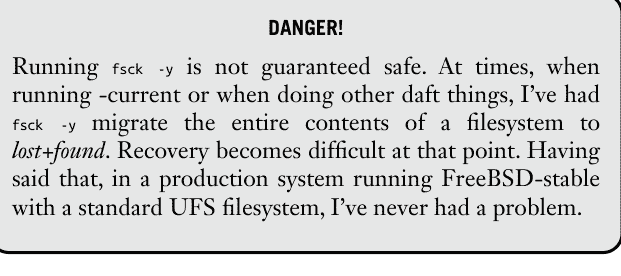

您可以设置系统在启动时自动尝试 `fsck -y`。然而，我不建议这样做，因为如果我的文件系统有哪怕一点点机会陷入数字虚无，我希望知道此事。我希望

亲自输入那条导致问题的命令，并感受听到磁盘嗡嗡作响时的不安。毕竟，发现系统一团糟却对原因一无所知，总是令人不快的。如果你比我更勇敢，请在 `rc.conf` 中设置 `fsck_y_enable="YES"`。

##### 避免使用 `fsck -y`

如果你不想使用 `fsck -y`，有哪些选项？`fsdb(8)` 和 `clri(8)` 允许你调试文件系统并将文件重定向到其正确位置。你可以将文件恢复到正确的目录和名称中。然而，这很困难，仅推荐给“秘密忍者文件系统大师”。

##### 后台 `fsck`


后台 `fsck` 赋予 UFS 某些日志文件系统的好处，而无需实际使用日志功能。要使用后台 `fsck`，必须使用无日志的软更新（Soft updates）。（使用日志的软更新远比后台 `fsck` 更可取。）当 FreeBSD 在重启后发现正在执行后台 `fsck` 时，它会以读写模式挂载脏磁盘。在服务器运行期间，`fsck(8)` 在后台运行，识别文件的碎片并将在幕后整理它们。

后台 `fsck` 实际上有两个主要阶段。当 FreeBSD 在初始启动过程中发现脏磁盘时，它会执行一次初步的 `fsck(8)` 评估。`fsck(8)` 程序决定损坏是否可以在系统运行时修复，或者是否需要进行完整的单用户模式 `fsck` 运行。通常情况下，`fsck` 认为可以继续进行并允许系统启动。在系统达到单用户模式后，后台 `fsck` 以低优先级运行，逐个检查分区。`fsck` 过程的结果出现在 `/var/log/messages` 中。

在后台 `fsck` 期间，需要磁盘活动的任何应用程序的性能都会很差。`fsck(8)` 程序占据了磁盘可能活动的大部分份额。虽然你的系统可能会变慢，但至少它仍在运行。

在后台 `fsck` 之后，你`必须`检查 `/var/log/messages` 以查找错误。初步的 `fsck` 评估可能会出错，并且可能确实需要对某个分区进行完整的单用户模式 `fsck`。如果你发现这样的消息，请在几小时内安排停机时间来纠正问题。虽然不方便，但计划内的停机比由断电引起的计划外停机以及由此导致的单用户模式 `fsck -y` 要好。

#### 强制在脏磁盘上进行读写挂载

如果你真的想强制 FreeBSD 在不使用后台 `fsck` 的情况下以读写模式挂载脏磁盘，你可以这样做。你绝不会喜欢结果。一点也不。但是，正如 `mount(8)` 中所述，除非读者知道原因，否则他们会认为这是一个好主意。使用 `mount(8)` 的 `-w`（读写）和 `-f`（强制）标志。

以读写模式挂载脏分区会损坏数据。请注意那句话中省略了 `might`（可能）和 `could`（能够）这样的词。另外请注意，我没有使用 `recoverable`（可恢复的）。以读写模式挂载脏文件系统可能会导致你的计算机恐慌。它可能会销毁分区上所有剩余的数据，甚至粉碎底层文件系统。强制以读写模式挂载脏文件系统是非常糟糕的做法。不要这样做。

#### 后台 fsck、fsck -y、前台 fsck，哎呀！

所有这些不同的 `fsck(8)` 问题和情况都可能会发生，但 FreeBSD 何时使用每个命令？FreeBSD 使用以下条件来决定何时以及如何对文件系统执行 `fsck(8)`：

- 如果文件系统是干净的，则在挂载时不进行 `fsck(8)`。

- 如果日志文件系统在启动时是脏的，FreeBSD 会从日志中恢复数据并继续启动。日志文件系统很少需要 `fsck(8)`。

- 如果没有软更新的文件系统在启动时是脏的，FreeBSD 会对它运行 `fsck(8)`。如果文件系统损坏严重，FreeBSD 将停止检查并请求你介入。你可以运行 `fsck -y` 或手动批准每个更正。

- 如果有软更新的文件系统是脏的，FreeBSD 执行非常基本的 `fsck(8)` 检查。如果损坏轻微，FreeBSD 可以在多用户模式下使用后台 `fsck(8)`。

- 如果损坏严重，或者你不希望进行后台 `fsck(8)`，FreeBSD 将中断启动并请求手动 `fsck(8)`。

在配置 UFS 文件系统时，请考虑恢复路径。

#### UFS 空间预留

UFS 文件系统从未像你认为的那样大。UFS 保留 8% 的文件系统空间用于实时优化。只有 `root` 才能写入超过该限制的额外空间。这就是为什么文件系统似乎使用了超过 100% 可用空间的原因。为什么是 8%？这个数字是多年经验和实际测试的结果。平均文件系统上保留 8% 不算什么大事，但随着文件系统的增长，它可以是相当可观的。在 1PB 磁盘阵列上，UFS 保留 80TB 的储备空间。

UFS 的行为取决于文件系统有多满。在空的文件系统上，它优化速度。一旦文件系统达到 92% 满（包括 8% 储备空间在内的总大小的 85%），它切换到优化空间利用率。大多数人都会做同样的事——一旦你大部分填满了洗衣篮，你可以塞进更多脏衣服，但这需要多一点时间和精力。UFS 碎片化文件以更有效利用空间。碎片会降低磁盘性能。随着空闲空间的缩小，UFS 更加努力地提高空间利用率。全满的 UFS 文件系统运行速度约为正常速度的三分之一。

你可能想使用 `tunefs(8)` 来减少 FreeBSD 保留的磁盘空间数量。它的效果没有你想象的那么大。将保留比例减少到 5% 或更少会告诉 UFS 始终使用空间优化并尽可能紧凑地打包文件系统。

增加预留空间百分比并不会提高性能。如果你增加预留空间百分比使得文件系统看起来已满，普通用户将无法写入文件。

预留空间可能会混淆诸如 `NFS` 这样的工具。一些可以通过 `NFS` 挂载 UFS 的其他操作系统会看到文件系统已满 100%，并告诉用户他们不能写入文件，尽管本地客户端可以写入文件。在故障排除时请记住这一点。

最好的做法是防止你的分区填满。

#### 分区有多满？

要概览每个 UFS 分区剩余的可用空间，请使用 `df(1)`。这列出了系统上的分区、每个分区使用的空间量以及其挂载位置。（不要对 ZFS 使用 `df(1)`；我们将在下一章讨论原因。）

#### BLOCKSIZE

关于 FreeBSD 磁盘工具（包括 `df(1)`）的一件烦人的事情是，它们默认以 512 字节块为单位提供信息。对于使用 512 字节物理块的小型磁盘来说，块是很好的单位，但在今天这不是一个有用的度量单位。环境变量 `$BLOCKSIZE` 控制 `df(1)` 提供输出的单位。默认的 `.cshrc` 和 `.profile` 将 `$BLOCKSIZE` 设置为 1KB，这使得 `df(1)` 显示千字节而不是块。

`-h` 和 `-H` 标志告诉 `df(1)` 生成人类可读的输出，而不是使用块。小写的 `-h` 使用基数 2 创建 1,024 字节的兆字节，而大写的 `-H` 使用基数 10 创建 1,000 字节的兆字节。通常，网络管理员和磁盘制造商使用基数 10，而系统管理员使用基数 2。只要你知道自己选择了哪种，两者都可以。我是一名网络管理员，所以在这些示例中，尽管我的技术编辑认为如此，你还是得忍受我的偏见。

```
df -H
Filesystem Size Used Avail Capacity Mounted on
/dev/gpt/root 1.0G 171M 785M 18% /
devfs 1.0k 1.0k 0B 100% /dev
/dev/gpt/var 1.0G 64M 892M 7% /var
/dev/gpt/tmp 1.0G 8.5M 948M 1% /tmp
/dev/gpt/usr 14G 13.8G 203M 98% /usr
```

第一行显示了提供程序名称、分区大小、已用空间量、可用空间量、使用百分比和挂载点的列标题。我们可以看到，标记为 `/dev/gpt/root` 的分区大小仅为 1GB，但上面只有 171MB，留下 785MB 空闲。它已满 18%，并挂载在 `/` 上。

如果你的系统和我的一样，磁盘使用量不知何故一直在没有明显原因的情况下增长。看看这里的 `/usr` 分区。它已满 98%。你可以使用 `ls -l` 识别单个大文件，但在系统上的每个目录递归执行此操作是不实际的。

`du(1)` 程序在一个目录中显示磁盘使用情况。其初始输出令人望而生畏，可能会吓退没有经验的用户。这里，我们使用 `du(1)` 来查找是什么占据了我主目录中的所有空间：

```
cd $HOME
du
1    ./bin/RCS
21459 ./bin/wp/shbin10
53202 ./bin/wp
53336 ./bin
5    ./.kde/share/appLnk/staroffice_52
6    ./.kde/share/appLnk
-- snip --
```

这不断继续，显示每个子目录并给出其块大小。每个子目录的总和都给出了——例如，`$HOME/bin` 的内容总计 53,336 块，大约为 53MB。我可以坐下来让 `du(1)` 列出每个目录和子目录，但那样我不得不挖掘比我真正想要的多得多的信息。而且块...

## 12. Z 文件系统

这些度量方式并不那么方便，尤其是当它们左对齐打印时。

让我们整理一下。首先，`du(1)` 像 `df` 一样支持 `-h` 标志。此外，我不需要查看每个子目录的递归内容。我们可以通过 `du` 的 `-d` 标志来控制要显示的目录数量。该标志接受一个参数，即你希望显式列出的目录数量。例如，`-d0` 深入一个目录层级，并给出目录中文件的简单小计。

```
du -h -d0 $HOME
14G    /home/mwlucas
```

我的主目录里有 14GB 的数据？让我们再深入一层，找出最大的子目录。

```
du -h -d1
38K    ./bin
56M    ./mibs
--snip--
13G    ./.startrek gifs
--snip--
```

显然，我必须在别处寻找存储空间，因为我主目录中的数据太重要了，不能删除。也许我只需要扩展这台主机下的虚拟磁盘。

如果你不太依赖 `-h` 标志，可以使用 `sort(1)` 通过类似 `du -kxd 1 | sort -n` 的命令来查找最大的目录。

### 添加新的 UFS 存储

无论做多少规划，最终你的硬盘都会填满。你需要添加磁盘。在使用新硬盘之前，你必须对驱动器进行分区，创建文件系统，挂载这些文件系统，并将数据迁移到它们上面。

请像对待初始安装时那样，仔细考虑新磁盘分区和文件系统的设计。在安装时分磁盘很容易正确分区，但之后再去重新划分包含数据的磁盘就很麻烦了。

> **备份，备份，再备份！**
>
> 在对磁盘进行任何操作之前，请确保你拥有完整的备份。一个愚蠢的手指失误（fat-finger mistake）就可能摧毁你的系统！虽然你很少计划重新格式化根文件系统，但如果这种情况发生，你希望恢复过程真的、真的很快。

#### 磁盘分区

虽然你可以按任何喜欢的方式对磁盘进行分区，但我建议新磁盘使用与主机其余部分相同的分区方案。一块磁盘用 MBR 分区，另一块用 GPT 分区，这很令人烦恼。本例将使用 GPT。

决定你如何划分磁盘。这是一块 1TB 的磁盘。100GB 将用于扩展的 `/tmp`。我将 500GB 专门用于新的数据库分区。剩余的空间会被分区，但标记为 `emergency`（紧急）。我不会在该空间中放置文件系统；它是为了以防我需要进行完整的内存转储（memory dump）或需要把某些文件放在某处。我把它放在数据库分区旁边，这样如果需要，我可以扩展数据库分区。我可以将紧急空间保持未分区状态，但我希望它有一个 GPT 标签，以便我的系统管理员同事意识到这块空闲空间不是意外产生的。

首先，销毁磁盘上任何现有的分区方案，并创建一个 GPT 方案。

```
gpart destroy -F da3
da3 destroyed
gpart create -s gpt da3
da3 created
```

现在创建 100GB 的 `/tmp` 和 500GB 的数据分区，并将剩余空间倒入紧急分区。

```
gpart add -t freebsd-ufs -l tmp -s 100g da3
da3p1 added
gpart add -t freebsd-ufs -l postgres -s 500g da3
da3p2 added
gpart add -t freebsd-ufs -l emergency da3
da3p3 added
```

使用 `gpart show` 检查你的工作。

```
gpart show -lp da3
==>  40   1953525088      da3  GPT   (932G)
      40   209715200     da3p1  tmp   (100G)
209715240  1048576000   da3p2  postgres  (500G)
1258291240  695233888   da3p3  emergency  (332G)
```

在每个分区上创建文件系统。

```
newfs -j /dev/gpt/postgres
newfs -j /dev/gpt/tmp
```

*注意*：原文此处可能意图展示对 `/tmp` 不使用软更新（soft updates）日志（即不使用 `-j`），但根据提供的文本流程，代码块中包含了两条带有 `-j` 的命令。后续文本解释了为什么 `/tmp` 不应使用日志。为了忠实于提供的输入文本结构，这里保留代码块原样。如果按照逻辑，通常 `/tmp` 会单独执行不带 `-j` 的 `newfs`，或者在启动脚本中处理。

#### 配置 /etc/fstab

现在告诉 `/etc/fstab` 关于你的文件系统。我们在第 10 章中讨论了 `/etc/fstab` 的格式。

| 设备 | 挂载点 | 类型 | 选项 | 转储 | 通过 |
| :--- | :--- | :--- | :--- | :--- | :--- |
| `/dev/gpt/postgres` | `/usr/local/etc/postgres` | `ufs` | `rw` | `0` | `2` |
| `/dev/gpt/tmp` | `/tmp` | `ufs` | `rw` | `0` | `2` |

FreeBSD 将在启动时识别这些文件系统，或者你可以使用命令行挂载这些新分区。但暂时不要重启或挂载这些分区。首先，你需要将文件移动到这些文件系统中。

#### 将现有文件安装到新磁盘

你很可能会打算让新磁盘替换或细分一个现有的分区。你需要将新分区挂载到一个临时挂载点，将文件移动到新的磁盘，然后在所需位置重新挂载该分区。虽然 `/tmp` 没有任何文件，但如果我们要安装新的数据库文件系统，我们假设那里有数据库文件需要放入。

在移动文件之前，关闭任何正在使用这些文件的进程。如果你无法成功复制那些正在被更改的文件。如果你正在移动数据库文件，请关闭数据库。如果你正在移动邮件队列（mail spool），请关闭所有邮件程序。这就是为什么我建议在单用户模式下完成所有新磁盘安装的主要原因。

现在将新分区挂载到一个临时挂载点。这正是 `/mnt` 的用途。

```
mount /dev/gpt/postgres /mnt
```

现在，你必须在不改变其权限的情况下，将文件从当前位置移动到新磁盘。使用 `tar(1)` 相当简单。你可以简单地将现有数据打包到磁带或文件中，然后在新位置解包，但这有点笨拙。将一个 `tar` 命令的输出管道传输到另一个 `tar` 命令中，以避免中间步骤。

```
tar cfc - /old/directory . | tar xfC - /tempmount
```

如果你不在聚会上谈论 Unix，这看起来相当惊人。让我们拆解它。首先，我们进入旧目录并打包所有内容。然后，将输出管道传输到第二个命令，该命令在新目录中提取备份。当此命令完成时，你的文件就安装在新磁盘上了。例如，要将 `/usr/local/etc/postgres` 移动到临时挂载在 `/mnt` 的新分区上，你会这样做：

```
tar cfc - /usr/local/etc/postgres . | tar xfC - /mnt
```

检查临时挂载点，以确保文件确实位于那里。一旦你确信文件已正确移动，从旧目录中删除文件，并在新位置挂载磁盘。例如，在从 `/usr/local/etc/postgres` 复制文件后，你可以运行：

```
rm -rf /usr/local/etc/postgres
mount /mnt
mount /usr/local/etc/postgres
```

*注释*：此处命令 `# mount /usr/local/etc/postgres` 在标准 Unix 语法中通常是不完整的（通常 `mount` 命令需要指定设备或加载 fstab）。根据上下文意图，这可能意味着卸载临时挂载点并使用 `mount` 命令（可能依赖于 fstab 或指定设备）来挂载实际位置。但为了忠实于原文提供的代码块，此处保留原文。

现在你可以恢复正常运行。我建议重启以验证一切是否都按你的意图恢复。

### 可堆叠挂载

也许你不在乎旧数据；你只是想拆分现有文件系统以获得更多空间，并打算从备份中恢复数据。这没问题。所有 FreeBSD 文件系统都是可堆叠的。这是一个高级概念，在日常系统管理中不太实用，但当你试图将一个分区拆分为两个时，它可能会“咬”你一口。

例如，假设你在 `/usr/src` 中有数据。查看磁盘上使用了多少空间，然后在 `/usr/src` 上挂载一个新的空分区。之后如果查看该目录，你会发现它是空的。

问题在于：旧文件系统中仍然保留着所有原始数据。新文件系统挂载在旧文件系统“之上”，因此你只能看到新文件系统。旧文件系统的可用空间与你移动数据之前没有增加。如果你卸载新文件系统并再次检查目录，你会发现数据神奇地恢复了！新文件系统遮挡了下层的文件系统。

虽然你看不到数据，但旧文件系统上的数据仍然占用空间。如果你通过添加文件系统来获取空间，并将新文件系统挂载在旧文件系统的一部分之上，你并不会在原文件系统中释放任何空间。教训是：即使你打算从备份恢复数据，也要确保从原始磁盘中移除该数据，才能回收磁盘空间。

现在你已经可以谈论 UFS 了，让我们探索 ZFS。

## 12 Z 文件系统


大多数文件系统在计算术语中都是古老的。我们因为太慢而丢弃使用 5 年的硬件，却用 40 年前设计的文件系统来格式化替换硬盘。虽然我们改进了这些文件系统，使其更健壮，但它们仍然使用相同的基本架构。每当文件系统崩溃时，我们都会咒骂并匆忙修复，同时急切地希望有更好的东西。

ZFS 就是更好的东西。


这并不是说 ZFS 使用了革命性的技术。ZFS 的所有单独组成部分都是大家熟知的。哈希、数据树或索引没有任何神秘之处。但 ZFS 将这些充分理解的原则结合成一个单一、连贯且设计良好的整体。它是面向未来设计的。今天的哈希算法 15 年后可能不够用了，但 ZFS 的设计使得新的算法和技术可以添加到新版本中，而不失去向后兼容性。

本章不会涵盖关于 ZFS 的一切知识。ZFS 几乎是一个独立的操作系统，或者可能是一个专用数据库。已经有很多整本书专门讲述使用和管理工作 ZFS。不过，你将学习足够多的 ZFS 工作原理，以便在服务器上使用它，并理解其最重要的特性。

虽然 ZFS 预期直接安装在磁盘分区上，但你可以使用其他 `GEOM` 提供者作为 ZFS 存储。最常见的情况例如，当你使用加密磁盘进行安装时。`FreeBSD` 会在磁盘上放置一个 `geli(8)` `geom`，并在该 `geom` 之上安装 ZFS。本章将任何存储提供程序称为“磁盘”，即使它可能是一个文件或一个加密提供程序，或者是其他任何东西。

如果你从未使用过 ZFS，请在虚拟机上安装一个基于 ZFS 的 `FreeBSD` 系统并跟随操作进行练习。安装程序会自动处理先决条件，例如在 `loader.conf` 中设置 `zfs_load=YES`，以及在 `rc.local` 中设置 `zfs_enable=YES`；你只需要关心的是文件系统。

> **ZFS 代表什么？**
>
> `The Z File System`。是的，认真的。曾几何时，它的意思是 `Zettabyte File System`（泽塔字节文件系统），但那个首字母缩写已被弃用。

ZFS 将许多理解透彻的技术融合在一起，组合成一个卷管理器和文件系统的混合体。它期望处理从文件权限到跟踪哪些存储提供程序上的哪些块接收哪些信息等一切内容。作为系统管理员，你告诉 ZFS 你拥有什么硬件以及你希望如何配置它们，然后 ZFS 会接手后续工作。

ZFS 有三个主要组件：数据集、池和虚拟设备。

### 数据集

数据集被定义为 ZFS 数据的一个命名块。最常见类型的数据集类似于分区文件系统，但 ZFS 支持其他类型的数据集用于其他用途。快照（参见第 271 页的“Snapshots”）是一个数据集。ZFS 还包括用于虚拟化和 `iSCSI` 目标的块设备、克隆等；这些全部都是数据集。本书重点介绍文件系统数据集。传统的文件系统如 `UFS` 拥有各种小型程序来管理文件系统，但你通过 `zfs(8)` 管理所有的 ZFS 数据集。

使用 `zfs list` 查看你现有的数据集。输出看起来很像 `mount(8)`。

```
#### zfs list
NAME        USED  AVAIL  REFER  MOUNTPOINT
zroot      4.71G  894G   88K  none
zroot/ROOT 2.40G  894G   88K  none
zroot/ROOT/2018-11-17   8K   894G  1.51G /
zroot/ROOT/default 2.40G  894G  1.57G /
zroot/usr   1.95G  894G   88K  /usr
zroot/usr/home  520K   894G  520K /usr/home
--snip--
```

每一行以数据集名称开头，该名称以存储池（或 `zpool`）开头，即该数据集所在的池。第一个条目被称为 `zroot`。此条目代表池的根数据集。其余的数据集树都挂在这个数据集之下。

接下来的两列显示了已用空间和可用空间的大小。池 `zroot` 已使用 4.71GB，可用空间为 894GB。虽然可用空间肯定是正确的，但 4.71GB 看起来比实际复杂得多。数据集在 `USED` 列中显示的空间量包括该数据集及其所有子数据集上的所有内容。根数据集的子数据集包括该 `zpool` 中的所有其他数据集。

`REFER` 列是 ZFS 特有的。此列显示在此特定数据集中可访问的数据量，这并不一定等于已使用的空间量。某些 ZFS 功能，如快照，会在彼此之间共享数据。此数据集已使用 4.71GB 的数据，但仅引用 88KB。如果没有其子数据集，该数据集上仅有 88KB 的数据。

最后，我们有数据集的挂载点。这个根数据集没有挂载点；它未被挂载。

看看下一个数据集，`zroot/ROOT`。这是为根目录及相关文件创建的数据集。这看起来合情合理，但如果你查看 `REFER` 列，你会发现它内部也仅有 88KB 的数据，并且没有挂载点。难道根目录不应该存在吗？

接下来的两行解释了原因……大致如此。数据集 `zroot/ROOT/2018-11-17` 的挂载点为 `/`，因此它是一个真正的根目录。下一个数据集 `zroot/ROOT/default` 的挂载点也为 `/`。不，ZFS 不允许你将多个数据集挂载到同一个挂载点。一个 ZFS 数据集在数据集内部记录了大量设置。挂载点就是这些设置之一。

暂时考虑一下这四个数据集。`zroot/ROOT` 数据集是 `zroot` 数据集的子级。`zroot/ROOT/2018-11-17` 和 `zroot/ROOT/default` 数据集是 `zroot/ROOT` 的子级。每个数据集都会将其子数据集的空间使用情况计入自身。

为什么要这样做？当你启动一个 `FreeBSD` ZFS 主机时，你可以轻松地在多个根目录之间进行选择。每个可启动的根目录被称为一个*启动环境*（boot environment）。假设你应用了一个补丁并重启系统，但新系统无法启动。通过进入一个备用的启动环境，你可以轻松访问有缺陷的根目录并尝试找出问题所在。

下一个数据集 `zroot/usr` 是 `zroot` 的一个完全不同的子级。它有自己的子级 `zroot/usr/home`。`zroot/usr/home` 中使用的空间会记在 `zroot/usr` 账上，而两者都会记在其父级账上，但它们的分配不会影响 `zroot/ROOT`。

#### 数据集属性

除了某些记账技巧外，到目前为止，数据集看起来很像分区。但分区是磁盘的逻辑细分，在存储设备上填充非常特定的 `LBA`（逻辑块地址）。分区对分区上的数据没有感知。更改分区意味着摧毁其上的文件系统。

ZFS 将文件系统与底层存储层紧密集成。它可以动态地在各个文件系统之间分配存储空间，以满足需求。分区通过控制可用块的数量来限制磁盘使用，而数据集可以使用*配额*（quotas）达到相同的效果。不过，如果没有这些配额，如果池中有空间，你可以随意使用。

一个数据集可以使用的空间量是 ZFS 的一个*属性*（property）。ZFS 支持数十个属性，从控制数据集可以增长多快的 *quotas* 属性，到显示数据集是否已挂载的 *mounted* 属性。

#### 查看和更改数据集属性

使用 `zfs set` 更改属性。

```
##### zfs set quota=2G zroot/usr/home
```

使用 `zfs get` 查看属性。你可以指定某个特定属性，或使用 `all` 查看所有属性。你可以通过用逗号分隔来列出多个属性。如果你指定了一个数据集名称，你只影响该数据集。

```
##### zfs get mounted zroot/ROOT
```

| 名称 | 属性 | 值 | 来源 |
| :--- | :--- | :--- | :--- |
| zroot/ROOT | mounted | no | - |

在这里，我们有数据集的名称、属性、属性值，以及称为“来源”的东西。（我们将在第 261 页的“属性继承”中讨论最后这一点。）

我真正的问题是，哪个数据集被挂载为根目录？我可以检查那两个挂载点为 `/` 的数据集，但当我有几十个启动环境时，那会让我抓狂。通过添加 `-r` 标志来检查某个数据集及其所有子数据集的属性。

```
##### zfs get -r mounted zroot/ROOT
```

| 名称 | 属性 | 值 | 来源 |
| :--- | :--- | :--- | :--- |
| zroot/ROOT | mounted | no | - |
| zroot/ROOT/2018-11-17 | mounted | no | - |
| zroot/ROOT/default | mounted | yes | - |

在这三个数据集中，只有 `zroot/ROOT/default` 被挂载了。那是我们的活动启动环境。

#### 属性继承

许多属性是可继承的。你在父数据集上设置它们，它们会向下传递到子数据集中。对于像挂载点这样的属性，继承没有意义，但对于某些更高级的功能，它是正确的。虽然我们将在第 273 页的“压缩”中查看 `compression` 属性的作用，但我们在这里将其用作继承的例子。

```
##### zfs get compression
NAME PROPERTY VALUE SOURCE
zroot compression lz4 local
zroot/ROOT compression lz4 inherited from zroot
zroot/ROOT/2018-11-17 compression lz4 inherited from zroot
zroot/ROOT/default compression lz4 inherited from zroot
zroot/tmp compression lz4 inherited from zroot
-- snip --
```

根数据集 `zroot` 的 `compression` 属性设置为 `lz4`。来源是 `local`，意味着该属性是在此数据集上设置的。现在看看 `zroot/ROOT`。`compression` 属性也是 `lz4`，但来源是从 `zroot` 继承而来。这个数据集从其父级继承了此属性设置。

### 管理数据集

ZFS 使用数据集的方式与传统文件系统使用分区的方式类似。使用 `zfs(8)` 管理数据集。你将希望创建、删除和重命名数据集。

#### 创建数据集

使用 `zfs create` 创建数据集。通过指定池和数据集名称来创建文件系统数据集。在这里，我为我的包创建一个新数据集。（请注意，这会破坏启动环境，正如我们将在本章后面看到的。）

```
##### zfs create zroot/usr/local
```

每个数据集必须有一个父数据集。默认的 `FreeBSD` 安装有一个 `zroot/usr` 数据集，所以我可以创建 `zroot/usr/local`。我想为 `/var/db/pkg` 拥有一个数据集，虽然 `FreeBSD` 附带一个 `zroot/var`。

数据集方面，这里没有 `zroot/var/db`。我需要先创建 `zroot/var/db`，然后创建 `zroot/var/db/pkg`。

请注意，数据集是可以堆叠的，就像 `UFS` 一样。如果我在 `/usr/local` 目录中有文件，并针对该目录创建了一个数据集，ZFS 会将该数据集挂载到目录之上。我将无法访问那些文件。你必须移动文件以复制现有目录。

#### 销毁和重命名数据集

我之前创建的那个新的 `zroot/usr/local` 数据集？它隐藏了我 `/usr/local` 目录的内容。使用 `zfs destroy` 将其删除，然后重试。

```
##### zfs destroy zroot/usr/local
```

`/usr/local` 的内容重新出现了。或者，我可以使用 `zfs rename` 重命名该数据集。

```
##### zfs rename zroot/usr/local zroot/usr/new-local
```

不过，我更喜欢启动环境（boot environments），所以我不会动 `/usr/local`。尽管有时候你确实需要一个 `/usr/local` 数据集……

#### 未挂载的父数据集

作为一个 `Postgres` 用户，我希望为我的 `Postgres` 数据拥有一个独立的数据集。`FreeBSD` 的 `Postgres` 9.6 包使用 `/var/db/postgresql/data/96`。如果没有一个针对 `/var/db` 的数据集，我无法创建那个数据集；而且如果不破坏包的支持，我也无法拥有 *那个* 未挂载的父数据集。该怎么办？

解决方案是创建一个针对 `/var/db` 的数据集，但不使用它，方法是设置 `canmount` 数据集属性。该属性控制数据集是否可以被挂载。`FreeBSD` 正是出于这个原因，为 `/var` 使用了一个未挂载的数据集。新数据集默认将 `canmount` 设置为 `on`，因此通常你不需要担心它。使用 `-o` 标志可以在创建数据集时设置属性。

```
##### zfs create -o canmount=off zroot/var/db
```

`/var/db` 的数据集存在，但无法被挂载。检查你的 `/var/db` 目录内容以确认一切仍在那里。现在你可以为 `/var/db/postgres` 甚至 `/var/db/postgresql/data96` 创建数据集了。

```
##### zfs create zroot/var/db/postgres
##### zfs create zroot/var/db/postgres/data96
##### chown -R postgres:postgres /var/db/postgres
```

你为你的数据库拥有了一个数据集，并且 `/var/db` 本身的文件作为根数据集的一部分依然存在。现在初始化你的新 `Postgres` 数据库并继续吧！

在探索 ZFS 的过程中，你会发现许多场景，你可能希望在创建数据集时设置属性或使用未挂载的父数据集。

#### 将文件移动到新数据集

如果你需要为一个现有目录创建新数据集，你需要复制文件过来。我建议创建一个名称略有不同的新数据集，将文件复制到该数据集，重命名目录，然后重命名数据集。在这里，我需要一个针对 `/usr/local` 的数据集，所以我以不同的名称创建它。

```
##### zfs create zroot/usr/local/pgsql-new
```

使用 `tar(1)` 复制文件，正如你对新的 `UFS` 分区所做的那样（参见第 11 章）。

```
##### tar cfC - /usr/local/pgsql . | tar xpfC - /usr/local/pgsql-new
```

完成后，将旧目录移开并重命名数据集。

```
##### mv /usr/local/pgsql /usr/local/pgsql-old
##### zfs rename zroot/usr/local/pgsql-new zroot/usr/local/pgsql
```

我的 `Postgres` 数据现在位于其独立的数据集上。

### ZFS 存储池

ZFS 通过存储池（pool）而非磁盘来组织其底层存储。ZFS 存储池，或称为 `zpool`，是底层存储设备的抽象，允许你将物理介质与顶层对用户可见的文件系统分离。

使用 `zpool(8)` 查看和管理主机的 ZFS 存储池。这里，我使用 `zpool list` 来查看我其中一个主机的存储池。

```
#### zpool list
NAME      SIZE  ALLOC   FREE EXPANDSZ FRAG  CAP  DEDUP HEALTH ALTROOT
zroot     928G  4.72G   923G -        0%    0%   1.00x ONLINE -
jail      928G  2.70G   925G -        0%    0%   1.00x ONLINE -
scratch   928G  5.94G   922G -        0%    0%   1.00x ONLINE -
```

这个主机有三个存储池：`zroot`、`jail` 和 `scratch`。每个都占有一行。

`SIZE` 列显示了存储池的总容量。所有这些存储池都可以容纳 928GB。`ALLOC` 列显示了每个存储池的使用量，而 `FREE` 显示了剩余空间。这些磁盘几乎是空的，这很合理，因为我刚刚安装这个主机才大约三个小时。

`EXPANDSZ` 列显示了底层存储提供程序是否有空闲空间。当存储池具有虚拟设备冗余（我们在下一节中讨论）时，你可以替换存储池中的单个存储设备并扩大存储池的大小。这就像将 `RAID` 阵列中的 5TB 驱动器换成 10TB 驱动器以使其变大一样。

`FRAG` 列显示了该存储池的碎片程度。你听说过很多次碎片会降低性能。不过，ZFS 最小化了碎片的影响。

`CAP` 列显示了可用空间的使用百分比。

`DEDUP` 列显示了该存储池是否使用去重。虽然许多人推崇去重作为 ZFS 的一个功能，但它并不像你期望的那么有用。

`HEALTH` 列显示了存储池运行良好还是底层磁盘存在问题。

#### 存储池详情

通过运行 `zpool status`，你可以获取存储池或单个存储池的更多详细信息。如果你省略存储池名称，你将看到所有存储池的这些信息。这里，我检查我的 *jail* 存储池的状态。

```
##### zpool status jail
pool: jail
state: ONLINE
scan: none requested
config:
		NAME			STATE		READ WRITE CKSUM
		jail			ONLINE		0	0	0
		mirror-0		ONLINE		0	0	0
		gpt/da2-jail	ONLINE		0	0	0
		gpt/ada2-jail	ONLINE		0	0	0
	errors: No known data errors
```

我们从存储池名称开始。`state` 类似于 `HEALTH` 列；它显示存储池的任何问题。`scan` 字段显示关于数据清除（scrub）的信息（参见第 273 页的“存储池完整性和修复”）。

然后是存储池配置。配置显示了存储池中虚拟设备的布局。当我们创建存储池时，我们将深入探讨这一点。

#### 存储池属性

与数据集类似，`zpool` 也有属性来控制并显示存储池的设置。一些属性本质上是信息性的，例如 *free* 属性，它表达了存储池有多少空闲空间。你可以更改其他属性。

##### 查看存储池属性

要查看存储池的所有属性，使用 `zpool get`。添加属性 `all` 以查看每个属性。你可以添加存储池名称以仅包含该存储池。


#### 查看存储池属性

```
zpool get all zroot
NAME	PROPERTY	VALUE			SOURCE
zroot	size	928G			-
zroot	capacity	0%		-
zroot	health	ONLINE	-
zroot	guid	7955546176707282768	default
---snip---
```

其中一些信息会被拉入诸如 `zpool status` 和 `zpool list` 等命令中。你也可以通过使用属性名称在所有存储池中查询单个属性。

```
zpool get readonly
NAME     PROPERTY   VALUE    SOURCE
zroot    readonly   off      -
jail     readonly   off      -
scratch  readonly   off      -
```

与数据集属性不同，大多数存储池属性是在创建或导入存储池时设置的。

#### 虚拟设备

虚拟设备（VDEV）是一组存储设备。你可能将 VDEV 视为 RAID 容器：一个大型 RAID-5 向操作系统呈现为一个巨大的设备，即使系统管理员知道它实际上是一堆较小的磁盘。虚拟设备是 ZFS 魔术发生的地方。你可以为不同的冗余级别安排存储池，或者放弃冗余以最大化空间。

ZFS 的自动错误纠正发生在 VDEV 级别。ZFS 中的一切，从 znodes（索引节点）到数据块，都被校验和（checksummed）以验证完整性。如果你的存储池具有足够的冗余，ZFS 会注意到数据损坏并从未份中恢复它。如果你的存储池缺乏冗余，ZFS 会通知你数据损坏，你可以从备份中恢复。

一个 `zpool` 由一个或多个相同的 VDEV 组成。存储池在所有 VDEV 之间条带化（stripe）数据，没有冗余。失去一个 VDEV 意味着失去整个存储池。如果你有一个包含大量磁盘的存储池，请务必使用冗余的 VDEV。

#### VDEV 类型和冗余

ZFS 支持多种不同类型的 VDEV（虚拟设备），每种类型都以其提供的冗余程度和方式加以区分。常见的镜像磁盘（即每个磁盘都复制另一个磁盘上的数据）是其中一种 VDEV 类型。而没有冗余的磁盘堆叠则是另一种 VDEV 类型。此外，ZFS 还包含三种不同类型的复杂奇偶校验冗余方式，称为 RAID-Z。

在一个存储池中使用多个 VDEV 可以创建类似高级 RAID 阵列的系统。RAID-Z2 阵列与 RAID-6 非常相似，但一个包含两个 RAID-Z2 VDEV 的 ZFS 存储池则类似于 RAID-60。镜像 VDEV 的工作方式类似于 RAID-1，但存储池中的多个镜像则表现得像 RAID-10。在这两种情况下，ZFS 都会将数据条带化分布在没有冗余的 VDEV 上。各个独立的 VDEV 提供冗余功能。

请谨慎选择你的 VDEV 类型。

##### 条带 VDEV

由单个磁盘组成的 VDEV 称为条带（stripe），没有冗余。失去该磁盘意味着失去你的数据。虽然一个存储池可以包含多个条带 VDEV，但每个磁盘本身就是一个独立的 VDEV。这与 RAID-0 类似，丢失任何一个磁盘都意味着整个存储池的数据丢失。

##### 镜像 VDEV

镜像 VDEV 会在每个磁盘上存储该 VDEV 所有数据的完整副本。即使丢失了该 VDEV 中除了最后一个以外的所有驱动器，你仍然可以访问数据。镜像可以包含任意数量的磁盘。

ZFS 可以同时从所有镜像磁盘读取数据，因此读取速度快。然而，当写入数据时，ZFS 必须同时将数据写入所有磁盘。写入操作直到最慢的磁盘完成为止才视为完成。这会导致写入性能下降。

##### RAID-Z

RAID-Z 将数据和奇偶校验信息分布在所有磁盘上，这与传统 RAID 非常相似。如果 RAID-Z 中的一个磁盘失效或开始提供损坏的数据，RAID-Z 会使用奇偶校验信息重新计算缺失的数据。RAID-Z VDEV 必须至少包含三个磁盘，并且能够承受任何一个单个磁盘的丢失。RAID-Z 有时也被称为 `RAID-Z1`。

你不能在 RAID-Z 中添加或移除磁盘。如果你创建了一个五磁盘的 RAID-Z，它将永远保持为五磁盘的 RAID-Z。不要以为你可以通过向 RAID-Z 添加额外磁盘来增加存储空间。你不能。

如果你使用的是超过 2TB 的磁盘，在修复第一个磁盘时，第二个磁盘失效的可能性不容忽视。对于大容量磁盘，你可能需要考虑 RAID-Z2。

###### RAID-Z2

RAID-Z2 像 RAID-Z1 一样，在 VDEV 中的每个磁盘上条带化奇偶校验和数据，但将奇偶校验信息的量加倍。这意味着 RAID-Z2 可以承受最多两个磁盘的丢失。你不能从 RAID-Z2 中添加或移除磁盘。它的速度比 RAID-Z 稍慢。

RAID-Z2 必须拥有四个或更多磁盘。

###### RAID-Z3

三倍奇偶校验适用于最重要的数据，或者适用于拥有大量磁盘且无暇顾及细节的系统管理员。你可以在 RAID-Z3 中丢失最多三个磁盘而不丢失数据。与其他任何 RAID-Z 一样，你不能从 RAID-Z3 中添加或移除磁盘。

RAID-Z3 必须拥有五个或更多磁盘。

###### 日志和缓存 VDEV

存储池可以通过专用 VDEV 来提高性能。只有当性能问题需要时才调整或实施这些 VDEV；不要主动添加它们。大多数人不需要它们，所以我不会详细介绍，但你应该知道它们的存在，以防你遇到不幸的情况。

`独立意向日志`（SLOG 或 ZIL）是 ZFS 的文件系统日志。待写入的数据会被转储到 SLOG，然后在主存储池中进行更规范的排列。每个存储池都会划分一部分磁盘空间用于 SLOG，但你可以使用独立设备作为 SLOG。需要更快的写入速度吗？安装一个非常快的驱动器并将其专门用于 SLOG。存储池会将所有初始写入转储到快速磁盘设备，然后随着时间推移将这些写入迁移到较慢的介质。专用的快速 SLOG 还能使突发的 I/O 平滑化。

`二级自适应替换缓存（L2ARC）` 类似于 SLOG，但它是针对读取的。ZFS 在内存中保留最近访问和访问频率最高的数据。通过添加一个非常快的设备作为 L2ARC，你可以扩展 ZFS 能从缓存提供数据量，而不是从慢速磁盘读取。L2ARC 比内存慢，但比慢速磁盘快。

###### RAID-Z 和存储池

你可以向存储池添加 VDEV。但你不能向 RAID-Z VDEV 添加磁盘。在创建存储池之前，请仔细考虑你的存储需求和硬件。

假设你有一台可以容纳 20 个硬盘的服务器，但你只有 12 个硬盘。你用这 12 个硬盘创建了一个单独的 RAID-Z2 VDEV，想着如果需要的话以后可以往存储池里添加更多硬盘。你甚至还没装完服务器，就已经失败了。

你可以向存储池添加多个相同的 VDEV。如果你创建一个拥有 12 个磁盘 VDEV 的存储池，而主机只能再容纳 8 个磁盘，那么就没有办法创建第二个相同的 VDEV。12 磁盘的 RAID-Z2 并不等同于 8 磁盘的 RAID-Z2。你可以强制 ZFS 接受不同的 VDEV，但性能会受到影响。向存储池添加 VDEV 是不可逆的。

提前规划。查看你的物理设备。决定如何扩展你的存储。这台 20 盘位的服务器使用两个 10 磁盘的 RAID-Z2 VDEV 会很完美，或者使用一个 12 磁盘的存储池和一个独立的 8 磁盘存储池。不要自拆长城。

一旦你知道想使用哪种类型的 VDEV，就可以创建存储池了。

#### 管理存储池

既然你理解了不同的 VDEV 类型，并且已经进行了存储规划，让我们创建一些不同类型的 ZFS 存储池。首先设置你的磁盘块大小。

##### ZFS 和磁盘块大小

第 10 章讨论了现代磁盘有两种不同的扇区大小：512 字节和 4KB。虽然文件系统可以安全地假设磁盘具有 4KB 扇区，但如果你的文件系统假设磁盘具有 512 字节扇区，而磁盘实际上具有 4KB 扇区，你的性能将大幅下降。当然，ZFS 假设磁盘具有 512 字节扇区。如果你的磁盘确实具有 512 字节扇区，那就没问题。但如果你不确定物理扇区的大小，请谨慎行事并告诉 ZFS 使用 4KB 扇区。使用 `ashift` 属性来控制 ZFS 的磁盘扇区假设。`ashift` 为 9 告诉 ZFS 使用 512 字节扇区，而 `ashift` 为 12 则表示 4KB 扇区。使用 `sysctl vfs.zfs.min_auto_ashift` 来控制 `ashift`。

```
sysctl vfs.zfs.min_auto_ashift=12
```

在 `/etc/sysctl.conf` 中设置此项以使其永久生效。

你*必须*在创建存储池之前设置 `ashift`。在创建存储池之后设置没有效果。

如果你不确定你的磁盘扇区大小是多少，请使用 12 的 `ashift`。这是 FreeBSD 安装程序所做的。你会损失少量的性能，但在 4KB 磁盘上使用 9 的 `ashift` 会耗尽系统性能。

现在创建你的存储池。

##### 创建和查看存储池

使用 `zpool create` 命令创建存储池。

```
zpool create poolname vdevtype disks...
```

如果命令成功，你不会收到任何输出。

这里，我创建一个名为 `db` 的存储池，使用一个镜像 VDEV 和两个带有 GPT 标签的分区：

```
zpool create db mirror gpt/zfs3 gpt/zfs4
```

我们分配的结构会反映在存储池状态中。

```
zpool status db
--snip--
config:

NAME           STATE    READ WRITE CKSUM
db             ONLINE    0    0     0
  mirror-0     ONLINE    0    0     0
    gpt/zfs3   ONLINE    0    0     0
    gpt/zfs4   ONLINE    0    0     0
--snip--
```

存储池 `db` 包含单个 VDEV，名为 `mirror-0`。它包含两个带有 GPT 标签的分区，`/dev/gpt/zfs3` 和 `/dev/gpt/zfs4`。所有这些分区都在线。

如果你不包含 VDEV 名称，`zpool(8)` 将创建一个没有冗余的条带存储池。这里，我创建一个名为 `scratch` 的条带存储池：

```
zpool create scratch gpt/zfs3 gpt/zfs4
```

存储池状态显示每个 VDEV，以其底层磁盘命名。

```
--snip--
NAME       STATE    READ WRITE CKSUM
scratch    ONLINE    0    0     0
  gpt/zfs3 ONLINE    0    0     0
  gpt/zfs4 ONLINE    0    0     0
--snip--
```

创建任何类型的 RAID-Z 看起来都与创建镜像非常相似。只需使用正确的 VDEV 类型即可。

```
zpool create db raidz gpt/zfs3 gpt/zfs4 gpt/zfs5
```

存储池状态与镜像非常相似，但 VDEV 中有更多磁盘。

##### 多 VDEV 存储池

在创建存储池时，关键字 `mirror`、`raidz`、`raidz2` 和 `raidz3` 都会告知 `zpool(8)` 创建一个新的 VDEV。列在这些关键字之后的任何磁盘都将用于创建一个新的 VDEV。要创建一个包含多个 VDEV 的存储池，你可以这样做：

```
zpool create poolName vdevtype disks... vdevtype disks...
```

在此示例中，我创建了一个包含两个 RAID-Z VDEV 的存储池，每个 VDEV 包含三块磁盘：

```
zpool create db raidz gpt/zfs3 gpt/zfs4 gpt/zfs5 raidz gpt/zfs6 gpt/zfs7 gpt/zfs8
```

对这个新存储池执行 `zpool status` 时，输出结果会有些不同。

```
---snip---
  NAME          STATE     READ WRITE CKSUM
  db            ONLINE    0     0     0
    1 raidz1-0    ONLINE    0     0     0
      gpt/zfs3    ONLINE    0     0     0
      gpt/zfs4    ONLINE    0     0     0
      gpt/zfs5    ONLINE    0     0     0
    2 raidz1-1    ONLINE    0     0     0
      gpt/zfs6    ONLINE    0     0     0
      gpt/zfs7    ONLINE    0     0     0
      gpt/zfs8    ONLINE    0     0     0
---snip---
```

该存储池包含一个名为 `raidz1-0` ❶ 的 VDEV，其中包含三块磁盘。还有一个第二个 VDEV，名为 `raidz1-1` ❷，也包含三块磁盘。很明显，这些是完全相同的配置。数据在两个 VDEV 之间进行条带化分布。

##### 销毁存储池

要销毁一个存储池，请使用 `zpool destroy` 命令及存储池名称。

```
zpool destroy db
```

请注意，在销毁存储池之前，`zpool` 不会询问你确定是否要执行此操作。确认你要销毁存储池是你的责任，而不是 `zpool(8)` 的责任。

###### 错误与 -f

如果你输入了一条没有意义的命令，`zpool(8)` 会发出抱怨。

```
zpool create db raidz gpt/zfs3 gpt/zfs4 gpt/zfs5 raidz gpt/zfs6 gpt/zfs7
invalid vdev specification
use ‘-f’ to override the following errors:
  mismatched replication level: both 3-way and 2-way raidz vdevs are present
```

阅读错误信息时首先看到的是“使用 `-f` 来覆盖此错误”。许多系统管理员将“`-f`”解读为“`-f` 可以让这个问题消失”。然而，ZFS 真正想说的是：“你的命令行是一个巨大的错误。添加 `-f` 将执行不可修复的、危害系统稳定性的操作，并且只要该系统还存在，你就会一直为此后悔。”

大多数 `zfs(8)` 和 `zpool(8)` 的错误消息都有实际意义，但你必须仔细阅读。如果你不明白消息的含义，请回退到第 1 章中的故障排除说明。通常，重新检查你输入的内容就能发现问题所在。

在这个例子中，我要求 `zpool(8)` 创建一个包含三个磁盘的 RAID-Z VDEV 和一个仅包含两个磁盘的第二个 RAID-Z VDEV 的存储池。我把这条命令行搞错了。如果添加 `-f` 并继续将数据库安装到这个新的畸形 `db` 存储池中，只会确保我不得不稍后重新创建该存储池并重新安装数据库。如果你发现自己处于这种情况，请研究一下 `zfs send` 和 `zfs recv`。

### 写入时复制（Copy-On-Write）

无论是在常规文件系统还是 ZFS 中，文件都以磁盘上的块的形式存在。在传统文件系统中编辑文件时，文件系统会提取该块，修改它，然后将其放回磁盘上的相同位置。在该写入过程中途出现的系统问题可能导致*短写入（short write）*：即文件 50% 是旧版本，50% 是新版本，并且很可能 100% 不可用。

ZFS 从不覆盖文件中的现有块。当文件发生变化时，ZFS 会识别需要更改的块，并将其写入磁盘的新区域。旧版本保持完整。这被称为写入时复制（COW）。通过写入时复制，短写入可能会丢失对文件最新的更改，但文件的先前版本将保持完整。

从不损坏文件是写入时复制的一大好处，但 COW 也开辟了其他可能性。元数据块也是写入时复制的，一直延伸到构成 ZFS 存储池数据树根部的*超级块（uberblocks）*。ZFS 通过跟踪包含文件旧版本的块来创建快照。虽然听起来很简单，但细节才是会导致你走弯路的地方。

### 快照

快照是数据集在特定时刻的状态副本。快照是只读的，永远不会改变。你可以访问快照的内容以获取文件的较旧版本，甚至是被删除的文件。虽然快照是只读的，但你可以在必要时将数据集回滚到快照状态。在升级系统之前创建快照，如果升级严重出错，你可以回退到快照。ZFS 使用快照提供许多功能，例如启动环境（参见第 276 页的“启动环境”）。最棒的是，根据你的数据情况，快照可能只占用极少空间。

每个数据集都有一堆元数据，全部作为从顶层块构建的树。当你创建快照时，ZFS 会复制该顶层块。其中一个元数据块随数据集一起，而另一个随快照一起。数据集和快照共享数据集内部的数据块。

在实时数据集中删除、修改或覆盖文件意味着为新数据分配新块并断开包含旧数据的块的连接。然而，快照需要其中一些旧数据块。在丢弃旧块之前，ZFS 会检查快照是否仍然需要它。如果快照需要某个块，但数据集不再需要，ZFS 会保留该块。

因此，快照仅仅是一个列表，记录了在创建快照时数据集使用了哪些块。创建快照告诉 ZFS 保留那些块，即使数据集不再需要那些块。

#### 创建快照

使用 `zfs snapshot` 命令创建快照。通过完整路径指定数据集，然后添加 `@` 和快照名称。出于本章末尾将揭示的原因，我习惯按照创建快照的日期和时间来命名我的快照。

我即将对用户主目录进行维护，删除旧文件以释放空间。我相当确定会有人抱怨我删除他们的文件，所以我想在清理之前创建一个快照。

```
zfs snapshot zroot/usr/home@2018-07-21-13:09:00
```

我没有收到任何反馈。发生什么事了吗？使用 `zfs list` 的 `-t snapshot` 参数查看所有快照。


##### `zfs list -t snapshot`
```
zfs list -t snapshot
NAME                          USED   AVAIL  REFER   MOUNTPOINT
zroot/usr/home@2018-07-21-13:09:00    0    -    4.68G   -
```

快照已存在。`USED` 列显示它使用零磁盘空间 ❶：它与它来源的数据集完全相同。由于快照是只读的，`AVAIL` 列显示的可用空间 ❷ 只是不相关。`REFER` 列显示该快照占用了 `4.68GB` 的磁盘空间 ❸。如果你检查，你会发现 `zroot/usr/home` 的大小是一样的。最后，`MOUNTPOINT` 列显示该快照未被挂载 ❹。

这是一个正在运行的系统，其他人已登录到该系统。我等待了一会儿，再次检查我的快照。

```bash
zfs list -t snapshot
NAME USED AVAIL REFER MOUNTPOINT
zroot/usr/home@2018-07-21-13:09:00 0 96K - 4.68G -
```

该快照现在使用了 `96KB` ❶。用户更改了数据集中的某些内容，快照因此被计入了维持差异所需的额外空间。

现在我开始了我的清理工作，删除了我认为无用的文件。

```bash
zfs list -t snapshot
NAME USED AVAIL REFER MOUNTPOINT
zroot/usr/home@2018-07-21-13:09:00 1.62G - 4.68G -
```

该快照现在使用了 `1.62GB` 的空间。这些是我已删除但仍在快照中可用的文件。我会保留这个快照一小段时间，给用户一个抱怨的机会。

#### 访问快照

每个 `ZFS` 数据集在其根目录中都有一个隐藏的 `.zfs` 目录。它不会在 `ls(1)` 中显示；你必须知道它的存在。该目录中有一个 `snapshot` 目录，其中包含以每个快照命名的目录。快照的内容位于该目录中。

对于我们的快照 `zroot/usr/home@2018-07-21-13:09:00`，我们要访问 `/usr/home/.zfs/snapshot/2018-07-21-13:09:00`。虽然 `.zfs` 目录不会在 `ls(1)` 中显示，但一旦进入其中，`ls(1)` 就能正常工作。该目录包含我在创建快照时存在的所有文件，即使自那以后我已删除或更改了该文件。

从快照中恢复文件只需将文件从快照复制到可读写位置即可。

#### 销毁快照

快照是一个数据集，就像文件系统风格的数据集一样。使用 `zfs destroy` 将其移除。

```bash
zfs destroy zroot/usr/home@2017-07-21-13:09:00
```

快照所占用的空间现在可用于容纳更多的无用文件。

### 压缩

快照并不是 `ZFS` 节省空间的唯一方式。`ZFS` 使用在线（on-the-fly）压缩，它会透明地检查每个文件的内容，并尽可能缩小其大小。使用 `ZFS` 时，你的程序不需要压缩其日志文件：文件系统会在实时为你完成这项工作。虽然 `FreeBSD` 在安装时默认启用了压缩，但如果你理解其工作原理，就能更有效地使用它。

压缩会改变系统性能，但可能不是你所想象的方式。当数据进出磁盘时，你需要 `CPU` 时间来压缩和解压数据。然而，大多数磁盘请求比平时更小。本质上，你是用处理器时间换取磁盘 `I/O`。在我管理的每一台服务器上，无论是裸机还是虚拟机，其处理器容量都远远超过磁盘 `I/O` 能力，因此我很乐意做出这种交换。最终结果是，使用 `ZFS` 压缩通常会提高性能。

压缩在不同的数据集上表现不同。二进制文件本身已经压缩得很紧密；压缩 `/usr/bin` 并不能节省太多空间。然而，压缩 `/var/log` 通常能将文件大小缩小六到七倍。检查属性 `compressratio` 可以看到压缩缩小数据的效果如何。我的主机写入日志的频率远远高于写入二进制的频率。对于最常见的任务，我会欣然接受六倍的性能提升。

`ZFS` 支持多种压缩算法，但默认算法是 `lz4`。`lz4` 算法的特殊之处在于它能快速识别不可压缩的文件。当你将二进制文件写入磁盘时，`lz4` 检查后会说：“不行，我帮不了你”，然后立即停止尝试。这消除了无谓的 `CPU` 负载。然而，对于可以压缩的文件，它确实能有效进行压缩。

### 存储池完整性与修复

`ZFS` 存储池中的每块数据都关联存储在元数据中的加密哈希值，以验证完整性。每次访问某块数据时，`ZFS` 都会重新计算该数据中每个块的哈希值。当 `ZFS` 在具有冗余的存储池中发现损坏的数据时，它会透明地纠正该数据并继续运行。如果 `ZFS` 在没有冗余的存储池中发现损坏的数据，它会发出警告并拒绝提供该数据。如果你的存储池识别出任何数据错误，它们会显示在 `zpool status` 中。

#### 完整性验证

除了在线验证外，`ZFS` 还可以显式遍历整个文件系统树并验证存储池中的每一块数据。这被称为擦洗（scrub）。与 `UFS` 的 `fsck(8)` 不同，擦洗在存储池在线并使用期间进行。如果你之前运行过擦洗，这也会显示在存储池状态中。

```
scan: scrub repaired 0 in 8h3m with 0 errors on Fri Jul 21 14:17:29 2017
```

要擦洗存储池，请运行 `zpool scrub` 并提供存储池名称。

```
zpool scrub zroot
```

你可以使用 `zpool status` 查看擦洗的进度。

擦洗存储池会降低其性能。如果你的系统已经处于极限状态，请仅在非高峰时段擦洗存储池。你可以使用 `-s` 选项取消擦洗。

```
zpool scrub -s zroot
```

待负载降低后，再运行一次擦洗。

#### 修复存储池

磁盘会损坏。这就是它们存在的宿命。冗余的意义在于，你可以用正常工作的磁盘替换故障或彻底报废的磁盘，从而恢复冗余性。

镜像和 `RAID-Z` 虚拟设备是专门设计用于在磁盘故障时重建丢失数据的。在这方面，它们很像 `RAID`。如果 `ZFS` 镜像中的一块磁盘挂了，你只需替换坏掉的磁盘，`ZFS` 就会将存活的镜像复制到新磁盘上。如果 `RAID-Z` `VDEV` 中的磁盘故障，你替换损坏的驱动器后，`ZFS` 会根据奇偶校验数据重建该磁盘上的数据。

在 `ZFS` 中，这种重建过程称为重同步（resilvering）。与其他 `ZFS` 完整性操作一样，重同步仅发生在活动文件系统上。重同步并不完全像从奇偶校验中重建 `RAID` 磁盘，因为 `ZFS` 会利用其对文件系统的了解来优化对替换设备的重新填充。当你替换故障设备时，重同步会自动开始。`ZFS` 以低优先级进行重同步，以避免干扰正常操作。

#### 存储池状态

`zpool status` 命令在 `STATE` 字段中显示底层存储硬件的健康状况。我们已经看过几个健康存储池的例子，现在让我们看看一个不健康的存储池。

```
zpool status db
pool: db
 state: DEGRADED
 status: One or more devices could not be opened.  Sufficient replicas exist for
 the pool to continue functioning in a degraded state.
 action: Attach the missing device and online it using 'zpool online'.
 see: http://illumos.org/msg/ZFS-8000-2Q
 scan: none requested
 config:

 NAME STATE READ WRITE CKSUM
 db DEGRADED 0 0 0
 mirror-0 DEGRADED 0 0 0
 gpt/zfs1 ONLINE 0 0 0
 14398195156659397932 UNAVAIL 0 0 0 was
 /dev/gpt/zfs3
 errors: No known data errors
```

存储池状态为 `DEGRADED`（降级）。如果你往下看输出，你会看到更多的 `DEGRADED` 条目和一个 `UNAVAIL`（不可用）。这到底意味着什么？

存储池中的错误会向上传播。存储池状态是整个存储池健康状况的摘要。整个存储池显示为 `DEGRADED`，是因为该存储池的虚拟设备 `mirror-0` 处于 `DEGRADED` 状态。这个错误源于底层磁盘处于 `UNAVAIL` 状态。我们获取该磁盘的 `ZFS` `GUID` 以及用于创建存储池的标签。

当底层设备出现错误时，`ZFS` 存储池会显示错误。当存储池状态不是 `ONLINE` 时，深入 `VDEV` 和磁盘列表，直到找到真正的问题所在。

存储池、`VDEV` 和磁盘可以有六种状态：

- **`ONLINE`** 设备正常运行。

- **`DEGRADED`** 存储池或 `VDEV` 至少有一个提供器缺失、离线或产生错误的速度超过 `ZFS` 的容忍度。冗余正在处理该错误，但你必须立即处理此问题。

- **`FAULTED`** 故障磁盘已损坏或产生错误的速度超过 `ZFS` 的容忍度。故障的 `VDEV` 采用数据的最后一个已知良好副本。两个磁盘的镜像若两个磁盘都坏了则会故障。

- **`UNAVAIL`** `ZFS` 无法打开该磁盘。可能已被移除、关闭，或者那条不靠谱的电缆终于断了。它不在那里，所以 `ZFS` 无法使用它。

- **`OFFLINE`** 该设备已被故意关闭。

- **`REMOVED`** 某些硬件能检测到在系统运行时驱动器被物理移除，让 `ZFS` 设置 `REMOVED` 标志。当你重新插入驱动器时，`ZFS` 会尝试重新激活该磁盘。

我们缺失的磁盘处于 `UNAVAIL` 状态。出于某种原因，`ZFS` 无法访问 `/dev/gpt/zfs3`，但磁盘镜像仍在提供数据，因为它有一个正常工作的磁盘。现在是你四处寻找该磁盘去向的时候了。你如何管理 `ZFS` 取决于你发现了什么。

#### 重新挂载和卸载驱动器

不可用的驱动器未必已损坏。它们可能只是断开了连接。如果你晃动驱动器托架，突然看到绿灯亮起，说明磁盘没问题，只是连接故障。你应该解决这个硬件问题，是的，但在此期间，你可以重新激活该驱动器。你也可以重新激活被故意移除的驱动器。使用 `zpool online` 命令，以存储池名称和缺失磁盘的 `GUID` 作为参数。如果我示例存储池中的磁盘仅仅是断开了连接，我可以这样重新激活它：

```
zpool online db 14398195156659397932
```

`ZFS` 会对该驱动器进行重同步并恢复正常功能。

如果你想移除一个驱动器，你可以告诉 `ZFS` 使用 `zpool offline` 将其离线。以存储池和磁盘名称作为参数。

```
zpool offline db gpt/zfs6
```

让磁盘离线，物理移动它们，重新上线，并允许存储池进行重同步，可以让你在没有停机时间的情况下将大型存储阵列从一个 `SAS` 机架迁移到另一个。

#### 替换驱动器

如果驱动器不仅仅是松动，而是彻底报废了，你需要用新驱动器替换它。`ZFS` 允许你通过几种方式替换驱动器，但最常见的是使用 `zpool replace`。以存储池名称、故障提供器和新提供器作为参数。在这里，我用 `/dev/gpt/zfs6` 替换 `db` 存储池的 `/dev/gpt/zfs3` 磁盘：

```
zpool replace db gpt/zfs3 gpt/zfs6
```

存储池会自动进行重同步并恢复正常运行。

在大型存储阵列中，你也可以使用连续的 `zpool replace` 操作来清空磁盘架。仅当你的组织运营要求不允许你离线和上线磁盘时，才这样做。

### 引导环境

#### 查看启动环境

`ZFS` 帮助我们应对系统管理员最常做的最危险的事情之一。不，不是我们的饮食习惯，也不是缺乏锻炼。我指的是系统升级。如果升级成功，大家都很开心；如果升级失败，它可能会毁掉你的一天、周末，甚至你的工作。没有人喜欢当关键任务软件因共享库的新版本而崩溃时，再从备份中恢复系统。没有人喜欢从备份中恢复。

通过启动环境的魔力，`ZFS` 利用快照让你只需重启即可从系统升级中回退。启动环境是根数据集的克隆。它包括内核、基础系统用户空间、附加包以及核心系统数据库。在运行升级之前，创建一个启动环境。如果升级成功，那就太好了。但如果升级失败，你可以重新启动到该启动环境。这可以在你调查升级失败原因并尝试修复问题的同时恢复服务。

当主机需要单独的启动池时，启动环境不起作用。安装程序会为你处理启动池。当结合使用 `UEFI` 和 `GELI`，或在 `MBR` 分区磁盘上使用 `ZFS` 时，会出现启动池。

使用启动环境需要一个启动环境管理器。我推荐使用可用软件包提供的 `beadm(8)`。

```
pkg install beadm
```

现在你可以使用启动环境了。

每个启动环境都是 `zroot/ROOT` 下的一个数据集。刚安装好 `beadm` 的系统应该只有一个启动环境。使用 `beadm list` 查看全部。

```
beadm list
BE        Active    Mountpoint    Space     Created
1 default -NR       -/            2.4G      2018-05-04 13:13
```

该主机有一个启动环境，名为 `default` ①，对应数据集 `zroot/ROOT/default`。

**`Active`** 列 ② 显示此启动环境是否正在使用。**`n`** 表示该环境正在使用。**`r`** 表示该环境将在重启后激活。当默认环境正在运行时，它们会同时出现。

**`Mountpoint`** 列 ③ 显示此启动环境的挂载点位置。大多数启动环境除非在使用中，否则不会挂载，但你可以通过 `beadm(8)` 挂载未使用的启动环境。

**`Space`** 列 ④ 显示此启动环境占用的磁盘空间量。它基于快照构建，因此数据集中可能包含比这个数值更多的数据。

**`Created`** 列 ⑤ 显示此启动环境的创建日期。在这种情况下，它是机器安装的日期。

在更改系统之前，请创建一个新的启动环境。

#### 创建和访问启动环境

每个启动环境都需要一个名称。我建议基于当前操作系统版本和补丁级别或日期来命名。像“beforeupgrade”和“dangitall”这样的名称，虽然当时有意义，但以后只会让你困惑。

使用 `beadm create` 创建新的启动环境。这里，我检查当前的 `FreeBSD` 版本，并用它来创建启动环境名称：

```
freebsd-version
11.0-RELEASE-p11
beadm create 11.0-p11
Created successfully
```

我现在有了两个相同的启动环境。

```
beadm list
BE        Active    Mountpoint    Space     Created
default   -NR       -/            12.4G     2015-04-28 11:53
11.0-p11  R         -             236.0K    2018-07-21 14:57
```

你可能会注意到新的启动环境已经占用了 `236KB`。这是一个正在运行的系统。在我创建启动环境和列出这些环境之间，文件系统或其元数据发生了变化。

活动列显示我们当前使用的是默认启动环境，并且下次启动时也将使用该环境。如果我更改安装的包或升级基础系统，这些更改将影响默认环境。

每个启动环境都作为 `/zroot/ROOT` 下的快照可用。如果你想要读写方式访问启动环境，请使用 `beadm mount` 临时将启动环境挂载到 `/tmp` 下。使用 `beadm unmount` 卸载这些环境。

#### 激活启动环境

假设你升级了包，但系统崩溃了。通过激活一个启动环境并重启，你可以回退到早先的操作系统安装。使用 `beadm activate` 激活启动环境。

```
beadm activate 11.0-p11
Activated successfully
beadm list
BE        Active    Mountpoint    Space     Created
default   N         /             12.4G     2015-04-28 11:53
11.0-p11  R         -             161.8M    2018-07-21 14:57
```

默认启动环境的活动标志设置为 `N`，表示它正在运行。`11.0-p11` 环境带有 `R` 标志，因此重启后它将处于活动状态。

重启系统，突然间你就回退到了之前的操作系统安装，避免了那些导致系统不稳定的更改。这比从备份中恢复简单得多。

#### 删除启动环境

经过几次升级后，你会发现你永远不会回退到某些现有的启动环境。一旦我将此主机升级到，比如说，`12.2-RELEASE-p29`，很可能我再也不会重启进入 `11.0-p11` 了。使用 `beadm destroy` 删除过时的启动环境并释放其磁盘空间。

```
beadm destroy 11.0-p11
Are you sure you want to destroy '11.0-p11'?
This action cannot be undone (y/[n]): y
Destroyed successfully
```

在提示时回答 `y`，`beadm` 将删除启动环境。

#### 启动时的启动环境

假设你的操作系统彻底搞砸了。别说多用户模式了，你甚至无法进入单用户模式而不产生一堆奇怪的错误信息。你可以直接在加载器提示符处选择启动环境。这需要控制台访问权限，但任何其他自救方法也需要这样做。

启动加载器菜单包括一个选择启动环境的选项。选择该选项。你会看到一个新菜单，按名称列出主机上的每个启动环境。选择你的新启动环境并按 `ENTER`。系统将启动到该环境，给你一个机会弄清楚为什么一切都走样了。

#### 启动环境和应用程序

仅仅是升级失败还不够，它还可能带走你的应用程序数据。


大多数应用程序将数据存储在根数据集的某个位置。`MySQL` 使用 `/var/db/mysql`，而 `Apache` 使用 `/usr/local/www`。这意味着回退到早先的启动环境可能会连同环境一起恢复你的应用程序数据。根据你的应用程序情况，你可能希望这种回退——或者不希望。

如果应用程序使用不应包含在启动环境中的数据，你需要为这些数据创建一个新的数据集。我在本章第 262 页的“未挂载父数据集”中提供了一个示例。根据你的应用程序需求，适当分离你的数据。

虽然 ZFS 还有更多功能，但这里涵盖的内容是每个系统管理员必须知道的。你们中的许多人会发现克隆、委托或复制很有用。你也许会发现 `Allan Jude` 和我编写的书籍 *FreeBSD Mastery: ZFS*（Tilted Windmill Press, 2015）和 *FreeBSD Mastery: Advanced ZFS*（Tilted Windmill Press, 2016）很有帮助。你还会在互联网上找到许多记录所有这些主题的资源。

现在让我们来看看 FreeBSD 管理员发现有用的其他一些文件系统。

# 13 外部文件系统


`FreeBSD` 支持除 ZFS 和 UFS 之外的多种文件系统。你需要能够使用光介质、闪存驱动器等与其他主机互操作。此外，`FreeBSD` 使用专用文件系统 `devfs(5)` 来管理设备节点。Jail 用户可能需要进程文件系统 `procfs(5)`。对于不需要在重启后保留的极快存储，你可以使用系统 RAM 作为文件系统。你可以通过网络挂载文件系统，使用 Unix 风格的网络文件系统或微软的通用互联网文件系统 (CIFS)。无论你怎么努力避免，有时你不得不挂载 ISO 映像。

使用其中任何一种都需要更深入地理解文件系统挂载。

### FreeBSD 挂载命令

我们在讨论 UFS 文件系统时看到了 `mount(8)`，但你也会使用它将其他文件系统附加到目录树。`mount(8)` 命令假设任何本地分区都使用 UFS。如果你尝试挂载非 UFS 文件系统，你会得到一个错误。

```
#### mount /dev/cd0 /media
mount: /dev/cd0: Invalid argument
```

设备节点 `/dev/cd0` 代表一个光驱。为了这次测试，我放入了一张 CD，因此它应该能正常工作。然而，尝试挂载它会报错。要挂载 UFS 文件系统，你需要设备节点和一个挂载点。挂载外部文件系统意味着使用 `-t` 添加文件系统类型。CD 使用 ISO 9660 文件系统，在 `FreeBSD` 中称为 `cd9660`。这里，我指定将该 CD 挂载到 `/cdrom`：

```
#### mount -t cd9660 /dev/cd0 /media
```

现在我进入 `/media` 目录并查看其内容。很简单，对吧？

许多文件系统都有各自定制的 `mount(8)` 命令变体。运行 `apropos mount` 可获取完整列表。是的，你需要尾部的下划线：所有 `mount(8)` 的变体都使用它作为分隔符。你会发现 `mount_cd9660(8)`、`mount_msdosfs(8)`、`mount_nfs(8)` 等更多命令。对于没有此类命令的文件系统，始终使用 `mount -t`。

使用 `-o` 标志应用挂载选项。你需要查阅每个挂载命令的手册页，以了解该文件系统支持哪些挂载选项。用逗号分隔多个挂载选项。这里，我以只读模式将设备节点 `/dev/da1` 上的 FAT32 驱动器挂载，并将所有者和组指定为用户 bert：

```
#### mount -t msdosfs -o ro,-gbert,-u /dev/da1 /media
```

你可以使用 `umount(8)` 取消挂载任何已挂载的文件系统：

```
#### umount /media
```

`umount(8)` 命令不关心文件系统类型。它只是尝试将磁盘分区与文件系统断开连接。不过，它会关心是否有人正在使用文件系统，如果有至少一个进程在使用该文件系统，它会拒绝取消挂载。如果你有一个空闲终端，且其 shell 提示符位于该文件系统内，`umount(8)` 将拒绝取消挂载该文件系统。

如果你经常连接和断开文件系统，请研究 `autofs(5)`，以自动处理这些挂载。

### 支持的外部文件系统

以下是一些最常用的外部文件系统，以及每个文件系统的简要描述和相应的挂载命令。

#### FAT (MS-DOS)

`FreeBSD` 包含对 FAT（DOS/Windows 9x 文件分配表文件系统）的广泛支持，该文件系统常用于可移动媒体和一些双启动系统。此支持涵盖 FAT12、FAT16 和 FAT32 变体。然而，你可以用非 FAT 文件系统格式化 U 盘，因此不要盲目假设所有 U 盘都使用 FAT。不过，如今 U 盘最常见的用途是在机器之间传输文件，因此大多数都是 FAT32。挂载类型为 `msdosfs`（`mount -t msdosfs`）。

如果你经常处理大量 FAT32 磁盘，请研究 `mtools` 软件包，这是一组用于处理 FAT 文件系统的程序，比默认的 `FreeBSD` 工具提供更大的灵活性。

#### ISO 9660

ISO 9660 是 CD 的标准文件系统，偶尔也用于 DVD。如果你有 CD 刻录机，`FreeBSD` 支持读写 CD。你遇到的几乎所有 CD 都以 ISO 9660 格式格式化。挂载命令是 `mount -t cd9660`。

位于 `/usr/ports/sysutils/cdrtools` 的 `cdrtools` 软件包包含许多用于处理 CD 镜像的有用工具，包括从磁盘上的文件构建 ISO 镜像的工具。

#### UDF

UDF，即通用磁盘格式，是 ISO 9660 的替代品。你会在一些 DVD 和蓝光光盘以及少数大于 FAT32 支持的 32GB 的 U 盘上发现 UDF。随着可移动媒体容量的增加，你将看到越来越多的 UDF 文件系统。挂载命令是 `mount -t udf`。

#### EXT

标准的 Linux 文件系统——EXT2、EXT3 和 EXT4——支持许多与 UFS 相同的功能。`FreeBSD` 可以安全地读写 EXT2 和 EXT3 文件系统而没有任何问题，但只能以只读方式挂载 EXT4 文件系统。

挂载 Linux 文件系统对于灾难恢复、双启动系统或系统迁移最为有用。尽管名为 `mount -t ext2fs`，但它支持挂载所有版本的 EXT。

Linux 文件系统用户可能会发现 `/usr/ports/sysutils/e2fsprogs` 中的工具很有用。它们可以让你运行 `fsck(8)` 并评估 Linux 文件系统，以及其他用途。

#### 权限和外部文件系统

文件系统的权限取决于文件系统特性和挂载它的人。`FreeBSD` 尝试支持与 UFS 或 ZFS 差异不大的特性。

以 Linux 文件系统 EXT 为例。EXT 在文件系统中存储权限，并让内核将其映射到 UID。由于 EXT 权限的行为非常像 UFS 权限，且所有必要的权限信息都在文件系统内，`FreeBSD` 尊重这些文件系统上的权限。然而，EXT 不支持 BSD 文件标志，因此你无法将这些标志分配给 EXT 上的文件。

FAT 没有权限系统。即使你在 `FreeBSD` 主机上挂载了 FAT32 U 盘，你也不能为文件应用权限。

默认情况下，只有 root 可以挂载文件系统，并且 root 拥有所有非 Unix 文件系统。如果你不喜欢这样，你可以使用 `-u` 和 `-g` 标志在挂载 FAT32、ISO 9660 或 UDF 文件系统时设置所有者的用户 ID 和组 ID。例如，如果你正在为用户 xistence 挂载 FAT32 USB 设备，并希望他能够编辑内容，请使用此命令：

```
##### mount -t msdosfs -u xistence -g xistence /dev/da5 /mnt
```

现在用户 xistence 拥有该设备上的文件。

你可能会厌倦为用户挂载媒体，尤其是在有数十台机器的设施中。要允许用户挂载文件系统，请将 `sysctl vfs.usermount` 设置为 1。然后，用户可以在他们拥有的任何挂载点上挂载任何他们有权访问的设备。虽然 xistence 不能将可移动设备挂载到 `/media`，但他可以将其挂载到 `/home/xistence/media`。

### 使用可移动媒体

你必须能够管理任何可能进入数据中心大门的可移动媒体。这里，我们将讨论光盘和闪存驱动器。

我建议在将可移动媒体插入生产服务器时不要随意为之——出于安全原因也不例外。谁知道那个供应商的 USB 设备上实际有什么内容？更糟糕的是，你可以订购故意破坏硬件的“USB 杀手”设备。在一次性工作站上挂载可疑设备，检查内容，然后将所需数据复制到 `FreeBSD` 机器上。这不保证绝对安全，因为许多 USB 接口可以在操作系统层之下向硬件注入数据，但这是你能得到的最安全的方式。不过，可移动媒体对于某些应用来说太方便使用，而且当涉及我个人 USB 设备时，规则当然会改变。

使用设备需要文件系统类型、设备节点和挂载点。

弄清楚可移动驱动器的文件系统可能需要一些试错。CD 使用 ISO 9660 文件系统，而 DVD 和蓝光光盘使用 UDF 或 ISO 9660 和 UDF 的组合。如有疑问，请先尝试 CD9660。USB 设备和软盘通常使用 FAT32。虽然曾经预期大型 USB 设备会使用 UDF，但大多数仍使用 FAT32。在设备节点上运行 `fstyp(8)` 可帮助识别其上的文件系统，或者在磁盘的设备节点上尝试 `gpart show`。

可移动设备每次插入时可能有不同的设备节点。光驱稍易识别，因为大多数主机只有很少的光驱。如果你有一个光驱，它是 `/dev/cd0`。USB 设备显示为 `/dev/da` 的下一个可用单元。当你插入 USB 设备时，控制台和 `/var/log/messages` 中会出现一条包含设备节点和类型的消息，或者你可以检查 `camcontrol devlist` 以查看新设备。

`FreeBSD` 提供 `/media` 挂载点用于通用可移动媒体挂载。你可以随意创建额外的挂载点——它们只是目录。对于其他短期挂载，`FreeBSD` 提供 `/mnt`。

因此，要将你的 FAT32 USB 设备 `/dev/da0` 挂载到 `/media`，请运行：

```
#### mount -t msdosfs /dev/da0 /media
```

偶尔，你会找到带有分区表的 U 盘。这些设备会坚持让你挂载 `/dev/da0s1` 或 `/dev/da0p1`，而不是 `/dev/da0`。这是由设备的格式化决定的，而不是 `FreeBSD` 中的任何设置。`part show` 命令可以帮助你知道设备上有哪些分区以及每个分区上的文件系统。

### 弹出可移动媒体

要将可移动媒体从 `FreeBSD` 系统中断开连接，首先取消挂载文件系统。在取消挂载磁盘之前，光驱不会打开。你可以将 USB 闪存驱动器从端口拔出，但在文件系统挂载期间这样做可能会损坏设备上的数据。像对待任何其他文件系统一样使用 `unmount(8)`：

```
#### unmount /media
```

在许多光驱上，`camcontrol eject` 可以打开驱动器托盘。

### 可移动媒体和 /etc/fstab

你可以通过为可移动媒体添加条目来更新 `/etc/fstab`，使系统维护稍微容易一些。如果可移动文件系统有 `/etc/fstab` 条目，在挂载时可以省略文件系统和设备名称。这意味着你不必记住要挂载设备的精确设备名称或文件系统。

在 `/etc/fstab` 中列出可移动介质时，务必包含 `noauto` 标志。否则，当未插入可移动介质时，由于文件系统缺失，你的系统启动将停留在单用户模式。

以下是一个针对光驱的 `/etc/fstab` 条目示例：

```
/dev/cd0 /cdrom cd9660 ro,noauto 0 0
```

虽然我相信你已经熟记了 `/etc/fstab` 中每一列的含义，但我们还是提醒一下：此条目的意思是，“将 `/dev/cd0` 挂载到 `/cdrom`，使用 ISO 9660 文件系统。以只读方式挂载，并且不要在启动时自动挂载。”

以下是一个针对 USB 闪存盘（thumb drive）的类似条目。我使用 `large` 选项以支持大于 128GB 的文件系统，如 `mount_msdosfs(8)` 中所述。

```
/dev/da0 /media msdosfs rw,noauto,large 0 0
```

`FreeBSD` 默认不提供这些设置，但我发现，在经常使用可移动介质的系统上，这样做会方便很多。请确认下一个可用的 `da` 设备是 `/dev/da0`，因为尝试挂载已经挂载的硬盘是行不通的。

### 格式化 FAT32 介质

USB 闪存盘使用 FAT32 文件系统，但出厂时总是已预先格式化。由于闪存盘的读写次数有限，且与其低廉价格成反比（即越便宜读写寿命越短），请勿随意重新格式化。¹ 只有当闪存盘的文件系统损坏时，才重新格式化。使用 `newfs_msdos(8)` 来创建 FAT32 文件系统。

```sh
#### newfs_msdos /dev/da0
```

你会得到几行输出，此时你就拥有了一个新的文件系统。

### 创建光盘介质

`FreeBSD` 允许你将许多文件打包成适合刻录到 CD、DVD 或蓝光光盘（Blu-Ray）的映像，可以使用 CD 9660 或 UDF 格式。你可以将任一映像刻录到磁盘中。`FreeBSD` 原生支持创建 ISO，但要创建 UDF，你需要 `cdrtools` 包中的程序。

无论哪种情况，请首先将所有需要刻录的文件和目录放入单个目录中。映像将按你安排的方式包含这些文件和目录。请记住，光盘映像是只读的。你无法更新映像，只能创建新映像，因此务必确保所有内容都按你想要的方式准备好。在本章稍后部分，你将学习如何使用 `mdconfig(8)` 挂载这些映像。

在这两个示例中，我们都是从 `/home/xistence/cdfiles` 中包含的文件创建映像。

#### 创建 ISO

使用 `mkefs(8)` 创建 ISO。

```sh
##### mkefs -t cd9660 -o allow-deep-trees,rockridge image.iso source-files
```

首先使用 `-t` 指定要创建的文件系统类型——在此情况下为 CD 9660。`-o` 标志允许你指定特定于文件系统的选项。你可以从 `mkefs(8)` 手册页获取完整的选项列表，但此处显示的选项对于大多数映像来说已经足够。然后我们需要指定创建后的映像文件名以及源文件目录。

若要创建一个包含 `/home/xistence/cdfiles` 中文件并命名为 `bert.iso` 的映像，请运行：

```sh
##### mkefs -t cd9660 -o allow-deep-trees,rockridge bert.iso /home/xistence/cdfiles
```

Bert 现在可以将他的 ISO wastefully 烧录到物理介质上了。

#### 创建 UDF

创建 UDF 需要使用 `cdrtools` 包中的 `mkisofs(1)`。使用 `-o` 指定目标映像文件。分别使用 `-J` 和 `-R` 启用 Joliet 和 Rock Ridge 扩展。（我不打算深入解释这些扩展的作用，但如果你希望你的 ISO 像本千年的磁盘一样表现良好，你就需要它们。）添加 `-udf` 和 `-iso-level 3` 标志。

```sh
##### mkisofs -R -J -udf -iso-level 3 -o bert.udf /home/xistence/cdfiles
```

现在你拥有了一个基于 `/home/xistence/cdfiles` 中内容的 UDF 映像。

无论你创建哪种格式，我建议你将其挂载并仔细检查你的工作，然后再刻录物理光盘。如果你足够幸运，你可能会想起那些忘记包含在映像中的内容。

### 将 ISO 刻录到光盘介质

使用 `cdrtools` 包中的 `cdrecord(1)` 将 ISO 映像刻录到磁盘。将映像文件作为参数提供。

```sh
#### cdrecord bert.iso
```

根据驱动器速度和映像大小，这可能需要一些时间。

`cdrecord(1)` 程序默认使用 `/dev/cd0`。如果你有额外的光驱，请使用 `-dev` 标志指定备用设备名称。

```sh
#### cdrecord -dev=cd9 bert.iso
```

现在你拥有了一张薄薄的塑料盘，你将在将其扔进垃圾填埋场之前使用两次。恭喜！

### 将 UDF 刻录到光盘介质

虽然你可以使用 `cdrecord(1)` 将 UDF 映像刻录到介质，但通常推荐使用 `dvd+rw-tools` 包中的 `growisofs(1)` 命令。你需要 `-dvd-compat` 和 `-Z` 标志。然后，指定设备和映像文件。

```sh
#### growisofs -dvd-compat -Z /dev/burner=image.udf
```

假设我想将 `bert.udf` 刻录到位于 `/dev/cd0` 的蓝光光驱中。

```sh
#### growisofs -dvd-compat -Z /dev/cd0=bert.udf
```

UDF 文件可以非常大。去泡杯茶吧。最终，你将拥有一个刻录好的磁盘。

### 将映像写入 USB 闪存盘

USB 闪存盘正逐渐取代光盘，部分原因在于其可重复使用性。`FreeBSD` 支持使用 `dd(1)` 将磁盘映像写入闪存盘。

请务必确认哪个设备节点是你的闪存盘，哪个是你的系统硬盘。闪存盘显示为 `/dev/da` 设备，与许多硬盘完全相同。覆盖错误的硬盘会令人尴尬。³

`dd(1)` 命令乍一看可能令人困惑。

```sh
#### dd if=inputfile of=outputdevice bs=1M conv=sync
```


`if=` 参数指定你要复制的文件。`of=` 参数是要复制到的设备节点。`bs=` 标志指定一次复制的量。如果没有此标志，`dd(1)` 将以 512 字节为单位进行复制。`conv=` 参数给 `dd(1)` 关于如何转换传入文件的指令。在此情况下，`sync` 指示 `dd(1)` 同步传入和传出缓冲区的大小。要将 `bertimage.udf` 刻录到闪存盘 `/dev/da9`，我将运行：

```sh
dd if=bert.udf of=/dev/da9 bs=1m conv=sync
```

稍等片刻，你就拥有了一个映像化的闪存盘。`dd(1)` 的其他用途可能不需要 `conv=` 标志，但总是使用 `bs`。

现在让我们看看一些其他可能对你有用的文件系统。

### 内存文件系统

除了将文件系统放在磁盘或分区上，FreeBSD 还允许你从文件、纯 RAM 以及两者的组合创建分区。此功能最受欢迎的用途之一是*内存文件系统*，或*内存磁盘*。从内存读写文件比访问磁盘上的文件快得多，这使得基于内存的文件系统对于某些应用来说是巨大的优化。然而，与内存中的其他所有内容一样，你在系统关机时会失去内存磁盘的内容。

FreeBSD 支持两种不同的基于内存的磁盘：`tmpfs`（发音为“temp f s”）和*内存磁盘*。虽然它们在底层概念上相似，但底层的代码完全不同，且它们扮演不同的角色。在长期运行的系统中，请使用 `tmpfs(5)` 来创建基于内存的文件系统。内存磁盘更灵活，但更适合短期使用或挂载磁盘映像。

#### tmpfs

`tmpfs(5)` 中的 *tmp* 并不意味着“临时”。它字面上意思是 *tmp*，就像 `/tmp` 那样。使用 `tmpfs` 可以获得快速的基于内存的 `/tmp` 及类似的文件系统。不过，不要在你看到任何包含 *tmp* 的路径中都部署 `tmpfs`。虽然 `/tmp` 在每次启动时都应被清除，但 `/var/tmp` 则应在重启后保留。你可能在应用程序锁文件和其他瞬态数据中使用 `tmpfs`，那里速度的大幅提升将改善应用程序性能。虽然 `tmpfs` 的历史并不平坦，但自 FreeBSD 10 以来，它已得到广泛部署，并被视为可用于生产环境。

通过挂载来创建 `tmpfs`。

```sh
mount -t tmpfs tmpfs /tmp
```

如果你的系统设置了 `vfs.usermount` sysctl 为 1，用户可以创建和挂载 `tmpfs` 文件系统。

#### tmpfs 选项

`tmpfs` 默认大小为系统可用 RAM 加上可用的交换空间。反复将文件复制到 `/tmp` 可能会耗尽系统内存。这会很糟糕。使用 `size` 选项为你的 `tmpfs` 设置最大大小。

```sh
mount -o size=1g -t tmpfs tmpfs /tmp
```

使用 `uid`、`gid` 和 `mode` 选项控制 `tmpfs` 的所有权和权限。实际的 `/tmp` 目录需要具有粘性位的世界可写权限，因此务必使用选项 `mode=1777`。

如果 `tmpfs` 是为特定用户准备的，即使是仅运行单个应用程序的非特权用户，也要将 `tmpfs` 的所有权分配给该用户。

#### 启动时的 tmpfs

既然你可以设置最大大小和正确的权限，使用 `/etc/fstab` 在启动时自动创建 `tmpfs` 就没什么问题了。

```
tmpfs /tmp tmpfs rw,mode=1777,size=1g 0 0
```

对于更复杂的基于内存的磁盘，请考虑使用传统的内存磁盘。

#### 内存磁盘

内存磁盘是一种瞬态存储设备。尽管名为“内存磁盘”，但它并不总是一块被视为磁盘的内存块。它可以是这样的设备，但也可能使用文件、交换空间或其他后备存储。无论何种情况，内存磁盘在系统关机时都会消失。

##### 内存磁盘类型

内存磁盘有四种类型：`malloc` 支持、`swap` 支持、`vnode` 支持 和 `null`。

`Malloc` 支持的内存磁盘是纯内存。即使你的系统内存不足，FreeBSD 也不会交换出 `malloc` 支持的磁盘。与 `tmpfs(5)` 类似，使用大型 `malloc` 支持的磁盘是一种极佳的方式耗尽系统内存。基于 `Malloc` 的内存磁盘对于无交换分区（`swapless`）的嵌入式设备最为有用。

基于 `Swap`（交换）的内存磁盘主要使用内存，但它们也会访问系统交换分区。如果系统内存不足，系统会将最近最少使用的内存部分移动到交换区，正如第 21 章所讨论的那样。基于 `Swap` 的磁盘通常在速度和性能之间提供最佳的平衡。

基于 `Vnode` 的内存磁盘是磁盘上的文件。虽然你可以使用文件作为内存磁盘的后端，但这主要适用于挂载磁盘镜像和测试。

空（`Null`）内存磁盘会丢弃发送给它的所有内容。任何写入操作都会成功，而任何读取操作都返回零。如果我不提及空内存磁盘，肯定会有人写信抱怨，但我不会为一种保证会丢失所有数据的磁盘提供比这更多的描述。

一旦你确定想要执行的操作，请使用 `mdms(8)` 来执行该操作。

#### 创建和挂载内存磁盘

`mdms(8)` 工具是多个程序的便捷前端，例如 `mdconfig(8)` 和 `newsf(8)`。它处理配置设备以及在设备上创建文件系统的繁琐工作，使创建内存磁盘变得尽可能简单。你只需要知道想要使用的磁盘大小、内存磁盘的类型以及挂载点。

基于 `Swap` 的内存磁盘是默认的。只需告诉 `mdms(8)` 磁盘的大小和挂载点即可。在这里，我们在 `/home/mwlucas/test` 上创建一个 48MB 的基于 `Swap` 的内存磁盘：

```
mdms -t -s 48m nd /home/mwlucas/test
```

`-s` 标志指定磁盘的大小。如果你不带任何参数运行 `mount(8)`，你将看到内存磁盘设备 `/dev/md0` 现在已挂载到该目录。

`-t` 标志启用 `TRIM`，我们将在下一节“内存磁盘的烦恼”中讨论它。

要创建并挂载一个基于 `Malloc` 的磁盘，请添加 `-m` 标志。

要挂载基于 `Vnode` 的内存磁盘，请使用 `-F` 标志以及镜像文件的路径。

```
mdmfs -F diskimage.file md /mnt
```

这里我们一直使用的 `md` 条目意味着“我不关心得到什么设备名称；只要给我下一个可用的即可”。如果你喜欢，也可以指定特定的设备名称。在这里，我声明我想要磁盘设备 `/dev/md9`：

```
mdmfs -F diskimage.file md9 /mnt
```

#### 内存磁盘的烦恼

传统的基于 `Swap` 的内存磁盘从未将已使用的内存返回给系统。一旦你写入内存磁盘，该内存就被占用了。如果你需要更大的内存磁盘，你必须为其永久分配内存。这是 FreeBSD 包含 `tmpfs(5)` 的原因之一。

然而，如果内存磁盘上的文件系统支持 `TRIM`，FreeBSD 现在会将未使用的内存返回给系统。`TRIM` 不是一个缩写，而是一个协议，用于告诉磁盘哪些扇区不再使用。`UFS`（默认的内存磁盘格式）支持 `TRIM`。在 `mdmfs` 中使用 `-t` 标志启用 `TRIM`。不过，如果你在内存磁盘上使用其他文件系统，请确保它是严格临时的。

要释放内存磁盘占用的内存，请关闭该内存磁盘。

#### 关闭内存磁盘

要移除内存磁盘，必须卸载分区并销毁磁盘设备。销毁磁盘设备会释放设备使用的内存，当系统负载较重时这非常有用。要查找磁盘设备，请运行 `mount(8)` 并找到你的内存磁盘分区。在输出的某处，你会发现如下所示的一行：

```
/dev/md41 on /mnt (ufs, local, soft-updates)
```

在这里，我们看到内存磁盘 `/dev/md41` 挂载在 `/mnt`。让我们卸载并销毁它。

```bash
umount /mnt
mdconfig -d 0 -u 41
```

使用 `unmount(8)` 卸载与其他文件系统完全一样。然而，`mdconfig(8)` 调用是一个新的操作。使用 `mdconfig(8)` 直接管理内存设备。`-d` 标志意味着销毁，`-u` 标志给出设备编号。上述操作销毁了设备 `/dev/md41`，即 `md` 设备编号 41。该设备使用的内存现在被释放以供其他用途使用。

#### 内存磁盘和 /etc/fstab

如果你将内存磁盘列入 `/etc/fstab`，FreeBSD 会在启动时自动创建它们。这些条目比其他条目看起来复杂一些，但如果你理解我们迄今为止使用的 `mdmfs(8)` 命令，它们也不算太糟糕。

我们允许使用 `md` 作为设备名称来表示内存磁盘。像对待其他设备一样选择挂载点，并使用文件系统类型 `mfs`。在选项（`Options`）中，列出 `rw`（表示读写）以及创建该设备时使用的命令行选项。如果这是一个长期挂载，请添加 `-t` 以启用 `TRIM`。要创建我们挂载在 `/home/mwlucas/test` 的 48MB 文件系统，请使用以下 `/etc/fstab` 条目：

| 文件系统 | 挂载点 | 文件系统类型 | 选项 | 转储 | 检查 |
|---|---|---|---|---|---|
| `md` | `/home/mwlucas/test` | `mfs` | `rw,s48m,-t` | `0` | `0` |

看起来很容易，不是吗？唯一的问题是长行会破坏你整齐美观的 `/etc/fstab` 条目外观。好吧，这不是唯一会让这个文件变得难看的东西，我们很快就会看到。

#### 挂载磁盘镜像

你可以使用 `mdmfs(8)` 查看 `UFS` 磁盘镜像，但通常你想检查 `ISO` 或 `UDF` 文件的内容而不将其刻录到磁盘上。（FreeBSD 的 `tar(1)` 可以访问 `ISO` 的内容，但不能访问 `UDF`。）使用 `mdconfig(8)` 命令的 `-a` 标志将内存磁盘附加到文件。在这里，我将 Bert 的 `ISO` 附加到内存设备：

```
mdconfig -a -t vnode -f /home/mwlucas/bert.iso
rnd0
```

我们告诉 `mdconfig(8)` 将基于 `Vnode` 的内存设备附加到指定的文件。`mdconfig(8)` 命令通过告诉我们它附加到的设备来响应。现在，我们只需使用适合该文件系统的正确挂载命令来挂载该设备：

```
mount -t cd9660 /dev/md0 /mnt
```

我现在可以验证该 `ISO` 是否包含 Bert 的文件，这样他就不必抱怨 `ISO` 损坏了。

此时人们常犯的一个错误是在挂载镜像时未指定文件系统类型。你可能会遇到错误，或者你可能会得到一个挂载成功但不包含数据的挂载——默认情况下，`mount(8)` 假设文件系统是 `UFS`！

当你完成对数据的访问后，务必像对待任何其他内存设备一样卸载镜像并销毁内存磁盘设备。虽然基于 `Vnode` 的内存磁盘不消耗系统内存，但保留未使用的内存设备会在几个月后让你困惑，当你想知道为什么它们出现在 `/dev` 中时。如果你不确定系统有哪些内存设备，请使用 `mdconfig -l` 查看所有已配置的 `md(5)` 设备。

```
mdconfig -l
md0 md1
```

我有两个内存设备？添加 `-u` 标志和设备编号以查看它是什么类型的内存设备。让我们看看内存设备 1（`/dev/md1`）是什么：

```
mdconfig -l -u 1
md1      vnode        456M  /slic1/usr/home/mwlucas/iso/omsa-51-live.iso
```

这个系统上挂载了一个 `ISO` 镜像？哇。我可能应该重启一下。不，那太麻烦了；我只需卸载文件系统并销毁内存设备即可。

#### 文件中的文件系统

在嵌入式系统中常用的一种技巧是在本地文件上构建完整的文件系统镜像。在上一节中，我们看到了如何使用内存磁盘挂载和访问 `CD` 磁盘镜像。你可以使用相同的技术来创建、更新和访问 `UFS` 磁盘镜像。

要在文件中使用文件系统，你必须创建一个合适大小的文件，将该文件附加到内存设备，在设备上放置文件系统，并挂载该设备。

##### 创建空文件系统文件

使用 `truncate(1)` 为文件系统创建一个空文件。这些文件是稀疏文件：它们被标记为具有特定大小，但在你放入内容之前实际上并不占用空间。一个空的稀疏文件占用一个文件系统块，并且当你放入东西时它会增长。这意味着你可以为任意大小的磁盘创建镜像，但只占用与你放入镜像中的内容相等的空间量。

使用 `-s` 选项和文件大小来创建镜像文件。在这里，我创建一个 1GB 的文件：

```bash
truncate -s 1G filesystem.file
```

生成的文件声称相当大。

```bash
ls -l filesystem.file
-rw-r--r--  1 mwlucas mwlucas 1073741824 Aug 11 11:31 filesystem.file
```

但是，如果你检查磁盘使用情况，你会看到不同的结果。

```bash
du filesystem.file
1 filesystem.file
```

这个 1GB 的文件在磁盘上占用一个块。

稀疏文件永远不会缩小，只能增长。如果你从磁盘映像中删除大量文件，映像文件仍然需要占用这些空间。

此外，并非所有文件系统都支持稀疏文件。`UFS` 和 `ZFS` 支持。如果你试图在 `FAT32` 文件系统上创建稀疏文件，那你很可能是在解决错误的问题。

##### 在文件上创建文件系统

要在文件上获取文件系统，首先需要通过基于 `vnode` 支持的内存磁盘将文件与设备关联。我们在上一节中正是这样做的：

```
mdconfig -a -t vnode -f filesystem.file
md0
```

现在，让我们在该设备上创建一个文件系统。这很像使用 `newfs(8)` 命令在拇指磁盘上创建 `UFS` 文件系统。软更新日志记录（`soft updates journaling`）在基于文件的文件系统中与在基于磁盘的文件系统中一样有用，因此使用 `-j` 选项启用它们。

```
newfs -j /dev/md0
/dev/md0: 1024.0MB (2097152 sectors) block size 32768, fragment size 4096
        using 4 cylinder groups of 256.03MB, 8193 blks, 32896 inodes.
          with soft updates
super-block backups (for fsck_ffs -b #) at:
 192, 524544, 1048896, 1573248
Using inode 4 in cg 0 for 8388608 byte journal
newfs: soft updates journaling set
```

`newfs(8)` 程序会输出有关磁盘的基本信息，例如其大小、块大小、碎片大小以及 `inode` 数量。

现在你有了文件系统，挂载它：

```
mount /dev/md0 /mnt
```

恭喜！你现在拥有了一个 1GB 的基于文件的文件系统。你可以向其中复制文件、将其转储到磁带，或以你使用任何其他文件系统的方式使用它。除此之外，你还可以像处理任何其他文件一样移动它。

##### 基于文件的文件系统与 /etc/fstab

通过在 `/etc/fstab` 中添加适当的条目，你可以在启动时自动挂载基于文件的文件系统，就像你可以自动挂载其他任何内存磁盘一样。你只需使用 `-f` 指定文件名，并使用 `-P` 告诉系统不要在该文件上创建新的文件系统，而是直接使用已经存在的文件系统。在这里，我们在启动时自动挂载我们在 `/mnt` 上创建的基于文件的文件系统。

| 设备 | 挂载点 | 类型 | 选项 | 转储 | 检查 |
| :--- | :--- | :--- | :--- | :---: | :---: |
| `md` | `/mnt` | `mfs` | `rw,-P,-F/home/mwlucas/filesystem.file` | `0` | `0` |

我告诉过你，我们会看到比通用内存磁盘更丑陋的 `/etc/fstab` 条目，不是吗？

#### devfs

`devfs(5)` 是一个用于管理设备节点的动态文件系统。请记住，在类 Unix 操作系统中，一切皆文件。这包括物理硬件。系统中的几乎所有设备在 `/dev` 下都有一个设备节点。你已经看到了一些磁盘的设备节点，但你也会看到键盘（`/dev/ukbd0` 或 `/dev/kbd0`）、控制台（`/dev/console`）、声音混合器（`/dev/mixer0`）等。你还会找到逻辑设备的设备节点，例如随机数生成器（`/dev/random`）、终端会话（`/dev/ttyv0`）等。

曾经有一段时间，系统管理员负责创建这些设备节点文件。幸运的系统管理员管理着随附 shell 脚本以处理设备节点创建和权限的操作系统。如果操作系统作者没有提供这样的 shell 脚本，或者服务器拥有未包含在该 shell 脚本中的非标准硬件，系统管理员不得不通过动物献祭和 `mknod(8)` 来创建节点。如果有任何小错误，设备将无法工作。另一种选择是随操作系统分发包含所有可想象硬件的设备节点。系统管理员可以确信——基本上确信——所需的设备节点存在于 `/dev` 下数千个文件中的某处。

当然，内核确切知道每个设备节点应该具有哪些特性。通过 `devfs(5)`，FreeBSD 只是询问内核认为系统应该拥有什么样的设备节点，并精确提供这些节点——不多不少。这对大多数人来说效果很好。然而，你和我并不是“大多数人”。我们对计算机有着奇异的期望。也许我们需要以不同的名称使设备节点可用，更改设备节点的所有者，或者以独特的方式配置我们的硬件。FreeBSD 将设备节点管理问题分为三个部分：配置启动时存在的设备、全局可用性和权限，以及使用 `devd(8)` 配置启动后动态出现的设备。

##### 启动时的 /dev

当设备节点是磁盘上的永久文件时，系统管理员可以链接到这些节点或更改其权限，而不必担心他的更改会消失。在自动化、动态的设备文件系统中，这种保证消失了。（当然，你也不必再担心神秘的 `mknod(8)` 命令，从长远来看，你反而处于更好的境地。）设备节点的变化可能包括，例如：

- 使设备节点以不同的名称可用


- 更改设备节点的所有者
- 向用户隐藏设备节点

### 设备管理与服务器

在大多数情况下，服务器上的设备节点管理无需任何调整或干预即可工作。我最常需要捣鼓设备节点的地方是笔记本电脑和偶尔的工作站。`FreeBSD` 的设备节点管理工具非常强大且灵活，并包含对我们在一百年内都不期望使用的事物的支持。我们只会触及基础部分。不要认为你必须精通 `devfs(5)` 才能让服务器运行良好！

在启动时，`devfs(8)` 根据 `/etc/devfs.conf` 中的规则创建设备节点。

#### devfs.conf

`/etc/devfs.conf` 文件允许你为启动时可用的设备创建链接、更改所有者并设置权限。每条规则具有以下格式：

| 操作 | 真实设备 | 期望值 |
| :----- | :--------- | :---------- |
| `link` | `cd0` | `cdrom` |

有效的操作是 `link`（创建链接）、`perm`（设置权限）和 `own`（设置所有者）。`realdevice` 项是预存的设备节点，而最后一项是你期望的值。例如，这里我们为设备节点创建了一个新名称：

| `link` | `cd0` | `cdrom` |

我们希望有一个指向设备节点 `/dev/cd0`（光驱）的符号链接，并希望该链接命名为 `/dev/cdrom`。如果我们在此 `/etc/devfs.conf` 条目存在的情况下重启，我们的光驱 `/dev/cd0` 也将显示为 `/dev/cdrom`，正如许多桌面多媒体程序所期望的那样。

要更改设备节点的权限，请将期望的权限以八进制形式作为期望值提供：

| `perm` | `cd0` | `666` |

在这里，我们设置 `/dev/cd0`（再次是我们的 CD 设备）的权限，以便任何系统用户可以读写该设备。记住，更改 `/dev/cdrom` 链接的权限不会更改设备节点的权限，只会更改符号链接。

最后，我们还可以更改设备的所有者。更改设备节点的所有者通常表明你正在以错误的方式解决问题，可能需要停下来思考一下。然而，如果你坚持，`FreeBSD` 会很高兴地让你搞乱你的系统。这里，我们让特定用户完全控制磁盘设备 `/dev/da20`：

| `own` | `da20` | `xistence:xistence` |

然而，这可能不会达到预期的效果，因为有些软件仍然认为必须拥有 `root` 权限才能对设备执行操作。我见过不止一款软件如果不是由 `root` 运行就自行关闭，甚至不去尝试访问其设备节点。更改设备节点的权限不会阻止这些程序以普通用户运行时发出的抱怨。

使用 `devfs.conf(5)` 进行配置解决了许多问题，但并非所有问题。如果你希望设备节点仅仅是不可见且不可访问的，你必须使用 `devfs` 规则。

#### 全局 devfs 规则

每个 `devfs(5)` 实例都根据 `devfs.rules` 中定义的规则行事。`devfs` 规则适用于启动时存在的设备以及动态出现和消失的设备。规则允许你设置设备节点的所有权和权限，并使设备节点可见或不可见。你不能使用 `devfs` 规则创建指向设备节点的符号链接。

类似于 `/etc/rc.conf` 和 `/etc/defaults/rc.conf`，`FreeBSD` 使用 `/etc/devfs.rules` 和 `/etc/defaults/devfs.rules`。为你的自定义规则创建一个 `/etc/devfs.rules`，并保持默认文件中的条目不变。

#### devfs 规则集格式

每组 `devfs` 规则以方括号内的名称和规则集编号开头。例如，以下是来自默认配置的一条 `devfs` 规则：

```
[@devfsrules_hide_all=@1]
@add hide
```

`devfs.rules` 中的第一条规则称为 `devfs_hide_all`，是规则集编号 1。此规则集仅包含一条规则。

一旦您拥有了喜欢的一套 `devfs` 规则，就可以在 `/etc/rc.conf` 中启用它们以在启动时生效。在此，我们激活名为 `laptoprules` 的 `devfs` 规则集：

```
devfs_system_rulesets="laptoprules"
```

请记住，`devfs` 规则适用于启动时系统中的设备以及启动后动态配置的设备。

#### 规则集内容

所有 `devfs` 规则（在文件中）均以 `add` 一词开头，用于向规则集添加规则。然后您要么使用 `path` 关键字和一个设备名称的正则表达式，要么使用 `type` 关键字和设备类型。在规则的末尾，您指定一个操作，或要执行的命令。以下是一个 `devfs` 规则的示例：

```
add path da* user mwluucas
```

此规则将用户 `mwluucas` 分配为所有节点名称以 `da` 开头的设备节点的所有者。这大概是个坏主意。

通过路径指定的设备使用标准的 `shell` 正则表达式。如果您想匹配多种设备，请使用星号作为通配符。例如，`path ada1s1` 精确匹配设备 `/dev/ada1s1`，但 `path ada*s*` 匹配所有名称以 `ada` 开头、后跟一个字符、然后是字母 `s`、且可能还有更多字符的设备节点。您可以在命令行中使用通配符来确定精确匹配了哪些设备。

```
ls /dev/ada*s*
```

这会列出您 `SATA` 硬盘上的所有 `MBR` 切片和分区，但不包括整个硬盘的设备。

`type` 关键字表示您希望规则应用于给定类型的所有设备。有效关键字为 `disk`（磁盘设备）、`mem`（内存设备）、`tape`（磁带设备）和 `tty`（终端设备，包括伪终端）。由于 `type` 关键字的影响范围非常广泛，因此很少准确使用它。

如果您既没有包含 `path` 也没有包含 `type`，`devfs` 会将规则末尾的操作应用于所有设备节点。在几乎所有情况下，这都是不希望的。

规则集的操作可以是 `group`、`user`、`mode`、`hide` 和 `unhide` 中的任意一个。`group` 操作允许您设置设备的组所有者，作为附加参数给出。类似地，`user` 操作用于分配设备所有者。这里，我们将 `da` 磁盘的所有权设置为用户名 `desktop`，组设置为 `usb`：

```
add path da* user desktop
add path da* group usb
```

`mode` 操作允许您以标准八进制形式为设备分配权限。

```
add path da* mode 664
```

`hide` 关键字可以让设备节点消失，而 `unhide` 使其重新出现。由于如果设备不可见，任何程序都无法使用该设备节点，除非系统使用 `jail(8)`，否则此功能实用性有限。在规则中包含规则时，隐藏和显示最为合理。

#### 规则中嵌套规则

正如系统管理中的许多部分一样，使 `devfs` 规则模块化以便重用是减少问题的好方法。默认的 `jail` 规则精确展示了 `FreeBSD` 的 `devfs` 如何通过 `include` 关键字支持重用。

以下是默认配置的开头部分：

```
[devfsrules_hide_all=1]
add hide

[devfsrules_unhide_basic=2]
add path log unhide
add path null unhide
add path zero unhide
add path crypto unhide
```

第一条规则 `devfsrules_hide_all` 隐藏所有设备节点。

第二条规则 `devfsrules_unhide_basic` 仅包含一系列 `unhide` 语句。此规则除了取消隐藏关键 `Unix` 设备节点（如 `/dev/log`、`/dev/null`、`/dev/zero`、`/dev/crypto` 等）外不做其他事情。如果没有这些设备，大多数进程将无法运行。这些设备节点在标准系统中已经公开，因此为什么需要一条规则仅用于取消隐藏它们呢？类似地，第三个规则集 `devfsrules_unhide_login` 除了取消隐藏已登录用户的设备节点外不做其他事情。

最后一个规则集利用了所有这些。

```
[devfsrules_jail=4]
add include $devfsrules_hide_all
add include $devfsrules_unhide_basic
add include $devfsrules_unhide_login
add path zfs unhide
```

此规则集 `devfsrules_jail` 使用 `include` 语句通过引用引入之前的规则集。最后一条语句还取消隐藏了 `/dev/zfs`，允许 `ZFS` 工具在 `jails` 中工作。

如果您希望在所有 `jail` 中提供额外的设备节点，可以将该设备节点添加到 `jail` 的规则集中。或者，您可以定义一个新的规则集并将其用于所有 `jail`。更好的是，您可以仅为绝对需要该设备的 `jail` 定义一个规则集，并将该规则集分配给这些 `jail`。

最后，让我们看看动态设备。

### 使用 devd(8) 进行动态设备管理

热插拔硬件现在已是常规。`FreeBSD` 的 `devfs` 在此硬件插入时动态创建新的设备节点，并在硬件移除时擦除节点，使使用这些动态设备变得更加简单。`devd(8)` 守护程序更进一步，允许您在硬件出现和消失时运行用户空间程序。

`FreeBSD` 的默认配置 `/etc/devd.conf` 可以很好地处理大多数现代硬件。如果需要自定义 `devd(8)`，请将您的配置文件放在 `/usr/local/etc/devd/` 下以简化升级。如果您发现 `devd(8)` 配置变得非常复杂，也可以为不同类型的设备添加不同的规则文件。

#### devd 配置

您将发现四种 `devd(8)` 规则：`attach`、`detach`、`nomatch` 和 `notify`。

当匹配硬件连接到系统时，`attach` 规则会被触发。当您插入网卡时，`attach` 规则会使用 `IP` 地址配置该网卡并启用网络。

当匹配硬件从系统中移除时，`detach` 规则会被触发。`detach` 规则不常见，因为内核会在底层硬件消失时自动标记资源不可用，但您可能找到它们的用途。

当安装了新硬件但未连接到设备驱动时，`nomatch` 规则会被触发。这些设备在当前内核中没有设备驱动。

`devd(8)` 在内核向用户空间发送匹配事件通知时应用 `notify` 规则。例如，表示网络接口已启动的控制台消息就是一个 `notify` 事件。通知通常出现在控制台或 `/var/log/messages` 中。

规则还具有优先级，0 为最低。只有优先级最高的匹配规则会被处理，而优先级较低的匹配规则会被跳过。以下是一个 `devd(8)` 规则示例：

```
notify 0 { 
    match "system" "IFNET";
    match "subsystem" "!usbus[0-9]";
    match "type" "ATTACH";
    action "/etc/pcard_ether $subsystem start";
};
```

这是一个 `notify` 规则，这意味着它在内核向用户空间发送消息时激活。作为优先级 0 的规则，只有当没有更高优先级的规则匹配我们指定的标准时，此规则才可能被触发。此规则仅在通知位于网络系统 `IFNET`（网络）且子系统不匹配表达式 `usbus[0-9]` 时触发。它排除了 `USB` 网卡。通知类型为 `ATTACH`——换句话说，这只在有人插入网络接口时匹配。如果这三个匹配都命中，`devd(8)` 将运行一个命令来配置网络接口。

阅读 `devd(8)` 手册页以了解规则中可以放置的所有选项。如果您想在特定挂载点自动挂载特定的 `USB` 闪存盘，可以通过检查插入的每个 `USB` 设备的序列号来实现。如果您希望将 `Intel` 网卡与 `Atheros` 网卡以不同方式配置，可以通过检查供应商来实现。无论您需要为规则编写什么内容，很可能其中都有相关选项。

### 其他文件系统

`FreeBSD` 支持几种较不常见的文件系统。其中大多数仅在奇怪的情况下有用，但在系统管理中奇怪的情况每天都会出现。

进程文件系统 `procfs(5)` 包含大量关于进程的信息。它被认为是一个安全风险，并且在现代 `FreeBSD` 版本中已正式弃用。然而，您可以从挂载的进程文件系统中了解很多关于进程的信息。一些旧应用程序仍然要求挂载在 `/proc` 上的进程文件系统；如果服务器应用程序需要 `procfs`，请尝试找到一个不需要它也能完成工作的类似应用程序。

如果您正在使用 `Linux` 模式（参见第 17 章），您可能需要 `Linux` 进程文件系统 `linprocfs(5)`。许多 `Linux` 软件需要进程文件系统，`FreeBSD` 建议在安装 `Linux` 模式时将 `linprocfs` 安装到 `/compat/linux/proc`。我建议仅在软件抱怨它不存在时安装 `linprocfs`。

文件描述符文件系统 `fdesc(5)` 提供了每个进程的文件描述符的文件系统视图。某些软件，特别是 `Java` 和流行的 `Bash` shell，需要 `fdescfs(5)`。它比 `procfs` 的安全风险小，但仍然存在不需要的情况。当您安装需要它的软件包时，您将获得关于挂载 `fdescfs(5)` 的说明。

既然我们已经讨论了本地文件系统，让我们来看看网络。

### 网络文件系统

网络文件系统允许通过网络访问另一台机器上的文件。两种最常用的网络文件系统是 `Unix` 实现的原始网络文件系统（`NFS`）以及由 `Microsoft Windows` 普及的 `CIFS`（又称 `SMB`）文件系统。我们将讨论这两种，但首先从旧的 `Unix` 标准 `NFS` 开始。

在类 `Unix` 系统之间共享目录和分区可能是您会找到的最简单的网络文件系统。`FreeBSD` 开箱即用地支持 `Unix` 标准网络文件系统。配置 `NFS` 可能会让许多初级系统管理员感到望而生畏，但在设置了一两个文件共享后，您会发现它并没有那么难。

`NFS` 并非设计为安全协议。不要在没有包过滤器或防火墙的情况下将 `NFS` 服务器暴露在因特网上。仅在 `NFS` 级别限制访问是完全不够的——您必须防止随机主机探测主机的远程过程调用（`RPC`）服务。按 `IP` 地址以及端口号限制对主机的访问。

此外，标准 `NFS` 未加密。任何拥有数据包嗅探器并能访问您的网络线缆的人都能看到所有文件系统活动。一旦部署了 `Kerberos`，您可以加密 `NFS`，但 `Kerberos` 需要单独的一本书来解释。

每个 `NFS` 连接使用客户端-服务器模型。一台计算机是服务器；它为其他计算机提供文件系统。这被称为 **NFS 导出**，提供的文件系统被称为 **导出**。客户端可以以几乎与挂载本地文件系统相同的方式挂载服务器导出。

关于 `NFS` 的一个有趣之处在于它的无状态性。`NFS` 不跟踪连接的状态。您可以重启 `NFS` 服务器，客户端不会崩溃。在服务器停机期间，客户端无法访问服务器导出上的文件，但一旦服务器返回，您就可以从中断的地方继续。其他网络文件共享系统并不总是如此具有弹性。当然，无状态性也会导致问题；例如，客户端无法知道当前打开的文件是否被另一个客户端修改。

#### NFS 互操作性

每个 `NFS` 实现都略有不同。您会发现 `Solaris`、`Linux`、`BSD` 和其他类 `Unix` 系统之间存在微小的 `NFS` 变体。`NFS` 应该在它们之间正常工作，但可能需要偶尔进行调整。如果您在另一个类 `Unix` 操作系统上遇到问题，请查看 `FreeBSD-net` 邮件列表存档；该问题几乎肯定已在那里讨论过。

`NFS` 服务器和客户端都需要内核选项，但各种 `NFS` 命令会动态加载适当的内核模块。`FreeBSD` 的 `GENERIC` 内核支持 `NFS`，因此对于不定制内核的人来说，这不是问题。

`NFS` 是那些被整本书所记载的主题之一。我们不会深入 `NFS` 的内部细节，而是专注于让基本 `NFS` 操作正常工作。如果您正在部署复杂的 `NFS` 配置，您想要做进一步的研究。即使是这种基本设置也能让您完成许多复杂任务。

#### NFS 版本

现代 `NFS` 有三个版本：`NFSv2`、`NFSv3` 和 `NFSv4`。`FreeBSD` 可以透明地自动检测并与版本 2 和 3 互操作。

`NFSv2` 相当简单，源自人们很高兴能实现文件共享的时代。

`NFSv3` 包含许多对 `NFSv2` 的渐进式改进，并且性能比 `NFSv2` 好得多。其中大多数改进甚至不需要特殊配置。

`NFSv4` 是一个完全不同且高度复杂的协议，它打破了许多 `NFS` 的长期规则。它被刻意设计成类似 `Microsoft` 的文件共享。理解 `NFSv4` 需要理解文件系统扩展 `ACL`、跨网络同步用户 `ID` 以及其他难题。

当人们说"`NFS`"时，他们几乎总是指 `NFSv2` 或 `NFSv3`。有些人称这些协议为"传统 `NFS`"。指代 `NFSv4` 的人通常会明确说"`NFSv4`"。

本书坚持使用广泛部署的 `NFSv2` 和 `NFSv3`。我在 *FreeBSD Mastery: Specialty Filesystems*（`Tilted Windmill Press`, 2016）中专门用了几章介绍 `NFSv4` 和相关主题。

### 配置 NFS 服务器

使用以下 `rc.conf` 选项开启 `NFS` 服务器支持。虽然并非所有选项在所有环境中都是严格必要的，但全部开启可提供最广泛的 `NFS` 兼容性和良好的开箱即用性能。

```
nfs_server_enable="YES"
rpcbind_enable="YES"
mountd_enable="YES"
rpc_lockd_enable="YES"
rpc_statd_enable="YES"
```

首先，告诉 `FreeBSD` 加载 `nfsserver.ko` 内核模块。如果内核不支持 `NFS`，一切都将失败。`rpcbind(8)` 守护程序将远程过程调用（`RPC`）映射到本地网络地址。每个 `NFS` 客户端询问服务器的 `rpcbind(8)` 守护程序在哪里可以找到要连接的 `mountd(8)` 守护程序。`mountd(8)` 守护程序在高编号端口监听来自客户端的挂载请求。启用 `NFS` 服务器还会启动 `nfsd(8)`，它处理实际的文件请求。`NFS` 通过 `rpc.lockd(8)` 确保平滑的文件锁定，而 `rpc.statd(8)` 监控 `NFS` 客户端，以便在主机消失时 `NFS` 服务器可以释放资源。


虽然您可以在命令行启动所有这些服务，但如果您正在学习 NFS，最好在启用 NFS 服务器后重启系统。一旦 NFS 运行起来，`sockstat(1)` 的输出将显示 `rpc.lockd`、`rpc.statd`、`nfsd`、`mountd` 和 `rpcbind` 正在监听。如果您没有看到所有这些守护程序监听网络，请检查 `/var/log/messages` 中的错误。

NFS 服务器旨在与大量不同的 NFS 实现无缝互操作。虽然它应该透明地自动协商连接，但您可能会发现需要调整您的 NFS 服务器 `nfsd(8)` 以最好地适应您的客户端。使用 `rc.conf` 选项 `nfs_server_flags` 在启动时调整 `nfsd(8)`。

NFS 可以通过 TCP 或 UDP 运行。UDP 是传统的 NFS 传输协议。TCP 在丢包网络中表现更好，并能更好地应对不规则的网络速度。FreeBSD 提供两种协议，但默认使用 TCP 挂载。某些客户端在一种协议或另一种协议下表现更好。您可以使用 `-t` 明确启用仅 TCP，使用 `-u` 启用仅 UDP。

NFS 服务器默认监听机器上的所有 IP 地址。当服务器有多个 IP 地址时，对 UDP 请求的响应可能来自其中任何一个地址。这可能会混淆 NFS 客户端。如果您的 NFS 服务器有多个 IP 地址，并且您有偏好 UDP 的客户端，请使用 `-h` 和服务器 IP 告诉 NFS 服务器仅使用单个地址。

虽然 `nfsd(8)` 工作良好，但高负载的服务器可能需要额外的 `nfsd(8)` 进程。虽然 FreeBSD 默认启动四个 `nfsd(8)` 进程，但您可以使用 `-n` 标志和所需的进程数启动额外进程。

此 `rc.conf` 条目告诉 NFS 仅使用 UDP，绑定到 IP 地址 198.51.100.71，并运行六个 `nfsd(8)` 实例。

```
nfs_server_flags="-u -h 198.51.100.71 -n 6"
```

但在开始调整服务器行为之前，您真的应该有一些导出。

#### 配置 NFS 导出

现在告诉您的服务器可以共享或导出什么。您可以导出整个服务器上的所有目录和文件系统，但任何称职的安全管理员都会（有理地）反对。与所有服务器配置一样，在让服务器履行其角色的同时，允许尽可能少的访问。例如，在大多数环境中，客户端不需要远程挂载 NFS 服务器的根文件系统。

FreeBSD 允许通过两种不同的路径配置导出。传统方法是文件 `/etc/exports`。基于 ZFS 的服务器可以通过每个数据集的 `sharenfs` 属性配置导出。服务器将基于这些属性创建 ZFS 导出文件 `/etc/zfs/exports`。两个导出文件具有相同的格式。

选择一种方法来管理您的 NFS 导出。要么编辑 `/etc/exports`，要么使用 `zfs(8)`。同时使用两种方法可能只会让您困惑，但可能会弄坏一切。如果使用 ZFS 方法，切勿手动编辑 `/etc/zfs/exports`。坚持使用一种方法。

无论您选择哪种方法，`/etc/exports` 都必须存在。如果您通过 `zfs(8)` 管理 NFS，我建议创建一个单行的 `/etc/exports`，其中仅包含一个注释，告诉人们使用 `zfs(8)`。

#### 导出条目

那么如何配置导出？我将从导出文件 `/etc/exports` 开始，但大多数内容也适用于使用 ZFS。我将在第 308 页的“使用 `zfs(8)` 管理 NFS”中讨论差异，但理解这些限制需要理解 `/etc/exports`。

每个导出条目最多有三个部分：

- 要导出的目录或分区（强制）
- 该导出的选项

#### 可连接的客户端

每个客户端与磁盘设备的组合在 `exports` 文件中只能有一行记录。这意味着，如果 `/usr/ports` 和 `/usr/home` 位于同一个分区，而你又希望将它们都导出给某个特定客户端，那么它们必须出现在同一行中。你无法以不同的权限将 `/usr/ports` 和 `/usr/home` 导出给同一个客户端。请注意，你不必导出整个磁盘设备；你可以导出分区内的单个目录。该目录不能包含符号链接，也不能包含双点或单点。

NFS 挂载不会跨越分区。如果主机为 `/usr` 和 `/usr/src` 设置了独立的 UFS 分区，导出 `/usr` 并不会自动导出 `/usr/src`。

在 `/etc/exports` 条目的三个部分中，只有目录是必需的。`exports` 行不能包含符号链接或句点。要将我的主目录导出给互联网上的每个主机，我可以仅使用以下 `/etc/exports` 行：

```
/home/mwucas
```

这没有任何选项，也没有主机限制。当然，这样的导出是愚蠢的，但我确实可以做到。

编辑 `exports` 文件后，告知 `mountd(8)` 重新读取该文件：

```
service mountd reload
```

`mountd(8)` 的任何问题都会显示在 `/var/log/messages` 中。日志消息通常晦涩难懂：虽然 `mountd(8)` 会告知你某一行有问题，但它通常不会说明原因。我遇到的最常见的错误涉及符号链接。请使用 `pwd(1)` 命令在目录中获取该目录的实际路径。

#### NFS 与用户

NFSv2 和 NFSv3 通过 UID 识别用户。（NFSv4 使用用户名，因为它假设你已在整个网络中同步了用户名。）例如，在我的笔记本电脑上，用户 `mwucas` 的 UID 为 1001。在 NFS 服务器上，`mwucas` 的 UID 也是 1001。这让我生活轻松，因为我不必太担心文件所有权；我在服务器上的权限与在笔记本电脑上相同。

在大型网络中，这可能会成为一个问题，因为用户在各自机器上拥有 root 权限。解决此问题的最佳方法是通过 Kerberos 创建一个授权用户的中央存储库。在小网络或 NFS 用户数量有限的网络中，这通常不是问题；你可以同步系统中的 `/etc/master.passwd`，或者仅为每个系统上的每个用户分配相同的 UID。

然而，root 用户的处理方式略有不同。NFS 服务器不信任其他机器上的 root 在服务器上以 root 身份执行命令。毕竟，如果入侵者突破了 NFS 客户端，你并不希望服务器随之自动宕机。NFS 默认将来自客户端 root 账户的请求映射到服务器上的 UID 和 GID 为 -2。这正是权限极低（highly unprivileged）的 `nobody` 账户的起源。

许多其他服务器程序的作者认为 `nobody` 账户是个好主意，于是他们挪用 `nobody` 供自己使用。多个安全实体同时以 `nobody` 身份运行会产生安全问题。FreeBSD 的软件包为所有需要的应用创建非特权用户。我认为 `nobody` 用户已被污染，建议你不允许使用它。

你可以将来自 root 的请求映射到任何其他用户名。例如，你可以规定来自客户端的 root 的所有请求在服务器上以 `nfsroot` 用户身份运行。通过仔细使用组，你可以允许此 `nfsroot` 用户拥有有限的文件访问权限。使用 `maproot` 选项将 root 映射到另一个用户。在此，我们将客户端上的 UID 0（root）映射到服务器上的 UID 5000：

```
/usr/home/mwucas -maproot=5000
```

如果你真的希望客户端上的 root 在服务器上拥有 root 权限，请使用 `-maproot` 将 root 映射到 UID 0。这可能适合你的家庭网络或测试系统。

你不能任意将用户账户相互映射。在复杂环境中，务必同步网络上所有机器上的用户账户和 UID。

NFS 用户最多只能属于 16 个组。某些操作系统可以突破这一限制，但这样做违反了 NFS 协议。如果用户无法通过基于组的访问控制访问文件，请检查其所属组的数量。

记得在编辑 `exports` 文件后重启 `mountd(8)`。

#### 导出多个目录

标准的 FreeBSD UFS 安装将所有文件放在一个分区上。你可能希望导出该分区上的多个目录。在 `/etc/exports` 中，将同一分区上的所有目录列在同一行中，紧跟在第一个导出的目录之后，用空格分隔。以下是具有多个导出的 `/etc/exports` 示例：

```
/usr/home/mwucas /usr/src /var/log /usr/ports/distfiles -maproot=nfsroot
```

客户端可以挂载这些目录中的任意一个，来自 root 的请求会被映射到 `nfsroot`。

行的各部分之间没有标识符、分隔符或界界符。是的，如果我们能把每个共享目录放在自己的行上，阅读起来会更容易，但我们不能——它们都在同一个分区上。FreeBSD 团队可以重写它使其结构更清晰，但那样 FreeBSD 的 `/etc/exports` 将与其他任何 Unix 的 `/etc/exports` 不兼容。

也许你希望客户端能够挂载分区上的任何目录。使用 `-alldirs` 选项允许这样做。我不会在只有一个分区的主机上这样做。

```
/home -alldirs
```

你只能使用 `-alldirs` 指定分区挂载点。

#### 长行

与其他许多配置文件一样，你可以使用反斜杠将单行配置拆分为多行。你可能会发现前面的配置以这种形式更易于阅读：

```
/usr/home/mwucas \
/usr/src \
/usr/obj \
/usr/ports/distfiles \
-maproot=5000
```

一旦你的 `exports` 行变得足够长，这种风格突然比另一种方式更易读。

#### 限制客户端

若仅允许特定客户端访问 NFS 导出，请在 `/etc/exports` 条目的末尾列出它们。在此，我们将前面的共享限制为一个 IP 地址：

```
/usr/home/mwucas /usr/src /usr/obj /usr/ports/distfiles \
-maproot=5000 203.0.113.200
```

你还可以使用 `-network` 和 `-mask` 修饰符将文件共享限制在特定网络的客户端上：

```
/usr/home/mwucas /usr/src /usr/obj /usr/ports/distfiles \
-maproot=5000 -network 203.0.113 -mask 255.255.255.0
```

这允许 IP 地址以 203.0.113 开头的任何客户端访问你的 NFS 服务器。我使用类似这样的设置来快速升级客户端。我在 NFS 服务器上构建新的 world 和内核，然后让客户端挂载这些分区并通过 NFS 安装二进制文件。

要导出到 IPv6 网络，请在地址中包含斜杠。

```
/usr/home/mwucas -network 2001:db8:bad:c0de::/64
```

你还可以列出主机名而不是 IP 地址，但这会创建对名称解析的依赖。如果你丢失了 DNS，你就会失去文件共享。此外，当你启动 `mountd` 时，NFS 服务器会查找每个主机的 IP 地址。更改客户端的 IP 意味着需要重新加载 DNS 和 `mountd(8)`。如果必须列出主机名，请将其放在行的末尾。

```
/usr/home/mwucas www1 www2 www3
```

按主机分配 NFS 权限需要更多劳动。在不损害安全性的前提下，尽可能广泛地分配 NFS 权限。

#### 客户端与导出的组合

`/etc/exports` 中的每一行指定从一个分区到一个网络、地址或一组主机的导出。不同的主机需要完全不同的导出语句。如果愿意，你可以更改每个导出选项。

```
/usr/home/mwucas /usr/src /usr/obj /usr/ports/distfiles \
-maproot=5000 203.0.113.200
/usr -maproot=0 203.0.113.201
```

在此，我将 `/usr` 的几个子目录导出到位于 203.0.113.200 的 NFS 客户端。位于 203.0.113.201 的 NFS 客户端可以挂载整个 `/usr`，甚至可以以 root 身份这样做。

#### NFS 与防火墙

NFS 以不喜欢防火墙而闻名。`mountd(8)`、`rpc.lockd(8)` 和 `rpc.statd(8)` 等服务的动态端口分配使得数据包过滤几乎不可能。你可以使用 `-p` 标志为这些服务的每个指定特定的 TCP 端口。在此，我使用 `rc.conf` 条目将 `mountd(8)` 固定到端口 4046，`rpc.lockd(8)` 到 4045，`rpc.statd(8)` 到 4047：

```
mountd_flags="-r -p 4046"
rpc_lockd_flags="-p 4045"
rpc_statd_flags="-p 4047"
```

我可以在数据包过滤规则中使用这些端口，为我的 NFS 服务器提供一定保护。

#### 使用 zfs(8) 管理 NFS

使用 `zfs(8)` 管理 NFS 既有优点也有缺点。你可以基于每个数据集来配置 NFS，并且在每次更改后都不需要手动重启 `mountd(8)`。命令行配置更容易自动化，而且许多人觉得打字也更简单。

使用 `sharenfs` 属性来启用、禁用和配置 NFS 导出。将此属性设置为 `on` 以全局共享该数据集及其所有后代。这相当于在 `/etc/exports` 中单独列出该数据集。如果没有其他访问控制措施（例如防火墙），世界上任何人都可以挂载此数据集或其任何子项，且不受限制，也没有选项。

```
zfs set sharenfs=on zroot/home
```

同样，将其设置为 `off` 可以取消共享该数据集。

不过，你很可能希望导出时包含一些 NFS 选项。将 `sharenfs` 设置为该数据集所需的选项。此示例设置了 `maproot` 用户，并将客户端限制在我的本地网络中。请将选项放在引号内。

```
zfs set sharenfs="-network 203.0.113.0/24 -maproot=nfsroot" zroot/home
```

使用 ZFS 管理 NFS 导出的问题在于，所有允许的主机都获得相同的选项。也就是说，如果你大多数主机都需要使用 `-maproot=nfsroot` 来挂载 `/home`，但你有一台主机需要 root 以 root 身份挂载该数据集，那么你就无法使用 ZFS 属性。同样，你只能使用 ZFS 属性定义一个允许的网络。

### 启用 NFS 客户端

配置 NFS 客户端要简单得多。在 `/etc/rc.conf` 中，输入：

```
nfs_client_enable="YES"
```

你可以重启或运行 `service nfsclient start`。两者都会启动 NFS 客户端功能。

### 显示可用挂载

NFS 客户端的一个显而易见的问题是：“我可以从该服务器挂载什么？” `showmount(8)` 命令列出对客户端可用的所有导出。提供 `-e` 标志和 NFS 服务器的名称。在这里，我问 `storm` 服务器提供哪些导出：

```
showmount -e storm
Exports list on storm:
/usr/home              203.0.113.0
```

此客户端允许在允许网络 203.0.113.0 的规则下挂载 `/usr/home`。

运行 `showmount(8)` 不提供任何服务器端选项，例如 `-maproot`。这些详细信息对客户端来说并不易得，尽管 `touch(1)` 可以让你轻松测试只读导出。

### 挂载导出

现在你可以挂载由 NFS 服务器导出的目录或文件系统。不再使用设备名称，而是使用 NFS 服务器的主机名和你想挂载的目录。例如，要将我的 `storm` 服务器上的 `/home/mwlucas` 目录挂载到 `/mnt` 目录，我会运行：

```
mount storm:/usr/home/mwlucas /mnt
```

之后，使用 `df(1)` 测试你的挂载。

```
df -h
Filesystem             Size  Used Avail Capacity  Mounted on
--snip--
storm:/usr/home       891G  2.7G  888G   0%      /mnt
```

NFS 挂载的目录显示为普通分区，我可以随意在其中读写文件。

### NFS 挂载选项

FreeBSD 使用保守的 NFS 默认值，以便它可以与任何类 Unix 操作系统互操作。你可以使用挂载选项来调整 FreeBSD 如何挂载 NFS 导出。使用这些选项在命令行中使用 `-o` 或添加到 `/etc/fstab` 条目中。

如果你需要访问仅支持 UDP 的 NFS 服务器，请使用挂载选项 `udp` 以使用 UDP 而不是默认的 TCP。

程序期望文件系统不会消失，但当你使用 NFS 时，服务器有可能从网络中消失。这会使客户端上试图访问 NFS 文件系统的程序永远挂起。通过使你的 NFS 挂载可中断，你可以使用 CTRL-C 中断挂起在不可用 NFS 挂载上的进程。使用 `intr` 设置可中断性。

通过使用软挂载，FreeBSD 将通知程序它们正在处理的文件不再可用。程序如何处理这些信息取决于程序本身，但它们将不再永远挂起。使用 `soft` 选项启用软挂载。

如果你想要一个只读挂载，请使用 `ro` 挂载选项。

把所有东西放在一起，我可能会将我的主目录挂载为一个可中断的软挂载。

```
mount -o soft,intr storm:/usr/home/mwlucas /mnt
```

我可以这样将其添加到 `/etc/fstab` 中：

| 设备 | 挂载点 | 文件系统 | 选项 | 转储 | 通过 |
| :----- | :---------- | :--------- | :----- | :-: | ---: |
| storm:/usr/home/mwlucas | /mnt | nfs | rw,soft,intr | 0 | 0 |

虽然 NFS 对于简单用途来说相当直接，但你可能会花费许多小时来调整、调优和增强它。如果你希望构建复杂的 NFS 环境，不要完全依赖这份简短的介绍，而是花时间在相关主题的一本好书上。

现在，让我们看看如何读取 Windows 共享。

### 通用 Internet 文件系统


如果你在一个典型的办公室网络中，标准的网络文件共享协议是微软的 `通用 Internet 文件系统` (CIFS)。你可能知道 CIFS 是服务器消息块 (SMB)、“网上邻居”或“为什么我无法挂载那个驱动器？”。虽然最初仅由 Microsoft Windows 系统提供，但此协议已经成为某种伪标准。

`FreeBSD` 包含 `smbutil(8)` 程序，用于作为 CIFS 客户端查找、挂载和使用 CIFS 共享。`FreeBSD` 的基础系统中不包含 CIFS 服务器，但开源 CIFS 服务器 `Samba` (https://www.samba.org/) 在 `FreeBSD` 上运行良好。

使用 `FreeBSD` 的 CIFS 支持与现有的 Microsoft 基础设施互操作。不要部署 CIFS 来支持类 Unix 系统。

#### 先决条件

在开始处理 Microsoft 文件共享之前，请收集有关你的 Windows 网络的以下信息：

- 工作组或 Windows 域名
- 有效的 Windows 用户名和密码
- Windows DNS 服务器的 IP 地址

#### 内核支持

`FreeBSD` 使用几个内核模块来支持 CIFS。`smbfs.ko` 模块支持基本的 CIFS 操作。`libmbchain.ko` 和 `libiconv.ko` 模块提供支持功能，并在你加载 `smbfs.ko` 时自动加载。你可以在内核中静态编译这些模块，如下所示：

```
options NETSMB
options LIBMBCHAIN
options LIBICONV
options SMBFS
```

你可以在启动时通过 `boot/loader.conf` 条目自动加载这些模块。

```
smbfs_load=YES
```

现在你可以配置 CIFS 了。

### 配置 CIFS

CIFS 依赖于一个配置文件，即 `$HOME/.nsmbrc` 或 `/etc/nsmb.conf`。`/etc/nsmb.conf` 中的所有设置都覆盖用户主目录中的设置。配置文件由方括号中的标签分成各个部分。例如，适用于每个 CIFS 连接的设置位于 `[default]` 部分。创建你自己的部分来指定服务器、用户和共享，格式如下之一：

```
[servername]
[servername:username]
[servername:username:sharename]
```

适用于整个服务器的信息放入以服务器命名的部分。适用于特定用户的信息保留在用户名部分中，而仅适用于单个共享的信息保留在包含共享名称的部分中。如果你没有更具体的按用户或按共享的信息，你可以将所有共享的信息归并到一个普通的 `[servername]` 条目下。

配置条目使用 CIFS 系统的值——例如，`Bert` 的 Windows 用户名是 `bertjw`，但他的 FreeBSD 用户名是 `xistence`，所以我在 `nsmb.conf` 中使用 `bertjw`。

#### nsmb.conf 关键字

在适当的部分下，使用关键字和值来指定 `nsmb.conf` 配置。例如，服务器有 IP 地址，而用户没有，所以你在服务器部分中只使用 IP 地址分配。要使用关键字，使用等号分配值，如 `keyword=value`。以下是常见关键字；完整列表请参见 `nsmb.conf(5)`。

##### workgroup=string

`workgroup` 关键字指定你要访问的 Windows 域或工作组的名称。这通常是一个用于所有服务器的默认设置。

##### addr=a.b.c.d

`addr` 关键字设置 CIFS 服务器的 IP 地址。此关键字只能出现在普通的 `[servername]` 标签下。如果你有可用的 CIFS 名称解析，你不应该需要这个，但现实有时会有所不同。

##### nbns=a.b.c.d

`nbns` 关键字设置 NetBIOS (WINS) 名称服务器的 IP 地址。你可以将此行放在默认部分中，或放在特定服务器下。如果你有 Active Directory（基于 DNS），你可以使用 DNS 主机名。然而，添加 WINS 服务器不会损害你的配置，并且有助于测试基本的 CIFS 设置。

##### password=string

`password` 关键字为用户或共享设置明文密码。如果你必须在 `/etc/nsmb.conf` 中存储密码，请绝对确保只有 `root` 可以读取该文件。在多用户系统中，在 `$HOME/.nsmbrc` 中存储密码是一个坏主意。

你可以使用 `smbutil crypt` 混淆你的 Windows 密码，生成一个你可以用于此关键字的字符串。混淆的字符串前面有两个美元符号 ($$)。虽然这有助于防止某人意外发现密码，但恶意用户可以轻松解混淆。

```
###### smbutil crypt superSecretPassword
$$1624a53302a6d
```

如果服务器需要访问 CIFS 共享以完成其例行工作，请不要使用你的账户。请 Windows 团队为你的服务器申请一个账户，这样你的账户问题就不会中断服务器功能。

#### 示例配置

#### CIFS 名称解析

在这里，我将构建一个 `nsmb.conf` 文件，允许 `Bert` 访问公司 CIFS 文件服务器上的他的文件。

```
[default]
    nbns = 203.0.113.12
    workgroup = BigCorp
[FILESERVER:bert,jw]
    password = $$1624a53302a6d
```

使用此配置，`Bert` 应该能够访问那些专横的 Windows 管理员所允许的任意 CIFS 共享。

在 FreeBSD 挂载 CIFS 共享之前，它需要识别该共享所在的宿主主机。尽管微软几十年来一直使用 DNS，但典型的 Windows 环境通常还支持一整套遗留协议。请使用 `smbutil lookup` 验证 `smbutil(1)` 是否找到 CIFS 服务器。

```
##### smbutil lookup fileserver1
Got response from 203.0.113.12
IP address of ntserv1: 203.0.113.4
```

如果这有效，你就具备了基本的 CIFS 功能。

##### 其他 smbutil(1) 功能

你可以从命令行查看宿主主机上的共享。首先登录到你的宿主主机。

```
###### smbutil login //unix@fileserver1
Password:
```

好的，我们的配置是正确的。让我们通过 `smbutil` 的 `view` 命令来看看这台服务器提供什么资源。

```
###### smbutil view //unix@fileserver1
Password:
Share     Type    Comment
--------------
IPC$      pipe    Remote IPC
ADMIN$    disk    Remote Admin
C$        disk    Default share
unix      disk
4 shares listed from 4 available
```

你将获得 CIFS 服务器上所有共享资源的列表。现在，假设你已完成操作，请注销该服务器。

```
###### smbutil logout //unix@fileserver
```

#### 挂载共享

既然调查结束，请使用 `mount_smbfs(8)` 挂载一个共享。语法如下：

```
##### mount_smbfs //username@servername/share /mount/point
```

我有一台名为 `MP3` 的共享在这台 Windows 机器上，我想从我的 FreeBSD 系统访问它。要将其挂载为 `/home/mwlucas/smbmount`，我会这样做：

```
##### mount_smbfs //unix@fileserver1/MP3 /home/mwlucas/smbmount
```

`mount(8)` 和 `df(1)` 程序显示此共享已连接到你的系统，你可以像访问其他文件系统一样访问此服务器上的文档。使用 `umount(8)` 从服务器断开连接。

##### 其他 mount_smbfs 选项

`mount_smbfs` 包含若干选项以调整已挂载 CIFS 文件系统的行为。使用 `-f` 选项选择其他文件权限模式，使用 `-d` 选项选择其他目录权限模式。例如，若要设置挂载点使得只有我能访问目录内容，我会使用 `mount_smbfs -d 700`。这将使 FreeBSD 的权限比 Windows 的特权严格得多，但这对我完全没问题。我可以使用 `-u` 选项更改文件所有者，使用 `-g` 选项更改组。

微软文件系统对大小写不敏感，而类 Unix 操作系统对大小写敏感。CIFS 默认保留其发现时的大小写，但这可能并非理想情况。`-c` 标志使 `mount_smbfs(8)` 更改文件系统的大小写：`-c l` 将所有内容更改为小写，`-c u` 将所有内容更改为大写。

##### nsmb.conf 选项

以下是针对不同情况的 `nsmb.conf` 条目示例。它们都假设已是配置的一部分，其中你已定义了工作组、NetBIOS 名称服务器以及具有访问 CIFS 共享权限的用户名。

###### 独立系统中的唯一密码

如果你有一台名为 `desktop` 的机器，且有一个受密码保护的共享，你可能会使用类似下面的内容。许多独立的 Windows 系统都有这种密码保护功能。

```
[desktop:shareusername]
password=$51789324874ea87
```

###### 访问第二个域

在此示例中，我们要访问一个名为 `development` 的第二个域。此域的用户名和密码与我们默认域的不同。

```
[development]
workgroup=development
username=support
```

###### CIFS 文件所有权

类 Unix 系统和 Windows 系统之间的文件所有权可能会带来问题。首先，你的 FreeBSD 用户名可能不会映射到 Windows 用户名，而且与 Windows 相比，Unix 的权限方案非常不同。

既然你使用单个 Windows 用户名访问共享，你就拥有该账户对 Windows 资源的访问权限，但你必须为已挂载的共享分配正确的 FreeBSD 权限。默认情况下，`mount_smbfs(8)` 将新共享分配与挂载点相同的权限。在我们之前的示例中，目录 `/home/mwlucas/smbmount` 由用户 `mwlucas` 拥有，权限为 `755`。这些权限表示 `mwlucas` 可以编辑此目录中的内容，但其他人不行。尽管 FreeBSD 允许该用户编辑这些文件，Windows 可能仍不允许该特定用户编辑其共享出的文件。

#### 提供 CIFS 共享

正如 FreeBSD 可以访问 CIFS 共享一样，它也可以通过 Samba 向 CIFS 客户端提供共享。你可以在软件包集合中找到多个最近版本的 Samba。位于 <http://www.samba.org/> 的 Samba 网站包含许多有用的教程。从 FreeBSD 提供 CIFS 共享比访问它们复杂得多，因此在我们让这本书变得更厚之前，我们在此结束讨论。

我们已经完成了对 FreeBSD 文件系统的考察。虽然我在此话题上花了几章篇幅，但 FreeBSD 还有额外的文件系统选项、自动挂载器，甚至支持访问 NTFS、Linux 的 extfs 等文件系统的用户态文件系统（FUSE）。它具有特殊的 iSCSI 支持，以及像 `nullfs(5)` 这样的特殊文件系统，这使得大规模管理 jail 非常强大。不过，如果我在文件系统上再花更多时间，你们会追踪到我，并用钝器表达你们的不悦，所以我们继续探索 FreeBSD 的一些高级安全特性。

## 14. 探索 /ETC


`/etc` 目录包含启动类 Unix 系统所需的基本配置信息。每次我接手一个陌生的系统，我做的第一件事之一就是浏览 `/etc`。从初级系统管理员到中级系统管理员的最快方法就是阅读 `/etc` 和相关的手册页。是的，全部都要读。是的，这有很多阅读量。理解 `/etc` 意味着你理解系统是如何组织在一起的。随着你作为系统管理员的成长，你反正会零碎地获取这些信息，所以你最好在开始时通过较轻松的路径掌握工具包中的这部分。

我在各章节中讨论许多 `/etc` 文件，重点放在它们最重要的地方，例如第 7 章中的 `/etc/services` 和第 10 章中的 `/etc/fstab`。此外，某些文件仅具有历史兴趣，或正在逐渐被移除。本章介绍那些不太适合放在其他地方的重要 `/etc` 文件。

### 不同 Unix 品种中的 /etc

不同的类 Unix 系统使用不同的 `/etc` 文件。在许多情况下，这些文件仅仅是从原始 BSD 重命名或重新组织的文件。例如，我第一次遇到 IBM AIX 系统时，去寻找 BSD 风格的 `/etc/fstab`。它不在那里。一番搜索后，我找到了 `/etc/filesystems`，这是 IBM 特有的 `/etc/fstab`。显然 IBM 认为以文件系统表缩写命名的文件令人困惑，所以它们重命名了该文件。知道这些信息存在于 `/etc` 的某个地方，并且知道它显然不在哪些文件中，大大缩短了我的搜索时间。

即使是截然不同的 FreeBSD 系统，其 `/etc` 目录也几乎相同。虽然一些附加程序会在此插入它们自己的文件，但你可以预期在某些 FreeBSD 系统中会遇到某些文件。

请记住 `/etc` 是 FreeBSD 的核心，对这些文件的更改可能会损坏或摧毁你的系统。虽然手动恢复混乱的文件系统可以将称职的系统管理员变成相当不错的人，但这是实现这一目标最愉悦的方式之一（原文意：这是最不愉悦的方式之一）。

### /etc/adduser.conf

此文件允许你配置新用户的默认值。详情见第 9 章。

### /etc/aliases

此文件允许你配置系统范围的电子邮件转发。我们在第 20 章中介绍它。

### /etc/amd.map

FreeBSD 具有通过自动挂载守护进程 `amd(8)` 按需自动挂载和卸载 NFS 文件系统的能力。然而，自动挂载守护进程非常古老，并 largely 已被 `autofs(5)` 和 `automountd(8)` 取代。自动挂载主要适用于工作站，因此我们不再深入讨论。

### /etc/auto_master

`auto_master` 文件用于配置 FreeBSD 的现代自动挂载服务。它允许你配置挂载选项、决定自动挂载的文件系统应保持挂载多长时间，等等。有关详细信息，请参阅 `auto_master(5)`、`autofs(5)` 和 `automountd(8)`。

### /etc/blacklistd.conf

FreeBSD 包含一个自动黑名单守护进程 `blacklistd(8)`，其功能类似于 `fail2ban` 和类似程序。链接到 `libblacklist(3)` 的程序可以指示 `blacklistd(8)` 在防火墙上屏蔽侵入性的主机。我们在第 19 章中配置 `blacklistd(8)`。

### /etc/bluetooth, /etc/bluetooth.device.conf 和 /etc/defaults/bluetooth.device.conf

FreeBSD 支持 Bluetooth（蓝牙），这是一种短距离无线通信标准。与 802.11 不同，蓝牙专为短距离但高级别的服务设计，例如语音通信。本书关注的是服务器，因此我们不会涵盖蓝牙，但你应该知道，如果你的 FreeBSD 笔记本配备了蓝牙模块，你可以将其连接到你的蓝牙手机，并在需要时连接互联网。

### /etc/casper

Capsicum 安全系统允许程序员为其软件添加沙盒化和安全功能。`/etc/casper` 目录包含 sample `capsicum(4)` 配置。

### /etc/crontab 和 /etc/cron.d

`cron(8)` 守护进程允许用户安排任务。有关示例和详细信息，请参阅第 20 章。

### /etc/csh.*

`/etc/csh.*` 文件包含 `csh` 和 `tcsh` 的全系统默认设置。当用户使用其中任何一种 shell 登录时，shell 会执行其在 `/etc/csh.login` 中发现的任何命令。类似地，当用户注销时，会执行 `/etc/csh.logout`。你可以在 `/etc/csh.cshrc` 中放置通用的 shell 配置信息。

针对特定 shell 的配置容易出现错误，而且你还需要为其他任何 shell 维护相同的设置。我建议将必要的环境变量放在登录类中（参见第 188 页的“限制系统使用”）。

### /etc/ddb.conf

内核调试器配置工具 `ddb(8)` 读取 `ddb.conf` 以获取指令。我们将在第 24 章中使用此功能，在小型系统上准备内核崩溃转储。

### /etc/devd.conf

设备守护进程 `devd(8)` 最为人熟知的功能管理可拆卸硬件，如 USB、PCCard 和 Cardbus 设备。当你将 USB 网卡插入笔记本电脑时，`devd(8)` 会检测到该设备并启动适当的系统进程，根据 `/etc/rc.conf` 配置该网卡。更一般地说，它是一个状态更改守护进程，可以响应链路 up/down 事件、通知你 CPU 过热、处理挂起/恢复事件等。我们在第 13 章中简要讨论了 `devd(8)`，但如果你认为需要在服务器上编辑 `/etc/devd.conf`，那你很可能做错了什么。

### /etc/devfs.conf, /etc/devfs.rules 和 /etc/defaults/devfs.rules

FreeBSD 通过 `devfs(5)` 管理设备节点，这是一个虚拟文件系统，它根据硬件启动、出现和消失动态提供设备节点。更多信息请参阅第 13 章。

### /etc/dhclient.conf


许多操作系统提供非常基本的 `DHCP` 客户端配置，无法进行精细调整或自定义；你要么使用它，要么不使用。在大多数情况下，空的 `/etc/dhclient.conf` 文件可提供完整的 `DHCP` 客户端功能，但在所有情况下都无法正常工作。也许你的网络出现了问题，或者你身处某个会议现场，那里有些菜鸟黑客认为在第二台 `DHCP` 服务器上设置并让所有人的流量通过他的机器以捕获密码是一种乐趣。

你的服务器最好不要通过 `DHCP` 配置（除非它是无盘服务器），所以我们不会深入讨论这一点。你应该意识到，你可以配置 `FreeBSD` 的 `DHCP` 客户端功能。

### `/etc/disktab`

曾经，硬盘是罕见且奇特的设备，只有少数几种类型。在 `/etc/disktab` 中，你可以找到许多不同类型磁盘的低级描述，从 360KB 软盘到松下 60MB 笔记本硬盘。（是的，笔记本曾配备 60MB 的硬盘，而且我们对此感到很高兴。）

如今，此文件主要用于可移动介质，如 1.44MB 软盘和 `zip` 磁盘。虽然我在第 13 章中描述了格式化闪存驱动器，但此文件包含格式化其他可移动介质所需的描述。如果你想在 `LS 120` 磁盘或 `zip` 驱动器上安装文件系统，你会在此条目的开头找到必要的标签。

仅在你想以完全相同的方式分区和格式化多个相同的硬盘时，编辑 `/etc/disktab` 才有用。如果你需要创建自己的条目，请阅读 `disktab(5)`。

### `/etc/dma/`

`Dragonfly Mail Agent` (`DMA`) 将其配置存储在 `/etc/dma/` 中。我们在第 20 章中讨论 `DMA`。

#### `/etc/freebsd-update.conf`

此文件由 `freebsd-update(8)` 在获取服务器的二进制更新时使用。详细信息请参阅第 18 章。

### `/etc/fstab`

有关文件系统表 `/etc/fstab` 的讨论，请参阅第 10 章。

### `/etc/ftp.*`

`FTP` 守护进程 `ftpd(8)` 使用这些文件来确定谁可以通过 `FTP` 访问系统以及成功连接后他们拥有什么访问权限。除非你正在运行大型 `FTP` 站点，否则你应该改用 `sftp(1)`。

### `/etc/group`

有关将用户分配到组的详细说明，请参见第 9 章。

### `/etc/hostid`

某些软件期望每个主机都有一个通用唯一标识符，或 `UUID`。如果你运行在真实硬件上，这个 `UUID` 是烧录在主板上的，并可通过 `kenv(8)` 访问。虚拟主机可以从软件生成 `UUID`。`/etc/hostid` 文件包含该 `UUID`。

### `/etc/hosts`

此文件包含主机到 `IP` 的映射，如第 8 章所述。

### `/etc/hosts.allow`

`/etc/hosts.allow` 文件控制谁可以访问编译了 `TCP Wrappers` 支持的守护进程。在第 19 章中学习有关此文件的更多信息。

### `/etc/hosts.equiv`

`/etc/hosts.equiv` 文件由 `r-services`（`rlogin`、`rsh` 等）使用，允许受信任的远程系统在没有提供密码甚至没有登录的情况下登录本地系统或在本地系统上运行命令。列在此文件中的主机被认为已在受信任的系统上执行了用户身份验证，因此本地系统无需重新验证用户身份。

这种公然信任在友好的网络中非常方便，就像解锁你在曼哈顿的联排别墅大门省去了每次回家时掏钥匙的麻烦一样。不存在“友好网络”。¹ 一个心怀不满的员工就可以利用此服务极大地破坏公司网络，而使用 `r-services` 的机器几乎会成为任何路过的菜鸟黑客的牺牲品。事实上，`/etc/hosts.equiv` 及其相关服务甚至让那些认为可以安全使用它的顶级安全专家也吃过亏。我建议将此文件保持为空，甚至将其设为不可变（参见第 9 章）。

### `/etc/hosts.lpd`

`/etc/hosts.lpd` 文件是 `/etc` 中最简单的文件之一。在此列出的每个主机（每行一个）可以打印到由本机控制的打印机。虽然你可以使用主机名，但这会允许 `DNS` 问题导致打印停滞，因此最好使用 `IP` 地址。

与大多数其他配置文件不同，`/etc/hosts.lpd` 不接受网络号或子网掩码；你必须列出单独的主机名或 `IP` 地址。

我们在第 20 章中将 `FreeBSD` 配置为打印机客户端。

#### `/etc/inetd.conf`

`inetd(8)` 处理那些不经常运行的小型守护进程的传入网络连接。参见第 20 章中关于 `inetd` 的部分。

### `/etc/libmap.conf`

`FreeBSD` 的链接器允许你将一个共享库替换为另一个。我们在第 17 章中讨论此功能。

### `/etc/localtime`

此文件包含由 `tzsetup(8)` 配置的本地时区数据。它是一个二进制文件，不能用普通工具编辑。`tzsetup(8)` 实际上将此文件从 `/usr/share/zoneinfo` 的子目录中复制过来。如果你的时区发生变化，你需要升级 `FreeBSD` 以获取新的时区文件，然后重新运行 `tzsetup(8)` 以正确配置时间。

我们在第 20 章中讨论时间。

### `/etc/locate.rc`

`locate(1)` 查找给定名称的所有文件。例如，要查找 `locate.rc`，请输入以下命令：

```
locate locate.rc
```

输出：

```
/etc/locate.rc
/usr/share/examples/etc/locate.rc
/usr/src/usr.bin/locate/locate/locate.rc
/var/db/etcupdate/current/etc/locate.rc
```

您会看到，名为 `locate.rc` 的文件可以在四个地方找到：主 `/etc` 目录、系统示例目录、系统源代码，以及由 `etcdumpdb(8)` 保留的副本。

作为 `periodic(8)` 每周运行的一部分（参见第 21 章），您的 `FreeBSD` 系统会扫描其磁盘，构建一个包含其发现的所有内容的列表，并将该列表存储在数据库中。列表构建程序 `locate.updatedb(8)` 从 `/etc/locate.rc` 获取其设置。此文件中的以下所有变量都会改变您的 `locate.updatedb(8)` 如何构建您的 `locate` 数据库：

-   `TMPDIR` 包含 `locate.updatedb(8)` 使用的临时目录，默认为 `/tmp`。如果您在 `/tmp` 中空间不足，请将此路径更改为您有更多空间的位置。

-   虽然您可以使用 `FCODES` 变量更改数据库本身的位置，但这会影响 `FreeBSD` 中期望在默认位置找到该数据库的其他部分。请做好出现奇怪结果的心理准备，特别是如果您在默认位置 `/var/db/locate.database` 中遗留了旧的 `locate` 数据库时。

-   `SEARCHPATHS` 变量指定了您希望开始构建数据库的目录。这默认为 `/`，即整个磁盘。要仅对磁盘的一部分建立索引，请在此处设置该值。

-   `PRUNEPATHS` 列出了您不希望建立索引的目录。这默认为排除传统上仅包含短命文件的临时目录。

-   `FILESYSTEMS` 变量列出了您希望建立索引的文件系统类型。默认情况下，`locate.updatedb(8)` 仅对 `UFS`（`FreeBSD`）和 `ext2fs`（`Linux`）文件系统建立索引。列出 `NFS`（参见第 13 章）文件系统是个坏主意：所有服务器同时对文件服务器建立索引会导致网络或文件服务器成为瓶颈。

### `/etc/login.*`

您可以通过使用 `/etc/login.access` 和 `/etc/login.conf` 来控制谁可以登录您的系统——以及这些用户可以访问哪些资源。有关说明，请参见第 9 章。

### `/etc/mail`

`/etc/mail` 的大部分内容都专用于 `Sendmail`。两个例外是 `aliases(5)` 文件和 `mailer.conf(5)`。我们在第 20 章中讨论了这两者。

### `/etc/mail.rc`

虽然 `FreeBSD` 使用大多数 `.rc` 文件进行系统启动，但 `/etc/mail.rc` 文件用于配置 `mail(1)`。

### `/etc/mail/mailer.conf`

`FreeBSD` 允许您通过 `/etc/mail/mailer.conf` 选择任何您喜欢的邮件服务器程序，如第 20 章所述。

### `/etc/make.conf`

构建（或编译）一个程序就是将其从源代码构建为机器语言。我们将在第 17 章中详细讨论软件构建。`/etc/make.conf` 包含控制构建过程如何工作的设置，允许您设置直接影响软件构建的选项。请记住，您添加到 `make.conf` 中的任何内容都会影响系统中构建的所有软件，包括系统升级。这可能会导致升级失败。`make.conf` 中的许多选项仅对开发人员有用。

如果您有兴趣设置仅影响系统升级的选项，请改用 `/etc/src.conf`。

以下是 `make.conf` 中设置的一些常见功能。在此处设置的任何值都需要使用 `make(1)` 使用的相同语法。如果您坚持尝试优化软件构建，请遵循 `make.conf(5)` 或软件文档中的示例。但最好的一点是，根本不要胡乱折腾 `make`。

#### `CFLAGS`

此选项指定构建非内核程序的优化设置。许多其他类 `Unix` 操作系统建议以特定的编译器标志（或 `CFLAGS`）编译软件。在 `FreeBSD` 上，这种做法是强烈反对的。需要编译器标志的系统组件已在软件配置中指定，而附加软件的配置则单独设置。虽然人们可能会推荐其他 `CFLAGS` 设置，但自定义选项未得到 `FreeBSD` 项目支持。

一般来说，`FreeBSD` 代码被期望开箱即用地最正确编译。添加编译器选项唯一能做的就是损害您的性能。如果您使用非标准标志构建 `FreeBSD` 或 `ports` 并遇到问题，请删除这些标志并重新构建。

#### `COPTF_FLAGS`

`COPTF_FLAGS` 优化仅用于构建内核。同样，除了默认值以外的设置可能会构建出无法工作的内核。

#### `CXXFLAGS`

`CXXFLAGS` 告诉编译器在构建 `C++` 代码时使用哪些优化。使用 `CXXFLAGS` 时，请务必使用 `+=` 语法，以便将您的指令添加到软件中指定的那些指令中。我之前关于 `CFLAGS` 说的所有内容同样适用于 `CXXFLAGS`。

### `/etc/master.passwd`

此文件包含所有用户账户的机密核心信息，如第 9 章所述。请保护它。

### `/etc/motd`

每日信息（`motd`）文件在用户登录时显示给用户。您可以在此文件中放置系统通知或您希望 `shell` 用户查看的其他信息。`/etc/login.conf` 中的 `welcome` 选项（参见第 9 章）可以将用户指向不同的 `motd` 文件，因此您可以为每个登录类设置单独的消息。

### `/etc/mtree`

`mtree(1)` 根据预定义的标准构建带有权限设置的目录层次结构。`/etc/mtree` 目录存储了 `FreeBSD` 基础系统的标准。`FreeBSD` 升级过程使用 `mtree` 记录来正确安装系统。如果您破坏了基础系统中的文件或目录权限，可以使用 `mtree(1)` 将它们恢复为默认值。虽然您通常不需要编辑这些文件，但它们可能对过度折腾系统的用户有用。无盘系统使用这些文件来构建基于内存的 `/var` 文件系统。我们将在第 19 章中使用此信息来检查系统安全性。

### `/etc/netconfig`

如果您习惯于源自 `SVR4` 的操作系统，您可能会期望在 `/etc/netconfig` 中配置网络的各种部分。然而，`FreeBSD` 仅将此文件用于 `RPC` 代码。我提及它只是为了防止那些习惯于旧 `Solaris` 系统的人认为在此处进行更改会对他们有帮助。

### `/etc/netstart`

此 `shell` 脚本专门设计用于在单用户模式下启动网络。在单用户模式下拥有网络出于各种原因都非常有用，从挂载 `NFS` 共享到连接远程机器以验证配置。只需运行 `/etc/netstart`。此脚本在完整多用户模式下没有影响。

### `/etc/network.subr`

此 `shell` 脚本并非供人类使用；相反，其他网络配置脚本使用此处定义的子程序来支持通用功能。

### `/etc/newsyslog.conf`

此文件配置日志文件的轮转和删除。更多信息请参见第 21 章。

### `/etc/nscd.conf`

`nscd(8)` 服务缓存名称服务查找的结果以优化系统性能。如果您正在运行 `LDAP`，它很有用，但对于主机名查找，您最好运行本地缓存解析器。

### `/etc/nsm b.conf`

`FreeBSD` 的 `Windows` 文件共享挂载系统使用 `/etc/nsm b.conf` 来定义对 `Windows` 系统的访问，如第 13 章所述。

### `/etc/nsswitch.conf`

名称服务切换在第 8 章和第 20 章中有介绍。

### `/etc/ntp/`, `/etc/ntp.conf`

在主机上保持正确的时间简化了……嗯，所有事情。时间守护进程 `ntpd(8)` 使用这些文件，如第 20 章所示。

### `/etc/opie*`

`一次性密码 everywhere`（`OPIE`）是一种源自 `S/Key` 的一次性密码系统。虽然它仍在少数地方使用，但已不再很流行。如果您感兴趣，可以阅读 `opie(4)`。在很大程度上，`OPIE` 已被 `Kerberos`、`Google Authenticator` 和其他 `PAM` 插件等系统取代。

### `/etc/pam.d/*`

`可插入式认证模块`（`PAM`）允许系统管理员使用不同的身份验证、授权和访问控制系统。如果您正在使用 `Kerberos`、`LDAP` 或其他集中式认证系统，您需要配置 `PAM`。不幸的是，`PAM` 本身就需要一整本书来讲解。如果您不得不涉足 `PAM` 领域，请允许我推荐我的书 `PAM Mastery`（`Tilted Windmill Press`，2016 年）。

### `/etc/passwd`

此文件包含用户可见的账户信息。我们在第 9 章中讨论了密码文件。

### `/etc/pccard_ether`

此脚本启动和停止可移动网络卡，例如 `Cardbus` 卡和 `USB` 以太网。它的名称只是历史的遗留，当时可用的卡片只有 `PC Card`。在大多数情况下，`devd(8)` 根据需要运行此脚本，如第 13 章所述。

### `/etc/periodic.conf` 和 `/etc/defaults/periodic.conf`

系统定期维护任务（生成那些烦人的 `root` 邮件）由 `periodic(8)` 运行，它只是运行存储在 `/etc/periodic` 和 `/usr/local/etc/periodic` 中的脚本。这些脚本中的每一个都可以在 `/etc/periodic.conf` 中启用或禁用。

`periodic(8)` 每天、每周或每月运行程序。每组程序都有各自独立的设置——例如，每日程序与每月程序是分开配置的。这些设置由 `/etc/periodic.conf` 中的条目控制。虽然我们只展示了每日脚本的示例，但你会发现每周和每月脚本的设置非常相似。

-   `daily_output="root"`

    如果你希望状态邮件发送给非 `root` 的用户，请在此列出该用户的名称。除非你有一个专门负责阅读定期邮件的用户，否则最好将此值保留为默认值，并将 `root` 的邮件转发到一个你经常读取的账户。如果你更倾向于这样做，也可以提供一个完整的路径指向一个文件，甚至可以使用 `newsyslog(8)` 来轮转定期日志（参见第 19 章）。

-   `daily_show_success="YES"`

    当此项设置为 `yes` 时，每日消息将包含所有成功检查的信息。

-   `daily_show_info="YES"`

    当此项设置为 `yes` 时，每日消息将包含其运行命令的一般信息。

-   `daily_show_badconfig="NO"`

    当此项设置为 `yes` 时，每日消息将包含那些定期命令试图运行但未能成功运行的信息。这些消息通常是无害的，涉及你的系统不支持或不包含的子系统。

-   `daily_local="/etc/daily.local"`

    你可以定义自己的脚本，作为每日、每周和每月 `periodic(8)` 作业的一部分运行。这些脚本默认位于 `/etc/daily.local`、`/etc/weekly.local` 和 `/etc/monthly.local`，但你也可以将它们放在你喜欢的任何位置。

`/etc/periodic` 下每日、每周和每月子目录中的每个脚本在文件顶部都有一个简短的描述，大多数脚本在 `/etc/defaults/periodic.conf` 中都有配置选项。快速浏览这些内容，寻找你感兴趣的部分。默认启用的选项在大多数情况下都是合理的，但你可以通过在 `/etc/periodic.conf` 中设置简单选项来启用额外功能。例如，如果你使用基于 `GEOM` 的磁盘功能，你会发现每日的 `GEOM` 状态消息很有用。由于我在此列出的任何内容在交付手稿之前（更不用说在你收到本书之前）可能已经过时，因此我不会详细阐述各种脚本。

### `/etc/pf.conf`, `/etc/pf.os`

我们在第 19 章中介绍了 `PF` 包过滤器的基础知识。

`PF` 的一个不太为人知的功能是它能够通过发送的数据包来识别操作系统。`/etc/pf.os` 文件包含了不同操作系统的 `TCP` 指纹，允许你编写防火墙规则，例如“向 `FreeBSD` 用户显示我的真实主页，但向 `Windows` 用户显示一个建议他们获取真正操作系统的页面”。有关更多详细信息，请参见 `pf.os(5)`。我鼓励你浏览此文件，哪怕只是为了了解这些网络协议栈的行为是多么不同。

### `/etc/phones`

调制解调器用户可以在 `/etc/phones` 中存储远程调制解调器的电话号码，并为它们设置别名，以便只需输入 `home` 而无需输入完整的电话号码。然而，只有 `tip(1)` 和 `cu(1)` 使用此文件，因此它可能没有你以为的那么有用。

### `/etc/portsnap.conf`

`Portsnap` 提供 `ports` 树的更新，如第 18 章所述。

### `/etc/ppp/`

`FreeBSD` 支持使用 `ppp(8)` 的外接调制解调器。阅读 `man` 页面以获取更多信息。

#### `/etc/printcap`


此文件包含打印机配置信息。类 Unix 系统上的打印可能非常复杂，尤其是考虑到你可以使用的打印机种类繁多。然而，让 FreeBSD 机器将打印任务发送到打印服务器并不困难。我们在第 20 章中讨论了这一主题。

### /etc/profile

`/etc/profile` 文件包含 `/bin/sh` shell 的默认账户配置信息，类似于 `/etc/csh.*` 文件适用于 `csh` 和 `tsh` 用户。每当 `/bin/sh` 用户登录时，他们都会继承此文件中的内容。用户可以使用自己的 `.profile` 来覆盖 `/etc/profile`。`Bash` 和其他 `sh` 衍生版本也使用此文件。

虽然 `tsh` 是标准的 FreeBSD shell，但 `sh` 及其衍生版本（特别是 `bash`）非常流行。保持 `/etc/profile` 和 `/etc/csh.login` 中的设置同步，以便日后更容易排查故障——或者，更好的做法是在登录类（login class）中设置必要的环境变量（参见第 9 章），以便影响用户所需的任何 shell。

### /etc/protocols

在第 7 章中，我们讨论了网络协议。`/etc/protocols` 文件列出了你可能会遇到的各种网络协议。请记住，`TCP` 或 `UDP` 端口号与协议号不同。

### /etc/pwd.db

这是 `/etc/passwd` 文件的数据库版本。它包含有关用户账户的公开信息，如第 9 章所述。

### /etc/rc*

每当你的系统启动到可以执行用户空间命令的程度时，它会运行 shell 脚本 `/etc/rc`。此脚本挂载所有文件系统、启动网络接口、配置 `devfs(5)`、查找并编录共享库，并执行设置系统所需的其他所有任务。我们在第 4 章中讨论了 FreeBSD 的启动系统。

不同的系统具有截然不同的启动任务。一台带有三块 48 口串行卡的终端服务器与 Web 服务器的工作方式完全不同。FreeBSD 不使用处理所有任务的单一庞大的 `/etc/rc` 脚本，而是将每个启动过程隔离到独立的 shell 脚本中，每个脚本处理特定需求。

此外，你会发现 `/etc` 下有一些脚本，例如 `/etc/rc.firewall` 和 `/etc/rc.initdiskless`。这些脚本早在当前启动系统出现之前就已独立出来，由于移动它们没有任何好处，因此仍保留在其历史位置。

### /etc/regdomain.xml

无线网卡受到不同法规规则的影响，具体取决于其使用的地理位置。网卡读取 `regdomain.xml` 以了解它们可以使用哪些频率以及允许的最大发射功率。修改此文件需自行承担风险。

### /etc/remote

此文件包含用于通过串行线连接到远程系统的机器可读配置。如今，只有当你将系统用作串行客户端时（例如，如果你想要连接到串行控制台），此文件才有兴趣。我们在第 4 章中讨论了串行控制台。

### /etc/resolv.conf

此文件允许你设置名称服务器、域名搜索顺序以及更多 DNS 客户端设置。详细信息请参见第 8 章。

### /etc/rpc

`远程过程调用 (RPC)` 是一种在远程计算机上执行命令的方法。与 `TCP/IP` 类似，`RPC` 也有服务和端口号，`/etc/rpc` 包含这些服务及其端口号的列表。最常见的 `RPC` 使用者是 `NFS`，已在第 13 章中讨论。

### /etc/security/

此目录包含 `audit(8)` 安全实用程序的配置信息。

### /etc/services

此文件包含网络服务列表及其关联的 `TCP/IP` 端口。我们在第 7 章中讨论了 `/etc/services`。

### /etc/shells

此文件包含所有合法用户 shell 的列表，如第 9 章所述。

### /etc/skel/

在 `/etc/skel/` 中，你会找到会被复制到新用户账户的 shell 点文件（dotfiles）。

### /etc/snmpd.config

FreeBSD 包含一个基本的 `SNMP` 实现，我们在第 20 章中进行了讨论。

### /etc/spwd.db

此文件包含用户密码文件 `/etc/master.passwd` 的机密数据库。有关所有不光彩的细节，请参见第 9 章。

### /etc/src.conf

此文件包含从源代码构建 FreeBSD 的机器指令。它是仅针对源代码树的 `make.conf` 的对应文件。不过，在 `/etc/make.conf` 中设置的值也会影响从源代码构建 FreeBSD；区别在于 `/etc/src.conf` 仅影响 FreeBSD 的构建，而不影响 `ports` 和 `packages`。有关升级需求的所有内容，请参见第 18 章。

### /etc/ssh/

在 `/etc/ssh` 中配置 Secure Shell 软件套件（`SSH`）。这包括客户端 `ssh(1)` 和服务器 `sshd(8)`。第 20 章涉及了 `sshd(8)`。

### /etc/ssl/

FreeBSD 包含了 `OpenSSL` 加密软件。第 19 章讨论了一些基本用法和配置。`/etc/ssl` 目录包含大多数 `OpenSSL` 信息。

### /etc/sysctl.conf

此文件包含启动过程中设置的内核 `sysctl` 信息。参见第 6 章。

### /etc/syslog.conf, /etc/syslog.conf.d/

此文件控制哪些数据进入系统日志以及这些日志存储在何处。参见第 21 章。

### /etc/termcap, /etc/termcap.small

此文件包含不同类型终端的设置和能力。在终端有几十种不同类型，且供应商几乎每天发布新终端的时代，理解此文件至关重要。然而，随着世界 largely 收敛到 `vt100` 作为标准，默认配置适合几乎所有人。

`termcap` 文件是指向 `/usr/share/misc/termcap` 的符号链接。在单用户模式下可能无法使用此文件。FreeBSD 提供了 `/etc/termcap.small` 文件，以便在单用户模式下提供终端信息。

### /etc/ttys

此文件包含所有系统终端设备（包含命令提示符的窗口）。这个名称是终端为物理电传打字机时代的遗留物，但如今大多数用户使用由 `telnet` 或 `SSH` 生成的虚拟终端。

我们将在第 23 章中使用此文件来设置串行登录。

### /etc/unbound/

FreeBSD 自带 `Unbound` DNS 客户端。配置信息位于 `/etc/unbound/`。第 20 章介绍了如何设置 `Unbound` 作为本地 DNS 解析器。

### /etc/wall_cmos_clock

这不是一个至关重要的文件，但既然我费了很大力气去挖掘它的作用，你就来了解一下吧。如果此文件存在，FreeBSD 的时间管理例程已确定硬件的 CMOS 时钟保持的时间不是协调世界时（`UTC`）。如果该文件缺失，则 CMOS 时钟设置为其他时间。这在 `adjkerntz(8)` 中有文档说明。

### /etc/zfs/

FreeBSD 的 `ZFS` 使用此目录存储 `NFS` 集成信息。我们在第 13 章中讨论 `NFS`。

如果你能浏览完所有的 `/etc/`，你的准备程度将优于大多数系统管理员。现在，让我们为你的服务器添加一些软件。

## 15

## 让你的系统变得有用


基本的 FreeBSD 安装包含了恰好足以让系统运行的内容，外加一些 Unix 系统传统上包含的额外部分。你可以决定是否安装额外的程序或源代码。虽然 FreeBSD 多年来不断成长，但完整的基于安装仅占用约一吉字节——比 Windows 或商业 Linux 安装占用的磁盘空间少得多。

这种精简的优势在于它仅包含必要的系统组件。当你知道那些你从未听说过、也绝不会使用的共享库不会成为你问题的根源时，调试会变得简单得多。缺点是，你必须决定需要哪些功能，并选择提供这些功能的软件。FreeBSD 通过 ports（端口）和 packages（软件包）简化了附加软件的安装。

### Ports 和 Packages

FreeBSD 支持两种不同的附加软件安装方式。一切都始于 Ports 集合，但大多数用户可能更喜欢预配置的软件包。

FreeBSD 有一个用于构建附加软件的 Ports 集合，简称 ports。Ports 允许你从程序供应商的原始源代码开始，按照你的确切需要构建软件，按需启用或禁用功能。对于有经验的用戶来说，Ports 快速且容易，但它需要一定的 Unix 专业知识，可能会吓到新用户。

Packages（软件包）是构建 ports 的结果，使用端口维护者认为对最广泛人群最有用的选项，并将它们打包在一起以使其易于安装。FreeBSD 项目拥有整个系统集群，这些系统唯一的工作就是构建所有 ports，打包它们，并使它们可供用户下载和安装。软件包让你可以快速安装、卸载和升级附加软件。

#### 互联网建议永远存在

论坛和邮件列表存档中包含许多建议跳过软件包而直接进行 ports 构建的建议。这在不再正确；出于技术原因和你自己的心理安慰，软件包更受青睐。旧的软件包系统 `pkg_tools` 存在严重限制。

忽略任何提及 `pkg_add(8)`、`pkg_delete(8)`、`pkg_create(8)` 等工具的建议。这些已经极度过时。

FreeBSD 高度灵活的软件包系统称为 package、`pkg(8)`，或 simply pkg。软件包信息存储在 `SQLite` 数据库中，这使得你可以对软件包数据执行任意查询。在开发期间，pkg 曾被称为 `pkgNG`。这个名字几年前就消失了，但仍留在一些旧文档和第三方软件中。不要让名字混淆你。^1^

我们将首先讨论使用 `pkg(8)` 管理系统，然后讨论使用 ports 定制软件。

### 软件包

软件包是来自 Ports 集合的预编译软件，为特定版本的 FreeBSD 打包。FreeBSD 项目在一个公共仓库中提供多组软件包，每隔几天更新一次。软件包是安装附加软件最简单的方式。任何对其分发没有法律限制的软件都有可能作为软件包提供。

法律限制？软件可以有任何许可证条款，包括一些非常奇怪的条款。某些软件的许可证禁止以任何非源代码形式分发。FreeBSD 不能合法地打包这些软件。其他软件在法律上只能以预编译形式分发。FreeBSD 通常打包此类软件，将其作为预编译二进制文件加上 FreeBSD 特定的打包信息分发。

软件包基于每个主要 FreeBSD 版本中最旧的支持发行版进行构建。所有 FreeBSD 12 版本的软件包都是在 FreeBSD 12 最旧的支持发行版上构建的，FreeBSD 13 的软件包在 FreeBSD 13 最旧的支持版本上构建，依此类推。这有助于减少、识别和隔离 `ABI` 不兼容性。

如果你需要构建自己的软件包仓库，请研究 Ports 集合（见第 16 章）和附加软件包 `poudriere`。

### 软件包文件

最终，软件包包含文件。这些文件可能是二进制程序、文档、配置文件或软件可能需要的任何其他内容。这些文件被视为操作系统的一部分。请勿手动编辑它们。

一个特殊情况是软件包包含示例配置文件。如果程序需要配置文件，软件包应包含一个示例。你需要编辑配置以适应你的需求——这就是配置文件用于什么目的。

FreeBSD 通过安装带有 `.sample` 后缀的软件包配置文件来协调这一点。我们的 Web 服务器配置文件显示为类似 `httpd.conf.sample` 的内容。

如果没有生产配置文件，软件包安装也会将示例文件复制到指定位置。该文件供你编辑。

如果你升级软件包，`pkg(8)` 会将当前生产文件与旧示例文件进行比较。如果示例与生产版本完全相同，升级将替换生产文件。如果文件有任何差异，pkg 仅更新示例文件。将任何期望的更改合并到你的生产配置中是你的工作。注意，软件包升级始终会替换示例配置，因此如果旧示例很重要，你需要特意保留它。

### 介绍 pkg(8)

与旧的软件包系统不同，`pkg(8)` 是一个单一程序，拥有一群子命令。你将使用相同的程序来安装、卸载和研究软件包。所有对已安装软件包的更改都必须以 `root` 身份运行。以下是如何安装所有正派系统管理员所渴望的关键程序：

```
pkg install emacs
```

那些对 superior text processors（更高级的文本处理器）抱持非理性偏见的人可能想要移除它。

```
pkg delete emacs
```

所有软件包操作均使用 `pkg(8)` 命令。

虽然 `pkg(8)` 手册页记录了基本的 pkg 功能，但每个子命令都有自己的手册页，命名为 `pkg-` 加上子命令。示例包括 `pkg-install(8)` 和 `pkg-delete(8)`。你还可以使用 `pkg help` 命令和子命令名称来获取帮助——例如，`pkg help install`。

FreeBSD 并不附带安装 `pkg(8)`。你需要安装它……作为软件包。不，等等，别喊出来——它远比听起来的要好。

### 安装 pkg(8)

FreeBSD 自带一个非常简单的包管理器，位于 `/usr/sbin/pkg`，即 `pkg(7)`。它的功能仅足以定位 FreeBSD 当前的包管理器。它会安装那个新的包管理器，并将所有包管理的责任移交给它。这使得 FreeBSD 能够随着包的更新灵活地更新包管理器本身。

当你第一次尝试安装包时，`pkg(8)` 会提示你安装包管理器。我在新服务器上发现需要 `dmidecode` 包，以便在电源损坏时向制造商申请退货授权（`RMA`）。（不用担心我是如何找到 `dmidecode` 包的——暂时请跟着我的思路走。）

```
pkg install dmidecode
```

FreeBSD 运行 `pkg(8)` 后发现系统中尚未安装包管理工具。

```
The package management tool is not yet installed on your system.
Do you want to fetch and install it now? [y/N]: y
```

默认答案以大写字母显示。如果我按 `n` 和 `ENTER`，`pkg` 将终止运行。如果我按 `y` 和 `ENTER`，FreeBSD 将启动系统的引导过程。

```
① Bootstrapping pkg from pkg+http://pkg.FreeBSD.org/FreeBSD:12:amd64:quarterly,
  please wait...
② Verifying signature with trusted certificate pkg.freebsd.org.2013102301...
  done
③ Installing pkg-1.10.0_2...
  Extracting pkg-1.10.0_2: 100%
④ Updating FreeBSD repository catalogue...
  meta.txz                              : 100%   944 B   0.9kB/s   00:01
  packagesite.txz                       : 100%   6 MiB   2.0MB/s   00:03
  Processing entries: 100%
FreeBSD repository update completed. 26059 packages processed.
All repositories are up to date.
Updating database digests format: 100%
```

安装过程首先从 FreeBSD 镜像站点下载当前的 `pkg` 工具 ①。然后检查下载文件的数字签名 ②。接着解压并安装这些工具 ③。随后，`pkg` 下载并安装可用包的目录 ④。

包管理系统现已安装完成。为了使流程更顺畅，FreeBSD 自带的 `pkg(8)` 存根（stub）会指示新安装的包管理系统安装你真正想要的程序。在这种情况下，新的 `pkg(8)` 会为你安装 `dmidecode`。

你可以运行 `pkg bootstrap` 单独安装包管理系统，而不添加其他包——但说实话，几乎没人会在命令行上这么单独执行。如果包管理系统已经安装，运行 `pkg bootstrap` 不会做任何事情，因此它对于设置脚本很有用。

#### 常见的 pkg 选项

虽然每个 `pkg` 子命令都有独特的功能，但有少数几个命令选项在几乎所有子命令中通用。

在默认配置下，`pkg` 在执行任何操作前都会提示你确认。使用 `-y` 标志可以告诉 `pkg` 直接执行操作而不提示。

相反，有时你希望 `pkg` 展示运行某命令时的模拟行为，而不实际执行任何操作。使用 `-n` 标志可以进行干运行（dry run）。例如，使用 `-n` 安装包时会列出将要安装的每个包的名称（包括依赖项）。然而，系统实际上不会安装这些包，因此没有风险。干运行有助于你在维护窗口期间准备变更。

许多 `pkg` 操作会产生大量输出。使用 `-q` 可以减少输出量。

`-a` 标志通常将命令应用于所有已安装的包。

最后，`pkg` 通常会拒绝执行无意义或损害系统的操作。`-f` 标志强制 `pkg` 执行你所说的操作。强制包操作通常但不是总是个坏主意。例如，你可能需要 `-f` 来强制重新安装损坏的包。

#### 配置 pkg(8)

`pkg(8)` 程序被设计得非常灵活。虽然每个子命令都有许多选项，但你可以通过配置文件 `/usr/local/etc/pkg.conf` 为大多数程序建立定制化且一致的行为。

`pkg.conf` 文件包含 `pkg(8)` 带有注释的默认设置。它是查看系统在未经任何修改时如何表现的绝佳参考。配置使用 `UCL` 编写（参见第 2 章）。变量可以设置为整数；字符串，如文件路径；或布尔值，如 `YES` 或 `NO`。`YES`、`ON` 和 `TRUE` 是同义词，`NO`、`OFF` 和 `FALSE` 也是同义词。它们均不区分大小写。

```
#PKG_DBDIR = "/var/db/pkg";
#PKG_CACHEDIR = "/var/cache/pkg";
#PORTSDIR = "/usr/ports";
#INDEXDIR = "";
--- snip---
```


# FreeBSD

FreeBSD 在 `pkg.conf` 为空的情况下也能完美运行。默认配置包含许多被注释掉的条目和相当多的别名。你可以在后续操作中考虑以下示例设置。

大多数 `pkg` 操作提供是/否对话框，默认值以大写字母显示。出于保守原则，`pkg` 通常默认为 `NO`。使用 `DEFAULT_ALWAYS_YES` 选项可将该默认值更改为 `YES`。

你可以通过添加 `-y` 标志让 `pkg` 命令假设你对所有问题都回答“是”。如果你厌倦了键入 `-y`，可以将 `ASSUME_ALWAYS_YES` 标志设置为 `YES`，让 `pkg` 假设你始终回答“是”。

因为我懒散但不鲁莽，我更喜欢以下 `pkg.conf` 设置：

```
DEFAULT_ALWAYS_YES = true;
ASSUME_ALWAYS_YES = false;
```

如果安装包的过程出现异常，你可能需要调试输出。设置 `DEBUG_LEVEL` 可开启调试输出。该变量接受从 0（无调试）到 4（完全调试）的整数。

许多包在安装过程中包含脚本。将 `DEBUG_SCRIPTS` 设置为 `YES` 可为每个脚本开启调试。

任何 `pkg.conf` 设置也可用作环境变量。环境变量会覆盖配置文件中的任何设置。你可以这样安装带调试输出的包：

```
#### env DEBUG_LEVEL=4 pkg upgrade
```

所有选项都在 `pkg.conf(5)` 中有文档记载。但并非所有选项都有注释掉的条目。如果某个选项没有示例但你想要使用它，请自行添加。我们将在后续章节中考察其中许多选项。

## 查找包

现在你已安装包管理器，就可以安装包了。熟悉多种类 Unix 操作系统的系统管理员知道，不同的操作系统对同一软件的不同包版本赋予不同的名称。FreeBSD 上 Apache Web 服务器的包与 illumos 上甚至其他 Linux 发行版中的 Apache 包名称完全不同。在安装任何东西之前，你需要弄清楚它的名称。

假设客户想在 Apache 上运行 WordPress。你的工作不是质疑客户对 Web 服务器的选择；你的工作是构建并支持该 Web 服务器。首先，使用 `pkg search` 命令查找 Apache。你需要提供一个字符串，让 `pkg` 执行不区分大小写的搜索。

```
#### pkg search apache
apache-ant-1.9.7      Java- and XML-based build tool
apache-forrest-0.9    Tool for rapid development of small sites
apache-mode.el-2.0   Emacs major mode for editing Apache configuration files
--snip--
```

我故意选了一个令人烦恼的例子；FreeBSD 有 50 多个与 Apache Web 服务器相关的包。幸运的是，每个搜索结果都列有一行包描述。浏览结果直到找到实际的 Web 服务器非常简单。

```
--snip--
apache22-2.2.31_1                   Version 2.2.x of Apache web server with prefork MPM
apache22-event-mpm-2.2.31_1         Version 2.2.x of Apache web server with event MPM
apache22-ith-mpm-2.2.31_1           Version 2.2.x of Apache web server with ith MPM
apache22-peruser-mpm-2.2.31_1       Version 2.2.x of Apache web server with peruser MPM
apache22-worker-mpm-2.2.31_1        Version 2.2.x of Apache web server with worker MPM
```

有六个不同版本的 Apache。首先，看看包名称。当软件有多个版本时，主要版本号会整合到包名称中。Apache 2.2 与 Apache 2.4 大不相同，因此包命名为 `apache22` 和 `apache24`。实际版本号紧随其后。我们的第一个 Apache 2.2 包实际上是针对 Apache 2.2.31 的。结尾的 `1` 是包版本号，意味着这是一个更新后的包。包含的软件没有改变，但包本身已发生某种变化。包版本号因两种原因递增。当源端口发生对包有实质影响的更改时，版本号会增加。当必需共享库的 ABI 变更要求重新编译包时，也值得增加版本号。

Apache 2.2 以五个不同的包形式存在。熟悉 Apache 的人可能记得这个版本的 Apache 可以使用不同的多处理模块（MPM），但 MPM 必须在编译时选择。我已开心地忘记了我曾经知道的所有关于 MPM 的知识，因此我不愿去纠结这些细节，而是选择安装 Apache 2.4 包，`apache24`。

### 包搜索选项

某些搜索可能会生成数百条结果。尝试搜索 Perl，你会得到大约 150 个包。Perl 模块都以字符串 `p5-` 开头；FreeBSD 为 5,200 多个 Perl 模块提供了包！使用命令行选项来筛选或调整搜索结果。虽然 `pkg-search(8)` 列出了许多选项，但以下是其中一些最常用的。

- 使用 `-c` 进行区分大小写的搜索。

- 如果你确切知道想要哪个包，并且只想查看它是否在你的系统上可用，使用 `-e` 标志进行精确匹配搜索。不过，你的搜索词必须包含包版本号。

- 如果需要高度自定义您的搜索和搜索结果，请查看 `pkg-search(8)` 中的 `-L`、`-s` 和 `-q` 标志。

### 检查找到的软件包

也许你不确定一个包是否真的符合你的需求。你可能会去第三方网站（如 [FreshPorts](https://www.freshports.org/)）查询该包的详细信息，但这需要离开终端，这是不可接受的。使用 `-R` 标志来检查仓库目录中该包的元数据。这些元数据是内置于每个包中的完整包清单的一个子集。

```
#### pkg search -R apache24
name: "apache24"
origin: "www/apache24"
version: "2.4.25_1"
comment: "Version 2.4.x of Apache web server"
maintainer: "apache@FreeBSD.org"
www: "http://httpd.apache.org/"
--snip--
```

包清单包含包名称、构建该包的端口、软件版本、软件包仓库、依赖项等字段。它很少被使用且会发生变化，因此我们将不详细讨论它，但浏览这些信息可以提供有关包内软件的更多细节。

这里的一个重要细节是 `www` 字段，它给出了原始软件来源的网站。这是 Apache Web 服务器，而不是使用相同名称的分支或其他项目。

此原始清单的默认格式是 YAML，即“YAML Ain’t Markup Language”。它是另一种用于格式化配置文件的语法，但相对容易被人阅读。使用 `--raw-format` 标志可以选择其他格式。其他支持的格式包括 `json` 和 `json-compact`。

```
#### pkg search -R --raw-format json-compact apache24
```

如果你想自动解析软件包信息，这就是获取原始数据的方法。

### 安装软件

使用 `pkg` 的 `install` 子命令和包名来安装一个包。你不需要给出完整的包名。

```
#### pkg install apache24
```

首先发生的是 `pkg` 检查本地软件包数据库副本是否与软件包服务器上的相同。你会收到类似“Updating FreeBSD repository catalogue”的消息，或者被告知“FreeBSD repository is up to date”。

然后，系统检查所选软件包是否有任何依赖的软件包。阅读依赖列表。这里面有你不想安装在此主机上的东西吗？这个列表是否给你了**不**安装该软件包的理由？

```
The following 8 package(s) will be affected (of 0 checked):
New packages to be INSTALLED:
	apache24: 2.4.25_1
	libxml2: 2.9.4
--snip--
Number of packages to be installed: 8
```

作为最后警告，`pkg` 告知你安装所需的磁盘空间和带宽。然后你会被提示改变主意。

```
The process will require 139 MiB more space.
33 MiB to be downloaded.

Proceed with this action? [y/N]:
```

输入 `y`，`pkg` 将从仓库获取软件包并将其安装到你的系统中。

`install` 子命令假定你提供的是完整包名，或者是没有包含包版本号的包名。你可以请求 `apache24` 包，`pkg` 会弄清楚当前包是 `apache24-2.4.25_1`。你也可以使用包构建的端口名称，例如 `pkg install www/apache24`。

在上一节中，我们的包搜索发现了五个不同的 Apache 2.2 包，每个都是略有不同的变体。如果你要求 `pkg install` 获取 `apache22` 包，它将安装名为 `apache22` 加一个包版本号的那个版本。如果你想要一个变体，例如 `apache22-event-mppm`，请在 `install` 命令中指定完整的包名。

某些软件包包含安装消息。这些消息可能是有用的指令、警告、注意事项或其他相关信息。如果软件包创建者认为某部分信息重要到值得花费宝贵时间编写消息，那么你能做的最少就是阅读它。你可以使用 `script(1)` 记录此信息，或者运行 `pkg info -pkg-message` 加上包名再次显示它。

### 获取软件包

FreeBSD 通过互联网下载来安装软件包。你可能想在一个位置下载软件包以便在其他位置或时间安装。使用 `pkg fetch` 命令来下载但不安装软件包。结合 `-d` 标志获取软件包最为有意义，这使 `pkg fetch` 抓取所有依赖项以及命名软件包。

```
#### pkg fetch -d apache24
```

你会看到正常的仓库更新消息，然后是 `pkg` 将下载什么的提示。

```
New packages to be FETCHED:
    apache24-2.4.25_1 (5 MiB; 14.25% of the 33 MiB to download)
    libxml2-2.9.4 (821 KiB; 2.43% of the 33 MiB to download)
--snip--
```

验证 `pkg` 计划下载的内容是否符合你的预期，然后按 `y` 继续。软件包被下载到软件包文件缓存。

要安装已下载的软件包，正常运行 `pkg install`。安装过程使用缓存的文件而不是下载的软件包。

阅读 man 页的你们可能会注意到 `-a` 标志，它下载整个软件包仓库。不要使用那个。`-a` 选项是为公共软件包镜像站设计的。普通系统管理员镜像整个仓库会浪费带宽并减缓每个人的系统速度。慷慨的人捐赠了 FreeBSD 的软件包服务器带宽。不要浪费它。你可能需要许多软件包。包括依赖项，你可能需要数百甚至数千个软件包。你不需要数万个软件包。只下载你需要的。

### 下载计时

任何访问互联网的工具都需要设置下载文件的最大尝试时间。你可以使用两个 `pkg.conf` 设置来自定义 `pkg` 的下载行为。

如果下载失败，`pkg` 会重试。`FETCH_RETRY` 选项控制 `pkg` 重试下载的次数。默认值是 3，这意味着它尝试下载一次并最多重试三次。

在大多数现代互联网连接上，下载相当快。如果你的上行链路不是那么现代，你可能需要增加 `pkg` 在单次下载尝试上花费的时间。`FETCH_TIMEOUT` 设置控制 `pkg` 等待单个文件下载的时间。默认值 30 限制下载时间为 30 秒。如果你正在通过 33.6 调制解调器下载 LibreOffice，你希望增加此设置，并考虑通过驿站快马将文件寄送给你。

### 软件包缓存

下载软件包并稍后安装的能力意味着 `pkg(8)` 将这些软件包存储在磁盘上的某个地方以便稍后使用。软件包缓存 `/var/cache/pkg` 包含从互联网下载的原始软件包文件。虽然你可以管理 FreeBSD 主机数年而不必费心处理缓存，但有几件事你应该知道。

### 清理缓存

由于升级、新软件包、移除的软件包以及系统管理的无厘头随机性，缓存目录可能会填满。我的 Web 服务器只有几个软件包，但不知怎么积累了 1.7GB 的旧软件包文件。`pkg clean` 命令删除已被较新版本替换的缓存软件包，以及不再位于仓库中的软件包文件。你将得到一个将被删除的所有文件列表，以及继续或退出的机会。

```
#### pkg clean
The following package files will be deleted:
/var/cache/pkg/php56-mbstring-5.6.26.txz
/var/cache/pkg/mod_php56-5.6.21-c80f5ce183.txz
-- snip --
```

如果你从未在长期运行的系统上清理过软件包缓存，列表将相当长。在提示符处，按 `y` 继续。

如果你想删除所有缓存的软件包，使用 `-a` 标志。

请记住，`pkg clean` 删除不再位于软件包仓库中的软件包文件。如果你依赖于已从仓库中移除的软件包，请在漫不经心的清理永久删除它之前在缓存外备份该文件。你也可以尝试 `pkg-create(8)` 从已安装的组件重建软件包。

如果你想自动在每次软件包安装或升级后清理软件包缓存，将 `pkg.conf` 选项 `AUTOCLEAN` 设置为 `true`。我发现自动清理太过分，因为有时升级后的软件包中新出现的 bug 迫使我回退到旧版本。我们在本章末尾涵盖软件包升级。

### 移动缓存

你可能希望软件包缓存位于文件系统的其他位置。使用 `pkg.conf` 选项 `PKG_CACHEDIR` 设置新的软件包缓存目录。

为什么要移动缓存目录？许多服务器集群在多台机器之间共享软件包缓存。你可以安全地在运行相同 FreeBSD 主版本和硬件架构的主机之间共享软件包缓存。请验证你的 NFS 配置使用了锁定机制，并设置 `pkg.conf` 选项 `NFS_WITH_PROPER_LOCKING`。

### 软件包信息和自动安装

过一段时间后，你会忘记在系统上安装了哪些软件包。使用 `pkg info` 获取已安装软件的完整列表。

```
#### pkg info
gettext-runtime-0.19.8.1_1  GNU gettext runtime libraries and programs
indexinfo-0.2.6      Utility to regenerate the GNU info page index
--snip--
```

如果你想要了解已安装软件包的更多信息，请使用 `pkg info` 加上软件包名称。这会以对人类友好的报告形式显示软件包的清单和安装详情。

```
#### pkg info apache24
apache24-2.4.25_1
Name        : apache24
Version     : 2.4.25_1
Installed on: Tue Mar 14 16:56:14 2017 EDT
Origin      : www/apache24
Architecture: freebsd:12:x86:64
--snip--
```

该软件包是何时安装的？在这台机器上安装的软件包是否由 Ports 树构建，并启用了某些选项？许可证是什么？软件包中的每个程序需要哪些共享库？使用 `pkg info` 和软件包名称可以回答所有这些及其他更多问题。

`pkg info` 子命令还有许多其他功能。我们将在本章稍后看到其中一些，例如锁定状态。`pkg-info(8)` 手册页包含完整细节。

### 自动软件包

回顾上面的 `pkg info` 输出示例。我故意在该系统上安装了几种不同的程序，但我相当确定我从未有意安装过任何关于 GNU info 页面或 gettext 的内容。

我确实安装了那些程序。我只是没有太关注它们是什么，因为我更关心安装需要它们的那个软件包。它们是依赖项。

FreeBSD 会记录你是请求安装某个软件包，还是它作为依赖项被带入。作为依赖项安装的软件包被称为*自动*软件包。你请求的软件包就是普通软件包，尽管有时它们也被称为*非自动*软件包。

你可能想知道哪些软件包是你请求安装的，哪些是被作为依赖项拖进来的。这时事情就变得棘手了。

### 查询软件包数据库

`pkg` 工具无法涵盖系统管理员可能面临的每一种情况。获取某些信息的最简单方式是询问已安装的软件包数据库。虽然你可以使用原始 SQLite，但那意味着你需要熟悉数据库的内部结构。大多数系统管理员没有这种时间，尤其是当该数据库随时可能改变时。FreeBSD 通过 `pkg query` 子命令将其隔离出来。完整的软件包查询调查将占满一章，但这里是一个快速概览。

> **远程查询**
>
> 使用 `pkg-query(8)` 搜索已安装软件包的数据库。但是，如果软件仓库中可用软件包的数据库是最新的，你可以使用 `pkg-rquery(8)` 进行搜索。然而，可用软件包的数据库并不包含已安装软件包的所有元数据，因此并非所有模式都可用。

你希望从软件包数据库中获取的任何内容在 `pkg query` 中都有方便的表示。关键在于，任何人可能希望从软件包数据库中提取的任何内容都在 `pkg query` 中，快速浏览 `pkg-query(8)` 即可证实。查询和命令结构是专门为在脚本中使用而设计的，但我们现在和将来也会交互方式使用它。


通过使用模式运行查询。模式是一个具有分配含义的变量，由百分号和一个字母表示。例如，`%n` 包含软件包名称，`%o` 包含构建该软件包的端口，`%t` 包含指示软件包安装时间的戳。

运行 `pkg query` 并提供模式会为每个已安装的软件包产生该值。由于 `%n` 代表软件包名称，以下是获取系统上所有项目列表的方法：

```
#### pkg query %n
 apache24
 apr
 --snip--
```

我们没有获得 `pkg info` 显示的那些额外信息——但这可能正是你想要的。

你可以在单个查询中请求多个项目。`%v` 模式代表软件包版本，而 `%c` 代表注释。在这里，我用破折号分隔软件包名称和版本，但在版本和注释之间放入制表符。使用 shell 制表符 `\t` 意味着我必须给 `pkg query` 参数加引号。

```
#### pkg query "%n-%v	%c"
 apache24-2.4.25_1 	 Version 2.4.x of Apache web server
 apr-1.5.2.1.5.4_2 	 Apache Portability Library
 --snip--
```

你看，这看起来非常像 `pkg info` 的输出。当 `pkg` 命令查询或操作软件包数据库时，它使用的正是这些完全相同的模式。你拥有与其他工具相同的软件包系统可见性。

如果你想要获取特定软件包的模式，请将软件包名称作为最后一个参数。在这里，我获取了 `apache24` 软件包来源的端口：

不过，我们在询问所有软件包和特定软件包之间确实有一个折中的办法。

### 查询中的评估

这是最后一个巧妙的软件包查询功能。许多——并非所有，但许多——模式可作为变量使用。命令可以评估这些变量并根据结果采取行动。使用 `-e` 命令行选项通过逻辑运算符来评估变量。完整的逻辑运算符列表见 `pkg-query(8)`。

评估分解为“如果这是真的，那就做那个”。测试放在引号内。这是一个例子：

```
#### pkg query -e '%a = 0' %n
```

此查询遍历整个已安装软件包列表。`-e` 表示我们正在为每个软件包评估变量。引号内的语句 `%a = 0` 意味着我们正在测试该软件包中 `%a` 的值。如果 `%a` 等于 `0`，查询评估为真，`pkg query` 输出 `%n` 的内容。如果 `%a` 等于 `0` 以外的任何值，语句为假，`pkg query` 继续处理下一个软件包而不执行任何操作。

我们已经知道 `%n` 包含软件包名称。变量 `%a` 包含 `pkg` 关于该软件包是否自动安装的记录。如果你请求了这个特定软件包，它设置为 `0`。如果一个软件包最初作为依赖项安装，它设置为 `1`。因此：如果一个软件包不是依赖项，打印名称。此查询打印非自动软件包。

```
#### pkg query -e '%a = 0' %n
apache24
dmidedcode
pkg
youtube_dl
```

这里有两点值得注意。首先，我没有特意让 `pkg` 安装 `pkg(8)`。我请求了 `dmidedcode`，而 `pkg` 自举了自己。不过，`pkg` 套件本身始终被视为非自动软件包。

第二：谁在这台机器上安装了 `youtube_dl`？

要找出哪些软件包是作为依赖项安装的，评估 `%a` 是否设置为 `1`。

#### = 还是 ==？

你会看到示例使用双等号，好像 `pkg query` 是一种编程语言。我的示例使用单等号。这两个之间肯定有些细微差别，以及应该使用每一种的特殊条件？

没有！

你可以使用单等号或双等号，看你的肌肉记忆偏好哪种。

现实地说，我也不会费心去记如何在我所有主机上运行此查询。我需要一种简单的方法让 `pkg(8)` 为我记住它。

### Pkg 命令别名

你可以在 `pkg.conf` 中为 `pkg` 子命令定义别名。这允许你，例如，创建显示自动和非自动软件的别名。我可以在我的 shell 中做类似的事情，但它不会显示为 `pkg(8)` 子命令，而且我很容易混淆。

在 `pkg.conf` 的底部，你会发现一个标记为 `ALIAS` 的部分。

```
ALIAS                :
all-r-depends: query %dn-%dv,
annotations: info -A,
--snip--
}
```

别名是别名名称的单个单词，要么是一个冒号或一个等号，然后是运行的 `pkg` 命令。如果你运行 `pkg all-depends`，`pkg(8)` 会在 `pkg.conf` 中查找并运行 `pkg query %dn-%dv`。每个别名以冒号结尾，表示别名列表在下一行继续。

默认配置中的许多别名代表来自 `pkg_add` 时代的遗留物，为我们这些老人创造。现有的别名是查找查询和搜索示例的绝佳位置。而且，搜索别名会发现这个精彩的条目：

```
noauto = "query -e '%a == 0' '%n-%v'",
```

此别名 `noauto` 运行一个 `pkg query` 命令来评估 `%a`，如果它是 `0`，则打印软件包的名称和版本号。它打印那些未自动安装的软件包。我添加了一个非常类似的别名来打印自动软件包。

```
auto = "query -e '%a == 1' '%n-%v'",
```

当你发现自己反复运行复杂命令时，添加别名。

### 卸载软件包

我们都安装过软件，然后厌恶地将它拔除。唯一的区别是，究竟是什么让我们感到厌恶。使用 `pkg delete` 子命令卸载软件包。它也作为 `pkg remove` 可用。那个多余的 `youtube_dl` 软件包？让我们从系统中移除它。

```
#### pkg delete youtube_dl
Checking integrity... done (0 conflicting)
```

移除过程确保软件包没有发生任何可怕的事情，没有人其他需要它，并且它的移除不会做软件包系统可以预测的可怕事情。²

然后你会获得一个要移除的软件包列表以及它们将释放多少空间。最后有一个最后说不的机会。

是否继续卸载软件包？[Y/n]：y

[1/1] 正在卸载 `youtube_dl-2017.02.11`...

[1/1] 正在删除 `youtube_dl-2017.02.11` 的文件：100%

该软件包已从您的系统中删除。

### 移除依赖项

如果您移除了其他软件包所依赖的软件包，`pkg` 也会移除那些依赖它的软件包。

```
#### pkg delete trousers
--snip--
将被移除的已安装软件包：
trousers-0.3.14_1
gnutls-3.5.9
emacs-nox11-25.1,3
--snip--
```

`gnutls` 软件包需要 `trousers`，而 `emacs-nox11` 需要 `gnutls`。移除 `trousers` 会同时破坏它们，因此 `pkg` 判断您显然也不希望您的系统中存在它们。

如果您确实想要删除其他软件包所依赖的软件包，请添加 `-f` 标志。

请非常仔细地阅读 `pkg delete` 发出的警告！

### 自动移除

在主机上保留不必要的软件会增加安全风险并加重系统管理员的负担。在长期运行的系统中，您并不总是知道应该移除哪些软件。移除您主动安装软件很容易，但该软件可能带来了一些您从未真正关注的依赖项。或者，某个软件包的新版本可能比旧版本拥有更少或不同的依赖项。

我从我的测试系统中移除了 `youtube_dl` 软件包。这留下了我故意安装的其他软件包及其依赖项。同时也留下了 `youtube_dl` 所依赖但其他任何软件包都不再需要的软件包。`pkg autoremove` 子命令会识别出那些作为依赖项安装但已不再被其他任何软件包需要的软件包。它会建议移除这些不再需要的依赖项。我强烈建议在移除不需要的依赖项之前先执行一次试运行，以便给您那脆弱的人类大脑一个机会，将列表查看两遍。

```
#### pkg autoremove
```

`pkg` 会运行数据库查询来识别不需要的依赖项，并建议移除它们。

```
将被移除的已安装软件包：
python27-2.7.13_1
readline-6.3.8
rtmpdump-2.4.20151223
librtmp-2.4.20151223
--snip--
```

仔细研究此列表。非打包软件需要某个由其他地方引入的软件包的情况并不罕见。您可能不需要没有 `youtube_dl` 的视频处理工具 `rtmpdump` 和 `librtmp`，但大量的软件都需要 Python 解释器。您**真的**想要将其彻底删除吗？

如果您确实可以移除所有这些软件包，请输入 `y` 继续。但如果其中一个依赖项变得至关重要，请修改您的数据库以告知这一情况。

### 更改软件包数据库

如果您想在 `pkg(8)` 之外更改软件包数据库？请不要这样做。您只会给自己带来痛苦，而您对帮助的请求要么会招致嘲笑声，要么会收到建议您清除所有软件包并重新开始的建议。

不过，在某些情况下，`pkg(8)` 支持修改软件包数据库。这时您可以使用 `pkg set`。`pkg-set(8)` 子命令允许您在不损坏数据的情况下正确调整数据库中的几个合理值。最常见的情况是您希望将一个自动软件包变为非自动软件包。

`pkg set` 的 `-A` 标志允许您更改软件包的自动设置。将此标志设置为 `1` 表示该软件包是作为依赖项自动安装的，而 `0` 表示该软件包是用户明确请求安装的。

在上一节中，`pkg autoremove` 将要删除的四个软件包列表中包括 Python。我想保留 Python——不仅这次，而且在未来我执行自动移除操作时的任何时候。做到这一点的简单方法是将 Python 从自动更改为非自动。

```
#### pkg set -A 0 python27
是否将 python27-2.7.13_1 标记为非自动安装？[Y/n]: y
```

Python 现在是一个非自动软件包。`pkg autoremove` 的结果现在看起来不同了。

```
#### pkg autoremove -n
--snip--
将被移除的已安装软件包：
 rtmpdump-2.4.20151223
 librtmp-2.4.20151223
--snip--
```

只有两个软件包而不是四个？显然 Python 需要 `readline`。我很高兴 `pkg` 替我弄清楚了这一点，因为我懒得去记这些。

我们将根据需要对 `pkg set` 进行更多介绍。

### 锁定软件包

有些软件就像地铁的通电铁轨一样。接触它会导致痛苦或死亡。

我最喜欢的例子是远程文件同步程序 `rsync(8)`。`Rsync` 已经存在了几十年，其内部协议随时间发生了变化。许多嵌入式系统和遗留系统使用 `rsync`，但从未升级过。我花费了许多痛苦的时间来调试为什么当前的 `rsync` 无法与 20 世纪的一个嵌入式电话交换机控制器上的 `rsync` 通信。结果发现，某个 `rsync` 点版本放弃了对电话交换机所支持的非常旧的协议的支持。升级电话交换机是不可能的，所以我需要主机上的 `rsync` 软件包永远不要升级。永远。

这就是锁定软件派上用场的地方。

当您锁定一个软件包时，`pkg` 不会升级、降级、卸载或重新安装它。它对软件包的依赖项及其依赖的程序应用相同的规则。负责获取电话交换机文件的主机需要锁定其 `rsync` 软件包。使用 `pkg lock` 来锁定软件包。

```
#### pkg lock rsync
是否锁定 rsync-3.1.2_6？[Y/n]: y
正在锁定 rsync-3.1.2_6
```

该软件包现在被固定在此处。

要显示系统上所有锁定的软件包，请使用 `-l` 标志。这仅显示您故意锁定的软件包，而不包括依赖项或被依赖项。

```
#### pkg lock -l
当前锁定的软件包：
rsync-3.1.2_6
```

使用 `pkg unlock` 命令来解除锁定。

```
#### pkg unlock rsync
是否解除 rsync-3.1.2_6 的锁定？[Y/n]: y
正在解除 rsync-3.1.2_6 的锁定
```

要锁定或解锁系统上的所有软件包，请使用 `-a` 标志。您将对每个软件包获得确认提示，因此如果您真的想影响所有软件包，请添加 `-y` 标志。

```
#### pkg unlock -a
apache24-2.4.25_1: 已经解除锁定
apr-1.5.2.1.5.4_2: 已经解除锁定
--snip--
rsync-3.1.2_6: 是否解除 rsync-3.1.2_6 的锁定？[Y/n]: y
正在解除 rsync-3.1.2_6 的锁定
--snip--
```

软件包锁定并不能阻止拥有 `root` 访问权限的人篡改软件包中包含的文件。

相关话题方面，第 22 章涵盖了如何使用 `jails` 来隔离非常旧的软件。

### 软件包文件

软件包安装的文件被视为系统文件，您不应手动编辑它们。在您**能够**编辑这些文件之前，您必须知道哪些文件来自该软件包。使用 `pkg info -l` 和软件包名称以查看完整列表。（这也作为 `pkg list` 可用，多亏了 `pkg.conf` 中的别名。）

```
#### pkg info -l rsync
rsync-3.1.2_6:
    /usr/local/bin/rsync
    /usr/local/etc/rc.d/rsyncd
    /usr/local/etc/rsyncd/rsyncd.conf.sample
--snip--
```

另一种可能性是您想知道某个文件来自哪个软件包。使用 `pkg which` 命令。我通常在我发现了一个奇怪的库并想知道它来自哪里时使用此命令。

```
#### pkg which libp11-kit.so
/usr/local/lib/libp11-kit.so 由软件包 p11-kit-0.23.5 安装
```

我现在的问题是，“什么是 `p11-kit`？” 但这已经是进步了。

### 软件包完整性

虽然您不应该更改软件包文件，但终归会有人这么做。您可以使用 `pkg` 来发现这些更改并撤销损害。

`pkg-check(8)` 工具包含识别软件包及其依赖项损坏的功能。开发人员还可以使用 `pkg-check(8)` 来检查从 `ports` 构建并分发给最终用户的打包软件包，但那是另一个完全不同的问题。

#### 文件损坏

使用 `pkg check -s` 和软件包名称来验证软件包的文件是否未被修改。当我的锁定 `rsync` 软件包停止从那个挑剔的远程服务器同步文件时，我验证的一件事就是软件包完整性。

```
##### pkg check -s rsync
正在检查 rsync: 0%
rsync-3.1.2_6: /usr/local/bin/rsync 校验和不匹配
正在检查 rsync: 100%
```

要么磁盘正在失效，要么有人篡改了我的 `rsync(1)` 二进制文件。由于该系统使用自我修复的 `ZFS`，肯定会有一顿责打。

您可以卸载并重新安装软件包，但这可能会根据哪些软件包需要您正在更新的软件包而引发更改。此外，如前所述，这个特定的软件包很特殊。我不希望 `pkg` 将软件包升级到最新版本。相反，我希望强制 `pkg` 从软件包缓存重新安装当前的软件包。对 `pkg install` 使用 `-f` 标志。当它更新软件库数据库时，它会重新安装缓存的软件包。如果软件包被锁定，您必须先解除锁定。

```
##### pkg unlock -y rsync
正在解除 rsync-3.1.2_6 的锁定
##### pkg install -fy rsync
--snip--
[1/1] 正在重新安装 rsync-3.1.2_6...
[1/1] 正在解压 rsync-3.1.2_6: 100%
##### pkg lock -y rsync
```

我宝贵的 `rsync` 已恢复。

通过运行 `pkg check -saq` 来检查您所有软件包的完整性。除非有更改，否则它不会产生任何输出，因此您可以通过 `cron` 安排任务（见第 20 章）。

#### 依赖项问题

如果有人真的尝试，他们可以删除其他软件包所依赖的软件包。使用 `pkg check` 的 `-d` 标志来识别和修复缺失的依赖项。

```
##### pkg check -d emacs-nox11
正在检查 emacs-nox11: 100%
emacs-nox11 缺少依赖项: gnutils
emacs-nox11 缺少所需的共享库: Qlibgnutls.so.30
```

```
--snip--
>>> 尝试修复缺失的依赖项？[Y/n]: y
```

首先要注意的一点是，当 `pkg check` 识别出缺失的依赖项时，它会尝试进行修复。在提示符处输入 `y` 以重新安装该依赖项。

请注意，这次 `pkg check` 运行显示了一个缺失的库 `libgnutls.so.30`。依赖项检查实际上并不搜索所有包中的所有文件。它之所以知道这个库缺失，是因为包含它的包已不存在。如果你手动删除了该库，依赖项检查将不会发现它。你需要如前所述检查包文件的完整性。

如果你想使用 `pkg check -d` 检查所有包依赖项，请不要提供包名。你可以添加 `-a` 来显式检查所有包，但这并非必要。如果添加 `-q` 标志，该命令只在发现问题时产生输出。添加 `-q` 还会告诉 `pkg check` 尝试解决它发现的任何依赖项问题，无需用户干预。

这意味着，虽然我可以将此检查作为计划任务运行，但我对主机重新安装缺失的依赖项不太放心。在自动化依赖项修复之前，请考虑系统在你未注意的情况下安装包的情况。

`pkg check` 子命令包含几个其他有用的选项，例如 `-B` 用于重建共享库依赖项，`-r` 用于手动重新计算已安装包校验和。请阅读 `pkg-check(8)` 以获取详细信息。

### 包维护

包系统包含几个维护脚本，旨在从 `periodic(8)` 运行。请在 `/etc/periodic.conf` 中启用这些脚本，如第 20 章所述。每个脚本都会添加到每日、每周或安全状态电子邮件中。

要让每日维护检查包校验和并替换损坏的包（类似于 `pkg check -sq`），请将 `daily_status_security_pkg_checksum_enable` 设置为 `YES`。

要确定已安装的包是否存在 FreeBSD 包安全系统发布的**安全漏洞**（如第 19 章所述），请将 `daily_status_security_pkgaudit_enable` 设置为 `YES`。


如果你希望 FreeBSD 每天备份已安装的包和包数据库，请将 `daily_backup_pkg_enable` 设置为 `YES`。

若要收到已安装包变更的通知，请将 `daily_status_pkg_changes_enable` 设置为 `YES`。

最后，你可以通过将 `weekly_status_pkg_enable` 设置为 `YES` 来每周检查过时的包。

### 包网络与环境

FreeBSD 的包系统被设计用于工作在正常连接到互联网的网络上。这有点像残酷的玩笑，因为没有哪个网络是正常的。你可以调整 `pkg` 的行为以适应你的网络。

最常见的更改是代理服务器的需求。`pkg` 使用 `fetch(3)` 下载包文件，这通过环境变量接收任何特殊网络配置。请在 `pkg.conf` 的 `PKG_ENV` 部分设置环境变量。每个变量需要变量名、冒号和值。在这里，我将 `HTTP_PROXY` 环境变量设置为我的网络代理：

```
pkg_env : {
        HTTP_PROXY: "http://proxy.mwl.io/"
}
```

请参见 `fetch(3)` 以获取完整的代理环境变量设置列表。

某些网络针对不同网络堆栈拥有不同的带宽。我在不止一个网络中发现 `IPv6` 连接性优于 `IPv4`，或者相反。使用 `pkg.conf` 中的 `IP_VERSION` 设置引导 `pkg` 使用一种或另一种网络协议。你可以将其设置为 `4`、`6`，或者让主机以默认的 `0` 自动选择。

最后，`pkg.conf` 的 `NAMESERVER` 设置允许你覆盖 `/etc/resolv.conf` 中给出的名称服务器。请在此处输入 `IPv4` 或 `IPv6` 地址。你可以在此使用主机名，但 `pkg` 将使用默认的系统名称服务器查找该主机名。

### 包仓库

你可能希望使用 FreeBSD 项目提供的包以外的其他包。也许你构建自己的包，如第 16 章所述。也许你可以访问实验性包仓库。或者你可能想切换你使用的官方包集合。

`pkg` 支持包仓库（或简称 repos），即命名的包集合。你可以添加、删除、启用和禁用仓库。

普通仓库非常简单，但在罕见情况下，它们可能会变得相当复杂。我们不会深入讨论配置自己仓库的极端情况，但基础知识足以让你走得很远。

#### 仓库配置

在各自的文件中配置每个仓库。官方 FreeBSD 仓库应位于 `/etc/pkg`。使用 `UCL` 格式（见第 2 章）配置仓库。FreeBSD 默认启用名为 `FreeBSD` 的仓库。你可以在 `/etc/pkg/FreeBSD.conf` 中找到配置文件。

```
FreeBSD: {
    url: "pkg+http://pkg.FreeBSD.org/${ABI}/quarterly",
    mirror_type: "srv",
    signature_type: "fingerprints",
    fingerprints: "/usr/share/keys/pkg",
    enabled: yes
}
```

这个名为 `FreeBSD` 的仓库支持 FreeBSD 库。当你决定设置自己的仓库时，请给它一个有意义的名称。

`mirror_type` 条目告诉 `pkg` 此仓库是否托管在普通网站上。将 `mirror_type` 设置为 `NONE` 告诉 `pkg` 使用 `fetch` 通过标准网络方法（如 `HTTP`、`FTP` 甚至文件路径）获取包。

数百万台机器运行 FreeBSD 并需要访问包仓库。单个 Web 服务器无法跟上。通过将 `mirror_type` 设置为 `srv`，你告诉 `pkg` 检查 `DNS` 中的 `SRV` 记录。`SRV` 记录用于引导高可用性服务，如 `VoIP` 和 `Active Directory`。

`url` 条目显示了可以在此仓库找到的互联网站点。我确信你以前见过 `http` URL，但这里的 `pkg+http` 是什么意思？它将请求与由 `mirror_type` 设置的用于引导 `pkg` 请求的 `SRV` 记录绑定在一起。

包系统可以使用公钥或加密哈希指纹验证下载的包。不过，你需要告诉 `pkg` 在哪里找到密钥或哈希。

最后，你必须显式启用或禁用每个仓库。

#### 仓库自定义

你可以按需添加和删除仓库。由于 `/etc/pkg` 保留给官方 FreeBSD 仓库，你需要另一个目录。传统位置是 `/usr/local/etc/pkg/repos`。如果你想使用不同的目录，你需要在 `pkg.conf` 中使用 `REPO_DIRS` 选项设置位置。你会看到默认的注释示例。

```
#REPO_DIR [
##### "/etc/pkg/",
##### "/usr/local/etc/pkg/repos/",
#]
```

本地仓库目录默认不存在，因此你需要创建它。

```
mkdir -p /usr/local/etc/pkg/repos
```

将你的仓库配置放在该目录中。

FreeBSD 按目录顺序搜索包，按 `REPO_DIRS` 中给出的顺序检查目录。显而易见的推论是，默认的 `FreeBSD` 仓库无法被禁用或覆盖。这并不完全准确，但原因有点棘手。

#### 仓库继承

你可以将仓库配置拆分到多个文件中。后一个文件中的条目覆盖先一个文件中的条目。

要了解其工作原理，请考虑默认仓库，名为 `FreeBSD`。如果你的所有自定义仓库都配置在 `/usr/local/etc/pkg/repos` 中，`pkg` 会先找到 `FreeBSD` 仓库。

但现在创建一个 `/usr/local/etc/pkg/repos/FreeBSD.conf` 文件。在其中定义 `FreeBSD` 仓库，但只包含一条配置语句。

```
FreeBSD: { enabled: no }
```

`pkg` 首先在 `/etc/pkg/FreeBSD.conf` 中找到名为 `FreeBSD` 的仓库。此配置定义了该仓库的默认值。它稍后找到第二个配置。第二个配置仅覆盖一个选项，但该选项关闭了仓库。

虽然对于不运行自己仓库的人来说，禁用 `FreeBSD` 仓库是一个极端案例，但如我们接下来所见，对仓库进行细微更改是有充分理由的。

#### 包分支

FreeBSD 的包是从 `Ports` 集合（参见第 16 章）构建的。`Ports` 集合物力将数万种不同的软件套件引入 FreeBSD。这些不同的程序都有各自独立的发布计划，`Ports` 集合不断演变，以努力跟上它们的步伐。你可以想象，`Ports` 集合会有大量的更新（churn）。大多数运行服务器的人都想要稳定性。当大多数系统管理员考虑“稳定性”时，`churn`（变动/更新）这个词并不是脑海中浮现的第一个词。

我们大多数人不需要服务器上是最新的软件。大多数时候，如果我的数据库服务器落后一两个小版本点，我都没问题；我只关心它持续正常工作。我肯定不会仅仅因为 `MySQL` 或 `nginx` 或 `PHP` 有了新软件版本就升级我的服务器。那是一条通往持续升级疯狂的死胡同。

不过，我确实需要安全和稳定性更新。数据库服务器版本稍旧这一点我并不在意。但数据库服务器偶尔“断片”并将我的所有数据发送到 bit bucket，或者将其提供给底特律的某个黑客团伙，这就让我非常困扰了。

FreeBSD 包系统的季度分支试图在世界不断变化的软件与系统管理员的安心之间找到一个平衡点。每年的一月、四月、七月和十月，`Ports` 团队都会将 `Ports Collection` 分支出一个季度分支。季度分支仅接收安全和稳定性更新，而主 `Ports Collection` 则继续稳步前进。

FreeBSD 项目会为每个版本构建两组包。季度包是从季度版 `Ports Collection` 构建的。最新包则是从处于最前沿的包（bleeding-edge packages）构建的。

有些人尽管不喜欢频繁变更，但依然偏好使用最新的包。这没关系。切换非常简单。你只需要覆盖 `FreeBSD` 仓库中的某一项配置即可。就像上一节那样，创建一个名为 `/usr/local/etc/pkg/repos/FreeBSD.conf` 的新仓库文件。不过，与其禁用默认仓库，我们要做的是覆盖包的来源。将“quarterly”以及 URL 末尾的部分更改为“latest”。

```
FreeBSD: { url: "pkg+http://pkg.FreeBSD.org/${ABI}/latest" }
```

#### 欢迎来到频繁变更的世界！

强烈建议在更改仓库后运行 `pkg update -f`，以强制 `pkg` 下载最新的仓库目录。

切换包集合并不一定意味着你需要重新安装所有软件。如果旧的包可以正常工作，就继续使用它们。但如果出现奇怪的问题，请使用类似 `pkg upgrade -fa` 的命令重新安装所有包。即使某些包的版本与其他包集合中的相同，它们也可能存在细微差异。

#### 升级包

尽管我们希望并非如此，但你不能搭建好新系统就置之不管。要么稳定性 bug 会出现，要么某个精明的家伙发现了安全漏洞。（第 19 章将讨论包的安全审计。）有时你必须升级第三方软件。使用 FreeBSD 原始的打包系统 `pkg_add` 时，包升级冒着一定程度的痛苦风险。使用 `pkg(8)` 时，你依然冒着痛苦的风险——但这痛苦源于软件的新版本，而非打包系统本身。

在升级包之前，请备份你的系统。然后，使用 `upgrade` 子命令让 `pkg(8)` 升级所有你的包。我建议先进行一次试运行，加上 `-n` 参数。

```
pkg upgrade -n
  --snip--
Checking for upgrades (2 candidates): 100%
Processing candidates (2 candidates): 100%
The following 1 package(s) will be affected (of 0 checked):

Installed packages to be UPGRADED:
	eca_root_nss: 3.29.1 -> 3.29.3

Number of packages to be upgraded: 1

335 KiB To be downloaded.
```

仔细查看待升级包的列表。是否有大的版本跨越？你需要查阅任何发布说明吗？这可能会造成多大的干扰？这次升级是否会删除你想要的包，比如 `X.org` 或你的文本编辑器？你应该等到周日凌晨 3 点让你的助理去做吗？研究升级并考虑每个包升级的风险可能不会减少你需要做的工作量，但会减少停机时间以及人们对你大吼的时间。

一旦你对将要发生的变化感到放心，就运行升级。

```
pkg upgrade -y
```

你会看到非常相似的关于待升级包的信息，然后是下载和安装过程的通知。最后，`pkg` 会显示每个已升级包的安装信息。

即使世界上最灵活的打包系统也无法始终满足你的需求。FreeBSD 通过 `Ports Collection` 使定制附加软件变得非常容易，我们接下来就要介绍它。

## 16. 使用 Ports 定制软件


包提供了最受欢迎程序的最常见配置。如果你正在构建一个通用的 Web 服务器，很可能官方的 FreeBSD `nginx` 或 `lighttpd` 或你偏好的任何 Web 服务器包就足够了。如果你有特殊的环境或较少见的需求，这就是 `Ports Collection` 的用武之地。`Ports Collection` 是一个用于轻松构建许多软件包定制版本的工具。它结合了依赖项、许可证、维护者以及所有其他软件信息，并以标准的机器和人类可读格式呈现。`Ports` 允许你设置系统选项，如“禁止第三方 `GPL` 许可代码”（对嵌入式供应商很有用）、“为所有软件添加 `LDAP`”或“禁用 `X11`”。

从长远来看，`ports` 最好使用 `poudriere` 包构建系统来管理。不过，在使用 `poudriere` 之前，你必须理解 `ports` 是如何工作的。我鼓励你在测试系统上探索 `ports`。但是，不要在你的单台服务器上部署 `ports`，而是使用 `poudriere` 构建你自己的包仓库。完全使用包来管理你的服务器。除了你的包构建服务器外，切勿在生产服务器上直接使用 `ports` 树。

在深入研究 `ports` 之前，让我们先谈谈一般的软件构建。

### 软件构建

传统的软件构建很复杂，因为源代码必须经过非常特定的处理才能创建一个可工作的、可运行的程序——更不用说运行良好的程序了！这与使用比如 `JavaScript` 编译器的过程完全不同。虽然程序员可以随每个程序附带安装说明，其中包含像 `Now type ar cru .libs/libz0_zlib_plugin.a istream-zlib.o zlib-plugin.o` 这样的行，但这简直是残酷的。虽然 Unix 管理员可能看似批准这种残酷，但他们绝对不赞同针对自己的残忍；如果某事可以自动化，它就会被自动化。

构建软件的主要工具是 `make(1)`。当运行时，`make` 会在当前目录查找一个名为 `Makefile` 的文件，其中充满了类似上一段中那个糟糕示例的指令。它读取并执行这些指令，无论安装过程多么复杂，都能实现自动化。你其实不需要了解 `Makefile` 的内部细节，所以我们要不会剖析它。

每个 `Makefile` 都包含一个或多个目标（targets），即要执行的一组指令。例如，输入 `make install` 会告诉 `make(1)` 检查 `Makefile` 中名为 `install` 的目标，如果找到则执行它。目标的名称通常与要执行的过程相关，因此你可以安全地假设 `make install` 会安装软件。你会发现大多数软件都有安装、配置和卸载的目标。`make(1)` 处理种类繁多的功能，其中一些远远超出了创造者的最初意图。但这正是 Unix 乐趣的一部分！

### 源代码与软件

源代码是构建实际机器代码（组成可运行程序）的人类可读指令。你很可能以某种形式接触过源代码。如果你从未见过，请查看 `/usr/src` 下的几个文件或 `https://svnweb.freebsd.org/`。即使是一个新手系统管理员，也有三分之二的几率能认出源代码。

一旦你拥有了程序的源代码，你就想在希望运行的系统类型上构建（或编译）该程序。（通过交叉编译为外部平台构建软件在可行时会更复杂。）如果该程序是为与你的构建平台足够相似的操作系统编写的，它就能工作。如果你的平台与原始平台差异太大，它就会失败。一旦你在自己的系统上成功构建了软件，你就可以将生成的程序（或二进制文件）复制到其他相同的系统上，它应该会运行。

有些程序编写得足够好，可以在许多不同平台上编译。少数程序特别支持差异巨大的平台；例如，`Apache Web` 服务器既可以在 `Windows` 上编译，也可以在类 `Unix` 系统上编译。这代表了软件作者的努力，即便如此，在 `Windows` 上构建之前，你仍必须运行一些脚本并严格按照说明配置你的环境。

一般来说，如果你能从源代码构建程序，它很可能就能运行。它可能不能正确运行，可能没有做你期望的任何事，但它确实运行了。经验丰富的系统管理员可以利用源代码和错误信息来了解程序为何无法构建或运行。在许多情况下，问题很简单，只需最少的努力即可修复。这就是访问源代码如此重要的原因之一。

回到每个系统管理员都是编程员的年代，调试软件占据了管理员大量时间。每个类 `Unix` 系统都略有不同，因此每个系统管理员都必须理解他的平台、软件设计针对的平台以及两者之间的差异，才能指望让代码运行。这种重复劳动真的令人恐惧。

多年来，程序员开发了诸如 `autoconf` 等工具来帮助解决这些跨平台问题。并非每个程序都使用这些工具，当它们出错时，系统管理员就被踢回到起点。系统管理员不得不编辑源代码和 `Makefiles` 才有机会让程序运行。而工作（working）与工作良好（working well）甚至是正确工作（working correctly）远非同一回事。

FreeBSD 端口集合（Ports Collection）的设计旨在简化 FreeBSD 用户的使用流程。

### 端口集合

端口集合，也被称为 ports tree 或简称为 ports，包含了一个在 FreeBSD 上编译软件的自动化系统。

端口系统背后的基本理念是：如果源代码必须经过修改才能在 FreeBSD 上运行，那么这些修改应该实现自动化。如果你需要其他软件来从这个源代码构建此程序或运行该软件，那么这些依赖关系应当被记录并追踪。如果你要自动化这些更改，最好记录该程序包含的内容，以便轻松地安装和卸载它。而且，既然你拥有一个每次都能产生相同结果的软件构建过程，并且已经记录了该过程生成的所有内容，你可以复制这些二进制文件并安装到任何类似的系统上。

除了创建软件包所需的信息外，端口集合还包含软件构建的法律限制、安全信息、许可证详情以及更多内容。

端口与软件包可以互操作。端口集合用于创建软件包。你可以根据需要，从端口安装部分软件，从软件包安装另一部分软件，并自由混合软件的安装来源。你需要使用与构建你当前软件包相同版本的端口集合，无论是季度分支还是最新版本。大多数端口用户希望获得最新软件，因此我们将聚焦于此。

#### 端口

一个 port 是一套关于如何对一组源代码文件应用修复或打补丁，然后构建和安装这些文件的说明。一个 port 包含创建最终软件所需的所有完整记录。这使系统管理员无需费力安装程序，可以将精力集中在配置上。

#### 安装端口树

如果你遵循了第 3 章中的安装说明，你就已在 `/usr/ports` 中安装了端口树。在该目录中，你应该能找到几个文件和几十个目录。如果 `/usr/ports` 中什么都没有，那么显然你无法遵循说明。没关系——我也做不到——但为了继续，你必须安装端口树。

FreeBSD 支持几种获取端口树的方式。你可以使用 `svn(1)` 检出（checkout）它，或从网络上下载一份副本。推荐系统管理员使用 `portsnap(8)` 来下载最新的（非季度版）端口树。


# 端口同步与更新
## portsnap 自动同步
在此步骤中，`portsnap` 搜索 `portsnap` 文件的镜像，在 `portsnap` 服务器上通过密码学验证这些文件的完整性，下载这些文件，并验证下载本身的完整性。

现在，你拥有了所有 FreeBSD 端口的最新版本。要将现有的端口树更新到最新版本，再次运行 `portsnap auto` 即可。

如果你希望通过 `cron(1)` 定期安排 `portsnap` 更新运行，请使用 `portsnap cron update` 命令代替 `portsnap auto`。这会告知 `portsnap` 在命令运行后的 60 分钟内的某个随机时间更新端口树。这有助于分散 FreeBSD `portsnap` 服务器上的负载。在 `root` 的 `crontab` 中，在凌晨 5 点到 5:59:59 之间的某个时间点安排一次 `portsnap` 运行，条目如下：

```
0 5 * * * /usr/sbin/portsnap cron update
```

这会在凌晨 5 点到 6 点之间的某个随机时间启动实际更新，这比 24 个 `portsnap` 用户中有 1 个在凌晨 5 点同时访问下载服务器要有效得多。

## 端口树内容
你在这里看到的大部分目录都是软件类别。每个类别包含进一步的目录层，而其中的每个目录都是一块软件。在我撰写本文时，FreeBSD 拥有超过 28,000 个端口，因此使用目录树并正确分类软件至关重要。在该类别中不属于软件类别的文件和目录中，主要的内容在此描述。

`CHANGES` 文件列出了对 FreeBSD 端口基础设施所做的更改。它主要对 FreeBSD 端口开发人员和对端口集合内部机制感兴趣的人有用。

`CONTRIBUTING.md` 文件存在于 FreeBSD 源代码在 GitHub 上的镜像中。为了方便用户，所有 FreeBSD 源代码都在 GitHub 上有镜像，但 FreeBSD 内部并不使用 `Git`。`GitHub` 用户传统上会查阅 `CONTRIBUTING.md` 获取有关如何贡献的信息——在 FreeBSD 的情况下，这就是“去 FreeBSD 网站”。（在我撰写本文时，将 `GitHub` 拉取请求自动导入 FreeBSD `PR` 系统的工作正在进行中。）

`COPYRIGHT` 包含整个端口集合的许可证信息。虽然端口集合支持的每个单独软件都有其自己的版权和许可证信息，但端口集合本身采用双条款 `BSD` 许可证授权。

`GIDs` 文件包含端口集合中软件使用的所有组 ID 列表。集合中的许多软件预期以非特权用户身份运行。如果每个端口都可以创建随机用户，那么用户名、用户 ID 和组 ID 将会重叠。相反，需要非特权 `GID` 的端口会在此文件中保留一个 `GID`。此文件记录了分配给端口集合的 `GID`。实际上，`GID` 不会真正分配给 `/etc/passwd`，直到它们被使用为止。

你的 `/usr/ports` 中有一个带有后缀的 `INDEX` 文件，后缀命名为你正在运行的 FreeBSD 版本。这个 FreeBSD 12 系统拥有 `/usr/ports/INDEX-12`。端口系统的搜索和描述功能使用此索引。该索引是本地生成的，并未存储在 `Subversion` 中。

`Keywords` 目录包含通用配置语言（Universal Configuration Language）系统的信息，该系统的讨论见第 23 章。

`LEGAL` 描述了端口集合中任何软件的法律限制。某些软件有特定的限制——例如禁止商业用途、禁止重新分发、禁止获利等。单独的端口也列出了这些限制；这只是一个由所有端口构建的主列表。

`MOVED` 列出了所有已改名、从一个类别移动到另一个类别或被移除的端口，以及原因。像 `portmaster(8)` 这样的自动管理工具使用此列表来查找已移动端口的“新家”。为什么要移动一个端口？当我刚开始接触 FreeBSD 时，它只有一个用于 `X Windows` 软件的类别。该类别变得极其庞大，因此端口团队将其拆分，再次拆分，直到 2017 年的九个类别。

`Makefile` 包含整个端口集合的高层说明。只有当你想要构建整个端口集合中的每个端口时，才会使用它。与其在这里直接运行 `make`，不如使用第 381 页“私有软件包仓库”中讨论的 `poudriere` 更好。

`Mk` 子目录包含驱动 `make(1)` 的逻辑，用于从互联网获取源文件、打补丁、构建和安装它们。许多类型的程序预期需要彼此集成，这些文件确保同一工具的不同部分以兼容的方式构建和安装。某些功能（如 `LDAP` 和 `Emacs`）可能涉及许多端口。此目录包含诸如 `bsd.ldap.mk` 和 `bsd.emacs.mk` 这样的 `Makefile`，专门用于这些功能。

在 `Mk` 子目录下方，你会找到 `Uses`。此目录包含其他广泛使用的功能或软件套件所用的广泛使用的 `Makefiles`。例如，`KDE` 和 `GNOME` 桌面套件包含数十或数百个较小的程序，每个程序都必须正确构建以互操作。如果你查看 `Uses`，你会看到专门用于配置这些程序的 `gnome.mk` 和 `kde.mk` 文件，以及 `GSSAPI`、`Lua`、`Varnish` 和许多其他软件家族的软件包文件。

如果你真的想了解端口集合是如何运作的，请阅读 `/usr/ports/Mk` 和 `/usr/ports/Mk/Uses` 中的所有文件。虽然支持所有这些不同程序意味着 `Makefile` 像是一堆发狂的小猫攻击过的毛线篮子一样杂乱无章，但阅读它们仍然极具教育意义。

`README` 文件包含了端口集合的高层介绍。

`Templates` 目录包含由端口集合其他部分使用的骨架文件。

`Tools` 目录包含程序、脚本和其他自动化内容，主要由端口开发人员使用。

`UIDs` 文件包含系统中由端口使用的非特权用户 ID。与 `GIDs` 文件类似，这有助于端口开发人员避免由移植软件所需的非特权用户之间的冲突。

`UPDATING` 包含升级软件时的注意事项。需要特别干预的更新按日期倒序排列在此处。在更新软件之前，请检查此文件以查找影响你的重要注意事项。

`distfiles` 目录包含移植软件的原始源代码。当某个端口下载一块源代码时，该源代码将被保存在 `/usr/ports/distfiles` 下。

其他所有目录都是端口的类别。以下展示了 `/usr/ports/arabic` 目录的内容，这里存放的是与阿拉伯语相关的软件。端口集合中的许多其他地方的软件也支持阿拉伯语，但该类别是专门针对阿拉伯语的软件——例如字体、特定类型文档的翻译等。这个类别对大多数人来说没什么用，但它有一个明显的优势：它足够小，可以装进这本书里。有些端口类别有数百个条目。

| 文件 | 目录 | 目录 | 目录 |
| :--- | :--- | :--- | :--- |
| `Makefile` | `ae_fonts_ttf` | `kacst_fonts` | `libitl` |
| `Makefile.inc` | `arabtex` | `kde4-110n` | `libreoffice` |
| | `ae_fonts_mono` | `aspell` | `khotot` |

此 `Makefile` 包含该目录中所有端口的说明。它们比 `/usr/ports` 中的全局 `Makefile` 更具体，但不像单个端口的 `Makefile` 那样具体。文件 `Makefile.inc` 包含该目录中端口的元指令。其他所有目录都是单个软件包。我们将在第 371 页的“安装端口”中剖析其中一个目录。

单个端口通常被称为它们在端口集合中的目录名。例如，`gnuplot` 图形程序可能被称为 `math/gnuplot`，因为它的端口可以在 `/usr/ports/math/gnuplot` 找到。

## 端口索引
端口索引文件包含在特定 FreeBSD 发行版上构建的所有端口列表。在 FreeBSD 13 中，这是 `/usr/ports/INDEX-13`。端口集合将索引用于多个目的，包括搜索整个端口树。

索引文件将每个端口描述在一行中，字段之间用管道符号（`|`）分隔。虽然这对系统工具很方便，但对人来说并不是特别易读。在 `/usr/ports` 中运行 `make print-index` 可以获得更长、易读性更高的索引。该索引中充满了如下的条目：

| 字段 | 值 |
| :--- | :--- |
| `Port:` | `p5-Archive-Extract-0.80` |
| `Path:` | `/usr/ports/archivers/p5-Archive-Extract` |
| `Info:` | 通用归档提取机制 |
| `Maint:` | `perl@FreeBSD.org` |
| `Index:` | `archivers perl5` |
| `B-deps:` | `perl5-5.24.1` |
| `R-deps:` | `perl5-5.24.1` |
| `E-deps:` | |
| `P-deps:` | |
| `F-deps:` | |
| `WWW:` | `http://search.cpan.org/dist/Archive-Extract/` |

索引以端口名称和端口目录的完整路径开始。`Info` 提供了端口的非常简短的描述。`Maint` 标题列出了端口的维护者，即已承担该软件集成到端口集合责任的人或团队。`Index` 空间列出了该端口可能归入的所有类别。列出的第一个类别是它在端口集合中所在的目录。在这种情况下，该端口出现在 `archivers` 目录中。

接下来是依赖项。`B-deps` 列出构建依赖项，即必须安装才能构建此端口的其他软件。`R-deps` 列出运行时依赖项，即此软件实际运行所需的软件。这是一个 Perl 模块，因此需要一个 Perl 解释器。某些软件必须由特定工具解压或解压缩，这些工具在 `E-deps` 中指定。`P-deps` 字段列出用于修补软件的依赖项——某些稀有软件必须使用特定工具进行修补。`F-deps` 字段类似，指定获取依赖项，即必须用于下载软件的任何特殊软件。

最后，`WWW` 空间提供了该软件的首页。

## 搜索索引
端口集合包含用于搜索索引的工具。如果你想要某个特定程序，使用 `pkg search` 甚至 `locate -i` 查找端口目录可能更好。将搜索端口集合保留用于回答像“哪些端口使用 `SNMP`？”这样的问题。

如果你知道某个软件的名字，可以用 `make search` 在 `INDEX` 中搜索它。这里，我查找名称包含 `net-snmp` 的端口：

```bash
cd /usr/ports
make search name=net-snmp
Port:	 net-snmp-5.7.3_12
Path:	 /usr/ports/net-mgmt/net-snmp
Info:	 可扩展的 SNMP 实现
Maint:	 zi@FreeBSD.org
B-deps:	 perl5-5.24.1
R-deps:	 perl5-5.24.1
WWW:	 http://net-snmp.sourceforge.net/

Port:	 p5-Net-SNMP-6.0.1_1	 p5-Net-SNMP-365-3.65
- 省略 -
```

截至撰写时，FreeBSD 有几个名称中包含 `net-snmp` 的端口。第一个是当前的标准 `net-snmp` 软件集合。其他包括使用 `SNMP` 网络通信但在其他方面与 `net-snmp` 套件无关的 Perl 库、不再支持的旧版 `net-snmp`，以及到 `net-snmp` 的 `Tcl/Tk` 接口。描述中的字段直接取自 `INDEX` 文件。

如果你不需要这么多细节，试试 `make quicksearch` 以仅获取端口、路径、信息以及（如果适用）其不再存在的原因说明。

## 关键字搜索
你也可以使用端口描述中的任何字段作为关键字进行搜索。从关键字名称中删除任何连字符。你想要所有对 Perl 有运行时依赖的端口吗？

```bash
make quicksearch rdeps=perl5
```

你可以在一个查询中组合多个搜索词。假设你想要名称中包含 `Apache` 但具有 Python 运行时依赖的所有程序。

```bash
make quicksearch name=apache rdeps=python
```

通过在关键字前加 `x` 可以从搜索结果中排除单词。这里，我们查找所有对 Python 有运行时依赖但名称中不包含 `Apache` 的内容：

```bash
make quicksearch xname=apache rdeps=python
```

然而，这些按字段搜索并不适用于所有软件。例如，如果你在查找 `Midnight Commander` 文件管理器，你可能会按名称搜索它。

```bash
make search name=midnight
#
```

嗯，那帮助不大。在关键字中搜索所有字段的匹配项。

这会扫描更多字段并返回更多匹配结果。然而，如果你在搜索一个常见的单词，`key` 搜索可能会提供过多的信息。使用 `quicksearch` 来精简输出。

```bash
make quicksearch key=midnight
```

这返回了描述、名称或依赖项中包含字符串 `midnight` 的每个端口。我们将很快发现 `Midnight Commander` 可以在 `/usr/ports/misc/mc` 下找到。

## 浏览端口集合的其他方法
如果你更喜欢使用网络浏览器，可以构建一个 HTML 索引。只需进入 `/usr/ports`，并以 `root` 身份输入 `make readmes` 以生成一个 `README.html` 文件，其中包含你的端口树索引以及每个端口的 HTML 文件。你可以点击各种类别，甚至查看每个端口的详细描述。

如果这些选项都不适用，请尝试位于 `http://www.freebsd.org/cgi/ports.cgi` 的 FreeBSD 端口树搜索。此外，位于 `http://www.freshports.org/` 的 `FreshPorts` 搜索引擎也提供了另一个非常好用的搜索功能。

通过浏览器和搜索引擎，你应该能找到满足需求的软件。找到你需要的端口可能是使用端口过程中最困难的部分。

## 法律限制
尽管端口集合中的大多数软件可以自由用于任何用途，但其中一些软件具有更严格的许可证。`/usr/ports/LEGAL` 文件列出了端口集合内容的法律限制。最常见的限制是禁止再分发；FreeBSD 项目不在其 `FTP` 站点或 `CD` 映像中包含此类软件，但提供了如何构建它们的说明。

法律限制出现在你可能意想不到的地方。你无法下载 `Oracle Java` 的编译好且随时可用的软件包，且 FreeBSD 项目无法再分发 `Java` 源代码。FreeBSD 可以并确实提供了在 FreeBSD 上构建 `Oracle Java` 源代码的说明，但用户必须前往 `Oracle` 网站自行下载代码。幸运的是，`OpenJDK` 已取代 `Oracle Java` 用于大多数软件，并且 FreeBSD 为其提供了高质量的软件包。

同样，某些软件禁止商业用途或嵌入到商业产品中。少数软件无法从美国出口，这要归功于商务部限制加密技术出口的规定。如果你正在构建用于再分发、出口或商业用途的 FreeBSD 系统，你需要检查此文件。

幸运的是，`Ports` 集合中的大多数软件都可以免费用于商业或非商业用途。这些受限制的软件包是例外，而非常态。

## 端口包含什么？
从 `ports` 安装软件比使用 `packages` 花费更长时间，并且 `Ports` 集合需要实时的互联网连接。作为交换，`Ports` 集合可以比 `packages` 产生更优化的结果。让我们来看看一个端口。以下是 `dns/bind911` 的内部结构，这是 `ISC BIND` 名称服务器 9.11 版本：

- `Makefile`
- `files`
- `pkg-help`
- `distinfo`
- `pkg-descr`
- `pkg-plist`

`Makefile` 包含构建该端口的基本说明。如果你阅读此文件，很快就会发现有几百行而已。对于如此复杂的软件来说，这并不是一大堆说明，而且大多数 `Makefiles` 要短得多。该文件的大部分都用于定制选项，这些选项很少被使用。这里几乎没有关于 `BIND` 本身的信息，也没有多少关于如何在 FreeBSD 上构建软件的信息。FreeBSD 端口系统中的大多数 `Makefiles` 都位于 `/usr/ports/Mk` 中。

`distinfo` 文件包含该端口下载的各种文件的校验和，以便你的系统可以确保文件在传输过程中没有错误，并且在收到之前没有人篡改过文件。

`files` 目录包含在 FreeBSD 上构建此端口所需的所有附加文件和补丁。`BIND 9.11` 需要十几个补丁。大多数这些补丁对于构建来说并不是必需的，因为 `ISC` 支持在 FreeBSD 上运行其 `DNS` 服务器。它们仅提供了与 FreeBSD 包系统的集成。

`pkg-descr` 文件包含该软件的冗长描述。

少数端口包含 `pkg-help` 文件，提供关于如何使用该端口的额外详细信息。

有些端口（本端口不是其中之一）具有 `pkg-message` 文件，其中包含用于创建包安装消息的模板。

最后，`pkg-plist` 文件是所有已安装文件（即“打包清单”）的列表。端口只安装打包清单中列出的文件。一些端口（例如 `Python` 相关的端口）使用自动生成的打包清单，因此不要惊讶于打包清单可能缺失的情况。

综合起来，这些文件构成了构建软件所需的工具和说明。


### 安装端口

如果你对源代码熟悉，可能已经注意到端口包含的实际源代码非常少。没错，有应用于源代码的补丁和运行于源代码上的脚本，但没有软件本身的源代码！你完全有理由问，如果没有源代码，从源代码构建软件是如何运作的？

#### 端口与生产环境

> 我强烈建议你使用 `poudriere` 构建自己的软件包仓库，并从该仓库管理服务器上的端口。直接在主机上升级端口既麻烦又困难。像 `portmaster` 和 `portupgrade` 这样的工具目前已经过时，尽管它们可能会更新或重写，但 `poudriere` 才是永恒的方法。我已经警告过你了。请在一次性测试系统中探索端口。

当你激活一个端口时，`FreeBSD` 会自动从包含的网站列表下载相应的源代码。然后端口检查下载的代码是否存在完整性错误，将代码提取到临时工作目录，应用补丁，构建，安装所有内容，并在软件包数据库中记录安装情况。如果端口有依赖项，且这些依赖项尚未安装，它会中断当前端口的构建，以便从源代码构建依赖项。要触发所有这些操作，你只需进入端口目录并键入：

```
make install
```

你会看到大量的文本在终端上滚动，随着端口执行其工作，完成后你会获得命令提示符。

然而，随着你在从源代码构建方面变得更有经验，你会发现这种一体化方法并不适用于所有场合。别担心；`Ports` 集合提供了将端口构建过程推进到你喜欢的任意程度的能力，因为 `make install` 实际上运行了一系列子命令。如果你指定了其中一个子命令，`make(1)` 将运行之前所有的命令以及你指定的那个命令。例如，`make extract` 会运行 `make config`、`make fetch`、`make checksum`、`make depends` 和 `make extract`。这些子命令的顺序如下：

##### make config

许多端口具有可选组件。运行 `make config` 允许你选择希望在此端口中支持哪些选项。你选择的选项将保存在 `/usr/db/ports` 中，用于该端口的未来构建。这些选项影响端口的构建方式——例如，如果你选择构建支持 `net-snmp` 的程序，你就增加了对 `net-snmp` 的依赖。我们将在本章后面的第 373 页“端口定制选项”中更详细地讨论 `make config`。

##### make fetch

一旦你配置了端口，系统就会在预配置的互联网站点列表中搜索程序源代码。端口的 `Makefile` 可能列出了该文件的权威下载站点，也可能使用了 `Ports` 集合提供的多个权威列表中的一个。当端口找到源代码时，它会下载它。原始下载的软件源代码被称为 `distfile`（发行文件），并存储在 `/usr/ports/distfiles` 中。

如果端口需要特定的程序来获取 `distfile`，端口会在 `make fetch` 部分安装该程序。

##### make checksum

`make checksum` 步骤计算 `distfile` 的加密哈希值，并将其与端口 `distinfo` 文件中记录的哈希值进行比较。文件可能以多种方式损坏：在下载过程中、由下载站点上的恶意入侵者破坏，或者仅仅是莫名其妙的随机故障。校验和验证可以检测任何原因导致的文件损坏，并在文件损坏时停止构建。

此步骤不试图确定文件或程序是如何损坏的。对于端口的目的而言，无论是在下载过程中损坏还是某个恶意入侵者在下载前将后门代码放入 `distfile`，都无所谓。总之，不要浪费时间构建它，更不要安装它！

> **自毁方法 #839：忽略校验和**
>
> `distfile` 软件作者，尤其是自由软件作者，有时会对代码进行小改动，但不改变软件版本或 `distfile` 的文件名。`FreeBSD` 端口正确地注意到了这个问题，并在这样的更改后无法工作。如果你绝对确定 `distfile` 未被破坏或损坏，你可以使用 `make NO_CHECKSUM=yes install` 来覆盖此检查。
>
> 我强烈建议这样做之前咨询软件的原始作者——而不是端口维护者。

与作者核实可以确保你不是在安装被破坏的软件，也有助于向软件作者普及版本号和发布工程的重要性。

##### make depends

许多软件是在其他软件基础上构建的。虽然 `FreeBSD` 包含 `make(1)` 和编译器，但有些软件只能用特定编译器编译，或者需要特定版本的 `make`。也许 `distfile` 使用了不常见的算法进行压缩。也许它需要一个 `FreeBSD` 未附带的第三方库。在 `make depends` 阶段，端口检查缺失的依赖项，并尝试通过构建端口来解决它们。

依赖项可能拥有自己的依赖项。`make depends` 递归处理依赖项，直到端口拥有构建、安装和运行所需的一切。

##### make extract

一旦 `FreeBSD` 获得了端口的 `distfiles`，它必须解压缩并提取它们。大多数源代码都使用类似 `gzip(1)`、`bzip2(1)` 或 `xz(1)` 进行压缩，并使用 `tar(1)` 进行归档。此命令在端口中创建一个 `work` 子目录，并将 `tarball` 提取到那里。如果端口需要特定程序来提取 `distfile`，它将现在安装该程序。

##### make patch

此命令将端口中的任何补丁应用于 `work` 子目录中提取的源代码。如果端口需要特殊的补丁程序而不是基础系统的 `patch(1)`，端口将现在安装它。

##### make configure

接下来，`FreeBSD` 检查软件是否包含 `configure` 脚本。这与由端口执行的 `make config` 步骤不同。

如果软件自带了 `configure` 脚本，移植过程（port）会执行它。有些移植会在该阶段中断构建以提示你输入信息，但大多数会静默运行。

##### make build

此步骤会编译已检查、已解压、已修补并已配置的软件。不编译任何内容的移植在此步骤可能为空。有些移植仅用于方便地打包一堆其他移植。

##### make install

最后，`make install` 会安装软件并通知包系统记录其存在。

##### 移植自定义选项

许多软件包具有广泛的自定义构建功能。虽然为单个软件启用这些功能并不困难，但没有定义它们的通用方法。对于一种软件，你可能需要编辑原始软件的 `Makefile`；对于另一种，你可能需要向 `configure` 脚本提供标志。学习如何进行这些更改需要时间，而且可能令人烦恼。`FreeBSD` 移植集合提供了两种在系统上一致配置这些选项的方法。

较新、更美观的方法由 `make config` 支持。这会弹出一个对话框，很像你首次安装 `FreeBSD` 时看到的那些。例如，流行的访问控制系统 `sudo`（`http://www.sudo.ws/`）包括对 `LDAP`、审计的支持，以及最关键的一点：当用户错误输入密码时侮辱该用户。如果你进入 `/usr/ports/security/sudo` 并输入 `make config`，你将看到一个与图 16-1 中所示类似的菜单。

使用空格键选择你喜欢的选项，并使用方向键和 `TAB` 键进行移动。在 `OK` 或 `Cancel` 上按 `ENTER` 键以完成。该移植会在 `/var/db/ports/<category>/<portname>/options` 中记录你期望的选项。当你需要重新构建或升级该移植时，除非你运行 `make config` 更改它们或运行 `make rmconfig` 清除它们，否则该移植会重用那些相同的选项。

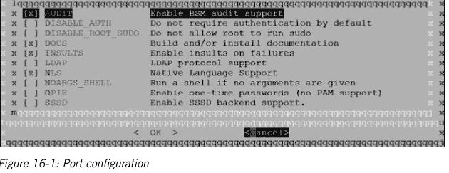

*图 16-1：移植配置*

#### 在命令行上自定义

有时，你不想使用美观的箭头选择菜单，而是想要命令行上文字的正规系统管理员接口。移植集合允许你跳过菜单，并在 `make(1)` 命令中给出所有配置选项。在这样做之前，你需要关闭美观的菜单。在命令行上设置环境变量 `BATCH=1` 以关闭菜单。在此，我们使用默认配置构建移植，完全按照 `FreeBSD` 软件包集群的方式：

```
make BATCH=1 install
```

现在既然你已丢弃了烦人的菜单，看看该移植支持哪些配置选项。`make pretty-print-config` 命令以易读的格式显示当前设置。让我们看看 `security/sudo`。

```
make pretty-print-config
+AUDIT -DISABLE_AUTH -DISABLE_ROOT_SUDO +DOCS -INSULTS -LDAP +NLS -NOARGS_SHELL -OPIE -SSSD
```

其中每一项代表一个配置选项。标记为加号的选项是开启的，而标记为减号的选项是关闭的。这些选项是什么意思？运行 `make showconfig` 会显示该移植的所有选项及其作用。

```
make showconfig
==== The following BSM configuration options are available for sudo-1.8.19p2:
     AUDIT=on: Enable BSM audit support
     DISABLE_AUTH=off: Do not require authentication by default
     DISABLE_ROOT_SUDO=off: Do not allow root to run sudo
     DOCS=on: Build and/or install documentation
     INSULTS=off: Enable insults on failures
--snip--
```

虽然 `sudo` 支持 `LDAP` 和 `SSSD` 以及各种复杂的信息源，但我真正需要的是当用户输入错误密码时，`sudo` 能够侮辱该用户。我需要的是 `INSULTS` 选项。使用命令行上的 `WITH` 环境变量来设置该选项。选项名称区分大小写。在此，我设置该选项并再次检查配置：

```
make WITH=INSULTS pretty-print-config
+AUDIT  -DISABLE_AUTH  -DISABLE_ROOT_SUDO  +DOCS  +INSULTS  -LDAP  +NLS  -NOARGS_SHELL  -OPIE  -SSSD
```

`INSULTS` 选项现在已设置。

使用引号来启用多个选项。

```
make WITH="INSULTS LDAP" pretty-print-config
```

类似地，使用 `WITHOUT` 来关闭选项。

```
make WITH=INSULTS WITHOUT="AUDIT NLS" pretty-print-config
```

如果你在安装移植时保持菜单启用，`make config` 图形菜单会出现，但会带有你已选择的选项。记住，使用 `BATCH` 变量关闭菜单。

#### 全局使用自定义设置

你构建移植是为了获得软件中的特定功能。通常，你希望在所有支持该功能的移植中都有此功能。请暂时考虑一下 `LDAP`。如果你的企业使用 `LDAP`，你可能希望你的所有软件都使用它。你会希望 `LDAP` 成为默认设置。

`FreeBSD` 在 `/etc/make.conf` 中存储每次运行 `make` 时使用的设置。这是你启用 `LDAP` 或 `LibreSSL` 或其他应在整个系统中出现的自定义设置的地方。将你想要全局应用的任何选项放入 `make.conf` 中。与命令行不同，`make.conf` 使用变量 `OPTIONS_SET` 和 `OPTIONS_UNSET`。

在此，我希望在每个移植中启用 `LDAP` 和 `INSULTS` 选项：

```
OPTIONS_SET=INSULTS LDAP
```

`make.conf` 中的设置对不支持该选项的移植没有影响。许多移植不了解 `LDAP`。我不知道除了 `sudo` 之外是否有其他移植包含侮辱用户的可选功能，但如果该功能可用，我需要它。

为什么在 `make.conf` 中使用单独选项而不是在命令行上？优先级。使用 `WITH` 应用的选项会覆盖使用 `OPTIONS_SET` 设置的选项。在此示例中，我全局启用了侮辱功能。如果出于某种难以理解的原因，我需要某个特定移植不侮辱用户，我可以在构建该移植时在命令行上使用 `WITHOUT=INSULTS` 来覆盖全局默认设置。

#### /etc/make.conf 和单个移植

也许你希望使用特定选项构建某个特定移植，但不想在命令行上指定。在 `/etc/make.conf` 中使用移植类别、下划线、移植名称、另一个下划线和 `SET` 变量。

```
security_sudo_SET=INSULTS
```

虽然移植应该缓存配置，但这提供了防止手误错误的额外保护。

#### 设置默认版本

`FreeBSD` 支持数十种移植自定义选择。然而，并非所有选择作为移植选项都合理。有些选项必须在整个移植集合中使用才能生效。最常见的例子是 `SSL` 库。你可以使用基础系统的 `SSL` 库构建所有移植，一切都会正常运行。你也可以使用外部 `SSL` 库构建所有移植，再次，软件也能正常工作。如果某些移植使用基础系统的 `SSL`，而某些使用第三方 `SSL`，就会导致灾难。同样的情况也适用于，例如，不同版本的 `PostgreSQL` 数据库服务器和 `Python` 解释器。不同的 `SSL` 库结合不同版本的数据库服务器会制造出我真的很乐意向急需一堂关于共享库工作原理的难忘课程的低级系统管理员移交的混乱局面。

移植集合使用 `DEFAULT_VERSIONS` 变量来列出应作为默认使用的关键软件。这取代了像 `DEFAULT_MYSQL_VER` 和 `trail_BDB_VER` 这样的旧变量。获取完整变量列表的唯一方法是浏览 `/usr/ports/Mk/`。`bsd.default-versions.mk`、`bsd.apache.mk` 以及 `Mk/Uses` 下的文件特别有用。

在此，我告诉移植集合始终使用 `LibreSSL` 而不是基础系统的 `OpenSSL` 库来构建移植，并使用 `Python` 3.7。

```
DEFAULT_VERSIONS += ssl=libressl
DEFAULT_VERSIONS += python=python3.7
```

我将每个默认版本列在单独的行上，并使用 `+=` 语法告诉移植系统将其添加到列表中。

我建议在构建第一个移植之前设置默认版本。否则，你将不得不重新构建移植，使其链接到你首选的库。

不要将预构建的软件包与使用替代 `DEFAULT_VERSIONS` 构建的移植混合使用。从软件包构建的程序将使用默认库，而你的移植将使用你首选的库。如果系统之后能工作，那纯粹是巧合。

#### 前置递归

有时，构建移植时的交互性不是问题所在。递归才是问题。

假设你正在构建一个大型软件包，例如 `LibreOffice` 或 `GNOME`。这些软件包拥有数十甚至数百个依赖项。其中许多软件包需要交互式配置。也许你在睡觉前启动了一个 `KDE` 的构建任务，想着醒来时就能看到最新的窗口管理器，或者至少是一个有趣的错误信息。然而，你醒来后会发现，有一个依赖项的 `make config` 菜单从你离开 30 秒后就开始耐心地等待你的操作了。

从 `ports` 系统构建软件的意义在于你可以进行自定义。但对于这些大型构建任务，你确实希望在开始之前完成所有的自定义设置。这时 `make config-recursive` 就派上用场了。

`make config-recursive` 会遍历所需 `ports` 的依赖树，并对其中每一个执行 `make config`。你需要花几分钟时间在每个 `port` 中选择选项，或者对不关心的 `port` 直接点击确定。不过，一旦完成递归配置，你就可以安全地对目标 `port` 运行 `make install`，然后去做别的事了。回来时，你会发现 `port` 已经安装完成，或者构建失败了。

更改 `port` 的构建选项可能会增加或移除依赖项。例如，如果你决定在 `LibreOffice` 中启用 `SNMP` 支持，$^{4}$ 那么该 `port` 将需要合适的 `SNMP` 库。该库的 `port` 也需要进行配置。请重新运行 `make config-recursive`，直到你的决定不再引起变更为止。

`ports` 系统会缓存你所有的配置选择。若要删除某个 `port` 及其所有依赖项的缓存，请运行 `make rmconfig-recursive`。

如果带宽计时是一个问题，你可以使用 `make fetch-recursive` 下载所有依赖项所需的所有 `distfiles`。这在某些地方很有用，例如南极洲，那里的构建时间和服务器冷却没有限制，但每天只有几个小时的互联网连接。

#### 打包的依赖项

有些软件拥有数百个依赖项，你可能不希望全部自行构建。虽然我可能希望有一个自定义的 `Emacs` 构建，但我可能不想从源代码构建 `gmake` 和最新的 `GNU C` 编译器。`make missing` 命令可以显示缺失的依赖项。你可以使用该命令来选择和挑选你想要构建的内容。

如果你不想从源代码构建任何依赖项，而是希望全部从软件包安装，你可以将 `make missing` 的输出传递给 `pkg` 命令。

```
pkg install -Ay $(make -DBATCH missing)
```

如果有可用的软件包，它就会安装。你唯一需要从 `ports` 安装的是那些仅从 `ports` 提供的软件包。

#### Port 风味（Flavors）

有些 `ports` 拥有复杂的依赖关系。虽然你可以使用 `Python` 2 或 `Python` 3 来构建 `Ansible`，但与 `Python` 2 配合工作的 `Ansible` 软件包与针对 `Python` 3 的软件包有着很大的不同。`Flavors`（风味）是一种机制，用于在单个 `port` 内部表达这些可能性，并且最近才引入到 `Ports Collection` 中。`Flavors` 尚未在 `ports` 系统中普及，但在我写这篇文章时，它们已经在 `Python`、`Perl`、`Qt` 和 `Emacs` 中实现。预计你会越来越频繁地看到它们。


要查看某个 `port` 是否支持任何 `flavors`，请进入 `port` 目录并运行 `make -V FLAVORS`。这里，我查看流行的 Python 打包工具包 `Setuptools` 可用的 `flavors`。

```
cd /usr/ports/devel/py-setuptools
make -V FLAVORS
py27 py36 py35 py34
```

我当前的 `ports` 树支持 Python 2.7、3.6、3.5 和 3.4。

要为特定的 Python 版本构建 `Setuptools`，请在命令行中指定 `flavor`。

```
make FLAVOR=py34 install clean
```

如果你未指定 `flavor`，`port` 将使用当前默认的 Python 进行构建。要设置系统的默认 Python，请在 `make.conf` 中设置 `DEFAULT_VERSIONS`。

### 构建软件包

你可以从已安装的 `port` 创建软件包。然后你可以将自定义的 `port` 复制到其他机器上并安装它。

在创建软件包之前，请创建目录 `/usr/ports/packages`。`ports` 系统会将构建的软件包放在该目录中。如果没有 `packages` 目录，软件包将位于 `port` 目录中，结果你的文件系统中会散落着软件包文件。

使用 `make package` 创建软件包。如果你不仅要打包当前 `port`，还要打包其所有依赖项，请运行 `make package-recursive`。

需要大量自定义 `port` 的人应该考虑使用 `poudriere`（本章稍后讨论）设置自己的仓库，但如果你有特殊情况或喜欢推迟麻烦，一次性构建软件包也是可行的。

### 卸载和重新安装 Ports

虽然你可以使用 `pkg remove` 卸载 `port`，但也可以从 `port` 目录卸载 `port`。在 `port` 目录中运行 `make deinstall` 会从系统中移除程序，但保留已编译的 `port` 以便随时重新安装。

卸载 `port` 后，已编译的程序和源文件仍然保留在 `port` 的 `work` 子目录中。运行 `make reinstall` 会重新安装已编译的程序。你可以按照意愿多次卸载和重新安装。

### 跟踪 Port 构建状态

`Ports Collection` 如何跟踪哪些步骤已经完成？如果你可以运行 `make extract` 然后运行 `make install`，FreeBSD 是如何知道它已经完成哪些任务的？`Ports Collection` 使用隐藏文件（文件名以点开头，即 `cookies`）来跟踪已完成的步骤。通过列出 `port` 的 `work` 目录中的所有文件可以看到这些文件：

```
cd /usr/ports/security/sudo/work
ls -a
--snip--
.PLIST.flattened
.PLIST.mktmp
.PLIST.objdump
.PLIST.setuid
.PLIST.writable
.build.done.sudo_usr_local
.configure.done.sudo_usr_local
.extract.done.sudo_usr_local
.install.done.sudo_usr_local
.license-catalog.mk
--snip--
```

文件 `.configure.done.sudo_usr_local` 表明 `make configure` 步骤已完成。

在多个 `make install/deinstall` 循环之后，不止一次出现 `port` 拒绝重新安装自身的情况。这通常是由表明安装已完成的隐藏文件引起的。删除该文件，重新安装即可继续。

### 清理 Ports

`Ports` 可能会占用大量磁盘空间。拥有许多依赖项的程序，如 `GNOME`、`KDE` 和 `LibreOffice`，可能会占用数十吉字节！其中大部分位于 `port` 的 `work` 目录中，`port` 在那里存放源代码文件和已编译二进制文件的所有中间部分。不过，一旦 `port` 安装完成，你不再需要这些文件。

使用 `make clean` 删除 `port` 的工作文件。这会擦除当前 `port` 和所有依赖项的 `work` 目录，因此请确保你已满意于新程序后再执行此操作。你也可以在 `install` 后立即清理 `port`，通过运行 `make install clean`。

你可能还希望删除存储在 `/usr/ports/distfiles` 中的原始 `distfiles`。`make distclean` 命令会删除当前 `port` 和所有依赖项的 `distfiles`。

要清理整个 `ports` 树，请在 `/usr/ports` 目录下直接运行 `make clean -DNOCLEANDEPENDS`。`-DNOCLEANDEPENDS` 是可选的，但它会阻止默认的递归清理。如果没有它，你会对某些流行 `ports` 进行数十或数百次的清理。虽然移除 `ports` 树中每个 `work` 目录还有更快的方法，但这种方法直接由 FreeBSD 项目支持。

### 只读 Ports 树

许多人不喜欢在 `/usr/ports` 中有临时文件甚至软件包。你可以将各种工作目录移动到文件系统的其他部分，以使 `/usr/ports` 除更新外保持只读。

使用 `make.conf` 中的 `WRKDIRPREFIX` 选项在单独的目录中构建 `ports`。许多人会将其设置为 `/usr/obj` 之类的路径。

`PACKAGES` 选项用于设置除 `/usr/ports/packages` 之外的新软件包目录。

最后，`DISTDIR` 用于设置除 `/usr/ports/distfiles` 之外的 `distfiles` 存储位置。

相关说明：只要这些目录的权限设置为构建者可以写入，就不需要 `root` 权限来构建 `ports` 和软件包。但是，只有 `root` 可以安装软件。

### 更改安装路径

许多环境对附加软件的安装方式有标准。我曾身处一些组织，其中 `/usr/local` 保留给特定于该机器的文件，并禁止在该目录中安装软件。相反，软件安装必须位于 `/opt` 或其他指定位置。

使用 `LOCALBASE` 和 `PREFIX` 变量设置替代安装位置。你可以在命令行这样做，但如果你是在遵守组织标准，请使用 `make.conf`。无论使用哪种方式，请首先构建 `pkg(8)` 本身。

```
cd /usr/ports/ports-mgmt/pkg
make LOCALBASE=/opt PREFIX=/opt install
```

该端口将其所有文件安装在此目录之下。例如，通常放入 `/usr/local/bin` 的程序最终会位于 `/opt/bin`。

并非所有端口都能处理 `LOCALBASE` 和 `PREFIX` 从 `/usr/local` 变更的情况。某些软件硬编码了对 `/usr/local` 的依赖，而另一些软件则存在未被发现的缺陷。如果某个端口在安装路径变更时运行失败，请提交一个 PR（参见第 24 章）。请尝试查看该端口以找出其失败的原因。提交此类修复是参与 FreeBSD 项目最简单的方式之一。

### 私有软件包仓库

软件包非常好用，直到你需要定制版本；那时你就需要端口了。同样，端口也很好用，直到你拥有数十台机器且它们都需要定制端口。在一台主机上容易构建的东西，在几台机器上维护起来就很困难，在大型服务器集群中则几乎不可能。当你超越了端口的能力范围时，你需要软件包。准确地说，是需要定制的软件包。

FreeBSD 项目使用 `poudriere`（发音为 `poo-DRE-er`）来构建软件包。为什么选择 `poudriere`？它是法语 `powderkeg`（火药桶）的意思。作为“tinderbox”工具的继任者，`poudriere` 是一组 shell 脚本，它利用了现有的 FreeBSD 基础设施，例如 `jails`、`tmpfs` 和 `Ports Collection`（端口集合）。

构建适用于多个系统的软件包与在本地主机上构建软件是不同的。任何由人类管理的内容都会积累杂物。一旦我的桌面使用超过几个月，我相当确信我所做的某些小改动会让它与任何新安装的系统存在微妙的差异。也许我在升级后保留了一个共享库。也许我手动安装了某个东西然后忘了。也许是恶作剧精灵篡改了链接器，我不知道。重要的是，我的主机并不完美地等同于每个运行本应相同的操作系统的其他主机。在此主机上构建并打包的端口可能包含依赖项、库或天知道什么其他东西，导致它无法在其他主机上工作。

`Poudrieve` 通过在其自行管理的 `jails` 中构建所有东西来规避这个问题。`Poudrieve` 可以构建适用于任何受支持的、早于其运行所在主机的 FreeBSD 发布的软件包。例如，你不能在 12.4-RELEASE 主机上构建适用于 13.0-RELEASE 的软件包，因为内核缺乏必要的接口。

使用 `poudriere`，你可以在一台主机上构建软件包，并将它们分发到你的所有服务器。虽然 `poudriere` 包含许多高级功能，但启动一个基本仓库并不困难。

#### Poudrieve 资源

构建软件包需要系统资源。你可以限制 `poudrieve` 在构建期间使用的处理器数量，这有助于减少其内存使用。然而，虽然 `poudrieve` 本身只有几兆字节，但 `jails` 和构建环境可能会占用大量磁盘空间。官方的 `poudrieve` 文档建议为每个 `jail` 分配至少 4GB 的磁盘空间，并为 `ports tree`（端口树）分配 3GB 的磁盘空间。我通常使用 `ZFS` 为每个分配大约 1GB，但我建议你倾向于遵循官方建议。

`Poudrieve` 利用 `ZFS` 克隆和快照来构建 `jails`，从而大大减少所需的磁盘空间，并且随着使用时间的增加，性能提升也越来越明显。你可以在 `UFS` 上运行 `poudrieve`，但它会占用更多空间并且运行速度更慢。

更值得关注的是构建 `ports` 所需的空间。我的 Web 服务器只运行几十个软件，其中许多都很小。`Poudrieve` 只需要几 GB 的磁盘空间来构建它们。如果你要构建数百或数千个软件包，你需要大量的磁盘空间。需要多少？嗯，你是要构建 `GnuPG` 还是要构建 `LibreOffice`？为了估算，使用 `ports` 构建但不要清理你的所有软件包，然后查看 `/usr/ports` 变得多大。

每台主机应只使用一个软件包仓库。是的，从技术上讲，你可以构建本地软件包并将它们与来自官方 FreeBSD 仓库的软件包并排安装。问题在于软件包是相互依赖的。你可以让主机先检查你的仓库，然后回退到官方仓库。然而，官方仓库每隔几天更新一次。更新之间的间隔取决于构建集群中可用的硬件，但几天是一个合理的猜测。你的 `poudrieve` 更新与官方仓库略有不规律的更新完美同步吗？你的 `ports tree` 与在 `ports` 集群上使用的完全一致吗？软件包旨在作为一个集成的集合工作，而不是来自两个不同集合的杂乱堆砌。询问任何 Linux 管理员关于从多个仓库安装软件包的恐怖故事，然后承诺构建所有你自己的软件包。相应地规划你的磁盘使用。

最后，请从一开始就在与你打算安装软件包的主机具有相同架构的主机上构建你的软件包。如果你在为 `arm64` 系统构建软件包，请使用 `arm64` 主机作为 `poudrieve`。你可以在 `amd64` 上构建 `i386` 软件包，因为 `amd64` 硬件正是为了运行 `i386` 代码而设计的。一旦你对 `poudrieve` 感到熟悉，你可以使用 `qemu-user-static` 软件包为较慢的平台交叉构建软件包。

你能将 `poudrieve` 添加到现有的生产主机吗？也许可以。在测试系统上运行几次 `poudrieve` 可以提供有关你环境所需资源的洞察。

#### 安装和配置 Poudrieve

`Poudrieve` 没有构建选项，因此请从软件包安装它。

```
###### pkg install poudriere
```

在 `/usr/local/etc` 中配置 `poudrieve`。你会找到一个用于配置特定软件包构建的目录 `poudriere.d`，但我们将从通用配置文件 `poudriere.conf` 开始。这是你告诉 `poudrieve` 如何行为的地方。虽然你可以自定义目录和路径，但我们将使用默认设置。

你必须通过设置 `FREEBSD_HOST` 变量来告诉 `poudrieve` 从哪里下载 FreeBSD 安装文件。如果你没有本地安装镜像，请使用默认的 `download.freebsd.org`。

```
FREEBSD_HOST=https://download.FreeBSD.org
```

`Poudrieve` 包含感知 `ZFS` 的功能。当然，`poudrieve` 并不必要 `ZFS`，但如果在 `ZFS` 上运行，它将根据需要创建、克隆和销毁数据集。在 `UFS` 上运行不会阻碍 `poudrieve`，但复制文件比克隆慢。如果你使用的是 `UFS`，请取消注释 `NO_ZFS=yes` 配置选项。就是这样。

`ZFS` 用户需要指定 `poudrieve` 将使用的 `ZFS` 池。我的主要操作系统安装可能位于池 `zroot` 上，但该池位于一对我不希望过度使用的闪存 `SATADOM` 上。我有一个专门用于数据转储的 `scratch` 池。在 `poudriere.conf` 中设置 `zpool`。

```
ZPOOL=scratch
```

在你的第一次 `poudrieve` 运行之前，创建一个 `/usr/local/poudriere` 数据集。你会更快乐。

`Poudrieve` 的所有工作文件都放在 `/usr/local/poudriere` 之下。如果你使用的是单独的 `ZFS` 池，该池上数据集的挂载点会设置在 `/usr/local/poudrieve` 下的各个位置。在 `UFS` 上，它只是一个普通目录。

我的示例在 `ZFS` 上运行，因为我可以。`Poudrieve` 的输出在 `UFS` 系统上可能看起来略有不同，但你运行的命令无论底层文件系统如何都是相同的。

我们稍后会查看一些 `poudrieve` 的自定义设置，但这可以让你开始。现在为你的软件包创建 `jails`。

#### Poudrieve Jail 创建

`Poudrieve` 可以从多种不同来源创建 `jails`。你可以从几个不同的来源下载，从源树构建，等等。请阅读 `poudriere(8)` 获取完整列表。在这里，我将使用我最喜欢的三种方法安装三个不同的 `jails`：从互联网、从 `install image`（安装镜像），以及从我自定义构建的 `/usr/src` 和 `/usr/obj`。所有安装命令使用相同的通用语法。某些安装方法会添加新选项，但一切都从这些开始。

```
###### poudriere jail -c -j jailname -v version
```

`jail` 子命令告诉 `poudrieve` 处理 `jail`。`-c` 标志表示创建，`-j` 让你为 `jail` 分配一个名称。`Jail` 可以有除句点外的任何名称。我以架构和版本命名我的 `poudrieve` `jails`，将句点替换为破折号。这给了我像 `amd64-12-0`、`amd64-11-4` 这样的 `jails`。`-v` 标志接受一个参数，即来自 `uname -r` 的 FreeBSD 版本，但不包含补丁级别信息。如果你的主机当前运行 12.3-RELEASE-p20，只需使用 12.3-RELEASE。补丁级别会在后续的 `poudrieve` 运行中改变——是的，`poudrieve` 会对 `jails` 应用安全补丁。

##### 从网络安装 Jail

默认 `jail` 安装会从 `poudriere.conf` 中指定的下载站点获取 FreeBSD 软件。FreeBSD 的主要下载站点在地理上是负载均衡的，因此除非你有自己的镜像，否则不需要使用其他站点。这里，我为构建 11.1 软件包创建一个名为 `amd64-11-1` 的 `jail`：

```
####### poudriere jail -c -j amd64-11-1 -v 11.1-RELEASE
[00:00:00] =====> Creating amd64-11-1 fs... done
[00:00:01] =====> Using pre-distributed MANIFEST for FreeBSD 11.1-RELEASE amd64
[00:00:01] =====> Fetching base.txz for FreeBSD 11.1-RELEASE amd64
...省略...
```

`Poudrieve` 访问网站并开始下载发行文件。一旦它本地拥有了所有文件，它会将 `/etc/resolv.conf` 复制到 `jail` 中，并运行 `freebsd-update` 获取所有最新的安全补丁。`Poudrieve` 的运行以以下内容结束：

```
[00:04:21] =====> Recording filesystem state for clean... done
[00:04:21] =====> Jail amd64-11-1 11.1-RELEASE-p1 amd64 is ready to be used
```

现在你可以配置这个 `jail` 了。

##### 从介质安装 Jail

从互联网下载没问题，但如果你有本地的安装介质呢？为什么要重新下载你已经放在 ISO 或内存棒镜像上的东西呢？将这些发行文件提取到你的本地硬盘，并且你可以按需为任意数量的 `jail` 使用它们。对于 ISO，请使用 `tar(1)`。

```
####### tar -xf ../FreeBSD-11.0-RELEASE-amd64-disc1.iso usr/freebsd-dist
```

内存棒映像稍微复杂一些；遗憾的是，`libarchive` 目前还无法打开磁盘映像。你必须将该映像附加到一个内存设备上并挂载它。

```
####### mdconfig -at vnode -f FreeBSD-11.0-RELEASE-amd64-memstick.img
md0
```

如果你尝试挂载 `/dev/md0`，将会收到错误。它不是一个文件系统，而是一个分区磁盘映像。请识别磁盘上的分区。


```
####### gpart show md0
=>  3 1433741 md0 GPT (700H)
     3 1600 1 efi (800K)
     1603 125 2 freebsd-boot (63K)
     1728 1429968 3 freebsd-ufs (698H)
     1431696 2048 4 freebsd-swap (1.0M)
```

分区 3 是一个 UFS 文件系统。这看起来很有希望。^6 请挂载它。

```
####### mount /dev/md0p3 /mnt
```

现在，发行版文件可在 `/mnt/usr/freebsd-dist` 中使用。我既可以将它们复制出来，也可以直接从当前位置进行安装。

这里，我为构建 FreeBSD 11.0 软件包创建一个 jail。它将被称为 `amd64-11-0`，并使用来自已挂载内存棒的文件。使用 `-m` 标志指定 `poudriere` 应该从哪里获取文件。

```
####### poudriere jail -c -j amd64-11-0 -v 11.0-RELEASE -m url=file:///mnt/usr/freebsd-dist/
```

请注意，`-m` 的参数是一个 URL。我本可以在这里指定一个网站，但 `file://` 是完全合法的 URL 类型。在 Unix 主机上，`file://` URL 有第三个斜杠以表示文件系统根目录。

## 从本地构建安装 Jail

我运行 `-current` 并定期从源代码构建。我想要为我的自定义构建构建软件包，因此 jail 需要一个与我的主机匹配的 FreeBSD 版本。获取该版本的简单方法是从你用来构建主机的同一个 `/usr/src` 进行安装。（你也可以使用 Subversion 下载用于构建此系统的源代码的新鲜副本，但这需要了解 Subversion。）使用 `-n` 来指定源目录的位置。

```
####### poudriere jail -c -j amd64-current -v 12.0-CURRENT -n src=/usr/src
[00:00:00] ====>> Copying /usr/src to /usr/local/poudriere/jails/amd64-current/usr/src...
--snip--
```

`Poudriere` 会对 `/usr/obj` 中的预构建 world 运行 `make installworld` 来创建你的 jail。它不会运行 `freebsd-update`，因为 `-current` 不支持它。

我们所有的后续示例都将使用 `amd64-current` jail。

## 查看 Jails

要查看 `poudriere` 设置的所有 jail，请运行 `poudriere jail -l`。输出非常宽，因此我无法在本书中完整复现，但你会看到 jail 的名称、安装的 FreeBSD 版本、硬件架构、安装方法、安装时间戳以及 jail 的路径。

### 安装 Poudriere 端口树

`Poudriere` 可以为不同的构建使用不同的端口树。你可能为一台主机使用季度版本分支，为另一台使用当前端口树，为第三台使用去年的端口树。（你需要使用 Subversion 从 FreeBSD 镜像中提取特定的端口树，因此我们不会详细介绍。）支持多个端口树的可能性意味着你必须为你安装的每个端口树分配一个名称。多个 jail 可以共享一个端口树。默认是当前端口树。

使用 `poudriere ports` 子命令来执行所有与端口相关的操作。`-c` 标志告诉 `poudriere` 创建一个端口树，而 `-p` 标志允许你分配名称。

```
####### poudriere ports -cp head
[00:00:00] =====> Creating head fs... done
[00:00:00] =====> Extracting portstree "head"...
Looking up portsnap.FreeBSD.org mirrors... 6 mirrors found.
--snip--
```

`Poudriere` 利用了 `portsnap(8)`，我们在本章前面讨论过它。

如果你安装了多个端口树，可以使用 `poudriere ports -l` 查看它们。

## 配置 Poudriere 端口

构建端口的整个目的就在于自定义它。你不需要将整个端口树作为软件包构建，除非你正在运行 FreeBSD 软件包构建集群或类似的东西！你必须告诉 `poudriere` 要构建哪些端口。一旦你有了这个列表，你可能需要针对某些端口设置特定选项，但也可能需要全局选项。你通常会使用 `/etc/make.conf` 来设置这些选项，但你并不希望 `poudriere` 使用系统设置。`Poudriere` 需要一个隔离的 `make.conf`。类似地，你可能会使用 `make config` 来设置一个端口，但在 `poudriere` 中如何做到这一点呢？

### 软件包列表

首先定义你希望 `poudriere` 构建的软件包列表。这个列表通常放在文件 `/usr/local/etc/poudriere.d/pkglist` 中，尽管你可以将其放在任何你希望的位置。通过类别和目录指定每个端口。要构建 `poudriere` 本身，请使用如下的条目：

```
ports-mgmt/poudriere
```

这里的难点在于建立一组基础软件包。你必须构建主机所需的所有软件包。一台主机可能需要数十甚至数百个软件包。你真的需要所有这些软件包吗？这些软件包是如何最终出现在这个系统上的？

请记住，你可能没有选择安装所有这些软件包。你安装了像 Emacs 或 Apache 或 LibreOffice 这样的应用程序，而该应用程序拖入了所有这些依赖项。你只关心那些影响你所需要软件的依赖项。如果 LibreOffice 失去一个依赖项，你就不希望 `poudriere` 再构建那个依赖项了。`Poudriere` 会自动构建并打包依赖项。你只需要指定你需要的应用程序，让 `poudriere` 完成剩下的工作即可。

使用 `pkg-query(8)` 获取其中一个生产系统上所有非自动安装软件的列表。

```
####### pkg query -e '%a=0' %o
www/apache24
shells/bash
sysutils/beadm
---snip---
```

将此作为你的软件包列表的基础。检查并移除不必要的部分。从你的其他生产主机获取类似的列表。使用它们来组装你的软件库的软件包列表。

## Poudriere make.conf

`Poudriere` 为每个 jail 从 `/usr/local/etc/poudriere.d/` 目录中的文件组装一个独特的 `make.conf`。文件 `/usr/local/etc/poudriere.d/make.conf` 包含你希望为你的所有 jail 设置的全局 `make.conf` 选项。其他的 `make.conf` 文件可以覆盖这些设置，如 `poudriere(8)` 中所述，但我们关注的是每个 jail 的 `make.conf` 文件。

假设我希望在我的整个企业范围内使用 LDAP。`Poudriere` 的 `/usr/local/etc/poudriere.d/make.conf` 将包含：

```
OPTIONS_SET=LDAP
```

不过，运行我自定义 FreeBSD 构建的所有主机都使用 LibreSSL。我会仅为该 jail 创建一个单独的 `make.conf`，命名为 `amd64-current-make.conf`。它将包含 LibreSSL 配置。

```
DEFAULT_VERSIONS += ssl=libressl
```

更具体的文件覆盖通用文件。每个 jail 文件中的设置会覆盖 `poudriere` 的全局 `make.conf`。我可以在此 jail 上关闭 LDAP，同时启用 LibreSSL。

## 运行 make config

使用 `poudriere` 选项为你的 jail 运行 `make config`。每个 jail 和端口树的组合都可以拥有自己独特的端口选项，因此你需要在命令行中指定它们。你必须使用 `-j` 指定 jail，使用 `-p` 指定端口树名称，使用 `-f` 指定软件包文件。

```
###### poudriere options -j amd64-current -p head -f pkglist
```

`Poudriere` 会确定哪些端口实际上会被构建及其所有依赖项。它会引导你对每一个执行 `make config`。

注意你选择的选项；其中一些是否应该放入全局或每个 jail 的 `make.conf`？将它们设置为默认值可以为你未来的 `poudriere` 运行省去麻烦。

现在你可以构建你的软件包库了。

## 运行 Poudriere

`poudriere bulk` 子命令批量构建软件包。使用 `-j` 指定 jail，`-p` 指定端口树名称，`-f` 指定软件包列表文件。（是的，这些标志与配置端口相同；就好像 `poudriere` 的设计者希望保持一致性或类似的东西。）

```
###### poudriere bulk -j amd64-current -p head -f pkglist
```

`Poudriere` 启动 jail，挂载所有端口，将各种配置文件复制到 jail 中，决定构建顺序，然后开始构建。你会看到每个端口开始构建时的名称。

其中一些端口构建可能会持续很长时间。按 `CTRL-T` 获取当前状态，或检查日志以查看当前状态。

构建结束时，你会看到构建成功的端口列表和构建失败的端口列表。以下是一个极小 `pkglist` 的结果：

## 已构建的端口

```
[00:04:56] =====> 已构建端口: ports-mgmt/pkg devel/pkgconf security/libressl
[00:04:56] =====> 失败端口: www/obhttpd:build
```

`pkg`、`pkgconf` 和 `libressl` 这些端口构建成功。它们可能无法运行，但端口集合能够构建并打包它们。然而，`obhttpd` 包未能构建成功。如果这个包至关重要，我希望在让客户使用此软件仓库之前先解决此问题。

让我们先查看问题，然后再检查软件仓库。

### 有问题的端口

在列出已构建的端口之后，你会看到一条指向日志位置的消息。

```
[00:04:56] =====> 日志: /usr/local/poudriere/data/logs/bulk/amd64-current-head/2018-10-10_15h05m43s
```

日志存储在一个以 jail 和端口树命名的目录中，并按日期设有子目录。如果你不想手动输入日期，有一个便捷的 `latest` 目录可以直达最近的日志目录。

`# cd /usr/local/poudriere/data/logs/bulk/amd64-current-head/latest`

你在这里找到的不仅仅是日志；你还会发现一个网站。如果你配置 Web 服务器来提供 `/usr/local/poudriere/data` 的内容，你可以使用 Web 浏览器检查 `poudriere` 的构建（也可以向客户端提供软件仓库）。这里的 `logs` 子目录包含 `poudriere` 针对每个端口的构建日志。如果你不想在这些日志中筛选，`logs/errors` 子目录仅包含失败构建的日志。

现在你需要做一件非常激进的事情：阅读错误日志。也许 `poudriere` 无法获取分发文件（distfile）。也许主机磁盘空间不足。也许发生了一些真正奇怪的事情。或者，也许该端口在你选择的构建选项下实际上是损坏的。并非所有端口都在所有时间使用所有选项进行构建；对于端口维护者来说，很容易忽视某个很少使用的功能已损坏。但请记住，`poudriere` 是 FreeBSD 官方的端口构建机制。如果某个端口在 `poudriere` 下构建失败，它就是损坏的，你应该考虑提交 bug（见第 24 章）。

## 软件包软件仓库

在 `/usr/local/poudriere/data/packages` 下找到你完成的软件包。每个 jail 和端口树的组合都有自己独立的子目录。我在 jail `amd64-current` 上使用端口树 `head` 构建这组软件包，所以我的新软件仓库位于 `/usr/local/poudriere/data/packages/amd64-current-head`。你会发现目录编录以各种 `.txz` 文件的形式存在，最新的软件包位于 `Latest` 子目录中。

恭喜。你拥有一个私有软件包仓库。现在要让你的客户端使用它。

## 使用私有软件仓库

使用私有软件仓库最简单的方式是在 `poudriere` 主机本身上进行。`pkg(8)` 的本地软件仓库配置位于 `/usr/local/etc/pkg/repos`。该目录默认不存在，因此需要创建它。

```
###### mkdir -p /usr/local/etc/pkg/repos
```

在其中创建一个 `FreeBSD.conf` 文件。本地软件仓库配置会补充或覆盖系统默认设置——这是 UCL 内置的功能。我们需要在 `/etc/pkg/FreeBSD.conf` 中的默认软件仓库配置中添加一个设置。

```
FreeBSD: {
  enabled: no
}
```

这样做可以保持 `/etc/pkg/FreeBSD.conf` 文件不变，但将名为 `FreeBSD` 的软件仓库的 `enabled` 设置为 `no`。默认软件仓库已不再使用。现在为我们的自定义软件仓库创建一个单独的配置文件的。我将这个软件仓库命名为 `amd64-current`，以 jail 的名称命名。

```
amd64-current: {
  url: "file:///usr/local/poudriere/data/packages/amd64-current-head",
  enabled: yes,
}
```

你的主机现在已准备好使用这些软件包。你需要强制重新安装当前所有软件包，以停止使用 FreeBSD 软件仓库的版本，转而使用你本地的版本。

```
###### pkg install -fy
```

`pkg(8)` 程序将下载软件仓库编录，但下载过程看起来会有所不同。

```
--省略--
正在更新 amd64-current 软件仓库编录...
获取 meta.txz: 100%    260 B   0.3kB/s    00:01
获取 packagesite.txz: 100%   17 KiB  17.4kB/s    00:01
处理条目: 100%
amd64-current 软件仓库更新完成。已处理 62 个软件包。
--省略--
```

与官方软件仓库编录相比，这个编录非常小。它在一秒内提取编录和元数据。最后一行显示该软件仓库仅有 62 个软件包。你正在使用新软件仓库。安装你的自定义软件包！

## 远程自定义软件仓库

软件包仓库的全部意义在于你只需构建一次软件包即可在所有地方部署它们。你可以使用只读 NFS 导出向本地机器提供软件包，但互联网用户非常喜欢滥用公开可访问的 NFS 服务器。`pkg.conf` 文件通过 URL 定义软件仓库位置。虽然我对 URL 使用了 `file` 协议，但没有理由让这个软件仓库不使用网站。在你的 软件包 构建器 上安装一个 Web 服务器，并让你的其他服务器获取 `/usr/local/poudriere/data/packages` 的内容。然后为那些应该使用该仓库的其他主机提供它们自己的软件仓库配置。

```
amd64-current: {
      url: "https://pkg.mwl.io/amd64-current-head",
      enabled: yes,
}
```

现在我们的所有机器都能获得一组相同的自定义端口。这一改变让我古怪的 Bert 不再在十几台机器上构建端口，而是去擦亮他的车。

## 各种大小的 Poudriere

`Poudriere` 默认性能相当不错，但有一些选项可以帮助小型和大型系统。

### 小型系统

如果你有一台资源受限的主机，你不想让 `poudriere` 胡作非为。以下是两个用于限制它的 `poudriere.conf` 选项。

一般来说，如果你能在某台主机上构建某个端口，`poudriere` 也能构建该端口。你不想让多个同时运行的 `poudriere` 任务使主机不堪重负。`Poudriere` 通常运行的并发进程数与主机中的处理器数量相同。使用 `PARALLEL_JOBS` 选项来限制并行构建的数量。

```
PARALLEL_JOBS=1
```

其他限制措施，例如减少 `poudriere` 构建可以使用的内存量，其 usefulness 可能不如你想象的那么大。软件在构建时所需的内存与其运行需求一致。仅用 1GB 内存构建 LibreOffice 将不会有好结果。

请记住，你还可以使用 `nice(1)` 全局降低 `poudriere` 运行的优先级，如第 21 章所述。

### 大型系统

`Poudriere` 可以利用高性能系统来加速构建。你无法加速磁盘，但可以利用内存，对构建的关键部分使用 `tmpfs(5)`。设置 `USE_TMPFS` 选项以对工作目录使用内存。

你可以对构建中除工作目录以外的部分使用 `tmpfs(5)`，但我们中很少有人拥有 那么多 的内存。阅读 `poudriere.conf.sample` 了解详细信息。

如果你构建许多软件包软件仓库，请调查 `poudriere` 的缓存（https://ccache.samba.org/）支持。你每个 jail 将使用大约 5GB 的磁盘空间，但在重新构建软件包时将节省大量时间。

## 更新 Poudriere

新的端口随时会被添加，并带有新的选项。其他软件项目不断发布新版本，FreeBSD 端口也相应更新。你会希望在你的服务器上获取这些新版本。如果你使用 `poudriere` 构建端口，更新过程相当简单。你需要更新你的 jail 和端口树。但在更新任何一个之前，请确保 `poudriere.conf` 已配置以处理更新。


## Poudriere 依赖项更新

Poudriere 有两个处理依赖项变更的选项。你需要启用这两个选项。`CHECK_CHANGED_DEPS` 告诉 `poudriere` 不信任之前的依赖项计算，并重新执行这些检查。这可以捕捉到底层 Perl、Python 等发生的变化。类似地，`CHECK_CHANGED_OPTIONS` 告诉 `poudriere` 验证每个端口的选项。将此设置为 `verbose` 可告诉 `poudriere` 向你显示任何变化。

```text
CHECK_CHANGED_OPTIONS=verbose
CHECK_CHANGED_DEPS=yes
```

现在你可以更新你的 jail 和端口树。使用 `-u` 标志来更新 jail。使用 `-j` 指定 jail 名称。这里，我更新 `poudriere` 的 `amd64-11-1` jail。

```text
###### poudriere jail -j amd64-11-1 -u
```

对于从官方介质安装的 jail，`poudriere` 运行 `freebsd-update(8)` 并应用缺失的安全补丁。如果你是安装在源上，`poudriere` 会重复安装过程。

类似地，使用 `-u` 更新端口树。使用 `-p` 指定端口树名称。

```text
###### poudriere ports -p head -u
```

你会看到 `poudriere` 使用 `portsnap(8)` 获取最新更新。现在你可以像第一次那样构建新版本的软件包软件仓库。

```text
###### poudriere bulk -j amd64-current -p head -f pkglist
```

`Poudriere` 确定哪些需要更新以及哪些必须重新构建，并相应执行。一旦构建完成，你的客户端就可以从软件仓库升级他们的软件包。

## 更多 Poudriere

Poudriere 的功能比我这里介绍的要多得多。你可以使用 `PKG_REPOSIGNING_KEY` 变量对软件包进行密码学签名。软件包集合（Package sets）允许你为不同的软件仓库定义不同的构建选项。你想运行带有最新 Python 的实验性软件包构建吗？查看软件包集合。你可以将端口列入黑名单，使它们即使作为依赖项被调用也永远不会被构建。参见 `poudriere(8)` 了解各种实用功能。

通过端口（ports）和 `poudriere`，你现在可以随心所欲地定制软件。如果你真的想了解 `Port` 集合的深入细节，请访问 <https://www.freebsd.org/> 查看 [FreeBSD 维护者手册](https://www.freebsd.org/)。我们其余的人将继续探索 FreeBSD 的一些高级软件特性。

## 17. 高级软件管理


FreeBSD 提供了独特的特性，帮助系统管理员更好地满足用户需求。了解系统真正的运作方式有助于你做出更好的决策。例如，虽然多处理器、多核处理器和硬件线程都能提高系统性能，但它们的作用并不总是像你想象的那样大。了解不同类型的多处理如何影响不同类型的工作负载，能让你知道在哪里可以提高性能，又在哪里无法提升。

为了让你的程序在启动时自动运行并在关机时干净地停止，你必须能够创建和编辑合适的启动和关闭脚本。虽然有些程序在直接终止其下的操作系统时能正常停止，但其他程序（例如数据库）则要求更温和的关闭方式。干净地启动和停止系统服务是一个极好的习惯，因此我们将更多地了解 FreeBSD 的启动和关闭脚本。

在正常情况下，你永远不需要知道 FreeBSD 的链接和共享库支持是如何工作的，但我们还是会讨论它们。为什么？因为在计算机行业中，正常情况其实相当罕见。

最后，FreeBSD 可以通过 Linux 兼容层运行 Linux 软件，以及为其他硬件架构编写的软件。

## 使用多处理器：SMP

如果你在过去 10 年内组装过台式机或服务器，它几乎肯定拥有多个处理器。其中一些处理器用于专用目的，例如视频卡中的图形处理器。现代操作系统使用对称多处理（SMP），即多个相同用途的通用处理器。现代硬件包含许多不同用途的专用处理器，例如显卡、服务器远程管理设备等，但呈现给操作系统的硬件具有相同的处理器。

与单处理器相比，SMP 系统具有许多优势，不仅仅是显而易见的“更大的功率”。如果你在微观层面思考，在极短的时间框架内，CPU 一次只能做一件事。计算机上的每个进程都在竞争处理器时间。如果 CPU 正在执行数据库查询，它就不会接受以太网卡试图传递的数据包。每隔极短的时间，内核就会指导 CPU 执行一次上下文切换，去处理另一个请求。这发生得非常频繁且迅速，使得计算机看起来好像同时在处理许多事情——这就好比电视画面看起来在移动，实际上只是非常快速地依次显示单幅画面。

我的桌面上有提供窗口管理的 `cwm`、拥有八亿个标签页的 Firefox，以及接受我输入的 LibreOffice。还有一堆连接到 SSH 会话的终端窗口。网络中断正在到达；屏幕正在显示文本；MP3 播放器正在流式传输 Stereoheenge 的 Narse With Wound。计算机的“无缝多任务处理”对我的渺小大脑来说才显得无缝。实际上，计算机只是非常快速地在任务之间切换。前一毫秒，它向我的耳机发送另一片声音；下一毫秒，它正在更新屏幕上的文本。

拥有多个处理器后，你的计算机确实可以同时执行多个操作。这非常有用——但系统复杂性急剧上升。

### 内核假设

为了理解 SMP 及其相关问题，我们必须深入内核。所有操作系统在支持 SMP 时都面临相同的挑战，这里的理论适用于广泛的各种平台。以下内容是一个粗略的简化。内核设计是一个棘手的话题，任何描述都很难做到完美。尽管如此，这里是一个大致的尝试。

FreeBSD 将 CPU 利用率划分为时间片。*时间片* 是一个 CPU 处理一项任务所花费的时间长度。一个进程可以使用 CPU 一个完整的时间片，或者直到它没有更多工作要做为止，此时下一个任务可能会运行。内核使用基于优先级的系统来分配时间片，并确定哪些程序可以在哪些时间片中运行。如果一个进程正在运行，但一个更高优先级的进程出现了，内核允许第一个进程被中断，即 *抢占*。这通常被称为 *抢占式多任务处理*。

虽然内核在运行，但它不是一个进程。任何进程都有内核设置的一些数据结构，内核会根据自己的判断操作这些数据结构。你可以将内核看作一种特殊的进程，它的所有行为都与其他所有进程截然不同。它不能被其他程序中断——你不能输入 `kill kernel` 来重启系统。在很久以前，内核可能被称为 *控制进程* 或 *监控程序*。

内核面临着其他系统部分不存在的特殊问题。想象你有一个程序通过网络发送数据。内核从程序接收数据，并将其放入内存块中，以便交给网卡。如果计算机一次只能做一件事，那么在内核回到该任务之前，该内存块或该网卡不会发生任何事情。然而，如果你有多个处理器，计算机可以同时执行多个任务。如果两个不同的 CPU 都在处理内核任务，同时指示你的网卡执行不同的操作会怎样？网卡的行为就像当你老板在一只耳朵边尖叫，而你配偶在另一只耳朵边说话时的我一样；无论你做什么，都无法满足他们两者。如果一个 CPU 为网络任务分配内存，而另一个 CPU 将同一内存分配给文件系统任务会怎样？内核会感到困惑，结果不会让你满意。

为单处理器设计的类 Unix 内核声明内核是 *非抢占式* 的，且不能被中断。这简化了内核管理，因为一切都变得完全可预测：当内核的一部分分配内存时，它可以指望在执行下一条指令时该内存未被更改。内核的其他部分不会更改该内存块。当计算机一次只能做一件事时，这是一个安全的假设。然而，一旦开始同时做许多事情，这个假设就崩塌了。

### SMP：首次尝试

FreeBSD 中 SMP 支持的最初实现非常简单粗暴。进程分散在各个 CPU 之间，实现粗略的平衡，并且内核上有一把锁。在 CPU 尝试运行内核之前，它会检查锁是否可用。如果锁是空闲的，CPU 持有锁并运行内核。如果锁不可用，CPU 就知道内核正在别处运行，于是继续处理其他事情。这把锁被称为 *Big Giant Lock*（*大巨锁*，简称 *BGL*），后来简称为 *Giant*。在此系统中，内核可以知道数据不会在它脚下发生变化。本质上，Giant 保证内核只在单个 CPU 上运行，就像它一直以来所做的那样。

这种策略对于两个 CPU 来说勉强够用。你可以在双 CPU 机器上运行中等水平的数据库和 Web 服务器，并确信 CPU 不会成为你的瓶颈。如果一个 CPU 忙于提供网页，另一个 CPU 就可以空闲下来处理数据库查询。但如果你有一台八 CPU 机器，你就麻烦了；系统会将大量时间浪费在等待 Giant 可用上！

这种简单的 SMP 技术既 inefficient 也不具备可扩展性。SMP 的标准教科书很少提及这种方法，因为它太笨拙了。然而，其他一些处理 SMP 的方法更糟糕。

例如，微软服务器操作系统的几个早期版本会将一个处理器专门用于用户界面，而将另一个用于处理其他所有任务。这种技术在教科书中也很少见，尽管它确实有助于使鼠标操作显得更加响应迅速。

### 当今的对称多处理（SMP）

然而，一旦你获得了内核锁，你就可以将这把锁拆分。FreeBSD 已经将 Giant 锁细分为许多较小的锁，现在内核的每一部分都使用尽可能小的锁来执行其任务。最初，这些锁是在核心内核基础设施上实现的，例如调度器（内核中决定哪些任务可以获得哪些时间片的部分）、网络栈、磁盘 I/O 栈等。这立即改善了性能，因为当一个 CPU 正在调度任务时，另一个 CPU 可以处理网络流量。随后，锁被下推到内核的各个组件中。网络栈的每个部分开发了自己的锁，然后是 I/O 子系统的每个部分，依此类推——这使得内核可以使用多个处理器同时执行多项任务。这些独立的内核子进程被称为 *线程*。

每种类型的锁都有各自的要求。你会看到对许多不同锁的引用，例如互斥锁（mutexes）、sx 锁、读写锁（rw locks）、自旋互斥锁（spin mutexes）、信号量（semaphores）、读多写少锁（read-mostly locks）等。每种锁都有其自身的优缺点，并且必须在内核中仔细应用。

细粒度锁比听起来要 *困难得多*。锁得太细，内核花费在处理锁上的时间就会超过处理数据的时间；锁得太粗，系统就会浪费时间等待锁可用。对于 2 处理器系统来说足够用的锁设置，在 32 处理器系统上会导致停滞和阻塞；而在 32 核心主机上适用的设置，对于新的 192 核心系统则完全不足。锁的调整和调优已经花费了数年，目前仍在进行中，并将永远持续下去。

虽然内核的每个部分都使用当前可能最小的一把锁，但有时这把锁就是 Giant 锁。拔掉 USB 设备意味着在几秒钟内获取 Giant 锁，此时内核会说：“全体注意！我正在重新配置硬件！”一些设备驱动程序仍然使用 Giant 锁，虚拟内存栈的某些棘手部分、sysctl 处理器等也是如此。

#### SMP 问题：死锁和锁顺序反转

所有这些内核锁都有复杂的使用规则，并且它们以无数种方式相互作用。这些规则旨在保护系统免受意外的锁交互影响。假设内核线程 A 需要资源 Y 和 Z，内核线程 B 也需要 Y 和 Z，但 B 需要先获取 Z 再获取 Y。如果 A 锁住了 Y，而 B 锁住了 Z，那么 A 最终会等待 Z，而 B 等待 Y。在缺失的资源被释放之前，这两个线程都无法继续。这种死锁（也称为“致命拥抱”）会使系统不稳定，很可能导致系统崩溃。正确的锁机制可以避免此类问题及其他问题。

你可能会看到控制台的警告消息，指出发生了锁顺序反转，意味着锁被按错误的顺序应用。虽然这种内核通知并不总是预示着灾难即将发生，但保持关注非常重要。

`WITNESS` 内核选项专门监视锁顺序和锁排序违规。该选项在 FreeBSD-current 中默认启用（参见第 18 章），如果你报告了系统问题，开发团队可能会要求你启用它。`WITNESS` 选项使内核检查其采取的每个动作是否存在锁顺序违规，这降低了系统性能。你可以通过 `debug.witness.watch` sysctl 来启用和禁用 `WITNESS`。然而，运行 `WITNESS`、阅读消息并据此采取行动，是帮助改进 FreeBSD 的优秀方式。

#### 处理锁顺序反转

当你收到这些锁顺序反转（LOR）消息之一时，请完整复制 LOR 消息。除了出现在控制台上之外，为了方便起见，此类消息也被记录在 `/var/log/messages` 中。一旦你获得了锁顺序消息，请在 FreeBSD-current 邮件列表中搜索你的 LOR 消息的前几行，查看是否有人已经提交过该问题。如果你在邮件列表中找到了你的 LOR，请阅读该消息并采取建议的操作。除非开发人员最近明确请求通知此类 LOR 的进一步情况，否则无需在邮件列表上发布“我也是”的消息。

如果你有一个新的 LOR，恭喜你！发现一个新的 LOR 并不像发现一个新昆虫物种那样令人满足——例如，你并不能给你的 LOR 命名——但它确实对 FreeBSD 项目有帮助。请将你的报告通过电子邮件发送到 FreeBSD-current 邮件列表。提供有关你系统的完整细节，特别是当 LOR 出现时正在执行的工作。你可能会被要求提交一份 bug 报告，如第 24 章所述。

### 处理器和 SMP

你将看到三种不同类型的多处理器系统：多核心、多封装包和硬件线程。你需要理解它们之间的差异，因为不同的处理器类型会直接影响系统和应用的行为。

处理器的基本单位是 *CPU 核心*。每个 CPU 核心由一组资源组成，如执行单元、寄存器、缓存等。曾经，核心和处理器是同一个概念。

*CPU 封装包* 是插入或焊接在你主板上的芯片。这是许多人认为的“CPU”或“处理器”。那个昂贵的、你可能不小心踩碎的部分？那就是封装包。每个封装包包含一个或多个核心。在 SMP 之前，一个封装包只包含一个核心。如今，大多数封装包至少有两个核心，并且最大数量不断增加。同一封装包内的 CPU 核心可以相对快速地相互通信。

一些主机拥有多个封装包。多个封装包为你提供了多组多核心，从而提供了更多的并行机会。封装包之间的通信速度比同一封装包内核心之间的通信速度要慢。此外，每个封装包通常都有自己的内存控制器。一个封装包中的 CPU 核心检索连接到另一个封装包的内存中的数据需要更长的时间。是的，这意味着一个 16 核心的封装包表现优于两个 8 核心的封装包。然而，在现实中，很少有软件线程化程度如此之高，以至于可以利用这种差异。

最后，一些 CPU 核心可以通过一次运行多个线程来更高效地利用其执行资源。这被称为 *硬件线程*、*同时多线程*（SMT）或（如果是 Intel 的话）*超线程*（HyperThreading）。额外的线程有时被称为虚拟处理器或虚拟核心。然而，虚拟处理器并不是一个完整的 CPU；例如，只有当第一个 CPU 在等待某些事情时，它才可用。FreeBSD 的默认调度器 `sched_ule(4)` 知道哪些核心是真实的，哪些是虚拟的，并相应地调度工作。

硬件线程带来了各种潜在的安全问题。在一个虚拟处理器上运行的任务可以利用各种微妙的时序攻击，捕获在另一个虚拟处理器上运行的任务的数据，例如加密密钥。这不是脚本小子友好型攻击，但如果你不信任你的用户，可以通过设置启动时可调参数 `machdep.hyperthreading_allowed` 为 `0` 来禁用硬件线程。

### 使用 SMP

请记住，多个处理器并不一定意味着系统速度更快。一个处理器每秒可以处理一定数量的操作。第二个处理器仅意味着计算机每秒可以处理两倍数量的操作，但这些操作本身并不一定更快。

将 CPU 数量想象成道路的车道。如果有一条车道，你一次只能让一辆车经过某个地点。如果你有四条车道，你可以让四辆车同时经过那个地点。虽然四车道路不会让那些车更快地到达目的地，但在任何给定时间到达的车辆会多得多。如果你认为这没有区别，请想想如果有人把你当地的公路换成单车道路会发生什么。CPU 带宽很重要。

虽然一个 CPU 一次只能做一件事，但一个进程一次只能在一个 CPU 上运行。许多程序无法同时使用多个处理器。线程化程序是一个例外，我们将在本章后面的内容中看到这一点。一些程序通过同时运行多个进程，并让操作系统根据需要将这些进程分散到不同的处理器上，从而绕过这一限制。流行的 Apache Web 服务器多年来一直采用这种方式。线程化程序是专门设计用于在生成多个进程的情况下与多处理器协同工作的。许多线程化程序只是创建大量线程来处理数据，并将这些线程分散到各个 CPU 上，这是一种简单但并不总是有效的处理并行的方式。其他程序则根本不处理多 CPU 的情况。

如果你发现其中一个 CPU 的占用率是 100%，而其他 CPU 大多数时候都很空闲，那么说明你正在运行一个完全不处理多 CPU 的程序。第 21 章将深入探讨性能问题，但对于这样的程序，很难提供帮助。

### SMP 与 make(1)

`make(1)` 程序用于构建软件，它可以启动多个进程。如果你的程序编写得规范，你可以使用多个进程来构建它。这对于小型程序没有帮助，但在构建大型程序（如 FreeBSD 本身（见第 18 章）或 LibreOffice）时，使用多个处理器可以真正加速工作。使用 `make(1)` 的 `-j` 标志来告诉系统同时启动多少个进程。一个很好的选择是系统中处理器或核心的数量加一。例如，在一个双处理器、每个处理器有两个核心的系统上，我会运行五个进程来构建程序。

```
#### make -j5 all install clean
```

有些程序员没有正确设计他们的 Makefiles，因此他们的程序无法处理使用 `-j` 标志构建的情况。如果构建过程中出现问题，请停止使用 `-j` 并再次尝试——或者，更好的做法是找出问题并向作者提交错误报告。

### 线程、线程，还有更多线程

在各种语境下，你会经常听到的一个词是 *线程*（thread）。一些 CPU 支持超线程（HyperThreading）。一些进程包含线程。内核的某些部分作为线程运行。我的裤子上有许多许多线程（尽管有些裤子上的线程数量比我妻子认为穿上这些裤子外出所需的最少数量还要少）。所有这些线程是什么，它们又意味着什么？


在大多数语境下，线程是一个轻量级进程。请记住，`进程`（process）是系统上的一个任务，一个正在运行的程序。进程在系统中有其唯一的进程 ID，并且可以由用户启动、停止并通常进行管理。线程是进程的一部分，但它们由进程管理，不能被用户直接寻址。一个进程一次只能做一件事，但各个线程可以独立行动。如果你有多处理器系统，一个进程可以拥有同时在多个处理器上运行的线程。

任何线程化程序都需要使用一个 `线程库`（threading library），该库通过与内核交互，告诉应用程序如何在特定操作系统上使用线程。线程库以不同的方式实现线程功能，因此使用特定的库可能会影响应用程序的性能。

同样地，内核线程是内核中的一个子进程。`FreeBSD` 拥有处理 `I/O`、网络等的内核线程。每个线程都有自己函数、任务和锁。内核中的线程不使用任何用户态库。

硬件线程是虚拟 `CPU` 核心，如第 396 页“使用多处理器：`SMP`”中所述。虽然你需要了解硬件是什么以及它如何影响你的系统，但硬件线程实际上并不是线程技术的一部分。

### 启动和关闭脚本

`service(8)` 命令是系统启动和关闭脚本的前端。这些脚本被称为 `rc 脚本`，得名于管理多用户启动和关闭过程的 `/etc/rc` 脚本。尽管主要的 `rc` 脚本位于 `/etc/rc.d`，但位于其他位置的脚本用于管理附加软件。`Ports` 和 `packages` 会安装启动脚本，但如果你安装自己的软件，你需要创建自己的 `rc` 脚本。如果你以前从未使用过 `shell` 脚本，请仔细阅读。`Shell` 脚本并不困难，学习最好的方法是阅读示例并制作这些示例的变体。此外，更改现有软件的启动或关闭过程需要理解启动脚本如何工作。

在启动和关闭期间，`FreeBSD` 会检查 `/usr/local/etc/rc.d` 中以整合额外的 `shell` 脚本到启动/关闭过程中。（你可以使用 `local_startup` `rc.conf` 变量定义额外的目录，但暂时假设你只有默认目录。）启动过程专门查找可执行的 `shell` 脚本，并假设找到的任何脚本都是启动脚本。它执行该脚本时带有一个 `start` 参数。在关闭期间，`FreeBSD` 运行相同的命令，但带有一个 `stop` 参数。脚本被期望读取这些参数并采取相应的操作。

### `rc` 脚本排序

几十年来，类 Unix 操作系统在启动脚本中编码服务启动顺序。这很快就变得非常烦人。许多（但并非所有）Unix 系统已经摒弃了这种方式。类似地，`FreeBSD` 的 `rc` 脚本按顺序排列。每个 `rc` 脚本识别出它在启动前需要的资源。`rc` 系统使用该信息对脚本进行排序。这是在启动和关闭时由 `rcorder(8)` 执行的，但你也可以随时手动执行以了解其工作原理。只需将启动脚本的路径作为参数提供给 `rcorder(8)` 即可。

```
#### rcorder /etc/rc.d/* /usr/local/etc/rc.d/*
/etc/rc.d/growfs
/etc/rc.d/sysctl
/etc/rc.d/hostid
/etc/rc.d/zvol
/etc/rc.d/dump
/etc/rc.d/ddb
/etc/rc.d/geli
/etc/rc.d/gbde
-- snip --
```

`rcorder(8)` 程序使用脚本内部的标记，将 `/etc/rc.d` 和 `/usr/local/etc/rc.d` 中的所有脚本排序为系统启动时使用的顺序。如果你的 `rc` 脚本有任何排序错误，例如死锁的脚本，这些错误会出现在 `rcorder(8)` 输出的开头。

#### 典型的 `rc` 脚本

`rc` 脚本系统非常简单——虽然脚本可能会变得复杂，但复杂性来源于脚本运行的程序，而不是 `rc` 系统。启动 `NFS` 服务器的脚本有一大堆依赖项和要求。对于一个更简单的守护进程（如 `timed(8)`）的脚本则阐明了 `rc` 系统。

```
#!/bin/sh
##### PROVIDE: 1 timed
##### REQUIRE: 2 DAEMON
##### BEFORE: 3 LOGIN
##### KEYWORD: 4 nojall shutdown
5 . /etc/rc.subr
6 name="timed"
7 desc="Time server daemon"
8 rcvar="timed_enable"
9 command="/usr/sbin/${name}"
10 load_rc_config $name
   run_rc_command "$1"
```

`PROVIDE` 标签 `1` 告诉 `rcorder(8)` 该脚本的官方名称。这个脚本被称为 `timed`，以 `timed(8)` 命名。

`REQUIRE` 标签 `2` 列出了必须在此脚本运行之前运行的其他脚本。需要 `timed` 先运行的脚本会在它们的 `REQUIRE` 中列出 `timed`。此脚本可以在 `DAEMON` 脚本运行后的任何时间运行。

`BEFORE` 标签 `3` 允许你指定应该在此脚本之后运行的脚本。此脚本应该在 `LOGIN` 脚本之前运行。`/etc/rc.d/LOGIN` 和 `/etc/rc.d/timed` 都指定了它们必须在 `DAEMON` 之后运行，但 `BEFORE` 标签允许你设置额外的排序要求。

`KEYWORD` 命令 `4` 让启动系统可以选择仅运行特定的启动脚本。`timed(8)` 脚本包含 `nojail` 和 `shutdown`。即使启用，`Jails` 也不会运行此脚本。此脚本在系统关闭时运行。

`/etc/rc.subr` 文件 `5` 包含 `rc` 脚本的基础结构。每个 `rc` 脚本都必须包含它。

虽然脚本有一个名称，但脚本运行的程序可能有另一个名称 `6`。不过，大多数情况下，官方称为 `timed` 的 `rc` 脚本会运行 `timed` 程序。

`description` 字段 `7` 提供脚本提供的服务的简要描述，正如你所期望的那样。

`rcvar` 语句 `8` 列出了切换此脚本的 `rc.conf` 变量。

`command` `9` 准确识别此脚本应该运行哪个命令——毕竟，你的系统上可能有多个同名的命令，只是位于不同的目录中。

脚本执行的最后两个操作是从 `/etc/rc.conf` 加载该服务的配置 `10`，然后实际运行命令。

虽然这看起来可能令人望而生畏，但实际上并没有那么难。通过复制现有的 `rc` 脚本开始定制你的 `rc` 脚本。将命令名称设置为你命令的名称，并相应地更改路径。决定脚本在运行前必须有什么：你需要网络正在运行吗？你需要特定的守护进程已经启动，还是你需要在特定守护进程之前运行你的程序？如果你真的不知道，使用带有系统最后运行的脚本名称的 `REQUIRE` 语句，让你的脚本在最后运行。通过查看提供类似功能的其他 `rc` 脚本，你将学会如何在启动脚本中完成几乎所有事情。

通过这个简单的脚本，你可以通过在 `/etc/rc.conf` 中添加信息来启用、禁用和配置你的程序。例如，如果你的自定义守护进程命名为 `tracker`，启动脚本将查找

### 特殊的 `rc` 脚本提供程序

你可能注意到示例中名为 `DAEMON` 的服务，并认为：“这很奇怪。我不知道有任何名为 `DAEMON` 的系统进程。” 这是因为它不是一个进程。`rc` 系统有一些特殊的提供程序，它们定义了启动过程中的主要节点。使用这些提供程序可以简化 `rc` 脚本的编写。

`FILESYSTEMS` 提供程序保证所有本地文件系统已按照 `/etc/fstab` 中的定义挂载。

`NETWORKING` 提供程序出现在所有网络功能配置完成后。这包括设置网络接口的 `IP` 地址、`PF` 配置等。

`SERVERS` 提供程序意味着系统已具备足够的基础功能以支持基本服务器，例如 `named(8)` 和 `NFS` 支持程序。此时远程文件系统尚未挂载。

`DAEMON` 提供程序确保所有本地和远程文件系统（包括 `NFS` 和 `CIFS`）均已挂载，并且更高级的网络功能（如 `DNS`）已可运行。

在 `LOGIN` 阶段，所有网络系统服务正在运行，`FreeBSD` 开始启动支持通过控制台登录的服务，如 `FTP` 守护进程、`SSH` 等。

通过在自定义 `rc` 脚本的 `REQUIRE` 语句中使用其中一个提供程序，您可以大致指定希望自定义程序运行的时间，而无需深入繁琐的细节。

### 厂商启动/停止脚本

也许你正在安装一个复杂的软件，而厂商不支持 `FreeBSD` 的 `rc` 系统。这并不是问题。大多数厂商提供的脚本期望接收单个参数，如 `start` 或 `stop`。请记住，在启动时，`FreeBSD` 使用参数 `start` 运行每个 `rc` 脚本，而在系统关闭时，使用参数 `stop` 运行脚本。通过将此厂商脚本添加 `PROVIDE` 和 `REQUIRE` 语句作为注释，并确认其接受这些参数，你可以使该脚本在启动和停止过程中的适当时间运行。

在管理脚本中使用 `rc` 系统功能并非强制。在启动过程的末尾，`FreeBSD` 运行 `/etc/rc.local`。在那里添加你的本地命令。然而，你无法使用 `service(8)` 来管理 `rc.local` 中的任何内容。

### 调试自定义 `rc` 脚本

本地脚本（例如由 `Ports` Collection 安装的脚本）由 `/etc/rc.d/localpkg` 运行。如果你的自定义脚本导致问题，你可以尝试以调试模式运行 `localpkg` 脚本，查看你的脚本如何与 `rc` 系统交互。执行此操作的最佳方法是使用调试模式。

```sh
#### /bin/sh -x /etc/rc.d/localpkg start
```

这试图再次启动服务器上的所有本地守护进程，这在生产系统上可能并不理想。请先在测试系统上尝试。此外，请记住 `-x` 调试标志不会传递给子脚本；你正在调试系统启动脚本 `/etc/rc.d/localpkg` 本身，而不是本地脚本。使用 `-x` 标志运行你的脚本以进行调试。

## 管理共享库

共享库是一块编译后的代码，为其他编译代码提供通用函数。共享库旨在被尽可能多的不同程序复用。例如，许多程序必须对数据片段生成哈希值或加密校验和。如果每个程序都必须包含自己的哈希代码，程序将更难编写，维护起来也更痛苦。此外，如果程序以略微不同的方式实现哈希，它们将存在互操作性问题，且程序员需要大量了解哈希才能使用它们。通过使用共享库（在此例中为 `libcrypt`），程序可以访问哈希生成功能，而不会产生兼容性和维护问题。这以降低复杂性为代价，减少了程序的磁盘和内存中的平均大小。

### 共享库版本与文件

共享库拥有人类友好的名称、版本号和关联文件。人类友好的名称通常（但并非总是）与关联文件相似。例如，名为 `libjail` 的共享库的第 1 版本位于文件 `/lib/libjail.so.1` 中。另一方面，主要 `Kerberos` 库的第 11 版本位于文件 `/usr/lib/libkrb5.so.11` 中。版本号从 0 开始。

历史上，当对库的修改使其与库的早期版本不兼容时，版本号会递增。例如，`libjail.so.0` 变为 `libjail.so.1`。`FreeBSD` 团队仅在发布周期开始时递增这些版本号（参见第 18 章）。每个库还有一个符号链接，指向不带版本的库名称，指向该库的最新版本。例如，你会发现 `/usr/lib/libures.so` 实际上是一个指向 `/usr/lib/libures.so.10` 的符号链接。这使得编译软件变得更加容易，因为软件只需查找通用的库文件，而非该库的特定版本。

`FreeBSD` 的主要库支持符号版本化，这使得共享库能够支持多个编程接口。通过符号版本化，共享库为每个程序提供该程序所需的库版本。如果你有一个需要库第 2 版本的程序，第 3 版本同样能很好地支持其功能。

尽管 `FreeBSD` 支持符号版本化，但这并不意味着 `Ports` Collection 中的所有软件都支持它。你必须警惕库版本问题。

### 将共享库附加到程序

那么，程序如何获取它需要的共享库？`FreeBSD` 使用 `ldconfig(8)` 和 `rld1(1)` 在需要时提供共享库，但还为调整和管理共享库处理提供了一些人类友好的工具。

`rld1(1)` 可能是最简单的程序，至少从系统管理员的角度来看。每当程序启动时，`rld1(8)` 会检查程序需要哪些共享库。`rld1(8)` 程序搜索库目录，查看这些库是否可用，然后将库与程序链接，使一切正常工作。你无法直接使用 `rld1(1)` 做很多事，但它提供了将共享库粘合在一起的关键胶水。

### 库目录列表：`ldconfig(8)`

而不是每次运行任何动态链接程序时都在整个硬盘上搜索任何看起来像共享库的东西，系统使用 `ldconfig(8)` 维护一个共享库目录列表。（旧版本的 `FreeBSD` 在系统上构建实际库的缓存，但现代版本只是维护一个要检查共享库的目录列表。）如果程序找不到你知道在系统上的共享库，这意味着 `ldconfig(8)` 不知道那些共享库所在的目录。¹ 要查看 `ldconfig(8)` 当前找到的库，运行 `ldconfig -r`。

```sh
#### ldconfig -r
/var/run/ld-elf.so.hints:
    search directories: /lib:/usr/lib:/usr/lib/compat:/usr/local/lib:/usr/local/lib/perl5/5.24/mach/CORE
    0:-lcxvrt.1 => /lib/libcxvrt.so.1
    1:-lalias.7 => /lib/libalias.so.7
    2:-lrss.1 => /lib/librss.so.1
    3:-lbikconv.4 => /lib/libbikconv.so.4
    4:-lpgldlog.0 => /lib/libpgldlog.so.0
-- snip --
```

使用 `-r` 标志，`ldconfig(8)` 列出共享库目录中的每个共享库。我们首先看到搜索的目录列表，然后看到这些目录中的各个库。我的主要邮件服务器有 170 个共享库；我的主要 Web 服务器有 244 个；我的桌面有 531 个。

如果程序在启动时因找不到共享库而终止，该库不会出现在此列表中。你的问题归结为将所需的库安装到共享库目录或将库目录添加到搜索目录列表中。你可以只需将所有需要的共享库复制到 `/usr/lib`，但这使系统管理变得非常困难——就像文件柜中所有东西都按“paper”（纸张）分类一样。在中期到长期来看，将目录添加到共享库列表是更好的主意。

### 将库目录添加到搜索列表

如果你添加了新的共享库目录，必须将其添加到 `ldconfig(8)` 搜索的列表中。检查 `/etc/defaults/rc.conf` 中的这些 `ldconfig(8)` 条目：

```sh
ldconfig_path="/usr/lib/compat /usr/local/lib /usr/local/lib/compat/pkg"
ldconfig_local_dirs="/usr/local/libdata/ldconfig"
```

`ldconfig_paths` 变量列出了库的常见位置。虽然出厂的 `FreeBSD` 没有 `/usr/local/lib` 目录，但大多数系统在安装后很快就会生成一个。类似地，用于与旧版本 `FreeBSD` 兼容的库放在 `/usr/lib/compat`。存储由包安装的旧版本库的位置是 `/usr/local/lib/compat/pkg`。`/lib` 和 `/usr/lib` 目录默认会被搜索，但该变量中的路径是共享库的常见位置。

`Ports` 和包使用 `ldconfig_local_dirs` 变量将其共享库放入搜索列表，而不是将所有内容都倒入 `/usr/local/lib`。包可以在此目录中安装一个文件。该文件以包命名，包含包安装的目录列表。`ldconfig` 程序检查这些目录中的文件，读取文件中的路径，并将其视为额外的库路径。例如，`Perl` 5 包在 `/usr/local/lib/perl5/5.24/mach/CORE` 中安装共享库。该端口还安装一个名为 `/usr/local/libdata/ldconfig/perl5` 的文件，其中仅包含单行

### `/usr/local/lib` 与按端口划分的库目录

`/usr/local/lib` 不是专门用于存放通过端口（`ports`）和软件包安装的库吗？为什么不建议将所有共享库都放入该目录呢？大多数端口确实这样做了，但有时拥有独立的目录会使维护工作更简单。例如，我在笔记本电脑上安装了 `Python` 2.7，而 `/usr/local/lib/python2.7` 中竟然包含了 647 个文件！如果将所有这些文件都堆砌到 `/usr/local/lib` 中，就会淹没我那些非 `Python` 的库，并且使得查找仅包含一两个共享库的端口安装文件变得更加困难。

要将你的共享库目录加入搜索列表，你可以将其添加到 `/etc/rc.conf` 中的 `ldconfig_paths`，或者在 `/usr/local/libdata/ldconfig` 中创建一个列出你目录的文件。两者皆可。一旦你添加了目录，该目录中的库即可立即使用。

#### `ldconfig(8)` 与特殊库

共享库有一些边缘情况你需要理解，还有许多你根本不必担心的情况。这些包括用于不同二进制类型的库以及用于其他架构的库。

`FreeBSD` 支持两种不同的二进制格式：`a.out` 和 `ELF`。系统管理员无需了解这些二进制类型的细节，但你应该知道 `ELF` 二进制文件是现代标准，并自 1998 年 `FreeBSD` 3.0 版本起成为 `FreeBSD` 的标准。旧版本的 `FreeBSD` 使用 `a.out`。编译为一种类型的程序无法使用另一种类型的共享库。虽然 `a.out` 二进制文件在很大程度上已经消失，但支持它们的成本很低，因此这一支持从未被移除。`ldconfig(8)` 为 `a.out` 和 `ELF` 二进制文件维护独立的目录列表。你可以从 `/etc/rc.d/ldconfig` 的输出中看到这一点。你会发现 `rc.conf` 中有针对 `a.out` 库的 `ldconfig(8)` 的独立配置选项。几乎可以想象到你不需要使用 `a.out` 程序。


另一个特殊情况是在 64 位 FreeBSD 安装环境中运行 32 位二进制文件。这种情况最常见于当你运行 `amd64` 安装并希望使用旧版 FreeBSD 中的程序时。64 位二进制文件无法使用 32 位库，因此 `ldconfig(8)` 为它们维护一个独立的目录列表。你同样可以在 `rc.conf` 中找到配置这些目录的选项。切勿混淆你的 32 位和 64 位库！

一些硬件平台，如 `ARM`，拥有用于软浮点运算的特殊版本库。你还可以找到 `rc.conf` 中针对这些平台的选项，它们指向第三组目录。

简而言之，不要将特殊的库与标准库混在一起。否则结果会让 FreeBSD 感到困惑，进而让你感到沮丧。

#### `LD_LIBRARY_PATH` 和 `LD_PRELOAD`

虽然 FreeBSD 内置的共享库配置系统对于系统管理员来说运作良好，但如果你只是一个没有 `root` 访问权限的普通用户，它就无法工作。此外，如果你有自己的个人共享库，你可能不希望它们全局可用。系统管理员当然也不希望承担生产程序链接到随机用户拥有的库的风险！这时就需要用到 `LD_LIBRARY_PATH`。

每次 `rld(1)` 运行时，它都会检查环境变量 `LD_LIBRARY_PATH`。如果该变量包含目录，它会检查这些目录中的共享库。这些目录中的任何库都会作为程序的选项被包含在内。你可以在 `LD_LIBRARY_PATH` 中指定任意数量的目录。例如，如果我想进行一些测试，并在下次运行程序时使用 `/home/mlucas/lib` 和 `/tmp/testlibs` 中的库，我只需这样设置变量：

```
##### setenv LD_LIBRARY_PATH /home/mlucas/lib:/tmp/testlibs
```

你可以通过在 `.cshrc` 或 `.login` 中输入正确的命令来在登录时自动设置此项。

类似地，`LD_PRELOAD` 环境变量让你可以首先加载某个特定的库。你可以通过在 `LD_PRELOAD` 中提供完整路径来测试你的自定义 `libc`。当 `rldd(1)` 运行时，它会获取 `LD_PRELOAD` 中的库，并忽略后续提供相同符号的库。

> **`LD_` 环境变量与安全**
>
> 使用 `LD_LIBRARY_PATH` 或 `LD_PRELOAD` 是不安全的。如果你将此变量指向一个权限过于开放的目录，你的程序可能会链接到任何人放入其中的库。`LD_LIBRARY_PATH` 变量会覆盖共享库目录列表，因此如果有人能在你的库目录中放置任意文件，他们就可以劫持你的程序。出于这个原因，`setuid` 和 `setgid` 程序会忽略这些变量。

#### 程序需要什么

最后，还有一个关于程序正确运行需要哪些库的问题。使用 `ldd(1)` 可以获取这些信息。例如，要发现 `Emacs` 需要哪些库，请输入以下命令：

```
##### ldd /usr/local/bin/emacs
/usr/local/bin/emacs:
libtiff.so.5 => /usr/local/lib/libtiff.so.5 (0x800a78000)
libjpeg.so.8 => /usr/local/lib/libjpeg.so.8 (0x800cf1000)
libpng16.so.16 => /usr/local/lib/libpng16.so.16 (0x800f63000)
libgif.so.7 => /usr/local/lib/libgif.so.7 (0x80119d000)
libXpm.so.4 => /usr/local/lib/libXpm.so.4 (0x8013a6000)
libgtk-3.so.0 => /usr/local/lib/libgtk-3.so.0 (0x801600000)
--snip--
```

此输出告诉我们需要 `Emacs` 所需的共享库名称以及包含这些库的文件位置。如果你的程序找不到必要的库，`ldd(1)` 会告诉你。当你尝试运行程序时，程序本身会宣布第一个缺失的共享库的名称，但 `ldd(1)` 提供了完整的列表，以便你可以使用搜索引擎查找所有缺失的库。

结合 `ldconfig(8)` 和 `ldd(1)`，你应该完全具备在你的 FreeBSD 系统上管理共享库的能力。

#### 重映射共享库

偶尔，你会遇到想要使用特定共享库（而系统其余部分不使用这些库）的软件。例如，FreeBSD 的标准 C 库是 `libc`。你可以拥有第二个 `libc` 副本，其中提供专门针对特定程序的特殊功能，并可以使得只有该程序使用特殊的 `libc`，而其他所有内容仍使用标准 `libc`。FreeBSD 允许你更改任何应用程序获取的任何共享库。这听起来很怪，但在各种边缘情况下极其有用。开发人员使用此功能在小范围内测试代码，然后再将其推送到整个系统。使用 `/etc/libmap.conf` 以及 `/usr/local/etc/libmap.d/` 中的文件来告诉 `rldd(1)` 对客户程序进行“欺骗”（即重定向）。

虽然 `libmap.conf` 条目对于软件开发很有用，但你还可以使用它们全局替换库。某些通过软件包安装的视频卡驱动程序要求你使用它们的驱动程序而不是某些系统库。一些 `Nvidia` 驱动希望提供 `libGL` 图形功能。不要覆盖所有依赖项都依赖的 `libGL` 软件包：而是重新映射该库。你可以为整个系统、个别程序名称或特定完整路径下的程序配置库替换。

`libmap` 文件（`libmap.conf` 或 `/usr/local/etc/libmap.d/` 中的文件）有两列。第一列是程序请求的共享库名称；第二列是要替代提供的共享库。所有更改在程序下次执行时生效；无需重启或重新启动守护进程。例如，在此我们告诉系统，每当任何程序请求 `libGL` 时，提供 `Nvidia` 版本的库而不是系统版本。这些全局覆盖必须在 `libmap.conf` 中首先出现：

| 请求的库 | 提供的库 |
| :--- | :--- |
| `libGL.so` | `libGL-NVIDIA.so` |
| `libGL.so.1` | `libGL-NVIDIA.so.1` |

“我可以请求 `libGL.so.1` 吗？”

“当然，这是 `libGL-NVIDIA.so.1`。”

全局重映射库是一个相当大胆的步骤，可能会让你成为其他系统管理员谈论的话题，但按程序逐一重映射库的野心小得多，而且更可能解决的问题多于它引发的新问题。只需在重映射语句前用方括号指定所需的程序即可。如果你通过完整路径指定程序，只有在你通过完整路径调用该程序时重映射才会生效。如果你只给出名称，那么无论何时运行该名称的任何程序，重映射都会生效。例如，在此我们将 `emacs(1)` 重新映射，使得当通过完整路径调用它时，它使用 `Nvidia` 的库而不是系统库：

```
[/usr/local/bin/emacs]
libGL.so        libGL-NVIDIA.so
libGL.so.1      libGL-NVIDIA.so.1
```

你如何证明这起作用了？好吧，检查 `ldd(1)`：

```
##### ldd /usr/local/bin/emacs | grep libGL
          libGL.so.1 => /usr/local/lib/libGL-NVIDIA.so.1 (0x80ad60000)
```

你可以看到，当 `/usr/local/bin/emacs` 请求 `libGL.so.1` 时，`rldd(1)` 将其附加到 `libGL-NVIDIA.so.1` 而不是系统库。然而，我们指定了 `Emacs` 二进制的完整路径，因此我们需要通过完整路径调用该程序。尝试在未通过完整路径调用 `Emacs` 的情况下对 `Emacs` 使用 `ldd(1)`：

```
##### cd /usr/local/bin
##### ldd emacs | grep libGL
          libGL.so.1 => /usr/local/lib/libGL.so.1 (0x8056fa000)
```

通过进入 `/usr/local/bin` 并直接对 `Emacs` 运行 `ldd(1)` 而无需指定完整路径，`rldd` 看不到 `emacs(1)` 二进制的完整路径。`/etc/libmap.conf` 说只对……使用 `Nvidia` 的库 `/usr/local/bin/emacs` 的完整路径。当裸的 `emacs` 请求 `libGL.so.1` 时，它获取的正是它所请求的内容。

如果你希望让某个程序无论通过完整路径还是基础名称调用，都使用备用库，只需在方括号中提供程序名称，而不是完整名称：

| `[emacs]` | `libGL.so libGL-NVIDIA.so` | `libGL.so.1 libGL-NVIDIA.so.1` |
| --- | --- | --- |

类似地，你可以通过列出目录名称并在末尾加上斜杠，为目录中的所有程序选择备用库。在这个 `/usr/local/etc/libmap.d/oracle` 文件中，我们强制该目录下的所有程序使用备用库：

| `[/opt/oracle/bin/]` | `libc.so.7 libc-special.so.2` |
| --- | --- |

使用 `libmap.conf` 可以让你任意重新映射共享库。开发人员使用此功能来测试代码。`Ports` 使用此功能为特定程序覆盖库。你也会找到它的用途。

### 运行来自错误操作系统的软件

传统软件是针对特定操作系统编写的，并且仅在该操作系统上运行。许多人通过修改软件使其能在其他系统上运行而建立了蓬勃的事业，这一过程称为移植。作为管理员，你有几种不同的方式来使用为 FreeBSD 以外的平台编写的软件。最有效的方法是重新编译源代码，使其在 FreeBSD 上原生运行。如果这不可行，你可以通过仿真器（例如 `Wine`）或重新实现软件原生平台的 `application binary interface (ABI)` 来运行非原生软件。

#### 重新编译

许多 FreeBSD 软件包实际上是为其他平台设计的软件的移植。（这就是它被称为 *`Ports` 集合* 的原因。）为 `Linux`、`Solaris` 或其他类 `Unix` 操作系统编写的软件通常可以从源代码进行少量或无需修改的重新编译，并在 FreeBSD 上完美运行。只需获取源代码并在 FreeBSD 机器上构建它，你就可以在 FreeBSD 上原生运行外部软件。

当平台相似时，重新编译效果最佳。类 `Unix` 平台应该相当相似，不是吗？例如，FreeBSD 和 `Linux` 提供许多相似的系统函数；两者都基于标准 C 函数构建，都使用相似的工具，都使用 `GCC` 编译器，等等。然而，多年来，各种类 `Unix` 操作系统已经分化。每个版本的 `Unix` 都实现了新功能、新库和新函数，如果某件软件需要这些功能，它就无法在其他平台上构建。`POSIX` 标准的引入部分是为了解决这个问题。`POSIX` 定义了可接受的最小 `Unix` 和类 `Unix` 操作系统。仅使用符合 `POSIX` 的系统调用和库编写的软件应立即可以移植到任何其他符合 `POSIX` 的操作系统，并且大多数 `Unix` 供应商都遵守 `POSIX`。问题在于确保开发人员遵守 `POSIX`。许多开源开发人员只关心他们的软件在首选平台上运行。许多特定于 `Linux` 的软件不仅不符合 `POSIX`，还包含一堆通常被称为 *`Linux` 特有功能* 的独特功能。而且，仅使用 `POSIX` 的代码无法利用操作系统提供的任何特殊功能。

公平地说，FreeBSD 也有 FreeBSD 特有功能，例如超高效的数据读取系统调用 `queue(2)`。其他类 `Unix` 操作系统使用 `select(2)` 和 `poll(2)` 作为替代，或者实现它们自己的系统调用。应用程序开发人员自问他们是应该使用 `queue(2)`，这将使他们的软件在 FreeBSD 上速度惊人，但在其他地方毫无用处，还是应该使用 `select(2)` 和 `poll(2)`，允许他们的软件在所有地方都能工作，尽管速度更慢。开发人员可以投入更多时间来同等支持 `queue(2)`、`select(2)`、`poll(2)` 以及任何其他特定于操作系统的变体，但虽然这取悦了用户，但从开发人员的角度来看却相当糟糕。

FreeBSD 走了一条中间道路。如果某件软件可以重新编译以在 FreeBSD 上正确运行，`ports` 团队通常会设法做到这一点。如果软件需要小补丁，`ports` 团队会将补丁包含在 `port` 中，并将它们发送给软件开发人员。大多数软件开发人员很乐意接受允许他们支持另一个操作系统的补丁。即使他们可能没有该操作系统可供测试，或者他们可能不熟悉该操作系统，来自信誉良好的来源的看起来合理的补丁通常会被接受。

#### 仿真

如果软件需要在 FreeBSD 上工作需要进行大量重新设计，或者源代码根本无法获得，我们可以尝试仿真。*仿真器* 将一个操作系统的系统和库调用转换为本地操作系统提供的等效调用，因此运行在仿真器下的程序认为它们是在其原生系统上运行。然而，转换所有这些调用会产生额外的系统开销，这会影响程序的速度和性能。

FreeBSD 支持多种仿真器，其中大多数位于 `Ports` 集合中的 `/usr/ports/emulators` 下。在大多数情况下，仿真器用于教育或娱乐。如果你有一个旧的 `Commodore 64` 游戏，你一直很想再玩一次，请安装 `/usr/ports/emulators/frodo`。（警告：在现代 FreeBSD 系统上挂载 `C64` 软盘会让你了解到关于磁盘的比人类本应知道得更多的东西。）在 `/usr/ports/emulators/dolphin-emu` 中有一个 `Nintendo GameCube` 仿真器，在 `/usr/ports/emulators/simb` 中有一个 `PDP-11` 仿真器，等等。

虽然仿真器很酷，但它们对服务器来说并没有多大用处，因此我们不会深入讨论它们。

#### ABI 重新实现

除了重新编译和仿真外，运行外部程序的最后一个选项是 FreeBSD 最为人熟知的选项：*`application binary interface (ABI)` 重新实现*。`ABI` 是内核中为程序提供服务的那部分，包括从管理声卡、读取文件、在屏幕上打印到启动其他程序的一切。就程序而言，`ABI` 就是操作系统。通过在你的原生操作系统上完全实现不同操作系统的 `ABI`，并提供该操作系统使用的用户空间库，你可以运行非原生程序，就像它们在原生平台上一样。

虽然 `ABI` 重新实现通常被称为仿真，但它并不是。在实现 `ABI` 时，FreeBSD 不是在模拟系统调用，而是为应用程序提供原生实现。没有程序运行以将系统调用转换为其 FreeBSD 等效项，也没有努力将用户空间库转换为 FreeBSD 库。同理，说“FreeBSD 实现了 `Linux`”也是不正确的。当创建这项技术时，没有一个单词来描述它，甚至今天也没有很好的描述。你可以说 FreeBSD 实现了 `Linux` 系统调用接口，并包含支持将二进制文件引导到适当系统调用接口的功能，但这听起来很拗口。你通常会听到它被称为 *模式*，例如“`Linux` 模式”。

`ABI` 重新实现的问题在于重叠。许多操作系统包含具有通用名称的系统调用，例如 `read`、`write` 等。FreeBSD 的 `read(2)` 系统调用与 `Microsoft` 的 `read()` 系统调用行为大相径庭。当程序使用 `read()` 调用时，FreeBSD 如何知道它想要哪个版本？你可以给你的系统调用不同的名称，但那样你就违反了 `POSIX` 并让程序困惑。FreeBSD 通过提供多个 `ABI` 并通过 *`branding`* 控制程序使用哪个 `ABI` 来绕过这个问题。

##### 二进制 Branding

操作系统通常有一个执行程序的系统函数。当内核将程序发送到该执行引擎时，它会运行该程序。

几十年前，`BSD`（当时的 `Unix`）程序执行系统调用被更改，以包含对以 `#!/bin/sh` 开头的程序的特殊检查，并使用系统 shell 而不是执行引擎来运行它们。`BSD` 将这一想法推向了逻辑极端：其执行引擎包含不同类型二进制的列表。每个程序的二进制类型将其引导到正确的 `ABI`。因此，FreeBSD 系统可以实现多个 `ABI`，保持它们相互独立，并支持来自各种不同操作系统的程序。

这个系统的巧妙之处在于开销极小。既然 FreeBSD 必须决定如何运行该程序，为什么不让它决定使用哪个 `ABI` 呢？毕竟，不同操作系统的二进制文件都具有略有不同的特征，FreeBSD 可以利用这些特征来识别它们。FreeBSD 只是使这一过程对最终用户来说是透明的。二进制的识别称为其 *`branding`*。FreeBSD 二进制被标记为 *`FreeBSD`*，而其他操作系统的二进制则被相应地标记。

### 受支持的 ABI

由于这种 `ABI` 重定向，FreeBSD 可以像原生编译的那样运行 `Linux` 二进制文件。旧版本的 FreeBSD 还可以运行 `OSF/1`、`SCO` 和 `SVR4` 二进制文件，但对这些平台的需求已大幅减少。³ 如果你需要其中之一，你可以尝试在虚拟机上运行旧版本的 FreeBSD。

`Linux` 模式，也称为 *`Linuxulator`*，相当全面，因为 `Linux` 的源代码可用且其 `ABI` 文档完善。事实上，`Linux` 模式工作得如此之好，以至于 `Ports` 集合中的许多程序都依赖于它。

### 安装和配置 Linuxulator

虽然 `ABI` 重新实现解决了一个主要问题，但程序需要的不仅仅只是 `ABI`。没有共享库、支持程序和其余的用户空间，大多数程序都无法正常运行。

无论使用哪种 `ABI`，您都必须能够访问该平台的用户空间（`userland`）。

如果您想使用 `Ports` 集合中可用的某个 `Linux` 软件，请安装该 `port`。这将自动安装任何用户空间依赖项。

如果您想运行任意的 `Linux` 软件，您必须先安装一个 `Linux` 用户空间。FreeBSD 通常提供几个不同的 `Linux` 用户空间作为软件包。要查看可用的内容，请在软件包数据库中搜索 `linux_base`。

```
#### pkg search linux_base

linux_base-c6-6.9.2
Base set of packages needed in Linux mode (Linux CentOS 6.9)

linux_base-c7-7.3.1611.6
Base set of packages needed in Linux mode (Linux CentOS 7.3.1611)
```


此版本的 FreeBSD 拥有两个 Linux 用户空间：一个基于 CentOS 6.9，另一个基于 CentOS 7.3。Linux 发行版可能会在未来发生变化，具体取决于 Linux 的发展方向。

检查您的软件支持的 Linux 版本。为您的应用程序安装最合适的用户空间。FreeBSD 将 Linux 用户空间安装在 `/usr/compat/linux` 下。

该 port 还会加载 Linux 模式的内核模块。若要在启动时自动加载该模块，请使用此 `rc.conf` 条目：

```
linux_enable="YES"
```

就这样！Linux 模式不是一个正式的服务，因为您无法重启它或获取其状态，所以您不能使用 `service(8)` 来配置它。运行 `/etc/rc.d/abi start` 可在不重启的情况下激活 Linux 模式。

在我们深入运行 Linux 程序之前，让我们先探索一下用户空间。

### Linuxulator 用户空间

正如 `linux.ko` 内核模块提供 Linux ABI 一样，Linuxulator 需要一个非常基本的 Linux 用户空间。查看 `/usr/compat/linux` 下的内容，您会发现它类似于以下内容：

```
#### ls
bin     etc     lib64    proc    selinux sys     var
dev     lib     opt      sbin    srv     usr
```

这看起来很像 FreeBSD 的 `/` 目录内容，不是吗？如果您稍微浏览一下，就会发现，一般来说，`/usr/compat/linux` 的内容与您的核心 FreeBSD 安装相当相似。您会在两者中找到许多相同的程序。

Linux 爱好者立即注意到的任何 `linux_base` port 的一个特点是，与其典型的 Linux 安装相比，其内容非常精简。这是因为每个基于 Linux 的软件包只安装其运行所需的组件。FreeBSD 的 Linux 软件包将极简主义的 BSD 哲学强加于 Linux 软件之上。

只要可能，Linux 模式下的程序会尝试保持在 `/usr/compat/linux` 之下，这在某种程度上类似于一个弱 jail（参见第 22 章）。当您执行一个调用其他程序的 Linux 二进制文件时，Linux ABI 会先在 `/usr/compat/linux` 下查找该程序。如果该程序不存在于那里，Linux 模式会在主系统中查找。例如，假设您有一个调用 `ping(8)` 的 Linux 二进制文件。ABI 首先会在 `/usr/compat/linux/` 下搜索 `ping` 程序；截至撰写本文时，它找不到任何 `ping` 程序。然后 ABI 检查主要的 FreeBSD 系统，找到 `/sbin/ping` 并使用它。Linuxulator 大量利用这种回退行为来减少 Linux 模式用户空间的大小。

或者，假设一个 Linux 二进制文件想要调用 `sh(1)`。Linux ABI 会在 `/usr/compat/linux` 下检查，找到 `/usr/compat/linux/bin/sh`，并执行该程序，而不是 FreeBSD 原生的 `/bin/sh`。

### linprocs 和 tmpfs

Linux 使用进程文件系统，或称为 procs。FreeBSD 几十年前就出于安全考虑默认取消了 procs，但某些 Linux 程序可能仍然需要它。使用需要 procs 的 Linux 软件意味着接受其固有的风险。FreeBSD 将 Linux procs 作为 `linprocs(5)` 提供。

若要启用 `linprocs(5)`，请在安装 Linuxulator 之后，将以下内容添加到 `/etc/fstab`：

| linproc | /compat/linux/proc | linprocs | rw | 0 | 0 |
| :------ | :----------------- | :------- | :- | :- | :- |

FreeBSD 按需加载文件系统内核模块，因此输入 `mount /compat/linux/proc` 即可在不重启的情况下激活 `linprocs(5)`。

许多 Linux 程序还期望有 `/dev/shm` 用于共享内存。FreeBSD 可以使用 `tmpfs(5)` 来模拟这一点。

`tmpfs /compat/linux/dev/shm tmpfs rw, mode=1777 0 0`

输入 `mount /compat/linux/dev/shm`，共享内存设备即准备就绪。

### 测试 Linux 模式

现在您对 Linux 模式下安装的内容有了一些了解，测试 Linux 功能就变得很容易。运行 Linux shell 并询问它正在运行在哪个操作系统上：

```
#### /usr/compat/linux/bin/sh
sh-4.1$ uname -a
Linux storm 2.6.32 FreeBSD 12.0-CURRENT #0 r322672: Fri Aug 17 16:31:34 EDT
2018 x86_64 x86_64 x86_64 GNU/Linux
sh-4.1$
```

当我们询问这个命令提示符正在运行在什么类型的系统上时，该 shell 响应说它是一个运行在名为 `FreeBSD` 的 Linux 2.6.32 内核上的 Linux 系统。相当酷，对吧？

然而，请记住，Linux 模式并不是一个完整的 Linux 用户空间。您无法在默认的 Linuxulator 安装中交叉编译软件。您只能执行非常基本的任务。

### 识别和设置品牌（Brands）

为软件二进制文件设置品牌比给牛打品牌容易，但远没有那么冒险。大多数现代类 Unix 二进制文件采用 ELF 格式，其中包含注释空间。品牌就居住在那里。FreeBSD 通过二进制文件上的品牌为每个程序分配一个 ABI。如果二进制文件没有品牌，则假设它是 FreeBSD 二进制文件。

使用 `brandelf(1)` 查看和更改品牌：

```
#### brandelf /bin/sh
File '/bin/sh' is of brand 'FreeBSD' (9).
```

这并不令人惊讶。这是一个 FreeBSD 二进制文件，因此将在 FreeBSD ABI 下执行。让我们尝试一个 Linux 二进制文件：

```
#### brandelf /usr/compat/linux/bin/sh
File '/usr/compat/linux/bin/sh' is of brand 'Linux' (3).
```

使用 `-1` 标志查看 FreeBSD 支持的品牌。

```
#### brandelf -1
known ELF types are: FreeBSD(9) Linux(3) Solaris(6) SVR4(0)
```

如果您有一个无法运行的外部程序，请检查其品牌。如果没有品牌或品牌不正确，您可能已经发现了问题所在：FreeBSD 正在尝试在原生 FreeBSD ABI 下运行该程序。使用 `brandelf -t` 手动设置品牌来更改此行为。例如，要为程序设置 Linux 品牌，请这样做：

```
#### brandelf -t Linux /usr/local/bin/program
```

下次您尝试运行该程序时，FreeBSD 将在 Linux ABI 和 Linux 用户空间下运行它，程序应该会按预期工作。

您还可以使用 sysctls 来设置回退品牌。所有 FreeBSD 二进制文件都正确设置了品牌，但您复制到宿主机的随机程序可能没有。未设置品牌的二进制文件将按照选定的回退品牌进行处理。sysctl `kern.elf32.fallback_brand` 为 32 位主机提供回退品牌，而 `kern.elf64.fallback_brand` 为 64 位主机设置回退品牌。此 sysctl 接受品牌的数值标识符，对于 Linux 来说是 3。

```
#### sysctl kern.elf64.fallback_brand=3
```

现在您应该能够运行 Linux 程序，而无需任何进一步的配置。剩下的只是 Linux 模式的一些小麻烦和缺点。遗憾的是，有一些这类问题，正如我们接下来要展示的那样。

### 使用 Linux 模式

许多 Linux 程序仅作为 port 提供。Ports 集合足够智能，能够意识到某软件需要 Linux 模式，并选择安装合适的 Linux 组件。一个流行的选择是 Skype。安装此 port 会触发安装合适的 Linux 用户空间。

拥有最小化 Linux 用户空间的缺点是，任何 port 都会有许多依赖项。其中一些是 FreeBSD 二进制文件，另一些是 Linux 的。建议使用该 port 的 `make missing` 命令来显示缺失的依赖项，甚至如第 16 章所述，从软件包自动安装依赖项。一旦所有必需的软件包都安装好，一旦您安装了 linprocs 和 Linux 共享内存设备，并且所有内核模块都已加载，安装 Skype 就和 `make install clean` 一样简单。

### 调试 Linux 模式

Linux 模式不是 Linux，当程序崩溃时，这一点尤为明显。许多程序有晦涩的错误信息，而 Linux 模式可能会进一步掩盖它们。您需要能够挖掘错误信息背后、查看真正错误所在工具。

### Linux 模式和 truss(1)

我发现调试 Linux 模式的最好工具是 `truss(1)`，即 FreeBSD 系统调用跟踪器。有人告诉我，用 `truss(1)` 做这件事就像把一辆 Mack 卡车的 12 缸发动机装到一辆大众甲壳虫上一样，但在深思熟虑并仔细考虑之后，我决定我根本不在乎。它起作用。一旦您了解了 `truss(1)`，您就会想知道自己以前是如何没有它而生活的。

`truss(1)` 程序准确识别程序执行了哪些系统调用以及每个调用的结果。请记住，系统调用是程序与内核的接口。当程序试图与网络通信、打开文件甚至分配内存时，它都会执行系统调用。这使得 `truss(1)` 成为查看程序为何失败的一个绝佳方式。

程序会发起大量的系统调用，这意味着 `truss(1)` 会产生海量数据，因此使用 `truss(1)` 进行调试是很好的 `script(1)` 应用场景。

所以，让我们运行一下 Skype。

```text
$ skype
Segmentation fault (core dumped)
```

好消息是：程序运行起来了！坏消息是，它在某处卡住了。我发现的最常见错误是缺失库、文件或目录，但具体是哪一个呢？`truss(1)` 的输出可以告诉我。启动一个 `script(1)` 会话，在 `truss(1)` 下运行程序，然后结束脚本。

你的脚本文件会有几百行甚至几千行长；你如何可能找到问题所在？搜索错误消息的相关部分，或者搜索字符串 `ERR`。在这种情况下，我搜索了字符串 `directory`，并在输出的末尾附近找到了以下内容：

```text
$ truss skype
--snip--
linux_open("/usr/local/Trolltech/Qt-4.4.3-static/lib/tls/i686/sse2/libasound.so.2",0x0,00)
ERR#-2 'No such file or directory'
linux_stat64("/usr/local/Trolltech/Qt-4.4.3-static/lib/tls/i686/sse2",0xfffffb248)
ERR#-2 'No such file or directory'
linux_open("/usr/local/Trolltech/Qt-4.4.3-static/lib/tls/i686/libasound.so.2",0x0,00) ERR#-2 'No such file or directory'
--snip--
```

啊！Skype 找不到所需的库。软件包维护者可能遗漏了这些，或者也许我在某处搞砸了。检查这些库是否存在于你的主机上。如果不存在，你需要安装它们。也许存在一个端口（port）。或者我可能需要安装 Linux 软件包。

### 安装 Linux 软件包

如果你需要的 Linux 库或软件没有现成的端口，你有几种选择。一种是为该软件创建一个端口。端口是参与 FreeBSD 社区的绝佳方式。然而，如果你的目标只是让软件运行起来以便你继续手头的工作，你需要从源 RPM 安装相应的 Linux 软件。但请注意：一旦你安装了脱离软件包集合（Ports Collection）的东西，你就需要手动维护它。

找到你想要软件的 RPM。确保软件包版本与 `linux_base` 中安装的一致。如果你的 FreeBSD 主机使用 CentOS 7.3.1611，那么为缺失的库找一个 CentOS 8 的软件包是毫无用处的。下载该 RPM。

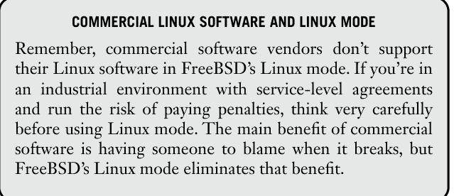

假设我的生活发生了糟糕的转折⁵，我需要在 Linux 模式下运行 Supermin。我找到并下载了该包文件，然后使用 `tar(1)` 安装它。FreeBSD 基于 libarchive 的 `tar` 可以像处理其他文件一样轻松地解包 RPM 文件。

```
#### cd /compat/linux
#### tar -xf /home/mwl/supermin-5.1.16-4.el7.x86_64.rpm
```

现在我必须找到下一个缺失的依赖项。一旦我拥有了完整的依赖项列表，我会编写一个端口（port），以省去做这些繁琐工作的人的麻烦。

### 运行来自错误架构或版本的软件

当你运行 FreeBSD 的 `amd64` 平台时，最终你会遇到某些仅适用于 `i386` 平台的软件。如果你的内核包含 `COMPAT_FREEBSD32` 选项（在 `GENERIC` 内核中已经包含），FreeBSD/amd64 可以运行所有 FreeBSD/i386 软件。你无法使用 FreeBSD/amd64 共享库来运行 FreeBSD/i386 软件。如果你想在 64 位计算机上运行复杂的 32 位程序，你必须提供所需库的 32 位版本。这得到了很好的支持；如果你检查 `rc.conf`，你会找到 `ldconfig(8)` 的选项 `ldconfig32_paths` 和 `ldconfig_local32_dirs`。这些选项专门用于告诉你的 amd64 系统在哪里查找 32 位库。FreeBSD 在安装介质中包含了 32 位库。

此外，FreeBSD 可以运行旧版本 FreeBSD 的软件。`GENERIC` 内核包含了所有系统调用，但你仍然需要基础系统库。这些库以软件包形式提供，每个主要 FreeBSD 版本对应一个软件包。每个软件包命名为 `compat`，后跟版本号，并以 `x` 结尾。如果你必须运行 FreeBSD 8 的二进制文件，请安装 `compat8x` 软件包。`compat` 软件包包含 64 位和 32 位库。

如果你需要运行既不是 `i386` 也不是 `amd64` 的二进制文件，甚至可以使用 `binmiscctl(8)`，以便在你运行非 x86 二进制文件时自动启动适当的模拟器。

虽然关于软件管理总有更多东西可以学习，但你现在已经知道了足够生存的知识。让我们继续，学习如何升级 FreeBSD。

# 18. 升级 FreeBSD


升级服务器可能是系统管理员例程中最令人烦恼的任务。我可以管理升级后桌面电脑出现的无法解释的行为，但当我的整个组织或数百名客户都依赖于一台服务器时，甚至想到要触碰那个系统都会让我肠胃翻腾。任何操作系统升级都可能让你日益增多的白发更加茂密。即使是经验丰富的系统管理员，面对是就地升级关键系统还是用烧红的针扎自己的眼睛这一选择时，也常常不得不坐下来仔细考虑他们的选择。虚拟化和编排的云系统可能看起来麻烦较少，但即使是这些系统，为升级做准备也可能导致彻夜难眠。请记住，尽管自动化有诸多好处，但它也是以大规模方式出错的一种绝佳途径。

FreeBSD 最大的优势之一是其升级过程。FreeBSD 被设计为一个单体（monolithic）操作系统，而不是一个软件包的集合。（即使 FreeBSD 迁移到以软件包形式提供基础系统，它仍将作为单体实体进行设计和构建。）我拥有运行过五个不同主要版本的 FreeBSD 以及无数中间补丁级别的主机，而无需重新安装系统。我只有在 FreeBSD 系统陈旧到让我因担心硬件故障而夜不能寐时，才会将其退役。${ }^{1}$ 虽然我可能会担心运行在操作系统之上的应用程序，但现在即使是跨主要 FreeBSD 版本升级也不让我担心了。

### FreeBSD 版本

为什么升级 FreeBSD 相对简单？关键在于 FreeBSD 的开发方法。FreeBSD 是一个不断演进的操作系统。如果你下午下载当前版本的 FreeBSD，它会与上午的版本略有不同。来自世界各地的开发人员不断添加更改和改进，这使得传统上用于较不开放软件的严格版本号变得不切实际。在任何给定时刻，你都可以获得几种不同版本的 FreeBSD：发行版（releases）、`-stable`、`-current` 和快照（snapshots）。

#### 发行版（Releases）

FreeBSD 发行主要版本和次要版本。主要版本的版本号像 `11.0`、`12.0`、`13.0` 等。每个主要版本都包含早期主要版本中未找到的重大功能。广泛的变化仅出现在主要版本中。

次要版本是主要版本的更新版本。你会看到像 `12.1-RELEASE`、`12.2-RELEASE`、`12.3-RELEASE` 这样的次要版本。（大多数人会从这些名称中去掉 `release` 一词。）这些次要版本为主要版本添加了小功能和错误修复。你也许能获取新函数或程序，但前提是它们不会干扰现有功能。意外且具有破坏性的变化会被避免。

你还会看到补丁级别。得益于 `freebsd-update(8)`，对发行版打补丁是快速且容易的。补丁编号以发行版后的数字表示。这意味着你会看到像 `12.1-RELEASE-p20`、`11.4-RELEASE-p9`、`13.0-RELEASE-p31` 这样的 FreeBSD 版本。

预计用户通过依次升级次要版本来密切跟踪其主要版本，就像其他操作系统一样。


#### FreeBSD-current

`FreeBSD-current`，也称为 *-current* 或 *HEAD*，是 FreeBSD 的最前沿、最新版本，其中包含首次公开发布的代码。虽然开发人员拥有测试服务器并在应用补丁之前发布补丁供审查，但这仍然比 `FreeBSD-current` 的广泛用户群要少得多的曝光。`FreeBSD-current` 是许多初步同行评审发生的地方；有时，`current` 会经历激烈的变化，令经验丰富的系统管理员头痛欲裂。

`FreeBSD-current` 是为开发人员、测试人员和利益相关者提供的，但不是为一般用途设计的。对 `-current` 用户问题的支持非常有限，因为开发人员根本没有时间帮助一个用户修复他的网页浏览器，同时成千上万个更关键的问题需要关注。预计用户要帮助修复这些问题，或者耐心地忍受它们，直到有人修复它们。

更糟糕的是，`-current` 的默认设置包括各种调试代码、特殊警告和相关开发人员功能。这使得 `-current` 比 FreeBSD 的任何其他版本运行得都慢。你可以禁用所有这些调试，但如果你这样做，当你遇到问题时，你将无法提交适当的故障报告。这意味着你更加需要自助。查看 `-current` 系统中的文件 `/usr/src/UPDATING` 以获取调试详情。

如果你不会阅读 C 和 shell 代码，不想调试你的操作系统，不喜欢计算机功能任意失败，或者仅仅不喜欢被悬而未决直到你的问题困扰了能修复它的人，那么 `-current` 不适合你。勇敢的尝试者当然欢迎尝试 `-current`，就像任何愿意投入大量时间学习和调试 FreeBSD 的人，或者任何需要谦逊教训的人一样。你未被禁止使用 `-current`；你只是得自己搞定。`FreeBSD-current` 并不总是最前沿的，但有时它可能是“为什么我的手指突然变成了小挥舞的树桩”的边缘。警告已发出。

若要运行 `-current`，你真的 *必须* 阅读 *`FreeBSD-current@FreeBSD.org`* 和 *`svn-src-head@FreeBSD.org`* 邮件列表。这些是高流量列表，每天有数百条警告、警报和评论。如果你正在读这本书，你可能不应该在这些列表上发帖；只需阅读和学习。如果某人发现最新的文件系统补丁将硬盘变成了克苏鲁的僵尸仆从，信息就会在这里发布。

### -current 代码冻结期

每 12 到 18 个月，`FreeBSD-current` 会经历一个月的代码冻结期，在此期间不允许进行非关键性变更，并且所有已知的关键问题都会被修复。目标是稳定 FreeBSD 的最新版本并打磨其粗糙之处。在代码冻结期结束（或稍后），`-current` 将成为新 FreeBSD 主要版本的 `.0` 版本。例如，FreeBSD 12.0 曾经是 `-current`，FreeBSD 13.0 也是如此。当新的主要版本发布时，`-current` 的版本号会增加。FreeBSD 17.0 的发布意味着 `-current` 将被称为 FreeBSD 18。

一旦 `.0` 主要版本发布到大众视野中，开发工作就会分为两条路线：`FreeBSD-current` 和 `FreeBSD-stable`。

### FreeBSD-stable

`FreeBSD-stable`（或简称为 `-stable`）是“普通用户的尖端技术”，包含一些最近经过同行评审的代码。熟悉 Linux 的系统管理员将 `-stable` 视为“滚动发布”。你会在每个主要版本中找到一个 `FreeBSD-stable` 的版本。

一旦一段代码在 `-current` 中经过充分测试，它可能会合并回 `-stable`。`-stable` 版本在几乎所有时候都是相对安全的升级目标；你可以将其视为 `FreeBSD-beta`。

一年中有三到四次，发布工程团队会要求开发人员专注于解决 `-stable` 中遗留的问题，而不是进行重大变更。发布工程团队将从此代码中截取几个发布候选版本，并提供给公众进行测试。当 FreeBSD 团队对自己和社区测试结果满意时，结果将被赋予一个发布编号。开发团队随后会将注意力转回其常规项目。

在实践中这是如何运作的？以 FreeBSD 13 为例。一旦 13.0 发布，开发人员将开始将错误修复和添加功能合并到 13-stable 版本中。希望协助测试新 FreeBSD 发布的用户可以运行 13-stable。在几个月的功能合并和一些测试之后，13-stable 将成为 13.1。在 13.1 发布后，该开发轨道将恢复为 13-stable。FreeBSD 13.1、13.2 和 13.3 只是 FreeBSD 13-stable 连续体上的节点。

`FreeBSD-stable` 预计是平静且可靠的，需要用户很少的关注。

随着 `-stable` 变旧，`-stable` 和 `-current` 之间的差异变得越来越大，以至于有必要从 `-current` 分支出一个新的 `-stable`。旧的 `-stable` 会积极维护几个月，直到新的 `-stable` 被修整成型。一些用户立即升级到新版本的 `-stable`，其他人则更为谨慎。在新 `-stable` 发布一两次后，旧的 `-stable` 会被淘汰，开发者鼓励用户迁移到新版本。经过一段时间后，旧的 stable 将只接收关键错误修复，最终将被完全放弃。你可以在图 18-1 中看到这是如何运作的。

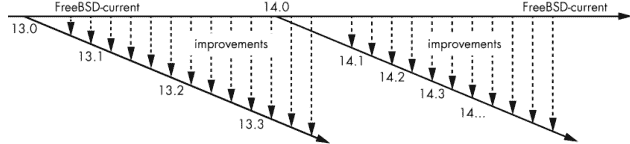

图 18-1: FreeBSD 开发分支

每个发布实际上都应该在侧面有一点悬尾用于补丁级别，但那样会使图表变得非常混乱。

`FreeBSD-stable` 的用户必须阅读 *`FreeBSD-stable@FreeBSD.org`* 邮件列表。虽然此邮件列表具有中等的流量量和相当数量的问答交流（这些其实应该在 `-questions@` 上），但开发者的重要消息通常以“HEADS UP”开头作为主题。寻找那些消息；它们通常意味着系统中的更改可能会让你的一天变得糟糕，如果你不知道这件事的话。

### -STABLE 的稳定性

单词 *stable* 描述的是代码库，而不是 FreeBSD 本身。运行来自稳定分支随机点的代码并不能保证你的系统将是稳定的，只能保证底层代码不会发生剧烈变化。API 和 ABI 预计将保持不变。虽然开发人员煞费苦心以确保 `-stable` 保持良好、稳定，但错误仍然会发生。如果这种风险让你担忧，请坚持使用打过补丁的发布版本。

### 从 -current 合并

短语 *merged from -current*（MFC）意味着某个功能或子系统已从 `FreeBSD-current` 回溯移植到 `FreeBSD-stable`（或者极少情况下，移植到错误报告分支）。然而，并非所有功能都会进行 MFC。`FreeBSD-current` 的意义在于它是发生重大变更的地方，许多这些变更需要数月的测试和调试。这些大型变更无法回溯移植，因为它们会对期望稳定代码库的 `-stable` 用户产生严重影响。

有时，看似“明显的 MFC 候选项”的功能无法合并。有时内核基础设施会变更以支持新的驱动程序和功能，而这些基础设施无法安全合并。需要此类基础设施的新驱动程序无法进行 MFC。这种情况最常发生在视频和无线网络驱动程序中。

可以选择新的驱动程序、错误修复和次要增强功能进行 MFC——但仅此而已。FreeBSD 项目特意不进行可能破坏用户应用程序的大型变更的 MFC。

### 快照

大约每个月，FreeBSD 发布工程团队会发布 `-current` 和 `-stable` 的快照，并在 FTP 站点上提供它们。快照只是开发分支上的一个点；它们不经过特殊的打包或测试。快照不会像正式发布那样受到质量关注，但它们旨在为对运行 `-current` 或 `-stable` 感兴趣的人提供一个良好的起点。质量控制只是适度的，许多开发人员甚至不知道快照已经发布，直到它出现在 FTP 服务器上。你会发现 bug。你会发现错误。你会遇到让你母亲头发变白的问题，假设你还没有让这位可怜的女性这么做了。

### FreeBSD 支持模型

从 FreeBSD 11.0 开始，该项目的支持模型变更，使其更接近其他商业和非商业操作系统所使用的模型。

-   每个主要版本在首次发布后五年内都受到安全和稳定性补丁的支持。如果 FreeBSD 13 于 2021 年 1 月 1 日发布，支持将于 2026 年 1 月 1 日结束。
-   每个次要版本在下一个次要版本发布后支持三个月。FreeBSD 12.3 的支持将在 FreeBSD 12.4 发布三个月后结束。这给了你三个月的时间来安排升级。
-   失去官方支持并不意味着你不能继续运行不受支持的版本。然而，你需要审查每个安全公告，确定它是否影响你的环境，并创建你自己的补丁。你最好运行升级。
-   FreeBSD 次要版本的全部意义在于它们的最小侵入性。从 FreeBSD 12.3 升级到 12.4 的影响应类似于应用 Windows 更新或从 `Centos` 8.1 升级到 8.2。应用程序应该能继续正常运行。
-   一个版本的最后一个 FreeBSD 次要版本将得到支持并修补至五年期限。如果 FreeBSD 12.5 是 FreeBSD 12 的最后发布，它将在 FreeBSD 12.0 发布五年后提供安全补丁。

### 测试 FreeBSD

FreeBSD 的每个版本和发布都以多种方式进行了测试。个人开发人员在自己的硬件上检查他们的工作，并互相要求再次检查他们的工作。如果工作足够复杂，他们可能会使用官方的 FreeBSD Phabricator 系统（`https://reviews.FreeBSD.org/`）甚至私有源代码仓库，在提交到 `-current` 之前，向更广泛的社区提供他们的工作。分析公司向 FreeBSD 团队捐赠了分析软件，以便源代码可以持续自动审计、测试和调试，在错误有机会影响现实世界用户之前捕获许多错误。`Sentex`、`EMC`、`Netflix` 和 `iX Systems` 等公司为该项目提供测试。几位备受尊敬的 FreeBSD 开发人员已将测试作为项目内的主要议题。他们现在拥有一个自动化的 `Kyua` 测试框架。

然而，归根结底，一个拥有数百名开发人员的志愿者项目无法购买有史以来生产的所有计算机硬件，他们也无法在所有可能的负载下运行这些硬件。FreeBSD 项目整体依赖于使用 FreeBSD 测试软件的公司和个人。

最有益的测试来自拥有现实世界设备、现实世界测试床和现实世界工作负载的用户。遗憾的是，大多数这些用户在将发布 CD 放入电脑、运行安装并启动系统时才进行测试。此时，为发布带来益处已经太晚了。你发现的 bug 可能会帮助下一个发布，但在此期间，一个补丁可能会解决你的问题。

这里的解决方案显而易见——在发布被截取之前，在现实世界的工作负载中测试 FreeBSD。对新的 `-stable` 发布进行测试的请求会出现在 *`FreeBSD-stable@FreeBSD.org`* 上。通过测试 `-stable` 或 `-current`，你将获得 FreeBSD 的更大价值。

### 你应该使用哪个版本？

-   当前版（`-current`）、稳定版（`-stable`）、发行版（releases）、快照版（snapshots）——让人头晕目眩。是的，这看起来很复杂，但它确保了特定的质量级别。用户可以放心，发行版尽可能可靠，并经过了广泛的测试和同行评审。同样的用户也知道，`-stable` 和 `-current` 中那些酷炫的新功能是可用的——前提是他们愿意承担每个版本固有的风险。那么，你应该使用哪个版本？以下是我的建议：

#### 生产环境

如果你在生产环境中使用 FreeBSD，请安装最新的小版本发行版。当下一个小版本发行版发布时，升级至该版本。

#### 预发布环境

如果你需要知道下一个 FreeBSD 小版本发行版将包含什么内容以及它将如何影响你的生产环境，请在你的预发布环境中跟踪 `-stable`。

##### 测试

这里的问题是你想要测试什么。FreeBSD 项目赞赏在 `-current` 和 `-stable` 上进行测试。如果你犹豫不决，请先从运行 `-stable` 开始。

#### 开发

操作系统开发者、空闲时间太多而兴奋感太少的人，以及彻头彻尾的傻瓜应该运行 `-current`。当 `-current` 毁掉你的 MP3 收藏时，调试问题并提交一个补丁来修复它。

#### 兴趣爱好

如果你是一个爱好者，运行任何版本都可以！只要记住你选择的分支的限制。如果你刚开始学习 Unix，我推荐 `-release`。一旦你站稳脚跟（熟悉基础），就升级到 `-stable`。虽然 `-current` 比 20 年前稳定得多，但如果你觉得系统故障带来的肾上腺素飙升能让你的日子更刺激，那就去那里吧。那些高风险的押注者（运行 `-current` 的人）欢迎志同道合的伙伴。

### 升级方法

FreeBSD 提供两种升级方式：二进制更新和从源代码构建。

FreeBSD 通过 `freebsd-update(8)` 支持*二进制更新*。这与 Windows、Firefox 和其他商业软件提供的二进制更新服务非常相似。（软件作者表示 `freebsd-update(8)` 是以 Windows Update 命名的。）你可以使用 FreeBSD Update 跨主要版本、次要版本和补丁级别进行升级。

从源代码升级意味着下载 FreeBSD 源代码，构建组成 FreeBSD 的程序，并将其安装到你的硬盘上。例如，如果你有 FreeBSD 13.1 的源代码，你可以升级到该版本。这需要更多的设置和使用努力，但它提供了更大的灵活性。在跟踪 `-stable` 或 `-current` 时从源代码升级。

> **保护你的数据！**
>
> 第 5 章名为“在弄坏其他东西之前先读这个！”是有充分理由的。升级可能会摧毁你的数据。在尝试任何类型的升级之前，备份你的系统！我大约每周升级一次桌面，只是为了好玩（参见我前面关于瘾君子运行 `-current` 的评论）。但在升级之前，我会确保我所有重要的数据都安全地缓存到另一台机器上。将你的数据复制到磁带、文件或任何介质中，但不要在没有最新备份的情况下运行升级。已经警告过你了。

### 二进制更新

许多操作系统提供二进制更新，用户可以下载操作系统的二进制更新。FreeBSD 通过 `freebsd-update(8)` 提供类似的程序，让你可以轻松升级系统。³ 你不能使用 `freebsd-update(8)` 跟踪 `-stable` 或 `-current`，只能用于发行版。例如，如果你安装了 FreeBSD 12.0，`freebsd-update(8)` 可以升级到 12.0-p9、12.1 或 13.0，但不能升级到 12-stable 或 14-current。

如果你有自定义内核，你必须从源代码构建内核的更新，而不是依赖更新服务。类似地，如果你之前从源代码升级了主机（本章稍后讨论），运行 `freebsd-update(8)` 会用默认二进制文件覆盖你的自定义二进制文件。

在 `/etc/freebsd-update.conf` 中配置更新。

#### /etc/freebsd-update.conf

使用 `freebsd-update(8)` 进行更新旨在为普通用户提供无缝体验，更改其配置通常不建议。然而，你可能有特殊情况，因此以下是该文件中一些最实用的选项：

-   **`KeyPrint 800...`**

    `KeyPrint` 列出了更新服务的加密签名。如果 FreeBSD 更新服务发生安全漏洞，FreeBSD 项目需要修复漏洞并发行新的加密密钥。在这种情况下，漏洞将在安全公告邮件列表上宣布（并且在 IT 界也会是大新闻）。换句话说，在正常使用中没有理由更改此设置。（构建你自己的定制化 FreeBSD 并通过 `freebsd-update(8)` 分发，虽然可能且实用，但被视为异常使用。）

-   **`ServerName update.freebsd.org`**

    `serverName` 告诉 `freebsd-update(8)` 从哪里获取更新。虽然 FreeBSD 项目确实提供了构建你自己更新包的工具，但真的没有必要这样做。如果你有足够的服务器以至于考虑构建自己的更新服务器，你很可能也有一个可以缓存官方更新的代理服务器。

-   **`Components src world kernel`**

    默认情况下，FreeBSD Update 提供 `/usr/src` 中源代码、用户空间（world）和 GENERIC 内核的最新补丁。然而，你可能不需要所有这些组件。虽然用户空间是强制性的，但你可能有自定义内核。移除 kernel 声明可以让 `freebsd-update(8)` 忽略内核。自定义内核用户也可以将 GENERIC 内核复制到 `/boot/GENERIC`。更新将更新 GENERIC 内核，但不会触碰你的自定义内核。或者，你可以移除 kernel 条目并省得被警告。如果你的机器上没有安装源代码，`freebsd-update` 会意识到这一点并尝试不修补它，但你也可以消除 `src` 条目以省去软件的麻烦。你还可以选择仅接收源代码更新的部分，如 `freebsd-update.conf(5)` 所述。

-   **`UpdateIfUnmodified /etc/ /var/ /root/ /.cshrc /.profile`**

    更新包括 `/etc` 中配置文件的更改。然而，如果你修改了这些文件，你很可能不希望 `freebsd-update(8)` 覆盖它们。同样，`/var` 非常灵活，专为系统管理员定制设计；你不想让 FreeBSD Update 乱动你的设置。FreeBSD Update 仅当文件未更改时才会将补丁应用于 `UpdateIfUnmodified` 列出的目录中的文件。

-   **`MergeChanges /etc/ /boot/device.hints`**

    升级到新版本可能会更改配置文件。更新过程会给你一个机会将更改合并到出现在 `MergeChanges` 位置的文件中。

-   **`MailTo root`**

    如果你安排了 FreeBSD Update 的运行（如本章后面所述），`freebsd-update(8)` 会将结果邮件发送到 `MailTo` 中列出的账户。

-   **`KeepModifiedMetadata yes`**

    也许你修改了系统文件或命令的权限或所有者。你可能不希望 `freebsd-update(8)` 将这些权限改回。将 `KeepModifiedMetadata` 设置为 *yes*，`freebsd-update(8)` 将保持你自定义的权限和所有权不变。


有关更多可能性，请参阅 `freebsd-update.conf(5)`。

#### 运行 `freebsd-update(8)`

使用二进制更新升级系统有两个阶段：下载更新和应用它们。如果你应用补丁而不是跨越主要版本升级，过程看起来略有不同。

如果你使用的是 ZFS，在升级或打补丁前务必创建一个新的引导环境！

##### 更新到最新的补丁级别

要下载所选发行版的最新补丁，运行 `freebsd-update fetch`。这里，我将一台 FreeBSD 11.0 主机更新到最新的补丁级别。

```
###### freebsd-update fetch
```

你将看到程序正在查找补丁的下载源，比较这些下载源的加密密钥，并最终将补丁下载到 `/var/db/freebsd-update`。检查系统可能需要几分钟时间，具体取决于你的存储速度。

偶尔，你会看到类似这样的消息：

##### 更新发布版本

作为更新到 `11.0-RELEASE-p12` 的一部分，以下文件将被移除：

- `/boot/kernel/hv_ata_pci_dsenengage.ko`
- `/usr/share/zoneinfo/America/Santa_Isabel`
- `/usr/share/zoneinfo/Asia/Rangoon`

我们正在将一个 `.0` 发布版本（即主要 FreeBSD 发布版本的第一版）直接更新到 `11.0-RELEASE-p12`，因此累积了一些补丁。为什么这样的补丁集会以移除文件开始？

时区文件非常直接明了。从 FreeBSD 11.0 发布到现在，圣伊莎贝尔 [2] 和仰光 [3] 改变了它们的时区。不幸的是，国家并不会协调它们的时区与 FreeBSD 的发布版本。从系统中移除这些时区可以简化这些国家系统管理员的生活，也不会对我们其他人造成伤害。

但他们也在移除一个内核模块 [1]。为什么会这样？在 FreeBSD 邮件列表上进行一点调研表明，这个模块本不应该随 11.0 一起发布，而且你 `真的` 不应该使用它。这种变更很罕见，但可能在主要版本发布后发生。

然后你会看到作为此补丁集一部分添加的文件（如果有的话）。

作为更新到 `11.0-RELEASE-p12` 的一部分，将添加以下文件：

- `/usr/share/zoneinfo/Asia/Barnaul`
- `/usr/share/zoneinfo/Asia/Famagusta`
- `/usr/share/zoneinfo/Asia/Toms`
- `-- snip --`

看起来仰光的系统管理员在这个夏天非常忙碌。

几乎所有的补丁都会修改系统中现有的文件。接下来你会看到那些文件。

作为更新到 `11.0-RELEASE-p12` 的一部分，将更新以下文件：

- `/bin/freebsd-version`
- `/boot/gptboot`
- `/boot/gptzfsboot`
- `/boot/kernel/cam.ko`
- `/boot/kernel/hv_storvsc.ko`
- `-- snip --`

如果你的发布版本即将达到生命周期结束（End of Life），你会看到如下通知：

```
WARNING: FreeBSD 11.0-RELEASE-p1 is approaching its End-of-Life date.
It is strongly recommended that you upgrade to a newer
release within the next 1 month.
```

如果发布版本已经超过了生命周期结束，通知会变得更加……强调。

要安装已下载的文件，请运行 `freebsd-update install`：

```
###### freebsd-update install
Installing updates... done.
```

如果更新需要更多步骤，你会在这里看到它们。重启你的系统，然后你会发现你正在运行最新的补丁级别。

##### 更新发布版本

这台 FreeBSD `11.0-p12` 机器将在一个月内达到生命周期结束？让我们使用 `freebsd-update upgrade` 更新它。使用 `-r` 标志指定目标发布版本。

```
###### freebsd-update -r 11.1-RELEASE upgrade
```

这部分最难的地方在于记得 `-RELEASE` 是版本号的一部分。

升级过程将检查你的系统并呈现其结论。

```
The following components of FreeBSD seem to be installed:
kernel/generic world/base world/lib32

The following components of FreeBSD do not seem to be installed:
kernel/generic-dbg world/base-dbg world/doc world/lib32-dbg

Does this look reasonable (y/n)? y
```

还记得安装过程吗，当时你选择了 FreeBSD 组件以在新主机上设置？`freebsd-update` 正在检查的就是这些。不过，你之前可能添加或移除了组件，所以要检查一下列表。如果看起来正确，按 `y` 继续。

更新过程将更仔细地审查系统，将所有现有文件与新发布版本进行比较，然后开始下载。

```
Fetching 10697 patches....10....20....30....40....50....60....70....80....90
```

去泡杯茶吧。根据你的主机带宽，你应该回来看到：

```
Applying patches...
```

你的茶可能太烫了。让它凉一会儿。

```
Fetching 236 files...
```

还有更多下载？没问题，享受你的茶，看着程序运行。

```
Attempting to automatically merge changes in files... done.
The following files will be removed as part of updating to 11.1-RELEASE-p1:
/usr/include/c++/v1/__undef__deallocate
/usr/include/c++/v1/tr1/__undef__deallocate
/usr/include/netinet/ip_ipsec.h
--snip--
```

你可以搜索邮件列表归档和 FreeBSD 源代码树来了解为什么这些文件被移除。

次要发布版本将包含从 `-current` 移植的新功能。这些功能可能涉及向系统中添加文件。

```
The following files will be added as part of updating to 11.1-RELEASE-p1:
/boot/kernel/amd_ecc_inject.ko
/boot/kernel/bytgpio.ko
/boot/kernel/cfiscsi.ko
/boot/kernel/cfunass.ko
--snip--
```

这些新功能不应干扰现有功能，但浏览列表可能会提供有趣的阅读材料。

升级应该会改变系统中几乎所有的文件，正如我们将在下文中看到的。

```
The following files will be updated as part of updating to 11.1-RELEASE-p1:
/.cshrc
/.profile
/COPYRIGHT
/bin/[
/bin/cat
--snip--
```

最终你会看到：

```
To install the downloaded upgrades, run "/usr/sbin/freebsd-update install".
```

谁有权忽视指令？

到目前为止，更新过程仅下载了文件并在临时暂存区进行了比较。操作系统尚未被触及。如果你感觉可以继续进行，请运行安装。

```
###### freebsd-update install
src component not installed, skipped
Installing updates...
Kernel updates have been installed. Please reboot and run
"/usr/sbin/freebsd-update install" again to finish installing updates.
```

为什么在更新的部分之间要重启？新的用户空间程序可能需要新的内核功能。安装一个无法工作的重启命令版本会导致需要给主机断电循环，这会在你的极客卡上留下一记令人尴尬的一拳。

```
###### reboot
```

一旦机器重新启动完成用户空间升级。

```
###### freebsd-update install
src component not installed, skipped
Installing updates...
Completing this upgrade requires removing old shared object files.
Please rebuild all installed 3rd party software (e.g., programs
installed from the ports tree) and then run "/usr/sbin/freebsd-update
install" again to finish installing updates.
```

这是什么疯狂的行为？

更新过程努力避免留下损坏的系统或功能失调的软件。如果 `freebsd-update` 移除了你的附加软件所需的旧版本共享库，该软件将无法运行。更新过程暂停，以便你有机会升级你的软件。

我们将在本章稍后讨论升级包和端口。沿着 `-stable` 分支的升级通常不需要移除旧的残留物。

最后一次运行 `freebsd-update` 将移除旧的共享库等。

```
###### freebsd-update install
```

你的升级现在完成了。正如进行任何广泛的系统维护时一样，最后再重启一次以验证一切是否干净启动。

##### 回滚更新

你以为升级会顺利。以前总是如此。但这次，你错了。新补丁与你的软件之间的一些微妙交互让你遭遇了困境。如果你正在使用引导环境（boot environments），现在是回滚到之前安装的时候了。如果你没有使用，请使用 `freebsd-update` 的 `rollback` 命令移除最近安装的升级。

```
###### freebsd-update rollback
Uninstalling updates... done.
```

回滚比安装补丁快得多。无需检查系统；`freebsd-update` 只是读取其先前操作的日志并撤销所有操作。

##### 安排二进制更新

最佳实践建议按照定期日程，在一致的时间下载和应用更新，例如在你的每月维护日。`freebsd-update` 程序包含对此特定支持，以避免每小时整点向下载服务器发出请求而淹没它们。`freebsd-update cron` 命令告诉系统在下一小时的随机时间点下载更新。将此命令放入 `/etc/crontab` 以在该一小时内下载更新。这有助于减少下载服务器的负载。当系统有更新时，你会收到电子邮件，这样你就可以方便地安排重启。

##### 优化和自定义 FreeBSD Update

关于 FreeBSD Update 的两个常见问题涉及 FreeBSD 的自定义构建和在本地分发更新。

许多人构建自己的 FreeBSD 版本用于内部使用。通常，这只是切除了各个部分的 FreeBSD 版本，但有些公司使用大量修改。如果你已从 FreeBSD 安装中删除文件，`freebsd-update(8)` 不会尝试修补它们。

类似地，许多公司喜欢拥有内部更新服务器用于补丁管理。FreeBSD Update 系统特别设计为与缓存 Web 代理配合工作。虽然所有文件都经过加密签名和验证，但它们通过纯 HTTP 传输，以便你的代理可以缓存它们。

##### 通过源代码升级

更新系统的另一种方式是从源代码构建它。FreeBSD 是 `自我托管` 的，意味着它包含构建 FreeBSD 所需的所有工具。你不需要安装任何编译器或开发工具包。你唯一需要从源代码构建新的 FreeBSD 的东西就是新的源代码。

当开发者发布 FreeBSD 的改进时，更改在全球范围内几分钟内即可获取。FreeBSD 主源代码服务器跟踪源代码、对该代码所做的所有更改以及这些更改的作者。开发者可以签入新代码，用户可以通过 `Subversion` (`SVN`) 签出最新版本。FreeBSD 有一个简单的 SVN 客户端 `svnlite(1)`，足以满足所有源代码操作需求。它是一个标准的 Subversion 客户端，未包含 `svn(1)` 支持的任何复杂选项。许多人发现 `svnlite(1)` 对于他们所有非 FreeBSD 的 Subversion 需求都完全足够。

### CSUP、CVSUP、CVS、SUP 和 CTM？

遗憾的是，互联网上的文档往往在毫无逻辑的情况下长期存续，并在最不恰当的时刻制造混乱。过时的 FreeBSD 文档和第三方教程可能会提及使用名为 `CVS` 或 `CVSup` 的工具来更新源代码。这些工具已在 2013 年被取代。任何提及这些程序的地方都表明你正在阅读旧文档。如果你看到关于 CTM 的提及，说明你阅读的是比 CVS 更早的文档。

从源码升级需要控制台访问权限。虽然你并非总是需要它，但在恢复失败的构建时，可能需要你在键盘上进行干预。在安装你自行构建的操作系统版本之前，请测试你的串行控制台、Java 应用程序或 IPMI 控制台。根据我的经验，唯一需要控制台访问权限的升级，恰恰是那些我没有控制台访问权限的情况。

#### 哪些源代码？

每个 FreeBSD 版本都附带了用于构建你所安装系统的源代码。如果安装系统时你未选择安装源代码，你可以在安装介质中的 `/usr/freebsd-dist/src.txz` 找到它。如果你已经安装了源代码，它位于 `/usr/src`。

不幸的是，这个版本的源代码缺乏构建 FreeBSD 所需的版本控制标签。它仅供参考。你需要使用 `svnlite(1)` 下载一个保留这些标签的代码版本。

`/usr/src` 中的源代码副本适合用于构建 FreeBSD 吗？问 `svnlite(1)`。

```
##### svnlite info /usr/src
svn: E155007: '/usr/src' is not a working copy
```

“不是工作副本”的错误意味着这里的任何源代码都无法与 Subversion 配合使用。

获取源代码的 `svnlite(1)` 命令如下所示。

```
##### svnlite checkout \*svn.freebsd.org/@repository/@branch @locadir
```

`Mirror` 是一个 FreeBSD Subversion 镜像。`svn.FreeBSD.org` 镜像是一个地理位置路由的别名，指向最近的 Subversion 镜像。

`Repository` 是你正在处理的代码组。你可以在 `https://svnweb.FreeBSD.org/` 获取当前仓库的完整列表。主要项目仓库包括：`base`（用于操作系统）、`doc`（用于文档）和 `ports`（用于 Ports Collection）。

`Branch` 是你想要的 FreeBSD 版本。为了获取最新的、指尖笨拙的 `current` 版本，请使用 `head`。要获取稳定版本，请使用 `stable/` 后跟主要发行版本号。FreeBSD `12-stable` 即 `stable/12`。要获取发行版加上当前所有补丁，请使用 `releng/` 后跟发行版编号。完全修补的 FreeBSD `12.2` 位于 `releng/12.2`。

如果你难以确定需要哪个分支，不妨浏览 `https://svnweb.freebsd.org/`。分支字面上告诉 `svnlite(1)` 从该站点抓取哪个子目录。

最后，`locadir` 是我希望存放源代码的本地目录。

这台主机运行的是 FreeBSD `11.1`。我想要冒险一点，升级到 FreeBSD `11-stable`。以下是我的操作方法：

```
##### svnlite checkout https://svn0.us-east.FreeBSD.org/base/stable/11 /usr/src/

Error validating server certificate for 'https://svn0.us-east.freebsd.org:443':
  - The certificate is not issued by a trusted authority. Use the
    fingerprint to validate the certificate manually!
Certificate information:
  - Hostname: svn0.freebsd.org
  - Valid: from Jul 29 22:01:21 2013 GMT until Dec 13 22:01:21 2040 GMT
  - Issuer: svn0.freebsd.org, clusteradm, FreeBSD.org, CA,
    US(clusteradm@freebsd.org)
  - Fingerprint: 1C:BD:85:95:11:9F:EB:75:A5:4B:C8:A3:FE:08:E4:02:73:06:1E:61
(R)eject, accept (t)emporarily or accept (p)ermanently? p
```

这是什么新的疯狂举动？我们试图获取 FreeBSD 源代码，结果却遇到了证书错误？

将显示的证书指纹与 `FreeBSD.org` 网站上的服务器指纹进行对比。如果匹配，请输入 `p` 永久接受证书。源代码文件的文件名将从你的终端流过。

`svnlite(1)` 完成后，查看一下 `/usr/src`。


```
##### ls /usr/src/
COPYRIGHT	cddl	sbin
LOCKS	contrib	secure
MAINTAINERS	crypto	share
Makefile	etc	sys
Makefile.inc1	gnu	targets
Makefile.libcompat	include	tests
Obsoletedfiles.inc	kerberos5	tools
README	lib	usr.bin
README.md	libexec	usr.sbin
UPDATING	release	
bin	rescue
```

这是 FreeBSD 源树的顶层目录，其中包含了构建你所选 FreeBSD 版本所需的所有代码。

### 更新源代码

所以你昨天构建了 FreeBSD？很酷。但现在你想构建今天的版本。

好消息是，Subversion 只需更新你已下载的代码，而无需重新下载整个源代码树。更好的消息是，源代码在 `.svn` 目录中记录了你的获取来源以及它本应来自哪个分支。这使得更新比初始下载简单得多。

FreeBSD 已将 Subversion 命令集成到源代码中。你所需要做的只是在 `/etc/src.conf` 中设置 `SVN_UPDATE`，告知系统它可以调用 `svnlite(1)` 进行更新。

```
##### echo 'SVN_UPDATE=yes' >> /etc/src.conf
```

现在运行 `make update` 以获取最新的源代码。

```
###### cd /usr/src
##### make update
```

你会看到类似的更新流过。不过，这些更新会比最初的下载快得多。

### 从源码构建 FreeBSD

一旦你获得了最新的源代码，请查看 `/usr/src/UPDATING`。该文件的开头按倒时间顺序列出了关于 FreeBSD 变更的警告和特别通知，这些内容对从源码构建的人特别有用。这些说明会告诉你，在重建系统之前是否必须采取某些特定措施，或者是否有重大系统功能发生了变更。如果你希望系统在升级后正常工作，请严格按照这些说明操作。

`UPDATING` 文件的末尾提供了从源码构建 FreeBSD 的官方说明。本书中描述的步骤自 FreeBSD 6-current 以来一直使用，与 5-current 相比变化微乎其微，但我仍建议你将书中的说明与 `UPDATING` 中的内容进行双重核对。

如果你使用自定义内核，请也检查新的 `GENERIC` 或 `NOTES` 内核配置文件，查看是否有新的选项或有趣的内核变更。

> 自定义你的 FreeBSD 构建
>
> 回想一下第 16 章，当我们讨论 `/etc/make.conf` 时？FreeBSD 使用单独的文件来处理构建 FreeBSD 本身的自定义设置。虽然 `/etc/make.conf` 中的设置会影响系统中构建的所有软件，但 `/etc/src.conf` 中的任何内容仅影响从源码构建 FreeBSD。

如果你在 FreeBSD 社区待上一段时间，你会听到各种关于人们使用特殊方法构建 FreeBSD 的故事。你会听到轶事证据，证明某种方法比标准方法更快、更高效，或者以某种神秘的方式“更好”。虽然你当然可以自由选择任何你喜欢的构建方法，但 FreeBSD 项目支持的唯一方法是记录在 `/usr/src/UPDATING` 末尾的方法。如果你遵循其他程序并遇到困难，你将被引导去参考已文档化的程序。

### 构建 World

首先，构建新的用户空间：

```
###### cd /usr/src
#### make buildworld
```

`make buildworld` 命令从源码构建构建系统编译器所需的基本工具，然后构建编译器及相关库。最后，它使用新工具、编译器和库来构建核心 FreeBSD 安装中包含的所有软件。（这很像从“挖掘铁矿石”这样的指令开始构建汽车。）`buildworld` 将其输出放置在 `/usr/obj` 下。根据硬件不同，可能需要一到几个小时。如果你的硬件足够强大，当 `buildworld` 运行时，你可以继续正常工作；虽然构建消耗系统资源，但它不会占用你的注意力。

当 `buildworld` 完成后，确认其没有错误完成。如果构建结束时出现一堆类似于内核编译失败时的消息，请勿继续升级。如果你无法弄清楚构建失败的原因，请前往第 1 章查看如何获取帮助。切勿尝试安装损坏或不完整的升级。

#### 并行 MAKE WORLD

经验丰富的系统管理员可能已经使用过 `make(1)` 的 `-j` 标志来提高构建速度。这会启动多个构建进程，并允许系统利用多核 CPU。如果您拥有多 CPU 系统，或者您的 CPU 具有多个核心，`-j` 选项在构建 FreeBSD 时可以有效发挥作用。一个合理的构建进程数起始值通常比您拥有的 CPU 数量多一。例如，如果您拥有一颗八核处理器，那么通过运行 `make -j9 buildworld && make -j9 kernel` 合理地使用九个构建进程是可行的。

FreeBSD 项目并不官方支持在升级过程中使用 `-j`，尽管许多开发人员都这样做。如果您在使用 `-j` 时构建失败，请在抱怨之前先尝试不使用 `-j`。

#### 构建、安装和测试内核

测试升级的最佳方法是构建一个新的 `GENERIC` 内核。这将您自定义内核中的问题与 FreeBSD 的一般性问题区分开来。虽然急躁的人完全可以直接升级到他们的自定义内核配置，但如果您的内核失败，您将需要尝试使用 `GENERIC` 内核。不过，请务必将您的自定义内核与新的 `GENERIC` 配置进行比较，以发现您的自定义设置所需的任何更改。您可以使用 `https://svnweb.FreeBSD.org/` 上的 Subversion 历史记录来比较不同版本的内核配置。

默认情况下，内核升级过程会构建一个 `GENERIC` 内核。如果您想直接升级到自定义内核，请使用变量 `KERNCONF` 来告知 `make(1)` 内核名称。您可以在命令行、`/etc/make.conf` 或 `/etc/src.conf` 中设置 `KERNCONF`。

您可以以两种方式来构建新内核。`make buildkernel` 命令可以构建一个新内核，但不会安装它。在 `make buildkernel` 之后运行 `make installkernel` 以安装内核。`make kernel` 命令会连续运行这两个命令。请选择最符合您日程安排的方式。例如，如果我在周日的维护窗口期在工作进行系统升级，我可能会在前一周运行 `make buildworld` 和 `make buildkernel`，以节省我宝贵的周末的几个小时。然而，我不想在维护日之前安装该内核——如果机器在周五出现问题需要重启，我希望引导旧的生产内核，而不是新的升级内核。在周日早上，当我准备实际进行升级时，我运行 `make installkernel`。另一方面，在升级我的桌面电脑时使用 `make kernel` 是有意义的。因此，为了使用我的自定义内核进行升级，我将运行：

```bash
###### make KERNCONF=THUD kernel
```

再次强调，不要尝试安装未能成功编译的内核。如果您的 `make buildkernel` 报错并终止，请先修复该问题再继续操作。

一旦安装了新内核，请以单用户模式重启您的计算机。为什么选择单用户模式？用户空间（userland）可能期望与新内核提供的不同的内核接口。虽然 `/usr/src/UPDATING` 应该会列出所有这些变化，但没有任何文档能够涵盖所有可能的变化及其对第三方软件的影响。这些变化在 `-stable` 分支上很少见，但在 `-current` 分支上则不可预测。如果您每周更新您的主机，您的用户空间在新内核上可能会遇到问题。如果您一年没有更新主机，那么一年的变化将同时降临到您身上。虽然许多人以完全多用户模式安装升级都能安然无恙，但单用户模式是最安全的。

如果您的系统在新内核的单用户模式下运行正常，请继续操作。否则，请详细记录该问题，并启动旧内核以恢复服务，同时您去解决该问题。

#### 准备安装新世界

小心，蚱蜢！这是不可逆转的转折点。您可以轻松回退一个糟糕的内核——只需启动旧的、已知良好的那个即可。但一旦安装了新构建的世界（world），如果您没有从备份恢复或使用 ZFS 引导环境，就无法将其回退。在继续操作之前，请确认您有良好的备份，或者至少认识到第一个不可逆转的步骤正在此刻发生。

如果您的新内核工作正常，请继续安装您新构建的用户空间。首先，确认您的系统可以安装新的二进制文件。每个新版本的 FreeBSD 都期望旧系统支持所有新版本所需的用户、组和权限。如果一个程序必须由特定用户拥有，而该用户在系统中不存在，升级将失败。这正是 `mergemaster(8)` 发挥作用的地方。

#### mergemaster(8)

`mergemaster` 程序将 `/etc` 下的现有配置文件与 `/usr/src/etc` 中的新文件进行比较，突出显示它们之间的差异，并为您安装它们，将它们搁置以供评估，甚至允许您将两个不同的配置文件合并为一个。这在升级过程中极其有用。您在新世界安装前运行一次 `mergemaster`，以确保您的系统可以安装新的二进制文件，并在新世界安装后运行一次，以将 `/etc` 的其余部分与您的新世界同步。

从 `mergemaster(8)` 的 `prebuildworld` 模式开始，使用 `-fp` 标志。`-f` 标志会自动安装仅通过版本控制信息存在差异的文件。`-p` 标志比较 `/etc/master.passwd` 和 `/etc/group`，并突出显示 `installworld` 成功所需的任何账户或组。

```bash
###### mergemaster -fp
*** Creating the temporary root environment in /var/tmp/temproot
*** /var/tmp/temproot ready for use
*** Creating and populating directory structure in /var/tmp/temproot
*** Beginning comparison
```

这些初始消息，均以三个星号开头，是 `mergemaster` 解释它正在做什么。我们首先在一个位于 `/var/tmp/temproot` 的临时根目录中开始，这样 `mergemaster` 就可以安装一组完整的配置文件，以便与已安装的文件进行比较。之后，`mergemaster` 显示其第一个比较结果。

```diff
*** Displaying differences between .//etc//group and installed version:

--- /etc/group 2017-09-01 11:12:49.693484000 -0400
+++ .//etc//group 2017-09-01 13:22:15.849816000 -0400
@@ -1,6 +1,6 @@
-# $FreeBSD: releng/11.1/etc/group 294896 2016-01-27 06:28:56Z araujo $
+# $FreeBSD: stable/11/etc/group 294896 2016-01-27 06:28:56Z araujo $
#
-wheel:∗:0:root,mwlucas
+wheel:∗:0:root
daemon:∗:1:
kmem:∗:2:
sys:∗:3:
@@ -33,4 +33,3 @@
hast:∗:845:
nogroup:∗:65533:
nobody:∗:65534:
-mwlucas:∗:1001:
```

一条关键信息是被比较的文件，`mergemaster` 会在开头显示文件名。我们正在检查已安装系统上的 `/etc/group`，并将其与新的 `/etc/group` 进行比较。

然后，我们看到了两个不同版本的比较文件，先是已安装的文件，然后是升级后的文件。注意这些行开头的减号和加号。减号表示该行来自当前已安装的文件，而加号则表示该行来自 `/usr/src` 中的版本。

`mergemaster` 显示的下一行很好地说明了这一点。列出的第一个组，标有减号，是对应于当前 `wheel` 组的。第二行是开箱即用的升级中的密码条目。此主机的 `wheel` 组中有一个用户，而该用户不在默认安装中。我希望保留我的账户在那里。

在列表的末尾，有一个前面带有减号的组。该组存在于本地系统上，但不在源代码中。这是完全预期的情况。

这一次，这里的任何更改都不相关。

一旦 `mergemaster` 显示该文件的所有更改，它就会显示我的选项。

```text
Use 'd' to delete the temporary .etc/group
Use 'i' to install the temporary .etc/group
Use 'm' to merge the temporary and installed versions
Use 'v' to view the diff results again

Default is to leave the temporary file to deal with by hand
```

我该如何处理这个问题？ [稍后处理] d

我有四个选择。我可以用 `d` 删除临时 `/etc/group`。如果我想丢弃当前配置并直接从源代码安装配置，我可以用 `i` 安装它。如果我需要旧版本和新版本中的部分内容，我可以使用 `m`。如果我之前没有注意，我可以用 `v` 再次查看比较结果。

新的 `/etc/group` 没有我需要的更改。我删除了它，让 `mergemaster` 继续处理下一个文件，`/etc/passwd`。

`mergemaster` 对密码文件的显示开头与组文件类似。是的，`root` 密码已更改——我希望是这样！有一个额外条目对应于我的账户。但在显示的中间，有一个条目如下：

```diff
-_pflogd:*:64:64::0:0:pflogd privsep user:/var/empty:/usr/sbin/nologin
+_dhcp:*:65:65::0:0:dhcp programs:/var/empty:/usr/sbin/nologin
 uucp:*:66:66::0:0:UUCP pseudo-user
```

`_dhcp` 的条目前面有一个加号，而没有对应的带有减号的 `_dhcp` 条目。用户 `_dhcp` 存在于下载的源代码中，但不在当前运行的系统上。如果在默认 FreeBSD 配置中出现新用户，那是因为新系统中的某个程序或文件期望由该用户拥有。

如果该用户不存在，安装新世界将会失败。

我无法替换当前的 `/etc/passwd`，因为它包含活动的用户账户。我也不能丢弃新的 `/etc/passwd`，因为它包含我需要的用户。我想我必须将这两个文件合并在一起。

我该如何处理这个问题？[稍后再处理] r

在合并文件时，`mergemaster` 使用 `sdiff(1)` 将你的命令窗口分成两半。左侧显示当前已安装文件的开头部分，而右侧显示新版本。仅显示存在差异的部分。在你的新 `master.passwd` 文件中，选择你想要的一侧。

```
###### $FreeBSD: releng/11.1/etc/master.passwd 299 | # $FreeBSD: stable/11/etc/master.passwd 29936
```

这一行显示了 `/etc/passwd` 两个副本的版本控制信息。左侧是来自 `releng/11.1` 分支的版本，即 11.1。右侧是来自 `stable/11` 的版本，即 11-stable。未来的 `mergemaster` 运行将使用版本信息（以及其他工具）来确定文件是否需要更新，因此我们的合并文件需要正确的版本号。在左列 (`i`) 和右列 (`r`) 之间进行选择。我想要右侧的条目，所以我输入 `r`。

`mergemaster` 显示下一个差异。

```
root:$6$fD7a5caQtK2bG93EswGfw5G2zNORLq8qxLT8z | root::0:0::0:0:Charlie &:/root:/bin/csh
```

我更改了 `root` 密码，并且希望保留它。输入 `t` 以保留左侧版本。

```
> _dhcp:*:65:65::0:0:dhcp programs:/var/empty/:
```

在这个下一个示例中，当前文件中没有条目，而新用户 `_dhcp` 在新文件中。我们需要用户 `_dhcp` 来完成 `installworld`，因此输入 `r` 选择右侧条目并获取下一个差异。

```
mwlucas:$1$zxU7ddkNS$9GUEEVJH0r.oWyAwU0NXf1:10 <
```

这里是 my 账户。如果我希望在升级后以我自己登录，最好输入 `t`。

一旦我们遍历了文件中的每个差异，`mergemaster` 就会呈现我们的下一个选择：

```
Use 'i' to install merged file
Use 'r' to re-do the merge
Use 'v' to view the merged file
Default is to leave the temporary file to deal with by hand

** How should I deal with the merged file? [Leave it for later]
```

查看合并后的文件总是个好主意，除非你已经知道搞砸了并想重做。使用 `v` 查看你的合并文件，如果看起来正确，则使用 `i` 安装它。

```
*** You installed a new master.passwd file, so make sure that you run
	/usr/sbin/pwd_mkdb -p /etc/master.passwd'
	to rebuild your password files

Would you like to run it now? y or n [n]
```

只有当你希望新用户账户工作时，才需要重建密码数据库。输入 `y`。

现在你可以安装新的用户空间了。

#### 安装 World

仍处于单用户模式下，你可以使用 `make installworld` 安装全新的 FreeBSD。你会看到大量信息滚动过屏幕，其中大部分包含单词 install。


###### `cd /usr/src`

##### `make installworld`

现在你拥有了与你的崭新内核配套的新用户空间。恭喜！

#### 过时文件

然而，安装所有新程序并不足够。更新可能会从基础系统中删除程序和文件。要查看哪些内容已过时，请运行 `make check-old`。

```
##### make check-old
>>> Checking for old files
/usr/include/sys/ksyms.h
/usr/lib/clang/4.0.0/include/sanitizer/allocator_interface.h
/usr/lib/clang/4.0.0/include/sanitizer/asan_interface.h
/usr/lib/clang/4.0.0/include/sanitizer/common_interface_defs.h
--snip--
```

这列出了系统中曾经安装但不再需要的每个部分。确认你不再使用这些程序；如果你在使用，要么保留现有的不受支持的程序，要么寻找替代方案。

在输出稍后的部分，你将看到现在过时的共享库：

```
>>> Checking for old libraries
/lib/libzfs.so.2
/usr/lib/debug/lib/libzfs.so.2.debug
/usr/lib/libarchive.so.6
/usr/lib/debug/usr/lib/libarchive.so.6.debug
/usr/lib/libbnfilter.so.5
--snip--
```

最后，你可能会看到不再需要的目录列表。与删除文件相比，删除目录的情况比较少见。

如果你没有专门使用任何旧程序或目录，请使用 `make delete-old` 删除它们。`make(1)` 会提示每个文件的名称，并要求你确认你想删除该文件。

```
##### make delete-old
>>> Removing old files (only deletes safe to delete libs)
remove /usr/include/sys/ksyms.h? y
remove /usr/lib/clang/4.0.0/include/sanitizer/allocator_interface.h? y
remove /usr/lib/clang/4.0.0/include/sanitizer/asan_interface.h?
```

这很愚蠢。这些文件有几十个。而且我要删除每一个。幸运的是，每个真正的 Unix 都包含自动化工具来处理这种愚蠢行为。

```
##### yes | make delete-old
```

所有这些文件都消失了。或者，如果你想使用 FreeBSD 的内置选项，请使用 `BATCH_DELETE_OLD_FILES` 标志。

```
##### make -DBATCH_DELETE_OLD_FILES delete-old
```

不过，我觉得 `yes(1)` 更容易。

#### 过时的共享库

过时的共享库需要更多的小心。许多第三方程序链接到共享库。如果你删除共享库，程序将无法运行。如果你删除了关键应用程序所需的库，这会真的、真的令人讨厌。恢复服务的唯一方法是重新编译程序或替换共享库。我们在第 17 章中讨论共享库。如果你的程序都不需要该库，你可以删除它。然而，识别每个需要该库的程序是一个大麻烦。

例如，检查上面列出的过时共享库列表。其中一个条目是 `libzfs.so.2`。查看 `/lib`，我看到我们现在有 `libzfs.so.3`。也许我不需要两个不同版本的 ZFS 库。但是，这台主机使用 ZFS，而且我安装了一堆 ZFS 实用工具。如果删除旧版本的 `libzfs`，其中某个程序可能不再工作。这些过时库版本的存在短期内不会造成任何伤害；你可以用旧库和新库一起恢复系统上线，并以更从容的方式重新安装你的附加软件。我们将在本章稍后更新你的 ports。

如果你认为列出的旧库都不重要且可以安全删除，请在删除前备份每一个。只需将库复制到某个 `old-libs` 目录，当你发现关键软件不再工作时，恢复就会简单得多。

你还可以将旧库复制到 `/usr/lib/compat`，以便你的程序继续运行，但旧库会被安全地移开。这里的问题是，我们都完全清楚你永远不会去清理那些库。

我更喜欢备份库，然后从活动系统中删除它们。当我发现某个程序无法工作时，我会暂时将缺失的库从备份复制到 `compat` 目录。额外的烦恼让我足够恼火去解决真正的问题，这样我就可以删除 `compat` 库了。

```
##### make check-old-libs | grep '^/' | tar zcvf -T - -f /root/old-libs.tgz
```

一旦备份了库，删除它们所有。你可以使用 `BATCH_DELETE_OLD_FILES` 选项，但再次，我觉得 `yes(1)` 更容易输入。

```
##### yes | make delete-old-libs
```

如果万一删除这些库破坏了 `pkg(8)`，运行 `pkg-static install -f pkg` 来修复 `pkg(8)` 本身，或运行 `pkg-static upgrade -f` 来重新安装所有包。

另一个选项是使用 `libchk` 包来识别链接到旧库的程序。

#### 重温 mergemaster

我们快完成了！虽然我们已经在 `/etc` 中更新了密码和组信息，但我们必须更新其余的文件。`mergemaster` 有许多特殊功能，都在其手册页中有文档记录。我将特别推荐我发现特别有用的两个功能。

当文件被添加到基础 FreeBSD 安装中时，没有必要将其与任何内容进行比较。`-i` 选项使 `mergemaster` 自动安装 `/etc` 中的新文件。我将在 `mergemaster` 运行结束时获得自动安装文件列表。

另一组我真正不在意的文件是我未编辑过的文件。例如，FreeBSD 在 `/etc/rc.d` 中有几十个启动脚本。如果我没有编辑启动脚本，我只想安装脚本的最新版本。`-u` 标志告诉 `mergemaster` 自动更新任何我未编辑的基础系统文件。

```
##### mergemaster -iU
```

`mergemaster` 程序检查 `/etc` 中的每个文件，并将其与 FreeBSD 基础发行版中的文件进行比较。这与你在安装前运行 `mergemaster` 的方式完全相同，因此我们不会

要逐步操作一遍。你应该熟悉自己为系统所做的自定义，所以这里不会有什么令人惊讶的。如果看到任何不熟悉的内容，请参见第 14 章。

重启后，你的基础系统升级完成！

### 自定义 Mergemaster

运行几次 `mergemaster` 后，你会发现某些文件总是惹麻烦。Mergemaster 总是会对你自定义的 `/etc/motd` 和 `/etc/printcap` 发出警告。你可能每次都会输入 `-f` 或 `-u`。你可以在 `$HOME/.mergemasterrc` 中设置首选选项，如 `mergemaster(8)` 所述。虽然你应该阅读手册页以获取完整列表，但以下是我最常使用的选项。

#### 忽略文件

有些文件你不想让 `mergemaster` 甚至去检查。你组织的 `/etc/motd` 永远不会与 *FreeBSD* 发行版中的匹配。你的自定义打印机配置、`snmpd.conf` 或定制的 `sshd_config` 也是如此。若要使 `mergemaster` 跳过这些文件，请将它们列在 `IGNORE_FILES` 中。

```
IGNORE_FILES='/etc/motd /etc/printcap'
```

我未在此处列出密码或组文件，因为有时 *FreeBSD* 会引入新用户。

#### 自动安装新文件

如果你希望 `mergemaster` 自动安装 *FreeBSD* 新版本中存在但系统上尚不存在的文件，请设置 `AUTO_INSTALL`。

```
AUTO_INSTALL=yes
```

这相当于 `-i` 标志。

#### 自动更新未更改的文件

不同版本的 FreeBSD 拥有相似的文件。有些文件几乎相同，仅包含版本控制信息的那一行有所不同。你可以使用 `FREEBSD_ID` 选项告诉 `mergemaster` 自动更新仅因版本控制信息不同的文件。

```
FREEBSD_ID=yes
```

这与 `-f` 标志相同。

#### 自动更新未编辑的文件

你可以告诉 `mergemaster` 更新自安装以来未被编辑的文件。当 FreeBSD 团队想要改变系统行为时，会更改 `/etc/` 文件。虽然其中许多更改可能对你无关紧要，但其中少数可能会给你带来麻烦。如果你希望盲目更新所有你未触碰的内容，请设置 `AUTO_UPGRADE`。

```
AUTO_UPGRADE=yes
```

这相当于 `-u` 选项。

#### 更新数据库

FreeBSD 从 `/etc/master.passwd`、`/etc/services` 等构建数据库。如果你更新这些文件，也需要更新相应的数据库。Mergemaster 会在每次运行结束时询问你是否要执行这些更新。通过设置 `RUN_UPDATES`，你可以告诉 `mergemaster` 始终执行这些更新。

```
RUN_UPDATES=yes
```

你可以在 `mergemaster(8)` 中找到其他选项。

#### 升级与单用户模式

根据说明，升级的某些部分必须在单用户模式下进行。许多用户认为这是一种麻烦，甚至是一种障碍。FreeBSD 程序不就是磁盘上的文件吗？

常识告诉你，只需将它们复制到磁盘，重启，就完成了。

这是又一个你的常识试图乱说话的例子。在极少数情况下，FreeBSD 团队需要对系统进行底层更改，这要求以单用户模式运行安装。可能会出现冲突，即在多用户模式下安装时，关键程序无法运行。这种情况很少发生，但如果发生在 `/bin/sh` 上，你就麻烦大了。如果发生这种情况，你有一条非常直接的恢复路线：从服务器中取出硬盘，将其挂载到另一台机器上，启动另一台机器，在格式化和重新安装之前，将数据从损坏的系统中复制出来。或者，你可以从安装介质启动，展示你出色的系统管理员技能。<sup>5</sup>

在多用户模式下运行可能会导致其他升级问题，例如微妙的竞争、符号问题和无数的其他麻烦。你可以选择以多用户模式升级，但如果你的系统出现问题，请不要抱怨。

在多用户模式下构建新的 world 是完全安全的。你甚至可以在多用户模式下构建和安装新的内核。然而，一旦开始安装用户空间（userland），你就必须处于单用户模式，并且运行在你的升级后的内核上。

### NFS 和升级

有很多机器需要更新吗？看看我们在第 13 章中讨论的 NFS。在一台集中的、快速的机器上构建 world 和你的所有内核，然后从该系统将 `/usr/src` 和 `/usr/obj` 导出给你的其他客户端。从这些 NFS 导出中运行 `make installkernel` 和 `make installworld` 可以节省你其他所有机器的构建时间，并保证你在所有 FreeBSD 机器上拥有相同的二进制文件。

### 缩小 FreeBSD

如果你不能定制你的操作系统，拥有所有这些源代码有什么意义？FreeBSD 不仅提供了源代码；它提供了现成的旋钮，以便轻松定制你的 FreeBSD 构建。

这些选项可以在 `/etc/make.conf`（参见第 16 章）或 `/etc/src.conf` 中设置。`src.conf` 中的设置仅适用于构建 FreeBSD 源代码，而 `make.conf` 的设置适用于所有源代码构建。`src.conf` 选项的完整列表记录在 `src.conf(5)` 中，但它们都遵循标准模式。

每个选项都以 `WITHOUT_` 开头，或在少数情况下以 `WITH_` 开头，然后指定特定子系统。例如，`WITHOUT BHYVE` 选项关闭 `bhyve(8)` 虚拟机构的构建或安装。`WITHOUT_INETD` 选项关闭 `inetd(8)` 守护进程的构建（参见第 20 章）。`WITHOUT_INET6` 选项关闭 IPv6。如果你想缩小 FreeBSD 安装，去掉你不需要的所有内容。

构建系统会检查这些变量是否被定义为任何值。这意味着即使你将其中一个设置为 `NO`，该选项的存在本身就会激活该选项。不要把这些全部复制到 `src.conf` 并将其全部设置为 `NO`，因为这会禁用系统的大量构建。

在大多数情况下，添加这些 `WITHOUT_` 选项包括在 `make delete-old` 检查中被移除的系统。例如，如果你决定你的系统不需要 `bhyve(8)`，升级不仅不会构建新的 `bhyve` 二进制文件，还会提供移除已安装系统中现有的机会。如果你没有构建某件软件，最好将其完全移除，而不是让旧版本在系统中潜伏。

### 软件包与系统升级

操作系统升级很好，除了没人关心的部分。<sup>6</sup> 基础操作系统更新是必要的，但大多数人并不真正关心使用基础系统。他们关心的是运行在基础系统上的软件。而这些软件与其他程序一样存在缺陷。你需要升级它们。第 15 章讨论了软件包升级的一般情况，但让我们来谈谈当你升级软件包下方的操作系统时会发生什么。

软件包与系统升级的常见问题通常归结为共享库。如果你正在升级 FreeBSD 主要版本——例如，从 FreeBSD 12 升级到 FreeBSD 13——你需要重新安装所有的软件包。

首先，使用 `pkg upgrade` 的 `-f` 标志升级 `pkg(8)` 本身。如果升级破坏了 `pkg(8)` 本身，你需要使用 `pkg-static(8)`。它包含关键的 `pkg(8)` 功能，但它是静态二进制文件。

```
#### pkg-static upgrade -f pkg
```

这会将你引导到当前的软件包工具。现在你可以强制重新下载和重新安装所有软件包。

```
#### pkg upgrade -f
```

一旦你升级了所有从软件包构建的内容，请重新构建任何从 ports 构建的内容。我真的希望你能通过 poudriere 安装你的 ports。

### 更新已安装的 Ports

如果你使用 `portsnap` 更新你的 ports 树，那么从现在开始你安装的任何内容都将是最新版本。但是你之前安装的应用程序呢？FreeBSD 跟踪附加软件包之间的各种依赖信息，并且通常更新一个程序会影响其他几十个程序。管理起来非常麻烦。如果只要说“更新我的 Apache 安装”，然后让 FreeBSD 为你管理依赖关系，那该多好啊？解决这个问题有几种方法。

最好的方法是在生产主机上使用私有仓库而不是 ports 树。相反使用 poudriere 构建一个私有仓库（参见第 16 章），并且

你的所有主机都会从中获取更新。这与传统 FreeBSD 系统管理员的做法有所不同。

也许你在本地安装了 ports 树，并在一堆包的基础上使用一两个自定义 ports。如果你只安装了一个 port，可以重新构建它，卸载对应的包，然后安装新的 port。这对于依赖关系复杂的 ports 来说很糟糕，但对于只有一两个 ports 的主机来说则很有效。

尽管我们中的一些人经验很丰富，感觉我们生活在这些解决方案之间。我们的主机感觉太小，无法运行 poudriere，但我们需要自定义 ports。FreeBSD 没有包含官方工具来更新主要由 ports 管理的系统，但人们已经编写了附加工具，例如 `portupgrade` 和 `portmaster`。这些工具的问题在于它们是在 FreeBSD 之外维护的。如果它们无法升级某个 port，但正常的构建过程有效，工具的使用者需要负责修复问题。这对 FreeBSD 的所有部分都是正确的，但基础系统的用户基础比任何附加工具都要广泛。

然而，就我撰写本文时而言，FreeBSD 的 ports 基础设施正在发生变化，以支持单个包的多个版本。这些工具尚未更新以适应新的基础设施。我预计其中一种工具会更新，但无法确定是哪一种。第 16 章建议在生产环境中仅使用包。原因就在于此。

现在既然你可以更新系统和已安装的软件，让我们来看看 FreeBSD 一些更有趣的安全特性。

## 19 高级安全特性


FreeBSD 包含多种用于保护网络流量和用户的工具。其中一些工具对系统管理员是不可见的，但在幕后工作以提高安全性，例如沙箱 API `capsicum(4)`。包过滤可以让你控制谁可以访问你的系统。你还可以使用黑名单来阻止不断探测你主机的网络地址。此外，FreeBSD 拥有一大堆可选的安全特性，你可以在安装过程中或稍后启用。在本章中，我们将检查这些工具和技术，查看如何监控系统的安全性，并讨论如果遭受入侵该如何反应。

让我们从一个核心安全主题开始：非特权用户。

### 非特权用户

非特权用户是针对特定任务的特定用户。他只拥有执行该有限任务所需的权利。许多程序以非特权用户身份运行，或使用非特权用户来执行特定职责。

“仅拥有履行职责所需的权利”听起来不像每个用户账户都是如此吗？确实如此，但即使是权限最低的人类使用的账户，其拥有的权利也比许多程序所需的更多。任何拥有 shell 访问权限的人都有一个主目录。普通用户可能在其主目录中创建文件、运行文本编辑器或处理电子邮件。

你的普通 shell 用户需要这些最小权限，但程序不需要。通过让程序（特别是网络守护进程）以非常受限的用户身份运行，你可以控制入侵者对程序或用户能造成的损害程度。

FreeBSD 包含几个非特权用户。查看 `/etc/passwd`，你会看到诸如 `audit`、`bind`、`uucp` 和 `www` 这样的账户。这些都是供特定服务器守护进程使用的非特权账户。看看它们有什么共同点。

非特权用户没有正常的主目录。许多用户的主目录是 `/nonexistent`，而像 `sshd` 这样的其他用户拥有特殊的主目录，如 `/var/empty`。拥有一个不能读写文件的主目录使账户灵活性降低，但对于服务器守护进程来说已经足够。这些用户确实拥有系统中的文件，但通常不能写入这些文件。

同样，没有人应该登录到这些账户。如果账户 `bind` 是保留给 DNS 系统的，那么实际上没人应该以该用户身份登录系统！此类账户必须拥有一个专门拒绝登录的用户 shell，如 `/usr/sbin/nologin`。这一切如何增强系统安全性？让我们看一个例子。


无论您使用哪种 web 服务器，它通常都以非特权账户 `www` 运行。假设入侵者发现您正在使用的 web 服务器程序版本中存在一个安全漏洞，并且可以让 web 服务器执行任意代码。这是最严重类型的安全问题之一，入侵者可以让服务器程序在其权限范围内做任何事。这个程序的权限范围是什么？

入侵者可能希望获得系统上的命令提示符。毕竟，类 Unix 系统上的命令提示符是通往更多访问权限的大门。非特权用户被分配了一个专门禁止登录的 shell。这真的惹恼了入侵者，迫使他们付出更多努力才能到达那个命令提示符。

然而，如果她非常聪明，`nologin` shell 并不能阻止入侵者。让我们假设她通过巧妙的诡计让 web 服务器执行一个简单的 shell，如 `/bin/sh`，并向她提供提示符。她进去了，可以造成无法估量的破坏……或者真的可以吗？

她没有主目录，也没有权限创建一个。这意味着她想存储的任何文件必须放入全局可访问的目录，如 `/tmp` 或 `/var/tmp/`，从而增加她的可见性。Apache 配置文件由 `root` 或您的 web 服务器管理组拥有，`www` 用户不属于该组。入侵者可能有进入 web 服务器的路径，但她无法重新配置它。她无法更改网站文件，因为 `www` 用户并不拥有这些文件。`www` 用户除了 web 服务器本身外，无法访问系统上的任何内容。足够熟练的入侵者可以让 web 服务器提供不同的页面或重定向到另一个网站，至少直到重启为止。渗透在服务器上运行的应用程序，或主机本身，需要另一整套安全突破。

请注意，非特权用户并不能解决所有安全问题。我们被攻陷的 `www` 用户可以查看 web 应用程序源代码文件。如果您的应用程序写得糟糕，或者数据库密码被硬编码在隐藏文件中，您仍然会有麻烦。不过，如果您保持系统更新，并且所有包都是最新的，入侵者将非常难以渗透 FreeBSD 本身。

### nobody 账户

多年来，系统管理员使用 `nobody` 账户作为通用的非特权用户。他们让 web 服务器、代理服务器以及其他服务以 `nobody` 身份运行。这比以 `root` 身份运行这些程序要好，但不如为每个守护进程使用单独的用户好。如果入侵者成功渗透了这些程序之一，他就拥有了它们所有的访问权限。我们假设的 web 服务器入侵者将突然不仅拥有 web 服务器的访问权限，还拥有以相同用户身份运行的其他任何程序的访问权限！如果您使用 NFS，请记住 NFS 默认将远程 `root` 账户映射为 `nobody`。使用非特权用户的目的就是最小化成功入侵可能造成的损害。

虽然您可以使用 `nobody` 账户进行测试，但永远不要用它在生产环境中部署服务。请自由使用单独的非特权账户。

### 非特权用户示例

以下是一些用于通用非特权用户的有用参数：

- **用户名** 分配一个与用户功能相关的用户名。例如，web 服务器的默认用户是 `www`。

- **主目录** 非特权用户应故意不拥有主目录，因此使用 `/nonexistent`。也不要创建 `/nonexistent` 目录；重点在于它不存在！

- **Shell** 非特权用户不应拥有可执行命令的 shell，因此使用 `/usr/sbin/nologin`。

- **UID/GID** 为非特权用户选择一个特殊的用户和组 ID 范围。

- **全名** 分配一个描述用户功能的名字。

- **密码** 使用 `chpass(1)` 将单个星号分配给用户作为其加密密码。这会禁用账户密码。（注意，`chpass(1)` 代表 `change password file`，而不是 `change password`！）

这些设置使您的非特权用户确实非常非特权。您可以轻松使用 `adduser(8)` 来设置所有这些，赋予账户无密码、正确的主目录和适当的 shell。

许多 ports 和包已经分配了非特权用户和组，列在 `/usr/ports/UIDs` 和 `/usr/ports/GIDs` 中。不要害怕添加更多。请使用 1,000 以上的 UID，以避免与包和 FreeBSD 核心分配的 ID 冲突。

### 网络流量控制

系统管理员必须能够控制进出其系统的流量。必须阻止不受欢迎的访客，同时让合法用户获得访问权限。FreeBSD 提供了多种允许您控制系统外部访问的工具，包括 TCP wrappers、包过滤和黑名单。

TCP 包装器，或简称为 `wrappers`，用于控制对网络守护程序的访问。虽然程序本身必须编写以支持 TCP 包装器，但大多数现代软件已经支持包装器多年了。包装器的配置相对简单，不需要太多的网络知识。然而，就访问控制而言，包装器的功能相当有限。不过，包装器确实允许你对连接以及提供连接的守护程序执行一些有趣的操作，这就是我们要讨论它的原因。

包过滤 控制允许系统通过的流量以及拒绝的流量。大多数防火墙都是包过滤器，上面加了一个相当友好的图形界面，但你可以使用 FreeBSD 包过滤和代理软件来构建一个坚固的防火墙本身。被拒绝的连接请求从未到达任何用户空间程序；它在网络栈中被阻止。包过滤可以控制对任何程序、服务或网络端口的访问，但需要更多的网络知识。

黑名单 在你希望程序能够决定停止监听某个远程主机时很有用。黑名单最常用的工具是 `fail2ban` (`https://www.fail2ban.org/`)，它很灵活，但需要大量特定的配置。FreeBSD 包含 `blacklistd`，这是一个配置更简单的黑名单工具，需要与使用它的程序进行集成。

你应该使用哪一个？对于基本的 TCP/IP 访问控制，我始终建议使用包过滤器。仅当你需要 TCP 包装器的特定功能时才使用它。我讨论使用 TCP 包装器阻止和允许连接，仅作为这些高级功能的前置条件。如果你希望服务在失败连接尝试达到一定次数后阻止客户端，请考虑使用 `blacklistd`。

使用包装器或包过滤时，你必须决定是想要默认的接受还是默认的拒绝流量控制策略。

#### 默认接受与默认拒绝

任何安全策略中的一个关键决策就是默认接受与默认拒绝之间的选择。`默认接受` 的安全立场意味着你允许任何类型的连接，除了你明确禁止的那些。`默认拒绝` 的立场意味着你只允许来自互联网特定部分和/或针对指定服务的连接，并拒绝所有其他连接。除非你制定了一个规定否则的特定规则，否则使用默认值。一旦你选择了默认的安全立场，你就会以这样或那样的方式创建例外，以提供或阻止必要服务。真正的选择在于你是向全世界提供服务（默认接受），还是只向少数选定对象提供服务（默认拒绝）。

例如，公司政策可能规定内部网络 Web 服务器只能从公司内部访问。如果是这样，请采用默认拒绝立场，并明确列出谁可以访问该服务器。或者，如果你有一个公共网站，但出于某种原因希望阻止互联网的某些部分访问它，请采用默认接受立场。

我总是建议采用默认拒绝立场。然而，如果你没有做出选择，你就选择了默认接受。

选择默认值并不意味着默认值必须无例外地实施。我的公共 Web 服务器采用默认拒绝的安全立场，但我明确允许全世界访问网站。该机器拒绝连接到其他程序的尝试，除非这些尝试来自少数指定 IP 地址之一。这是一个完全可以接受的默认拒绝立场。

不同的安全工具以不同的方式实施这些立场。例如，使用 TCP 包装器时，`第一个` 匹配规则会被应用。如果你的最后一条规则拒绝一切，你就建立了一种策略，即：“除非我之前创建了一条规则来允许此流量，否则阻止它。” 另一方面，使用 PF 包过滤器时，`最后一个` 匹配规则会被应用。如果你的第一条规则说：“阻止所有流量”，你就实施了一种策略，即：“除非我后来专门创建一条规则来允许此流量，否则阻止它。”

默认接受和默认拒绝都会让系统管理员感到烦恼。如果你有默认接受策略，你会花费时间不断堵漏洞。如果你选择默认拒绝策略，你会花费时间为人员开放访问权限。无论哪种选择，你都会反复道歉。

使用默认拒绝时，你会说诸如：“我刚为你激活了服务。对造成的不便表示歉意。” 使用默认接受时，你会说诸如：“……这就是入侵者能够访问我们的内部会计数据库并导致我们损失数百万美元的原因。” 在后一种情况下，“对造成的不便表示歉意” `真的` 不够。

##### TCP 包装器

记住第 7 章中提到的，网络连接是建立到监听连接请求的各个程序。当程序构建时支持 TCP 包装器，该程序会将传入请求与包装器配置进行对比。如果包装器配置说拒绝连接，程序会立即丢弃请求。尽管名为 TCP 包装器，但它们同时适用于 TCP 和 UDP 连接。包装器是一个长期存在的 Unix 标准，已被整合到 FreeBSD 中。单个程序可能支持也可能不支持包装器；虽然基础 FreeBSD 系统中的几乎一切都支持，但某些第三方软件不支持。

TCP 包装器实现为一个共享库，称为 `libwrap`。如第 17 章所见，共享库是可以由程序共享的小块代码。任何与 `libwrap` 链接的程序都可以使用 TCP 包装器功能。

包装器最常保护 `inetd(8)`，即处理较小程序网络请求的超级服务器。我们将在第 20 章讨论 `inetd`。虽然我们的例子涵盖 `inetd(8)`，但你可以用完全相同的方式保护其他任何支持包装器的程序。虽然包装器有助于保护 `inetd(8)`，但请确保 `inetd(8)` 不提供任何不必要的服务，就像你对主系统所做的那样。

##### 配置包装器

包装器按顺序检查 `/etc/hosts.allow` 中规则下的每个传入连接请求。第一个匹配的规则被应用，处理立即停止。这使得规则顺序非常重要。

每条规则占单独一行，由冒号分隔的三个部分组成：守护程序名称、客户端列表和选项列表。这里是一个示例规则：

```
ftpd : all : deny
```

守护程序名称是 `ftpd`；客户端列表是 `all`，意思是所有主机；选项是 `deny`，告诉包装器拒绝所有连接。除非较早的规则明确授予访问权限，否则没有人可以连接到此主机上的 FTP 服务器。

在早期示例中，我只提及两个选项：`accept` 和 `deny`。它们分别允许和拒绝连接。我们将稍后讨论额外的选项。

###### 守护程序名称

守护程序名称是程序在命令行上显示的名称。例如，`inetd(8)` 在接收到传入 FTP 请求时启动 `ftpd(8)` 程序。Apache Web 服务器启动一个名为 `httpd` 的程序，因此如果你的 Apache 版本支持包装器，请提供守护程序名称为 `httpd`。（请注意，Apache 不是从 `inetd` 运行的，但它仍然可以支持包装器。）一个特殊的守护程序名称，`ALL`，匹配所有支持包装器的守护程序。

如果你的系统有多个 IP 地址，你可以指定作为守护程序名称的一部分，为守护程序监听的每个 IP 地址设置不同的包装器规则：

```
ftpd@203.0.113.1 : ALL : deny
ftpd@203.0.113.2 : ALL : accept
```

在这个例子中，我们有两个守护程序名称，`ftpd@203.0.113.1` 和 `ftpd@203.0.113.2`。每个都有单独的 TCP 包装器规则。

###### 客户端列表

客户端列表是一个由空格分隔的具体 IP 地址、网络地址块、主机名、域名和关键字列表。主机名和 IP 地址很简单：只需列出它们。

```
ALL : netmanager.absolutefreebsd.com 203.0.113.5 : allow
```

如果在 `/etc/hosts.allow` 的顶部有此规则，包装器允许我的 `netmanager` 机器和任何 IP 地址为 `203.0.113.5` 的主机连接到主机的任何服务。（请注意，我可以通过其他方式阻止此访问。）

在客户端列表中，在 IP 地址和子网掩码之间使用斜杠指定网络编号，如第 7 章所述。例如，如果脚本小子（script kiddies）从一批以 `192.0.2` 开头的地址攻击你的服务器，你可以像这样阻止他们：

```
ALL : 192.0.2.0/255.255.255.0 : deny
```

你还可以在客户端列表中使用域名，方法是给它们加上点号前缀。这通过反向 DNS 起作用，这意味着控制地址块 DNS 服务器的任何人都可以规避此限制。

```
ALL : .mycompany.com : allow
```

如果你有一个很长的客户端列表，你甚至可以将它们列在一个文件中，并将该文件的完整路径放入 `/etc/hosts.allow` 中的客户端空间。我曾在拥有大量分散主机的网络上工作，例如拥有遍布全球网络管理工作站的 ISP 或企业网络环境。每个工作站与其他所有工作站共享相同的包装器规则，并出现在 `hosts.allow` 中的几行中。通过维护一个包含工作站列表的单一文件，我可以集中处理所有更改。

除了具体列出客户端地址和名称外，包装器还提供几个特殊的客户端关键字，以便在你的列表中添加一组客户端。表 19-1 显示了这些关键字及其用法。

表 19-1 中列出的大多数客户端关键字需要可用的 DNS 服务器。如果你使用这些关键字，你必须拥有非常可靠的 DNS 服务，并且必须记住 DNS 与你其他程序之间的关键联系。如果你的 DNS 服务器故障，使用包装器和这些关键字的守护程序将无法识别任何主机。这意味着

所有内容都匹配您的 `UNKNOWN` 规则，这通常会拒绝连接。此外，客户端端的 DNS 故障会阻止远程用户访问您的服务器，因为您的 DNS 服务器无法从客户端的服务器获取正确的信息。最后，如果您大量使用基于 DNS 的封装，入侵者只需使您的名称服务器过载或以其他方式中断您的名称服务器，即可针对您的网络发起非常有效的拒绝服务攻击。

###### 表 19-1：TCP Wrapper 关键字

| 关键字 | 用法 |
|:---|:---|
| `ALL` | 匹配所有可能的 host。 |
| `LOCAL` | 匹配所有主机名中不包含点号的机器。通常，这意味着处于本地域中的机器。根据此规则，世界上其他地方恰好与您共享域名的机器被视为“本地”。 |
| `UNKNOWN` | 匹配具有无法识别的主机名或用户名的机器。通常来说，任何建立 IP 连接的 host 都有已知的 IP 地址。然而，追踪主机名需要 DNS，而追踪用户名需要 `identd(8)`。请非常谨慎地使用此选项，因为暂时的 DNS 问题会使即使是本地主机名也无法解析，并且大多数 host 默认不运行 `identd(8)`。您不希望仅仅因为您的名称服务器配置错误导致服务不可用——尤其是当该机器正是您的名称服务器时！ |
| `KNOWN` | 匹配任何具有可确定主机名和 IP 地址的 host。请非常谨慎地使用此项，因为 DNS 故障可能会中断服务。 |
| `PARANOID` | 匹配主机名与其 IP 地址不匹配的 host。您可能会收到来自 IP 地址为 `192.168.84.3` 的 host 的连接，该 host 声称其名称为 `mail.michaelw Lucas.com`。Wrappers 会反过来检查 `mail.michaelw Lucas.com` 的 IP 地址。如果 wrappers 获取到不同的 IP 地址，该 host 就匹配此规则。那些没有时间维护其 DNS 的系统管理员最有可能拥有未打补丁且不安全的系统。 |

TCP wrappers 提供了一些额外的关键字，但它们不像这些关键字那样有用或安全。例如，可以根据远程机器上的用户名允许连接。然而，您不希望依赖远程机器上的客户端用户名。例如，如果我设置 wrappers 以允许仅用户名为 `invulcas` 的人连接到我的家庭系统，某人可以轻易地在他的 FreeBSD 系统中添加一个同名账户并直接进入。此外，这依赖于前面提到的很少使用的 `ident(1)` 协议。您可以在 `hosts_access(5)` 中找到其他几个类似用途的鲜为人知的关键字。

###### ALL 和 ALL EXCEPT 关键字

守护进程名称和客户端列表都可以使用 `ALL` 和 `ALL EXCEPT` 关键字。`ALL` 关键字匹配绝对所有事物。例如，默认的 `hosts.allow` 以一条允许所有位置的所有连接到任何守护进程的规则开始：

```
ALL : ALL : accept
```

这匹配所有程序的所有客户端。您可以通过为客户端列表或守护进程列表提供具体名称来限制此行为。

```
ALL : 203.0.113.87 : deny
```

在此示例中，我们拒绝来自 host `203.0.113.87` 的所有连接。

全面阻止对所有 host 的访问并不是一个好主意，但请记住，TCP wrappers 按顺序遵循规则，并在到达第一个匹配的规则时停止。`ALL` 关键字让您可以轻松地设置默认立场。考虑以下规则集：

```
ALL : 192.168.8.3 192.168.8.4 : accept 
ftpd : ALL : accept
```

我们的工作站 `192.168.8.3` 和 `192.168.8.4`（可能是系统管理员的工作站）可以访问任何它们想要的内容。世界上任何人可以访问 FTP 服务器。最后，我们丢弃所有其他连接。这是一个有用的默认拒绝立场。

使用 `ALL EXCEPT` 关键字来压缩规则。`ALL EXCEPT` 允许您通过排除法列出 host；未列出的项匹配。在这里，我们使用 `ALL EXCEPT` 编写相同的规则：

```
ALL : 192.168.8.3 192.168.8.4 : accept
ALL EXCEPT ftpd : ALL : deny
```

当然，此规则依赖于有一个默认接受策略，以便稍后允许 FTP 连接。

有些人认为使用 `ALL` 编写的规则更清晰，而另一些人更喜欢 `ALL EXCEPT`。需要记住的重要事情是，第一个匹配的规则会结束检查，因此要小心使用 `ALL`。

允许来自本地 host 的任何连接是个好主意；您可能会发现许多程序在无法与本地机器通信时会出错。在您的 `hosts.allow` 早期放置类似这样的规则：

```
ALL : localhost : allow
```

####### 选项


# 长规则

> 如果您使用了很多选项，wrapper 规则可能会变得非常长。为了帮助保持规则的可读性，`hosts.allow` 文件可以使用反斜杠（\）后跟回车作为行续符。

## 日志记录

一旦您决定接受或拒绝连接尝试，您还可以记录该连接。假设您希望允许但特别记录来自竞争对手的所有传入请求。类似地，当您使用 `PARANOID` 客户端关键字时，您可能希望了解由于 DNS 问题您的服务器拒绝了多少个连接。日志记录是好的。更多的日志更好。磁盘空间比您的时间便宜。

`severity` 选项将消息发送到系统日志，`syslogd(8)`。您可以配置 `syslogd` 根据您选择的 `syslogd` 设施和级别将这些消息重定向到任意文件（参见第 21 章）。

```
sshd: ALL: severity local0.info: allow
```

此示例允许所有 SSH 连接，但使用 `local0` 设施记录它们。

# 扭曲

`twist` 选项允许在您有人尝试连接到被封装的 TCP 守护进程时运行任意 shell 命令和脚本，并将输出返回给远程用户。`twist` 选项仅对 TCP 连接正常工作。（记住，UDP 是无连接的；没有连接来返回响应，因此您必须通过非常复杂且烦人的步骤才能使 `twist` 在 UDP 上工作。此外，通过 UDP 传输的协议通常不期望此类响应，并且通常不具备接收或解释它的能力。在 UDP 上使用 `twist` 不值得麻烦。）`twist` 选项接受 shell 命令作为参数，并作为拒绝并执行此操作的规则起作用。要使用 `twist`，您必须知道基本的 shell 脚本知识；`twist` 的非常复杂的使用是可能的，但我们将坚持使用简单的用法。

`twist` 选项对于默认拒绝立场中的最后一条规则很有用。按照以下方式使用 `twist` 向尝试连接的人返回答案：

```
ALL : ALL : twist /bin/echo "You cannot use this service."
```

如果您只想将特定服务拒绝给特定 host，您可以使用更具体的守护进程和客户端列表与 `twist` 配合使用：

```
sendmail : .spammer.com : twist /bin/echo \
"You cannot use this service, spam-boy."
```

这对垃圾邮件并不有效，但它可能会让您感觉更好。然而，遇到粗鲁消息的合法客户可能会引发会议。

如果您感觉友好，可以告诉人们您拒绝他们连接的原因。以下 `twist` 拒绝所有来自主机名与其 IP 地址不匹配的人的连接，并告诉他们原因：

```
ALL : PARANOID : twist /bin/echo \
"Your DNS is broken. When you fix it, try again."
```

使用 `twist` 会将网络连接保持打开状态，直到 shell 命令完成。如果您的命令完成时间很长，您可能会发现自己保持打开的连接比您喜欢的多。这可能会影响系统性能。脚本小子可以使用 `twist` 使您的系统过载，创建非常简单的 DoS 攻击。使 `twist` 简单且快速完成。

# 派生

与 `twist` 类似，`spawn` 选项拒绝连接并运行指定的 shell 命令。与 `twist` 不同，`spawn` 不会将结果返回给客户端。当您希望您的 FreeBSD 系统在连接请求时采取行动，但不希望客户端知道时，请使用 `spawn`。派生命令在后台运行。以下示例允许连接，但将客户端的 IP 地址记录到文件中：

```
ALL : PARANOID : spawn ( /bin/echo %a >> /var/log/misconfigured ) \ 
            : allow
```

稍等一下——这个 `%a` 是从哪里来的？TCP wrappers 支持在 `twist` 和 `spawn` 命令中使用多个变量，因此你可以轻松地自定义响应。这个特定变量 `%a` 代表客户端地址。在执行 shell 命令之前，它会被展开为客户端的 IP 地址。表 19-2 列出了其他变量。

**表 19-2：`twist` 和 `spawn` 脚本中的变量**

| 变量 | 描述 |
| :------- | :---------- |
| `%a` | 客户端地址。 |
| `%A` | 服务器 IP 地址。 |
| `%c` | 所有可用的客户端信息。 |
| `%d` | 连接的守护进程名称。 |
| `%h` | 客户端主机名，如果无法获取主机名，则为 IP 地址。 |
| `%H` | 服务器主机名，如果无法获取主机名，则为 IP 地址。 |
| `%n` | 客户端主机名，如果找不到主机名则为 `UNKNOWN`。如果主机名与 IP 地址不匹配，则返回 `PARANOID`。 |
| `%N` | 服务器主机名，但如果没有找到主机名，则返回 `UNKNOWN` 或 `PARANOID`。 |
| `%p` | 守护进程进程 ID。 |
| `%s` | 所有可用的服务器信息。 |
| `%u` | 客户端用户名。 |
| `%%` | 单个 `%` 字符。 |

在 shell 脚本中任何需要使用这些信息的地方都可以使用这些变量。例如，要在有人连接到被封装的程序时将所有可用的客户端信息记录到文件中，可以使用以下内容：

```
ALL : ALL : spawn ( /bin/echo %c >> /var/log/clients ) : allow
```

空格和反斜杠在 shell 命令中是非法字符，可能会导致问题。虽然通常情况下主机名中不会包含这些字符，但互联网定义上就很少“正常”。TCP wrappers 会将任何可能使命令 shell 困惑的字符替换为下划线（\_）。请检查日志中的下划线；它们可能表明存在潜在的入侵尝试，或者只是有人不知道自己在做什么。

## 封装总结

让我们将本节中迄今给出的所有示例结合起来，构建一个完整的 `/etc/hosts.allow` 文件来保护一个假设的网络系统。我们必须首先清点对该系统提供的网络资源、我们在网络上拥有的 IP 地址，以及我们希望允许连接的远程系统。

虽然这些需求相当复杂，但它们最终归结为一个非常简单的规则集：

```
#拒绝来自具有无效 DNS 的主机以及竞争对手的所有连接
ALL : PARANOID 198.51.100.0/24 : deny
#localhost 可以与自身通信
ALL : localhost : allow
#我们的本地网络可以访问 portmap，但其他不行
portmap : ALL EXCEPT 203.0.113.0/24 : allow
#允许 SSH、pop3 和 ftp，拒绝其他所有
sshd, POP3, ftpd : ALL : allow
ALL : ALL : deny
```

你可以在 `/etc/hosts.allow` 中或 `hosts\_allow(5)` 和 `hosts\_access(5)` 手册页中找到更多被注释掉的示例。

# 数据包过滤

为了控制对不支持 TCP wrappers 的网络程序的访问，或者当你的需求超出了 wrappers 所能提供的功能时，使用 FreeBSD 内核级别的其中一个数据包过滤工具。如果你需要一个数据包过滤器，最好完全用数据包过滤替代你的 TCP wrappers 实现。在同一台机器上同时使用这两种工具只会让你感到困惑。

数据包过滤器将进入系统的每个网络数据包与一个规则列表进行比较。当某条规则匹配数据包时，内核根据该规则执行操作。规则可以指示系统允许、丢弃或修改数据包。然而，你无法使用 TCP wrappers 提供的巧妙选项；相反，客户端甚至到达应用程序之前，连接就会在网络层面被切断，而不是向客户端返回一个相对友好的拒绝消息。

虽然数据包过滤的概念足够直接，但你的第一次实施将是一场彻头彻尾的噩梦——呃，我是说“宝贵的学习经历”。请准备好花费数小时进行实验，并不要因为失败而气馁。根据我的经验，对基础 TCP/IP 的无知才是导致数据包过滤烦恼的原因，而不是数据包过滤器本身。如果不了解网络就试图过滤网络流量是令人沮丧且毫无意义的。然而，真正理解 TCP/IP 的唯一方法是对其进行实际操作。因此，请回去再研究一遍第 7 章。如果那还不够，请深入研究那里推荐的书籍。

FreeBSD 拥有众多数据包过滤器：`IPFW`、`IP Filter` 和 `PF`。

`IPFW` 是最古老的 FreeBSD 数据包过滤软件。它与 FreeBSD 紧密集成；事实上，通用命名的文件 `/etc/rc.firewall` 和 `/etc/rc.firewall6` 完全是为 `IPFW` 服务的。虽然它非常强大，深受经验丰富的 FreeBSD 管理员欢迎，但对于初学者来说有点困难。

第二个数据包过滤器，`IP Filter`，不是一个 FreeBSD 特有的防火墙程序，而是在几种类 Unix 操作系统上获得支持的。它主要是一位个人 Darren Reed 的作品，他通过英雄般的努力开发了绝大部分代码，并将其移植到所有这些操作系统上。如果你想在一组操作系统之间共享一个防火墙配置，`IP Filter` 是最有用的。

我们将重点介绍那个名字很有想象力的 `PF`，即数据包过滤器。`PF` 起源于 OpenBSD，旨在功能丰富、灵活且易于使用。平均的 FreeBSD 管理员可以使用 `PF` 来实现其他两个数据包过滤器几乎能实现的所有效果。

> **注意**
>
> 对于 `PF` 的深入讨论，你可以查看 Peter N. M. Hansteen 的 *The Book of PF*（No Starch Press, 2014）或我的书 *Absolute OpenBSD*（No Starch Press, 2013），其中包含几章关于 `PF` 的内容。你也许也可以看看在线的 PF FAQ，但其中的俳句较少。

## 启用 `PF`

`PF` 包括数据包过滤内核模块 `pf.ko` 和用户空间程序 `pfctl(8)`。在使用 `PF` 之前，你必须加载内核模块。最简单的方法是在 `rc.conf` 中启用 `PF`：

```
pf_enable="YES"
```

`PF` 默认为接受所有（accept all）策略，这意味着仅仅启用防火墙不会把你锁定在服务器之外。

## 数据包过滤中的默认允许和默认拒绝

安全策略（默认允许和默认拒绝）在数据包过滤中至关重要。如果使用默认允许策略并想要保护你的系统或网络，你需要大量规则来阻止每一种可能的攻击。如果使用默认拒绝策略，你必须明确地为提供的每项服务打开孔洞。在几乎所有情况下，默认拒绝都是更可取的；虽然管理起来可能更困难，但它增加的安全性足以弥补这种困难。

在使用默认拒绝策略时，非常容易将自己锁定在无法远程访问机器的状态。当你对一台远程机器拥有 SSH 连接时，如果不慎破坏了允许 SSH 访问的规则，你就会陷入麻烦。每个人至少都会遇到一次这种情况，所以当你遇到时不要太过尴尬。重点在于，最好不要在远程机器上学习数据包过滤；请从你可以通过控制台访问的机器开始，以便你可以轻松恢复。我很多次切断了自己的访问权限，通常是因为在解决一个不相关的数据包过滤问题时思维不在状态。如果没有远程控制台或 IPMI，唯一的修复方法就是我自己爬上车，开车到远程地点，并在我修复问题时向那些被我麻烦到的人疯狂道歉。幸运的是，随着我年龄的增长，这种情况发生得越来越少。

尽管如此，在几乎所有情况下，默认拒绝策略都是正确的。作为一名新管理员，你唯一合理的学习数据包过滤的方式是你能够方便地访问系统控制台。如果你对自己的配置没有完全的信心，除非你有远程控制台和电源访问权限、胜任的本地管理员或串口控制台，否则不要在整个国家范围内设置数据包过滤系统。

## 基本数据包过滤和状态检查

回顾第 7 章，TCP 连接可以处于多种状态，例如打开、开放、关闭等。例如，当客户端向服务器发送 `SYN` 数据包以请求连接同步时，每个连接都会打开。如果服务器正在监听请求的端口，它会以 `SYN-ACK` 响应，意思是“我收到了你的请求，这是我们的连接的基本信息”。客户端通过 `ACK` 数据包确认收到信息，意思是“我确认收到连接信息”。这三次握手的每个部分都必须完成，连接才能发生。你的数据包过滤规则集必须允许握手的所有部分以及实际的数据传输发生。如果你的数据包过滤规则不允许发送该 `SYN-ACK`，允许你的服务器接收传入连接请求就没有用。

在 20 世纪 90 年代初，数据包过滤器逐个检查每个数据包。如果数据包匹配某条规则，它就允许通过。系统没有记录之前通过的内容，也完全不知道某个数据包是否是合法事务的一部分。例如，如果一个标记为 `SYN-ACK` 且目的地址位于数据包过滤器内部的数据包到达，

包过滤器通常判定数据包必须是其之前批准的数据包的响应。此类数据包*必须*被批准以完成三次握手。结果是，入侵者伪造 `SYN-ACK` 数据包并以此绕过看似安全的设备。由于包过滤器不知道谁之前发送过 `SYN` 数据包，它无法拒绝非法的 `SYN-ACK` 数据包。一旦入侵者将数据包引入网络，他通常可以触发来自随机设备的响应并开始渗透。

现代包过滤器使用*状态检测*来对抗此问题。*状态检测*意味着跟踪每个连接及其当前状态。如果一个传入的 `SYN-ACK` 数据包似乎是正在进行中的连接的一部分，但没有人发送过对应的 `SYN` 请求，该数据包将被拒绝。虽然这使内核变得复杂，但编写状态检测包过滤规则比编写旧式规则更容易。包过滤器必须跟踪许多可能的状态，因此比表面看起来更难以编程——特别是当你加入数据包分片、反欺骗等问题时。

`PF` 默认执行状态检测。你不需要在规则中指定它。

如果你开始想：“嘿，包过滤听起来像是*防火墙*”，你是对的，在一定程度上。*防火墙*一词适用于各种网络保护设备。其中一些设备非常精密；有些则在与混凝土砖块的智力竞赛中落败。如今，*防火墙*一词不过是一个营销 buzzword，几乎没有具体的含义。*防火墙*这个词就像*汽车*这个词：你是指一辆生锈的、拥有 6 马力发动机且排气系统排放足以违反《京都议定书》的废气的 1972 年 Gremlin，还是一辆闪闪发光的、拥有 500 马力发动机、精致三色漆面和末日音响系统的特斯拉 Roadster？两者都有其用途，但显然一个是为性能设计的。虽然防火墙中的“Gremlin”（劣质产品）可能有一席之地，但最好能获得你买得起的最好的产品。

话虽如此，FreeBSD 可以被打造成你想要的任何坚固程度的防火墙。包过滤只是开始。软件包集合中包含各种应用代理，可以让你的 FreeBSD 系统与 Checkpoint 或 PIX 抗衡并胜出——而且成本低数万甚至数十万美元。

## 配置 `PF`

在 `/etc/pf.conf` 中配置 `PF`。此文件包含语句和规则，其格式随所配置的功能而变化。不仅规则的顺序极其重要，配置功能的顺序也很重要。例如，如果你尝试在重组分片数据包之前进行状态检测，连接将无法正常工作。

默认的 `/etc/pf.conf` 以正确的顺序包含示例规则，但如果你有一丝困惑的危险，我建议你在部分之间放置大型注释标记，如有必要使用大写字母。（使用井号标记来注释 `pf.conf`。）必须按照此确切顺序输入功能：

- 宏
- 表
- 选项
- 数据包规范化
- 带宽管理
- 转换
- 重定向
- 数据包过滤

是的，`PF` 做的不仅仅过滤数据包。它是一个通用的 TCP/IP 操作工具。我们不会在此涵盖其所有功能；去读 Peter 的书吧。

### 宏

宏允许你定义变量，使编写和阅读规则更容易。例如，以下是定义网络接口和 IP 地址的宏：

```
interface="em0"
serveraddr="203.0.113.2"
```

在你的规则中稍后，你可以将网络接口描述为 `$interface`，将服务器的 IP 地址描述为 `$serveraddr`。这意味着如果你重新编号服务器或更改网络卡，只需在 `pf.conf` 中进行一处更改即可完全更新你的规则。

有时你希望规则引用“当前在此接口上的所有 IP 地址”。你不关心流量到达哪个地址，你只想接受或拒绝到该接口的流量。`PF` 为此提供了简写形式。用括号包围接口名称，我们稍后会看到。（你可以不带括号使用接口名称，但那样 `PF` 不会注意到自上次重新加载或重启以来的任何 IP 变化。）

### 表和选项

`PF` 可以通过表存储长长的地址列表。这是一种比我们打算使用的更精密的 `PF` 用法，但你应该知道这种能力存在。

同样，`PF` 具有各种选项，用于控制网络连接计时、表大小和其他内部设置。默认设置通常足以满足正常（和大多数异常）使用。

### 数据包规范化

TCP/IP 数据包在传输过程中可能会被打碎，处理这些数据碎片会增加系统负载，并增加你的服务器在提供请求服务和过滤数据包时必须做的工作量。系统必须在将这些片段交给你的客户软件之前重新组装它们，同时决定如何处理到达的其他任何随机垃圾。`PF` 将这种重新组装称为*清理*（scrubbing）。例如，要重新组装进入你网络接口的所有片段，丢弃所有太小而无法合法存在的片段，并以合理的方式清理你的传入数据流，使用以下规则：

```
scrub in
```

这会影响进入计算机的所有数据包。

虽然清理看起来像是“可有可无”的功能，但由于 `PF` 过滤器基于完整数据包，它实际上非常重要。除非重新组装，否则过滤片段要困难得多，需要特殊处理。不清理你的流量会导致连接问题。

### 带宽、转换和重定向

`PF` 包含对防火墙至关重要的其他功能，并执行通常与网络设备相关的其他功能。通过队列化，`PF` 可以按 IP 甚至按端口级别控制主机传输多少流量。`PF` 包含大量功能以支持网络地址转换（NAT）和端口重定向，这是两个关键的防火墙功能。其支持程度超过许多商业产品。


所有这些足以写满另一本书。字面意思如此。Peter Hansteen 写了《PF 之书》。去读那本书并构建一个防火墙。每个系统管理员一生中至少应该用原始操作系统构建一次防火墙。即使你后来转回使用商业产品、嵌入式设备或 `pfSense` 或 `OPNsense` 之类的产品，你也会学到很多东西。

### 小型服务器 PF 规则示例

以下是用于保护小型互联网服务器的一组 PF 规则示例。从这里开始，并根据你服务器的需求进行编辑。

```
ext_if="em1"
set skip on lo0
scrub in
block in
pass out
pass in on $ext_if proto tcp from any to {$ext_if} port {22, 53, 80, 443}
pass in on $ext_if proto udp to {$ext_if} port 53
pass in on $ext_if inet proto icmp to {$ext_if} icmp-type { unreachable, redirect, time-exceeded, echo-request }
```

我们首先为接口名称定义一个宏 `1`，这样如果我们更换网络卡，就不需要重写所有规则。

第二行指示 PF 不要在 `lo0` 接口上进行过滤 `2`。回环接口是本地机器特有的。唯一能通过它通信的主机是本地机器。

然后，我们清理传入流量 `3`，将数据包重新组装成一个连贯的整体，并丢弃无法重新组装的内容。

既然我们拥有了合理的传入数据流，我们就可以过滤它。此策略通过阻止所有传入流量 `4` 开始，设置默认拒绝策略。未明确允许的所有内容都被禁止。

出站流量获得默认允许策略 `5`。

此策略中的最后三条规则处理 TCP、UDP 和 ICMP。它们具有类似的格式，我们稍后将对它们进行分析。

首先，我们允许到端口 22、53、80 和 443 的 TCP 流量 `6`。

接下来，我们允许到端口 53 的 UDP 流量 `7`。如果该主机提供比 DNS 更多的服务，我们将有一个更长的端口列表。

最后一条规则允许重要的 ICMP 流量到达我们的主机，并允许主机进行响应 `8`。

让我们更仔细地看看 TCP 规则。

```
pass in on $ext_if proto tcp from any to {$ext_if} port {22, 53, 80, 443}
```

该主机在入站流量上具有默认拒绝策略，因此通过 `pass in` 语句 `1`，我们正在为该策略创建一个例外。

规则的下个部分指定此规则适用的接口 `2`。此规则适用于由宏 `$ext_if` 定义的接口，即 `em1`。

然后，我们指定一个协议 `3`。此规则适用于 TCP 连接。

你可以编写仅适用于特定源或目的地址的 PF 规则。此规则适用于来自任何主机的流量 `4`。如果你允许任何源地址，可以省略规则的这部分。

然后指定目的地址 `5`。目的是括号中的接口名称，这意味着“该接口上的任意 IP 地址”。

最后，定义此规则适用的端口 `6`。花括号允许你将多个实体组合在一起。该过滤器允许连接到端口 22 (`ssh`)、53 (`DNS`)、80 (`HTTP`) 和 443 (`HTTPS`)。你可以通过名称（来自 `/etc/services`）指定端口，但我发现数字更可靠。编辑 `/etc/services` 不应该导致你的防火墙崩溃！在此主机上部署新的 TCP 服务只需要在列表中添加一个端口并重新加载防火墙规则。

UDP 规则略有不同。

```
pass in on $ext_if proto udp to ($ext_if) port 53
```

最明显的变化是定义 UDP 协议而不是 TCP `4`。一个不太明显的变化是该规则省略了源地址。它适用于来自任何地址的数据包。此数据包过滤器仅允许一个端口，即 53 `2`。具有单个端口的规则不需要花括号。

ICMP 规则看起来有点棘手，但其实是一样的。

```
pass in on $ext_if inet proto icmp to ($ext_if) icmp-type{ unreach, redir,
timex echoeq }
```

指定此规则适用于 ICMP 很直接 `7`。而且，该规则也没有列出源地址，因此它适用于来自任何地方的流量。

TCP 和 UDP 规则指定的是目的端口，而此 ICMP 规则列出了 `icmp-type` `2`。ICMP 没有端口，但它有不同种类的流量。不过，就我们的用途而言，ICMP 类型很像端口。类型有数字代码，但名称更容易理解。

此规则指定了四种不同的 ICMP 流量类型 `3`。

整体来看，此规则允许对于正常互联网功能通常必需的 ICMP 流量。你的环境可能需要其他 ICMP 类型。你组织的安全策略可能规定了你可以通过和不能通过哪些 ICMP。但这四种类型对于面向互联网的服务器的组合来说是合理的。

这个简单策略定义了我们与服务器通信的基本规则。虽然它并不完美，但它可以为入侵者设置障碍。那个闯入你的 Web 服务器并在 10000 端口上启动命令提示符的家伙？如果你的防火墙规则不允许该端口的传入连接，他们所有的辛苦工作都将白费。真是一场悲剧。

## 管理 PF

使用 `pfctl(8)` 管理 PF。如果你的规则没有错误，`pfctl(8)` 会静默运行；只有在有错误时才会产生输出。你需要测试、激活、查看和删除规则。

### 测试规则

由于防火墙错误可能会给你带来很多麻烦，最好在激活规则之前检查它们。虽然规则检查只解析文件，检查规则本身的语法错误，但激活带有语法错误的规则要么使你的系统失去保护，要么把你锁在外面，或者两者兼有。使用 `-n` 标志检查文件中的问题，并使用 `-f` 指定 PF 规则文件。

```
####### pfctl -nf /etc/pf.conf
```

如果出现错误，请修复它们并再次尝试。

### 激活规则

一旦你的语法检查静默运行，通过移除 `-n` 标志激活新规则。

```
####### pfctl -f /etc/pf.conf
```

更改 PF 配置非常快。这意味着你可以为不同时间或情况准备多个 PF 配置。也许你只想在一天中的某些时间允许访问某些服务；你可以安排运行 `pfctl(8)` 以安装适用于那些时间的适当规则。或者，也许你为灾难情况准备了单独的规则，并希望在你失去互联网连接时安装特殊的规则集。使用 `pfctl(8)` 使所有这些配置都变得简单。

### 查看规则

如果你想查看当前在防火墙上运行的规则，请使用 `pfctl -sr`。

```
####### pfctl -sr
scrub in all fragment reassemble
block drop in all

pass in on em1 proto tcp from any to (em1) port = ssh flags S/SA keep state
pass in on em1 proto tcp from any to (em1) port = domain flags S/SA keep state
pass in on em1 proto tcp from any to (em1) port = http flags S/SA keep state
pass in on em1 proto tcp from any to (em1) port = https flags S/SA keep state
pass in on em1 proto udp from any to (em1) port = domain keep state
pass in on em1 inet proto icmp from any to (em1) icmp-type unreach keep state
pass in on em1 inet proto icmp from any to (em1) icmp-type redirect keep state
pass in on em1 inet proto icmp from any to (em1) icmp-type timex keep state
pass in on em1 inet proto icmp from any to (em1) icmp-type echoreq keep state
pass out all flags S/SA keep state
```

你可以完全按照此处所示的格式编写 PF 规则。

请注意，虽然我们在配置文件中指定了多个 TCP 端口，但在数据包过滤器中，每个 TCP 和 UDP 端口都有其自己的规则。同样，每个 ICMP 类型也有其自己的规则。

### 删除规则

最后，使用 `-Fa`（刷新所有）标志从你的运行配置中删除所有规则。（你可以使用除 `a` 以外的标志来删除防火墙配置的一部分，但这可能会使你的系统处于不一致状态。）

```
####### pfctl -Fa
```

你会看到 PF 系统地擦除所有规则、NAT 配置以及配置中的其他内容。在加载新配置之前不要手动清除配置；只需加载新的规则文件以擦除旧规则。

PF 极其强大，非常灵活，并且可以以任何你喜欢的方式（以及某些你不喜欢的方式）滥用 TCP/IP。我们才刚刚触及皮毛。查看第 462 页“Packet Filtering”开头列出的一些资源，以深入探索 PF。

## Blacklistd(8)

有时，你想要的不仅仅是简单的允许或拒绝所允许的那种深思熟虑的数据包过滤。我经常将 SSH 服务器开放给公共互联网，以便我可以从任何地方登录。但我相当反感僵尸网络认为我会愚蠢到允许无密码登录。这就是 `blacklistd(8)` 发挥作用的地方。

`Blacklistd` 允许守护进程报告：“嘿，这个 IP 地址在困扰我。”一旦 `blacklistd` 收到针对某个地址的足够多的投诉，它就会告诉防火墙阻止该地址。那些永远在戳你 SSH 服务器的机器人？它们已成为历史。

这种类型的黑名单对于像 Hail Mary Cloud 这样的分布式僵尸网络只有边际上的用处，但即使如此，你也许可以配置灵敏度以屏蔽最烦人的客户端。这完全取决于每个僵尸网络成员具有多大的侵入性。

要使用 `blacklistd`，你必须配置数据包过滤器以接受来自 `blacklistd` 的输入，为每个服务设置容忍级别，并配置服务以使用 `blacklistd`。

### PF 和 Blacklistd

PF 通过锚点（anchors）处理动态规则。你可以使用 `pfctl(8)` 编辑活动锚点，让你可以在策略的特定点插入规则。将 `blacklistd` 锚点添加到你的规则中，就在你的第一个 `block` 和 `pass` 语句之前。使用上一节中的策略，你的规则看起来像这样：

```
--snip--
anchor "blacklistd/*" in on $ext_if
block in
pass out
--snip--
```

你必须在锚点名称周围包含引号，并且必须指定接口。

数据包过滤器现在已准备好进行动态黑名单处理。

### 配置 Blacklistd

`Blacklistd` 从其配置获取自 `/etc/blacklistd.conf`。虽然其大部分配置在此文件中，但你也可以使用命令行选项修改服务的行为。

通过在 `/etc/rc.conf` 中启用 `blacklistd` 开始。

```
####### sysrc blacklistd_enable=YES
blacklistd_enable: NO -> YES
```

在你重启或手动启动它之前，守护进程不会启动，因此你现在可以配置它。

### /etc/blacklistd.conf

`Blacklistd` 规则每个支持单个服务、端口或地址组。将你的规则放入 `/etc/blacklistd.conf`，每行一个规则。`Blacklistd` 规则分为两组：本地和远程。

本地 `blacklistd` 规则适用于运行 `blacklistd` 的机器上的本地项目。这是你为本地 SSH 服务、端口 99 或任何其他本地项目设置规则的地方。本地规则部分以 `[local]` 作为前缀。

远程 `blacklistd` 规则适用于非本地机器上的项目。在这里，你可以定义诸如“此块获得降低的容忍度”、“在更短的时间内禁用这些地址”或“永远不要阻止这些地址”等规则。远程规则部分以 `[remote]` 作为前缀。我们首先讨论本地规则，然后讨论远程规则支持的新增功能。

这是一个 `blacklistd.conf` 条目示例：

```
[local]
ssh stream * * * 3 24h
```

#### blacklist.conf 本地规则

第一行是 `[local]` 声明。在此之后出现的每条规则都应用于本地机器，直到遇到 `[remote]` 条目为止。

每条规则包含七个字段。前四个字段用于标识要列入黑名单的流量，后三个字段定义黑名单行为。星号（`*`）是通配符，表示任何内容都匹配该字段。

第一个字段是位置。对于本地规则，它指定该规则适用的网络端口。诸如 `ssh` 和 `ftp` 之类的条目稍微有些误导性。它们并不直接应用于名为 `sshd` 和 `ftpd` 的程序，而是应用于 `/etc/services` 中列出的网络端口。虽然你可以在本地规则中列出特定的 IP 地址和端口，但 `blacklistd` 会忽略地址。只有端口生效。示例规则在 `ssh`（即端口 22）上进行拦截。

第二个字段指定套接字类型。TCP 套接字使用类型 `stream`，而 UDP 套接字需要 `dgram`。目前，所有支持 `blacklistd` 的服务都使用 TCP。你可以放心地使用星号来表示“任何套接字类型”。我们的示例规则使用 `stream`，因此它针对 TCP 连接。

第三个字段定义协议。支持的选项包括 `tcp`、`udp`、`tcp6`、`udp6` 或 `numeric`，或者你可以直接使用通配符表示“任何协议”。不在此处使用通配符的唯一原因是，如果你希望专门匹配 IP 的某个特定版本，例如对 IPv4 上的 TCP 和对 IPv6 上的 TCP 使用不同的黑名单设置。

第四个字段给出抱怨该流量的守护进程的拥有者。这可以是通配符、用户名或 UID。通常，通配符是最常见的条目。就列入黑名单而言，我不关心哪个用户运行着端口 22 上的服务器；我关心的是它受到保护，免受随机探测。

第五个字段，包过滤规则名称，是决定拦截方式的第一项条目。`Blacklistd` 默认将所有拦截放入一个名为 `blacklistd` 的锚点（anchor），我们在上一节的 `pf.conf` 中已将其放入。如果你希望不同的黑名单使用不同的锚点，可以在此字段中定义一个锚点名称；否则，只需使用通配符作为默认值。

如果名称以连字符（`-`）开头，意味着“使用以默认名称为前缀的锚点”。

`ssh` `stream` `*` `*` `-ssh` `3` `24h`

此条目将任何新的黑名单规则添加到一个名为 `blacklist-ssh` 的锚点中。

在名称字段中使用斜杠（`/`）并配合子网掩码长度，可以告诉黑名单使用前缀表示法拦截整个子网。

`22` `stream` `tcp` `*` `*/24` `3` `24h`

当网络中的某台主机行为不当时，我们拦截相邻 /24 内的所有内容。在 IPv4 和 IPv6 中，/24 的含义截然不同。务必指定此规则适用的协议！

第六列，`nfail`，设置将远程 IP 列入黑名单所需的登录失败次数。在此，通配符意味着“永不”。我们的示例规则设置的限制为 3，这是 OpenSSH 在单个连接中允许的登录尝试次数。

最后一列，`disable`，指定将主机列入黑名单的时长。默认单位是秒，但你可以使用 `n`、`h` 和 `d` 分别表示分钟、小时和天。我们的示例规则设置为 24 小时。

因此，有了此规则，如果 SSH 身份验证失败 3 次，客户端将被阻止 24 小时。

设置好本地规则后，你可以配置远程规则。

#### blacklist.conf 远程规则

使用远程规则来指定黑名单如何根据远程主机调整其行为。远程规则中的每个字段与本地规则相同，但黑名单的使用方式有所不同。以下是一个示例远程规则：

```
[remote]
203.0.113.128/25 * * * =/25 = 48h
```

`地址` 列可以是 IP 地址（IPv4 或 IPv6）、端口，或者两者兼有。这允许你为特定的远程地址范围设置特殊规则。我们的示例规则适用于地址范围 `203.0.113.128/25`。

`类型、协议` 和 `拥有者` 列的解释与本地规则完全相同。

`名称` 列变得有趣起来。远程规则中的等号意味着“使用正在匹配的本地规则中的值”。此规则表示获取防火墙规则名称条目并加上网络前缀 /25（即 255.255.255.128 的子网掩码）。如果来自此地址范围的连接被列入黑名单，它将影响整个子网。如果你在此处放入 PF 锚点名称，黑名单会将针对此地址块的规则添加到指定的锚点中。通配符则返回到默认表。

`nfail` 列允许你为此地址设置自定义的失败次数。也许你想给那个总是无法在 30 次内正确输入密码的客户提供更多尝试失败的机会。将此列设置为星号将禁用拦截。

`disable` 列允许你为此地址块设置自定义的拦截时间。在此使用通配符将禁用拦截。

远程规则允许你对不喜欢的人实施更严格的限制，同时告诉 `blacklistd(8)` 永不拦截你的办公室。

现在你可以启动 `blacklistd` 了。不过，它暂时不会做任何事，因为程序还不知道应该向它抱怨。但一旦配置好，它就会准备就绪。

### 配置 Blacklistd 客户端

FreeBSD 包含几个支持 `blacklistd` 的客户端。你最可能使用的是 `ftpd(8)` 和 `sshd(8)`。

要在 SSH 服务器中启用 `blacklistd`，请向 `/etc/ssh/sshd_config` 添加以下行。

```
UseBlacklist yes
```

重启 `sshd`。

通过 `-B` 命令行选项在 `ftpd(8)` 中启用黑名单功能，该选项可以放在 `/etc/inetd.conf` 中，或者放在独立进程的 `/etc/rc.conf` 标志中。

```
ftpd_flags="-B"
```


这些程序现在会在有人登录失败时向 `blacklistd(8)` 发出警告。

###### 管理 Blacklistd

将那些无权探测你服务的烦人客户端列入黑名单，减少了你需要进行的日志分析量，但你可能希望确切看到黑名单拦截了什么内容。你需要 `blacklistctl(8)`。

`blacklistctl(8)` 程序只有一个功能：显示由 `blacklistd` 拦截的地址和网络。你总是需要使用 `blacklistctl dump` 命令。

默认情况下，`blacklistctl dump` 显示的是处于待拦截候选列表中但尚未被拦截的主机。添加 `-b` 标志以查看所有已被拦截的主机。

```
####### blacklistctl dump -b
address/ma:port  id  nfail  last access
203.0.113.128/25:22  OK  6/3  2018/08/28 16:30:09
```

在这里，我们看到地址范围 `203.0.113.128/25` 进行了 6 次尝试，超过了允许的 3 次登录尝试次数。它是如何做到的？SSH 允许客户端在单个 TCP/IP 连接上尝试多次登录。黑名单不会停止已建立的连接。该违规主机最后一次尝试访问此服务的时间显示在 `last access` 列中。

你可能觉得剩余时间比最后访问时间更有用。添加 `-r` 标志。

```
####### blacklistctl dump -br
address/ma:port  id  nfail  remaining time
203.0.113.128/25:22  OK  4/3  36s
```

很快，这个子网就能再次骚扰和困扰我无辜的 SSH 服务器了。也许我需要增加黑名单的持续时间。

###### 移除黑名单

尽管你尽了最大努力，总有一天你会需要在地址自然过期之前将其从黑名单中移除。`blacklistd(8)` 程序不提供执行此操作的方法：你必须手动将地址从 PF 表中删除。这样做需要理解黑名单在 PF 内部如何管理地址。

每个被拦截的端口在黑名单锚点内部都有一个子锚点。该锚点以端口命名。拦截端口 22 的子锚点将称为 `blacklistd/22`。在该子锚点内部，你会发现一个包含被拦截地址的表。该表命名为 `port` 后跟端口号。不再能连接到端口 22 的主机出现在名为 `port22` 的表中。

这里，我使用包过滤控制程序 `pfctl(8)` 来检查子锚点 `blacklistd/22` 内部 `port22` 表的内容。我不会解释所有内容；只需替换你的表和子锚点名称即可。（阅读 Hansteen 的 *The Book of PF* 让锚点把你拖下水。远，远得在水下。）

```
####### pfctl -a blacklistd/22 -t port22 -T show
--snip--
  203.0.113.128/25
--snip--
```

是的，我们的问题地址在那里。移除它需要一个相当晦涩的 `pfctl(8)` 命令。

```
####### pfctl -a blacklistd/22 -t port22 -T delete 203.0.113.128/25
```

不过，黑名单是在 PF 之外的数据库中维护的，因此被列入黑名单的地址仍会显示在 `blacklistd(8)` 中。该数据库条目最终会无害地过期。如果主机再次行为不当，它将被再次拦截。

#### 公钥加密

许多服务器守护进程依赖公钥加密来确保通信的机密性、完整性和真实性。许多不同的互联网服务也使用公钥加密。你需要

##### 公钥加密的基础认知

初步掌握公钥加密，以便运行诸如安全网站（`https`）和安全 POP3 邮件（`pop3ssl`）等服务。如果你已经熟悉公钥加密，那么可以跳过本节。如果没有，请做好准备，迎接一段高度浓缩的该主题介绍。

加密系统使用密钥将消息在可读形式（明文，`cleartext`）和编码形式（密文，`ciphertext`）之间进行转换。尽管 `明文` 和 `密文` 这两个词包含“文本”一词，但它们并不局限于文本；它们还可以包括图形文件、二进制文件以及你可能想要发送的任何其他数据。

所有密码系统都有三个主要目的：完整性、机密性和不可否认性。`完整性` 意味着消息未被篡改。`机密性` 意味着只有预期受众才能阅读消息。而 `不可否认性` 意味着作者之后不能声称他没有或她没有写过那条消息。

旧式密码依赖于单一密钥，任何拥有密钥的人都可以既加密又解密消息。你可能不得不花大量功夫来转换消息，就像驱动盟军在二战期间抓狂的恩尼格玛机（Enigma engine）那样，但密钥使得这种转换成为可能。一个典型的例子是任何需要密钥或密码的代码。间谍小说中流行的一次性密码本（one-time message pads）是最终的单一密钥密码，除非你拥有那个确切的密钥，否则无法破解。

与单一密钥密码不同，公钥（或非对称）加密系统使用两个密钥：私钥和公钥。消息用一个密钥加密，用另一个密钥解密，数字签名确保消息在传输过程中未被篡改。解释这一点的数学确实相当可怕，但它确实有效——只需接受那些真正非常大的数字行为真的非常怪异即可。通常，密钥所有者将私钥保密，但将公钥分发给广大世界，供任何人使用。密钥所有者使用私钥，而其他人使用公钥。密钥所有者可以加密任何人都可以阅读的消息，而公众中的任何人都可以发送只有密钥所有者才能阅读的消息。

公钥密码学满足我们对完整性、机密性和不可否认性的需求。如果作者希望任何人都能阅读他的消息，同时确保消息未被篡改，他可以用他的私钥加密消息。任何拥有公钥的人（即世界）都可以阅读消息，但篡改会使消息无法阅读。（根据用途不同，他可能会选择改为对消息进行数字签名。）

以这种方式加密消息还确保了消息作者拥有私钥。如果有人想发送一条只有特定人员才能阅读的消息，他可以用目标受众的公钥加密消息。只有拥有匹配私钥的人才能阅读该消息。

只要私钥保持私密，这就很有效。一旦私钥被盗、丢失或公开，安全性就会丧失。一个粗心的人如果私钥被盗，甚至可能发现别人正在替他签署文件。请小心保管你的密钥，除非你希望有人使用你的私钥订购价值五十万美元的高端图形工作站，并让他们通过隔夜快递送到底特律市区一处废弃房屋的邮件代收点。^3

所有这些操作的标准工具包是 OpenSSL。

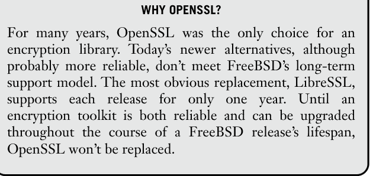

###### OpenSSL

FreeBSD 包含用于处理公钥加密的 OpenSSL 工具包。OpenSSL 让你执行各种加密操作。虽然许多程序使用 OpenSSL 功能，但系统管理员并不经常直接使用 OpenSSL。

虽然 OpenSSL 开箱即用效果良好，但我认为设置一些默认值会让日后的生活更轻松。通过文件 `/etc/ssl/openssl.cnf` 配置 OpenSSL。此文件中的几乎所有设置默认都是正确的，除非你是密码学家，否则不应更改它们。少数有用的更改项是生成加密签名的默认值。每个默认值都由字符串 `.default` 标记。对于常见的 OpenSSL 操作，你最感兴趣的是以下我根据需求调整的设置：

- 1. `countryName_default` = US
- 2. `stateOrProvinceName_default` = Michigan
- 3. `0.organizationName_default` = Burke and Hare Word Mine, LLC

`countryName_default` (1) 是你所在国家的两字母代码——在我的情况下是 US。`stateOrProvinceName_default` (2) 是你所在州的名称，长度不限。我会将其设置为 Michigan。`0.organizationName_default` 字段 (3) 是你的公司名称。如果我要购买签名证书，我会在此处填写我希望出现在证书上的内容。如果我只是在测试程序如何与 SSL 交互，且没有真实的公司名称，我可能会使用我工作所在公司的名称或我编造的名称。

以下值不会显示在 `openssl.cnf` 中，但如果设置它们，它们将作为默认值出现在 OpenSSL 命令提示符中。我发现这些很有用，尽管它们比之前的默认值变更更频繁——至少它们提醒我这些答案的正确格式。

- 1. `localityName_default` = Detroit
- 2. `organizationalUnitName_default` = Pen-Monkey Division
- 3. `commonName_default` = www.michaelwlucas.com
- 4. `emailAddress_default` = mwluca s@michaelwlucas.com

`localityName_default` 1 是你所在城市的名称。`organizationUnitName_default` 2 是此证书所属公司的部门。OpenSSL 中最常被误解的值之一，`commonName_default` 3，是此证书所属主机的主机名，如反向 DNS 中所显示的那样。请记住，反向 DNS 不一定与主机名相同！你的 Web 服务器可能有一个友好的名称，但托管公司可能在反向 DNS 中为其分配一个完全不同的名称。最后，`emailAddress_default` 4 是站点管理员的电子邮件地址。

这些值都作为默认选项显示在 OpenSSL 命令的提示符中。在配置文件中设置它们可以省去日后的麻烦。

###### 证书

公钥加密的一个有趣之处在于，作者和受众不必是人。它们可以是程序。Secure Shell (SSH) 和 Secure Sockets Layer (SSL) 是程序在没有窃听者恐惧的情况下通信的两种不同方式。公钥密码学是安全网站和安全邮件服务使用的 `数字证书` 的主要组成部分。当你打开 Firefox 在线购物时，你可能没有意识到浏览器正在疯狂地加密和解密网页。这就是为什么你的计算机可能会抱怨“无效证书”，某人的公钥已过期或证书是自签名的。今天的协议使用 `传输层安全` (TLS) 进行加密和解密，并使用 `TLS 证书`。

**SSL 与 TLS**

你经常听到关于 SSL 的说法，但大多数时候是不正确的。如今，传输层安全 (TLS) 已主要取代 SSL。大多数使用术语 SSL 的情况都是残留的旧习。一般来说，面向互联网的站点应使用 TLS 版本 1.1 或更高版本。TLS 版本 1.0 仅受弱保护。通过任何版本的 SSL 协议保护的交通是不安全的。

许多公司，如 VeriSign，提供公钥签名服务。这些公司被称为证书颁发机构 (CA)，因为它们提供 TLS 证书。其他需要签名证书的公司提供身份证明，如公司文件和商业记录，这些公钥签名公司使用其 CA 证书对申请人的证书进行签名。通过签署证书，CA 表示：“我已检查此人的资历，他、她或它已使我满意地证明了其身份。” 但它们并不保证其他任何事情。TLS 证书所有者可以使用该证书运行销售欺诈或危险产品的网站，或用它来加密赎金信。签名的 TLS 证书保证某些类型的技术安全性，而非个人诚信甚至单向技术安全性。证书不会神奇地为你应用安全补丁。

Web 浏览器和其他使用证书的软件包含主要 CA 的证书。当浏览器接收到由 CA 签名的证书时，它会将该证书识别为合法的。基本上，Web 浏览器说：“我信任证书颁发机构，证书颁发机构信任此公司，因此我将信任该公司。” 只要你信任 CA，一切都能正常工作。

软件包 `ca_root_nss` 包含 Mozilla 项目认可的 CA 证书。如果某个软件在尝试验证证书时失败，请确保你已安装此软件包。

大多数 CA 是大型商业公司。不过，无论你的组织规模如何，我都鼓励你调查 Let’s Encrypt (`https://www.letsencrypt.org/`)。Let’s Encrypt 是一个提供免费的、全球有效的 TLS 证书的 CA。

使用未经任何 CA 签名的证书进行测试是完全没问题的。对于公司内部的应用程序，它也可能够用，在此情况下

你可以在客户端的 Web 浏览器中安装证书，或者告诉你的用户信任该证书。我们将探讨这两种方法。

这两种证书用途都需要主机密钥。

##### TLS 主机密钥

无论签名证书还是自签名证书，主机都需要一个私钥。主机密钥只是一个精心构造的随机数。以下命令创建一个 2,048 位的主机密钥，并将其放置在文件 `host.key` 中：

```
###### openssl genrsa 2048 > host.key
```

你会看到 OpenSSL 正在创建主机密钥的提示，以及在密钥生成过程中屏幕上闪烁的小数点。只需几秒钟，你就会拥有一个包含密钥的文件。该密钥是一个明文文件，其中包含 `BEGIN RSA PRIVATE KEY` 字样和一堆随机字符。

保护好你的主机密钥！确保它由 `root` 拥有，且仅 `root` 可读。一旦你将证书投入生产环境，任何拥有该密钥的人都可以用它来窃听你的私密通信。

```
###### chown root host.key
###### chmod 400 host.key
```

将此主机密钥放置在与我们放置在密钥文件本身相同的权限目录中。

##### 创建证书请求

你需要为签名证书或自签名证书创建一个证书请求。由于我们不会大量使用 OpenSSL，因此不会详细解析这个命令。进入存放主机密钥的目录并原样输入以下内容：

```
###### openssl req -new -key host.key -out csr.pem
```

响应后，你会看到一系列说明和问题。通过按 `ENTER` 键，你将接受默认答案。如果你已配置了 OpenSSL，默认答案通常是正确的。

1. 国家名称（2 位代码） [US]:
2. 州或省名称（全名） [Michigan]:
3. 地点名称（例如，城市） [Detroit]:
4. 组织名称（例如，公司） [Burke and Hare Word Mine, LLC]:
5. 组织单位名称（例如，部门） [Pen-Monkey Division]:
6. 通用名称（例如，你的名字） [www.michaelwlucas.com]:
7. 电子邮件地址 [mwlucas@michaelwlucas.com]:

国家 1 的两位代码在 ISO 3166 标准中定义，因此快速网络搜索即可找到它。如果你不知道自己居住的州 2 和城市 3，请问一下那些偶尔离开服务器机房的人。组织名称 4 可能是你的公司，你也列出部门或分部名称 5。如果你没有公司，请列出你的姓氏或其他唯一识别你的方式，对于自签名证书，你可以列出任何你想要的内容。不同的 CA（证书颁发机构）对非企业实体有不同的标准，因此请检查 CA 的说明。

通用名称 6 常被误解。它不是你的名字；它是服务器在反向 DNS 中显示的名称。这里必须有一个服务器名称，否则请求将无用。

我建议 7 使用通用的电子邮件地址，而不是个人的电子邮件地址。在这种情况下，我是 michaelwlucas.com，所以我最好使用我自己的地址。你不想让你的组织证书绑定到一个可能因各种原因离开公司的个人身上。

请输入以下将随证书请求发送的‘额外’属性

1. 挑战密码 []:
2. 可选的公司名称 []:

挑战密码 1 也被称为短语（passphrase）。再次强调，保持此秘密，因为任何拥有短语的人都可以使用你的证书。然而，使用证书短语是可选的。如果你使用它，你在服务器启动时必须输入它。这意味着如果你的 Web 服务器崩溃，直到有人输入短语之前，网站将无法工作。

虽然使用短语非常可取，但在这种情况下可能不可接受。按 `ENTER` 使用空白短语。

你 ³ 已经输入了相当多的公司名称，所以第三个可能是不必要的。

一旦你回到命令提示符，你会在当前目录中看到文件 `csr.pem`。它看起来很像你的主机密钥，只是第一行显示的是 `BEGIN CERTIFICATE REQUEST` 而不是 `BEGIN RSA PRIVATE KEY`。

将 `csr.pem` 提交给证书颁发机构，他们将返回实际的证书。我建议将证书保存在以主机命名的文件中，例如 `www.mrwl.io.crt`。这个签名证书适用于任何 TLS 服务，包括网页、`pop3ssl` 或任何其他支持 TLS 的守护进程。

一些 CA 要求你在证书中使用中间证书。虽然大多数守护进程都有一个配置选项来指定中间证书，但如果没有，你可以将签名证书附加到中间证书的末尾。

##### 自己签署证书

自签名证书在技术上与签名证书相同，但它不提交给证书颁发机构。相反，你自己提供签名。大多数客户不会在生产服务上接受自签名证书，但它非常适合测试。要签署你自己的 CSR，运行以下命令：

```
# openssl x509 -req -days 365 -in csr.pem -signkey host.key \
-out selfsigned.crt
Signature ok
subject=/C=US/ST=Michigan/L=Detroit/O=Burke and Hare Word Mine, LLC/OU=Pen-Monkey Division/CN=michaelwlucas.com/emailAddress=mlucas@michaelwlucas.com
Getting Private key
#
```

就这样！现在，你在文件 `selfsigned.crt` 中有一个有效期为 365 天的自签名证书 ⁴。只要愿意忽略应用程序显示的警告，你就可以完全像使用签名证书一样使用此密钥。

如果你自己签署证书，客户端软件会生成“证书签署者未知”的警告。这是意料之中的——毕竟，我办公室以外的人不知道 Michael W. Lucas 是谁，也不知道他为什么签署 Web 证书。由于某种原因，人们信任 Symantec 和其他大型公司的 CA。我被认识我的人信任，但未被世界大众信任。因此，不要在公众可见的地方使用自签名证书，因为警告会让他们困惑、恼怒，甚至吓跑他们。

但在你在 CA 证书上花任何钱之前，一定要看看 Let’s Encrypt。它真的会改变你的系统管理实践。

##### TLS 技巧：连接到 TLS 保护端口

我说我们不会大量使用 OpenSSL，这是正确的。然而，该软件提供的一个功能太有用而不能错过，一旦你知道它，你每个月至少会使用这个技巧一次，并为此感到庆幸。


在这本书中，我们通过使用 `telnet(1)` 连接到该端口上运行的守护进程并发出命令来测试网络服务。这对于明文服务（如 `SMTP`、`POP3` 和 `HTTP`）效果很好。它不适用于加密服务（如 `HTTPS`）。当你连接这些服务时，需要一个程序来为你管理加密。`OpenSSL` 包含 `openssl s_client` 命令，它专门用于此类客户端调试。虽然你会看到大量密码学信息，但你也能获得向守护进程发出明文命令并查看其响应的能力。使用命令 `openssl s_client -connect`，后跟由冒号分隔的主机名和端口号。这里，我们连接到 `www.absolutfreebsd.com` 上的安全 Web 服务器：

```bash
openssl s_client -connect www.michaelwlucas.com:443
CONNECTED(00000003)
depth=2 C = D, O = Digital Signature Trust Co., CN = DST Root CA X3
verify return:1
depth=1 C = US, O = Let's Encrypt, CN = Let's Encrypt Authority X3
--SNIP--
```

你会看到关于信任链和责任限制的大量内容，以及一行又一行的看似随机的数字证书。然而，在那之后，你会看到一个没有命令提示符的空白行。你正在直接与服务器守护进程对话。由于这是一个 Web 服务器，让我们尝试一个 `HTTP` 命令：

```
GET /
```

系统响应如下：

```
HTTP/1.1 400 Bad Request
```

我想 `HTTP` 协议自上次我尝试以来已经改变了。但我确实连接到了 Web 服务器。网络工作正常。

你们中的一些人可能正在想知道，如果与加密服务对话如此简单，我们为什么要加密服务。加密保护的不是守护进程；它保护的是客户端和服务器之间的数据流。`TLS` 加密防止有人窃听你传输中的网络对话——它既不保护服务器也不保护客户端。如果有人侵入你的桌面，`TLS` 也救不了你。

从这一点开始，我将假设你理解这个 `OpenSSL` 命令以及使用它时发生的事情。

##### 硬件加密支持

大多数现代硬件都内置了加密加速。不幸的是，`FreeBSD` 的默认配置中并不包含它。硬件加密加速减少了 `CPU` 的负载，并且可能加速了加密。`aesni(4)` 内核模块激活了对 `Intel` 硬件加密加速器的访问。新的 `AMD` 加速器的驱动程序正在开发中。内核中的驱动程序

仅影响内核中的加密，例如加密磁盘和 `IPSEC` 的加密。

#### 全局安全设置

`FreeBSD` 支持许多可选的安全设置。这些设置会改变 `FreeBSD` 的基本行为，使其与常见的 `Unix` 体验不同。然而，其他一些操作系统默认提供这些设置，因此它们并非 `FreeBSD` 独有。

你应该出于提高安全性的目的开启所有这些功能吗？这里没有普遍正确的答案。如果将系统的部分访问权限限制为仅限 `root` 账户意味着你需要给予更多人 `root` 权限，那么也许你不应该施加这种限制。不过，其中一些设置应该在所有系统上激活。

##### 安装时选项

`FreeBSD` 安装程序提供了在首次启动时启用这些设置的每个选项。你可以稍后使用给定的 `sysctl` 设置来启用或禁用它们。

许多这些功能在用户数量不多的服务器上特别有用。如果你的应用服务器除了应用程序使用的用户外没有非特权用户，你应该可能启用限制非特权用户的功能。但如果你确实有非特权用户，请更仔细地考虑这种情况。我大多数非特权用户⁵不应查看服务器进程或其他用户，因此我限制了他们。

##### 隐藏其他 UID 的进程

通常，像 `ps -ax` 这样的命令会显示系统中正在运行的所有进程。当你将 `sysctl security.bsd.see_other_uids` 设置为 `0` 时，用户只能看到自己的进程。无论此设置如何，`Root` 都能看到所有进程。

##### 隐藏其他 GID 的进程

类似地，用户通常可以看到属于其他组的进程。通过将 `sysctl security.bsd.see_other_gids` 设置为 `0` 来禁用该功能。同样，无论此设置如何，`Root` 都能看到每个进程。

##### 隐藏受拘束的进程

主机上的用户通常可以看到在 `jails`（沙箱）中运行的所有进程。通过将 `security.bsd.see_jail_proc` 设置为 `0`，非特权的非沙箱用户无法看到沙箱中的进程。此功能出现在 `FreeBSD 12` 中。

##### 隐藏消息缓冲区

非特权用户通常可以看到系统消息缓冲区，该缓冲区可通过 `dmesg(8)` 访问。通过将 `sysctl security.bsd.unprivileged_read_msbuf` 设置为 `0` 来禁用对该缓冲区的访问。

##### 禁用进程调试

调试器可以告诉用户大量有用的信息。将 `security.bsd.unprivileged_proc_debug` 设置为 `0` 可禁止非特权用户使用调试器调试进程。

##### 随机化进程 ID

传统的 `Unix` 系统按顺序创建进程 ID，使攻击者有机会猜测下一个 `PID` 是什么。通过设置 `sysctl kern.randompid` 为一个随机的较大整数来随机化进程 ID。如果你将其设置为 `1`，内核会在每次启动时选择 `100` 到 `1,123` 之间的一个新随机数。

##### 清理 /tmp

所有明智的类 `Unix` 系统在启动时都会清理 `/tmp` 以处置临时文件。在过去几年中的某个时候，`FreeBSD` 默认关闭了这种行为。你可能会使用 `tmpfs(5)` 作为 `/tmp`，它在每次断电时都会销毁。但如果你 `/tmp` 在磁盘上，那么，呃……既然你们都是理智且健康的系统管理员，请始终在 `/etc/rc.conf` 中将 `clear_tmp_enable` 设置为 `YES`。

##### 禁用 Syslogd 网络

默认情况下，`syslogd(8)` 在 `UDP` 端口 `514` 上创建一个半开放套接字。没有人可以连接到此套接字；它仅用作占位符，以便没有其他内容绑定到该端口。有些人认为这个半开放套接字是有问题的。我会说这是一个特性；你不希望其他东西绑定到端口 `514`，声称自己是 `syslogd`，并向你的日志主机发送令人担忧或虚假安慰的消息。但要禁用该半开放套接字，请在 `/etc/rc.conf` 中将 `syslog_flags` 设置为 `-ss`。

##### 禁用 Sendmail

默认的 `FreeBSD` 安装不接受来自网络的邮件，但它确实运行一个 `sendmail(8)` 守护程序来发送出站消息。要完全禁用从此主机发送邮件，请在 `/etc/rc.conf` 中将 `sendmail_enable` 设置为 `NONE`。

禁用出站邮件不会阻止每日、每周和每月维护任务运行。但是，除非你直接登录到主机，否则它将阻止你接收这些消息的输出。对于拥有多台主机的人，禁用出站邮件是不明智的。如果你使用替代邮件代理（例如 `dma(8)`，见第 20 章），禁用 `Sendmail` 是有意义的。

##### 安全控制台

大多数 `Unix` 系统认为物理控制台是安全的。任何能够访问物理机器的人都可以对主机做任何他们想做的事情，包括更改 `root` 密码。通过将所有 `/etc/ttys` 条目中表示 `secure` 的更改为 `insecure`，你告诉 `FreeBSD` 即使在单用户模式下也要求输入 `root` 密码。⁶ 这不会阻止拥有物理访问权限的人获取你的操作系统访问权限，但这将意味着他们必须做稍微更多的工作来颠覆你的机器。非常轻微地更多工作。

##### 不可执行堆栈和堆栈保护页

一种基本的漏洞缓解技术是不可执行堆栈。一旦程序加载到内存中，分配给该程序的每个内存页应该是可写或可执行的，但不能两者兼得。

一种常见的漏洞利用技术是诱使程序向内存写入信息，然后执行该内存。攻击者可能说服程序写入一块内存，但在使用不可执行堆栈的情况下，内核不会执行它。

在现代版本的 `FreeBSD` 中，堆栈默认为不可执行。禁用此设置的唯一原因可能是你拥有一个编写不良的程序，该程序依赖于执行和写入同一块内存。在过去 15 年中，大多数此类有缺陷的软件已正当地被清除出开源生态系统。如果你非常不幸，无法避免运行无法处理不可执行堆栈的程序，你可以通过将 `sysctls` `kern.elf32.nxstack`（用于 32 位程序）或 `kern.elf64.nxstack`（用于 64 位程序）设置为 `0` 来禁用此功能。

与不可执行堆栈相关，堆栈保护页在程序内存分配的部分之间添加了一小块随机大小的额外内存。这使得攻击者更难猜测内存地址。`FreeBSD` 默认分配一个堆栈保护页，但你可以通过将 `sysctl security.bsd.stack_guard_page` 设置为 `0` 来关闭它。

**其他安全设置**

`FreeBSD` 的大多数其他内核级安全设置都位于 `security.bsd` `sysctl` 树中。每隔几个月就会添加更多设置。运行 `sysctl -d security.bsd` 以显示主机上可用的选项。我在此之前已经描述了许多这些设置，但你可能会发现其中一些其他设置有用。选项包括禁用 `root` 账户的特权（`security.bsd.suser_enabled`），允许非 `root` 用户设置空闲优先级（`security.bsd.unprivileged_idprio`），以及阻止非特权用户使用 `mlock(2)`（`security.bsd.unprivileged_mlock`）。查看当前选项，看看哪些可能有用。

**使用 mtree(1) 为入侵做准备**

对系统管理员来说最糟糕的事情之一是想让自己的系统可能已被渗透。如果你在 `/tmp` 中发现神秘的文件，在 `/usr/local/sbin` 中发现额外的命令，或者觉得“感觉不对劲”，你将不得不怀疑是否有人入侵了你的系统。这种感受最糟糕的是，没有方法证明它没有发生。熟练的攻击者可以用她自己的定制版本替换系统二进制文件，从而使她的行为永远不会被记录，而你想要找到她的尝试也会失败。当放大镜由罪犯提供并包含特殊的罪犯伪装功能时，让夏洛克·福尔摩斯拿着放大镜检查你的服务器是毫无用处的！甚至有人劫持了系统编译器，使新构建的二进制文件包含劫持者的后门。⁷ 更糟糕的是，计算机总是在做奇怪的事情。操作系统非常复杂，应用程序更是如此。也许 `/tmp` 中那个奇怪的文件是你的文本编辑器在你按键太快时呕吐出来的东西，或者可能是粗心的入侵者留下的残留物。

恢复受损系统的*唯一*方法是从头重新安装它，从备份恢复数据，并希望导致安全漏洞被修复。这是一个渺茫的希望，而且怀疑是如此容易获得，以至于许多系统管理员最终不再关心，或者自我欺骗，而不是忍受不断的担忧。

大多数入侵者更改系统中已经存在的文件。`FreeBSD` 的 `mtree(1)` 可以记录系统中文件的权限、大小、日期和加密校验和。（虽然 `freebsd-update(8)` 包含类似的功能，并且你不需要事先收集数据，但它仅覆盖基础系统。）如果你在系统刚安装时记录了这些特征，你就拥有了这些文件完好无损时的记录。当入侵者更改这些文件时，比较将突出显示差异。当你即使有最模糊的感觉被黑客攻击时，你可以检查现有文件上的相同信息，看看是否有任何文件已更改。

#### 运行 mtree(1)

以下命令在整个根分区上运行 `mtree(1)` 并存储 `SHA512` 和 `SHA256` 加密校验和，将其放在

用于后续分析的文件：

```
##### mtree -x -i -c -K sha512 -K sha256 -p / -X /home/mwlucas/mtree-exclude > /tmp/mtree.out
```

虽然你可以对整个服务器使用 `mtree(1)`，但大多数人使用 `-x` 标志 1 来在每个分区上运行一次。你不希望记录经常变化的文件的校验和，例如数据库服务器上的数据库分区。在 `NFS` 挂载点上收集校验和具有双重特征：运行非常缓慢以及增加网络拥塞。`-ic` 标志 2 告诉 `mtree` 将其结果打印到屏幕上，文件系统中的每一后续层都缩进显示。这种格式与 `/etc/mtree` 中的系统 `mtree` 文件匹配。`-k` 标志接受多个可选关键字；在这种情况下，我们希望生成 `SHA512` 校验和 3 和 `SHA256` 校验和 4。`-p` 标志 5 告诉 `mtree` 要检查哪个分区。几乎每个分区都有文件或目录会定期变化，因此你不想为它们记录校验和。使用 `-x` 标志 6 指定一个排除文件，该文件包含不匹配的列表路径。最后，将此命令的输出重定向到文件 `/tmp/mtree.out` 7。

##### mtree(1) 输出：规范文件

`mtree(1)` 的输出被称为规范文件（specification），简称 `spec`。虽然这个规范最初旨在用于软件安装，但我们要用它来验证软件安装。你的 `spec` 文件以注释开头，显示运行命令的用户、运行命令的机器、分析的文件系统以及日期。`spec` 中的第一个实际条目设置了该主机的默认值，并以 `/set` 开头。

```
/set type=file uid=0 gid=0 mode=0755 nlink=1 flags=uarcb
```

`mtree(1)` 程序根据其对该分区中文件的分析选择了这些设置作为默认值。默认的文件系统对象是一个文件，所有者为 `UID 0`，组为 `GID 0`，权限为 `0755`，有一个硬链接以及用户归档标志。之后，系统上的每个文件和目录都有一个单独的条目。这是根目录的条目：

```
1.    2type=dir3nlink=194time=1504101311.033742000
```

此文件是点 `.` 1，即我们当前所在的目录。它是一个目录 2，并且它有 `19` 个硬链接 3 指向它。该目录在 `Unix` 纪元时间 `1,504,101,311.033742000` 秒时被修改 4。`Unix` 纪元始于 1970 年 1 月 1 日。

##### 纪元秒与实际日期

不想计算自纪元开始以来的秒数吗？要将纪元秒转换为正常日期，请运行 `date -r seconds`。不过，请截去 `mtree` 时间末尾的小数部分；`date(1)` 只喜欢整数秒。

从某些方面来说，目录的条目相当枯燥。毕竟，入侵者无法实际替换目录本身！这里是一个根目录中实际文件的条目：

```
 .cshrc      mode=0644 nlink=21size=950 time=1499096179.000000000  
2 sha256digest=20d2a78c9773c159bac1df5585227c7b64b6aab6b77bccadbe4c65f1be474e8c
3
sha512=2d4d330e327f75f10101c dc7c0d6a5e916336ade5b9eb04b0d96ea43d221c5eac4c71a89dfe85a...
```

我们看到了文件名以及与根目录相同的模式、链接和时间信息，但还获得了文件大小 1。此外，还有从文件计算的 `SHA256` 2 和 `SHA512` 3 加密哈希。

虽然理论上入侵者可以制作出与特定加密哈希匹配的文件，而且密码学家一直在努力寻找创建与任意 `SHA256` 和 `SHA512` 校验和匹配文件的实用方法，但入侵者创建一个既匹配这两个校验和、又包含其后门、还能让系统所有者不会立即发现问题从而正常工作的假文件的可能性极小。等到这种情况发生时，我们将拥有对这些方法具有抵抗力的额外校验和算法，并会切换到这些新算法。

##### 排除文件

排除文件（通过 `-x` 提供）列出了你不希望 `mtree(1)` 分析的文件系统。许多文件系统会在没有恶意干预的情况下发生变化。日志文件和用户主目录应该会变化。在一个功能性系统上，像 `/tmp` 和 `/var/db/entropy` 这样的目录 *最好* 会发生变化。在排除文件中，将每个你不想检查的目录单独列一行，并以前导点号开头。

```
./tmp
./var/db/entropy
./var/log
./usr/home
```

等待大约一天，然后再次运行 `mtree(1)` 以生成一个新的规范文件。两个 `mtree` 文件之间的差异将帮助你改进排除文件。当你怀疑系统被入侵时，你会做完全相同的事情。

##### 保存规范文件

规范文件包含在怀疑入侵后验证系统完整性所需的信息。将规范文件留存在你要验证的服务器上，意味着入侵者可以编辑该文件并掩盖其罪行。你不应该将文件保存在系统本身！偶尔会有人建议你校验 `mtree` 规范文件的校验和但仍将其保留在服务器上。那没用；如果某人篡改了 `mtree` 文件及其校验和，你怎么知道呢？或者更糟——如果某人篡改了规范文件而你发现了，你也没法知道具体做了哪些更改！将你的规范文件复制到安全的位置，最好是在离线媒体上，如闪存驱动器或光盘。

##### 查找系统差异

当某些事引起你的怀疑，你开始认为自己可能遭受了入侵时，创建一个新的 `mtree` 规范文件并与你离线存储的“已知良好”规范文件进行比较。使用 `mtree(1)` 检查规范文件之间的差异。

```
###### mtree -f mtree.suspect -f mtree.good > mtree.differences
```

文件中的每个条目都是已发生变化的内容。我的排除文件经过精细调整，消除了我预期会发生变化的文件。这次特定的运行产生了两行输出。

```
bin/sh file¹size=161672
② sha256digest=a4a85ca3563d8f3bda449711c6b591b37093e668fc136f88282e9b188b955f56ab③
sha512=011793e3c6accd99b4261e0a0f3a0b9bd6a6842f3ccd55da1ce2070b568ec3c49ae7b0e51d33bb59eff...  
bin/sh file size=④10489808
⑤ sha256digest=45856525d4251b43d8df1429cfile0f4adb664f06df7f995aace5b7ca0c03c2⑥
sha512=a4f0e83e5fb12d615721fd7d57cb6a120068d1aa71fc305b7b86927391f33bec822cf14ce8a8a9db14...
```


文件 `/bin/sh` ① 在两次 `mtree` 运行之间改变了大小 ④。这不妙。此外，请注意两个不同的 SHA256 哈希 ② ⑤ 和两个不同的 SHA512 哈希 ③ ⑥。先不要惊慌失措，但要开始向你的同行系统管理员提出尖锐、严厉的问题。如果你无法得到关于此二进制文件为何变化的合理解释，你可能会寻找你的安装介质。

或者，也许你需要更新你的排除文件。但如果 `/bin/sh` 发生了变化，那可能不是原因。

### 监控系统安全

所以，你认为你的服务器是安全的。也许它确实如此……目前来看。

不幸的是，有一类入侵者除了密切关注最新的安全漏洞并在他们认为可能易受攻击的系统上尝试之外，无事可做。即使你虔诚地阅读 `FreeBSD-security` 并应用每一个补丁，你仍然可能在某一天被入侵。虽然没办法绝对确定你未被入侵，但以下提示将帮助你查明何时发生了事件：

- 熟悉你的服务器。定期在上面运行 `ps -axx`，并了解通常在这些服务器上运行的进程。如果你看到一个你不认识的进程，请调查。

- 使用 `netstat -na` 和 `sockstat` 检查你的开放网络端口。你的服务器应该监听哪些 `TCP` 和 `UDP` 端口？如果你不认识一个开放端口，请调查。它可能是无辜的，但也可能是入侵者的后门。

- 无法解释的系统问题是线索。许多入侵者操作笨拙且系统管理技能不佳，他们使用点击即拖拽式的攻击。他们会让你的系统崩溃，并认为自己是塞缪尔·L·杰克逊（Samuel L. Jackson）的网络化身。

- 真正熟练的入侵者不仅会清理现场，还会确保系统没有可能提醒你注意的问题。因此，异常稳定的系统也是可疑的。

- 无法解释的重启可能表明有人非法安装了新的内核。这也可能是硬件故障或配置错误的迹象，因此无论如何都要调查。

- `FreeBSD` 每天向你发送电子邮件，提供基本的系统状态信息。阅读它们。保存它们。如果某些事情看起来可疑，请调查。查看旧消息以了解某事何时发生了变化。

我特别推荐 `lsof` 包以增加你对系统的熟悉度。`lsof` 程序列出系统上所有打开的文件。阅读 `lsof(8)` 的输出本身就是一种教育；你可能完全没想到你的 web 服务器打开了这么多杂乱的东西。

打开可疑文件，要么说明你对其系统不够熟悉，要么说明有人在实施不当行为。

### 包安全

`FreeBSD` 项目提供了一个包含 `ports` 和 `packages` 系统安全漏洞的数据库。该数据库以 `漏洞和暴露标记语言`（`VuXML`）格式提供。当某人自愿维护一个 port 时，他们同时也自愿负责关注该 port 的安全问题。

安装了 `pkg(8)` 的联网 `FreeBSD` 主机在 `periodic(8)` 运行期间（见第 21 章）会下载最新的 `VuXML` 文件，并将其存储在 `/var/db/pkg/vuln.xml`。然后，它会比较已安装的包与该数据库。如果你的某个包存在漏洞，你会在每日状态电子邮件中收到通知。（你正在阅读你的每日状态电子邮件，对吧？）

如果你的包不安全，请按照第 15 章所述进行升级。

如有必要，你可以通过 `pkg.conf` 中的 `VULNXML_SITE` 选项设置获取 `vuln.xml` 文件的不同位置。如果你维护自己的包存储库和漏洞数据库，可能会这样做。

### 如果你被入侵了

经过所有这些准备，如果你的系统被入侵了，你该怎么办？没有简单的答案。关于这一主题已经写了很多大部头书籍。然而，以下是一些通用的建议。

首先也是最重要的是：被入侵的系统是不可信的。如果有人获得了你互联网服务器的 `root` 访问权限，他可能已经替换了系统上的任何程序。即使你关闭了他闯入的漏洞，他也可能安装了一个被篡改的 `login(8)` 版本，每次你登录时都会将你的用户名和密码发送到某个地方的 `IRC` 频道。不要信任这个系统。升级无法净化它，因为即使是 `freebsd-update(8)` 和编译器都可能是可疑的。

虽然 `rootkit` 搜索软件可能帮助你验证入侵者的存在，但没有任何东西可以验证入侵者不在那里。欢迎写信给 `FreeBSD-security@FreeBSD.org` 寻求建议。描述你看到的情况以及你认为自己被入侵的原因。不过，要做好听到丑陋答案的准备：从已知安全的介质完全重新安装你的计算机，并从备份中恢复你的数据。你读了第 5 章，对吧？

良好的安全实践会减少你被入侵的可能性，就像安全驾驶会减少你遭遇车祸的可能性一样。最终，你总会把车撞得粉碎，并疑惑自己为什么要费这个劲。祝你好运！

## 小型系统服务


即使是一个角色定义非常狭窄的服务器，例如专用的 Web 服务器，也需要各种小型“辅助”服务来处理基本的管理问题。在本章中，我们将讨论其中的一些服务，例如时间同步、发送邮件、`DHCP` 服务、任务计划等。我们将首先通过 `SSH` 保护你的 `FreeBSD` 服务器的远程连接。

### 安全外壳（Secure Shell）

Unix 的一个巨大优势在于其远程管理的便捷性。无论服务器是在你面前，还是在一个由名为伊万（Ivan）的妄图称霸的鼬鼠指导的凶恶守卫狗环绕的地底最高安全设施中远程隔离的实验室里，只要你对该机器具有网络访问权限，你就可以控制它。

多年来，`telnet(1)` 一直是访问远程服务器的标准方式。然而，作为一种远程管理协议，`telnet` 有一个致命的问题：通过大多数版本的 `telnet` 发送的所有内容都是未加密的。任何拥有数据包嗅探器的人，只要附加在你的连接路径上的任何位置，都可以窃取你的用户名、密码以及你在 `telnet` 会话中查看的任何信息。当你使用 `telnet` 时，世界上最好的密码选择方案也无法保护你的用户名和密码。入侵者会在任何可能的地方放置非法的数据包嗅探器；我在小型局域网、全球企业网络、处理敏感政府工作的律师事务所、家用 PC 以及互联网骨干网络上都见过它们。防御数据包嗅探器的唯一方法是处理你的身份验证凭据和数据，使得数据包嗅探器无法解读它们。这就是 `SSH`，即安全外壳（Secure Shell）发挥作用的地方。

`SSH` 的行为与 `telnet` 非常相似，因为它在远程主机上提供了一个高度可配置的终端窗口。但与 `telnet` 不同，`SSH` 会加密你通过网络发送的所有内容。`SSH` 不仅确保你的密码无法被嗅探，还确保你输入的命令及其输出都被加密。虽然 `telnet` 在 CPU 使用时间更少且配置更简单方面比 `SSH` 有少数几个小优势，但 `SSH` 的安全优势远远超过了它们。`SSH` 还有许多 `telnet` 不具备的功能，例如通过加密会话隧道任意协议。`SSH` 运行在所有现代版本的 Unix 甚至 Microsoft Windows 上。

`SSH` 通过公钥密码学加密和验证远程连接。`SSH` 守护程序向客户端提供服务器的公钥，并自行保留私钥。客户端和服务器使用加密密钥在它们之间协商一个密码学安全的通道。由于完成此交易需要公钥和私钥两者，因此你的数据是安全的；即使有人截获了你的 `SSH` 流量，他们也只能看到加密的乱码。

要使用 `SSH`，你必须在你的 `FreeBSD` 机器上运行 `SSH` 服务器，并在你的工作站上运行 `SSH` 客户端。

#### SSH 服务器：sshd(8)

`sshd(8)` 守护程序监听来自网络的 `TCP` 端口 22 上的 `SSH` 请求。要在启动时启用 `sshd`，请将以下行添加到 `/etc/rc.conf`：

```
ssh_enable="YES"
```

设置完成后，你可以使用 `/etc/rc.d/sshd` 脚本或 `service sshd` 子命令来启动和停止 `SSH`。停止 `SSH` 守护程序并不会终止已经在使用中的 `SSH` 会话；它只是阻止守护程序接受新的连接。

与我们查看的未加密协议不同，`sshd` 很难通过手工进行测试。你可以做的一件事是通过使用 `nc(1)` 连接到 `SSH` TCP 端口来确认 `sshd` 正在运行。

```
nc localhost 22
SSH-2.0-OpenSSH_7.2_FreeBSD-20160310
```

我们连接到端口 22，并收到 `SSH` 横幅。我们可以看到，监听此端口的守护程序自称 `SSH` 版本 2，在 `FreeBSD` 上由 `OpenSSH 7.2` 实现，版本为 `20160310`。你可以通过简单的 `nc(1)` 连接获取所有这些信息的，但这是 `sshd` 提供的最后的免费信息。除非你能够手工、即席地加密数据包，否则你只能走到这一步。按 `CTRL-C` 离开 `nc(1)` 并返回到命令提示符。

#### SSH 密钥和指纹

第一次启动 `sshd(8)` 时，程序发现没有加密密钥并自动创建它们。初始化的 `sshd` 进程创建三对密钥：一个 `RSA` 密钥、一个 `ECDSA` 密钥和一个 `ED25519` 密钥。

以 `.pub` 结尾的密钥文件包含每种类型密钥的公钥。这些是 `sshd` 提供给连接客户端的密钥。这使得连接的用户能够验证他连接到的服务器确实是他认为的那个服务器。（入侵者曾诱骗用户登录到虚假机器以捕获他们的用户名和密码。）看看这些公钥文件中的一个；它相当长。即使当用户被提供确认服务器提供正确密钥的机会时，由于密钥太长，即使是多疑的用户也不愿去验证每一个字符。

幸运的是，`SSH` 允许你生成一个密钥指纹，它是密钥的一种更短的表达形式。你不能用指纹加密流量或协商连接，但两个不相关的密钥具有相同指纹的可能性微乎其微。要为公钥生成指纹，请输入命令 `ssh-keygen -lf keyfile.pub`。

```
ssh-keygen -lf /etc/ssh/ssh_host_rsa_key.pub
2048 SHA256:teC8fgXctTfaaEF9d5QKoYWurStb/culr3MxV4wwE root@bert (RSA)
```

第一个数字 `2048` 显示了密钥中的位数。`2048` 是 `2018` 年 `RSA` 密钥的标准配置，但随着计算能力的提高，我预计这个数字会增加。以 `teC8` 开头并以 `wWE` 结尾的字符串是公钥的指纹。虽然它很长，但比实际密钥短得多，可读性也强得多。将此密钥指纹从原始服务器复制到一个你可以从客户端机器访问的地方。如果人类需要验证指纹，请尝试网页或纸质列表。如果你的 `SSH` 客户端支持 `SSHFP` 记录，且你的 `DNS` 区域支持 `DNSSEC`，你可以使用 `DNS`。使用此密钥在你第一次连接时确认你的服务器身份，或使用其他密钥分发方法之一。

#### 配置 SSH 守护程序

虽然 `sshd` 自带一个完全可用的配置，但一旦你了解了 `sshd(8)` 提供的所有功能，你可能希望调整设置。配置文件 `/etc/ssh/sshd_config` 列出了所有默认设置，它们都用井号（`#`）注释掉了。如果你想更改某个设置的值，请取消该条目的注释并更改其值。

我们不会讨论所有可用的 `sshd` 选项；那需要单独一本相当大的书。此外，`OpenSSH` 的进步速度足够快，那本书在上市前就会过时。相反，我们将关注人们常进行的一些更常见的期望配置更改。

更改 `SSH` 守护程序的配置后，使用 `/etc/rc.d/sshd restart` 或 `service sshd restart` 重新启动守护程序。

#### VersionAddendum FreeBSD-20170902

当你连接到 `sshd` 的 `TCP` 端口时，`VersionAddendum` 会显示在服务器名称中。有些人建议更改此内容以伪装操作系统版本。不过，通过识别与主机交换的数据包的指纹技术，识别计算机的操作系统相当简单，因此通常不值得花费时间这样做。（另一方面，如果你修改 `VersionAddendum` 为 `DrunkerdBadgerSoftware` 让你感到有趣，请继续。）

#### 端口 22

`sshd(8)` 默认监听 `TCP` 端口 22。如果需要，你可以将其更改为非常规端口。如果你希望 `sshd` 监听多个端口（例如，除了 22 端口外还监听 443 端口），你可以将多个 `Port` 条目放在不同的行上：

```
Port 22
Port 433
```

更改端口作为安全措施并没有太大用处。但它有助于减少日志中的无用信息。我坦然承认，我有一台小型 `SSH` 服务器，它专门监听一系列常见的 `TCP` 端口，以绕过无用的网络安全设备。但这并不会使 `SSH` 变得更加安全。

#### ListenAddress 0.0.0.0

`sshd` 默认监听机器上所有 `IP` 地址的传入请求。如果需要限制要监听的地址范围（例如，在隔离服务器上），你可以在此指定：

```
ListenAddress 203.0.113.8
```

如果你希望 `sshd` 监听多个地址，请使用多个 `ListenAddress` 行。

#### SyslogFacility AUTH 和 LogLevel INFO

这两个设置控制 `sshd(8)` 如何记录连接信息。有关日志记录的更多信息，请参见第 21 章。

#### LoginGraceTime 2m

这控制用户连接后有多少时间登录。如果传入的用户连接后未在此时间窗口内成功登录，`sshd` 将断开连接。

#### PermitRootLogin no

不要让人们以 `root` 身份登录你的服务器。相反，他们应该 `SSH` 登录为普通用户，然后使用 `su(1)` 成为 `root`。允许直接 `root` 登录会消除你识别是谁错误配置了系统的所有希望，并让入侵者更容易地掩盖其踪迹。

#### MaxAuthTries 6

这是用户在单次连接中可能尝试输入密码的次数。在此次数之后未能成功登录，用户将被断开连接。

#### AllowTcpForwarding yes

`SSH` 允许用户将任意 `TCP/IP` 端口转发到远程系统。如果你的用户有 shell 访问权限，他们可以安装自己的端口转发器，因此几乎没有理由禁用此功能。

#### X11Forwarding yes

类 Unix 操作系统使用 `X11`（或 `X`）协议来显示图形程序。在 `X` 中，显示器与物理机器是分开的。例如，你可以在一台机器上运行 web 浏览器，并在另一台机器上显示结果。

由于 `X` 有着坎坷的安全历史，许多管理员出于本能会禁用 `X` 转发。然而，拒绝通过 `SSH` 进行 `X` 转发并不会通常禁用 `X` 转发。大多数用户如果拒绝基于 `SSH` 的 `X` 转发，就会使用 `X` 内置的网络感知功能或第三方转发器，通过未加密的 `TCP/IP` 转发 `X`，这在大多数情况下比允许通过 `SSH` 进行 `X` 转发要糟糕得多。如果你的 `sshd` 服务器安装了 `X` 库和客户端程序，用户无论如何都会转发 `X`；最好让 `SSH` 为你处理转发。

如果没有安装 `X` 软件，则 `x11Forwarding` 没有效果。

#### Banner /some/path

`Banner` 是在身份验证发生之前显示的消息。此选项最常见的用途是显示法律警告。默认情况下不使用 banner。

#### Subsystem sftp /usr/lib/openssh/sftp-server

`SSH` 允许你使用 `scp(1)` 在一个系统之间安全地复制文件。虽然 `scp` 工作得很好，但它不是非常用户友好。`sftp` 服务器提供了一个类似 `FTP` 的文件传输界面，减少了你必须花在用户教育上的时间，同时保持坚固的安全性。

### 管理 SSH 用户访问

默认情况下，任何拥有合法 shell 的人都可以登录服务器。使用配置变量 `AllowGroups`、`DenyGroups`、`AllowUsers` 和 `DenyUsers`，`sshd(8)` 允许你定义特定可能或不可能访问你机器的用户和组。

当你明确列出可以 `SSH` 登录到某台机器的用户时，任何未列出的用户都无法 `SSH` 登录。

例如，`AllowGroups` 选项允许你将 `SSH` 访问限制为 `/etc/group` 中定义的指定组中的用户（参见第 9 章）。如果设置了此选项，且用户不在任何允许的组中，他就无法登录。用空格分隔多个组：

```
AllowGroups wheel webmaster dnsadmin
```

如果你不希望整个组拥有 `SSH` 访问权限，你可以使用 `AllowUsers` 列出个别用户。使用 `AllowUsers`，你禁止除列出用户以外的所有人访问 `SSH`。

`DenyGroups` 列表是 `AllowGroups` 的反面。指定系统组中的用户无法登录。列出的组必须是其主要组，这意味着它必须列在 `/etc/masterpasswd` 中，而不仅仅在 `/etc/group` 中。这一限制使 `DenyGroups` 起初看起来不那么有用；你不能定义一个名为 `nossb` 的通用组并只是将用户添加到其中，除非你也将其作为其主要组。明确列出允许的组是一种更实用的策略。

最后，`DenyUsers` 变量列出了不能登录的用户。你可以使用它来明确禁止某些属于其他允许组的用户。

这四个不同的设置使得用户可能同时属于多个组。例如，一个用户可能属于 `AllowGroups` 中列出的组，同时也属于 `DenyGroups` 中列出的组。那么会怎样？`SSH` 守护程序按照以下顺序检查这些值：`DenyUsers`、`AllowUsers`、`DenyGroups` 和 `AllowGroups`。第一个匹配的规则获胜。例如，假设 `Bert` 是 `wheel` 组的成员。以下是 `sshd_config` 的一个片段：

```
DenyUsers: bert
AllowGroups: wheel
```

`Bert` 无法 `SSH` 登录这台机器，因为 `DenyUsers` 在 `AllowGroups` 之前被检查。

### SSH 客户端

当然，`FreeBSD` 附带 `SSH` 客户端，大多数类 Unix 操作系统也是如此。如果可能，请使用包含的 `SSH` 客户端——它是 `OpenSSH` 的一部分，由 `OpenBSD` 团队的一个子集开发，不仅是最流行的实现，也是最好的。如果你被判处运行微软操作系统，我推荐 `PuTTY`，它免费用于商业或非商业用途，并具有出色的终端仿真功能。微软正在将 `OpenSSH` 的分支集成到 Windows 中，但在我写这篇文章时它仍处于测试阶段。

这是一本 `FreeBSD` 的书，所以我们将关注 `FreeBSD` 的 `OpenSSH` 客户端。你可以通过多种方式配置客户端，但最常见可用的配置选项只是禁用服务器提供的功能。如果你真的有兴趣调整客户端行为，请阅读 `ssh_config(5)`。

要通过 `SSH` 连接到另一台主机，请输入 `ssh hostname`。作为响应，你会看到类似以下内容：


#### ssh mwl.io

The authenticity of host 'mwl.io (203.0.113.221)' can't be established.
ECDSA key fingerprint is SHA256:Zx0WgIg4oqqZKHOLV5tfgP1aWDW6UGViTvjfAjMc4E.
No matching host key fingerprint found in DNS.
Are you sure you want to continue connecting (yes/no)? **yes**

你的客户端立即从你要连接的主机检索公钥，并检查其内部 SSH 密钥列表中是否有该主机的匹配密钥。如果服务器提供的密钥与客户端列表中拥有的密钥匹配，客户端假设你正在与正确的主机对话。如果客户端的已知主机列表中没有主机密钥，它会向你展示密钥指纹以请求批准。

SSH 客户端展示的指纹应与你服务器上生成的指纹相同。如果指纹不相同，你正在连接错误的主机，需要立即断开连接。如果匹配，接受密钥并继续。一旦你接受指纹，密钥将保存在你的主目录下的 `.ssh/known_hosts` 中。

如果你正在本地网络上构建用于私人使用的新服务器，也许你不需要手动比较密钥指纹。然而，你仍然应该复制密钥指纹，因为你最终希望从远程位置连接，并需要验证密钥。如果许多人将连接到服务器，通常可以将指纹放在网页上是安全的。你必须决定需要多少安全性。我强烈建议你谨慎行事。

接受主机密钥，你就可以登录服务器。虽然使用带口令的私钥比使用密码更好，但使用密码进行 SSH 仍然比 telnet 更好。

#### 通过 SSH 复制文件

SSH 客户端对于命令行访问来说很完美，但如果你想在两个系统之间传输文件呢？SSH 提供了两种用于跨网络传输文件的工具：`scp(1)` 和 `sftp(1)`。

### `scp(1)` 是“安全复制”，非常适合传输单个文件

`scp(1)` 接受两个参数：首先，文件当前所在的位置；然后，目标位置。目标位置的格式指定为 `<username>@<hostname>:<filename>`。假设我想将文件 `bookbackup.tgz` 从我的本地系统复制到远程服务器 `mwl.io`，并给远程副本起一个不同的名字。我会运行：

```bash
scp bookbackup.tgz mwlucas@mwl.io:bookbackup-january.tgz
```

如果你希望新副本使用相同的文件名，你可以在第二个参数中省略文件名：

```bash
scp bookbackup.tgz mwlucas@mwl.io:
```

`scp(1)` 还允许你将文件从远程系统复制到你的本地系统：

```bash
scp mwlucas@mwl.io:bookbackup-january.tgz bookbackup.tgz
```

如果你不想更改本地系统中的文件名，你可以使用单个点作为目标名称：

```bash
scp mwlucas@mwl.io:bookbackup.tgz .
```

最后，如果你用户在远程系统上的用户名与本地用户名相同，你可以删除用户名和 `@` 符号。例如，为了备份我的工作，我只需使用：

```bash
scp bookbackup.tgz mwl.io:
```

虽然这看起来有些复杂，但对于快速在网络间传输单个文件来说，它非常实用。

如果你喜欢交互式系统，或者你不知道想从远程服务器获取的确切文件名，那么 `sftp(1)` 是你的好朋友。

### `sftp(1)` 接受单个参数，即用户名和服务器名称，使用 `scp` 的远程服务器语法：

```bash
sftp mwlucas@mwl.io
Connecting to bewilderbeast...
Password:
sftp> ls
```

`sftp(1)` 客户端看起来很像标准的命令行 FTP 客户端；它支持常规的 FTP 命令，如 `ls`（列出）、`cd`（改变目录）、`get`（下载文件）和 `put`（上传文件）。一个重要的区别是，`sftp(1)` 不需要在 ASCII 和二进制传输之间进行选择；它只是原样传输文件。

通过 SSH、`scp` 和 `sftp`，你可以完全从你的网络中消除明文密码。

#### OpenSSH 密码和密钥

为了真正保护你的系统，请使用基于密钥的 SSH 认证。创建密钥并不困难，但以最适合你环境的方式部署它们则比我在这里所能涵盖的更为复杂。消除 SSH 密码是你可以在网络上做的最大的单项安全改进。

虽然 SSH 是最常见的系统管理工具，但我们刚才只是浅尝辄止。你花在掌握 SSH 上的时间会数倍地回报你。你可以在网上找到许多好的教程，以及几本不错的书，包括我自己的 *SSH Mastery*（Tilted Windmill Press, 2018）。

### 电子邮件

在过去几年里，运行电子邮件服务器变得复杂得多。应对到达邮件服务器的垃圾邮件、病毒和随机垃圾需要专业的技能集，而且这些垃圾的数量每年都在增加。在部署邮件服务器之前请仔细考虑。然而，每个主机都需要某种邮件客户端。FreeBSD 包含两个软件套件，可用于管理本地邮件并将邮件转发到邮件服务器：Sendmail 和 Dragonfly Mail Agent。

Sendmail 是邮件程序的曾祖父。它可以是服务器、客户端、过滤器，以及任意的邮件分发器。如果你想与那些孤立到每天只通过拨号线路上的 UUCP 通信一次的站点交换邮件，同时也想与最新的商业邮件服务器交换邮件，那么 Sendmail 是一个可靠的选择。然而，对我们大多数人来说，邮件的“瑞士军车压路机”是过杀。

Dragonfly Mail Agent (DMA) 来自 Dragonfly BSD。它是一个极简的邮件客户端，可以在本地主机上投递邮件，或将邮件转发到邮件服务器。它正是你的普通主机所需，用于将每日状态邮件转发给负责阅读它们的随从，将你的应用程序的报告发送给应用程序管理员，以及转发那些你被 WordPress 安全插件要求阅读的恼人报告。

我们将花时间研究 DMA。但在我们要去那里之前，让我们谈谈 FreeBSD 如何应对世界上众多邮件服务器的问题。

#### mailwrapper(8)

几十年来，Sendmail 是类 Unix 系统唯一的邮件服务器。因此，大量的软件期望每个服务器都有 `/usr/sbin/sendmail`，并期望它像 Sendmail 一样行为。更糟糕的是，当 Sendmail 被不同的名称调用时，其行为不同。程序 `mailq(1)` 是 `sendmail(8)` 的硬链接，但由于名称不同，其行为也不同。`newaliases(1)`、`send-mail(8)`、`hoststat(8)` 和 `purgestat(8)` 也是如此。

由于客户端期望找到 Sendmail，任何替代的邮件服务器都必须精确地模拟 Sendmail，直到这种多名称行为。使用不同的邮件服务器并不像擦除 Sendmail 二进制文件并替换为其他东西那么简单。但人们会尝试。

结果是，探索不熟悉 Unix 系统的系统管理员可能根本不知道 `/usr/sbin/sendmail` 真正是什么！如果有人之前安装了几个不同的邮件服务器，试图找到比 Sendmail 更不那么可怕的东西，你就不得不依赖侦探工作和执着坚持来识别你的所谓 `sendmail(8)`。

FreeBSD 通过使用一个独立的 `mailwrapper(8)` 程序来绕过所有这些混乱。邮件包装器将 Sendmail 的请求重定向到安装在其他地方的首选邮件服务器。

在 `/etc/mail/mailer.conf` 中配置 `mailwrapper(8)`。此文件包含一系列程序名称，以及要调用的实际程序的路径。以下是默认的 `mailer.conf`，将一切都指向老旧的 `sendmail(8)`：

| 命令 | 路径 |
| :--- | :--- |
| `sendmail` | `/usr/libexec/sendmail/sendmail` |
| `send-mail` | `/usr/libexec/sendmail/sendmail` |
| `mailq` | `/usr/libexec/sendmail/sendmail` |
| `newaliases` | `/usr/libexec/sendmail/sendmail` |
| `hoststat` | `/usr/libexec/sendmail/sendmail` |
| `purgestat` | `/usr/libexec/sendmail/sendmail` |

左列中的这六个“程序”中的每一个都是其他程序可能用于 Sendmail 的名称。右列给出了应该调用的程序的路径。在这里，我们看到 Sendmail 安装在 `/usr/libexec/sendmail/sendmail`。如果你使用替代的邮件器，你必须编辑 `mailer.conf` 以指向邮件器程序的适当路径。大多数替代邮件器为每个功能使用独立的程序，因为自 Sendmail 诞生以来，磁盘空间的成本已经大幅下降。当你从包或端口安装替代邮件器时，安装后的消息通常提供确切如何更新 `mailer.conf` 以适应你的安装的说明。如果你希望新的邮件服务器正常工作，请遵循这些说明。如果你在没有使用包的情况下安装不同的邮件服务器，你需要自己编辑 `mailer.conf`。

#### Dragonfly Mail Agent

Dragonfly Mail Agent (DMA) 可以本地投递邮件并向另一个服务器发送邮件。它不能通过网络接收邮件。大多数邮件服务器在本地主机上绑定 TCP 端口 25，而 `dma(8)` 不这样。它仅为能够调用 `/usr/sbin/sendmail` 或其对应项的程序投递邮件。

在启用 DMA 之前，在 `/etc/dma/dma.conf` 中配置它。此文件包含你可以取消注释并设置为特定值的变量。虽然 DMA 有几个可配置的设置，但你应让大多数设置保持默认。

##### Smart Host

智能主机是实际的邮件服务器，即此客户端应通过其中继邮件的主机。使用主机名或 IP 地址。

```
SMARTHOST=mail.mwl.io
```

##### TCP 端口

如果你的邮件管理员是一个疯子，在非常规端口上运行智能主机的电子邮件，或者你试图绕过你的 ISP 阻止出站 25 端口，请在此处设置 TCP 端口：

```
PORT 2025
```

如果你不设置智能主机但设置了端口，你将破坏邮件投递。

##### 假主机名和用户名

你可能希望你的服务器在发送邮件时声称自己是另一台主机。也许你的云提供商为该系统分配了一个由随机数字和字符组成的主机名，但你希望它以 `www.example.com` 的身份发送邮件。使用 `MAILNAME` 来设置一个假主机名。

```
MAILNAME www.mwl.io
```

如果你给 `MAILNAME` 提供文件的完整路径，`dma(8)` 将使用该文件的第一行作为主机名。

某些邮件服务器对中转邮件进行非常严格的检查，并拒绝伪造不当的消息。对于这些主机，你需要使用 `MASQUERADE` 选项。伪名提供了几种不同的消息修改选项。如果你使用完整的电子邮件地址，所有通过 `dma(8)` 发送的邮件都会被重写，使其看起来来自该地址。如果你使用带有 `@` 符号的用户名（例如 `bert@`），所有电子邮件看起来都是来自该主机上的该用户。单独使用主机名则保持发送者用户名不变，但会更改主机名。

```
MASQUERADE bert@mwl.io
```

从该主机发送的任何消息看起来都来自 Bert。任何回复都会发给他。一切井然有序。

#### 禁用本地投递

某些主机永远不应接收邮件。主机上的任何账户都不应收到邮件，甚至不能从其他本地账户接收。通过取消注释 `NULLCLIENT` 选项来完全禁用本地邮件投递。

#### 安全传输

几十年来，电子邮件协议被塞入了一堆不同的安全措施。你的邮件服务器可能使用其中任何一项或全部。请询问你的邮件管理员你的智能主机需要和支持哪些功能。

通过取消注释 `SECURETRANSFER` 选项来启用 TLS（如果你的邮件服务器确实很差，则使用 SSL）。你不需要将此设置为一个值；仅仅存在该选项就会启用 TLS。如果你的邮件服务器需要 STARTTLS，也请取消注释该选项。如果你想即使 TLS 协商失败也发送邮件，也请取消注释 `OPPORTUNISTIC_TLS`。

这三个选项都依赖于前面的选项。你可以单独使用 `SECURETRANSFER`，同时使用 `STARTTLS` 和 `SECURETRANSFER`，或者同时使用这三个。如果没有前置选项，`STARTTLS` 和 `SECURETRANSFER` 无法正常工作。

如果你需要本地 TLS 证书，请使用 `CERTFILE` 选项进行设置。

```
CERTFILE /etc/ssl/host.crt
```

这些选项应该能让你连接到几乎任何智能主机。

##### 用户名和密码

某些智能主机要求客户端使用用户名和密码进行身份验证。将身份验证凭据放入文件 `/etc/dma/auth.conf` 中。每个条目需要以下格式：

`user|host:password`

假设我的智能主机是 `mail.mwl.io`。用户名是 `www1`，密码是 `BatteryHorseStapleCorrect`。我的 `auth.conf` 将包含：

```
www1|mail.mwl.io:BatteryHorseStapleCorrect
```

DMA 将使用此信息登录你的主机。

如果你想在未加密的连接上使用用户名和密码，必须设置 `INSECURE` 变量。通过网络发送未加密的身份验证信息是个坏主意，但许多邮件服务器充满了坏主意。

##### 启用 DMA

使用 DMA 需要关闭任何现有的 Sendmail 进程，并在 `mailer.conf` 中启用 `dma(8)`。

即使 Sendmail 只处理本地投递，它也会作为守护进程运行。使用 `service(8)` 或 `/etc/rc.d/sendmail` 脚本关闭 Sendmail。

```
service sendmail stop
```

确保它永远不再启动。

```
sysrc sendmail_enable=NONE
```

现在，转到 `/etc/mail/mailer.conf` 并将每个邮件程序指向 `dma(8)`。

```
sendmail /usr/libexec/dma
send-mail /usr/libexec/dma
mailq /usr/libexec/dma
newaliases /usr/libexec/dma
rmail /usr/libexec/dma
```

DMA 没有持久的守护进程，因此它不需要启动脚本。

恭喜，你现在拥有一个小型、简单且有效的客户端邮件代理。

#### 别名文件与 DMA

`/etc/mail/aliases` 文件包含针对特定账户或用户名的电子邮件重定向。即使是像 DMA 这样的邮件客户端和邮件代理也使用别名文件。向别名文件添加条目是本地重定向电子邮件的好方法。

虽然别名文件具有许多功能，但 DMA 只能使用其中少数几种。诸如将电子邮件重定向到任意文件等功能不起作用。我们将讨论基本功能。

打开别名文件并四处看看。每一行以一个别名名称或地址开头，后跟一个冒号和要发送邮件的实时用户列表。我们将通过示例来说明别名的工作原理。

#### 将邮件从一个用户转发到另一个用户

应该总有人阅读发送到 `root` 账户的电子邮件。与其让那个人登录每台服务器来阅读消息，不如将 `root` 的所有电子邮件转发到另一个电子邮件地址。

```
root: bert@mwl.io
```

我指派了 Bert 来阅读来自所有机器的所有邮件。^[2]

许多电子邮件地址没有与之关联的账户。例如，必需的 `postmaster` 地址通常没有账户。

你可以使用别名将此转发到一个真实的账户。

```
postmaster: root
```

因此，`postmaster` 转发到 `root`，`root` 再转发到 Bert。Bert 将收到这两个地址的所有电子邮件。

默认的别名文件包含各种用于互联网服务的标准地址，以及所有默认 FreeBSD 服务账户的别名。它们默认都指向 `root`。通过为 `root` 电子邮件定义一个真实地址作为目标，你将自动接收所有系统管理邮件。

##### 别名邮件列表

你可以列出多个用户以创建小型邮件列表。这对动态列表不起作用，但对于快速且粗糙的列表已经足够了。

```
escalate: mwlucas@mwl.io, bert@mwl.io, helpdesk@mwl.io
```

当你发现自己正在创建别名邮件列表的那一刻，就是你需要开始考虑部署哪种邮件列表解决方案的时刻。你需要它的速度比你想象的快。

### 网络时间

如果数据库开始输入晚三小时的日期，或者电子邮件显示为明天的日期，你会很快注意到。时间*很重要*。^[3] 你有两个工具来管理系统时间：`tzsetup(8)` 用于控制时区，`ntpd(8)` 用于调整时钟。首先手动设置你的时区，然后使用网络时间协议。

#### 设置时区

使用 `tzsetup(8)` 很容易管理时区，这是一个菜单驱动的程序，会根据每个时区对系统做出相应的更改。全球组织可能会在系统中使用默认的 UTC（通用时间，以前称为格林尼治标准时间，现在称为协调世界时，很快将被称为另一个名字），而其他人则使用其本地时间。输入 `tzsetup`，按照地理提示操作，并选择适合你所在位置的时间区域。如果你知道你的时区的官方名称，你可以在命令提示符处直接设置它，而无需经过提示。

```
tzsetup America/Detroit
```

`tzsetup(8)` 程序将相关时区文件从 `/usr/share/zoneinfo` 复制到 `/etc/localtime`。这是一个二进制文件，你不能使用普通的文本编辑器进行编辑。如果你时区的特征发生变化——例如，夏令时开始日期变更——你必须升级 FreeBSD 以获取新的时区文件，然后重新运行 `tzsetup(8)` 以正确重新配置时间。

用户可以使用 `TZ` 环境变量来设置他们的个人时区。

##### 网络时间协议


# 网络时间协议 (NTP)

`NTP` 是一种在网络上同步时间的方法。你可以使本地计算机的时钟与你政府研究实验室的原子钟或主服务器上的时间保持一致。提供时间同步服务的计算机被称为*时间服务器*，大致分为两组：`Tier 1` 和 `Tier 2`。

`Tier 1 NTP` 服务器直接连接到高精度的时间记录设备。如果你真的需要这种精度，那么你真正需要的其实是你自己的原子钟。像便宜 GPS 中那样的 USB 无线电时钟可能看起来很诱人，但事实证明 USB 是传输计时数据的糟糕媒介。去价格一下专用的非 USB GPS 接收器，然后选择 `Tier 1 NTP` 服务器代替。

`Tier 2 NTP` 服务器从 `Tier 1 NTP` 服务器获取时间，作为公共服务提供时间服务。它们的服务精确到几分之一秒，对于几乎所有非生命维持应用都足够。经过一些挖掘，你甚至可以找到 `Tier 3` 时间服务器，它们从 `Tier 2` 服务器获取时间。

时间服务器的最佳来源是位于 [`http://www.pool.ntp.org/`](http://www.pool.ntp.org/) 的列表。该组织将公共 NTP 服务器收集到轮询 DNS 池中，便于 NTP 配置。这些 NTP 服务器首先按全球列表排列，然后按大洲排列，最后按国家排列。例如，如果你在加拿大，在该网站上短暂搜索可以找到 `0.ca.pool.ntp.org`、`1.ca.pool.ntp.org` 和 `2.ca.pool.ntp.org`。我们将在以下示例中使用这些服务器，但在设置自己的时间服务时，请查找适合你国家的正确服务器并使用它们。

## 配置 ntpd(8)

`ntpd(8)` 将系统时钟与一组时间服务器列表进行对比。它对时间服务器提供的时间取一个合理的平均值，丢弃任何远离共识的服务器，并逐渐调整系统时间以匹配平均值。这提供了尽可能准确的系统时间，同时不要求任何单个服务器承担过多负担，并有助于控制故障硬件。在 `/etc/ntpd.conf` 中配置 NTP。以下是一个使用加拿大时间服务器的示例：

```
server 1.ca.pool.ntp.org
server 2.ca.pool.ntp.org
server 3.ca.pool.ntp.org
```

此系统检查三个时间服务器以获取更新。如果你只列出服务器，`ntpd(8)` 会将其时钟从属于该单一服务器，并共享该服务器遇到的任何时间问题。使用两个时间服务器保证你的系统不知道现在是几点；记住，NTP 对其时间服务器取平均值，但会丢弃其他范围之外的任何值。当 NTP 只有两个值可选时，它如何决定哪一个服务器是错误的？使用三个时间服务器是最佳的；如果一个服务器运行异常，`ntpd` 会识别出该服务器提供的时间与其他两个服务器提供的时间相比没有意义。（可以将此视为“多数人的暴政”；那个观点与众人不同的家伙完全没有任何发言权。）

## 启动时运行 ntpd(8)

若要让 `ntpd` 在启动时执行一次性的时钟同步，之后持续调整时钟，请在 `etc/rc.conf` 中设置以下内容：

```
ntpd_enable="YES"
ntpd_sync_on_start="YES"
```

`Ntpd` 会在启动时立即强制校正时间，然后温和地保持时钟同步。

## 即时时间校正

`ntpd(8)` 非常擅长长期保持系统时钟的准确性，但它仅逐渐调整本地时钟。如果你的时间偏差达到数小时或数天（在安装时或长时间断电后这种情况并不罕见），你可能希望在允许任何对时间敏感的应用程序启动之前先正确设置时钟。`ntpd(8)` 也包含此功能，即 `ntpd -q`。

若要执行一次性的强制时钟校正，请使用 `ntpd -q`。这将连接到您的 NTP 服务器，获取正确时间，设置系统时钟，然后退出。

```
ntpd -q
ntpd: time set -76.976809s
```

此系统的时间偏差约为 77 秒，但现在已与 NTP 服务器同步。

切勿在生产系统中随意更改时钟。时间敏感的软件（如许多数据库驱动的应用程序）在时间突然向前或向后移动时会遇到问题。

如果您拥有配备出色振荡器的高质量硬件，在启动时使用 `ntpd -q` 即可解决所有时间问题。然而，很少有人拥有此类硬件。我们大多数人不得不依靠以时钟精度著称不佳的大众化硬件。确保时间准确的最佳方法是运行 `ntpd(8)`，以持续温和地调整时钟。

## 时间重分布

虽然 `ntpd` 不占用大量网络带宽，但让网络上的每个服务器都查询公共 NTP 服务器是网络资源的浪费——既包括您的，也包括时间服务器捐赠者的。这也可能导致您内部网络上的时间出现极微小的（亚秒级）偏差。

可靠的时间服务器不是虚拟机。一级 NTP 服务器均运行在专用硬件上，专门为了避免虚拟机可能遭受的时钟抖动。

我建议为网络设置三个权威时间服务器。让这些服务器与全球 NTP 池同步时钟。将网络中每个服务器配置为指向这些服务器以获取 NTP 更新。这样，您网络上的每个时钟都将完美同步。您将无需翻遍 NTP 日志来试图确定全球时间服务器池中的某个特定服务器是否以某种方式破坏了您的系统时钟。最好通过网络边界处的防火墙规则来强制实施此策略；仅允许您的时间服务器与外部 NTP 服务器通信可以消除一个常见的时间混乱来源。

# 名称服务切换

任何类 Unix 系统都会对许多不同的名称服务执行无数次检查。我们已经讨论过将主机名映射到 IP 地址的域名系统（参见第 7 章），但还有密码条目查找服务、TCP/IP 端口号及名称查找服务、IP 协议名称及编号查找服务等。您可以使用 `/etc/nsswitch.conf` 来配置 FreeBSD 系统如何执行这些查询以及通过 `nsswitch`（名称服务切换）使用哪些信息源。

每个名称服务都有一个 `nsswitch.conf` 条目，包括服务类型及其使用的信息源。我们在第 8 章中曾见过名称服务切换的示例。还记得这个用于主机查找的条目吗？

```
hosts: files dns
```

这意味着，“首先在本地文件中查找 IP 地址，然后查询 DNS。”其他信息源的工作方式类似。FreeBSD 与大多数其他类 Unix 操作系统一样，支持表 20-1 中列出的信息源的名称服务切换。

## 表 20-1：支持名称服务切换的查找

| 查找功能 | 描述 |
| :--- | :--- |
| `groups` | 组成员资格检查（`/etc/group`） |
| `hosts` | 主机名和 IP 检查（DNS 和 `/etc/hosts`） |
| `networks` | 网络条目（`/etc/networks`） |
| `passwd` | 密码条目（`/etc/passwd`） |
| `shells` | 有效 shell 检查（`/etc/shells`） |
| `services` | TCP 和 UDP 服务（`/etc/services`） |
| `rpc` | 远程过程调用（`/etc/rpc`） |
| `proto` | TCP/IP 网络协议（`/etc/protocols`） |

除非您喜欢破坏系统功能，否则大多不想折腾这些内容。例如，如果您拥有 Kerberos 或 NIS 域，您可能希望您的 FreeBSD 系统连接到这些域以获取用户和组信息——但如果您没有，重新配置密码查找最好会让系统变慢，最坏则会导致系统完全停止工作！

对于每个名称服务，您必须指定一个或多个信息源。许多这些名称服务非常简单，默认具有单一权威信息源——即文件。其他服务，如主机名称服务，则更复杂，具有多个信息源。有些服务仅仅因为可用信息的庞大数组以及获取该信息的多种可能方式而变得非常复杂。由于本书不涉及 Kerberos、NIS 或其他企业级用户管理系统，因此我们不会涵盖更改密码、组和 shell 信息源的方法。如果您处于此类环境中，请阅读 `nsswitch.conf(5)` 以获取详细信息。

大多数常见服务都有特定的有效信息源。**Files**（文件）是包含该服务信息的标准文本文件。例如，网络协议传统上存储在 `/etc/protocols` 中，网络服务存储在 `/etc/services` 中，密码存储在 `/etc/passwd` 及相关文件中。`dns` 信息源意味着信息在 DNS 服务器上可用，这是负责将主机名映射到 IP 地址的主机服务的典型情况。密码服务通常使用 `compat`，这提供了与 `/etc/passwd` 和 NIS 的兼容性，但也可以使用 `files`。您可以向系统添加信息源——例如，启用 LDAP 身份验证会添加 `ldap` 信息源。

按您希望尝试的顺序列出每个所需的信息源。我们的 `hosts` 条目告诉名称服务查找先尝试本地文件，然后查询 DNS 服务器。

```
hosts: files dns
```

如果您部署了 LDAP 等中央身份验证方案，则需要添加适当的条目以告诉主机在 LDAP 中查找密码和组。重要的问题是，主机应使用其本地密码文件然后回退到 LDAP，还是先使用 LDAP 然后回退到密码文件？

```
passwd: ldap files
```

这里，我们从 LDAP 开始，但如果 LDAP 不可用，则回退到密码文件。

## inetc

`inetc(8)` 守护进程处理不常用网络服务的入站网络连接。大多数系统没有稳定的传入 FTP 请求流，因此为何让 FTP 守护进程一直运行？相反，`inetc` 监听网络上的传入 FTP 请求。当 FTP 请求到达时，`inetc(8)` 启动 FTP 服务器并移交该请求。其他依赖 `inetc` 的常见程序包括 `telnet`、`tftp` 和 `POP3`。

`Inetd` 还处理那些功能极其微小且很少使用、在 `inetd` 内实现比通过单独程序路由更容易的功能。这包括 `discard`（将接收到的任何数据倾倒入 `dev/null` 黑洞）、`chargen`（倾倒出一串字符）以及其他功能。如今，这些服务不仅通常不被需要，而且往往被认为有害。例如，`chargen` 服务主要用于拒绝服务攻击。

## INETD 安全性

一些系统管理员将 `inetd` 视为具有单一安全配置文件的单一服务。另一些人则说 `inetd` 有糟糕的安全历史记录。两者都不完全正确。`inetd` 服务器本身相当安全，但它吸收了一定程度上转发请求给程序所带来的责备。`inetd` 可以支持的一些服务，如 `ftp`、`telnet` 等，本质上是不安全的，而另一些服务则有着艰难的童年并因此表现出不良行为（例如 `popper`）。像对待任何其他网络服务器程序一样对待 `inetd`：除非您需要它，否则不要运行 `inetd`，并且确认它只提供可信且安全的程序！

## /etc/inetd.conf

查看一下 `/etc/inetd.conf`。大多数守护进程都有单独的 IPv4 和 IPv6 配置，但如果您未运行 IPv6，可以忽略 IPv6 条目。让我们看一个条目，即 FTP 服务器配置。

| 1 | 2 | 3 | 4 | 5 | 6 | 7 |
|---|---|---|---|---|---|---|
| ftp<br>ftpd -l | stream | tcp | nowait | root | /usr/libexec/ftpd | |

第一个字段是服务名称 `1`，必须与 `/etc/services` 中的一个名称匹配。`inetd` 执行服务名称查找以识别哪个它应该监听的 TCP 端口。如果你想更改 FTP 服务器运行的 TCP/IP 端口，请修改 `/etc/services` 中的 FTP 端口。（你也可以将第一个字段更改为与运行在目标端口上的服务相匹配，但我发现这会使条目略显困惑。）

套接字类型决定了连接的类型。所有 TCP 连接的类型均为 `stream`，而 UDP 连接的类型为 `dgram`。尽管你可能会发现其他可能的值，但如果你在考虑使用它们，那么要么是你正在阅读某款软件的文档（该文档会告诉你该用什么），要么你就是错了。

协议是第 4 层网络协议，可以是 `tcp`（IPv4 TCP）、`udp`（IPv4 UDP）、`tcp6`（IPv6 TCP）或 `udp6`（IPv6 UDP）。如果你的服务器同时接受 IPv4 和 IPv6 连接，请使用条目 `tcp46` 或 `udp46`。

下一个字段指示 `inetd` 是否应等待服务器程序关闭连接，还是只需启动该程序然后离开。一般来说，TCP 守护进程使用 `nowait`，而 UDP 守护进程需要 `wait`。（此规则有例外，但很少见。）`inetd(8)` 会为每个传入请求启动一个新的网络守护进程实例。如果某个服务使用 `nowait`，你可以通过在 `nowait` 后直接添加斜杠和一个数字来控制 `inetd` 每秒接受的连接数，例如：`nowait/5`。入侵者（通常是脚本小子）试图使服务器离线的一种方法是打开比服务器能处理的更多的服务请求。通过限制传入连接的速率，你可以阻止这种行为。另一方面，这也意味着入侵者可以完全阻止其他人使用该服务。请谨慎选择你的策略！

然后是服务器守护进程运行的用户。FTP 服务器 `ftpd(8)` 以 `root` 用户身份运行，因为它必须处理许多系统用户的请求，但其他服务器则以专用用户身份运行。

第六个字段是 `inetd` 在收到连接请求时运行的服务器程序的完整路径。与 `inetd(8)` 集成的服务显示为 `internal`。

最后一个字段给出了启动外部程序的命令，包括任何所需的命令行参数。

## 配置 inetd 服务器

虽然 `/etc/inetd.conf` 似乎使用了很多信息，但添加一个程序实际上非常简单。了解 `inetd(8)` 的最简单方法是实现一个基于它的基本服务。例如，让我们实现一个今日名言（`qotd`）服务。当你连接到 `qotd` 端口时，服务器会发送一条随机名言并断开连接。FreeBSD 在其游戏集合中包含一个随机名言生成器 `fortune(1)`。这个随机名言生成器就是我们实现基于 `inetd` 的网络程序所需的一切。我们必须指定端口号、网络协议、用户、路径和命令行。

### 端口号

`/etc/services` 文件列出了 `qotd` 位于端口 `17`。

### 网络协议

`qotd` 服务要求你连接到一个网络端口并收到回复，因此它需要通过 TCP 运行。记住，UDP 是无连接的——不需要回复。我们必须在 `inetd` 配置中指定 `tcp`，这意味着我们必须在第四个字段中指定 `nowait`。

### 用户

最佳实践建议创建一个无特权用户来运行 `qotd` 服务，如第 19 章所述。在这个例子中，我们将使用通用的无特权用户 `nobody`，但如果你在生产环境中实现这一点，你希望创建一个无特权用户 `qotd`。

### 路径

在 `/usr/bin/fortune` 找到 `fortune`。

### 运行命令

`fortune(6)` 不需要任何命令行参数，但你可以根据喜好添加它们。在 FreeBSD 11 中，相信墨菲定律的人可以使用 `fortune murphy`，而 *星际迷航* 的粉丝可以使用 `fortune startrek` 获取名言。（后者只正确包含唯一的真 *星际迷航*，而不包括任何模仿者的后续作品。）对教育感兴趣的人可以使用 `fortune freebsd-tips`。令人遗憾的是，FreeBSD 12 删除了许多 `fortune` 数据库。

## inetd.conf 配置示例

将所有内容结合起来，`/etc/inetd.conf` 中 `qotd` 的条目如下所示：

```
qotd      stream     tcp         nowait    nobody    /usr/bin/fortune        fortune
```

你可能会认为这个例子很微不足道，但通过 `inetd(8)` 提供其他服务并不比这更难。

## 启动 inetd(8)

首先，通过在 `/etc/rc.conf` 中添加以下条目来启用启动时的 `inetd(8)`：

```
inetd_enable=YES
```

设置好之后，手动使用 `/etc/rc.d/inetd` start 启动 `inetd`。既然 `inetd` 正在运行，telnet 到端口 17 以测试我们的新服务：

```
telnet localhost 17
Trying 127.0.0.1... 
Connected to localhost. 
Escape character is '^]'.
It is difficult to produce a television documentary that is both
incisive and probing when every twelve minutes one is interrupted by
twelve dancing rabbits singing about toilet paper.
-- Rod Serling
Connection closed by foreign host.
```

它成功了！我们得到了常见的 TCP/IP 连接信息和我们的随机名言。（作为额外的奖励，你也知道为什么我不为电视撰稿了。）

## 更改 inetd 的行为

`inetd` 根据你为其设置的标志表现出不同的行为。默认标志会启用 TCP wrappers，如 `/etc/hosts.allow`（参见第 19 章）中所配置的。表 20-2 列出了一些有用的标志。

### 表 20-2: inetd(8) 标志

| 标志 | 描述 |
| :--- | :--- |
| `-1` | 记录每个成功的连接。 |
| `-c` | 设置对任何服务可以建立的每秒最大连接数。默认情况下没有限制。注意“无限”不等于“无穷大”——你的硬件只能处理有限数量的连接。 |
| `-C` | 设置单一 IP 地址在一分钟内可以连接到单一服务的次数。此连接速率默认是没有限制的，但使用此选项对于阻止试图垄断你的带宽或资源的人可能很有用。 |
| `-R` | 设置任一服务在一分钟内可以启动的最大次数。默认值是 256。如果你使用 `-R 0`，你允许对任一服务进行无限次连接。 |
| `-a` | 设置 `inetd(8)` 附加的 IP 地址。默认情况下，`inetd` 监听附加到系统的所有 IP 地址。 |
| `-w` | 对 `inetd(8)` 启动的程序使用 TCP wrappers，如 `hosts.allow`（参见第 19 章）。 |
| `-W` | 对与 `inetd(8)` 集成的服务使用 TCP wrappers，如 `hosts.allow`（参见第 19 章）。 |


### 网络服务配置

作为一个极端的例子，如果你想使用 `TCP wrappers`，仅允许来自任何单一主机的每秒两个连接，允许每分钟无限次服务调用，并且仅监听 IP 地址 `203.0.113.2`，那么你需要在 `/etc/rc.conf` 中设置以下内容：

```
inetd_flags="-Ww -c 2 -R 0 -a 203.0.113.2"
```

使用 `inetd(8)`，几乎任何事物都可以成为网络服务。

### DHCP

动态主机配置协议（`DHCP`）是向客户端计算机分配 IP 地址的标准方法。虽然 `FreeBSD` 默认不集成 `DHCP` 服务，但它们通常被要求用于实现无盘工作站等服务。我们将在此涵盖 `DHCP` 配置的基础知识，以便你可以设置自己的网络。

如今，每个防火墙和嵌入式设备都有一个 `DHCP` 服务器。为什么你需要一个单独的 `DHCP` 服务器？大多数嵌入式 `DHCP` 服务器缺乏运行无盘客户端（如网络启动服务器和 `VoIP` 电话）所需的功能。当它们确实支持这些功能时，这些 `DHCP` 服务器往往难以管理。服务旨在实际服务器上运行。我们将涵盖足够的 `DHCP` 内容，让你可以配置自己的网络客户端，包括无盘主机。

`FreeBSD` 软件包包括多个 `DHCP` 服务器。我喜欢的两个是 `OpenBSD` 的 `dhcpd` 和 `ISC` `DHCP` 服务器。`ISC` `DHCP` 服务器是行业标准，支持你可能想要的任何功能。对于小型部署，我推荐 `OpenBSD` 的 `dhcpd`。`OpenBSD` 团队拿走了 `ISC` `DHCP`，去除了所有不常使用的功能，制作了一个更小、更简单的服务器。配置文件仍然是一致兼容的；你可以在 `ISC` 的 `DHCP` 服务器上运行 `OpenBSD` `dhcpd` 配置而不会遇到麻烦。（如果你没有使用 `OpenBSD` 从服务器中移除的任何功能，反过来也成立。）如果你想运行无盘 `FreeBSD` 客户端，或者你需要 `LDAP` 集成，切换到更复杂的 `ISC` 服务器是相当简单的。你只能安装这两个服务器中的一个。

任一等服务器的软件包包括 `dhcpd(8)`、配置文件 `/usr/local/etc/dhcpd.conf` 以及详尽的手册页。


每个网络应拥有且仅拥有一套权威的 `DHCP` 信息。如果在一个已有 `DHCP` 服务器的网络（例如公司办公室）上自建 `DHCP` 服务器，你很可能会让大量客户端出现故障，并引发大量针对网络团队的电话。搭建一个“流氓” `DHCP` 服务器是确保网络团队从现在到永远都无视你所有求助请求的好方法。

#### DHCP 工作原理

在通过中继在办公室之间转发 `DHCP` 请求的大型网络中，`DHCP` 可能极其复杂，但在本地以太网中，它相当简单。每个 `DHCP` 客户端都会向本地以太网发送广播，请求任何人——任何节点——提供网络配置信息。如果你的 `DHCP` 服务器位于该本地以太网中，它会直接响应。如果你的 `DHCP` 服务器位于另一个网络段，该网络段的路由器需要知道将 `DHCP` 请求转发到哪个 IP 地址。随后，`DHCP` 服务器会将配置信息租给客户端，并跟踪哪些客户端被分配了哪些 IP 地址。颁发给客户端的配置称为租约（`lease`）。就像你为住房或汽车支付的租约一样，`DHCP` 租约会过期，并且必须偶尔进行续订。

客户端可以请求特定功能——例如，`Microsoft` 客户端会请求 `WINS` 服务器的 IP 地址，而无盘系统则会询问在哪里可以找到内核。你可以根据需要设置所有这些选项。

每个客户端都由用于连接网络的网卡的 `MAC` 地址进行唯一标识。`ISC` `dhcpd` 在文件 `/var/lib/dhcpd.leases` 中跟踪 `MAC` 地址、IP 地址以及租约。在此文件中，你可以识别哪些主机拥有哪些 IP 地址。如果某主机从网络中消失一段时间后再次返回，只要该 IP 仍然可用，`dhcpd(8)` 就会向该客户端重新颁发相同的 IP 地址。

## 配置 `dhcpd(8)`

文件 `usr/local/etc/dhcpd.conf` 包含 `dhcpd` 的所有配置。虽然 `ISC` `dhcpd(8)` 本身可以填满整本书（并且确实如此），但我们将专注于基本小型办公室所需的功能，以及本书稍后示例中使用的功能。默认的 `dhcpd.conf` 注释良好，并包含更多示例，而 `dhcpd.conf(5)` 则极其详尽。我们将假设你在网络上运行单一 `DHCP` 服务器，并且该服务器应响应所有 `DHCP` 服务请求。（完全可以将 `dhcpd` 进行集群化以实现故障转移，但这超出了我们这里的讨论范围。）

##### 全局设置

在你的 `dhcpd.conf` 开头设置一些关于客户端配置的通用规则。除非特别覆盖，否则这些规则适用于所有 `DHCP` 客户端。

```
1 option domain-name "mwl.io";
2 option domain-name-servers 198.51.100.2, 198.51.100.3;
3 option subnet-mask 255.255.255.0;
4 default-lease-time 600;
5 max-lease-time 7200;
```

每个 `DHCP` 客户端都会向 `DHCP` 服务器注册其主机名，但客户端必须从服务器学习本地域名。（`DHCP` 服务器也可以设置客户端的主机名。）使用 `domain-name` 选项 ① 来设置此值。你可以给 `DHCP` 客户端任何喜欢的域名；它们不需要与服务器共享相同的域名。如果你用空格分隔，可以包含多个域名，但并非所有操作系统都能识别额外的域名。

每个 `TCP/IP` 客户端都需要一两个 `DNS` 服务器。使用 `domain-name-servers` 选项 ② 来指定它们。用逗号分隔多个 `DNS` 服务器。

设置一个默认子网掩码 ③ 是个好主意。单个网络可以覆盖此设置，但全局默认值很有用。

租约的正常持续时间由 `default-lease-time` 选项 ④ 给出（以秒为单位）。租约时间结束后，客户端向 `DHCP` 服务器请求新的 `DHCP` 租约。`DHCP` 服务器通常默认设置为几分钟，但如果你的网络相当稳定，你可以将其延长至几小时或几天。如果客户端无法联系到 `DHCP` 服务器，它将继续使用旧的租约，持续的时间（以分钟计）等于租约的最大寿命，该值由 `max-lease-time` 选项 ⑤ 指定。你可以将最大租约时间理解为“如果我的 `DHCP` 服务器故障，这是我在电话开始响起之前必须修复它的时间”。给自己留出时间来解决这个问题。⁵

现在定义子网。

##### 子网设置

网络上的每个子网都需要一个 `subnet` 语句，以识别该子网上 `DHCP` 客户端的配置信息。例如，这里是单个小型办公室网络的子网语句：

```
1 subnet 198.51.100.0 netmask 255.255.255.0 {
2     range 198.51.100.50 198.51.100.99;
3     option routers 198.51.100.1;
}
```

每个子网声明首先通过识别子网的网络号和净掩码 ① 开始。在这里，我们有一个使用 IP 网络号 `198.51.100.0` 和净掩码 `255.255.255.0` 的子网，即 IP 地址 `198.51.100.1` 到 `198.51.100.255`。花括号中后续的信息都适用于该特定子网上的主机。

`range` 关键字 ② 识别 `dhcpd(8)` 可以颁发给客户端的 IP 地址。在这个示例中，我们有 50 个 IP 地址可供客户端使用。如果在任何租约过期之前有 51 个 `DHCP` 客户端连接，最后一个主机将不会获得地址。

使用 `routers` 选项 ③ 定义默认路由。注意，你不能用 `dhcpd(8)` 定义额外的路由；相反，你的本地网络路由器需要有正确的路由以到达目标。如果你本地网络有多个网关，你的网关会向 `DHCP` 客户端发送 `ICMP` 重定向，为其提供更新的路由。（如果你完全不明白这是什么意思，没关系。当你需要它时，你会突然明白我在说什么；如果你永远不需要它，你只是浪费了阅读这段附注的两秒钟。）

如果你有多个子网，请创建多个子网语句。其中一些子网可能需要不同于全局默认值的设置，例如净掩码或 `DNS` 服务器。如果是这样，使用相同的关键字为该子网定义这些值。

`Dhcpd` 允许你设置从子网掩码、启动服务器甚至是为远古 `Windows` 客户端设置的 `WINS` 服务器等任意内容。我们将在第 23 章中使用其中一些不常见的设置来管理无盘客户端。有关完整列表，请参阅 `dhcpd.conf(5)`。

### 管理 `dhcpd(8)`

`Dhcpd` 默认监听所有网络接口以捕获 `DHCP` 请求广播。然而，我运行过许多具有多个网卡的 `DHCP` 服务器，通常希望 `dhcpd` 只监听单个接口。将所需的接口作为命令行参数提供。

```bash
sysrc dhcpd_flags="em1"
```

现在启用 `dhcpd(8)` 本身。

```bash
sysrc dhcpd_enable=YES
```

现在你可以使用 `service dhcpd start` 启动 `dhcpd` 了。

恭喜，你准备好开始了！

### 打印与打印服务器

在类 Unix 操作系统上打印是一个让新系统管理员流泪，让资深系统管理员喋喋不休的话题，他们总是忆往昔岁月，那时打印机还是 `TTY` 设备，并且抱怨年轻一代不知道他们有多幸福。⁶ 最常见的打印情况是通过 `USB` 端口直接连接到计算机的打印机，以及连接到网络打印服务器的打印机。

如果你在 `FreeBSD` 机器上直接连接了一台打印机（例如通过 `USB` 线缆），我建议通用 Unix 打印系统 (`CUPS`)。这套软件管理许多流行的消费级和商用打印机，从廉价的喷墨打印机到 Web 规模的激光打印机。我不会详细介绍 `CUPS`，因为它很复杂，并且因打印机型号而异。你可以在 `http://www.cups.org/` 了解更多关于 `CUPS` 的信息。许多品牌的打印机在 `CUPS` 中有特殊的设置程序，例如 `HP` 的 `hp-setup`。但是，如果你的打印机支持网络连接，请尽量避开 `CUPS`，而使用网络打印。

通过行式打印假脱机守护进程 (`LPD`) 访问远程打印服务器或网络打印机相比之下很简单。`LPD` 接收 `PostScript` 并产生打印输出。大多数办公打印服务器都运行 `LPD`。`lpd(8)` 守护进程管理 `LPD`。大多数现代网络打印机也支持 `LPD`，并且可以作为自己的打印服务器。

通过连接到 `TCP` 端口 `515` 来测试 `LPD` 支持；如果建立连接，则该设备支持 `LPD`。

```
$ nc -v color-printer 515
Connection to color-printer 515 port [tcp/printer] succeeded!
```

此设备支持 `LPD`。我们可以通过配置 `/etc/printcap` 向其发送打印任务。

### `/etc/printcap`

你的系统所知道的每台打印机都需要在 `/etc/printcap`（打印机功能数据库）中有一个条目。按照现代标准，该文件采用一种相当晦涩的格式，对于之前没有接触过 `termcap(5)` 的人来说会显得非常陌生。幸运的是，访问打印服务器无需理解 `printcap(5)`；你只需要使用以下模板。

要连接到打印服务器上的打印机，你必须拥有打印服务器的主机名或 IP 地址，以及你想使用的打印机的名称。在 `/etc/printcap` 中按照此模板创建一条条目。请特别留意冒号和反斜杠——它们至关重要。

```
lp/printername:\
    sh=:\
    rm=printservername:\
    sd=/var/spool/output/lpd/printername:\
    lf=/var/log/lpd-errs:\
    rp=printername:
```

我们的第一行显示打印机名称 1。如果你从 `LibreOffice` 或图形化 Web 浏览器进行打印，这些名称将作为打印机选项显示。每个打印机可以拥有任意数量的名称，这些名称由管道符 (`|`) 分隔。在任何类 Unix 系统中，默认打印机名为 `lp`，因此请将其列为你首选打印机的名称之一。另一个名称应为你打印服务器用于该打印机的名称（例如，`3rdFloorPrinter`）。请注意，`Microsoft` 打印服务器经常在多个不同名称下共享同一台打印机，并使用不同的名称来处理不同的打印任务。如果你发现网络中存在这种情况，请务必选择 `PostScript` 名称。⁷

默认情况下，`lpd(8)` 会在每个打印任务前附加一页列表，其中包含作业名称、编号、主机及其他信息。除非你身处拥有一台大型共享打印机且没有其他复杂环境的情况，否则这通常是对纸张的浪费。`:sh:` 条目 2 可抑制此页的输出。

`rm` (远程机器) 变量 3 提供打印服务器的主机名。你必须能够通过此处提供的名称 ping 通此服务器。如果打印服务器是打印机的一部分，请在此处填写打印机的主机名。

每台打印机需要一个唯一的 spool 目录 4，本地打印守护程序可以在此存储传输至打印服务器的文档。此目录必须归属于用户 `root` 和组 `daemon`。

与 spool 目录不同，spool 目录必须各不相同，但打印机可以共享一个通用的日志文件 5。

最后，指定远程打印机名称 6，即打印服务器识别该打印机的名称。如果你直接连接到打印机而非中央打印服务器，可以省略此条目——但必须删除上一行末尾的斜杠。

务必以新行结束 `/etc/printcap`；不要仅在打印机名称后立即终止文件。另外，请注意，与此模板中的其他所有条目不同，最后一行不需要末尾的反斜杠。

打印机拥有数十种选项，从每页成本到手动设置字符串以进新纸不等。如今其中大部分已不再使用。不过，如果你使用的是较旧的打印机或有特殊需求，请查阅 `printcap(5)`，其中包含了足够详尽且令人惊叹的细节。

#### 启用 LPD

在 `/etc/rc.conf` 中将 `lpd_enable` 设置为 `yes`，以便在启动时运行 `lpd(8)`。每次编辑 `/etc/printcap` 后，都必须重启 `lpd(8)`。使用 `lpq(1)` 查看打印队列，并关注 `/var/log/lpd-errs` 中的任何问题。

#### TFTP

让我们以可能仍然在使用的小网络服务——简单文件传输协议 (`TFTP`) 结束对小网络服务的讨论。`TFTP` 允许你在无任何身份验证的情况下在机器之间传输文件。它也远不如文件复制协议（如 `SCP` 或 `FTP`）灵活。嵌入式设备制造商（如 `Cisco`）仍在使用 `TFTP` 来加载系统配置和操作系统更新。我们在此仅涵盖 `TFTP`，是因为无盘客户端使用 `TFTP` 下载其操作系统内核并获取初始配置信息。在 `TCP` 端口 `69` 上通过 `inetd(8)` 运行 `tftpd(8)`。

> **TFTP 安全性**
>
> `TFTP` 不适合在公共互联网上使用。任何人都可以读取或写入 `TFTP` 服务器上的文件！仅在内防火墙后使用 `TFTP`，或至少使用 `TCP` `wrappers` 对其进行严格保护（参见第 19 章）。

配置 `tftpd(8)` 服务器涉及四个步骤：为服务器选择根目录、为服务器创建文件、为文件选择所有者，以及运行服务器进程。

##### 根目录

`tftpd(8)` 守护程序默认使用目录 `/tftpboot`。如果你只有很少几个很少访问的文件，这可能很合适，但根分区最好保留给那些不经常变动的文件。你不希望 `TFTP` 上传因填满根分区而导致系统崩溃！如果你运行 `ZFS`，请创建一个 `tftp` 数据集。在 `UFS` 上，我通常将 `tftpd(8)` 的根目录放在 `/var/tftpboot`，并添加一个指向 `/tftpboot` 的符号链接：

```
###### mkdir /var/tftpboot
###### ln -s /var/tftpboot /tftpboot
```

现在你可以创建用于通过 `TFTP` 访问的文件。

##### tftpd 与文件

用户可以通过 `TFTP` 既读取又写入文件。如果你希望 `tftpd(8)` 用户能够读取文件，该文件必须对所有人可读：

```
###### chmod +r /var/tftpboot/filename
```

同样，除非已存在同名文件且该文件对所有人可写，否则 `tftpd(8)` 不允许任何人上传文件。请记住，程序和常规文件具有不同的权限。程序除了读取和写入权限外，还必须具有执行权限，因此你必须为程序和文件设置不同的权限。你可以使用 `touch(1)` 预先创建你希望通过 `TFTP` 上传的文件。

```
###### chmod 666 /var/tftpboot/filename
###### chmod 777 /var/tftpboot/programname
```

是的，这意味着任何知道文件名的人都可以覆盖该文件的内容。将关键文件设置为只读。⁸ 这也意味着你无需担心某人上传大文件并填满你的硬盘。

##### 文件所有权

`TFTP` 服务器中的文件应归属于特权最小的用户。如果你只是间歇性地运行 `TFTP` 服务器，可以使用 `nobody` 用户。例如，如果你只需要 `TFTP` 服务器来执行偶尔的嵌入式设备升级，可以让 `nobody` 用户拥有你的文件，并在不需要时关闭 `tftpd(8)`。然而，如果你运行永久性的 `TFTP` 服务器，最好拥有一个专用的 `tftp` 非特权用户来拥有文件。`tftp` 用户不需要拥有 `tftp_root` 目录，事实上，他应该拥有完全不同的主目录。他只需要拥有可供用户访问的文件的所有权。

##### tftpd(8) 配置

`tftpd(8)` 完全通过命令行参数进行配置，参数并不多。要获取完整列表，请阅读 `tftpd(8)`，但以下是常用参数：

如果你创建用户专门用于运行 `tftpd(8)`，请使用 `-u` 参数指定该用户。如果你未指定用户，`tftpd(8)` 将作为 `nobody` 运行。创建一个非特权用户。

我建议在系统日志中记录所有对 `TFTP` 守护程序的请求。`-l` 参数启用日志记录。`tftpd(8)` 使用 `FTP` 设施，你必须在 `syslog.conf` 中启用它（参见第 21 章）。


`tftpd` 支持使用 `-s` 标志进行 chroot（根目录限制）。这让你可以将 `tftpd(8)` 限制在你选择的目录中。基于一般原则，你不想让用户通过 TFTP 访问 `/etc/passwd` 这样的全系统可读文件，甚至 `/boot/kernel/kernel`！始终对你的 `tftpd(8)` 安装进行 chroot。

你可以使用 `-c` 参数按 IP 地址对 TFTP 客户端进行 chroot。在这种情况下，你必须为每个被允许连接的客户端创建一个目录。例如，假设你唯一希望授予 TFTP 访问权限的主机是你的路由器，其 IP 地址为 192.168.1.1。你可以创建目录 `/var/tftpboot/192.168.1.1` 并使用 `-c`。你还必须使用 `-s` 来定义 `/var/tftpboot` 作为基目录。当你必须仅向一两个主机提供 TFTP 服务，但不希望全世界都能访问你的 TFTP 服务器时，这是一个很好的折中方案。

你可以选择允许客户端向你的 TFTP 服务器写入新文件。这是一个坏主意，因为它允许远程用户用任意文件填满你的硬盘。如果你必须具备此功能，请使用 `-w` 标志。

例如，假设你想记录所有对 `tftpd` 的请求，chroot 到 `/var/tftpboot`，作为用户 `tftpd` 运行服务器，并按 IP 地址对客户端进行 chroot。运行 `tftpd` 的命令如下：

```
tftpd -l -u tftpd -c -s /var/tftpboot
```

将此命令输入 `inetd.conf`，如本章前面所述，重启 `inetd(8)`，你就大功告成！

### 调度任务

FreeBSD 作业调度程序 `cron(8)` 允许管理员让系统定期运行任何命令。结合系统维护调度系统 `periodic(8)`，你可以调度几乎任何事情。

#### `cron(8)`

如果你需要每晚备份数据库或每天四次重新加载名称服务器，`cron` 就是你的好朋友。`cron(8)` 配置文件称为 crontabs，并由 `crontab(1)` 管理。每个用户都有一个单独的 crontab，存储在 `/var/cron/tabs` 中，而全局 crontab 文件是 `/etc/crontab`。全局 cron 条目也可以放置在 `/etc/cron.d` 中，并且会被视为 `/etc/crontab` 的一部分来运行。

#### 用户 Crontab 与 `/etc/crontab`

`/etc/crontab` 的用途与个人用户的 crontab 不同。通过 `/etc/crontab`，`root` 用户可以指定由哪个用户来执行特定的命令。例如，在 `/etc/crontab` 中，系统管理员可以指定：“在周二晚上 10 点以 `root` 身份运行此任务，在早上 7 点以 `www` 身份运行另一项任务。”其他用户只能以自己用户的身份运行任务。当然，`root` 也可以编辑用户的 crontab。

此外，任何系统用户都可以查看 `/etc/crontab`。如果你有一个不希望其他用户知道的计划任务，请将其放在用户的 crontab 中。例如，如果你为数据库拥有一个低权限用户，请使用该低权限用户的 crontab 来运行数据库维护任务。

`/etc/crontab` 被视为 FreeBSD 系统文件。升级时不要覆盖它！简化升级 `/etc/crontab` 的一种方法是将自定义条目放在文件末尾，并用几行井号（`#`）标记。`/etc/crontab` 文件必须以换行符结尾，否则最后一行不会被解析和运行。如果你的最后一条条目是注释，这没问题；但如果是命令，那就糟糕了。

最后，当使用文本编辑器编辑 `/etc/crontab` 时，请使用 `crontab -e` 编辑用户 crontab。

#### cron 与环境变量

Crontab 在 shell 中运行，且程序可能需要环境变量才能正确运行。你也可以在从 cron 运行每个命令时，在命令行上指定环境变量。cron 不会从任何地方继承环境变量；程序所需的环境变量必须在 crontab 中指定。例如，以下是 FreeBSD 12 系统中 `/etc/crontab` 的环境变量：

```
SHELL=/bin/sh
PATH=/etc:/bin:/sbin:/usr/bin:/usr/sbin
```

是的，这非常精简！请根据需要随意向用户 crontab 添加环境变量，但在修改 `/etc/crontab` 时务必保守。如果你需要自定义环境变量，最安全的做法是使用用户 crontab 而不是 `/etc/crontab`，因为 `/etc/crontab` 中的许多命令用于核心系统维护。

#### Crontab 格式

在环境变量语句下方，用户 crontab 分为六列。前五列代表命令应运行的时间，依次为分钟、小时、月中的日期、年中的月份和星期几。任何一列中的星号（`*`）表示每一刻，而数字表示在此确切时间。分钟、小时和星期几从 0 开始，而月中的日期和月份从 1 开始。此外，由于 AT&T 和 BSD 之间的古老分歧，星期天可以表示为 7 或 0。在时间之后，列出要在该时间运行的命令。

`/etc/crontab` 文件以及 `/etc/cron.d` 下的文件多出一列：运行命令的用户。它位于时间规格和命令本身之间。如果你喜欢，可以查看 `/etc/crontab` 中的许多示例。

#### 示例 Crontab

假设我们正在编辑一个低权限用户的 crontab，以安排某个程序的维护。由于 `/etc/crontab` 在顶部有列标题，我们将在此展示用户 crontab。（要在 `/etc/crontab` 中使用这些示例，只需在命令前添加用户即可。）这里，我们希望每小时 55 分时运行程序 `/usr/local/bin/maintenance.sh`：

```
55    *    *    *    *    /usr/local/bin/maintenance.sh
```

星号告诉 cron 每小时、每月每一天、每月以及每个工作日都运行此任务。55 告诉 cron 仅在 55 分时运行此任务。

要在每天下午 1:55 运行同一任务，请使用以下内容：

```
55 13 * * * /usr/local/bin/maintenance.sh
```

这里，13 代表 24 小时制中的下午 1:00，55 是该小时后的分钟数。

人们在使用 cron 时常见的一个错误是指定了较大的时间单位但忽略了较小的单位。例如，假设你想每天上午 8 点运行任务：

```
* 8 * * * /usr/local/bin/maintenance.sh
```

这是错误的。是的，任务会在上午 8:00 运行。它也会在 8:01、8:02、8:03 以及直到 9:00 的每刻运行。如果你的任务运行时间超过一分钟，你很快就会让系统不堪重负。指定仅上午 8:00 的正确方式是：

```
0 8 * * * /usr/local/bin/maintenance.sh
```

要指定时间范围，例如在周一至周五上午 8 点到下午 6 点之间每小时运行一次程序，请使用类似以下内容：

```
55 8-18 * * 1-5 /usr/local/bin/maintenance.sh
```

要指定多个确切时间，请用逗号分隔：

```
55 8,10,12,14,16 * * * /usr/local/bin/maintenance.sh
```

更有趣的是，你可以指定时间分数，即步长。例如，要每 5 分钟运行一次程序，请使用：

```
*/5 * * * * /usr/local/bin/maintenance.sh
```

你可以将范围与步长结合使用。要每 5 分钟运行程序，但比上一个示例晚 1 分钟，请使用：

```
1-56/5 * * * * /usr/local/bin/maintenance.sh
```

用两个字段控制任务运行的日期：月中的日期和星期几。如果你同时指定两者，任务将在任一条件满足时运行。例如，告诉 cron 在每月 1 日、15 日以及每周一运行任务，如下所示：

```
55     13      *   1,15    1   /usr/local/bin/maintenance.sh
```

如果你的任务具有非标准环境，请在命令行上设置环境变量，就像在 shell 中一样。例如，如果你的程序需要一个 `LD_LIBRARY_PATH` 环境变量，你可以这样设置：

```
55     *      *      *      *     LD_LIBRARY_PATH=/usr/local/mylibs ; /usr/local/bin/maintenance.sh
```

cron 还支持特殊调度，如每年或每天，使用 `@` 符号。这些术语大多数最好避免使用，因为它们可能有歧义。虽然机器知道它们的确切含义，但人类倾向于误解！一个有用的 crontab 条目是系统启动时，即 `@reboot`。这允许低权限用户在系统启动时运行任务。使用 `@reboot` 标签代替时间字段：

```
@reboot      /usr/local/bin/maintenance.sh
```

Crontab 和 `cron(8)` 允许你按照自己喜欢的方式安排工作，从而将人从许多常规维护任务中解脱出来。

#### `periodic(8)`

某些系统维护任务应该只在特定系统上运行，但它们的运行方式在所有主机上都是相同的。这就是 `periodic(8)` 发挥作用的地方。

`periodic(8)` 命令按 `cron(8)` 确定的计划运行系统功能。Periodic 检查一个目录中一组应运行的脚本。FreeBSD 包含多个用于周期性任务的目录：`/etc/periodic/daily`、`/etc/periodic/weekly`、`/etc/periodic/monthly` 和 `/etc/periodic/security`。根据你安装的包，你可能还会在 `/usr/local/etc/periodic` 中找到相应的目录。当 cron 运行例如 `periodic daily` 时，`periodic(8)` 会检查每个 `periodic/daily` 目录中的每个脚本，看是否应该运行它。

当你有空闲时间时，我建议浏览 `periodic(8)` 脚本。你可能会发现被禁用的维护脚本对你的环境有用。

应该运行哪些脚本？默认设置列在 `/etc/defaults/periodic.conf` 中，但你可以在 `/etc/periodic.conf` 中覆盖它们。

一旦 `periodic(8)` 运行，它会将脚本的结果通过电子邮件发送给本地机器上的 `root`。请将 `root` 的邮件转发给实际会阅读它的人。

为什么要使用 `periodic(8)`？这都是为了系统维护。`/etc/crontab` 用于配置你自己的系统管理任务。使用单独的脚本允许系统升级过程替换任务以及添加和删除包。

不过，所有 `periodic(8)` 任务都作为 `root` 运行。如果你有应该由低权限用户运行的计划任务，请从用户的 crontab 中运行它们。

现在，既然你对 FreeBSD 提供的常见小型服务有了相当的理解，让我们继续讨论性能。

## 21 系统性能与监控


即使“太慢了！”不是系统管理员最害怕听到的短语，它也排在列表中的很前面。用户不知道系统为什么慢，并且很可能无法比这更进一步地量化或定性该问题。它只是感觉慢了。通常没有测试用例，没有可复现的步骤，也没有特别明显的错误。一个关于缓慢的投诉可能会导致数小时的工作量，因为你需要在系统中挖掘那些可能存在也可能不存在的错误。

还有另一个更可怕的短语，尤其是在你投入了那些小时的工作之后：“还是慢。”

缺乏经验的系统管理员通过购买更快的硬件来加速缓慢的系统。这用昂贵的部件和更昂贵的时间交换了“速度问题”。升级只是让你隐藏问题，而并没有实际使用你已经拥有的硬件，有时它们甚至根本没有解决问题。

你通常可以通过调整造成问题的软件来解决性能问题。你的 WordPress 站点很慢？调查在 `memcached` 或其他 PHP 加速器下运行 PHP。FreeBSD 只是你的应用程序栈中的一层，所以请确保给予其他层适当的关注。

FreeBSD 包含许多旨在帮助你检查系统性能并提供必要信息以了解实际上是什么拖慢了事物的工具。其中一些，如 `dtrace(1)`，非常复杂，需要对系统、软件有广泛的了解，甚至需要一本专著。一旦你明白问题在哪里，确定问题的解决方案就会变得简单得多。你实际上可能需要更快的硬件，但有时转移系统负载或重新配置软件可能以低得多的成本解决问题。在这两种情况下，第一步都是理解问题。

### 计算机资源

性能问题通常是由运行超过计算机能处理的任务引起的。这看起来很明显，但请稍作思考。那真正意味着什么？

计算机有四种基本资源：输入/输出、网络带宽、内存和 CPU。如果其中任何一个达到容量，其他资源就无法发挥其最大效能。例如，你的 CPU 很可能在等待磁盘提供数据或等待网络数据包到达。如果你升级 CPU 以使系统更快，你会感到失望。购买一台全新的服务器可能会通过扩大现有瓶颈来解决该问题。新系统可能比旧系统有更多的内存、更快的磁盘、更好的网卡和更快的处理器。你只是将问题推迟到性能达到某个新限制的时候。然而，通过确定系统不足之处并处理那个特定的需求，你可以进一步延长现有硬件的使用寿命。毕竟，当几千兆字节相对廉价的内存就能解决问题时，为什么要购买一套全新的系统呢？（当然，如果你的目标是退休这台“缓慢”的系统使其成为你的新桌面，那就是另一回事了。）

输入/输出是一个常见的瓶颈。系统总线有最大吞吐量，虽然你可能没有让你的磁盘或网络达到其极限，但你可能会通过持续同时猛击两者来使总线饱和。

系统变慢的一个常见原因是同时运行多个大型程序。不仅磁盘 I/O 变得饱和，处理器还可能将大部分时间花在等待在 CPU 缓存和内存之间交换数据。例如，我有一次毫无顾忌地安排了一个大规模数据库日志轮转，它在日常 `periodic(8)` 运行同时移动和压缩数 GB 的数据。由于该任务需要关闭主数据库并导致应用程序停机，速度至关重要。数据库任务和 `periodic(8)` 运行都变得令人难以忍受地慢。重新安排其中一个使两个任务都更快。

FreeBSD 有一些提高性能的特性。要做大量的加密运算？使用 `aesni(4)` 内核模块。数据库受磁盘限制？考虑文件系统块大小。ZFS 池慢？也许你需要一个附加缓存。然而，确定应该改变什么需要对系统进行仔细检查。

我们将查看几种用于检查系统性能的 FreeBSD 工具。凭借这些信息，我们将考虑如何修复性能问题。每个潜在的瓶颈都可以用适当的工具来评估。FreeBSD 在不断变化，因此后来的系统可能具有新的调整选项和性能特性。在你的系统上阅读 `tuning(7)` 以获取当前的性能技巧。

### 什么是正常？

本章中你会不断碰到的一个词是异常。作为系统管理员，你应该知道你的系统什么是正常的。这有点像艺术；你可能无法定义正常，但你需要在看到异常时识别出它。当系统运行正常时经常使用这些工具，以便你在系统变慢时能很好地了解哪些结果是不正常的。注意你的硬件！

### 检查网络

如果你担心网络性能，测量它。查看 `netstat -m` 和 `netstat -s`，寻找错误或你耗尽内存或缓冲区的地点。这些是即时快照，但对于网络，你真的需要在分钟、小时甚至天级别评估拥塞和延迟。网络团队可能拥有如 Cacti、Zabbix 或 Graphite 这样的工具来观察长期性能。¹ 向他们索取信息。将这些工具提供的信息与你的即时快照结合起来。如果你的 10G 以太网平均每分钟吞吐量只有 5Gbps，但你的即时测量显示经常飙升至完整的 10Gbps，那么你可能确实有非常突发的连接性。

某些网卡在轮询模式下能更好地处理满负荷网络。轮询告诉网卡停止在帧到达时将其发送到操作系统，而是让操作系统偶尔访问以收集帧。查看你的网卡的 man 页面，看看它是否支持轮询。使用 `ifconfig(8)` 启用和禁用轮询。

负载沉重的网络可能受益于不同的拥塞控制算法。FreeBSD 提供了多种 TCP 拥塞控制算法。在 `/boot/kernel` 中查找以 `cc_` 开头的文件；这些是拥塞控制模块。每个模块都有 man 页面。

使用 `sysctl net.inet.tcp.cc.available` 查看当前加载的拥塞控制算法。

```shell
#### sysctl net.inet.tcp.cc
net.inet.tcp.cc.available: newreno
```

New Reno 是传统的拥塞控制算法。该系统上的拥塞控制内核模块包括 CDG、CHD、CUBIC、DCTCP、HD、H-TCP 和 Vegas。H-TCP 算法专为长距离、高带宽应用而设计。让我们启用它。

```shell
#### kldload /boot/kernel/cc_htcp.ko
#### sysctl net.inet.tcp.cc.available
```

现在我们内核中有了 H-TCP。使用 `net.inet.tcp.cc.algorithm` sysctl 启用它。

```shell
#### sysctl net.inet.tcp.cc.algorithm=http
net.inet.tcp.cc.algorithm: newreno -> http
```

归根结底，你无法将 10 磅的带宽塞进 5 磅的电路。如果你饱和的以太网正在严重限制你的应用程序，关闭不必要的网络服务或增加更多带宽。

其他系统状况要复杂得多。首先使用 `vmstat(8)` 检查问题所在。

#### 使用 `vmstat(8)` 进行通用瓶颈分析

FreeBSD 包含几种用于检查系统性能的程序。其中包括 `vmstat(8)`、`iostat(8)` 和 `systat(1)`。我们将讨论 `vmstat(8)`，因为我觉得它最有帮助；`iostat(8)` 类似于 `vmstat(8)`，而 `systat(1)` 以 ASCII 图形格式提供相同的信息。

使用 `vmstat(8)` 查看系统当前的虚拟内存统计信息。虽然其输出需要习惯，但 `vmstat(8)` 非常擅长在小空间内显示大量数据。在命令提示符下输入 `vmstat` 并跟着做。


### vmstat

```
procs memory            page            disks           faults           cpu
 r  b  w  avm    fre    flt re  pi  po     fr  sr ad0 ad1    in   sy     cs us sy id
 8  0  0  1.3G   26G    157   0   1   0    172   1   0   0    12  212    149  0  0 100
```

vmstat 将其显示分为六个部分：进程（`procs`）、内存、分页（`page`）、磁盘、缺页中断和 cpu。我们将快速浏览所有部分，然后详细讨论对调查性能问题最重要的那些部分。这一行代表系统运行整个期间的平均值。我们将在下一节中获得更多的实时数据。

#### 进程

vmstat(8) 在 `procs`（进程）标题下有三列。从技术上讲，vmstat 统计的是线程而非进程。单线程应用程序每个进程只有一个线程，但你的多线程应用程序可能拥有远多于此的线程数。

- `runnable`（可运行）线程的数量，即正在等待 CPU 时间的线程，包括所有 `running`（正在运行）的进程。每个 CPU 一个线程是正常状态，意味着你的硬件已被充分利用。如果多于一个，则意味着你的 CPU 是瓶颈。不过，有些程序会要求使用宿主机的全部处理器资源甚至更多；请检查你正在运行的程序是否属于这种毫不留情的计算消耗者。

- `blocked`（阻塞）线程的数量，即正在等待系统输入或输出——通常是等待磁盘访问——的线程。一旦获取到数据，这些线程就会立即运行。如果这个数字很高，说明你的磁盘是瓶颈。

- `runnable`（可运行）但完全被 `swapped`（交换）出去的线程数量。如果你经常发现进程被交换出去，说明系统的内存不足以支撑宿主机的负载。

自启动以来，该主机的 `runnable`（可运行）线程平均数量为八，但等待 I/O 或内存的线程数为零。如果你收到此主机运行缓慢的投诉，首先要检查的地方是处理器利用率。是否有人在，比如说，为了生成书籍性能章节中有趣的输出而从头编译 FreeBSD，与此同时，真正需要在工作上的人们却试图在同一系统上完成他们的任务？

#### 内存

FreeBSD 将内存划分为大小均匀的块，称为 `pages`（页）。当程序请求内存时，系统会分配一定数量的页。页的大小取决于硬件和操作系统，但可以通过 `hw.pagesize` 系统控制接口（sysctl）查看。在 FreeBSD 的 i386 和 amd64 平台上，页的大小为 4KB。系统将每个页视为一个整体——例如，如果 FreeBSD 必须将内存转入交换空间，它也会按页为单位进行此操作。

管理内存的内核线程称为 pagedaemon。内存部分有两列。

- avm 正在使用的虚拟内存页的平均数量。如果此值异常高或正在增加，说明你的系统正在积极消耗交换空间。

- fre 可供使用的内存页数量。如果此值异常低，说明你存在内存不足的情况。

我们的示例输出显示使用了 1.3GB 的 RAM，并拥有 26GB 的可用空间。内存不是一个问题。

#### 换页

换页部分显示虚拟内存系统的工作强度。虚拟内存系统的内部工作原理是一门深奥的科学，我在此不会详细描述。²

- flt 页错误的数量，即所需信息不在物理内存中，必须从交换空间或磁盘获取的情况。

- re 从缓存中回收或复用的页数。

- pi 即 "pages in"（调入页）的缩写；这是从物理内存移动到交换空间的页数。

- po 即 "pages out"（调出页）的缩写；这是从交换空间移动到物理内存的页数。

- fr 每秒释放的页数。

- sr 每秒扫描的页数。

将内存移入交换空间本身并不坏，但持续从交换空间恢复页被调出的内存表明内存不足。较高的 fr 和 flt 值可能表明存在大量短寿命进程——例如，一个启动许多其他进程的脚本，或调度过于频繁的 cron 任务。或者，也许有人一直在运行 `make -j16 buildworld`。较高的 sr 值可能意味着你的内存不足，因为 pagedaemon 正在不断尝试释放内存。换页守护程序通常每分钟左右运行一次，但较高的 sr 计数意味着你试图做的任务超出了你的 RAM 能容纳的范围。

#### 磁盘

磁盘部分按设备名称显示你的每个磁盘。显示的数值是每秒磁盘操作次数，这是确定磁盘处理负载能力的重要线索。只要可能，你就应该将磁盘操作分布到不同的磁盘上，并在可能时将它们安排在不同的总线（bus）上。如果一个磁盘明显比其他磁盘繁忙，并且系统有操作正在等待磁盘访问，考虑将一些经常访问的文件从一个磁盘移动到另一个磁盘。高磁盘负载的一个常见原因是会产生核心转储（coredump）且能够自我重启的程序。例如，一个有故障的 CGI 脚本，每当有人点击链接时都会转储核心文件，这将极大地增加你的磁盘负载。

如果你有很多磁盘，你可能会注意到它们并未全部显示在 vmstat 的输出中。vmstat(8) 旨在适配 80 列的显示，因此无法列出大型系统上的所有磁盘。不过，如果你拥有更宽的显示屏，并且不介意超过 80 列的限制，可以使用 `-n` 标志来设置你想要显示的驱动器数量。

#### 中断

中断（Faults）本身并不坏；它们只是接收到的系统陷阱和中断。当然，异常大量的中断是坏事——但在解决这个问题之前，你需要知道对于你的系统来说什么是正常的。

vmstat 输出的第一行显示了自系统启动以来每秒中断的平均值。

- in 接收到的系统中断（IRQ 请求）数量

- sy 系统调用次数

- cs 过去一秒内的上下文切换次数，或自上次更新以来的每秒平均值。（例如，如果你让 vmstat 每五秒更新一次显示，则该列显示的是过去五秒内每秒上下文切换的平均数量。）

自启动以来，该主机平均每秒执行 12 次系统调用和 212 次上下文切换。这与系统在正常运行时你看到的情况相比如何？

#### CPU

最后，cpu 部分显示系统花在用户任务（us）、系统任务（sy）以及空闲（id）上的时间各占多少。top(1) 以友好的格式提供相同的信息，但仅针对当前时间，而 vmstat 允许你查看系统随时间推移的利用率。

### 使用 vmstat

那么，你如何使用所有这些指标？首先检查前三列，看看系统正在等待什么。如果你正在等待 CPU 访问（r 列），那么你的 CPU 算力不足。如果你正在等待磁盘访问（b 列），那么你的磁盘是瓶颈。如果你正在交换（w 列），说明你内存不足。使用其他列来更详细地探索这三种类型的短缺。

### 连续 vmstat

你可能更关注系统随时间的变化，而不是系统性能的短暂快照。使用 `-w` 标志和一个数字，将其作为持续显示运行，每隔若干秒更新一次。FreeBSD 显示自上次更新以来的平均值，并持续更新计数器：

```
vmstat -w 5

proc      memory         page             disks        faults        cpu
r b w   avm    fre    flt re pi po   fr sr add adl in   sy cs us sy id
8 0 0  1.6G   25G    415  0  1  0  432    6   0   0  12  281  157  1  0  99
8 0 0  2.4G   24G   53089  0  7  0  11188  561  11  8  45  8789  994  96  4  0
8 0 0  2.5G   24G   44600  0  3  0  38703  741  10  9  49  8806  1032  96  3  1
8 0 0  2.2G   24G   42841  0  15  0  58044  717  11  9  52 10271  1103  96  4  0
-- snip --
```

第一行仍然显示自启动以来的平均值。然而，每隔五秒，末尾会出现一行更新数据。你可以坐在那里，观察当计划任务启动或你启动特定程序时系统性能如何变化。完成后按 CTRL-C。在这个例子中，进程始终在等待 CPU 时间（如 r 列中 8 的堆栈所示），而且我们经常有某些操作在等待磁盘访问。

偶尔等待系统资源并不意味着你必须升级硬件；如果性能可以接受，就不要担心。然而，否则，你必须进一步查看。最常见的罪魁祸首是存储系统。

### 磁盘 I/O

磁盘速度是常见的性能瓶颈，特别是对于旋转磁盘，但即使是基于闪存的存储也可能变慢。必须反复等待磁盘活动完成的程序运行得更慢。这通常被称为 `blocking on disk`（磁盘阻塞），意味着磁盘阻止了程序活动。解决这个问题的唯一实际方法是使用更快的磁盘、安装更多的磁盘，或重新调度负载。

虽然 FreeBSD 提供了多种检查磁盘活动的工具，但我最喜欢的是 gstat(8)，所以我们将使用它。你可以不带参数运行 gstat，以显示所有磁盘和分区，并大约每秒更新一次。如果你有多个磁盘，这可能会产生一堆零。我总是使用 `-a` 标志，以便 gstat(8) 仅显示有活动的磁盘。`-p` 标志也很有用，用于查看整个磁盘，但我更喜欢按分区查看。

#### gstat -a

```
dT: 1.002s w: 1.000s
L(q) ops/s r/s kBps |ms/r w/s kBps |ms/w %busy Name
0 120 0 0 0.0 118 331 0.1 12.1 ada1
0 120 0 0 0.0 118 331 0.1 12.1 ada1p1
0 21 0 0 0.0 19 351 0.4 8.2 da1
0 20 0 0 0.0 18 331 0.1 12.1 gpt/zfs4
0 21 0 0 0.0 19 351 0.4 8.2 da1p1
0 21 0 0 0.0 19 351 0.4 8.2 gpt/zfs7
```

我们针对每个磁盘设备、切片和分区获取一行信息，并显示各自的详细信息。`gstat(8)` 展示了各种有用的信息，例如每秒读取次数 (r/s)、每秒写入次数 (w/s)、读写的每秒千字节数 (kBps)，以及一个直观易读的 `%busy` 列。

请忽略其中大部分数据。其中一些指标，例如忙碌百分比列，使用的是较为粗糙的测量方法。FreeBSD 开发人员选择了优先保证磁盘性能，而非统计测量的精确度。然而，真正重要的是 `ms/r`（每次读取所需的毫秒数）和 `ms/w`（每次写入所需的毫秒数）。这些数值是准确的。请测量并监控它们。如果某个磁盘活动量极高，而另一个磁盘处于空闲状态，请考虑将该磁盘上的数据分散到多个磁盘，或使用条带化存储。或者，如果是笔记本电脑，请接受这就是其存储系统所能达到的最高速度。

一旦识别出稀缺的系统资源，你需要弄清楚是哪个程序在消耗该资源。我们需要使用其他工具来完成此任务。

### 使用 top(1) 查看 CPU、内存和 I/O

`top(1)` 工具提供了系统状态的概览，显示关于 CPU、内存和磁盘使用的信息。只需键入 `top` 即可获得系统性能数据的全屏显示。显示每两秒更新一次，因此您可以获得接近实时的系统视图。即使您将更新间隔调整为一秒，仍可能漏掉那些短暂存在但大量消耗资源的过程。

`top(1)` 的输出分为两部分。上半部分提供基本的系统信息，下半部分提供每个进程的数据。

```
$last pid: 84111; load averages: 0.09, 0.21, 0.20 up 7+07:58:00 14:41:09
28 processes: 2 running, 26 sleeping
CPU: 0.0% user, 0.0% nice, 0.9% system, 0.0% interrupt, 99.1% idle
Mem: 80M Active, 642M Inact, 124M Laundry, 222M Wired, 17M Free
Swap: 1024M Total, 83M Used, 941M Free, 8% Inuse

PID USERNAME THR PRI NICE SIZE RES STATE TIME WCPU COMMAND
479 bind 4 20 0 99444K 35956K kqread 6:55 0.00% named
586 root 1 20 0 154M 33768K select 4:54 0.00% perl
562 root 1 20 0 22036K 13948K select 1:27 0.00% ntpd
-- snip --
```

非常紧凑，不是吗？`top(1)` 工具尽可能地将大量数据压缩到标准的 80 × 25 终端窗口或 X 终端中。让我们将其拆解，学习如何阅读它。我们将首先从上半部分开始，根据使用的是 UFS 还是 ZFS，其外观可能略有不同。

### UFS 和 top(1)

`top(1)` 上半部分的主机级信息在 ZFS 和 UFS 主机之间略有不同，但我们将从 UFS 开始，然后解释其中的差异。

#### PID 值

Unix 机器上的每个进程都有一个唯一的进程 ID (PID)。每当新进程启动时，内核会分配一个比前一个进程 PID 大 1 的 PID。最后一个 PID 值是系统分配的最后一个是进程 ID。在上一个示例中，我们的最后 PID 是 84,111。下一个创建的进程将是 84,112，然后是 84,113，依此类推。观察这个数字以查看系统变化的速度。如果系统以比平时更快的速度消耗 PID，这可能表明进程正在不受控制地分叉，或者某个程序正在崩溃并重启。

#### 平均负载

平均负载是一个有些模糊的数字，提供了系统 CPU 负载量级的粗略印象。平均负载是等待 CPU 时间的线程数量的平均值。（其他操作系统有不同的平均负载计算方法。）可接受的平均负载取决于您的系统。如果数值异常高，您需要进行调查。有些主机在平均负载为 3 时就会感到迟缓，而一些现代系统在看似荒谬的高平均负载下仍然保持敏捷。同样，对于这个主机来说，什么是正常的？

您会看到三个平均负载值。第一个（此处为 0.09）是过去一分钟的平均负载，第二个（0.21）是过去五分钟的平均负载，最后一个（0.20）是过去十五分钟的平均负载。如果您的 15 分钟平均负载较高，但 1 分钟平均负载较低，说明之前有一次主要活动峰值，现在已经消退。相反，如果 15 分钟数值较低，但 1 分钟平均负载较高，说明在过去 60 秒内发生了一些情况，且现在可能仍在继续。如果所有平均负载值都较高，则表明该状况至少持续了 15 分钟。

#### 正常运行时间

第一行的最后一个条目是 `正常运行时间`，即系统已运行的时长。该系统已运行 7 天、7 小时和 58 分钟，当前时间是 14:41:09。请您自行计算我是何时启动此系统的。

#### 进程计数

在第二行中，您将找到关于当前在系统上运行的进程的信息。正在运行的进程实际上正在执行工作——它们正在响应用户请求、处理邮件，或执行您系统的其他任务。睡眠进程正在等待来自某个来源的输入；它们状态良好。在任何时候，您都应该预期有相当数量的睡眠进程。处于其他状态的进程通常是在等待资源可用，或以某种方式挂起。大量非睡眠、非运行进程的存在暗示着麻烦。`ps(1)` 命令可以显示所有进程的状态。

### 进程类型

CPU 状态行指示系统花费在处理不同类型进程上的可用 CPU 时间的百分比。它显示五种不同的进程类型：用户 (user)、优先级 (nice)、系统 (system)、中断 (interrupt) 和空闲 (idle)。

用户进程是普通的日常程序——可能是由 root 运行的守护进程，或由普通用户运行的命令，等等。如果它出现在 `ps -ax` 中，它就是用户进程。

优先级进程是其优先级被刻意调整过的用户进程。我们将在第 543 页的“通过 Nice 值重新确定优先级”一节中详细讨论此内容。

系统值给出了 FreeBSD 运行内核进程和内核中的用户空间进程所花费的 CPU 时间的总百分比。这包括虚拟内存处理、网络、磁盘写入、使用 INVARIANTS 和 WITNESS 进行调试等任务。

中断值显示了系统处理中断请求 (IRQ) 所花费的时间。

最后，空闲条目显示了系统无所事事的时间。如果您的 CPU 经常处于非常低的空闲时间，您可能需要考虑重新安排作业或获取更快的处理器。

**TOP 和 SMP**

在 SMP 系统上，`top(1)` 显示所有处理器的平均使用率。您可能有一个处理器完全忙于编译某些东西，但如果另一个处理器空闲，`top(1)` 只会显示 CPU 使用率为 50%。使用 `-p` 标志查看每个 CPU 的统计信息。

### 内存

`mem` 行代表物理 RAM 的使用情况。FreeBSD 将内存使用分为几个不同的类别。

-   `活动内存` 是用户进程正在使用的内存总量。当程序结束时，它曾使用的内存会被放入 `非活动内存`。如果系统再次运行此程序，它可以从内存而不是磁盘检索软件。

-   `空闲内存` 完全未被使用。它可能是从未被访问过的内存，也可能是进程释放的内存。该系统有 17MB 的空闲 RAM。如果您有一个运行了数月的服务器，并且它仍然有空闲内存，您可以考虑将其中一些 RAM 转移到内存不足机器中。

-   `洗衣` 内存中的内存正在排队，准备与其他存储（如磁盘）同步。

FreeBSD 11 根据需要调整非活动、洗衣和空闲类别之间的内存，以维护可用内存池。非活动内存中的内存最容易转移到空闲池。当缓存内存不足且 FreeBSD 需要更多空闲内存时，它从非活动池中选择页面，验证其可作为空闲内存使用，并将其移动到空闲池。FreeBSD 试图保持空闲页面总数高于 sysctl `vm.v_free_target`。

FreeBSD 12 没有缓存，并采用略有不同的方式处理内存不足的情况。当空闲内存不足时，pagedaemon 从非活动池中选择页面。如果该非活动页面需要与磁盘同步，则将其放置在洗衣队列中，pagedaemon 尝试另一个非活动页面。测试主机是否需要更多 RAM 的一种方法是查看 pagedaemon 是否因所有这些测试而累积 CPU 时间。


在任一 FreeBSD 版本中，拥有空闲内存并不意味着您的系统内存充足。如果 `vmstat(8)` 显示存在任何交换 (swapping)，则说明您使用的物理内存多于实际拥有的内存。您可能有一个程序会定期释放内存。此外，FreeBSD 会尝试将一些页面从非活动状态移动到空闲状态，以维持一定水平的空闲内存。

FreeBSD 使用`*有线*`内存用于内核数据结构，以及必须具有特定内存片段的系统调用

立即可用。固定内存（Wired memory）永远不会被换出或分页。ZFS 使用的内存全部都是固定内存。

#### 交换空间

交换行`**1**`给出了系统中可用的总交换空间以及当前使用量。交换机制是将磁盘驱动器作为额外内存使用。我们将在本章后面详细讨论交换空间。

#### ZFS 与 `top(1)`

在 ZFS 系统上，`top(1)` 的输出在表面上看起来有所不同，但在内存的处理机制上存在重要差异。

```text
last pid: 53202; load averages: 0.26, 0.28, 0.30 up 1+15:41:48
13:50:54
120 processes: 1 running, 119 sleeping
CPU: 0.1% user, 0.0% nice, 0.0% system, 0.0% interrupt, 99.9% idle
**1** Mem: 288M Active, 205M Inact, 3299M Wired, 137M Free
**2** ARC: 2312M Total, 458M MFU, 1626M MRU, 420K Anon, 38M Header, 189M Other
**3** 1918M Compressed, 8805M Uncompressed, 4.63:1 Ratio
Swap: 2048M Total, 126M Used, 1922M Free, 6% Inuse

| PID | USERNAME | THR | PRI | NICE | SIZE | RES | STATE | C | TIME | %CPU | COMMAND |
|---|---|---|---|---|---|---|---|---|---|---|---|
| 53202 | mwlucas | 1 | 20 | 0 | 20124K | 3388K | CPU0 | 0 | 0:00 | 0.08% | top |
| 835 | mysql | 26 | 23 | 0 | 629M | 219M | select | 1 | 62:42 | 0.03% | mysqld |
| 53151 | www | 1 | 20 | 0 | 237M | 12924K | select | 2 | 0:00 | 0.03% | httpd |
| 863 | nobody | 7 | 20 | 0 | 34928K | 4960K | kread | 0 | 0:31 | 0.02% | memcached |
| 53058 | www | 1 | 20 | 0 | 239M | 13296K | lockf | 0 | 0:00 | 0.01% | httpd |
| 852 | root | 1 | 20 | 0 | 166M | 11716K | kread | 2 | 0:05 | 0.01% | php-fpm |
|--snip--
```

内存部分`**1**`列出了从 UFS 输出中熟悉的 Active（活动）、Inactive（非活动）、Laundry（洗衣/清理队列，此处指待清理内存）、Wired（固定）和 Free（空闲）内存。

ARC 行`**2**`代表 ZFS 的`*高级替换缓存*`（Advanced Replacement Cache）。Total 字段显示了整个 ARC 使用的内存量。在缓存使用的 2,312MB 内存中，458MB 位于最频繁使用（`**MFU**`）缓存中，而 1,626MB 位于最近使用（`**MRU**`）缓存中。您还会看到针对 ZFS 内部数据结构的更小条目，例如匿名缓冲区（Anon）、ZFS 头部（Header）以及始终有用的 Other（其他）。

ZFS 会对 ARC 进行压缩`**3**`，以充裕的 CPU 时间换取稀缺的内存。您可以看到压缩数据和未压缩缓存数据所占用的空间大小。

ZFS 对内存非常贪婪，前提是其他程序不急需这些内存。ZFS 会积极缓存从磁盘读取和写入的数据。这台主机拥有 4,096MB 的 RAM，而 ZFS 已占用了其中的 2,312MB。您会发现这台主机只有 137MB 的空闲内存。如果程序请求内存而系统没有可用内存，ZFS 会将其部分缓存释放回系统。如果您看到固定的内存水平很高，请提醒自己，ZFS 占用的所有内存都计入“wired”（固定）类别。

这其实是一种委婉的说法，意思是：“不要因为 ZFS 内存使用率看似很高而感到担忧。”只有当主机开始进行分页（paging）和交换（swapping）时，才需要担心。

更有趣的信息是利用这些内存的进程列表。

#### 进程列表

最后，`top(1)` 列出了系统上的进程及其基本特征。表格格式旨在尽可能少的空间内呈现尽可能多的信息。每个进程都有自己的行。

`**PID**` 首先，我们有进程 ID 号，即 PID。每个运行中的进程都有自己唯一的 PID。当您使用 `kill(1)` 时，请通过其 PID 指定要终止的进程。（如果您不知道某个进程的 PID，可以使用 `pkill(1)` 通过进程名称来终止该进程。）

`**用户名**` 接下来是运行该进程的用户名。如果有多个进程消耗大量的 CPU 或内存，并且它们都归属于同一个用户，您就知道该找谁沟通了。

`**优先级和 niceness**` PRI（优先级）和 NICE 列是相互关联的，它们指示系统赋予每个进程的优先程度。我们将在本章稍后详细讨论优先级和 niceness。

`**大小**` `*SIZE*` 给出了进程请求的内存量。

`**常驻内存**` `*RES*` 列显示了当前实际位于内存中的程序部分。程序可能会请求大量内存，但在任何时刻只使用其中的一小部分。内核足够聪明，它给程序的是它所需的，而不是它请求的。

`**状态**` `*STATE*` 列显示了进程当前正在执行的操作。进程可以处于多种状态——等待输入、休眠直到被唤醒、正在主动运行等等。您可以看到进程正在等待的事件名称，例如 `*select*`、`*pause*` 或 `*ttyin*`。在 SMP（对称多处理）系统上，当进程运行时，您会看到它正在哪个 CPU 上运行。

`**时间**` `*TIME*` 列显示了进程消耗的总 CPU 时间。

`**WCPU**` 加权 CPU（WCPU）使用率显示了进程使用的 CPU 时间百分比，该百分比根据进程的优先级和 niceness 进行了调整。

`**命令**` 最后，我们有正在运行的程序名称。

查看 `top(1)` 的输出可以帮助您了解系统正在哪里花费时间。

主机上的并非每个进程都都在积极工作。您可能有许多甚至数百个守护进程处于空闲状态。在正在运行的 `top(1)` 显示界面上按下 `**t**` 可以切换显示空闲进程，或者使用 `-t` 命令行参数。要显示单独的线程，请切换 `**H**` 或添加 `-H` 参数。

默认情况下，top 按加权 CPU 使用率对输出进行排序。您也可以按优先级、大小和常驻内存对输出进行排序。在正在运行的 top 界面上输入 `**o**`。然后输入您想要排序的列名。这有助于识别自视甚高（即重要）的程序或那些使用过多内存的程序。

#### `top(1)` 与 I/O

除了标准的 CPU 显示之外，`top(1)` 还具有 I/O 模式，用于显示哪些进程最活跃地使用磁盘。在 `top(1)` 运行期间，按 `i` 键进入 I/O 模式。显示的上半部分仍然显示内存、交换空间和 CPU 状态，但下半部分会有相当大的变化。

| PID | USERNAME | VCSW | IVCSW | READ | WRITE | FAULT | TOTAL | PERCENT | COMMAND |
| :--- | :--- | :--- | :--- | :--- | :--- | :--- | :--- | :--- | :--- |
| 3064 | root | 89 | 0 | 89 | 0 | 0 | 89 | 100.00% | tcsh |
| 767 | root | 0 | 0 | 0 | 0 | 0 | 0 | 0.00% | fsfd |
| 1082 | mwlucas | 2 | 1 | 0 | 0 | 0 | 0 | 0.00% | sshd |
| 1092 | root | 0 | 0 | 0 | 0 | 0 | 0 | 0.00% | tcsh |
| 904 | root | 0 | 0 | 0 | 0 | 0 | 0 | 0.00% | sendmail |

`**PID**` 当然是进程 ID，而 `**USERNAME**` 列显示了正在运行该进程的用户。

`**VCSW**` 代表`*自愿上下文切换*`；这是该进程将系统让渡给其他进程的次数。`**IVCSW**` 代表`*非自愿上下文切换*`，显示了内核告知进程“你现在完成了。是时候让其他人运行一会儿了”的频率。

同样，`**READ**` 和 `**WRITE**` 显示了系统从磁盘读取和写入磁盘的次数。`**FAULT**` 列显示了该进程不得不从磁盘调取内存页的频率，这构成了另一种形式的磁盘读取。这三个最后的列在 `**TOTAL**` 列中进行了汇总。

`**PERCENT**` 列显示了该进程使用磁盘活动的百分比。与 `gstat(8)` 不同，`top(1)` 将每个进程的使用率显示为实际磁盘活动的百分比，而不是可能的磁盘活动百分比。如果您只有一个进程访问磁盘，`top(1)` 会将该进程显示为使用了 100% 的磁盘活动，即使它只发送了一点点数据流。虽然 `gstat(8)` 告诉您磁盘有多忙，但 `top(1)` 告诉您是哪些产生了该磁盘活动，以及应该把责任归咎于何处。在这里，我们看到进程 ID 3064 产生了我们所有的磁盘活动。它是一个 `tcsh(1)` 进程，也被称为“某个用户的 shell”。让我们来追查这个捣蛋鬼。

> **更多 top 功能**
>
> `top(1)` 工具可以以多种方式更改其显示。您可以查看特定用户的进程，包含或排除内核线程，排除空闲进程等。详细信息请参阅 man 手册页。

#### 跟踪进程

在任何类 Unix 系统上，每个用户态进程都与其他进程存在父子关系。当 FreeBSD 启动时，它会通过启动 `init(8)` 并分配 PID 1 来创建单个进程。该进程启动其他进程，例如 `/etc/rc` 启动脚本和负责处理登录请求的 `getty(8)` 程序。这些进程是进程 ID 1 的子进程。当您登录时，`getty(8)` 启动 `login(8)`，进而为您启动一个新的 shell，使您的 shell 成为 `login(8)` 进程的 child（子进程）。您运行的命令要么是您 shell 进程的子进程，要么是您 shell 的一部分。您可以使用 `ps(1)` 配合 `-ajx` 参数（以及其他参数）来查看这些父子关系。

```text
$ ps -ajx
USER     PID  PPID  PGID   SID  JOB C STAT  TT     TIME COMMAND
root       0     0     0     0    0 -  DLs   -  6:26.23 [kernel]
root       1     0     1     1    0 -   ILs   -   0:00.09 /sbin/init --
root       2     0     0     0    0 -    DL   -   0:00.00 [crypto]
--snip--
root      845   845   845   845   0 -    Is   -   0:00.00 /usr/sbin/sshd
root      849     1   849   849   0 -    Ss   -   0:01.05 /usr/sbin/cron -s
root      8632  845  8632  8632   0 -    Is   -   0:00.09 sshd: mwlucas [priv]
                                               (sshd)
mwlucas   8634  8632  8632  8632   0 -     S   -   0:00.53 sshd:
mwlucas@pts/0,pts/1 (sshd)
mwlucas   8687     1  8687  8687   0 -    Ss   -  0:25.90 tmux: server (/tmp/tmux-1001/default) (tmux)
--snip--
```

在最左侧，我们有进程所有者的用户名，然后是进程的 PID 和父进程 PID（PPID）。这是我们在这里看到的最有用的信息，但我们也会简要介绍其他字段。PGID 是进程组 ID 号，通常继承自其父进程。程序可以启动一个新的进程组，而新的进程组将具有等于进程 ID 的 PGID。进程组用于信号处理和工作控制。会话 ID，或称 SID，是 PGID 的分组，通常由单个用户或守护进程启动。进程不能从一个 SID 迁移到另一个 SID。`JOBC` 表示工作控制计数，指示进程是否在工作控制下运行（即在后台运行）。

STAT 显示进程状态——即在你运行 `ps(1)` 的那一刻，进程正在做什么。进程状态非常有用，因为它告诉你进程是否空闲，它在等待什么等。我强烈建议阅读 `ps(1)` 中关于进程状态的部分。

TT 列出进程的控台终端。此列仅显示终端名称的末尾部分，例如 `ttyv0` 的 v0 或 `ttyp0` 的 p0。没有控台终端的进程以 ?? 表示。

TIME 列显示进程已使用的处理器时间，包括在用户态和内核中的时间。

最后，我们看到了 COMMAND 名称，即父进程调用它时的名称。方括号中的进程实际上是内核线程，而不是真正的进程。FreeBSD 运行着大量内核线程。

那么，这如何帮助我们追踪可疑的进程呢？在我们 `top(1)` 的 I/O 示例中，我们看到进程 3064 产生了我们几乎全部的磁盘活动。运行 `ps -ajx` 来查找此进程：

| USER | PID | PPID | PGID | SID | JOBC | STAT | TT | TIME | COMMAND |
| :--- | :--- | :--- | :--- | :--- | :--- | :--- | :--- | :--- | :--- |
| root | 3035 | 3034 | 3035 | 2969 | 1 | S+ | p0 | 0:00.03 | _su -m (tcs h) |
| 1 bert | 2981 | 2980 | 2981 | 2981 | 0 | Is | p1 | 0:00.03 | -tcs h (tcs h) |
| 2 root | 2989 | 2981 | 2989 | 2981 | 1 | I | p1 | 0:00.01 | su -m |
| 3 root | 2990 | 2989 | 2990 | 2981 | 1 | D | p1 | 0:00.05 | _su -m (tcs h) |
| 4 root | 3064 | 2990 | 3064 | 2981 | 1 | DV+ | p1 | 0:00.15 | _su -m (tcs h) |
| mw lucas | 2996 | 2995 | 2996 | 2996 | 0 | Is | p2 | 0:00.02 | -tcs h (tcs h) |

我们要关注的进程由 root 所有，且是一个 `**4**` `tcs h(1)` 实例，正如 `top` 的 I/O 模式所述。然而，该命令是在 `su(1)` 下运行的。通过 PPID 列检查此进程的父进程 ID，你会发现进程 3064 是进程 2990 `**3**` 的子进程，而 2990 又是进程 2989 `**2**` 的子进程，这两者均由 root 所有。然而，进程 2989 是 2981 `**1**` 的子进程，而 2981 是由真实用户运行的 shell。你可能还会注意到，这些进程都是会话 2981 的一部分，表明它们可能都在同一个登录会话中运行。TT 列显示 p1，这意味着用户登录在 `/dev/ptyp1` 上，即本机上的第二个虚拟终端。调查该 SID 将揭示 Bert 认为自己在做什么。

既然你现在了解了进程的父子操作方式，你就可以“作弊”了。添加 -l 标志，如 `ps -ajxld`，以树形结构展示进程及其父进程。你需要一个宽终端。

系统经历短暂的完全利用率期是正常的。如果没有其他人使用系统，也没有人抱怨性能问题，为什么不让用户运行他的任务呢？然而，如果此进程给其他用户造成了问题，我们可以降低其优先级，使用 root 权限终止该任务，或者拿着棒球棒出现在用户的办公隔间。

### 分页和交换

使用交换空间本身并不坏。交换空间比芯片内存慢得多，但它确实有效，并且许多程序不需要将所有内容都放入 RAM 中才能运行。老话说得好，典型的程序花费 80% 的时间运行 20% 的代码。其余大部分代码涵盖启动和关闭、错误处理等。你可以安全地让这些部分退出 RAM，对性能的影响很小。

交换会缓存其处理的数据。一旦进程使用交换，该交换将持续使用，直到进程退出或从交换中调用内存。

交换的使用通过`*分页*`和`*交换*`发生。分页是可以的；交换没那么好，但总比崩溃好。

#### 分页

当 FreeBSD 将运行中程序的一部分移动到交换空间时，就会发生`*分页*`。分页实际上可以提高高负载系统上的性能，因为未使用的部分可以存储在磁盘上，直到需要时——如果需要的话。然后 FreeBSD 可以使用真实内存来运行实际的代码。如果你的系统在数据库启动并运行后，是否将数据库启动代码交换出去，真的重要吗？

#### 交换

如果计算机没有足够的物理内存来存储在特定微秒内未运行的进程，系统可以将整个进程移动到交换空间。当调度器再次启动该进程时，FreeBSD 从交换空间获取整个进程并运行它，很可能将其他某个进程送入交换空间。


交换的问题在于，磁盘 I/O 活动急剧上升，性能大幅下降。由于请求处理时间更长，系统在任意时刻都有更多请求。登录系统以检查问题只会使情况变得更糟，因为你的登录只是又一个进程。某些系统可以处理一定量的交换，而在其他系统上，情况会迅速恶化至死亡螺旋。

当你的 CPU 过载时，系统会变慢。当你的磁盘成为瓶颈时，系统会变慢。内存不足实际上会导致你的计算机崩溃。如果你正在交换，你`必须`购买更多内存，或者接受糟糕的性能。如果你被困在这种硬件环境中且无法购买更多内存，你可以获取一个非常快的 SSD 并将其用于交换。

`vnstat(8)` 的输出显示了在任意时刻被交换出去的进程数量。

### 性能调优

FreeBSD 在内存中缓存最近访问的数据，因为令人惊讶的是，大量信息会反复从磁盘读取。缓存到物理内存中的信息可以非常快速地访问。如果系统需要更多内存，它会丢弃最旧的缓存块，为新数据让路。UFS 和 ZFS 使用不同的方法来决定缓存什么，但原则上通常是适用的。

今天早上启动桌面时，我启动了 Firefox 以检查我的 RSS 订阅。磁盘工作了一两分钟以读取程序。然后我关闭了浏览器以便专注于工作，但 FreeBSD 将 Firefox 留在了缓存中。如果我重新启动 Firefox，FreeBSD 会从内存中调取它，而不是麻烦磁盘，这将大幅缩短其启动时间。不过，如果我启动了一个需要大量内存的进程，FreeBSD 会从缓存中丢弃网页浏览器，以支持新程序。

如果你的系统运行良好，你至少会有几兆字节的空闲内存。`sysctls` `vm.v_free_target` 和 `hw.pagesize` 告诉你在你的系统上，FreeBSD 认为需要多少空闲内存。如果你一致拥有的空闲内存多于这两个 `sysctls` 的乘积，你的系统就没有被充分利用。例如，在我的邮件服务器上有：

```
#### sysctl vm.v_free_target
vm.v_free_target: 5350
#### sysctl hw.pagesize
hw.pagesize: 4096
```

我的系统希望至少拥有 5,350 x 4,096 = 21,913,600 字节，即大约 22MB 的空闲内存。我本可以毫不在意地从桌面失去一 GB 的 RAM，如果我不是对 RAM 不足有根深蒂固的情感创伤的话。

#### 内存使用

如果主机在缓存或缓冲区中拥有大量内存，或者 ARC 已经吃掉了所有 RAM，它并不存在内存短缺。你可能会更好地利用更多内存，但并非绝对必要。如果你的空闲内存很少，但活跃和非 ZFS 固定内存很多，你的系统正在吞噬 RAM。增加内存可以让你利用缓冲区缓存的优势。

如果 `pagedaemon` 持续运行，并且你的 `vmstat` 输出中的 `sr` 字段不断增加，说明内核正在努力提供内存。宿主机可能确实存在内存不足。不过，一旦宿主机开始使用交换空间（swap），这种内存不足就不再是假设性的了。它可能并不严重，但绝不仅仅是理论上的问题。

#### 交换空间的使用

交换空间有助于暂时缓解内存不足。例如，如果你正在解压（untar）一个巨大的文件，你可能会轻松耗尽所有物理内存并开始使用虚拟内存。对于这种偶尔发生的任务，如果交换空间已经够用，就没有必要购买更多的 RAM。如果一个内存紧张的服务器运行了一个从未被调用的守护进程，为了服务于正在执行任务的进程，该守护进程最终会被大部分或完全交换出内存。

只有当系统持续不断地将数据在交换空间中换入换出时，才需要担心交换空间的使用情况。

简而言之，交换空间就像葡萄酒。偶尔喝一两杯不会伤害你，甚至可能是个不错的选择。但如果一直猛喝就会出问题。如果你不得不频繁地使用交换，可以考虑购买一个速度极快但耐用可靠的 SSD。

#### CPU 使用率

处理器每秒能处理的事情数量是有限的。如果你运行的任务多于 CPU 能够处理的量，请求就会开始堆积，形成处理器积压，系统速度会变慢。这就是 CPU 使用率的核心含义。如果性能不可接受，且 `top(1)` 显示你的 CPU 始终徘徊在 100% 左右，那么 CPU 利用率很可能就是问题所在。虽然升级新硬件当然是一个选项，但你还有其他选择。例如，检查正在你的系统上运行的进程，看看是否所有进程都是必需的。是否某位新手系统管理员安装了一个 SETI@Home 客户端，试图用你闲置的 CPU 周期来寻找外星人？或者是某个比特币挖矿程序？是否有曾经重要但现在已不再重要的进程在运行？找到并关闭这些不必要的进程，并确保它们不会在系统下次启动时再次启动。

如果你有非常具体的需求，例如将某些处理器专门分配给特定任务，可以考虑使用 `cpuset(1)`。对于大多数用户来说这是过杀（overkill），但高性能应用程序可能会很好地利用专用处理器。

完成这些后，再次评估系统性能。如果仍有问题，尝试重新调度或重新确定优先级。

#### 重新调度

重新调度比重新确定优先级更容易；它是一种相对简单的方法来平衡系统进程，防止它们独占系统资源。如第 20 章所述，你和你的用户可以利用 `cron(8)` 将程序安排在特定时间运行。如果你有用户经常在特定时间运行大型作业，你可以考虑使用 `cron(8)` 让它们在非高峰时段运行。通常，诸如月度账单数据库搜索等作业可以在晚上 6 点到早上 6 点之间运行，而且没人会在意——财务部门只需要在每月 1 日早上 8 点拿到数据，以便关闭上个月的账目。同样，你可以将 `make buildworld && make buildkernel` 安排在凌晨 1 点运行。

#### 通过“Nice 值”重新确定优先级

如果重新调度行不通，剩下的选择就是重新确定优先级，这可能会稍微复杂一些。在重新确定优先级时，你是在告诉 FreeBSD 更改某个进程的重要性。例如，你可以让某个程序在繁忙时段运行，但前提是其他程序没有要求运行时才运行。你刚刚告诉该程序要`礼貌`（nice），为其他程序让路。

一个进程越“礼貌”（nice），它要求的 CPU 时间就越少。默认的 niceness 值为 0，但 niceness 的范围是从 20（非常礼貌）到 -20（完全不礼貌）。这看起来似乎反直觉；你可能会认为数字越高意味着优先级越高。然而，这会导致语言上的歧义；当时人们认为将这个因素称为“自私”或“固执”不如称为“礼貌”合适。

`top(1)` 工具显示了一个 PRI 列，用于表示进程优先级。FreeBSD 根据多种因素（包括 niceness）计算进程优先级，并尽可能优先运行高优先级进程。Niceness 会影响优先级，但你不能直接编辑优先级。

如果你知道系统运行在或接近满负荷状态，可以选择使用 `nice(1)` 运行命令，以分配给该进程一个 niceness 值。使用 `nice -n` 加上 nice 值放在命令前面来指定 niceness。例如，要以 nice 值 15 启动一个非常“自私”的 `make buildworld`，你应运行：

```
##### nice -n 15 make buildworld
```

只有 root 用户可以为程序分配负的 niceness，例如 `nice -n -5`。例如，如果你想滥用你的超级用户权限使编译尽快完成，可以使用负的 niceness：

```
##### nice -n -20 make
```

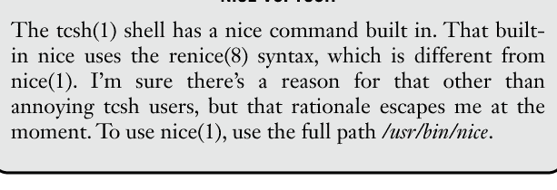

通常，当你启动命令时并没有机会告诉它要“礼貌”，相反，当你发现它正在吸收系统的所有容量时，才不得不改变它的 niceness。你可以使用 `renice(8)` 通过进程 ID 或所有者来重新确定正在运行的进程的优先级。要更改进程的 niceness，运行 renice 并传入新的 niceness 值和 PID 作为参数。

在我的职业生涯中，我运行过几个日志主机。除了通用的 syslog 服务外，它们通常还运行多个流捕获（flow-capture）、Nagios 和其他关键的网络感知系统实例。我经常使用一个 Web 界面来管理所有这些，并允许其他人访问我的日志。如果我发现 Web 服务器上的间歇性负载正在干扰我的网络监控或我的 `syslogd(8)` 服务器，我必须采取行动。对 Web 服务器进行 renice 会使客户端运行得更慢，但这比拖慢监控要好。使用 `pgrep(1)` 查找 Web 服务器的 PID：

```
##### pgrep httpd
993
##### renice 10 993
993: old priority 0, new priority 10
```

砰！FreeBSD 现在会在其他进程之后处理 Web 请求。这极大地恼怒了该服务的用户，但既然这是我的服务器，而我本身已经感到恼火了，那就没关系了。

要对用户拥有的每个进程进行 renice，请使用 `-u` 标志。例如，若要使我的进程比任何其他用户的进程更重要，我可以这样做：

```
##### renice -5 -u mw Lucas
1001: old priority 0, new priority -5
```

1001 是我在这个系统上的用户 ID。再次强调，我这么做一定是有非常好的理由的，不仅仅出于我个人权力的需求。同样，如果那个占用了我所有处理器时间的用户坚持要难以对付，我可以将他的进程设置得非常、非常“礼貌”，这可能会解决其他用户的投诉。如果你有一个大型后台数据库作业，让运行该作业的用户“礼貌”地运行，可以让前台工作正常进行。

Niceness 仅影响 CPU 使用率。它对磁盘或网络活动没有影响。

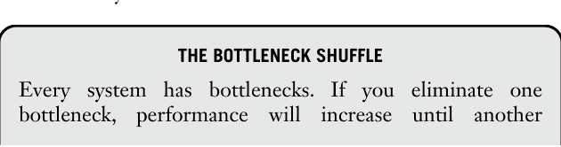

瓶颈被触及时。系统的性能受限于计算机中最慢的组件。例如，Web 服务器经常受网络限制，因为系统中慢的部分是互联网连接。如果你将千兆上行链路升级到 2.4Gb/s 的 OC-48，系统将以其他组件允许的速度尽可能快地分发其站点。管理层经常要求的假设性“消除瓶颈”，实际上是指“消除干扰常规工作负载的瓶颈”。

既然你已经能够查看系统问题了，让我们学习如何倾听系统试图告诉你什么。

#### 状态邮件

FreeBSD 通过 `periodic(8)` 每天、每周和每月运行维护作业。这些作业执行基本的系统检查，并通知管理员变更、需要关注的项目以及潜在的安全问题。每个计划作业的输出都会每天邮件发送给本地系统的 root 账户。了解你的系统正在做什么最简单的方法就是阅读这些邮件；许多像你一样忙碌的系统管理员协作使这些消息变得有用。虽然你可能会收到很多这类消息，但凭借一点经验，你将学会如何浏览报告，仅寻找关键或不寻常的变化。

每日、每周和每月报告的配置在 `periodic.conf` 中控制，如第 20 章所述。

你可能不希望每天登录你的所有服务器作为 root 只是为了阅读电子邮件，因此请将每台服务器 root 的邮件转发到一个集中的邮箱。在 `/etc/mail/aliases` 中进行此更改，如第 20 章所述。

我建议禁用这些作业的唯一地方是嵌入式系统，这些系统应通过

其他一些手段，例如你的网络监控系统。在此类系统中，请在 `/etc/crontab` 中禁用周期性(8)检查。

尽管这些每日报告很有用，但它们并未告知完整情况。日志能提供更为全面的视角。

### 使用 syslogd 进行日志记录

FreeBSD 的日志系统非常有用。任何类 Unix 操作系统都允许你以几乎任何详细程度记录几乎任何内容。虽然你可以找到针对最常见系统资源的默认系统日志挂钩，但你可以选择满足你需求的日志配置。几乎所有程序都与日志守护进程 `syslogd(8)` 集成。

syslog 协议通过消息进行工作。程序发送单独的消息，而 syslog 守护进程 `syslogd(8)` 捕获并处理这些消息。`syslogd(8)` 根据其设施和优先级级别处理每条消息，这两者都是客户端程序分配给消息的。你必须在管理系统日志时理解这两个概念：设施和级别。

#### 设施

`设施` 是一个标签，用于指示日志条目的来源。这是一个任意标签，只是一个用于区分不同程序的文本字符串。在大多数情况下，每个需要独特标识的程序都会使用独特的设施。许多程序或协议都有专用的设施——例如，FTP 是一种如此常见的协议，以至于 `syslogd(8)` 专门为其设置了一个特殊设施。Syslogd 还支持多种通用设施，你可以将它们分配给任何程序。

以下是标准设施及其用于记录的信息类型。

- **auth**: 关于用户授权的公开信息，例如用户登录或使用 `su(1)` 的情况。

- **authpriv**: 关于用户授权的私密信息，仅 root 可访问。

- **console**: 通常打印到系统控制台的消息。

- **cron**: 来自系统进程调度器的消息。

- **daemon**: 所有没有显式处理器的系统守护程序的统称。

- **ftp**: 来自 FTP 和 TFTP 服务器的消息。

- **kern**: 来自内核的消息。

- **lpr**: 来自打印系统的消息。

- **mail**: 邮件系统消息。

- **mark**: 此设施每 20 分钟在日志中放入一个条目。当与其他日志结合使用时，这非常有用。

- **news**: 来自 Usenet 新闻守护进程的消息。

- **ntp**: 网络时间协议消息。

- **security**: 来自安全程序的消息，例如 `pfctl(8)`。

- **syslog**: 关于日志系统本身的日志系统消息。然而，请勿在记录日志时记录日志，那只会让你头晕。

- **user**: 通用的消息设施。如果用户态程序未指定日志设施，则使用此设施。

- **uucp**: 来自 Unix-to-Unix 复制协议的消息。这是前互联网时代的 Unix 历史的一部分，你很可能永远不会遇到它。

- **local0** 到 **local7**: 这些是为系统管理员提供的。许多程序都有设置日志设施的选项；在尽可能可能的情况下，选择其中一个。例如，你可以指示客户服务系统记录到 `local0`。

虽然大多数程序都有合理的默认设置，但作为系统管理员，管理哪些程序记录到哪个设施是你的职责。

#### 级别

日志消息的`级别`代表其相对重要性。虽然程序将其所有日志数据发送到 syslogd，但大多数系统只记录 syslogd 接收到的重要内容，并丢弃其余部分。当然，一个人的琐事可能是另一个人的关键数据，这就是级别的作用所在。

syslog 协议提供八个级别。使用这些级别告诉 syslog 记录什么以及丢弃什么。级别按从最重要到最不重要排序如下：

- **emerg**: 系统恐慌。消息在所有终端上闪烁。电脑基本上完蛋了。你甚至不需要重启——系统正在为你执行此操作。

- **crit**: 严重错误包括硬盘坏道或严重软件问题之类的情况。如果你足够勇敢，可以继续按原样运行。

- **alert**: 这很糟糕，但不是紧急状态。系统可以继续运行，但此错误应立即处理。

- **err**: 这些是需要在某个时刻关注但不会破坏系统的错误。

- **warning**: 这些是各种警告，很可能不会阻止发出警告的程序像往常一样工作。

- **notice**: 这包括通常不需要你采取行动的一般信息，例如守护进程的启动和关闭。

- **info**: 这包括程序信息，例如邮件服务器中的单独交易。

- **debug**: 此级别通常只对程序员有用，偶尔对试图弄清楚程序为何如此行为的系统管理员也有用。调试日志可以包含程序员认为调试代码所需的任何信息，这可能包括侵犯用户隐私的信息。

- **none**: 这意味着“不要记录此设施的任何内容”。它通常用于排除通配符条目中的信息，稍后我们将看到这一点。

通过组合级别和优先级，你可以非常细致地对消息进行分类，并根据需求分别处理它们。

#### 使用 syslogd(8) 处理消息

`syslogd(8)` 守护进程捕获来自网络的消息，并将其与 `/etc/syslog.conf` 或 `/etc/syslog.d/` 中的条目进行比较。`/etc/syslog.d/` 中的文件用于你自己的条目和附加程序，而 `/etc/syslog.conf` 用于集成的系统程序。Syslogd 仅读取以 `.conf` 结尾的 `/etc/syslog.d/` 文件。这两个文件具有相同的格式，但为了清晰起见，我将引用 `/etc/syslog.conf`。该文件有两列；第一列描述日志消息，通过设施和级别或程序名称。第二列告知 `syslogd(8)` 当日志消息与描述匹配时该做什么。例如，看看默认 `syslog.conf` 中的这个条目：

这告诉 `syslogd(8)`，当它收到来自 `mail` 设施且级别为 `info` 或更高的消息时，应将消息追加到 `/var/log/maillog`。

logger 不会记录到不存在的文件中。在重启 `syslogd(8)` 之前，使用 `touch(1)` 创建日志文件。

##### 通配符

你还可以将通配符用作信息源。例如，此行记录来自 `mail` 设施的所有消息：

要记录来自所有地方的所有内容，取消注释 `all.log` 条目并创建文件 `/var/log/all.log`：

这可行，但我发现它信息过多，没有实际用途。你会发现自己使用复杂的串联 `grep(1)` 语句来查找最简单的信息。此外，这将包括各种私密数据。

##### 排除信息

使用 `none` 级别从日志中排除信息。例如，在此处，我们从包含一切的日志中排除了 `authpriv` 信息。分号允许你在一行中组合条目：

```
*.*; authpriv.none          /var/log/most.log
```

##### 比较

你也可以在 `syslog.conf` 规则中使用比较运算符 `<`（小于）、`=`（等于）和 `>`（大于）。虽然 syslogd 默认记录指定级别及以上的所有消息，但你可能只希望包含一定范围的级别。例如，你可以将 `info` 级别及以上的所有内容记录到主日志文件中，而将其余内容记录到调试文件中：

```
mail.info             /var/log/maillog
mail.=debug           /var/log/maillog.debug
```


`mail.info` 条目匹配发送到 `mail` 设施且级别为 `info` 及以上的所有日志消息。第二行仅匹配级别精确为 `debug` 的消息。你不能简单地使用 `mail.debug`，因为那样调试日志将重复前一个日志的内容。这样，你不需要通过调试信息来筛选基本的邮件日志，也不需要通过邮件传输信息来获取调试输出。

#### 本地设施

许多程序提供通过 `syslog` 记录日志的功能。这些程序中的大多数都可以设置为你选择的设施。各种本地设施保留给这些程序。例如，默认情况下，`dhcpd(8)`（参见第 20 章）记录到设施 `local7`。在此处，我们捕获这些消息并将它们发送到自己的文件中：

```
local7.*              /var/log/dhcpd
```

如果你用尽了本地设施，可以使用系统未使用的其他设施。例如，我曾经在一个繁忙的

一台位于没有 `uucp` 服务的网络上的日志服务器。

#### 按程序名称记录日志

如果你没有使用 facilities，可以使用程序名称作为匹配项。一个名称的条目需要两行：第一行包含带有前导感叹号的程序名称，第二行设置日志记录。例如，`FreeBSD` 使用此方法来记录 `ppp(8)` 信息：

```
!ppp
.*
/var/log/ppp.log
```

第一行指定了程序名称，第二行使用通配符告诉 `syslogd(8)` 将绝对所有内容追加到文件中。

`!programname` 语法影响其后的所有行，因此必须将其放在 `syslogd.conf` 的末尾。你可以安全地在 `/etc/syslog.d` 文件中使用它，而不必担心影响其他条目。

#### 记录到用户会话

当你记录到某个用户时，任何到达的消息都会显示在该用户的屏幕上。要记录到用户会话，请列出以逗号分隔的用户名作为目标。要将消息写入所有用户的终端，请使用星号（`*`）。例如，默认的 `syslog.conf` 包含这一行：

```
*.emerg  *
```

这意味着任何紧急级别的消息都会出现在所有用户的终端上。由于这些消息通常以某种方式说“再见”，因此这样做是合适的。

#### 将日志消息发送到程序

要将日志消息定向到程序，请使用管道符号（`|`）：

```
mail.*  |/usr/local/bin/mailstats.pl
```

#### 记录到日志主机

我的网络通常有一个单一的日志主机，它不仅处理 `FreeBSD` 机器，还处理 `Cisco` 路由器和交换机、其他 `Unix` 机器以及任何支持 `syslog` 的设备。这大大减少了系统维护工作并节省了磁盘空间。每条日志消息都包含主机名，因此你可以轻松地在后续进行排序。

使用 `@` 符号将消息发送到另一台主机。例如，以下行将你的本地 `syslog` 接收到的所有内容转储到我网络上的日志主机：

```
*. @loghost.blackhelicopters.org
```

目标主机上的 `syslog.conf` 决定了这些消息的最终目标。

在日志主机上，你可以根据日志消息来源的主机来分离日志。使用 `+` 符号和主机名来指示随后的规则适用于该主机：

```
+dhcpserver
local7.*	/var/log/dhcpd
+ns1
local7.*	/var/log/named
```

将通用规则放在 `syslog.conf` 的顶部。特定主机的规则应放在底部或单独的 `syslog.d` 文件中。

#### 日志记录重叠

日志守护程序不会按首次匹配或最后一次匹配来记录日志；相反，它根据每个匹配的规则进行记录。这意味着一条日志消息很容易出现在几个不同的日志中。考虑以下日志配置片段。

```
*.notice;authpriv.none	/var/log/messages
local7.*	/var/log/dhcp
```

几乎每个级别为 `notice` 或更高的消息都会被记录到 `/var/log/messages`。不过，任何 facility 为 `authpriv` 的消息都被特意排除在此日志之外。我们的 `DHCP` 服务器记录到 `/var/log/dhcp`。这意味着任何 `notice` 级别或更高的 `DHCP` 消息都会被记录到 `/var/log/messages` 和 `/var/log/dhcpd` 中。我不喜欢这样；我希望我的 `DHCP` 消息只存在于 `/var/log/dhcpd` 中。我可以参考 `authpriv` 的例子，通过使用 `none` facility 特意将 `DHCP` 消息从 `/var/log/messages` 中排除：

```
*.notice;authpriv.none;local7.none    /var/log/messages
```

我的 `/var/log/messages` `syslog` 配置经常随着我逐步排除每个本地 facility 而变得相当长，但这没关系。

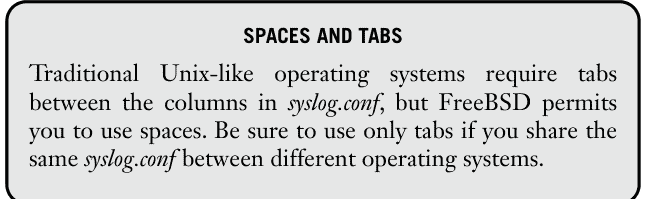

#### syslogd 定制

`FreeBSD` 默认运行 `syslogd`，开箱即用地可作为日志主机使用。你可以通过使用命令行标志来定制其工作方式。你可以在命令行或 `rc.conf` 中作为 `syslogd_flags` 指定这些标志。

#### 允许的日志发送者

你可以精确指定 `syslogd(8)` 接受来自哪些主机的日志消息。这很有用，以免你最终接受来自互联网上随机人员的日志。虽然发送大量日志可能被用作攻击前的硬盘填充准备，但更可能是配置错误的结果。无论如何，你的日志服务器都应该受到防火墙的保护。使用 `-a` 标志来指定可以向你发送日志消息的 `IP` 地址或主机网络，如下所示的两个（互斥的）例子：

```
syslogd_flags="-a 192.168.1.9"
syslogd_flags="-a 192.168.1.0/24"
```

虽然 `syslogd(8)` 也接受 `DNS` 主机名和域名用于此限制，但 `DNS` 是完全不适合的访问控制机制。

你可以通过指定 `-s` 标志（`FreeBSD` 的默认值）来完全禁止接受来自远程主机的消息。如果使用 `-ss`，`syslogd(8)` 还会禁止向远程主机发送日志消息。使用 `-ss` 会将 `syslogd(8)` 从显示在 `sockstat(1)` 和 `netstat(1)` 中的网络感知进程列表中移除。虽然这个半开 `UDP` 套接字是无害的，但如果 `syslogd(8)` 完全不出现在网络中，有些人会感觉更安心。

#### 绑定到单一地址

`syslogd(8)` 默认绑定到系统拥有的每个 `IP` 地址上的 `UDP` 端口 `514`。你的 `jail` 服务器需要 `syslogd`，但 `jail` 机器只能运行绑定到单一地址的守护程序。使用 `-b` 标志强制 `syslogd(8)` 绑定到单一 `IP`：

```
syslogd_flags="-b 192.168.1.1"
```

#### 额外的日志套接字

`syslogd(8)` 可以通过 `Unix` 域套接字以及通过网络接受日志消息。标准位置是 `/var/run/log`。然而，系统中的 `chroot` 进程无法访问此位置。如果你想让这些 `chroot` 进程运行，你必须配置它们通过网络记录日志，或者为它们提供额外的日志套接字。为此使用 `-l` 标志并指定额外日志套接字的完整路径：

```
syslogd_flags="-l /var/named/var/run/log"
```

`named(8)` 和 `ntpd(8)` 程序随 `FreeBSD` 一起提供，通常被 `chroot`。如果通过 `rc.conf` 对这两个程序进行 `chroot`，`/etc/rc.d/syslogd` 足够智能以添加适当的 `syslogd` 套接字。

#### 详细日志记录

使用详细模式（`-v`）进行日志记录会打印写入本地日志的每条消息的数字 facility 和级别。使用双重详细日志记录会打印 facility 和级别的名称而不是数字：

```
syslogd_flags="-vv"
```

这些是我认为最常用的标志。请阅读 `syslogd(8)` 获取完整的选项列表。

#### 日志文件管理

日志文件会增长，你必须决定它们在修剪之前可以增长到多大。标准方法是通过日志轮转。当日志轮转时，最旧的日志被删除，当前日志文件被关闭并赋予新名称，并为新数据创建一个新的日志文件。`FreeBSD` 包含一个基本的日志文件处理器，`newsyslog(8)`，它还压缩文件、重启守护程序，并通常处理日志文件整理的所有常规任务。`cron(1)` 每小时运行一次 `newsyslog(8)`。

当 `newsyslog(8)` 运行时，它读取 `/etc/newsyslog.conf` 和 `/etc/newsyslog.conf.d/` 中的文件。`/etc/newsyslog.conf` 文件用于核心系统功能，而 `/etc/newsyslog.conf/d/` 中的文件用于附加软件。`newsyslog` 程序尝试将 `/etc/newsyslog.conf/d/` 中的任何文件解析为 `newsyslog` 配置。两者使用相同的格式，因此为了清晰起见，我们将引用 `newsyslog.conf`。`newsyslog.conf` 中的每一行给出轮转一个日志文件的条件。如果满足轮转日志的条件，则轮转日志并酌情采取其他操作。`/etc/newsyslog.conf` 每个日志文件使用一行；每行有七个字段，如下所示：

```
/var/log/ftp.log root:network 640 3 100 * JC
```

让我们依次检查每个字段。

##### 日志文件路径

每行的第一项（示例中的 `/var/log/ppp.log`）是要处理的日志文件的完整路径。

##### 所有者和组

第二个字段（我们的示例中的 `root:network`）列出了轮转文件的所有者和组，用冒号分隔。此字段是可选的，在许多标准条目中不存在。

`newsyslog(8)` 可以更改旧日志文件的所有者和组。默认情况下，日志文件由 `root` 用户和 `wheel` 组拥有。虽然更改所有者并不常见，但你可能在多用户机器上需要此功能。

你也可以选择仅更改所有者或仅更改组。在这些情况下，你使用冒号，仅在冒号的一侧放置名称。例如，`:www` 将组更改为 `www`，而 `mwelucas:` 使我拥有该文件的所有权。

##### 权限

第三个字段（我们的示例中的 `640`）给出标准 `Unix` 三位数字表示法的权限模式。

##### 计数

此字段指定 `newsyslog(8)` 应保留的最旧轮转日志文件。`newsyslog(8)` 从最新到最旧对归档日志编号，从最新的 `log 0` 开始。例如，对于 `/var/log/messages` 的默认计数 `5`，你将找到以下消息日志：

```
messages
messages.0.bz
messages.1.bz
messages.2.bz
```

- `messages.3.bz`
- `messages.4.bz`
- `messages.5.bz`

对于会数数的人来说，你们会意识到这意味着有六个存档，而不是五个，再加上当前的日志文件，共计一周的日志。通常来说，日志多总比少要好；但是，如果磁盘空间紧张，删除一两个额外的日志可能会为你争取时间。

##### 大小

第五个字段（在我们的示例中为 `100`）是以千字节为单位的文件大小。当 `newsyslog(8)` 运行时，它会比较此处列出的大小与文件的大小。如果文件大于此处指定的大小，`newsyslog(8)` 会轮转该文件。如果你不希望文件大小影响文件轮转的时机，请在此处填入星号。

##### 时间

到目前为止，这似乎很简单，对吧？第六个字段，即轮转时间，改变了这一点。时间字段有四种不同的合法值类型：一个星号、一个数字，以及两种不同的日期格式。

如果你基于日志大小而不是年龄来轮转日志，请在此处填入星号。

如果你在此字段中填入一个纯数字，`newsyslog(8)` 将在经过那么多小时之后轮转日志。例如，如果你希望日志每 `24` 小时轮转一次，但不关心具体轮转的确切时间，请在此处填入 `24`。

日期格式稍微复杂一些。

###### ISO 8601 时间格式

任何以 `@` 符号开头的条目都采用受限的 `ISO 8601` 时间格式。这是大多数类 `Unix` 系统上 `newsyslog(8)` 使用的标准；它是 `MIT` 早期 `newsyslog(8)` 使用的格式。受限 `ISO 8601` 有点晦涩，但所有类 `Unix` 操作系统都支持它。

受限 `ISO 8601` 格式中的完整日期是 `14` 位数字，中间有一个 `T`。前四位是年份，接下来两位是月份，再接下来两位是日期中的第几天。`T` 插入中间，类似于小数点，将整天与天的小数部分分开。接下来两位是小时，再接下来两位是分钟，最后两位是秒。例如，`2008` 年 `3` 月 `2` 日晚上 `9` 点 `15` 分 `08` 秒，在受限 `ISO 8601` 中表达为 `20080302T211508`。

虽然受限 `ISO 8601` 中的完整日期相当直观，但如果你未列出整个日期，混淆就会产生。你可以选择仅指定 `T` 附近的字段，而将较远的字段留空。空白字段是通配符。例如，`1T` 匹配每个月的第一天。`4T00` 匹配每个月第四天的午夜。`T23` 匹配每天的第 `23` 小时，即晚上 `11` 点。如果 `newsyslog.conf` 中的时间为 `@T23`，日志将在每天晚上 `11` 点轮转。

与 `cron(1)` 一样，你必须详细指定时间单位。例如，`@07T`（每月第七天）会在每月第七天的每小时、每小时整点轮转一次日志。毕竟，它匹配了全天！如果时间设置为 `@7T01`，则会在每月 `7` 日凌晨 `1` 点轮转日志，这通常更符合需求。然而，你不需要比小时更详细的单位，因为 `newsyslog(8)` 每小时只运行一次。

###### FreeBSD 特定时间

受限的 `ISO 8601` 时间系统不允许轻松指定每周任务，而且无法指定月底的最后一天。这就是为什么 `FreeBSD` 包含了一种时间格式，让你可以轻松执行这些常见任务。任何以美元符号（`$`）开头的条目都采用 `FreeBSD` 特定的月、周、日格式。

此格式使用三个标识符：`m`（月中第几天）、`w`（周中第几天）和 `h`（一天中的第几小时）。每个标识符后跟一个数字，指示特定时间。小时范围从 `0` 到 `23`，而天数从 `0`（星期日）到 `6`（星期六）。月中的日子从 `1` 开始递增，`L` 代表该月的最后一天。例如，要在每月 `5` 日中午轮转日志，我可以使用 `$m5h12`。要在月底最后一天晚上 `10` 点开始月末日志统计，请使用 `$mLh22`。

##### 基于大小和时间轮转

你可以按指定时间轮转日志，当它们达到特定大小时轮转，或者两者兼有。如果你同时指定大小和时间，只要满足任一条件，日志就会轮转。

##### 标志

`flags` 字段决定了日志轮转时要采取的任何特殊操作。这通常告诉 `newsyslog(8)` 如何压缩日志文件，但你也可以在日志从进程下被轮转时向进程发送信号。

###### 日志文件格式和压缩

日志可以是文本文件或二进制文件。

二进制文件只能以非常特定的方式写入。`newsyslog(8)` 在每个新日志开始时添加一条“日志已翻过”的消息，但在二进制文件中添加此文本会损坏该文件。`b` 标志告诉 `newsyslog(8)` 这是一个二进制文件，不需要此标题。

其他日志文件以普通的 `ASCII` 文本写入，`newsyslog(8)` 可以且应该在文件顶部添加一条带时间戳的消息，指示日志何时被轮转。如果你使用 `UFS`，压缩旧日志文件可以节省大量空间。`-j` 标志告诉 `newsyslog(8)` 使用 `bzip(1)` 压缩存档；`-z` 标志指定 `gzip` 压缩；`-x` 标志指定 `xz(1)`；`-v` 标志指定压缩领域的新宠 `zstd(1)`。

然而，如果你使用的是 `ZFS`，文本日志文件会在数据集层与其他所有可压缩文件一起被压缩。你仍然可以按传统方式压缩日志文件，但这样做没有优势。此外，在查看这些文件之前，你需要手动解压它们。让 `ZFS` 为你处理压缩吧。

###### 特殊日志文件处理

在创建和轮转日志文件时，`newsyslog(8)` 可以执行一些特殊任务。以下是其中最常见的；你可以在 `newsyslog.conf(5)` 中阅读关于其他任务的说明。

也许你有很多相似的日志文件，希望以相同的方式处理它们。`-G` 标志告诉 `newsyslog`，该行开头的日志文件名实际上是一个 `shell` glob（通配符），并且所有匹配该表达式的日志文件都将以这种方式轮转。要了解 `shell` 表达式，请阅读 `glob(3)`。请备好阿司匹林。

你可能希望如果文件不存在，`newsyslog` 能创建该文件。请使用 `-c` 标志。`syslogd` 程序不会向日志中记录不存在的文件。

`-n` 标志明确告诉 `newsyslog`，在轮转此日志时不要发送信号。

最后，当你不需要这些标志中的任何一个时，使用连字符（`-`）作为占位符。它在此处创建一个列，以便你可以拥有，比如说，一个 `pidfile` 路径。

###### Pidfile

下一个字段是 `pidfile` 路径（在我们的示例中未显示，但请参阅 `/etc/newsyslog.conf` 获取几个示例）。`pidfile` 记录程序的进程 ID，以便其他程序可以轻松查看。如果你列出了 `pidfile` 的完整路径，`newsyslog(8)` 在轮转日志时会向该程序发送 `kill -HUP`。这会向进程发送信号，使其关闭其日志文件并重新启动自身。并非所有进程都有 `pidfile`，也并非所有程序在轮转其日志时都需要这种特殊处理。

###### 信号

大多数程序在收到 `SIGHUP` 时执行日志文件轮转，但有些程序在其日志被轮转时需要特定的信号。你可以在最后一个字段中，即在 `pidfile` 之后，列出所需的准确信号。

###### 示例 newsyslog.conf 条目

让我们把这些都拼凑起来，形成一个最坏情况、令人难以置信的例子。一个数据库日志文件需要在每月最后一天的晚上 `11` 点轮转。数据库文档说明，轮转时必须向服务器发送中断信号（`SIGINT`，或信号编号 `2`）。你希望存档的日志由用户 `dbadmin` 拥有，且仅该用户可查看。你需要保留六个月的日志。更重要的是，这些日志是二进制文件。你的 `newsyslog.conf` 行看起来像这样：

`/var/log/database dbadmin: 400 6 * $MLh23 B /var/run/db.pid 2`

这是一个刻意恶劣的例子；在大多数情况下，你只需填入文件名和轮转条件，就大功告成了。

### FreeBSD 和 SNMP


通过电子邮件发送的报告很好，但比较通用，而日志对于长期趋势分析来说很难解读。网络、服务器和服务管理的行业标准是简单网络管理协议（SNMP）。许多不同的供应商支持 SNMP 作为从网络上许多不同设备收集信息的协议。FreeBSD 包含一个 SNMP 代理 `bsnmpd(8)`，它不仅提供标准 SNMP 功能，还提供对 FreeBSD 特定功能的可见性。

FreeBSD 的 `bsnmpd`（Begemot SNMPD 的缩写）是一个极简主义的 SNMP 代理，专门设计为可扩展。所有实际功能都通过外部模块提供。FreeBSD 包含用于标准网络 SNMP 功能的 `bsnmp` 模块，以及用于特定 FreeBSD 功能（如 PF 和 `netgraph(4)`）的模块。`bsnmpd(8)` 试图满足所有人的所有需求，而是提供一个基础，让每个人都可以构建一个仅做其所需之事的 SNMP 实现，不多也不少。

#### SNMP 入门

SNMP 基于经典的客户端-服务器模型工作。SNMP 客户端通常是某种管理工作站或监控服务器，

##### SNMP MIB

向 SNMP 服务器发送跨网络的请求。SNMP 服务器，也称为 `agent`（代理），从本地系统收集信息并将其返回给客户端。FreeBSD 的 SNMP 代理是 `bsnmpd(8)`。

SNMP 代理也可以发送请求来修改 SNMP 服务器的设置。如果系统配置得当（或者从你的角度来看配置不当），你可以通过 SNMP 发出指令。这种“写”配置最常用于路由器、交换机和其他嵌入式网络设备。大多数类 Unix 操作系统都有一个命令行管理系统，通常不接受通过 SNMP 发出的指令。通过 SNMP 写入系统配置或发出指令需要仔细的设置，并引发各种安全问题；这是一个足以写成一本书的绝好话题。据我所知，没有系统管理员愿意通过 SNMP 来管理他们的系统。鉴于此，我们将专门关注只读 SNMP。

除了让 SNMP 服务器响应来自 SNMP 客户端的请求外，客户端还可以向网络其他地方的陷阱接收器发送 SNMP `traps`（陷阱）。SNMP 代理会在响应服务器上的特定事件时生成这些陷阱。SNMP 陷阱与 `syslogd(8)` 消息非常相似，只是它们遵循 SNMP 要求的非常特定的格式。FreeBSD 目前不包含 SNMP 陷阱接收器；如果你需要一个，请查看来自 net-snmp 的 `snmptrapd(8)`（`net-mgmt/net-snmp`）。

SNMP 通过管理信息库（MIB）来管理信息，MIB 是一种包含 ASN.1 格式分层信息的树状结构。我们之前见过一个 MIB 树的例子：第 6 章中讨论的 `sysctl(8)` 接口。

每个 SNMP 服务器都有一个列表，列出了它可以从本地计算机中提取的信息。服务器将这些信息片段整理成一棵分层树。每个 SNMP MIB 树都有非常通用的主类别：网络、物理、程序等，每个类别中又有更具体的细分。把树想象成一个组织良好的文件柜，其中单独的抽屉存放具体的信息，抽屉内的文件存放具体的事实。类似地，最顶层的 MIB 包含其下的一系列 MIB。

MIB 可以通过名称或编号来引用。例如，这是一个从示例系统中获取的 MIB：

```
interfaces.ifTable.ifEntry.ifDescr.1 = STRING: "em0"
```

这个 MIB 中的第一项 `interfaces` 表明我们正在查看该机的网络接口。如果该机器没有接口，这个第一类别甚至都不会存在。`ifTable` 是接口表，或者说是系统中所有接口的列表。`ifEntry` 显示一个特定的接口，而 `ifDescr` 表示我们正在查看该接口的描述。这个 MIB 可以总结为：“这台机器上的接口 1 被称为 `em0`。”

MIB 可以用数字表示，大多数 SNMP 工具都原生使用数字 MIB 进行工作。大多数人更喜欢使用单词，但你糟糕的大脑必须能够处理这两种形式。MIB 浏览器可以为你将 SNMP MIB 的数字形式和单词形式相互转换，或者你可以安装 `net-mgmt/net-snmp` 并使用 `snmptranslate(1)`，但现在，请相信我。前面的例子可以翻译为：

```
.1.3.6.1.2.1.2.2.1.2.1
```

用单词表达时，这个 MIB 有 5 个由点分隔的术语。用数字表达时，MIB 有 11 个部分。如果它们应该是同一事物，这看起来似乎不太对劲。怎么回事？

数字 MIB 之所以更长，是因为它包含了默认的 `.1.3.6.1.2.1`，这意味着 `.iso.org.dod.internet.mgmt.mib-2`。这是互联网上使用的标准 MIB 子集。绝大多数 SNMP MIB（但不是全部）在前面都有这个前缀字符串，所以没有人再费心去写下它了。

如果你正处于那种挑剔的情绪中，你甚至可以混合使用单词和数字：

```
.1.org.6.1.mgmt.1.interfaces.ifTable.1.2.1
```

到了这个地步，国际条约允许你的同事拿着草叉和燃烧的火炬把你赶出大楼。选择一种表达 MIB 的方法并坚持下去。

##### MIB 定义和 MIB 浏览器

MIB 根据非常严格的语法进行定义，并记录在 MIB 文件中。每个 SNMP 代理都有自己的 MIB 文件；`bsnmpd` 的 MIB 文件位于 `/usr/share/snmp`。这些文件是非常正式的纯文本。虽然你可以仅凭大脑阅读和解释它们，但我强烈建议将它们复制到工作站上并安装 MIB 浏览器，以便你更容易理解它们。

MIB 浏览器解释 MIB 文件，并以完整的树状辉煌展示它们，包括树的每个部分的定义和每个单独 MIB 的描述。一般来说，MIB 浏览器允许你输入特定的 MIB，并显示该 MIB 的数字和单词定义，同时查询 SNMP 代理以获取该 MIB 的状态。

如果你的工作站上运行的是 FreeBSD（或更小的 Unix），请使用 `mbrowse`（`net-mgmt/mbrowse`）进行 MIB 浏览。如果你不想使用图形界面进行 SNMP 工作，请查看 `net-snmp`（`net-mgmt/net-snmp`）以获取全套的命令行 SNMP 客户端工具。

##### SNMP 安全性

许多安全专家声称 SNMP 实际上代表“Security: Not My Problem!”（安全：不是我的问题！）。这有点刻薄，但非常真实。SNMP 只能在受信任网络上的防火墙后方使用。如果你必须在裸互联网上使用 SNMP，请使用数据包过滤来防止公众查询你的 SNMP 服务。SNMP 代理运行在 UDP 端口 161 上。

更常见的 SNMP 版本 1 和 2c 不提供加密。这意味着任何拥有数据包嗅探器的人都可以捕获你的 SNMP 团体名称，因此务必确保你仅在私有网络上使用 SNMP。在不受信任的网络上进行未加密的 SNMP 查询是让人陌生人插手你的系统管理的一种好方法。SNMP 版本 3 使用加密来保护线路上的数据。

SNMP 通过 `communities`（团体）提供基本的安全保障。如果你四处看看，你会发现各种解释，说明为什么团体与密码不同，但团体就是密码。大多数 SNMP 代理默认有两个团体：`public`（只读访问）和 `private`（读写访问）。是的，有一个提供读写访问的默认设置。每当你在任何主机、任何操作系统上配置 SNMP 代理时，你的第一项任务都是禁用这些默认的团体名称，并将其替换为几十年来未被广泛记录的名字。

FreeBSD 的 `bsnmpd(8)` 默认使用 `SNMPv2c`，但可以运行 `SNMPv3`。`SNMPv3` 是一个更复杂的协议，所以我们在这里不打算涵盖它。如果你理解 `SNMPv3` 协议以及配置 FreeBSD 的 `bsnmpd` 的基础，那么在 `bsnmpd` 中启用 `SNMPv3` 将不会有任何困难。

##### 配置 bsnmpd

在你可以使用 SNMP 监控你的系统之前，你必须配置 SNMP 守护进程。在 `/etc/snmpd.conf` 中配置 `bsnmpd(8)`。除了包含默认的 `public` 和 `private` 团体外，默认配置没有启用使 `bsnmpd(8)` 具有吸引力的任何 FreeBSD 特定功能。

###### bsnmpd 变量

`bsnmpd` 使用变量为配置语句赋值。大多数高可见度的变量设置在配置文件顶部，如下所示：

```
location := "Room 200"
contact := "sysmeister@example.com"
system := 1 # FreeBSD
traphost := localhost
trapport := 162
```

这些顶部变量定义了应设置在每个 SNMP 代理上的 MIB 值。`location` 描述了机器的物理位置。每个系统都需要一个合法的电子邮件联系人。`bsnmpd(8)` 运行在 FreeBSD 以外的操作系统上，因此你可以选择在此处设置特定的操作系统。最后，如果你有一个陷阱主机，你可以在此处设置服务器名称和端口。

在文件更下方，你可以设置 SNMP 团体名称：

```
###### Change this!
read := "public"
###### Uncomment begemotSnmpdCommunityString.0.2 below that sets the community
###### string to enable write access.
write := "geheim"
trap := "mytrap"
```

`read` 字符串定义了此 SNMP 代理的只读团体。默认配置文件建议你更改它。请接受该建议。`write` 字符串是读写团体名称，在配置文件更下方默认是禁用的。你还可以设置由此代理发送的 SNMP 陷阱的团体名称。

仅通过此配置，`bsnmpd(8)` 将启动、运行，并为你的网络管理系统提供基本的 SNMP 数据。只需在 `/etc/rc.conf` 中设置 `bsnmpd_enable="YES"` 即可在启动时启动 `bsnmpd`。然而，你不会得到任何特殊的 FreeBSD 功能。让我们继续看看如何管理它。

###### 详细的 bsnmpd 配置

`bsnmpd(8)` 使用你在配置文件顶部设置的变量，在配置的后续部分将值分配给不同的 MIB。例如，在文件顶部你将变量 `read` 设置为 `public`。在配置文件后面，你会发现这个语句：

```
begemotSnmpdCommunityString.0.1 = $(read)
```

这将 MIB `begemotSnmpdCommunityString.0.1` 设置为 `read` 变量的值。

为什么不直接设置这些值？`bsnmpd(8)` 是专门设计为可扩展和可配置的。在顶部设置几个变量

从文件顶部开始编辑要比直接编辑文件下方深处的规则容易得多。

让我们回到这里的 `begemotSnmpdCommunityString` MIB 设置。为什么要设置它？在你的 MIB 浏览器中搜索该字符串，你会发现这是一个定义 SNMP 团体名称的 MIB。你本可以从 `read` 变量的赋值中猜到这一点，但确认一下总是好的。

同样，你会找到如下的条目：

```
begemotSnmpdPortStatus.0.0.0.0.161 = 1
```

检查 MIB 浏览器可知，这决定了 `bsnmpd(8)` 绑定的 IP 地址和 UDP 端口（在本例中，绑定所有可用地址，端口为 161）。所有 MIB 配置都是通过这种方式完成的。

###### 加载 bsnmpd 模块

大多数有趣的 `bsnmpd(8)` 功能都是通过模块配置的。通过在配置文件中为 `begemotSnmpdModulePath` MIB 指定模块处理的类以及实现该功能支持库的完整路径，可以启用模块。例如，在默认配置中，你会看到一个被注释掉的 PF `bsnmpd(8)` 模块条目：

```
begemotSnmpdModulePath."pf" = "/usr/lib/snmp_pf.so"
```

这将启用对 PF MIB 的支持。启用后，你的网络管理软件将能够直接查看 PF 内部，让你可以追踪从丢弃的数据包到状态表大小的所有内容。

截至本文撰写时，FreeBSD 的 `bsnmpd(8)` 附带以下已包含但处于禁用状态的模块。其中一些是 FreeBSD 特有的，而另一些则支持行业标准。取消这些配置文件条目的注释并重启 `bsnmpd` 即可启用它们。

-   `lm75` 通过 SNMP 提供 `lm75(4)` 温度传感器的数据。

-   `Netgraph` 提供对所有基于 Netgraph 的网络特性的可见性，详见 `snmp_netgraph(3)`。

-   `PF` 提供对 PF 数据包过滤器的可见性。

-   `Hostres` 实现主机资源 SNMP MIB，详见 `snmp_hostres(3)`。

-   `bridge` 提供对桥接功能的可见性，详见 `snmp_bridge(3)`。

-   `wlan` 访问无线网络信息。

在配置文件中启用其中任何一个模块后，重启 `bsnmpd(8)`。如果程序无法启动，请检查 `/var/log/messages` 中的错误。

借助 `bsnmpd(8)`、`syslogd(8)`、状态电子邮件以及各种性能分析工具，你可以让你的 FreeBSD 系统成为网络上监控最完善的设备。现在，既然你可以看到系统提供的一切，请拿手电筒，我们将探索 FreeBSD 的一些较暗的角落。

## 22

### JAILS（监狱容器）


虚拟化将操作系统实例与底层硬件分离。虚拟化允许你通过复制文件将操作系统安装从一个硬件迁移到另一个硬件。虚拟化需要在硬件上安装操作系统，但该安装通常非常精简，没有面向公众的服务，并且可以轻松在新硬件上重现。这可能是几十年来系统管理领域最大的变化。

虚拟化有点像客户端-服务器环境。硬件及其核心操作系统实例是 `host`（宿主），而 `client`（客户端）是所有虚拟化的操作系统实例。客户端依赖宿主提供基本服务，如存储、处理器功率和内存。宿主的变化可以反映在虚拟化的客户端中，但客户端上的变化除了消耗资源外，对宿主没有影响。

FreeBSD 支持两种类型的虚拟化：jails（监狱容器）和 `bhyve`。

`jails` 是一种轻量级虚拟化方法，有时被称为 `操作系统级虚拟化`。`jail` 通常包含一个完整的操作系统用户空间，运行在现有的 FreeBSD 系统之上。`jail` 依赖宿主机的文件系统，但仅限于目录树的一个子集。它甚至可以在 ZFS 池中拥有专用的空间块。`jail` 没有自己的内核，而是在宿主内核的一个受限部分中运行。宿主可以在不进入 `jail` 的情况下管理被禁闭的进程，或者根据需要运行 `jail` 内部的进程。Jails 没有图形控制台。使用 jails 虚拟化相同版本或更早版本的 FreeBSD 安装，或运行简单的虚拟 Linux 系统。

`bhyve` 是一种较重的虚拟化系统。与使用宿主的内核和文件系统不同，`bhyve` 模拟硬件。宿主提供一块磁盘空间供虚拟机作为磁盘使用。`bhyve` 虚拟机必须自带其自身的文件系统、内核和支持基础设施。`bhyve` 虚拟机比 jails 需要更多的资源，但它们还通过虚拟网络计算（VNC）提供控制台，并且可以运行真正的外来操作系统，如 Microsoft Windows。由于 `bhyve` 开发迅速，它也在快速变化，因此本书不对其进行详细覆盖。一旦 `bhyve` 稳定下来，我会再写关于 `bhyve` 的内容。

在考虑 `bhyve` 之前，看看 `jail` 是否能满足你的需求。

#### Jail 基础知识

`Jail` 是一个超强的 `chroot`，不仅适用于文件系统，还适用于进程和网络堆栈。被禁闭的系统只能访问文件系统的一个狭窄部分，并且无法看到 `jail` 外部的进程。传统上，每个 `jail` 都会被分配一个专用的 IP 地址，`jail` 只能查看发往该特定 IP 的流量。每个 `jail` 甚至拥有自己的用户账户。`Jail` 中的 `root` 账户完全控制该 `jail`，但对 `jail` 之外的任何事物没有访问权限。

对于被授予 `jail root` 权限的用户来说，`jail` 看起来像是一个几乎完整的 FreeBSD 系统，只是缺少少数几个设备节点。用户可以安装她喜欢的任何软件，而不会干扰宿主或其他 jails。在 `jail` 中运行的所有进程只能影响 `jail` 的文件和进程。被禁闭的用户对 `jail` 之外的任何事物没有可见性；她被禁闭了。如果 `jail` 被黑客攻击，入侵者也被限制在 `jail` 内部。

`Jails` 可以使用基于 `vnet(9)` 的虚拟网络堆栈。这是高级用途，我们在此不会涵盖，但如果你需要为 `jail` 提供自己的路由表，就是这样做的。

从 FreeBSD 9 开始，多个 jails 可以共享单个 IP 地址，但系统管理员需要配置每个 `jail` 对每个网络服务使用唯一的 TCP/IP 端口。你不能在单个 IP 的 22 端口上运行多个 SSH 实例！为简单起见，以下示例为每个 `jail` 使用单个 IP，但请记住你还有其他选项。

许多人将所有服务都放在 jails 中，即使宿主是专为特定目的设置的。对 `jail` 数据集的 ZFS 快照或目录树的 `tar` 包，都是 `jail` 的完整备份。在软件升级失败后进行恢复，只需解压 `tar` 包或回滚到快照即可。

`Jail` 对于软件开发和测试也很有用。部署新服务通常需要安装和测试相当多的软件包。在选定方案并进入生产环境之前，在 `jail` 中进行测试可以防止宿主被废弃的文件和不需要的软件污染。

根据你的硬件和系统负载，单个 FreeBSD 宿主可以支持数十甚至数百个 jails。如果你确实要运行那么多 jails，请确保宿主有两个独立的网络接口。将其中一个专门用于 jails，另一个用于管理宿主。

一切从配置你的 `jail` 宿主开始。

##### Jail 宿主服务器设置

旨在作为 `jail` 宿主的服务器必须在一些烦人的限制条件下工作。在构建第一个 `jail` 之前，请正确配置你的宿主。

`Jail` 系统有自己的 `sysctl` 树，`security.jail`。你只能从宿主系统更改这些 `sysctl`。某些 `sysctl` 影响宿主上运行的所有 jails。以 `security.jail.param` 开头的 `sysctl` 可以按单个 `jail` 设置。我们将在本章中简要介绍这些内容。

###### Jail 宿主存储


我强烈建议你仅使用你的 `jail` 宿主来运行 `jails`，并将所有服务放在 `jail` 内。首先配置宿主的存储，以分离 `jails` 和宿主操作系统。

许多打算用于虚拟化的宿主在主板上有 `SATA` `DOM` 闪存驱动器用于操作系统。这些驱动器通常小于 `100GB`，但 `FreeBSD` 的基础安装所需的远小于一 `GB`。如果你有 `SATA` `DOM` 或类似设备，请用它作为宿主操作系统。如果你有多个冗余硬盘组，请使用一对来镜像操作系统，并将其余全部专门用于 `jails`。

如果你没有这样的硬件，请为宿主操作系统分配空间。对于 `UFS` 文件系统使用分区，对于 `ZFS` 使用数据集预留。无论哪种情况，`10GB` 的空间应该都足够了。如果你需要额外的紧急空间，你可以从 `jail` 空间中借用一些。

虽然 `ZFS` 对 `jails` 非常有用，但它不是必需的。我多年来一直在 `UFS` 上运行 `jails`。使用适合你且符合你环境的方案。

一旦你完成了宿主分区和操作系统安装，就看看网络。

### Jail 网络

Jail 网络有两个看似矛盾的方面：首先，每个 `jail` 期望对其分配的 `IP` 地址拥有完全控制权；其次，`jails` 可以与其他 `jails` 甚至宿主共享 `IP` 地址。你可以使用宿主上的任何 `IP` 地址启动 `jail`，但该 `jail` 无法与该 `IP` 上运行的其他面向网络的服务进行协调。如果你的 `jail` 共享宿主的 `IP` 地址，且宿主在 `22` 端口运行 `SSH`，那么 `jail` 不能使用 `22` 端口。如果你尝试在 `jail` 中启动 `sshd(8)`，程序会抱怨无法使用 `22` 端口并崩溃。在 `jails` 之间，甚至是在 `jails` 和宿主之间共享 `IP` 地址，需要系统管理员协调哪些端口属于哪些主机，并相应地配置所有内容。

配置 `jails` 最简单的方法是为每个 `jail` 分配其自己的 `IP` 地址，并为宿主分配其自己的 `IP` 地址。然后每个 `jail` 可以完全控制其自身的 `IP` 地址。一旦你掌握了这一点，就可以开始在 `jails`（监狱/隔离环境）之间共享地址了。这意味着宿主机（`host`）不能拥有监听在分配给 `jail` 的 `IP` 地址上的守护进程。如果宿主机的守护进程监听在 `jail` 的 `IP` 地址上，虽然不会阻止 `jail` 启动，但会阻止该 `jail` 在该端口上启动其自身的服务。如果用户无法通过 `SSH` 连接到他们的私有 `jail`，像 `Bert` 这样的用户会抱怨的！

配置 `jail` 宿主机的最干净的方法是决定让宿主机仅提供 `jail`。任何在宿主机上运行的服务都必须位于 `jail` 内部。如果你需要简单的服务，例如名称服务器或邮件交换器，请在 `jail` 中配置它们。这不仅比正确重新配置所有这些服务器以仅附加到选定的 `IP` 地址更容易；它还为你的其他 `jail` 提供了一层额外的安全性。宿主机的入侵会自动赋予入侵者访问你所有 `jail` 的权限，而单个 `jail` 的入侵则将入侵者限制在该 `jail` 内。

使用 `sockstat(1)` 来识别监听网络的服务程序，如第 9 章中所述。添加 `-46` 标志以仅显示 `IPv4` 和 `IPv6` 流量，并添加 `-l` 以仅显示监听套接字。

```bash
sockstat -46l
USER      COMMAND     PID  FD PROTO   LOCAL ADDRESS      FOREIGN ADDRESS
root      ntpd        19776 20 udp6        *:123            *:*
root      ntpd        19776 21 udp4        *:123            *:*
--snip--
root      sshd         2846  3  tcp6        *:22             *:*
root      sshd         2846  4  tcp4        *:22             *:*
```

这个相当默认的 `FreeBSD` 安装有两个程序正在监听网络：`ntpd` 和 `sshd`。两者都在监听所有 `IP` 地址。我们必须配置所有这些守护进程，使其仅监听主服务器地址。

以下是一些在宿主服务器上会导致常见问题的守护进程。在所有这些案例中，我假设 `jail` 宿主机的 `IP` 为 `198.51.100.50`。

#### syslogd

系统日志记录器 `syslogd(8)` 打开一个 `UDP` 套接字，以便它可以向其他主机发送消息。如果你不记录远程日志，或者使用了不同的日志解决方案，请在 `rc.conf` 中使用 `-ss` 标志来关闭网络组件。

```bash
syslogd_flags="-ss"
```

如果你需要发送 `syslogd` 消息，请使用 `-b` 标志强制 `syslogd` 仅附加到单个 `IP` 地址。

```bash
syslogd_flags="-b 198.51.100.50"
```

这两种解决方案都允许你的 `jail` 管理员单独决定是否要通过网络进行日志记录。关于 `syslogd` 的完整讨论请参见第 21 章。

#### inetd

如果你需要 `inetd`（参见第 20 章），你几乎肯定应该从 `jail` 内部而不是宿主机上运行它。然而，如果你无法逃避在宿主机上运行 `inetd`，请使用 `-a` 标志将其限制在单个 `IP` 地址上，如下面的 `rc.conf` 代码片段所示。

```bash
inetd_flags="-a 198.51.100.50 -wW -C 60"
```

如果我只指定了 `-a` 标志和 `IP` 地址，它会覆盖 `/etc/defaults/rc.conf` 中 `inetd` 的默认标志。过去几十年 `FreeBSD` 的每个版本都使用了默认标志 `-wW -C 60`；我将我的 `-a` 和 `IP` 地址添加到了这些标志中。

#### sshd

`/etc/ssh/sshd_config` 中的选项 `ListenAddress` 告诉 `sshd(8)` 绑定到哪些地址。将其限制为仅你的宿主机 `IP`。

```bash
ListenAddress 198.51.100.50
```

如果你的 `jail` 宿主机提供的唯一服务是 `sshd(8)`，那你已经做得很好了。

#### NFS

网络文件系统程序，如 `rpcbind(8)` 和 `nfsd(8)`，无论你做什么，都会绑定到宿主机上的所有 `IP` 地址。不要在这些 `jail` 内部运行这些程序，也不要从 `jail` 内部运行 `NFS`。如果你的客户端需要 `NFS` 挂载，请让宿主机运行这些程序并提供 `NFS` 挂载。

#### 网络时间协议

`Jail` 宿主机上最具问题的服务是时间同步。所有 `jail` 都从宿主机获取系统时钟。`FreeBSD` 自带的时间守护进程 `ntpd(8)` 监听宿主机上的所有 `IP` 地址——包括被 `jail` 限制的地址。然而，作为一个罕见的例外，我将告诉你直接在宿主机上运行 `ntpd`。

`Jail` 缺乏更改内核时间的适当权限。虽然你可以在 `jail` 中运行 `ntpd`，但它实际上无法执行任何操作。直接在你的 `jail` 宿主机上运行 `ntpd`，不要担心它监听所有 `IP` 地址这件事。任何试图在 `123` 端口上运行除 `ntpd` 以外的基于 `UDP` 的服务的人，可能都在试图绕过包过滤器。让他们更费劲一点。

如果你想避免即使是一点冲突的可能性，安装 `openntpd` 包。与基础系统的 `ntpd(8)` 不同，`OpenNTPD` 可以配置为监听单个 `IP` 地址。

#### IP 地址

每个 `jail` 可以拥有一个或多个 `IP` 地址。这些地址必须在启动 `jail` 之前附加到宿主机上。`Jail` 可以在没有网络的情况下运行，但无法从宿主机以外访问。在 `/etc/rc.conf` 中将任何必要的 `IP` 地址作为别名添加。

#### 启动时的 Jails

要使 `FreeBSD` 在启动时启动你的 `jails`，请在 `rc.conf` 中设置 `jail_enable`。

```bash
jail_enable=YES
```

`FreeBSD` 默认启动 `/etc/jail.conf` 中列出的所有 `jails`。如果你想让系统在启动时仅启动这些 `jails` 的一部分，请使用 `jail_list` `rc.conf` 选项。这里，我有两个 `jails`，分别称为 `mariadb` 和 `htpd`。我希望按此顺序启动它们，以便我的数据库 `jail` 在调用它的 Web 服务器之前运行。

```bash
jail_list="mariadb httpd"
```

在系统关机期间，`FreeBSD` 按照与启动时相同的顺序停止 `jails`。你的应用程序可能不喜欢这样。在我的例子中，我希望 Web 服务器在数据库后端之前关闭。我宁愿网站完全不可用，也不希望用户看到令人恐惧的“数据库服务器已崩溃”错误。

```bash
jail_reverse_stop=YES
```

如果 `jail` 的启动顺序无关紧要，你可以同时启动和停止所有 `jails`。

```bash
jail_parallel_start="YES"
```

现在你可以配置一个 `jail` 了。

### Jail 设置

既然我已经有了一个宿主机，我就可以安装一些 `jails` 了。我将从一个名为 `mariadb` 的 `jail` 开始，用于运行……等等…… `MariaDB`。

每个 `jail` 都需要一个专用的根目录。我的所有示例 `jails` 都位于 `/jail` 下。我通常将每个 `jail` 放在以 `jail` 名称命名的目录中——在这种情况下，是 `/jail/mariadb`。

每个 `jail` 都需要一个主要 `IP`。它也可以拥有其他 `IP`，正如我们稍后所见，但让我们先从一个开始。`Jail` `mariadb` 获得 `203.0.113.51`。

每个 `jail` 都需要一个互联网主机名，就像它是一台真实的主机一样。这个 `jail` 将成为 `mariadb.nrwl.io`。

现在我们可以将用户层放入 `jail` 中。

### Jail 用户层

虽然你可以在 `jail` 中安装任何用户层组件，但 `jail` 只需要基础系统。获取你所期望的 `FreeBSD` 发行版的 `base.txz` 发行集合，并将其提取到你的 `jail` 的根目录中。

```bash
tar -xpf base.txz -C /jail/mariadb
```

这是基础操作系统的完整安装。如果你需要额外的发行集合，例如调试符号，请以前同样的方式提取它们。

如果你自己构建了 `FreeBSD` 基础系统，你可以将其安装在 `jail` 中。

```bash
cd /usr/src
make installworld DESTDIR=/jail/mariadb
```

`Jails` 还需要安装过程创建的辅助目录和各种琐碎文件，但 `make installworld` 不会创建这些文件。`make distribution` 命令创建这些文件。但是，如果你已经有这些目录和文件，请不要重新运行 `make distribution`：它将覆盖任何本地更改。另外，别忘了 `DESTDIR` 设置，除非你喜欢重置宿主机的配置！

```bash
make distribution DESTDIR=/jail/mariadb
```

你还可以构建一个自定义的用户层，其中仅包含运行单个程序所需的二进制文件，就像为传统 `chroot` 程序所做的那样。对大多数人来说，这是太多的工作，但如果你想要使用 `ldd(1)` 大显身手，请不要让我阻止你。

一旦你有了 `jail` 用户层，请在 `/etc/jail.conf` 中告诉 `FreeBSD` 你的 `jail` 信息。

### /etc/jail.conf

传统上，`FreeBSD` 在 `/etc/rc.conf` 中配置 `jails`。这既笨拙又难以使用。虽然 `FreeBSD` 仍然支持 `rc.conf` 配置 `jails`，但我建议改用更灵活的 `/etc/jail.conf`。此文件不是 `UCL`，尽管它看起来像是 `UCL` 可以支持的内容。定义

### 监狱配置参数

通过名称为每个监狱指定标识。在监狱名称后的花括号内给出监狱参数。每个参数定义以分号结尾。

许多监狱参数使用等号，用于将参数赋值为某个值。在此示例中，我将参数 `path` 设置为值 `/jail/mariadb`：

```
path="/jail/mariadb";
```

其他参数仅通过其存在即可启用或禁用某项功能。在此示例中，我指示该监狱启用 `mount.devfs` 功能：

```
mount.devfs;
```

监狱支持大量“mount”参数，并针对不同文件系统提供子参数。此特定参数专门用于挂载 `devfs`。

通过在特定参数前添加 `no`，可以关闭监狱中的切换项。如果不想启用 `devfs`，我不需要关闭整个 `mount` 参数；我只需在 `devfs` 前加上 `no`。

```
mount.nodevfs;
```

以下是我定义名为 `mariadb` 的监狱的方式：

```
mariadb {
    host.hostname="mariadb.mwl.io";
    ip4.addr='203.0.113.51';
    path="/jail/mariadb";
    mount.devfs;
    exec.clean;
    exec.start="sh /etc/rc";
    exec.stop="sh /etc/rc.shutdown";
}
```

参数 `host.hostname` 指定了监狱的主机名。虽然监狱名称为 `mariadb`，但该主机通过互联网主机名 `mariadb.mwl.io` 来标识自己。

`IP` 地址位于 `ip4.addr` 中。我已为此监狱分配了地址 `203.0.113.51`。该 `IP` 地址必须首先存在于宿主机上。

监狱的根目录放在 `path` 变量中。在此示例中，它被设置为 `jail/mariadb`。

几乎所有监狱都需要访问 `/dev` 中的特定设备节点，这要求在监狱内挂载 `devfs`（参见第 13 章）。使用 `mount.devfs` 设置来启用 `devfs`。监狱默认只能获取极少数的特定设备节点。不可信用户有时可以利用设备节点逃逸出监狱，因此切勿在未仔细研究的情况下添加额外的设备。你可以通过自定义 `devfs` 规则集来允许其他设备节点。使用 `jail.conf` 中的 `devfs_ruleset` 参数将自定义 `devfs` 规则集分配给监狱。我强烈建议以默认的监狱 `devfs` 规则为基础，并解除该监狱所需额外设备的隐藏，而不是尝试从零开始构建自定义 `devfs` 规则集。

被隔离（`jailed`）进程可以从父进程继承其环境的一部分。`exec.clean` 选项告知 `jail(8)` 剥离除 `$TERM` 之外的所有环境变量。环境变量 `$HOME`、`$USER` 和目标环境（通常是监狱 `root` 账户的环境）会被设置为该环境。你几乎总是需要 `exec.clean`。

`exec.start` 和 `exec.stop` 选项告知 `FreeBSD` 如何启动和停止监狱。

#### 监狱内启动

监狱可以模拟完整运行的 `FreeBSD` 用户空间、运行单个进程，或介于两者之间的任何状态。你必须使用 `jail.conf` 中的 `exec.start` 参数来告知 `FreeBSD` 在监狱内运行什么进程，或者使用 `persist` 参数来声明即使监狱内没有进程运行，你也希望该监狱存在。在此示例中，我使用标准的 `FreeBSD` 启动脚本启动了完整的 `FreeBSD` 用户空间：

```
exec.start="/bin/sh /etc/rc"
```

如果你只需要在监狱内运行单个命令，你可以编写自己的启动脚本，并使用 `exec.start` 在监狱启动时运行它。你新建的监狱尚未有 `rc.conf`，因此它不会启动任何额外进程。

你可以代替 `exec.start` 而设置 `persist` 选项。这告知 `FreeBSD` 即使内部没有运行任何进程，监狱也可以存在。同时包含 `persist` 和 `exec.start` 意味着 `FreeBSD` 会为监狱启动一个进程，但当该进程停止运行时，监狱不会自行关闭。

你可以通过 `exec.poststart` 选项告知监狱在启动后运行额外命令。使用 `exec.poststart` 列出的任何命令或脚本会在正常的 `/etc/rc` 启动过程（包括任何已启用的软件包）完成后在宿主机上运行。这允许你编写脚本来粘合各个监狱。

类似地，你可以使用 `exec.prestop` 选项在停止监狱之前于宿主机上运行命令。当系统管理员关闭监狱时，宿主机首先运行此命令，然后监狱运行正常的关闭命令。

`exec.stop` 命令告知 `FreeBSD` 在监狱内部运行什么命令来关闭监狱。如果你在模拟完整监狱，你可能会运行 `/bin/sh /etc/rc.shutdown`，如上一节示例中所示。

### 监狱默认值

你会发现许多监狱共享通用设置。你可以在配置文件中定义这些设置。除非你进行覆盖，否则所有监狱都将使用这些设置。在使用单个监狱时，这似乎意义不大。

```
exec.start="/bin/sh /etc/rc";
exec.stop="/bin/sh /etc/rc.shutdown";
exec.clean;
mount.devfs;

mariadb {
    host.hostname="mariadb.mwl.io";
    ip4.addr="203.0.113.221";
    path="/jail/mariadb";
}
```

但是，鉴于此配置，添加另一个监狱只需包括花括号在内的五行代码。

```
httpd {
    host.hostname="httpd.mwl.io";
    ip4.addr="203.0.113.222";
    path="/jail/httpd";
}
```

在几十个监狱中，这节省了大量的麻烦。

你可以在监狱的定义内覆盖默认值。如果我不想在某个监狱中挂载 `devfs(5)`，我会为该特定监狱设置 `mount.nodevfs`。

#### jail.conf 变量

你可以在监狱中使用变量替换。虽然你可以定义其中一些变量，但你也可以从监狱的设置中获取一些变量。变量会在双引号和未加引号的字符串中展开，但不会在单引号字符串中展开。

在此示例中，我为包含所有监狱的目录定义了一个变量，并在监狱定义内部使用它：


## 变量作为配置参数

```
$j="/jail";
mariadb {
    path="$j/mariadb";
    --snip--
}
```

如果我必须将监狱移动到新的文件系统或池，我可以通过修改变量来更新 `jail.conf`，而不是编辑每个定义。

### 作为变量的参数

一旦你定义了监狱参数，就可以将其用作变量。每个监狱至少有一个参数：`name`。你可以使用这些参数来进一步扩展默认设置。

```
$j="/jail";
path="$j/$name";
host.hostname="$name.mwl.io";

mariadb {
    ip4.addr="203.0.113.221";
}
```

通过设置全局默认 `path` 为 `$j/$name`，我消除了为每个单独监狱定义 `path` 的需求。

你可以通过将参数括在花括号内来使用包含点号的多项参数。虽然这对 `mount.devfs` 这样的参数没有意义，但对于每个监狱的参数，如 `host.hostname`，则很有用。

```
path = "/jail/${host.hostname}";
```

我更喜欢将监狱放在以较短名称命名的目录中，而不是以主机名命名，但请随意遵循你自己的偏好。

将参数和变量与连贯的目录布局结合使用，可以让你将每个监狱定义压缩为单个配置语句。

## 测试和配置监狱

一旦你有了监狱的文件，就把自己锁定在里面。运行 `jail(8)` 命令在监狱内部运行单个命令。你需要四个参数：路径、监狱名称、主 IP 地址和要运行的命令。

```
##### jail <path to jail> <jail name> <jail IP> <command>
```

在此示例中，我使用位于 `/jail/mariadb`、名为 `mariadb`、IP 地址为 `203.0.113.51` 的监狱，运行命令 `/bin/sh`：

```
##### jail /jail/mariadb mariadb 203.0.113.51 /bin/sh
#
```

运行 `ls(1)`。你位于监狱文件系统的根目录中。这个监狱并非完全处于单用户模式，但这里除了 `/bin/sh` 外没有其他程序在运行。你可以进行一些基本设置，但即使 `devfs(5)` 也未挂载。

```
##### ps
ps: /dev/null: No such file or directory
```

是的，正常的监狱启动过程会挂载 `/dev` —— 但监狱没有用户账户，没有 `root` 密码，没有运行中的守护进程，绝对没有任何可选组件。在启动监狱之前配置它。

## 从宿主机窃取的内容

一些宿主机设置信息在监狱内也很有用。你可以将这些信息从宿主机复制到监狱，但必须从宿主机执行此操作，而不是从监狱执行。

每个监狱执行自己的 DNS 解析。你可以将宿主机的 `/etc/resolv.conf` 复制到监狱中。

你的监狱可能共享与宿主机相同的时间区。将宿主机的 `/etc/localtime` 复制到监狱中，或在监狱内运行 `tzsetup(8)` 以选择新的时区。

### 创建 /etc/fstab

许多程序和脚本（包括 `/etc/rc`）期望找到 `/etc/fstab`，如果它不存在就会报错。在真实服务器上要求 `/etc/fstab` 是完全合理的，但被隔离的机器不需要文件系统表。创建一个空的文件系统表。

```
##### touch /etc/fstab
```

我不介意不快乐的程序。我只是不想听它们抱怨。

### 创建 /etc/rc.conf

你要么从宿主机管理所有监狱，要么通过 SSH 管理监狱。你需要为 `sshd` 添加一个 `/etc/rc.conf` 条目。

```
sshd_enable="YES"
```

在创建此文件时添加你希望的任何其他设置。如果你知道某些设置是软件包需要的，提前设置它们并无坏处。

### 用户账户和 Root 密码

你只能在 `jail` 内部添加用户账户和修改密码。使用 `passwd(1)` 设置 `root` 密码，并运行 `adduser(8)` 添加至少一个用户，以便进行 SSH 访问。虽然 SSH 并非访问主机（`host`）的唯一方式，但在大多数情况下它是更便捷的选择。

## Jail 的启动与停止

主机将每个 `jail` 视为一个独立的服务，类似于 `sshd(8)`、Web 服务器或其他任何守护进程。是的，每个 `jail` 可能会运行许多需要独立管理的服务，但从主机的角度来看，每个 `jail` 都是一个包含一组进程的单实体。这正是主机与 `jail` 之间隔离的一部分。

使用 `service(8)` 来启动、停止和重启 `jail`。你需要提供一个额外的参数，即 `jail` 的名称。FreeBSD 会在启动时自动启动它们，但系统运行后，你可以单独停止、启动和重启它们。让我们关闭我的数据库 `jail` 并重新启动它。

```
##### service jail stop mariadb
##### service jail start mariadb
```

我可以使用重启命令，但在这里页面上看起来不会那么 impressive。

如果你省略 `jail` 名称，`service(8)` 命令将影响 FreeBSD 在启动时启动的所有 `jail`。

```
##### service jail restart
Stopping jails: httpd mariadb.
Starting jails: mariadb httpd
```

这允许你一致地重新初始化你的生产环境 `jail` 基础设施。

FreeBSD 默认启动 `/etc/jail.conf` 中列出的所有 `jail`。正如第 568 页“启动时的 Jails”中所述，你可以在 `/etc/rc.conf` 中更改此设置。`service(8)` 命令可以控制那些不会自动启动的 `jail`，但必须通过名称指定它们。

## Jail 依赖关系

如果你有大量 `jail`，在 `/etc/rc.conf` 中列出启动顺序可能会变得繁琐。你通常最常需要设置启动顺序以保持服务依赖关系。然而，与其在 `rc.conf` 中定义顺序，你可以使用 `depend` 选项告诉某个 `jail` 它依赖于另一个 `jail`。

```
httpd {
    ip4_addr="203.0.113.232";
    depend=mariadb;
}
```

Jail `httpd` 在 jail `mariadb` 运行之前不会启动。`depend` 语句会覆盖 `rc.conf` 中的 `jail_list` 条目。

## 管理 Jails

虚拟化并不会让系统管理任务消失；它只是为执行典型的系统管理任务增加了更多选项。以下是一些此类选项。

### 查看 Jails 和 Jail ID

使用 `jls(8)` 查看系统中当前正在运行的所有 `jail`。

```
###### jls
 JID  IP Address     Hostname            Path
  29  203.0.113.221  mariadb.mwl.io      /jail/mariadb
  30  203.0.113.222  httpd.mwl.io        /jail/httpd
  31  203.0.113.223  test.mwl.io         /jail/test
```

每个 `jail` 都有一个唯一的 `jail` ID，即 `JID`。`JID` 类似于进程 ID；虽然每个 `jail` 都有一个 `JID`，但分配给某个 `jail` 的具体 `JID` 在每次启动该 `jail` 时都会改变。我们将使用 `jail` ID 或名称来执行各种 `jail` 管理任务。

我们还会看到每个 `jail` 的 IP 地址、主机名以及 `jail` 文件的路径。你无法直接获取 `jail` 名称，但对于那些使用基于 `jail` 名称的主机名的人来说，猜出 `jail` 名称没有任何问题。

### Jail 中的进程

Jail 中的进程都像其他 Unix 进程一样获得进程 ID。进程 ID 并非 `jail` 独有的；它们在主机、该 `jail` 以及其他所有 `jail` 之间共享。你不会发现重复的进程 ID。

Jail 中的进程在 `ps(1)` 中使用 `-j` 标志时会显示出来。

```
###### ps -ax
PID  TT  STAT     TIME  COMMAND
  0   -  DLs      2:56.24 [kernel]
  1   -  ILs      0:00.07 /sbin/init -
--snip--
35002 -  SsJ      0:00.01 /usr/sbin/syslogd -s
35129 -  IsJ      0:00.00 /usr/sbin/sshd
--snip--
```

进程 ID `35002` 和 `35129` 位于 `jail` 中。

使用 `ps(1)` 的 `-j` 标志和 `jail` 名称来查看特定 `jail` 的进程。

```
###### ps -ax -J test
PID  TT  STAT     TIME  COMMAND
35561 -  IsJ      0:00.01 /usr/sbin/syslogd -s
35652 -  IsJ      0:00.00 /usr/sbin/sshd
35661 -  SsJ      0:00.03 sendmail: accepting connections (sendmail)
--snip--
```

使用 `-j 0` 可以排除 `ps(1)` 输出中的所有 `jail` 进程，从而让你更轻松地调试主机。

像 `pgrep(1)`、`pkill(1)` 和 `killall(1)` 这样的命令都接受 `-j` 参数，以便你指定 `jail`。如果你更喜欢使用 `pgrep(1)` 查看进程信息，请使用 `pgrep -lfj` 以及 `jail` 名称或 `JID`。

```
###### pgrep -lf -J mariadb
PID  TT  STAT     TIME  COMMAND
35002 -  SsJ      0:00.01 /usr/sbin/syslogd -s
35129 -  SsJ      0:00.00 /usr/sbin/sshd
35158 -  SsJ      0:00.02 sendmail: accepting connections (sendmail)
--snip--
```

为什么 Sendmail 在这个 `jail` 中运行？让我们终止它。

```
###### pkill -9 -J mariadb sendmail
```

再次运行 `pgrep` 显示 Sendmail 已停止运行。

如果你想了解哪些进程正在某个 `jail` 中运行，这效果很好，但有时你有一个进程 ID 并且必须确定它属于哪个 `jail`。这时候你需要 `ps(1)` 的 `-o` 选项。该选项支持许多关键字，可以以常规命令行标志不支持的方式调整 `ps(1)` 的输出——具体来说，`-o jail` 会增加一列，显示进程所在的 `jail` 名称。

```
###### ps -ax -o jail | grep 39415
39415 mariadb - IsJ 0:00.00 /usr/local/libexec/mysql
```

此进程在 `jail` `mariadb` 中运行。

### 在 Jails 中运行命令

`jexec(8)` 命令允许 `jail` 主机管理员在 `jail` 内部执行命令，而无需费心登录到 `jail`。这有助于保持 `jail` 所有者的隐私感。当 `jail` 所有者 Bert 打电话求助时，我不需要他的 `root` 密码，甚至不需要在他系统上的账户。使用 `jexec` 需要知道 `jail` 的名称或 `JID`。这里，我使用主机的 `root` 账户在我的 `jail` `mariadb` 内部运行 `ps -ax`。

```
###### jexec mariadb ps -ax
PID TT STAT TIME COMMAND
35002 - SsJ 0:00.00 /usr/sbin/syslogd -s
35129 - IsJ 0:00.00 /usr/sbin/sshd
--snip--
```

此命令在 `jail` 内部以 `root` 身份运行。但我可能希望以另一个 `jail` 用户身份运行该命令。使用 `-u` 标志提供该用户名。

```
###### jexec -U xistence mariadb ps
jexec: xistence: no such user
```

嗯，这不太妙。我希望 Bert 来运行我的数据库。让我们为他创建一个用户账户。

```
###### jexec mariadb adduser
Username: xistence
Full name: Bert JW Regeer
Uid (Leave empty for default):
Login group [bert]:
Login group is bert. Invite bert into other groups? []: wheel
--snip--
```

现在这个 `jail` 拥有 Bert 的账户，使用他首选的用户名等设置。我将其添加到 `jail` 内部的 `wheel` 组中。请记住，`jail` 内部的 `root` 访问权限不等于主机上的 `root` 访问权限。这就是 `jail` 的要点所在。

我现在可以以该用户身份在该 `jail` 中运行命令。

```
###### jexec -U xistence mariadb sh
$ 
```

我被关在 `jail` 里了！具体来说，是在 Bert 的 `jail` 牢房里。

然而，这个 `jail` 进程的行为会有些异常。进程会保留其环境。在这种情况下，虽然我以用户 `xistence` 的身份运行，但我保留了在非 `jail` 进程中拥有的所有环境设置。这包括类似 `$SSH_AUTH_SOCK`、我的 IRC 服务器设置等内容。我不希望这些内容出现在我的 `jail` 环境中。如果我以 Bert 的身份登录，我希望成为 Bert。

要在进入 `jail` 之前清除你的环境，请使用 `jexec` 的 `-1` 标志。这模拟了一个干净的登录。

```
###### jexec -lU xistence mariadb sh
```

你是否应该总是在 `jail` 中运行命令前清除环境？不，并非总是如此。这完全取决于你在做什么。

许多命令包含支持在主机上运行但目标指向 `jail` 的功能。务必查阅此类选项的手页。一个很好的例子是 `sysrc(8)`，它允许你使用 `-j` 指定 `jail`。这里，我在 `jail` `mariadb` 上启用 MariaDB。MariaDB 选择继续沿用 MySQL 命名约定，因此它通过 `rc.conf` 选项 `mysql_enable` 进行启用。

```
###### sysrc -j mariadb mysql_enable=YES
mysql_enable:  -> YES
```

此 `jail` 现在已准备好运行 MariaDB。

除了 MariaDB 尚未安装这一点，当然。让我们接下来处理这个问题。

### 安装 Jail 软件包

FreeBSD 的软件包工具允许你从 `jail` 内部或从主机管理软件。如果主机管理员分配给你一个需要配置的 `jail`，你可能希望从 `jail` 内部管理软件包。`jail` 中的软件包与任何其他 FreeBSD 主机上的软件包工作方式完全相同，如第 15 章所述。如果你负责整个系统，包括主机和该主机上的所有 `jail`，你可能希望从主机管理每个 `jail` 的软件包，而不是登录到每个 `jail`。让我们花点时间来看看这一点。

`pkg(8)` 命令的 `-j` 标志允许你指定要管理的 `jail`。你需要提供一个参数，即 `jail` 的名称或 `JID`。`-j` 标志必须放在 `pkg(8)` 子命令之前。这里，我在其专用 `jail` 上安装 MariaDB 服务器：

```
###### pkg -j mariadb install mariadb101-server
Updating FreeBSD repository catalogue...
FreeBSD repository is up to date.
All repositories are up to date.
The following 9 package(s) will be affected (of 0 checked):
--snip--
```

请注意，`pkg(8)` 不会发出它正在 `jail` 内安装软件包的通知。它假设如果你使用 `-j`，你知道自己正在 `jail` 中工作。

当你从主机管理 `jail` 的软件包时，软件包工具不会安装在 `jail` 上。Jail 拥有自己的软件包数据库，存储在 `jail` 内部，但 `jail` 没有直接使用该数据库的方式。

不要在主机上和 `jail` 内部管理软件包之间切换。选择一种方法并坚持使用它。

## 更新 Jails（监狱系统）

假设你的主机上运行着成千上万个 Jails，每个 Jail 都在完美的隔离环境中执行特定的任务。这听起来很美好，直到你需要向所有 Jails 应用安全补丁。如果你是从源代码构建 FreeBSD 的，你需要在每个 Jail 中安装新的 `world`。但如果你运行的是发行版，`freebsd-update(8)`（见第 18 章）可以处理 Jails。

你无法在 Jail *内部* 使用 `freebsd-update(8)`。那些将 Jail 与宿主系统隔离以防止相互干扰的机制，也限制了 `freebsd-update(8)` 所需的部分功能。因此，你需要从宿主机更新 Jail。

每次需要更新系统时，请先更新宿主，然后再更新 Jails。宿主运行的 FreeBSD 版本必须等于或新于任何 Jail。

首先，将 `/etc/freebsd-update.conf` 复制到一个备用文件，例如 `/etc/jail-freebsd-update.conf`。移除所有未安装在 Jail 中的组件。Jails 没有内核，且大多数也没有源代码，因此你最终可能会得到类似以下的条目：

- `Components world`


当运行 `freebsd-update(8)` 时，它会检查你运行的 FreeBSD 版本。它通过查询内核来实现这一点。如果你的 FreeBSD 13.0 系统上运行着 FreeBSD 12.0 的 Jails，更新程序会感到困惑、卡住，并以神秘的错误终止。你需要让 `freebsd-update` 使用安装在 Jail 中的发行版，而不是宿主运行的版本。使用 `--currently-running` 选项告诉 `freebsd-update(8)` Jail 正在运行的版本。你必须使用 Jail 的发行版，包括补丁级别。虽然你可以轻松地从 Jail 中提取这些信息，但我鼓励你让 `freebsd-update` 询问 Jail 当前运行的版本。通过使用 `jexec(8)` 来查询 Jail 中运行的 FreeBSD 版本来实现这一点。

你还将使用 `-b` 标志告诉 `freebsd-update(8)` Jail 所在的目录。

在这里，我更新名为 `test` 的 Jail。Jail 的文件位于 `/jail/test`。我使用反引号中的 `jexec(8)` 命令来检查当前的 FreeBSD 版本。

```bash
freebsd-update -f /etc/jail-freebsd-update.conf -b /jail/test/ --currently-running `jexec -l test freebsd-version` fetch install
```

一旦 `freebsd-update` 运行结束，重启你的 Jail。它已经升级了。

许多人编写脚本来遍历 `/etc/jail.conf` 并升级他们的所有 Jails。如果你拥有超过两个 Jails，请寻找或编写这样一个脚本。

#### 更多 Jail 选项

你可以通过多种方式自定义 Jails。`jail(8)` 手册页包含了当前的 Jail 选项列表，但这里有一些我常用的功能。

与其让 `jail(8)` 分配 Jail ID，你可以使用 `jid` 选项为每个 Jail 分配一个永久 ID。

```
jid=101;
```

`securelevel` 选项允许你在 Jail 内提高安全级别（见第 9 章）。Jail 的安全级别永远不会低于宿主的安全级别。

你可以通过手动运行带有 `jail` 命令的 `/etc/rc` 来查看 Jail 的启动消息。但这对于常规故障排查来说不太方便。使用 `exec.consolelog` 选项将 Jail 的控制台消息重定向到文件。

```
exec.consolelog="$j/logs/$name.log";
```

除了挂载 `/dev` 之外，Jail 可以使用 `mount.fdescfs` 和 `mount.procfs` 选项拥有自己的 `fdescfs(5)` 和 `procfs(5)`。

#### 将古老的 FreeBSD 关进 Jail

根据我的经验，“企业网络”这个词通常等同于“我们有很多没人敢碰的陈旧系统”。Jails 可以帮助你应对其中一些系统。2014 年，我在一家公司工作，该公司在 FreeBSD 4.10 上运行着一个关键的定制 PHP 和 MySQL 应用程序。我不知道这台服务器是何时安装的，但 FreeBSD 4.11 是在 2005 年 1 月发布的，所以：在此之前。该应用程序使用了古老版本的 Perl、PHP、OpenSSL 以及其他软件。

更糟糕的是，这个应用程序生活在一台被重新利用的台式机上，配备的是标准的高质量台式机硬盘。我把一台同年代的备用台式机藏在桌子下面，这样我就有希望将 FreeBSD 4.10 安装到 Jails 中。最正规的解决方案是重写或替换这个应用程序。几位系统管理员都尝试过这项任务——但都失败了。我决定将其虚拟化。FreeBSD 4.10 在 VMware 上运行得不好——是的，你可以找到 `de(4)` 和 `fxp(4)` 驱动程序，但它们是针对十几年前那些网卡版本的。以下是我如何将这个古老的 FreeBSD 系统放入 Jail 的过程。

切换到单用户模式。卸载 `/proc`——是的，FreeBSD 4 当时仍在使用 `/proc`。那是以前的日子了。将整个文件系统打包成 `tar`，包括临时目录，如 `/usr/obj`、`/usr/ports`、`/var/tmp` 等等。以现代标准来看，它们几乎不占用多少空间，而且你无法知道以后可能需要哪些文件。你可以在互联网上找到旧的 PHP 5.0.whatever `tarball`，但那需要额外的工作。

将 `tar` 文件复制到你的 Jail 宿主，并在你的 Jail 目录中解压。

```bash
tar -C /jail/oldserver -xvpf oldserver.tgz
```

务必使用 `-p` 标志以保留权限。

现在查看 `/etc/rc.conf`。Jail 宿主将处理所有网络功能，因此关闭所有设置 IP 地址或路由的语句。移除提供 Jail 宿主已提供服务的守护进程，如时间服务、数据包过滤器和 SSH。你的受监管宿主只需要直接支持该应用程序的功能。在这种情况下，我需要 Apache 和 MySQL。

考虑 Jail 的 `/etc/fstab`。你需要 NFS 文件系统或其他特殊挂载吗？移除所有你不需要的东西。如果此应用程序需要 `/proc`，请使用 `jail` 选项 `mount.procfs` 来提供。

移除旧的 `/dev`。你不能在现代 FreeBSD 上使用 FreeBSD 4 的设备节点。

配置宿主以保护 Jail。虽然人们可以在 Apache 和 PHP 中编写完全正常的应用程序，但即使是最热情的 Apache 和 MySQL 粉丝也不会建议你将这些服务器的 15 年旧版本暴露在互联网上。使用宿主的数据包过滤器来保护 Jail。甚至不要考虑使用迁移后宿主的 OpenSSH 服务器。

你将无法在 Jail 内使用某些 FreeBSD 4 命令，因为接口差异太大。FreeBSD 4 的 `ps(1)` 无法成功查询现代 FreeBSD 内核。不过，你可以从宿主的 `/rescue` 复制这些大多数程序的静态链接版本并放入 Jail 中。

就这么简单吗？不，并不完全是。源系统越旧，你遇到的问题就越多。在这次特定的迁移中，我遇到的大多数问题都意味着需要修改配置文件以适应新的底层文件系统。你需要进行通常的系统管理调试。但这是一种在缺少设备驱动程序的系统上获得现代网络接口的方式，也是在 FreeBSD 4 系统上获得 ZFS 的唯一方式。

#### 最后的 Jail 备注

人们已经演化出许多使用 Jails 的方法。要完全涵盖所有这些功能几乎需要单独一本书，但这里有一些提示。

你可以使用 ZFS 功能将数据集完全委托给 Jail 管理员，以便 Jail 所有者可以拍摄自己的快照并创建自己的子数据集。使用 `VIMAGE` 内核选项，你可以为 Jail 提供自己的路由表。如果你胆子大，`nullfs(5)` 让你可以回收操作系统安装并最小化磁盘利用率。你可以使用 `RCTL` 内核选项建立每个 Jail 的资源限制。

如果你有很多 Jails，你可能会更喜欢使用 Jails 管理程序，例如 `iocage` 或 `ezjail`。两者都在 Ports Collection 中可用。

成功使用 Jails 需要自动化维护。每个 Jail 都需要单独的安全补丁，既针对用户空间也针对已安装的软件包。你能够自动化这个过程的程度越高，你实际上执行此类维护的可能性就越大。我建议使用 `Ansible` 的 `jail` 模块，或者至少编写自己的 `shell` 脚本来应用补丁。

`jail(8)` 命令允许你在没有命令行的情况下修改、创建和销毁 Jails。如果你在进行大量的 Jail 工作，务必阅读手册页。

现在让我们看看 FreeBSD 中一些不太为人知的角落。

## 23

# FreeBSD 的边缘地带


如果你在 FreeBSD 社区逗留一段时间，你会听到各种各样“只要知道方法就能做到”的事情。人们构建嵌入式 FreeBSD 设备并将其运送到世界各地的客户手中，这些客户甚至不知道那个小盒子里运行着他们的空调或无线电中继站，里面装着一个类 Unix 服务器。人们在无硬盘的机器上运行 FreeBSD，通过单台服务器支持数百甚至数千台无盘工作站。你会找到包含完整 FreeBSD 系统的可启动 CD 和 USB 设备，其中包括你想要的所有已安装软件。一旦你掌握了这些技巧，这些事情做起来并不难。

在本章中，我们将深入 FreeBSD 的边缘地带——那些 FreeBSD 用户执行的非常酷的操作，但它们并不一定得到主流 FreeBSD 项目的支持。虽然你可以通过常规渠道找到支持和帮助，但你必须做好准备，对这一章中的所有内容要比平时进行更多的调试和故障排除。

### 终端

终端是用户可以登录的设备。键盘、显示器和鼠标组成了一个也被称为控制台的终端。当你通过 `SSH` 登录到你的主机时，它会提供一个虚拟终端。终端配置几乎都是自动的，但你可能需要对其进行微调。

文件 `/etc/ttys` 控制用户可以以何种方式以及在何处登录到你的 FreeBSD 系统。控制台登录是否正常工作？虚拟终端呢？通过串行线路登录呢？FreeBSD 系统提供四种标准终端：控制台、虚拟终端、拨号终端和伪终端。

控制台是单用户模式下唯一可用的设备。在大多数 FreeBSD 系统中，这是一个包含显示器和键盘的视频控制台，或者是从另一台系统访问的串行控制台。一旦系统进入多用户模式，控制台通常就附加到一个虚拟终端上。控制台设备是 `/dev/console`。

虚拟终端附加到物理显示器和键盘。你可以在一个物理终端上拥有多个虚拟终端。使用 `ALT` 和功能键在它们之间切换。下次你在键盘前时，按下 `ALT-F2`。你会看到一个新鲜的登录屏幕，主机名后跟着 `ttyv1`。这是第二个虚拟终端。按下 `ALT-F1` 会带你回到主虚拟终端。默认情况下，FreeBSD 有八个虚拟终端，并为 X Windows 保留第九个。即使在 X 环境下，你也可以使用这八个虚拟文本终端，而且一些 X 桌面提供多个 X 虚拟终端。虚拟终端是 `/dev/ttyv` 设备。

拨号终端通过串行线路连接。你可以将调制解调器直接连接到你的串行端口，让用户拨号进入你的服务器。如今这并不常见，但相同的功能支持通过串行控制台登录。拨号终端是 `/dev/ttyu` 设备。

最后，伪终端完全由软件实现。当你通过 `SSH` 登录到你的服务器时，你不需要任何实际硬件，但软件仍然需要一个设备节点用于你的会话。伪终端是 `/dev/pts/` 中的设备节点。你不配置伪终端；它们在登录时自动协商。

在 `/etc/ttys` 中配置对控制台、虚拟终端和拨号终端的访问权限。你可以启用串行访问，要求或禁用密码等。

### /etc/ttys 格式

`/etc/ttys` 中的典型条目看起来像这样：

```
ttyv0	"/usr/libexec/getty Pc"		xterm on secure
```

第一个字段是终端的设备节点。在这种情况下，`ttyv0` 是系统上的第一个虚拟终端。

第二个字段是用于处理该终端登录请求的被启动的程序。FreeBSD 使用 `getty(8)`，但如果你有首选的终端管理程序，你可以代替使用它。你会在包中找到几个。此字段接受一个参数，即终端配置。文件 `/etc/gettytab` 包含所有的终端配置。

第三个条目是终端类型。文件 `/etc/termcap` 描述了 FreeBSD 支持的所有无数终端类型。对于非常小的系统，FreeBSD 提供仅包含最基本条目的 `/etc/termcap.small`。几乎一切现代终端都与 `xterm` 或 `vt100` 兼容。

第四个条目决定终端是否可用于登录。这可以是允许登录的 `on` 或不允许登录的 `off`。`onifconsole` 设置允许在内核将端口配置为控制台时通过串行端口进行登录。

最后，我们有选项。此示例设置了 `secure` 选项，它告诉 `getty(8)` `root` 可以登录到此控制台。

提供终端是一个低层系统任务，由 `init(8)` 直接处理。对 `/etc/ttys` 的更改不会生效，直到你告诉 `init(8)` 重新读取其配置文件。`Init` 始终是 `PID 1`。

```
kill -1 1
```

### 不安全的控制台

当你在单用户模式下启动 FreeBSD 时，你会得到一个 `root` 命令提示符。这对于你的笔记本电脑和位于公司数据中心的服务器来说没问题，但位于不受信任设施中的机器呢？例如，如果你在托管中心有一台服务器，你可能不希望任何人都能获得机器的 `root` 级访问权限。你可以告诉 FreeBSD 物理控制台是不安全的，并要求在进入单用户模式时需要 `root` 密码。系统将不会要求在从电源开启到多用户模式过程中输入密码，但当显式以单用户模式启动时，它将要求输入密码。

在单用户模式下要求密码并不能完全保护你的数据，但它确实大大提高了门槛。一个孤身一人、在没人注意时工作到深夜的技术人员，只需约 15 分钟就可以将系统启动到单用户模式并为自己添加一个账户。拆卸你的机器、移除硬盘、将它们安装到另一台机器上进行修改，然后让你的服务器恢复在线，这需要更多的时间，更具侵入性，而且更有可能被托管中心的管理人员注意到。

在 `/etc/ttys` 中找到控制台条目：

```
console  none       unknown off secure
```

你会发现，控制台终端的功能不如其他终端完整；它不运行 `getty(8)`，并使用通用的 `unknown` 终端类型。控制台旨在仅用于单用户模式以及连接到物理终端时，但这是没问题的。

要使控制台在以单用户模式启动时需要 `root` 登录，请将 `secure` 更改为 `insecure`。

```
console  none       unknown off insecure
```

对控制台进行密码保护可以吓退随手的恶作剧。它甚至不会减缓拥有物理访问权限的熟練入侵者的速度。

### 管理云端的 FreeBSD

由数百或数千台服务器组成的集群变得越来越常见。像 `Ansible` 和 `Puppet` 这样的自动化系统以某种方式让我们能够以一种有序的状态维护这些系统。然而，Unix 并非设计成这样操作的。原始 UNIX 是为由一位技术高超的管理人员管理的，他们能够轻松处理无数种不同的命令输出格式以及更多样化的配置文件风格。

FreeBSD 正在使用 `libXo` 和通用配置语言 (`UCL`) 解决云规模管理的问题。

#### LibXo

虽然自动化监控是必需的并且可以提醒你注意问题，但在深入故障排除时，没有什么能取代登录到主机、运行命令并解释结果。我已经记不清写了多少脚本来解析某些晦涩的 `ps(1)` 标志组合的输出，以便将数字提供给监控软件。我也记不清花了多少小时调试这些脚本，或者解释为什么我用来处理一个 `netstat(1)` 标志的脚本对我们当前感兴趣的标志无关紧要。¹ 将此乘以那些数百或数千台服务器，从软件中快速获取信息迅速成为一个严重的问题。

FreeBSD 使用 `libXo` 缩小了这一问题的范围。

`LibXo` 是一个库，帮助命令不仅以文本形式提供输出，还以 `XML`、`JSON` 甚至 `HTML` 形式提供输出。不需要使用 `grep(1)`、`awk(1)` 以及任何你调制的令人惊讶的 `shell`、`Perl` 或 `Python` 组合来查找所需信息，你可以让解析器从标记格式中提取数据。你可以将命令输出直接转储到网页上。

并非所有程序都支持 `libXo`，但支持正在不断添加到更多程序中。`man` 页面声明程序是否支持 `libXo`，但如果你懒得读它，你可以使用 `--libxo` 标志尝试该命令。所有支持 `libXo` 的命令都使用该命令行选项。你还必须指定输出格式，即文本、`XML`、`JSON` 或 `HTML`。这里，我运行 `arp -an` 并识别 `JSON` 为输出格式。

```
$ arp -an --libxo json
{"_version":" 1","arp":{"arp-cache":[{"hostname":
203.0.113.221"{"mac-address":"08:00:27:31:91:0d","interface":
```

```json
"permanent":true,"type":"ethernet"}
```

--snip--

你如何使用它？很多人不会用它。但如果你正在运行数十甚至数百台服务器，你很可能在内部拥有解析这些信息的专业能力。数百种工具可以选择标记的数据，你的应用程序开发者可能已经在你的主机上安装了他们首选的软件。虽然 `arp(8)` 的输出相当一致，但 `libXo` 还可以处理 `netstat(1)`、`vnstat(8)` 等命令的任意标志组合。只需学会从输出中提取标记数据一次，你就再也不用编写那些`令人讨厌的脚本`了。

#### 通用配置语言

Unix 系统拥有一种相当标准的配置文件格式。井号是注释。里面有变量。也许变量出现在配置文件中就足以激活某个功能，或者你需要将该变量设置为一个值。然而，它们各自都有些不同。一些程序可以从主文件和目录中的文件读取配置片段，就像 `cron(8)` 对待 `/etc/crontab` 和 `/etc/cron.d/` 那样。其他程序则不能。有些使用花括号来设定配置块，而另一些则使用……30 年前程序员认为是个好主意的任何东西。结果是，没有人看 `/syslog.conf` 时会觉得它像 `/pkg.conf`，尽管它们共享相同的基础概念。

`通用配置语言` (`UCL`) 旨在改变这一点。如果所有这些程序都有相似的语法，为什么不使用一个单一的解析库来处理每种格式呢？而且如果你有一个解析库，为什么不让它解析多种格式？`UCL` 允许你以经典 Unix 风格、`JSON` 或 `YAML` 提供配置文件，后者非常适合自动化管理。它可以提取 `shell` 代码、`UCL`、`JSON` 或 `YAML` 格式的配置设置。

在我撰写此内容时，FreeBSD 在 `pkg(8)` 中使用了 `UCL`。对其他实用程序（如 `bhyve(8)`）的支持正在缓慢推进。如果你管理着大量服务器，请检查你发行版本中 `UCL` 的状态。

#### 无盘 FreeBSD

虽然管理 FreeBSD 并不困难，但管理数十或数百个几乎相同的系统可能会成为相当大的负担。降低维护开销的一种方法是使用`无盘`系统。无盘系统并非禁止使用硬盘；相反，它们从网络其他地方的 NFS 服务器加载内核和操作系统。


# 为什么在你的服务器集群中使用无盘系统？

多个系统可以从单一的 NFS 服务器引导，从而将所有补丁和包管理集中化。这对于终端集合、计算集群以及其他拥有大量相同系统的环境非常理想。分发操作系统更新变得简单，只需替换 NFS 服务器上的文件即可。同样，当你发现某个更新存在问题时，回滚它也只需恢复 NFS 服务器上的文件即可。在这两种情况下，你在客户端端唯一需要做的就是重启。由于客户端对服务器只有只读访问权限，不可信用户无法对操作系统进行任何更改。

如果你只运行两三个系统，无盘可能对你来说工作量大得没必要，但如果系统数量再多，无盘显然是更好的选择。

在你能运行无盘系统之前，你必须拥有一个 NFS 服务器、一个 DHCP 服务器、一个 TFTP 服务器，以及支持无盘引导的硬件。让我们逐一检查并了解如何设置它们。

> **测试，测试，再测试！**
>
> 你的第一个无盘设置会很像你的第一个防火墙设置：容易出错、麻烦且令人恼火。我强烈建议你测试准备阶段的每一步，这样你可以更容易地发现并修复问题。为每个必需的服务提供了测试说明。

## 无盘客户端

运行无盘系统的机器必须具备足够的“智能”，以便通过网络找到其引导加载程序和操作系统。有两种标准方法来实现这一点：`BOOTP` 和 `PXE`。`BOOTP`，即互联网 `Bootstrap` 协议，是一个早已不再受青睐的旧标准。`PXE`，即 `Intel` 的预启动执行环境（`Preboot Execution Environment`），多年来几乎在所有新机器上都得到支持，因此我们将重点介绍 `PXE`。

启动你的无盘客户端机器并进入 `BIOS` 设置。在 `BIOS` 的某处，你会找到一个设置启动设备顺序的选项。如果机器支持 `PXE`，这些选项之一将是网络。启用该选项并让机器首先尝试通过网络启动。

你的无盘客户端已准备就绪。现在让我们准备好服务器。

## DHCP 服务器设置

虽然大多数人认为 `DHCP` 是一种向客户端分配 `IP` 地址的方式，但它能提供的远不止于此。你可以配置 `DHCP` 服务器以提供 `TFTP` 服务器、`NFS` 服务器及其他网络资源的位置。无盘系统大量使用 `DHCP`，你会发现我们使用了你从未尝试过的 `DHCP` 选项。

`OpenBSD` 的 `DHCP` 服务器不支持 `FreeBSD` 无盘客户端；你必须使用 `ISC` 的 `DHCP` 服务器或其他功能更完善的版本。一旦你获得了无盘工作站的 `MAC` 地址，配置 `ISC DHCP` 服务器以处理无盘系统是相当直接/简单的。

### MAC 地址

要向 `DHCP` 客户端分配配置信息，你需要该客户端网卡的 `MAC` 地址。某些 `BIOS` 实现提供了集成网卡的 `MAC` 地址，某些服务器级硬件上印有 `MAC` 地址的标签。然而，这些选项太容易获得，所以我们试试困难的方法。

当机器尝试通过网络启动时，它会请求配置信息。虽然你还没有无盘配置，但任何 `DHCP` 服务器都会记录客户端的 `MAC` 地址。你可以从租约文件 `/var/db/dhcpd.leases` 中获取客户端信息。

```
---snip---
lease 198.51.100.10 {
    starts 6 2017/09/16 06:57:23;
    ends 6 2017/09/16 07:07:23;
---snip---
    hardware ethernet 08:00:27:d8:c1:1c;
    uid "\001\010\000\330\301\034";
    set vendor-class-identifier = "PXEClient:Arch:00000:UNDI:002001";
}
---snip---
```

此客户端的 `MAC` 地址为 `08:00:27:d8:c1:1c`，并且已被提供 `IP` 地址 `198.51.100.10`。给定此信息，我们可以创建一个 `DHCP` 配置，为该主机分配静态 `IP` 地址并提供其引导信息。

## DHCP 配置：特定无盘主机

我们在第 20 章中配置了基本的 `DHCP` 服务。这里是一个针对无盘客户端的 `dhcpd(8)` 配置示例。这不属于子网声明内部，而是一个独立的顶级语句，即使它与非无盘 `DHCP` 客户端共享子网也是如此。

```
group diskless {
    next-server 198.51.100.1;
    filename "pxeboot";
    option root-path "198.51.100.1:/diskless/1/";
    host compute1.mvl.io {
        hardware ethernet 08:00:27:d8:c1:1c ;
        fixed-address 198.51.100.101 ;
    }
}
```

我们定义了一个名为 `diskless` 的组。此定义允许我们为组分配某些参数，然后只需将主机添加到组中即可。组中的每个主机都会获得这些相同的参数。

`next-server` 设置告知 `DHCP` 客户端 `TFTP` 服务器的 `IP` 地址，`filename` 选项告知客户端要从该 `TFTP` 服务器请求的引导加载程序文件名。请记住第 4 章中提到的内容，引导加载程序是查找并加载内核的软件。最后，`option root-path` 告知引导加载程序在哪里找到该机器的根目录。所有这些选项和设置都提供给 `diskless` 组中的所有客户端。

然后，我们使用 `host` 语句和该系统的主机名将我们的无盘客户端分配到 `diskless` 组中。我们的第一个客户端名为 `compute1`。该客户端通过其 `MAC` 地址识别，并被分配了一个静态 `IP`。它还接收该组的标准配置。

为网络上每个无盘主机创建类似的额外 `host` 条目。

重启 `dhcpd(8)` 以使此配置生效。现在重启你的无盘客户端。`DHCP` 日志应显示你已经向该客户端提供了静态地址。然而，在没有引导加载程序的情况下，`DHCP` 客户端无法进一步启动，这意味着你需要一个 `TFTP` 服务器。

## DHCP 配置：无盘集群

也许你拥有大量相同的无盘主机，例如终端室中的瘦客户端。不想为每个瘦客户端创建静态 `DHCP` 条目是完全合理的。让这些主机从 `DHCP` 服务器获取引导信息，但不要指定主机地址。它们只需从 `DHCP` 池中获取一个地址即可。许多集群解决方案包含客户端服务，这些服务会将新主机注册到它们使用的任何“集群管理器”中，因此硬编码的地址并不是那么重要。

你还可以专门识别请求 `DHCP` 信息的 `PXE` 主机，并将这些主机分配给特定的地址组。使用 `PXE` 启动的主机会向 `DHCP` 服务器标识自己为 `PXEClient` 类型的客户端。你可以编写特定的规则来匹配该类型的客户端并相应地进行配置。查看 `DHCP` 手册，了解如何匹配供应商类标识符（`vendor-class-identifier`）和 `DHCP` 客户端标识符（`dhcp-client-identifier`）。

# tftpd 与引导加载程序

我们在第 20 章中介绍了 `TFTP` 服务器的配置。`TFTP` 服务器必须为你的无盘客户端提供 `pxeboot` 文件。`FreeBSD` 在 `/boot` 目录中提供了 `pxeboot`。

```
cp /boot/pxeboot /tftpboot
chmod +r /tftpboot/pxeboot
```

尝试从你的工作站通过 `TFTP` 下载 `pxeboot`。如果成功，请重启你的无盘客户端并观察其尝试引导的过程。控制台应显示类似以下的消息：

```
Building the boot loader arguments
Relocating the loader and the BTX
Starting the BTX loader
```

你以前见过这条消息，当时是普通的 `FreeBSD` 从硬盘启动时。你的无盘客户端将识别 `PXE` 版本，打印内存信息，并声明其正在运行引导加载程序。此时，它将无限循环尝试加载内核。由于我们尚未配置 `NFS` 服务器，因此无法加载内核。

# 无盘安全

无盘系统通过 `NFS` 运行，因此具有 `NFS` 所有的安全问题。即使你部署了 `Kerberos` 来加密 `NFS` 流量，初始网络引导和根文件系统的挂载始终是未加密的。不要将无盘节点运行在开放的互联网上。

你可以通过为 `NFS` 根账户分配不同的用户来在一定程度上保护你的 `NFS` 服务器。运行 `find /diskless/1 -user 0 -exec chown nfsroot {} \;` 将更改所有由 `root` 拥有的文件的所有者为 `nfsroot` 用户。然后你可以编辑 `exports` 文件以将 `root` 映射到 `nfsroot` 用户。然而，如果你需要运行 `freebsd-update(8)`，就需要恢复该设置，并在应用补丁后再次还原。但当你刚开始学习时，不要花哨操作。先让基本用户层正常工作。

## NFS 服务器与无盘客户端用户层

许多关于无盘操作的教程建议使用服务器的用户层和根分区供无盘客户端使用。这做起来可能很简单，但即使是最基本的安全性也没有保障。你的无盘服务器上可能有一些你不想让客户端访问的程序，并且肯定有一些敏感的安全信息，你也不希望将其交给大量工作站。提供独立的用户层是一个明智得多的选择。

虽然你可以用许多方式提供独立的用户层，但我发现最简单的方法是稍作修改第 22 章中的 `jail(8)` 构建过程。首先，为我们的无盘客户端创建一个数据集、`UFS` 文件系统或目录作为其根目录，然后在该目录中安装用户层和内核。在该目录中提取该版本 `FreeBSD` 的 `base.txz` 和 `kernel.txz` 发行文件。

```
tar -xpf base.txz -C /diskless/1/
tar -xpf kernel.txz -C /diskless/1/
```

如果你构建了一个想要运行的 `FreeBSD`，也可以这样做。这里，我们将本地构建的用户层安装到 `/diskless/1` 中：

```
cd /usr/src
make installworld DESTDIR=/diskless/1
make installkernel DESTDIR=/diskless/1
make distribution DESTDIR=/diskless/1
```

现在告知你的 `NFS` 服务器关于此目录的信息。我打算在此网络上安装多个无盘系统，因此我将此目录通过 `NFS` 提供给整个子网。客户端不需要对 `NFS` 根目录的写权限，因此我以只读方式导出它。以下 `/etc/exports` 行实现了这一点：

```
/diskless/1 -ro -maproot=0 -alldirs -network 198.51.100.0 -mask 255.255.255.0
```

重启 `mountd(8)` 以使此共享可用，并尝试从工作站挂载它。确认该目录包含可从客户端看到的基本用户层，并且客户端无法写入文件系统。

你的无盘主机需要根密码。使用 `chroot(8)` 和 `passwd(1)` 设置它。

```
chroot /diskless/1/ passwd
```

你需要告知主机其根文件系统是只读的。创建 `/diskless/1/etc/rc.conf` 并将 `root_rw_mount` 设置为 `no`。在该目录中时，还为客户机创建一个 `resolv.conf`。

现在重启你的无盘客户端，看看会发生什么。它应该能找到内核并进入未配置的多用户模式。根据服务器、客户端和网络速度的不同，这可能需要一段时间才能完成。

在此时，你可以配置用户层以专门匹配你单个无盘客户端。你可以在 `/etc` 中进行更改，例如创建反映你需求的 `/etc/fstab`，并复制密码文件就位。这对于一个无盘客户端来说已经足够了，但 `FreeBSD` 有专门设计的基础设施来支持从同一文件系统运行数十或数百台主机。让我们看看这是如何实现的。

## 无盘集群配置

无盘系统的好处之一是，多台机器可以共享相同的文件系统。然而，即使在大多数情况下是相同的机器上，你通常会发现必须使某些配置文件略有不同。`FreeBSD` 包含一种机制，通过在 `tmpfs(5)` 临时文件系统上重新挂载目录并将自定义文件复制到这些分区，在统一的用户层之上提供个性化的配置文件。

`FreeBSD` 的默认无盘设置允许你在多个网络和子网上配置无盘工作站——这在大型网络中是一个非常有价值的功能。然而，如果你只有少数几个无盘系统，起初可能会觉得有点麻烦。不过，随着时间推移，你会发现越来越多地利用它。无盘系统是解决许多问题的便捷方案。

启动中的 `FreeBSD` 系统使用 `vfs.nfs.diskless_valid` 来判断是否正在无盘运行。如果 `sysctl` 等于 `0`，则是从硬盘运行；否则，是无盘运行。在无盘系统上，`FreeBSD` 运行 `/etc/rc.initdiskless` 脚本以解析和部署层次化的无盘配置。

### 配置层次

在无盘主机的 `/conf` 中配置你的无盘集群。`/conf` 目录可以包含很多目录。两个关键的目录是 `/conf/base` 和 `/conf/default`，但你可能还有用于子网和/或单个 `IP` 地址的单独目录。无盘系统使用这些目录的内容在挂载的根分区之上构建 `tmpfs` 文件系统，以便单个主机可以拥有独特的设置和可读写文件系统。你可以将任何目录作为 `tmpfs` 文件系统，并从此层次结构中填充它，但每个主机都需要一个可读写的 `/etc` 目录，因此我们将以此为例。

`/conf/base` 目录包含需要在无盘客户端上以读写方式挂载的基础系统文件。创建 `/conf/base/etc` 并用一组 `/etc` 文件填充它，无盘主机可以将它们作为其 `tmpfs` `/etc` 的基础。（如我们稍后将看到的，它还可以回收无盘根目录的 `/etc`。）

`/conf/default` 目录包含你环境的默认设置。也许你环境中的每个主机都需要一个 `/etc/fstab`，指示其挂载共享数据存储。你创建 `/conf/defaults/etc/fstab`，无盘系统会将其复制到每个主机上，覆盖来自 `/conf/base/etc` 的基础系统。我还会在默认目录中分发你环境的通用 `rc.conf`。

你还可以拥有按子网划分的目录。将该目录命名为子网的广播地址，即网络中的最高地址。我的无盘集群运行在子网 `198.51.100.0/24` 上，广播地址为 `198.51.100.255`。如果我创建 `/conf/198.51.100.255/etc/rc.conf`，该子网中的每个主机都会获得该 `rc.conf`。如果我为该子网上的无盘主机有特殊的 `/etc/fstab`，我可以将其放在 `/conf/198.51.100.255/etc/fstab`，它将覆盖默认设置。我还会在 `/etc/rc.conf.d/` 中添加文件，用于仅在该子网上运行的特殊服务。最后，我还可以拥有按主机划分的目录。如果我创建 `/conf/198.51.100.101/etc/rc.conf.d/apache`，主机 `198.51.100.101`——且仅该主机——会获得该文件。如果该特定主机需要真正独特的 `/etc/fstab`，我可以将其放在 `/conf/198.51.100.101/etc/fstab`，它将覆盖默认的 `/etc/fstab` 和子网的 `/etc/fstab`。这种层次化配置通过称为无盘重新挂载的过程进行部署。

### 无盘重新挂载 /etc

无盘系统检查文件 `/conf/base/etc/diskless_remount` 中应作为内存文件系统挂载的目录列表。没有此文件，不会创建内存文件系统，你的无盘主机将与所有其他无盘主机共享单一只读用户层。`diskless_remount` 文件包含要重新挂载的文件系统列表。

```
/etc
```

这告诉 `FreeBSD` 构建 `MFS /etc` 并复制无盘根目录中现有的 `/etc` 到其上，从而为我们提供一个工作基础。

你并不一定希望无盘根目录 `/etc` 中的所有文件都出现在你的无盘主机 `/etc` 中。它是一个内存文件系统，为什么浪费内存来保存你不需要的东西？你也不想让初级系统管理员认为主机支持它们实际不支持的功能。无盘系统不应在本地保留日志，因此它们不需要 `newsyslog` 或 `/etc/newsyslog.conf`。你不备份无盘客户端，因此 `/etc/dumpdates` 也是不必要的。浏览 `/etc` 会发现很多与无盘主机无关的文件。然而，如果你删除太多，你的系统将无法启动，且必需文件列表并不直观。例如，如果你删除 `/etc/mtree`，机器将卡在单用户模式，因为它无法重新填充 `MFS /var` 分区。

### 完成设置

既然你已经安装了系统，让我们进行一些微调。无盘客户端需要第三方软件包和各种配置文件。完成客户端设置的最简单且最安全的方法是使用 `chroot(8)` 程序，它会将你锁定在文件系统的一个子目录中。通过在 `NFS` 服务器上使用 `chroot(8)`，你可以获得对文件系统的读写访问权限，该文件系统几乎与无盘客户端上实际存在的文件系统完全一致。

```
chroot /diskless/1
```

是的，`/etc` 仍然存在层次结构覆盖，但系统的其他部分与无盘客户端看到的样子完全一致。你在 `chroot` 环境中做出的任何更改都会与客户端保持一致。

#### 安装软件包

使用 `pkg(8)` 在无盘客户端上安装软件。使用 `-c` 标志指定无盘根目录，并让 `pkg(8)` `chroot` 进入该目录。

```
pkg -c /diskless/l/ install pkg
```

现在你的无盘客户端上已经有了软件包工具、数据库和仓库信息。

```
pkg -c /diskless/l/ install sudo
```

用这种方式安装你需要的任何软件。

#### SSH 密钥

关于无盘客户端，或许最令人烦恼的是主机的 `SSH` 密钥。在正常运行中，每台主机都需要唯一的 `SSH` 密钥。如果你在一个私有网络上运行，你可能会决定让所有无盘客户端共享相同的 `SSH` 密钥。你也可能会决定让每台主机在启动时自动生成新的 `SSH` 密钥。由于 `/etc` 存在于 `tmpfs` 上，这些密钥将在关机时消失，但用户很快就会习惯“主机密钥已更改”的消息。不过，这不是你希望用户习惯的事情。

然而，为每个无盘客户端建立持久且唯一的主机密钥并不难。为每台主机创建一个 `/conf` 目录。


```
####### mkdir -p /diskless/l/conf/198.51.100.101/etc/ssh
####### cd /diskless/l/conf/198.51.100.101/etc/ssh
```

在此目录中，为你的 SSH 版本使用的每种算法创建 SSH 密钥。虽然`ssh-keygen(1)`包含`-A`标志以自动生成缺失的密钥，但它将这些密钥放置在`/etc/ssh`中。这对于你的无盘用户空间甚至`chroot`环境都不起作用。你需要用老式的方法来创建这些密钥。

```
####### ssh-keygen -N "" -qt algorithm -f ssh_host_algorithm_key
```

你需要用小写形式两次替换密码算法的名称。例如，以下是如何创建 DSA SSH 密钥：

```
####### ssh-keygen -N "" -qt dsa -f ssh_host_dsa_key
```

如今，OpenSSH 为 RSA、ECDSA 和 ED25519 创建密钥。创建每一个。密钥创建很容易编写脚本。参见`/etc/rc.d/sshd`以获取示例。

无盘客户端允许你轻松运行成千上万台几乎相同的机器。现在让我们看看如何保护其中一台。

## 存储加密

FreeBSD 支持两种不同的磁盘加密方法，`GBDE` 和 `GELI`。这两种工具工作方式非常不同，支持不同的密码算法，并且针对不同威胁模型设计。人们总是谈论加密磁盘，但你很少听到关于磁盘加密应该保护磁盘免受什么危害的讨论。

`GBDE`，即基于 Geom 的磁盘加密，具有针对高安全环境的具体功能，其中保护用户与隐藏数据同等重要。除了用户提供的加密密钥外，`GBDE` 还使用存储在硬盘特定扇区中的密钥。如果任何密钥不可用，分区将无法解密。为什么这很重要？如果安全数据中心（例如在大使馆内）遭到攻击，操作员可能有一两分钟的时间销毁硬盘上的密钥，使数据无法恢复。如果坏人拿着枪指着头对我说“输入密码，否则后果自负”，我希望磁盘系统说：`密码正确，但密钥已被销毁。` 我不希望看到一个通用的错误信息说：`无法解密磁盘。` 在前一种情况下，我作为一名哭泣的人质仍有价值；在后一种情况下，要么我死了，要么攻击者变得非常富有创造性。[^3]

`GELI` 灵活得多，但它不像 `GBDE` 那样能保护我免受身体伤害。如果有人可能为了我笔记本电脑上的机密文件而偷走它，或者一个不可信的系统用户可能会窥探我的交换空间以窃取秘密，`GELI` 就足够了。`GELI` 并不试图保护我的人身安全，只保护我的数据。由于我不会接受任何枪支暴露风险高于平均水平的职位（考虑到我住在底特律），这对我来说完全没问题。`GELI` 还使用 FreeBSD 的加密设备驱动程序，这意味着如果你的服务器有硬件加密加速器，`GELI` 会透明地利用它。

我应该提到，人们因加密配置错误或密钥丢失而丢失的数据比因笔记本盗窃而丢失的更多。当听到有人说“我加密了我的整个硬盘！”时，我几乎能看到未来的愿景，即同一个人会说：“我失去了对硬盘上所有内容的访问权！” 在大多数情况下，我是对的。仔细考虑你是否真的需要磁盘加密。如果你确实需要，也要备份你的文件。那些政府喉舌不会破解你笔记本上的加密。他们会等你自己解密——然后他们就会闯入。

如果你想加密笔记本电脑，请使用 FreeBSD 安装程序来完成。你仍然应该阅读本节，以便了解磁盘加密如何工作，但如果安装程序想为你完成这项工作，就让它做吧。我们将演示如何使用 `GELI` 加密`/dev/da0`上的磁盘分区，并将加密密钥存储在挂载在`/media`的 USB 存储设备上。你可能会发现使用文件系统中的文件系统（参见第 13 章）作为加密分区更合理。很少有人真正需要加密整个硬盘，而在某些情况下，这样做可能会引起怀疑。我花在向机场安保解释为什么我的电脑“看起来如此奇怪”上的麻烦已经够多了。在他们脑海中，显示“插入加密密钥并输入加密密码”的启动提示，距离“这个人是个危险的疯子，需要彻底的身体空腔检查”只差一步。如果你确实需要加密某些文档，这些文档很可能总共只有几兆字节。这是文件系统文件或闪存驱动器的理想应用。

请注意，在使用 `GELI` 之前必须加载 `geom_eli.ko` 内核模块。

### 生成和使用加密密钥

`GELI` 允许你使用密钥文件和/或密码短语作为加密设备的加密密钥。我们将两者都使用。要生成你的加密密钥文件，使用`dd(1)`从`/dev/random`抓取适当数量的数据并将其写入文件。记住，`/media`是我们的 USB 设备挂载的位置。如果你真的想保护你的数据，直接在 USB 设备上创建你的密钥，不要将其留在文件系统中，因为假想入侵者可能会恢复它。（即使删除文件，残留物也可能被熟练的攻击者提取。）

```
###### dd if=/dev/random of=/media/da0p1.key bs=64 count=1
1+0 records in
1+0 records out
64 bytes transferred in 0.000149 secs (429497 bytes/sec)
```

64 字节的数据构成一个 512 位密钥。如果你愿意，可以增加密钥大小，代价是访问加密文件系统时的额外处理器开销。别忘了你的密码短语也增加了密钥复杂度。

要为密钥分配密码短语，使用`geli init`。`-s` 标志告诉`geli(8)` 加密文件系统的期望扇区大小；4,096 字节，即 4KB，通常是此应用的不错扇区大小。`-k` 表示密钥文件。你还必须指定要加密的设备。

```
###### geli init -s 4096 -K /media/da0p1.key /dev/da0p1
Enter new passphrase:
Reenter new passphrase:
```

密码短语与密码非常相似，除了它可以包含空格并且可以是任意长度。如果你真的想保护你的数据，我建议用户使用几个词长的密码短语，包含非字母数字字符，并且不是你母语中的短语。

既然你有密钥了，就将其附加到要加密的设备上。

```
###### geli attach -k /media/da0p1.key /dev/da0p1
Enter passphrase:
```

现在 `GELI` 知道`/dev/da0p1`是一个加密磁盘，并且文件`/media/da0p1.key`包含密钥文件。一旦你输入密码短语，你就可以在新的设备节点`/dev/da0p1.el`访问加密磁盘的解密内容。当然，你需要一个文件系统来放置该磁盘上的任何数据。

[^3]: 来自原文的脚注引用。

#### 加密设备上的文件系统

在加密设备上构建文件系统之前，请清除磁盘上所有残留的数据。像`newfs(8)`和`zpool(8)`这样的程序实际上并不会覆盖新分区中的大多数位；它们只是添加超级块来指示 inode 的位置。如果你之前使用过这块磁盘，入侵者将能够看到磁盘上的旧文件片段。更糟糕的是，他们还能看到 `GELI` 放置在那里的加密数据片段。在磁盘上放置文件系统之前，最好用一层欺骗性的随机数据覆盖整个磁盘，以极大地增加入侵者识别哪些块包含数据、哪些不包含数据的难度。再次使用`dd(1)`：

```
###### dd if=/dev/random of=/dev/da0p1.eli bs=1m
```

FreeBSD 拥有无尽的混沌资源——用技术术语来说，`/dev/random`是非阻塞的。用高质量的随机数覆盖整个磁盘所需的时间取决于你的存储系统。它可能需要一天时间。

现在，你的磁盘里充满了垃圾数据，可以对其创建文件系统并将其挂载到系统中。我通常会在这样的加密设备上使用 UFS。

```
###### newfs /dev/da0p1.eli
###### mount /dev/da0p1.eli /mnt
```

你的加密磁盘设备现在在`/mnt`上可用。将你的机密文件存储在那里。

加密磁盘还有更多的可能性。要么阅读`geli(8)`，要么看看我的书 FreeBSD Mastery: Storage Essentials（Tilted Windmill Press，2014 年）。

这带你走遍了 FreeBSD 中一些较为晦暗的角落。现在让我们看看当事情真的出错时该怎么做....

## 24 问题报告与内核恐慌


FreeBSD 是由人类开发的。人类会犯错。其中一些错误很琐碎，而另一些则会导致整个系统崩溃。FreeBSD 明确不提供任何保修，但社区相当认真地对待问题。然而，如果没有正确的问题报告，开发人员无法修复这些问题——而这正是你发挥作用的地方。学习如何提交可用的问题报告不仅有助于你与 FreeBSD 项目互动，也有助于你与任何产生软件的实体互动。

问题报告需要能够证明 bug 的程序输出，但如果问题导致整个系统崩溃该怎么办？导致系统停止的内核恐慌（`panic`）可能是最令人头疼的问题，但通过适当的准备，你可以像处理其他侵入性较小的 bug 一样例行处理内核恐慌。FreeBSD 团队绝对希望从你的内核恐慌报告中获取调试输出，你可以在问题报告中轻松提供这些内容。

但首先，是实用的问题报告。

### 问题报告

问题报告是对导致系统以意外方式运行的问题的详细描述。这听起来有点模糊，对吧？什么是意外？什么是问题？有效的问题报告涵盖了从“我希望有这个东西的手册页”到“当我挂载 SMB 文件系统时，操作系统崩溃了”的整个频谱。缺失的手册页引用等琐碎问题可能不值得你花费时间去报告，但每一页手册中的每个引用都存在，都是因为有人认为值得包含它们。那么，什么是问题报告，什么不是？

问题报告不是你说你有问题的地方。问题报告是你证明 FreeBSD 存在问题的地方。是的，我说了证明。这不是 FreeBSD 被证明有罪之前是无辜的，而是为了提交问题报告，你必须为你的声明提供证据。没有证据提交的 bug 会被简短地回复关闭，例如“不是 bug”或“无用报告”。在搜索引擎上搜索是求助的正确途径，其次是邮件列表或 FreeBSD 论坛。

任何关于“我不知道我在做什么”的变体都不属于问题报告。这包括“FreeBSD 没有按我认为应该的方式工作”或“当我做了一些愚蠢的事情时，会发生一些坏事”。如果你开始你的自由攀岩新爱好，从一个大师级难度的悬崖面开始，摔下来并弄断你愚蠢的脖子，医院确实得接收你。如果你在运行`newfs(8)`到一半时拔掉新硬盘并抱怨文件系统损坏，FreeBSD 团队会驳回你的 bug。

Bug 可能涉及系统不一致。每个网络接口、API 和系统调用都有手册页。如果你试图调取系统调用的手册页但没有找到匹配项，那就是一个 bug。如果你正在阅读源代码并发现文档与代码不符的地方，那就是一个 bug。如果你能可复现地使程序（或整个系统）崩溃，那就是一个 bug。

你还可以通过提交 bug 来向 FreeBSD 项目提交改进。这里的关键词是改进，而不是愿望。改进需要附上实际的代码到 bug 中，以及你如何测试代码和相关信息的说明，例如规格和标准。如果你提交了足够多这样的 bug，你可能会被邀请成为提交者。

Bug 是协作性的。通过提交 bug，你表示愿意与 FreeBSD 开发人员合作以解决你的问题。这可能意味着应用补丁、尝试不同的方法，或者运行调试命令并将输出发送给开发人员。提交 bug 并期望得到如“已修复！去这样做吧”这样的回答是不现实的。在初始 bug 报告中包含所有信息有助于更快地解决问题。宁可提供过多的数据。

跟着我重复：“免费软件。捐赠支持时间。”服务器 RAID 卡让你的硬盘以康加节拍打节奏旋转，对你来说感觉很关键，但 bug 另一端的人正在牺牲他们的个人时间来帮助你。请记住这一点。

在提交 bug 时，最好运行较新版本的 FreeBSD。如果你在 FreeBSD 12.4-p15 是当前版本的情况下提交 FreeBSD 12.0-RELEASE 的 bug，有人会要求你更新并再次尝试。没有人会查看 FreeBSD 生命周期结束后的版本的问题报告。

### 提交 Bug 之前

理想情况下，你永远不会需要提交 bug。不仅严重 bug 的正确报告对你来说是很多工作，对 FreeBSD 开发人员来说也是很多工作。FreeBSD 项目有一个内部邮件列表，专门用于评估 bug 数据库并将报告引导给最可能的负责人。虽然向 FreeBSD 邮件列表发送邮件会将你的困境告知数千人，但打开一个 bug 会将你的困境告知数千名高度熟练的人，并且要求他们为你处理虚拟文书工作。在提交 bug 之前，请完全确定你和你以及 FreeBSD 项目都需要它。

这个问题是在你的所有主机上发生还是仅在一个主机上？限制在单个主机上的问题可能是由硬件故障引起的。一致、可复现的行为更可能是 bug。

将你的问题视为一般问题，并搜索常见的 FreeBSD 资源。查看 FAQ 和手册。检查`https://bugs.FreeBSD.org/`上的 FreeBSD bug 数据库是否有现有的 bug。搜索邮件列表存档、论坛和更广泛的互联网，看看是否已经有人遇到过这个问题。在论坛或 FreeBSD-questions 邮件列表上询问是否有人见过这种行为。这是预期行为，还是你应该打开一个 bug？人们问的问题在排除你的问题和创建你的 bug 报告时将极具价值。

在开始 bug 报告之前，收集所有可能有帮助的信息片段。这包括：

- 详细启动输出
- 系统版本
- 自定义内核配置（如果有）
- 程序调试输出
- 你期望发生什么？
- 实际发生了什么？

你能复现这个问题吗？调查 bug 的开发人员需要一个可复现的测试用例。如果你的服务器在凌晨 3 点开始唱歌曲，那是一个问题。如果它只发生了一次且你无法复现，最好闭嘴，以免人们认为你疯了。然而，如果你每当在特定硬件上运行特定的命令组合时都会发生这种情况，那么问题就可以被验证和调查，从而解决问题，或者有人给你的服务器一份录音合约。

FreeBSD 使用 Bugzilla 在 `https://bugs.FreeBSD.org/` 跟踪 bug。在提交 bug 之前，搜索现有的 bug 数据库，查看是否有类似或相关的问题。你的问题是否与任何现有 bug 相似？如果你的服务器唱迪士尼歌曲，但另一个 bug 显示某人的相同硬件唱百老汇热门曲目，你应该在报告中提及那个 bug。那些 bug 上有任何启发性的评论吗？评论可能告诉你如何在不再提交相同 bug 的情况下处理或绕过你的问题。如果你希望获得更新，请将自己添加到 bug 的 `cc` 字段中。每次 bug 更新时，你都会收到一封电子邮件。

当你在 Bugzilla 中搜索时，在那里创建一个账户。即使你现在不需要提交这个 bug，总有一天你会需要... 而且你可能会对此感到相当恼火。提前准备好你的 Bugzilla 账户将使该提交过程稍微容易一些。

如果你读到这里仍然遇到问题，你可能实际上需要提交一个缺陷报告（bug report）。让我们看看哪些内容不应该包含在报告中。

### 糟糕的缺陷报告

理解一份优秀缺陷报告的最简单方法，就是阅读一些糟糕的报告并找出它们糟糕的原因。挖掘已关闭的缺陷列表会发现大量糟糕的报告，但下面是一个典型范例：

> 当我启动 FreeBSD 12.1 ISO 镜像时，我无法通过“欢迎使用 FreeBSD”选项屏幕。启动菜单卡住了，每次屏幕刷新后都停在 10。不管我按什么键，系统都无法启动。如果我按一大堆按钮，最终会导致内核崩溃（kernel panic）。同样的 ISO 镜像可以在 VirtualBox 中启动，并且可以安装到磁盘上。

该缺陷报告包含了已停产的标准 SuperMicro 主板、键盘和鼠标的型号。这些硬件并不特殊。报告者建议通过类似硬件启动 ISO 来重现该问题。

首先，报告者显然在安装 FreeBSD 时遇到了问题。甚至可能是 FreeBSD 本身存在问题。我毫不怀疑该系统在启动时确实如所述失败。但报告中没有证据，也没有诊断信息。重现过程用处不大；如果每个 12.1 安装镜像在常见硬件上都表现成这样，发布工程师根本不会批准这次发布。

包含硬件品牌和型号并没有你想象的那么有用。供应商偶尔会在不改变型号的情况下更换芯片组。详细启动信息（verbose boot information）能够以一种型号永远无法做到的方式识别机器中的硬件。然而，这位报告者无法获取 12.1 的详细启动信息。

如果我也遇到了这种行为，我会先尝试第二张光盘。也许第一张刻录的盘有问题。如果行为持续存在，我会下载稍旧版本的 FreeBSD，看看那里是否存在同样的问题。如果 12.0 失败，那 11.0 呢？我会将早期版本的详细启动信息包含在我的缺陷报告中。如果旧版本也失败，我会在提交缺陷之前向 FreeBSD-questions 邮件列表寻求进一步建议。

正如你可能猜到的，没有人会跟进这类缺陷。

许多开发者喜欢修复缺陷。他们喜欢深入代码，找出微妙的问题。他们不喜欢的是在人们杂乱无章的缺陷报告中筛选；他们处理难缠的用户时期望得到报酬。你的目标是提交一个足够完整且具有说服力的缺陷，让正在寻找可处理缺陷的开发者认为你很容易合作——然后，你需要实际上容易合作。

FreeBSD FAQ 中包含 Dag-Erling Smørgrav 的一个笑话：“需要多少个 -current 用户才能换一个灯泡？”答案是 1,169 个，其中包括“三个提交（关于灯泡的）缺陷的人，其中一个被错误地归类到文档目录下，且内容仅为‘天黑了’。”如果你的缺陷相当于“天黑了”，那就是一份糟糕的问题报告。¹

> **推测与证据**

> 无论你向任何人或组织提交缺陷报告，都要将你的证据与你认为正在发生的事情分开。证据是可以采取行动的；你的推测不是。包含推测并没有坏处，但它需要与证据明显分开。你有多少次接到用户的支持电话，用户声称自己遇到了特定问题，但当你深入研究该问题后，结果发现他告诉你的所有事情都是无稽之谈，而实际发生的完全是不相关的事情？是的。不要成为那个用户。将你的推测分开。

### 修复

任何缺陷报告中最重要的部分是修复方案。你如何解决这个问题？也许你所有的只是一个临时解决方案（`workaround`）。“如果我这样做程序就会崩溃，但我可以运行它并将输出通过某某管道处理，这样就能勉强应付。”这条评论能帮助下一个遇到你缺陷的人。

当你遇到缺陷时，查看一下源代码。修正手册页或网站上的拼写错误并不困难。如果你是程序员，花几分钟浏览源代码可能会发现问题。如果没有，那么弄清楚系统为何以这种方式运行，会让你成为一名更好的程序员和调试员。


也许你无法修复这个缺陷。让人们知道缺陷存在仍然有帮助。但通过包含修复方案，你的缺陷就超越了报告，变成了对社区的贡献。

## 提交缺陷

所有缺陷都在`https://bugs.FreeBSD.org/`提交和处理。FreeBSD 有三种缺陷类别：`ports`（端口/软件包）、`base system`（基础系统）和`documentation`（文档）。对于任何涉及附加软件的问题，使用`ports`缺陷。对于任何随基础 FreeBSD 安装一起安装的内容，使用`base system`。对于手册页、FAQ、手册和网站的问题，使用`documentation`类别。每个类别都会打开一个略有不同的 Web 表单。不过，文档和`ports`缺陷所需的字段大多是基础系统缺陷的子集，因此我们将演练如何提交一个基础系统缺陷。

Web 表单包含几个下拉字段，让你可以将缺陷引导至正确的人员。你的缺陷可能在提交后立即被重新分配，但这没关系；最初，你在寻找一个懂行、明白你在说什么的人。你不希望文档提交者去处理系统调用问题，也不希望源码提交者去解决软件包打包问题。

`Component`（组件）字段允许你选择缺陷影响的系统部分。组件列表会随时间变化，但选择组件会带来描述。虽然始终有一个“万能”字段，例如基础系统缺陷中的`bin`，但做出一个好的选择会加速你缺陷的处理。

在 `Version`（版本）字段中，选择此缺陷适用的 FreeBSD 版本。

严重程度（`severity`）字段既有点误导性，又需要你对自己的情绪保持一定的抽离。选项包括“仅影响我”、“影响一些人”和“影响许多人”。一个糟糕到让你想咬断自己的脚来逃避的缺陷，可能只影响你。它对你来说是关键的，但对 FreeBSD 项目而言并非如此。抵制住宣称它影响所有人的冲动。同样，网站上的一个拼写错误可能对每个人都可见，但如果直到现在没人注意到，它可能不值得标记为“影响许多人”。将更重要的严重程度级别保留给那些对特定设备驱动程序的所有用户或任何使用某些文件系统的用户产生负面影响的缺陷。如果你以将琐碎报告标记为关键而出名，你会很快发现自己被忽略。FreeBSD 项目基于荣誉体系运行，声誉比你可能想象的更有分量。

在 `Hardware`（硬件）字段中，选择发现缺陷的平台。即使这看起来不相关，它也可能是关键的。

`os` 字段是 Buzzilla（缺陷跟踪系统名称）的残留部分。忽略它。

在这些下拉菜单下方，Buzzilla 提供文本字段。这些需要更多的思考。

摘要（`Summary`）需要简要描述问题。一个好的摘要应该提供独特的信息，使你的缺陷从其他缺陷中脱颖而出。“卸载 SMB 文件系统时内核崩溃”是得体的。“无法安装”、“系统损坏”和“问题”是糟糕的。浏览缺陷数据库的开发者会首先看到你的摘要。糟糕的摘要会让他直接略过。

描述（`Description`）区域是你描述问题的地方。不要抱怨一切有多糟糕。说明发生了什么以及你预期会发生什么。如果调试输出足够短，可以合理地放入，就包含它；否则，将调试输出作为附件添加。包含如何复现问题的建议。如果你有修复方案，请提供。添加关于问题的任何发现。有时，最不寻常的细节提供了关键的线索。

在描述下方添加附件。你可以在这里上传自定义的内核配置、详细启动消息、内核崩溃消息和冗长的论述。

使用“预览”按钮验证你包含了一切你以为包含的内容。一旦缺陷看起来正确，点击提交。

### 提交后

你很快就会收到一封电子邮件，告诉你现在是缺陷编号某某的自豪拥有者。只要你改变主题之前，你对该邮件做出的任何响应都会附加到该缺陷上。

包含适当信息的高比例缺陷会很快被关闭。复杂或难以捉摸的缺陷可能需要更长时间，但如果你提供足够的细节，你会看到更新。

如果你的缺陷报告似乎被遗忘了，请在相应的邮件列表上发布一条简短说明，包含你的缺陷编号、问题的简要解释，以及一两句说明为什么它很重要。FreeBSD 是一项志愿事业，负责通常处理该缺陷报告的人可能发生了某些意外。虽然许多 FreeBSD 开发者是专业程序员，但对许多人来说，这仍然是一项必须为生病的孩子或紧迫的工作截止日期让路的爱好。如果没有其他办法，可以按合同聘请一名开发者来解决你的特定问题。

如果你提交了一个特别令人头疼的缺陷，FreeBSD 开发者可能会要求你提供更多详细信息。尽可能快速、全面地提供。如果你不明白他们在问什么，花些时间研究后再问。大多数开发者乐于向愿意且基本称道的合作伙伴提供指导，尤其是如果你能帮助他们改进他们的代码。

我已经数不清提交过多少个 FreeBSD 缺陷了。我倾向于提交琐碎或严重的缺陷，例如文档错误和内核崩溃，中间阶段的很少。大多数都被解决和/或提交后关闭。剩下的少数几个大多是位于`/usr/src/contrib`下的文档中的琐碎错误，FreeBSD 项目在此领域明确拒绝为小幅修复承担责任。如果

像我这样智商不在线的人都能成功关闭 90% 以上的 `bug`，任何人都能做到。不过要警告你：如果你提交了足够多的正确补丁，你就会发现你合作的提交者（`committers`）开始在背后议论你。最终，他们会厌倦为你高质量的工作充当“秘书”，并向你提供 `commit` 权限。如果你拒绝，他们会更加坚决地提议。别担心，成为提交者并没有那么痛苦。关于 FreeBSD 项目入会仪式涉及一群拿着斧头的丹麦人在自行车棚后面的谣言，完全是无稽之谈。大体上是吧。

无论如何，继续提交优质的 `bug` 报告；这是 FreeBSD 改进的唯一途径！

最难处理的 `bug` 类型是彻底的系统崩溃。我们来谈谈如何从中获取信息。

## 系统恐慌（System Panics）

`恐慌`（`panic`）是指操作系统完全停止工作的状态。从网络栈到磁盘驱动器，所有系统都停止工作。当内核面临无法解决的冲突时，系统会选择恐慌，或者完全停止工作。如果系统达到了一种它不知如何处理的状态，或者它自身的内部一致性检查失败，它就会摊手说：“我不知道该怎么办！”恐慌是内核版本的“恶意顺从”。[^2] FreeBSD 的生产版本越来越难以引发恐慌，但仍然可能发生。引发系统恐慌最简单的方法就是做一些愚蠢的事情，比如在使用时直接拔出一个非热插拔硬盘。在运行`-current`分支时，恐慌并不罕见；当然，它们并不频繁，但也绝非稀奇事。

FreeBSD 非常复杂，其高贵的血统和开源开发流程都无法保护它免受所有 `bug` 的侵害。幸运的是，这种传承和开发流程确实给了你所需的工具，以便你提供信息让他人调试你的问题。你可能从一个晦涩的错误代码开始，但你很快会发现，你那串乱码字符对某个人来说是有意义的。

[^2]: Footnote reference retained as per original text structure, likely referring to a specific note about the term "malicious obedience" or similar context in the source book.

陷入恐慌的内核可以将关键信息复制到崩溃转储（`crash dump`）中。崩溃转储包含有关恐慌的足够信息，希望开发者能够识别并修复根本问题。在允许任何系统进入生产环境之前，请配置该系统以捕获崩溃转储。FreeBSD 可以通过安装时的设置来捕获崩溃转储，但如果你重新配置了服务器或拥有独特的磁盘分区方案，你需要确认崩溃转储是否仍然有效。这种预防措施在大多数服务器上可能显得多余，但当某件事爆炸时，它会带来回报。

### 识别恐慌

当系统陷入恐慌时，它停止运行所有程序、停止向磁盘写入数据并停止监听网络。除了`-current`版本外，在任何 FreeBSD 版本上，陷入恐慌的系统都会自动重启。并非所有无法解释的重启都是恐慌——硬件故障，如电源故障或劣质内存，可能会引起没有任何日志或控制台消息的重启。不过，如果你正在运行`-current`，恐慌会导致类似以下内容的控制台消息：

```
panic: Assertion cp->co_locker == curthread failed at
/usr/src/sys/modules/smbfs/.../
/netsmb/smb_conn.c:363
cpid = 5
KDB: stack backtrace:
db_trace_self_wrapper() at db_trace_self_wrapper+0x2b/frame 0xfffffe085d0db630
vpanic() at vpanic+0x182/frame 0xfffffe085d0db60
kassert_panic() at kassert_panic+0x126/frame 0xfffffe085d0db720
smb_co_unlock() at smb_co_unlock+0x9c/frame 0xfffffe085d0db740
smb_co_put() at smb_co_put+0x68/frame 0xfffffe085d0db770
nsmb_dev_ioctl() at nsmb_dev_ioctl+0x484/frame 0xfffffe085d0db800
devfs_ioctl_f() at devfs_ioctl_f+0x15d/frame 0xfffffe085d0db860
kern_ioctl() at kern_ioctl+0x230/frame 0xfffffe085d0db8c0
sys_ioctl() at sys_ioctl+0x17e/frame 0xfffffe085d0db9a0
amd64_syscall() at amd64_syscall+0x2de/frame 0xfffffe085d0dbab0
Xfast_syscall() at Xfast_syscall+0xfb/frame 0xfffffe085d0dbb0
--- syscall (54, FreeBSD ELF64, sys_ioctl), rip = 0x08008016a, rsp =
0x7fffffffe4f8, rbp = 0x7fffffffe530 ---
KDB: enter: panic
db>
```

这条消息中，在我看来唯一稍微有点说得通的部分是第一行。我卸载了一个 SMB 文件系统，然后得到了这个恐慌消息。第一行提到了`SMB`、`netsmb`和`smb_conn`，在我看来这些似乎都与 SMB 有关。

底部的`db>`是调试器命令提示符。按几次 `ENTER`，你会看到调试器做出响应；你可以输入命令。调试器指令不是 Unix 命令，但它们有助于你从系统中提取更多信息。

### 应对恐慌

如果你遇到恐慌，要做的第一件事是获取恐慌消息的副本。由于 FreeBSD 不再运行，从你的机器复制数据的标准方法将不起作用——你无法通过 `SSH` 登录，且`script(1)`也不再可行。控制台甚至可能完全锁死无响应，而不是处于调试器状态。无论如何，你必须拥有那条错误消息。

回到 20 世纪 90 年代糟糕的旧时光，FreeBSD 在恐慌后不会自动重启；最初，它只是坐在那里显示恐慌消息。我第一次看到恐慌时，慌乱地寻找纸和笔。最终，我找到一个旧信封和一支断了的铅笔头，只要以正确的角度拿着它就能做标记，然后我在服务器机架和粗糙的砖墙之间爬来爬去。我一只手平衡着 6 英寸的黑白显示器，另一只手拿着信封抵在墙上。显然，在压力下我会长出第三只手，因为我以某种方式在信封上记录了恐慌消息。最后，在刮擦和挤压中，我滑出机架，胜利地将整团乱码输入了一封电子邮件。Surely FreeBSD 项目的恐慌应急响应团队（PERT）能够看着这堆垃圾，告诉我确切发生了什么。

我很快就意识到，FreeBSD 并没有一个精英的 PERT 团队在旁待命以接受我的问题报告。相反，我收到了一封孤零零的电子邮件：“你能发送一个回溯吗？”当我问怎么做时，我被引导去查阅 man 手册。（把自己拖回第 1 章。）幸运的是，该恐慌很容易复现——唯一需要发生以重现该问题的事情就是客户登录到系统。我花了一整天的其余时间与串行控制台和核心转储搏斗。

信封上的恐慌消息的问题在于，它只给出了故事的一小碎片。事实上，它太模糊了，就像描述一辆被盗汽车时说“红色，挡泥板上有划痕”一样。如果你不提供汽车的品牌、型号、`VIN`号和车牌号，你不能指望警方取得多大进展。同样，没有来自你的崩溃内核的更多信息，FreeBSD 开发者就无法抓获犯罪代码。

好消息是，自那以后，恐慌处理已经大大改进。FreeBSD 可以自动记录崩溃转储并捕获关于恐慌的一切信息。甚至安装器中也有一个开关来启用它。不过，我强烈建议在将机器投入生产环境之前测试恐慌捕获功能。这样，如果你遇到恐慌，你就有准备并且能够轻松提交一份完整的问题报告。

### 准备工作

配置崩溃转储需要告诉 FreeBSD 将转储保存在哪个交换设备（`swap device`）上，通过`dumpdev` `/etc/rc.conf`变量。如果你将`dumpdev`设置为`AUTO`，内核将自动将转储保存到第一个交换设备。如果需要，你可以指定不同的交换设备，但整个转储必须适合放在单个交换设备中。如果你的常规交换空间没有足够的空间容纳转储，请添加磁盘以获取足够的交换空间，并将`dumpdev`设置为该分区。

### 崩溃转储的实际应用

当一个配置为捕获恐慌的系统崩溃时，它会保存一份内核内存的副本。该副本称为`转储`（`dump`）。系统无法将转储直接保存到文件。一方面，崩溃的内核不了解文件系统；另一方面，文件系统可能已损坏，或者写入操作可能会破坏它。然而，崩溃的内核了解分区，因此它可以转储到分区。大多数 FreeBSD 主机都有现成的

可用的交换空间——即交换分区。FreeBSD 默认将内存转储（`dump`）写入系统中的第一个交换分区，并尽可能将转储放置在分区的末尾附近。转储完成后，计算机将重启。

在发生恐慌（`panic`）后，主机的文件系统几乎肯定处于脏（`dirty`）状态。虽然它们可能使用 ZFS 或软更新日志记录（`soft updates journaling`），但系统仍必须从日志中恢复或回滚到最后一个成功的 ZFS 事务组。使用`fsck(8)`清理文件系统可能会消耗大量内存，因此 FreeBSD 必须在运行`fsck(8)`之前启用交换空间。希望你有足够的内存使得`fsck(8)`不需要使用交换空间；如果确实需要交换空间，希望你有足够的交换空间，以避免覆盖隐藏在交换分区末尾的转储文件。在最坏的情况下，你可以进入单用户模式，启用指向不包含转储的分区的交换空间，清理一个文件系统以保存转储，然后手动运行`savecore(8)`。

一旦 FreeBSD 拥有了可用于保存内核转储（`core dump`）的文件系统，它会在交换分区中查找转储。如果找到内核转储，FreeBSD 会运行`savecore(8)`将转储从交换空间复制到正常的文件系统文件中，运行`crashinfo(8)`从转储中收集信息，清除交换空间中的转储，并继续重启。此时，你就拥有了一个可用于调试的内核核心文件。

`savecore(8)`会自动将内核转储放置在`/var/crash`目录中。每次崩溃对应一个名为`vmcore`的文件，后跟一个点和数字。第一次恐慌对应`vmcore.0`，第二次对应`vmcore.1`，依此类推。FreeBSD 默认保留最近 10 个崩溃转储。文件`vmcore.last`始终指向最近一次的崩溃转储。

如果你的`/var`分区不够大以容纳转储文件，请在`rc.conf`中通过`dumpdir`变量选择不同的目录：

```
dumpdir="/usr/crash"
```

虽然`savecore(8)`还支持压缩等其他选项，但在现代系统中通常不需要这些选项。

FreeBSD 默认会对每个恢复的崩溃转储运行`crashinfo(8)`。`crashinfo(8)`程序会运行一系列调试器脚本，从恐慌中收集信息，并将其存储在一个方便阅读的文本文件`core.txt`中。这些信息包括恐慌回溯（`backtrace`）、进程列表以及大量的虚拟内存统计数据。

## 串口控制台与恐慌

虽然串口控制台对于恐慌调试并非严格必需，但在处理卡死机器时却无价之宝。尽管提供远程访问的 Java 小程序比什么都没有要好，但使用`script(1)`捕获所有输出让串口控制台具有更高的价值。如果你真的想为恐慌做好充分准备，请确保你所有的机器都配备了串口控制台，或者至少是双控制台。如果可能，请记录串口控制台的输出；这样，即使系统未配置崩溃转储，你也能获取恐慌消息。如果你的笔记本电脑没有串口，请给恐慌消息拍照并附在错误报告中。

### 测试崩溃转储

你已设置`savecore`的`rc.conf`选项，因此一切应该都能正常工作。每当听到“应该能正常工作”这句话时，请立即问：“我如何验证它确实能正常工作？” 通过将 `sysctl` `debug.kdb.panic` 设置为任何大于 0 的整数，强制 FreeBSD 发生恐慌。虽然这是重启机器最丑陋的方式，但它确实能让主机经历恐慌和核心保存流程。请关闭任何可能在中断时导致数据损坏的活动进程，例如数据库，然后故意触发恐慌。

```
sysctl debug.kdb.panic=1
```

你将在控制台上看到恐慌消息闪烁，随后是主机将核心转储到交换空间的进度。如果你观察重启消息，你应该会看到关于保存核心文件的简短提及。当你再次登录机器时，查看`/var/crash`目录。你会发现三个文件：`info.0`、`vmcore.0`和`core.txt.0`。

`info.0`文本文件描述了转储恢复过程。它包括主机名、架构、恐慌消息等。然而，最重要的是最后一行。

> 转储状态：正常（Dump Status: good）

此转储可用。你可以继续进行调试。

文件`vmcore.0`包含二进制形式的内存转储。根据主机恐慌时正在执行的操作，其大小可能在几百兆字节到几吉字节之间。

文件`core.txt.0`包含来自`vmcore.0`的恐慌信息。当你提交问题报告时，请附上恐慌对应的`core.txt`文件。

恭喜你——你拥有一个核心转储！当你的主机真正发生恐慌时，你可以从转储中获取信息。不过，有时恐慌的情况会稍微复杂一些。

### 崩溃转储类型

FreeBSD 支持三种不同类型的崩溃转储：小转储（`minidumps`）、全量转储（`full dumps`）和文本转储（`textdumps`）。它们在恐慌时都会写入交换空间，并在启动时复制到文件中。


小转储是当前默认的转_dump格式，包含内核使用的内存。虽然内核本身并不大，但你还会获得 `UFS` 缓冲缓存。所需的交换空间应该只是系统内存的一小部分，但根据当时系统的活动情况，它也可能几乎与系统内存一样大。转储不包括内核未使用的内存和 `ZFS ARC`（自适应替换缓存）。

全量转储包含系统拥有的每一部分内存。只要它在 `RAM` 中，就会被转储。整个内核内存？是的。你的 Web 服务器缓冲区？密码？它们全都在里面。全量转储占用的交换空间与主机的内存量相同。通过将 `sysctl debug.minidump` 设置为 0 来启用全量转储。只有在 FreeBSD 开发者要求你这样做以帮助调试特别顽固的恐慌时，才启用全量转储。

文本转储 是一种高级类型的转储，仅包含由 `dbb(8)` 调试器及相关脚本捕获的信息。它仅在具有 `DDB` 选项的内核主机上可用——也就是说，任何发行版的 `GENERIC` 内核都不包含该选项。然而，`-current` 版本的 `GENERIC` 内核中包含它，因此如果你是一位勇敢的 `-current` 用户，你可以利用文本转储。

##### 文本转储

文本转储利用 `dbb(8)` 调试器在发生恐慌的内核上运行脚本。`/etc/dbb.conf` 中的默认脚本会从内核中提取最常用信息，然后将这些信息转储到磁盘。尽管 `crashinfo(8)` 运行在捕获的内存映像上，但 `dbb(8)` 运行在发生恐慌的内核上。经验丰富的开发者可以利用这一点。你可能不是经验丰富的开发者，但如果你能读到这本书的这一部分，你就能够遵循指示并编辑 `/etc/dbb.conf`，这就足够接近了。

使用 `dbb_enable` `rc.conf` 选项启用文本转储。

```
##### sysrc dbb_enable=YES
```

在系统启动时，内核调试器 `dbb(8)` 从 `/etc/dbb.conf` 读取调试脚本并将其加载到内核中。调试器在恐慌时运行这些脚本。脚本将内核切换到文本转储模式，调用几个命令来收集有用信息，将数据写入交换空间，然后重启主机。文本转储的实用性不如小转储，但它们占用的空间少得多。

完整的文本转储在 `/var/crash` 中显示为一个 tar 文件，`textdump.tar.0`。文本转储编号在每次恐慌时递增，文件 `textdump.tar.last` 始终指向最近的文本转储。`textdump(4)` 手册页描述了 tar 包内找到的每个文件，但作为用户，你真正需要知道的是将整个包附在你的错误报告中。

#### 转储与安全

`vmcore` 文件包含恐慌时内核内存中的所有内容，这可能包括敏感的安全信息。理论上，有人可能使用此信息入侵你的系统。FreeBSD 开发者可能出于许多正当理由要求复制 `vmcore` 文件和有问题的内核；这使得调试更容易，并能节省无数次的电子邮件往返。然而，请仔细考虑某人拥有此信息可能带来的潜在后果。如果你不认识要求文件的人，或者你不信任他，请不要发送该文件，也不要为此感到内疚。花时间调查任何想要你的 `vmcore` 的开发者。即使他们看起来信誉良好且受人尊敬，如果你决定通过电子邮件往返处理而不是直接提供 `vmcore`，这也是完全可以接受的。任何有资格处理你崩溃问题的开发者都理解你为什么犹豫发送 `vmcore`，而任何试图让你因不发送而感到羞愧的人，可能本不应该获得它。

在公共互联网上发布指向你 `vmcore` 的链接，无异于将服务器的核心拱手让给全世界。千万不要这样做。

然而，如果恐慌是可以重现的，你可以将系统冷启动到单用户模式并立即触发恐慌。如果系统没有启动包含机密信息的任何程序，且没有人向系统输入任何密码，转储中就不会包含这些信息。在单用户模式下重现恐慌可以生成一个不含敏感安全信息的、经过净化的转储。启动到单用户模式后，运行：

```
##### mount -ar
##### /etc/rc.d/dumpdev start
##### command_that_panics_the_system
```

第一个命令以只读方式挂载文件系统，这样在恐慌后你就无需再次运行 `fsck(8)`。第二个命令告知 FreeBSD 转储的存放位置。最后，运行触发恐慌的命令。

的恐慌。触发该恐慌可能需要一条以上的命令，但通常情况下，这样应该能让你获得一份干净的转储文件。

如果你的恐慌需要在内存中加载机密信息，那么这些信息将会出现在转储文件中。如果你能提交一份有用的错误报告，那你就是 FreeBSD 的精英之一。恭喜！

## 后记


如果你读到了这里，你就已经知道如何管理和使用 FreeBSD 作为几乎任何服务器任务的平台。你可能需要学习新的协议以及如何配置新的程序，但底层操作系统基本上已经是一个被解决的难题。恭喜！FreeBSD 是一个出色且灵活的平台，能够在你的网络中承担几乎任何角色。为了收尾，我想讨论一下 FreeBSD 的其他方面。

整本书中，我们讨论了 FreeBSD 的特性：程序、内核、功能等等。但我们尚未涵盖的是创建这一切的社区。

### FreeBSD 社区

FreeBSD 社区包括计算机科学家、经验丰富的程序员、用户、系统管理员、文档编写者，以及几乎任何对该系统感兴趣的人。他们来自世界各地，教育程度从高中到博士后不等。我 personally 与来自各个大洲以及地球上大多数较大岛屿的 FreeBSD 用户都有过交往。[^1] 国籍并不重要——种族、肤色、性别、性取向或信仰也不重要。

有些人是计算机科学家。有些人在云提供商或制造业公司工作。有些人是医生，有些人则在可疑的小店里当职员，那些店铺总是在政府注意到之前就消失了。曾有一段时间，我与一位才华横溢的开发者密切合作，结果发现他年龄太小，法律上还不允许驾驶。奇怪的是，时区很重要，但这只是因为时区影响了开发者彼此沟通的能力。由于社区的大部分互动都在线上进行，代表你的只有你的言语和你的工作。正是这些人改善了 FreeBSD 并推动其前进，使其不仅仅是一堆 1 和 0 的集合，也不仅仅是一种提供网站的方式。

关于 FreeBSD 社区有趣的一点是，它已经发展出了应对领导层变化的方法。许多开源项目只有一个领导者或一个小型的静态领导团队。当这些人决定离开时，项目可能也就结束了。其他人可能会分支或 fork 该项目，但原社区通常会分裂。创建 FreeBSD 的人大多已经投身其他事务，但社区培养了新的领导者。经过五代领导层的更替，FreeBSD 作为一个项目，在开源世界中展现出对领导层变更的惊人韧性，这几乎是独一无二的。今天的 FreeBSD 领导者对自己的继任者表现出极大的兴趣，指导和培养那些最有可能成为 2020 年代甚至 2030 年代领导者的高级社区成员。

这种改变领导层的能力使 FreeBSD 社区保持活力，并帮助其适应世界。在 1994 年，没有人认为开源项目需要行为准则或讨论和管理架构变更的流程。FreeBSD 现在两者兼备。曾经核心团队处理所有核心决策，现在核心已将许多职责委托给更具体的团队。所有组织在成长和成熟过程中都会发生变化。变化摧毁了许多组织，但 FreeBSD 证明了它可以在重新定义自己的同时生存并繁荣。

更重要的是，他们总是欢迎那些前人，无论是在 Subversion 存储库中还是在酒吧里。UFS 文件系统的原始作者仍然活跃在其中。FreeBSD 的联合创始人之一最近重新加入了该项目。有些人自创立起就是提交者。不知为何，他们自 90 年代中期以来一直允许我留在这里——大概是因为我体型太大，不容易在违背我意愿的情况下被移动，但我乐意接受。

### 我们为什么要这样做？

每个人参与 FreeBSD 的原因各不相同。极少数人受雇于依赖 FreeBSD 的公司（如 Dell EMC 和 Netflix），以获取报酬来改进代码。FreeBSD 基金会以合同形式聘请开发者完成特定任务。大多数开发者将 FreeBSD 作为爱好来开发，要么是为了能够比他们在主业中允许的那样更正确地编程，要么是为了做他们感兴趣的工作。有多少人因为外部影响而导致完成的工作项目不如预期那样成功？又有多少人有着能支付账单却不能让你感到充实的工作？开发 FreeBSD 让人们能够满足这两种需求。

许多贡献者并不是软件开发人员，而是从事 FreeBSD 的其他部分工作。有些人编写文档，有些人设计网站，有些人只是潜伏在论坛的阴暗角落里回答用户问题。那些什么都做不了的人测试发行候选版和快照，寻找仅在他们的环境中出现的错误。许多人花数小时甚至更长时间处理与 FreeBSD 相关的事务。为什么？我可以向你保证，这本书的版税远不足以补偿我本可以与家人共度时光的时间。我是一名全职作家，但如果我追求金钱，我会去写关于 Windows、Linux 以及最新的荒谬管理噱头的书。相反，我正在写一本关于 FreeBSD 的书。

更糟糕的是，我此刻正坐在周六下午的办公室里写这篇后记，而我的家人在楼下玩得很开心，他们正在试图说服那些占领了烧烤架的加拿大红松鼠家族搬回树上去。现场充满了叫喊声、吱吱声以及偶尔的呼喊“哦，天哪，求求别这样！”——所以大家都玩得很开心。你完全有理由问：“你有什么毛病？你为什么这样做？”

我们这样做，是为了创造对人类其他成员有用的事物的满足感，并回报我们所获得的一部分。

你完全可以只是接受 FreeBSD 提供的东西，并用它做任何你想做的事。我有一段时间就是这样做的。几年后，当我成为一名具备一定能力的系统管理员后，我发现我想回报给社区一些东西。这就是社区成长的方式，而成长的社区意味着 FreeBSD 将繁荣发展。

如果你也想要那份满足感，也有属于你的位置。

### 你能做什么？

如果你对支持 FreeBSD 感兴趣，无论出于什么理由，都有你的位置。自从我 1996 年刚开始接触 FreeBSD 以来，时不时就有人发帖说：“我想帮忙，但我不会写代码。”（我非常确定我在 1998 年左右向 *questions@* 邮件列表发过那封邮件。）对这些帖子的标准回应是沉默。如果你已经决定你无法提供帮助，那你就对了——你确实不能。然而，一旦你决定你可以提供帮助，那么你就可以。

没有人否认，一些高知名度的程序员是 FreeBSD 的明星。其中许多人拥有令人印象深刻的技能，我们大多数人可能连成为下一个 Robert Watson 或 John Baldwin 都不敢做梦。然而，即使你连“摆脱困境”的编程技能都没有，你仍然可以提供帮助。

你只是问错了问题。

不要问 FreeBSD 需要什么。你无法满足那个需求，除非你有一大笔存款在寻找一个慈善事业来归属。（如果你确实有大量闲置现金急需有人照顾，FreeBSD 基金会会很乐意收养它们、抚摸它们并让它们感到被爱。）如果你无法自己创造，就不要说“如果 FreeBSD 能做某某事不是很酷吗？”很多人可以做到这一点。

相反，问问你自己拥有哪些技能。任何大型组织都需要许多不同的人，而你现在拥有的任何技能都是对 FreeBSD 有用。你会写文档吗？深入研究官方文档，或者将论坛上的热门教程移植到官方文档库中。做到这些，文档团队就会接纳你加入 FreeBSD，并在你的额头上印下一个提交权限的标志。

你是网页设计师吗？独立的网页设计师提供了有价值的第三方资源，例如 `https://freshports.org/` 和 `http://daemonforums.org/`。这个领域有很大的发展空间，你可以去填补它。

你有需要的第三方软件尚未移植到 FreeBSD 吗？设法让它运行起来，然后将其转换为官方端口。FreeBSD 始终在寻找更多得到维护的软件。完成几个这样的移植工作后，你可以接手那些你没有维护者的、但你需要的端口的维护工作。坚持这样做，端口团队会来找你，让你成为一名提交者。

我写得很多，而且写得还不错。我为 FAQ 撰写了一些更新，还写了这本书的第一版。FAQ 的更新让我成为了提交者，尽管多年前当我把注意力转移到写更多的书时，我让那个身份失效了。仅仅看到我写的代码，就会让小孩子绝望地哭泣，并迫使慈祥的老妇人做出驱邪手势，但 FreeBSD 的人们欢迎我成为他们的一员，并把我当作伙伴， simply 因为我在做工作。

你做什么？你喜欢做什么，即使你没有经常做它的机会？利用这项技能。它会受到赞赏。

### 如果没有其他办法……

如果你确实没有有用的技能，并且没有其他想法，重读这本书。阅读 FreeBSD 网站上的文档。订阅 `FreeBSD-questions@FreeBSD.org`，或加入论坛，帮助用户。许多人正是以这种方式开始为 FreeBSD 做贡献的。

我鼓励你尽可能多地将人们引向现有的信息资源。当有人问一个在 FAQ 中已有答案的问题时，引导他们去看那里。如果这个问题之前被问过，建议他们搜索邮件列表存档。教会人们自助是对你时间最有效的利用——不仅在 FreeBSD 中，也在世界上。正如老话所说，教人钓鱼，你就可以卖给他鱼钩。

做到这一点足够多，你就会想更新 FreeBSD FAQ，这样你就不必再……再一次……回答那个问题了。提交足够多的 FAQ 更新，同样，文档团队会再次向你提供提交权限。

最重要的是，在回答了一段时间的问题后，你会对 FreeBSD 的需求有更深的理解。其中一项需求几乎肯定与你的技能相匹配。

### 完成任务

在 FreeBSD 中成功的秘密在于：它包含的一切，都是因为有一个人看到了他们能够填补的需求，并采取了行动。NetBSD 和 FreeBSD 的起步，是因为一群 386BSD 补丁包用户受够了等待下一个官方发布。在开始写作之前，我并没有请求许可写这本书。在 `bugbusters@FreeBSD.org` 的精英们并不是为了取乐而翻检错误数据库；他们这样做，是因为他们认为这足够重要，值得投入时间。（如果你是一名程序员，翻检错误数据库并找到你可以解决的问题，是你最能做出的贡献之一。）

一旦你有了一个想法，在邮件列表中搜索关于它的讨论。许多项目被提出和讨论，但从未被实现。如果某人提出过你的想法，阅读存档的讨论。如果这个想法在过去几年里得到了普遍认可，但没人正在做它，那就开始工作！FreeBSD 的人们会非常乐意看到，他们第一次听到你的消息是在一个错误报告中，内容是：“嗨，这里是我实现这个功能的补丁，正如在某某邮件列表线程中讨论的那样。”

无论做什么，都不要去邮件列表或论坛问，“为什么没人去为 X 做工作？”这些建议中的大多数落入三个类别：明显的（“嘿，如果 FreeBSD 能在特斯拉上运行岂不是很酷？”）、愚蠢的（“为什么没有一个内核选项叫 `BRINGMEACOLDBEER`？”）、或者两者兼有（“为什么不支持我的 Sinclair ZX80？”）。在任何这些情况下，提问的人既没有能力自己完成工作，又声称无力支持那些能够完成工作的人。所有这些建议做的只是浪费带宽并惹恼人们。带宽很便宜；人不是。

简而言之：闭嘴并工作。做你能做的，并把它做好，人们会赞赏的。程序员可以通过跳进错误数据库并选择一个有前景的错误进行攻击来提供帮助。非程序员可以通过找到一个他们可以填补的空缺并做填补它的工作来提供帮助。你可能会成为 FreeBSD 的领袖，或者你可能被称为“那个在 -questions@ 上闲逛并帮助人们解决 EFI 引导加载器问题的厉害女人”。所有这些都是绝对至关重要的。你的帮助使 FreeBSD 繁荣。坚持足够长的时间，始于帮助人们解决 EFI 引导加载器的问题可能会成长为代表整个 FreeBSD。

我期待在邮件列表上看到你。

### 参考文献

本参考文献包含两种类型的书籍：我用作自己参考的书籍，以及我写的、你可以查阅以获取更多信息的书籍。

#### 参考

这些书帮助我学会了编写本书时使用的知识。你可能会发现它们具有教育意义。

- Hansteen, Peter N. M. *The Book of PF: A No-Nonsense Guide to the OpenBSD Firewall*（PF 之书：OpenBSD 防火墙的无废话指南）。第 3 版。旧金山：No Starch Press，2015。
- Kong, Joseph. *Designing BSD Rootkits: An Introduction to Kernel Hacking*（设计 BSD Rootkits：内核黑客入门）。旧金山：No Starch Press，2007。
- *FreeBSD Device Drivers: A Guide for the Intrepid*（FreeBSD 设备驱动程序：无畏者的指南）。旧金山：No Starch Press，2012。
- Kozierok, Charles M. *The TCP/IP Guide: A Comprehensive, Illustrated Internet Protocols Reference*（TCP/IP 指南：全面图解的互联网协议参考）。旧金山：No Starch Press，2005。
- McKusick, Marshall Kirk, George V. Neville-Neil, and Robert N. M. Watson. *The Design and Implementation of the FreeBSD Operating System*（FreeBSD 操作系统的设计与实现）。第 2 版。新泽西州 Upper Saddle River：Addison-Wesley，2014。
- Stevens, W. Richard, and Stephen A. Rago. *Advanced Programming in the UNIX Environment*（UNIX 环境高级编程）。第 3 版。新泽西州 Upper Saddle River：Addison-Wesley，2013。

#### 我写的书

在过去的 10 年里，FreeBSD 增长了。很多。在编写 *Absolute FreeBSD*（绝对 FreeBSD）时，我试图在解释一切和写一本小到可以拿在手里的书之间取得平衡。例如，ZFS 值得有一本这么大书的篇幅。我试图给你*必须*知道的东西，而不是*可以*知道的一切。

对于一些主题，你会想要更多。我写的书可以提供更多。将它们混在常规参考文献中感觉太过自吹自擂，所以这里是单独的列表。

- Jude, Allan, and Michael W. Lucas. *FreeBSD Mastery: Advanced ZFS*（FreeBSD 精通：高级 ZFS）。密歇根州 Grosse Pointe Woods：Tilted Windmill Press，2016。


### 参考文献

- *FreeBSD Mastery: ZFS*（FreeBSD 精通：ZFS）。密歇根州 Grosse Pointe Woods：Tilted Windmill Press，2015。
- Lucas, Michael W. *FreeBSD Mastery: Specialty Filesystems*（FreeBSD 精通：专用文件系统）。密歇根州 Grosse Pointe Woods：Tilted Windmill Press，2016。
- *FreeBSD Mastery: Storage Essentials*（FreeBSD 精通：存储基础）。密歇根州 Grosse Pointe Woods：Tilted Windmill Press，2014。
- *Network Flow Analysis*（网络流量分析）。旧金山：No Starch Press，2010。
- *Networking for Systems Administrators*（系统管理员的网络知识）。密歇根州 Grosse Pointe Woods：Tilted Windmill Press，2015。
- *PAM Mastery*（PAM 精通）。密歇根州 Grosse Pointe Woods：Tilted Windmill Press，2016。
- *PGP & GPG*。旧金山：No Starch Press，2006。
- *SSH Mastery*（SSH 精通）。第 2 版。密歇根州 Grosse Pointe Woods：Tilted Windmill Press，2018。
- *Sudo Mastery*（Sudo 精通）。密歇根州 Grosse Pointe Woods：Tilted Windmill Press，2013。

### 索引

#### 符号和数字

- `$` (cash symbol) (现金符号)
- `and log date format, 555` (和日志日期格式，555)
- `for username, 190` (用于用户名，190)
- `::` (double-colon substitution), in IPv6 addresses, 134 (:: (双冒号替换)，在 IPv6 地址中，134)
- `=` or `==` (equal signs), 349 (= 或 == (等号)，349)
- `\\` (line-continuation character), 306–307, 459 (\\ (行续符)，306–307，459)
- `~` (tilde), for user’s home directory, 190 (~ (波浪号)，用于用户主目录，190)
- `4K drives, 202` (4K 驱动器，202)
- `32-bit compatibility libraries, 33` (32 位兼容库，33)
- `32-bit Intel-style processor, 17` (32 位 Intel 风格处理器，17)
- `32-bit number, 129` (32 位数字，129)
- `64-bit Intel-style processor, 17` (64 位 Intel 风格处理器，17)
- `386BSD, xxxvi` (386BSD，xxxvi)

#### A

- `ABI` (application binary interface), 413–414 (ABI (应用二进制接口)，413–414)
- `ACK packet, 464` (ACK 数据包，464)
- `ACPI` (Advanced Configuration and Power Interface), 59 (ACPI (高级配置与电源接口)，59)
- `active memory, 535` (活动内存，535)
- `active slices, 223` (活动切片，223)
- `add-on software, 336` (附加软件，336)
- `addr` keyword, for `CIFS` configuration, 312 (addr 关键字，用于 CIFS 配置，312)
- `adduser(8)` program, 171 (adduser(8) 程序，171)

管理组，创建，182–184
`aesni(4)` 内核模块，482，526
代理（agent），在 `SNMP` 中，557
聚合协议，163
`AIX`，xli
警报日志消息，547
别名邮件列表，504

别名
- 针对文件的，禁用，237
- 针对 `IPv6` 地址的，147–148
- 针对网卡的，68
- 以及出站连接，148
- 针对 `pkg(8)` 子命令的，349

`ALL EXCEPT` 关键字
- 用于登录限制，187
- 用于 `TCP` 包装器，458–459

`ALL` 关键字
- 用于登录限制，187
- 用于 `TCP` 包装器，458–459

`allow` 选项，针对 `TCP` 包装器规则，459
`AllowGroups` 选项，针对 `SSH`，496
`AllowTcpForwarding`，495
`AllowUsers` 选项，针对 `SSH`，496
`Amanda`，87
`AMD`，xlii
`amd64`，17
“过时垃圾”，20
`Ansible`，64
`a.out` 二进制文件，408

`Apache` Web 服务器
- 与 `httpd` 程序，456
- 软件包，341

`Apple`，`macOS`，xl
应用程序，引导环境与，279
应用程序（`OSI` 的），126
`apropos mount_`，282
`apropos(1)`，5，9–10

归档
- 压缩，91
- 在 `tar` 中创建，88–90
- 列表模式，90

`ARP`（地址解析协议），141–142
`ARP` 表，141–142
`ashift` 属性，268
异步挂载，235–236

`AT&T`，xxxiv
- `UNIX` 相关工作，xxxv–xxxvi
`atime`（访问时间戳），禁用，236
`attach` 规则，针对 `devd(8)`，299
附件，构建内核与，106–107
攻击者。参见 `intruders`
权威名称服务器，150
自动引导延迟选项，58
`AUTO_INSTALL`，针对 `mergemaster`，447
自动挂载，318
自动协商，由交换机执行，141
软件自动移除，350–351
`AUTO_UPGRADE`，针对 `mergemaster`，447
可用内存，61

#### B

后台 `fsck`，66，247–248
反斜杠（`\`），用于换行续行，306–307，459

备份
- 监牢（`jail`）的，564
- 系统，84
- 磁带，84–87，106
- 验证，89–90
- 工作内核的，107

`Bacula`，87

带宽
- 与性能，526
- `PF` 与，467

`Banner` 选项，495
二进制数（`base 2`），129
十进制（`base 10`），129
`base-dbg`，33
基板管理控制器（`BMC`），76–77
`BATCH` 环境变量，374
`BATCH_DELETE_OLD_FILES` 选项，445
波特率，74–75
`beadm activate` 命令，278
`beadm create` 命令，278
`beadm destroy` 命令，279
`beadm(8)` 程序，277
`beastie_disable` 选项，58
`bge*get*O*mp*CommunityString MIB`，561
伯克利软件分发（`BSD`），xxiv–xxv，xxxvi
- 代码发布，xxvi
`BGL`（Big Giant Lock，大巨锁），397–398
`bhvye(8)`，24，564
- 开发者，xli
- 大巨锁（`BGL`），397–398
- 二进制品牌化，414
- 二进制文件
  - 压缩，273
  - 用于日志，556
- 二进制运算，129
- 二进制更新，428–434
  - 调度，434
- 二进制值，99
- `BIOS`（基本输入/输出系统），20，50–51
- 位（`bit`），129
- `blacklstctl dump` 命令，474
- `blacklistd(8)`，319，470–475
  - 配置，471–473
  - 配置客户端，473–474
  - 取消黑名单，474–475
  - 管理，474
- 黑名单管理，454
- 磁盘阻塞，532
- 块
  - 在 `FFS` 中，232
  - 使用 `fsck(8)` 程序验证，246
- `SBLOCKSIZE`，250
- 蓝牙，319
- 绑定（bonding），163
- 引导块，51。另见 `loader`
- `/boot/defaults/loader.conf` 文件，16，57
- 引导环境，259，276–279
  - 激活，278
  - 与应用程序，279
  - 在引导时，279
  - 创建和访问，277–278
  - 移除，279
  - 查看，277
- `/boot/kernel` 目录，97，107
- `/boot/kernel.good` 目录，107
- 引导加载器，30，77
  - 针对引导磁盘，226
  - 与内核，96
  - 与 `tftpd(8)`，590–591
- `/boot/loader` 文件，51
- `/boot/loader.conf` 文件，16，57
- 引导菜单，选项，58–59
- 引导消息文件，62
- `/boot/modules` 目录，97
- `Boot Multi User` 引导加载器选项，51
- 引导过程，49–82
  - 此时的 `/dev`，295–297
  - 配置 `VLAN`，165
  - 在旧版硬件上，222
  - 引导加载器，51–52，57
    - 配置，57–58
    - 引导加载器提示符，55–57
    - 加载模块，105
    - 多用户启动，63–71
    - `/etc/rc.conf.d/` 文件，64–71
    - `sysrc(8)`，63–64
    - 其中的 `ntpd(8)`，506
    - 选项，58–59
    - 上电，50–51
    - 串行控制台，74–82
      - 配置，77–79
      - `IPMI` 设置，76–77
      - 物理设置，75–76
      - 使用，79–82
  - 单用户模式，52–54
  - 启动消息，59–62
  - 此时的 `tmpfs(5)`，289
- 引导时可调参数，57，101
- 测试，103

`BOOTP`（引导协议），588
自举代码，223
`boot_verbose="NO"` 选项，58
僵尸网络，169
瓶颈，545
- 使用 `vmstat(8)` 进行分析，528–532
`brandel(1)`，417
品牌化软件二进制文件，417–418
桥接模块，562
广播地址，133
广播域，140
广播协议，以太网作为，140
`BSD 4.4-Lite`，xxxvi
`BSD`（伯克利软件分发），xxxiv–xxxv，xxxvi
- 许可证，xxxv
`BSD` 标签，224，227–229
分配特定字母的 `BSD` 分区，228–229
`bsdinstall(8)`，31，34
`bsdlable(8)`，215
`BSDstats` 项目，xxxix
`bsd tar`，88
`bsnmpd(8)`，557
- 配置，560–561
- 加载模块，562

#### C

`CA`（证书颁发机构），478–479
以太网线缆，140
缓存名称服务器，153–154
`camcontrol(8)`，202–203
`Capsicum` 安全系统，319
`carmount` 数据集属性，262
`ca_root_nns` 软件包，478
货币符号（`$`），作为用户名，190
`cdrtools` 软件包，283，286

`CD`
- 刻录，27
- 文件系统，283

“证书签名者未知”警告，481

证书，478–481
- 创建请求，479–480
- 自签名，480–481

`CFLAGS`（编译器标志）选项，324–325
`CHANGES` 文件，在 `Ports` 集合中，365
校验和，372
`SHA512/256`，486
`chflags(1)`，194
`chmod(1)` 程序，183–184
`chown(1)` 程序，183–184
`chpass(1)`，175–176
`chroot` 化，594
- `tftpd(8)` 对其的支持，520

`CIFS`（通用互联网文件系统），301，310–315
- 配置，311
- 文件所有权，315
- 支持的内核模块，311
- 挂载共享，313–314
- 名称解析，313
- 先决条件，310

密文，475
思科交换机，163
类环境，190–191
清登录，针对监牢环境，577
明文，475
针对包装器的客户端列表，457–458

客户端
- 对 `NFS` 导出的访问，307
- 为 `blacklistd` 配置，473–474
- 无盘客户端，588
- `MAC` 地址，514
- 显示可用的 `NFS` 挂载，309
- 针对 `SSH`，497–498

引导时的时钟同步，506
云规模管理，586–587
`clri(8)` 程序，247
禁用集群，236–237
代码冻结，423
冷备份，90
`conconsole`，78

命令行，xlvi
- 自定义选项，374–375

命令提示符，47，452

命令
- 使用问号列出，55
- 在监牢中运行，576–578
- 服务支持，73

提交者，xxvii–xxviii
- 成为提交者，605

`Commodore 64`，模拟器，413
通用访问方法（`CAM`），202–203
针对服务器的通用名称，480
针对 `SNMP` 安全性的社区，560
`/etc/syslog.conf` 文件中的比较运算符，549
针对内核的 `COMPAT_FREEBSD32` 选项，115
组件，连接，61
针对 `freebsd update` 的 `Components src world kernel` 选项，429
`compress(1)` 命令，91
压缩安装介质，26–27

压缩
- 针对归档，91
- 针对日志文件，556
- 在 `ZFS` 中，273

计算机系统研究组（`CSRG`），xxiv
针对无盘农场的 `/conf/base` 目录，593
针对无盘农场的 `/conf/base/etc/diskless_remount`，593
针对无盘农场的 `/conf/default` 目录，593
密码系统的保密性，475
`configtest` 命令，73
软件包中的配置文件，337
面向连接的协议，138
无连接协议，137
出站连接，与别名，148

控制台，584
- 不安全控制台，585

针对 `geoms` 的消费者，206
上下文切换，396
续行，使用 `\`（反斜杠），306-307，459
`Ports` 集合中的 `CONTRIBUTING.md` 文件，365
贡献者，xxxviii
`Cookie`，379
协调世界时，504
`COPTFLAGS`，325
写时复制（`COW`），270-271
`copycenter`，xxxv
通过 `SSH` 复制文件，498-499
`Ports` 集合中的 `COPYRIGHT` 文件，365

核心设置，30-32
- 配置，46
- 为其裁剪内核，113-115

损坏文件，354，372
`cpio`，87

`CPU`
- 使用 `vmstat(8)` 分析瓶颈，531
- 与性能，526
- 等待的线程，529
- 为类型裁剪内核，113
- 使用率，543

`CPU` 核心，399
- `cpu entry`，在内核配置文件中，108
- `CPU` 封装，399
- 崩溃转储，608–609
  - 配置，608
  - 与安全，611–612
  - 交换分区，25
  - 测试，609–610
  - 类型，610
- `crashinfo(8)`，609
- `crit` 日志消息，547
- `cron(8)`，520–523
- `crontabs`，520
- 密码学，9–11
  - 生成密钥，597
- `CSRG`（Computer Systems Research Group，计算机系统集成组），xxiv
- `CTM`，435
- `CUPS`（Common Unix Printing System，通用 Unix 打印系统），516
- 当前资源限制，190
- 可定制构建，xlii
- 定制文件，16

定制选项
  - 全局，375–376
  - 用于命令行中的 `Ports` 集合，374–375
  - 设置默认版本，376–377

`CVS`（`CVSup`），435
`CXXFLAGS`，325

#### D

- 守护进程，在封装器中的名称，456
- `DAEMON` 提供程序，404
- 数据完整性。*另见* 完整性检查
  - 与丢失数据，245
- 数据库文件
  - 备份过程及，90
  - 更改，88
  - 为 `mergemaster` 更新，447
- 数据库软件，关机及，74
- 数据报协议。*另见* `UDP`（用户数据报协议）
- 数据链路层（`OSI` 中），125, 127–128, 138
- 数据集，258–263
  - 创建，261
  - 销毁与重命名，261–262
  - 移动文件到新集，262–263
  - 属性，260–261
    - 继承，261
    - 未挂载的父级，262
- 日期
  - `ISO 8601` 时间格式，555
  - 用于密码更改，176
- `DB9` 转 `RJ45` 转换器，75–76
- `dd(1)`，288, 597, 598
- `ddb(8)` 实用程序，319, 610–611
- 死锁，399
- 致命死锁，399
- 调试日志消息，548
- 调试 `Linux` 模式，418–420
- 调试符号，33


- `debug.kdb.panic` `sysctl`，609

- `DEBUG_LEVEL`，在`*pkg.conf*`文件中，340

- 十进制数学，129

  - 用于计算子网掩码，132

- 默认接受与默认拒绝，454–455

- 默认配置，不复制，17

- 默认目录，16

- 默认文件，16–17

- 默认 GPT 分区方案，36

- 默认组，171, 184–185

- `DEFAULTS` 文件，109

- `DEFAULT_VERSIONS` 变量，376–377

- 美国国防高级研究计划局（`DARPA`），xxiv

- 降级池状态，275

- 删除

  - 分区，216–217

  - 共享库，445

  - 切片，226

  - 用户账户，178

- 拒绝选项，用于 `TCP` 封装器规则，459

- `DenyGroups` 选项，用于 `SSH`，496

- `DenyUsers` 选项，用于 `SSH`，496

- 依赖项，346

  - 用于 `jail`，575

  - 打包的，378

  - 在 `poudre` 中，392

  - 移除，350

- 桌面版 `FreeBSD`，xivi

- `DESTDIR` 设置，569

- 分离规则，用于 `devd(8)`，300

- `/dev`，在启动时，295–297

- `/dev/console`，584

- `/dev/esa0` 设备节点，85

- `/dev/nsa0` 设备节点，85

- `/dev/pts`，584

- `/dev/sa0` 设备节点，85

- `/dev/ttyu`，584

- `/dev/ufs` 文件，239

- `devd(8)` 守护进程，320

  - 动态设备管理，299–300

- `devfs(5)` 程序，281, 295–300

  - 在 `jail` 中，570

- `devfs.conf(5)`，297

- `devfs_hide_all` 规则，297

- `devfs_rules` 文件，297

- “设备忙”错误，217

- 设备守护进程，320

- 设备驱动程序，5

  - 通用访问方法（`CAM`），202–203

  - 提示，102–103

  - 在内核中，115

  - 加载，105

  - 手册页，61

  - 用于专有硬件，19

- 根分区的设备名称，53

- 设备节点，62

  - 用于管理的文件系统，295–300

  - `MBR`，224–225

  - 权限，296

  - 用于磁带驱动器，85

- `DEVICE_POLLING`，162

- `devices` entry，在内核配置文件中，108

- `df` 命令，232, 250

- `DHCP`（动态主机配置协议），41, 144, 149, 512–516

  - 用于无盘农场，590

  - 客户端全局设置，514–515

  - 工作原理，513–514

  - 用于 `IPv6`，42

  - 流氓服务器，513

  - 服务器设置，588–591

  - 子网设置，515

- `dhcpd`，513

  - 配置，514–515

- 诊断消息，在启动过程中，60

- 拨号终端，584

- `diff` 模式，89

- 数字证书，478。*另见* 证书

- 数字签名，476

- 目录

  - 添加到共享库，407–408

  - 备份，90

  - 在 `NFS` 中导出多个，306

  - 层级结构，325

  - 用于非特权用户，452

- 脏磁盘，强制读写挂载，248

- 脏文件系统，244–245

- 禁用软更新标志，65

- 不满用户，169

- 断开串行控制台，80

- 磁盘控制器，`SATA`，24

- 磁盘 ID 标签，212–213

- 磁盘映像，挂载，292–293

- 磁盘分区方案

  - 分配，217–218

  - 移除，217

- `jail` 的磁盘空间，382

- `disklabel`，224

  - 与 `MBR` 对齐，225

- 无盘农场，用于的 `DHCP`，590

- 无盘 `FreeBSD`，587–594

  - 客户端，588

  - `DHCP` 服务器设置，588–591

  - 农场配置，592–594

  - 完成设置，594–595

  - 安全，591

  - 用户空间，`NFS` 服务器及，591–592

- 无盘重新挂载，593–594

- 磁盘，20–25

  - 使用 `vmstat(8)` 进行瓶颈分析，530

  - 在新盘上安装文件，253–254

  - 标记，211–214

  - 谎言，201–202

  - 分区，20, 23, 34–41, 252–253

  - 作为性能瓶颈，532

  - 用于的方案，217–218

  - 在单用户模式下，52–53

  - 查看，55–56

  - `ZFS` 与块大小，267–268

- `distfile`，372

- `Ports` 集合中的 `distfiles` 目录，366

- `distinfo` 文件，370

- `DNS`（域名服务），150–154

  - 配置，42–43

  - `/etc/hosts`，本地名称及，151–152

  - 主机/IP 信息来源，151

  - 名称服务配置，152–153

- 文档，1–14, 33

- 域，在 `CIFS` 中访问，314–315

- `domain` 关键字，152

- 下载时间，344

- `Dragonfly BSD`，xxix–xl

- `Dragonfly` 邮件代理（`DMA`），499, 500–503

  - 在用户之间转发邮件，503–504

- 驱动器。*另见* 磁盘

  - 重新连接与断开，276

  - 替换，276

- `DTrace`，xli

- `du(1)` 程序，251

- 双控制台，78

- 双栈设置，130

- `DuckDuckGo`，11

- 转储分区，37

- `dump(8)` 命令，87

  - 备份级别，210

  - 与快照，244

- 转储。*见* 崩溃转储

- `DVD` 映像，27

- `Dvorak` 键盘布局，69

- 动态设备管理，使用 `devd(8)`，299–300

#### E

- `ECC RAM`，21

- `ECDSA` 密钥，493

- `ED25519` 密钥，493

- `$EDITOR` 环境变量，175

- `EFI`（可启动固件界面），20

- 弹出可移动介质，285

- `ELF` 二进制文件，408

- 电子邮件，499–504

  - 附件，13

  - 请求帮助的礼仪，12–13

  - `mailwrapper(8)`，499–500

- 电子邮件签名，13

- `emerg` 日志消息，547

- 紧急磁盘空间，252

- 创建空文件系统文件，293–294

- 仿真，`ABI` 重新实现与，414

- 封装，127–128

- 加密磁盘选项，39

- 加密交换分区选项，39

- 加密，595–598

  - 评估需求，596

  - 文件系统，22–23

  - 分区，65

  - 公钥，475–482

- 企业网络，580

- 环境变量，356

  - `cron` 及，521

- 发布生命周期结束（`EoL`），26

- 纪秒，与真实日期，487–488

- 等号（`-` 或 `==`），349

- 擦除命令，87

- `err` 日志消息，547

- 错误消息，xvii

- 转至加载器提示选项，52

- 配置 `/etc/adduser.conf` 文件，172–173

- `/etc/amd.map` 文件，318

- `/etc/auto_master` 文件，318

- `/etc/blacklist.conf` 文件，319, 471

- `/etc/bluetooth` 文件，319

- `/etc/casper` 目录，319

- `/etc/cron.d`，319

- `/etc/crontab` 文件，319, 520

  - 格式，521–523

- `/etc/csh.*`，319

- `/etc/ddb.conf` 文件，319

- `/etc/defaults/devfs.rules` 文件，320

- `/etc/defaults/periodic.conf`，327–328

- `/etc/defaults/rc.conf` 文件，62

- `/etc/devd.conf` 文件，320

- `/etc/devfs.conf` 文件，296–297, 320

- `/etc/devfs.rules` 文件，320

- `/etc/dbclient.conf` 文件，320

- `/etc` 目录，317–333

  - 跨越 Unix 版本，317–333

- `/etc/disktab` 文件，320

- `/etc/dma/dma.conf` 文件，501, 502

- `/etc/exports` 文件，304, 307

- `/etc/freebsd-update.conf` 文件，429–430, 579

- `/etc/fstab` 文件，209–210, 416

  - 配置，253

  - 与基于文件的文件系统，294

  - 用于 `jail`，573

  - 与内存磁盘，292

  - 挂载列出的分区，234

  - 与可移动介质，285–286

- `/etc/fftp.*` 文件，321

- `/etc/group` 文件，180–181, 441–442

- `/etc/hostid` 文件，321

- `/etc/hosts` 文件，151

  - 本地名称及，151–152

- `/etc/hosts.allow` 文件，456–462

  - 示例，462

- `/etc/hosts.equiv` 文件，321

- `/etc/hosts.lpd` 文件，322

- `/etc/inetd.conf` 文件，509–510

- `/etc/jail.conf` 文件，568, 569–573, 574

- `/etc/localtime` 文件，322

- `/etc/locate.rc` 文件，323

- `/etc/login.*`，323

- `/etc/login.access` 文件，185

- `/etc/login.conf` 文件，188, 189

  - 环境设置，190–191

- `/etc/mail/aliases` 文件，503–504

- `/etc/mail/mailer.conf` 文件，500

- `/etc/make.conf` 文件，324–325, 375, 439, 448–449

  - 用于 `poudriere`，387–388

  - 以及单个 `ports`，376

  - `WRKDIRPREFIX` 选项，380

- `/etc/master.passwd` 文件，173–174

  - 编辑，176–178

- `/etc/motd` 文件，325

- `/etc/mtree` 目录，325

- `/etc/netstart` shell 脚本，54, 326

- `/etc/network.subr` shell 脚本，326

- `/etc/newsyslog.conf` 文件，553

  - 示例条目，557

- `/etc/newsyslog.conf.d/` 目录，553

- `/etc/nsd.conf` 文件，326

- `/etc/nssm.conf` 文件，311

  - 关键字，311–313

  - 选项，314–315

- `/etc/nsswitch.conf` 文件，151, 507

- `/etc/ntpd.conf` 文件，505–506

- `/etc/opie*`，326–327

- `/etc/pam.d/*`，327

- `/etc/passwd` 文件，173–174

- `/etc/pcard_ether` 脚本，327

- `/etc/periodic.conf` 文件，327–328, 355

- `/etc/pf.conf` 文件，328, 465–467

- `/etc/pf.os` 文件，328

- `/etc/phones` 文件，328

- `/etc/pkg` 文件，356

- `/etc/pkg/FreeBSD.conf` 文件，356–357

- `/etc/printcap` 文件，329, 517–518

- `/etc/profile` 文件，329

- `/etc/protocols` 文件，126, 329

- `/etc/pwd.db` 文件，173–174, 329

- `/etc/rc*`，329–330

- `/etc/rc` 脚本，62–63, 71–74, 380, 539

  - 调试自定义，405

  - 排序，402–403

  - 提供者，404–405

  - 其中的 `REQUIRE` 语句，405

  - 以及 `securelevel`，197

  - `service(8)` 命令，71–73

- `/etc/rc.conf` 文件，62, 145–146, 568

  - 从命令行更改，63–64

  - `cloned_interfaces`，164

  - 启动时启用 `sshd`，492

  - 使用 `schg` 冻结，198

  - 其中的 `ifconfig` 语句，148

  - 用于 `jail`，574

- `/etc/rc.conf.d/` 文件，64–71

  - 控制台选项，69–70

  - 启用 `blacklistd`，471

  - 文件系统选项，65–66

  - `kern_securelevel_enable`，195

  - 网络守护进程，66–67

  - 网络选项，67–68

  - 网络路由选项，68–69

  - 启动选项，64–65

- `/etc/rc.d/sendmail` 脚本，503

- `/etc/rc.subr` 文件，404

- `/etc/regdomain.xml` 文件，330

- `/etc/remote` 文件，79–80, 330

- `/etc/resolv.conf` 文件，152, 153

- `/etc/rpc`，330

- `/etc/sc.d/localpkg`，405

- `/etc/security/` 目录，330

- `/etc/services` 文件，138–139

- `/etc/shells` 文件，179

- `/etc/skel` 文件，331

- `/etc/snmpd.config` 文件，560

- `/etc/spwd.db` 文件，173–174

- `/etc/src.conf` 文件，331, 439, 448–449

  - `SVN-UPDATE`，437

- `/etc/ssh`，331

- `/etc/ssh/sshd.config` 文件，473, 494

- `/etc/ssl/` 目录，331

- `/etc/ssl/openssl.cnf` 文件，477

- `/etc/sysctl.conf` 文件，160

- `/etc/syslog.conf` 文件，548

  - 比较运算符，549

  - 空格或制表符，551

- `/etc/syslog.d/` 目录，548

- `/etc/termcap`，332

- `/etc/termcap.small`，332

- `/etc/ttys` 文件，332, 584

  - 控制台条目，585

  - 格式，584–585

- `/etc/unbound/`，332

- `/etc/wall_cmos_clock` 文件，332

- `/etc/zfs/` 目录，333

- `Ethernet`（以太网），125, 140–142

  - 速度，141

- 评估，用于查询中，348–349

- `exec.clean` 选项，用于 `jail(8)`，570

- `exec.stop` 命令，571

- `exports`，挂载，309

- `EXT` 文件系统，283

- `Extensible Firmware Interface (EFI，可扩展固件接口)`，20

- `extracommands` 命令，73

- `extract` 模式，用于 `tar`，90

- 提取的文件，其权限，91

- `ezjail`，581

#### F

- `failover`（故障转移），163

- `fallback` brand，要设置的 `sysctls`，418

- `FAQ (Frequently Asked Questions，常见问题解答)`，7–8, 9

- `Fast EtherChannel (FEC，快速以太网通道)`，163

- `Fast File System (FFS，快速文件系统)`，xxiv, 232–233

  - 用于内核，114

- `FAT (MS-DOS)`，283

- `FAT32`，格式化介质，286

- `FAULTED` 池状态，275

- 故障，使用 `vmstat(8)` 进行瓶颈分析，531

- `FCODES` 变量，323

- `fdesc(5)`，301

- `fdisk(8)`，215

- `FETCH_RETRY` 选项，344

- `FETCH_TIMEOUT` 选项，344

- `FFS`。参见 `Fast File System (FFS)`

- 基于文件的文件系统，以及 `/etc/fstab`，294

- 文件描述符文件系统，301

- 文件标志，192–194

  - 局限性，197

  - 设置和查看，194

- 文件，xlviii

  - 别名，禁用，237

  - 未更改的自动更新，447

  - 备份到，90

  - 检查过时项，444–445

  - 通过 `SSH` 复制，498–499

  - 损坏的，354, 372

  - 自定义，16

  - 默认的，16–17

  - 其中的文件系统，293–294

  - 安装到新磁盘，253–254

  - 移动到新数据集，262–263

  - 所有权，183–184

    - 在 `CIFS` 中，315

    - `tftpd` 以及，519

- 文件系统表，209–210

- 文件系统，xliii, 20–25。另见 `foreign filesystems`（外部文件系统）

  - 一致性，88

  - 脏，244–245

  - 在加密设备上，597–598

  - 加密，22–23

  - 基于文件的，以及 `/etc/fstab`，294

  - 在文件中，293–294

  - 受限制的访问部分，564


- 鲜为人知的，300–301

- 内存，288–292

- 使用 `mount(8)` 查看已挂载的，210–211

- 挂载和卸载，233–237

- 问题，66

- 选择，34

- 大小，243

- 用户挂载的，284
  - 查看当前设置，241–242

- `FILESYSTEMS` 提供者，404

- `FILESYSTEMS` 变量，323

- `find(1)` 程序，244

- 查找
  - `man` 页，5
  - 软件包，340–342
  - 快照，244

- 防火墙，67, 465
  - `blacklisted(8)` 以及，470
  - `NFS` 以及，308

- 标志，用于日志轮换，556

- 闪存驱动器，用于其外部文件系统，284

- 闪存 (`.img`) 格式，26

- 软盘驱动器，102–103

- 字体，在控制台上，69

- `Force 4K Sectors` 选项，39

- 外部文件系统，281-315
  - 以及权限，283-284
  - 用于可移动介质，284-288
  - 支持的，282-283

- `fortune(6)`，511

- 论坛，2, 8
  - 过时信息，336
  - 发帖到，14
  - 搜索，11

- 碎片，249
  - 在 `FFS` 中，232
  - `PF` 以及，466

- 帧，127-128

- 空闲内存，535-536

- `FreeBSD`。另见 `upgrading FreeBSD`（升级 `FreeBSD`）
  - 基础，xxiv-xxvii
  - 诞生，xxvi-xxvii
  - 开发，xxvii-xxxix
  - 获取，25-26
  - 问题解决资源，9-11
  - 故障排除资源，601-602
  - 安全公告，170-171
  - 缩减，448-449
  - 以及 `SNMP`，557-562
  - 优势，xlii-xliii
  - 支持模式，426
  - 测试，426-427
  - 版本，26, 422-427
    - `FreeBSD-current`，422-423
    - `FreeBSD-stable`，423-425
    - 快照，425
    - 该使用哪个，427
  - 谁应该使用，xliii-xliv

- `FreeBSD` 态度，2

- `freebsd-boot` 分区，36

- `FreeBSD` 社区，613-614
  - 志愿者理由，615
  - 支持方式，615-616

- `FreeBSD` 基金会，9

- `FreeBSD` 边缘功能，583-598
  - 云端 `FreeBSD`，586-587
  - 无盘农场配置，592-594
  - 无盘 `FreeBSD`，587-594
  - 存储加密，595-598
  - 终端，584-586

- `FreeBSD Journal`，9

- `FreeBSD` 镜像，26, 27

- `FreeBSD Porter's Handbook`（`FreeBSD` 移植者手册），393

- `FreeBSD Project`（`FreeBSD` 项目）
  - 领导层，614
  - 提交改进到，600

- `FreeBSD` 特定时间，555
  - `freebsd-update cron` 命令，434
  - `freebsd-update install` 命令，433-434
  - `freebsd-update rollback` 命令，434
  - `freebsd-update upgrade` 命令，431
  - `freebsd-update(8)`，428, 579
    - 运行，430-434

- `FreeBSD.conf` 文件，390

- `FREEBSD_HOST` 变量，383

- `FREEBSD_ID` 选项，用于 `mergemaster`，447

- `FreeBSD.org` 网站，7-8

- `FreeNAS`，xl

- `Frequently Asked Questions` (`FAQ`，常见问题解答)，7–8, 9

- `FreshPorts`，9, 342

- `fsck(8)` 程序，52, 246–248, 608
  - 背景，247–248
  - `-y` 标志，247

- `fsdn(8)` 程序，247

- `fstyp(8)` 程序，284

- `ftpd(8)` 守护进程，321
  - 以及用户登录，179

- 全量转储，610

- 完全限定域名，67

### G

- `GBDE` (`GEOM-Based Disk Encryption`，基于 `GEOM` 的磁盘加密)，22, 65, 595–596

- `GELI`，22, 65, 596, 597

- `geli init`，597

- `GENERIC` 文件，109, 438

- `GENERIC` 安装，105

- `GENERIC` 内核，420
  - 构建，439–440

- `GENERIC.hints` 文件，109

- `GEOM`，204–208
  - 自动配置，205
  - 控制程序，207–208
  - 设备节点和堆栈，208
  - 日志记录，238, 240–241
  - 标签，214
  - 与卷管理器相比，206
  - 过时，214

- `GEOM` 类，205

#### `geom_eli.ko` 内核模块

- 596

#### `geom_journal` 内核模块

- 240

#### `getty(8)` 程序

- 539

#### `GhostBSD`

- x1

#### `GIIDs` 文件

- 在 `Ports Collection` 中，365

#### `git(1)`

- 16

#### `gjournal label` 命令

- 240

#### 创建 `gjournal` 提供程序

- 240

#### `gjournald(8)`

- 238, 240–241

#### `glabel create` 命令

- 214

#### `glob(3)`

- 556

#### `gmirror(8)` 类

- 205

#### `Google`

- 11

#### `gpart add` 命令

- 229

#### `gpart bootcode` 命令

- 222

#### `gpart create` 命令

- 217, 227

#### `gpart delete` 命令

- 226

#### `gpart destroy` 命令

- 217, 252–253

#### `gpart modify` 命令

- 221

#### `gpart resize`

- 221

#### `gpart show` 命令

- 215, 218, 220, 221, 226, 227–228, 229, 285

#### `gpart(8)` 命令

- 214–217, 220
- 用于管理 `MBR` 切片，225–226

#### `GPT` (`GUID` 分区表)

- 20, 209, 595–598
- 创建分区，219–220
- 默认分区方案，36
- 设备节点，218–219
- 扩展磁盘，223
- `GUID` 标签，213
- 标签，213–214
- 分区
  - 更改标签和类型，221
  - 调整大小，221
  - 类型，219
- 方案创建，252
- 以及 `UEFI`，222–223

#### `gptboot(8)`

- 218, 222

#### `gptzfsboot(8)`

- 218

#### 格林尼治标准时间 (`Greenwich Mean Time`)

- 504

#### 组 ID (`GID`)

- 181, 183

#### 用户组

- 180–185
- 创建管理组，182–184
- 避免使用 `root`，182
- 创建，181
- 默认，184–185
- 用于日志，553–554
- 成员资格变更，181
- 系统账户，182

#### `growfs(8)` 命令

- 243

#### `growisofs(1)` 命令

- 287–288

#### `gstat(8)`

- 532

#### `GUID` (全局唯一标识符)，用于 `GPT` 分区

- 211

#### `GUID` 分区表 (`GPT`)

- 20, 23
- 分区方案，218–223

#### `gvinum(8)`

- 206

#### `gzip` 压缩

- 91

### H

#### 黑客攻击

- 170, 490

#### `halt(8)` 命令

- 74

#### 手册 (`Handbook`)

- 7–8, 9

#### 硬盘

- 208–209
- 多个，24

#### 系统加固选项

- 44–45

#### 硬件

- 加密支持，482
- 在 `FreeBSD` 上定制，583
- 设备名称，62
- 作为文件，xviii
- 用于 `FreeBSD`，17–20
- 热插拔，299–300
- 网络优化，159
- 专有，19

#### 硬件时钟

- 60

#### 硬件 `MIBs`

- 100

#### 硬件线程 (`hardware threading`)

- 400

#### 帮助

- 600
- 寻求帮助，11–14
- 编写信息，12–13
- 回复电子邮件，14
- 邮件列表和论坛，2
- `man` 手册页，3–6
  - 查找，5
  - 导航，5
  - 章节，4
- 最小化请求，2
- 提供帮助，616–617
- 资源，1–14

#### 十六进制数

- 129–130

#### 主目录

- 46
- 用户主目录，172
- `$HOME` 环境变量，570
- `$HOME/.nsmbrt` 文件，311

#### `/home` 分区

- 23

#### 主机地址

- 用于登录限制，187

#### “`host key has changed`”（主机密钥已更改）消息

- 595

#### 主机

- 记录日志到，550–551

#### `host.allow` 选项

- 192

#### `host.deny` 选项

- 192

#### `Hostess` 模块

- 562

#### 主机名

- 67
- `Dragonfly` 的 `false`，501
- 安装程序请求，31–32
- 用于登录限制，186

#### 热插拔硬件

- 299–300

#### `HTML`

- 12–13

#### `HTTP_PROXY` 环境变量

- 356

#### 集线器

- 用于以太网，140

#### 人为错误，恢复

- 55

#### `hushlogin` 环境变量

- 191

#### 超线程 (`HyperThreading`)

- 400

#### 在 `FreeBSD` 上运行的 `hypervisor`（虚拟化程序）

- 20

#### `i386` 平台

- 17

#### `ICMP` (互联网控制报文协议)

- 126, 136–137
- 与 `PF` 一起，468
- 重定向，67–68

#### `ident` 条目

- 在内核配置文件中，108

#### `ifconfig(8)` 命令

- 68, 144–145
- 创建 `VLAN` 接口，164–165
- 启用轮询，162
- `name` 关键字，148–149

#### `ignorelogin` 环境变量

- 191

#### `illumos`

- xli

#### `Windows` 映像写入器 (`Image Writer`)

- 27

#### 非活动内存

- 535

#### `INCLUDE_CONFIG_FILE` 选项

- 117–118

#### `INDEX` 文件

- 在 `Ports Collection` 中，365

#### `INET` 网络选项，用于内核

- 114

#### `inet6` 关键字

- 145–146

#### `inetd(8)` 守护进程

- 66, 508–512
- 更改行为，512
- `jail` 容器，567
- 示例配置，511
- 服务器配置，510–511
- 启动，511–512
- 封装器 (`wrappers`) 和，456

#### 无限循环

- 使用内存分配，25

#### `info` 日志消息

- 548

#### 继承

- 数据集属性的继承，261
- 存储库，357–358

#### `init(8)`

- 539

#### `inodes` (索引节点)

- 232
- 使用 `fsck(8)` 程序验证，246

#### `Unix` 输入

- xlvii–xlxviii

#### 输入/输出

- 与性能，526
- `top(1)` 工具和，538

#### `install clean` 命令

- 380

#### 安装映像

- 26–27

#### 安装

- 在新磁盘上安装文件，253–254
- 安装 `jail` 软件包，578
- 安装内核，439
- 安装 `Linux` 软件包，419
- 在无盘客户端上安装软件包，594–595
- 安装 `pkg(8)`，338–339
- 安装 `poudriere`，383
- `poudriere ports` 树，386
- 安装软件，342–344
  - 从 `Ports Collection` 安装，370–381

#### 安装 `FreeBSD`

- 29–47
- 核心设置，30–32
- 磁盘分区，34–41
- 选择发行版，32–33
  - `UFS` 安装，34–38
  - `ZFS` 安装，39–41
- 完成，46–47
- 网络和服务配置，41–46
- 规划，15–28
  - 使用 `UCL` 配置，17
  - 默认文件，16–17
  - 磁盘和文件系统，20–25
  - 获取 `FreeBSD`，25–26
  - 硬件，17–20
  - 网络安装，27–28

#### 整数

- 99

#### 完整性检查

- 加密系统的完整性检查，475
- 软件包的完整性检查，354–355
- 韧性与，237
- 在 `ZFS` 中，265
- 用于 `zpool`，273–276

#### 智能平台管理接口 (`IPMI`)

- 76–77

#### 接口

- 单个接口上的多个 `IP` 地址，147-148
- 重命名，148-149
- 测试，146

#### 旧数据的互联网可访问性

- 14

#### 互联网控制报文协议 (`ICMP`)

- 126

#### 互联网协议 (`IP`)

- 125

#### 可中断的 `NFS` 挂载

- 309

#### 入侵者

- 使用 `mtree` 进行准备，485-489
- 网络目标，198-199

#### `ioapic` 设备

- 61

#### `iocage`

- 581

#### `iostat(8)`

- 528

#### `IP` 地址

- 将 `syslogd(8)` 绑定到单个 `IP`，552
- 用于 `BMC`，76
- 用于接口，68
- 用于 `jail`，566, 568
- 封装器的列表，457-458
- 接口上的多个 `IP`，147-148
- 设置，146-147
- `sshd` 监听，494
- 不可用，133

#### `IP Filter`

- 463

#### `IP` (互联网协议)

- 125
- 添加到接口，145-146

#### `IPFW`

- 463

#### `IPMI` (智能平台管理接口)

- 76-77
- `SOL` (串行 over 局域网) 连接，80-81

#### `IPMItool`

- 80-81

#### `IPSEC` 网络选项，用于内核

- 114

#### `IPv4`

- 41

#### `IPv4` 地址

- 131–133

#### 仅 `IPv4` 协议栈

- 130

#### `IPv6` 地址

- 133–136
- 别名，147–148
- 分配，136

#### `IPv6` 网络

- 42
- 导出到，307

#### 仅 `IPv6` 协议栈

- 130

#### `ISC DHCP` 服务器

- 513

#### 日志中的 `ISO 8601` 时间格式

- 555

#### `ISO 9660` 文件系统

- 283
- 烧录到光盘介质，287
- 创建，286–287

#### `IVCSW` (非自愿上下文切换)

- 538

### J

#### `jail ID`

- 575

#### `jails`

- 381, 563–581
- 用于古老的 `FreeBSD`，580–581
- 基础知识，564–565
  - 在启动时，568
  - 干净登录，577
- 创建，383–386
- 定制，579–580
- 默认值，571–572
- 定义，570
- 依赖项，575
- 磁盘空间，382
- 主机服务器设置，565–568
- 网络，565–568
- `jail` 内启动，571
- 安装软件包，578
- 注意事项，581
- 参数作为变量，572–573
- 内部进程，575–576
- 规则，298–299
- 在其中运行命令，576–578
- 设置，568–575
  - 用户空间，569
  - 启动和关机，574
  - 测试和配置，573–574
  - 更新，578–579
  - 查看，386, 575

#### `jexec(8)` 命令

- 576–578

#### `jls(8)`

- 575

#### 作业控制

- xxiv

#### 作业调度器

- 520–524
- `cron(8)`，520–523
- `periodic(8)`，323, 327, 523–524

#### 日志记录

- `GEOM`，238, 240–241
- 与恢复，246
- 与软更新，238, 242

#### `Joy, Bill`


- `xxv`

##### JSON

- 17

#### K

##### `KeepModifiedMetadata`，用于 `freebsd update`

- 429

##### `kenv(8)`

- 101

##### Kerberos 身份验证

- 10, 301

##### `KERNCONF` 变量

- 110, 439

##### 内核

- 95–121

- 假设，396–397

- 基础知识，96–97

- 启动备用内核，111–112

- 构建，105–112

  - 总线和附件，106–107

  - 准备，106

  - 故障排除，118–119

  - 工作内核备份，107

- 构建、安装和测试，439–440

- 配置文件格式，107–109

- 配置，`no` 选项和 `include`，119

- 自定义配置，112–119

  - 裁剪，112–118

- 启用崩溃转储，44

- 环境，101–103

- 包含、排除和展开，119–121

- 与 `jails`，564

- 锁，399

- 网络容量，157–158

- 选项，58

##### `kernel-dbgg`

- 33

##### 内核调试器配置实用程序

- 319

##### 内核内存

- `minidump of`，25

##### 内核模块

- 19, 103–105

- 加载和卸载，104

- 在启动过程中加载，105

- 跳过，121

- 查看已加载的，103–104

##### `kern.elf32.fallback_brand` `sysctl`

- 418

##### `kern.elf32.nxstack` `sysctl`

- 485

##### `kern.elf64.fallback_brand` `sysctl`

- 418

#### K

- `kern.elf64.nxstack`, `sysctl`, 485

- `kern.hostname`, `sysctl`, 97

- `kern.ipc.nmbclusters`, `sysctl`, 160

- `kern.ipc.somaxconn`, `sysctl`, 161

- `kern.maxusers`, `sysctl`, 160

- 密钥，指纹, 493, 497

- 键盘，控制台选项, 69–70

- 键盘布局，选择, 31

- `keyPrint` 选项，用于 `freebsd update`, 429

- 按键，复制脚本, 92

- 关键字搜索，在 `man` 页中, 5

- `Keywords` 目录，在 Ports 集合中, 365

- `kldload(8)`, 104

- `kldstat(8)` 命令, 103–104

- `kldunload(8)`, 104

- 旋钮, 62. 另请参阅 `tunables`

- `KNOWN` 关键字，用于 `TCP wrapper`, 458

- `kqueue(2)`, 413

- `krb5`, 10

#### L

- 标签。另请参阅 BSD 标签

  - 更改 GPT 分区的标签, 221

  - 磁盘的标签, 211–214

  - 分区的标签, 37

  - `UFS`, 239, 243

  - 查看, 212

- LACP (链路聚合控制协议), 163

- `lagg(4)`, 163

  - 配置, 164

- 笔记本电脑被盗, 596

- `ldconfig(8)`, 406–407

  - 以及奇怪的库, 408–409

- `ldconfig_local_dirs` 变量, 407

- `ldconfig_paths` 变量, 407

- `LD_LIBRARY_PATH` 环境变量, 71, 409–410

- `LD_PRELOAD` 环境变量, 409–410

- 传统启动, 20

- 传统硬件，启动过程, 222

- 传统模式, 50

- `LEGAL` 文件，在 Ports 集合中, 365

- 法律限制

  - 在 Ports 集合中, 369–370

  - 对软件, 337

- Let’s Encrypt, 481

- 二级自适应替换缓存 (L2ARC), 267

- `libarchive(3)` 命令, 88, 92

- `libiconv.ko` 模块, 311

- `libmap` 文件, 410, 456

- `libmchain.ko` 模块, 311

- 库。另请参阅共享库

- `LibXo`, 586–587

- 许可证, 337

- 行续符 (`\`), 306–307, 459

- 链路聚合, 163

- `linprofs(5)`, 301, 416

- `Linux`, `xli`

  - 商业软件, 420

  - `Linux` 模式, 415, 418–420

    - 调试, 418–420

    - 测试, 417

  - `Linux` 软件包，安装, 419

  - `Linux` 进程文件系统, 301

  - `Linuxator`

    - 安装和配置, 415

    - 用户空间, 416

  - `Linux` 特性, 413

- `ListenAddress`, 494

- 端口上的侦听器, 156–157

- 活动系统，激活, 93

- `Lm7s` 模块, 562

- 平均负载, 534

- 加载，一次性 vs. 标准, 161

- 加载器, 51–52

  - 从中启动, 57

  - 配置, 57–58

  - 变量, 56

- 加载器配置文件, 16

- 加载器提示符, 55–57

- `loader.conf` 文件, 104

- `loader_logo` 选项, 58

- 本地黑名单规则, 471

- 本地构建，从 `jail` 安装, 385–386

- 本地配置文件, 16

- `LOCAL`，用于登录限制, 187

- 本地链路地址, 135–136

- 本地邮件投递，禁用, 501

- 本地分区，挂载, 53

- `LOCALBASE` 变量, 381

- `localpkg` 脚本, 405

- `local_unbound`, 44, 154

- `locate(1)`, 323

- 锁顺序反转, 399

- 锁定

  - `SMP` 以及, 397–398

  - 用户账户, 178

- 日志轮换, 553

- 日志套接字, 552–553

- 逻辑块寻址 (LBA), 202

- 逻辑端口, 138

- `login(8)`, 539

- 登录类, 172, 188–192

  - 类定义, 188

- `loginGraceTime`, 495

- 登录

  - 控制, 191–192

  - 限制, 185–188

  - 在串行控制台上, 81

- 日志, 66

  - 备份过程以及, 90

  - 更改, 88

  - 连接尝试的日志, 460

  - 文件管理, 553–557

  - 重叠, 551

  - 用于 `poudriere`, 389

  - 按大小和时间轮换, 555

  - 来自 `script(1)` 命令, 92

  - 向程序发送消息, 550

  - 指定发件人, 552

  - 与 `syslogd`, 546–553

    - 消息级别, 547

    - 在详细模式下, 553

- 环回设备, 117

- `lost+found` 目录, 246

- `lp` (默认打印机), 517

- `lpd(8)` 打印守护进程, 70, 516, 517–518

- `LPD` (行打印机 spool 守护进程), 516

- `ls` 命令，用于查看标志, 194

- `ls(1)` 程序, 183–184

- `lsdev`, 55–56

- `lsof` 软件包, 490

- `lz4` 压缩算法, 273

#### M

- `MAC` 地址, 141–142

  - 用于客户端, 514

  - 用于 `DHCP` 客户端, 589

- `MAC` 表, 141–142

- `macOS`, `xl`

- 宏，用于 `PF` 配置, 466

- `MAIL` 环境变量, 190

- 邮件服务器, 499

- 邮件，状态邮件, 545–546

- 邮件列表, 2

  - 别名, 504

  - 归档, 8

    - 搜索, 11

  - 用于 `FreeBSD-stable`, 424

  - 一般问题, 13

  - 归档中的旧信息, 336

- `MAILNAME`，用于 `dma(8)`, 501

- `mailq(1)` 程序, 500

- `MailTo` `root` 选项，用于 `freebsd update`, 429

- `mailwrapper(8)`, 499–500

- 维护任务, 327, 545-546

- 主要版本, 422

- `make build` 命令, 373

- `make buildkernel` 命令，失败, 118

- `make buildworld` 命令, 438

- `make check-old` 命令, 444

- `make check-old-libs` 命令, 445

- `make checksum` 命令, 372

- `make clean` 命令, 380

- `make config` 命令, 371-372

- `make config-recursive` 命令, 377

- `make configure` 命令, 373, 374

- `make deinstall` 命令, 379

- `make delete-old-libs` 命令, 445

- `make depends` 命令, 373

- `make extract` 命令, 373

- `make fetch` 命令, 372

- `make install` 命令, 373

- `make installkernel` 命令, 111, 439

- `make installworld` 命令, 443-446

- `make missing` 命令, 378

- `make package` 命令, 379

- `make patch` 命令, 373

- `make pretty-print-config` 命令, 374-375

- `make readmes` 命令, 369

- `make rmconfig-recursive` 命令, 377

- `make showconfig` 命令, 375

- `make(1)` 程序, 362

  - `SMP` 以及, 400

- `make_buildkernel` 命令, 110

- `make_distribution` 命令, 569

- `Makefile`, 362, 365, 370

- `makefs(8)` 程序, 286–287

- `makeoptions` 条目，在内核配置文件中, 108

- `malloc` 支持的内存磁盘, 290

- `man` 页, 3–6, 600

  - 内容, 6

  - 用于密码学, 9–10

  - 查找, 5

  - 导航, 5

  - 章节, 4, 6

- `manpath` 环境变量, 191

- `MASQUERADE`，用于 `dma(8)`, 501

- `MaxAuthTrie`, 495

- 最大资源限制, 190

- `MBR` (主引导记录), 20, 208–209, 218, 222

  - 设备节点, 224–225

  - 以及 `disklable` 对齐, 225

  - 分区, 23

  - 分区方案, 223–226

- `mbrowse`, 559

- `mbufs`, 157, 159–160

- `mdconfig(8)`, 291, 292

- `mdmfs(8)`, 290–291, 292–293

- 内存, 61

  - 无限循环中的分配, 25

  - 使用 `vmstat(8)` 进行瓶颈分析, 529

  - 以及网络优化, 159–161

  - 以及性能, 526

  - 用于 `/tmp`, 65

  - 使用, 535–536, 542

- 内存磁盘, 117, 289, 290–292

  - 创建和挂载, 290–291

  - 以及 `/etc/fstab`, 292

  - 关闭, 291

- 内存文件系统, 288–292

- `MergeChanges` 选项，用于 `freebsd update`, 429

- 从当前合并 (MFC), 424

- `mergemaster(8)`, 440–443, 446

  - 定制, 446–447

- 每日消息 (motd) 文件, 325

- 元数据, 232

- `MIBs` (管理信息库), 98–99

  - `SNMP`, 558–559

- `Microsoft Outlook`，来自它的电子邮件, 13

- `minidump`, 610

  - 内核内存的, 25

- `MINIMAL` 文件, 110

- `MINIMAL` 内核, 111

- 次要版本, 422

- `Mirror Swap` 选项, 39

- 镜像 `VDEVs` (虚拟设备), 266, 274

- 镜像, 26, 27

- `mixpasswordcase` 选项, 192

- `Mk` 子目录，在 Ports 集合中, 366

- `mkisofs(1)`, 287

- `mkswap_ffs(8)` 程序, 244

- 模块化内核, 96

- `MODULES_OVERRIDE` 选项, 121

- 监视器

  - 控制台选项, 69

  - 显示, 70

- 监控系统安全, 489–490

- 挂载点, 209

  - 临时的，用于新分区, 253

- `mount(8)` 程序, 233–237

  - 用于外部文件系统, 282–284

  - 选项, 210

- `mountd(8)` 守护进程, 303

- 挂载

  - 磁盘镜像, 292–293

  - 导出, 309

  - 文件系统, 233–237

  - 本地分区, 53

  - `CIFS` 中的共享, 313–314

  - 拇指驱动, 285

- 挂载

  - 显示 `NFS` 客户端可用的, 309

  - 可堆叠的, 254–255

- `mount_smbfs(8)`, 313–314

- 鼠标, 69–70

- `MOVED` 文件，在 Ports 集合中, 365

- 移动

  - 文件到新数据集, 262–263

  - 软件包缓存, 345

- `msdosfs` 挂载类型, 283

- `mt(1)` 命令, 87

- `mtree(1)`, 485–489

  - 排除文件, 488

  - 规格文件输出, 487–488

  - 检查差异, 488–489

  - 保存, 488

- 多任务，抢占式, 397

- 多用户启动, 63–71

#### N

- 名称服务, 150. 另请参阅 `DNS` (域名服务)

  - 切换, 507–508

- `named(8)` 程序, 553

- 名称

  - 用于引导环境, 277

  - 用于接口，更改, 148–149

- 名称服务器，缓存, 153–154

- 名称服务器列表, 153

- 导航 `man` 页, 5

- `nbn` 关键字，用于 `CIFS` 配置, 312

- `NDP` (邻居发现协议), 142

- `net-snmp`, 559

- `NetBSD`, `xxxvi`, `xxxix`

- `Netflix`, `xxxvii`

- `Netgraph` 模块, 562

- `net.inet.ip.portrange.reservedhigh`, 139

- `net.inet.ip.portrange.reservedlow`, 139

- `net.inet.tcp.cc.available` `sysctl`, 528

- 子网掩码, 131–133

  - 以十进制计算, 132

- `netstat`, 489, 527

- `netstat(8)` 程序, 154–155

  - 计算 `mbuf` 簇, 160

  - 每协议性能统计, 158

  - 查看打开的网络连接, 156–157

- 网络, 123–142

  - 活动, 154–158

  - 带宽，以及性能, 526

  - 位和十六进制, 128

  - 内核中的容量, 157–158

#### N

- 配置, 142–165

  - 先决条件, 144–149

  - 从中安装 `jail`, 384

  - 接口选择, 41

  - 层, 124–126

  - 优化性能, 158–162

    - 最大入站连接数, 161

    - 内存使用, 159–161

    - 轮询, 161–162

  - 性能监控, 527–528

  - 在单用户模式下, 54

  - 时间, 504–507

  - 流量控制, 454

- 网络适配器

  - 别名, 68

  - 链路聚合, 162–164

- 网络地址转换 (NAT), `PF` 与, 467

- 网络配置屏幕, 41–42

- 网络守护进程, 66

- 网络文件系统 (NFS). 参见 `NFS` (网络文件系统)

- 网络安装, 27–28

- 网络层 (OSI), 125, 127, 128

- 网络号, 133

- 内核相关的网络选项, 114

- 网络安全模式, 196

- 网络协议栈, 130

- 网络时间协议 (NTP), 505, 567–568

- `NETWORKING` 提供者, 404

- `news(8)` 命令, 253, 294

- `news_msdos(8)` 程序, 286

- `newsyslog(8)`, 553

- `NFS` (网络文件系统), 301–310

  - 启用客户端, 308–310

  - 导出多个目录, 306

  - 导出配置, 304–308

  - 与防火墙, 308

  - 互操作性, 302

  - 与 `jail`, 567

  - 支持的内核选项, 115

  - 挂载选项, 309–310

  - 服务器

    - 配置, 302–303

    - 与无盘客户端用户空间, 591–592

    - 与升级, 448

    - 与用户, 305–306

    - 版本, 302


- 使用 `zfs(8)` 进行管理, 308
- `nf sd(8)`, 303
- 优先级数值 (`niceness`), 543–545
- 任天堂 GameCube, 模拟器, 413
- `nmbclusters`, 160
- `noasync` 挂载, 236
- `nobody` 账户, 453
- `noexec` 挂载选项, 236
- `nologin` 环境变量, 191
- `devd(8)` 的 `nonatch` 规则, 300
- 非自动软件包, 346
  - 变更, 352
- 非执行栈, 484–485
- 密码系统的不可抵赖性, 475
- 正常, 定义, 527
- `nosymfollow` 选项, 237
- “非工作副本”错误, 436
- `NOTES` 文件, 110, 119, 438

#### O

- 通知日志消息, 548
- 通知规则, 用于 `devd(8)`, 300
- `nscd(8)` 服务, 326
- NTP (网络时间协议), 505, 567–568
- `ntpd(8)` 程序, 44, 504, 553
  - 配置, 505–506
- 空内存磁盘, 290
- 空调制解调器电缆, 75
- 用于 Dragonfly 的 `NULLCLIENT` 选项, 502
- 检查过时文件, 444–445
- `offline` 命令, 87
- `OFFLINE` 池状态, 275
- `ONLINE` 池状态, 275
- 不透明系统类, 97
- 不透明项, 99
- 打开的文件, 列出所有, 490
- 开放系统互连 (OSI) 网络协议栈, 124
  - 应用, 126
  - 数据链路层, 125, 127–128, 138
  - 网络层, 125, 127, 128
  - 物理层, 124, 128
  - 传输层, 126, 127, 128
- OpenBSD, xxxix
- `openntpd` 软件包, 568
- OpenSolaris, xli
- OpenSSL, 476, 477
  - 客户端, 497
  - 密码和密钥, 499

#### P

- 操作系统
  - 多操作系统, 24
  - 软件包和升级, 449–450
  - 内核恐慌, 606–612
  - 运行来自错误操作系统的软件, 412–418
- OPIE (一次一密), 326–327
- 光盘 (`iso`) 格式, 26
- 光盘介质
  - 将 ISO 刻录到, 287
  - 将 UDF 刻录到, 287–288
  - 创建, 286–287
  - `/etc/fstab` 中的条目, 285
  - 用于的外来文件系统, 284
- 内核配置文件中的 `options` 条目, 108
- `OPTIONS_SET` 变量, 376
- `OPTIONS_UNSET` 变量, 376
- Oracle Solaris, xl
- 组织员工, 来自的安全风险, 169
- 输出. 另见 输入/输出
  - 在 Unix 中, xvii–xl viii
- 所有权
  - 设备节点的所有权, 更改, 296
  - 文件的所有权, 183–184
    - 在 CIFS 中, 315
    - 日志文件, 553–554
    - 在 TFTP 中, 519
- 软件包缓存, 345
- 软件包数据库
  - 更改, 351–352
  - 查询, 346–347
- 打包依赖, 378
- 软件包, 336–356
  - 分支, 358–359
  - 构建, 379
  - 获取, 344
  - 其中的文件, 337, 353
  - 查找, 340–342
  - 信息和自动安装, 346
  - 在无盘客户端上安装, 594–595
  - 完整性, 354–355
  - 用于 `jail` 的安装, 578
  - 锁定, 352–353
  - 维护, 355
  - 网络和环境, 355–356
  - `Ports` 集合与, 363
  - 存储库, 356–358, 389
    - 构建, 371
    - 定制, 357
    - 私有, 381–391
    - 远程定制, 390–391
  - 安全, 490
  - 与系统升级, 449–450
  - 卸载, 350–351
  - 升级, 359–360
- 打包系统, xliii
- 包过滤, 454, 462–470
  - `PF` 中的规范化, 466

#### Q

- `pagedaemon`, 529
- 内存页, 529
- 分页, 530, 540-541
- PAM (可插拔认证模块), 327
- 内核恐慌, 599, 606-612
  - 识别, 606-607
  - 响应, 607-612
  - 串行控制台与, 609
- 限制并行构建, 391
- 用于 `TCP wrapper` 的 `PARANOID` 关键字, 458
- 未挂载的父数据集, 262
- 分区表, 38
- 分区方案, 23, 35, 208-209
  - MBR (主引导记录), 223-226
- 分区, 20, 208-209
  - 添加新的, 37
  - 对齐, 220
  - 创建 BSD 标签, 227-228
  - 用于磁盘的, 23, 34-41, 252-253
  - 加密的, 65
  - 挂载点, 209
  - 移除, 216-217
  - 移除空间, 250-251
  - UFS, 23-24
  - 查看, 215-216
- 密码短语, 597
  - 用于证书, 480
  - 用于全盘加密, 39
- `passwd`, 54, 174
- `passwd_format` 选项, 191
- 密码
  - 更改, 174
  - 在 CIFS 中, 314
  - 控制, 191–192
  - 新用户的默认值, 173
  - 用于 `dma(8)`, 502
  - 过期, 176
  - 用于组, 181
  - 用于 OpenSSL, 499
  - `root`, 41, 46, 179–180
  - 用于单用户模式, 585
  - 用于用户, 172
- 用于 CIFS 配置的 `password` 关键字, 312
- 补丁
  - 级别, 422
  - 更新到最新, 430–434
- `PATH` 环境变量, 190, 191
- 用于日志文件的路径, 553
- 用于查询的模式, 347
- `pax`, 87
- 性能
  - 计算机资源与, 526–527
  - 监控, 526–562
    - 使用 `vmstat(8)` 进行瓶颈分析, 528–532
    - 磁盘 I/O, 532
    - 网络, 527–528
    - 使用 `top(1)`, 533–538
  - 来自 `netstat` 的每协议统计信息, 158
  - 调优, 541–545
- `periodic(8)`, 323, 327, 523–524
- Perl 模块, 341–342
- 权限
  - 设备节点的权限, 296
  - 解压缩文件的权限, 91
  - 与外来文件系统, 283-284
  - 用于日志, 554
- `PermitRootLogin`, 495
- `pf` 模块, 562
- `PF` (包过滤器), 463
  - 与 `blacklistd(8)`, 471
  - 配置, 465-467
  - 管理, 468-470
  - 小型服务器示例, 467-469
- `pfctl(8)`, 463, 468-470, 475
  - 用于活动锚点, 471
- `pfko` 模块, 463
- `pfSense` 项目, x1
- `PGID` (进程组 ID), 539
- `pgrep(1)`, 576
- 物理地址, 141
- 物理层 (OSI), 124, 128
- 物理串行线, 79
- `pidfile`, 556-557
- `ping`, 146
- 管道, xvii-xlviii
- `pkg autoremove` 命令, 351
- `pkg check` 命令, 355
- `pkg-check(8)` 工具, 354
- `pkg clean` 命令, 345
- `pkg-create(8)`, 345
- `pkg delete` 命令, 350
- `pkg-descr` 文件, 370
- `pkg help` 命令, 338
- `pkg-help` 文件, 370
- `pkg info` 命令, 346, 353
- `pkg install` 命令, 342-343, 354, 390
- `pkg-plist` 文件, 370
- `pkg query` 命令, 347
- `pkg remove` 命令, 379
- `pkg unlock` 命令, 353
- `pkg update` 命令, 358
- `pkg upgrade` 命令, 359
- `pkg which` 命令, 353
- `pkg(8)`, 336, 337-338
  - 命令别名, 349
  - 常用选项, 339
  - 配置, 339-340
  - 获取, 344
  - 安装, 338-339
  - 与 `jail`, 578
  - 存储库下载, 390
  - `pkg.conf` 文件, 390
    - 定制下载行为, 344
    - 其中的 `DEBUG_LEVEL`, 340
    - `PKG_CACHEDIR`, 345
    - `PKG_ENV` 部分, 356
  - `pkgNG`, 336
  - `pkg_query(8)`, 387
  - `PKG_REPO_SIGNING_KEY` 变量, 393
  - `pkg_static(8)`, 449
  - `pkg_tools`, 336
  - `pkg_upgrade` 命令, 449
- 明文电子邮件, 12-13
- PMBR (保护主引导记录), 218, 222
- 轮询
  - 模式, 527
  - 在网络中, 161–162
- 池. 参见 `zpool` (存储池)
- FreeBSD 的可移植性, xlii
- 移植, 412
- `portmaster`, 371
- 端口, 138–139
  - 监听器, 156–157
  - 打开的, 155–156
  - 打开端口的审查, 198
  - 更新已安装的, 450
- `Ports` 集合, xliii, 336, 358, 361–393
  - 清理 `ports`, 380
  - 内容, 365–367
  - 定制选项, 373–381
    - 用于命令行, 374–375
  - 安装路径, 380–381
  - 从中安装软件, 370–381
  - 与 Linux 模式, 418
  - `port` 风味, 378
  - 问题 `ports`, 389
  - 跟踪构建状态, 379–380
  - 卸载和重新安装 `ports`, 379
- `ports` 索引文件, 367–370
- `ports` 树, 363. 另见 `Ports` 集合
  - 只读, 380
- `portsnap cron` 更新命令, 364
- `portsnap(8)`, 364, 393
- `portupgrade`, 371
- POSIX 标准, 412–413
- 发布到论坛, 14
- `poudriere bulk` 命令, 388
- `poudriere options` 命令，388
- `poudriere` 软件包构建系统，361, 371, 381–391
  - 配置 `ports`，386–388
  - 安装和配置，383
  - 安装 `ports` 树，386
  - 大型和小型系统，391–392
  - 针对该系统的 `make.conf`，387–388
  - 软件包列表，387
  - 存储库，389
  - 资源，382
  - 运行，388–389
  - 更新，392–393
- `poudriere ports` 命令，386
- 加电，50–51
- `PowerPC`，18
- 抢占式多任务处理，397
- 修剪，246
- 前缀长度，131–133。另见 `netmasks`
- `PREFIX` 变量，381
- 主分区，223
- 原始 Unix 压缩，91
- 打印服务器，516–518
- 打印机，配置信息，329
- 打印，516–518
  - `/etc/printcap` 文件，517–518
- `priority` 环境变量，191
- 私钥，476
- 私有存储库，389–391
- 进程 ID (`PID`)，533
  - 对于 `jails`，575
- 进程状态，539
- 进程
  - 使用 `vmstat(8)` 进行瓶颈分析，529
  - 跟踪，539–540
  - 在 `jails` 中，575–576
  - 在 `top(1)` 工具中的优先级，544
  - 重新调度以平衡，543
  - 与线程对比，401
- 处理器
  - 多个，396
  - 与 SMP，399–401
  - 虚拟，400
- `procs(5)` 程序，281, 300
- `procs` (进程文件系统)，416
- FreeBSD 生产版本，26
- 程序，按名称记录日志，550
- 专有硬件，19
- 保护型主引导记录 (`PMBR`)，218
- `geoms` 的提供程序，206
- 代理服务器，需求，356
- `PRUNEPATHS` 变量，323
- `ps(1)` 命令，534, 576
- 伪设备，在内核中，116–117
- 伪随机数，117
- 伪终端，584
- 公钥加密，475–482
  - 证书，478–481
- 公钥文件，493
- PuTTY，497
- `pw(8)` 命令，178
- `pwd_mkdb(8)`，174, 176
- PXE (预启动执行环境)，588

#### Q

- `qemu-user-static` 软件包，382
- 季度分支，在软件包系统中，358
- 查询
  - 其中的评估，348–349
  - 远程，347
- QWERTY 键盘，69

#### R

- RAID 控制器，18, 204
  - ZFS 和，22
- `RAID-Z`，265, 266
  - 和池，267
  - 虚拟设备，274
- `RAID-Z2`，266
- `RAID-Z3`，266
- `RAM`，61。另见 `memory`
- 随机密码生成器，172
- 随机引用生成器，510–511
- `dhepd` 中的 `range` 关键字，515
- `rcorder(8)`，402–403
- 只读挂载，235
- 只读 `sysctls`，100
- 读写挂载，强制在脏盘上，248
- `README` 文件，在 `Ports` 集合中，366, 369
- 实际内存，61
- `reboot(8)` 命令，74
- 重新引导，以测试接口更改，149
- 递归，前加载，377–378
- 递归名称服务器，150
- 冗余，274
  - 在 ZFS 中，265–267
- Reed, Darren，463
- 正则表达式，在规则集中，298
- 发布工程团队，424
- FreeBSD 发布版本，422
- 重新加载命令，73
- 远程黑名单规则，471, 472
- 远程计算机，入侵者，168
- 远程登录，SSH，66–67
- 远程调制解调器，电话号码，328
- 可移动硬件，内核支持，117
- 可移动介质
  - 弹出，285
  - 和 `/etc/fstab`，285–286
  - 外文件系统，284–288
- `REMOVED` 池状态，275
- `renice(8)`，544–545
- 修复，92–93
- 存储库
  - 继承，357–358
  - 对于软件包，356–358, 389
  - 自定义，357
  - 远程自定义，390–391
  - 私有，381–391
- `rc` 脚本中的 `REQUIRE` 语句，405
- `requirehome` 环境变量，191
- 保留端口，139
- 重建，274
- 解析器，150
- 资源
  - 和性能，526–527
  - 用户限制，189–190
- 重启，服务，72
- 重张紧命令，87
- 倒带命令，87
- 磁带倒带，84–85
- `rmuser(8)` 程序，178
- `rndc(8)`，184
- FreeBSD 更新的回滚，434
- `root`
  - 发送至该用户的邮件，503
  - 在 `jail` 中，564
  - 由该用户修改密码，174
  - 以服务器身份登录，495
  - 由该用户更改用户，176
  - 应避免的用户组，182
- `root` 数据集，259
- `root` 目录，对于 `tftpd`，518
- `root` 文件系统
  - 分区字母，228
  - 作为读写，53
- `root` 分区，对于文件系统，37–38
- `root` 密码，41, 46, 179–180
  - 对于 `jail`，574
  - 要求，484
- `root` 用户，和 NFS 服务器，305
- `rootkit` 狩猎软件，490
- 轮换日志，按大小和时间，555
- `dhcpd` 中的 `routers` 选项，515
- `rpcbind(8)` 守护进程，303
- RPCs (远程过程调用)，303, 330
- RSA 密钥，493
- `rsync(8)` 程序，352
- `rltld(1)`，406, 409
- 运行中的进程，534
- 运行时可调 `sysctl`，101
- `mergemaster` 的 `RUN_UPDATES` 选项，447

#### S

- 安全模式，59
- Samba，315
- `sappnd` 标志，193
- `SATA` 磁盘控制器，24
- `savecore(8)`，608–609
- `/sbin/nologin`，183
- 调度
  - 以平衡进程，543
  - 二进制更新，434
  - 任务，520–524
- `schg` 标志，193
- `scp(1)`，498
- `script(1)` 命令，92
- 脚本小子，168–169
- 脚本，启动和关机，402–405
- 擦洗，466
- `SCSI` 驱动器，用于磁带备份，84
- `SCSI_DELAY` 选项，对于内核，115
- `SCTP` 传输协议，在内核中，114
- 搜索 `ports` 索引文件，368–369
- `SEARCHPATHS` 变量，323
- 扇区大小，202
- Secure Shell，331
- `securelevels`，192, 195–198


# 索引

- 限制，197
- 安全，167–199
- 攻击者，168–170
- 和崩溃转储，611–612
- 数据保护器，428
- 默认允许与默认拒绝，454–455
- 对于无盘系统，591
- 文件标志，192–194
- `FreeBSD` 公告，170–171
- 全局设置，482–485
- 安装时选项，483–484
- 安全控制台，484
- 黑客攻击，490
- 对于 `inetd`，509
- `LD_` 环境变量，409
- 登录类，188–192
- 监控系统，489–490
- 网络目标，198–199
- 对于软件包，490
- 使用 `mtree(1)` 为入侵做准备，485–489
- 可移动介质风险，284
- 资源限制，189–190
- `securelevels`，192, 195–198
- 在 `SNMP` 中，559–560
- `TFTP` 和，518
- 用户安全，171–178
- 对于用户，185–192
- 工作站与服务器，199
- `security.bsd` sysctl 树，485
- `security.jail` sysctl 树，565
- 自签名证书，480–481
- `Sendmail`，499
  - 关闭，503
- `sendmail(8)` 守护进程，70
- `sendmail_outbound_enable`，70
- 独立意图日志 (`SLOG`)，267
- 串行控制台，74–82
  - 配置，77–79
  - 断开连接，80
  - `IPMI` 设置，76–77
  - 和恐慌，609
  - 物理设置，75–76
  - 使用，79–82
- 串行端口协议，74–75
- 服务器安全，与工作站对比，199
- `ServerName` `update.freebsd.org` 选项，对于 `freebsd update`，429
- `SERVERS` 提供程序，404
- `service(8)` 命令，71–73, 402
- 服务
  - 配置，41–46
  - 对于 `jails`，566
  - 列出和识别已启用的，71–72
  - 管理，72–73
  - 重启，72
  - 使用 `sysrc(8)` 启用，63–64
- `set` 命令，56
- `setenv` 环境变量，191
- `setuid` 程序，禁用，236
- `severity` 选项，对于日志消息，460
- `sftp(1)`，498
- 共享库，71, 405–410
  - 将目录添加到搜索列表，407–408
  - 附加到程序，406–409
  - 过时的，445–446
  - 程序需求，409
  - 重新映射，410–412
  - 版本和文件，406
- `sharents` 属性，对于 `NFS` 导出，308
- 共享，在 `CIFS` 中挂载，313–314
- shell 环境变量，191
- `SHELL` 环境变量，570
- shell 脚本，变量，461
- shells，178–179
  - 选择，52
  - 对于用户，172
- 短写，270
- `show` 命令，56
- `showmount(8)` 命令，309
- 关机，73–74
  - 内存磁盘，291
  - 和停止 `jails`，568
  - `syncer` 和，245
- 关机脚本，402–405
- `shutdown(8)` 命令，74
- `SID` (会话 ID)，539
- `SIGHUP`，日志文件轮换，557
- 信号，对于日志轮换，557
- 单钥密码，475
- 单用户模式，51, 52–54
  - 其中的网络，54
  - 可用程序，53–54
  - 在其中复现恐慌，611–612
  - 升级和，448
- 跳过模块，121
- `SLAAC`，42
- 睡眠进程，534
- 切片设备节点，224–225
- 切片器，207–208
- 切片，223
  - 激活，226
  - 创建，225–226
  - 移除，226
- `Dragonfly` 的智能主机，501
- `SMB` (服务器消息块)，310
- `smbfs.ko` 模块，311
- `smbutil(8)` 程序，310–315
  - `view` 命令，313
- `SMP` (对称多处理)，115, 396–401
  - 问题，399
  - 和处理器，399–401
- `SMT` (同时多线程)，400
- 快照，271–273
  - 访问，272
  - 创建，271–272
  - 销毁，273
  - 磁盘使用量，244–245
  - 查找，244
  - `FreeBSD-current` 和 `-stable` 的，425
  - 拍摄和销毁，244
  - `UFS`，243–245
    - 与日志对比，238
  - `ZFS`，276
- `SNMP` (简单网络管理协议)，557–562
  - 基础，557–560
    - `MIBs`（管理信息库），558–559
    - 安全，559–560
- `sockstat(1)`，155, 198, 489, 566
- 软更新，237
  - 用于后台 `fsck`，247–248
  - 与日志记录，238, 242

## 软件
- 附加组件，336
- 共享库链接，406–409
- 构建，362
- `Linux` 商业版，419
- 安装，342–344
  - 从 `Ports Collection` 安装，370–381
  - 用于 `jail`，565
  - 来自错误架构或版本，420
  - 来自错误操作系统，412–418
    - `ABI` 重新实现，413–414
    - 二进制品牌标识，414
    - 模拟，413
    - 重新编译，412–413
- 软件二进制文件，品牌标识，417–418

## SOL（串行-over-LAN），74
- `IPMI` 连接，80–81

## Solaris，x1, 21

## 固态硬盘，`TRIM` 协议，242–243

## sort(1) 程序，251

## 源代码，336
- 从中构建 `FreeBSD`，437–448
- 用于 `FreeBSD` 升级，435
- 内核，106
- 移植，371
- 与软件，362–363
- 更新，436
- 从中升级，428

## 备用硬件，18

## 稀疏文件，293–294

## spawn 选项，用于 `TCP` 连接，461–462

## 特殊挂载，234

## SRV 记录，357

## ssh-keygen 命令，493, 595

## SSH（安全外壳协议），44, 478, 491–499
- 客户端，497–498
- 配置守护进程，494–497
- 通过其复制文件，498–499
- 密钥和指纹，493
- 无盘客户端及其，595
- 用于远程登录，66–67
- 服务器，492–493
- 在其中启用 `blacklistd`，473
- 用户访问，管理，496
- `sshd(8)`，492–493
- 用于 `jail`，567

## SSL（安全套接字层），478
- 库，376

## 堆栈保护页，485

## 堆栈，不可执行，484–485

## 可堆叠 GEOM 类，205

## 可堆叠挂载，254–255

## 标准错误，xlvii

## 标准输入，xlvii

## 标准输出，xlvii

## STAPE 环境变量，85

## 启动脚本，402–405, 446

## 启动服务，44

## 启动/关机脚本，来自供应商，405

## 有状态检测，464–465

## 有状态协议，138

## 无状态协议，137

## status 命令，73, 86

## status 邮件，545–546

## 存储
- 添加到 `UFS`，252–255
- 设备控制程序，205
- 设备节点，202–203
- 磁盘，谎言，201–202
- 加密，595–598
- `GEOM`，204–208
- 硬盘，分区和方案，208–209
- 识别设备，204
- 在 `jail` 主机上，565

## 流协议，138

## 字符串，99

## 条带化 VDEVs（虚拟设备），265

## su(1)（切换用户）命令，179

## 子网，133–136

## Subversion（SVN），435
- 更新，436

## Sun Microsystems，xxv, xl

## sunlnk 标志，193

## 超级块，232

## SVN（Subversion），435
- `svn(1)`，16
- `svnlite(1)` 命令，435
  - 用于源代码，436

## 交换后备内存磁盘，290

## 交换分区，用于崩溃转储，608

## 交换空间，24–25, 37, 39, 536, 540–541, 542
- 分区字母，228

## 交换机
- 用于以太网，140
- 故障，141
- 质量，159

## 符号版本管理，406

## 符号链接，禁用，237

## 对称多处理（SMP），396–401

## SYN 数据包，464

## 同步器，245

## 同步挂载，235

## systcl(8) 程序，97–101
- `MIBs`（管理信息库），98–99
- 值和定义，99

## systcl.out 文件，97

## sysctls
- 更改，100–101
- 运行时可调，101
- 用于设置后备品牌，418
- 查看，100

## syslog 协议，级别，547

## syslog 服务器，141

## syslogd(8)，66, 460, 546–553
- 自定义，552–553
- 作为日志条目来源的设施，546–547 和 `jails`，566–567
- 本地设施，549
- 按程序名称记录日志，550
- 处理消息，548–553

## sysrc(8)，63–64

## systat(1)，528

## 系统账户，182

## 系统管理员，xlv–xlvi

## 系统备份，84

## 系统调用，419

## 系统时钟，设置，43

## 系统关机，73–74

## 系统状态，top(1) 工具概览，533

## T

## 表格，为 PF 配置，466

## 磁带驱动器，密度，86

## 磁带
- 用于备份，84–87
- 倒带，84–85

## tar(1) 命令，87–92, 254
- 模式，88–90
  - 非默认存储，90
  - 详细标志，90

## tarball，88

## 目标，用于 *Makefile*，362

## Tarsnap，87

## 任务，调度，520–524

## 品尝，205

## TCP/IP 网络协议，123, 124
- 基础，136–139

## TCP 端口 22，494

## TCP 端口，用于 Dragonfly，501

## TCP（传输控制协议），126, 137–138
- 显示重传，157
- 基于 TCP 的 NFS，303

## TCP 封装器，454, 455–462
- 配置，456–462
- 客户端列表，457–458
- 关键字，458

## TCP_HHOOK 网络选项，用于内核，114

## TCP_OFFLOAD 网络选项，用于内核，114

## telnet(1)，481, 492

## 模板目录，在 Ports Collection 中，366

## 临时挂载点，用于新分区，253

## term 环境变量，191

## 终端仿真器，79

## 终端服务器，75

## 终端，332, 584–586

## 测试
- 崩溃转储，609–610
- FreeBSD，426–427
- 接口，146
  - 通过重启变更，149
- jails，573–574
- 内核，439
- Linux 模式，417

## 文本编辑器窗口，175

## textdump，610–611

## TFTP（简单文件传输协议），518–520

## tftpd(8)，518
- 与引导加载器，590–591
- 配置，519

## 线程库，402

## 线程，398, 401–402
- 使用 vmstat(8) 进行瓶颈分析，529

## 三次握手，138, 464

## 拇指驱动器
- 带有分区表的挂载，285
- 写入镜像，288

## 分层硬件，17, 18

## “tilde-dot” 断开序列，80

## tilde（~），用于用户主目录，190

## 时间
- 纪元秒和实际日期，487–488
- 用于日志，554–555
- 重分布，506–507

## 时间服务器，505

## 时间片，397

## 时区，43–44
- 本地数据，322
- 设置，504

## 时区文件，430–431

## timecounter，60

## 定时 rc 脚本，404

## times.allow 选项，192

## times.deny 选项，192

## timezone 环境变量，191

## tip(1) 程序，79

## TLS（传输层安全），478
- 连接到受保护端口，481–482
- 启用，502
- 主机密钥，479

## /tmp，内存，65

## TMPDIR 变量，323

## tmpfs(5) 程序，289

## Tools 目录，在 Ports Collection 中，366

## top(1) 工具，533
- 与 I/O，538
- 进程列表，537–538

## 传输控制协议（TCP），126

## 传输层（OSI 中的），126, 127, 128

## 传输协议，端口，138–139

## SNMP 中的陷阱，558

## TRIM 协议，242–243, 291

## 裁剪内核，112–118

## 故障排除，599–612. 另见 bug 报告
- 依赖问题，354–355
- 内核构建，118–119
- 资源，601–602

## TrueOS，x1

## truncate(1) 程序，293–294

## 链路聚合，163

## truss(1)，418–419

## tsch  shell，46
- nice 对比，544

## tunables，62, 102

## tunefs(8)，241–242, 249

## 教程，8

## twist 选项，用于 TCP 连接，460–461

## typescript 文件，92

## tz 环境变量，505

## tzsetup(8)，504

## U

## upnpd 标志，193

## uart(4) 设备驱动程序，78

## uchg 标志，193

## UCL（通用配置语言），17, 587

## UDF（通用磁盘格式），283
- 烧录到光盘介质，287-288
- 创建，287

## UDP（用户数据报协议），37, 126, 137
- 基于 UDP 的 NFS，303
- PF 及其，468

## UEFI（统一可扩展固件接口），50
- 与 GPT，222-223

## UFS（Unix 文件系统），xlui, 20, 231-255
- 添加新存储，252-255
- 块和碎片大小，239-240
- 组件，232-233
- 创建和调优，239-243
- 扩展，243
- 安装，34-38
  - 用于 jails，565
- 最小可用空间，242
- 挂载选项，234-237
- 挂载，282
- 分区，23-24
- 与 poudriere，383
- 恢复和修复，245-249
- 弹性，237-238
- 单用户模式，52-53
- 快照，243-245
  - 磁盘使用情况，244-245
  - 查找，244
  - 与日志记录对比，238
  - 拍摄和销毁，244
- 空间保留，249
- 与 top(1)，533–536
- 调优，241–243

## UFS_DIRHASH 选项，用于内核，114

## UIDs 文件，在 Ports Collection 中，366

## umask 环境变量，191

## umount(8)，282, 285

## UNAVAIL 池状态，275

## 未压缩安装介质，26–27

## 卸载
- 软件包，350–351
- ports，379

## 通用配置语言（UCL），17

## 加州大学伯克利分校，xxiv

## Unix，xxv, xlv–xlvi
- 版本，xl–xli

## Unix 管理员，xlv

## Unix 文件系统（UFS），xliii, 21. 另见 UFS（Unix 文件系统）

## 类 Unix，xlii

## Unix 系统实验室（USL），xxxvi

## UNKNOWN 规则，用于 TCP 封装器，457, 458

## 未挂载的父数据集，262

## 卸载
- 文件系统，233–237
- 内存磁盘，291

## 非特权用户，45, 452–453

## 解包，90

## UpdateIfUnmodified 选项，用于 freebsd update，429

## UPDATING 文件
- 用于构建 FreeBSD，438
- 在 Ports Collection 中，366

## 更新 FreeBSD，源代码，436

## 升级 FreeBSD，421–450
- 二进制更新，428–434
- 检查过时文件，444–445
- 及数据风险，428
- 方法，428
- 优化与自定义，434
- 软件包及，449–450
- 版本更新，431–434
- 回滚更新，434


- 从源代码，435
- 版本，26, 422–427
- 正常运行时间，534

#### USB 驱动器

- 在其上创建密钥，597
- 用于磁带备份，84
- 卸载，285
- 用户数据报协议 (UDP)。*参见* `UDP (用户数据报协议)`
- 用户环境变量，570
- 用户组，173
- 用户 ID (UID)，171, 183
- 用户会话，通过日志记录，550
- 用户空间 (`userland`)，97, 415, 444
  - 构建，438–439
  - 无盘客户端，`NFS` 服务器及，591–592
  - 用于 `Linuxator`，416
- 用户名
  - 用于 `dma(8)`，502
  - 对于 `Dragonfly`，错误，501
- 用户，xxxix
  - 账户过期，176
  - 添加，45–46
  - 更改账户，175–176
  - 删除账户，178
  - 编辑，173–178
  - 通过其挂载文件系统，284
  - 组，180–185
  - 用于 `jail`，574
  - 锁定账户，178
  - `NFS` 及，305–306
  - `nobody` 账户，453
  - 资源限制，189–190
  - 用于运行 `tftpd(8)`，519
  - 安全性，171–178, 185–192
    - 创建用户，171
    - 非特权，45, 452–453
- 软件集 (`Ports Collection`) 中的 `Uses` 目录，366
- `/usr/compat/linux`，416
- `/usr/lib/compat` 目录，445
- `/usr/local/etc/pkg/repos` 目录，357
- `/usr/local/k1/k0/etc/dbcpd.conf` 文件，514–515
- `/usr/local/lib`，与每端口库目录对比，408
- `/usr/local/poudriere` 数据集，383
- `/usr/ports` 目录，364
- `/usr/ports/INDEX` 文件，367–370
- `/usr/ports/LEGAL` 文件，369–370
- `/usr/ports/packages` 目录，379
- `/usr/ports/UPDATING` 文件，392
- `/usr/sbin/sendmail`，499, 501
- `/usr/share/snmp` 文件，559
- `/usr/src/UPDATING`，437
- `UTC` (协调世界时)，504
- 删除链接标志，194

#### V

- `/var/cache/pkg`，345
- `/var/crash`，609
- `/var/cron` 文件，520
- `/var/db/dhcpd.leases` 文件，514, 589
- `/var/db/freebsd-update`，430
- `/var/db/pkg/vuln.xml` 文件，490
- `/var/messages` 文件，后台 `fsck` 错误，248
- `/var/run/dmesg.boot` 文件，59, 62, 84
- 变量。另见调优变量
- `VCSW` (自愿上下文切换)，538
- `VDEVS` (虚拟设备)，265–267
- 供应商，启动/关闭脚本，405
- 详细引导模式，58, 59
- 详细标志，用于 `tar`，90
- 详细模式，日志中的记录，553
- `verbose_loading` 变量，16
- 验证备份，89–90
- 配置文件的版本控制系统，16
- `VersionAddendum`，494
- `vesa_load_toct1` 函数，118
- `vesa_unload_toct1` 函数，118
- `vfs.nfs.diskless_valid`，592
- `vfs.usermount` `sysctl`，284
- `Vigor`，175
- `Vinum`，206
- `vipw(8)` 程序，176–178
- 虚拟设备，选择，40
- 虚拟磁盘，扩展，223
- 虚拟内存，使用 `vmstat(8)` 进行瓶颈分析，530
- 虚拟网络堆栈，用于 `jail`，564
- 虚拟处理器，400
- 虚拟终端，584
- 虚拟化，24, 563
- 虚拟化服务器，`ZFS` 用于，21
- `vlan_variable`，165
- `VLAN` (虚拟局域网)，164–165
- `vmstat(8)`，541
  - 使用其进行瓶颈分析，528–532
  - 持续，531–532
- `vnet(9)`，564
- `vnode` 支持的内存磁盘，290
- `vnodes` (虚拟节点)，233
- 卷管理器，与 `GEOM` 对比，206
- `VuXML` (漏洞和曝光标记语言)，490

#### W

- 警告日志消息，547
- 磨损均衡，242–243
- 用于配置 `BMC` 的 Web 界面，76
- 欢迎环境变量，191
- `whatis(1)`，5, 10
- 用于日志消息的通配符，548–549
- 驻留内存，536
- 无线网卡，330
- `WITH` 环境变量，375
- `WITNESS`，60
- `WITNESS` 内核选项，399
- `wlan` 模块，562
- `CIFS` 配置的 `workgroup` 关键字，312
- 工作站，安全性，与服务器对比，199
- 封装 (`wrappers`)，454。*另见* `TCP` 封装

#### X

- `X` `Windows`，584
- `x11Forwarding`，495
- `Xenix`，xli
- `XZ` 压缩，91

#### Y

- `YAML`，17, 342

#### Z

- `Zetabyte` 文件系统 (`ZFS`)。*参见* `ZFS`
- `zfs create` 命令，261
- `zfs destroy` 命令，261–262
- `.zfs` 目录，272
- `zfs get` 命令，260–261
- `zfs list` 命令，258–259
- `ZFS` 存储池，263–265
- `zfs rename` 命令，262
- `zfs set` 命令，260
- `ZFS` (`Zetabyte` 文件系统)，xli, xliii, 21–22, 257–279
  - 高级替换缓存，536–537
  - 数据集，258–263
  - 与磁盘块大小，267–268
  - 安装，39–41
  - 用于 `jail`，565, 581
  - 与 `poudriere`，383
  - 与 `RAID` 控制器，18–19
  - 在单用户模式下，53
  - 与 `top(1)`，536
- `zfs(8)`
  - 错误消息，270
  - 用于管理 `NFS`，308
- `zfs_destroy` 命令，273
- `zfs_list` 命令，272
- `zfs_scrub` 命令，274
- `zfs_snapshot` 命令，271–272
- `zfs_status` 命令，273
- `zpool create` 命令，268
- `zpool get` 命令，264
- `zpool list` 命令，263
- `zpool online` 命令，276
- `zpool relace` 命令，276
- `zpool status` 命令，264, 268
- `zpool` (存储池)，259, 263
  - 创建和查看，268–269
  - 销毁，270
  - 完整性和修复，273–276
  - 管理，267–270
  - 多 `VDEV`，269–270
  - 属性，264–265
  - 与 `RAID-Z`，267
- `zpool(8)`，错误消息，270
- `zsetup(8)`，322
- `zstatus_status` 命令，274

*绝对 FreeBSD*，第三版，排版使用 `New Baskerville`、`Futura`、`Dogma` 和 `TheSansMono Condensed` 字体。

# 保持 FreeBSD 免费，远不止你看到的那样。

他们在幕后辛勤工作，你几乎看不到他们。他们是 FreeBSD 基金会，他们默默地资助和管理项目，赞助 FreeBSD 活动、开发者峰会，并为 FreeBSD 开发者提供差旅资助。FreeBSD 基金会代表该项目执行合同、许可协议、版权、商标以及需要公认法律实体的其他法律安排。基金会的资金和管理专业知识对于保持 FreeBSD 免费至关重要。而且，保持其免费的成本每年都在增加。

这就是为什么他们需要你的帮助。FreeBSD 基金会的工作完全由你慷慨的捐款支持。

要捐款，请访问我们的网站：

`www.freebsdfoundation.org`

请今天就帮助我们。帮助保持 FreeBSD 免费。


`The FreeBSD Foundation` `P.O. Box 20247`, `Boulder`, `CO` `80308`, `USA`

电话: `+1-720-207-5142` 传真: `+720-222-2350` 网站:

`www.freebsdfoundation.org`


`电子前沿基金会 (EFF)` 是在数字世界中捍卫公民自由的主要组织。我们捍卫互联网上的言论自由，打击非法监控，促进创新者开发新的数字技术的权利，并致力于确保我们享受的权利和自由随着我们对技术的使用增长而得到增强——而非侵蚀。

# `EFF.ORG`

# 电子前沿基金会

保护电子边疆的权利并促进自由

# 资源

访问 `https://www.nostarch.com/absfreebsd3/` 以获取资源、勘误表及更多信息。

来自 `NO STARCH PRESS` 的更多务实书籍


# `LINUX BASICS FOR HACKERS`

开始学习 `Kali` 中的网络、脚本和安全

作者：`OccupyTheWeb`

2018 年秋季，248 页，$34.95

`ISBN` `978-1-59327-855-7`


# `PRACTICAL BINARY ANALYSIS`

构建你自己的 `Linux` 工具以进行二进制仪器化、分析和反汇编

作者：`DENNIS ANDRESSE`

2018 年秋季，440 页，$49.95

`ISBN` `978-1-59327-912-7`


# `HOW LINUX WORKS, 2ND EDITION`

每个超级用户都应该知道的内容

作者：`BRIAN WARD`

2014 年 11 月，392 页，$39.95

`ISBN` `978-1-59327-567-9`


# `HACKING, 2ND EDITION`

利用的艺术

作者：`JON ERICKSON`

2008 年 2 月，488 页，$49.95

`ISBN` `978-1-59327-144-2`


# `THE TCP/IP GUIDE`

一本全面、图解的互联网协议参考书

作者：`CHARLES M. KOZIEROK`

2005 年 10 月，1616 页，$99.95

`ISBN` `978-1-59327-047-6`

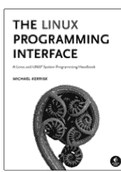

# `Linux 编程接口`

`Linux` 和 `UNIX` 系统编程手册

作者：`MICHAEL KERRISK`

2010 年 10 月，1552 页，99.95 美元

`ISBN` `978-1-59327-220-3`

电话：

`1.800.420.7240` 或

`1.415.863.9900`

电子邮件：

`SALES@NOSTARCH.COM`

网页：

`WWW.NOSTARCH.COM`

# FreeBSD® 权威指南


前言由 `MARSHALL KIRK McKUSICK` 撰写

FreeBSD——强大、灵活且免费的类 `Unix` 操作系统——是许多企业的首选服务器。但它比 `Unix` 或 `Linux` 更难使用，更难精通。

在这本完全修订和更新的*绝对 FreeBSD*（`Absolute FreeBSD`）第三版中，FreeBSD 提交者 `Michael W. Lucas` 介绍了最新功能，并教你管理 FreeBSD 系统。你将深入了解服务器管理，学习事物是如何运作的，以及它们为何如此运作。本版新增了关于现代磁盘、重新设计的 `jail` 和打包系统的介绍，以及 FreeBSD 为云管理设计的变革性特性，如 `libxo` 和 `UCL`。

你还将学习如何：

- 为你的环境选择合适的文件系统
- 备份和恢复关键数据
- 调整内核——以及何时不该调整
- 配置网络，包括如何激活接口和选择拥塞控制算法
- 管理 `UFS`、`ZFS` 和其他关键文件系统
- 使用黑名单和包过滤等高级安全特性
- 使用 `jails` 实现容器式虚拟化
- 执行 `panic` 管理和 `bug` 报告

无论你是需要 FreeBSD 完整介绍的初学者，还是希望扩展技能的经验丰富系统管理员或 `DevOps` 人员，*绝对 FreeBSD* 都将向你展示如何将你的 FreeBSD 系统从“勉强运行”提升到“运行良好”。离开你的格子间前，别忘了带上它。

# 作者简介

自 80 年代末使用 `Unix` 以来，`Michael W. Lucas` 拥有二十多年的网络和系统管理员经验，专注于构建和维护高可用性系统，现在以撰写相关书籍为生。他已创作了 30 多本书，已被翻译成九种语言。他备受好评的作品包括*绝对 OpenBSD*（`Absolute OpenBSD`）、*绝望者的思科路由器*（`Cisco Routers for the Desperate`）和*PGP & GPG*，均出自 `No Starch Press`。在 `https://mwl.io/` 了解更多。


**极客娱乐精品™**

`www.nostarch.com`

# 脚注

# 引言

1. 当时，几千美元买一台电脑简直是便宜货。你们这些年轻人根本不知道日子有多好过。

2. 如果你处于需要向这群人证明你是 `Alpha Geek`（顶级极客）的境地，在 1998 年的掌上电脑上运行 `Unix` 几乎肯定能做到这一点。

3. 原始《星际迷航》。讨论结束。不服来战。

4. 在本书第一版中，我忘记说明如何做一个类似“愚蠢桌面技巧”（`Stupid Desktop Trick`）的操作，这引发了整本书中其他任何主题都未曾有过的质疑邮件。在第二版中，我发誓不再犯同样的错误，但忘记提及哪个软件包提供循环守护进程。俗话说，好事不过三（第三次尝试总会成功）。

5. 这个丑陋的东西获取上一条命令的输出，按第六列内容逆序排序，并逐屏显示。如果你有几百行输出，想知道哪些条目第六列的值最高，这就是操作方法。或者，如果你有很多时间，可以把输出转储到电子表格中，然后用同样晦涩的命令折腾更长时间。

# 第 1 章 获取帮助

1. 这叫做*诚实*。`IT` 专业人士可能对这个词感到陌生，但词典可以帮上忙。

2. 计算机硬件变得更快、更小，但并没有变得特别好。

3. 而且这个内容既在手手册（`Handbook`）、`FAQ`、邮件列表存档中，*也*在论坛里。

4. 是的，电子邮件签名和互联网行为准则有标准。`RFC 1855` 应该用带刺棍棒和凝胶燃料火焰喷射器来强制执行。

# 第 2 章 安装前

1. `i386` 平台尽管被努力重命名为 *`amd32`* 仍然存在。我是说，到底是谁买了那昂贵的 `Intel` 硬件？

2. 我不再有客户了，所以很遗憾，我未能测试他们的硬件。

3. `ZFS` 专家 `Allan Jude` 经常宣称磁盘在与我们作对，但与 `RAID` 控制器的背叛相比，磁盘的小阴谋微不足道。

4. 顺便说，随便哪个小偷都会认为运行 FreeBSD 的笔记本电脑反正已经是加密的了。

5. 虽然我不会阻碍进步，但当进步驶入沟渠时，我保留讥笑的权利。

# 第 3 章 安装

1. 对于那些跳过致谢部分的人：`Bert` 向 FreeBSD 基金会捐款 800 美元，以换取在此处被虐待的特权。我并不是无缘无故折磨 `Bert`；他为此付出了真金白银。

2. `印第安纳州`，我在看着你。

3. 这不属实。`Bert` 甚至没那么厉害。

# 第 4 章 启动！引导过程

1. 这样的系统应该很少见，但以你的运气，你会找到一个。

2. 我对我的 *`sed*(1)* 和 *`awk*(1)* 技巧很有信心，但还不够自信到“在 400 台虚拟服务器上运行然后回家”的程度。

3. 如果你从未听说过 `ICMP` 重定向，请立即（跑着）去你最近的一家书店买个 `Charles M. Kozierok` 著的*`TCP/IP 指南`*（`No Starch Press`, 2005）的副本。拿到后，*读*它。

4. 给年轻人科普一下：线噪（`line noise`）或干扰会导致你的终端会话中出现随机垃圾数据。也就是说，出现随机的、*非*你输入的内容。

5. 你知道的，硬件手册。你随服务器包装箱一起扔掉的说明书。

6. 好吧，“更加不安全”。满意了吗？

7. 这可能没有恐龙那么古老，但那时既没有垃圾邮件*也*没有万维网。我怀念那个黄金时代。

# 第 6 章 内核游戏

1. 是的，我可以在此处做许多编辑评论，但它们都太容易了。我知道我*有些*标准。

2. 说实话，听不听是可选的。

3. 任何在实验室外使用内置软盘驱动器的人，都完全活该。

4. 实际上，我可能不会麻烦去做了，因为我要关闭测试主机。但你知道我的意思。

5. 你会发现，实际上，你新内核失败了。但无所谓。

# 第 7 章 网络


1. 是的，我知道`IPv4`网络地址转换（`NAT`），其中并非所有`IP`地址都是唯一的。`NAT`是个谎言，向你的网络撒谎是通往麻烦的一条好路——问问任何大规模使用`NAT`的人。但即使使用`NAT`，如果你在互联网公共网络上，你的网络拥有一个或多个唯一的`IP`地址。

2. 然而，如果我对重新格式化及重装用户的研究取得成果，我一定会公布我的结果。

3. 我不会列出仅可通过`IPv4`访问的网站，因为如果我列出，这些网站会在本书送到印刷厂后半小时内添加`IPv6`支持。

4. 我可以在此阐述历史，但简而言之：如果有人试图向你解释`A`类、`B`类或`C`类地址，捂住你的耳朵，冲他们大喊不要用过时二十多年的信息污染你的大脑。

5. 除非，由于某种原因，许多嵌入式设备除外。将你的物联网设备放在防火墙后面，不要允许它们一般性的互联网访问！

6. 是的，如果你有私人光纤和数百万美元的交换机，`Ethernet`可以在长距离上工作，但如果你有这些，你就知道为什么你是例外了。

# 第 8 章 配置网络

1. 每种连接技术*传统上*使用最新的电缆插入上一代的配线架，或者反之。那些`CAT6`电缆插在`CAT5`配线架中，是系统管理员愤怒的长期习惯的一部分。

2. 降低互联网的受欢迎程度或许并不是坏事，你看...

3. 因为你的生活仍然值得过。

4. 有些读者在考虑软件优化之前已经更换了他们的破旧硬件。这些读者可能会认为此评论是不合理的。我向你们三个人真诚、全心全意且毫无保留地道歉。

# 第 9 章 系统安全

1. 这是针对交互式使用的。永远，永远，*永远*不要用*任何*`C shell`编程。阅读`Tom Christiansen`的经典论文“`Csh Programming Considered Harmful`”以获得完整解释。

2. 有些人甚至从这段经历中幸存了下来。

3. 遗憾的是，`shell`不配转速计。

## 10 磁盘、分区与 `GEOM`

- 当然，平衡掉那些渗透进你服务器的入侵者这件事本身并不好笑，但在原本阴云密布的一天里，它能带来片刻的欢乐。

- 由于这个特定的`geom`属于虚拟磁盘的一部分，它关于底层硬件所陈述的任何事情，都是为了安抚你而编造的赤裸裸的谎言。

- 伯特。

- 自那过去的二十五年间，`BSD`社区花费了无数工时来解释并随后为那个决定辩护。从我们的痛苦中吸取教训。不要把你的操作系统移植到商用硬件上。

- 经验丰富的系统管理员在此处开始应感到一种同情的恐惧。

## 11 `UNIX` 文件系统

- 我*曾经*多次使用自定义块大小，但大多数时候我并不需要它，而且它损害了性能。

- 又一次。

- 这很可能是系统管理员的失误，但你会责怪硬件。

- 在本书的第一版中，我说使用`fsdb(8)`和`cli(8)`就像穿着凉鞋和短裤攀登珠穆朗玛峰。其实，这更像你是背着你的攀岩向导，只不过他是个胖乎乎的作者，吃太多冰淇淋，因为珠峰比他家乡的密歇根还要冷得多，所以穿着厚外套。而且他正在实时推特你出现的每一个错误。

- 人们可以增加预留空间百分比，使文件系统显得额外满，从而强调你的经理在购买部强行通过新磁盘的迫切性。但那是错误的。

## 12 `Z` 文件系统

- 主动添加旨在提升性能的`SLOG`或`L2ARC`是管理问题的有效解决方案，比如安抚老板。

- 很可能是在关于数据库服务器为何如此该死地慢了几次会议之后。

- 如果有人愚蠢到申请在我系统中开设账户，我会给予他们应有的尊重：一点也没有。

- 请注意，我自尊心足够强，不会说“擦洗一下擦洗”。勉强够用，但足够了。

## 13 外部文件系统

- 虽然格式化闪存驱动器相比之下只涉及较少的扇区，并且可能比向其复制大文件对你的驱动器更友好，但如果我没有包含这个警告，我会收到投诉信。所以这里就是。

- 是的，伯特把他的文件放在一个叫`cdfiles`的目录中。我不完全确定他是否知道`UDF`和`ISO 9660`之间的区别。

- 这也是系统管理员的必经之路，所以当你遇到这种情况时，不要感到*太*难过。只需难过到再也不会这样做就足够了。

- 为什么没有防止你这样给自己下绊子的防护措施呢？嗯，`Unix`认为任何愚蠢到这样做的人不配成为它的朋友。许多人一直试图让`Unix`接受对此类反社会行为的心理治疗，但它就是不为所动。

- 当然，对于伯特，我会添加只读选项。

## 14 探索 `/ETC`

- 你认为你的家庭网络很友好？哦，真的吗。你真的信任它上面的每个设备吗？媒体播放器？平板电脑？电视？孩子的玩具？你的联网烤箱一看到你就会在背后捅你一刀。

- 在系统升级期间，`make.conf`中有奇怪的东西会让人们在你寻求帮助时嘲笑你。但商业软件支持技术人员也会这样做，所以你大概已经习惯了。

## 15 让你的系统有用

- 几十年来，我威胁对任何将其软件命名为`NG`或*下一代*的人使用暴力。这个名字注定会过时。我不情愿地得出结论，我只是没有足够的暴力能分给所有人。

- 移除可能会做可怕的事情，但没有任何是包系统能够预测的。

- 对于“我应该让我的倒霉鬼做吗？”的回答永远是“是的。”

## 16 使用端口自定义软件

- 28,000 个端口。62 多个类别。某些类别有 9 个成员。你自己算算吧。

- 大部分这种不可导出的软件可从非美国来源获得，并可在世界各地下载。与此同时，前`KGB`密码学家在没有这些规定的情况下，会很乐意以低廉的价格向任何人提供强加密。请注意，他们没有明显后门加密需要额外收费。

- 有些软件本质上就足够侮辱人，不需要额外的帮助。

- 我没有查看`LibreOffice`是否支持`SNMP`，但我看不出为什么不支持。

- 我预计继任工具在日语中将被命名为`detonation`，然后我们将在阿拉米语中有`smoking crater`。

- 我不完全确定安装程序为什么有一个1MB的交换分区，但无所谓。

## 17 高级软件管理

- 或者，也许你认为在你的系统上*相信*的库，实际上并不是*真正*在你系统上的库。在确定问题之前，永远不要排除你自己的失败！

- 虽然本书的大多数读者将是系统管理员，你可以告诉你的用户购买这本书并阅读这一节。他们不会这样做，但也许他们会闭嘴并让你独自待着。

- `OSF/1`与已停产的硬件（强大的`Alpha`处理器）绑定，而`SVR4`现在如此古老，没人再使用该功能了。`SCO Unix`正在某处羞愧地躲藏。

- 除非你发现了`dtrace(1)`。

- 又一次。

## 18 升级 `FreeBSD`

- “在数据中心，没人能听到你的电源尖叫。”

- 不，“烦人的用户”不是`FreeBSD`开发者的常规项目。这是一种附带福利。完全不同。

- 各种`FreeBSD`开发者在过去几个版本中一直致力于将基础系统打包，以便打包工具可以处理升级。我预计本书的发布将促使他们立即解决剩余问题并使此部分过时。

- 请注意，虽然`CVS`已消失，但`CTM`仍然活着。不止一位`FreeBSD`开发者恳求我不要把文档记录下来，所以我不记录。我等待您的银行转账，先生们。

- 这是经验之声。别做。真的。

- 除非出了问题。然后每个人都关心——很多。

## 19 高级安全功能

- 相反，我命令倒霉鬼开车进来，解决问题，并替我道歉。问题解决。

- 在了解这些之后，你自己的尖叫可能会在夜间把你吵醒几年。但你会克服它。

- 这真的发生了。在你问之前，不，我不是接收者！一位朋友给了我高端图形工作站。真的。它们是

- 嗯，至少是其中大部分。相当多。至少几个。哦，算了。

- 嗨，布拉德和露西！

- 是的，将`secure`改为`insecure`会提高安全性。见鬼了。

- 我会说这里是`intruder`，除了那个人是肯·汤普森，`Unix`和`C`的创建者之一。他有一种神奇的能力，可以登录到世界各地的任何`Unix`系统，包括在他停止参与`Unix`开发多年后开发的系统。查找汤普森的论文“`Reflections on Trusting Trust`”。

## 20 小型系统服务

- 这些链接是来自磁盘空间真的、真的昂贵的那段日子的遗留物。它们在 1980 年代很有意义。下次你创建任何软件时请考虑这一点。

- 这对他有好处。它会塑造性格。

- 当然，最重要的时刻是“回家的时间”。

- 我更喜欢`fortune -o`，但`FreeBSD`遗憾的是清除了冒犯性的`fortune`数据库。

- 用“修复它需要多长时间，加上我跟你浪费时间谈了多少”来回答“什么时候会修复？”的问题，从来不会受到好评。

- 我们是对的：你不知道你的处境有多好。

- 无论那是什么。

- 除非，当然，你想尝试将另一个人的服务器配置文件作为新的`IOS`安装到你的思科路由器上。确保在描述你的问题之前告诉思科支持技术人员激活电话录音机；他会想把这个分享给他的同事。

## 21 系统性能与监控

- 一旦你管理几十个或几百个服务器，你也会发现自己在安装`Catci`、`Zabbix`、`Graphite`或其中一种来监控性能。你想要管理另一个应用程序，对吧？

- 实际上，我不会在任何地方描述它。如果你想了解`FreeBSD`虚拟内存系统的糟糕亲密细节，请阅读最新版“The Design and Implementation of the `FreeBSD` Operating System”。

- 我的台式机有 32GB，但只使用大约 4GB。是的，我在补偿某些东西。1990 年代。

- 此外，系统管理员已经为自己认领了“自私”和“爱发牢骚”。

- 自私不算是一个好的理由来`renice -20`你的进程。或者据我所闻。

## 22 监狱

- 这本书可以被描述为“一个甚至远非全面的系统管理员需要担心的事情列表。”这正是唯一的反例。

- 请注意我用了“隐私感”而不是实际的“隐私”。

## 23 `FreeBSD` 的边缘

- “我自己的代码”是我在办公室里大喊粗口的原因列表中的第 8 名。

- 因为，遗憾的是，在某个时候，我们都需要覆盖覆盖的覆盖。

- 仅为记录：如果你有尖锐的棍棒和适当的态度，你可以有我的密码短语。

## 24 问题报告与恐慌

## 后记

1. 另外，请尽量不要说脏话。多说几句也无妨。

2. 我越来越相信，“`panjc`”这个词被选用是为了描述系统管理员，而非系统本身。

1. 是的，这包括一位带着`FreeBSD`笔记本电脑去南极洲邮轮度假的男士。他的妻子也在场，那是他们的结婚二十周年纪念日。他从未提及他的妻子是否将笔记本电脑扔进了海里，但即便她真的扔了，他也很幸运没有跟着跳进那片波涛汹涌的深海。

2. 不过，他们不会故意在你睡觉时来找你。这是一个全球性的团体——他们不知道你什么时候在睡觉。
