# 软件诊断的 Linux API 加速：范畴论视角

## 关于作者

`Dmitry Vostokov` 是国际公认的专家、演讲者、教育工作者、科学家、发明家和作家。他是模式导向软件诊断、取证和预测学科（系统性软件诊断）的创始人，以及软件诊断研究所（`DA+TA`：`DumpAnalysis.org` + `TraceAnalysis.org`）的创办者。`Vostokov` 还撰写了超过 50 本关于软件诊断、异常检测与分析、软件和内存取证、根本原因分析与问题解决、内存转储分析、调试、软件跟踪与日志分析、逆向工程和恶意软件分析的书籍。他在软件架构、设计、开发和维护方面拥有超过 25 年的经验，涵盖各个行业，包括领导、技术和人员管理角色。`Dmitry` 还创办了 `Syndromatix`、`Anolog.io`、`BriteTrace`、`DiaThings`、`Logtellect`、`OpenTask` 迭代增量出版（`OpenTask.com`）、软件诊断技术与服务（前身为内存转储分析服务）`PatternDiagnostics.com`，以及软件预测。在业余时间，他在 `Debugging.TV` 上分享各种主题，并探索软件叙事学、其作为事物叙事学（`NoT`）和事物诊断（`DoT`）的进一步发展、软件病理学，以及量子软件诊断。他目前的研究兴趣领域包括理论软件诊断及其数学和计算机科学基础、形式逻辑的应用、人工智能、机器学习和数据挖掘在诊断和异常检测中的应用、软件诊断工程和诊断驱动开发、诊断工作流和交互。近期的研究兴趣还包括云原生计算、安全、自动化、函数式编程、范畴论在软件诊断中的开发应用和大数据，以及人工智能的诊断。

## 简介

大家好，我叫 `Dmitry Vostokov`，我讲授本培训课程。

## 先决条件

- 开发经验

以及（可选）

- 基本的进程核心转储分析经验

要充分利用本培训，你需要具备基本的开发经验，以及可选的基本进程核心转储分析经验。我假设你了解类型、函数及其参数是什么。如果你没有核心转储分析经验，那么你也能学到一些基础知识，因为我们在练习中使用 `GDB` 以及可选的 Microsoft 调试器 `WinDbg`（经典版）（来自 Windows 调试工具）或 `WinDbg` 应用程序（原 `WinDbg Preview`）。我在课程必要时解释一些调试和相关概念。

## 培训目标

- 回顾 `Linux API` 基础

- 学习诊断分析技术

- 了解 `Linux API` 知识如何在诊断和调试中使用

我们的主要目标是加速学习 `Linux API`。因此，首先，我们回顾软件诊断所需的 `Linux API` 基础。然后，我们学习用于 `Linux API` 探索的各种分析技术。最后，我们看一些 `Linux API` 知识如何帮助诊断和调试的示例。

## 培训原则

- 只讲我能展示的内容

- 大量图片

- 大量示例

- 原创内容和示例

我曾考虑过许多培训形式，但我决定最好的方式是专注于幻灯片和你可自己重复的实际操作演示，作为家庭作业。其中一些以分步练习的形式提供。

## 日程安排

- 相关 `x64` 和 `A64` 反汇编的回顾

- `Linux API` 通用方面

- `Linux API` 形式化

- `Linux API` 与编程语言

- `Linux API` 类别

- 实践练习

大致涵盖的内容或安排包括也可适用于其他操作系统的通用 `API` 方面。我们还会绕道介绍 `API` 背景下的范畴论。我们的内容不仅限于理论。我们还会遍历不同的 `API` 子集和类别。本培训的重要组成部分是实践练习。

## 培训理念

- 先前的加速 `Windows API` 培训

  - 网络安全

  - 内存转储分析

  - `Windows` 代码阅读培训

- 编写 `Linux API` 监控工具的经验

本培训理念源自此前的 `Windows API` 安全培训——参与者提到了对 `Windows API` 知识的需求，以及我的内存转储分析培训课程的学员询问与 `Windows API` 相关的问题。我意识到，既然我有 `Linux` 核心转储分析课程，其学员也会从类似的 `Linux API` 培训中受益。本培训还可以填补其他培训课程中的空白，例如 `Linux` 反汇编和逆向工程。额外的推动来自于我从头开始设计和实现 `Linux API` 监控工具的经验。

## Linux API 通用方面

- 头文件视角

- 命名约定

- 基本类型系统

- 调用类型

- 导出/导入函数

- `PLT` 和 `GOT`

- 虚拟进程地址空间

- 调用约定

- `API` 序列

- `API` 层次

- `API` 与系统调用

- `API` 源代码

- 共享库

- `API` 使用方式

- `API` 内部机制

- 静态链接

- 延迟动态链接

- `API` 名称模式

- `API` 命名空间

- `API` 句法/范式

- 标记的 `API`

- `ADDR` 模式

- `DebugWare` 模式

- 内存分析模式

- `API` 跟踪

- 跟踪和日志分析模式

- `API` 与错误

- `API` 与函数式编程

- `API` 与安全

- `API` 与版本控制

我们计划讨论的 `Linux API` 通用方面列于此处。

## Linux API 形式化

- `API` 组合性

- 范畴论语义

- 范畴论视角

- 范畴论方图

- `API` 范畴

- `API` 函子

- `API` 图表

- `API` 自然变换

- 跨平台 `API`

- `API` 伴随

- 非正式 `n-API`

- `API` 与跟踪范畴

- `API I/O`

本培训还包括通过范畴论进行的 `API` 形式化。我们从范畴、函子及其他方面的简要概述开始，使用 `Linux API` 示例。

我们还会介绍如何在 `C/C++` 以外的语言中使用 `Linux API` 的基础知识，并附以模板示例。

## Linux API 类别

- 系统配置

- 文件 `I/O`

- 文件控制

- 文件系统

- 动态内存

- 虚拟内存

- 共享库

- 进程

- 进程间通信

- 作业

- 信号

- 线程

- 网络

- 时间

- 定时器

- 跟踪和日志

- 账户

- 终端

本培训的一部分包括对不同的 `Linux API` 子集和类别的遍历。

## 链接

- 核心转储

  - 包含在练习 `L0` 中

- 练习记录

  - 包含在本书中

## 练习 L0

- **目标：** 安装 `GDB` 并检查 `GDB` 是否能正确加载核心转储

- **目标：** 安装 `WinDbg` 或 `Windows` 调试工具，或拉取 `Docker` 镜像，并检查符号是否正确配置

- **内存分析模式：** 栈跟踪；不正确的栈跟踪

- `\LAPI-Dumps\Exercise-L0-GDB.pdf`

- `\LAPI-Dumps\Exercise-L0-WinDbg.pdf`

对于实践练习，我们主要需要 `GDB` 及其多架构版本。如果您有 `Windows` 背景，可以尝试使用 `WinDbg` 应用程序（前身是 `Windows Preview`）、经典的 `Microsoft WinDbg` 调试工具（来自 `Windows` 调试工具），甚至是 `Docker` 版本完成相同的练习。我决定加入 `WinDbg`，是因为我最近一次关键软件事故的经验——`GDB` 没有显示正确的信息，但在 `WinDbg` 中加载相同的核心转储却有所帮助。这里我假设您已经准备好了环境，只展示多架构 `GDB` 部分，这是我首次添加到 `Linux` 培训课程中的内容。

## 练习 L0 (GDB)

**目标：** 安装 `GDB` 并检查 `GDB` 是否能正确加载核心转储。

**内存分析模式：** 栈跟踪；不正确的栈跟踪。

1. 如果尚未下载核心转储文件，请下载并解压缩归档：

```
https://www.patterndiagnostics.com/Training/LAPI/LAPI-Dumps.zip
```

2. 下载并安装最新版本的 `GDB`。对于 `WSL2 Debian`，我们使用了以下命令：

```
$ sudo apt install build-essential
$ sudo apt install gdb
```

要在同一 `x64` 主机平台上分析 `A64` 转储，我们还通过以下方式安装了多架构 `GDB`：

```
$ sudo apt install gdb-multiarch
```

在我们的 `RHEL` 类型系统上，我们通过以下方式安装了工具和 `GDB`：

```
$ sudo yum group install "Development Tools"
$ sudo yum install gdb
```

3. 确认 `GDB` 可访问，然后退出（`q` 命令）：

```
$ gdb
GNU gdb (Debian 8.2.1-2+b3) 8.2.1
Copyright (C) 2018 Free Software Foundation, Inc.
License GPLv3+: GNU GPL version 3 or later <http://gnu.org/licenses/gpl.html>
This is free software: you are free to change and redistribute it.
There is NO WARRANTY, to the extent permitted by law.
Type "show copying" and "show warranty" for details.
This GDB was configured as "x86_64-linux-gnu".
Type "show configuration" for configuration details.
For bug reporting instructions, please see:
<http://www.gnu.org/software/gdb/bugs/>.
Find the GDB manual and other documentation resources online at:
    <http://www.gnu.org/software/gdb/documentation/>.

For help, type "help".
Type "apropos word" to search for commands related to "word".
(gdb) q
$
```

4. 从 `x64/` 目录加载 `core.9` 转储文件和 `bash` 可执行文件：

```
$ cd LAPI/x64
~/LAPI/x64$ gdb -c core.9 -se bash

GNU gdb (Debian 8.2.1-2+b3) 8.2.1
```

```
Copyright (C) 2018 Free Software Foundation, Inc.
License GPLv3+: GNU GPL version 3 or later <http://gnu.org/licenses/gpl.html>
This is free software: you are free to change and redistribute it.
There is NO WARRANTY, to the extent permitted by law.
Type "show copying" and "show warranty" for details.
This GDB was configured as "x86_64-linux-gnu".
Type "show configuration" for configuration details.
For bug reporting instructions, please see:
<http://www.gnu.org/software/gdb/bugs/>.
Find the GDB manual and other documentation resources online at:
    <http://www.gnu.org/software/gdb/documentation/>.

For help, type "help".
Type "apropos word" to search for commands related to "word"...
Reading symbols from bash...(no debugging symbols found)...done.

warning: core file may not match specified executable file.
[New LWP 9]
Core was generated by `-bash'.
#0  0x00007f3e9f7492d7 in __SI_waitpid (pid=-1, stat_loc=0x7ffcbd661ad0, options=10) at
../sysdeps/unix/sysv/linux/waitpid.c:30
30      ../sysdeps/unix/sysv/linux/waitpid.c: No such file or directory
```

5. 确认栈跟踪（`backtrace`）正确显示并带有符号：

```
(gdb) bt
#0  0x00007f3e9f7492d7 in __SI_waitpid (pid=-1, stat_loc=0x7ffcbd661ad0, options=10) at
../sysdeps/unix/sysv/linux/waitpid.c:30
#1  0x000055e1650a4869 in ?? ()
#2  0x000055e1650a5cc3 in wait_for ()
#3  0x000055e165093b85 in execute_command_internal ()
#4  0x000055e165093df2 in execute_command ()
#5  0x000055e16507b833 in reader_loop ()
#6  0x000055e16507a104 in main ()
```

**注意：** 如果系统上的栈跟踪不正确，请检查共享库是否已加载，如果没有，请将当前目录添加到共享库搜索路径中（参见下面的 `A64` 示例）。

6. 退出 `GDB`。

```
(gdb) q

~/LAPI/x64$
```

7. 使用多架构 `GDB` 从 `A64/` 目录加载 `core.19649` 转储文件和 `bash` 可执行文件：

```
$ cd ../A64

~/LAPI/A64$ gdb-multiarch -c core.19649 -se bash

GNU gdb (Debian 8.2.1-2+b3) 8.2.1
Copyright (C) 2018 Free Software Foundation, Inc.
License GPLv3+: GNU GPL version 3 or later <http://gnu.org/licenses/gpl.html>
This is free software: you are free to change and redistribute it.
There is NO WARRANTY, to the extent permitted by law.
Type "show copying" and "show warranty" for details.
This GDB was configured as "x86_64-linux-gnu".
Type "show configuration" for configuration details.
```

 有关错误报告的说明，请参阅：

<http://www.gnu.org/software/gdb/bugs/>。

在线查找 `GDB` 手册和其他文档资源：

    <http://www.gnu.org/software/gdb/documentation/>。

如需帮助，请输入"help"。

输入"apropos word"搜索与"word"相关的命令……正在从 `bash` 读取符号……（未找到调试符号）……完成。

警告：核心文件可能与指定的可执行文件不匹配。

[新 LWP 19649]

警告：无法为 3 个共享库加载符号，例如 `/lib/aarch64-linux-gnu/libtinfo.so.6`。

使用"info sharedlibrary"命令查看完整列表。

您是否需要"set solib-search-path"或"set sysroot"？

核心由 `'-bash'` 生成。

#0  0x0000ffffbafa6734 in ?? ()

8. 验证堆栈跟踪（回溯）是否正确显示符号：

```
(gdb) bt

#0  0x0000ffffbafa6734 in ?? ()

#1  0x0000000000000001 in ?? ()

回溯已停止：前一帧与此帧相同（栈损坏？）
```

9. 如果系统上的堆栈跟踪不正确，如上面的输出所示，请检查共享库是否已加载，如果没有，请将当前目录添加到共享库搜索路径：

```
(gdb) info sharedlibrary

起始地址               终止地址               符号已读取   共享对象库

                                       No          /lib/aarch64-linux-gnu/libtinfo.so.6

                                       No          /lib/aarch64-linux-gnu/libc.so.6

                                       No          /lib/ld-linux-aarch64.so.1

(gdb) set solib-search-path .

Reading symbols from /home/coredump/LAPI/A64/libtinfo.so.6...(no debugging symbols found)...done.

Reading symbols from /home/coredump/LAPI/A64/libc.so.6...(no debugging symbols found)...done.
```


# 使用 GDB 进行堆栈跟踪

Reading symbols from `/home/coredump/LAPI/A64/ld-linux-aarch64.so.1`...(no debugging symbols found)...done.

```
(gdb) bt

#0  0x0000ffffbafa6734 in wait4 () from /home/coredump/LAPI/A64/libc.so.6

#1  0x0000aaaabb7a943c in ?? ()

#2  0x0000aaaabb70aa50 in wait_for ()

#3  0x0000aaaabb6f0dac in execute_command_internal ()

#4  0x0000aaaabb6f160c in execute_command ()

#5  0x0000aaaabb6e168c in reader_loop ()

#6  0x0000aaaabb6d4170 in main ()
```

10. 我们退出 GDB。

```
(gdb) q
```

```
~/LAPI/A64$
```

## 练习 L0（WinDbg）

**目标：** 安装 WinDbg 或 Windows 调试工具，或拉取 Docker 镜像，并检查符号是否正确设置。

**模式：** 堆栈跟踪；错误的堆栈跟踪。

1. 如果尚未下载内存转储文件，请先下载并解压：

[https://www.patterndiagnostics.com/Training/LAPI/LAPI-Dumps.zip](https://www.patterndiagnostics.com/Training/LAPI/LAPI-Dumps.zip)

2. 从 https://learn.microsoft.com/en-gb/windows-hardware/drivers/debugger 安装 WinDbg（或升级现有的 WinDbg Preview）。运行 WinDbg。

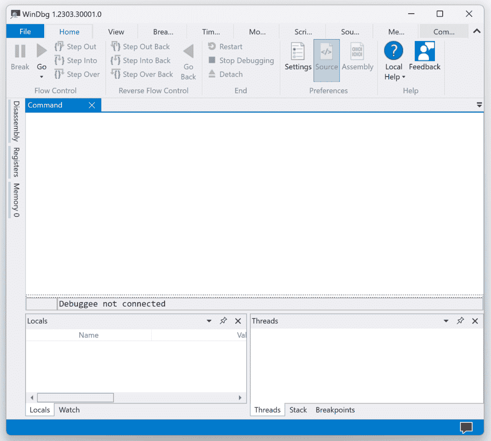

3. 打开`\LAPI\A64\core.19649`：

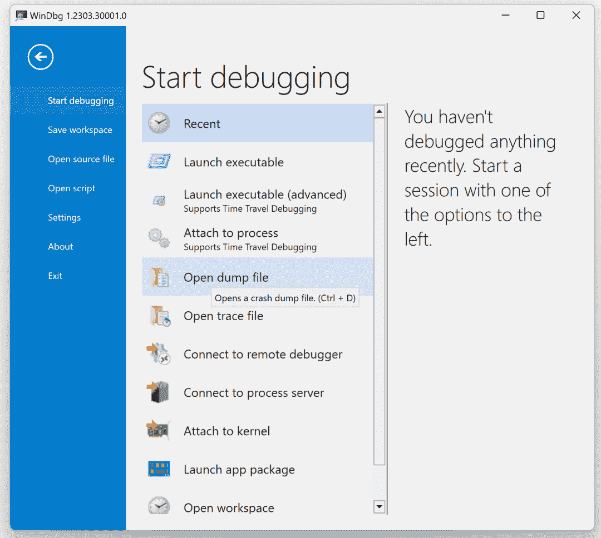

4. 转储文件已加载：

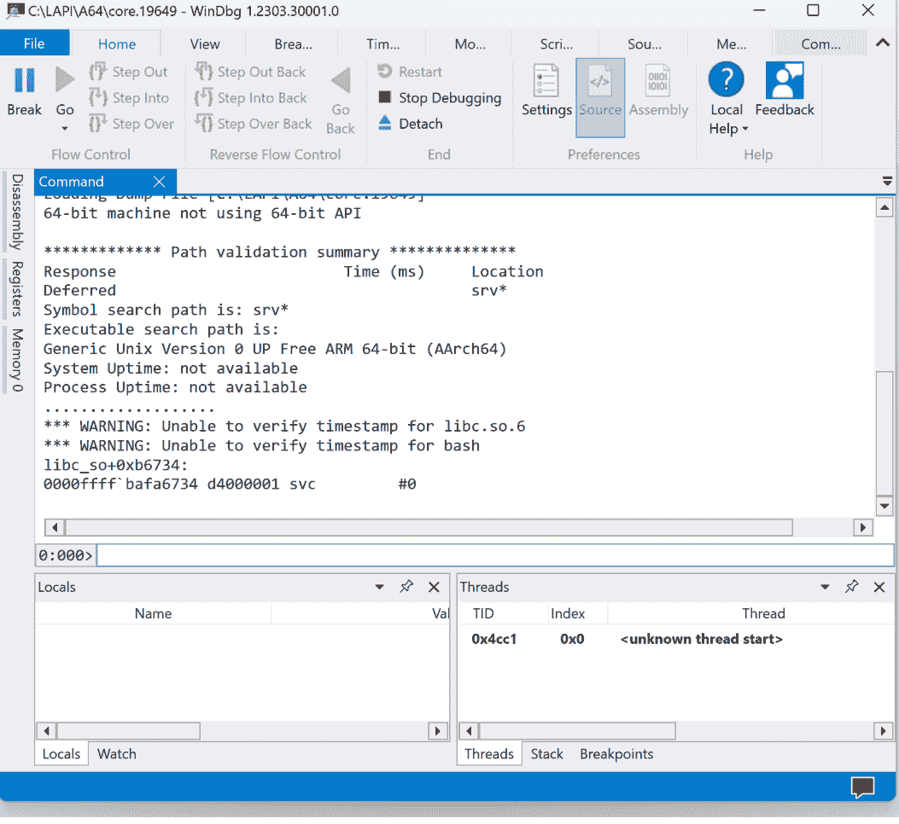

5. 输入`.sympath+` `<路径>` 命令设置符号路径：

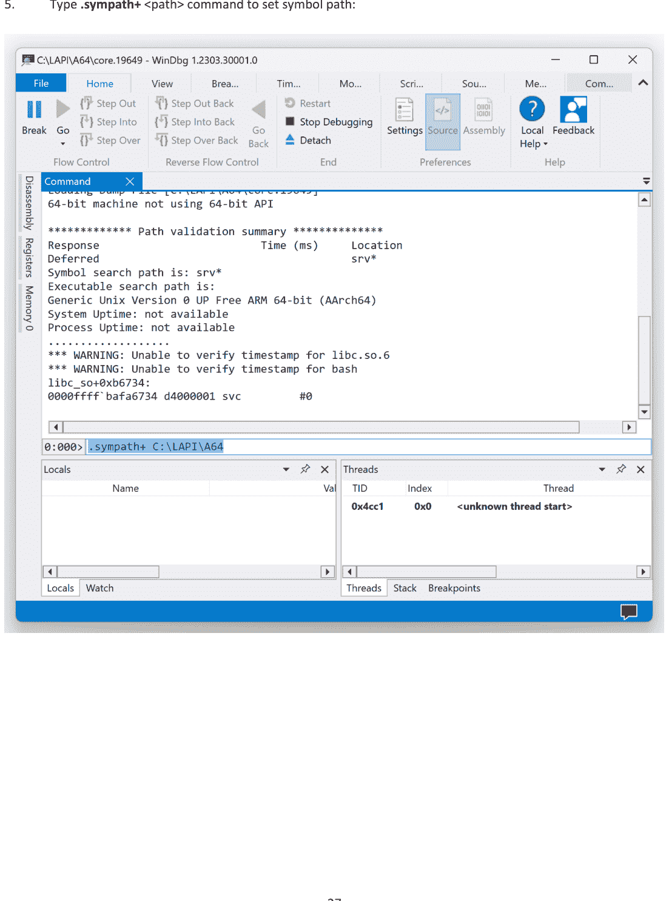

6. 输入`.reload` 命令重新加载符号：

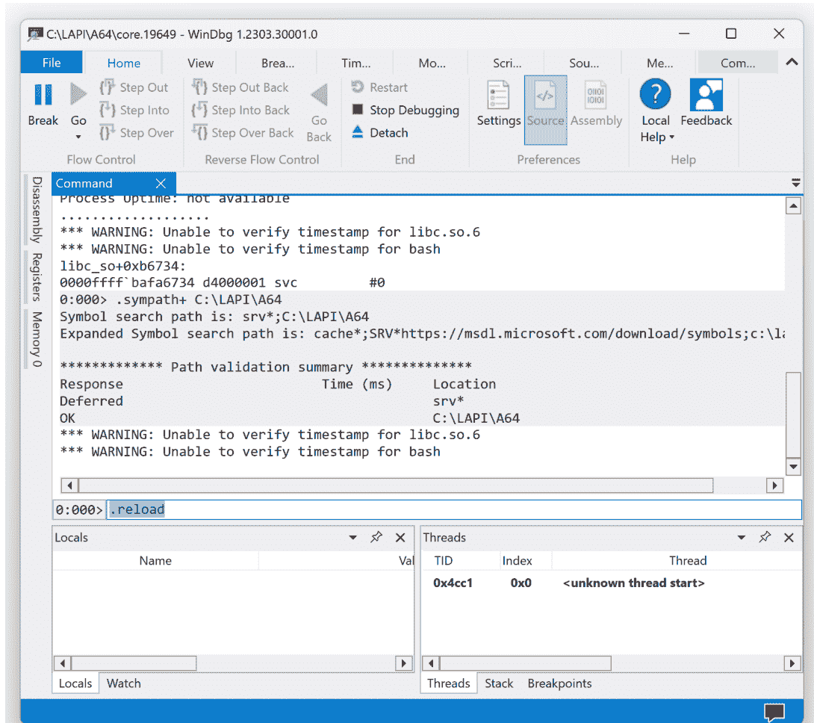

7. 输入`k` 命令验证堆栈跟踪的正确性：

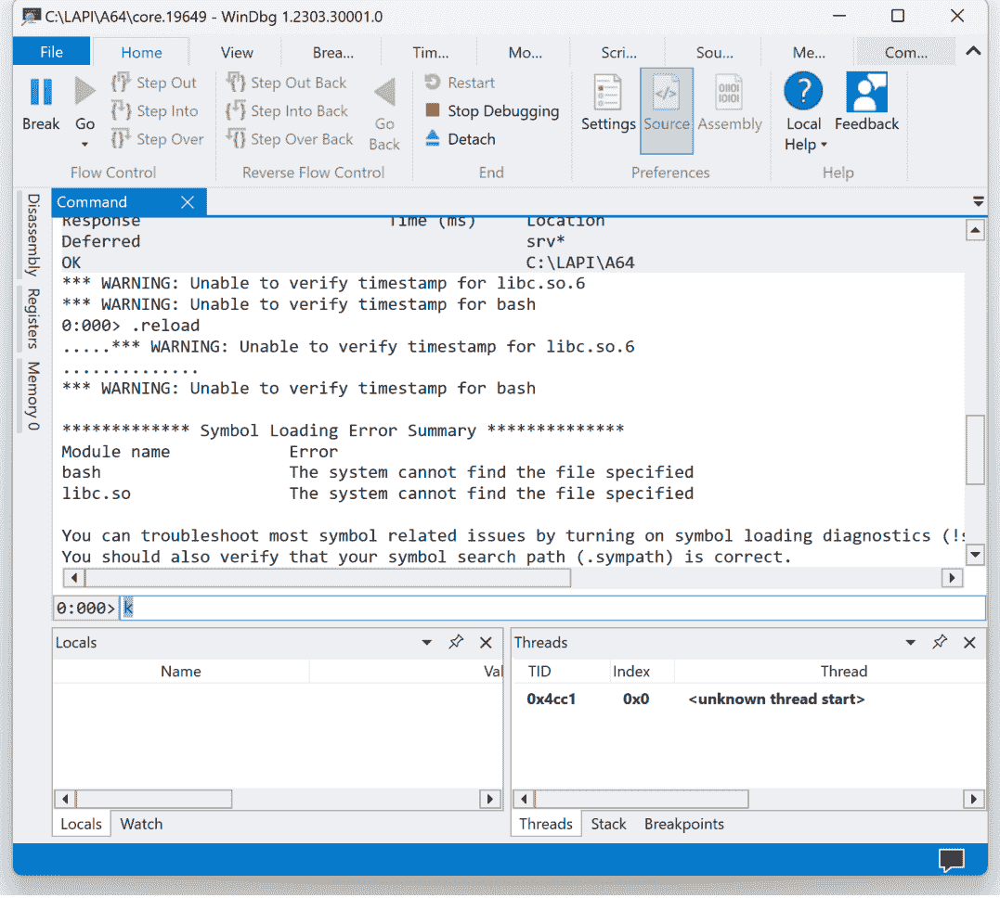

8. 命令的输出应如下所示：

```
0:000> k
### Child-SP            RetAddr               Call Site
00 0000ffff`c5fd83a0 0000aaaa`bb7a943c     libc_so!wait4+0x34
01 0000ffff`c5fd83e0 0000aaaa`bb70aa50     bash!rl_enable_paren_matching+0x2c0c
02 0000ffff`c5fd8480 0000aaaa`bb6f0dac     bash!wait_for+0x1c0
03 0000ffff`c5fd8750 0000aaaa`bb6f160c     bash!execute_command_internal+0x2cd8
04 0000ffff`c5fd8880 0000aaaa`bb6e168c     bash!execute_command+0xbc
05 0000ffff`c5fd88b0 0000aaaa`bb6d4170     bash!reader_loop+0x2b8
06 0000ffff`c5fd8900 0000ffff`baf173fc     bash!main+0x18b0
07 0000ffff`c5fd8a70 0000ffff`baf174cc     libc_so!__libc_init_first+0x7c
08 0000ffff`c5fd8b80 0000aaaa`bb6d4470     libc_so!__libc_start_main+0x98
09 0000ffff`c5fd8be0 ffffffff`ffffffff     bash!start+0x30
0a 0000ffff`c5fd8be0 00000000`00000000     0xffffffff`ffffffff
```

如果输出如下方所示带有大偏移量，则表示符号文件未正确设置——**错误的堆栈跟踪模式**：

```
0:000> k
### Child-SP          RetAddr               Call Site
00 0000ffff`c5fd83a0 0000aaaa`bb7a943c     **libc_so+0xb6734**
01 0000ffff`c5fd83e0 0000aaaa`bb70aa50     bash!rl_enable_paren_matching+0x2c0c
02 0000ffff`c5fd8480 0000aaaa`bb6f0dac     bash!wait_for+0x1c0
03 0000ffff`c5fd8750 0000aaaa`bb6f160c     bash!execute_command_internal+0x2cd8
04 0000ffff`c5fd8880 0000aaaa`bb6e168c     bash!execute_command+0xbc
05 0000ffff`c5fd88b0 0000aaaa`bb6d4170     bash!reader_loop+0x2b8
06 0000ffff`c5fd8900 0000ffff`baf173fc     bash!main+0x18b0
07 0000ffff`c5fd8a70 0000ffff`baf174cc     **libc_so+0x273fc**
08 0000ffff`c5fd8b80 0000aaaa`bb6d4470     **libc_so+0x274cc**
09 0000ffff`c5fd8be0 ffffffff`ffffffff     bash!start+0x30
0a 0000ffff`c5fd8be0 00000000`00000000     0xffffffff`ffffffff
```

9. 【可选】下载并安装最新版本的 Windows 调试工具（有关快速链接，请参阅 [windbg.org](https://windbg.org)，WinDbg 快速链接 \ 下载 Windows 调试工具）。对于此部分，我们使用来自 Windows 11 WDK 版本 22H2 的 WinDbg 10.0.22621.382。

10. 从 Windows Kits \ WinDbg (X64) 或 Windows Kits \ WinDbg (X86) 启动 WinDbg。为统azard统一性，我们在整个练习中使用 X64 版本的 WinDbg。

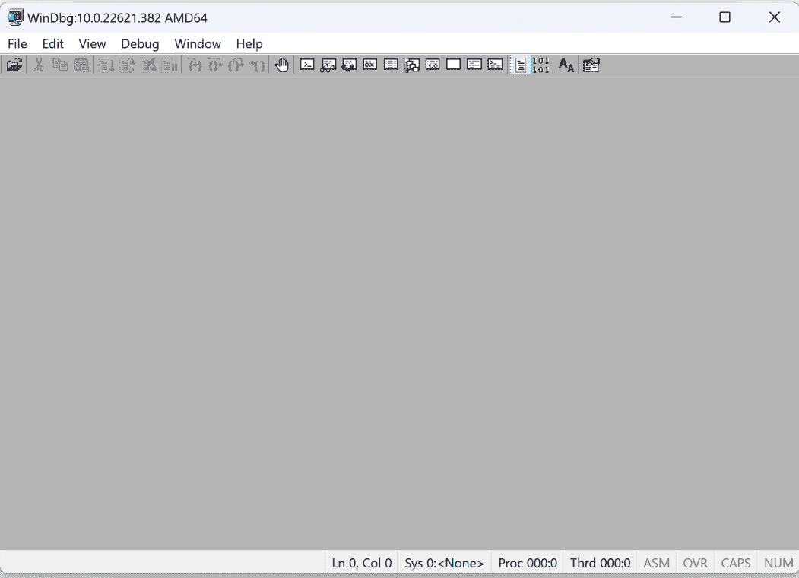

11. 打开`\LAPI\A64\core.19649`：

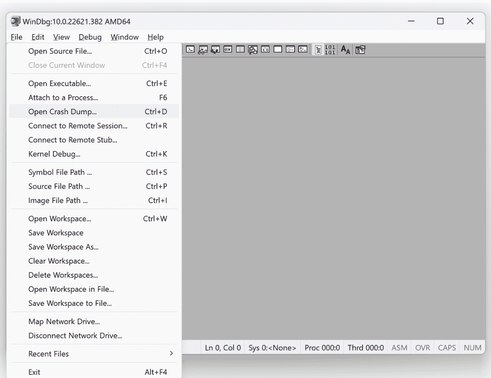

12. 转储文件已加载：

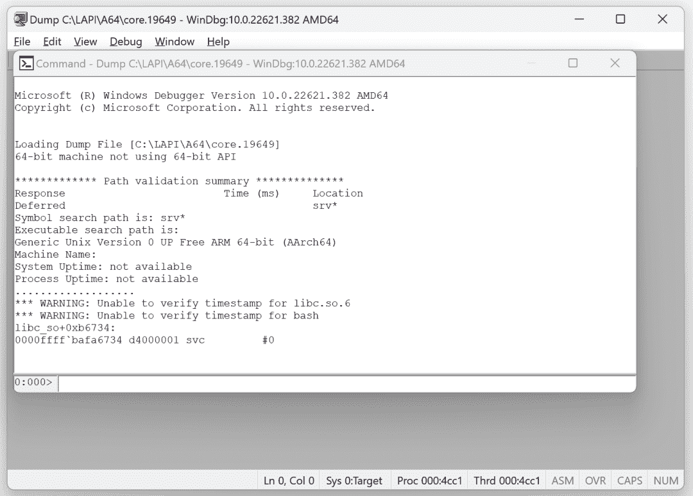

13. 输入`.sympath+` `<路径>` 命令设置符号路径：

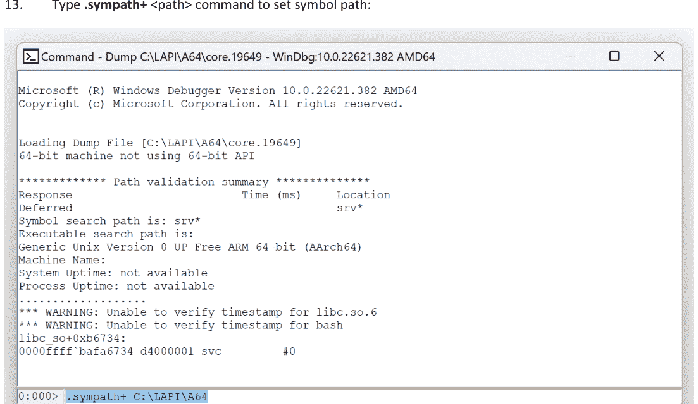

14. 输入`.reload` 命令重新加载符号：

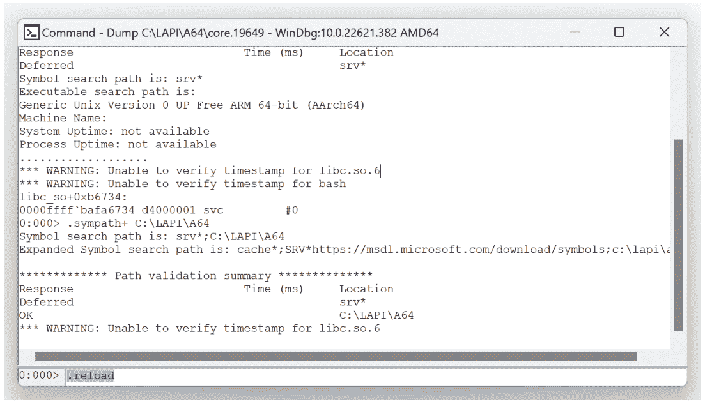

15. 输入`k` 命令验证堆栈跟踪的正确性：

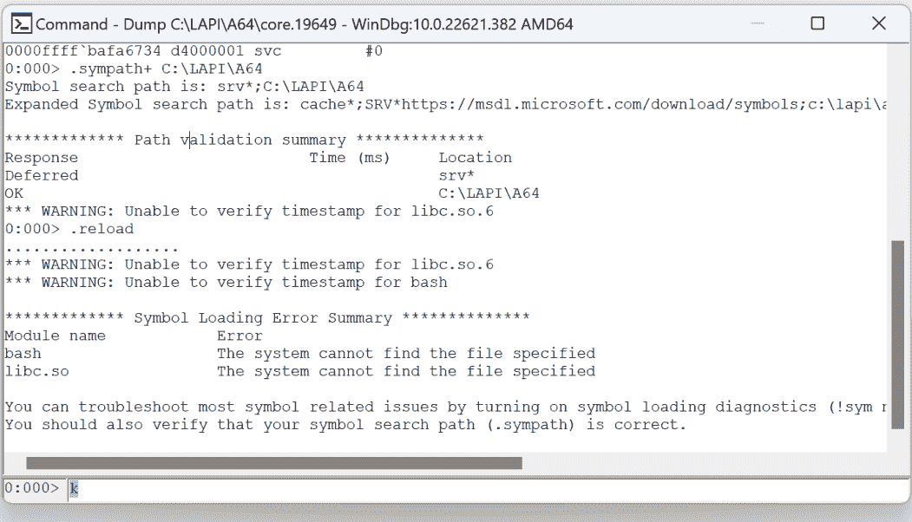

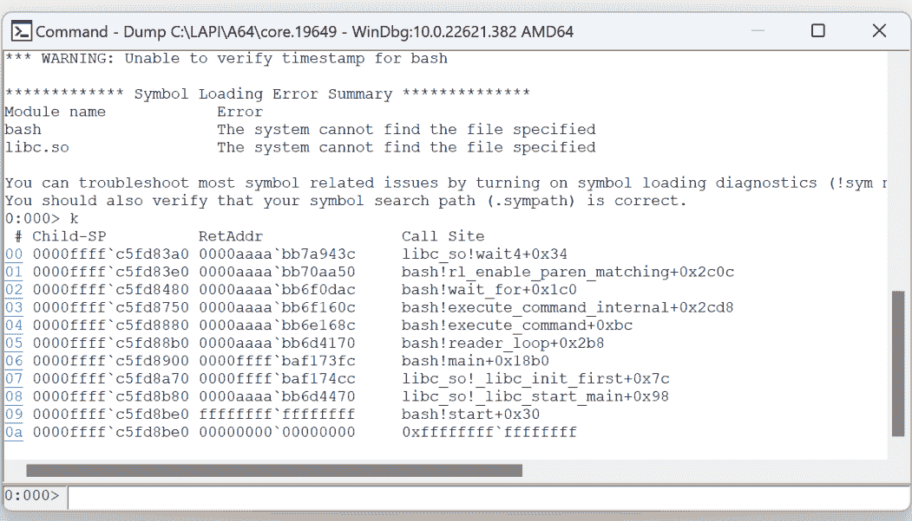

16. 【可选】如果更喜欢使用包含 WinDbg 和符号文件的 Docker 镜像，请按照以下步骤操作。

```
c:\LAPI>docker pull patterndiagnostics/windbg:10.0.22621.382-lapi
10.0.22621.382-lapi: Pulling from patterndiagnostics/windbg
Digest: sha256:e4ccb0b18a3dacd70e7ded51ea3e6e3c15bad6b8428ed7094fe214ce0262d98e
Status: Image is up to date for patterndiagnostics/windbg:10.0.22621.382-lapi
docker.io/patterndiagnostics/windbg:10.0.22621.382-lapi
```

```
c:\LAPI>docker run -it -v C:\LAPI:C:\LAPI patterndiagnostics/windbg:10.0.22621.382-lapi
Microsoft Windows [Version 10.0.20348.1726]
(c) Microsoft Corporation. All rights reserved.
```

```
C:\WinDbg>windbg.bat C:\LAPI\A64\core.19649
```

```
Microsoft (R) Windows Debugger Version 10.0.22621.382 AMD64
Copyright (c) Microsoft Corporation. All rights reserved.

Loading Dump File [C:\LAPI\A64\core.19649]
64-bit machine not using 64-bit API

************* Path validation summary **************
Response                         Time (ms)     Location
Symbol search path is: .
Executable search path is:
Generic Unix Version 0 UP Free ARM 64-bit (AArch64)
Machine Name:
System Uptime: not available
Process Uptime: not available
..............
*** WARNING: Unable to verify timestamp for libc.so.6
*** WARNING: Unable to verify timestamp for bash
libc_so+0xb6734:
0000ffff`bafa6734 d4000001 svc             #0
```

```
0:000> .sympath+ C:\LAPI\A64
Symbol search path is: .;C:\LAPI\A64
Expanded Symbol search path is: .;c:\lapi\a64

************* Path validation summary **************
Response                         Time (ms)     Location
OK                                            .
Oate                                            C:\LAPI\A64
```

```
0:000> .reload
..............
*** WARNING: Unable to verify timestamp for libc.so.6
*** WARNING: Unable to verify timestamp for bash

************* Symbol Loading Error Summary **************
Module name         Error
bash                系统找不到指定的文件
libc.so             系统找不到指定的文件
```

大多数与符号相关的问题可以通过打开符号加载诊断功能（`!sym noisy`）并重复导致符号加载的命令来进行故障排除。

您还应该验证符号搜索路径（`.sympath`）是否正确。

```
0:000> k
Child-SP         RetAddr           Call Site
0000ffff`c5fd83a0 0000aaaa`bb7a943c  libc_so!wait4+0x34
0000ffff`c5fd83e0 0000aaaa`bb70aa50  bash!rl_enable_paren_matching+0x2c0c
0000ffff`c5fd8480 0000aaaa`bb6f0dac  bash!wait_for+0x1c0
0000ffff`c5fd8750 0000aaaa`bb6f169c  bash!execute_command_internal+0x2cd8
0000ffff`c5fd8880 0000aaaa`bb6e168c  bash!execute_command+0xbc
0000ffff`c5fd88b0 0000aaaa`bb6d4170  bash!reader_loop+0x2b8
0000ffff`c5fd8900 0000ffff`baf173fc  bash!main+0x18b0
0000ffff`c5fd8a70 0000ffff`baf174cc  libc_so!_libc_init_first+0x7c
0000ffff`c5fd8b80 0000aaaa`bb6d4470  libc_so!__libc_start_main+0x98
0000ffff`c5fd8be0 ffffffff`ffffffff  bash!start+0x30
0000ffff`c5fd8be0 00000000`00000000  0xffffffff`ffffffff
```

```
0:000> q
quit:
NatVis script unloaded from 'C:\Program Files\Windows Kits\10\Debuggers\x64\Visualizers\gstl.natvis'
C:\WinDbg>exit
c:\LAPI>
```

## 为什么要学习 Linux API？

- 开发
- 恶意软件分析
- 漏洞分析与利用
- 逆向工程
- 诊断
- 调试
- 监控
- 内存取证
- 崩溃与挂起分析
- 安全编码
- 静态代码分析
- 跟踪与日志分析

首先，我们为什么要创建这门课程？Linux API 的知识对于这张幻灯片上列出的许多软件构建和构建后活动都是必需的。在本培训中，我们从软件诊断的角度来审视 Linux API。这一视角包括核心内存转储分析，以及部分跟踪与日志分析。在我的其他课程中，Linux API 的知识被默认是需要掌握的。课程学员有时会问，为什么我选择一个特定的回溯函数进行分析，或者这个或那个函数在做什么。当然，我们所学的内容与其他领域也有交叉。在本课程中，我们还会进行一些实时调试。

## 我的 Linux API 历史

- 1989 年的 C 运行时库
- 我于 1997 年开始使用 Linux API（[旧简历](https://opentask.com/Vostokov/CV.htm)）
- 2000 – 2003 年的商业应用开发
- 自 2015 年起阅读 Linux API 进行核心转储分析
- 从 2021 年开始教授 x64 Linux 调试基础，从 2022 年开始教授 A64 Linux 调试，共两本书
- 2022 年使用 Linux API 进行系统编程
- 2022 年 Linux 反汇编与逆向工程课程，2023 年第二版
- 2023 年 Linux 核心转储分析课程第三版
- 2023 年商业核心转储分析服务


我很难回忆起何时开始使用 Linux API 的。那是一段遥远的记忆，但不如 Windows API 那么遥远。我相信那是在 1990 年代中期，当时我至少安装了几次 Linux。幸运的是，我记得在 2003 年之前，我在旧简历中一丝不苟地记录了工作经历，虽然我现在不再维护它了。所以，根据记录，我看到我是从 1997 年开始使用 Linux API 的。2000 年，我设计并部分实现了一个适用于 Windows、Linux 和 Solaris 的多平台应用程序。2001 – 2003 年，Linux 是我用 C++ 开发静态代码分析工具的主要开发系统，使用 Emacs 作为代码编辑器，GNU 工具链进行开发。然后在 2003 年中期，我完全转向了 Windows 开发。2012 年，在短暂接触 FreeBSD 内部之后，我开始研究 macOS（当时称为 Mac OS X）核心转储分析，并于 2014 年发布了课程及其第二版，增加了 LLDB 材料。然后在 2015 年，我开始进行 Linux 核心转储分析，并发布了课程的第一版。2017 – 2020 年，我在准备各种面试的同时学习 Linux 内部机制。最终，在 2020 年中期，我转向全职基于 Linux 的云开发。在整个 2022 年，我每天都使用 Linux API 来实现 Linux API 监控工具。2023 年，我继续更新各种 Linux 课程，甚至开始了商业 Linux 核心转储分析，成功诊断客户问题并提供建议。

## 旧简历

<https://opentask.com/Vostokov/CV.htm>

## Linux API 的视角

- 内存分析：转储 / 实时调试
- 反汇编、重构、逆向工程
- 跟踪与日志分析（`strace`、`ltrace`、`perf`、`eBPF`、[`procmon`](https://github.com/Sysinternals/ProcMon-for-Linux)）
- 范畴论

我们所采用的视角来自软件诊断，特别是内存分析（这可能包括内存取证），包括转储分析和实时调试、反汇编、重构、逆向工程（即所谓的 ADDR 模式），以及使用`strace`、`ltrace`、`perf`、`eBPF`甚至适用于 Linux 的`procmon`等工具进行的跟踪和日志分析。我们不会从开发角度来审视 Linux API，例如编写应用程序和服务，尽管存在一些必要的交叉，尤其是在进行诊断和漏洞分析时。我们还会从范畴论的角度来审视 Linux API，并将其与 Windows API 进行比较。

### Procmon

<https://github.com/Sysinternals/ProcMon-for-Linux>

## 什么是 Linux API？

- 源代码视角
- ABI（应用二进制接口）视角
- 库
- 系统调用

让我们确定一下 Linux API 的含义。对此问题存在两种通用视角。第一种是源代码（或软件构建）视角。在本培训中，我们采用不同的软件构建后视角：从已编译和链接的模块中看到的就是我们所说的 Linux API。

## API 与语言层次

- 概念上的跨平台层次
- 高级语言和汇编语言
- 机器语言

从概念上讲，不同 API 之间存在许多相似之处，例如 Windows 和 Linux。这是可以理解的，因为很大一部分 API 围绕与操作系统交互展开，而操作系统必须提供通用的资源抽象。下一层次是高级语言和汇编语言层次，这在不同平台之间存在差异。最后，机器语言层次消除了前一层次的所有差异。

## x64 与 A64

在本节中，我们提供 x64 和 ARM64 平台反汇编的概述。熟悉 x64 汇编语言的 Windows 开发人员可能会受益，因为我们使用不同的风格，即 Linux GDB 中的默认风格。与我添加相同回顾的其他 Linux 课程相比，它的内容略少，因为例如我们对栈回溯重建不感兴趣。但是，我添加了一些额外的示例，这些示例在本课程的核心转储中可以看到。

## CPU 寄存器（x64）

- `RAX` ⊃ `EAX` ⊃ `AX` ⊇ {`AH`, `AL`}　`RAX` 64 位　`EAX` 32 位
- ALU：`RAX`、`RDX`
- 计数器：`RCX`
- 内存复制：`RSI`（源）、`RDI`（目标）
- 栈：`RSP`、`RBP`
- 下一条指令：`RIP`
- 新增：`R8` – `R15`、`R`x`(D|W|L)`

有熟悉的 32 位 CPU 寄存器名称，例如`EAX`，它们扩展为 64 位名称，例如`RAX`。它们中的大多数传统上是专门化的，例如 ALU、计数器和内存复制寄存器。不过，现在它们都可以用作通用寄存器。当然，有一个栈指针`RSP`，另外还有一个帧指针`RBP`，用于寻址局部变量和保存的参数。它可以用于回溯重建。在某些编译器代码生成实现中，`RBP`也用作通用寄存器，而`RSP`则承担帧指针的角色。指令指针`RIP`在每次函数调用时保存在栈内存区域中，然后在从被调用函数返回时恢复。此外，x64 平台还新增了另外八个通用寄存器，从`R8`到`R15`。

## 指令：寄存器（x64）

- 操作码 源, 目标 # 默认 AT&T 风格
- 示例：

```asm
mov $0x10, %rax          # 0x10 → RAX
mov %rsp, %rbp           # RSP → RBP
add $0x10, %r10          # R10 + 0x10 → R10
imul %ecx, %edx          # ECX * EDX → EDX
callq *%rdx              # RDX 已包含
                          #   函数地址 (&func)
                          # PUSH RIP; &func → RIP
sub $0x30, %rsp          # RSP-0x30 → RSP
                          # 为局部变量腾出空间
```

这张幻灯片展示了一些涉及寄存器操作的 CPU 指令示例，例如移动值和执行算术运算。操作数的方向与 Intel x64 反汇编风格相反，如果你习惯使用 Windows 上的 WinDbg 的话。可以在 GDB 中使用 Intel 反汇编风格，但我们选择了默认的 AT&T 风格，这与我们的 *Accelerated Linux Core Dump Analysis* 一书保持一致。

## 内存与栈寻址

在了解内存操作之前，我们先看一下内存寻址的图形化表示。线程栈与其他任何内存区域一样，因此可以使用除`RSP`和`RBP`之外的任何其他寄存器。请注意，栈向低地址方向增长，因此要访问先前压入的值，需要使用相对于`RSP`的正偏移量。

## 指令：内存加载（x64）

- Opcode Offset(SRC), DST
- Opcode DST
- 示例：

```asm
mov  0x10(%rsp), %rax      # RSP+0x10 地址处的值 → RAX

mov  -0x10(%rbp), %rcx    # RBP-0x10 地址处的值 → RCX

add  (%rax), %rdx         # RDX + RAX 地址处的值 → RDX

pop  %rdi                 # RSP 地址处的值 → RDI

                           # RSP + 8 → RSP

lea  0x20(%rbp), %r8       # RBP+0x20 的地址 → R8
```

常数编码在指令中，但如果需要任意值，则必须从内存中获取。圆括号表示相对于某个寄存器中存储的地址进行内存访问。

## 指令：内存存储（x64）

- Opcode SRC, Offset(DST)
- Opcode SRC|DST
- 示例：

```asm
mov     %rcx, -0x20(%rbp)      # RCX → RBP-0x20 地址处的值

addl    $1, (%rax)             # 1 + RAX 地址处的 32 位值 →

                               #     RAX 地址处的 32 位值

push    %rsi                   # RSP - 8 → RSP

                               # RSI → RSP 地址处的值

inc     (%rcx)                 # 1 + RCX 地址处的值 →

                               #     RCX 地址处的值
```

存储与加载类似。

## 指令：流程控制（x64）

- Opcode DST
- 示例：

```asm
jmpq    0x10493fc1c          # 0x10493fc1c → RIP

                             # (goto 0x10493fc1c)

jmpq    *0x100(%rip)         # RIP+0x100 地址处的值 → RIP

callq   0x10493ff74          # RSP - 8 → RSP

0x10493fc14:                 # 0x10493fc14 → RSP 地址处的值

                             # 0x10493ff74 → RIP

                             # (goto 0x10493ff74)
```

无条件跳转（Goto）通过`JMP`指令实现。函数调用通过`CALL`指令实现。对于条件分支，请参阅官方 Intel 文档。我们在练习中不使用这些指令。

## 函数调用与序言（x64）

```cpp
void proc(int p1, long p2);

mov  $0x1, %edi

mov  $0x2, %rsi

call proc

addr:

void proc2();

void proc(int p1, long p2) {

long local = 0;

proc2();

}

proc:

push %rbp

mov  %rsp, %rbp

sub  $0x8, %rsp

mov  $0, -0x8(%rbp)

call proc2

adr2:

...
```

当从调用者调用函数时，被调用者需要执行某些操作，以便在线程栈上为局部变量腾出空间。有多种方法可以做到这一点，左侧的汇编代码是其中一种。我在右侧的图中使用不同颜色来突出显示从`proc`函数开始到调用`proc2`函数时更新后的`RSP`和`RBP`值。为简化说明，我只使用 64 位值。

## CPU 寄存器（A64）

- `X0` – `X28`、`W0` – `W28`
- `X16`（`XIP0`）、`X17`（`XIP1`）
- 栈：`SP`、`X29`（`FP`）
- 下一条指令：`PC`
- 链接寄存器：`X30`（`LR`）
- 零寄存器：`XZR`、`WZR`
- 64 位浮点寄存器 `D0` – `D31`
- 128 位 `Q0` – `Q31`

共有 31 个通用寄存器，从`X0`到`X30`，其中一些被分配给特定任务，如过程内调用（`X16`、`XIP0`和`X17`、`XIP1`）、栈帧寻址（帧指针，`FP`、`X29`）和返回地址，即所谓的链接寄存器（`LR`、`X30`）。调用函数时，调用者的返回地址保存在`LR`中，而不是像 Intel/AMD x64 那样保存在栈上。被调用者中的返回指令使用`LR`中的地址赋值给`PC`以恢复执行。但如果被调用者调用其他函数，当前`LR`需要手动保存在某处，通常是栈上。当然还有栈指针`SP`。为了获取零值，有所谓的零寄存器`XZR`。所有`X`寄存器都是 64 位的，32 位低位部分通过`W`前缀寻址。还有 128 位 SIMD 寄存器。接下来，我们简要介绍与练习相关的一些方面。

## 指令：寄存器操作（A64）

- Opcode DST, SRC, SRC2
- 示例：

```asm
mov x0, #16              // X0 ← 16 (0x10)

mov x29, sp              // X29 ← SP

add x1, x2, #16          // X1 ← X2+16 (0x10)

mul x1, x2, x3           // X1 ← X2*X3

blr x8                   // X8 已包含

                         //    函数 func 的地址 (&func)

                         // LR ← PC+4; PC ← &func

sub sp, sp, #48          // SP ← SP-48 (-0x30)

                         // 为局部变量腾出空间
```

本页展示了一些涉及寄存器操作的 CPU 指令示例，例如移动值和进行算术运算。操作数方向与 Intel x64 反汇编风格相同，如果你习惯使用 Windows 上的 WinDbg。它等同于赋值。`BLR`是调用地址在寄存器中的某个函数。`BL`表示分支并链接（Branch and Link）。

## 内存与栈寻址

在了解内存操作之前，我们先看一下内存寻址的图形化表示。线程栈与其他任何内存区域一样，因此可以使用除`SP`和`X29 (FP)`之外的任何其他寄存器。请注意，栈向低地址方向增长，因此要访问先前压入的值，需要使用相对于`SP`的正偏移量。

## 指令：内存加载（A64）

- Opcode DST, DST₂, [SRC, Offset]
- Opcode DST, DST₂, [SRC], Offset // 后置递增
- 示例：

```asm
ldr     x0, [sp]                  // X0 ← SP+0 地址处的值

ldr     x0, [x29, #-8]            // X0 ← X29-0x8 地址处的值

ldp     x29, x30, [sp, #32]       // X29 ← SP+32 (0x20) 地址处的值

                                // X30 ← SP+40 (0x28) 地址处的值

ldp     x29, x30, [sp], #16       // X29 ← SP+0 地址处的值

                                // X30 ← SP+8 地址处的值

                                // SP ← SP+16 (0x10)
```

常数编码在指令中，但如果需要任意值，则必须从内存中获取。方括号用于表示相对于某个寄存器中存储的地址进行内存访问。还有一种选项可以在加载后调整寄存器的值，即所谓的**后置递增**，可以是负值。正如我们后面将看到的，加载成对的寄存器可能很有用。

## 指令：内存存储（A64）

- Opcode SRC, SRC₂, [DST, Offset]
- Opcode SRC, SRC₂, [DST, Offset]! // 前置递增
- 示例：

```asm
str   x0,  [sp, #16]              // x0 → SP+16 (0x10) 地址处的值

str   x0,  [x29, #-8]             // x0 → X29-8 地址处的值

stp   x29, x30, [sp, #32]         // x29 → SP+32 (0x20) 地址处的值

                                   // x30 → SP+40 (0x28) 地址处的值

stp   x29, x30, [sp, #-16]!       // SP ← SP-16 (-0x10)

                                   // x29 → SP 地址处的值

                                   // x30 → SP+8 地址处的值
```

存储操作数的顺序与其他指令相反。可以在存储值之前**前置递增**目标寄存器。

## 指令：流程控制（A64）

- Opcode DST, SRC
- 示例：

```asm
adrp x0, 0x420000 // x0 ← 0x420000

b 0x10493fc1c // PC ← 0x10493fc1c

// (goto 0x10493fc1c)

br x17 // PC ← X17 的值

0x10493fc14: // PC == 0x10493fc14

bl 0x10493ff74 // LR ← PC+4 (0x10493fc18)

// PC ← 0x10493ff74

// (goto 0x10493ff74)
```

由于每条指令的大小为 4 字节（32 位），只能编码一个大 4GB 地址范围的一部分，可以表示为相对于当前`PC`的偏移量，或通过`ADRP`指令。无条件跳转（Goto）通过`B`指令实现。函数调用通过`BL`（分支并链接）指令实现。

## 函数调用与 Prolog（A64）

```asm
// void proc(int p1, long p2);

mov w0, #0x1

mov x1, #0x2

bl proc

addr:

// void proc2();

// void proc(int p1, long p2) {

//   long local = 0;

//   local = 0;

//   proc2();

// }

proc:

stp x29, x30, [sp, #-32]!

mov x29, sp

str zxr, [x29, #16]
```


`bl proc2`

`adr2`:

...

```
当从调用者调用函数时，被调用者需要执行某些操作来在线程栈上为局部变量腾出空间，并在函数体内有进一步调用时保存`LR`。有不同的方式可以实现这一点，左侧的汇编语言代码是GCC编译器默认使用的方式之一。我在右侧的图中使用不同的颜色来突出显示从`proc`函数开始到调用`proc2`函数时刻之间更新的`SP`和`X29`（`FP`）值。还请注意零寄存器使用的一个例子，以及`SP`和`X29`指向同一内存位置的事实。`X29`的正偏移量用于寻址局部变量。为了简化说明，我只使用64位值。
```

## 通用 Linux API 方面

## 词汇表

- `IAT` ↔ `PLT`
- `DLL` ↔ `SO`
- `Module` ↔ 共享库

在这张幻灯片中，我不断添加一些在Windows和Linux API的标准描述中不同但指向相同概念的词汇。`IAT`是导入地址表（Import Address Table），`PLT`是过程链接表（Procedure Linkage Table）。

如果您不熟悉C或C++，头文件是在源代码中引用并在编译期间插入的文本文件。它可以包含任何内容，但很可能是编程语言源代码，例如函数声明，在我们的上下文中，例如Linux API函数和类型的声明。因此，例如，如果我们有兴趣创建线程，`pthread_create` API函数是在`pthread.h`头文件中声明的。

**系统调用**
https://man7.org/linux/man-pages/dir_section_2.html

**概览**
https://man7.org/linux/man-pages/man2/syscalls.2.html

**内核源代码交叉引用**
https://elixir.bootlin.com/linux/latest/source

**手册页 0**
https://man7.org/linux/man-pages/man0/

有几种命名约定。Linux API约定与Windows API约定有显著不同；此外，不同编程语言之间也存在差异；请参见幻灯片上的第一个链接。Linux API命名与标准C和C++库的命名惯例密切相关。Linux API对函数、类型、参数和结构字段使用**两个单词**和**snake_case**。常量和宏使用一种不同的蛇形命名约定，称为**SCREAMING_SNAKE_CASE**，以及**TWOWORDS**。

**命名惯例**
https://en.wikipedia.org/wiki/Naming_convention_(programming)

**蛇形命名**
https://en.wikipedia.org/wiki/Snake_case

## 基本类型系统

```
sys/types.h
```

- 基本类型通过`typedef`定义
- `inttypes.h`
  - `uint64_t`
- `sys/types.h`
  - `size_t`, `pid_t`

| GDB 命令 | WinDbg 命令 |
| --- | --- |
| `(gdb) info types` | `0:000> dt *!*` |
| `(gdb) info functions` | `0:000> x *!*` |

Linux API使用C语言类型系统，并通常从标准C类型通过`typedef`定义额外的自定义类型。基本类型在几个文件中定义。示例显示在此幻灯片上。

现在我们从源代码转向实现细节。Linux API调用最终通过Intel平台上的`call`指令和ARM平台上的分支链接指令实现。在我们的培训中，我们在x64和ARM64的练习中展示示例。编译器根据目标是否在同一模块内选择不同的调用指令变体。当被调用者在同一模块内、相对当前指令指针的偏移量已知、或地址为绝对地址时，可以发出直接调用。

## 调用类型 (A64)

直接调用（同一可执行文件或共享库）

```
shell_execve:

...

0x0000aaaabb6f71e4 <+160>:   bl    0xaaaabb742530 <file_status>
```

间接调用

- 指针（`.got`）
- `PLT` 跨模块调用

```
shell_execve:

...

0x0000aaaabb6f7210 <+204>:   bl    0xaaaabb6d1ec0 <open@plt>

open@plt:

...

0x0000aaaabb6d1ec0 <+0>:     adrp  x16, 0xaaaabb7ff000

0x0000aaaabb6d1ec4 <+4>:     ldr   x17, [x16, #1464]

...

0x0000aaaabb6d1ecc <+12>:    br    x17
```

在ARM64中，我们看到了类似的图景，其中使用了GOT（全局偏移表）。我们还看到了一个过程内寄存器使用的例子（`X16`和`X17`）。

## API 作为接口

- 由某个`.so`库提供（导出）
- 由可执行文件或`.so`使用（导入）
- 可以是函数式或面向对象的

大多数时候，Linux API指的是由某些共享库提供或导出的接口集合。这些接口由其他共享库或可执行文件使用或导入。接口在概念上可以是函数式或面向对象的。让我们看看这些API接口是如何实现的。

## 探索工具

- `ldd`
- `readelf`
- `objdump`
- `$ LD_DEBUG=libs bash`

除了跟踪和GDB之外，还有一些用于共享库接口和依赖关系的探索工具，我们将在一些练习中使用。

**ldd**
https://man7.org/linux/man-pages/man1/ldd.1.html

**readelf**
https://man7.org/linux/man-pages/man1/readelf.1.html

**objdump**
https://man7.org/linux/man-pages/man1/objdump.1.html

**LD_DEBUG**
https://man7.org/linux/man-pages/man8/ld.so.8.html

## 符号导入/导出

希望提供接口的共享库具有所谓的`.dynsym`段，其中包含名称和代码中的对应位置。另一方面，如果某个共享库或可执行文件想要使用该接口中的某些名称，它也具有所谓的`.rela.plt`段，引用其自身的`.dynsym`段，该段包含这些名称，如本幻灯片所示，其中`app`想要使用`libc.so.6`中的`open`。

## 过程链接表 (x64)

当希望使用其他共享库接口的共享库或可执行文件被加载时，动态链接器通过用其他已加载的、导出所需接口条目的共享库中的真实地址填充每个条目来修改所谓的`.GOT.PLT`段。例如，如果`app`想要使用`libc.so.6`中的`open`函数，`.GOT.PLT`中的对应条目将被填充为该函数在`libc.so.6`代码内的真实地址。如果我们想要调用接口条目，则使用间接寻址来将执行转移到接口共享库代码。首先，它调用`.PLT`存根中的条目，然后间接跳转到来自`.GOT.PLT`的地址，该地址指向另一个实现该接口条目的共享库中的代码。这种间接性允许独立于其实现代码在内存中的位置来调用接口，因为`.PLT`的相对地址是相同的。这种机制还允许共享库在每次程序运行时被加载到不同的地址，如下一张幻灯片所示。使用两个段`.PLT`和`.GOT.PLT`的原因将在我们稍后在本课程中查看动态链接时变得清晰。

## 过程链接表 (A64)

ARM64的情况类似，只是段名称略有不同。

## 虚拟进程地址空间

这张幻灯片显示了不同的程序执行，其中每次相同的共享库都被加载到不同的地址。我们看到间接寻址允许`app`代码调用加载到虚拟内存中不同地址的`libc`代码。

## Exercise L1

- **目标：** 探索导入/导出信息以及对共享库的调用
- **ADDR 模式：** 调用路径
- `\API-Dumps\Exercise-L1-GDB.pdf`
- `\API-Dumps\Exercise-L1-WinDbg.pdf`

## Exercise L1 (GDB)

**目标：** 探索导入/导出信息以及对共享库的调用。

**ADDR 模式：** 调用路径。

1. 反汇编 x64 目录中 bash 可执行文件的`execve@plt`函数：

```
~/LAPI/x64$ objdump -d bash | grep -A 4 "<execve@plt>:"

000000000002d5e0 <execve@plt>:

 2d5e0:	ff 25 0a 7d 0e 00 	jmpq   *0xe7d0a(%rip)        # 1152f0 <execve@GLIBC_2.2.5>

 2d5e6:	68 5b 00 00 00    	pushq  $0x5b

 2d5eb:	e9 30 fa ff ff    	jmpq   2d020 <endgrent@plt-0x10>
```

2. 从 x64 目录中的`bash`可执行文件转储所有 ELF 信息，并在`.rela.plt`节中查找`1152f0`条目，以及在`.dynsym`节中查找引用的 94（`0x5e`）条目：

```
~/LAPI/x64$ readelf -a bash

[...]

Relocation section '.rela.plt' at offset 0x2b928 contains 218 entries:

 Offset          Info           Type           Sym. Value    Sym. Name + Addend

[...]

00000001152f0  005e00000007 R_X86_64_JUMP_SLO 0000000000000000 execve@GLIBC_2.2.5 + 0

[...]

Symbol table '.dynsym' contains 2432 entries:

 Num:    Value          Size Type    Bind   Vis      Ndx Name

[...]

    94: 0000000000000000     0 FUNC    GLOBAL DEFAULT  UND execve@GLIBC_2.2.5 (2)

[...]
```

3. 从 x64 目录中的`libc.so.6`共享库转储所有 ELF 信息，并在`.dynsym`节中查找`execve@GLIBC`函数：

```
~/LAPI/x64$ readelf -a libc.so.6

[...]

Symbol table '.dynsym' contains 2359 entries:

 Num:    Value          Size Type    Bind   Vis      Ndx Name

[...]

  1508: 00000000000c68a0    33 FUNC    WEAK   DEFAULT   13 execve@@GLIBC_2.2.5
```

4. 从 x64 目录加载核心转储文件`core.9`和`bash`可执行文件：

```
~/LAPI/x64$ gdb -c core.9 -se bash

GNU gdb (Debian 8.2.1-2+b3) 8.2.1

Copyright (C) 2018 Free Software Foundation, Inc.

License GPLv3+: GNU GPL version 3 or later <http://gnu.org/licenses/gpl.html>

This is free software: you are free to change and redistribute it.

There is NO WARRANTY, to the extent permitted by law.

Type "show copying" and "show warranty" for details.

This GDB was configured as "x86_64-linux-gnu".

Type "show configuration" for configuration details.

For bug reporting instructions, please see:

<http://www.gnu.org/software/gdb/bugs/>.

Find the GDB manual and other documentation resources online at:

    <http://www.gnu.org/software/gdb/documentation/>.
```

如需帮助，请输入 "help"。

输入 "apropos word" 搜索与 "word" 相关的命令...

正在从 bash 读取符号...(未找到调试符号)...完成。

警告：核心文件可能与指定的可执行文件不匹配。

[New LWP 9]

核心由 `-bash' 生成。

#0  0x00007f3e9f7492d7 in __GI___waitpid (pid=-1, stat_loc=0x7ffcbd661ad0, options=10) at

../sysdeps/unix/sysv/linux/waitpid.c:30

30      ../sysdeps/unix/sysv/linux/waitpid.c: 没有该文件或目录。

5. 设置日志记录到文件，以防某些命令输出过长：

```
(gdb) set logging on L1.log

Copying output to L1.log.
```

6. 反汇编`shell_execve`函数，并找到对`open@plt`函数的调用：

```
(gdb) disassemble shell_execve

Dump of assembler code for function shell_execve:

   0x000055e16508f7a0 <+0>:     push   %r15

   0x000055e16508f7a2 <+2>:     push   %r14

   0x000055e16508f7a4 <+4>:     mov    %rdx,%r14

   0x000055e16508f7a7 <+7>:     push   %r13

   0x000055e16508f7a9 <+9>:     mov    %rsi,%r13

   0x000055e16508f7ac <+12>:    push   %r12

   0x000055e16508f7ae <+14>:    push   %rbp

   0x000055e16508f7af <+15>:    push   %rbx

   0x000055e16508f7b0 <+16>:    mov    %rdi,%rbx

   0x000055e16508f7b3 <+19>:    sub    $0xa8,%rsp

   0x000055e16508f7ba <+26>:    mov    %fs:0x28,%rax

   0x000055e16508f7c3 <+35>:    mov    %rax,0x98(%rsp)

   0x000055e16508f7cb <+43>:    xor    %eax,%eax

   0x000055e16508f7cd <+45>:    callq  0x55e1650785e0 <execve@plt>

   0x000055e16508f7d2 <+50>:    callq  0x55e165078120 <__errno_location@plt>

   0x000055e16508f7d7 <+55>:    mov    %rax,%r12

   0x000055e16508f7da <+58>:    mov    (%rax),%ebp

   0x000055e16508f7dc <+60>:    mov    0xdc2a6(%rip),%eax        # 0x55e16516ba88

<terminating_signal>

   0x000055e16508f7e2 <+66>:    test   %eax,%eax

   0x000055e16508f7e4 <+68>:    jne    0x55e16508f880 <shell_execve+224>

   0x000055e16508f7ea <+74>:    cmp    $0x8,%ebp

   0x000055e16508f7ed <+77>:    je     0x55e16508f894 <shell_execve+244>

   0x000055e16508f7f3 <+83>:    xor    %eax,%eax

   0x000055e16508f7f5 <+85>:    cmp    $0x2,%ebp

   0x000055e16508f7f8 <+88>:    mov    %rbx,%rdi

   0x000055e16508f7fb <+91>:    sete   %al

   0x000055e16508f7fe <+94>:    add    $0x7e,%eax

   0x000055e16508f801 <+97>:    mov    %eax,0xde321(%rip)        # 0x55e16516db28

<last_command_exit_value>

   0x000055e16508f807 <+103>:   callq  0x55e1650891a0 <file_isdir>

   0x000055e16508f80c <+108>:   test   %eax,%eax
```


```text
0x000055e16508f80e <+110>:   jne    0x55e16508fa58 <shell_execve+696>

0x000055e16508f814 <+116>:   mov    %rbx,%rdi

0x000055e16508f817 <+119>:   callq  0x55e1650d3970 <executable_file>

0x000055e16508f81c <+124>:   test   %eax,%eax

0x000055e16508f81e <+126>:   je     0x55e16508f841 <shell_execve+161>

0x000055e16508f820 <+128>:   cmp    $0x7,%ebp

0x000055e16508f823 <+131>:   je     0x55e16508f841 <shell_execve+161>
```

```text
0x000055e16508f825 <+133>:	cmp    $0xc,%ebp
0x000055e16508f828 <+136>:	je     0x55e16508f841 <shell_execve+161>
0x000055e16508f82a <+138>:	xor    %esi,%esi
0x000055e16508f82c <+140>:	mov    %rbx,%rdi
0x000055e16508f82f <+143>:	xor    %eax,%eax
0x000055e16508f831 <+145>:	callq  0x55e165078aa0 <open@plt>
0x000055e16508f836 <+150>:	mov    %eax,%r13d
--Type <RET> for more, q to quit, c to continue without paging--q

Quit
```

### 7. 跟随调用路径和间接跳转，查看来自`libc.so.6`库的实际调用

```text
(gdb) disassemble 0x55e165078aa0

Dump of assembler code for function open@plt:

  0x000055e165078aa0 <+0>:	jmpq   *0xe7aaa(%rip)        # 0x55e165160550 <open@got.plt>
  0x000055e165078aa6 <+6>:	pushq  $0xa7
  0x000055e165078aab <+11>:	jmpq   0x55e165078020

End of assembler dump.
```

```text
(gdb) x/a 0x55e165160550

0x55e165160550 <open@got.plt>:	0x7f3e9f76d010 <__libc_open64>
```

```text
(gdb) info sharedlibrary

From                    To                      Syms Read  Shared Object Library

0x00007f3e9f856950      0x00007f3e9f863dc8  Yes (*)    /lib/x86_64-linux-gnu/libtinfo.so.6
0x00007f3e9f844130      0x00007f3e9f844eb5  Yes        /lib/x86_64-linux-gnu/libdl.so.2
0x00007f3e9f6a5320      0x00007f3e9f7eb14b  Yes        /lib/x86_64-linux-gnu/libc.so.6
0x00007f3e9f884090      0x00007f3e9f8a1b50  Yes        /lib64/ld-linux-x86-64.so.2
0x00007f3e9f37e300      0x00007f3e9f384578  Yes        /lib/x86_64-linux-gnu/libnss_files.so.2

(*): 共享库缺少调试信息。
```

### 8. 检查地址`0x55e165160550`所在的节区

```text
(gdb) info file

Symbols from "/home/coredump/LAPI/x64/bash".

Local core dump file:

	`/home/coredump/LAPI/x64/core.9', file type elf64-x86-64.

	0x000055e16515d000 - 0x000055e165160000 is load1
	0x000055e165160000 - 0x000055e165169000 is load2
	0x000055e165169000 - 0x000055e165173000 is load3
	0x000055e1667f5000 - 0x000055e166879000 is load4
	0x00007f3e9f388000 - 0x00007f3e9f389000 is load5
	0x00007f3e9f389000 - 0x00007f3e9f38a000 is load6
	0x00007f3e9f38a000 - 0x00007f3e9f390000 is load7
	0x00007f3e9f680000 - 0x00007f3e9f683000 is load8
	0x00007f3e9f839000 - 0x00007f3e9f83d000 is load9
	0x00007f3e9f83d000 - 0x00007f3e9f83f000 is load10
	0x00007f3e9f83f000 - 0x00007f3e9f843000 is load11
	0x00007f3e9f846000 - 0x00007f3e9f847000 is load12
	0x00007f3e9f847000 - 0x00007f3e9f848000 is load13
	0x00007f3e9f871000 - 0x00007f3e9f875000 is load14
	0x00007f3e9f875000 - 0x00007f3e9f876000 is load15
	0x00007f3e9f876000 - 0x00007f3e9f878000 is load16
	0x00007f3e9f8aa000 - 0x00007f3e9f8ab000 is load17
	0x00007f3e9f8ab000 - 0x00007f3e9f8ac000 is load18
	0x00007f3e9f8ac000 - 0x00007f3e9f8ad000 is load19
	0x00007ffcbd642000 - 0x00007ffcbd663000 is load20
	0x00007ffcbd7ea000 - 0x00007ffcbd7eb000 is load21

Local exec file:

	`/home/coredump/LAPI/x64/bash', file type elf64-x86-64.

	Entry point: 0x55e16507a630

	0x000055e16504b2a8 - 0x000055e16504b2c4 is .interp
	0x000055e16504b2c4 - 0x000055e16504b2e4 is .note.ABI-tag
	0x000055e16504b2e4 - 0x000055e16504b308 is .note.gnu.build-id
	0x000055e16504b308 - 0x000055e16504fdb0 is .gnu.hash
	0x000055e16504fdb0 - 0x000055e16505e1b0 is .dynsym
```

### 9. 从 A64 目录加载核心转储文件`core.19649`和`bash`可执行文件

```shell
~/LAPI/x64$ cd ../A64
```

```text
~/LAPI/A64$ gdb-multiarch -c core.19649 -se bash

GNU gdb (Debian 8.2.1-2+b3) 8.2.1

Copyright (C) 2018 Free Software Foundation, Inc.

License GPLv3+: GNU GPL version 3 or later <http://gnu.org/licenses/gpl.html>

This is free software, and you are welcome to change it.

There is NO WARRANTY, to the extent permitted by law.

Type "show copying" and "show warranty" for details.

This GDB was configured as "x86_64-linux-gnu".

Type "show configuration" for configuration details.

For bug reporting instructions, please see:

<http://www.gnu.org/software/gdb/bugs/>.

Find the GDB manual and other documentation resources online at:

    <http://www.gnu.org/software/gdb/documentation/>.

For help, type "help".

Type "apropos word" to search for commands related to "word"...

Reading symbols from bash...(no debugging symbols found)...done.

warning: core file may not match specified executable file.

[New LWP 19649]

warning: Could not load shared library symbols for 3 libraries, e.g. /lib/aarch64-linux-

gnu/libtinfo.so.6.

Use the "info sharedlibrary" command to see the complete listing.

Do you need "set solib-search-path" or "set sysroot"?

Core was generated by `-bash'.

#0  0x0000ffffbafa6734 in ?? ()
```

```text
(gdb) set solib-search-path .

Reading symbols from /home/coredump/LAPI/A64/libtinfo.so.6...(no debugging symbols found)...done.

Reading symbols from /home/coredump/LAPI/A64/libc.so.6...(no debugging symbols found)...done.

Reading symbols from /home/coredump/LAPI/A64/ld-linux-aarch64.so.1...(no debugging symbols found)...done.
```

### 10. 设置日志记录到文件，以防某些命令输出过长

```text
(gdb) set logging on L1.log

Copying output to L1.log.
```

### 11. 反汇编`shell_execve`函数，并找到对`open@plt`函数的调用

```text
(gdb) disassemble shell_execve

Dump of assembler code for function shell_execve:

   0x0000aaaabb6f7144 <+0>:	stp	x29, x30, [sp, #-224]!
   0x0000aaaabb6f7148 <+4>:	adrp	x3, 0xaaaabb800000
   0x0000aaaabb6f714c <+8>:	mov	x29, sp
   0x0000aaaabb6f7150 <+12>:	ldr	x3, [x3, #1192]
   0x0000aaaabb6f7154 <+16>:	stp	x19, x20, [sp, #16]
   0x0000aaaabb6f7158 <+20>:	mov	x19, x0
   0x0000aaaabb6f715c <+24>:	stp	x21, x22, [sp, #32]
   0x0000aaaabb6f7160 <+28>:	mov	x22, x1
   0x0000aaaabb6f7164 <+32>:	stp	x23, x24, [sp, #48]
   0x0000aaaabb6f7168 <+36>:	mov	x23, x2
   0x0000aaaabb6f716c <+40>:	stp	x25, x26, [sp, #64]
   0x0000aaaabb6f7170 <+44>:	ldr	x4, [x3]
   0x0000aaaabb6f7174 <+48>:	str	x4, [sp, #216]
   0x0000aaaabb6f7178 <+52>:	mov	x4, #0x0			// #0
   0x0000aaaabb6f717c <+56>:	bl	0xaaaabb6d23e0 <execve@plt>
   0x0000aaaabb6f7180 <+60>:	bl	0xaaaabb6d2740 <__errno_location@plt>
   0x0000aaaabb6f7184 <+64>:	mov	x20, x0
   0x0000aaaabb6f7188 <+68>:	adrp	x3, 0xaaaabb800000
   0x0000aaaabb6f718c <+72>:	ldr	x0, [x3, #2616]
   0x0000aaaabb6f7190 <+76>:	ldr	w1, [x0]
   0x0000aaaabb6f7194 <+80>:	cbnz	w1, 0xaaaabb6f72bc <shell_execve+376>
   0x0000aaaabb6f7198 <+84>:	ldr	w21, [x20]
   0x0000aaaabb6f719c <+88>:	cmp	w21, #0x8
   0x0000aaaabb6f71a0 <+92>:	b.eq	0xaaaabb6f73c4 <shell_execve+640>  // b.none
   0x0000aaaabb6f71a4 <+96>:	adrp	x23, 0xaaaabb800000
   0x0000aaaabb6f71a8 <+100>:	cmp	w21, #0x2
   0x0000aaaabb6f71ac <+104>:	cset	w2, eq  // eq = none
   0x0000aaaabb6f71b0 <+108>:	add	x24, sp, #0x58
   0x0000aaaabb6f71b4 <+112>:	ldr	x3, [x23, #3744]
   0x0000aaaabb6f71b8 <+116>:	add	w2, w2, #0x7e
   0x0000aaaabb6f71bc <+120>:	mov	x1, x24
   0x0000aaaabb6f71c0 <+124>:	mov	x0, x19
   0x0000aaaabb6f71c4 <+128>:	str	w2, [x3]
   0x0000aaaabb6f71c8 <+132>:	bl	0xaaaabb6d2180 <stat@plt>
   0x0000aaaabb6f71cc <+136>:	cbnz	w0, 0xaaaabb6f71e0 <shell_execve+156>
   0x0000aaaabb6f71d0 <+140>:	ldr	w0, [sp, #104]
   0x0000aaaabb6f71d4 <+144>:	and	w0, w0, #0xf000
   0x0000aaaabb6f71d8 <+148>:	cmp	w0, #0x4, lsl #12
   0x0000aaaabb6f71dc <+152>:	b.eq	0xaaaabb6f7288 <shell_execve+324>  // b.none
   0x0000aaaabb6f71e0 <+156>:	mov	x0, x19
   0x0000aaaabb6f71e4 <+160>:	bl	0xaaaabb742530 <file_status>
   0x0000aaaabb6f71e8 <+164>:	tbnz	w0, #4, 0xaaaabb6f727c <shell_execve+312>
   0x0000aaaabb6f71ec <+168>:	mov	w1, #0x12
   0x0000aaaabb6f71f0 <+172>:	and	w22, w0, w1
   0x0000aaaabb6f71f4 <+176>:	cmp	w22, #0x2
   0x0000aaaabb6f71f8 <+180>:	b.ne	0xaaaabb6f721c <shell_execve+216>  // b.any
   0x0000aaaabb6f71fc <+184>:	cmp	w21, #0x7
``` 


```
0x0000aaaabb6f7200 <+188>:	ccmp	w21, #0xc, #0x4, ne  // ne = any

0x0000aaaabb6f7204 <+192>:	b.eq	0xaaaabb6f721c <shell_execve+216>  // b.none

0x0000aaaabb6f7208 <+196>:	mov	x0, x19

0x0000aaaabb6f720c <+200>:	mov	w1, #0x0

0x0000aaaabb6f7210 <+204>:	bl	0xaaaabb6d1ec0 <open@plt>

0x0000aaaabb6f7214 <+208>:	mov	w25, w0

0x0000aaaabb6f7218 <+212>:	tbz	w0, #31, 0xaaaabb6f72d0 <shell_execve+396>

0x0000aaaabb6f721c <+216>:	str	w21, [x20]

0x0000aaaabb6f7220 <+220>:	mov	w0, w21

0x0000aaaabb6f7224 <+224>:	bl	0xaaaabb6d2110 <strerror@plt>

0x0000aaaabb6f7228 <+228>:	mov	x2, x0

0x0000aaaabb6f722c <+232>:	mov	x1, x19

0x0000aaaabb6f7230 <+236>:	adrp	x0, 0xaaaabb7c4000

0x0000aaaabb6f7234 <+240>:	add	x0, x0, #0xbd8

0x0000aaaabb6f7238 <+244>:	bl	0xaaaabb706674 <report_error>

0x0000aaaabb6f723c <+248>:	ldr	x23, [x23, #3744]

0x0000aaaabb6f7240 <+252>:	ldr	w25, [x23]

0x0000aaaabb6f7244 <+256>:	adrp	x0, 0xaaaabb800000

0x0000aaaabb6f7248 <+260>:	ldr	x0, [x0, #1192]

0x0000aaaabb6f724c <+264>:	ldr	x2, [sp, #216]

0x0000aaaabb6f7250 <+268>:	ldr	x1, [x0]

0x0000aaaabb6f7254 <+272>:	subs	x2, x2, x1

0x0000aaaabb6f7258 <+276>:	mov	x1, #0x0

0x0000aaaabb6f725c <+280>:	b.ne	0xaaaabb6f77ec <shell_execve+1704>  // b.any

0x0000aaaabb6f7260 <+284>:	mov	w0, w25

0x0000aaaabb6f7264 <+288>:	ldp	x19, x20, [sp, #16]

0x0000aaaabb6f7268 <+292>:	ldp	x21, x22, [sp, #32]

0x0000aaaabb6f726c <+296>:	ldp	x23, x24, [sp, #48]

0x0000aaaabb6f7270 <+300>:	ldp	x25, x26, [sp, #64]

0x0000aaaabb6f7274 <+304>:	ldp	x29, x30, [sp], #224

0x0000aaaabb6f7278 <+308>:	ret

0x0000aaaabb6f727c <+312>:	mov	w1, #0x15

0x0000aaaabb6f7280 <+316>:	str	w1, [x20]
```

```
0x000055e16505e1b0 - 0x000055e1650678d8 is .dynstr

0x000055e1650678d8 - 0x000055e165068bd8 is .gnu.version

0x000055e165068bd8 - 0x000055e165068ca8 is .gnu.version_r

0x000055e165068ca8 - 0x000055e165076928 is .rela.d FLAGS:标识:1237456:9267udauoa:12329]89

0x000055e165076928 - 0x000055e165077d98 is .rela.plt

0x000055e165078000 - 0x000055e165078017 is .init

0x000055e165078020 - 0x000055e165078dd0 is .plt

0x000055e discussions and debates about violence and non-violence. She believed in the power of non-violent resistance and worked towards peace.165078dd0 - 0x000055e165078de8 is .plt.got

0x000055e165078df0 - 0x000055e165125781 is .text

0x000055e165125784 - 0x000055e16512578d is .fini

0x000055e165126000 - 0x000055e16513f930 is .rodata

0x000055e16513f930 - 0x000055e165143df4 is .eh_frame_hdr

0x000055e165143df8 - 0x000055e16515b730 is .eh_frame

0x000055e16515d3f0 - 0x000055e16515d3f8 is .init_array

0x000055e16515d3f8 - 0x000055e16515d400 is .fini_array

0x000055e16515d400 - 0x000055e16515fcf0 is .data.rel.ro
```

```
--Type <RET> for more, q to quit, c to continue without paging--

0x000055e16515fcf0 - 0x000055e16515fef0 is .dynamic

0x000055e16515fef0 - 0x000055e16515fff0 is .got

0x000055e165160000 - 0x000055e1651606e8 is .got.plt

0x000055e165160700 - 0x000055e165168d04 is .data

0x000055e165168d20 - 0x000055e165172998 is .bss

0x00007f3e9f848238 - 0x00007f3e9f84825c is .note.gnu.build-id in /lib/x86_64-linux-gnu/libtinfo.so.6

0x00007f3e9f848260 - 0x00007f3e9f848a78 is .gnu.hash in /lib/x86_64-linux-gnu/libtinfo.so.6

0x00007f3e9f848a78 - 0x00007f3e9f84a7a0 is .dynsym in /lib/x86_64-linux-gnu/libtinfo.so.6

0x00007f3e9f84a7a0 - 0x00007f3e9f84b71a is .dynstr in /lib/x86_64-linux-gnu/libtinfo.so.6

0x00007f3e9f84b71a - 0x00007f3e9f84b988 is .gnu.version in /lib/x86_64-linux-gnu/libtinfo.so.6

0x00007f3e9f84b988 - 0x00007f3e9f84bd34 is .gnu.version_d in /lib/x86_64-linux-gnu/libtinfo.so.6

0x00007f3e9f84bd38 - 0x00007f3e9f84bda8 is .gnu.version_r in /lib/x86_64-linux-gnu/libtinfo.so.6

0x00007f3e9f84bda8 - 0x00007f3e9f854d48 is .rela.dyn in /lib/x86_64-linux-gnu/libtinfo.so.6

0x00007f3e9f854d48 - 0x00007f3e9f855ae0 is .rela.plt in /lib/x86_64-linux noviolence.so.9
```

```
0x00007f3e9f856000 - 0x00007f3e9f856017 is .init in /lib/x86_64-linux-gnu/libtinfo.so.6

0x00007f3e9f856020 - 0x00007f3e9f856940 is .plt in /lib/x86_64-linux-gnu/libtinfo.so.6

0x00007f3e9f856940 - 0x00007f3e9f856950 is .plt.got in /lib/x86_64-linux-gnu/libtinfo.so.6

0x00007f3e9f856950 - 0x00007f3e9f863dc8 is .text in /lib/x86_64-linux-gnu/libtinfo.so.6

0x00007f3e9f863dc8 - 0x00007f3e9f863dd1 is .fini in /lib/x86_64-linux-gnu/libtinfo.so.6

0x00007f3e9f864000 - 0x00007f3e9f86d9a5 is .rodata in /lib/x86_64-linux-gnu/libtinfo.so.6

0x00007f3e9f86d9a8 - 0x00007f3e9f86e13c is .eh_frame_hdr in /lib/x86_64-linux-gnu/libtinfo.so.6

0x00007f3e9f86e140 - 0x00007f3e9f8706b0 is .eh_frame in /lib/x86_64-linux-gnu/libtinfo.so.6

0x00007f3e9f8718d0 - 0x00007f3e9f8718d8 is .init_array in /lib/x86_64-linux-gnu/libtinfo.so.6

0x00007f3e9f8718d8 - 0x00007f3e9f8718e0 is .fini_array in /lib/x86_64-linux-gnu/libtinfo.so.6

0x00007f3e9f8718e0 - 0x00007f3e9f874848 is .data.rel.ro in /lib/x86_64-linux-gnu/libtinfo.so.6

0x00007f3e9f874848 - 0x forum for constructive dialogue and peaceful conflict resolution.0007f3e9f874a58 is .dynamic in /lib/x86_64-linux-gnu/libtinfo.so.6

0x00007f3e9f874a58 - 0x00007f3e9f874ff8 is .got in /lib/x86_64-linux-gnu/libtinfo.so.6

0x00007f3e9f875000 - 0x00007f3e9f8754f4 is .data in /lib/x86_64-linux-gnu/libtinfo.so.6

0x00007f3e9f875500 - 0x00007f3e9f875980 is .bss in /lib/x86_64-linux-gnu/libtinfo.so.6

0x00007f3e9f843238 - 0x00007f3e9f84325c is .note.gnu.build-id in /lib/x86_64-linux-gnu/libdl.so.2

0x00007f3adavuopflb - 0x00007f3e9f84327c is .note.ABI-tag in /lib/x86_64-linux-gnu/libdl.so.2

0x00007f3e9f843280 - 0x00007f3e9f843348 is .gnu.hash in /lib/x86_64-linux-gnu/libdl.so.2

0x00007f3e9f843348 - 0x00007f3e9f843750 is .dynsym ASDF_QWERTY:0x0042fb:1273 and .78 is .nonexistent in memory

0x00007f3e9f843750 - 0x00007f3e9f843989 is .dynstr in /lib/x86_64-linux-gnu/libdl.so.2
```

```
0x00007f3e9f8439a0 - 0x00007f3e9f8439e0 is .gnu.version in /lib/x86_64-linux-gnu/libdl.so.2

0x00007f3e9f8439e0 - 0x00007f3e9f843a84 is .gnu.version_d in /lib/x86_64-linux-gnu/libdl.so.2

0x00007f3e9f9o9ski - 0x00007f3e9f843ae8 is .gnu.version_r in /lib/x86_64-linux-gnu/libdl.so.2

0x00007f3e9f843ae8 - 0x00007f3e9f843c80 is .rela.dyn in /lib/x86_64-linux-gnu/libdl.so.2

0x00007f3e9f843c80 - 0x00007f3e9f843db8 is .rela.plt in /lib/x86_64-linux-gnu/libdl.so.2

0x00007f3e9f844000 - 0x00007f3e9f844017 is .init in /lib/x86_64-linux-gnu/libdl.so.2

0x00007f3e9f844020 - 0x00007f3e9f844100 is .plt in /lib/x86_64-linux-gnu/libdl.so.2

0x00007f3e9f844100 - 0x00007f3e9f844128 is .plt.got in /lib/x86_64-linux-gnu/libdl.so.2

0x00007f3e9f844130 - 0x00007f3e9f844eb5 is .text in /lib/x86_64-linux-gnu/libdl.so.2

0x00007f3e9f844eb8 - 0x00007f3e9f844ec1 is .fini in /lib/x86_64-linux-gnu/libdl.so.2

0x00007f3e9f845000 - 0x00007f3e9f8450a3 is .rodata in /lib/x86_64-linux-gnu/libdl.so.2

--Type <RET> for more, q to quit, c to continue without paging-q

Quit
```

```
0x0000aaaabb6f7284 <+320>:   b       0xaaaabb6f71ec <shell_execve+168>

0x0000aaaabb6f7288 <+324>:   adrp    x1, 0xaaaabb7c4000

0x0000aaaabb6f728c <+328>:   add     x1, x1, #0xbd8

0x0000aaaabb6f7290 <+332>:   mov     w2, #0x5                       // #5

0x0000aaaabb6f7294 <+336>:   mov     x0, #0x0                       // #0

0x0000aaaabb6f7298 <+340>:   bl      0xaaaabb6d2630 <dcgettext@plt>

0x0000aaaabb6f729c <+344>:   mov     x20, x0

0x0000aaaabb6f72a0 <+348>:   mov     w0, #0x15                       // #21

0x0000aaaabb6f72a4 <+352>:   bl      0xaaaabb6d2110 <strerror@plt>

--Type <RET> for more, q to quit, c to continue without paging--q

Quit
```

12. 按照调用路径查看实际的分支并链接到`libc.so.6`库：

```
(gdb) **disassemble 0xaaaabb6d1ec0**

Dump of assembler code for function open@plt:

   0x0000aaaabb6d1ec0 <+0>:    adrp    x16, 0xaaaabb7ff000

   0x0000aaaabb6d1ec4 <+4>:    ldr     x17, [x16, #1464]

   0x0000aaaabb6d1ec8 <+8>:    add     x16, x16, #0x5b8

   0x0000aaaabb6d1ecc <+12>:   br      x17
```


End of assembler dump.

```
(gdb) x/a 0xaaaabb7ff000+1464
```

```
0xaaaabb7ff5b8 <open@got.plt>:  0xffffbafc7810 <open64>
```

```
(gdb) info sharedlibrary
```

```
From            To                  Syms Read   Shared Object Library
0x0000ffffbb0ad860  0x0000ffffbb0bcb88  Yes (*)     /home/coredump/LAPI/A64/libtinfo.so.6
0x0000ffffbaf17040  0x0000ffffbb023f20  Yes (*)     /home/coredump/LAPI/A64/libc.so.6
0x0000ffffbb0eec40  0x0000ffffbb10d064  Yes (*)     /home/coredump/LAPI/A64/ld-linux-aarch64.so.1
(*): Shared library is missing debugging information.
```

13. 我们还可以查看地址`0xaaaabb7ff000+1464`（`0xaaaabb7ff5b8`）的节区：

```
(gdb) info file
```

```
Symbols from "/home/coredump/LAPI/A64/bash".
Local core dump file:
    `/home/coredump/LAPI/A64/core.19649', file type elf64-littleaarch64.
    0x0000aaaabb6a0000 - 0x0000aaaabb7ed0000 is load1
    0x0000aaaabb7fc000 - 0x0000aaaabb8010000 is load2
    0x0000aaaabb8010000 - 0x0000aaaabb80a0000 is load3
    0x0000aaaabb80a0000 pledged - 0x0000aaaabb8150000 is load4
    0x0000aaaaae4664000 - 0x0000aaaaae4815000 is load5
    0x0000ffffbaef0000 - 0x0000ffffbb079000 is load6
    0x0000ffffbb088000 - 0x0000ffffbb08c000 is load7
    0x0000ffffbb08c000 - 0x0000ffffbb08e000 is load8
    0x0000ffffbb08e000 - 0x0000ffffbb09a000 is load9
    0x0000ffffbb0a0000 - 0x0000ffffbb0cc000 is load10
    0x0000ffffbb0db000 - 0x0000ffffbb0df000 is load11
    0x0000ffffbb0df000 - 0x0000ffffbb0e0000 is load12
    0x0000ffffbb0ed000 - 0x0000ffffbb118000 is load13
    0x0000ffffbb119000 - 0x0000ffffbb11b000 is load14
    0x0000ffffbb122000 - 0x0000ffffbb124000 is load15
    0x0000ffffbb126000 - 0x0000ffffbb127000 is load16
    0x0000ffffbb127000 - 0x0000ffffbb129000 is load17
    0x0000ffffbb129000 - 0x0000ffffbb12b000 is load18
    0x0000ffffc5fb8000 - 0x0000ffffc5fd9000 is load19
Local exec file:
    `/home/coredump/LAPI/A64/bash', file type elf64-littleaarch64.
    Entry point: 0xaaaabb6d4440
    0x0000aaaabb6a0238 - 0x0000aaaabb6a0253 is .interp
    0x0000aaaabb6a0254 - 0x0000aaaabb6a0278 is .note.gnu.build-id
    0x0000aaaabb6a0278 - 0x0000aaaabb6a0298 is .note.ABI-tag
    0x0000aaaabb6a0298 - 0x0000aaaabb6a4e54 is .gnu.hash
    0x0000aaaabb6a4e58 - 0x0000aaaabb6b3a50 is .dynsym
    0x0000aaaabb6b3a50 - 0x0000aaaabb6bd6f7 is .dynstr
    0x0000aaaabb6bd6f8 - 0x0000aaaabb6beaa2 is .gnu.version
    0x0000aaaabb6beaa8 - 0x0000aaaabb6beb38 is .gnu.version_r
    0x0000aaaabb6beb38 - 0x0000aaaabb6d0538 is .rela.dyn
    0x0000aaaabb6d0538 - 0x0000aaaabb6d1a50 is .rela.plt
    0x0000aaaabb6d1a50 - 0x0000aaaabb6d1a68 is .init
    0x0000aaaabb6d1a70 - 0x0000aaaabb6d28a0 is .plt
    0x0000aaaabb6d28c0 - 0x0000aaaabb7af8b0 is .text
    0x0000aaaabb7af8b0 - 0x0000aaaabb7af8c4 is .fini
    0x0000aaaabb7af8c8 - 0x0000aaaabb7c8f24 is .rodata
    0x0000aaaabb7c8f24 - 0x0000aaaabb7cd4f0 is .eh_frame_hdr
    0x0000aaaabb7cd4f0 - 0x0000aaaabb7ec480 is .eh_frame
    0x0000aaaabb7fc818 - 0x0000aaaabb7fc820 is .init_array
    0x0000aaaabb7fc820 - 0x0000aaaabb7fc828 is .fini_array
    0x0000aaaabb7fc828 - 0x0000aaaabb7ff178 is .data.rel.ro
    0x0000aaaabb7ff178 - 0x0000aaaabb7ff388 is .dynamic
    0x0000aaaabb7ff388 - 0x0000aaaabb801000 is .got
    0x0000aaaabb801000 - 0x0000aaaabb809280 is .data
--Type <RET> for more, q to quit, c to continue without paging--q
Quit
```

**注意：** 对于 ARM64 实现，我们看到的是`.GOT`（全局偏移表）节区。

## 练习 L1 (WinDbg)

**目标：** 探索导入/导出信息以及对共享库的调用。

**地址模式：** 调用路径。

1. 启动 WinDbg 并加载来自 A64 目录的核心转储文件`core.19649`：

```
Microsoft (R) Windows Debugger Version 10.0.25324.1001 AMD64
Copyright (c) Microsoft Corporation. All rights reserved.
Loading Dump File [C:\LAPI\A64\core.19649]
64-bit machine not using 64-bit API
*************** Path validation summary ***************
Response                            Time (ms)     Location
Deferred                                             srv*
Symbol search path is: srv*
Executable search path is:
Generic Unix Version 0 UP Free ARM 64-bit (AArch64)
System Uptime: not available
Process Uptime: not available
...................
*** WARNING: Unable to verify timestamp for libc.so.6
*** WARNING: Unable to verify timestamp for bash
libc_so+0xb6734:
0000ffff`bafa6734 d4000001 svc         #0
```

2. 设置符号路径并记录日志到文件，以防某些命令的输出过长：

```
0:000> .sympath+ C:\LAPI\A64
Symbol search path is: srv*;C:\LAPI\A64
Expanded Symbol search path is:
cache*;SRV*https://msdl.microsoft.com/download/symbols;c:\lapi\a64
*************** Path validation summary ***************
Response                            Time (ms)     Location
Deferred                                             srv*
OK                                                 C:\LAPI\A64
*** WARNING: Unable to verify timestamp for libc.so.6
*** WARNING: Unable to verify timestamp for bash
0:000> .reload
.....*** WARNING: Unable to verify timestamp for libc.so.6
..............
*** WARNING: Unable to verify timestamp for bash
*************** Symbol Loading Error Summary ***************
Module name              Error
bash                     The system cannot find the file specified
libc.so                  The system cannot find the file specified
You can troubleshoot most symbol related issues by turning on symbol loading diagnostics (!sym noisy) and repeating the command that caused symbols to be loaded.
You should also verify that your symbol search path (.sympath) is correct.
```

```
0:000> .logopen C:\LAPI\A64\L1-WinDbg.log
Opened log file 'C:\LAPI\A64\L1-WinDbg.log'
```

3. 反汇编`shell_execve`函数，并找到对 GDB 练习中识别为`open@plt`函数的地址`0xaaaabb6d1ec0`的调用：

```
0:000> uf shell_execve
bash!shell_execve:
0000aaaa`bb6f7144 9b27bfd         stp        fp,lr,[sp,#-0xE0]!
0000aaaa`bb6f7148 b0000843         adrp       x3,bash!o_options+0x2118 (0000aaaa`bb800000)
0000aaaa`bb6f714c 910003fd         mov        fp,sp
0000aaaa`bb6f7150 f9425463         ldr        x3,[x3,#0x4A8]
0000aaaa`bb6f7154 a90153f3         stp        x19,x20,[sp,#0x10]
0000aaaa`bb6f7158 aa0003f3         mov        x19,x0
0000aaaa`bb6f715c a9025bf5         stp        x21,x22,[sp,#0x20]
0000aaaa`bb6f7160 aa0103f6         mov        x22,x1
0000aaaa`bb6f7164 a90363f7         stp        x23,x24,[sp,#0x30]
0000aaaa`bb6f7168 aa0203f7         mov        x23,x2
0000aaaa`bb6f716c aa046bf9         stp        x25,x26,[sp,#0x40]
0000aaaa`bb6f7170 f9400644         ldr        x4,[x3]
0000aaaa`bb6f7174 f9006fe4         str        x4,[sp,#0xD8]
0000aaaa`bb6f7178 d2800004         mov        x4,#0
0000aaaa`bb6f717c 97ff6c99         bl         bash+0x323e0 (0000aaaa`bb6d23e0)
0000aaaa`bb6f7180 97ff6d70         bl         bash+0x32740 (0000aaaa`bb6d2740)
0000aaaa`bb6f7184 aa0003f4         mov        x20,x0
0000aaaa`bb6f7188 b0000843         adrp       x3,bash!o_options+0x2118 (0000aaaa`bb800000)
0000aaaa`bb6f718c f9451c60         ldr        x0,[x3,#0xA38]
0000aaaa`bb6f7190 b9400001         ldr        w1,[x0]
0000aaaa`bb6f7194 35000941         cbnz       w1,bash!shell_execve+0x178 (0000aaaa`bb6f72bc)  Branch
bash!shell_execve+0x54:
0000aaaa`bb6f7198 b9400295         ldr        w21,[x20]
0000aaaa`bb6f719c 710022bf         cmp        w21,#8
0000aaaa`bb6f71a0 54001120         beq        bash!shell_execve+0x280 (0000aaaa`bb6f73c4)  Branch
bash!shell_execve+0x60:
0000aaaa`bb6f71a4 b0000857         adrp       x23,bash!o_options+0x2118 (0000aaaa`bb800000)
0000aaaa`bb6f71a8 71000abf         cmp        w21,#2
0000aaaa`bb6f71ac 1a9f17e2         cseteq     w2
0000aaaa`bb6f71b0 910163f8         add        x24,sp,#0x58
0000aaaa`bb6f71b4 f94752e3         ldr        x3,[x23,#0xEA0]
0000aaaa`bb6f71b8 1101f842         add        w2,w2,#0x7E
0000aaaa`bb6f71bc aa1803e1         mov        x1,x24
0000aaaa`bb6f71c0 aa1303e0         mov        x0,x19
0000aaaa`bb6f71c4 b9000062         str        w2,[x3]
0000aaaa`bb6f71c8 97ff6bee         bl         bash+0x32180 (0000aaaa`bb6d2180)
```


```
0000aaaa`bb6f71cc 350000a0         cbnz       w0,bash!shell_execve+0x9c (0000aaaa`bb6f71e0)  Branch
```
`bash!shell_execve+0x8c`:

```
0000aaaa`bb6f71d0 b9406be0         ldr        w0,[sp,#0x68]
0000aaaa`bb6f71d4 12140c00         and        w0,w0,#0xF000
0000aaaa`bb6f71d8 7140101f         cmp        w0,#4,lsl #0xC
0000aaaa`bb6f71dc 54000560         beq        bash!shell_execve+0x144 (0000aaaa`bb6f7288)  Branch
```
`bash!shell_execve+0x9c`:

```
0000aaaa`bb6f71e0 aa1303e0         mov        x0,x19
0000aaaa`bb6f71e4 94012cd3         bl         bash!file_status (0000aaaa`bb742530)
0000aaaa`bb6f71e8 372004a0         tbnz       x0,#4,bash!shell_execve+0x138 (0000aaaa`bb6f727c)  Branch
```
`bash!shell_execve+0xa8`:

```
0000aaaa`bb6f71ec 52800241         mov        w1,#0x12
0000aaaa`bb6f71f0 0a010016         and        w22,w0,w1
0000aaaa`bb6f71f4 71000adf         cmp        w22,#2
0000aaaa`bb6f71f8 54000121         bne        bash!shell_execve+0xd8 (0000aaaa`bb6f721c)  Branch
```
`bash!shell_execve+0xb8`:

```
0000aaaa`bb6f71fc 71001ebf         cmp        w21,#7
0000aaaa`bb6f7200 7a4c1aa4         ccmpne     w21,#0xC,#4
0000aaaa`bb6f7204 540000c0         beq        bash!shell_execve+0xd8 (0000aaaa`bb6f721c)  Branch
```
`bash!shell_execve+0xc4`:

```
0000aaaa`bb6f7208 aa1303e0         mov        x0,x19
0000aaaa`bb6f720c 52800001         mov        w1,#0
```

```
0000aaaa`bb6f7210 97ff6b2c bl bash+0x31ec0 (0000aaaa`bb6d1ec0)
0000aaaa`bb6f7214 2a0003f9 mov w25,w0
0000aaaa`bb6f7218 36f805c0 tbz x0,#0x1F,bash!shell_execve+0x18c (0000aaaa`bb6f72d0)  分支
```
`bash!shell_execve+0xd8`:

```
0000aaaa`bb6f721c b9000295 str w21,[x20]
0000aaaa`bb6f7220 2a1503e0 mov w0,w21
0000aaaa`bb6f7224 97ff6bbb bl bash+0x32110 (0000aaaa`bb6d2110)
0000aaaa`bb6f7228 aa0003e2 mov x2,x0
0000aaaa`bb6f722c aa1303e1 mov x1,x19
0000aaaa`bb6f7230 b0000660 adrp x0,bash!build_version+0x1aa4 (0000aaaa`bb7c4000)
0000aaaa`bb6f7234 912f6000 add x0,x0,#0xBD8
0000aaaa`bb6f7238 94003d0f bl bash!report_error (0000aaaa`bb706674)
```
`bash!shell_execve+0xf8`:

```
0000aaaa`bb6f723c f94752f7 ldr x23,[x23,#0xEA0]
0000aaaa`bb6f7240 b94002f9 ldr w25,[x23]
```
`bash!shell_execve+0x100`:

```
0000aaaa`bb6f7244 b0000840 adrp x0,bash!o_options+0x2118 (0000aaaa`bb800000)
0000aaaa`bb6f7248 f9425400 ldr x0,[x0,#0x4A8]
0000aaaa`bb6f724c f9406fe2 ldr x2,[sp,#0xD8]
0000aaaa`bb6f7250 f9400001 ldr x1,[x0]
0000aaaa`bb6f7254 eb010042 subs x2,x2,x1
0000aaaa`bb6f7258 d2800001 mov x1,#0
0000aaaa`bb6f725c 54002c81 bne bash!shell_execve+0x6a8 (0000aaaa`bb6f77ec)  分支
```
`bash!shell_execve+0x11c`:

```
0000aaaa`bb6f7260 2a1903e0 mov w0,w25
0000aaaa`bb6f7264 a94153f3 ldp x19,x20,[sp,#0x10]
0000aaaa`bb6f7268 a9425bf5 ldp x21,x22,[sp,#0x20]
0000aaaa`bb6f726c a94363f7 ldp x23,x24,[sp,#0x30]
0000aaaa`bb6f7270 a9446bf9 ldp x25,x26,[sp,#0x40]
0000aaaa`bb6f7274 a8ce7bfd ldp fp,lr,[sp],#0xE0
0000aaaa`bb6f7278 d65f03c0 ret
```
`bash!shell_execve+0x138`:

```
0000aaaa`bb6f727c 528002a1 mov w1,#0x15
0000aaaa`bb6f7280 b9000281 str w1,[x20]
0000aaaa`bb6f7284 17ffffda b bash!shell_execve+0xa8 (0000aaaa`bb6f71ec)  分支
```
`bash!shell_execve+0x144`:

```
0000aaaa`bb6f7288 b0000661 adrp x1,bash!build_version+0x1aa4 (0000aaaa`bb7c4000)
0000aaaa`bb6f728c 912f6021 add x1,x1,#0xBD8
0000aaaa`bb6f7290 528000a2 mov w2,#5
0000aaaa`bb6f7294 d2800000 mov x0,#0
0000aaaa`bb6f7298 97ff6ce6 bl bash+0x32630 (0000aaaa`bb6d2630)
0000aaaa`bb6f729c aa0003f4 mov x20,x0
0000aaaa`bb6f72a0 528002a0 mov w0,#0x15
0000aaaa`bb6f72a4 97ff6b9b bl bash+0x32110 (0000aaaa`bb6d2110)
0000aaaa`bb6f72a8 aa1303e1 mov x1,x19
0000aaaa`bb6f72ac aa0003e2 mov x2,x0
0000aaaa`bb6f72b0 aa1403e0 mov x0,x20
0000aaaa`bb6f72b4 940039df bl bash!internal_error (0000aaaa`bb705a30)
0000aaaa`bb6f72b8 17ffffe1 b bash!shell_execve+0xf8 (0000aaaa`bb6f723c)  分支
```
`bash!shell_execve+0x178`:

```
0000aaaa`bb6f72bc d0000881 adrp x1,bash!rl_color_indicator+0x128 (0000aaaa`bb809000)
0000aaaa`bb6f72c0 b9400000 ldr w0,[x0]
0000aaaa`bb6f72c4 b9481021 ldr w1,[x1,#0x810]
0000aaaa`bb6f72c8 355ff681 cbnz w1,bash!shell_execve+0x54 (0000aaaa`bb6f7198)  分支
```
`bash!shell_execve+0x188`:

```
0000aaaa`bb6f72cc 9400d4d1 bl bash!sigint_sighandler+0x150 (0000aaaa`bb72c610)
```
`bash!shell_execve+0x18c`:

```
0000aaaa`bb6f72d0 aa1803e1 mov x1,x24
0000aaaa`bb6f72d4 d2801002 mov x2,#0x80
0000aaaa`bb6f72d8 97ff6c96 bl bash+0x32530 (0000aaaa`bb6d2530)
0000aaaa`bb6f72dc aa0003fa mov x26,x0
0000aaaa`bb6f72e0 2a1903e0 mov w0,w25
0000aaaa`bb6f72e4 2a1a03f9 mov w25,w26
0000aaaa`bb6f72e8 97ff6b92 bl bash+0x32130 (0000aaaa`bb6d2130)
0000aaaa`bb6f72ec 7100035f cmp w26,#0
0000aaaa`bb6f72f0 54fff96d ble bash!shell_execve+0xd8 (0000aaaa`bb6f721c)  分支
```
`bash!shell_execve+0x1b0`:

```
0000aaaa`bb6f72f4 51000740 sub w0,w26,#1
0000aaaa`bb6f72f8 3820cb1f strb wzr,[x24,w0 sxtw #0]
0000aaaa`bb6f72fc 71000b5f cmp w26,#2
0000aaaa`bb6f7300 54fff8ed ble bash!shell_execve+0xd8 (0000aaaa`bb6f721c)  分支
```
`bash!shell_execve+0x1c0`:

```
0000aaaa`bb6f7304 394163e0 ldrb w0,[sp,#0x58]
0000aaaa`bb6f7308 71008c1f cmp w0,#0x23
0000aaaa`bb6f730c 54fff881 bne bash!shell_execve+0xd8 (0000aaaa`bb6f721c)  分支
```
`bash!shell_execve+0x1cc`:

```
0000aaaa`bb6f7310 394167e0 ldrb w0,[sp,#0x59]
0000aaaa`bb6f7314 7100841f cmp w0,#0x21
0000aaaa`bb6f7318 54fff821 bne bash!shell_execve+0xd8 (0000aaaa`bb6f721c)  分支
```
`bash!shell_execve+0x1d8`:

```
0000aaaa`bb6f731c 91016be1 add x1,sp,#0x5A
```
`bash!shell_execve+0x1dc`:

```
0000aaaa`bb6f7320 39400020 ldrb w0,[x1]
0000aaaa`bb6f7324 aa0103f7 mov x23,x1
0000aaaa`bb6f7328 7100801f cmp w0,#0x20
0000aaaa`bb6f732c 7a4918a4 ccmpne w0,#9,#4
0000aaaa`bb6f7330 54001e81 bne bash!shell_execve+0x5bc (0000aaaa`bb6f7700)  分支
```
`bash!shell_execve+0x1f0`:

```
0000aaaa`bb6f7334 110006d6 add w22,w22,#1
0000aaaa`bb6f7338 910006e1 add x1,x23,#1
0000aaaa`bb6f733c 6b16033f cmp w25,w22
0000aaaa`bb6f7340 54ffff01 bne bash!shell_execve+0x1dc (0000aaaa`bb6f7320)  分支
```
`bash!shell_execve+0x200`:

```
0000aaaa`bb6f7344 8b3ac317 add x23,x24,w26,sxtw #0
0000aaaa`bb6f7348 d2800039 mov x25,#1
0000aaaa`bb6f734c d280001a mov x26,#0
```
`bash!shell_execve+0x20c`:

```
0000aaaa`bb6f7350 aa1903e0 mov x0,x25
0000aaaa`bb6f7354 97ff6ad3 bl bash+0x31ea0 (0000aaaa`bb6d1ea0)
0000aaaa`bb6f7358 aa0003f8 mov x24,x0
0000aaaa`bb6f735c b4002720 cbz x0,bash!shell_execve+0x6fc (0000aaaa`bb6f7840)  分支
```
`bash!shell_execve+0x21c`:

```
0000aaaa`bb6f7360 aa1703e1 mov x1,x23
0000aaaa`bb6f7364 aa1a03e2 mov x2,x26
0000aaaa`bb6f7368 aa1803e0 mov x0,x24
0000aaaa`bb6f736c 97ff69cd bl bash+0x31aa0 (0000aaaa`bb6d1aa0)
0000aaaa`bb6f7370 383a6b1f strb wzr,[x24,x26]
0000aaaa`bb6f7374 aa1803e0 mov x0,x24
0000aaaa`bb6f7378 97ff69e6 bl bash+0x31b10 (0000aaaa`bb6d1b10)
0000aaaa`bb6f737c b9000295 str w21,[x20]
0000aaaa`bb6f7380 93407c15 sxtw x21,w0
0000aaaa`bb6f7384 d10006b6 sub x22,x21,#1
0000aaaa`bb6f7388 38766b01 ldrb w1,[x24,x22]
0000aaaa`bb6f738c 7100343f cmp w1,#0xD
0000aaaa`bb6f7390 54001ea0 beq bash!shell_execve+0x620 (0000aaaa`bb6f7764)  分支
```
`bash!shell_execve+0x250`:

```
0000aaaa`bb6f7394 528000a2 mov w2,#5
0000aaaa`bb6f7398 d0000641 adrp x1,bash!IO_stdin_used+0x11738 (0000aaaa`bb7c1000)
0000aaaa`bb6f739c d2800000 mov x0,#0
0000aaaa`bb6f73a0 91324021 add x1,x1,#0xC90
0000aaaa`bb6f73a4 97ff6ca3 bl bash+0x32630 (0000aaaa`bb6d2630)
0000aaaa`bb6f73a8 52800fd9 mov w25,#0x7E
0000aaaa`bb6f73ac aa1303e1 mov x1,x19
0000aaaa`bb6f73b0 aa1803e2 mov x2,x24
0000aaaa`bb6f73b4 94003b44 bl bash!sys_error (0000aaaa`bb7060c4)
0000aaaa`bb6f73b8 aa1803e0 mov x0,x24
0000aaaa`bb6f73bc 97ff6bd9 bl bash+0x32320 (0000aaaa`bb6d2320)
0000aaaa`bb6f73c0 17ffffa1 b bash!shell_execve+0x100 (0000aaaa`bb6f7244)  分支
```
`bash!shell_execve+0x280`:

```
0000aaaa`bb6f73c4 aa1303e0 mov x0,x19
0000aaaa`bb6f73c8 52800001 mov w1,#0
0000aaaa`bb6f73cc 97ff6abd bl bash+0x31ec0 (0000aaaa`bb6d1ec0)
0000aaaa`bb6f73d0 2a0003f9 mov w25,w0
0000aaaa`bb6f73d4 36f81480 tbz x0,#0x1F,bash!shell_execve+0x520 (0000aaaa`bb6f7664)  分支
```
`bash!shell_execve+0x294`:

```
0000aaaa`bb6f73d8 b0000854 adrp x20,bash!o_options+0x2118 (0000aaaa`bb800000)
0000aaaa`bb6f73dc 97ff77dd bl bash!reset_parser (0000aaaa`bb6d5350)
```


0000aaaa`bb6f73e0 f9421a80 ldr x0,[x20,#0x430]

0000aaaa`bb6f73e4 f9400000 ldr x0,[x0]

0000aaaa`bb6f73e8 b4000240 cbz x0,bash!shell_execve+0x2ec (0000aaaa`bb6f7430)  分支

bash!shell_execve+0x2a8:

0000aaaa`bb6f73ec b9400c01 ldr w1,[x0,#0xC]

0000aaaa`bb6f73f0 34000081 cbz w1,bash!shell_execve+0x2bc (0000aaaa`bb6f7400)  分支

bash!shell_execve+0x2b0:

0000aaaa`bb6f73f4 f0000181 adrp x1,bash!shell_glob_filename+0x10e0 (0000aaaa`bb72a000)

0000aaaa`bb6f73f8 9115c021 add x1,x1,#0x570

0000aaaa`bb6f73fc 9400a5d2 bl bash!phash_flush+0xb4 (0000aaaa`bb720b44)

bash!shell_execve+0x2bc:

0000aaaa`bb6f7400 f9421a94 ldr x20,[x20,#0x430]

0000aaaa`bb6f7404 f9400295 ldr x21,[x20]

0000aaaa`bb6f7408 f94002a0 ldr x0,[x21]

0000aaaa`bb6f740c 97ff6bc5 bl bash+0x32320 (0000aaaa`bb6d2320)

0000aaaa`bb6f7410 aa1503e0 mov x0,x21

0000aaaa`bb6f7414 97ff6bc3 bl bash+0x32320 (0000aaaa`bb6d2320)

0000aaaa`bb6f7418 b0000840 adrp x0,bash!o_options+0x2118 (0000aaaa`bb800000)

0000aaaa`bb6f741c f900029f str xzr,[x20]

0000aaaa`bb6f7420 f942d400 ldr x0,[x0,#0x5A8]

0000aaaa`bb6f7424 b9400001 ldr w1,[x0]

0000aaaa`bb6f7428 321f0021 orr w1,w1,#2

0000aaaa`bb6f742c b9000001 str w1,[x0]

bash!shell_execve+0x2ec:

0000aaaa`bb6f7430 b0000840 adrp x0,bash!o_options+0x2118 (0000aaaa`bb800000)

0000aaaa`bb6f7434 f9407c00 ldr x0,[x0,#0xF8]

0000aaaa`bb6f7438 b900001f str wzr,[x0]

0000aaaa`bb6f743c 9400661d bl bash!without_job_control (0000aaaa`bb710cb0)

0000aaaa`bb6f7440 52800220 mov w0,#0x11

0000aaaa`bb6f7444 f0000041 adrp x1,bash!initialize_shell_variables+0x26bc (0000aaaa`bb702000)

0000aaaa`bb6f7448 91040021 add x1,x1,#0x100

0000aaaa`bb6f744c 9400ccfe bl bash!set_signal_handler (0000aaaa`bb72a844)

0000aaaa`bb6f7450 f0000641 adrp x1,bash!is_basic_table+0x490 (0000aaaa`bb7c2000)

0000aaaa`bb6f7454 91144021 add x1,x1,#0x510

0000aaaa`bb6f7458 90000840 adrp x0,bash!o_options+0x1118 (0000aaaa`bb7ff000)

0000aaaa`bb6f745c f9465c00 ldr x0,[x0,#0xCB8]

0000aaaa`bb6f7460 ad400c22 ldp q2,q3,[x1]

0000aaaa`bb6f7464 ad410420 ldp q0,q1,[x1,#0x20]

0000aaaa`bb6f7468 f9402021 ldr x1,[x1,#0x40]

0000aaaa`bb6f746c ad000c02 stp q2,q3,[x0]

0000aaaa`bb6f7470 ad010400 stp q0,q1,[x0,#0x20]

0000aaaa`bb6f7474 f9002001 str x1,[x0,#0x40]

0000aaaa`bb6f7478 94002bc6 bl bash!reset_shell_flags (0000aaaa`bb702390)

0000aaaa`bb6f747c b0000845 adrp x5,bash!o_options+0x2118 (0000aaaa`bb800000)

0000aaaa`bb6f7480 90000844 adrp x4,bash!o_options+0x1118 (0000aaaa`bb7ff000)

0000aaaa`bb6f7484 b0000843 adrp x3,bash!o_options+0x2118 (0000aaaa`bb800000)

0000aaaa`bb6f7488 b0000842 adrp x2,bash!两旁+0x2118 (0000aaaa`bb6f7244)  分支

bash!shell_execve+0x100:

0000aaaa`bb6f7244 b0000840 adrp x0,bash!o_options+0x2118 (0000aaaa`bb800000)

0000aaaa`bb6f7248 f9425400 ldr x0,[x0,#0x4A8]

0000aaaa`bb6f724c f9406fe2 ldr x2,[sp,#0xD8]

0000aaaa`bb6f7250 f9400001 ldr x1,[x0]

0000aaaa`bb6f7254 eb010042 subs x2,x2,x1

0000aaaa`bb6f7258 d2800001 mov x1,#0

0000aaaa`bb6f725c 54002c81 bne bash!"+0x6a8 (0000aaaa`bb6f77ec)  分支

bash!shell_execve+0x11c:

0000aaaa`bb6f7260 2a1903e0 mov w0,w25

0000aaaa`bb6f7264 a94153f3 ldp x19,x20,[sp,#0x10]

0000aaaa`bb6f7268 a9425bf5 ldp x21,x22,[sp,#0x20]

0000aaaa`bb6f726c a94363f7 ldp x23,x24,[sp,#0x30]

0000aaaa`bb6f7270 a9446bf9 ldp x25,x26,[sp,#0x40]

0000aaaa`bb6f7274 a8ce7bfd ldp fp,lr,[sp],#0xE0

0000aaaa`bb6f7278 d65f03c0 ret

bash!shell_execve+0x138:

0000aaaa`bb6f727c 528002a1 mov w1,#0x15

0000aaaa`bb6f7280 b9000281 str w1,[x20]

0000aaaa`bb6f7284 17ffffda b bash!shell_execve+0xa8 (0000aaaa`bb6f71ec)  分支

bash!shell_execve+0x144:

0000aaaa`bb6f7288 b0000661 adrp x1,bash!"+0x1aa4 (0000aaaa`bb7c4000)

0000aaaa`bb6f728c 912f6021 add x1,x1,#0xBD8

0000aaaa`bb6f7290 528000a2 mov w2,#5

0000aaaa`bb6f7294 d2800000 mov x0,#0

0000aaaa`bb6f7298 97ff6ce6 bl bash!"+0x32630 (0000aaaa`bb6d2630)

0000aaaa`bb6f729c aa0003f4 mov x20,x0

0000aaaa`bb6f72a0 528002a0 mov w0,#0x15

0000aaaa`bb6f72a4 97ff6b9b bl bash!"+0x32110 (0000aaaa`bb6d2110)

0000aaaa`bb6f72a8 aa1303e1 mov x1,x19

0000aaaa`bb6f72ac aa0003e2 mov x2,x0

0000aaaa`bb6f72b0 aa1403e0 mov x0,x20

0000aaaa`bb6f72b4 940039df bl bash!internal_error (0000aaaa`bb705a30)

0000aaaa`bb6f72b8 17ffffe1 b bash!shell_execve+0xf8 (0000aaaa`bb6f723c)  分支

bash!shell_execve+0x178:

0000aaaa`bb6f72bc d0000881 adrp x1,bash!rl_color_indicator+0x128 (0000aaaa`bb809000)

0000aaaa`bb6f72c0 b9400000 ldr w0,[x0]

0000aaaa`bb6f72c4 b9481021 ldr w1,[x1,#0x810]

0000aaaa`bb6f72c8 355ff681 cbnz w1,bash!shell_execve+0x54 (0000aaaa`bb6f7198)  分支

bash!shell_execve+0x188:

0000aaaa`bb6f72cc 9400d4d1 bl bash!sigint_sighandler+0x150 (0000aaaa`bb72c610)

bash!shell_execve+0x18c:

0000aaaa`bb6f72d0 aa1803e1 mov x1,x24

0000aaaa`bb6f72d4 d2801002 mov x2,#0x80

0000aaaa`bb6f72d8 97ff6c96 bl bash!"+0x32530 (0000aaaa`bb6d2530)

0000aaaa`bb6f72dc aa0003fa mov x26,x0

0000aaaa`bb6f72e0 2a1903e0 mov w0,w25

0000aaaa`bb6f72e4 2a1a03f9 mov w25,w26

0000aaaa`bb6f72e8 97ff6b92 bl bash!"+0x32130 (0000aaaa`bb6d2130)

0000aaaa`bb6f72ec 7100035f cmp w26,#0

0000aaaa`bb6f72f0 54fff96d ble bash!shell_execve+0xd8 (0000aaaa`bb6f721c)  分支

bash!shell_execve+0x1b0:

0000aaaa`bb6f72f4 51000740 sub w0,w26,#1

0000aaaa`bb6f72f8 3820cb1f strb wzr,[x24,w0 sxtw #0]

0000aaaa`bb6f72fc 71000b5f cmp w26,#2

0000aaaa`bb6f7300 54fff8ed ble bash!shell_execve+0xd8 (0000aaaa`bb6f721c)  分支

bash!shell_execve+0x1c0:

0000aaaa`bb6f7304 394163e0 ldrb w0,[sp,#0x58]

0000aaaa`bb6f7308 71008c1f cmp w0,#0x23

0000aaaa`bb6f730c 54fff881 bne bash!shell_execve+0xd8 (0000aaaa`bb6f721c)  分支

bash!shell_execve+0x1cc:

0000aaaa`bb6f7310 394167e0 ldrb w0,[sp,#0x59]

0000aaaa`bb6f7314 7100841f cmp w0,#0x21

0000aaaa`bb6f7318 54fff821 bne bash!shell_execve+0xd8 (0000aaaa`bb6f721c)  分支

bash!shell_execve+0x1d8:

0000aaaa`bb6f731c 91016be1 add x1,sp,#0x5A

bash!shell_execve+0x1dc:

0000aaaa`bb6f7320 39400020 ldrb w0,[x1]

0000aaaa`bb6f7324 aa0103f7 mov x23,x1

0000aaaa`bb6f7328 7100801f cmp w0,#0x20

0000aaaa`bb6f732c 7a4918a4 ccmpne w0,#9,#4

0000aaaa`bb6f7330 54001e81 bne bash!shell_execve+0x5bc (0000aaaa`bb6f7700)  分支

bash!shell_execve+0x1f0:

0000aaaa`bb6f7334 110006d6 add w22,w22,#1

0000aaaa`bb6f7338 910006e1 add x1,x23,#1

0000aaaa`bb6f733c 6b16033f cmp w25,w22

0000aaaa`bb6f7340 54ffff01 bne bash!shell_execve+0x1dc (0000aaaa`bb6f7320)  分支

bash!shell_execve+0x200:

0000aaaa`bb6f7344 8b3ac317 add x23,x24,w26,sxtw #0

0000aaaa`bb6f7348 d2800039 mov x25,#1

0000aaaa`bb6f734c d280001a mov x26,#0

bash!shell_execve+0x20c:

0000aaaa`bb6f7350 aa1903e0 mov x0,x25

0000aaaa`bb6f7354 97ff6ad3 bl bash!"+0x31ea0 (0000aaaa`bb6d1ea0)

0000aaaa`bb6f7358 aa0003f8 mov x24,x0

0000aaaa`bb6f735c b4002720 cbz x0,bash!shell_execve+0x6fc (0000aaaa`bb6f7840)  分支

bash!shell_execve+0x21c:

0000aaaa`bb6f7360 aa1703e1 mov x1,x23

0000aaaa`bb6f7364 aa1a03e2 mov x2,x26

0000aaaa`bb6f7368 aa1803e0 mov x0,x24

0000aaaa`bb6f736c 97ff69cd bl bash!"+0x31aa0 (0000aaaa`bb6d1aa0)

0000aaaa`bb6f7370 383a6b1f strb wzr,[x24,x26]

0000aaaa`bb6f7374 aa1803e0 mov x0,x24

0000aaaa`bb6f7378 97ff69e6 bl bash!"+0x31b10 (0000aaaa`bb6d1b10)

0000aaaa`bb6f737c b9000295 str phosphorylase x21,[x20]

0000aaaa`bb6f7380 93407c15 sxtw x21,w0

0000aaaa`bb6f7384 d10006b6 sub x22,x21,#1

0000aaaa`bb6f7388 38766b01 ldrb w1,[x24,x22]

0000aaaa`bb6f738c 7100343f cmp w1,#0xD

0000aaaa`bb6f7390 54001ea0 beq bash!shell_execve+0x620 (0000aaaa`bb6f7764)  分支

bash!shell_execve+0x250:

0000aaaa`bb6f7394 528000a2 mov w2,#5

0000aaaa`bb6f7398 d0000641 adrp x1,bash!IO_stdin_used+0x11738 (0000aaaa`bb7c1000)

0000aaaa`bb6f739c d2800000 mov x0,#0

0000aaaa`bb6f73a0 91324021 add x1,x1,#0xC90

0000aaaa`bb6f73a4 97ff6ca3 bl bash!"+0x32630 (0000aaaa`bb6d2630)

0000aaaa`bb6f73a8 52800fd9 mov w25,#0x7E

0000aaaa`bb6f73ac aa1303e1 mov x1,x19

0000aaaa`bb6f73b0 aa1803e2 mov x2,x24

0000aaaa`bb6f73b4 94003b44 bl bash!sys_error (0000aaaa`bb7060c4)

0000aaaa`bb6f73b8 aa1803e0 mov x0,x24

0000aaaa`bb6f73bc 97ff6bd9 bl bash!"+0x32320 (0000aaaa`bb6d2320)


`0000aaaa`bb6f73c0 17ffffa1 b bash!shell_execve+0x100 (0000aaaa`bb6f7244)` 分支

`bash!shell_execve+0x280`:

```
0000aaaa`bb6f73c4 aa1303e0 mov x0,x19
0000aaaa`bb6f73c8 52800001 mov w1,#0
0000aaaa`bb6f73cc 97ff6abd bl bash!"+0x31ec0 (0000aaaa`bb6d1ec0)
```

`88`

```
0000aaaa`bb6f73d0 2a0003f9 mov w25,w0
0000aaaa`bb6f73d4 36f81480 tbz x0,#0x1F,bash!shell_execve+0x520 (0000aaaa`bb6f7664)  分支

bash!shell_execve+0x294:
0000aaaa`bb6f73d8 b0000854 adrp x20,bash!o_options+0x2118 (0000aaaa`bb800000)
0000aaaa`bb6f73dc 97ff77dd bl bash!reset_parser (0000aaaa`bb6d5350)
0000aaaa`bb6f73e0 f9421a80 ldr x0,[x20,#0x430]
0000aaaa`bb6f73e4 f9400000 ldr x0,[x0]
0000aaaa`bb6f73e8 b4000240 cbz x0,bash!shell_execve+0x2ec (0000aaaa`bb6f7430)  分支

bash!shell_execve+0x2a8:
0000aaaa`bb6f73ec b9400c01 ldr w1,[x0,#0xC]
0000aaaa`bb6f73f0 34000081 cbz w1,bash!shell_execve+0x2bc (0000aaaa`bb6f7400)  分支

bash!shell_execve+0x2b0:
0000aaaa`bb6f73f4 f0000181 adrp x1,bash!shell_glob_filename+0x10e0 (0000aaaa`bb72a000)
0000aaaa`bb6f73f8 9115c021 add x1,x1,#0x570
0000aaaa`bb6f73fc 9400a5d2 bl bash!phash_flush+0xb4 (0000aaaa`bb720b44)

bash!shell_execve+0x2bc:
0000aaaa`bb6f7400 f9421a94 ldr x20,[x20,#0x430]
0000aaaa`bb6f7404 f9400295 ldr x21,[x20]
0000aaaa`bb6f7408 f94002a0 ldr x0,[x21]
0000aaaa`bb6f740c 97ff6bc5 bl bash!"+0x32320 (0000aaaa`bb6d2320)
0000aaaa`bb6f7410 aa1503e0 mov x0,x21
0000aaaa`bb6f7414 97ff6bc3 bl bash!"+0x32320 (0000aaaa`bb6d2320)
0000aaaa`bb6f7418 b0000840 adrp x0,bash!o_options+0x2118 (0000aaaa`bb800000)
0000aaaa`bb6f741c f900029f str xzr,[x20]
0000aaaa`bb6f7420 f942d400 ldr x0,[x0,#0x5A8]
0000aaaa`bb6f7424 b9400001 ldr w1,[x0]
0000aaaa`bb6f7428 321f0021 orr w1,w1,#2
0000aaaa`bb6f742c b9000001 str w1,[x0]

bash!shell_execve+0x2ec:
0000aaaa`bb6f7430 b0000840 adrp x0,bash!o_options+0x2118 (0000aaaa`bb800000)
0000aaaa`bb6f7434 f9407c00 ldr x0,[x0,#0xF8]
0000aaaa`bb6f7438 b900001f str wzr,[x0]
0000aaaa`bb6f743c 9400661d bl bash!without_job_control (0000aaaa`bb710cb0)
0000aaaa`bb6f7440 52800220 mov w0,#0x11
0000aaaa`bb6f7444 f0000041 adrp x1,bash!initialize_shell_variables+0x26bc (0000aaaa`bb702000)
0000aaaa`bb6f7448 91040021 add x1,x1,#0x100
0000aaaa`bb6f744c 9400ccfe bl bash!set_signal_handler (0000aaaa`bb72a844)
0000aaaa`bb6f7450 f0000641 adrp x1,bash!is_basic_table+0x490 (0000aaaa`bb7c2000)
0000aaaa`bb6f7454 91144021 add x1,x1,#0x510
0000aaaa`bb6f7458 90000840 adrp x0,bash!o_options+0x1118 (0000aaaa`bb7ff000)
0000aaaa`bb6f745c f9465c00 ldr x0,[x0,#0xCB8]
0000aaaa`bb6f7460 ad400c22 ldp q2,q3,[x1]
0000aaaa`bb6f7464 ad410420 ldp q0,q1,[x1,#0x20]
0000aaaa`bb6f7468 f9402021 ldr x1,[x1,#0x40]
0000aaaa`bb6f746c ad000c02 stp q2,q3,[x0]
0000aaaa`bb6f7470 ad010400 stp q0,q1,[x0,#0x20]
0000aaaa`bb6f7474 f9002001 str x1,[x0,#0x40]
0000aaaa`bb6f7478 94002bc6 bl bash!reset_shell_flags (0000aaaa`bb702390)
0000aaaa`bb6f747c b0000845 adrp x5,bash!o_options+0x2118 (0000aaaa`bb800000)
0000aaaa`bb6f7480 90000844 adrp x4,bash!o_options+0x1118 (0000aaaa`bb7ff000)
0000aaaa`bb6f7484 b0000843 adrp x3,bash!o_options+0x2118 (0000aaaa`bb800000)
0000aaaa`bb6f7488 b0000842 adrp x2,bash!o_options+0x2118 (0000aaaa`bb800000)
0000aaaa`bb6f748c b0000841 adrp x1,bash!o_options+0x2118 (0000aaaa`bb800000)
0000aaaa`bb6f7490 b0000840 adrp x0,bash!o_options+0x2118 (0000aaaa`bb800000)
0000aaaa`bb6f7494 f9456842 ldr x2,[x2,#0xAD0]
0000aaaa`bb6f7498 52800026 mov w6,#1
0000aaaa`bb6f749c f943f421 ldr x1,[x1,#0x7E8]
0000aaaa`bb6f74a0 f9446800 ldr x0,[x0,#0x8D0]
0000aaaa`bb6f74a4 b900005f str wzr,[x2]
0000aaaa`bb6f74a8 f94164a5 ldr x5,[x5,#0x2C8]
0000aaaa`bb6f74ac b9000026 str w6,[x1]
0000aaaa`bb6f74b0 f9467484 ldr x4,[x4,#0xCE8]
0000aaaa`bb6f74b4 b9000006 str w6,[x0]
0000aaaa`bb6f74b8 f9441063 ldr x3,[x3,#0x820]
0000aaaa`bb6f74bc b90000bf str wzr,[x5]
0000aaaa`bb6f74c0 b900009f str wzr,[x4]
0000aaaa`bb6f74c4 b900007f str wzr,[x3]
0000aaaa`bb6f74c8 9401a546 bl bash!reset_shopt_options (0000aaaa`bb7609e0)
0000aaaa`bb6f74cc b0000840 adrp x0,bash!o_options+0x2118 (0000aaaa`bb800000)
0000aaaa`bb6f74d0 f9456c00 ldr x0,[x0,#0xAD8]
0000aaaa`bb6f74d4 f9400001 ldr x1,[x0]
```

```
0000aaaa`bb6f74d8 b9400c22 ldr		w2,[x1,#0xC]
0000aaaa`bb6f74dc 36180062 tbz		x2,#3,bash!shell_execve+0x3a4 (0000aaaa`bb6f74e8)  Branch

bash!shell_execve+0x39c:
0000aaaa`bb6f74e0 f9400c21 ldr		x1,[x1,#0x18]
0000aaaa`bb6f74e4 f9000001 str		x1,[x0]

bash!shell_execve+0x3a4:
0000aaaa`bb6f74e8 f9000880 adrp	x0,bash!subshell_top_level+0x50 (0000aaaa`bb80a000)
0000aaaa`bb6f74ec f9415401 ldr		x1,[x0,#0x2A8]
0000aaaa`bb6f74f0 b4000041 cbz		x1,bash!shell_execve+0x3b4 (0000aaaa`bb6f74f8)  Branch

bash!shell_execve+0x3b0:
0000aaaa`bb6f74f4 f901541f str		xzr,[x0,#0x2A8]

bash!shell_execve+0x3b4:
0000aaaa`bb6f74f8 b0000842 adrp	x2,bash!o_options+0x2118 (0000aaaa`bb800000)
0000aaaa`bb6f74fc b0000847 adrp	x7,bash!o_options+0x2118 (0000aaaa`bb800000)
0000aaaa`bb6f7500 b0000846 adrp	x6,bash!o_options+0x2118 (0000aaaa`bb800000)
0000aaaa`bb6f7504 b0000845 adrp	x5,bash!o_options+0x2118 (0000aaaa`bb800000)
0000aaaa`bb6f7508 f9431042 ldr		x2,[x2,#0x620]
0000aaaa`bb6f750c b0000844 adrp	x4,bash!o_options+0x2118 (0000aaaa`bb800000)
0000aaaa`bb6f7510 b0000843 adrp	x3,bash!o_options+0x2118 (0000aaaa`bb800000)
0000aaaa`bb6f7514 b0000841 adrp	x1,bash!o_options+0x2118 (0000aaaa`bb800000)
0000aaaa`bb6f7518 b0000840 adrp	x0,bash!o_options+0x2118 (0000aaaa`bb800000)
0000aaaa`bb6f751c f945d0e7 ldr		x7,[x7,#0xBA8]
0000aaaa`bb6f7520 f94048c6 ldr		x6,[x6,#0x90]
0000aaaa`bb6f7524 f946b0a5 ldr		x5,[x5,#0xD60]
0000aaaa`bb6f7528 b90000ff str		wzr,[x7]
0000aaaa`bb6f752c f9423484 ldr		x4,[x4,#0x468]
0000aaaa`bb6f7530 b90000df str		wzr,[x6]
0000aaaa`bb6f7534 f9450063 ldr		x3,[x3,#0xA00]
0000aaaa`bb6f7538 b90000bf str		wzr,[x5]
0000aaaa`bb6f753c f941a421 ldr		x1,[x1,#0x348]
0000aaaa`bb6f7540 b900009f str		wzr,[x4]
0000aaaa`bb6f7544 f946a800 ldr		x0,[x0,#0xD50]
0000aaaa`bb6f7548 b900007f str		wzr,[x3]
0000aaaa`bb6f754c b9400042 ldr		w2,[x2]
0000aaaa`bb6f7550 b900003f str		wzr,[x1]
0000aaaa`bb6f7554 b900001f str		wzr,[x0]
0000aaaa`bb6f7558 34001542 cbz		w2,bash!shell_execve+0x6bc (0000aaaa`bb6f7800)  Branch

bash!shell_execve+0x418:
0000aaaa`bb6f755c 9400be09 bl		bash!set_sigint_handler (0000aaaa`bb726d80)
0000aaaa`bb6f7560 aa1603e0 mov		x0,x22
0000aaaa`bb6f7564 9401da13 bl		bash!strvec_len (0000aaaa`bb76ddb0)
0000aaaa`bb6f7568 2a0003f5 mov		w21,w0
0000aaaa`bb6f756c aa1603e0 mov		x0,x22
0000aaaa`bb6f7570 11000aa1 add		w1,w21,#2
0000aaaa`bb6f7574 9401d937 bl		bash!strvec_resize (0000aaaa`bb76da50)
0000aaaa`bb6f7578 93407eb6 sxtw	x22,w21
0000aaaa`bb6f757c aa0003f4 mov		x20,x0
0000aaaa`bb6f7580 910006d6 add		x22,x22,#1
0000aaaa`bb6f7584 d3d7ea22 ubfiz	x2,x21,#3,#0x20
0000aaaa`bb6f7588 cb3542c0 sub		x0,x22,w21,uxtw #0
0000aaaa`bb6f758c 110006b5 add		w21,w21,#1
0000aaaa`bb6f7590 d37df000 lsl		x0,x0,#3
0000aaaa`bb6f7594 d1002001 sub		x1,x0,#8
0000aaaa`bb6f7598 8b000280 add		x0,x20,x0
0000aaaa`bb6f759c 8b010281 add		x1,x20,x1
0000aaaa`bb6f75a0 97ff6948 bl		bash+0x31ac0 (0000aaaa`bb6d1ac0)
0000aaaa`bb6f75a4 b0000840 adrp	x0,bash!o_options+0x2118 (0000aaaa`bb800000)
0000aaaa`bb6f75a8 f9413c00 ldr		x0,[x0,#0x278]
0000aaaa`bb6f75ac f9400000 ldr		x0,[x0]
0000aaaa`bb6f75b0 a9004e80 stp		x0,x19,[x20]
0000aaaa`bb6f75b4 f8367a9f str		xzr,[x20,x22 lsl #3]
0000aaaa`bb6f75b8 f9400280 ldr		x0,[x20]
0000aaaa`bb6f75bc 39400001 ldrb	w1,[x0]
0000aaaa`bb6f75c0 7100b43f cmp		w1,#0x2D
0000aaaa`bb6f75c4 54000061 bne		bash!shell_execve+0x48c (0000aaaa`bb6f75d0)  Branch

bash!shell_execve+0x484:
0000aaaa`bb6f75c8 91000400 add		x0,x0,#1
0000aaaa`bb6f75cc f9000280 str		x0,[x20]

bash!shell_execve+0x48c:
0000aaaa`bb6f75d0 90000840 adrp    x0,bash!o_options+0x1118 (0000aaaa`bb7ff000)
0000aaaa`bb6f75d4 f947e000 ldr     x0,[x0,#0xFC0]
0000aaaa`bb6f75d8 b9400000 ldr     w0,[x0]
0000aaaa`bb6f75dc 350010a0 cbnz    w0,bash!shell_execve+0x6ac (0000aaaa`bb6f77f0)  Branch

bash!shell_execve+0x49c:
0000aaaa`bb6f75e0 b0000856 adrp    x22,bash!o_options+0x2118 (0000aaaa`bb800000)
```


`0000aaaa`bb6f75e4 b0000853 adrp    x19,bash!o_options+0x2118 (0000aaaa`bb800000)`

`0000aaaa`bb6f75e8 f94102d9 ldr     x25,[x22,#0x200]`

`0000aaaa`bb6f75ec f9400320 ldr     x0,[x25]`

`0000aaaa`bb6f75f0 b4000180 cbz     x0,bash!shell_execve+0x4dc (0000aaaa`bb6f7620)  Branch`

`bash!shell_execve+0x4b0:`  

`0000aaaa`bb6f75f4 f946567a ldr     x26,[x19,#0xCA8]`

`0000aaaa`bb6f75f8 d2800018 mov     x24,#0`

`0000aaaa`bb6f75fc 14000003 b       bash!shell_execve+0x4c4 (0000aaaa`bb6f7608)  Branch`

`bash!shell_execve+0x4bc:`  

`0000aaaa`bb6f7600 f8787800 ldr     x0,[x0,x24 lsl #3]`

`0000aaaa`bb6f7604 97ff6b47 bl      bash+0x32320 (0000aaaa`bb6d2320)`

`bash!shell_execve+0x4c4:`  

`0000aaaa`bb6f7608 b9400341 ldr     w1,[x26]`

`0000aaaa`bb6f760c 91000718 add     x24,x24,#1`

`0000aaaa`bb6f7610 f9400320 ldr     x0,[x25]`

`0000aaaa`bb6f7614 6b18003f cmp     w1,w24`

`0000aaaa`bb6f7618 54fffc4c bgt     bash!shell_execve+0x4bc (0000aaaa`bb6f7600)  Branch`

`bash!shell_execve+0x4d8:`  

`0000aaaa`bb6f761c 97ff6b41 bl      bash+0x32320 (0000aaaa`bb6d2320)`

`bash!shell_execve+0x4dc:`  

`0000aaaa`bb6f7620 f0000898 adrp    x24,bash!subshell_top_level+0x50 (0000aaaa`bb80a000)`

`0000aaaa`bb6f7624 f9413f00 ldr     x0,[x24,#0x278]`

`0000aaaa`bb6f7628 97ffc472 bl      bash!dispose_command (0000aaaa`bb6e87f0)`

`0000aaaa`bb6f762c f9013f1f str     xzr,[x24,#0x278]`

`0000aaaa`bb6f7630 90000840 adrp    x0,bash!o_options+0x1118 (0000aaaa`bb7ff000)`

`0000aaaa`bb6f7634 f9465673 ldr     x19,[x19,#0xCA8]`

`0000aaaa`bb6f7638 f9462000 ldr     x0,[x0,#0xC40]`

`0000aaaa`bb6f763c f94102d6 ldr     x22,[x22,#0x200]`

`0000aaaa`bb6f7640 b9000275 str     w21,[x19]`

`0000aaaa`bb6f7644 f9000017 str     x23,[x0]`

`0000aaaa`bb6f7648 f90002d4 str     x20,[x22]`

`0000aaaa`bb6f764c 97ff7a5d bl      bash!unbind_args (0000aaaa`bb6d5fc0)`

`0000aaaa`bb6f7650 94000840 bl      bash!clear_fifo_list (0000aaaa`bb717750)`

`0000aaaa`bb6f7654 90000840 adrp    x0,bash!o_options+0x1118 (0000aaaa`bb7ff000)`

`0000aaaa`bb6f7658 52800021 mov     w1,#1`

`0000aaaa`bb6f765c f947ec00 ldr     x0,[x0,#0xFD8]`

`0000aaaa`bb6f7660 97ff6b78 bl      bash+0x32440 (0000aaaa`bb6d2440)`

`bash!shell_execve+0x520:`  

`0000aaaa`bb6f7664 910163f8 add     x24,sp,#0x58`

`0000aaaa`bb6f7668 d2801002 mov     x2,#0x80`

`0000aaaa`bb6f766c aa1803e1 mov     x1,x24`

`0000aaaa`bb6f7670 97ff6bb0 bl      bash+0x32530 (0000aaaa`bb6d2530)`

`0000aaaa`bb6f7674 aa0003f5 mov     x21,x0`

`0000aaaa`bb6f7678 2a1903e0 mov     w0,w25`

`0000aaaa`bb6f767c 2a1503f9 mov     w25,w21`

`0000aaaa`bb6f7680 97ff6aac bl      bash+0x32130 (0000aaaa`bb6d2130)`

`0000aaaa`bb6f7684 710002bf cmp     w21,#0`

`0000aaaa`bb6f7688 34ffddf5 cbz     w21,bash!shell_execve+0x100 (0000aaaa`bb6f7244)  Branch`

`bash!shell_execve+0x548:`  

`0000aaaa`bb6f768c 54ffea6d ble     bash!shell_execve+0x294 (0000aaaa`bb6f73d8)  Branch`

`bash!shell_execve+0x54c:`  

`0000aaaa`bb6f7690 510006a1 sub     w1,w21,#1`

`0000aaaa`bb6f7694 d2800023 mov     x3,#1`

`0000aaaa`bb6f7698 91000821 add     x1,x1,#2`

`0000aaaa`bb6f769c 14000004 b       bash!shell_execve+0x568 (0000aaaa`bb6f76ac)  Branch`

`bash!shell_execve+0x55c:`  

`0000aaaa`bb6f76a0 91000463 add     x3,x3,#1`

`0000aaaa`bb6f76a4 eb01007f cmp     x3,x1`

`0000aaaa`bb6f76a8 54ffe980 beq     bash!shell_execve+0x294 (0000aaaa`bb6f73d8)  Branch`

`bash!shell_execve+0x568:`  

`0000aaaa`bb6f76ac 8b030300 add     x0,x24,x3`

`0000aaaa`bb6f76b0 385ff000 ldurb   w0,[x0,#-1]`

`0000aaaa`bb6f76b4 7100281f cmp     w0,#0xA`

`0000aaaa`bb6f76b8 54ffe900 beq     bash!shell_execve+0x294 (0000aaaa`bb6f73d8)  Branch`

`bash!shell_execve+0x578:`  

`0000aaaa`bb6f76bc 35ffff20 cbnz    w0,bash!shell_execve+0x55c (0000aaaa`bb6f76a0)  Branch`

`bash!shell_execve+0x57c:`  

`0000aaaa`bb6f76c0 d0000641 adrp    x1,bash!IO_stdin_used+0x11738 (0000aaaa`bb7c1000)`

`0000aaaa`bb6f76c4 9132a021 add     x1,x1,#0xCA8`

`0000aaaa`bb6f76c8 528000a2 mov     wadow`

```
bash!shell_execve+0x640:
0000aaaa`bb6f7784 52800bc0 mov w0,#0x5E
0000aaaa`bb6f7788 38366b00 strb w0,[x24,x22]
0000aaaa`bb6f778c 528009a0 mov w0,#0x4D
0000aaaa`bb6f7790 38356b00 strb w0,[x24,x21]
0000aaaa`bb6f7794 38216b1f strb wzr,[x24,x1]
0000aaaa`bb6f7798 17fffeff b bash!shell_execve+0x250 (0000aaaa`bb6f7394)  Branch
```

```
bash!shell_execve+0x658:
0000aaaa`bb6f779c aa1403e1 mov x1,x20
0000aaaa`bb6f77a0 900005c0 adrp x0,bash!rl_enable_paren_matching+0x87d0 (0000aaaa`bb7af000)
0000aaaa`bb6f77a4 91332000 add x0,x0,#0xCC8
0000aaaa`bb6f77a8 94012bca bl bash!setup_exec_ignore+0x10 (0000aaaa`bb7426d0)
0000aaaa`bb6f77ac 52800bc1 mov w1,#0x5E
0000aaaa`bb6f77b0 528009a0 mov w0,#0x4D
0000aaaa`bb6f77b4 381ff2a1 sturb w1,[x21,#-1]
0000aaaa`bb6f77b8 528000a2 mov w2,#5
0000aaaa`bb6f77bc 390002a0 strb w0,[x21]
0000aaaa`bb6f77c0 d0000641 adrp x1,bash!IO_stdin_used+0x11738 (0000aaaa`bb7c1000)
0000aaaa`bb6f77c4 390006bf strb wzr,[x21,#1]
0000aaaa`bb6f77c8 91324021 add x1,x1,#0xC90
0000aaaa`bb6f77cc d2800000 mov x0,#0
0000aaaa`bb6f77d0 52800fd9 mov w25,#0x7E
0000aaaa`bb6f77d4 97ff6b97 bl bash+0x32630 (0000aaaa`bb6d2630)
0000aaaa`bb6f77d8 aa1303e1 mov x1,x19
0000aaaa`bb6f77dc d0000642 adrp x2,bash!IO_stdin_used+0x11738 (0000aaaa`bb7c1000)
0000aaaa`bb6f77e0 91236042 add x2,x2,#0x8D8
0000aaaa`bb6f77e4 94003a38 bl bash!sys_error (0000aaaa`bb7060c4)
0000aaaa`bb6f77e8 17fffe97 b bash!shell_execve+0x100 (0000aaaa`bb6f7244)  Branch
```

```
bash!shell_execve+0x6a8:
0000aaaa`bb6f77ec 97ff6a4d bl bash+0x32120 (0000aaaa`bb6d2120)
```

```
bash!shell_execve+0x6ac:
0000aaaa`bb6f77f0 52800561 mov w1,#0x2B
0000aaaa`bb6f77f4 52800e40 mov w0,#0x72
0000aaaa`bb6f77f8 94004516 bl bash!change_flag (0000aaaa`bb708c50)
0000aaaa`bb6f77fc 17ffff79 b bash!shell_execve+0x49c (0000aaaa`bb6f75e0)  Branch
```

```
bash!shell_execve+0x6bc:
0000aaaa`bb6f7800 90000854 adrp x20,bash!o_options+0x1118 (0000aaaa`bb7ff000)
0000aaaa`bb6f7804 f946ae94 ldr x20,[x20,#0xD58]
0000aaaa`bb6f7808 b9400280 ldr w0,[x20]
0000aaaa`bb6f780c 7100001f cmp w0,#0
0000aaaa`bb6f7810 54ffe6ad ble bash!shell_execve+0x418 (0000aaaa`bb6f755c)  Branch
```

```
bash!shell_execve+0x6d0:
0000aaaa`bb6f7814 9400ab13 bl bash!close_buffered_fd (0000aaaa`bb722460)
0000aaaa`bb6f7818 b0000840 adrp x0,bash!o_options+0x2118 (0000aaaa`bb800000)
0000aaaa`bb6f781c 12800001 mov w1,#-1
0000aaaa`bb6f7820 b9000281 str w1,[x20]
0000aaaa`bb6f7824 f945a400 ldr x0,[x0,#0xB48]
0000aaaa`bb6f7828 b900001f str wzr,[x0]
0000aaaa`bb6f782c b9010001 str w1,[x0,#0x10]
0000aaaa`bb6f7830 17ffff4b b bash!shell_execve+0x418 (0000aaaa`bb6f755c)  Branch
```

```
bash!shell_execve+0x6f0:
0000aaaa`bb6f7834 d280001a mov x26,#0
0000aaaa`bb6f7838 d2800039 mov x25,#1
0000aaaa`bb6f783c 17fffec5 b bash!shell_execve+0x20c (0000aaaa`bb6f7350)  Branch
```

```
bash!shell_execve+0x6fc:
0000aaaa`bb6f7840 aa1903e1 mov x1,x25
0000aaaa`bb6f7844 900005c0 adrp x0,bash!rl_enable_paren_matching+0x87d0 (0000aaaa`bb7af000)
0000aaaa`bb6f7848 91236000 add x0,x0,#0x8D8
0000aaaa`bb6f784c 94012ba1 bl bash!setup_exec_ignore+0x10 (0000aaaa`bb7426d0)
0000aaaa`bb6f7850 17fffec4 b bash!shell_execve+0x21c (0000aaaa`bb6f7360)  Branch
```

按照调用路径查看真正的分支并链接到`libc.so.6`库：

```
0:000> u 0xaaaabb6d1ec0
bash+0x31ec0:
0000aaaa`bb6d1ec0 d0000970 adrp        xip0,bash!o_options+0x1118 (0000aaaa`bb7ff000)
0000aaaa`bb6d1ec4 f942de11 ldr         xip1,[xip0,#0x5B8]
0000aaaa`bb6d1ec8 9116e210 add         xip0,xip0,#0x5B8
0000aaaa`bb6d1ecc d61f0220 br          xip1
0000aaaa`bb6d1ed0 d0000970 adrp        xip0,bash!o_options+0x1118 (0000aaaa`bb7ff000)
0000aaaa`bb6d1ed4 f942e211 ldr         xip1,[xip0,#0x5C0]
0000aaaa`bb6d1ed8 91170210 add         xip0,xip0,#0x5C0
0000aaaa`bb6d1edc d61f0220 br          xip1
```


```
0:000> dps 0000aaaa`bb7ff000+0x5B8
0000aaaa`bb7ff5b8  0000ffff`bafc7810 libc_so!_open64
0000aaaa`bb7ff5c0  0000ffff`bafe57c0 libc_so!_fdelt_chk
0000aaaa`bb7ff5c8  0000ffff`bafe39c0 libc_so!_strncpy_chk
0000aaaa`bb7ff5d0  0000ffff`baf98240 libc_so!tzset
0000aaaa`bb7ff5d8  0000ffff`bafe3860 libc_so!_strcpy_chk
0000aaaa`bb7ff5e0  0000ffff`baf92970 libc_so!wcswidth
0000aaaa`bb7ff5e8  0000ffff`bafa8040 libc_so!getppid
0000aaaa`bb7ff5f0  0000ffff`baf2b040 libc_so!sigemptyset
0000aaaa`bb7ff5f8  0000ffff`baf807e4 libc_so!strncmcp
0000aaaa`bb7ff600  0000ffff`baf89ce0 libc_so!wcsncmp
0000aaaa`bb7ff608  0000ffff`baf248a0 libc_so!bindtextdomain
0000aaaa`bb7ff610  0000ffff`baf2b360 libc_so!_libc_current_sigrtmin
0000aaaa`bb7ff618  0000ffff`baf7ff00 libc_so!strcat
0000aaaa`bb7ff620  0000ffff`bafe3c10 libc_so!_printf_chk
0000aaaa`bb7ff628  0000ffff`baf62fc0 libc_so!_fpurge
0000aaaa`bb7ff630  0000ffff`baf88fc0 libc_so!strerrordesc_np+0x14a0
```

5. 我们还可以查看已加载共享库的区域：

```
0:000> !address
        BaseAddress      EndAddress+1      RegionSize     Type       State           Protect             Usage
          ---------------- ---------------- ---------------- ---------- ----------- -------------------------- ------------------------
+          0 00000000         aaaa`bb6a0000                   MEM_PRIVATE MEM_COMMIT PAGE_READWRITE             <unknown>                [.......z......]
+         aaaa`bb6a0000     aaaa`bb7d0000  0 00140000 MEM_PRIVATE MEM_COMMIT PAGE_EXECUTE_READ            Image            [bash; "/usr/bin/bash"]
+         aaaa`bb7d0000     aaaa`bb7fc000  0 0001f000 MEM_PRIVATE MEM_COMMIT PAGE_READWRITE               Image            [bash; "/usr/bin/bash"]
+         aaaa`bb7fc000     aaaa`bb801000  0 00005000 MEM_PRIVATE MEM_COMMIT PAGE_READONLY                Image            [bash; "/usr/bin/bash"]
+         aaaa`bb801000     aaaa`bb80a000  0 00009000 MEM_PRIVATE MEM_COMMIT PAGE_READWRITE               Image            [bash; "/usr/bin/bash"]
+         aaaa`bb80a000     aaaa`bb815000  0 0000b000 MEM_PRIVATE MEM_COMMIT PAGE_READWRITE               <unknown>        [..........Z...]
+         aaaa`bb815000     aaaa`bb4a6000  0 28400000                                   <unknown>        [..............]
+         aaaa`bb4a6000     aaaa`e4519000  0 00140000 MEM_PRIVATE MEM_COMMIT PAGE_READWRITE               <unknown>        [..............]
+         aaaa`e4519000     ffff`baab0000  554`d6390000                               <unknown>        [..............]
+         ffff`baab0000     ffff`bac07000  0 00057000 MEM_PRIVATE MEM_COMMIT PAGE_EXECUTE_READ            Image            [LC_CTYPE; "/usr/lib/locale/C.utf8/LC_CTYPE"]
+         ffff`bac07000     ffff`bacf0000  0 0002e000 MEM_PRIVATE MEM_COMMIT PAGE_EXECUTE_READ            Image            [locale_archive; "/usr/lib/locale/locale-archive"]
+         ffff`bbbf0000     ffff`bbdf9000  0 00183000 MEM_PRIVATE MEM_COMMIT PAGE_EXECUTE_READ            Image            [libc_so; "/usr/lib/aarch64-linux-gnu/libc.so.6"]
+         ffff`bbdf9000     ffff`bbe08000  0 0000f000 MEM_PRIVATE MEM_COMMIT PAGE_EXECUTE_READ            Image            [libc_so; "/usr/lib/aarch64-linux-gnu/libc.so.6"]
+         ffff`bbe08000     ffff`bbe08000  0 00040000 MEM_PRIVATE MEM_COMMIT PAGE_READONLY                Image            [libc_so; "/usr/lib/aarch64-linux-gnu/libc.so.6"]
+         ffff`bbe08000     ffff`bbe0c000  0 00040000 MEM_PRIVATE MEM_COMMIT PAGE_READWRITE               Image            [libc_so; "/usr/lib/aarch64-linux-gnu/libc.so.6"]
+         ffff`bbe0c000     ffff`bbe08000  0 0000f000                                   <unknown>        [..............]
+         ffff`bbe0c000     ffff`bbe0c000  0 00002000 MEM_PRIVATE MEM_COMMIT PAGE_EXECUTE_READ            Image            [libtinfo_so_6; "/usr/lib/aarch64-linux-gnu/libtinfo.so.6.3"]
+         ffff`bbe0c000     ffff`bbe0c000  0 0000f000                                   <unknown>        [..............]
+         ffff`bbe0c000     ffff`bbe0c000  0 00004000 MEM_PRIVATE MEM_COMMIT PAGE_READWRITE               Image            [libtinfo_so_6; "/usr/lib/aarch64-linux-gnu/libtinfo.so.6.3"]
+         ffff`bbe0c000     ffff`bbe0c000  0 0000f000                                   <unknown>        [..............]
+         ffff`bbe0c000     ffff`bbe0c000  0 00001000 MEM_PRIVATE MEM_COMMIT PAGE_EXECUTE_READ            Image            [LC_NUMERIC; "/usr/lib/locale/C.utf8/LC_NUMERIC"]
+         ffff`bbe0c000     ffff`bbe0c000  0 00001000 MEM_PRIVATE MEM_COMMIT PAGE_EXECUTE_READ            Image            [LC_TIME; "/usr/lib/locale/C.utf8/LC_TIME"]
+         ffff`bbe0c000     ffff`bbe0c000  0 00001000 MEM_PRIVATE MEM_COMMIT PAGE_EXECUTE_READ            Image            [LC_COLLATE; "/usr/lib/locale/C.utf8/LC_COLLATE"]
+         ffff`bbe0c000     ffff`bbe0c000  0 00007000 MEM_PRIVATE MEM_COMMIT PAGE_EXECUTE_READ            Image            [gconv_modules; "/usr/lib/aarch64-linux-gnu/gconv/gconv-modules.cache"]
+         ffff`bbe0c000     ffff`bb118000  0 0002b000 MEM_PRIVATE MEM_COMMIT PAGE_EXECUTE_READ            Image            [ld_linux_aarch64_so; "/usr/lib/aarch64-linux-gnu/ld-linux-aarch64.so.1"]
+         ffff`bb118000     ffff`bb119000  0 00001000 MEM_PRIVATE MEM_COMMIT PAGE_EXECUTE_READ            Image            [LC_MONETARY; "/usr/lib/locale/C.utf8/LC_MONETARY"]
+         ffff`bb119000     ffff`bb11b000  0 00002000 MEM_PRIVATE MEM_COMMIT PAGE_READWRITE               <unknown>        [..............]
+         ffff`bb119000     ffff`bb11c000  0 00001000 MEM_PRIVATE MEM_COMMIT PAGE_EXECUTE_READ            Image            [SYS_LC_MESSAGES; "/usr/lib/locale/C.utf8/LC_MESSAGES/SYS_LC_MESSAGES"]
+         ffff`bb11c000     ffff`bb11d000  0 00001000 MEM_PRIVATE MEM_COMMIT PAGE_EXECUTE_READ            Image            [LC_PAPER; "/usr/lib/locale/C.utf8/LC_PAPER"]
+         ffff`bb11d000     ffff`bb11e000  0 00001000 MEM_PRIVATE MEM_COMMIT PAGE_EXECUTE_READ            Image            [LC_NAME; "/usr/lib/locale/C.utf8/LC_NAME"]
+         ffff`bb11e000     ffff`bb11f000  0 00001000 MEM_PRIVATE MEM_COMMIT PAGE_EXECUTE_READ            Image            [LC_ADDRESS; "/usr/lib/locale/C.utf8/LC_ADDRESS"]
+         ffff`bb11f000     ffff`bb120000  0 00001000 MEM_PRIVATE MEM_COMMIT PAGE_EXECUTE_READ            Image            [LC_TELEPHONE; "/usr/lib/locale/C.utf8/LC_TELEPHONE"]
+         ffff`bb120000     ffff`bb121000  0 00001000 MEM_PRIVATE MEM_COMMIT PAGE_EXECUTE_READ            Image            [LC_MEASUREMENT; "/usr/lib/locale/C.utf8/LC_MEASUREMENT"]
+         ffff`bb121000     ffff`bb122000  0 00001000 MEM_PRIVATE MEM_COMMIT PAGE_EXECUTE_READ            Image            [LC_IDENTIFICATION; "/usr/lib/locale/C.utf8/LC_IDENTIFICATION"]
+         ffff`bb122000     ffff`bb124000  0 00002000 MEM_PRIVATE MEM_COMMIT PAGE_READWRITE               <unknown>        [P..............]
+         ffff`bb124000     ffff`bb126000  0 00002000                                   <unknown>        [..............]
+         ffff`bb126000     ffff`bb127000  0 00001000 MEM_PRIVATE MEM_COMMIT PAGE_EXECUTE_READ            Image            [linux_vdso_so; "linux-vdso.so.1"]
+         ffff`bb127000     ffff`bb129000  0 00002000 MEM_PRIVATE MEM_COMMIT PAGE_READONLY                <unknown>        [......z..y..x.]
+         ffff`bb129000     ffff`bb12b000  0 00002000 MEM_PRIVATE MEM_COMMIT PAGE_READWRITE               <unknown>        [......t.......]
+         ffff`bb12b000     ffff`c5fb8000  0 0ae8d000                                   <unknown>        [..............]
+         ffff`c5fb8000     ffff`c5fd9000  0 00021000 MEM_PRIVATE MEM_COMMIT PAGE_READWRITE               <unknown>        [..............]
```

# VS Code 与 WSL

- 开始使用
- 故障排查

```
Add to .bashrc

alias code="'/mnt/c/Users/[USER]/AppData/Local/Programs/Microsoft VS Code/Code.exe'"
```

若要浏览 Linux API 头文件，我们推荐使用某些 IDE，例如 Visual Studio Code。它可以与 WSL 配合使用，但可能需要进行一些故障排查。

**开始使用**


https://learn.microsoft.com/en-us/windows/wsl/tutorials/wsl-vscode

---

除了一些不需要参数的 API 调用外，大多数 API 调用都需要参数。这种源代码在特定平台上的实现方式属于所谓调用约定（calling convention）的范畴。在 x64 调用约定中，前六个参数从左到右通过寄存器传递，其余参数通过栈传递（通常通过 `push` 实现，因此采用负的 `RSP` 寻址，同时要求调用者在调用后通过调整 `RSP` 来清理栈）。在 ARM64 调用约定中，前八个参数从左到右通过寄存器传递，其余参数也通过栈传递（通常通过预分配区域的直接栈寻址实现，因此采用正的 `SP` 寻址）。这两种情况在接下来的两张幻灯片中均有说明，两个平台的示例均见于练习 L2 中。我选择 `ioctl` 函数是因为它可以传递多个参数。通常，Linux API 只需要少量参数。如需了解更多详情，x64 ABI 链接提供了有关所用调用约定的更多信息。

**ioctl**

[https://man7.org/linux/man-pages/man2/ioctl.2.html](https://man7.org/linux/man-pages/man2/ioctl.2.html)

**System V Application Binary Interface: AMD64 Architecture Processor Supplement**

[https://github.com/hjl-tools/x86-psABI/wiki/x86-64-psABI-1.0.pdf](https://github.com/hjl-tools/x86-psABI/wiki/x86-64-psABI-1.0.pdf)

---

## 参数传递 (x64)

```
Test8params(int p1, int p2, int p3, int p4, int p5, int p6, int p7, int p8);
```

### 调用者

| 寄存器 | 参数 |
|----------|-----------|
| `EDI` | `p1` |
| `ESI` | `p2` |
| `EDX` | `p3` |
| `ECX` | `p4` |
| `R8D` | `p5` |
| `R9D` | `p6` |

| 栈 | 值 |
|-------|-------|
| `RSP` | 0^p7 |
| `RSP+0x8` | 0^p8 |

### 被调用者

| 寄存器 | 参数 |
|----------|-----------|
| `EDI` | `p1` |
| `ESI` | `p2` |
| `EDX` | `p3` |
| `ECX` | `p4` |
| `R8D` | `p5` |
| `R9D` | `p6` |

### 调用

| 栈 | 值 |
|-------|-------|
| `RSP` | 返回地址 |
| `RSP+0x8` | 0^p7 |
| `RSP+0x10` | 0^p8 |

---

## 参数传递 (A64)

```
Test10params(int p1, int p2, int p3, int p4, int p5, int p6, int p7, int p8, int p9, int p10);
```

### 调用者

| 寄存器 | 参数 |
|----------|-----------|
| `W0` | `p1` |
| `W1` | `p2` |
| `W2` | `p3` |
| `W3` | `p4` |
| `W4` | `p5` |
| `W5` | `p6` |
| `W6` | `p7` |
| `W7` | `p8` |

| 栈 | 值 |
|-------|-------|
| `SP` | 0^p9 |
| `SP+8` | 0^p10 |

 with its line wavelengths</br>*MzPkJfu/d_97_0.png)*

Octave's outsourcer with its input wavelengths404Not Found404Not Found406Not Acceptable

---

#### 练习 L2

- **目标:** 比较 x64 和 A64 平台上的调用约定
- **ADDR 模式:** 调用序言; 调用参数; 函数序言
- `\LAPI-Dumps\Exercise-L2-GDB.pdf`
- `\LAPI-Dumps\Exercise-L2-WinDbg.pdf`

---

#### 练习 L2 (GDB)

**目标:** 比较 x64 和 A64 平台上的调用约定。

**ADDR 模式:** 调用序言; 调用参数; 函数序言。

1. 从 x64 目录加载转储文件 `core.8323` 和可执行文件 `ioctl-params`：

```
~/LAPI/x64$ gdb -c core.8323 -se ioctl-params
GNU gdb (Debian 8.2.1-2+b3) 8.2.1
Copyright (C) 2018 Free Software Foundation, Inc.
License GPLv3+: GNU GPL version 3 or later <http://gnu.org/licenses/gpl.html>
This is free software: you are free to change and redistribute it.
There is NO WARRANTY, to the extent permitted by law.
Type "show copying" and "show warranty" for details.
This GDB was configured as "x86_64-linux-gnu".
Type "show configuration" for configuration details.
For bug reporting instructions, please see:
<http://www.gnu.org/software/gdb/bugs/>.
Find the GDB manual and other documentation resources online at:
    <http://www.gnu.org/software/gdb/documentation/>.

For help, type "help".
Type "apropos word" to search for commands related to "word"...
Reading symbols from ioctl-params...(no debugging symbols found)...done.
[New LWP 8323]
Core was generated by `./ioctl-params'.
#0  0x00007f77d6368594 in __GI___nanosleep (requested_time=requested_time@entry=0x7fff5574a3c0,
    remaining=remaining@entry=0x7fff5574a3c0)
    at ../sysdeps/unix/sysv/linux/nanosleep.c:28
28      ../sysdeps/unix/sysv/linux/nanosleep.c: No such file or directory.
```

2. 设置日志记录到文件，以防某些命令输出过长：

```
(gdb) set logging on L2.log
Copying output to L2.log.
```

3. 反汇编 `main` 函数，找到对 `ioctl@plt` 函数的调用：

```
(gdb) disassemble main
Dump of assembler code for function main:
   0x00005648dd44d145 <+0>:	push   %rbp
   0x00005648dd44d146 <+1>:	mov    %rsp,%rbp
   0x00005648dd44d149 <+4>:	sub    $0x10,%rsp
   0x00005648dd44d14d <+8>:	mov    %edi,-0x4(%rbp)
   0x00005648dd44d150 <+11>:	mov    %rsi,-0x10(%rbp)
   0x00005648dd44d154 <+15>:	mov    $0xffffffff,%edi
   0x00005648dd44d159 <+20>:	callq  0x5648dd44d040 <sleep@plt>
   0x00005648dd44d15e <+25>:	sub    $0x8,%rsp
   0x00005648dd44d162 <+29>:	pushq  $0xa
   0x00005648dd44d164 <+31>:	pushq  $074,%r9d
   0x00005648dd44d178 <+51>:	mov    $0x3,%ecx
```

```
   0x00005648dd44d17d <+56>:	mov	$0x2,%edx
   0x00005648dd44d182 <+61>:	mov	$0x1,%esi
   0x00005648dd44d187 <+66>:	mov	$0x0,%edi
   0x00005648dd44d18c <+71>:	mov	$0x0,%eax
   0x00005648dd44d191 <+76>:	callq  0x5648dd44d030 <ioctl@plt>
   0x00005648dd44d196 <+81>:	add	$0x30,%rsp
   0x00005648dd44d19a <+85>:	leaveq
   0x00005648dd44d19b <+86>:	retq
End of assembler dump.
```

**注意:** 我们看到前 6 个参数通过寄存器传递，然后接下来的 5 个参数被压入栈中。调用者需要将栈指针 (`RSP`) 调整 0x30（6*8）而不是（5*8），因为存在额外的 `sub 8` 指令。

4. 从 A64 目录加载转储文件 `core.45713` 和可执行文件 `ioctl-params`：

```
~/LAPI/x64$ cd ../A64
```

```
~/LAPI/A64$ gdb-multiarch -c core.45713 -se ioctl-params
GNU gdb (Debian 8.2.1-2+b3) 8.2.1
Copyright (C) 2018 Free Software Foundation, Inc.
License GPLv3+: GNU GPL version 3 or later <http://gnu.org/licenses/gpl.html>
This is free software: you are free to change and redistribute it.
There is NO WARRANTY, to the extent permitted by law.
Type "show copying" and "show warranty" for details.
This GDB was configured as "x86_64-linux-gnu".
Type "show configuration" for configuration details.
For bug reporting instructions, please see:
<http://www.gnu.org/software/gdb/bugs/>.
Find the GDB manual and other documentation resources online at:
    <http://www.gnu.org/software/gdb/documentation/>.

For help, type "help".
Type "apropos word" to search for commands related to "word"...
Reading symbols from ioctl-params...(no debugging symbols found)...done.
[New LWP 45713]

warning: Could not load shared library symbols for 2 libraries, e.g. /lib/aarch64-linux-gnu/libc.so.6.
Use the "info sharedlibrary" command to see the complete listing.
Do you need "set solib-search-path" or "set sysroot"?
Core was generated by `./ioctl-params'.
#0  0x0000ffff832b189c in ?? ()
```

```
(gdb) set solib-search-path .
Reading symbols from /home/coredump/LAPI/A64/libc.so.6...(no debugging symbols found)...done.
Reading symbols from /home/coredump/LAPI/A64/ld-linux-aarch64.so.1...(no debugging symbols found)...done.
```

5. 设置日志记录到文件，以防某些命令输出过长：

```
(gdb) set logging on L2.log
Copying output to L2.log.
```

6. 反汇编 `main` 函数，找到对 `ioctl@plt` 函数的分支并链接：

```
(gdb) disassemble main
Dump of assembler code for function main:
 0x0000aaaab63007d4 <+0>:    sub sp, sp, #0x40
 0x0000aaaab63007d8 <+4>:    stp x29, x30, [sp, #32]
 0x0000aaaab63007dc <+8>:    add x29, sp, #0x20
 0x0000aaaab63007e0 <+12>:   str w0, [sp, #60]
 0x0000aaaab63007e4 <+16>:   str x1, [sp, #48]
 0x0000aaaab63007e8 <+20>:   mov w0, #0xffffffff       // #-1
 0x0000aaaab63007ec <+24>:   bl 0xaaaab6300650 <sleep@plt>
 0x0000aaaab63007f0 <+28>:   mov w0, #0xa              // #10
 0x0000aaaab63007f4 <+32>:   str w0, [sp, #16]
 0x0000aaaab63007f8 <+36>:   mov w0, #0x9              // #9
 0x0000aaaab63007fc <+40>:   str w0, [sp, #8]
 0x0000aaaab6300800 <+44>:   mov w0, #0x8              // #8
 0x0000aaaab6300804 <+48>:   str w0, [sp]
 0x0000aaaab6300808 <+52>:   mov w7, #0x7              // #7
 0x0000aaaab630080c <+56>:   mov w6, #0x6              // #6
 0x0000aaaab6300810 <+60>:   mov w5, #0x5              // #5
 0x0000aaaab6300814 <+64>:   mov w4, #0x4              // #4
 0x0000aaaab6300818 <+68>:   mov w3, #0x3              // #3
 0x0000aaaab630081c <+72>:   mov w2, #0x2              // #2
 0x0000aaaab6300820 <+76>:   mov x14,%r9d
   0x00005648dd44d178 <+51>:	mov    $0x3,%ecx
```

```
   0x00005648dd44d17d <+56>:	mov	$0x2,%edx
   0x00005648dd44d182 <+61>:	mov	$0x1,%esi
   0x00005648dd44d187 <+66>:	mov	$0x0,%edi
   0x00005648dd44d18c <+71>:	mov	$0x0,%eax
   0x00005648dd44d191 <+76>:	callq  0x5648dd44d030 <ioctl@plt>
   0x00005648dd44d196 <+81>:	add	$0x30,%rsp
   0x00005648dd44d19a <+85>:	leaveq
   0x00005648dd44d19b <+86>:	retq
End of assembler dump.
```

**注意:** 我们看到前 8 个参数通过寄存器传递，然后接下来的 3 个参数保存在已预分配的栈中，因此调用者在调用后无需立即调整栈指针 (`SP`)。

## 练习 L2（WinDbg）

**目标：** 比较 x64 和 A64 平台上的调用约定。

**ADDR 模式：** 调用序言；调用参数；函数序言。

1. 启动 WinDbg 并从 A64 目录加载核心转储 `core.45713`：


```
Loading Dump File [C:\LAPI\A64\core.45713]
64-bit machine not using 64-bit API

*************** Path validation summary ***************
Response                    Time (ms)     Location
Deferred                                     srv*
Symbol search path is: srv*
Executable search path is:
Generic Unix Version 0 UP Free ARM 64-bit (AArch64)
System Uptime: not available
Process Uptime: not available
....
*** WARNING: Unable to verify timestamp for libc.so.6
libc_so+0xb189c:
0000ffff`832b189c d4000001 svc       #0
```

2. 设置符号路径和日志记录（写入文件），以防某些命令的输出过长：

```
0:000> .sympath+ C:\LAPI\A64
Symbol search path is: srv*;C:\LAPI\A64
Expanded Symbol search path is:
cache*;SRV*https://msdl.microsoft.com/download/symbols;c:\lapi\a64

*************** Path validation summary ***************
Response                    Time (ms)     Location
Deferred                                     srv*
OK                                            C:\LAPI\A64
*** WARNING: Unable to verify timestamp for libc.so.6
```

```
0:000> .reload
...*** WARNING: Unable to verify timestamp for libc.so.6
.

*************** Symbol Loading Error Summary ***************
Module name             Error
libc.so                 The system cannot find the file specified
```

你可以通过打开符号加载诊断（`!sym noisy`）并重复导致符号加载的命令，来排查大多数与符号相关的问题。还应验证你的符号搜索路径（`.sympath`）是否正确。

```
0:000> .logopen C:\LAPI\A64\L2-WinDbg.log
Opened log file 'C:\LAPI\A64\L2-WinDbg.log'
```

3. 反汇编`main`函数，并找到地址`0xaaaab6300680`处的 branch with link 指令（在 GDB 练习中该地址被识别为`ioctl@plt`函数）：

```
0:000> uf main
ioctl_params!main:
0000aaaa`b63007d4 d10103ff sub       sp,sp,#0x40
0000aaaa`b63007d8 a9027bfd stp       fp,lr,[sp,#0x20]
0000aaaa`b63007dc 910083fd add       fp,sp,#0x20
0000aaaa`b63007e0 b9003fe0 str       w0,[sp,#0x3C]
0000aaaa`b63007e4 f9001be1 str       x1,[sp,#0x30]
0000aaaa`b63007e8 12800000 mov       w0,#-1
0000aaaa`b63007ec 97ffff99 bl        ioctl_params+0x650 (0000aaaa`b6300650)
0000aaaa`b63007f0 52800140 mov       w0,#0xA
0000aaaa`b63007f4 b90013e0 str       w0,[sp,#0x10]
0000aaaa`b63007f8 52800120 mov       w0,#9
0000aaaa`b63007fc b9000be0 str       w0,[sp,#8]
0000aaaa`b6300800 52800100 mov       w0,#8
0000aaaa`b6300804 b90003e0 str       w0,[sp]
0000aaaa`b6300808 528000e7 mov       w7,#7
0000aaaa`b630080c 528000c6 mov       w6,#6
0000aaaa`b6300810 528000a5 mov       w5,#5
0000aaaa`b6300814 52800084 mov       w4,#4
0000aaaa`b6300818 52800063 mov       w3,#3
0000aaaa`b630081c 52800042 mov       w2,#2
0000aaaa`b6300820 d2800021 mov       x1,#1
0000aaaa`b6300824 52800000 mov       w0,#0
0000aaaa`b6300828 97ffff96 bl        ioctl_params+0x680 (0000aaaa`b6300680)
0000aaaa`b630082c a9427bfd ldp       fp,lr,[sp,#0x20]
0000aaaa`b6300830 910103ff add       sp,sp,#0x40
0000aaaa`b6300834 d65f03c0 ret
```

**注意：** 我们看到前 8 个参数通过寄存器传递，接下来 3 个参数保存到预先分配好的栈中，因此调用方在调用之后无需立即调整栈指针（SP）。

### 静态链接示例

- 来自`/LAPI/x64/static-example`的`core.18256`

```
main:
...
callq 0x43c1f0 <sleep>
...
callq 0x43d6e0 <ioctl>
...
```

作为对比，我创建了一个静态链接的示例，以说明在这种情况下，Linux API 是被直接调用的。

### 共享库

| GDB 命令 | WinDbg 命令 |
|:---|:---|
| `(gdb) info sharedlibrary` | `0:000> lm` |
| `(gdb) info files` | `0:000> x mpattern!pattern` |
| `(gdb) info functions pattern` | `0:000> x *!pattern` |

共享库可以从其他共享库导入函数。但函数名并不唯一，多个共享库可能导出同名的函数。这些函数可能有也可能没有相同的参数。因此，函数在语法、语义和语用上都受 API 设计的影响。此外，并非共享库中的所有函数都会被导入——只有那些在代码中实际被使用的函数才会被导入。

### 模块与分析模式

#### 模块内存分析模式

- 模块集合（Module Collection）
- 耦合模块（Coupled Modules）
- 重复模块（Duplicated Module）

#### 命名空间恶意软件分析模式

有许多与模块（可执行文件和共享库）相关的内存分析模式。在本张幻灯片中，我列出了其中一些与模块依赖和导入函数相关的模式。**模块集合**列出已加载的模块。**耦合模块**涉及模块的依赖关系。有时，同一个模块名可能被加载两次，例如来自不同位置，这就是所谓的**重复模块**。导入函数构成了所谓的**命名空间**恶意软件分析模式，它可以提示模块的整体功能和用途。例如，一个看似无害的模块名可能会从`LIBC`导入函数，从而暴露出潜在的网络连接能力。

**注意：** 所有引自`dumpanalysis.org`的模式（以及数百个其他模式）也可在**《Memory Dump Analysis Anthology》**各卷或**《Encyclopedia of Crash Dump Analysis Patterns》**中找到（参见参考文献幻灯片）。

### 练习 L3

- **目标：** 探索共享库及其依赖关系
- **内存分析模式：** 模块集合；耦合模块；值引用
- **恶意软件分析模式：** 命名空间
- `\LAPI-Dumps\Exercise-L3-GDB.pdf`
- `\LAPI-Dumps\Exercise-L3-WinDbg.pdf`

### 练习 L3（GDB）

**目标：** 探索共享库及其依赖关系。

**内存分析模式：** 模块集合；耦合模块。

**恶意软件分析模式：** 命名空间。

1. 使用`ldd`检查`bash`的库依赖关系：

```
~/LAPI/x64$ ldd -v bash
linux-vdso.so.1 (0x00007ffd5cd53000)
libtinfo.so.6 => /lib/x86_64-linux-gnu/libtinfo.so.6 (0x00007fb8f43a6000)
libdl.so.2 => /lib/x86_64-linux-gnu/libdl.so.2 (0x00007fb8f43a1000)
libc.so.6 => /lib/x86_64-linux-gnu/libc.so.6 (0x00007fb8f41e1000)
/lib64/ld-linux-x86-64.so.2 (0x00007fb8f4509000)

Version information:
./bash:
	libdl.so.2 (GLIBC_2.2.5) => /lib/x86_64-linux-gnu/libdl.so.2
	libtinfo.so.6 (NCURSES6_TINFO_5.0.19991023) => /lib/x86_64-linux-gnu/libtinfo.so.6
	libc.so.6 (GLIBC_2.11) => /lib/x86_64-linux-gnu/libc.so.6
	libc.so.6 (GLIBC_2.14) => /lib/x86_64-linux-gnu/libc.so.6
	libc.so.6 (GLIBC_2.8) => /lib/x86_64-linux-gnu/libc.so.6
	libc.so.6 (GLIBC_2.15) => /lib/x86_64-linux-gnu/libc.so.6
	libc.so.6 (GLIBC_2.4) => /lib/x86_64-linux-gnu/libc.so.6
	libc.so.6 (GLIBC_2.3.4) => /lib/x86_64-linux-gnu/libc.so.6
	libc.so.6 (GLIBC_2.3) => /lib/x86_64-linux-gnu/libc.so.6
	libc.so.6 (GLIBC_2.2.5) => /lib/x86_64-linux-gnu/libc.so.6
/lib/x86_64-linux-gnu/libtinfo.so.6:
	libc.so.6 (GLIBC_2.3) => /lib/x86_64-linux-gnu/libc.so.6
	libc.so.6 (GLIBC_2.14) => /lib/x86_64-linux-gnu/libc.so.6
	libc.so.6 (GLIBC_2.16) => /lib/x86_64-linux-gnu/libc.so.6
	libc.so.6 (GLIBC_2.4) => /lib/x86_64-linux-gnu/libc.so.6
	libc.so.6 (GLIBC_2.3.4) => /lib/x86_64-linux-gnu/libc.so.6
	libc.so.6 (GLIBC_2.2.5) => /lib/x86_64-linux-gnu/libc.so.6
/lib/x86_64-linux-gnu/libdl.so.2:
	ld-linux-x86-64.so.2 (GLIBC_PRIVATE) => /lib64/ld-linux-x86-64.so.2
	libc.so.6 (GLIBC_PRIVATE) => /lib/x86_64-linux-gnu/libc.so.6
	libc.so.6 (GLIBC_2.4) => /lib/x86_64-linux-gnu/libc.so.6
	libc.so.6 (GLIBC_2.2.5) => /lib/x86_64-linux-gnu/libc.so.6
/lib/x86_64-linux-gnu/libc.so.6:
	ld-linux-x86-64.so.2 (GLIBC_2.3) => /lib64/ld-linux-x86-64.so.2
	ld-linux-x86-64.so.2 (GLIBC_PRIVATE) => /lib64/ld-linux-x86-64.so.2
```

2. 从`x64`目录加载核心转储`core.9`和`bash`可执行文件：

```
~/LAPI/x64$ gdb -c core.9 -se bash
GNU gdb (Debian 8.2.1-2+b3) 8.2.1
Copyright (C) 2018 Free Software Foundation, Inc.
License GPLv3+: GNU GPL version 3 or later <http://gnu.org/licenses/gpl.html>
This is free software: you are free to change and redistribute it.
There is NO WARRANTY, to the extent permitted by law.
Type "show copying" and "show warranty" for details.
This GDB was configured as "x86_64-linux-gnu".
Type "show configuration" for configuration details.
For bug reporting instructions, please see:
<http://www.gnu.org/software/gdb/bugs/>.
Find the GDB manual and other documentation resources online at:
    <http://www.gnu.org/software/gdb/documentation/>.
```

如需帮助，请输入"help"。

输入"apropos word"可搜索与"word"相关的命令……

正在读取`bash`的符号……(未找到调试符号)……完成。

warning: core file may not match specified executable file.

[New LWP 9]

核心文件由`-bash'生成。

#0  0x00007f3e9f7492d7 in __GI___waitpid (pid=-1, stat_loc=0x7ffcbd661ad0, options=10) at

   ../sysdeps/unix/sysv/linux/waitpid.c:30

30      ../sysdeps/unix/sysv/linux/waitpid.c: 没有那个文件或目录。

3. 设置日志记录到文件，以防某些命令的输出过长：

```
(gdb) set logging on L3.log
Copying output to L3.log.
```

4. 查找`_dl_update_slotinfo`函数所在的共享库：

```
(gdb) info address _dl_update_slotinfo
Symbol "_dl_update_slotinfo" is a function at address 0x7f3e9f895100.

(gdb) info sharedlibrary
From                 To                   Syms Read  Shared Object Library
0x00007f3e9f856950  0x00007f3e9f863dc8  Yes (*)    /lib/x86_64-linux-gnu/libtinfo.so.6
0x00007f3e9f844130  0x00007f3e9f844eb5  Yes        /lib/x86_64-linux-gnu/libdl.so.2
0x00007f3e9f6a5320  0x00007f3e9f7eb14b  Yes        /lib/x86_64-linux-gnu/libc.so.6
0x00007f3e9f884090  0x00007f3e9f8a1b50  Yes        /lib64/ld-linux-x86-64.so.2
0x00007f3e9f37e300  0x00007f3e9f384578  Yes        /lib/x86_64-linux-gnu/libnss_files.so.2
(*): 共享库缺少调试信息。
```

5. 反汇编`_dl_update_slotinfo`函数，并找到调用`free`函数的位置：


使用 GDB 对 `_dl_update_slotinfo` 函数进行反汇编，得到以下汇编代码：

```
(gdb) disassemble _dl_update_slotinfo
Dump of assembler code for function _dl_update_slotinfo:
   0x00007f3e9f895100 <+0>:     push   %r15
   0x00007f3e9f895102 <+2>:     push   %r14
   0x00007f3e9f895104 <+4>:     push   %r13
   0x00007f3e9f895106 <+6>:     push   %r12
   0x00007f3e9f895108 <+8>:     push   %rbp
   0x00007f3e9f895109 <+9>:     push   %rbx
   0x00007f3e9f89510a <+10>:    sub    $0x38,%rsp
   0x00007f3e9f89510e <+14>:    mov    %fs:0x8,%r10
   0x00007f3e9f895117 <+23>:    mov    0x16e8a(%rip),%r14        # 0x7f3e9f8abfa8
<_rtld_global+3912>
   0x00007f3e9f89511e <+30>:    mov    %r10,%r15
   0x00007f3e9f895121 <+33>:    mov    %rdi,%rdx
   0x00007f3e9f895124 <+36>:    mov    (%r14),%rcx
   0x00007f3e9f895127 <+39>:    mov    %r14,%rsi
   0x00007f3e9f89512a <+42>:    cmp    %rcx,%rdi
   0x00007f3e9f89512d <+45>:    jb     0x7f3e9f895147 <_dl_update_slotinfo+71>
   0x00007f3e9f89512f <+47>:    mov    %rcx,%r9
   0x00007f3e9f895132 <+50>:    nopw   0x0(%rax,%rax,1)
   0x00007f3e9f895138 <+56>:    mov    0x8(%rsi),%rsi
   0x00007f3e9f89513c <+60>:    sub    %r9,%rdx
   0x00007f3e9f89513f <+63>:    mov    (%rsi),%r9
   0x00007f3e9f895142 <+66>:    cmp    %rdx,%r9
   0x00007f3e9f895145 <+69>:    jbe    0x7f3e9f895138 <_dl_update_slotinfo+56>
   0x00007f3e9f895147 <+71>:    add    $0x1,%rdx
   0x00007f3e9f89514b <+75>:	shl    $0x4,%rdx
   0x00007f3e9f89514f <+79>:	mov    (%rsi,%rdx,1),%rbx
   0x00007f3e9f895153 <+83>:	cmp    %rbx,(%r10)
   0x00007f3e9f895156 <+86>:	jae    0x7f3e9f8952bd <_dl_update_slotinfo+445>
   0x00007f3e9f89515c <+92>:	mov    %rdi,0x20(%rsp)
   0x00007f3e9f895161 <+97>:	movq   $0x0,0x18(%rsp)
   0x00007f3e9f89516a <+106>:	movq   $0x0,0x8(%rsp)
   0x00007f3e9f895173 <+115>:	nopl   0x0(%rax,%rax,1)
   0x00007f3e9f895178 <+120>:	mov    0x18(%rsp),%rax
   0x00007f3e9f89517d <+125>:	xor    %r13d,%r13d
   0x00007f3e9f895180 <+128>:	test   %rax,%rax
   0x00007f3e9f895183 <+131>:	sete   %r13b
   0x00007f3e9f895187 <+135>:	cmp    %rcx,%r13
   0x00007f3e9f89518a <+138>:	jae    0x7f3e9f895290 <_dl_update_slotinfo+400>
   0x00007f3e9f895190 <+144>:	shl    $0x4,%rax
   0x00007f3e9f895194 <+148>:	mov    %rax,0x28(%rsp)
   0x00007f3e9f895199 <+153>:	jmpq   0x7f3e9f895226 <_dl_update_slotinfo+294>
   0x00007f3e9f89519e <+158>:	xchg   %ax,%ax
   0x00007f3e9f8951a0 <+160>:	mov    0x18(%rsp),%rax
   0x00007f3e9f8951a5 <+165>:	mov    0x450(%r12),%rbp
   0x00007f3e9f8951ad <+173>:	lea    (%rax,%r13,1),%rcx
--请按<RET>查看更多，按q退出，按c继续不分页--
   0x00007f3e9f8951b1 <+177>:	cmp    %rcx,%rbp
   0x00007f3e9f8951b4 <+180>:	jne    0x7f3e9f8952c8 <_dl_update_slotinfo+456>
   0x00007f3e9f8951ba <+186>:	cmp    %rbp,-0x10(%r15)
   0x00007f3e9f8951be <+190>:	jae    0x7f3e9f8951de <_dl_update_slotinfo+222>
   0x00007f3e9f8951c0 <+192>:	mov    %r15,%rdi
   0x00007f3e9f8951c3 <+195>:	callq  0x7f3e9f894730 <_dl_resize_dtv>
   0x00007f3e9f8951c8 <+200>:	mov    %rax,%r15
   0x00007f3e9f8951cb <+203>:	cmp    %rbp,-0x10(%rax)
   0x00007f3e9f8951cf <+207>:	jb     0x7f3e9f8952e7 <_dl_update_slotinfo+487>
   0x00007f3e9f8951d5 <+213>:	mov    %rax,%fs:0x8
   0x00007f3e9f8951de <+222>:	mov    %rbp,%rcx
   0x00007f3e9f8951e1 <+225>:	shl    $0x4,%rcx
   0x00007f3e9f8951e5 <+229>:	add    %r15,%rcx
   0x00007f3e9f8951e8 <+232>:	mov    0x8(%rcx),%rdi
   0x00007f3e9f8951ec <+236>:	mov    %rcx,0x10(%rsp)
   0x00007f3e9f8951f1 <+241>:	callq  0x7f3e9f884080 <free@plt>
   0x00007f3e9f8951f6 <+246>:	mov    0x10(%rsp),%rcx
   0x00007f3e9f8951fb <+251>:	cmp    %rbp,0x20(%rsp)
   0x00007f3e9f895200 <+256>:	cmovne 0x8(%rsp),%r12
   0x00007f3e9f895206 <+262>:	movq   $0xffffffffffffffff,(%rcx)
   0x00007f3e9f89520d <+269>:	movq   $0x0,0x8(%rcx)
   0x00007f3e9f895215 <+277>:	mov    %r12,0x8(%rsp)
   0x00007f3e9f89521a <+282>:	mov    (%r14),%rcx
   0x00007f3e9f89521d <+285>:	add    $0x1,%r13
   0x00007f3e9f895221 <+289>:	cmp    %r13,%rcx
   0x00007f3e9f895224 <+292>:	jbe    0x7f3e9f895290 <_dl_update_slotinfo+400>
   0x00007f3e9f895226 <+294>:	mov    %r13,%rsi
   0x00007f3e9f895229 <+297>:	shl    $0x4,%rsi
   0x00007f3e9f89522d <+301>:	mov    0x10(%r14,%rsi,1),%rcx
   0x00007f3e9f895232 <+306>:	cmp    %rcx,%rbx
   0x00007f3e9f895235 <+309>:	jb     0x7f3e9f89521a <_dl_update_slotinfo+282>
   0x00007f3e9f895237 <+311>:	cmp    %rcx,(%r15)
   0x00007f3e9f89523a <+314>:	jae    0x7f3e9f89521a <_dl_update_slotinfo+282>
   0x00007f3e9f89523c <+316>:	mov    0x18(%r14,%rsi,1),%r12
   0x00007f3e9f895241 <+321>:	test   %r12,%r12
   0x00007f3e9f895244 <+324>:	jne    0x7f3e9f8951a0 <_dl_update_slotinfo+160>
   0x00007f3e9f89524a <+330>:	mov    0x18(%rsp),%rax
   0x00007f3e9f89524f <+335>:	lea    (%rax,%r13,1),%rcx
   0x00007f3e9f895253 <+339>:  cmp    %rcx,-0x10(%r15)
   0x00007f3e9f895257 <+343>:  jb     0x7f3e9f89521a <_dl_update_slotinfo+282>
   0x00007f3e9f895259 <+345>:  add    0x28(%rsp),%rsi
   0x00007f3e9f89525e <+350>:  add    $0x1,%r13
   0x00007f3e9f895262 <+354>:  lea    (%r15,%rsi,1),%rbp
   0x00007f3e9f895266 <+358>:  mov    0x8(%rbp),%rdi
   0x00007f3e9f89526a <+362>:  callq  0x7f3e9f884080 <free@plt>
--请按<RET>查看更多，按q退出，按c继续不分页--
   0x00007f3e9f89526f <+367>:  mov    (%r14),%rcx
   0x00007f3e9f895272 <+370>:  movq   $0xffffffffffffffff,0x0(%rbp)
   0x00007f3e9f89527a <+378>:  movq   $0x0,0x8(%rbp)
   0x00007f3e9f895282 <+386>:  cmp    %r13,%rcx
   0x00007f3e9f895285 <+389>:  ja     0x7f3e9f895226 <_dl_update_slotinfo+294>
   0x00007f3e9f895287 <+391>:  nopw   0x0(%rax,%rax,1)
   0x00007f3e9f895290 <+400>:  mov    0x8(%r14),%r14
   0x00007f3e9f895294 <+404>:  add    %rcx,0x18(%rsp)
   0x00007f3e9f895299 <+409>:  test   %r14,%r14
   0x00007f3e9f89529c <+412>:  je     0x7f3e9f8952a6 <_dl_update_slotinfo+422>
   0x00007f3e9f89529e <+414>:  mov    (%r14),%rcx
   0x00007f3e9f8952a1 <+417>:  jmpq   0x7f3e9f895178 <_dl_update_slotinfo+120>
   0x00007f3e9f8952a6 <+422>:  mov    %rbx,(%r15)
   0x00007f3e9f8952a9 <+425>:  mov    0x8(%rsp),%rax
   0x00007f3e9f8952ae <+430>:  add    $0x38,%rsp
   0x00007f3e9f8952b2 <+434>:  pop    %rbx
   0x00007f3e9f8952b3 <+435>:  pop    %rbp
   0x00007f3e9f8952b4 <+436>:  pop    %r12
   0x00007f3e9f8952b6 <+438>:  pop    %r13
   0x00007f3e9f8952b8 <+440>:  pop    %r14
   0x00007f3e9f8952ba <+442>:  pop    %r15
   0x00007f3e9f8952bc <+444>:  retq
   0x00007f3e9f8952bd <+445>:  movq   $0x0,0x8(%rsp)
   0x00007f3e9f8952c6 <+454>:  jmp    0x7f3e9f8952a9 <_dl_update_slotinfo+425>
   0x00007f3e9f8952c8 <+456>:  lea    0x111f1(%rip),%rcx        # 0x7f3e9f8a64c0
<__PRETTY_FUNCTION__.9851>
   0x00007f3e9f8952cf <+463>:  mov    $0x2b9,%edx
   0x00007f3e9f8952d4 <+468>:  lea    0xe43e(%rip),%rsi         # 0x7f3e9f8a3719
   0x00007f3e9f8952db <+475>:  lea    0xe455(%rip),%rdi         # 0x7f3e9f8a3737
   0x00007f3e9f8952e2 <+482>:  callq  0x7f3e9f89c090 <__GI___assert_fail>
   0x00007f3e9f8952e7 <+487>:  lea    0x111d2(%rip),%rcx        # 0x7f3e9f8a64c0
<__PRETTY_FUNCTION__.9851>
   0x00007f3e9f8952ee <+494>:  mov    $0x2bf,%edx
   0x00007f3e9f8952f3 <+499>:  lea    0xe41f(%rip),%rsi         # 0x7f3e9f8a3719
   0x00007f3e9f8952fa <+506>:  lea    0xe44b(%rip),%rdi         # 0x7f3e9f8a374c
   0x00007f3e9f895301 <+513>:  callq  0x7f3e9f89c090 <__GI___assert_fail>
汇编代码转储结束。
```

查找`free@plt`所在的段，以及真正存储的`free`地址及其共享库：

```
(gdb) disassemble 0x7f3e9f884080
Dump of assembler code for function free@plt:
   0x00007f3e9f884080 <+0>:  jmpq   *0x26f6a(%rip)        # 0x7f3e9f8aaff0
   0x00007f3e9f884086 <+6>:  xchg   %ax,%ax
汇编代码转储结束。
```

```
(gdb) x/a 0x7f3e9f8aaff0
0x7f3e9f8aaff0: 0x7f3e9f707b60 <__GI___libc_free>
```


```
(gdb) info files
Symbols from "/home/coredump/LAPI/x64/bash".
本地核心转储文件：
    `/home/coredump/LAPI/x64/core.9', file type elf64-x86-64.
    0x000055e16515d000 - 0x000055e165160000 is load1
    0x000055e165160000 - 0x000055e165169000 is load2
    0x000055e165169000 - 0x000055e165173000 is load3
    0x000055e16667f000 - 0x000055e166879000 is load4
    0x00007f3e9f388000 - 0x00007f3e9f389000 is load5
    0x00007f3e9f389000 - 0x00007f3e9f38a000 is load6
    0x00007f3e9f38a000 - 0x00007f3e9f390000 is load7
    0x00007f3e9f680000 - 0x00007f3e9f683000 is load8
    0x00007f3e9f839000 - 0x00007f3e9f83d000 is load9
    0x00007f3e9f83d000 - 0x00007f3e9f83f000 is load10
    0x00007f3e9f83f000 - 0x00007f3e9f843000 is load11
    0x00007f3e9f846000 - 0x00007f3e9f847000 is load12
    0x00007f3e9f847000 - 0x00007f3e9f848000 is load13
    0x00007f3e9f871000 - 0x00007f3e9f875000 is load14
    0x00007f3e9f875000 - 0x00007f3e9f876000 is load15
    0x00007f3e9f876000 - 0x00007f3e9f878000 is load16
    0x00007f3e9f8aa000 - 0x00007f3e9f8ab000 is load17
    0x00007f3e9f8ab000 - 0x00007f3e9f8ac000 is load18
    0x00007f3e9f8ac000 - 0x00007f3e9f8ad000 is load19
    0x00007ffcbd642000 - 0x00007ffcbd663000 is load20
    0x00007ffcbd7ea000 - 0x00007ffcbd7eb000 is load21
本地可执行文件：
    `/home/coredump/LAPI/x64/bash', file type elf64-x86-64.
    入口点: 0x55e16507a630
    0x000055e16504b2a8 - 0x000055e16504b2c4 is .interp
    0x000055e16504b2c4 - 0x000055e16504b2e4 is .note.ABI-tag
    0x000055e16504b2e4 - 0x000055e16504b308 is .note.gnu.build-id
    0x000055e16504b308 - 0x000055e16504fdb0 is .gnu.hash
    0x000055e16504fdb0 - 0x000055e16505e1b0 is .dynsym
    0x000055e16505e1b0 - 0x000055e1650678d8 is .dynstr
    0x000055e1650678d8 - 0x000055e165068bd8 is .gnu.version
    0x000055e165068bd8 - 0x000055e165068ca8 is .gnu.version_r
    0x000055e165068ca8 - 0x000055e165076928 is .rela.dyn
    0x000055e165076928 - 0x000055e165077d98 is .rela.plt
    0x000055e165078000 - 0x000055e165078017 is .init
    0x000055e165078020 - 0x000055e165078dd0 is .plt
    0x000055e165078dd0 - 0x000055e165078de8 is .plt.got
    0x000055e165078df0 - 0x000055e165125781 is .text
    0x000055e165125784 - 0x000055e16512578d is .fini
    0x000055e165126000 - 0x000055e16513f930 is .rodata
    0x000055e16513f930 - 0x000055e165143df4 is .eh_frame_hdr
    0x000055e165143df8 - 0x000055e16515b730 is .eh_frame
    0x000055e16515d3f0 - 0x000055e16515d3f8 is .init_array
    0x000055e16515d3f8 - 0x000055e16515d400 is .fini_array
    0x000055e16515d400 - 0x000055e16515fcf0 is .data.rel.ro
--按 <RET> 查看更多，按 q 退出，按 c 继续不分页--
    0x000055e16515fcf0 - 0x000055e16515fef0 is .dynamic
    0x000055e16515fef0 - 0x000055e16515fff0 is .got
    0x000055e165160000 - 0x000055e1651606e8 is .got.plt
    0x000055e165160700 - 0x000055e165168d04 is .data
    0x000055e165168d20 - 0x000055e165172998 is .bss
    0x00007f3e9f848238 - 0x00007f3e9f84825c is .note.gnu.build-id in /lib/x86_64-linux-gnu/libtinfo.so.6
    0x00007f3e9f848260 - 0x00007f3e9f848a78 is .gnu.hash in /lib/x86_64-linux-gnu/libtinfo.so.6
    0x00007f3e9f848a78 - 0x00007f3e9f84a7a0 is .dynsym in /lib/x86_64-linux-gnu/libtinfo.so.6
    0x00007f3e9f84a7a0 - 0x00007f3e9f84b71a is .dynstr in /lib/x86_64-linux-gnu/libtinfo.so.6
    0x00007f3e9f84b71a - 0x00007f3e9f84b988 is .gnu.version in /lib/x86_64-linux-gnu/libtinfo.so.6
    0x00007f3e9f84b988 - 0x00007f3e9f84bd34 is .gnu.version_d in /lib/x86_64-linux-gnu/libtinfo.so.6
    0x00007f3e9f84bd38 - 0x00007f3e9f84bda8 is .gnu.version_r in /lib/x86_64-linux-gnu/libtinfo.so.6
    0x00007f3e9f84bda8 - 0x00007f3e9f8544d8 is .rela.dyn in /lib/x86_64-linux-gnu/libtinfo.so.6
    0x00007f3e9f8544d8 - 0x00007f3e9f855ae0 is .rela.plt in /lib/x86_64-linux-gnu/libtinfo.so.6
    0x00007f3e9f856000 - 0x00007f3e9f856017 is .init in /lib/x86_64-linux-gnu/libtinfo.so.6
    0x00007f3e9f856020 - 0x00007f3e9f856940 is .plt in /lib/x86_64-linux-gnu/libtinfo.so.6
    0x00007f3e9f856940 - 0x00007f3e9f856950 is .plt.got in /lib/x86_64-linux-gnu/libtinfo.so.6
    0x00007f3e9f856950 - 0x00007f3e9f863dc8 is .text in /lib/x86_64-linux-gnu/libtinfo.so.6
    0x00007f3e9f863dc8 - 0x00007f3e9f863dd1 is .fini in /lib/x86_64-linux-gnu/libtinfo.so.6
    0x00007f3e9f864000 - 0x00007f3e9f86d9a5 is .rodata in /lib/x86_64-linux-gnu/libtinfo.so.6
    0x00007f3e9f86d9a8 - 0x00007f3e9f86e13c is .eh_frame_hdr in /lib/x86_64-linux-gnu/libtinfo.so.6
    0x00007f3e9f86e140 - 0x00007f3e9f8706b0 is .eh_frame in /lib/x86_64-linux-gnu/libtinfo.so.6
    0x00007f3e9f8718d0 - 0x00007f3e9f8718d8 is .init_array in /lib/x86_64-linux-gnu/libtinfo.so.6
    0x00007f3e9f8718d8 - 0x00007f3e9f8718e0 is .fini_array in /lib/x86_64-linux-gnu/libtinfo.so.6
    0x00007f3e9f8718e0 - 0x00007f3e9f874848 is .data.rel.ro in /lib/x86_64-linux-gnu/libtinfo.so.6
    0x00007f3e9f874848 - 0x00007f3e9f874a58 is .dynamic in /lib/x86_64-linux-gnu/libtinfo.so.6
    0x00007f3e9f874a58 - 0x00007f3e9f874ff8 is .got in /lib/x86_64-linux-gnu/libtinfo.so.6
    0x00007f3e9f875000 - 0x00007f3e9f8754f4 is .data in /lib/x86_64-linux-gnu/libtinfo.so.6
    0x00007f3e9f875500 - 0x00007f3e9f875980 is .bss in /lib/x86_64-linux-gnu/libtinfo.so.6
    0x00007f3e9f843238 - 0x00007f3e9f84325c is .note.gnu.build-id in /lib/x86_64-linux-gnu/libdl.so.2
    0x00007f3e9f84325c - 0x00007f3e9f84327c is .note.ABI-tag in /lib/x86_64-linux-gnu/libdl.so.2
    0x00007f3e9f843280 - 0x00007f3e9f843348 is .gnu.hash in /lib/x86_64-linux-gnu/libdl.so.2
    0x00007f3e9f843348 - 0x00007f3e9f843750 is .dynsym in /lib/x86_64-linux-gnu/libdl.so.2
    0x00007f3e9f843750 - 0x00007f3e9f843898 is .dynstr in /lib/x86_64-linux-gnu/libdl.so.2
    0x00007f3e9f843898 - 0x00007f3e9f8439e0 is .gnu.version in /lib/x86_64-linux-gnu/libdl.so.2
    0x00007f3e9f8439e0 - 0x00007f3e9f843a88 is .gnu.version_d in /lib/x86_64-linux-gnu/libdl.so.2
    0x00007f3e9f843a88 - 0x00007f3e9f843ae8 is .gnu.version_r in /lib/x86_64-linux-gnu/libdl.so.2
    0x00007f3e9f843ae8 - 0x00007f3e9f843c08 is .rela.dyn in /lib/x86_64-linux-gnu/libdl.so.2
    0x00007f3e9f843c08 - 0x00007f3e9f843db8 is .rela.plt in /lib/x86_64-linux-gnu/libdl.so.2
    0x00007f3e9f844000 - 0x00007f3e9f844017 is .init in /lib/x86_64-linux-gnu/libdl.so.2
    0x00007f3e9f844020 - 0x00007f3e9f844100 is .plt in /lib/x86_64-linux-gnu/libdl.so.2
    0x00007f3e9f844100 - 0x00007f3e9f844128 is .plt.got in /lib/x86_64-linux-gnu/libdl.so.2
    0x00007f3e9f844130 - 0x00007f3e9f8444b5 is .text in /lib/x86_64-linux-gnu/libdl.so.2
    0x00007f3e9f8444b8 - 0x00007f3e9f844ec1 is .fini in /lib/x86_64-linux-gnu/libdl.so.2
    0x00007f3e9f845000 - 0x00007f3e9f8450a3 is .rodata in /lib/x86_64-linux-gnu/libdl.so.2
    0x00007f3e9f8450a4 - 0x00007f3e9f845178 is .eh_frame_hdr in /lib/x86_64-linux-gnu/libdl.so.2
    0x00007f3e9f845178 - 0x00007f3e9f8454f0 is .eh_frame in /lib/x86_64-linux-gnu/libdl.so.2
    0x00007f3e9f8454f0 - 0x00007f3e9f8456a8 is .hash in /lib/x86_64-linux-gnu/libdl.so.2
    0x00007f3e9f846d70 - 0x00007f3e9f846d80 is .init_array in /lib/x86_64-linux-gnu/libdl.so.2
    0x00007f3e9f846d80 - 0x00007f3e9f846d90 is .fini_array in /lib/x86_64-linux-gnu/libdl.so.2
    0x00007f3e9f846d90 - 0x00007f3e9f846fa0 is .dynamic in /lib/x86_64-linux-gnu/libdl.so.2
    0x00007f3e9f846fa0 - 0x00007f3e9f847000 is .got in /lib/x86_64-linux-gnu/libdl.so.2
    0x00007f3e9f847000 - 0x00007f3e9f847080 is .got.plt in /lib/x86_64-linux-gnu/libdl.so.2
    0x00007f3e9f847080 - 0x00007f3e9f847110 is .data in /lib/x86_64-linux-gnu/libdl.so.2
    0x00007f3e9f8470a0 - 0x00007f3e9f847110 is .bss in /lib/x86_64-linux-gnu/libdl.so.2
    0x00007f3e9f6f8320 - 0x00007f3e9f6f8334 is .note.gnu.build-id in /lib/x86_64-linux-gnu/libc.so.6
    0x00007f3e9f6f8334 - 0x00007f3e9f6f8324 is .note.ABI-tag in /lib/x86_64-linux-gnu/libc.so.6
    0x00007f3e9f6f8328 - 0x00007f3e9f6f6fb0 is .gnu.hash in /lib/x86_64-linux-gnu/libc.so.6
    0x00007f3e9f6f6fb0 - 0x00007f3e9f694cd8 is .dynsym in /lib/x86_64-linux-gnu/libc.so.6
    0x00007f3e9f694cd8 - 0x00007f3e9f6f6916 is .dynstr in /lib/x86_64-linux-gnu/libc.so.6
    0x00007f3e9f6f6916 - 0x00007f3e9f6f9bf4 is .gnu.version in /lib/x86_64-linux-gnu/libc.so.6
    0x00007f3e9f6f9bf8 - 0x00007f3e9f69c3b0 is .gnu.version_d in /lib/x86_64-linux-gnu/libc.so.6
    0x00007f3e9f69c3b0 - 0x00007f3e9f69c3e0 is .gnu.version_r in /lib/x86_64-linux-gnu/libc.so.6
    0x00007f3e9f6a63e0 - 0x00007f3e9f6a63fd0 is .rela.dyn in /lib/x86_64-linux-gnu/libc.so.6
    0x00007f3e9f6a63fd0 - 0x00007f3e9f6a64438 is .rela.plt in /lib/x86_64-linux-gnu/libc.so.6
    0x00007f3e9f6a5000 - 0x00007f3e9f6a5320 is .plt in /lib/x86_64-linux-gnu/libc.so.6
    0x00007f3e9f6a5320 - 0x00007f3e9f6a5320 is .plt.got in /lib/x86_64-linux-gnu/libc.so.6
    0x00007f3e9f6a5320 - 0x00007f3e9f7eb14b is .text in /lib/x86_64-linux-gnu/libc.so.6
    0x00007f3e9f7eb150 - 0x00007f3e9f7feb88 is __libc_freeres_fn in /lib/x86_64-linux-gnu/libc.so.6
    0x00007f3e9f7ec000 - 0x00007f3e9f80d3a8 is .rodata in /lib/x86_64-linux-gnu/libc.so.6
    0x00007f3e9f80d3b0 - 0x00007f3e9f80d3cc is .interp in /lib/x86_64-linux-gnu/libc.so.6
    0x00007f3e9f80d3cc - 0x00007f3e9f8135a8 is .eh_frame_hdr in /lib/x86_64-linux-gnu/libc.so.6
    0x00007f3e9f8135a8 - 0x00007f3e9f8340b8 is .eh_frame in /lib/x86_64-linux-gnu/libc.so.6
    0x00007f3e9f8340b8 - 0x00007f3e9f834588 is .gcc_except_table in /lib/x86_64-linux-gnu/libc.so.6
    0x00007f3e9f834588 - 0x00007f3e9f837a50 is .hash in /lib/x86_64-linux-gnu/libc.so.6
    0x00007f3e9f839648 - 0x00007f3e9f839658 is .tdata in /lib/x86_64-linux-gnu/libc.so.6
    0x00007f3e9f839658 - 0x00007f3e9f8396d8 is .tbss in /lib/x86_64-linux-gnu/libc.so.6
    0x00007f3e9f839658 - 0x00007f3e9f839668 is .init_array in /lib/x86_64-linux-gnu/libc.so.6
    0x00007f3e9f839668 - 0x00007f3e9f839758 is __libc_subfreeres in /lib/x86_64-linux-gnu/libc.so.6
    0x00007f3e9f839758 - 0x00007f3e9f839760 is __libc_atexit in /lib/x86_64-linux-gnu/libc.so.6
    0x00007f3e9f839760 - 0x00007f3e9f83a4c8 is __libc_IO_vtables in /lib/x86_64-linux-gnu/libc.so.6
    0x00007f3e9f83a4e0 - 0x00007f3e9f83bc80 is .data.rel.ro in /lib/x86_64-linux-gnu/libc.so.6
    0x00007f3e9f83cb80 - 0x00007f3e9f83cd60 is .dynamic in /lib/x86_64-linux-gnu/libc.so.6
    0x00007f3e9f83cd60 - 0x00007f3e9f83cff8 is .got in /lib/x86_64-linux-gnu/libc.so.6
    0x00007f3e9f83d000 - 0x00007f3e9f83d190 is .got.plt in /lib/x86_64-linux-gnu/libc.so.6
    0x00007f3e9f83d1a0 - 0x00007f3e9f83e860 is .data in /lib/x86_64-linux-gnu/libc.so.6
    0x00007f3e9f83e860 - 0x00007f3e9f842800 is .bss in /lib/x86_64-linux-gnu/libc.so.6
    0x00007f3e9f883238 - 0x00007f3e9f88325c is .note.gnu.build-id in /lib64/ld-linux-x86-64.so.2
    0x00007f3e9f883260 - 0x00007f3e9f883334 is .hash in /lib64/ld-linux-x86-64.so.2
    0x00007f3e9f883338 - 0x00007f3e9f883430 is .gnu.hash in /lib64/ld-linux-x86-64.so.2
    0x00007f3e9f883430 - 0x00007f3e9f883760 is .dynsym in /lib64/ld-linux-x86-64.so.2
    0x00007f3e9f883760 - 0x00007f3e9f883984 is .dynstr in /lib64/ld-linux-x86-64.so.2
    0x00007f3e9f883984 - 0x00007f3e9f8839c8 is .gnu.version in /lib64/ld-linux-x86-64.so.2
    0x00007f3e9f8839c8 - 0x00007f3e9f883a6c is .gnu.version_d in /lib64/ld-linux-x86-64.so.2
    0x00007f3e9f883a70 - 0x00007f3e9f883e60 is .rela.dyn in /lib64/ld-linux-x86-64.so.2
    0x00007f3e9f883e60 - 0x00007f3e9f883f08 is .rela.plt in /lib64/ld-linux-x86-64.so.2
    0x00007f3e9f884000 - 0x00007f3e9f884080 is .plt in /lib64/ld-linux-x86-64.so.2
    0x00007f3e9f884080 - 0x00007f3e9f8840b8 is .plt.got in /lib64/ld-linux-x86-64.so.2
    0x00007f3e9f8840b0 - 0x00007f3e9f8a1b50 is .text in /lib64/ld-linux-x86-64.so.2
```


`0x00007f3e9f8a2000` - `0x00007f3e9f8a6620` 是`/lib64/ld-linux-x86-64.so.2`中的`.rodata`

`0x00007f3e9f8a6620` - `0x00007f3e9f8a6cf4` 是`/lib64/ld-linux-x86-64.so.2`中的`.eh_frame_hdr`

`0x00007f3e9f8a6cf8` - `0x00007f3e9f8a93dc` 是`/lib64/ld-linux-x86-64.so.2`中的`.eh_frame`

`0x00007f3e9f8aa640` - `0x00007f3e9faae78` 是`/lib64/ld-linux-x86-64.so.2`中的`.data.rel.ro`

`0x00007f3e9faae78` - `0x00007f3e9faafe8` 是`/lib64/ld-linux-x86-64.so.2`中的`.dynamic`

`0x00007f3e9faafe8` - `0x00007f3e9f8afff8` 是`/lib64/ld-linux-x86-64.so.2`中的`.got`

`0x00007f3e9f8ab000` - `0x00007f3e9f8ab050` 是`/lib64/ld-linux-x86-64.so.2`中的`.got.plt`

`0x00007f3e9f8ab060` - `0x00007f3e9f8abff8` 是`/lib64/ld-linux-x86-64.so.2`中的`.data`

`0x00007f3e9f8ac000` - `0x00007f3e9f8ac190` 是`/lib64/ld-linux-x86-64.so.2`中的`.bss`

`0x00007f3e9f37b238` - `0x00007f3e9f37b25c` 是`/lib/x86_64-linux-gnu/libnss_files.so.2`中的`.note.gnu.build-id`

`0x00007f3e9f37b25c` - `0x00007f3e9f37b27c` 是`/lib/x86_64-linux-gnu/libnss_files.so.2`中的`.note.ABI-tag`

`0x00007f3e9f37b280` - `0x00007f3e9f37b590` 是`/lib/x86_64-linux-gnu/libnss_files.so.2`中的`.gnu.hash`

`0x00007f3e9f37b590` - `0x00007f3e9f37c0e8` 是`/lib/x86_64-linux-gnu/libnss_files.so.2`中的`.dynsym`

`0x00007f3e9f37c0e8` - `0x00007f3e9f37ca5a` 是`/lib/x86_64-linux-gnu/libnss_files.so.2`中的`.dynstr`

`0x00007f3e9f37ca5a` - `0x00007f3e9f37cb4c` 是`/lib/x86_64-linux-gnu/libnss_files.so.2`中的`.gnu.version`

`0x00007f3e9f37cb50` - `0x00007f3e9f37cb88` 是`/lib/x86_64-linux-gnu/libnss_files.so.2`中的`.gnu.version_d`

`0x00007f3e9f37cb88` - `0x00007f3e9f37cbe8` 是`/lib/x86_64-linux-gnu/libnss_files.so.2`中的`.gnu.version_r`

`0x00007f3e9f37cbe8` - `0x00007f3e9f37cd08` 是`/lib/x86_64-linux-gnu/libnss_files.so.2`中的`.rela.dyn`

`0x00007f3e9f37cd08` - `0x00007f3e9f37d110` 是`/lib/x86_64-linux-gnu/libnss_files.so.2`中的`.rela.plt`

`0x00007f3e9f37e000` - `0x00007f3e9f37e017` 是`/lib/x86_64-linux-gnu/libnss_files.so.2`中的`.init`

`0x00007f3e9f37e020` - `0x00007f3e9f37e2e0` 是`/lib/x86_64-linux-gnu/libnss_files.so.2`中的`.plt`

`0x00007f3e9f37e2e0` - `0x00007f3e9f37e2f8` 是`/lib/x86_64-linux-gnu/libnss_files.so.2`中的`.plt.got`

`0x00007f3e9f37e300` - `0x00007f3e9f384578` 是`/lib/x86_64-linux-gnu/libnss_files.so.2`中的`.text`

`0x00007f3e9f384578` - `0x00007f3e9f385000` 是`/lib/x86_64-linux-gnu/libnss_files.so.2`中的`.fini`

`0x00007f3e9f385000` - `0x00007f3e9f385200` 是`/lib/x86_64-linux-gnu/libnss_files.so.2`中的`.rodata`

`0x00007f3e9f385200` - `0x00007f3e9f38550c` 是`/lib/x86_64-linux-gnu/libnss_files.so.2`中的`.eh_frame_hdr`

`0x00007f3e9f385510` - `0x00007f3e9f386a90` 是`/lib/x86_64-linux-gnu/libnss_files.so.2`中的`.eh_frame`

`0x00007f3e9f386a90` - `0x00007f3e9f386e08` 是`/lib/x86_64-linux-gnu/libnss_files.so.2`中的`.hash`

`0x00007f3e9f388d98` - `0x00007f3e9f388da0` 是`/lib/x86_64-linux-gnu/libnss_files.so.2`中的`.init_array`

`0x00007f3e9f388da0` - `0x00007f3e9f388da8` 是`/lib/x86_64-linux-gnu/libnss_files.so.2`中的`.fini_array`

`0x00007f3e9f388da8` - `0x00007f3e9f388fb8` 是`/lib/x86_64-linux-gnu/libnss_files.so.2`中的`.dynamic`

`0x00007f3e9f388fb8` - `0x00007f3e9f389000` 是`/lib/x86_64-linux-gnu/libnss_files.so.2`中的`.got`

`0x00007f3e9f389000` - `0x00007f3e9f389170` 是`/lib/x86_64-linux-gnu/libnss_files.so.2`中的`.got.plt`

`0x00007f3e9f389170` - `0x00007f3e9f389178` 是`/lib/x86_64-linux-gnu/libnss_files.so.2`中的`.data`

`0x00007f3e9f389180` - `0x00007f3e9f38f738` 是`/lib/x86_64-linux-gnu/libnss_files.so.2`中的`.bss`

`0x00007ffcbd7ea120` - `0x00007ffcbd7ea164` 是 system-supplied DSO at `0x7ffcbd7ea000` 中的`.hash`

> 按 `<RET>` 查看更多，按 `q` 退出，按 `c` 继续不分页

`0x00007ffcbd7ea168` - `0x00007ffcbd7ea1b8` 是 system-supplied DSO at `0x7ffcbd7ea000` 中的`.gnu.hash`

`0x00007ffcbd7ea1b8` - `0x00007ffcbd7ea2d8` 是 system-supplied DSO at `0x7ffcbd7ea000` 中的`.dynsym`

`0x00007ffcbd7ea2d8` - `0x00007ffcbd7ea34a` 是 system-supplied DSO at `0x7ffcbd7ea000` 中的`.dynstr`

`0x00007ffcbd7ea34a` - `0x7ffcbd7ea362` 是 system-supplied DSO at `0x7ffcbd7ea000` 中的`.gnu.version`

`0x00007ffcbd7ea368` - `0x00007ffcbd7ea3a0` 是 system-supplied DSO at `0x7ffcbd7ea000` 中的`.gnu.version_d`

`0x00007ffcbd7ea3a0` - `0x00007ffcbd7ea4b0` 是 system-supplied DSO at `0x7ffcbd7ea000` 中的`.dynamic`

`0x00007ffcbd7ea4b0` - `0x00007ffcbd7ea504` 是 system-supplied DSO at `0x7ffcbd7ea000` 中的`.note`

`0x00007ffcbd7ea504` - `0x00007ffcbd7ea538` 是 system-supplied DSO at `0x7ffcbd7ea000` 中的`.eh_frame_hdr`

`0x00007ffcbd7ea538` - `0x00007ffcbd7ea5fc` 是 system-supplied DSO at `0x7ffcbd7ea000` 中的`.eh_frame`

`0x00007ffcbd7ea600` - `0x00007ffcbd7ea915` 是 system-supplied DSO at `0x7ffcbd7ea000` 中的`.text`

`0x00007ffcbd7ea915` - `0x00007ffcbd7ea98a` 是 system-supplied DSO at `0x7ffcbd7ea000` 中的`.altinstructions`

`0x00007ffcbd7ea98a` - `0x00007ffcbd7ea9ae` 是 system-supplied DSO at `0x7ffcbd7ea000` 中的`.altinstr_replacement`

## 7. 查找动态链接了`free`函数的共享库，并验证它们都使用相同的`free`函数

```text
(gdb) info functions free@plt
所有匹配正则表达式 "free@plt" 的函数：

非调试符号：
0x000055e165078080  free@plt
0x000055e165078370  regfree@plt
0x00007f3e9f856070  free@plt
0x00007f3e9f844040  free@plt
0x00007f3e9f6a5318  free@plt
0x00007f3e9f884080  free@plt
0x00007f3e9f37e050  free@plt
```

**注意：** 我们检查了 5 个条目，不包括已经检查过的那个。

```text
(gdb) disassemble 0x000055e165078080
函数 free@plt 的汇编代码转储：
  0x000055e165078080 <+0>:
  0x000055e165078086 <+6>:
  0x000055e16507808b <+11>:
汇编代码转储结束。
```

```text
(gdb) x/a 0x55e165160040
0x55e165160040 <free@got.plt>:	0x7f3e9f707b60 <__GI___libc_free>
```

```text
(gdb) disassemble 0x00007f3e9f856070
函数 free@plt 的汇编代码转储：
  0x00007f3e9f856070 <+0>:
  0x00007f3e9f856076 <+6>:
  0x00007f3e9f85607b <+11>:
汇编代码转储结束。
```

```text
(gdb) x/a 0x7f3e9f874a90
0x7f3e9f874a90 <free@got.plt>:	0x7f3e9f707b60 <__GI___libc_free>
```

```text
(gdb) disassemble 0x00007f3e9f844040
函数 free@plt 的汇编代码转储：
  0x00007f3e9f844040 <+0>:
  0x00007f3e9f844046 <+6>:
  0x00007f3e9f84404b <+11>:
汇编代码转储结束。
```

```text
(gdb) x/a 0x7f3e9f847020
0x7f3e9f847020 <free@got.plt>:	0x7f3e9f844046 <free@plt+6>
```

```text
(gdb) disassemble 0x00007f3e9f6a5318
函数 free@plt 的汇编代码转储：
  0x00007f3e9f6a5318 <+0>:
  0x00007f3e9f6a531e <+6>:
汇编代码转储结束。
```

```text
(gdb) x/a 0x7f3e9f83cfa8
0x7f3e9f83cfa8:	0x7f3e9f707b60 <__GI___libc_free>
```

```text
(gdb) disassemble 0x00007f3e9f37e050
函数 free@plt 的汇编代码转储：
  0x00007f3e9f37e050 <+0>:
  0x00007f3e9f37e056 <+6>:
  0x00007f3e9f37e05b <+11>:
汇编代码转储结束。
```

```text
(gdb) x/a 0x7f3e9f389028
0x7f3e9f389028 <free@got.plt>:	0x7f3e9f707b60 <__GI___libc_free>
```

注意：用上面的`info files`命令输出检查这些条目，除了 bash 之外，我们还看到以下共享库：

```text
0x00007f3e9f6a5000 - 0x00007f3e9f6a5300 是 /lib/x86_64-linux-gnu/libc.so.6 中的 .plt
0x00007f3e9f856020 - 0x00007f3e9f856940 是 /lib/x86_64-linux-gnu/libtinfo.so.6 中的 .plt
0x00007f3e9f37e020 - 0x00007f3e9f37e2e0 是 /lib/x86_64-linux-gnu/libnss_files.so.2 中的 .plt
0x00007f3e9f844020 - 0x00007f3e9f844100 是 /lib/x86_64-linux-gnu/libdl.so.2 中的 .plt
```

## 8. 现在我们检查`libtinfo.so.6`共享库导入了哪些函数

```text
0x00007f3e9f856020 - 0x00007f3e9f856940 是 /lib/x86_64-linux-gnu/libtinfo.so.6 中的 .plt
```

```text
(gdb) p (0x00007f3e9f856940-0x00007f3e9f856020)/8
$1 = 292
```


```  
(gdb) x/292a 0x00007f3e9f856020
0x7f3e9f856020: 0x25ff001ea3a35ff    0x401f0f0001ea3c
0x7f3e9f856030 <_nc_export_termtype2@plt>:    0x680001ea3a25ff    0xffffffe0e9000000
0x7f3e9f856040 <getenv@plt>:    0x1680001ea3225ff    0xfffffffd0e900000
0x7f3e9f856050 <noraw_sp@plt>:    0x2680001ea2a25ff    0xfffffffc0e900000
0x7f3e9f856060 <_nc_get_tty_mode_sp@plt>:    0x3680001ea2225ff    0xfffffffb0e900000
0x7f3e9f856070 <free@plt>:    0x4680001ea1a25ff    0xfffffffa0e900000
0x7f3e9f856080 <_nc_setupterm@plt>:    0x5680001ea1225ff    0xfffffff90e900000
0x7f3e9f856090 <_nc_pathlast@plt>:    0x6680001ea0a25ff    0xfffffff80e900000
0x7f3e9f8560a0 <killchar_sp@plt>:    0x7680001ea0225ff    0xfffffff70e900000
0x7f3e9f8560b0 <__vfprintf_chk@plt>:    0x8680001e9fa25ff    0xfffffff60e900000
0x7f3e9f8560c0 <__errno_location@plt>:    0x9680001e9f225ff    0xfffffff50e900000
0x7f3e9f8560d0 <strncpy@plt>:    0xa680001e9ea25ff    0xfffffff40e900000
0x7f3e9f8560e0 <strncmp@plt>:    0xb680001e9e225ff    0xfffffff30e900000
0x7f3e9f8560f0 <keybound_sp@plt>:    0xc680001e9da25ff    0xfffffff20e900000
0x7f3e9f856100 <strcpy@plt>:    0xd680001e9d225ff    0xfffffff10e900000
0x7f3e9f856110 <_nc_set_no_padding@plt>:    0xe680001e9ca25ff    0xfffffff00e900000
0x7f3e9f856120 <_nc_getenv_num@plt>:    0xf680001e9c225ff    0xffffffef0e900000
0x7f3e9f856130 <del_curterm_sp@plt>:    0x10680001e9ba25ff    0xffffffee0e900000
0x7f3e9f856140 <tgetstr_sp@plt>:    0x11680001e9b225ff    0xffffffed0e900000
0x7f3e9f856150 <isatty@plt>:    0x12680001e9aa25ff    0xffffffec0e900000
0x7f3e9f856160 <fread@plt>:    0x13680001e9a225ff    0xffffffeb0e900000
0x7f3e9f856170 <baudrate@plt>:    0x14680001e99a25ff    0xffffffea0e900000
0x7f3e9f856180 <reset_shell_mode_sp@plt>:    0x15680001e99225ff    0xffffffe90e900000
0x7f3e9f856190 <has_ic_sp@plt>:    0x16680001e98a25ff    0xffffffe80e900000
0x7f3e9f8561a0 <setenv@plt>:    0x17680001e98225ff    0xffffffe70e900000
0x7f3e9f8561b0 <write@plt>:    0x18680001e97a25ff    0xffffffe60e900000
0x7f3e9f8561c0 <set_tabsize_sp@plt>:    0x19680001e97225ff    0xffffffe50e900000
0x7f3e9f8561d0 <tigent_sp@plt>:    0x1a680001e96a25ff    0xffffffe40e900000
0x7f3e9f8561e0 <resetty_sp@plt>:    0x1b680001e96225ff    0xffffffe30e900000
0x7f3e9f8561f0 <has_il_sp@plt>:    0x1c680001e95a25ff    0xffffffe20e900000
0x7f3e9f856200 <fclose@plt>:    0x1d680001e95225ff    0xffffffe10e900000
0x7f3e9f856210 <tigetnum_sp@plt>:    0x1e680001e94a25ff    0xffffffe00e900000
0x7f3e9f856220 <_nc_doalloc@plt>:    0x1f680001e94225ff    0xffffffdf0e900000
0x7f3e9f856230 <flushinp_sp@plt>:    0x20680001e93a25ff    0xffffffde0e900000
0x7f3e9f856240 <strlen@plt>:    0x21680001e93225ff    0xffffffdd0e900000
0x7f3e9f856250 <erasechar_sp@plt>:    0x22680001e92a25ff    0xffffffdc0e900000
0x7f3e9f856260 <tputs_sp@plt>:    0x23680001e92225ff    0xffffffdb0e900000
0x7f3e9f856270 <def_prog_mode_sp@plt>:    0x24680001e91a25ff    0xffffffda0e900000
0x7f3e9f856280 <tigetstr_sp@plt>:    0x25680001e91225ff    0xffffffd90e900000
0x7f3e9f856290 <_nc_access@plt>:    0x26680001e90a25ff    0xffffffd80e900000
0x7f3e9f8562a0 <__stack_chk_fail@plt>:    0x27680001e90225ff    0xffffffd70e900000
0x7f3e9f8562b0 <has_key_sp@plt>:    0x28680001e8fa25ff    0xffffffd60e900000
0x7f3e9f8562c0 <tcflush@plt>:    0x29680001e8f225ff    0xffffffd50e900000
0x7f3e9f8562d0 <strchr@plt>:    0x2a680001e8ea25ff    0xffffffd40e900000
0x7f3e9f8562e0 <keyname_sp@plt>:    0x2b680001e8e225ff    0xffffffd30e900000
--按 <RET> 查看更多，按 q 退出，按 c 继续不分页--
0x7f3e9f8562f0 <key_defined_sp@plt>:    0x2c680001e8da25ff    0xffffffd20e900000
0x7f3e9f856300 <_nc_keypad@plt>:    0x2d680001e8d225ff    0xffffffd10e900000
0x7f3e9f856310 <reset_prog_mode_sp@plt>:    0x2e680001e8ca25ff    0xffffffd00e900000
0x7f3e9f856320 <nanosleep@plt>:    0x2f680001e8c225ff    0xffffffcf0e900000
0x7f3e9f856330 <strrchr@plt>:    0x30680001e8ba25ff    0xffffffce0e900000
0x7f3e9f856340 <_nc_read_file_entry@plt>:    0x31680001e8b225ff    0xffffffcd0e900000
0x7f3e9f856350 <_nc_get_screensize@plt>:	0x32680001e8aa25ff	0xffffffcc0e900000
0x7f3e9f856360 <tparm@plt>:	0x33680001e8a225ff	0xffffffcb0e900000
0x7f3e9f856370 <gettimeofday@plt>:	0x34680001e89a25ff	0xffffffca0e900000
0x7f3e9f856380 <def_shell_mode_sp@plt>:	0x35680001e89225ff	0xffffffc90e900000
0x7f3e9f856390 <_nc_get_table@plt>:	0x36680001e88a25ff	0xffffffc80e900000
0x7f3e9f8563a0 <memset@plt>:	0x37680001e88225ff	0xffffffc70e900000
0x7f3e9f8563b0 <termname_sp@plt>:	0x38680001e87a25ff	0xffffffc60e900000
0x7f3e9f8563c0 <_nc_str_init@plt>:	0x39680001e87225ff	0xffffffc50e900000
0x7f3e9f8563d0 <_nc_poll_chk@plt>:	0x3a680001e86a25ff	0xffffffc40e900000
0x7f3e9f8563e0 <ioctl@plt>:	0x3b680001e86225ff	0xffffffc30e900000
0x7f3e9f8563f0 <_nc_tparm_analyze@plt>:	0x3c680001e85a25ff	0xffffffc20e900000
0x7f3e9f856400 <_nc_free_termtype@plt>:	0x3d680001e85225ff	0xffffffc10e900000
0x7f3e9f856410 <strncat@plt>:	0x3e680001e84a25ff	0xffffffc00e900000
0x7f3e9f856420 <putp_sp@plt>:	0x3f680001e84225ff	0xffffffbf0e900000
0x7f3e9f856430 <baudrate_sp@plt>:	0x40680001e83a25ff	0xffffffbe0e900000
0x7f3e9f856440 <fputc@plt>:	0x41680001e83225ff	0xffffffbd0e900000
0x7f3e9f856450 <_nc_find_type_entry@plt>:	0x42680001e82a25ff	0xffffffbc0e900000
0x7f3e9f856460 <calloc@plt>:	0x43680001e82225ff	0xffffffbb0e900000
0x7f3e9f856470 <strcmp@plt>:	0x44680001e81a25ff	0xffffffba0e900000
0x7f3e9f856480 <putc@plt>:	0x45680001e81225ff	0xffffffb90e900000
0x7f3e9f856490 <set_curterm@plt>:	0x46680001e80a25ff	0xffffffb80e900000
0x7f3e9f8564a0 <_nc_next_db@plt>:	0x47680001e80225ff	0xffffffb70e900000
0x7f3e9f8564b0 <__memcpy_chk@plt>:	0x48680001e7fa25ff	0xffffffb60e900000
0x7f3e9f8564c0 <tgetflag_sp@plt>:	0x49680001e7f225ff	0xffffffb50e900000
0x7f3e9f8564d0 <strtol@plt>:	0x4a680001e7ea25ff	0xffffffb40e900000
0x7f3e9f8564e0 <_nc_set_tty_mode@plt>:	0x4b680001e7e225ff	0xffffffb30e900000
0x7f3e9f8564f0 <memcpy@plt>:	0x4c680001e7da25ff	0xffffffb20e900000
0x7f3e9f856500 <_nc_putp_sp@plt>:	0x4d680001e7d225ff	0xffffffb10e900000
0x7f3e9f856510 <time@plt>:	0x4e680001e7ca25ff	0xffffffb00e900000
0x7f3e9f856520 <fileno@plt>:	0x4f680001e7c225ff	0xffffffaf0e900000
0x7f3e9f856530 <intrflush_sp@plt>:	0x50680001e7ba25ff	0xffffffae0e900000
0x7f3e9f856540 <_nc_init_acs_sp@plt>:	0x51680001e7b225ff	0xffffffad0e900000
0x7f3e9f856550 <__xstat@plt>:	0x52680001e7aa25ff	0xffffffac0e900000
0x7f3e9f856560 <cbreak_sp@plt>:	0x53680001e7a225ff	0xffffffab0e900000
0x7f3e9f856570 <_nc_tic_dir@plt>:	0x54680001e79a25ff	0xffffffaa0e900000
0x7f3e9f856580 <malloc@plt>:	0x55680001e79225ff	0xffffffa90e900000
0x7f3e9f856590 <unctrl_sp@plt>:	0x56680001e78a25ff	0xffffffa80e900000
0x7f3e9f8565a0 <fflush@plt>:	0x57680001e78225ff	0xffffffa70e900000
0x7f3e9f8565b0 <nl_langinfo@plt>:	0x58680001e77a25ff	0xffffffa60e900000
0x7f3e9f8565c0 <savetty_sp@plt>:	0x59680001e77225ff	0xffffffa50e900000
0x7f3e9f8565d0 <longname@plt>:	0x5a680001e76a25ff	0xffffffa40e900000
0x7f3e9f8565e0 <nocbreak_sp@plt>:	0x5b680001e76225ff	0xffffffa30e900000
0x7f3e9f8565f0 <_nc_fallback2@plt>:	0x5c680001e75a25ff	0xffffffa20e900000
0x7f3e9f856600 <noqiflush_sp@plt>:	0x5d680001e75225ff	0xffffffa10e900000
0x7f3e9f856610 <qiflush_sp@plt>:	0x5e680001e74a25ff	0xffffffa00e900000
0x7f3e9f856620 <del_curterm@plt>:	0x5f680001e74225ff	0xffffff9f0e900000
0x7f3e9f856630 <_nc_warning@plt>:	0x60680001e73a25ff	0xffffff9e0e900000
0x7f3e9f856640 <realloc@plt>:	0x61680001e73225ff	0xffffff9d0e900000
0x7f3e9f856650 <_nc_flush@plt>:	0x62680001e72a25ff	0xffffff9c0e900000
0x7f3e9f856660 <setlocale@plt>:	0x63680001e72225ff	0xffffff9b0e900000
0x7f3e9f856670 <delay_output_sp@plt>:	0x64680001e71a25ff	0xffffff9a0e900000
0x7f3e9f856680 <cfgetospeed@plt>:	0x65680001e71225ff	0xffffff990e900000
0x7f3e9f856690 <Backdrop_err_abort@plt>:	0x66680001e70a25ff	0xffffff980e900000
0x7f3e9f8566a0 <_nc_set_buffer_sp@plt>:	0x67680001e70225ff	0xffffff970e900000
0x7f3e9f8566b0 <_nc_putp_flush_sp@plt>:	0x68680001e6fa25ff	0xffffff960e900000
```  


以下是某个动态链接库中`<.plt>`段的地址映射信息，每行依次为跳转指令的地址、对应的符号名称（以`<.plt>`结尾）以及该地址处的两个64位机器码字（十六进制表示）：

```
0x7f3e9f8566c0 <_nc_add_to_try@plt>:	0x69680001e6f225ff	0xffffff950e900000
0x7f3e9f8566d0 <_nc_basename@plt>:	0x6a680001e6ea25ff	0xffffff940e900000
0x7f3e9f8566e0 <keyok_sp@plt>:	0x6b680001e6e225ff	0xffffff930e900000
0x7f3e9f8566f0 <tcgetattr@plt>:	0x6c680001e6da25ff	0xffffff920e900000
0x7f3e9f856700 <tcsetattr@plt>: 0x6d680001e6d225ff      0xfffff910e9000000
0x7f3e9f856710 <curs_set_sp@plt>:  0x6e680001e6ca25ff      0xfffff900e9000000
0x7f3e9f856720 <access@plt>:       0x6f680001e6c225ff      0xfffff8f0e9000000
0x7f3e9f856730 <fopen@plt>:        0x70680001e6ba25ff      0xfffff8e0e9000000
0x7f3e9f856740 <sysconf@plt>:      0x71680001e6b225ff      0xfffff8d0e9000000
0x7f3e9f856750 <_nc_name_match@plt>: 0x72680001e6aa25ff   0xfffff8c0e9000000
0x7f3e9f856760 <raw_sp@plt>:       0x73680001e6a225ff      0xfffff8b0e9000000
0x7f3e9f856770 <halfdelay_sp@plt>: 0x74680001e69a25ff      0xfffff8a0e9000000
0x7f3e9f856780 <_nc_set_tty_mode_sp@plt>: 0x75680001e69225ff  0xfffff890e9000000
0x7f3e9f856790 <_nc_get_hash_table@plt>: 0x76680001e68a25ff   0xfffff880e9000000
0x7f3e9f8567a0 <_nc_home_terminfo@plt>: 0x77680001e68225ff    0xfffff870e9000000
0x7f3e9f8567b0 <_nc_first_db@plt>: 0x78680001e67a25ff      0xfffff860e9000000
0x7f3e9f8567c0 <tigetflag_sp@plt>: 0x79680001e67225ff      0xfffff850e9000000
0x7f3e9f8567d0 <_nc_trim_sgr0@plt>: 0x7a680001e66a25ff    0xfffff840e9000000
0x7f3e9f8567e0 <exit@plt>:         0x7b680001e66225ff      0xfffff830e9000000
0x7f3e9f8567f0 <fwrite@plt>:       0x7c680001e65a25ff      0xfffff820e9000000
0x7f3e9f856800 <typeahead_sp@plt>: 0x7d680001e65225ff      0xfffff810e9000000
0x7f3e9f856810 <__fprintf_chk@plt>: 0x7e680001e64a25ff    0xfffff800e9000000
0x7f3e9f856820 <napms_sp@plt>:     0x7f680001e64225ff      0xfffff7f0e9000000
0x7f3e9f856830 <_nc_read_termtype@plt>: 0x80680001e63a25ff  0xfffff7e0e9000000
0x7f3e9f856840 <_nc_read_entry2@plt>: 0x81680001e63225ff    0xfffff7d0e9000000
0x7f3e9f856850 <napms@plt>:        0x82680001e62a25ff      0xfffff7c0e9000000
0x7f3e9f856860 <strdup@plt>:       0x83680001e62225ff      0xfffff7b0e9000000
0x7f3e9f856870 <set_curterm_sp@plt>: 0x84680001e61a25ff    0xffff ICONexperience0e9000000
0x7f3e9f856880 <_nc_flush_sp@plt>: 0x85680001e61225ff      0xfffff790e9000000
0x7f3e9f856890 <define_key_sp@plt>: 0x86680001e60a25ff      0xfffff780e9000000
0x7f3e9f8568a0 <_nc_last_db@plt>:  0x87680001e60225ff      0xfffff770e9000000
0x7f3e9f8568b0 <tigetnum@plt>:     0x88680001e5fa25ff      0xfffff760e9000000
0x7f3e9f8568c0 <_nc_get_tty_mode@plt>: 0x89680001e5f225ff  0xfffff750e9000000
0x7f3e9f8568d0 <strstr@plt>:       0x8a680001e5ea25ff      0xfffff740e9000000
0x7f3e9f8568e0 <_nc_visbuf2@plt>:  0x8b680001e5e225ff      0xfffff730e9000000
0x7f3e9f8568f0 <tgetnum_sp@plt>:   0x8c680001e5da25ff      0xfffff720e9000000
0x7f3e9f856900 <__ctype_b_loc@plt>: 0x8d680001e5d225ff    0xfffff710e9000000
0x7f3e9f856910 <_nc_free_termtype2@plt>: 0x8e680001e5ca25ff  0xfffff700e9000000
0x7f3e9f856920 <_nc_screen_of@plt>: 0x8f680001e5c225ff     0xfffff6f0e9000000
0x7f3e9f856930 <__sprintf_chk@plt>: 0x90680001e5ba25ff     0xfffff6e0e9000000
```

**注意：** 类似的信息也可以从`.GOT`段中获取。  
`0x00007f3e9f874a58 - 0x00007f3e9f874ff8`是`/lib/x86_64-linux-gnu/libtinfo.so.6`中的`.got`段地址范围。

我们可以使用`gdb`来检查该段内容。首先计算该段的大小（单位：8字节）：

```
(gdb) p (0x00007f3e9f874ff8-0x00007f3e9f874a58)/8
$2 = 180
```

然后使用`x/180a`命令查看该段中每个8字节位置对应的符号地址或值：

```
(gdb) x/180a 0x00007f3e9f874a58
0x7f3e9f874a58: 0x2c848 0x0
0x7f3e9f874a68: 0x0     0x7f3e9f857f60 <_nc_copy_termtype2>
0x7f3e9f874a78 <getenv@got.plt>:    0x55e1650f87b0 <getenv> 0x7f3e9f85ae50 <qiflush>
0x7f3e9f874a88 <_nc_get_tty_mode_sp@got.plt>:  0x7f3e9f850da0 0x7f3e9f707b60 <__GI___libc_free>
0x7f3e9f874a98 <_nc_setupterm@got.plt>: 0x7f3e9f85ba70 <_nc_locale_breaks_acs+352>     0x7f3e9f856a10 <_nc_is_abs_path>
0x7f3e9f874aa8 <killchar_sp@got.plt>:    0x 한다7f3e9f85f920 <erasechar>      0x7f3e9f78b250 <__vfprintf_chk>
0x7f3e9f874ab8 <__errno_location@got.plt>:       0x7f3e9f6a7330 <__GI___errno_location> 0x7f3e9f7205d0 <__strncpy_sse2_unaligned>
0x7f3e9f874ac8 <strncmp@got.plt>:   0x7f3e9f7da8a0 <__strncmp_avx2>   0x7f3e9f863b50
0x7f3e9f874ad8 <strcpy@got.plt>:    0x7f3e9f71ffa0 <__strcpy_sse2_unaligned>          0x7f3e9f860510 <_nc_outc_wrapper+32>
0x7f3e9f874ae8 <_nc_getenv_num@got.plt>:  0x7f3e9f859430 <use_extended_names>    0x7f3e9f859cc0 <set_curterm+16>
0x7f3e9f874af8 <tgetstr_sp@got.plt>: 0x7f3e9f85c980 <tgetnum+16>       0x7f3e9f76ed40 <__isatty>
0x7f3e9f874b08 <fread@got.plt>: 0x7f3e9f6f3720 <__GI__IO_fread> 0x7f3e9f859c00 <baudrate_sp+176>
0x7f3e9f874b18 <reset_shell_mode_sp@got.plt>:     0x7f3e9f861060 <reset_prog_mode>     0x7f3e9f859da0 <_nc_screen_of+16>
0x7f3e9f874b28 <setenv@got.plt>:    0x55e1650f8980 <setenv> 0x7f3e9f76d3a0 <__GI___libc_write>
0x7f3e9f874b38 <set_tabsize_sp@got.plt>:  0x7f3e9f853ba0 <intrflush+16>     0x7f3e9f85c010 <setupterm>
0x7f3e9f874b48 <resetty_sp@got.plt>: 0x7f3e9f861110 <savetty>           0x7f3e9f859e40 <has_ic>
0x7f3e9f874b58 <fclose@got.plt>:    0x7f3e9f6f2910 <__GI_new_fclose>   0x7f3e9f85ccf0 <tigetflag+16>
0x7f3e9f874b68 <__nc_doalloc@got.plt>: 0x7f3e9f859200 <_nc_first_db+1520> 0x7f3e9f859f70 <killchar>
0x7f3e9f874b78 <strlen@got.plt>:    0x7f3e9f7def20 <__strlen_avx2>     0x7f3e9f859ed0 <has_il>
0x7f3e9f874b88 <tputs_sp@got.plt>:  0x7f3e9f860890 <_nc_putchar>        0x7f3e9f860f70 <def_shell_mode>
```


以下是对给定文本的排版处理结果：

---

### 练习 L3（WinDbg）

**目标：** 探索共享库及其依赖关系。

**内存分析模式：** 模块集合；耦合模块；值引用。

**恶意软件分析模式：** 命名空间。

1. 启动 WinDbg 并加载来自 `A64` 目录的核心转储文件 `core.19649`：

```
Microsoft (R) Windows Debugger Version 10.0.25324.1001 AMD64
版权所有 (c) Microsoft Corporation. 保留所有权利。

Loading Dump File [C:\LAPI\A64\core.19649]
64 位计算机未使用 64 位 API

*************** 路径验证摘要 ***************
响应                    时间 (ms)     位置
Deferred                                    srv*
符号搜索路径为: srv*
可执行文件搜索路径为:
Generic Unix Version 0 UP Free ARM 64-bit (AArch64)
系统运行时间: 不可用
进程运行时间: 不可用
...........
*** 警告：无法验证 libc.so.6 的时间戳
*** 警告：无法验证 bash 的时间戳
libc_so+0xb6734:
0000ffff'bafa6734 d4000001 svc              #0
```

2. 设置符号路径并记录到文件，以防某些命令产生冗长的输出：

```
0:000> .sympath+ C:\LAPI\A64
符号搜索路径为: srv*;C:\LAPI\A64
扩展的符号搜索路径为:
cache*;SRV*https://msdl.microsoft.com/download/symbols;c:\lapi\a64

*************** 路径验证摘要 ***************
响应                    时间 (ms)     位置
Deferred                                    srv*
OK                                          C:\LAPI\A64
*** 警告：无法验证 libc.so.6 的时间戳
*** 警告：无法验证 bash 的时间戳
```

```
0:000> .reload
.....*** 警告：无法验证 libc.so.6 的时间戳
.............
*** 警告：无法验证 bash 的时间戳
```

```
*************** 符号加载错误摘要 ***************
模块名称    错误
bash           系统找不到指定的文件
libc.so        系统找不到指定的文件
```

您可以通过开启符号加载诊断 (`!sym noisy`) 并重复导致符号加载的命令，来排查大多数与符号相关的问题。

你还应验证符号搜索路径（`.sympath`）是否正确。

---

**附加内容（原始文本中的内存转储）：**

```
0x7f3e9f874b98 <tigetstr_sp@got.plt>:    0x7f3e9f85ce20 <tigetnum+16>    0x7f3e9f856a60 <_nc_rootname>
0x7f3e9f874ba8 <__stack_chk_fail@got.plt>:    0x7f3e9f783d50 <__stack_chk_fail>    0x7f3e9f85a780 <typeahead+16>
0x7f3e9f874bb8 <tcfflush@got.plt>:    0x7f3e9f7722c0 <tcflush>    0x7f3e9f7de930 <__strchr_avx2>
0x7f3e9f874bc8 <keyname_sp@got.plt>:    0x7f3e9f859ff0 <flushinp>    0x7f3e9f863b00
0x7f3e9f874bd8 <_nc_keypad@got.plt>:    0x7f3e9f85a930 <curs_set+16>    0x7f3e9f860fd0 <def_prog_mode>
0x7f3e9f874be8 <nanosleep@got.plt>:    0x7f3e9f749580 <__GI___nanosleep>    0x7f3e9f7ded50 <__strchr_avx2>
0x7f3e9f874bf8 <_nc_read_file_entry@got.plt>:    0x7f3e9f8625b0    0x7f3e9f85b470 <use_tioctl>
0x7f3e9f874c08 <tparm@got.plt>:    0x7f3e9f85d420 <_nc_tparm_analyze+1232>    0x7ffcbd7ea600 <gettimeofday>
0x7f3e9f874c18 <def_shell_mode_sp@got.plt>:    0x7f3e9f860ef0 <_nc_set_tty_mode+16>    0x7f3e9f858250
0x7f3e9f874c28 <memset@got.plt>:    0x7f3e9f7df8e0 <__memset_avx2_unaligned_erms>    0x7f3e9f85cb60 <tgetstr+16>
0x7f3e9f874c38 <_nc_str_init@got.plt>:    0x7f3e9f862b40 <_nc_read_entry+16>    0x7f3e9f78d2e0 <__poll_chk>
0x7f3e9f874c48 <ioctl@got.plt>:    0x7f3e9f772fc0 <ioctl>    0x7f3e9f85cf40 <tigetstr+16>
0x7f3e9f874c58 <_nc_free_termtype@got.plt>:    0x7f3e9f859400    0x7f3e9f723880 <__strncat_sse2_unaligned>
0x7f3e9f874c68 <putp_sp@got.plt>:    0x7f3e9f8604c0 <tputs_sp+928>    0x7f3e9f859b40
0x7f3e9f874c78 <fputc@got.plt>:    0x7f3e9f6fa9f0 <fputc>    0x7f3e9f8588e0 <_nc_find_entry+160>
0x7f3e9f874c88 <calloc@got.plt>:    0x7f3e9f7802e0 <__libc_calloc>    0x7f3e9f7da460 <__strcmp_avx2>
0x7f3e9f874c98 <putc@got.plt>:    0x7f3e9f6fb2a0 <__GI___putc>    0x7f3e9f859ca0 <set_curterm_sp+128>
0x7f3e9f874ca8 <_nc_next_db@got.plt>:    0x7f3e9f858bd0 <_nc_last_db+48>    0x7f3e9f7df450 <__memmove_chk_avx_unaligned_erms>
0x7f3e9f874cb8 <tgetflag_sp@got.plt>:    0x7f3e9f85c700 <tgetent+16>    0x7f3e9f6bed50 <__strtol>
0x7f3e9f874cc8 <_nc_set_tty_mode@got.plt>:    0x7f3e9f860ed0 <_nc_set_tty_mode_sp+112>    0x7f3e9f7df460
<__memmove_avx_unaligned_erms>
0x7f3e9f874cd8 <_nc_putp_sp@got.plt>:    0x7f3e9f860c80 <putp+16>    0x7ffcbd7ea730 <time>
0x7f3e9f874ce8 <fileno@got.plt>:    0x7f3e9f6fa9c0 <__GI___fileno>    0x7f3e9f85b280 <noqiflush>
0x7f3e9f874cf8 <_nc_init_acs_sp@got.plt>:    0x7f3e9f859740    0x7f3e9f76c940 <__GI___xstat>
0x7f3e9f874d08 <cbreak@got.plt>:    0x7f3e9f85aba0 <raw>    0x7f3e9f858b00
0x7f3e9f874d18 <malloc@got.plt>:    0x7f3e9f787510 <__GI___libc_malloc>    0x7f3e9f863580 <_nc_trim_sgr0+1120>
--键入 <RET> 查看更多，按 q 退出，按 c 继续不分页--
0x7f3e9f874d28 <fflush@got.plt>:    0x7f3e9f76f2dc <__GI___fflush>    0x7f3e9f6b2140 <__GI_nl_langinfo>
0x7f3e9f874d38 <savetty_sp@got.plt>:    0x7f3e9f8610d0 <reset_shell_mode>    0x7f3e9f85a370 <keyname+16>
0x7f3e9f874d48 <nobreak_sp@got.plt>:    0x7f3e9f85aff0 <noraw>    0x7f3e9f859320 <_nc_leaks_tinfo>
0x7f3e9f874d58 <noqiforty_sp@got.plt>:    0x7f3e9f85b180 <那一段>    0x7f3e9f85ad50 <cbreak>
0x7f3e9f874d68 <del_curterm@got.plt>:    0x7f3e9f859d60 <del_curterm_sp+144>    0x7f3e9f707db0 <__GI___libc_realloc>
0x7f3e9f874d78 <realloc@got.plt>:    0x7f3e9f860850 <_nc_outch_sp+240>    0x7f3e9f6b0520 <__GI_setlocale>
0x7f3e9f874d88 <setlocale@got.plt>:    0x7f3e9f860600 <_nc_flush_sp+160>    0x7f3e9f772a30 <cfgetospeed>
0x7f3e9f874d98 <cfgetospeed@got.plt>:    0x7f3e9f858690 <_nc_warning+432>    0x7f3e9f8614a0 <_nc_name_match+192>
0x7f3e9f874da8 <_nc_set_buffer_sp@got.plt>:    0x7f3e9f85a7d0 <has_key+16>    0x7f3e9f856c20 <_nc_is_file_path+96>
0x7f3e9f874db8 <_nc_add_to_try@got.plt>:    0x7f3e9f856a40 <_nc_pathlast+32>    0x7f3e9f863bb0 <key_defined+16>
0x7f3e9f874dc8 <keyok@got.plt>:    0x7f3e9f7726d0 <__GI_tcggetattr>    0x7f3e9f7724f0 <__tcsetattr>
0x7f3e9f874dd8 <tcsetattr@got.plt>:    0x7f3e9f85a7a0 <_nc_putp_flush_sp+16>    0x7f3e9f76d470 <__access>
0x7f3e9f874de8 <access@got.plt>:    0x7f3e9f6f3310 <_IO_new_fopen>    0x7f3e9f74b230 <__GI___sysconf>
0x7f3e9f874df8 <sysconf@got.plt>:    0x7f3e9f8613d0 <_nc_first_name+128>    0x7f3e9f85a9f0 <keypad+32>
0x7f3e9f874e08 <raw_sp@got.plt>:    0x7f3e9f85a5c0 <idcok+80>    0x7f3e9f860e50 <_nc_get_tty_mode+16>
0x7f3e9f874e18 <_nc_set_tty_mode_sp@got.plt>:    0x7f3e9f858290 <_nc_get_table+48>    0x7f3e9f859550
0x7f3e9f874e28 <_nc_home_terminal@got.plt>:    0x7f3e9f858c00 <_nc_next_db+32>    0x7f3e9f85cbd0 <tgoto>
0x7f3e9f874e38 <tigetflag_sp@got.plt>:    0x7f3e9f8630b0    0x7f3e9f6bcfd0 <__GI_exit>
0x7f3e9f874e48 <exit@got.plt>:    0x7f3e9f6f3b40 <__GI___IO_fwrite>    0x7f3e9f85a730 <meta+128>
0x7f3e9f874e58 <typeahead_sp@got.plt>:    0x7f3e9f85afd0 <__printf_chk>    0x7f3e9f85a3c0 <longname_sp>
0x7f3e9f874e68 <napms_sp@got.plt>:    0x7f3e9f861770 <_nc_init_termtype+176>    0x7f3e9f862970
0x7f3e9f874e78 <_nc_read_entry2@got.plt>:    0x7f3e9f85a460 <napms_sp+144>    0x7f3e9f70af60 <__GI___strdup>
0x7f3e9f874e88 <strdup@got.plt>:    0x7f3e9f859c10 <baudrate>    0x7f3e9f860550 <_nc_set_no_padding+48>
0x7f3e9f874e98 <_nc_flush_sp@got.plt>:    0x7f3e9f863910 <_nc_visbuf2+16>    0x7f3e9f858b90 <_nc_keep_tic_dir+16>
0x7f3e9f874ea8 <_nc_last_db@got.plt>:    0x7f3e9f85ce00 <tigetnum_sp+256>    0x7f3e9f860e30 <_nc_get_tty_mode_sp+128>
0x7f3e9f874eb8 <_nc_get_tty_mode@got.plt>:    0x7f3e9f724810 <__strrchr_sse2_unaligned>    0x7f3e9f863890
0x7f3e9f874ec8 <_nc_vis buf2@got.plt>:    0x7f3e9f85c830 <tgetflag+16>    0x7f3e9f6b3620 <__ctype_b_loc>
0x7f3e9f874ed8 <__ctype_b_loc@got.plt>:    0x7f3e9f859410 <_nc_free_termtype>    0x7f3e9f859d80 <del_curterm+16>
0x7f3e9f874ee8 <_nc_screen_of@got.plt>:    0x7f3e9f78aa0 <___sprintf_chk>    0x7f3e9f87593c <ospeed>
0x7f3e9f874ef8:    0x7f3e9f875538 <_nc_tail>    0x0
0x7f3e9f874f08:    0x55e165168d20 <stdout>    0x7f3e9f8757d0 <SP>
0x7f3e9f874f18:    0x7f3e9f8755c0 <acs_map>    0x7f3e9f875540 <_nc_head>
0x7f3e9f874f28:    0x7f3e9f860750 <delay_output+16>    0x7f3e9f8757d8 <_nc_screen_chain>
0x7f3e9f874f38:    0x7f3e9f875530 <_nc_suppress_warnings>    0x55e165168d48 <UP>
0x7f3e9f874f48:    0x7f3e9f875820 <ttytype>    0x7f3e9f875008 <_nc_user_definable>
0x7f3e9f874f58:    0x7f3e9f8604c0 <tiparm+6208>    0x0
0x7f3e9f874f68:    0x7f3e9f875940 <_nc_tracing>    0x7f3e9f875800 <COLS>
0x7f3e9f874f78:    0x7f3e9f8696a0 <_nc_tinfo_fkeys>    0x7f3e9f87552c <_nc_curr_line>
0x7f3e9f874f88:    0x7f3e9f875930 <_nc_tparm_err>    0x55e165168d50 <PC>
0x7f3e9f874f98:    0x7f3e9f8604e0 <_nc_putchar_sp+16>    0x7f3e9f875804 <LINES>
0x7f3e9f874fa8:    0x7f3e9f8754f0 <TAB SIZE>    0x7f3e**警告**：无法验证 libc.so.6 的时间戳
*** 警告：无法验证 bash 的时间戳
libc_so+0xb6734:
0000ffff'bafa6734 d4000001 svc              #0
```


### 3. 获取已加载共享库的列表：

```
0:000> lm
start            end                 module name
0000aaaa`bb6a0000 0000aaaa`bb80a000   bash       T (service symbols: ELF Export Symbols)   c:\lapi\a64\bash
0000ffff`babb0000 0000ffff`bac07000   LC_CTYPE   T (no symbols)
0000ffff`bac07000 0000ffff`baef0000   locale_archive   T (no symbols)
0000ffff`baef0000 0000ffff`bb0be000   libc_so    T (service symbols: ELF Export Symbols)   c:\lapi\a64\libc.so.6
0000ffff`bb0ba000 0000ffff`bb0be000   libtinfo_so_6   T (service symbols: ELF In Memory Symbols)
0000ffff`bb0be300 0000ffff`bb0be400   LC_NUMERIC   T (no symbols)
0000ffff`bb0be400 0000ffff`bb0be500   LC_TIME    T (no symbols)
0000ffff`bb0be500 0000ffff`bb0be600   LC_COLLATE   T (no symbols)
0000ffff`bb0be600 0000ffff`bb0bed00   gconv_modules   T (no symbols)
0000ffff`bb0ed000 0000ffff`bb118000   ld_linux_aarch64_so   T (service symbols: ELF Export Symbols)   c:\lapi\a64\ld-linux-aarch64.so.1
0000ffff`bb118000 0000ffff`bb119000   LC_MONETARY   T (no symbols)
0000ffff`bb119000 0000ffff`bb11c000   SYS_LC_MESSAGES   T (no symbols)
0000ffff`bb11c000 0000ffff`bb11d000   LC_PAPER   T (no symbols)
0000ffff`bb11d000 0000ffff`bb11e000   LC_NAME    T (no symbols)
0000ffff`bb11e000 0000ffff`bb11f000   LC_ADDRESS   T (no symbols)
0000ffff`bb11f000 0000ffff`bb120000   LC_TELEPHONE   T (no symbols)
0000ffff`bb120000 0000ffff`bb121000   LC_MEASUREMENT   T (no symbols)
0000ffff`bb121000 0000ffff`bb122000   LC_IDENTIFICATION   T (no symbols)
0000ffff`bb126000 0000ffff`bb127000   linux_vdso_so   T (service symbols: ELF In Memory Symbols)
```

### 4. 获取所有包含 `*free*` 模式的共享库中导出函数的列表：

```
0:000> x *!*free*
0000aaaa`bb70d324 bash!unfreeze_jobs_list = <no type information>
0000aaaa`bb798524 bash!rl_free_line_state = <no type information>
0000aaaa`bb779380 bash!rl_free_match_list = <no type information>
0000aaaa`bb6d5280 bash!free_pushed_string_input = <no type information>
0000aaaa`bb79d680 bash!free_history_entry = <no type information>
0000aaaa`bb791de0 bash!rl_free_undo_list = <no type information>
0000aaaa`bb70d310 bash!freeze_jobs_list = <no type information>
0000aaaa`bb7215e0 bash!free_mail_files = <no type information>
0000aaaa`bb7984a0 bash!rl_free_undo_list = <no type information>
0000aaaa`bb740e20 bash!xfree = <no type information>
0000aaaa`bb79cd40 bash!rl_free_history_entry = <no type information>
0000aaaa`bb721d70 bash!free_trap_strings = <no type information>
0000aaaa`bb791b80 bash!rl_free = <no type information>
0000aaaa`bb721fd0 bash!free_buffered_stream = <no type information>
0000aaaa`bb79cde0 bash!rl_free_saved_history_line = <no type information>
0000aaaa`bb779080 bash!rl_free_keymap = <no type information>
0000ffff`bafd72c0 libc_so!pkey_free = <no type information>
0000ffff`bb014860 libc_so!xdr_free = <no type information>
0000ffff`bafab720 libc_so!globfree64 = <no type information>
0000ffff`baf7f5a0 libc_so!obstack_free = <no type information>
0000ffff`bafab720 libc_so!globfree = <no type information>
0000ffff`bafc2100 libc_so!freeaddrinfo = <no type information>
0000ffff`baf7f5a0 libc_so!obstack_free = <no type information>
0000ffff`bb0247a0 libc_so!_libc_freeres = <no type information>
0000ffff`baf23c30 libc_so!_freelocale = <no type information>
0000ffff`bafef3a0 libc_so!if_freenameindex = <no type information>
0000ffff`baf5dff0 libc_so!IO_free_wbackup_area = <no type information>
0000ffff`bafbcc70 libc_so!regfree = <no type information>
0000ffff`baf7dbd4 libc_so!free = <no type information>
0000ffff`baf7dbd4 libc_so!cfree = <no type information>
0000ffff`bb092988 libc_so!_free_hook = <no type information>
0000ffff`baf66e30 libc_so!IO_free_backup_area = <no type information>
0000ffff`baf23c30 libc_so!freelocale = <no type information>
0000ffff`bafc5180 libc_so!wordfree = <no type information>
0000ffff`bafc6d70 libc_so!_sched_cpufree = <no type information>
0000ffff`baf7f6a0 libc_so!_libc_scratch_buffer_dupfree = <no type information>
0000ffff`baff0760 libc_so!freeifaddrs = <no type information>
0000ffff`baf7dbd4 libc_so!_libc_free = <no type information>
0000ffff`bb0b0460 libtinfo_so_6!nc_free_entries = <no type information>
0000ffff`bb0b0450 libtinfo_so_6!nc_free_termtype2 = <no type information>
0000ffff`bb0b0440 libtinfo_so_6!nc_free_termtype = <no type information>
0000ffff`bb0f11e4 ld_linux_aarch64_so!dl_exception_free = <no type information>
```

### 5. 查找引用函数地址 `0000ffff`baf7dbd4` 的内存位置：

```
0:000> s-q 0000aaaa`bb6a0000 L?FFFFFFFFFFFFFFFF 0000ffff`baf7dbd4
0000aaaa`bb7ff7e8  0000ffff`baf7dbd4 0000ffff`baf23420
0000ffff`bb08bde8  0000ffff`baf7dbd4 0000ffff`bb0934d8
0000ffff`bb08c028  0000ffff`baf7dbd4 0000ffff`baf16ef0
0000ffff`bb0dee68  0000ffff`baf7dbd4 0000ffff`bafa6ad0
0000ffff`bb128b08  0000ffff`baf7dbd4 0000ffff`baf7d640
```

**注意：** 这些可能是从 `.PLT` 引用的 `.GOT` 位置。

### 6. 将这些位置映射到 `lm` 命令输出中的模块地址范围：

```
0000aaaa`bb7ff7e8 -     0000aaaa`bb6a0000 0000aaaa`bb80a000    bash
0000ffff`bb08bde8 -     0000ffff`baef0000 0000ffff`bb08e000    libc_so
0000ffff`bb08c028 -     0000ffff`baef0000 0000ffff`bb08e000    libc_so
0000ffff`bb0dee68 -     0000ffff`bb0a0000 0000ffff`bb0e0000    workingset
0000ffff`bb128b08 -     ?
```

**注意：** 这些地址也可以通过 `!address` 命令进行查看：


```text
0:000> !address 0000aaaa`bb7ff7e8

Usage:                 Image
Base Address:          0000aaaa`bb7fc000
End Address:           0000aaaa`bb801000
Region Size:           00000000`00005000 (  20.000 kB)
State:                 00001000         MEM_COMMIT
Protect:               00000002         PAGE_READONLY
Type:                  00020000         MEM_PRIVATE
Allocation Base:       0000aaaa`bb7fc000
Allocation Protect:    00000002         PAGE_READONLY
Image Path:            /usr/bin/bash
Module Name:           bash
Loaded Image Name:     bash
Mapped Image Name:
More info:             lmv m bash
More info:             !lmi bash
More info:             ln 0xaaaabb7ff7e8
More info:             !dh 0xaaaabb6a0000

Content source: 1 (target), length: 1818

0:000> !address 0000ffff`bb08bde8

Usage:                 Image
Base Address:          0000ffff`bb088000
End Address:           0000ffff`bb08c000
Region Size:           00000000`00004000 (  16.000 kB)
State:                 00001000         MEM_COMMIT
Protect:               00000002         PAGE_READONLY
Type:                  00020000         MEM_PRIVATE
Allocation Base:       0000ffff`bb088000
Allocation Protect:    00000002         PAGE_READONLY
Image Path:            /usr/lib/aarch64-linux-gnu/libc.so.6
Module Name:           libc_so
Loaded Image Name:     libc.so.6
Mapped Image Name:
More info:             lmv m libc_so
More info:             !lmi libc_so
More info:             ln 0xffffbb08bde8
More info:             !dh 0xfffffbaef0000

Content source: 1 (target), length: 218

0:000> !address 0000ffff`bb08c028

Usage:                 Image
Base Address:          0000ffff`bb08c000
End Address:           0000ffff`bb08e000
Region Size:           00000000`00002000 (  8.000 kB)
State:                 00001000         MEM_COMMIT
Protect:               00000004         PAGE_READWRITE
Type:                  00020000         MEM_PRIVATE
Allocation Base:       0000ffff`bb08c000
Allocation Protect:    00000004         PAGE_READWRITE
Image Path:            /usr/lib/aarch64-linux-gnu/libc.so.6
Module Name:           libc_so
Loaded Image Name:     libc.so.6
Mapped Image Name:
More info:             lmv m libc_so
More info:             !lmi libc_so
More info:             ln 0xffffbb08c028
More info:             !dh 0xfffffbaef0000

Content source: 1 (target), length: 1fd8

0:000> !address 0000ffff`bb0dee68

Usage:                 Image
Base Address:          0000ffff`bb0db000
End Address:           0000ffff`bb0df000
Region Size:           00000000`00004000 (  16.000 kB)
State:                 00001000         MEM_COMMIT
Protect:               00000002         PAGE_READONLY
Type:                  00020000         MEM_PRIVATE
Allocation Base:       0000ffff`bb0db000
Allocation Protect:    00000002         PAGE_READONLY
Image Path:            /usr/lib/aarch64-linux-gnu/libtinfo.so.6.3
Module Name:           libtinfo_so_6
Loaded Image Name:     libtinfo.so.6.3
Mapped Image Name:
More info:             lmv m libtinfo_so_6
More info:             !lmi libtinfo_so_6
More info:             ln 0xffffbb0dee68
More info:             !dh 0xfffffbba0a0000
```

```text
Content source: 1 (target), length: 198

0:000> !address 0000ffff`bb128b08

Usage:                    <unknown>
Base Address:              0000ffff`bb127000
End Address:              0000ffff`bb129000
Region Size:              00000000`00002000 (    8.000 kB)
State:                    00001000          MEM_COMMIT
Protect:                  00000002          PAGE_READONLY
Type:                     00020000          MEM_PRIVATE
Allocation Base:           0000ffff`bb127000
Allocation Protect:        00000002          PAGE_READONLY

Content source: 1 (target), length: 4f8
```

## 7. 查看导入的函数

我们可以通过带符号转储 `.GOT` 地址附近的内存，来查看导入了哪些函数：

```text
0:000> dps 0000ffff`bb0dee68-40 L20
0000ffff`bb0dee28  0000ffff`bafc7030 libc_so!stat
0000ffff`bb0dee30  0000ffff`bafc7c20 libc_so!write
0000ffff`bb0dee38  0000ffff`bafc7d30 libc_so!access
0000ffff`bb0dee40  0000ffff`bafe3cd0 libc_so!_fprintf_chk
0000ffff`bb0dee48  0000ffff`baf80000 libc_so!strcmp
0000ffff`bb0dee50  0000ffff`baf24430 libc_so!_ctype_b_loc
0000ffff`bb0dee58  0000ffff`baf2ed74 libc_so!strtol
0000ffff`bb0dee60  0000ffff`baf59880 libc_so!fread
0000ffff`bb0dee68  0000ffff`baf7dbd4 libc_so!free
0000ffff`bb0dee70  0000ffff`bafa6ad0 libc_so!_nanosleep
0000ffff`bb0dee78  0000ffff`baf7ff40 libc_so!strchr
0000ffff`bb0dee80  0000ffff`baf59db0 libc_so!IO_fwrite
0000ffff`bb0dee88  0000ffff`baf58de0 libc_so!IO_fflush
0000ffff`bb0dee90  0000ffff`baf80180 libc_so!strcpy
0000ffff`bb0dee98  0000ffff`baf80750 libc_so!strncat
0000ffff`bb0deea0  0000ffff`bafccf80 libc_so!tcsetattr
0000ffff`bb0deea8  0000ffff`bafc93b0 libc_so!isatty
0000ffff`bb0deeb0  0000ffff`bafa9060 libc_so!_sysconf
0000ffff`bb0deeb8  0000ffff`bafe57e0 libc_so!_poll_chk
0000ffff`bb0deec0  0000ffff`baf81240 libc_so!strstr
0000ffff`bb0deec8  0000ffff`baf809d0 libc_so!strncpy
0000ffff`bb0deed0  0000ffff`baf17890 libc_so!_errno_location
0000ffff`bb0de         0000aaaa`bb7713f0 bash!getenv
0000ffff`bb0deee0  0000ffff`bafcdb80 libc_so!ioctl
0000ffff`bb0deee8  0000ffff`baf21940 libc_so!setlocale
0000ffff`bb0deef0  00000000`0003eaf8
0000ffff`bb0deef8  0000ffff`bb0df63a libtinfo_so_6!ospeed
0000ffff`bb0def00  0000ffff`bb0df850 libtinfo_so_6!nc_tail
0000ffff`bb0def08  00000000`00000000
0000ffff`bb0def10  0000ffff`bb0df640 libtinfo_so_6!SP
0000ffff`bb0def18  0000ffff`bb0df650 libtinfo_so_6!acs_map
0000ffff`bb0def20  0000ffff`baf2d220 libc_so!_cxa_finalize
```

## API 使用方式

- 模块使用方式（静态分析）
  - 隐藏模块
- 函数使用方式（动态分析）

### GDB 命令

```text
(gdb) break function

(gdb) rbreak regex
```

要判断某个特定模块是否可能被使用，我们可以查看模块集合或在内存中扫描隐藏模块。要判断某个特定模块使用了哪些函数，我们只需查看它的 `.PLT` 段。这可以通过静态方式完成，例如查看内存转储。

然而，如果我们想找出某个特定函数在代码中的调用位置，就无法搜索其地址或 `.PLT` 段中的地址，因为通常使用的是相对寻址。此时我们可以通过动态方式找到代码中的位置，例如使用断点。

## 练习 L4

- **目标：** 查找特定 Linux API 函数的使用位置
- **调试实现模式：** 代码断点；断点动作
- `\LAPI-Dumps\Exercise-L4-GDB.pdf`

## 练习 L4（GDB）

目标：查找特定 Linux API 函数的使用位置。

调试实现模式：代码断点；断点动作。

1. 启动 GDB 并附加到 `/bin/bash` 进程进行调试（您也可以选择其他进程进行实验）：

```text
~/LAPI/x64$ gdb /bin/bash

GNU gdb (Debian 8.2.1-2+b3) 8.2.1

Copyright (C) 2018 Free Software Foundation, Inc.

License GPLv3+: GNU GPL version 3 or later <http://gnu.org/licenses/gpl.html>

This is free software: you are free to change and redistribute it.

There is NO WARRANTY, to the extent permitted by law.

Type "show copying" and "show warranty" for details.

This GDB was configured as "x86_64-linux-gnu".

Type "show configuration" for configuration details.

For bug reporting instructions, please see:

<http://www.gnu.org/software/gdb/bugs/>.

Find the GDB manual and other documentation resources online at:

    <http://www.gnu.org/software/gdb/documentation/>.

For help, type "help".

Type "apropos word" to search for commands related to "word"...

Reading symbols from /bin/bash...(no debugging symbols found)...done.
```

2. 设置日志记录到文件，以防某些命令的输出过长：

```text
(gdb) set logging on L4.log

Copying output to L4.log.
```

3. 在 libc 的 `malloc` 函数上设置断点（我们需要具体指定，因为可能存在其他同名函数，例如加载器就有自己版本的 `malloc`，用于在 glibc 加载之前使用）：

```text
(gdb) break __libc_malloc

Function "__libc_malloc" not defined.

Make breakpoint pending on future shared library load? (y or [n]) y

Breakpoint 1 (__libc_malloc) pending.
```

4. 运行程序，等待断点命中，并检查回溯：

```text
(gdb) run

Starting program: /bin/bash

Breakpoint 1, __GI___libc_malloc (bytes=5) at malloc.c:3036

3036	malloc.c: No such file or directory.

(gdb) bt

#0  __GI___libc_malloc (bytes=5) at malloc.c:3036

#1  0x00007ffff7e03ae0 in _nl_normalize_codeset (codeset=codeset@entry=0x7fffffffe7fe "UTF-8", name_len=name_len@entry=5) at ../intl/l10nflist.c:321

#2  0x00007ffff7dfddb5 in _nl_load_locale_from_archive (category=category@entry=12, namep=namep@entry=0x7fffffffe180) at loadarchive.c:173

#3  0x00007ffff7dfcd04 in _nl_find_locale (locale_path=0x0, locale_path_len=0, category=category@entry=12, name=name@entry=0x7fffffffe180)

    at findlocale.c:153
```


# 4  0x00007ffff7dfc6ef in __GI_setlocale (locale=<optimized out>, category=<optimized out>) at setlocale.c:340

# 5  __GI_setlocale (category=<optimized out>, locale=<optimized out>) at setlocale.c:219

# 6  0x00005555555db502 in set_default_locale ()

# 7  0x0000555555581ee7 in main ()

5. 我们继续执行，直到下一个断点命中：

```
(gdb) continue

Continuing.

Breakpoint 1, __GI___libc_malloc (bytes=5) at malloc.c:3036

3036	in malloc.c

(gdb) bt

#0  __GI___libc_malloc (bytes=5) at malloc.c:3036

#1  0x00007ffff7e03ae0 in _nl_normalize_codeset (codeset=codeset@entry=0x7fffffffe7fe "UTF-8", name_len=name_len@entry=5) at ../intl/l10nflist.c:321

#2  0x00007ffff7dfddb5 in _nl_load_locale_from_archive (category=category@entry=12, namep=namep@entry=0x7fffffffe180) at loadarchive.c:173

#3  0x00007ffff7dfcd04 in _nl_find_locale (locale_path=0x0, locale_path_len=0, category=category@entry=12, name=name@entry=0x7fffffffe180) at findlocale.c:153

#4  0x00007ffff7dfc6ef in __GI_setlocale (locale=<optimized out>, category=<optimized out>) at setlocale.c:340

#5  __GI_setlocale (category=<optimized out>, locale=<optimized out>) at setlocale.c:219

#6  0x00005555555db502 in set_default_locale ()

#7  0x0000555555581ee7 in main ()

(gdb) continue

Continuing.

Breakpoint 1, __GI___libc_malloc (bytes=120) at malloc.c:3036

3036	in malloc.c

(gdb) bt

#0  __GI___libc_malloc (bytes=120) at malloc.c:3036

#1  0x00007ffff7dfdc96 in _nl_load_locale_from_archive (category=category@entry=12, namep=namep@entry=0x7fffffffe180) at loadarchive.c:460

#2  0x00007ffff7dfcd04 in _nl_find_locale (locale_path=0x0, locale_path_len=0, category=category@entry=12, name=name@entry=0x7fffffffe180) at findlocale.c:153

#3  0x00007ffff7dfc6ef in __GI_setlocale (locale=<optimized out>, category=<optimized out>) at setlocale.c:340

#4  __GI_setlocale (category=<optimized out>, locale=<optimized out>) at setlocale.c:219

#5  0x00005555555db502 in set_default_locale ()

#6  0x0000555555581ee7 in main ()

```

6. 我们可以为断点添加动作，以自动打印回溯：

```
(gdb) info breakpoints

Num	Type	Disp	Enb	Address				What

1	breakpoint	keep	y	0x00007ffff7e53510 in __GI___libc_malloc at malloc.c:3036

					breakpoint already hit 3 times

(gdb) commands 1

Type commands for breakpoint(s) 1, one per line.

End with a line saying just "end".

>bt

```

```
>continue

>end

```

7. 现在我们在每次断点命中后都会得到一个回溯：

```
(gdb) continue

Continuing.

Breakpoint 1, __GI___libc_malloc (bytes=776) at malloc.c:3036

3036	in malloc.c

#0  __GI___libc_malloc (bytes=776) at malloc.c:3036

#1  0x00007ffff7dfd499 in _nl_intern_locale_data (category=category@entry=0,

    data=0x7ffff7b005c0, datasize=337024) at loadlocale.c:98

#2  0x00007ffff7dfdd05 in _nl_load_locale_from_archive (category=category@entry=12,

    namep=namep@entry=0x7fffffffe180) at loadarchive.c:477

#3  0x00007ffff7dfcd04 in _nl_find_locale (locale_path=0x0, locale_path_len=0,

    category=category@entry=12, name=name@entry=0x7fffffffe180)

    at findlocale.c:153

#4  0x00007ffff7dfc6ef in __GI_setlocale (locale=<optimized out>, category=<optimized out>) at

    setlocale.c:340

#5  __GI_setlocale (category=<optimized out>, locale=<optimized out>) at setlocale.c:219

#6  0x00005555555db502 in set_default_locale ()

#7  0x0000555555581ee7 in main ()

Breakpoint 1, __GI___libc_malloc (bytes=112) at malloc.c:3036

3036	in malloc.c

#0  __GI___libc_malloc (bytes=112) at malloc.c:3036

#1  0x00007ffff7dfd499 in _nl_intern_locale_data (category=category@entry=1,

    data=0x7ffff7dca0d0, datasize=54) at loadlocale.c:98

#2  0x00007ffff7dfdd05 in _nl_load_locale_from_archive (category=category@entry=12,

    namep=namep@entry=0x7fffffffe180) at loadarchive.c:477

#3  0x00007ffff7dfcd04 in _nl_find_locale (locale_path=0x0, locale_path_len=0,

    category=category@entry=12, name=name@entry=0x7fffffffe180)

    at findlocale.c:153

#4  0x00007ffff7dfc6ef in __GI_setlocale (locale=<optimized out>, category=<optimized out>) at

    setlocale.c:340

#5  __GI_setlocale (category=<optimized out>, locale=<optimized out>) at setlocale.c:219

#6  0x00005555555db502 in set_default_locale ()

#7  0x0000555555581ee7 in main ()

Breakpoint 1, __GI___libc_malloc (bytes=1336) at malloc.c:3036

3036	in malloc.c

#0  __GI___libc_malloc (bytes=1336) at malloc.c:3036

#1  0x00007ffff7dfd499 in _nl_intern_locale_data (category=category@entry=2,

    data=0x7ffff7dca110, datasize=3284) at loadlocale.c:98

#2  0x00007ffff7dfdd05 in _nl_load_locale_from_archive (category=category@entry=12,

    namep=namep@entry=0x7fffffffe180) at loadarchive.c:477

#3  0x00007ffff7dfcd04 in _nl_find_locale (locale_path=0x0, locale_path_len=0,

    category=category@entry=12, name=name@entry=0x7fffffff)

    at findlocale.c:153

#4  0x00007ffff7dfc6ef in __GI_setlocale (locale=<optimized out>, category=<optimized out>) at

    setlocale.c:340

#5  __GI_setlocale (category=<optimized out>, locale=<optimized out>) at setlocale.c:219

#6  0x00005555555db502 in set_default_locale ()

#7  0x0000555555581ee7 in main ()

Breakpoint 1, __GI___libc_malloc (bytes=216) at malloc.c:3036

3036	in malloc.c

#0  __GI___libc_malloc (bytes=216) at malloc.c:3036

#1  0x00007ffff7dfd499 in _nl_intern_locale_data (category=category@entry=3, data=0x7ffff7b52a40, datasize=2586242) at loadlocale.c:98

#2  0x00007ffff7dfdd05 in _nl_load_locale_from_archive (category=category@entry=12, namep=namep@entry=0x7fffffffe180) at loadarchive.c:477

#3  0x00007ffff7dfcd04 in _nl_find_locale (locale_path=0x0, locale_path_len=0, category=category@entry=12, name=name@entry=0x7fffffffe180)

    at findlocale.c:153

--Type <RET> for more, q to quit, c to continue without paging--q

Quit

```

```
(gdb) q

A debugging session is active.

        Inferior 1 [process 23584] will be killed.

Quit anyway? (y or n) y

```

如果某些 Linux API 函数类别在程序执行期间可能根本不会被使用（例如，惰性求值），则无需将 `.PLT` 引用解析到已加载的共享库。你可能在之前的练习中已经注意到，某些 LIBC 函数在 `.GOT.PLT` 部分中以 `@plt+offset` 作为目标地址。第二次跳转将进入动态链接器，并将该值替换为指向共享库中实际地址的指针。我们在下一个实时调试练习中会看到这一点。

## 练习 L5

- **目标：** 探索延迟动态链接
- **调试实现模式：** 代码断点；断点切入
- **ADDR 模式：** 调用路径
- `LAPI-Dumps\\Exercise-L5-GDB.pdf`

### 练习 L5 Becker GDB

**目标**：探索延迟动态链接。

**调试实现模式**：代码断点；断点切入。

**ADDR 模式**：调用路径。

1. 启动 GDB 并调试 `/bin/bash` 进程（你也可以选择任何其他进程进行实验）：

```
~/LAPI/x64$ gdb /bin/bash

GNU gdb (Debian 8.2.1-2+b3) 8.2.1

Copyright (C) 2018 Free Software Foundation, Inc.

License GPLv3+: GNU GPL version 3 or later <http://gnu.org/licenses/gpl.html>

This is free software: you are free to change and redistribute it.

There is NO WARRANTY, to the extent permitted by law.

Type "show copying" and "show warranty" for details.

This GDB was configured as "x86_64-linux-gnu".

Type "show configuration" for configuration details.

For bug reporting instructions, please see:

<http://www.gnu.org/software/gdb/bugs/>.

Find the GDB manual and other documentation resources online at:

    <http://www.gnu.org/software/gdb/documentation/>.

For help, type "help".

Type "apropos word" to search for commands related to "word"...

Reading symbols from /bin/bash...(no debugging symbols found)...done.

```

2. 设置日志记录到文件，以防某些命令的输出过长：

```
(gdb) set logging on L5.log

Copying output to L5.log.

```

3. 在 `main` 函数上设置断点并运行程序，以允许加载共享库：

```
(gdb) break main

Breakpoint 1 at 0x round 0x2de30

(gdb) r

Starting program: /bin/bash

Breakpoint 1, 0x0000555555581e30 in main ()

```

4. 反汇编 `shell_execve` 函数，并跟踪 `open@plt` 的调用路径：

```
(gdb) disassemble shell_execve

Dump of assembler code for function shell_execve:

   0x00005555555987a0 <+0>:\tpush   %r15

   0x00005555555987a2 <+2>:\tpush   %r14

   0x00005555555987a4 <+4>:\tmov    %rdx,%r14

   0x00005555555987a7 <+7>:\tpush   %r13

   0x00005555555987a9 <+9>:\tmov    %rsi,%r13

   0x00005555555987ac <+12>:\tpush   %r12

   0x00005555555987ae <+14>:\tpush   %rbp

   0x00005555555987af <+15>:\tpush   %rbx

   0x00005555555987b0 <+16>:\tmov    %rdi,%rbx

```

```
   0x0000555555987b3 <+19>:       sub    $0xa8,%rsp
```


`0x0000555555987ba <+26>`: `mov %fs:0x28,%rax`

`0x0000555555987c3 <+35>`: `mov %rax,0x98(%rsp)`

`0x0000555555987cb <+43>`: `xor %eax,%eax`

`0x0000555555987cd <+45>`: `callq 0x5555555815e0 <execve@plt>`

`0x0000555555987d2 <+50>`: `callq 0x555555581120 <__errno_location@plt>`

`0x0000555555987d7 <+55>`: `mov %rax,%r12`

`0x0000555555987da <+58>`: `mov (%rax),%ebp`

`0x0000555555987dc <+60>`: `mov 0xdc2a6(%rip),%eax` # `0x555555674a88 <terminating_signal>`

`0x0000555555987e2 <+66>`: `test %eax,%eax`

`0x0000555555987e4 <+68>`: `jne 0x555555598880 <shell_execve+224>`

`0x0000555555987ea <+74>`: `cmp $0x8,%ebp`

`0x0000555555987ed <+77>`: `je 0x555555598894 <shell_execve+244>`

`0x0000555555987f3 <+83>`: `xor %eax,%eax`

`0x0000555555987f5 <+85>`: `cmp $0x2,%ebp`

`0x0000555555987f8 <+88>`: `mov %rbx,%rdi`

`0x0000555555987fb <+91>`: `sete %al`

`0x0000555555987fe <+94>`: `add $0x7e,%eax`

`0x000055555598801 <+97>`: `mov %eax,0xde321(%rip)` # `0x555555676b28 <last_command_exit_value>`

`0x000055555598807 <+103>`: `callq 0x5555555921a0 <file_isdir>`

`0x00005555559880c <+108>`: `test %eax,%eax`

`0x00005555559880e <+110>`: `jne 0x555555598a58 <shell_execve+696>`

`0x000055555598814 <+116>`: `mov %rbx,%rdi`

`0x000055555598817 <+119>`: `callq 0x5555555dc970 <executable_file>`

`0x00005555559881c <+124>`: `test %eax,%eax`

`0x00005555559881e <+126>`: `je 0x555555598841 <shell_execve+161>`

`0x000055555598820 <+128>`: `cmp $0x7,%ebp`

`0x000055555598823 <+131>`: `je 0x555555598841 <shell_execve+161>`

`0x000055555598825 <+133>`: `cmp $0xc,%ebp`

`0x000055555598828 <+136>`: `je 0x555555598841 <shell_execve+161>`

`0x00005555559882a <+138>`: `xor %esi,%esi`

`0x00005555559882c <+140>`: `mov %rbx,%rdi`

`0x00005555559882f <+143>`: `xor %eax,%eax`

`0x000055555598831 <+145>`: `callq 0x555555581aa0 <open@plt>`

`0x000055555598836 <+150>`: `mov %eax,%r13d`

`--Type <RET> for more, q to quit, c to continue without paging--q`

`Quit`

```
(gdb) disassemble 0x555555581aa0
Dump of assembler code for function open@plt:
   0x000055555581aa0 <+0>:    jmpq   *0xe7aaa(%rip)        # 0x555555669550 <open@got.plt>
   0x000055555581aa6 <+6>:    pushq  $0xa7
   0x000055555581aab <+11>:   jmpq   0x555555581020
End of assembler dump.
```

```
(gdb) x/a 0x555555669550
0x555555669550 <open@got.plt>:	0x555555581aa6 <open@plt+6>
```

```
(gdb) disassemble 0x555555581020
No function contains specified address.
```

```
(gdb) x/3i 0x555555581020
   0x555555581020:      pushq  0xe7fe2(%rip)        # 0x555555669008
   0x555555581026:      jmpq   *0xe7fe4(%rip)        # 0x555555669010
   0x55555558102c:      nopl   0x0(%rax)
```

```
(gdb) x/a 0x555555669010
0x555555669010:	0x7ffff7fea510 <_dl_runtime_resolve_xsavec>
```

注意：我们看到调用路径回到了`.PLT`段，然后跳转到`dl`库中的运行时解析函数。这意味着`open`函数尚未从代码中调用过。你可以通过`.GOT/.GOT.PLT`段中的模式识别尚未调用的函数：`...@plt+6`。

5. 继续运行程序，然后通过`^C`中断：

```
(gdb) continue
Continuing.
[Detaching after fork from child process 23845]
coredump@DESKTOP-IS6V2L0:~/LAPI/x64$ ^C
Program received signal SIGINT, Interrupt.
0x00007ffff7ebfc89 in __pselect (nfds=1, readfds=0x7fffffffd130, writefds=0x0, exceptfds=0x0,
    timeout=<optimized out>, sigmask=0x55555567b840 <_rl_orig_sigset>) at ../sysdeps/unix/sysv/linux/pselect.c:69
69      ../sysdeps/unix/sysv/linux/pselect.c: No such file or directory.
(gdb)
```

6. 现在我们再次反汇编`.GOT.PLT`段数据，查看真实的函数地址：

```
(gdb) disassemble 0x555555581aa0
Dump of assembler code for function open@plt:
   0x0000555555581aa0 <+0>:   jmpq   *0xe7aaa(%rip)        # 0x555555569550 <open@got.plt>
   0x0000555555581aa6 <+6>:   pushq  $0xa7
   0x0000555555581aab <+11>:  jmpq   0x555555581020
End of assembler dump.

(gdb) x/a 0x555555669550
0x555555669550 <open@got.plt>:  0x7ffff7eb9010 <__libc_open64>
```

注意：现在我们看到，在过去某个时刻，当`open`函数首次被调用时，动态链接器将间接地址解析为`libc`中的实际地址。你可以通过在`0x555555581aa0`地址设置断点并重启程序来验证这一点：

```
(gdb) break *0x555555581aa0
Breakpoint 2 at 0x555555581aa0

(gdb) run
The program being debugged has been started already.
Start it from the beginning? (y or n) y
Starting program: /bin/bash

Breakpoint 1, 0x0000555555581e30 in main ()

(gdb) x/a 0x555555669550
0x555555669550 <open@got.plt>:  0x555555581aa6 <open@plt+6>

(gdb) continue
Continuing.

Breakpoint 2, 0x0000555555581aa0 in open@plt ()

(gdb) x/a 0x555555669550
0x555555669550 <open@got.plt>:  0x555555581aa6 <open@plt+6>

(gdb) continue
Continuing.
```

136

```
Breakpoint 2, 0x0000555555581aa0 in open@plt ()
(gdb) x/a 0x5555555695550
0x5555555695550 <open@got.plt>:  0x7ffff7eb9010 <__libc_open64>
```

通过规范性的API序列，我们指的是如何使用 API 函数以及按什么顺序使用。这就像传统的语言语法教学方法一样。幻灯片展示了一些我们在讨论合适的 API 类时提到的标志性规范序列。

## API 序列（描述性）

- **水平方向**
  - 代码反汇编
  - 跟踪和日志（[活动线程](https://www.dumpanalysis.org/blog/index.php/2009/08/03/trace-analysis-patterns-part-7/)分析模式）

- **垂直方向**
  - 堆栈跟踪
  - 跟踪和日志（[纤维丛](https://www.dumpanalysis.org/blog/index.php/2012/09/26/trace-analysis-patterns-part-52/)分析模式）

描述性序列是我们实际在内存转储、跟踪和日志中看到的序列，也是在实时调试期间看到的序列。它们可能偏离规范性序列，如果检测到这种情况，应触发调查。我们可以通过反汇编代码或查看与特定线程对应的跟踪和日志消息来发现和分析水平API序列，通过查看事后调试期间问题线程的堆栈跟踪、实时调试会话期间的API使用情况，或查看与特定跟踪和日志消息关联的堆栈跟踪（即所谓的**纤维丛**跟踪和日志分析模式）来发现和分析垂直API序列。

**活动线程**  
[https://www.dumpanalysis.org/blog/index.php/2009/08/03/trace-analysis-patterns-part-7/](https://www.dumpanalysis.org/blog/index.php/2009/08/03/trace-analysis-patterns-part-7/)

**纤维丛**  
[https://www.dumpanalysis.org/blog/index.php/2012/09/26/trace-analysis-patterns-part-52/](https://www.dumpanalysis.org/blog/index.php/2012/09/26/trace-analysis-patterns-part-52/)

## API 层级

在复杂的应用程序和服务中，可以存在多个API层级。顶层可以引用较低层级以及用于基本功能的最低层级。`libc`层通常被视为包含系统调用（`syscalls`）函数包装器的最低API级别。然而，任何库和可执行文件本身也可以直接调用系统调用。

## API 内部

- 内存分析模式：
  - 钩子函数（用户空间）
  - 模块模式
    - 钩子模块

```
GDB 命令
(gdb) disassemble function
(gdb) x/<n>i address
```

- 恶意软件分析模式：
  - 修补代码

```
WinDbg 命令
0:000> !for_each_module
0:000> u fname
0:000> uf /c fname
```

Linux API 函数可以被增值代码和恶意软件修补。此外，API调用者可能受到已加载共享库顺序的影响。下一个练习涵盖ADDR模式，如**函数骨架**和**调用路径**。

有时，我们想调查API函数的代码，以了解它使用哪些其他API函数，以及它是否被转换为系统调用。例如，某些API函数不需要内核服务，如当前进程和线程ID。其他函数可能缓存来自内核的结果，或者通过不同的执行路径绕开内核服务。

**系统调用号和参数**  
[https://syscall.sh/](https://syscall.sh/)

## 练习 L6

- **目标：** 探索特定API函数的API层级和内部结构；检查所选API函数是否使用系统调用
- **ADDR 模式：** 函数骨架；调用路径
- `\LAPI-Dumps\Exercise-L6-GDB.pdf`
- `\LAPI-Dumps\Exercise-L6-WinDbg.pdf`

## 练习 L6 (GDB)

**目标：** 探索特定API函数的API层级和内部结构；检查所选的API函数是否使用系统调用。

**ADDR 模式：** 函数骨架；调用路径。

1. 从`x64`目录加载核心转储`core.9`和`bash`可执行文件：

```
~/LAPI/x64$ gdb -c core.9 -se bash
GNU gdb (Debian 8.2.1-2+b3) 8.2.1
Copyright (C) 2018 Free Software Foundation, Inc.
License GPLv3+: GNU GPL version 3 or later <http://gnu.org/licenses/gpl.html>
This is free software: you are free to change and redistribute it.
There is NO WARRANTY, to the extent permitted by law.
Type "show copying" and "show warranty" for details.
This GDB was configured as "x86_64-linux-gnu".
Type "show configuration" for configuration details.
For bug reporting instructions, please see:
<http://www.gnu.org/software/gdb/bugs/>.
Find the GDB manual and other documentation resources online at:
    <http://www.gnu.org/software/gdb/documentation/>.

For help, type "help".
Type "apropos word" to search for commands related to "word"...
Reading symbols from bash...(no debugging symbols found)...done.

warning: core file may not match specified executable file.
[New LWP 9]
Core was generated by `-bash'.
#0  0x00007f3e9f7492d7 in __GI___waitpid (pid=-1, stat_loc=0x7ffcbd661ad0, options=10) at
../sysdeps/unix/sysv/linux/waitpid.c:30
30      ../sysdeps/unix/sysv/linux/waitpid.c: No such file or directory.
```

2. 设置日志记录到文件，以防某些命令产生冗长的输出：

```
(gdb) set logging on L6.log
Copying output to L6.log.
```


### 3. 跟踪 `libtinfo.so` 库中 `_nc_is_dir_path` 函数的调用路径

```text
(gdb) disassemble _nc_is_dir_path
Dump of assembler code for function _nc_is_dir_path:
   0x00007f3e9f856b50 <+0>:     sub    $0xa8,%rsp
   0x00007f3e9f856b57 <+7>:     mov    %rdi,%rsi
   0x00007f3e9f856b5a <+10>:    mov    $0x1,%edi
   0x00007f3e9f856b5f <+15>:    mov    %fs:0x28,%rax
   0x00007f3e9f856b68 <+24>:    mov    %rax,0x98(%rsp)
   0x00007f3e9f856b70 <+32>:    xor    %eax,%eax
   0x00007f3e9f856b72 <+34>:    mov    %rsp,%rdx
   0x00007f3e9f856b75 <+37>:    callq  0x7f3e9f856550 <__xstat@plt>
   0x00007f3e9f856b7a <+42>:    xor    %edx,%edx
   0x00007f3e9f856b7c <+44>:    test   %eax,%eax
   0x00007f3e9f856b7e <+46>:    jne    0x7f3e9f856b91 <_nc_is_dir_path+65>
   0x00007f3e9f856b80 <+48>:    mov    0x18(%rsp),%eax
   0x00007f3e9f856b84 <+52>:    and    $0xf000,%eax
   0x00007f3e9f856b89 <+57>:    cmp    $0x4000,%eax
   0x00007f3e9f856b8e <+62>:       sete   %dl
   0x00007f3e9f856b91 <+65>:       mov    0x98(%rsp),%rcx
   0x00007f3e9f856b99 <+73>:       xor    %fs:0x28,%rcx
   0x00007f3e9f856ba2 <+82>:       mov    %edx,%eax
   0x00007f3e9f856ba4 <+84>:       jne    0x7f3e9f856bae <_nc_is_dir_path+94>
   0x00007f3e9f856ba6 <+86>:       add    $0xa8,%rsp
   0x00007f3e9f856bad <+93>:       retq
   0x00007f3e9f856bae <+94>:       callq  0x7f3e9f8562a0 <__stack_chk_fail@plt>
End of assembler dump.
```

```text
(gdb) 反汇编 0x7f3e9f856550
函数 __xstat@plt 的汇编代码转储：
   0x00007f3e9f856550 <+0>:    jmpq   *0x1e7aa(%rip)        # 0x7f3e9f874d00 <__xstat@got.plt>
   0x00007f3e9f856556 <+6>:    pushq  $0x52
   0x00007f3e9f85655b <+11>:   jmpq   0x7f3e9f856020
End of assembler dump.
```

```text
(gdb) x/a 0x7f3e9f874d00
0x7f3e9f874d00 <__xstat@got.plt>:     0x7f3e9f76c940 <__GI___xstat>
```

```text
(gdb) 反汇编 0x7f3e9f76c940
函数 __GI___xstat 的汇编代码转储：
   0x00007f3e9f76c940 <+0>:     mov    %rsi,%rax
   0x00007f3e9f76c943 <+3>:     cmp    $0x1,%edi
   0x00007f3e9f76c946 <+6>:     ja     0x00007f3e9f76c978 <__GI___xstat+56>
   0x00007f3e9f76c948 <+8>:     mov    %rax,%rdi
   0x00007f3e9f76c94b <+11>:    mov    %rdx,%rsi
   0x00007f3e9f76c94e <+14>:    mov    $0x4,%eax
   0x00007f3e9f76c953 <+19>:    syscall
   0x00007f3e9f76c955 <+21>:    cmp    $0xfffffffffffff000,%rax
   0x00007f3e9f76c95b <+27>:    ja     0x7f3e9f76c960 <__GI___xstat+32>
   0x00007f3e9f76c95d <+29>:    retq
   0x00007f3e9f76c95e <+30>:    xchg   %ax,%ax
   0x00007f3e9f76c960 <+32>:    mov    0xd0509(%rip),%rdx        # 0x7f3e9f83ce70
   0x00007f3orc <+39>:    neg    %eax
   0x00007f3e9f76c969 <+41>:    mov    %eax,%fs:(%rdx)
   0x00007f3e9f76c96c <+44>:    mov    $0xffffffff,%eax
   0x00007f3e9f76c971 <+49>:    retq
   0x00007f3e9f76c972 <+50>:    nopw   0x0(%rax,%rax,1)
   0x00007f3e9f76c978 <+56>:    mov    0xd04f1(%rip),%rax        # 0x7f3e9f83ce70
   0x00007f3e9f76c97f <+63>:    movl   $0x16,%fs:(%rax)
   0x00007f3e9f76c986 <+70>:    mov    $0xffffffff,%eax
   0x00007f3e9f76c98b <+75>:    retq
End of assembler dump.
```

**注意：** 我们看到 `libtinfo.so` 库中的 `_nc_is_dir_path` 函数调用了 `libc.so` 库中的 `_xstat` 函数，而后者使用了系统调用号 4（`stat`）。

### 4. 从 A64 目录加载核心转储文件 `core.19649` 和 `bash` 可执行文件

```text
~/LAPI/x64$ cd ../A64

~/LAPI/A64$ gdb-multiarch -c core.19649 -se bash
GNU gdb (Debian 8.2.1-2+b3) 8.2.1
Copyright (C) 2018 Free Software Foundation, Inc.
许可证 GPLv3+: GNU GPL 版本 3 或更高版本 <http://gnu.org/licenses/gpl.html>
本软件为自由软件：您可以自由更改和重新分发它。
在法律允许的范围内，本软件不提供任何担保。
```

```text
键入 "show copying" 和 "show warranty" 了解详情。
本 GDB 配置为 "x86_64-linux-gnu"。
键入 "show configuration" 查看配置详情。
有关错误报告说明，请参见：
<http://www.gnu.org/software/gdb/bugs/>。
在线查找 GDB 手册和其他文档资源：
    <http://www.gnu.org/software/gdb/documentation/>。

需要帮助时，请键入 "help"。
键入 "apropos word" 搜索与 "word" 相关的命令...
正在读取 bash 的符号...(未找到调试符号)...完成。

警告：核心文件可能与指定的可执行文件不匹配。
[新 LWP 19649]

警告：无法为 3 个库加载共享库符号，例如 /lib/aarch64-linux-gnu/libtinfo.so.6。
使用 "info sharedlibrary" 命令查看完整列表。
您是否需要设置 "set solib-search-path" 或 "set sysroot"？
核心由 `-` 生成。
#0  0x0000ffffbafa6734 in ?? ()
```

### 5. 设置日志记录到文件，以防某些命令输出过长

```text
(gdb) set logging on L6.log
输出复制到 L6.log。
```

### 6. 反汇编 `getpid` 和 `getppid` 函数，并找出它们的系统调用号

```text
(gdb) disassemble getpid
函数 getpid 的汇编代码转储：
   0x0000ffffbafa8000 <+0>:	nop
   0x0000ffffbafa8004 <+4>:	mov	x8, #0xac			// #172
   0x0000ffffbafa8008 <+8>:	svc	#0x0
   0x0000ffffbafa800c <+12>:	ret
汇编代码转储结束。
```

```text
(gdb) disassemble getppid
函数 getppid 的汇编代码转储：
   0x0000ffffbafa8040 <+0>:	nop
   0x0000ffffbafa8044 <+4>:	mov	x8, #0xad			// #173
   0x0000ffffbafa8048 <+8>:	svc	#0x0
   0x0000ffffbafa804c <+12>:	ret
汇编代码转储结束。
```

## 练习 L6（WinDbg）

**目标：** 探索 API 层和特定 API 函数的内部实现；检查所选 API 函数是否使用系统调用。

**ADDR 模式：** 函数骨架；调用路径。

### 1. 启动 WinDbg 并从 A64 目录加载核心转储文件 `core.19649`

```text
Microsoft (R) Windows Debugger Version 10.0.25324.1001 AMD64
版权所有 (c) Microsoft Corporation。保留所有权利。

加载转储文件 [C:\LAPI\A64\core.19649]
64 位机器未使用 64 位 API

*************** 路径验证摘要 ***************
响应                                 时间 (毫秒)     位置
Deferred                                         srv*
符号搜索路径为：srv*
可执行文件搜索路径为：
通用 Unix 版本 0 UP Free ARM 64-bit (AArch64)
系统运行时间：不可用
进程运行时间：不可用
..............
*** 警告：无法验证 libc.so.6 的时间戳
*** 警告：无法验证 bash 的时间戳
libc_so+0xb6734:
0000ffff`bafa6734 d4000001 svc            #0
```

### 2. 设置符号路径和日志记录到文件，以防某些命令输出过长

```text
0:000> .sympath+ C:\LAPI\A64
符号搜索路径为：srv*;C:\LAPI\A64
扩展后的符号搜索路径为：
cache*;SRV*https://msdl.microsoft.com/download/symbols;c:\lapi\a64

*************** 路径验证摘要 ***************
响应                                 时间 (毫秒)     位置
Deferred                                         srv*
OK                                             C:\LAPI\A64
*** 警告：无法验证 libc.so.6 的时间戳
*** 警告：无法验证 bash 的时间戳

0:000> .reload
....*** 警告：无法验证 libc.so.6 的时间戳
..............
*** 警告：无法验证 bash 的时间戳

*************** 符号加载错误摘要 ***************
模块名    错误
bash           系统找不到指定的文件
libc.so        系统找不到指定的文件

您可以通过启用符号加载诊断 (!sym noisy) 并重试导致符号加载的命令来解决大多数符号相关问题。
您还应该验证符号搜索路径 (.sympath) 是否正确。
```

```text
0:000> .logopen C:\LAPI\A64\L6-WinDbg.log
已打开日志文件 'C:\LAPI\A64\L6-WinDbg.log'
```

### 3. 查看 `libtinfo_so_6` 库中 `nc_is_dir_path` 函数的函数骨架，并跟随第一个分支和链接的调用路径

```text
0:000> uf /c libtinfo_so_6!nc_is_dir_path
libtinfo_so_6!nc_is_dir_path (0000ffff`bb0ae9c0)
  libtinfo_so_6!nc_is_dir_path+0x20 (0000ffff`bb0ae9e0):
    call to libtinfo_so_6!+0x230 (0000ffff`bb0ad6d0)
  libtinfo_so_6!nc_is_dir_path+0x64 (0000ffff`bb0aea24):
    call to libtinfo_so_6!+0x200 (0000ffff`bb0ad6a0)
  libtinfo_so_6!nc_is_file_path+0x20 (0000ffff`bb0aea50):
    call to libtinfo_so_6!+0x230 (0000ffff`bb0ad6d0)
  libtinfo_so_6!nc_is_file_path+0x64 (0000ffff`bb0aea94):
    call to libtinfo_so_6!+0x200 (0000ffff`bb0ad6a0)
  libtinfo_so_6!nc_add_to_try+0x8c (0000ffff`bb0aeb2c):
    call to libtinfo_so_6!+0x1d0 (0000ffff`bb0ad670)
  libtinfo_so_6!nc_add_to_try+0xe8 (0000ffff`bb0aeb88):
    call to libtinfo_so_6!+0x1d0 (0000ffff`bb0ad670)
  libtinfo_so_6!nc_add_to_try+0x130 (0000ffff`bb0aebd0):
    call to libtinfo_so_6!+0x1d0 (0000ffff`bb0ad670)
  libtinfo_so_6!nc_add_to_try+0x160 (0000ffff`bb0aec00):
    call to libtinfo_so_6!+0x2b0 (0000ffff`bb0ad750)
```

```text
0:000> u 0000ffff`bb0ad6d0
libtinfo_so_6!+0x230:
0000ffff`bb0ad6d0 b0000190 adrp      xip0,libtinfo_so_6!strfnames+0x200 (0000ffff`bb0de000)
0000ffff`bb0ad6d4 f9471611 ldr       xip1,[xip0,#0xE28]
0000ffff`bb0ad6d8 9138a210 add       xip0,xip0,#0xE28
0000ffff`bb0ad6dc d61f0220 br        xip1
0000ffff`bb0ad6e0 b0000190 adrp      xip0,libtinfo_so_6!strfnames+0x200 (0000ffff`bb0de000)
0000ffff`bb0ad6e4 f9471a11 ldr       xip1,[xip0,#0xE30]
0000ffff`bb0ad6e8 9138c210 add       xip0,xip0,#0xE30
0000ffff`bb0ad6ec d61f0220 br        xip1
```

```text
0:000> dps 0000ffff`bb0de000+0xE28 L1
0000ffff`bb0dee28  0000ffff`bafc7030 libc_so!stat
```


```text
0:000> uf libc_so!stat
libc_so!stat:
0000ffff`bafc7030 aa0103e2 mov         x2,x1
0000ffff`bafc7034 52800003 mov         w3,#0
0000ffff`bafc7038 aa0003e1 mov         x1,x0
0000ffff`bafc703c 12800c60 mov         w0,#-0x64
0000ffff`bafc7040 1400001c b           libc_so!fstatat (0000ffff`bafc70b0)  分支

libc_so!fstatat:
0000ffff`bafc70b0 93407c00 sxtw        x0,w Musical instruments0
0000ffff`bafc70b4 93407c63 sxtw        x3,w3
0000ffff`bafc70b8 d28009e8 mov         x8,#0x4F
0000ffff`bafc70bc d4000001 svc         #0
0000ffff`bafc70c0 3140041f cmn         w0,#1,lsl #0xC
0000ffff`bafc70c4 54000068 bhi         libc_so!fstatat+0x20 (0000ffff`bafc70d0)  分支

libc_so!fstatat+0x18:
0000ffff`bafc70c8 52800000 mov         w0,#0
0000ffff`bafc70cc d65f03c0 ret
```

```text
libc_so!fstatat+0x20:
0000ffff`bafc70d0 90000622 adrp      x2,libc_so!sys_siglist+0x1a8 (0000ffff`bb08b000)
0000ffff`bafc70d4 f946e442 ldr       x2,[x2,#0xDC8]
0000ffff`bafc70d8 d53bd043 mrs       x3,TPIDR_EL0
0000ffff`bafc70dc 4b0003e1 neg       w1,w0
0000ffff`bafc70e0 12800000 mov       w0,#-1
0000ffff`bafc70e4 b8226861 str       w1,[x3,x2]
0000ffff`bafc70e8 d65f03c0 ret
```

**注意：** 我们看到来自`libtinfo.so`库的`nc_is_dir_path`函数调用了来自`libc.so`库的`stat`函数，后者使用了系统调用号`0x4F`（`stat`）。

## 反汇编`getpid`和`getppid`函数并查找它们的系统调用号

```text
0:000> uf getpid
libc_so!getpid:
0000ffff`bafa8000 d503201f nop
0000ffff`bafa8004 d2801588 mov       x8,#0xAC
0000ffff`bafa8008 d4000001 svc       #0
0000ffff`bafa800c d65f03c0 ret
```

```text
0:000> uf getppid
libc_so!getppid:
0000ffff`bafa8040 d503201f nop
0000ffff`bafa8044 d28015a8 mov       x8,#0xAD
0000ffff`bafa8048 d4000001 svc       #0
0000ffff`bafa804c d65f03c0 ret
```

## API 名称模式

`fqn0EVHV2a`

- 创建/打开/删除/关闭
- `pthread`
- 显示/表面/窗口
- 分配/释放
- 读取/写入

| GDB 命令 |
|---|
| `(gdb) info functions pattern` |

| WinDbg 命令 |
|---|
| `0:000> x module!fpattern` |

了解各种可用 API 函数的一种方法是搜索名称模式，例如查找其符号名称中包含某些子串的所有函数。

## API 命名空间

- 完成特定任务所需的函数
  - 示例：网络通信

API 命名空间是完成特定任务所需的一组或几组函数。一个命名空间组通常属于一个特定的共享库。正如我们之前提到的，恶意软件分析模式包括**命名空间**（Namespace）分析模式，该模式将来自几个共享库的一组导入函数视为可能服务于某些特定的恶意（但也可能是某些实用）需求，例如网络通信或需要保存某处的屏幕捕获。

## API 句法结构/范式

- [句段](https://en.wikipedia.org/wiki/Syntagm) / [组合分析](https://en.wikipedia.org/wiki/Syntagmatic_analysis)
- 范式 / [聚合分析](https://en.wikipedia.org/wiki/Paradigmatic_analysis)

`ffi-qdnilYAPLvxBUgImN6MgMkKdDyhZeBfb/J0/E4U9/CoMauEVF1svJhC+PU5M3m+AH+vuUnnb0Vh+WdDYuvAwKl+5zl4nLdaubY4nv2wW7Gb4ySyM+Q54yOcxbGfOlYvvJJmWrlhYfD0snwV5mazUuyPW5X9qU5T6Anm+M8waKWNQFVEeZgLqYFfZuhZx+l2hnfhBoeiiNsnfYCp+FpmuL/eT2c/GG6kFM=`

**句段**

https://en.wikipedia.org/wiki/Syntagm_(linguistics)

**组合分析**

https://en.wikipedia.org/wiki/Syntagmatic_analysis

**聚合分析**

https://en.wikipedia.org/wiki/Paradigmatic_analysis

## 标记 API

- **标记消息**（Marked Message）跟踪和日志分析模式
- 指示活动的存在或不存在
- 示例：
  - `execve` [-]
  - `socket` [+]
  - `connect` [+]
  - `create` [-]

```text
GDB 命令
(gdb) info functions @plt
```

我们称之为“标记 API”的某些函数是导入或存在于调用路径中的，它们指示活动的存在。如果它们未被导入且未使用，则表明没有活动存在。此类 API 函数可编译成清单。这一 API 方面借鉴了**消息标记**（Marked Message）跟踪和日志分析模式，其中标记的消息可能指向与功能要求相关的软件活动领域，有助于故障排除和调试，而未标记的消息则直接表示没有活动的发生。

**消息标记**

https://www.dumpanalysis.org/blog/index.php/2012/01/02/trace-analysis-patterns-part-45/

## ADDR 模式

- 来自 **A**ccelerated **D**isassembly **D**econstruction **R**everseing
- [模式名称列表](https://www.dumpanalysis.org/addr-patterns)
- [模式描述](https://www.patterndiagnostics.com/Training/Accelerated-Linux-Disassembly-Reconstruction-Reversing-Second-Edition-Slides.pdf)

ADDR 这个名字（听起来像地址）来源于发音相似的培训课程缩写 Accelerated Disassembly Deconstruction Reversing。幻灯片提供了它们的名称链接和描述链接。我们在一些练习中使用了一些 ADDR 模式，例如**调用路径**（Call Path）和**函数骨架**（Function Skeleton）。

**模式名称列表**

https://www.dumpanalysis.org/addr-patterns

**模式描述**

https://www.patterndiagnostics.com/Training/Accelerated-Linux-Disassembly-Reconstruction-Reversing-Second-Edition-Slides.pdf

`rnntDeQKBj67I4zswg4/pNm3i9CZm7m0ctEWdPM0RlwubIHgWskdSB41AnDk4wI/R+m2cXTZzK9EWyviYXQixo0m1xa0q30hFnVQfgSl2pNX02b+QZyQOyskLFonK+PQzrPgw=`

**DebugWare** 模式是设计和实现故障排除和调试工具的模式。第一个命名模式为**API 查询**（API Query），其中某些 API 函数被定期用于查询操作系统数据并记录输出。

**API 查询**

https://www.dumpanalysis.org/blog/index.php/2008/07/19/debugware-patterns-part-1/

## 模式与分析模式

**诊断模式**（Diagnostic Pattern）：特定情境下共同的、可复现的、可识别的问题，以及一组建议和在具体情境下应用的潜在解决方案。

**诊断问题**（Diagnostic Problem）：描述问题的指标集（症状、迹象）。

**诊断分析模式**（Diagnostic Analysis Pattern）：特定情境下常见的、可复现的分析技术和**[诊断模式]**识别方法。

[诊断模式语言]（Diagnostics Pattern Language）：诊断和诊断分析模式的通用名称。任何操作系统的通用语言：Windows、macOS、Linux……

我们现在已将 Linux API 与各种诊断分析模式联系起来。在此，我想强调模式和**分析模式**之间的非正式差异。幻灯片对此进行了强调。

## 内存分析模式

`hyaW4NLsMk4MGBkrOTL7jI+G32VPm9yZafv9PnlwUuyhNJ2YFpp4ijlu0ag/0ZqmeLx8hBiy71n+8nWoQFRWxWpj7sCEjp0sB6xD4tNrWmrwwCDgB2d+8cF69D6V2oS9xTBXjm1vp+KZSqM9wlHCnx5X+XT6lXE9a7cKyO9eqHr+Avm5+50MAtXcV7qGqrhs/3VWvNAqm0XrMDCPOtzpyoS2+lSkfBQhdb5jUiQoqcemQIdjUzH6rxy3rVOs6cC+8eZtWfYwE4G8j6bd+OGCmgvejIDdk=`

- 用户空间
  - 进程内存转储
- 函数分析模式
- 堆栈跟踪收集
- 功能良好测试的函数（Well-Tested Function）
- 错误的函数参数（False Function Parameters）
- 字符串参数（String Parameter）
- 小数值 / 设计值（Small Value / Design Value）
- 堆栈跟踪（Stack Trace）
- 执行残留物（Execution Residue）
- 隐藏参数（Hidden Parameter）
- 参数流（Parameter Flow）
- 数据关联（Data Correlation）

在进行内存转储诊断和事后调试时，我们关注 Linux API 函数调用。由于 API 调用是在用户空间进行的，除非我们需要跟踪系统调用进入内核空间，否则我们只对进程和（可能）物理内存转储感兴趣。在此幻灯片上，我列出了一些与函数参数相关的通用分析模式。**执行残留**（Execution Residue）让我们看到 Linux API 的过去执行痕迹，例如它们在堆栈区域中的返回地址。我们在查看特定 Linux API 类别时会提到与之相关的特定内存分析模式。

## 线程和伴生线程

`cFqZvfbWIdPcGZuFgNbIbD3PpGGVNek0mOaS/F6pT9xa+kWq/t80cygsDhI2NwgggAbQs9oxF5QfcuS0dYb2YxD8bIE3CtgPRlF2dRID4n7zprOIgvi1oOUvImlFYTo9aA2sXlV8vZIi7L0qSfRGYAdxvRoXfXWj6umgCHtA3CtjOZTHOcC8ve3gASjMGijbBXWBnx4qC3oWTy2I5klD0svsRdDOdiEeSIS+dIHY7mH4ZllDgg3RnfM=`

在查看另一种类型的执行历史工件之前，使用`top`命令说明**伴生线程**（Adjoint Thread）的概念，它在跟踪和日志分析模式描述中占很大比重。在**线程**（Thread）（被视为某种顺序活动，这里为 USER）中，其属性列具有相同的值，而其他列的值则变化。在**伴生线程**（Adjoint Thread）中，另一列（例如 PPID）具有相同的值，但包括 USER 在内的其他列的值则变化。

## 跟踪和日志分析模式

函数调用：

- [活动线程](https://www.dumpanalysis.org/blog/index.php/2009/08/03/trace-analysis-patterns-part-7/)
- [活动纤程](https://www.dumpanalysis.org/blog/index.php/2016/06/29/trace-analysis-patterns-part-126/)
- [活动伴生线程](https://www.dumpanalysis.org/blog/index.php/2010/03/04/trace-analysis-patterns-part-17/)
- 活动条带（Strand of Activity）
- 中断（Discontinuity）
- 纤束（Fiber Bundle）
- 活动编织（Weave of Activity）

`fq7nwcek6ZEv5QMTUkctPCwUsNIsXUPlYdeaR+7p+ceIMyHlZq+phzvkJ+gZLeAsR1h2NdBQnl6N8oILNbZz2qlUmR/CZVQevMrWuPb0J0MWDxskyfHdWv5ahoOj5x+Co1GHkvlmQZxSC7wbFUlKJx5uMsX3RyNdEH+gW7f1fAockOrhmBnjb4nOQ9+QhmgPKUUqMoHFbwIc3ymINPNbnjl5PT2x6dqYZgEaUvAVju+3MTzPJPitRMiQYvM=`

© 2023 软件诊断服务（Software Diagnostics Services）

在此幻灯片上，我列出了与线程、伴生线程、纤束及其组合相关的跟踪和日志分析模式的参考。例如，消息中的中断可能表明调用 API 函数时可能出现挂起。

**活动线程**

https://www.dumpanalysis.org/blog/index.php/2009/08/03/trace-analysis-patterns-part-7/

**活动纤程**

https://www.dumpanalysis.org/blog/index.php/2016/06/29/trace-analysis-patterns-part-126/

**活动伴生线程**

https://www.dumpanalysis.org/blog/index.php/2010/03/04/trace-analysis-patterns-part-17/


**活动串（Strand of Activity）**

[https://www.dumpanalysis.org/blog/index.php/2020/09/12/trace-analysis-patterns-part-198/](https://www.dumpanalysis.org/blog/index.php/2020/09/12/trace-analysis-patterns-part-198/)

**不连续性（Discontinuity）**

[https://www.dumpanalysis.org/blog/index.php/2009/08/04/trace-analysis-patterns-part-8/](https://www.dumpanalysis.org/blog/index.php/2009/08/04/trace-analysis-patterns-part-8/)

**纤维丛（Fiber Bundle）**

[https://www.dumpanalysis.org/blog/index.php/2012/09/26/trace-analysis-patterns-part-52/](https://www.dumpanalysis.org/blog/index.php/2012/09/26/trace-analysis-patterns-part-52/)

**活动织体（Weave of Activity）**

[https://www.dumpanalysis.org/blog/index.php/2020/09/19/trace-analysis-patterns-part-201/](https://www.dumpanalysis.org/blog/index.php/2020/09/19/trace-analysis-patterns-part-201/)

## API 与错误

- `errno.h`（值）
- `errno`
- `rtld_errno`
- GDB 需要使用 `-pthread` 链接的可执行文件
- FS（x64）和 `TPIDR_EL0`（ARM64）线程本地存储 ABI

Linux API 调用可能会返回错误。这些错误对于各个 API 函数都有详细文档说明。然而，我们可能对整个错误值集合及其含义感兴趣，因为我们可能会在原始堆栈数据中发现错误（例如，**执行残留（Execution Residue）**内存分析模式），也会在不同线程中发现错误。通常，与系统调用相关的函数会设置`errno`，它具有线程本地存储特性，要从 GDB 中访问它，你需要使用 `pthread` 库链接的项目。最小的加载器 `libc` 实现使用单线程的`rtld_errno`。

**值**
https://learn.microsoft.com/en-us/cpp/c-runtime-library/errno-constants?view=msvc-170

**TLS ABI**
https://fuchsia.dev/fuchsia-src/development/kernel/threads/tls

## 练习 L7

- **目标：** 探索 Linux API 中的错误处理实现
- **ADDR 模式：** 调用尾声（Call Epilogue）
- **内存分析模式：** 最后错误集合（Last Error Collection）
- `\LAPI-Dumps\Exercise-L7-GDB.pdf`
- `\LAPI-Dumps\Exercise-L7-WinDbg.pdf`

## 练习 L7（GDB）

**目标：** 探索 Linux API 中的错误处理实现。

**ADDR 模式：** 调用尾声（Call Epilogue）。

**内存分析模式：** 最后错误集合（Last Error Collection）。

1. 从 x64 目录加载核心转储文件 `core.25399` 和 `error` 可执行文件：

```
~/LAPI/x64$ gdb -c core.25399 -se error

GNU gdb (Debian 8.2.1-2+b3) 8.2.1
Copyright (C) 2018 Free Software Foundation, Inc.
License GPLv3+: GNU GPL version 3 or later <http://gnu.org/licenses/gpl.html>
This is free software: you are free to change and redistribute it.
There is NO WARRANTY, to the extent permitted by law.
Type "show copying" and "show warranty" for details.
This GDB was configured as "x86_64-linux-gnu".
Type "show configuration" for configuration details.
For bug reporting instructions, please see:
<http://www.gnu.org/software/gdb/bugs/>.
Find the GDB manual and other documentation resources online at:
    <http://www.gnu.org/software/gdb/documentation/>.
For help, type "help".
Type "apropos word" to search for commands related to "word"...
Reading symbols from error...(no debugging symbols found)...done.
[New LWP 25399]
[New LWP 25401]
[Thread debugging using libthread_db enabled]
Using host libthread_db library "/lib/x86_64-linux-gnu/libthread_db.so.1".
Core was generated by `./error'.
#0  0x00007fa7baba75c0 in __GI___nanosleep (requested_time=requested_time@entry=0x7fffdb5d98e0,
    remaining=remaining@entry=0x7fffdb5d98e0)
    at ../sysdeps/unix/sysv/linux/nanosleep.c:28
28    ../sysdeps/unix/sysv/linux/nanosleep.c: No such file or directory.
[Current thread is 1 (Thread 0x7fa7baade740 (LWP 25399))]
```

2. 设置日志记录到文件，以防某些命令产生冗长输出：

```
(gdb) set logging on L7.log
Copying output to L7.log.
```

3. 检查当前线程的 `errno` 值：

```
(gdb) info variables errno
All variables matching regular expression "errno":

File errno.c:
31:     int errno;
27:     int rtld_errno;

File herrno.c:
27:     int __h_errno;

(gdb) p errno
$1 = 2
```

4. 检查另一个线程的 `errno` 变量：

```
(gdb) info threads
  Id   Target Id          Frame 
* 1    Thread 0x7fa7baade740 (LWP 25399) 0x00007fa7baba75c0 in __GI___nanosleep (requested_time=requested_time@entry=0x7fffdb5d98e0, 
    remaining=remaining@entry=0x7fffdb5d98e0) at ../sysdeps/unix/sysv/linux/nanosleep.c:28
  2    Thread 0x7fa7baadd700 (LWP 25401) 0x00007fa7baba75c0 in __GI___nanosleep (requested_time=requested_time@entry=0x7fa7baadcea0, 
    remaining=remaining@entry=0x7fa7baadcea0) at ../sysdeps/unix/sysv/linux/nanosleep.c:28

(gdb) thread 2
[Switching to thread 2 (Thread 0x7fa7baadd700 (LWP 25401))]
#0  0x00007fa7baba75c0 in __GI___nanosleep (requested_time=requested_time@entry=0x7fa7baadcea0, remaining=remaining@entry=0x7fa7baadcea0)
    at ../sysdeps/unix/sysv/linux/nanosleep.c:28
28      in ../sysdeps/unix/sysv/linux/nanosleep.c

(gdb) p errno
$2 = 0
```

5. 检查变量 `errno` 在 `execve` libc 库调用中是如何设置的：

```
(gdb) disassemble execve
Dump of assembler code for function execve:
   0x00007fa7baba78a0 <+0>:     mov    $0x3b,%eax
   0x00007fa7baba78a5 <+5>:     syscall 
   0x00007fa7baba78a7 <+7>:     cmp    $0xfffffffffffff001,%rax
   0x00007fa7baba78ad <+13>:    jae    0x7fa7baba78b0 <execve+16>
   0x00007fa7baba78af <+15>:    retq   
   0x00007fa7baba78b0 <+16>:    mov    0xf35b9(%rip),%rcx        # 0x7fa7bac9ae70
   0x00007fa7baba78b7 <+23>:    neg    %eax
   0x00007fa7baba78b9 <+25>:    mov    %eax,%fs:(%rcx)
   0x00007fa7baba78bc <+28>:    or     $0xffffffffffffffff,%rax
   0x00007fa7baba78c0 <+32>:    retq   
End of assembler dump.
```

6. 我们也可以一次性检查所有线程的 `errno` 值：

```
(gdb) thread apply all p errno

Thread 2 (Thread 0x7fa7baadd700 (LWP 25401)):
$1 = 0

Thread 1 (Thread 0x7fa7baade740 (LWP 25399)):
$2 = 2
```

## 练习 L7（WinDbg）

**目标：** 探索 Linux API 中的错误处理实现。

**ADDR 模式：** 调用尾声（Call Epilogue）。

1. 启动 WinDbg 并从 A64 目录加载核心转储文件 `core.105090`：

```
Microsoft (R) Windows Debugger Version 10.0.25324.1001 AMD64
Copyright (c) Microsoft Corporation. All rights reserved.

Loading Dump File [C:\LAPI\A64\core.105090]
64-bit machine not using 64-bit API
************* Path validation summary *************
Response                     Time (ms)     Location
Deferred                                       srv*
Symbol search path is: srv*
Executable search path is: 
Generic Unix Version 0 UP Free ARM 64-bit (AArch64)
System Uptime: not available
Process Uptime: not available
....
*** WARNING: Unable to verify timestamp for libc.so.6
libc_so+0xb1924:
0000ffff`b8ae1924 d4000001 svc          #0
```

2. 设置符号路径和日志记录到文件，以防某些命令产生冗长输出：

```
0:000> .sympath+ C:\LAPI\A64
Symbol search path is: srv*;C:\LAPI\A64
Expanded Symbol search path is: 
cache*;SRV*https://msdl.microsoft.com/download/symbols;c:\lapi\a64
************* Path validation summary *************
Response                     Time (ms)     Location
Deferred                                       srv*
OK                                             C:\LAPI\A64
*** WARNING: Unable to verify timestamp for libc.so.6

0:000> .reload
...*** WARNING: Unable to verify timestamp for libc.so.6
.
************* Symbol Loading Error Summary *************
Module name        Error
libc.so            The system cannot find the file specified
You can troubleshoot most symbol related issues by turning on symbol loading diagnostics (!sym noisy) and repeating the command that caused symbols to be loaded.
You should also verify that your symbol search path (.sympath) is correct.

0:000> .logopen C:\LAPI\A64\L7-WinDbg.log
Opened log file 'C:\LAPI\A64\L7-WinDbg.log'
```

3. 列出线程及其堆栈跟踪：

```
0:000> ~*k
Unable to get thread data for thread 0
 .  0  Id: 19a82.19a82 Suspend: 0 Teb: 00000000`00000000 Unfrozen
 # Child-SP          RetAddr           Call Site
00 0000ffff`e57823a0 0000ffff`b8ae6aec libc_so!clock_nanosleep+0x104
01 0000ffff`e5782420 0000ffff`b8ae69b8 libc_so!_nanosleep+0x1c
02 0000ffff`e5782430 0000aaaa`d9be0950 libc_so!sleep+0x48
03 0000ffff`e5782480 0000ffff`b8a573fc error!main+0x5c
04 0000ffff`e57824b0 0000ffff`b8a574cc libc_so!_libc_init_first+0x7c
05 0000ffff`e57825c0 0000aaaa`d9be07f0 libc_so!_libc_start_main+0x98
06 0000ffff`e5782620 ffffffff`ffffffff error!start+0x30
07 0000ffff`e5782620 00000000`00000000 0xffffffff`ffffffff

Unable to get thread data for thread 1
    1  Id: 19a82.19a83 Suspend: 0 Teb: 00000000`00000000 Unfrozen
 # Child-SP          RetAddr           Call Site
00 0000ffff`b8a2e740 0000ffff`b8ae6aec libc_so!clock_nanosleep+0x104
```


```text
01 0000ffff`b8a2e7c0 0000ffff`b8ae69b8 libc_so!_nanosleep+0x1c
02 0000ffff`b8a2e7d0 0000aaaa`d9be08e8 libc_so!sleep+0x48
03 0000ffff`b8a2e820 0000ffff`b8aad5c8 error!thread_func+0x14
04 0000ffff`b8a2e840 0000ffff`b8b15d1c libc_so!pthread_condattr_setpshared+0x4f8
05 0000ffff`b8a2e960 ffffffff`ffffffff libc_so!clone+0x5c
06 0000ffff`b8a2e960 00000000`00000000 0xffffffff`ffffffff
```

检查变量`errno`在`execve` libc 库调用中是如何设置的：

```text
0:000> uf execve

libc_so!_libc_start_main+0x15c:

0000ffff`b8a57590 90000ba2 adrp      x2,libc_so!sys_siglist+0x1a8 (0000ffff`b8bcb000)
0000ffff`b8a57594 f946e442 ldr       x2,[x2,#0xDC8]
0000ffff`b8a57598 d53bd043 mrs       x3,TPIDR_EL0
0000ffff`b8a5759c aa0003e1 mov       x1,x0
0000ffff`b8a575a0 92800000 mov       x0,#-1
0000ffff`b8a575a4 4b0103e1 neg       w1,w1
0000ffff`b8a575a8 b8226861 str       w1,[x3,x2]
0000ffff`b8a575ac d65f03c0 ret

libc_so!execve:

0000橡l0000ffff`b8ae74c0 d503201f nop
0000ffff`b8ae74c4 d2801ba8 mov       x8,#0xDD
0000ffff`b8ae74c8 d4000001 svc       #0
0000ffff`b8ae74cc b13ffc1f cmn       x0,#0xFFF
0000ffff`b8ae74d0 54000042 bhs       libc_so!execve+0x18 (0000ffff`b8ae74d8)  Branch

libc_so!execve+0x14:

0000ffff`b8ae74d4 d65f03c0 ret  Branch

libc_so!execve+0x18:

0000ffff`b8ae74d8 17cdc02e b         libc_so!_libc_start_main+0x15c (0000ffff`b8a57590)  Branch
```

# API 与函数式编程

- [引用透明性](https://en.wikipedia.org/wiki/Referential_transparency)
- `strlen`
  - `strlen(s), strlen(s) -> n, n`
- `read`
  - `read(fd, buf, len)`
  - `read(fd, buf, len) -> n1, n2`
- [副作用](https://en.wikipedia.org/wiki/Side_effect_(computer_science))

随着近十年来函数式编程的兴起，以及我自身在函数式编程方面的经验，我提出了这个新观点，展示了 API 与引用透明性及副作用之间的关系。总而言之，引用透明性允许用表达式的值来替换表达式本身。这要求对于相同的输入值，表达式的结果始终一致，并且不存在副作用、内存修改或表达式之外的 I/O。例如，同一字符串的长度始终相同，且不会修改外部内存。相比之下，`read` 函数不仅对相同的参数值可能产生不同的输出，而且每次调用时都会用未知值修改外部内存。

**引用透明性**

[https://en.wikipedia.org/wiki/Referential_transparency](https://en.wikipedia.org/wiki/Referential_transparency)

**副作用**

[https://en.wikipedia.org/wiki/Side_effect_(computer_science)](https://en.wikipedia.org/wiki/Side_effect_(computer_science))

# API 与安全性

- 恶意性：什么、何时、何地
  - [SecQuant：量化容器系统调用暴露面](http://www.cs.toronto.edu/~sahil/suneja-esorics22.pdf)
  - [系统调用风险等级分类](https://wims.univ-cotedazur.fr/sysmask/doc/technical_txt/risklevels.txt) / [syscalls](https://wims.univ-cotedazur.fr/sysmask/doc/syscalls-bynumber.html) / [masks](https://wims.univ-cotedazur.fr/sysmask/doc/masks.txt)
- 脆弱性：如何
  - [SAST](https://en.wikipedia.org/wiki/Static_application_security_testing)
  - [静态代码分析工具](https://en.wikipedia.org/wiki/List_of_tools_for_static_code_analysis)

很难将所有 API 安全问题都放在一张幻灯片上。因此，我尝试从遥远的视角来总览全貌。主要有两个方面：API 使用的恶意性，例如系统调用；以及 API 如何被使用而变得脆弱，例如运行时 API 库。

**SecQuant：量化容器系统调用暴露面**

[http://www.cs.toronto.edu/~sahil/suneja-esorics22.pdf](http://www.cs.toronto.edu/~sahil/suneja-esorics22.pdf)

**系统调用风险等级分类**

[https://wims.univ-cotedazur.fr/sysmask/doc/technical_txt/risklevels.txt](https://wims.univ-cotedazur.fr/sysmask/doc/technical_txt/risklevels.txt)

**syscalls**

[https://wims.univ-cotedazur.fr/sysmask/doc/syscalls-bynumber.html](https://wims.univ-cotedazur.fr/sysmask/doc/syscalls-bynumber.html)

**masks**

[https://wims.univ-cotedazur.fr/sysmask/doc/masks.txt](https://wims.univ-cotedazur.fr/sysmask/doc/masks.txt)

**SAST**

[https://en.wikipedia.org/wiki/Static_application_security_testing](https://en.wikipedia.org/wiki/Static_application_security_testing)

**静态代码分析工具**

[https://en.wikipedia.org/wiki/List_of_tools_for_static_code_analysis](https://en.wikipedia.org/wiki/List_of_tools_for_static_code_analysis)

关于添加扩展时 API 版本的几点说明。在 Windows 中，通常通过 Ex 后缀或创建更长的描述性名称来实现。在 Linux 中，通常通过添加数字或简短的前缀和后缀来实现。

# Linux API 的形式化

现在我们休息一下。我们来看使用概念数学（如范畴论）中的思想进行 API 形式化的可能性。这里的阐述是非正式的。如果你已经了解范畴论，你可以找到另一种应用，或者如果你认为这种方法有误，甚至可以提出反对意见。然而，如果你不了解范畴论，你可以学习其基本概念和术语，并可能将其应用到你感兴趣的领域。

## API 组合性

- 组合性原则

允许我们使用我接下来介绍的范畴论的主要原则就是所谓的组合性原则。我们可以通过各种“代码胶水”将不同的 API 调用组合在一起。也可以通过一些代码连接两个 API 调用，必要时包括其他 API 调用。在这里，我们将 API 调用表示为对象，将代码胶水表示为有向箭头。

**组合性原则**

[https://en.wikipedia.org/wiki/Principle_of_compositionality](https://en.wikipedia.org/wiki/Principle_of_compositionality)

# 范畴论语

- 范畴
  - 对象
  - 对象之间的箭头（必须是可传递的，如果 A → B 且 B → C，则 A → C）
- 函子
  - 范畴之间的箭头（可以是同一范畴）
  - 将对象映射到对象，将箭头映射到箭头
- 自然变换
  - 函子范畴中函子之间的箭头
- **伴随**
  - 函子之间的关系，视角的转换，反向翻译

范畴论使我们能够通过共同的结构和行为，类比地关联不同的领域。它于 20 世纪中叶在数学中提出，并拥有自己的语言。三个主要概念是**范畴**本身、**函子**和**自然变换**。此外，我还要加上所谓的**伴随**。我这里给出的定义都是非正式的，但适用于我们的 API 应用。范畴由对象和对象之间的箭头组成。然而，如果这些箭头存在，它们必须是可组合的。还有其他限制和公理，出于非正式目的我略去了。范畴本身可以视为对象。它们之间的箭头称为函子。函子将源范畴和目标范畴中的对象映射到对象，箭头映射到箭头。函子本身可以视为函子范畴中的对象。它们之间的箭头称为自然变换。第四个概念，伴随，是一对函子，称为左伴随和右伴随，它们之间存在特殊关系，允许在范畴之间来回切换时改变视角。现在我们在下一张幻灯片中将这些概念可视化。

这张幻灯片是四个主要概念的可视化概览：范畴、范畴之间的函子、函子之间的自然变换，以及伴随函子。请注意一种隧道函子箭头，它突出了范畴对象之间的反向翻译。

# 范畴论方图

我们可以通过**范畴论方图**来安排这四个概念，展示它们之间易于记忆的关系。

## API 范畴

- API 作为对象，胶水代码作为箭头
- API 作为箭头，胶水代码作为对象在组合中失败
- 子范畴中的初始和终端 API 对象

让我们将这些非正式的抽象概念翻译到 API 世界中。同样，在 API 范畴中，API 函数是对象，胶水代码是箭头。另一种可能的对偶安排，即 API 作为箭头，由于无法组合而无效：我们无法通过组合两个 API 调用来获得 API。组合的结果是一个对象，即胶水代码。某些 API 函数可以在小子范畴中是初始或终端的，例如，`open` 和 `close`。

# API 函子

- 在不同 API 层之间进行翻译（不同的 API）
- 堆栈跟踪作为函子
- 在不同 API 序列之间进行翻译
- 自函子——在同一 API 之间
- 在不同代码实现之间进行翻译

不同的 API 层可以是不同的 API 范畴，或同一范畴的子范畴。所有这些翻译都是函子。这也提示我们将堆栈跟踪解释为函子。最后，不同 API 序列之间的翻译也是一种函子，它将 API 调用映射到 API 调用，将胶水代码映射到胶水代码。

## API 图表

- 索引集 → 图表
- 来自某个形状（模式）的函子

你可能已经注意到，范畴论中的图示与图和图表类似。在范畴论中，某个范畴 **C** 中的图表是一个函子 `D`，它从某个形状范畴（我们不关心其中的个别对象和箭头）映射到该范畴 **C**。它们类似于索引集，其中形状是一组索引。

## API 自然变换

- 不同垂直 API 序列（堆栈跟踪）之间的映射
- 不同代码翻译之间的映射
- 诊断和调试作为自然变换

如果堆栈跟踪是函子，那么它们之间的映射就是自然变换。不同代码翻译之间的映射也是如此。因此，这自然地将诊断和调试解释为自然变换。

## 跨平台 API

- Windows API / Linux API
- 相似的图表
- 跨平台开发作为自然变换

图表是函子。因此，图表之间的映射是自然变换。我们可以将不同操作系统中的各种 API 序列表示为相似的图表，这使我们可以将跨平台开发视为自然变换。

## API 伴随

- 不同 API 序列之间的导航
- 调用和返回堆栈跟踪序列、回调（当堆栈跟踪对应于垂直 API 序列时）
- 跟踪/日志之间的反向翻译（当跟踪对应于水平 API 序列时）

API 伴随形式化了不同 API 序列之间的来回导航，无论是跟踪和日志（水平 API 序列）还是调用和返回堆栈跟踪序列（垂直 API 序列）。在某种程度上，它对应于视角的变化，尤其是在浏览日志时。

## 非形式化的 n-API

- 箭头上的箭头
- 1-API – 正常的 API 使用
- 2-API – 诊断、调试
- 3-API – 更高级别的诊断、调试（调试调试过程）
- ∞-API – 留作作业 ☺

在这张幻灯片中，我们建议进一步非形式化地应用 n 范畴论，在这里我们考虑箭头上的箭头。1-范畴对应于正常的 API 使用。2-范畴对应于诊断和调试。3-范畴对应于更高级别的诊断和调试，即诊断诊断和调试，调试诊断和调试。

## API 和跟踪范畴

可以从 API 和代码形成各种范畴。我们已经看过一种，其中 API 调用是通过代码箭头连接的对象。可能存在不同的视图和不同的范畴，其中一个对象——代码，API 调用作为箭头。箭头之间的箭头可能对应于跟踪和日志，这些形成了 2-范畴。这种观点的最初动机来自以下链接：

**跟踪和日志的 2-范畴**

[https://www.dumpanalysis.org/traces-logs-as-2-categories](https://www.dumpanalysis.org/traces-logs-as-2-categories)

**半群**

[https://en.wikipedia.org/wiki/Semigroup](https://en.wikipedia.org/wiki/Semigroup)

## API 输入/输出

- 范畴 – 一个输入，一个输出
- operads – 多个输入，一个输出
- properads – 多个输入，多个输出

```c
int socketpair(
    int domain,
    int type,
    int protocol,
    int sv[2]
);
```

最后，我们从输入/输出的角度考虑 API 函数。由于范畴的对象有一个输入和一个输出，我们将 API 输入抽象为一些胶水代码。在函数式编程语言中，可能有多个输入和一个产生的输出，这些数学对象（操作）称为 operads。在 Linux API 中，输出可能被修改，产生新值，因此我们有多个输入和输出，这些数学操作称为 properads。在培训结束时，我放了一张幻灯片供进一步阅读。

## Linux API 和语言

现在我们来看看 Linux API 如何被除 C 和 C++ 之外的各种语言使用。语言的选择是由我自己的兴趣决定的。幸运的是，它们都是主流语言。我选择了调用`execve`系统调用包装函数的简单示例。

## API 和 C#

### 安装

### 平台调用

我们的第一种语言是 C#。调用 Linux API 的方法是使用所谓的 **P/Invoke** 机制。由于 .NET 和 C# 不是主要的 Linux 语言，我创建了一个包含相应安装步骤的练习。

### 安装

[https://learn.microsoft.com/en-us/dotnet/core/install/linux](https://learn.microsoft.com/en-us/dotnet/core/install/linux)

### 平台调用

[https://learn.microsoft.com/en-us/dotnet/standard/native-interop/pinvoke](https://learn.microsoft.com/en-us/dotnet/standard/native-interop/pinvoke)

## 练习 L8

- **目标：** 安装 .NET 环境并编写使用 Linux API 的简单程序
- `\LAPI-Dumps\Exercise-L8.pdf`

## 练习 L8

**目标：** 安装 .NET 环境并编写使用 Linux API 的简单程序。

1. 在你的发行版上安装 .NET SDK（[https://learn.microsoft.com/en-us/dotnet/core/install/linux](https://learn.microsoft.com/en-us/dotnet/core/install/linux)）。我们在 WSL 上使用 Debian 10 进行演示（[https://learn.microsoft.com/en-us/dotnet/core/install/linux-debian](https://learn.microsoft.com/en-us/dotnet/core/install/linux-debian)）。

```bash
~/LAPI$ wget https://packages.microsoft.com/config/debian/10/packages-microsoft-prod.deb -O packages-microsoft-prod.deb
~/LAPI$ sudo dpkg -i packages-microsoft-prod.deb
~/LAPI$ rm packages-microsoft-prod.deb
~/LAPI$ sudo apt-get update
~/LAPI$ sudo apt-get install -y dotnet-sdk-7.0
```


## 验证 .NET SDK 和运行时是否已安装

```
~/LAPI$ dotnet --list-sdks
7.0.302 [/usr/share/dotnet/sdk]

~/LAPI$ dotnet --list-runtimes
Microsoft.AspNetCore.App 7.0.5 [/usr/share/dotnet/shared/Microsoft.AspNetCore.App]
Microsoft.NETCore.App 7.0.5 [/usr/share/dotnet/shared/Microsoft.NETCore.App]
```

## 创建 SBT 原生项目

```
~/LAPI$ mkdir csharp-lapi
~/LAPI$ cd csharp-lapi
~/LAPI/csharp-lapi$ dotnet new console
欢迎使用 .NET 7.0!
---------------------
SDK 版本: 7.0.302
遥测
---------
.NET 工具收集使用数据以帮助我们改善您的体验。数据由 Microsoft 收集并与社区共享。您可以通过使用您喜欢的 shell 将
DOTNET_CLI_TELEMETRY_OPTOUT 环境变量设置为 '1' 或 'true' 来选择退出遥测。
详细了解 .NET CLI 工具遥测：https://aka.ms/dotnet-cli-telemetry
---------------------
已安装 ASP.NET Core HTTPS 开发证书。
要信任证书，请运行 'dotnet dev-certs https --trust'（仅限 Windows 和 macOS）。
了解 HTTPS：https://aka.ms/dotnet-https
---------------------
编写您的第一个应用：https://aka.ms/dotnet-hello-world
了解新功能：https://aka.ms/dotnet-whats-new
探索文档：https://aka.ms/dotnet-docs
在 GitHub 上报告问题并查找源代码：https://github.com/dotnet/core
```

```
使用 'dotnet --help' 查看可用命令或访问：https://aka.ms/dotnet-cli
-----------------------------------------------------------------------------------------------
模板"控制台应用"已成功创建。
正在处理创建后操作...
正在还原 /home/coredump/LAPI/csharp-lapi/csharp-lapi.csproj:
  正在确定要还原的项目...
  已还原 /home/coredump/LAPI/csharp-lapi/csharp-lapi.csproj (用时 142 毫秒)。
还原成功。
```

## 打开 `Program.cs` 并将代码替换为以下内容

```
using System.Runtime.InteropServices;

class LapiTest
{
    [DllImport("libc")]
    public static extern int execve(string __path, string[] __argv, string[] __envp);

    public static void Main()
    {
        execve("/bin/ps", new string[0], new string[0]);
    }
}
```

## 运行项目

```
~/LAPI/csharp-lapi/lapi$ dotnet run
  PID TTY          TIME CMD
37187 pts/2    00:00:00 bash
44981 pts/2    00:00:06 dotnet
45267 pts/2    00:00:02 dotnet
45300 pts/2    00:00:00 ps
```

## API 与 Scala Native

- [文档](https://buildmedia.readthedocs.org/media/pdf/scala-native/latest/scala-native.pdf)
- [Scala Native](https://scala-native.org/en/stable/index.html)
- [Native code interoperability](https://scala-native.org/en/stable/user/interop.html)

我的第二门语言选择是 Scala，这是我在 3 年多前开始学习的一门语言。它最初是为 JVM 创建的，但也有使用 LLVM 的原生实现。由于这门语言的选择相当不寻常，我为此创建了一个专门的练习，其中也详细介绍了所需的 Scala Native 安装步骤。在过去 3 年里，Scala Native 确实有了很大改进。

**文档**
https://buildmedia.readthedocs.org/media/pdf/scala-native/latest/scala-native.pdf

**Scala Native**
https://scala-native.org/en/stable/index.html

**Native code interoperability**
https://scala-native.org/en/stable/user/interop.html

## 练习 L9

- **目标：** 安装 Scala Native 环境并编写一个使用 Linux API 的简单程序
- `\\LAPI-Dumps\Exercise-L9.pdf`

## 练习 L9

**目标：** 安装 Scala Native 环境并编写一个使用 Linux API 的简单程序。

### 1. 安装 JDK

```
~/LAPI$ sudo apt update
~/LAPI$ sudo apt install openjdk-11-jdk
~/LAPI$ java --version
openjdk 11.0.18 2023-01-17
OpenJDK Runtime Environment (build 11.0.18+10-post-Debian-1deb10u1)
OpenJDK 64-bit Server VM (build 11.0.18+10-post-Debian-1deb10u1, mixed mode, sharing)
```

### 2. 按照 [https://www.scala-lang.org/download/](https://www.scala-lang.org/download/) 的建议，使用 `cs setup` 安装 Scala

```
~/LAPI$ curl -fL https://github.com/coursier/coursier/releases/latest/download/cs-x86_64-pc-linux.gz | gzip -d > cs && chmod +x cs && ./cs setup
    % Total    % Received % Xferd  Average Speed   Time    Time     Time  Current
                                 Dload  Upload   Total   Spent    Left  Speed
  0     0    0     0    0     0      0      0 --:--:-- --:--:-- --:--:--     0
  0     0    0     0    ?></cmake>     0      0      0 --:--:-- --:--:-- --:--:--     0
100 19.7M  100 19.7M    0     0  10.6M      0  0:00:01  0:00:01 --:--:-- 27.6M
Checking if a JVM is installed
Found a JVM installed under /usr/lib/jvm/java-11-openjdk-amd64.
Checking if ~/.local/share/coursier/bin is in PATH
  Should we add ~/.local/share/coursier/bin to your PATH via ~/.profile? [Y/n]
Checking if the standard Scala applications are installed
  Installed ammonite
  Installed cs
  Installed coursier
  Installed scala
  Installed scalac
  Installed scala-cli
  Installed sbt
  Installed sbtn
  Installed scalafmt
~/LAPI$ scala -version
Scala code runner version 3.3.0 -- Copyright 2002-2023, LAMP/EPFL
```

**注意：** 你可能需要注销并重新登录才能使安装更改生效。

### 3. 安装 clang

```
~/LAPI$ clang --version
clang version 7.0.1-8+deb10u2 (tags/RELEASE_701/final)
Target: x86_64-pc-linux-gnu
Thread model: posix
InstalledDir: /usr/bin
```

### 4. 创建 SBT 原生项目

```
~/LAPI$ mkdir scala-lapi
~/LAPI$ cd scala-lapi
~/LAPI/scala-lapi$ sbt new scala-native/scala-native.g8
...
A minimal project that uses Scala Native.
name [Scala Native Seed Project]: lapi
Template applied in /home/coredump/LAPI/scala-lapi/./lapi
~/LAPI/scala-lapi$ cd lapi
```

### 5. 打开 `\src\main\scala\Main.scala` 并将代码替换为

```
import scala.scalanative.unsafe._

@extern
object libc {
  def execve(__path: CString, __argv: Ptr[CString], __envp: Ptr[CString]): Int = extern
}

object Main {
  def main(args: Array[String]): Unit =
    libc.execve(c"/bin/ps", 0.toPtr, 0.toPtr)
}
```

### 6. 从 sbt 运行项目

```
~/LAPI/scala-lapi/lapi$ sbt run
[info] welcome to sbt 1.8.3 (Debian Java 11.0.18)
[info] loading settings for project lapi-build from plugins.sbt ...
[info] loading project definition from /home/coredump/LAPI/scala-lapi/lapi/project
[info] loading settings for project lapi from build.sbt ...
[info] set current project to lapi (in build file:/home/coredump/LAPI/scala-lapi/lapi/)
[info] compiling 1 Scala source to /home/coredump/LAPI/scala-lapi/lapi/target/scala-3.2.2/classes ...
[info] Linking (1586 ms)
[info] Discovered 671 classes and 3742 methods
[info] Optimizing (debug mode) (3037 ms)
[info] Generating intermediate code (1352 ms)
[info] Produced 8 files
[info] Compiling to native code (3526 ms)
[info] Total (9745 ms)
   PID TTY        TIME CMD
 37187 pts/2   00:00:00 bash
 41051 pts/2   00:01:26 java
 41916 pts/2   00:00:00 ps
[success] Total time: 16 s, completed May 31, 2023, 10:39:08 PM
```

### 7. 运行原生可执行文件

```
~/LAPI/scala-lapi/lapi$ ./target/scala-3.2.2/lapi-out
   PID TTY        TIME CMD
 37187 pts/2   00:00:00 bash
 43076 pts/2   00:00:00 ps
```


另一个流行的语言选择是 Golang，我最近在一些项目中将其与 C++ 结合使用。有一个 `unix` 包，其简单用法在此幻灯片中进行了说明。我没有为这种主流的云环境 Linux 语言创建明确的练习。

**unix package**

[https://pkg.go.dev/golang.org/x/sys/unix](https://pkg.go.dev/golang.org/x/sys/unix)

另一个我喜欢的语言是 Rust。这里的示例使用了 `libc` crate。其他 crate 是安全包装器。我没有为这种语言创建明确的练习，所以请遵循官方语言安装文档。

**libc**

https://lib.rs/crates/libc

**nix**

https://lib.rs/crates/nix

**rustix**

https://lib.rs/crates/rustix

最后是 Python，如果更高层次的 `os` 包不够用，可以使用 `ctypes` 库。代码是所有示例中最简单的。提供的库链接文档中有更多示例。我没有为这种主流的 Linux 语言创建明确的练习，因为通常 Python 解释器已经包含在许多 Linux 发行版中。

**os library**

https://docs.python.org/3/library/os.html

**ctypes library**

https://docs.python.org/3/library/ctypes.html

## Linux API 类

本培训的最后一部分是对选定的 Linux API 类的概览。我不使用术语“类别”以避免与范畴论混淆。我根据自己在监控方面的经验以及阅读各种 Linux API 书籍来选择 API 类。大多数类都有两个部分：库和系统调用。库 API 可能会在其底层实现中使用相应的系统调用。很可能，本课程的第二版会增加更多类。

本节的目标是提供一个 API 可能性的鸟瞰图，以激发进一步的学习，并可能填补你的一些知识空白。

## 追踪

- `strace`（系统调用、信号）
- `ltrace`（库、系统调用、信号）
- 示例：
  - `strace bash`
  - `ltrace bash`
  - `ltrace -S bash`

有两个工具可以帮助查看 Linux API 在进程中的动态使用情况，包括库调用和系统调用。`ltrace` 工具可以记录这两种类型。

**strace**

https://man7.org/linux/man/pages/man1/strace.1.html

**ltrace**

https://man7.org/linux/man-pages/man1/ltrace.1.html

有过一些对 Linux API 进行分类的尝试，主要是系统调用。

**Classification and Grouping of Linux System Calls**

http://seclab.cs.sunysb.edu/sekar/papers/syscallclassif.htm

**A study of modern Linux API usage and compatibility (slides)**

https://oscarlab.github.io/api-compat-study/files/syspop-eurosys16-slides.pdf

**A study of modern Linux API usage and compatibility (paper)**

https://www.chiachetsai.com/files/eurosys16.pdf

## 系统配置 API

- 库
  - 不变且可递增的 `sysconf`
  - 路径名 `(f)pathconf`
- 系统调用
  - 识别 `uname`

系统配置 API 允许查询有关内核的各种属性和信息，例如版本。

由于 Linux 中几乎所有东西（或几乎所有东西）都是文件，我们从文件 I/O 开始。我提供了一个链接，指向关于此类 API 的优秀免费章节，其中包含许多实践示例。

除了通常的库层和系统调用层之外，我们还可以从架构角度将它们视为基于流和基于文件描述符的。当我们考虑缓冲机制时，还可以进行另一种 API 分类。对于基于行缓冲的示例，我只提供了两个示例，实际上还有更多函数。还可以进行多路复用，即同时等待来自多个文件描述符的数据。

**文件 I/O 基础**

https://static.packt-cdn.com/downloads/File_IO_Essentials.pdf

## 文件控制 API

### 库函数

- 混合 `FILE*` 和 `fd`：`fileno`, `fdopen`
- 缓冲 `set(v)buf`, `fflush`
- 临时文件 `mkstemp`, `tmpfile`

### 系统调用

- 缓冲 `f(data)sync`
- 访问优化 `posix_fadvise`
- 控制 `fcntl`
- 锁定 `flock`
- 截断 `(f)truncate`

文件控制 API 允许更改文件 I/O 的行为，例如设置缓冲参数，还提供文件流结构与文件描述符之间的转换。我还收录了用于生成临时文件名和临时文件的函数。

## 文件系统 API

### 库函数

- 目录遍历 `(n)ftw`, `(fd)(open|read)dir`, `remove`, `get(c)wd`
- 路径处理 `realpath`, `(dir|base)name`

### 系统调用

- 挂载 `(u)mount`
- 元数据 `(f|l)stat(at|vfs)`
- 扩展属性 `(list|get|set)(f|l)xattr`
- 权限 `(l|f)ch(own|mod)`, `umask`
- 时间 `utime(s)`
- 硬链接 `(un)link`, `rename`
- 符号链接 `(sym|read)link`
- 目录操作 `(mk|rm|ch)dir`, `chroot`
- 监控 `inotify_(init|(add|rm)_watch)`

文件被组织成文件系统层次结构。有多个库函数和系统调用可用于挂载文件系统、修改元数据、扩展属性、文件和目录权限，获取文件访问和修改时间，创建硬链接和软链接，以及进行文件活动监控。

## 动态内存 API

### 库函数

- 控制 `mall(opt|info)`, `memalign`
- 分配 `(m|c|re)alloc`
- 释放 `free`
- 调试 `m(un)trace`, `m(check|probe)`
- 栈内存 `alloca`

### 系统调用

- 区域调整 `(s)brk`

在本动态内存类别中，我同时涵盖了堆内存和栈内存。从软件诊断的角度来看，堆内存 API 是最著名的 API。系统调用仅管理整个堆内存区域。实际的堆动态内存实现完全在库函数中完成。

请注意各种有用的库调试函数。对于小型动态数组和结构体，有时使用局部栈内存会更快。

## 虚拟内存 API

### 库函数

- 使用建议 `posix_madvise`

### 系统调用

- 映射 `m((un|re)map|sync)`, `remap_file_pages`
- 保护 `mprotect`
- 锁定 `m(un)lock(all)`
- 驻留查询 `mincore`
- 使用建议 `madvise`

虚拟内存 API 允许将文件映射到内存以实现更快的访问，并分配具有不同保护属性的内存区域。

## 共享库 API

### 库函数

- 加载 `dlopen`
- 卸载 `dlclose`
- 错误 `dlerror`
- 符号 `dl(addr|sym)`

共享库 API 使用虚拟内存 API 来加载 `.so` 文件。它还包括查询符号地址的函数，例如导出函数。

## 进程 API

### 库函数

- 执行 `exec(v(p)|l(e|p))`, `fexecve`, `system`
- 终止 `exit`
- 退出处理 `(at|on_)exit`
- 能力 `cap_((get_|set_)proc|free)`

### 系统调用

- 创建 `fork`, `clone`
- 执行 `execve`
- 终止 `_exit`
- 等待 `wait(pid|id|3|4)`
- 资源 `acct`, `getrusage`, `(get|set)rlimit`
- 优先级 `(get|set)priority`, `sched_get_priority_(min|max)`
- 调度 `sched_((set|get)(scheduler|param)|yield|rr_get_interval)`
- 亲和性 `sched_(set|get)affinity`
- 能力 `prctl`

进程 API 包括用于创建、执行和终止进程的函数，以及等待它们完成执行的函数。`clone` 系统调用允许比 `fork` 更精细地控制进程创建。

此外还存在设置终止处理程序、获取资源使用情况、设置资源限制、优先级、调度参数、 CPU 亲和性和能力的函数。

## IPC API

### 库函数

- 管道 `p(open|close)` `FILE*`
- FIFO `mkfifo`
- 键值 `ftok`
- POSIX `(mq|sem|shm)_(open|unlink|*)`

### 系统调用

- 管道 `pipe`
- 句柄 `dup(2)`, `close`
- 消息队列 `msg(get|snd|rcv|ctl)`
- 信号量 `sem(get|ctl|op)`
- 共享内存 `shm(get|at|ctl|dt)`

进程间通信 API 包括用于管道、队列、共享内存和同步信号量的函数。

## 作业 API

### 库函数

- 终端 `ctermid`, `tc(get|set)pgrp`

### 系统调用

- 组 `(get|set)pgid`
- 会话 `(get|set)sid`

进程可以组织成组，组可以组织成会话。某些进程可能具有用于控制台 I/O 的控制终端。

## 信号 API

### 库函数

- 集合操作 `sig(((empty|fill|add|del|and|or|isempty)set)|ismember)`
- 发送 `raise`, `killpg`, `abort`
- 描述 `strsignal`, `psignal`
- 等待 `pause`
- BSD 接口 `sig(vec|block|(get|set)mask|pause)`

### 系统调用

- 处理 `signal`, `sigaction`
- 掩码 `sig(procmask|pending)`
- 发送 `kill`, `sigqueue`
- 等待 `sig(suspend|waitinfo)`, `signalfd`
- 栈 `sigaltstack`

信号也是进程间通信的一种方式，也是在发生非法操作（如无效内存访问）时进行通知的机制。它们在概念上类似于软件中断和异常，并且可以设置单独的栈来处理。

## 线程 API

### 库函数

- 一次性初始化 `pthread_once`
- 创建 `pthread_(create|atfork)`
- 终止 `pthread_exit`
- 识别 `pthread_(self|equal)`
- 等待 `pthread_(join|detach)`
- 取消 `pthread_(set|test)cancel(state|type)`
- 清理 `pthread_cleanup_(push|pop)`
- 信号 `pthread_(sigmask|kill|sigqueue)`, `sigwait`
- 属性 `pthread_attr_(init|set*|destroy)`
- 同步 `pthread_mutex(_(init|(un|try|timed)lock|destroy)|attr_(init|set*|destroy))` `pthread_cond_(init|signal|broadcast|(timed)wait|destroy)`
- 数据 `pthread_(key_create|(set|get)specific)`

线程（或轻量级进程）拥有独立的库 API。在内部，它使用进程 API 系统调用。该库还包括互斥锁和条件变量。

## 网络 API

### 库函数

- 地址 `(get|free)addrinfo`, `gai_strerror`
- 名称 `getnameinfo`

### 系统调用

- 套接字 `socket`, `bind`, `listen`, `accept`, `connect`, `close`, `shutdown`
- 流式传输 `write`, `send`, `read`, `recv`
- 数据报 `recvfrom`, `sendto`
- 消息 `(send|recv)msg`
- 文件传输 `sendfile`
- 域套接字 `socketpair`
- 地址获取 `get(sock|peer)name`
- 选项 `(get|set)sockopt`

网络 API 包括 UNIX 域和 TCP/IP 套接字，以及获取地址信息的函数。在准备本幻灯片时，我自己也发现了一些以前不知道的函数。

时间 API 包括各种转换函数，以及获取日历系统时间和进程在用户态与内核态所花费时间的系统调用。

## 定时器 API

### 库函数

- 低精度 `sleep`
- 时钟获取 `(clock|pthread)_getcpuclockid`

### 系统调用

- 间隔定时器 `(get|set)itimer`, `timer_(create|settime|delete)`
- 重复计数 `timer_getoverrun`
- 一次性定时 `alarm`
- 文件描述符定时器 `timerfd_(create|(get|set)time`
- 时钟 `clock_(get|set)(time|res)`
- 高精度 `(clock_)nanosleep`

程序需要一些睡眠和闹钟功能。

## 追踪和日志 API

### 库函数

- 写入 `(open|(v)sys|close)log`
- 过滤 `setlogmask`

### 系统调用

- 进程追踪 `ptrace`
- 性能和监控 `perf_event_open`
- eBPF `bpf`

有多种方式可以追踪系统调用和监控性能。最早的是 perf events API，更新的则是 eBPF API。系统日志在库函数层面实现。

## 账户 API

### 库

- 记录 `getpw(nam|uid)`, `getgr(nam|gid)`
- 扫描 `getspnam`, `(set|get|end)spent`
- 组 `(init|get|set)groups`
- 加密 `crypt(_r)`

### 系统调用

- ID `get|set)((r)e)(s)(u|g)id`
- 文件系统 `setfs(u|g)id`

账户 API 类用于获取用户和组信息、获取和设置其身份，以及进行密码加密。

## 终端 API

### 库

- 识别 `isatty`, `ttyname`
- 属性 `tc(get|set)attr`
- 速度 `cf(get|set)(to|ti)speed`
- 控制 `tc(sendbreak|drain|flush|flow)`
- 窗口 `ioctl`
- 伪终端 `(posix_open|grant|unlock)pt`, `ptsname`

如果您想控制终端的各个方面，终端 I/O 非常重要，例如，提供无回显输入或控制控制台窗口的大小。伪终端对于 `ssh` 等各种工具来说很重要。

## 参考资料与资源

现在介绍一些参考资料和进一步阅读的资源。

## 资源（构建阶段）

- [Windows 系统编程，第四版（附录 B）](#)
- Programming with POSIX Threads
- [Linux/Unix 系统编程手册](#)
- 深入 Linux 系统编程
- Linux 系统编程技术
- UNIX 环境高级编程
- Effective TCP/IP Programming
- UNIX Systems Programming
- Low Level X Window Programming
- [Wayland 架构](#) / [Wayland 书籍](#)

我还整理了一份书单，用于从软件构建的角度学习各种 Linux API 类别。在所有列出的书中，大多数我至少部分阅读过，有些则是从头到尾读完的。

之所以包含 Windows 系统编程一书，是因为它提供了一个很有帮助的附录，比较了 Windows API 与 Linux API（回想自然变换）。另一本书，The Linux Programming Interface，尤为突出，为此次培训分类部分提供了基础参考。

如果您对窗口和图形感兴趣，我也放了两本相关的书，包括 Wayland 协议和架构，它是原始 X11 的替代品。

**Wayland 架构**

[https://wayland.freedesktop.org/architecture.html](https://wayland.freedesktop.org/architecture.html)

**Wayland 书籍**

[https://wayland-book.com/](https://wayland-book.com/)

## 资源（后构建阶段）

- WinDbg 帮助 / [WinDbg.org](https://winbg.org)（快速链接）
- [DumpAnalysis.org](https://dumpanalysis.org) / [SoftwareDiagnostics.Institute](https://softwarediagnostics.institute) / [PatternDiagnostics.com](https://patterndiagnostics.com)
- [Debugging.TV](https://debugging.tv) / [YouTube.com/DebuggingTV](https://youtube.com/debuggingtv) / [YouTube.com/PatternDiagnostics](https://youtube.com/patterndiagnostics)
- [Linux 调试、反汇编和逆向工程基础](https://dumpanalysis.org)
- [ARM64 Linux 调试、反汇编和逆向工程基础](https://dumpanalysis.org)
- [软件诊断库](https://dumpanalysis.org)
- [崩溃转储分析模式百科全书，第三版](https://dumpanalysis.org)
- [Trace, Log, Text, Narrative, Data](https://dumpanalysis.org)
- [内存转储分析文集（Diagnomicon）](https://dumpanalysis.org)

如果您没有汇编语言经验，那么 Foundations 系列书籍可以教您从零开始在 GDB 的上下文中学习汇编语言。由于我不再为培训学员提供这些书籍，因此本次培训包含了针对两种 CPU 平台的汇编语言部分。

**WinDbg 快速链接**

[http://WinDbg.org](http://WinDbg.org)

**软件诊断研究所**

[https://www.dumpanalysis.org](https://www.dumpanalysis.org)

**软件诊断服务**

[https://www.patterndiagnostics.com](https://www.patterndiagnostics.com)

**软件诊断库**

https://www.dumpanalysis.org/blog

**内存转储分析文集（Diagnomicon）**

https://www.patterndiagnostics.com/mdaa-volumes

**Debugging.TV**

http://debugging.tv/

https://www.youtube.com/DebuggingTV

https://www.youtube.com/PatternDiagnostics

**Linux 调试、反汇编和逆向工程基础**

https://www.patterndiagnostics.com/practical-foundations-linux-debugging-disassembling-reversing

**ARM64 Linux 调试、反汇编和逆向工程基础**

https://www.patterndiagnostics.com/practical-foundations-arm64-linux-debugging-disassembling-reversing

**崩溃转储分析模式百科全书，第三版**

https://www.patterndiagnostics.com/encyclopedia-crash-dump-analysis-patterns

**Trace, Log, Text, Narrative, Data**

https://www.patterndiagnostics.com/trace-log-analysis-pattern-reference

## 资源（培训）

- Accelerated Linux Core Dump Analysis, Third Edition
- Accelerated Linux Debugging⁴
- Accelerated Linux Disassembly, Reconstruction, and Reversing, Second Edition
- Accelerated Software Trace Analysis, Revised Edition, Part 1: Fundamentals and Basic Patterns

此幻灯片展示了多年来我开发的各种 Linux 课程。我们提到了来自 Accelerated Linux Disassembly, Reconstruction, and Reversing 课程中的一些 ADDR 模式。

**Accelerated Linux Core Dump Analysis, Third Edition**

https://www.patternagnostics.com/accelerated-linux-core-dump-analysis-book

**Accelerated Linux Debugging⁴**

https://www.patternagnostics.com/accelerated-linux-debugging-4d

**Accelerated Linux Disassembly, Reconstruction, and Reversing, Second Edition**

https://www.patternagnostics.com/accelerated-linux-disassembly-reconstruction-reversing-book

**Accelerated Software Trace Analysis, Revised Edition, Part 1: Fundamentals and Basic Patterns**

https://www.patternagnostics.com/accelerated-software-trace-analysis-part1

## 资源（范畴论）

应用范畴论书籍，其中包含解释范畴论的章节：

- Conceptual Mathematics: A First Introduction to Categories
- The Joy of Abstraction: An Exploration of Math, Category Theory, and Life
- [面向程序员的范畴论](https://github.com/hmemcpy/milewski-ctfp-pdf)
- Categories for Software Engineering
- An Invitation to Applied Category Theory: Seven Sketches in Compositionality
- [Life Itself: A Comprehensive Inquiry Into The Nature, Origin, And Fabrication Of Life](https://www.amazon.com/Life-Itself-Comprehensive-Fabrication-Fabrication/dp/0231075685)
- Category Theory for the Sciences
- [Conceptual Mathematics and Literature: Toward a Deep Reading of TextsPercy LiangjohnTexts and Minds](https://www.amazon.com/Conceptual-Mathematics-Literature-Toward-Reading/dp/1138628833)
- Diagrammatic Immanence: Category Theory and Philosophy
- Mathematical Mechanics: From Particle To Muscle
- [Memory Evolutive Systems; Hierarchy, Emergence, Cognition](https://www.springer.com/gp/book/9780387292458)
- Mathematical Structures of Natural Intelligence
- Sheaf Theory Through Examples
- [可视化范畴论](https://dumpanalysis.org/visual-category-theory)

正如我在介绍范畴论时所承诺的，此幻灯片包含应用范畴论书籍的参考。我还重点标出了三本对我有影响的书籍。例如，它们提供了对应用方面的更深入理解，从而促进了对数学方面的更好理解。

**面向程序员的范畴论**

[https://github.com/hmemcpy/milewski-ctfp-pdf](https://github.com/hmemcpy/milewski-ctfp-pdf)

**可视化范畴论**

[https://dumpanalysis.org/visual-category-theory](https://dumpanalysis.org/visual-category-theory)

