# 周末在 Windows 桌面上添加 Red Hat Linux（附带 CD-ROM）

**Brian Proffitt**

> “我不害怕电脑。我害怕的是没有电脑。”
>
> —艾萨克·西莫夫

# 致谢

我对我的编辑们感激不尽。如果你们中的某些人认为这些绝妙的文字仅仅是我疯狂工作的唯一产物（你们只有两位），那么你们就大错特错了。我衷心感谢 Kim Spilker、Michael Woodward、Lori Swan、Joell Smith、Marian Hartsough 和 Bill Schilling 的辛勤工作。

俗说人不是一座孤岛。我很幸运，生命中有三个出色的女性，她们知道如何很好地对待我（或者让我发疯，取决于一天中的时间）。我的妻子和两个爱的女儿给予了最大的感谢和亲吻，感谢她们忍受了我连续几天躲在办公室里不出来。

# 关于作者

**BRIAN PROFFITT** 是多本 Linux 书的作者，例如《Install Figure and Customize Red Hat 7》(Prima, 2000)、《Sun StarOffice for Linux》(Prima, 2000) 以及《WordPerfect Office 2000 Fast & Easy》(Prima, 2000)。

Brian 喜欢当父亲和丈夫，在非常有限的空闲时间，Brian 作为一个独立学生飞行员独自翱翔，试图在下雪之前获得私人飞行执照。在印第安纳州，这意味着是十月。

# 目录

- 准备 PC
- 周六上午
- 周六傍晚
- 周日上午
- 周日下午
- 周日傍晚
- 以太网卡
- 将声音应用于事件
- 使用 ISAPNPTOOLS 工具进行即插即用 (PnP) 操作
- 执行 PnP 倾储
- 编辑 isapnp.conf 文件
- 结论
- 添加新硬件和外围设备
- 添加新设备
- 添加新外部设备
- 添加内部设备
- 内核启动过程
- 什么是自动检测？
- X、显示器与显卡
- 修复 Linux
- 硬件
- 听不见你的声音！
- 让打印机工作
- 那些 USB 设备
- 软件
- 连接到互联网
- 网络问题
- 让电子邮箱正常工作
- 安全警报
- 结论
- 入门：登录提示
- 使用虚拟终端
- 理解并使用文件权限
- 在 Shell 操作
- 理解 Linux 哲学
- 管道输入输出
- 使用重定向
- 常用命令
- 复制文件：cp 命令
- 示例 1: 将文件复制到另一个目录
- 示例 2: 将多个文件复制到另一个目录
- 移动文件：mv 命令
- 示例 1: 将文件移动到另一个目录
- 示例 2: 将多个文件移动到另一个目录
- 示例 3: 使用 mv 重命名文件
- 示例 1: 创建新目录
- 列出并查找文件：ls 命令
- 示例 1: 列出主目录下的文件
- 示例 2: 列出目录中的隐藏文件
- 示例 3: 列出所有文件及其属性
- 创建链接
- 示例 1: 为目录创建符号链接
- 在命令行界面移动：cd
- 示例 1: 切换当前工作目录的父目录
- 示例 2: 切换到特定目录
- 示例 3: 快速回到主目录
- 示例 4: 返回上一个工作目录
- 我到底在哪儿？使用 pwd
- 示例 1: 使用 pwd 查找当前工作目录
- 挂载文件系统
- 示例 1: 挂载光驱
- 示例 2: 挂载软盘

# 引言

很多人认为 Linux 是一个操作系统，但它实际上是一个可以用于许多不同用途的强大工具。本书旨在那些想要学习 Red Hat Linux 7 的读者设计的，即使他们以前从未使用过它。无论你是想学习一项新技能，还是仅仅想扩展你的技术视野，本指南都将为你提供所需的信息。

## 这本书适合你吗？

本书适用于任何想要开始 Red Hat Linux 7 的人，即使他们以前从未使用过它。读完本书后，你将能够：

- 让 Linux 与 Windows 共存运行
- 评估你的系统的能力
- 安装操作系统
- 检查 Gnome 和 KDE 界面
- 配置 X Window
- 探索文件系统
- 添加硬件
- 使用 RPM 软件包安装软件
- 使用归档文件安装软件
- 探索 Red Hat Linux 封装的一些基本工具
- 检查并配置 Netscape Communicator 以浏览网页、阅读电子邮件和阅读新闻组消息
- 使用 StarOffice 5.2 Linux 办公套件本身
- 解决可能出现的许多安装和配置问题

## 如何使用本书

你将能够准确地确定如何安装 Red Hat Linux，因为在实际安装之前，你就可以检查任何潜在的硬件问题点。你还将学习如何备份当前系统上的任何数据，以及如何为 Linux 操作系统为硬盘腾出空间。

- **周六上午：安装 Red Hat Linux 7** 将引导你完成所需的步骤，以便以最少的繁琐工作将 Red Hat 安装到你的计算机上。如果你遇到任何困难，你也将发现如何处理这些问题。本节将解释 Linux 如何自动配置你的系统，以启动 Linux 或 Windows。
- **周六下午：初始配置** 将带你完成在安装后你想要立即完成的任务。这包括领略一下 Red Hat Linux 附带的两个桌面环境——Gnome 和 KDE，并在这些界面中进行一些基础的配置更改。你还将发现如何进入图形界面内部，并更改从屏幕显示大小到屏幕按钮颜色的所有内容。
- **周六晚上：与他人良好相处** 将向你展示如何让你的 PC 与计算机和其他设备共享信息，从最大的计算机网络——互联网开始。在建立互联网和网络连接后，你将学习如何将 PC 连接到打印机，如果你的 PC 在安装后无法工作，如何正确配置 PC 上的声卡。
- **周日上午：为你的 Linux 系统添加扩展** 解释了如何向你的计算机添加更多东西。无论是新软件还是新硬件，你都将学习在你的 Red Hat Linux PC 上运行所有酷功能是有多简单。
- **周日下午：使用某些流行的 Linux 应用** 将开始教你如何使用 Linux 附带的一些酷工具，包括 Netscape Communicator（这是一款功能全 Web 浏览器和通信应用程序）。你还将探索你在周日上午课程中安装的应用程序：Linux 版 StarOffice 5.2。
- **周日晚上：清理混乱**，处理在 Red Hat Linux 7 安装和配置过程中可能发生的错误。虽然罕见，但错误偶尔会发生，本节将向你展示如何解决某些特定问题。它还将告诉你，如果需要的话，应该去哪里寻找更多帮助。

为了帮助你顺利完成 Red Hat Linux 之旅，本书在附录中提供了参考材料供你使用。

- **附录 A：Linux 入门** 将引导新 Linux 用户了解 Linux 操作的一些基础知识。
- **附录 B：在线资源** 将引导你找到互联网上最新的 Red Hat 和通用 Linux 资源。
- **附录 C：硬件兼容性日志** 提供了一个供你跟踪 PC 硬件的日志。

开始使用 Red Hat Linux 不需要很多：只需要软件和一台基于 Intel 的 PC。它甚至不必是一台新 PC。Linux 在旧型号 PC 上运行良好，而且在旧款 PC 上的性能远优于 Windows。

每一个 Red Hat Linux 的新版本，Red Hat 销售一个包含 CD-ROM 和打印版手册的盒子，价格约为 45 美元。CD-ROM 上显示的相同文件也在 Red Hat 的公共 FTP 服务器 (`ftp://ftp.redhat.com`) 上免费提供。任何拥有快速互联网连接（如电缆调制解调器或 DSL 线路）和可写 CD-ROM 驱动器都可以下载整个包并创建自己的 CD-ROM。唯一的成本是空白光盘的费用。

对于不想花太多钱且没有高速互联网连接的人，还有第三种选择。少数公司会在每个新版本发布时下载，创建数百个包含完整 Red Hat 发行版的 CD-ROM，然后以约 5 美元的价格出售。这种转售是完全合法的，而且费用比你从 Red Hat Software 购买的原始包装盒便宜。然而，你应该知道，低成本方案将缺少两个重要项目。首先，缺少来自 Red Hat Software 的免费有限支持。如果你决定购买发行版，你就自自自了。其次，不包含打印版手册，尽管它们以电子形式位于 CD-ROM 中。因此，你可以在屏幕上阅读它们或将其打印出来。三个著名的廉价 Linux CD-ROM 公司是 LinuxMall、CheapBytes 和 Linux Central，它们都可以在网上找到。

> **提示**：更简单，直接使用随书 CD-ROM 中的 Red Hat Linux 7！

大部分的准备工作将在周五晚上的课程中讨论。你应该先阅读这一节，为周末的其余活动做好准备。

许多 Linux X Window 命令可以使用鼠标或键盘选择，因此书中的菜单命令采用的写法允许你选择自己喜欢的方法。例如，如果指令说“选择文件，打开”，点击文件菜单打开菜单，然后点击打开选项。或者，你可以按下 `Alt` 键和字母 `F` 打开文件菜单，然后按字母 `O` 选择打开。

**粗体**表示你应该输入的文本，通常在控制台中输入。

你还会在阅读每个章节时发现几个有助于学习本书的元素。

- **术语**：极客们喜欢使用的短语。对于理解本书非常有帮助，但不适合在派对和其他社交场合使用。
- **提示**：告诉你关于实现目标的、更快捷的方法。
- **笔记**：深入探讨某个主题的背景信息。
- **警告**：警告陷阱和故障。

- 已备份你的旧数据
- 已为 Red Hat Linux 和另一个操作系统腾留了空间

在你开始深入 Red Hat Linux 那个并不深奥、黑暗且神秘的世界之前，让我们先来看看为什么安装任何版本的 Linux 都与你以前安装过的任何东西都如此不同。

自从微软 Windows 95 诞生以来，我们大多数人已经习惯了依赖其无处不在的 `SETUP.EXE` 文件，该文件设计用于自动识别你的计算机组件（通常是折中方案）。随后 `SETUP` 会尝试将组件与其适当的文件匹配，然后将这些文件放置在计算机的正确位置（你希望如此）。

Windows 用户之所以可以轻松应对，仅仅是因为微软凭借其无处不在的影响，成功地将硬件系统保持在一个特定的“兼容性窗口”内。例如，每家 PC 制造商在逻辑上都试图在其竞争对手的基础上进行改进，更改并增强各种组件部分，然后对这些增强进行竞争性营销。

然而，如果每个制造商都希望 Windows 用户购买他们的产品，那么利用微软庞大的追群，尽管竞争激烈，每家制造商都会尝试遵循微软的规范。这种尝试是为了确保任何增强都能被 Windows `SETUP.EXE` 程序合理地识别。

这种现象（无论好坏）让我们在当今市场中留下了许多外观非常相似的 PC。制造商之间的真实区别只有在你查看他们的服务和维修程序，或尝试确定他们的 PC 未来多多容易进行升级时才会显现出来。

Linux 的批评者说 Linux 太僵化、缺乏活性，因此太难以使用。虽然 Linux 确实存在一些问题，但缺乏活性并不是其中之一。Windows 似乎更灵活——但那是因为它在特定 PC 上的安装路径已经由硬件制造商铺平了，这些组件符合 Windows 的建议标准。

另一方面，Linux 与 PC 和硬件制造商没有合作协议（尽管这种情况正在迅速变化）。所以，就像斯嘉莱特·奥哈拉一样，Linux 也必须“依靠他人的善意”才能找到进入系统的路径。

好了，这里有一个关于 Linux 的令人不安的事实之一：在安装过程中，Linux 可能会忽略某些无法识别的硬件设备，冷漠地完成其安装过程。正如你可以想象的，如果涉及的设备是你的 PC 显卡，而你在屏幕上看不到任何内容，这个故障可能会变成一个真正的问题。

这里有一个好消息：Linux 无法工作的设备数量正在迅速减少，而且这种趋势往往会持续。Red Hat 7 比其之前的版本具有更好的硬件兼容性。Linux 程序员继续向 Linux 内核添加硬件驱动程序，包括即插即用（Plug and Play）技术——Windows 安装未识别硬件设备的方法。

> **Kernel**：Linux 软件程序，由 Linux 创始人 Linus Torvalds 领导的一个由才华程序员组成的小联盟维护。Linux 的每个发行版（或变体，Red Hat、SuSE 和 Debian）都构建在 Linux 内核之上，它是免费分发的。

尽管如此，Linux 还没有完全到位。在大多数常用设备被 Linux 内核自动识别之前，你仍然确定它是否会在你的计算机上运行。要做到这一点，你需要知道在哪里找到 PC 的硬件信息。一旦你收集了这些信息，你就可以在向机器上安装 Linux 之前发现任何潜在的问题点。

你到底有多了解你的 PC？真的了解吗？你只是泛泛之交，还是已经深入到了它的灵魂（或者至少是声卡上的 PIN 设置）？要找出 Linux 在你的 PC 上运行得如何，你需要对你机器的工作原理相当熟悉。

如果你像大多数人一样，你可能只知道表面信息，例如：“17 英寸显示器、CD-ROM、软驱器、打印机、内置调制解器……”之类的。要正确了解与 Red Hat Linux 7 的兼容性，你需要进一步挖掘一下。对于某些人来说，这可能是安装过程中最令人生畏的部分。所以我们今晚完成这件事是件好事，对吧？

实际上，这并不糟糕。首先，你不需要打开你的 CPU。事实上，我强烈建议不要这样做，因为可能会发生非常糟糕的事情。即使 Windows 也有一个应用程序让你在不拆壳的情况下查看 PC 的内部机制。

当你开始检查计算机时，首先会发现所需的很多信息就在你面前。你的显示器放在你的桌子或办公面上，正面或背面显示着品牌名称和型号。你的打印机以及任何其他外部设备可能也是如此。你需要记录设备上显示的品牌名称和型号。

除了识别外部设备，你还需要确定计算机内部到底有什么。一个起点是显示由你现有操作系统所识别的设备列表。Windows 95、98 和 2000 使用一个名为“设备管理器”的内置应用程序来列出已知设备。在 Windows NT 中，查看已安装设备最好、最集中的可能是位于“管理工具”菜单中的“Windows NT 诊断”程序。

在 Windows 95 和 98 中，点击 Windows 任务栏上的“开始”按钮打开设备管理器，然后选择“设置”、“控制面板”。当控制面板窗口出现时，双击“系统”图标打开“系统属性”对话框，如图 1.1 所示。

点击“设备管理器”选项卡列出你计算机的内部结构。

- 选择“所有设备”和“系统摘要”。
- 点击“确定”。设备管理器中的所有可用信息都将打印出来。

你会发现打印出来的文档充满了非常技术性的信息——其中大部分你并不需要。尽管如此，这节省了手动写下所有内容的时间。

你如何知道哪些是需要的，哪些是多余的呢？只需根据 Red Hat 安装过程中要求的信息即可。其他一切都是锦上添花。

要成功安装 Red Hat Linux 7，你需要的最重要的信息是那些让你的计算机运行的设备，如表 1.1 所示。

除了关键硬件外，可能是你计算机系统部分的其他不那么关键硬件类型也应该记录在你的日志中。这些硬件类型列在表 1.2 中。

你所需大部分信息都包含在你打印的设备管理器输出中，但并非全部。例如，你可以通过点击“系统属性”对话框中的“性能”选项卡来查找计算机安装的 RAM 数量。另一个选项可能是右键点击“我的电脑”或“资源管理器”中显示的硬盘图标，勾选“属性”选项以查看驱动器空间的大小。一点点侦查工作将使你的 Red Hat Linux 7 安装变得更容易。

你的 PC 使用的 BIOS 类型在安装 Red Hat Linux 7 时是另一个潜在的兼容性问题。

基本输入输出系统（BIOS）是存在于你 PC 上的固件，无论你使用什么操作系统。它的存在主要是为了处理 PC 最基本的家务管理功能。例如，BIOS 控制哪个驱动器首先启动，以及如何在你的 PC 上管理电源。


| CPU | 制造商、型号、速度 |
| 硬盘 | 制造商、型号、大小、类型 (SCSI vs. IDE) |
| 摇杆 | 制造商、型号 |

> **固件：** 专门为在特定硬件上运行而制作的软件。

你 PC 的 `BIOS` 可能与 Red Hat Linux 的 Linux 加载程序（`LILO`）存在问题。`LILO` 在 `BIOS` 完成启动过程后接管并开始加载 Linux（因此得名）。当 Linux 加载时，`LILO` 首先寻找 `/boot` 目录。如果你将 `/boot` 目录放在一个 `BIOS` 和 `LILO` 都无法找到的地方，你就会遇到问题。

旧版本的 `BIOS` 不能处理两个以上的硬盘。它们可能无法定位存储在柱区以上的数据。

你的 PC 使用的 `BIOS` 类型在安装 Red Hat Linux 7 时是另一个潜在的兼容性问题。

基本输入输出系统（`BIOS`）是存在于你 PC 上的固件，无论你使用什么操作系统。它的存在主要是为了处理 PC 最基本的家务管理功能。例如，`BIOS` 控制哪个驱动器首先启动，以及如何在你的 PC 上管理电源。

> **固件：** 专门为在特定硬件上运行而制作的软件。

你 PC 的 `BIOS` 可能与 Red Hat Linux 的 Linux 加载程序（`LILO`）存在问题。`LILO` 在 `BIOS` 完成其启动过程后接管并开始加载 Linux（因此得名）。当 Linux 加载时，`LILO` 首先寻找 `/boot` 目录。如果你将 `/boot` 目录放在一个 `BIOS` 和 `LILO` 都无法找到的地方，你就会遇到问题。

旧版本的 `BIOS` 不能处理两个以上的硬盘。它们可能无法定位存储在柱区以上的数据。

现在检查网络信息将会在你执行 Linux 安装时节省时间。

当你安装 Red Hat Linux 时，你会被询问各种设置，例如你的 PC 如何连接到网络。即使你的 PC 不在物理网络上，也许你正通过拨号连接到互联网或其他系统。因此，如果你想通过该连接访问互联网，最好记录下重要设置，以便在安装期间参考。

> **注意：** 如果你通常通过拨号连接通过 America Online 或 CompuServe 等国家服务商访问互联网，请注意 Linux 不提供这些服务的连接协议。AT&T Global Network Services 是唯一具有 Linux 可以连接的格式的互联网服务提供商（`ISP`）。如果你通过具有常见的 `PPP` 连接格式的 `ISP` 访问互联网，那么你就准备好了。

要检查你的拨号设置，点击任务栏上的“开始”按钮。然后选择“程序”、“应用程序”、“通信”、“拨号网络”。这将打开“拨号网络”窗口，如图 1.6 所示。

如果你有任何拨号连接，它们将显示在此窗口中。右键点击连接图标打开快捷菜单。从菜单中选择“属性”以打开拨号连接的对话框（见图 1.7）。

探索你的计算机连接。

拨号连接的属性

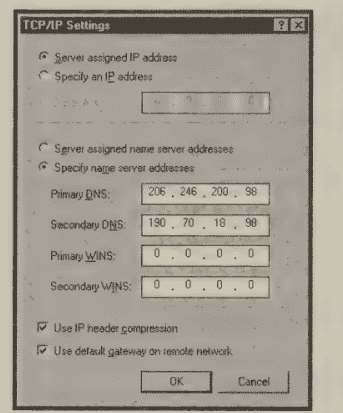

图 1.8

`TCP/IP` 设置是大多数互联网连接设置的核心。

一旦连接连接，其他计算机就可以连接了。每个连接都可能不同，因此你会希望准确地记录这些设置。

完成后，点击“取消”按钮关闭 `TCP/IP` 设置对话框。然后再次点击“取消”退出连接对话框。

> 提示：不要忘记记录你连接所需的用户名和密码！

如果你在“拨号上网”窗口中还有其他想要在 Linux 中保留的连接，请对每个连接重复本节中的步骤，以确定它们的设置。

## 检查硬件兼容性

现在你已经记录了构成电脑的各种硬件部分，是时候开始检查这些硬件是否与 Red Hat Linux 7 兼容了。

## 检查兼容性的资源

在商店购买软件时，你通常可以翻过包装盒阅读软件的系统要求。在大多数情况下，列出的要求是完整的。遗憾的是，Red Hat Linux 的要求在盒子上写得非常笼统。盒子侧面仅列出了宽泛的参数，这不例外：Red Hat Linux 可用的硬件兼容性列表（`HCL`）有好几页长。

这些著名的列表在哪里？打开你的互联网连接——你要在网上开启冲浪了。

查找 Red Hat Linux 7 信息最好的地方无疑是 Red Hat 官网。该网站位于 `http://www.redhat.com/support/hardware/`，其 `HCL`（硬件兼容性列表）收集了 Red Hat 所有主要版本的硬件。

在点击“Intel 硬件”链接开始查看 `HCL` 之前，让我说明一下你将在列表中发现的几种兼容性级别。由于今天可用 PC 硬件种类繁多，Red Hat 支持的是有限的 set。这并不意味着其他硬件无法与 Red Hat 工作——只是它们没有得到直接支持。

Red Hat 将这些不同的兼容性级别分为若干级：第 1、2、3 层和“不兼容”。每个层级代表 Red Hat 对某个特定硬件的兼容性或舒适程度。表 1.3 定义了这些级别。

Red Hat `HCL` 组织得非常好。每个部分都关注特定类型的硬件，并包含了兼容性级别的定义。这里还有一条关于硬件名称的重要警告，值得重申。

在硬件世界，某个产品的品牌化是通过保留一个流行名称并与可能是完全不同的产品相关联的。为了给你提供一个相当简化的例子，奔腾处理器与奔腾 II 处理器或奔腾 III 处理器非常不同。尽管奔腾这个名字随处可见，但它们并不是相同的产品。

其他名称差异要微妙得多，而产品差异要巨大得多。重点在于，如果 `HCL` 中没有列出精确的模型名称或型号，那么最安全的假设应该是硬件是不兼容的。

随着更多硬件兼容性问题的解决方案被发现，`HCL` 正在不断演进。今天晚些时候，我们将讨论此 `HCL` 的一些亮点。

与 Red Hat 官网不同，Linux 硬件数据库网站并未提供所有能与 Red Hat Linux 工作的硬件的全视图。然而，它提供了 `HCL` 不具备的内容：用户对硬件在 Linux 上真实运行情况的评分，以及如何解决可能出现的棘手问题的提示。

Linux 硬件数据库可以在 `http://lhd.datapower.com` 找到。如图 1.9 所示，它包含了按类别类型组织的硬件链接。

点击类别链接将显示该类别下所有已测试硬件类型的表格列表。硬件根据产品获得的评分进行排序（见图 1.10）。

> **注意：** 此数据库中的硬件基于根据不同的 Linux 版本和不同发行版进行比较的。务必阅读每个产品的测试规范。在早期 Linux 内核上测试过的硬件应该可以在更高版本中使用。

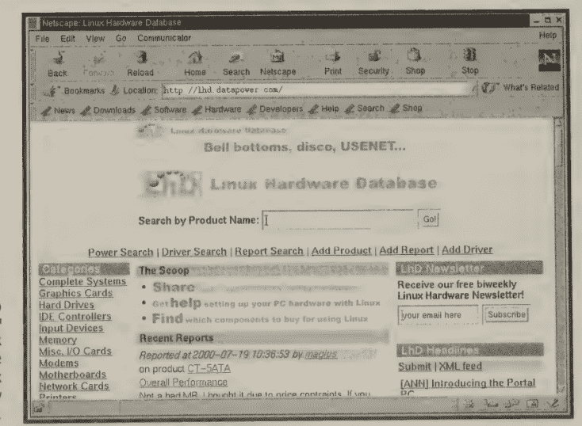

图 1.9 Linux 硬件数据库包含了兼容性评论。

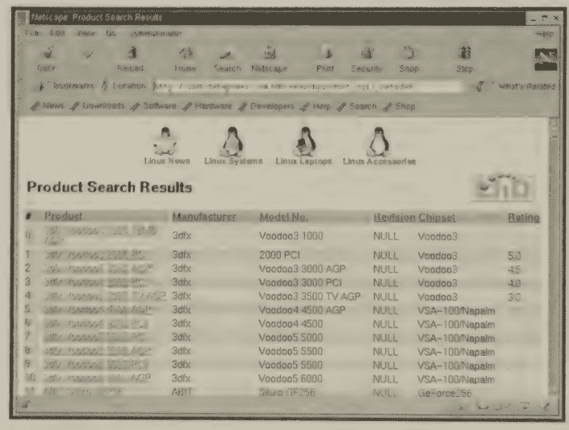

点击你想查看更多信息的特定硬件。类别中最好的硬件获得 5 分。该网站使用的评分系统基于五项的平均值：

- 稳定性
- 性能
- 价值
- 安装易用性
- 总体


点击你想查看更多信息的特定硬件。类别中最好的硬件获得 5 分。该网站使用的评分系统基于五项的平均值：

- 稳定性
- 性能
- 价值
- 安装易用性
- 总体

## 硬件支持

任何可以找到硬件的驱动程序返回 Red Hat 网站，以便让你的电脑匹配屏幕上的 HCL。如果你发现你的任何硬件属于第 2 和 3 层，这并不是世界末日。可能需要更多的努力，但有关安装硬件的更多信息，请查看周上的“硬件”部分。

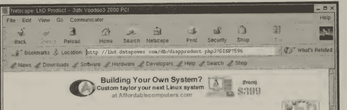

| Netscape: LHD 产品 - 3dx Voodoo3 2000 PC | 文件 编辑 查看 转 |
| :--- | :--- |
| 上一步 295? 刷新 搜索 商店 | 新闻 下载 硬件 开发者 搜索 评分此产品 |
| * 书签位置 http://lhd.datapower.com/db/support_product.php?id=5596 | 定制你的下一个 Linux 系统 $899 |
| * 书签位置 http://lhd.datapower.com/db/support_product.php?id=5596 | |
| 产品: 3dx Voodoo3 2000 PC | 跳到：描述 需要报告 |
| 制造商: 3dx | 产品评分 |
| 型号: 2000 PC | 稳定性 |
| 类别: 显卡 | 性能 |
| 芯片组: Voodoo3 | 价值 |
| 代号: NULL | 安装易用性 |
| 厂商售价: | 总体 |
| 市场价: 100 | |
| 制造日期: 0000-00-00 到 0000-00-00 | 评分此产品 |
| 记录历史: 创建于 1999-10-21。最后修改于 2007-07-19 | 产品规格: |

## 显卡

在 HCL（硬件兼容列表）包含的所有类别中，显卡部分可能是内容最详尽的。这是因为显卡（在 Windows 中被称为显示适配器）可以被认为是 PC 中最重要的组件，除主板和 CPU 之外外。想一想，如果显示器上不显示任何内容，你就不可能继续使用操作系统了。而且，显示器并不控制 PC 的视频输出——由显卡负责的。

由于这个原因以及不同显卡之间巨大的差异，HCL 留了大量空间来列出不同的显卡。当你考虑到与 Linux 的兼容性并不是问题，X Window 系统才是问题时，这种对细节的关注就显得有些讽刺了。

Linux 是一个基于文本的命令行操作系统。毫无疑问，它是一个强大的系统，实际上它只是像 DOS 一样的命令集合。为了让 Linux 成为一个更易用的系统，Linux 发行版通常会在发布 Linux 的同时包含一个版本的 X Window 系统（也称为 X）。

X 是如今 Linux 发行版中所有酷炫窗口和图形用户界面（GUI）的来源。`XFree86` 是 Intel 兼容 PC 最常用的 X 服务器类型。因为显示复杂屏幕需要 `XFree86`，所以是 `XFree86` 而不是 Linux 在最关注显卡的兼容性。

仔细查阅 HCL 寻找你的显卡。一旦找到，在你的笔记本中记录将使用哪种 X 服务器。X 服务器是 `XFree86` 中用于显示图形的特定组件。由于不同的显卡使用不同版本的 X 服务器，如果你以后在图形方面出现问题，知道这些信息可能会对你有帮助。

表 1.4 显示了已知与 `XFree86 4.0.1` 不兼容的显卡短列表，该版本是 Red Hat Linux 7 随附的发行。

## 内存 (RAM)

与大多数操作系统和软件一样，拥有至少建议的最小内存量可以消除大部分问题。表 1.5 列出了 HCL 中规定的各种场景的 RAM 最小要求。

## 显示器

如前所述，当从 PC 产生视觉输出时，显卡承担了大部分工作。这并不意味着显示器与 Linux 和 `XFree86` 的兼容性之间没有发挥作用。然而，确保显示器能够很好地与 `XFree86` 关联的地方不在预安装阶段。显示器的兼容性是在安装过程中解决的。

| 表 1.4 已知的不兼容显卡 |
| :--- | :--- |
| 制造商 | 产品 |
| SIS | 530/5591/5596/5511 Pentium PCI/ISA 解决方案 |
| SIS | 600/620/5600 Pentium II 多功能集成芯片组 |

| 表 1.5 最小 RAM 要求 |
| :--- | :--- |
| RAM | 场景 |
| 16 MB | 最低限制（至少需要 32 MB 的交换磁盘空间） |
| 24 MB | 为 Linux 操作系统提供更好的性能 |
| 48 MB | 运行 Gnome 或 KDE 等 XWindow 界面 |

## 周末将 Red Hat Linux 7 安装到你的 Windows 桌面

为了确保准备好安装，请在笔记本中记录显示器的同步率设置。这些设置通常在显示器附带的手书中。在安装期间，这些设置将与 `XFree86` 的 X 服务器组件匹配。

> 注意：有关显示器兼容性的更多信息，请访问 `XFree86` 网站的 FAQ 部分：`http://www.xfree.org/FAQ/#MONITORS`。

## 硬盘

PC 中使用了两种类型的硬盘：IDE 和 SCSI。如果你还没有识别，可以通过检查系统 BIOS 来确定你拥有的类型（参见你今天之前读过的标题“检查 BIOS 获取信息”章节）。大多数硬盘与 Red Hat Linux 7 兼容。

通常情况下，如果你有一个内部 IDE 驱动器，那么 Red Hat Linux 对你是没问题的。因为 Linux 会查看驱动器的 SCSI 控制器，对于任何内部或外部的 SCSI 驱动器也是如此。如果控制器被支持，那么连接到它的所有硬盘默认都受支持。

> 提示：外部 IDE 硬盘（例如 Syquest 的可移动硬盘）是 HCL 中提到的唯一不兼容驱动器类型，但有一个解决方法。访问 Linux 并口主页 (`http://www.torque.net/linux-pp.html`) 学习如何使用此设备。

## 网卡

在安装 Red Hat Linux 期间，通常会检测到网卡的存在。Linux 随后会要求你网络设置。HCL 的这部分显示许多网卡属于第 1 类和第 2 类兼容性类别。

## 周五晚上准备好 PC

考虑到 Linux 及其祖父 UNIX 的历史，这是很有道理的。毕竟，UNIX 最初设计用于在网络上运行。因此，网络设备在很大程度上兼容是逻辑。此外，互联网的通信协议是基于 UNIX 的。

你应该确保你的网卡在列表中，并找出它处于兼容层级的什么位置。大多数大品牌网卡属于第 1 类，这是好事。甚至有些令牌环网卡具有第 2 类兼容性——这在当今混合搭配的企业环境中非常有用。

表 1.6 列出了已知与 Red Hat Linux 7 不兼容的网卡。

| 表 1.6 已知的不兼容网卡 |
| :--- | :--- |
| 制造商 | 产品 |
| Intel | EtherExpress PCI |
| Xircom | 以太网适配器 |

## 声卡

注意，即使你有声卡，可能也需要通过 `sndconfig` 程序进行设置。有关声卡的更多信息可以在“配置打印机、声音和其他设备”中找到。

## 驱动器

在 HCL 中寻找 Zip 驱动器的兼容性列表并不直接。你需要查看第 3.5 节“SCSI 驱动器”。然而，一旦找到列表，你会发现外部 Zip 和 Jaz 驱动器可以工作，包括并行口驱动器。

## 磁带

大多数 SCSI 磁带可能支持第 2 类。记住，如果 SCSI 控制器被支持，那么连接到它的任何 SCSI 设备也将被支持。这类设备中有一个例外，列在表 1.8 中。

## 调制调制器

调制调制器是最可能给你带来问题的设备。简单来说，如果你的电脑有内部调制调制器，它可能无法工作。因为大多数内部调制调制器使用 Windows 特有的程序，无法在其他操作系统运行。

> 提示：目前有一种在 Red Hat 下肯定有效的内部调制调制器：`LucentVenus PCI` 调制调制器。如果你足够拥有这种内部调制调制器，在安装 Red Hat 后返回 HCL 的调制调制器部分，学习如何调整系统。要查找更多与 Linux 兼容的内部调制调制器，请访问 `http://www.o2.net/~gromitkc/winmodem.html`。

| 表 1.8 已知的不兼容磁带 |
| :--- | :--- | :--- |
| 制造商 | 产品 | |
| 各种 | 非 ATAPI 并行口驱动器 | |
| Onstream | 30 GB 驱动器 | 包括所有类型（IDE、SCSI 和并行口） |

好消息是，如果你有一个外部调制解调器，它几乎肯定可以工作。通过串口而非内部与 PC 通信的调制解调器不需要 Windows 驱动即可工作。

其他类型的通信设备在 Red Hat Linux 下同样可以工作。ISDN 路由器如果是外部的并且可以模拟调制解调器，通常可以工作，尽管 Linux 将它们归类为第三级支持（Tier 3）。

如果你足够幸运，住在有电缆接入服务的地区，你可能有一个电缆调制解调器。连接到支持的太网接口的电缆调制解调器属于第三级支持。

## 打印机

在 Red Hat Linux 中设置打印机的感觉类似于 Windows。基本上，Red Hat Linux 在安装时并不关心你拥有什么类型的打印机。设置打印机是你在安装后要做的事情（请参见周六晚上的“打印机”部分）。

HCL（硬件兼容列表）列出了此版本 Red Hat 中包含的打印过滤器良好列表。这些过滤器与 Windows 打印机驱动直接对应。检查列表查看你的打印机是否在上面，如果没有也不要担心。即使它不在兼容列表中，也会有办法安装打印机。

## 鼠标

Linux 在安装期间配置的第二件事是鼠标。鼠标有四种：PS/2、串口、总线和 USB。最常见的类型是 PS/2 和串口鼠标，它们是第一级兼容（Tier 1）。总线鼠标属于第二级（Tier 2），USB 鼠标被归类为第三级（Tier 3）。

由于你的鼠标很可能属于第一级或第二级，所以这个设备不需要太担心。但如果你有一个 USB 鼠标，你应该意识到 Linux 在 USB 方面仍然处于实验阶段。你可能考虑为你的 PC 换一种新类型的鼠标。

## 周五晚上 准备 PC

> 注意：如需更多关于 Linux 中 USB 设备的信息，请访问 `http://www.linux-usb/`。

## 键盘

HCL 中没有键盘部分。键盘对于 PC 来说是通用的（如果有设备真的可以被称为通用的话）。键盘长期以来一直遵循 ANSI 标准，这是一项所有键盘都必须遵守的国际标准集合。（是的，真的有人坐下来想过了这个。）该标准为键盘可以创建的每个字符使用特定的代码，无论使用的是什么操作系统。

该标准让 Linux 能够轻松访问任何键盘，包括新的人体键盘以及那些带有指向设备的键盘。USB 键盘与其鼠标一样，应该谨慎使用。

## 笔记本电脑

笔记本电脑不再像你的台式 PC 那样仅仅是一个单一设备。没有哪一款笔记本电脑是完全兼容 Linux 的。

HCL 中包含一个笔记本电脑部分，但它有点不同，包含一个指向 Linux 笔记本网页的精彩链接。如果你考虑在你的笔记本电脑上安装 Linux，应该点击此链接。

> 注意：我还建议你买一本我好朋友 Bill Ball 写的《Linux for Your Laptop (Prima, 2000)》。它中包含了许多关于如何在你的笔记本电脑上安装 Linux 的宝贵信息，包括在笔记本电脑上安装 Red Hat Linux 的分步指南。

## SCSI 适配器

最后，关于 SCSI 卡的章节非常值得仔细查看，仅仅因为有许多其他设备可能依赖于主 SCSI 卡的兼容性。

这是 HCL 的很大一部分，你应该花时间找到你 PC 的 SCSI 适配器。虽然没有完全不兼容的 SCSI 卡，但如果你的卡落入第三级支持范畴，你确实需要格外小心。

## 备份你的旧数据

在确认你的硬件与 Red Hat Linux 7 的兼容性后，你需要为安装做好电脑准备。你应该做的首要事项之一就是备份 PC 上的数据。

备份你的贵数据始终是一个好主意，以防止系统灾难。至少，你希望你的数据免受浪涌、病毒攻击、电脑失窃或任何可能影响你访问机器数据能力的影响。

安装 Linux 肯定不能被归类为灾难性事件。然而，你将更改硬盘的分区，甚至可能格式化硬盘。这些事件可以并且将会完全删除数据。

你首先决定的是哪些数据应该被备份。这取决于你想在 Linux 安装中做什么。特别是如果你计划双启动（在同一台 PC 上运行 Windows 和 Linux），那么你需要确保已经保护了大部分 Windows 数据。关于双启动的更多信息，你可以在今天晚些时候标题为“为多个操作系统留空间”的章节找到。

即使你计划完全删除 Windows，保存数据文件也有意义。某些文件类型可以在 Linux PC 上打开，例如图形文件（包括 GIF 和 JPEG 等）。此外，得益于一个完全兼容 Office 的优秀办公套件应用程序，Microsoft Office 文件也可以打开。如果你计划在 Linux 机器上使用这些文件，你需要“保存”而不是“备份”这些文件。Linux 将无法读取 Windows 备份文件。

现在的大多数计算机应用程序都占用大量的磁盘空间，这主要是因为今天的大硬盘让它们能够这样做。备份你的数据和应用程序文件是一项大工程。如果你有足够的存储容量（如磁带或 Jaz 驱动器），我建议你备份整个硬盘。

对于那些没有足够备份整个硬盘的人，你仍然应该备份你最重要的文件。这些可能包括你的文档、照片、视频以及任何对你重要的数据。有一个用不上的备份也比完全没有备份要好。

## 从 Red Hat Linux 7 到你的桌面

> 注意：如需更多关于 Linux 中 USB 设备的信息，请访问 `http://www.linux-usb/`。

Windows 95 中的备份应用程序与 98 中的类似，只是缺少引导操作向导。

选择“新建备份作业”，然后点击确定。备份向导将出现，如图 12 所示。

在这里你可以选择备份整个文件集，也可以选择只备份自上次备份以来更改的文件。

# 图 1.15

你想将备份文件存储在哪里？

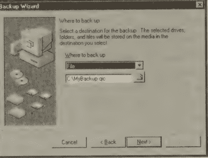

> **提示** 确保你将此信息保存到硬盘的其他驱动器上。Zip、Jaz 或磁带驱动都是很好的选择。

第五个对话框提供了两种备份数据的方法。第一个选项指定你希望对数据进行双重检查，以确保成功归档。在归档时对数据进行双重检查会明智地降低速度，但我建议你这样做。毕竟，备份错误的数据有什么意义呢？

第二个选项询问你是否想要压缩备份数据。除非你有近乎无限的空间来存储备份，否则你将勾选此选项。这也会减慢备份过程。选择好你的偏好，然后点击“下一步”进入备份向导的最后一个对话框。

在最后一个对话框中（见图 1.16），你将为备份文件提供一个具有描述性的名称。这与你之前选择的文件名不同。使用一个名称帮助你记住备份存档文件的内容。

## 周五晚上 准备好 PC

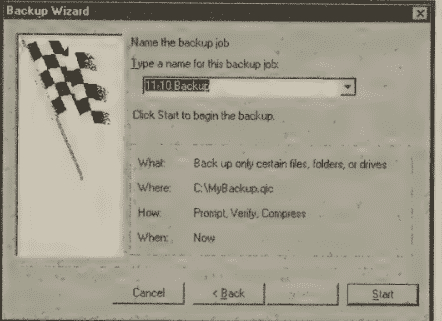

**图 1.16**

在此对话框中确认你的备份选择。

在确认所做的选择后，只需点击“开始”按钮开始备份过程。将出现“备份进度”窗口以显示其进度（见图 1.17）。

完成后，系统将验证备份文件（如果你选择了此项），你将收到操作完成的通知。点击“确定”确认通知，然后再次点击“确定”关闭“备份进度”窗口。

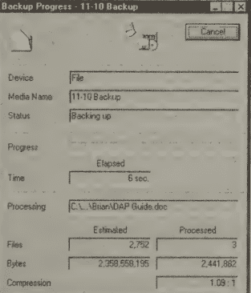

**图 1.17**

正在运行的备份过程。

确保备份文件存储在硬盘之外。正如你将在下一节中看到的，你的驱动器可能会发生巨大的变化。

## 为多个操作系统腾留空间

现在到了你需要做出一个重要决定的时刻。像所有重要决定一样，你应该仔细权衡你的选项。你现在必须决定是在 PC 上单独运行红帽 Linux，还是想保留现有的操作系统并添加 Linux。

在单台电脑上使用多个操作系统有许多优缺点。缺点包括在机器上安装两个或多个操作系统带来的头疼问题，这会导致每个操作系统的可用内存减少。

尽管如此，使用多个操作系统的益处是巨大的。例如，你将能够运行为 PC 上安装的每个操作系统所提供的所有程序。你还能够使用你 PC 拥的所有硬件。最后，你将因为不需要购买另一台 PC 而节省金钱。

我建议双系统启动是你应该采取的方法——特别是如果你只是在尝试 Linux 的话。此选项让你享受到使用 Linux 的好处，而无需投入大量的时间或金钱。

如果你决定在 PC 上除了 Windows 之外还包含 Linux，你需要为它在硬盘空间。但为红帽 Linux 在硬盘上腾空间与为最新的电脑游戏腾空间是完全不同的操作。你需要创建一个全新的分区，Linux 将从中运行。

在傍晚的这个时刻，你将获得一门关于磁盘分区的快速课程，以及为什么在没有分区的情况下无法向磁盘写入数据，所以请坐稳扶好你的帽子。

## 为什么要分区？

想象一只蜜蜂在你的花园里嗡嗡飞飞。如果你跟着这只蜜蜂回到家，你会发现一个看似混乱的嗡嗡昆虫群，每只看起来都像是在无目的地游荡，除了聚在一起嗡嗡响没别无事事。

但正如我们所知，所有的蜜蜂在生命中都有特定的使命：为了蜂群集体利益努力。有一组蜜蜂负责在蜂王产卵后照顾所有可爱的小蜜蜂。现在，回想一下你的科学课：小蜜蜂在哪里被养大？

如果你说是蜂巢，你是对的。如果你在想这与分区有什么鬼关系，请等一下。

蜂巢是一种由蜂蜡制成的六角单元格组成的巧妙设备，蜂蜜和蜜蜂幼虫储在其中以确保安全。现在，思考一下：如果蜜蜂没有蜂巢，它们该如何生存？答案是它们将无法生存。

记住蜂巢，你可以将这个类比应用于数据存储在磁盘驱动器上的方式。你要明白，数据无法存储在没有预先建立的某种结构来组织数据的驱动器上。

当数据被放在驱动器上时，它会被写入这种结构，在 Linux 社区中称为“文件系统”。文件系统是存储数据的格式——你可以说它是一个由单元格组成的蜂巢，每一小块数据都被放置其中。

电脑毕竟是电脑，情况比这要复杂一点。例如，单个文件的数据并不存储在相邻的数据块中。数据可能存储在 456、457 和 458 块，然后是 6,134 块，最后是 63 块。


# 不同类型的分区通常无法与其他操作系统协作

因此，为了在 PC 上安装 Linux，你需要为硬盘创建一个 `ext2` 分区。遗憾的是，如果你的 PC 包含典型的 Windows 安装，Windows 文件系统位于覆盖整个硬盘的大分区内。这为分区和新的文件系统没有留出空间。

## 将 Linux 添加到 Windows 桌面

在确认所做的选择后，只需点击“开始”按钮开始备份过程。将出现“备份进度”窗口以显示其进度（见图 1.17）。

完成后，系统将验证备份文件（如果你选择了此项），你将收到操作完成的通知。点击“确定”确认通知，然后再次点击“确定”关闭“备份进度”窗口。


> **交换分区。** 硬盘上的一个区域，被计算机用作辅助内存。当程序或进程使用的内存超过内存条容量时，交换分区提供额外的内存。

| 表 1.9 文件系统类型 (Intel) |
| :--- |
| 文件系统 | 使用者 |
| :--- | :--- |
| FAT | Windows 95, Windows 98, Windows NT |
| FAT32 | Windows 95, Windows 98, Windows ME, Windows NT, Windows 2000 |
| NTFS | Windows NT, Windows 2000 |
| ext2 | Linux |
| os2 | OS/2 |
| swap | 所有操作系统 |

## PartitionMagic 5.0

在市场上所有的分区软件中，PartitionMagic 可能是最容易使用的并且经过了时间的考验。PartitionMagic 让你能够轻松在硬盘上创建分区。它甚至附带了 `BootMagic`，这是一种多操作系统启动工具。

PartitionMagic 之所以非常好用，是因为它实际上可以创建一个 Linux `ext2` 分区而不会产生潜在的数据丢失。使用 PartitionMagic 创建原生 Linux 分区可以为安装过程节省许多步骤。

## 40 在周末内让 Red Hat Linux 7 运行到你的 Windows 桌面

如果你在 PartitionMagic 网站上搜索“linux”，你会找到有关如何专门安装 Linux 分区和挂载点的详细说明。明天早上当你实际安装 Red Hat Linux 时，你将学习到挂载点的知识。

## fips

如果你不想为 PartitionMagic 掏钱，别担心。Red Hat Linux 贴心地提供了 `fips`，这是一个可以在 Windows 系统中调整大小和创建 FAT（FAT16 或 FAT32）分区的程序。

`fips` 工具将缩小你当前 FAT 分区的大小并创建一个新的 FAT 分区。然后你需要删除这个新的 FAT 分区。因为 Linux 只会安装在安装过程中从未格式化的空间创建的 `ext2` 文件系统中，所以你需要运行 DOS `fdisk` 工具来删除新的 FAT 分区。

`fips` 工具位于 Red Hat Linux/Intel CD 1 的 `\dosutils` 目录下。`fips` 的文档位于同一张 CD 的 `\dosutils\fipsdocs` 目录下。我非常赞同 Red Hat 的建议，即在使用应用程序之前阅读 `fips` 文档。

## 何时使用 fdisk

你可能在计算机世界的传说和轶闻中听过，你最终必须在 PC 上使用 DOS 工具 `fdisk`。当你需要完全擦除硬盘上的数据时，就会用到 `fdisk` 工具。

本节指的是 DOS 版 `fdisk` 工具，而不是 Linux 版的 `fdisk`，后者在处理 Windows 分区时有时会出现问题。

## 周五晚上 准备 PC

**注意** 话虽如此，使用 `fdisk` 时请务必非常小心。一步走错，你将丢失所有数据。

出于安装 Linux 的目的，实际上有两种需要使用 `fdisk` 的情况。第一种是你计划在 PC 上单独安装 Red Hat Linux。如果你想完全擦除硬盘并安装 Linux，`fdisk` 工具是你应该使用的首选方法。

第二次使用 `fdisk` 的机会是消除任何第三方分区工具可能为你创建的分区（例如 `fips`）。`fdisk` 工具可以擦除硬盘上的这些非 `ext2` 分区。

以下是使用 `fdisk` 移除硬盘上分区的方法：

1. 使用 Windows 资源管理器格式化软盘。确保已勾选“系统磁盘”选项。
2. 从 `\Windows\Commands` 文件夹将 `fdisk.exe` 文件复制到软盘。
3. 重启电脑，并将软盘留在驱动器中。由于你将系统文件复制其中，软盘是可以启动的。
4. 当 DOS 提示符出现时，输入 `fdisk` 然后按回车。会出现一条关于大容量硬盘的消息（见图 1.18）。
5. 输入 `N` 以禁用大硬盘支持。
6. 在 FDISK 选项屏幕（见图 1.19），输入 `3` 开始“删除分区或逻辑 DOS”选项。
7. 在删除 DOS 分区或逻辑 DOS 屏幕中（见图 1.20），输入 `1` 激活“删除主 DOS 分区”。
8. 在删除主 DOS 分区屏幕中，输入你想要删除的分区的编号（见图 1.21）。参考磁盘大小列表和文件系统类型来帮助你识别想要移除的哪个分区编号（如果存在多个分区的话）。

## 42 在周末内让 Red Hat Linux 7 运行到你的 Windows 桌面

图 1.18

启动 `fdisk` 将显示关于大硬盘的重要信息。

图 1.19

你的 FDISK 选项——除非在得手手中，否则可能是致命的。

## 注意

记住在执行这些操作时，要确保你正在修改或删除正确的分区。最简单的方法是将文件系统类型和磁盘大小与已知的分区大小进行对比。例如，如果你有一个想要删除的 2 GB Windows 分区，确保你选择的分区是一个 2 GB 的 FAT32 分区。

## 周五晚上 准备 PC

图 1.20

在此屏幕中选择你想删除的分区。

图 1.21

分区删除前的最后一步。

9. 输入你要删除的分区的卷标签。将出现一条确认行。
10. 确认你确实想删除该分区，然后在确认行输入 `Y`。你选择的分区将被删除。
11. 完成后，按 `Esc` 键直到返回 DOS 提示符。

## 在周末内让 Red Hat Linux 7 运行到你的 Windows 桌面

**注**：如果你奇怪为什么删除分区只花了一两秒钟，而擦除硬盘的一个部分似乎需要更长时间，那是因为只删除了分区定义，而不是内部的数据。然而，由于失去了分区及其文件系统，内部的数据现在已经变成了一堆杂乱且毫无价值的数据块。就像蜂窝突然消失后蜂蜜变成的一样。

事实是，安装并没有那么大麻烦。如果你需要，可以在明天早上双重检查安装程序所做操作的信息。到今天早上结束时，你将：

收集昨晚指定的所有信息非常重要，因为你将需要这些信息。到今天早上结束时，你将：

- 安装 Red Hat Linux 操作系统
- 处理了任何异常问题
- 配置了你的 PC 以启动 Linux

在开始之前有三句建议：不要恐慌。如果你仔细阅读说明并拥有正确的信息，就不会出什么错。

## 启动 Red Hat 安装程序

安装 Red Hat Linux 7 有多种方法。最简单的方法是使用官方的 Red Hat 7 光盘，你可以通过购买官方盒装版来获得。Red Hat Linux 7 有三个版本：标准版（Standard）、豪华版（Deluxe）和专业版（Professional）。标准版包含《Red Hat Linux 安装指南》和《参考指南》，以及一张启动盘。你将在下一节“创建启动盘”中了解更多关于这张重要磁盘的信息。

在豪华版和专业版中，包含了一套工作站应用程序 `PowerTools` 的光盘供你使用。专业版还包含一个服务器应用程序额外包和额外的 Web 构建工具。

由于 Red Hat Linux 可以从 Red Hat 盒装版以外的其他来源获取（包括随书附带的光盘），你可能需要通过其他方式获取这些额外资源。如果你无法获得盒装版，或者不想花钱，你可以使用一些方法来获取所需的工具。

> 学习下载 Red Hat Linux 的绝佳去处是 <http://www.redhat.com/download/howto_download.html>。

盒装版中包含的文档可以在网页上 <http://www.redhat.com/support/manuals/> 免费获取 HTML 或 Acrobat PDF 格式。

## 周六早上

- 启动 Red Hat 安装程序
- 运行安装
- 其他安装问题

你可以在 <http://www.sun.com/staroffice> 找到 `StarOffice`，这是一个与 Microsoft Office 完全兼容的非常强大的办公套件应用程序。

复制任何盒装版套装所需的最后一个组件是启动盘，将在下一节中详细介绍。

## 创建启动盘

除了 Linux 程序 CD-ROM 之外，你需要的最重要的资源是启动盘。如果没有你自己的启动盘副本，你在安装软件时可能会遇到困难。

> **启动盘：** 一张软盘，包含 Linux 系统文件，允许用户在加载任何其他操作系统之前访问 Red Hat Linux（红帽 Linux）CD-ROM。

需要启动盘是因为 Linux 无法从另一个操作系统内部安装，而且必须在 PC 启动后、其他任何内容加载之前运行。许多 PC 无法直接从 CD-ROM 驱动器启动，但可以从软驱驱动器启动。你是否注意到过电脑开机时软驱驱动器发出的咔哒声？那是 BIOS 正在驱动器中寻找启动盘。

> 如果你足够幸运有一个可启动的 CD-ROM，那么你就不需要启动盘。只需将 Red Hat Linux 1 插入你的 CD-ROM 并重启电脑。安装程序将自动开始。

启动盘包含足够的 Linux 命令来启动一个精简版的 Linux，包括让 Linux 识别并运行你的 CD-ROM 驱动器的指令。在那个时候，你就可以“启动”完整的安装程序运行了。

## 在周末内将 Red Hat Linux 7 添加到你的 Windows 桌面

### 步骤

使用此步骤制作你自己的启动盘：

1. 格式化一张 3.5 英制磁盘并将其留在软驱中。
2. 将 Red Hat Linux CD 1 插入 CD-ROM 驱动器。
3. 通过选择开始菜单中的“程序”、“MS-DOS 提示”启动 MS-DOS 窗口。
4. 输入 `<驱动器符>`，其中 `<驱动器符>` 是你 CD-ROM 的盘符。
5. 输入 `cd dosutils`。你现在应该位于 CD 上的 `dosutils` 目录。
6. 输入 `rewrite`。`rewrite` 程序将启动。
7. 当提示磁盘镜像源时，输入 `..\images/boot.img`。
8. 当提示目标软盘驱动器时，输入 `<驱动器符>`，其中 `<驱动器符>` 是你软驱的盘符。
9. 提示时按 `Enter` 键。Red Hat Linux 启动指令将被复制到你的软盘中。

如果你以后选择使用自定义安装路径，系统会提示你创建另一个启动盘副本。由于拥有更多的启动盘更安全，你可能想在那时制作第二个。

## 导航安装程序

你现在准备好开始了。你已经收集了所有信息，磁盘已就绪，桌子上还放着一只可爱的填充企鹅作为好运。时间到了。

将 Red Hat CD-ROM 1 插入你的 CD-ROM 驱动器并关闭电脑。如果你没有可启动的 CD-ROM 驱动器，请在电脑关机时将启动盘插入软驱，然后再次开机。你的电脑将开始启动过程，从你的 CD-ROM 软驱驱动器开始。它将使用 CD-ROM 或软盘上的指令进行启动，而不是继续进入硬盘并随后加载你的常规操作系统。

一旦电脑识别出来自软盘或 CD-ROM 驱动器的引导代码，它将启动 `Anaconda`，即 Red Hat 安装程序。`Anaconda` 的第一个界面显示如图 2-1 所示。正如你所看到的，它非常简单，但它提示你做出一个重要的决定。

安装 Red Hat Linux 时，你可以从三种安装选项（有时称为“安装类”）中选择。第一个是图形模式，一种类似于 Windows 的安装，无疑是最容易使用的。第二种选项是文本模式，比图形模式稍微健壮一些。它也能完成任务。

最后一个选项是专家模式。现在，正如你看到的，我建议你避开这种。只有当 Linux 无法检测运行安装程序所需的硬件（如 CD-ROM 驱动器和硬盘）时，你才应该使用专家模式。这种情况相当罕见。你应该可以在此界面按 `Enter` 启动图形安装模式。

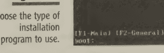

| 欢迎使用 Red Hat Linux 7.0 |
| :--- |
| 在图形模式下安装或升级运行 Red Hat Linux 3.0.1 或更高版本的系统，请按 `<ENTER>` 键。 |
| 在文本模式下安装或升级运行 Red Hat Linux 3.0.1 或更高版本的系统，请输入：`text <ENTER>`。 |
| 要启用专家模式，请输入：`expert <ENTER>`。按 `<F3>` 获取更多关于专家模式的信息。 |
| 要启用救援模式，请输入：`rescue <ENTER>`。按 `<F5>` 获取更多关于救援模式的信息。 |
| 如果你有驱动程序盘，请输入：`linux dd <ENTER>`。 |
| 使用下列表列出的功能键获取更多信息。 |
| (F1-主) (F2-常规) (F3-专家) (F4-内核) (F5-救援) boot: |

## 在周末内将 Red Hat Linux 7 添加到你的 Windows 桌面

> 离开第一个屏幕后，将发生更多的硬件检测。如果 Red Hat 的安装程序不识别你的显卡，你的屏幕可能会显示全白或全黑。如果发生这种情况，再次重启 PC，这次在打开的安装提示处输入 `text`。文本安装模式对显示驱动程序不那么挑。你可以在 Linux 安装后配置图形显示。

图形模式安装将开始。接下来的章节将详细介绍典型工作站安装的每个步骤。

## 运行你的安装

随着安装的进行，你将看到一系列安装界面，这些界面将根据你选择的安装类向你提供选择。这些界面在整个安装过程中以相同的方式组织，如图 2-2 所示。

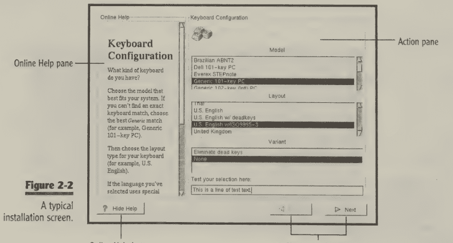

在屏幕左侧，你将看到在线帮助面板。此面板包含与当前安装界面相关的通用帮助。尽管它占用了一些屏幕空间，但我建议在整个过程中保持开启状态。这使你能够快速为你可能不理解的术语或选项查找帮助。如果你真的认为不需要在线帮助，可以点击“隐藏帮助”按钮将其关闭。

屏幕右侧的面板是所有操作发生的地方。操作面板显示适用于当前任务的选项，你从中做出你的安装选择。每当你完成一次选择时，点击“下一步”按钮移动到下一个屏幕。相反，如果你需要撤销某个决定，可以点击“上一步”按钮返回到你想更改的界面。

**注意** 在某些情况下，“下一步”按钮是禁用的（用其灰色外观指示），直到你做出所有必要的选择，这是一个非常有用的安全功能。

**注意** 你可以向后逐步通过 `Anaconda` 界面，直到“准备安装”界面。一旦越过了这个不归点，你就无法改变主意。

## 确定语言、键盘和鼠标设置

在安装过程早期，Red Hat Linux 会收集为了顺利进行的重要信息。这些信息围绕输入展开——特别是你如何向 `Anaconda` 以及后的 Linux 输入数据。你需要选择要使用的语言、键盘和鼠标设备。

安装路径的第一个界面要求你选择将使用的语言。这将是在过程中使用的语言，而不一定是 Red Hat Linux 内部的语言。从语言列表中选择你的语言，然后点击“下一步”按钮。

现在显示如图 2-2 所示。这里有三个用于定义键盘的类别：模型、布局和变体。

虽然键盘模型目前非常通用，但样式之间存在差异。美国人熟悉的例子是“自然”（工程设计）键盘与更标准（平板）101 键键盘之间的区别。在模型列表中检查你的键盘模型和样式。如果你没有看到特定的键盘模型，选择通用 101 键。

布局指的是键盘使用的字母数字字符。例如，使用德语语言的人需要字符 “，如果你在英国，你可能需要字符 £。在美国，美国英语按键之一是合适的。

如果你仍然想要英语布局但也使用需要创建死键的替代字符，则应选择死键选项。如果你有一台较新的电脑，选择 `ISO-9995-3` 选项，这将使键盘符合国际标准。


**死键。** 允许在英语键盘上快速创建非英语字符的键。

变体类别中的选项会根据所选布局而变化。通常，选项是你的键盘模型和布局上没有变体，或者有一个或多个不同的变体。如果你有特殊的打字情况，请查看键盘文档以获取帮助。当你完成所有选择后，点击“下一步”按钮。

在鼠标配置屏幕中（见图 2-3），你将可以选择所使用的鼠标类型选项。正如你去本地电脑商店时看到的那样，并不是所有鼠标都是平等的。然而，它们都必须执行相同的任务——让鼠标指针在屏幕上移动。

目前有三种鼠标：总线（bus）、串口（serial）和 PS/2。总线和串口鼠标在 PC 世界已不再流行，大多数 PC 制造商意识到用户希望将他们的总线和串口用于鼠标以外的其他用途。因此，大多数 PC 使用 PS/2 接口鼠标。最新的 PC 拥有支持 USB 的鼠标，但在 Linux 下使用时仍然相当不稳定。

如果你不确定自己使用的是哪种鼠标，请参阅鼠标的文档以确定其连接方式。同样，如果你无法找到你所拥有的特定类型鼠标，请选择通用选项之一。

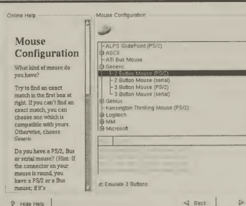

图 2-3

鼠标配置屏幕。

## 在周末内将红帽 Linux 7 添加到你的 Windows 桌面

什么？你没有坚持保存你拥有的每个硬件的文档吗？如果是那样，请检查你 PC 的背面。如果鼠标插在一个小圆形的 6 针端口上，那就是 PS/2。如果它插在一个梯形的 9 针端口上，那就是串口。其他任何设备都是总线端口。


你会注意到 Linux 为三键鼠标提供了选项。这些设备对 Windows 用户来说并不熟悉，但对 UNIX 用户来说常见。许多 UNIX 和 Linux 应用程序利用了三键鼠标上的中间按钮，而 Windows 应用程序中使用的鼠标通常是双键种的。因为 Linux 应用程序经常使用中间按钮，Linux 可以设置双键鼠标（通常通过同时点击两个按钮）。我建议你使用“模拟三键”（Emulate 3 Buttons）选项，因为你最终会在红帽 Linux 中需要中间按钮——而且这比出去买一个新鼠标要便宜得多。

使用展开图标来探索鼠标选项，选择你需要的鼠标，并点击“下一步”（Next）按钮继续。

## 选择安装类型

在进入安装过程中更关键的区域之前，你将通过红帽欢迎屏幕获得短暂的休息，如图 2-4 所示。此屏幕不仅仅是系统安装程序的正式开始。在线帮助面板包含了一些有用的信息，告诉你可以在哪里获取红帽 Linux 安装指南或其他手册。

点击“下一步”按钮进入“安装类型”（Install Type）屏幕。你现在必须决定你要安装什么。

你可以选择三个主要的安装选项。这些选项将在本节的后续进行更详细的讨论。在决定安装路径之前，请务必读完整个章节——一个错误的操作就可能抹掉你的整个硬盘。

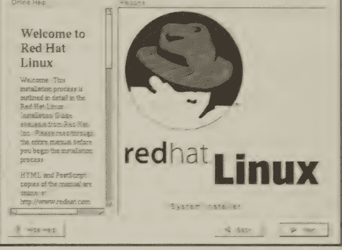

图 2-4

此屏幕是安装过程的真正开始。

**工作站（Workstation）。** 此路径将自动安装带有 X 以及 KDE 或 GNOME 桌面环境（如果你选择了两者）的 Linux。你将在稍后决定桌面环境的问题。此安装选项将包含运行标准 PC 工作站所需的软件包。

- **服务器系统（Server System）。** 此路径将自动安装带有额外服务器软件包的 Linux，包括 Apache Web 服务，这可能是最常用的 Web 服务器。选择此项后，X 不会自动进行安装。

- **自定义系统（Custom System）。** 自定义允许用户确切选择要安装哪些软件包。用户还有机会配置某些在其他安装路径中可能是自动完成的设置，例如 LILO 的放置和硬盘分区。

屏幕上还会出现第四个选项“升级”（Upgrade），但它实际上不会影响安装的内容。“升级”将让你保留硬盘上现有的 Linux 安装，并只是简单地将你当前的红帽 Linux 版本升级到 7 版。

> **注意**
>
> 你应该非常清楚的一点：除了“升级”选项外，所有的安装选项都将删除你硬盘上至少所有的 Linux 数据和分区。服务器安装将删除硬盘上的所有数据和分区——DOS、Windows，任何内容。

你何时应该使用这些选项中的每一个？嗯，就像大多数计算机相关的安装一样，你的具体情况很可能与我在这里介绍的任何场景不同。表 2-1 列出了你在决定选择何种安装路径时可以遵循的一些基本指南。

| 表格 2-1 安装路径指南 | |
|---|---|
| 路径 | 问题 |
| 工作站 | 最简单的选择路径。适用于具有单操作系统或双操作系统设置的家用 PC。自动安装 X Window。如果与 Windows 95/98 建立双引导系统，可以使用，但不适用于 Windows NT 或 OS/2。 |
| 服务器 | 适用于更高级的用户，特别是那些想要创建网络或 Web 服务器的人。如果与 Windows 95/98 建立双引导系统，可以使用，但不适用于 Windows NT 或 OS/2。 |
| 自定义 | 必须在与 Windows NT 或 OS/2 的 PC 上使用，这样 LILO 就会放置在硬盘的正确位置。并不复杂，并赋予用户在每个应用程序包之间进行选择的能力，而不仅仅是 |

## 选择你的分区选项

“自动分区”（Automatic Partitioning）是流程中出现的。在这里你将决定是自己划分硬盘还是让 Linux 来。

如果红帽 Linux 是你 PC 上唯一的操作系统，并且你已经消除了其他系统，那么你应该让 Linux 为你分区。如果你计划与 Windows 95 或 98 进行双引导，也可以允许自动分区。在“工作站”安装中，现有分区不受影响。

如果你想知道为什么这些没有处理好，是因为你昨晚执行的分区操作基本上是为了把 Windows 分区挤开，为 Linux 分区留空间。今天，在安装过程中，你可以使用 Linux 自己的工具为你 Linux 创建的大块空间进行精调。

## 在周末内将红帽 Linux 7 添加到你的 Windows 桌面

| 表 2-2 Linux 安装分区 |
|---|---|---|
| 分区 | 挂载点 | 内存分配 |
| 工作站 | | |
| 启动分区 | /boot | 16MB |
| 交换分区 | 无 | 64MB |
| 根分区 | / | 硬盘上剩余未分区空间的所有 |
| 服务器 | | |
| 启动分区 | /boot | 16MB |
| 交换分区 | 无 | 64MB |
| 根分区 | / | 256MB |
| 变量分区 | /var | 256MB |
| 用户分区 | /usr | 剩余未分区空间的一半 |
| 分区 | /home | 剩余未分区空间的一半 |


图 2-5

使用 Disk Druid 工具进行手动分区。

在 Linux 中，Disk Druid 工具的基本操作非常简单。你将收到一个现有驱动分区列表，无论是 Linux 还是 DOS。分区列表（Partition list）下方是驱动器摘要列表（Drive Summary list），它提供了你 PC 上硬盘的详尽信息。在添加或删除分区时，请关注 Used (M) 和 Used (%) 字段。已用磁盘空间的百分比会接近 100% 或远离 100%。只要该字段显示小于 100%，硬盘上就会留有未分区空间供你使用。相反，如果 Used (%) 字段显示用量为 100%，而你仍然需要添加分区，则你必须删除一些现有的分区以腾出空间。

使用以下步骤在你的 PC 上手动创建工作站分区集。我建议你按照以下顺序添加分区：boot（引导）、swap（交换）和 root（根）。由于 root 分区将被填充硬盘上的所有剩余空间，因此你首先需要精确指定其他分区需要多少空间。

如果在安装过程之前通过 DOS 磁盘工具删除了现有分区，请使用 Disk Druid 界面为工作站 PC 创建分区。

## 在周末内为你的 Windows 桌面添加 Red Hat Linux 7

首先，按照以下步骤创建 `/boot` 分区：

1. 点击 Partitions（分区）部分的 Add（添加）按钮。出现 Add 对话框。
2. 在 Mount Point（挂载点）字段中输入 `/boot`。
3. 在 Size (Megs)（大小）字段中输入 16（对于兼容 Intel 的 PC，boot 分区的推荐大小为 16MB）。
4. 确认 Partition Type（分区类型）为 Linux native（Linux 原生）。
5. 选择你想放置 boot 分区的硬盘（参考昨晚的表 1-12，以确保选定的驱动器是合适的）。
6. 点击 OK。Add 对话框将关闭。

现在创建 swap 分区：

1. 再次点击 Add 按钮以便你创建 swap 分区。出现 Add 对话框。
2. 保持 Mount Point 字段为空。
3. 在 Size (Megs) 字段中输入 94。

> swap 磁盘的值应至少等于你 PC 上 RAM 内存的 MB 数。在本示例中，94MB 的 RAM 意味着 94MB 的 swap 磁盘大小。

4. 点击 Partition Type 列表控件并选择 Linux swap。
5. 选择你想放置 swap 分区的硬盘。
6. 点击 OK。Add 对话框将关闭。

最后，创建 root (`/`) 分区：

1. 再次点击 Add 按钮创建 root 分区。出现 Add 对话框。
2. 在 Mount Point 字段中输入 `/`。
3. 将 Size (Megs) 字段设置保持为 1 MB。
4. 点击 Grow to fill disk?（增长以填充磁盘？）选项。此选项将增加分区大小，以填充任何剩余的未分区或 Linux 分区空间，而不会擦除现有安装。
5. 确认 Partition Type 为 Linux native。
6. 选择你想放置 root 分区的硬盘。
7. 点击 OK。Add 对话框将关闭。

你现在将看到 Disk Druid 界面上的 Partitions 列表中显示了新分区。Used (%) 值应为 100%。

如果你想更改这些值中的任何一个，只需选择要修改的分区并点击 Edit（编辑）按钮。出现 Edit Partition（编辑分区）对话框。如果该分区是你的 PC 上预先存在的，则你只能更改其挂载点。要进行其他更改，请选择该分区并按 Delete 键来删除它。然后你就可以根据自己的规范创建一个。

> 提示：Disk Druid 界面上的 Next（下一步）按钮在设置好兼容 Linux 的分区方案之前不会激活，这是判断你的设置是否无误的一种方便方法。

分区完成后（无论使用自动还是手动选择），点击 Next 按钮进入 Choose Partitions Format（选择分区格式）屏幕。

此屏幕将让你决定你刚刚在 Disk Druid 中创建的哪些新 Linux 分区将进行格式化。默认选项是对所有所有分区进行进行格式化，我建议保持原样。我还建议在格式化时选择 Check for bad blocks（检查坏块），这将允许 Anaconda 在格式化分区时扫描硬盘的物理缺陷。这是一个好主意，许多人并不经常这样做，而每一份细微的磁盘维护都有帮助。

点击 Next 按钮进入 Time Zone Selection（时区选择）屏幕。

## 你的计算机网络化

如果安装程序检测到你有一个网卡，你将需要提供有关你计算机的相关信息。

如果你处于大型网络中，从网络管理员那里获取请求的数据是一个好主意。如果你就是管理员，那么你应该已经从在安装前执行的数据收集过程中获得的信息。

如果确实检测到网卡，将出现 Network Configuration（网络配置）屏幕，如图 2-6 所示。

1. 如果你有动态 IP 地址或知道你的互联网服务提供商 (ISP) 使用动态地址，请点击 Configure using DHCP 选项。

> **动态 IP 地址：** 互联网上的每台计算机必须有一个唯一的地址。

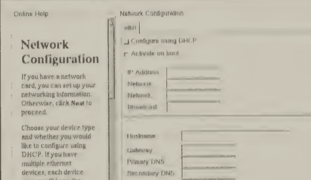

图 2-6

你可以在安装期间输入网络选项。

2. 如果要在启动时激活网络，点击 Activate on Boot 选项。
3. 在下一个字段中输入你的 IP 地址。

> 注意 如果仅使用局域网且没有连接连接，使用静态地址。

4. Linux 将尝试根据你的 IP 分配 Netmask。

> 术语 Netmask：也称为子网掩码，用于确定子网。例如，对于地址 150.216.19.31，前两个数字表示该地址属于 B 类网。

5. Linux 将尝试根据你的网络信息在此填写地址。
6. 如果你的 PC 是网络组件，则需要填写 Broadcast（广播）字段。
7. 如果你的计算机直接连接到互联网，ISP 将为你分配一个 Hostname。将该信息输入 Hostname 字段。
8. 在 Gateway 字段输入你的网关或路由器 IP 地址。
9. Primary DNS 地址可能也可能是你的网关 IP 地址；输入你的 ISP 给你的任何地址。
10. 如果你有备用 DNS 服务器 IP 地址，将其输入 Secondary DNS。
11. 某些网络提供比两个更多的 DNS 服务器访问。如果有额外的 DNS，请将该地址输入 Ternary DNS 字段。
12. 点击 Next 按钮继续安装过程。

你的初始网络配置完成。

## 设置时区

你可能认为时区主题不会是火箭科学。将地球分成 24 份，就搞定了，对吧？

错误。世界上几个国家根据出于政治原因而非地理原因设置了它们的时钟。即使在美国，也有几个州不根据夏令时调整时。所以，即使是时区设置也可能复杂。从图 2-7 可以看出，Red Hat 的开发人员仔细考虑了这个问题。

占据屏幕的是一张世界地图，其中高亮了几个区域。由于在这个比例尺下城市非常小，点击 View 下拉菜单-

有人有时间吗？

向下滚动列表，选择你居住的地区。将出现一张你所在地区的更大比例地图。

要设置时区，只需点击地图上离你最近的城市/地区。或者，你也可以从地图下方出现的列表中选择你的城市/地区。你的选择将显示在地图正下方的字段中。

如果你需要，可以根据通用协调时（UTC）设置时间（一种基于格林尼治标准时间的固定标准时间）。要这样做，点击标记为“System Clock Uses UTC”（系统时使用 UTC）的选项，根据相对于 UTC 的小时偏移输入你的时间。

完成后，点击“Next”（下一步）按钮。

## 配置你的账户

每创建一个 Linux 系统时，必须同时创建一个 root 账户。root 账户是 Linux PC 的管理员账户。由于你使用 root 账户对操作系统设置进行修改，它是系统中最强大的账户。设置 root 账户只需要在“Root Password”（root 密码）和“Confirm”（确认）字段中输入相同的密码即可。“确认”输入条目确保了你没有在输入密码时出现拼写错误。

如果你在系统上还有其他用户，现在为他们创建额外的用户账户是一个好主意。用户账户类似于 Windows 中的找到的用户配置文件。它们允许某些用户对 Linux 系统进行定制化访问，并提供知道谁在系统上做什么的额外安全性。

如你在图 2-8 中所示，要创建一个用户账户，请在“Account Name”（账户名称）字段中输入用户 ID，提供密码以及用户的全名。与创建 root 账户类似，你需要输入两次密码以确保没有拼写错误。点击“Add”（添加）按钮将完成该过程。

## 在周末内将 Red Hat Linux 7 添加到你的 Windows 桌面

> 提示：Red Hat Linux 内的密码是区分大小写的。

> 提示：即使你是 PC 的唯一用户，为自己创建一个普通账户也是一个好主意。一直使用 root 账户可能会导致潜在错误，而使用普通账户可以限制损坏的范围。

在系统上添加完用户后，点击“Next”（下一步）按钮继续。

## 选择软件包组

在 Anaconda 的这一阶段，你将决定哪些软件包将安装在你的 Linux 机器上。这就像是一场生日派对！

Red Hat Linux 中的软件包等同于应用程序安装程序。每个软件软件包内部包含特定应用程序运行所需的大部分或全部文件。打开软件包将自动将应用程序安装到你的 PC 上。

图 2-8

将用户添加到你的 Linux 系统。

第一个软件包选择屏幕（实际上也是你唯一需要的屏幕）为你提供了看似三个主要的选择：GNOME、KDE 和 Games（游戏）。但这些可是什么选择呢！每个选项都代表了运行 GNOME 或 KDE 工作站所需的大组软件包，以及另一组严格用于用于游戏的软件包。

GNOME 和 KDE 是运行在 X 之上的不同桌面环境。坦率地说，两者在操作上几乎没有区别，只是界面方法不同。如果你的硬盘上有大量空间，我建议两个都选并亲眼尝试。如果你有偏好，只需选择你喜欢的那个。

当然，是否选择 Games 也取决于你，但如果你有空间，尽管去吧，顺从诱惑吧。每个人偶尔都需要的休息一下。

屏幕底部是“Select individual packages”（选择单个软件包）选项。如果你想安装某个特定的软件包，且知道它不会属于三个预设软件包之一，你就会选择此项。由于你可能会从默认软件包组中获得所需的一切，我建议你跳过此选项并点击“Next”继续进入“Unresolved Dependencies”（未解决依赖）屏幕。

如果你想真正深入各种软件包选择，请点击“Package-Group Selection”（软件包组选择）屏幕底部的“Select Individual Packages”选项。一旦选中，点击“Next”将带你进入“Individual Package Selection”（单个软件包选择）屏幕。

单个软件包选择屏幕的左侧是一个类似于目录树的结构，列出了所有软件包组。选择任何组都会导致其单个软件包列表显示在屏幕右侧。

## 在周末内将 Red Hat Linux 7 添加到你的 Windows 桌面

要选择要安装的软件包，双击软件包名称。软件包图标上会出现一个红色的对钩，表示其已准备好安装。点击“Next”继续进入“Unresolved Dependencies”（未解决依赖）屏幕。

“解决依赖”屏幕处理可能需要其他软件包内额外文件才能工作的软件包。记住，某些软件包并不总是包含应用程序安装所需的所有文件。许多软件包依赖其他软件包的存在才能正常工作。这就是依赖关系。未解决的依赖是指所需的软件包缺失。Anaconda 会检查你在上一个屏幕中选择的所有组，并确保组中的每个软件包都已解决其所有的依赖。

如果屏幕上出现几个未解决的软件包，不要担心。点击“Install packages to satisfy dependencies”（安装软件包以满足依赖）选项，然后点击“Next”。所有需要的文件将自动添加到安装集中。

## 配置 X 窗口系统


# 在工作站安装路径中配置 X

在工作站安装路径中，接下来两个屏幕是 **X Configuration**（X 配置）屏幕。这些屏幕很重要，因为它们决定了 X 如何与你的显卡和显示器协调以生成图形显示。记住，Linux 操作系统基于文本命令行，需要 X 来运行图形化界面。

与 Microsoft Windows 不同，X 必须仔细配置以与你的视频硬件配合。这并不意味着 Windows 更灵活。这只是近年来显示器和显卡的设计是为了符合 Windows 标准。Linux 是硬件领域的新面手，因此仍然需要手动配置。

## Monitor Configuration（显示器配置）

在进入第一个 X 配置屏幕之前，Linux 工具 **Autrobe** 已经尝试识别显示器类型。如果它找到了，该标识将出现在第一个屏幕顶部，即 **Monitor Configuration**（显示器配置）屏幕。

在 **Monitor Configuration** 上，Anaconda 将显示它认为你拥有的显示器类型。仔细检查这一点，因为 **Autrobe** 可能会猜测。如果正确，点击 **Next** 继续。

如果 **Autrobe** 无法判断你的显示器类型，它将选择 **Unbed Monitor**（未知显示器）类别。此时，你需要确保屏幕底部的 **Horizontal**（水平）和 **Vertical Sync**（垂直同步）字段数值是正确的。在这里要小心，你不想使用会损坏显示器的设置。错误的同步率设置会导致显示器超频，这是一个高级术语，基本上意味着让显示器在超出规格的情况下运行。

找到同步率的最佳地点是显示器自带的手册。如果没有，尝试显示器的制造商网站。输入你的同步率数值后，点击 **Next** 继续。

## 显卡配置

在下一个屏幕中，Anaconda 将显示 **Autrobe** 找到的显卡。显卡的确定非常重要，因为它决定了以后实际使用什么 X Window 服务器。

确认选定的显卡，或者如果需要，选择一个更符合你显卡的值。显卡列表下方有八个选项，代表你的显存大小，单位为千字节。点击相应的值。

视频硬件确定后，点击标记为 **This Configuration** 的按钮。屏幕可能会闪烁。如果一切顺利，你应该看到一个蓝绿色屏幕，带有一个对话框询问你是否看到对话框上的消息。点击 **Yes**。如果 **Autrobe** 为你定位了硬件，则说明测试成功。

如果你看不到消息，将需要更改显卡和显示器的设置。

## 默认桌面环境选择

X 配置屏幕上可能还会有一个列表框字段，允许你选择想要在启动期间作为默认的桌面环境。

> **注意**：只有当你同时选择了安装 Gnome 和 KDE 软件包时，它才会出现。如果你只选择其中一个桌面环境，它将不会出现。请选择你希望作为默认的环境。

在 **Test**（测试）按钮下方，你会看到三个选项：

- 如果你选择 **Custom Configuration**（自定义配置）并点击 **Next**，你将进入一个屏幕，可以在那里尝试不同的颜色深度（屏幕上的颜色数量）和屏幕分辨率。
- **Use Graphical Login**（使用图形登录）选项对于新用户来说非常重要，因为它允许在每次启动系统时都显示 X 登录界面。

> **注意**：此时 Linux 程序中似乎出现了一个故障。如果你选择 **Custom**（自定义）选项并进入该屏幕，**Use Graphical Login** 选项（即使你选择了它）也会被清空，导致 X 在启动时无法加载。鉴于这种情况，我建议你稍后再更改视频设置。

只有想要手动设置 X 的专家应该点击 **Step X Configuration**（步骤 X 配置）选项。新用户应该远离此选项。

为了最大限度的方便，我建议你点击 **Use Graphical Login** 选项，然后点击 **Next** 继续。

# 完成安装

所有的永久安装信息现在已由 Linux 收集，安装程序已准备将文件复制到你的计算机。图 2-9 显示了 **About to Install**（即将安装）屏幕，警告这种情况即将发生。

请记住，在此之后，你将无法点击 **Back** 按钮来更改所选的安装设置。别担心——显示图形的硬件配置是安装中最困难的部分。所以深吸一口气，轻松呼出，点击 **Next** 按钮继续。

你现在将看到 **Installing Packages**（安装软件包）屏幕。然而，在任何软件包实际安装之前，你设置的分区将被格式化。你会通过进度消息的出现（见图 2-10）知道这正在发生。

格式化分区可能需要 5 到 15 分钟，取决于所需的格式化量。如果你选择了在格式化时检查坏块的选项，格式化将花费更长时间。随后 Linux 安装将收集安装程序第一部分获得的所有信息，并构建文件复制列表。屏幕上会出现一个进度条（见图 2-11），以便你可以监控该过程。

现在进入安装的大部分阶段。如图 2-12 所示，**Installing Packages** 屏幕显示了安装进行时的进度。

> **图 2-10**：格式化你的 Linux 分区。
>
> **图 2-11**：准备复制文件。

顶部的进度条表示当前正在安装的软件包的状态。底部条显示所有软件包的累计安装进度。你还会获得一个剩余时间值，这样你就知道是否有时间去拿个三明治了。

当一切完成后，将出现 **Boot Disk Creation**（创建启动盘）屏幕。

在安装 Red Hat Linux 7 之前，你可能还没有创建启动盘，特别是如果你有一个可启动 CD-ROM 驱动器。如果没有，现在就是机会了——我强烈建议你这样做。要制作启动盘，只需将一张空白软盘插入软驱器并点击 **Next** 按钮。Anaconda 将自动构建一个与你的 Linux 安装完全同步的启动盘。

启动盘完成后，将出现如图 2-13 所示的 **Congratulations**（恭喜）屏幕。现在从驱动器中取出启动盘。

点击 **Exit**（退出）按钮将关闭安装程序并重启你的机器。在点击 **Exit** 之前，确保你已经从软驱器（或如果有可启动 CD-ROM 驱动器则为安装 CD-ROM）移出了启动盘。

一旦 PC 重启，你将看到一个亮蓝色屏幕，上面列出了 PC 上所有的操作系统。这个屏幕是图形 LILO 屏幕，每次 Linux 开始加载时出现。使用方向键选择你想要启动的操作系统并按回车键继续。

> **图 2-13**：你已进入了 Linux 的奇异世界。

如果你想让 Linux 加载，你不需要做任何事情。LILO 默认加载它。

> **提示**：如果你在 LILO 列表中看到 **DOS** 而不是 Windows，不要担心。LILO 可以识别操作系统，而且在 Windows PC 上，DOS 才是真正的操作系统，而 Windows 只是图形界面，这与大众的认知相反。选择 **DOS** 将启动 Windows……如果你有需要的话。

与 Windows 不同，Linux 喜欢在启动时广播它所采取的每一个微小步骤。关注这些消息（见图 2-14），以便你熟悉它们。随着时间的推移，这种熟悉将使你能够识别 Linux 加载时发生的任何问题，仅仅是因为你认出了不寻常的消息。

```
sda: hda1 hda2 hda5 hda6 =
RAID ISR: Compressed image found at block 0
autodetecting RAID arrays
autora:
  autora: DONE
uufs: Mounted root (ext2 filesystem)
autodetecting RAID arrays
autora:
  autora: DONE
UFS: Mounted root (ext2 filesystem) readonly.
change root: old root dev=sda1
Trying to mount old root... done
Freeing kernel memory: 84k
init: version 2.6 booting
Welcome to Red Hat Linux
Press 'Enter' to enter
Mounting proc filesystem... ok
Setting clock: Nov 4 20:27
Setting partitions: 1065 ok
Checking root filesystem... ok
dev/sda1: clean, 24880 files, 25888 blocks
Remounting root in read-write mode
```

> **图 2-14**：观察 Linux 启动。

随后你将进入桌面环境并开始。

# 其他安装问题

如果你成功安装并启动了 Red Hat Linux，恭喜你，你完成了上午的任务！你可以早去吃午饭，或者跳到下午的课程 **Initial Configuration Issues**（初始配置问题）。

然而，你们中的有些人可能需要关于其他模式的信息，因为事情并不总是按计划进行。如果是这样，请留下来——上午剩下的部分将检查文本安装、自定义选项和双启动。

## 文本安装

等待，通过 `Tab` 键在屏幕对象之间移动（使用 `Alt+Tab` 返回）。按 `Space` 键选择或取消复选框。按 `Enter` 键激活功能。不难吧？

文本安装收集的所有安装信息都与图形安装相同。但一个例外是，文本安装会在探测系统视频硬件之前请求许可（你应该这样做）。

通过比较图 2-15 和图 2-4，你可以看到，除了外观之外，两种界面之间没有太大区别。文本安装模式是遇到初始显示问题时的很好的替代方案。

> **图 2-15**：Disk Druid 的文本版本。

## 配置 LILO

由于你计划在 Red Hat Linux PC 上使用多个操作系统，你需要确保 Linux 加载器（**LILO**）安装在正确的位置。如果不是，你可能会遇到麻烦。

### 双启动原理

当带有单一操作系统的系统启动时，BIOS 查看硬盘上的一个称为 **Master Boot Record**（MBR，主引导记录）或启动区的特殊区域，以查看将加载哪个操作系统。

当系统有两个或多个操作系统时，必须有一个特殊的多启动程序位于启动区，它会临时停止启动过程并允许用户选择加载哪个操作系统。**LILO** 就是这样的程序。

### 与 Windows 95/98 双启动

要配置 **LILO** 以运行 Linux 和另一个操作系统，你需要使用自定义安装路径。然而，如果你在预配置了 Windows 95 或 98 的系统上安装 Linux，你只需要运行 **Workstation**（工作站）安装路径。默认的 **LILO** 设置提供了运行两个操作系统所需的所有内容。

随后，**LILO** 将安装在 **MBR** 中，并赋予 Linux 启动区默认优先级进行加载。你以后可以在 Linux 内部使用名为 `linuxconf` 的工具来更改这些设置；现在请使用工作站设置。

### 如何与 Windows NT 双系统启动

简单来说，让 Linux 和 Windows NT 协同工作最简单的方法是在你的机器上先安装 NT（这对于读此书的人来说很可能）。然后，当你安装 Linux 时，让 **LILO** 引导到 **MBR**。最后，编辑 `/etc/lilo.conf` 文件并添加一个指向 NT 所在的设备的 `nt` 选项（例如 `/dev/hda1`）。

如果你想以后在安装了 Windows NT 或 Windows 2000 的情况下运行 Linux，你需要在安装过程中采取一些特殊步骤。

需要记住的最重要的一点是你必须运行 **Custom**（自定义）安装路径，因为这是唯一让你配置 **LILO** 以满足你需求的方法。

基本上，问题在于：Windows NT OS 加载器不认为 Linux 是有效的操作系统，因为 Linux 在启动操作系统之前不会产生 NT OS 加载器需要读取的类型文件。此外，NT OS 加载器不在启动区以外的任何地方运行。由于启动区同时只能有一个引导程序，如果 **LILO** 位于 **MBR** 中，你就会遇到问题。

自定义安装路径让你能够访问 **LILO** 配置界面，在该界面中，你可以选择将 **LILO** 安装在 **MBR**（默认设置）或 Linux 启动分区的第一个扇区。如果你选择后者，**LILO** 和 NT OS 加载器之间就不会产生冲突。遗憾的是，NT OS 加载器仍然看不到 Linux，它不会将 Linux 作为一个启动选项。现在该耍花招了。

有一种方法可以在 Linux 中创建一个 NT OS 加载器可以用来引导启动 Linux 的文件，但创建它需要一些时间。我建议你获取一个名为 `Bootpart` 的小型第三方程序，你可以在 `http://www.winimage.com/bootpart.htm` 获取。该程序将为 NT OS 加载器快速创建 Linux 启动文件，并将其放在 NT OS 加载器可以使用的地方。如果你计划将 Windows NT 或 Windows 2000 与 Linux 使用，强烈推荐此应用程序。

有关配置 Windows NT 和 Linux 的更多信息，请阅读 mini-HOWTO 文档：`http://www.linuxdoc.org/HOWTO/mini/Linux+NT-Loader.html`。

# 结论

今天上午的工作让你达到了预期的目标：成为一台运行 Red Hat Linux 7 的 PC 所有者。现在你已经完成了这项任务，是时候配置并自定义你新安装的操作系统以满足你的需求了。

今天下午，你将学习图形界面的基础：配置 X 窗口系统。

# 周六下午

## 初始问题

- 理解 Gnome 和 KDE
- 配置 X Window
- 自定义桌面

你已经自定义了一个相当高效的上午，在自己的 PC 上独立安装了 Red Hat Linux。现在你应该能在屏幕上看到一个漂亮的桌面，已经准备好供你工作或娱乐。你应该花些时间观察桌面并熟悉它的界面。

到今天下午结束时，你将：

- 检查 Gnome 和 KDE 界面
- 配置 X Window 与你的系统协同工作
- 创建自定义桌面
- 探索 Linux 文件系统

## 寻找并探索新奇的桌面

你一眼就能注意到的一点是，你的桌面与 Microsoft Windows 相比看起来是非常相似的。这并非偶然。大多数 **GUI**（Graphical User Interface，图形用户界面）在向用户展示工具时都遵循一套范式。GUI 都有窗口、菜单和对话框，因为这是大多数用户已经熟悉的界面。

> **GUI**（Graphical User Interface，图形用户界面）：任何使用视觉而非文本信息来传递信息和接受命令的计算机接口。

Linux 的独特优势之一是，DOS 只能使用 Windows 作为其桌面环境，而 Linux 可以使用无数桌面，使其变得非常用户友好。毕竟，如果你不喜欢 Windows，你也无能为力（除非安装 Red Hat Linux）。如果你不喜欢你的 Linux 桌面，只需更改它。我们稍后会介绍 Linux 桌面。

底部的 Gnome 面板。现在，让我们看看两个主桌面：Gnome 和 KDE。

## 探索 Gnome

Gnome 是一个与 Red Hat 关联已久的桌面环境。由 Gnome 项目开发，开发者不断对其进行调整以确保其用户友好。

### 理解桌面元素

和每个 GUI 一样，Gnome 有一组控件。图 3-1 显示了主要元素。

- 桌面显示你使用的程序和文件。
- 桌面上的图标被称为 **Launchers**（启动器）。启动器打开应用程序或目录。
- **Windows**（窗口）是包含菜单、按钮和滚动条的区域。应用程序和文件出现在窗口内部。

> **图 3-1**：环境。

图 3-2 所示的 **Gnome Panel**（Gnome 面板）位于屏幕底部。Gnome 面板包含主菜单按钮、一些 **applets**（插件）和 **Pager**（分页器）。

- **Main Menu Button**（主菜单按钮）打开一个可以执行的所有应用程序、工具和操作的菜单。它是位于左侧的按钮。
- **Panel Applets**（面板插件）是通过点击插件图标快速启动的小程序。你可以从面板中添加和删除插件。
- **Pager**（分页器）显示桌面上当前运行的所有任务或应用程序。

> **图 3-2**：Gnome 面板。

- **Desktop Guide**（桌面指南）显示你的电脑上有哪些应用程序和文件以及它们在虚拟桌面上的位置。
- Gnome 面板的两端是箭头。点击这些箭头可以隐藏和显示 Gnome 面板。

### 从主菜单按钮启动程序

现在是时候看看你的软件应用程序并快速概述如何使用常用的窗口元素。接下来的几部分将通过使用 Gnome 日历来展示如何使用应用程序的基本元素。

首先，让我们回顾一下启动日历应用程序（或其他任何应用程序）所需的步骤。

1. 点击 **Main Menu Button**（主菜单按钮）。主菜单将如图 3-3 所示。
2. 将鼠标移动到 **Programs**（程序）菜单项上。程序菜单将出现。
3. 将鼠标移动到 **Applications**（应用程序）菜单项上。应用程序菜单将出现。
4. 点击 **Calendar**（日历）选项。应用程序窗口将出现在你的屏幕上（见图 3-4）。

这非常直观，可能和你习惯的操作没有太大区别。

> **图 3-3**：通过主菜单启动应用程序。
>
> **图 3-4**：打开的日历应用程序。

### 使用按钮、菜单和对话框

你已经成功打开了一个 Linux 应用程序，现在你准备好看看它是如何运行了。程序窗口包含菜单、命令按钮、调整大小按钮以及许多其他元素。花几分钟探索不同的菜单，看看有哪些可用功能。本节将向你展示如何使用按钮和菜单来执行命令。

1. 将鼠标指针悬停在工具栏上的按钮上。该按钮将高亮，并出现一个提示，告诉该按钮执行的功能。
2. 点击按钮。将执行与该按钮关联的命令。该命令会自动执行，或者会弹出一个对话框，允许你对想要执行的命令进行选择。
   - 如果你打开了对话框，请点击 **Close**（关闭）按钮。对话框将关闭，你在对话框中做出的任何选择都将被忽略。
3. 点击菜单项打开菜单。将出现一个菜单命令列表。
4. 点击命令。将打开一个对话框或执行某个功能，如图 3-5 所示。

> **图 3-5**：使用菜单和对话框。


对话框包含用于显示次级对话框的按钮、允许选择选项的按钮、允许选择多个预定义选项的列表，以及将多个对话框分组在一起的选项卡。

- 5. 点击“确定（OK）”。对话框将关闭，选项将被应用，你将返回程序窗口。

如果你不想应用对对话框所做的任何更改，或者决定不再执行该命令，请点击“关闭（Close）”或“取消（Cancel）”。

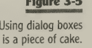

| 偏好 (Preferences) | |
| :--- | :--- |
| 时间显示：颜色 待办事项 闹钟 | |
| 显示颜色 | |
| 日 | 一 | 二 | 三 | 四 | 五 | 六 | 日 |
| 轮纲: 1 | | | | | | | |
| 标题: | | | | | | | |
| 空闲日: | | | | | | | |
| 2 | 3 | 4 | 5 | 6 | 7 | 8 | |
| 预约: | | | | | | | |
| 高亮日: | | | | | | | |
| 9 | 10 | 11 | 12 | 13 | 14 | 15 | |
| 日期: | | | | | | | | |
| 今日数字: | | | | | | | |
| 16 | 17 | 18 | 19 | 20 | 21 | 22 | |
| 未到期的待办事项: | | | | | | | | |
| 23 | 24 | 25 | 26 | 27 | 28 | 29 | |
| 今日的待办事项: | | | | | | | | |
| 30 | 31 | | | | | | |
| 过期的待办事项: | | | | | | | | |
| 确定 (OK) | 关闭 (Close) | 帮助 (Help) | | |

# 在周末内为你的 Windows 桌面添加红帽 Linux 7

当你完成一个应用程序后，关闭它最快的方法是点击程序窗口右上角的“杀死（Kill）”按钮（见图 3-6）。应用程序将关闭，你返回 Gnome 界面。

如果窗口拒绝关闭，右键点击“杀死”按钮。将弹出一个菜单，你可以在其中选择“销毁（Destroy）”。销毁选项是停止卡极应用程序。

## 探索 KDE

如果你将 KDE 设置为默认桌面，你可以在这里探索它。KDE（代表 K 桌面环境）与 Gnome 非常相似，因为它也有菜单、对话框和窗口。红帽 Linux 7 附带 KDE 以及 KDE2 的测试版本（该桌面环境的第二个版本）。KDE 是通过以下安装的版本。

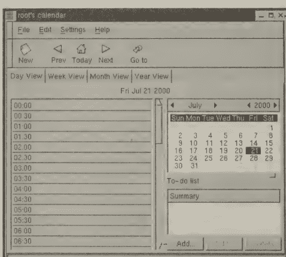

图 3-6 关闭应用程序既快速又简单。

默认。它与 Gnome 有一些细微的，主要在于 KDE 环境的描述上，而不是行为上。

## 理解桌面元素

在 Gnome 中，你在桌面上移动相当容易。在 KDE 中你会发现许多熟悉的控件，尽管它们的名称可能不同（见图 3-7）。

- 桌面是你在屏幕上看到的所有元素的背景。
- 桌面图标在 KDE 中被称为“快捷昵称（Nicknames）”。与 Gnome 一样，昵称可以快速打开应用程序、文件或目录。你可以为你经常使用的程序和文件在桌面上放置图标。
- 窗口是带框的区域，其中包含菜单、按钮和滚动条，与其他图形界面一样。

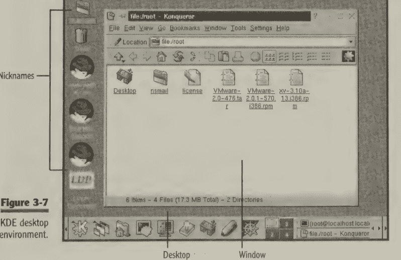

- KDE 桌面环境。

# 在周末内为你的 Windows 桌面添加红帽 Linux 7

Kpanel（面板）位于屏幕的底部，如图 3-8 所示。Kpanel 包含了应用程序启动（Application Starter）按钮、若干面板小组件、实用工具和桌面管理器。

- 应用程序启动按钮打开应用程序菜单。
- 应用程序启动按钮打开 KDE 菜单，你可以在其中启动应用程序、工具。
- 应用程序启动按钮打开 KDE 菜单，显示可以运行的程序。
- 应用程序启动按钮打开 KDE 上的应用程序。
- 这种启动栏是 KDE 桌面上的所有可以运行的程序。

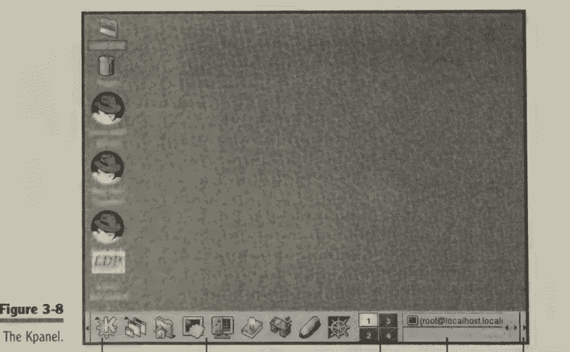

图 3-8 面板。

## 初始配置问题

- 任务栏显示当前运行中的所有任务。
- 桌面按钮允许你选择选项。
- 这种纹理状条形是用于显示或隐藏的 Kpanel。
- 任务栏是桌面上的 Kpanel。

# 从应用程序启动启动程序

当你想要在 KDE 中启动应用程序时，使用应用程序启动。

- 1. 点击应用程序启动按钮。
- 2. 将鼠标指针悬停在游戏项目上。
- 3. 点击游戏。

## 什么是 X？

在我们开始配置 X 之前，让我们花一点时间了解什么是 X。想象你手里拿着一个洋葱。剥掉外面的棕色部分。剩下什么？剥皮的洋葱。如果你再剥掉一层，剩下的是……对，一个更小的洋葱。

虽然不是最完美的类比，但在某些方面它适用于 Linux、X 服务器和 Linux 窗口管理器之间的关系。它们都是操作系统的洋葱——除了它们不会让你哭。

# 在周末内为你的 Windows 桌面添加红帽 Linux 7

非 Linux 用户起初对哪些组件组成 X 感到有些困惑。在 Microsoft Windows 环境中，你有 DOS 操作系统，Windows 操作系统运行在其之上，如图 3-9 所示。运行之上意味着 Windows 本质上是一个从 DOS 平台运行的大程序——与运行 Doom 等程序没有区别。结果是你必须运行 DOS 才能运行 Windows。

对于 Windows NT 用户来说，简单得多。Windows NT 和 Windows 2000 是独立运行的真实图形用户界面。这里的优势是你可以确实见即所得。你需要在时仍然运行 DOS，但在 Windows NT 和 2000 中，DOS 模拟器在 Windows 内部运行。Windows NT 的缺点是，你的 PC 需要更多的内存和速度才能与同类 Windows 系统一样高效运行。

模拟器。可以模拟另一个操作系统的外观和感觉程序。

正如书中早期提到的，你刚刚安装的 Linux 系统与 DOS/Windows 系统最相似。和 DOS 一样，Linux 是一个基于文本的操作系统（尽管它复杂得多）。你可以仅使用 Linux 操作系统执行许多功能，许多人确实这样做了。然而，更多的人被 GUI 毒害了，习惯于使用窗口、菜单和对话框来工作。

1986年，一个国际 UNIX 程序员联盟开始根据施乐克斯帕洛奥托研究中心（Xerox Palo Alto Research Center）的 GUI 研究创建一个图形化操作系统。X 就此诞生。

Linux在1991年推出后，X很快进入了Linux 桌面。当 Linux 开始出现在基于 Intel 的 PC 上时，X 的新版本 XFree86 帮助完成了这一过渡。

XFree86 是任何运行在 Red Hat Linux 上的 GUI 的核心。XFree86 也称为 X 服务器，它将视频输出和 PC 输入结合在一起，形成一个统一的界面。PC 输入来自两个基础输入设备：键盘和鼠标。视频输出通过显卡发送到显示器。

虽然这听起来像是 GUI 的全部，但事实并非如此。这是因为 X 服务器只是一个网络透明的显示层，为 GUI 的运行提供了“家”。

要生成你所需的实际窗口和菜单，你需要在 X 服务器显示层上运行一个`窗口管理器`。

## 窗口管理器（Window manager）

赋予 X 服务器“外观”并决定图形应用程序显示方式的分配。

Red Hat Linux 自带了几个窗口管理器：AfterStep、AnotherLevel、Enlightenment、fwm、fwm95、KVM、olvm、Sawfish 和 tvm 等。在 Red Hat 7 中，你需要处理的两个主要的有 Gnome 和 KDE。

KDE——K 桌面环境——是一个获奖过的环境，随 Red Hat Linux 7 软件包一起。通常被称为窗口，但实际上它并不是窗口。KDE 通常运行在一个名为 KWM（K 窗口管理器）的窗口管理器之上。正如 KVM 增强了 XFree86 的视觉效果，KDE 也增强了 KWM 的外观和工具集。


## 周末为你的 Windows 桌面添加 Red Hat Linux 7

运行 Gnome（GNU 网络对象模型环境）桌面也存在类似的关系。Gnome 也不是真正的窗口管理器。Gnome 是运行在 XFree86 上的窗口管理器的增强。默认情况下，Red Hat 7 在 Gnome 上安装了 Sawfish 窗口管理器。感到困惑了吗？看看图 3-10，它显示了所有这些组件之间关系的简化表示。

请注意，仅仅安装了某种窗口管理器和桌面环境的组合，并不意味着你被锁定在该种组合中了。例如，如果你愿意，可以在 fwm95 之上运行 Gnome。这是 Linux 开放平台哲学的优点之一：你对如何运行 PC 拥有真正的选择。

然而，经常被问到的大问题是，这些选择意味着什么？在今天上午的安装中，我建议你安装 Gnome 桌面环境。考虑到这一点，表 3-1 详细列了 Gnome 安装中每个 Linux 组件的不同职责。

现在你已经更清楚地知道所有不同组件是如何组合在一起的，现在是时候检查如何配置 X Window 了。注意表 3-1，X 的某些组件具有不同的职责。XFree86 处理的职责将侧重于它的视频输出、键盘和鼠标的职责。

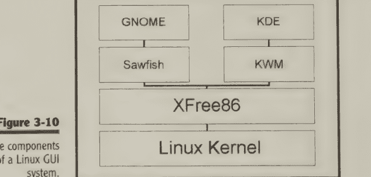

## 周六下午 初始配置问题

| 表 3-1 LINUX/GNOME 系统的组件 |
| :--- | :--- |
| 组件 | 职责 |
| Linux | 一切运行的基础。处理所有基本的文件系统和设备任务，并将将命令翻译成 PC 基础的机器语言。 |
| XFree86 | GUI 的核心。生成显示层以允许创建图形，然后模拟这些图形以响应来自键盘和鼠标的输入。 |
| Sawfish | 窗口管理器，负责由 XFree86 生成的所有窗口、对话框和菜单的外观。 |
| Gnome | 通过提供额外的界面工具和外观来增强 Sawfish 窗口管理器。为输入设备配置提供了额外的控制。 |

## 使用 Xconfigurator

在 Red Hat Linux 7 中，有两个工具用于管理 XFree86：Xconfigurator 和 xt86config。每个工具都关注 XFree86 的不同方面，并应根据情况使用。表 3-2 揭了每个工具的功能。

尽管 xt86config 看起来因为功能更强而是最好的使用的程序，但实际上我建议你使用这些程序中界面更简单的 Xconfigurator。Xconfigurator 拥有一个更易用的界面来更改你的显示参数，而 xt86config 使用的是多选线性界面，稍微困难一些。

Xconfigurator 的一个很棒用途是更改显示器的视频分辨率。当 Red Hat 首次安装时，它可能默认使用你不喜欢的分辨率，例如图 3-11 所示的 640 x 480 分辨率。

## 表 3-2 XFree86 配置工具对比

| Xconfigurator | xt86config |
| :--- | :--- |
| 视频显示器 | 视频显示器 |
| 显卡 | 显卡 |
| 视频分辨率 | 键盘 |
| | 鼠标 |

> **视频分辨率：** 横跨显示器的排列像素数。分辨率越小，像素越大，屏幕上能显示的信息越少。

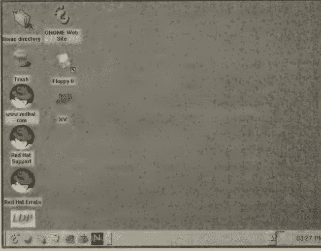

在这个分辨率下，空间有限。

Xconfigurator 是一个基于文本的应用程序，因此在使用它时，你需要在登录 root 后使用命令行界面。你可以通过终端仿真窗口访问命令行，简称为 Terminal。Terminal 并不是真正的 Linux 界面，但可以用于大多数操作。要启动 Terminal，点击任务栏上的 Terminal 图标（一个小显示器）。这打开了 Terminal（见图 3-12）。

现在 Terminal 已经运行，下面的步骤将指导你如何使用 Xconfigurator 修改分辨率。

- 1. 在 Terminal 中输入 `Xconfigurator`。Xconfigurator 工具将在 Terminal 中启动（见图 3-13）。

> 不，我说 Xconfigurator 是基于文本的时并没有撒谎。所有的颜色和线条只是组合在一起形成图形界面外观的文本字符。

- 2. 默认情况下，欢迎屏幕上的 OK 控制被选中。按 Enter 键继续。下一个屏幕（图 3-14）显示了 PCI 探测的结果。

- 3. 在自定义显示器设置屏幕上，你应该阅读关于水平和垂直刷新率的重要性。确保你知道你显示器的数据（最好是昨晚在“安装 Red Hat Linux 7 之前”步骤中获取的），然后按 Enter 继续进入屏幕。

第二个自定义显示器设置屏幕（如图 3-16 所示）允许你根据水平同步率设置显示器类型。选择一个具有更高分辨率的显示器类型（例如

## 在周末内为你的 Windows 桌面添加 Red Hat Linux 7

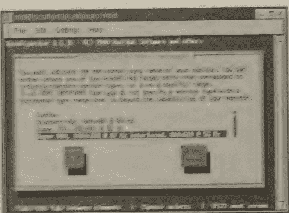

图 3-16 选择水平同步率。

800 X 600 且同步率仍在显示器的水平同步率参数范围内。

+ 8. 按 Tab 键选择 OK 控制，然后按 Enter 键。

9. 第三个“自定义显示器设置”（Custom Monitor Setup）屏幕需要你指定显示器的垂直范围（见图 3-17）。使用向上和向下方向键选择合适的范围。

10. 按 Tab 键选择 OK 控制，然后按 Enter 键。

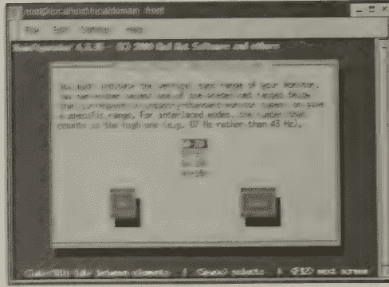

图 3-17 选择垂直同步率。

11. 在图 3-18 所示的视频显存（Video Memory）屏幕中，使用向上和向下方向键选择你显卡的显存大小。

12. 按 Tab 键选择 OK 控制，然后按 Enter 键。

13. 许多旧显卡有特定的时钟芯片设置，这些设置出现在“时钟芯片配置”（Clockchip Configuration）屏幕中（见图 3-19）。如果你的卡偶尔有一个活跃的时钟芯片，使用方向键选择时钟芯片类型。由于大多数新显卡没有时钟芯片，你可能需要选择“无时钟芯片设置”（No Clockchip Setting）。

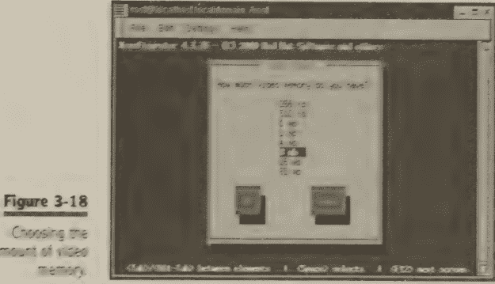

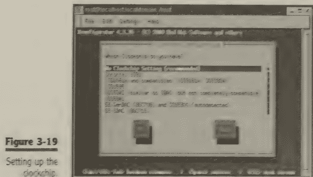

## 在周末内为你的 Windows 桌面添加 Red Hat Linux 7

14. 按 Tab 键选择 OK 控制并按 Enter 键。

15. 你现在看到“选择视频模式”（Select Video Mode）屏幕（见图 3-20）。使用 Tab 键导航到相应的列，使用向上和向下方向键在颜色深度列中移动，然后按空格键选择任何选项。

提示：在此屏幕中选择多个一个分辨率。如果它们都设置成功，你就可以在 X 内部通过按 `Ctrl+Alt+加号` 来快速切换每个配置好的分辨率。

16. 按 Tab 键选择 OK 控制，然后按 Enter 键。

专业术语（BUZZ WORD）颜色深度：以每像素比特数表示，颜色深度可以通过计算 2 的 N 次幂来转换为可用颜色数量，其中 N 是每像素的比特数。因此，8 位每像素的颜色深度为 2^8，即 256 色；16 位每像素的颜色深度为 65,536 色；24 位每像素的颜色深度为 16,777,216 色。

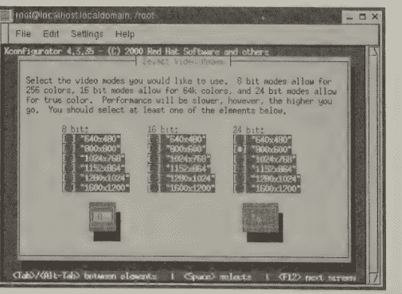

视频探测结果。

## 周六下午 初始配置问题

+ 17. 你将到达“启动”（Starting）屏幕（见图 3-21），它仅通知你将启动另一个 X 会话来测试你的设置。按 Enter 键继续。

+ 18. 如果你的设置正常，你将在屏幕上看到一条表示成功的消息。点击 Yes 继续。

如果出现任何其他类型的消息，或者没有看到任何消息，请使用“返回”（Back）控制回到上一个屏幕。然后你可以更改你的设置。

+ 19. 系统会弹出一条消息，询问你是否想在重启时启动 X。点击 Yes。

+ 20. 将会出现另一个消息，告知你系统更改记录在何。点击 OK 继续。

+ 21. Xconfigurator 将关闭。点击 Gnome 控制菜单上的“注销”（Log Out）重启你的 X Window 会话。

+ 22. 在“确实注销”（Really Log Out）对话框中选择“退出”选项，然后点击 Yes。

返回图形界面后，新的默认视频分辨率将被设置。在再次登录 X 后，这种变化尤为明显（见图 3-22）。

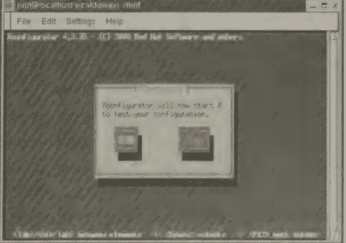

图 3-21 准备测试你的设置。

## 在周末内为你的 Windows 桌面添加 Red Hat Linux 7

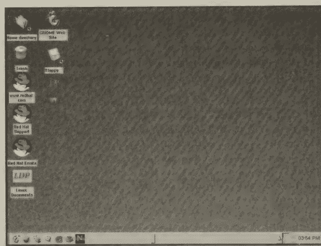

图 3-22 更高的分辨率为你提供了更多的屏幕空间。

## 启动 xf86config 工具

当你需要对系统的输入设备进行重大更改时，应该使用 xf86config 重新配置 X。你也可以用它来监控和显示设置更改；如果这是你唯一需要的，我建议使用 Xconfigurator。

> 提示：在对 XFree86 进行任何配置时，请确保你是使用 root 账户登录的。

与 Xconfigurator 类似，xf86config 位于 `/usr/X11R6/bin` 目录。然而，你只需要在终端窗口中输入 `xf86config` 程序就会开始运行。

## 配置鼠标

如果你在任何时候需要离开 xf86config，按 `Ctrl+c`。更改将被取消，程序将结束。


在第一个 `xf86config` 屏幕中，你将看到一条文本消息，详细说明对系统进行哪些更改（见图 3-23）。按 `Enter` 键继续到下一个屏幕。

第二个屏幕显示了九种可能的鼠标类型列表。要选择选项，输入其数字然后按 `Enter` 键（见图 3-24）。

如果你选择了“鼠标系统（Mouse Systems，3键协议）”以外的鼠标类型，接下来系统会询问你是否想启动“模拟按钮”（EmulateButtons）选项。由于许多 Linux 程序仍在使用三键，我建议你输入 `y`，然后按 `Enter` 键继续。

接下来，Linux 还会询问连接鼠标的端口设备名称。除非你使用的是非标准端口，否则按 `Enter` 键接受默认。

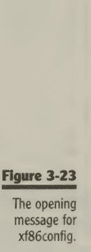

```
root@localhost:~ 编辑设置
```

## 在周末内为你的 Windows 桌面添加 Red Hat Linux 7

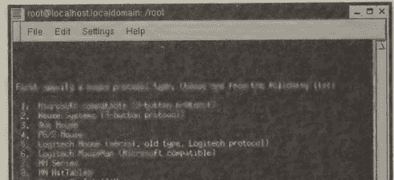

图 3-24 选择鼠标类型。

## 配置键盘

在选择鼠标类型后，你准备好回答关于键盘的问题。

> **专业术语（BuzzWord）键映射（Keymap）**：为匹配你的键盘设计的配置。

在你输入键映射后，将看到适用于不同类型的键映射列表。每种类型的键盘都有键映射。

## 周六下午 初始配置问题

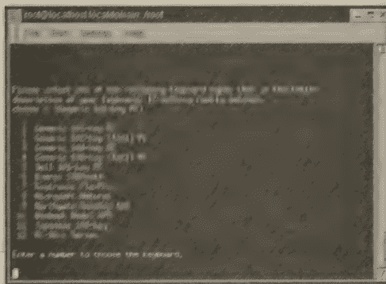

此列表如图 3-25 所示并不特别。输入你想要的范围分类数字并按 `Enter` 键继续。

在你选择键映射后，将看到你可以使用的语言列表。

要查看更多选项。一旦你找到了所需的语言，只需输入该语言对应的数字并按 `Enter` 键继续。

## 配置显示器

在配置好键盘和鼠标后，`xf86config` 进入视频设置。由于其重要性，`xf86config` 花了大量时间和屏幕空间处理视频的各个方面，从显示器开始。

正如你预期的那样，显示器部分的第一个屏幕（见图 3-27）警告用户正确的显示器水平和垂直同步率的重要性。

> **提示**：你周五晚上收集的显示器信息将被多次使用。确保将其保存在方便参考的地方。

按 `Enter` 键继续进入显示器部分，该部分显示了显示器可能的水平同步范围。还有一个输入自定义范围的选项，如图 3-28 所示。输入你范围数字并按 `Enter` 键继续。

在你输入范围后，会出现一个较小的潜在垂直同步率列表（见图 3-29）。再次提醒，选择范围时要小心，避免超频并损坏显示器。

与安装程序和 `Xconfigurator` 不同，`xf86config` 给了你机会为显示器分配名称。你可以描述一个整体

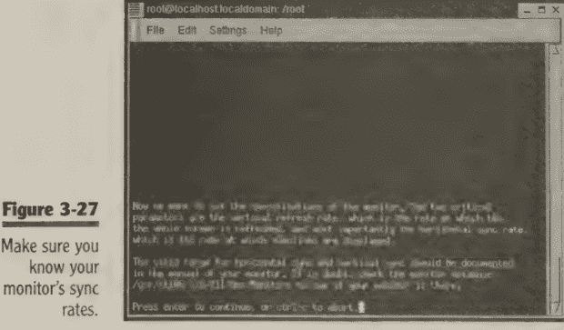

请非常仔细地选择水平同步率。

请同样仔细选择垂直同步率范围。

为此显示器配置指定名称、厂商名称和型号。如图 3-30 所示，输入你想要使用的名称并按回车。

一旦完成显示器设置，`xf86config` 将移动到显卡部分，这是 `xf86config` 最后且最详细的部分。

## 112 在周末内将 Red Hat Linux 7 添加到你的 Windows

图 3-30 为你的显示器设置命名。

## 配置显卡

如果你需要修改显卡设置，可以使用 `xf86config` 来完成。正如你所看到的，你必须先浏览整个程序到达这一步。

第一个屏幕（见图 3-31）讨论了使用 `xf86config` 可访问的当前显卡数据库的价值。我建议你尝试在数据库中找到你的显卡；但正如消息所说，选择显卡时必须非常小心。名称相似的显卡可能并不兼容，如果你尝试用一张看起来与你的相似的显卡来充，可能会无意中损坏你的显示器。

如果你选择查看数据库（你应该这样做），输入 `y` 并按回车继续。将出现一个很长的显卡型号和制造商列表，包含芯片组信息（见图 3-32）。按回车键滚动列表查看下一批。小心不要跳过你的显卡，因为没有“返回”选项。当你找到显卡时，输入显卡的数字并按回车。无论你是否使用显卡数据库，下一步都是视频显存设置。

图 3-31 花时间阅读这段关于显卡数据库的消息。

图 3-32 显卡列表。

在此屏幕上，Linux 询问你的显卡有多少视频显存。正确设置这一点非常重要，因为如果你低估了 VRAM，你将损失显卡的所有性能。按回车。

程序现在要求你为显卡配置提供一个英文名称，就像你之前为显示器一样。输入你想要使用的名称。

## 在周末内将 Red Hat Linux 7 添加到你的 Windows

在下一个屏幕中，你将指定 X 服务器要使用的颜色深度，如图 3-33 所示。我建议你至少使用 16 位颜色深度，以便在屏幕上获得丰富的颜色范围。

最后，你将收到通知，`xf86config` 即将你的设置保存到至关重要的 `XP86config` 文件中。如果你对所做的任何设置仍不确定，应该输入 `n`，因为没有办法备份和修复某个特定设置。如果你认为一切就绪，输入 `y` 并按回车完成程序。

## 使用控制面板

虽然键盘和鼠标的设置主要是 X 服务器的功能，但也可以从窗口管理器进行某些设置更改。你可以从控制中心进行这些更改。虽然这些设置不是主要的，但它们是那种可以让你的生活变得更轻松的小细节。

你可以使用 GNOME 或 KDE 控制面板来进行这些设置。只需记住，你所做的任何更改将仅限于你正在配置的环境。

## 配置键盘

要在 Gnome 环境中访问控制中心应用程序，请点击 Gnome 控制菜单并选择设置（Settings）、外设（Peripherals）、键盘（Keyboard）（或鼠标（Mouse））。选择键盘选项将直接打开控制中心中的键盘设置面板，如图 3-34 所示。

如果你对键盘的性能不满意，可以调整滑块控件来更改重复键或键盘击键的值。你还可以更改键盘蜂响的音调，这在以前的 Gnome 版本中是在控制面板的音频（Sound）部分处理的。做出更改后，点击尝试（Try）按钮，然后在对话框底部提供的测试（Test）字段中测试你的新设置。

一旦设置符合你的，点击 `OK` 关闭控制中心窗口。

## 在周末内将 Red Hat Linux 7 添加到你的 Windows

## 配置鼠标

虽然键盘和鼠标的设置主要是 X 服务器的功能，但也可以从窗口管理器进行某些设置更改。你可以从控制中心进行这些更改。虽然这些设置不是主要的，但它们是那种可以让你的生活变得更轻松的小细节。

你可以使用 GNOME 或 KDE 控制面板来进行这些设置。只需记住，你所做的任何更改将仅限于你正在配置的环境。

## 配置键盘

要在 Gnome 环境中访问控制中心应用程序，请点击 Gnome 控制菜单并选择设置（Settings）、外设（Peripherals）、键盘（Keyboard）（或鼠标（Mouse））。选择键盘选项将直接打开控制中心中的键盘设置面板，如图 3-34 所示。

如果你对键盘的性能不满意，可以调整滑块控件来更改重复键或键盘击键的值。你还可以更改键盘蜂响的音调，这在以前的 Gnome 版本中是在控制面板的音频（Sound）部分处理的。做出更改后，点击尝试（Try）按钮，然后在对话框底部提供的测试（Test）字段中测试你的新设置。

一旦设置符合你的，点击 `OK` 关闭控制中心窗口。

## 正确注销

当你想注销时，点击主菜单并选择注销（Log Out）。消息框将在计算机关闭前要求你确认。

如果你改变了主意，只需点击否（No）以恢复你的会话。如果你想注销，点击注销（Log Out）。X Window 将关闭所有运行程序。

如果你想重启系统，点击重启（Reboot）。X Window 将关闭所有运行程序并返回登录界面。

如果你想关机，点击关机（Shut Down）。X Window 将关闭所有运行程序，计算机将关闭。

## 登录选项

选择使用环境的第一个地方是登录界面。现在你有能力为要登录的账户选择环境。例如，如果我以 `root` 身份登录 KDE 并将 KDE 设置为默认，则 KDE 对 `root` 账户设置为默认。我登录任何其他账户将使用它们自己的默认环境。

会话（Session）菜单命令出现在登录界面。点击后，菜单将打开显示可用的环境选项。如果你最初使用 KDE Workstation 路径进行安装，你的选项将是：

- **默认**：默认环境由原始安装或 Gnome 桌面切换应用设置。
- **安全模式（Failsafe）**：当难以运行环境时，使用安全模式命令行界面，这可能发生在 `Xconfigurator` 或 `xf86config` 中设置了错误的视频设置并需要进行调整时。
- **Gnome**：Gnome 桌面环境。

如果您已向系统添加了任何其他桌面环境，它们也将作为环境选项出现在这里。一旦选择，将通过登录字段下方的消息确认选择。在您完成登录程序后，您选择的环境将会出现。

## 切换桌面环境

一旦进入环境（我们假设现在是 Gnome），您可以在接下来的步骤中发现，您可以快速切换到另一个环境。

1. 点击主菜单图标打开主菜单。
2. 选择“程序”、“系统”、“桌面切换工具”。桌面切换器窗口将打开，如图 3-36 所示。
3. 点击 KDE 选项（见图 3-37）。出现 KDE 图标。

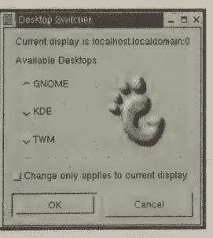

图 3-36 桌面切换工具。

## 在周末内将 Red Hat Linux 7 添加到您的 Windows 桌面

> **注意**：“仅应用于当前显示”选项应仅在您的 Linux PC 通过网络连接到其他 PC 且您只想对自己的工作站进行更改时才启用。

4. 点击确定。将出现一条消息提醒您，这些更改在您重新登录 X Window 系统之前将不会生效（见图 3-38）。
5. 退出环境并返回图形化登录界面。
6. 使用相同的账户登录。您将看到新的默认环境 KDE。（见图 3-39。）

如果您想将 Gnome 重置为默认环境，只需再次打开桌面切换工具即可。可以在 KDE 的应用程序菜单（类似于 Gnome 的主菜单）下的“Red Hat”、“系统”、“桌面切换工具”下找到该程序。

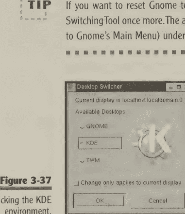
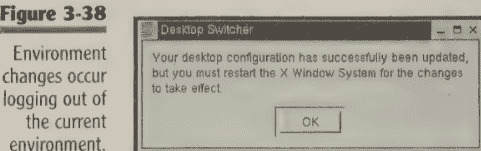

## 周六下午 初始配置问题

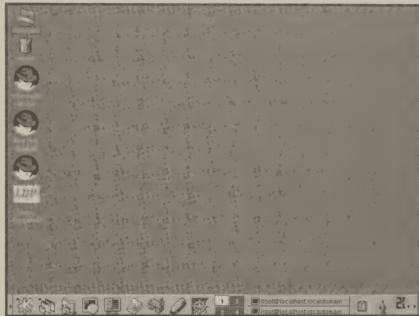

图 3-39 KDE 桌面环境。

## 安全模式

正如今天早些时候在登录部分所指出的，安全模式登录选项是一个命令行界面设置。如果在登录期间选择此项，屏幕右下角将打开一个小型终端仿真窗口。

注意上一段中对窗口的描述：这是一个终端仿真窗口。即使没有桌面环境，X 仍在运行。这看起来可能像是一个细微的差别，但为了说明这种区别是必要的。

某些程序并不是设计在 X 内部运行的，例如 `sndconfig`，我们将在今天傍晚的“配置打印机、声音和其他设备”中检查它。如果您尝试在安全模式下运行 `sndconfig`，并认为它是真正的 Linux 命令行（我实际上在我初学 Linux 的时候尝试过），那么您的系统可能会发生糟糕的事情，例如系统死机。

## 在周末内将 Red Hat Linux 7 添加到您的 Windows 桌面

基本上，大多数可以从控制台（真正的命令行模式）运行的应用程序也可以在安全模式下运行。任何不能运行的将在 X 中运行。此时，您应该听从警告并退出应用程序。

> **提示**：在任何模式下，按 `Ctrl+Alt+F1` 访问 Linux 控制台。从 Linux 返回 X，请按 `Alt+F7`。

我发现使用安全模式的最佳情况是在我在尝试视频设置时犯了错误。通过在安全模式下登录 X，我可以启动 `Xconfigurator` 并轻松修复错误。

现在您已经熟悉了不同的登录模式，有必要快速检查一下配置桌面的方法了。

## 配置您的桌面

在您对桌面及其提供的所有功能进行了一大巡览之后，您可能会发现想要更改桌面的某些方面。在下午的剩余时间里，还将讨论桌面内可用工具的放置位置，以及桌面自定义的另一个重要方面：桌面主题。

## 菜单自定义

如果您不喜欢在 Gnome 中通过三四级菜单来启动您最常用的应用程序之一该怎么办？在这种情况下，Gnome 可以让您将应用程序启动器放置在桌面的某个位置，这样您就可以更快地启动程序。

- **启动器**：启动应用程序的菜单项或图标。

主菜单是放置您喜欢的应用程序启动器的绝佳位置。如果它被埋在微小子菜单的四级之下，请按照下面的步骤将启动器放置在主菜单的第二层，即带有“收藏”子菜单中。

1. 点击主菜单图标打开主菜单。
2. 导航到您想要移动的菜单启动器（见图 3-40）。
3. 右键点击启动器。
4. 选择“添加到收藏菜单”。启动器被复制到收藏菜单。


## 桌面图标

如果您想在桌面上放置启动器以便更快速访问，这是一个拖放操作。

1. 点击主菜单图标打开主菜单。
2. 导航到您想要移动的启动器。
3. 选择启动器，然后将其拖到桌面。
4. 松开鼠标按钮。启动器的副本出现在桌面（见图 3-41）。
5. 您可以移动该图标。

> **提示**：可以通过右键点击桌面的空白区域并选择“排列图标”来自动排列图标。


图 3-41 在桌面放置启动器。

## 周六下午 初始配置问题

6. 要删除图标，右键点击图标并选择菜单中的“删除”。确认。

## 面板图标

启动器也可以位于面板上。下面的步骤详细介绍了如何实现这一目标。

1. 点击主菜单图标打开主菜单。
2. 导航到您想要移动的启动器。
3. 右键点击应用程序启动器。
4. 选择“添加到此面板”。
5. 启动器被复制到面板（见图 3-42）。
6. 如果您想移动图标在面板上的位置，右键点击图标并选择“小部件”。


图 3-42 一个新的 Gnome 启动器。

7. 在不点击图标的情况下，沿面板移动多向指针。选中的启动器图标将跟随。
8. 当图标在合适的位置时，单击图标以锁定其位置。
9. 要从面板移除图标，右键点击图标以打开控制菜单。现在选择“从面板移除”。

## 桌面主题

如果您可以穿反映您真实性格的衣服，人们可能会看您非常奇怪。

为什么要让您的独特性埋在同伴压力的浪潮中？摆脱平庸的锁链，准备好展示。您可以从 Linux 桌面开始。

## 更改主题

您可能没有意识到，安装后出现在 Gnome 桌面上的颜色和纹理组合本身就是一个主题。这是 Gnome 的默认主题，看起来非常像某个其他操作系统的默认桌面。

尽管如此，您当然欢迎尝试 Red Hat 提供的其他主题。正如您预期的，这是通过控制中心完成的。

1. 点击“Gnome 配置工具（Gnome Configuration Tool）”按钮。控制中心窗口将出现。

## 周六下午 初始配置问题

2. 点击“桌面（Desktop）”旁边的展开图标，然后点击“主题选择器（Theme Selector）”。将出现主题选择器面板，如图 3-43 所示。
3. 在“可用主题（Available Themes）”字段中，你可以查看 Red Hat Linux 安装的 16 个主题列表。点击列表中的任何主题，并在面板底部的显示中查看预览（见图 3-44）。
4. 完成后，点击“尝试（Try）”以立即查看桌面更改（见图 3-45）。
5. 如果你认可更改，点击“确定（OK）”关闭控制中心（Control Center）。

当你激活更改时，你会发现主题更改仅应用于打开的窗口内部和 Gnome 面板。窗口边界和标题栏等屏幕组件完全不受影响。


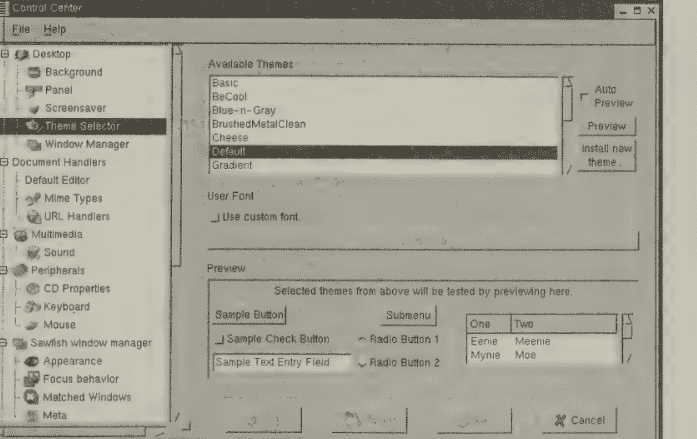

选择要使用的主题。

## 在周末内为 Windows 桌面添加 Red Hat Linux 7

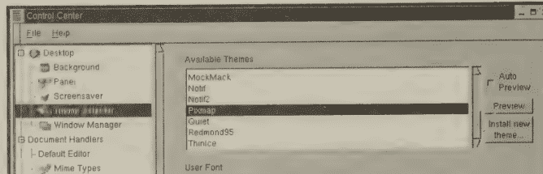

图 3-44 在将主题应用到桌面之前先查看它们。

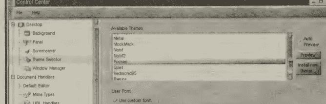

图 3-45 新主题现在装饰了你的桌面。

你正看到一个清晰的示例，说明了桌面环境（Gnome）和窗口管理器（Sawfish）各自控制显示的不同方面。如果你想更改屏幕上的其他元素，你需要配置 Sawfish，如后续步骤所示。

1. 点击“Gnome 配置工具（Gnome Configuration Tool）”按钮。控制中心窗口将会出现。
2. 点击 Sawfish 窗口管理器旁边的展开图标，然后点击“外观（Appearance）”。外观面板将会出现，如图 3-46 所示。
3. 点击“默认框架样式（主题）（Default frame style (theme))”字段的下拉列表。将显示可用主题列表。
4. 点击你想要尝试的窗口主题。
5. 完成后，点击“尝试（Try）”以立即查看桌面更改（见图 3-47）。
6. 如果你认可更改，点击“确定（OK）”关闭控制中心。

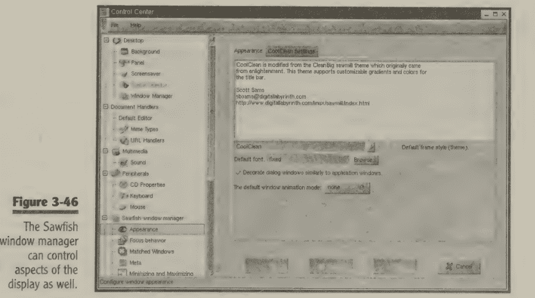

## 在周末内为 Windows 桌面添加 Red Hat Linux 7

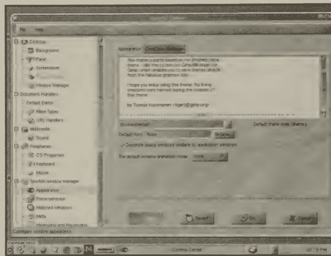

图 3-47 Sawfish 的 BrushedMetalIII 主题应用于 Gnome Pixmap 主题。

## 获取新主题

不要被 Gnome 桌面仅有 16 个主题可用所误骗。有更多的主题可用，只需点击超链接即可。


# 互联网主题资源与桌面配置

互联网上有一个极佳的网站，旨在为你的桌面免费提供现成的主题。该网站位于 `http://themes.org`，是大型主题集合的主页，这些站点为主要的窗口管理器和桌面环境提供主题。对于大多数 Red Hat Linux 用户来说，KDE 站点 (`kde.themes.org`) 是你想要访问的，同样还有 `sawfish.themes.org` 和 `gtk-themes.org`。

后一个站点是 Gnome 直接使用的主题的主页。GTK 代表 Gimp 工具包（Gimp Tool Kit），它是 Gnome 用于管理主题的应用程序。

在这些任何一个网站上，你都会要求使用预定的用户名和密码登录。如果你还没有，请去获取一个。它是免费的，而且说真的，你不应该在没有账号的情况下下载主题。你可以这样做，但这有点非常不礼貌。

一旦你在网站上注册，你就可以探索“主题画廊（Theme Gallery）”，它按类别或按总下载次数显示主题，如图 3-48 所示。

当你找到想要使用的主题时，点击主题描述中的超链接并将下载内容保存到你喜欢的任何硬盘位置。现在，一旦你将其指向硬盘上的正确位置，你就可以告诉桌面环境中的主题管理器使用新的了。

- 点击“Gnome 配置工具”按钮：控制中心窗口将会打开。

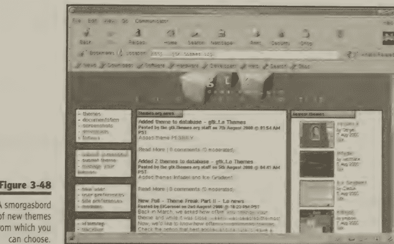

## 在周末内为 Windows 桌面添加 Red Hat 7

1. 点击“桌面（Desktop）”旁边的展开图标，然后点击“主题选择器（Theme Selector）”。主题选择器面板将会打开。
2. 点击“安装新主题（Install New Theme）”按钮。“选择要安装的主题（Select a Theme to Install）”对话框将会出现，见图 3-49。
3. 选择你想要的主题。“选择要安装的主题”对话框将会出现，见图 3-49。
4. 如果你认可更改，点击“确定（OK）”关闭控制中心。
5. 完成后，点击“尝试（Try）”以立即查看桌面更改（见图 3-45）。

当你激活更改时，你会发现主题更改仅应用于打开的窗口内部和 Gnome 面板。窗口组件如窗口边界和标题栏完全不受影响。

## 周六下午初始配置问题

## 功能与权限

你有数百个不同的 Linux 命令可以学习。然而，大多数时候，你不会使用其中超过 20 个命令。你将需要的一些常用命令已包含在本节中。附录 A“Linux 入门”详尽地列出了这些功能。

本节还包含用于修改这些命令的一些常用开关（switches）。开关在命令之后，并以破折号 (`-`) 开头。这些开关可以组合在一个破折号下（例如 `ls -lR`）。这些命令有很多可用开关，但这里包含的只是最常用的几个。

- `ls`。列表命令可能是最常用的命令。它对应于 DOS 中的 `DIR` 命令。它列出当前目录下的文件、链接和子目录。在不使用开关的情况下，它将使用短格式显示当前目录下的文件列表。

- `-l`。`-l` 开关（long 的缩写）可能是最常用的开关。它以长格式列出每个文件的详细信息。该命令的输出非常重要，因为 Linux 使用其中许多相同的信息来决定如何处理文件。例如，使用命令 `ls -l` 返回的文件列表类似于：

```bash
$ ls -l
total 47
-rw-r---- 1 root root 1560 Dec 10 14:12 Application_Notes
-rw-r---- 1 root root 911 Dec 10 14:12 Daemon_Notes
drxr-xr-x 5 guest guest 1024 Nov 11 09:09 Desktop
-rw-r---- 1 root root 2253 Dec 10 14:12 Disk_Notes.txt
-rw-r---- 1 root root 1104 Dec 10 14:12 Hardware_Specs
-rw-r---- 1 root root 477 Dec 10 14:12 Initialization_Scripts
-rw-r---- 1 root root 33792 Dec 10 14:12 Master_ICC_TOC.sdw
drxr-xr-x 1 root root 573 Dec 10 14:12 StarOffice
-rw-r---- 1 root root 149 Dec 10 14:12 Startup-files
-rw-r---- 1 root root 773 Dec 10 14:10 notes.txt
```

此选项显示与每个文件相关的类型、权限、链接、所有者、组、大小、最后修改日期和时间以及文件名。文件类型、权限、所有者和组字段将在下午晚些时候讨论。

- `-a`。显示目录中的所有文件，包括隐藏文件。隐藏文件的文件名以点 (`.`) 开头。

- `-R`。递归地显示子目录的内容。

- `-color`。这是一个特殊的开关，可以轻松区分文件和目录。`-color` 以不同于普通文件的方式显示可执行文件。目录、链接和设备文件也有单独的颜色。这在短格式显示文件时极具价值。

为了避免每次都重新输入此选项，请将其放在别名（alias）中。

输入：

```bash
$ alias ls='ls -color'
```

若要在每次登录时都使用此选项，请使用你喜欢的文本编辑器（`emacs`、`vi`、`pico` 或任何其他）来编辑 `~/.bashrc`。添加以下行：

```bash
alias ls='ls -color'
```

保存文件。现在，每次登录时，此脚本都会运行。

- `cd`。此命令类似于 DOS 的 `cd`（更改目录）命令。它同样会更改当前工作目录。

例如，要将工作目录更改为根目录，使用 `cd /`。

要将工作目录更改为用户主目录（登录后开始所在的目录），使用 `cd ~`。

要返回上一个目录，使用 `cd -` 命令。这在两个目录之间来回时非常方便。

目录路径可以使用相对或绝对术语表示，使用如 `cd ../etc` 或 `cd /etc` 等命令。只要读者在文件系统中的深度不超过两层，此命令就是等效的。例如，如果当前目录是 `/usr/local/bin`，那么第一个命令将带你去到 `/usr/etc`。

- `pwd`。此命令显示当前工作目录。例如，命令行 `pwd` 显示 `/home/guest`。

- `cp`。此命令对应 DOS 中的 Copy 命令。例如，使用此命令将名为 test 的文件复制到名为 test2 的新文件中：

```bash
cp test test2
```

你可以在文件名中包含路径。注意 Linux 文件名中允许多个点：

```bash
cp /etc/lilo.conf lilo.conf.copy
```

`cp` 通常在覆盖文件之前不会检查目标文件是否已存在。为了让 `cp` 在覆盖文件之前始终显示提示，请编辑你主目录下的 `.bashrc` 文件。如果 `.bashrc` 中还没有出现以下行，请添加它：

```bash
alias cp='cp -i'
```

稍后，如果你想覆盖此提示，请使用 `-f` 开关。

- `mv`。`mv` 与 `cp` 类似。此命令将文件移动到新目录或文件。例如，使用此命令将名为 test 的文件移动到名为 test2 的新文件中：

```bash
mv test test2
```

你可以在文件名中包含路径。注意 Linux 文件名中允许多个点：

```bash
mv /etc/lilo.conf lilo.conf.copy
```

`mv` 通常在覆盖文件之前不会检查目标文件是否已存在。为了让 `mv` 在覆盖文件之前始终显示提示，请编辑你主目录下的 `.bashrc` 文件。如果 `.bashrc` 中还没有出现以下行，请添加它：

```bash
alias mv='mv -i'
```

稍后，如果你想覆盖此提示，请使用 `-f` 开关。

- `ln`。link 命令是你可能频繁使用的最后一个命令。使用它来创建指向另一个目录或文件的符号链接。使用以下格式：

```bash
ln -s <filename> <linkname>
```

例如，以下操作创建一个文件的链接：

```bash
$ ls -l test*
-rw-r-- 1 guest guest 1560 Dec 01 12:44 testfile
$ ln -s testfile testlink
$ ls -l test*
-rw-r-- 1 guest guest 1560 Dec 01 12:44 testfile
lrwxrwxrwx 1 guest guest 8 Dec 01 13:06 testlink -> testfile
```

使用链接作为深埋在文件系统结构中的目录的临时快捷方式。

权限是因为 Linux 是多用户操作系统。这意味着不同的人可以同时使用计算机。某些文件和目录每个人都希望能够访问。另一些你可能希望是私有的。Linux 将文件和目录的访问分为三组：所有者、组和其他人。

用户通常是其创建的文件的所有者。当你创建一个用户账户时，它会被分配到一个组。组的示例包括（系统进程）、`root`（超级用户 root）和 `user`（分配给大多数用户的组）。

所有者可以将其文件设置为自己、其组或所有其他人可读、可写（可删除）和可执行。`root` 用户对每个文件和目录始终具有完全访问权限。

## 处理非 Linux 分区

虽然另一个分区不是外围设备，但它无疑是你 PC 上的另一个设备，可以像其他任何设备一样被利用。如果你的电脑上有另一个分区（例如 Windows 分区），你可以轻松从 Linux 访问其文件系统。

## 在周末内将红帽 Linux 7 添加到你的 Windows 桌面

你需要做的第一件事是确定分区所在的设备。以 `root` 用户身份登录时，在终端窗口输入 `/sbin/fdisk -l`。

你将看到 PC 上所有逻辑磁盘和物理硬盘的列表，其中包含一行带有“Win95.”字样的内容。该行的开头是一个 `/dev/hdaX` 值。还应该会有如 `FAT32` 或 `FAT16` 的值。请记住这些值，以备后用。

你需要创建一个挂载点目录，以便访问 Windows 分区。输入 `mkdir /mnt/win` 或 `mkdir /mnt/windows`，为目录命名一个你记得的名字。

现在，你只需要通过输入 `mount -t vfat /dev/hdaX /mnt/win` 来挂载该分区。记得将 `X` 替换为正确的驱动器数字。之后你就可以像访问其他目录一样访问 Windows 文件系统了。

> **提示**：要在停机或重启后重新挂载分区，只需再次输入 `mount` 命令即可。

## 结论

你今天下午完成了许多任务，并对 Linux 底层运行机制有了深入了解。

通过预先建立你的桌面和工作环境，将使红帽 Linux 成为一个在物理和心理上都让你舒适的工作工具。在这些忙碌时期，越简单越好。

现在你应该去吃点东西了。今晚回来时，你将学习如何开始将计算机连接到其他设备（无论是 PC 还是打印机）。你还将学习如何让音箱传出声音，从而拥有一台多媒体 Linux PC。


# 周六晚上

## 与他人的良好相处

- 设置你的互联网账户
- 配置网络和 IP 地址
- 安装打印机
- 设置音频
- 使用 ISAPNPTOOLS 实用程序

现在你已经熟悉了 PC 的一些基础配置，是时候看看如何让你的 PC 与其他设备通信了。

Linux 机器与其他机器通信的方式有无数种，最流行的方式是通过互联网。这并非唯一的方法，也不是最常见的方法。今晚，你将学习如何：

- 创建互联网账户
- 配置你的网络设置
- 为你的 PC 添加打印机
- 设置你的声卡
- 为你的 PC 添加额外硬件

在之前的某些课程之后，所有这些任务可能看起来完全超出你的能力范围。别担心，它们对于初学者来说也非常简单。只需按照本节的操作，学习如何完成配置工作即可。

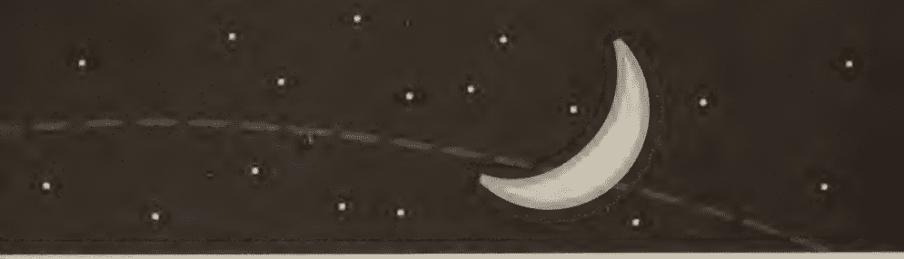

## 设置你的互联网账户

过去十年里，人们对互联网有很多论述。尽管互联网——这一最大的公共计算机网络——伴随着大量的喧嚣和炒作，但需要注意的是，互联网远未完成。

互联网的增长（到目前）在许多方面与 19 世纪后期美国电话的增长非常相似。在商业化存在的前五年里，电话进入了美国约 10% 的家庭。在五年后，它进入了 50% 的美国家庭。再过五年，它进入了全美 90% 的家庭。

互联网紧密契合这种增长模式。到 1994 年（即互联网脱离纯学术环境五年后），美国约 10% 的家庭可以连接互联网。现在，在五多年后，美国互联网访问的普及率已接近 50%。尽管这听起来不可置信，但美国在完全使用互联网的道路上仅处于一半位置。（其他国家的互联网存在在百分比上落后了，但这可能是因为美国抢了先机；增长模式保持一致。）

无论你是互联网社区中的新兵，还是从 Lynx 时代就开始冲浪的人，你都会发现互联网越来越不像是一个玩耍的地方，而是一个工作的地方。越来越多的人转向互联网来处理银行需求、购买节日礼物，甚至通过网络摄像头查看在托儿所的孩子。

Linux 和互联网的历史是交织在一起的。Linux 的前身 UNIX 是构建互联网时所赖以基础的操作系统。事实上，互联网的大部分语法（如 `"://"`、FTP 命令、作为目录分隔符的正斜杠）直接源自 UNIX 命令行。

因此，红帽 Linux 7 提供了一系列丰富的互联网工具供访问，这并不意外。你所做的就是让自己连接上。

如今，获取一个互联网账户非常简单。我们许多人似乎几乎每个月都会邮收到一封带有连接软件的光盘。然而，对于 Linux，你需要确保你使用的是正确类型的账户。

互联网的“语言”被称为 TCP/IP。这种语言（称为协议）是数据从你的计算机发送到位于北卡罗来州达勒姆的 Web 服务器计算机的方式。

**TCP/IP（传输控制协议/网际协议）**：一套用于连接互联网主机的通信协议族。TCP/IP 是 UNIX 操作系统的产物，并被互联网使用。

在拨号连接互联网时，红帽 Linux 需要确保你使用的是正确的账户类型。互联网的“语言”被称为 TCP/IP。

为了在拨号期间通过调制解调器传输数据包，需要一种额外的协议，例如 PPP。

**PPP（点对点协议）**：一种在拨号期间通过调制解调器传输数据包的通信协议。适用于 Linux 系统，红帽（RH）也不例外。RH PPP 程序管理你的 PC 到互联网的连接。你必须首先配置拨号器，以便它能与互联网服务提供商的计算机正常通信。


## 配置 PPP 拨号

红帽 Linux 7 自带拨号配置工具，这是一个设置连接的自动化方法。对于大多数 ISP，使用此应用程序就足够创建一个常规连接。在某些情况下，可能需要对配置进行更多控制——这就是为什么本节还将介绍使用拨号配置工具手动编辑连接。

拨号配置工具类似于微软 Windows 操作系统中的互联网连接向导。其核心思想是引导应用程序，提供红帽创建新连接所需的信息片段。

在开始下一个任务（该任务将演示创建连接）之前，你应该收集以下信息：

- ISP 的域名（例如：`earthlink.net`）
- 账户的用户名
- 账户密码
- ISP 的电话号码

你还应该确认你的 ISP 需要什么种类的通信协议。绝大多数 ISP 会要求 PPP；但某些可能使用替代协议，如 SLIP 或 PLIP。


> 许多 ISP 在单个 Web 页面或 Web 文档中提供连接信息。如果你从其他 PC 或 Windows 分区访问互联网，可以访问你 ISP 的网站查看他们是否提供了这些信息。一个很好的地方是“技术支持”或“常见问题”部分。

一旦收集好信息，将它们输入拨号配置工具就是件简单的事，如下步骤所示。

1. 点击主菜单图标打开主菜单。
2. 选择“程序”、“Internet”、“拨号配置工具”。应用程序窗口将在前台打开，背景中将显示一个现有的 Internet 连接窗口（见图 4-1）。
3. 第一个窗口是介绍性消息。点击“下一步”继续。
4. 如果您尚未配置调制调器，则会显示“选择调制调器”屏幕（见图 4-2）。点击“下一步”让应用程序自动搜索连接到您的 PC 的所有调制调器。

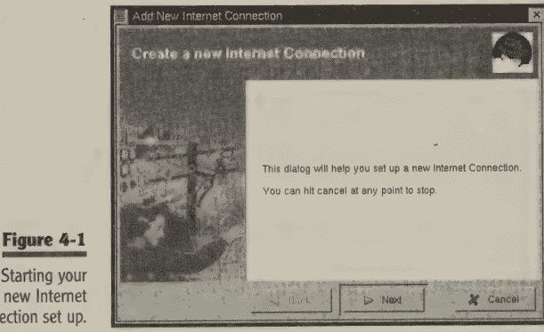

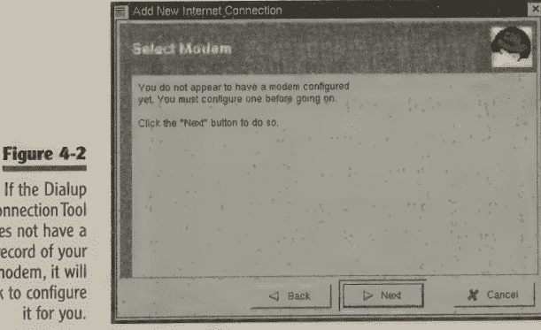

## 在周末内将 Red Hat Linux 7 添加到您的 Windows 桌面

> **注意**
>
> 在应用程序搜索设备之前，请确保您已开启外部调制调器并将其正确连接到计算机。

5. 屏幕将显示当前连接到您的 PC 的调制调器列表，如图 4-3 所示。如果显示的调制调器列表正确，点击您想要使用的调制调器。然后点击“保留此调制调器”选项。最后，点击“下一步”继续。
6. 在“电话号码和名称”屏幕上（如图 4-4 所示），为连接输入一个描述性名称，以及调制调器拨号所需的电话号码。完成后点击“下一步”。

> **注意**
>
> 除非需要，否则不要在相应字段中输入前缀或区号/国家代码。例如，RH PPP 拨号器没有关闭区号拨号的设置。

7. 每个 ISP 账户包含一个用户 ID 和密码。这些数据将在下一个屏幕上输入（见图 4-5）。点击“下一步”继续。

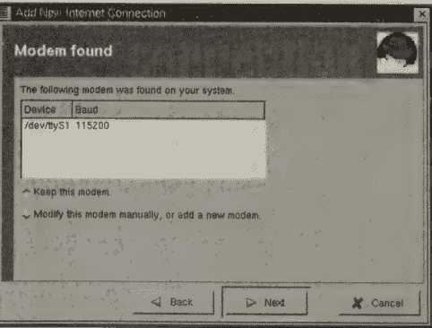

**图 4-3** 确认找到的调制调器选择。

## 图 4-4

为连接输入电话信息。

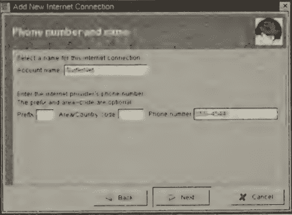

## 图 4-5

用户名和密码屏幕。

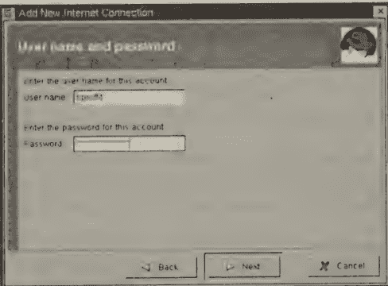

> **提示** 为了保护您的账户不被意外使用，密码字段用星号代替了密码中的每个字符。结果是，您在输入密码时需要小心，以避免输入错误。

8. Red Hat Linux 可以访问两种类型的 ISP：AT&T 全球网络服务和普通的非专有 ISP。从这些类别中选择其一（见图 4-6）并点击“下一步”继续。

## 在周末内将 Red Hat Linux 7 添加到您的 Windows 桌面

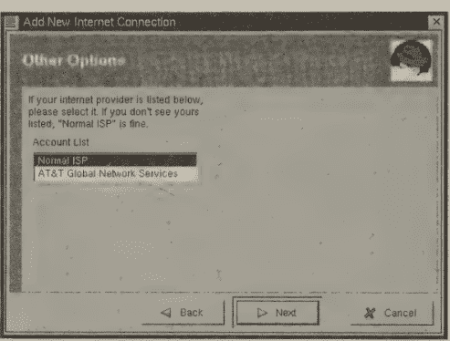

图 4-6

选择您的 ISP 类型。

> **注意** “专有”ISP 是那些使用其自己的通信协议的在线服务。它们通常还会在 Internet 访问之外提供自己的内容。这些服务包括 America Online、CompuServe、Prodigy 等。

9. 应用程序的最后一个屏幕如图 4-7 所示。它将显示之前屏幕中输入信息的简要摘要。如果正确，点击“完成”结束程序。

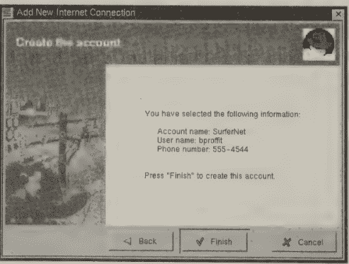

图 4-7

完成拨号连接工具过程。

“添加 Internet 连接”对话框将关闭，您将返回 Internet 连接窗口。您的新连接将出现在此屏幕上，如图 4-8 所示。

尽管拨号连接工具是创建连接的直观方法，但有时您可能需要连接有更多控制。例如，您的 ISP 可能要求您输入 DNS 信息。在这种情况下，您将需要再次使用拨号连接工具微调您的连接。

域名服务 (DNS)：Internet 内部的一类网络服务器，将域名转换为 IP 地址。所有 Internet 服务器都有唯一的 IP 地址，例如 `198.105.232.95`。由于这些比纯语言域名更难记忆，许多 ISP 在连接 Web 服务器时首先查询 DNS，将域名转换为相应的 IP 地址。

现在您将学习添加或确认您的调制调器端口。与硬盘类似，调制调器也挂载在 Linux 文件系统上。调制调器本质上是 Linux 交换数据的另一种设备。与其他 PC 设备一样，调制调器出现在 `/dev` 目录。表 4-1 列出了可用的调制调器端口及其 DOS 等效项。

别名：描述 Linux 中对象的术语。别名等同于 Windows 快捷方式。例如，PC 的唯一调制调器 `/dev/tty1` 可以有一个别名 `/dev/modem`。

以下步骤说明了如何使用拨号连接工具编辑连接。

> **注意** 执行这些步骤时，请确保已以 root 身份登录。

1. 点击主菜单图标打开主菜单。
2. 选择“系统”、“RH PPP 拨号器”。选择对话框将打开。
3. 点击“调制调器”选项卡。调制调器面板将出现在窗口中，如图 4-9 所示。

表 4-1 调制调器路径

| 路径 | DOS 等效项 |
| :--- | :--- |
| `/dev/tty0` | COM1 |
| `/dev/tty1` | COM2 |
| `/dev/tty2` | COM3 |
| `/dev/tty3` | COM4 |
| `/dev/modem` | 任何已配置调制调器的别名 |

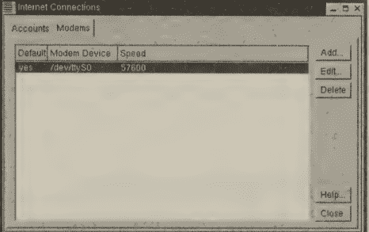

**图 4-9** 此面板列出了已配置的调制调器。

4. 点击“添加”开始配置新调制调器的过程。“编辑调制调器属性”对话框将打开（见图 4-10）。

> **提示** 为了节省时间，点击“自动配置”按钮让 Red Hat 为您获取正确的设置。

5. 修改需要更改的属性然后点击“确定”。设置将保存，“编辑调制调器属性”对话框将关闭。

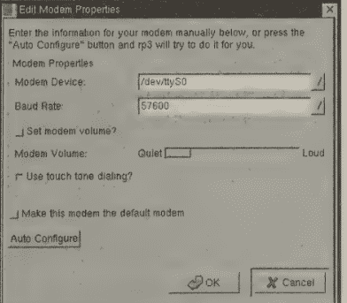

**图 4-10** 您可以从此对话框更改调制调器选项。

6. 点击“账户”选项卡。账户面板将出现。
7. 选择一个账户进行微调并点击“编辑”。编辑 Internet 连接”对话框将出现，如图 4-11 所示。
8. 点击“高级”选项卡。高级面板将出现（见图 4-12）。

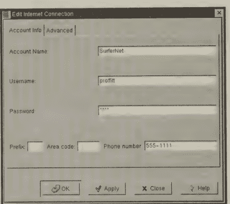

图 4-11

此对话框允许您修改连接设置。


图 4-12

微调您的连接。

9. 要输入 DNS 信息，在四个 DNS 服务器字段中的每个字段输入 IP 地址段。使用 Tab 键快速切换字段。
10. 将“最大空闲时间”设置为默认 600 秒以上以防止某些掉线。使用 1200 秒，这将为您提供 20 分钟的时间。
11. 点击“确定”。编辑 Internet 连接对话框将关闭。
12. 点击“关闭”。Internet 连接 对话框将关闭，您的新设置已保存。

## 连接 Internet

现在您已经建立了与 Internet 连接，是时候启动该连接并看看它能做什么了！

在 Linux PC 上连接 Internet 曾是巫术与科学的结合，就像现在预测大学足球排名第一的一样。现在不再如此。您连接 Internet 只需要 RH PPP 拨号器应用程序，简称为“RP3”。

在接下来的步骤中，您将看到如何在您的 PC 上访问 Internet，以及如何配置 RP3 以满足您的需求。

1. 点击主菜单图标打开主菜单。
2. 选择“系统”、“RH PPP 拨号器”。选择对话框将打开（见图 4-13）。


图 4-13

选择您想要启动的 PPP 连接。

> **提示** 如果您经常连接 Internet，可以考虑使用“配置桌面”中提到的方法为 RP3 添加一个图标。

3. 点击您想要使用的连接然后点击“确定”继续。更改状态对话框将出现（见图 4-14）。
4. 点击“是”。RP3 将开始拨号和登录过程，期间显示“等待”对话框（见图 4-15）。如果想停止连接，随时点击“取消”。
5. 连接后，主 RP3 窗口将出现。虽然看起来不多，但此窗口显示了大量信息，如图 4-16 所示。
6. 当您想断开 Internet 连接，只需点击 RP3 窗口中的“连接”按钮。状态对话框将再次出现，这次询问您是否要停止连接（见图 4-17）。

# 周六晚上 与与人和谐相处 157

## 图 4-17

确认停止您的互联网连接。


7. 点击“是”以确认此操作。所有的 RP3 窗口和对话框都将关闭。

我发现 RP3 的默认方法是在每次你想启动或停止互联网连接时都询问确认，这有点烦人。虽然这在防止意外注销互联网连接方面有用，但当你尝试连接时，它确实很困扰。

尽管 RP3 内部明显缺少界面，但有一种方法可以调整程序的一些设置。要这样做，在用于启动 RP3 菜单的应用程序窗口中点击右键。选择“属性”打开 RP3 属性对话框（见图 4-18）。

现在你可以关闭在 RP3 会话开始和结束时显示的确认消息，并根据每小时、每分钟或每秒的速率决定是否让应用程序监控连接的时间或成本。后一种选项在以下情况下特别有用：


## 图 4-18

配置您的 RP3 设置。

## 网络与 IP 地址

TCP/IP 是互联网的标准协议，世界上的大多数网络都使用此协议进行良好的通信。你的家庭或办公室网络也不例外。

首先，你应该知道，所有使用 TCP/IP 协议的计算机都有一个唯一的地址。同一网络上没有两台计算机共享相同的地址。用于为计算机分配地址的系统被称为点十地址（Dotted-Decimal Address），通常称为 IP 地址，或简称 IP。A 类、B 类和 C 类地址被用于特定的功能。

A 类地址通常用于环回通信和大型组织。通常 `127.nnn.nnn.nnn` IP 地址用于与同一计算机上其他应用程序和进程通信的应用程序和进程。

C 类地址最常用，特别是对于不属于大型组织的网络。这里讨论了大多数 C 类地址。它们是局域网（LAN）的一部分。局域网可以由任意数量的计算机（从 2 台到 254 台计算机，在网络术语中称为主机）组成。有三组分配给不属于互联网的局域网使用的 IP 地址。这三组是：

- `10.0.0.0` 到 `10.255.255.255`
- `172.16.0.0` 到 `172.16.255.255`
- `192.168.0.0` 到 `192.168.255.255`

这些地址块用于局域网，将不会被分配给互联网地址。由于它们没有连接到互联网，这些块中的任何一个都可以作为你私有网络的 IP 地址。可能最常用的块是 `192.168.nnn.nnn` 组。关于这些用于局域网的预留地址块的更多讨论可以在稍后找到。不过，首先要确认你正在使用互联网与世界进行通信。

首先假设你正在设置单台计算机，并想通过你组织的网络直接连接互联网，该网络有自己的互联网连接。本节将向你展示如何添加局域网，然后讨论第一台计算机正确连接后可能发生的其他复杂情况。当然，如果你有系统管理员可以打电话，他或她已经处理好了一切。如果没有，请继续阅读。

今天早上在安装 Red Hat Linux 7 时，安装程序询问了有关你网络的信息。具体来说，它询问了：

- **使用 DHCP 配置。** 网络上的 DHCP 服务器每次你的 PC 连接到网络时都会分配一个不同的未用 IP 地址。如果你的网络使用 DHCP，按下此按钮。
- **IP 地址。** 如果不使用 DHCP，这是你的计算机或主机的静态 IP 地址。
- **子网掩码。** 安装脚本尝试输入此内容；确保它是正确的。
- **网络。** 安装脚本也尝试输入此内容。
- **广播地址。** 安装脚本也尝试输入此内容。
- **主机名。** 这是你的 ISP 为你的计算机或主机分配的名字。
- **网关 IP。** 这是你的 ISP 分配给网关/路由的 IP 地址。
- **主 DNS。** 域名服务器，可能是也可能是你的网关 IP 地址。
- **备用 DNS。** 名称服务器；至少会分配一个。
- **三级 DNS。** 名称服务器。

## 160 Red Hat Linux 7 在周末内到达你的 Windows 桌面

如果在安装期间正确输入了上述条目，你应该能够使用 Netscape Navigator 或 Lynx 等网络浏览器连接互联网。如果你无法连接，请检查条目是否输入正确。

网络失败的最常见原因是网络配置信息错误。要查看初始配置中输入了哪些条目，请以 root 登录，然后进入终端窗口并输入 `Netconfig`。你就可以像在初始安装时一样重新输入你的整个网络信息。

网络配置器（Network Configurator）是你可以使用的另一个重新输入配置信息的工具。网络配置器非常易用和理解。你可以使用它来重新输入你的配置信息。可以通过以下方法启动网络配置器：

- 通过选择“程序”、“系统”中的“网络配置器”。
- 从控制面板启动。
- 在终端窗口中输入 `netcfg`。


**图 4-19**

控制面板是启动网络配置器的快速方法。

在网络配置器中，点击“主机”、“接口”和“路由”选项卡允许你检查你的网络配置（见图 4-20）。

如果你想修改“主机”选项卡中的任何信息（见图 4-21），首先点击要修改的行，然后点击“编辑”。例如，对于新添加的网卡。


**图 4-20**

主机选项卡。


**图 4-21**

主机选项卡。

## 162 Red Hat Linux 7 在周末内到达你的 Windows 桌面

接口选项卡（如图 4-22 所示）允许你检查网关设备（NIC）的设置。如果你认为你的网卡未激活，请检查“激活”区域。如果网卡已激活，它会在该标题下显示。如果没有，你可以将网卡设置为“激活”。

路由选项卡允许你设置网关 IP 地址和你的网卡，如图 4-23 所示。Red Hat 通常会将 `eth0` 作为你的


**图 4-22**

接口选项卡。


**图 4-23**

路由选项卡。

# 周六晚上 与与人和谐相处 163

网关设备。然而，你可以在这里更改或添加网关设备。验证“网络数据包转发”按钮已选中。

当你完成网络配置器时，点击“保存”。

将来某个时刻，你将想要一次性配置你 PC 的所有网络属性。幸运的是，有一个工具正是为此设计的：被称为 Linuxconf。Linuxconf 已成为 Red Hat Linux 中最流行的配置工具，用于对整个 Linux 安装进行设置。现在你将看到如何使用 Linuxconf 配置网络。如果你是第一次使用 Linuxconf，你会看到一些关于如何使用 Linuxconf 的初始信息。在初始对话框之后，你可以使用 Linuxconf 配置你的网络。

一旦打开 `linuxconf`，点击“客户端任务”、“基础主机信息”选项卡显示图 4-24 所示的屏幕。


**图 4-24**

在此屏幕可以验证并编辑主机名。

## 164 在周末内将 Red Hat Linux 7 配置到你的 Windows 桌面

检查主机名是否正确。点击“适配器 1”（Adapter 1）选项卡将打开一个与图 4-25 类似的屏幕。

注意基本网络信息很容易查看和更改。点击任何框并修改或输入所需的信息。

从 `eth0` 设备的存在可以看出，我正在使用 PCI 网卡。另请注意，没有输入 I/O 和 IRQ 地址信息。Red Hat 非常明地处理了 PCI 总线。如果你使用 PCI 卡，通常不需要在配置中输入这些参数。同样，适用于你网网的 `pnet32` 内核模块通常已经由 Linux 选好了。如有必要，你可以从下拉列表中选择你的网卡。

确保勾选了“已启用”（Enabled）复选框，并选择了你的 IP 地址选择方法。如果你有静态 IP 地址，请点击“手动”（Manual）。如果你使用动态 IP 地址（就像我的网络中那样），请点击“DHCP”。

图 4-25 你可以在这里找到你的网卡信息。


# 周六晚上：与其他设备良好共处

“帮助”（Help）按钮将让你获得有关你正在配置的框的信息。选择相关的选框，然后点击“帮助”。一个帮助窗口将打开，并提供关于该特定领域的见解（见图 4-26）。

要退出帮助屏幕，只需点击“杀死”（Kill）按钮。

在 `linuxconf` 应用程序中，当你对所做的选择满意时，点击“接受”（Accept）。

如果你点击 Linuxconf 侧侧的“名称服务器规范”（Name Server Specification）选项，它将打开一个允许你输入 DNS 地址的屏幕，如图 4-27 所示。

名为“解析器配置”（Resolver Configuration）的屏幕让你了解这些行在你的网络配置中的作用。这些参数使你的系统能够通过网络访问互联网。


点击 DNS 旁边的复选框以正常运行。关于“默认域”行的一个有趣事实是，如果你在下方几行处输入了“搜索域”，它将变为空。这完全正常；如果发生这种情况，意味着你的配置正在使用搜索域而不是默认域。


图 4-26

你可以针对 Linuxconf 中的任何字段获取特定的帮助。

## 在周末内将 Red Hat Linux 7 用于你的 Windows 桌面


图 4-27

在此处输入域名服务器信息。

名称服务器 1 通常是你的网关 IP 地址。如果你有额外的名称服务器 IP，将它们输入到名称服务器下方的框中。

1) 为你的电脑提供更多访问互联网的方法增加连接的速度和可靠性。这有助于平衡你 ISP 服务器和系统的负载。当你对输入的内容满意时，点击“接受”。然后关闭 `linuxconf`。在应用程序关闭时，系统会询问你激活所做的更改。

如果你在 `linuxconf` 中输入了正确的信息，你现在应该能够连接到互联网以及网络上的其他 TCP/IP 计算机。

既然你已经连接上，是时候向你展示如何在你的 PC 上安装其他类型的外设了，从所有外设中最常见的开始：打印机。

## 打印机

早期的计算机通信并不良好。第一台可以安全地被称为计算机的数字计算设备是哈佛 Mark I，这是一台拥有 75 万个组件的五音调设备，它从纸带上读取编程代码，从打孔卡读取数据。数据输出在类似的介质上。

多媒体当时也大不作为。唯一产生的声音是其组件内部的咔哒声，听起来有点像“满屋子的女士在织织”。这算不上多媒体。

对于你们中足够老、记得 1973 年发布的 Apple I 和 II 电脑的人来说，你会记得它们对多媒体也不太感冒。它们发出的声音只有细微的哔哔声和咔哒声。不过打印技术正在进步，因为针式打印机正在吐出一卷卷打孔纸。

今天，可以连接到 PC 的通信设备数量是惊人的。打印机、扬声器、电视调谐器、摄像头、报警系统……甚至还有汽车。

嗯，你可能会反驳我说汽车是 PC 的外设——但还要等多久这才不再是一个笑话？市售的 GPS 信号可以将你定位在距离真实位置约 50 码的范围内。（军事信号精确得多，所以这项技术比你想象的先进得多。）视频设备看到并处理数字输入的速度比我们想象的快得多，而且现在用于辅助驾驶员的信息的泛滥可以被轻松利用——将交通、天气和施工报告结合在一起，协助司机完成从 A 点到 B 点的路线。

在此期间，你可以关注更紧迫的问题，例如将你自己的外设通信设备连接到你的 Linux PC 上。

## 通过变通方法在周末添加并运行 Linux 7 到你的 Windows 桌面

例如，想想你可以在 PC 上制作一本书。现在你需要的只是良好的打字技巧和大约三箱墨水来设置。相信我，我懂。

这对你来说可能看起来没什么大，因为你可能习惯了 PC + 打印机的组合。但就在二十年前，你几乎没有机会找到能够完成此类壮举的软件和打印机。三十年前，你甚至连机会都没有。

再次，重大的意义仅仅是技术进步，对吧？诚然，这在社会动态方面也是一个巨大的转变。分发和发布信息的能力不再掌握在少数人手中。现在，几乎任何有意愿的人都可以生成出版物。这种去中心化是由互联网的本质实现的，它提供了更多的通信渠道。现在，作家可以生成作品并以电子方式发送，让它传出去。

与此同时，你可以关注更紧迫的问题，例如将你自己的外设通信设备连接到你的 Linux PC 上。

7. 弹出一个消息框，显示 Linux 能够检测到的端口（如果有）。虽然不是至关重要，但 Linux 能检测到端口是很重要的。点击 OK 继续。

8. 出现“编辑本地打印机条目”对话框（见图 4-32）。Linux 通常会自动检测活动打印机端口，并为你填完成“打印机设备”和其他剩余字段。然而，如果需要，请在“打印机设备”字段中输入 `/dev/lpX`，其中 X 是从 0 开始的设备编号。

9. 如需选择您的打印机设备，点击位于“输入过滤器”字段旁边的“选择”按钮。这将打开“配置过滤器”对话框（见图 4-33）。

10. 从“打印机类型”列表中选择您的打印机。

## 图 4-32

对话框中输入了许多设备参数。


## 图 4-33

在此处选择您的打印机过滤器。


## 在周末内为您的 Windows 桌面添加 Red Hat Linux 7

提示：如果您的打印机未出现在列表中，请尝试从 Red Hat FTP 站点获取最新版本的 Ghostscript，该站点列出了额外的过滤器。

11. 选择您想要使用的默认分辨率和纸张大小设置，以及任何可用的色彩深度设置（见图 4-34）。

提示：如果您未来有多种打印机可供购买，并且担心兼容性，我建议选择 PostScript 打印机。无论什么型号，PostScript 打印机的打印机语言都是一致的。

12. 点击 OK 完成过滤器设置。现在，“编辑本地打印机条目”对话框中的“输入过滤器”字段将显示所选的过滤器（见图 4-35）。

13. 点击 OK 继续。“打印系统管理器”现在列出了新打印机（见图 4-36）。


微调您的打印机设置。


一组完成的打印机参数。


一台已连接的打印机。

## 添加网络打印机

连接网络上的打印机也并不困难。Linux 可以配置使用三种类型的网络打印机：

- UNIX/Linux 打印机
- Windows 打印机
- Netware 打印机

配置这些打印机类型与配置本地打印机类似。然而，数据不是被指向本地文件系统中的设备目录，而是被定向到远程打印机的队列——即保持打印作业直到打印完成的存储区域。

表 4-2 所示了每种网络类型连接远程打印机所需的信息。

## 表 4-2 远程打印机设置

| 网络 | 协议 | 其他值 |
|---|---|---|
| UNIX/Linux | TCP/IP | 远程主机 远程队列 |
| Windows | TCP/IP | 打印机服务器主机、服务器 IP 号、打印机名称、用户、密码、工作组 |
| Netware | Netware | 打印机服务器名称、打印队列名称、用户、密码 |

在向网络打印机打印时，让网络识别 Linux 用户的用户名和密码非常重要。在 UNIX 或 Linux 场景下，这是肯定的；但您必须确保接入 Linux 用户具有访问网络打印队列的权限。

在 Netware 中，用户必须拥有访问网络打印机的权限。在 Windows 中，打印机本身必须先设置为“共享”，正如您在接下来的步骤中看到的：

> 注意：访问远程 Netware 或 Windows 打印机的用户名和密码必须与访问您 Linux PC 的用户名和密码不同。打印机密码在被 Netware nprint 或 Samba smclient 程序使用之前是以未加密形式存储的。请发挥创意！

提示：连接 Windows 打印机是一个常见场景，将需要使用 Samba，这是与 Windows 机器通信所需的工具。虽然 Samba 的配置超出了本书的范围，但在 `http://www.linuxnewbie.org/nhf/intel/network/samba1.html` 可以找到关于 Samba 配置的优秀教程。假设您的 Samba 设置配置正确，您连接 Windows 打印机应该不会遇到困难。

1. 点击主菜单图标打开主菜单。
2. 选择“程序”，“系统”，“控制面板”。控制面板将打开。
3. 点击打印机图标启动 Red Hat Linux 打印系统管理器。
4. 点击“添加”。随后出现“添加打印机”对话框。
5. 选择“SMB/Windows 95/NT 打印机”选项：然后点击 OK 继续。将出现一个警告框，强调关于密码的注意事项（见图 4-37）。


**图 4-37**

关于密码注意的警告框。

打印机密码是以未加密形式存储的...

## 配置声卡

1. 点击主菜单图标打开主菜单。
2. 选择“程序”，“系统”，“控制面板”。控制面板将打开。
3. 点击打印机图标启动 Red Hat Linux 打印系统管理器。


图 4-40

寻找你的声卡。

10. 按 Enter 继续。`sndconfig` 将通知你它现在将通过播放声音样本来测试声卡（见图 4-41）。
11. 按 Enter 继续。将播放一个示例声音。（如果你听到了样本，你就能从林纳斯·托瓦尔斯本人那里学会发音“Linux”的正确方法。）
12. 如果你听到了声音样本，按 Enter 接受选中的 Yes 按钮。然后你就可以继续执行第 19 步。
13. 如果你没有听到样本，按 Tab 键选择 No 按钮。然后按 Enter。将出现一条消息，显示自动配置失败。
14. 按 Enter 继续到手动配置过程。将显示“卡卡类型”窗口（见图 4-42）。
15. 滚动列表以选择你的卡。选中后：按 Tab 选择 OK，然后按 Enter 继续。下一个屏幕将允许你选择声卡的端口和 IRQ 设置（见图 4-43）。

## 在周末内将 Red Hat Linux 7 添加到你的 Windows 桌面


图 4-41

测试你的声卡并获得关于 Linux 大谜团之一的答案。


图 4-42

手动选择卡类型。

## 周六晚上 与其他设备良好共处


图 4-43

选择声卡的端口和 IRQ 设置。

```
root@localhost:lockdomain# 
File Edit Settings + Help
Sound Configuration Utility 0.50             (C) 1999 Red Hat Software
Card type: 
Please select your card:
At Sound Galaxy Wavblider Pro-32-80, Washington 16
CR8738 sound chip (many motherboards)
E-Tech PCH PCI Audio (1997)
Epson Deska SL Sound
Crystal Sound chip
Crystal Soundwave
Encapsulated 1997 (SoundBlaster 64/128 PCI)
creative/vix AudioPCI 16/1
<Tab> to navigate elements I <Enter> to edit a selection
```

> 提示：这应该是你昨晚获得的信息。然而，如果你不确定设置，请检查卡的文档。如果你的 PC 有 Windows 分区，你可能现在想开始此过程，启动到 Windows 分区，然后检查 Windows 为卡使用的设置。

16. 再次按 Tab 直到选中 OK，然后按 Enter 继续。
17. 声音样本屏幕再次出现。选择 OK 并按 Enter 继续。
18. 如果听到了样本，高亮 Yes 并按 Enter 退出 `sndconfig` 程序。
19. 注销此 X 会话并重新登录以激活这些更改。

## 将声音应用于事件

一旦配置好声卡，你就可以在事件发生时播放声音，例如打开或关闭应用程序时。此功能允许你进一步个性化你的 PC。

1. 点击 Gnome 面板上的 Gnome 配置工具图标。
2. 点击 Sound（声音）类别打开控制中心中的声音面板。
3. 点击 Sound Events（声音事件）标签。
4. 滚动事件列表，选择你想更改的项目。
5. 点击 Browse（浏览）打开选择声音文件对话框（见图 4-45）。
6. 选择要使用的声音文件名，然后点击 OK。你将返回控制中心。


图 4-44

在将声音应用于系统事件之前，你可以先浏览它们。

7. 点击 Play（播放）以听声音样本。如果你喜欢该样本，点击 OK 保存配置并关闭控制中心。

> 提示：不要给你的事件应用声音得太疯狂。你会发现每次选择菜单都听到荷默·辛普森说“Doh！”是多么令人疲惫。

## 使用 ISAPNPTOOLS 工具实现即插即用

如果你有一台较新的 PC，那么你的主板上很可能有一个 PCI 总线。PCI 总线对 Linux 用户很好，因为即插即用技术内置在总线本身。因此，连接到 PCI 总线的任何设备都可能被 Red Hat Linux 检测到。

然而，旧的 PC 拥有 ISA 总线，Red Hat Linux 需要一点帮助。Linux 必须更直接地探测 ISA 设备以确定其是否即插即用。

## 在周末内将 Red Hat Linux 7 添加到你的 Windows 桌面

**即插即用 (PnP)：** 扩展卡和外围设备自动配置的能力。

**PCI 总线（外围组件互连）：** 由 Intel 公司开发的本地总线。PCI 是 64 位总线，尽管通常实现为 32 位总线。

**ISA 总线（工业标准架构）：** IBM PC/XT 和 PC/AT 中使用的总线架构。今天大多数计算机都包含了用于慢设备的 ISA 总线和用于需要更好设备的 PCI 总线。

如果你的 PC 有 Linux 识别的 ISA 设备，你可以使用 isapnptools 工具集帮助配置设备。

## 执行 PnP Dump

你需要做的第一件事是对 PC 上所有现有 ISA PnP 卡进行扫描。这是通过 `pnpdump` 完成的。


> **提示** 这应该是你昨晚获得的信息。然而，如果你不确定设置，请检查卡的文档。如果你的 PC 有 Windows 分区，你可能现在想开始此过程，启动到 Windows 分区，然后检查 Windows 为卡使用的设置。

- 16. 再次按 `Tab` 直到选中 `OK`，然后按 `Enter` 继续。
- 17. 声音样本屏幕再次出现。选择 `OK` 并按 `Enter` 继续。
- 18. 如果听到了样本，高亮 `Yes` 并按 `Enter` 退出 `sndconfig` 程序。
- 19. 注销此 X 会话并重新登录以激活这些更改。

## 总结

今晚的章节引导你深入探索了如何配置系统通过拨号或网络连接互联网。

你还学习了将外围设备连接到计算机的精要之处。随着 Linux 的不断增长，会有越来越多的设备被纳入世界。理想情况下，这将使配置方法变得更加简单。在一天到来之前，我只能强调在处理这些问题时要耐心细心。

今晚到此结束。明天早上将从如何安装额外的软件，以及安装硬件的其他技术开始。

## 早上好！

欢迎来到周日早上。如果这是你通常在睡觉的时间，不要担心。今天早上的章节将是轻松的。

是时候聊聊你可以做什么来增加你的 PC 系统了。Linux 和其他任何操作系统一样，并没有预装你想象到的每一个应用程序（尽管它比其他系统做得更好）。所以，现在是学习向你的新 Linux 系统添加软件了。

- 学习如何使用 RPM 包安装软件
- 使用归档设置文件安装软件
- 为系统添加硬件
- 帮助 Linux 自动检测新硬件

在你掌握了这些技能后，你将能够随时你的 Linux 系统添加新的应用程序和外围设备。

## 安装软件软件包

关于 Red Hat Linux（以及通常而言）听到的最大抱怨之一就是它显然缺乏软件应用程序。一个不能运行任何有用程序的操作系统又有什么用呢？

首先，事实根本并非如此。正如经验丰富的 Linux 用户所知，有成千上万的应用程序运行在 Linux 上。误解在于，这些应用程序中的许多要么执行的任务非常特殊，要么被设计为完全在命令行的后台运行。无论哪种情况，这都变成了一个“眼不见为净”的问题。对于一个没有经验的观察者来说，除非他们能看到并操作该程序，否则 Linux 应用程序不会被认为是“真实”的。这种新手心态让长期的 Linux 用户感到愤怒——而且完全合理，因为有成千上万个完美的应用程序为 Linux 平台准备就绪。

在 Red Hat Linux 上安装这些众多应用程序之一时，有三种方法可以完成任务：使用软件包、使用原始源代码或使用第三方安装程序。今天上午将检查这三种方法。

## 了解封装

没有什么比打开一个新软件包更让人兴奋了。（好吧，也许有几件事更兴奋。）但你必须承认，打开那个纸箱，翻遍那些泡沫塑料，找到你一直想要的那个特殊物品，这种感觉确实很酷。

软件包是移动物体的绝佳方式。它们将物品组合在一起，并保护物品免受自然风雨和邮政工作人员的影响。软件包的想法也可以用于电子领域。你们中的许多人已经使用过压缩文件，例如 `Zip`、`gzip` 或 `tar`。

这些压缩文件本质上是单独文件的软件包，它们被全部压成一个紧凑的文件，就像那些颗粒一样。

Red Hat 开发了一种方法，将 Linux 及其应用程序的源代码封装成软件包。这种方法证明非常受欢迎，许多其他 Linux 发行版也将其整合到自己的工具中。这种方法使用 `RPM`（Red Hat 软件包管理器）在应用程序安装期间跟踪软件包及其内容。

RPM 有许多形式。在 Linux 中，它简单称为 `RPM`；在 Gnome 中，它是 `GnoRPM`；在 KDE 中，它被称为 `Kpackage`。无论形式如何，应用程序遵循的程序始终是相同的：Linux 检查软件包，`RPM` 确定运行应用程序所需的所有文件是否包含在软件包内或在你的 Linux 系统的其他地方。此过程被称为依赖检查，它是 `RPM` 的强大功能之一。

普通的应用程序需要大量代码来运行，特别是在图形环境中。如果所有必要的代码都包含在每个应用程序中，可执行文件将是巨大的。为了规避这一点，程序员经常利用代码库，代码库本质上是所有应用程序都必需或有用的冗余代码段。既然代码库已经有了适当的信息，为什么还要专门写一段代码来创建对话框呢？作为一名程序员，现在你所做的就是在你的程序中创建一个命令，引用正确代码库中的必要代码。这样，你的应用程序就会更小、运行速度更快且更易于安装。

这一切的陷阱在于，用户的 PC 必须存在正确类型和版本的代码库以供应用程序使用。这正是 `RPM` 发挥用用场的地方。`RPM` 检查封装好的应用程序，并确定该程序运行需要哪些代码库（或其他任何辅助程序）。妙就的地方是，`RPM` 会查看你 PC 上的所有软件包。如果缺少某些内容，它会告诉你为了成功安装仍然需要什么。

最后，在清理依赖关系后， `RPM` 将允许你安装新应用程序或升级现有的应用程序。接下来的两个章节将检查使用 `RPM` 的两种方法。

## 安装新的桌面环境

在周六下午，你看到了在 Gnome 和 KDE 桌面环境之间切换是多么简单。然而，在安装 Red Hat 时，你可以选择两种环境。为了这个示例，假设你只安装了 Gnome，而现在你想尝试 KDE。以下是你可以操作的方法。

> **注意** 安装一个环境通常需要多个软件包。如果你学会了如何这样做，那么单软件包应用程序的安装将是轻而易举。

1. 点击主菜单图标打开主菜单。
2. 选择 **程序**、**系统**、**GnoRPM**。Gnome RPM 窗口将打开（见图 5-1）。


图 5-1 安装从 Gnome RPM 开始。

3. 点击 **安装** 按钮。安装对话框将打开，并开始扫描 Red Hat Linux CD 光光以寻找可用的 RPM 软件包（见图 5-2）。
4. 要在你的 Gnome 工作站上安装 KDE，首先展开“系统”类别，然后展开“库”子类别。
5. 选择 `kdelibs` 和 `kdesupport` 软件包。选中的软件包用复选标记指示，如图 5-3 所示。
6. 展开“用户界面”类别，然后展开“桌面”子类别。


图 5-2 选择你想安装的应用。


图 5-3 选择要安装的软件包。

## Red Hat Linux 到你的桌面

7. 选择 `kdebase` 和 `kdesktop` 软件包。

> **提示** 如果你的显示器不显示颜色，务必也选择 `kdebase`。

8. 展开 **娱乐** 类别然后展开 **游戏** 子类别。
9. 选择 `degames` 软件包。
10. 点击 **安装** 开始安装过程。一个对话框将显示安装进度（见图 5-4）。

> **注意** 如果在安装像 KDE 桌面环境这样的软件包集时缺少某些内容，将弹出一个提示你还需要什么的框。只需选择所需的软件包并再次点击 **安装**。

11. 完成后，点击 **关闭**。
12. 点击图标关闭 Gnome。

## 使用 Update Agent

修复故障和改进功能的需求是人类历史上的巨大动力，软件工程也不例外。由于我们生活在一个熵和混乱的宇宙中，那个红框中的软件存在某些缺陷并不意外。这从根本上说是自然法则。


图 5-4

## 添加到 Linux 系统

为了应对这些缺陷并改进功能，Red Hat 在发布 Linux 时提供了一个强大的工具 `Update Agent`。

`Update Agent` 是一个监控你已安装应用程序并检查 Red Hat FTP 站点是否有可用新版本的程序。如果发现新版本，代理将向你展示一个基于网络的列表，你可以从中选择想要更新的应用程序。然后 `Update Agent` 将协调软件包的下载。

步骤概述如下：

1. 点击主菜单图标打开主菜单。
2. 选择 **程序**、**系统**、**Update Agent**。Red Update Agent 窗口将打开（见图 5-5）。

> **注意** 在使用 `Update Agent` 时，请确保你已经连接网络并在 `http://www.redhat.com/now` 向 Red Hat 注册了你的产品。

3. 第一次使用 `Update Agent` 时，点击 **配置** - **配置** - Up2Date 对话框将出现（图 5-6）。


图 5-5

Red Update Agent 准备就绪。

## 在周末内为您的 Windows 桌面添加 Red Hat Linux 7


图 5-6

在配置对话框的第一个面板中输入用户信息

4. 输入您最初在 Red Hat 注册 Linux 软件时使用的名称。您还需要提供来自 Red Hat 文档中的个人产品 ID 卡（Personal Product ID）注册密钥。
5. 在“新增”（Add New）字段中输入至少一个电子邮件地址并点击“添加”（Add）。如果适用，您可以输入额外的电子邮件地址。
6. 完成后，点击“检索”（Retrieval）选项卡打开其面板，如图 5-7 所示。
7. 验证软件包服务器（Package Server）设置为 `priority.redhat.com`。

> **提示** 为了保持对升级过程的控制，请务必选择“检索软件包但不安装（Retrieve Packages, But Do Not Install）”。

8. 选择 Red Hat Linux 7 作为覆盖版本。保留默认的软件包存储目录不变，但请记下该路径以备后用。


## 图 5-7

您必须指定更新代理（Update Agent）定位软件包的位置。

9. 点击“异常”（Exceptions）选项卡打开其面板，如图 5-8 所示。
10. 异常面板允许您跳过已公告的软件包和文件。要跳过额外的软件包或文件，点击“添加”（Add）。


## 图 5-8

您可以选择跳过下载某些类型的软件包。

## 在周末内为您的 Windows 桌面添加 Red Hat Linux 7

> **警告** 不建议您允许更新代理下载并安装内核升级，您应该确保在“跳过软件包”（Skip Packages）部分中存在内核异常。

11. 完成后，点击 `OK`。更新代理现在已配置供以后使用。
12. 点击“连接”（Connect）。更新代理将轮询优先级 FTP 站点以确定是否有所需的更新。
13. 如果为异常面板中包含的项找到任何软件包，这些软件包的列表将出现在警告对话框中（见图 5-9）。点击 `OK` 继续。
14. 更新代理将处理并显示一个详细说明可用软件包的网页。您可以选择特定的软件包，然后点击“请求所选软件包”（Request Selected Packages）。或者，您可以直接点击“请求所有软件包”（Request ALL Packages）。
15. 下载过程将开始，如图 5-10 所示。红色箭头表示已成功下载的软件包。下载完成后，点击“退出”（Quit）。


图 5-9

将列出软件包异常。


图 5-10 下载所选软件包。

现在更新后的软件包已位于您的本地 PC 上，您可以使用 `GnoRPM` 安装它们，详见上一节。步骤中的唯一区别是，您现在需要在“安装”（Install）对话框中通过点击“添加”（Add）在您的 PC 上定位软件包。一旦选择了软件包，您将需要选择“升级”（Upgrade）而不是“安装”（Install）。

## 使用 Setup 安装软件

随着越来越多的应用程序为 Linux 构建，应用程序的大小和复杂性将会增加。随着这种情况发生，开发者将开始使用整个设置程序来安装程序。Windows 用户熟悉这类设置程序——几乎每个应用程序都会某种类型的安装程序。

在 Linux 中使用类似的安装程序同样简单。以下步骤演示了如何在 Red Hat Linux 上安装 StarOffice，这是一个强大且免费的办公套件。

## 在周末内为您的 Windows 桌面添加 Red Hat Linux 7

> **注意** 您可以从 `www.sun.com/staroffice` 下载 StarOffice 安装文件。按照网站上的说明免费获取该文件。

1. 在您的 Gnome 或 KDE 桌面面上打开终端窗口，并导航到保存安装文件的目录。
2. 输入 `./so-5_2_ga-bin-linux-en.bin`。这将启动安装程序，如图 5-11 所示。


图 5-11

StarOffice 安装程序。

# 周日早上添加到您的 Linux 系统

3. 第一个对话框欢迎您并告诉您如何退出程序。点击“下一步”（Next）继续。
4. 在第二个对话框中（见图 5-12），您会看到“重要信息”（Important Information）对话框，它本质上显示的是 README 文件。阅读内容并点击“下一步”继续。
5. 下一个对话框向您展示 Sun 许可协议（见图 5-13）。仔细阅读它，如果您同意其条款，请点击“接受”（Accept）。
6. 在第四个屏幕，输入您的个人数据并点击“下一步”。

| 重要信息 |
| :--- |
| 下文包含用于策略拦截器标准使用的额外信息的文本。 |
| 首次用户 |
| 高级用户 |
| 此部分包含关于产品的重要信息。在开始工作之前请仔细阅读这些信息。 |
| 不适用- |
| 如果您使用首次向导，将要求您定义以下。某些设置在您启动向导之前可能已经定义。 |
| 上一步 (Back) | 下一步 (Next) | 取消 (Cancel) |


| 软件协议 |
| :--- |
| 本档包含以下软件的条款： |
| Microsystems, Inc |
| 二进制代码协议 |
| 阅读这些条款即表示您同意这些条款：软件按“现状”提供。软件不提供任何明示或暗示的保证，包括对适用性和特定用途的保证。在任何情况下，作者对因使用或无法使用软件而产生的任何直接、特殊、间接或后果性损害不负责。如果您对这些条款有任何疑问，请联系作者。 | 如果不同意许可协议，请点击接受或取消。 |
| 上一步 (Back) | 接受 (Accept) | 取消 (Cancel) |


## 在周末内为您的 Windows 桌面添加 Red Hat Linux 7

7. 选择您想要的安装类型，如图 5-14 所示。现在选择“标准”（Standard）并点击“下一步”继续。不用担心，您可以以后回来自定义设置。
8. 选择您要安装 StarOffice 的目录（见图 5-15）。建议目录通常是安全的。点击“下一步”继续。
9. 当询问是否创建输入的目录名称时，点击“是”（Yes）。

图 5-14

在标准、自定义或最小安装之间选择。


图 5-15

选择安装目录。


10. 您已到达安装旅程的这一部分（见图 5-16）。点击“完成”（Complete），然后静静等待安装完成。

> **提示** 如果设置程序在您的 PC 上找不到 Java 环境，它会询问您希望 StarOffice 使用任何 Java 环境。如果您不计划将 StarOffice 浏览器作为您的主浏览器——我不建议这样做——就没有问题。Netscape 或任何其他浏览器包含自己的 Java 功能：只需点击“不支持 Java 或 JavaScript”，然后点击 `OK` 继续。StarOffice 现在继续安装，如图 5-17 所示。

11. 在安装过程结束时，会弹出一个消息框，指示 StarOffice 已添加到 KDE——面板（即使 KDE 不是您的默认桌面环境！）。它还建议您重启 KDE 以完成该环境的安装。点击 `OK` 继续。
12. 在过程的最最后，会出现“安装完成”对话框。点击“完成”结束设置程序。

图 5-16

您已经提供了 StarOffice 所需的所有信息。点击“完成”，让它工作吧。


## 在周末内为你的 Windows 桌面添加 Red Hat Linux 7


## 图 5-17

完整的自动化安装过程，带有广告。

当你想要在 KDE 中启动 StarOffice 时，可以在应用程序启动器（Application Starter）中找到它。在 Gnome 中，启动 StarOffice 最快的方法是在 Gnome 窗口或面板创建一个新的启动器（Launcher），就像你在周六下午学会的那样。

现在你已经知道如何安装额外的软件了，让我们谈谈如何给 PC 添加新硬件。

# 添加新硬件和外围设备

昨晚，我们在初始 Linux 配置过程早期处理了一些关键的硬件问题。毕竟，你通常需要立即让打印机、声卡以及任何即插即用设备工作。

# 周日早晨向你的 Linux 系统添加内容

今天上午，我们将进一步深入探讨硬件领域，并检查为了确保任何硬件安装成功需要采取的步骤。


向系统添加新硬件分为两个阶段：硬件阶段和软件阶段。你需要将硬件设备添加到系统中，并告诉你的操作系统如何管理它。硬件阶段取决于机器，而软件阶段取决于操作系统。假设你正在一台 PC 上工作，无论其品牌是什么（AT, ATX, IBM, Compaq 等），安装新硬件都是非常简单的，而且无论你使用的是 Linux 还是其他操作系统都是一样的。PC 系统的接口设计使得任何设备都可以通过标准且有文档记录的方法访问，然后任何操作系统都可以处理它。（我们稍后会讨论这一规则的几个例外情况。）

在上午的剩余时间里，我们将讨论这两个阶段。我将重点介绍第二个阶段，因为它可能是最令人让人困惑的。你过去可能安装过打印机或声卡等新设备，但你可能并不熟悉 Linux 处理它们的方式。首先，你将看到各种类型的设备（包括内部和外部设备），并看到关于哪些设备可以安全安装、哪些设备除非你是计算机专家否则不要触碰的警告。接下来，你将探索软件阶段。Linux 内核会检测并配置硬件设备。最后，你将学习各种配置文件以及如何更改新设备的参数。

与你周五晚上在安装 Red Hat Linux 之前采取的步骤类似，在开始任何硬件安装之前，你应该检查硬件兼容性列表，查看你的设备是否与 Linux 兼容。理论上，任何符合 PC 技术标准的设备都应该可以工作。然而，近年来，许多公司开始制造缺少几个重要芯片的设备，然后使用专有驱动程序来实现功能。虽然这种策略降低了公众购买设备的成本，但也导致了两个巨大的副作用。驱动程序仅针对 Windows 95/98 发布，由于硬件设备没有特殊的 Windows 驱动程序无法工作，因此它与 Linux 或 Windows 外的任何操作系统都不兼容。其次，驱动程序需要承担更多工作，这意味着你的 CPU 将忙于执行芯片应该负责的工作。因此，你的系统即使在 Windows 中也会感觉慢得多。令人遗憾的是，这些大多数组件（通常被称为 winmodems 和 winprinters）在包装上并没有被标识为此类设备。联系制造商通常是你能够确定此问题的唯一方法。

# 添加新设备

在本节中，你将看到可以添加到个人计算机的不同类型的设备，以及它们之间的区别。表 5-1 列出了一些常见的硬件设备及其规格，这可能帮助你对其进行配置。

| 表格 5-1 常见硬件设备 | 设备 | 内部/外部 | 插头类型 | 自动检测？ |
|---|---|---|---|---|
| 调制解调器 | 外部 | COM 端口 (`/dev/ttyS0`) | 否，容易设置 |
| 调制解调器 | 内部 | ISA 或 PCI | 否，需要配置 |
| 显示器 | 外部 | VGA 端口 | 是 |
| 显卡 | 内部 | PCI 或 AGP | 文本模式：是；GUI模式：否 |
| 内存 (RAM) | 内部 | 插槽 | 是 |
| 声卡 | 内部 | ISA 或 PCI | 否，需要配置 |
| 鼠标 | 外部 | COM 端口 (`/dev/ttyS0`) | 标准型号：是 |

# 添加外部设备

外部设备最容易添加，因为你只需要将它们插入。此外，由于没有关键系统部分位于机箱之外，你没有损坏机器的风险。即使你是计算机新手，也可以安装外部设备。例如，要添加打印机，只需将打印机线同时连接到打印机和电脑背部，然后插上电源。

外部设备有很多。大多数给电脑添加组件的人都会添加外部设备，因为此类设备插拔简单，而且在今天的计算机市场上非常丰富。你的系统背面的每个端口都有特定的设备，由于它们具有不同的插座尺寸，你真的无法将错误的设备连接到错误的端口。例如，标准的并行打印机端口是带有 25 个孔的母头，而鼠标或调制解调器串口端口是包含 9 或 25 个引脚的公头。你已经知道如何将打印机连接到你的机器了。任何其他外部设备（键盘、显示器、以太网、Zip 驱动器）都很简单。

虽然在通电时连接设备可能不会损坏系统，但通常建议关闭电源。这将允许三件事发生：系统 BIOS 将会在重启时尝试检测设备；内核自动检测过程将检测到它；以及设备将受益于全新的启动。请注意，这不适用于热插拔设备，例如 RAID 数组或机架式服务器，但大多数桌面系统不使用这些。

## 在周末内为你的 Windows 桌面添加 Red Hat Linux 7

# 添加内部设备

内部设备的安装更为困难，因为它们要求你在机箱内部操作。坦率地说，很少有设备还需要这种方式添加。随着通用串行线（USB）等外部设备的出现，几乎不需要频繁打开机箱了。最常见的内部设备是声卡、网卡和硬盘。在大多数系统中，你还可以添加内存、更换主板，甚至升级 CPU，尽管我不建议这样做，除非你确切知道自己在做什么。在更换 CPU 和内存时，有许多因素需要考虑，如速度、时钟倍频和内存时序。当地电脑商店会乐意为你安装所需的任何内部设备。本节将简要向你展示如何自己添加这三个最常见的内部设备。

首先，为了你的安全，你必须关闭电脑的电源。在处理内部设备时，此警告尤为重要，因为如果你在电源开启的情况下尝试安装硬件，可能会烧毁主板或 CPU。一旦你拆掉了系统箱的螺丝，就可以在空槽中添加设备。如果你想添加带有标准卡的设备，只需将其插入系统内其他卡旁。PCI 总线上的任何插槽（白色插槽）都适用于 PCI 卡，ISA 总线上的任何插槽（黑色插槽）适用于 ISA 卡，显卡可以放入最近引入的 AGP 插槽（灰色插槽）。区分这三种插槽很容易，因为每个插槽的尺寸和颜色都不同。就像方形销钉无法插入圆孔一样，你不会意外地将一种类型的卡插入另一种类型的插槽中。

硬盘通常添加在系统的前端，与现有的硬盘和 CD-ROM 驱动器一起。在安置硬盘后，你必须连接电源线和信号带。信号带将硬盘连接到其控制卡。（如果使用的是 SCSI 硬盘，则 SCSI 控制器位于你的主板上或插槽卡上。请务必参考你设备的设备说明书以获取正确的安装程序。

# 周日早晨 扩展你的 Linux 系统 209

## 内核启动过程

恢复电源后，会执行某些程序代码以检测和配置设备。

PC 启动时执行的第一段代码是引导代码（bootstrap code）。这是一个位于计算机内部 ROM（静态内存）中的小型程序。该代码会检查内部系统部分，查看是否检测到任何严重故障（例如内存损坏）。随后控制权将交给 BIOS。当系统启动时，你可以看到内存测试，一直持续到你系统中 RAM 的容量。BIOS 是计算机输入/输出（I/O）子系统的核心。它的工作是在启动时检测系统组件，并与操作系统协作处理设备调用。在显卡名称之后、Linux 启动之前出现在显示器上的代码是 BIOS 的一部分。你可能会看到硬盘列表，然后是一个关于你主系统组件的信息屏幕。BIOS 负责首先检测你的硬盘，确定哪一个包含你要启动的内核，并可选地配置任何即插即用设备。

在 BIOS 完成各种功能后，它会将控制权传递给可启动硬盘的第一个扇区（称为 MBR [主引导记录]）。在旧版本的 MS DOS 或 Windows 中，MBR 被用于包含 DOS-MBR。在 Red Hat Linux 中，它现在包含 LILO，即 Linux 引导加载程序，它只需告诉处理器加载你的 Linux 内核。

> 注意：LILO 实际上可以做很多事情，例如设置密码、加载多个操作系统、为 Linux 设置几何信息。为了今天早上章节的目的，我们将假设只加载内核。你可以在 Linux 系统中通过输入 `lilo` 来找到更多关于 LILO 的信息。

## 周末内让 Red Hat Linux 7 进入你的 Windows桌面

当 BIOS 和 UEFI 完成执行后，更复杂的部分开始了。Linux 内核将接管检测、配置和管理所有内部和外部设备。它通过复杂的数据结构、设备驱动程序和内核进程来实现。在不涉及过多细节的情况下，以下段落描述了内核启动程序以及你如何在此过程中纠正问题。

在看到第一个 Linux 提示符之前出现在屏幕上的所有文本，都解释了内核和各种设备驱动程序发现了什么。理解这些文本对你来说很重要，这样你就可以排查任何硬件问题。图 5-18 显示了一个可能的示例。

你看到的第一行报告了内核版本以及构建它的计算机版本。除非你想重新编译内核，否则知道这些信息并不重要。接下来，会显示你的 CPU 速度。内核在启动时检测速度。它应该接近你所知的 CPU 速度。例如，系统上的 CPU 可能是 333MHz 的奔腾 II。内核检测到的速度为 334MHz，非常接近。

```
sda1 hda1 hda2 hda3
RAID_INFO: Compressed image found at block 0
detecting RAID arrays
-rebuild: DONE
-FS: New fs root /dev/sda1 (filesystem)
detecting RAID arrays
-allocation
-rebuild: DONE
-FS: Mounted root /dev/sda1 (filesystem) readonly.
change root: root root has count=1
type=ext3
extending kernel memory: 64MB read
ext3-version: 2.2.7
Welcome to Red Hat Linux
Press [1] to enter interactive startup
Checking clock: The Nov 4 20:27:24 EST 1999
Mounting root partitions
-mounting /dev/sda1 on localdomain
Checking root filesystem
device/blocks: 34000/258000 files, 138000/558968 blocks
root filesystem in read-write mode
```

启动过程可以告诉你任何天线问题。

控制台行只告诉你是当前使用的显示字体。你可以设置 Linux 控制台显示任何其他字体，但默认值是标准的固定 VGA 80 列 25 行。你应该忽略关于 BogoMIPS 的那行。它通常与你的 CPU 速度不同，这非常正常。

有一行非常重要的，是内存行。在这里，内核正在报告它在你的系统中检测到多少 RAM。这是内核可能会出错的地方，特别是当你有超过 128MB（兆字节）内存，或者你使用的是老旧系统时。发生这种情况的详细原因并不重要，但很容易修复。例如，如果你看到一个数字接近 16,000K，而你确实有 24MB 的 RAM，你需要修正 `lilo.conf` 文件。

所以，延续示例，如果 Red Hat Linux 检测到 16MB 而你知道你有 24MB，请在 `lilo.conf` 文件中添加以下行：

```
append = "mem=24M"
```

接下来的行显示了关于你 CPU 的信息。当内核完成主硬件设置后，它会将控制权交给设备驱动程序。设备驱动程序是用于设置和控制特定设备的小部分代码。例如，为了处理 Sound Blaster，内核需要一个驱动程序。大多数驱动程序被编译进内核，但其他一些是可以根据需要加载的独立模块。

## 什么是自动检测？

## 在周末内为你的 Windows 桌面添加 Red Hat Linux 7

不仅适用于 Windows 98，还适用于 Linux 的驱动。这样做将为用户提供极大帮助，从而解决不支持的硬件上存在的许多问题。

今天下午，你将查看 Linux 随带的一些应用程序；特别是 Netscape Communicator（网景通讯者）。你还将探索你今天早上安装的程序：适用于 Linux 的 StarOffice 5.2。完成后，你将开始使用 Linux，而不是仅仅是配置它。


# 周日下午

使用一些流行的 Linux 应用程序

- 使用 X 窗口字体
- 使用 Netscape Communicator
- 使用 Linux 版 StarOffices

现在已经是周日下午了，在经历了这一切配置和自定义之后，你可能在想：红帽 Linux 到底有什么用？

它确实很有用。当你听到人们将 Linux 与 Windows 进行比较时，你会听到的主要抱怨之一就是可用 Linux 应用程序的匮乏。目前，Windows 有超过 100,000 个可用应用程序。虽然 Linux 应用程序并没有那么多，但可用程序的数量比许多人想象的要多得多。

今天下午，你将：

- 探索红帽 Linux 7 封装的某些基本工具
- 检查并配置 Netscape Communicator 以浏览互联网、读取电子邮件和阅读新闻组消息
- 查看适用于 Linux 的 StarOffice 5.2 应用程序，看看它将如何免费地为你提供办公套件功能

# 使用 X 窗口工具

由于 Linux 应用程序通常不进行商业广告，因此它们不像 Windows 对应程序那样是家喻户晓。Word、WordPerfect、AmiPro——大多数人人都听过这些应用程序。你听过 StarWriter 吗？寥不多。那些知道它是一个非常强大的文字处理器的人知道，顺便说一下，它与段中提到的前三个文字处理软件包兼容。你将在今天下午晚些时候查看 StarWriter，到时你将亲眼见到它。

GIMP 是另一个典型的例子，它的功能与它的 Windows 对应程序 Adobe Photoshop 一样丰富。像它的大多数 Linux 兄弟软件一样，GIMP 不在公众的视野范围内，因此它通常被视为不存在——至少是目前如此。

本章的接下来四节将简要检查红帽通过其 Linux 版本提供的工具和应用程序。

# 编辑器

X 内部有三个可以用于修改简单文本文件的文本编辑器。两个在桌面环境中运行，第三个是老牌 UNIX 最爱，是一个命令行应用程序。

VIM 在 UNIX 和 Linux 社区中广为人知，它是旧版 vi 的改进版本。你不能从菜单启动 vi（除非你为它创建了这样的菜单项）：相反，你必须从命令行运行 vi。

在终端模拟器或 Linux 命令行中，输入 `vi` 即可启动 VIM 编辑器。如图 6-1 所示，基本命令显示在启动屏幕上。

VIM 的一个良好用途是手动编辑配置文件。要在 VIM 中打开文件，只需在命令行上输入 `vi filename` 即可。

## 注意

在编辑任何配置文件之前，请确保保存一个备份副本，以便在出错时可以恢复。

要退出 VIM，只需输入 `:q`。VIM 将关闭并带你回到命令行。

# 周日下午 使用一些流行的 Linux 应用程序


图 6-1

VIM 编辑器。

用于文本编辑的两个 X 应用程序是 gEdit 和 gnotepad+，都在图 6-2 中所示。


图 6-2

gEdit 和 gnotepad+ 编辑器。

从插图中可以看出，这些应用程序的功能是类似的，尽管 gnotepad+ 具有额外的工具使其能够创建 HTML 格式命令。这是很合理的，因为 HTML 文件仅仅是包含文本代码的文件，这些代码允许浏览器显示如字体颜色和大小变化等增强效果。

表 6-1 列出了红帽 7 中可用的其他编辑器，以及它们是否作为默认包的一部分被安装。

| 表 6-1 额外的可用编辑器 | 应用程序 | 说明 | 是否安装 |
| :--- | :--- | :--- | :--- |
| abiword | 功能齐全的文字处理器 | 否 |
| emacs | 另一个非常流行的 Linux 命令行文本编辑器 | 是 |

# 图形

随着互联网面向大众，对能够轻松处理图形的应用程序的需求大大增长。Linux 在这方面也没有让人失望，为用户提供了三个查看和编辑图形文件的工具。

这些工具中的第一个是 Electric Eyes。尽管名字很奇怪，Electric Eyes 是一个优秀、简单的图形查看器。启动程序后，在应用程序的任何地方右键点击打开其菜单。与大多数程序类似，可以使用文件菜单打开文件。

如果你认为 Electric Eyes 的名字很奇怪，那么 GIMP（图像处理程序的缩写）与 Adobe Photoshop 相比是一个免费应用。它有许多功能，如图 6-3 所示。

# 周日下午 使用一些流行的 Linux 应用程序


图 6-3

查看图形

Electric Eyes。

GIMP 的界面有点奇怪，因为它没有立即显示“画布”。安装完成后，将出现对话框告知你 GIMP 的界面，如图 6-4 所示。有关更多信息，我强烈建议你阅览 GIMP 手册。

最后，Xpoint 是一个让你创建自己的图片的应用程序，而不只是查看它们。在菜单中，Xpoint 可以以各种格式保存它们，如图 6-5 所示。


图 6-4

奇怪的 GIMP 界面。


图 6-5

在 Xpaint 中创作艺术。

显然，这些应用程序中还有许多探索空间；我无法在这里涵盖所有内容，这节课程将持续几周！现在，只需掌握程序的大致，然后根据你的意愿进行实验。

# 个人信息管理器

不知道你们如何，我的日子非常忙碌。我经常发现自己从一个会议奔向另一个会议，一个接一个预约，似乎24 小时不够用。对我来说，这只是一个组织问题。

这就是拥有个人信息管理器（pim）派上用场的地方。作为日程表的电子等物，PIM 可以跟踪预约并帮助避免调度冲突。

红帽主要的 PIM 是日历应用程序。该程序作为调度器和任务管理器。它的界面对于 Microsoft Outlook 或 Symantec Act 的用户来说非常熟悉，如图 6-6 所示。


图 6-6

Gnome 日历应用程序。

## 在周末内为你的 Windows 桌面添加 Red Hat Linux 7


一个更简化的 PIM（个人信息管理）是本地的，另一个 Red Hat Linux 7 提供的 AnotherLevel 应用程序。如图 6-7 所示，它仅仅跟踪你的进度，而不是任务。不过，如果这正是你需要的，它也是一个很好的小型应用程序。

在 KDE 中只有另一个 PIM 可用：`kOrganizer`，它是 KDE 对 Gnome 日历的应答。

# 互联网工具

如果之前的几类应用程序看起来有些单调，那么很快就会发生改变。Linux 提供了许多基于互联网的应用程序，其中最不入流商用的 Netscape Communicator（见图 6-8）。

Netscape Communicator 是一款合合应用程序，提供了 Web 浏览器、电子邮件和新闻组阅读器功能。这一个程序就能满足你大部分的互联网需求。你将在今天下午晚些时候详细地了解它。


图 6-7

本地应用程序。

# 周日下午 使用一些流行的 Linux 应用程序


图 6-8

使用 Netscape Communicator 浏览网页。

尽管 Netscape 提供了上网所需的大多数工具，但 Linux 还提供了更多用于高级用途的互联网工具。由于工具集中实用程序的数量很多，它们被列在表 6-2 中。

前面的表格应该让你直观地感受到 Linux 想要连接到互联网。

当然，还有许多其他类型的应用程序。光是游戏的数量就能填满另一本书。你应该探索 CD-ROM 上剩余的可用 Linux 应用程序。当你这样做时，你将看到 Linux 操作系统的真正实力：它的它的应用程序。

# 使用 Netscape Communicator

如上一节所示，Red Hat Linux 7 为用户包含了几个互联网工具。在这些工具中，涵盖性最强的应用程序无疑是 Netscape Communicator 4.74。

## 在周末内为你的 Windows 桌面添加 Red Hat Linux 7

# 表 6-2 RED HAT LINUX 7 中可用的互联网应用程序

| 应用程序 | 描述 |
|---|---|
| `elm` | 一种流行的电子邮件客户端 |
| `exmh` | 可以读取 mh 邮件文件夹的邮件客户端 |
| `fetchmail` | 远程邮件检索和转发实用程序 |
| `finger` | 一个获取特定互联网用户信息的互联网工具 |
| `gftp` | 用于 Gnome 的 FTP 应用程序 |
| `lynx` | 一个纯文本 Web 浏览器 |
| `minicom` | 一个基于互联网的远程终端仿真工具 |
| `mutt` | 一个 Linux 电子邮件客户端 |
| `ncftp` | 一个更健壮的 FTP 工具 |
| `pine` | 另一个流行的电子邮件客户端 |
| `slrn` | 一个新闻阅读器客户端 |
| `talk` | 一个互联网聊天工具 |
| `telnet` | 一个基于互联网的远程终端仿真工具 |
| `tin` | 一个新闻阅读器客户端 |
| `trn` | 一个新闻阅读器客户端 |
| `who` | 一个获取特定互联网域信息的互联网工具 |
| `xchat` | 一个 IRC 客户端 |
| `xrn` | 一个新闻阅读器客户端 |

# 周日下午 使用一些流行的 Linux 应用程序 227

Netscape Communicator 实际上是由三个应用程序组成的套件：Navigator、Messenger 和 Composer。Navigator 是该套件的 Web 浏览器组件，Messenger 是电子邮件和新闻组阅读器组件，Composer 是用于创建自己的 Web 页面的 HTML 文件生成器。

拥有所有这些功能，你可能认为你需要进行一些设置——你是对的。光是 Navigator 组件就有几项设置可以让你上网浏览得更快。

# 配置 Netscape Navigator

在互联网的早期（就在七年前），生活还并不复杂。文本页面上超链接的简单概念刚刚出现。某些链接指向其他页面；另一些则指向要下载的文件——也许是一或两张图片。像 `lynx` 这样的浏览器只需要处理文本——生活是美好的。

1993 年，一切都发生了永久的改变。伊利诺伊大学的国家超级计算机应用中心（NCSA）创建了 Mosaic——一种能够显示文本和图片的浏览器。突然，用户可以看到带有插图的 Web 页面，这促进了信息的流动。几年后，Mosaic 的一名开发者之一离开了 NCSA 并启动了自己的浏览器——Netscape Navigator 1.1。

从那时起，浏览器的能力为了响应更复杂的内容增长得更快。需要听一个音频文件吗？不需要下载、保存，然后用另一个应用程序播放文件。浏览器现在会自己播放声音，或者自动为你启动那个第三方应用程序。需要查看一个 Shockwave 文件吗？浏览器不仅会为你显示它，如果你还没有该文件，浏览器还可以自动获取所需的文件。

这些复杂的功能与互联网早期相比还差很远了，这是肯定的。

## 在周末内为你的 Windows 桌面添加 Red Hat Linux 7

为了让这一切为你工作服务，你可以在 Navigator 内部调整一些设置，例如原始的主页和个性化的启动页设置。你还可以更改缓存的大小，并选择 Netscape 在遇到它无法自己显示的文件时使用哪些辅助应用程序。

# 主页和其他简易内容

我们大多数人以前用过浏览器，我们知道用户的主页是浏览器启动时加载的第一个 HTML 文件。该主页可以是本地文件，也可以在互联网上。你可以轻松地指定此设置，步骤如下：

1. 点击面板上的 Netscape 图标打开 Netscape。
2. 点击 `Edit`（编辑），`Preferences`（偏好）。Netscape 偏好对话框将打开。


图 6-9

所有的 Netscape 配置更改都在此对话框中完成。

# 周日下午 使用一些 Linux

3. 点击类别窗格中的 Navigator 打开 Navigator 设置。
4. 输入你想作为主页的互联网页面 URL（见图 6-10）。

> **提示**：如果你想主页是一个本地文件，点击 `Choose`（选择）按钮打开 Netscape 文件浏览器对话框。在那里，导航到所需文件并点击 `OK`。文件的完整路径将出现在 Location 字段。

5. 点击 `OK`。当你点击工具栏上的 Netscape 图标时，Navigator 将使用你的新主页。

当你点击面板上的 Netscape 图标时，Navigator 默认启动。不过，Navigator 组件可以是你的主页。


# 周日下午 使用一些 Linux

（注：此处后续内容为原文重复部分，已按要求不进行重复输出原文）

## 在周末内将红帽 Linux 7 添加到你的 Windows 桌面

3. 在此注册页面输入适当的信息。完成后，点击页面底部的“下一步 (`Next`)”按钮继续。
4. 将出现“已发送电子邮件确认”屏幕。阅读屏幕内容以确认信息无误，然后点击“下一步 (`Next`)”继续。
5. 图 6-13 显示将出现的“欢迎”页面。在此页面上，点击选项的复选框将其包含在启动页中，再次点击复选框以清除任何你想要移除的项目。

> **提示**：要查看每个选项将显示的信息预览，请点击选项的链接。完成后，点击工具栏上的“后退 (`Back`)”按钮返回欢迎页面。

6. 接下来，使用欢迎页面底部附近的下拉列表选择你的时区。


图 6-13 选择你希望出现在启动页上的选项。

# 周日下午 使用一些流行的 Linux 应用 233

7. 完成后，点击页面顶部或底部的“生成我的页面 (`Build My Page`)”按钮之一。
8. 将出现新的启动页，如图 6-14 所示。
9. 除了选择将显示的通道外，你还可以自定义每个通道。如果你选择了本地通道且你的城市不是默认值，那么自定义将非常方便。要开始操作，点击你想要修改的通道的“自定义通道 (`Customize channel`)”按钮。
10. 在此示例中，我们选择了自定义本地新闻通道。在“选择新闻类别”字段中查找并选择你所需的城市。（参见图 6-15）。
11. 点击“添加 (`Add`)”图标，将所选城市移动到“已选新闻类别 (`Selected News Categories`)”字段。如果想添加更多城市，请重复此操作。
12. 要移除你不再想看到的城市，点击“已选 (`Selected`)”字段中的对应城市名称，然后点击“移除 (`Remove`)”按钮。


全新的、改进后的 Netcenter 页面：归所有。

# 234 在周末内将红帽 Linux 7 添加到你的 Windows 桌面


图 6-15

11 点的本地新闻？

随时获取！


图 6-16

我城市的新闻。

也许我应该

移动……

# 周日下午 使用一些流行的 Linux 应用 235

13. 点击“保存 (`Save`)”按钮以应用你的更改。更新后的通道将出现在你的启动页中（参见图 6-16）。
14. 如果你想更改页面本身的布局，请选择页面顶部出现的“偏好 (`Preferences`)”链接。将打开偏好页面（参见图 6-17）。
15. 进行你所希望的更改并点击“保存 (`Save`)”按钮。更新后的页面将显示你的所有更改，如图 6-18 所示。

> **注意**：如果你决定在一次进入“偏好”设置时同时自定义颜色和通用偏好，请注意，当你点击“保存”时，只有颜色更改会被应用于启动页。因此，你应该先设置通用偏好，稍后再设置颜色选择。


图 6-17 页面布局、颜色和其他个人偏好都在此页面进行处理。

## 在周末内将红帽 Linux 7 添加到你的 Windows 桌面


图 6-18

你可能在设计页面时需要保持一些克制。

# 设置缓存属性

你可能浏览的绝大多数网页都加载了大量的图形和其他小装饰，这些内容会占用内存并延长下载时间。缓存是加速下载过程的一种。

> **术语 缓存 (Cache)**：预留的特定数量内存，用于压缩访问过的网页及其图形的版本。当再次访问该网站时，页面中任何未更改的元素将首先从缓存加载，从而使其下载变得不再。

Netscape 首次安装时，预留了大量的内存用于缓存：总计 8 兆字节 (MB)。如果你经常访问图形密集型网站（或访问很多网站），你可能想要更改此数值。

# 周日下午 使用一些流行的 Linux 应用

1. 在 Netscape 中，选择“编辑 (`Edit`)，偏好 (`Preferences`)”。Netscape 偏好对话框将打开。
2. 点击“高级 (`Advanced`)”旁边的展开图标。
3. 点击“缓存 (`Cache`)”。缓存窗口将打开（参见图 6-19）。

> **提示**：除非你的系统有大量 RAM，否则保持缓存设置不变是个好意。

4. 将缓存值增加到你认为合适的水平。
5. 点击“确定 (`OK`)”。


图 6-19 缓存偏好。

# 定义辅助应用程序

辅助应用程序是 Netscape 用于显示特定文件的。基本上有两种类型的辅助应用程序：与 Netscape 无缝工作的插件，以及遇到特定文件类型时启动的第三方应用程序。

下一步演示了如何向 Navigator 添加第三方应用程序。

1. 在 Netscape 中，选择“编辑 (`Edit`)，偏好 (`Preferences`)”。
2. 点击“Navigator”列表旁边的展开图标。
3. 点击“应用程序 (`Applications`)”。应用程序窗口将打开。
4. 滚动到 WordPerfect 应用并选择它。
5. 点击“编辑 (`Edit`)”。应用程序对话框将打开。
6. 点击“应用程序”选项然后点击“选择 (`Choose`)”按钮。文件对话框将出现。
7. 导航到 StarOffice 应用并点击确定。
8. 点击“确定”关闭偏好框。

> 你也可以配置 StarOffice 打开任何 Office 文件。

# 配置 Netscape

Communicator 更实用的功能之一是接收电子邮件和阅读新闻组的一体化能力。在开始之前，你需要告诉 Messenger 你的邮箱以及新闻组服务器。

电子邮件很少直接到达你的电脑，而是留在邮件服务器上（通常位于 ISP 所在地），直到你查询该服务器并将消息下载到你的电脑中。

为了能在 PC 上接收电子邮件，你首先需要告诉 Messenger 去哪里取邮件。以下步骤演示了如何输入这些信息。

1. 在 Netscape 中，选择“编辑 (`Edit`)，偏好 (`Preferences`)”打开偏好框。
2. 点击“邮件与新闻组 (`Mail & Newsgroups`)”列表旁边的展开图标。
3. 点击“身份 (`Identity`)”。身份窗口将出现（参见图 6-20）。
4. 输入所有必要信息。点击类别面板中的“邮件服务器”打开邮件服务器窗口（参见图 6-21）。
5. 选择默认入站邮件服务器然后点击“编辑”。POP 对话框将打开（参见图 6-22）。

> 点击“记住密码 (`Remember Password`)”选项以方便取邮件。

6. 在“常规 (`General`)”面板中设置你需要的任何选项。点击 POP 选项卡查看 POP 面板。

图 6-20 告诉 Messenger 你是谁。

图 6-21 寻找你的互联网邮箱。

# 周日下午使用某些 Linux 应用程序

（图 6-22）

*配置入站邮件服务器*

> **提示**：如果你使用多台计算机来检查电子邮件，我建议选择其中一台计算机作为中心客户端仓库，并将所有其他计算机设置为在邮件服务器上留存消息。这样，所有入站邮件都至少在一个地方看到。

7. 完成后，点击 `OK`。
8. 在发站邮件服务器（`Outgoing Mail Server`）字段中输入相关信息。
9. 点击 `OK` 完成任务。

现在 Messenger 可以可以取回你的消息了。

## 设置新闻组

在互联网上阅读新闻组与获取电子邮件非常相似。唯一的区别在于，你查看的是所有人都可以访问的服务器，而且你可以看到更多的消息！

1. 在 Netscape 中，选择“编辑 (`Edit`)”、“首选项 (`Preferences`)”打开首选项对话框。
2. 点击“邮件与新闻组 (`Mail & Newsgroups`)”列表旁边的展开图标。
3. 点击“新闻组服务器 (`Newsgroups Servers`)”列表。将出现新闻组服务器窗口（参见图 6-23）。

## 在周末内将 Red Hat Linux 7 添加到你的 Windows 桌面

（图 6-23）

*从新闻组识别*

4. 点击“添加 (`Add`)”。将打开新闻服务器对话框（参见图 6-24）。
5. 输入你的新闻服务器的描述性名称并点击 `OK` 关闭对话框。

> **提示**：端口设置应保持不变，除非你确定你的新闻服务器确实使用了不同的端口。

（图 6-24）

*配置新闻服务器。*

6. 选择新的新闻组，然后点击“设为默认值 (`Set as Default`)”按钮。
7. 选择原始的新闻组（这是一个占位设置）并点击“删除 (`Delete`)”。
8. 点击 `OK` 关闭首选项对话框。

要开始使用新闻服务器，请启动新闻组阅读器，右键点击服务器列表，然后选择“订阅新闻组 (`Subscribe to Newsgroups`)”。

## 为 Linux 使用 StarOffice 5.2

现代广告已增长到了荒诞的地步。日复一日，图像和声音让我们精疲力竭，我们看到、听到各种蓝牛仔。大多数炒作仅仅是如此——炒作。1999 年夏天上映的某部大型科幻电影很好地证明了这一点。

尽管如此，偶尔炒作也会包含一些实质性内容，所以我们继续列举。StarOffice 是一个我们绝对应该关注的产品。StarOffice 是有史以来最伟大的办公套件吗？任何事物都可以改进，而且并不是每个人都会喜欢使用 StarOffice。但 StarOffice 确实提供了其他套件不具备的东西：一个独特的、完全集成的界面，无缝地融合了它的不同组件。

既然你今天早上已经在你的 Linux PC 上成功安装了 StarOffice，现在是时候启动它，亲眼看看这个强大的办公套件是如何组合在一起的。

## StarDesktop: 更好的界面

任何之旅的最好起点都是开始。对于 StarOffice 来说，起点始于 StarDesktop。

进入 StarDesktop 非常简单：只需启动 StarOffice。如果你运行的是 Red Hat Linux 自带的 KDE 界面，可以通过在应用程序启动器（`Application Starter`）菜单上选择 StarOffice 5.2 菜单选项来实现。

## 在周末内将 Red Hat Linux 7 添加到你的 Windows 桌面

在 Gnome 中，StarOffice 在主菜单上没有启动器，所以你必须自己在那里放置一个。在此之前，导航到 `...office52/program` 目录并在命令行中输入 `./soffice`。这将在 Gnome 中启动 StarOffice（如果你不想使用菜单，KDE 也是）。


> 当 StarOffice 在安装后首次启动时，它会要求你使用 Internet AutoPilot 配置 Internet 设置。按照 AutoPilot 的步骤操作（这与 Microsoft Windows 非常相似），告诉 StarOffice 你想如何连接到互联网。

StarOffice 与许多其他商业应用程序一样，在启动期间显示标志。你可以通过关闭它来节省一些时间。只需选择“工具 (Tools)”、“选项 (Options)”菜单命令。在对话框中，从左侧的选项树选择“常规 (General)”、“视图 (View)”。这将显示对话框右部分的视图选项。在这里，你可以选择“标志 (Logo)”字段中的“不显示 (Don't Show)”选项。完成后点击 OK。下次 StarOffice 启动时，标志将不再出现。

启动完成后，你首先会看到 StarDesktop（参见图 6-25）。快速检查将会有帮助，因为 StarDesktop 是整个 StarOffice 应用程序运行的关键。

屏幕中心是桌面（Desktop）区域。它显示你想要查看的任何目录的内容。桌面内的项目可以通过双击打开。在许多方面，StarDesktop 不仅是 StarOffice 应用程序的启动器，还是一个强大的文件导航器。但它首先、而且是 StarOffice 内所有文档的起点。

屏幕左侧是资源管理器（Explorer）窗口。这个垂直栏可以显示各种项目，从你计算机中的文件到包含项目所有工作的工作文件夹。此窗口的结构包含各种组，例如“电子邮件与新闻 (E-mail & News)”、“工作文件夹 (Work Folder)”和“任务 (Tasks)”。Explorer 组使用与 Windows 98/NT 资源管理器非常类似的树形目录结构来导航 PC 上的文件。

桌面的顶部是显示视器（Beamer）。Beamer 在功能上与 Explorer 类似，因为它显示文件夹内容。Beamer 窗口（如图 6-26 所示）显示所选任何窗口的内容。如果你一直在尝试该界面（而且谁能怪你呢？），你可能注意到，通过双击 Explorer 窗口中的任何文件夹并在桌面窗口中查看文件夹内容可以获得相同的效果。但是，通过单击点击 Explorer 中的文件夹，Beamer 可以显示相同的内容，取代你桌面窗口中的内容。

（图 6-26）

*运行中的 Beamer。*

作为一个文档查看器，StarDesktop 有能力配置自己以适应你打开的任何类型的文件。因此，当你打开一个 StarCalc 文件时，工具栏、导航器（Navigator）和样式器（Stylist）都会变为 StarCalc 特有的工具。当你打开 StarWriter 文档或 StarImpress 演示文时，也会发生同样的效果。

## 注意

事实上，StarOffice 内部并没有像 Microsoft Office 那样的独立应用程序。你找不到 StarWriter 或任何其他组件的“开启开关”。你根据需要激活它们。例如，如果你创建一个新的 StarImpress 演示文或打开一个现有的演示文，StarImpress 就会自动启动。

文件导航器和通用文档查看器的双重功能使 StarOffice 独一无二。这是一个强大的功能，但承认如果如果用户不小心，可能会让他们遇到困难。

## StarWriter: 写作的新方式

如果 StarDesktop 是 StarOffice 的中心，那么可以安全地说 StarWriter 是焦点。

文字仍然我们日常生活的主要组成部分。报纸、网页和书籍——文字构成了它们所有的。甚至我们的视听媒体也源于文字脚本和新文稿。

StarWriter 是原始 Star Division 开发的第一产品，因此是 Sun 新办公套件中开发最完善的组件。你可以在图 6-27 中看到这种健壮性，它显示了一个典型的 StarWriter 窗口提供了许多工具。StarWriter 以及整个 StarOffice 套件特有的三个工具包括导航器（Navigator）、样式器（Stylist）和帮助助手（Help Agent）。

（图 6-27）

*StarWriter 的关键元素。*

# 在周末内为你的 Windows 桌面添加红帽 Linux 7

“导航器（The Navigator）”允许你将光标移动到文档的任何位置。例如，导航器会统计并列出给定文档中表格、插图和其他唯一对象的总数。如果你想跳转到文档中的（比如第 6-20 图，只需点击导航器中的该条目，光标就会出现在第 6-20 图处。

导航器的清单功能也使得管理包含大量额外元素的文档变得简单。如果你的文档本应该有九张图片，结果从打印机出来后才发现只插入了八张，那将非常尴尬。

“样式表（The Stylist）”引入了样式的概念。这对你可能不是一个新概念，因为样式已经存在几年了。

- 样式：一组各种格式属性的集合，你将其分配给文本的整个部分，通常是在段落级别。

样式通常具有描述其特征的正式名称。例如，图 6-27 中的样式表具有标题 1（Heading 1）、标题 2（Heading 2）等段落样式。这种命名方式让你很容易确定在何处使用这些样式。

如今文字处理程序中的样式源于标准通用标记语言（SGML）中的一个概念。SGML 是一种纯文本格式，使用标签来突出显示文档的部分。标签之间的任何文本都会获得分配给标签的属性。例如，`<Bold>` 标签使文本变为**粗体**。如果这听起来很熟悉，那确实如此。SGML 是另一个你可能听过的简短语言的父语言：HTML，即万维网的语言。

“帮助助手（The Help Agent）”会主动对 StarOffice 的任何部分提供由上下文驱动的帮助。如果你是 StarOffice 的新用户，在工作时开启帮助助手会很有用。点击工具栏上的按钮，随着动作的执行，帮助助手中就会出现关于该按钮作用的解释。

> **提示**
>
> 不要永远使用帮助助手，只需用到你熟悉 StarWriter 以及其他 StarOffice 组件为止。尽管它很好用，但帮助助手会占用你屏幕的一些可用空间，而你可以把这些空间用于其他地方。

StarWriter 的用途与你的想象力一样无边无。你可以创建任何形式的书面文档，并使用 StarOffice 其他任何部分的元素来满足你的需求。

# StarCalc：弄懂一切

“电子表格（Spreadsheets）”的名称源于办公会计师使用的旧式账簿页。在工作中，他们会将数字排列在有时巨大的网格纸上。这些纸张有时会有几码长，如果仅仅在某一个单元格中犯了一个错误……好吧，我们只能说，发现并修复那个错误会非常繁琐。

这些纸张的概念被延续电子形式。将数据保持在这种熟悉的表格格式中是有意义的。因此，第一个电子表格程序 VisCalc 诞生了。尽管它与 StarCalc 没有关系，但 VisCalc 中引入的许多概念为 StarCalc 的设计提供了基础。

图 6-28 显示了所有电子表格共同的基本元素：单元格、行和列。没有这些元素，就不有电子表格。电子表格程序在展示和利用这些元素的方式上有所不同。

单元格是电子表格的核心。它们包含数据。数据值可以是数字、字母、单词——任何你想跟踪的内容。单元格还可以包含公式。公式是数学方程，它们取一个单元格的值并与另一个单元格的值关联，从而得出一个答案。如果需要，公式可以使单元格范围相等。

StarCalc 帮助你通过其他方式组织数据。在图 6-29 中，你可以看到 StarCalc 内部的工具和导航辅助。

导航器和样式表的功能与在其他 StarOffice 组件中的非常相似。公式栏（Formula bar）是 StarCalc 强大的工具之一。在其中，可以输入数据或文本值，还可以输入你可以创建的任何公式。

> **注意**
>
> 不要沉迷于你的公式。你最多可以使用 256 个字符来创建一个公式。

“列表窗口（List window）”允许创建公式。这个巧妙的工具允许你通过指向和点击来创建公式。只需找到你想使用的函数并双击它。公式的语法会出现在公式栏中。你只需要填入数字或单元格值即可。

StarCalc 不仅仅以整齐的列和行显示数据。它也不仅仅执行数学函数，尽管它执行得很好。通过 StarCalc 的“场景（Scenario）”功能，你可以用数据创建多个场景。如果本季节芦笋的价格飙升至新高位，我的总收入会发生什么变化？如果芦笋保持在目前的水平，我可以赚取多少利润？StarCalc 是规划抵押贷款、贷款和其他业务问题的绝佳方式。

| 图 6-29 StarCalc 工具 |
| :--- |
| 公式栏 |
| 多个工作表的工作页签 |
| 导航器 |
| 样式表 |

# 周日下午使用某些 Linux 应用（注：原文包含“SUNDAY AFTERNOON Using Some Linux Applications”）

# 在周末内为你的 Windows 桌面添加红帽 Linux 7


# 周日下午使用某些流行的 Linux 应用程序（注：原文包含“SUNDAY AFTERNOON Using Some Popular Linux Applications”）

# 在周末内为你的 Windows 桌面添加红帽 Linux 7

StarCalc 不是 StarOffice 中唯一的数学魔术。有两个组件可以帮助你展示数学：图表（StarChart）和数学公式（StarMath）。

# StarChart：这些数字意味着什么

虽然表格是查看数据的良好方式，但有时它们是反直的。近年来，个人数据库变得更加友好和直观。StarBase 也不例外。

在所有 StarOffice 组件中，StarBase 在创建数据库之前需要最多的输入。你需要知道表格将包含什么数据、数据输入表看起来什么样，以及数据库需要生成的报告。

| 图 6-30 StarChart 工具 |
| :--- |
| 柱图 |
| 饼图 |
| 折线图 |
| 3D 图 |


# StarMath：成功的方程式

面对吧：数学通常是一个被误解的主题。当然，我们在日常中使用数学来平衡支票或数罐子里有多少颗豆子。但高等数学呢？谁需要它？

事实上，你需要。随着技术在我们的生活中无处不在，对数学的需求日益增长。

数学运作的一个良好示例见图 6-31，其中引力公式出现在 StarMath 中。

在 Word 或 WordPerfect 中尝试这将极其困难。在 Word 中，相同的公式看起来像：

```
F = Mm/r^2
```

虽然准确，但并不清晰。作为额外的奖励，在你 StarMath 中创建一个公式后，你可以将其插入任何其他文档中。


| 图 6-31 StarMath |
| :--- |
| 引力 |

# StarBase：跟踪你的数据

数据库很可怕。在那里，据人说，是公开的。许多人经常认为数据库是潜伏在电脑里的阴暗怪兽，只有在用奇怪和神秘的查询诱导它们时才会吐出数据和报告。

并非如此。近年来，个人数据库变得更加友好和直观。StarBase 也不例外。

为了演示这一点，StarOffice 有了一个示例 StarBase 数据库供你实验：通讯录（见图 6-32）。

该通讯录包含了一些示例地址向你展示方法。基本上，你可以将其作为一个功能性的电子通讯录。

| 图 6-32 通讯录 |
| :--- |
| 示例地址 |


# 周日下午：使用一些流行的 Linux 应用程序 255

StarBase 还包含了一个示例参考文献供你使用。在使用的过程中，你将开始看到 StarBase 是如何整合数据库的。从那里开始，你可以轻松地构建你自己的数据库。

## StarImpress：展示你的所长

在商业世界中曾有这样一个时期：普通员工并不被要求一次性将知识分享给工作场所的所有其他人。然而，在如今开放交流的时代，人们越来越多有机会去做他们通常最讨厌的事情：公开演讲。

StarImpress 拥有一个组件可以帮助缓解这种焦虑。StarImpress 是一款强大的演示文稿工具，旨在向世界展示你的想法。6-33 展示了一个 StarImpress 演示文稿。


## 在周末内为 Windows 桌面添加红帽 Linux 7

StarImpress 可以让你从零开始创建演示文稿，也可以根据现有大纲构建。你可以使用“演示文自动驾驶”（Presentation AutoPilot）在一个简单的过程中添加模板、背景，甚至额外的幻灯片。

也许最好的是，在 StarImpress 中创建的任何演示文稿不仅可以用于标准的幻灯片放，还可以转换为网页，让你有机会瞬间创建出闪艳的网页。

## StarDraw：创作艺术品

《蒙娜丽莎》、《惠斯勒的母亲》、《狗玩扑克》。这些精妙的艺术品曾点亮世界各地博物馆的墙壁。如果你曾想创作艺术品加入这些杰作，StarDraw 也许是一个很好的起点。

不开玩笑，StarDraw 是一个很棒的工具（见图 6-34），可以为你的文档和演示文稿创建一些漂亮的艺术品——即使你不是职业艺术家。

StarDraw 在与其他办公套件自带的绘图工具中是独的，因为它使用了基于向量的技术。其他低端艺术软件包（如微软画画）使用的是基于位点的技术。

- **矢量图形：** 基于计算机生成的线条的图形图像。
- **位图图形：** 基于计算机生成的点的图形图像。

对你来说，这意味着 StarDraw 产生的是更平滑、更均匀的线条和曲线，而不是位图绘图工具产生的锯齿效果。你通常只会在 CorelDRAW 等高端、昂贵的应用程序中找到这种技术。


图 6-34

像专业人士一样绘画。

## StarMail：与世界交流

StarOffice 不仅提供生产力工具，还提供通信工具。通过 StarMail，你可以像在 Netscape 或任何其他 Linux 电子邮件客户端一样发送和接收电子邮件。

太阳公司在其所有的营销文献中都强调“在一个地方完成工作”。通过在 StarOffice 中包含电子邮件功能，他们无疑向这一目标迈出了的一大步。

你可以从 StarOffice 的任何一点创建新消息，并可以随时发送该消息。

StarMail 的功能不仅让你往回发送电子邮件。文件可以附加到消息中，为分享你的工作提供简单的传输方法。

## StarDiscussion：加入在线社区

StarOffice 允许你接入互联网中一个有趣的、有时涉及多方交易的部分，即新闻组（newsgroups）。

如果你有问题或陈述，可以使用 StarDiscussion 向适当的新闻组发布消息，或者发送章节信使（Section Messenger）。该新闻组的访问者会看到你的帖子并可能会回答。或者他们可能不会。这非常像镇会议。

## StarSchedule：保持生活井然

有了所有这些文档编写、演示规划和电子邮件发送，你会成为一个非常忙碌的人。如今时间如此宝贵，追踪生活轨迹是一种奢侈，也是必需。

这就是 Starschedule 发挥作用的地方。这个个人信息管理器允许你创建和更新预约、会议和任务（图 6-35）。


个人信息管理器 (PIM)：旨在作为电子个人组织器的应用程序。此类应用程序通常包含日历、通讯录和待事项列表功能。

由于与 StarOffice 的集成，你可以将文档嵌入预约和提醒中，帮助你在需要处理它们时找到它们。

## 结论

到此时，你已经看到了 Linux 平台提供的许多应用程序。需要记住的一点是，这只是冰山一角。世界上有成千上万应用程序可以使用，其中许多是免费或低成本。而且，数量每天都在增长。

由于现在可能是周日晚餐时间了，你可能已经准备好使用你的 Linux PC 了。如果是这样，恭喜你！然而，这并不是一个完美的世界，有时我们的旅程途中会出现陷阱。如果你这个周末过得不太顺利，或者有某些事情难住了你，不要担心。今晚的章节可能会产生不一样的影响！

## 266 在周末内为你的 Windows 桌面添加免费的 Linux 7

提示：当出现蓝色图形 LILO 屏幕时，输入 `Ctrl+x` 获取 LILO 提示的文本版本。

此命令启动 Linux 内核并将 init 参数设置为 `/bin/sh`。这允许 Linux 跳过可能错误的启动脚本，并以 root 身份启动控制台 shell。你可以在控制台中对系统进行修改。虽然这对于修复问题非常有用，但可能是一个巨大的安全漏洞。任何人都可以利用此（以及许多其他技巧）访问你的系统并读取你的数据。这需要对系统进行物理访问，因此解决方案是确保你的系统尽可能不让无关的人接触。如果你想要更安全的系统，可以设置 BIOS 密码，但这仍然无法防止有人打开系统并取出硬盘。安全是一个巨大的课题——超出了本书的范围——但你应该被警告：任何拥有系统物理访问权限的人都可以从中获取数据。

当你启动系统并收到以下错误消息时，会出现最令人困扰的问题之一：

```
VFS: Can't mount root filesystem
```

这意味着存放 Linux 内核的分区无法挂载。该错误有三个常见原因。

如果你重新编译了内核，但忘记添加像 IDE 支持这样的基本功能，而你又使用的是 IDE 磁盘，那么内核将完全无法读取磁盘。

如果你忘记包含对 ext2（Linux 文件系统）的支持，也可能出现此消息。磁盘会被读取，但内核将无法理解文件系统。

最后，如果驱动器故障，你将看到此错误消息。如果硬盘损坏或控制器出现问题，内核可能无法读取整个磁盘。在这些情况下，你必须使用救救盘启动系统。然后你就可以开始调查问题了。

## X. 你的显示器和显卡

注意，这些错误通常发生在重新编译 Linux 内核之后，这是一项相当高级的任务，只有在你对该任务有充分了解时才应该尝试。


# Linux 安装与配置指南

## X Window 系统配置

当 Linux 安装快结束时，它会启动一个名为 `Xconfigurator` 的程序，该程序会询问你关于显卡和显示器的问题，旨在配置 X Window 系统。X 是 Linux 中常用的图形环境，几乎所有的 Linux 用户都在使用它。因此，配置成功至关重要。在大多数情况下，X 能够检测你的硬件并自动配置。然而，在某些情况下它会失败。

例如，`Xconfigurator` 可能无法针对你的特定系统配置 X。我建议你安装另一个配置程序 `XF86Setup`，它包含在你的红帽 Linux CD-ROM 中。`XF86Setup` 要求必须安装 `XVGA16` 包。

如果 `XF86Setup` 无法正常安装图形环境，在安装程序结束后运行 `XF86Setup` 命令。`XF86Setup` 将启动一个图形程序，提示你输入有关显卡和显示器硬件的信息，并在 `Xconfigurator` 失败的地方可能更有成功。

另一个偶尔发生的 X 问题（特别是在笔记本电脑上）是图形加速会导致屏幕显示黑点和线条。X 系统对许多显卡使用加速，试图改善你的图形体验。如果你确定这导致了问题，可以将其禁用。要禁用加速，你需要手动编辑 `/etc/X/XF86Config` 文件。在 `[monitor]` 部分添加以下行：

```
option "noaccel";
```

## 修复 LILO

使用 LILO 引导程序进行双启动非常简单。你只需要将每个操作系统安装在单独的分区或磁盘上，并将 LILO 安装在主引导记录 (MBR) 上。这样 LILO 就能启动 Linux 和其他操作系统。确保最后安装 Linux，这样在 LILO 安装后就不会有东西覆盖 MBR。

如果另一个操作系统是 Microsoft Windows NT，情况就会变得复杂。Windows NT 有一个名为 `NTLDR` 的特殊加载器，必须放在 MBR 中。这意味着你不能用 LILO 覆盖它，否则 Windows NT 将拒绝启动。有一种方法可以绕过这个限制：确保先安装 Windows NT，让它可以将其加载器写入 MBR。现在当你安装 Linux 时，将 Linux 分区设置为活动（active，可启动的）。在需要安装 LILO 时，指定要将其安装在 Linux 分区，而不是 MBR 上。这样，当系统启动时，Linux 分区会在 `NTLDR` 之前加载，LILO 可以询问你想要启动哪种系统。如果你选择 Windows NT，它将加载 `NTLDR`，从而允许两个系统无问题地共存。

大磁盘的一个常见问题是早期 BIOS 无法识别超过 1024 个磁道。但现在，许多大硬盘超过了 1024 个磁道。这些通常是大于 8.6 GB 的大硬盘。如果将 LILO 放在前 1024 个磁道之后，它很可能无法加载 Linux 或任何其他系统。处理此问题的方法是将你的根分区（即存放内核的分区）放在磁盘的开头。如果你安装了 DOS 或 Microsoft Windows，也对 C: 盘进行同样的操作。在磁盘末尾，你可以创建一些数据分区或交换分区。这将确保 LILO 在加载你机器上的任何操作系统时没有问题。

## 硬件

与硬件的问题通常是最难解决的，因为有许多硬件设备使用了许多不同的协议。幸运的是，有 Linux 工具可以提供帮助。

### 声音故障排除

与硬件的问题通常是最难解决的，因为有许多硬件设备使用了许多不同的协议。坦率地说，有 Linux 工具可以提供帮助。

### 配置打印机

与硬件的问题通常是最难解决的，因为有许多硬件设备使用了许多不同的协议。幸运的是，有 Linux 工具可以提供帮助。

打印机也可能是另一个问题。打印机与系统之间有通信，但输出可能有阶梯效应或看起来完全错误。如果发生这种情况，意味着你使用了错误的过滤器。你应该进入 `printtool` 程序进行纠正。

### USB 设备支持

| 设备类型 | 设备 |
| :--- | :--- |
| 鼠标和键盘 | 支持许多罗技 USB 鼠标，包括 MX48、M-BA47 和 Wingman 游戏鼠标。还支持微软 IntelliMouse Explorer。支持来自 Belkin、Cherry、Chonic 和 QTronix 的某些键盘。 |
| 视频和成像产品 | ZoomCam 1595、柯达 DC 240、260 以及妙鼠控 MDC 800 |
| 集线器设备 | 支持 ADS Technologies 的 USBH-600 集线器。Asante FriendlyNet 也制造了支持的集线器。还支持 Cherry MY3000 和 Edimax 集线器。 |
| 大容量存储 | 支持 Iomega USB 100M Zip 驱动。 |
| 打印机 | 支持 Lexmark Optra S 2450。 |
| 音频设备 | 部分支持飞利浦 USB 数字扬声器系统。 |
| 扫描仪 | 支持 HP Scanjet 4100C 和 6300C 扫描仪。 |
| 其他设备 | 支持 Anchorchips EZUSB 和 Cypress 温度计。 |

虽然现在市面上有很多 USB 设备，但并非所有设备都受支持。表 7-1 列出了一些支持的常用 USB 设备。要获取完整列表以及有关下文列出设备的更多信息，请参考 USB 项目网站。

你应该注意，并不是所有支持的设备都包含在你当前的内核中。你可能需要下载最近的开发版内核，并且可能需要第三方软件。内核 2.2.7 及更高版本包含基础 USB 代码，并支持一些设备。每个新内核都支持新设备。你还必须重新编译内核以在配置屏幕中启用 USB 支持，在配置屏幕中你也必须启用对控制器和设备的支持。

你可以预计 USB 支持在 Linux 和其他操作系统中变得越来越容易可用。有关本节涵盖的主题和其他受支持的 USB 设备的更多信息，可以在 USB 项目网站 `www.linux-usb.org` 找到。

## 软件

软件是计算机被使用的主要原因。许多软件包随你的红帽 Linux 发行版一起提供。本节将介绍运行其中某些软件时可能出现的问题，以及一些可能帮助你高效使用它们的提示。

### 连接到互联网

正如你在这个周末学到的，Linux 下一个流行的应用程序是 Netscape Communicator，它是一个著名的 Web 浏览器。Netscape 的一个很少使用的优秀功能是它的个人工具栏。下载时，Netscape 会包含一个个人工具栏，上面带有你可能觉得没用的按钮，例如将你带到 Yahoo 和 Netscape 主页。因此，大多数人要么关闭工具栏，要么忽略它。工具栏可以是比书签更有用的工具。

在个人工具栏上显示的内容仅仅是书签“个人文件夹”中列出的内容。在个人文件夹中，你可以为新闻网站、Linux 网站等创建子文件夹。要设置个人工具栏，请使用“编辑书签”菜单选项将书签移动到个人文件夹中。通过这种方式，你可以直接从工具栏按钮访问所有常用的书签。

许多 Linux 用户使用一个名为 `Pine` 的程序来获取电子邮件。`Pine` 是一种基于控制台的电子邮件客户端，具有许多功能且非常易用。默认情况下，它配置为仅访问本地系统上的电子邮件，采用标准的 Unix 邮件格式。以下是你可以使用 `Pine` 处理本地邮件和来自互联网提供商的 POP 邮件，而无需使用 `fetchmail` 或其他工具获取 POP 邮件。从使用多个配置文件开始：

```
pine -localmail
pine -popserver
```

上一个命令指定的两个配置文件是完全相同的，除了邮件获取参数外。现在，配置 `Pine` 使用你的 POP 服务器。使用 `popserver` 参数启动 `Pine`。现在，选择 Setup（设置），配置你的 `inbox-path` 参数类似于：

```
pop.server.com/pop3/user@id
```

你应该使用的服务器名称和用户 ID 由你的互联网提供商提供。现在重启 `Pine`。系统会提示你输入密码，然后连接到远程服务器，从那里你现在像访问本地邮件一样使用 `Pine`，同时继续使用 `localmail` 配置文件处理本地邮件。

你可能还想用你的 Linux 系统托管 Web。你的系统可能位于静态链接上，并有一个主机名，但你可能希望支持多个主机名，例如 `www.domain1.com` 和 `www.domain2.com`。接下来的段落描述了如何在 Apache（流行的 Web 服务器）中创建虚拟主机。

创建虚拟主机的常用方法是为每个主机名分配一个 IP。如果你想在单个 IP 上托管多个主机名呢？Apache 允许你这样做。秘诀是 `httpd.conf` 配置文件中的单条命令：

```
NameVirtualHost 1.2.3.4
```

将 `1.2.3.4` 替换为你的真实 IP 地址以告诉 Apache 在哪个 IP 上提供虚拟主机。你可以添加：

```
<VirtualHost www.domain.com>
ServerAdmin webmaster@domain.com
DocumentRoot /home/httpd
ServerName www.domain.com
</VirtualHost>
```

这些命令添加了虚拟主机并指定了 `domain.com`。在 DNS 数据库中，`domain.com` 必须指向你的系统。接下来，更新 `domain.com`。如果不是，让技术代表来完成。

你可能还想通过向 Apache 添加加密库来创建一个安全的服务器。这些源码可以从 Apache-SSL 项目 `www.apache.org` 获得。加密库的安装可能复杂，这里有一些通用的提示。目标是将加密库编译到 Apache 二进制文件中。你需要在相同的目录中解压，然后编译。通过提供的补丁，你可以将其整合在一起。编译完成后，像安装正常的 Apache 服务器一样。最后，你需要为你的服务器创建证书。使用证书是一个复杂的话题，但你可以从公司购买一个。

### 网络修复

网络是一个非常古老的概念。事实上，人们在 1969 年就在进行电子邮件讨论和电子聊天了。我们仍然做同样的事情，只是规模大。虽然网络在 1969 年为科学家和军事保留，但现在任何拥有计算机的人都可以。大多数网络问题已经得到解决。最初，Unix 系统在各种网络上通信，包括 ARPANet、新闻组以及当然有 UUCP。虽然这些以及更多协议包含在你的 Linux 发行版中，但你可能会连接到 IP 网络或 UUCP 链接。本节将告诉你如何解决与网络相关的问题。

#### 让电子邮件运行

许多使用他们的 Linux 系统作为电子邮件服务器。有两个流行的电子邮件服务器：`Sendmail` 和 `Qmail`。红帽 Linux 发行版自带的是 `Sendmail`。如果你阅读 `Sendmail` 的文档，它会建议在构建 `sendmail.cf` 文件之前对整个系统进行完整配置，该文件包含了最终的配置。这是一个长期且复杂的过程，需要使用 `Sendmail` 软件包的源码完成。许多人发现直接编辑 `sendmail.cf` 文件要简单得多。在大多数情况下，只需要编辑文件的开头部分设置你的域名和关于服务器的各种设置。

另一个常见问题发生在你允许本地局域网（LAN）上的系统使用电子邮件服务器进行 SMTP 通信时。你需要在 `/etc/mail/relay-domains` 文件列出所有使用你的邮件服务器发送邮件的主机名。

`Qmail` 邮件服务器也会带来问题。如果你允许其他主机通过你的服务器发送电子邮件，你需要在 `/etc/hosts.allow` 文件中添加以下行：

```
tcp-env: ip1, ip2, ip3: setenv = RELAYCLIENT
```

将 `ip1, ip2...` 替换为通过你的服务器发送电子邮件的主机名和 IP 地址。

#### 安全警报

你可以轻松地访问远程 Unix 或 Linux 系统上的文件，而无需进行配置步骤或重启系统。首先，确保远程系统正在运行 NFS 服务器并允许你访问其文件。你需要在 `/etc/exports` 中指定远程系统。（你可以在 `exports` 的 man 页面中找到一个很好的示例。）当远程系统在它的 exports 文件中列出了你的系统时，你可以简单地按照以下方式挂载远程目录：

```
mount -tnfs 1.2.3.4:/remote-directory /mnt/remote
```

正如你在上一条命令中看到的，你指定了远程系统的 IP 地址，而 `mount` 命令会处理其余的工作。NFS 是共享文件最旧的方法之一，而且它仍然非常易用。

由于安全是一个重要话题，这里有额外的讨论，以帮助你尝试保持系统安全。如果可能，请安装 `ssh`，`ssh` 可以以一种安全、加密的方式取代 Telnet 和 FTP 服务。所有通过 `ssh` 进行的通信都是加密的。此外，要连接到你的系统，用户还必须拥有 `ssh` 软件包。

一些人报告了 PPP 拨号连接上的速度问题。例如，他们使用 56K 比特/秒（bps）的调制解调器，但实际连接速度要低得多。用于建立 PPP 拨号连接的主程序是 `PPPd`，它会尝试以 33800 bps 的默认速度连接。如果你需要更高的速率，必须进行指定。许多图形化拨号客户端允许你指定默认速度。或者，通过手动调用 `PPPd`，你可以在命令行上指定默认速度。注意，如果你指定了一个无效的速度，`dialout` 程序将恢复到 33800 bps 的默认速度。请查看 `PPPd` 的 man 页面以查看配置设置。

导致速度损失的另一个原因是线路上不必要的数据包数量。互联网使用了许多协议，其中之一即是 ICMP。除非你正在运行服务器或路由器，否则该协议对你没有用。你可以使用 `ipchains` 命令来禁用它。

互联网主机名通过域名系统（DNS）被解析为 IP 地址。要使此工作正常，你必须拥有访问 DNS 服务器的权限。在你的 `netcfg` 实用程序中，你可以为名称服务器指定一个或多个地址。这些是用于解析主机名的服务器。你应该指定多个地址，以防你的主名称服务器宕机。你也可以在 `/etc/resolv.conf` 文件中指定名称服务器。

你的系统可能打开了许多互联网端口：一个用于 Telnet，一个用于 DNS，还有一个用于 FTP 服务。要查看所有打开端口的列表，请输入命令：

```
netstat -an
```

此命令将列出每个打开的端口和连接到你系统的每个主机。端口只是数字。你可能会看到你不认识的数字，并想知道哪个服务正在使用该端口。`fuser` 命令将告诉你这些信息。例如，如果你想知道哪个服务正在使用 UDP 端口号 1024，请输入：

```
fuser -v -n udp 1024
```

`fuser` 会报告使用该端口的进程以及拥有该进程的用户。

## 结论

这一章挤压了大量信息，理想情况下你已经找到了你需要的解决方案。如果你仍然需要额外的帮助，务必查看附录 B“在线资源”以寻找更多信息源。

周末很快就要结束了，你已经完成了一项相当重要的任务：安装 Red Hat Linux。现在是时候坐下来，翘起脚，在睡觉之前再玩一局黑白棋（Reversi）了。

晚安！

# 附录 A Linux 入门

## 开始使用：登录提示

当你启动系统，并在启动完成后，你会得到如下的提示符：

```
Welcome to Linux 2.4.0

login:
```

当你输入用户名后，系统会提示输入密码（出于安全考虑，输入密码时不会显示字符）：

```
password:
```

> **警告** 如果你以 root 身份执行命令，请非常小心。

### 使用密码

输入用户名后，系统会提示输入密码（出于安全考虑，输入密码时不会显示字符）：

如果你在密码上遇到问题，但确定自己的输入是正确的，请检查是否开启了大写锁定。Linux 密码是大小写敏感的。你可能会对这种情况发生的频率感到惊讶。

由普通单词组成的密码是很弱的，因为你可以在字典中找到它们，从而容易受到字典攻击。不要把密码设置得太聪明以至于忘记它，尤其是当你不是每天使用 Linux 的时候。在双系统系统中，如果你忘记了密码，有很多方法可以修复，最好的办法是从一开始就不要担心这个问题。

另一个需要寻找的标志是命令行提示符。在 bash 下，当你以普通用户身份登录时，命令行提示符是一个美元符号 (`$`)。当以 root 身份登录时，命令行提示符则变为井号 (`#`)。

## 理解和使用文件权限

Linux 系统中 root 用户与普通用户之间的主要区别在于他们对系统的权限。正如名称所示，权限指示了特定用户被允许执行的操作。如果你有操作文件的权限，Linux 允许你这样做。然而，如果你没有权限，系统会返回“拒绝访问”（permission denied）错误信息。

权限对于多用户操作系统来说非常重要。它们可以防止未经授权的用户访问系统关键文件，并防止用户访问或意外覆盖他人的文件。

> **注意** 这使得 Linux 成为非常出色的家庭操作系统。当家人共用一台电脑时，妈妈、爸爸和孩子们都有独立的家目录，可以在其中无忧地保存自己的文件。在 Windows 等旧版系统中，属于一个家庭成员的文件经常被另一个没有意识到文件重要性的家庭成员错误地修改或删除。这往往会导致爸爸周一早上的报告被删除，为儿子下载的游戏腾出空间，从而引发了他的胃疡。

权限有三种：读、写和执行。这些权限可以适用于文件的所有者（用户）、文件所属的组（组）以及所有其他用户（其他）。通过将文件归属给特定的用户和组，并为用户、组和其他所有用户设置权限，你可以精确地控制谁可以访问该文件（参见表 A-1）。通常，创建新文件的用户拥有该文件。该文件对该用户具有读写权限，对其他人则只有读取权限。如果你不希望其他人读取该文件...

### 表 A-1 权限含义

| 权限 | 文件 | 目录 |
| :--- | :--- | :--- |
| 读 | 文件可以读取。 | 可以列出目录内容。 |


| 写 | 文件可以修改。 | 可以在目录中创建和删除文件。 |
| 执行 | 文件可以执行。 | 可以打开目录。 |

请确保从组和所有其他用户中移除读取选项。要执行此操作，请运行以下命令：

```bash
chmod 664 file
```

在文件上运行 `chmod`（更改模式）命令会更改你传递的参数的访问模式。在前面的示例中，你传递的是八进制表示表示该文件允许的权限级别。第一个数字描述用户的权限，第二个数字是组的，最后是所有其他用户的。此外，请注意，无论文件设置了什么权限，`root` 用户始终可以访问它。

> 注意：八进制表示法 0-7 用数字表示权限。0 表示无权限，1 表示执行权限，2 表示写入权限，4 表示读取权限。将这些数字相加时，结果在 0 到 7 之间。因此，如果你有读和写权限，数字就是 6，对某些人来说，这比其他方式更容易记忆。也可以告诉 `chmod` 只更改某些权限，而不是给它一组全新的权限。例如，如果 Linux 文件中以点开头的文件是隐藏的，这些通常被称为点文件（dotfiles）。

许多常见的配置文件存储在每个用户家目录下的点文件中。除非你要求查看，否则通常看不到这些文件，例如：

```bash
$ ls -a
.bash_profile .emacs .mailcap .bashrc .logout .kshrc .vimrc
```

## 在 Shell 中工作

Red Hat Linux 下的默认命令 shell 是 GNU Bourne Shell，即 `bash`。shell 是 Linux 的命令解释器，就像 `command.com` 之于 MS-DOS，或者 Windows 下对应的 GUI 等效一样。`bash` shell 从标准输入或脚本执行命令。Linux 下的 `bash` 脚本要强大得多。

流行的 shell 有 `csh`（类似于 Shell 的 `bash`）、`tcsh`（增强 Shell）、`sh`。在 Linux 中，`bash` 将输出重定向到文件，另一个让 `bash` 行为。

### 使用重定向

使用符号 `>` `<` 来重定向输入或输出。`>` 将输出重定向到文件或设备。`<` 符号让命令的输入来自文件或设备而不是键盘。

你可以使用 `>` 符号通过将命令重定向输出到文件名创建一个文件。小心不要用此重定向覆盖现有文件。如果你希望将输出追加到现有文件，请使用 `>>`，它告诉 shell 不要覆盖文件，而是追加。如果你想覆盖文件，使用 `>`。

在 Linux 下，`.bashrc` 默认不会创建。如果你想自定义 `bash`，可以轻松创建。

## 附录 A-1 Linux 基础

请记住 `.bashrc` 与 `bashrc` 不同。`.bashrc` 文件 是一个点文件，意味着它是隐藏文件。在 Red Hat Linux 下，点文件位于用户家目录下。

## 复制文件：cp 命令

**名称：** `cp`

**功能：** 复制文件和目录。

**语法：** `cp [options] file(s) destination`

**描述：** `cp` 命令类似于 MS-DOS 的 `copy` 命令；它用于从一个地方复制文件或目录。你可以将一个文件复制为一个新文件，将一个文件复制到另一个地方，或者一次将大量文件复制到一个新地方。当你复制文件时，你不需要默认会删除原始文件。如果你想移动文件而不是创建副本，请使用 `mv` 命令。

**用法：** 要使用 `cp` 命令，输入 `cp`，紧接着输入任何选项，然后输入你想要复制的目录和文件名，最后输入目标路径。如果你想复制多个文件，可以使用通配符，也可以用空格分隔出多个文件。

**选项：**

- `-f` 强制（Force）。删除任何同名的现有文件。
- `-i` 交互（Interactive）。如果目标目录中存在同名文件，则提示用户。
- `-p` 保留（Preserve）。此选项告诉 `cp` 命令尽可能保留原始文件的权限。
- `-R` 递归（Recursive）。复制起始目录下的所有目录。默认情况下不复制子目录。

## 示例 1：将文件复制到另一个目录

假设你向家主目录中下载了一个名为 `~/program.tgz` 的 tgz 文件——其中包含源代码——你想对其解压并提取，但又不想在主目录中操作。你可以将该文件 `cp` 到 `/tmp` 目录并在那里处理。要这样做，请输入以下内容：

```bash
cp program.tgz /tmp
```

注意，除非你使用交互选项，否则即使文件已存在，也不会收到错误消息。如果文件已存在，系统会询问你是否要覆盖该文件，如下：

```bash
cp -i program.tgz /tmp
cp: overwrite /tmp/program.tgz?
```

如果你回答 y，文件将被覆盖；如果回答 n，文件将不会被覆盖。

## 示例 2：将多个文件复制到另一个目录

如果你有一组文件想要移动到另一个目录而无需逐个输入文件名，可以使用通配符。如果你想将当前目录下的所有文件复制到另一个目录，请输入：

```bash
cp * /tmp
```

这会将目录中的所有文件复制到 `/tmp` 目录；但是，除非明确告知，否则它不会复制目录。要复制文件和目录，请使用递归选项。

```bash
cp -R * /tmp
```

> 注意，`-r` 和 `-R` 并不等价。与 MS-DOS 和 Windows 不同，Linux 是区分大小写的。在 Linux 下输入命令时要小心，因为大写和小写字母的互换可能会导致意外且可能是灾难性的结果！

如果你想将所有特定扩展的文件复制到另一个目录，可以使用通配符选择性地复制文件组，如下：

```bash
cp *.jpg *.gif images
```

这会将所有 JPEG 和 GIF 文件复制到 images 目录，而不会同时复制任何其他文件。你还可以使用问号 (`?`) 来匹配单个字符，而不是一组字符。

## 移动文件：mv 命令

**名称：** `mv`

**功能：** 移动或重命名文件和目录。

**语法：** `mv [options] file(s) destination`

## 附录 A：Linux 入门

**描述：** `mv` 命令可用于将一个或多个文件移动到另一个目录，或重命名一个或多个文件。`mv` 命令类似于 MS-DOS 下的 `move` 命令，但 `mv` 命令比其 MS-DOS 对应强大得多。`mv` 命令会删除被移动的原始文件，因此请务必小心使用该命令。`mv` 命令也用于在 Linux 下重命名文件，因此它取代了 MS-DOS 下的 `ren` 命令。

**用法：** 要移动文件，输入 `mv`，紧接着输入任何选项、要移动的文件或目录名称，然后是文件移动的目标位置。与 `cp` 命令一样，你可以使用通配符移动多个文件，而不是输入文件名。

**选项：**

- `-b` 备份（Backup）。备份选项会对移动文件时任何被覆盖的文件创建备份文件。默认情况下，备份文件具有波浪号 (`~`) 扩展名。
- `-f` 强制（Force）。在尝试移动文件时不提示用户，删除任何同名文件。
- `-i` 交互（Interactive）。`mv` 的交互模式会在移动当前文件会覆盖另一个文件时提示用户。如果没有冲突文件，`mv` 将直接移动文件，而不会有任何提示。
- `-S` 后缀（Suffix）。为任何备份文件添加后缀。默认应用波浪号后缀，但你可以指定任何类型的后缀，例如 `.bak` 或 `.tmp`。

## 示例 1：将文件移动到另一个目录

要将 `index.html` 文件移动到另一个目录，而不创建备份或在覆盖时收到提示，请使用 `mv` 命令，后接文件名及其目标位置：

```bash
mv index.html /home/BKP/backup/
```

## 292 | 在周末内将 Linux 文件复制到你的 Windows 桌面

如果你不确定是否存在同名文件，请使用 `mv` 的交互模式。如果文件已存在，你的输出如下：

```bash
mv -i ~/home/BKP/backup/index.html
```

## 示例 2：将多个文件移动到另一个目录

你可以使用通配符将多个文件以及普通文件移动到另一个目录。要小心！在使用通配符 (`*`) 之前，如果你实际上想移动目录下的所有内容，`mv` 命令也可以移动目录。

如果你想将当前目录下的所有 `.html` 文件移动到 `/home/httpd/directory` 目录，请使用此命令：

```bash
mv *.html /home/httpd/directory
```

## 创建目录：mkdir 命令

**名称：** `mkdir`

**功能：** 创建目录。

**语法：** `mkdir [options] directory`

**描述：** `mkdir` 命令非常直观。它的工作方式与 MS-DOS 命令相同。Linux 命令具有额外的功能——你可以在创建时设置权限。

**用法：** 创建新目录只需输入 `mkdir`，然后输入任何选项以及要创建的目录名称。

**选项：**

- `-m` 模式（Mode）：以指定的权限创建目录。

## 示例 1：创建一个目录

要在当前目录下创建一个名为 `html` 的目录，使用 `mkdir` 命令后接名称：

```bash
mkdir html
```

如果你想在 `/tmp` 目录下创建一个名为 `download` 的目录，并对其他用户只有只读权限，对你有读写权限，请使用八进制格式的 `mkdir` 命令：

```bash
mkdir -m 644 /tmp/download
```

这会在 `/tmp` 目录下创建一个名为 `download` 的目录。你不需要在该目录下即可创建子目录。如果 `/tmp` 目录下已存在名为 `download` 的文件或目录，你会收到以下错误消息：

```bash
mkdir /tmp/download
mkdir: cannot make directory 'download': File exists
```

## 使用 ls 列出和查找文件

**名称：** `ls`

**功能：** 列出目录内容。

**语法：** `ls [options] [directory or file(s)]`

**描述：** `ls` 命令列出目录内容。该命令类似于 MS-DOS 的 `DIR` 命令。实际上，在 Linux 下输入 `dir` 等同于 `ls -c`。`ls` 命令是 Linux 下使用的命令之一。你也可以使用 `ls` 命令获取关于特定文件的信息。

**用法：** 使用 `ls` 命令只需输入命令，紧接着输入你想调用的任何选项以及你想要指定的文件名（包括通配符）。

**选项：**

- `-a` 所有（All）。使用 `-a` 选项列出目录中的所有文件，包括隐藏文件。
- `-A` 几乎所有（Almost all）。列出目录中的所有文件，但排除 `.` 和 `..`。
- `-i` 索引节点（Inode）。打印每个文件的索引节点。
- `-l` 长格式（Long）。除了文件名外，还列出文件类型、权限、所有者名称、文件大小以及最后修改时间。称为详细模式。
- `-r` 反转（Reverse）。按反序列出目录内容。
- `-s` 千字节（Kilobytes）。以千字节列出文件大小。
- `-X` 扩展名（Extension）。按文件扩展名排序；无扩展名的文件将排在前面。

## 示例 1：列出主目录下的文件

你可能经常想知道你的主目录下都有哪些文件，所以学会如何检查是一个好主意。要列出主目录下的文件，请输入以下命令：

```bash
ls ~
```

你只需要输入这些。`~` 字符是指向你主目录的快捷方式。该命令的输出类似于图 A-2。

> 注意：你是否注意到屏幕上不仅列出了当前目录下的文件，而且它们还是彩色的？这是 Linux 让你的生活变得更方便的方式之一。


## 示例 2：列出目录中的隐藏文件

如果你决定编辑资源文件，可能需要找到一些隐藏文件。要列出目录中的所有文件，请输入：

```bash
ls -a
```

列出主目录中的所有文件时，你会发现文件比你想象的要多。

## 示例 3：列出所有文件及其属性

如果你想查看目录中的所有文件及其属性，请结合使用 `-a` 和 `-l` 选项，如下：

```bash
ls -al
```

你会看到目录中所有文件的列表，以及它们的权限、修改日期、所有者和文件大小。第一个字母表示它是文件、目录、链接还是其他类型。文件为横杠（`-`），目录为 `d`，符号链接为 `l`，而硬链接则表示为普通文件。其他字符表示它是特殊类型的文件。该字母之后是权限。权限由三组三个字母组成。第一组是给文件所有者的权限。第二组三个是文件所属组的权限，最后一组是所有其他人的权限。然后你会看到文件的所有者，以及文件所属的组。默认情况下，每个文件的大小以字节为单位显示。列表接下来是文件最后修改（编辑）的时间，然后是文件名本身。

> 注意：`touch` 这个表达式不是我发明的。在 UNIX 风格的操作系统，当文件被用户以某种方式修改时，称为该文件被“触摸”（touched）。如果你只是列出文件所在目录的内容或查看文件内容，文件并不被视为被触摸。

## 创建链接

**名称：** `ln`

**功能：** 为文件创建硬链接或符号链接。

**语法：** `ln [options] source [linkname]`

**描述：** `ln` 命令创建指向文件或目录的链接。通过使用 `ln` 命令，你可以创建符号链接或硬链接。符号链接（或软链接）是一个包含路径名的特殊文件。硬链接实际上是文件的另一个名称，而不是像符号链接那样的指向该文件的指针。只要文件的名称（即硬链接）存在，它就会一直留存在磁盘上。如果你删除一个文件，为它创建一个硬链接，然后删除原始文件，数据仍会安全地保留在磁盘上。如果你创建了一个指向文件的符号链接并删除原始文件，该文件将消失，软链接将变成指向无物。

符号链接和硬链接之间的另一个主要区别是，符号链接可以跨越文件系统。硬链接只能指向同一文件系统上的文件。例如，如果你的 `/home` 目录在一个硬盘分区上，而 `/opt` 目录在另一个分区上，你就无法从 `/home` 目录中的某个内容向 `/opt` 目录中的某个内容创建硬链接。但你可以轻松地在两者之间创建一个符号链接。

**用法：** 使用 `ln` 命令为文件或目录创建符号链接或硬链接。如果你没有指定链接名称，`ln` 会尝试创建一个与你所链接对象相同的链接。

**选项：**

- `-f` 强制。如果链接同名文件已存在，则将其删除。
- `-i` 交互。如果文件存在，则提示用户。
- `-s` 符号。创建符号链接而非硬链接。

## 示例 1：为目录创建符号链接

假设你在 `/home/httpd/Webpages/uri/` 目录下进行大量工作，你不想每次切换到该目录时都输入整个目录名。你可以在主目录下为该目录创建一个名为 `/Web` 的符号链接，然后你只需要输入 `cd` 即可切换到 `/home/httpd/Webpages/uri/` 。要创建该链接，请使用以下命令：

```bash
ln -s /home/httpd/Webpages/uri/ /Web
```

只要你的主目录下没有名为 `/Web` 的文件，你就创建了一个指向正确目录的符号链接。这非常有用，并且可以节省大量的打字量！

## 在命令行界面中移动：cd

**名称：** `cd`

**功能：** 更改工作目录。

**语法：** `cd [directory]`

**描述：** `cd` 命令将你的工作目录更改为指定的另一个目录。此命令用于在 Linux 中导航目录结构。单独输入 `cd` 会返回你的主目录。`cd` 命令的功能与 DOS 下的 `cd` 命令类似，但 `cd` 命令更灵活，因为它允许使用快捷方式在目录间切换。

**用法：** 如果你没有指定目录，`cd` 将你返回到主目录。

**选项：** 无

## 示例 1：切换到父目录

与 DOS 一样，父目录始终是 `..`。要在目录结构中向上移动一级，只需输入：

```bash
cd ..
```

> 注意：在 `cd` 和 `..` 之间必须有一个空格。如果你尝试使用没有空格的 `cd..`，你会收到一条提示未找到命令的错误信息。

如果你想从当前目录向上移动几级，请使用：

```bash
cd ../..
```

这会向上移动两级。

## 示例 2：切换到特定目录

要切换到特定目录，执行 `cd` 命令，然后输入目标目录的名称。如果你在主目录下工作并决定切换到 `tmp`，请使用：

```bash
cd /tmp
```

> 注意：值得注意的是，在这种情况下 `/tmp` 和目录不是一回事。shell 会告诉你当前目录。

## 示例 3：快速回到主目录

要快速进入主目录，只需使用波浪号，如例所示：

```bash
cd ~
```

## 示例 4：返回上一个目录

如果你想快速回到上一个目录，而无需输入该目录的完整路径，请输入：

```bash
cd -
```

一旦熟悉了 `cd` 命令和 Linux 的目录结构，命令行界面并没有你最初想象的那么困难。

## 我在哪里？使用 pwd

**名称：** `pwd`

**功能：** 打印当前目录的名称。

**语法：** `pwd`

**描述：** `pwd` 命令非常直接。它是一个功能单一的工具。如果你迷失了目录结构中的位置，只需使用 `pwd` 让 shell 将当前目录打印到标准输出。

**用法：** 使用 `pwd` 命令查找当前工作目录。


**选项：** 无。

## 示例 1：使用 `pwd` 查找当前目录

在命令行 shell 中，输入：

```
pwd
```

输出为当前目录。`pwd` 命令不接受任何选项或参数。

## 挂载文件系统

Linux 下有两个与访问文件相关的命令：`mount` 和 `unmount`。`mount` 命令用于挂载文件系统，而不意外，`unmount` 命令用于卸载已挂载的文件系统。

**名称：** `mount`

**功能：** 使文件系统可用（或挂载）。

**语法：** `mount [options] device [directory]`

**描述：** 与你可能熟悉的其他操作系统不同，Linux 要求在使用文件系统之前对其进行挂载。通常，这在启动过程中完成，不需要你手动操作。光盘和软磁盘需要在使用时进行挂载，并在完成后卸载。通常你需要是超级用户（root）才能执行 `mount` 命令。如果设备已经列在 `/etc/fstab` 文件中，你通常不需要指定文件系统类型或挂载目录。如果你想让设备可以由用户或所有用户挂载，请在其中包含该信息。

### 在 `/etc/fstab` 中的设备行

打开你喜欢的文本编辑器，将如下所示条目放入 `/etc/fstab` 文件中：

```
/dev/hdd /cdrom iso9660 ro,user
```

从左到右，该行包含了设备名称、应挂载的目录、文件系统类型、一个指定为只读的选项，以及一个指定非根用户可以挂载该设备的选项。务必确保选项之间仅用逗号分隔，不要有空格，否则 Linux 将无法理解你的指令。

当前挂载的文件系统可以在 `/etc/mtab` 文件中找到。不要手动编辑 `/etc/mtab` 文件，因为它是由你的系统动态更新的。读取 `/etc/mtab` 文件是有用的，可以查看哪些设备当前可用以及它们被挂载在什么文件系统中。

**用法：** 要使用 `mount` 命令，输入 `mount` 后跟任意选项，然后输入你想要挂载的设备名称，以及可选的想要挂载该设备的目录。在红帽 Linux 中，CD-ROM 的默认目录是 `/mnt/cdrom`。如果你有需要访问的额外设备，可以在 `/mnt` 目录下为它们创建目录（或任何地方，但 `/mnt` 目录是标准位置）。

Linux 的另一个巧妙之处（有很多这样的！）是它可以处理许多不同的文件系统类型。Linux 可以读取其自身的原生格式 (`ext2`)、MS-DOS 和 Windows 9x 的 `FAT16` 和 `FAT32` 格式、Macintosh 文件系统 `HFS`、Windows 9x 用于 CD-ROM 的 `Joliet` 文件系统，以及标准的 `ISO9660` CD-ROM 格式，还有许多其他格式。当我收到一个带有 Macintosh 格式艺术文件的 Zip 磁盘时，发现这非常方便。如果使用 Windows，我必须购买一个昂贵的程序来从 Mac 磁盘读取文件；而使用 Linux，我只需要重新编译内核以支持 `HFS`，并像挂载其他 Zip 一样挂载磁盘即可。

### 选项

- `-a` 自动。如果可能，自动确定文件系统类型。
- `-n` 不写入。挂载设备时不向 `/etc/mtab` 写入。如果 `/etc/mtab` 是只读文件，则很有用。
- `-t` 类型。指定文件系统类型。以下是常见的文件系统类型：
  - `ext2`：Linux 原生文件系统
  - `msdos`：`FAT16` 文件系统
  - `umsdos`：`UMSDOS` 文件系统
  - `vfat`：`FAT32` 文件系统
  - `minix`：Linux 文件系统
  - `nfs`：网络文件系统
  - `smbfs`：来自 Windows 或 Samba 的 `SMB` 共享
  - `iso9660`：标准 CD-ROM 文件系统
  - `hfs`：标准 Macintosh 文件系统
- `-v` 详细。将任何消息打印到标准输出。
- `-o` 选项。特定于文件系统的选项通过 `-o` 指定，后面跟一个用逗号分隔的选项列表。注意，我只列出了最常见的选项。这些选项大部分适用于所有文件系统类型，但某些文件系统可能支持额外的选项。
  - `auto`：也可以通过 `-a` 指定
  - `defaults`：使用默认选项 (`rw, suid, dev, exec, auto, nouser, async`)
  - `exec`：允许在文件系统上执行二进制文件
  - `noexec`：不允许在文件系统上执行二进制文件
  - `ro`：只读。以只读方式挂载文件系统，不允许向文件系统写入
  - `rw`：读写。以读写方式挂载文件系统，如果用户权限则允许向文件系统写入

## 示例 1：挂载 CD-ROM

要使用 CD-ROM 需要挂载它。默认情况下，红帽 Linux 带有一个 `/mnt/cdrom` 目录。要挂载典型的 CD-ROM，输入此命令：

```
mount -t iso9660 /dev/hda /mnt/cdrom
```

这告诉系统文件系统 (`-t`) 是 `iso9660`（CD-ROM 标准），并且你的 CD-ROM 位于第四个 IDE 通道 (`hdb`)。通常情况下，你的硬盘是 `hda`；如果你有第二个，它通常是 `hdb`，以此类推。在大多数 PC 上，你会发现两个 IDE 控制器，每个控制器支持两个设备，允许从 `hda` 到 `hdd`。第一个控制器的主设备是 `hda`；从设备是 `hdb`。第二个控制器的主设备是 `hdc`，从设备是 `hdd`。`mount` 命令的最后一个参数是你想要挂载 CD-ROM 的目录。现在，除非发生错误，否则你可以从该目录访问 CD-ROM。

> **注：** 原文中存在大量重复的示例内容，此处已根据要求不再重复输出重复部分。

## 示例 2：删除目录及其下的所有文件

要删除整个目录及其目录中的任何内容，请使用 `rm` 命令配合递归选项 (`-r` 或 `-R`) 以及目录名称，如下所示：

```
rm -r tmp/ own
```

只要你拥有正确的权限且该目录存在，系统就不会有提示或消息；Linux 将直接删除该目录及其所有内容。这正是使用交互式选项的一个有力理由，如下：

```
rm -ri tmp/
```

如你从图 A-3 中所示，你有多次机会改变删除 `tmp` 目录下本身文件的决定。除非你对自己的操作非常有把握，即使你有把握，我也建议使用 `rm` 命令的交互式选项。这会多花一点时间，但删除重要文件的概率会更小。诚然，删除系统的关键部分有助于你建立宝贵的排除技能，但这可能不是你想要建立这些技能的方法。


**图 A-3：交互式使用 `rm`。**

## 示例 3：使用通配符删除多个文件

你可以使用通配符一次删除多个文件，而无需输入单独的文件。

> **注意：** 使用通配符时要非常小心。你很容易销毁你不想删除的文件。

如果你有多个仅差一个字符的文件，可以使用 `?` 通配符来表示单个字符，如下：

```
rm -i temp?
```

该命令会删除任何名为 `temp1`、`temp2` 等的文件。它不会删除名为 `temp22`、`stuff` 或简单的 `temp` 的文件。

- 下一个示例中的通配符会删除当前目录下任何以 `temp` 开头的文件。你可以使用 `*` 通配符来匹配几个文件，如下：

```
rm -i temp*
```

或者你可以使用 `*` 通配符匹配目录中的所有文件，如下：

```
rm -i *
```

> **注意：** 交互式选项并不是必须的，但我放在示例中是为了鼓励你使用它，至少在你非常熟悉 Linux 之前。

## 示例 4：完全的疯狂

如果你对你的系统已经忍无可忍了，可以在 `/` 目录下以 root 身份执行以下命令来删除整个目录树。确保你已经准备好了安装盘。

```
rm -rf *
```

不要在家里尝试，而且不，我没有为了确保它有效而尝试。

## 使用 `cat` 查看和操作文件

**名称：** `cat`

**功能：** 合并文件并打印到标准输出。

**语法：** `cat [options] [file(s)]`

**描述：** `cat` 命令基本上读取一个文件（如果未指定文件，则读取标准输入）并将其打印到标准输出（这是显示器的另一个名称）。这对于快速查看如 `/etc/fstab` 或其他配置文件非常有用。`cat` 命令在与其他命令结合使用时会变得非常有用，可以通过管道将 `cat` 的输出传递给其他命令，或者通过输出创建文件。

**用法：** 要将文件内容合并到标准输出，输入 `cat` 后跟接任何选项和文件名。通常 `cat` 与某种重定向一起使用。

**选项：**

- `-b` 编号。对所有非空行进行编号。
- `-s` 压缩。将多个连续空行替换为一个空行。
- `-n` 编号。对所有行进行编号。
- `-v` 显示非打印字符。与普通字符一起显示。
- `-T` 制表符。显示文件中的制表符。

## 示例 1：将文件合并到显示器上

`cat` 最简单的用法是在不带任何选项的情况下将文件内容显示在屏幕上。这对于快速查看文件内容而无需用 `vi` 或 `Emacs` 打开文件非常有用。要查看当前挂载了哪些文件系统，可以 `cat /etc/mtab` 的内容到显示器（标准输出），如下（见图 A-4）：

```
cat /etc/mtab
```

这虽然有用，但当你将命令的输出重定向到文件或另一个命令时，`cat` 会变得非常有用。

## 示例 2：重定向合并的输出

要重定向 `cat` 的输出，你应该将 `cat` 的输出管道到另一个命令，或者将输出重向文件。以下是将 `cat` 的输出重定向到另一个文件的方法。

```
cat file > file2
```

前面的命令如果文件已存在则将覆盖该文件内容，如果不存在则创建该文件。基本上，这是一种简陋的复制。

如果你想将一个文件的内容追加到另一个文件中，而不覆盖原始内容，可以使用以下命令：

```
cat file >> file2
```


> **图 A-4：** `cat /etc/mtab` 的输出。

## 使用 `less` 查看文件

`less` 命令类似于 `more`，但它是一个终端级别的分页器，可以清除屏幕。它允许你查看文件。

**名称：** `less`

**功能：** 分页查看文件。

**语法：** `less [options] [file]`

**描述：** `less` 读取文件（如果未指定文件，则读取标准输入）并将其显示在屏幕上。它对于查看无法一次显示在屏幕上的长文件有用。

**选项：**

- `-E` 在处理结束时退出。
- `-f` 强制打开终端。
- `-i` 忽略搜索大小写。
- `-N` 显示行号。

## 示例 1：使用 `less` 显示文件

```
less /etc/mtab
```

前面的命令显示了文件。要在 `less` 中移动，可以使用以下键：

- `Enter`：向前移动一行。
- `d` 或 `Ctrl+d`：向前移动半屏。
- `b` 或 `Ctrl+b`：向后移动半屏。
- `左箭头`：向左移动。
- `右箭头`：向右移动。
- `F`：向前滚动。
- `g`：跳到文件开头，如果前面有数字，则跳转到该行。
- `G`：跳到文件末尾，如果前面有数字，则跳转到该行。
- `h`：显示 `less` 命令摘要。
- `空格`：向前滚动整屏。

## 使用 `ps` 查看运行进程

**名称：** `ps`

**功能：** 显示运行中的进程。

**语法：** `ps [options] [pid(s)]`

**描述：** `ps` 命令将进程状态显示到标准输出。你得到的是当前运行进程的静态报告。`top` 命令类似但提供持续更新的进程报告。`ps` 命令对于查看哪些进程正在运行、谁创建了进程以及进程状态有用。

**用法：** 使用 `ps` 时，输入 `ps` 后接任何选项，如果你想检查特定进程并知道其 ID。如果你不知道进程的 ID，可以运行 `ps` 来查找。

**选项：**

- `-l` 长格式。提供详细信息。
- `-u` 用户。提供进程的用户名和启动时间。
- `-m` 内存。提供内存使用情况。
- `-a` 所有。显示其他用户的进程。
- `-x` 脱离。显示未关联终端的进程。
- `-C` 命令。显示具有指定命令名称的进程。
- `-w` 宽。不为了适应单行而截断输出；显示完整信息。
- `-r` 运行。只显示运行进程。
- `pid(s)` 进程 ID。只显示指定的 PID。如果你指定了多个 PID，请用空格分隔。

## 示例 1：显示用户的当前进程

要显示你的进程，使用简单的 `ps` 命令：

```
ps
```

这仅显示运行 `ps` 命令的用户所拥有的进程。`ps` 命令也会出现在运行进程列表中。

## 示例 2：显示所有进程

要显示所有当前运行的进程，请使用带有 `-a` 和 `-x` 选项的 `ps` 命令（参见图 A-5）：

```
ps
ps -ax
```

输出中的第一个数字是进程 ID (`pid`)。输出中的下一列是运行命令的终端，第三列显示命令的状态。进程的状态可以是运行 (`R`)、睡眠 (`S`)、停止 (`SW`) 或僵尸 (`Z`)。第四列显示进程运行的时间，最后一列显示命令名称。


## 使用 `kill` 停止进程

**名称：** `kill`

**功能：** `kill` 命令向进程发送信号。默认情况下，`kill` 发送 `SIGTERM`（终止）信号。

**语法：** `kill [option] pid(s)`

**描述：** 通常情况下，`kill` 命令用于终止无法通过其他方式终止的进程。`kill` 也可以向进程发送其他信号。`kill` 命令还可以列出信号名称。

**选项：**

- `-s` 信号。指定要发送的信号，可以使用名称或数字给出。
- `-p` 打印。告诉 `kill` 不要向进程发送信号，而只打印进程的 `pid`。
- `-l` 列表。列出信号的名称和数字。
- `pid(s)` 进程 ID。应该发送信号的进程。如果你想向多个进程发送信号，请用空格分隔 ID。

## 示例 1：杀掉错误的进程

如果进程停止了响应，你可以使用 `kill` 命令来停止该进程。如果你想要杀死的进程 ID 是 212，执行以下命令将停止该进程。注意，只有当你是系统的超级用户时，你才能杀死并非你创建的进程。

```
kill 212
```

这告诉进程退出，但首先给它一个清理的机会——也许它会在退出前保存任何拥有的数据。

如果 `kill` 发送的默认信号没有终止进程，那么信号 9 (`SIGKILL`) 总是能终止进程。

```
kill -9 212
```

只有在普通 `kill` 无效时才应该使用 `kill -9`，因为这种方法会强制终止进程，而不给它清理的机会。

> **注意：** 使用 `kill` 时务必非常小心。如果你以 root 身份终止了错误的进程 ID，可能会很容易为你自己或系统上的其他用户带来麻烦。

## 使用 `man` 命令获取帮助

**名称：** `man`

**功能：** `man` 显示命令的 man（手册）页。

**语法：** `man [options] command`

**描述：** `man` 命令是你的朋友。真的。如果你知道一个命令的名字，`man` 页面会告诉你如何使用它，提供安装在你的系统上的文档。（提示：不要通过不安装来节省磁盘空间；你以后会需要的！）

man 页共有九部分。它们是：

- **Commands（命令）：** 用户可以在 shell 执行的命令。
- **System calls（系统调用）：** 内核可用的系统调用。
- **Library calls（库调用）：** 库中提供的函数。
- **Special files（特殊文件）：** `/dev` 中找到文件的页面。
- **File formats（文件格式）：** 如 `/etc/fstab` 等其他有用文件的格式。
- **Games and demonstrations（游戏与演示）：** 游戏等内容。
- **Other（其他）：** man 页。
- **Kernel information（内核信息）：** 包含内核代码信息的手册章节。

**用法：** 使用 `man` 非常简单。只需输入 `man` 后跟所需的命令或名称即可。

**选项：**

- `-f` 输出。等同于 `whatis` 命令。
- `-h` 帮助。显示简短的帮助信息。
- `-s` 手册。专门指定要搜索的章节。如果同一个命令出现在多个章节中，这非常有用。

## 示例 1：显示 `cp` 的 man 页

要显示 `cp` 的 man 页面（参见图 A-6），只需输入 `man`，然后输入你想查看命令——在本例中为 `cp`。

```
man cp
```

man 页面有点晦懂——它们并不一定是为非 Linux 类型编写的。然而，man 页面显示了每个命令的选项和语法。在急需时非常有帮助。

```
root@localhost:~#
File Edit Settings
VIM - Vi Improved
version -
By Bram Molenaar et al.
The Vim is freely distributable
command to go to next
type inter for help
type create for more info
```

**图 A-6：`cp` 的 man 页。**

## 目录结构

Linux 下的目录结构与典型的桌面操作系统大不同。Linux 的目录结构参考了 UNIX——一切都在单一目录树中。这棵树包含了你所有的文件、硬件设备、你挂载的任何设备，甚至是关于系统的动态生成信息。

## `/` 目录

`/` 目录通常被称为根目录，不要与 `/root` 混淆，后者实际上是 root 用户的家目录。所有其他目录都在根目录下。在 Red Hat 下，这包括以下顶级目录：

- `/bin`


- `/boot`
- `/cdrom`
- `/dev`
- `/etc`
- `/home`
- `/lib`
- `/lost+found`
- `/mnt`
- `/opt`
- `/proc`
- `/root`
- `/sbin`
- `/tmp`
- `/usr`
- `/var`

你可以在根目录下创建其他目录，但应该保持克制。在有 Windows 或 MS-DOS 的系统中，我通常将文件系统挂载在 `/cd` 下以便在需要时使用。记住，Linux 可以读取 FAT 和 FAT32 文件系统，但你在 Windows 或 MS-DOS 下无法看到它们。最好的做法是将你所有的个人文件存储在家目录下，而不是堆在根目录下。这有助于保持系统整洁并将杂乱减少到最低。

## /bin 目录

`/bin` 目录存储了系统范围内基本的二进制可执行文件。正如你可能猜的，`/bin` 是 binary 的缩写。在 UNIX 风格系统中，执行文件通常被称为二进制，这可能有点误导。例如，如果你在 Linux 下使用 WordPerfect，文件是以二进制格式存储的，但它们不是执行文件。此外，脚本是可执行的 ASCII 文件，但不是以二进制格式存储的。

在 `/bin` 目录下，你可以找到所有用户使用的常用 `ls`、`touch`、`mount`、`cd` 等命令。这些基础命令在此目录下，与其他程序（如 Emacs 或游戏）分开，以便于恢复系统。

## /boot 目录

意不意外，`/boot` 目录包含了与启动 Linux 系统相关的文件。这个目录中没有特别有趣的内容，最好不要动它。只有当你编译自己的内核时，才会修改此目录下的文件。

## /dev 目录

`/dev` 目录不是一个典型的目录。它包含了连接到系统的设备的特殊文件。其中一些是块设备，意味着它们只处理大块数据。你的硬盘就是一个块设备。其他设备（如鼠标）是字符设备，每次只处理单个字符。通过对这些文件进行读取和写入，程序可以与硬件通信。例如，鼠标输入在 Linux 中通常来自 `/dev/mouse`。为了好玩，进入 `/dev` 目录，输入 `cat mouse`，然后移动一下鼠标。

```
cd /dev
cat mouse
```

## 一个周末内将 Linux 322 Hat 迁移到你的 Windows 桌面

注意：如果你按照之前的步骤操作，你会开始看到屏幕上出现一堆乱码，因为你没有将鼠标输入重定向到正常目标，而是重定向到了标准输出（stdout）即你的屏幕。别担心，你没有弄坏电脑。输入 `Ctrl+c` 停止向标准输出发送鼠标信号。看看你的电脑不得不忍受些什么？

如果你现在看到的也全是乱码，请盲目输入 `reset` 并按回车以恢复正常。

你的硬盘在这个目录中被表示出来。它可能是 `/dev/hda`。你在安装系统期间配置分区时使用过此设备。高级用户甚至可以直接对这些设备进行读写，以制作硬盘的字节级拷贝。

`/dev` 目录下的另一个流行目标是 `/dev/null`。这基本上相当于“13号文件”——任何发送到 `/dev/null` 的内容基本上都会被丢弃。这对于程序员来说有时有用，当有输出必须去往某处时，可以将输出发送到 `/dev/null` 而不是写入磁盘。

该目录下的最后一个有趣的设备是 `/dev/zero`。和 `/dev/null` 一样，它并不是真正的物理硬件，但 Linux 将其视为硬件。这个设备会不断地输出零。这有什么用？对于任何寻找现代碎纸机的政客来说，这里有一个完全清空软盘的快速方法：

```
cat /dev/zero > /dev/fd0
```

你可能不需要太担心 `/dev`，但在某些情况下，你可能会发现将设备的输入重定向到文件而不是其正常目标是有用的——主要用于排除故障。当你配置新硬件时，也应该熟悉这个目录。

## /etc 目录

`/etc` 目录通常读作 "etsee"，包含配置文件以及几个其他包含更多配置文件的目录。`/etc` 中包含的一些重要文件有 `/X86Config` 文件、`/fstab` 和 `/mtab` 配置文件以及 `/rc.d` 目录。`/X86Config` 文件包含了 XFree86 的配置信息，包括它应该使用哪个 X 服务器、你的显示器刷新率，以及关于鼠标和键盘的信息。你可能永远不需要编辑这个文件，但如果你需要编辑，它就在那里。

另外两个文件 `/fstab` 和 `/mtab` 分别是 Filesystem Table（文件系统表）和 Mount Table（挂载表）的缩写。`/fstab` 在安装 Red Hat 时创建。如果你添加硬盘或其他存储设备，必须手动为它在 `/fstab` 添加一行。`/mtab` 是动态更新的，取决于当前挂载了哪些设备。例如，如果你挂载了一个 MS-DOS 软盘（`-t msdos /dev/fd0 /floppy/`），`mtab` 会增加新行：

```
/dev/hda3 ext2 rw 0 0
/dev/hdb1 usr ext2 rw 0 0
/dev/hdb2 opt ext2 rw 0 0
none proc msdos rw 0 0
/dev/fd0 floppy msdos rw 0 0
```

第一条目 `/dev/hda3 / ext2 rw 0 0` 是你的根分区，位于我第一个 IDE 硬盘的第三分区。它是一个以读写模式挂载的 ext2 文件系统。

`/usr` 和 `/opt` 目录实际上挂载在我第二个 IDE 硬盘的独立物理分区上。它们也是以读写模式挂载的 ext2 文件系统。软盘是设备 `/dev/fd0`，挂载在 `/floppy` 下，是一个 MS-DOS (FAT16) 文件系统。如果有第二个软盘驱动器，它将是 `/dev/fd1`，依此类推。如果卸载软盘驱动器，`/mtab` 就会删除该条目。程序读取 `/mtab` 查看挂载了哪些设备。

`/etc/rc` 目录包含 Linux 下不同运行级别的配置脚本，以及控制控制台字体、Samba、串口以及其他趣味功能的文件。你还会找到 `ppp` 目录，那里是 ppp 配置文件的所在地。你可能需要编辑这些文件以便在系统中使用 ppp。

## /home 目录

`/home` 目录包含系统中所有用户的家目录（root 用户除外，其家目录位于 `/root`）。例如，如果你的用户名是 bsmith，那么你的家目录就是 `/home/bsmith`。

由于 Linux 是一个多用户系统，为每个用户设置独立的家目录是必要的。其他桌面操作系统允许用户的文件混杂在一起。Linux 强制它们保持分离，为你提供了一定的隐私和安全性。

`/ftp` 和 `/https` 目录也在 `/home` 目录下。如果你正在运行 FTP 或 Web 服务器，这些目录包含了外部可见的文件。

## /lib 目录

在 `/lib` 目录下，你可以找到库文件。库文件是在 Linux 下编译或运行许多程序时所需的文件。库文件类似于 Windows 下的 DLL 文件。`/lib` 是另一个目录，除非你确实需要并且知道自己在做什么，否则最好不要去乱动它。

## /lost+found 目录

`/lost+found` 目录通常是空的。如果你的电脑在没有正确卸载驱动器的情况下关闭，Linux 会执行文件系统检查 (fsck)。任何无法妥善归类的文件碎片都会放在 `/lost+found` 目录中。通常情况下，只要你的系统是健康的，这个目录就是没用的。

## /mnt 目录

我们将 CD-ROM 或软盘驱动器等设备放在 `/mnt` 下。

## /opt 目录

`/opt` 包含可选程序——通常是大型程序。如果你下载了新版本的 Netscape，它可能会安装在这里。KDE 环境也会安装在 `/opt` 目录。

## /proc 目录

`/proc` 目录并不包含实际的文件；它是由 Linux 动态生成的。它包含了运行进程的信息以及硬件状态。你可以通过对这些文件使用 `cat` 命令获取有关硬件的信息。例如，你可以运行以下命令查看内核支持哪些文件系统：

```
cat /proc/filesystems
```

或者，你可以运行此命令查看你的硬件设备在使用哪些中断：

```
cat /proc/interrupts
```

通常，`/proc` 目录是高级用户的区域，但有时你可能会被要求从 `/proc` 目录获取信息以排除故障或配置设备。

## /root 目录

root 用户的家目录。当你以 root 身份登录时，`cd` 命令会将你带这个目录。它与 `/home` 中的家目录分开，这样即使 `/home` 目录被破坏，root 用户也能维护系统。

## /sbin 目录

`/sbin` 目录包含更多二进制文件。该目录的目的类似于 `/bin`，只是 `/sbin` 包含了系统二进制文件。大部分与系统维护有关。通常你需要 root 权限才能使用这些二进制文件。

## /tmp 目录

`/tmp` 目录包含临时文件。这是存放你打算删除的文件的好地方。许多程序会自动在 `/tmp` 目录中创建临时文件。KDE 在运行时会在 `/tmp` 中为 K 文件管理器和其他几个程序创建文件，因此在 KDE 或 X Windows 运行时不要删除 `/tmp` 目录中的任何内容。

`/tmp` 目录是解压和编译下载程序的方便之处。一旦你编译并安装了程序，就可以删除 `/tmp` 目录中剩余的所有不必要文件。不过，请确保在其他地方保留下载的 `/tgz` 文件的备份。

## /usr 目录

`/usr` 目录及其子目录 `/usr/local` 通常因为体积巨大而被放在单独分区上。`/usr` 目录是最大的目录之一，因为它包含了系统中大部分软件：X11 目录、开发工具、库文件和游戏。

`/usr/local` 内的目录布局模仿了你在 `/usr` 中看到的内容。通常，Red Hat 软件包安装在 `/usr` 中。如果你编译了自己的软件，它将存放在 `/usr/local`。

## /var 目录

`/var` 目录包含可变文件，大部分是系统日志。通常情况下，除非你想监控 Linux 或 Web 服务器的健康状况，否则 `/var` 下的文件并不引起太大关注。

Linux 下的目录结构比 MS-DOS/Windows 稍微复杂一点，但归结底，它也更有逻辑。在 DOS 和 Windows 下，目录结构往往有些杂乱无章，许多第三方程序会随心所欲地将程序目录放在任何地方，毫无章法。在 UNIX 风格的操作系统中，这种疯狂背后其实是有方法的，当你习惯了该系统后，这会让你感到安心。

## 结论

这本 Linux 入门指南应该让你对如何在 Linux CLI 中进行操作有一个良好的了解。大多数初学 Linux 且只想将 Linux 用作工作站或桌面操作系统的用户，可能不需要成为 shell 提示符的专家，但如果需要，了解如何在 shell 中操作总没有坏处。你甚至可能会发现，在许多情况下，使用 CLI 更好。Linux 的好之处在于，你不需要在 GUI 和 CLI 之间做出选择；你可以启动（或者启动你喜爱的窗口管理器/桌面环境）并打开几个控制台窗口，尽情大干一场吧！

# 附录 A Linux 入门 327

## 在线资源

# 330 在周末内将 Red Hat Linux 7 添加到你的 Windows 桌面

在本书中，你已经读了许多 Linux 配置技巧和窍门。Linux 知识每天都在增长，因为越来越多的互联网网站致力于照顾和喂养这头如今已被驯服的猛兽。

本附录将按类别列出你可以访问的许多互联网地址中的若干几个，以获取更多关于 Linux 的信息和知识。

这个列表只是冰山一角，如果你想找到更多信息，只需使用你喜欢的互联网搜索引擎来帮助你即可。

### 通用 Linux 信息

| 资源 | 地址 |
|---|---|
| Red Hat Linux | http://www.redhat.com |
| Linux | http://www.linux.org |
| Linux 内核 | ftp://ftp.kernel.org |
| X Window | http://www.x.org |
| Prima Linux | http://www.primalux.com |
| Linux Planet | http://www.linuxplanet.com |
| Freshmeat | http://freshmeat.net |

### 窗口管理器和桌面环境

| 资源 | 地址 |
|---|---|
| GNOME | http://www.gnome.org |
| KDE | http://www.kde.org |
| Sawfish | http://sawmill.sourceforge.net |
| 桌面主题 | http://www.themes.org |

### 编辑器

| 资源 | 地址 |
|---|---|
| emacs | http://www.gnu.org/software/emacs |
| gedit | http://melt.home.ml.org/gedit |
| gnotepad+ | http://ack.netpedia.net/gnp |
| jed | http://space.mit.edu/~davis/jed.html |
| joe | ftp://ftp.std.com/src/editors/ |
| Vim | http://www.vim.org |

### 图形

| 资源 | 地址 |
|---|---|
| ElectricEyes | http://www.labs.redhat.com/ee.shtml |
| GIMP | http://www.gimp.org |
| xfig | http://epb1.lbl.gov/homepages/Brian_Smith_xfig/ |

### 互联网

| 资源 | 地址 |
|---|---|
| elm | http://www.instinct.org/elm |
| fwhois | http://www.oxygene.500mhz.net/software.html |
| gftp | http://gftp.seul.org |
| ircii | http://www.eternal.com.au/ircii |
| Lynx | http://lynx.browser.org |
| mutt | http://www.mutt.org |
| ncftp | http://www.ncftp.com |
| Netscape | http://www.netscape.com |
| pine | http://www.Washington.edu/pine/ |
| slrn | http://space.mit.edu/~davis/slrn.html |
| tin | http://www.tin.org |
| trn | http://www.clari.net/~wayne |
| ytalk | http://www.eleves.ens.fr:8080/home/espel/ytalk/ytalk.html |

### 游戏

| 资源 | 地址 |
|---|---|
| Linux GameTome | http://www.happypenguin.com |
| Linux Games | http://www.linuxgames.com |

# 附录 C

## 硬件兼容性日志

当你收集关于电脑的硬件信息时，请随时填写此表，作为所发现数据的日志。

### CPU

| 制造商 | 型号 | 速度 |
|---|---|---|

### 主板

| 制造商 | 型号 | |
|---|---|---|

### 总线

| 制造商 | 型号 | 尺寸 |
|---|---|---|

### 内存 (RAM)

| 制造商 | 型号 | RAM 大小 |
|---|---|---|

### 显卡

| 制造商 | 型号 | 水平同步率 |
|---|---|---|

### 显示器

| 制造商 | 型号 | 垂直同步率 |
|---|---|---|

### 硬盘

| 制造商 | 型号 | 类型 |
|---|---|---|

### SCSI

| 制造商 | 型号 | |
|---|---|---|

### 网卡

| 制造商 | 型号 | 传输速度 |
|---|---|---|

### CD-ROM 驱动器

| 制造商 | 型号 | 尺寸 |
|---|---|---|

### 软盘驱动器

| 制造商 | 型号 | 尺寸 |
|---|---|---|

### 调制解调器

| 制造商 | 型号 | 类型 |
|---|---|---|

### 打印机

| 制造商 | 型号 | 序列 |
|---|---|---|

### 鼠标

| 制造商 | 型号 | 语言 |
|---|---|---|

### 键盘

| 制造商 | 型号 | 键数 |
|---|---|---|

### SCSI 卡和设备

| 制造商 | 型号 | 设备类型 |
|---|---|---|

### IDE 适配器

| 制造商 | 型号 | 设备类型 |
|---|---|---|

### ZIP/JAZ 驱动器

| 制造商 | 型号 | 尺寸 |
|---|---|---|

### 磁带

| 制造商 | 型号 | 尺寸 |
|---|---|---|

### 声卡

| 制造商 | 型号 | |
|---|---|---|

### 扫描仪

| 制造商 | 型号 | 设备类型 |
|---|---|---|

### 红外设备

| 制造商 | 型号 | |
|---|---|---|

### 摇杆

| 制造商 | 型号 | 设备类型 |
|---|---|---|

### 串口设备

| 制造商 | 型号 | 设备类型 |
|---|---|---|

### 并行设备

| 制造商 | 型号 | 类型 |
|---|---|---|

### PCMCIA

| 制造商 | 型号 | |
|---|---|---|

### BIOS 设置

# 索引

## A

- 账号，67–68
- 适配器, SCSI, 30
- 添加打印机, 17
- 别名, 152
- Anaconda, 51–53
- 应用程序小工具, 85
- 启动器, 92


# 索引

## A

- AT&T 网络服务, 14

## B

- 备份 (Microsoft), 31–36
- 备份窗口, 35
- 备份向导, 3
- 为 Red Hat Linux 准备, 30–36
- Bill (Linux 的作者), 29
- 基础输出系统. 查看 BIOS
- `/` 目录, 320–321

## C

- 缓存属性 (Netscape), 配置, 226–238
- 日历 (Gnome), 启动, 86–88
- 区分大小写敏感性, 68
- `cat` 命令, 309
- `cd` 命令, 136
- CD-ROMs, 7–8, 26
  - 挂载, 304
  - Red Hat Linux 支持, 26
  - 卸载, 306
- A 类地址, 158
- C 类地址, 158
- 时钟配置屏幕, 103
- 芯片深度, 104
- 命令, 288–318
  - `-r`, 138
  - `cat`, 309
  - `dc`, 136
  - `cp`, 137, 288–290
  - `kill`, 316–317
  - `less`, 312
  - 输入, 139, 297–298
  - `ls`, 135, 294–296
  - `man`, 317–318
  - `mkdir`, 138, 293
  - `mount`, 301–305
  - `mv`, 137, 290–292
  - 管道, 286–288
  - `ps`, 313–315
  - `wpd`, 137, 300–301
  - `rm`, 138
  - `rmdir`, 138
  - `unmount`, 306
  - `whoami`, 282–283

## D

- 数据库，Linux 硬件数据库, 18–212
- 死键, 54
- 删除
  - 文件, 306–310
  - 分区, 41–44
- 桌面指南 (Desk Guide), 86
- 桌面切换工具, 119–120
- 桌面, 83–84
  - 按钮, 93
  - 配置, 122–132
  - 图标, 124–125
  - 菜单自定义, 122–123
  - 面板图标, 125–126
  - 主题, 126–132
- 桌面环境, 119–120
- Gnome, 84–90, 95–96
  - 按钮, 88–90
  - 对话框, 88–90
  - 菜单, 88–90
  - 图标, 124–125
  - 安装, 192–194
  - KDE, 90–93
  - 选择, 117–118
  - 登录选项, 118–128
- 销选项 (Destroy option), 90
- `/dev` 目录, 321–322
- 设备管理器图标 (Windows), 6–8
- 磁盘
  - 添加, 206–209
  - 外部, 207
  - 内部, 208–209
  - 配置, 212–213
  - 获取信息, 6–10
  - USB, 故障排除, 270–272
- 拨号连接, 14–16
- 拨号网络窗口, 14
- 对话框, 88–90
  - 添加打印机项, 170
  - 配置过滤器, 171
- 编辑互联网连接, 154
- 编辑本地打印机项, 171
- 互联网连接, 155
- 微软备份, 31–32
- Netscape 文件浏览器, 229
- Netscape 偏好, 228
- 打印, 9–10
- 选择声音文件, 182
- 系统属性, 7–10
- TCP/IP 设置, 15–16
- 拨号连接工具, 147
- 方向, 286–288
- 目录, 319–327
  - `/`, 319–320
  - `/bin`, 320–322
  - `/boot`, 321
  - 修改, 298–300
  - 创建, 293
  - `/dev`, 321–322
  - `/etc`, 323–324
  - `/home`, 324
  - `/lib`, 324
  - `/lost and found`, 324
  - `/mnt`, 325
  - `/opt`, 325
  - `/proc`, 325
  - 删除, 308
  - `/root`, 319–320, 326
  - `/sbin`, 326
  - `/tmp`, 326
  - `/var`, 327
- Disk Druid 选项, 60–63
- 磁盘分区, 36–39
- 分区软件, 13
- PartitionMagic 5.0, 39–40
- 删除, 41–44
- 交换分区, 37
- DNS (域名系统), 151
- 文档, 48
- 域名系统服务 (DNS), 151
- 下载 De Red Hat Linux 7, 48
- 双系统启动, 78–80
  - Windows 95/98, 78–79
  - Windows NT, 79–80
- Red Hat Linux 支持的 DVD-ROM, 26
- 动态 IP 地址, 64

## E

- 电子邮件
  - Netscape Messenger, 配置, 239–241
  - 故障排除, 275–276
- 编辑互联网连接对话框, 154
- 编辑本地打印机项对话框, 171
- 编辑 `isapnp.conf`, 185
- 编辑器, 218–220
- 模拟器, 94
- 加密, 276–277
- `/etc` 目录, 323–324
- Red Hat Linux 支持的以太网, 24–25
- 退出 X Windows, 116–117
- 外部设备, 添加, 207

## F

- 安全登录选项, 121–122
- FAT 分区, 40
- `fdisk`, 40–44
- 删除分区, 41–44
- 文件权限, 283–285
- 文件
  - 复制, 288–290
  - 删除, 306–310
  - 查找, 285–286, 294–296
  - `isapnp.conf`, 185
  - 列表, 295–296
  - 移动, 290–292
  - 名称, 290
  - `SETUP.EXE` (Windows), 4
  - 查看, 309, 312–319
  - 配置, 133–139
  - 功能, 135–139
  - 权限, 135–139
  - Intel 电脑, 38
  - 挂载, 301–305
  - 卸载, 305–306
  - 查找, 285–286, 294–296
- `fips` way, 40
- 软盘
  - 挂载, 304
  - 卸载, 306
  - 功能, 135–139

## G

- `gEdit` 编辑器, 219
- GIMP, 220–223
- Gnome, 84–90, 95–96
  - 按钮, 88–90
  - 日历, 66–88
  - 对话框, 88–90
  - 菜单, 88–90
  - 面板, 85
  - RPM 窗口, 192
- `gotpad` 编辑器, 219
- GNU Image Manipulation Program. 见 GIMP
- 图形用户界面. 见 GUIs
- 图形
  - StarDraw, 256
  - 工具, 220–223
  - 图形卡, 配置, 112–114
  - GUIs (图形用户界面), 83–84
  - Gnome, 84–90, 95–96
    - 按钮, 88–90
    - 对话框, 88–90
  - KDE, 90–93
  - 排除, 268–72

## H

- 硬件兼容性列表, 9–10
- Linux 硬件数据库, 18–21
- Red Hat 软件, 17
- 硬件兼容性列表, 21–30
- 添加设备, 206–209
- 自动检测, 212
- 设备配置, 212–213
- Red Hat Linux 安装, 11–12
- PC 电脑, 6–10
- BIOS, 10–14
- 以太网卡, 24–25
- 硬盘, 24
- 桌面, 192–194
- Jaz 磁盘, 27
- 键盘, 28
- 内存, 23
- 调制调制器, 27–28
- 显示器, 23
- Red Hat Linux, 48
- 鼠标, 28
- 笔记本电脑, 28
- 打印机, 28
- PC 备份数据, 30–36
- 启动磁盘, 49–50
- 声卡, 25–26
- 磁带驱动器, 27
- 自定义安装, 50, 57–58
- 安装选项, 56–59
- 键盘选择, 53–56
- 语言确定, 53–56
- 网络设置, 64–66
- 分区选择, 59–63
- 服务器系统选项, 57–58
- 时区设置, 66–67
- 故障排除, 263–272
- 升级选项, 57–58
- 工作站选项, 57–58
- X Windows 配置, 70–72
- 软件包包, 190–192
- 桌面安装, 192–194
- StarOffice, 199–204
- 更新代理, 194–199
- 故障排除, 268–272
- Intel 电脑, 文件系统, 38
- 内部设备, 添加, 208–209
- 互联网
  - 账户设置, 144–158
  - 连接, 155–158
  - PPP 拨号器, 配置, 146–155
  - 连接, 14–16
  - 故障排除, 272–274
  - 工具, 224–243
  - 互联网对话框, 155
  - IP 地址, 158–166
  - 动态, 64
  - `isapnp.conf` 文件, 185
  - ISP, 146, 150
  - AT&T Global网络服务, 14

## J

- Red Hat Linux 支持的 Jaz 磁盘, 27

## K

- K 桌面环境. 见 KDE
- KDE, 90–93
- 内核 (Kernel)
  - 启动过程, 209–213
  - 定义, 5
- 键盘
  - 控制面板, 115
  - `x86config` 工具, 108–109
  - Red Hat Linux 支持, 29
  - 键映射, 108
- kill 按钮, 90
- `kill` 命令, 31
- 杀死进程, 316–317
- KDE 桌面, 93

## L

- 列表, 84
- 配置, 125–126
- `less` 命令, 312
- `/lib` 目录, 324
- LILO (Linux 引导程序), 13
  - 启动, 66–88
  - 对话框, 88–90
  - 菜单, 88–90
  - 面板, 85
  - RPM 窗口, 192
- `gotpad` 编辑器, 219
- GNU Image Manipulation Program. 见 GIMP
- 图形用户界面. 见 GUIs
- 图形
  - StarDraw, 256
  - 工具, 220–223
  - 图形卡, 配置, 112–114
  - GUIs (图形用户界面), 83–84
  - Gnome, 84–90, 95–96
    - 按钮, 88–90
    - 对话框, 88–90
  - KDE, 90–93
  - 排除, 268–72

## P

- 输出, 286–288
- 打印机, 167–176
- 显示器超频, 70–72
- 添加本地打印机, 168–173
- 添加网络打印机, 173–176
- 受 Red Hat Linux 支持, 28
- 故障排除, 269–270
- 问题 (problems). 见 故障排除
- `/proc` 目录, 325
- 包组，选择, 60–70
- 进程
- 分页器 (Pager), 85
- 杀死, 316–317
- 面板图标，配置, 125–126
- 查看, 313–315
- 面板, Gnome 面板, 85
- 程序，启动
- PartitionMagic 5.0, 39–40
- 应用程序启动器 (Application Starter button), 93
- 分区, 36–37, 39
- 主菜单按钮 (Main Menu button), 86–88
- FAT, 40
- 专有连接, 14
- 安装选择, 59–63
- 协议
- 非 Linux 的, 139–140
- PPP, 145
- 分区软件, 13
- 拨号器配置 (Dialer configuration), 146–155
- PartitionMagic 5.0, 39–40
- TCP/IP, 145
- 删除, 41–44
- `ps` 命令, 313–315
- 交换分区, 37
- `pwd` 命令, 137, 300–301
- 密码, 281

## R

- Red Hat Linux 支持的 RAM, 23
- 大小写敏感性, 68
- 基于光栅的图形, 256
- PCs (个人电脑)
- Red Hat Linux 7, 3. 另见 Linux
- 备份数据, 30–36
- 下载, 48
- BIOS, 10–14
- 硬件兼容列表 (Hardware Compatibility List), 9–10
- 设备管理器 (Device Manager), 6–8
- 受其支持的硬件, 21–30
- 硬件, 6–10
- CD-ROMs, 26
- BIOS, 10–14
- 以太卡, 24–25
- Intel 文件系统, 38
- 硬盘, 23–24
- 网络设置, 14–16
- Jaz 磁盘, 27
- 权限, 135–139, 283–285
- 键盘, 29
- 物理硬盘, 13
- 内存, 23
- PIMs (个人信息管理器), 223–224, 259
- 调制解调器, 27–28
- 管道传输 (piping), 286–288
- 显示器, 23–24
- 位图箭头 (pixmap arrows), 86
- PnP (即插即用), 183–185
- 鼠标, 28
- 转储文件 (dumps), 184–185
- PPP (点对点协议), 145
- 拨号器配置 (Dialer configuration), 146–155
- 打印对话框, 9–10
- 笔记本电脑, 29
- 打印机, 28
- SCSI 适配器, 30
- 声卡, 25–26
- 显卡, 22
- ZIP 磁盘, 27
- 安装, 48–52
  - 账户配置, 67–68
  - Anaconda, 51–53
  - 在 PC 上备份数据, 30–36
  - 启动磁盘, 49–50
  - 完成安装过程, 72–77
  - 自定义安装, 50, 57–58
  - 所需的硬件信息, 11–12
  - 安装选项, 56–59
  - 键盘选择, 53–56
  - 语言确定, 53–56
  - LILO 配置, 78–80
  - 鼠标设置, 53–56
  - 网络设置, 64–66
  - 分区选择, 59–63
  - 选择包组, 68–70
  - 服务器系统选项 (Server System option), 57–58
  - 文本式安装, 77–78
  - 时区设置, 66–67
  - 故障排除, 263–272
  - 升级选项, 57–58
  - 工作站选项 (Workstation option), 57–58
  - X Windows 配置, 70–72
- 启动, 280
- 支持: 硬件兼容性, 17–18
- 网站, 177
- 重命名文件, 290–292
- 视频分辨率, 98
- `rm` 命令, 138
- `rmdir` 命令, 138
- root 账户，创建, 67
- 根目录, 319–320, 326
- RPM (Red Hat 包管理器), 190–194
- 桌面安装, 192
- 运行中的进程，查看, 313–315

## S

- `/bin` 目录, 326
- 屏幕分辨率, 98
- 受 Red Hat Linux 的 SCSI 适配器, 30
- 安全性, 276–277
- 加密, 276–278
- 密码, 281
- 大小写敏感性, 68
- 选择声音对话框 (Select Sound dialog box), 182
- 选择桌面, 117–118
- 登录选项, 118–122
- 服务器系统选项 (Server System option), 57–58
- 服务器, X, 22, 24, 95
- 设置应用程序, StarOffice 安装, 199–204
- 外壳 (shell), 286–288
- 关闭 Linux, 116–117
- 跳过 X 选项, 72
- 配置工具, 177–181
- 软件安装, 190–192
- StarOffice, 199–204
- 更新代理 (Update Agent), 194–199
- 分区, 13
- 故障排除, 272–277
- 网络连接, 272–274
- 网络化, 275–276


# 索引

## U

+   USB 设备, 270–272
+   Red Hat 包管理器。见 RPM
+   删除文件, 306–310
+   分区, 41–44

## 索引 383

+   声音, 176–183
+   受 Red Hat Linux 的显卡, 25–26
+   配置, 177–181
+   事件, 182–183
+   StarBase (StarOffice), 254
+   StarCalc (StarOffice), 249–252
+   StarChart (StarOffice), 252
+   StarDesktop (StarOffice), 243–246
+   StarDiscussion (StarOffice), 258
+   StarDraw (StarOffice), 256
+   StarImpress (StarOffice), 255
+   StarMail (StarOffice), 257
+   StarMath (StarOffice), 253
+   StarOffice, 31, 243–259
+   安装, 199–204
+   StarBase, 254
+   StarCalc, 249–252
+   StarChart, 256
+   StarDesktop, 243–246
+   StarDiscussion, 258
+   StarDraw, 256
+   StarImpress, 257
+   StarMail, 257
+   StarMath, 253
+   StarSchedule, 258
+   StarWriter, 247–249
+   网站, 49, 200
+   StarSchedule (StarOffice), 258
+   启动程序
+   应用程序启动按钮, 93
+   主菜单按钮, 88–88
+   Red Hat Linux 7, 280
+   StarWriter (StarOffice), 247–249
+   样式 (StarWriter), 248
+   子网掩码, 65
+   交换分区, 37
+   交换器, 135
+   切换桌面环境, 119–120
+   主题网站, 145
+   系统属性对话框, 7–10

## T

+   任务栏, 93
+   TCP/IP, 145
+   TCP/IP 设置对话框, 15–16
+   文本式安装, 77–78
+   主题, 126–132
+   更改, 126–129
+   时区设置, 66–67
+   令牌环形适配器, 25
+   Torvalds, Linus (Linux 创建者), 5
+   传输控制协议/Internet协议。见 TCP/IP
+   故障排除
+   电子邮件, 275–276
+   硬件, 268–272
+   安装, 265–272
+   启动问题, 265–267
+   硬件, 268–272
+   LILO, 268
+   显示器, 267
+   显卡, 267
+   X Window, 267
+   软件, 272–277
+   网络连接, 272–274
+   网络化, 275–276
+   USB 设备, 270–272

## U

+   `unmount` 命令, 306
+   卸载文件系统, 305–306
+   更新代理 (Update Agent), 194–199
+   升级选项, 57–58
+   USB 设备，故障排除, 270–272
+   使用图形化登录选项, 72

## 索引 384

+   用户账户，创建, 67–68
+   `/usr` 目录, 326
+   Windows 95, 双启动, 78–79
+   Windows 98, 双启动, 78–79
+   Windows NT, 双启动, 79–80
+   向导，备份, 32–35
+   工作站选项（安装), 57–58

## V

+   `/var` 目录, 327
+   矢量图形, 256
+   显卡

## X

+   X 服务器, 22, 24, 95
+   X Window 系统, 22
+   X Windows
+   受 Red Hat Linux 支持, 22
+   故障排除, 267
+   视频分辨率, 98
+   查看, 309–312
+   虚拟终端, 282
+   VisiCalc, 219

## W

+   Web 浏览器，Netscape。见 Net
+   Web , 330–332
+   Red Hat, 17
+   StarOffice, 49
+   故障排除, 267
+   退出, 116–117
+   配置, 70–72
+   工具, 225
+   图形, 220–223
+   与 Linux 比较, 4–5
+   设备管理器, 6–8
+   windows, 84
+   备份, 35
+   拨号网络, 14
+   Xconfigurator, 107–105
+   `xxf8config` 工具, 106–114
+   图形配置, 108–109
+   键盘配置, 109–112
+   显示器配置
+   鼠标配置, 107–108

## Z

+   受 Red Hat Linux 支持的 ZIP 磁盘, 27
