# Webmin Linux系统管理：系统管理与模块开发

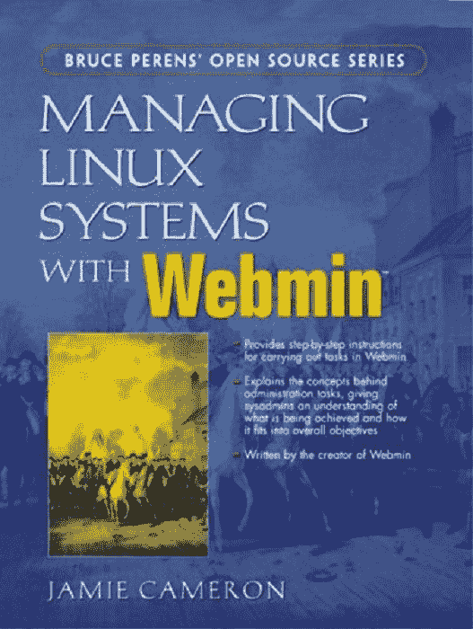

####  {

对于 Webmin 能够实现的系统管理功能，我感到非常满意（实际上是印象深刻）。它既全面又方便，我做过的几乎任何管理工作都涵盖在这里，还包括了我一直犹豫探索的某些领域。

-Karel Baloun，Looksmart, Ltd. 高级软件工程师

Webmin 为你提供了一个便捷的、基于浏览器的解决方案，用于几乎任何日常的 Linux/UNIX 管理任务。现在，每一位初级到中级的系统管理员都有一份权威的 Webmin 指南。该书由 Webmin 的主要开发者编写，`Managing Linux Systems with Webmin` 对最新版本的 Webmin 提供了权威的、分步骤的介绍，从基础安装到集中管理多个服务器。内容包括：

- Webmin 的工作原理以及如何安装和加固它
- 使用 Webmin 配置基础系统服务，包括文件系统、用户/组和打印
- 配置 `Apache`、`Sendmail`、`Squid`、`Samba`、`MySQL`、`PostgreSQL`、`FTP` 服务等
- 集群模块：从一台主服务器配置多个系统
- Webmin 模块：配置 Webmin 本身
- 完整的 API 文档以及编写自定义 Webmin 模块和主题的说明

Jamie Cameron 将带你完成 50 多项核心 Webmin 任务——提供所需的所有背景知识、分步骤说明、大量的屏幕截图以及正在修改的底层配置文件的列表。无论你是 Linux/UNIX 系统管理的新手，还是仅仅想寻找命令行的替代方案，`Managing Linux Systems with Webmin` 都将是一个不可或缺的资源。

## 版权

美国国会目录出版数据

Cameron, Jamie.

Managing Linux systems with Webmin / Jamie Cameron.

p. cm.

ISBN 0-13-140882-8

1. Linux. 2. 操作系统（计算机）。I. 标题.

QA76.76.O63 C3545 2003

005.4'32 dc22

2003016330

编辑与制作服务：`TIPS Technical Publishing, Inc.`

封面设计总监：`Jerry Votta`

封面设计：`Nina Scuderi`

制造采购：`Maura Zalpar`

执行编辑：`Jill Harry`

编辑助理：`Brenda Mulligan`

营销经理：`Dan DePasquale`

© 2004 Jamie Cameron

由 Pearson Education, Inc. 出版

作为 Prentice Hall Professional Technical Reference 出版

Upper Saddle River, New Jersey 07458

本材料仅允许根据《开放出版许可协议》v1.0 或更高版本规定的条款和条件进行分发（最新版本目前可用 `http://www.opencontent.org/openpub/` (http://www.opencontent.org/openpub/default.htm)）。

Prentice Hall PTR 在大批量购买或特别销售时为本书提供极佳的折扣。需更多信息，请联系：美国企业和政府销售部，1-800-382-3419，`corpsales@pearsontechgroup.com`。美国以外的销售请联系：国际销售部，1-317-581-3793，`international@pearsontechgroup.com`。

此处提到的公司和产品名称均为各自所有者的商标或注册商标。

美国印刷

第一版印刷

Pearson Education LTD.

Pearson Education Australia PTY, Limited

Pearson Education Singapore, Pte. Ltd.

Pearson Education North Asia Ltd.

Pearson Education Canada, Ltd.

Pearson Educación de Mexico, S.A. de C.V.

Pearson Education Japan

Pearson Education Malaysia, Pte. Ltd.

## Bruce Perens 开源系列

- `Managing Linux Systems with Webmin: System Administration and Module Development`

Jamie Cameron

- `Implementing CIFS: The Common Internet File System`

Christopher R. Hertel

- `Embedded Software Development with eCos`

Anthony J. Massa

- `Rapid Application Development with Mozilla`

Nigel McFarlane

- `The Linux Development Platform: Configuring, Using, and Maintaining a Complete Programming Environment`

Rafeeq Ur Rehman, Christopher Paul

- `Intrusion Detection Systems with Snort: Advanced IDS Techniques with Snort, Apache, MySQL, PHP, and ACID`

Rafeeq Ur Rehman

## 第 1 章 Webmin 简介

本章将解释什么是 Webmin、编写它的原因以及你可以从本书中获得什么。

### 1.1 什么是 Webmin？

Webmin 是一个简化 Linux 或 UNIX 系统管理过程的程序。传统上，你需要手动编辑配置文件并运行命令来创建账户、设置 Web 服务器或管理邮件转发。Webmin 现在允许你通过易于使用的 Web 界面执行这些任务，并自动为你更新所有所需的配置文件。这使得系统管理工作变得简单得多。

你可以使用 Webmin 执行的一些工作包括：

- 在系统上创建、编辑和删除 UNIX 登录帐户
- 使用 `NFS` 协议将文件和目录导出到其他系统
- 设置磁盘配额以控制用户文件占用的空间
- 安装、查看和移除 `RPM` 及其他格式的软件包
- 更改系统的 IP 地址、`DNS` 设置和路由配置
- 设置防火墙以保护你的计算机，或让内部局域网上的主机访问互联网
- 为 `Apache` Web 服务器创建并配置虚拟网站
- 在 `MySQL` 或 `PostgreSQL` 数据库服务器中管理数据库、表和字段
- 通过配置 `Samba` 与 Windows 系统共享文件

这些只是可用功能的一部分。Webmin 允许你使用简单的 Web 界面配置 UNIX 系统上几乎所有的常用服务和流行的服务器。它能防止你在直接编辑配置文件时经常发生的语法错误和其他错误，并在执行潜在危险的操作之前警告你。

由于 Webmin 通过网络浏览器访问，因此你可以从任何通过网络连接到你的系统登录它。在本地运行和远程运行完全没有区别，而且在网络上使用比其他图形化配置程序容易得多。

Webmin 具有所谓的模块化设计。这意味着它的每个功能都包含在一个模块中，这些通常可以从程序的其余部分独立安装或删除。每个模块负责管理某些服务或服务器，例如 UNIX 用户、`Apache` Web 服务器或软件包。

如果你到目前为止一直在手动配置系统，任何现有的设置都会被 Webmin 识别。它总是读取你系统上的标准配置文件并直接更新它们，而不是使用自己独立的数据库。这意味着你可以自由地混合 Webmin、手动配置以及以相同方式工作的程序或脚本。

尽管这本书是为 Linux 用户编写，但 Webmin 也可以用于许多其他 UNIX 变体，例如 `Solaris`、`FreeBSD` 和 `HP/UX`。它最大的优势之一是理解所有这些操作系统之间的差异，并调整其用户界面和行为以适应你的操作系统。这意味着它通常可以隐藏每个 UNIX 变体之间的底层差异，无论你使用哪一个，都能呈现出相似或相同的界面。

Webmin 本身并不特别有用，因为它只是一个配置工具，所以你必须安装程序供其进行配置。例如，`Apache` 模块要求安装实际的 `Apache` Web 服务器。幸运的是，Webmin 管理的所有服务和服务器要么作为大多数 Linux 发行版的标准包含，要么可以免费下载和安装。

### 1.2 谁应该使用 Webmin？

Webmin 是专为那些具有某些 Linux 经验但不熟悉系统管理复杂细节的人士设计的。尽管它让创建 UNIX 用户或管理 `Squid` 代理服务器的过程变得简单，但你必须首先对 UNIX 账户是什么以及 `Squid` 的作用有所基本的了解。普通的 Webmin 用户可能是在家庭的 Linux 系统或公司网络上运行该程序的人。

该程序假设你熟悉基本的 `TCP/IP` 网络概念，例如 IP 地址、`DNS` 服务器和主机名。它还假设用户理解 UNIX 文件系统的布局、用户和组的定义，以及用户文件的所在地。如果你使用 Webmin 管理诸如 `Apache` 或 `Sendmail` 这样的服务器，你应该先了解它们可以做什么，以及你想要完成何种配置。

Webmin 本身以完全的 UNIX root 根权限运行，这意味着它可以编辑系统上的任何文件并在你的系统上运行任何命令。这意味着，如果你在使用程序时犯了错误，特别是当你正在配置某些你不理解的内容时，极有可能删除你系统上的所有文件或导致系统无法启动。尽管 Webmin 在执行某些潜在危险的操作之前通常会向你警告，但仍有很大的空间造成破坏。

尽管 Webmin 可以在没有连接到互联网的系统上使用，但如果你的 Linux 系统位于网络中，它确实会获益。如果连接了网络，它可以为你下载新的软件包、Perl 模块，甚至是新版本的 Webmin。永久的高速连接是最好的，但即使是拨号连接对于大多数用途也足够了。

由于 Webmin 以 root 权限运行，你必须能够以 `root` 身份登录系统才能安装和启动它。这意味着它不能用于只有普通 UNIX 账户的系统上，例如与他人共享的虚拟 Web 服务器。不过，你可能可以请你的系统管理员为你安装并配置它。

如果你已经是一位丰富的 UNIX 系统管理员，Webmin 可能让你觉得它不是适合你的工具，因为使用它通常比直接编辑配置文件和运行命令要慢。然而，即使是专家也能从它的自动语法检查和它能够自动执行的操作中受益。

你还可以给不同的人提供不同级别的 Webmin 访问权限，这样经验丰富的管理员就可以用它安全地将责任委托给技能较低的下属。例如，你可能希望某人只能管理 `BIND DNS` 服务器而不能管理其他任何内容，同时让你对系统和 Webmin 的所有功能拥有完全访问权限。

### 1.3 它是如何以及为何开发的？

Webmin 程序是由我，本书的作者 Jamie Cameron 设计并创建的。我从 1997 年开始启动，并在那年的 10 月发布了第一个版本（`0.1`）。从那时起，它的用户界面、功能和外观发生了巨大的变化，几乎所有的代码都经过重写。然而，基于 Web 的管理工具的基本概念从第一次发布以来一直是一样的。

当我担任运行 `DNS` 服务器的系统管理员时，开始编写它的。当时我花费大量时间更新服务器的配置文件，以添加用户请求的新主机记录。给他们 `root` 密码并不是一个选择，因为他们没有经验来正确编辑区域文件并重启服务器。解决方案是一个简单的 Web 界面，它可以显示现有的 `DNS` 记录并允许对其进行编辑、创建和删除。这样用户就可以安全地获得此界面的访问权限以进行他们所需的更改。

`DNS` 管理只是开始。一旦我看到了 Web 界面简化 UNIX 系统配置的可能性，我就开始向程序中添加其他功能并将它们放入模块中。接下来是 UNIX 用户、`Samba`、挂载文件系统、`NFS` 和 `Cron` 任务的模块。我想出了 Webmin 这个名字，让任何人都可以下载，并在几个邮件列表公布了它。最初反馈很好，所以我继续写下去。

多年来，该程序经历了三种不同的用户界面，增长到 83 个模块，增加了对非英语语言的支持，提供了高级访问控制，包含了更多操作系统，并提供了许多其他功能。Linux 发行版公司 `Caldera` 和 `MSC.Linux` 为该项目提供了资金支持，许多用户对代码补丁、模块、翻译和建议做出了贡献。除了标准模块外，超过 100 个模块是由他人编写的，一旦你安装了程序，就可以将其添加到你系统上的 Webmin 中。

### 1.4 本书是关于什么的？

这本书解释了如何安装 Webmin，如何使用它几乎所有的模块，以及如何编写你自己的模块。本书侧重于 Webmin 软件包附带的标准模块，而不是由他人编写的模块。然而，83 个标准模块并非全部都涵盖，因为某些模块对普通管理员来说并不是很有用。

虽然这本书主要为 Linux 用户编写，但该程序在其他操作系统上的行为几乎完全相同。每个章节在“其他操作系统”部分还列出了 Linux 与其他 UNIX 变体之间的任何差异。这意味着如果你在 `FreeBSD`、`Solaris`、`MacOS X` 或其他类型的 UNIX 上运行 Webmin，它仍然有用。

书中每个章节涵盖了使用 Webmin 管理特定服务或服务器，例如 `NFS` 导出、`Sendmail` 或 `ProFTPD` FTP 服务器。大多数章节只讨论一个模块，但某些章节涵盖了二三个具有相似或相关目的的模块。每个章节基本上都是独立的，所以如果你只想找到如何配置一台服务器，不需要按顺序阅读整本书。然而，第 2 章、第 3 章以及可能的第 52 章应该先读，因为它们分别解释了如何安装 Webmin、如何加固它以及如何限制其他用户对模块执行的操作。

每个章节都被分成若干节，大部分章节解释了如何执行特定任务。一个章节通常包含对该任务的介绍，解释了你可能想做它的原因，随后是在 Webmin 用户界面中执行该任务遵循的步骤列表。第 55 到 60 章涵盖了开发你自己的 Webmin 模块和主题，因此它们的风格不同。普通用户不需要阅读它们，但如果你对目前尚未提供的模块有主意，它们提供了实现该模块所需的所有信息。

### 1.5 谁应该读这本书？

任何想要使用 Webmin 管理他们的 Linux 或 UNIX 系统的人都应该读这本书。它是为具有基础 UNIX 命令和概念的读者编写的，即那些安装了 Linux 并使用了一段时间的人。

每个章节都开始于对所配置服务的介绍，以便读者对 `DNS` 协议的用途或防火墙的工作原理有一个一定了解。尽管如此，一个完全的新手在理解它是如何工作的以及想让它做什么之前，不应该尝试设置服务器。学习的最好方法是以用户的身份在其他系统上使用该服务。例如，如果你以前在其他网络上用过代理服务器，那么你将了使用此书在你自己的系统上设置 `Squid` 代理所需的背景知识。

另一方面，开发章节是为已经了解如何在 UNIX 系统上编写 Perl 脚本和 CGI 程序的人编写的。这意味着它们比书的其他部分更复杂，并假设读者具备某些编程和手动系统管理知识。不过，如果你只想学习如何使用 Webmin 而不是如何扩展它，可以跳过这些章节。

### 1.6 本使用的约定

本书使用了以下特殊文本样式：

**粗体**：用于 Webmin 自身中出现的文本，例如错误信息、图标名称、按钮和字段标签。

**等宽字体**：此样式用于 shell 命令名、UNIX 用户、目录和文件名。也用于配置文件、程序代码和 API 函数中的文本。

**斜体**：用于表示用户输入 Webmin 的示例输入、示例命令或目录。同样在第 60 节“Webmin API”中用于函数参数的名称。

### 1.7 致谢

如果没有 Prentice Hall 的 Jill Harry 和其他同事的支持，Robert Kern 对这一构思的提议，我妻子 Foong Ching 的持续支持，以及多年来 Webmin 邮件列表所有成员提供的想法和建议，这本书就无法写成。

## 第 2 章：安装 Webmin

本章解释了如何为你的操作系统下载相应的 Webmin 包，如何安装它，以及在首次登录后你会看到什么。

### 2.1 为你的系统下载 Webmin

始终可以从 [www.webmin.com/](http://www.webmin.com/default.htm) 下载最新版本的 Webmin。在编写时，最新发布版本是 1.100 版本，但新版本发布频繁。然而，下面的所有指令在文件名上将使用 1.100 版本。如果你下载了后续发布的版本，所有文件名和路径中的版本号将会更改。

某些 Linux 发行版（如 Mandrake 和 Caldera）将 Webmin 作为标准功能包含，因此它可能已经安装在你的系统中。然而，它们包含的版本可能不是可下载的最新官方版本。如果你对已有的版本感到满意，可以跳过本章。

其他 Linux 发行版（如 Debian 和 Gentoo）将 Webmin 作为可以自动下载和安装的包包含。在 Debian 上，命令 `apt-get install webmin` 将安装 Debian APT 仓库中提供的最新版本。然而，这有时比最新的官方发布晚几个版本，因此你可能希望从 [www.webmin.com/](http://www.webmin.com/default.htm) 下载。在 Gentoo Linux 上，命令 `emerge webmin` 将从 Gentoo Portage 仓库安装最新版本，这应该与最新的官方发布版本相同。

如果你是从旧版本的 Webmin 升级，过程与首次安装完全相同。你对 Webmin 自身的配置或对 `Apache` 或 `Sendmail` 等其他服务器所做的任何更改在升级过程中都不会受到影响。


虽然 Webmin 支持多种 UNIX 变体，但并没有涵盖所有的变体。由于它处理的是不同 UNIX 操作系统位置和格式不同的系统配置文件，因此它被设计为根据运行的操作系统类型产生不同的行为。要查看支持的操作系统完整列表，请访问网页 [www.webmin.com/support.html](http://www.webmin.com/support.html)。如果你的操作系统不在列表中，你将无法使用 Webmin。

在下载 Webmin 安装到你的系统之前，你必须选择一种包格式进行下载。可用的格式有：

- **RPM**：如果你运行 Red Hat、SuSE、Mandrake、Caldera、MSC 或任何支持 RPM 软件包格式的 Linux 发行版，那么 RPM 包是你的选择。
- **tar.gz**：`tar.gz` 包格式的 Webmin 可以在任何操作系统上运行，但安装起来比 RPM 和 Solaris 包稍微复杂。
- **Solaris 包**：如果你在 Sparc 或 x86 上运行 Solaris，那么这种包格式最适合你。

有关安装你所选包类型的说明，请参见下文第 2.2 节“安装 RPM 包”。

## 2.2 安装 RPM 包

在每个 Webmin 网站页面的右上角都有一个 RPM 包的链接。在 [www.webmin.com/download.html](http://www.webmin.com/download.html) 页面也可以找到该链接。一旦下载，你的 Linux 系统上应该有一个类似于 `webmin-1.1.100-1.noarch.rpm` 的文件。要进行安装，请以 root 身份运行以下命令：

```bash
rpm U webmin-1.1.100-1.noarch.rpm
```

RPM 安装只有在你没有安装 Perl 或 Webmin 无法识别你的操作系统时才会失败。如果发生这种情况，且你的 Linux 发行版在支持的操作系统列表中，你应该改为安装 `tar.gz` 版本。因为所有 Linux 发行版略有不同，Webmin 安装过程必须准确识别你正在运行的精确发行版和版本，例如 `Red Hat 7.3`。如果包含发行版名称的文件（如 `/etc/issue`）之一被修改过，可能会失败。

假设 RPM 安装成功完成，你将立即登录 Webmin。打开浏览器，如果你在安装 Webmin 的同一 Linux 系统上运行浏览器，请访问 URL `http://localhost:10000/`；如果在另一台 PC 上运行浏览器，请访问 `http://your-systems-hostname:10000/`。无论哪种，都会出现一个提示用户名和密码的网络表单，如图 2.1 所示。

### 图 2.1 Webmin 登录页面

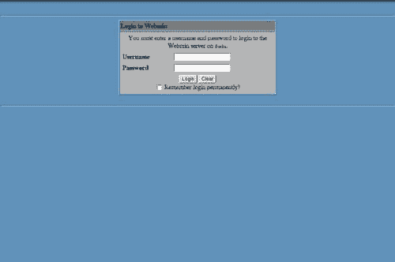

你应该以 root 身份登录，使用与 Linux 系统 root UNIX 用户相同的密码。如果你使用命令行 `passwd` 命令或“用户和组”模块更改了密码，你的 Webmin 密码也会随更改。

如果系统中已安装了 OpenSSL 库和 `Net::SSLeay` Perl 模块，Webmin 将以 SSL 模式启动。这意味着你应该使用以 `https://` 开头的 URL，而不是 `http://` 来连接。尝试使用非 SSL URL 连接只会带出一个带有 `https://` URL 链接的页面，你应该点击该链接进行登录。

## 2.3 安装 tar.gz 包

在每个 Webmin 网站页面的右上角都有 `tar.gz` 包的链接。在 [www.webmin.com/download.html](http://www.webmin.com/download.html) 页面也可以找到该链接。一旦下载，你的系统上应该有一个类似于 `webmin-1.1.100.tar.gz` 的文件。要安装此包，请遵循以下步骤：

1. 以 root 身份登录系统。
2. 选择你希望安装 Webmin 的目录。这通常是 `/usr/local`，也可以是 `/opt` 或任何你喜欢的其他目录。为了简单见，下面的指令将使用 `/usr/local`。
3. 将 `webmin-1.1.100.tar.gz` 文件复制到 `/usr/local` 目录。
4. 运行以下命令解压并提取 `tar.gz` 文件，然后运行以下设置脚本：

```bash
cd /usr/local
gunzip webmin-1.1.100.tar.gz
tar xf webmin-1.1.100
tar
cd webmin-1.1.100
./setup.sh
```

运行 `setup.sh` 脚本后，你将会被问一系列控制安装过程的问题。问题及其含义如下：

- **配置文件目录 `/etc/webmin`**：这是 Webmin 存储其所有配置文件的目录。最好的做法是直接按回车键接受默认值 `/etc/webmin`。如果该目录由于你正在升级的旧版本 Webmin 而已经存在，这将是唯一会被问及的问题。
- **日志文件目录 `/var/webmin`**：这是存储 Webmin 日志和进程 ID 文件的目录。此项也只需按回车即可接受 `/var/webmin` 默认值。
- **Perl 完整路径**：这是你系统上 Perl 可执行文件所在的位置。如果它位于 `/usr/bin/perl` 或 `/usr/local/bin/perl`，则你只需按回车接受默认值。否则，你必须输入 Perl 解释器的完整路径。
- **操作系统**：只有当 Webmin 无法自动识别你的操作系统时才会询问此问题。你必须输入问题前列表中显示的操作系统名称旁边的数字。
- **版本**：与上面的问题一样，只有当 Webmin 无法识别你的操作系统时才会询问此问题。同样，你必须输入所显示的版本号旁边的数字。
- **Web 服务器端口（默认 10000）**：这是 Webmin 监听的 HTTP 端口。除非你在 `10000` 端口上运行了其他网络服务器，否则最好保持默认设置。
- **登录名称（默认 admin）**：这是要求你输入用于登录 Webmin 的用户名。`admin` 是传统的用户名，但可以使用任何名称。
- **登录密码**：这是必须与用户名一起输入的密码。你必须输入两次，以验证你没有不小心出错。
- **使用 SSL (y/n)**：只有在你系统中已按照第 3 章所述安装了 OpenSSL 和 `Net::SSLeay` 库时才会询问此问题。如果你输入 `y`，Webmin 将从开始就使用 SSL。但是，如果你现在输入 `n`，稍后仍然可以开启。
- **开机时启动 Webmin (y/n)**：此问题控制 Webmin 是否会在系统启动时启动，这意味着你不需要在每次重启系统时都手动重新启动它。如果你希望它在开机时启动，只需输入 `y`。否则，输入 `n`。

回答所有问题后，安装过程将结束，并将显示你可以用于登录的 URL 的消息。如果你不再需要，现在可以删除旧的 `webmin-1.1.100.tar` 文件。但是，请删除解压 tar 文件时生成的 `/usr/local/webmin-1.1.100` 目录，它包含了 Webmin 运行所需的所有脚本。

软件包安装完成后，你可以打开浏览器。如果你在安装 Webmin 的同一 Linux 系统上运行浏览器，请访问 `http://localhost:10000/`；如果你在另一台 PC 上运行浏览器，请访问 `http://your-systems-hostname:10000/`。无论如何，都会出现一个如图 2.1 所示提示用户名和密码的网络表单。使用你之前回答“登录名称”和“登录密码”问题时选择的用户和密码登录。

如果你对 SSL 问题回答了是，你应该使用以 `https://` 开头的 URL，而不是 `http://`。如果 Webmin 在 SSL 模式下检测到非 SSL 连接，它将显示一个带有正确 URL 链接的页面。

## 2.4 安装 Solaris 软件包

Webmin Solaris 版本仅从 [www.webmin.com/download.html](http://www.webmin.com/download.html) 下载。下载后，你的 Solaris 系统上有一个类似于 `webmin-1.1.100-1.pkg.gz` 的文件。要进行安装，请以 root 身份运行以下命令：

```bash
gunzip webmin-1.1.100.pkg.gz
pkgadd d webmin-1.1.100.pkg.gz WSwebmin
```

Solaris 软件包只有在你已经安装了 Webmin，或者在 `/usr/local/bin/perl` 下没有 Perl 可执行文件时才会失败。如果 Perl 安装在系统的其他地方，你应该创建一个从 `/usr/local/bin/perl` 指向真实位置的符号链接。

假设 Solaris 软件包安装成功，你将能够立即登录 Webmin。打开浏览器，如果你在安装 Webmin 的同一 Linux 系统上运行浏览器，请访问 `http://localhost:10000/`；如果在另一台 PC 上运行浏览器，请访问 `http://your-systems-hostname:10000/`。无论如何，都会出现一个如图 2.1 所示提示用户名和密码的网络表单。

你应该可以使用 root 身份登录，使用与你 Solaris 系统上 root UNIX 用户相同的密码。但是，如果你以后更改了 UNIX root 密码，Webmin root 用户不会改变。这是因为软件包安装只是从 `/etc/shadow` 文件中复制了当前密码。

## 2.5 Webmin 用户界面

假设安装过程和登录成功，你的浏览器应该显示 Webmin 主菜单，并选中了 Webmin 类别，如图 2.2 所示。你可以通过点击页面顶部的图标切换到其他类别，例如系统、服务器或其他其它。每个模块都属于一个类别，页面主体将出现所选类别中每个模块的图标列表。要进入某个模块，只需点击其图标。

### 图 2.2 Webmin 类别中的模块

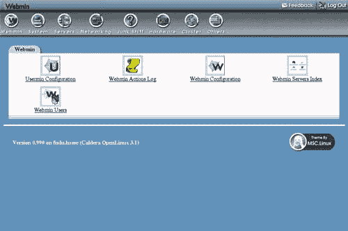

要退出 Webmin，只需点击每个页面右上角的 Logout（退出）链接。要向作者（就是我）发送反馈，点击 Logout 按钮旁边的 Feedback（反馈）链接。要访问 [www.webmin.com/](http://www.webmin.com/default.htm)，点击任何页面左上角的 Webmin 标志。

如果你使用的是不同的主题，用户界面在屏幕上看起来会有不同，如图 2.2 所示。某些随 Linux 发行版提供的 Webmin 版本默认使用不同的主题，例如 Mandrake 和 Caldera。然而，主菜单仍会显示类别和模块，可能使用不同大小的图标和不同的屏幕布局。书中的所有截图都是使用默认主题捕的，因此你可能现在想切换到它（关于如何更改当前主题的说明请参见第 52 章）。

所有 Webmin 模块都有相同的布局和用户界面，以便于导航。当你从主菜单点击模块图标时，会出现该模块的主页。例如，图 2.3 显示了磁盘配额（Disk Quotas）模块的主页。

### 图 2.3 磁盘配额模块的主页

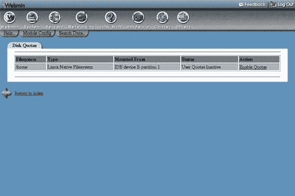

顶部是每个 Webmin 页面上的类别图标，以便你可以轻松切换到另一个模块。下方是帮助（Help）、模块配置（Module Config）和搜索文档（Search Docs）的链接。并不是每个模块都会显示这些链接，但在它们出现的地方具有共同属性：

- **Help**（帮助）：此链接将打开一个弹出窗口，包含模块概述以及主页上的可用选项。
- **Module Config**（模块配置）：此链接显示一个包含当前模块可配置选项的表单。参考图 2.4 磁盘配额模块中可用选项示例。每个模块都有自己的选项，但都使用相似的界面进行编辑。在大多数情况下，正常使用模块时不需要更改任何这些配置选项。

### 图 2.4 磁盘配额模块的配置页面

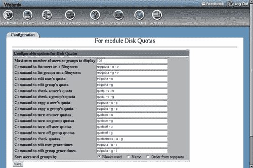

- **Search Docs**（搜索文档）：此链接将显示与模块正在配置的服务器或程序相关的 UNIX 手册页（man pages）、软件包文档、HOWTO 文件和网站。这对于查找有关 Webmin 使用的底层配置文件和命令的额外信息非常有用。

每个模块中第一页之后的其他页面具有相同的布局。图 2.5 显示了磁盘配额（Disk Quotas）模块的示例页面。类别图标下方是一个标记为“模块索引”（Module Index）的链接，它将始终带你回到模块首页。这可以在每个模块的每个页面上找到。旁边是另一个“帮助”（Help）链接，会弹出一个显示当前页面信息的窗口。并非所有页面都有在线帮助，因此此链接不会总是出现。最后，页面底部有一个标签以“返回”（Return to）开头的链接，它可以让你回到模块页面层级中的上一层。

### 图 2.5 磁盘配额模块的示例页面

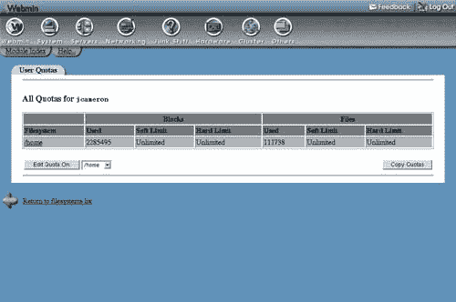

## 2.6 卸载 Webmin

如果由于某种无法想象的原因，你想从系统中移除 Webmin，你只需以 `root` 身份登录并运行以下命令：

```bash
/etc/webmin/uninstall.sh
```

此命令将询问你是否确定要卸载，如果是，它将删除 Webmin 脚本和配置目录。这意味着你对 Webmin 本身做的任何配置（例如更改 IP 访问控制、切换主题或创建新的 Webmin 用户）将会丢失。然而，对其他服务器（如 Apache 或 Sendmail）的配置不会损坏，即使这些配置是使用 Webmin 完成的。

## 2.7 总结

读完本章后，你应该理解如何在服务器上首次安装 Webmin，或者将现有安装升级到最新发布版本。你还应该了解三种包格式之间的区别，以及哪种适合你的操作系统。由于整本书都是关于 Webmin 的，在阅读之前绝对应该安装它！

# 第 3 章 加固你的 Webmin 服务器

本章涵盖了在系统安装 Webmin 后，为其添加额外安全保护的必要步骤。它解释了 IP 地址限制和 SSL 的使用。

## 3.1 网络安全

除非你在从不连接到任何网络的系统上运行 Webmin，否则限制哪些客户端网络地址允许登录是一个明智的想法。因为 Webmin 如此强大，任何成功登录的人都对你的系统拥有完全控制权，就像拥有 root shell 权限一样。尽管登录时始终需要用户名和密码，但增加额外的安全层总是好事，以防攻击者猜中（或以某种方式发现）你的密码。IP 访问控制还可以保护你免受 Webmin 未来可能出现的允许攻击者无需密码即可登录的漏洞，某些旧版本曾出现过这个问题。

要限制 Webmin 接受连接的 IP 地址和网络，请按照以下步骤操作：

1. 在 Webmin 类别中，点击 `Webmin Configuration（Webmin 配置）` 模块图标。
2. 点击 `IP Access Control（IP 访问控制）` 图标。将显示图 3.1 所示的表单用于限制客户端 IP 地址。

### 图 3.1 IP 访问控制表单

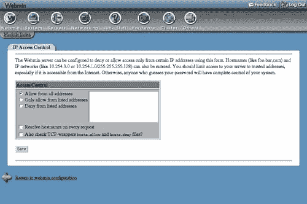

选择选项 `Only allow from listed addresses（仅允许列表中的地址）`，并在文本框中输入允许访问的客户端系统的 IP 地址或主机名。如果你允许从整个 IP 网络访问，请输入网络地址并将最后一个字节设置为 `0`。例如，如果你想允许所有 IP 地址从 `192.168.1.0` 到 `192.168.0.255` 的客户端访问，你将输入 `192.168.1.0`。

也可以以标准的网络/子网掩码格式输入网络，例如 `192.168.1.0/255.255.255.0`。你还可以通过输入通配符主机名如 `.foo.com` 来允许整个域名的访问，假设该域名已设置反向 IP 地址解析。

完成后，点击 `Save（保存）` 按钮应用你的更改。如果限制将阻止你当前运行浏览器的客户端系统登录，Webmin 将警告你，以免你意外把自己锁在外面！

## 3.2 SSL 加密

如果你通过不受信任的网络（如互联网）访问你的 Webmin 服务器，你应该意识到，默认情况下攻击者可以通过监听网络流量来捕获你的登录名和密码。如果你在使用你不完全信任的人员的非交换以太网网络（例如办公室或大学的网络），这一点特别容易。

幸运的是，有一个相对简单的解决方案，可以将 Webmin 切换到使用 SSL，以便浏览器和服务器之间的所有网络流量都加密。如果安装了 `OpenSSL` 库和 `Net::SSLeay` Perl 模块，Webmin 的 RPM 包将默认以 SSL 模式运行。然而，大多数系统并不满足这些要求，因此你需要按照以下步骤启用 SSL：

1. 如果你还没有 `OpenSSL` 库，请安装它。大多数现代 Linux 发行版都会将其作为标准包含，但你可能需要从发行版的 CD 中安装。如果存在 `openssl` 和 `openssl-devel` 的独立包，请确保两者都已安装。如果你的操作系统没有带 `OpenSSL`，你可以从 [www.openssl.org/](http://www.openssl.org/default.htm) 下载。
2. 如果尚未安装 `Net::SSLeay` Perl 模块，请安装它。如果你的系统连接到互联网，最简单的方法是进入 Webmin 的 `Perl Modules` 模块（在 `Others` 类别下），在 `From CPAN` 字段中输入 `Net::SSLeay` 并点击 `Install（安装）` 按钮。
3. Perl 模块下载完成后，点击 `Continue with install（继续安装）` 让 Webmin 自动编译并安装它。
4. 一旦两者都安装完成，进入 `Webmin Configuration` 模块并点击 `SSL Encryption（SSL 加密）`。将显示图 3.2 所示的表单。

### 图 3.2 SSL 激活表单

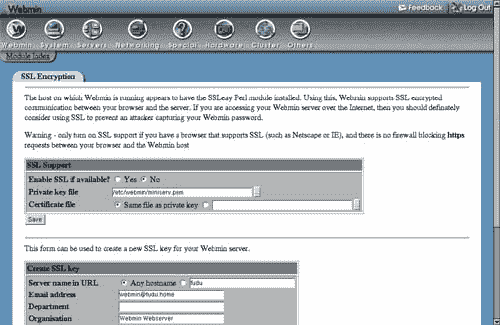

在页面顶部，将 `Enable SSL if available?` 选项更改为 `Yes`，并点击 `Save（保存）`。如果一切顺利，Webmin 将切换到 SSL 模式，你的浏览器将安全地连接到它。

如果你第一次以 SSL 模式连接 Webmin，浏览器将显示证书无效的警告。现在你可以忽略此警告并选择接受证书。更多详情请参见第 3.3 节“请求有效的 SSL 证书”。


从现在起，登录 Webmin 时必须使用以 `https://` 开头的 URL 而不是 `http://`。一旦进入 SSL 模式，它将不再接受不安全的连接。

返回 `SSL Encryption` 页面并滚动到第二个表单。如果显示以 `Because you are currently using the default Webmin SSL key...` 开头的警告，你应该继续遵循这些步骤来创建自己的 SSL 证书和密钥。然而，如果没有出现，则说明在安装时已创建了私钥，无需继续阅读。

如果你的系统始终使用 URL 中相同的相同主机名进行访问，请将其输入 `Server name in URL` 字段，例如 `www.example.com`。这将导致生成的证书仅与该主机名关联。否则，选择 `Any hostname（任何主机名）` 以允许证书用于任何 URL 主机名。这更方便，但安全性略低。

在 `Email address（电子邮件）` 字段中，输入你的电子邮件，例如 `joe@example.com`。

如果合适，在 `Department（部门）` 字段中填写系统所属组织内的部门或组名称，例如 `Network Engineering`。如果不合适（例如在家庭系统），可以留空。

在 `Organization（组织）` 字段中，输入拥有此系统的公司或组织名称，例如 `Foo Corporation`。同样，如果没有意义，可以留空。

在 `State（州/省）` 字段中，输入你系统所在的州/省名称，例如 `California`。

在 `Country code`（国家代码）字段中，输入系统所在国家的两个字母代码，例如 `US`。

保持 `Write key to file` 字段不变，并将 `Use new key immediately` 字段设置为 `Yes`。

点击 `Create Now`（立即创建）按钮以生成新的密钥和证书，将它们写入 `/etc/webmin/miniserv.pem` 并立即激活它们。您的浏览器可能会再次提示您接受新证书。

旧版本的 Webmin 仅使用包含在软件包中的一个固定 SSL 密钥。然而，这对于保护网络流量是完全没用的，因为任何拥有该密钥副本的人都可以解密据称受 SSL 保护的数据！出于这个原因，最近的 Webmin 版本在安装时尽可能创建一个新的私钥，如果正在使用旧的固定 SSL 密钥，则会向您发出警告。

## 3.3 请求有效的 SSL 证书

如果你想使用有效的 SSL 证书且尚未为主主机准备证书，可以使用 `openssl` 命令和证书颁发机构（CA）生成一个。有效证书是所有浏览器都认可的证书，因为它是由受认可的机构签名的。按照第 3.2 节“SSL 加密”中的步骤由 Webmin 本身创建的证书不符合此标准，当它们连接到 Webmin 服务器时会在所有浏览器中触发警告。

遗憾的是，证书颁发机构会对签名和验证主机所有者是否确实与证书中的公司详情匹配进行收费。出于这个原因，大多数人不会费力为 Webmin 使用签名证书，因为一旦你第一次在浏览器中接受了未签名的证书，在安全性上就没有真正的优势。

然而，如果你确实想获得真实的有效证书，步骤如下：

在 shell 提示符处运行 `openssl genrsa -out key.pem 1024` 命令。这将创建 `key.pem` 文件，它就是你的私钥。

运行 `openssl req -new -key key.pem -out req.pem` 命令。当它询问通用名称（common name）时，务必输入你在 URL 中使用的服务器完整主机名，例如 `www.yourserver.com`。这将创建 `req.pem` 文件，即证书签名请求（CSR）。

通过证书颁发机构使用的任何方法将 CSR 发送给他们。他们应该回回一个以 `BEGIN CERTIFICATE` 开头的文件，该文件可以放入 `cert.pem` 文件中。

在 Webmin 中，进入 `Webmin Configuration` 模块并点击 `SSL Encryption`。

在 `SSL Encryption` 表单（如图 3.2 所示）中，将 `key.pem` 文件的路径输入 `Private key file` 字段，并将 `cert.pem` 文件的路径输入 `Certificate file` 字段。

点击 `Save`（保存）按钮切换到新证书。

现在起，您的浏览器在 SSL 模式下连接 Webmin 时不应再显示警告。

## 3.4 总结

保护 Webmin 服务器以防止未经授权的访问至关重要，因为互联网上有许多潜在的攻击者，他们想利用它来接管您的系统。本章涵盖了尽可能执行的两种类型的安全配置（IP 访问控制和 SSL）。由于某些版本的 Webmin 存在可远程利用的安全漏洞，建议一旦发布可用立即升级到最新版本，以确保您的系统安全。

# 第 4 章 用户和组

本章专注于 `Users and Groups`（用户和组）模块，该模块允许您创建和管理 UNIX 用户账户和 UNIX 组。

## 4.1 UNIX 用户和组简介

在 Linux 和其他 UNIX 操作系统上，用户是指可以通过 SSH、telnet、FTP 或控制台登录系统的人。用户还可以接收电子邮件并在服务器的本地文件系统中拥有文件。每个用户都有一个登录名、一个密码和一个存储所有文件的主目录（home directory）。用户还具有若干额外属性，如真实姓名、shell（用户登录时运行的程序）和过期日期。

每个用户都至少是一个组的成员，称为主组（primary group）。此外，用户可以是无限数量次要组（secondary groups）的成员。组权限可用于控制用户可以读取和编辑的文件。例如，如果两个用户正在合作同一个项目，您可能会将他们放在同一个组中，这样他们都可以编辑其他用户无法访问的特定文件。

每个系统在安装时都会创建几个如 `root` 和 `nobody` 类的标准用户账户，尽管这些账户大多数（`root` 除外）无法用于登录。如果您的服务器将供多人使用，您将需要为每个人创建一个额外的用户账户，以保持他们的文件和电子邮件分开。即使您是使用这台机器的唯一，最好也自己创建一个账户用于登录，而不是使用 `root` 账户。

根据您的操作系统，用户和组信息将存储在 `/etc` 目录的不同文件中。在现代版本的 Linux 中，使用 `/etc/passwd` 和 `/etc/shadow` 存储用户详情，使用 `/etc/group` 存储组详情。`Users and Groups` 模块通过直接编辑这些文件，而不是调用任何外部程序或函数。这意味着如果您在使用 NIS 或将用户存储在 LDAP 服务器中，则此模块不适用于您。

## 4.2 Users and Groups 模块

位于 System 下的 Webmin 模块 `Users and Groups`（如图 4.1 所示）可创建、编辑和删除系统上所有的 UNIX 用户和组。在使用此模块编辑如 `root` 和 `daemon` 等现有系统用户时，您应该始终小心，因为更改或删除它们可能会导致您的系统停止工作。某些用户的主目录被设置为 `/`。删除此类用户会导致您系统上的所有文件被删除。

### 图 4.1. 用户和组图标。

`(Images/04fig1.jpg)`

除了管理系统上的 UNIX 用户外，此模块还可以影响其他模块中的用户设置。例如，Samba 有自己的用户和密码列表，应该与 UNIX 密码列表保持同步。Webmin 可以通过用户创建、编辑和删除表单上出现的“other modules”选项为您处理这些工作。但是，您必须在想要更新的每个其他模块中启用它。该模块还具有类似方式同步 UNIX 组的选项，例如 Samba 组。但由于此功能仅适用于仍在开发中的 Samba 3.0，因此本章未涵盖。

一旦进入模块，主页将在一个表格中列出系统中当前存在的所有用户（图 4.2），并在另一个表格中列出所有组（图 4.3）。如果用户或组太多，无法在表格中合理显示，则会显示一个允许您搜索用户或组的小表单。

### 图 4.2. 现有用户列表。

`(Images/04fig2.jpg)`

### 图 4.3. 现有组列表。

`(Images/04fig3.jpg)`

## 4.3 创建新用户

要创建新的 UNIX 用户，请完成以下步骤：

点击现有用户表格上方或下方的 `Create a new user` 链接。将出现一个输入新用户详情的表单，如图 4.4 所示。

### 图 4.4. 用户创建表单。

`(Images/04fig4.jpg)`

此时，您必须为新用户决定一个用户名，它应该是简单的且不含空格的，例如 `jcameron` 或 `jamie`，且未被任何其他用户使用。如果您的服务器接收电子邮件，用户名决定了用户电子邮件地址中 @ 左侧的部分。在 `Username` 字段中输入您的选择。

`User ID` 字段通常应该保持不变，因为 Webmin 会自动为你计算它。如果你将其设置为与另一个用户相同的 `user ID`，那么他们将能够访问彼此的文件。这通常不是一个好主意。

在 `Real name`（真实姓名）字段中，你应该输入用户的全，例如 `Jamie Cameron`。

每个用户都有一个家目录，用户从中存储个人文档和偏好文件。在 `Home directory`（家目录）字段中，你应该输入一个尚不存在目录，例如 `/home/jcameron`。当用户被创建时，该目录将被创建，并将所有权授予新用户。

如果系统上的 Webmin 为家目录提供了 `Automatic`（自动）选项，最好是遵循该选项。

用户的 `shell` 是一个程序，当他进行某种文本模式登录（例如通过 `SSH`）或在控制台图形登录后打开 shell 提示符时就会运行。`shell` 负责运行你输入的命令（如 `ls` 和 `cat`）、在登录和注销时运行脚本，并为命令编辑提供界面。像 `bash` 和 `tcsh` 这样的 shell 对用户来说更容易使用，因为它们允许使用上下方向键滚动查看之前的命令，并允许 Tab 键自动完成命令和文件名。

在某些情况下，你可能不希望用户能够进行 shell 登录，例如用户仅允许读取和发送电子邮件时。在这种情况下，他的 `shell` 应该设置为 `/bin/false`，这是一个什么都不做并立即退出的程序。

你可以从 `Shell` 字段的列表中选择你想让用户拥有的任何 `shell`。如果你的选择不在列表中，选择 `Other`（其他）并在下方的字段中输入 shell 的路径。

对于 `Password`（密码）字段，你有四种选择：

- `No password required`（不需要密码）：用户无需输入任何密码即可登录。
- `No login allowed`（不允许登录）：用户永远无法登录。
- `Normal password`（普通密码）：你可以输入用户的密码。
- `Pre-encrypted password`（预加密密码）：你必须输入一个已经加密的密码，例如从另一个系统的 `/etc/shadow` 文件中获取的密码。

通常你可能想要使用 `Normal password` 选项。请注意，在许多操作系统上，密码的前八个字符会被实际使用。

在大多数系统上，`Password options`（密码选项）标题下将提供一组输入项。如果你希望用户在特定日期后无法登录，则填写第一个输入项 `Expiry date`（过期日期）。

`Minimum days`（最小天数）字段是在用户被创建或上次更改密码后，用户在再次更改密码之前必须等待的天数。留空允许用户在任何想要的时候进行更改。

`Maximum days`（最大天数）字段是在用户被创建或上次更改密码后，密码过期并需要更改的天数。设置了此选项的用户将被强制定期更改密码，这对系统安全有好处。留空以防止密码永不过期。

`Warning days`（警告天数）字段是在密码过期日期之前，用户在登录时将收到其密码即将过期的警告。如果留空，用户在尝试登录并被强制选择新密码之前，将不知道其账户已过期。

`Inactive days`（非活动天数）字段是在密码过期后，如果用户没有选择新密码，整个账户将被禁用的天数。如果留空，则账户将永远不会过期。

对于 `Primary group`（主组），可以选择一个现有组，或者输入一个 Webmin 将为你创建的新组名称。

如果你想让用户成为多个组的成员，请从 `Secondary group`（附加组）列表中选择一些组。

如果你希望创建用户的家目录，请选择 `Create home directory?`（创建家目录？）选项。如果该目录不存在，你应该选择此项以及 `Copy files to home directory?`（将文件复制到家目录？），以便用户获得一组基本的偏好文件，如 `.profile` 和 `Desktop`。

要在你配置了此类操作的其他模块中创建用户，请选择 `Create user in other modules?`（在其他模块中创建用户？）。可以设置 `Samba` 模块在其用户列表中自动创建用户，设置 `MySQL` 模块创建新的数据库用户等。

点击 `Create` 。短暂后，你将返回现有用户列表，其中应包含你新创建的用户。

一旦点击 `Create` 按钮，新用户将能够通过 `SSH`、`telnet` 或你设置任何其他服务登录。

## 4.4 编辑现有用户

通过以下步骤更改系统中已存在的任何用户的详细信息：

从现有列表中点击你想要编辑的用户。将出现一个包含用户所有详细信息的表单，如图 4.5 所示。

### 图 4.5 用户编辑表单。

`(Images/04fig05.jpg)`

更改你想要修改的任何详细信息，包括 `username`。这些字段的含义与第 4.3 节“创建新用户”中的描述相同。

如果你修改了 `User ID` 或更改了 `Primary group`，用户拥的文件可能需要更新以使用新 ID。页面底部标记 `Change user ID on files?`（更改文件上的用户 ID？）和 `Change group ID on files?`（更改文件上的组 ID？）的选项控制将在哪些目录搜索具有旧 ID 的文件。

如果你更改了用户的家目录，你可以让 Webmin 将其重命名为新路径。然而，如果新家目录已经存在，这并不总是你想要的。`Move home directory if changed?`（如果更改则移动家目录？）选项决定是否移动。

要在已设置此项的其他模块中更新用户，请选择 `Modify user in other modules?`（在其他模块中修改用户？）。如果你正在更改 `username`，这还将重命名用户的 `Sendmail` 邮件文件和 `Cron jobs`（定时任务）。

点击 `Save` 按钮让 Webmin 更新用户。完成后，你将返回用户和组的列表。

## 4.5 删除用户

删除用户时应始终要小心，因为用户家目录中的重要文件可能会丢失。通常，删除系统首次安装时创建的任何用户都不是一个好主意，特别是 `root`！即使对于你创建的普通用户，也可以通过编辑用户并将密码选项设置为 `No login allowed` 来禁用。

如果你仍然想继续删除用户，请遵循以下步骤：

从现有列表中点击你想要编辑的用户。将一个包含用户所有详细信息的表单，如图 4.5 所示。

点击页面底部的 `Delete` 按钮。这将弹出一个请求你确认删除的表单，带有仅删除用户或删除家目录的按钮。将显示用户家目录占用的磁盘空间。

如果你希望从设置了删除的其他模块中删除用户，请选择 `Delete user in other modules?`（在其他模块中删除用户？）。属于用户的任何 `Cron jobs` 将被删除，他的 `Sendmail` 邮件文件也将被删除。

点击 `Delete User` 或 `Delete User and Home Directory` 按钮删除用户。在删除进行期间，将显示一个删除删除的页面。

## 4.6 创建新组

可以通过以下步骤添加新的 UNIX 组：

点击现有组列表顶部或底部的 `Create a new group` 链接。将出现一个输入组信息的表单，如图 4.6 所示。

### 图 4.6. 组创建表单。

`(Images/04fig06.jpg)`

为新组选择一个名称，并将其输入 `Group name` 字段中。该名称不能被任何其他组使用，并且应该短且不包含空格。

`Group ID` 字段应保持原样，因为它由 Webmin 自动确定。如果由于某种原因您更改了它，请确保它与任何现有组的 ID 不相同。

`Password` 字段可以忽略，因为组密码从不被使用。

在 `Members` 字段中，输入您想要包含在此组中的任何现有用户名称。您可以使用字段左侧的按钮弹出一个显示所有现有用户的选择窗口。

点击 `Create` 按钮让 Webmin 创建新组。完成后，您将返回用户和组的列表。

一旦创建了新组，您就可以编辑用户将其设置为他们的主组或其中次要组之一。

## 4.7 编辑现有的组

您通常不需要编辑现有的组，因为可以通过直接编辑用户来向其添加或从其移除用户。但是，如果您确实编辑某个组，请按照以下步骤操作：

从现有组列表中点击您想要编辑的组名称。这将弹出如图 4.7 所示的组编辑表单。

### 图 4.7 组编辑表单。

`(Images/04fig07.jpg)`

更改任何细节，如组 ID 或成员列表。无法更改现有组的名称。

如果您正在更改组 ID，则该组拥有的文件可能需要更新以使用新 ID。使用 `Change group ID on files?` 选项来控制哪些目录将搜索需要更新的文件。

点击 `Save` 按钮使更改生效。完成后，您将返回用户和组的列表。

## 4.8 删除组

您可以随时安全地删除一个组，但只有在没有用户将其选为主组时，Webmin 才会允许您这样做。要删除，请按照以下步骤操作：

从现有组列表中点击您想要删除的组名称。这将弹出如图 4.7 所示的组编辑表单。

点击页面底部的 `Delete` 按钮。将出现询问是否确定要删除该组的页面。

点击 `Delete Group` 按钮确认删除。将显示一个删除进度的页面。

## 4.9 查看最近和当前登录


所有 UNIX 系统都会跟踪用户使用 `SSH`、`telnet` 或在控制台进行的最近登录。某些系统还会跟踪 `FTP` 登录。您可以通过遵循以下步骤显示包含日期、时间和源地址的最近用户登录情况：

在用户和组列表下方，在 `Display logins by` 字段中输入您想要跟踪的用户名并点击按钮。如果您想查看所有用户的登录情况，只需留空该字段。

将显示一个列出该用户或这些用户最近登录的页面。列表可能无法涵盖自系统首次安装以来的所有登录，因为许多操作系统会定期截断日志文件以节省磁盘空间。

还可以通过点击用户和组列表下方的 `Logged In Users` 按钮显示当前登录用户列表。如果用户在控制台以图形界面登录，他可能会被列出多次，每个打开的 shell 窗口显示一次。

### 4.10 读取用户邮件

在编辑用户时，可以通过点击页面底部的 `Read Email` 按钮查看用户邮箱中的邮件。这将直接带您进入 `Sendmail`、`Qmail` 或 `Postfix` 模块的邮箱查看页面，具体取决于您在模块配置的 `Display user email` 选项中选择了什么。关于使用邮件界面的更多文档，请参见第 37 章。

### 4.11 从批量文件创建用户

有时，您可能希望一次创建大量用户，而无需反复通过填写用户创建表单的过程。您通常会在某种文本文件中拥有这些用户的详情，包含用户名、密码和姓名。幸运的是，Webmin 有一个功能可以为您自动完成此任务。

如果您点击现有用户列表上方或下方的 `Create, modify and delete users from batch file` 链接，将出现一个允许您上传包含要创建用户详情表单，如图 4.8 所示。您的文件必须每个要创建的用户包含一行文本，且每行的格式必须与批量文件页面上显示的格式匹配。

#### 图 4.8 批量文件执行表单

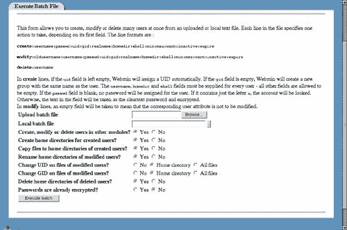

准确的文件格式取决于系统存储的每个用户的信息，但在大多数系统中，每行必须遵循以下格式：

`create:*username:passwd:uid:gid:realname:homedir:shell:min:max:warn:inactive:expire*`

创建一个由 Webmin 自动分配用户 ID 的用户的示例行如下：

```bash
create:jcameron:mysecret::3001:Jamie Cameron:/home/jcameron:/bin/bash:::::
```

如您所示，该行由一系列字段组成，每个字段由冒号（`:`）隔开。创建用户时，第一个字段必须是 `create` 字段。其他字段的含义见表 4.1。

一旦您创建了包含要创建用户详情的文件，请使用 `Upload batch file` 或 `Local batch file` 字段选择它，并点击 `Execute batch` 按钮。将显示一个显示每个创建的用户以及遇到的任何错误的页面。最常见的错误是某一行缺少字段，每行都必须具有完全正确数量的字段，即使某个字段为空，旁边的冒号分隔符也必须包含。

#### 表 4.1 批量文件字段及其含义

| 字段 | 含义 |
| :--- | :--- |
| `username` | 用户的登录名。不能留空。 |
| `passwd` | 用户的密码。如果此字段留空，则该用户不需要密码。如果它只包含字母 `x`，则用户将被锁定且不允许登录。 |
| `uid` | 新用户的用户 ID。这应该留空，以便 Webmin 自动分配一个。 |
| `gid` | 用户主组的 ID。这不能是组名，且不能留空。如果输入了多个 GID，则用户将作为次要成员添加到第一个之后列出的所有组中。 |
| `realname` | 用户的真实姓名。不是强制性的，但不应留空。 |
| `homedir` | 创建的并将所有权分配给该用户的目录。如果模块已配置为自动分配主目录，您可以将其留空。 |
| `shell` | 用户的登录 shell。此字段不能留空。 |
| `min` | 用户创建或上次更改密码后，用户在再次更改之前必须等待的天数。可以留空以允许用户随时更改。 |
| `max` | 用户创建或上次更改密码后，密码过期必须再次更改的天数。如果留空，密码永不会过期。 |
| `warn` | 密码过期前多少天，用户在登录时将收到密码即将过期的警告。如果留空，用户在密码过期之前将不知道。 |
| `inactive` | 密码过期后，如果用户未选择新密码，整个账户将被禁用。如果留空，账户永不会过期。 |
| `expire` | 此帐户过期的日期。遗憾的是，您必须输入自 1970 年 1 月 1 日以来的天数！ |

### 4.12 配置用户和组模块

与其他 Webmin 模块一样，“用户和组”有几个选项可以通过点击用户和组列表上方的 `Module Config` 链接进行配置，如图 4.9 所示。您可以安全更改的选项及其含义见表 4.2。

#### 图 4.9 用户和组的配置选项

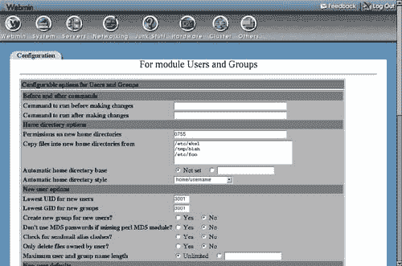

#### 表 4.2 模块配置选项

| 选项 | 含义 |
| :--- | :--- |
| 更改前运行的命令 | 您在此字段中输入的任何 shell 命令都将在执行任何操作（如添加、删除或修改用户或组）之前运行。这对于在 Webmin 做出任何更改之前对 `/etc/passwd` 文件创建备份副本等操作非常有用。正如第 4.13 节“更改前和更改后的命令”所解释的，该命令可以通过检查环境变量来精确确定 Webmin 准备要执行的操作。 |
| 更改后运行的命令 | 与上述选项类似，但此命令在任何操作执行`之后`运行。如果您希望在创建用户后运行某个命令为该用户设置额外文件，此选项非常有用。 |
| 新家主目录的权限 | 新创建主目录的八进制文件权限，格式与 `chmod` 命令使用的格式相同。 |
| 从此处复制文件到新家主目录 | 如果勾选了`将文件复制到主目录？`选项，则要复制到新创建用户主目录的目录或文件。如果您输入的任何路径是目录，该目录中的所有文件和子目录都将被复制。此选项通常设置为 `/etc/skel`，这是一个包含 `.cshrc` 和 `.profile` 等文件的系统目录。 |
| 自动家主目录基础 | 用户主目录通常创建的目录。如果设置了此选项，用户创建表单中的主目录字段将出现一个“自动”选项。如果选择，主目录将由此选项以及下方的“自动家主目录样式”决定。 |
| 自动家主目录样式 | 此选项控制基目录下新用户主目录的路径。最常见的默认选项 `home/username` 将使其成为基目录下的一个子目录，名称与用户名相同。因此，如果您创建一个名为 `jcameron` 的用户，且主目录基目录设置为 `/home`，那么生成的主目录将是 `/home/jcameron`。其他选项使用用户名的第一个或两个字母创建子目录。如果您的系统上有大量用户，并希望避免在 `/home` 中出现数千条条目，这些选项非常有用。 |
| 新用户的最低 UID | 当 Webmin 为新用户自动选择用户 ID 时，它永远不会选择低于此选项指定的 ID。在大多数系统中，普通用户的 ID 在 500 以上，而系统用户的 ID 在此之下。 |
| 新组的最低 GID | 与上述选项类似，但针对组 ID。 |
| 是否为新用户创建新组？ | 如果在创建新用户时将此选项设置为“是”，默认操作是创建一个同名的组并将其作为该用户的主组。 |
| 为新用户和组分配相同的 ID？ | 此选项仅在上一个选项启用时起作用。如果在为新用户创建新组时将此设置为“是”，Webmin 将确保它们的 `UID` 和 `GID` 相同。这实际上并没有产生任何区别，但某些管理员喜欢这样做。 |
| 如果缺少 Perl MD5 模块则不使用 MD5 密码？ | 只有当在创建新用户时遇到由于缺少 MD5 Perl 模块导致的错误时，才将此选项设置为“是”。 |
| 检查 sendmail 别名冲突？ | 在创建或重命名用户时如果此项设置为“是”，Webmin 将检查是否存在同名的 `Sendmail` 别名。这可以防止创建可能因别名将所有邮件重定向到另一个地址而无法接收邮件的用户。 |
| 仅删除用户拥有的文件？ | 在删除用户时如果此项设置为“是”，用户主目录中不属于该用户的文件将不会删除。 |
| 用户和组名的最大长度 | 用户或组名允许的最大长度。如果这是默认设置的，则不建议调整它，因为您的操作系统无法识别更长的用户名。 |
| 新用户的默认组 | 新用户创建表单上的默认主组。 |
| 新用户的默认备组 | 新用户创建表单上默认选中的备组列表，用空格分隔。 |
| 新用户的默认 shell | 新用户创建表单上的默认 shell。 |
| 新用户的默认最小天数 | 不允许更改密码的默认天数。 |
| 新用户的默认最大天数 | 必须更改密码的默认天数。 |
| 新用户的默认警告天数 | 密码过期前警告用户的默认天数。 |
| 新用户的默认禁用天数 | 密码过期后禁用该用户的默认天数。 |
| 显示的用户数量 | 如果模块主页上的用户或组数量超过此数，则用户或组表将被搜索表取代。如果您的系统上的用户数量略超过默认限制，您可能需要调整此项。 |
| 按什么排序用户和组 | 此选项控制模块主页上用户和组的顺序。 |
| 显示之前的登录次数 | 此选项限制显示的记录登录次数，以便在保留无限登录历史的系统中表格不会变得过大。 |
| 通过什么显示用户和组 | 默认情况下，用户和组在模块主页上以表格显示，每个用户或组占一行。但是如果您将此选项更改为`仅名称`，则只显示每个用户的用户名，如果您有大量用户，这将节省大量屏幕空间。更改为`按主组分类`也仅显示用户名，但按其主组进行分类。 |
| 隐藏明文密码？ | 在编辑或创建用户时如果此项设置为“是”，`Normal` 密码字段将只显示星号，而不是您输入的实际密码。如果您担心在创建用户时有人在背后窥视，这非常有用。 |
| 从此处获取用户和组信息 | 尽管模块直接读取和编辑系统用户、组和密码文件，但在某些情况下，系统上的用户和组可能来自其他源（例如 NIS）。在显示用户的主组或组的成员的用户时，Webmin 默认使用 `getpw` 系列系统调用来获取用户和组列表，而不是直接读取用户和组文件。这通常是正确的，但在某些情况下它可能无法正常工作或非常缓慢。只有当您确定希望模块永远不使用 `getpw` 函数时，才将此选项更改为`Files`。 |
| 为新用户生成密码？ | 如果在创建新用户时将此选项设置为“是”，Webmin 将默认为您生成一个随机密码。 |
| 显示办公室和电话详情？ | 通常情况下，用户的“真实姓名”字段只包含其姓名。然而，它也可以包含额外信息，如办公室位置、家庭电话和工作电话。这些额外字段由 `finger` 命令显示，并用逗号分隔存储在 `/etc/passwd` 文件的姓名字段中。如果您希望单独编辑这些额外信息，请将此选项设置为“是”。如果您的系统中的用户名包含逗号（如 `Cameron, Jamie`），则效果可能不佳。 |
| 从此处显示用户邮箱 | 此选项控制点击用户编辑页面上的“读取邮件”按钮时使用的模块。您应该根据正在使用的邮件系统确保设置适当，因为 `Sendmail` 和 `Qmail` 使用不同的用户邮箱位置和文件格式。 |
| 密码最小长度 | 如果设置，你将无法创建或编辑明文密码短于此长度的用户。此选项及其下三个选项也会影响 `Change Passwords`（更改密码）和 `Cluster Users and Groups`（集群用户组）模块。如果你想将用户管理委托给他人，且不信任他们的密码质量，这些选项会很有用。 |
| 防止字典单词密码？ | 如果设置了此选项，将不允许与字典中的任何单词完全匹配的密码。 |
| 用于检查密码的 Perl 正则表达式 | 如果设置，密码必须匹配此 Perl 正则表达式。例如，你在此选项中输入 `[0-9]*` 可以强制所有密码至少包含一个数字。 |
| 防止密码包含用户名？ | 当此选项设置为 Yes 时，将不允许完全匹配或包含用户用户名的密码。 |

`System` 配置标题下的其他选项控制着 Webmin 用于读取和写入用户及组信息的文件。由于这些选项是根据你使用的操作系统类型自动设置的，除非你清楚自己在做什么，否则不应更改它们。

### 4.13 执行前和后命令

如第 4.12 节“配置用户和组模块”所述，你可以指定在模块中执行任何操作之前和之后运行的 shell 命令。由于这些命令每次对用户或组进行添加、修改或删除时都会被调用，因此它们需要某种方式来准确说明正在执行什么操作。它们可以使用在命令运行之前设置的环境变量来实现。可用的环境变量见表 4.3。

例如，如果你想在创建用户时发送电子邮件，可以将 `Command to run after making changes`（更改后运行的命令）选项设置为：

```bash
[ "$USERADMIN_ACTION" = "CREATE_USER" ] && echo "Added user $USERADMIN_USER ($USERADMIN_REAL)" | mail s "Added new user" you@yourdomain.com
```

### 4.14 模块访问控制

可以授予 Webmin 用户或组仅访问 `Users and Groups`（用户和组）模块中的部分功能。这最常见的用途是允许子管理员拥有编辑系统上选定用户和组的权限，并仅以有限的方式更改它们的属性。例如，在虚拟托管环境中，你可能希望允许 Webmin 用户创建和编辑在特定范围内的最多 10 个 UID 的用户，且其主目录位于一个固定目录下。这些权限让用户无法获得 root 权限，也不会影响不属于他的其他用户。

#### 表 4.3 执行前和后命令的环境变量

| 变量 | 含义 |
| :--- | :--- |
| `USERADMIN_ACTION` | 表示正在执行什么操作。可能的值有：`CREATE_USER`、`MODIFY_USER`、`DELETE_USER`、`CREATE_GROUP`、`MODIFY_GROUP`、`DELETE_GROUP` |
| `USERADMIN_USER` | 正在创建、修改或删除的用户名。在执行组操作时不设置。 |
| `USERADMIN_UID` | 正在创建、修改或删除的用户的 ID。 |
| `USERADMIN_GID` | 用户的组 ID。 |
| `SERADMIN_REAL` | 用户的真实姓名，包括任何办公室和电话信息。 |
| `USERADMIN_SHELL` | 用户的 shell。 |
| `USERADMIN_HOME` | 用户的主目录。 |
| `USERADMIN_PASS` | 用户的明文密码（可用）。 |
| `USERADMIN_SECONDARY` | 用户所属的所有次要组列表，用逗号分隔。 |
| `USERADMIN_GROUP` | 正在添加、修改或删除的组名。在执行用户操作时不设置。 |

第 52 章更详细解释了如何创建额外的 Webmin 用户并编辑它们的模块访问控制。以下步骤仅涵盖了授予 `Users and Groups` 模块特定受限访问权限的部分：

在 Webmin `Users`（用户）模块中，点击想要编辑的用户名称旁边的 `Users and Groups`。这将带你进入如图 52.3 所示的访问控制表单。

将 `Can edit module configuration?`（可以编辑模块配置？）字段改为 `No`。

`UNIX users who can be edited` 字段控制该 Webmin 用户可以更改的用户。你通常将其设置为 `Users with UIDs in range`（UID 在范围的用户），并在相邻字段中输入最大和最小 UID，例如 `5000` 和 `5010`。

要允许添加新的 UNIX 用户，将 `Can create new users?`（可以创建新用户？）字段设置为 `Yes`。

将 `Can view batch file form?`（可以查看批表单？）选项设置为 `No`。这可以防止 Webmin 用户通过批脚本创建和编辑用户，这通常是没必要的。然而，允许这样做不会赋予用户任何额外权限，也不会带来安全风险。

对于 `UIDs for new and modified users` 字段，输入与步骤 4 相同的 UID。

取消勾选 `More than one user can have the same UID`（多个用户可以具有相同的 UID）选项，但保留 `UIDs of existing users can be changed`（现有用户的 UID 可以被更改）选项的选中。由于可能导致的问题，通常不应允许不受信任的子管理员创建多个相同 UID 用户。

当防止 UID 冲突时，Webmin 用户将无法创建超出允许 UID 范围的 UNIX 用户。

在 `Allowed groups for new or modified users`（新或修改用户的允许组）字段中，你通常会选择 `Only groups`（仅组）并输入新用户可以作为主要或次要成员的组名。通常你只需要输入像 `users` 这样的组。将此字段设置为 `All groups`（所有组）是一个非常糟糕的主意，因为这将允许创建 root 或 bin 组的用户，他们就可以编辑重要的系统文件和执行文件。如果允许此 Webmin 用户在相同的 GID 范围内创建多个自己的组，`Groups with GIDs in range`（GID 在范围内的组）选项就会很有用。

要限制为新用户分配的 shell，将 `Allowed shells for new or modifed users`（新或修改用户的允许 shell）设置为 `Listed`（列表），并在下面的文本框中输入它们的路径。这对于允许创建始终使用 `/bin/false` shell 的邮件用户有用。

将 `Home directories must be under`（主目录必须位于）字段设置为仅供该 Webmin 用户创建使用的目录。设置为 `/home` 是一个糟糕的主意，因为这将允许子管理员重命名或删除属于 `/home` 下其他用户的目录。相反，输入类似 `/home/*subadmin*` 的内容。


要强制每个用户的主目录基于其用户名（例如`/home/subadmin/*username*`），勾选`Home directory is always same as username`（主目录始终等于用户名）。

为了防止 Webmin 用户取消创建、编辑和删除表单底部某些选项，请取消相应的`Allowed on save`（保存时允许）选项。任何未选中的实际上都会始终开启。

假设你只想让 Webmin 用户创建和编辑 UNIX 用户，将`UNIX groups who can be edited`（可以编辑的 UNIX 组）字段设置为`No groups`（无组）。

如果你想限制用户查看最近登录，请更改`Can display logins by`字段。任何可以通过 telnet 或 SSH 登录的用户都可以运行`last`命令来显示登录情况，因此将此选项设置为`No users`（无用户）通常不会让你的系统更安全。

最后，点击`Save`（保存）。你将返回模块主页，新的访问控制限制将立即应用于该 Webmin 用户。

在授予 Webmin 用户访问某些 UNIX 用户的权限时要小心，错误可能会允许他编辑 root 用户或创建一个与 root 等效的新用户。还有许多其他如`bin`、`uucp`和`httpd`等用户，他们拥有重要的系统文件或被用于运行服务器和守护进程。能够编辑或登录其中这些用户之一的人可以在你的系统上获得 root 权限，或访问他不应访问的文件。

通常，磁盘配额（Disk Quotas）和计划 Cron 任务（Scheduled Cron Jobs）模块中的访问控制被设置为允许编辑与在该模块中可以编辑和创建相同的 UNIX 用户配额和 Cron 任务。所有模块都支持 UID 范围和主组访问控制选项，可以以相同的方式进行设置。

也可以使用“用户和组”（Users and Groups）访问控制表来允许用户编辑或创建选定的 UNIX 组，尽管这通常并不十分实用。赋予不受信任的用户编辑系统上所有组的权限是一个坏主意，因为他会因此让自己成为 root 或 bin 组的成员，从而能够读取或写入关键文件。

### 4.15 其他操作系统

不同的操作系统存储用户信息的方式与 Linux 不同。这是由于用于存储用户信息的文件和文件格式不同导致的。例如，某些系统没有`/etc/shadow`文件，这意味着不存在关于密码更改和到期时间的信息。下列表解释了其他支持的操作系统与 Linux 之间的主要差异：

- **FreeBSD、OpenBSD 和 NetBSD**：这些操作系统都使用`/etc/master.passwd`文件来存储用户信息，该文件结合了`/etc/passwd`和`/etc/shadow`中的某些字段。在编辑或创建用户时，你可以输入一个`Password change time`（密码更改时间），即必须下次更改密码的日期时间；以及一个`Account expiry time`（账户过期时间），账户之后将无法使用。每个用户还可以有一个`Login class`（登录类），它配合`/etc/login.conf`文件来确定内存、CPU 和其他限制。
- **Sun Solaris 和 SCO UnixWare**：这两个操作系统使用与 Linux 相同的文件和格式，因此具有所有相同的选项。
- **HP/UX、SGI Irix 和 Compaq Tru64/OSF1**：由于这些系统默认都不使用`/etc/shadow`文件，因此在编辑或创建用户时，无法使用任何与密码和账户过期相关的选项。
- **Apple MacOS X OSX**：完全不在文件中存储用户和组信息，相反，它使用一个名为 NetInfo 的网络数据库，Webmin 使用`nidump`和`niutil`命令来操作该数据库。然而，该数据库存储与 BSD master.passwd 文件相同的信息，因此在编辑或创建用户时，可用的字段与 FreeBSD 相同。
- **IBM AIX**：AIX 使用`/etc/passwd`和`/etc/security/passwd`文件存储用户信息。因此，在 AIX 上编辑或创建用户时，有一些其他操作系统上不存在的选项。`Expiry date`（过期日期）字段可以设置账户后无法使用的日期和时间。`Minimum weeks`（最小周数）和`Maximum weeks`（最大周数）字段与 Linux 上的`Maximum days`和`Minimum days`字段非常相似，但处理的是周而不是天。`Warning days`（警告天数）字段的含义与 Linux 完全相同，处理的是天而不是周。独特的`Account flags`（账户标志）字段设置了特殊选项，其含义在表单上有解释。
- **SCO OpenServer**：OpenServer 使用`/etc/passwd`和`/etc/shadow`文件，但影子文件存储的信息与 Linux 略不同。这意味着在编辑用户时，`Expiry date`字段被一个控制用户下次登录时是否提示密码的选项所取代，且`Warning days`（警告天）和`Inactive days`（闲置天）字段可用。

上述未列出的少数操作系统无法使用“用户和组”模块，因为 Webmin 目前尚不支持它们的文件格式。

### 4.16 总结

本章解释了如何在 UNIX 系统上创建和管理用户及组。由于它们被用于强制文件安全、保护进程免相互干扰以及作为邮箱箱，用户管理是多用户服务器系统上最重要的任务之一。这意味着本章涵盖的模块是 Webmin 中最常用的之一，也是最强大的之一。

## 第 5 章 磁盘和网络文件系统

本章解释了如何挂载文件系统，可以来自系统硬硬盘上的分区，也可以来自其他文件服务器。

### 5.1 文件系统简介

在 UNIX 系统上，所有文件都存在根目录`/`下的目录树中。其他操作系统（如 Windows）用于识别不同硬盘或网络驱动器的盘符并不存在。相反，不同的硬盘、CD-ROM、软盘和网络驱动器被挂载到目录树的不同位置，称为挂载点（mount points）。例如，`/home`可能是你系统中另一个硬盘的挂载点，而`/usr/local`可能是从另一个服务器共享文件的挂载点。根目录也是一个挂载点，几乎总是你机器硬盘上的某个分区。实际挂载在挂载点上的文件集称为文件系统。

所有操作系统都将每个硬盘划分为分区，每个分区的大小可以不同。每个文件系统通常存储在一个磁盘的一个分区上，因此在同一块硬盘上可能存在多个不同类型的文件系统，例如一个用于 Linux，一个用于 Windows。如果你的系统中有多个硬盘，你通常需要从每个硬盘至少挂载一个文件系统才能使用它们。

UNIX 系统支持许多不同类型的文件系统，有些用于存储在本地硬盘上的文件，有些用于存储网络文件服务器上的文件。在 Linux 上，你硬硬盘上的文件系统可能是`ext2`或`ext3`格式。存在许多其他本地文件系统类型，例如用于 CD-ROM 的`iso-9660`、用于 Windows 分区的`vfat`，以及用于高性能文件访问的`xfs`和`reiserfs`。每个本地文件系统类型都使用不同的格式在磁盘上存储数据，因此如果一个分区已格式化为特定类型的文件系统，则它必须作为该类型挂载。

还有用于跨网络访问文件服务器的不同特殊文件系统类型。如果文件服务器运行 UNIX，则通常挂载`nfs`文件系统来访问其文件。然而，如果它运行 Windows，则必须使用`smbfs`文件系统。这些不同的文件系统类型对应于访问另一个系统文件的不同网络协议。

其他特殊文件系统类型包含实际上不存在于任何磁盘或文件服务器上的文件。例如，`proc`文件系统包含有关当前正在运行进程的文件。不同的 UNIX 变体具有不同类型的特殊文件系统，其中大多数由操作系统自动挂载，不需要配置。

如果不涵盖虚拟内存，任何对文件系统的解释都是不完整的。通常 UNIX 系统会运行占用的内存超过实际安装内存的进程。这是通过操作系统自动将其中一些进程移出物理内存并移动虚拟内存实现的，虚拟内存存储在文件或本地硬硬盘上。由于文件系统和虚拟内存都存储在磁盘上并可以被挂载和卸载，磁盘和网络文件系统 Webmin 模块也管理虚拟内存。

取决于你的操作系统，`/etc/fstab`或`/etc/vfstab`文件包含了你的系统已知并在启动时挂载的文件系统列表。此外也可能使用`mount`命令临时挂载文件系统，而不将其存储在 fstab 文件中。Webmin 直接修改此文件以管理启动时挂载的文件系统，并调用`mount`和`unmount`命令来立即激活和停用文件系统。

### 5.2 磁盘和网络文件系统模块

磁盘和网络文件系统模块位于“系统”（System）类别下，允许您配置将哪些文件系统挂载到计算机上、从哪里挂载以及它们设置了哪些选项。该模块的主页（如图 5.1 所示）列出了所有已挂载或可挂载的文件系统。

### 图 5.1 现有文件系统列表

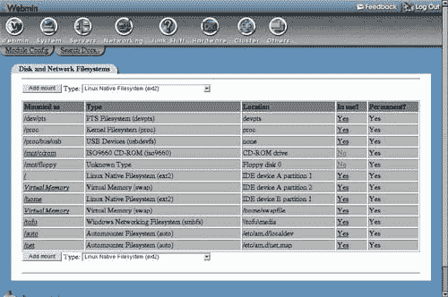

对于每个文件系统，将显示以下信息：

- **Mounted As (挂载为)**：该文件系统的挂载点目录，或消息`Virtual Memory`。
- **Type (类型)**：文件系统类型的描述，随后是实际的短类型名称。
- **Location (位置)**：挂载该文件系统的磁盘、文件服务器或其他。对于`nfs`挂载，此列将以`servername:remotedirectory`的形式存在。对于`smbfs`挂载，类似于`\\servername\sharename`。
- **In use? (在使用？)**：是或否，取决于文件系统当前是否挂载。对于大多数文件系统，您可以点击此字段立即进行挂载或卸载。
- **Permanent (永久)**：是或否，取决于文件系统是否被永久记录，以便在启动时挂载。

### 5.3 挂载 NFS 网络文件系统

在挂载来自另一个 UNIX 服务器的文件系统之前，该服务器必须配置为使用`NFS`导出您想要挂载的目录。有关如何使用 Webmin 导出目录的详情，请参见第 6 章。

假设您想要挂载的目录已正确导出，可以按照以下步骤将其挂载到您的系统中：

在磁盘和网络文件系统模块的主页上，从文件系统类型的下拉框中选择`Network Filesystem`（网络文件系统），点击`Add mount`（添加挂载）按钮。将出现表单，如图 5.2 所示。

### 图 5.2 挂载网络文件系统

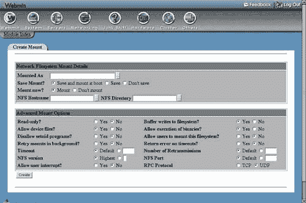

在`Mounted As`（挂载为）字段中，输入您想要挂载文件系统的目录。该目录应该是不存在的或空的，因为一旦挂载文件系统，它目前包含的任何文件将被隐藏。

如果您希望在启动时挂载该文件系统，请为`Save Mount`（保存挂载）选项选择`Save and mount at boot`。如果您希望将其永久记录但在启动时不挂载，请选择`Save`。如果这只是临时挂载，请选择`Don't save`。

对于`Mount now?`（现在挂载吗？）选项，如果您希望立即挂载文件系统，请选择`Mount`；如果您只想将其记录以便以后在启动时挂载，请选择`Don't mount`。将`Save and mount`选项设置为`Don't save`而将`Mount now?`选项设置为`Don't mount`是没有的，因为什么操作都不会执行！

在`NFS Hostname`字段中，输入导出您想要挂载目录的文件服务器名称或 IP 地址。您也可以点击字段旁边的按钮，弹出本地网络上的 NFS 服务器列表。

在`NFS Directory`字段中，输入文件服务器上的导出目录。如果您已经输入了 NFS 服务器的主机名，点击字段旁边的按钮将弹出服务器已导出的目录列表。

更改表单底部部分您想要启用的任何选项。一些最实用的如下：

- **Read-only? (只读？)**：如果设置为 Yes，则此文件系统上的文件无法被修改、重命名或删除。
- **Retry mounts in background? (在后台重试挂载？)**：当在启动时挂载 NFS 文件系统时，如果服务器宕机或无法访问，系统通常会一直尝试连接服务器，这可能会阻止启动过程正常完成。将此选项设置为 Yes 将通过在耗时过长并在后台重试挂载来防止此问题。
- **Return error on timeouts? (超时时返回错误？)**：NFS 文件系统面对服务器故障的正常行为是持续尝试读取或写入请求的信息，直到服务器恢复且操作成功。这意味着如果文件服务器长时间关闭，任何访问从服务器挂载的文件的尝试都会卡住。将此选项设置为 Yes 将更改此行为，使系统最终放弃耗时过长的操作。

要挂载和/记录文件系统，点击页面底部的`Create`按钮。如果一切顺利，您将返回文件系统列表，否则将显示解释出现什么问题的错误。

一旦 NFS 文件系统成功挂载，您系统上的所有用户和程序都能够访问挂载点目录下的文件服务器上的文件。如果用户可以登录到您的系统和远程文件服务器，那么他们在某一台机器上拥有的任何文件在另一台机器上也应该是，因为 NFS 协议支持 UNIX 文件权限和文件所有权信息。然而，这取决于每个用户在两个服务器上具有相同的用户 ID。如果不是如此，您可能会遇到这种情况：用户`jcameron`在文件服务器上拥有一个文件，但在您的系统上挂载并访问时，该文件似乎由用户`fred`所有。

解决问题的最佳方案是确保所有使用 NFS 共享文件的服务器上的用户 ID 同步。实现此点的最佳方法是使用`NIS`（如第 17 章所述）或 Webmin 自己的`Cluster Users and Groups`模块（如第 49 章所述）。

### 5.4 挂载 SMBFS Windows 网络文件系统

`smbfs`是 Windows 系统用于相互共享文件的协议。如果您在 Windows 系统上有希望在 Linux 系统上能够访问的文件，由于您必须先使用 Windows 用户界面共享该目录并分配一个共享名称。

完成后，请按照以下步骤在您的 UNIX 系统上挂载该共享：

在磁盘和网络文件系统模块的主页上，从文件系统类型的下拉框中选择`Windows Networking Filesystem`（Windows 网络文件系统）并点击`Add mount`按钮。将出现表单，如图 5.3 所示。

### 图 5.3 挂载 Windows 网络文件系统

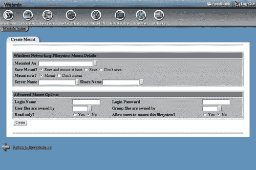

在`Mounted As`字段中，输入您想要挂载文件系统的目录。该目录应该是不存在的或空的，因为一旦挂载文件系统，它目前包含的任何文件将被隐藏。

如果您希望在启动时挂载该文件系统，请为`Save Mount`选项选择`Save and mount at boot`。如果您希望将其永久记录但在启动时不挂载，请选择`Save`。如果这只是临时挂载，请选择`Don't save`。

对于`Mount now?`选项，如果您希望立即挂载文件系统，请选择`Mount`；如果您只想将其记录以便以后在启动时挂载，请选择`Don't mount`。

在`Server Name`字段中，输入 Windows 服务器的主机名或 IP 地址。字段旁按钮将根据模块配置中设置的域或工作组主弹出网络上的 Windows 服务器列表。

在`Share Name`字段中，输入共享名称。这将类似于`movies`，而不是 Windows 服务器上的完整路径如`c:\files\movies`。如果您已经输入了服务器名称，点击字段旁边的按钮将弹出可用共享列表。

如果 Windows 服务器需要用户名和密码访问文件共享，请填写`Login Name`和`Login Password`字段。如果不需要身份验证，这些字段可以留空。

由于 Windows 网络没有 UNIX 用户的概念，当文件系统挂载时，来自文件服务器的所有文件将由单个 UNIX 用户和组所有。默认用户是`root`，但您可以通过填写`User files are owned by`和`Group files are owned by`字段来更改它。

点击页面底部的`Create`按钮以挂载和/记录文件系统。如果一切顺利，您将返回文件系统列表，否则将显示解释出现什么问题的错误。

Windows 网络文件系统也可以通过 UNIX 服务器使用 Samba 进行导出，正如第 43 节解释的那样。这意味着你可以使用 Windows 文件共享协议在两个 UNIX 服务器之间共享文件。然而，正如你可能猜到的，这通常不是一个好主意，因为文件权限和所有权信息在挂载服务器上将不可用。

### 5.5 挂载本地 ext2 或 ext3 硬盘文件系统

在从本地硬盘挂载新文件系统之前，必须先对分区分区并使用正确的文件系统类型进行格式化。有关如何操作的详细信息，请参见第 8 章。如果有选择，应该使用`ext3`（Webmin 称为新 Linux 原生文件系统）而不是`ext2`（Linux 原生文件系统），因为它支持日志功能。有关`ext3`优势的更多细节，请参见第 5.13 节“文件系统类型比较”。

要挂载本地文件系统，请遵循以下步骤：

在磁盘和网络文件系统模块的主页上，从文件类型下拉框中选择`Linux Native Filesystem`或`New Linux Native Filesystem`，然后点击`Add mount`按钮。将出现一个用于输入挂载点、源和选项的表。

在`Mounted As`字段中，输入你想要挂载文件系统的目录。该目录应该是不存在或空的，因为一旦挂载文件系统，其当前包含任何文件将被隐藏。

如果你希望文件系统在启动时挂载，请在`Save Mount`选项中选择`Save and mount at boot`。如果你希望将其永久记录但在启动时不挂载，请选择`Save`。如果只是一个临时挂载，请选择`Don't save`。

对于`Mount now?`选项，如果你想立即挂载文件系统，请选择`Mount`；如果你只是想将其记录以便以后启动时挂载，请选择`Don't mount`。


如果存在`Check filesystem at boot?`选项，它将控制在启动时挂载前是否使用`fsck`命令对文件系统进行验证。如果你的系统崩溃或掉电，当时挂载的任何`ext2`或`ufs`文件系统在下次挂载之前都需要进行检查。通常将此选项设置为`Check second`最佳。

对于`Linux Native Filesystem`字段，点击`Disk`选项并选择已为你新文件系统格式化的分区。所有 IDE 和 SCSI 磁盘都会出现在菜单中。

如果你系统上的任何分区带有标签，你可以通过选择`Partition labeled`选项并选择你想要的一个来挂载它。标签在第 8 章中有进一步解释。

如果你的系统配置了任何 RAID 设备（在第 8 章中也有解释），你可以选择`RAID device`选项并从菜单中选择你想要挂载的。

如果你在使用`LVM`（逻辑卷管理，见第 8 章），所有可用逻辑卷的列表将出现在`LVM logical volume`选项旁边供你选择。

你也可以点击`Other device`选项，并输入你文件系统的设备文件路径，例如`/dev/hda2`。

更改表单底部部分你想要启用的任何选项。最实用的包括：

`Read-only?`如果设置为`Yes`，则此文件系统上的文件将无法修改、重命名或删除。

`Use quotas?`如果你想在该文件系统上强制执行磁盘配额，必须启用此选项。大多数文件系统类型将为你提供用户配额、组配额或两者的选择。要完成激活和配置配额的过程，请参见第 7 章。

点击页面底部的`Create`按钮来挂载和或记录文件系统。如果一切顺利，你将返回文件系统列表，否则将显示解释发生什么问题的错误。

## 5.6 挂载本地 Windows 硬盘文件系统

如果你的系统在某个硬盘上有一个 Windows 分区，你可以使用 Webmin 挂载它，使得 UNIX 用户和程序可以轻松访问所有文件。Windows 95、98 和 ME 默认都使用旧的`vfat`格式，Webmin 称为 Windows 95 文件系统。然而，Windows NT、2000 和 XP 使用更先进的`ntfs`文件系统格式（称为 Windows NT 文件系统），只有少数 Linux 发行版支持该格式。

在磁盘和网络文件系统模块的主页上，从文件类型下拉框中选择`Windows 95 Filesystem`或`Windows NT Filesystem`，然后点击`Add mount`按钮。将出现一个用于输入挂载点、源和选项的表。

在`Mounted As`字段中，输入你想要挂载文件系统的目录。该目录应该是不存在或空的，因为一旦挂载文件系统，其当前包含任何文件将被隐藏。

如果你希望文件系统在启动时挂载，请在`Save Mount`选项中选择`Save and mount at boot`。如果你希望将其永久记录但在启动时不挂载，请选择`Save`。如果只是一个临时挂载，请选择`Don't save`。

对于`Mount now?`选项，如果你想立即挂载文件系统，请选择`Mount`；如果你只是想将其记录以便以后启动时挂载，请选择`Don't mount`。

对于`Windows 95 Filesystem`或`Windows NT Filesystem`字段，点击`Disk`选项并选择已为你新文件系统格式化的分区。所有 IDE 和 SCSI 磁盘、RAID 设备和 LVM 逻辑卷都会出现在列表中。

你也可以点击`Other device`选项，并输入你文件系统的设备文件路径，例如`/dev/hda2`。

选择任何想要启用的选项。实用的包括：

User files are owned by: 由于`vfat`文件系统格式没有用户和组的概念，挂载文件系统中的所有文件默认将由`root`所有。要更改此项，请为此选项输入不同的 UNIX 用户名。

Group files are owned by: 与上一个选项一样，它控制挂载文件系统中所有文件的组所有权。

File permissions mask: 你希望挂载文件系统中的文件拥有的 UNIX 权限的八进制二进制反反。例如，输入`007`将使文件对其所有者和用户组可读可写，但对其他人完全不可访问。此选项在 Windows NT 文件系统上不可用。

点击页面底部的`Create`按钮来挂载和或记录文件系统。如果一切顺利，你将返回文件系统列表，否则将显示解释发生什么问题的错误。

由于 Windows 95 文件系统没有文件所有权的概念，而 Windows NT 文件系统拥有 Linux 不支持的所有信息，因此无法更改挂载文件系统中文件的用户、组或权限。

## 5.7 添加虚拟内存

正如引言所示，当系统上运行的进程需要的内存超过物理安装的内存时就会使用虚拟内存。因为并非所有进程同时运行，不活跃的进程可以安全地交换到虚拟内存中，并在需要运行时换回。然而，由于磁盘远比内存慢，如果系统上的进程消耗了大量内存，不断的进交换（称为抖动）将使系统变得极其缓慢。

现有本地文件系统中的文件以及整个分区都可以用于虚拟内存。使用分区通常更快，但如果你的硬盘上没有可用分区，则缺乏灵活性。系统可以拥有多个虚拟内存文件或分区，因此如果虚拟内存不足，可以轻松添加。

添加额外虚拟内存的步骤如下：

在磁盘和网络文件系统模块的主页上，从文件类型下拉框中选择`Virtual Memory`，然后点击`Add mount`按钮。将出现一个用于输入源和其他选项的表。

如果您希望在启动时添加虚拟内存，请在`Save Mount`选项中选择`Save and mount at boot`。否则，如果这只是临时添加，请选择`Don't save`。

对于`Mount now?`选项，如果您想立即添加虚拟内存，请选择`Mount`；如果您只想将其记录下来以便以后在启动时添加，请选择`Don't mount`。

如果您想将整个分区作为虚拟内存，请在`Swap File`选项中选择`Disk`并从列表中选择该分区。否则，选择`Swap File`并输入您想要作为虚拟内存的路径。如果您输入的路径指向已存在的文件，在添加虚拟内存时该文件将被覆盖。

点击页面底部的`Create`按钮。如果您正在添加一个尚的交换文件，系统将提示您输入文件的大小，`Webmin`将为您创建它。如果一切顺利，浏览器将返回主页的文件系统列表。

一旦添加了新的虚拟内存，您系统的可用内存应该根据分区或交换文件的大小而增加。使用`Running Processes`模块（第 11 节介绍）中的内存显示查看可用的实际内存和虚拟内存。

## 5.8 自动挂载文件系统

在 Linux 中访问任何文件系统的文件之前，必须先显式地挂载。这对于启动时挂载的硬盘来说没有问题，但对于 CD-ROM、软磁盘和 Zip 磁盘等可移动媒体来说并不方便。在读写文件之前必须先挂载软磁盘，完成后后再卸载，这与 Windows 等其他操作系统相比非常不用户友好。

幸运的是，有一种解决方案：自动挂载系统（automounter）。该系统不包含任何自己的文件，但会在需要时自动创建临时目录并挂载文件系统。挂载在`/auto`的自动挂载系统通常配置为：当用户尝试`cd`进入该目录时立即将软磁盘挂载到`/auto/floppy`。当软磁盘文件系统不再使用时，它将自动卸载，以便安全地拔出软磁盘。

可以在`Webmin`中创建、查看和编辑自动挂载文件系统。每个系统都有一个配置文件，指定它将挂载哪些设备以及挂载到这些设备的哪些子目录下。然而，无法在`Webmin`内编辑这些配置文件，您只能选择使用哪一个。大多数现代 Linux 发行版默认都设置了`/auto`或`/media`的自动挂载系统，并配置允许访问软磁盘和 CD-ROM 驱动器。

自动挂载另一个常见用途是提供对 NFS 服务器的便捷访问。通常会在`/net`目录上设置自动挂载，以便访问`/net/*hostname*`目录会将`hostname`导出的所有目录挂载到该目录下。这都是通过另一个自动挂载配置文件完成的。

## 5.9 编辑或删除现有文件系统

挂载文件系统后，您可以随时更改挂载目录、源和选项。即使是作为操作系统安装过程一部分的大多数文件系统也可以编辑。但是，某些特殊文件系统类型如`proc`和`devfs`无法通过`Webmin`编辑，因为更改它们可能会破坏您的系统。

唯一的限制是，当前正在使用的文件系统无法立即编辑。如果任何用户或进程正在访问文件系统上的任何文件或处于该文件系统的任何目录中，它被视为忙忙，无法通过`Webmin`卸载并重新挂载以更改。由于根文件系统始终在使用中，因此对其进行立即更改是不可能的。幸运的是，还有另一种替代方案：仅更改文件系统的持久化记录，以便在系统重启时应用新选项。

编辑文件系统的步骤如下：

1. 从主页的文件系统列表中，点击`Mounted as`列中的挂载点目录。将出现一个包含当前设置的表单，如图 5.4 所示。

### 图 5.4. 编辑现有文件系统。

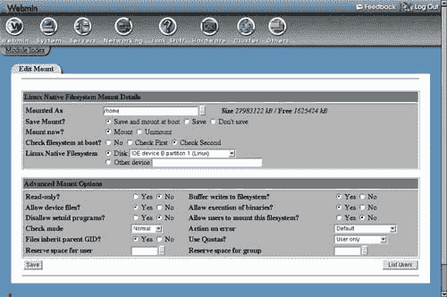

2. 更改任何设置，包括`Mounted As`目录、挂载文件系统的设备或服务器或挂载选项。

3. 如果您想在卸载文件系统的同时保留其记录以便以后挂载，请将`Mount now?`选项更改为`Unmount`。然而，如果您想挂载已永久记录的文件系统，请将选项更改为`Mount`。

4. 点击`Save`按钮使更改生效。如果一切顺利，浏览器将返回主页的文件系统列表。

5. 如果您正在更改一个忙用的挂载文件系统，您将获得仅将更改应用于永久列表的选项。如果您尝试在 Linux 原生文件系统上启用配额，通常将选项应用于永久列表就足够了。

6. 要完全删除文件系统，只需编辑它并将`Save Mount?`选项设置为`Don't save`，将`Mount Now?`选项设置为`Unmount`。假设它未被使用，它将被卸载并从已记录的文件系统列表中删除，且将不再显示在模块主页的列表中。

## 5.10 列出文件系统的用户

如果由于文件系统忙碌而无法卸载或编辑它，您可能需要杀死正在使用它的进程。

要找到哪些进程正在使用文件系统，请遵循以下步骤：

1. 从主页的文件系统列表中，点击`Mounted as`列中的挂载点目录。将显示如图 5.4 所示的表单。

2. 点击页面右下角的`List Users`按钮。这将显示所有正在文件系统上读取、写入或处于文件系统任何文件或目录中的进程列表。

3. 要杀死它们，点击页面底部的`Kill Processes`按钮。现在您应该可以返回`Disk and Network Filesystems`模块并成功卸载。

## 5.11 模块访问控制

可以赋予`Webmin`用户对此模块的有限访问权限，使其只能编辑某些文件系统的设置，或仅允许挂载和卸载。允许不可信的用户挂载任何文件系统是一个坏主意，因为他可以通过挂载包含 setuid-root 程序的 NFS 或软磁盘文件系统来获得对系统的完全控制。然而，赋予某仅挂载和卸载某些文件系统的权限（其选项已设置为防止使用 setuid 程序）是非常安全的。如果您的系统有软磁盘或 CD-ROM 驱动器且您没有使用自动挂载系统，这将非常有用。

一旦赋予用户模块访问权限（如第 52 节所述），您可以按照以下步骤限制其仅挂载或卸载选定的文件系统：

1. 在`Webmin Users`模块中，点击用户名旁的`Disk and Network Filesystems`打开访问控制表单。

2. 将`Can edit module configuration?`字段更改为`No`，停止其配置模块使用不同的`fstab`文件或挂载命令。

3. 在`Filesystems that can be edited`字段中，选择`Under listed directories`并在相邻文本框中输入挂载点列表。例如，您可能会输入`*/mnt/floppy /mnt/cdrom*`。也可以输入类似`*/mnt*`的目录允许允许其下的所有文件系统。

4. 将`Can add new filesystems?`字段更改为`No`。

5. 将`Only allow mounting and unmounting?`字段更改为`Yes`，这样用户实际上无法编辑文件系统的详情。

6. 点击`Save`按钮激活新的限制。

在 Linux 系统上，`Allow users to mount this filesystem?`字段可用于允许命令行挂载和卸载程序。其他工具（如 Gnome 挂载面板小组件和 Usermin）也使用了此功能，这可能是赋予普通用户挂载和卸载权限的更好方法。

## 5.12 配置磁盘和网络文件系统模块

与其他模块一样，此模块也有几个可以更改的选项。要查看这些选项，请点击主页面左上角的`Module Config`链接。这将您进入标准配置编辑页面，在`Configurable options`标题下可以使用表 5.1 所示的选项。

### 表 5.1. 模块配置选项

| 选项 | 说明 |
| :--- | :--- |
| 请求浏览列表的服务器 | 当在挂载 smbfs 文件系统时，Server 字段旁边的按钮将弹出网络上 Windows 服务器的列表。此列表是从该选项指定的服务器获取的，该服务器应该是域控制器或工作组主节点。 |
| 显示长文件系统类型名称 | 如果将此选项设置为`No`，主页面将仅显示短文件系统类型名称（如`EXT2`）。默认情况下，它设置为`Yes`并显示长文件系统类型（如 Linux Native Filesystem）。 |

配置页面上的其他选项均不应更改，因为它们是由 Webmin 根据您的操作系统类型自动设置的。

## 5.13 文件系统类型比较

与其他操作系统不同，Linux 支持多种完全支持 UNIX 文件权限和所有权信息的不同类型文件系统。最初，`ext2`是唯一的选择，但较新的内核版本和发行版增加了对`ext3`、`reiserfs`和`xfs`的支持。此列表解释了这些替代文件系统类型的优势。

### 新型 Linux 原生文件系统 (ext3)

与`ext2`非常相似，但支持日志记录（journaling）。这意味着如果您的系统崩溃或掉电，而没有机会正常卸载文件系统，就不需要像`ext2`那样对整个`ext3`文件系统进行漫长的`fsck`检查。

由于`ext3`文件系统与`ext2`非常相似，它们以几乎完全相同的格式存储在磁盘上。这意味着通过创建一个特殊的日志文件，将现有文件系统转换为`ext3`相对简单。

### Reiser 文件系统 (reiserfs)

`ReiserFS`是一种全新的文件系统，旨在比`ext2`更快、更高效。它像`ext3`一样支持日志记录，并且处理大量小文件比其他文件系统好得多。然而，它可能没有`ext3`或`xfs`成熟，并且不支持配额。

### SGI 文件系统 (xfs)

`XFS`最初由 SGI 为其 IRIX 操作系统开发，如果你在 IRIX 上运行 Webmin，你也可以挂载`xfs`文件系统。它支持日志记录，并对`ACLs`（访问控制列表）和文件属性列表提供原生支持。特别是`ACL`支持非常有用，因为它允许您以普通 UNIX 用户/组权限无法实现的方式向文件授予访问权限。`XFS`在 IRIX 上已经使用了数多年，因此它应该相当成熟且可靠。

### IBM 日志文件系统 (jfs)

`JFS`最初由 IBM 开发用于其`AIX`和`OS/2`操作系统，但最近被移植到了 Linux。它支持日志记录和大型（64 位）文件大小，但目前不支持配额或`ACLs`。由于`JFS`在 IBM 操作系统已已多年，它应该相当成熟。但在 Linux 上它还很新，因此可能测试得不够充分。

要查看您的系统支持哪些文件系统类型，请进入`Partitions on Local Disks`模块（第 8 章介绍）并选择一个未使用的`Linux`类型分区。在页面底部有一个表单，您可以使用它在分区上按系统可用的类型之一创建一个新文件系统。大多数新的 Linux 发行版都支持`ext3`，某些发行版支持`reiserfs`，但只有少数发行版包含`xfs`支持。

Linux 还支持几种较旧的文件系统类型，如`ext`、`xiafs`和`minix`。除非你有一个用其中之一格式化的旧磁盘，否则你永远不需要使用它们。

## 5.14 其他操作系统

磁盘和网络文件系统模块除了 Linux 之外还支持几个其他操作系统，使用相同的用户界面。主要区别在于每个操作系统支持的文件系统类型，以及用于硬盘 UNIX 文件系统的类型。只有 Linux、Solaris 和 Irix 在在其他系统上添加硬盘文件系统时会显示可用分区的下拉菜单，否则必须手动输入`IDE`或`SCSI`控制器和驱动器编号。

可以使用该模块的操作系统以及它们与 Linux 的主要区别如下：

### Sun Solaris

Solaris 使用`ufs`（Webmin 称为 Solaris UNIX Filesystem）作为本地硬盘的标准文件系统类型。它具有与 Linux 上`ext2`许多相同的选项，但不支持组配额，仅支持用户配额。支持添加虚拟内存，方法与 Linux 完全相同。

Solaris `NFS`文件系统类型与 Linux 类似，但支持从多个`NFS`服务器挂载，以防一个宕机。在`Multiple NFS Servers`字段中输入服务器时，必须用逗号分隔，例如`host1:/path,host2:/path,host3:/path`。Solaris 系统只有在安装了`rumba`程序的情况下才能挂载 Windows 网络文件系统。然而，它们只能临时挂载，不会记录在启动时挂载。

只有 Solaris 支持的一种有趣文件系统类型是`RAM Disk (tmpfs)`。这种类型文件系统中的文件不存储在磁盘的任何地方，因此当系统重启或卸载文件系统时将会丢失。默认情况下，Solaris 将`tmpfs`用于`/tmp`目录。

### FreeBSD


FreeBSD 也使用`ufs`作为标准本地硬盘文件系统类型，尽管 Webmin 称为 FreeBSD UNIX Filesystem。它具有与 Linux 大多数相同的选项，并支持用户和组配额。FreeBSD 支持虚拟内存，但缺点是一旦添加，不重启就无法删除。`NFS`支持与 Linux 类似的选项，但不支持 Windows 网络文件系统。

### OpenBSD

OpenBSD 使用`ffs`文件系统用于本地硬盘，Webmin 称为 OpenBSD UNIX Filesystem。与 FreeBSD 一样，它支持虚拟内存和`NFS`，不支持 Windows 网络文件系统。

### HP/UX

HP 的 UNIX 变体使用`hfs`（HP UNIX Filesystem）作为其标准本地硬盘文件系统类型，但也支持更优的带日志`vxfs`（Webmin 称为 HP Journaled UNIX Filesystem）。两者都有磁盘配额选项，但仅针对用户。支持虚拟内存并可以随时添加和删除，但如果永久记录，则在启动时始终挂载。也可以用`NFS`，选项与 Linux 类似，但没有 Windows 文件系统类型。

### SGI Irix

较新版本的 Irix 使用`xfs`（SGI Filesystem）作为其标准硬盘文件系统类型，支持与 Linux 上`xfs`相同的所有，包括用户配额、`ACLs`和文件属性。也可以用`efs`（旧 SGI Filesystem）类型，但只有当你拥有已格式化为该类型的旧分区或正在运行旧版本的 Irix 时才应使用。Irix 支持与 Linux 选项类似的`NFS`，但不支持 Windows 网络。AppleTalk 和 Netware 文件系统可以使用命令行工具挂载，但目前还无法在 Webmin 内部挂载或编辑。

该操作系统也具有标准的虚拟内存支持，但特殊之处在于第一块硬盘上的第一个交换分区始终使用特殊的`/dev/swap`设备文件自动添加为虚拟内存。

SCO UNIXWare 和 UNIXWare 的文件系统支持与 Solaris 非常相似，但还增加了对基于硬盘的`vxfs`（Veritas 文件系统）类型的支持。

如果您的操作系统不在上述列表中，则“磁盘和网络文件系统”模块将不支持该系统。在某些情况下，这是由于代码尚未编写，例如`AIX`或`Tru64/OSF1`。另一方面，`MacOS X`在启动时会挂载所有硬盘分区，并在用户通过 GUI 请求时自动挂载网络文件系统。因此，它不需要用于管理文件系统的 Webmin 模块。

### 5.15 总结

与其它操作系统不同，Linux 和其他 UNIX 变体不会自动让硬盘和可移动介质上的文件变得可用。本章解释了什么是文件系统和分区，以及如何挂载它们以访问其包含的数据。它还涵盖了网络上两个或多个系统之间文件共享的客户端部分。

## 第 6 章 NFS 文件共享

本章解释了如何通过建立 NFS 服务器将文件导出到其他 UNIX 系统。

### 6.1 使用 NFS 进行文件共享简介

NFS 是 UNIX 系统之间通过网络共享文件最常用的协议。NFS 服务器将其本地硬盘上的目录导出到 NFS 客户端，客户端挂载这些目录以便像访问任何目录一样访问它们。与其他文件共享协议（如 Windows 网络、Netware 和 AppleShare）不同，NFS 设计用于支持具有多个用户的客户端系统。这意味着客户端从不登录服务器，而服务器几乎完全信任客户端来验证用户。缺点是，NFS 不是与不可完全信任的客户端系统共享文件的良好协议。

NFS 不使用用户名和密码进行验证，而是使用客户端的 IP 地址。只有受信任的客户端才允许挂载服务器的目录，使其不会受到网络上任何客户端的未经授权文件访问的影响。通过限制客户端特定 UNIX 用户的访问权限，或将来自客户端的所有请求视为单个用户，可以获得额外的安全性。

在 Linux 上，`/etc/exports`文件包含了由 NFS 导出的目录及其导到的客户端的永久列表。通常，该文件由后台运行并服务 NFS 请求的`nfsd`和`mountd`程序在启动时读取。当您使用 Webmin 更改或创建导出时，导出文件将直接更新。

本章仅涵盖使用 NFS 从服务器共享目录。有关如何在客户端上挂载 NFS 导出目录的详细信息，请参见第 5 章。如果您想与 Windows 客户端共享文件，应该阅读第 43 章（涵盖 Samba），因为 Windows 并不广泛支持 NFS。

### 6.2 NFS Exports 模块

在 Linux 上，NFS 服务器配置是通过 NFS Exports 模块完成的，该模块可以在“网络”（Networking）类别下找到。进入模块后，主页面将显示导出目录列表以及允许访问它们的客户端列表，如图 6.1 所示。

### 图 6.1. NFS Exports 模块

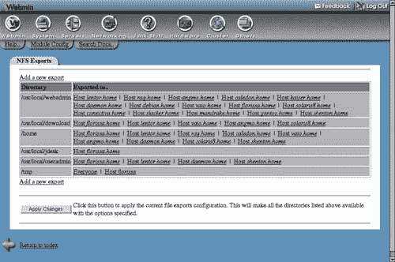

大多数 Linux 发行版都默认安装了 NFS 文件共享所需的程序。然而，如果 Webmin 检测到您的系统中缺少这些程序，当您进入模块时将显示错误消息。如果发生这种情况，您将需要从发行版的光盘或网站安装`nfs-server`或`nfs`软件包。

### 6.3 导出目录

只有本地文件系统上的目录才能通过 NFS 导出，因此无法重新导出从另一个 NFS 服务器挂载的文件。同样无法从非 UNIX 文件系统（如`vfat`、`ntfs`或`iso9660`）导出目录。如果导出的目录下有挂载点，则这些挂载点下的文件将无法被 NFS 客户端访问。因此，如果您导出了根目录`/`且`/home`挂载了独立的文件系统，您需要也导出`/home`，客户端需要挂载它才能看到其下的文件。

导出目录的步骤为：

1. 点击模块主页上的“添加新导出”（Add a new export link）。这将带您进入输入导出详细信息的表单，如图 6.2 所示。

### 图 6.2. 新 NFS 导出表单

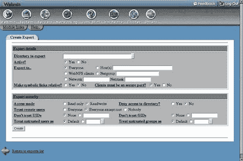

2. 在“导出目录”（Directory to export）字段中输入您想要共享的目录。

3. 除非您希望该导出不可用，否则确保“启用?”（Active?)选项设置为“是”。

4. “导出到”（Export to）选项允许您选择哪些客户端将拥有该目录。可能的选择有：

   - **所有人（Everyone）**：任何通过网络连接到您的系统都能挂载该目录。请非常谨慎选择此选项，因为它可能允许 Internet 上的任何人访问您的文件。

   - **主机（Host(s)）**：仅允许指定的单个主机或 IP 地址。您也可以在此选项输入通配符主机名（如`.foo.com`），以允许来自域的所有主机。然而，如果您想将目录导出到几个特定的客户端主机，唯一的解决方案是为同一个目录创建多个导出，每个导出在该字段中使用不同的主机名。

   - **WebNFS 客户端**：WebNFS 是一种通过 Internet 访问 NFS 出的少用协议。除非您知道自己在做什么，否则不要使用此选项，因为它可能允许任何人访问您的文件。

   - **网络组（Netgroup）**：网络组是在 NIS 服务器上定义的主机列表。遗憾的是，您的系统必须是自己的客户端此功能才有用处。

   - **网络和子掩码（Network and Netmask）**：允许指定网络上的所有主机连接。要允许所有 IP 地址为`192.168.1.0`到`192.168.1.255`的主机连接，您需要在网络处输入`192.168.1.0`，在子掩码处输入`255.255.255.0`。

5. 如果您想防止客户端在导出目录中修改或创建文件，将“访问模式”（Access mode）选项设置为“只读”（Read only）。

6. 如果仅导出到受信任的系统，将“信任远程用户”（Trust remote users）选项设置为“所有人”（Everyone）。

7. 然而，如果您想确保客户端仅具有单个 UNIX 用户的权限，请将“信任远程用户”设置为“无名”（Nobody），并分别将用户及其主要用户组输入到“将不被信任的用户视为”（Treat untrusted users as）和“将不被信任的组视为”（Treat untrusted groups as）字段中。这在导出到仅供单用户用户使用的客户端工作站时非常有用。

8. 点击“创建”（Create）按钮保存导出。如果您在任何字段中犯了任何错误，将显示解释性错误消息。否则，浏览器将返回导出列表。

9. 点击“应用更改”（Apply Changes）按钮使您的新导出生效。

允许的客户端现在应该能够挂载导出的目录。如果不能，请检查系统的错误日志，查看来自 NFS 服务器进程的消息，这些消息将解释客户端被拒绝的原因。

### 6.4 编辑或删除 NFS 导出

可以通过遵循以下步骤随时编辑现有 NFS 导出的所有详细：

1. 在模块主页上，点击“导出到”（Exported to）列下您想要编辑的客户端。如果一个目录被多次导出到不同的客户端，则每个导出都必须单独编辑。

2. 在导出编辑表单上（与图 6.2 基本相同），更改包括要共享目录在内的任何选项。

3. 如果您想删除导出，点击页面右下角的“删除”（Delete）按钮。否则，点击“保存”（Save）保存您的更改。无论哪，您的浏览器都将返回模块主页。

4. 点击“应用更改”（Apply Changes）按钮使更改生效。

### 6.5 Solaris 上的 NFS

在 Solaris 上，NFS 导出由独立的 NFS Shares 模块管理。由于 Solaris 使用不同的文件（`/etc/dfs/dfstab`）和文件格式来存储导出，该模块的用户界面与 Linux 模块不同。图 6.3 显示了 NFS Shares 模块的主页。如你所示，导出是按目录而不是按客户端配置的。

### 图 6.3. Solaris NFS Shares 模块

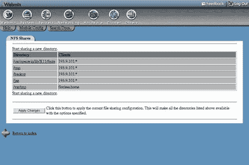

在 Solaris 上添加新的 NFS 导出，请遵循以下步骤：

1. 点击`Start sharing a new directory`链接，这将引导您进入输入新导出详细信息的表单。

2. 在`Directory`字段中输入您想要共享的目录。

3. 在`Read-only access`和`Read-write access`字段中填写您想要授予访问权限的客户端主机名。如名称所示，`Read-only`字段中的主机将无法向服务器上的写入或修改文件。

4. 除了主机名，您还可以使用格式如`@*192.168.1*`或`@*192.168.1/24*`输入网络、NIS 网络组，甚至是如`*.foo.com`的 DNS 域名（前面的点表示整个域名）。

5. 默认情况下，客户端上的 root 用户对服务器上的文件只有有限的访问权限。要给予某些客户端的 root 完全文件访问权限，请在`Root access`字段中输入其主机名、网络、网络组或域名。

6. 点击页面底部的`Save`按钮创建导出。除非您在表单上犯了错误，否则您将返回导出目录列表。

7. 点击`Apply Changes`按钮使您的新导出生效。

只需通过点击模块主页上的目录即可编辑现有的 NFS 导出。将出现与创建导出时相同的表单，允许您更改任何选项。如果您想删除该导出，请点击页面底部的`Delete`按钮。务必在进行任何更改后再次点击`Apply Changes`，以便更改生效。

### 6.6 BSD、MacOS X 和 OpenServer 上的 NFS

FreeBSD、NetBSD、OpenBSD、OS X 和 OpenServer 都使用`/etc/exports`文件来存储 NFS 导出，但其格式在不同的操作系统中有所不同。这意味着它们使用不同的 NFS Exports 模块，该模块具有其独特的用户界面，如图 6.4 所示。导出是按目录而不是按客户端配置的，您可以同时为多个目录指定选项和允许的客户端。

### 图 6.4. BSD NFS Exports 模块

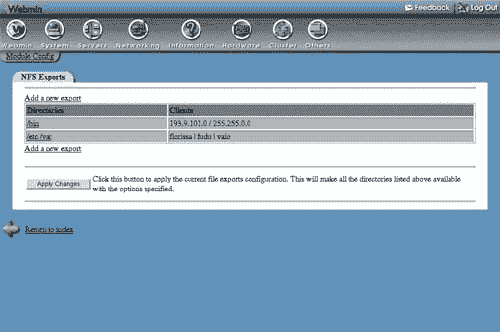

在这些操作系统之一上添加新的 NFS 导出，请遵循以下步骤：

1. 点击模块主页上的`Add a new export`链接。将出现输入新 NFS 导出详细信息的表单。

2. 在`Directories to export`字段中输入您想要共享的目录。注意，同一文件系统上的多个目录不能单独导出到同一个客户端。

3. 如果您允许客户端挂载子目录，请选择`Export subdirectories?`选项。然而，如果启用此项，`Directories to export`字段只能输入一个目录，且该目录必须是文件系统的根。

4. 要授予所有客户端只读访问，请将`Read only?`选项设置为`Yes`。

5. 要将访问限制为单个主机或主机列表，请在`Clients`选项中选择`Hosts / netgroups`，并在字段中输入您想要的主机名、IP 地址或网络组。

6. 要将访问限制为整个网络，选择`Network`选项，并将整个网络地址（如`192.168.1.0`）和子掩码（如`255.255.255.0`）输入相应的字段。

7. 点击`Save`按钮创建导出，您将返回主页上的导出列表。

8. 点击`Apply Changes`按钮使您的新导出生效。

只需通过点击模块主页上的目录即可编辑现有的 NFS 导出。将出现与创建导出时相同的表单，允许您更改任何选项，或点击`Delete`按钮将其删除。务必在进行任何更改后再次点击`Apply Changes`，以便更改生效。

### 6.7 Irix 上的 NFS

Irix 有其独特的`/etc/exports`文件格式，与 BSD 相似但并不完全相同。因此，它也有自己的特殊版本的 NFS Exports 模块，用户界面略有不同。模块的主页列出了正在导出的目录及其导出的主机，布局与图 6.4 所示的 BSD NFS Exports 模块非常相似。

在 Irix 上添加新的 NFS 导出，请遵循以下步骤：

1. 点击主页上的`Add a new NFS export`链接，这将引导您进入输入新导出信息的表单。

2. 在`Directory to export`字段中输入目录。

3. 在`Export to hosts/netgroups`字段中输入您想要授予访问权限的客户端的主名、IP 地址和网络组。如果此字段为空，将允许任何主机挂载导出的目录。

4. 为了防止所有客户端修改导出的文件，将`Read-only?`选项设置为`Yes`。

5. 如果您想授予某些客户端读写权限以及其他客户端只读权限，请在`Read/write access`字段中输入读写客户端的主机或 IP 地址。

6. 默认情况下，客户端上的 root 用户对服务器上的文件只有有限的访问权限。要给予某些客户端的 root 完全文件访问权限，请在`Root file access`字段中输入其主机名或 IP 地址。

7. 点击`Save`按钮创建导出，只要表单没有错误，您将返回主页上的导出列表。

8. 点击`Apply Changes`按钮使您的新导出生效。

可以通过点击模块主页上的目录来编辑或删除现有的 NFS 导出。如果您进行了任何更改，必须点击`Apply Changes`按钮使其生效。

### 6.8 总结

在本章中，我们解释了 NFS 文件共享协议，并记录了从一个系统共享文件到其他系统的步骤。您现在应该知道如何从运行任何支持的 UNIX 变体的系统导出数据到任何可以挂载 NFS 文件系统的客户端。您还应该理解使用 NFS 共享文件的安全影响，并知道通常不应使用它与不可信任的客户端共享文件。

## 第 7 章 磁盘配额（Disk Quotas）

在本章中，将解释如何使用磁盘配额来限制单个用户可以消耗的空间。

### 7.1 磁盘配额简介

在具有多个用户的系统中，通常需要限制每个用户可以占用的磁盘空间。配额是 UNIX 系统用于强制限制每个用户（可能可能的组）可以拥有的磁盘空间和文件数量的机制。每个文件都会计入其所有者的配额，如果使用了组配额，该文件计数也会计入其组所有者的配额。一旦用户超过了他的配额，他们将无法创建或增大任何文件，直到某些文件被删除。

配额是基于每个文件系统设置的，因此您可以对系统上的不同目录设置不同的配额。这意味着，如果两个目录都在同一个文件系统上，它们必须共享相同的配额。只有本地硬盘上的`ext2`、`ext3`和`xfs`等 UNIX 文件系统支持配额，但如果您的系统通过 NFS 挂载了启用了配额的远程目录，这些配额将在服务器上执行。

每个用户或组都有两个不同的配额，一个针对块（blocks），另一个针对文件（files）。块配额控制用户可以使用多少磁盘空间，以磁盘块为单位，通常每个块的大小为`1 kB`。文件配额控制用户可以创建多少个独立文件，这是非常有必要的，因为 UNIX 文件系统通常对同时存在的文件数量设有限制。如果没有文件配额，用户可能会创建数百万个空文件，直到达到文件系统的限制，从而阻止其他用户创建任何文件。

块配额和文件配额都有所谓的“软限制”（soft limits）和“硬限制”（hard limits）。软限制是用户收到警告其即将超出配额的临界点，但系统仍允许其继续使用磁盘空间。硬限制是永远无法超过的块或文件数量，任何尝试超过硬限制的操作都会导致错误。这两个限制都是可选的，因此你可以只设置硬限制，而不向用户发出其即将接近配额的警告；或者只设置软限制，仅对违反配额的用户发出警告，而不是实际上进行强制执行。

如果用户保持在软限制之上、硬限制以下的时间超过了设定的期限（称为宽限期），系统将视其为已超出硬限制，并阻止任何文件的创建或扩大。只有当用户删除了足够的文件使其使用量降到软限制以下时，系统才会恢复到仅警告级别。


在 shell 提示符下，可以使用`repquota`和`quota`命令查看配额，并使用`edquota`命令进行编辑。每个文件系统挂载目录下的`aquota.user`和`aquota.group`文件包含了每个用户或组分配了多少磁盘空间以及当前使用了多少的实际记录。在显示和设置配额时，Webmin 会调用`quota`命令并解析其输出。它不会使用系统调用，也不会尝试直接编辑配额文件。

### 7.2 磁盘配额模块

Webmin 的磁盘配额模块位于“系统”（System）类别下。进入该模块后，将显示所有可以启用或已启用配额的文件系统列表，以及它们当前的活动状态，以及是否为用户、组或两者配置了配额。示例见图 7.1。

### 图 7.1 磁盘配额模块

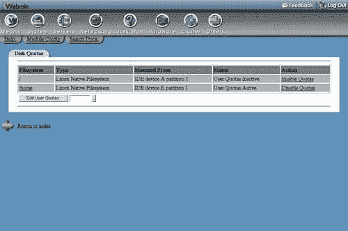

在大多数以前未使用过配额的系统中，您的文件系统都不会被列出。这是因为必须先如第 5 章所解释，在“磁盘和网络文件系统”模块中启用配额。如果您的系统没有安装配额操作命令，Webmin 将会在模块的主页显示错误消息，您将无法激活或编辑任何配额。所有的 Linux 发行版在其 CD 或网站上都应该包含配额命令软件包。

### 7.3 为文件系统启用配额

如果模块主页的“状态”（Status）列下该文件系统显示“用户配额已激活”（或“组配额已激活”），说明配额已经启用。如果尚未为`ext2`或`ext3`文件系统配置并开启配额，请按照以下步骤操作：

1. 如果文件系统已出现在模块主页的列表中，说明配额已经配置过，您可以直接跳到第 5 步。
2. 进入“磁盘和网络文件系统”模块，点击您想要启用配额的文件系统。
3. 将“使用配额?”（Use Quotas?）选项更改为“仅用户”（User only）、“仅组”（Group only）或“用户和组”（User and Group），取决于您想要执行的配额类型。
4. 点击“保存”（Save）按钮。如果出现错误说文件系统正在使用，只需点击“应用到永久列表”（Apply to Permanent List）按钮。配额通常不需要重启即可启用，并在系统下次重启时自动重新启用。然而，如果下一步失败，您将需要重启系统来激活它们，这在较新版本的 Linux 上是必要的。
5. 回到磁盘配额模块，现在应该可以看到您的文件系统。点击“启用配额”（Enable Quotas）链接立即激活配额。

假设一切顺利，浏览器将在短时间延迟后返回配额列表，状态列将变为“用户配额已激活”。对于`xfs`文件系统，步骤稍有不同。您必须先在“磁盘和网络文件系统”模块中启用用户和/组配额，然后重启或卸载并重新挂载文件系统。配额将在挂载时自动激活，因此无需在磁盘配额模块中启用它们。

### 7.4 为文件系统禁用配额

要永久禁用`ext2`或`ext3`文件系统的配额，请按照以下步骤操作：

1. 在模块主页上，点击文件系统“操作”（Action）列下的“禁用配额”（Disable Quotas）。
2. 为了防止配额在启动时被重新激活，进入“磁盘和网络文件系统”模块并点击列表中的文件系统。
3. 将“使用配额?”（Use Quotas?）选项更改为“否”（No）。
4. 点击“保存”（Save）按钮。如果出现错误说文件系统正在使用，只需点击“应用到永久列表”（Apply to Permanent List）按钮。

对于`xfs`文件系统，步骤 1 是不必要的（可能的），因为配额只有在文件系统挂载时启用。但在步骤 4 中保存文件系统的配额设置时，必须干净卸载并重新挂载才能禁用生效。

### 7.5 为用户或组设置配额

在当前启用正确类型配额的文件系统中，可以随时设置或更改用户或组的配额。默认情况下，任何尚未设置配额的用户或组都没有限制，因此可以使用文件系统上的所有磁盘空间。要为用户设置配额，请按照以下步骤操作：

1. 从模块主页的文件系统列表中，点击您想要编辑配额的挂载点。这将带您进入一个列出文件系统所有用户配额的页面，如图 7.2 所示。

### 图 7.2 用户列表及其配额

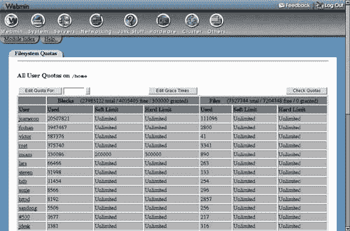

2. 点击“用户”（User）列下您想要编辑的用户名称，或者在“编辑配额对象”（Edit Quota For）字段中输入用户名并按按钮。两种操作都会带您进入一个包含用户当前配额设置以及已用块和文件的表单，如图 7.3 所示。

### 图 7.3 用户配额表单

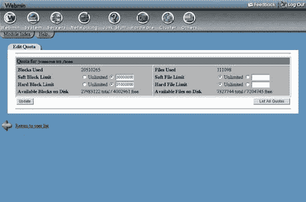

3. 将“软块限制”（Soft Block Limit）和“硬块限制”（Hard Block Limit）字段设置为您想要限制用户的块数，或选择“无限制”（Unlimited）不实施任何限制。在大多数文件系统中，每个块的大小为`1 kB`，但并不总是如此。
4. 将“软文件限制”（Soft File Limit）和“硬文件限制”（Hard File Limit）字段设置为您想要限制用户拥有的文件数量。
5. 点击“更新”（Update）按钮。新的配额设置将立即生效。

设置组配额的步骤几乎相同。如果一个文件系统同时启用了用户和组配额，模块主页的每个文件系统将有两个链接：一个针对用户，一个针对组。

### 7.6 将配额复制到多个用户

如果您系统中有大量用户，并希望他们都拥有相同的配额，有一个比逐个设置每个用户更简单的解决方案。相反，您可以为一个用户设置所需的配额，然后将其设置复制到任意数量的其他用户。唯一的缺点是配额是在所有文件系统中复制的，而不仅仅是单个。像这样复制配额的步骤如下：

1. 如第 7.5 节“为用户或组设置配额”所述，为单个*源*用户设置配额。
2. 在模块主页上，在“编辑用户配额”（Edit User Quotas）页面中输入*源*用户的用户名并按按钮。在列出所有文件系统用户配额的页面上，点击`Copy Quotas`按钮。这将带您进入一个表单，选择将配额设置复制到哪些用户。

通过选择表单上的任一选项，决定将配额复制到哪些`target`用户：

- **系统上的所有用户**：系统上的每一个用户都将具有相同的配额设置。在执行此操作后，您可能希望将 root 的配额设为无限制。
- **选定用户**：仅对此选项旁字段中输入的用户设置配额。
- **选定组的成员**：对输入到此选项旁字段中的组的所有主要和次要成员都将设置配额。

点击`Copy`按钮，将`source`用户在所有文件系统上的配额复制到所有`target`用户。如果您在使用组配额，也可以将一个组的设置复制到多个其他组。然而，选择复制到哪些组的选项略有不同。`Selected users`选项被`Selected groups`替换，`Members of selected groups`选项被`Groups containing users`替换。后者选项将复制到所有包含所输入用户作为成员的组。

### 7.7 设置宽限期

当用户超过其软限制（soft blocks）或文件限制时，在一定期限内（即宽限期）仍可以使用直到达到硬限制的磁盘空间。每个文件系统的块配额和文件配额有单独的期限。一旦过期，就好像他已经达到了硬限制一样。如果超过的是块配额，则无法再使用更多磁盘空间；如果超过的是文件配额，则无法再创建更多文件。组配额也可以设置宽限期，如果文件系统同时启用了用户和组配额，则每个配额都有独立的期限。

要设置特定文件系统上所有用户的宽限期，请遵循以下步骤：

1. 从该模块主页的文件系统列表中点击挂载点。这将带您进入所有用户及其配额的列表，如图 7.2 所示。
2. 点击`Edit Grace Times`按钮，这将弹出一个编辑期限的表单。
3. 对于块和文件配额，均选择期限和单位。完成后，点击`Update`按钮保存您的设置并使宽限期立即生效。

在文件系统上编辑组宽限期的过程几乎完全相同。如果文件系统同时启用了用户和组配额，该模块的主页上每个文件系统有两个链接，一个针对用户，一个针对组。

### 7.8 为新用户设置默认配额

如果文件系统启用了用户配额，您可以配置为使用 Webmin 的`Users and Groups`模块创建的新 UNIX 用户分配块和文件配额。如第 4 章所述，每当添加用户时，其他模块都会收到通知，以便它们执行额外的操作。在`Disk Quotas`模块中，该操作可以是为用户在多个文件系统上设置初始配额。

要设置特定文件系统上新用户的默认配额，请遵循以下步骤：

1. 在模块的主页上，点击您想要设置默认值的文件系统挂载点。这将带您进入用户及其配额的列表，如图 7.2 所示。
2. 页面最底部有一个表单，您可以在其中设置默认的硬/软块和文件配额。填写完成后，点击`Apply`按钮。

在`Users and Groups`模块中创建 UNIX 组时，也可以在组配额页面设置相同的选项。

### 7.9 其他操作系统

由于磁盘配额在所有版本的 UNIX 中的工作方式非常相似，此模块在所有支持的操作系统上看起来几乎完全相同。最大的区别是某些 UNIX 变体不支持组配额。某些系统（如 Solaris）在在此模块中激活之前，不需要在`Disk and Network Filesystems`模块中启用配额。如果文件系统有配额选项，则由它决定在启动时是否启用配额。

### 7.10 配置磁盘配额模块

`Disk Quotas`模块只有几个可以更改以配置其界面的选项。要编辑这些选项，点击主页上的`Module Config`链接，这将带您进入标准的配置编辑页面。`Configurable options`标题下的可用设置显示在表 7.1 中。

### 表 7.1 模块配置选项

| 显示的用户或组的最大数量 | 当您点击模块主页上的文件系统时，将显示带有配额的用户或组的完整列表。然而，如果用户数量超过此选项设置，则将显示一个输入用户名的文本框，用于查看和设置其配额。 |
|--------------------------|-------------------------------------------------------------------------------------------------------------------------------------------------------------|
| 按什么排序用户和组       | 通常，文件系统上带有配额的用户列表按磁盘使用情况排序，但通过更改此选项，可以让它们按用户名排序，或仅按`repquota`命令使用的顺序显示。                     |

配置页面上的其他选项不应更改，因为它们是 Webmin 根据您的操作系统类型自动设置的。

### 7.11 模块访问控制

如第 5.2 章所述，可以允许 Webmin 用户仅访问模块的部分功能。在`Disk Quotas`模块中，您可以限制哪些用户和组可以编辑配额，以及在哪些文件系统上可以编辑这些配额。如果您的组织中有人被允许编辑部分或全部配额，但不能执行任何其他管理任务，这将非常有用。

假设您已经创建了一个具有该模块访问权限的用户，设置此项的步骤如下：

1. 在 Webmin`Users`模块中，点击要限制的用户名称旁边的`Disk Quotas`。
2. 将`Can edit module configuration?`字段设置为`No`，以便该用户无法更改用于设置和获取配额的命令。
3. 要限制可以分配配额的文件系统，将`Filesystems this user can edit`字段更改为`Selected`并从下列表中选择它们。
4. 将`Can enable and disable quotas?`字段设置为`No`，除非该用户负责允许文件系统上的所有用户和组配额，否则他将能够关闭未被允许编辑的用户配额。
5. 将`Can configure quotas for new users?`字段设置为`No`，以便他无法更改分配给在`Users and Groups`模块中创建的用户的配额。只有当允许 Webmin 用户编辑某个文件系统上的所有配额时，才应将此项设置为`Yes`。
6. 如果您不想让此 Webmin 用户更改宽限期，将`Can edit user grace times?`和`Can edit group grace times?`字段设置为`No`。
7. 为了防止用户发放巨额磁盘配额，请将`Maximum grantable block quota`和`Maximum grantable file quota`字段分别设置为可以授予任何单个用户的最大块和文件数。

要限制可以编辑配额的 UNIX 用户，请将`Users this user can edit quotas for`（此用户可以编辑配额的用户）字段从`All users`（所有用户）更改为其他选项之一。最有用的是`Users with UID in range`（UID 在范围内的用户），它限制访问 UID 位于相邻字段中输入的最小和最大值之间的用户。允许编辑 root 用户的配额通常不是好主意，因为设置得太低可能会系统无法创建重要的 PID、邮件和锁文件。你可以通过选择`All except users`（除用户外的所有）并在相邻字段中输入`root`来防止这一点，假设你想允许编辑其他用户的配额。要停止 Webmin 用户编辑任何用户的配额，请选择`Only users`（仅限用户）选项并在相邻字段中留空。

同样，你可以通过更改`Groups this user can edit quotas for`（此用户可以编辑配额的组）字段来限制可以编辑配额的组。自然，这只对启用了组配额的文件系统有效。完成后，点击`Save`（保存）按钮将立即应用限制。

### 7.12 总结

读完本章后，你应该理解磁盘配额的用途，以及如何在任何 UNIX 系统上启用它们。你还应该知道块配额和文件配额之间的区别、配额与文件系统之间的关系，以及这对于包含用户数据的多个文件系统的服务器的影响。最后，用户配额和组配额的区别及其影响应该是清晰的。

## 第 8 章 分区、RAID 和 LVM

本章解释了硬盘如何进行分区，以及如何在这些分区上创建文件系统。它还涵盖了使用 RAID 和 LVM 将多个分区合并为一个大文件系统的方法。

### 8.1 硬盘分区简介

Linux 以及 PC 硬件上其他操作系统使用的所有硬盘都被划分为一个或多个不重叠的区域，称为分区。有时整个硬盘会被一个分区占用，但通常你的系统在主磁盘上至少有两个分区：一个用于根文件系统，另一个用于虚拟内存（也称为交换空间）。正如第 5 节所示，每个分区都可以用于单个文件系统，也可以用于虚拟内存。

每个分区都有一种类型，用于识别它所存储的数据类型。Linux 文件系统有一种类型，Linux 交换空间有一种类型，Windows 文件系统有一种类型，以及更多类型。几乎任何运行在 PC 硬件上的操作系统都有其自身文件系统的专用分区类型。然而，在你的系统上添加新分区时，你很少会使用专门针对 Linux 以外的任何类型。

在 PC 系统上，每个硬盘只能包含四个主分区。由于这通常是不够的，这四个分区中的一个可以是特殊的扩展分区，它可以包含无限数量的逻辑分区。如果你使用了扩展分区，那么你的硬盘可以包含的分区数量实际上没有限制。

每个硬盘被划分为等大小的磁道，磁道代表磁盘表面的同心圆。较大的硬盘通常有更多的磁道，但由于驱动器几何结构的不同，情况并不总是如此。每个分区都有起始和结束磁道，并占据磁盘上它们之间的所有空间。

在更改或重新格式化系统上的任何现有分区时要务必小心。因为它们包含文件系统数据，删除或修改其中一个可能会删除你所有的文件或导致系统无法启动。Webmin 试图防止这种情况，但只需点击几次鼠标仍可能造成巨大的损害！通常情况下，你只有在向系统添加新硬盘时才需要创建或编辑分区。

### 8.2 本地磁盘分区模块

Webmin 中的所有磁盘分区管理都是使用`Partitions on Local Disks`（本地磁盘分区）模块完成的，该模块可以在`Hardware`（硬件）类别下找到。进入该模块时，将显示显示系统中找到的所有硬盘和分区的页面，如图 8.1 所示。

#### 图 8.1 本地磁盘分区模块

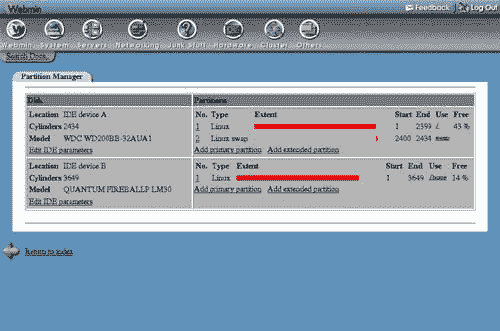

显示所有的 IDE 和 SCSI 磁盘，以及它们的制造商和型号。如果你的系统具有该模块支持的硬件 RAID 控制器，将显示 RAID 设备，而不是构成它们的实际底层硬盘。用于软件 RAID 的磁盘和分区将被显示，但它们合并后的逻辑或虚拟驱动器将不会显示。

对于每个磁盘，其上的所有分区都将列出，显示它们的类型、起始和结束磁道以及当前挂载点或其他用途。如果分区包含文件系统，还将显示可用磁盘空间量。如果分区正被用于软件 RAID，将显示它所属的 RAID 设备。同样，如果分区是 LVM 卷组的一部分，则将在`Use`（用途）列下显示组名称。

### 8.3 添加和格式化新分区

如果你刚刚向系统添加了新硬盘并想在 Linux 中使用它，你必须先对其进行分区，然后将分区格式化为你选择的文件系统类型。此过程的步骤如下：

1. 在`Partitions on Local Disks`模块的主页找到你的新硬盘。它可能还没有任何分区，但制造商可能已经设置了一个大分区。
2. 假设尚没有任何分区，点击新硬盘旁边的`Add primary partition`（添加主分区）链接。这将带你进入图 8.2 所示的创建表单，输入新分区的详细信息。

#### 图 8.2 分区创建表单

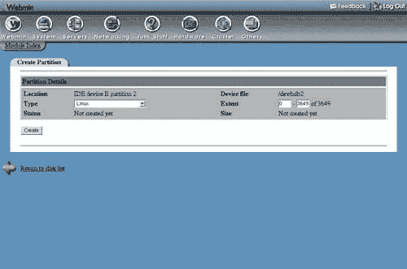

3. 如果新分区占据了整个硬盘，`Extent`（范围）字段可以保持不变，因为它们会自动填充以覆盖磁盘上剩余的所有可用空间。然而，如果你想创建多个分区，请调整范围使其仅占用磁盘的一部分。
4. 如果此分区用于`ext2`、`ext3`、`reiserfs`或`xfs`文件系统，将`Type`字段设置为`Linux`。
5. 如果它是用于虚拟内存，将`Type`设置为`Linux swap`。
6. 如果它是用于软件 RAID，将`Type`设置为`Linux raid`。
7. 如果它是用于 LVM，将`Type`设置为`Linux LVM`。
8. 如果你正在为其他操作系统创建文件系统，请将`Type`字段设置为适用于该操作系统的任何类型。
9. 点击`Create`（创建）按钮添加分区。假设未检测到错误，你将返回到模块主页上的磁盘和分区列表，该列表现在应该包含新分区。


如果要在新分区上创建 Linux 文件系统，你必须遵循第 8.4 节“创建新文件系统”（Creating a New Filesystem）中的步骤。虚拟内存分区可以在`Disk and Network Filesystems`（磁盘和网络文件系统）模块中立即添加。用于 RAID 的分区也可以立即在`Linux RAID`模块中运行，但在创建 RAID 设备之前，你必须已创建组成 RAID 设备的所有分区。作为 LVM 卷组一部分的分区可以使用`Logical Volume Management`（逻辑卷管理）模块立即添加。

## 8.4 创建新文件系统

在使用新创建的分区存储文件之前，必须首先在其创建一个文件系统。文件系统也可以创建在以前使用过的分区上，可能是由另一个操作系统创建的。然而，用新文件系统格式化分区时要要非常小心，因为以前包含的任何文件将永远丢失。

创建新文件系统的步骤为：

1. 在模块的主页上，点击你想重新格式化的分区的数字。这将带你进入如图 8.3 所示的分区编辑表单。

### 图 8.3 分区编辑表单。

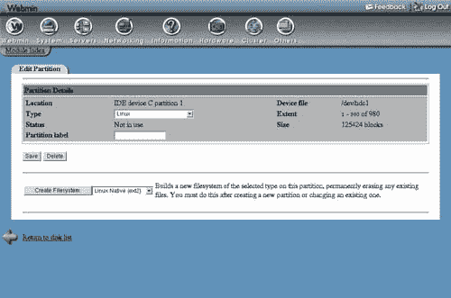

页面底部有一个标记为`Create Filesystem`（创建文件系统）的按钮，旁边是支持的文件系统类型菜单。请参见第 5.13 节“文件系统类型比较”以了解每种类型的优缺点。做出选择后，点击该按钮，将带你进入一个选择新文件系统选项的表单。

根据所选文件系统的类型，会有不同的创建选项。对于`ext2`或`ext3`文件系统，你可能想要更改的唯一选项是`Reserved blocks`（预留块），它决定了为 root 用户独占的磁盘空间。默认值为 5%，我认为这相当浪费。

点击`Create Filesystem`按钮来格式化分区。将显示一个显示新文件系统创建进的页面，对于大容量硬盘，此过程可能需要一些时间。

假设格式化成功，你现在可以使用`Disk and Network Filesystems`（磁盘和网络文件系统）模块来挂载新文件系统。

## 8.5 分区标签

标签是 Linux 新版本中的一项功能，它允许在`/etc/fstab`文件中通过短名称识别分区，而不是其 IDE 或 SCSI 设备文件（例如`/dev/hdb3`）。如果你将 IDE 驱动器从一个控制器更改到另一个、更改 SCSI 驱动器的 ID，甚至添加一个 ID 比现有驱动器小的新 SCSI 驱动器，设备文件就会发生。这些任何变化都可能导致分区在启动时无法挂载，可能导致你的系统无法启动。然而，带有标签的分区可以通过标签名称引用，即使设备文件发生了变化标签也不会改变。

某些较新的 Linux 发行版默认对安装时创建的文件系统使用标签。如果你在此类系统上使用`Disk and Network Filesystems`模块，这些文件系统的`Location`（位置）列将类似于`Partition labeled /home`的内容。

只有带有`ext2`、`ext3`或`xfs`文件系统的分区才能标记标签，因为标签存储在文件系统中而不是分区表中。要为现有文件系统标记标签，请遵循以下步骤：

- 在模块的主页上，点击你想标记的分区编号。这将带你进入分区编辑表单，如图 8.3 所示。

- 假设分区当前未未使用，你可以在`Partition label`字段中输入新标签。标签长度最多为 16 个字符，例如`/home`或`root`。

- 输入标签后，点击`Save`按钮。它将被存储在文件系统中，浏览器将返回模块主页。

此时，可以如第 5 章所示，使用`Disk and Network Filesystems`模块通过标签名称挂载已标记的文件系统。

## 8.6 删除或更改分区

一旦创建了分区，就无法使用 Webmin 更改其在硬盘上的大小或位置。你所做的只有更改其类型或删除它。然而，如果分区上的文件系统已列在`Disk and Network Filesystems`模块中（即它当前已挂载或记录为启动时挂载），则这两者都是可能的。

更改分区类型不会以任何方式损害其上的数据。然而，它可能会导致某些操作系统或某些用途无法使用。

更改类型的步骤为：

- 在模块的主页上，点击你想更改的分区编号。这将带你进入分区编辑表单。

- 只要分区未使用，你就可以从`Type`字段中选择新类型并点击`Save`按钮。

- 更改完成后，浏览器将返回磁盘和分区列表。

只有在你确定要丢失其上的所有数据时，才应该删除分区。然而，这是 Webmin 中对分区表进行某些更改的唯一方法，例如将两个小分区替换为一个较大的分区。如果你确定要继续删除，请使用以下流程：

- 在模块的主页上，点击你想删除的分区编号，这将带你进入分区编辑表单。

- 点击`Delete`按钮，该按钮仅在分区未使用时才会显示。这将带你进入确认删除的页面。

- 如果你确实确定要继续，点击`Delete Now`按钮。任务完成后，你将返回模块主页。

理论上，可以通过创建一个具有完全相同大小和区区（extents）的新分区来恢复已删除的分区。

## 8.7 模块访问控制

意外的是，可以限制 Webmin 用户对`Partitions on Local Disks`模块中某些磁盘的访问。如果你的系统有一个可移动驱动器（如 Zip 或 Jaz 驱动器），你希望允许用户使用 Webmin 对进行分区，同时防止他们重新格式化主硬盘，这将非常有用。

一旦用户被授予了模块权限，限制其可以访问的磁盘的过程包括以下步骤：

- 在`Webmin Users`模块中，点击用户名旁边的`Partitions on Local Disks`。这将打开模块访问控制表单。

- 将`Disks this user can partition and format`字段更改为`Selected`，并从下方列表中选择允许用户分区并创建创建文件系统的磁盘。

- 要停止用户在主页上看到他无法管理的磁盘，将`Can view non-editable disks?`选项更改为`No`。

- 最后，点击`Save`按钮激活访问控制限制。

仅仅能够对磁盘进行分区和格式化并不特别有用，除非它还能被挂载。`Disk and Network Filesystems`模块不支持访问控制限制，因为赋予用户挂载文件系统的权限会打开多个安全漏洞。更好的解决方案是设置自动挂载文件系统（automounter filesystem），这样移动设备只需进入特定的挂载点目录即可进行挂载。

## 8.8 其他操作系统

Solaris 是另一个具有管理磁盘和分区模块的操作系统，但 Linux 和 Solaris 之间存在几处区别：

- 每个 Solaris 磁盘都恰好有 8 个分区，某些分区如果未使用，则可能没有区区。分区永远不需要创建或删除，也没有扩展分区或逻辑分区。

- 在编辑 Solaris 分区时，可以在不需要删除和重新创建的情况下更改其区区。然而，这几乎肯定会导致分区上数据的丢失。

- 每个分区都有一个类型，指示其用途。`root`类型通常用于根目录文件系统，`swap`类型用于虚拟内存，`usr`类型用于其他文件系统，而`unassigned`类型用于空分区。

- 每个分区有两个标记`Mountable`（可挂载）和`Writable`（可读写），分别指示它们是否可以被挂载或写入。

- Solaris 分区上支持的文件系统仅有`uffs`（原生 UNIX 文件系统类型）。

- Solaris 不支持分区标记。

- 在编辑模块访问控制时，没有`Can view non-editable disks?`选项。

下文解释的`RAID`和`LVM`模块在 Solaris 或任何其他操作系统可用。

## 8.9 RAID 简介

RAID（全称为廉价冗余阵列）是一种将不同磁盘上的多个分区组合成一个大虚拟设备的方法，称为 RAID 阵列。它具有几个优点：

- 你可以创建一个与所有现有硬盘一样大的单个文件系统，而不需要在不同的挂载点目录上单独挂载每一个。

- 在大多数情况下，向 RAID 设备读写数据都比访问单个磁盘更快，因为被读取或写入的数据散布在多个驱动器上。

通过正确的配置，RAID 设备上的数据即使在任何硬盘故障的情况下也能生存。这是通过将冗余信息分散到所有驱动器来实现，代价是消耗一些磁盘空间。

不同类型的 RAID 配置被称为`levels`（级别）。Linux 支持级别有：

- **级联或线性 (Concatendated or Linear)**：在此模式下，RAID 阵列中的所有分区尾尾连接组合成一个大的虚拟设备。写入设备的数据将填满第一块磁盘，然后进入第二块磁盘，依此类推。`Linear`模式通常不会加快数据访问速度，因为被读取或写入的文件块很可能在同一块磁盘上相邻。

- **RAID 0 或条带化 (RAID 0 or Striped)**：与线性模式一样，条带模式下的多个分区也被组合成一个大设备。然而，写入阵列的数据将均匀地分布在所有磁盘上，这样读取或写入单个大文件会快得多。理想情况下，如果你在条带 RAID 阵列中有 5 块磁盘，那么访问数据的速度将快 5 倍。这种模式唯一的问题是它无法很好地处理大小不同的磁盘，磁盘上比其他磁盘更大的空间仍会被使用，但只能以其正常速度运行。

- **RAID 1 或镜像 (RAID 1 or Mirrored)**：在镜像模式下，阵列中的每个分区包含完全相同的数据。这意味着在发生磁盘故障时，即使只有一个硬盘存，你的数据也是安全的。缺点是，在情况下，大多数磁盘都被浪费了，阵列的可用空间仅相当于最小分区的大小。从镜像阵列读取的速度与从条带阵列读取一样，但由于需要同时将所有数据写入所有磁盘，写入速度将与最慢的磁盘一样慢。

- **RAID 4 或校验 (RAID 4 or Parity)**：校验模式很少使用，因为它相比 RAID 5 并没有真正的优势。它提供了针对单盘故障的保护并增加了读取速度，但没有增加写入速度。`RAID 4`阵列可以承受任何一个磁盘的丢失，因为它专门用一个磁盘来存储校验信息，如果其中一个磁盘发生故障，可以使用它可以重构其他磁盘上的数据。由于对阵列的所有写入都会导致对此磁盘的写入，它会成为拖慢整个阵列的瓶颈。

- **RAID 5 或冗余 (RAID 5 or Redundant)**：这是最有用的 RAID 模式，因为它提供了针对磁盘故障的保护，增加了读写速度，并将多个分区组合成一个大的虚拟设备。`RAID 5`阵列可以承受任何一个磁盘的丢失而不丢失所有数据，但代价是牺牲所有磁盘上的某些空间来存储冗余信息。它比线性模式快，但由于需要维护冗余性，没有条带模式那么快。

本章仅涵盖 Linux 上的 RAID 配置软件。如果你的系统有独立的 RAID 控制器卡或外部阵列，你需要的特殊软件进行设置。硬件控制器上的虚拟 RAID 设备将出现在`Partitions on Local Disks`模块中进行分区，就像任何真实的硬盘一样。它们在 Linux RAID 模块中不可见也无法配置。

## 8.10 Linux RAID 模块

该模块允许你在 Linux 系统上创建、格式化和删除 RAID 阵列。与其他硬盘相关的模块一样，它可以在`Hardware`类别下找到。当你进入该模块时，主页将显示现有的 RAID 设备（如果有），如图 8.4 所示。

### 图 8.4. Linux RAID 模块。

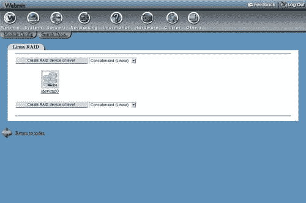

如果 Webmin 检测到系统中缺少设置 RAID 使用的命令，将在模块的主页上显示错误消息。然而，大多数 Linux 发行版的 CD 或网站上都应该有一个包含 RAID 命令的包。如果你的 Linux 内核编译时没有开启 RAID 支持，将显示不同的错误。在这种情况下，你可能需要重新编译内核并开启 RAID 支持。

假设所有必要的软件包都已安装，添加新的 RAID 设备相对简单。要遵循的步骤如下：

1. 在`Partitions on Local Disks`模块中，在你想要用于 RAID 的每块磁盘上创建一个分区。也可以使用现有的分区，只要它们不包含任何你不希望被覆盖的数据。部分用于其他用途的磁盘也可以添加新分区供 RAID 备用，尽管这可能会抵消某些性能优势。

2. 每一个要作为 RAID 阵列一部分的分区都应将其类型设置为`Linux raid`。除非你使用的是线性模式，否则所有分区的大小应该是相同的，以免浪费较大分区上的空间。

3. 此时，可能需要重启系统。某些 Linux 内核只能在启动时检测新分区。如果你不重启且未检测到分区，则创建 RAID 设备将失败。

4. 在模块的主页上，选择你想使用的 RAID 级别并点击`Create RAID device of level`按钮。这将带你进入一个表单，用于选择作为阵列一部分的分区和其他选项，假设 Webmin 检测到你的系统中至少有一个未使用的分区。

5. `Partitions in RAID`选项将列出当前未使用的所有硬盘分区，以便包含在你的 RAID 设备中。它还会列出任何其他未使用的 RAID 设备，允许你在理论上创建一个包含其他阵列的阵列。选择所有你想作为新 RAID 设备一部分的分区。

6. 如果选定的任何分区之前被用于其他用途，则应将`Force initialization of RAID?`选项设置为`Yes`。否则，如果在任何分区上检测到文件系统，新阵列的创建将失败。

7. 点击`Create`按钮设置新阵列。如果一切成功，你将返回模块主页，主页现在应该包含你的新 RAID 设备。

8. 如果你想在新设备上创建一个文件系统以便挂载，请点击其图标进入设备状态页。如果 RAID 设备将用于虚拟内存、作为`LVM volume group`的一部分或作为另一个 RAID 阵列的一部分，则没有必要。

9. 从页面底部的菜单中选择你想创建的文件系统类型，并点击`Create filesystem of type`按钮。

10. 根据第 8.4 节“Creating a New Filesystem”的解释，选择新文件系统的任何选项。完成后，点击`Create`按钮。将显示新文件系统创建进的页面，对于大型阵列可能需要一些时间。

11. 假设格式化成功，你现在可以使用`Disk and Network Filesystems`模块挂载新文件系统。

未使用的现有 RAID 设备可以通过点击模块主页上的图标并按下`Delete`按钮来删除或禁用。删除设备将导致存储在上面的任何数据永久丢失。

## 8.11 LVM 简介

LVM（逻辑卷管理器）是一个强大的 Linux 功能，它在系统上的物理分区和存储其文件系统之间添加了一个抽象层。由 LVM 管理的分区称为`physical volumes`（物理卷），它们组合成`volume groups`（卷组）。从每个卷组中可以创建`logical volumes`（逻辑卷），文件系统实际存储在上面。每个卷组的大小是其所有物理卷大小之和。此空间可以分配给任何能容纳它的逻辑卷，因此它可以包含许多许多小的逻辑卷，或一个跨越多个物理卷（以及分区）的巨型逻辑卷。

乍看之下，LVM 似乎并不比 RAID 强大，因为 RAID 也可以将多个分区合并为一个大的文件系统。然而，它赋予了你更大的自由度，可以将磁盘划分为独立的文件系统，这些系统可以占用磁盘的一部分、几块磁盘或它们之间的任何组合。唯一的缺点是 LVM 不像 RAID 1 和 RAID 5 那样支持冗余。

LVM 最有用的功能是能够调整逻辑卷及其内部文件系统的大小，最高可用卷组中的空闲空间。可以向现有的卷组添加额外的物理卷（例如新安装的硬盘分区），从而增加空闲空间。例如，如果你的系统有两个硬盘，其分区组合成一个卷组，你可能在逻辑卷上有一个与两块硬盘总和一样大的文件系统。如果你开始遇到磁盘空间不足并想扩大文件系统，可以安装一个新硬盘，将其添加到卷组，然后扩大逻辑卷以利用所有新的空闲空间！这比将新硬盘挂载到现有文件系统的某个处的子目录下要方便得多。

### 图 8.5 逻辑卷管理器概述。

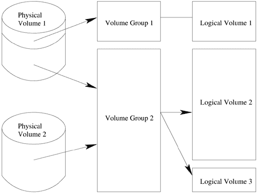

物理卷也可以从 LVM 卷组中移除，只要卷组中有足够的空闲空间来存储原来在物理卷上的数据。这意味着理论上，你可以从系统中移除一块较小的硬盘并将其替换为更大的硬盘，而无需手动来拷贝文件。

## 8.12 逻辑卷管理模块

Webmin 的逻辑卷管理模块允许你执行几乎所有使用命令行 LVM 工具可以完成的任务。当你从“硬件”（Hardware）类别进入该模块时，主页面会显示所有现有卷组及其物理卷和逻辑卷，如图 8.6 所示。

### 图 8.6 逻辑卷管理模块。

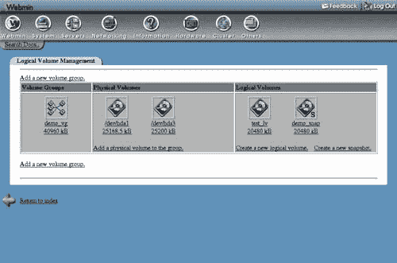

由于该模块依赖于`vgcreate`等 LVM 工具，如果找不到这些工具，主页面将显示错误消息。但是，如果你运行的是较新的 Linux 版本，这些工具应该在你的发行版 CD 或网站上可用。该模块还会通过查找`/proc/lvm`目录来检查你的内核是否支持 LVM。如果缺少支持，你需要使用命令`modprobe lvm-mod`加载`lvm-mod`内核模块，或者重新编译支持 LVM 的内核。

## 8.13 创建新卷组

假设你至少有一个空分区供 LVM 使用，设置一个新的卷组是非常简单的。要遵循的步骤如下：

1. 在“本地磁盘分区”（Partitions on Local disks）模块中，将任何你想包含在卷组中的分区类型更改为 Linux LVM。尝试使用任何其他类型的分区将失败。

2. 回到逻辑卷管理模块，点击“添加新卷组”（Add a new volume group）链接，这将引导进入卷组创建表。

3. 在“卷组名称”（Volume group name）字段中为你的新卷组输入一个名称。名称应该短且不包含空格，例如`data_vg`。

4. 通过“初始物理设备”（Initial physical device）字段选择要包含在你的卷组中的初始分区。只有 Webmin 确定未被使用的分区或 RAID 设备才会出现在列表中。你也可以通过选择“其他”（Other）选项并在旁边的字段中输入文件名来指定分区。

5. 如果“其他”是唯一的选项，说明 Webmin 未检测到任何可供 LVM 使用的可用分区。

6. 注意，你选择的分区或设备上的任何数据都将永久丢失，即使该卷组实际上未被使用。


7. 点击“创建”（Create）按钮。如果一切顺利，你将返回模块主页，并显示你的卷组及其初始物理卷。

若要向你的新卷组添加更多物理卷，请参见第 8.14 节“添加和移除物理卷”。

### 8.14 添加和移除物理卷

一旦使用初始物理卷创建了卷组，你可以随时向其添加新的分区或 RAID 设备。这将增加卷组中的空闲空间，允许你创建更多逻辑卷或扩展现有的卷。要添加物理卷，请遵循以下步骤：

1. 如果你正在添加磁盘分区，请使用“本地磁盘分区”（Partitions on Local Disks）模块将其类型更改为 Linux LVM。
2. 在逻辑卷管理模块的主页，在相应的卷组区域点击“向组组添加物理卷”（Add a physical volume to the group）。这将带你选择要添加的分区或 RAID 设备的页面。
3. 从“磁盘设备”（Disk device）字段列表中选择你想要添加的项目，或选择“其他”选项并手动输入设备文件。只有 Webmin 认为在其他处未被使用的分区才可供选择。
4. 注意，你选择的分区或设备上的任何数据都将永久丢失。
5. 点击“添加到卷组”（Add to volume group）按钮添加物理卷。如果成功，你将返回模块主页。

也可以从卷组中移除物理卷，只要卷组中有足够的空闲空间来存储之前在物理卷上的所有数据。执行此操作的步骤为：

1. 在主页，点击你想移除的物理卷图标。
2. 点击“从卷组移除”（Remove from volume group）按钮。假设可以移除，由于数据正在移动到其他物理卷，可能会有一些延迟。
3. 一旦移除完成且浏览器返回卷组列表，你就可以立即将该分区用于其他用途。它可以被格式化为文件系统并挂载、包含在 RAID 组中，甚至被添加到另一个卷组中。

### 8.15 创建和删除逻辑卷

只要卷组有一定的空闲空间，你就可以随时向其添加逻辑卷。逻辑卷的大小可以是任意大小，但大小始终会向上取整到分配块大小的倍数。你可以通过点击模块主页上的卷组图标来查看当前块大小、已分配块和总块。

添加逻辑卷的步骤如下：

1. 在卷组列表中，点击你想添加卷的卷组旁边的“创建新逻辑卷”（Create a new logical volume）链接。
2. 在“卷名称”（Volume name）字段中为你的逻辑卷输入一个名称。名称应该短且不包含空格，例如 `data_lv`。
3. 在“卷大小”（Volume size）字段中，输入分配给此卷的字节数。你输入的任何内容都将向上取整到下方最近分配块大小。
4. 默认情况下，此字段将设置为卷组中的空闲空间总量。
5. 如果“分配方法”（Allocation method）选项设置为“连续”（Contiguous），则为此逻辑卷保留的所有空间将在磁盘上的一个大块中。这可以加快数据访问，但如果你通过添加和删除逻辑卷导致卷组碎片，则缺乏灵活性。因此，通常最好是将该选项设置为“非连续”（Non-contiguous）。
6. “卷条带”（Volume striping）选项控制逻辑卷数据在磁盘上的布局方式。“禁用”（Disabled）选项类似于 RAID 中的线性模式，而“跨条带”（Stripe across）选项类似于条带模式。详细解释请参见第 8.9 节“RAID 简介”。

当所有字段都满足你的要求后，点击“创建”（Create）按钮。只要所有字段都正确填写且卷组中有足够的空闲空间，浏览器将返回模块主页，你应该能看到你逻辑卷的新图标。

假设你想将新的逻辑卷挂载到某个地方，你首先需要在上面创建一个文件系统。要执行此操作，点击该模块主页上的图标，这将带你进入逻辑卷编辑页面。

从页面底部的菜单中选择你想要创建的文件系统类型，并点击 `Create filesystem of type` 按钮。

按照第 8.4 节“创建新文件系统”所述，为新文件系统选择任何选项。完成后，点击 `Create` 按钮。将显示一个显示新文件系统创建的页面，对于大卷，这可能需要一些时间。

假设格式化成功，你现在可以使用 `Disk and Network Filesystems` 模块挂载新的文件系统。

可以从卷组中删除现有的逻辑卷以释放空间或减小卷组的大小。在删除逻辑卷之前，必须先在 `Disk and Network Filesystems` 模块中将其卸载。删除时，其中包含的任何数据都将永久丢失。

要删除逻辑卷，请遵循以下步骤：

1. 点击该模块主页上的图标，这将带你进入逻辑卷编辑表单。
2. 点击 `Delete` 按钮。这将弹出一个页面询问你是否确定要删除它。
3. 点击 `Delete Now` 确认。一旦它从卷组中移除，你的浏览器将返回模块主页。释放的空间可以立即重新用于另一个逻辑卷。

### 8.16 调整逻辑卷大小

LVM 最强大的功能之一是能够扩大或缩小现有的逻辑卷，即使它们包含文件系统。然而，Webmin 目前仅支持调整 `ext2`、`ext3`、`reiserfs` 和 `jfs` 文件系统的大小，而使用其他文件系统类型（如 `xfs`）格式化的逻辑卷无法在不丢失数据的情况下调整大小。在调整逻辑卷之前必须先将其卸载，之后再挂载，因为没有办法可以调整正在使用的文件系统。

正如预期的那样，逻辑卷只能通过其卷组中的可用空间量来扩大。在缩小包含支持的文件系统的逻辑卷时，其大小不能缩小到文件系统上文件所占空间以下。目前，`jfs` 文件系统无法缩小，只能扩大。

调整逻辑卷需要遵循的步骤如下：

1. 在 `Disk and Network Filesystems` 模块中，确保逻辑卷已卸载。
2. 在 `Logical Volume Management` 模块的主页上，点击其图标。这将带你进入卷编辑表单。
3. 在 `Volume size` 字段中以 `kB` 输入新大小。增加的大小不能超过卷组中的可用空间量，也不能缩小到文件系统上文件所占空间以下，除非你计划重新创建文件系统。
4. 点击 `Save` 按钮。在调整包含 `ext2`、`ext3`、`reiserfs` 或 `jfs` 文件系统的卷时，只要没有遇到问题，将返回模块主页。

然而，如果文件系统无法缩小到文件所占空间以下，将出现一个错误页面，提供仍然调整大小的选项。点击 `Resize Logical Volume` 按钮将强制调整大小，但卷上的任何文件将丢失，你需要重新创建文件系统。

如果你正在调整包含其他类型文件系统（如 `xfs`）或 Webmin 未知其内容的逻辑卷，将出现一个请求确认调整大小的页面。如果你点击 `Resize Logical Volume` 继续，卷上的任何文件系统都将丢失并需要重新创建。

如果文件系统调整成功，你可以在 `Disk and Network Filesystems` 模块中重新挂载它。否则，你将按照第 8.15 节“创建和删除逻辑卷”所述重新创建它。

### 8.17 创建快照

快照是一种特殊的逻辑卷，实际上是另一个卷的临时只读副本。创建快照时，它似乎包含源卷中所有数据的副本，因此如果源卷发生变化，快照将保持不变。为了节省磁盘空间，快照实际上只存储自创建以来原始逻辑卷上发生的数据。这使得即使卷组的可用空间小于 100 MB，也可以创建一个 100 MB 卷的快照副本。

快照用于在某个时刻快速冻结文件系统，以便安全地备份。快照甚至可以作为一种备份，如果原始卷上的文件出现问题，你可以恢复到它。唯一的缺点是，快照只有在源逻辑卷卸载时才能安全创建，因为挂载的文件系统将处于无效复制状态。

要创建快照，请遵循以下步骤：

1. 在 `Disk and Network Filesystems` 模块中，如有必要，卸载原始逻辑卷上的文件系统。
2. 回到 `Logical Volume Management` 模块，在与原始卷相同的卷组中点击 `Create a new snapshot` 链接。
3. 在快照创建表单上，在 `Volume name` 字段中输入一个没有空格的短名称，例如 `data_snap`。
4. 对于 `Volume size`，输入你想分配给此快照的磁盘空间（单位 `kB`），用于存储快照创建后原始逻辑卷发生的更改。如果空间太小且对逻辑卷进行了过多更改，那么在读取快照文件系统中的文件时将开始发生 I/O 错误。
5. 对于 `Snapshot of logical volume` 字段，选择你想创建副本的逻辑卷。
6. 点击 `Create` 按钮创建快照并返回主页。你的新快照的图标将出现在该卷组的其他逻辑卷中。
7. 在 `Disk and Network Filesystems` 模块中，重新挂载原始逻辑卷上的文件系统。你也可以在这里单独挂载快照上的文件系统。

一旦创建，就可以以调整普通逻辑卷的方式调整快照的大小。然而，这并不会调整快照上的文件系统，而是更改用于存储快照与原始卷组之间差异的可用空间量。快照也可以删除，前提是其上的文件系统已卸载。快照中的任何数据将丢失，但由于它只是另一个卷的副本，这可能没有太大影响。

### 8.18 总结

本章涵盖了 Linux 系统用于存储文件系统的三种低级设备。最简单的是普通磁盘分区，它们只是硬盘的一个部分。RAID 设备更复杂，因为它们将多个分区合并成单个大型虚拟分区。LVM 是所有设备中最复杂、最强大的，用于创建跨多个分区的卷，并包含随着空间增加而可以扩展的文件系统。所有这些设备类型在使用文件系统初始化并挂载到某个目录后，对用户来说都是相同的。

阅读本章后，你应该理解它们在简单性、可靠性和灵活性方面的差异。你应该能够根据拥有的硬盘数量和数据的重要性，选择最适合你系统的方案。

## 第 9 章 启动与关机

本章解释了在启动时启动服务器和服务的方法，并告诉你如何使用 Webmin 在启动时运行自己的命令。

### 9.1 Linux 启动过程简介

PC 启动时发生的第一件事是从 ROM 加载 BIOS。BIOS（基本输入输出系统）会执行内存和其他硬件检查，然后从系统硬盘的第一个部分（称为主引导记录或 `MBR`）中加载一小段代码。这段代码被称为 `boot loader`（引导程序加载器），它负责向用户显示操作系统列表并加载其中一个。Linux 变版有若干种可用的引导程序加载器，如 `LILO` 和 `GRUB`，但它们的功能基本上相同。

一旦内核加载完成，它会挂载根文件系统并运行 `init` 程序，该程序负责管理启动过程的其余部分。它读取 `/etc/inittab` 文件并执行其中指定的命令，其中最重要的是开始启动脚本的执行。每个脚本都负责一项单一任务，例如初始化网络接口、启动 Web 服务器或挂载其他文件系统。这些脚本的执行顺序是固定的，因为某些较后的脚本依赖于早期的脚本。例如，在启用网络接口之前，无法挂载网络文件系统。

在关机时，还会运行一系列脚本来关闭服务器并卸载文件系统。这些脚本也有固定的顺序，以确保最后才禁用网络和其他基础服务。如果 get 请求并被硬件支持，关机过程的最后一步将由内核关闭系统电源。

当 Linux 系统启动时，会根据其启动时的 `runlevel`（运行级别）执行不同的脚本。运行级别可以通过引导程序加载器或 `/etc/inittab` 文件设置。

常用的运行级别有：

- **5 图形模式**：所有服务器和服务都将启动，并启动 `X` 窗口以在控制台上显示图形化登录提示。
- **3 多用户模式**：所有服务器和服务程序都将启动，但控制台上仅提供普通的文本登录。
- **2 不带 NFS 的多用户模式**：几乎所有的服务器和服务程序都将启动，但不会挂载 NFS 文件系统。
- **1 单用户模式**：仅完成最基本的系统初始化，并在控制台上打开一个 root shell。如果某些启动脚本失败导致系统无法启动，则此运行级别非常有用。

有关如何更改启动运行级别的信息，请参阅第 9.9 节“SysV Init 配置模块”。

`/etc/rc.d/init.d` 目录通常用于存储实际的启动 shell 脚本。每个运行级别下启动或停止的脚本由 `/etc/rc.d/rc*X*.d` 目录下的符号链接决定，其中 `X` 是运行级别数字。每个符号链接的名称类似于 `S*YY*scriptname`，其中 `YY` 是脚本在启动过程中的启动顺序，数字越小，脚本启动越早。因此，`/etc/rc.d/rc5.d/S10network` 会在运行级别 5 中于 `/etc/rc.d/rc5.d/S80sendmail` 之前运行。

并不是所有 Linux 发行版都使用这些目录存放启动脚本。有些发行版使用 `/etc/init.d` 实际脚本文件，而另一些（如旧版本的 SuSE）将所有内容放在 `/sbin` 目录中。幸运的是，`/etc/rc.d` 似乎正在成为较新发行版的标准基础目录。当然，如果你使用 Webmin，就不必担心这些任何目录的位置，因为它始终知道它们在哪里。

### 9.2 启动和关机模块

此模块允许你创建和编辑在启动和关机时运行的脚本，模块将这些脚本称为 `actions`（动作）。你可以在 Webmin 的“系统”（System）类别下找到它，进入后，主页将显示所有可用动作的列表、它们是否在启动时启动以及每个动作的简短描述。示例见图 9.1。

#### 图 9.1 启动和关机模块

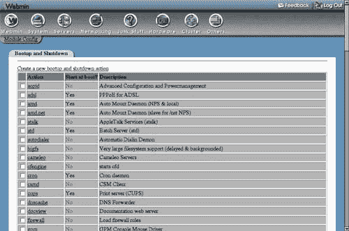

每个 Linux 发行版都有自己的 set 标准动作脚本，因此在一个系统上脚本 `httpd` 可能会启动 Apache Web 服务器，但在另一个系统上它可能被称为 `apache`。然而，你应该能够通过其描述较好地了解每个脚本的功能。

### 9.3 配置动作在启动时运行

如果你系统上的某些服务器（如 `Apache` 或 `Squid`）目前没有在启动时启动，你可以使用此模块更改该设置。在大多数 Linux 发行版中，随发行版自带的每个服务器都有自己的启动动作脚本，但并非所有脚本默认都是启用的。要配置一个动作在启动时运行，请遵循以下步骤：

在模块的主页上，点击你想要启用的动作名称。这将带你进入动作编辑页面，如图 9.2 所示。

#### 图 9.2 动作编辑表单

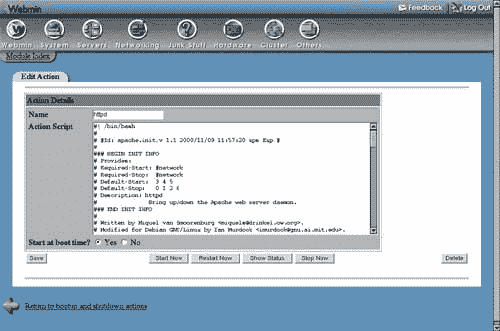

1. 将 `Start at boot time?`（启动时运行吗？）选项从 `No` 改为 `Yes`。
2. 点击 `Save`（保存）按钮，你的浏览器将返回主页上的动作列表。

如果有一个目前在启动时运行的服务器你想禁用它，只需按照相同的步骤操作，并将 `Start at boot time?` 选项设置为 `No` 即可。

### 9.4 启动和停止动作

尽管动作脚本通常在启动时启动并在关机时停止，但你可以使用 Webmin 随时启动或停止它们。许多动作脚本还可以执行额外功能，例如显示服务器状态或重新加载其配置。要启动或停止动作，请执行以下操作：

在模块的主页上，点击动作名称。这将带你进入图 9.2 所示的动作编辑表单。底部（中间）有一行按钮，每个按钮用于运行执行某些功能的动作。根据脚本的不同，可能有不同的按钮，但最常见的包括：

- `Start Now`（立即启动）：立即启动服务器和服务。在某些 Linux 版本上，如果动作已经启动，此操作将不起作用。
- `Stop Now`（立即停止）：停止服务器和服务。在某些版本上，除非动作已启动，否则此操作将不起作用。
- `Restart Now`（立即重启）：停止并重启服务器。在许多情况下，如果动作尚未启动，此操作将不起作用。
- `Reload Now`（立即重新加载）：可用时，此功能告知由动作启动的服务器重新读取其配置文件。
- `Show Status`（显示状态）：仅显示消息，告知服务器是否正在运行，如果是，其 `PID` 是多少。

点击你想要执行的功能按钮后，将出现一个显示动作脚本输出结果的页面。这应该指示动作是否执行成功。

### 9.5 添加新动作

如果你有一个想在启动时运行的命令，创建一个新的动作脚本是设置它的最佳方法。对于手动编译并安装的 `Apache` 或 `Qmail` 等服务器，它们没有动作，因此你需要创建一个运行启动服务器所需的所需的任何命令的动作。

要创建你自己的动作，请遵循以下步骤：

在模块的主页上，点击现有动作列表上方或下方的 `Create a new bootup and shutdown action`（创建新的启动和关机动作）链接。这将带你进入图 9.3 所示的表单，输入新动作脚本的代码。

#### 图 9.3 动作创建表单

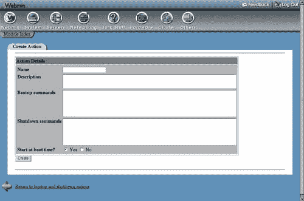

- 在 `Name`（名称）字段中，为动作输入一个短名称，如 `qmail`。每个动作必须有一个唯一的名称。
- 在 `Description`（描述）字段中，输入几行文本描述你的动作，例如 `Start the Qmail mail server`。这将显示在模块主页的 `Description` 列下。
- `Bootup commands`（启动命令）字段必须填写你希望在动作启动时运行的 shell 命令。例如，如果你想启动 Qmail，你可能会输入 `/var/qmail/rc`。
- `Shutdown commands` 字段应填入您希望在操作停止时运行的命令。例如，为了停止 Qmail，您可能输入 `killall 9 qmail-send`。

假设您希望您的操作在启动时运行，请将 `Start at boot time?` 选项设置为 `Yes`。

最后，点击 `Create` 按钮保存新操作。Webmin 将在 `/etc/rc.d/init.d` 目录下创建一个脚本，将您输入的命令与标准封装器相结合，以创建一个有效的操作脚本。您的操作将节设置为在当前运行级别运行，顺序号为 `99`，以便其最后执行。如果您想精确控制操作在哪些运行级别以及以什么顺序运行，请参见第 9.7 节“配置启动和关机模块”中的 `Allow selection of individual runlevels` 选项。

创建操作后，您可以按照以下流程编辑启动和停止命令：

在模块的主页上，点击您的操作名称。这将带您进入图 9.2 所示的操作编辑表单。

在 `Action script` 文本框中，寻找类似 `'start')` 的行。启动时运行的命令将位于其之后，直到仅包含 `;;` 的行。按您的意愿编辑它们，但请不要留在周围的代码。

同样，在操作停止时运行的命令位于 `'stop')` 和 `;;` 之间。除非您知道自己在做什么，否则更改脚本的任何其他部分都是一个坏主意。

点击 `Save` 按钮应用您的更改。


可以使用 `Webmin` 编辑任何现有的操作脚本，而不仅仅是您创建的脚本。编辑它们时要小心，因为它们的格式可能与 `Webmin` 创建的脚本完全不同。

## 9.6 重启或关闭您的系统

Linux 系统应始终使用适当命令进行重启或关机，而不是简单的关闭电源或按下重位键。否则，您可能会丢失本地硬盘上的数据，并且如果使用非日志文件系统，在启动时将不得不等待 `fsck` 进行漫长时间的文件系统检查。

要重启系统，只需执行以下操作：

在启动和关机模块主页的底部，点击 `Reboot System` 按钮。这将带您进入一个确认是否真的要重启的页面。

在确认页面上点击 `Reboot System` 按钮。关机过程将立即开始，如果您在控制台上登录，您的话将被注销。在所有关机脚本运行后，系统将像引言解释的那样启动。

关机的过程几乎相同，只需使用页面底部的 `Shutdown System` 按钮即可。

## 9.7 配置启动和关机模块

与大多数模块一样，可以通过点击主页上的 `Module Config` 链接来配置启动和关机。这将带您进入标准的配置编辑页面，在该页面上，`Configurable options` 标题下提供了表 9.1 中的设置。

不应更改配置页面上的任何其他选项，因为它们是 `Webmin` 根据您的操作系统类型自动设置的。

## 9.8 其他操作系统

许多其他 UNIX 操作系统（但并非所有）都使用 Linux 采用的启动脚本系统。即使是那些使用它的系统，在实现上也有细微差异，并且几乎所有系统都使用不同的目录来存储实际脚本和链接。

Sun Solaris、HP/UX、SCO UnixWare、SCO OpenServer、CompaqTru64/OSF1 以及 SGI Irix 这些操作系统都使用与 Linux 非常相似的操作脚本，但存储在不同的目录中。由于自带的脚本没有描述，模块的主页默认将仅显示操作名称。

## 表 9.1. 模块配置选项

| 选项 | 描述 |
| :--- | :--- |
| Allow selection of individual runlevels | 在编辑或创建操作时如果设置为 `Yes`，您将能够为每个运行级别中的操作输入精确的顺序号。由于这相当复杂，此选项默认设置为 `No`，以便 `Webmin` 在创建或编辑操作时仅显示单一的 `Start at boot?` 选项。 |
| Display actions with descriptions | 如果此选项设置为 `Yes` 并显示所有运行级别，主页将确切显示每个操作在哪些运行级别下启动，以及其描述。如果设置为 `Yes`，每个操作将仅显示它是否在启动时启动以及其描述。这是大多数系统的默认设置。如果设置为 `No`，主页将仅显示操作名称列表，不包含描述或启动信息。如果您有许多操作或您的操作系统没有在操作脚本中包含描述，则这可能非常有用。 |
| Show boot order of actions? | 如果选择 `Yes`，主页将包含每个操作在当前运行级别（或其他其他运行级别）中的启动顺序。默认的 `No` 选项隐藏了此信息。 |
| Show current status of actions | 在某些 Linux 发行版中，标准操作脚本可以报告它们启动的服务器的状态。此选项允许 `Webmin` 在多个地方显示此状态信息。如果设置为 `No`，除非您在编辑操作时点击 `Show Status` 按钮，否则永远不会操作状态。如果设置为 `On action page only`，当您从模块主页选择并编辑操作时，`Webmin` 将显示该操作当前的状态。如果设置为 `On index and action pages`，模块的主页将显示每个操作当前的状态。这提供了大量信息，但可能会非常慢。 |
| Sort actions by | 当选择 `Boot order` 时，主页上的操作将按照系统在当前运行级别中启动它们的顺序列出。默认的 `Name` 则导致它们按名称排序。 |
| FreeBSD, NetBSD and OpenBSD | BSD 家族操作系统完全不使用操作脚本，而是依靠一组在启动时运行的固定脚本。这些脚本中的一个（`/etc/rc.local`）允许系统管理员添加启动时运行的自定义命令。在这些任何一个操作系统上，模块的主页都将显示一个用于编辑 `rc.local` 文件的表单，位于 `Reboot System` 和 `Shutdown System` 按钮上方。要添加任何您想启动时运行的命令，只需将其输入文本框并点击 `Save` 按钮即可。 |
| IBM AIX | AIX 与 BSD 操作系统非常相似，因为它没有脚本。相反，可以通过模块主页上的表单编辑 `/etc/rc` 文件以添加启动时运行的额外命令。 |
| Apple MacOS X | Apple 版本的 UNIX 用于存储启动时运行的操作的文件与其他任何支持的操作系统完全不同。独立的操作脚本仍然存在，但此模块中用于查看和编辑它们的用户界面非常不同。 |

## 9.9 SysV Init 配置模块

正如本章引言所述，系统用于确定启动时运行哪些命令的极第一个文件是 `/etc/inittab`。它由 `init` 程序读取，该程序是 Linux 内核加载完成后运行的第一个进程，并一直运行到系统关机。`inittab` 文件指定了启动到哪个运行级别、启动所有操作脚本的命令、开始显示文本和图形登录提示的进程，以及在即将发生断电时运行的命令。

SysV Init Configuration 模块位于 Webmin 的“System”（系统）类别下，用于编辑这些命令中的任何一个。然而，由于这些命令对于确保系统正常启动至关重要，除非你确实清楚自己在做什么，否则编辑它们并不是一个好主意。你可能想要更改的是启动运行级别（bootup runlevel），这样在不需要时，系统就不会显示多余图形登录提示符。

要更改初始运行级别，请按照以下步骤操作：

进入 `SysV Init Configuration` 模块。主页面将显示命令列表以及执行它们的运行级别和情况，如图 9.4 所示。

### 图 9.4. SysV Init Configuration 模块。

``

点击 ID 列中操作（Action）为“After system boot”（系统启动后）的行的条目。这将带你进入编辑 `inittab` 文件条目的表单。

对于`Bootup runlevel`启动运行级别）选项，取消当前选中的任何级别并选择一个新的。确保你只选择选择一个级别，例如 `3`（用于文本登录模式）或 `5`（用于图形登录模式）。详情请参阅本章引言中关于每个运行级别含义的解释。

点击`Save`按钮将更改写入 `inittab` 文件。浏览器将返回到模块的主页面。

如果你需要，现在可以使用 `Bootup and Shutdown` 模块重启系统。

该模块也适用于 Solaris、HP/UX、UnixWare、OpenServer、AIX 和 Irix 操作系统。它的基本结构和目的在所有系统上都是相同的，但实际的默认命令会有显著差异。不过，之前更改启动运行级别的指令适用于所有操作系统。

## 9.10 总结

本章涵盖了 Linux 以及许多其他 UNIX 变体使用的启动脚本，并展示了如何使用 `Webmin` 管理它们。它还解释了这些脚本与 BIOS、引导加载程序和 init 程序在整个 Linux 启动过程中的位置。最后，它涵盖了运行级别以及使用 `SysV Init Configuration` 模块选择系统启动运行级别的方法。

# 第 10 章定时命令

在本章中，你将学习 UNIX 的 `Cron` 和 `At`set，它们用于按定期计划或在未来的某个时间执行一次命令。

## 10.1 Cron 任务简介

`Cron job` 是 UNIX 术语，指由 `cron` 守护进程定期计划运行的命令。每个任务都由一个 UNIX 用户所有，并以该用户的权限运行。每个任务都有设置好运行的分钟、小时、天、月份和星期，这在调度方面具有相当大的灵活性。例如，一个任务可以每 10 分钟运行一次，或者每天凌晨 3 点运行，或者在一、二、三月的周一至周五下午 5 点运行。

`Cron jobs` 对于执行常规系统任务非常有用，例如清理日志文件、同步系统时间、备份文件等。大多数 Linux 发行版在操作系统安装过程中都会默认设置几个 `Cron jobs`，用于执行如删除不需要内核模块、更新 `locate` 命令使用的数据库以及轮换日志文件等操作。

实际的 `Cron job` 配置存储在不同的地方，取决于它们是 Linux 发行版包含的软件包的一部分还是用户创建的。`/var/spool/cron` 目录用于用户手动创建的任务，每个 UNIX 用户对应一个文件。`/etc/crontab` 文件和 `/etc/cron.d` 目录下的文件包含属于软件包的任务，例如属于你发行版的一部分的任务。

## 10.2 定时 Cron 任务模块

编辑 `Cron jobs` 的 `Webmin` 模块可以在“System”类别下找到。当你进入它时，主页面会显示系统上所有现有任务的表格，如图 10.1 所示。对于每个操作，都列出了所有者、激活状态和命令。如果任务的命令太长，将被截断以显示在页面上。

### 图 10.1. 定时 Cron 任务模块。

``

## 10.3 创建新的 Cron 任务

使用 `Webmin`，你可以轻松创建一个新的 `Cron job`，该任务将以系统上任何 UNIX 身份执行。要实现这一点，请按照以下步骤操作：

在模块的主页面上，点击现有任务列表上方或下方的`Create a new scheduled cron job`链接。这将带你进入图 10.2 所示的任务创建表单。

### 图 10.2. Cron 任务创建表单。

``

在`Execute cron job as`字段中，输入你希望任务以哪个身份执行的 UNIX 用户名称。任务执行的命令将在用户的家目录中运行，并拥有完整权限。

如果你不想让此新任务实际执行，可以将`Active?`字段设置为`No`。这对于创建稍后启用的任务很有用。

在`Command`字段中，输入你想让 `Cron job` 运行的 shell 命令。就像在 shell 提示符下一样，可以使用分号（`;`）分隔多个命令，并可以使用所有标准的 shell 运算符，如 `>`、`<` 和 `&&`。

默认情况下，命令的任何输出都将发送给 `Cron job`的所有者。如果你不希望发生这种情况，请确保将输出重定向到文件或 `/dev/null`。

你输入`Input to command`字段的任何内容都将在命令运行时输入命令。例如，如果你的命令是 `mail foo@bar.com`，输入字段的任何内容都将发送到该邮箱地址。

在`When to execute`部分，选择你希望执行命令的时间和日期。对于 Minutes、Hours、Days、Months 和 Weekdays 每个选项，你可以选择多次时间或日期，或者选择`All`选项。

例如，要让任务在每周一和周五的凌晨 3:15 执行，你应该将 Minutes 选项更改 Selected 并选择 `15`，将 Hours 选项更改 Selected 并选择 `3`，以及将 Weekdays 选项更改 Selected 并选择 Monday 和 Friday。

点击`Create`按钮添加新任务。假设你的选择没有错误，你将返回到模块的主页面，你的新任务应该出现在其所有者旁边。

## 10.4 编辑 Cron 任务

现有的 `Cron jobs`（包括用户通过 `Webmin` 创建的或随操作系统包含的任务）都可以使用此模块进行编辑和重新调度。但在编辑作为发行版一部分的任务时要小心，因为某些任务执行着重要任务，例如截断 Web 服务器、邮件和登录日志文件，以防止占用所有磁盘空间。

要编辑现有任务，请按照以下步骤操作：

在模块的主页面上，点击你要编辑的任务的命令。这将带你进入模块编辑表单，该表单类似于图 10.2。

更改任务的任何细节，包括用户、命令、激活状态以及执行时间和日期。

完成后，点击`Save`按钮，你将返回到模块的主页面。

可以通过以下步骤删除现有的 `Cron jobs`，但点击`Delete`按钮而不是`Save`。你还可以通过点击编辑页面上的`Run Now`按钮来强制立即执行任务，这将执行命令并显示其产生的任何输出。

## 10.5 控制用户对 Cron 的访问

定时 Cron 任务模块还可以用于控制 UNIX 用户在命令行中访问 `crontab` 命令的权限。如果你允许不可信的用户登录你的系统，并希望防止其中某些人设置 Cron 任务运行命令并在他们未登录时占用 CPU 时间，这将非常有用。通常默认情况下，所有用户都有创建 Cron 任务的能力，但你可以通过遵循以下步骤来这一点：

在模块主页底部，点击 `Control user access to cron jobs` 链接。这将引导你进入一个表单，输入可以使用或不可使用 Cron 的用户用户名。

要授予所有用户访问权限，请选择 `Allow all users` 选项。

要授予某些用户访问权限，请选择 `Allow only listed users` 选项并在文本框中输入他们的用户名。

要授予除少数用户外所有用户的访问权限，请选择 `Deny only listed users` 选项并在文本框中输入你想要拒绝访问的用户名。

完成后，点击 `Save` 按钮。

如果某个用户被拒绝访问 Cron 权限，你将无法再使用该模块创建、编辑或删除属于他的任务。然而，现有的任务可能会继续执行！

## 10.6 模块访问控制选项

如第 52 章所述，可以使用 `Webmin Users` 模块来控制 `Webmin` 用户可以编辑哪些 UNIX Cron 任务。要设置此设置，你必须先授予用户访问模块的权限，然后按照以下步骤操作：

在 `Webmin Users` 模块中，点击想要限制的用户名称旁边的 `Scheduled Cron Jobs`。

将 `Can edit module configuration?` 字段更改为 `No`，这样用户无法编辑 `Webmin` 调用来创建和编辑任务的命令。

将 `Can edit cron jobs for` 字段从 `All users` 切换到其他选项之一。最常用的是 `Users with UID in range`，它允许你在旁边的字段中输入最小和最大 UID。

永远不要允许不受信任的用户访问 `root` 或 `bin` 等系统用户的 Cron 任务，因为这显然将赋予他对你系统的完全访问权限，并破坏任何其他 `Webmin` 访问控制。

将 `Can control user access to cron?` 字段设置为 `No`，这样 `Webmin` 用户就无法停止其控制范围之外的用户使用 Cron。

点击页面底部的 `Save` 按钮使访问控制生效。

## 10.7 配置 Scheduled Cron Jobs 模块

通过点击主页上的 `Module Config` 链接可以看到的大多数模块设置默认都设置为与安装的操作系统相匹配，极少需要更改。然而，有一个字段会影响模块的用户界面，如表 10.1 所示。

## 表 10.1. 模块配置选项

| 显示的最大命令长度 |
| :--- |
| 该字段决定了在模块主页上显示每个 Cron 任务命令的多少字符。你可以选择 `Unlimited` 显示所有内容（这可能会导致行换行），或输入一个最大字符数。默认值为 `80`。 |

## 10.8 其他操作系统

`Cron` 几乎在所有的 UNIX 系统上都可用，功能非常相似。这意味着该模块在所有操作系统上的外观几乎完全相同，只有几处细微差异。在某些系统上，创建或编辑任务时没有 `Input to command` 字段。在另一些系统，当控制哪些用户具有 Cron 权限时，默认的 `Allow all users` 选项会被 `Allow all users except root` 或 `Deny all users` 取代。

内部，其他操作系统使用不同的目录来存储 Cron 任务；例如 Solaris 使用 `/var/spool/cron/crontabs` 而不是 Linux 的 `/var/spool/cron`。大多数其他系统也没有 `/etc/crontab` 文件或 `/etc/cron.d` 目录。然而，使用 `Webmin` 时，你不必担心这些差异，因为它知道其他 UNIX 变体使用的路径，并且无论任务存储在哪个文件中，都使用相同的界面显示所有 Cron 任务。

## 10.9 Scheduled Commands 模块

`At` 任务（Webmin 称为 `Scheduled Commands`）与 Cron 任务类似，但它们不是按计划重复执行，而是在指定的日期和运行一次。与 Cron 任务不同，它们可以配置在特定目录下执行，而不是用户的家目录。调度命令还会跟踪创建时设置的环境变量，并在执行运行时为命令提供这些变量。

通常使用 `at` 命令创建 `At` 任务，使用 `atq` 命令列出任务，使用 `atrm` 命令删除任务。在 Linux 上，使用 `/var/spool/at` 目录存储任务，每个文件一个任务。在后台始终运行的守护进程 `atd` 会检查这些文件并在适当的时间运行它们。如果 `At` 守护进程没有运行，则没有命令将执行，如果未在 `Bootup and Shutdown` 模块中配置启动，可能会出现这种情况。任务运行后，会被会自动删除，因为不再需要了。

创建和删除 `At` 任务的 `Webmin` 模块称为 `Scheduled Commands`，可以在 `System` 类别下找到。进入该模块后，主页将显示等待运行的命令列表（如果有任何的话）以及一个添加新命令的表单。图 10.3 显示了一个示例。

### 图 10.3. Scheduled Commands 模块。

``


点击`Job ID`可以详细查看主页上显示的任何命令。这将带你进入一个页面，显示执行时将运行的完整 shell 脚本，包括所有的环境变量。对于此页面，你可以点击`Cancel this command`按钮在命令运行之前取消它。

### 10.10 创建新的调度命令

可以通过以下步骤创建一个在你指定的时间以指定的用户身份执行的新命令：

在模块主页的`New scheduled command`表单中，在`Run as user`字段输入你想让命令运行的用户。

在`Run on date`和`Run at time`字段中填写命令运行的日期和时间。

将`Run in directory`字段设置为你想运行命令的任何目录。

在`Commands to execute`文本框中，每行输入你需要的任意数量 shell 命令。

完成后，点击`Create`按钮。页面将刷新，你的新命令将出现在页面顶部的列表中。

从 Webmin 内部创建的调度命令将使用 Webmin 自身设置的环境变量，这与所有者在 shell 提示符下创建命令时设置的变量不同。

### 10.11 总结

`Cron`和`At`是 UNIX 系统用于调度未来任务的两个服务。本章解释了它们如何工作、它们之间的区别，以及如何使用 Webmin 配置它们。它还涵盖了使用 Webmin 的访问控制功能来限制管理这些服务的模块的访问，以及这种访问控制的局限性。

## 第 11 章 进程管理

本章解释了如何使用 Webmin 管理系统上运行的进程。

### 11.1 进程简介

Linux 系统上运行的每个程序、服务器或命令都是一个进程。在任何时候，你的系统中都有几十个进程运行，有些是为了你正在交互的程序，有些是你在 shell 提示符下启动的命令，有些是后台运行的服务器，还有执行系统任务的任务。每你在 shell 提示符下输入类似`ls`或`vi`的命令，都会创建一个新进程，并在任务完成后立即退出。

每个进程由一个被称为`PID`（进程 ID）的唯一标识来标识。每个进程由单个用户拥有，并是多个组的成员，这些组决定了进程拥有的权限。每个进程都有优先级（也称为 nice 值），它控制了进程在繁忙系统中可以使用多少 CPU 时间。

几乎每个进程都有一个父进程，即启动它的进程，进程并从父进程那里继承所有权、优先级和其他设置。

进程将一直运行，直到它选择退出，或者被另一个进程的信号杀死。

### 11.2 Running Processes 模块

此模块可用于查看、杀死、重新优先级以及运行系统上的进程。当你首次从“系统”（System）类别进入该模块时，主页面将显示进程树，如图 11.1 所示。

#### 图 11.1 运行进程模块树显示

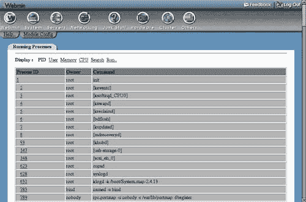

该模块有多种查看系统上所有进程的方法，可以通过主页面顶部的“显示”（Display）链接进行选择。它们是：

- **PID**：在此显示模式下，每个进程在其父进程下方缩进显示，形成系统中运行的所有进程的树。树的顶部是`init`命令，它由内核在启动时启动，因此没有父进程。
- **User**（用户）：此模式按所有者对进程进行分组。对于拥有许多用户的系统，这种模式可以一眼看出每个用户正在运行什么。
- **Memory**（内存）：在此模式下，进程按其使用的内存量排序，使用内存最多的进程显示在页面顶部。进程的内存使用并不总是代表其实际使用的内存量，因为进程之间经常共享内存。此外，进程列表上方会显示系统上真实和虚拟内存的总量和可用量。
- **CPU**：此显示模式按当前的 CPU 使用率对进程进行排序，占用资源最多的用户排在第一。有时生成页面的 Webmin 命令会出现在列表顶部，但可以安全地忽略。

系统负载平均值将显示在页面顶部，让你了解系统在过去 1、5 和 10 分钟的繁忙程度。平均值为 0 表示完全没有活动，1 表示 CPU 已完全利用，任何大于 1 的值意味着想要运行的进程多于系统所能提供的 CPU 时间。

“搜索”（Search）和“运行”（Run）选项分别用于搜索进程和运行新进程。详情请参阅后续章节。

### 11.3 查看、杀死或重新调整进程优先级

你可以通过点击主页面上任何显示模式中的“进程 ID”（Process ID）列项，查看任何正在运行进程的完整细节。这将带你进入进程信息页面，如图 11.2 所示。

#### 图 11.2 进程的详细信息

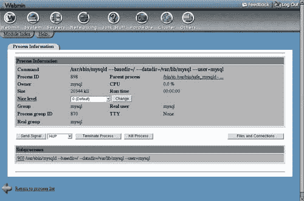

该页面显示了有关进程的所有可用信息，包括其完整命令行、父命令以及任何子进程。你可以通过点击父命令进入父进程的信息页，或通过点击任何子进程的进程 ID 进入其页面。通过点击“文件和连接”（Files and Connections）按钮，可以查看进程打开的文件列表和当前使用的网络连接。

可以通过点击“终止进程”（Terminate Process）按钮通过`TERM`信号来停止进程。由于某些命令可能会忽略此信号，如果终止失败，可以使用“杀死进程”（Kill Process）按钮发送`KILL`信号。除非进程挂在内核系统调用内部，否则杀死它保证会成功。

在按下“发送信号”（Send Signal）按钮之前，可以通过从列表中选择信号类型来发送其他信号。一些更有用的信号包括：

- **HUP**：对于许多服务器进程，此信号将导致它们重新读取配置文件。
- **STOP**：挂起进程直到收到`CONT`信号。
- **CONT**：恢复被`STOP`信号挂起的进程。

该信息页还可以用于更改运行进程的 nice 级别（nice level），赋予其更高或更低的优先级。要更改进程的优先级，请从 Nice 级别列表中选择一个新级别，然后点击“更改”（Change）按钮。级别越低表示优先级越高，因此 nice 级别为 10 的进程将获得比级别 5 的进程更多的 CPU 时间。

在具有多个用户的系统上，占用大量 CPU 时间的长运行进程应该赋予较高的 nice 级别，以免它们减慢与用户交互的进程。或者，你可以通过赋予较低的 nice 级别来牺牲其他进程以加速某个进程。在设置极低级别（如 20）时应小心，因为所有其他进程可能会由于缺少 CPU 时间而导致系统无响应。

### 11.4 搜索进程

如果你的系统上运行了大量进程，并想找到一个或多个进行杀死或查看，“运行进程”模块的搜索功能使这变得简单。要查找进程，请遵循以下步骤：

在模块的主页面上，点击“搜索”（Search）显示模式链接。这将带你进入如图 11.3 所示的搜索表。

#### 图 11.3 进程搜索表

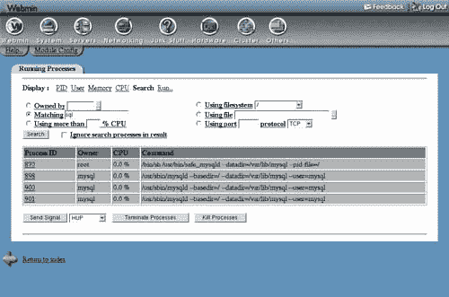

表单显示了查找进程的不同标准，你可以通过选择旁边的单选按钮选择之一。标准如下：

- **Owned by**（所有者）：将找到由在此选项旁输入的用户名拥有的进程。
- **Matching**（匹配）：找到命令或参数包含你在此选项旁输入的文本的进程。
- **Using more than**（使用超过）：找到使用 CPU 时间百分超过指定百分比的进程。
- **Using filesystem**（使用文件系统）：将找到当前目录在所选文件系统上或正在访问该系统上任何文件的进程。如果由于文件系统正忙而无法卸载它，这非常有用。
- **Using file**（使用文件）：找到打开了输入文件进行读或写的进程。如果你输入一个目录，将找到任何以其作为当前目录的进程。
- **Using port**（使用端口）：找到使用所选协议在输入端口上发送、接收或监听网络流量的进程。如果你知道服务器监听的端口号并想找到该服务器进程，这非常有用。

要从结果中过滤掉 Webmin 搜索进程，请在结果选项中选择“忽略搜索进程”（Ignore search processes）。这在按 CPU 使用率搜索时非常有用，因为 Webmin 进程会消耗大量的 CPU 时间。

选择好搜索标准后，点击“搜索”（Search）按钮。任何匹配的进程将显示在表单下方。

如果你想查看有关进程的附加信息、更改其优先级或单独对其发送信号，请点击结果中的进程 ID。

要杀死所有匹配的进程，点击“终止进程”（Terminate Processes）或“杀死进程”（Kill Processes）按钮。你也可以通过从“发送信号”（Send Signal）旁边的列表中选择向所有进程发送任何信号。将显示一个页面，列出每个进程 ID 以及是否成功发送信号或杀死。

### 11.5 运行进程

该模块还可以用于运行简单的命令，既可以在前台运行以便显示其输出，也可以在后台作为守护进程运行。如果你只想运行一个命令而无需通过 telnet 或 SSH 登录（或者防火墙阻止了 telnet 或 SSH 登录），这将非常有用。要遵循的步骤如下：

在模块的主页面上，点击显示模式选项旁“运行”（Run）链接。这将带你进入启动新进程的表单。

在“运行的命令”（Command to run）字段中输入你想运行的命令。可以使用 Shell 运算符和如`;`、`>`和`&`等特殊字符。

如果命令运行时间较长，可以将运行模式（Run mode）选项设置为“在后台运行”（Run in background），让 Webmin 自动将其放入后台。然而，如果你想查看命令的输出，请保持选项设置为“等待完成”（Wait until complete）。

在“输入到命令”（Input to command）字段中输入你想传递给命令的任何输入。

点击“运行”（Run）按钮执行运行。如果选择了“等待完成”选项，命令的任何输出将显示出来。

### 11.6 模块访问控制选项

默认情况下，任何访问此模块的 Webmin 用户都可以管理系统上运行的所有进程，就像他们以 root 身份登录一样。然而，通过`Webmin Users`模块，你可以限制用户的访问权限，使其只能杀死或重新调整（re-nice）由特定 UNIX 用户拥有的进程。你还可以将用户限制为只读模式，允许其仅查看进程而不能以任何方式更改进程或启动新进程。

你应该先阅读第 52 章，以了解更多关于模块访问控制以及如何授予用户访问`Running Processes`模块的权限。一旦完成这些操作，编辑 Webmin 用户对该模块访问权限的步骤如下：

1. 在`Webmin Users`模块中，点击你想要限制的用户或组名称旁边的`Running Processes`。
2. 将`Can edit module configuration?`（可以编辑模块配置吗？）字段改为 No（否）。
3. 要让 Webmin 用户仅访问由特定 UNIX 用户拥有的进程，请在`Manage processes as user`（作为用户管理进程）字段中输入用户名。如果 UNIX 用户和 Webmin 用户同，你可以选择`Current Webmin user`（当前 Webmin 用户）。这在设置组模块访问控制时非常有用，你可能希望组中的每个成员只能管理自己的进程。
4. 要将用户置于只读模式，将`Can kill and re-nice processes?`（可以杀死和重新调整进程吗？）和`Can run commands?`（可以运行命令吗？）字段设置为 No。如果这样做了，你在步骤 3 中输入什么用户名就无关了，因为无法进行任何进程管理。
5. 点击`Save`（保存）按钮激活你的更改。

为了限制 Webmin 用户可以管理的进程，模块代码简单地切换到第 3 步中指定的 UNIX 用户运行。由于 UNIX 用户无法杀死或重新调整任何其不拥有的进程，这种用户切换方式会导致操作系统自动为 Webmin 强制执行访问控制。

### 11.7 其他操作系统

由于进程在所有版本的 UNIX 中都存在且具有几乎相同的属性，因此该模块在所有支持的操作系统上看起来几乎完全一样。唯一的细微区别在于：

- 在查看进程的详细信息时，其他操作系统可能提供不同的信息。nice 值的范围范围也可能不同，但较低的级别意味着更高的优先级，反之亦然。
- 在搜索进程时，可能没有`Using filesystem`（使用文件系统）、`Using file`（使用文件）或`Using port`（使用端口）标准。这些选项取决于`fuser`和`lsof`命令，而这些命令并不是所有系统默认可用或安装。

### 11.8 总结

读完本章后，你应该对进程以及它们在 UNIX 系统中的重要性有良好的理解。你应该理解如何使用 Webmin 查看系统上运行的进程，搜索符合某些标准的进程，并杀死、信号或重新调整一个或多个进程的优先级。最后，如果你的系统需要，你应该知道如何配置模块来限制某些 Webmin 用户的权限。

## 第 12 章 软件包

本章涵盖了如何使用软件包在系统上安装和管理软件。它概述了各种 UNIX 软件包格式之间的差异，例如`RPM`、`DPKG`和 Solaris。

### 12.1 软件包简介

所有的 Linux 系统都使用某种软件软件包系统来简化程序的安装和删除过程。软件包是命令、配置文件、帮助文档（man pages）、共享库和其他与 Apache 或 Sendmail 等单个程序相关的文件的集合，它们被组合成单个软件包文件。当安装时，软件包系统会提取所有组件文件并将它们放置在系统上的正确位置。因为系统知道每个文件来自哪个软件包，所以当你想要删除一个软件包时，它确切知道要删除哪些文件。

在几乎所有的 Linux 版本中，软件包通常包含编译后的程序，这些程序只会在编译时对应的 CPU 架构上运行。由于 Linux 支持许多不同的 CPU 类型（例如 x86、Alpha 和 IA64 等），某些程序拥有针对几种不同 CPU 编译的软件包。软件包只能安装在具有正确 CPU 架构的系统上，除非它是架构无关的，在这种情况下它将安装在任何类型的系统上。使用 Perl 等语言编写（如 Webmin）编写的程序或仅包含文档的软件包通常是 CPU 关的。

当安装 Linux 发行版时，几乎放置在硬盘上的每个文件都是该发行版软件包之一的成员。这使得删除默认安装的不需要的软件，或从发行版 CD 或网站添加额外的软件变得非常简单。

由于某些程序依赖其他程序才能运行，软件包也具有依赖关系。除非你先安装了另一个软件包，否则某些软件包可能无法安装；如果其他软件包依赖于它们，则某些软件包可能无法删除。这种依赖系统保护用户免于安装因缺少共享库或命令而无法运行的软件。

由于软件包系统确切知道每个软件包包含哪些文件，它可以利用这些信息在安装后验证文件。所有软件包系统还会跟踪每个文件的`MD5`校验和，因此对软件包中的文件进行任何任何手动修改都能被检测到。这对于检测未经授权的修改非常有用，例如攻击者破解了你的系统并将`ls`和`find`等重要命令替换为修改后的版本。

遗憾的是，Linux 上有多个软件包系统。最常见的是`RPM`，代表 Red Hat Package Manager（红帽软件包管理器）。它被 Red Hat、Caldera、SuSE、Mrake、MSC 以及其他 Linux 发行版使用。它运行良好，且 RPM 格式的软件比任何其他软件包系统都多。RPM 软件包的安装、查询和删除使用`rpm` shell 命令完成。

`RPM`的最大竞争对手是 Debian 的`DPKG`软件包格式。它在许多方面技术上更优，特别是在依赖关系方面，但只有 Debian 和其他少数发行版使用它。`dpkg`和`deselect`命令用于 shell 提示符来管理 Debian 软件包。

另一个软件包系统是 Gentoo 的`Emerge`，它仅在 Gentoo Linux 上可用。`Emerge`与其他软件包系统最大的区别是，几乎所有的软件包都包含源代码，在安装软件包时进行编译。所有 Gentoo 软件包的安装和管理都使用`emerge`命令完成。

尽管这些软件包系统在内部不同并使用不兼容的文件格式，但它们提供的功能基本相同。它们都允许与同一程序的多个文件组合成一个软件包文件以便于安装和删除，并且都支持依赖关系。遗憾的是，一旦你选择了 Linux 发行版，很难切换到另一个软件包系统，因此你只能使用该发行版使用的系统。

在大多数使用`RPM`的发行版中，软件包要么是从发行版 CD 安装的，要么是从各个各个网站下载的。然而，Debian Linux 包含一个名为`apt-get`的命令，它可以从发行版维护者运行的仓库中自动下载并安装软件包。如果软件包依赖于系统中尚未安装的其他软件包，它们下载自动下载。因为。因为所有软件包由由由创建和维护，它们之间的兼容性降低了，依赖关系也容易解决。仓库中还包含了你可能想要安装的几乎每个自由软件程序的软件包，因此无需在互联网上搜索你需要的软件包。

Debian 存储库也可用于将系统上的所有软件包更新到最新版本。由于软件包的新版本发布频繁（特别是当使用不稳定或测试版 Debian 版本时），更新是确保你运行所有内容最新版本的一种简单方法。不过，如果你没有快速的连接，这可能会花费很长时间，因为每次更新可能需要下载许多新软件包。

Gentoo Linux 的`Emerge`系统也有一个存储库，可以使用`emerge`命令从其中自动下载并安装软件包。与 Debian 的`apt-get`一样，它会自动下载并安装满足依赖关系所需的软件包。

Red Hat 系统也可以作为 Red Hat Network 的一部分访问软件包仓库。这允许在 Red Hat 网站上选择更新的软件包，并在多个系统上自动安装或根据请求进行安装。与 Debian 和 Gentoo 存储库不同，它通常不用于安装新软件包。

### 12.2 软件包模块

软件包（Software Packages）模块提供了一个统一界面用于安装、搜索和删除软件包，不受实际使用的软件包系统影响。你可以在“系统”（System）类别下找到它的图标，点击它将带你进入图 12.1 所示的主页。

#### 图 12.1 软件包模块主页

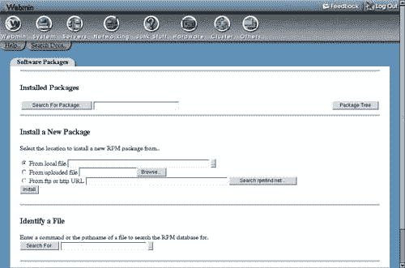

根据你的 Linux 发行版，页面看起来可能略有不同，可能会看到用于从存储库安装的其他按钮和字段。然而，查找软件包的顶部区域、安装软件包的中间区域以及识别文件的底部始终存在。

## 12.3 安装新软件包


在使用此模块安装新程序之前，你必须先找到一个格式正确的软件包文件。对于像 Red Hat 这样基于 RPM 的发行版，最好的位置是发行版 CD 或`rpmfind.net`网站。如果你使用的是 Debian Linux，最好尝试从`APT`存储库安装，因为它几乎包含所有可用的软件包。无论哪种，安装软件包的步骤都是相似的：

在模块的主页上，滚动到“安装新软件包”（Install a New Package）表单，这将用于选择软件包并启动安装过程。

如果软件包文件位于运行 Webmin 的系统上，选择“本地文件”（From local file）选项并输入软件包文件的完整路径。如果你的系统使用`RPM`软件包，你也可以输入包含多个`*.rpm`文件的目录或像`*/tmp/*.rpm`这样的通配符。这可以同时安装多个软件包。

如果软件包位于运行浏览器的计算机上，选择“上传文件”（From uploaded file）选项并点击“浏览”（Browse）按钮选择软件包文件。如果你在 Webmin 系统的控制台上运行浏览器，此选项与上一个没有区别。

如果软件包位于某个网站上，选择“来自 ftp 或 http URL”（From ftp or http URL）选项，并在对应的文本框中输入或粘贴 URL。Webmin 将在开始安装之前为你下载。如果你的系统使用`RPM`软件包且你安装了`rpmfind`命令，可以点击 URL 字段旁的“搜索 rpmfind.net”按钮，弹出一个窗口在`rpmfind.net/`搜索 RPM 数据库。

如果运行 Debian Linux，你可以选择“来自 APT 的软件包”（Package from APT）选项，并在对应的文本框中输入包名。如果你不知道它的确切名称，点击“搜索 APT”（Search APT）按钮来查找包名。

如果运行 Red Hat Linux，可以使用“来自 Red Hat Network 的软件包”（Package from Red Hat Network）选项来安装你可下载的软件包之一。可以使用“搜索 RHN”（Search RHN）按钮显示所有可用的软件包。

如果你运行 Gentoo Linux，可以使用“来自 Portage 存储库”（From Portage repository）选项和“搜索”（Search）按钮从存储库安装。事实上，极少数 Gentoo 软件包可以在存储库之外找到。

输入软件包源后，点击“安装”（Install）按钮。

如果你选择从存储库安装（如`APT`、`Red Hat Network`或`Portage`），下载和安装过程将立即开始。Webmin 将显示`install`命令的输出，如果成功，将列出已安装的软件包。不需要其他步骤。

如果选择了其他安装源，将在需要时下载软件包并显示安装选项表单。

可用的安装选项取决于你的软件包系统，但对于升级或安装没有依赖问题的软件包，默认设置可以正常工作。基于 RPM 的系统有几个选项，最有用的是：

- `忽略依赖关系?`（Ignore dependencies?）：如果软件包由于你认为是错误的依赖错误而安装失败，将此选项设置为“是”。如果你打算以后安装软件包来解决依赖问题，这也有用。
- `用旧版本替换新版本?`（Replace new version with old?）：如果你想将软件包降级到旧版本，必须将此选项设置为“是”。
- `覆盖文件?`（Overwrite files?）：如果软件包因与其他软件包的文件冲突而无法安装，请启用此选项。

完成安装选项选择后，点击“安装”（Install）按钮。如果一切顺利，将显示新软件包详情及其包含的所有文件的页面。然而，如果安装失败，将显示一条解释原因的错误消息。在这种情况下，你可以使用浏览器的后退按钮返回安装选项表单并尝试不同的选择。

### 12.4 查找和删除软件包

典型的 Linux 系统有数百个已安装的软件包，大多数是作为发行版安装过程的一部分添加的。由于软件包很多，很难通过浏览来找到你想删除或查看详情的包。要查找一个或多个软件包，请按照以下步骤操作：

在模块的主页上，在“搜索软件包”（Search For Package）字段中输入关键词。这将与所有软件包的名称和描述进行匹配，你可以输入`apache`来查找所有与 Apache 相关的包。

点击“搜索软件包”（Search For Package）按钮，这将显示匹配的软件包列表；在只找到一个时带你进入该软件包的详情；或者在没有找到时显示错误消息。如果出现列表，点击其中一个包名查看其完整详情。

软件包详情页（如图 12.2 所示）将显示所有可用信息，包括完整的描述。如果你想查看它包含的所有文件，点击“列出文件”（List Files）按钮。这将带你进入一个页面，显示每个文件的路径、类型、所有者和组以及验证状态。状态特别有用，因为它允许你查看文件自软件包安装以来是否被手动更改过。

##### 图 12.2 软件包详情页

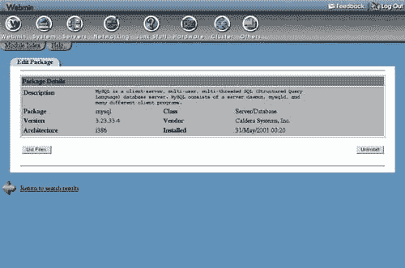

还可以通过点击主页上的“软件包树”（Package Tree）按钮手动浏览软件包。在大多数操作系统中，每个软件包都是类的成员，例如“开发”（Development）或“管理/网络”（Administration/Networking）。软件包树页面使用这些类信息以层级结构显示所有已安装的软件包，类似于目录树。你可以通过点击文件夹图标打开类，直到到达包级别。点击软件包图标将带你进入上述步骤中相同的详情页。

如果你知道某个命令或文件的名称，并想找到它所属的软件包，可以使用主页上的`Identify a File`（识别文件）表单。在`Search For`字段中输入完整路径（如`/etc/rc.d/init.d/httpd`）或命令（如`apachectl`），然后点击按钮。如果软件包系统已知该文件或命令，将显示其相关信息以及它所属的软件包列表。点击其中一个包名称将带你进入上文描述的信息页面。

一旦通过搜索或浏览树结构找到了软件包，你可以按照以下步骤从系统中删除它：

在软件包详情页上，点击`Uninstall`（卸载）按钮。这将带你进入一个确认页面，显示软件包中的文件数量以及它们占据的磁盘空间。

如果使用`RPM`软件包系统，可以将`Ignore dependencies?`（忽略依赖关系？）选项设置为`Yes`，这样即使其他软件包依赖于要删除的包，也可以强制卸载。

点击`Delete`（删除）按钮移除该软件包。如果发生错误，将显示错误消息。如果执行成功，浏览器将返回模块主页，或者如果你是通过搜索找到包的，则返回软件包搜索结果列表。

### 12.5 在 Debian Linux 上更新

如果你运行的是 Debian Linux，在模块主页底部有一个标题为`Upgrade All Packages`（升级所有软件包）的表单。该表单有三个选项：

- `Resynchronize package list`（同步软件包列表）：如果此选项设置为`Yes`，将查询 Debian 软件包仓库以获取可下载的最新软件包列表。这应该在任何升级之前执行，以便你的系统在从`APT`仓库安装软件包时知道应该从哪些 URL 下载。

  用于同步软件包列表的实际命令是`apt-get update`。

- `Perform distribution upgrade`（执行发行升级）：当此选项设置为`Yes`时，提交表单后，你的 Debian 系统将升级到最新的发行版本。默认选择`No`，它将仅更新所有已安装的包到最新版本。除非你有快速的网络连接并真的想升级，否则建议将此选项设置为`No`。

  当选择`Yes`时，将运行命令`apt-get upgrade-dist`。对于`No`，将使用`apt-get upgrade`。

- `Only show which packages would be upgraded`（仅显示哪些包将升级）：如果设置为`Yes`，提交表单时实际上不会安装任何内容，而是显示将要更新或安装的软件包列表。如果你想在正式操作之前查看更新时具体会发生什么，这非常有用。

做出选择后，点击`Upgrade Now`（立即升级）按钮。Webmin 将运行相应的`apt-get`命令并显示其输出，以便你可以看到哪些包被下载和更新。

### 12.6 在 Red Hat Linux 上更新

Red Hat 为其 Linux 发行版的用户提供名为`Red Hat Network`（红帽网络）的服务。其功能之一允许自动安装更新的`RPM`软件包，以修复发行版提供的软件包中的漏洞或安全漏洞。如果你运行的是 Red Hat Linux，主页底部有一个标题为`Red Hat Network Options`（红帽网络选项）的表单，可以使用它配置更新软件包的自动安装。在使用之前，你必须已经在`Red Hat Network`注册并注册了运行 Webmin 的系统。

该表单实际上有两个用途：

- `Automatically check for updates?`（自动检查更新？）：如果此选项设置为`Yes`，守护进程将定期检查更新。将其设置为`No`将停止检查。
- `Checking interval`（检查间隔）：当启用自动更新时，检查之间的分钟数由此选项决定。
- `Proxy server URL for downloading`（下载所需的代理服务器 URL）：如果你的系统无法直接连接到 Red Hat Network，你需要将此选项设置为`http://proxy.company.com:8000/`。
- `Skip matching`（跳过匹配）：此选项用于输入你不希望自动更新的软件包名称列表。

`Save`（保存）按钮将保存你的设置，`Check Now`（立即检查）按钮将立即检查新软件包。

### 12.7 其他操作系统

Linux 不是唯一支持软件包的 UNIX 版本。下文列出的操作系统也可以使用`Software`（软件）模块，其界面几乎相同。然而，每个系统都有其独特的软件包格式，且与 Linux 或任何其他 UNIX 都不兼容。

#### Sun Solaris、SCO OpenServer 和 SCO UnixWare

所有这些操作系统都使用相同的 System V 软件包格式，但其中一个系统的包无法安装到其他任何一个系统上。软件包文件通常命名为`something.pkg`或`something.pkg.gz`。如果软件包文件经过压缩，Webmin 将对其解压。System V 软件包不存在任何仓库或搜索服务。像`/usr/bin`等目录通常由多个软件包共享。

#### FreeBSD、NetBSD 和 OpenBSD

软件包文件的名称如`something.tgz`，实际上是特殊格式的`tar`文件。Webmin 不支持任何 BSD 软件包仓库。

#### HP/UX

HP/UX 使用其独特的 Depot 格式。软件包文件通常命名为`something.depot`或`something.depot.gz`。如果软件包经过压缩，Webmin 将为你解压。Webmin 不支持任何 HP/UX 软件包仓库。

### 12.8 总结

软件包管理是 Linux 以及其他支持它的 UNIX 变体中最有用的功能之一。本章解释了什么是软件包、哪些类型的软件包管理系统以及你如何使用 Webmin 在系统中安装和管理软件包。它还涵盖了与其他软件包相关的服务，例如自动更新和仓库。

## 第 13 章 系统日志

在本章中解释了控制日志写入位置的 UNIX`syslog`服务，并记录了配置它的 Webmin 模块。

### 13.1 日志简介

许多 Linux 服务器和守护进程会生成错误、警告、请求和诊断信息的日志消息。在大多数情况下，这些日志并不是直接写入文件的；而是传递给 UNIX 日志程序`syslog`，由该程序决定如何处理每条日志消息。日志可以写入文件、发送到另一台服务器、通过管道传递给另一个程序，甚至可以广播给所有登录系统的用户。来自不同服务器的不同类型的消息可以使用上述方法中的每一种进行记录。

通常日志会被写入`/var/log/`目录下的文件中。在大多数 Linux 发行版中，`/var/log/messages`文件包含通用信息、错误和警告消息；`/var/log/mail`文件记录入站和出站邮件；`/var/log/secure`则记录成功和失败的登录。然而，你的系统可能有完全不同的 syslog 配置，因此使用不同的日志文件。

发送到 syslog 的每条日志消息都有三个属性：它的来源程序、一个`facility`（设施）和一个`priority`（优先级）。`facility`对消息进行分类，指示该信息来自系统的哪个部分。Linux 上识别的设施如表 13.1 所示。

与每条消息关联的`priority`或日志级别表示了其严重程度。许多服务器生成的消息优先级较低，仅包含诊断或调试信息，可以安全地忽略。然而，高优先级的消息表示服务器或可能的整个系统出现了严重问题。Linux 上识别的优先级（按从不严重到严重的排序）如表 13.2 所示。

### 表 13.1 系统日志设施及其来源

| 设施 | 来源 |
|---|---|
| `auth` or `authpriv` | 所有与成功或失败身份验证尝试相关的消息将使用此设施。 |
| `cron` | 用于来自 Cron 和 At 进程的日志消息。 |
| `daemon` | 用于来自其他守护进程的消息，例如 NFS、NIS 和 DHCP 服务器。 |
| `kern` | 用于来自内核的错误、警告和信息性日志消息。 |
| `lpr` | 用于来自打印服务器和打印命令的消息。 |
| `mail` | 用于邮件传输日志，以及来自 Sendmail 或 Postfix 的错误消息。 |
| `news` | 用于来自 INN 等新闻服务器的消息。 |
| `syslog` | 用于 syslog 守护进程本身生成的日志消息。 |
| `user` | 用于通用用户级消息。不经常使用。 |
| `uucp` | 用于来自 UUCP（UNIX 到 UNIX 复制）服务器程序的消息，这些程序现在几乎不再使用。 |
| `local0` to `local7` | 这些设施保留供本地使用，例如配置为使用不同设施的服务器。 |

### 表 13.2 系统日志优先级及其含义

| 优先级 | 含义 |
|---|---|
| `debug` | 仅包含调试信息，可以安全地忽略。 |
| `info` | 一般信息消息，表示发生了某些事情，但并不严重。 |
| `notice` | 表示发生了正常但重要的事件。 |
| `warning` | 关于某些潜在问题的警告。 |
| `err` | 错误消息，表示某些操作执行失败。 |
| `crit` | 表示某种关键问题。 |
| `alert` | 必须立即调查的极其严重的问题。 |
| `emerg` | 表示即将发生或实际发生的系统故障。 |

`/etc/syslog.conf`文件包含 syslog 配置，控制哪些消息被记录到哪些文件和目标。Webmin 直接读取并修改此文件以更改你的系统日志设置，并通过读取`/var/log`中的文件来显示日志消息。

并不是所有程序生成的所有日志都受 syslog 控制。例如，Apache Web 服务器直接写入日志文件，记录它收到的每一个 HTTP 请求。其他程序（如 Squid 和 Qmail）也有自己的私有日志文件，这些文件不受 syslog 控制，因此无法使用 System Logs Webmin 模块进行配置。其中某些服务器可以配置为通过 syslog 记录日志，但这绝不是默认设置，对于像 Apache 这样产生大量日志消息的程序，这通常是一个坏主意。有关在这些服务器中配置日志的更多信息，请参阅第 29、38 和 44 章节。

### 13.2 系统日志模块

如果你想查看系统上的日志文件并配置日志消息记录的位置，System 类别下的 System Logs 模块是你要去的地方。该模块的主页列出了 syslog 当前正在记录的所有文件和其他目标，如图 13.1 所示。对于每个日志目标，都会显示其活动状态以及记录到该目标的设施和优先级。

### 图 13.1 系统日志模块

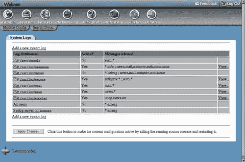

即使你不想更改现有的日志设置，也可以点击`View`链接使用该模块查看日志文件。这将带你进入显示文件最后 20 行的页面，底部有一个`Refresh`按钮用于刷新页面或增加显示的行数。你还可以通过`Only show lines with`文本字段将显示限制为某些类型的日志消息。只有写入普通文件的日志可以查看；发送到另一个服务器、用户、命名管道或设备文件的日志无法被 Webmin 读取。

### 13.3 添加新日志文件

由于写入到每个日志目标的消息对其他目标没有影响，因此你可以添加新的日志文件而不影响任何现有文件。如果你想查看某些当前未记录的信息，或者想将某个特定设施或优先级的消息分离到与当前记录位置不同的文件中，这将非常有用。

要添加新的日志文件或目标，遵循以下步骤：

在 System Logs 模块的主页上，点击现有日志文件列表上方或下方的`Add a new system log`链接。这将带你进入图 13.2 所示的表单，输入新日志目标的详细信息。

### 图 13.2 新日志目标表单

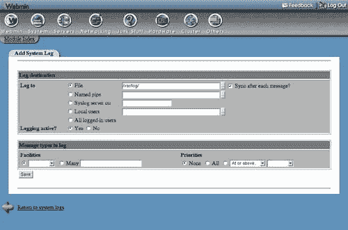

在`Log to`字段中选择五个选项之一，它控制消息写入的位置。选项如下：

- **File**：如果选择此选项，你必须在文本字段中输入要写入日志的文件名。日志行将追加到文件中，如果文件不存在则会创建它。为了确保 syslog 在添加每行后都强制将其写入磁盘，请选择`Sync after each message?`选项。除非你正试图减少系统的硬盘活动（例如在笔记本电脑上），否则勾选此选项是明智的。

  可以创建多个写入同一个文件的日志。可以安全地这样做，无需担心其中一个的消息会覆盖另一个。

- **Named pipe**：命名管道是一种特殊文件，可以由一个程序写入、由另一个程序读取。如果你希望将日志消息写入管道，请先创建它，然后在此选项旁字段中输入其路径。


- `Syslog server on`：此选项可将你系统的部分或全部日志消息发送到另一个服务器，假设该服务器也运行`syslog`。如果选中，必须在选项旁边的文本字段中输入远程服务器的主机或 IP 地址。与本地日志文件不同，写入远程服务器的日志可以防止侵入你系统的攻击者破坏。

- `Local user`：如果选择此选项，日志消息将广播到选项旁文本框中列出的任何用户。用户必须通过`SSH`、`telnet`或在控制台登录才能接收日志消息。

- `All logged-in users`：这与上一个选项类似，但将发送给所有登录用户。为了避免骚扰他人，此选项应仅用于记录非常严重的错误。

`Logging active?`字段决定此日志是否启用。如果设置为 No，该日志的`syslog.conf`条目将被注释掉，没有任何内容发送到选定的目标。

`Message types to log`部分控制哪些消息被写入日志目标。它由两部分组成：`Facilities`（设施）和`Priorities`（优先级）。只有当消息同时匹配选定的设施和选定的优先级时，才会被记录。

对于`Facilities`，你可以从菜单中选择单个设施，选择`All`选项包含所有设施，或者在`Many`文本字段中输入一个由空格分隔的设施列表。

对于`Priorities`（优先级），你可以选择`None`表示不记录任何所选设施的消息，选择`All`记录任何优先级的消息，或者从菜单中的范围选项之一（`At or above`、`Exactly`、`Below`或`All except`）并从最终菜单中选择一个优先级。最后一个选项将根据你的范围类型和优先级选择，将日志记录限制为一个或多个优先级的消息。

在创建新日志时，你只能选择一组设施和一个优先级范围。然而，在保存后，如果你重新编辑该日志，可以添加额外的行来指定设施和优先级，这样就可以记录多种类型的消息。你甚至可以使用`Priorities`下的`None`选项来排除之前行中包含的某些设施。

在表单上完成选择后，点击`Create`按钮。只要没有错误，你将返回模块的主页。

点击`Apply Changes`按钮使你的新日志目标生效。

### 13.4 编辑或删除日志文件

使用 Webmin 可以对模块主页上显示的任何现有日志进行编辑或删除。但是，在更改系统默认配置中包含的目标地时，你应该小心，因为重要的消息可能不再被记录。即使更改写入日志的文件名也可能导致问题，因为许多 Linux 发行版包含了软件，可以自动截断标准日志文件以防止它们占用过磁盘空间。

要更改日志，请遵循以下步骤：

1. 在模块的主页上，点击你要编辑的日志目标。这将带你进入一个编辑表单，该表单与图 13.2 所示的表单几乎相同。
2. 更改任何现有设置，例如目标类型、日志文件或活动状态。你也可以通过在`Message types to log`（要记录的消息类型）部分添加或编辑行，来更改记录的设施和优先级。正如第 13.3 节“添加新日志文件”所解释的那样，始终会有一个空行用于选择新的设施和新的优先级范围。
3. 完成后，点击`Save`按钮。只要你在表单中没有犯任何错误，浏览器将返回模块的主页。
4. 点击`Apply Changes`按钮使你的更改生效。

要删除日志，请遵循以下步骤：

1. 在模块的主页上，点击你要删除的日志目标。
2. 点击页面底部的`Delete`按钮。这将停止向该目标写入日志，但它不会删除任何已经写入的日志文件，如果你需要，可以手动删除。
3. 回到主页，点击`Apply Changes`按钮使更改生效。

### 13.5 模块访问控制

可以对系统日志模块进行限制，使得 Webmin 用户仅可以使用它查看日志文件，而不能创建和编辑它们。正如第 52 章所解释的，你必须首先创建或编辑一个具有模块访问权限的用户。完成后，按照以下步骤将其限制为仅查看日志文件：

1. 在 Webmin 用户模块中，点击要限制的用户名称旁边的`System Logs`。
2. 将`Can edit module configuration?`（可以编辑模块配置？）选项改为`No`，这样他将无法重新配置模块以使用虚假的`syslog.conf`文件。
3. 将字段`Can only view logs?`（仅可查看日志？）改为`Yes`。设置后，用户在模块主页上能做的就是点击日志条目旁边的`View`链接。
4. 要限制用户查看的日志文件，在`Can view and configure log files`（查看并配置日志文件）字段中选择`Only listed files`（仅列出的文件）以及列出目录下的文件，并在相邻的文本框中输入文件名列表。如果你的系统中的某些日志包含敏感或安全信息，这会非常有用。
5. 点击`Save`按钮使更改生效。

### 13.6 其他操作系统

几乎所有的版本的 UNIX 都使用`syslog`来控制日志消息写入的目标，因此系统日志模块在大多数操作系统上可用。它在所有系统中都具有类似的功能，因此用户界面通常相同。但是，存在下述的一些差异：

#### Sun Solaris、Apple MacOS X、HP/UX、SCO UNIXWare、SCO OpenServer 和 IBM AIX

- 在 Solaris 上，第一次使用该模块时，Webmin 可能会询问是否要从 M4 格式转换`syslog.conf`。除非你进行过使用 M4 宏手动更改，否则这样做是安全的。
- 不支持记录到命名管道（named pipes）。
- 没有在每次写入日志文件后进行同步的选项。
- 在选择写入日志的消息优先级时，没有`At or above`、`Exactly`、`Below`和`All except`范围类型。相反，所有优先级高于或等于你所选优先级的消息都将被记录。

#### FreeBSD、OpenBSD 和 NetBSD

- 在 FreeBSD 上，不支持记录到命名管道。
- 在 OpenBSD 和 NetBSD 上，日志可以直接发送到命令的输入，而不是到命名管道。
- 没有在每次写入日志文件后进行同步的选项。
- 在选择写入日志的消息优先级时，`At or above`、`Exactly`、`Below`和`All except`范围类型被`>=`、`=`、`<`、`<>`替换，它们具有相似的含义。
- 每个日志目标都可以与`program`关联，通过可选的`Only for program`字段设置。如果设置，则只有来自输入的服务器或守护进程的消息会被写入此日志文件。

#### SGI Irix

- 不支持记录到命名管道。相反，日志可以直接发送到命令的输入。
- 没有在每次写入日志文件后进行同步的选项。
- 日志可以写入 UNIX 域套字文件（domain socket file）。
- 在选择写入日志的消息优先级时，没有`At or above`、`Exactly`、`Below`和`All except`范围类型。相反，所有优先级高于或等于你所选优先级的消息都将被记录。

如果你的操作系统不在上述列表中，则它不受支持。

### 13.7 总结

UNIX 系统上的日志文件包含大量的有用信息，例如收到的电子邮件详细信息、用户尝试和成功登录、来自内核的硬件错误报告等。本章解释了如何配置用于各种类型消息的文件和其他目标，以及如何通过 Webmin 查看这些内容。系统管理的一个重要部分是密切关注指示严重错误或潜在安全违规的日志消息。

## 第 14 章 文件系统备份

本章解释了如何使用 Webmin 的文件系统备份模块通过`dump`命令备份和恢复文件。

### 14.1 使用 Dump 备份简介

备份 UNIX 系统有许多方法，你可以直接将文件复制到另一个目录，使用`tar`命令创建存档文件或写入磁带设备，或者使用`dump`系列命令。虽然复制或使用`tar`更简单，但只有`dump`可以保留所有文件类型（如命名管道和符号链接）以及文件信息（如 ACL 和属性）。它之所以能做到是因为它对底层文件系统的比其他备份程序更复杂的了解。

`dump`程序的另一个独特优势是支持备份级别（levels）。如果你定期备份同一个目录，而不是每次都将所有文件写入备份设备，你可以选择仅保存自上一个低级别备份以来更改的文件。例如，你可以每周做一次全备份（级别 0），每天做一次速度得多的部分备份（级别 9）。唯一的缺点是，如果需要恢复数据，则需要读取每周备份和本周为止的所有每日备份。

使用`dump`进行备份存在一些其他备份工具不具备的问题。它写入文件或磁带设备的数据没有经过压缩，尽管对于大多数磁带驱动器这不是问题，因为它们会自动压缩数据。另一个问题是，它无法备份通过`NFS`从另一个服务器挂载的文件，因为它不像`tar`和`cp`命令，它是直接从磁盘读取的。

### 14.2 文件系统备份模块

此模块允许你对本地文件系统上的目录进行备份，可以是按需或固定计划。对于正在备份的文件系统类型，将相应的命令，例如对`xfs`文件系统使用`xfsdump`，对`ext2`或`ext3`使用`dump`。该模块还支持恢复备份，可以恢复到原始位置或不同的路径。

当你从系统（System）类别进入该模块时，首页将显示你当前配置的所有备份，如图 14.1 所示。当然，如果你是第一次使用该模块，将没有任何内容显示。

#### 图 14.1 文件系统备份模块主页

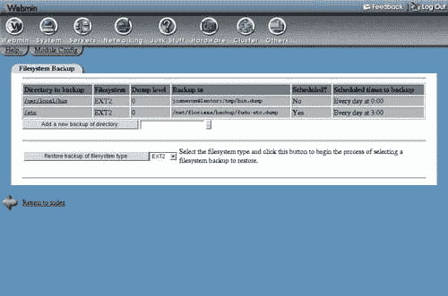

如果 Webmin 检测到你的系统中没有安装任何必要的备份命令，主页将显示错误消息。所有的 Linux 发行版都应该在其 CD 或网站上包含一个带有`dump`程序的包。

### 14.3 添加新备份

如果你想备份某个目录（无论是偶尔备份还是定期计划备份），你首先需要添加一个新的备份配置。这指定了要备份的目录、使用的一组选项以及计划运行的时间。创建新配置要遵循的步骤如下：

在模块的主页上，在“添加新目录备份（Add a new backup of directory）”按钮旁的字段中输入你想要备份的目录路径。当你点击按钮时，Webmin 将确定该目录属于什么类型的文件系统（`ext2`、`ext3`或`xfs`），并显示带有该文件系统类型选项的备份创建表单。图 14.2 显示了`ext2`或`ext3`备份的表单。

#### 图 14.2 新备份配置表单

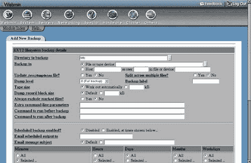

你输入的路径将出现在“待备份目录 to backup”字段中。如果你愿意，仍然可以更改，只要你输入的新目录仍在同一个文件系统上即可。

如果备份到本地文件，将“备份到（Backup to）”字段设置为“文件或磁带设备（File or tape device）”，并在旁边的文本字段中输入你想将备份写入的文件。

备份到磁带驱动器与写入文件类似，但你不需要在“文件或磁带设备”字段中输入文件名，必须输入磁带机的设备文件。例如，`/dev/st0`将是你系统上第一个 SCSI 磁带驱动机的设备文件。

如果备份到另一个服务器，你必须在“备份到（Backup to）”字段中选择“主机（Host）”选项，并输入远程服务器上的主机名、远程用户名以及文件或设备名称。该服务器必须在其互联网服务（Internet Services）模块中启用 shell 服务，如第 15 章所述。还必须为目标用户设置适当的`.rhosts`文件，以便`dump`命令无需提供密码即可连接。

如果你的备份正在写入本地文件，且你不希望它超过特定大小，请将“拆分到多个文件？（Split across multiple files?）”选项设置为“是（Yes）”，并在“带大小（Tape size）”字段中输入以 KB 为单位的最大值。如果备份以后要保存到多张 CD 或 Zip 磁盘上，这将非常有用。

如果你正在像引言所示进行不同层级的多次备份，请将“备份级别（Dump level）”字段更改为全量备份（Full backup）以外的其他选项。然而，如果你希望每个备份都包含源目录中的所有文件，请保持级别 0 不变。

如果你正在备份到磁带，建议将“带大小（Tape size）”字段设置为你的磁带可以容纳的 KB 数。否则，`dump`命令可能会低估写入的数据量并导致无法完成备份。

可以使用`chattr`命令标记在备份时跳过的文件，如果目录中包含你不想保存的巨大无用文件，这将非常有用。但是，在执行级别 0 备份时，这些文件会被包含，除非“始终排除标记的文件？（Always exclude marked files?）”字段设置为“是（Yes）”。

如果你熟悉操作系统上使用的`dump`命令，可以使用“额外命令行参数（Extra command-line parameters）”字段输入传递给程序的额外选项，例如`A /tmp/archive`。否则，留空即可。

为了在执行`dump`命令之前和之后运行命令，请填写“备份前运行命令（Command to run before backup）”和“备份后运行命令（Command to run after backup）”字段。这些命令将在执行备份时（无论是计划还是通过 Webmin 手动执行）以 root 身份运行。它们对于加载/卸载磁带或在保存之前将文件复制到备份目录很有。

如果你希望按定期运行备份，请将“启用计划备份？（Scheduled backup enabled?）”选项设置为“启用（Enabled）”，并从页面底部的列表中选择运行的时间和日期。日期选择界面与第 10 章介绍的计划 Cron 任务（Scheduled Cron Jobs）模块使用的完全相同。

为了通过电子邮件接收计划备份的状态报告，请在“邮件计划输出（Email scheduled output）”字段中输入你的电子邮件地址。

默认情况下，备份邮件的主将类似于`Dump of /etc`。如果你在多个系统上使用此模块，可能希望自定义主题行，以便邮件来源的主机和备份的数据更加明显。要这样做，取消勾选“邮件消息主题（Email message subject）”字段的“默认（Default）”选项，并在旁边的文本字段中输入新的主题行。

最后，点击“创建（Create）”按钮保存新备份配置详情。如果表单没有错误，你将返回模块主页。

或者，你可以点击“创建并立即备份（Create and Backup Now）”立即开始备份。这将带你进入显示进度的页面，如 14.4 节“制作备份（Making a Backup）”所示。

除了`ext2`和`ext3`，另一种具有类似备份命令类型是`xfs`。由于它的`xfsdump`命令选项略有不同，新备份表上的字段与上述描述不完全相同。一个重要的区别是，“待备份目录（Directory to backup）”必须是系统的挂载点，而不仅仅是其中的任何目录。

### 14.4 执行备份

一旦你创建了出现在模块主页上的备份配置，就可以随时使用 Webmin 手动执行它。要这样做，遵循的步骤如下：

1. 从模块主页的配置列表中点击你想要备份的目录。这将进入一个显示备份配置所有详情的表单。
2. 点击页面底部的“立即备份（Backup Now）”按钮。Webmin 将执行相应的`dump`命令，并在写入备份文件或磁带设备时显示其输出。备份之前或之后运行的任何命令的输出也将显示。
3. 如果一切顺利，页面底部将显示“备份完成（backup complete）”。然而，如果出现问题，将显示“备份失败（backup failed）”，请检查`dump`命令的输出以确切查看问题所在。

文件系统备份模块的一个局限性是它无法创建跨越多个磁带的备份。通常情况下，`dump`命令会在需要时提示用户加载新磁带，但在从 Webmin 运行时，这是无法实现的。

### 14.5 编辑或删除备份

在模块主页上显示的备份配置可以随时进行编辑。要更改其中一个，请执行以下操作：

1. 点击您想要更改的备份配置目录。这将进入编辑表单，该表单与图 14.2 所示的创建表类似。
2. 您可以更改任何选项，包括备份目录、目的地或计划。不过，您无法将备份目录更改为类型文件系统的路径，因为该系统可能具有不同的选项，或者根本不受支持。
3. 点击`Save`按钮记录您的更改，或点击`Save and Backup Now`立即使用新选项开始备份。

要删除现有的备份配置，请遵循以下步骤：

1. 在主页上，点击您想要删除的备份配置目录，这将进入编辑表单。
2. 点击页面底部的`Delete`按钮。备份配置将立即被移除，您将返回模块的主页。不过，该配置创建的实际备份文件不会被触动。

### 14.6 恢复备份

使用 Webmin（或手动运行`dump`命令）制作的备份也可以使用此模块进行恢复。如果您创建了不同级别的备份，必须按照级别从小到大的顺序进行恢复，从完整备份（级别 0）开始。备份可以恢复到任何目录，而不只是原始保存的目录。然而，如果恢复目录的文件系统不支持 ACL 和属性等某些文件信息将会丢失。

要恢复备份，请遵循以下步骤：

1. 在文件系统备份（Filesystem Backup）模块的主页上，使用`Restore backup of filesystem type`按钮旁边的列表选择备份的文件系统类型。由于不同类型的文件有不同的恢复程序，恢复选项将根据您选择的类型而异。
2. 点击`Restore backup of filesystem type`按钮，这将进入恢复选项页面。图 14.3 显示了恢复`ext2`或`ext3`文件系统备份的页面。

#### 图 14.3 备份恢复表单

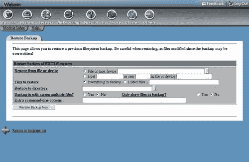

如果从本地文件恢复，请将`Restore from file or device`字段设置为`File`或`tape device`选项，并在相邻文本框中输入您想要从之读取备份的文件。

从磁带驱动器恢复与从文件读取类似，但`File or tape device`字段中输入的不是文件名，而是磁带带驱动器的设备文件：例如`/dev/st0`。

如果从另一台服务器恢复，您必须选择`Host`选项，并在远程服务器上输入主机名、远程用户名以及文件或设备名称。如第 14.3 节“添加新备份”所述，服务器必须已正确配置以允许远程访问。


默认情况下，备份中的所有内容都将恢复。要仅提取某些文件，请将`Files to restore`选项设置为`Listed files`，并在相邻字段中输入您想要恢复的文件的路径。要恢复多个文件，文件名之间必须用空格分隔。

由于备份中使用的路径有时相对于其原始所在文件系统的挂载点，因此使用`Only show files in backup?`选项查看正确的文件名通常是一个好主意。

在`Restore to directory`字段中，输入您想要保存恢复文件的基础目录。

如果原始备份跨越了多个文件，请将`Backup is split across multiple files?`选项设置为`Yes`。

如果您只想查看备份的内容而不提取任何文件，请将`Only show files in backup?`选项设置为`Yes`。

如果您熟悉操作系统上使用的`restore`命令，可以使用`Extra command-line parameters`字段输入传递给程序的额外选项，例如`A /tmp/archive`。否则，请留空。

当您准备好恢复时，点击`Restore Backup Now`按钮。如果是实际提取文件，将显示一个显示相应`restore`命令输出的页面。如果您选择仅查看备份中的文件，页面将显示由`restore`命令产生的列表。

从`xfs`文件系统恢复备份时，恢复表单上提供不同的选项。不存在`Files to restore`选项，因此备份中的所有文件将被提取。但是，有一个`Overwrite existing files`选项，可以设置为`Never`以保护现有文件，或设置为`Unless newer than backup`以保护自备份创建以来修改过的文件。使用 Webmin 恢复的一个问题是它无法处理跨越多个块磁带的备份。通常，`restore`命令会提示用户弹出第一块磁带并插入第二块，但当由 Webmin 运行时是不可能的。

### 14.7 配置文件系统备份模块

点击此模块主页左上角的`Module Config`链接将弹出一个设置表单，用于控制其的行为。可用设置及其含义见表 14.1。

### 表 14.1 模块配置选项

| 配置选项 | 说明 |
| --- | --- |
| 是否对备份目的地进行`strftime`替换？ | 如果在此字段中选择 Yes，备份目标路径将把任何以`%`开头的特殊代码替换为当前时间和日期组成部分。例如，`%m`将替换为月份数字，`%d`将替换为日期，`%y`将替换为年份。这些与标准 UNIX `strftime`函数使用的相同替换。如果您希望备份每天写入不同的文件，而不是每次都覆盖同一个文件，则此选项非常有用。默认选项是 No，这会关闭此行为。 |
| 通过 SMTP 服务器发送邮件 | 当选择本地`sendmail`可执行文件时，计划备份的输出将通过在您的系统上运行`sendmail`命令发送，其路径取自`Sendmail Configuration`模块。然而，您可以告诉模块通过向某些其他主机建立 SMTP 连接来发送电子邮件，这在您的系统完全没有运行邮件服务器，或者运行的是非 Sendmail 的其他服务器时可能是必要的。只需选择第二个单选按钮并在文本框中输入主机名即可。 |

### 14.8 其他操作系统

许多 UNIX 操作系统拥有与 Linux 类似的`dump`和`restore`命令，其中几个系统受此 Webmin 模块的支持。然而，可用选项略有不同，因此不同系统上的备份和恢复表单与 Linux 不完全相同。

目前支持的系统及其差异如下：

- **Sun Solaris**：在 Solaris 上，可以使用`ufdump`和`ufsrestore`命令备份和恢复`ufs`文件系统。在创建备份时，没有`Split across multiple files?`和`Tape size`选项，相反，有`Verify data after backup?`和`Eject tape after backup?`选项，其含义应该是一目了然的。Solaris 还支持同时备份多个目录，方法是在`Directory to backup`字段中输入多个用空格分隔的路径。在 Solaris 上进行恢复时，选项与 Linux 上的基本相同。

- **FreeBSD 和 Apple MacOS X**：由于 MacOS X 的 BSD 渊源，这两个操作系统在 Webmin 中拥有几乎完全相同的`dump`命令和可用选项。在制作备份时，没有`Split across multiple files?`和`Dump label`字段，但有`Tape size`。唯一可以备份的文件系统类型是`ufs`，且备份必须是整个文件系统，而不仅仅是任何目录。遗憾的是，在 MacOS X 上，几乎所有的文件系统都是 Apple 原生的`hfs`格式。恢复时，唯一的区别是额外的`Just test backup?`选项，设置该选项时，会导致恢复命令执行除写入磁盘之外的所有操作。

- **SGI Irix**：在 Irix 上，唯一可以使用 Webmin 进行备份的文件系统类型是`xfs`，尽管较旧的`efs`文件系统有`dump`命令。与 Linux 上的`xfs`文件系统一样，只能备份整个文件系统，而不能备份任意目录。`Tape size`（磁带大小）选项不可用，但你可以通过`Maximum file size to include`（要包含的最大文件大小）选项来限制包含的文件的大小，并通过`Include file attributes?`（包含文件属性？）选项关闭属性的备份。

在 Irix 上恢复备份时，没有指定要提取哪些文件的选项，备份中的所有内容都将被恢复。不过，有一个`Overwrite existing files?`（覆盖现有文件？）选项，可以保护现有文件或比备份更新的文件不被覆盖。

由于使用`dump`系列命令制作的备份具有低级特性，在一个操作系统上创建的备份无法在任何其他操作系统上恢复。

### 14.9 总结

读完本章后，你应该能够使用 Webmin 为系统本地硬盘上的数据创建备份，并在需要时恢复这些备份。你还应该理解本节介绍模块所使用的`dump`备份格式与使用`tar`和`cpio`等命令创建的格式之间的区别。在运行重要服务器或托管关键数据的系统上，适当的备份至关重要，Webmin 可以帮助你创建备份。

## 第 15 章 网络服务

本章涵盖超级服务器`inetd`和`xinetd`，它们负责在需要时启动`telnet`和`FTP`等协议的服务器。

### 15.1 网络服务简介

电子邮件、代理和 Web 服务等频繁使用的网络服务由持续运行的服务器进程处理，它们有自己复杂的配置文件和 Webmin 模块。然而，还有其他如`telnet`、`finger`和`POP3`等服务不需要任何配置，也不需要自己的永久服务器进程。相反，它们的服务器在需要时由`inetd`或`xinetd`等超级服务器启动，超级服务器在多个端口上监听网络连接。只有当接收到连接时，它才会启动相应的进程与客户端通信，并在连接关闭时退出。这通过限制同时运行的进程数量来节省内存，但会让处理新连接的速度略变慢。

每个服务都有一个如`telnet`或`pop3`这样的短名称、一个如`23`或`110`这样的端口号以及一个如`TCP`或`UDP`这样的协议。`/etc/services`文件列出了系统已知的所有服务名称及其对应的端口号，其中只有少数可能有超级服务器或其他服务器监听。

最常用的超级服务器是`inetd`，几乎适用于所有的 Linux 发行版和 UNIX 变体。所有的服务器设置都存储在配置文件`/etc/inetd.conf`中。除了响应`TCP`和`UDP`连接启动服务器外，它还可以以类似的方式处理`RPC`（远程过程调用）函数调用。`inetd`的一个主要缺点是无法根据客户端 IP 地址拒绝连接。然而，可以通过使用中间`TCP-wrappers`服务器程序来克服，该程序有其自己的 IP 访问控制配置文件。

另一个日益流行且功能更多的超级服务器是`xinetd`，它使用`/etc/xinetd.conf`配置文件，有时还使用`/etc/xinetd.d`目录下的其他文件。像`inetd`一样，它可以响应`TCP`和`UDP`连接启动服务器进程，但不支持`RCP`。它的主要优势是内置支持限制连接到某些客户端 IP 地址，而不需要单独配置程序。它还可以通过建立自己的客户端连接并来回数据，将某些端口上的入站连接重定向到另一个主机和端口。

由于`inetd`和`xinetd`有完全不同的配置文件和文件格式，因此它们都有单独的 Webmin 模块进行配置。大多数 Linux 发行版会自带其中之一，但在某些情况下，两者都可以被安装并和谐共存。唯一的限制是它们不能同时在同一个端口上。

### 15.2 网络服务与协议模块

该模块处理`inetd`的配置，可以在 Webmin 的 Networking（网络）类别下找到。如果图标不可见，说明 Webmin 检测到它未安装。这可能是因为你的发行版正在使用`xinetd`，在这种情况下，你应该跳过并跳转到第 15.8 节“扩展网络服务模块”。如果两个模块都不可见，请检查你的发行版 CD 或网站查看是否有`inetd`或`xinetd`包。

该模块的主页（如图 15.1 所示）显示两个表格，一个是用于响应`TCP`或`UDP`连接的网络服务，另一个是用于`RCP`程序。在网络服务部分，某些情况下会显示所有服务的名称和协议，同一个服务可能会被识别为多个协议。每个服务可以处于三种状态之一，由显示名称的字体指示：

- Enabled（粗体）：已为此服务分配了服务器程序，且目前处于激活状态。
- Disabled（粗斜体）：已分配服务器程序，但未激活。这对应于`inetd.conf`文件中注释掉的条目。
- Unassigned（普通）：未为此服务分配服务器程序，意味着它没有对应的`inetd.conf`条目。

### 图 15.1 网络服务与协议模块主页

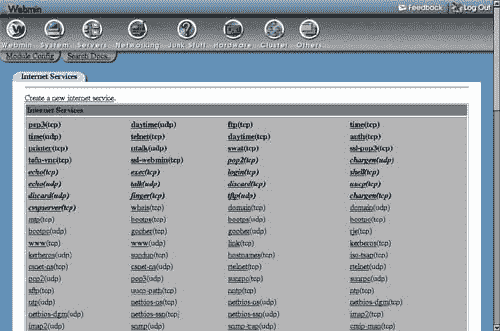

如果模块配置选项`Show services with no program`（显示无程序的服务）设置为`No`，则未分配状态的服务将不会显示。由于系统知道的服务数量巨大，这是某些操作系统上的默认设置。

大多数 Linux 发行版默认将几乎所有服务都处于禁用状态。这限制了系统允许连接的不必要服务的数量，从而减少了攻击者利用某一个服务器程序中安全漏洞的机会。

由于每个服务仅显示如`telnet`或`chargen`这样的短名称，对于缺乏经验的管理员来说，并不清楚每个服务的作用。一些较常用的服务及其目的见表 15.1。

对于`TCP`和`UDP`协议的`daytime`、`echo`和`chargen`服务，在启用时由`inetd`内部处理，而不是通过单独服务器程序。

### 表 15.1 常用服务及其目的

| 服务名称 | 协议 | 目的 |
| --- | --- | --- |
| `telnet` | `TCP` | 使用`telnet`命令进行远程登录。由于`telnet`连接是不加密的，通过其发送任何用户名或密码理论上都可以被攻击者捕获。在现代系统中，通常使用更安全的`SSH`协议。 |
| `pop3` | `TCP` | 使用几乎任何邮件客户端（如`Outlook`、`Eudora`或`Netscape`）检索邮件。如果你希望用户能够从你的系统获取邮件，应启用此协议。 |
| `imap` | `TCP` | 一种更优的邮件检索协议，支持文件夹和服务器端邮件存储。然而，支持它的邮件客户端较少。 |
| `finger` | `TCP` | 使用`finger`命令进行远程用户查询。 |
| `ntalk` | `TCP` | 使用 UNIX `talk`程序进行人与人的聊天。 |
| `ftp` | `TCP` | 使用`FTP`客户端进行文件上传或下载。有多种不同的`FTP`服务器可用，最常见的是`wu-ftpd`和`proftpd`。由于它们有许多单独配置的选项，每个程序都有自己的 Webmin 模块，见第 40 章和第 41 章。 |
| `shell` | `TCP` | 使用`rsh`命令进行未经身份验证的远程登录。由于`shell`协议仅根据客户端 IP 地址验证用户，因此不被认为是安全的；`ssh`是一个更好的替代方案。然而，你可能需要在文件系统备份模块中为远程备份启用它。 |
| `login` | `TCP` | 使用`rlogin`命令进行远程登录。由于它可以配置为仅通过客户端地址验证用户，因此它被认为是不安全的且很少使用。 |
| `exec` | `TCP` | 使用`rexec`程序进行远程命令执行。由于`ssh`的优越性，在现代系统中很少使用。 |
| `daytime` | `TCP` | 连接建立后，以人类可读的格式显示服务器时间。 |
| `daytime` | `UDP` | 与 TCP daytime 服务类似，但通过 UDP 数据包返回人类可读的时间。 |
| `time` | `TCP` | 连接后，以 4 字节二进制数显示系统时间。 |
| `time` | `UDP` | 与 TCP time 服务类似，但通过 UDP 数据包返回二进制时间。 |
| `echo` | `TCP` | 传发送给它的任何数据。 |
| `echo` | `UDP` | 传它收到的任何数据包。 |
| `chargen` | `TCP` | 只要客户端连接，就会产生包含可打印 ASCII 字符的无限数据流。 |
| `chargen` | `UDP` | 与 TCP chargen 服务类似，但对从客户端收到的每个包返回一个包含 ASCII 字符的单个 UDP 包。 |

### 15.3 启用互联网服务

如果你想允许用户使用 POP3 协议从你的系统获取邮件，或通过`telnet`登录，那么如果相应的互联网服务尚未启用，就有必要将其打开。要这样做，请遵循以下步骤：

在模块的主页上，点击“Internet Services”表格中你想要启用的服务名称。这将带你进入图 15.2 所示的页面以编辑其详情。

### 图 15.2 编辑互联网服务

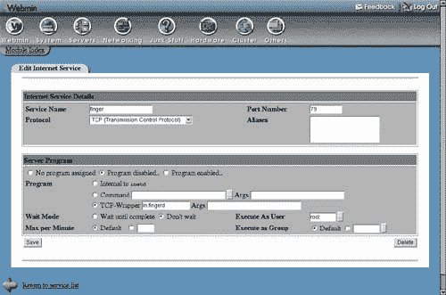

如果你的系统中没有显示未分配的服务，你可以在“Edit service”（编辑服务）按钮旁字段中输入服务名称并选择协议。点击该按钮将进入编辑表单（前提是服务名称被识别）。

`Service`（服务）名称、`Port`（端口号）、`Protocol`（协议）和`Aliases`（别名）字段应保持不变，除非你想重命名服务或更改它监听的端口。对于你不是自己创建的服务，更改这些字段中的任何一个都是坏主意，因为可能会阻止你系统上的程序连接到其他服务器。

若要在 Server 程序部分启用服务，请选择`Program enabled`（程序已启用）选项。如果之前选择了`Program disabled`（程序已禁用），则该部分的所有其他设置应该是正确的，且不需要更改。

然而，如果之前选择了`No program assigned`（未分配程序），则你需要选择一个服务器程序和一个供服务器运行的用户。选择`Program`字段中的`Command`（命令）选项，并在旁边的字段中输入服务器程序的完整路径，例如对于 FTP 服务器输入`/usr/sbin/in.ftpd`。在`Args`（参数）字段中，再次输入服务器命令及其所需的任何参数，例如`in.ftpd l a`。即使程序路径在`Command`字段中，程序名称也必须出现在`Args`字段中。

你需要在`Execute as User`（以用户身份运行）字段中输入服务器程序要运行的用户名。对于几乎所有服务器，这将是`root`。除非服务器运行和执行非常快，否则必须设置`Wait Mode`（等待模式）选项之一，选择`Don't wait`（不等待）。

某些服务如`daytime`、`echo`、`chargen`和`discard`是由`inetd`内部处理的。如果你正在启用其中一个，只需选择`Internal to inetd`（`inetd`内部）。不需要输入程序或参数，服务器执行的用户也是无关的。

完成后，点击`Save`（保存）按钮。只要没有错误且所选服务器程序确实存在，浏览器将返回主页的服务列表。

点击页面底部的`Apply Changes`（应用更改）按钮使更改生效。

在某些情况下，你将无法启用服务，因为相应的服务器程序尚未安装。如果是这种情况，请使用`Software Packages`（软件包）模块从你的 Linux 发行版 CD 或网站安装它。

如果你想禁用服务，只需按照相同的步骤操作，但选择`Program disabled`（程序已禁用）选项。这比选择`No program assigned`（未分配程序）更好，因为它重新开启服务时无需重新输入服务器程序的详情。

### 15.4 创建自己的互联网服务

在某些情况下，你可能想向系统添加一个新服务器，监听一个未分配给其他内容的端口。你可能想在某些非标准端口上运行`telnet`服务器，或使用像`nc`这样的程序将流量从你系统上的一个端口重定向到另一个服务器。如果你只是尝试开启某些如`ftp`或`imap`的标准服务，本节的说明不适用于你，请查看第 15.3 节“启用互联网服务”。

创建新服务的步骤如下：

在模块的主页上，点击`Create a new internet service`（创建新的互联网服务）链接。这将带你进入服务创建表单，与图 15.2 中的编辑表单相似。

在`Service Name`（服务名称）字段中为你的服务填写一个唯一名称。

在`Port Number`（端口号）字段中输入你希望服务关联的端口号。

从`Protocol`（协议）列表中选择协议。这几乎总是`TCP`，但在某些情况下你可能需要使用`UDP`。

在`Aliases`（别名）字段中输入你希望引用服务的任何替代名称。


假设你想为此服务关联一个服务器程序，请在 `Server Program` 部分选择`Program enabled（程序已启用）`选项。否则，创建的只是服务名称和端口号之间的关联。

对于`Program（程序）`字段，选择`Command（命令）`选项，并在旁边的字段中输入服务器程序的完整路径，例如 `/usr/local/bin/someserver`。在`Args（参数）`字段中，输入程序名称以及运行时应带有任何命令行参数，例如 `someserver foo`。

再举一个例子，如果你想创建一个服务，向任何通过 `telnet` 连接的人显示你系统上运行的所有进程，你可以将 `Command` 设置为 `/bin/ps`，并将 `Args` 设置为 `ps auxwww`。（尽管从安全角度来看，这是个坏主意。）

如果服务器程序的运行时间超过一秒，或者它接受任何输入，请将`Wait mode（等待模式）`字段设置为`Don't wait（不等待）`。否则，`inetd` 将停止处理新的网络连接，直到程序完成。这种“等待完成”模式的唯一优点是稍微减少内存占用。

在`Execute as User（以用户身份运行）`字段中，输入服务器程序要运行的 UNIX 用户名。通常是 `root`，但可以是任何人。

要限制 `inetd` 接受服务的速率，在`Max per Minute（每分钟最大）`字段中输入一个数字。如果超过限制，后续连接将被拒绝，直到下一分钟。

默认情况下，服务器程序运行的组是`Execute as User`字段中设置的用户的主组。要更改此，请在`Execute as Group（以组身份运行）`字段中输入组名。

点击`Create（创建）`按钮创建你的服务。只要表单没有错误，你将返回主页的服务列表。

点击`Apply Changes（应用更改）`按钮使服务生效。

一旦创建了服务，你可以在系统的 shell 提示符上运行 `telnet localhost *portnumber*` 来测试。你可以随时通过点击主页上的名称来编辑服务，更改任何选项后点击`Save（保存）`或`Delete（删除）`（如果你想移除它）。在进行任何修改后，必须使用 `Apply Changes` 按钮使修改生效。

## 15.5 创建和编辑 RPC 程序

RPC 是一种协议和数据格式，是 `NFS` 和 `NIS` 等其他协议的基础。RPC 客户端向 RPC 服务器发起函数调用，传递参数并获取结果。对于客户端或服务器而言，发起远程过程调用的难度与调用普通库函数无异，这使得编写使用 RPC 的程序比从头开始创建自己的协议要容易得多。

RPC 程序是一组由服务器处理的函数。每个程序都有一个唯一的编号，类似于 Internet 服务的端口。程序并不与特定协议关联，因为它们通常可以通过 `UDP` 或 `TCP` 接收连接和函数调用。它们也没有固定的端口，因为端口是在需要时动态分配的。

处理大量流量的 RPC 服务器（如 `NIS` 和 `NFS` 服务器）拥有一直运行的进程进程。然而，某些偶尔运行一次的服务器可以像不使用的 Internet 服务一样，仅在需要时由 `inetd` 执行。一些较常用的 RPC 程序包括：

在某些系统中，这些 RPC 程序可能由并非从 `inetd` 运行的服务器处理，而是作为独立进程运行。在这种情况下，`Bootup`（启动）和 `Shutdown`（关闭）模块（第 9 章中已说明）是激活或停用它们的地方。由于常用的 RPC 程序数量较少且用处有限，许多 Linux 发行版默认在 `inetd` 配置中没有启用或禁用任何程序。然而，在 `Solaris` 等其他操作系统上情况并非如此。

### 表 15.2. 常用 RPC 程序及其用途

| 程序名称 | 用途 |
| --- | --- |
| `rquotad` | 远程磁盘配额检索。如果系统正在通过 `NFS` 导出带有配额的文件系统，则客户端上的 `quota` 命令可以使用此程序来显示 `NFS` 挂载文件系统上已用和可用的块及文件。 |
| `rusersd` | 请求登录系统的用户列表。可以使用 `rusers` 命令显示登录在一个或多个服务器上的用户。 |
| `walld` | 向服务器上的用户广播消息。类似于向本地用户发送消息的 `wall` 命令，`rwall` 命令通过调用此 RPC 程序，向另一台系统上的用户发送消息。 |

如果您想使用一个当前未启用的 RPC 协议，可以使用此模块将其开启。当然，必须先安装相应的 RPC 服务器程序，并且您系统上的 `inetd` 必须支持 RPC 程序。如果是这样，步骤如下：

在模块的主页上，点击 RPC Programs 表中的程序名称。这将引导您进入图 15.3 所示的程序编辑表。

### 图 15.3. RPC 程序编辑表。

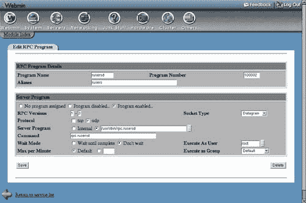

在 `Server Program`（服务器程序）部分，选择 `Program enabled`（启用程序）选项。如果之前选择了 `Program disabled`（禁用程序），则该部分的所有其他设置应该是正确的，不需要更改。然而，如果勾选了 `No program assigned`（未分配程序），您需要填写其他几个字段。

`RPC Versions`（RPC 版本）字段应设置为服务器程序支持的版本范围，例如 `1-3`。

`Socket Type`（套字类型）字段应设置为 `Datagram`（数据报），`Protocol`（协议）字段仅设置为 `udp`。

对于 `Server Program` 字段，输入 RPC 程序的完整路径，例如 `/usr/sbin/rpc.rusersd`。对于 `Command`（命令）字段，输入程序名称和任何参数，例如 `rpc.rusersd a`。

对于 `Wait Mode`（等待模式），选择 `Don't wait`（不等待）。

对于 `Execute as User`（执行用户）字段，输入您希望服务器程序运行的用户名，通常为 `root`。

完成后，点击 `Save`（保存）按钮。只要输入无误，您将返回模块主页，此时 RPC 程序应显示为已启用。

点击 `Apply Changes`（应用更改）按钮使程序生效。

## 15.6 配置 Internet 服务和协议模块

要访问 Internet 服务模块的可配置选项，请点击主页左上角的 `Module Config`（模块配置）链接。这将引导您进入标准配置表，您可以在其中更改表 15.3 所示的选项。

### 表 15.3. 模块配置选项

| 选项 | 说明 |
| --- | --- |
| 显示无程序的服务 | 如果设置为 `Yes`（是），主页将仅显示已分配启用或禁用服务器程序的 Internet 服务。在大多数发行版中，默认是 `No`，但某些发行版的已知服务非常多，必须开启此选项来限制服务列表的大小。 |
| 按以下项排序和服务程序 | 控制主页上 Internet 和 RPC 服务的排序。如果选择 `Name`（名称），将按服务名称排序。如果选择 `Assignment`（分配），则所有已启用服务器程序的程序将列在前面，随后是已禁用程序的程序，最后是未分配的程序。如果选择 `Order in file`（文件中的顺序），服务的显示将与它们在 `/etc/services` 中的存储顺序相同，通常按端口号排序。 |

`System configuration`（系统配置）下的其余模块配置选项由 `Webmin` 根据您的操作系统类型自动设置，因此不应更改。

## 15.7 其他操作系统

几乎所有版本的 `UNIX` 都包含 `inetd` 作为标准，并以与 Linux 相同的方式用于启动不经常运行的服务器程序。然而，在其他操作系统上的配置文件格式和功能略有不同，这意味着模块的用户界面将不会完全相同。主页始终会显示 Internet 和 RPC 服务列表，但在编辑或创建服务时，将根据您运行的 `UNIX` 变体提供不同的字段和选项：

### Sun Solaris

在编辑 Internet 服务时，`Max Per Minute`（每分钟最大次数）和`Execute as Group`（执行组）字段不可用。

`Solaris` 8 及以上版本支持 `IPv6` `TCP` 和 `UDP` 协议，以及 Linux 使用的标准 `IPv4`。

许多 RPC 服务默认处于禁用状态，用于 `NFS` 配额和锁定。

### FreeBSD

RPC 服务不能分配程序。您仅可以编辑服务名称和程序编号。

在编辑或创建服务时，可以使用 `Max Child Processes`（最大子进程数）字段控制任何时刻活跃的服务器程序数量。

此外在编辑时，您可以使用 `Execute as Login Class`（执行登录类）字段设置服务器程序运行的登录类。

### NetBSD

与 `FreeBSD` 一样，在编辑或创建服务时可以使用 `Max Child Processes` 和 `Execute as Login Class` 字段。

与 `Solaris` 一样，Internet 服务可以使用 `IPv6` `TCP` 和 `UDP` 协议。

### OpenBSD, Compaq Tru64/OSF1, IBM AIX, SCO OpenServer, 和 SCO UnixWare

与 `Solaris` 一样，`Max Per Minute` 和 `Execute as Group` 字段不可用。

### SGI Irix

在编辑服务时，`Max Per Minute` 和 `Execute as Group` 字段不可用。

在服务器程序 `Command` 字段下方有一个名为 `Command may not exist?`（命令可能不存在？）的复选框。如果勾选此项，如果未安装服务器程序，`inetd` 将忽略该服务。默认情况下，许多未默认安装的 Irix 软件包相关的服务已开启。

### HP/UX

在 `HP/UX` 上，模块的选项与 Linux 上完全相同。

#### Apple MacOS X

与 `Solaris` 一样，`Max Per Minute` 和 `Execute as Group` 字段不可用。

与 `FreeBSD` 一样，RPC 服务不能分配程序。

服务名称和端口没有存储在 `/etc/services` 文件中，而是位于 `NetInfo` 表中。Webmin 通过导出并重新加载此表来读取和编辑服务。

## 15.8 扩展 Internet 服务模块

此模块允许你配置 `xinetd`，它是一个超级服务器，目的与 `inetd` 类似，但具有多个额外功能。与“互联网服务和协议”模块一样，此模块可以在“网络”类别下找到。然而，只有当 Webmin 检测到已安装 `xinetd` 时，它的图标才会显示（它是通过查找 `/etc/xinetd.conf` 文件来检测）。如果你手动编译并安装了它，可能需要创建一个指向 `xinetd.conf` 真实位置的符号链接。

主页列出了所有分配了服务器程序的服务的端口号、协议、程序和活动状态，示例参见图 15.4。与“互联网服务”模块不同，没有程序的服务永远不会显示。

### 图 15.4. 扩展互联网服务模块。

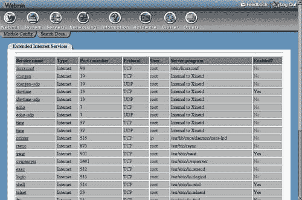

在使用 `xinetd` 的 Linux 发行版中，大多数服务器程序包都包含一个文件，该文件会在主页显示的列表中添加适当的服务。这些服务默认通常是禁用的，以防服务在安装时刻就被意外启用。

如果你在安装了 `xinetd` 的其他操作系统上使用，其用户界面与 Linux 上的完全相同。然而，服务器程序包在安装时可能不会设置服务。

## 15.9 启用或编辑扩展互联网服务

如果你想允许用户通过 POP3 协议从你的系统获取邮件，或通过 `telnet` 登录，则必须在此模块中开启相应的服务（前提是它列在主页上）。如果没有，你首先需要从你的发行版网站或光盘中安装相应的软件包，这将为该服务添加一个条目。如果没有，请参第 15.10 节“创建扩展互联网服务”。

现有服务也可以通过其他方式更改，例如，限制允许的客户端 IP 地址或并发连接数。编辑服务的遵循步骤如下：

在“扩展互联网服务”模块的主页上，点击你想要编辑的服务名称。这将带你图 15.5 所示的表单。

### 图 15.5. 编辑扩展互联网服务。

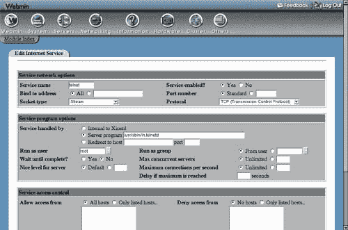

`Service`（服务）名称、`Socket type`（套接字类型）和 `Protocol`（协议）选项应应保持不变。只有在你确定自己在做什么时，才更改 `Port`（端口）字段。

要启用服务，请将 `Service enabled?`（服务已启用？）字段设置为 `Yes`。或者如果它已经启用而你想关闭它，请选择 `No`。

如果你希望服务仅通过你服务器上的单个 IP 地址访问，请将其输入 `Bind to address`（绑定到地址）字段。如果你在系统上有多个虚拟 IP 接口，并希望不同的服务器监听不同的地址，那么这会非常有用。

`Server program options`（服务器程序选项）下的绝大多数字段都可以保持不变，除非你想限制服务对系统造成的负载。如果是这样，你可以将 `Max concurrent servers`（最大并发服务器）字段设置为允许同时运行的服务器进程数。`Maximum connections per second`（每秒最大连接数）和 `Delay if maximum is reached`（达到最大值时的延迟）字段可以限制允许客户端连接的速率以及超过该速率时服务被禁用的时间。

要控制允许客户端从哪些地址连接，请使用 `Service access control`（服务访问控制）部分的字段。如果 `Allow access from`（允许从...访问）设置为 `Only listed hosts`（仅限列出的主机），则仅允许输入的 IP 地址（如 `192.168.1.55`）、主机（如 `server.foo.com`）和网络（如 `192.168.1.0/24`）。如果 `Deny access from`（拒绝从...访问）设置为 `Only listed hosts`（仅限列出的主机），则将阻止输入的主机、IP 地址和网络连接。

如果客户端匹配两个列表中的项，将使用最具体的条目来决定允许还是拒绝访问。例如，如果 `192.168.1.10` 被允许而 `192.168.1.0/24` 被拒绝，那么 IP 地址为 `192.168.1.10` 的客户端将能够连接。

如果你想限制可以使用次数，请填写 `Allow access at times`（允许访问的时间段）字段。其格式必须为 `HH:MM-HH:MM`，例如 `9:00-17:00` 以允许在正常工作时间内访问。

完成更改后，点击 `Save`（保存）按钮。只要你没有犯任何错误，浏览器将返回到模块主页。

点击 `Apply Changes`（应用更改）使你的修改生效。

如果你想完全删除一个服务，可以点击编辑表单上的 `Delete`（删除）按钮。然而，通常最好只需禁用它，以便以后可以重新开启。

## 15.10 创建扩展互联网服务

如果你想启用主页列表未包含的协议，或将从特定端口的流量重定向到另一个主机，那么你需要使用此模块创建一个新服务。必须先安装该服务的适当服务器程序，除非你正在设置重定向。遵循的步骤如下：

点击主页列表上方或下方的 `Create a new internet service`（创建新互联网服务）。这将带你进入创建表单，类似于图 15.5 所示。

如果服务用于 `telnet` 或 `finger` 等标准协议，请在 `Service name`（服务名称）字段中输入其名称。此时 `Port`（端口）号可以设置为 `Standard`（标准）。

否则，在 `Service name` 字段中输入一个唯一名称，并将 `Port` 号设置为你希望服务监听的端口。

如果你希望服务仅通过你服务器上的单个 IP 地址访问，请将其输入 `Bind to address` 字段。如果你在系统上有多个虚拟 IP 接口，并希望不同的服务器监听不同的地址，这会非常有用。

将 `Protocol`（协议）字段设置为你希望服务使用的协议，通常为 `TCP`。对于 `TCP` 协议服务，`Socket type` 字段应设置为 `Stream`；对于 `UDP` 服务设置为 `Datagram`。

如果你的服务将使用服务器程序，将 `Service handled by`（由...处理）选项设置为 `Server program`（服务器程序），并在其旁边的字段中输入其命令和任何参数，例如 `/usr/sbin/in.telnetd a`。

如果服务只是将流量重定向到另一个主机，选择 `Redirect to host`（重定向到主机）选项并在相应的字段中输入目标主机名和端口。如果你的防火墙或网关主机运行 `xinetd`，重定向对于让内部网络系统的服务对互联网其他部分可用非常有用。

在 `Run as user`（以用户运行）字段中，输入服务器程序将运行的 UNIX 用户名。这对于重定向服务不是必要的。

除非服务器程序总是执行得非常快，否则将 `Wait until complete`（等待完成）字段设置为 `No`。如果你将其设置为 `Yes`，`xinetd` 将在程序结束不再处理更多连接。

要限制客户端连接的速率，请按照第 15.9 节“启用或编辑扩展互联网服务”中的解释设置 `Max concurrent servers` 和 `Maximum connections per second` 字段。

要限制客户端连接的地址或允许连接的时间，请按照上述列表设置 `Service access control`（服务访问控制）下的字段。

完成后，点击 `Create`（创建）按钮。如果表单没有错误，你将返回主页，你的新服务现在应该列在其中。

点击 `Apply Changes`（应用更改）使服务生效。

一旦创建了服务，你可以在系统的 shell 提示符运行 `telnet localhost portnumber` 来测试它。你可以随时按照第 15.9 节“启用或编辑扩展互联网服务”中的说明来编辑或删除你的服务。

## 15.11 编辑默认选项


有几个适用于`xinetd`处理的所有服务的全局选项，用于日志和 IP 访问控制。编辑这些选项的遵循步骤如下：

点击模块主页底部的`Edit Defaults`按钮，这将带你进入默认选项表单。

要限制连接到任何服务的地址，请填写`Allow access from`和`Deny access from`字段。它们的输入格式与服务表上同名字段相同，正如第 15.9 节“启用或编辑扩展 Internet 服务”中所述。

为单个服务配置的任何 IP 访问控制将覆盖你在此表单中输入的默认设置。

要让`xinetd`将日志记录到 syslog，请将`Xinetd logging mode`字段设置为`Log to syslog facility`，并选择其应使用的设施和优先级。第 13 章详细解释了如何根据所选优先级和设施配置`xinetd`消息写入的日志文件。通常，这是默认且最佳选项。

如果你想让`xinetd`直接记录到文件，请选择`Log to file`选项并在相邻字段中输入日志文件路径。若要在文件过大时记录警告消息，请在`Soft file limit`字段中输入以字节为单位的文件大小。要设置一个永远不会超过的文件大小限制，请填写`Hard file limit`字段。如果设置了软限制但未设置硬限制，它将默认为软限制的 1%。如果两者未设置，日志文件将无限增长，可能导致攻击者通过向`xinetd`发起数百万次连接耗尽你所有的磁盘空间。

要完全关闭日志记录，请将`Xinetd logging mode`字段设置为`Disable logging`。

要控制记录哪些事件，请从`On successful connection log`和`On failed connection log`字段中选择相应的选项。

完成后，点击`Save`按钮。只要输入无误，你将返回模块主页。

点击`Apply Changes`按钮使新默认生效。

### 15.12 总结

本章解释了两种常用的 UNIX 超服务器程序`inetd`和`xinetd`的用途及其区别。阅读完本章后，你应该知道如何启用由其中一个程序启动的标准服务，以及必要时如何创建和编辑你自己的服务。其他几个章节提到了本章涵盖的模块，特别是关于 FTP、CVS 和 SSL 隧道服务器的章节。

## 第 16 章 网络配置

本章解释了如何设置系统的 IP 地址、主机名、DNS 服务器和其他网络设置。它涵盖了 Linux 和其他 UNIX 变体。

### 16.1 Linux 网络简介

Linux 系统可以通过多种不同方式连接到网络或 Internet，例如通过以太网网卡、令牌环网卡或通过拨号调制解调器的`PPP`（点对点协议）连接。如果你的系统从未连接到网络，那么本章就不适合你。但是，如果你确实需要建立网络连接（特别是到局域网），请继续向下阅读。

系统中的每个以太网网卡、`PPP`连接、无线卡或其他可用于网络的设备都称为`interface`（接口）。接口通常与某个硬件（如网卡）相关，但它们也可以被动态创建（如`PPP`连接）。要使用`interface`，它必须首先分配一个 IP 地址，该地址可以是固定的（从系统中的配置文件中设置），也可以由服务器动态分配。公司或家庭网络中台式 PC 的以太网`interface`通常会带有一个固定地址，而连接到 ISP 的`PPP`连接接口地址将由另一端的服务器动态分配。

`PPP`接口的配置方式与以太网和其他固定硬件接口非常不同。在激活之前，必须使用调制解调器拨打特定号码的 ISP，并使用用户名和密码登录。只有登录成功后，`PPP`接口才会获得 ISP 接入服务器分配的 IP 地址。系统的其他网络设置，如 DNS 服务器地址和默认网关也将由 ISP 分配。然而，以太网`interface`可以随时设置 IP 地址并开始工作，通过以太网连接的系统通常使用固定的 DNS 服务器和网关地址。

有时以太网`interface`也会动态分配地址。如果是这样配置的，系统会在启动激活`interface`时使用`DHCP`（动态主机配置协议）广播地址请求。`DHCP`服务器将响应请求，提供 IP 地址，可能还会提供默认网关和 DNS 服务器地址。`DHCP`通常用于许多频繁连接和断开系统（如笔记本电脑）的大型网络，以避免手动为每个系统配置固定 IP 地址。

一个始终可用的特殊网络`interface`是环回接口（loopback `interface`）。它始终拥有 IP 地址`127.0.0.1`，映射到主机名`localhost`。该`interface`无法与其他系统通信，只能与你自己的系统通信，例如运行命令`telnet localhost`将弹出你自己的系统登录提示（假设 telnet 服务器已启动）。

每个`interface`都有一个名称，如`eth1`或`ppp0`。所有以太网接口以`eth`开头，`PPP`接口以`ppp`开头，环回接口以`lo`令牌环以`tr`开头。数字告诉你该`interface`对应哪种类型的网卡；如果你的系统有两个以太网网卡，第一个是`eth0`，第二个是`eth1`。

如果你的系统连接到比小型家庭 LAN 更大的网络，网络上的其中一台计算机将作为网关。这是一台服务器（更可能是路由器），它知道如何将流量路由到其他网络或 Internet，可能通过`PPP`链路、宽带连接或其他网卡。为了让你的系统与那些其他网络通信，必须配置网关的 IP 地址。

IP 网络上的所有通信都使用如`192.168.1.10`或`210.23.128.117`等 IP 地址。因为这类地址对普通人来说并不容易记忆，它们也可以关联名称，如`server.foo.com`。每当系统需要查找主机名的 IP 地址（或反之）时，它会查询`DNS`服务器，该服务器将提供所需的信息，来自其自身的记录或通过查询网络或 Internet 上的其他`DNS`服务器。为了让你的系统能够查询`DNS`服务器，需要配置附近服务器的 IP 地址或地址，以及一个附加到任何主机名的默认域名。

不过，并非所有 IP 地址都从`DNS`服务器查询，有些存储在系统的的`/etc/hosts`文件中，以便即使在网络未激活时也能找到。通常，`localhost`和你系统主机名的 IP 地址将存储在此文件中，因为它们很少更改。

正如预期的那样，可以在 Webmin 的 Networking 分类下找到 Network Configuration 模块。主页显示了四个配置类别`Network Interfaces`（网络接口）、`Routing and Gateways`（路由与网关）、`DNS Client`（DNS 客户端）和`Host Addresses`（主机地址）的图标。该模块中所有可编辑表单和选项都属于这四个类别之一。

该模块主要设计用于配置具有永久网络连接的系统，例如以太网或令牌环卡。如果你的系统仅通过拨号`PPP`连接 Internet，那么它对你来说将意义不大。相反，你应该使用 Webmin 的`PPP Dialup Client`模块，它允许你为拨号连接设置电话、用户名和密码。

本模块中的表单仅允许您将系统设置为 DNS 和 DHCP 客户端。如果您想在网络上运行自己的 DNS 服务器，请参阅第 30 章。要学习如何设置自己的 DHCP 服务器，请参阅第 32 章。

## 16.2 查看和编辑网络接口

要查看系统当前激活的接口，点击模块主页上的“Network Interfaces”（网络接口）图标。这将进入图 16.1 所示的页面，该页面分两列出了系统接口。顶部“Interfaces Active Now”（当前激活接口）下方是当前启用并已分配 IP 地址的接口。将显示所有的回环（loopback）、以太网（Ethernet）和 PPP 接口，但并非所有接口都可以使用 Webmin 编辑。底部“Interfaces Activated at Boot Time”（启动时激活的接口）下方是配置为启动时激活的接口。这两个列表并不相同，因为某些类型的接口（如 PPP）不会在启动时激活，因此不会出现在第二个列表中。

### 图 16.1. 网络接口页面。

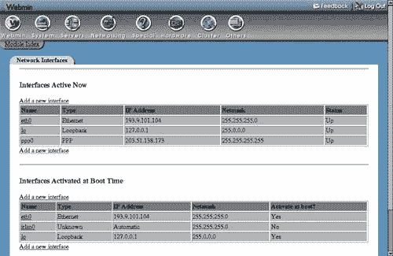

更改接口的 IP 地址、激活状态或其他详情的遵循步骤如下：

如果接口同时出现在`Interfaces Active Now`和`Interfaces Activated at Boot Time`下（大多数可编辑接口都是如此），请点击下方列表中的名称。这将带您进入编辑设置的表单，如图 16.2 所示。

### 图 16.2. 接口编辑表单。

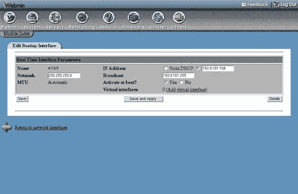

要分配不同的地址，请将其输入到`IP Address`字段中。或者，如果您希望由网络上的 DHCP 服务器动态分配地址，请选择`From DHCP`选项。

如有必要，更改`Netmask`（子掩码）字段。如果更改了子掩码或 IP 地址，您还需要根据新的子掩码设置`Broadcast address`广播地址）字段。

在编辑激活的接口时，`MTU`和`Hardware address`硬件地址）字段可用。除非您非常确定自己在做什么，否则应该保持`MTU`不变，因为更改可能会降低网络性能或导致系统断网。只有在您想为网卡提供不同的以太网地址时，才更改硬件地址，这通常是没有必要的。

编辑启动时接口时，确保确保`Activate at boot?`字段设置为`Yes`，以便接口在系统启动时启动。编辑激活的接口时，确保`Status`字段设置为`Up`，以便可以立即使用。

完成启动时接口的编辑后，点击`Save and Apply`按钮以保存更改供启动时使用，并使其立即生效。如果您正在编辑激活的接口，只需点击`Save`激活更改。

更改系统的任何 IP 地址后，请务必同时更新与它们关联的任何主机地址。请参阅第 16.6 节“Editing Addresses”（编辑地址）了解如何操作。您可能还需要更新 DNS 服务器中的记录。可以通过点击编辑表单上的`Delete`按钮来关闭激活接口。同样，可以通过点击表单上的`Delete`按钮移除启动时接口（例如，当您删除了网卡时），使其在启动时不被激活。

### 16.3 添加网络接口

在两种情况下，您可能想要添加网络接口：您的系统刚安装了网卡，或者您正在为现有接口添加额外的 IP 地址。在后一种情况下，新的虚拟接口并不与其独立的网卡关联，而是为现有网卡添加额外的 IP 地址。虚拟地址通常用于托管多个网站的系统，以便每个网站都能有自己的 IP 地址。

在配置新网卡的接口之前，您必须确保它已被 Linux 内核识别并加载了相应的模块。Webmin 不支持执行此操作，但大多数发行版在`/etc`中包含一个图形化工具或配置文件，指定了要加载哪些模块。一旦接口被识别，配置它的步骤如下：

在模块主页上，点击`Interfaces Activate at Boot Time`下方的`Add new interface`。这将带您进入与图 16.2 相似的创建表单。在`Name`字段中输入接口名称（例如`eth1`或`tr0`）。这必须与内核分配的任何名称相对应。

在`IP Address`字段中，要么输入地址，要么选择`From DHCP`选项进行动态分配。在`Netmask`字段中输入接口所在网络的网络子掩码，例如`255.255.255.0`。根据地址和子掩码设置`Broadcast`字段。例如，如果 IP 为`10.1.2.3`且子掩码为`255.0.0.0`，则广播地址将为`10.255.255.255`。

如果您希望接口在启动时启动，请将`Activate at boot?`字段设置为`Yes`。最后，点击`Create`按钮。假设您的输入无误，您将返回接口列表。要让接口现在激活，请点击`Interfaces Activate at Boot Time`列表中的名称。然后在编辑表单上，点击`Save and Apply`按钮。如果在激活过程中发生任何错误（例如内核未识别接口），Webmin 将显示错误信息。

虚拟接口为现有的真实接口添加额外的 IP 地址。虚拟接口具有形如`eth0:1`的名称，其中`eth0`是真实接口的名称，`1`是虚拟编号。添加虚拟接口的遵循步骤如下：

在模块主页上，点击`Interfaces Activate at Boot Time`下的您想要为其添加虚拟地址的真实接口。在编辑表单上，点击`Add virtual interface`链接。这将带您进入与图 16.2 相似的创建表单。

在`Name`字段中，为虚拟接口输入一个数字。该数字不能被同一真实网卡上的任何现有虚拟接口使用。在`IP Address`字段中填充您想要分配给虚拟接口的地址。`Netmask`和`Broadcast`字段应设置为与真实接口相同的地址。只有当虚拟接口位于与真实接口共享相同局域网的不同 IP 网络时，它们才会不同。

假设您希望在启动时创建虚拟接口，请将`Activate at boot?`字段设置为`Yes`。点击`Create`按钮。只要您的输入无误，您将返回接口列表。您的新虚拟接口将出现在`Interfaces Activate at Boot Time`部分的真实父接口下方。要立即激活虚拟接口，请点击其名称，然后在编辑表单上点击`Save and Apply`按钮。

### 16.4 配置路由

如引言所述，连接到大型网络的任何系统都需要知道默认网关的地址。在某些情况下，系统本身也可能是一个网关，可能在局域网与拨号或宽带连接之间转发数据。在这种情况下，必须配置为转发指向某些其他地址的入站数据包。

在某些情况下，指向特定网络的流量可能通过另一个路由器而不是默认网关发送。或者，如果有多个 IP 网络共享同一个局域网，则发往其中任何网络的流量必须使用正确的接口。如果您的网络存在上述任一情况，则需要配置静态路由或本地路由，以便系统知道向何处发送特定目的的数据包。

在网络配置（Network Configuration）模块的主页，点击路由和网关（Routing and Gateways）图标。这将带你进入路由配置表单，遗憾的是，由于底层配置文件的差异，每个 Linux 发行版的表单略有不同。

在`Default router（默认路由器）`字段中输入默认网关的 IP 地址。

在 Red Hat Linux 8 及以上版本中，此字段以及下一步提到的字段将被默认路由器和接口表格取代。这可以用于为每个接口定义不同的网关，如果你的系统并不总是使用同一个网关，这将非常有用。但在大多数情况下，你只需在`Interface（接口）`下的菜单中选择`Any（任意）`，并在`Gateway（网关）`字段下输入路由器的 IP 地址。

在`Default route device（默认路由设备）`字段中输入访问默认路由器所需的网络接口名称。在某些 Linux 发行版中，此字段是可选的，这意味着系统会自动计算。在其他发行版中，`Default router`输入框旁边有一个`Gateway（网关）`字段。

要启用路由，请将`Act as router?（作为路由器使用？）`字段设置为`Yes（是）`。

在 Red Hat、andrarake、MSC 和 Turbo Linux 上，你可以使用`Static routes table（静态路由表）`设置静态路由。对于每条静态路由，你必须输入包含以下信息的行：

- 在`Interface（接口）`列中，输入用于访问路由器的接口，例如`eth0`。

- 在`Network（网络）`列中，输入远程网络的地址，例如`192.168.5.0`。

- 在`Netmask（子网掩码）`列中，输入网络的子网掩码，例如`255.255.255.0`。

- 在`Gateway（网关）`列中，输入已知如何向网络转发数据的路由器地址，例如`192.168.4.1`。

在相同的发行版上，你可以使用`Local routes table（本地路由表）`设置到连接 LAN 的附加 IP 网络路由。对于每条路由，你必须输入包含以下详细信息的行：

- 在`Interface（接口）`列中，输入 LAN 连接的接口名称，例如`eth1`。

- 在`Network（网络）`列中，输入附加 IP 网络的地址，例如`192.168.3.0`。

完成后，点击`Save（保存）`按钮。任何更改都不会立即激活，而将在系统下次启动时生效。在某些 Linux 发行版中，模块的主页底部有一个标记为`Apply Configuration（应用配置）`的按钮，点击将立即激活路由设置。它还会让任何启动时的网络接口立即变为激活状态，因此从另一个系统的浏览器使用它时要小心，如果网络配置错误，你的网络连接可能会断开。

如果你的系统主网络连接是通过 PPP 拨号，则默认网关将在连接时自动分配，并在断开连接时移除。因此，无需使用此表单进行设置。

### 16.5 更改主机名或 DNS 客户端设置

每个 UNIX 系统都有主机名，它显示在登录提示符、系统日志、发送邮件以及每个 Webmin 页面上。通常，主机名与系统 IP 地址的 DNS 名称相同或是的一部分，但事实并非如此，特别是系统未连接到网络或仅偶尔通过拨号连接时。然而，对于永久连接的系统，主机名应该是主机的完全限定 DNS 名称（如`server1.foo.com`），或只是第一部分（如`server1`）。其他任何都可能导致混淆并可能的网络问题。

在首次设置 Linux 系统时，可以在发行版的安装过程中选择主机名。然而，你可以随时使用 Webmin、发行版提供的 GUI 工具或`hostname`命令来更改它。要在 Webmin 中进行更改，需要遵循的步骤如下：

在网络配置模块的主页上，点击`DNS Client（DNS 客户端）`图标。这将带你进入如图 16.3 所示的编辑主机名和 DNS 选项表单。

#### 图 16.3. DNS 客户端和主机名表。

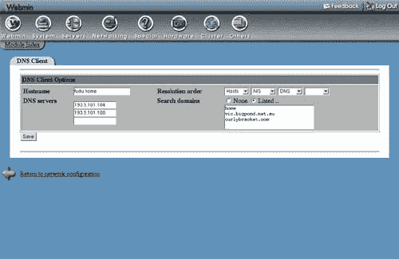

在`Hostname（主机名）`字段中输入新主机名（由字母、数字、下划线和点组成）。

点击`Save（保存）`按钮立即更改。你的浏览器将返回模块的主页。


按照第 16.6 节“编辑主机地址”中的说明，将旧主机名的地址更改为新的。

如果你正在运行 DNS 服务器，不要忘记在该处也更新你的系统条目。

正如本章引言中所解释的，为了查找主机名和 IP 地址，你的系统几乎需要知道网络上 DNS 服务器的地址。

要更改系统的 DNS 设置，请遵循以下步骤：

- 点击模块主页上的 `DNS Client（DNS 客户端）` 图标，这将带你进入图 16.3 所示的表单。
- 在 `DNS servers` 字段中输入最多三个服务器的地址。如果第一个不可用，你的系统将尝试第二个，最后是第三个。大多数网络将至少有一个主、备用 DNS 服务器，以在其中一个失败时增加可靠性。
- `Resolution order（解析顺序）`字段可以控制你的系统在解析主机名和 IP 地址时查找的位置。通常默认设置是合理的，`Hosts`（`/etc/hosts` 文件）列在第一个，DNS 列在后面。然而，如果你使用 NIS 进行主机名解析，你需要确保它在顺序某个地方被选中。
- 在 `Search domains（搜索域）` 字段中，输入你希望系统自动附加到解析的主机名后的域名。例如，如果列出了 `foo.com` 且你运行了 `telnet server1` 命令，将查找 `server1.foo.com` 的 IP 地址。
- 完成后，点击 `Save（保存）` 按钮。任何更改将在你系统上运行的所有程序中立即生效。

如果你的系统唯一的网络连接是通过拨号，则 DNS 服务器可能会根据你的 PPP 配置由 ISP 自动分配。

### 16.6 编辑主机地址

主机地址是 IP 地址与一个或多个主机名之间的映射，存储在系统的 `/etc/hosts` 文件中。由于它们存储在本地，因此可以随时进行查找，即使在无法访问 DNS 服务器时也是如此。在只有几台系统的小型网络中，你可以选择不运行 DNS 服务器，而是在每个系统的 `hosts` 文件中保留每个系统的地址。事实上，这是 DNS 开发之前互联网早期的做法。

要查看系统上的地址，点击模块主页上的 `Host Addresses（主机地址）` 图标。总有一个 `localhost` 条目，可能还有你的系统主机名。如果你的系统 IP 地址或主机名发生了更改，主机地址列表可能不会反映更改，这可能会导致问题。要更改主机地址，需要遵循的步骤如下：

- 点击列表中的 IP 地址，这将带你进入编辑表单。
- 在 `IP Address` 字段中输入新地址。
- 在 `Hostnames` 字段中输入任何主机名。同时输入任何主机名的短形式和长形式总是好的，例如 `server1.foo.com` 和 `server1`，这样两者都可以使用。
- 点击 `Save（保存）` 按钮，如果表单没有错误，你的浏览器将返回主机和地址列表。

可以通过点击链接上方或下方的 `Add a new host address（添加新主机地址）` 链接并填写相同的表单添加额外的主机地址。对于同一个主机名关联两个不同的 IP 地址或同一个 IP 地址在列表中出现两次没有限制。

### 16.7 模块访问控制

正如第 52 章所解释，可以限制特定的 Webmin 用户或组可以访问的模块功能。例如，你可能希望允许用户仅编辑主机地址列表，或者只能查看设置而不能进行编辑。要实现此操作，请创建或编辑具有该模块访问权限的 Webmin 用户，然后按照以下步骤操作：

在 Webmin Users（用户）模块中，点击要限制的用户或组名称旁的 `Network Configuration`（网络配置）。这将弹出模块访问控制表。

将 `Can edit module configuration?`（可以编辑模块配置？）字段更改为 `No`，这样用户就无法配置模块来编辑 `/etc/hosts` 以外的主机地址文件。

`Can edit network interfaces?`（可以编辑网络接口？）字段决定用户可以看到并编辑哪些接口。将其设置为 `Yes` 允许编辑所有接口，而选择 `No` 则无法访问 `Network Interfaces`（网络接口）页面。

如果选择 `View only`（只读），所有接口都将可见，但用户无法更改它们的任何属性。如果选择 `Only interfaces`（仅接口），则只有在旁侧字段中输入名称（用空格分隔）的接口是可编辑的。其他所有接口仅可见。

如果 `Can edit routing and gateways?`（可以编辑路由和网关？）字段设置为 `Yes`，用户将能够正常设置默认路由器和静态路由。如果选择 `No`，将无法访问 `Routing and Gateways`（路由和网关）页面；如果选择 `View only`，则可以看到当前设置但无法修改。

同样，`Can edit DNS client settings?`（可以编辑 DNS 客户端设置？）和 `Can edit host addresses?`（可以编辑主机地址？）字段可以设置为 `Yes`、`View only` 和 `No`，分别控制对 `DNS Client`（DNS 客户端）和 `Host Addresses`（主机地址）面的访问。

完成选择后，点击 `Save`（保存）按钮立即激活新的限制。

授予不受信任的用户编辑此模块中任何网络配置的权限时要非常小心，因为他可能会通过更改路由、主机地址或接口设置来获取 root 权限或干扰其他用户。

### 16.8 其他操作系统

`Network Configuration` 模块也适用于其他几种操作系统，其选项与 Linux 非常相似。由于其他版本 UNIX 的网络配置文件支持的功能不同，在某些章节中用户界面会有很大不同。支持的系统及其与 Linux 之间的差异如下：

#### Sun Solaris 和 SCO UnixWare

在编辑启动时网络接口时，唯一可以更改的是 IP 地址。

`loopback` 接口的启动设置完全无法编辑。这两个操作系统在启动时都会使用 IP 地址 `127.0.0.1` 始终启用它。

在 `routing and gateways` 页面上，可以输入多个默认路由器。但不需要指定默认路由设备，因为它总是自动计算的。

#### FreeBSD 和 NetBSD

没有使用 `DHCP` 在启动时为接口自动分配地址的选项。

在 `routing and gateways` 页面上，没有默认路由设备字段。但是有一个额外的 `Start route discovery daemon?`（启动路由发现守护进程？）选项。

活动接口的硬件地址无法更改。

在创建虚拟接口时，子网掩码必须输入 `255.255.255.255`。

#### OpenBSD

在 `routing and gateways` 页面上，没有默认路由设备字段。但是有一个额外的 `Start route discovery daemon?` 选项。

活动接口的硬件地址无法更改。

##### Mac OS X

在 `routing and gateways` 页面上，仅显示设置默认路由器以及当系统作为路由器时对其进行控制的选项。

在 `DNS client` 页面上，不会出现解析顺序列表，因为系统始终首先检查 `hosts` 文件，然后是检查 DNS。

### 16.9 总结

本章解释了如何在你的 Linux 或 UNIX 系统上执行基础网络配置。阅读后，你应该知道如何为网络接口指定 IP 地址、定义路由以及选择 DNS 服务器。除非你的系统只有一个到互联网的拨号连接，否则如果你想将机器连接到网络，这里介绍的信息是非常重要的。

## 第 17 章 网络信息服务

NIS 是一种用于在多个系统之间共享用户、组和其他信息的协议。本章将解释 NIS 的工作原理，以及如何使用 Webmin 将你的系统设置为客户端或服务器。

### 17.1 NIS 简介

NIS 最初由 Sun Microsystems（太阳公司）开发，但现在已适用于 Linux 和许多其他 UNIX 操作系统。它的原始名称是 `YP`（黄页），这就是为什么许多 NIS 命令以 `yp` 开头的原因。

在一个包含许多系统的网上，用户可能被允许登录其中任何一个系统。通常，为了避免在每个系统上单独创建和更新用户，可以使用 NIS 将用户和组的主列表分发到所有主机。虽然分配用户和组信息是 NIS 最常用的用途，但它也可以用于共享主机名和 IP 地址、自动挂载映射、Internet 服务和网组（netgroups）。

NIS 服务器是一个存储用户、组和其他信息表的系统。客户端系统连接到服务器并查询其存储的信息，通常是通过查找用户名、主机名等。通常服务器系统本身也是它自己的客户端之一，这样它就可以访问自己表中的用户和其他数据。

每个服务器负责一个 NIS 域，而每个客户端都是该域的成员。一个域有一个短名称，例如 `marketing` 或 `foo.com`，这与网络的 DNS 域并不相同。当在客户端系统上启动 NIS 时，它可以向网络广播查找其所在域的任何服务器，也可以连接到特定的服务器 IP 地址。单个网络可以有针对不同域的多个 NIS 服务器，每个服务器提供不同的表。

为了减轻 NIS 服务器的负载，网络可以包含多个具有相同表副本的服务器。其中一个是主服务器（master server），其他是从服务器（slaves），它们只需在主服务器数据更改时接收信息。客户端随后可以连接到主服务器或从服务器并查询相同的表。

最近，开发了旧 NIS 协议的一个新版本，称为 `NIS+`。它解决了原始协议的许多问题，最大的问题是缺乏安全性。然而，它的配置更复杂，且没有那么广泛。由于这些原因，Webmin 仅支持 NIS 客户端和服务器的配置。

文件 `/var/yp/Makefile` 通常是 NIS 服务器的主配置文件，也是一个从源文本文件生成二进制格式表数据的 make 脚本。服务器还会读取 `/var/yp/securenets` 和 `/etc/ypserv.conf` 来控制哪些客户端允许连接，以及它们可以查询哪些表。当你配置 NIS 时，Webmin 会直接更新所有这些文件以及表源文件。主要的 NIS 服务器程序称为 `ypserv`，其他程序如 `yppasswd`（用于处理来自客户端的密码更改请求）和 `ypfrd`（向从服务器发送表）也可以运行。

在客户端系统上，文件 `/etc/yp.conf` 存储域名和 NIS 服务器 IP 地址。关于向哪些服务查询 NIS 的信息存储在 `/etc/nsswitch.conf` 中。所有客户端运行 `ypbind` 程序，该程序将本地程序对用户、组和其他信息的查询传递给 NIS 服务器。

NIS Client 和 Server Webmin 模块允许你将系统设置为 NIS 客户端和/或服务器。当你从“网络”（Networking）类别进入时，主页面将仅显示五个图标，分别对应客户端和服务器配置的不同区域。如果 Webmin 检测到你的系统中缺少 NIS 客户端程序，主页面将显示错误消息；发生这种情况，请检查你的 Linux 发行版光盘或网站，查找类似于 `ypbind` 的包。

该模块并不支持所有版本的 Linux。在编写本文时，只有 Red Hat、Mandrake、OpenLinux、Debian、SuSE、UnitedLinux 和 `MSC.Linux` 可以使用。由于每个发行版使用的 NIS 配置文件略有不同，因此不同发行版之间的用户界面和默认设置可能存在某些差异，特别是在客户端服务和 NIS 服务器页面上。

### 17.2 成为 NIS 客户端

要将系统配置为 NIS 客户端，网络中必须已经有一个运行中的 NIS 服务器。如果没有，请参阅第 17.3 节“设置 NIS 主服务器”获取有关如何启动服务器的信息。假设已经运行着 NIS 服务器且你知道其 NIS 域名名，成为客户端的步骤如下：

在模块的主页上，点击 `NIS Client` 图标。这将带你进入输入域名和 NIS 服务器 IP 地址的表单。

在 `NIS domain` 字段中，输入你网络的 NIS 域名。

如果你不知道 NIS 服务器的 IP 地址，将 `NIS servers` 选项设置为 `Find by broadcast`（通过广播查找）。这仅当服务器与系统处于同一局域网（LAN）时才有效；否则广播将无法到达它。

如果你知道 NIS 服务器的地址，选择 `Listed below`（列在下方）选项，并将所有主服务器和从服务器地址输入文本框中。输入的越多越好，因为在启用 NIS 时，你的系统将逐一查询每一个。但是，最好先输入最近的服务器，以免总是查询较远且速度较慢的服务器。

点击 `Save and Apply`（保存并应用）按钮保存并立即激活设置。如果你的系统无法连接到 NIS 域名的服务器，将显示错误消息；否则，浏览器将返回模块主页。

现在你已经连接到 NIS 服务器，必须配置系统以便实际上从中查询用户、组和其他信息。要执行此操作，点击 `Client Services` 图标，这将带你进入图 17.1 所示的表单。

#### 图 17.1 NIS 客户端服务表单

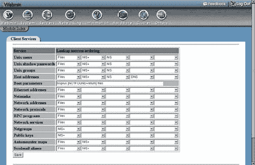

客户端服务表单的每一行都控制你的系统在查找特定服务时查询的内容。对于每一项，你可以选择多个源，这些源将按顺序检查直到找到匹配项。可用源包括：

- **Files**（文件）：本地配置文件，例如 `/etc/passwd` 或 `/etc/hosts`。
- **NIS**：你的系统当前连接的此 NIS 服务器。
- **NIS+**：你的系统连接的 NIS+ 服务器。Webmin 不支持配置 NIS+。
- **NIS and Files**（NIS 和文件）：此选项仅适用于 UNIX 用户和 UNIX 组服务。如果选中，`/etc/passwd` 和 `/etc/group` 中以 `+` 开头的特殊行可以用于指示包含部分或全部 NIS 用户。这实际上比仅选择 NIS 源更灵活，因为可以使用特殊的 `+` 和行来仅引入某些用户和组，或更改已包含项的属性。
- **DNS**：此选项仅对 Host addresses（主机地址）源有意义。它告诉系统在查找主机名时查询 DNS 服务器，这几乎是你一直想要的操作。

通常情况下，你应该将你想要使用 NIS 的每个服务（例如 UNIX 用户和 UNIX 组）设置为 `Files` 和 `NIS`。其他所有内容都应保持仅为 `Files`，或者在 Host addresses 的情况下仅为 `Files` 和 `DNS`。随后，你的系统将首先查找本地系统配置文件（如 `/etc/passwd`），然后查询 NIS 服务器。

完成后，点击 `Save`（保存）按钮。你的更改将立即在所有程序中生效，任何 NIS 用户都应该能够像本地用户一样登录。

一旦你使用 Webmin 将你的系统变为 NIS 客户端，它将在启动启动时尝试连接到服务器。连接失败可能导致系统在启动过程的中途挂起，等待服务器可用。如果当你的系统连接期间服务器宕机，任何查找用户信息的程序也可能挂起。

要停止你的系统作为 NIS 客户端，需要遵循的步骤如下：

- 在模块的主页上，点击 `NIS Client` 图标进入客户端选项页面。
- 将 `NIS domain` 字段设置为 `None`（NIS 已禁用）。
- 点击 `Save and Apply` 按钮。系统将不再使用 NIS 查找任何信息，也不会在启动时连接。Client Services 页面上配置为使用 NIS 源的任何服务将直接跳过该源，很可能只使用本地文件。

### 17.3 设置 NIS 主服务器

在你的系统成为 NIS 服务器之前，必须首先安装相应的服务器程序；如果没有安装，当你点击 `NIS Server` 图标时，将显示错误消息。检查你的 Linux 发行版光盘或网站，查找 `ypserv` 或 `nis-server` 包，该包应包含所有需要的命令和文件。

设置 NIS 服务器的第一步是决定一个域名。通常，这将与你的互联网域名相同（例如 `foo.com`），但允许任何由字母、数字和点组成的组合。做出决定后，要遵循的步骤如下：

- 在模块的主页上，点击 `NIS Server` 图标。这将带你进入一个启用服务器并配置其他选项的表单，如图 17.2 所示。该表单在大多数 Linux 发行版上看起来相同，但在 Caldera 的 OpenLinux 上，选项会少得多。

#### 图 17.2 NIS 服务器配置表单

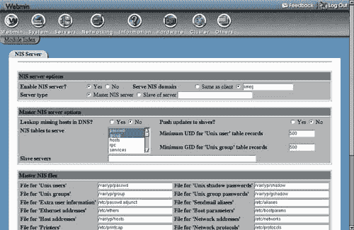

- 将 `Enable NIS server?` 选项设置为 `Yes`。当表单保存时，服务器进程将立即启动，并在后的每次重启时启动。
- 将你选择的域名输入 `Serve NIS domain` 字段。这比选择 `Same as client` 选项更好，即使它们相同。
- 将 `Server type` 设置为 `Master server`。要设置从服务器，请参阅第 17.6 节“设置 NIS 从服务器”。
- 如果 NIS 客户端无法在 DNS 中查找主机和地址，请开启 `Lookup missing hosts in DNS?` 选项让主服务器为它们查找。只有像 SunOS 4 这样非常老的操作系统需要这个。
- 在 `NIS tables to serve` 字段中，选择你想向客户端提供的所有表。常用的表包括：
  - `passwd`：UNIX 用户，存储在 `/etc/passwd` 文件中。通常也包含密码，而不是存储在独立的 shadow 表中。
  - `group`：UNIX 组，通常位于 `/etc/group` 文件。
  - `hosts`：主机和 IP 地址，位于 `/etc/hosts` 文件。虽然 NIS 可用于存储和查找主机名及地址，但通常设置 DNS 服务器会更好。
  - `shadow`：额外的用户信息，包括密码。如果选了此表和 passwd，取决于你的 NIS Makefile 配置，你可能可以扩展的用户信息，例如过期和警告日期。
  - `netgrp`：网络组，即主机组。这些可以在通过 NFS 导出目录时使用，如第 6 章所述。
- 如果你的网络将拥有有从服务器，建议将 `Push updates to slaves?` 选项设置为 `Yes`。这样每当其中一个 NIS 表发生更改时，所有从服务器都将立即收到通知以保持同步。
- 在 `Slave servers` 字段中输入任何从服务器的 IP 地址（用空格分隔）。


在主 NIS 文件（Master NIS files）部分，你可以选择哪些文件将作为 NIS 表的源。通常默认情况下会使用 `/etc` 下的普通用户、组、主机和其他配置文件，例如 `/etc/passwd`、`/etc/group` 和 `/etc/hosts`。不过这不是一个好主意，相反，你应该将服务器正在使用的表文件更改为 `/var/yp` 目录中类似名称的文件，例如 `/var/yp/passwd` 和 `/var/yp/group`。一旦服务器运行，它可以被配置为自己的一个客户端，从而通过 NIS 访问这些文件中的任何记录，而不是在本地访问它们。

完成后，点击 `Save and Apply`（保存并应用）按钮。NIS 服务器将在你的系统上启动，并配置为在今后的开机时启动。

现在服务器正在运行，你可以通过将其他系统配置为所选域的 NIS 客户端来测试它。表单上的服务器设置可以随时通过重复相同的步骤进行更改，并且更改将立即生效。

### 关闭你的 NIS 服务器

要关闭你的 NIS 服务器，请遵循以下步骤：

1. 确保任何客户端不再使用你的系统作为服务器，这可以通过完全关闭它们上的 NIS 或让它们使用不同的服务器来实现。
2. 在模块的主页上，点击 `NIS Server` 图标进入服务器选项表单。
3. 将 `Enable NIS server?`（启用 NIS 服务器？）字段设置为 `No`（否）。
4. 点击 `Save and Apply` 按钮。你系统上的服务器进程将关闭，并防止在今后的开机时启动。

### 17.4 编辑 NIS 表

一旦你的系统作为 NIS 主服务器运行，你就可以此 Webmin 模块编辑它所提供的表中的记录。要查看可编辑的表，点击 `NIS Tables` 图标，这将带你进入一个包含所有表菜单并显示其中一个内容的页面。可以通过从列表中选择一个并点击 `Edit NIS table`（编辑 NIS 表）按钮来显示其他表。

对于大多数表类型，Webmin 将解析其文件内容并将其以表格的形式显示在页面上，每行一条记录。你可以通过点击第一列中的名称来编辑任何记录，或通过点击 `Add a new record`（添加新记录）链接来添加新记录。然而，某些表的格式 Webmin 未知，因此它们将以原始文本的形式在文本框中显示。如果你知道正确的格式，可以手动编辑表并使用 `Save and Apply` 按钮保存。如果你喜欢处理原始文本，也可以通过点击 `Edit table manually`（手动编辑表）链接将任何表切换到手动模式。

每个记录中存在的字段以及编辑它们的表单对于每种类型的表都是不同的。下方的说明解释了如何在几个常用表中添加、删除和修改记录。一个共同点是，任何更改都将导致 NIS 表从更改的源文件自动重新构建，并如果配置了如此，则将其推送到从服务器。

#### 创建新的 UNIX 用户

为 NIS 客户端创建一个新的 UNIX 用户，请遵循以下步骤：

1. 从菜单中选择 `UNIX users` 表并点击 `Edit NIS table` 按钮。
2. 点击现有用户表上方或下方的 `Add a new record` 链接，这将带你进入用户创建表单。
3. 在 `Username`（用户名）字段中输入用户名，并在 `User ID`（用户 ID）字段中为新用户输入 ID 数字。与用户和组模块不同，该 ID 不会自动为你选择，因此请确保它是唯一的。
4. 在 `Real name`（真实姓名）字段中输入用户的全名。
5. 在 `Home directory`（主目录）字段中输入主目录。与用户和组模块不同，将不会为你创建目录，也不会从中复制文件。
6. 从 `Shell`（壳）菜单中选择一个 shell，或选择 `Other`（其他）选项并在下方字段输入 shell 程序的路径。
7. 在 `Password`（密码）字段处选择 `Normal`（普通）密码选项，并在旁边的文本字段输入新用户的密码。
8. 在 `Primary group ID`（主组 ID）字段中输入用户组的数字 ID。
9. 如果启用了 shadow NIS 表，你可以设置可选的 `Expiry date`（过期）、`Minimum days`（最小天数）、`Maximum days`（最大天数）、`Warning days`（警告天数）和 `Inactive days`（失效天数）字段。这些与第 4 章的用户和组模块相同。
10. 完成后，点击 `Create`（创建）按钮将新用户添加到表中。

#### 编辑现有的 UNIX 用户

可以通过点击表中的名称编辑现有的 UNIX 用户，这将带你进入一个带有与上述相同字段的编辑表单。更改任何字段并点击 `Save`（保存）按钮，若要删除用户，点击表单底部的 `Delete`（删除）按钮。删除时，用户的主目录将不会被触，因此你可能需要手动删除。

#### 创建新的 UNIX 组

在 NIS 中创建一个新的 UNIX 组，过程如下：

1. 从菜单中选择 `UNIX groups` 表并点击 `Edit NIS table` 按钮。
2. 点击现有组表上方或下方的 `Add a new record` 链接，这将带你进入创建表单。
3. 在 `Group name`（组名）字段中为新组输入名称，并在 `Group ID`（组 ID）字段中输入数字。确保该 ID 未被任何其他现有组使用。
4. `Password`（密码）字段可以保持不变，因为组密码几乎从未使用。
5. 在 `Group members`（组员）字段中填写该组组成用户的用户名，每行一个。
6. 完成后，点击 `Create`（创建）按钮将新组添加到表中。

与用户一样，你可以随时通过点击表中的名称编辑组，这将带你进入编辑表单。进行任何所需的更改并点击 `Save` 按钮保存，或使用 `Delete` 按钮删除组。注意，将不会检查其是否为任何现有用户的主组。

正如编辑用户和组的说明所示，编辑任何受支持表的过程非常相似。目前，你可以使用 Webmin 中的表单编辑 `UNIX users`、`UNIX groups`、`Host addresses`、`Networks`、`Services`、`Protocols`、`Netgroups`、`Ethernet addresses`、`RPC programs`、`Netmasks` 和 `Aliases`。所有其他表必须手动编辑。

### 17.5 保护你的 NIS 服务器

默认情况下，NIS 服务器允许任何客户端连接到它并查询表，只要客户端知道域名。如果你的系统连接到互联网，攻击者可能会猜到 NIS 域并请求所有 NIS 用户的列表。尽管它们的密码以加密格式存储，但仍然可能通过对密码加密进行暴力攻击发现显而易见或字典密码。

因此，将连接到服务器的客户端地址限制在确实是客户端的 UNIX 系统是明智的。要设置此项，请遵循以下步骤：

1. 在模块的主页上，点击 `Server Security`（服务器安全）图标，这将带你进入图 17.3 所示的表单。

##### 图 17.3 服务器安全表单。


`Allowed clients`（允许的客户端）表中的行控制允许客户端连接。你可以修改任何现有条目，或使用底部的空行添加新行。要添加多行，你必须逐个添加，每次添加后保存并打开表单。

- 要授予单个主机访问权限，在 `Netmask`（网络掩码）列下选择 `Single host`（单个主机），并在 `Network/host address` 下输入其 IP 地址。
- 要授予整个 IP 网络访问权限，选择 `Netmask` 并在相邻字段中输入网络掩码（例如 `255.255.255.0`），在 `Network/host address` 列下输入网络地址。
- 要授予所有客户端访问权限，只需在 `Netmask` 列下选择 `Any host`（任何主机）选项。

完成后，点击 `Save and Apply` 按钮。新的限制将立即生效，并将返回到模块的主页。

仅允许你自己网络上的客户端进行连接并拒绝所有其他连接是一个好主意。更安全的替代方案是仅允许你已知是 NIS 客户端的系统，假设它们具有固定 IP 地址且不经常更改。

即使你将访问限制为仅受信任的客户端系统，通过 `SSH` 或 `telnet` 登录到这些系统的用户仍然可能获取所有 NIS 用户列表及其加密密码。为了防止这种情况，可以配置服务器，仅允许使用受信任端口的客户端访问某些表或表中的字段。因为在 `UNIX` 系统上，只有 `root` 用户可以创建端口号低于 `1024` 的 `TCP` 或 `UDP` 套接字，因此这些低端口被认为是信任的且安全的，供普通用户使用。

还可以防止某些客户端访问某些 NIS 表，但仍允许它们访问其他表。例如，你可能希望允许所有客户端系统访问 `Hosts` 地址表，但仅允许少数受信任的系统拥有 `UNIX` 用户表的权限。

要限制对服务器上表格的访问，请遵循以下步骤：

1. 在模块的主页上，点击 `Server Security` 图标进入图 17.3 所示表单。
2. `Client map restrictions` 表控制哪些客户端系统可以访问某些 NIS 表，以及这些系统上的谁可以访问它们。每行都指定了一个适用于部分或所有客户端的规则，可以允许访问、完全阻止或过滤查询的表。这些字段及其含义如下：
   - **Hosts**：此限制所适的 IP 地址或部分 IP 地址（例如 `*192.168.1.*`）。输入 `*` 将使该限制适用于所有客户端。
   - **NIS tables**：选择 `All` 选项使该限制适用于所有表，或者输入单个表名。在内部，NIS 服务器会在表名后附加类似 `.byname` 或 `.byuid` 的内容，以指示它们是根据什么进行索引的。你输入的表名必须使用此内部名称，例如 `*passwd.byuid` 或 `hosts.byaddr`。
   - **Restriction**：此字段控制当客户端请求匹配时服务器的操作。选择 `None` 允许请求，选择 `Deny access` 完全阻止，或选择 `Trusted port` 在客户端使用不受信任端口时进行阻止。
   - **Mangle field**：如果使用 `Trusted port` 限制，你可以使用此选项向客户端隐藏请求表中的单个字段。选择 `None` 将完全阻止对表的访问，但输入字段号将导致其内容被替换为 `x`。此选项唯一的实际用途是隐藏 `passwd.byname`、`passwd.byuid` 或 `shadow.byname` 表中的密码，这些密码位于第 2 字段。
3. 可以使用表格底部的空行添加新限制。要添加多个一个限制，你需要多次保存并重新打开表单。
4. 当客户端请求一个表时，NIS 服务器将找到表中匹配的第一行并使用定义的限制。由于此原因，你必须确保添加的任何新行都位于授予所有客户端和表访问权限的行之前（该行通常默认存在）。
5. 完成后，点击 `Save and Apply` 按钮。浏览器将返回模块主页，任何对限制的更改将立即生效。

`Client map restrictions` 表最有用的用法为 `passwd.byname` 表中的所有客户端添加一行，并将限制设置为 `Trusted port`，`Mangle field` 选项设置为 `2`。然后为 `passwd.byuid` 表添加另一行，其他选项均相同。这些将防止非 root 用户看到加密密码，同时仍允许以 root 运行的程序访问，例如 `telnet` 或 `SSH` 服务器。

如果你使用单独的 `shadow` 表存储密码和过期信息，则限制应在 `shadow.byname` 表上。在许多 Linux 发行版中，默认存在此类限制。

### 17.6 设置 NIS 从属服务器

从属 NIS 服务器的使用方式与辅助 DNS 服务器类似，它们保留了主服务器持有的表格副本，并且当主服务器故障或响应缓慢时，客户端可以使用它们。如果你在一个通过慢速连接连接的多个 `LANs` 的特大型网络上使用 NIS，那么在每个 `LAN` 上放置一个从属服务器可能也是意义的，这样客户端就可以使用它而不是主服务器。

在 `OpenLinux` 上，无法使用 Webmin 设置从属服务器，因为该发行版使用了独特的 NIS 配置文件。在所有其他 `Linux` 版本中，将系统设置为从属服务器的步骤如下：

1. 在模块的主页上，点击 `NIS Server` 图标。这将带你进入图 17.2 所示的服务器配置表单。
2. 将 `Enable NIS server?` 字段设置为 `Yes`。
3. 在 `NIS domain` 字段输入主服务器的域。
4. 将 `Server type` 改为 `Slave of server`，并在相邻字段中输入主服务器的 IP 地址。其他字段都不需要修改，因为它们都与运行主服务器有关。
5. 点击 `Save and Apply` 按钮。服务器应该立即启动，并配置为在启动时启动。

确保主服务器已经在服务器配置表单的 `Slave servers` 字段中输入此从属服务器的地址。它还应该启用 `Push updates to slave servers?` 选项，这样对表的任何更改将立即发送到从属服务器。如果不是，你可以使用 `yppush` 命令将 NIS 表的内容发送某些或所有从属服务器。

### 17.7 配置 NIS 客户端和服务器模块

该模块有几个配置选项，可以通过点击主页左上角的 `Module Config` 链接进行更改。表 17.1 显示了你可以安全更改的选项。

模块页面上的其他选项根据你的操作系统自动设置，通常不需要更改。

### 17.8 Solaris 上的 NIS

Webmin 允许你在上面配置 NIS 的另一个操作系统是 Sun 的 `Solaris`。在 `Solaris` 上，`NIS Client` 和 `Client Services` 页面与 `Linux` 上的相同，工作方式相同。然而，`NIS Server` 和 `Server Security` 表单略不同：

#### 表 17.1 模块配置选项

| 选项 |  |
| :--- | :--- |
| 显示的最大记录数 | 如果 NIS 表中的记录数超过此数字，则 NIS Tables 页面将显示所有记录。相反，它将显示一个根据字段和搜索词查找记录的搜索表单。 |
| 自动重建 NIS 映射？ | 通常，每你在表文件中添加、更新或删除记录时，都会运行 NIS Makefile 来重新构建所有表。因为在具有许多记录或从属服务器的系统上这可能很慢，将此选项设置为 `No` 将关闭自动重建。相反，你可以随时点击 NIS Tables 页面上的 `Rebuild NIS tables` 按钮来强制构建。 |

在 `NIS Server` 页面上，你插入任何域也将用于 NIS 客户端。这是 `Solaris` 的一个局限性，不像 `Linux`，系统可以是一个域的服务器又是另一个域的客户端。

在服务器页面上，你不能直接指定单个表文件的路径。相反，`NIS source files directory` 和 `NIS password source files directory` 字段控制它们存储的目录，通常为 `/var/yp`。

`Server Security` 页面上没有 `Client map restrictions` 表，也没有控制客户端可以请求哪些表和字段的方法。然而，你可以使用 `Allow clients` 表完全允许或拒绝某些主机和网络。

`Solaris` 系统标准包含 `NIS+` 的客户端和服务器支持。然而，由于 Webmin 不支持该协议，尝试使用此模块重新配置已作为 `NIS+` 客户端或服务器运行的系统将无法运行，甚至可能对其配置产生问题。

### 17.9 总结

NIS 是 UNIX 系统之间共享用户、组和其他信息的标准方法，本章已经解释了如何使用 Webmin 进行设置和配置。在完成这一部分后，你应该知道如何让你的系统成为网络上现有 NIS 服务器的客户端。你还应该理解如何运行自己的主 NIS 服务器为其他客户端提供服务，以及如何设置一个作为主服务器备份的从服务器。

# 第 18 章. PPP 服务器配置

本章涵盖了将一个连接有调制调器的 Linux 系统设置为拨号接入服务器的过程，以便其他计算机可以拨号接入它并访问连接的网络。

### 18.1 Linux 上的 PPP 简介

任何连接了调制调器的 Linux 系统都可以被配置，让其他计算机能够拨号接入并启动 PPP 会话，从而获得对系统以及其连接的任何网络的 TCP/IP 访问。这使得它能够像一个微型 ISP 一样工作，事实上，一些小型 ISP 是使用带有多个串口卡的 Linux 系统作为接入服务器运行的。

有两个独立的程序负责拨号服务的不同部分。第一个是 `mgetty`，它通过串口与连接的调制调器通信，并指令其接听。一旦服务器和客户端调制调器连接，`mgetty` 会显示文本登录提示，并等待用户名或 PPP 会话的开始。客户端可以使用文本模式登录并获取 UNIX shell 提示符，而完全不需要启动 PPP 会话，但这在今天很少这样做。一旦客户端断开连接或注销，`mgetty` 会挂断调制调器并等待新连接。

由于大多数客户端在连接后会立即启动 PPP 会话，因此 `mgetty` 通常被配置为在检测到 PPP 连接时运行独立的 `pppd` 程序。这会在服务器上创建一个 `ppp` 网络接口，验证客户端身份，分配 IP 地址，并开始使用 PPP 协议发送和接收数据。分配的 IP 地址和其他配置选项通常是基于每个串口设置的，这样你就可以拥有多个调制调器并支持多个具有不同地址的并发客户端。

PPP Dialin Server 模块允许你设置 `mgetty` 和 `pppd`，以便客户端拨号接入并启动 PPP 会话。当你从 Networking（网络）类别进入它时，主页面仅显示四个图标，图标下方是实际的可配置选项。


目前，PPP Dialin Server 模块仅用于 Linux 和 Solaris 系统，尽管在某些其他 UNIX 版本上也可以使用`mgetty`。如果它配置的两个程序都没有安装，主页面将显示错误信息；然而，所有 Linux 发行版的 CD 或网站上都包含了`pppd`和`mgetty`的包。如果只安装了`mgetty`，你可以使用 Serial Port Configuration（串口配置）和 Caller ID Access（来电显示访问）功能。相反，如果只安装了`pppd`，你只能访问 PPP Options（PPP 选项）和 PPP Accounts（PPP 账户）页面。

当你使用该模块设置`mgetty`在串口上接听电话时，`/etc/inittab`文件会被添加一个条目，以便`init`在启动时运行`mgetty`并在并在时重新运行。你可以在 SysV Init Configuration 模块（第 9 章）中看到此条目，但除非你知道做什么，否则不要在那里编辑。

尽管本章针对 Linux，但该模块在 Solaris 上的行为几乎相同。区别在于串口设备文件的名称，Linux 的`/dev/ttyS0`是第一个串口，而 Solaris 则使用`/dev/term/a`。

## 18.2 配置 PPP 服务器

在设置系统允许客户端通过 PPP 连接之前，它必须在串口上连接了调制调器，或者通过环回调制线（null-modem cable）连接到另一台机器。也可以使用模拟串口的内部调制调器，但不建议这样做，因为它们没有易可见的 LED 来指示调制调器是否连接、传输等。USB 调制调器只要被内核识别就可以工作，然而，它们可能会使用特殊的设备文件。需要特殊驱动程序运行的调制调器（通常称为 Winmodems）无法使用，除非有适用于 Linux 的调制调器驱动程序。

自然，任何调制调器都必须连接到电话线上。由于你的系统将被配置为在响几声后接听电话，否则电话线不应用于其他用途，否则语音来电者的电话会被调制调器接听，这并不友好。

一旦所有硬件准备就绪，将系统设为 PPP 服务器的步骤如下：

1. 在模块的主页上，点击 Serial Port Configuration（串口配置）图标。这将带你进入列出所有已配置 PPP 或语音箱的现有端口的页面。
2. 点击 Add a new serial port（添加新串口）链接，这将弹出图 18.1 所示的端口配置表。

##### 图 18.1. 串口配置表。


3. 将`Serial`设备设置为连接调制调器或环回调制线的端口。串口 1 对应于设备文件`/dev/ttyS0`，依此类推。对于不以`/dev/ttyS`开头的串口设备上的调制调器（如 USB 调制调器），选择`Other device`并在旁边的文本框中输入完整的设备文件路径。
4. 将`Type`设置为`Direct connection`（直接连接，通过环回调制线连接的系统）或`Modem`（实际的拨号调制调器）。
5. `Port speed`（端口速度）字段应设置为调制调器或环回连接使用的波特率。这必须是标准速度之一，例如`57600`或`33600`。
6. 在`Answer after`（响后接听）字段中，输入你希望`mgetty`在接听电话前等待的响铃次数。如果调制调器所在的电话线将用于接收语音电话，你可以将此设置为类似 20 这样较大的值，以便在调制调器接听之前你有足够的时间接听。
7. 自然地，此选项对于环回调制连接没有意义。
8. 点击`Create`（创建）按钮。`/etc/inittab`文件将添加一个新条目，你会被返回串口列表。
9. 点击`Apply Configuration`（应用配置）以在新端口上激活`mgetty`。现在，拨入调制调器所在线路的电话应该在配置的响铃次数后被接听。

如果你只关心纯文本客户端，则无需进行其他操作——它们将能够拨号、在登录提示处进行身份验证并执行 shell 命令。

要设置 PPP，回到主页点击 PPP Options（PPP 选项）图标。这将带你进入图 18.2 所示的表单，可以在那里设置适用于所有 PPP 连接的选项。

### 图 18.2. PPP 配置表。


除非让客户端使用文本模式登录并手动启动`pppd`命令，否则最好将`Automatically detect PPP connections on serial ports?`（在串口上自动检测 PPP 连接？）选项设置为 Yes。启用此项后，当服务器等待登录提示时，`mgetty`会检测到客户端想要启动 PPP 会话并自动运行`pppd`。

在`PPP IP Address`字段中，输入你希望服务器端使用的 IP 地址（`Local IP`）以及客户端端的地址（`Remote IP`）。通常情况下，这些地址不在你的本地局域网上，而是在不同的子网上。网络上的其他系统应该配置为将指向客户端地址的流量路由到你的系统，以便它们能够通信。

如果没有指定地址，则 PPP 服务器将使用客户端提供的任何地址。这在通过环回调制线连接两个机器时可能是合理的，但对于大多数拨号客户端来说不可行。

通过开启`Create proxy ARP entry?`选项，可以客户端分配本地局域网（LAN）范围内的 IP 地址。如果启用此项，请在`Remote IP`字段中输入未使用的局域网 IP 地址，并在`Local IP`字段中输入系统当前的以太网 IP。

将`Control lines mode`字段设置为`Local`以进行空调制连接，或者如果在串口上连接了真实的调制调器，则设置为`Modem`。

除非您正在设置空调制连接，否则应强制客户端进行身份验证，以防止潜在的攻击者连接。要开启身份验证，将`Require authentication?`字段设置为`Yes`。若要在空调制使用中完全关闭，请将该字段设置为`No`。

要设置客户端身份验证的用户名和密码，请参见第 18.3 节“管理 PPP 账户”。

要断开长时间空的客户端，请在`Idle time before disconnect`字段中输入秒数。

将网络中任何 DNS 服务器的 IP 地址输入到`DNS servers for clients`字段中。Windows 等客户端操作系统会自动使用它们，从而简化了配置。

最后，点击`Save`按钮。客户端现在应该能够拨入、建立 PPP 会话并访问您的系统和网络。

如果您的系统将有多个 PPP 客户端同时连接，则您需要为每个串口设置不同的选项。特别是，每个客户端必须有不同的远程 IP 地址，尽管本地地址可以重用。

为每个串口设置不同 PPP 选项的遵循步骤如下：

1. 在模块主页上，点击`PPP Options`图标。将`PPP IP Addresses`字段改回`From client`，并将您想要按端口设置的任何其他选项改回默认值。
2. 返回主页，点击`Serial Port Configuration`，然后点击您想要设置选项的串口`Port PPP Config`下的`Edit`链接。这将带您进入单端口选项页面，该页面与图 18.2 所示的全局 PPP 选项表非常相似。
3. 输入想要分配给在该端口连接的 PPP 客户端的远程和本地 IP 地址，并更改全局 PPP 选项页面上未设置的其他选项。
4. 完成后，点击`Save`按钮。从现在起，连接到配置端口的客户端将使用新选项。

停止您的系统作为 PPP 服务器的最简单的方法是直接移除您的调制调器的串口配置条目。如果您连接了多个调制调器，可以使用以下步骤禁用其中一个而不影响其他：

1. 在主页上，点击`Serial Port Configuration`，然后点击连接有调制调器的端口设备名称。
2. 在端口选项页面上，点击右下角的`Delete`按钮。相应的条目将从`/etc/inittab`文件中删除，您将返回到已启用端口列表。
3. 点击`Apply Configuration`按钮使更改生效。从现在起，您的系统将不再响应入入电话，也不会与通过空调制电缆连接的另一台计算机通信。

## 18.3 管理 PPP 账户

如果您启用了对系统的拨入访问，应通过在 PPP Options 页面上开启`Require authentication?`选项来强制所有客户端进行身份验证。即使您认为服务器不需要身份验证客户端（因为只有您知道调制调器所在线路的电话号码），启用它仍然是一个好主意，以防有人偶然发现该号码，或者防止“自动拨号器”尝试数百个电话号码以寻找不安全的服务器。

启用身份验证后，可以按照以下步骤添加一个允许登录的新账户：

1. 在模块主页上，点击`PPP Accounts`图标。这将带您进入列出所有现有账户的页面，包括为拨向其他服务器而创建的账户。
2. 点击`Create a new PPP account`链接，这将带您进入图 18.3 所示的账户创建表。

#### 图 18.3. 创建新的 PPP 账户。


在`Username`字段中输入登录，确保没有选中`Any`选项。

确保`Server`字段设置为`Any`。如果您将其设置为其他内容，则只有当客户端的主机名匹配您输入的内容时，用户名才会被接受。

在`Password`字段中选择`Set`选项，并在附近的文本字段中为账户输入密码。还可以通过选择`From file`选项并在文本字段中输入文件名，让 PPP 服务器从单独的文件读取密码。或者，您可以通过选择`None`来消除提供密码的需求，但从安全角度来看，这不是一个好主意。

假设所有客户端都分配了 IP 地址，将`Valid Addresses`字段设置为`Allow any`。但是，如果 PPP Options 页面未指定任何地址，您可能希望选择`Allow listed`并在下面的文本框中输入允许的地址。

最后，点击`Save`按钮将创建新的 PPP 账户。连接的客户端可以立即使用它。

要编辑现有 PPP 账户，只需从账户列表中点击其用户名。这将带您进入账户编辑表，该表与图 18.3 所示的创建表几乎相同。更改用户名、密码或任何其他选项，并点击`Save`按钮保存您的更改并使其立即生效。或者点击编辑表上的`Delete`按钮来删除该账户。

默认情况下，Webmin 将新用户添加到`/etc/ppp/pap-secrets`文件中。PPP 服务器仅在执行 PAP 身份验证（这是默认方式）时才会读取此文件。如果您手动配置系统使用更安全的 CHAP 协议对客户端进行身份验证，则需要配置 Webmin 编辑`chap-secrets`文件。这可以通过点击主页左上角的`Module Config`链接并将`PAP secrets file`字段更改为`/etc/ppp/chap-secrets`来。

## 18.4 通过来电显示 限制访问

如果您的电话线启用了来电显示且您的调制调器支持它，可以配置`mgetty`根据电话号码阻止某些拨号者。默认情况下，允许任何拨号者连接，但您可以通过以下步骤更改为允许少数号码：

1. 在模块主页上，点击`Caller ID Access`图标。这将带您进入列出受限号码的表，如果您尚未添加任何号码，该表可能是空的。
2. 点击`Add a new caller ID number`链接，这将带您进入输入新号码的表。
3. 将`Phone number`选项设置为`Numbers starting with`，并在相邻字段中输入您允许的部分或完整电话号码。如果您输入类似`555`的内容，任何以`555`开头的拨号者（如`555-1234`）都将被允许。
4. 将`Action`字段设置为`Allow`。
5. 点击`Create`按钮，这将保存号码并返回到允许和拒绝的号码列表。

要添加另一个允许的号码，请重复步骤 2 到 5。

最后，再次点击`Add a new caller ID number`，并在创建表上将`Phone number`设置为`All numbers`并将`Action`设置为`Deny`。

点击`Create`按钮将此最终的拒绝条目添加到列表中。从现在起，只有您显式允许的电话号码才能连接。

由于系统按顺序检查列表中的每个条目，并在找到匹配项时停止，因此任何拒绝（或允许）所有调用者的条目都必须出现在列表的底部，否则排在随后的条目将永远不会被处理。如果您在将来想要允许一个新的电话号码，必须先添加它，然后使用`Move`（移动）列中的箭头将其移动到拒绝所有人的最后一个条目之上方。

由于某些客户端可能不提供主叫 ID 信息，可以使用`Phone`（电话号码）字段的`Unknown`（未知）选项来匹配他们的来电。然而，允许所有未知来电并不是阻止已知攻击者的良好方法，因为他们可能只需在电话线上禁用主叫 ID 信息的发送。

主叫 ID 限制永远应该是您拨号服务器的唯一安全形式，因为主叫号码是由电话公司提供的，因此完全不受您的控制。还应该启用`PPP`验证，以便强制所有客户端登录。

## 18.5 模块访问控制

与其他模块一样，此模块有几个可以在`Webmin Users`模块中设置的选项，用以控制哪些功能可用。这些选项对于禁用在特定系统上无用的模块部分非常有用，例如，您可能只想让特定用户看到`PPP Accounts`（PPP 账户）页面。

要为用户或组编辑此模块中的访问控制选项，请遵循以下步骤：

1. 在`Webmin Users`模块中，点击已授予访问模块权限的用户旁边的`PPP Dialin Server`（PPP 拨号服务器）。
2. 对于`Available pages`（可用页面）字段，取消勾选模块主页上您不希望用户访问的图标。如果取消勾选`PPP Options`（PPP 选项），用户也将将无法编辑适用于单个串口的选项。
3. 如果用户仅被授予访问单个页面的权限，将`Go direct to one page?`（直接转到一个页面？）字段设置为`Yes`（是），将导致浏览器在进入模块时直接跳转到该页面。
4. 点击`Save`（保存）按钮使访问控制设置生效。

## 18.6 总结

读完本章后，您将能够将任何连接了调制解调器的 Linux 系统配置为拨号服务器，`PPP`客户端可以连接到那里。您应该理解这样做的安全性，以及如何将访问限制仅限于信任的系统。您还应该知道这种拨号连接如何与网络其余部分结合，以及如何从其余部分访问。

# 第 19 章 防火墙配置

如果您的系统连接到互联网，应该使用防火墙进行保护以防止未经授权的访问。本章介绍了使用`Webmin`和`IPtables`设置和配置防火墙的过程。

## 19.1 IPtables 防火墙简介

防火墙是一种保护自身以及网络上其他主机免受不可信网络（如互联网）攻击攻击的系统。它可以根据各种标准（如源地址、目的地址、端口和协议）阻塞数据包和连接。通常，防火墙还是一个路由器，在安全本地网络和不可信的互联网之间转发数据包；然而，系统也可以仅保护自己。

防火墙系统还可以配置为将多个主机隐藏在单个 IP 地址之后，这一过程被称为`NAT`（网络地址转换）。通常，隐藏的主机位于使用私有 IP 网络的内部局域网（如`192.168.0.0`）上，防火墙具有唯一的互联网 IP 地址。`NAT`允许这些内部主机与互联网上的其他主机通信，即使它们没有真实的公共 IP 地址。

Linux 内核多年来包含了几种不同的防火墙实现，例如`IPfwadm`和`IPchains`。2.4 系列内核包含了`IPtables`防火墙，它比以前的版本更强大、更灵活。所有使用 2.4 内核的 Linux 发行版都启用了`IPtables`支持，并包含了配置它所需的命令。本章和`Linux Firewall`模块仅涵盖使用`IPtables`设置防火墙，不包括任何像`IPchains`或`IPfwadm`较旧的实现。

所有 IP 网络流量都会被拆分成数据包，数据包是带有源、目和协议信息的数据块。即使是连续的数据流（如下载大文件）在发送时也会被拆分成数据包，并在目的地重新组装。由于`IPtables`防火墙工作在 IP 级别，其所有规则和链都对单个数据包进行评估和操作，而不是`TCP`连接或`HTTP`请求。

一个`IPtables`防火墙由三种不同的对象组成：表（tables）、链（chains）和规则（rules）。三个表中的每个表都包含两个或三个标准链，可能还有许多用户自定义的自定义链。每个链包含零或多个规则，这些规则应用于防火墙接收或发出的数据包，以决定它们的去向。这三个表及其标准链是：

- **数据包过滤 (filter)**：此表中的`INPUT`、`OUTPUT`和`FORWARD`数据包链分别适用于防火墙接收、发送或转发的数据包。如果防火墙系统充当路由器，则只有`FORWARD`链适用于路由数据包。目标为系统自身的网络流量由`INPUT`链处理，由本地进程发送的流量由`OUTPUT`链处理。对于一个不执行任何伪装的普通路由器系统，或者仅需要防火墙来保护自身的系统，这是唯一需要添加规则的表。
- **网络地址转换 (nat)**：此表仅用于启动新连接的数据包。其`PREROUTING`（路由前链）链中的规则在数据包被系统接收用于路由时立即应用，`POSTROUTING`链则用于路由后即将离开的数据包。`OUTPUT`链规则应用于本地生成的数据包，以便在路由之前进行修改。规则通常被添加到此表中，以设置伪装、透明代理或其他其他类型的地址转换。
- **数据包修改 (mangle)**：此表仅用于专门的数据包修改。它包含两个链：用于路由前修改数据包的`PREROUTING`和用于修改本地生成数据包的`OUTPUT`。典型的防火墙配置很少使用此表。

当网络数据包被链处理时，链中的每条规则按顺序执行。每条规则都有一组条件来决定规则是否匹配，以及在匹配时采取的操作。此操作可能是立即接受数据包、立即丢弃它、执行某些修改或继续执行。如果到达链的末尾，将采取其默认操作，通常是允许数据包通过。


图 19.1 显示了数据包通过的表和链，以及它们被检查的顺序。来自网络的数据包从顶部进入，并由`PREROUTING`链处理。在此处，会做出判断：目标为本地系统的数据包进入左侧，而转发到其他目的地的数据包走右侧分支。进入左侧的数据包在交付给本地进程（如服务器）之前由`incoming packets`（传入数据包）链处理。转发的数据在发送到目的地之前由`Forwarded packets`（转发数据包）和`After routing`（路由后）链处理。

### 图 19.1. IPtables 概述


防火墙还可以影响从本地系统进程发送的数据包。这些数据包在通过三个`Output`链和`After routing`链进行检查之前，通过相应的网络接口传输到其目的地。这意味着`IPtables`防火墙可以用来限制本地进程可以连接的地址以及它们可以使用协议。

### 19.2 Linux 防火墙模块

此模块可用于在启用 IPtables 的 Linux 系统上设置防火墙，或编辑现有防火墙的任何部分。它将防火墙配置存储在`iptables-save`和`iptables-restore`命令创建并读取的保存文件中，而不是包含`iptables`命令调用的 shell 脚本中。Red Hat、Debian 和 Gentoo Linux 均使用此类保存文件作为标准，Webmin 支持此并能与之配合。

如果你使用 shell 脚本手动创建了防火墙，并想从现在起使用此模块来编辑它，则必须将其转换为 IPtables 保存文件，以便 Webmin 进行编辑。幸运的是，该模块可以为你完成这一操作，你只需要停止自定义脚本在启动时运行，并告诉该模块创建它自己的防火墙设置脚本即可。

这也适用于由 YaST 或 fBuilder 等工具创建的防火墙，这些工具会输出`iptables`命令的 shell 脚本。除非工具也能编辑 IPtables 保存文件（例如`knetfilter`），否则不应与 Webmin 的 Linux 防火墙模块一起使用，否则它们可能会覆盖对方的设置。

当你从“网络”（Networking）类别进入该模块时，主页通常会在第一个表格中显示包含任何（通常是数据包过滤）内容的链和规则列表，如图 19.2 所示。然而，如果 Webmin 检测到未安装`iptables`或`iptables-save`命令，将显示错误消息，请检查发行版 CD 或网站是否有包含这些的软件包。

#### 图 19.2. Linux 防火墙模块


如果这是你第一次使用该模块且系统中尚未设置防火墙，主页将显示一个表单以简化初始防火墙创建。将显示三个选项，选择其中一个并点击“设置防火墙”（Setup Firewall）按钮进行设置。如有，Webmin 还会显示“启动时启用防火墙？”复选框，如果勾选，将创建一个启动脚本，以便防火墙在启动时也能启用。

防火墙设置选项有：

- **允许所有流量（Allow all traffic）**：如果选择此项，将创建一个“空”防火墙并允许所有流量通过。

- **在外部接口上进行网络地址转换（Do network address translation on external interface）**：防火墙将配置为 NAT，以便内部局域网（LAN）上的主机可以通过具有单一公 IP 地址的主机访问互联网。你必须从选项旁边的列表中选择连接互联网的网络接口，例如`ppp0`。

- **阻止外部接口上的所有传入连接（Block all incoming connections on external interface）**：如果选择此项，防火墙将设置为阻止进入你所选网络接口的所有流量，但已建立的连接、DNS 回复和无害的 ICMP 包除外。你选择的接口应该是连接互联网的接口，例如`ppp0`。

- **阻止外部接口 SSH 和 IDENT 外的所有流量（Block all except SSH and IDENT on external interface）**：与上一个选项类似，但允许 SSH 和 IDENT 协议流量。

- **阻止接口上除 SSH、IDENT、ping 和高端口以外的所有流量（Block all except SSH, IDENT, ping, and high ports on interface）**：与上一个选项类似，但允许 ICMP ping 和到 1024 以上端口的连接。

如果这是该模块第一次被使用且 Webmin 检测到系统中已存在防火墙，将显示其规则，并提示将其转换为保存文件，以便使用该模块进行编辑。如果你选择点击“保存防火墙规则”（Save Firewall Rules）按钮执行此操作，所有现有表、链和规则都将被安全记录。如有，还会显示“启动时启用防火墙？”复选框，如果勾选，Webmin 将创建一个启动脚本在启动时激活已保存的防火墙规则。

如果你选择转换已手动创建的防火墙配置，请确保禁用任何在启动时设置它的现有脚本。否则，旧脚本和 Webmin 创建的脚本都会运行，可能导致在此模块中设置的规则被旧的手动配置抵消。

### 19.3 允许和拒绝网络流量

为了限制防火墙接受或转发的连接和数据包类型，你需要创建额外的防火墙规则。这些规则的最佳位置是“数据包过滤”（Packet filtering）表，位于“传入数据包”（Incoming packets）链或“转发数据包”（Forwarded packets）链中。如果你的防火墙充当路由器，且你想保护它所连接的安全网络上的系统而不是防火墙本身，则应使用“转发数据包”链。然而，如果你想同时保护防火墙和它路由到的其他系统，则应在“传入数据包”链中添加规则。

也可以限制系统发送的数据，这些数据可能来自本地进程或从其他主机转发。为了做到这一点，你可以向“传出数据包”（Outgoing packets）链添加规则。如果你需要，这对于限制本地用户可以连接的地址和端口非常有用。

创建阻止流量的新规则的步骤如下：

1. 在模块的主页上，从“显示 IPtable”（Show IPtable）按钮旁列表中选择“数据包过滤”（Packet filtering），然后点击它切换到过滤表。

2. 要添加适用于所有传入流量的规则，请点击“传入数据包”部分的“添加规则”（Add Rule）按钮。如果你只想限制转发流量，请点击“转发数据包”下方的按钮。

3. 无论哪种方式，你将被引导进入规则创建表单，如图 19.3 所示。

#### 图 19.3. 规则创建表单


4. 将执行的操作（Action）更改为 **Drop**，这样匹配此规则的数据包将被防火墙静默丢弃。

5. 如果需要，在**规则**（Rule comment）字段中为此规则输入一个简短说明。

6. 在**条件详情**（Condition details）部分，选择决定哪些数据包将被匹配并因此丢弃的条件。只有匹配所有未设置为 `<Ignore>` 的条件的数据包才会被丢弃。

选择阻止某些类型流量的条件示例包括：

- **阻止到特定 TCP 端口的所有连接**：将**网络协议**（Network protocol）字段设置为 **Equals**（等于）并选择 **TCP**。要阻止端口，必须始终选择一种协议。将**目标 TCP 或 UDP 端口**（Destination TCP or UDP port）设置为 **Equals**，并在旁边的**端口**（Port(s)）字段中输入端口号。你可以通过在**端口**字段中输入用逗号分隔的数字列表来阻止多个端口，或通过选择**端口范围**（Port range）并在相邻字段中输入起始和结束端口来阻止整个范围。

- **阻止来自特定地址的所有流量**：将**源地址或网络**（Source address or network）设置为 **Equals**，并在旁边的字段中输入要阻止的 IP 地址。你也可以通过输入网络/前缀对（如`130.194.164.0/24`）来阻止整个网络。将**连接状态**（Connection state）设置为 **Does not equal**（不等于），并在旁边的菜单中选择 **Existing connection**（已连接）。这将允许你的系统连接到被阻止的地址，反之则不然。

- **阻止到特定地址的流量**：将**目标地址或网络**（Destination address or network）设置为 **Equals**，并在旁边的字段中输入要阻止的 IP 地址或网络。由于这实际上也会阻止被阻止的系统连接到你的系统，将**连接状态**设置为 **Does not equal** 并在菜单中选择 **Existing connection** 可能是一个好主意。

在所有情况下，将**传入接口**（Incoming interface）设置为连接互联网的网络接口（例如`ppp0`）通常是好主意，这样限制就不会适用于来自本地局域网的连接。

完成条件选择后，点击**创建**（Create）按钮。只要输入无误，你将返回模块主页，新规则将列在其中。

要使新规则生效，点击页面底部的**应用配置**（Apply Configuration）按钮。

每个链中的规则按照从上到下的顺序进行评估，所采取的操作取决于第一个匹配的规则。如果没有匹配的规则，则执行该链的默认操作，通常是接受数据包。你可以利用这种评估顺序来创建规则：首先创建一个允许单个 IP 地址的规则，随后创建一个拒绝整个网络的规则。最终的效果将是网络中除一个主机之外的所有主机都会被拒绝。

由于规则的顺序非常重要，你可能有时需要在现有链的中间添加规则。要在此操作，请使用模块主页上链“添加”（Add）列下的箭头按钮，在现有规则之前或之后创建一个新规则。

下面列出了常见的操作及其含义。并非所有操作在所有链和表中可用。

- **Do nothing（不操作）**：如果匹配到具有此操作的规则，将不执行任何操作并继续处理下一条规则。

- **Accept（接受）**：匹配的数据包将立即被接受，链中不再进行后续处理。然而，其他表中的规则仍可能影响该数据包。

- **Drop（丢弃）**：匹配的数据包将被静默丢弃，就像从未接收过一样。此链或任何其他链都不会再进行后续处理。

- **Userspace（用户空间）**：数据包将传递到普通的用户空间进程。此操作很少使用。

- **Exit chain（退出链）**：立即跳转到链的末尾，转而执行其默认操作。如果在用户定义的链中使用此操作，处理将返回到调用它的规则。

- **Masquerade（伪装）**：匹配的数据包的源地址将被更改，使其看起来来自防火墙系统，且链中不再处理后续的规则。选择此操作时，你可以使用`Source ports for masquerading`字段来控制防火墙用于伪装连接的端口。更多细节请参见第 19.7 节“设置网络地址转换”。`Masquerade`仅在网络地址转换表的`Packets after routing`链可用。

- **Source NAT（源地址转换）**：与`Masquerade`类似，但更适用于具有固定 Internet IP 地址的系统。如果选择，你可以使用`IPs and ports for SNAT`字段来控制用于 NAT 的哪些地址和端口，如第 19.7 节“设置网络地址转换”所示。此选项仅在网络地址转换表的`Packets after routing`链可用。

- **Destination NAT（目标地址转换）**：匹配的数据包将根据`IPs and ports for DNAT`字段修改其目标地址和端口。这是透明代理的基础，要了解更多信息，请参见第 19.8 节“设置透明代理”。此操作仅在网络地址转换表的`Packets before routing`和`Output`链可用。

- **Redirect（重定向）**：此操作将所有匹配的数据包重定向到防火墙设备上的端口或端口，由`Target ports for redirect`字段指定。它也可以用于透明代理，尽管`Destination NAT`更灵活。`redirect`操作仅在网络地址转换表的`Packets before routing`和`Output`链可用。

你也可以为操作选择`Run chain（运行链）`，这将数据包传递到字段中输入的用户定义链或自定义目标。有关用户定义链的更多信息，请参见第 19.6 节“创建你自己的链”。某些可用目标包括`LOG`（将数据包记录到 syslog）、`MIRROR`（将数据包反射回发送者）和`MARK`（为后续条件标记数据包）。

对于每个条件，可以选择`<Ignored（忽略）>`、`Equals（等于）`和`Does not equal（不等于）`。第一个意味着在检查数据包是否匹配规则时完全不使用该条件。第二个意味着数据包必须匹配该条件才能匹配整个规则，第三个意味着数据包**不**匹配该条件规则才会执行。例如，如果将`Incoming interface（入站接口）`条件设置为`Does not equal`并选择`eth0`，则该规则将仅匹配来自主以太网卡以外的任何接口的数据包。

由于几乎所有的网络协议都涉及双向流量，尝试使用`Source address（源地址）`或网络条件阻塞来自某些地址的入站流量，也将阻塞该地址的连接，因为作为连接一部分的响应包将被丢弃。使用`Destination TCP`或`UDP port`条件阻塞特定端口的入站数据也是如此，如果万一从你的系统发出的连接的随机源端口匹配了被阻塞的端口，任何响应都将被丢弃。出于这些原因，在创建拒绝规则时，通常将`Connection state（连接状态）`条件设置为`Does not equal`并从旁边的菜单中选择`Existing connection（现有连接）`是一个好主意。这将使`IPtables`跟踪服务器发出的连接而不阻塞它们。

正如你看到的，有很多不同的条件可以组合以创建相当复杂的规则。要了解更多关于每个可用条件的疑问，请参见第 19.10 节“防火墙规则条件”。由于条件很多，Webmin 允许你创建与现有规则几乎相同的新规则。要执行此操作，点击现有规则进行编辑，并使用页面底部的`Clone rule（克隆规则）`按钮进入规则创建表，所有条件和操作将根据原始规则设置。

### 19.4 更改链的默认操作

不匹配链中任何规则的数据包将使用默认操作进行处理，通常是接受数据包。在模块主页上，`Set default action to（设置默认操作为）`按钮旁边显示每个链的默认操作。要更改，步骤如下：

1. 从`Set default action to`按钮旁边的菜单中选择新操作。只有`Accept`、`Drop`、`Userspace`和`Exit chain`操作可用，含义请参见第 19.3 节“允许和拒绝网络流量”。通常，只有`Allow`和`Drop`作为默认操作是有意义的。

2. 点击`Set default action to`按钮保存新默认。

3. 如果更改为`Drop`，添加任何额外的防火墙规则，以便你的系统仍然访问其他服务器并提供重要服务。

4. 完成后，点击`Apply Configuration（应用配置）`按钮使新默认生效。

将入站数据包的默认操作更改为`Drop`是完全切断系统网络的简单方法，并可能使其无法使用。在这样做之前，确保你允许了至少以下类型的流量：

- **All established connections（所有已建立连接）**：创建一个`Allow`规则，将`Connection state`设置为`Equals`并选择`Existing connection`。

- **Related connections（与建立连接相关的连接，例如 FTP 数据连接）**：创建一个`Allow`规则，将`Connection state`设置为`Equals`并选择`Related connection`。

- **All traffic on the loopback interface（环回接口上的所有流量）**：创建一个`Allow`规则，将`Incoming interface`设置为`Equals`并选择`lo`。

- **Traffic from your system to itself on its primary network interfaces（从你的系统到自身的主网络接口的流量）**：为每个接口创建一个`Allow`规则，将`Source address`或网络以及`Destination address`或网络都设置为接口 IP 地址。

- **Safe ICMP types（安全的 ICMP 类型）**：创建四个`Allow`规则，将`ICMP packet type`设置为`Equals`并选择`echo-reply`、`destination-unreachable`、`source-quench`和`time-exceeded`。

将转发数据包的默认操作更改为`Drop`不会导致很多问题，它等同于完全关闭转发。将出站数据包的默认操作更改为`Drop`是一个坏主意，因为它将切断所有网络访问，在大多数情况下可能毫无意义。

### 19.5 编辑防火墙规则

Webmin 可用于编辑手动、通过另一个程序或使用此模块创建任何现有防火墙规则。尽管该模块不支持所有可用的`IPtables`条件和动作选项，但你仍然可以使用它安全地编辑包含未知选项的规则。只有 Webmin 已知的规则可以被更改，其他规则将保持不变。

编辑规则的遵循步骤如下：

- 在该模块的主页上，在点击`Showing IPtable`按钮旁边的列表中选择规则所在的表。

- 点击表中对应链（chain）的你想要更改的规则动作。这将带你进入编辑表单，该表单与图 19.3 所示的创建表完全相同。

- 修改动作或任何条件，并点击`Save`按钮返回链和规则列表。若要彻底删除规则，请点击`Delete`按钮。

- 要使更改生效，点击`Apply Configuration`。


可以使用主页上`Move`列下方的箭头在链内向上或向下移动规则。由于防火墙按顺序评估规则，更改它们的顺序可能会影响哪些流量被允许或拒绝。每当你创建一个新规则时，它都会被添加到其链的末尾，因此可能需要将其向上移动到正确的位置以达到所需效果。

## 19.6 创建自己的自定义链

除了标准链外，还可以创建自定义的规则链。区别在于，只有当标准链中的某个规则动作被显式设置为跳转（jump）到自定义链时，它们才会被执行。当自定义链执行完成（或匹配到具有`Exit`链动作的规则）时，评估将返回调用链。这意味着自定义链可以定义多个标准链共享的规则，而不是在多个处重复相同的规则。在某种程度上，自定义链类似于编程语言中的子程序。

要创建自己的自定义链，遵循步骤如下：

- 在模块的主页上，在`Showing IPtable`旁边的菜单中选择你希望链所在的表，并点击按钮。自定义链只能从同一表中的其他链调用。
- 在`Add a new chain named`按钮旁文本框中输入新链的名称，然后点击按钮创建它。链名必须唯一的，通常仅由小写字母和数字组成。
- 一旦创建新链，它将出现在页面底部。你可以使用它的`Add rule`按钮向其添加规则，就像处理普通链一样。

自定义链没有默认策略，因此主页上没有`Set default action`按钮。如果链的执行到达末尾，控制将始终返回调用者。不过可以使用规则表下方的`Delete chain`按钮删除自定义链。

自定义链可以包含跳转到其他自定义链的规则。然而，链不能跳转到自身，你无法通过跳转到另一个跳回第一个链的链来创建循环。即使这是可能的，也是一个非常糟糕的主意！

## 19.7 设置网络地址转换（NAT）

如果你在家或办公室中有多个通过LAN连接的系统，但只有一个Internet IP地址，可以使用网络地址转换为所有系统提供几乎完全的互联网访问。NAT将内部LAN上所有系统的地址隐藏在单一Internet地址后面，根据需要来转换地址和端口。这允许所有内部系统连接到互联网上的任何主机，例如Web服务器、DNS服务器、POP3服务器等。唯一的限制是内部系统无法接收来自其他互联网主机的连接，这可能会导致某些协议（如网络电话和网络游戏）失败。

由于这种限制，内部系统受到了受来自互联网上其他主机的大多数攻击的保护，就像你阻止了从外部接口进入的所有转发数据包一样。NAT还使IP地址分配变得更容易，因为不需要担心为那些并不需要的内部主机分配真实的Internet地址而导致用尽。由于这些原因，即使从网络角度来看并非完全必要，在你的组织中设置NAT可能也有意义。

NAT通过修改由内部主机发送并通过防火墙的数据包的源地址和端口来工作。源地址始终更改为防火墙系统的外部IP地址，源端口更改为随机选择的未用端口。当回复包返回时，使用其目标端口来确定数据包应该到的原始内部客户端IP地址和端口。

要设置NAT，你真正需要一个具有两个接口的系统：一个用于内部LAN，另一个通过拨号、ISDN、ADSL或电缆调制解调器连接到。一旦你拥有了这些，遵循步骤如下：

- 在内部LAN上，每个系统的以太网接口都应分配一个私有IP网络地址（如`192.168.0.0`），包括网关系统。
- 将所有内部系统的默认路由器设置为网关系统的LAN IP地址。
- 确保网关在`Network Configuration`模块下的`Routing`和`Gateways`中已启用的IP转发。有关如何执行此操作的更多信息请参见第16章。
- 在网关系统Linux Firewall模块的主页上，从`Showing IPtable`按钮旁列表中选择`Network address translation`。然后点击按钮显示`NAT`表中的链。
- 点击`Packets after routing`部分中的`Add rule`按钮，这将带你进入规则创建表单。
- 将采取的`Action`设置为`Masquerade`。
- 要控制防火墙使用哪些端口进行伪装连接，将`Source ports for masquerading`选项设置为`Port range`并在对应的字段中输入起始和结束端口号。通常选择`Any`让防火墙使用任何可用端口即可。
- 将`Outgoing interface`条件更改为`Equals`，并从旁边的列表中选择外部网络接口，例如`ppp0`。
- 点击页面底部的`Save`按钮返回链和规则列表。
- 点击`Apply Configuration`使新规则（以及NAT）生效。

可以将NAT与数据包过滤表中的其他防火墙规则结合，以阻止到防火墙主机本身的连接。你也可以在`Packets after routing`链之前添加拒绝规则，以阻止某些内部主机访问互联网，或限制它们可以连接的端口。

上述指令适用于任何具有单一Internet IP地址网关系统的网络。然而，如果网关地址是静态的，最好在第6步选择`Source NAT`而不是`Masquerade`。使用伪装时，如果外部网络接口掉线，防火墙正在转发的任何连接将丢失，即使它通过相同的IP地址恢复。如果外部接口具有动态分配的地址，这无关，因为连接无论如何都会丢失。但在使用静态IP地址时，连接可能能够维持短暂的网络中断。

要使用它，在第6步中将采取的`Action`设置为`Source NAT`。然后将SNAT的`IPs`和端口设置为`IP range`，并在对应的字段中输入系统的静态外部IP地址。NAT设置过程中的所有其他步骤均相同。

## 19.8 设置透明代理

许多网络使用如`Squid`等代理服务器来缓存常用访问的网站，从而减少Web客户端消耗带宽。通常情况下，每个客户端必须配置为使用代理服务器，而不是直接连接网站。在具有许多客户端系统的大型网络上，或者在许多不同人拥有的ISP网络中，这种逐个配置非常困难。由于每个浏览器都有自己的代理服务器设置，这使得情况变得更加糟糕，因为如果用户安装了新浏览器，它可能会默认为不使用任何代理。

幸运的是，有一种解决方案是透明代理。如果所有客户端系统都通过一个运行`IPtables`防火墙的网关访问互联网，可以将其配置为将指向端口`80`（大多数网站使用的端口）的连接重定向到其他系统上的代理服务器。这意味着客户端不需要配置访问代理，因为它们发出的任何HTTP请求都会在它们不知情的情况下透明地发送到代理服务器。

设置透明代理需要遵循的步骤如下：

1. 在网关系统Linux防火墙模块的主页上，从`Showing IPtable`按钮旁边的列表中选择`Network address translation`，然后点击该按钮。
2. 在`Packets before routing`部分，点击`Add rule`进入规则创建表单。添加的规则将把防火墙系统转发的所有通过端口`80`的流量重定向到代理服务器。
3. 将执行的`Action`设置为`Destination NAT`。
4. 在`IPs and ports for DNAT`字段中，选择`IP range`并在相邻字段中输入代理服务器系统的地址。如果代理运行在同一系统上，请输入其以太网IP地址（而不是`127.0.0.1`）。
5. 在`Port range`旁字段中，输入代理服务器运行的端口，例如`8080`。
6. 将`Incoming interface`设置为`Equals`并选择内部局域网接口，例如`eth0`。
7. 将`Network protocol`设置为`Equals`并选择`TCP`。
8. 如果代理位于内部局域网的另一个系统上，确保其在端口`80`上的连接也不会被防火墙代理！要做到这一点，将`Source address or network condition`设置为`Does not equal`并在旁边的字段中输入代理服务器的IP地址。
9. 如果代理在不同的局域网上或者是防火墙系统本身，则无需此操作。
10. 将`Destination TCP or UDP port`设置为`Equals`并在`Port(s)`字段中输入`80`。
11. 点击`Create`按钮保存规则并返回模块主页。
12. 点击`Packets after routing`下的`Add rule`再次打开规则创建表单。此规则将数据包从代理向另一个方向转发回客户端。如果你的防火墙系统也运行代理服务器，则不需要此规则，你可以直接跳到第16步。
13. 选择执行的`Action`为`Source NAT`。
14. 在`IPs and ports for SNAT`字段中，选择`IP range`并在相邻字段中输入防火墙服务器的LAN地址。
15. 将`Destination address or network`设置为`Equals`并在相邻字段中输入代理服务器的IP地址。
16. 将`Network protocol`设置为`Equals`并选择`TCP`。
17. 点击`Create`按钮添加新规则。
18. 回到主页，点击`Apply Configuration`按钮。现在，防火墙转发的所有端口`80`数据包都将发送到代理服务器。

假设你在代理系统上运行了`Squid`代理服务器（2.4或更高版本），你可以使用`Webmin`来进行配置。否则，你需要手动设置它以接受透明代理连接，继续阅读此后将没有意义。

在代理系统上，进入`Squid Proxy Server`模块并点击`Miscellaneous Options`。

- 将`HTTP Accel Host`字段设置为`Virtual`，并将`HTTP Accel Port`设置为`80`。
- 将`HTTP Accel With Proxy`和`HTTP Accel Uses Host Header`字段均设置为`Yes`。
- 最后，点击`Save`返回`Squid`模块的主页，点击页面顶部的`Apply Changes`链接激活新配置。

从现在起，你的防火墙转发的任何端口`80`的HTTP请求都将发送到代理服务器进行处理。正如第19.7节“设置网络地址转换”所示，通过在`Packets after routing`链中创建伪装规则，可以安全地将透明代理与传统NAT同时使用。

## 19.9 设置端口转发

在通过`NAT`隐藏内部系统于互联网的网络上，外部主机无法直接连接到内部网络上的主机。这对于安全非常有益，但如果你有一些想要向外部世界提供的内部服务，这可能会很困恼。例如，你的邮件服务器系统可能不是防火墙主机，这通常会导致它无法从互联网访问。幸运的是，解决此问题的方案是端口转发。

这允许你将指向防火墙系统上某个端口的所有连接重定向到内部网络上不同的主机和端口。对于邮件服务器，在端口`25`上接收的所有数据可能被发送到实际用于用户邮件的主机的相同端口。当然，这将导致你的防火墙系统无法无法接收电子邮件。

设置端口转发，请遵循以下步骤：

1. 在网关系统Linux防火墙模块的主页上，从`Showing IPtable`按钮旁边的列表中选择`Network address translation`，然后点击该按钮。
2. 在`Packets before routing`部分，点击`Add rule`进入规则创建表单。添加的规则将防火墙接收的所有外部流量重定向到某个内部地址。
3. 将执行的`Action`设置为`Destination NAT`。
4. 在`IPs and ports for DNAT`字段中，选择`IP range`并在相邻文本框输入内部主机地址，例如`192.168.1.10`。在`Port range`框中，输入数据应发送到的内部主机端口，例如SMTP的`25`、POP3的`110`或HTTP的`80`。
5. 将`Network protocol`设置为`Equals`并选择`TCP`。
6. 在`Destination TCP or UDP port`字段中，从菜单选择`Equals`并在相邻文本字段中输入需要转发的外部端口号。通常这与第4步中输入的端口相同。
7. 点击`Save`按钮创建规则并返回主页，然后点击`Apply Configuration`按钮。

这种方法唯一的问题是，从网络内部到防火墙系统的连接不会被转发到另一个主机。

## 19.10 防火墙规则条件

创建防火墙规则时，你可以选择许多不同的条件来控制规则匹配哪些数据包。只有当匹配所有条件时，规则的动作才会被执行。每个条件可以处于三种状态之一，通过规则创建表单上旁边的菜单选择：

- `Ignore`（忽略）：在决定规则是否匹配时，将完全忽略该条件。
- `Equals`（等于）：只有当数据包匹配地址、端口、接口或为该条件选择的任何内容时，规则才会匹配。
- `Does not equal`（不等于）：只有当数据包不匹配为该条件选择的任何内容时，规则才会匹配。

可用条件及其各自匹配的内容列在表19.1中。注意，某些条件在所有表格和链中并不可用。

记住每个条件都是基于单个数据包应用的，并且单个TCP连接可能涉及双向流过的多个数据包。

### 表19.1 防火墙条件

| 条件 | 匹配 |
| --- | --- |
| 源地址或网络（Source address or network） | 数据包的IP地址、主机或网络。在输入网络时，可以使用网络/前缀表示法（如`192.168.0.0/16`）或网络/子掩码表示法（如`192.168.0.0/255.255.0.0`）。 |
| 目的地址或网络（Destination address or network） | 数据包将去往的IP地址、主机或网络。与源地址一样，你可以使用“网络/前缀”或“网络/子掩码”表示法。 |
| 入站接口（Incoming interface） | 数据包进入防火墙服务器的网络接口。更多信息请参见第16章中接口类型和名称的讨论。 |
| 出站接口（Outgoing interface） | 防火墙服务器发送数据包的网络接口。 |
| 分片（Fragmentation） | 当IP数据包对于其发送的物理网络来说过大时，它会被分成多个分片。如果选择了`Is fragmented`，则规则将仅适用于第一个分片之后的分片。如果选择了`Is not fragmented`，则规则仅适用于第一个分片，或完全没有分片的包。由于第一个分片之后的分片不包含任何协议或端口信息，因此具有协议、端口、TCP、状态或服务类型条件的规则将永远无法匹配分片。 |
| 网络协议（Network protocol） | 数据包携带的数据的网络协议。`TCP`被`HTTP`、`FTP`、`telnet`、`SSH`、`SMTP`、`POP3`等许多高层协议使用。`UDP`被`DNS`、`NFS`和`NIS`协议使用。`ICMP`被`ping`和`traceroute`等命令使用。 |
| 源TCP或UDP端口（Source TCP or UDP port） | TCP连接或UDP包来源端口。对于从客户端发送到服务器的包，源端口是随机分配的，因此对防火墙没有用。但对于从服务器发回客户端的包，源端口与客户端连接的端口相同。如果选择了`Port(s)`选项，你可以在旁边的字段中输入一个或多个端口，并用逗号分隔。如果选择了`Port range`，你必须输入一个起始和结束数字，以涵盖它们之间的所有端口。此条件仅在你的`Network protocol`设置为`TCP`或`UDP`时才能使用。 |
| 目的TCP或UDP端口（Destination TCP or UDP port） | TCP连接或UDP包将去往的端口。与其输入端口号，你可以输入`/etc/services`文件中与端口关联的名称，例如`telnet`或`http`。与`Source TCP or UDP port`条件一样，可以输入端口列表或范围，且`Network protocol`必须设置为`TCP`或`UDP`。 |
| 源和目的端口（Source and destination port(s)） | 要使此类类型的条件匹配，源和目的端口都必须位于相邻字段中输入的逗号分隔的端口名称或数字列表中。这个条件对我来说似乎并不特别有用。 |
| TCP选项数字已设置（TCP option number is set） | 如果输入的TCP选项数字已设置，则匹配。 |
| TCP标志已设置（TCP flags set） | 设置在TCP包上的标志。第二行的选择决定了防火墙将查看哪些标志，而第一行的选择指示特定标志是否必须设置。此条件可以用于检测属于现有连接一部分的TCP包。然而，`Connection state`条件是实现相同功能的更优且更简单的方法。要使用此条件，`Network protocol`必须设置为`TCP`。 |
| ICMP包类型（ICMP packet type） | 对于ICMP包，如果数据包类型与旁边菜单中选择的任何内容匹配，则匹配此条件。某些类型如`echo-request`和`echo-reply`是`ping`命令发送的，而其他类型用于低级网络流量控制。因为ICMP包通常无害且有时很重要，所以没有必要拦截它们。正如预期的，要使用此条件，`Network protocol`必须设置为`ICMP`。 |
| 以太网地址（Ethernet address） | 数据包发送者的MAC地址（通常是以太网）。如果数据包在原始主机发送后由另一个路由器转发，则其MAC地址将是路由器的地址。以太网地址的格式类似于`00:D0:B7:1D:FB:AA`，如`ifconfig`命令所示。 |


| 数据包速率 (Packet flow rate) | 匹配低于输入速率的包（如果选择了 `Below`）或高于输入速率的包（如果选择了 `Above`）。此条件不能用于限制主机可以发送的流量量，相反，它适用于使用 `LOG` 目标仅记录匹配某些规则的部分数据包。 |

| 数据包突发速率 (Packet burst rate) | 要匹配的最大初始包数。每当未达到 `Packet flow rate` 时，该数字就会重新充电一个，直到达到输入的数字为止。 |

| 连接状态 (Connection state) | 根据数据包的连接状态和从菜单中选择的选项匹配数据包。你可以选择多个来匹配任何所选状态的数据包。可用选项及其匹配的数据包有：`New connection` 匹配属于新 TCP 连接的数据包。`Existing connection` 属于已建立连接的数据包。`Related connection` 属于与已建立连接相关的连接包，例如 FTP 数据连接。`Not part of any connection` 完全不符合任何新或现有连接的数据包。 |

| 服务类型 (Type of service) | 匹配 IP 服务类型字段与此条件旁边菜单选择的类型相同的数据包。 |

| 发送 unix 用户 (Sending unix user) | 由所选 UNIX 用户拥有的本地进程发送的数据包。此条件（以及下面的三个）仅在 Outgoing（出站）数据包链中才有意义。 |

| 发送 unix 用户组 (Sending unix group) | 由所选 UNIX 用户组拥有的本地进程发送的数据包。 |

| 发送进程 ID (Sending process ID) | 由具有指定 `PID` 的本地进程发送的数据包。 |

| 发送进程组 (Sending process group) | 由具有指定进程组 ID 的本地进程发送的数据包。 |

| 附加参数 (Additional parameters) | 此字段可用于向规则输入无法模块用户界面设置的额外参数，例如 `log-level warn`。只有在你熟悉 `iptables` 命令时才应使用。 |

### 19.11 配置 Linux 防火墙模块

该模块有多个可配置设置，可以通过点击主页上的 Module Config 链接访问。如表 19.2 所示。

### 19.12 总结

任何直接连接到互联网的系统都可能受到黑客和其他恶意人员的攻击。阅读本章后，你应该知道如何限制系统接受的流量类型，这使得攻击者入侵变得困难得多。你还应该知道如何将其设一个伪装网关（masquerading gateway），在保护内部局域网主机的同时仍允许它们访问互联网。最后，如果需要，你应该知道如何在网络上设置透明代理并配置端口转发。

#### 表 19.2. 模块配置选项

| 直接编辑防火墙规则而不是保存文件？ | 通常情况下，此字段设置为 `No`，这告诉模块在保存文件中编辑防火墙规则，可以通过点击“应用配置”按钮来应用。选择 `Yes` 会将模块切换到另一种模式，在该模式下，所有更改直接应用于激活的防火墙规则。此模式下的用户界面类似，但主页上的“应用”、“撤销”和“启动时”按钮将不再显示，因为它们没有意义。如果系统上的其他程序也在编辑这些规则（例如 `PortSentry`），则直接更新防火墙规则是有意义的。但是，当系统重启时，所有规则将丢失，除非你手动创建了一个脚本使用 `iptables-save` 命令在关机时保存它们，并在启动时使用 `iptables-restore` 恢复它们。 |

| 用于编辑的 IPtables 保存文件 | 此字段可指定模块读取和更新 IPtables 规则的备文件。只有当系统使用某些自定义保存文件（可能由另一个防火墙工具创建）时，才应更改它。 |

| 显示注释？ | 此字段决定每个规则的注释是否与条件和动作一起显示在模块的主页上。 |

| 显示条件？ | 此字段决定每个规则的条件是否显示在模块的主页上。 |

## 第 20 章 设置日期和时间

本章解释了如何在您的服务器上设置系统时钟和硬件时间。

### 20.1 系统时间模块

所有 UNIX 系统都有一个内部时钟来跟踪当前时间，即使在系统关机时也是。Linux 系统实际上有两个时钟：一个是在系统运行时由内核维护的，另一个是一直运行的独立硬件时钟。内核的系统时间是在内核加载时根据硬件时间设置的，因此它们应该是同步的。然而，如果其中一个时钟比另一个慢，那么在运行了长时间的系统上，硬件时间和系统时间可能会不同步。

所有 UNIX 系统在内部将时间存储为自格林威治时间 1970 年 1 月 1 日以来的秒数。在显示时，该秒数会根据系统配置的时区被转换为人类可读的本地时间。所有的 Linux 发行版都允许你在安装时选择时区，并包含一个日后更改它的工具。然而，Webmin 并不支持选择时区。

可以使用 `date` 和 `hwclock` 命令分别显示和设置系统时间和硬件时间。只有 root 用户可以更改系统时间，且只有 root 可以使用 `hwclock` 命令显示硬件时间。

你可以使用“硬件”类别下的“系统时间”模块同时调整系统时间和硬件时间。该模块实际上只有一个页面，如图 20.1 所示。页面上的两个时间每五秒更新一次，这样即使该页面在你的浏览器中显示了很长时间，它们也能保持正确。

### 图 20.1. 系统时间模块。


### 20.2 更改系统时间

使用此 Webmin 模块可以随时将系统时间提前或向后移动。通常情况下这是非常安全的，但巨大的更改可能会让某些程序，因为它们没有预料到当前时间会回退或大幅跳转。

要更改系统时间，请遵循以下步骤：

1. 在模块的主页上，在“系统时间”部分选择新的日、月、年、小时、分和秒。

2. 点击字段下方的 `Apply`（应用）按钮。将设置新的日期和时间，页面将重新显示。

3. 也可以通过点击 `Set system time to hardware time`（系统时间设置为硬件时间）按钮强制将系统时间设置为当前硬件时间。无论哪种方式，任何更改都会立即对你系统中运行的所有程序可见，例如桌面时钟、syslog 和邮件客户端。

### 20.3 更改硬件时间

由于内核仅在系统启动时读取硬件时间，因此可以对其更改而不影响任何正在运行的程序。要更改它，请遵循以下步骤：

1. 在模块的主页上，在“硬件时间”部分选择新的日、月、年、小时、分和秒。

2. 点击字段下方的 `Apply`（应用）按钮。将设置新的日期和时间，页面将重新显示。

3. 你还可以通过点击 `Set hardware time to system time`（硬件时间设置为系统时间）将硬件时间与系统时间同步。对于长时间未重启的系统，这样做是一个好习惯，这样时间就不会偏离太远。

### 20.4 与另一个服务器同步时间

系统时间模块还可以根据另一个服务器的系统时间来设置系统或硬件时间。另一台服务器必须运行 NTP（网络时间协议）服务器，或者在 `inetd` 中启用了时间协议（如第 15 章所述）。为了让你的系统使用 NTP 进行同步，你必须安装 `ntpdate` NTP 客户端程序。

要同步时间，请遵循以下步骤：

1. 在“时间服务器”部分的 Host/Address 字段中输入另一台服务器的主名或 IP 地址。选择附近的服务器总是较好的，这样可以尽可能减少网络延迟的影响。

2. 点击 `Sync system time`（同步系统时间）或 `Sync system time/Sync hardware time`（同步系统时间/同步硬件时间）按钮，分别设置系统时间或两个时间。如果无法连接服务器或不支持 NTP 或时间协议，将显示错误消息。否则，时间将被设置且页面将重新显示。

### 20.5 模块访问控制

与其他许多模块一样，可以限制 Webmin 用户或组在系统时间模块中可以的操作。然而，由于模块功能有限，可用的限制非常基础，并不能真正提高供不可信用户使用的时的安全性。

一旦按照第 52 章所述授予 Webmin 用户该模块的访问权限，你可以按照以下步骤限制他的操作：

1. 在 Webmin 用户模块中，点击你想要限制的用户或组旁边的 `System Time`。

2. 将 `Can edit module configuration?`（可以编辑模块配置？）字段改为 `No`，这样用户就无法更改特定特定的设置。

3. 要停止用户更改系统时间，将 `User can edit system time`（用户可以编辑系统时间）字段设置为 `No`。

4. 要防止用户更改硬件时间，将 `User can edit hardware time`（用户可以编辑硬件时间）字段设置为 `No`。

5. 完成后，点击页面底部的 `Save`（保存）按钮。

### 20.6 其他操作系统

Linux 是系统时间支持的唯一具有硬件时间和系统时间的操作系统。Solaris、Irix、HP/UX 和 OpenServer 只有系统时间，可以以相同的方式进行设置。FreeBSD、NetBSD 和 MacOS X 同样仅支持系统时间，设置方式相同，但只能到分钟。

### 20.7 总结

你现在应该知道如何手动调整 Linux 或 UNIX 系统的两个时钟。你现在也应该掌握与另一个服务器同步时间的进程。

## 第 21 章 引导加载程序配置

本章涵盖 Linux 启动过程以及 LILO 和 GRUB 引导加载程序。它解释了如何在启动时运行不同的操作系统或加载不同的内核。

### 21.1 引导加载程序简介

当运行在 PC 硬件上的 Linux 系统启动时，首先运行的代码是从 ROM 加载的 `BIOS`（基本输入输出系统）。在它完成内存测试并发现安装了哪些硬件后，它会尝试将控制权传递给操作系统引导加载程序以继续启动过程。引导加载程序是一个微小的程序，可能会提示用户选择运行哪种操作系统，然后从硬盘、软盘或其他源加载剩余的操作系统内核。

其他操作系统（如 Windows、FreeBSD 和 Solaris）拥有它们自己的引导加载程序，其功能与 `LILO` 或 `GRUB` 基本相同，但它们的设计目的是加载另一个操作系统的内核。Webmin 不支持对任何非 Linux 引导加载程序的配置，如果你运行的是其他版本的 UNIX，可以跳过本章。

在 Linux 系统上，引导加载程序的主要职责是加载内核。一旦内核被加载到内存并将控制权交给内核，引导加载程序的工作就完成了。随后，内核会挂载根文件系统、初始化驱动程序，并运行 `init` 程序以继续启动过程（如第 9 章所示）。

在安装了多个操作系统的系统上，引导加载程序还可以启动加载完全不同操作系统的过程。它通过从分区或其他硬盘的第一区块加载另一个操作系统的引导加载程序，然后将控制权交给它来实现。另一个操作系统的加载方式将就像 BIOS 直接运行其引导加载程序一样。能够在启动时决定加载哪种操作系统，使得在同一台系统上安装两个或多个操作系统（如 Windows 和 Linux）变得可行。

`LILO` 和 `GRUB` 都可以配置为加载时显示启动选项菜单，允许用户选择要加载的特定内核或其他另一个操作系统。当你安装了新内核并希望具有进入新内核和旧内核的选项时，能够从几个不同的内核中选择将特别有用。甚至可以设置多个启动选项，它们加载相同的内核版本但带有不同的命令行选项。

所有 Linux 发行版都会在安装时提供自动设置引导加载程序的选项。你通常可以选择也启动其他已的操作系统，例如，如果你正在向一个已经在不同分区上安装了 Windows 的系统添加 Linux。如果此默认配置对你有效，那么在手动或通过 Webmin 更改 `LILO` 或 `GRUB` 配置时请务必非常小心。一个小错误就可能导致系统无法启动，并需要使用救援盘进行恢复。

`LILO` 的配置存储在 `/etc/lilo.conf` 文件中。然而，引导加载程序本身实际上并不读取此文件，而是从每次运行 `lilo` 命令时从 `lilo.conf` 构建的单独的映射文件（map file）中读取。该映射文件包含了内核文件在磁盘上的实际块位置，这使得 `LILO` 能够在无需理解其挂载文件系统格式的情况下加载内核。每当 `lilo.conf` 发生更改或内核重新编译或安装时，必须重新运行 `lilo` 命令以更新映射文件，以便引导加载程序知道在磁盘何处查找。

`LILO` 的主要限制是，在带有旧 BIOS 的系统上，它只能启动位于硬盘前 8 GB 内的内核。随着超过 100 GB 的硬盘变得常见，除非磁盘分区得当，否则可能会引发严重问题。通常，存储内核的 `/boot` 目录挂自位于磁盘开头的独立分区，而根目录挂载自占据剩余空间的分区。

## 21.2 Linux 启动配置模块

此模块允许你配置最常见的 Linux 引导加载程序 `LILO`。它可以在“硬件”（Hardware）类别下找到，进入后，主页面将显示如图 21.1 所示的图标表。每个图标代表一个启动菜单选项，可以是 Linux 内核或另一个操作系统。

##### 图 21.1. Linux 启动配置模块。


如果 Webmin 检测到你没有安装 `LILO`，主页面将显示相应的错误信息。如果是这种情况，你的发行版可能将 `GRUB` 设置为其引导加载程序，请参见第 21.6 节“GRUB 引导加载程序模块”。

某些 Linux 系统同时安装了 `GRUB` 和 `LILO`，尽管任何时候只有一个能作为引导加载程序。如果你的系统使用 `GRUB`，你可能不应使用此模块，尽管它可以正常工作。每当点击页面上的“应用配置”（Apply Configuration）按钮时，`LILO` 将被安装到全局选项配置的磁盘或分区上，可能会覆盖 `GRUB`。

### 21.3 使用 LILO 启动新内核

如果你刚刚编译了一个新内核并希望可以使用它，你需要添加一个新的 `LILO` 启动内核项。要执行此操作，请遵循以下步骤：

1. 编译内核后，将其压缩内核镜像文件（通常位于源码目录下的 `arch/i386/bzImage`）复制到 `/boot` 目录。通常它应该被重命名为 `vmlinuz-*xx.yy.zz`，其中 `xx.yy.zz` 是内核版本号。

2. 在 Linux 启动配置模块的主页面上，点击“创建新的启动内核链接”（Create a new boot kernel）进入内核创建表。

3. 在“名称”（Name）字段为你的新内核输入唯一名称，例如 `linux-xx.yy.zz`。你输入的任何内容将出现在启动时的 `LILO` 菜单中。

4. 在“启动内核”（Kernel to boot）字段中，输入复制到 `/boot` 目录的内核文件的完整路径。

5. 要向内核传递额外选项，将“内核选项”（Kernel options）字段设置为“添加选项”（Add options），并将它们输入右侧的文本框。尽管大多数情况下不需要额外选项。

6. 将“启动设备”（Boot device）字段设置为“设备”（Device），并从旁边的菜单选择包含系统根文件系统的分区。

7. 如果你系统上的根目录挂自未编译进内核的设备（如 SCSI 磁盘或硬件 RAID 控制器），你需要创建一个包含访问根文件系统所需的内核模块的初始 RAM 磁盘。检查是否有必要的简单方法是查看其他现有的启动内核配置。要在 `/boot` 目录下为内核版本 `xx.yy.zz` 创建初始 RAM 磁盘文件，你需要运行类似命令：

```
mkinitrd /boot/initrd-*xx.yy.zz xx.yy.zz
```

然后将“初始内存磁盘文件”（Initial ramdisk file）选项设置为新创建文件的路径。

8. 点击“创建”（Create）按钮创建新的 `LILO` 启动内核并返回模块主页面。现在应该可以看到该内核的图标。

9. 点击页面底部的“应用配置”（Apply Configuration），让 `LILO` 重新安装到你的硬盘，并在其映射文件中包含新内核。将显示一个显示 `lilo` 命令输出以及任何遇到的错误的错误的页面，以便你可以查看安装是否成功。

要使用新内核，你需要重启。根据 `LILO` 的配置，它将在启动时显示选项菜单，或提示你输入选项名称。无论哪种方式，选择你的新内核进行加载和启动。务必观察内核在启动期间显示的调试输出和错误信息，以便在出现问题时能够诊断问题。如果出现问题，你可能需要重启并选择旧内核选项，然后使用 Webmin 修复 `LILO` 配置。

现有的启动内核可以通过点击主页上的图标进行编辑，这会将您带到编辑表单。可以编辑任何字段并通过点击 `Save` 按钮保存更改，也可以点击 `Delete` 删除内核。在编辑任何并非您创建的内核配置时，请务必小心，错误可能会导致系统无法启动。

### 21.4 使用 LILO 启动另一个操作系统

如果您的系统在不同的分区或硬盘上安装了多个操作系统，您可以使用 `LILO` 在启动时选择加载哪一个。要添加一个可以在启动时选择的新型操作系统，请遵循以下步骤：

在 Linux 引导程序（Linux Boot Loader）模块的主页上，点击 `Create a new boot partition` 链接打开分区创建表单。

在 `Name` 字段中为您的新启动项输入一个唯一名称，例如 `windows98`。您输入的任何内容将显示在启动时的 `LILO` 菜单中。

从 `Partition to boot` 菜单中选择您想要启动的操作系统所在的分区。所选分区必须安装了适当的引导加载程序或引导扇区。例如，Windows 默认就会安装，但 FreeBSD 等其他操作系统可能需要单独安装引导加载程序。

将 `Pass partition table to OS` 字段设置为 `Yes`，并选择操作系统分区所在的驱动。

点击 `Create` 按钮，如果您在表单上没有输入任何错误，您将返回到模块的主页。

点击页面底部的 `Apply Configuration`，让 `LILO` 重新安装到您的硬盘上，并在其映射文件中包含新的启动项。系统将显示一个包含 `lilo` 命令输出以及可能遇到的任何错误的页面，以便您可以查看安装是否成功。

现在您应该可以重启并从 `LILO` 菜单中选择新的操作系统了。


一旦您创建了新的操作系统启动项，可以随时通过点击模块主页上的图标对其进行编辑或删除。如果您进行了任何更改，请记住点击`Apply Configuration`以便这些更改在启动时生效。

## 21.5 编辑全局 LILO 选项

`LILO`有若干个适用于所有启动内核和操作系统的配置选项。编辑它们的步骤如下：

点击模块主页上的`Global Options`进入全局选项配置表单。

要更改安装`LILO`的驱动或分区，请从`Write boot loader`菜单中选择。通常情况下，如果`LILO`已经在启动时正确运行，您不需要更改此项。

通常`LILO`会给用户一个在启动时选择加载内核或操作系统的机会。要禁用此功能，将`Display LILO prompt?`选项设置为`No`。若要给用户选择操作系统的机会，请设置为`Yes`。

要更改在未进行其他选择时启动时自动加载的内核或系统，请调整`Default kernel/partition`字段。

要调整`LILO`在加载默认内核之前等待用户输入的时间，请在`Time to wait at LILO prompt`字段中输入新的时间。

为了防止不受信任的用户启动系统，请在`Default boot password`字段中输入密码。除非启动项的`Password needed for`字段设置为`Booting kernels with extra options`，否则在不输入密码的情况下无法加载。

在带有现代 BIOS 的系统上，`LILO`可以配置为加载位于硬盘上任何位置的内核。要启用此功能，将`Allow booting from beyond 1024 cylinders?`字段设置为`Yes`。

点击`Save`按钮将更改保存到全局选项并返回模块主页。

点击`Apply Configuration`，以便`LILO`在下次启动时使用新选项。如果安装`LILO`的磁盘或分区发生了更改，它现在将写入到新位置。

## 21.6 GRUB 引导程序模块

顾如其名，该模块允许您设置`GRUB`。与`LILO`模块一样，您从硬件（Hardware）类别进入它，主页显示一个图标列表，每个图标对应一个启动选项。图 21.2 显示了一个示例。

### 图 21.2. GRUB 引导程序模块。


只有当 Webmin 检测到系统上安装了`GRUB`时，模块图标才会出现。如果不可或在进入模块时显示错误，说明未安装`GRUB`。如果是这样，可能正在使用`LILO`，此时您应该使用 Linux 引导程序模块。

`GRUB`的特殊之处在于它在内部通过 BIOS 磁盘编号引用所有硬盘。BIOS 识别的第一台驱动器是`hd0`，而`hd0,0`是该驱动器上的第一个分区。在仅有 IDE 硬盘的系统上，这种编号非常简单：BIOS 磁盘 0 是主盘（Linux 上的`/dev/hda`）；磁盘 2（被`GRUB`称为`hd1`）是从盘，依此类推。但在带有 SCSI 和 IDE 驱动器的系统上，情况会变得复杂。在 BIOS 排序中，IDE 磁盘通常在 SCSI 之前，但在某些系统上可能会反过来。幸运的是，Webmin 最新版本的`GRUB`模块可以自动检测 Linux 设备文件与 BIOS 磁盘编号之间的关系。

## 21.7 使用 GRUB 启动新的 Linux 内核或 BSD

如果您刚刚编译了一个新内核并想要使用它，则需要添加一个新的`GRUB`启动项。

如果您在系统上同时安装了 Linux 和 FreeBSD、NetBSD 或 OpenBSD，并希望启动时选择其中之一，则应遵循类似的流程。按照以下步骤进行设置：

在编译完 Linux 内核后，将其压缩镜像文件（通常位于`arch/i86/bzImage`下）拷贝到`/boot`目录。它通常应被重命名为`vmlinuz-*xx.zz`，其中`xx.zz`是内核版本。

在`GRUB`引导程序模块的主页上，点击`Add a new boot option`链接进入选项创建表。

在`Option title`字段中为您的新内核输入一个唯一名称，例如`linux-xx.zz`。您输入的任何内容将显示在启动时的`GRUB`菜单中。

将`Boot image partition`字段设置为`Selected`，并从旁边的列表中选择包含您的内核的分区。如果分区没有出现在列表中，您需要选择`Other`并在旁边的字段中按`GRUB`使用的`hdX,*Y`格式输入磁盘和分区。例如，`hd2,1`表示 BIOS 磁盘 3 上的第二个分区。

对于`Operating system to boot`，选择`Linux kernel`并向旁边的字段输入内核压缩镜像文件的路径。要向内核传递附加参数，请将它们输入下方的`Kernel options`字段中。对于 FreeBSD，您必须选择`Linux kernel`并在字段中输入`/boot/loader`。不允许有额外的内核参数。对于 NetBSD 或 OpenBSD，同样选择`Linux kernel`并输入以下内容：

```
type=netbsd /netbsd-elf
```

如果您的系统根目录是从未编译进 Linux 内核的设备挂载的（例如 SCSI 磁盘或硬件 RAID 控制器），您将需要包含访问根文件系统所需的内核模块的初始内存磁盘。确定是否需要的最简单方法是查看其他现有的启动内核配置。要在`/boot`目录下为内核版本`xx.zz`创建初始内存磁盘文件，您需要运行类似命令：

```
mkinitrd /boot/initrd-*xx.zz xx.zz
```

然后将`Initial ramdisk file`字段设置为新创建文件的路径。

最后，点击`Create`按钮。只要输入中没有检测到错误，您将返回到模块主页，此时主页将包含一个新内核的额外图标。

要启动新内核，你需要重启系统。当`GRUB`在启动时加载时，它将显示可用启动选项的菜单，你可以从中选择新添加的内核。务必留意内核在启动过程中显示的调试输出和错误信息，以便在出现任何问题时能够诊断故障。如果出现问题，你可能需要重启并选择旧内核选项，然后使用`Webmin`修复`GRUB`配置。

一旦你创建了新的内核启动选项，可以通过点击模块主页上的图标对其进行编辑。在编辑表单上，可以编辑任何字段并通过点击`Save`按钮保存更改，也可以点击`Delete`移除内核。在编辑任何并非由你自己创建的内核配置时，请务必小心，因为错误可能会导致系统无法启动。

## 21.8 使用 GRUB 启动另一个操作系统

如果你的系统在不同的硬盘或分区上安装了另一个操作系统，你可以配置`GRUB`，使其在启动时可以被选择并启动，而不是启动 Linux。如果你想启动`FreeBSD`、`NetBSD`或`OpenBSD`，请改阅第 21.7 节“使用 GRUB 启动新的 Linux 内核或 BSD”，对于`Windows`、`UNIXWare`或任何操作系统，请遵循以下步骤：

在模块主页上，点击`Add a new boot option`打开启动选项创建表单。

在`Option title`字段中输入一个唯一名称，例如`windows`。

将`Boot image partition`字段设置为`Selected`，并从旁边的列表中选择包含另一个操作系统的分区。如果分区没有出现在菜单中，你需要选择`Other`并在旁边的字段中按照`GRUB`使用的`hdX,Y`格式输入磁盘和分区。

将`Operating system`更改为`Other OS`。

通常情况下，`GRUB`会直接运行所选分区第一个扇区中的引导加载程序。如果由于操作系统通常将其加载程序写入主引导记录，那么那里可能并不有引导加载程序。

如果另一个操作系统是`Windows`，选择`From chainloader file`并在旁边的字段中输入`+1`。你还必须勾选`Make root partition action?`选项。

如果启动`SCO UNIXWare`，你还需要选择`From chainloader file`并在旁边的字段中输入`force +1`。必须选择`Make root partition action?`选项。

点击`Create`按钮添加新操作系统。你的浏览器将返回模块主页，此时现在将包含你新启动选项的图标。

要启动另一个操作系统，请重启系统并在启动时的`GRUB`菜单中选择它。

与 Linux 内核的启动选项一样，你可以通过点击模块主页上的图标来编辑或删除另一个操作系统的选项。任何更改将立即生效，并在系统下次重启时被使用。

## 21.9 编辑全局 GRUB 选项

`GRUB`有若干个适用于所有可启动内核和操作系统的选项。要编辑这些全局选项，请遵循以下步骤：

在模块主页上点击`Edit Global Options`按钮，这将带你进入选项表单。

要控制当用户在配置的时间限制内未从`GRUB`菜单中选择内核时自动启动哪个内核，请更改`Default boot option`字段。如果选择的选项无法加载，`GRUB`将回退到`Fallback boot option`字段中选中的任何选项。

要更改`GRUB`在使用默认选项之前等待用户选择启动选项的时间，请编辑`Timeout before using default`字段。

`GRUB`启动菜单允许用户执行更改内核参数和读取 Linux 文件系统上的任意文件等操作。为了防止这一点，请在`Boot password`字段中输入密码。这将限制用户在输入密码的情况下只能使用可用的启动选项。此外，`Password locked?`字段已设置的启动选项也将无法被选择。

完成后，点击`Save`按钮，你将返回模块主页。

## 21.10 安装 GRUB

如果你一直使用`LILO`引导加载程序并想切换到`GRUB`，你将需要安装在`LILO`当前正在使用的主引导记录或分区上。这只需要执行一次，与`LILO`不同，每当配置发生变化时，`LILO`实际上都必须重新安装。

按照以下步骤安装`GRUB`：

在模块主页上，点击`Edit Global Options`按钮。

从`Install GRUB on disk/partiton`菜单中，选择你想要安装`GRUB`的磁盘或分区。这通常是你系统上的第一块硬盘。

点击`Save`按钮返回模块主页。

点击`Install GRUB`按钮，将其写入步骤 2 中选择的驱动器或分区。

按照第 21.7 节“使用 GRUB 启动新的 Linux 内核或 BSD”中的说明创建任何必要的内核启动选项，以便你的系统从现在开始启动到 Linux。如果你在此之前重启，将无法再次启动 Linux！

## 21.11 配置 GRUB 引导加载程序模块

此模块只有一个你可能想要更改的配置设置。其余设置与系统上`GRUB`及其配置文件的位置有关，通常不需要修改。该设置可以通过点击主页上的`Module Config`链接进行编辑，如表 21.1 所示。

## 21.12 总结

本章解释了 Linux 系统上引导加载程序的用途，并展示了如何设置和配置两种常用的加载程序`LILO`和`GRUB`。阅读后，你应该知道如何添加一个启动时启动不同操作系统的选项，或者使用不同的 Linux 内核。由于错误会导致系统无法启动，你还应该理解重新配置引导加载程序所涉及的风险。

### 表 21.1. 模块配置选项

| 设备名称映射文件 | 当选了`Get from GRUB`时，模块将使用命令`grub -device-map`获取 BIOS 磁盘编号列表及其关联 Linux 设备文件。这工作得完美，但在某些系统上可能会非常慢。替代方案是让模块读取包含磁盘映射的文件，该文件通常位于`/boot/grub/device.map`。这种方法更快，但如果你的系统中添加了新硬盘，取决于你的 Linux 发行版更新它的频率，它可能不会添加到此文件中。这意味着新磁盘可能不会在此模块的菜单中。 |

## 第 22 章 打印机管理

本章向你展示如何使用`Webmin`在系统上设置打印机和打印机驱动程序。它涵盖了使用的许多不同的打印系统，如`CUPS`、`LPRng`和 Solaris 打印服务器。

### 22.1 Linux 打印简介

与其他操作系统一样，Linux 可以直接打印到连接的打印机，也可以间接打印到网络上另一个系统的打印机。任何想要打印的程序都会运行类似`lpr`的命令将作业提交给打印服务器守护进程，该守护进程将作业添加到指定打印机的队列中。当打印机就绪时，守护进程会打开相应的并行端口或 USB 设备文件并为其发送打印作业数据。如果打印机连接到网络上的另一个系统，守护进程将使用相应的协议进行连接并发送作业进行队列和打印。

几乎所有的 Linux 程序都以两种格式之一提交打印作业：纯文本或 PostScript。由于大多数消费级打印机不支持 PostScript，打印服务器守护进程必须将提交的 PostScript 转换为打印机识别的格式。这是通过驱动程序或脚本完成的，大多数这些程序基于免费提供的`ghostscript` PostScript 渲染程序。

几乎每一种不同的打印机制造商（即使是同一制造商的不同型号）都有其接受打印任务的特定数据格式。所有制造商都会为其打印机提供 Windows 驱动程序软件，但极少数包含适用于 Linux 的驱动程序。这意味着编写驱动程序的工作必须由自由软件爱好者完成，而他们并不总能跟上带有新数据格式的新打印机的发布速度。某些较新的打印机型号可能在发布后一段时间后才能在 Linux 上支持，而某些无法获取驱动信息的型号可能永远无法被支持。

Linux 存在多个不同的打印系统包，例如`LPR`、`LPRng`和`CUPS`。它们执行的任务基本上相同，但功能有所异，且配置方式也不同。大多数现代 Linux 发行版包含`LPRng`或`CUPS`，但某些旧版本可能仅包含`LPR`。

还有几个不同的打印机驱动包，其中许多由 Linux 发行版供应商创建。它们的目的都是为了将 postscript 转换为打印机接受的数据格式，但具有不同的配置文件和功能。其中最好的是`CUPS`驱动程序，因为它们专为`CUPS`打印服务器设计并与其良好集成。

### 22.2 打印机管理模块

无论你的系统上安装了哪种打印服务器，都可以使用 Webmin 的打印机管理模块进行配置。无论使用何种打印系统和驱动程序，该模块都会尝试提供类似的用户界面，同时允许你使用它们的所有功能。默认情况下，该模块假设你正在使用由 Linux 发行版标准安装的驱动程序和打印守护进程包。如果你安装了不同的打印服务器（例如更优的`CUPS`），则你需要告诉 Webmin 你正在使用哪种打印系统。详情请参阅第 22.6 节“配置打印机管理模块”。

本章中的所有指令都是针对`CUPS`打印系统和驱动程序编写的，所有的截图均截自使用`CUPS`的系统。这是因为我认为它是 Linux 上可用的最好的打印系统，而且它是许多现代 Linux 发行版的默认打印系统。

当你从“硬件（Hardware）”类别进入该模块时，主页将列出系统上安装的所有打印机，如图 22.1 所示。在 Red Hat Linux 7.0 及以上版本中，只会显示使用 Webmin 创建的打印机。通过其他程序（如 Red Hat 的`printconf`工具）添加的打印机将不会列出，因为它们无法使用此模块进行编辑。

### 图 22.1. 打印机管理模块。


当打印服务器守护进程运行时，主页底部有一个标记为“停止调度（Stop Scheduler）”的按钮。如果点击，守护进程将停止，导致所有打印停止。要重新启动，点击出现在该位置的“启动调度（Start Scheduler）”按钮。

如果 Webmin 检测到当前配置的打印系统未安装，主页上将显示一条错误消息。这表明你的服务器上尚未安装打印软件，或者在模块配置页面上选择了错误的系统。

### 22.3 添加新打印机

如果你刚将打印机连接到系统，或者想要访问连接到局域网另一系统的打印机，在 Linux 系统上的任何程序向其打印之前，你必须将其添加到打印守护进程的配置中。要这样做，请遵循以下步骤：

点击模块主页上的“添加新打印机（Add a new printer）”链接。这将带你进入图 22.2 所示的打印机创建表单（截图截自使用`CUPS`打印系统的系统，因此在你 Linux 机器上的用户界面可能不同）。

### 图 22.2. 打印机创建表单。


在“名称（Name）”字段中为新打印机输入一个唯一名称（例如`epson`或`hp_laser`）。这将是在使用`lpr`命令或从其他程序打印时指定打印机的名称。

在“描述（Description）”字段中输入一个简短描述，例如`Office Epson Stylus 740`。

如果你希望每个打印任务之前都有一个包含正在打印的文件名和打印用户的横幅页，请将“打印横幅？（Print banner?）”字段设置为“是”。除非该打印机被大型组织中的许多人员使用，否则这通常是浪费纸张。

要使其成为在`lpr`命令行未指定打印机名称时的默认打印机，请将“默认打印机？（Default printer?）”选项设置为“是”。并非所有打印系统都有此选项。

在使用某些打印系统时，你可以使用“最大打印作业大小（Max print job size）”字段来控制提交到打印机的作业最大大小。对于你个人机器上的打印机，这应设置为“无限制（Unlimited）”，但在有许多用户的网络上，输入较低的 KB 块数是有意义的。

如果你的系统使用 Linux 或`LPRng`打印系统，你可以在“备打印机名称（Alternate printer names）”字段中为打印机输入多个用空格分隔的别名。要将打印机设置为默认，请将`lp`作为别名之一。


如果打印机直接连接到你的系统，请在“打印目标（Print Destination）”部分选择“本地设备（Local device）”选项，并从旁边的菜单选择它所处的并行或 USB 端口。

如果设备不在列表中，请选择“本地文件（Local file）”并在字段中输入设备路径，例如`/dev/ttyS5`。你也可以输入一个文件名进行打印，只要该文件已存在且打印服务器守护进程可写即可。

如果打印机连接到网络上的另一个系统（或直接连接到网络），你必须选择一种协议进行打印。

对于连接到 UNIX 系统的打印机，选择“远程 Unix 服务器（Remote Unix server）”，并在相应的字段中输入服务器主机名和该服务器上的打印机名称。对于大多数 UNIX 系统，类型（Type）可以设置为 BSD，但如果远程服务器运行`CUPS`，你可以选择 IPP。

对于 Windows 系统上的打印机，选择“远程 Windows 服务器（Remote Windows server）”，并在相应的字段中输入主机名和打印机名称。如果服务器要求客户端在打印前登录，请在“用户（User）”和“密码（Password）”字段中填写有效的 Windows 系统登录信息。如果你网络上有多个工作组，可能还需要填写“工作组（Workgroup）”字段。

对于某些可以直接插入网络的打印机，你必须选择“直接 TCP 连接（Direct TCP connection）”选项，并在相应的字段中输入主机名和端口号。

如果你的系统中安装了`hpnp`命令，则可以使用“远程 HPNP 服务器”选项，以便打印到使用该协议的 HP 网络打印机。如果选中，你必须在相应的字段中输入主机名和端口号。

要让 Webmin 检查是否可以通过所选协议实际远程打印机，请勾选“检查远程服务器在线（Check if remote server is up?）”框。

如果打印机支持 PostScript，在“打印机驱动程序（Printer Driver）”部分选择“无（None）”。在向远程 UNIX 服务器打印时也应选择此选项，因为从 PostScript 到正确数据格式的转换将在服务器完成。

对于不支持 PostScript 且直接连接到系统或通过直接 TCP 连接和远程 Windows 服务器选项访问的打印机，你必须选择一个打印机驱动程序（见下一步）。

如果您的打印机不使用 PostScript 并需要驱动程序，请选择`CUPS`驱动选项。当使用其他打印系统时，此选项可能标记为`Webmin driver`、`Redhat driver`或`COAS driver`。无论如何，在它旁边将有一个打印机型号列表，您可以从中选择您的打印机品牌和型号。

如果列表中没有出现，请尝试选择与您找到的相同制造商且型号最接近的条目（例如，如果您有一台`FooTronic 810`，而只出现了`FooTronic`的`800`和`1000`型，则请选择`800`型）。

在打印系统中，打印机型号列表下可能还有`DPI`和纸张大小等可用选项。请选择适合您打印机的选项。

最后，点击`Create`按钮。如果发生任何错误（例如无法连接远程打印服务器或无法创建打印机），将显示错误消息。否则，您将返回模块主页，该页面现在将列出新创建的打印机。

如果您正在使用`CUPS`打印系统并已为打印机设置了驱动程序，请点击列表上的新打印机名称进入打印机编辑表单。在底部，打印机型号列表下方，有一组额外的字段用于配置纸张大小、打印质量和纸张类型等。由于这些字段取决于所选打印机的类型，因此它们不会显示在打印机创建表单上。将纸张大小、`DPI`等设置为适合您系统的任何值。默认值通常会产生快速的低质量输出，因此如果您想在光面纸上使用打印机的照片级模式，则需要更改它们。当完成打印机特定选项的更改后，点击页面底部的`Save`按钮。

现在可以使用`lpr`命令或任何支持打印的程序向新创建的打印机打印。

### 22.4 编辑现有打印机

使用 Webmin 或任何其他工具创建的打印机都可以使用`Printer Administration`（打印管理）模块进行编辑。您还可以临时禁用打印机，使其不再接受作业或将其发送到打印机。执行此操作，请遵循以下步骤：

点击模块主页上的打印机名称。这将带您进入编辑表单，该表单与图 22.2 所示的创建表单类似。

为了防止用户向打印机提交新作业，请将`Accepting requests?`字段设置为`No`。您可以在`Why not`字段中输入打印机不可用的原因，该原因将显示给尝试使用`lpr`命令的用户。然而，此字段在某些打印系统中可能不可用。

要停止打印机打印或向远程服务器发送作业，请将`Printing enabled?`字段设置为`No`。如果打印机将将离线进行维护，这可能非常有用，因为当该字段重新设为`Yes`时，队列仍将接受待打印的作业。您也可以在`Why not`字段中输入原因，该原因将在使用`lpq`命令显示打印队列时显示。

页面上的所有其他字段都可以进行更改，具体见第 22.3 节“添加新打印机”中的说明。唯一的例外是打印机名称，打印机创建后无法修改。

当您完成打印机详细信息的更改后，点击`Save`按钮。更改将立即生效，您将返回模块主页。

也可以通过点击编辑表单上的`Delete`按钮删除现有打印机。打印机队列中的任何作业也将被删除。

### 22.5 管理打印作业

当作业提交到打印机时，它会被放入打印机队列中。只有当它成功打印或发送到远程服务器时，才会被移除。在具有许多用户或慢打印机的系统中，如果提交作业的速度于打印速度，队列可能会变得很大。

可以使用此 Webmin 模块列出打印机队列中的作业、查看其内容或删除它们。要管理这些任务，请完成以下步骤：

在模块主页上，点击您想要管理的打印机的`Jobs`列下的`list`链接。这将带您进入一个页面，列出所有当前正在打印或等待打印的作业。

要查看打印作业的内容，请点击其大小。由于大多数作业是以 PostScript 格式提交的，因此您的浏览器必须具有可以处理该格式的插件或辅助程序。

这对于远程打印机或某些打印系统是不可能的。

要删除打印作业，请点击第一列中的`ID`。若要删除队列中的所有作业，请点击`Cancel all print jobs`按钮。

打印作业页面还可以用于向打印机提交测试页，以便在 Webmin 内部验证其运行正常。执行此操作，请遵循以下步骤：

1. 在模块主页上，点击您想要打印测试页的打印机的`Jobs`列下的`list`链接。
2. 点击`Print Test Page`按钮。
3. 选择`Black and white Postscript page`、`Colour Postscript page`或`Plain ASCII text`选项使用 Webmin 的内置测试页之一。或者，选择`Any uploaded file`并使用旁边的字段选择系统上的文件进行打印。
4. 点击`Print`页面按钮将所选页面提交到打印机。将显示来自`lpr`输出的网页，以便您可以查看是否发生了任何立即错误。

### 22.6 配置打印管理模块

与许多 Webmin 模块一样，`Printer Administration`有一些可以通过点击主页上的`Module Config`链接进行配置的选项。可以更改的选项列在配置页的可配置选项下，如表 22.1 所示。

### 表 22.1 配置选项

| 配置选项 | 说明 |
|---|---|
| 显示启用和接受状态代替驱动程序？ | 如果此选项设置为`Yes`，模块主页将显示每个打印机是否正在打印以及是否接受作业。如果设置为`No`（默认），则显示每个打印机的驱动程序。 |
| 等待刷新队列的秒数 | 如果没有选择`Don't refresh`，则打印作业页面会在浏览器显示时定期刷新。在此选项中输入的数字是每次刷新之间的秒数。 |
| 按什么排序打印机 | 如果选择`Name`，模块主页上的打印机列表将按名称排序。否则，如果选择`Order in system`（默认值），它们将按照创建顺序显示。 |
| 在主页上显示 | 通常情况下，模块主页包含关于每个打印机的大量信息，例如目标、驱动程序和描述。在具有大量打印机的某些系统中，这可能会非常慢，特别是在 Solaris 上。此选项选择了`Just printer names`，主页仅显示每个打印机的名称，从而加快速度并缩小页面大小。 |
| 在主页上显示队列中的作业数？ | 此字段用于在模块主页显示每个打印机队列的大小。但是，如果您有大量打印机，这会使页面显示变慢。 |

如果您升级了系统上的打印守护进程，将需要更改`System configuration`下的一些其他模块配置选项，以便由 Webmin 进行管理。最常见的升级是`CUPS`，它可以安装在几乎任何 Linux 或 UNIX 系统上，并作为许多发行版的可选包可用。如果您升级到`CUPS`，请按照以下步骤更改模块配置：

1. 点击模块主页上的`Module Config`链接进入配置表单。
2. 在`Printer configuration style`和`Printer driver style`菜单中均选择`CUPS`。
3. 将`Printers`文件字段更改为`None`，因为 Webmin 在使用 CUPS 时不需要该字段。
4. 将包含接口程序的`Directory`（目录）设置为包含所有 CUPS`.ppd`驱动程序文件的基础目录。这通常是`/usr/share/cups/model`，但根据安装方式可能有所不同。
5. 将启动调度器的`Command`（命令）设置为启动`cupsd`所需的初始化脚本（init）命令，例如`/etc/init.d/cups start`。如果没有此类初始化脚本，请保持为`Determined by printer style`。
6. 同样地，将停止调度器的`Command`（命令）设置为停止`cupsd`的初始化脚本命令，例如`/etc/init.d/cups stop`。
7. 确保在更改后运行的`Command`（命令）应设置为`None`。
8. 点击`Save`（保存）按钮返回模块主页。现在你应该能够使用 CUPS 创建和编辑打印机了。

另一个你可能想要升级的流行打印系统是 LPRng，特别是如果你运行的是带有糟糕打印服务器守护进程的 UNIX 变体。如果是这样，必须使用以下步骤重新配置模块：

1. 点击模块主页上的`Module Config`（模块配置）链接进入配置表。
2. 将`Printer configuration style`（打印配置样式）设置为`LPRng`。
3. 将`Printer driver style`（打印驱动样式）设置为`Webmin`。确保你的系统中已安装`ghostscript`，因为 Webmin 使用它为非 PostScript 打印机创建驱动程序。
4. 将`Printers`文件设置为`/etc/printcap`。
5. 将包含接口程序的`Directory`（目录）更改为`None`。
6. 分别在`Path to smbclient`（smbclient 路径）和`Path to ghostscript`字段中输入`smbclient`和`gs`命令的完整路径。
7. 如果`ghostscript`是手动编译安装的，你可能需要将`Ghostscript font directories`（Ghostscript 字体目录）和`Ghostscript library directories`（Ghostscript 库目录）选项设置为包含 PostScript 字体文件的冒号分隔列表。这些选项分别用于设置`GS_FONTPATH`和`GS_LIB`环境变量。
8. 将所有剩余选项设置为其默认值。
9. 最后，点击`Save`（保存）按钮返回模块主页。

### 22.7 模块访问控制

赋予用户查看打印队列和删除作业的权限，但不允许创建或编辑打印机，通常是有用的。这可以通过 Webmin 用户模块来实现，前提是你已经创建了访问`Printer Configuration`（打印配置）模块的用户，或者编辑了现有用户赋予其权限。第 52 章详细解释了如何操作。

一旦存在具有模块访问权限的用户，你可以按照以下步骤限制其可以管理的打印机以及它可以对其做什么：

1. 在 Webmin 用户模块中，点击用户或组名称旁的`Printer Administration`（打印管理）。
2. 将`Can edit module configuration?`（可以编辑模块配置吗？）字段设置为`No`，这样用户无法更改打印系统或配置文件的路径。
3. 通过更改`Printers this user can configure`（此用户可以配置的打印机）字段为`Selected`（已选）并从列表中选择，可以限制用户可以编辑目标、驱动和其他属性的打印机。这并不会阻止他在这些打印机上管理作业，不过第 4 步中的选项控制了这一点。
4. 要防止用户管理任何打印机，选择`Selected`，但不要从列表中选择任何打印机。请注意，可以编辑或创建打印机的用户可以通过指定自己的驱动程序（通常通常以 root 身份运行）或让打印机写入系统文件（如`/etc/passswd`）来获得 root 权限。
5. 要限制用户管理打印作业的打印机，将`Can cancel print jobs?`（可以取消打印作业吗？）字段改为`Only on selected printers`（仅在选定的打印机上）并从下方列表中选择。或者选择`No`以阻止其取消或查看任何打印机上的作业内容。
6. 可以使用`Manage print jobs owned by`（管理属于的打印作业）字段进一步限制可以管理的作业。默认情况下，任何用户在允许的打印机上提交的作业都可以取消。然而，如果选择了此字段中的最后一个选项并在相邻字段中输入用户名，则只能管理属于该用户的作业。
7. 你还可以选择`Current Webmin user`（当前 Webmin 用户）选项，这将用户限制为与 Webmin 用户同名的 UNIX 用户提交的作业。
8. 要防止 Webmin 用户创建新打印机，将`Can add new printers?`（可以添加新打印机吗？）选项设置为`No`。如果不允许其编辑现有打印机，则应执行此操作。
9. 由于没有理由让用户停止或重启计划的打印进程，将`Can stop or start scheduler?`（可以停止或启动调度器吗？）字段设置为`No`。
10. 要在主页上隐藏用户不允许编辑或管理作业的打印机，将`Show non-configurable printers?`（显示不可配置的打印机？）选项设置为`No`。
11. 要阻止用户通过 Webmin 打印页面，将`Can print test pages?`（可以打印测试页吗？）选项设置为`No`。
12. 最后，点击`Save`（保存）按钮使你的新限制生效。

### 22.8 其他操作系统

除了 Linux 之外，打印配置模块也适用于其他几种 UNIX 操作系统。由于每个系统都有自己独特的打印系统，模块的用户界面略有不同，就像 CUPS 和 LPRng 等 Linux 打印系统之间的差异一样。

支持的操作系统及其区别：

**Sun Solaris 和 SCO UnixWare**：Solaris 和 Unixware 的打印系统与 CUPS 极其非常相似，因此打印配置模块的用户界面几乎相同。一个区别是在创建界面上增加了`Driver accepts`（驱动程序接受）字段，它告诉打印系统驱动程序可以处理的数据格式。大多数情况下，你应该选择`postscript`，如果你希望数据直接传递到打印机而不经过过滤，请选择`other`并在字段中输入`binary`。另一个独特功能是通过创建界面上的`Access control`（访问控制）字段控制哪些用户可以使用打印机。这些变体最大的缺失是直接连接类型。

**HP/UX 和 SGI Irix**：这些操作系统的打印系统缺少许多 Linux 的选项，例如`Description`（描述）字段和`Banner`选项。一旦创建了打印机，无法更改其目标或驱动。

**FreeBSD、NetBSD、OpenBSD 和 Apple MacOS X**：这些操作系统的打印系统与 Linux LPRng 非常相似。因此，你无法将打印机设置为默认或输入打印机不可用或离线的原因。然而，可以为打印机指定别名。

由于这些列出的操作系统都不包含驱动程序，Webmin 必须使用`ghostscript`包自行创建。如果模块检测到未安装`gs`命令，在创建或编辑打印机时将无法选择驱动。同样，为了向 Windows 服务器打印，必须安装 Samba`smbclient`程序并在模块配置页面设置其路径。

对于所有列出的操作系统，模块默认将使用它们标准的打印系统。因此，如果你安装了 CUPS 或 LPRng 等其他包，则需要更改模块配置以便 Webmin 正确配置。请参见第 22.6 节“配置打印管理模块”。

### 22.9 总结

本章解释了如何使用 Webmin 配置 Linux 系统以打印到本地打印机或连接到某种打印服务器的打印机。完成本章后，你应该了解 UNIX 是如何工作的，驱动程序是如何设置的，以及各种可用打印系统之间的区别。你还应该知道如何限制模块的访问，以便某些 Webmin 用户只能管理特定的打印机或作业。

如果你的系统连接了具有语音功能的调制解调器，请阅读本章学习如何使用`vgetty`程序将其设置为应答机。

### 23.1 语音邮件邮箱服务器模块

如果你的 Linux 系统连接了支持语音录制和播放的调制解调器，可以使用`Voicemail Server`模块将你的计算机变成一台强大的应答机。并非所有的调制解调器都支持语音，因此在尝试使用此模块之前，请检查用户手册确保你的设备支持。某些需要特殊驱动（通常称为`Winmodems`）的调制解调器通常无法在 Linux 上使用，因此无法与此模块配合。然而，几乎所有连接到串口的现代外部调制解调器都能正常工作。一些模拟串口的内部调制解调器也可以使用。


作为应答机运行的 Linux 系统比传统机器灵活得多。存储的消息数量仅限于磁盘空间；可以从网络上的任何主机查看和收听消息，并在接收到消息时采取操作（例如将其通过电子邮件发送到地址）。像任何应答机一样，你的系统可以配置为在响一定铃数后接听，这样你就有应答系统启动之前有机会接电话。

实现这一切的底层软件称为 `vgetty`，它是第 18 章“PPP 服务器配置”中介绍的 `mgetty` 调制器控制程序的修改版本。并不是所有的 Linux 发行版都包含它，但可以从 [`rpmfind.net/`](http://rpmfind.net/default.htm) 或开发者网站 [`alpha.greenie.net/mgetty/`](http://alpha.greenie.net/mgetty/default.htm) 下载。Webmin 向 `/etc/inittab` 文件添加条目，以便 `vgetty` 在启动时并在相应的串口上监听。这与第 18 章解释的设置 `mgetty` 的方法完全相同。

在 Webmin 的 `Hardware` 类别下可以找到 `Voicemail Server` 模块，进入后主页面仅简单地显示四个图标。如果模块检测到未安装 `vgetty`，主页面将显示错误消息，告诉你在使用模块之前需要安装它。所有的实际配置表单和页面都可以通过点击相应的图标进入。

### 23.2 将系统配置为应答机

假设你已将调制调器连接到系统的串口并插入电话线，且它支持语音录制和播放，你可以按照以下步骤将系统设为应答机：

在 `Voicemail Server` 模块的主页上，点击 `Serial Port Configuration` 图标。这将带你进入列出任何已配置为 `PPP` 或语音邮件现有端口的页面。

点击 `Add a new serial port` 链接，这将弹出图 23.1 所示的端口配置表单。

### 图 23.1. 串口配置表单


将 `Serial device` 设置为你的调制调器或空调制调器线连接的端口。`Serial port 1` 对应设备文件 `/dev/ttyS0`，依此类推。对于不以 `/dev/ttyS` 开头的串口设备调制调器（如 USB 调制调器），选择 `Other device` 选项并在菜单旁文本字段中输入完整的设备文件路径。

如果 `Rings before answering` 字段可见，你可以取消勾选 `Global default` 并输入系统在接听电话前等待的铃数。然而，这仅适用于此串口上的调制调器。如果字段不可见，或者你想在所有调制调器上使用相同的设置，你可以在步骤 6 中替代设置铃数。

如果 `Answer mode` 字段可见，将其保持为 `Global default` 即可。

点击页面底部的 `Create` 按钮返回串口列表。

返回模块主页并点击 `Voicemail Server Options` 图标。这将带你进入图 23.2 所示的表单。

### 图 23.2. 语音邮件服务器选项表单


在 `Rings before answering` 字段中输入服务器在接听电话前等待的铃数，除非该值在步骤 2 中已设置。如果你有多个调制调器并想为它们每一个设置不同的铃数，请勾选 `Can be set for each serial port` 框。

在 `Answer mode` 字段中，确保至少有一个菜单设置为 `Voice`。如果此电话线仅用于接听语音通话，你应当将第一个菜单设置为 `Voice` 并让另外两个留空。

要限制留在系统中的消息长度，请更改 `Maximum message length` 字段。输入过大的数字会导致所有磁盘空间被极长消息耗尽。

要停止保存极短的消息，请更改 `Minimum message length` 字段。如果来电者在字段指定的时间通过之前挂断，录制的消息将不会保存到文件中。

`Silence threshold level` 字段决定了 `vgetty` 将录音视为静音的音量百分比。如果 `Remove silence from end of messages?` 字段设置为 `Yes`，消息末尾低于阈值的任何音频将被截断。

要设置录制消息和调制调器播放的欢迎信息的音量，分别设置 `Recording volume level` 和 `Playback volume level` 字段。两者都可以设置为 `Default` 或音量百分比。然而，并非所有调制调器都支持播放音量配置。

要将新录制的消息通过电子邮件发送给你，将 `After recording message` 字段改为 `Email in WAV format to`，并在相邻字段输入你的地址。你也可以选择 `Run command on message file` 并在其字段输入程序路径。每当录制消息时，程序将以 `RMD` 格式的消息文件作为第一个命令行参数运行。

点击 `Save` 按钮记录你的新配置并返回模块主页。

点击 `Apply Configuration` 按钮告诉 `vgetty` 和 `init` 使用新配置。你现在可以尝试拨打你的电话号码进行测试，查看电话是否被接听并录制了消息。由于尚未设置欢迎信息，当系统准备好录制时你只会听到提示声。

有几种错误可能在 `vgetty` 尝试与你的调制调器通信并接听之前无法检测。幸运的是，详细日志会写入文件 `/var/log/vgetty.*ttyname*`，这样你可以看到哪里错了。如果你的调制调器在第一个串口，日志文件将是 `/var/log/vgetty.ttyS0`。以 `root` 身份登录并使用 `tail f` 命令进行监控，这样你可以看到发生了什么。

如果你的调制调器不支持语音播放和录制，一旦点击 `Apply Configuration` 按钮，日志中就会写入相应的错误消息。如果发生这种情况，除了购买新的调制调器外你无能为力。另一个常见问题是由于调制调器不支持相同的速率或压缩格式导致欢迎信息无法播放。参见第 23.4 节“设置欢迎信息”了解如何解决此问题。

### 23.3 收听录制的消息

每当收到消息时，它都会以 `RMD` 格式写入 `/var/spool/voice/incoming` 目录下的文件。幸运的是，可以使用 `vgetty` 带的 `rmdtopvf` 和 `pvftowav` 等命令将这些文件轻松转换为更有用的格式（如 `WAV`）。当你使用 Webmin 收听消息时，它会自动完成操作。

要查看和管理录制的消息，请遵循以下步骤：

在模块主页上，点击 `Received Messages` 图标。这将带你进入一个列出所有可用记录消息及其大小和音频格式的页面。最近的消息显示在表格顶部。

要收听消息，只需点击 `Received` 列下的日期和时间。`Webmin` 将其转换为 `WAV` 格式，如果你的浏览器已配置为播放此类格式的音频文件，你应该能立即听到。

要删除消息，勾选表格中每条消息左侧的框，并点击 `Delete selected messages` 按钮。

即使消息已邮件发送到某些地址，或者在接收时有程序对其进行处理，它仍然显示在此页面上。

### 23.4 设置问候消息

当你的系统接听时，它可以播放一段问候消息，让呼叫者知道他们找到了谁。消息结束后，`vgetty` 还会播放短促的哔声，让呼叫者知道何时开始说话。但是，默认情况下没有问候消息，因此呼叫者只会听到提示声。由于这不太友好，你可以使用 `Webmin` 设置一个或多个在接听时播放的消息。如果设置了多条消息，`vgetty` 将为每次通话随机选择其中一条。

要添加问候消息，请遵循以下步骤：

在模块主页上，点击 `Greeting Messages` 图标。这将带你进入一个列出所有现有消息（如果有）的页面。

使用其他程序（如 Windows 录音器应用程序）录制 `WAV` 格式的消息。确保采样率与 `Received Messages` 页面显示的记录消息的速率相同。如果不是，你的调制调器可能无法播放它。

回到 `Webmin`，使用 `Upload message` 字段选择 `WAV` 文件。在旁边的菜单中，选择与记录消息相同的音频格式和位数。再次强调，所选格式必须正确，你的调制调器才能播放该消息。

点击 `Upload message` 按钮，将文件转换为 `RMD` 格式并添加到问候消息列表中。

可以通过点击列表中的文件名来收听现有的问候消息，这将导致 `Webmin` 在将选定的音频文件发送到浏览器之前将其转回 `WAV` 格式。如果你不再使用某些问候消息，勾选它们旁边的复选框并点击 `Delete selected messages` 按钮。

还有另一种创建问候消息的方法，可以避免任何格式或采样率问题，且不需要为电脑连接声卡或麦克风。可以通过以下步骤将现有的记录消息转换为问候：

拨打你自己的应答机并将问候消息作为录音留下。

在模块主页上，点击 `Received Messages` 图标，并在列表中找到新录音。

勾选它旁边的复选框并点击 `Convert selected to greetings` 按钮。这将把消息从列表中移除，并将其添加到 `Greeting Messages` 页面的列表中。

这样转换消息唯一的问题是，它们的音频质量可能较差，或者在开头和结尾有静音或电话声。

### 23.5 总结

本章解释了任何连接了合适调制调器的 Linux 系统如何转换为简单的语音信箱服务器或应答机。它还涵盖了消息的播放、问候的录制以及自动电子邮件通知的配置。

## 第 24 章 远程 Shell 登录

本章解释了通过 `Webmin` 让远程 shell 登录你系统的各种方法。

### 24.1 SSH/Telnet 登录模块

如果你的系统正在运行 `SSH` 或 `telnet` 服务器（大多数系统默认都是如此），你可以使用 `Webmin` 内置的 `SSH` 和 `telnet` 客户端模块进行普通的 shell 登录。当你使用它登录时，连接来自运行 Web 浏览器的客户端主机，就像你运行普通的 `telnet` 客户端程序一样，因为该模块使用了 Java applet。这意味着如果有防火墙阻止从客户端对 `telnet` 或 `SSH` 的访问，此 `Webmin` 模块将无法绕过它。

要使用该模块，点击 `Webmin` 中 `Others` 类别下的图标。主页仅包含一个 Java applet，它默认将对运行 `Webmin` 的服务器建立 `telnet` 连接。如果你的浏览器不支持 Java，将显示错误消息。如果 applet 加载并能够连接，它应该显示登录提示，只需点击 applet 并输入用户名和密码即可登录。图 24.1 所示。

### 图 24.1. SSH/Telnet 登录模块


并不是所有的 Linux 版本都默认运行 `telnet` 服务器。许多新发行版改为包含 `SSH` 服务器，这意味着 applet 将无法建立 `telnet` 连接。如果发生这种情况，你需要按照第 24.2 节“配置 SSH/Telnet 登录模块”中的说明进行重新配置。

### 24.2 配置 SSH/Telnet 登录模块

该模块有多个配置选项用于控制其用户界面和连接。要编辑它们，点击主页左上角的 `Module Config` 链接。显示的可编辑选项如表 24.1 所示。

#### 24.1 模块配置选项

| 选项名称 | 说明 |
| :--- | :--- |
| 连接的主机名 | 通常此字段设置为 `Automatic`，这告诉 `SSH/telnet` applet 连接到加载它的 `Webmin` 服务器。你可以输入不同的主机名或 IP 地址以登录不同的系统，但由于对 Java applet 连接位置的限制，这通常无法运行。 |
| 连接的端口 | 当此字段设置为 `Default` 时，applet 将连接到 `telnet` 的 `23` 端口或 `SSH` 的 `22` 端口。这些是服务器的标准端口，因此此字段几乎可以保持不变。然而，如果它们在你的系统中已被更改，则必须更改此模块配置选项以便 applet 能够连接。 |
| 连接类型 | 要让 applet 建立 `SSH` 连接，选择 `Secure Shell`。要继续使用 `telnet`，请选择 `Telnet`。如果选择了 `SSH` 模式，系统必须运行支持协议版本 1 的 `SSH` 服务器，因为 applet 不支持版本 2。 |
| Applet 大小 | 此字段有三个选项：`80x24 characters applet` 将为宽 80 个字符、高 24 行，与标准 telnet 或 shell 窗口相同。`Maximum applet` 将占据浏览器中所有可用空间。`Custom size` 大小由下一个字段输入的值决定。如果启用了 `Separate window mode` 选项，此字段无效。 |
| 自定义宽 x 高 | 如果 `Applet size` 字段设置为 `Custom size`，你必须在此字段中输入用 `x` 分隔的宽度和高度，例如 `640x480`。 |
| 字体大小 | applet 使用的字体大小。如果从 11 点的 `Default` 设置更改，applet 中能容纳更多或更少的行和列。 |
| 独立窗口模式 | 如果设置为 `Yes`，模块页面上只会出现一个标记为 `Connect` 的按钮。只有点击它时，才会打开一个独立的窗口通过 `SSH` 或 `telnet` 登录。窗口一打开即可手动调整大小。 |
| 测试 telnet 或 SSH 服务器 | 通常此字段设置为 `Yes`，导致 `Webmin` 检查系统上是否真的运行了 `SSH` 或 `telnet` 服务器。由于此测试有时会因为防火墙阻止系统连接到自身而错误失败，你可以将其设置为 `No` 来禁用测试。 |

### 24.3 Command Shell 模块

`SSH/Telnet Login`（登录）模块的一个问题是，如果有某种防火墙阻止了指向你系统的 `telnet` 或 `SSH` 连接，它将无法连接。即使 Webmin 的其他部分可能可以通过 HTTP 连接正常工作，但该小程序使用的端口可能不可用。尽管在 Webmin 中可以完成几乎所有在命令行中可以执行的操作，但有时拥有一个用于执行 UNIX 命令的 shell 提示符是很有用的。

为了绕过阻止 `SSH` 或 `telnet` 连接的防火墙限制，你可以使用位于 `Others`（其他）类别下的 `Command Shell`（命令行终端）模块。它允许你在 `Execute`（执行）命令按钮旁边的字段中输入 shell 命令，并在点击该按钮或按下回车键时运行这些命令。命令的所有输出将显示在页面顶部的 `Command history`（命令历史）部分。

你可以通过从 `Execute previous command`（执行上一个命令）按钮旁边的菜单中选择旧命令并点击它来重新运行。如果命令历史过大，可以使用 `Clear history`（清除历史）按钮将其清除。这不会影响之前运行命令的菜单。

该模块最大的局限性是无法运行像 `vi`、`passwd` 和 `telnet` 这样的交互式命令。一旦命令开始，不支持向命令提供输入，因此你仅限于 `cp`、`ls` 和 `rm` 等非交互式程序。

### 24.4 The Shell In A Box 模块

该模块结合了 `SSH/Telnet Login` 和 `Command Shell` 的最佳功能，它允许你创建一个通过 HTTP 连接隧道的完全交互式登录，从而避免任何防火墙限制。它没有作为标准 Webmin 模块之一包含，但你可以从 [`www.webmin.com/download/modules/shellinabox.wbm.gz`](http://www.webmin.com/download/modules/shellinabox.wbm.gz) 下载。有关如何安装的说明请参见第 51 章。

当你进入该模块时，主页面完全由一个 Java 小程序占据。要开始登录过程，请点击右下角的 `Connect`（连接）按钮。窗口顶部将出现正常的登录提示符，允许你输入用户名和密码进行登录并获取 shell 提示符。完成后，只需点击 `Disconnect`（断开）按钮即可注销。

该模块最大的缺点是它使用了编译后的 Linux x86 代码，因此无法在其他 UNIX 系统或非 PC 硬件上运行。由于它发出的 HTTP 请求频率很高，它还会消耗服务器大量的 CPU 时间。

### 24.5 总结

这个简单的章节解释了如何使用 Webmin 通过 `SSH` 或 `telnet` 登录你的系统，即使你没有这些协议之一的普通客户端。它还提到了从 Web 界面执行简单命令的模块，以及在 `SSH` 或 `telnet` 连接被阻塞时远程登录。

## 第 25 章 运行自定义命令

本章涵盖了 Webmin 的 `Custom Commands`（自定义命令）模块，该模块可用于创建运行常用 shell 命令的按钮。

### 25.1 Custom Commands 模块

大多数系统管理员喜欢创建 shell 脚本来执行常见任务，例如备份数据库或添加某种新用户。由于每个系统和组织都不同，总会有某些任务是 Webmin 这样的通用工具无法像简单的自定义脚本那样轻松完成的。遗憾的是，在命令行运行的脚本对于没有经验的用户来说不容易使用。

`Custom Commands` 模块允许为 shell 脚本和命令创建简单的 Web 界面，以便点击按钮即可在 Webmin 运行它们。它还允许为每个命令定义各种类型的参数，用户可以输入这些参数并将其替换到 shell 命令中。这可以根据用户在运行脚本之前的选择，为运行的脚本提供额外的参数或输入。

该模块的另一个功能是可以定义文件编辑器，这样就可以通过 Webmin 的 Web 界面编辑经常更改的文件。你还可以定义在文件编辑前后运行的命令，以便在编辑之前对其进行验证、复制或备份。

该模块最实用的功能可能是其对访问控制的支持。你可以授予其他 Webmin 用户使用某些或所有命令和编辑器的权限，而只给你自己和其他受信任的管理员创建和编辑命令的权限。其他用户只能执行你允许他们执行的脚本并编辑文件，但具有完全的 root 权限。与其他大多数模块不同，此模块不涉及某些单独服务器或服务的配置，因此在 Webmin 能够运行的所有 UNIX 版本上，它具有完全相同的用户界面和功能。


当你从 Others 类别进入模块时，其主页会显示所有现有自定义命令和文件编辑器，以及它们的参数。图 25.1 显示了一个系统示例，该系统定义了一个文件编辑器和八个命令，其中两个带有参数。但是，如果你以前未使用过该模块，页面将是空的。

### 图 25.1. Custom Commands 模块


你可以只需点击主页上显示的任何命令按钮来运行。然而，如果命令具有参数字段或选项，你必须在运行之前填写它们或做出相应的选择。当点击按钮时，你将被带到一个显示命令所有输出的页面，以便你可以看到它是成功还是失败了。

要使用文件编辑器，只需点击主页上的对应按钮。这将带你进入一个显示当前文件内容的编辑表单，你可以随意更改。完成后，点击文本框下方的 `Save`（保存）按钮以写入新的文件内容。

### 25.2 创建新命令

要创建一个可以使用模块主页上按钮运行的新命令，请遵循以下步骤：

点击现有按钮上方或下方的 `Create a new custom command`（创建新自定义命令）链接。这将显示如图 25.2 所示的创建表。

### 图 25.2. 创建一个新的自定义命令


在 `Description`（描述）字段中为你的命令输入简短描述。你输入的任何文本都将出现在主页命令的按钮上。你还可以在下方较大的文本框中输入额外的文本（包括 HTML 标签），显示在按钮下方。

在 `Command`（命令）字段中输入你想执行的 shell 脚本或命令。支持所有的标准 shell 元字符，例如 `|`、`&`、`<` 和 `>`。要输入多个命令，请用 `;` 或 `&&` 将它们分隔。

如果你的命令带有参数（参见第 10 步），它们在命令运行时将转换为环境变量。所以，如果你有一个名为 `foo` 的参数，命令字符串中所有 `$foo` 的出现将被替换为用户为该参数输入的任何内容。例如，允许用户查询系统上任何用户的命令可能看起来像 `finger $user`。

默认情况下，命令将在此模块的 Webmin 目录下运行。要更改此设置，取消勾选 `Run in directory`（运行目录）字段中的 `Default`（默认），并在旁文本框中输入不同的路径。

在 `Run as user`（以用户身份运行）字段中，输入命令应该以什么身份运行的 UNIX 用户名称。你可以选择 `Webmin user`，这将导致它以运行该程序的 Webmin 用户同名的 UNIX 用户身份运行。

当执行命令时，它通常无法像 UNIX 用户通过 telnet 或 SSH 登录时那样拥有相同的环境变量。但是，如果你选了 `Use user's environment`（使用用户环境）选项，则用户的 `.profile`、`.cshrc` 和其他登录文件中设置的所有变量都将可用。Webmin 使用 `su` 命令，它会切换到该用户，执行其 shell，然后执行命令。

如果你的命令产生了 HTML 输出，并且希望在运行时在浏览器中显示，请将 `Command outputs HTML?` 字段更改为 `Yes`。否则 Webmin 将转义输出中所有的 HTML 标签，这对于生成普通文本的命令来说是正确的做法。

要控制新命令在模块主页上的位置，请在 `Ordering on main page` 选项中输入数字。命令按数字大小排序，数字越大越靠前。如果选择 `Default`，则排序数字被视为零。

如果你没有为任何自定义命令设置排序数字，它们将按照创建的顺序显示。

为了防止用户在点击按钮时看到正在运行的实际 shell 命令，请将 `Hide command when executing?` 字段设置为 `Yes`。如果你的命令包含密码或其他你不希望向用户显示的敏感信息，这是一个好主意。

若要让命令出现在 Usermin 的自定义命令（Custom Commands）模块中，将 `Available in Usermin?` 字段更改为 `Yes`。有关如何安装和配置 Usermin 的更多信息，请参阅第 47 章。

如果你希望命令具有用户可以在主页上设置的参数，你需要填写 `Command parameters` 部分。表 25.1 中的每行定义一个参数，对于每个参数，必须输入以下信息：

- `Name`：该参数的简短且唯一的名称，可以在 `Command` 字段中使用（带有 `$` 前缀），以指示用户输入的值应该替换的位置。名称应仅由字母、数字和下划线（`_`）字符组成。
- `Description`：显示在模块主页上作为参数标签的文本。它可以包含任何字符（包括 HTML 标签），但不宜过长。
- `Type`：此菜单控制参数在模块主页上的显示方式以及允许的输入。最常见的选择是 `Text`，但所有可用选项及其含义均见第 25.3 节“Parameter Types”（参数类型）。
- `Quote parameter?`：如果设置为 `Yes`，用户输入的值在替换之前将被包含在引号（`" "`）中。

创建新命令时，只有一个用于输入单个参数的空行。要添加更多行，你需要在保存后重新编辑该命令。

最后，当你输入完新命令的详情后，点击 `Create` 按钮。只要表单没有错误，你将返回到模块主页，新命令按钮此时应该是可见的。

一旦创建了命令，你可以点击模块主页上下方的 `Edit command` 链接进行编辑。上述描述的所有字段都可以更改，并可以添加额外的参数。完成更改后，点击页面底部的 `Save` 按钮。若要删除命令，请点击右下角的 `Delete` 按钮。

### 25.3 参数类型

对于命令中的每个参数，你都可以从 `Type` 列下的菜单中选择一种类型。可用选项及其含义列在表 25.1 中。

#### 表 25.1. 自定义命令参数类型

| Type | Description |
| :--- | :--- |
| Text | 参数是一个文本字段，可以在其中输入任何字符串。 |
| User | 参数是一个小型文本字段，旁边有一个用户选择按钮。只能输入或从弹出的用户窗口中选择有效的 UNIX 用户。 |
| UID | 与 `User` 选项类似，但输入的用户名将转换为 `UID`，以便在运行时替换到命令中。 |
| Group | 参数是一个小型文本字段，旁边有一个组选择按钮。只能输入或选择有效的 UNIX 组。 |
| GID | 与 `Group` 选项类似，但输入的组名将转换为 `GID`，以便在运行时替换到命令中。 |
| File | 带有一个文件选择按钮的文本字段。不会检查是否输入了实际文件或有效文件名。 |
| Directory | 与 `File` 选项类似，但选择按钮会弹出目录选择器。 |
| Option.. | 参数显示为一对单选按钮，标签标记为 `Yes` 和 `No`。如果选择 `Yes`，命令创建表单中类型菜单旁字段中输入的文本将被替换到命令字符串中。如果选择 `No`，则替换为空。这种类型对于可选的 shell 命令参数非常有用，例如在 `rm $force /some/directory` 等命令中。在此例中，`force` 参数将使用 `Option` 类型，并在类型菜单旁文本字段中输入 `f`。 |
| Password | 与 `Text` 类型类似，但使用的是 HTML 密码字段来隐藏用户输入的文本。 |
| Menu.. | 如果选择此类型，参数将显示为下拉菜单，其中的选项来自类型菜单旁字段中输入的文件。文件中的每行定义一个菜单项。如果行包含逗号，逗号后的文本是显示给用户的内容，而逗号之前的文本是命令运行时设置给参数的实际值。示例文件可能包含以下行： |

```text
jcameron,Jamie Cameron
emily,Emily Cameron
```

在模块主页上显示的菜单将包含 Jamie Cameron 和 Emily Cameron 选项，但传递给命令的实际参数将是 `jcameron` 或 `emily`。

| Upload | 此类型显示文件上传输入，用户可以使用它选择 PC 上的文件。当命令运行时，文件将被上传到服务器并放置在临时文件中。该文件的完整路径将作为命令运行时的参数，以便将其复制到某些目录、转换为不同的格式或执行任何你想要的操作。当命令完成后，临时文件将被删除。 |
| Text box | 此类型的参数显示为文本框，可以在其中输入任何内容。但在参数传递给你的命令之前，任何换行符都会被替换为空。 |

### 25.4 创建新的文件编辑器

要在模块主页上添加一个用于编辑文件的新按钮，请遵循以下步骤：

点击现有按钮上方或下方的 `Create a new file editor` 链接。这将显示图 25.3 所示的编辑器创建表。

#### 图 25.3. 创建新的文件编辑器


在 `Description` 字段中为要编辑的文件输入简短描述。你输入的任何文本将出现在主页上的编辑器按钮上。你也可以在下方的较大文本框中输入额外的文本（包括 HTML 标签），显示在按钮下方。

在 `File to edit` 字段中输入要编辑的文件的完整路径。文件并不一定已经存在。

若要在保存时更改文件所有者，请将 `File ownership` 字段设置为 `User`，并在相邻字段中输入 UNIX 用户名和组名。这对于编辑尚未创建的文件特别有用，因为可以正确设置新创建的文件的所有权。

如果你将该字段设置为 `Leave as is`，则保存时不会更改文件所有权。新创建的文件将归 `root` 所有。

若要在保存时更改文件的访问权限，请将 `File permissions` 字段设置为 `Set to octal`，并在相邻字段中输入权限（如 `700` 或 `664`）。如果你选择 `Leave as is`，则保存时不会更改文件权限。新创建文件的权限取决于 Webmin 进程的 umask。

若要在用户保存文件之前运行一个命令，请填写 `Command to run before saving` 字段。这对于制作备份副本、从 RCS 检出文件或执行任何你能想到的操作都非常有用。

同样地，若要在文件保存后立即运行命令，请填写 `Command to run after saving`（保存后运行的命令）字段。这对于验证文件内容、将其复制到另一个系统或将其放回 RCS 很有用。

要控制新编辑器按钮在模块主页的位置，请为 `Ordering on main page`（主页排序）选项输入一个数字。命令和编辑器的排序规则是数字越大越优先。如果选择了 `Default`（默认），则假设排序数字为零。

如果你没有为任何文件编辑器设置排序数字，它们将按照创建的顺序显示。

若要让编辑器出现在 Usermin 的 Custom Commands（自定义命令）模块中，请将 `Available in Usermin?`（Usermin 中可用？）字段更改为 `Yes`。有关如何安装和配置 Usermin 的更多信息，请参见第 47 章。

最后，点击 `Save`（保存）按钮。如果表单没有错误，你将返回模块主页，那里将包含一个新编辑器的按钮。

一旦创建了编辑器，可以通过点击模块主页上的 `Edit file editor`（编辑文件编辑器）链接对其编辑。完成修改后，点击页面底部的 `Save`（保存）按钮。若要删除编辑器，请点击右下角的 `Delete`（删除）按钮。

### 25.5 模块访问控制

Custom Commands 模块中的访问控制选项允许 Webmin 管理员赋予其他用户运行选定命令的权限，但不能编辑或创建这些命令。从安全角度来看，赋予不受信任的用户创建自己自定义命令的权限是没有意义的，因为这将允许他们以 root 身份运行任何命令，从而损害整个系统的安全。同样，你可以限制 Webmin 用户使用的文件编辑器，并防止其创建新编辑器。

一旦你创建了具有访问 Custom Commands 模块权限的用户或组（如第 52 章所示），限制其访问权限的步骤如下：

1. 在 Webmin Users 模块中，点击你想要授予权限的用户或组名称旁的 `Custom Commands`。这将打开该模块的访问控制表单。
2. 将 `Can edit module configuration?`（可以编辑模块配置？）字段更改为 `No`。
3. 除非你想让用户能够运行所有命令并使用所有编辑器，否则请将 `Commands this user can run`（此用户可以运行的命令）字段设置为 `Selected`（已选），并从提供的列表中选择他被允许使用的命令。你也可以选择 `All except selected`（除已选之外的所有），并从列表中选择用户不允许使用的命令。所有其他命令将可用。
4. 将 `Can create and edit commands?`（可以创建和编辑命令？）字段更改为 `No`。
5. 点击 `Save`（保存）按钮。访问控制设置将激活，并将返回 Webmin Users 模块的主页。

如果你想向大量用户授予选定自定义命令和编辑器的访问权限，更好的解决方案可能是安装 Usermin，它允许任何 UNIX 用户登录。任何 `Available in Usermin?` 字段设置为 `Yes` 的命令将在 Usermin 的 Custom Commands 模块中可见，且工作方式完全相同。有关 Usermin 以及如何配置它以限制哪些 UNIX 用户可以运行自定义命令的更多信息，请参见第 47 章。

### 25.6 配置 Custom Commands 模块

该模块有多个配置选项（如表 25.2 所示），你可以点击其主页上的 `Module Config`（模块配置）链接进行编辑。

#### 表 25.2. 模块配置选项

| 选项 | 描述 |
| :--- | :--- |
| 主页显示 | 当此选项设置为 `All commands and parameters`（所有命令和参数）时，模块主页的行为将如本章所示。每个命令、编辑器及其参数都将显示。然而，如果选择了 `Links to commands`（命令链接），页面将仅显示命令及其描述的表格。要实际设置参数并运行命令，你必须先点击它进入单独的页面。如果你有大量带有许多参数的命令，并希望保持模块主页的大小，这种模式非常有用。 |
| 文件编辑器窗口宽度（Width of file editor window） | 此字段可更改文件编辑器使用的文本框的宽度。 |
| 文件编辑器窗口高度（Height of file editor window） | 此字段可更改文件编辑器文本框的高度。 |
| 文件编辑器换行模式（File editor wrap mode） | 此选项控制文本换行模式，影响超过文件编辑器文本框宽度的行。默认的 `Soft`（软换行）将使行折行以便显示，但在实际保存时不会折行。`Hard`（硬换行）选项也会在保存的文件中折行。`Off`（关闭）选项将完全关闭换行，并强制使用滚动条查看长行。 |

### 25.7 总结

读完本章后，你应该能够创建自己的自定义命令按钮，这些按钮可以运行 shell 命令并接受来自用户的多个输入作为参数。你还将能够创建文件编辑器按钮，通过 Web 界面方便地编辑常用文件。最后，你应该理解如何限制对这些命令和编辑器的访问，以便某些 Webmin 用户（或 Usermin 用户）可以运行它们而无法定义他们自己的。

## 第 26 章 Webmin 文件管理器

本章记录了 File Manager（文件管理器）模块及其功能，如复制和粘贴、ACL 和 EXT 属性编辑以及文件共享。

### 26.1 文件管理器模块

在 Webmin 的 Others（其他）类别下，有一个与任何其他模块都不同的模块。它不是配置某些服务器或服务，而是允许用户通过 Java 插件查看和操作服务器上的文件。用户界面类似于传统的 Windows 资源管理器：左侧是目录树，右侧是当前目录的文件列表。顶部有一行工具栏按钮，用于对选择的文件执行各种操作。图 26.1 显示了一个示例。

##### 图 26.1 文件管理器


与其他模块不同，它只有一个页面，完全被 Java 插件占据。要返回 Webmin 主菜单，你必须点击左上角的 `Index` 箭头。当然，如果你的浏览器不支持 Java，则无法使用该插件。

文件管理器模块的用户界面在所有 UNIX 版本上几乎完全相同。唯一的区别是 `EXT`、`ACL` 和 `Attr` 按钮（见 26.10 节“编辑文件 ACL”）可能在某些操作系统上不存在。这是因为某些 UNIX 变体文件系统不支持按钮允许配置的扩展属性。

### 26.2 目录导航和文件查看

首次加载文件管理器时，右侧面板将显示系统根目录的内容。进入另一个目录，只需双击列表中的目录。返回上一目录，双击当前目录列表顶部的 `..` 链接。

你也可以通过点击左侧树中的目录来查看其内容。双击将在树中打开目录并显示其任何子目录。再次双击将关闭它。每当你使用右侧面板进入目录时，它会在左侧树中相应地打开。同样，当双击 `..` 链接返回父目录时，旧目录会在树中关闭。

也可以通过在右侧目录列表上方的文本框中输入路径跳转到系统上的任何目录。假设该路径确实存在，Webmin 将打开树中的所有父目录并在右侧列表中显示其内容。

为了加快用户界面速度，文件管理器会缓存你在使用时查看的所有目录内容。这意味着，如果服务器上创建、修改或删除了文件，在未点击工具栏上的 `Refresh` 按钮之前，这些更改不会反映在目录列表中。

你可以通过双击右侧面板中的系统中的任意文件来显示其内容。这将打开一个单独的浏览器窗口，并由你的浏览器显示文件内容。因此，浏览器支持的任何文件类型都可以使用文件管理器查看。

如果你想从 Webmin 系统下载文件到运行浏览器的宿主机，请在双击文件时按住 `Shift` 键。浏览器应该提示你保存文件，而不是打开窗口显示其内容。你也可以通过从右侧面板格选择文件并点击文件管理器窗口顶部工具栏上的 `Save` 按钮来强制下载。

### 26.3 操作文件

文件管理器模块允许你像其他文件管理器一样重命名、移动和复制文件。要选择要操作的文件，只需点击右侧面板格中的它即可。要选择多个文件，可以在点击时按住 `Control` 键，或按住 `Shift` 键选择整个范围。


要将文件移动到不同的目录，请选择一个或多个并点击工具栏上的 `Cut` 按钮。然后导航到目标位置并点击 `Paste` 按钮。如果存在同名文件，Webmin 将提示你重命名粘贴的文件以避免冲突。如果你选择不重命名，目标目录中的同名文件将被覆盖。

要复制文件，在右侧面板格中选择它们并点击 `Copy` 按钮。然后转到你想复制到的目录，并点击 `Paste`。与移动文件一样，系统会提示你对与目标目录已存在文件冲突的文件进行重命名。通过在不同目录中粘贴，可以创建文件的多个副本。要在同一目录下创建文件的副本，只需选择它，按 `Copy` 然后按 `Paste`，并输入新文件名。

你可以通过选择文件和目录并点击工具栏上的 `Delete` 按钮来删除一个或多个。在实际删除之前，将显示一个列出所有所选文件的确认窗口。当点击窗口中的 `Delete` 按钮时，所有选定的文件、目录及其内容将被永久删除。

可以通过在右侧面板格中选择文件并点击工具栏上的 `Rename` 按钮来重命名单个文件。这将弹出一个包含当前文件名和输入新名称文本框的窗口。如果新名称与相同目录下的现有文件相同，在点击窗口中的 `Rename` 按钮时，它将被覆盖。

## 26.4 创建和编辑文件

文件管理器模块提供了两种创建新文件的方法：你可以从头创建一个文本文件，也可以从运行浏览器的宿主机上传数据。要创建一个新的空白文本文件，点击 `Delete` 按钮右侧工具栏上的 `New document` 按钮。这将弹出一个窗口，你可以在其中输入文件的完整路径及其内容。编辑完成后，点击文件创建窗口底部的 `Save` 按钮。

要从运行浏览器的 PC 上上传文件，点击工具栏上的 `Upload` 按钮。这将打开一个带有两个字段的小浏览器窗口。`File to upload` 字段用于选择 PC 上的文件，而 `Upload to directory` 字段用于输入要上传文件所在的目录。当两个字段都填写后，点击 `Upload` 按钮将文件发送到你的 Webmin 服务器。上传完成后，目录列表将更新以显示新文件。

由于许多人在 Windows 操作系统上运行网络浏览器，而 Windows 的文本文件格式与 UNIX 不同，因此上传窗口中有一个选项可以将上传的文件转换为正确格式。只有在从 Windows 系统上传文本文件时，才将 `Convert DOS newlines?` 字段设置为 `Yes`。在上传二进制文件时启用转换会导致文件损坏。

文件管理器还可以用于编辑系统上的现有文本文件。要执行此操作，在右侧面板格中选择文件并点击工具栏上的 `Edit` 按钮。将显示一个其当前内容的窗口，允许你按意愿编辑文件。完成后，点击 `Save` 按钮将其写回服务器。不要尝试编辑和保存非文本文件，因为它们的内容将被损坏。

任何现有文件都可以通过在右侧面板格中选择并点击工具栏上的 `Rename` 按钮来重命名。这将弹出一个显示当前文件名并提示输入新名称的窗口。输入新名称后点击窗口中的 `Rename` 按钮即可完成更改。

## 26.5 编辑文件权限

UNIX 文件系统上的每个文件或目录都由单个用户和组所有，并拥有一组决定谁可以访问它的权限。通常这些权限通过 `chown` 和 `chmod` 命令更改，但你也可以在文件管理器中编辑它们。要执行此操作，从右侧面板格中选择单个文件并点击工具栏上的 `Info` 按钮。这将弹出图 26.2 所示的权限窗口。

### 图 26.2 文件权限窗口


窗口的 `File` 部分显示其完整路径、大小、类型和最后修改日期。`Permissions` 部分包含复选框，用于控制哪些用户可以读取、写入和执行文件。这些与你可以在命令行使用 `chmod` 命令更改的权限相同。当选择或取消选择复选框时，通常用于 `chmod` 的八进制权限将显示在方的 `Octal` 字段中。

要更改文件的所有者，请在窗口 `Ownership` 部分的 `User` 和 `Group` 字段中输入新的用户和组名称或 ID。对于可执行文件，你还可以使用 `Execute as user` 和 `Execute as group` 字段控制程序以哪个用户身份运行。由于这些选项对应 `chmod` 权限，更改它们也会更新 `Octal` 字段。

编辑目录时，可用的复选框略有不同。执行权限被 `list` 替换，增加了一个 `Only owners can edit files` 选框，并且 `Execute as` 复选框被替换为 `Files inherit group`。这些都对应于任何系统管理员应该熟悉的标准 UNIX 文件权限。

如果更改目录的权限和所有权，你还可以更改其包含的任何子目录和文件的权限。`Apply changes to` 菜单决定权限应用于哪些文件和目录，共有三个选项：

- **This directory only**：选择的所有权权限将仅应用于所选目录。
- **This directory and its files**：所有权权限将应用于所选目录及其包含的所有文件。子目录及其文件将不受影响。
- **This directory and all subdirectories**：所有权权限将应用于所选目录及其包含的所有文件和子目录。

如果点击 `Info` 按钮时选择的文件实际上是符号链接，窗口将包含一个额外的 `Link to` 字段，如果你想编辑链接目标，可以更改该字段。更改权限和所有权字段是没有意义的，因为在 UNIX 系统上无法编辑符号链接的权限。

## 26.6 创建链接和目录

可以通过以下步骤使用文件管理器在当前目录下创建新的符号链接：

1. 导航到您想要创建链接的目录，点击工具栏上的 `New link`（新建链接）按钮。
2. 在弹出窗口中，在 `Link from`（链接自）字段中输入新链接文件的路径。
3. 在 `Link to`（链接到）字段中输入您想要链接指向的现有文件或目录的路径。
4. 点击 `Create`（创建）按钮将其创建并添加到目录列表中。

也可以使用以下步骤创建新目录：

1. 导航到您希望列出新子目录的目录下，点击工具栏上的 `New directory`（新建目录）按钮。
2. 在 `New directory`（新目录）字段中输入目录的完整路径。
3. 点击 `Create`（创建）按钮进行创建。

## 26.7 查找文件

文件管理器用于搜索系统中符合特定标准的文件或目录。如果您知道文件名但不知道它所在的目录，或者想查找由特定用户所有或大于特定大小的文件，这会非常有用。按照以下步骤搜索文件：

1. 点击工具栏上的 `Find`（查找）图标，这将弹出一个搜索窗口。
2. 在 `Search directory`（搜索目录）字段中，输入要查找的文件所在的目录。要搜索整个系统，只需输入 `*/*`。但在文件系统较大的服务器上，这可能需要很长时间。
3. 要按文件名搜索，在 `For files matching`（匹配这些文件）字段中输入模式。可以是类似 `.txt*` 或 `*foo?.c*`。如果该字段为空，文件名将不会包含在搜索标准中。
4. 要查找特定用户所有的文件，在 `Owned by user`（所有者）字段中输入用户名或 ID。
5. 同样，要查找组所有的文件，在 `Owned by group`（所有组）字段中输入组名或 ID。
6. 要将搜索限制为普通文件、目录或其他类型的文件，从 `File type`（文件类型）字段中选择。
7. 如果您想查找大于特定大小的文件，将 `File size`（文件大小）字段改为 `More than`（大于），并在相邻字段中以字节输入最小大小。要查找小于特定大小的文件，选择 `Less than`（小于）并在旁边字段中输入最大大小。
8. 为了防止检查挂载在搜索目录下的文件系统，将 `Search past mounts`（跨越挂载点）选项改为 `No`（否）。如果您想避免搜索 NFS 文件系统（其速度通常比从本地磁盘挂载的慢得多），这将非常有用。
9. 最后，点击 `Search Now`（立即搜索）按钮。搜索完成后，所有符合所选标准的文件和目录将显示在窗口的 `Search results`（搜索结果）标签页下。双击其中一个，文件管理器会自动导航到包含它的目录，并在右面板中选择它。
10. 要进行另一次搜索，点击回 `Search criteria`（搜索标准）标签页并重复前面的步骤。

在后台，文件管理器的搜索功能使用 UNIX `find` 命令来定位符合您输入标准的文件。所有可用选项对应于 `find` 的命令行选项，例如 `name`、`-user` 和 `group`。

## 26.8 编辑 EXT 文件属性

几种 UNIX 文件系统类型支持除可以使用普通 `chmod` 和 `chown` 命令设置之外的特殊文件属性。在 Linux 的 `ext2` 和 `ext3` 文件系统上，每个文件都有几个特殊选项，通常使用 `chattr` 命令进行设置。假设您的系统至少有一个此类类型的文件系统，您可以按照以下步骤更改其包含的文件的 EXT 属性：

1. 在右面板中选择您想要修改的文件，点击工具栏上的 `EXT` 按钮。这将弹出一个显示当前设置属性的窗口（假设文件位于 `ext2` 或 `ext3` 文件系统上）。
2. 要停止文件每次被读取时更新最后访问时间，请开启 `Do not update access times`（不更新访问时间）选项。这可以防止频繁读取的文件产生大量无用的磁盘写入。
3. 要停止进程修改文件内容，勾选 `Can only append to file`（仅允许追加）选项。这对于您希望防止截断或覆盖的日志文件非常有用。
4. 要让内核自动且透明地压缩文件内容，开启 `Compress data on disk`（在磁盘上压缩数据）选项。只有当您的内核支持透明文件压缩时，此才会生效。
5. 要防止文件被 `dump` 备份命令（见第 14 章）读取，开启 `Do not backup with dump`（不使用 dump 备份）选项。
6. 要防止文件被修改或删除，勾选 `Do not allow modification`（不允许修改）选项。
7. 要让内核在删除文件时重写包含该文件的磁盘块，开启 `Zero blocks when deleting`（删除时清零块）属性。
8. 要强制将对文件的任何写入立即写入磁盘，开启 `Always sync after writing`（写入后始终同步）选项。通常，内核会在最方便的时候缓冲数据以写入磁盘。
9. 要让内核在删除文件时保存文件内容，开启 `Save contents for undeletion`（保存内容以便恢复）选项。
10. 最后，点击 `Save`（保存）按钮将更改应用于文件。

由于所有上述属性都可以在 shell 符下使用 `chattr` 命令更改，将文件设置为不可更改或仅追加模式对于具有系统 root 权限的用户并没有任何保护。

## 26.9 编辑 XFS 文件属性

在 Linux 和 IRIX `xfs` 文件系统上，文件具有完全不同的属性。每个文件或目录都可以有无限数量的属性，每个属性只是文本名称和值之间的映射。通常使用 `attr` 命令编辑属性，但也可以按照以下步骤使用文件管理器：

1. 在右面板中选择您想要修改的文件，点击工具栏上的 `Attrs`（属性）按钮。这将弹出一个列出现有属性的窗口，除非文件所在的文件系统不支持它们。
2. 要创建新属性，点击窗口底部的 `Add Attribute`（添加属性）按钮。这将打开另一个窗口用于输入其名称和可以包含多行的值。
3. 在新属性窗口中点击 `Save`（保存）按钮将其添加到列表。
4. 要编辑任何现有属性，只需双击它即可。这将弹出一个与创建新属性时类似的窗口，但多了一个 `Delete`（删除）按钮。
5. 当您完成文件的属性创建和编辑后，点击列表下方的 `Save`（保存）按钮。只有这样，它们才会实际应用于服务器上的文件。

属性通常用于存储文件的元数据，例如描述、字符集或图标。有关属性的用途的更多信息，请参阅 `attr` 命令的手册页。

## 26.10 编辑文件 ACL

标准的 UNIX 文件权限和所有权是控制谁可以访问文件的简单方法，但并不灵活。许多操作系统上可用的一种更优替代方案是 POSIX ACL。POSIX 是一组适用于许多 UNIX 系统的标准，ACL 代表访问控制列表。通过为文件设置 ACL，您可以在普通所有者和组之外向额外的用户或组授予权限。在编辑目录的 ACL 时，还可以为目录中新创建的文件设置默认值。

Irix 和 Linux 上的 `xfs` 文件系统类型包含 ACL 支持，Solaris 上的 `ufs` 文件系统也是如此。如果您安装了正确的内核补丁，Linux 上的 `ext2` 和 `ext3` 文件系统也可以支持 ACL。幸运的是，它们在所有操作系统上的实现方式几乎相同，因此在 Webmin 中编辑它们的用户界面是相同的。

访问控制列表包含至少四个条目，每个条目都授予用户或组某些权限。每个条目授予的权限与 `chmod` 命令设置的读取、写入和执行/列出权限相同。文件的默认 ACL 包含所有者用户、所有者组和其他 UNIX 用户的条目。这些与 `chmod` 命令和文件管理器中的信息窗口授予用户、组和其他人员的权限完全相同。

在所有 ACL 中都会出现的一个特殊条目是 `mask`（掩码），它定义了可以授予组所有者以及任何其他用户（文件所有者除外）的最大权限。由于 `mask` 限制了其他条目可以授予的权限，你通常需要更改它以实现 ACL 的预期效果。每个 ACL 必须存在且仅存在 `mask` 条目。

最常用的 ACL 条目是授予除所有者以外的 UNIX 用户权限的条目。同样，也可以定义授予另一个组权限的条目。此类条目的创建数量没有限制。

目录的 ACL 可以包含几个特殊的默认条目，这些条目决定了目录中创建的任何文件的初始 ACL。可以创建默认用户、组和掩码条目，且默认用户和默认组可以适用于特定用户或文件所有者。在大多数操作系统上，如果你创建了任何默认项，必须至少创建默认用户所有者、默认组所有者和默认掩码条目。

在 shell 提示符下，Linux 和 Solaris 使用 `getfacl` 和 `setfacl` 命令分别查看和更改 ACL。在 Irix 上，使用 `ls D` 命令显示 ACL，使用 `chacl` 命令设置 ACL。每当使用文件管理器查看或更改文件的 ACL 时，Webmin 会在服务器上调用这些命令。

### 编辑访问控制列表

要编辑文件或目录的 ACL，请遵循以下步骤：

1. 从文件管理器右侧面板的列表中选择该文件，并点击工具栏上的 `ACL` 按钮。这将弹出一个列出所有现有 ACL 条目的窗口，如图 26.3 所示。

#### 图 26.3 ACL 窗口


2. 要添加新条目，在点击 `Add ACL of type` 按钮旁边的菜单中选择其类型。这将弹出另一个窗口，用于输入该条目所属的用户或组以及授予他们的权限。ACL 只能有一个 `mask` 或 `default mask` 条目，因此如果在已存在的情况下选择其中之一，将显示错误消息。

3. 对于用户或组 ACL 条目，你必须在 `Apply to` 字段中填写授予权限的用户或组名称。对于默认用户或默认组条目，`Apply to` 字段可以设置为 `File owner` 选项，或者输入用户或组名称。在前一种情况下，权限将适用于目录中创建的任何新文件的所有者或组；在后者情况下，它们将授予所输入的用户或组。对于 `mask` ACL 条目，没有选择其适用对象的字段。

4. 在 `Permissions` 字段中，勾选你想授予该用户或组的权限。这些权限与第 26.5 节“编辑文件权限”中窗口由 `chmod` 命令设置的权限含义相同。

5. 点击 `Save` 按钮，将新的 ACL 条目添加到 ACL 窗口的列表中。然而，它尚未保存到服务器上。

6. 要编辑现有的 ACL 条目，只需双击列表中的该行。你可以更改其所属的用户或组（如果有）以及权限，但不能更改类型。点击 `Save` 按钮保留更改，或点击 `Delete` 按钮从列表中删除该条目。并不是所有类型的 ACL 条目都可以删除，只有授予特定用户或组权限的条目或目录的各种默认类型可以删除。

7. 最后，点击 ACL 窗口底部的 `Save` 按钮将 ACL 应用于服务器上的文件。由于并非条目组合在所有操作系统上都是有效的，如果你的 ACL 有某些错误，可能会显示错误消息。如果发生这种情况，请修复问题或使用 `Cancel` 按钮放弃更改。

## 26.11 共享目录

如果你的系统中安装了 Samba（在第 43 章介绍），可以使用文件管理器将目录共享给 Windows 客户端。此外，如果你正在运行 Linux 或 Solaris，可以使用文件管理器通过 NFS 导出目录（如第 6 章所述）。在共享目录时，文件管理器提供的选项比专门为配置 Samba 和 NFS 设计的模块少。但它提供了一个简单得多的用户界面。

假设 Samba 已在系统中安装并正常运行，应使用以下步骤与 Windows 客户端共享目录：

1. 在右侧面板中选择你想共享的目录，并点击工具栏上的 `Sharing` 按钮。这将弹出一个带有 `Windows` 和 `NFS` 两个选项卡的窗口。
2. 在第一个选项卡下，开启 `Windows file sharing enabled` 选项。
3. 在 `Comment` 字段中为该目录输入简短描述。
4. 除非你想临时禁用共享，否则请确保 `Currently active?` 字段设置为 `Yes`。
5. 要停止客户端写入目录，将 `Writable` 字段更改为 `No`。否则，将其保持为 `Yes`。
6. 要允许客户端无需登录即可访问此共享，将 `Guest` 选项设置为 `Yes`。如果你将其设置为 `Only`，即使客户端登录了服务器，也将视为该共享的访客。如果你选择 `No`，客户端在不登录的情况下将无法访问它。
7. 点击 `Save` 按钮使你的新共享生效。在服务器上，Samba 配置文件中会自动添加一个条目。从现在起，当该目录出现在文件管理器中时，它的图标将带有字母 `S`，表示它已共享。


同样，已经通过 Samba 共享的目录可以使用文件管理器进行修改。在 Webmin 中设置或手动设置的任何选项都不会受到在此模块中编辑共享的影响，尽管在 `Windows` 选项卡下仅可见少数选项。要关闭向 Windows 客户端共享目录，只需选择 `Windows file sharing disabled` 选项并点击 `Save`。这将导致整个共享从 Samba 配置中删除，包括所有选项。

如果你正在运行 Linux 且系统中安装了 NFS 服务器软件，可以按照以下步骤将目录导出到 UNIX 客户端：

1. 在右侧面板中选择你想共享的目录，并点击工具栏上的 `Sharing` 按钮。在弹出的窗口中，选择 `NFS` 选项卡。
2. 开启 `NFS file sharing enabled` 选项。
3. `NFS export options` 部分包含一个共享该目录的主机表格，以及适用于这些主机的选项。首次设置共享时，只有一个空行可用，因此如果你想添加多行，必须保存导出并重新编辑。
4. 在 `Hosts` 列下方的字段中，输入你想导出目录的主机名、IP 地址或网络组（netgroup）。
5. 通过 `Options` 列下方的菜单，你可以控制是否允许客户端写入目录，以及服务器如何处理客户端 UNIX 用户。第 6 章更详细地解释了这些菜单选项的含义。
6. 点击 `Save` 按钮将导出设置写回服务器并自动重启 NFS 服务器。允许的 UNIX 客户端将立即访问该目录。
7. 要向目录添加另一个主机，再次点击工具栏上的 `Sharing` 按钮并重复步骤 3 至 5。

在 Solaris 上，由于该操作系统提供的可用选项不同，通过 `NFS` 共享目录的步骤略有不同。具体步骤如下：

在右侧面板中选择您想要共享的目录，并点击工具栏上的 `Sharing`（共享）按钮。在弹出的窗口中，选择 `NFS` 标签页。

开启 `NFS file sharing sharing enabled` 选项。

可以在 `Description` 字段中为此导出项输入简短描述。

若要授予某些主机对目录的只读访问权限，将 `Read-only hosts` 字段更改为 `Listed`，并在下方字段中输入这些主机名、IP 地址或网络组（netgroups），并用空格分隔。您可以在其前加上 `@` 符号来指定整个网络，例如 `@*192.168.1*`。

若要授予所有主机只读访问权限，请选择 `All` 选项。这意味着任何通过网络连接到您的系统都能挂载该目录并读取其中的文件。

若要授予主机对目录的读写访问权限，将 `Read-write hosts` 字段更改为 `Listed`，并在下方的字段中输入它们机名、IP 地址、网络组或网络。

如果您选择 `All`，任何可以连接到您的系统都能读取和写入目录中的文件，从安全角度来看这可能不是一个好主意。

默认情况下，即使是具有读取或写入权限的主机也无法以 `root` 用户身份访问文件。要授予某些主机此权限，将 `Root access hosts` 字段更改为 `Listed`，并在下方字段中输入它们机名、地址、网络组或网络。关于 `root` 访问相对于 `NFS` 的含义，请参阅第 6 章。

最后，点击 `Save` 按钮保存并激活新的 `NFS` 导出。

在 Linux 和 Solaris 上，一旦通过 `NFS` 共享目录，其在文件管理器右侧面板中的图标将被标记为字母 `S`。手动或通过 Webmin 的 `NFS` 模块共享的目录也有类似的标记，您可以通过选择它们并点击 `Sharing` 按钮来编辑设置。文件管理器中无法配置的任何 `NFS` 选项将不受影响。

在共享窗口中，可以通过选择 `NFS file sharing disabled` 选项并点击 `Save` 按钮来关闭目录的 `NFS` 导出。该目录在 NFS 配置文件中的所有条目将被删除，NFS 服务器将重启以使更改立即生效。

### 26.12 模块访问控制

与其他模块一样，可以在 Webmin 的 `Users` 模块（见第 52 章）中配置文件管理器，以限制用户对其的访问权限。具体而言，您可以限制 Webmin 用户访问特定目录，并允许其以非 root `UNIX` 用户的权限访问文件。目录限制功能特别强大，可以授予用户在该目录内的 `root` 权限，但防止其查看或接触目录之外的任何文件。

一旦您创建了具有模块访问权限的 Webmin 用户，限制其访问的步骤如下：

在 Webmin `Users` 模块中，点击您想要编辑访问控制限制的用户或组名称旁 `File Manager`。

若要更改访问文件时使用的 `UNIX` 用户，请在 `Access files on server as` 字段中输入新名称。或者，您也可以选择 `Same as Webmin login` 选项，在这种情况下，Webmin 用户将拥有与同名 `UNIX` 用户相同的权限。

任何以非 root 权限使用模块的用户都无法使用其文件共享功能，因为这将留下一个大的安全漏洞。没有访问 `Samba` 或 `NFS` 模块的 Webmin 用户也无法配置文件共享。

`Umask for new files` 字段控制新创建的文件和目录的权限。它包含一个八进制数字，该数字是用于 `chmod` 命令设置权限的数字的二进制反反。例如，`022` 的 `umask` 会赋予新文件 `755` 权限，而 `077` 的 `umask` 会赋予它们 `700` 权限。

为了防止用户创建或编辑符号链接，并强制所有链接显示为其所链接的文件，将 `Always follow symlink?` 字段更改为 `Yes`。在限制用户访问目录时应这样做，以便其无法创建指向目录之外文件的链接，然后在文件管理器中编辑或查看它们。

要停止 Webmin 用户编辑或更改任何文件，将 `Read-only mode?` 字段设置为 `Yes`。

若要将其限制为某些某些目录，请将它们输入 `Only allow access to directories` 文本框。默认情况下，此字段包含根目录，如果限制要产生意义，您必须将其删除。当用户打开文件管理器时，除允许的目录之外的目录似乎不存在。然而，每个目录的完整路径仍然可见。

若要自动包含同名 `UNIX` 用户的家目录，请勾选 `Include home directory of Webmin user` 选项。要让文件管理器自动导航到第一个可访问目录，请保留 `Open first allowed directory?` 选项。

最后，点击 `Save` 按钮激活新的限制。

如果您想让大量用户访问文件管理器，可能安装 `Usermin`（见第 47 章）更好。它包含一个相同的文件管理器，始终以登录 `Usermin` 的 `UNIX` 用户身份运行，并可以限制为用户的家目录。

### 26.13 总结

尽管如果您曾在 Linux 或其他操作系统上用过类似的程序，Webmin 的文件管理器应该是相对直观的，但它确实包含一些您以前可能没过的额外功能。阅读本章后，您应该能够导航系统目录并执行编辑、复制和删除文件等基本操作。如有必要且您的文件系统支持，您还可以通过 `NFS` 或 `Samba` 共享文件，并编辑 ACL 和扩展属性。

## 第 27 章 Perl 模块

本章解释了如何使用 Webmin 在系统上安装新的 Perl 模块，以及如何查看或删除已安装的模块。

### 27.1 Perl 模块简介

Perl 语言的许多函数位于单独的模块中，这些模块仅在脚本需要时才加载。Perl 标准发行包含许多模块，但还有更多可以单独安装的模块。模块用途广泛，例如连接数据库、创建图像、使用网络协议和解析数据格式。

所有 Perl 模块都有短名称，如 `GD` 或 `Net::Telnet`。所有那些用双冒号分隔的多部分名称的模块都是一组相关模块的一部分，这些模块通常打包在一起。模块以 `tar.gz` 文件分发，在安装之前需要解压并编译。通常，一个分发文件将包含必须全部安装的模块。

Perl 模块的最佳来源是 `CPAN`（全面 Perl 存档网络），位于 `www.cpan.org`。它拥有几乎所有可用第三方模块的庞大数据库，且易于搜索。如果您知道所需的模块名称，Webmin 可以直接从 `CPAN` 为您安装 Perl 模块。

由于 Webmin 本身是用 Perl 编写的，它可以利用一些可选模块。例如，要在 SSL 模式下运行 Webmin（见第 2 章解释），需要安装 `Net::SSLeay` 模块。要可靠地连接并管理 `MySQL` 和 `PostgreSQL` 数据库，需要分别安装 `DBD::mysql` 和 `DBD:Pg` 模块。

### 27.2 Webmin 中的 Perl 模块

在 Webmin 的“其他”（Others）分类下，有一个名为 `Perl Modules` 的模块，用于查看、安装和删除系统中的 Perl 模块。进入该模块后，主页会列出所有已安装的模块，如图 27.1 所示。对于每个模块，都会显示名称、简短描述、安装日期和子模块数量。子模块是 Webmin 的术语，指的是与主模块一起包含在 `tar.gz` 文件中的 Perl 模块。

##### 图 27.1. Perl Modules 主页。


由于 Perl 在所有版本的 UNIX 上行为相同，因此该 Webmin 模块在所有操作系统上具有相同的用户界面和功能。在非 Linux 系统上可能遇到的唯一问题是缺少 C 编译器，而在安装 Perl 模块时通常需要它。所有的 Linux 版本都标准地包含了 `gcc` 编译器，但许多商业 UNIX 变体不带免费的 C 编译器。

### 27.3 安装 Perl 模块

如果你需要安装一个新的 Perl 模块以供 Webmin 使用或开发你自己的脚本，可以使用此 Webmin 模块轻松完成。安装 Perl 模块的步骤如下：

模块主页的底部是安装表单。它提供了四种 `tar.gz` 分发文件格式的源类型选项，但最常用且有用的是 `From CPAN`。只需选择它并在相邻的文本字段中输入模块名称（如 `Net::Telnet`）。

如果模块文件已于你的系统中，你可以选择 `From local file` 选项，并在相邻字段中输入 `tar.gz` 文件的路径。或者，如果文件位于你运行浏览器的系统上，点击 `From uploaded file` 并使用 `Browse` 按钮选择文件。

可以安装模块的终极源是另一个服务器上的 URL。要让 Webmin 为你下载，请选择 `From ftp or http URL` 选项并在相邻字段中输入 URL。

如果选择了 `From CPAN` 选项且这不是你从该源安装的第一个模块，则模块名称字段旁 `Refresh module list from CPAN` 复选框将可见。如果勾选，Webmin 将再次从 CPAN 网站下载完整的模块列表及其所在的 URL。否则，它将使用上次下载的本地缓存列表。

应当应定期下载模块列表，以确保本地副本保持更新。为此，该框默认每隔 30 天勾选一次，或者取决于你在 Webmin 模块配置中设置的任何周期。

选择源后，点击 `Install` 按钮。这将带你进入一个页面，显示下载的 CPAN 模块列表以及模块文件本身的下载进度。如果在 CPAN 上找不到该 Perl 模块，或者选择的 `tar.gz` 文件格式看起来不对，将显示相应的错误信息。

然而，如果模块文件已下载并成功验证，将显示类似于图 27.2 所示的安装选项表。

##### 图 27.2. 模块安装选项表。


`Install` 操作字段决定了 Webmin 将执行模块安装过程的哪些步骤。可用选项有：

- **Make only (仅编译)**：将提取文件，使用命令 `perl Makefile.PL` 生成 `Makefile`，然后运行 `make` 命令构建其包含的模块。不会发生实际安装。
- **Make and test (编译并测试)**：与 `Make only` 模式类似，但还会使用 `make test` 命令对编译后的模块进行测试。几乎所有的 Perl 模块都包含测试代码以验证它们是否已正确编译。
- **Make and install (编译并安装)**：提取模块文件，构建其包含的模块，然后运行 `make install` 命令将编译后的文件复制到系统上相应的 Perl 目录。一旦安装，模块将供其他 Perl 脚本和程序（如 Webmin）使用。
- **Make, test, and install (编译、测试并安装)**：与 `Make and install` 模式类似，但在安装之前会针对编译后的模块运行 `make test` 命令，以验证它们是否构建正确。这是默认模式，但对于某些模块，如果测试阶段容易发生错误失败，则可能不适用。

对于某些 Perl 模块，可能需要向 `perl Makefile.PL` 命令传递额外的参数才能正确构建。如果是这样，你可以将它们输入到 `Makefile.PL` 参数字段。例如，`Net::SSLeay` 模块要求提供 `OpenSSL` 目录的路径作为参数，如果它尚未安装在标准目录中。但通常情况下，你不需要填写此字段。

某些 Perl 模块需要在运行 `perl Makefile.PL` 之前设置特定的环境变量。如果你尝试安装的模块确实需要，请在 `Makefile.PL` 环境变量表中填写需要设置的名称和值。普通模块不需要任何特殊变量。

要让 Webmin 执行步骤 4 中选择的编译和安装步骤，请点击表单底部的 `Continue with install` 按钮。这将带你进入一个页面，显示构建模块运行的每个命令以及产生的任何输出或错误信息。只有在成功的情况下，底部才会出现类似 `Make, test, and install of Net::SSLeay successful` 的消息。

如果出现问题，请检查错误信息寻找线索。许多 Perl 模块提供了某些 C 库的接口并安装该库的文件。在许多 Linux 发行版中，这些与库本身属于不同的包。例如，`Net::SSLeay` 使用 `OpenSSL` C 库，其包含的文件通常在单独的 `openssl-devel` 包中。请参见第 12 章“软件包”有关如何在系统上安装包的说明。

假设一切正常且你选择了安装模块，现在可以返回主页。新模块应该会列在那里，并可以在 Perl 脚本和程序中使用。

某些 Linux 发行版包含了 RPM 格式的各种 Perl 模块。它们必须使用 `Software Packages` 模块安装，而不是此模块。请注意，如果你从发行版自带的版本升级了 Perl，这些 RPM 将无法工作。因此，几乎总是使用此 Webmin 模块来安装 Perl 模块更好。

### 27.4 查看和删除 Perl 模块

此 Webmin 模块的主页显示系统上安装的所有非核心 Perl 模块，且这些模块可以找到 `.packlist` 文件。遗憾的是，某些模块不会创建 `.packlist` 文件，特别是从 RPM 包安装的模块。此类模块仍可在 Perl 脚本中使用，但无法通过 Webmin 查看或卸载。

大多数 Perl 模块都为想要在脚本中使用它们的程序员提供了其 API 文档。要查看模块的文档，请遵循以下步骤：

1. 在主页上，点击表格 `Module` 列下的模块名称。这将带你进入一个显示由 `perldoc` 命令生成的完整文档页面。并非所有模块都有文档，因此在某些情况下将不显示。
2. 如果模块有子模块，它们也会被列出来。每个子模块可能可以通过点击其名称查看的额外文档。

Webmin 也可从系统中删除 Perl 模块，只要它们具有格式正确的 `.packlist` 文件。应使用以下过程来移除模块：

1. 在主页上，点击模块名称进入文档页面。
2. 如果存在 `Uninstall` 模块和子模块按钮，请点击它。如果未显示该按钮，则 Webmin 无法移除此 Perl 模块。

一旦你点击按钮，将显示列出所有待删除文件的页面。要继续卸载，请点击确认页面底部的 `Uninstall now`（立即卸载）按钮。模块的所有文件将被删除，并返回主页。

如第 27.3 节“安装 Perl 模块”所述，某些 Perl 模块是通过 RPM 包安装的。要删除其中一个模块，请改用“软件包（Software Packages）”模块的删除功能。

## 27.5 配置 Perl 模块模块

此 Webmin 模块有一个你可能想要更改的可配置选项，以及另外两个只有在你使用非标准 CPAN 网站的 Perl 模块仓库时才需要修改的选项。表 27.1 列出的所有选项都可以点击首页左上角的 `Module Config`（模块配置）链接找到。

### 27.6 总结

本章解释了什么是 Perl 模块，以及如何使用 Webmin 将新模块安装到你的系统中。它还涵盖了查看现有模块的文档和其他信息，并解释了如何删除你不再需要的模块。

### 表 27.1 模块配置选项

| 刷新 CPAN 模块列表前的天数 | 此字段决定了 Webmin 在建议重新下载 CPAN 模块列表之前等待的天数，如第 27.3 节“安装 Perl 模块”所示。偶尔刷新是个好（做法），因为当 Perl 模块发布新版本时，其中包含的 URL 可能会过期。 |
| --- | --- |
| CPAN perl 模块列表 | 这些字段决定了 Webmin 从哪里下载 CPAN 模块列表，以及从哪里下载实际模块文件。默认值可以完美工作，但由于全球有很多 CPAN 镜像站点，你可能希望将其更改为更离你的站点。如果是这样，`CPAN perl modules list` 字段必须设置为镜像服务器上 `02packages.details.txt.gz` 文件的 URL。 |
| CPAN 模块基础 URL | `CPAN modules base URL` 字段必须包含一个目录的 URL，该目录按作者分类模块文件，通常以 `authors/id` 结尾。 |

## 第 28 章 使用 Webmin 进行状态监控

本章介绍了 Webmin 的“系统和服务器状态（System and Server Status）”模块，该模块用于检查并报告系统宕机、服务器故障、网络中断和其他问题。

### 28.1 系统和服务器状态模块


此模块允许你监控运行在你系统上的各种服务器和守护进程的状态，因此你可以轻松地看到哪些运行正常，哪些已宕机。它还可以被配置为按定期计划检查服务器状态，并在发生故障时向你发送电子邮件或运行某个命令。如果你的系统运行着其他人员依赖的关键服务器（如 Web 服务器或 DNS 服务器），则此功能将非常有用。

该模块还可以监控运行在其他主机上的服务器。这可以通过两种方式实现：通过对服务器运行的端口建立 `TCP` 或 `HTTP` 连接，或者与远程主机上的 Webmin 服务器通信并要求其检查服务器状态。后一种方法更强大，因为它可以用于监控磁盘空间以及不接受任何网络连接的守护进程等内容。

使用该模块想要监控的每个服务器或服务必须定义一个 `monitor`（监控器）。每个监控器都有一个类型，指示它应该检查什么种的服务器，例如 Apache 或 BIND。监控器还具有额外的参数，其中某些特定于其类型。该模块允许你创建许多不同类型的监控器，用于检查 Sendmail 或 Squid 是否正在运行、监控网络流量过多或磁盘空间不足、或者 ping 或连接到某些主机。

监控器可以运行在你使用模块的系统上，也可以运行在另一个运行 Webmin 的服务器上。对于后者，该服务器必须在 Webmin“服务器索引（Servers Index）”模块中定义（该模块见第 53 章）。你也可以使用远程 `TCP`、`HTTP` 和 `ping` 监控类型检查没有安装 Webmin 的另一个系统。

许多监控器使用其他 Webmin 模块来查找它们所检查的服务器和守护进程的位置。因此，这些其他模块必须正确配置并正常工作，相关的监控器才能正常工作。例如，如果你在与 Linux 发行版标准不同的目录中编译并安装了 Apache，那么 Apache Web 服务器的模块配置将必须调整以使用正确的路径。否则，此模块将不知道去哪里查找 Apache 的 PID 文件。

当你从 Webmin 菜单的“其他（Others）”类别进入“系统和服务器状态”模块时，其主页将显示一个所有已配置监控器的表格。默认会定义几个针对常用服务器和服务的监控器，但你可以根据需要对它们进行编辑、删除或添加。图 28.1 显示了模块主页的一个示例。

### 图 28.1 系统和服务器状态模块


对于每个监控器，都会显示描述、它运行的 Webmin 服务器以及其当前状态。监控器处于以下三种状态之一：

- **Up（正常）**：意味着被监控的服务器或服务运行正常。主页上的绿色勾表示此状态。
- **Down（宕机）**：意味着被监控的服务器已宕机。模块主页上的红色“X”表示此状态。
- **Webmin down（Webmin 宕机）**：意味着远程系统上的 Webmin 已宕机，因此监控器无法运行。主页上的红色“W”表示。
- **Timed out（超时）**：意味着监控器未在 60 秒内返回结果，可能是因为它运行的命令未完成。主页上的红色时钟符号表示。
- **Not installed（未安装）**：意味着被监控的服务器未安装在你的系统中。此状态由带划线的圆圈表示。

默认情况下，每当你查看模块主页时都会查询监控器的状态。由于这可能需要很长时间，如果你有很多监控器或正在检查远程主机的状态，有一个模块配置选项可以用于显示上次计划检查的状态。

## 28.2 添加新监控器

要让 Webmin 检查新服务器或服务的状态，你必须在此模块中添加额外的监控器。在在此之前，你必须决定监控器的类型，该类型由你想检查的服务类型决定。参见第 28.3 节“监控器类型”获取所有可用类型、用途和可选参数。

一旦选择了类型，可以通过以下步骤添加监控器：

1. 从模块主页上 `Add monitor of type`（添加类型监控器）按钮旁的菜单中选择类型。点击该按钮时，浏览器将显示添加新监控器的表单，如图 28.2 所示。

### 图 28.2 添加新的 HTTP 监控器


2. 在 `Description`（描述）字段中填写该监控器的简短描述，例如 Office web server。这将出现在主页和任何状态电子邮件中。
3. 如果要在另一个 Webmin 服务器上执行监控，请从 `Run on host`（运行在主机）菜单中选择。如果你在 Webmin 服务器模块（第 53 章介绍）中没有定义任何服务器，则不会出现菜单。
4. 如果你启用了计划监控并希望由定期检查此服务，请确保 `Check on schedule?`（是否按计划检查？）字段设置为 Yes。如果设置为 No，则将关闭此特定监控器的计划检查。

其他以 Yes 开头的选项允许你控制在监控器恢复或宕机时发送电子邮件。它们对应于 `Send email when`（在...时发送电子邮件）字段的选项，如第 28.4 节“设置计划监控”所示。

当计划检查确定监控已失效时执行某个命令，请在 `If monitor goes down, run command`（如果监控失效，运行命令）字段中输入该命令。这可以用于尝试重启被监控的服务器，或者通过电子邮件以外的方法通知系统管理员。

你也可以在 `In monitor comes up, run command`（监控恢复后，运行命令）字段中填写 shell 命令，以便在计划检查确定服务已恢复时执行。

如果 `Run on host`（在主机上运行）字段被设置为另一个 Webmin 服务器，你可以选择前两个步骤中的启动和停机命令是在此系统还是远程服务器上运行。这由 `Run commands on`（运行命令的位置）字段控制。

如果监控在本地运行并检查配置在另一个 Webmin 模块中的服务器，且该模块存在多个克隆，则表单上会出现 `Module to monitor`（要监控的模块）字段。此菜单用于选择从哪个克隆中获取监控器的配置。例如，如果你在系统中安装了两个版本的 Apache，并设置了两个 Apache Webserver 模块来配置它们，那么在创建 Apache Webserver 监控时，你可以选择要检查哪一个。

有关模块克隆如何工作的更多信息，请参见第 51 章。

根据所创建的监控类型，此表单上可能会有几个附加选项。详情请参见第 28.3 节“监控类型（Monitor Types）”。

完成后，点击 `Create`（创建）按钮将创建监控并添加到主页面。其状态应立即显示。

可以通过点击主页面上的描述来编辑现有的监控。在编辑时，可以使用上述描述的所有相同字段，外还有一个 `Current status`（当前状态）字段，用以指示服务是运行状态还是关闭状态。对于某些监控类型，当其运行时，会显示额外信息，例如被检查服务器的启动时间。

完成监控编辑后，点击页面底部的 `Save`（保存）按钮以记录更改。若要删除监控，请使用 `Delete`（删除）按钮。无论哪种方式，更改将立即生效。

## 28.3 监控类型

系统和服务器状态（System and Server Status）允许你使用不同的监控类型监控许多不同的服务器和守护进程。所有类型都会执行某种检查，并根据检查是否通过返回成功或失败。在某些情况下，监控可以返回第三个结果，表示被检查的服务器未安装或其尝试执行的检查是不可能的。

可用类型、用途和附加参数如表 28.1 所示：

### 表 28.1 监控类型及其选项

| 监控 | 描述 | 参数 |
| --- | --- | --- |
| Apache Web server | 通过查看其 `PID` 文件来确定 Apache 是否正在运行，使用 Apache Webserver 模块设置的配置。 | 无 |
| BIND 4 DNS Server | 通过查看其 `PID` 文件来检查 BIND 版本 4 是否正在运行，使用 BIND 4 DNS Server 模块设置的路径。 | 无 |
| BIND DNS Server | 通过查看其 `PID` 文件来检查 BIND 版本 8 或 9 是否正在运行，使用 BIND DNS Server 模块的配置。 | 无 |
| Check File | 可以配置为确保某些文件存在、不存在，或者其大小小于或大于特定的字节数。这种监控对于检测变得过大的日志文件、丢失的关键文件或其它程序创建的指示器文件非常有用。 | `File to check`（要检查的文件）：监控器应检查是否存在或大小的文件完整路径。`Test to perform`（执行的测试）：如果选择 `File must exist`（文件必须存在），如果文件不存在则监控将失败。如果选择 `File must not exist`（文件必须不存在），如果文件存在则监控将失败。如果选择 `File must be bigger than`（文件必须大于），如果文件小于或等于选项旁边输入的大小，监控将失败。如果选择 `File must be smaller than`（文件必须小于），如果文件大于或等于输入的大小，监控将失败。 |
| Check Process | 检查匹配某些模式的进程是否正在运行。这对于确保服务器和守护进程正在运行或检测可疑进程非常有用。 | `Command to check for`（要检查的命令）：用于在运行进程列表中搜索的 Perl 正则表达式，例如 `httpd` 或 `nfsd`。`Fail if process is`（如果进程为则失败）：决定监控是检查确保命令正在运行，还是反相反，确保它没有在运行。 |
| Configuration Engine Daemon | 检查 `CFengine` 守护进程是否正在运行。 | 无 |
| DHCP Server | 通过查看其 `PID` 文件来检查 `ISC DHCP` 服务器是否正在运行，该文件来自 DHCP Server 模块的配置。 | 无 |
| Disk Space | 确保文件系统至少有一定数量的可用磁盘空间。这种类型的监控可以预警磁盘空间即将不足。 | `Filesystem to check`（要检查的文件系统）：对于此参数，你必须从菜单选择要检查大小的文件系统。或者你可以选择 `Other`（其他）选项并在相邻文本框中输入挂载点。`Minimum free space (in kB)`（最小可用空间 (kB)）：如果文件系统的可用磁盘空间少于为此参数输入的千字节数，监控将失败。 |
| Execute Command | 执行任意 shell 命令并检查其退出状态。这是最灵活的监控，因为你可以用它运行自定义脚本，执行任何内置监控类型无法执行的检查。 | `Command to check exit status of`（检查退出状态的命令）：监控器将以 root 身份运行的 shell 命令或命令，并根据其退出状态检查成功失败。可以使用所有常用的 shell 元字符，如 `;`、`&&` 和 `|`。 |
| Extended Internet Server | 通过查看其 `PID` 文件来检查 `xinetd` Internet 服务器是否正在运行。 | 无 |
| File Change | 确定自上次监控运行以来文件是否发生了变化。对于检测关键文件或记录严重错误信息的日志文件的变化有用。 | `File to monitor`（要监控的文件）：将检查其最后修改时间的文件或目录的完整路径。如果自查询监控以来时间发生了变化，监控将报告失败。 |
| Free Memory | 确保系统上的可用内存内存不少于一定数量。 | `Minimum free memory (in kB)`（最小可用内存 (kB)）：如果可用内存少于为此参数输入的千字节数，监控将失败。在 Linux 上，空闲内存定义为空闲 RAM、空闲 swap 以及用于缓冲区和缓存的内存之和。 |
| Hostsentry Daemon | 检查 Hostsentry 守护进程是否在系统上运行。 | 无 |
| Internet and RPC Server | 通过查看其 `PID` 文件来检查 `inetd` Internet 服务器是否正在运行。 | 无 |
| Jabber IM Server | 通过查看其 `PID` 文件来检查 Jabber 即时消息服务器是否正在运行。 | 无 |
| Load Average | 监控系统平均负载，并检查其是否超过了某些限制。 | `Load average to check`（要检查的平均负载）：如第 11 章所述，所有 UNIX 系统都会跟踪过去 1、5 和 15 分钟的平均系统负载。此参数控制监控将检查哪个平均值。`Maximum load average`（最大平均负载）：超过此平均值的监控将失败。 |
| MON Service Monitor | 通过查看其 `PID` 文件来检查 `MON` 是否正在运行，该文件来自 MON Service Monitor 模块的配置。 | 无 |
| MySQL Database Server | 通过尝试连接来检查 `MySQL` 是否正在运行，使用 MySQL Database Server 模块设置的用户名和密码。 | 无 |
| 监控名称 | 说明 | 参数 |
| :--- | :--- | :--- |
| NFS 服务器 | 检查系统上是否存在 `nfsd` 进程，这表示 NFS 服务器正在运行。 | 无 |
| 网络流量 | 此种监控类型检查通过网络接口的字节数，如果数据速率超过某些限制，则检查失败。由于速率只是自上次检查以来通过的字节数除以自检查以的秒数，因此此类类型的监控必须每隔几分钟定期运行一次。这对于警告你来自你的系统或针对你的系统发起的拒绝攻击非常有用。 | 监控接口：将检查是否存在过度流量的网络接口。最大字节/秒：监控报告失败的数据速率。监控方向：此参数决定了是统计入站流量、出站流量还是双向流量计入数据速率。 |
| Portsentry 守护进程 | 通过查看其 PID 文件来检查 `Postsentry` 是否正在运行，该文件提取自 Security Sentries 模块的配置。 | 无 |
| Postfix 服务器 | 通过查看其 PID 文件来检查 `Postfix` 是否正在运行，该文件的位置提取自 Postfix 配置模块。 | 无 |
| PostgreSQL 数据库服务器 | 通过尝试测试连接来检查 `PostgreSQL` 是否正在运行，使用 PostgreSQL 数据库服务器模块中设置的用户名和密码。 | 无 |
| ProFTPD 服务器 | 检查 `ProFTPD` PID 文件以查看服务器进程正在运行。此监控仅适用于 FTP 服务器以独立模式运行，而不能通过 `inetd` 或 `xinetd` 等超级服务器运行。 | 无 |
| QMail 服务器 | 通过查找 `qmail-send` 进程来检查 `Qmail` 是否正在运行。 | 无 |
| 远程 HTTP 服务 | 尝试连接到运行某些主机上的 HTTP 服务器并请求页面。如果发生任何问题，监控将失败。此类型对于在未安装 Webmin 的系统上测试运行的 Web 服务器或检查关键页面是否可用。 | 请求的 URL：监控运行时要下载的 HTTP 或 HTTPS URL。不支持 FTP URL。连接超时：监控等待连接并请求页面的秒数。如果过程耗时长于此时间，将报告失败。默认值为 10 秒。登录身份：如果 URL 受密码保护，可以使用此参数指定用于登录的用户名和密码。 |
| 远程 Ping | 发送并监听 ICMP 数据包以确定某些主机是上线还是线下。这对于测试网络连接和服务器可用性非常有用。 | 要 ping 的主机：要检查的系统 IP 地址或主机名。如果主机未响应 ICMP 回显请求包，监控将失败。等待响应的时间：监控应等待 ICMP 回显应答的秒数。 |
| 远程 TCP 服务 | 尝试对主机和端口建立 TCP 连接，以确保在该端口上监听的服务器正在运行。如果连接成功，将立即关闭。 | 要连接的主机：监控应打开 TCP 连接的系统 IP 地址或主机名。要连接的端口：主机上应连接的 TCP 端口。连接超时：监控放弃并报告失败之前等待 TCP 连接成功的秒数。默认值为 10 秒。 |
| Samba 服务器 | 检查 `smbd` 和 `nmbd` Samba 服务器进程是否都在运行，除非它们被配置为从 `inetd` 或 `xinetd` 运行。 | 无 |
| Sendmail 服务器 | 通过查看其 PID 文件来检查 `Sendmail` 服务器正在运行，该文件提取自 Sendmail 邮件服务器模块的配置。 | 无 |
| Squid 代理服务器 | 通过查看其 PID 文件来检查 `Squid` 服务器正在运行，该文件提取自 Squid 代理服务器模块的配置。 | 无 |
| Usermin Web 服务器 | 通过查看其 PID 文件来检查 `Usermin` HTTP 服务器正在运行，该文件的位置提取自 Usermin 配置模块。 | 无 |
| Webmin Web 服务器 | 检查 `Webmin` 本身是否正在运行。此监控类型仅在定期运行时才真正有用。 | 无 |

并非所有监控项在所有操作系统上都可用。由于它们使用了 `/proc` 中 Linux 特有的文件，“空闲内存”和“网络流量”监控仅在该操作系统上可用。“平均负载”类型只能用于支持“运行进程”模块的系统，而“磁盘空间”监控仅适用于移植了“磁盘和网络文件系统”模块的系统。

此外，许多监控依赖于其他 Webmin 模块。例如，如果你的 Webmin 安装中删除了 Apache Web 服务器模块，你将无法使用 Apache Web 服务器监控类型。如果你尝试添加依赖于未安装或在你的操作系统上运行的模块的新监控，点击 `Create` 按钮时将显示错误消息。

## 28.4 设置计划监控

使用此模块配置的监控项在定期运行时最有用，这样当受监控的服务器或守护进程宕机时，你可以通过电子邮件接收通知。当启用计划检查时，你所有的监控将以周期间隔运行，就像在你访问该模块主页时运行的所有监控一样。

设置计划监控的步骤如下：

1. 点击模块主页监控列表下方的 `Scheduled Monitoring` 按钮。这将带你进入图 28.3 所示的表单。

### 图 28.3 计划监控配置表


2. 将 `Scheduled monitoring enabled?` 字段更改为 `Yes`。


3. `Check every`字段控制计划检查的运行时间。第一个字段允许你设置周期，例如每`1 hour`或`5 minutes`，而第二个部分控制在周期内的几小时或几分钟后运行。例如，要让监控在每天凌晨 3:00 检查，你将`Check every`字段设置为`1 days`，并将`with offset`字段设置为`3`。

4. 要将检查限制在一天中的某些小时，请从`Run monitor during hours`列表中取消勾选你不希望其运行的小时。如果计划检查每天只运行一次，这意义不大。

5. 同样，要将检查限制在每周的某些几天，请从`Run monitor on days`列表中取消勾选你不希望其运行的日期。

6. `Send email when`字段决定哪些事件将导致计划检查发送电子邮件消息。

    - 如果选择`When a service changes status`，当服务宕机或启动时将发送电子邮件。

    - 如果选择`When a service goes down`，则仅在服务宕机时将发送电子邮件。

    - 如果选择`Any time service is down`，只要有任何服务处于线下状态，就会发送电子邮件，并在每次检查时再次发送，直到服务恢复。

7. 可以通过监控创建表单上的`Check on schedule`字段针对每个监控项覆盖此字段。

8. 要在服务宕机时接收电子邮件，请在`Email status report to`字段中输入你的地址。如果留为`Nobody`，则不会发送任何电子邮件。

9. 要设置状态邮件的源地址，请更改`From: address for email`字段。默认值为`webmin@yourhostname`。

10. 默认情况下，任何状态邮件将通过运行系统上的`sendmail`程序发送。若要通过另一个系统上的 SMTP 服务器发送，请将`Send mail via`字段更改为`SMTP server`并在旁边字段中输入邮件服务器的主机名。

11. 如果你想为每个宕机的监控项接收一个电子邮件，请将`Send one email per service?`字段更改为`Yes`。否则，单次检查中确认为失败的所有服务将在在一封电子邮件中报告。

如果您已经设置并可以使用传呼机（pager）命令，在配置模块时，可以在`Page status report to number`字段中输入传呼机号码。它将接收通过电子邮件发送的短格式消息。

点击页面底部的`Save`按钮激活计划监控。Webmin 将自动设置一个`Cron job`，按照所选的时间表运行脚本。

一旦计划监控激活，您应该开始接收电子邮件消息，当服务宕机和恢复时会通知您。然而，如果在首次启用计划检查时服务正处于宕机状态，而您选择了仅在服务宕机或恢复时接收通知，那么您将不会收到关于该状态的消息。

要修改任何计划监控选项，只需重复上述步骤即可。要完全关闭它，请将`Scheduled monitoring enabled?`字段更改为`No`并点击`Save`。如果您想更改监控计划，最好在该模块中进行，而不是在第 10 章介绍的`Scheduled Cron Jobs`模块中进行。

### 28.5 模块访问控制

您可以授予某个 Webmin 用户仅查看已配置监控的当前状态的权限，而不允许创建或编辑它们。这可以在第 52 章介绍的`Webmin Users`模块中完成。一旦您创建了拥有模块访问权限的用户，按照以下步骤赋予只读权限：

在`Webmin Users`模块中，点击您想要限制的用户或组名称旁的`System and Server Status`。

将`Can edit module configuration?`选项更改为`No`以防止其更改显示选项。

将`Can create and edit monitors?`字段设置为`No`，以便其只能查看现有监控的状态。

将`Can change scheduled monitoring?`字段设置为`No`。

点击`Save`按钮使模块访问控制限制生效。

### 28.6 配置系统和服务器状态模块

此模块有多个配置选项，主要与主页的显示方式有关。您可以通过点击主页上的`Module Config`链接进行编辑，选项如表 28.2 所示。

#### 表 28.2. 模块配置选项

| 选项名称 | 说明 |

| :--- | :--- |

| 在列表中显示的状态 | 默认情况下，此字段设置为`Current status`，这将导致主页查询并显示所有已配置模块的当前状态。然而，如果您将其更改`From last scheduled check`，则将显示每个监控在上次计划检查运行时时的状态。此选项将使主页加载速度快得多，特别是当您有大量监控时。但是，如果您没有启用计划监控，此选项就没有太大意义。 |

| 向传呼机发送消息的命令 | 当计划检查需要向传呼机号码发送消息时，它将调用此命令并带有两个参数。第一个是发送消息的号码，第二个是实际的消息文本。免费可用的`yaps`与这些参数配合得很好。 |

| 页面刷新之间的时间间隔（秒） | 当取消勾选`Don't refresh`并输入一个数字时，任何查看该页面的浏览器都会定期重新加载该模块的主页。刷新之间的时间为输入的秒数。 |

| 按什么方式排序监控项 | 此字段控制监控在模块主页上的排序顺序。`Order created`选项将按照添加的顺序显示它们。`Description`选项将按描述进行排序。`Host`选项将根据每个监控所在的远程 Webmin 服务器进行排序。 |

### 28.7 总结

完成本章后，您应该理解如何使用 Webmin 的`System and Server Status`模块轻松地监控一个或多个系统上的各种服务器和服务。您应该知道如何添加和编辑监控项，如何设置计划检查，以及如何通过电子邮件、传呼机或短信配置故障通知。如果您正在寻找更高级的监控工具，可以尝试`MON`，它可以使用`MON Service Monitor`模块进行配置。

## 第 29 章 Apache Web 服务器配置

本章解释了如何使用 Webmin 配置 Apache Web 服务器。它涵盖了虚拟主机、IP 访问控制、密码限制等许多内容。

### 29.1 Apache 简介

Apache 因其零成本、广泛可用性和丰富的功能集，是互联网上最流行的 HTTP 服务器。所有 Linux 发行版都将其作为标准包包含，并且它可以安装在 Webmin 支持的每个其他 UNIX 变体上，或为它们编译。然而，它在文本文件中定义了大量的选项指令，对于缺乏经验的管理员来说，设置起来可能困难。

自首次发布以来，Apache 发布了许多版本。从 1.0 版本到目前的 1.3 和 2.0 系列，每个版本都包含了更多功能和选项。尽管内部实现发生了显著变化，但基本的 Web 服务器功能和配置文件布局始终保持不变。

Apache 采用模块化设计，每个模块负责其整体功能集的某部分。几乎每个 Apache 安装版都包含了几个标准模块，还有许多可选模块或需要单独下载的模块。模块可以被编译到 Web 服务器的可执行文件中，也可以在运行时从共享库中动态加载。这种模块化架构可以用于节省内存，因为它避免了加载对特定系统没有提供任何有用功能的模块。

Apache 从多个文本文件中读取配置，每个文件包含一系列指令，通常每行一条。每条指令都有一个名称和一个或多个值，并设置某些选项，例如日志文件的路径或某些文件的 MIME 类型。Apache 识别的指令取决于所使用的模块。大多数模块增加了对多个指令的支持，以配置它们所提供的功能。

通常，您希望在单个服务器上托管多个网站。Apache 可以配置为根据浏览器请求的网站使用不同的配置。这些站点中的每一个都称为虚拟主机，并在配置文件中通过特殊的`<Virtualhost>`部分定义。该虚拟主机部分内的所有指令仅适用于匹配其 IP 地址或主机名的请求。

同样地，可以在配置文件中定义`<Directory>`和`<Files>`部分，以包含仅适用于特定目录或匹配特定模式的文件的指令。这些通常用于拒绝对系统上某些文件的访问、对其进行密码保护，或控制它们向客户端显示的方式。

另一种创建仅适用于单个目录的指令的方法是将它们放在一个名为`.htaccess`的特殊配置文件中，该文件位于目录本身。通常这些文件由普通用户创建，这样他们就可以在不需要对主配置文件具有完全访问权限的情况下配置自己的网站。这在一个托管了多个网站（且每个网站由不同的 UNIX 用户拥有）的系统上非常有用，而不是在一个仅由服务器所有者设置了一个网站的系统上。

### 29.2 Apache Web 服务器模块

这是最复杂且最强大的 Webmin 模块之一，因为它允许您配置 Apache 的几乎每个功能。它可以确定系统上安装的 Apache 版本及其所使用的模块，并相应调整其用户界面，以便您只需编辑 Web 服务器理解的指令。然而，对于所有 Apache 版本，该界面通常是相同的。

由于指令非常多，且该模块尝试允许对所有指令进行配置，因此将指令分类，如进程与限制（Processes and Limits）、网络与地址（Networking and Addresses）以及 CGI 程序（CGI Programs）。这些类别由图标表示，当你在模块中打开虚拟服务器、目录或选项文件时，这些图标就会出现。在任何情况下，你都可以通过点击图标来查看和编辑每个类别下的设置。

Apache 拥有大量的标准模块，以及更多由他人开发的独立模块。Webmin 不支持编辑这些大部分非标准模块中的指令，例如`mod_perl`和`mod_php`。然而，它会安全地忽略任何它不理解的配置文件指令，因此你手动为这些不支持的模块所做的任何设置都不会受到损害。

Apache Web 服务器模块可以在 Webmin 主菜单的`Servers`（服务器）类别下找到。当你第一次进入它时，主页面将显示它知道如何配置的所有 Apache 模块列表，并选中你系统中可用的模块。图 29.1 显示了此示例。

##### 图 29.1. 选择可用的 Apache 模块。


在几乎所有情况下，默认选择对于你的系统都是正确的，你只需点击`Configure`（配置）按钮开始使用该模块。然而，如果你有一个复杂的 Apache 配置文件，Webmin 无法正确解析以找到动态加载的模块，那么默认选择可能是错误的。如果是这样，你需要更改它们，以便模块不会尝试设置你系统中不支持的指令。

一旦你提交了模块配置表单，主页面将如图 29.2 所示重新显示。从现在起，每当你进入该模块时，都会显示此页面，除非 Webmin 检测到你的系统中安装了新版本的 Apache。

##### 图 29.2. Apache Web 服务器模块主页面。


主页顶部是各种全局选项类别的图标，以及一些额外功能。它们下方是所有当前虚拟服务器的列表，随后是一个添加新虚拟主机的表单。如果你系统中有大量的虚拟服务器（默认超过 100 个），则会显示一个查找服务器的搜索表单。第一个服务器始终是特殊的`Default Server`（默认服务器），它包含了适用于所有其他虚拟服务器的指令，并处理其他服务器未处理的请求。

自然地，如果你系统中没有安装 Apache，Apache 模块将无法工作。如果是如此，主页面将显示错误消息，而不是模块配置表单或虚拟服务器列表。所有 Linux 发行版都在其 CD-ROM 或网站上包含了它的软件包，因此在继续之前，请使用`Software Packages`（软件包）模块（第 12 节介绍）从那里进行安装。

由于该模块假设 Apache 执行文件和配置文件位于你发行版软件包所使用的位置，如果你手动编译并安装了它，它将报告相同的关于软件未安装的错误。如果是如此，点击`Module Config`（模块配置）链接并将路径调整为你系统的正确位置。第 29.22 节“配置 Apache Web 服务器模块”中的指令详细解释了如何操作。

在没有默认包含 Apache 的 UNIX 版本上，Webmin 假设将从 [www.apache.org](http://www.apache.org/default.htm) 的标准源码发行版安装。如果你从操作系统提供的可选包安装了 Web 服务器，那么主页面将抱怨它未安装，你需要调整模块的配置。

由于 Apache 配置文件的复杂性和强大性，该模块的用户界面相当复杂，拥有大量的页面、表单和子页面。然而，界面中也有在模块许多页面上重复的元素，例如：

类别图标：当你点击虚拟服务器、目录或选项文件的图标时，页面顶部会显示一个带有如`MIME Types`和`CGI Programs`等名称的图标表格。在这些图标的下方是用于配置与图标标签相关的选项的字段和表格。这种常用的布局将海量的可编辑 Apache 选项划分为不同的类别，因为在单个页面上显示所有字段实在太多了。出现的具体图标及其下方的字段取决于你正在编辑 Web 服务器配置的哪个部分以及安装的 Apache 版本。然而，它们的基本布局始终是相同的。

表格字段：在许多表单中，某些字段使用表格来输入多个值，例如`MIME types`及其关联的文件扩展名。每个表格的行数没有限制，但 Webmin 在任何时候只会在每个表中显示一个空行。这减小了带有许多表格的表单尺寸，但也意味着你只能向表格添加一个新行。要添加多个行，你需要保存表单然后重新进入，这将在你刚刚填充的行下方显示一个新的空白行。

接下来的章节将更详细地解释在执行启用 CGI 脚本和设置 MIME 类型等操作时，具体应该点击哪些图标以及填写哪些表格。

### 29.3 启动和停止 Apache

在浏览器连接到系统上的 Apache Web 服务器之前，必须启动 Apache 的服务器进程。你可以通过查看模块中任何页面的顶部来检查它是否正在运行。如果标记为`Apply Changes`（应用更改）和`Stop Apache`（停止 Apache）的链接，说明它处于激活状态。然而，如果只出现`Start Apache`链接，则尚未运行。

要启动它，点击`Start Apache`链接。如果一切顺利，你所在的页面将重新显示，顶部的链接应变为指示它现在正在运行。否则，将出现错误消息说明发生了什么。最可能的原因是配置文件中的错误。

当 Web 服务器运行时，点击模块任何页面上的`Stop Apache`链接。在 Webmin 无法停止服务器的少数情况下，将显示错误消息页面。如果停止成功，相同的页面将重新显示，顶部的链接将变为指示它不再运行。

当 Apache 激活时，每个页面顶部都有一个`Apply Changes`链接，用于信号 Web 服务器重新加载当前配置。在你在此模块中进行任何更改后（`.htaccess`文件除外），必须点击此链接使其生效。与其他在主页上有`Apply`按钮的 Webmin 模块不同，此模块在每个页面上都有该链接，因此你每次进行更改都无需返回索引页。

### 29.4 编辑 Web 服务器上的页面

本节解释了如何找到并编辑系统上客户端连接到你的 Apache Web 服务器时显示的文件。如果你已经知道如何操作，请随地跳过它并转到第 29.5 节“创建新的虚拟主机”。

当从软件包或源码首次安装 Apache 时，其初始配置通常不会设置任何虚拟服务器。相反，仅存在默认服务器，为任何连接到 80 端口的客户端提供页面。你可以通过运行网络浏览器并访问 URL `http://yourhostname/` 来查看默认页面；如果你在运行 Webmin 的同一系统上运行浏览器，则访问 `http://localhost/`。出现的页面可能只是由 Apache 或你的 Linux 发行版提供的一个页面。

Apache 提供服务的文件的文档根目录将显示在模块主页的“默认服务器”（Default Server）图标旁边。例如，在 Red Hat Linux 上，该目录默认是`/home/httpd/html`。你可以通过以 root 身份登录或使用 Webmin 的文件管理器模块来编辑此目录中的文件。你做的任何更改将立即反映在网站上。

如果你的系统仅用于托管单个静态网站，可能没有必要配置 Apache 的其他方面。你只需要将 HTML、图像和其他文件上传或复制到该目录及其子目录下，即可创建你所需的网站。最重要的文件是`index.html`，当浏览器没有请求特定页面时，Apache 就会提供该文件。因为大多数人会首先访问 `http://yourserver/`，所以`index.html`页面将他们看到的第一个页面。

为了方便编辑，你可能希望将文档根目录及其所有文件的所有权更改为非 root 用户。然而，你必须确保这些文件对于运行 Apache 服务器进程的用户（通常命名为`httpd`）仍然是可读的。做到这一点简单的方法是让所有文件和目录对所有人可读且可执行的。

### 29.5 创建新的虚拟主机

如果你想在系统上托管多个网站，那么你将为每个网站创建一个 Apache 虚拟主机。在添加站点之前，必须先在 DNS 中注册其地址，无论是在你系统上的 DNS 服务器上，还是在另一个主机上。如果网站文件的所有者与文档根目录所有者不同的 UNIX 用户，则必须先创建该用户。

添加虚拟服务器的整个过程如下：

1. 决定一个用于新网站 URL 的主机主机名，例如`www.example.com`。

2. 决定你的新站点是基于 IP 的还是基于名称的。基于名称的站点在除旧版浏览器外的所有浏览器中都能正常工作，因此是目前目前最好的选择。基于 IP 的站点可以与任何浏览器配合，但需要将单独的 IP 地址添加到你的系统中。由于 IP 地址通常很稀缺，只有当你需要为该域名设置虚拟 FTP 或 POP3 服务器时，这种做法才有意义。

3. 如果你的站点是基于 IP 的，请使用网络配置模块（第 16 章介绍）向你系统的外部网络接口添加新的虚拟 IP 地址。确保它会在引导启动时激活并且现在处于激活状态。如果你的系统仅由 ISP 分配了一个单一静态互联网 IP 地址，那么添加的任何额外虚拟 IP 地址将无法工作。在这种情况下，你必须使用基于名称的虚拟服务器，或者请求 ISP 为你分配多个地址。


4. 如果 `example.com` 域名已存在于 DNS 服务器上，请为 `www.example.com` 添加记录，使用你系统的外部 IP 地址（对于基于名称的站点）或上一步选择的地址（对于基于 IP 的站点）。

5. 如果域名尚不存在，你需要将其添加到 DNS 服务器并向 Network Solutions 这样的 DNS 注册处进行注册。无论哪种方式，第 30 章都详细解释了如何添加记录和域名。

6. 如果站点属于另一个人，请在第 4 章介绍的用户和组模块中为他添加 UNIX 用户账户。如果这些站点将由不同的人管理，那么让每个站点的文件由单独的用户所有要比由单个用户所有要好得多。

7. 当你创建用户账户时，确保它有一个有效的主目录，例如`/home/example`。然后在主目录下创建一个名为`www`的子目录，并确保它归新用户所有。这可以通过在`/etc/skel`或你系统中存储新用户默认文件的任何地方创建`www`子目录来为新用户自动完成。

8. 如果站点将使用标准的 HTTP 端口 80（这几乎总是你想要的），则你可以直接跳到第 8 步。否则，点击 Apache Web 服务器模块主页上的“网络和地址”图标，调出图 29.3 所示的表单。

##### 图 29.3. 全局网络和地址页面。


在“监听地址和端口”表格的空行中，在“地址”列下选择`All`，并取消选择“端口”列下的`Default`。然后，在旁边的字段中输入你网站的 TCP 端口号，并点击页面底部的保存按钮。

在模块主页上，滚动到现有虚拟主机列表下方的“新建虚拟服务器”表单。

如果你正在设置基于 IP 的虚拟服务器，你应该在第 3 步中添加的`Specific address`字段中输入虚拟 IP 地址。如果正在设置基于名称的虚拟服务器，请将你系统的外部 IP 地址输入到该字段中。如果你的 Apache 服务器已配置为接受任何 IP 地址的基于名称的连接，你可以为此字段选择`Any`地址选项。更多细节见后续说明。

如果你的新虚拟服务器将使用 80 以外的端口并且是该端口上的唯一服务器，你也可以选择`Any`地址选项，以便它处理进入该端口的所有请求。

如果你正在设置基于 IP 的虚拟服务器，请取消勾选“添加名称虚拟服务器地址”复选框。对于基于名称的服务器，应保持启用。

如果新的虚拟主机将使用非标准端口，请选择“端口”字段的最后一个选项，并在旁边的字段中输入数字。

在`Document Root`字段中，输入包含此网站文件的目录的完整路径。例如，这可能是`/home/example/www`。

在`Server Name`字段中，输入客户端引用此网站的主机名，例如`www.example.com`。如果这是一个应该可以通过几个不同 URL 访问的基于名称的服务器，你可以输入多个名称，例如`web.example.com`和`example.com`。

除非你的系统中有一个包含所有虚拟主机的单独文件，否则请将`Add virtual server to file`字段设置为`Standard httpd.conf file`。否则，你可以选择`Selected file`并向旁边的字段中输入路径。确保所选的文件确实被 Apache 使用（例如通过`httpd.conf`中的`Include`指令），否则虚拟服务器将毫无用且不会显示在 Webmin 中。

如果你始终使用同一个单独文件来存储虚拟主机，那么第 29.22 节“配置 Apache Web 服务器模块”中解释的`File to add virtual servers to`字段可能会有用。当设置此配置字段时，`Add virtual server to file`字段将增加一个在所选文件中创建虚拟主机的选项。

要让 Webmin 从另一个虚拟服务器复制所有指令到你正在创建的服务器，请从`Copy directives from`菜单中选择它。如果所有的虚拟主机都有相似的配置，这将非常有用。

填写完表单后，点击`Create`按钮。新的虚拟服务器将被添加到 Apache 配置文件和主页上的服务器列表中。

点击新虚拟服务器的图标，这将带你进入其图 29.4 所示的选项页面。

##### 图 29.4. 虚拟服务器选项页面。


滚动到“Per-Directory Options”（按目录选项）下的表单，在`Path`字段中输入你在第 11 步中选择的文档根目录。确保`Type`设置为`Directory`（目录），并将`Regexp?`字段设置为`Exact match`（精确匹配）。

点击`Create`（创建）按钮为该目录配置配置文件添加新部分。这对于授予客户端浏览目录包含文件的权限是必要的，因为默认的 Apache 目录配置将拒绝访问。

点击虚拟服务器选项页面上新添加的目录图标。这将带你进入图 29.5 所示的目录选项页面。

##### 图 29.5 目录选项页面。


点击`Document Options`（文档选项）图标，并在弹出的表单下方将`Directory options`（目录选项）字段设置为`Selected`（已选择）。在`Set for directory`（应用于目录）列下，将`Generate directory indexes`（生成目录索引）的条目更改为“是”。然后点击页面底部的`Save`（保存）按钮。

要使所有更改生效，请点击任何页面顶部的`Apply Changes`（应用更改）按钮。

你或虚拟服务器的所有者现在可以向文档根目录添加文件了。你可以通过在浏览器中打开 URL（例如`www.example.com/`）进行测试，确保一切运行正常。

当 Apache 接收到 HTTP 请求时，它必须首先确定请求是针对哪个虚拟服务器的。它将首先查找主机名匹配客户端请求、且地址和端口与客户端连接的地址相同的基于虚拟服务器。如果没有找到，将使用该地址和端口定义的第一个虚拟服务器；如果没有，则请求将由默认服务器处理。

基于名称的虚拟服务器只能用于全局“Networking and Addresses”（网络与地址）页面上“Addresses for name virtual servers”（命名虚拟服务器地址）字段列出的地址。如果你按照上述说明操作，在创建新的虚拟服务器时，地址会自动添加到此列表中。如果你系统上的所有虚拟服务器都是基于名称的，你可以打开此页面，选择`Include all addresses`（包含所有地址）选项并点击`Save`（保存）以便 Apache 处理任何 IP 地址上的此类请求。如果你的系统具有动态分配的 IP 地址且你想提供多个虚拟主机，这也是合理的。

一旦创建了虚拟服务器，你可以按照以下步骤编辑或删除其设置：

在模块主页上，点击虚拟服务器图标。这将带你进入图 29.4 所示的服务器选项页面。

滚动到页面底部的`Virtual Server Details`（虚拟服务器详情）表单。

将`Address`（地址）、`Port`（端口）和其他字段更改为你所需的内容并点击`Save`（保存）按钮。这些字段与虚拟服务器创建表单上的含义相同。但如果在基于名称的虚拟服务器上更改了地址，你可能还需要在全局“Networking and Addresses”（网络与地址）页面也进行更改。

或者，如果你想删除虚拟服务器及其包含的所有配置指令，请点击`Delete Virtual Server`（删除虚拟服务器）按钮。

回到模块主页，点击`Apply Changes`（应用更改）链接使新设置生效。

你无法更改默认服务器的设置，也无法删除它。

### 29.6 设置按目录选项

Apache 允许你为某些目录指定所有虚拟服务器或单个服务器的不同选项。包括目录，你实际上可以设置适用于 Apache 服务器上三种对象的选项：

- **Directory（目录）**：选项适用于指定的目录及其所有文件，或其包含的子目录中的文件。

- **Files（文件）**：选项适用于任何目录中指定名称的文件。

- **Location（位置）**：选项适用于路径以指定位置开头的 URL 请求的文件或目录。例如，在 URL`www.example.com/foo`中，路径为`/foo`。

每当 Apache 处理请求时，都会按固定顺序检查适用于该请求的选项。来自目录部分和`.htaccess`文件的选项按顺序读取，以便首先检查最具体的目录。随后是文件部分，然后是位置部分。接着读取请求所属的虚拟服务器（如果有）的选项，最后是来自默认服务器的选项。

这意味着，为目录设置的选项将覆盖高层级目录或其所属虚拟服务器中设置的相同选项。要为目录、文件或 URL 位置设置选项，请遵循以下步骤：

尽管你将要设置的选项适用于某个目录，但它们必须定义在其中一个虚拟服务器或默认服务器下。如果它们位于虚拟主机下，则将仅适用于针对该服务器的选目录或 URL 位置的文件请求。然而，如果它们位于默认服务器下，针对任何虚拟主机的目录内文件请求将受到影响。

在模块主页上，点击`Default Server`（默认服务器）图标或你想限制目录选项的虚拟服务器图标。对于目录来说，通常将它们的选项放在默认服务器下是最简单的，因为每个虚拟主机通常有自己独立的文档根目录。然而，URL 位置选项应该放在与其相关的虚拟服务器下，因为同一个 URL 路径在多个虚拟主机可能以不同的方式使用。文件选项也是如此。

在出现的服务器选项页面（如图 29.4 所示），滚动到`Create Per-Directory, Files, or Location Options`（创建按目录、文件或位置选项）表单。

从`Type`（类型）菜单中选择之前描述的选项之一。

如果正在为目录设置选项，在`Path`字段中输入`*/home/example/www/images.*`。你也可以输入通配符路径，如`*/home/example/w**`，这将导致选项适用于所有匹配的目录。

如果正在为 URL 位置设置选项，将主机名后的 URL 部分输入`Path`字段，例如`/images*`。你还可以在 URL 中使用`*`和`?`等 shell 通配符字符。如果为文件设置选项，在`Path`字段中输入文件名，例如`secret.html`。再次，文件名可以使用通配符字符，例如`secret.*`。

如果你想在目录、文件名或 URL 位置中使用复杂的正则表达式，请将`Regexp?`字段设置为`Match regexp`（匹配正则表达式）。这允许你在路径中使用`[`、`]`、`+`、`.`和`*`等 Perl 正则表达式字符。

点击`Create`（创建）按钮向 Apache 配置添加新的目录部分。将再次显示虚拟服务器选项页面，但会有一个目录的新图标。

现在你已经为目录、URL 位置或文件名创建了新图标，可以设置适用于它的选项。最常见的目录更改之一是配置当浏览器通过如`www.example.com/images/`这样的 URL 请求目录时如何列出文件。默认情况下，如果目录中有`index.html`文件，则将显示它。如果没有，将显示列出其包含的所有文件的页面。

如果你想更改索引文件的名称、目录列表样式或任何与索引相关的设置，请遵循以下步骤：

在虚拟服务器选项页面上点击你想配置的目录图标。这将带你进入图 29.5 所示的目录选项页面。

点击`Directory Indexing`（目录索引）图标打开设置索引和列出选项的表单。

要更改目录列表的外观，将下方的`Directory index options`（目录索引选项）字段设置为`Selected`（已选择）并更改框中的字段。默认值将生成一个非常简单的文件列表，但你可以通过设置以下选项来增强它：

### 显示花哨的目录索引

如果启用，文件列表将包含它们的图标、大小和修改日期。

### 显示 HTML 标题作为描述

如果启用，HTML 文件的描述将从其`<title>`标签中获取。

### 图标高度

此选项允许你更改目录列表中所包含的图标高度。如果设置为`Default`，则将使用标准 Apache 选项的高度。

### 图标宽度

与上一个选项类似，此选项允许你指定目录列表中图标的宽度。

### 允许用户排序列

当启用此项时，用户将能够点击列标题对文件列表进行排序（前提是这些标题已显示）。

### 显示文件描述

如果启用，目录列表将包含每个文件的描述，该描述取自其 MIME 类型或 HTML 标题。

### 输出 HTML 头部标签

当启用时，目录列表将包含每个 HTML 页面应开始的普通`<html>`和`<head>`标签。只有在你提供了自己的头部和页脚文件时，才需要关闭它。

### 显示最后修改时间

如果启用，目录列表将包含每个文件的最后修改日期。

### 显示文件大小

如果启用，列表将包含每个文件的大小。

### 在链接中包含图标

如果启用此选项，列表中的图标将是指向文件本身的链接。否则，只有文件名是链接。

### 文件名宽度

此选项控制目录列表中文件名列的长度。你可以输入字符数或`*`来将列宽调整为最长文件名的长度。

### 描述宽度

此选项控制目录列表中描述列的长度（如果有的话）。你可以输入字符数或`*`来将列宽调整为最长描述的长度。

### 优先显示目录

如果启用，列表将把任何目录显示在任何文件之上，无论其他文件情况如何。

可用的选项取决于你系统上安装的 Apache 版本。上述列出的选项适用于 1.3.19 版本，但如果你使用的是较新的版本，可能会有更多可用选项。

如果你希望 Apache 在浏览器请求目录时返回一个除默认文件（通常是`index.html`）之外的其他文件，请在`Directory index files`字段中输入文件名列表。可以输入多个文件名，并将使用找到的第一个文件。如果没有找到任何索引文件，则将向浏览器返回使用第 3 步中选择选项的目录列表。

若要让 Web 服务器在生成目录文件列表时忽略某些文件，请将它们的文件名输入到`Files to ignore in directory index`字段。你可以在正则表达式中使用 shell 通配符，例如`*.doc*`。

若要在目录列表开头插入一个 HTML 文件，请将其文件名（相对于目录）输入到`Directory index header file`字段中。

同样，若要在目录列表末尾添加文件名，请将其名称输入到`Directory index footer file`字段中。

要控制目录的默认排序，请取消选择`Sort directory index`字段中的`Default`，并从旁边的两个菜单中选择排序的顺序和列。

你可以通过填写`Directory index descriptions`表格为文件设置描述。在表格的空行中，在`Description`列中输入描述文件的简短信息，并在`Filenames`列中输入文件名列表或通配符名称。

由于一次只显示一个空行，如果你想输入多个描述，则在添加每个描述后都需要重新访问此页面。

最后，点击页面底部的`Save`按钮保存你的更改并返回目录选项页面。要激活这些更改，请点击 Apache 模块中任意位置的`Apply Changes`链接。

大多数此类选项都可以通过点击`Virtual Server Options`页面上的`Directory Indexing`图标为整个虚拟服务器设置。在这种情况下，除非被目录或 URL 位置选项覆盖，否则它们将适用于虚拟主机请求的所有文件。

在目录选项页面上，还有许多图标可以点击以设置仅适用于该目录、URL 路径或文件名的选项。其中某些内容在本章的后续章节中有介绍，例如第 29.7 节“创建别名和重定向”和第 29.13 节“目录保护”。

你可以使用`Directory Options`页面底部的`Options apply to`表单更改设置适用的目录、文件名或 URL 位置。它的字段与本节开头描述的创建表单完全相同。如果你进行了任何更改，请点击`Save`按钮更新 Apache 配置，然后点击`Apply Changes`链接使其生效。你也可以点击`Delete`删除目录配置及其所有选项。

### 29.7 创建别名和重定向

通常情况下，URL 中的路径与 Web 服务器返回的文件之间存在直接关系。例如，如果浏览器请求`www.example.com/images/foo.gif`且`www.example.com`的文档根为`/home/example/www`，则 Web 服务器将读取`/home/example/www/images/foo.gif`并返回给客户端。

然而，可以使用 Apache 所称为`aliases`的机制来更改此设置。别名将特定的 URL 路径映射到文件或目录，该目录并不一定位于文档根下。在前面的示例中，`/images`URL 路径实际上可能是目录`/www/images`的别名，这将导致读取`/www/images/foo.gif`文件。

别名可以在全局定义，也可以在虚拟服务器中定义。要创建一个别名，请按照以下步骤操作：

在模块主页面，点击你要创建别名的虚拟服务器图标。如果你希望它适用于所有虚拟服务器，请点击`Default Server`图标。

在出现的虚拟服务器选项页面（如图 29.4 所示），点击`Aliases and Redirects`图标。这将带你进入图 29.6 所示的页面。

##### 图 29.6 别名和重定向表单


在`Document directory aliases`表的空行中输入 URL 路径（位于`From`下）和映射到的文件或目录（位于`To`下）。如果你正在编辑默认服务器，表中可能已经存在若干标准 Apache 配置的条目。

表格中始终会有一个空行。如果你需要添加多个别名，则在填写行并保存后需要重新访问此页面。

点击`Save`按钮将新别名存储在 Apache 配置中。浏览器将返回虚拟服务器选项页面。

要使别名生效，点击页面顶部的`Apply Changes`链接。


可以通过更改 `Document directory aliases` 表中的条目并点击 `Save` 来编辑现有的别名。不过，你不应更改默认服务器中 `/icons` 的别名，因为 Apache 在生成目录列表图标会使用它。如果你想删除别名，只需删除表中两个字段的内容即可。

还可以创建使用 Perl 正则表达式的别名来匹配更复杂的 URL 路径。这些必须在 `Aliases and Redirects` 表单的 `Regexp document directory aliases` 表中输入，该表与上述 `Document directory aliases` 表具有相同的列。区别在于可以在 `From` 字段中输入任何正则表达式，例如 `^/images/(.*)\.gif$`。`To` 字段可以接受引用表达式中括号部分的字符串，例如 `/images/$1.jpg`。这将会将任何 GIF 文件的请求转换为同名的 JPEG 请求。

## 重定向

重定向（Redirects）与别名（aliases）类似，但目的和工作方式不同。当客户端请求一个已重定向的 URL 路径时，Apache 会告诉它去另一个 URL（可能在另一个服务器上）。例如，你可以将所有到 `www.example.com/webmin/*` 的请求重定向到 `www.webmin.com/`。与别名的行为不同，如果浏览器请求 `/webmin/foo.gif` 等页面，它不会被重定向到 `www.webmin.com/foo.gif`，而是直接访问 URL `www.webmin.com/`。

重定向是通过 Web 服务器向浏览器发送特殊的 `302` 状态实现的，这告诉浏览器前往新位置。新 URL 本身可能也是重定向，你甚至可以创建一个重定向循环，尽管这不是一个好主意。

### 设置 URL 重定向

要为服务器上的某个路径设置重定向，请遵循以下步骤：

1. 在模块主页上，点击你想要创建重定向的虚拟服务器图标。如果你想让它适用于所有虚拟服务器，请改点击默认服务器（Default Server）图标。
2. 在出现的虚拟服务器选项页面上，点击 `Aliases and Redirects` 图标进入图 29.6 所示的页面。
3. 在 URL 重定向表的空行中，在 `From` 列下输入你服务器上的 URL 路径，例如 `/webmin`。在 `To` 列下，输入请求应重定向到的 URL，例如 `www.webmin.com/`。
4. `Status` 字段是可选的，但如果你想更改用于此重定向的 HTTP 状态码，可以进行填写。默认值为 `302`，表示临时重定向。不过，你可以使用 `301` 告诉浏览器该重定向是永久的，或使用 `303` 告诉它们原始内容已被替换。
5. 表中始终恰好有一个空行。如果你需要添加多个重定向，则需要在填写该行并保存后重新访问此页面。
6. 点击 `Save` 按钮，将你的新重定向存储在 Apache 配置中。浏览器将返回虚拟服务器选项页面。
7. 要使重定向生效，请点击页面顶部的 `Apply Changes` 链接。

与别名一样，可以通过更改 URL 重定向表中的条目并点击 `Save` 来编辑现有的重定向。要删除重定向，只需删除表中其所有字段的内容。

你还可以创建正则表达式重定向，其行为与 `regexp` 别名类似，这可以使用同一页面上的 `Regexp URL redirects` 表。在 `From` 列下，你可以输入 URL 路径表达式，如 `^/webmin/(.*)$`，在 `To` 列下，你可以输入可以引用路径中括号部分的 URL，例如 `http://www.webmin.com/$1`。在此示例中，客户端对 `/webmin` 下页面的请求将被重定向到 `www.webmin.com` 上的相同文件。

`Aliases and Redirects` 页面上还有两个标记为 `Permanent URL redirects` 和 `Temporary URL redirects` 的表。前者的行为与普通重定向完全相同，但状态码始终被设置为 `301`，表示永久重定向。后者的行为也与普通重定向相同，但始终使用 `302` 状态码（临时重定向）。此选项实际上非常没用，因为如果不指定状态码，普通重定向默认使用 `302`。

重定向也可以在目录、URL 位置、文件名和 `.htaccess` 选项中定义。在编辑这些之一的选项（见第 29.6 节“设置每目录选项”）时，可以使用与设置虚拟服务器别名时相同的图标和表格。自然地，目录中的重定向只有在被重定向的 URL 路径实际上指向其包含的某些文件或子目录才有意义。URL 位置的重定向也是如此，重定向的路径必须以该位置的路径开头。

如果你系统上的 Apache 在编译时或动态加载了代理模块（见第 29.18 节“将 Apache 配置为代理服务器”），虚拟服务器选项页下的 `Aliases and Redirects` 表单上将出现 `Map locale to remote URLs` 和 `Map remote Location: headers to local` 表。这些允许你指定一个 URL 路径，请求时会导致 Apache 本身从另一个网站请求页面并返回给浏览器。尽管用户访问的 URL 在你的服务器上，且他们的浏览器仅连接到你的系统，但内容实际上是从其他地方加载的。

### 设置 URL 映射

设置此 URL 映射，请遵循以下步骤：

1. 在模块主页上，点击你想要创建映射的虚拟服务器图标。如果你想让它适用于所有虚拟服务器，请改点击默认服务器（Default Server）图标。
2. 在出现的虚拟服务器选项页面上，点击 `Aliases and Redirects` 图标进入图 29.6 所示的页面。
3. 在 `Map locale to remote URLs` 表的空行中，在第一个字段输入服务器上的 URL 路径（如 `/webmin`），在第二个字段输入你想要请求页面的完整 URL（如 `http://www.webmin.com/*`）。
4. 在 `Map remote Location: headers to local` 表的空行中，在第一个字段输入相同的完整远程 URL，在第二个字段输入你服务器上的 URL 路径。此表控制由远程服务器发布的重定向的转换，并且几乎总是设置。如果没有设置，每当远程服务器发布重定向时，浏览器最终将直接连接到它而不是你的服务器。
5. 点击 `Save` 按钮，将你的新映射存储在 Apache 配置中。浏览器将返回虚拟服务器选项页面。
6. 要使映射生效，请点击页面顶部的 `Apply Changes` 链接。

你可以通过访问系统上映射的 URL 路径进行测试。你应该看到从远程服务器请求的页面。尽管如此，这个过程并不是完全透明的，因为它不会以任何方式转换 HTML 文件。如果在前面的示例中，远程服务器包含一个带有类似 `<a href="/foo.html">` 链接的 HTML 页面，跟随它将带浏览器访问系统上的 `/foo.html`，而不是 `/webmin/foo.html`。这个问题没有解决办法，除非确保远程服务器使用相对链接和图像路径。

## 29.8 运行 CGI 程序

CGI 代表 Common Gateway Interface（通用网关接口），是 Web 服务器运行外部程序的标准方法，向其传递浏览器请求详情并读取程序生成的任何内容。CGI 程序是为你的 Web 服务器添加动态页面的简单方法之一，且设置和开发相对容易。服务器端包含（见第 29.9 节“设置服务器端包含”）更为简单，但功能非常有限。

只要遵循某些规则，就可以用任何语言编写 CGI 程序。最常用的语言是 Perl，但也可以使用 C、Python、PHP 或任何可以访问环境变量并产生输出的语言。你甚至可以编写有效的 CGI 程序 shell 脚本。不过，本节将不会解释编写它们的细节，但已经有很多书籍涵盖了这些内容。

CGI 程序只是你系统上的文件，就像任何其他 HTML 或图像文件一样。区别在于，当浏览器请求它们时，Apache 会执行它们并返回它们的输出，而不是文件的内容。由于你只想让这种情况发生在程序而非 HTML 文件上，服务器必须配置为识别某些文件为 CGI 程序。这通常通过将所有 CGI 程序放入特定目录，或通过给它们一个类似 `.cgi` 的文件扩展名来实现。

选择取决于你，但后一种选项更易用，因为你可以在同一个目录下自由地混合 CGI 脚本、HTML 和图像文件。要进行设置，请按照以下步骤操作：

1. 在模块主页上，点击你想要设置 CGI 程序的虚拟服务器。或者，想在所有服务器上使用它们，请点击 `Default Server` 图标。
2. 点击你想要启用 CGI 程序的目录图标。通常，每个虚拟服务器都会有一个其文档根目录的选项图标，但如果没有，你可以按照之前第 29.6 节“设置目录选项”中的步骤来创建一个。如果你只想允许在网站的特定子目录下运行 CGI 程序，也可以为该子目录创建一个新的目录图标。
3. 在目录选项页面上，点击 `Document Options` 图标，并将下方的 `Directory options` 字段从 `Default` 改为 `Selected`。然后，将 `Execute CGI programs` 和 `Generate directory indexes` 行设置为 `Yes`，并点击页面底部的 `Save` 按钮。这告诉 Apache 该目录内可以执行 CGI 程序。
4. 回到目录选项页面，点击 `MIME Types` 图标。在 `Content handlers` 表中，从 `Handler` 列下的第一个空白菜单中选择 `cgi-script`，并在其旁 `Extensions` 列字段中输入 `*.cgi`。然后点击表单底部的 `Save` 按钮。这告诉 Apache 将目录中所有以 `.cgi` 结尾的文件视为 CGI 程序。
5. 最后，点击任何页面上的 `Apply Changes` 链接。现在你应该能够在所选目录中创建一个 `.cgi` 扩展的文件并在浏览器中进行测试了。

这种方法的替代方案是指定一个目录，其中的所有文件都将被视为 CGI 程序。这种方法的优点是它们可以命名为所需的任何名称，而不需要强制使用 `.cgi` 扩展。你还可以设置此目录的权限，限制谁允许创建 CGI 程序，同时允许其他人编辑普通的 HTML 页面。

### 设置 CGI 脚本目录

要为 CGI 脚本设置目录，请按照以下步骤操作：

1. 在模块主页上，点击你想要设置 CGI 目录的虚拟服务器。想为所有服务器设置，请点击 `Default Server` 图标。
2. 点击 `CGI Programs` 图标进入设置各种 CGI 选项的页面。
3. `CGI directory aliases` 表的工作方式与第 29.8 节“运行 CGI 程序”中描述的 `Document directory aliases` 表非常相似。除了将 URL 路径映射到服务器上的目录外，它还告诉 Apache 通过该路径访问的任何文件都应视为 CGI 程序。
4. 在表的第一空行中，在 `From` 字段输入类似 `*/cgi-bin/*` 的 URL 路径，并在 `To` 字段输入类似 `*/home/example/cgi-bin/*` 的目录。
5. 点击页面底部的 `Save` 按钮返回虚拟服务器选项页面。然后点击 `Apply Changes` 链接使 CGI 目录生效。

现在可以在目录中创建并测试 CGI 程序。在某些 Linux 发行版上，默认的 Apache 配置已经提供了一个位于 URL 路径 `*/cgi-bin/*` 的 CGI 目录，映射到类似 `*/home/httpd/cgi-bin/*` 的目录。这对你来说足够了，无需遵循这些步骤。相反，你只需将 CGI 程序放在该目录中。

### 使用 suexec

所有 CGI 程序通常以运行 Web 服务器的 UNIX 用户身份执行，通常名为 `httpd` 或 `apache`。在具有多个无法完全信任的用户的系统中，这不是一件好事，因为一个用户的 CGI 程序能做的任何事情，其他人也可以做。例如，如果一个用户编写了一个编辑特定文件的 CGI 程序，他必须让该文件对 `httpd` 用户可写，这意味着其他人的 CGI 程序也可以向其写入内容。

幸运的是，有一个解决方案。Apache 附带了一个名为 `suexec` 的可选程序，可用于另一个 UNIX 用户身份运行 CGI 程序，而不是作为 Web 服务器用户。通常，每个虚拟服务器下的 CGI 程序将作为所有该服务器文件的 UNIX 用户的身份运行。要进行此设置，可以按照以下步骤操作：

1. 确保系统中存在 `suexec` 程序，并且它具有 `setuid-root` 权限。Apache 通常期望在 `/usr/sbin` 或 `/usr/local/apache/sbin` 中找到它，大多数 Linux 发行版将其作为 Apache 软件包的标准部分包含。然而，某些系统默认没有设置 setuid，因此你可能需要运行 `chmod 6711 /usr/sbin/suexec` 来进行设置。
2. 在模块主页上，点击你希望以不同用户运行 CGI 程序的虚拟服务器图标。这将带你进入图 29.4 所示的选项页面。
3. 点击虚拟服务器选项页面上的 `User and Group` 图标。
4. 对于 `Run as UNIX user` 字段，选择 `User name` 并在其侧字段中输入拥有虚拟服务器的用户名称。
5. 同样，对于 `Run as UNIX group`，选择 `Group name` 并输入上一步指定的用户的主组。
6. 点击 `Save` 按钮返回虚拟服务器的选项页面。
7. 要首次激活 `suexec`，你需要停止并重启 Apache。使用页面顶部的 `Stop Apache` 链接停止它，然后使用 `Start Apache` 链接重新启动。

要检查 `suexec` 是否实际运行，请检查 Apache 错误日志文件，查看在 Web 服务器重启时记录的包含 `suEXEC mechanism enabled` 的行。

由于它可以以系统上任何用户的身份执行命令，`suexec` 具有许多安全限制以防止普通用户滥用。它只会运行由步骤 4 和 5 中指定的用户和用户组拥有的 CGI 程序，且仅当这些程序对任何其他用户不可写，或者不在其他用户可写的目录中时运行。用户和组的 ID 必须高于编译到程序中的最小值，以防止运行系统用户（如 `root` 或 `bin`）拥有的程序。最后，程序必须位于已编译到 `suexec` 中的目录，而在文件系统的其他地方不在。

如果你有大量的虚拟服务器并希望在它们的目录中启用执行 CGI 程序，最后这个限制可能会非常麻烦。默认允许的目录通常是 Apache 的标准 CGI 目录，例如 `/home/httpd/cgi-bin`。要更改此设置，你需要使用不同的目录（例如 `/home`）重新编译 `suexec`。

每当 `suexec` 运行 CGI 程序失败时，它会返回 HTTP 状态码 `500`。由于有很多可能出错，你应该检查与其他 Apache 日志文件相同目录下的 `suexec_log` 文件，以查看它为何拒绝执行特定程序。对于每次失败，文件中都会写入此行来解释问题，例如权限错误或文件所有权不匹配。

编写 CGI 程序可能很困难，因为它们失败时，浏览器中显示的信息很少。你看到的只有像 `500 server error` 这样的消息，而对真实原因没有任何解释。然而，更详细的错误信息会写入 Apache 错误日志。它通常命名为 `error_log`，可以在 Apache 访问日志文件的相同目录下找到。有关如何查找和更改它的详细信息，请参见第 29.10 节“配置日志”。

CGI 程序输出到 `STDERR` 的任何内容也将写入错误日志，如果你希望程序生成不发送到 Web 浏览器的调试信息，这将有用。因为许多编程语言（如 Perl）如果脚本编译或运行失败会在 `STDERR` 输出错误消息，因此所有此类消息也将写入错误日志文件。

CGI 程序最大的问题是 Web 服务器在每次收到请求时必须启动一个新进程。如果 CGI 是用 `Perl` 或 `PHP` 编写的，该进程还需要加载相应语言的解释器，而解释器本身可能是一个大程序。结果是，处理一个 CGI 页面的请求比请求静态 HTML 或图像文件耗时得多，并且给服务器系统带来更大的负载。

出于这个原因，开发者开发了一些可选模块，允许 Web 服务器使用 `Apache` 进程中的解释器来运行 `Perl` 和 `PHP` 脚本。这些模块被称为 `mod_perl` 和 `mod_php`，并包含许多 Linux 发行版的 `Apache` 软件包中。然而，本章将不会涵盖它们的安装和配置。

## 29.9 设置服务器端包含

服务器端包含（Server-side includes）允许你创建简单的动态网页，而无需承担像用 `Perl` 等语言编写整个 CGI 程序的复杂性。当启用后，`Apache` 提供的某些 HTML 文件将检查是否存在以 `<!--` 开头的特殊标签。每个标签的内容将由动态生成的文本替换，这些文本取决于标签的参数，生成的页面将发送到网络浏览器。

服务器端包含最常见的用途是将一个 HTML 页面的内容整合到另一个页面中。如果你有一个公共页眉或页脚，希望在多个页面之间共享而不反复重复编写，这就会非常有用。当页面 HTML 中出现类似 `<!--include file="something.html" -->` 的特殊标签时，它会被替换为 `something.html` 文件的内容。

服务器端包含还可以用于访问和设置环境变量、根据变量条件显示 HTML、运行 CGI 程序或 shell 命令并将输出包含在页面中。本节将不涵盖可用标签及其用途。有关标签的更多信息，请参阅 `Apache` 网站上的文档或关于 HTML 的书籍。


通常情况下，允许不受信任的用户创建包含服务器端包含标签的 HTML 页面是完全安全的，因为它们无法用于执行诸如编辑服务器上的文件等潜在危险的操作。唯一的例外是`<!--#exec -->`标签，它可以运行任意 shell 命令并将其输出包含在网页中。由于命令是以运行`Apache`的 UNIX 用户（通常是`httpd`）身份运行的，不被允许创建 CGI 程序的用户可能会使用这种标签来读取或修改他通常无法访问的文件。因此，可以配置`Apache`在启用或不启用风险`exec`标签的情况下开启服务器端包含。

由于检查 HTML 文件的服务器端包含标签是 CPU 密集型的，它们通常只对`.shtml`扩展的文件激活。这样，你可以将静态 HTML 放在`.html`文件中，将动态内容放在`.shtml`文件中，这样服务器就不必在不存在标签的文件中浪费时间查找。如果你需要，也可以检查所有`.html`文件是否包含服务器端包含。

要为虚拟服务器开启包含功能，请遵循以下步骤：

1. 在模块主页上，点击你想要启用服务器端包含的虚拟服务器图标。或者，点击`Default Server`（默认服务器）图标为所有虚拟主机启用它们。

2. 点击你想要启用服务器端包含的目录图标。通常，每个虚拟服务器都有其文档根目录的选项图标。如果没有，你可以按照第 29.6 节“设置按目录选项”中的步骤创建一个。

3. 如果你只想在网站的子目录中启用服务器端包含，也可以为该子目录创建一个新的目录图标。

4. 在目录选项页面上，点击`Document Options`（文档选项）图标，并将下方的`Directory options`（目录选项）字段从`Default`更改`Selected`。如果你要在不带`exec`标签的情况下启用服务器端包含，将`Server-side includes`行改为`Yes`。如果你也想启用具有潜在风险的`exec`标签，将`Server-side includes`和`execs`行都改为`Yes`。无论何种方式，启用后点击页面底部的`Save`（保存）按钮。

5. 点击目录选项页面上的`MIME types`图标。

6. 如果你想在所有 HTML 文件上启用包含，找到`Content handlers`（内容处理器）表，并在`Handler`列下的第一个空菜单中选择`server-parsed`。在`Extensions`（扩展名）列旁边的字段中输入`*.html`。这告诉`Apache`以`.html`结尾的文件应该检查服务器端包含标签。

7. 如果你只想对`.shtml`文件启用包含，请在`Extensions`列下输入`.*shtml`而不是`*.html`。在`Extra MIME types`表中，在`Type`列下的第一个空字段中输入`text/html`，并在旁边的`Extensions`字段中输入`.shtml`。这告诉`Apache``.shtml`文件应该检查服务器端包含标签，并且它们确实包含 HTML。

8. 最后，点击`MIME Types`页面底部的`Save`按钮，然后返回目录选项页面点击`Apply Changes`（应用更改）链接。

一旦启用了服务器端包含，你可以在所选目录中创建一个带有特殊标签的`.html`或`.shtml`文件来测试它们。然后，在网络浏览器中打开该页面查看结果。如果由于某些原因服务器端包含没有正确启用，则什么都不会显示，因为`<!--`标签表示 HTML 注释。然而，如果标签被消息`an error occurred while processing this directive`（处理此指令时发生错误）替换，说明包含已激活但标签参数存在错误。如果发生此类错误，更多细节将写入`Apache error log`（Apache 错误日志文件，见第 29.8 节“运行 CGI 程序”）。

另一种告知`Apache`对某些 HTML 文件应执行服务器端包含处理的方法。可以通过以下步骤配置 Web 服务器，使任何设置了 UNIX 执行权限的`.html`文件都经过包含处理（你可以使用类似`chmod +x file.html`的命令设置此权限）：

1. 遵循上述指令的步骤 1 到 3，为某些目录启用服务器端包含。

2. 在目录选项页面上，点击`CGI Programs`（CGI 程序）图标。

3. 在出现的页面上，将`Process includes on files with execute bit?`（对带有执行位的文件处理包含？）字段改为`Yes`。你也可以将其设置为`Yes`并设置`last-modified date`，让`Apache`读取每个处理过的 HTML 文件的修改时间，并用它设置`Last-Modified` HTTP 头部。

4. 点击`CGI Programs`页面底部的`Save`按钮，然后点击任何页面上的`Apply Changes`链接。

现在你应该可以为目录中的 HTML 文件设置执行权限，`Apache`会在请求它们时解析它们的服务器端包含标签。这允许你选择性地开启包含处理，同时避免仅因为文件现在包含标签就必须重命名文件（并破坏链接）的问题。

### 29.10 配置日志

默认情况下，`Apache`完成处理的每个都会都会标准格式写入日志文件。对于每个请求，客户端 IP 地址、网站用户名、日期、时间、URL 路径、状态码和传输的字节数。在默认`Apache`配置中，只有一个日志文件用于所有虚拟主机。然而，你可以重新配置 Web 服务器，为不同的虚拟主机使用不同的文件，甚至为每个请求记录额外信息。

Apache 还有一个日志文件，用于记录错误消息，这些消息是在浏览器请求不存在的页面、HTTP 连接被终止或发生其他某些意外情况时生成的。正如第 29.8 节“运行 CGI 程序”所解释的，该日志文件还包含 CGI 程序的错误输出以及服务器端包含指令的失败消息。

要查看系统上 Apache 正在使用哪些日志文件并更改它们，请按照以下步骤操作：

1. 在 Apache Webserver 模块的主页上，点击`Default Server`图标。这将带你进入服务器选项页面，类似于图 29.4 所示。

2. 点击`Log Files`图标，弹出图 29.7 所示的日志文件配置表。

##### 图 29.7. 默认服务器日志文件配置表。


`Error log`字段控制 CGI 和 Web 服务器错误消息的写入位置。通常选择`File`选项，并在旁边的字段中显示应写入错误消息的文件路径。

如果你希望将消息发送到`syslog`（第 13 章将介绍），可以选择`System Log`选项。所有消息将使用`local7`设施。

另一个可用选项是`Program`，选择它后，Apache 将运行在右侧字段中输入的命令，并将错误日志消息作为输入传递给它。这对于在报告错误时对其进行自定义的过滤或分析非常有用。

`Named log format`表列出了可以在下一步定义的日志文件中使用的预预定义格式。每个格式都有一个用于引用的`Nickname`（别名），以及一个指定每个请求写入日志字段的`Format`（格式）字符串。当写入日志行时，格式字符串中的每个`%`字段都会替换为请求的某些细节，例如客户端地址、HTTP 状态码或虚拟服务器名称。关于哪些可用`%`字段的更多详细信息，请参阅 Apache 在线文档。

默认 Apache 配置中已经定义了如`common`和`combined`等标准格式。要创建自己的日志格式，请填写表格底部的空行。每个格式必须有一个唯一的`nickname`。

`Access log files`表指定了用于记录 Apache Web 服务器处理的实际请求的文件。可以指定多个文件，并可以从上一步说明的格式中独立选择每个文件的格式。所有请求都将写入所有列出的日志文件。

表格的每行定义一个日志文件。在`Format`列下，你可以选择文件的格式，或选择`Default`选项使用标准的 Apache 日志文件格式。在`Write to`列下，你可以选择日志是写入文件还是程序的输入。该文件或程序的路径必须输入到`File`或`program`列的字段中。

如果你想添加额外的日志文件，请填写表格底部空行的字段。

如果你对日志配置进行了任何更改，请点击页面底部的`Save`按钮，然后点击`Apply Changes`链接。

Apache 还允许为每个虚拟服务器定义不同的日志文件，这样系统上各种虚拟主机的请求就不会全部混合在一个文件中。默认情况下，所有请求都写入单个访问日志文件，且没有任何识别处理它们的虚拟服务器的字段。要更改此并让虚拟服务器写入其自己的独立日志文件，请使用以下过程：

1. 在模块主页上，点击你想要配置新日志文件的虚拟服务器图标。

2. 点击`Log Files`图标，这将带你进入一个与图 29.7 类似的页面。

3. 如果你想让此虚拟服务器拥有自己独立的错误日志文件，将`Error log`字段从`Default`更改为其他选项之一。

4. 要添加仅适用于此虚拟服务器的日志格式，请填写`Named log formats`表中的空行。然而，通常在默认服务器中定义所有日志格式是更好的做法，这样它们可以在任何虚拟主机中使用。

5. 为此虚拟服务器的独立日志文件在`Access log files`表中添加一行。一旦定义了文件，指向该虚拟主机的请求将只会写入该文件，而不是默认服务器下`Log Files`页面上的访问日志列表。

完成后，点击页面底部的`Save`按钮，将你的新日志文件设置写入 Apache 配置中。然后，回到虚拟服务器选项页面，点击顶部的`Apply Changes`链接使其生效。

如果你有多个虚拟服务器并想识别每个请求是发送给哪一个的，另一种解决方案是更改默认访问日志文件的格式，在每行日志中包含虚拟服务器的主机名。要设置此项设置，请按照以下步骤操作：

1. 在模块主页上，点击`Default Server`图标，然后点击默认服务器选项页面上的`Log Files`图标。

2. 在`Named log formats`表中找到`common`格式行，并更改其`Format`字段，使其变为：

```
%h %l %u %t "%r" %>s %b %{Host}i "%{Referer}i" "%{User-Agent}i"
```

额外的字段将告诉 Apache 在每行日志中包含每个请求的虚拟服务器主机名、引用 URL 和浏览器名称。

3. 在`Access log files`表中找到你服务器的主日志文件行，并确保`Format`字段设置为`common`，而不是`Default`或其他命名格式。

4. 点击`Save`按钮，然后点击`Apply Changes`链接。从现在起写入日志文件的条目都将包含额外信息。

### 29.11 设置自定义错误消息

当浏览器尝试访问不存在的页面、密码保护的目录或故障的 CGI 程序时，Apache 会返回其内置错误消息之一。由于这些错误消息页面并不总是那么友好或美观，你可以配置 Web 服务器使用你自己的页面。这可以设置适用于所有虚拟服务器、单个服务器或仅一个目录。要遵循的步骤如下：

1. 在模块主页上，点击虚拟服务器图标；如果你想定义适用于所有服务器的自定义错误消息，则点击`Default Server`图标。

2. 如果你只想对特定目录、URL 路径或文件名的请求显示自定义消息，请点击服务器选项页面上的对应图标。如果尚不存在目录图标，你将按照第 29.6 节“设置每目录选项”中的步骤来定义一个。

3. 在目录或虚拟服务器选项页面上点击`Error Handling`图标。

4. 你可以在`Custom error responses`表中输入错误代码及其相应的自定义消息。该目录或服务器的现有错误消息将列出，后面紧跟一个空行。要添加新代码，首先在`Error code`字段中输入 HTTP 错误数字。一些较常见的代码及其原因如下：

- 404 请求的页面不存在。

- 403 拒绝访问该页面。

- 401 浏览器在访问页面之前必须先登录。

- 500 CGI 程序失败，或发生了其他内部错误。

如果你只想更改 Apache 在发生错误时显示的消息，请选择`Response`列下的`Show message`，并在`URL`或`message`下方的字段中输入新消息的文本。

另一方面，如果你想显示其他页的内容，选择`Goto URL`并将 URL 页（如`*/errors/500.html`）或完整 URL（如`http://www.error.com/505.html`）输入`URL`或`message`字段。在后的情况下，当所选代码发生错误时，浏览器将重定向到该 URL。

点击页面底部的保存（Save）按钮。如果您想添加另一个自定义错误消息，请再次点击错误处理（Error Handling）图标并在表格中填充新的空白行。

点击任何页面上的应用更改（Apply Changes）按钮使新的自定义错误消息生效。

某些网络浏览器（例如默认配置下的`IE`）不会显示 Web 服务器发送的错误消息文本。相反，只会显示错误代码数字和浏览器生成的更友好的消息。

### 29.12 添加和编辑 MIME 类型

MIME 类型是`Apache`、邮件客户端以及许多其他程序用于指示文件和其他数据类型的方法。MIME 类型由两个由斜杠分隔的单词组成，例如`text/html`、`image/gif`或`video/mpeg`。如这些示例所示，第一个单词是类型的类别，而第二个单词是实际的类型名称。

Web 服务器发送到浏览器的每个响应都带有一个类型标识，以便浏览器知道如何显示它。当请求普通文件时，Web 服务器通常通过查看文件扩展名（如`.gif`或`.html`）来确定类型。CGI 程序必须在生成任何其他内容之前，先向 Web 服务器提供其类型，然后由服务器转发到浏览器。这允许 CGI 程序生成 HTML、纯文本、图像或任何其他数据，无论 CGI 脚本本身的文件名是什么。

浏览器绝不会通过查看 URL 中的文件名扩展名来确定页面的类型。相反，它们始终依赖于 Web 服务器发送的 MIME 类型。`Apache`从适用于所有虚拟服务器的配置文件中获取其全局 MIME 类型列表及其关联的扩展名。要编辑和添加此类型列表，请遵循以下步骤：

在模块主页上，点击全局配置（Global Configuration）部分的 MIME 类型图标。这将带您进入一个页面，列出`Apache`目前已知的所有类型以及文件名扩展名。您可能需要使用的几乎所有类型都已列出。

点击列表上方或下方的添加新 MIME 类型（Add a new MIME type）链接以创建一个新类型。

在出现表单的 MIME 类型字段中输入类型如`text/foo`的类型名称。定义两次相同的类型是可以接受的，只要每个条目具有不同的关联扩展名。

在扩展名（Extensions）文本框中输入您想与此类型关联的所有扩展名，例如`.foo`和`.fo`。确保没有其他 MIME 类型正在使用相同的扩展名。

点击表单下方的保存（Save）按钮。浏览器将返回类型列表，其中将包含您的新条目。

点击任何页面上的应用更改（Apply Changes）链接使新类型生效。

您可以通过点击列表中的名称来编辑或删除现有全局 MIME 类型，这将弹出类型编辑表单。修改 MIME 类型或扩展字段并点击保存，或者点击删除（Delete）按钮将其完全移除。无论何种方法，您之后都必须使用应用更改链接使更改生效。

在`Apache`配置中也可以按虚拟服务器或按目录级别定义 MIME 类型。如果您想覆盖特定目录中某些扩展名的类型，或者创建一个某个虚拟服务器需要的类型，这将非常有用。要这样做，请遵循以下步骤：

在模块主页上，点击您想要定义 MIME 类型的虚拟服务器图标。

如果您只想让该类型用于对特定目录、URL 路径或文件的请求，请点击服务器选项页面上的对应图标。如果尚未目录图标，您需要按照本章第 29.6 节“设置按目录选项”中的步骤定义一个。

在目录或虚拟服务器选项页面上，点击 MIME 类型图标。

额外 MIME 类型（Extra MIME types）表格用于输入仅适用于此虚拟服务器或目录的类型。在 Type 列下的第一个空白字段中输入类似`text/foo`的类型。在旁边的 Extensions 字段中输入一个或多个扩展名。点击页面底部的保存（Save）按钮。完成后，使用任何页面上的应用更改（Apply Changes）链接使更改生效。

### 29.13 目录密码保护

HTTP 协议有一种标准方法指示目录需要提供用户名和密码。密码保护对于保护仅允许某些人访问的目录有用，或者用于设置一个使用 CGI 程序向用户显示不同内容的网站。要保护目录，请遵循以下步骤：

在模块主页上，点击您想要启用密码保护的虚拟服务器图标。

点击您想要保护的目录、URL 位置或文件名图标。如果尚未存在，请按照本章之前的第 29.6 节“设置按目录选项”中的步骤创建它。

点击访问控制（Access Control）图标，这将带您进入图 29.8 所示的页面。

在认证域名称（Authentication realm name）字段中，取消选择默认（Default）并为受保护的目录输入描述，例如`Private files`。当用户尝试登录时，此描述将在浏览器中显示。

将认证类型更改为`Basic`。`Digest`类型更安全，但许多浏览器不支持。

将“通过登录限制访问（Restrict access by login）”字段更改为“所有有效用户（All valid users）”。这告诉`Apache`允许第 7 步中设置的密码文件中的任何用户登录。

您可以通过选择“仅这些用户（Only these users）”选项并在旁边的文本字段中输入允许的用户名将访问限制为部分用户。您还可以选择“仅这些组（Only these groups）”并在字段中输入您想要允许的组名。如果多个目录在此页面输入相同的认证文件，这些选项将非常有用。


在文本文件认证（Text file authentication）框中，在`User text file`边的文本字段中输入您想要用于存储用户名和密码的文件完整路径。此认证文件每个用户包含一行，格式为`username:encrypted-password`。密码使用标准 UNIX 加密，就像`/etc/shadow`文件中的一样。

该文件并不一定非已经存在，因为当您按照后续步骤中的说明添加用户时，它将被创建。但它不应位于您的 Web 服务器的文档根目录下，因为这可能允许攻击者下载它、破解密码并登录您的网站。

如果您想对用户进行分组以实施进一步限制（如第 6 步所示），请在`Group`文本文件字段中输入组文件的完整路径。该文件必须每组包含一行，格式为`groupname: username1 username2 等`。

该文件不需要预先存在，因为在您随后的步骤中添加组时它会被创建。如果您只是想设置简单的用户名和密码认证，那么这一步是没必要的。

点击页面底部的`Save`按钮，您将返回目录选项页面。

如果用户文件和组文件已经存在，或者您计划手动编辑它们，则可以跳到第 21 步。否则，再次点击`Access Control`图标重新显示表单。

## 管理用户

点击`User`文本文件旁边的`Edit users`链接。这将打开一个页面，列出文件中当前记录的所有 Web 服务器用户（如果有）。

要创建一个新用户，点击列表上方或下方的`Add a new user`链接。

在用户创建表单上，在`Username`字段中输入登录名。

在`Password`字段中，选择`Plain text`选项，并在其旁边的字段中输入用户密码。

点击`Save`按钮将添加用户并重新显示用户列表。

您可以通过点击列表中的用户名称来编辑现有用户，更改其详情并点击`Save`按钮。要删除用户，请点击用户编辑表单上的`Delete`按钮。

完成用户创建后，使用`Return to access control`链接返回访问控制表单。

## 管理组

如果您也使用了组文件，点击`Group`文本文件旁边的`Edit groups`链接，以显示现有组及其成员的列表。

要创建一个新组，点击`Add a new group`链接，并在出现的创建表单中填写`Group name`和`Members`字段，然后点击`Save`。成员必须以空格分隔的用户名列表形式输入。

可以通过点击列表中的名称来编辑或删除现有组，就像操作用户一样。

完成组创建后，遵循`Return to access control`链接返回访问控制表单。

## 激活

最后，点击任何页面上的`Apply Changes`链接以激活目录的密码保护。您可以尝试访问受保护的页面并作为您创建的用户之一进行登录进行测试。

将来，可以通过直接编辑文本文件或遵循此列表中的相关步骤来添加和编辑用户及组。不过，在更改用户或组列表后不需要使用`Apply Changes`链接，因为 Apache 在每次请求时都会重新读取文件。

上述列表指令说明了如何创建存储用户和组的文本文件，但如果您的网站有大量用户，文本文件不是存储它们的最佳方式。因为 Apache 每次请求都会重新读取用户文件，文件越大，Web 服务器查找用户并生成响应的时间就越长。在编辑或删除用户时，更改文件的程序必须读取整个文件并重新写，如果文件很大，这可能会花费一些时间。如果有多个进程尝试操作同一个用户文件，会增加文件损坏的概率。

## DBM 文件

解决方案是使用 DBM 文件来存储用户和组。这些是以键（如用户名）索引的二进制格式数据库文件，可以安全地进行原地编辑。它们唯一的缺点无法通过像`cat`和`vi`等处理纯文本的 UNIX 程序查看或更改。

从 DBM 文件设置认证的过程与上述列表中的步骤几乎相同。唯一的区别是必须在 DBM 文件认证框的`User DBM file`和`Group DBM file`字段中输入用户组文件名。`User`文本文件和`Group`文本文件字段必须保持为`Default`。遗憾的是，Webmin 不允许像处理文本文件那样编辑 DBM 文件中的用户或组。相反，您需要编写 Perl 脚本或使用`makemap`等程序在命令行创建它们。

## 同步

Apache 用户和密码文件与系统的 UNIX 用户列表完全分离。然而，此模块可以配置为：当`Users and Groups`模块中创建、编辑或删除同名用户时，在密码文件中添加、更新或删除该用户。这是通过该模块的同步功能实现的，第 4 章有更详细的介绍。

如果您想允许系统中的某些 UNIX 用户访问特定的 Web 目录，并希望他们的用户名和密码在更改时保持同步，那么同步将非常有用。要设置 Apache 文本认证文件与由 Users and Groups 模块管理的 UNIX 用户之间的同步，请遵循以下步骤：

1. 在模块主页上，点击找到受保护目录的虚拟服务器图标，然后点击目录图标。

2. 点击`Access Control`图标，然后点击`User`文本文件旁边的`Edit users`链接。

3. 用户列表下方是一个设置此用户文件同步的表单。标记为`Add a user when a UNIX user is added`（添加 UNIX 用户时添加用户）、`Change the user when a UNIX user is changed`（更改 UNIX 用户时更改用户）和`Delete the user when a UNIX user is deleted`（删除 UNIX 用户时删除用户）的复选框非常自而易见。您通常会勾选所有三个，或者如果您只想手动向此文件添加新用户，可能只选最后两个。

4. 选择所需的选项后，点击`Save`按钮。从现在在`Users and Groups`模块中进行的任何更改都将导致此用户列表同步更新。

每个 Apache 用户文本文件都有自己独立的同步选项。由于它们与文件名关联，因此只有在 Webmin 的`Users and Groups`或`Change Passwords`模块中进行的更改才会同步到 Apache 用户文件。如果用户使用命令行`passwd`程序更改密码，其 Web 密码不会随之更改。

## 禁用认证

如果您想关闭目录的认证以便任何浏览器都能访问，则无需删除整个目录配置图标。相反，您可以按照以下步骤操作：

1. 在模块主页上，点击找到受保护目录的虚拟服务器图标，然后点击目录图标。

2. 点击`Access Control`图标进入图 29.8 所示页面。

3. 将`Authentication realm name`、`Authentication type`、`Restrict access by login`、`User text file`和`Group text file`字段全部改为`Default`。如果您使用的是 DBM 文件而不是文本，也将`User DBM file`和`Group DBM file`字段改为`Default`。

4. 点击`Save`按钮，然后点击目录选项页面上的`Apply Changes`链接。

## 29.14 按地址限制访问

Apache 还可以配置为限制特定客户端系统对目录、URL 位置或文件的访问。Web 服务器知道连接到它的每个浏览器的地址，并可以使用该地址判断是否允许浏览器请求某些页面。

在某些情况下，Web 服务器无法获取客户端的真实 IP 地址。如果客户端通过代理服务器或执行 NAT 的防火墙访问 Web，则请求看似源 IP 地址将是代理或防火墙系统的地址。虽然获取真实地址的方法，但通常这不是问题，因为位于代理或防火墙后的所有客户端在访问控制角度通常被视为同等。

Apache 通过检查客户端 IP 地址和主机名与规则列表的匹配来决定是否允许其访问。规则分为两种：允许访问的规则和拒绝访问的规则。根据配置，Web 服务器会在检查拒绝规则之前检查所有允许规则，或者反之亦然。第一个匹配的规则将决定客户端是否被拒绝，且之后不再检查其他规则。

大多数设置 IP 访问控制的人都希望允许来自某些地址和网络的访问，并拒绝其他所有人的。例如，你可能希望允许公司局域网（LAN）上的主机访问你的内部网，但阻止互联网上的其他人员访问。要设置此类访问控制，请遵循以下步骤：

1. 在模块的父页面上，点击你想要启用 IP 访问控制的虚拟服务器图标。

2. 点击你想要限制访问的目录、URL 位置或文件名图标。如果尚不存在，请按照本章前面的第 29.6 节“设置每个目录选项”中的步骤进行创建。

3. 点击`Access Control`（访问控制）图标，这将带你进入图 29.8 所示页面。

4. 滚动到`Restrict access`（限制访问）表格，并将`Access checking order`（访问检查顺序）字段改为`Allow then deny`（允许后拒绝）。这告诉 Apache，任何未被访问控制规则明确允许的请求都应被拒绝，并且在检查拒绝规则之前检查所有允许访问的规则。

5. 如果选择`Deny then allow`（拒绝后允许）选项，未匹配任何规则的请求将被允许，且会在允许规则之前检查拒绝规则。

6. `Mutual failure`（共同失败）选项的效果与`Allow then deny`相同，不应使用。

最初，此表格仅包含一个空行，用于输入第一条访问控制规则。由于你只想允许某些客户端并阻止其余，请从`Action`（操作）列的菜单中选择`Allow`（允许）。

`Condition`（条件）列下的菜单和字段决定了如何检查客户端是否被允许。以下是可用的条件类型：

- **All requests（所有请求）**：如果选择，所有客户端请求将执行所选的操作。

- **Request from host（来自主机的请求）**：如果选择，只有主机名与相邻字段中输入的文本相同或以该文本结尾的客户端才会执行相应的操作。Apache 通过对客户端 IP 地址进行反向 DNS 查询获取主机名，这并不总是有效。

- **Request from IP（来自 IP 的请求）**：如果客户端的 IP 地址与菜单相邻字段输入的完全相同，将执行所选的操作。

- **Request from partial IP（来自部分 IP 的请求）**：如果选择，IP 地址以相邻字段输入的部分 IP 开头的客户端将执行所选的操作。例如，你可以输入`192.168*`来匹配该网络上的所有客户端。

- **Request from net/netmask（来自网络/子掩码的请求）**：如果客户端的 IP 地址在输入的网络地址和子掩码指定的范围内，将执行所选的操作。网络规范示例为`192.168.1.0/255.255.255.0`。

- **Request from net/CIDR（来自网络/CIDR 的请求）**：如果客户端的 IP 地址在输入的网络地址和前缀位指定的范围内，将执行所选的操作。`192.168.1.128/25`是这种网络规范的示例。

- **If variable is set（如果变量已设置）**：如果选择此选项，只有当相邻字段中输入的环境变量已设置时，才会执行所选的操作。Apache 提供了多种根据请求头和浏览器类型设置变量的方法，由于过于复杂，在此无法介绍。

点击表单底部的`Save`（保存）按钮，如果你的选择无误，将返回到目录选项页面。要允许多个客户端 IP 地址或网络，请再次点击`Access Control`图标，并在`Restrict access`表格中填写另一个空行。你可以通过添加许多允许和拒绝规则来构建复杂的访问控制规则集。

完全完成后，使用任何页面上的`Apply Changes`（应用更改）链接使限制生效。

同一个目录，可以同时结合 IP 地址限制和用户名/密码访问控制。这可以通过两种方式实现：客户端首先检查任何 IP 限制，然后强制输入密码；或者仅在他们未通过 IP 限制时提示输入密码。

Apache 使用的模式由访问控制表单上的`Clients must satisfy`（客户端必须满足）字段决定。如果你将其设置为`All access controls`（所有访问控制），则它们必须同时通过密码和 IP 检查。然而，如果选择了`Any access control`（任一访问控制），只有在 IP 检查失败时才会提示密码。这对于允许内部网络上的所有人以及具有有效用户名和密码的互联网用户访问某个目录非常有用。

## 29.15 编码、字符集和语言

如第 29.12 节“添加和编辑 MIME 类型”所解释，Apache 尝试为其发送给浏览器的每个文件确定 MIME 类型。除了类型之外，文件还可以有一个编码，该编码通常用于指示它们是如何压缩的。编码由文件扩展名（例如用于 gzipped 数据的`.gz`）决定，浏览器可以使用它在显示文件之前进行解压缩。

例如，这将允许你创建一个名为`foo.html.gz`的文件，它包含压缩的 HTML 数据，并被 Web 服务器识别为此类。对于大文件，以压缩格式发送可以节省带宽并缩短下载时间。遗憾的是，并非所有浏览器都支持常见的`.gz`格式，因此此功能并不总是有用。在本书编写时，Mozilla 和 Netscape 支持压缩编码，但 IE 不支持。

编码可以全局定义、按虚拟服务器定义，或针对单个目录或 URL 位置定义。然而，它们通常是全局定义的，可以通过以下步骤进行查看和编辑：

1. 在 Apache 模块的主页面上点击`Default Server`图标。

2. 点击`MIME Types`图标，滚动到`Content encodings`（内容编码）表格。表格每行定义两个编码，并且至少有一对空字段用于添加新编码。通常已存在`x-compress`和`x-gzip`编码条目，因为它们包含在默认 Apache 配置中。

3. 要添加新编码，在`Content encoding`列下的第一个空字段中输入名称。在相邻字段中，输入使用该格式的文件扩展名列表。

4. 要更改现有编码的名称或扩展名，只需编辑表格中的字段。例如，你可以通过将它们输入到现有字段中为编码添加额外的扩展名。

5. 如果你想删除某种编码，只需清除`Content encoding`和`Extensions`字段下的条目。

完成编码编辑后，点击页面底部的`Save`按钮，然后点击`Apply Changes`链接。

德语和法语等语言使用特殊字符，例如`ö`，这些字符由大于 128 的字节表示。中文和俄语等语言的字符非常多，每个字符必须使用两个字节来表示，并使用如`Big5`和`KOI8`等特殊字符集。对于这些语言，告知浏览器每个页面的字符集至关重要，这样它才能解码其中包含的文本并使用正确的字体显示字符。

与编码一样，Apache 通过查看文件名扩展名来确定每个文件的字符集。例如，一个名为`foo.html.Big5`的文件将被识别为`HTML`，其文本是使用中文`Big5`格式编码的。一个文件可以同时具有字符集和编码，例如`foo.html.Big5.gz`，其扩展名出现的先后顺序并不重要。

字符集可以在全局定义，也可以针对单个虚拟服务器和目录定义。要查看和编辑全局字符集列表，请遵循以下步骤：

1. 在 Apache Webserver 模块的主页上，点击`Default Server`图标。

2. 点击`Languages`图标，并向下滚动到`Extra character sets`表格。表格中的每行定义两个字符集，并且始终至少有一对空字段用于添加新字符集。在默认的 Apache 配置中，已经定义了几个常用的字符集。

3. 如果你需要添加新的字符集，请在`Charset`列下的第一个空字段中输入其标准的`ISO`名称，并在`Extensions`下的相邻字段中输入与其关联的文件扩展名。许多常见的字符集是默认定义的，因此你可能只需要为文件使用已识别的扩展名之一。多个扩展名之间必须用空格分隔。

4. 你只需只需编辑表格中的字段来更改现有字符集的名称或扩展名。通常情况下，重命名默认集合不是好主意，因为它们使用了浏览器识别的标准名称。然而，添加扩展名是完全安全的。

5. 要删除字符集，只需清除包含其名称和任何关联扩展名的字段。

6. 完成编辑后，点击`Save`按钮。如果你用完了`Extra character sets`表格中的所有空白字段并想添加更多，请再次点击`Languages`图标。否则，使用`Apply Changes`链接使您的更改生效。

由于大多数常用的字符集在 Apache 配置中默认定义，通常没有必要添加新的。相反，你只需要找到关联的扩展名并将它们用于文件名即可。

Apache 还可以通过查看文件名扩展名来识别`HTML`或文本文件所编写的语言。起初，文件的语言与其编码之间似乎没有区别，但情况并非如此。例如，`ISO-8859-2`字符集用于许多不同的欧洲语言，而中文可以用`Big5`和`GB`字符集表示。

遗憾的是，很少有浏览器实际上会使用文件编写的语言。然而，某些浏览器可以配置为请求用户选择语言的页面，而 Apache 可以被设置为使用此信息来识别返回的正确文件。当在目录选项页面开启某个目录的`Generate Multiviews`选项就会这种情况。

当该选项激活时，对类似`*/documents/foo`这样实际并不存在的页面请求会导致 Apache 扫描`/documents`目录中所有以`foo`开头的文件，识别它们的类型和语言，并返回与客户端指定的语言最匹配的一个。如果你希望同一个页面有多个不同语言的版本，但又都通过同一个 URL 访问，那么这就会非常有用。

要查看和编辑 Apache 识别的语言和文件扩展名，请遵循以下步骤：

1. 在 Apache Webserver 模块的主页上点击`Default Server`图标。

2. 点击`Languages`图标并找到`Content languages`表格。表格中的每行定义两种语言，并且始终至少有一对空字段用于添加新语言。默认的 Apache 配置包含几个常用的语言。


3. 要添加新语言，请在`Language`列下的第一个空字段中输入其`ISO`代码，并在`Extensions`列下输入该语言文件的扩展名列表（扩展名之间用空格分隔）。

4. 可以通过更改表格中的代码和扩展名来编辑现有语言，或通过清除其字段来删除它们。不更改现有默认语言的标准代码是明智的。

5. 完成语言编辑后，点击页面底部的`Save`按钮。如果在添加新语言时用完了空白字段，请再次点击`Languages`图标返回表格。否则，使用`Apply Changes`链接激活你的新设置。

与编码和字符集一样，Apache 在确定文件类型和语言时不在乎文件名中扩展名的顺序。因此，`foo.html.de`和`foo.de.html`文件都将被识别为用德语编写的`HTML`文档。

## 29.16 编辑 `.htaccess` 文件

如引言所示，可以通过在目录中创建一个名为`.htaccess`的文件为目录设置 Apache 选项。这些文件通常由没有权限编辑主 Web 服务器配置文件的用户创建，他们希望更改 Apache 在访问其目录时的行为。正如本章其他部分介绍的，`.htaccess`文件可用于几乎所有可以按目录配置的选项。

其中一个文件中的选项适用于其目录及其任何子目录中的所有文件。然而，它们可以被目录树中较处的另一个此类文件覆盖。主 Apache 配置中的按目录选项将被相同目录的`.htaccess`文件覆盖，但子目录的目录选项将覆盖父`.htaccess`文件中的！

Webmin 也可以用于创建和编辑`.htaccess`文件。如果系统中已经存在手动创建的文件，则在使用 Webmin 编辑它们之前，必须先让 Webmin 发现它们。要让 Webmin 搜索系统上的现有文件，请遵循以下步骤：

1. 在模块的主页上，点击`Per-Directory Options Files`图标（这是 Webmin 对`.htaccess`文件的称呼）。

2. 在出现的页面上，有一个标记为`Find Options Files`的按钮，旁边有两个选项。如果选择了`Automatically`，Webmin 将每个虚拟服务器的文档根目录中查找选项文件。如果选择`From directory`，你可以输入一个将进行搜索的目录。如果你系统上的网站由于使用了`aliases`或用户 Web 目录导致页面位于文档根目录之外，则后一个选项非常有用。

3. 点击按钮让模块搜索选定的目录及其任何子目录。相同的页面将重新显示，但顶部会带有一个所有`.htaccess`文件的表格（假设找到了一些文件）。

要编辑文件中设置的选项，只需从`Per-Directory Options Files`列表中点击其路径。这将弹出一个与图 29.5 所示的目录选项页类似的页面。你可以点击图标来编辑重定向、用户名和密码访问控制、IP 地址限制、MIME 类型和自定义错误消息。之前章节中适用于目录的指令在此处也可以遵循。唯一的区别是，在做出更改后不需要使用`Apply Changes`链接，因为 Apache 在每次处理请求时都会重新读取它遇到的`.htaccess`文件。

你也可以通过在`Create Options File`按钮旁边的字段中输入要创建的目录路径来创建一个新的`.htaccess`文件。点击该按钮后，将创建一个空文件，并将其所有权设置为默认服务器“用户和组”页面上配置的用户和组。它将被添加到 Webmin 的已知选项文件列表中，你的浏览器将重定向到该页面的选项文件。

要删除按目录的选项文件，请在列表中点击其名称，然后点击页面顶部出现的`Delete File`链接。一旦被删除，Apache 将停止使用其在所在目录中定义的任何选项。

本章较早的第 29.6 节“设置按目录选项”解释了如何设置仅适用于特定文件名文件的选项，无论这些文件位于哪个目录。`.htaccess`文件也可以包含仅适用于其所在目录中部分文件的选项。这对于某些操作非常有用，例如拒绝`/usr/local/src`目录中匹配模式`*.c`的所有访问，而这是仅通过按目录或按文件选项无法实现的。

### 设置按文件选项

1. 在模块的主页上，点击`Per-Directory Options Files`图标。然后，点击你想应用选项的目录下的`.htaccess`文件。如果该文件尚不存在，请按照之前的说明使用`Create Options File`按钮创建它。

2. 滚动到`Create Per-File Options`表单，并在`Path`字段中输入文件名或模式。模式只能使用像`*`和`?`这样的 Shell 通配符，除非你将`Regexp?`字段更改为`Match regexp`，在这种情况下你可以输入使用`|`、`[`、`]`和`+`等字符的 Perl 正则表达式。

3. 当你点击`Create`按钮时，相同页面将重新显示，但会多出一个你刚刚输入的文件名或名称模式的图标。

4. 点击新图标，将弹出另一个图标页面，显示可应用于与指定文件名或模式匹配的文件的不同类别的选项。此页面与图 29.5 所示的目录选项页面非常相似，它链接的页面也大部分相同。

5. 此页面也可以遵循本章其他章节中创建重定向、自定义错误消息或 IP 访问控制的说明，以为目录中的匹配文件设置相同的选项。唯一的区别是不需要点击`Apply Changes`链接来使新设置生效。

6. 你可以通过编辑`Options apply to`表单中的`Path`字段并点击`Save`来更改保存选项的文件名或模式。你也可以通过点击同一表单中的`Delete`按钮完全删除它们，从而转而应用目录的选项。

在一个由不可信用户运行了许多虚拟网站的系统中，你可能希望限制这些用户允许在`.htaccess`文件中输入的指令。如果你启用了用户 Web 目录，这可能也会有用，在第 29.17 节“设置用户 Web 目录”中解释了这一点。用户可以通过向选项文件中放入正确的指令来为其目录启用 CGI 脚本，这可能会给你的服务器带来安全风险。

### 按目录限制 `.htaccess` 文件中的指令

1. 在 Apache Webserver 模块的主页上，点击目录所在的虚拟服务器图标。

2. 点击你想限制`.htaccess`文件的目录图标，或者如果该目录尚不存在，请按照第 29.6 节“设置按目录选项”中的说明创建它。

3. 点击`Document Options`图标。

4. 在`Options file can override`字段中，选择单选按钮下面的`Selected`。然后，在提供的表中取消勾选你不希望用户在`.htaccess`文件中包含的类别。可用类别有：

   - **Authentication options（身份验证选项）**：取消此选项以防止使用与密码验证相关的指令。
   - **MIME types and encodings（M 类型和编码）**：取消此选项以防止为文件设置 MIME 类型、字符集、编码和语言。这将停止将具有特定扩展的文件指示为 CGI 程序。
   - **Indexing and index files（索引和索引文件）**：此选项控制目录索引指令的使用。
   - **Hostname access control（主机名访问控制）**：取消此选项以停止使用 IP 访问控制指令。
   - **Directory options（目录选项）**：此选项控制设置目录选项的指令，例如是否进行索引以及是否启用了 CGI 程序。

5. 点击`Save`按钮，然后点击`Apply Changes`链接。

当用户尝试使用不允许使用的指令时，请求包含`.htaccess`文件的目录中的文件，Apache 将显示错误消息。它不会简单地忽略不允许的指令。

### 29.17 设置用户 Web 目录

在有许多 UNIX 用户的系统中，你可能希望允许每个用户创建自己的的一组网页。与其在某些文档根目录下为每个用户创建一个子目录，你可以在每个用户的家目录中指定一个子目录作为网页文件的位置。通常，此子目录被称为`public_html`，其内容通过类似`http://www.example.com/~username*/`的 URL 供访问。

URL 中特殊的`~username`路径会被 Apache 转换为名为`username`的用户家目录下的一个目录，无论网站的其他文件使用何种文档根目录。也可以让用户实际家目录中的文件变得可用，这样`~username`实际上映射到用户的家目录，而不是子目录。然而，这是一个坏主意，因为这使得任何访问网站的人都能访问该用户的所有文件。

要开启 Apache 的用户 Web 目录功能以便使用`~username` URL 路径，请遵循以下步骤：

1. 在模块的主页上，点击你想激活用户目录的虚拟服务器图标。要为所有虚拟服务器激活它们，请点击`Default Server`图标。

2. 点击`Document Options`图标。

3. 在`User WWW directory`字段中，取消勾选`Default`选项并在相邻字段中输入`public_html`。或者，如果你想为用户使用不同的子目录，请输入其名称。为了让`~username` URL 路径可以使用用户的整个家目录，请在字段中输入`.`。

4. 在许多系统中，此选项在默认 Apache 配置中已设置为`public_html`，这意味着用户 Web 目录已经启用。

5. 如果选择了`All users accessible`选项，Apache 将允许访问任何用户目录中的页面。

6. 要配置 Web 服务器仅允许访问属于特定用户的页面，选择`Only users`选项并在相邻字段中输入名称（用空格分隔）。如果有一组应该允许发布网页的固定 UNIX 用户列表，这可能非常有用。

7. 要阻止少数用户的网页并允许其他用户，选择`All users except`选项并在其字段中输入被阻止用户的名称。这对于保护属于`root`等重要系统用户的文件非常有用。

8. 点击页面底部的`Save`按钮，然后使用`Apply Changes`链接激活新设置。尝试在用户的家目录中创建一个`public_html`子目录，并在其中放入一些 HTML 文件，查看是否可以使用`~username/filename.html` URL 路径访问它们。

通过在“用户 WWW 目录”字段中输入以`/`开头的值，也可以让`~username` URL 路径映射到用户主目录之外的目录。例如，如果你输入`/www*`，浏览器请求`~jcameron/foo.html`，那么 Apache 返回的文件将是`/www/jcameron/foo.html`。如果你输入`/home/*/public_html*`，那么返回的文件将是`/home/jcameron/public_html/foo.html`，即使用户`jcameron`的主目录并不在`/home/jcameron`。正如示例所示，用户 Web 目录中任何出现的`~`都会被替换为用户名。

同样，你可以在目录字段中输入一个 URL，Apache 将使用该 URL 生成一个 URL，在请求用户 Web 目录时将浏览器重定向。例如，如果你输入`http://home.example.com/users/*`且浏览器请求 URL 路径`~jcameron/foo.html`，它将被重定向到`http://home.example.com/users/jcameron/foo.html`。如果你想将用户 Web 目录托管移动到单独服务器，同时允许使用主服务器上的 URL 访问它们，这种方法非常有用。

尽管上述操作足以启用用户 Web 目录，但还有一些你可能想要执行的操作。正如前面的第 29.16 节“编辑 .htaccess 文件”所解释，你可能希望限制用户在`.htaccess`文件中使用的指令类型，以便他们无法执行 CGI 程序或使用服务器端包含。你还可以更改适用于用户 Web 目录的默认目录索引和文档选项。要完成这两项任务，请遵循以下步骤：

1. 在模块主页上，点击启用用户 Web 目录的虚拟服务器图标或默认服务器图标。

2. 假设所有所有用户的主目录都在`/home`下，且 Web 子目录名为`public_html`，在页面底部“创建每个目录、文件或位置选项”表单的`Path`字段中输入`/home/*/public_html*`。

3. 将`Type`字段保持为`Directory`，`Regexp?`字段设置为`Exact match`。

4. 点击`Create`按钮创建一组适用于用户 Web 目录的新选项，然后点击其新创建的图标。这将显示图 29.5 所示的文档选项页面。

5. 点击`Document Options`图标。

6. 将下方的`Directory`选项字段更改为`Selected`，并将你想应用于用户 Web 目录的选项设置为`Yes`。建议开启`Generate directory indexes`和`safe`以启用`Server-side includes`，但不要开启`Execute CGI programs`或`Server-side includes and execs`。

7. 开启`Follow symbolic links`选项也相对安全，但它允许用户通过创建链接将不在其`public_html`子目录中的文件通过 Web 发布。

8. 为了防止用户在`.htaccess`文件中覆盖这些设置，将下方的`Options file can override`字段更改为`Selected`并取消勾选`MIME types`、`encodings`和`Directory options`复选框。其他选项控制无安全风险的操作，可以安全地保持勾选。

9. 点击`Save`按钮，然后点击`Apply Changes`链接以保存并激活限制。

如果你想开启服务器端包含、为用户 Web 目录设置某些自定义 MIME 类型或 IP 访问控制，可以按照该目录相应章节中的说明进行操作。由于在禁用了执行外部程序的情况下，服务器端包含是相当无害的，因此如第 29.9 节“设置服务器端包含”所述，通过为`.html`或`.shtml`文件设置正确的内容处理器，可以安全地为用户启用。

### 29.18 将 Apache 配置为代理服务器

HTTP 代理服务器接收来自浏览器的页面请求，从其服务器获取请求的页面，并将其返回给浏览器。它们通常用于不允许客户端直接连接到 Web 服务器的网络，以便执行对谁可以访问 Web 以及他们可以查看哪些网站的限制。代理还可以缓存常用访问的页面，因此如果许多客户端访问同一个网站，其页面只需下载一次。这加快了 Web 访问并减少了带宽消耗。

对于 UNIX 系统而言，Apache 并不是最好的代理服务器，Squid（在第 44 节中介绍）拥有这一殊誉。Squid 拥有更多的可配置选项，效率更高，并且能够处理大得缓存。然而，如果你想在已经在运行 Apache 的系统上设置代理，那么使用现有的 Web 服务器作为代理可能比安装和运行单独的 Squid 进程更有意义。

只有当`mod_proxy`模块已编译进 Web 服务器或可用于动态加载时，Apache 的代理支持才可用。你可以点击主页上的`Re-Configure Known Modules`图标查看该模块是否可用。如果勾选了`mod_proxy`，则你的服务器就可以作为代理。如果是这样，你可以跳过处理加载代理模块的下一段。

在某些 Linux 发行版中，代理模块包含在 Apache 包中，但默认不加载。如果你的系统是是情况，可以按照以下步骤启用它：

1. 在 Apache Webserver 模块的主页上，点击`Edit Config Files`图标。这将打开显示主配置文件`httpd.conf`内容的页面。

2. 寻找以`LoadModule proxy_module`开头的行，该行开头有`#`注释。如果没有此行，则可能根本没有安装代理模块，因此无法使用。

3. 删除行开头的`#`，然后点击页面底部的`Save`按钮。

4. 点击任何页面上的`Stop Apache`链接关闭 Apache，然后点击`Start Apache`链接重新启动。这对于 Web 服务器加载已启用的代理模块是必要的。

5. 在模块主页上，点击`Re-Configure Known Modules`图标，然后点击页面底部的`Save`按钮。这将告诉 Webmin 重分析 Apache 配置，以便检测到`mod_proxy`模块现在可用。

如果 Apache 是在你的系统上从源码编译的，你需要启用`mod_proxy`并重新编译以使用代理功能。如果你这样做了，Webmin 将检测到安装了新版本的 Apache 可执行文件，并在你下次访问模块主页时重新显示图 29.1 所示的表单。代理模块将被自动选中，因此你只需点击`Configure`按钮告诉 Webmin 代理功能现在可用。

一旦启用了`mod_proxy`，你可以按照以下步骤将系统设置为代理服务器：

1. 在模块主页上，点击你想用作代理的虚拟服务器图标。这必须是一个基于 IP 的虚拟服务器或默认服务器，因为无法仅单个基于名称的虚拟服务器开启代理。然而，无论选择哪个服务器，其正常运行都不会受到影响。

2. 点击虚拟服务器选项页面上可见的`Proxying`图标。如果图标不存在，则 Webmin 未检测到代理模块。

3. 将`Act as proxy server?`字段更改为`Yes`。

4. 默认情况下，Apache 在作为代理服务器运行时不会缓存通过它请求的任何页面。要更改此设置，创建一个 Web 服务器用户（通常为`httpd`）可写的目录，并将其输入`Cache directory`字段。

5. 为了限制缓存的数据量，在`Cache size`字段中输入千字节数。如果留设置为`Default`，Apache 将仅缓存 5 Kb 的页面。


要关闭特定网站的缓存，请在`Domains not to cache`（不缓存域名）字段中输入以空格分隔的主机名和域名列表。这对于避免缓存频繁变化的站点很有用。

要停止代理用户访问某些域名，请在`Block requests to domains`（阻止对域名的请求）字段中输入以空格分隔的完整或部分主机名。例如，要拒绝访问`foo.com`域名下的所有站点，只需输入`foo.com`即可。

如果您在网络上有另一个代理服务器，并希望将所有请求转发到该代理服务器，请在`Requests to pass to another proxy`（转发到另一个代理的请求）表格下的空白字段中输入其 URL（例如`http://proxy.example.com:8080/*`），并保持选中`All`选项。您也可以选择`Matching`（匹配）选项并在旁边的字段中输入部分 URL 或 URL 类型（如`http://www.foo.com/*`或`ftp`），来仅转发少数请求。

与 Apache 模块中的其他表格一样，此表一次只显示一个空行。如果您想设置多个其他代理来转发不同的请求，您需要在保存后重新编辑此页面，并填写下一个空行。例如，您可能希望将所有 FTP 请求转发到一个代理，而将所有其他类型的请求转发到另一个代理。

为了排除某些请求不转发到其他代理（例如，如果它们在您的本地网络上），可以填写`Don't pass requests to another proxy`（不将请求转发到另一个代理）表格。在每个空行中，您可以选择以下类型之一：

- `IP address`（IP 地址）：如果选择此类型，您必须在相邻的字段中输入完整的 IP 地址。任何指向此`IP` Web 服务器的请求将不会被转发到另一个代理。
- `Hostname`（主机名）：当选择此类型时，任何指向相邻字段中输入的主机的 Web 服务器的请求将不会被转发。
- `Domain`（域名）：任何指向字段中输入域名内网站的请求都将直接检索而不会转发。
- `IP network`（IP 网络）：任何指向指定 IP 网络（以部分 IP 地址形式输入，如`192.168`）中网站的请求将不会转发到另一个代理。
- `Network/bits`（网络/位数）：任何指向 IP 网络（在相邻字段中以地址/前缀格式输入，如`192.168.1.0/24`）中网站的请求将不会转发。

要添加多行，您需要保存表单并再次编辑它，以便显示一个新的空行。

表单上的其他大多数选项控制缓存目录的布局以及页面缓存的时间。在大多数情况下，默认值可以正常工作，因此您只需将它们设置为`Default`即可。

完成后，点击`Save`（保存）按钮用代理设置更新 Apache 配置文件，然后点击`Apply Changes`（应用更改）链接使其生效。

现在您应该可以通过配置浏览器使用您的 Apache 服务器作为代理并访问某些网页来尝试您的设置。Apache 处理的所有代理请求都将以通常格式写入虚拟服务器的访问日志文件，但记录的是完整 URL，而不仅仅是页面。

您有时可能想限制谁可以访问代理，可以通过客户端 IP 地址或用户名和密码来实现。这可以通过遵循第 29.14 节“按客户端地址限制访问”和第 29.13 节“为目录设置密码保护”的指令，并替换特殊目录`proxy:*`来完成。如果您设置了客户端地址访问控制，只有允许地址的主机才能使用您的服务器作为代理。然而，它们仍然可以访问普通网页，因为针对特殊`proxy:*`目录的 IP 地址限制仅适用于代理请求。

如果您为代理服务器设置了用户名和密码验证，那么任何尝试使用它的浏览器都将被强制先登录。此登录是针对代理服务器的，而不是通过它访问的任何网站。如果用户使用代理访问受密码保护的网站，他必须单独登录该网站。

还可以通过为特殊目录（如`proxy:http`或`proxy:http://www.example.com/`）创建限制，设置仅适用于通过代理访问的某些协议或站点的 IP 或密码限制。只有以`proxy:`之后的文本开头的 URL 请求才会受到此类限制的影响。这些限制对于阻止或限制对某些网站的访问，或防止使用代理请求`http`或`ftp`等某些协议有用。

### 29.19 设置 SSL

SSL 是一种用于在互联网等不安全网络上建立安全、经过验证的连接的协议。它加密网络流量，使攻击者无法监听网络并捕获密码和信用卡号等敏感信息。它允许服务器向客户端验证其身份，以便 Web 浏览器可以确定它正在连接它所认为的那个网站。它还允许客户端向服务器验证其身份，这可以用数字证书代替用户名和密码。

SSL 协议可用于加密通常通过未加密 TCP 连接传输的任何数据。然而，在本章中，我们只关注网页请求和响应的加密，这是通过 SSL 加密 HTTP 协议数据来实现的。结果是一个名为`HTTPS`的新协议，所有希望安全运行的网站都使用它。几乎每个浏览器支持 HTTPS 协议，并在检索以`https://`而不是普通`http://`开头的 URL 时都会使用它。普通的 HTTP 协议使用 TCP 端口 80，而 HTTPS 协议使用端口 443。

您可以根据每个虚拟服务器配置 Apache 使用 HTTPS，或为所有服务器使用它。但是，这取决于是否已编译或可用于动态加载`mod_ssl` Apache 模块，而情况并非总是如此。第 29.18 节“将 Apache 配置为代理服务器”解释了如何检查并可能启用`mod_proxy`模块，您也可以对`mod_ssl`遵循相同的指令。大多数现代 Linux 发行版在其 Apache 包中都作为标准包含了 SSL 支持。

SSL 协议的核心是数字证书，它用于身份验证和加密。服务器通常会将其证书发送给客户端以证明其身份，以便客户端知道它与网站的连接没有被攻击者重定向。由适当的证书机构（如 Verisign 或 Thawte）颁发的证书是不可能伪造的，因为它们由该机构的主证书签名。所有 Web 浏览器都包含一个可以使用来验证签名的机构列表，从而确保网站证书的真实性。

这种证书验证方法的缺点是，您无法简单地为自己的网站生成一个 Web 浏览器毫无接受的证书。可以创建一个 Apache 乐意使用的自签名证书，但任何以 SSL 模式连接到该 Web 服务器的浏览器都会向用户显示警告信息，因为该证书不是由认可的机构签名的。自签名证书对于加密 HTTPS 流量是可以的，但如果您希望浏览器能够验证您的站点，您需要一个由适当机构签名的真实证书，而这是需要付费的。

在 Apache 中启用 SSL 之前，你必须拥有一个证书。出于测试目的，获取证书最简单的方法是生成自己的自签名证书，可以按照接下来的说明完成。如果要从受信任的机构生成真实的证书，请按照本节末尾的步骤操作。创建证书需要`openssl`命令，该命令包含在大多数现代 Linux 发行版中，并可以从[www.openssl.org/](http://www.openssl.org/default.htm)免费下载。如果你系统上的 Apache 已经包含了`mod_ssl`，那么`openssl`可能已经安装，或者在你的发行版 CD 或网站上。

## 生成你自己的自签名证书

要生成自己的自签名证书，请使用以下步骤：

1. 以 root 身份登录系统。
2. 切换到你想存储证书文件的目录，例如`/usr/local/apache/conf`或`/etc/httpd`。
3. 运行命令`openssl req -newkey rsa:512 -x509 -nodes -out cert.pem - keyout key.pem`。
4. 该命令将顺序询问以下问题以获取你新密钥的属性。如需留任何请求字段为空，只需输入一个点即可。

   - `国家名称 (Country name)`：你的 Web 服务器所在国家的双字母代码，例如`AU`或`US`。
   - `州或省份 (State or Province Name)`：你的服务器所在州的名称，例如`California`。
   - `所在城市名称 (Locality Name)`：你的服务器所在的城市，例如`San Francisco`。
   - `组织名称 (Organization Name)`：你的公司或组织名称，例如`Example Corporation`。
   - `组织单元名称 (Organizational Unit Name)`：你公司内部门的名称，例如`Engineering`。
   - `通用名称 (Common Name)`：在 URL 中使用的 Web 服务器的主机名。例如，如果浏览器通常通过`http://www.example.com/`访问服务器，你应该在该问题中输入`www.example.com`。遗憾的是，你只能输入一个主机名，因此如果你的 Web 服务器通过多个名称访问（如`www.example.com`和`example.com`），则只有一个名称与证书匹配。然而，主机名可以包含通配符`*`，因此你可以输入`*.example.com`甚至只是`*`。
   - `电子邮件地址 (Email Address)`：此 Web 服务器管理员的电子邮件地址，例如`jcameron@example.com`。

当回答所有问题后，当前目录下将创建`cert.pem`和`key.pem`文件。它们分别是你网站的证书及其私钥。

由于必须保持私钥的安全以确保到你服务器 SSL 连接的安全性，请将其所有者更改为运行 Apache 的用户，可以使用类似于`chown httpd key.pem`的命令。然后，使用命令`chmod 600 key.pem`设置权限，以便其他用户无法读取。

## 配置 Web 服务器使用 SSL

现在已经创建了证书和私钥，你准备好配置 Web 服务器使用 SSL 了。实现此点的方法是创建一个新的虚拟服务器，处理所有指向 SSL 模式下端口`443`（HTTPS 端口）的请求。这样，系统上的任何现有虚拟服务器都不会受到影响。请严格按照以下步骤操作：

1. 在 Apache Webserver 模块的主页上，点击“网络和地址”（Networking and Addresses）图标。
2. 在“监听地址和端口”（Listen on addresses and ports）表格末尾的空白行中，在“地址”（Address）列选择`All`并在“端口”（Port）列输入`443`。然后点击页面底部的保存按钮。
3. 回主页，滚动到创建新虚拟服务器表单。
4. 将“地址”（Address）字段设置为`Any`，并将“端口”（Port）字段设置为`443`。
5. 如果你希望浏览器在 SSL 模式连接时看到的页面与进行普通 HTTP 连接时看到的页面相同，请在“文档根”（Document Root）字段中输入默认服务器的文档根目录。否则，你可以输入不同的目录，这样客户端在发送 HTTPS 请求将看到不同的页面。
6. 在“服务器名称”（Server Name）字段中，输入你在创建 SSL 证书时为“通用名称”指定的相同主机名。
7. 点击“创建”（Create）按钮将新的虚拟服务器添加到 Apache 配置中。模块主页将添加它的图标。
8. 点击新服务器的图标进入虚拟服务器选项页面。应该可以看到标记为“SSL 选项”（SSL Options）的图标。如果没有，说明你的 Apache Web 服务器没有`mod_ssl`模块，或者 Webmin 尚未检测到它。
9. 点击“SSL 选项”图标显示图 29.9 所示的页面。

##### 图 29.9. SSL 选项页面


- 将“启用 SSL?”（Enable SSL?）字段设置为`Yes`。这告诉 Apache 虚拟服务器应将所有连接视为 HTTPS。
- 在“证书/私钥文件”（Certificate/private key file）字段中，取消勾选“默认”（Default），并输入之前创建的`cert.pem`文件的完整路径。
- 在“私钥文件”（Private key file）字段中，输入`key.pem`完整路径。如果你只有一个包含证书和私钥的文件，可以将此字段设置为`Default`并将其路径输入到上面的字段中。
- 点击“保存”（Save）按钮，然后在虚拟服务器选项页面点击“应用更改”（Apply Changes）链接。

除非在应用配置时报告错误，否则你的 Web 服务器现在应该在端口`443`上以 SSL 模式运行。使用浏览器访问`https://www.example.com/`或你网站的任何 URL 进行测试。请注意，无需在 URL 中指定端口`443`，因为就像端口`80`是 HTTP 的默认端口一样，它是 HTTPS 的默认端口。

也可以创建基于 IP 的虚拟服务器使用 SSL 处理特定 IP 地址上端口`443`的连接。然而，无法创建多个使用 SSL 的名称虚拟服务器，因为服务器在交换任何 HTTP 协议数据之前就会将其证书发送给客户端。通常，Apache 使用`Host:` HTTP 头来确定请求指向哪个基于名称的虚拟服务器，但在 Web 服务器选择发送证书给客户端时，浏览器尚未发送此标头。结果是，在 SSL 模式下同一 IP 地址上的多个基于名称的虚拟服务器将无法正常工作，甚至无法运行。

在某些 Linux 发行版中，包含的 Apache 包可能已经包含一个在端口 443 上运行并启用 SSL 的示例虚拟服务器。它可能还带有可用的证书和私钥文件，尽管它们可能是自签名的，且通用名称的主机不同。在这种情况下，无需按照上述步骤设置，你只需要生成自己的 SSL 证书文件，然后访问现有虚拟服务器的 SSL 选项页面，更改“证书/私钥文件”和“私钥文件”字段即可。

### 生成 CSR

如果你想使用 Apache 托管运行在 SSL 模式下的真实互联网网站，你需要请求由受信任机构签署的证书。要做到此，你必须生成证书签名请求（CSR），并将其发送给机构进行验证，同时附上你的网站名称、公司名称和其他细节，证明你确实拥有该网站和域名。在他们验证你的细节后，CA 将签署证书并发回给你供你的 Web 服务器使用。

要生成 CSR，请遵循以下步骤：

1. 以 root 身份登录系统。
2. 切换到你想存储证书文件的目录，例如`/usr/local/apache/conf`或`/etc/httpd`。
3. 运行命令`openssl genrsa -out key.pem 1024`。这将仅创建私钥文件`key.pem`。
4. 确保文件仅供 Web 服务器用户读取，使用类似于`chown httpd key.pem`和`chmod 600 key.pem`的命令。
5. 运行命令`openssl req -new -key key.pem -out csr.pem`生成 CSR。

- **国家名称**：您的 Web 服务器所在国家的双字母代码，例如`AU`或`US`。
- **州或省名称**：你的服务器所在的州或省名称，例如`California`。
- **城市名称**：你的服务器所在的城市，例如`San Francisco`。
- **组织名称**：您的公司或机构名称，例如`Example Corporation`。
- **组织单位名称**：您公司内部部门的名称，例如`Engineering`。
- **通用名称**：在 URL 中使用的 Web 服务器主机名。例如，如果浏览器通常通过`http://www.example.com/`访问服务器，那么在此问题中您应该输入`www.example.com`。由 CA 签名的证书主机名通常不能使用通配符。
- **电子邮件地址**：该 Web 服务器管理员的电子邮件地址，例如`jcameron@example.com`。

当回答所有问题后，当前目录下将创建`csr.pem`文件。这是您的证书签名请求，应发送给证书颁发机构进行签名。

在验证您的详细信息并收取费用后，该机构将向您返回一个已签名的证书。它应该是一个以下行开头的文本文件：

```text
-----BEGIN CERTIFICATE-----
```

将其放在与私钥相同的目录中，并命名为`cert.pem`。

如果您覆盖了现有的自签名私钥和证书文件，最好停止并重启 Apache 以强制使用新文件。现在，您应该能够以 SSL 模式连接到您的 Web 服务器，且浏览器中不会显示任何警告。

### 29.20 查看和编辑指令

可以使用 Apache Web 服务器模块手动查看和编辑指令，而不是通过模块的表单和页面进行编辑的常用方法。只有在您熟悉配置文件格式的情况下才建议进行手动编辑，因为不会进行检查来确保您输入了有效的指令或参数。然而，以这种方式配置 Web 服务器通常更快，特别是如果您是经验丰富的 Apache 管理员。

在每个虚拟服务器、目录、URL 位置、文件名和`.htaccess`文件的选项页面上，都有标记为`Show Directives`（显示指令）的图标。点击后将显示该虚拟服务器或目录内部的所有指令，如图 29.10 所示。模块知道如何编辑的任何指令都会链接到相应的编辑表单，而这些表单可以通过点击虚拟服务器或目录选项页上的另一个图标到达。每个指令旁边都是其所在的文件名以及在该文件中的行号，因此您仍然可以使用`vi`或`emacs`等其他程序进行手动编辑。

### 图 29.10. 查看目录的指令


列表下方有两个按钮，分别标记为`Manually edit directives`（手动编辑指令）和`Edit Apache directive`（编辑 Apache 指令）。第一个将带您进入下一段落描述的编辑表单。第二个将带您进入从侧边菜单中选择的指令的编辑表单，该表单是来自上一页图标链接的表单之一。如果您知道想要使用的 Apache 指令名称，但不知道在 Webmin 的何处可以编辑，这可能会非常有用。


要直接编辑虚拟服务器或目录中指令的文本，可以点击每个选项页面上`Show Directives`附近的`Edit Directives`图标。这将显示一个文本框，其中包含该服务器或目录 Apache 配置文件中出现的准确文本，包括任何注释和缩进。点击`Save`（保存）按钮时，您所做的任何更改将写回文件，而不进行任何验证。要使其生效，您需要在模块的任何页面上点击`Apply Changes`（应用更改）链接。

还可以使用模块主页上的`Edit Config Files`（编辑配置文件）图标一次编辑整个 Apache 配置。选中后，主配置文件（通常是`httpd.conf`）的完整内容将显示在文本框中。上方是选择另一个要编辑文件的菜单和一个标记为`Edit Directives in File`（编辑文件中的指令）的按钮，这将切换到所选文件的内容。您的 Apache Web 服务器可能使用 Webmin 通常对您隐藏的多个文件。只有在此页面，您才能看到模块检测到的所有文件都被使用，无论是通过默认（如`httpd.conf`、`srm.conf`或`access.conf`）还是通过默认配置文件中的`Include`指令。

此页面是您可以查看并手动编辑适用于所有虚拟服务器指令的唯一地方（在模块`Default Server`图标下通常可编辑）。由于这些默认指令通常分散在多个文件中，因此默认服务器的选项页上没有`Show Directives`或`Edit Directives`图标。

如果您更改了文本框中的任何指令，点击下方的`Save`按钮将重写配置文件。不会进行任何验证，因此请对您的更改小心；诸如`<Directory>`或`</IfModule>`等容器指令的错误可能会导致 Webmin 无法解析文件的部分或全部。与通常一样，您需要返回模块主页点击`Apply Changes`链接来使更改生效。

### 29.21 模块访问控制

如第 52 章所示，您可以使用 Webmin Users 模块赋予用户对某些模块的有限访问。在 Apache Web 服务器模块的情况下，可以对 Webmin 用户或组进行限制，使其只能编辑可用虚拟服务器子集。这在虚拟托管环境中非常有用，在那种环境中，您希望赋予人们编辑自己服务器设置的权限，而不是属于其他人的设置。

还可以限制用户允许编辑的模块页面，因为某些页面允许设置可能用于破坏您系统安全的指令。例如，您不希望用户能够更改运行其虚拟服务器上 CGI 程序的用户和组。

要为用户设置 Apache 模块使其只能编辑几个虚拟服务器，请遵循以下步骤：

1. 在 Webmin Users 模块中，点击已授予模块访问的用户名称旁的`Apache Web server`。

2. 将`Can edit module configuration?`（可以编辑模块配置？）字段更改为`No`（否），使其无法更改模块用于 Web 服务器配置文件的路径。

3. 对于`Virtual servers this user can edit`（此用户可以编辑的虚拟服务器）字段，选择`Selected`（已选择）选项并在提供的列表中选择允许其管理的服务器。允许不受信任的用户编辑默认服务器是一个坏主意，因为它的配置影响所有其他虚拟服务器。

4. 将`Can edit global options?`（可以编辑全局选项？）字段更改为`No`，使其无法更改 Apache 监听的端口和地址等设置。

5. 将`Can create virtual servers?`（可以创建虚拟服务器？）字段更改为`No`，不允许添加新的虚拟主机。

6. 为了阻止其更改运行 CGI 程序的用户和组，将`Can change virtual server users?`（可以更改虚拟服务器用户？）字段设置为`No`。这只有在您安装了`suexec`时（如第 29.8 节“运行 CGI 程序”所示）才真正重要。

7. 除非希望让他更改虚拟服务器接受请求的地址和端口，否则将`Can change virtual server addresses?`（可以更改虚拟服务器地址？）字段设置为`No`。如果更改了它们，可能会干扰其他虚拟服务器。

8. 如果`Can pipe logs to programs?`（可以将日志管道到程序？）字段设置为`Yes`，他将能够配置虚拟服务器，将日志记录到以 Apache 通常运行的用户（通常是`httpd`）身份运行的命令。这可能给您的系统带来安全风险，因此通常将此字段设置为`No`是一个好主意。

将`Can start and stop Apache?`（可以启动和停止 Apache？）字段改为`No`（否）。他将能够更改更改但无法关闭整个 Web 服务器。

`Limit files to directory`（限制文件到目录）字段控制他可以配置服务器将日志文件写入何处。允许写入任何地方可能允许他覆盖文件，因此最好将其设置为其家目录或文档根目录下的某个路径，例如`/home/jcameron/logs*`。

`Directive types available`（可用指令类型）字段决定了虚拟服务器选项页面上显示哪些图标，从而决定了他被允许编辑什么类型的指令。如果你选择`All`（全部），则所有图标都将可见，同时还有用于手动编辑配置文件的`Show Directives`（显示指令）和`Edit Directives`（编辑指令）图标。如果你相反选择`Selected`（可选），则只有从提供的列表中选中的页面可见，而手动编辑图标将不可见。

通常，拒绝对用户、组和日志文件页面的访问是一个好主意，而且防止缺乏经验的用户手动编辑配置文件总是明智。`httpd.conf`文件中的错误可能会导致 Web 服务器在下次重启时停止工作。

最后，点击页面底部的“Save”（保存）按钮。限制将立即应用到用户或组。

你应该意识到，这些限制并不能阻止真正的恶意用户对你的 Apache 配置造成问题。完全可以使用表单向配置文件中引入故意的语法错误，这可能会干扰 Web 服务器的正常运行。幸运的是，你始终可以使用第 54 章介绍的 Webmin Actions Log（Webmin 操作日志）模块来跟踪谁做了什么。

## 29.22 配置 Apache 服务器模块

与其他模块一样，此模块也有几个选项，可以通过点击主主页上的“Module Config”（模块配置）链接来更改。列在“System configuration”（系统配置）下的选项与系统上 Apache 配置文件和程序的位置有关，默认情况下，它们将设置为与你的操作系统自带的 Apache 软件包相匹配。如果你的 UNIX 版本没有带 Apache，则该模块将假设 Web 服务器是从源码发行版编译并安装的，并使用源码安装时的文件路径。

表 29.1 列出了你可以安全更改的可配置选项（在第一部分），以及与通常不需要编辑的文件位置相关的选项（在第二部分）。

### 表 29.1. 模块配置选项

| 选项 | 说明 |
|---|---|
| 显示虚拟服务器的方式 | 当此字段设置为`Icons`（图标）时，模块主页上的所有虚拟服务器将以图标形式显示。然而，当改为`List`（列表）时，它们将以表格形式显示。当你有很多虚拟服务器时，后选项更有意义，因为它占用的空间较少。 |
| 虚拟服务器排序 | 此字段控制主页上虚拟服务器的顺序，但无论选择哪个选项，默认服务器始终第一个出现。可用选项及其含义如下：`Order in config files`（按配置文件排序）：服务器按照它们在 Apache 配置文件列表顺序出现，这通常是它们被添加的顺序。`Server name`（服务器名称）：虚拟服务器按其主主机名排序。`IP address`（IP 地址）：服务器按其监听的 IP 地址排序。只有在你有大量基于 IP 的虚拟主机时，此选项才真正有用。 |
| 显示服务器的最大数量 | 如果虚拟服务器的数量超过此字段中设置的数量，则模块主页将显示搜索表单。在拥有数千个服务器的系统上，这可以保持页面大小可控；但是，如果默认值对你来说太低或太高，你可以更改它。 |
| 添加虚拟服务器到的文件 | 默认情况下，所有新的虚拟服务器将添加到主 Apache 配置文件（通常是`httpd.conf`）中。然而，如果你将所有服务器放在系统的单独文件中，则此字段应设置为该文件的完整路径。自然地，Apache 必须配置为读取指定的文件，例如通过主配置文件中的`Include`指令。此字段仅控制虚拟服务器创建表单中“Add virtual server to file”（将虚拟服务器添加到文件）字段的默认设置，该部分见第 29.5 节“创建新的虚拟主机”。如果你愿意，在填写表单时仍然可以选择将服务器添加到不同的文件中。 |
| 在应用更改前测试配置文件？ | 当此字段设置为`Yes`（是）时，模块将在实际点击“Apply Changes”（应用更改）链接之前，使用`apachectl configtest`命令测试你的 Apache 配置。默认开启此选项，以便如果你的配置无效，会在 Apache 接收到重新读取信号之前检测到，这会导致 Web 服务器停止。如果由于某些原因，你系统上的测试总是失败，你可能需要将此选项设置为`No`（否）。只要你的配置文件从未出现任何语法错误，就不会产生负面影响。 |
| 手动更改后测试配置文件？ | 当启用此选项时，模块将在任何手动更改后测试 Apache 配置，并在检测到错误时恢复到旧设置。如果你不熟悉配置文件的格式，此选项可以保护你免于错误。 |
| 其他更改后测试配置文件？ | 此选项告诉模块在提交任何表单后测试 Apache 配置，以确保错误的输入没有导致配置文件以某种方式失效。这对于由不受信任或缺乏经验的用户管理自己的 Apache 虚拟主机的系统最有用。 |
| 显示 Apache 指令名称 | 默认此字段设置为`No`（否）。然而，如果你将其改为`Yes`（是），则模块中允许编辑指令的每个页面上，每个字段设置的 Apache 指令名称将显示在其标签旁边。此外，该名称将指向位于“Base directory for Apache documentation”模块配置字段中设置位置的 Apache 指令文档链接。此选项对于进一步了解每个字段的实际作用，以及学习配置中实际使用的指令非常有用。模块表单中的某些字段和表格实际上设置了多种类型的指令。在这种情况下，所有指令都将列出，每个指令都有其指向文档的链接。 |
| Apache 文档基目录 | 此字段控制了在启用“Show Apache directive names”选项时，链接到的 Apache 文档的位置。当选择 Apache 网站时，链接将指向`httpd.apache.org`官方文档页面。这可以正常工作，但如果你有本地文档副本或没有互联网访问，这可能不是最佳选择。另一种方法是输入可以找到 Apache 模块 HTML 文件的基准 URL。例如，如果你输入`http://www.example.com/docs/*`，那么 Webmin 将生成类似`http://www.example.com/docs/mod_cgi.html#scriptlog`的链接。 |
| Apache 服务器根目录 | 这是所有 Apache 配置文件所在的目录。如果你是从源代码安装的，则它应该被设置为`/usr/local/apache`。如果在下方的某些字段中没有显式设置，Webmin 将使用此目录来查找如`httpd.conf`等配置文件。 |
| httpd 可执行文件路径 | 在此字段中，你必须输入 httpd 服务器程序的完整路径，例如`/usr/local/apache/sbin/httpd*`。Webmin 执行此程序以确定你正在运行哪种版本的 Apache 以及哪些模块被编译到程序中。 |
| Apache version | 通常此字段被设置为“自动计算”（Work out automatically），这会导致 Webmin 带有`v`标志运行`httpd`以获取 Apache 版本号。然而，某些特殊修改过的 Web 服务器版本不会按照模块预期的格式报告版本，这将导致在尝试使用该模块时显示错误消息。如果在您的系统上发生这种情况，您可能需要在此字段中输入正确的版本号。它必须以 Apache 版本号的正常格式输入，例如`1.3.19`或`2.0.43`。 |
| Path to the apachectl command | 此字段必须包含`apachectl`命令的完整路径，例如`/usr/local/apache/bin/apachectl`。Webmin 使用它来启动和停止 Apache、测试配置并应用更改。Web 服务器的旧版本不包含此命令，因此如果您的系统中没有该命令，可以选择`None`（无）选项。这将导致 Webmin 使用`TERM`和`HUP`信号来停止服务器并应用更改，并直接运行`httpd`命令来启动它或测试配置。 |
| Command to start apache | 如果此字段设置为设置为`Automatic`（自动）以外的内容，模块将在点击`Start Apache`链接时运行指定的命令。许多包含 Apache 包的操作系统都带有用于启动和停止 Web 服务器的启动脚本。在这些系统上，此字段将被设置为类似`/etc/init.d/apache start`的内容，以便使用启动脚本。如果选择`Automatic`，Webmin 将使用`apachectl`命令启动 Apache，或直接运行`httpd`服务器程序。如果您是从源代码编译并安装的 Apache，最好选择`Automatic`选项，这样模块就不会尝试使用不存在或无法运行的启动脚本。 |
| Command to stop apache | 此字段与上一个类似，但它决定了在点击`Stop Apache`链接时用于关闭 Web 服务器的命令。与启动命令一样，如果您从源代码安装了 Apache，则应将其设置为`Automatic`。 |
| Path to httpd.conf | 这三个字段分别控制 Webmin 在何处查找`httpd.conf`、`srm.conf`和`access.conf`配置文件。当设置为`Automatic`时，模块将在服务器根目录下的`etc`和`conf`子目录中查找，这在大多数情况下是正确的。如果文件位于其他位置（在某些 Linux 发行版中默认如此），则这些字段需要设置为配置文件的正确完整路径。 |
| Path to srm.conf |  |
| Path to access.conf |  |
| Path to mime.types | 与上述字段类似，此字段控制模块在何处查找`mime.types`文件，该文件包含 MIME 类型和扩展名的全局列表。如果其中一个配置文件存在`TypesConfig`指令，则将使用指定的路径。如果为此字段输入了路径，则将使用它。否则，如果该字段设置为`Automatic`，Webmin 将尝试在服务器根目录下的`etc`和`conf`子目录中定位`mime.types`文件。 |

### 29.23 总结

本章介绍了 Apache Web 服务器，并解释了如何使用 Webmin 配置它以执行各种常见任务。阅读完本章后，您应该知道什么是虚拟主机以及如何创建它们、如何为不同目录设置不同的选项、如何重定向请求、如何设置身份验证等内容。由于 Webmin 的 Apache 模块有大量的配置设置，因此仅涵盖了与常见操作相关的内容。

## 第 30 章 DNS 服务器配置

在本章中将解释 DNS 协议和 BIND DNS 服务器，以及用于创建和管理 DNS 域的 Webmin 模块。

### 30.1 域名系统简介

DNS 是一种主要用于将如`www.example.com`等主机名转换为如`192.168.1.10`等 IP 地址的反之的协议。在 IP 层，互联网上的所有主机都通过 IP 地址相互引用，而不是用户在网络浏览器和 telnet 客户端等程序中输入的主机名。这意味着系统在通信之前需要一种方法找到与主机名关联的 IP 地址。虽然有几种方法可以实现（例如读取`/etc/hosts`文件或查询 NIS 服务器），但 DNS 是常用的。

除了查找主机名的 IP 地址外，DNS 协议还可以查找与 IP 地址关联的主机名。这通常用于查找连接到服务器（如 Web 服务器或 SSH 守护进程）的客户端的主机名。DNS 还可以用于查找域邮件服务器地址以及主机的其他信息，例如位置、操作系统或所有者。然而，它最常见的应用程序是将主机名转换为 IP 地址。

大多数系统使用 DNS 协议向服务器发送请求，由服务器完成将主机名解析为 IP 地址的大部分工作。普通系统仅作为 DNS 客户端，永远不需要回答服务器或其他客户端的请求。几乎所有的公司、组织和 ISP（互联网服务提供商）在其网络上已经有一个或多个 DNS 服务器供所有其他主机使用。如果您的公司已经有了 DNS 服务器，则无需阅读本章。请参见第 19 章，了解如何将您的 Linux 系统设置为 DNS 客户端。

域名系统被分为区域（也称为域），每个区域都有如`example.com`或`foo.com.au`之类的名称。区域按层次结构排列，这意味着`foo.com.au`区域是`com.au`区域的一部分，而后者又是`au`域的一部分。层次结构的顶端是`.`或根区域，整个 DNS 系统都依赖于它。

对于每个区域，至少有一个 DNS 服务器主要负责提供有关该区域的信息。可能还有几个备用或从服务器，它们拥有主服务器信息的副本，并在该区域的主服务器不可用时作为备份。单个 DNS 服务器可能会托管多个区域，有时可能不托管任何区域。服务器通常负责提供其托管区域的信息，并在接到 DNS 客户端请求时查找其他区域的信息。

为了让服务器托管的区域对不直接查询该服务器的 DNS 客户端可用，必须在父区域中注册。最常见的父域如`.com`、`.net`和`.com.au`由对在其下注册的区域收费的公司管理。这意味着不能简单地设置一个托管如`example.com`域的 DNS 服务器并期望它对互联网的其他部分可见。你必须必须向这些为`.com`域添加子域的公司之一进行注册。


每个区域包含多个 DNS 记录，每个记录都有名称、类型和值。最常见的记录类型是地址或`A`记录，它将主机名与 IP 地址关联。其他类型包括`NS`或名称服务器记录，它指定了区域或子域的 DNS 服务器，以及`MX`或邮件服务器记录类型，它定义了应接收区域邮件的主机。

每个区域都应该至少有一个备服务器，以防主服务器由于某些原因宕机或无法访问。备服务器还可以分担主服务器的负载，因为在域中查找记录的其他服务器将随机选择一个服务器进行查询，而不是总是询问主服务器。事实上，其他系统无法知道特定区域的哪些服务器是主服务器，哪些是从服务器。

从属服务器可以通过区域传输（zone transfer）一次性请求区域内所有记录的副本。这在区域首次被添加到从属 DNS 服务器时执行，并且当它检测到区域发生变化或其中的记录过期时定期执行。主服务器也可以配置为在区域发生变化时通知从服务器，以便它们能够立即执行区域传输，确保它们始终保持最新状态。

每个区域都有一个序列号（serial number），这是一个简单的计数器，每当区域内的任何记录发生变化时，必须递增。从服务器使用序列号来判断区域是否发生了变化，从而决定是否需要传输。大多数情况下，只要序列号在增加，它的数值并不重要。然而，某些域名机构要求它采用特定的基于日期的格式，例如`YYYYMMDDnn`。

通常情况下，单个服务器要么完全托管主区域，要么完全托管从区域。但事实并非如此——一个 DNS 服务器可以既是某些区域的主服务器，又是其他区域的从属服务器。一个区域可以拥有的服务器数量没有上限，尽管很少有区域会超过三个。重要的`.com`域和根域名有 13 台服务器，因为它们对互联网的运行至关重要且被频繁访问。通常情况下，域名拥有的从属服务器越多越好，只要它们都能保持同步。

当服务器接收到客户端查询记录的请求时，它首先检查该记录是否存在于它托管的某个区域中。如果是，它可以立即向客户端提供答案。然而，如果记录不在托管的区域中，则服务器必须查询其他服务器来查找它。它首先查询一个负责根区域的服务器，该服务器将返回另一个 DNS 服务器的地址。然后它再查询该服务器，该服务器要么提供答案，要么提供另一个 DNS 服务器的地址以便继续。这个过程一直持续，直到找到负责该域名的服务器并从中获取答案。如果客户端请求的记录实际上不存在，则查询过程中的某个服务器会说明这一点，搜索将终止。

例如，想象一下 DNS 客户端向服务器查询`www.webmin.com`的 IP 地址。服务器查找该地址遵循的步骤如下：

1. 询问其中一个根服务器（例如`a.root-servers.net`（`198.41.0.4`））关于`www.webmin.com`的地址。该服务器将返回`.com`域的服务器列表，其中之一是`a.gtld-servers.net`（`192.5.6.30`）。

2. 询问`.com`服务器关于`www.webmin.com`的地址。返回将是服务器列表，其中之一是`au.webmin.com`（`203.89.239.235`），它是`webmin.com`域的主服务器。

3. 询问`webmin.com`服务器关于`www.webmin.com`的地址。返回将是`216.136.171.204`，这是正确的 IP 地址。

得到的 IP 地址将返回给客户端，并带有一个`TTL`（生存时间），以便客户端知道它可以缓存该地址多久。

如你所见，DNS 服务器可以通过遵循上述步骤中使用的简单过程，找到互联网上任何主机的地址。它无法发现的地址只有根服务器的地址。相反，这些地址是在服务器程序启动时从文件中读取的。因为根服务器的地址极少更改，DNS 服务器将它们存储在固定文件中是安全的。

如果每个 DNS 请求都严格按照上述步骤，那么当世界上任何地方的客户端想要查询 IP 地址时，都必须查询根服务器。尽管它们有 13 台，但它们无法处理如此海量的网络流量。幸运的是，DNS 服务器并不会对每个请求都查询根服务器。相反，它们会缓存结果，这样一旦知道了`.com`域服务器的 IP 地址，就不需要再次向根服务器请求了。因为服务器的每个响应都包含一个`TTL`，其他服务器知道它可以安全地缓存多久。

IP 地址与其主机名之间的关系在 DNS 中的存储方式与主机名与地址之间的关系不同。这样做是为了能够使用与上述步骤相似的过程，从 IP 地址查到主机名。然而，这意味着 IP 地址与主机名之间的关系，以及主机名与 IP 地址之间的关系可能存在不匹配。例如，`www.webmin.com`解析为`216.136.171.204`，但`216.136.171.204`解析为`usw-pr-vhost.sourceforge.net`！这可能会引起困惑，但这是 IP 查询工作方式的必然结果。

当客户端想要查找像`216.136.171.204`这样的 IP 地址的主机名时，它会将此地址转换为记录`204.171.136.216.in-addr.arpa`。如你所见，这只是将 IP 地址反转并在末尾附加`in-addr.arpa`。特殊的`in-addr.arpa`区域由根 DNS 服务器托管，其子域名以与正区域完全相同的方式委托给其他 DNS 服务器。通常，每个最终的 C 类区域都由匹配的 C 类网络的 DNS 服务器托管，以便于进行操作。这种反向托管（reverse hosting）方法最大的问题是，对于比 C 类网络（包含 256 个地址）更小的范围，没有简单的方法由单个服务器托管。因此，如果一个服务器托管`example.com`区域，其中仅包含一条记录 IP 地址为`1.2.3.4`的`www.example.com`，那么该服务器不能同时控制 IP 地址`1.2.3.4`的反向映射。相反，这将由托管`example.com` Web 服务器的网络 ISP 或托管公司控制。

许多组织拥有使用私有 IP 地址（如以`192.168`开头的地址）的内部网络。这种网络可能完全没有连接互联网，或者仅通过执行 NAT 的防火墙连接。有些人在家里也有这样的网络，几台机器连接到一个小型局域网。这些机器中只有一台（网关）被 ISP 分配真实的互联网 IP。

在这样的私有网络上，运行 DNS 服务器为内部局域网上的系统分配主机名也是合理的。可以托管一个名为`home`或`internal`的区域，其中包含内部系统的记录，以及`192.168`网络的反向区域，这样也可以查询 IP 地址。服务器还可以配置为通过查询根服务器解析真实的互联网主机名，就像任何普通的连接互联网的 DNS 服务器一样。然而，它永远不会收到来自局域网外部的家庭网络记录查询，因为对于互联网的其他部分来说，该区域不存在。

## 30.2 BIND DNS 服务器模块

BIND（Berkeley Internet Name Domain）是 UNIX 系统上常用的 DNS 服务器。多年来发布了多个版本，最新的是第 9 版本。BIND DNS 服务器模块（位于 Servers 类下）支持版本 8 和 9 的配置。较旧的版本 4 具有不同的配置文件格式，可以使用 BIND 4 DNS 服务器模块进行配置，该模块详见第 30.18 节“BIND 4 DNS 服务器模块”。

由于 BIND 几乎适用于所有的 UNIX 系统，并且无论操作系统如何，其工作方式都是相同的，因此本章中的指令不仅适用于 Linux，也适用于其他版本的 UNIX。大多数 UNIX 和 Linux 版本都将 BIND 8 或 9 作为标准包包含，因此很少需要安装它。如果模块找不到 DNS 服务器，主页面上将显示错误消息。如果发生这种情况，请检查您的操作系统光盘或网站以获取 BIND 软件包，或者从 [www.isc.org/](http://www.isc.org/default.htm) 下载并编译源码。

BIND 的主配置文件是`/etc/named.conf`，它包含了服务器托管的所有区域（zones）以及适用于所有区域的全局配置设置。每个区域的记录存储在单独的文件中，通常位于`/var/named`目录下。此 Webmin 模块始终直接更新所有这些文件，而不是通过与运行中的 BIND 进程进行通信。这意味着，如果您正在运行其他通过与 BIND 通信来动态更新区域的程序（例如 DHCP 服务器），则不应使用此模块，因为它可能会干扰这些更改。然而，极少系统激活了这种动态更新。

BIND 版本 9 拥有了一些版本 8 不具备的功能。此 Webmin 模块支持的最重要功能是视图（views）。视图是一组仅对部分 DNS 客户端可见的区域。通常，所有客户端都能看到相同的区域，但使用 BIND 9，您可以限制某些域的可见性，仅针对通过 IP 地址识别的特定客户端。这对于创建仅对内部网络系统可见的区域非常有用，即使您的 DNS 服务器连接到了互联网。

如果您从未在系统上设置过 BIND，当您第一次进入模块时，主页面将显示一个用于设置 DNS 服务器的表单，如图 30.1 所示。只有当 Webmin 检测到名为`named.conf`的配置文件不存在，或者指定的区域文件目录不存在时，才会显示此表单。如果您确定您的 BIND 配置有效且 DNS 服务器已运行，请勿点击`Create`按钮，因为您的`named.conf`文件将被覆盖。相反，请点击`Module Config`链接并检查所有路径对于您的系统来说都是正确的。

##### 图 30.1. BIND 设置表单。


如果您是第一次设置 BIND，设置表单将为您提供三个选择：

1. **仅为内部非互联网使用设置名称服务器**：如果您选择此选项，您的 DNS 服务器将会被配置为只能解析其托管的区域中的记录。这对于完全没有互联网连接的私有网络非常有用。

2. **作为互联网名称服务器设置，并下载根服务器信息**：这是最有用的选项。它将您的 DNS 服务器配置为能够托管区域并在互联网上查找记录。正如引言所示，为了查询其他互联网域，需要一个根区域服务器列表。当选择此选项时，Webmin 将通过 FTP 连接`rs.internic.net`并下载一个包含服务器名称和 IP 地址的文件，以便纳入 BIND 配置中。

3. **作为互联网名称服务器设置，但使用 Webmin 旧的根服务器信息**：此选项与上一个相同，但不会下载根区域文件。相反，它将使用 Webmin 自带的文件副本，该文件可能不是最新的。然而，如果由于某些原因您的系统无法连接到`rs.internic.net` FTP 服务器，这是您的最佳选择。

根据您选择的选项，将创建一个基础的`named.conf`文件，并将根区域添加到其中。模块的主页面将重新显示，以便您可以添加更多区域或进一步配置服务器。

当 BIND 在您的系统上设置好后，主页面将如图 30.2 所示。顶部是一个设置适用于整个 DNS 服务器的全局选项的图标表格。下方是服务器托管的每个区域的图标，如果您运行的是 BIND 版本 9，后面是视图的图标。最底部是应用当前 DNS 配置或启动 BIND 服务器的按钮。

##### 图 30.2. BIND DNS 服务器模块主页面。


如果您刚刚第一次设置 BIND，可能只有一个区域图标，即根区域。某些包含 BIND 软件包的 Linux 发行版带有一个基础配置文件，其中定义了如`localdomain`和`127.0.0`等区域，这些区域被用于解析 localhost 和`127.0.0.1`回环主机名和 IP 地址。

## 30.3 创建新的主区域

主区域（master zone）是您的 DNS 服务器作为信息权威来源的区域。单个区域可以由多个服务器托管，但只有一个主服务器（master），其余都是从服务器（slaves）。如果您想向服务器的配置中添加一个新的主区域，请遵循以下步骤：

1. 为新区域确定一个名称，例如`example.com`或`internal`。如果这是一个将对世界上其他所有人可见的互联网域，则该域名必须尚未被任何人注册。然而，在您的 DNS 服务器设置好以托管它之前，您通常无法自行注册它。

2. 在模块主页面，点击现有区域表格下方的`Create a new master zone`链接。这将带您进入图 30.3 所示的页面，输入新区域的详细信息。

##### 图 30.3. 新主区域创建表单。


如果是像`example.com`或`foo.com.au`这样的正向区域（forward zone），将`Zone type`字段设置为`Forward`。但如果是用于从 IP 地址查找主机名的反向区域（reverse zone），请将字段设置为`Reverse`。

在`Domain name / Network`字段中，输入不带尾点的区域名称。对于反向区域，只需输入网络地址如`192.168.1.*`。在创建域时，Webmin 将自动将其转换为`in-addr.arpa`格式。

`Records file`字段控制包含区域记录的配置文件的存储位置。如果您将其设置为`Automatic`，则文件名将根据模块配置和`named.conf`文件中的目录设置自动确定。这通常是最佳选项，因为它会导致记录文件创建在与现有区域相同的目录中，例如`/var/named`。

然而，如果您取消勾选`Automatic`选项并输入文件名，则该区域的所有记录都将写入该文件。如果您输入的是现有文件的名称，它将在创建域时被覆盖。

在`Master server`字段中，输入此区域主 DNS 服务器的完整域名。这必须是您的系统的规范名称，例如`server.example.com`，而不是短名称如`server`。此服务器（以及后续 5 个字段的值）将用于创建新区域的 SOA 记录。

在`Email address`字段中，输入负责该区域的管理员地址。您可以在地址中使用`@`符号，Webmin 将自动将其转换为点以便包含在 SOA 记录中。

`Refresh time`字段决定了从服务器应向此主服务器检查区域更新的频率。默认值是合理的，但您可能希望很少更改的区域增加它，或对于频繁更新的区域减少它。

`Transfer retry time`字段决定了从服务器在区域传输失败后应等待多久再重试。

`Expiry time`字段控制该区域的次级 DNS 服务器在从主服务器重新传输之前应缓存记录的最长时间。

`Default time-to-live`字段决定区域中未显式设置 TTL 的记录的 TTL。

点击页面底部的“Create”（创建）按钮。只要表单填写正确且该区域在你的服务器上不存在，你将进入一个为该区域添加新记录的页面。

返回模块主页，该页面现在将包含你新区域的图标，点击底部的“Apply Changes”（应用更改）按钮来激活它。

新创建的区域仅包含一条记录（除非你设置了模板）。要添加更多记录，请遵循第 30.4 节“添加和编辑记录”中的说明。一旦你为域名设置了基础记录，就可以向父域的管理机构（如`.com`或`.com.au`）进行注册。某些域名机构不允许你注册没有至少两台服务器（一主一从）以及区域内缺少这些服务器的名称服务器记录的区域。

## 30.4 添加和编辑记录

BIND DNS 服务器模块最实用的功能是可以在你的服务器托管的主区域中添加、编辑和删除记录。例如，如果你想在你的域名`example.com`中设置一个 Web 服务器，你需要为`www.example.com`添加一个带有服务器 IP 地址的`Address`（地址）记录。要添加此类新记录，遵循的步骤如下：

在模块主页上，点击你想要添加的区域的图标。这将打开图 30.4 所示的页面，页面顶部是一个图标表，每种记录类型对应一个图标。

##### 图 30.4. 主区域编辑页面。


点击你想要添加的记录类型图标。最常见的类型是`Address`（地址），它将 IP 地址与主机名关联。请参阅第 30.5 节“记录类型”获取所有支持记录类型的完整列表。

点击图标将带你进入列出该类型所有现有记录的页面。列表上方是一个用于输入新记录的表单。

在`Name`（名称）字段中，输入相对于区域名称的新记录名称。例如，如果你想添加记录`www.example.com`，你只需要输入`www`即可。也可以输入完整的记录名称，只要它末尾有一个点以表示它不是相对于区域的。不要只输入`www.example.com`，因为它会被转换为`www.example.com.example.com`，这可能不是你想要的。

如果此记录的更改频率比区域其他部分频繁，请将`Time-To-Live`（生存时间）字段从`Default`（默认）更改为预计的变化间隔。这决定了 DNS 客户端和其他服务器缓存该记录的时间。

如果你正在添加`Address`记录，请在`Address`字段中输入主机的完整 IP 地址。请参见第 348 页的表 30.1，了解添加其他类型记录时出现的字段及其含义。

`Update reverse?`（更新反向解析？）字段仅在添加`Address`记录时出现。它控制在反向区域中自动创建一个对应的记录，该记录将主机名与 IP 地址关联。自然地，只有当你输入的 IP 位于你的系统作为主反向 DNS 服务器的网络时才能执行此操作。这可以保持正向和反向区域的同步，非常有用。

如果选择`Yes`（是），只要反向区域中不存在相同 IP 地址的反向地址记录，就会添加该反向地址记录。许多主机通常具有相同的 IP，例如用于基于名称的虚拟托管的主机。在这种情况下，如果已经存在反向映射，你就不希望更改它。

`Yes`（是）以及替换现有）选项的工作原理与`Yes`相同，但如果该 IP 地址已存在反向记录，它将用新的主机名进行更新。如果你知道有一条想要替换的现有记录，这非常有用。

如果选择`No`（否），即使可行，也不会创建反向地址。

完成表单填写后，点击底部的“Create”按钮。只要填写正确，记录将添加到表单下方的列表中。在向区域的记录文件写入内容时，Webmin 将使用记录名称的完整规范格式（例如`www.example.com.`），即使你只输入了`www`。


要激活新记录以便 DNS 客户端和其他服务器可以进行查询，你需要点击模块主页上的“Apply Changes”（应用更改）按钮。如果你计划添加或编辑几条记录，通常最好等所有更改完成后再点击应用按钮。

如果可用，你也可以使用图 30.4 所示的主区域页面底部的“Apply Changes”按钮。这使用`ndc`命令告诉 BIND 仅重新读取该区域的文件，对于一个托管了大量域名的系统来说，这种方法要快得多。

虽然上述说明侧重于添加`Address`记录，但在正向区域中添加其他类型记录的过程几乎相同。不存在`Update reverse?`字段，且`Address`字段被一个或多个不同的字段所取代。第 30.5 节“记录类型”详细解释了 Webmin 已知的每种记录类型可用的字段。

在反向区域中添加反向地址记录时，表单非常不同。`Address`字段出现在`Hostname`（主机名）之前，且主机名必须以末尾带点的规范格式输入，例如`www.example.com.`。`Update reverse?`字段被替换为`Update forward?`（更新正向解析？），它控制在相应的正向区域中自动创建记录。然而，没有覆盖现有正向记录的选项。如果存在同名的记录，即使选择了`Yes`也也不会触。

每当使用 Webmin 向区域添加或更新记录时，其序列号都会自动增加。这同样适用于添加`Address`记录时会自动更新的反向区域，反之亦然。这意味着当你应用更改时，其他 DNS 服务器将通过将新序列号与它们缓存的旧序列号进行比较，检测到区域已发生变化。

要编辑区域中的现有记录，遵循的步骤如下：

1. 在模块主页上，点击你想要编辑的区域图标，这将带你进入图 30.4 所示的页面。

2. 点击你想要更改的记录类型图标，这将显示该区域内该类型的所有记录。或者，你可以点击`All Record Types`（所有记录类型）图标，这将显示区域内无论类型的每条记录列表。

3. 点击你想要编辑的记录名称。你的浏览器将显示一个与添加记录时类似的表单，但字段已填写了现有地址的详细信息。

4. 要重命名记录，请编辑`Name`字段的内容。它最初以末尾带点的规范格式显示，但如果你愿意，可以将其改为相对于域的名称。

5. 调整`Time-To-Live`字段，如果你希望此记录具有不同的 TTL，或者将其设置为`Default`以与区域其他部分保持一致。

6. 如果这是`Address`记录，更改`Address`字段中的 IP。对于其他记录类型，字段与记录创建表单上的字段相同且具有相同的含义。

7. 对于`Address`记录，会显示`Update reverse?`字段。选择`Yes`将导致反向区域中相应的记录名称和地址更改以匹配此正向记录。如果你更改了 IP 反向地址不再位于同一个网络，它将从旧的反向区域中删除并添加到新的反向区域（如果它由你的服务器托管）。

8. 对于反向地址记录，取而代之的是`Update forward?`字段。如果选择了`Yes`，正向区域中相应的`Address`记录将更改以匹配你在此表单上做的任何更改。

9. 点击`Save`按钮更新区域文件中的记录，并返回记录类型列表。

10. 要激活更改，请点击模块主页上的`Apply Changes`按钮。

要从区域中删除记录，请点击表单上的`Delete`按钮而不是`Save`。对于地址（`Address`）记录，如果`Update reverse?`字段设置为`Yes`，则相应的反向地址（`Reverse Address`）记录也将被删除。除此之外，无论什么类型的记录，删除记录的过程都是相同的。删除反向地址记录时也是如此，只要`Update forward?`字段设置为`Yes`，匹配的地址记录也会被删除。

区域中的记录列表最初根据模块配置进行排序，这通常意味着记录将按照添加的顺序显示。要更改此设置，你可以点击`Name`、`Address`或`Real Name`等列标题来按该列进行排序。但这种排序是临时的，如果你返回页面并重新打开该区域，排序将会丢失。要进行永久更改，请参阅第 30.17 节“配置 BIND DNS 服务器模块”中的“字段中记录显示顺序”。

## 30.5 记录类型

Webmin 并不支持 BIND 所知的所有记录类型，仅支持最常用的类型。下列表涵盖了所有支持的类型，并解释了它们的用途以及在 Webmin 中添加或编辑该类型记录时可用的字段。在每个类型名称旁边是 BIND 本身用于在记录文件中识别该类型的短代码。

### Address (A)

地址（`Address`）记录将 IP 地址与主机名关联。任何你希望通过 HTTP、telnet 或其他协议使用其主机名连接的系统都必须有一个地址记录，以便客户端可以查找其 IP 地址。单个主机名可以有多个地址记录，这通常用于将网站的负载分散到多个服务器上。创建多个具有不同名称但相同 IP 地址的此类类型记录也是有效的，例如在设置基于名称的 Apache 虚拟服务器时。

在创建或编辑地址记录时，会显示`Address`字段用于输入与主机名关联的 IP 地址。还会出现一个标记为`Update reverse?`的字段，它用于控制在相应的反向区域中自动创建和修改反向地址记录。更多信息请参阅第 30.4 节“添加和编辑记录”。

### Name Server (NS)

此类类型的记录定义了负责某个区域的名称服务器。每个区域必须至少有一个针对自身的名称服务器（`Name Server`）记录，并可以有额外的记录指定负责子域的 DNS 服务器。如果你为区域设置了备用 DNS 服务器，请确保在主服务器上为该区域添加名称服务器记录。在这种情况下，记录的名称将是区域的规范名称，例如`example.com.`。

在创建或编辑此类类型的记录时，会显示一个标记为`Name Server`的字段。必须填写负责该区域的 DNS 服务器的 IP 地址或主机名。如果你输入的是主机名，它必须在你服务器上的某个区域中通过地址记录设置了 IP 地址。

#### Name Alias (CNAME)

此类记录为现有的地址记录或反向地址记录创建一个额外的名称。当 DNS 客户端请求此类类型记录的 IP 地址时，它将获得名称别名（`Name Alias`）所指向的记录的 IP。如果你有一个需要通过不同名称访问的单个主机（例如执行基于名称的虚拟托管的 Web 服务器），这种记录就会非常有用。虽然通过创建多个地址记录也可以实现这一点，但只创建一个地址记录和多个名称别名更加灵活，因为当主机的 IP 地址发生变化时，更新起来更方便。

编辑和创建名称别名记录的表单包含一个标记为`Real Name`的字段。必须填写别名指向的记录的规范名称（如`webserver.example.com.`），或相对于名称别名记录所在区域的短名称。

### Mail Server (MX)

邮件服务器（`Mail Server`）记录告诉 Sendmail 和 Qmail 等邮件传递程序在向域名或主机投递邮件时联系哪个系统。如果没有此类记录，发往域名的邮件将传递到区域自身地址记录中指定的 IP 系统。这并不总是理想的，因为你可能希望该 IP 是 Web 服务器的地址，以便浏览器既可以连接`http://example.com/`也可以连接`http://www.example.com/`。邮件服务器记录可以解决这个问题，仅将发往`example.com`的邮件发送另一个主机，而将所有其他流量发送到 Web 服务器。

每个邮件服务器记录都有一个优先级，它告诉邮件传递程序应该先尝试哪个邮件服务器。优先级最低的记录应该指向实际接收和存储域名邮件的系统，而优先级较高的记录通常指向只中继邮件的系统。传递程序将从最低优先级开始尝试每个服务器，这样如果主邮件服务器宕机，邮件仍会发送到一个可以留存邮件的中继服务器，直到主服务器恢复运行。

在添加或编辑邮件服务器记录时，会显示两个额外字段。第一个标记为`Mail Server`，必须填写可以接收`Name`字段中输入的域名或主机名邮件的系统的规范或相对主机名。第二个标记为`Priority`，必须用于指定此特定邮件服务器的数值优先级。通常，主邮件服务器使用优先级 5，备用中继服务器使用优先级 10。如果你的域名只有一个邮件服务器，那么在此字段中输入什么数字其实并不重要。两台服务器可能具有相同的优先级，在这种情况下，将随机选择一个进行投递。

邮件服务器记录可以在名称中使用通配符（`wildcard`），这向邮件程序指示特定的邮件服务器负责域名中的所有主机。例如，名为类似`*.example.com`的记录将匹配主机`pc1.example.com`以及区域中的任何其他主机。如果你想强制让本会直接投递到域内工作站的邮件通过中央邮件服务器发送，这就会很有用。不过，正如第 30.17 节“配置 BIND DNS 服务器模块”中所述，除非`Allow wildcards`模块配置选项设置为`Yes`，否则 Webmin 不允许你使用通配符。

#### Host Information (HINFO)

此类记录用于记录有关特定主机的硬件和操作系统信息。例如，你可能会创建一个记录表示`server1.example.com`是一个运行 Linux 的 x86 PC。然而，它们极少被使用，实际上被认为存在安全风险，因为它们向潜在攻击者提供了可能用于接管服务器的信息。

在创建或编辑主机信息记录时，会显示`Hardware`和`Operating System`字段用于输入主机的架构和操作系统类型。你输入的值不能包含任何空格。通常，它们在硬件类型和操作系统字符串中会被`_`字符替换。

### Text (TXT)

文本（`TXT`）记录将某种类型的任意消息与名称关联。尽管它们几乎从未被使用，但对于为主机名附加注释很有用。但请注意，互联网上任何可以查询你域名记录的人都能看到此类注释，因此不应包含敏感信息。

在输入或编辑文本记录时，会显示`Message`字段。你可以输入任何你喜欢的文本，包括空格。

### 常用服务 (WKS)

此类类型的记录将主机名、端口和协议与名称关联起来。它可以被视为邮件服务器（`Mail Server`）记录的通用变体，告知客户端哪个主机为某些域名或主机提供特定服务。然而，几乎没有程序实际上会查找 WKS 记录，因此在实践中它们几乎是没用的。

在添加或编辑这些记录之一时，可以使用`Address`（地址）、`Protocol`（协议）和`Services`（服务）字段。第一个用于输入为`Name`字段中输入的主机或域名提供服务的主机 IP 地址。第二个用于选择服务所使用的网络协议，即`TCP`或`UDP`。最后一个用于输入该主机提供的服务的端口号列表或名称（来自`/etc/services`文件）。

### 负责人 (RP)

此类类型的记录用于指定负责特定主机的个人或组。每条此类记录都关联着两个值：一个电子邮件地址，以及一个包含人员名称的`Text`（文本）记录名称。负责人记录很少见，且不会被任何邮件投递程序或网络客户端使用。

在编辑或添加此类记录之一时显示的`Email Address`（电子邮件地址）字段用于输入在`Name`字段中输入的主机负责人的完整地址（如`jcameron@example.com`）。`Text Record Name`（文本记录名称）字段用于输入包含人员真实姓的`Text`记录的相对名称或规范名称。

### 位置 (LOC)

位置记录用于指定主机在经纬度物理位置。它们几乎不可见，因此不被许多程序使用。然而，在许多国家拥有主机的大型组织中，它们可能是很有用的。

在添加或编辑位置记录时，会显示`Latitude`（纬度）和`Longitude`（经度）字段，用于输入`Name`字段中主机的位置。其格式必须类似于`42 21 43.528 N 71 05 06.284 W 12.00m 30.00m 10000.00m 10.00m`。

## 服务地址 (SRV)

此类类型的记录用于将域名、服务名和协议与特定主机关联起来。它们允许你指定客户端针对特定服务和主机名应该联系哪台服务器，而不仅仅是连接到主机。在某种意义上，它们类似于邮件服务器记录，但灵活得多。例如，你可以指定`example.com`的 POP3 服务器是`mail.example.com`，但 Web 服务器是`www.example.com`。在编写时，SRV 记录主要由 Windows 客户端系统使用。

在添加或编辑服务地址记录时，`Protocol`（协议）和`Service name`（服务名）字段显示在`Name`文本框附近。对于协议，你必须从菜单选择`TCP`或`UDP`。对于服务名，你必须从`/etc/services`文件输入已知名称，例如`pop3`或`telnet`。要查找 SRV 记录，客户端会将服务名、协议和名称组合以得到类似`_telnet._tcp.example.com`的记录名称。Webmin 在你编辑或添加服务地址记录时会自动为你完成此操作，但你可以在列出此类记录的页面上看到组合后的名称。Webmin 还会在服务和协议之前添加`_s`，但在显示或编辑 SRV 记录时会隐藏它们。这意味着在创建或编辑此类记录时无需手动输入它们。

`Priority`（优先级）字段必须用于输入此服务器的数字优先级，这与邮件服务器记录中的`priority`含义相同。`Weight`（权重）字段必须包含此特定服务器的权重，如果只有一个具有相同名称、协议和服务名的记录，则应为 0。较高的权重告诉客户端比低权重服务器更频繁地尝试此服务器。

`Port`（端口）字段必须包含客户端连接到服务器的端口号，这不一定是该服务的标准端口。在`Server`（服务器）字段中，你必须输入实际提供服务并让实际连接的系统主机名或 IP 地址。

## 公钥 (KEY)

此类记录存储主机的密钥信息，用于 IPsec VPN。由于它们很少使用，且 Webmin 的 IPsec 模块未在书中介绍，因此在此不解释此类记录类型的细节。

Webmin 支持反向区域（reverse zones）的记录类型有：

### 反向地址 (PTR)

反向地址记录在反向区域将主机名与 IP 地址关联。为了让 DNS 客户端能够从你网络中的 IP 地址查找主机名，你需要为每个主机创建一个此类记录。然而，在大多数情况下，这由 Webmin 在添加和编辑`Address`记录时自动完成。如果你创建了自己的反向地址记录，请确保它们与匹配的`Address`记录同步。

在添加或编辑此类记录时，会显示`Address`（地址）和`Hostname`（主机名）字段。第一个用于输入完整的 IP 地址，如`192.168.1.10`。Webmin 将将其转换为 DNS 系统内部用于反向地址的`in-addr.arpa`格式。第二个字段用于输入规范形式的主机名，例如`pc1.example.com.`请务必在结尾加上一个点，否则主机名将相对于反向区域，这绝对不是你想要的。

### 名称服务器 (NS)

反向区域中的名称服务器记录与正向域中的记录目的相同——它们告诉其他 DNS 服务器负责该区域或子域的服务器 IP 地址或主机名。这意味着必须为该区域的每个主、备 DNS 服务器添加一个。

在添加或编辑此类记录时出现的`Zone Name`（区域名称）字段用于输入服务器负责的区域名称，这通常是包含该记录的区域。然而，与反向地址记录不同，此字段不会自动转换为`in-addr.arpa`格式。相反，你必须以完全限定的形式输入，例如为`192.168.1`网络定义名称服务器时，输入`1.168.192.in-addr.arpa.`。在`Name Server`（名称服务器）字段中，你必须输入 DNS 服务器的 IP 地址或规范主机名，例如`ns1.example.com.`。

### 名称别名 (CNAME)

此类记录在反向区域中的行为与正向域中完全相同。然而，你必须用`in-addr.arpa`格式的反向名称填充`Name`（名称）和`Real Name`（实际名称）字段，因为 Webmin 不为你转换。

别名字段在反向区域中执行部分子网委托最为有用，见第 30.14 节“设置部分反向委托”。

## 30.6 编辑主区域

你可以使用 Webmin 编辑许多适用于整个主区域的设置，例如过期时间和重试时间，以及允许查询该区域的客户端。这些设置实际上适用于区域中的所有记录，尽管某些设置（如`TTL`）可以按记录覆盖。

Webmin 使用术语`zone parameters`（区域参数）指存储在域名 SOA 记录中的所有信息，包括主名称服务器、管理员电子邮件地址以及重试和过期时间。所有这些都在创建区域时设置，但你可以通过以下步骤随时对其进行编辑：

1. 在模块主页上，点击你想要编辑的区域图标。这将带你进入图 30.4 所示的表单。

2. 点击`Zone Parameters`（区域参数）图标，这将打开编辑参数的表单。

3. 只有当 DNS 服务器的互联网主机名发生变化时，才需要编辑`Master server`（主服务器）字段。输入完全限定的主机名，结尾带有点。

4. 要更改区域负责人的地址，编辑`Email address`（电子邮件地址）字段。它包含的任何`@`符号都将自动转换为点以用于 SOA 记录，正如 BIND 的要求一样。

刷新时间（`Refresh time`）、传输重试时间（`Transfer retry time`）、过期时间（`Expiry time`）和默认生存时间字段的含义均与第 30.3 节“创建新主区域”中的解释相同。如果您的区域中的记录在未来将频繁更改，您可能希望缩短其中某些时间。然而，即使新时间短得多，在旧的刷新或过期时间通过之前，从服务器和 DNS 客户端可能无法检测到任何更改。这是因为它们会等到旧时间通过，才会再次向主服务器检查以发现新时间。

完成后，点击页面底部的保存（`Save`）按钮，然后回到模块的主页并点击应用更改（`Apply Changes`）按钮。SOA 记录中的序列号在保存表单时会自动增加，这样从服务器就知道区域已经发生了变化。


还有另一组可以为主区域编辑的选项，它们存储在区域部分的`named.conf`文件中。这些选项控制允许哪些服务器和客户端查询区域内的记录、执行区域传输以及在网络上更新记录。这些选项中最实用的是为该区域指定一个从服务器列表，当发生变化时通知这些服务器，以便它们能够执行即时区域传输并从而保持同步。

### 编辑主区域选项

要编辑这些主区域选项，请遵循以下步骤：

1. 在模块的主页上，点击您想要编辑的区域图标。这将带您进入如图 30.4 所示的表单。

2. 点击编辑区域选项（`Edit Zone Options`）图标，将弹出一个显示现有设置的表单。

3. `Check names?`（检查名称？）字段决定了`BIND`在读取记录文件时对该区域记录执行的检查级别。可用选项有：

   - `Warn`（警告）：如果发现无效记录，将错误写入系统日志文件，但将继续正常处理其他记录。
   - `Fail`（失败）：无效记录会导致整个区域被拒绝，但其他区域仍将正常处理。
   - `Ignore`（忽略）：完全不进行检查。
   - `Default`（默认）：使用来自区域默认（`Zone Defaults`）页面的全局默认值。如果没有设置，则将使用编译到`BIND`中的默认值。默认情况下，遇到无效记录时将失败。

要在区域记录发生更改时通知从服务器，请将`Notify slaves of changes?`（通知从服务器更改？）字段设置为`Yes`。`BIND`通过查看该区域的名称服务器记录以及`Also notify slaves`（也通知从服务器）字段中的 IP 地址列表来确定将通知哪些从服务器。如果您的区域有从服务器，则您应该开启此选项。

要允许某些系统动态更新区域中的记录，请在`Allow updates from`（允许从……更新）字段中填充 IP 地址列表、IP 网络（如`*192.168.1.0/24`）和`BIND` ACL 名称。只有匹配的主机才能使用`nsupdate`等命令修改记录，如果列表为空，则完全不允许更新。在同时也使用 Webmin 编辑记录的区域中允许动态更新区域时，您应该小心，因为动态执行的更新极有可能被在此模块中进行的更改所覆盖，反之亦然。

默认情况下，所有的 DNS 客户端和服务器都能够查找区域中的记录。对于仅在内部网络上使用的区域，这可能不是您想要的，因为它可能会向潜在攻击者泄露敏感信息。要限制查询，请在`Allow queries from`（允许从……查询）字段中填充 IP 地址列表、IP 网络和`BIND` ACL 名称。如果该字段为空，由全局区域默认（`Zone Defaults`）页面上的同名字段决定允许哪些客户端。

要限制允许执行该域所有记录传输的客户端和服务器，请填充`Allow transfers from`（允许从……传输）字段。通常情况下，您只想允许从服务器执行传输，特别是当您的区域很大或包含您希望向攻击者隐藏的记录时。在字段中输入 IP 地址列表、IP 网络和 ACL 名称，以限制仅允许匹配的客户端。如果为空，则应用区域默认（`Zone Defaults`）页面上的`Allow transfers from`字段。

要指定区域更改时通知额外的从服务器，请在`Also notify slaves`（也通知从服务器）字段中填充 IP 地址列表。`BIND`通常从其名称服务器记录中使用该区域所有从服务器的地址，但这并不总是完整的。

完成后，点击页面底部的保存按钮以用您的更改更新`BIND`配置文件。您需要使用模块主页上的应用更改按钮使这些更改生效。

### 删除主区域

如果不再需要主区域，可以使用此 Webmin 模块完全删除它及其包含的所有记录。要执行此操作，请遵循以下步骤：

1. 在模块的主页上，点击您想要编辑的区域图标。
2. 点击页面底部的删除区域（`Delete Zone`）按钮。
3. 删除正向区域时，`Delete reverse records in other zones?`（删除其他区域中的反向记录？）字段控制是否也删除此区域中所有地址记录在托管反向区域中对应的匹配反向地址记录。通常将其设置为`Yes`是安全的，因为只有具有相同 IP 地址和主机名的记录会被删除。
4. 同样，在删除反向区域时，`Delete forward records in other zones?`（删除其他区域中的正向记录？）字段决定是否也删除匹配的正向记录。
5. 一旦您作了选择并确定要继续删除，点击删除按钮。`named.conf`文件中的区域条将被移除，其记录文件将被删除。

### 将主区域转换为从区域

您可以在不需要删除并重新创建的情况下，将主区域转换为同名的从区域。当新服务器接管某些域的主服务器，或者主服务器和从服务器切换角色时，这可能非常有用。第 30.8 节“编辑从区域”解释了如何执行将从区域转换为主区域的反向操作，这在这种情况下可能很有用。

要转换区域，请遵循以下步骤：

1. 在模块的主页上，点击您想要编辑的区域图标，然后点击编辑区域选项（`Edit Zone Options`）图标。
2. 当您点击转换为从区域（`Convert to slave zone`）按钮时，`named.conf`中的区域条目将立即更新以转换为从区域。浏览器随后将返回模块主页。
3. 通常，每个从区域都有一个其可以从其执行区域传输的主服务器 IP 地址列表。在转换区域区域的情况下，除非设置了从区域模块配置选项中的默认主服务器，否则该列表最初将为空。请遵循第 30.8 节“编辑从区域”中的指令正确设置主服务器地址。
4. 要激活此更改，请点击模块主页上的应用更改（`Apply Changes`）按钮。

## 30.7 创建新从区域

从区域或辅助区域是指您的 DNS 服务器从区域的主服务器获取记录列表的区域。通常，从服务器用于减少主服务器的负载，或在主服务器宕机时作为备份。对于重要区域（例如公司的互联网域名），您应该始终至少保留一个从服务器，以便即使主服务器宕机，您的网站仍然可以访问且邮件仍然可以投递。

域的备用 DNS 服务器通常不应与主服务器位于同一个网络，这样该网络的故障就不会导致两者同时宕机。许多 ISP（互联网服务供应商）和托管公司会在自己的 DNS 服务器上免费为客户域托管辅助区域。如果你的 ISP 提供此类服务且你想为互联网域设置备用服务器，你应该利用它。如果是这样，本节的大部分内容可以跳过。但是，如果你想为内部域添加从服务器，或者你拥有许多互联网连接的大型公司网络，下面的指令解释了如何进行设置：

在 BIND DNS 服务器模块的主页上，点击现有区域列表上方或下方的`Create a new slave zone`链接。这将显示图 30.5 所示的表单，用于输入新域的详细信息。

### 图 30.5 从区域创建表单


对于像`example.com`这样的正向区域，将`Zone type`字段设置为`Forward`，并在`Domain name / Network`字段中输入区域名称。对于将网络 IP 地址映射到主机名的反向区域，选择`Reverse`选项，并在`Domain name / Network`文本字段中输入网络地址（如`192.168.1*`）。

`Records file`字段决定 BIND 是否将此区域的记录缓存在一个文件中，如果是，则该文件位于何处。如果选择`None`，DNS 服务器从主服务器传输的记录将仅保留在内存中，并在服务器重启时丢失。这只有在主服务器和从服务器之间良好的网络连接时才应选择，因为它会增加你的服务器必须执行的区域传输次数。

如果你选择`Automatic`，Webmin 将在`named.conf`文件指定的区域文件目录（通常为`/var/named`）中生成文件名。每当你的服务器执行区域传输时，所有记录将以标准格式写入此文件。

如果选择最后一个选项，你可以在相邻字段中输入存储记录文件的完整路径。如果你想分离主区域和从区域的记录文件，这将非常有用。

在`Master servers`字段中，输入主 DNS 服务器的 IP 地址以及该区域的任何其他备用服务器。BIND 在执行区域传输时会按顺序尝试这些服务器，因此主服务器应该位于列表第一位。你必须输入一个地址，以便你的服务器知道从哪里获取记录。

点击`Create`按钮将新的从区域添加到你的服务器配置中。你的浏览器将重定向到一个编辑区域选项的页面。

返回模块主页，点击主页上的`Apply Changes`按钮使添加生效。

在主服务器上，为该区域添加一个带有备用服务器 IP 地址的新名称服务器（`NS`）记录。这在 Webmin 中可以通过遵循第 30.4 节“添加和编辑记录”中的指令轻松完成。

配置主 DNS 服务器通知此从服务器区域内记录的任何更改。第 30.6 节“编辑主区域”中的步骤解释了如何操作。

如果是互联网域，请通知父域注册商新的备用服务器。大多数注册商提供在线表单来编辑域的名称服务器列表，可以在其中添加备用的 IP。这是为了让互联网上的其他主机知道在主服务器宕机时使用从服务器。

另一种与从区域密切相关的区域类型是存根区域（`stub`）。它们像从区域，但只包含从主服务器传输的名称服务器记录，而不是所有记录。存根区域很少使用，但它们对于确保子域区域中的名称服务器记录与子域内部使用的记录相同可能有用。创建它的步骤与上述步骤几乎完全相同，但在步骤 1 中，你必须使用主页上的`Create a new stub zone`链接。

## 30.8 编辑从区域

在创建从区域后，仍然可以编辑适用于它的若干选项。自然，没有办法添加或编辑区域内的实际记录，但你仍然可以更改主服务器列表、记录文件以及允许查询它的客户端。要更改这些设置，需要遵循的步骤如下：

在模块主页上，点击你要编辑的从区域图标。你的浏览器将显示图 30.6 所示的表单。

### 图 30.6 从区域编辑表单


滚动到页面底部的`Zone Options`表单。

要编辑此区域的其他主、从服务器列表，请更改`Master servers`字段中的 IP 地址。如果添加了新的备用服务器，应将其添加到所有其他备用服务器的列表中，以便它们可以从其进行区域传输。如果主服务器的 IP 地址发生变化，必须用新地址更新列表。

要更改服务器在放弃区域传输之前等待的时间，取消勾选`Maximum transfer time`字段的`Default`，并在相邻文本框中输入分钟数。

如果`Records file`字段设置为`None`，从主服务器传输到此区域的记录将仅保留在内存中。但如果输入了文件名，记录将以标准格式写入该文件。这是最佳选项，因为它最小化了区域传输并允许你如文所示在备用服务器上查看记录。

要让此 DNS 服务器在区域更改时通知其他，将`Notify slaves of changes?`字段设置为`Yes`。这只有在有其他从此服务器执行区域传输，且它们可能无法接收来自主服务器的更新通知时才真正有用。

要通知的 DNS 服务器取决于该区域的名称服务器记录以及`Also notify slaves`字段的内容。

默认情况下，所有 DNS 客户端和服务器都能查找该区域中的记录。要更改此，请在`Allow queries from`字段中填写 IP 地址、IP 网络和 BIND ACL 名称列表。如果该字段留空，则由全局`Zone Defaults`页面上的相同字段决定允许哪些客户端。

要限制允许对该域所有记录执行区域传输的客户端和服务器，请在`Allow transfers from`字段中填写 IP 地址、IP 网络和 ACL 名称列表。如果留空，则应用`Zone Defaults`页面上的`Allow transfers from`字段。

表单上的其他字段（如`Check names?`和`Allow updates from?`）实际上不用于从区域，因此可以保持不变。

当你完成更改后，点击`Save`按钮。只要你的输入中没有语法错误，你将返回到模块主页。在该处点击`Apply Changes`按钮使修改生效。请注意，即使主服务器发生变化，这并不总是强制重新传输区域。对于使用记录文件的从区域，BIND 仅在区域过期或服务器接收更改通知时才会执行传输。

在编辑使用记录文件的从区域时，可以在 Webmin 中浏览记录。在点击从区域图标后出现的页面顶部，有一个记录类型表格，这与主区域表单上显示的表格一样。可以点击每一项以列出备用服务器已知的区域内该类型记录的名称和值。当然，对它们进行编辑或添加是不可能的，因为任何更改必须在主服务器上进行，主服务器是该域记录的权威源。

要停止您的系统作为某个区域的从服务器（`slave server`），您需要从 BIND 配置中将其删除。这通常是一个安全的操作，因为该区域中的所有记录都是从主服务器复制的，并且可以轻松替换。但是，您应该更新区域中的名称服务器（`Name Server`）记录，并通知父级域名注册商，您的系统不再是该区域的从服务器，这样其他 DNS 服务器就不会浪费时间去查询它。

要删除从区域，需要遵循的步骤如下：

1. 在模块主页上，点击您想要编辑的从区域图标。这将带您进入图 30.6 所示的表单。
2. 点击页面右下角的`Delete`按钮，这将显示确认表单。
3. 如果您确定要删除该区域，点击`Delete`按钮。
4. 浏览器返回模块主页后，点击`Apply Changes`（应用更改）使删除生效。
5. 在主服务器上，从区域中移除此从服务器的名称服务器（`NS`）记录。
6. 如果这是一个互联网域名，请通知父级区域注册商已移除此从服务器。如果不这样做，当其他 DNS 服务器尝试查询该服务器获取域名记录而该服务器无法提供答案时，可能会导致问题。

您对从区域可以执行的最后操作将其转换为主区域（`master`）。这对于使用记录文件的区域是可能的，这样 Webmin 以后就可以查看并编辑该文件。如果您进行了此类转换，请确保将原始主服务器更改为从服务器或者完全停止托管该区域，因为同一个域名不能由两个主服务器提供。

转换区域的步骤如下：

1. 点击模块主页上的对应图标。
2. 滚动到从区域页面的底部，点击`Convert to master zone`（转换为主区域）按钮。这将立即更新`named.conf`文件以更改区域类型，但不会产生任何其他更改。
3. 要使转换生效，点击模块主页上的`Apply Changes`按钮。

现在，您可以按照第 30.4 节“添加和编辑记录”中的说明，像处理任何普通主区域一样编辑域名中的记录。

## 30.9 创建和编辑正向区域（Forward Zone）

正向区域是指您的 DNS 服务器简单地代表任何发起请求者将查询转发到另一个服务器的区域。如果该区域实际上由另一个服务器托管，且该服务器的客户端无法访问，则它们将非常有用。可以设置 BIND 将对任何非托管区域的所有请求转发到另一个服务器，如下文第 30.12 节“配置转发和传输”所述。正向区域条目的作用相同，但仅针对单个域名。

设置正向区域需要遵循的步骤如下：

1. 在模块主页上，点击现有域名图标列表上方或下方的`Create a new forward zone`（创建新正向区域）链接。这将带您进入区域创建表单。
2. 将`Zone type`字段设置为`Forward`（正向）或`Reverse`（反向），就像创建主和从区域一样。
3. 对于正向区域，在`Domain name / Network`字段中输入其完整名称（末尾不带点）。对于反向区域，在字段中输入其网络（例如`*192.168.1*`）。在添加区域时，Webmin 会将其转换为`in-addr.arpa`格式。
4. 在`Master servers`字段中，输入可以用于查询该区域记录的 DNS 服务器 IP 地址列表。这些必须是该域名的主、从或正向主机。
5. 如果没有输入任何地址，BIND 将始终对该区域的记录执行正常查找，而不是将请求转发到另一个服务器。这可以用于为单个区域覆盖“Forwarding and Transfers”（转发和传输）页面上的全局转发设置。
6. 点击`Create`按钮将区域添加到 BIND 配置文件中。您的浏览器将跳转到编辑新域名选项的页面。
7. 返回模块主页，点击`Apply Changes`按钮使其生效。

创建正向区域后，您可以按照以下步骤删除它或编辑其拥有的少数设置：

1. 点击模块主页上该区域的图标，这将带您的浏览器进入一个编辑其选项的小型表单。
2. 要更改请求转发到的 DNS 服务器列表，请编辑`Master servers`字段中的 IP 地址。如果没有输入任何地址，则将直接查找该域名的记录。
3. 如果`Try other servers?`（尝试其他服务器吗？）字段被设置为`Yes`（是），则当 BIND 无法连接到列出的任何服务器时，它将对该区域的请求尝试正常的直接查找。
4. 点击`Save`按钮存储您的更改，然后在主页上点击`Apply Changes`激活它们。
5. 或者要删除正向区域，点击`Delete`，然后在确认页面上再次点击`Delete`。

## 30.10 创建根区域（Root Zone）

正如引言所示，根区域包含您的 DNS 服务器需要包含的互联网根服务器信息。没有它，就无法解析除您的服务器托管之外的域名中的记录。幸运的是，您的 BIND 配置中几乎总是存在一个根区域，它是由 Webmin 创建的或作为默认设置的一部分包含的。

如果还没有根区域，您可能需要创建一个根区域，因为您在首次设置模块时选择了“仅供内部非互联网使用”选项，但现在您已将系统连接到互联网。当配置了视图（`views`）时，添加第二个根区域也有用，如第 30.15 节“使用 BIND 视图”所述。

Webmin 只有在不存在根区域或存在不包含根区域的视图时才允许您创建根区域，因为拥有两个这样的区域没有意义。添加根区域需要遵循以下步骤：

1. 在模块主页上，点击`Create a new root zone`（创建新根区域）图标。
2. 在`Store root servers in file`字段中填写一个用于根区域文件的文件名。如果已存在，则该字段将包含其路径。否则，您应该输入类似`/var/named/db.cache`的内容。


### 30.11 编辑区域默认值

如果您添加了许多包含相似记录的区域，那么在创建每个区域后手动添加它们将是一项大量工作。例如，在网络托管公司中，您所有的域名可能都包含一个指向 Web 服务器 IP 地址的`*www`地址记录，以及一个将邮件重定向到中央服务器的邮件服务器（Mail Server）记录。幸运的是，Webmin 允许您创建一个适用于所有新域名的记录列表，称为区域模板。

模板由一个或多个记录组成，每条记录都有名称、类型和值。对于`Address`记录，该值可以是一个选项，表示可以在创建区域时由用户输入。如果新域中的某个记录（如`www`）没有固定地址，且你希望在添加区域时能够方便地设置它，那么这就会非常有用。模板只能在创建正向区域时使用，因为它们对于反向区域意义不大。

你还可以编辑新区域的默认过期时间、刷新、TTL 和重试时间。Webmin 的初始默认值是合理的，但可能并不适合你的网络。更改这些默认值并设置模板记录，请遵循以下步骤：

在模块的主页上，点击`Zone Defaults`图标。页面顶部标记为`Defaults for new master zones`的表包含所有需要编辑的字段。

如果你想更改新区域的默认时间，请编辑`Refresh`（刷新）、`Transfer retry time`（传输重试）、`Expiry time`（过期时间）和`Default time-to-live`（默认生存时间）字段。不过，你在这里所做的任何更改都不会影响现有的主区域。

如果所有的新域名都由同一个人管理，请将他的地址输入`Default email address`（默认电子邮件地址）字段。这样你就可以避免每次在主区域创建页面上输入它了。

在模板记录表中，会出现两个空行用于输入新记录。要添加超过两条，你需要保存此页面并重新编辑。现有行中的记录可以通过更改其字段进行编辑，或通过清除记录名称进行删除。

在`Record name`（记录名称）列下，你必须输入相对于区域的记录名称，例如`www`或`ftp`。为区域本身创建记录（例如域的邮件服务器记录），只需输入点。

在`Type`（类型）列下，从列表中为记录选择类型。有关每个类型用途的信息请参见第 30.5 节“Record Types”。

如名称所示，`Value`（值）列下的字段用于输入新记录的值。对于`Address`类型，你可以选择`From form`（来自表单），在这种情况下，你可以在创建新域名时输入地址，该地址将被所有选了此选项的模板记录使用。对于邮件服务器记录，必须输入优先级和服务器名称，并用空格隔开，例如`5 mail.example.com.`。所有其他类型记录的值应按与向区域添加记录时使用的相同格式输入。

如果你熟悉`BIND`使用的记录文件格式，可以创建自己的记录文件并将其包含在新区域中。如果在`Additional template file`（附加模板文件）字段中输入文件名，其内容将被添加到 Webmin 为新主域创建的区域文件中。

添加完模板记录后，点击页面底部的`Save`（保存）按钮。更改将适用于从现在开始的任何新主区域。

现在你已经创建了模板，可以为你创建的每个新主区域选择是否使用它。在创建表单上（在第 30.3 节“Creating a New Master Zone”中解释）有一个标记为`Use zone template?`（使用区域模板？）的字段，如果存在任何模板记录，其默认设置为`Yes`（是）。它旁边是一个名为`IP address for template records`（模板记录的 IP 地址）的字段，用于为选了`From form`选项的记录输入 IP。如果你选择使用模板，并且存在未指定 IP 地址的记录，则必须填写此字段。

`Zone Defaults`页面还包含几个适用于所有现有域的选项，但可以像第 30.6 节“Editing a Master Zone”所说明的基于区域单独设置或覆盖。你可以控制允许哪些客户端查询服务器，以及对各种域类型的记录进行何种检查。能够限制允许的客户端主机特别有用，这样你就可以停止非内部客户端使用你的 DNS 服务器。然而，你应该确保你的服务器托管的主互联网区域是对所有人可见的，以便互联网上的其他 DNS 服务器可以查找它们。

要更改这些全局选项，请遵循以下步骤：

在模块的主页上，点击`Zone Defaults`图标并滚动到`Default zone settings`（默认区域设置）部分。

要控制哪些主机允许查询你的 DNS 服务器，将`Allow queries from`字段更改为`Listed`（列表），并在下面的文本框中输入 IP 地址、IP 网络（如`192.168.1.0/24`）和 ACL 名称列表。不符合列表中任何条目的客户端将被拒绝，除非它们请求的区域具有其独立的单独设置并允许它们访问。

要控制哪些主机允许从你的服务器执行区域传输，将`Allow transfers from`字段更改为`Listed`（列表），并在下方的文本框中填充 IP 地址、IP 网络和 ACL 名称列表。只有作为此服务器托管区域的备服务器才真正需要执行传输，因此通常只输入它们的 IP 地址是一个好主意。如果你限制了查询，则必须填写此字段，以便无法查找记录的主机也不允许执行传输。

`Check names in master zones?`（检查主区域中的名称？）和`Check names in slave zones?`（检查从区域中的名称？）字段分别控制主区域和从区域所有区域文件中记录的检查。每个可用选项为：

- **Warn**（警告）：如果发现无效记录，错误将写入系统日志文件，但其他记录的处理将正常继续。
- **Fail**（失败）：无效记录会导致整个区域被拒绝，但其他区域仍将正常处理。
- **Ignore**（忽略）：完全不进行检查。
- **Default**（默认）：使用默认检查级别，即`Fail`。

要让`BIND`检查从其他 DNS 服务器接收到的响应，将`Check names in responses?`字段设置为`Warn`或`Fail`。默认只是直接将可能错误的响应传递给客户端。

`Notify slaves of changes?`（通知从服务器更改？）字段决定当此服务器托管的主区域发生更改时，`BIND`是否向所有从服务器发送通知。要开启此项，选择`Yes`。否则选择`No`或`Default`。启用通知是一个好主意，因为它确保了备服务器与主服务器同步。

完成后，点击页面底部的`Save`按钮更新`BIND`配置，然后点击模块主页上的`Apply Changes`（应用更改）按钮使更改生效。新设置将适用于未在自己的选项页上显式覆盖它们的区域。

### 30.12 配置转发和传输

`BIND`可以配置为将其既不是主服务器也不是从服务器的区域的所有请求转发到另一个 DNS 服务器。在这样做时，它本身就像一个 DNS 客户端一样，接受来自真实客户端的请求，然后将它们发送到另一个或多个服务器进行解析，而不是执行联系根区域服务器并找到该域正确服务器的正常过程。如果你的 DNS 服务器无法连接到互联网其他，但仍与具有完全网络访问权限的 DNS 服务器通信，那么这可能很有用。例如，它可能位于防火墙后的内部网络，防火墙仅允许连接到一组有限的目的地。

要设置转发，请遵循以下步骤：

在模块的主页上，点击`Forwarding and Transfers`图标。

在出现的表单中，在`Servers to forward queries to`（转发查询到的服务器）字段中填充应发送请求的 DNS 服务器 IP 地址。`BIND`将顺序尝试它们，直到一个返回肯定或否定响应。

如果列表为空，服务器将恢复到正常方法，即通过联系根服务器等查找记录。

如果您希望服务器在无法联系任何转发服务器时尝试直接解析客户端查询，请将`Lookup directly if no response from forwarder`（转发器无响应时直接查找）字段设置为`Yes`。只有当您的服务器实际上具备查询能力时，此设置才有用。

点击页面底部的`Save`（保存）按钮，然后在主页点击`Apply Changes`（应用更改）使新设置生效。假设转发列表已填写，您的服务器现在会将所有客户端查询发送到列出的服务器。

该表单还包含配置`BIND`在执行区域传输时行为的字段。您可以控制它等待传输完成的时间、用于传输的协议以及同时可以激活的数量。要编辑这些设置，请遵循以下步骤：

在模块的主页上，点击`Forwarding and Transfers`（转发与传输）图标。

默认情况下，`BIND`将等待`120`分钟（2 小时）完成从主服务器的区域传输。要更改此设置，请在`Maximum zone transfer time`（最大区域传输时间）字段中输入不同的分钟数。基于从区域进行设置或覆盖。

`8.1`之前的`BIND`版本仅支持一次传输单个区域。由于从同一主服务器传输许多区域时速度可能很慢，可以将`Zone transfer format`（区域传输格式）字段设置为`Many`（多个），以使用将多个域名组合到同一个传输的新格式。如果选择`One at a time`（一次）或`Default`（默认），则每个区域将单独传输。除非您确定所有从服务器都运行`BIND 8.1`或更高版本，否则这是最佳选择。

默认情况下，您的名称服务器不会同一主服务器执行超过`2`个并发区域传输。要增加此限制，请将`Maximum concurrent zone transfers`（最大并发区域传输）字段更改为更高的值。这可以加快传输大量领域的过程，但是以增加主服务器负载为代价的。

完成更改后点击`Save`按钮，然后在主页上点击`Apply Changes`激活更改。新设置将应用于后续所有的区域传输。

### 30.13 编辑访问控制列表

访问控制列表（或`ACL`）是一组 IP 地址、IP 网络或其他`ACL`的列表，它们被分组在一个单一名称下。随后，可以在指定允许查询、更新或从区域执行区域传输的客户端列表时使用该`ACL`名称。这可以减少您的`BIND`配置中的重复内容并使其更加清晰。例如，`ACL``corpnet`可能会匹配 IP 网络`192.168.1.0/24`、`192.168.2.0/24`和`1.2.3.0/24`，它们都是公司网络的一部分。在配置谁可以查询区域时，您只需输入`corpnet`而不是那组网络地址列表。

在`Webmin`中查看和编辑`ACLs`的遵循步骤如下：

在模块的主页上，点击`Access Control Lists`（访问控制列表）图标。这将带您进入一个列出现有`ACLs`的页面并允许添加另外一个。如果您想添加多个`ACL`，则需要保存表单并重新编辑它以强制显示新的空白行。

要添加新的`ACL`，找到表格底部的空白行，并在`ACL Name`列中输入仅由字母和数字组成的短名称。然后位于`Matching addresses, networks, and ACLs`（匹配的地址、网络和 ACL）字段下的字段中输入此新`ACL`将包含的 IP 地址、IP 网络和其他`ACL`名称列表。

IP 地址必须以标准格式输入，如`192.168.1.1`，但不允许主机名。IP 网络必须以网络/前缀格式输入，如`192.168.1.0/24`或`192.168.1/24`。您也可以在任何地址、网络或`ACL`名称前加上`!`来取反。例如，项目`!192.168.1.0/24`将匹配`192.168.1`网络之外的所有主机。

列表中的现有条目可以通过更改表格中的字段进行编辑，并通过清除包含其名称的字段来删除`ACL`。

完成添加和编辑`ACLs`后，点击`Save`按钮。要激活更改，请回到主页点击`Apply Changes`。`ACL`创建后即可用于查询，并可以对主区域和从区域设置传输和更新限制。

`BIND`有四个内置的`ACLs`，它们可以在用户定义`ACLs`可以使用的相同地方使用。它们是：

- `any`：匹配任何客户端地址。
- `none`：不匹配任何。
- `localhost`：匹配系统上所有网络接口的 IP 地址。尽管它被称为`localhost`，但它不仅仅匹配`127.0.0.1`。
- `localnets`：匹配系统直接连接的所有网络上的所有客户端。`BIND`通过查看所有网络接口的 IP 地址和子掩码来实现。

### 30.14 设置部分反向委托

部分反向区域委托是将一组反向 IP 地址的管理权交给另一个 DNS 服务器的方法。通常，反向区域覆盖包含 256 个地址的整个 C 类网络。然而，许多网络比这小得多，可能仅包含 16 或 32 个地址。通常这将导致组织无法管理自己的反向地址映射，因为这些地址来自 ISP 或托管公司拥有的网络。

幸运的是，有一个解决方案。ISP 可以在父网络的反向区域中设置`Name Alias (CNAME)`（别名）记录，指向组织 DNS 服务器上特殊区域中的`Reverse Address`记录。父区域还必须一个指向客户服务器的特殊子区域的`Name Server (NS)`记录，以便其他 DNS 客户端在解析`Name Alias`记录时知道去哪里查找。

示例可能会使其更清晰。例如，假设 ISP 已将范围从`192.168.1.100`到`192.168.1.110`的地址分配给了 Example Corporation，该公司拥有`example.com`域名。该公司已经运行了自己的 DNS 服务器来托管`example.com`区域，但也想控制其 IP 范围的反向地址解析。ISP 将在`192.168.1`区域中创建`Name Alias`记录，指向特殊子区域`192.168.1.100-110`，该区域将包含命名为`192.168.1.100-101`的实际`Reverse Address`记录。ISP 还需要为`192.168.1.100-110`创建一个`Name Server`记录。

`Webmin`很好地处理了反向委托，并自动将特殊网络区域（如`192.168.1.100-110`）转换为正确的`in-addr.arpa`格式。托管 C 类区域的服务器和委托其子集的服务器上遵循的确切步骤如下：（续）

完成更改后点击`Save`按钮，然后在主页上点击`Apply Changes`激活更改。新设置将应用于后续所有的区域传输。

像处理 IP 地址`192.168.1.100-110`一样，为新区域正常添加反向地址（Reverse Address）记录。为 IP`192.168.1.101`添加记录将不起作用。

完成反向记录创建后，点击“应用更改”（Apply Changes）按钮使其生效。现在，你应该能够在服务器上针对父网络区域使用诸如`nslookup`的命令对它们进行查询。

上述指令可用于从单个 C 类网络将多个范围委托给几个不同的 DNS 服务器。对范围的大小没有限制，也不要求它们遵循标准的网络区块边界；然而，出于路由考虑，大多数 IP 分配是以 2 的幂大小的块（如`4`、`8`、`16`等）进行的，这意味着任何子区域的大小将是相同的。

在使用 Webmin 进行反向地址委托时，唯一的问题是，当地址记录（Address records）自动创建和更新时，反向地址不会自动创建。这意味着你必须像上述步骤那样，在子区域服务器上手动创建所有此类记录。

设置部分反向委托的一个不便之处是在父网络区域服务器上必须创建许多类似的名称别名（Name Alias）记录。幸运的是，有一种更简单的替代记录生成器。生成器是一种特殊的 BIND 配置项，它使用递增计数器创建多个相似的记录。此模块允许你按照以下步骤创建和编辑生成器：

- 在模块主页上，点击你想要创建记录的反向区域图标。这通常是一个将有一范围地址委托给其他服务器的 C 类网络域名。
- 点击“记录生成器”（Record Generators）图标。这将带你进入一个包含现有生成器表格的页面，并有一行空用于添加新的生成器。
- 在空行中，从`Type`列菜单下选择`CNAME`。
- 在`Range`列下，在前两个字段中输入地址范围的起始和结束数字，例如`100`和`110`。第三个字段用于输入每步之间的间隔，应保持留空。如果你输入`2`，则范围将是`100, 102, 104`等依此类推。
- 在地址模式（Address pattern）字段中，输入`$`（单个美元符号）。当记录创建时，`$`将替换为每个记录的数字，该数字将解析为范围内的 IP 地址。
- 你也可以输入`$.1.168.192.in-addr.arpa.`，这会让情况更直观，但输入较长。


在主机名模式（Hostname pattern）字段中，输入`$.100-110`。同样，`$`将替换为每个记录的数字，这将解析为类似`101.100-110\. 1.168.192.in-addr.arpa.`的内容。

如果需要，可以在`Comment`字段中输入描述该生成器用途的注释。

点击“保存”按钮，返回模块主页并点击“应用更改”。

生成器可以替代本节第一部分指令要求你创建的名称别名记录，因此不再需要它们了。请注意，自动生成的替换内容无法通过正常方式查看或编辑，只能通过“记录生成器”页面进行。

## 30.15 使用 BIND 视图

BIND 9 版本引入了视图（views）的概念，视图是仅对某些 DNS 客户端可见的区域组。视图可用于从互联网隐藏内部区域、以两种不同的方式展示同一个区域，或阻止非本地客户端通过你的服务器解析未托管的域名。每个视图都有一个唯一的名称，以及一组匹配的 IP 地址和 IP 网络列表，这决定了它对哪些客户端和服务器可见。

当模块检测到你正在运行 BIND 9 时，模块中将提供若干额外功能。你可以创建视图、将区域从一个视图移动到另一个视图，并选择在哪个视图中创建区域。在主页上，每个当前视图由“现有客户端视图”（Existing Client Views）标题下的一个图标表示，每个区域图标都有一个标签指示它位于哪个视图。

如果存在任何视图，则每个区域必须位于视图中。如果没有定义视图，Webmin 将允许在视图之外创建区域，因为 BIND 不支持这样做。这包括根区域，根区域必须对客户端可用，以便对非此服务器托管域名的 DNS 查询请求成功。出于此原因，将根区域放在所有客户端可见的视图中通常是有意义的。

向你的 BIND 配置中添加新视图，要遵循的步骤如下：

- 在模块主页上，点击“现有客户端视图”部分中的“创建新视图”（Create a new view）链接。这将带你进入一个输入详情的表单。
- 在视图名称字段为视图输入一个简短的字母数字名称（例如`internal`或`everyone`）。每个视图必须有唯一的名称。
- 将 DNS 记录类字段设置为`Default`。
- 如果此视图中的区域要对所有人可见，将“将此视图应用于客户端”（Apply this view to clients）字段设置为`All clients`。否则，选择“选定的地址、网络和 ACL”，并在下方的文本框中输入 IP 地址、IP 网络和 BIND ACL 名称列表。只有匹配列表中的某条目的客户端才能访问该视图。
- 点击表单底部的“创建”（Create）按钮。你将返回主页，主页将包含一个你新视图的图标。
- 将任何想要放入此视图的现有区域移动到其中。可以通过点击区域图标，然后点击“编辑区域选项”（Edit Zone Options），并在点击“移动到视图”（Move to view）按钮旁边的菜单中选择新视图来移动区域。
- 如果这是你的第一个视图，在 BIND 接受新配置之前，必须将所有现有区域移动到它（或另一个视图）中。
- 完成区域移动后，点击主页上的“应用更改”按钮。

一旦创建了视图，你可以通过点击主页上的图标并更新“将此视图应用于客户端”字段来更改它匹配的地址和网络列表。然后点击“保存”按钮，随后点击“应用更改”使新客户端列表生效。

可以通过同一表单上的“删除”（Delete）按钮删除视图。这将弹出一个确认页面，允许你选择对其中包含的区域（如果有）采取什么操作。可用选项有：

- **完全删除（Delete totally）**：删除视图中的所有区域及其记录文件。
- **移出视图（Move out of views）**：将视图中的区域移动到顶层。由于上述原因，此选项仅应在删除最后一个视图时使用。
- **移动到视图（Move to view）**：将区域移动到另一个现有视图。

当系统中定义了一个或多个视图时，你可以在添加新区域时选择使用哪一个。这是通过主、从、转发和根区域创建表单上的“在视图中创建”（Create in view）字段实现的，允许你从菜单中选择视图。自然地，没有在任何视图之外创建区域的选项，因为 BIND 不允许。

视图的一个常见用途是防止内部网络外的客户端查找你服务器上未托管的域名。这是向潜在攻击者隐藏你的网络结构及其上主机的良好方法。设置方法，要遵循的步骤如下：

- 创建名为`internal`的新视图，匹配内部局域网上的客户端。
- 创建第二个名为`everyone`的视图，匹配所有客户端。
- 将任何仅供内部使用的区域移动到`internal`视图。对于`example.com`等互联网域名的区域**不能**放入此视图，否则会导致全球其他地方无法访问。
- 将所有其他区域（包括根区域）移动到`everyone`视图。

视图还可以用于防止网络以外的客户端在你的服务器上查找未托管的域名，如下所示：

- 创建名为`internal`的新视图，匹配内部局域网上的客户端。
- 创建第二个名为`everyone`的视图，匹配所有客户端。

将根区域移动到`internal`视图，这将防止服务器为需要与根服务器通信的非本地客户端查找记录。

将所有其他区域移动到`everyone`视图。

## 30.16 模块访问控制

与其他模块一样，BIND DNS Server 模块允许你控制其哪些功能对特定的 Webmin 用户或组可用。这对于赋予人员仅管理其所在区域的记录而不允许他人区域的权限非常有用。尽管这通常需要对记录文件拥有 root 访问权限，但通过 Webmin，你可以在不赋予其 root 登录权限的情况下将这些权限授予人员。

一旦你按照第 52 节的说明创建了具有模块访问权限的用户，限制其仅访问某些特定区域的步骤如下：

1. 在 Webmin 用户模块中，点击用户名称旁边的 BIND DNS Server。这将打开访问控制选项页面。
2. 将`Can edit module configuration?`（可以编辑模块配置吗？）字段更改为`No`，这样用户就不会允许更改模块用于`named.conf`和其他文件的路径。
3. 对于`Domains this user can edit`（此用户可以编辑的域）字段，选择`Selected zones`（选定的区域），并从右列表中选择你希望让他访问的区域。如果你想让他能够编辑几乎所有区域，最好选择`All except selected`（除选定外的全部），并仅选择你不允许他管理记录的区域。如果你的 DNS 服务器使用了视图，你可以使用`Zones in view`（视图中的区域）选项来允许或拒绝访问视图中的所有区域。
4. 将`Can create master zones?`（可以创建主区域吗？）、`Can create slave/stub zones?`（可以创建从/存根区域吗？）、`Can create forward zones?`（可以创建正向区域吗？）以及`Can edit global options?`（可以编辑全局选项吗？）字段更改为`No`。
5. 如果你希望用户未访问区域中的反向地址记录根据其访问区域中的地址记录更改而更新，请将`Can update reverse addresses in any domain?`（可以在任何域中更新反向地址吗？）字段设置为`Yes`。从安全角度来看，这可能不是一个好主意，因为他能够更改系统上几乎任何现的反向地址记录。因此，我建议将此字段设置为`No`。
6. 为了阻止用户创建具有相同 IP 的多个地址记录，将`Can multiple addresses have the same IP?`（多个地址可以相同 IP 吗？）字段设置为`No`。虽然创建多个记录是无害的，但你可能希望将其设置为`No`以防止用户多次分配相同的 IP。
7. 将`Read-only access mode?`（只读访问模式？）字段设置为`No`。如果将其更改为`Yes`，用户将能够使用该模块查看区域和记录，而不能更改任何内容。这可能对于创建一种不同的受限用户有用，即可以看到所有设置但不能编辑它们的用户。
8. 将`Can apply changes?`（可以应用更改吗？）字段设置为`Yes`，以便他可以使用`Apply Changes`按钮使他的添加和修改生效。
9. 除非你想让用户手动编辑其记录文件，否则将`Can edit records file?`（可以编辑记录文件吗？）字段更改为`No`。大多数不可信的用户并不聪明足以执行手动编辑。
10. `Can edit zone parameters?`（可以编辑区域参数吗？）字段决定用户是否可以查看并使用其域的`Edit Zone Parameters`（编辑区域参数）图标。将其设置为`Yes`是相当安全的，因为用户只会通过将参数设置为愚值来损害自己的区域。
11. 同样，`Can edit zone options?`（可以编辑区域选项吗？）字段决定`Edit Zone Options`（编辑区域选项）图标是否可见。你应该将其设置为`No`，因为用户可能会由于不当区域选项表而在`named.conf`中创建语法错误。
12. 除非你想让用户能够删除自己的域，否则将`Can delete zones?`（可以删除区域吗？）字段更改为`No`。用户如果想删除区域应该联系主管理员。
13. `Can edit record generators?`（可以编辑记录生成器吗？）字段可以保留为`Yes`，因为它允许一次创建多个记录。然而，某些用户可能会对此功能感到困惑，因此将该字段改为`No`可能是个好主意。
14. `Can lookup WHOIS information?`（可以查询 WHOIS 信息吗？）和`Can search for free IP numbers?`（可以搜索免费 IP 号吗？）字段也可以保持为`Yes`，因为这些功能仅仅是向用户显示信息。
15. 将`Can create and edit views?`（可以创建和编辑视图吗？）字段更改为`No`，以便用户无法管理 BIND 9 视图。如果允许用户创建区域，你可以使用`Views this user can edit and add zones to`（用户可以编辑并添加区域的视图）字段来限制他创建区域的视图。
16. `Can create slave zones on remote servers?`（可以在远程服务器上创建从区域吗？）应设置为`No`，但这并不重要，因为用户本来就不允许创建主区域或从区域。
17. 最后，点击`Save`按钮使新限制生效。

## 30.17 配置 BIND DNS Server 模块

BIND 模块有几个选项可以通过点击主页上的`Module Config`（模块配置）链接来设置。`System configuration control`（系统配置控制）下方 Webmin 在你的系统中查找 BIND 配置文件、PID 文件和程序的位置初始设置为与你的操作系统自带的 BIND 软件包匹配。除非你自己编译并安装了 DNS 服务器软件，否则不需要更改它们。

表 30.1 列出了你可以安全更改的配置选项（在前三个部分）以及与文件位置相关的、通常不需要编辑的选项（在第四部分）。大多数选项仅需要那些自定义了 BIND 设置或运行大型名称服务器的人员更改。对于普通网站，默认值就可以正常工作，无需调整模块配置。

## 30.18 BIND 4 DNS 服务器模块

尽管 BIND 版本 8 已经发布多年，但许多人仍在使用版本 4，甚至在最新的 HP/UX 以及可能的其他操作系统版本中也将其作为标准包含。幸运的是，有一个支持 BIND 4 的 Webmin 模块，它是版本 8 发布之前很早就编写的。事实上，它是编写的第一个模块，也是整个软件包的灵感来源。

### 表 30.1 模块配置选项

| 选项 | 说明 |
| :--- | :--- |
| Chroot directory to run BIND under（运行 BIND 的 chroot 目录） | 出于安全考虑，某些人喜欢使用`chroot`命令将 BIND 限制在单个目录下运行。如果你这样做，除非将此选项设置为服务器所限制的目录（例如`/home/bind`），否则 Webmin 将对你的配置文件感到困惑。该模块将把所有配置和记录文件路径视为相对于该目录的路径，就像 BIND 执行的那样。如果你不知道`chroot`是什么或没有使用它，请将此选项设置为`Default`。 |
| User to start BIND as（启动 BIND 的用户） | 当此字段设置为`Default`时，模块将以`root`身份启动 BIND。然而，你可以输入不同的用户名（例如`named`），让它以该 UNIX 用户身份运行。这可以防止发现 DNS 服务器程序漏洞的攻击者接管你的系统。确保所有区域文件对用户都是可读的。下文`Owner for zone files`选项可以对此帮助。 |
| Group to start BIND as（启动 BIND 的组） | 如果为此字段选择`Default`，则 BIND 的 UNIX 组由`User to start BIND as`字段中设置的用户的主组决定。如果你输入一个组名，DNS 服务器将以该组运行。但如果上一个字段被设置为`Default`，无论你选择什么都没有区别，因为 BIND 始终将以`root`用户和`root`的主组运行。 |
| Add new zones to file（将新区域添加到文件） | 通常情况下，Webmin 将所有新区域添加到`named.conf`文件中。如果这符合你系统上的操作方式，你可以为此字段输入一个不同的文件名。然而，为了让 BIND 和 Webmin 识别新区域，`named.conf`必须包含一个读取该文件的包含指令。 |
| 显示域的方式 | 如果选择了`Icons`（图标），模块的主页将把每个区域以图标的形式显示。然而，如果您选择`List`（列表），区域将以表格形式显示，这占用的空间更小且更易阅读。如果您托管了大量域名，这种做法是有意义的。 |
| 记录排序顺序 | 此字段控制在查看某个域内某种类型的记录列表时所使用的默认排序方法。可用选项及其含义如下：<br><br>**按名称（By name）** 记录按名称排序；对于`Reverse Address`（反向地址）记录，则按 IP 地址排序。IP 排序是按正确方式进行的，而不是简单的字母顺序排序。<br><br>**按值（By value）** 记录按其值部分排序。对于`Address`（地址）记录，即按 IP 地址排序；所有其他类型按字母顺序排序。<br>**按 IP 地址（By IP Address）** 和`Reverse Address`记录按`IP`排序，其他类型按值排序。<br>**按添加顺序（As added）** 不进行任何排序，记录仅按其添加到文件的顺序显示。 |
| 显示区域的最大数量 | 如果您的服务器托管的区域数量超过此字段中设置的数量，它们将不会显示在模块的主页上。相反，将显示一个简单的搜索表单，用于查找名称包含输入文本的域名。 |
| 更新反向解析（Update reverse） | 此字段决定`Address`记录创建和编辑表单上`Update reverse?`（更新反向？）选项的默认设置。通常情况下默认设置为`On`（开启），但如果您很少希望 Webmin 自动更新反向记录，则应将其默认改为`Off`（关闭）。此选项也会同样地影响创建和编辑`Reverse Address`（反向地址）表单上的`Update forward?`（更新正向？）字段。 |
| 反向区域必须存在？ | 通常情况下，在并非由此服务器托管的反向区域添加带有 IP 地址的`Address`记录没有问题，即使`Update reverse?`被设置为`Yes`。但有时您可能希望 Webmin 在这种情况下生成错误消息，以便您知道输入的 IP 地址是错误的。将此字段设置为`Yes`即可开启此行为。 |
| 支持 IPv6 地址的 DNS | 如果此字段设置为`Yes`，模块将允许创建和编辑新类型`IPv6 Address`的记录。因为它们只有在您运行 IPv6 网络时才有用，所以此选项默认关闭的。在编辑或添加`IPv6 Address`记录时，也将更新并创建相应的反向地址记录。然而，它们将位于特殊的`ip6.int`域，而不是`in-addr.arpa`。 |
| 允许记录注释 | 当此字段设置为`Yes`时，添加和编辑记录的表单将显示一个额外的`Comment`（注释）字段。这允许您为记录输入注释，注释将显示在记录列表中。这些对于为主机添加仅对您可见的额外说明非常有用，而不是像`Text`记录中的注释那样对互联网面上的所有人可见。在记录文件中，注释使用`BIND`注释字符`;`添加到记录行的末尾。这意味着如果您的文件中已存在注释，当启用此选项时，它们将显示出来。 |
| 允许通配符（不推荐） | 通常情况下，模块不允许在记录名中使用`*`通配符字符，因为某些 DNS 服务器和客户端对其支持并不良好。如果您确实想使用通配符（例如用于域内所有主机的`Mail Server`记录），则必须将此字段设置为`Yes`。 |
| 允许长主机名 | 通常，Webmin 防止记录名超过 255 个字符。当此字段设置为`Yes`时，允许您创建长达 635 个字符的名字，某些版本的`BIND`支持这种长度。长度限制适用于记录的完整规范名，而不仅仅是您在记录创建表单上可能输入的短名。 |
| 允许记录名中使用下划线？ | 协议规范在技术上不允许在 DNS 名称中使用使用`_`字符，但许多 DNS 服务器和客户端都支持它。事实上，Windows 系统经常依赖此类记录才能正常运行。当此字段设置为`No`时，模块将阻止您创建此类记录，而选择`Yes`则允许创建。 |


| 将记录名转换为规范形式？ | 当此字段设置为`Yes`（默认即如此）时，Webmin 在将任何新记录或更新的记录添加到记录文件之前，会将它们的名称转换为规范形式。这意味着，像`*www`这样的相对名称将添加域名，变为类似`*www.example.com.*`，无论是在写入记录文件还是在模块中显示都是如此。这种方法的优点是消除了没有名称（因此依赖于上一个记录的名称）的记录。然而，如果您有两个区域共享同一个记录文件，这种自动转换会导致问题。如果您喜欢手动编辑记录并偏好使用短名，这可能会很麻烦。要关闭它，请将此字段改为`No`。唯一的缺点是模块对具有相对名的反向地址记录的自动更新可能会停止工作。 |

| 按视图分类区域？ | 默认在使用`BIND 9`视图时，模块的主页仅在每个区域的图标下方显示其父级视图的名称。如果此字段设置为`Yes`，区域将按视图分类，这样您就可以更清楚地看到哪个区域属于哪个视图。 |

| 序列号样式 | 当此字段选择`Running number`（运行数字）时，Webmin 将为新区域生成序列号，该号从当前的`UNIX`时间戳开始，每次更改时加 1。选择`Date based`（基于日期）则强制序列号采用`YYYYMMDDnn`格式，该格式使用当前日期后跟一个用于当天内变化的递增计数器。此选项生成符合某些注册商（如德国的注册商）要求的序列号格式。对于`BIND`和 DNS 协议而言，这两种方法没有区别。 |

| 在新区域文件顶部添加 $ttl | 如果此字段选择`Yes`，模块将在其创建的所有新记录文件顶部添加一条`$TTL`行。较新版本的`BIND`如果缺少此行会记录警告消息，但旧版本如果存在此行会报错，而某些非常老旧的版本完全无法处理。如果您系统上的`BIND`不喜欢`$TTL`行，则您需要将此字段设置为`No`。 |

| 主区域文件目录 | 当选择`Default`（默认）时，模块将根据`named.conf`文件中的目录行确定将新的主区域文件放在哪个目录。如果您通常将主文件和从文件放在不同的目录中，则应在此字段中输入主目录。 |

| 从/存根区域文件目录 | 与上一个字段一样，此字段允许您指定一个不同于默认的目录用于新的从记录文件。 |

| 正向区域文件名格式 | 此字段决定了 Webmin 用于新记录文件名的格式。文件名中的`ZONE`出现将被替换为新的正向域名称。如果您因为喜欢使用如`example.com.db`的不同命名格式而更改了此字段，请确保新值包含字符串`ZONE`。 |

| 反向区域文件名格式 | 此字段的作用与上一个字段相同，但用于反向区域文件名而不是正向。 |

| 区域文件所有者 (用户:组) | 此字段控制新创建记录文件的所有权。它必须以`user:group`格式输入，例如`named:daemon`。如果您是以`root`以外的用户运行`BIND`，则应更改此字段，以便 Webmin 创建的区域文件可以被 DNS 服务器用户读取和编辑。 |

| 区域文件的权限（八进制） | 与上一个字段类似，此字段控制新记录文件的 UNIX 权限。你必须输入一个类似于`chmod`命令使用的 3 位八进制数字，例如`755`。 |

| 从区的默认主服务器（s） | 在添加从区时，输入到此字段的 IP 地址将默认列在“主服务器（Master servers）”文本框中，并且在将其从主区域转换为从区时，这些地址会被添加到区域配置中。如果你创建了许多从同一个主服务器获取记录的从区，这可能会非常有用。 |

| 默认远程从服务器 | 此字段决定了在添加主区域时，用于向其添加从区域的默认 Webmin 服务器。它仅在运行模块的集群功能时使用，本章未涵盖这些功能。 |

| 自动更新序列号 | 通常情况下，此字段被设置为“是”，这会导致模块在区域中的每个记录发生变化时自动更新该区域的序列号。要关闭此行为，请将字段改为“否”；但是除非你有某种单独更新序列号的机制（例如每天运行一次的脚本），否则会导致从服务器和其他 DNS 服务器的缓存出现问题。 |

| 反向 IPv6 地址的域名 | 此字段仅在你使用模块管理 IPv6 地址和反向地址记录时相关。它决定了反向地址使用哪个根域名，是旧的`ip6.int`还是新的`ip6.arpa`。如果你的系统中已经存在任何此类区域，你需要在此处做出正确的选择，以便模块正常运行。 |

| named.conf 文件的完整路径 | 此字段决定了模块查找主 BIND 配置文件`named.conf`的位置。只有当你自己编译并安装了 DNS 服务器软件，并选择使用不同的配置文件位置（如`/usr/local/etc/named.conf`）时，才需要更改它。 |

| named 可执行文件的完整路径 | 如果你将 BIND 服务器程序安装在不同于 Webmin 预期默认位置，则你需要更改此字段。如果服务器是手动编译并安装的，可能会出现这种情况。 |

| whois 命令的完整路径 | 模块使用`whois`命令在你点击“查找 WHOIS 信息”图标时显示域名的所有权信息。此字段必须包含你系统中该命令的路径，例如`/usr/local/bin/whois`。 |

| 重载区域的命令 | 在主区域选项页面上点击“应用更改”按钮时，将使用此字段设置的命令来通知 BIND 重新读取记录文件。默认使用`ndc`命令，它通过套接文件与 BIND 通信。然而，你可能想使用`rndc`，它可以通过网络连接进行通信。 |

| 默认 PID 文件位置 | 为了确定 BIND 是否正在运行，模块会寻找包含其进程 ID 的 PID 文件。通常该文件的路径指定在`named.conf`中，但如果没有指定，代码将使用此字段中的路径。如果你自己编译并安装了服务器，你可能需要将其更改不同的内容，如`/usr/local/var/named.pid`。 |

| 启动 BIND 的命令 | 如果 Webmin 检测到 BIND 未运行，模块主页上将显示一个按钮以便你启动它。如果选择“默认（Default）”，则直接运行`named`可执行文件，但也可以使用替代命令。在某些操作系统上，此字段默认设置为启动脚本，如`/etc/init.d/named start`。如果你自己编译并安装了 BIND，你应该将其改回“默认”，因为即使该脚本存在，它可能无法正常工作。 |

BIND 4 缺乏版本 8 的许多功能，例如控制谁可以查询和传输记录的区域选项、生成器、正向区域、存根区域、更改通知以及许多全局选项。然而，它仍然可以执行托管正向和反向主、从区域的基本任务。

版本 4 使用`/etc/named.boot`作为其主配置文件，其格式与版本 8 和 9 完全不同。尽管如此，区域记录文件仍然采用相同的格式，这使得在必要时相对容易升级到最新版本的 BIND。支持的记录类型是相同的，但位置（Location）和 IPv6 地址类型除外。

由于 BIND 4 如今很少见到，只有当你的系统中存在`named.boot`文件时，它的图标才会出现在“服务器（Servers）”类别下。当你进入它时，主页仅显示一个区域图标表格、一个设置新区域默认值的表单以及一个用于启动服务器或应用更改的按钮。

添加主区域的表单与 BIND DNS 服务器模块中的几乎相同，区别在于不支持区域模板。从区的创建表单也是相同的，只是多了一个很少使用的“服务器端口”字段。在主区域编辑记录的过程是相同的，反向区域的自动更新按正常方式工作。不过，你永远无法查看从区中的记录。

SOA 记录中的主区域参数可以使用区域记录类型列表下方的表单进行编辑，这与 BIND 8 模块中区域参数页面上的表单相同。这些是你可以为主区域编辑的参数，因为 BIND 版本 4 不支持其他关联选项。在编辑从区时，只能更改主服务器列表和记录文件名。

在 BIND 4 DNS 服务器模块中，删除主区域或从区的过程是相同的，并且支持删除其他区域中的反向或正向记录。然而，你无法查看或删除根区域，尽管它存在于配置文件中，模块永远不会显示它的图标。

### 30.19 总结

本章介绍了域名系统（DNS）并解释了 DNS 客户端和服务器的角色。它介绍了流行的 BIND 服务器，并描述了如何使用 Webmin 对其进行配置。本章涵盖了各种类型域的、主区域内记录的管理以及作为记录生成器和部分反向委托的高级 DNS 功能的使用。阅读完后，你应该已经掌握了将系统配置为 DNS 服务器所需的所有知识。

## 第 31 章 CVS 服务器配置

如果你在系统中已经有一个 CVS 存储库，本章将解释如何通过设置网络可访问的服务器让其他主机可以使用。

### 31.1 CVS 简介

CVS 代表并发版本系统（Concurrent Versions System），一组允许多个开发者在同一份源代码上工作而互不干扰的程序。本章假设你已经熟悉 CVS 的工作原理，并想知道如何设置一个允许网络访问存储库的服务器。服务器允许人们将代码检出到个人计算机上处理，然后通过网络重新提交。

实际上有几种方法可以让存储库变为网络可用，例如通过 SSH 或 RSH。Webmin 支持的方法是从像 inetd 或 xinetd 的超级服务器以 pserver 模式运行 CVS。并没有一个像 Apache 或 NFS 守护进程那样一直在后台运行的独立 CVS 服务器进程。相反，只有当客户端 CVS 程序连接它时，inetd 才会运行 CVS 程序。

为了控制谁可以访问文件，CVS 服务器使用用户名和密码验证。提供的登录信息可以系统 UNIX 用户列表或单独的用户名和密码文件进行检查。可以赋予用户存储库的完全读写权限或只读权限，以防止他们提交文件。

### 31.2 CVS 服务器模块

此模块可以在 Webmin 的“服务器”（Servers）类别下找到。进入该模块后，主页将显示图标列表，如图 31.1 所示。几乎所有配置服务器的实际表单和页面都可以点击图标访问。

##### 图 31.1。CVS 服务器模块。


如果系统中未找到 CVS 仓库，主页将显示错误消息。默认情况下，Webmin 在`/usr/local/cvsroot`中查找，但在大多数系统中这可能是不正确的。要更改路径，请点击`Module Config`（模块配置）并更新 CVS 目录字段。

如果系统中未找到`cvs`命令，或者无法确定其版本号，模块的主页也会显示错误消息。如果该命令不在 Webmin 的搜索路径中，您需要调整模块配置页面上的`Path to CVS executable`（CVS 可执行文件路径）字段。

### 31.3 设置 CVS 服务器

如果系统中尚未设置 CVS 服务器，模块主页底部将显示一个标记为`Setup CVS Server`（设置 CVS 服务器）的按钮。点击后，将向`inetd`或`xinetd`配置（第 15 章介绍）添加条目，以便在标准 TCP 端口 2401 上运行服务器程序`cvs pserver`。当前的 CVS 根目录将作为参数传递给此命令，因此在点击按钮之前请确保其设置正确。现在客户端应该能够连接到仓库，如第 31.4 节“使用 CVS 服务器”所示。

服务器始终设置为作为名为`cvspserver`的服务运行，以 root 身份运行且没有 IP 访问控制限制。如果您正在使用`xinetd`，可以使用`Extended Internet Services`（扩展互联网服务）模块限制对服务的访问。由于大多数仓库只需要允许公司网络上的 CVS 客户端访问，这通常是一个好主意。如果您使用`inetd`，也可以通过`TCP wrappers`控制对服务的访问，但这必须手动完成。

当服务器激活时，该按钮将被一个标记为`Deactivate CVS Server`（禁用 CVS 服务器）的按钮取代。如果点击，`inetd`或`xinetd`配置中的相应条目将被禁用，使客户端无法再次连接。要再次启用，请点击主页上出现的`Activate CVS Server`（激活 CVS 服务器）按钮。

如果您同时安装了`xinetd`和`inetd`，则在首次设置服务器时将使用前者。在设置、激活或禁用服务器时，模块将自动通知`inetd`或`xinetd`重新读取其配置文件，因此无需在相应的模块中点击`Apply Changes`（应用更改）按钮。

### 31.4 使用 CVS 服务器

一旦服务器运行，CVS 客户端就可以使用仓库路径连接它，例如`:pserver:*username*@*hostname*:*repository*`。自然，`username`必须替换为 CVS 服务器接受的用户名，`hostname`替换为您系统的主机名，`repository`替换为正确的仓库目录。

要检出一个目录，您可以运行如下命令：

```
CVSROOT=:pserver:jcameron@fudu.webmin.com:/usr/local/cvsroot
export CVSROOT
cvs login
cvs checkout path/to/directory
```

只有在服务器对用户名需要密码时才运行`cvs login`命令。它会提示您输入密码，密码将永久存储在`~/.cvspass`文件中，供以后其他 CVS 命令使用。每当运行`cvs`命令更新、检出、提交或任何方式访问仓库时，它都会连接到`CVSROOT`环境变量指定的服务器，并使用变量中的用户名和指定的密码登录。

### 31.5 添加和编辑用户

CVS 服务器要求所有客户端在对仓库执行任何操作之前必须提供有效的用户名和密码。用户将针对一个仅供服务器使用的账户列表进行验证，并可选地针对`/etc/passwd`和`/etc/shadow`文件中的标准 UNIX 用户数据库进行验证。仅使用服务器用户列表进行验证是最佳选项，因为这让你对谁被允许连接有更多控制。有关开启或关闭 UNIX 认证的更多信息，请参见第 31.7 节“配置 CVS 服务器”中`Check users against system password file?`（针对系统密码文件检查用户？）的文档。

对于每个 CVS 用户，您可以指定一个 UNIX 用户名，其权限将用于所有文件访问。如果仓库中的所有文件都由单个用户拥有，这将非常有用，在这种情况下，所有的 CVS 访问应以该用户的身份进行。这避免了确保仓库中的文件权限设置正确以便人们编辑和读取彼此的文件的问题。

要向 CVS 用户列表添加新登录用户，请遵循以下步骤：

在模块主页上，点击`CVS Users`图标。这将带您进入一个包含所有现有用户表格的页面，如图 31.2 所示。

##### 图 31.2。CVS 用户列表。


点击表格上方或下方的`Add a new CVS user`（添加新 CVS 用户）链接进入用户创建表单。

在`Login username`字段中为用户输入唯一名称。必须存在同名的 UNIX 用户。如果没有，必须设置`Access files as UNIX user`（以 UNIX 用户身份访问文件）字段。

`Login password`字段用于输入用户密码。可用选项有：

- `None required`（不需要）：如果选中，当客户端作为此用户连接时，CVS 服务器将接受任何密码或密码。

- `Copy from UNIX`（从 UNIX 复制）：如果选择，用户的密码最初被设置为同名 UNIX 用户的密码。

- `Set to`（设置为）：如果选中，您必须在旁边的字段中为用户输入密码。

`Access files as UNIX user`字段控制当此 CVS 用户连接时 CVS 服务器切换到哪个 UNIX 用户。如果选择`Same as username`（与用户名相同），则将使用同名的 UNIX 用户。如果选择另一个选项，则必须在相邻字段中输入 UNIX 用户名作为访问文件的身份。

点击`Create`（创建）按钮将用户添加到服务器列表中。您将返回用户表格，其中应包含您的新条目。如果您选择以不同的 UNIX 用户身份访问文件，名称将显示在 CVS 登录名旁边的括号中。

一旦创建了用户，可以通过点击 CVS 用户页面表格上的名称对其进行编辑。编辑表单与创建用户时使用的表单相同，但`Login password`字段中的`Copy from UNIX`选项被替换为`Leave unchanged`（保持不变），如果您不更改密码，必须选中此项。完成用户编辑后，点击`Save`（保存）按钮。或者若要删除用户，请点击编辑表单上的`Delete`（删除）。

此页面还可设置 CVS 用户列表与 UNIX 用户数据库之间的同步。这对于保持密码同步，或在删除相应的 UNIX 用户时删除相应的 CVS 用户很有用。第 4 章详细地解释了 Webmin 中用户同步的工作原理，但请按照以下步骤为此模块进行设置：

在主页上，点击`CVS Users`图标，然后滚动到现有用户列表下方的表单。

要为 Webmin 创建的每个 UNIX 用户创建一个新的 CVS 用户，勾选`Add a new CVS user when a UNIX user is added`（添加 UNIX 用户时添加新 CVS 用户）复选框。下方是`Access files as UNIX user`字段，可以使用它为自动创建的 CVS 用户设置访问用户。

当所有用户都以单个 UNIX 用户身份访问仓库文件时，此选项最有用。否则，您可以允许所有 UNIX 用户登录您的 CVS 服务器。

为了在更新相应的 UNIX 用户时更改 CVS 用户的密码或用户名，勾选`Update a CVS user when the matching UNIX user is modified`（修改匹配的 UNIX 用户时更新 CVS 用户）复选框。

当同名的 UNIX 用户被删除时，如果要删除对应的 CVS 用户，请勾选`Delete a CVS user when the matching UNIX user is deleted`框。

点击`Save`按钮保存新的同步设置。从现在起，这些设置将应用于`Users and Groups`模块中创建、编辑和删除的用户。

### 31.6 限制用户访问


本节解释了如何配置 CVS 服务器，以限制哪些用户允许写入仓库。如果你想让互联网上的任何人都能访问你的源代码，这将非常有用，例如，当你托管一个开源项目时。可以创建一个无密码但只有只读权限的用户供世界各地登录，而开发者使用受密码保护的具有完全读写权限的账户登录。

要限制服务器的写入权限，请按照以下步骤操作：

1. 在模块的主页上，点击`User Access Control`图标。这将进入一个列出当前具有读写权限用户的表单。
2. 若要仅给少数用户只读权限而给其他人读写权限，请选择`Listed users are read-only`单选按钮。然后，在提供的左侧文本框中输入那些不能写入仓库的用户名称。在右侧，应选择`All users can write`选项。
3. 或者，若要给少数用户读写权限而给其他人只读权限，请选择`Only listed users can write`。然后，在右侧文本框中输入那些能够写入 CVS 仓库的用户名称。在左侧，应选择`No read-only users`。

在两个框中都输入用户名意义不大，因为任何同时出现在两个列表中的用户都将获得只读权限。

点击`Save`按钮使你的更改立即生效并返回模块主页。

### 31.7 配置 CVS 服务器

CVS 服务器有几个与身份验证和日志相关的选项可以设置。在大多数情况下，默认设置可以正常工作，但你可以通过遵循以下步骤更改它们：

1. 在模块主页上，点击`Server Configuration`图标进入编辑服务器选项的表单。
2. 若要允许任何 UNIX 用户登录服务器，请将`Check users against system password file?`字段设置为`Yes`。如果选择`No`，则只有在 CVS 用户页面上定义的用户才能访问仓库。
3. `Event types to log in history`字段控制什么类型的客户端活动会被记录到`CVSROOT/history`文件中。你可以选择`All types`记录所有内容，或选择`Selected types`记录下方勾选的事件类型。
4. 要更改 CVS 存放锁文件的目录，请编辑`Lock files directory`字段。如果你有无法写入仓库的只读用户，则这是必要的，因为当选择`Default`时，锁文件将在仓库内部创建。

点击`Save`按钮让服务器开始使用新设置。

### 31.8 浏览仓库

CVS Server 模块的一个方便功能是能够查看仓库中的文件和目录。你可以通过点击模块主页上的`Browse Repository`图标来实现，这将带你进入一个列出仓库根目录内容的页面。点击文件名可以查看该文件的修改列表，点击`Rev`列下的数字可以显示最新的检入版本。

可以通过点击列标题（如`Age`或`Author`）对列表进行排序。列表下方有一个标记为`Show only files with tag`的菜单，用于限制列表仅显示带有所选名称标签的文件。标签通常用于识别项目分支、特定版本或来自特定来源的代码。

### 31.9 配置 CVS 服务器模块

该模块有几个设置可以通过点击主页上的`Module Config`链接进行更改。你可以安全编辑的项见表 31.1。

#### 表 31.1 模块配置选项

| 选项 | 描述 |
| :--- | :--- |
| CVS root directory | 必须设置为包含你的 CVS 仓库的目录。模块将检查是否存在`CVSROOT`子目录，如果未找到，将在主页上显示错误。目前没有指定多个根目录的方法，尽管 CVS 服务器可以手动配置以支持它们。 |
| Repository browser header file | 此字段可用于指定一个包含 HTML 的文件，该文件将显示仓库浏览器的每个页面顶部。默认文件`header.html`包含关于浏览器脚本作者的信息。你可能希望输入其他文件的完整路径，也许包含关于你 CVS 服务器上文件的信息。 |
| Character set for repository file | 通常情况下，Webmin 会根据当前选择的语言为每个页面选择字符集。此信息会发送到浏览器，浏览器利用它来确定页面文本的编码和显示它的字体。然而，在浏览仓库时这可能并不合适，因为你的源代码可能只使用了`us-ascii`或`iso-8859-1`字符集。此字段可用于在 Webmin 使用不同语言时，如果浏览器页面显示不正常，指定一个替代字符集。大多数人只需将其留为`From Webmin language`。 |

### 31.10 总结

如果你的系统托管了 CVS 仓库，可以使用本章中的指令使其包含的文件对其他主机可用。在阅读后，你应该理解如何创建和编辑 CVS 用户，如何限制某些用户的操作，以及如何浏览你仓库中包含的文件。

## 第 32 章 DHCP 服务器配置

本章将告诉你什么是 DHCP，以及如何使用 Webmin 在你的网络上设置 DHCP 服务器，以便其他系统自动获取 IP 地址。

### 32.1 动态主机配置协议简介

DHCP 是一种允许主机在局域网上请求并分配 IP 地址的协议。它被用于简化 IP 分配过程，因为单个服务器可以管理多个客户端的地址。它对于像在多个网络之间移动的笔记本电脑非常有用，因为它们不需要为连接的每个局域网重新配置。

DHCP 通常用于以太网，尽管它也可以用于任何支持广播流量的局域网类型，如`802.11b`和令牌环。它不用于拨号连接的地址分配，`PPP`协议有自己的方法告知客户端其 IP 地址。因为路由器通常不转发广播，除非你有一个配置了转发 DHCP 数据包的路由器，否则 DHCP 服务器只能为单个局域网上的主机分配地址。

DHCP 服务器除了提供 IP 地址外，还可以向客户端提供其他信息。可以发送 DNS 服务器和网络网关的地址，以及 DNS 域、NIS 服务器、NIS 域、静态路由等更多信息。DNS 和路由信息允许客户端完全集成到它们所连接的网络中，而无需任何手动配置。

当服务器为客户端分配 IP 时，客户端将获得该地址在特定时间内的租约，在此期间没有其他客户端会被分配相同的地址。当租约过期时，客户端必须再次联系服务器。通常，它将获得与之前相同的 IP 地址，并且租约将延长相同的时间。如果客户端在租约到期未联系服务器，服务器将认为客户端已关闭，并将该地址标记为可分配给其他主机。

大多数操作系统都支持配置网络接口以使用 DHCP 来获取其 IP 地址。第 16 章解释了如何在 Linux 系统上进行设置，而且配置 Windows 和 MacOS 客户端使用该功能也相对简单。DHCP 已经成为 IP 网络上地址分配的标准协议，取代了某些 UNIX 操作系统使用的旧版 BOOTP 协议。

### 32.2 ISC DHCP 服务器

UNIX 系统最常用的 DHCP 服务器是 ISC 服务器，它发布了几个版本。最新的是版本 3，但版本 2 仍在在使用中。版本 1 使用的配置文件格式与后续版本非常不同，现在已不多见。ISC DHCP 服务器支持广泛的选项，并可以针对不同的客户端、网络和地址范围配置不同的行为。

ISC 服务器可用于为主机分配固定地址或从某些范围分配地址。每个主机都通过其 MAC 地址识别，在以太网局域网上，MAC 地址是主机以太网卡的地址。可以将静态 IP 地址和其他选项与特定的硬件地址关联，这允许您固定某些系统接收到的地址，同时对其他系统使用动态分配。

服务器的配置文件包含四种类型的条目，这些条目包含影响不同客户端的选项：

- **子网 (Subnet)**：子网是一个整个 IP 网络，例如`192.168.1.0`。此类条目用于在特定范围内为网络内的客户端动态分配地址。
- **共享网络 (Shared network)**：共享网络是一组共享同一物理网络的子网。
- **主主机 (Host)**：这是一个通过其 MAC 地址识别的单个客户端主机，并分配了固定 IP 地址。
- **组 (Group)**：这是一个可以设置相同选项的主机组。

服务器配置中的条目按层级排列，决定了哪些客户端选项和其他设置适用于特定客户端。高层级条目中的选项会被层级较低的条目覆盖，这允许管理员在避免重复配置信息的同时，仍为特定主机设置单独的选项。图 32.1 显示了可以在其他类型下定义哪些类型的条目。

#### 图 32.1. DHCP 服务器配置层级。


ISC DHCP 服务器的主配置文件名为`dhcpd.conf`，通常可以在`/etc`目录下找到。主文件可以包含其他配置文件，但在大多数系统上只使用`dhcpd.conf`。服务器使用的另一个文件是`dhcpd.leases`，它包含了所有已授予的租约并始终更新。每当服务器启动时，它都会重新读取此文件以确定哪些租约处于激活状态。这意味着如果服务器停止并重启，租约信息也不会丢失，而重启对于服务器重新读取主配置文件是必要的。

当你管理子网、主机、组和租约时，Webmin 的 DHCP 服务器模块可以直接更新配置和租约文件。要激活当前配置，它会杀死服务器进程并重新运行，因为没有方法可以信号服务器重新读取其配置文件。

### 32.3 DHCP 服务器模块

此模块可将您的系统设为 DHCP 服务器，以便局域网上的客户端可以自动分配 IP 地址、DNS 服务器和其他信息。如果您的网络上已经有一个服务器，设置另一个服务器将是一个坏主意，因为它们可能会相互干扰。如果你只是想配置系统通过 DHCP 获取自身的 IP 地址，则无需设置服务器。相反，请参见第 16.3 节“添加网络接口”。

在 Webmin 的“服务器 (Servers)”类别下可以找到 DHCP 服务器模块。点击其图标将带您进入主页，主页列出了所有现有的子网、共享网络、主机和组配置。图 32.2 显示了一个示例。然而，如果您是第一次使用该模块，且尚未手动配置服务器，那么页面可能几乎是空的。

#### 图 32.2. DHCP 服务器模块。


页面底部有用于编辑全局设置和显示当前动态地址租约的按钮。下方是“启动服务器 (Start Server)”或“应用更改 (Apply Changes)”按钮，如果服务器未运行，则启动它；如果正在运行则重启它以强制重新加载配置。然而，在定义至少一个有效子网之前，您无法启动服务器。

如果您的系统中没有安装 ISC DHCP 服务器，主页将显示错误消息，通知您找不到`dhcpd`程序。所有 Linux 发行版在它们的 CD 或网站上都包含一个 DHCP 服务器包，您在使用模块之前需要安装它。请确保您添加的包名为`dhcpd`或`dhcp-server`，因为通常有一个独立的 DHCP 客户端程序包。

如果服务器已安装，但位置不在模块预期的位置，也会出现相同的错误。这可能发生在你从源代码自行编译并安装，而不是使用发行版的标准包时。如果是这样，您需要调整第 32.11 节“配置 DHCP 服务器模块”中说明的一些路径。

由于此模块仅支持 ISC DHCP 服务器版本 2 和 3 的配置，如果检测到安装了版本 1 的服务器，主页也会显示错误消息。遗憾的是，这个旧版本使用了完全不同的配置文件格式，因此无法由该模块管理。某些操作系统（如 Solaris）默认包含此旧版本，但可以被最新版本替换。

除了 Linux，ISC DHCP 服务器还适用于其他几个 UNIX 系统。由于它在所有这些系统上的工作方式都相同，此模块的行为也是相同的。唯一的区别在于它用于服务器配置文件和程序的默认路径。

在某些操作系统和 Linux 发行版中，DHCP 服务器包包含一个定义了几个主机和子网的示例配置文件。这些对您的网络可能没有太大帮助，并且由于它们与实际的网络接口不匹配，可能会导致服务器无法运行。因此，在设置自己的配置之前，简单地删除它们是最好的。

一旦在服务器配置中添加了几条目，主页将在“子网和共享网络 (Subnets and Shared Networks)”标题下显示图标网络表格。每个图标代表一个子网（在其下方显示其网络地址）或一个共享网络（显示其名称）。默认情况下，子网列在前，然后是共享网络，两个列表都按照它们在配置文件中出现的顺序排列。如果你有复杂的 DHCP 配置，可以通过点击“显示网络和子网 (Display nets and subnets)”旁边的以下链接之一来更改：

- **分配 (Assignment)**：默认排序模式。子网显示在共享网络之前，两者都按照它们在配置文件中出现的顺序列出。
- **文件结构 (File structure)**：子网列在它们所属的共享网络之后，共享网络按照其在配置文件中的顺序进行排序。
- **名称/IP 地址 (Name/IP address)**：子网按 IP 地址排序列出，随后是按名称排序的共享网络。

在页面的底部部分，有一个标题为“主机和主机组 (Hosts and Host Groups)”的图标表格。每个主机或主机组都会显示一个图标，在其下方显示名称或成员数量。由于许多服务器有大量主机，您可以通过点击“显示主机和组 (Display hosts and groups)”旁边的以下链接之一来控制它们的显示顺序：

- 分配主机（Assignment Hosts）列在组之前，且两者的顺序与它们在配置文件中出现的顺序一致。
- 文件结构主机（File structure Hosts）列在其所属的组之后，而这些组按照它们在配置文件中的顺序进行排序。
- 按名称主机（Name Hosts）按名称排序列出，随后是按照配置文件中出现的顺序排列的组。
- 硬件地址主机（Hardware address Hosts）按 MAC 地址排序列出，随后是所有组。
- IP 地址主机（IP address Hosts）按其固定 IP 地址排序列出，随后是所有组。

对排序模式的更改将被模块记住，因此从现在起每次你访问主页时，都将使用这些设置。

### 32.4 添加和编辑子网

在最简单的 DHCP 服务器配置中，你只需要一个子网条目即可为单个局域网上的客户端分配特定范围内的 IP 地址。服务器允许你执行更多操作，但对于许多网络来说，这已经足够了。除非，你想为某些主机分配固定地址，或者在同一局域网上拥有多个 IP 网络。

要添加新的子网条目，请遵循以下步骤：

1. 在模块的主页上，点击`Subnets and Shared Networks`部分的`Add a new subnet`链接。这将带你进入图 32.3 所示的页面。

#### 图 32.3. 子网创建表。


2. 在`Network address`字段中，输入本地局域网的地址，例如`192.168.1.0`。这必须是你的系统直接连接的网络。
3. 在`Netmask`字段中，输入本地局域网的掩码，例如`255.255.255.0`。找到正确网络地址和掩码的最佳方法是使用`Network Configuration`模块查看你的以太网接口设置。
4. `Address ranges`部分实际上是一个输入多个范围的表格，但每次只显示一个空行。在第一个字段中，输入要分配给客户端的 IP 范围的起始地址，例如`192.168.1.100`。在第二个字段中，输入该范围的结束地址，例如`192.168.1.150`。两个地址必须在网络范围内，且第一个必须小于第二个。
5. 如果要添加多个范围，你需要在保存后重新编辑此子网，以便在表格中出现新的空行。服务器将始终从第一个范围的开始到结束分配地址，然后继续第二个及任何随后的范围。由于每个客户端必须有一个唯一的 IP，请确保你的范围足够大，以支持任何时候连接到网络的所有客户端主机。
6. 如果你想让此子网成为共享网络的一部分（见第 32.8 节“添加和编辑共享网络”），请从`Shared network`菜单中选择它。否则，选择`<None>`以在任何共享网络之外创建子网。
7. 要设置此网络上客户端的租期长度，将`Default lease time`从`Default`改为秒数（通过在旁边的字段中输入该数字）。这将未显式请求租约的主机的租期长度。
8. 你还应该设置`Maximum lease time`字段，以便客户端无法请求超过指定秒数的租约。如果不设置，则租期长度没有上限。
9. 除非你局域网上的客户端系统将从另一个服务器进行网络启动，否则`Boot filename`和`Boot file server`字段可以留为`Default`。只有无盘工作站需要这样做。
10. `Server name`字段用于输入你的 DHCP 服务器系统的网络主机名。通常可以将其留为`Default`，在这种情况下，服务器将自动计算。
11. 点击页面底部的`Create`按钮。服务器配置中将添加一个子网的新条目，你将返回到模块的主页。
12. 点击该子网的新图标，这把带你进入一个与创建页面几乎完全相同的编辑表单。
13. 点击`Edit Client Options`按钮进入列出发送给客户端信息的页面，如图 32.4 所示。所有字段都有一个`Default`单选按钮，如果选中它，通常表示不会向客户端发送任何与该选项相关的信息。

#### 图 32.4. 子网客户端选项页面。


14. 在`Default routers`字段中填写网络上默认网关的 IP 地址，例如`192.168.1.1`。这将用于由 DHCP 分配地址的客户端与网络之外的系统通信。
15. 在`Subnet mask`字段中填写网络的网络掩码，例如`255.255.255.0`。
16. 在`Broadcast address`字段中输入网络的广播地址，例如`192.168.1.255`。
17. 在`Domain name`字段中填写 DNS 域名（例如`example.com`），客户端应将其附加到部分主机名之后。
18. 在`DNS servers`字段中，输入客户端可以使用的 DNS 服务器 IP 地址空格分隔列表，例如`192.168.1.104 1.2.3.4`。


19. 如果你运行 NIS（第 17 节介绍）并希望客户端在启动时连接到 NIS 服务器，请在`NIS domain`字段中填写你的 NIS 域名称，并在`NIS servers`字段中填写你的 NIS 主或从服务器的 IP 地址。这仅在客户端主机能够从 DHCP 获取其 NIS 设置时有用。

20. 如果你有 Windows 客户端并且正在运行 Samba 或 Windows 服务器，在`NetBIOS name servers`字段中填写可以为客户端执行 NetBIOS 名称解析的系统 IP 地址。任何运行 Samba 的 UNIX 系统都能胜任此角色。

21. 点击页面底部的`Save`按钮返回子网表单。

22. 如果这是第一个子网，你需要确保服务器已配置为你的系统使用正确的网络接口。返回模块主页，点击页面底部的`Edit Network Interface`按钮。

23. 然后，从`Listen on interfaces`列表中选择新子网的接口并点击`Save`。如果你有多个网络接口并为每个接口创建了子网配置，则必须选择所有接口服务器才能正常工作。

24. 如果你运行第 3 版 ISC DHCP 服务器（在主页所示）并且这是你的第一个子网，你可能在启动服务器之前需要设置`DDNS update style`。即使你没有使用 DDNS，某些版本也坚持要求配置文件中存在该条目。点击主页上的`Edit Client Options`按钮并滚动到`Dynamic DNS update style`字段。选择`None`并点击`Save`返回模块索引。

25. 回到主页，点击`Start Server`或`Apply Changes`按钮。如果出现问题，将显示 DHCP 服务器生成的错误信息。最常见的问题是网络接口设置与子网地址不匹配。另一个经常出现的问题与`ddns-update-style`指令有关，步骤 21 解释了如何设置它。

26. 一旦创建了第一个子网并启动了服务器，你就可以配置客户端系统使用 DHCP 来测试。当客户端启动时，它应该联系服务器并分配地址、DNS 和路由信息。你应该能在租约页面（见第 32.5 节“查看和删除租约”）看到该客户端。

27. 可以通过点击主页上的图标、更改字段并按下`Save`按钮来编辑现有的子网。如果你想编辑子网中客户端的选项，你需要按照上述说明点击`Edit Client Options`，进行更改，然后点击该页面上的`Save`。在任何修改后，必须使用`Apply Changes`按钮才能使其生效。

可以使用编辑表单上的`Delete`按钮删除子网。其所包含的任何主机、组或地址池也将被移除，因此请务必小心。删除后，使用网络接口页面取消选择该子网的接口。如果不这样做，在点击`Apply Changes`时，DHCP 服务器将显示错误信息，而必须执行此操作才能使删除生效。

如果子网包含任何主机或组，点击`Delete`时将显示一个确认页面，列出所有将被删除的组和主机。只有在点击`Yes`按钮后，子网（及其包含的所有内容）才会被移除。

在共享网络内部创建子网的另一种方法是点击共享网络页面上的`Add a new subnet`链接。这将弹出图 32.3 所示的子网创建表单，但没有`Shared network`字段。相反，共享网络将显示在页面顶部标题下方。创建过程的其他部分完全相同。

对于想要分配地址的每个 IP 网络，必须创建一个子网配置条目。通常，每个通过`Ethernet`、`Tolken Ring`或`802.11b`网卡连接到系统的局域网（LAN）都会有一个条目。如果两个 IP 网络实际上位于同一个局域网，那么它们的两个子网都必须位于一个共享网络内部，正如第 32.8 节“添加和编辑共享网络”中所解释的那样。

你还必须确保连接到 DHCP 服务器分配地址的网络的每个网络接口在网络接口页面上都已选中。否则，在服务器启动或应用更改时将报告错误。尽管对于大多数系统管理员来说，这并不是一个大问题，因为他们的组织内通常只有一个局域网。

### 32.5 查看和删除租约

每当 DHCP 服务器为客户端提供动态地址时，它都会在其租约文件中记录有关该分配的信息。分配给特定主机的固定地址（在第 32.8 节“添加和编辑共享网络”中介绍）不会触发租约的创建，因为它们被认为是永久的。你可以使用此模块查看所有当前租约或过期的租约，并删除已存在的租约。移除租约会告诉服务器该 IP 地址不再被使用，可以分配给其他客户端。这应该在客户端确实不再使用该地址时才进行，例如，当它在持有长时间租约时崩溃了。

要查看和删除租约，请遵循以下步骤：

1. 在模块的主页上，点击`List Active Leases`按钮。这将显示一个列表所有当前活动租约的表格，显示每个租约的 IP 地址、客户端名称和开始时间。

2. 要显示已过期的租约，点击页面底部的`List all active and expired leases`按钮。

3. 要移除租约，点击列表中的 IP 地址。DHCP 服务器将自动停止并重启以使删除生效。

还可以点击子网编辑表单上的`List Leases`按钮来查看单个子网的客户端租约。如果你有多个连接到系统的网络且有大量客户端，并想限制租约显示的大小，这种方法非常有用。

### 32.6 编辑全局客户端选项

第 32.8 节“添加和编辑共享网络”解释了如何设置提供子网内所有客户端的客户端选项（如 DNS 和网关 IP 地址）。然而，如果你有多个网络或许多固定主机，设置适用于服务器所有客户端的选项可能会更方便。如果需要，仍然可以为单个子网、主机和组覆盖这些选项。

要编辑全局客户端选项，请遵循以下步骤：

1. 在模块主页底部附近点击`Edit Client Options`。这将带你进入与图 32.4 所示类似的表单。

2. 根据第 32.4 节“添加和编辑子网”中第 11 至 18 步的说明更改任何字段。

3. 表单底部是设置所有客户端默认和最大租约时间的字段，以及其他几个选项。这些字段与子网创建页面上的同名字段含义相同。

4. 点击`Save`按钮更新 DHCP 服务器配置文件并返回模块主页。

5. 点击`Apply Changes`按钮使你的新设置生效。

为子网指定的客户端选项将覆盖全局定义的选项，而这些又会被子网内主机的选项覆盖。

### 32.7 添加和编辑固定主机

如果你想固定分配给特定主机的 IP 地址，你需要在 DHCP 服务器配置中添加主机条目。这还允许你设置仅适用于该主机的客户端选项，例如 DNS 服务器地址或默认路由器。

服务器通过其 MAC（介质访问控制）地址识别主机，在以太网局域网上，该地址是客户端网卡的以太网地址。通常此地址是固定的，但少数网卡允许更改它。在 Linux 系统上，你可以通过以 root 运行`ifconfig eth0`命令并寻找由冒号分隔的 6 字节十六进制字符串，如`00:D0:B7:1D:FB:A1`。在 Windows 上，`winipcfg`程序可以提供此信息，尽管它是用连字符而不是冒号显示的。其他操作系统有它们自己的查找以太网地址的方法。

一旦知道了主机的 MAC 地址，可以如下所示将其添加到 DHCP 服务器配置中：

1. 在模块主页上，点击 Hosts and Host Groups 部分的`Add a new host`链接。这将弹出图 32.5 所示的主机创建表单。

##### 图 32.5 创建新主机


2. 在`Host name`字段中输入名称。这应该与客户端配置的主机名或其在网络上的完全限定域名匹配。然而，这不是强制性的。

3. 从`Hardware address`字段的菜单中选择主机所在的网络类型（例如`Ethernet`）。在旁边的文本框中，输入由冒号分隔的 6 字节的主机地址，如`00:D0:B7:1D:FB:A1`。

4. 在`Fixed IP address`字段中输入始终分配给此客户端的 IP 地址。

5. 如果你想让此主机继承子网的客户端选项，从`Host assigned to`字段的菜单中选择`Subnet`。旁边的列表将填充所有现有子网的名称，允许你选择主机应所在的子网。然而，固定 IP 地址必须在子网范围内，且客户端必须连接到其局域网。

6. 也可以通过从菜单中选择`Shared Network`或`Group`并从列表中选择相应的条目在共享网络或主机组内部创建主机。

7. 如果此主机需要从服务器进行网络启动，在`Boot file server`字段中输入该服务器的名称。你还必须填写`Boot filename`字段指向服务器上适当启动文件（可通过 TFTP 下载）的路径。

通常，网络启动用于 X 终端和无盘工作站等简单客户端。要使其工作，你必须设置一个包含客户端正确启动文件的 TFTP 服务器，这在本章中未涵盖。

8. 点击表单底部的`Create`按钮，你将返回模块主页，该页现在将包含一个新主机的图标。

要编辑分配给此主机的客户端选项，点击其图标进入编辑页面，然后点击`Edit Client Options`。如果主机是已设置这些选项的子网的成员，或者它们已按照第 32.6 节“编辑全局客户端选项”所解释的全局定义，则并不总是必要的。

按照第 32.4 节“添加和编辑子网”中的说明，像填写子网一样填写表单。

点击`Save`按钮返回主机表单。

返回主页，并点击`Apply Changes`按钮。从现在起，主机将被分配您选择的 IP 地址和选项。它将不再出现在租列表中，因为其 IP 分配是永久的。

一旦了主机，您可以通过点击模块主页上的图标来更改其固定 IP 地址、MAC 地址和其他选项，这将带您进入主机编辑表单。修改后，点击`Save`更新服务器配置，然后点击`Apply Changes`使其生效。也可以通过编辑页面上的`Delete`按钮删除主机。从那时起，客户端系统将从其子网的范围之一接收动态分配的地址，而不是固定地址。

您也可以通过点击子网、共享网络或组编辑页面上的`Add a new host`链接来创建主机。如果通过这种方式，创建表单上不再显示`Host assigned to`字段。相反，页面顶部将显示将将其添加的父级。添加主过程中的所有其他步骤都是相同的。

如果您有大量主机并希望它们都使用相同的客户端选项，那么它们应该被放在组或共享网络中。请参考第 32.9 节“添加和编辑组”获取有关组管理的信息。DHCP 服务器配置允许您定义多个级别的组，这允许进行相当复杂的配置。如果您网络上有多个一个固定地址主机，它们绝对应该位于子网或组下，以避免设置重复。

### 32.8 添加和编辑共享网络

共享网络是共享同一物理局域网的子网组。如果您在同一物理网络上有多个 IP 网络，则所有这些 DHCP 服务器配置条目必须放在共享网络内部。这样做可能会导致服务器行为异常或在启动时报告错误消息。相反，您不能将不共享相同局域网的子网放在同一个共享网络。

共享网络也可以包含单个子网，尽管这并没有实现任何作用。但是它对于分组配置项可能有用，因为共享网络还可以包含主机和组，并拥有适用于所有成员的客户端选项。

要创建共享网络，请按照以下步骤操作：

1. 在模块主页上，点击`Subnets and Shared Networks`下方的`Add a new shared network`链接。

2. 在`Network name`字段中为网络输入短名称，例如`homelan`。这仅用于在主页上显示共享网络时。

3. 要设置此共享网络下所有子网客户端的租约时间，填充`Default lease time`和`Maximum lease time`字段。它们的含义与子网创建表单上的相同，详见第 32.4 节“添加和编辑子网”。

4. 在`Subnets in this shared network`字段中，选择您想要移动到此共享网络的现有子网。所有现有子网（包括其他共享网络中的子网）都将列出来。您必须至少选择一个子网，因为共享网络不能为空。

5. 点击页面底部的`Create`按钮。您的新共享网络将添加到服务器配置中，模块主页上将出现它的图标。

6. 如果您想设置适用于共享网络中所有子网的客户端选项，点击其图标，然后点击`Edit Client Options`。设置您想要的任何字段，然后点击`Save`返回共享网络表单。

7. 点击`Apply Changes`按钮使其生效。

一旦创建了共享网络，就可以使用子网表单上的`Shared network`字段在其中创建子网或将其移动到此处。该字段也可以通过选择`<None>`选项将子网移出任何共享网络。

一旦创建了共享网络，可以通过点击其图标、更改字段并点击`Save`按钮对其进行重命名或编辑。它也可以通过`Delete`按钮完全删除。尝试删除包含子网、主机或组的共享网络将弹出一个确认页面，询问您是否真的要继续。如果您点击`Yes`，该共享网络包含的所有配置条目也将被删除。按照惯，在修改或删除后，您必须点击主页上的`Apply Changes`按钮来激活新设置。

### 32.9 添加和编辑组

与子网、主机和共享网络不同，DHCP 服务器配置中的组条目实际上并不会影响服务器的行为。相反，它们仅用于定义适用于多个主机的选项。尽管有其他方法可以实现这一点（例如将主机放在子网下），但使用组为您提供了额外的灵活性。

组可以定义在子网和共享网络下，但不能定义其他组下。组通常没有名称。相反，在 Webmin 中通过它们包含的主机数量来识别。较新版本的 DHCP 服务器支持组名，Webmin 将显示它们，但该模块尚未支持设置组名。

要创建一个新的主机组，请按照以下步骤操作：

1. 在模块主页上，点击`Hosts and Host Groups`下方的`Add a new host group`链接进入组创建表单。

2. 从`Hosts in this group`列表中选择任何想要作为此组成员的现有主机。

3. 如果您希望此组位于子网下，从`Group assigned to`字段的菜单中选择`Subnet`并选择列表中相应的子网。组中的所有主机必须具有位于子网网络内的固定 IP 地址。

4. 同样，可以通过从菜单中选择`Shared Network`并从列表中选择网络名称在共享网络内部创建一个。两种情况下，组都会从其父子网或共享网络继承客户端选项和其他设置（如租约长度）。

5. 如果组中的主机需要从服务器进行网络启动，在`Boot file server`字段中输入该服务器的名称。您还在`Boot filename`字段中填写指向启动服务器上适当启动文件（可通过 TFTP 下载）的路径。

6. 点击`Create`按钮。您将返回到模块主页，此处现在将包含一个新组的图标。

7. 点击组图标调出编辑表单，然后点击`Edit Client Options`。这将带您进入图 32.4 所示的页面，设置发送给组内客户端主机的选项。

8. 按照第 32.4 节“添加和编辑子网”的第 10 至 18 步设置任何选项，如`DNS`或`NIS`服务器。

9. 点击页面底部的`Save`按钮保存选项并返回组表单。

10. 返回模块主页并点击`Apply Changes`使新组生效。

一旦创建了组，可以使用主机表单上的`Host assigned to`字段将新或现有主机移入组中。任何添加到组的主机都会从组继承客户端选项和网络启动设置，除非被主机自身的设置所覆盖。

按照惯，可以通过点击模块主页上的组图标、进行更改并点击`Save`来编辑组。也可以通过编辑页面上的`Delete`按钮删除组。然而，如果它包含任何主机，在实际删除它和主机之前，您将被要求确认删除。

也可以通过点击其中一个图标进入页面，点击“添加新主机组”（Add a new host group）链接在子网或共享网络下创建一个组。显示的组创建表单不再有“分配给组”（Group assigned to）字段。相反，要添加的子网或共享网络的名称将显示在页面顶部。除了此差异外，仍然可以按照之前的说明操作。

### 32.10 模块访问控制

如第 52 节所述，`Webmin Users`模块可限制用户或用户组对特定模块执行的操作。对于此模块，你可以精确控制用户可以编辑哪些主机、组、子网和共享网络。这对于授予子管理员仅对服务器配置中少数主机设置选项的权限，同时防止其更改子网和其他主机来说非常有用。

一旦用户获得了该模块的访问权限，请按照以下步骤限制其仅编辑某些主机：

1. 在`Webmin Users`模块中，点击用户名称旁边的`DHCP Server`。这将弹出访问控制表单。

2. 将`Can edit module configuration?`（可以编辑模块配置吗？）字段更改为`No`，这样他就无法编辑配置文件路径以及模块所使用的命令。

3. 将`Can apply changes?`（可以应用更改吗？）设置为`Yes`，这样他就可以激活所做的任何更改。

4. 将`Can edit global options?`（可以编辑全局选项吗？）更改为`No`，这样他就无法更改适用于所有客户端的选项。

5. `Can view leases?`（可以查看租约吗？）可以安全地设置为`Yes`，但`Can remove leases?`（可以删除租约吗？）应设置为`No`。

6. `Uniq host names?`（唯一主机名？）、`Uniq subnet IP addresses?`（唯一子网 IP 地址？）和`Uniq shared-net names?`（唯一共享网络名称？）字段应改为`Yes`，以防止创建冲突的主机、子网和共享网络。

`Use security level`（使用安全级别）字段决定用户访问层次结构中的哪些配置项。可用选项及其含义如下：

- **Level 0**：用户将访问其授予的所有条目。

- **Level 1**：用户将访问已授予的条目，前提是他们也能访问其所有的子条目。

- **Level 2**：用户将访问已授予的条目，前提是他们也能访问所有的父条目和祖级条目。

- **Level 3**：类似于级别 2 和 3 的组合。通常为了简单起见，你应该将此选项设置为`level 0`。


假设你正在限制用户仅编辑某些主机，请取消选择`Access groups`（访问组）和`Access shared nets`（访问共享网络）字段中的三个选项。这将阻止用户查看和编辑任何组或共享网络。

要停止用户创建主机和子网，请取消选择`Access hosts`（访问主机）和`Access subnets`（访问子网）字段中的`create`。

将`Enable per-subnet ACLs?`（启用每个子网 ACL？）和`Enable per-host ACLs?`（启用每个主机 ACL？）字段改为`Yes`。这允许你从提供的`Per-object ACLs`（按对象 ACL）部分精确选择用户可以访问哪些主机和子网。

如果第一个字段设置为`No`，则`Access subnets`复选框将决定用户是否可以查看和编辑所有子网。同样，如果`Enable per-host ACLs?`字段设置为`No`，则`Access hosts`复选框将控制所有主机的查看和编辑。

在`Per-object ACLs`部分，为用户应该能够配置的主机和子网选择`read/write`（读写），对其余不允许。选择`read only`（只读）将允许他查看主机或子网而无法进行更改。

最后，点击页面底部的`Save`（保存）按钮使新限制生效。

`DHCP Server`模块访问控制页的另一个用途是限制用户仅查看和取消租约。这可以通过将`Can view leases?`和`Can remove leases?`字段设置为`Yes`，并将其他所有设置为`No`来。用户还应被拒绝访问所有主机、子网等，或者可能被赋予只读权限。

### 32.11 配置 DHCP 服务器模块

与其他大多数模块一样，`DHCP Server`模块有几个选项，可以通过点击主页上的`Module Config`（模块配置）链接进行设置。它们分为两组：`Configurable options`（可配置选项）下的选项控制模块的用户界面，而`System configuration`（系统配置）下的选项告诉模块去哪里查找服务器的配置文件和程序。由于后一组选项是 Webmin 根据你的操作系统或 Linux 发行版自动设置的，除非你自己编译并安装了 DHCP 服务器，否则你可能不需要更改它们。

表 32.1 涵盖了用户界面和 DHCP 服务器路径选项。

#### 表 32.1 模块配置选项

| 字段 | 描述 |
| :--- | :--- |
| Sort leases by（按...排序租约） | 此字段控制租约列表的排序方式。可用选项有：`Order in file`（文件顺序）：租约按照它们在租约文件中出现的顺序显示，通常意味着它们按照授予的顺序出现。`IP address`（IP 地址）：租约按分配给客户端的 IP 地址排序。`Hostname`（主机名）：租约按客户端主机名排序，主机名与其 IP 地址并不一定。主机名由客户端决定，并在获取租约时报告给服务器。 |
| Display subnets and hosts as（以...显示子网和主机） | 当选择`Icons`（图标）时（默认如此），主页上的所有子网、共享网络、主机和组都以图标形式显示。选择`List`（列表）则将显示改为文本表格，该表格包含更多信息并占用更少的屏幕空间。 |
| Icons in row（行图标） | 使用图标显示模式时，此字段决定子网和主机表中每行出现的图标数量。 |
| Display lease times in（在...显示租约时间） | 当此字段选择`Local time`（本地时间）时，租约表中的时间将按服务器系统的时区显示。将其更改为`GMT`将强制使用 GMT 作为时区，这在管理位于不同服务器时可能更有意义。 |
| Show IP addresses for hosts?（显示主机的 IP 地址吗？） | 当此字段设置为`Yes`时，每个主机的固定 IP 地址将与其主机名一起显示在模块主页的图标下方。 |
| Show MAC addresses for hosts?（显示主机的 MAC 地址吗？） | 当选择`Yes`时，每个主机的以太网地址将显示在主页的图标下方。可以同时显示 IP 地址和 MAC 地址。 |
| DHCP server config file（DHCP 服务器配置文件） | 此字段必须设置为 DHCP 服务器配置文件`dhcpd.conf`的完整路径。只有当你手动编译并安装了服务器而不是使用操作系统自带的版本时，你才需要更改它。 |
| DHCP server executable（DHCP 服务器可执行文件） | 此字段必须包含 DHCP 服务器程序的完整路径，通常称为`dhcpd`。在启动或重启服务器时，Webmin 会带有针对配置文件、租约文件和接口的命令行参数运行此命令。 |
| Command to start DHCP server（启动 DHCP 服务器的命令） | 如果此字段未设置为`Run server executable`（运行可执行文件），则在点击`Start Server`按钮时模块将使用此命令。在某些 Linux 发行版中，它设置为通常用于启动时启动服务器的脚本。但如果你自己编译并安装了 DHCP 服务器，你应该将其改回`Run server executable`。 |
| Command to apply configuration（应用配置的命令） | 当此字段设置为`Kill and restart`（杀死并重启）时，点击`Apply Changes`按钮时 Webmin 将杀死 DHCP 服务器进程并重新运行。如果你自己编译了服务器，应选择此选项。只有在提供可以重启服务器的启动脚本的 Linux 发行版上，它的默认值才会设置为其他内容，例如`/etc/init.d/dhcpd restart`。 |
| Path to DHCP server PID file（DHCP 服务器 PID 文件路径） | 此字段必须设置为 DHCP 服务器 PID 文件的完整路径，例如`/var/run/dhcpd.pid`。模块使用 PID 文件来确定服务器是否运行，并在点击`Apply Changes`时重启它。 |
| `DHCP server lease file` | 此配置字段应设置为 DHCP 服务器存储租约的文件的完整路径。您应该始终确保指定的路径与`dhcpd`服务器可执行文件中编译的默认路径相同，否则列出租约的页面将为空或显示不完整。 |
| `Interfaces file type` | 此字段决定了当您更改服务器监听的网络接口时，模块将更新哪个文件。不同的 Linux 发行版都有它们自己的特殊文件，这些文件由`启动 DHCP 服务器的命令`字段中指定的启动脚本读取。只有在您自己编译并安装了服务器时，才应该更改此选项。如果是这样，请将其设置为`Webmin`，这会告诉模块仅在它自己的配置文件中保留接口列表。 |

### 32.12 总结

本章介绍了 DHCP 协议以及用于 UNIX 系统的常用 ISC DHCP 服务器。它解释了您如何使用 Webmin 配置服务器，以便为网络上的客户端自动分配动态或固定 IP 地址，以及如何设置适用于单主机、主机组或整个子网的选项。尽管没有涵盖该模块的所有功能，但在阅读完本章后，您应该已经足够了解如何为典型网络设置 DHCP 服务器。

## 第 33 章 使用 Fetchmail 下载邮件

本章解释了如何配置 Fetchmail 程序以从另一个服务器下载邮件并投递到您系统上的地址。

### 33.1 Fetchmail 简介

Fetchmail 是一个相对简单的程序，它使用`POP3`或`IMAP`协议从另一个服务器下载邮件，并将其投递到您系统上的邮箱。如果您想运行自己的邮件服务器，但由于某些原因无法直接接收邮件，那么它将非常有用。解决方案是让 Fetchmail 定期使用类似`POP3`的协议下载邮件，然后连接到您系统上的`SMTP`服务器，使其像直接发送一样进行投递。

如果您的系统到互联网有拨号连接，且仅偶尔激活，那么通常无法直接接收邮件。如果您没有固定 IP 地址，情况也是如此。在这种情况下，您仍然可以运行自己的邮件域和服务器，方法是将发送到您域的邮件发送到 ISP 提供的信箱中，并使用 Fetchmail 定期将其传输到您的系统。

即使您没有自己的互联网域名，Fetchmail 仍然可以从您 ISP 域下的电子邮件帐户下载邮件。许多邮件客户端如`pine`、`elm`和`Usermin`直接读取`/var/mail`中的 UNIX 邮件文件，而不是通过`POP3`或`IMAP`协议下载消息。要使用这些程序之一，必须将邮件下载到您的系统并投递给本地用户。

Fetchmail 可以从不同服务器上的多个邮箱下载邮件，并投递到您系统上的不同地址。如果发送到域所有地址的邮件已合并到一个信箱中，Fetchmail 通常可以将其分离并投递给系统上的正确用户。这可能是 Fetchmail 最有用的功能，但遗憾的是它并不是 100% 可靠。

Fetchmail 程序可以使用`POP2`、`POP3`和`IMAP`协议检索邮件，几乎所有邮件服务器都支持其中之一。它还可以使用`SMTP`协议的`ETRN`模式强制邮件服务器向您的系统投递所有等待投递的消息。遗憾的是，它不支持从专有的邮件系统（如`Exchange`或`Lotus Notes`）或基于 Web 的邮件服务（如`Hotmail`）检索邮件，除非它们也支持标准协议之一。

为了进行定期检查，Fetchmail 通常作为后台守护进程运行，按固定间隔连接到所有邮件服务器。它也可以根据您指定的日期时间从`Cron`任务运行，甚至可以从命令行或其他脚本手动启动。

Fetchmail 通常由个人用户而非系统管理员运行。系统管理员可以运行 Fetchmail 作为一个后台守护进程，按固定间隔连接所有邮件服务器。它也可以根据您指定的日期和时间从`Cron`任务运行，甚至可以从命令行或其他某些脚本手动启动。

通常情况下，Fetchmin 使用`/etc/fetchmailrc`作为全局配置文件。然而，Webmin 配置 Fetchmail 的模块期望您使用用户一个配置文件或全局文件。

### 33.2 Fetchmail 检索模块

Webmin 管理 Fetchmail 的模块可以在“服务器 (Servers)”类别下找到。当您第一次点击它的图标时，主页面将显示所有用户的配置。在`mail`下，主页面将显示该名称显示所有服务器的配置。对于在主目录下拥有`.fetchmailrc`的每个用户，主页面将显示其用户名以及使用的协议。图 33.1 显示了一个示例。

##### 图 33.1 Fetchmail 主页面

如果 Webmin 找不到 Fetchmail 程序，则主页面将显示错误消息。这可能是因为尚未安装，也可能是因为模块查找的位置不对。大多数 Linux 发行版都带有 Fetchmail 包；请检查光盘或网站并使用“软件包 (Software Packages)”模块（见第 12 章）进行安装。

如果您只想管理系统的单个 Fetchmail 配置文件，现在是切换模块到该模式的时候。除非您想管理系统中所有用户的配置，否则这是最佳选择。它允许您设置守护进程定期检查并下载邮件，这是大多数管理员使用 Fetchmail 的方式。

要将模块更改为使用单个文件，请按照以下步骤操作：

1. 点击主页面左上角的“模块配置 (Module Config)”链接。
2. 在“要编辑的 Fetchmail 配置”字段中，选择第二个单选按钮，并在相邻字段输入配置文件路径。如果您已经有了 Fetchmail 配置文件，应输入其路径；否则使用`/etc/fetchmailrc`即可。
3. 点击表底部的“保存 (Save)”按钮更新模块配置并返回主页面。

在单文件配置模式下，只有来自该文件的服务器将显示在主页面。下方是启动 Fetchmail 守护进程以定期检查列出的服务器和帐户的表单，将在本章后面进行详细说明。

由于模块不支持为个人用户启动 Fetchmail 守护进程，如果您使用它来管理多个独立的配置文件，则需要为每个用户的配置创建一个`Cron`任务或为每个配置启动守护进程。简单的方法是使用“计划 Cron 任务 (Scheduled Cron Jobs)”模块（见第 10 章），为每个用户创建一个按您选择的计划运行`fetchmail`命令的任务。每隔 30 分钟一次通常足够，取决于您收到的邮件量。默认情况下，`fetchmail`程序将使用运行它的用户的家目录下的`~/.fetchmailrc`文件。

另一个可以供用户用于管理自己的 Fetchmail 配置甚至启动自己的守护进程的包是 Usermin，它与 Webmin 密切相关。更多信息请参阅第 47 章。

由于 Fetchmail 支持 UNIX（且在所有版本中的工作方式基本相同），此模块的行为也相同。唯一的区别是，用于在特定网络接口处于机状态时关闭检查的`Check`条件字段，在 Linux 和 FreeBSD 以外的操作系统上不起作用（至少在当前的 Fetchmail 版本中如此）。尽管该字段始终出现，但在其他版本的 UNIX 上不应使用它。

### 33.3 添加新的邮件服务器进行检查

在 Fetchmail 为您从邮件服务器下载电子邮件之前，必须在其配置中添加该条目。要执行此操作，请遵循以下步骤：

在模块的主页上，点击现有服务器下方的`Add a new server`（添加新服务器）链接。如果您正在管理多个用户的配置，则必须使用您想要添加服务器的用户列表对应部分中的链接。

`Add Fetchmail server for user`（为用户添加 Fetchmail 服务器）按钮也可用于将服务器添加到相邻字段中输入的用户。如果该用户尚未定义任何服务器，则必须使用此方法。

无论您使用哪个链接或按钮，都会显示图 33.2 所示表单以输入新服务器的详情。

#### 图 33.2 服务器创建表


在`Server name`（服务器名称）字段中，为此邮件服务器条目输入一个唯一名称。通常，这将是实际主机名，例如`mail.yourisp.com`。

如果您希望按计划检查此服务器，请确保`Polling enabled?`（启用轮询？）字段设置为`Yes`。否则，它只会在从 Webmin 手动运行或通过命令行链接运行时才会被检查。

`Mail server to contact`（要联系的邮件服务器）字段在您需要连接到同一主机上的多个端口或协议时有用。由于`Server name`必须是唯一的，您只能通过为服务器名称输入不同的值（例如`mail.yourisp.com-1`和`mail.yourisp.com-2`）并在此字段中输入实际主机名，为同一个实际邮件服务器创建两个条目。

然而，这种情况相当罕见，因此您通常只需将此字段设置为`Same as server name`（与服务器名称相同）即可。

从`Protocol`（协议）菜单中，选择此服务器使用的邮件检索协议。最常见的是`POP3`和`IMAP`。您的 ISP 或邮件服务器管理员将告诉您使用哪一个。

如果邮件服务器对所选协议使用非标准端口，则`Default`（默认）选项将不起`Server port`（服务器端口）字段的作用。您必须输入正确的端口号，例如`1110`。

`Check condition`（检查条件）字段可用于在网络接口断机状态时防止定期检查此服务器。如果您有一个偶尔激活的拨号连接，并希望在连接未激活时避免无用的尝试连接邮件服务器，则此非常有用。

如果选择`Always check`（始终检查），Fetchmail 将始终尝试连接。然而，如果选择了`Only if interface is up`（仅当接口已启动时），如果相邻字段中输入的网络接口处于断机状态，则不会建立连接。您用于拨号的主 PPP 接口通常命名为`ppp0`。活动接口列表请参见网络配置模块（第 16 章介绍）。

为了执行检查，您必须输入接口名称以及网络和子网掩码，以指定接口的有效本地地址范围。如果您拨号到多个不同的 ISP，但只想在连接到特定 ISP 时让 Fetchmail 检查邮件，这将有用。大多数 ISP 为所有客户分配特定 C 类或 B 类网络的地址，例如`203.51.0.0/255.255.0.0`。

要允许 Fetchmail 只要接口启动就进行检查，无论其 IP 地址是什么，只需在网络和子网掩码字段中输入`0.0.0.0`。这涵盖了所有可能的地址。

在`Mail server user details`（邮件用户详情）部分，在`Remote user`（远程用户）字段中输入连接邮件服务器的登录名。

在`Remote password`（远程密码）字段中输入用户的正确密码。

`Local user(s)`（本地用户）字段用于输入接收检索消息的电子邮件。这通常是一个本地用户名，如`jcameron`，也可以是另一个服务器上的地址，如`jcameron@example.com`。

也可以输入多个用户名，在这种情况下 Fetchmail 将尝试确定每条下载的消息属于这些名称中的哪一个。如果您有多个地址的邮件转发到 ISP 邮件服务器上的同一个邮箱箱，并希望拆分检索的消息以投递到正确的本地邮箱箱，这将有用。如果 Fetchmail 遇到收件人不在列表中的消息，将其退回发送者。

最后的替代方案是在`Local user(s)`字段中输入`***`，这告诉 Fetchmail 将每条消息投递给系统中与消息目标地址用户名部分相同的本地用户。

如果您希望 Fetchmail 在下载后从邮件服务器删除消息，请将`Leave messages on server?`（在服务器上保留消息？）字段设置为`No`。除非使用其他邮件客户端访问邮箱箱，否则这是最佳选项，因为它防止每条消息的额外副本存储在您的 ISP 服务器上，而该服务器可能对邮件文件大小有限制。

选择`Yes`会导致 Fetchmail 跟踪收到的消息并只下载邮箱箱中的新消息。实际上，它是将远程邮箱箱同步到本地邮箱箱，区别是在服务器上删除的消息不会在本地删除。


如果您在远程服务器上保留消息，应将`Always fetch all messages?`（始终获取所有消息？）字段设置为`No`。否则，将其设置为`Yes`以确保邮箱箱中的所有消息都被下载。

`Command to run before connecting`（连接前运行的命令）字段可用于输入 Fetchmail 在连接到邮件服务器之前执行的 shell 命令。此功能的最常用的用途之一是运行命令设置 SSH 隧道，以允许访问无法直接连接的服务器。这可能相当复杂，因此此处未介绍。通常，此字段可以留空。

同样，`Command to run after disconnecting`（断开连接后运行的命令）字段用于输入 Fetchmail 从远程邮件服务器注销后执行的 shell 命令。通常用于杀死由之前的命令启动的 SSH 进程。

最后，点击`Create`（创建）按钮保存新服务器。此后每当 Fetchmail 运行定期检查时将使用它。

一旦您创建了新服务器条目，它将列在模块的主页上。要编辑它，只需点击`Server to poll`（轮询服务器）列中的服务器名称，将在浏览器中打开编辑表单。更改任何字段并点击`Save`（保存）以更新 Fetchmail 配置文件。

可以通过点击编辑表单上的`Delete`（删除）按钮删除服务器。然而，通常将`Polling enabled?`（启用轮询？）字段改为`No`更好，这实际上禁用了该服务器。

除非您明确指示 Fetchmail 检查该服务器，否则它不会连接，如第 33.4 节“下载电子邮件”所示。

可以让 Fetchmail 检查同一服务器上的多个邮箱箱，并将额外邮箱箱的邮件投递给不同的用户。可以通过为同一服务器创建多个配置条目来实现，但有一种更简单、更好的方法，通过使用以下步骤完成：

1. 在模块的主页上，点击您想要添加额外邮箱箱检查的服务器名称。
2. 点击`Add another user`（添加另一个用户）按钮。编辑表单将重新显示，但底部会多出一个空的`Mail server user details`（邮件用户详情）部分。
3. 在新章节中，填写远程用户（Remote user）、远程密码（Remote password）、本地用户（Local user(s)）等字段，具体见第 33.2 节“Fetchmail 邮件检索模块”中的说明。
4. 点击`Save`按钮。你将返回模块主页，新的远程和本地用户名将显示在服务器旁边。

尽管从单个邮箱箱提取多个用户的邮件是 Fetchmail 最实用的功能之一，但它并非 100% 可靠。该程序无法在所有情况下都准确判断邮件发送到了哪个地址。通常情况下，`To:`或`Cc:`头部将包含目标地址，但对于从邮件列表接收的消息，情况并非如此；相反，`To:`头部包含的是列表地址。Fetchmail 会尝试检查其他邮件头部以查找消息的真实目标地址，但这些头部并不总是可用。

当电子邮件通过`SMTP`协议直接投递到服务器时，源系统会通知目标服务器邮件的真实目标地址。遗憾的是，该地址不必在实际邮件中，相反，它是作为服务器之间`SMTP`会话的一部分指定的。当邮件投递到邮箱箱时，此信息就会丢失且无法准确恢复。

只有当 Fetchmail 从邮箱箱下载邮件并将其投递给单个接收者时，才能保证其操作正确。在这种情况下，它无需检查每条消息的目标地址，因为所有消息都发送到同一个本地邮箱箱。

### 33.4 下载邮件

一旦你创建了至少一个服务器节点，就可以使用此模块让 Fetchmail 连接到服务器并下载消息。该模块可以从配置文件中的所有服务器检索邮件，也可以仅针对单个服务器。

要检查所有服务器，请遵循以下步骤：

1. 在模块主页上，点击服务器表格下方的`Check all servers`。如果你正在管理多个用户的配置，此链接将出现在每个用户的表格下方。
2. 将显示一个显示`fetchmail`命令输出的页面，以便你可以看到 Fetchmail 下载消息时，你的系统与远程邮件服务器之间的`POP3`或`IMAP`协议交换。如果发生错误（例如连接失败或密码错误），你将在输出中看到它。

下载的消息将会被投递到服务器配置条目中指定的本地地址。默认情况下，邮件将通过对你系统上的邮件服务器建立`SMTP`连接来发送。投递邮件时使用的实际`SMTP`协议命令将显示生成的页面上，你可以查看是否发生了任何错误。

如果你的系统中没有运行邮件服务器，或者该服务器无法访问指定本地地址的邮件，投递可能会失败。如果发生这种情况，Fetchmail 将尝试向发送者发退信邮件。

也可以检查单个服务器的邮件，即使该服务器的`Polling enabled?`字段设置为`No`。要这样做，请使用以下流程：

1. 在模块帮助页（man page）上，点击服务器名称以弹出编辑表单。
2. 点击页面底部的`Check this server`按钮。
3. 将显示一个显示 Fetchmail 在下载和投递消息时的输出页面，如前所述。

### 33.5 运行 Fetchmail 守护进程

如果你使用该模块管理单个 Fetchmail 配置文件，可以启动后台进程来定期检查该文件中的服务器和邮箱箱。

要执行此操作，请遵循以下步骤：

1. 主页底部有一个标记为`Start Fetchmail Daemon`的按钮。旁边的描述中有一个文本字段，用于输入守护进程在每次检查之间等待的秒数。较短的时间（如 60 秒）意味着你会更快收到邮件，但由于检查频繁，代价是消耗更多的带宽和 CPU 时间。
2. 输入检查周期后，点击`Start Fetchmail Daemon`按钮启动后台`fetchmail`进程。页面将重新显示，但按钮现在将标记为`Stop Fetchmail Daemon`。
3. 正如名称所示，你可以随时点击新的`Stop`按钮来杀死运行中的守护进程。当模块检测到该进程不再运行时，`Start`按钮将再次出现。

如果你的系统重启，Fetchmail 守护进程无疑会停止。要让它在启动时自动重新启动，你需要按照第 9 章的说明创建一个启动器操作。该操作必须运行`fetchmail d *interval* f *configfile*`命令，其中`*interval*`替换为检查周期，`*configfile*`替换为配置文件的完整路径。

### 33.6 编辑全局设置

Fetchmail 模块还可以用于编辑适用于配置文件中所有服务器的选项。这对于在网络接口断开时停止连接任何服务器，或定义默认协议非常有用。要编辑这些全局选项，请遵循以下步骤：

在模块主页上，点击服务器表格下方的`Edit default settings`链接。如果该模块被用于管理多个用户的 Fetchmail 配置，此链接将出现在每个定义了服务器用户的表格下方。无论如何，你的浏览器都将显示一个编辑全局选项的页面。

要为所有服务器设置默认协议，从`Protocol`菜单中选择一个。最常用`POP3`和`IMAP`，如果选择了`Default`选项，则使用前者。当服务器编辑或创建表单上的`Protocol`字段设置为`Default`时，将使用此处选择的协议。

要为 Fetchmail 连接定义默认端口，填写`Server port`字段。通常最好将其设置为`Default`，在这种情况下，程序将为每个服务器选择的协议使用相应的端口。只有当服务器表上的`Server port`字段设置为`Default`时，此处输入的值才会被使用；否则，它将被为该服务器输入的任何内容覆盖。

`Check condition`字段可用于防止 Fetchmail 在特定接口断开或没有正确 IP 地址时连接到任何服务器。第 33.3 节“添加要检查的新邮件服务器”中的说明解释了该字段如何工作以及应输入什么。

全局设置检查条件比为每个单独服务器重复设置更有意义，因为 Fetchmail 检查的服务器很可能通过同一个网络连接进行访问。

点击`Save`按钮使新的全局设置生效。

当你使用该模块管理多个用户的 Fetchmail 配置时，无法定义适用于所有用户的选项，只能一次针对单个用户设置全局设置。

### 33.7 模块访问控制

如第 52 章所示，可以限制 Webmin 用户对其已获得权限的模块所能执行的操作。对于 Fetchmail 模块，你可以限制该用户可以编辑 Fetchmail 配置的 UNIX 用户。一旦创建了用户，你可以按照以下步骤进一步限制访问：

1. 在 Webmin 用户模块中，点击用户名称旁边的`Fetchmail Mail Retrieval`。这将弹出模块访问控制表单。
2. 将`Can edit module configuration?`字段更改为`No`，停止 Webmin 用户将模块切换到单文件模式或更改 Fetchmail 程序的路径。
3. `Can edit fetchmail config for`字段决定了 Webmin 用户可以为哪些 UNIX 用户编辑 Fetchmail 服务器。可用选项及其含义为：
   - **All users（所有用户）**：可以编辑任何用户的配置。这是默认设置。
   - **当前 Webmin 用户**：只有用户名与 Webmin 用户相同的 UNIX 用户可以被编辑。此选项对于允许用户编辑自己的 Fetchmail 设置可能很有用，尽管 Usermin 程序是更好的替代方案。
   - **仅限用户**：只能编辑在此选项旁文本框中输入的用户的配置。
   - **除所有用户外**：可以编辑除相邻文本框中输入的用户以外的所有用户的 Fetchmail 设置。
4. 点击`Save`按钮以使新的模块限制生效。

这种访问控制只有在模块已配置为允许编辑单个`.fetchmailrc`文件时才有用。在单配置文件模式下，将不适用任何限制。

### 33.8 配置 Fetchmail 邮件检索模块

与其他模块一样，该模块有几个选项，可以通过点击主页上的`Module Config`链接进行编辑。这些选项如表 33.1 所示。

### 33.9 总结

完成本章后，你应该理解 Fetchmail 的作用，以及如何在你的系统上设置它，以便从其他服务器下载邮件到本地用户。你应该熟悉为每个远程服务器和邮箱可以设置的各种选项，并理解该模块的单文件模式和全用户模式之间的区别。

#### 表 33.1 模块配置选项

| 要编辑的 Fetchmail 配置文件 | 如本章前面的介绍，该模块可以管理单个 Fetchmail 配置文件或属于所有 UNIX 用户的文件。当此字段设置为`All users' .fetchmailrc files`时，每个用户的`.fetchmailrc`文件的内容将显示在主页以便编辑。选择另一个选项将指示模块编辑旁文本框中输入路径的单配置文件。 |
| --- | --- |
| 运行 fetchmail 守护进程的用户 | 通常，`Start Fetchmail Daemon`按钮以`root`身份运行后台检查进程。要让它以不同的 UNIX 用户身份运行，请在此字段中输入其他用户名。通常不需要以`root`身份运行守护进程，因为它不需要特殊权限。以像`nobody`的非特权用户运行可以减少 Fetchmail 安全漏洞导致攻击者接管你系统的概率。 |
| 邮件投递命令 | 当此字段设置为`Use SMTP (as it is by default)`时，Fetchmail 将通过与运行在同一系统上的邮件服务器建立 SMTP 连接来投递下载的邮件。另一种方法是输入一个可以接受邮件消息作为输入投递的命令，例如`/usr/sbin/sendmail -oem -f %F %T`。如果你没有一直运行邮件服务器来接受 SMTP 连接，则此选项可能很有用。 |
| fetchmail 程序的路径 | 此字段必须包含 Fetchmail 可执行文件的完整路径（例如`/usr/local/bin/fetchmail`），或者如果它在 Webmin 的程序搜索路径中，则只需`fetchmail`。只有当你将程序安装在不在搜索路径的目录中时，才需要更改它。 |
| fetchmail 守护进程 PID 文件路径 | 此字段必须包含 Fetchmail 在守护模式启动时创建的 PID 文件的位置。默认始终是`/var/run/fetchmail.pid`，但如果你从源码编译或安装了使用不同 PID 文件路径的软件包，该路径可能是错误的。 |

## 第 34 章 管理 Majordomo 邮件列表

本章记录了使用 Webmin 和免费的 Majordomo 列表管理程序在你的系统上设置邮件列表的过程。

### 34.1 邮件列表和 Majordomo 简介

邮件列表提供了一种通过电子邮件促进小组讨论或向多个电子邮件地址广播消息的方法。邮件列表的本质上只是一个电子邮件地址，它将所有发送到它的邮件转发到成员地址列表。通常，消息会被修改，以便回复将发送回列表地址而不是原始发送者，使成员能够轻松地通过电子邮件参与小组讨论。

Majordomo 是 Linux 和 UNIX 系统上最流行的邮件列表管理程序。除了将邮件从列表地址转发给成员外，它还处理订阅和取消订阅、审核和消息过滤。它可以在消息中添加页眉和页脚，发送包含过去几天列表邮件的定期摘要，创建列表消息的归档，等更多功能。

由于它是用`Perl`编写的，Majordomo 将运行在几乎所有版本的 UNIX 上，并且在所有支持的操作系统上的表现都相同。它只需要你安装了邮件服务器，可以将消息转发给程序或文件。

### 34.2 Majordomo 列表管理器模块

此模块允许你在你的系统上设置和管理多个 Majordomo 邮件列表。它的设计用于与`Sendmail Configuration`模块建立接口，以设置 Majordomo 运行所需的邮件别名，但也可以与任何使用`/etc/aliases`文件的邮件服务器配合使用。如果你没有使用 Sendmail，请参见第 34.3 节“使用其他邮件服务器”获取有关如何配置模块与你的服务器配合的详细信息。如果 Webmin 检测到未安装 Sendmail，主页将显示一条错误消息，通知你找不到配置文件。


要让 Majordomo 运行，你必须定义 Majordomo 和 Majordomo-所有者的邮件别名，并分别将消息转发到 Majordomo 程序和列表管理员。如果模块检测到这些别名不存在（通常是因为你从未设置过 Majordomo 或之前使用过该模块），主页将显示一个标记为`Owner email address`（所有者邮箱地址）的字段。

你必须在此字段中输入主列表管理员（通常是你自己）的地址，并点击`Setup Aliases`（设置别名）按钮。必要的别名将被创建，主页将重新显示，且不再显示该按钮和字段。在完成此操作之前，Majordomo 将无法正常工作——人们无法订阅和取消订阅、获取现有邮件列表的信息等。

自然地，如果模块在你的系统中完全找不到 Majordomo，主页将显示错误消息，而不是任何图标和字段。如果你确定它确实已安装，请阅读第 34.16 节“配置 Majordomo 列表管理器模块”，了解如何调整模块用于查找配置文件和程序的路径。

只有少数操作系统和 Linux 版本自带 Majordomo，例如 OpenLinux、SuSE Linux、MSC.Linux、Debian Linux 和 AIX。如果你运行的是其中之一，请检查你的操作系统 CD 或网站是否有 Majordomo 包，并使用`Software Packages`（软件包）模块进行安装。所有其他操作系统的用户将需要从 [www.greatcircle.com/majordomo/](http://www.greatcircle.com/majordomo/default.htm) 下载、编译并安装源代码。该模块假设你将在带有包的系统可以使用包，如果没有则使用源代码。如果你在有可用软件包的情况下安装了源代码，或者使用了我不了解的软件包，你需要在模块配置页面上调整路径。

如果你已经是 Majordomo 的资深用户，模块应该能够找到并显示你所有的现有列表及其设置。然而，这取决于`majordomo.cf`是否与原始格式差异太大，以便其被正确解析。如果你对此文件进行了大量修改，模块可能无法找到你的部分或全部列表。

它无法很好地处理多个虚拟邮箱域名。某些系统为每个域都有一个 Majordomo 配置文件，可能还有多个别名文件。在这种情况下使用该模块的唯一方法是为每个域名克隆一次（如第 51 节所述），并配置每个克隆使用不同的`majordomo.cf`文件。

### 34.3 使用其他邮件服务器

默认情况下，此模块假设你正在使用`Sendmail`邮件服务器。然而，由于其优良的配置文件格式、可靠性和设计，许多人倾向于使用`Postfix`或`Qmail`等替代方案。幸运的是，该模块可以与使用与 Sendmail 的`/etc/aliases`格式相同的别名文件的邮件服务器配合。

你只需要告诉模块别名文件的位置，而不是让它读取`Sendmail`配置并自动查找。要执行此操作，请遵循以下步骤：

1. 在模块的主页上，点击`Module Config`（模块配置）链接。这将弹出标准的模块配置表单。
2. 对于`Sendmail`-风格的别名文件字段，取消选择`Get from sendmail.cf`选项，并输入邮件服务器别名文件的完整路径。这通常类似于`/etc/aliases`或`/etc/postfix/aliases`。
3. 点击`Save`（保存）按钮返回主页。任何关于 Webmin 无法找到`sendmail.cf`文件的错误消息都将消失。
4. 点击页面底部的`Edit Majordomo Options`（编辑 Majordomo 选项）按钮，并在`Sendmail command path`（Sendmail 命令路径）字段中填写与真实`sendmail`命令工作方式相同的程序路径。所有邮件服务器都带有一个程序，以保持与预期安装 Sendmail 的程序的兼容（通常位于`/usr/sbin/sendmail`或`/usr/lib/sendmail`）。Majordomo 使用此命令向列表成员发送外发邮件。
5. 点击`Save`（保存）返回主页。模块和 Majordomo 现在将你的邮件服务器正常运行。


并非所有的邮件服务器都有标准的别名文件，因此此模块无法与它们配合。`Qmail` 在读取别名文件之前需要一个补丁，因为它通常使用 `/var/qmail/aliases` 目录下的 `.qmail` 文件来定义别名。

### 34.4 创建邮件列表

一旦 Majordomo 模块设置正确，你就可以使用它创建一个新的邮件列表。每个列表必须有一个名称，该名称不能被其他列表、UNIX 用户或邮箱别名使用。列表通常命名为 `example-list` 或 `engineering-l`，但实际上任何由数字、字母和连字符组成的短名称都是允许的。该名称构成列表邮箱地址中 `@` 符号之前，因此生成的地址将类似于 `example-list@example.com`。

要创建列表，请遵循以下步骤：

1. 在模块的主页上，点击现有列表图标表格上方或下方的 `Add a new mailing list`（添加新邮件列表）链接。这将带你进入列表创建表单，如图 34.2 所示。

#### 图 34.2 创建新的邮件列表。


2. 在 `List name`（列表名称）字段中输入选择名称。

3. 在 `List maintainer's address`（列表管理员地址）字段中填写负责此列表的人员邮箱地址。他们将收到订阅和取消订阅通知，以及发送到列表成员失败时的退信邮件。

4. 在 `Maintenance password`（维护密码）字段中输入的密码可供维护者通过电子邮件更改列表配置。确保此密码不会落入他人手中，因为它赋予了任何知道它的人对列表的完全控制权。

5. 你通常不需要通过电子邮件配置列表，因为此 Webmin 模块提供了比手动编辑配置文件更好的界面。

6. 在 `Description`（描述）字段中，输入列表的简短描述，当用户向 Majordomo 发送 `lists` 命令时显示在其旁边。

7. `Introductory message`（介绍信息）字段中的文字将在新成员订阅时发送给他们。你应该输入列表说明、投稿指南以及新订阅者可能需要的信息。

8. 要给发送列表的每封邮件添加页脚，请填写 `Forwarded mail footer`（转发邮件页脚）字段。页脚通常包含列表和取消订阅的信息。

9. 如果你希望此列表经过审核，将 `Moderated list?`（审核列表？）字段更改为 `Yes`。审核列表是指发送给它的消息在发送给列表成员之前需要批准。

10. 如果审核者与列表管理员相同，将 `Moderator's address`（审核者地址）字段设置为 `Same as maintainer`；否则在相邻的文本字段中输入邮箱地址。该地址将收到每封邮件副本。

11. 如果你想让 Majordomo 将发送到此列表的消息副本存储在存档文件中，从 `Archive mailing list?`（存档邮件列表？）菜单中选择 `No` 以外的任一选项。存档是列表目录下包含每年、每月或每天邮件的文件集合。

12. 最后，点击 `Create`（创建）按钮，让模块创建列表及其运行所需的所有 `Sendmail aliases`。你将返回主页，主页现在应该包含你新列表的图标。

一旦创建了列表，人们就可以订阅该列表并向其发送邮件。然而，你可能想在宣布其存在之前对其进行更多自定义。接下来的几节将介绍如何操作。

### 34.5 管理列表成员

尽管人们可以自行订阅和退订邮件列表，你仍然可以使用此 Webmin 模块来管理成员列表。要直接编辑成员列表，请按照以下步骤操作：

在模块的主页上，点击邮件列表图标。这将带你进入包含各种类别列表选项图标的页面。

点击 `List Members` 图标进入图 34.3 所示的成员管理页面。

### 图 34.3. 管理邮件列表成员。


在出现的页面上，可以在文本框中进行添加、删除或编辑成员列表。你通过编辑此列表而添加的任何新订阅者将不会收到欢迎邮件或确认消息。

点击 `Save` 按钮使新成员列表生效。

同一页面也可用于让人们订阅列表。只需在 `Subscribe address to list` 字段中输入地址并点击 `Add` 按钮即可。当通过这种方式添加成员时，他将收到通常的欢迎消息，就像他通过向 `Majordomo@yourdomain.com` 发送邮件进行正常订阅一样。在内部，该模块通过向 `Majordomo` 发送伪造邮件以正确的方式执行订阅，而不是直接更新包含列表成员的文件。

通过在 `Remove address from list` 字段中输入地址并点击 `Remove` 可以从列表中删除该地址。对于订阅者来说，这种方法与直接从成员文本框中删除其地址没有区别。然而，在内部，退订是通过向 `Majordomo` 发送伪造邮件完成的，使其从成员文件中删除该地址，而不是由 Webmin 更新该文件。

### 34.6 编辑列表信息、页眉和页脚

列表创建后，你仍然可以编辑在创建表单选择的描述、欢迎消息和页脚。

要执行此操作，请按照以下步骤操作：

在模块的主页上，点击列表图标。

点击 `Messages and Description` 图标打开编辑描述、欢迎和信息消息的页面。

要更改对用户向 `Majordomo` 地址发送 `lists` 命令时响应所显示的的描述，请编辑 `List description` 字段。

`Informative message` 字段包含在响应 `info listname` 命令时返回的文本，可能还会发送给新订阅者。将其更改为你任何想要的内容。

欢迎消息通常与信息消息相同。要更改此内容，为 `Introductory message` 字段选择 `As entered below`，并在文本框中填入要发送给新订阅者的消息。

点击 `Save` 返回列表图标页面，然后点击 `Headers and Footers` 图标。

若要在所有列表消息顶部添加页眉，请填充 `Resent email header` 字段。大多数列表不使用页眉，因为页脚对读者来说没那么烦。

要编辑附加在列表消息底部的页脚，请更改 `Resent email footer` 字段。

如果你希望每条列表消息都添加额外的邮件头，请填充 `Extra SMTP headers for resent mail` 字段。这些内容必须符合标准的邮件头格式，例如：

```
Subject: blah
X-Mailing-List: example-list@example.com
```

新头不能覆盖转发消息中的头，它们只能在其基础上添加。如果你想更改主题或回复地址，请参见第 34.8 节“编辑转发邮件选项”。

点击表单底部的 `Save` 按钮。所有新的列表信息、页眉和页脚设置将立即生效。

### 34.7 编辑订阅选项

默认情况下，`Majordomo` 允许任何人订阅新创建的列表，并向新成员发送确认消息以确保他们确实想订阅。这些功能防止人们被他人违背意愿地订阅，但在具有信任用户的小型公司邮件列表中可能会造成困扰。

要更改这些及其他订阅选项，请遵循以下选项：

点击模块主页上的列表图标，然后点击 `Subscription and Moderation`。

`Subscribe policy` 字段控制谁可以订阅该列表。选项有：

- **Anyone can subscribe themselves**：选中后，只有当发送给 `Majordomo` 的邮件的源地址相同时，该地址才能添加到列表中。然而，此安全功能可以通过伪造邮件的源地址轻易破解，并且对于想要使用特殊地址进行订阅的人来说可能会很麻烦。

- **Anyone can subscribe anyone**：选择此选项时，任何添加到列表的地址都将被接受。

- **Maintainer approval required**：此选项告诉 `Majordomo` 将所有订阅请求转发给列表维护者进行审批。如果你想控制谁可以加入列表，而不是允许任何人注册，应使用此选项。

`Unsubscribe policy` 字段控制谁可以从列表中移除。其选项与 `Subscribe policy` 字段相同。

要让 `Majordomo` 向新地址发送确认其订阅的消息，请将 `Require subscribe confirmation?` 字段设置为 `Yes`。在地址实际添加到列表之前，必须回复此确认消息，表示该人员确实想订阅。我建议始终开启此功能，除非你运行的是一个非常小的内部邮件列表。

如果你希望将（创建列表时输入的）欢迎消息发送给所有新成员，请将 `Sent introductory message?` 字段设置为 `Yes`。

`Add only raw addresses to list?` 字段决定 `Majordomo` 在成员列表中存储的是完整地址（如 `Jamie Cameron <jcameron@webmin.com>`）还是仅原始地址（如 `jcameron@webmin.com>`）。除非你想看到与订阅者地址关联的姓名，否则此字段应设置为 `Yes`。

如果你希望列表维护者收到所有订阅和退订请求的副本，请将 `Forward subscribe/unsubscribe requests to maintainer?` 字段设置为 `Yes`。然而，这并不意味着维护者必须批准请求。

`Maintenance password` 字段中指定的密码必须包含在所有通过邮件批准订阅或更改列表配置的消息中。它应该只提供给维护者，因为知道它的人都可以编辑列表的任何设置。

要要求每条到列表的消息都经过审核员批准，请将 `Moderated list?` 字段改为 `Yes`。

`Moderator's address` 字段控制批准列表消息的请求发送到哪里。你可以设置为 `Maintainer`（在这种情况下将使用 `Approval email address` 字段中的地址）或输入不同的内容。

`Moderation password` 字段用于输入必须包含在所有批准列表发帖的消息中的密码。它应该只有审核员（如果有）和你自己知道，否则订阅者可能会批准自己的帖子！

要更改列表所有者的地址（即向 `listname-owner` 发送邮件的地址），编辑 `Owner's email address` 字段。如果发送给订阅者的邮件无法送递，所有者将收到退回邮件。

要更改维护者的地址，编辑 `Approval email address` 字段。所有订阅和退订的通知和请求将发送给此人。

最后，点击 `Save`。新设置将立即生效。

当列表启用确认时，任何向 `Majordomo` 地址发送 `subscribe` 命令的人都会收到一封邮件，要求他们回一个特殊的 `auth` 命令。此额外步骤确保被添加到列表的人确实想加入，因为 `auth` 命令包含一个 `Majordomo` 与订阅地址关联的随机数。

当启用审核或订阅/取消订阅审批时，额外的消息将发送到管理员或维护者的地址。有关如何处理这些邮件的更多信息，请参见第 34.10 节“审核和维护邮件列表”。

### 34.8 编辑转发邮件选项（Forwarded Email Options）

当邮件发送到列表时，Majordomo 不仅仅是原封地将其转发给订阅者。相反，它会根据列表配置修改头部并可能修改内容。最常见的修改是添加 `Reply-To:` 头部，这样成员的回复将发送到列表，而不是原始发件者。这通常是群组讨论列表所需要的。

Majordomo 能够对列表消息执行的其他修改还包括在主题行中添加某些文本以及更改优先级。要配置这些更改，请按照以下步骤操作：

在模块主页上，点击列表图标，然后点击 `Email Options`。

若要在列表邮件中添加 `Reply-To:` 头部，请在 `email` 字段的 `Reply-To:` 地址中输入列表的电子邮件地址（例如 `example-list@example.com`）。选择 `None` 将导致读者的回复默认发送给每条消息的原始发件者。

要设置转发消息的发件人地址，请在 `email` 字段中填写 `Sender:` 地址。这应该是 `owner-*listname`，它将被转发到实际所有者的地址。从订阅者处返回的所有退信邮件（bounce messages）将发送到此地址。

`resent email` 的 `Hostname` 应设置为您系统的邮件域，例如 `example.com`。保留 `Default` 选项将告诉 Majordomo 自动计算域名，但它可能无法正确执行。

若要在每条列表消息的主题行前添加特定文本，请将其输入 `Subject: prefix for resent email` 字段。通常会添加带括号的列表名称，例如 `[example-list]`。

要更改列表消息的优先级，请从 `Resent email priority` 菜单中选择一个。传统上，邮件列表使用 `Bulk` 优先级，某些程序依赖此来识别列表邮件。

每封邮件消息都有多个 `Received` 头部，每个头部都是由消息通过的邮件服务器添加的。要让 Majordomo 从转发的邮件中删除这些头部，请将 `Remove Received: headers from resent email` 字段更改为 `Yes`。您可能希望这样做以隐藏列表发帖人员的 IP 地址和其他细节。

要限制发送到列表的消息大小，请填写 `Maximum allowable message size` 字段。在成员较多的列表中，阻止人们发送大型消息是明智的，因为他们的转发会给您的系统和网络带来负载。`40,000` 字节的限制对于大多数人发送到邮件列表的文本邮件来说已经足够。

编辑完邮件转发选项后，点击 `Save`。只要表单中没有错误，您将返回列表选项图标页面。

尽管添加 `Reply-To:` 头部对大多数用户很方便，但某些人认为这是一个坏主意。因为几乎所有的邮件客户端都有“回复所有人”按钮，可以向原始发件者和所有接收者发送邮件，因此不需要通过普通的“回复”按钮来向列表发送邮件。事实上，设置了 `Reply-To:` 头部会让读者难以仅回复给原始发件者而不是回复整个列表。

### 34.9 编辑列表访问控制（List Access Control）

Majordomo 可以配置为限制谁可以获取列表信息、谁可以向其发帖以及他们发送的消息内容。通常，您可能希望将发帖限制为列表成员或有限的人群，而不是允许世界上任何知道列表地址的任何人向其成员发送邮件。然而，这些发帖限制并非完全有效，因为任何人都可以轻易伪造他们的 `From:` 地址。

要控制对列表的访问，请按照以下步骤操作：

在模块主页上，点击列表图标打开选项分类图标页面。

点击 `Access Control` 显示用于编辑信息和发帖限制的表单。

页面上的前六字段可用于限制对 `get`、`index`、`info`、`intro`、`which` 和 `who` 等 Majordomo 命令（在介绍中已解释）的访问。您可能希望这样做以向某些或所有人隐藏列表的细节。特别是，成员列表不应让潜在的攻击者可用。

名为 `Access to get command` 等字段具有以下选项：

- **Anyone**：该命令对任何可以向 Majordomo 地址发送邮件的任何人可用。

- **List members**：该命令仅对列表成员可用，通过通过发送给 Majordomo 消息的 `From:` 地址进行识别。

- **Nobody**：无人可以使用此列表的该命令。

`Majordomo lists` 命令通常返回您系统上所有邮件列表的信息。然而，`Include this list in response to lists` 字段可用于限制能够看到此列表的发送者，如果您想将其从普通查询中隐藏，这可能非常有用。可用选择有：

- **Everyone**：对任何可以向 Majordomo 发送邮件的任何人可见。

- **Addresses matching regexps**：只有地址匹配相邻文本框中输入的 Perl 正则表达式之一的发送者才能看到此列表。

- **Addresses not matching regexps**：只有地址不匹配输入的正则表达式之一的发送者才能看到此列表。

要将发帖限制仅限列表成员，请将 `Who can post to the list?` 字段更改为 `List members`。这非常有意义，因为它保护您的列表免受某种方式获取其地址的垃圾邮件发送者。

如果只允许少数人发帖，请创建一个包含他们电子邮件地址的文件，并将路径输入 `Addresses in file` 字段。此选项对于公告列表很有用，大多数订阅者只接收信息而不能发帖。

要阻止包含某些单词或文本的发帖，请使用 `Taboo body regexps` 字段。所有禁用的单词或句子必须每行输入一个，开头和结尾带有 `/`，例如 `*/smeg/*`。

也可以通过填写 `Taboo header regexps` 字段来阻止头部匹配某些正则表达式的邮件。例如，您可以输入 `*/Subject:.*money.*/*` 来阻止所有主题行中包含 `money` 单词的发帖。

在此页面完成后，点击 `Save` 按钮。新的限制将立即生效。

### 34.10 审核和维护邮件列表

如果您的邮件列表要求在订阅或取消订阅时需要维护者审批，您将不得不处理当有人想加入或离开列表时 Majordomo 发送的消息。这些邮件的主题行将类似于 `SUBSCRIBE example-list foo@bar.com` 或 `UNSUBSCRIBE example-list foo@bar.com`。要批准订阅，您必须向您系统上的 Majordomo 地址发送邮件，内容包含 `approve *password* subscribe *list address*` 行。

在此命令中，`password` 必须是为订阅和审核页面上的列表设置的维护密码，`list` 必须是要添加订阅者的列表名称，而 `address` 必须是其电子邮件地址。事实上，可以随时使用此命令将某人添加到列表，即使他们没有请求加入。

同样，要批准列表成员的取消订阅，您必须向 Majordomo 地址发送命令 `approve *password* subscribe *list address*`。


如果您是邮件列表的审核员，每当有人尝试向列表发帖时，您将收到一条主题类似于`BOUNCE: foo@bar.com: Approval required`的消息。消息正文将是发送到列表地址的原始邮件，您应该阅读它以确保其适合发帖。

遗憾的是，批准消息的唯一方法是将整个邮件保存到文件并对该文件运行`approve`命令。例如，如果消息被保存到`/tmp/email`，你将运行`approve /tmp/email`将其发送到列表。此外，你必须在 UNIX 用户主目录下创建一个名为`.majordomo`的文件，其中包含列表名称、管理员密码以及 Majordomo 电子邮件地址。`.majordomo`文件的格式必须如下：

```text
first-listname        first-password        Majordomo@whatever.com
second-listname       second-password       Majordomo@example.com
```

Webmin 的未来版本有望将简化批准流程。

## 34.11 删除邮件列表

如果不再需要某个列表，您可以使用此模块轻松地删除它以及所有相关文件和别名。成员列表、配置文件和任何存档将被永久删除。要删除列表，请按照以下步骤操作：

1. 在模块的主页上，点击列表图标。
2. 点击选项分类图标表格下方的`Delete List`按钮。将显示一个确认页面，显示 Webmin 在移除列表时将删除的所有文件和 Sendmail 别名。由于别名包含了任何以列表名称开头或结尾的别名，请确保没有您自己的无关别名被包含在其中。
3. 点击`Delete List`按钮继续。一旦删除完成，您将返回模块的主页。

## 34.12 创建摘要列表

摘要邮件列表（Digest mailing list）在发送给订阅者之前，将另一个列表的若干消息合并成单封电子邮件。摘要与普通列表相关，并有自己的订阅者，他们只接收摘要格式的帖子。摘要从不审核，且订阅者无法发布，相反，帖子发送到原始列表。

合并到单个摘要邮件中的消息数量可以通过其大小或时间段来确定。可以配置 Majordomo 在达到特定大小或自第一条消息添加后经过若干天数时发送新摘要。它永远不会向摘要订阅者发送空邮件。

添加摘要列表的过程与添加普通列表相似，具体见第 34.4 节“创建邮件列表”。如需添加摘要列表，请遵循以下说明：

1. 在模块的主页上，点击`Add a new digest list`链接。这将引导您进入列表创建表单，该表单类似于图 34.2。
2. 在`List name`字段中为列表输入名称，例如`example-digest`。传统上，摘要列表的名称与原始列表相同，但在名称后加上`digest`。
3. 从`Make digest of list`菜单中选择您想要以摘要形式发送的原始列表名称。虽然可以创建摘要的摘要，但在实践中这并不有用。
4. 在`List maintainer's address`字段中输入负责此列表的人员地址。
5. 在`Maintenance password`字段中为管理员输入一个密码。
6. 在`Description`字段中输入此摘要的简短描述，当用户向 Majordomo 发送`lists`命令时，该描述将显示在其名称旁边。
7. 在`Introductory message`字段中填写消息，该消息将在所有新列表成员订阅时发送给他们。
8. 填写`Digest mail footer`字段，以便在发送的每个摘要后添加页脚。
9. 要按定期计划发送摘要，在`Send digest when`字段中选择`Oldest message is for`，并在相邻字段中输入摘要之间的天数。这假设消息正在定期发布到列表中。因为 Majordomo 仅在添加消息时检查摘要的年龄，在实践中，间隔时间可能会大于指定的天数。
10. 要在摘要达到特定大小时发送摘要邮件，选择`Messages total`选项，并在相邻字段中输入摘要必须达到的最小行数。一旦超过此限制，摘要将发送给订阅者。
11. 最后，点击`Create`让 Webmin 创建新的摘要列表及其所需的所有 Sendmail 别名。原始列表的别名也将更新以支持该摘要。

一旦添加了摘要列表，主页上就会出现它的图标。与普通列表一样，您可以点击它，然后点击分类图标来编辑成员列表并更改设置，如订阅策略、页脚、`Reply-To:`地址等。通常情况下，应该设置`Reply-To:`地址，使得对摘要邮件的回复发送到原始邮件列表；事实上，没有办法直接向 Webmin 创建的摘要列表发布。发送到`example-digest@example.com`的邮件都将被退回，因为该模块没有创建该名称的邮件别名。

## 34.13 编辑摘要选项

创建摘要列表后，您仍然可以编辑摘要特定的选项，例如触发邮件的时间段或消息大小。要执行此操作，请按照以下步骤操作：

1. 在模块的主页上点击您的摘要列表图标，然后点击`Digest Options`图标。
2. 要更改用于摘要消息的主题，请编辑`Digest title`字段。默认情况下，它将被设置为创建表单上提供的`Description`内容。
3. 要定期发送摘要，在`Oldest message age before sending`字段中输入天数。如果选择了`Unlimited`选项，Majordomo 在决定何时发送时不再考虑年龄。
4. 要在摘要达到特定大小时发送摘要，在`Max digest size before sending`字段中输入最小行数。选择`Unlimited`告诉 Majordomo 在决定何时发送摘要时忽略大小。

实际上，可以为`Oldest message age`和`Max digest size`字段都输入值。如果是这样，一旦满足任一条件，摘要就会发送。您可以将两个字段都设置为`Unlimited`，但这意味着摘要将永远不会发送！

每条摘要消息都有卷号（volume）和期号（issue），这些包含在主题行中。您可以在`Current volume number`字段中显示当前卷号，您可以每年增加一个并同时将期号重置为 1。

`Current issue number`字段中设置的数量会在 Majordomo 每次发送摘要时自动递增。您只在更改卷号时才更改此字段。

完成摘要选项编辑后，点击页面底部的`Save`按钮。任何新设置将立即生效。

## 34.14 编辑全局 Majordomo 选项

有几个与电子邮件域和邮件程序相关的选项会影响所有邮件列表以及主`Majordomo`电子邮件地址。通常情况下，您不需要调整它们，但如果需要，请按照以下步骤操作：

1. 在模块的主页上，点击`Edit Majordomo Options`按钮调出全局选项表单。
2. `Mail server hostname`字段必须包含服务器的默认域名，例如`example.com`。可以通过邮件页面上的`Hostname for resent email`字段按列表进行覆盖，但在此处全局设置更为简单。
3. 在此处输入的值设置了 Majordomo 变量`$whereami`，该变量可以在后续字段中使用。
4. 要更改发送 Majordomo 命令的地址，请编辑`Majordomo master address`字段。这种更改很少需要，但您必须更新实际的 Majordomo 电子邮件别名才能使其正常工作。
5. 要更改 Majordomo 管理员的地址，编辑`Majordomo owner's address`字段。这通常被设置为转发邮件到实际所有者地址的别名，可以更改该别名而不是此字段。

若要让 Majordomo 使用不同的程序发送电子邮件，请编辑`Sendmail`命令路径字段。你输入的任何内容都必须能够接受`sendmail`命令相同的参数；不过，其他邮件服务器软件包提供的大多数该命令的替代品都可以工作。

点击`Save`按钮使新设置生效。

## 34.15 模块访问控制

如第 52 节所述，可以赋予 Webmin 用户对某个模块的有限访问权限。被授予该模块访问权限的人可以被限制为仅管理某些邮件列表，并防止其创建新列表或编辑全局 Majordomo 选项。这允许你赋予用户编辑其列表的权限，而无需赋予 root 权限或对其他邮件列表的控制权。

一旦用户获得了该模块的访问权限，请按照以下步骤限制其访问：

1. 在 Webmin Users 模块中，点击用户名旁边的`Majordomo List Manager`。这将带你进入模块访问控制表。
2. 将`Can edit module configuration?`字段更改为`No`，这样他就无法编辑`Majordomo`命令的路径。
3. 在`Mailing lists this user can manage`字段中，选择`Selected`选项，并从下框中选择他应该能够配置的列表。或者，选择`All lists`让他管理所有邮件列表。
4. 将`Can edit global options?`和`Can create new mailing lists?`字段更改为`No`。
5. 如果`Can edit list membership?`字段被设置为`No`，则用户将不允许直接编辑成员列表，或在 Webmin 内部进行人员订阅和取消订阅。从安全角度来看，这并没有起到太大作用，因为用户仍然可以通过向带有列表密码的 Majordomo 地址发送邮件，来订阅他们想要的任何人员。
6. 点击`Save`按钮使限制生效。

## 34.16 配置 Majordomo List Manager 模块

`Majordomo`模块的可配置选项分为两组：控制模块操作和可以安全编辑的用户界面的选项，另一组与配置文件和程序路径相关的选项。当你点击主页上的`Module Config`链接时，第一组选项显示在`Configurable options`下，第二组显示在`System configuration`下。

除非你没有为操作系统使用标准的 Majordomo 软件包，或者你正在运行`Sendmail`以外的邮件服务器，否则后一组中的字段通常不需要更改。所有配置字段的名称和含义见表 34.1。

## 34.17 总结

本章解释了什么是邮件列表，并介绍了可以在你的系统上运行邮件列表的`Majordomo`软件包。它解释了如何设置列表、如何编辑适用于它的各种选项以及如何进行订阅和取消订阅。它还描述了如何要求列表进行审核，以及如果你是审核员，如何批准或拒绝消息。

### 表 34.1 模块配置选项

| 字段 | 说明 |
| --- | --- |
| 使用随机数作为列表别名 | 当你创建一个名为`example`的列表时，模块通常会添加一个名为`example-list`的邮件别名，它将邮件直接发送到列表成员文件。尽管此别名不应该被 Majordomo 本以外的任何人发送，但不道德的人可能会向其发送邮件以绕过审核和内容检查。为了防止这一点，请将此配置字段设置为`Yes`。从现在起，新列表将对这个特殊别名使用随机名称，那些试图绕过列表限制的人无法猜到它。如果你不在乎或只想为邮件列表别名使用一致的名称，请将其设置为`No`。 |
| 按此项排序邮件列表 | 当此字段设置为`Name`时，模块主页上的邮件列表图标将按名称排序。如果选择默认的`Order create`（创建顺序），它们将按其添加的顺序显示。如果你的系统中有大量列表，按名称排序会让列表更容易被找到。 |
| majordomo 文件的权限 | 此字段控制模块创建的所有新文件的权限。如果你选择`User writable`（用户可写），它们将被设置为模式`644`。如果你选择`User and group writable`（用户和组可写），将使用模式`664`。有时如果别名包含文件对于所有者以外的任何人都是可写的，`Sendmail`就会失败，在这种情况下你必须选择`User writable`选项。 |
| majordomo 配置文件的完整路径 | 此字段必须包含`majordomo.cf`文件的完整路径，例如`/usr/local/majordomo/majordomo.cf`。这是包含列表文件位置和其他全局设置的主配置文件。只有在你将 Majordomo 安装在不同于 Webmin 预期的目录时，才需要更改它。 |
| 包含 majordomo 程序的目录 | 此字段必须设置为包含`majordomo.pl`、`resend`和`majordomo_version.pl`等程序的目录。 |
| majordomo wrapper 的路径 | 如果 setuid-root 程序包装器与所有其他 Majordomo 程序位于同一目录，则此字段可以设置为`In programs directory`（程序目录下）。然而，如果安装在其他地方，你必须输入程序的完整路径，例如`/usr/bin/wrapper`。 |
| Sendmail 样式别名文件 | 选择`Get from sendmail.cf`时，模块将读取`Sendmail`配置以查找邮件别名文件的位置。然而，如果你正在运行不同的邮件服务器（如`Postfix`或`Qmail`），这将不起作用。相反，你必须将服务器别名文件的路径输入此字段。更多细节请见第 34.3 节“使用其他邮件服务器”。 |
| 包含 sendmail 安全程序的目录 | 在某些系统上，`Sendmail`使用`SMRSH`程序来限制从别名运行程序的所在目录。由于 Majordomo 完全由别名程序驱动，模块在创建邮件列表时需要从此目录创建一个指向真实程序位置的链接。如果你在系统上使用`SMRSH`，则此字段必须设置为受限制的目录，通常为`/etc/smrsh`。 |

## 第 35 章 MySQL 数据库

在本章中，将解释 MySQL 数据库以及管理它的 Webmin 模块，并提供创建数据库、表和用户的指令。

### 35.1 MySQL 简介

MySQL 是一个免费、易用的数据库服务器，支持多个数据库和表，并允许客户端使用`SQL`对其进行查询。对于编写需要简单数据库存储信息的应用程序程序员来说，它是最有用的。`Perl`、`C`、`Java`和`PHP`等流行语言都拥有访问`MySQL`数据库的 API。

`MySQL`服务器可以托管多个数据库，每个数据库可以包含多个表。表反过来包含字段，每个字段都有类型和大小。表包含记录，每个记录通常包含关于某些对象的信息，如人员、产品或购买。字段可以被认为是表中的列，而实际的数据记录则为行。

`SQL`（结构查询语言）是一种用于从数据库中提取数据或更新数据库数据的语言。几乎所有数据库都使用`SQL`，其语法在所有不同的数据库软件包（如`Oracle`、`PostgreSQL`和`MySQL`）中通常是相同的。然而，本章不涵盖`SQL`语法，因为它太复杂了。有很多其他优秀的书籍专门研究此内容。

与其他数据库相比，`MySQL`缺少一些功能。它不支持大多数表类型的事务，这意味着每条 SQL 命令都会被立即执行且无法撤销。它无法执行某些复杂的 SQL 命令，特别是那些涉及嵌套查询的命令。像`PostgreSQL`和`Oracle`等数据库支持事务和更复杂的 SQL，并能更好地处理极大型表。第 36 节解释了如何使用`PostgreSQL`，但`Oracle`（由于其是昂贵的商业产品）未在本书介绍。

`MySQL`软件包几乎包含在所有的 Linux 发行版中，并可以在大多数 UNIX 变体上编译。它在所有系统上的行为都是相同的，但某些版本的`UNIX`由于其文件系统支持更大的文件，可以支持更大的表尺寸。在标准的`ext2`或`ext3` Linux 文件系统上，表不能超过 4 GB。然而，Webmin`MySQL`模块在所有操作系统上的行为将完全相同。

`MySQL`分为两个部分：管理包含表和记录的实际文件的服务器，以及与服务器通信的客户端程序。标准的`mysql`客户端程序允许用户执行 SQL 命令并显示结果，而`mysqladmin`程序用于执行基本的管理任务，`mysqldump`程序用于备份。其他查询数据库的应用程序（例如 Webmin 本身）也是客户端。

实际存储表的数据文件位于`/var/lib/mysql`或`/usr/local/mysql/var`等目录下的子目录。这些文件不会被`MySQL`服务器以外的任何程序读取或写入，除非服务器进程已关闭，否则不应为了备份而复制它们。

### 35.2 数据库服务器模块

此模块允许你通过简单的 Web 界面创建数据库、表和字段，编辑记录并管理`MySQL`用户。可以在“服务器”（Servers）类别下找到它的图标，点击后，模块的主页将显示现有数据库的图标表，如图 35.1 所示（假设`MySQL`已安装并运行）。

#### 图 35.1 MySQL 数据库服务器模块主页


如果`MySQL`服务器进程未运行，主页将显示`MySQL is not running on your system`消息。要启动它，只需点击页面底部的`Start MySQL Server`按钮。如果你将来想使用该数据库，请使用`Bootup and Shutdown`模块（第 9 节）让它在启动时运行。在 Linux 系统上，`MySQL`软件包可能包含一个你可以轻松启用的`mysql`操作。

如果数据库服务器正在运行，但 Webmin 不知道登录所需的正确密码，主页将显示`MySQL Login`表单。你应该在`Login`字段中输入管理用户名（通常为`root`），并在`Password`字段中输入相应的密码。尽管可以输入任何`MySQL`用户的用户名和密码，但非 root 用户无法执行创建数据库和表等任务，因此模块也无法执行这些操作。


默认情况下，该模块配置为使用你发行版默认使用的`MySQL`软件包用户名和密码登录。只有当你手动或通过 Webmin 修改了它们时，才会出现`MySQL Login`页面。

如果系统中根本没有安装数据库服务器，主页将显示类似`The MySQL client program /usr/bin/mysql was not found on your system`的错误信息。检查你的发行版 CD 或网站获取所有相关的`MySQL`软件包，并使用`Software Packages`模块安装它们。通常有几个包，命名类似于`mysql`、`mysql-client`、`mysql-server`和`mysql-devel`。每个 Linux 发行版似乎使用不同的包集合，请确保安装所有包。

在`FreeBSD`和`NetBSD`上，模块要求已安装对应操作系统的`MySQL`软件包。在其他 UNIX 变体上，它假设你已经从源码编译并安装了`MySQL`，源码可以在[www.mysql.com/](http://www.mysql.com/default.htm)获取。

即使你已经安装了`mysql`程序，如果模块仍然找不到它，你需要调整它使用的路径。这可能发生在你从源码安装而不是使用 Linux 发行版自带包的情况下。详见第 35.14 节“配置 MySQL 数据库服务器模块”。

`MySQL`模块使用 SQL 命令执行创建表、添加字段和编辑记录等操作。Webmin 必须连接到数据库服务器来执行这些命令，可以通过两种方式实现：它可以运行带有正确参数的`mysql`命令并解析其输出，或者使用 Perl`DBI`库直接连接。

前者方法始终可用，因为只要安装了数据库服务器，`mysql`命令就会被安装。然而，它并不完全可靠，因为某些类型的表数据产生的输出可能无法被解析。出于这个原因，你应该安装`DBI`和`DBD::mysql` Perl 模块。如果缺少其中任何，主页底部将显示消息，提示你点击链接安装一个或两个。这将带你到 Perl Modules 模块（第 27 节）中的一个页面，在那里将为你下载并安装`DBI`和/或`DBD::mysql`。

## 35.3 创建新数据库

当首次安装`MySQL`时，会创建一个名为`mysql`的数据库，其中包含身份验证和访问控制相关的表。如果你想存储自己的数据，最好是创建一个自己的数据库并添加表，而不是去乱动`mysql`数据库。

按照以下步骤操作：

1. 在模块主页上，点击现有数据库图标上方或下方的`Create a new database`链接。这将带进入输入新数据库详情的表单。
2. 在`Database name`字段中为新数据库输入名称。名称应仅包含字母和数字，不能有空格。
3. 可以使用表单为新数据库创建一个初始表。不过，正如第 35.4 节“创建新表”所解释的，你也可以在创建后轻松地添加。
4. 点击表单底部的`Create`按钮创建数据库。你将返回模块主页，那里现在将包含一个新的数据库图标。

## 35.4 创建新表

可以随时向新创建或现有的数据库添加表。每个表都有一个或多个字段，每个字段都有一个类型（如整数、小数或文本）和一个大小。字段还可以建立索引，以加速根据该列值查找记录的 SQL 查询。

要向数据库添加新表，请遵循以下步骤：

1. 在模块主页上，点击数据库图标。这将带你进入图 35.2 所示的数据库编辑页，其中包含每个现有表的图标和用于执行各种操作的按钮。

### 图 35.2. 数据库编辑页


2. 在`Create a new table`按钮旁的`Fields`文本框中输入你新表所需的字段数量，并点击按钮。这将弹出一个输入新表及其初始字段详情的表单。
3. 在`Table name`字段中为该表输入名称。它应由字母、数字和`_`字符组成，并且在该数据库内必须是唯一的。
4. 如果从现有表复制字段，请从`Copy fields from table`菜单中选择它。你在下方`Initial fields`表中输入的任何额外字段都将添加到复制字段之后。
5. `Table type`菜单可用于为此表选择不同的存储类型。最常用的类型有：

- `MyISAM`：这是`MySQL` 3.23 及以上版本的标准表类型。在支持大文件的操作系统上，此类大小的表大约可达 2,000,000,000 GB。表文件与操作系统无关，键的长度可达 500 字节，单个表可使用 32 个键列。
- `ISAM`：这是一个旧的标准`MySQL`表类型，现在已被`MyISAM`替换。`ISAM`表文件大小只能为 4 GB，键的长度只能为 256 字节，一个表最多有 16 个键列。
- `Heap`：`Heap`表中的数据仅存储在内存中。这使得它们运行非常快，但仅适用于临时数据，因为如果关闭`MySQL`，表将会丢失。

如果你选择`Default`（默认）选项，或者所选类型你的系统上的`MySQL`不支持，则将使用`MyISAM`类型。

`Initial`（初始）字段部分用于输入新表将包含的实际字段的详细信息。你填写的每行都根据你在下方每个标题下输入的值来定义单个字段：

### Field name（字段名称）

你应该为此字段选择一个唯一的名称，它应该由字母、数字和`_`字符组成。选择与 SQL 保留字相同的名称（如`select`、`update`或`index`）并不是好主意。

### Data type（数据类型）

你必须从此菜单选择此字段数据的类型。最常见的是`varchar`（用于变长文本字符串）和`int`（用于整数）。参见第 35.6 节“字段类型”获取支持类型的完整列表。

### Type width（类型宽度）

这指的是存储在该字段中的数据的大小。其含义取决于类型。例如，对于`varchar`字段，宽度是最大文本长度，但对于`int`字段，它是最大小数位数。再次，第 35.6 节“字段类型”更详细地介绍了宽度。

如果你留空此文本框，将使用默认宽度。许多类型（如`blob`、`text`和`date`）具有固定大小，因此不应该输入宽度。

### Primary key?（为主键？）

如果勾选了此框，则该字段将成为表主键的一部分。`MySQL`会对键字段进行索引，以便`where`子句中引用表中所有主键的 SQL 语句运行得更快。然而，没有两个记录的主键字段值可以具有相同的值。

传统上，表中的第一个字段是键。并不是所有类型都可以典型使用，主键字段通常是`int`或`varchar`。所有表都应该有一个主键，以便在`Webmin`中可以编辑其中的数据。

### Autoincrement?（自增？）

如果为数值字段勾选了此选项，每当添加记录时，`MySQL`将自动插入一个比表中最大值大一的数字（除非记录创建语句显式指定了值）。这对于自动生成 ID 很有用，通常在主键字段上启用。

输入所有字段后，点击表单底部的`Create`（创建）按钮。如果由于某些原因无法创建表，将显示来自`MySQL`的 SQL 错误消息。这发生在字段名称无效或类型宽度对于该类型没有意义的情况下。如果发生这种情况，请使用浏览器的`Back`（后）按钮返回表单并修复问题。

表成功创建后，你将返回数据库编辑页面，该页面现在将包含一个新的表图标。

## 35.5 添加和编辑字段

可以向表中添加新字段，并对现有字段进行更改或删除。添加字段对现有数据没有风险，但更改一个字段的类型或大小可能会，而删除字段将导致其包含的数据丢失。

要添加新字段，请遵循以下步骤：

1. 在模块的主页上，点击包含该表的数据库图标，然后点击表图标。这将显示图 35.3 所示的页面，其中列出了所有现有字段的名称、类型和其他详细信息。

### 图 35.3. 表编辑页面


2. 在点击按钮之前，从`Add field of type`（添加类型字段）按钮旁边的菜单中选择新字段的类型。参见第 35.6 节“字段类型”获取类型列表及其用途。
3. 在出现的字段添加表单上，在`Field name`文本框中为此字段输入唯一名称。同一表中的两个字段不能有相同的名称，且只能使用字母、数字和`_`。
4. 如果你正在添加`char`或`varchar`字段，必须在`Type width`文本框中输入最大字符数。
5. 如果添加`float`、`double`或`decimal`字段，必须在`Width`和`decimals`文本框中输入两个数字。第一个是值可以包含的总位数，第二个是小数点右侧的位数。对于负数，负号算一个数字，因此`Width`和`decimals`设置为 5 和 2 的字段可以存储从 99.99 到 999.99 的数字。
6. 对于`date`、`datetime`、`time`、`blob`和`text`字段，没有任何宽度输入，因为这些类型具有固定或无限的大小。
7. 对于`enum`和`set`字段，必须在`Enumerated values`（枚举值）框框输入可能值的列表。
8. 对于所有其他字段类型（如`int`），`Type width`可以设置为`Default`（默认）以使字段使用所选类型的默认大小，也可以输入宽度。对于`int`字段，这是该字段中的值可以包含的最大位数。
9. 对于整数字段类型（如`int`和`smallint`），`Type`选项单选按钮允许你选择此字段中的值应该是左填充零（`Fill with zeros`选项）还是应该是无符号的（`Unsigned`选项）。如果选择`None`，值将是有符号的且不会添加额外的零。
10. 对于`float`、`double`和`decimal`字段，同样显示`Type`选项，但没有`Unsigned`选项。这些类型的字段总是有符号的。
11. 对于`char`和`varchar`字段，`Type`选项有两种选择：`Case sensitive`大小敏感）和`Case insensitive`大小不敏感）。如果选择了`insensitive`，匹配此字段值的 SQL 查询将忽略大小差异。
12. 要防止 SQL`NULL`值插入此字段，将`Allow null?`输入更改为`No`。如果此字段将作为表主键的一部分，这非常有用。
13. 为了在向表中添加记录且未指定此字段值时插入默认值，请填充`Default value`文本框。当然，该值必须是字段的正确类型。
14. 如果你的表已经包含某些行，当添加新字段时，它们的字段值将被设置为此处输入的内容。
15. 如果此字段将作为键，将`Part of primary key?`选择更改为`Yes`。多个字段可以是键的一部分，此时键是所有字段的组合。
16. 最后，点击`Create`。如果你的输入没有错误，字段将添加到表中，并将返回到图 35.4 所示的表编辑页面。

### 图 35.4. MySQL 用户列表


新创建或现有字段也可以进行编辑，遵循下一组步骤。然而，更改字段的类型或减小其大小，如果旧值与新类型兼容，可能会导致数据丢失。例如，将`varchar`转换为`int`会导致所有非数值丢失，但只要新足够足够，将`int`转换为`varchar`通常是安全的。

1. 在模块的主页上，点击包含该表的数据库图标，然后点击表图标。这将显示图 35.3 所示的页面，其中列出了所有现有字段的名称、类型和其他详细信息。
2. 点击你想要修改的字段的名称进入字段编辑表单。
3. 要重命名字段，编辑`Field name`文本框。

要更改字段的`type`（类型），请从数据类型菜单中选择一个新的类型。如上所述，操作时应格外谨慎。

根据当前类型的不同，编辑其大小时将显示不同的输入项。这些项与前述字段创建说明中第 4 步所解释的相同。

增加字段的大小不会损坏其包含的任何数据，但减小大小会导致如果值超过新长度，它们会被截断。

`Type`（类型）选项、`Allow nulls?`（允许为空？）、`Default value`（默认值）和`Part of primary key?`（是否为主键的一部分？）输入的含义在此与字段创建步骤中相同。如果您想调整现有字段的这些选项，请进行更改。

完成后，点击表单底部的`Save`（保存）按钮。字段将立即更新，其包含的任何数据将根据情况被修改或截断。

可以通过点击字段编辑表上的`Delete`（删除）按钮而不是`Save`来删除现有字段。其包含的任何数据将被永久删除。自然地，你不能删除表中的最后一个字段。

## 35.6 字段类型

`MySQL`支持大多数与其他 SQL 数据库相同的字段类型。表 35.1 列出了 Webmin 知道的所有类型，并对每种类型进行了简要描述。

较版本的`MySQL`可能会引入更多类型，但在编写本文时，这些是 Webmin 中新字段或修改字段可以使用唯一类型。尽管如此，你仍然应该能够编辑不支持类型的字段中的数据。

## 35.7 查看和编辑表内容

`MySQL`模块允许您查看任何数据库中任何表的内容。具有主键的表可以对其记录进行修改、删除并添加新记录。

### 表 35.1 MySQL 字段类型及其用途

| 类型 | 描述 |
| --- | --- |
| `int` | 存储单个整数，可以是有符号或无符号的。`int`字段最多可以存储`2³¹`到`+2³¹`范围内的数字，但在添加字段时可以通过指定最大小数来进一步限制。 |
| `tinyint` | 类似于`int`，但只能存储`128`到`+127`范围内的数字。 |
| `smallint` | 类似于`int`，但只能存储大约`32768`到`+32767`范围内的数字。 |
| `mediumint` | 类似于`int`，但只能存储大约`2²³`到`+2²³`范围内的数字。 |
| `bigint` | `bigint`与`int`类似，但支持大得多的最大范围`2⁶³`到`+2⁶³`。 |
| `float` | 存储非整数，使用可能不精确的浮点格式。当添加此类类型的字段时，你必须指定内部用于存储该字段的字节数，这将更改`float`字段可以支持的精度位数。默认情况下，`float`占用 4 字节。如果插入的数字位比`float`能表示的位数多，它将被舍入到最接近的支持值。由于由于原因，你不应使用此类字段来存储必须精确记录的数字（例如金额）。相反，应该使用`decimal`字段（具有特定的小数精度）。你还必须指定`float`字段存储和显示的小数点右侧位数。如果插入具有更多小数位的值，它将被舍入。 |
| `double` | `double`字段类似于`float`，但它使用 8 字节进行内部存储，因此可以用于存储具有更多数字的值。 |
| `decimal` | 此类型的字段可以存储特定小数精度的数值。`decimal`字段用于存储精确的数值，例如金额。你还必须指定`decimal`字段存储和显示的小数点右侧位数。如果插入具有更多小数位的值，它将被舍入。`double`字段与`float`类似，不同点在于是它使用 8 字节进行内部存储，因此可以用于存储具有更多数字的值。`decimal`字段可以存储精确数值，具有特定的十精度。 |
| `date` | 存储日期，格式为`YYYY-MM-DD`。 |
| `datetime` | 存储日期和时间，格式为`YYYY-MM-DD HH:MM:SS`。 |
| `time` | 存储时间，格式为`HH:MM:SS`。 |
| `year` | 存储年份，格式为`YYYY`。 |

如果表格的行数超过一页可显示的范围，将在顶部显示可见范围的起始和结束位置以及总行数。旁边有左右箭头，用于移动到下一组或上一组 20 记录。

对于大型表格，页面底部还会显示搜索表单。要使用它，请从第一个菜单中选择字段名，从第二个菜单中选择比较类型，并在最后一个文本框中输入要搜索的值。点击`Search`按钮后，仅显示匹配所选字段的行。要返回查看所有记录，点击现在表格上方出现的`Reset search`链接。

`contains`比较类型会查找字段包含所输入文本的记录，而`matches`类型会查找字段值匹配`like`子句中使用的 SQL 模式的记录。在此类模式中，`%`匹配任何字符字符串，`_`匹配任何单个字符，就像 shell 提示符中的`*`和`?`一样。

在查看大型表格时，底部还会显示一个标记为`Jump to`的按钮。在相邻字段中输入数字并点击按钮，显示将立即跳转到该行。

如果表格具有主键，此页面还可以用于编辑、删除或添加记录。必须先使用每行右侧的选框或`Select all`和`Invert selection`链接来选择要编辑的记录。点击`Edit selected rows`按钮后，页面将重新显示，所有选中记录的值将位于文本框中。根据需要进行任何更改并点击页面底部的`Save`按钮以更新数据库。如果您想停止编辑而不保存修改，请点击`Cancel`。

要删除记录，请使用相同的选框和选择链接选择它们，并点击`Delete selected rows`按钮。所选记录将立即从数据库中删除，不再进行确认。

要添加新记录，点击表格下方的`Add row`按钮。将出现额外的行，其中包含空文本框供您输入新详情。点击`Save`将将新记录添加到表格中，并移动显示以便您看到新行。如果您改变主意不再添加记录，也可以点击`Cancel`。

记录通常在表格相应列中出现的文本字段中进行编辑或添加。然而，如果您正在编辑一个包含`blob`或`text`字段的表格，或者启用了`Use vertical row adding interface`模块配置选项，则会使用不同的布局。字段的文本框将位于表格内部或下方的单独框中，右侧带有字段名标签。对于文本或`blob`字段，将显示文本框，以便在必要时输入多行文本。

## 35.8 删除表格和数据库


## 删除表格和数据库

当表格从数据库中删除时，它包含的所有记录和字段都将丢失。您可以删除任何表格，但删除`mysql`数据库中的表格是一个坏主意，因为它们包含了重要的 MySQL 访问控制信息。

### 删除表格

要删除其中一个，请遵循以下步骤：

1. 在模块主页上，点击您想要删除表格的数据库图标，然后点击表格本身的图标。
2. 点击字段列表下方的`Drop Table`按钮。这将带您进入确认页面，询问您是否确定，并告诉您将删除多少条记录。
3. 如要继续，再次点击`Drop Table`按钮。一旦删除完成，您将返回数据库中剩余的表格列表。

也可以删除整个数据库及其其中所有的表格和记录。任何数据库都可以被删除，但删除`mysql`数据库是一个非常糟糕的主意。像通常一样，除非您在那里进行了备份，否则没有办法撤销删除。

### 删除数据库

假设您确实想删除一个数据库，请遵循以下步骤：

1. 在主页上，点击您想要删除的数据库图标。
2. 点击表格列表下方的`Drop Database`按钮。将显示确认页面，告诉您如果继续操作将丢失多少个表格和记录。
3. 如要继续删除，点击`Drop Database`按钮，完成后您将返回模块主页。

或者，您可以选择点击`Just delete all tables`来删除所有表格及其记录。数据库本身将留空。

## 35.9 执行 SQL 命令

MySQL 模块还提供了一个简单的接口，用于在数据库上运行 SQL 命令并显示其输出。要使用它，请遵循以下说明：

1. 在主页上，点击您想要运行命令的数据库图标。
2. 点击表格图标列表下方的`Execute SQL`按钮。这将带您进入一个用于输入 SQL 命令、运行命令文件以及将数据加载到数据库的页面。
3. 在页面顶部文本框中输入任意 SQL 命令并点击`Execute`按钮。如果您的 SQL 语法有错误或无法执行命令，将显示来自 MySQL 的错误消息。否则，将显示 SQL 的结果表（如果有）。只有`SELECT`语句产生结果，`UPDATE`、`INSERT`以及其他修改记录的命令不会产生。

查看完结果后，使用`Return to Execute SQL`表单返回表单。

每个成功执行的命令都会添加到该数据库的历史记录中。您可以通过留空文本框并从下方菜单中选择它，然后点击`Execute`来重新运行之前的 SQL 命令。

要清除命令历史，请点击`Clear History`按钮。如果历史记录被许多您不需要重复使用的旧语句堆满，这将非常有用。

同一页面也可用于从文本文件运行多个命令并显示其输出。由于该过程与恢复备份完全相同，因此在第 35.10 节“备份和恢复数据库”的恢复部分进行了解释。

## 35.10 备份和恢复数据库

如果您的某个数据库包含重要信息，应该定期进行备份，以防磁盘故障或 SQL 错误可能导致的数据丢失。在执行某些具有潜在风险的操作之前（例如更改字段类型或运行修改大量记录的复杂 SQL 语句），创建备份也是一个好主意。

### 备份数据库

要使用该模块进行备份，请遵循以下步骤：

1. 在主页上，点击您想要备份的数据库图标。
2. 点击表格列表下方的`Backup Database`按钮。这将带您进入输入备份目标和选项的表单。
3. 在`Backup to file`字段中，输入写入备份文件的完整路径，例如`/tmp/backup.sql`。如果文件已存在，它将被覆盖。

要将备份限制为某些记录，请取消勾选`Only backup rows matching where clause`字段的`All rows`选项，并在相邻字段中输入 SQL`WHERE`子句，例如`foo = "bar"`。这仅当子句适用于数据库中的所有表格时有效，因此在示例中，所有表格都需要具有`foo`字段。

如果`Add drop table statements to backup?`字段设置为`Yes`，则备份将包含 SQL 语句，在恢复时删除同名的现有表格。这意味着如果您在另一个系统上恢复它，这些表格中的数据将被备份中的新数据替换。如果选择`No`，则恢复的数据将添加到任何已存在的数据中。

最佳选择实际上取决于您尝试做什么。对于普通备份，您应该选择`Yes`，以便在恢复备份时删除任何损坏或冲突的数据。然而，如果您正在将记录传输到另一个系统或数据库，则应选择`No`，以防目标表格中的现有记录丢失。

要开始备份，点击表单底部的“立即备份”按钮，将显示一个显示成功或失败的页面。

事实上，MySQL 备份文件只是 SQL`CREATE TABLE`和`INSERT`语句的列表，当运行这些语句时，它们会将数据库恢复到备份时的状态。虽然这比使用压缩率更高的二进制格式占用更多的磁盘空间，但它允许您在需要时查看和修改文件。这意味着备份文件可以在具有不同架构的系统上使用，因为文件仅包含 ASCII 文本。

如果您有一个用于重要生产目的的数据库，应该定期对其进行备份，例如每天一次。您不需要每天都遵循上述说明，而是可以使用“计划的 Cron 任务”（Scheduled Cron Jobs）模块（见第 10 节）创建一个自动为您执行备份的任务。要确定要运行什么命令，请先按照上述说明进行一次备份，然后访问“Webmin 操作日志”（Webmin Actions Log）模块（见第 54 节）查看它所使用的命令。

### 恢复数据库

一旦创建了备份文件，可以在同一系统或运行 MySQL 的其他服务器上进行恢复。取决于备份时`Add drop table to backup?`（备份时添加删除表？）字段的设置，任何与备份中表同名的现有表的内容可能会被删除。因此，通常只有在表不存在或包含您想要覆盖的过时或无效数据时，才进行恢复。

由于备份文件只是 SQL 语句列表，因此恢复过程仅涉及运行文件中的所有命令。这意味着您可以使用以下相同的步骤来执行您自己的命令文件：

1. 在模块主页上，点击要恢复备份的数据库图标。
2. 点击`Execute SQL`（执行 SQL）按钮，向下滚动到`Select SQL commands file to execute on database`（选择要在数据库执行的 SQL 命令文件）部分。
3. 如果备份文件位于运行 MySQL 和 Webmin 的系统上，选择`From local file`（来自本地文件）选项并在相邻的文本字段中输入文件的完整路径。
4. 如果备份位于运行浏览器的 PC 上，选择`From uploaded file`（来自上传的文件）并使用`Browse`（浏览）按钮选择备份文件。
5. 点击`Execute`（执行）按钮恢复备份或执行文件中的 SQL 命令。随着执行的进行，将显示一个列出 MySQL 所有输出的页面。通常情况下不会输出，除非发生错误或文件包含`SELECT`语句。

## 35.11 管理 MySQL 用户

您的 MySQL 数据库服务器要求所有客户端在执行 SQL 命令之前必须使用用户名和密码进行身份验证。它有属于自己的用户、密码和权限表，当客户端尝试登录时会查询这些表，而不是 UNIX 用户文件`/etc/passwd`和`/etc/shadow`。可以为每个用户定义详细的权限，以限制其使用的 SQL 语句类型、可以连接的客户端主机，以及可以修改的数据库、表和字段。

通常在首次安装 MySQL 之后，只有`root`用户能够登录。该用户具有访问所有数据库和表并执行所有操作的权限，因此通常用于管理目的。如果您想编写使用数据库的应用程序，最好为该目的创建另一个用户，并设置应用程序以该用户的身份登录。

标准的 MySQL 安装还会创建一个没有密码的`Anonymous`（匿名）用户，并允许其对以`test`开头的数据库拥有访问权限。此特殊用户用于任何未找到其他匹配用户的登录尝试。本章稍后部分将更详细地解释匿名用户。

### 添加用户

若要添加用户，请遵循以下步骤：

1. 在模块主页上，点击`User Permissions`（用户权限）图标。这将带您进入列出现有用户的页面，如图 35.4 所示。
2. 点击表格上方或下方的`Create a new user`（创建新用户）链接进入用户创建表。
3. 在`Username`（用户名）字段中，选择第二个单选按钮并为此用户命名。尽管可以创建多个相同名称的用户条目（稍后会解释），但此新条目应该是唯一的。
4. 假设您希望该用户拥有密码，将`Password`（密码）字段改为`Set to`（设置为）并在相邻字段中输入密码。如果您选择`None`（无），则不需要提供密码，且使用密码登录的尝试将被拒绝。
5. 若要允许此用户仅从特定主机登录，选择`Hosts`（主机）字段中的第二个单选按钮并在文本框中输入主机名。主机名必须与客户端 IP 地址反向查询返回的结果相同，这通常是一个像`pc.example.com`这样的完整主机名，而不是简单的`server`。您可以输入 IP 地址，或者主机名或 IP 地址 SQL 模式如`%.example.com`。若要允许用户仅从运行数据库服务器的同一系统连接，请输入`localhost`作为主机。
6. 如果选择了`Any`（任意），该用户将能够从任何主机连接。在创建指定了主机的用户时要小心。如果他尝试从其他地方连接，且存在具有匹配主机的`Anonymous`用户，他将以`Anonymous`用户的身份登录！
7. 在`Permissions`（权限）列表中选择您希望用户执行的操作条目。对于应用程序用户，能够选择`select`、`insert`、`update`和`delete`记录通常就足够了。不应给予不受信任的用户超出`Drop tables`（删除表）之外的权限，因为这将允许他破坏数据库、访问任意文件或增强自己的权限。
8. 如果用户没有任何权限，除非为特定数据库或主机授予了某些权限，否则将无法连接（见第 35.12 节“管理数据库、主机、表和字段权限”）。
9. 要创建用户，点击页面底部的`Save`（保存）按钮。新的 MySQL 登录将立即生效，并根据第 6 步中指定的权限访问所有数据库和表。有关如何限制用户仅访问某些数据库或表的信息，请参见第 35.12 节“管理数据库、主机、表和字段权限”。

当客户端尝试登录时，MySQL 会在用户列表中搜索第一个匹配的用户和主机。服务器始终先检查特定主机名的条目，后检查允许任何主机的条目，并且在检查特定用户之前先检查`Anonymous`用户条目。这意味着即使用户在用户列表中具有更高的权限，最终可能只获得`Anonymous`权限。由于这可能会引起混乱，我建议删除所有`Anonymous`用户条目，除非您完全理解其影响。

只要主机名不同，在列表中为同一个用户创建多个条目是可能的，甚至是很有用的。例如，如果您允许用户`fred`仅从`server.example.com`和`www.foo.com`客户端登录，您需要创建两个来自`fred`的条目，并设置不同的`Host`字段。然而，它们应该具有相同的密码和权限，除非您希望根据用户连接的主机要求不同的密码或授予不同的权限。

除非你已经创建了另一个完全权限的管理员用户，否则不应删除`root`用户。因为此 Webmin 模块通常以 root 身份登录，修改或删除此用户可能会强制你重新登录 MySQL，正如本章早些部分对模块介绍中所解释的那样。通过删除`root`用户或移除其权限可能会导致你失去对数据库的访问，这只能使用`mysqladmin`等命令行程序来修复。

像许多其他模块一样，MySQL 数据库服务器（MySQL Database Server）模块可以配置为当相应的 UNIX 用户发生相同变化时，自动创建、更新或删除 MySQL 用户。如果你允许系统上的某些 UNIX 用户访问数据库，并希望保持他们的密码和用户名同步，这将非常有用。

### 设置用户同步

若要设置同步，请按照以下步骤操作：

1. 在模块主页上，点击`User Permissions`（用户权限）图标。滚动到现有 MySQL 用户列表下方的单。
2. 如果你想为每个新的 UNIX 用户创建一个新的 MySQL 用户，请勾选`Add a new MySQL user when a UNIX user is added`（添加 UNIX 用户时添加新的 MySQL 用户）。然后，从右侧列表中选择应授予该用户的权限。当自动添加 MySQL 用户时，它将允许从任何主机登录。
3. 如果在匹配的 UNIX 用户发生相同变化时重命名 MySQL 用户或更改其密码，请勾选`Update a MySQL user when the matching UNIX user is modified`（修改匹配的 UNIX 用户时更新 MySQL 用户）。如果同一用户存在多个条目，它们都将受到影响。
4. 若要在删除同名 UNIX 用户的同时删除该 MySQL 用户，请勾选`Delete a MySQL user when the matching UNIX user is deleted`（删除匹配的 UNIX 用户时删除 MySQL 用户）。如果同一用户存在多个条目，它们都将被删除。
5. 点击`Save`（保存）按钮使新的同步设置生效。

## 35.12 管理数据库、主机、表和字段权限

按照第 35.11 节“管理 MySQL 用户”中的说明创建的用户将以相同的权限访问服务器上的所有数据库。然而，通过遵循以下步骤，可以允许用户访问特定的数据库：

- 确保该用户在用户权限页面上没有任何权限。他在此处设置的任何权限都将适用于所有数据库，这通常不是你想要的。
- 在模块主页上，点击`Database Permissions`（数据库权限）图标。这将显示用户列表及其对特定数据库的权限。
- 点击列表上方或下方的`Create new database permissions`（创建新数据库权限）链接。
- 在出现的表单中，`Databases`（数据库）字段控制他访问哪些数据库。你可以选择`Any`单选按钮授予所有数据库的权限，选择第二个单选按钮授予从菜单选择的数据库的访问，或选择最后一个按钮授予与相邻字段中输入的 SQL 模式匹配的数据库的访问。
- 通常，第二个选项是你想要选择的，以便授予单个数据库的访问权限。如果用户应该访问多个数据库，你将添加多个数据库权限条目。
- 在`Username`（用户名）字段中，选择第二个单选按钮并输入应授予访问权限的 MySQL 用户。
- `Hosts`（主机）字段允许你选择用户可以从哪些客户端主机连接到数据库。通常你应该选择`Any`，允许他从任何地方访问，除非用户本身被正如 35.11 节“管理 MySQL 用户”中所说的被阻止从某些主机连接。
- 从`Permissions`（权限）列表中，选择用户对所选数据库应拥有的权限。这些权限将添加到用户权限页面上为用户设置的任何权限中。
- 点击`Save`按钮添加并激活新权限。返回返回数据库权限列表。
- 你可以通过点击列表中的数据库名称来编辑数据库权限。这将带你进入与创建表单相同的编辑表单，可以在其中更改数据库、用户名、主机或权限。`Save`按钮保存并激活任何更改，而`Delete`按钮移除数据库的权限。

在首次安装 MySQL 时，会自动创建`test`和`test_%`数据库中`Anonymous`（匿名）用户的数据库权限。假设用户权限页面上存在`Anonymous`用户，这些权限允许任何连接到 MySQL 的访问访问数据库中的记录。除非你在使用匿名登录，否则这些数据库权限可以安全删除。

MySQL 还允许对从特定客户端主机连接的所有用户授予数据库权限。如果你想增加特定客户端系统（例如连接到你数据库服务器的 Web 服务器）的权限，这将非常有用。

### 添加主机权限

若要添加主机权限，请按照以下步骤操作：

1. 在模块主页上，点击`Host Permissions`（主机权限）图标。这将带你进入列出授予客户端主机的现有权限（如果有）的页面。在安装 MySQL 时，最初不会定义此类权限。
2. 点击`Create new host permissions`（创建新主机权限）调出添加新主机权限条目的表单。
3. 如果权限应适用于所有数据库，在`Databases`字段中选择`Any`单选按钮。
4. 如果仅针对特定数据库，选择第二个单选按钮并从旁边的菜单中选择数据库。
5. 如果你想向名称与 SQL 模式匹配的数据库授予权限，选择最后一个单选按钮并在相邻的文本字段中输入模式。
6. 在`Hosts`字段中，选择第二个单选按钮并在相邻字段中输入主机名、IP 地址或主机名或 IP 模式（如`*%.example.com`或`192.168.1.%*`）。选择`Any`按钮并不有用。
7. 从`Permissions`（权限）菜单中选择将授予从指定主机连接到所选数据库的所有用户的权限。这些权限将添加到在用户权限或数据库权限页面上授予的任何其他权限。
8. 点击`Save`按钮激活新的客户端主机权限。

一如既常，你可以通过点击列表中的数据库名称、编辑字段并点击`Save`来编辑现有的主机权限条目。你也可以用`Delete`按钮将其移除。

## 35.13 模块访问控制

通常，访问 MySQL 数据库服务器模块的 Webmin 用户可以管理所有数据库并使用模块的所有功能。然而，正如第 52 节所解释，可以限制用户对模块的操作。在这种情况下，你可以仅授予某些数据库的访问权限，控制备份写入的目录，并限制数据库的创建和删除。如果你服务器上的数据库属于不同的人，并且你想为他们每个人提供 Webmin 登录以仅管理属于他们的数据库，这将有用。

### 设置模块访问控制

若要设置此类模块访问控制，请遵循这些说明：

1. 在 Webmin 用户模块中，点击访问该模块的用户或组名称旁边的`MySQL Database Server`。
2. 在访问控制表单上，将`Can edit module configuration?`（可以编辑模块配置？）字段更改为`No`。这是为了防止用户更改模块用于访问数据库的程序。
3. 在`Databases this user can manage`（此用户可以管理的数据库）字段中，选择`Selected`（已选）选项。然后，从下方列表中选择他应该拥有访问权限的数据库。

将`Can create new databases?`字段更改为`No`。这种类型的受限用户没有理由能够添加新数据库。


除非你希望用户能够删除自己的数据库，否则请将`Can drop databases?`字段更改为`No`。不过将其设置为`Yes`也是安全的，因为他只能删除你已授予访问权限的数据库。

将`Can stop and start MySQL server?`字段更改为`No`。

如果你希望此 Webmin 用户能够控制 MySQL 用户对其数据库的访问，请将`Can edit permissions?`字段更改为`Only for managed databases`。这将授予他访问数据库、主机、表和字段权限页面的权限，但将其限制为查看和编辑他被授予访问权限的数据库条目。

若要完全拒绝 MySQL 权限管理的访问，请选择`No`。选择`Yes`是一个坏主意，因为它将允许用户创建可以访问服务器上所有数据库的 MySQL 用户。

如果`Can edit table data?`字段被设置为`No`，则用户将无法创建表、编辑字段、运行 SQL 命令或进行备份。相反，他将只能使用模块的记录查看和编辑功能。

当`Login to MySQL as`字段设置为`Username from Module Config`时，此用户执行的所有数据库操作都将以模块配置中设置 MySQL 用户（通常为`root`）的身份进行。然而，你可能希望 Webmin 用户以较低权限的 MySQL 用户身份登录，作为额外的安全预防措施。这样，即使用户找到了绕过模块限制的方法，他仍然无法以`root`身份执行 SQL 命令。

要使用不同的登录方式，请选择`Username`选项并在相邻字段中输入有效的 MySQL 名和密码。然而，此备用用户必须拥有执行模块所需操作的权限，例如创建表以及可能授予权限。

通常，Webmin 以 root UNIX 用户的身份运行`mysqldump`命令进行备份，并允许在系统的任何地方创建备份文件。由于这可能会导致重要文件被覆盖，你应当将`Backup file directory`字段更改为用于创建备份的安全目录，例如`/home/someuser/backup`。

更好的是，将`Write backup as UNIX user`字段更改为`root`以外的用户，例如 Webmin 用户的 UNIX 登录名。`mysqldump`命令将改为以该用户身份运行，从而防止其被用于覆盖文件。

最后，要使新的访问控制限制生效，点击`Save`。

如果你希望通过网络界面让大量用户访问 MySQL，那么为每个用户配置 Webmin 模块的替代方案是安装`Usermin`。它具有一个界面相同的 MySQL 模块，并且可以轻松配置以限制哪些数据库可见。更多信息请参阅第 47 章。

### 35.14 配置 MySQL 数据库服务器模块

与其他许多模块一样，此模块有几个选项，你可以点击主页面左上角的`Module Config`链接进行设置。`Configurable option`下列出的字段与模块的用户界面及其连接数据库的方法有关，而`System configuration`下的字段则定义了 MySQL 程序和文件的路径。

除非你将数据库服务器安装在与操作系统默认不同的目录中，否则第二部分的字段通常不需要更改。这种情况可能会发生在你从源代码安装 MySQL 而不是 Linux 发行版提供的包时，或者当你安装了两个版本的 MySQL 并在配置模块的克隆版本（第 51 章介绍）来管理第二个安装版本。

如果你在系统中安装了多个版本的 MySQL，你应该为每个服务器克隆一次此模块。然后可以对最后三个配置选项进行自定义，以连接每个 MySQL 实例，它们可能在不同的端口监听或使用不同的 socket 文件。

所有模块配置字段的名称和用途如表 35.2 所示。

#### 表 35.2 模块配置选项

| 管理登录 | 描述 |
| :--- | :--- |
| Administration login | 此字段包含模块登录 MySQL 执行所有操作的用户名。它通常由模块主页上的`MySQL Login`表单设置，如果 Webmin 在你第一次使用模块时无法登录，该表单就会出现。之后通常不需要更改。如果你更改了此字段，请确保新用户对所有数据库具有完全访问权限，否则模块的部分将无法运行。你可能还需要更改`Administration password`字段以匹配新用户名。 |
| Administration password | 这是 Webmin 登录数据库时密码。与`Administration login`字段一样，这通常由`MySQL login`表单设置。 |
| Number of rows to display per page | 在查看和编辑表中的记录时，模块限制了同时显示的记录数量，以防页面变得过大。要增加或减少每页显示的数量，请更改此字段。 |
| Show databases and tables as | 通常情况下，模块主页上的数据库和数据库编辑页上的表以图标形式显示。如果将此字段改为`List`，它们将以表格形式显示。由于表格占据的屏幕空间较小，如果你的 MySQL 服务器中有大量的数据库或表，这种模式会非常有用。 |
| Use vertical row editing interface | 如果此字段被设置为`Yes`，则将使用另一种界面来编辑和添加记录，如第 35.7 节“查看和编辑表内容”所示。 |
| Show blob and text fields as | 当此字段设置为`Links to download`时，查看页面中的 blob 或文本字段将不再显示实际内容。相反，将显示一个查看或下载内容的单独页面链接。如果你的 MySQL 数据库包含 GIF 图像或 PDF 文件等大型二进制对象，在 HTML 表格中显示它们没有意义。 |
| Use DBI to connect if available? | 如果此字段设置为`Yes`（默认值如此），只要安装了相应的 Perl 模块，模块将使用 Perl`DBI`接口连接数据库服务器。只有在`DBI`不可用时，它才会使用`mysql`命令连接，因为该命令的输出无法始终可靠地解析。将此字段改为`No`会告诉模块始终使用`mysql`命令，即使可以使用`DBI`。这只有在你系统的`DBI`模块出现问题时才会是必要的。 |
| Path to mysqlshow command | 此字段必须包含`mysqlshow`命令的完整路径，例如`/usr/local/mysql/bin/mysql`。模块用它获取用于主页和数据库编辑页的表列表。 |
| Path to mysqladmin command | 此字段必须包含`mysqladmin`命令的完整路径，模块用它检查数据库服务器进程是否正在运行。 |
| Path to mysql command | 此字段必须包含`mysql`命令的完整路径，在未安装 Perl`DBI`模块时用它执行 SQL 命令。 |
| Path to mysqldump command | 此字段必须包含`mysqldump`命令的完整路径，模块用它对数据库进行备份。 |
| Path to mysqlimport command | 此字段必须包含`mysqlimport`命令的完整路径，模块用它从文本文件中导入记录。然而，本章未介绍此功能。 |
| 启动 MySQL 服务器的命令 | 此字段必须包含启动 MySQL 数据库服务器的命令完整路径，例如`/usr/local/mysql/bin/safe_mysqld`。在许多 Linux 发行版中，它默认设置为系统启动时启动服务器的脚本，例如`/etc/init.d/mysql start`。然而，如果您是手动安装的 MySQL，应该将其更改为使用`safe_mysqld`命令。 |
| 停止 MySQL 服务器的命令 | 当此字段被设置为`Automatic`（自动）时，当点击主页上的“停止 MySQL 服务器”按钮时，模块将使用`mysqladmin`命令关闭数据库服务器。否则，将运行输入的命令来关闭。在包含可以停止数据库的关闭脚本的 Linux 发行版中，此字段默认设置为该脚本，例如`/etc/init.d/mysql stop`。但如果您是手动编译并安装 MySQL，则应该选择`Automatic`。 |
| MySQL 共享库目录路径 | 当从源码发行安装 MySQL 时，`mysql`、`mysqlshow`和其他程序会使用同样安装的共享库。为了让 Webmin 能够运行它们，它必须将`LD_LIBRARY_PATH`环境变量设置为包含这些库的目录，例如`/usr/local/mysql/lib`。通常情况下，如果设置不正确，模块的主页将显示错误消息警告您存在共享库问题。由于 Webmin 假设共享库位于包含`mysql`程序目录的上级`lib`目录，因此该字段通常设置。大多数时候，只有当您的 MySQL 命令依赖于`/usr/local/lib`等非标准目录中的其他库时，才有必要设置。 |
| 要连接的 MySQL 主机 | 当此字段设置为`localhost`时，模块将连接到同一系统上的 MySQL 服务器。输入主机名将告诉它连接到该主机上的服务器，这实际上可以是完全不同的系统。尽管模块的大多数功能在这种情况下可以正常工作，但启动和停止数据库服务器将无法进行。 |
| 要连接的 MySQL 端口 | 此字段仅在连接到另一个主机时使用。它定义了连接到数据库服务器的 TCP 端口。如果选择了`Default`，则将使用标准的 MySQL 端口，这通常是正确的做法。 |
| MySQL 套接字文件 | 此字段仅在 MySQL 主机设置为`localhost`时使用。它指定了用于与数据库服务器通信的 UNIX 套接字文件，MySQL 客户端使用它而不是建立 TCP 连接。如果选择`Default`，则使用编译到`mysql`程序或`DBI`模块中的默认套接字文件路径。 |

### 35.15 总结

读完本章后，你应该理解 MySQL 数据库服务器可以做什么，以及它与其他类似的数据库包相比。你将能够使用 Webmin 在系统中创建存储在 MySQL 中的数据库和表，并查看和编辑这些表包含的数据记录。你还应该理解如何管理 MySQL 用户，以及如何使用权限系统向特定用户授予某些数据库、表和字段的访问权限。

## . PostgreSQL 数据库

本章涵盖了 PostgreSQL 数据库服务器，并解释了如何使用 Webmin 管理表、用户、组和数据。

### 36.1 PostgreSQL 简介

与 MySQL 类似，PostgreSQL 是免费的数据库服务器，支持多个数据库和表，并允许客户端使用 SQL 进行查询。对于编写需要使用数据库存储信息的程序员来说，它非常有用。Perl、C、Java 和 PHP 等流行语言都有访问 PostgreSQL 数据库的 API。

PostgreSQL 服务器可以托管多个数据库，每个数据库可以包含多个表。表又包含字段，每个字段都有类型和大小。表包含记录，每条记录通常包含关于某些对象的信息，如人员、产品或购买。字段可以被视为表中的列，而实际的数据记录即为行。某些字段还可以包含多个值，例如数组。

SQL（结构化查询语言的缩写）是一种用于从数据库中提取数据或更新数据库数据的语言。几乎所有数据库都使用 SQL，且其语法在所有不同的数据库包（如 Oracle、PostgreSQL 和 MySQL）中通常是相同的。然而，本章将不会涉及其语法。

PostgreSQL 许多许多免费数据库（如 MySQL）不具备的功能，例如事务、数组字段、视图和触发器。它并不像 Oracle 这样昂贵的商业数据库那样强大，但已经非常接近。因为它可以使用多个文件来存储每个表，因此它们的大小不受系统最大文件大小的限制——相反，单个表可以包含高达 16 TB 的数据。

许多 Linux 发行版都带有 PostgreSQL 软件包，并且可以在几乎所有的 UNIX 变体上编译和安装。它在所有操作系统上的操作都是相同的，因此用于管理它的 Webmin 模块也是如此。

PostgreSQL 由一个读取和写入实际数据库文件的服务器进程，以及一组与服务器通信的客户端程序组成。最常用的是`psql`命令，它允许用户执行 SQL 查询并查看结果。没有任何客户端直接访问数据库文件，这一工作完全留给了服务器。

所有的 PostgreSQL 数据库文件都存储在诸如`/var/lib/pgsql`或`/usr/local/pgsql`这样的目录下。有几个影响服务器和客户端运行的文本配置文件。最重要的是`pg_hba.conf`，它列出了允许连接到服务器的客户端主机。这是 Webmin 直接编辑的文件。所有其他数据库配置都通过连接到数据库服务器（直接连接或通过`psql`命令）完成。

### 36.2 PostgreSQL 数据库服务器模块

该模块允许管理员 PostgreSQL 服务器中的数据库、表、字段和记录。在许多方面，它与第 35 章介绍的 MySQL 模块非常相似。当你点击 Webmin“服务器”（Servers）类别下的该图标时，主页会显示系统上现有数据库的列表，如图 36.1 所示。

#### 图 36.1. PostgreSQL 模块主页。


如果 Webmin 检测到未安装 PostgreSQL、尚未初始化或无法连接，主页将不会如图 36.1 所示显示。相反，将显示某种错误消息。最常见的几种将在接下来的几段中介绍。

如果出现“PostgreSQL 未在系统上运行”的消息，你需要在使用此模块管理它之前启动数据库服务器。只需点击页面底部的“启动 PostgreSQL 服务器”按钮即可。如果你希望从现在开始在启动时启动它，请使用“启动和关闭”模块（第 9 章介绍）创建一个启动它的新操作。在大多数 Linux 发行版中，PostgreSQL 软件包包含一个名为`postgres`或`postgresql`的启动动作脚本，该脚本默认是不启用的。

如果 PostgreSQL 是通过 Webmin 运行的，Webmin 将不知道连接到它所需的管理员用户名和密码，主页将显示 PostgreSQL 登录表单。你必须为数据库服务器输入有效的登录详细，通常是针对`postgres`用户，该用户对所有数据库和功能具有完全访问权限。使用另一个较低权限的用户登录可能可行，但你将无法使用该模块的所有功能。有时，PostgreSQL 设置为通过用户的 UNIX 用户名验证身份，而不是通过单独的登录名和密码（`ident`身份验证模式）。如果你的系统是此类情况，你需要勾选表单上的`Connect as same Unix user?`（以相同的 Unix 用户连接？）复选框。

如果出现如`The PostgreSQL host configuration file hba.conf was not found`的错误消息，要么是模块配置错误，要么你的服务器尚未进行首次初始化。许多 Linux 系统的软件包版本在使用之前需要初始化，通常是通过运行`initdb`命令来实现的。如果模块知道如何在你的系统上执行此操作，将显示一个`Initialize Database`（初始化数据库）按钮，你可以点击它来首次设置服务器。

错误消息`The PostgreSQL client program psql was not found on your system`表示系统中没有安装 PostgreSQL，或者它位于与 Webmin 预期的不同的目录。在 Linux 和 FreeBSD 系统上，模块假设你已经安装了发行版自带的数据库软件包，而在其他操作系统上，它假设已从源代码进行了标准安装到`/usr/local/pgsql`。如果你已经安装了但仍然出现该错误消息，将需要阅读第 36.17 节“配置 PostgreSQL 数据库服务器模块”，了解如何调整模块使用的路径的详情。

如果你运行 Linux 且未安装 PostgreSQL，请使用`Software Packages`（软件包）模块（见第 12 章节）从发行版 CD 或网站安装所有以`postgres`开头的包。通常会有多个包，例如`postgresql`、`postgresql-server`和`postgresql-devel`。对于其他操作系统，请访问 [www.postgresql.org/](http://www.postgresql.org/default.htm) 下载源码发行版，然后对其进行编译和安装。

PostgreSQL 模块使用`SQL`命令来执行创建表、添加字段和编辑记录等操作。为了执行这些命令，Webmin 必须连接到数据库服务器，可以通过两种方式之一实现。它可以运行带有正确参数的`psql`命令并解析其输出，或者使用`Perl DBI`库直接连接。

前者方法始终可用，因为当安装数据库服务器时，`psql`命令总是会被安装。然而，它并不是完全可靠，因为某些类型的表数据产生的输出并不总是可以被解析。出于如此，你应该安装`DBI`和`DBD::Pg` Perl 模块。如果缺少其中任何，主页底部将显示一条消息，提示你点击链接安装一个或两个。这将带你到`Perl Modules`（Perl 模块）模块（见第 27 章节）中的一个页面，在那里将为你下载并安装`DBI`和/或`DBD::Pg`。

### 36.3 创建新数据库

当首次安装 PostgreSQL 时，通常会创建一个名为`template1`的数据库。因为它是用作任何新数据库的模板，所以你应该创建自己的数据库，以包含应用程序可以存储数据的表。请按照以下步骤操作：

1. 在模块主页上，点击现有数据库图标上方或下方的`Create a new database`（创建新数据库）链接。

2. 在`Database name`（数据库名称）字段中为其输入一个唯一名称。该名称应仅包含字母、数字和`_`字符。

3. 当`Database file path`（数据库文件路径）字段设置为`Default`（默认）时，实际数据的数据库将在默认目录下创建。在 Linux 系统上，这通常是`/var/lib/pgsql/data`；在其他操作系统上，可能是`/usr/local/pgsql/var`。


4. 要作为运行数据库的 UNIX 用户（通常是`postgres`）使用不同的目录，请先使用`mkdir`命令创建它，然后以目录名作为参数运行`initlocation`。然后选择`Database file path`字段的单选按钮，并在相邻的文本框中输入目录。

遗憾的是，除非 PostgreSQL 被编译为支持绝对数据目录路径，否则当你点击`Create`（创建）按钮时会发生错误。默认情况下，此功能未启用。

5. 点击`Create`按钮。数据库将被添加，你将返回模块主页，该页上应该包含它的新图标。

如果你的服务器上存在名为`template1`的数据库，它包含的任何表或其他对象都将复制到新创建的数据库中。如果你想添加许多具有相似结构的数据库，这会很有用。

### 36.4 创建新表

可以随时向现有数据库添加表。每个表都有一个或多个字段，每个字段都有一个类型、大小和其他属性。要添加表，请按照以下步骤操作：

1. 在主页上，点击你想要添加表的数据库图标。这将带你进入图 36.2 所示的数据库编辑页面，页面上有每个现有表的图标。

##### 图 36.2. 数据库编辑页面。


2. 在`Create a new table`（创建新表）按钮旁的`Fields`（字段）文本框中输入你希望新表拥字段数量，然后点击按钮。这将弹出一个输入新表及其初始字段详情的表单。

3. 为表选择一个名称并输入`Table name`（表名）字段。该名称在数据库内必须是唯一的，且应仅使用字母、数字和`_`字符。

`Initial fields`（初始字段）表中的每一行都定义了一个将添加到新表的字段。添加的字段类型取决于你在以下各列每行下输入的内容：

- **Field name**（字段名）：此字段的名称，在表内必须唯一，且应由字母、数字和`_`组成。如果留空，则该行不会添加字段。

- **Data type**（数据类型）：你从此菜单中的选择决定了在该字段中存储的数据类型。最常见的类型是用于变长文本字符串的`varchar`、用于整数的`int4`以及用于小数的`float4`。更多详情请参见第 36.7 节“字段类型”。

- **Type width**（类型宽度）：此字段可以留空，情况下将使用所选类型的默认大小。否则，你必须输入数字，代表字段可以存储的字符数（对于`char`或`varchar`字段）或数字位数（对于`numeric`字段）。某些类型如`blob`和`date`不需要也不允许指定类型。再次参见第 36.7 节“字段类型”获取每种类型大小的含义。

- **Field options**（字段选项）：如果勾选了`Array?`，该字段将是一个能够存储多个值的数组。如果勾选了`Allow nulls?`，数据库将允许向该字段插入`NULL`值。如果勾选了`Primary key?`，该字段将成为表的主键的一部分。所有表都应该有一个键，通常是第一个字段且类型为`int`或`varchar`。当勾选了`Unique?`时，PostgreSQL 将防止多个记录具有该字段的相同值。主键字段也是唯一的。

当你完成字段输入后，点击页面底部的`Create`按钮。表将被添加到数据库，你将返回列出现有表的页面。

### 36.5 添加和编辑字段

可以向表中添加新字段，并更改现有字段的名称。不过，无法更改字段大小类型，除非删除并重新添加它。当创建字段时，它在表中现有的行中初始始终包含`NULL`值。

要添加字段，请遵循以下步骤：

在模块的主页上，点击包含该表的数据库图标。然后点击表图标。这将带您进入一个列出现有字段名称、类型和大小的页面，如图 36.3 所示。

##### 图 36.3 表编辑页面。


从`Add field of type`按钮旁的菜单中为新字段选择类型。点击后，您的浏览器将显示字段创建表，以便输入其他详细信息。

为此字段选择一个仅由字母、数字和`_`字符组成的名称，并将其输入`Field name`文本框。同一表中的两个字段不能重名。

对于`char`或`varchar`字段，在`Type width`文本框中输入它可以包含的最大字符数。对于数值型字段，您必须输入两个用逗号分隔的数字，例如`10,2`。第一个是该字段可以存储的数字的最大位数，第二个是小数点右侧位数。

对于其他类型的字段，`Type width`文本框根本不会出现。

如果您希望此字段能够存储同种类型的多个值，请为`Array field?`选项选择`Yes`。

点击`Create`将字段添加到表中，前提是您的输入没有错误。

字段一旦被创建，您只能更改其名称，而不像 MySQL 那样可以修改类型或大小。但是，这意味着它所包含的数据没有风险。若要重命名表中的字段，请遵循以下步骤：

在模块的主页上，点击包含该表的数据库图标，然后点击表图标。这将带您进入表中的字段列表，示例如图 36.3 所示。

点击您想要更改的字段名称。

在编辑表单上，用新名称更新`Field name`文本框。当然，这必须遵循与创建字段时相同的命名规则。

点击`Save`按钮在数据库中进行更改。

### 36.6 删除字段

与 MySQL 不同，PostgreSQL 数据库服务器没有用于从表中删除字段的内置 SQL 命令。然而，可以通过创建一个缺少该字段的新临时表、删除旧表并将临时表重命名为原始名称来执行删除操作。这种方法是行的，Webmin 可以自动为您完成所有操作；但在过程中，某些和默认索引字段默认值将会丢失。表中的实际数据（删除字段中的数据之外）是安全的。

如果您的表不包含任何索引或带有默认值的字段，可以按照以下步骤删除字段：

在模块的主页上点击包含该表的数据库图标，然后点击表图标本身。

点击表编辑表单上现有字段列表下方的`Drop Field`按钮。这将带您进入一个列出表中所有字段的页面，每个字段在`Drop This One`下都有一个单选按钮。

选择您想从表中删除的字段单选按钮。

勾选表单底部的`Select box to confirm…`复选框。

点击`Drop Field`按钮删除所选字段。一旦删除完成，相同的页面将重新显示，以便您可以根据需要删除另一个字段。

### 36.7 字段类型

PostgreSQL 拥有大量的字段类型，Webmin 支持所有这些类型。然而，并非所有类型对普通数据库来说都特别有用。常用的类型列在表 36.1 中。

PostgreSQL 有几种用于存储几何对象的类型，例如`point`、`path`、`box`和`circle`，以及用于网络信息的类型如`inet`、`cidr`和`macaddr`。所有这些类型的字段都可以使用此模块创建和编辑，尽管它们在上面没有被记录。然而，其他数据库（如 Oracle 或 MySQL）不支持这些类型，因此如果您希望您的程序与数据库无关，那么避免使用它们可能是明智的。

##### 表 36.1 PostgreSQL 字段类型

| 类型 | 描述 |

| --- | --- |

| `char` | 固定长度的文本字符串，必要时右侧填充空格。此类类型的字段必须有宽度，宽度决定了它们可以存储的字符数。此宽度不能超过 254 个字符。要存储更大的字符串，请使用`text`字段。 |

| `varchar` | 与`char`类型类似，但文本不填充空格。这是存储短字符串的最佳类型。 |

| `int2` | 2 字节整数，可以存储`2¹⁵`到`+2¹⁵`（约 32,000）范围内的数字。 |

| `int4` | 4 字节整数，可以存储从`2³¹`到`+2³¹`（约 20 亿）的值。 |

| `int8` | 8 字节整数，可以存储`2⁶³`到`+2⁶³`范围内的数字。 |

| `float4` | 可以包含小数的数字，例如`12.34`。由于该类型内部使用 4 字节浮点格式，许多位数的数字无法准确存储，并将会被舍入到最近的数字。由于由于原因，`float4`和`float8`字段不应用于必须始终准确的值，例如货币值。应该使用`numeric`类型。 |

| `float8` | 与`float4`类型类似，但使用 8 字节存储，因此可以处理更多有效位的值。 |

| `numeric` | 此类型的字段可以精确存储多到最大位数的小数。在添加`numeric`字段时，您必须指定两个用逗号分隔的数字作为宽度。第一个它可以存储的有效数字总数，第二个是小数点右侧的位数。 |

| `date` | 存储年、月、日。PostgreSQL 始终以`YYYY-MM-DD`格式显示日期，也应该以该格式输入。 |

| `time` | 存储小时、分钟和秒。时间始终以`HH:MM:SS`格式显示。 |

| `timestamp` | 存储年、月、日、小时、分钟、秒和时区偏移。`timestamp`字段中的值始终以`YYYY-MM-DD HH:MM:SS+ZZ`格式显示，也应该以该格式输入。 |

| `text` | 此类型的字段可以存储无限文本。不需要指定最大大小。 |

### 36.8 查看和编辑表内容

PostgreSQL 模块允许您查看和编辑任何数据库中任何表的内容，即使这些表没有主键。与 MySQL 模块不同，它可以使用特殊的`oid`列识别要编辑的行，该列包含每个记录的唯一标识符。

要查看表的内容，请遵循以下步骤：

在主页上，点击包含该表的数据库图标，然后点击表图标。

在表编辑表单上，点击底部的`View Data`按钮。这将带您进入一个包含表中前 20 行的页面。

如果表的行数多于页面可以显示的数量，将在顶部显示可见范围的开始和结束以及总行数。旁边有左右箭头，用于移动到上一个或下一个 20 条记录。

与 MySQL 模块不同，在此页面上没有搜索记录或跳转到特定行号的方法。

此页面也可用于编辑、删除或添加记录。必须先使用每行右侧的复选框，或`Select all`全选和`Invert selection`反转选择）链接来选择要编辑的记录。点击`Edit selected rows`编辑选中行）按钮后，页面将重新显示并将所有选中记录的值显示在文本框中。进行任意更改，并点击页面底部的`Save`保存按钮以更新数据库。如果您想停止编辑而不保存修改，请点击`Cancel`取消。

要删除记录，使用相同的复选框和选择链接选中它们，然后点击`Delete selected rows`删除选中行）按钮。所选记录将立即从数据库中删除，不再进行确认。

要添加新记录，点击表格下方的`Add row`添加行）按钮。将出现一个包含空文本框的新行，供您输入新详情。点击`Save`将将新记录添加到表中，并移动显示位置以便您看到新行。如果您改变了主意不再添加记录，也可以点击`Cancel`。

### 36.9 删除表和数据库

此模块还包含从数据库中删除表或删除整个数据库及其所有内容的按钮。当表被移除时，其包含的所有记录和字段将丢失。

要删除表，请按照以下步骤操作：

1. 在模块主页上，点击您想要从中删除表的数据库图标，然后点击表本身的图标。

2. 点击字段列表下方的`Drop Table`删除表）按钮。这将带您进入一个确认页面，询问您是否确定，并告诉您将删除多少条记录。

3. 如需继续，再次点击`Drop Table`按钮。一旦删除完成，您将返回数据库中剩余的表列表。

也可以删除整个数据库以及其中所有的表和记录。任何数据库都可以删除，但删除`template1`是一个坏主意，因为该模块在检索其他数据库列表时会连接到它，并假设它始终存在。按照惯例，除非您已进行备份，否则无法撤销删除。

如果您确实想删除数据库，请按照以下步骤操作：

1. 在主页上，点击您想要删除的数据库图标。

2. 点击表列表下方的`Drop Database`删除数据库）按钮。将显示一个确认页面，告诉您如果继续将丢失多少个表和记录。

3. 如需继续删除，点击`Drop Database`按钮，完成后您将返回模块主页。

如果您将模块配置中的`Initial PostgreSQL database`初始 PostgreSQL 数据库字段更改为其他不会被删除的数据库，则可以移除`template1`数据库。

### 36.10 执行 SQL 命令

PostgreSQL 模块还提供了一个简单的接口，用于在数据库上运行 SQL 命令并显示其输出。使用步骤如下：

1. 在主页上，点击您想要运行命令的数据库图标。

2. 点击表图标列表下方的`Execute SQL`执行 SQL）按钮。这将带您进入一个输入 SQL 命令、运行命令文件以及将数据加载到数据库的页面。

3. 在页面顶部的文本框输入任意 SQL 命令并点击`Execute`执行按钮。如果您的 SQL 语法有误或无法执行命令，将显示来自`PosygSQL`的错误消息。否则，将显示 SQL 结果表（如果有）。只有`SELECT`语句会产生结果，`UPDATE`、`INSERT`和其他修改记录的命令则不会。

与 MySQL 模块不同，这里没有命令历史，也不支持从文件运行多个 SQL 语句。

### 36.11 备份和恢复数据库

如果您的其中一个数据库包含重要信息，应定期备份，以防磁盘故障或 SQL 错误导致数据丢失。在执行某些潜在风险的操作之前（例如运行修改大量记录的复杂 SQL 语句），先创建一个备份也是个好主意。

由于`pg_dump`和`pg_restore`命令参数的变化，该模块仅允许在使用 PostgreSQL 7.2 及以上版本时创建和恢复备份。如果您使用的是旧版本，后续步骤中的按钮将不可见。

使用该模块进行备份请完成以下步骤：

1. 在主页上，点击您想要备份的数据库图标。

2. 点击表列表下方的`Backup`备份按钮。这将带您进入一个输入备份目标和选项的表单。

3. 在`Backup file path`备份文件路径字段中，输入应写入备份的文件路径，例如`/tmp/backup.tar`。该文件不能已存在。如果存在，点击`Backup`按钮时将发生错误。

4. 从备份文件格式菜单选择应创建的文件类型。可用选项有：

    - **Plain SQL text**纯 SQL 文本：文件将包含一系列 SQL 命令，用于重建数据库中的表并重新填充数据。这种格式很方便，因为备份文件可以手动编辑，但 SQL 备份中无法包含大对象（如 blobs），也无法从中选择性恢复。

    - **Tar archive**Tar 存档：备份文件将是一个标准的 UNIX tar 文件，包含指定表结构和内容的各种文件。支持大对象并可以选择性恢复。

    - **Custom archive**自定义存档：文件将采用 PostgreSQL 的自定义备份格式，该格式经过压缩，并在恢复时支持大对象、数据排除和重排序。

5. 点击表单底部的`Backup`按钮进行备份。如果一切顺利，您将重定向到表列表；否则，将显示一个显示运行的备份命令及其错误输出的页面。

如果您有一个用于重要生产目的的数据库，应定期备份，例如每天一次。与其每天都遵循上述说明，您可以使用`Scheduled Cron Jobs`计划 Cron 任务模块（第 10 章介绍）创建一个自动为您执行备份的任务。要确定要运行什么命令，请先使用上述说明进行备份，然后访问`Webmin Actions Log`Webmin 操作日志模块（第 54 章介绍）查看它所使用的命令。

一旦创建了备份文件，就可以在同一系统或运行 PostgreSQL 的另一服务器上进行恢复。恢复备份的步骤如下：

1. 在模块主页上，点击要恢复备份的数据库图标。

2. 点击表列表下方的`Restore`恢复按钮，打开选择备份文件的表单。

3. 在`Backup file path`备份文件路径字段中，输入包含 PostgreSQL 备份数据的完整路径，例如`/tmp/backup.tar`。该文件可以是备份表上提供的任何格式。

4. 正常情况下，恢复过程将尝试在恢复数据之前重建表。为了避免这种情况，将`Only restore data, not tables?`仅恢复数据不恢复表？字段更改为`Yes`。这在备份中的所有表已存在时才有效。表当前包含的所有数据将与恢复的记录合并。

5. 正常情况下，如果备份中的表已存在于数据库中，恢复过程将失败。要在恢复前删除现有表，将`Delete tables before restoring?`恢复前删除表？字段更改为`Yes`。将此字段和上一个字段都设置为 Yes 没有意义的。

6. 点击`Restore`按钮从备份文件中重新加载数据和表。如果出现问题，将显示来自`pg_restore`命令输出的错误消息；否则，您将返回数据库中的表列表。

### 36.12 管理 PostgreSQL 用户

正如你所预期，PostgreSQL 数据库服务器并不会允许任何人连接并开始操作数据。相反，它通过要求客户端发送用户名和密码来验证客户端，并将其与自身的内部用户列表进行比对。该数据库用户列表与`/etc/passwd`文件中的 UNIX 用户列表是完全分开的。

默认情况下，只存在一个`postgres`用户，他将拥有所有数据库和访问的完全访问权限。如果你正在编写一个使用数据库的应用程序，应该为该应用程序创建一个新用户供其登录。如果有多个人使用`psql`命令或其他客户端程序访问你的数据库，那么每个人都应该有自己的登录名和密码。

### 要添加新用户，请遵循以下步骤：

在模块的主页上，点击 PostgreSQL 用户（PostgreSQL Users）图标。这将带你进入现有用户及其权限的列表，如图 36.4 所示。

##### 图 36.4 现有的 PostgreSQL 用户。


点击列表上方或下方的新建用户（Create a new user）链接，这将弹出用户创建表单。

在用户名（Username）字段中为用户输入唯一的名称，该名称仅由字母、数字和`_`字符组成。

要为此用户设置密码，请选择密码（Password）字段中的第二个单选按钮，并在旁边的文本框中输入密码。如果选择了无（None），除非服务器已配置为允许无密码连接（如第 36.14 节“限制客户端访问”所述），否则该用户将无法登录。


如果你希望此用户能够创建自己的数据库，请将可以创建数据库（`Can create databases?`）字段更改为否（`No`）。只有主管理员用户（`postgres`）真正需要具备此权限。

要赋予此用户编辑和创建 `PostgreSQL` 用户的权限，请将可以创建用户（`Can create users?`）字段更改为是（`Yes`）。同样，这通常应该保持为否（`No`）。

有效期（`Valid until`）字段控制该用户可以使用多长时间。如果选择了永久（`Forever`），则将没有过期日期。

如果您的系统有多个用户，且每个用户在 `PostgreSQL` 数据库中都有自己的数据，则不应允许他们在没有密码的情况下登录数据库服务器。默认情况下，`PostgreSQL` 正好允许这样做，这并不安全！幸运的是，这很容易修复。不过，存在一个将 `Webmin` 本身锁定在数据库外的风险，因为它通常被设置为无密码以 `postgres` 用户登录。

请按照以下指令重新配置模块，以使用密码登录并强制本地用户也执行相同的操作：

- 在模块的主页上，点击 `PostgreSQL Users` 图标，然后点击 `postgres` 用户打开其编辑表。
- 选择 `Password` 字段的第二个单选按钮，并在相邻的文本框中输入一个良好的、安全的密码。点击 `Save`。
- 返回模块主页，点击 `Module Config` 链接。
- 在 `Administration password` 字段中，选择 `Set to` 并在文本框中输入您选择的密码。点击表单底部的 `Save`。
- 点击 `Allowed Hosts` 图标，然后点击 `Host address` 列中的 `Local connection`。将 `Authentication mode` 字段更改为 `Plaintext password`，并点击 `Save` 按钮。在浏览器返回允许主机列表后，点击 `127.0.0.1` 并进行相同的更改。
- 返回模块主页。如果一切顺利，您仍然能够看到并管理数据库，且所有用户连接时都都需要密码。

当客户端连接到数据库服务器时，`PostgreSQL` 会按顺序检查 `Allowed Hosts` 页面上的主机条目。一旦找到匹配客户端地址和请求数据库的条目，将使用该条目的身份验证模式。您可以使用此功能来阻止某些主机同时允许所有其他主机，方法是创建一个 `Host address` 字段设置为您想要阻止的 IP、且 `Authentication mode` 设置为 `Reject connection` 的主机条目。此条目必须出现在任何允许相同客户端的更广泛的条目之前。

由于新的允许主机条目总是添加到列表末尾，因此该页面具有移动功能。可以点击列表中 `Move` 列下的向上和向下箭头，分别将条目向上或向下移动一个位置。

### 36.15 编辑对象权限

每个 `PostgreSQL` 对象（表、视图、索引或序列）都有一个所有者，即创建它的用户。默认情况下，只有所有者可以从对象中选择数据或更新对象中的记录，如果您的服务器有多个需要访问相同表的用户，这就不太好用。幸运的是，可以通过以下步骤向其他用户或组授予数据库对象的访问权限：

- 在模块的主页上，点击 `Granted Privileges` 图标。假设您的数据库中确实 `true` 有一些表，这将打开一个列出所有现有对象及其当前权限的页面。
- 点击您想要授予权限的对象名称，这将将带您进入其权限编辑表单。
- 点击页面底部的 `Save` 按钮使新权限生效。

`Grant privileges to table` 列表列出了所有已授予权限的用户和组，后面跟有一个用于添加新用户或组的空行。大多数情况下，它只包含那一个空行。

- 在 `User` 列中，从菜单中选择要授予权限的用户或组名称，或选择 `Everyone` 为所有 `PostgreSQL` 用户授予权限。
- 在 `Privileges` 列中，勾选应授予所选用户或组的权利复选框。可用选项及其含义如下：

- `SELECT`：勾选后，用户将能够使用 SQL `SELECT` 查询查看此表或视图中的记录。
- `UPDATE`：选中后，此选项赋予用户更新表中现有记录的能力。
- `INSERT`：此选项赋予用户使用 SQL `INSERT` 语句向表中添加新记录的权利。
- `DELETE`：勾选后，用户将能够从表中删除现有记录。
- `RULE`：允许用户在表或视图上创建规则。规则是一段 SQL 代码，执行该代码以转换在表中被插入、更新或删除的数据。
- `REFERENCES`：允许用户创建一个引用此表作为外键的字段。
- `TRIGGER`：勾选后，用户将能够为此表创建触发器。

由于表一次只显示一个空行，如果您想向多于一个用户授予访问权限，则需要保存并重新编辑对象权限。如果需要给多个用户授予相同的权限，最好将他们放入一个组中并向该组授予访问权限。

与 `MySQL` 不同，没有方法可以赋予用户访问整个数据库，或仅访问表中的某个字段。所有权限都仅在表层级上授予。

### 36.16 模块访问控制

正如第 52 章所示，可以创建一个 `Webmin` 用户，其仅能访问某些模块的部分功能。在 `PostgreSQL` 数据库服务器模块中，您可以限制用户仅管理特定数据库中的表和字段，并防止其编辑用户、组或已授予权限。如果不同的人拥有服务器上的各种数据库，且您希望给他们每个人提供一个 `Webmin` 登录以仅管理属于他们的数据库，这就会非常有用。

一旦用户被授予模块访问权限，您可以按照以下步骤限制其仅访问某些数据库：

- 在 `Webmin Users` 模块中，点击拥有模块权限的用户或组旁边的 `PostgreSQL Database Server`。
- 在访问控制表上，将 `Can edit module configuration?` 字段更改为 `No`。这是为了防止用户更改模块用于访问数据库的程序。
- 在 `Databases this user can manage` 字段中，选择 `Selected`。然后从列表中选择他应该拥有权限的数据库。
- 将 `Can create new databases?` 字段更改为 `No`。没有理由让这种受限用户能够添加新数据库。
- 除非您希望用户能够删除自己的数据库，否则将 `Can drop databases?` 字段更改为 `No`。将其保留为 `Yes` 也是无害的，因为他只能删除您已授予他权限的数据库。
- 将 `Can stop and start PostgreSQL server?` 字段更改为 `No`。
- 将 `Can edit users, groups, hosts and grants?` 字段更改为 `No`，以便他无法创建一个具有所有数据库访问权限的新 `PostgreSQL` 用户。
- 将 `Can create backups?` 字段设置为 `No`，因为赋予用户备份的权利可能会允许他覆盖您系统上的文件。
- `Can restore backups?` 字段可以安全地设置为 `Yes`，因为允许用户从备份文件将数据重新加载到其数据库中并没有危险。
- 最后，使新的新的访问限制生效，点击 `Save`。

### 36.17 配置 `PostgreSQL` 数据库服务器模块

与大多数其他模块一样，此模块有几个选项，您可以通过点击主页左上角的 `Module Config` 链接进行设置。`Configurable option` 下列出的字段与其数据库的连接以及用户界面有关，而 `System configuration` 下的字段定义了 `PostgreSQL` 程序和文件的路径。

除非您将数据库服务器安装在不同于操作系统默认的目录中，否则通常不需要更改第二部分的字段。这可能发生在您从源代码安装 `PostgreSQL` 而不是使用 Linux 发行版提供的包时，或者您安装了两个 `PostgreSQL` 并并配置模块的克隆（第 51 章介绍）来管理第二个安装版本。

所有模块配置字段的名称和目的列在表 36.2 中。

##### 表 36.2. 模块配置选项

| 管理登录 | 此字段包含模块登录 `PostgreSQL` 时所使用的用户名，以便执行其所有操作。它通常由模块主页上的 `PostgreSQL Login` 表单设置，如果 `Webmin` 在你第一次使用该模块时无法登录，就会显示该表单。之后通常不需要更改此项。如果你更改了此字段，请确保新用户对所有表和功能具有完全访问权限，否则模块的某些部分将无法工作。你可能还需要更改“管理密码”字段以匹配新用户名。 |
| 管理密码 | `Webmin` 登录数据库服务器时使用的密码。与 `Administration login` 字段一样，`PostgreSQL Login` 表单通常会设置此项。 |
| 连接数据库的 UNIX 用户 | 当选择 `Same as Administration login`（与管理登录相同）时，模块将以 `Administration login` 字段中数据库用户相同的 `UNIX` 用户身份连接数据库。如果你的服务器配置为仅执行 `ident` 身份验证，则这是必要的，这在某些 `Redhat` 和 `Debian Linux` 发版中是如此。如果选择了 `root`，则所有数据库连接将以 `root` `UNIX` 用户身份进行。这是默认设置，当服务器配置为通过用户名和密码验证客户端时，应使用此设置。 |
| 每页显示的行数 | 在查看和编辑表格中的记录时，模块会限制一次显示的记录数量，以防止页面过大。要增加或减少每页显示的数量，请更改此字段。 |
| 可用时使用 DBI 连接 | 当此字段设置为 `Yes`（默认值）时，只要安装了适当的 `Perl` 模块，模块将使用 `Perl DBI` 接口连接到数据库服务器。只有在 `DBI` 不可用时，它才会使用 `psql` 命令进行连接，因为该命令的输出并不总是能够可靠地解析。将此字段改为 `No` 会告诉模块始终使用 `psql` 命令，即使可以使用 `DBI`。只有当你的系统上的 `DBI` 模块出现问题时，才需要这样做。 |
| psql 命令的路径 | 此字段必须包含 `psql` 命令的完整路径，在未安装 `Perl DBI` 模块时将使用它来执行 SQL 命令。 |
| PostgreSQL 共享库路径 | 从源码发行安装 `PostgreSQL` 时，`psql` 程序会使用同样安装的共享库。为了 `Webmin` 能够运行这些库，它必须将 `LD_LIBRARY_PATH` 环境变量设置为包含这些库的目录，例如 `/usr/local/pgsql/lib*`。通常，如果没有设置正确，模块主页将显示错误消息警告你存在共享库问题。由于 `Webmin` 假设共享库位于包含 `psql` 程序目录的上级 `lib` 目录，因此此字段通常不需要设置。大多数情况下，只有当你的 `PostgreSQL` 命令依赖于非标准目录（如 `/usr/local/lib`）其他库时才需要。 |
| PostgreSQL 数据库 | 因为 `PostgreSQL` 在连接始终要求客户端指定数据库，因此此字段必须包含一个 `Webmin` 在连接时始终存在的数据库名称。默认的 `template1` 数据库可以正常工作，除非你决定删除它。 |
| 启动 PostgreSQL 的命令 | 点击模块主页上的“`Start PostgreSQL Server`”按钮时，将运行此配置字段中的命令。它必须包含一个有效的 shell 命令，以正确的用户身份启动数据库服务器。在大多数带有数据库包的 Linux 系统上，默认将设置为使用如 `/etc/init.d/postgresql start` 的启动脚本。但如果你手动安装了 `PostgreSQL`，则需要将其更改为类似 `su postgres -c "/usr/local/pgsql/bin/postmaster -i -S -D/usr/local/pgsql/var"` 的命令。此命令以 `postgres` 用户身份使用正确参数运行 `postmaster` 数据库服务器进程。 |
| 停止 PostgreSQL 的命令 | 此字段控制点击主页上的“`Stop PostgreSQL Server`”按钮时发生什么。如果选择 `Kill process`，模块将直接杀死正在运行的 `postmaster` 服务器进程。但如果选择第二个选项，将运行相邻文本字段中输入的 shell 命令。对于包含 `PostgreSQL` 包且带有停止服务器的脚本的 Linux 系统，这是默认设置，例如 `/etc/init.d/postgresql stop`。如果你自己编译并安装了 `PostgreSQL`，你应该选择 `Kill process` 选项，因为不存在此类停止命令或脚本。 |
| 初始化 PostgreSQL 的命令 | 此字段指定了点击主页上的“`Initialize Database`”按钮时模块运行的命令。由于这仅在找不到 `pg_hba.conf` 文件时才显示，因此该命令通常只运行一次。它必须设置为可以首次初始化数据库并创建 `pg_hba.conf` 文件的脚本或程序。在带有 `PostgreSQL` 包的 Linux 发行版中，默认设置为如 `/etc/init.d/postgresql start` 的启动脚本，该脚本运行正确的 `initdb` 初始化命令。如果选择选项 `None`，即使数据库需要初始化，“`Initialize Database`”按钮也不会显示。如果你自己编译并安装了 `PostgreSQL`，这是最安全的选项，因为安装过程应该已经为你好了数据库和配置文件。 |
| postmaster PID 文件路径 | 此字段必须包含 `postmaster` 服务器进程创建的文件的完整路径，例如 `/usr/local/pgsql/var/postmaster.pid*`。 |
| 主机访问配置路径 | 此字段必须填写 `pg_hba.conf` 文件的路径，该文件包含主机访问限制，如第 36.14 节“限制客户端访问”所示。如果没有设置正确，模块将假设 `PostgreSQL` 尚未初始化并在主页上显示错误消息。 |
| 连接的 PostgreSQL 主机 | 当此字段设置为 `localhost` 时，模块将连接到同一系统上的 `PostgreSQL` 服务器以查看和管理数据库。但是也可以输入不同的主机名，在这种情况下模块将连接到该主机上的服务器。然而，模块的所有功能并不可以在远程服务器上使用。`Allowed Hosts` 页面以及 `Start` 和 `Stop` 按钮就是例子。 |
| 连接的 PostgreSQL 端口 | 当你的数据库服务器运行在非标准端口时，可以使用此字段让模块连接到除默认以外的端口。 |
| pg_dump 命令路径 | 此字段必须包含用于备份数据库的 `pg_dump` 命令的完整路径。 |
| pg_restore 命令路径 | 此字段必须包含用于将备份内容重新加载到数据库的 `pg_restore` 命令路径。 |

### 36.18 总结

本章介绍了 `PostgreSQL` 数据库服务器，并解释了它的功能和局限性。展示了如何使用 `Webmin` 管理系统上的 `PostgreSQL` 服务器。在阅读之后，你应该知道如何创建数据库、创建表和字段、编辑表数据、管理用户、组和权限，以及创建和恢复备份。

## 第 37 章 配置 Sendmail

在本章中，将对电子邮件进行基本介绍，随后描述了 `Sendmail` 邮件服务器以及配置它的 `Webmin` 模块。

### 37.1 互联网电子邮件简介

当你使用如 `Outlook` 或 `Evolution` 等邮件客户端程序发送电子邮件时，程序只需将消息传递给邮件服务器以投递到目的地。该服务器（也称为 `MTA` 或邮件传输代理）会为目标地址定位正确的系统，连接到该系统上的 `MTA` 并传输消息。当另一台服务器接收邮件时，它会检查该邮件是否确实是发往该系统的，如果是，就会将其存储在本地邮件文件中。

稍后，当目标用户检查邮件时，该文件将由 `Elm`、`Pine` 或 `Usermin` 等程序或 `POP3` 服务器读取。像 `Evolution` 和 `Outlook` 这样的邮件客户端通常运行在与邮件服务器不同的系统上，并使用 `POP3` 协议下载消息进行本地存储。一旦通过这种方式检索邮件，投递过程即完成，用户就可以读取消息了。

邮件传输代理使用 `SMTP`（简单邮件传输协议）在互联网上相互发送邮件。客户端也使用 `SMTP` 将邮件发送到服务器进行后续投递。极少有 `MTAs` 实现 `POP3` 协议用于邮件提取。相反，它们简单地将邮件写入一个文件，由单独 `POP3` 服务器程序读取。第 15 章解释了如何在你的系统上启用 `POP3` 服务器，第 33 章对该协议进行了更详细的解释。

客户端用于发送消息的邮件服务器通常位于其本地网络上、客户端系统连接的 `ISP` 上，甚至是同一台系统。理想情况下，第一个 `MTA` 将直接连接目标服务器，但情况并非总是如此。目标 `MTA` 可能宕机或无法访问，此时邮件将发送到备用服务器。`SMTP` 转发规则或用户邮件转发设置可能会导致邮件消息在最终投递到邮箱文件之前发送到其他服务器。

如果你想让你的系统能够接收电子邮件，你需要运行一个 `MTA` 程序。这只是第一步。要运行自己的如 `example.com` 这样的邮件域，以便发往 `foo@example.com` 的邮件投递到你系统上的 `foo` 邮箱，需要一些网络和 DNS 配置。通常，你的系统需要固定的 IP 地址和持续的互联网连接。这意味着在通过拨号偶尔连接的系统上运行适当的邮件服务器是不可能的。

为了让互联网上的其他服务器知道向你的系统发送邮件，必须创建适当的 DNS 记录。通常，为 `example.com` 等域定义一个 `MX`（邮件服务器）记录，其值为你系统的主机名，例如 `server.example.com`。这告诉其他 `MTAs` 连接到你的系统以投递 `example.com` 域的邮件。如果你为该域运行自己的 DNS 服务器，第 30 章详细解释了如何创建 `MX` 记录。否则，你必须告知域名托管方（例如你的 `ISP`）添加正确的记录。


事实上，任何系统都可以接收到完整互联网主机名的邮件地址，例如`jcameron@linuxbox.example.com`。只要没有匹配`linuxbox.example.com`的`MX`记录，其他邮件服务器将对主机名进行正常的`A`（地址）记录查找并直接连接到该系统。

有时即使你拥有动态分配的 IP 地址或临时互联网连接，运行邮件服务器也是意义的。`Fetchmail`程序（涵盖第 33 章）可以使用`POP3`协议下载邮件并将其投递到你系统上的本地邮箱，这需要运行一个`MTA`。这个本地邮件服务器可能永远不会接受来自互联网另一端系统的直接`SMTP`连接，但它仍然可以将你系统上的程序发送的邮件投递到本地邮箱。

偶尔，运行一个仅处理本地客户端程序发送的出的邮件、而不处理投递传入消息的邮件服务器是有用的（甚至是必要的）。与其配置邮件客户端使用远程`MTA`（例如你`ISP`上的那个），你可以告诉它们使用自己系统的邮件服务器。它将接受来自本地客户端的消息并尝试将其投递到最终目的地，或将其放入队列中稍后投递。某些发送邮件的程序只能使用本地邮件服务器，它们通过运行`sendmail`程序连接到它。

几乎所有的`ISPs`和公司都运行自己的邮件服务器。如果你乐意使用你机构或`ISP`域的电子邮件地址，就无需运行自己的了。相反，你只需配置你的 Linux 邮件客户端（如`KMail`或`Evolution`），从另一个服务器下载邮件并通过其发送邮件即可。对于大多数只有一个电子邮件地址且不需要托管自己邮件域的人来说，没有必要设置邮件服务器。

## 37.2 Sendmail 配置模块

`Sendmail`是当今互联网上最流行的`MTA`，自首次开发以来一直如此。它作为标准配置包含在几乎所有 UNIX 系统的变体中，并在所有变体上的工作原理都是相同的。它在路由和处理电子邮件方面有许多有用功能，例如别名、域路由和用户可创建转发文件。

`Sendmail`在 UNIX 用户和邮箱之间存在一对一的映射关系。每个用户都有自己的邮件文件，通常位于`/var/mail`或`/var/spool/mail`目录下。每当消息被投递给用户时，它就会被追加到该目录下与用户用户名同名的文件中，例如`/var/mail/jcameron`。`Sendmail`没有“邮件用户”的概念。如果你想创建一个新邮箱，将需要按照第 4 章解释的那样添加一个新的 UNIX 用户。

`Sendmail`可以通过两种不同的方式接收邮件：要么通过`SMTP`连接，要么通过另一个程序带有正确的参数调用`sendmail`命令并将邮件作为输入馈给它。无论哪种方式，消息都会被投递到本地用户的邮箱或另一个系统。正如你所预期的，如果`Sendmail`服务器进程没有运行，那么就无法通过`SMTP`向你的系统发送邮件。任何队列中的邮件也将无法被投递。

`Sendmail`的主配置文件命名恰当为`sendmail.cf`，位于`/etc`或`/etc/mail`目录下。还有用于本地域、邮件转发别名、地址映射以及本章稍后讨论的其他功能的单独文本和 DBM 格式文件。几乎所有这些额外文件实际上都是 UNIX DBM 数据库格式，但它们是从系统管理员（以及`Webmin`）可以编辑的相应文本文件构建的。不过，`Sendmail`只读取 DBM 文件，并对接收到的每条消息对其进行重新检查，以便对其中一个数据库文件的任何更改都能立即生效。

要使用`Webmin`设置`Sendmail`，你需要访问`Sendmail`配置模块，它可以在“服务器（Servers）”类别下找到。假设你已经安装了服务器，该模块的主页面将看起来如图 37.1 所示所示。

### 图 37.1. Sendmail 配置模块


如果该模块无法在你的系统上找到`Sendmail`服务器程序或主配置文件，将显示相应的错误信息。检查你的 Linux 发行版 CD 或网站是否有`sendmail`软件包，并使用“软件包模块”（涵盖第 12 章）安装它。如果可用其他以`sendmail-`开头的包包（例如`sendmail-cf`或`sendmail-docs`），也请安装它们。

此错误也可能发生在极少数情况下，即你安装 Sendmail 或其配置文件的位置与该模块预期的位置不同。默认情况下，它假设你将使用操作系统系统自带的软件包，但这些包通常已经过时。由于由于原因，你可能在不同的目录下编译并安装了最新版本。如果是这样，请参阅第 37.15 节“配置 Sendmail 配置模块”，获取如何更改程序和配置文件路径的说明。

多年来，Sendmail 经历了许多不同的版本发布，在此期间，它的主配置文件（通常位于`/etc/sendmail.cf`）已经发生了变化。如果你运行的是非常旧的版本或使用旧的配置文件，模块的主页将显示错误消息，指示文件格式不受支持。早于 7 版本的配置会触发此错误，但幸运的是，这些配置在现代 UNIX 系统上很少见。

如果主页没有出现错误消息，则将显示图 37.1 所示的图标列表。可以点击每个图标以访问 Sendmail 的功能之一，例如邮件别名、域名路由或邮件队列。本章的其余部分解释了如何使用每个图标下的页面和表单。在每个图标（如地址映射）的名称旁边，括号中是它所控制的 Sendmail 配置功能的内部名称，例如`virtuser`。这些名称对于想要了解模块中的图标与实际配置文件及指令之间关系的经验丰富的管理员来说，非常有用。

点击某些图标时，可能会显示类似“你的 Sendmail 配置未启用地址映射（`virtuser`）功能”的的消息。在许多操作系统上，主 Sendmail 配置文件默认没有激活所有可用功能。如需使所选图标的页面可用，请按照第 37.11 节“使用 M4 添加 Sendmail 功能”中的说明操作。

如果 Sendmail 服务器进程正在运行，主页底部将出现一个标记为停止 Sendmail（Stop Sendmail）的按钮。正如名称所示，点击此按钮将关闭服务器，使你的系统不再接受`SMTP`连接且不再扫描邮件队列。当 Sendmail 未运行时，取而代之将出现一个启动 Sendmail（Start Sendmail）按钮，用于启动服务器进程。

如果你希望 Sendmail 一直运行，请使用启动和关闭模块（在第 9 章中介绍）在系统启动时启动其服务器进程。大多数软件包将包含一个可以启用的操作脚本，甚至可能默认就是启用的。如果你的软件包没有，则你需要创建一个在启动时运行命令`/usr/sbin/sendmail -bd -q30m`的操作。

### 37.3 编辑本地域名和域名伪装

当 Sendmail 通过`SMTP`连接接收电子邮件时，它需要确定是应该在本地投递还是转发到另一个服务器。这是通过具体查看邮件的`To:`地址（特别是`@`之后的域名部分）来实现的。将该域名与本地域名列表进行比较，如果找到匹配项，则电子邮件将投递到`To:`地址中`@`左侧用户对应的邮箱中。如果不存在此类用户，将生成一条退信邮件（bounce message）并发送回原始发送者。

如果域名不是本地的，Sendmail 将查找该域名的邮件服务器并尝试连接它以传输邮件。这通常是同一网络上的客户端连接发送电子邮件时发生的情况。然而，如果 Sendmail 尝试连接回自身，就会发生问题，这在 DNS 显示它是某个不在其本地域名列表中的域名邮件服务器时可能会发生。如果发生这种情况，将向发送者发送退信邮件，其中包含类似“邮件循环回到这里”（mail loops back to me）的文本。

默认情况下，此本地域名列表仅包含你系统的完整主机名，例如`server.example.com`。如果你正在设置服务器从互联网接收特定域的邮件（如`example.com`），则需要将其添加到列表中。要执行此操作，请遵循以下步骤：

1. 在模块的主页上，点击本地域名（Local Domains）图标。将显示一个包含文本框的页面，框中列出了所有当前的本地域名。
2. 按行向列表添加任意额外的域名或主机名。服务器接受多个域的邮件是非常可能的，特别是当它用于虚拟托管时。正如介绍所示，只有当每个域名都存在适当的 MX DNS 记录时，邮件首先才会发送到你的系统。
3. 点击底部的保存（Save）按钮使其生效。

Sendmail 始终接受本地投递的邮件`To:`地址不包含域名而仅包含用户名。这些邮件通常由运行在系统本身的程序发送，例如 Cron 守护进程或`mail`命令。

本地域名列表的另一面是域名伪装（domain masquerading）。此 Sendmail 功能允许你在从系统发送的邮件未指定域名时（例如通过`mail`命令发送时），设置所添加的域名。也可以让 Sendmail 修改通过 SMTP 接收的邮件的`From:`地址域名，例如由邮件客户端发送的邮件。

要设置域名伪装，请遵循以下步骤：

1. 在模块的主页上点击域名伪装（Domain Masquerading）图标。
2. 在伪装为域名（Masquerade as domain）字段中填入应附加到缺少域名的发送`From:`地址的域名名称，例如`example.com`。如果该字段留空，Sendmail 将不会进行域名修改。
3. 要让 Sendmail 重写来自其他域邮件的`From:`地址，请填写要伪装的域名（Domains to be masqueraded）字段。这对于某些通过你的服务器发送邮件的坚持使用错误域非常有用。
4. 点击保存按钮使伪装生效。

在大多数邮件服务器上，你不需要配置伪装，因为所有邮件客户端都允许用户指定一个完整的`From:`地址。

### 37.4 管理邮件别名

邮件别名指定服务器接收到的特定邮箱的邮件应转发到不同的目标。该目标可以是另一个电子邮件地址、一个地址文件、本地文件，甚至是程序的输入。它们对于设置发送给真实个人的伪邮箱非常有用，例如`sales@example.com`或`webmaster@example.com`。别名可以与 UNIX 用户同名，在这种情况下它将拦截该用户的所有邮件并转发到不同的目标。

在大多数操作系统上，Sendmail 默认为`bin`、`nobody`和`uucp`等系统用户定义了几个别名，它们都转发到`root`。还有一个`postmaster`别，每个邮件服务器都必须拥有，并且应该转发给负责邮件服务器的人。通常情况下，这也是`root`用户。

使用 Webmin 创建自己的邮件别名，请遵循以下步骤：

1. 在模块的主页上，点击邮件别名（Mail Aliases）图标。将进入一个列出所有别名及其目标的页面，顶部有一个用于添加新别名的表单。图 37.2 显示了一个示例。

### 图 37.2 邮件别名列表


在创建别名（Create Alias）表单的`Address`字段中，输入此别名的用户或邮箱名称（地址中`@`左侧的部分）。如果你的服务器托管多个域名，别名将转发发送到这些域任何一个的邮件。例如，如果你的服务器接受`foo.com`和`bar.com`的邮件，那么名为`sales`的别名将转发到`sales@foo.com`和`sales@bar.com`。

如果你想在多个域名下以不同的方式转发相同的邮箱箱名称，请参见第 37.6 节“管理虚拟地址映射”。

假设你确实想让`Sendmail`使用此别名，请将`Enabled?`（启用？）字段设置为`Yes`。将其更改为`No`将导致该别名被忽略。在编辑别名时，可以使用此字段临时禁用它，而不是完全删除它。

`Alias to`（别名至）字段决定发送到此别名的邮件将发送到何处。菜单中提供以下选项：

- `<None>`：对收到的邮件不进行任何操作。在创建新别名时，选择此选项没有意义。
- `Email address`（电子邮件地址）：邮件将转发到相邻字段中输入的用户或地址。请注意不要通过将邮件再次发送回别名地址来建立建立转发循环！如果你创建的别名与某个`UNIX`用户同名，并且确实希望将邮件同时投递到该用户的邮箱箱以及其他目标地，请在此字段中输入前加反斜杠的用户名（例如`\jcameron`）。反斜杠告诉`Sendmail`跳过别名检查。
- `Addresses in file`（文件中的地址）：发送到别名的邮件将发送到相邻文本字段中输入的路径所在的文本文件中所有的地址。每个地址必须单独占一行。此选项对于创建简单的邮件列表非常有用，`Majordomo`列表管理器就使用了此类类型的别名（见第 34 节）。
- `Write to file`（写入文件）：别名收到的邮件全文（包括所有标头）将附加到文本框中输入路径的文件中。
- `Feed to program`（馈送程序）：将运行在文本框中输入路径和参数的程序，并将别名收到的邮件全文（包括所有标头）作为输入喂给该程序。这种别名对于想要对邮件消息进行自定义处理或过滤的程序员最有用。该程序通常作为`UNIX`用户守护进程运行，而不是`root`或与别名同名的用户。
- `Autoreply from file`（从文件自动回复）：当邮件发送到别名时，相邻文本框中指定的文件内容将返回给原始发件者。有关使用此类别名的更多信息，请参见第 37.12 节“创建自动回复别名”。
- `Apply filter file`（应用过滤器文件）：发送到别名的邮件将根据文本框中输入的过滤器文件中的规则进行处理，可以根据邮件内容转发到不同的目标。更多详情请参见第 37.13 节“创建过滤器别名”。别名可以有多个目标。要添加多个一个目标，你需要在保存别名后重新编辑该别名，并在`Alias to`表格底部填充选了`<None>`的行。

点击`Save`（保存）将别名添加到列表中并立即激活。

按照`Webmin`的惯常做法，你可以通过点击`Mail Aliases`（邮件别名）页面列表上的名称来编辑现有别名。这将弹出一个编辑表单，其中包含与创建表单相同的所有字段，但在底部有`Save`（保存）和`Delete`（删除）按钮。第一个按钮将根据你做的任何更改更新别名，而第二个将永久删除它。

如果`UNIX`用户的用户目录下有一个名为`.forward`的文件，通常会投递到其邮箱文件的邮件将发送到`.forward`文件中列出的地址。在许多方面，这些文件等同于个人用户创建而非系统管理员创建的别名。`.forward`文件甚至可以包含条目，告诉`Sendmail`将邮件发送到另一个文件的地址列表、将其作为输入馈给程序，或将其附加到文件。

此模块不支持编辑`.forward`文件。然而，`Usermin`（见第 47 节）允许普通用户使用基于 Web 的界面编辑自己的转发文件，该界面与本节描述的几乎相同。

### 37.5 配置中继（Relaying）

在互联网早期，邮件服务器可以安全地将邮件投递到本地域并将所有其他邮件转发到另一个`MTA`，无论其来源如何。今天，允许你的服务器转发它收到的任何邮件等同于邀请垃圾邮件者使用你的系统作为中继站。配置良好的服务器应该只接受来自信任客户端主机（如公司网络或家庭局域网上的主机）的非本地邮件。发送到本地域的邮件是安全的，可以从任何地方接受。

因此，现代 Linux 发行版附带的`Sendmail`软件包默认配置为防止服务器接受来自系统以外任何地方的非本地邮件。如果你正在为公司或家庭局域网设置邮件服务器，你需要遵循这些步骤来允许其他主机也中继邮件。如果你系统上的`Sendmail`是一个开放中继（接受从任何地方接收非本地邮件的中继），发送数百万垃圾邮件的人可以使用它来掩盖踪迹。即使你只是为一家你认为没有垃圾邮件者知道的小型公司运行小型邮件服务器，开放中继仍然是一个非常坏的主意。

在模块主页上，点击`Relay Domains`（中继域）图标进入输入中继网络的表单。

在`Domains to which relaying is allowed`（允许中继的域）字段中，添加允许客户端中继的网络地址。应时不带任何末尾零，例如`192.168.1*`。可以输入多个网络，也可以输入特定的 IP 地址。

你还可以输入如`foo.com`的域名，`Sendmail`将允许从中继。无论来源如何，目标为指定域的接收邮件消息将投递到相应的服务器。如果你的系统是其他无法直接访问的域的网关，这可能非常有用，参见第 37.7 节“配置域路由”。

点击`Save`按钮激活新的中继域列表。

`Sendmail`中继限制的一个副作用是，当你连接到不可信的网络时，无法将你的系统作为发送邮件的服务器。事实上，这正是其意义。如果你接入许多不同的 ISP 而不想为每个 ISP 重新配置邮件客户端使用不同的发送邮件服务器，有时会很恼。在理想的世界中，无论你从哪里连接，都可以使用自己的邮件服务器发送邮件，但这在不完全关闭中继限制的情况下是不可能的。

曾尝试通过为`SMTP`协议添加身份验证的扩展来解决这个问题，以便使用用户名和密码登录的客户端允许中继。遗憾的是，这些扩展尚未被邮件客户端或`Sendmail`广泛支持，此`Webmin`模块也不支持它们的配置。

另一种解决方案是信任在执行 SMTP 之前建立`POP3`连接的客户端，大多数邮件程序都是这样做的。但这需要`POP3`服务器和`Sendmail`协作，而它们通常是独立的程序。在编写期间，`Webmin`也不支持这种配置。

### 37.6 管理虚拟地址映射

地址映射与别名相似，但它们仅适用于发送到特定用户和域的邮件，而不是像别名那样适用于任何域的用户。另一个区别是地址映射只能将邮件转发到单个地址，而不是转发到程序、文件或地址列表。然而，这种限制可以通过结合映射和别名来克服。

你可以使用地址映射将发送至`sales@foo.com`和`sales@bar.com`的邮件发送到不同的最终目的地，即使你的服务器托管了这两个域名。当你为不同的客户管理大量的邮件域名时，这特别有用，因为许多客户希望在自己的域名中拥有类似的地址（例如`sales`）。


地址映射还可以用于将发送到特定域名的所有邮件重定向到另一个域名的相同用户，这样发送到`bob@foo.com`和`fred@foo.com`的邮件将分别被发送到`bob@bar.com`和`fred@bar.com`。更好的情况下，你可以让发送到某个域名任何地址的邮件发送到另一个单一地址，这对于第 33 章中介绍的 POP3 邮件客户端 Fetchmail 非常有用。

要创建一个新的地址映射，请遵循以下步骤：

在模块的主页上，点击“地址映射”（Address Mappings）图标。将将列所有现有映射的页面，顶部有一个标记为“创建映射”（Create Mapping）的表单用于添加新映射。

如果你想为发送到单个地址的邮件创建映射，请在“邮件用于”（Mail for）字段中选择“地址”（Address），并在相邻的文本框中输入地址。与别名不同，它必须像`fred@example.com`这样完整输入。

如果你正在为发送到某个域的所有邮件创建映射，请选择“域名”（Domain）选项并在相邻的文本字段中输入完整的域名或主机名，例如`example.com`。

无论哪种方式，地址中的域名或输入的域名都必须出现在 Sendmail 的本地域名列表中，这在本章稍前的“编辑本地域名”（Editing Local Domains）节中有所解释。

如果映射的目的是一个单一地址，请在“发送到”（Send to）字段中选择“地址”（Address），并在相邻的文本框中填写完整地址（如`jcameron@foo.com`）或邮箱名称（如仅`jcameron`）。

如果在“邮件用于”字段中选择了“域名”（Domain），你也被允许在该字段中选择“域名”选项。如果是这样，你必须在相邻的文本框中输入一个域名（如`foo.com`），所有发送到原始域名的邮件都将转发到该域名。

“发送到”字段中的最后一个“返回错误”（Return error）选项可以选中，如果你想向发件者返回特定的错误消息。如果选中，必须从旁边的菜单中选择一个错误类型，并在文本框中输入更详细的错误消息。此选项对于发送退回邮件（解释为什么特定地址或整个域名不再可用）非常有用。

点击“创建”（Create）按钮将地址映射添加到表单下方显示的列表中。它将立即生效。

与别名一样，你可以通过点击列表中的地址来编辑或删除现有映射。这将弹出一个与创建映射时使用的相同的表单，但在底部有“保存”（Save）和“删除”（Delete）按钮。

如果一个域名和该域名下的某个地址同时存在映射，则 Sendmail 将在发送到该特定地址的邮件时使用后者，在发送到该域名内任何其他信箱的邮件时使用前者。实质上，更具体的地址映射的优先级高于更通用的映射。它们在“地址映射”页面列表上的顺序完全没有影响。

如果你想创建一个将邮件转发到程序、文件或地址列表的映射，你将还需要创建一个别名。地址映射将把邮件发送到别名，然后别名将将其转发到真实目的地。别名应该分配一个与地址映射相关的名称，例如，为虚拟地址`jcameron@webmin.com`的映射使用`jcameron-example-com`。

在具有许多域名和用户的系统中，很有可能两个人想在不同的域名拥有相同的信箱名称，例如`bob@foo.com`和`bob@bar.com`。因为 Sendmail 最终只将邮件递送到 UNIX 用户的邮件文件，而两个 UNIX 用户不能同名，这可能会成为问题。通常的解决方案是创建名为`bob-foo`和`bob-bar`的用户，并设置地址映射将邮件转发给他们。唯一的缺点是用户需要以`bob-foo`或`bob-bar`登录 POP3 服务器，而不是简单的`bob`。

### 37.7 配置域名路由

Sendmail 的域名路由功能可将发送到特定域的所有邮件转发到不同的服务器。如果 DNS 设置为将某些域的邮件发送到你的系统，然后将其转发到互联网其他部分无法访问的 MTA，那么这种功能最有用。路由还可以用于覆盖 Sendmail 确定向哪个主机发送邮件的正常方法，这在连接不完整或某些主机无法获取 DNS 信息的网络上非常方便。

要添加新的域名路由规则，请遵循以下步骤：

在模块的主页上，点击“域名路由”（Domain Routing）图标。将显示出现有路由（如果有）的页面，上方是一个添加新路由的表单。

要将发送到特定域名或主机的邮件路由到其他处，请在“邮件用于”（Mail for）字段中选择“主机”（Host）并在相邻字段中输入域名或主机名。

或者，如果你想路由域名内所有主机的邮件，请选择“域名”（Domain）并在其字段中输入域名。域名`example.com`的此类路由不会影响发送到该域名内地址的邮件（如`jcameron@example.com`），只会影响发送到该域名下主机地址的邮件（如`jcameron@foo.example.com`）。通常，这不是你想要的。

你输入的任何域名或主机名必须在 Sendmail 允许中的列表中，正如第 37.5 节“配置中”（Configuring Relaying）所解释。

从“递送”（Delivery）菜单中选择`SMTP`。此字段告诉 Sendmail 在路由该域邮件时使用何种协议。其他大多数选项都是没用的，因为它们与已不再使用的 UUCP 相关。

在“发送到”（Send to）字段中，输入应转发邮件的系统的主机名。应勾选“忽略 SMTP 递送 MX”（Ignore MX for SMTP delivery），以便 Sendmail 始终直接递送到此主机，而不是尝试通过另一个 DNS 查询来确定正确的目的地。

点击“创建”（Create）按钮添加并激活新的域名路由。你应该对其进行测试以确保它确实在工作，因为小的错误（例如选择了`Domain`而不是`Host`）可能会导致路由无法工作。

与模块中的其他类似页面一样，可以通过点击“域名路由”页面列表上的域名名称来编辑或删除现有的路由规则。然而，没有像别名那样临时禁用规则的方法。

Sendmail 还可以配置为将所有非本地邮件转发到特定服务器，而不仅仅是针对特定域的邮件。如果你的公司或 ISP 有一个你想交给的中央邮件服务器，而不是让你的系统连接到真实的目的地服务器，这就会有用。下一节将解释如何设置它。

### 37.8 编辑全局 Sendmail 选项

全局选项控制如最大消息大小、重试邮件的天数、负载平均限制和出站邮件服务器等内容。以下步骤解释了如何编辑一些最有用的选项：

在模块的主页上，点击“Sendmail 选项”（Sendmail Options）图标。将显示编辑全局选项的表单（如图 37.3 所示）。

##### 图 37.3 Sendmail 选项页面。

```

```

当“通过主机发送外邮件”（Send outgoing mail via host）字段设置为“直接递送”（Deliver directly）时，Sendmail 将为非本地消息查找正确的邮件服务器并连接它传递邮件。然而，如果你选择第二个选项并在文本框中输入主机名，则除本地用户之外的所有消息都将发送到该主机。这通常是你 ISP 或公司网络上的中央邮件服务器。

如果某个地址存在域名路由规则，它将优先于在此字段中使用的任何服务器设置。

`Delivery mode`交付模式字段控制`Sendmail`处理传入消息的方式。可用选项有：

- **后台或默认（Background or Default）**：在此模式下，电子邮件将立即从客户端接收，然后由单独的后台进程投递到目的地。这通常是你需要的模式。

- **仅队列或延迟（Queue only or Deferred）**：当选择这些模式之一时，`Sendmail`只会将传入的消息添加到其邮件邮队列中。只有在显式刷新队列时，邮件才会被发送到目的地。如果你的系统并非始终连接到互联网，或者你想显式控制服务器发送消息的时间，这将非常有用。在在这两种模式下接收消息时，`Sendmail`不会对源或目的地址进行任何验证，如果系统断开网络，这可能会导致问题。

- **交互式（Interactive）**：此模式与`Background`类似，不同之处电子邮件是由接收客户端的同一进程投递的。这意味着客户端必须等待`Sendmail`将其消息传输到下一个或目标服务器，这可能需要一些时间。不过，它减少了`Sendmail`需要启动的进程数量。

`SMTP port`端口选项字段可用于设置`Sendmail`监听 SMTP 连接的 TCP 端口。可以输入的实际值可能非常复杂，如果你想让系统接受来自标准 SMTP 端口的任何连接，只需输入`Name=MTA`。在某些操作系统上，这不是默认设置，`Sendmail`只接受来自`localhost`的连接。

`Max load average for sending`发送最大负载平均值字段可用于设置一个负载平均值，超过该值后`Sendmail`将不再发送消息。如第 11 节所述，负载平均值是对系统某一时刻运行进程数量的粗略估计。此选项和下一个选项对于限制`Sendmail`在系统中消耗的 CPU 时间很有用，尽管后者更有用。

如果选择了`Default`（默认），无论负载平均值是多少，服务器都会处理邮件队列并发送消息。

要设置`Sendmail`不再接收新消息的负载平均值，请在`Max load average for receiving`接收最大负载平均值字段中输入一个值。当达到此水平时，服务器将关闭 SMTP 端口，直到负载再次降至该值以下。通常，你输入的任何值应低于`Max load average for sending`字段设置的限制，以便即使在负载很高时仍处理邮件队列。

当选择`Default`时，`Sendmail`无论负载平均值如何都会接受新连接。

`Time before giving up`放弃前时间指定了`Sendmail`在尝试向无法联系的远程服务器发送电子邮件之前尝试的时间，之后向发送者返回退信邮件。你输入的值必须是一个数字后跟`d`（天）或`h`（小时）。只有当你的系统可能断开互联网连接超过默认的 5 天，且你不希望队列中的消息被退回时，才应该更改它。

相似的`Time before sending warning`发送警告前时间指定了`Sendmail`在队列中保留消息并在向原发送者发送警告的时间。如果你的系统是某些域名的备用邮件服务器或经常断开网络，则应将其增加到与上一个字段相同的时间。

要更改`Sendmail`发送致命或双重退回消息的地址，请在`Send error messages to`错误消息发送至字段中输入新地址。当选择`Postmaster`时，它们将发送到`Postmaster`邮箱，而该邮箱通常是`root`的别名。

要限制`Sendmail`用于队列消息的磁盘空间，请填写`Min free disk space`最小可用磁盘空间字段。如果可用块数低于此水平，将不再接受新的传入消息。块的精确大小取决于所使用的文件系统类型，但它们的大小通常为 1 kB 或 512 字节。

要停止通过你的邮件服务器发送大消息，请填写`Max message size`最大消息大小字段。任何大于输入字节数的电子邮件在接收时都会被拒绝。如果你有缓慢的网络连接和不可信任的客户端用户，此选项可以用于节省带宽。

最后，点击`Save`保存并`Apply`应用以保存新的全局选项。`Webmin`将自动为你重启`Sendmail`以激活这些选项。

### 37.9 查看邮件队列

当`Sendmail`接收消息时，它会被放入邮件队列。如果它可以立即发送到目的地，它几乎会立即从队列中移除。然而，如果发送过程中发生某些临时错误，它将留在队列中以便稍后处理。`Sendmail`服务器进程会定期检查队列中的消息，以越来越长的间隔重试每条消息。最后，在消息留在队列中时间太久（通常为 5 天）后，它将被移除并向原发送者发送退信邮件。

队列中长时间存在的消息通常是因为目标邮件服务器宕机或无法访问。另一个常见原因是远程`MTA`报告的临时错误，例如磁盘空间不足。`Webmin`允许你按照以下步骤查看队列中的消息甚至删除它们：

- 在模块的主页上，点击`Mail Queue`队列图标进入列出队列消息详情的页面。队列中的邮件数量显示在图标下方，你可以一眼看出长度。

- 所有队列消息的`ID`、`sender`、`destination`、`subject`和`size`均显示在邮件队列页的表格中。最后一列是当前状态，指示了`Sendmail`目前正尝试对消息做什么。当`Sendmail`尝试连接到远程服务器时，将显示`Sending`（发送中），当连接失败时将显示`Deferred`（延迟）以及原因。

- 如果队列包含超过 20 条消息，则只显示前 20 条。要翻看其余消息，请使用列表上方出现的左右箭头按钮。

- 要查看电子邮件的实际内容，点击队列列表中的其`ID`。所有表头、正文和任何附件都将显示。要查看附件，只需点击其图标。要从队列中仅删除此消息，点击页面底部的`Delete`按钮。

- 如果邮件由于正在发送而被锁定，`Webmin`将显示错误消息以及一个标记为`Force deletion anyway`（强制删除）的按钮，你可以点击它来覆盖锁定。然而，这可能导致消息部分发送，因此不建议这样做。

- 要从队列中删除多条消息，首先使用`IDs`旁边的选择框以及队列列表页上的`Select all`（全选）和`Invert selection`（反选）链接来选择它们。然后，点击`Delete selected messages`删除已选消息移除你选择的消息。要覆盖所选邮件的任何锁定，先勾选`Even if locked`（即使锁定）框。

- 点击`Delete`按钮后，将显示一个列出每个所选消息`ID`和删除结果的页面。如果消息不再队列中或当前被锁定，删除可能会失败。

尽管`Sendmail`会自动重试队列中的消息，但你可以使用`Webmin`强制它立即尝试投递所有队列消息。如果你使用拨号上网连接并在断开连接时排队了几封邮件，这将非常有用。刷新队列的步骤如下：

- 在模块的主页上，点击`Mail Queue`图标取出消息列表。

- 只要队列为空，页面底部就会显示标记为`Flush Mail Queue`（刷新邮件队列）的按钮。点击它开始立即处理所有等待中的消息。

将显示`Sendmail`在尝试投递队列中的邮件时的输出页面。如果你有一个包含发往故障远程服务器消息的大型队列，可能需要很长时间才能完全显示。

### 37.10 读取用户邮件

如引言所述，`Sendmail`将用户接收的消息存储在`/var/mail`或`/var/spool/mail`目录下的文件中。这些文件由`POP3`服务器、如`pine`或`elm`等命令行邮件客户端，或如`Usermin`这样的基于 Web 的邮件客户端读取并清空。然而，此 Webmin 模块也可以作为一个简单的邮件客户端使用，允许你作为系统管理员读取任何用户的邮件。

此功能对于删除用户邮箱中的大型邮件非常有用，否则如果不使用此功能，这些邮件通过拨号`POP3`连接下载将花费很长时间。它还允许你读取如`root`等系统用户的邮件，而无需`telnet`登录或运行单独邮件客户端。更具争议的是，在假设用户尚未通过`POP3`下载并删除邮件的情况下，你甚至可以通过读取他们的个人邮件来侵犯多用户系统中的隐私。

以下步骤显示了如何检查用户邮箱的内容：

在模块主页上，点击`User Mailboxes`图标。将显示列出系统上所有用户及其邮箱大小的页面，除非你的用户超过 200 个。在这种情况下，将出现一个用于输入用户名的小表单。

要查看实际消息，点击`From`列中的发送者姓名。将出现一个显示重要标头、正文和附件的页面。点击附件图标进行查看，前提是该数据类型被你的浏览器或某些外部程序支持。

要从用户邮箱中仅删除这封邮件，点击页面底部的`Delete`按钮。如果邮箱极大（超过 10 MB）或包含大量邮件，这可能需要相当的时间，因为 Webmin 需要重写整个邮件文件。

点击用户名称将弹出其邮箱中的邮件列表，如图 37.4 所示。默认情况下，先显示最新消息，尽管它们实际上位于邮件文件的末尾。

#### 图 37.4. 用户邮箱的内容。

```

```

如果邮箱包含超过 20 封邮件，则只显示前 20 封。要翻 own 其余邮件，请使用列表上方的左右箭头按钮。

要删除多封邮件，首先使用邮件列表页上的复选框以及`Select all`和`Invert selection`链接进行选择。然后，点击列表上方或下方的`Delete`按钮。再次，对于大型邮箱，这可能需要一段时间。

要搜索用户邮箱中符合某些标准的邮件，请使用列表下方的`Find messages where`表单。可以菜单中选择以下类型的搜索：

- `From: matches`，`Subject: matches`，`To: matches`，或`Cc: matches`：查找`From`、`Subject`、`To`或`Cc`字段包含在相邻文本框中输入的文本的邮件。比较不区分大小写，但不能使用正则表达式字符。

- `Date: matches`：查找发送日期标头包含输入文本的消息。此标头不会被转换为本地格式，因此你输入的任何内容必须与发送者使用的日期格式匹配。

- `Body matches`：查找正文包含输入文本的消息。正文包括所有附件的未编码形式，而不仅仅是你在阅读邮件时显示的文本。

- `Size is greater than`：查找总大小大于相邻字段中输入的字节数的邮件。

对于上述每个搜索类型，都有反向类型，例如`From: doesn't match`或`Size is less than`。在选择搜索类型并输入要匹配文本后，点击`Search`按钮。将显示列出所有匹配邮件的页面，你可以像在普通邮件列表中一样查看邮件内容，或选择部分或全部进行删除。


该模块的邮件读取部分实际上允许你撰写新消息并回复或转发现有消息。事实上，它可以用作全功能邮件客户端使用，尽管它不是执行此任务的最佳程序。发送邮件的默认 `From` 地址根据邮箱用户名和系统主机名确定，但可以在模块的访问控制页面上按每个 Webmin 用户进行更改。甚至可以创建 Webmin 用户，他们可以使用此模块仅读取他们自己的邮箱，并仅从自己的地址发送邮件。然而，如果你想为系统上的大量用户提供相同的邮件读取 Web 界面，你应该使用像 `Usermin` 的程序。

默认情况下，模块假设每个用户的邮件将存储在 `/var/mail` 或 `/var/spool/mail` 目录中以用户名命名的文件。可以配置 `Sendmail` 使用不同的文件路径，例如每个用户主目录下的 `mbox` 文件。如果你的系统情况如此，你需要按照第 37.15 节“Configuring the Sendmail Configuration Module”中的说明重新配置模块。否则，所有邮箱将显示为空，因为 Webmin 正在错误的地方查找它们。

### 37.11 使用 `M4` 添加 `Sendmail` 特性

主要的 `Sendmail` 配置文件 `sendmail.cf` 极其复杂，几乎无法手动编辑。幸运的是，它通常由一系列 `M4` 宏文件构建，这些文件要简单得多，可以使用此模块或通过手动编辑进行修改。对于以前没听说 `M4` 的人来说，`M4` 是解析文本文件并扩展宏的程序。这些宏可以包含其他文本文件、定义变量和函数，或根据某些条件排除文本。`M4` 与 C 语言中处理 `#include` 和 `#define` 语句的预处理器非常。幸运的是，此模块为你隐藏了大部分复杂的细节。

在管理 `Sendmail M4` 配置之前，模块必须知道在哪里找到 `M4` 文件。要检查它是否具有正确的路径并在不是的情况下设置它们，请遵循以下步骤：

1. 在模块主页上，点击 `Sendmail M4 Configuration` 图标。

2. 如果显示类似 `The Sendmail M4 configuration file /etc/sendmail.mc was not found` 或 `The locations of the Sendmail M4 base directory and M4 config files have not been set` 的错误信息，则模块找不到 `M4` 文件。如果显示的是文件的条目列表，则一切配置正常，你可以跳过其余的步骤。

3. 如果你正在运行 Linux，请检查你的发行版 CD 或网站，以确保所有以 `sendmail` 开头的包都已安装。有时 `M4` 文件在一个名为 `sendmail-cf` 之类的单独包中。如果你确实找到并安装了此类包，请返回第 1 步再次检查模块是否已找到配置文件。

4. 如果你是从源码包编译并安装的 `Sendmail`，则 `M4` 文件将位于源代码的 `cf` 子目录下。点击模块主页上的“Module Config”（模块配置）链接，将 `Sendmail M4` 基础目录字段设置为 `/path/to/source/cf`，并将“Full path to M4 config file”（M4 配置文件的完整路径）指向 `/path/to/source/cf/cf` 目录下相应的通用文件。对于后者字段，你选择的文件取决于你的操作系统，例如，在 Linux 上你会输入 `generic-linux.mc`，而在 Solaris 上你应该输入 `generic-solaris2.mc`。不应选择该目录下的 `.cf` 文件，因为它们是完全构建的 `Sendmail` 主配置，而不是 `M4` 宏文件。有关这些字段的更多信息，请参见第 37.15 节“配置 Sendmail 配置模块”。

5. 如果你使用的是 UNIX 版本自带的 `Sendmail` 软件包，并且在系统中找不到任何 `M4` 文件，则无法使用模块的此功能。遗憾的是，在某些操作系统上确实如此。

一旦 `Sendmail M4` 配置页面显示了你的主 `M4` 文件内容，就可以使用它来添加新功能，例如地址映射或域名路由。事实上，该页面可以用于修改文件中的任何 `M4` 宏，但除非你是经验丰富的 `Sendmail` 管理员，否则最好遵循这些说明来添加功能：

1. 从页面底部“Add new entry of type”（添加新类型项）按钮旁边的菜单中，选择 `Feature`（功能），然后点击按钮进入功能创建表单。

2. 从 `Feature` 菜单中选择你想要添加的功能。最常用的功能旁边带有括号内的名称，这些名称与模块主页上的图标对应。

3. 在 `Parameters`（参数）字段中，输入 `hash o`，后跟一个用于该功能的文本和 DBM 文件的路径。例如，如果添加 `virtusertable` 功能，你应该输入 `hash o /etc/mail/virtusertable`（假设你的系统有 `/etc/mail` 目录）。

4. 通过 `SSH`、`telnet` 或在控制台上以 root 身份登录系统，并使用类似 `touch /etc/mail/virtusertable` 的命令创建一个空文本文件。当然，如果该文件已存在，则没有必要。

5. 点击 `Create`（创建）按钮更新 `M4` 文件并返回上一页。

6. 在 `M4` 文件内容列表的最底部，点击 `Rebuild Sendmail Configuration`（重新构建 Sendmail 配置）按钮。将显示一个确认页面，显示对你的 `sendmail.cf` 文件进行的精确更改。通常，这些更改限于新功能的指令。如果确认表单显示将更改大量行，则可能正在编辑的 `M4` 文件最初并未用于构建你当前的 `sendmail.cf` 文件，因此未来也不应使用它。

7. 要继续使用新构建的 `Sendmail` 配置，点击 `Yes, replace it now`（是，现在替换）按钮。你的 `sendmail.cf` 文件将得到更新，服务器进程将重启以立即生效。

8. 返回模块主页，点击你刚刚开启的功能图标。你现在将能够添加和编辑地址映射或你添加支持的任何内容了。

从现有的 `M4` 文件条目可以看出，编辑或向其添加内容仍然相当复杂。因此，本书没有涵盖你可以添加的所有可能的功能或其他宏类型。但对于大多数人来说，默认设置运行得很好。最多，你只需要像上面解释的那样添加一两个功能。如果你想学习更多关于编辑 `M4` 配置的知识，你应该买一本专门讲解 `Sendmail` 管理的书。

使用 `M4` 页面重新构建 `Sendmail` 配置的一个问题是，任何直接对 `sendmail.cf` 进行的更改将被覆盖。遗憾的是，模块的 `Sendmail Options`（Sendmail 选项）页面恰好会这样做，因此如果你按照上述说明添加新功能，在该页面上做的任何更改都将丢失！唯一的解决方案是编辑 `M4` 文件中与 `Sendmail Options` 页面相对应的条目。例如，“Send outgoing mail via host”字段是由 `SMART_HOST` 定义设置的。

### 37.12 创建自动回复别名

`Sendmail` 配置模块允许你轻松创建一个别名，该别名可以向向其发送邮件的任何人触发自动回复。当你这样做时，Webmin 会创建一个简单的脚本，该脚本从别名运行，并将发送给它的邮件内容作为输入，就像使用“Feed to program”（馈到程序）别名类型指定的命令一样。

要设置自动回复别名，请遵循以下步骤：

1. 在模块主页上，点击 `Mail Aliases`（邮件别名）图标。

2. 在 `Create Alias`（创建别名）表单中，为别名输入名称，并在类型菜单中选择 `Autoreply from file`（来自文件的自动回复）。如果你想为发他的任何消息设置自动回复（例如他正在休假），别名可以是现有 UNIX 用户名。

3. 在类型菜单旁边的字段中，输入包含自动回复消息的文件路径，例如 `/home/someuser/autoreply.txt`。该文件不需要已经存在。

4. 点击 `Create`（创建）按钮添加别名，然后点击列表中的名称进行再次编辑。

5. 点击自动回复文件名字段旁边的 `Edit`（编辑）链接。这将打开一个包含大型文本框的页面，用于输入回复消息的内容。

6. 输入想要返回给任何发送者的文本后，点击页面底部的 `Save`（保存）。自动回复别名现在已完全激活。

回复文本可以包含几个以 `$` 开头的特殊宏，例如 `$SUBJECT`、`$TO`、`$FROM`、`$DATE` 和 `$BODY`。在发送回复时，这些将分别替换为原始消息的主题、目标地址、发送者地址、发送日期或正文。使用 `$BODY` 宏时要小心，因为它将被替换为正在回复的邮件的完整未编码内容。

你也可以通过在自动回复文本开头使用标准 SMTP 头部格式的一行或多行加空行来添加或覆盖回复消息中使用的头部。例如，要设置自动回复的主题，可以在文本框顶部输入 `Subject: This is an automatic reply`，并在后面留一个空行。

Webmin 自动回复脚本的一个问题是它无法可靠地确定发送回复时使用的 `From:` 地址。这通常直接从原始消息的 `To:` 地址获取，但在回复发送给多个人的消息时，这是不可能的。尽管代码尝试自动寻找正确的地址，但它有时会获取错误的地址，并发送一个看起来来自错误人员的自动回复。出于此原因，你应该通过在回复文本顶部包含类似 `From: Jamie Cameron <jcameron@example.com>` 的标头行来设置正确的地址。

如果你在为 UNIX 用户设置自动回复别名，在用户的信箱中也存储一份发送给该用户的邮件副本通常是个主意。要这样做，重新编辑别名并在第二个类型菜单中选择 `Email address`（邮件地址）。然后在旁边的文本字段中输入带有反斜线的用户名（如 `\jcameron`），并点击 `Save`（保存）。

### 37.13 创建过滤别名

`Sendmail` 别名通常无论内容如何都将邮件消息转发到目的地。然而，可以使用此 Webmin 模块创建一个根据发送给它的消息的头部或正文转发到不同地址或文件的别名。当你创建这样的别名时，该模块会在内部创建一个脚本，将邮件内容作为输入传递给别名，就像使用“Feed to program”（馈到程序）别名类型指定的命令一样。

过滤器由一系列规则组成，每条规则都包含一个条件和一个动作。条件指定了要检查的标题以及要检查的文本是否包含在该标题中，而动作则指定了转发到的地址或要追加消息的文件。当过滤器接收到消息时，它将按顺序检查规则，直到找到匹配的规则并执行其动作。列表末尾有一个默认动作，用于决定将不符合任何条件的邮件转发到何处。

与 `Procmail` 和 `SpamAssassin` 等其他邮件过滤或分类程序相比，Webmin 的过滤器在功能和灵活性方面有所限制。然而，它们很容易创建，且不需要额外的软件。要创建一个过滤器，请遵循以下步骤：

1. 在模块主页上，点击 `Mail Aliases`（邮件别名）图标。

2. 在 `Create Alias`（创建别名）表单中，为别名输入名称并在类型菜单中选择 `Apply filter file`（应用过滤器文件）。如果你想在投送前过滤用户的电子邮件，别名可以是现有 UNIX 用户名。

3. 在类型菜单旁边的字段中，输入包含过滤器规则的文件路径，例如 `/home/someuser/filter.rules`。由于文件格式相当复杂，除非是按照这些步骤创建的，否则你不应输入任何现有文件的名称。

4. 点击 `Create`（创建）按钮添加别名，然后点击列表中的名称进行再次编辑。

5. 点击过滤器规则文件字段旁边的 `Edit`（编辑）链接。这将带你进入图 37.5 所示的表单，该表单包含一个输入新规则的空行表格和一个用于默认动作地址的文本字段。

##### 图 37.5 过滤器创建表单


6. 在第一行中，从 `If the` 旁边的菜单中选择你想要过滤的标题。要检查整个未解码的邮件正文，请从列表中选择 `body`（主体）。

7. 如果标题或正文中发现某些文本并执行动作，请从第二个菜单中选择 `matches`（匹配）。仅在未找到某些文本时执行动作，请选择 `doesn't match`（不匹配）。

8. 在此菜单旁边的字段中，输入过滤器检查标题或正文的文本。比较将始终不区分大小写，并且可以使用 Perl 正则表达式字符，如 `[`、`.`、`+` 和 `*`。

9. 在 `then forward to`（则转发到）字段中，输入将发送符合你指定条件的消息的电子邮件地址或邮箱名称。也可以输入绝对文件路径（如 `/home/someuser/mail/somefolder`），将邮件追加到此处。这可以是另一个用户的邮件文件或邮件文件夹，但它必须对运行 `Sendmail` 的 UNIX 用户守护进程具有写权限。

10. 要输入另一条规则，通过重复步骤 6 中的说明来填充第二个空行。系统只显示五个空行，但你可以通过保存并重新编辑过滤器文件来创建五条以上的规则。

11. 在表格底部的 `Otherwise forward to`（否则转发到）字段中，输入一个地址或文件名，不符合任何规则的消息将发送或追加到该处。如果留空，不匹配的邮件将被丢弃！

12. 最后，点击 `Save`（保存）按钮激活新的过滤器规则。为了确保它们确实在工作，你应该向别名发送几条文本消息并检查它们是否到达。

### 37.14 `Sendmail` 模块访问控制

`Sendmail Configuration`（Sendmail 配置）模块拥有所有模块中最强大的访问功能。你可以使用它们将别名限制为用户账户，这在客户拥有域名的虚拟托管环境中特别有用。

一旦创建了 Webmin 用户，请按照以下步骤限制其操作：

- 在 `Webmin Users`（用户）模块中，点击要限制的用户名称旁边的 `Sendmail Configuration`（Sendmail 配置）。

- 将 `Can edit configuration?`（可以编辑配置？）字段更改为 `No`（否），让他无法修改 `Sendmail` 和文件的路径。

- 将第二部分所有的 `Yes/No` 字段设置为 `No`，这将防止用户查看模块的大部分内容。

- 从 `Can manage queue?`（可以管理队列？）菜单中选择 `No`，如果你只想让模块用户看到队列内容，则选择 `View only`（只读）。选择 `Yes` 是一个坏主意，因为这将允许他删除属于其他域的队列邮件。

对于 `Address mappings this user can edit`（此用户可以编辑的映射）字段，选择 `Matching`（匹配）选项并在旁边的文本字段中为允许的映射源输入 Perl 正则表达式。例如，为了让他能在 `foo.com` 和 `bar.com` 域创建并编辑映射，你应该输入 `(@foo.com|@bar.com)$`。在 `Address mapping types this user can edit`（此用户可以编辑的映射类型）字段中全选复选框是安全的。

在 `Aliases this user can edit`（此用户可以编辑的别名）字段中，选择 `Matching`（匹配）并输入允许让他修改或创建以客户域名开头的别名。例如，如果用户拥有 `foo.com` 和 `example.com` 域，你应该输入 `^(foo|example)-` 来将其限制为 `foo-jcameron` 或 `example-fred` 等别名。这种命名约定确保用户之间不会冲突别名。

要限制用户可以创建映射的数量，选择 `Maximum number of address mappings`（映射最大数量）字段中的第二个单选按钮并在旁框中输入数字。这对于防止单个客户创建超过其付费数量的映射很有用。

要限制客户可以创建别名的数量，选择 `Maximum number of aliases`（别名最大数量）字段中的第二个单选按钮并在旁框中输入最大值。

为了防止 Webmin 用户创建运行程序、附加文件或使用特定目录之外地址文件的别名，请在 `Limit files and program to directory` 字段中输入该目录。遗憾的是，这可以通过巧妙使用符号链接来绕过，因此它并不是一种非常强大的安全措施。

在 `Outgoing addresses this user can edit` 字段中，选择 `Matching`（匹配），并输入与 `Address mappings this user can edit` 字段中相同的正则表达式。这将限制用户仅重写其所属域名的地址。要完全防止编辑发出的地址，请选择 `None`（无）。在大多数情况下，`Sendmail` 管理员根本就不需要编辑它们。

在 `Users whose mail can be read` 字段中，选择最后五个选项之一，以限制客户仅读取其所属的 UNIX 用户。如果他也被授予了对 `Users` 和 `Groups` 模块的有限访问权限，那么你应该允许他读取在该模块中可以创建和编辑的相同用户的电子邮件。

将表单上的其余字段保持为默认设置。只有当你将该模块配置为基于 Web 的邮件读取界面时，这些字段才真正有用。虽然这可行，但有更好的替代方案，例如 `Usermin`（在第 47 章介绍）。

点击 `Save`（保存）按钮使对用户的限制生效。

尽管可以配置此模块限制用户访问某些域，但与 `Plesk` 或 `Cpanel` 等产品相比，该模块的界面并不友好。这些是从底层开始为此目的设计的基于 Web 的服务器管理界面，而 `Webmin` 设计是为了允许管理系统上的一切。

### 37.15 配置 `Sendmail` 配置模块

主页上的 `Module Config` 链接将带您进入许多其他模块中常见的表单，用于编辑影响模块本身运行的设置。`Configurable options`（可配置选项）下的列表与其用户界面有关，而 `System configuration`（系统配置）下的列表定义了 `Sendmail` 程序和文件的路径。

后者中的设置通常不需要更改。默认情况下，它们设置为与你的操作系统提供的 `Sendmail` 软件包匹配。然而，如果你自己从源码编译并安装了 `MTA`，那么这些设置可能是不正确的。

可用模块配置选项如表 37.1 所示。

##### 表 37.1 模块配置选项


| 刷新邮件队列前的等待秒数 | 当选择 `Don't refresh`（不刷新）时，邮件队列显示仅在你点击浏览器中的 `reload` 按钮时才会刷新。另一方面，如果选择第二个选项并输入数字，浏览器将在该秒数结束后自动加载页面。如果你想持续监控邮件队列的变化，这非常有用。 |

| 每页显示的邮件消息数 | 此字段控制用户邮箱和查看邮件队列时，每页显示的电子邮件消息数量。如果你喜欢使用较大的浏览器窗口，可能希望增加此值。 |

| 邮件消息换行宽度 | 在邮箱或队列中读取消息时，`Webmin` 将自动换行正文，使每行的字符数少于此字段指定的数量。你可能需要根据浏览器窗口的宽度更改它。 |

| 通过...排序表格 | 选择 `Order in file`（文件中的顺序）时，别名、地址映射、路由域、发出地址、域地址的列表将按此排序。 |

| 当选择 `First`（第一个）时，第一个...在顶部。当选择 `Old`（旧的）时，...在顶部。 |

| 邮件文本区域的换行模式 | 此选项设置了 HTML 文本区域使用的换行模式。如果选择 `Off`（关闭），则不进行换行，长行会导致溢出。如果选择其他任何项，将换行... |

| 当字段为 `On`（开启）时，模块跟踪...只有是邮件邮件邮件... |

| | | | | | | To: 地址在 `To:` 中 |

| 在邮箱中显示 To: 地址？ | 当选择 `Yes`（是）时，邮箱中的消息显示将包含 `To:` 地址以及 `From`、Subject 和 Date。 |

| 表格中要显示的最大记录数 | 如果别名、地址映射、路由域、发出地址、域地址列表中的条目超过此字段中的数量，它们将不会显示。相反，将出现一个搜索表，允许你通过名称查找条目。这样做是为了防止别名文件极大，导致别名页面变得巨大且显示缓慢。在大多数小型系统中，200 的默认限制永远不会达到。 |

| 邮件中显示的表头 | 此字段中勾选的框框决定了邮件队列列表中显示哪些列。前五个对应实际的电子邮件标头。 |

| 邮件队列中显示的表头 | 此字段中勾选的框框决定了邮件队列列表中显示哪些列。同时 `Status` 框允许显示当前状态或最后的错误。 |

| 邮件队列排序 | 此字段控制 `Sendmail` 邮件队列中消息的顺序。默认是按 `queue ID` 排序，但你可以让模块按每条消息的其他属性进行排序，代价是减慢大型队列的显示速度。 |

| 在主页显示邮件队列大小？ | 此字段决定是否在模块主页的邮件队列图标下方显示邮件队列当前的大小。如果你的系统始终拥有大型队列导致 Webmin 计数缓慢，你可能希望禁用此项。 |

| 索引的最小邮件文件大小 | 通常情况下，`Webmin` 会为用户邮箱中的邮件创建一个索引文件，这样它就不需要每次刷新页面都重新读取邮件文件。这可以加快邮箱界面和单个邮件页面的显示速度，但如果邮箱内容频繁变化，则可能会失效。索引失败的常见症状是显示大量空白消息，而不是邮箱的实际内容。此字段可用于完全关闭索引，或将其限制为仅针对大邮件文件。默认值 `1 MB` 会停止对被 POP3 经常清理的小型邮箱进行索引，同时对保留在服务器上的大型邮箱开启索引。 |

| 转发消息时是否带有引用？ | 当启用此选项时（默认启用），使用该模块的邮件读取功能转发的单条消息，每行开头都会带有一个 `>` 字符。由于某些人不喜欢这种形式的引用，可以使用此配置字段将其关闭。 |

| 删除消息前是否确认？ | 此字段决定了 `Webmin` 在删除用户邮箱中的消息之前，是否会向你请求确认。 |

| sendmail.cf 的完整路径 | 此字段必须包含主 `Sendmail` 配置文件 `sendmail.cf` 的完整路径。它几乎总可以在 `/etc` 或 `/etc/mail` 目录下找到。 |

| Sendmail M4 基础目录 | 如果你想使用该模块的 M4 重配置页面（见第 37.11 节“使用 M4 添加 Sendmail 功能”），此字段必须设置为包含所有 `.m4` 文件子目录的基础目录。这些子目录命名为 `cf`、`domain`、`feature`、`mailer` 和 `ostype` 等。如果你是从源码编译的 Sendmail，M4 配置文件将包含在源码中，你应该将此字段指向它们的基础目录。使用与你实际安装的 Sendmail 版本所带的文件非常重要，这样才能正确生成主配置文件。 |

| M4 配置文件的完整路径 | 要使用该模块的 M4 重配置页面，此字段必须设置为指定要启用哪些功能的主 M4 配置文件。如果你是从源码编译的 Sendmail，则主文件将是 M4 基础目录下 `cf` 目录下的 `generic-*.mc` 文件之一。具体取决于哪一个取决于你的操作系统，例如，如果你运行的是 Linux，则应使用 `generic-linux.mc`。当然，如果你已经手动创建了了自己的 M4 配置文件并从其生成了 `sendmail.cf` 文件，则必须在此输入该路径。 |

| sendmail pid 文件的完整路径 | 此字段必须包含 Sendmail 服务器进程写入其进程 ID（PID）的文件的完整路径，例如 `/var/run/sendmail.pid`。如果设置不正确，模块将无法识别服务器正在运行。 |

| 以服务器模式启动 sendmail 的命令 | 此字段必须包含一个启动 Sendmail 服务器作为后台进程的命令，该命令会在点击模块主页上的“启动 Sendmail”按钮时运行。如果你是自己编译的程序，应将其设置为 `/usr/lib/sendmail bd`，假设 `sendmail` 可执行文件位于 `/usr/lib` 目录。在许多操作系统上，此字段默认设置为使用类似 `/etc/init.d/sendmail start` 的启动脚本，该脚本包含在系统的 Sendmail 软件包中。如果你是自己编译服务器而不是使用软件包，这种方法可能不起作用。 |

| 停止 Sendmail 的命令 | 当此字段选择“杀死进程（Kill process）”时，当点击主页上的“停止 Sendmail”按钮，模块将简单地杀死 Sendmail 服务器进程。如果指定了命令（例如 `/etc/init.d/sendmail stop`），则会运行该命令。如果你是手动编译安装的，你应该选择“杀死进程”选项，因为可能不存在停止服务器的启动脚本。 |

| makemap 命令 | 此字段必须包含用于从文本文件重建 DBM 文件的 `makemap` 命令路径。如果该程序位于 Webmin 搜索路径目录之一（如 `/usr/bin` 或 `/usr/local/bin`），只需输入 `makemap` 也是可以的。 |

| Sendmail 命令 | 此配置字段必须包含实际 Sendmail 程序的完整路径，例如 `/usr/sbin/sendmail` 或 `/usr/lib/sendmail`。 |

| sendmail 别名文件的完整路径 | 选择“自动（Automatic）”时，模块将根据 `sendmail.cf` 文件中的 `AliasFile` 条目自动计算 Sendmail 别名文本文件的路径。但由于某种原因这在你的系统上不对，你可以选择第二个选项并输入特定的别名文件路径。 |

| virtusers 数据库源文件 | Sendmail 实际使用的地址映射（也称为 virtusers）取自 DBM 格式的文件，而不是取自模块读取和编辑的文本文件。DBM 的路径在 `sendmail.cf` 中指定，当此字段设置为“与 DBM 相同（Same as DBM）”时，模块将假设文本文件具有相同的路径（去掉任何 `.db` 或 `.dir` 扩展）。尽管这几乎总是正确的，但在某些系统中，构建 DBM 的源文件可能位于完全不同的位置。如果你的系统确实如此，则你必须为此字段选择“部分（section）”选项并输入 virtusers 文本文件的正确路径，例如 `/usr/local/etc/virtusers`。 |

| mailertable 数据库源文件 | 此字段的作用与 virtusers 数据库源文件类似，但适用于域名路由或传输表（mailertable）文件。再次，默认的“与 DBM 相同”几乎总是正确的。 |

| generics 数据库源文件 | 此字段的作用与 virtusers 数据库源文件类似，但适用于发送地址或泛用（generics）文件，本章未涵盖其用法。 |

| access 数据库源文件 | 此字段的作用与 virtusers 数据库源文件类似，但适用于垃圾邮件控制或访问（access）文件。 |

| domains 数据库源文件 | 此字段的作用与 virtusers 数据库源文件类似，但适用于域名映射或域名表（domaintable）文件。 |

| 用户邮件文件位置 | 为了让模块的“用户邮箱”功能正常工作，此字段必须设置为包含用户邮件文件的目录，例如 `/var/mail`。只有当你重新配置了 Sendmail 将邮件投递到不同目录时（例如使用 Procmail 作为本地投递代理），你才需要更改它。如果选择了“主目录下的用户文件（File under home directory）”选项，模块将在每个用户的家目录中查找邮件文件。具体文件名由下方的“主目录下的邮件文件”字段指定。再次，只有当你确实配置了 Sendmail 将邮件投递到此类文件而不是 `/var/mail` 目录时，才应选择此项。 |

| 主目录下的邮件文件 | 当“用户邮件文件位置”配置字段设置为“主目录下的用户文件”时，此字段必须包含用户家目录中的一个文件名，入站邮件将追加到该文件中。默认值为 `mbox`，但在某些系统上可以使用 `Mailbox` 或 `Inbox`。 |

| 邮件文件目录样式 | 当为“用户邮件文件位置”字段指定目录时，此菜单控制模块在该目录下如何查找实际的邮件文件。默认值 `mail/username` 告诉模块邮件文件位于该目录下，并且文件名与所有者的用户名相同。对于 99% 的系统来说，这都是正确的，因此不应更改此字段。但是，如果你的系统上有大量用户，并且配置了 Sendmail 将用户邮件文件分组到 `/var/mail` 下的子目录中，那么其他菜单选项将很有用。它们的含义应该是一目了然的。 |

| SMRSH directory | SMRSH 是一个程序，Sendmail 在执行别名或 `.forward` 文件中的程序时可以配置使用它。它将可以运行的程序限制在特定目录（通常是 `/etc/smrsh`）中。如果你在系统中安装了 SMRSH 并希望使用此模块创建自动回复或过滤别名，则必须将此字段设置为 SMRSH 目录。这告诉该模块从该目录创建一个指向其生成的自动回复或过滤脚本的符号链接，以便它们能够实际运行。如果选择 `None`，则不会创建此类链接。许多 Linux 发行版都包含了使用 SMRSH 的 Sendmail 软件包。在这些系统上，此字段默认设置为 `/etc/smrsh`。 |

| Extra mail queue directories | 此字段可用于指定额外的邮件队列目录，供模块检查 `sendmail.cf` 文件中未定义的队列消息。除非你有一套独立的 Sendmail 配置（一个用于入站邮件，一个用于出站邮件），否则很少需要。在这种情况下，模块只能读取其中一个配置文件，因此无法自动确定所有的队列目录。由于最近版本的 Mandrake Linux 包含了此类运行的 Sendmail 软件包，该字段在该发行版上将被正确设置。 |

### 37.16 总结

完成本章后，你应该熟悉互联网电子邮件背后的概念、用于传输的协议以及使用这些的程序的类型。你还应该理解 Sendmail 执行的任务，以及如何配置它通过别名重定向邮件、限制邮件转发的来源或目标地址/域名，并支持多个虚拟域名。使用 Webmin 的 Sendmail 模块读取用户邮件和查看邮件队列也应该是清晰的。最后，如果有必要，你应该知道如何设置该模块以授予 Webmin 用户有限的访问权限，使其仅能管理托管在你系统上的部分邮件域。

## 第 38 章：配置 Qmail

本章解释了如何在你的系统上配置 Qmail 邮件服务器，并将其与另一种流行的服务器 Sendmail 进行比较。

### 38.1 Qmail 简介

Qmail 可能是互联网上第二流行的 UNIX 邮件服务器，仅次于 Sendmail，并与 Postfix 竞争。由于 Sendmail 使用以 root 身份运行的单一服务器进程，进程中的任何安全漏洞都可能允许攻击者接管整个系统。Qmail 的设计通过使用多个服务器进程和程序来避免这个问题，每个程序都仅拥有其所需的权限。

在配置 Qmail 之前，你需要了解互联网电子邮件是如何运作的。第 37.1 节“互联网电子邮件简介”解释了你需要知道的大部分内容，如果你不熟悉 SMTP、MX 记录等，请现在阅读它。同样的原理也适用于 Qmail。

Qmail 和 Sendmail 最大的区别在于用户邮件文件目录的位置和格式。尽管 Qmail 通常在 UNIX 用户和电子邮件账户之间建立一对一的映射，但它不会将用户邮件存储在 `/var/mail` 目录中。相反，根据 Qmail 的配置，使用每个用户家目录下的 `Mailbox` 文件或 `Maildir` 目录。`Mailbox` 文件与 Sendmail 创建的普通用户邮件具有相同的标准格式，但 `Maildir` 目录非常不同。它包含三个子目录，每条消息都存储在自己独立的文件中。这种邮件存储系统使得新邮件的投递更加可靠，并避免了在删除消息时重写大文件的需要。

所有的 Qmail 程序、配置文件和队列消息都存储在 `/var/qmail` 目录下。它没有单一的主文件，相反，`control` 和 `alias` 子目录中的许多小文件告诉服务器做什么。由于它们每处理一条入站消息都会重新读取，因此对这些文件的任何更改都会立即生效。

与 Sendmail 不同，Qmail 没有永久运行的服务器进程来接收 SMTP 连接。相反，它依赖于超级服务器（如 `tcpserver`、`inetd` 或 `xinetd`，在第 15 章中介绍），在邮件客户端或其他 MTA 连接到 SMTP 端口时运行一个小型程序。一旦邮件被接受并加入队列，该程序就会退出。一个独立的 Qmail 守护进程会定期扫描邮件队列，并尝试将其中的消息投递到远程系统或本地邮箱。

也可以通过将邮件作为输入提供给相应的程序 `qmail-queue`（位于 `/var/qmail/bin` 目录下）来添加到 Qmail 队列中。该目录下还有一个名为 `sendmail` 的程序，它接受与实际 `Sendmail` 命令相同的输入和参数，但实际上它只是 `qmail-queue` 的包装器。在大多数安装了 Qmail 的系统中，从 `/usr/lib/sendmail` 和/或 `/usr/sbin/sendmail` 存在指向该程序的符号链接，以便其他期望已安装 Sendmail 的脚本或程序仍能工作。

### 38.2 Qmail 配置模块

Webmin 配置 Qmail 的模块可以在“服务器”（Servers）类别下找到。假设你已经安装了 Qmail，点击其图标将带你进入模块的主页，如图 38.1 所示。主页上的每个图标都是指向模块某个功能页面的链接，例如别名或本地域名。每个名称下方是与该功能相关的 Qmail 文件或程序名称，以便经验丰富的管理员可以查看每个图标页面实际上在配置什么。

##### 图 38.1. Qmail 配置模块。


页面底部有一个标记为“启动 Qmail 进程”（Start Qmail Processes）或“停止 Qmail 进程”（Stop Qmail Processes）的按钮。正如名称所示，它们分别在队列处理守护进程未运行时启动它，或在运行时停止它。由于 Qmail SMTP 监听器是从 inetd 运行的，其他主机始终能够连接到你的系统。然而，如果队列处理服务器宕机，它们发送的任何邮件将无法投递到本地邮箱或其他服务器。

如果你没有安装 Qmail，主页上将显示错误信息“`QMail base directory /var/qmail does not exist`”。遗憾的是，极少数操作系统包含 qmail 软件包，因此你几乎需要从 [www.qmail.org](http://www.qmail.org/default.htm) 下载它、编译并手动安装。安装过程涉及创建几个 UNIX 用户以及一个 inetd 或 `xinetd` 服务，这两者都可以使用 Webmin 完成。在任何 UNIX 系统上都可以编译 Qmail，它的行为和安装位置在所有系统中都是相同的。正如你预期的，该模块在所有操作系统上的行为也完全相同。

如果你安装了 Qmail，还应该配置软件包包含的 POP3 服务器程序 `qmail-pop3d`。大多数 UNIX 变体自带的标准 POP3 服务器被设计为查找 `/var/mail` 中的 Sendmail 风格邮件文件，无法与 Qmail 的 `~/Mailbox` 文件或 `~/Maildir` 目录配合。用户可以登录，但看不到他们的邮件！

在编写本书时，只有 MSC 和 Debian Linux 包含标准的 qmail 软件包。可以使用“软件包”（Software Packages）模块轻松安装它们，它们将为你设置好所有所需的用户和互联网服务。Qmail 的开发者不乐于将其以除源码 `.tar.gz` 文件以外的格式打包，这就是为什么它不像其他 MTA 那样在 Linux 发行版中那么常见。

在安装 Qmail 之前，您需要关闭或卸载系统上安装的任何其他邮件服务器，例如 `Sendmail` 或 `Postfix`。这是必要的，因为 SMTP 端口上只能列出一个程序，而且您希望确保监听器始终是 Qmail。卸载是最佳选择，因为它可以确保所有可能重启 `Sendmail` 的启动脚本都被删除，并使 `sendmail` 命令能够链接到 Qmail 的封装程序（wrapper program）。

### 38.3 编辑本地域名

当 Qmail 通过 SMTP 或其任何一个程序接收到邮件时，它需要判断邮件是应该投递到本地还是转发到另一个服务器。这是通过查看邮件的 `To:` 地址来实现的，具体查看 `@` 符号之后的域名部分。系统会将该域名与本地域名列表进行比较，如果找到匹配项，邮件将投递到 `To:` 地址中 `@` 符号左侧的用户名的信箱中（如果该用户存在）。


如果域名不是本地的，`Qmail` 将查找该域名的邮件服务器并尝试连接到它以传输邮件。这通常是同一网络上的客户端连接发送邮件时发生的情况。然而，如果您的服务器尝试连接回自身，就会发生问题，这可能在 DNS 称它是某个不在本地域名列表中的域名的邮件服务器时发生。如果发生这种情况，将向发送者返回退信邮件（bounce message），其中包含类似“该域名在我允许的 `rcpthosts` 列表中”或“跳数过多”之类的文本。

### 38.3 编辑本地域名

要编辑 `Qmail` 的本地域名列表，请按照以下步骤操作：

1. 在模块的主页上，点击 `Local Domains`（本地域名）图标。将显示一个包含输入域名或主机名的文本框页面。

2. 选择 `Domains listed below`（下方列出的域名）单选按钮。如果您保留 `Only local hostname`（仅本地主机名），`Qmail` 将仅接受发送到系统主机名的邮件地址（例如 `mailserver.example.com`）。

3. 在文本框中输入您的系统应该接受邮件的所有域名。

4. 点击 `Save`（保存）按钮以激活它们。此时，向任何新域名发送测试邮件是一个好主意，以确保一切运行正常。

### 38.4 管理邮件别名

邮件别名（mail alias）会告诉您的服务器，发往特定地址的邮件应该转发到不同的目标。该目标可以是另一个电子邮件地址、本地文件、目录，甚至是程序的输入。它们对于设置伪信箱非常有用，这些信箱实际上可以将邮件发送给真实的人，例如 `sales@example.com` 或 `webmaster@example.com`。别名的名称可以与 UNIX 用户名相同，在这种情况下，它将拦截所有发往该用户的邮件，并将其转发到不同的目标。

使用 Webmin 创建邮件别名的步骤如下：

1. 点击模块主页上的 `Mail Aliases`（邮件别名）图标。您将进入一个列出所有现有别名及其目的地的页面，页面顶部带有一个用于添加新别名的表单。图 38.2 显示了一个示例。

#### 图 38.2. 邮件别名列表


2. 在表单的 `Address`（地址）字段中为您的新别名输入一个名称，例如 `sales`。目前将菜单设置为 `<All domains>`（所有域名）。其用法将在第 38.6 节“管理虚拟映射”中进行解释。

3. 特殊别名 `default` 将用于任何不匹配其他别名或用户信箱的邮件。它对于转发所有会被退回到某些地址的邮件非常有用。

`Alias to`（别名至）字段决定了发往此别名的邮件将发送到哪里。菜单中提供以下选项：

- `<None>`：对收到的邮件不做任何操作。在收到邮件时选择此选项没有意义。
- `Email address`（邮件地址）：发往此别名的邮件将发送到指定的地址。
- `Mail directory`（邮件目录）：发往此别名的邮件将存入指定的目录。
- `Mail file`（邮件文件）：发往此别名的邮件将附加到指定的文件。
- `Feed to program`（馈送到程序）：发往此别名的邮件将作为指定程序的输入。
- `Autoreply from file`（从文件自动回复）：当发送到此别名的邮件时，将文本框中指定的文件内容作为自动回复。
- `Apply filter file`（应用过滤器文件）：发送到此别名的邮件将根据文本框中的过滤器文件进行处理。

一个别名可以有多个目标。要添加多个目标，您需要在保存此别名后重新编辑它，并在底部选择 `<None>` 的行填充。

4. 点击 `Save`（保存）将别名添加到 `Qmail` 配置并激活。

按照 Webmin 的惯例，您可以通过点击 `Mail Aliases` 页面列表上的名称来编辑现有别名。这将弹出一个与创建表单字段相同的表单，但底部是 `Save` 和 `Delete` 按钮。其中前者将根据您的任何更改更新别名，而后者将永久删除它。

如果 UNIX 用户在其主目录下有一个名为 `.qmail` 的文件，通常应投递到其邮件文件的邮件将发送到 `.qmail` 文件列出的地址。如果存在名为 `.qmail-*suffix` 的文件，发往服务器上 `username-*suffix` 的邮件将发送到该文件。这些 `.qmail` 文件的格式与上述说明创建的 `/var/qmail/alias` 目录中的文件完全相同，因此也可以用于投递到文件、目录或程序。

尽管如此，此模块不支持编辑用户的 `.qmail` 文件。Usermin（在第 47 节介绍）允许普通用户编辑自己的转发文件，其界面与本节描述的界面几乎相同。

### 38.5 配置转发

`Qmail` 可以配置为限制其将邮件转发的目标域名。这通常是为了防止垃圾邮件发送者将您的系统作为开放邮件中继，从而允许他们隐藏真实的地址。然而，`Qmail` 不支持允许来自某些地址的客户端进行转发，因此设置转发域名限制将导致服务器无法发送外部邮件。解决此问题的一种方案是运行两个 SMTP 服务器：一个用于仅转发本地域名的传入邮件，另一个用于使用 `TCP-wrapper` 或 `xinetd` 限制来限制信任客户端的传出邮件。

`Qmail` 网站推荐的解决方案是使用 `tcpserver` 守护进程运行 `Qmail` SMTP 程序，并为某些客户端设置 `RELAYCLIENT` 环境变量。这会告诉该程序无论中继域名列表中包含什么，都允许中继，从而实现赋予受信任客户端完全中继权限的预期目标。然而，这种设置非常复杂，并且不兼容 `inetd` 或 `xinetd`。在编写本书时，Webmin 不支持此类中继访问控制的配置。

默认情况下，`Qmail` 将允许中继到任何域名。更改此设置的步骤如下：

1. 在模块主页上，点击 `Accepted Domains`（允许的域名）图标。将显示一个允许中继的域名和主机列表。

2. 选择 `Domains listed below`（下方列出的域名）单选按钮。

3. 在页面第一个文本框中输入允许中继的域名。所有本地域名（见第 38.3 节“编辑本地域名”）也必须包含在内，否则发这些域的邮件将被退回。

4. 您还可以将较不常用的中继域名输入第二个文本框。两者的唯一区别是，发送到第一个框中域名的邮件处理速度更快。

5. 点击 `Save` 按钮使中继限制生效。

关闭中继域名限制，请在 `Accepted Domains` 页面选择 `Any domain`（任何域名）复选框并点击 `Save`。您输入的所有域名都将丢失。

### 38.6 管理虚拟映射

可以配置 `Qmail` 对发往不同域名相同邮箱的邮件进行区分处理，使得 `sales@example.com` 和 `sales@foo.com` 不会被投递到同一个用户或别名。如果您托管多个邮件域名，这将至关重要，因为在多个域名中可能会存在某些冲突的邮箱名（如 `sales` 或 `webmaster`）。创建一个仅适用于特定域名而非所有域名的别名可以实现这一点，因为按照第 38.4 节“管理邮件别名”中的说明创建的别名正是如此。

在添加特定域名的别名之前，必须先配置 `Qmail` 特殊处理该域名。它会在发送到该域名的任何邮件的 `To:` 地址中内部添加如 `example-` 或 `foo-` 之类的后缀，这样您就可以创建如 `example-sales` 或 `foo-sales` 的别名。幸运的是，Webmin 在适当的情况下为您完成了大部分添加这些前缀的工作。

要将某个域名指定为别名的特殊域名，请遵循以下步骤：

1. 在模块主页上，点击 `Virtual Mappings`（虚拟映射）图标。将显示一个所有现有域名及其前缀的页面，顶部有一个添加新项目的表单。

2. 在 `Mail for address`（地址邮件）字段中，选择 `Addresses with domain`（带域名的地址），并在旁边的文本框中输入域名（如 `example.com`）。

3. 如果选择未匹配其他虚拟映射选项的 `Any`（任意）地址，则下一步输入的后缀将添加到所有不匹配其他虚拟域的 `To:` 地址中。这通常没有太大用。

4. 如果选择 `Address`（地址）并在旁边的两个文本框中输入邮箱名和域名，则映射将仅适用于该特定地址。后缀将加在地址的用户名部分，例如将 `fred@example.com` 转换为 `example-fred@example.com`。这比映射整个域名用处较小，但可以这样做让用户 `fred` 为不同域名创建个人的 `.qmail` 文件。

5. 在 `Prepend to username`（前置用户名）字段中，保持选择 `Automatically chosen prefix`（自动选择的前缀）最为简单。这告诉模块取域名的第一部分（例如 `example.com` 中的 `example`）作为前缀，这几乎总是有效的。

6. 如果您喜欢选择自己的前缀，选择 `Specified prefix`（指定的前缀）选项并将其输入相邻的文本框。它应该只包含字母、数字和字符。如果您将 UNIX 用户名作为前缀，发往该域的邮件将受家目录下 `.qmail-` 文件的影响。例如，如果前缀是 `bob` 且接收到 `fred@bob.com` 的邮件，那么 `~bob/.qmail-fred` 将控制转发的位置。

7. 如果选择 `Nothing`（无），则不会为该域名添加任何前缀。如果父域名启用了虚拟映射，这可能有用。

8. 点击 `Create` 按钮将新的虚拟域名映射添加到列表中。

9. 返回主页，点击 `Local Domains`（本地域名）图标。

10. 从列表中删除您刚刚添加的域名。否则，发往该域的任何邮件将正常投递，就像虚拟映射不存在一样。

11. 点击 `Save` 更新本地域名列表。

按照 Webmin 的惯例，您可以在创建虚拟映射后，通过点击 `Virtual Mappings` 页面列表上的域名名称来编辑或删除它。更改任何字段并点击 `Save` 以激活新前缀，或点击 `Delete` 按钮将其完全删除。更改前缀或删除映射要小心，因为任何使用该前缀的现有别名都不会更新，从而停止工作。

一旦您配置了 `Qmail` 为域名执行虚拟映射，就可以添加特定于该域的别名。要执行此操作，请遵循第 38.4 节“管理邮件别名”中的说明，但在步骤 2 的菜单中选择别名应所在的域名。添加后，别名将出现在列表中，并带有其前缀（如 `example-sales`），而不是它实际匹配的真实地址（如 `sales@example.com`）。

请注意，不特定于任何域的别名不会适用于发往其他域名下相同邮箱名的邮件。这与 Sendmail 别名的行为不同，如果您刚刚为某个域名添加了虚拟映射并疑惑为什么所有旧别名都停止工作了，可能会感到困惑。

### 38.7 配置域名路由

通常，`Qmail` 通过在 DNS 中查找相应的邮件服务器并连接它来投递非本地域邮件。可以使用此模块配置 MTA，为某些域名连接到不同的服务器，或者通过单个服务器发送所有传出邮件。如果您的系统是若干无法从互联网直接访问的内部邮件服务器的网关，或者您希望所有传出邮件通过您的 ISP 或公司服务器发送，这将非常有用。

要为域名指定备用服务器，请遵循以下步骤：

1. 在模块主页上，点击 `Domain Routing`（域名路由）图标进入包含所有现有路由列表（如果有）的页面，顶部有一个添加新项目的表单。

2. 在 `Send via SMTP server`（通过 SMTP 服务器发送）字段中，选择第二个单选按钮并在旁边的字段中输入主机名或 IP 地址。如果选择了 `Delivery directly`（直接投递）选项，`Qmail` 将对域名进行 DNS 查询并手动投递邮件到结果服务器，即使它已配置为通过另一个服务器发送所有传出邮件。在 `Create Domain Route` 表单中，在 `Mail for host or domain`（主机或域名邮件）字段中输入想要通过不同服务器路由的域名。

3. `SMTP port`（SMTP 端口）字段应保持为 `Default`（默认）。但如果您选择了第二个选项，`Qmail` 将连接到文本字段中输入的端口号而不是 SMTP 默认端口 `25`。如果由于某种原因特定邮件服务器没有使用正常端口，这将有用。

4. 点击 `Create` 按钮保存并激活新的域名路由规则。

一旦添加了路由，它将显示在 `Domain Routing` 页面创建表单下方。可以通过点击域名、更改详细信息并分别点击 `Save` 或 `Delete` 按钮来编辑或删除。再次，任何更改将立即生效。

要告诉 `Qmail` 通过指定的邮件服务器发送所有传出邮件，请执行以下操作：

1. 点击主页上的 `Domain Routing` 图标。

2. 滚动到 `Deliver all other outgoing mail via` 字段并选择第二个单选按钮。然后，在旁边的文本框中输入服务器的主机或地址。

3. 点击 `Save` 激活新设置。

若要让 `Qmail` 重新查找并正常递送到目标服务器，请在步骤 2 中选择 `Deliver directly`。

### 38.8 编辑全局 Qmail 选项

`Qmail` 有若干设置适用于其处理的所有邮件消息，这些设置与它使用的主机名、`SMTP` 超时以及最大消息大小有关。下面的步骤解释了如何设置这些选项以及它们的含义。

在模块的主页上，点击 `QMail Options` 图标，将打开显示并允许编辑全局选项的表单。

`Local host name` 字段可告诉 `Qmail` 您的系统主机名。它应该设置为互联网域名或主机名，例如 `example.com`。

要设置 `Qmail` 发送给远程 `SMTP` 服务器的主机名，请选择 `Hostname for SMTP HELO` 字段的选项并填充其文本框。如果选择了 `Default`，则将使用上一个字段中的主机名。

要更改您的服务器等待远程 `MTA` 接受 `SMTP` 连接的时间，请填写 `SMTP connection timeout` 字段。如果选择了 `Default`，则将使用 60 秒的超时时间。降低此值可能有用，以防止您的系统浪费过多时间尝试联系已宕线的服务器；等待 60 秒通常远远太长了。

要设置 `Qmail` 为发送到远程服务器的每个 `SMTP` 命令等待响应的秒数，请修改 `SMTP outgoing response timeout` 字段。如果选择了 `Default`，则使用 20 分钟的超时时间。

要停止您的 `MTA` 接收大型邮件，请选择 `Maximum message size` 字段中的第二个按钮，并在旁边的文本框中输入邮件可包含的最大字节数。如果选择了 `Unlimited`，则将接受任何大小的邮件。在磁盘空间或网络带宽有限的系统上，设置限制非常有用。

要设置 `Qmail` 等待远程邮件服务器连接到您的系统提供新数据的时间，请填写 `SMTP incoming data timeout` 字段。默认值为 20 分钟。

当您的服务器接收到如 `fred@1.2.3.4` 的地址消息时（其中 `1.2.3.4` 是系统的本地 IP 地址之一），它会将该地址转换为 `Hostname for email to local IP address` 字段中指定的主机名。尽管邮件不应这样命名，但有时会发生，且 `Qmail` 可以处理。如果选择了 `Default`，则将使用 `Local host name` 字段中的主机或域名。

要更改 `Qmail` 在 `SMTP` 客户端时显示的欢迎语，选择 `SMTP greeting message` 字段中的第二个单选按钮，并在相邻的文本框中输入文本。此消息应以系统主机名开头，如果选择了 `Default`，则它只包含主机名。

点击 `Save` 按钮用新设置更新 `Qmail` 配置文件。

### 38.9 编辑邮件用户分配

`Qmail` 的邮件用户分配功能允许您创建“虚假”邮箱，这些邮箱可以像真实的 UNIX 用户一样接收邮件。每个用户分配都定义了一个额外的邮箱，并关联了 UNIX 用户名、`UID`、`GID` 以及存放邮件文件和 `.qmail` 文件的主目录。如果您想避免为系统上的每个邮箱都创建一个 UNIX 账户，或者想将指向多个用户的邮件重定向到单个真实 UNIX 用户的邮箱，那么这些功能最为有用。

要创建一个新的邮件用户，请按照以下步骤操作：

在模块的主页上，点击 `Mail User Assignments` 图标。将显示一个现有分配的页面，顶部有一个用于创建新分配的表单（如图 38.3 所示）。

#### 图 38.3. 邮件用户分配列表


在 `Address username` 字段中，选择 `Exact username` 并在文本框中输入名称（如 `fred` 或 `joe`）。您也可以选择 `Usernames starting with` 并在该选项旁边的框中输入前缀，让邮件用户接收指向任何以该前缀开头的邮箱的邮件。如果您希望将整个域的邮件递送到单个用户，以便稍后由 `Fetchmail`（第 33 章介绍）等程序进行检索和分离，这将非常有用。例如，如果在虚拟映射页面上将域名 `foo.com` 映射到前缀 `foo`，您就可以选择此部分选项并在此处输入 `foo-`。

在 `UNIX user` 字段中，输入或选择所有邮件文件或目录的用户名称。

在 `Home directory` 字段中，输入递送所在的目录。这不需要是 `UNIX user` 字段中用户的主目录，但必须允许该用户写入。

在 `UID` 框中，输入 `UNIX user` 字段用户的 ID。

在 `GID` 框中，输入 `UNIX user` 字段用户的主组 ID。

点击 `Create` 按钮添加并激活新的邮件用户分配。它现在将出现在此页列表中。

与以前一样，您可以通过点击列表中的名称来编辑现有的邮件用户，在出现的表单上进行更改并点击 `Save` 按钮。您还可以点击位于 `Save` 旁的 `Delete` 按钮删除用户。同样，任何此类更改都会生效。

按照上述步骤创建邮件用户的一个问题是标准的 `Qmail POP3` 服务器不识别它们。不过，`www.qmail.org/default.htm` 上有说明和程序用于设置 POP3 服务器以支持“虚假”用户和虚拟域，这正是它们有用的地方。

### 38.10 查看邮件队列


当`Qmail`接收消息时，它会被放入邮件队列。如果它可以立即发送到终点，将几乎立即从队列中移除。然而，如果发送过程中发生临时错误，它将留在队列中以便稍后处理。`Qmail`服务器进程定期检查队列中的消息，以越来越长的间隔重试每条消息，直到最终放弃。

队列中大部分长时间存在的邮件是因为目标邮件服务器宕机或无法访问。另一个常见原因是远程`MTA`报告的临时错误，例如磁盘空间不足。Webmin允许您按照以下步骤查看甚至删除队列中的消息：

在模块的主页上，点击`Mail Queue`图标进入列出队列消息详情的页面。队列中的邮件数量显示在图标下方，以便您一眼看到。

在邮件队列页面上，所有队列消息的`ID`、发送日期、发送者和目的地都在表格中显示。如果队列包含超过20条消息，则只显示前20条。要查看剩余部分，请使用列表上方左右箭头按钮。

要查看邮件的实际内容，点击队列列表中的`ID`。所有页头、正文和任何附件都将显示。要查看附件，只需点击其图标。要仅从队列中删除此消息，点击页面底部的`Delete`按钮。

要从队列中删除多条消息，先使用`ID`旁边的复选框以及队列页面上的`Select all`和`Invert selection`链接选择它们。然后，点击`Delete selected messages`按钮移除您选中的内容。

与Sendmail模块不同，队列页面上没有强制对所有队列消息立即尝试递送的按钮。

## 38.11 读取用户的邮件

正如介绍所示，Qmail可以配置为将电子邮件存储在用户主目录下的`Mailbox`文件或`Maildir`目录，或者像Sendmail那样存储在`/var/mail`下。Webmin允许你读取用户的电子邮件，但在此之前，你必须正确配置该模块，以便它知道去哪里查找。关于需要更改哪些字段的详情，请参见第38.12节“配置Qmail配置模块”。默认情况下，将使用`~/Maildir`目录，因为这是最常见的Qmail配置。

要读取用户邮箱中的邮件，请遵循以下步骤：

在模块的主页上，点击`User Mailboxes`图标。将显示一个列出系统上所有用户及其邮箱大小的页面，除非你的用户超过200个。在这种情况下，将显示一个用于输入用户名的的小表单。

点击用户名称即可打开其邮箱中的邮件列表。默认情况下，先显示最新的消息，尽管它们实际上位于实际邮件文件的末尾。

如果邮箱包含多于20封邮件，则只显示前20封。要查看其余邮件，请使用列表上方的左右箭头按钮。

要查看实际消息，请点击`From:`列中的发送者姓名。将出现一个显示重要标头、正文和附件的页面。点击附件图标进行查看（假设你的浏览器或某些外部程序支持该数据类型）。要从用户邮箱中删除此封邮件，请点击页面底部的`Delete`按钮。

要删除多条消息，首先使用邮件列表页上的复选框以及`Select all`和`Invert selection`链接进行选择，然后点击`Delete`按钮。

要在用户邮箱中搜索符合某些标准的邮件，请使用列表下方的`Find messages where`表单。菜单中可以选择以下类型的搜索：

- `From: matches`、`Subject: matches`、`To: matches`或`Cc: matches`：查找`From`、`Subject`、`To`或`Cc`字段包含相邻文本框输入文本的邮件。比较不区分大小写，但不能使用正则表达式字符。

- `Date: matches`：查找发送日期标头包含输入文本的邮件。此标头不会被转换为本地格式，因此你输入的任何内容必须与发送者使用的日期格式匹配。

- `Body matches`：查找正文包含输入文本的邮件。正文包括所有附件的未编码形式，而不仅仅是你在阅读邮件时显示的文本。

- `Size is greater than`：查找总大小大于相邻字段中输入的字节数的邮件。

对于上述每种搜索类型，都有相应的反向类型，例如`From: doesn't match`或`Size is less than`。在选择搜索类型并输入匹配文本后，点击`Search`按钮。将显示一个列出所有匹配邮件的页面，你可以像在普通邮件列表中一样查看邮件内容，或选择部分或全部邮件进行删除。

邮件读取界面甚至允许你在用户的邮箱中撰写、转发和回复消息。然而，它并没有设计成一个通用的Web邮件客户端。相反，你应该使用像`Usermin`这样的程序，它拥有更好的界面，并且同样支持Qmail邮件目录。

## 38.12 配置Qmail配置模块

与其他大多数模块一样，此模块有几项设置适用于模块本身的操作，而不是Qmail。它们被分为两组：影响用户界面的设置，以及指定Qmail配置文件和程序路径的设置。当你点击主页上的`Module Config`链接时，第一组设置将列在`Configurable options`下，而第二组将出现在`System configuration`下。

表38.1列出了所有可用字段并解释了它们的作用。

### 表38.1 模块配置选项

| 字段 |  |
| :--- | :--- |
| Sort tables by | 当选择`Order in file`时，别名、虚拟映射、域名路由和邮件用户的列表将按照它们在源文件中出现的顺序显示，这通常是它们被添加的顺序。然而，如果选择了`Name`，则它们将按名称排序，这使得单个条目更容易查找。 |
| Maximum number of records to show in tables | 如果别名、虚拟映射、域名路由或邮件用户列表中的条目超过此字段中的数量，它们将不会显示。相反，将出现一个搜索表单，允许你通过名称查找条目。这样做是为了防止巨大的别名文件导致Mail Aliases页面变得庞大且显示缓慢。在大多数小型系统中，默认的200限制永远不会被触发。 |
| Mail messages to display per page | 此字段控制用户邮箱和查看邮件队列时每页显示的电子邮件消息数量。如果你喜欢使用较大的浏览器窗口，可能希望增加它。 |
| Send mail via connection to | 如第38.11节“读取用户电子邮件”所述，此模块可用于撰写和发送电子邮件消息。当此字段被设置为`qmail-inject`可执行文件时，Webmin将通过运行`/var/qmail/bin/qmail-inject`命令并将邮件作为输入来发送这些消息。假设你的邮件服务器运行正常，这应该可以工作。如果要通过SMTP连接到其他MTA发送消息，请选择此字段的第二个选项并在文本框中输入另一个邮件服务器的主机。你甚至可以输入`localhost`通过此系统上的Qmail服务器发送电子邮件，而不是运行程序。 |
| Mailbox format | 如果你配置了Qmail将用户的电子邮件存储在目录下的单独文件（通常称为`Maildir`）中，则此字段必须设置为`Directory`。如果每个用户使用标准的Sendmail样式文件，则必须选择`Single file`。 |
| Minimum mail file size to index | 在显示单文件邮箱的内容时，Webmin为其中包含的消息创建一个索引文件，以便它不需要在每页都重新读取邮件文件。这加快了邮箱和单封邮件的显示，但如果邮箱频繁更改，可能会失效。索引失败的常见症状是显示大量空白消息而不是邮箱的实际内容。此字段可完全关闭索引，或将其限制为仅针对大型邮件文件。1 MB的默认值停止对经常被`POP3`清空的小邮箱进行索引。 |
| Forward messages with quoting? | 当启用此选项时（默认启用），使用该模块的邮件读取功能转发的单条消息将在每行开头加上`>`字符。由于某些人不喜欢这种形式的引用，可以使用此配置字段将其关闭。 |
| Sort mail queue by | 此字段控制Qmail邮件队列中消息的显示顺序。默认按队列ID排序，但你也可以让模块按每条消息的其他属性进行排序，代价是减慢大型队列的显示速度。 |
| Show size of mail queue on main page? | 此字段决定是否在模块主页邮件队列图标下方显示当前邮件队列的大小。如果你的系统始终具有大型队列，导致Webmin计数较慢，你可能希望禁用此。 |
| Confirm before deleting messages? | 此字段决定Webmin在删除用户邮箱中的消息之前是否会询问你确认。 |
| Qmail base directory | 此字段必须设置为所有Qmail文件和程序所在的基目录。这几乎总是`/var/qmail`。 |
| Sendmail邮件文件位置 | 如果“Mailbox格式”字段设置为“单文件”（Single file），则此字段将告诉模块去哪里查找用户邮件文件。如果选择了“主目录下的文件”（File under home directory），模块将使用下一个配置字段（通常为`Mailbox`）中的文件名。然而，如果选择了第二个选项，你必须在旁边的框中输入路径（例如`/var/mail/`）。此时模块将假设`Qmail`将邮件投递到该目录下与所有者同名的文件中，就像Sendmail一样。 |
| 用户主目录下的Sendmail邮件文件 | 使用“单文件”邮箱格式时，此文件将告诉模块用户主目录下邮件文件的名称。它几乎总是应该被设置为`Mailbox`。 |
| 用户主目录下的Qmail maildir | 使用“目录”（Directory）邮箱格式时，此文件将告诉模块用户主目录下`Qmail`邮件子目录的名称。它几乎总是应该被设置为`Maildir`。 |
| 邮件文件目录样式 | 如果“Mailbox格式”字段设置为“单文件”，并且在“Sendmail邮件文件位置”字段中选择了第二个选项，此菜单将告诉模块用户邮件文件在目录（通常是`/var/mail/`）下的布局方式。默认的`mail/username`告诉模块邮件文件位于该目录，并与所有者同名。对于99%的系统来说，这是正确的，因此不需要更改此字段。然而，如果你的系统上有大量用户，并且配置了`Qmail`将用户邮件文件分组到`/var/mail`下的子目录中，那么其他菜单选项将非常有用。它们的含义应该是不言自明的。 |
| 启动Qmail的命令 | 点击模块主页上的“启动Qmail进程”按钮时，将查询此字段以查看运行哪个命令。如果选择了“仅运行rc脚本”（Just run rc script），将使用`/var/qmail/rc`脚本，该脚本会启动`qmail-send`队列处理守护进程。如果你选择第二个单选按钮，将运行你在相邻文本字段中输入的任何命令，但该命令必须是能够启动`qmail-send`的命令。 |
| 停止Qmail的命令 | 点击模块主页上的“停止Qmail进程”按钮时，将查询此字段以查看如何停止`qmail-send`进程。如果选择了“仅杀死qmail-send”（Just kill qmail-send），模块将杀死所有该名称的进程。然而，如果你选择第二个选项并在文本字段中输入命令，则将运行该命令。 |

两种最常见的`Qmail`配置是投递到用户主目录下的`Mailbox`文件或`Maildir`目录。默认情况下，模块设置为从`~/Maildir`读取邮件，但如果你已设置`Qmail`使用`~/Mailbox`文件，则必须将“Mailbox格式”字段更改为“单文件”。

## 38.13 总结

本章解释了`Qmail`与`Sendmail`的区别，以及如何使用Webmin对其进行配置。阅读后，你应该熟悉邮件别名、虚拟域名、邮件路由规则和用户分配的创建与管理。你还应该知道如何读取用户的电子邮件以及管理邮件队列。

# 第39章 分析日志文件

本章解释了如何使用`Webbalizer`软件包从你的Web服务器或代理服务器日志文件中创建报告。

## 39.1 Webalizer

本章解释了如何使用`Webbalizer`软件包从你的Web服务器或代理服务器日志文件中创建报告。

`Webbalizer`是一种用于分析Web和代理服务器日志并生成HTML报告的工具。它对于理解访问网站流量、识别哪些页面最受欢迎以及查看访问者来自何处特别有用。

`Webbalizer`可以处理各种日志格式，包括Apache、Nginx等。要使用`Webbalizer`，你首先需要将其指向你的日志文件并配置输出设置。

## 39.2 编辑报告选项

在从日志文件生成报告之前，你必须设置某些选项，例如输出目录、运行报告的UNIX用户以及报告布局设置。假设日志已被模块自动识别并显示在主页上，你可以使用以下步骤设置这些选项：

在模块的主页上，点击您想要生成报告的Web服务器日志文件的名称。将显示列出该文件当前设置的页面，如图39.2所示。

### 图39.2。日志文件选项页面。


`All log files in report`（报告中的所有日志文件）字段显示了Webmin和Webalizer创建的任何报告将具体使用哪些文件。由于许多系统配置为定期移动、截断、压缩并删除Apache和Squid日志文件（通常使用`logrotate`等程序），该模块将包含同一目录中所有与主日志文件具有相同开头的文件。例如，如果您正在对`/var/log/httpd/access_log`进行报告，那么`/var/log/httpd`下的`access_log.0.gz`、`access_log.1.gz`等文件也将显示在此字段中。

在`Write report to directory`（将报告写入目录）字段中，输入应创建报告HTML页面的目录。该目录必须已经存在，并且通常位于网站的文档根目录下，例如`/home/example.com/stats`。它必须由下一个字段指定的用户拥有或具有写权限。确保该目录没有用于其他任何用途，因为Webalizer将创建一个`index.html`文件和其他HTML页面，这些页面可能会覆盖其中已有的任何内容。

在`Run webalizer as user`（以用户身份运行webalizer）字段中，输入生成的报告文件所属的UNIX用户名称。这应该是网站HTML文件的用户，以便在需要时可以编辑或移动它们。如果报告仅供您使用，也可以直接输入`root`。

由于模块运行Webalizer的方式，您指定的用户不需要对日志文件的读取权限。但是，他必须能够向报告目录写入内容！

将`Always re-process log files?`（始终重新处理日志文件？）字段设置为`No`，以便Webalizer可以利用上一次报告运行的缓存信息。将其设置为`Yes`将在每次运行之前丢弃所有缓存和之前的统计数据，从而重新处理整个日志文件。这意味着日志文件中不再存在的数据将不会包含在报告中。

如果您想绕过Webalizer对旧统计数据的缓存，选择`Yes`是最有用的，如果日志文件自上次运行以来发生了完全变化，这些统计数据可能是不正确的。

在`Report options`（报告选项）字段中，选择`Custom options`（自定义选项），让模块复制此日志的全局Webalizer配置文件，以便稍后定义仅适用于此报告的选项。如果您系统中只有一个网站，或者不在意为不同的虚拟服务器自定义报告，可以选择`Use global options`（使用全局选项）单选按钮。如果是这样，可以忽略第9到19步。

此字段的最后一个选项`Other config file`（其他配置文件）允许您指定生成报告时使用的现有Webalizer配置文件。如果您以前在此日志文件上使用过该程序并已对其自定义了设置，这将非常有用。

目前将`Scheduled report generation`（计划报告生成）保持为`Disabled`（禁用）。第39.4节“计划报告”说明了如何启用它。

点击页面底部的`Save`（保存）按钮。只要输入无误，您将返回模块的主页。

如果在步骤6中选择了`Custom options`，请再次点击日志文件名，然后点击页面底部的`Edit Options`（编辑选项）按钮。这将弹出图39.3所示的`Options`（选项）表。

### 图39.3。报告选项页面。


在`Website hostname`（网站主机名）字段中，选择第二个单选按钮，并从URL中输入您的网站名称，例如`www.example.com`。

要自定义Webalizer认为页面的文件类型，请编辑`File types to report on`（要报告的文件类型）字段中的扩展名。其他类型（如图像或音频文件）在大多数报告中都不会计入。

如果您的站点使用了非`index.`开头的目录索引HTML文件（例如`home.html`），请将它们的文件名输入`Directory index pages`（目录索引页面）字段中。通常，此字段可以留空。

`Webbalizer`通常会将日志文件中的时间转换为您的系统本地时区。要强制使用GMT，请将`Report times in GMT?`（报告时间使用GMT？）字段更改为`Yes`。除非不同时区的人正在查看报告，否则您应该将其设置为`No`。

如果日志文件中可能包含日期晚于其出现之前的记录，请将`Handle out-of-order log entries?`（处理乱序日志记录？）设置为`Yes`。这将稍微减慢报告生成，但如果选择`No`且日志确实包含乱序记录，Webbalizer将无法完全处理。某些Web服务器（如Netscape）会生成此类日志文件。

`Webalizer history file`、`Webalizer incremental file`和`Webalizer DNS cache`字段通常可以保持不变，只要它们被设置为相对路径。本章的引言详细解释了为什么这是必要的。


在`Graphs and tables to display`（显示的图表和表格）部分中，取消勾选您不想包含在报告中的项。

在`Table rows and visibility`（表格行和可见性）部分，您可以更改显示的每个表格的大小，或通过选择`None`将其完全移除。

要开启报告中列出所有访问您网站的客户端、访问的 URL 等额外页面，请在`Generate pages listing all`（生成列出所有的页面）部分中选择相应的复选框。否则，报告将仅包含前 20 个表格。

最后，点击页面底部的`Save`（保存）按钮。从现在起生成的报告将使用这些选项。

虽然前面的指令是针对 Apache 日志文件编写的，但也适用于 Squid 日志。唯一的区别是 Squid 没有文档根目录，因此您必须为报告创建一个新目录。这可以在您的 Web 服务器的根目录下，以便任何人都可以查看报告。如果是这样，应将拥有 Web 服务器 HTML 文件的 UNIX 用户名称输入到`Run webalizer as user`字段中。

### 39.3 生成和查看报告

一旦设置了报告选项，实际生成报告就很简单。只需按照以下步骤操作：

1. 在主页上，点击正在生成报告的日志文件名称。
2. 点击表单底部的`Generate Report`（生成报告）按钮。将显示 Webalizer 在每个日志文件上运行时的输出页面，以便您可以查看发生的任何错误。第一次处理大型日志文件时，可能需要很长时间（也许几小时），因为必须对文件中的每个客户端 IP 地址进行反查。幸运的是，产生的实际 CPU 和网络负载非常小。

如果一切顺利，报告的 HTML 页将在目标目录中创建。要查看它，点击输出下方的`View completed report`（查看完成的报告）链接。

报告的第一页显示了网站按月接收的访问图表，下方有指向每个月详细页面的链接。每个月的页面都显示了网站按天、小时、客户端、页面和国家划分的访问表格和图表。如果您的日志文件中包含这些信息，还可能显示按用户、浏览器和引用来源划分的访问。

可以通过点击模块主页上该日志文件`Report`列中的`View`（查看）链接，或点击日志选项表单上的`View Report`（查看报告）按钮，直接从模块主页查看同一报告。

与其手动从日志文件生成报告，您可以使用`Webalizer Logfile Analysis`模块设置一个`Cron`任务，定期运行`Webalizer`。通常报告应每一或二天刷新一次，具体取决于日志文件的大小。由于某些大型日志处理需要很长时间，刷新过于频繁（例如每小时一次）可能会导致多个`Webalizer`进程同时在同一个日志文件上运行，从而导致报告损坏。

在设置计划报告之前，通常应先在`Webmin`内部为该日志文件生成一次报告，这样您就可以查看它是否正常工作。完成后，请按照以下步骤设置计划报告：

- 在模块的主页上，点击日志文件名。这将带您进入图 39.2 所示的选项表单。
- 将`Scheduled report generation`字段改为`Enabled`，并在下方选择时间。
- 从`Minutes`、`Hours`、`Days`、`Months`和`Weekdays`列表中选择重新处理日志文件的时间和日期。对于每一项，您可以选择`All`以在每分钟、每小时或任何指定时间生成报告；也可以选择`Selected`，让`Webalizer`只在列表中选择的时间或日期运行。要选择多个项目，请按住`Control`或`Shift`键并点击。您也可以通过`Control-click`取消已选条目。
- 默认情况下，日志将在每天午夜处理。如果您有多个计划生成的报告，请尝试错开它们的运行时间，以免它们全部同时运行。例如，在您的第二个报告中，选择`1`作为小时而不是`0`，依此类推。
- 点击`Save`按钮，让`Webmin`为报告创建一个`Cron`任务。您可以在`Scheduled Cron Jobs`模块（见第 10 章）中看到它，但应该只在此处更改日期和时间。
- 要关闭日志文件的定期报告生成，请将`Scheduled report generation`字段选择为`Disabled`。`Cron`任务将被删除，但其设置的运行时间和日期将被记录，以便您再次轻松启用。

### 39.5 添加另一个日志文件

尽管该模块尝试通过读取`Apache`和`Squid`配置文件来自动识别系统上的所有日志文件，但可能会遗漏某些文件。这可能发生在`Apache` Web 服务器或`Squid Proxy Server`模块（分别见第 29 和第 44 章）未正确设置、您的系统中安装了多个`Apache`，或者 Web 服务器被配置为将日志记录到过滤程序而非普通文件。

如果您想从 FTP 服务器日志文件生成报告，则绝对需要将该文件添加到模块中，因为它不会自动检测`WU-FTPd`日志。您也可以添加其他 Web 服务器的日志，例如`Zeus`、`TUX`、`Netscape`或`NSCA`，假设它们使用与`Apache`相同的`CLF`格式。甚至可以为`Webmin`和`Usermin`创建的日志创建报告，分别位于`/var/webmin/miniserv.log`和`/var/usermin/miniserv.log`。

手动添加报告日志文件的步骤如下：

- 在模块的主页上，点击现有日志表格上方或下方的`Add a new log file for analysis`。
- 在`Base logfile path`字段中，输入日志文件的完整路径，例如`/usr/local/apache/var/foo.com.log`。如果同一目录下存在其他名称以`foo.com.log`开头的日志文件，它们也将包含在报告中。
- 从`Log file type`菜单中，为服务器生成的`CLF`格式文件选择`Apache`，来自`Squid`代理服务器的日志选择`Squid`，来自`WU-FTPd`的传输日志选择`FTP`。
- 表单其余部分的完成方式与现有日志文件完全相同。只需遵循第 39.2 节“Editing Report Options”中的第 3 到第 19 步。

手动添加的日志文件与模块自动检测的文件的区别在于，日志文件选项页面底部有一个`Delete`按钮。点击它将从主页列表中删除该日志，但不会对任何报告和日志文件本身进行操作。

### 39.6 编辑全局选项

`Webalizer`有一个名为`/etc/webalizer.conf`的主配置文件。如果`Report options`字段设置为`Use global options`，则模块将使用该文件。当您选择`Custom options`时，它也会被复制，以为每个日志文件的配置提供初始设置。然而，之后更改全局选项对任何已使用自身配置文件的日志都不会产生影响。

如果系统中只有一个需要分析的日志文件，那么只使用全局的`webalizer.conf`文件，比为该日志的报告专门创建一个文件更有意义。如果您计划为多个日志文件设置报告，应该先编辑全局`Webalizer`配置，以提供一个供每个日志配置复制的模板。要编辑它，请遵循以下步骤：

- 在模块的主页上，点击`Edit Global Options`图标。您的浏览器将显示一个与图 39.3 类似的`Options`表单。
- 遵循第 39.2 节“Editing Report Options”中的第 11 到第 19 步来配置所有报告的外观。此表单上的字段含义与每个报告选项页面上的字段完全相同。
- 点击`Save`按钮，以使用您的更改更新配置文件。

如果您正在生成多个报告，为每个报告单独设置选项将更有意义。这样，您可以为每个报告设置不同的 Web 服务器主机名，以便每个报告中的标题和页面链接都是正确的。

### 39.7 模块访问控制

正如第 52 章所示，您可以创建一个仅访问大多数模块有限功能集的`Webmin`用户或组。在`Webalizer`模块的情况下，您可以授予用户编辑系统上某些日志选项并从其生成报告的权限。如果您的系统托管了多个`Apache`虚拟服务器，每个服务器由不同的人拥有，这就会非常有用。只要每个服务器都有自己独立的日志文件，您就可以赋予`Webmin`用户管理虚拟服务器及其日志报告的权限。

一旦用户获得了对模块的访问权限，您可以使用以下步骤限制其仅访问系统上的某些日志文件：

- 在`Webmin Users`模块中，点击用户名旁边的`Webalizer Logfile Analysis`。这将调出标准的模块访问控制表单。
- 将`Can edit module configuration?`字段改为`No`，这样他就无法修改`Webalizer`的路径或其全局配置文件。
- 将`Can only view existing reports?`留为`No`，以便用户可以编辑其拥有的日志文件的报告选项。
- 将`Can edit global webalizer options?`设置为`No`，防止用户编辑可能适用于他人日志的选项。
- 在`Run Webalizer as user`字段中，选择最后一个单选按钮，并输入该`Webmin`用户通常登录的`UNIX`用户名。这将阻止他设置以`root`身份生成的报告，从而避免严重的安全风险，因为以`root`身份运行可能允许覆盖系统文件和属于他人的文件。
- 在`Only allow viewing and editing of reports for logs under`字段中，输入日志文件的完整路径（如`/var/log/httpd/example.com.log`）或包含日志文件的目录（例如`/home/example.com/logs`）。该模块将隐藏该目录之外任何自动发现的日志，以便用户无法为他人的网站设置报告。
- 点击`Save`按钮，激活新的限制。

一旦用户以这种方式受到限制，他将能够使用该模块为第 6 步中设置的目录中的那些日志文件设置报告。报告将仅以第 5 步中指定的 UNIX 用户身份生成，这可以防止 Webmin 用户覆盖其通常在 shell 提示符下无法覆盖的文件。这使得该模块对于不可信的用户来说相当安全，尽管恶意用户可能会设置一个运行频率极高的报告型`Cron`任务，并消耗大量的 CPU 时间。

你可以通过模块配置表单设置模块用于`Webalizer`程序及其全局配置文件的路径。该表单可以通过主页上标准的“模块配置”（`Module Config`）链接访问。点击后，它将显示一个包含表 39.1 所示字段的表单。

### 表 39.1 模块配置选项

| 选项 | 说明 |
|---|---|
| webalizer 命令的路径 | 此字段必须包含`webalizer`可执行文件的完整路径，或者如果它位于 Webmin 的程序路径目录之一（通常情况下如此），则只需填写`webalizer`。 |
| webalizer 配置文件的路径 | 此字段必须包含全局 Webalizer 配置文件的完整路径，通常为`/etc/webalizer.conf`。为特定日志文件报告创建的其他文件始终存储在`/etc/wemin/webalizer`目录。 |
| webalizer 示例配置文件 | 如果全局配置文件不存在，模块将改为从此字段指定的路径复制该文件。这被用于某些 Linux 发行版，这些发行版在其他目录中包含示例文件，但不在`/etc/webalizer.conf`中。一旦模块运行，将不再再次使用该文件，因此更改此字段将没有任何影响。 |
| 自动包含日志文件来自 | 此字段中的复选框控制模块从哪些服务器自动检索日志文件。默认情况下，Apache 和 Squid 都被选中，但如果你仅对其中一个（或两个都不）运行的服务器生成报告，你可能想要取消选择它们，以免主页被你不关心的日志文件弄乱。 |

### 39.8 总结

本章解释了如何使用 Webalizer 根据你系统上的 Web、FTP 和代理服务器日志文件创建包含图表和表格的报告。它解释了如何设置计划的报告生成、如何查看报告，以及如何限制 Webmin 用户仅能配置所选日志文件的报告。

## 第 40 章 ProFTPD 服务器

本章解释了 FTP 协议、如何设置 ProFTPD 服务器以及如何为了各种目的对其进行配置。

### 40.1 FTP 和 ProFTPD 简介

FTP 代表文件传输协议（File Transfer Protocol），与 Telnet 和 SMTP 一起，是互联网上仍在使用的最老协议之一。FTP 设计旨在允许客户端程序在远程服务器上读取、写入和删除文件，无论服务器运行的是何种操作系统。它本质上是一种文件共享协议，但与常见的 NFS 和 SMB 协议不同，它更适用于在缓慢或高延迟的网络上使用。

通常，FTP 用于从一个系统向另一个系统传输文件。这些文件可能是 Linux 发行版的 CD 镜像或 RPM 包，由互联网上的各种客户端从托管这些文件、供所有人访问的大型服务器系统下载。其他时候，文件是网站页面，由网站所有者运行的 FTP 客户端上传到同时运行着 Web 服务器和 FTP 服务器的系统。

尽管 FTP 协议在很大程度上已被 HTTP 下载文件的方法取代，但它仍然具有许多优势。最大优势是客户端具有将文件上传到服务器的能力，前提是服务器已配置为允许此类操作。另一个优势是半标准的目录列表格式，客户端可以使用它从服务器获取目录中的文件列表。

当 FTP 客户端连接到服务器时，在进行任何文件传输之前必须先进行身份验证。通常，客户端会以特殊匿名用户的身份登录。

尽管 FTP 协议作为下载文件的方法大部分已被 HTTP 取代，但它仍然有很多优势。最大优势是客户端上传文件到服务器的能力，只要服务器已配置为允许此操作。另一个优势是半标准的目录列表格式，客户端可以使用它从服务器获取目录中的文件列表。

### 40.2 ProFTPD 服务器模块

ProFTPD 服务器模块图标可以在 Webmin 主页的“服务器”（Servers）选项卡下找到。点击它后，将显示如图 40.1 所示的主页面（假设你已经安装了该服务器。如果主页面显示错误信息`在系统中找不到 ProFTPD 服务器 /usr/sbin/proftpd`，那么服务器可能没有安装。大多数 Linux 发行版在其 CD 或网站上包含 ProFTPD 包，因此使用“软件包”（Software Packages）模块（见第 12 章）来安装。如果没有软件包，请从`www.proftp.org`编译并安装。若系统中已经安装了其他 FTP 服务器，应该先将其删除，以防两个程序冲突）。

主页面可能显示的另一个错误是`程序 /usr/sbin/ftpd 似乎不是 ProFTPD 服务器`。这会在 Webmin 检测到已安装了其他 FTP 服务器时发生。如果是这样，你需要删除它并安装 ProFTPD。

ProFTPD 可以以两种不同的模式运行：要么作为监听 FTP 连接的独立守护进程运行，要么从像`inetd`或`xinetd`这样的超级服务器运行。前者接受连接更快，但代价是始终运行的进程消耗了更多内存。后者对于不预期接收大量 FTP 流量的系统更好，因为 ProFTPD 程序仅在需要时运行。


本章解释了如何使用 Webalizer 根据你系统上的 Web、FTP 和代理服务器日志文件创建包含图表和表格的报告。它解释了如何设置计划定的报告生成、如何查看报告，以及如何限制 Webmin 用户仅能配置所选日志文件的报告。

## 第 40 章.ProFTPD 服务器

本章解释了 FTP 协议、如何设置 ProFTPD 服务器以及如何为了各种目的对其进行配置。

### 40.1 FTP 和 ProFTPD 简介

FTP 代表文件传输协议，与 telnet 和 SMTP 一起是互联网上仍在常用的最老的协议之一。FTP 设计旨在允许客户端程序在远程服务器上读取、写入和删除文件，无论服务器运行的是何种操作系统。它本质上是一种文件共享协议，但与更常见的 NFS 和 SMB 协议不同，它更适用于在缓慢或高延迟的网络上使用。

通常，FTP 用于从一个系统传输文件到另一个系统。这些文件可能是 Linux 发行版的 CD 镜像或 RPM 包，由互联网上的各种客户端从托管这些文件供所有人访问的大型服务器系统下载。其他时候，文件是网站页面，由网站所有者运行的 FTP 客户端上传到同时运行着 Web 服务器和 FTP 服务器的系统。

尽管 FTP 协议在很大程度上已被 HTTP 下载文件的方法取代，但它仍然具有许多优势。greatest 是客户端具有将文件上传到服务器的能力，前提是服务器已配置允许此类操作。另一个优势是半标准的目录列表格式，客户端可以使用它从服务器获取目录中的文件列表。

当 FTP 客户端连接到服务器时，在进行任何文件传输之前必须先进行身份验证。通常，客户端会以特殊匿名用户的身份登录。

（此处由于原文文本在末尾处截断且包含大量重复（如“已经已经已经”），翻译已在逻辑截断处结束。）

由于独立模式更容易设置，而且大多数系统的内存都非常充足，本章假设你将在该模式下运行它。要启动 ProFTPD 服务器进程，请按照以下步骤操作：

在“Internet 服务与协议”（Internet Services and Protocols）模块（在第 15 章中介绍）中，确保任何名为 `ftp` 的现有服务已禁用 `Program`（程序）或选了 `No program assigned`（未分配程序）。这将确保 `inetd` 不运行任何 FTP 服务。如果您禁用了某个服务，请务必点击该模块主页上的 `Apply Changes`（应用更改）按钮以激活更改。

在“扩展 Internet 服务”（Extended Internet Services）模块中，确保任何名称中包含 `ftp` 的服务（如 `wu-ftpd`、`proftpd` 或 `vsftpd`）其 `Service enabled?`（启用服务？）字段设置为 `No`。同样，您需要点击该模块的 `Apply Changes` 按钮来激活任何更改。

回到 ProFTPD 服务器模块，点击 `Networking Options`（网络选项）图标。

- 从 `Server type`（服务器类型）菜单选择 `Standalone daemon`（独立守护进程）。
- 点击页面底部的 `Save`（保存）按钮。

回到模块主页，底部应该出现一个名为 `Start Server`（启动服务器）的按钮。点击它启动 ProFTPD 守护进程。

如果您希望在启动时重启守护进程，请使用 `Bootup and Shutdown`（启动与关机）模块创建一个名为 `proftpd` 的动作，该动作将在启动时运行 `/usr/sbin/proftpd` 命令。实际路径可能是 `/usr/local/sbin/proftpd` 或 `/usr/sbin/in.proftpd`，取决于您运行的是种 Linux 发行版，或者您是自行编译安装的程序而不是使用软件包。此外，某些 ProFTPD 软件包可能已经包含了这样的启动脚本，您可能只需要启用它即可。

一旦 ProFTPD 启动，您可以使用命令行 UNIX FTP 客户端连接到您自己的系统进行测试。只需运行 `ftp localhost`，并确保能够以 root 以外的用户身份登录。您可以通过检查 `ftp` 命令在提示输入用户名之前显示的版本信息来验证服务器确实是 ProFTPD，除非它已被默认配置为不显示版本信息。

### 40.3 从 inetd 或 xinetd 运行 ProFTPD

将 ProFTPD 设置为超级服务器（super server）运行也不难，如果您的系统内存较低或几乎不接收 FTP 连接，这可能是一个好主意。在此之前，您必须杀死任何现有的 `proftpd` 服务器进程（通过 `Running Processes` 模块可以轻松实现），并禁用或删除任何在启动时启动它的动作。

如果您的系统使用更优的 `xinetd`，请按照以下说明设置 FTP 服务。由于许多软件包包含用于服务器的 `/etc/xinetd.d` 配置文件，下面解释的某些字段可能已经正确填写。

1. 转到 Webmin 的 Networking（网络）类别并点击 `Extended Internet Services` 图标。如果不存在，说明未安装 `xinetd`，您将需要使用 `inetd` 来设置服务器。
2. 在模块主页上，检查是否存在名为 `ftp` 或 `proftp` 的现有服务。如果存在，则点击它；否则，遵循表格上方或下方的 `Create a new internet service`（创建新的 Internet 服务）链接。
3. 在 `Service name`（服务名称）字段中，输入 `ftp`（除非已填写）。
4. 确保在 `Service enabled?`（启用服务？）字段中选择了 `Yes` 选项。
5. 将 `Bind to address`（绑定地址）字段设置为 `All`，并将 `Port number`（端口号）设置为 `Standard` 或 `21`。
6. 从 `Socket type`（套接字类型）菜单选择 `Stream`，从 `Protocol`（协议）列表选择 `Default` 或 `TCP`。
7. 在 `Service handled by`（服务由...处理）字段中，选择 `Server program`（服务器程序）选项，并在相邻的文本框中输入 `proftpd` 可执行文件的路径（例如 `/usr/sbin/proftpd`）。路径取决于您是从软件包安装的程序还是从源代码编译的。
8. 在 `Run as user`（以用户运行）字段中，输入 `root`。
9. 为 `Wait until complete?`（等待完成？）字段选择 `No`。
10. 将所有其他字段保持默认设置，点击表单底部的 `Save`（保存）或 `Create`（创建）按钮。
11. 回到模块主页，点击服务列表下方的 `Apply Changes` 按钮。

如果改用 `Internet Services and Protocols` 模块为 ProFTPD 设置 `inetd` 服务，请按照以下步骤操作：

1. 转到 Webmin 的 Networking（网络）类别并点击 `Internet Services and Protocols` 图标。如果不存在，您的系统可能在使用 `xinetd`。请参考上一段的步骤获取如何配置配置的说明。
2. 在模块主页上，点击 `Internet Services` 表格中的 `ftp`。如果不可见，在 `Edit service`（编辑服务）字段中输入 `ftp` 并点击按钮。无论何种，都会显示编辑 FTP 服务的相同页面。
3. 在 `Server Program`（服务器程序）部分，选择 `Program enabled`（启用程序）。
4. 在 `Program`（程序）字段中，选择 `Command`（命令）选项，并在相邻字段中输入 ProFTPD 服务器可执行文件的完整路径，例如 `/usr/sbin/proftpd`。在 `Args`（参数）字段中，仅输入 `proftpd`。路径取决于您是从软件包安装的程序还是从源代码编译的。
5. 将 `Wait until complete?`（等待完成？）设置为 `Don't wait`，并在 `Execute as`（执行用户）字段中输入 `root`。其他保持不变。
6. 点击 `Save`（保存）按钮，然后在模块主页点击 `Apply Changes`（应用更改）。

一旦 ProFTPD 设置为从 `inetd` 或 `xinetd` 运行，您可以使用命令行 UNIX FTP 客户端连接到自己的系统进行测试。只需运行 `ftp localhost`，并确保能够以 root 以外的用户身份登录。如果测试出现“Service not available”错误，最可能的原因是 ProFTPD 被配置为独立服务器。这可以通过以下步骤轻松修复：

- 转到 ProFTPD 服务器模块并点击主页上的 `Networking Options`（网络选项）图标。
- 从弹出的 `Server type`（服务器类型）菜单中选择 `Run from Inetd`。
- 点击页面底部的 `Save` 按钮。

本章其余部分的说明无论 ProFTPD 以何种模式运行都适用。唯一的区别是主页上不会出现 `Apply Changes` 按钮，因为不需要重启服务器进程即可使配置更改生效。相反，更改将适用于下一个启动的 FTP 会话。

### 40.4 使用 ProFTPD 服务器模块

ProFTPD 使用的配置文件格式与 Apache 非常相似，因此该模块的用户界面在许多方面与 Apache 配置模块相同。配置中的最高层级是影响整个服务器的全局设置。下方是虚拟服务器，然后是匿名 FTP 选项、按目录选项以及适用于特定 FTP 命令的选项。图 40.2 显示了这种层次结构。

##### 图 40.2. ProFTPD 配置层次结构。


该模块有一个用于编辑树中每个对象选项的页面，其中包含指向树中深层对象的图标。例如，在虚拟服务器选项页面上，有适用于该服务器的各种类别选项的图标（如日志、用户和组），以及在虚拟服务器内部具有独立选项的任何目录或 FTP 命令的图标。此外，还有一个专门针对匿名 FTP 连接的选项图标。

在层级结构中的每个页面上，都有用于在其下方添加对象（如目录或 FTP 命令组）的表单，以及一个用于更改或删除当前对象的 `Configure` 图标。每个页面还包含一个 `Edit Directives` 图标，允许您查看并手动更改目录、虚拟服务器或该页面代表的任何 `ProFTPD` 指令。默认服务器页除外，它没有此类图标，因为它无法被更改或删除，而且其指令无法与配置文件的部分分离。

初看之下，模块中的某些表单可能看起来望而生畏，因为它们显示了与对象相关的类别中几乎所有可用的 `ProFTPD` 选项字段。然而，这些选项中的许多非常专业，在大多数情况下可以忽略。本章各个章节的步骤解释了您需要修改哪些以实现特定结果。其他的可以保持不变，因为它们的默认值通常足够了。

由于每个发布的新版本 `ProFTPD` 都支持新的指令，`ProFTPD` Server 模块可以检测您正在运行的版本，并调整其用户界面，仅显示适用于您版本的有效字段。这意味着表单在所有系统上的外观可能并不完全相同，而且如果您运行的是旧版本，本章中的某些指令说明对您的 FTP 服务器可能无效。

### 40.5 创建虚拟服务器

`ProFTPD` 最实用的功能可能可能是它对虚拟 FTP 服务器的支持。这允许您定义一组适用于连接到特定 IP 地址的客户端的完全不同的选项。在许多方面，它们与 Apache 的基于 IP 的虚拟服务器相似，大多数网站管理员应该熟悉后者。

只有当您的系统具有多个 IP 地址时，虚拟服务器才真正有用。通常，这是通过在第 16 章（网络配置）中向您连接互联网的网络接口添加额外的虚拟 IP 地址来实现的。按照常，任何额外的 IP 地址必须正确路由到您的系统。如果您连接到 ISP 仅被分配了一个静态地址，则不能简单添加额外的虚拟接口并期望它们工作。与 Apache 不同，`ProFTPD` 不支持基于名称虚拟服务器，因为 FTP 协议中没有此类服务器的规定。客户端从不会告诉服务器它们连接的主机名，因此 FTP 服务器只能使用接收连接的 IP 地址来确定客户端想要哪个虚拟服务器。

当您的系统接收到 FTP 连接时，`ProFTPD` 将将连接地址与所有配置的虚拟服务器进行比较。第一个匹配的定义了适用于该连接的选项。如果没有找到匹配，则使用默认服务器。

要向系统添加新的虚拟 FTP 服务器，请遵循以下步骤：

1. 在网络配置模块中，为您的系统上的外部网络接口添加新的虚拟 IP 地址。确保它会在启动时激活并且现在处于激活状态。
2. 回到 `ProFTPD` Server 模块，滚动到主页面底部的 `Create` 虚拟服务器表单。
3. 在 `Address` 字段中输入您刚刚分配的 IP 地址。它不应被任何已定义的虚拟服务器使用。
4. 将 `Port` 字段设置为 `Default`。
5. 在 `Server name` 字段中，选择第二个单选按钮，并为此服务器输入一个将显示给连接客户端的名称。例如，您可以输入 `Example Corporation's FTP server`。如果选择了 `Default`，客户端将看到类似 `ProFTPD 1.2.2rc2 Server` 的消息。
6. 点击 `Create` 按钮添加服务器。一旦创建完成，将将带到新服务器的选项页面。
7. 返回模块的主页面，并点击 `Apply Changes` 按钮使其激活。

一旦创建了虚拟服务器，您可以通过点击主页面上的其图标，然后点击其中一个类别图标来设置适用于它的选项。其中某些将在本章的稍后部分进行详细说明。还可以通过点击 `Configure Virtual Server` 图标、编辑表单上的字段（其含义与创建表单上的相同）并点击 `Save` 来更改虚拟服务器的属性。或者您也可以通过配置表单上的 `Delete virtual server` 按钮将其完全删除。

### 40.6 设置匿名 FTP

在默认配置下，`ProFTPD` 通常允许所有 UNIX 用户使用其普通密码登录，并访问系统上的所有文件，其权限与他们通过 `telnet` 或 `SSH` 登录时的权限相同。某些软件包还为默认服务器启用了匿名 FTP，以便任何人都可以以匿名用户身份连接并查看特定目录中的文件。要为新的虚拟服务器设置匿名 FTP、配置客户端的功能并确定它们可以访问哪些目录，请遵循以下步骤：

1. 在模块的主页面上，点击您想要配置匿名 FTP 的默认服务器或虚拟服务器图标。
2. 在虚拟服务器选项页面上，点击 `Anonymous FTP` 图标。如果这是首次为此服务器进行设置，将出现一个小表单用于输入匿名 FTP 设置。
3. 在 `Limit to directory` 字段中，输入限制匿名客户端的目录，例如 `*/home/example.com/anonftp`。
4. 在 `Access files as user` 选项中，选择第二个单选按钮并输入无权限 UNIX 用户名，例如 `ftp` 或 `nobody`。客户端不仅被限制在所选目录，还能以该 UNIX 用户的权限访问文件。自然地，您应该确保它可以实际读取并列出包含的目录和文件。此用户不能在 `ProFTPD` 的拒绝列表中，或具有无效的 shell。请参见第 40.8 节“限制谁可以登录”获取有关编辑此列表和允许具有任何 shell 的用户的信息。
5. 如果您希望客户端使用上一个字段中设置的用户的组权限，请将 `Access files as group` 字段设置为 `Default`。否则，选择第二个单选按钮并在其字段中输入组名。
6. 点击 `Create` 按钮设置初始匿名 FTP 配置。假设成功，浏览器将重定向到匿名 FTP 选项页面，页面上有用于与匿名 FTP 连接相关的各种可配置选项类别图标。
7. 点击 `Save` 按钮返回匿名 FTP 选项页面。点击 `Authentication`，并在 `Username aliases` 表格的 `Login username` 下输入 `anonymous`，在 `Real username` 下输入您在步骤 4 中选择的用户名。
8. 在 `FTP commands` 字段中输入 `WRITE` 并点击 `Create` 按钮，开始定义适用于修改服务器上数据的 FTP 命令的选项。您将被带到每个命令选项页面。
9. 点击 `Access Control` 图标，并在 `Access control policy` 字段中选择 `Deny all clients`。这告诉 `ProFTPD` 阻止匿名客户端上传、删除或重命名文件的尝试。
10. 点击 `Save` 按钮。

返回模块主页并点击 `Apply Changes`（应用更改）。为了确保一切运行正常，请尝试以匿名用户登录虚拟服务器并下载一些文件。

如果您正在使用系统为不同的客户托管多个 Web 和 FTP 站点，可以为每个客户分配其自己的虚拟匿名服务器，通过 FTP 向人们提供文件。浏览器通常假设 `ftp://` URL 需要匿名登录，而且大多数浏览器无法很好处理需要身份验证的 FTP 服务器。

### 40.7 将用户限制在其主目录中

默认情况下，作为有效 `UNIX` 用户（而非匿名）登录 `ProFTPD` 的客户端可以浏览系统的整个文件系统，就就像他们通过 `SSH` 或 `telnet` 登录时一样。对于一个有多个不可信任用户的系统来说，这并不总是所希望的，因为您可能希望防止这些用户查看彼此的文件。虽然可以使用 `UNIX` 权限来阻止用户列出他人的目录，但如果您还运行着 Web 服务器并需要其 `httpd` 用户访问所有人的文件，这种做法就会产生问题。

幸运的是，`ProFTPD` 可以轻松地将用户限制在其主目录或其他某些目录中。由于这仅适用于 FTP 连接，因此如果这些用户仍然可以通过 `telnet` 或 `SSH` 登录，这种限制就相当没用。不过，通过赋予用户一个类似 `/bin/false` 的 shell，可以允许用户仅通过 FTP 连接。在虚拟主机服务器上，用户只需要为他们的网站上传文件，完全不需要 `UNIX` shell 访问。只需确保 `/bin/false` 或您选择的任何非功能 shell 都包含在 `/etc/shells` 文件中，以免 `ProFTPD` 拒绝用户的访问。

要限制 FTP 客户端可以访问的目录，请遵循以下步骤：


如果您希望限制仅适用于单个虚拟服务器，请点击模块主页上的该服务器图标，然后点击虚拟服务器选项页上的`Files and Directories`（文件和目录）图标。但不建议这样做，因为这可能允许用户通过连接另一个虚拟服务器来规避限制。相反，您应该直接点击主页`Global Configuration`（全局配置）部分的`Files and Directories`图标。在此处定义的任何限制将适用于所有服务器。无论哪种方式，都会出现配置服务器如何列出目录以及哪些目录可用的页面（如图 40.3 所示）。

### 图 40.3 文件和目录表


`Limit users to directories`（限制用户到目录）字段实际上是一个表格，允许您一次输入一个目录限制。它始终会有一个空行，如果这是您创建的第一个限制，那么它将只包含内容。

在`Directory`（目录）列中，如果希望将用户限制在主目录，请选择`Home directory`。您也可以选择第三个单选按钮并输入类似`/home`或`/var/www`的路径，以将用户限制在该目录中。也可以输入相对于用户主目录的路径，例如`~/public_html`。

在`UNIX groups`（UNIX 组）列中，可以选择`Everyone`以让限制适用于所有用户，或者选择第二个单选按钮并输入组名使其仅适用于该组的成员。可以通过逗号分隔名称来输入多个组，例如`users,staff`。

点击`Save`（保存）按钮返回虚拟服务器选项页。如果您想添加另一个限制（例如针对不同的组和目录），再次点击`Files and Directories`并填充表格中的新空行。

完成后，返回模块主页并点击`Apply Changes`按钮使限制生效。

从现在起，当受限用户连接时，他们将无法看到指定目录之外的文件，甚至无法确定他们被限制在了哪个目录。与某些支持此类限制的 FTP 服务器不同，不需要将任何文件或库（如`/bin/ls`）复制到目录中，因为`ProFTPD`不依赖任何外部程序。

### 40.8 限制谁可以登录

`ProFTPD`不允许每个`UNIX`用户登录，即使他们拥有有效的用户名和密码。独立的`/etc/ftpusers`文件列出了不允许进行身份验证的用户，这些用户通常包括系统账户，如`bin`、`daemon`和`uucp`。此外，还有一个独立的配置选项用于控制是否允许`root`用户登录。默认情况下是不允许的，因为 FTP 协议发送的密码不是加密的，因此允许`root`身份验证可能会带来巨大的安全风险。

`ProFTPD`默认还会防止没有有效 shell 的用户登录。有效 shell 是列在`/etc/shells`文件中的项。此功能对于防止大量用户登录非常有用，例如那些应该只能连接到`POP3`服务器下载电子邮件的用户。但在有需要时可以关闭它。

要编辑被拒绝的用户列表和其他登录限制，请遵循以下步骤：

在模块主页上，点击`Denied FTP Users`（拒绝的 FTP 用户）图标。在出现的表单中列出了所有拦截的`UNIX`用户。编辑它以添加或删除任何应该或不应该允许登录，并点击`Save`按钮。

要允许`root`用户连接，点击`Authentication`（身份验证）图标并将`Allow login by root?`字段改为`Yes`。

要允许未列出的 shell 用户登录，将`Only allow login by users with valid shell?`字段也改为`Yes`。

点击`Save`按钮返回主页，然后点击`Apply Changes`使新限制生效。

允许`root`用户和具有无效 shell 的用户登录的选项也可以虚拟服务器选项页的`Authentication`图标下按虚拟服务器进行设置。但从安全角度来看，允许单个服务器的客户端登录通常没有意义，因为用户可以选择连接到任何服务器。

## 40.9 设置目录列出选项

通常，当 FTP 客户端请求目录列表时，`ProFTPD`将返回`ls l`命令生成的完整、准确的列表。有时这会泄露过多关于系统的信息，例如用户和组名或符号链接的目标。隐藏某些对客户端不相关但由于其他原因必须保留在 FTP 可访问目录中的文件通常很有用。这种信息隐藏功能最好适用于匿名 FTP 用户，因为他们不应该能够发现任何关于您的他们不需要了解的系统信息。

要更改目录列表的格式，请遵循以下步骤：

在模块主页上，点击您想要更改目录列表的默认或虚拟服务器图标，打开其选项页。

假设您只想更改匿名客户端的列出信息，点击`Anonymous FTP`图标进入匿名 FTP 选项页。否则，普通的`UNIX`用户也会受到影响。

点击`Files and Directories`图标打开与图 40.3 所示类似的表单以设置各种列出选项。

要隐藏某些特定组所有的文件，在`Hide files owned by groups`字段中用空格分隔输入一个或多个组名。注意，除非`UNIX`权限或服务器配置阻止了，否则这样隐藏的文件仍然可以被下载、重命名或删除。

同样，要隐藏某些特定用户所有的文件，在`Hide files owned by users`字段中填充`UNIX`用户名列表。

要隐藏匿名 FTP 用户无法读取的文件，将`Hide files that cannot be accessed?`字段改为`Yes`。

要让 ProFTPD 在列表中将符号链接转换为其目标文件的权限和大小，请将`Show symbolic links?`（显示符号链接？）字段更改为`Yes`。通常情况下会同时显示链接和目标名称，显示的权限和所有权属于链接本身。然而，即使启用了此功能，链接目标仍然位于匿名 FTP 目录内。

通常，目录列表包含文件的真实用户和组所有者。要更改此，将`Fake group in directory listings?`（在目录列表中伪造组？）字段设置为`Yes`，并输入`group`。然后，从提供的框中选择`ftp`以强制将组所有者显示为`ftp`，或者选择第三单选按钮，将其显示为你在相邻文本框中输入的任何组。`Connected group`（连接组）选项仅对非匿名客户端真正有意义，因为它会让文件看起来属于连接用户的主用户组。

你还可以通过`Fake user in directory listings?`（在目录列表中伪造用户？）字段更改文件的 UNIX 用户所有者。如果选择了`Connected user`（连接用户），文件将看起来属于当前登录 FTP 服务器的用户。

默认情况下，ProFTPD 会在列表中显示真实的 UNIX 文件权限。要强制显示伪造权限，请选择`Fake permissions in directory listings`（在目录列表中伪造权限）字段中的第二个选项，并输入类似于`chmod`命令使用的`0644`进制数。当然，这对于客户端尝试下载或上传文件时的实际权限没有影响。

要在列表中隐藏如`.login`和`.profile`等点文件（如`ls`命令通常那样），将`Show files starting with . in listings?`（在列表中显示以 . 开头的文件？）字段设置为`Yes`。

最后，点击页面底部的`Save`（保存）按钮以更新 ProFTPD 配置。

返回模块主页并按下`Apply Changes`（应用更改）按钮使设置生效。

除了隐藏某些文件（如第 4 和第 5 步所示），你还可以防止客户端读取或写入这些文件。这可以使用`Make hidden files inaccessible?`（让隐藏文件不可访问？）字段来实现，该字段的解释请见第 40.12 节“限制 FTP 命令的访问”。

### 40.10 消息和 Readme 文件

ProFTPD 可以配置为在客户端登录或进入特定目录时向其显示消息。这对于通知用户可能的镜像站点、服务器上各种常用文件的位置以及目录内容的详细信息非常有用。

要设置显示给客户端的消息，请遵循以下步骤：

如果你希望所有虚拟服务器都使用这些消息，请点击模块主页上的`Authentication`（身份验证）图标。要为特定的虚拟服务器设置消息，请点击其图标，然后点击服务器选项页面上的`Authentication`。无论哪种方式，都会显示相同的表单。

还可以通过点击虚拟服务器页面上的`Anonymous FTP`（匿名 FTP）图标然后点击`Authentication`，将下方的大多数消息文件选项仅设置为匿名客户端。自然地，你无法设置登录前消息，因为服务器在那个阶段不知道客户端是否为匿名用户。

在`Pre-login message file`（登录前消息文件）字段中，输入文件的完整路径，其内容将在客户端连接后立即发送给他们。如果你不想使用任何消息文件，请选择`None`。

在`Post-login message file`（登录后消息文件）字段中，输入文本文件的路径，其内容将在客户端通过通过身份验证后发送给他们。如果客户端被限制在某个目录（因为它是匿名登录或启用了主目录限制），则该文件必须位于该目录内并相对于该目录。如果文件名是相对的（如`welcome.txt`），将在客户端初始所在的目录中搜索。

要设置当客户端请求断开连接时发送给他们的消息，填写`Logout message file`（注销消息文件）字段。同样，这必须相对于客户端受限的任何目录并位于其下方。

如果你实施了最大并发登录数的限制，可以通过填写`Too many connections message file`（连接过多消息文件）字段来设置发送被该限制拦截的客户端的消息。你应该输入完整路径，该路径可以位于系统的任何位置。更多信息请参阅第 40.14 节“限制并发登录”。

点击页面底部的`Save`按钮返回全局、虚拟服务器或匿名 FTP 选项页面。

点击同一页面上的`Files and Directories`（文件和目录）图标。

在`Directory README filename`（目录 README 文件名）字段中，输入如`readme.txt`的相对名称，它将在客户端进入的每个目录中搜索。如果这是客户端在此会话中第一次进入该目录（或者文件自上次以来发生了变化），其内容将发送给 FTP 客户端。

要让服务器向客户端发送建议读取特定文件的消息，填写`Notify user of readme files matching`（通知用户匹配 readme 文件）字段。如果目录中存在匹配指定正则表达式（如`README.**`）的文件，将发送一条包含其名称和修改时间的短消息。

点击此表单上的`Save`按钮，然后返回模块主页。最后，点击`Apply Changes`按钮激活新的消息文件设置。

上述选项发送给客户端的文件包含以`%`开头的某些特殊 cookie，这些 cookie 被 ProFTPD 替换为发送时确定的文本。根据 ProFTPD 文档，当前支持的 cookie 列在表 40.1 中。

并非所有 cookie 在所有情况下都有意义。例如，`%U`不会在登录前消息文件中设置。

#### 表 40.1. 文件可使用的 Cookie

| Cookie | 描述 |

| :--- | :--- |

| `%T` | 当前日期和时间 |

| `%F` | 文件系统的可用空间 |

| `%C` | 当前工作目录 |

| `%R` | 远程主机名 |

| `%L` | 本地主机名 |

| `%u` | ident 协议报告的远程用户名 |

| `%U` | 登录时原始使用的用户名 |

| `%M` | 最大连接数 |

| `%N` | 当前连接数 |

| `%E` | 服务器管理员的电子邮件地址 |

| `%x` | 用户类的名称 |

| `%y` | 来自用户类的当前连接数 |

| `%z` | 来自用户类的最大连接数 |

### 40.11 设置按目录选项

ProFTPD 模块允许你设置仅适用于特定目录的选项，而不是全局或适用于整个虚拟服务器。这允许你执行诸如向客户端隐藏目录、仅在某处允许匿名客户端上传，或设置添加到目录的文件的用户和组所有权。

要创建新的按目录选项，请遵循以下步骤：

如果你希望选项适用于所有虚拟服务器，请在模块主页的`Add per-directory options for`（为添加按目录选项）表单的`Directory path`字段中输入目录，并点击`Create`按钮。或者，你可以通过点击其图标并在服务器选项页面将其限制为特定的虚拟服务器。你还可以通过点击虚拟服务器的`Anonymous FTP`图标并使用其目录创建表单定义仅适用于匿名客户端的选项。

在所有情况下，目录都应作为绝对路径输入，例如`/usr/local`。也可以指定相对于连接用户主目录的路径，例如`~/public_html`。你甚至可以输入特定用户主目录的路径，例如`~jcameron/www`。

通常，选项适用于目录及其所有内容和子目录。要让它们仅适用于内容而不适用于目录本身，请在输入的路径末添加`/**`，例如`/usr/local/**`。

点击`Create`后，你将进入目录分类图标页面，如图 40.4 所示。通常，点击这些图标将进入配置该目录请求和列出的各种设置的表单。

### 图 40.4. 目录选项页面


要完全拒绝客户端的访问，请点击`Access Control`并将`Access control policy`字段更改为`Deny all clients`，然后点击`Save`。

通常情况下，客户端上传的文件将归其登录的 UNIX 用户所有。要更改此设置，请点击`User and Group`图标，并在`Owner of uploaded files`字段中输入用户名。上传的文件的组将是指定用户的主用户组，除非你同时也填写了`Group owner of uploaded files`字段。同样，在进行任何更改后，点击`Save`返回到目录选项页面。

若要仅限制该目录下的文件上传或下载，你需要在该目录下创建一组“按命令选项（per-command options）”。第 40.12 节“限制 FTP 命令的访问”解释了具体方法。

要使该目录的更改生效，请返回模块主页并点击`Apply Changes`按钮。

一旦为目录创建了一组选项，该目录的图标就会出现在主页、虚拟服务器选项或匿名 FTP 页面（取决于你创建的位置）。你可以点击此图标再次打开`Per-directory Options`页面，并使用图标和表单进行任何你需要的更改。你也可以通过点击`Configure Directory`图标并更新出现表单上的`Directory path`字段来更改选项适用的路径。然后，点击`Save`按钮，接着点击主页上的`Apply Changes`按钮。为旧目录设置的所有选项现在将适用于新目录。

你还可以通过点击`Configure Directory`然后点击`Delete directory config`按钮完全从 ProFTPD 配置中删除目录选项对象。该目录的所有设置和按命令选项将立即且永久地从 FTP 服务器的配置中删除。

如果你同时为一个目录及其子目录（例如`*/usr/local*`和`*/usr/local/bin*`）定义了选项，ProFTPD 在决定为特定客户端请求应用哪些选项时，始终优先考虑最具体的目录。这意味着为`*/usr/local*`设置的设置将适用于`*/usr/local/bin/foo*`的下载，除非它被针对`*/usr/local/bin*`的设置所覆盖。

### 40.12 限制 FTP 命令的访问

当客户端想要下载或上传文件、列出目录或执行任何其他操作时，它会向服务器发送命令。ProFTPD 可以配置为限制客户端针对特定虚拟服务器或目录可以使用命令，或者在匿名登录时限制命令。然而，在执行此操作之前，你需要基本了解存在哪些 FTP 命令以及它们的作用。表 40.2 列出了与访问控制目的相关的命令。

ProFTPD 允许你定义仅适用于特定客户端命令或命令组的选项。通常，这用于拒绝某些操作的访问，例如禁止匿名 FTP 用户上传。你也可以仅允许或拒绝某些 UNIX 用户，或仅允许来自某些地址的客户端访问。

要创建一组新的“按命令选项”，请遵循以下步骤：

1. 首先，决定这些选项应是仅适用于特定目录的命令、仅适用于虚拟服务器的客户端、仅适用于匿名客户端，还是适用于你 FTP 服务器的所有用户。

2. 在目录、虚拟服务器、匿名 FTP 和主页页面上，有一个标题为`Add per-command options for`的表单。

3. 在`FTP commands`字段中，输入上述列表中一个或多个命令，并用空格分隔。

4. 当你点击`Create`按钮时，浏览器将跳转到图 40.5 所示的页面。

### 图 40.5. 按命令选项页面


#### 表 40.2 FTP 命令及其用途

| 命令 | 用途 |

| :--- | :--- |

| `CWD` | 切换到不同的当前工作目录（类似于 UNIX 的`cd`命令） |

| `MKD` | 创建一个新的空目录（类似于 UNIX 的`mkdir`命令） |

| `RNFR` | 重命名现有文件或目录（类似于`mv`命令） |

| `DELE` | 删除文件（类似于`rm`命令） |

| `RMD` | 删除目录，必须为空（类似于`rmdir`命令） |

| `RETR` | 从服务器下载文件到客户端 |

| `STOR` | 从客户端上传文件到服务器 |

| `SITE_CHMOD` | 更改文件的 UNIX 权限 |

| `READ` | 这不是一个命令，而是所有处理文件读取的 FTP 命令的简写 |

| `WRITE` | 同样，这不是一个命令，而是所有写入或修改文件的命令的简写 |

| `DIRS` | 这是所有目录列表和移动命令的简写 |


| `LOGIN` | 这根本不是一个 FTP 命令，而是用于表示客户端连接。请参见第 40.15 节“通过 IP 地址限制客户端”获取有关如何使用它的信息 |
|---|---|
| `ALL` | 代表所有 FTP 命令 |

点击 `Access Control` 图标调出限制谁可以使用这些命令的表单。

要完全拒绝所有人的访问，将 `Access control policy` 字段更改为 `Deny all clients`。要允许所有人访问，请选择 `Allow all clients`。如果你正在编辑目录内命令的选项，且相同命令在更高级别（如虚拟服务器或匿名 FTP）有一组拒绝访问的选项，这种方法最有用。例如，匿名客户端通常不能使用 `WRITE` 命令，但你可能希望为特定目录允许这样做。

若要仅允许某些 UNIX 用户或特定组的成员访问命令，请填写 `Only allow users` 和 `Only allow group` 字段。多个用户或组名必须用空格分隔。

通过填写 `Deny users` 和 `Deny groups` 字段，可以在允许其他人的同时拒绝某些用户和组。

可以使用 `Restrict access` 表通过输入一系列规则阻止来自某些 IP 地址的客户端。顶部的三个单选按钮控制表中条目评估的顺序。如果选择了 `Deny then allow`，则任何匹配 `Deny` 行或不匹配 `Allow` 行的客户端将被拦截。相反，如果选择了 `Allow then deny`，则只有匹配 `Deny` 行且不匹配 `Allow` 行的客户端会被阻止使用这些命令。这种模式也是默认设置。

表格将始终有一个空行用于添加新规则，由于这是一组新的“按命令选项”，因此它将只包含这一行。在空行中，从 `Action` 菜单中选择 `Allow` 或 `Deny`。然后从 `Condition` 菜单中选择以下之一，以确定哪些客户端匹配并从而被允许或拒绝：

- `All`：所有客户端都匹配，无论它们来自哪里。
- `None`：没有客户端匹配该规则。
- `IP address`：仅来自相邻文本字段中输入的 IP 地址的客户端匹配。
- `Network`：仅来自输入的 IP 网络的客户端匹配。网络地址必须是带有尾部点的部分 IP，例如 `192.168.1.`。
- `Hostname`：仅 IP 地址反向解析为输入名称的客户端匹配。你可以通过在前面加一个点来指定整个域名，例如 `.example.com`。

如果你想添加多条规则，你需要在保存后重新进入此页面，以便出现新的空行。要删除规则，请从 `Action` 菜单中选择空白选项。

当你完成对谁可以使用 FTP 命令的选择后，点击 `Save` 按钮。然后，返回模块主页并点击 `Apply Changes` 以使限制生效。

一旦创建了命令或多个命令的选项，它们的图标将出现在主页面、虚拟服务器选项页面、匿名 FTP 页面或目录选项页面，具体取决于你创建它们的位置。你可以点击此图标再次调出每个命令的选项页面，并使用图标和表单进行你希望的任何更改。你也可以通过点击 `Configure Commands` 图标，并在出现表单的 FTP 命令列表中选择不同的条目，来更改选项所应用的命令。然后点击 `Save` 按钮，再点击模块主页上的 `Apply Changes` 按钮。或者，你可以点击 `Delete commands config` 从配置中完全删除这些命令的选项。

### 40.13 配置日志

默认情况下，ProFTPD 会以标准的 FTP 日志格式将所有传输记录到 `/var/log/xferlog`（除非在编译时选择了不同的路径）。然而，你可以配置服务器以不同的方式记录到每个虚拟服务器以及从每个虚拟服务器发出的传输日志，同时也可以记录匿名 FTP 流量。这在虚拟托管环境中最为有用，因为你的系统为许多不同的客户托管了 FTP 站点。

你还可能定义使用不同格式的额外日志文件，并可选地仅包含 FTP 命令的子集。如果你只关心上传且不想让日志文件被无用信息填满，这将非常有用。

要配置全局或为单个虚拟服务器配置写入日志的位置和方式，请按照以下步骤操作：

- 如果你想更改用于所有传输的全局日志文件的位置（除非被虚拟机覆盖），请点击主页上的 `Logging` 图标。
- 如果你想配置特定的虚拟服务器使用不同的日志文件，请点击它的图标，然后点击虚拟服务器选项页面上的 `Logging` 图标。
- 要仅更改匿名客户端的日志设置，请点击虚拟服务器图标，然后点击 `Anonymous FTP`，最后点击匿名 FTP 选项页面上的 `Logging` 图标。

在生成的日志选项表单上，`FTP transfers logfile` 字段控制日志的写入位置。要指定文件，请选择最后一项并在相邻的文本字段中输入如 `/var/log/example.com.xfers` 的完整路径。要完全关闭日志，选择 `Logging disabled`。要使用全局默认值，选择 `Default` 选项。如果你正在编辑全局日志设置，ProFTPD 将使用编译内置的默认日志文件 `/var/log/xferlog`。

`Custom logfiles` 表可用于定义特定命令的任意格式的额外日志。与通常一样，它始终会有一个空行用于添加新的自定义日志文件。要添加新项，请填写这些标题下的字段：

- **Logfile**：日志文件的完整路径，例如 `/home/example.com/ftplog`。
- **FTP commands**：如果选择 `All`，则所有 FTP 命令都将被记录。然而，如果你选择第二个选项，则仅包含相邻文本框中的那些命令类。可识别的类有 `NONE`（无命令）、`ALL`（所有命令）、`INFO`（信息请求）、`DIRS`（目录导航）、`READ`（文件下载）、`WRITE`（文件上传和目录创建）、`SITE`（非标准命令，如 `CHMOD`）和 `MISC`（其他杂命令）。多个类必须用逗号分隔，例如 `READ,WRITE`。你不能使用第 40.12 节“限制 FTP 命令的访问”中记录的名称。
- **Log format**：如果选择 `Default`，将使用标准的 FTP 日志格式。但如果选择了第二个选项，你必须在文本框中输入可识别的日志格式名称。下一段解释了如何设置命名的日志格式。

由于表中只出现一个空行，因此你每次只能添加一个自定义日志。要添加更多日志，请在保存后再次点击 `Logging` 图标并填写新的空白行。要删除自定义日志，只需清空 `Logfile` 列中的对应字段。

点击 `Save` 按钮保存新设置，然后在主页上点击 `Apply Changes` 以激活它们。

如果你想为日志文件使用自己的自定义格式，必须先在全局范围内定义它们。要创建格式，请完成以下步骤：

- 在模块主页上，点击 `Logging` 图标以调出全局日志文件选项页面。
- `Custom log formats` 表用于定义你自己的格式。在 `Format name` 下方的第一个空字段中，为你的新格式输入一个短名称，例如 `filesonly`。在相邻的 `Format string` 字段中，输入包含 ProFTPD 识别的日志代码的，例如 `Downloaded %f at %t`。字符串中以 `%` 开头的特殊代码将被服务器替换为有关命令的信息，如表 40.3 所示。

与通常一样，你可以通过保存后重新进入页面来添加多个自定义格式，这样就会出现一个新的空白行。只需清空其 `Format name` 字段即可删除该格式。

点击 `Save` 按钮返回主页，然后点击 `Apply Changes`。现在可以在自定义日志中使用新格式了。

根据 ProFTPD 文档，可识别的日志格式代码是表 40.3 所示的代码。

### 表 40.3. 日志格式代码

| 代码 | 描述 |
|---|---|
| `%a` | 远程客户端 IP 地址 |
| `%A` | 匿名密码，或非匿名客户端为 `UNKNOWN` |
| `%b` | 请求发送的字节数 |
| `%{NAME}e` | 环境变量 `NAME` 的内容。注意服务器本身不会设置任何环境变量。 |
| `%f` | 存储或检索的绝对文件名 |
| `%F` | 存储或检索的文件名，如客户端看到的形式 |
| `%h` | 远程客户端 DNS 名称 |
| `%l` | 远程用户名（来自 ident），如果没有可用则为 `UNKNOWN` |
| `%L` | 本地服务器 IP 地址 |
| `%m` | 从客户端接收的 FTP 命令名称，例如 `RETR` |
| `%p` | 本地服务器端口号 |
| `%P` | 本地服务器进程 ID |
| `%r` | 从客户端接收的完整命令行 |
| `%s` | 数字型 FTP 响应码 |
| `%t` | 当前本地时间 |
| `%{FORMAT}t` | 使用标准 UNIX `strftime` 函数通过 `FORMAT` 格式化的当前本地时间 |
| `%T` | 传输或接收文件所花费的时间，单位为秒 |
| `%u` | 客户端登录时使用的本地身份验证用户名 |
| `%v` | 客户端连接的虚拟服务器名称，来自 ProFTPD 配置 |
| `%V` | 客户端连接的虚拟服务器的 DNS 名称 |

### 40.14 限制并发登录

如果你的系统配置允许匿名 FTP 登录且预计会收到大量流量，限制任何时刻到 FTP 服务器的连接数是合理的。这为 FTP 传输可能产生的网络和 CPU 负载设置了上限，如果系统正被用于其他用途（例如运行 Web 服务器），这一点非常重要。

此限制可以全局设置、按虚拟服务器设置，或仅针对匿名客户端设置。这意味着你可以设置一个适用于所有服务器的限制，然后针对特定的虚拟主机增加或减少限制。你也可以为匿名客户端和具有有效登录的用户设置较低的限制。

ProFTPD 还可以配置为限制单个客户端主机可以拥并发连接数。如果你想防止人们同时从你的服务器下载多个文件，从而占用超过公平的带宽，这将非常有用。

要为服务器设置连接限制，请按照以下步骤操作：

- 如果你想设置全局限制，请点击主页上的 `Networking Options` 图标。
- 要为单个虚拟服务器设置限制，请点击其图标并点击 `Networking Options`。
- 要定义仅适用于匿名客户端的限制，请点击虚拟服务器图标，然后点击 `Anonymous FTP`，最后点击匿名 FTP 选项页面上的 `Networking Options` 图标。

在出现的表单上，找到 `Maximum concurrent logins`（最大并发登录）字段。要设置限制，选择第三个单选按钮并在旁文本框中输入数字。或者，你可以选择 `Unlimited`（无限制）来关闭适用于此虚拟服务器的全局限制。

要定义向达到限制后尝试连接的客户端发送错误消息，请在 `Maximum concurrent logins` 字段的 `Login error message`（登录错误消息）框中输入。如果消息中包含特殊代码 `%m`，它将被替换为允许的最大数量。

要设置每个客户端的主机限制，以同样的方式填充 `Maximum concurrent logins per host`（每个主机的最大并发登录）字段。它也有一个 `Login error message` 框，用于设置向超出限制的 FTP 客户端发送的消息。

如果你正在编辑全局网络选项，还可以设置同时活跃的 `ProFTPD` 子进程总数限制。这对于保护系统免受数百个无效连接的拒绝服务非常有用。只需选择 `Maximum concurrent sessions`（最大并发话）字段的第二个选项，并在相邻的文本框中输入数字。如果选择 `Default`（默认），则不强制限制。

如果你是从像 `inetd` 或 `xinetd` 之类的超级服务器运行服务器，此限制将不起作用。幸运的是，这两个服务器都有可以实现相同结果的配置选项。

完成客户端限制编辑后，点击表单底部的 `Save`（保存）按钮更新 `ProFTPD` 配置，然后点击主页面上的 `Apply Changes`（应用更改）按钮。

## 40.15 通过 IP 地址限制客户端

默认情况下，`ProFTPD` 允许客户端从任何 IP 地址连接。然而，与其他一切一样，这是可以配置，你可以全局或针对特定的虚拟服务器限制对本地网络系统的访问。如果你正在设置一个仅供内部使用的 FTP 服务器，这非常有用，即使运行该服务的系统可以从互联网访问。

要按地址限制客户端，请遵循以下步骤：

要创建一个适用于所有虚拟服务器的全局限制，在模块主页的每个命令选项表单的 FTP 命令字段中输入 `LOGIN`，然后点击 `Create`（创建）。如果你只想限制谁可以连接到特定的虚拟服务器，请在虚拟服务器选项页的同一表单输入 `LOGIN` 之前点击其图标。

无论在哪个级别定义限制，你都将进入图 40.5 所示的每个命令选项页。点击 `Access Control`（访问控制）图标进入名其实实的 `Access control` 表单。

`Restrict access`（限制访问）表可以通过输入一系列规则来阻止来自某些 IP 地址的客户端。顶部的三个单选按钮控制表中条目的评估顺序。如果选择 `Deny then allow`（拒绝后允许），任何匹配 `Deny` 行或不匹配 `Allow` 行的客户端将被阻止。相反，如果选择 `Allow then deny`（允许后拒绝），则只有匹配 `Deny` 行且不匹配 `Allow` 的客户端会被阻止登录。这种模式也是默认设置。

表格始终将有一个空行用于添加新规则，由于这是一组新的每个命令选项，所以它最初只包含这一个行。在空行中，从 `Action`（操作）菜单选择 `Allow`（允许）或 `Deny`（拒绝）。然后，从 `Condition`（条件）菜单选择以下内容之一以确定哪些客户端匹配并因此允许或拒绝。

- `All`（所有）：所有客户端都匹配，无论它们来自哪里。
- `None`（无）：没有客户端匹配该规则。
- `IP address`（IP 地址）：只有来自相邻文本字段输入的 IP 地址的客户端匹配。
- `Network`（网络）：只有来自输入的 IP 网络的客户端匹配。网络地址必须是带有末尾点的部分 IP，例如 `192.168.1.`。
- `Hostname`（主机名）：只有 IP 地址反向解析为输入名称的客户端匹配。你可以通过在前面加一个点来指定整个域名，例如 `.example.com`。

如果你想添加多条规则，你需要在保存后重新进入此页面，以便出现新的空白行。要删除规则，请从 `Action` 菜单中选择空白选项。

完成输入客户端限制后，点击表单底部的 `Save` 按钮。然后返回主页面并点击 `Save` 和 `Apply` 以激活它们。

你通常只想给单个网络上的客户端提供访问权限。要这样做，选择 `Deny then allow` 选项，从 `Action` 菜单中选择 `Allow`，从 `Condition` 菜单中选择 `Network`，并在条件文本框中输入带有末尾点的网络地址（如 `10.254.1.`）。

### 40.16 限制上传

如果允许客户端向你的服务器上传文件，他们将为上传的文件选择任何他们喜欢的名称。有时这并不是理想的；然而，你可能只想允许存储以 `.gif` 或 `.jpg` 结尾的图像文件，或者阻止上传以 `.exe` 或 `.com` 结尾的 Windows 可执行文件。幸运的是，`ProFTPD` 有允许你设置此类内容的配置选项。

还有其他适用于上传的设置，可以控制是否允许客户端覆盖文件以及部分传输的文件是否可见。都可以全局设置为单个虚拟服务器或仅针对匿名客户端。要设置这些选项，请完成以下步骤：

如果你希望设置是全局的，点击模块主页上的 `Files and Directories`（文件和目录）图标。要让它们适用于单个虚拟服务器，点击其图标，然后点击 `Files and Directories`。或者，仅影响匿名登录的客户端，点击虚拟服务器图标，然后点击 `Anonymous FTP`（匿名 FTP），最后点击虚拟服务器选项页上的 `Files and Directories` 图标。

无论你选择哪种配置对象，出现的文件和目录表单几乎完全相同。

要隐藏正在上传的文件，将 `Hide files during upload?`（上传期间隐藏文件？）字段更改为 `Yes`。这告诉 `ProFTPD` 使用以 `.in.` 开头的临时文件进行数据传输，只有在上传完成后才会重命名为实际文件名。这防止了不完整的上传，并防止文件在发送过程中被下载或访问。

若要让 `ProFTPD` 删除未完全传输的上传文件，请为 `Delete aborted uploads?`（删除中止的上传？）字段选择 `Yes`。同样，这防止了你的系统中产生损坏的、部分上传的文件。

要允许用户仅创建相对名称匹配特定模式的文件，请在 `Allowed uploaded filename regex` 字段中填充 Perl 正则表达式。例如，为了允许 GIF 文件，你可以输入 `^.*\.gif$`。

由于客户端通常允许重命名文件，仅凭此选项不足以停止创建无效的文件名。你还需要像第 40.12 节“限制对 FTP 命令的访问”所说明的那样阻止访问 `RNFR` 命令。

你还可以通过在 `Denied uploaded filename regex` 字段中填充如 `^.*\.exe$` 的正则表达式来阻止某些文件名。如果此字段和前一个字段都已设置，则只允许匹配允许表达式但不匹配此拒绝表达式的文件。

此选项的另一个常见用途是阻止上传 `.ftpaccess` 或 `.htaccess` 文件，这些文件设置了每个目录的 ProFTPD 和 Apache 选项。

点击页面底部的 `Save` 按钮。

如果你想停止客户端用新上传覆盖文件，点击 `Access Control` 图标并将 `Allow overwriting of files?`（允许覆盖文件？）字段更改为 `No`。这对于允许匿名用户上传到特定目录（可能是为了某种类型的接收文件）的服务器可能非常有用。如果你执行了此更改，请记住点击 `Save`。

返回模块主页并点击 `Apply Changes` 按钮以激活你的新的文件名限制。

### 40.17 手动编辑指令


在某些情况下，如果你倾向于手动编辑 ProFTPD 配置文件，或者只想查看 Webmin 中的某个操作设置了哪些指令，可以使用此模块。除了默认服务器外，每个对象的选项页面（虚拟服务器、每个目录和每个命令）都有一个标记为 `Edit Directives`（编辑指令）的图标。点击后，它将带你进入一个表单，其中包含一个大型文本框，显示与该对象相关的配置文件行。你可以随心所编辑，然后点击 `Save`（保存）按钮更新实际文件。但请注意，不会对你的输入进行任何验证。此外，你仍需要按照惯点击模块主页上的 `Apply Changes`（应用更改）按钮来激活任何更改。

要查看并编辑整个 ProFTPD 配置，请使用模块主页上的 `Edit Config Files`（编辑配置文件）图标。这将出一个类似的表单，但它可以一次显示并允许编辑整个配置文件。由于 ProFTPD 可以读取多个配置文件（尽管使用了 `Include` 指令），表单顶部有一个位于 `File` 菜单下的 `Edit Directives` 按钮，旁边有一个文件名列表。要切换视图到不同的文件，只需选择你想要的文件并点击按钮即可。通常情况下，只会使用单个 `proftpd.conf` 文件。

# 40.18 配置 ProFTPD 服务器模块

要更改模块用于 ProFTPD 配置文件和程序使用的路径，你需要点击主页左上角的标准 `Module Config`（模块配置）链接。与其他模块不同，这里没有与用户界面相关的选项，因此一旦模块开始运行，你很少需要更改任何内容。默认情况下，所有配置字段都设置为与你操作系统上可用的 ProFTPD 软件包匹配；如果没有此类软件包，字段将匹配与从源码分发版安装时使用的路径。

## 表 40.4. 模块配置选项

| 配置选项 | 描述 |
| --- | --- |
| ProFTPD 配置文件路径 | 此字段必须包含 ProFTPD 主配置文件的完整路径，通常为 `/etc/proftpd.conf`。 |
| ProFTPD 可执行文件路径 | 此字段必须包含 ProFTPD 服务器程序的路径，例如 `/usr/sbin/proftpd`。 |
| ProFTPD PID 文件路径 | 此字段必须包含其 PID 文件的路径，例如 `/var/run/proftpd.pid`，以便模块能够确定 FTP 服务器是否正在运行。 |
| ftpusers 文件路径 | 此字段必须包含 ProFTPD 读取以查找哪些用户不允许登录的文件路径。通常为 `/etc/ftpusers`，多个 FTP 服务器也会也会使用它。 |
| 启动 ProFTPD 的命令 | 如果在点击主页上的 `Start Server`（启动服务器）时选择了 `Automatic`（自动），模块将直接运行 ProFTPD 可执行程序。或者，你可以输入类似 `/etc/init.d/proftpd start` 的命令，系统将使用它来执行相同的操作。 |

# 40.19 总结

本章介绍了 FTP 协议，并解释了 FTP 客户端和服务器的作用。它涵盖了 ProFTPD 的功能，以及安装它时需要采取的步骤。在阅读本章后，你应该知道如何配置 FTP 服务器以允许匿名登录、限制客户端来自某些地址、将用户限制在其主目录中以及记录自定义格式。你还应该理解 ProFTPD 强大的虚拟 FTP 托管支持，它可以根据客户端连接到系统的哪个 IP 地址来定义不同的选项。

# 第 41 章.WU-FTPD 服务器

在本章中，将解释用于 FTP 协议的 WU-FTPD 服务器，并提供配置其许多常见任务的步骤。

## 41.1 WU-FTPD 简介

WU-FTPD（WU 代表华盛顿大学）可能是互联网上最流行的 UNIX FTP 服务器，并默认包含在大多数 UNIX 和 Linux 操作系统中。它大量的可配置选项使其优于某些 UNIX 变体仍在使用的“经典”或“BSD FTP”服务器，但它不像第 40 章介绍的 ProFTPD 那样灵活或实现整洁。该章节还对 FTP 协议有简短的通用介绍，如果你对 FTP 客户端和服务器等概念不熟悉，在继续之前应该阅读该章节。

在正常的默认配置下，WU-FTPD 将允许任何 UNIX 用户（系统用户除外）使用标准用户名和密码登录，并在服务器系统上上传、下载和操作文件，其权限与他们通过 telnet 或 SSH 连接时的权限相同。它还可以被设置为支持匿名登录，以便任何人无需需要有效的 UNIX 账户即可连接，尽管匿名客户端通常被限制在特定目录中并防止上传文件。

WU-FTPD 的主配置文件名为 `/etc/ftpaccess`，但它也使用了其他几个文件，如 `/etc/ftpusers` 和 `/etc/ftphosts`。`ftpaccess` 文件包含一系列指令，每行一个，每个指令都有名称和多个值。每个指令设置单个选项，例如消息文件的路径或目录别名。

与 ProFTPD 类似，WU-FTPD 既可以作为持久的独立守护进程运行，也可以从像 `inetd` 或 `xinetd` 这样的超级服务器运行。通常使用后者，因为这消除了始终运行一个额外的服务器进程来等待 FTP 连接的需求。对于客户端和配置文件而言，两种模式之间除性能外没有区别。

## 41.2 WU-FTPD 服务器模块

要从 Webmin 内部配置 FTP 服务器，请点击 `Servers`（服务器）类别下的 `WU-FTPD Server` 图标。如果安装正确并运行正常，将显示模块主页（如图 41.1 所示）。每个图标都将带你进入一组可配置选项的表单，例如与日志、消息和横幅相关的选项。

### 图 41.1. WU-FTPD 服务器模块。


如果模块找不到 WU-FTPD 服务器可执行文件，将显示类似 `The FTP server `/usr/sbin/in.ftpd` could not be found on your system` 或 `The FTP server configuration file `/etc/ftpaccess` does not exist` 的错误消息。这通常意味着程序未安装。检查你的 Linux 发行版 CD 或网站是否有 `wu-ftpd` 软件包，并使用第 12 章介绍的 `Software Packages` 模块进行安装。这也可能意味着模块正在错误的位置查找服务器程序或配置文件。如果你确定已安装 WU-FTPD，请 41.14 节“Configuring the WU-FTPD Server Module”获取调整 Webmin 查找路径的信息。

有时，即使安装了 WU-FTPD，它默认也是禁用的。如果你在命令行提示符处运行 `ftp localhost` 并得到错误消息 `Connection refused`，说明没有 FTP 服务器正在运行。这可能是因为还没有为 FTP 创建 `inetd` 或 `xinetd` 服务，或者该服务存在但被禁用了。请按照以下说明为 WU-FTPD 设置或激活超级服务器服务。

如果 WU-FTPD 确实需要安装，你必须先删除系统中当前安装的任何其他 FTP 服务器（例如 ProFTPD 或 `PureFTP`）。确保你也杀掉了它的所有进程，以便没有程序程序在监听 FTP 端口。你可以通过在命令行提示符处运行 `ftp localhost` 来验证其他服务器已完全关闭。应该显示错误消息 `Connection refused`，表示没有程序在监听 21 端口。

安装 `WU-FTPD` 后，你需要配置 `inetd` 或 `xinetd` 来监听 FTP 端口并运行服务器程序。在在此此之前，请找到该程序在系统中的实际安装位置。通常情况下，它位于 `/usr/sbin/in.ftpd`，但这可能因你的操作系统而异。

如果你的系统使用了更优的 `xinetd` 超级服务器，请按照以下说明设置 FTP 服务。由于许多软件包已经包含了服务器的 `/etc/xinetd.d` 配置文件，下列表中解释的某些字段可能已经被正确填充。

进入 Webmin 的“Networking”（网络）类别，并点击“Extended Internet Services”（扩展互联网服务）图标。如果该图标不存在，说明系统未安装 `xinetd`，你将需要使用 `inetd` 来设置服务器。

在模块的主页上检查是否存在名为 `ftp` 或 `wu-ftpd` 的现有服务。如果存在，点击它；否则，点击表格上方或下方的“Create a new internet service”（创建新的互联网服务）链接。

在“Service name”（服务名称）字段中，输入 `ftp`（除非该字段已填写）。

确保在“Service enabled?”（是否启用服务？）字段中选择了 `Yes`（是）。

将“Bind to address”（绑定地址）字段设置为 `All`，并将“Port number”（端口号）设置为 `Standard` 或 `21`。

从“Socket type”（套字类型）菜单中选择 `Stream`，并从“Protocol”（协议）列表中选择 `Default` 或 `TCP`。

在“Service handled by”（服务处理程序）字段中，选择“Server program”（服务器程序）选项，并在相邻的文本框输入带有参数 `-l -a` 的 `WU-FTPD` 可执行文件路径（例如 `/usr/sbin/in.ftpd l -a`）。

在“Run as user”（以用户身份运行）字段中，输入 `root`。

在“Wait until complete?” 字段中选择 `No`。

将所有其他字段保持默认设置，并点击表单底部的“Save”（保存）或“Create”（创建）按钮。

回到模块主页，点击位于列表下方的“Apply Changes”（应用更改）按钮。

使用“Internet Services and Protocols”（互联网服务与协议）模块为 `WU-FTPD` 设置 `inetd` 服务，你也可以遵循以下步骤：

进入 Webmin 的“Networking”（网络）类别，并点击“Internet Services and Protocols”图标。如果该图标不存在，你的系统可能正在使用 `xinetd`。

在模块主页上，点击“Internet Services”表格中的 `ftp`。如果可见，在“Edit service”（编辑服务）按钮旁的字段中输入 `ftp` 并点击按钮。无论何种方式，都会显示编辑 FTP 协议服务的页面。

在“Server Program”（服务器程序）部分，选择“Program enabled”（启用程序）。

在“Program”（程序）字段中，选择“Command”（命令）选项，并在相邻字段中输入 `WU-FTPD` 服务器可执行文件的完整路径，例如 `/usr/sbin/in.ftpd`。在“Args”（参数）字段中，输入 `in.ftpd l -a`。

将“Wait”（等待）模式设置为“Don't wait”（等待），并在“Execute as User”（以用户身份执行）字段中输入 `root`。其他所有均保持不变。

点击“Save”（保存）按钮，然后回到模块主页，点击“Apply Changes”（应用更改）。

一旦 `WU-FTPD` 设置为从 `inetd` 或 `xinetd` 运行，你可以使用命令行 UNIX FTP 客户端连接到自己的系统进行测试。只需运行 `ftp localhost`，并确保你可以以 `root` 以外的用户身份登录。如果不是，请检查日志文件（使用第 13 章介绍的“System Logs”模块），查看是否有来自 `inetd` 或 `xinetd` 的任何可能解释发生错误的消息。

## 41.3 限制登录用户

在正常配置下，`WU-FTPD` 将允许任何 UNIX 用户登录，但 `root`、`bin` 和 `daemon` 等系统账户除外。`root` 用户几乎总是默认拒绝，因为 FTP 协议在网络传输时不加密密码，这意味着远程登录 `root` 可能会暴露密码给攻击者。

要更改可以登录系统的用户和组，请遵循以下步骤：

在模块主页上，点击“Users and Classes”（用户和类）图标，调如图 41.2 所示的表单。

### 图 41.2. 用户和类页面。


在“Unix users to deny”（拒绝的 UNIX 用户）字段中添加任何你想防止使用你的 FTP 服务器的账户，或删除你想要的的。这将更新 `/etc/ftpaccess` 文件，该文件也用于其他 FTP 服务器（如 `ProFTPD`，以你决定切换的话）。

要拒绝 UID 位于特定范围内的用户，填充“Unix users and UIDs to deny”（拒绝的 UNIX 用户和 UID）字段。你可以输入类似 `%3000-4000` 的 UID 范围，这将阻止所有 UID 在 3000 到 4000 之间的用户。或者，你可以输入如 `%-100` 或 `%5000-` 的范围，将分别拒绝 UID 小于 100 或大于 5000 的用户。可以输入多个范围并用空格隔开。该字段也可以使用普通用户名，尽管这与将它们放在“Unix users to deny”字段中的效果相同。

要拒绝主组 ID 在某些范围内的用户，填充“Unix groups and GIDs to deny”（拒绝的 UNIX 组和 GID）字段。同样，你可以输入如 `%100 200` 或 `% 10` 的 ID 范围，以及如 `users` 的组名。只有主组成员有效。如果用户是列出组之一的辅助成员，他将不会被阻止。

要从前两个步骤定义的拒绝列表中排除某些用户或组，填充“UNIX users and UIDs not to deny”（不拒绝的 UNIX 用户和 UID）和“UNIX groups and GIDs not to deny”（不拒绝的 UNIX 组和 GID）字段。第一个字段接受 UID 范围或用户名，第二个字段接受组 ID 范围或组名。如果你只想允许少数用户，同时通过覆盖所有账户的 UID 范围阻止其他所有人，这些字段非常有用。

点击页面底部的“Save”（保存）按钮以保存并激活新的用户限制。

`WU-FTPD` 通常还会阻止 shell 不在 `/etc/shells` 文件列表中的用户登录。这通常是为了允许创建可以登录 POP3 服务器但无法通过 telnet、SSH 或 FTP 连接的账户。遗憾的是，没有 `WU-FTPD` 配置选项可以更改来关闭此 shell 检查。它要么被硬编码在程序中，要么由实际用于验证用户的 `ftp PAM` 服务强制执行。

如果你系统上的 `WU-FTPD` 使用 `PAM`（大多数 Linux 发行版均如此），请遵循以下步骤关闭 `/etc/shells` 检查：

进入“PAM Authentication”模块，你可以在 Webmin 主菜单的“System”（系统）类别下找到它。

在主页上点击 `ftp` 或 `wu-ftpd` 服务。

在出现的编辑表单上，点击“Authentication”步骤部分“PAM module”列中的 `pam_shells.so`。

从“Failure”级别菜单中选择“Optional”（可选），这样 shell 文件检查的成功或失败将对验证目的被忽略。

点击“Save”（保存）按钮。具有无效 shell 用户将不再能够登录你的 FTP 服务器。

在其他操作系统上，上述步骤是无效的，因为“PAM Authentication”模块仅在 Linux 上可用。

## 41.4 设置匿名 FTP

配置 `WU-FTPD` 接受匿名登录比你想象的要复杂一些，因为它使用了 `ls` 命令来生成目录列表。为了确保该命令（以及服务器使用的其他命令）无法离开匿名客户端受限的目录，服务器使用 UNIX `chroot` 系统调用将自身及其运行的所有程序限制在该目录中。这意味着根目录必须包含 `WU-FTPD` 和 `ls` 命令运行所需程序、文件和共享库。

默认情况下，特殊 UNIX 用户 `ftp` 的家目录被用作匿名 FTP 根，但为不同的客户端类分配不同的根。然而，无论选择哪个目录，必须包含一个 `bin` 子目录，其中包含 `ls`、`gzip`、`tar`、`recompress`、`cpio` 和 `zcat` 命令。它还必须有一个包含这些命令所需的共享库的 `lib` 子目录、包含 `passwd` 和 `group` 文件的 `etc` 子目录，以及一个存储下载文件的 `pub` 目录。

正如你所想象的，将所有文件复制到指定位置并确保它们正常工作是非常困难的。幸运的是，许多包含 `wu-ftpd` 包的 Linux 发行版也带有名为 `anonftp` 的包，它会将所有需要的文件放在 ftp 用户的家目录中。在大多数情况下，你只需要安装此程序包，`WU-FTPD` 就会允许客户端匿名登录。

无论根目录的权限如何，`WU-FTPD` 始终会阻止匿名客户端上传、重命名或删除文件。他们能够做的只是下载你放置在 `pub` 子目录中供公共发布的文件。

可以通过以下步骤进一步配置匿名登录：

1. 点击模块主页上的“匿名 FTP” 图标。

2. `Anonymous FTP` 根目录表允许你为不同类的客户端指定不同的根目录。任何现有的目录（默认的 `~ftp` 除外）都列在表中以便进行编辑，并且始终会有一个空行用于添加新目录。一旦添加了条目，它将替换默认设置，因此如果你想让它继续工作，请务必显式地添加它。如果你想添加多个目录，需要保存并重新打开此页面，以便出现新的空行。每行有两个字段：

    - **Directory**：在此字段中，你必须输入有效匿名 FTP 目录的完整路径（包含 `etc`、`bin`、`lib` 和 `pub` 子目录以及所有所需程序的目录）。

    - **For class**：从此菜单中，你必须选择该目录应使用的客户端类，假设该类的客户端将匿名登录。如果选择了 `Any`，它将用于此表中不属于任何其他类的客户端。请参阅第 41.5 节“管理用户类”获取有关如何定义自定义类的详细信息。


当用户匿名登录你的 FTP 服务器时，即使密码不用于身份验证，他们也必须提供密码。通常，此密码是用户的电子邮件地址，可以用它来大致判断客户端来自哪个域名。然而，出于隐私考虑，许多现代 FTP 客户端和浏览器不再发送真实的电子邮件地址，而是使用虚假地址（如 `mozilla@example.com`）登录。你可以通过此页面上的 `Anonymous FTP password check` 字段配置 `WU-FTPD` 检查匿名登录密码的格式，以确保它们看起来像电子邮件地址。如果选择 `Default`，则不进行检查。然而，如果选择第二个选项，检查级别取决于你从菜单中做的选择：

- **Allow anything**：允许任何密码，甚至是空密码（这与默认模式相同）。
- **Must contain @**：密码必须包含 `@` 符号。
- **Must be an RFC882 email address**：密码必须看起来像有效的电子邮件地址，在 `@` 符号前后都有字母和数字。第二个菜单决定 FTP 服务器是仅对违反检查的客户端发出警告（如果选择 `Warn only`），还是完全阻止他们（如果选择 `Deny login`）。

要完全阻止某些特定的匿名密码（即使它们是有效的），请在 `Anonymous FTP passwords to deny` 字段中填入完整或部分电子邮件地址列表。这对于阻止默认配置使用虚假地址的 FTP 客户端非常有用。但是，我不建议使用此功能，因为它会阻止许多人，特别是使用浏览器的用户。

点击页面底部的 `Save` 按钮激活新的匿名 FTP 设置。

## 41.5 管理用户类

FTP 服务器根据客户端的源地址和登录类型将客户端分为不同的类。分类可以用于 `WU-FTPD` 配置中的多个地方，以定义仅适用于某些客户端的设置。它也可以用于阻止来自网络之外的非匿名登录（甚至阻止所有登录）。如果你只想允许某些信任的主机向你的服务器上传数据，并允许互联网上的任何人匿名登录下载，这就会非常有用。

每个类都有一个名称、一个登录类型列表和一个客户端地址、主机名或网络列表。只有同时匹配登录类型和地址的客户端才被认为属于该类。如果匹配到多个类，则使用第一个。不属于任何类的客户端将不被允许使用 FTP 服务器。

`WU-FTPD` 识别以下三种类型的登录：

- **UNIX**：普通的 UNIX 用户可以通过 `telnet` 或 `SSH` 登录，并以其常规权限访问系统上的所有文件。
- **Guest**：被指定为访客的 UNIX 用户。这些用户与匿名用户一样，被限制在一个目录（通常是他们的家目录）。更多信息请参阅第 41.7 节“设置访客用户”。
- **Anonymous**：匿名登录的用户限制在特定目录。

要使用该模块定义和编辑类，请遵循以下指令：

1. 点击模块主页左上角的 `Users and Classes` 图标。浏览器中将显示图 41.2 所示的表单。
2. 页面顶部有一个标记为 `User classes` 的表格。每行定义一个类，并且始终至少列出了一个（通常是 `all` 类，它匹配所有客户端）。表格底部始终有一个空行，供你添加新类。如果你想添加多个，需要逐个创建。你可以通过更改其字段来编辑现有的类，或通过清空其名称字段来删除某个类。不过，请确保不要删除所有类，因为这将阻止所有用户登录。每个类的字段如下：

- **Class name**：该类的短名称，应仅由字母和数字组成，例如 `homenet` 或 `trusted`。多个行可以具有相同的类名，匹配任一行中用户类型和地址的客户端都被视为该类的成员。
- **User types**：该类匹配的登录类型，如上所述。你必须在三个复选框中至少选择一个。
- **Matching addresses**：在此字段中，你输入该类所匹配的客户端地址。你可以输入单个 IP（如 `192.168.1.1`）、主机名（如 `www.foo.com`）、通配符 IP 和主机名（如 `10.254.1.*` 或 `*.example.com`），甚至可以是包含更多此类地址和主机名的文件路径。多个条目必须用空格分隔。甚至允许使用取反条目，如 `!*.foo.com`，这将匹配所有主机名在 `foo.com` 域之外的客户端。在使用主机名时要小心，因为 `WU-FTPD` 必须根据 IP 地址查找客户端的主机名，结果可以被攻击者伪造。

当你完成类的定义后，点击表单底部的 `Save` 按钮。你现在可以在模块的其他页面中使用它们。

## 41.6 禁止访问文件

有时限制用户可以下载的文件类型是有用的，特别是对于不可信的匿名客户端。你可以阻止访问任何目录下的文件名（如 `secret.txt`）、绝对路径（如 `/etc/passwd`），甚至可以整个一个目录及其所有内容（如 `/var/log*`）。shell 通配符字符 `*` 和 `?` 也可以用于文件名和路径，这提供了额外的灵活性。如果你想保护包含机密的文件，或者限制客户端从特定目录下载（如 `/home*`），这可能会非常有用。然而，无法通过此功能阻止目录的列表。

要设置文件名下载限制，请遵循以下步骤：

1. 在主页上，点击 `Limits and Access Control` 图标，显示图 41.3 所示的表单。

### 图 41.3. 限制与访问表单。


“拒绝访问文件”（Deny access to files）表格中的每一行都定义了一个文件名限制。与此模块中的其他表格一样，表格底部有一个空行，用于添加新的文件名或路径；如果这是你第一次使用此功能，则表格将仅包含一行。否则，将列出现有的限制，允许你对其进行编辑或删除。

每行中的字段及其含义如下：

- `Files to deny`（拒绝访问的文件）：一组拒绝访问的相对或绝对文件名或模式列表，用空格分隔。通配符字符 `*` 和 `?` 可用于两者，允许你输入诸如 `*secret.*` 或 `*/home/*/public_html*` 等文件。
- `Relative to chroot?`（相对于 chroot？）：如果选择 `Yes`，则第一个字段中输入的任何绝对路径都被视为相对于匿名 FTP 根目录。如果选择 `No`，则路径视为相对于真实根目录。
- `Deny for classes`（针对类拒绝）：在此字段中，你必须勾选适用于限制的类。有关如何添加自定义类的更多信息，请参阅第 41.5 节“管理用户类”。如果你想阻止匿名客户端访问某些文件，但允许真实的 UNIX 用户访问，这将会非常有用。
- `Allow access to files even if denied`（即使被拒绝也允许访问文件）表格的结构与拒绝表格完全相同，但它用于输入文件名和路径，即使这些路径被上方表格中的条目拒绝，也应允许访问。这可以用于拒绝访问所有内容（通过在 `Files to deny` 行中输入 `*`），然后仅对匹配模式的文件授予下载权限（例如，`*.html*`）。

点击页面底部的 `Save`（保存）按钮以保存并激活任何新的文件限制。如果你想在任一表格中添加多个条目，再次点击 `Limits and Access Control`（限制和访问控制）图标重新显示表单，并填写出现的新行。

还有一个类似的功能用于限制客户端可以上传的文件名。这对于阻止创建以点开头的隐藏文件或目录，或包含空格和控制字符的难以理解的名字非常有用。如果你允许上传，心机的人通常会利用这些手段在你的匿名 FTP 服务器上隐藏文件。由于受信任的人可能有创建此类文件的正当理由，你可以定义仅适用于匿名或客用户的限制。

要添加和编辑上传文件名限制，请遵循以下步骤：

1. 在模块的主页上，点击 `Permissions`（权限）图标。
2. 在出现的表单中，底部的 `Disallowed upload filenames`（不允许上传的文件名）表格列出了针对不同类型用户允许和拒绝的文件名。可以通过更改表格中的字段来编辑现有限制，并通过填写最后一行空行来创建新限制（如果你以前未使用过此表单，该行将包含整个表格）。表格中的列及其字段的含义为：

- `Allowed characters`（允许的字符）：所有上传文件必须匹配的单个 Perl 正则表达式。例如，如果你输入 `^[a-z]+$`，则只允许由小写字母组成的文件名。
- `File regexps to deny`（拒绝的文件正则）：一个用空格分隔的正则表达式列表，这些不允许出现在文件名中。一个很好的例子是 `^\.*`，它会阻止任何以点开头的名称，从而隐藏文件。
- `User types`（用户类型）：适用于此限制的用户类型。你通常希望对匿名客户端设置比真实或客用户更严格的限制。
- `Error message file`（错误消息文件）：一个文件的完整路径，该文件将发送给任何尝试上传不符合允许表达式或匹配被拒绝表达式的文件的客户端。

3. 照常，完成后点击页面底部的 `Save`（保存）按钮以激活任何新限制。

如果为同一种类型的用户定义了多个限制，它们都将被检查，以确定上传的文件名是否允许。

## 41.7 设置客用户

客 FTP 用户是真实的 UNIX 用户，受 `WU-FTPD` 限制在特定目录中，就像匿名客户端受到限制一样。尽管如此，他们在该目录内拥有完全权限，包括上传、重命名和更改文件权限（`chmod`）的权限。如果你想防止用户查看其家目录之外某些父目录（如 `/home`）的文件系统部分，将用户限制为客访问可能是很有用的。

由 FTP 服务器配置指定为客的每个用户都可以有不同的根目录，也可以相同。然而，选择的根目录必须按照匿名 FTP 根目录的方式进行设置，包含 `bin`、`lib` 等子目录，其中包含了 `WU-FTPD` 需要的所有程序和文件。你只需从匿名根目录复制这些目录，因此设置过程并不难。

要将用户设置为客，必须对其家目录进行特殊修改。使用 Webmin 执行此操作请遵循以下步骤：

1. 进入 `Users and Groups`（用户和组）模块（见第 4 章），并点击你想限制的用户名称。
2. 将其家目录更改为 `guestroot/./homedir`，其中 `guestroot` 是你准备的根目录，`homedir` 是其子目录。如果你使用 `/home` 作为根目录，`/home/./jcameron` 可以是用户 `jcameron` 的目录。路径中的此特殊 `/./` 条目告诉 `WU-FTPD` 根在哪里，但不会误导其他程序。
3. 点击页面底部的 `Save`（保存）按钮。Webmin 将根据需要将其家目录移动到新位置。

当然，在创建新用户时也可以指定此类家目录。但这只是第一步。要配置 `WU-FTPD` 将某些用户视为客，你需要遵循以下步骤：

1. 在 `WU-FTPD` 服务器模块中，点击 `Users and Classes`（用户和类）图标显示如图 41.2 所示的表单。
2. 在 `Unix users and UIDs to treat as guests`（视为客的 Unix 用户和 UID）中，输入一组空格分隔的用户名、UID 或 UID 范围（例如 `%1000-2000` 或 `%5000-*`）。
3. 你可以在 `Unix groups and GIDs to treat as guests`（视为客的 Unix 组和 GID）字段中输入组名、ID 和 ID 范围，将其成员也视为客。
4. 为了防止第 2 步列表或范围中的用户转换为客，填写 `Unix users and UIDs not to treat as guests`（不视为客的 Unix 用户和 UID）和 `Unix groups and GIDs not to treat as guests`（不视为客的 Unix 组和 GID）字段。如果你想让除了信任用户之外的所有用户成为客，这将非常有用。
5. 点击页面底部的 `Save`（保存）按钮激活新的客设置。

如果用户被配置为客但其家目录不包含 `/./`，他将不会被限制在任何根目录。

## 41.8 编辑目录别名

为了给经常访问长路径的用户提供方便，`WU-FTPD` 允许你定义目录别名以便在切换目录时使用。这意味着使用命令行 FTP 客户端的人可以输入 `cd stuff:` 而不是 `cd /usr/local/etc/stuff`，前提是已创建相应的别名。

要设置别名，请遵循以下步骤：

1. 在模块的主页上，点击 `Aliases and Paths`（别名和路径）图标。
2. `CD directory aliases`（CD 目录别名）字段实际上是一个列出现有别名（如果有），并始终有一个空行用于添加新的。在 `Alias name`（别名）列下的第一个空字段中，输入新别名的名称，例如 `stuff:` 或 `junk:`。并不要求别名以冒号结尾，但这是一个好主意，因为减少了别名与实际相对目录重名的风险。

在目录下的 `Alias`（别名）对应字段中，输入一个完整的目录路径（例如 `/usr/local/junk`），该别名指向该路径。如果你想添加多个别名，需要保存并重新打开此页面，这样就会出现一个新的空行。要删除某个别名，只需清除表格中其两个字段的内容。

CD 目录搜索路径文本框允许你输入一个目录列表，当客户端尝试切换到当前目录之外的相对目录时，系统将搜索这些目录。例如，如果包含了 `/usr/local` 且客户端尝试切换到 `bin` 目录，将被置于 `/usr/local/bin`（假设不存在真实的 `bin` 子目录）。

点击页面底部的 `Save`（保存）按钮以激活新别名。

别名在向用户显示目录列表以便点击的图形化 FTP 客户端中并不特别实用。因为用户不会（通常也无法）切换到如 `stuff:` 这样的显式伪目录，且别名不会包含在列表中，因此它们很难使用。像 `ncftp` 和经典的 UNIX `ftp` 程序这种命令行类的 FTP 客户端更适合使用它们。

## 41.9 信息和 Readme 文件

`WU-FTPD` 可以配置为在客户端登录或进入特定目录时发送各种消息文件的内容。这对于向 FTP 用户显示有关你的 FTP 服务器的信息（例如由谁运行以及托管了哪些文件）或特定目录内容的详细信息非常有用。在单次会话中，每个文件只会向客户端发送一次，以避免重复消息骚扰用户。

服务器还可以设置为通知客户端某些文件的存在，并告知它们这些文件的最后修改日期。这通常用于包含关于目录或服务器的较不重要信息的 `README` 文件，用户可能想要读取这些信息。同样，每个此类文件在每个会话中仅会被通知一次。

要定义消息和横幅文件，请遵循以下步骤：

点击模块主页上的 `Messages and Banners`（消息与横幅）图标，这将引导你进入图 41.4 所示表单。

### 图 41.4 消息与横幅表。


`Message`（消息）文件部分是一个用于指定向客户端发送内容文件的表格。像 Webmin 中的表格通常一样，它列出了现有文件及其上下文，并在底部留了一个空行用于添加新项。字段的含义如下：

- **Path**（路径）：要向客户端发送内容的文件路径。可以是绝对路径（如 `/etc/login.message`），也可以是相对文件名（如 `message.txt`）。对于后者，将在客户端进入的每个目录中查找。如果你输入了完整路径并希望匿名客户端能够看到，它必须位于匿名 FTP 根目录之下。
- **When to display**（显示时机）：如果选择 `At login`（登录时），文件将在登录后发送给客户端。如果选择 `Entering any dir`（进入任何目录），将在切换到任何目录时搜索并发送该文件。当选择 `Entering dir`（进入目录），只有在进入相邻文本框中指定的路径目录时才会发送该文件。同样，对于匿名客户端，这必须相对于根目录。
- **Classes to display for**（为哪些类显示）：如果此字段为空，消息将发送给所有客户端。然而，如果输入了一个或多个客户端类（用空格分隔），则它仅适用于属于这些类的客户端。这对于仅为匿名用户定义消息文件非常有用，特别是在使用绝对路径时。

要定义让客户端感知其存在的文件，你需要填写 `README` 文件表格。同样，它列出了所有现有文件，并留有一个空行用于添加单个新项。该表格列字段的含义如下：

- **Path**（路径）：应向客户端发送其存在和修改时间的文件路径。可以是绝对路径（如 `/etc/README`），也可以是相对于进入目录的文件名（如 `README.txt`）。你甚至可以在文件名中使用 shell 通配符如 `*` 和 `?` 来匹配多个文件，例如 `README*`。
- **When to display last modified date**（显示最后修改日期的时机）：如果选择 `At login`（登录时），信息将在登录后发送给客户端。如果选择 `Entering any dir`（进入任何目录），将在切换到任何目录时搜索文件并发送修改日期。当选择 `Entering dir`（进入目录），只有在进入相邻文本框中指定的路径目录时才会发送修改日期。
- **Classes to display for**（为哪些类显示）：如果此字段为空，修改信息将发送给所有客户端。如果输入了一个或多个客户端类（用空格分隔），则它仅适用于属于这些类的客户端。

要更改 `WU-FTPD` 在客户端连接时发送的信息量，请调整 `Greeting level`（欢迎级别）字段。如果选择 `Hostname and version`（主机名和版本），将同时发送系统主机名和 FTP 服务器版本。如果仅选择 `Hostname`（主机名），则只显示主机名。如果选择 `Neither`（两者），则不发送任何信息。后两个选项最为安全，因为攻击者可能会利用你的 FTP 服务器版本找到可以被利用来接管你系统的漏洞。

如果你希望服务器在客户端连接后立即向其发送消息，请将其放入文件并在 `Pre-login banner file`（登录前横幅文件）字段选择 `From file`（来自文件）选项。然后在相邻文本框中输入消息文件的完整路径。


要更改 WU-FTPD 在欢迎和其他消息中发送的主机名，请选择`Hostname for messages`字段中的第二个选项，并在文本框中输入一个备用名称。如果您的系统真实主机名与 FTP 客户端使用的名称不匹配，这将非常有用（例如使用`ftp.example.com`而不是`server5.example.com`）。

完成表单后，点击`Save`（保存）按钮激活更改。这些更改将从现在起连接的所有新 FTP 客户端生效。

在许多操作系统上，WU-FTPD 配置默认包含一个或两个消息和 README 文件定义。`.message`文件通常会在每个目录中被搜索并发送给客户端，任何匹配`README*`模式的文件修改时间也是如此。

您定义的任何消息文件都可以包含以`%`开头的特殊代码，这些代码在文件发送时会被动态生成的文本替换。例如，`%U`被替换为客户端的 FTP 登录名，因此包含行`Welcome %U to the example.com FTP server`的文件将作为`Welcome jcameron to the example.com FTP server`等发送给客户端。根据 WU-FTPD 手册，可用的代码如表 41.1 所示。

### 41.10 配置日志

在典型的默认配置中，WU-FTPD 将所有上传和下载记录到`/var/log/xferlog`文件。然而，您可以选择执行日志记录的用户类型（UNIX、匿名或访客），将日志写入`syslog`而不是文件，并选择记录某些类型用户违反安全的命令。将日志写入系统日志为您提供了更大的灵活性，因为您可以选择消息写入哪些文件，尽管它们会与其他守护进程的消息混合在一起。请参阅第 13 章和系统日志模块获取更多关于`syslog`如何工作以及最终写入哪些文件的信息。

启用所有命令的日志记录允许您准确跟踪客户端正在做什么，但可能会消耗大量的磁盘空间。安全违规记录（尝试违反 WU-FTPD 文件限制，见第 41.6 节“拒绝访问文件”）对于检测黑客很有用，而且不太可能占用空间，因为此类违反通常并不频繁。

在 Webmin 中编辑 FTP 日志相关选项，请遵循以下步骤：

在模块主页上，点击`Logging`图标将弹出小型日志选项表单。

要将客户端执行的所有 FTP 命令（包括如`CWD`和`LIST`等简单命令）都记录在系统日志中，请从`Log all commands for`字段中选择需要记录这些命令的用户类型。

要更改对哪些类型的用户进行传输日志记录，请从`Log transfers for`字段中选择这些用户。`In directions`子字段允许你选择记录上传（`Inbound`）、下载（`Outbound`）还是两者都是（`Both`）。在匿名 FTP 服务器上，由于下载量巨大，只记录上传可能是有意义的。

要将传输记录写入 syslog，请在`Log transfers to`字段中选择`System log`。或者，若要让 WU-FTPD 写入`/var/log/xferlog`文件，请选择`XFER log file`。如果选择了`Both`，传输将同时记录到两个目标。如果你想使用像`Webalizer`（第 39 章介绍）这样的程序来分析你的 FTP 服务器日志，则它们必须写入`xferlog`，因为由 syslog 输出的行会添加额外信息，从而无法解析。

写入系统日志的任何内容都将使用进程设施（daemon facility），除非 WU-FTPD 在编译时使用了不同的设施（例如`local7`）。这实际上非常有用，因为它允许你将 FTP 消息分离出来并写入不同的文件，同时仍享受 syslog 的所有好处。

#### 表 41.1. 消息文件中可用的代码

| 代码 | 说明 |
| :--- | :--- |
| `%T` | 服务器上的本地时间，格式化如`Thu Nov 15 17:12:42 1990` |
| `%F` | 当前目录文件系统的空闲空间，单位为千字节 |
| `%C` | 当前工作目录 |
| `%E` | 维护者的电子邮件地址 |
| `%R` | 远程主机名 |
| `%L` | 本地主机名 |
| `%u` | 通过 ident 身份验证确定的远程用户名 |
| `%U` | 登录时提供的用户名 |
| `%M` | 此类中允许的最大用户数 |
| `%N` | 此类中当前的用户数 |
| `%B` | 分配磁盘块的绝对限制 |
| `%b` | 磁盘块的首选限制 |
| `%Q` | 当前块计数 |
| `%I` | 最大分配的 inode 数量 (+1) |
| `%i` | 首选 inode 限制 |
| `%q` | 当前分配的 inode 数量 |
| `%H` | 磁盘使用过量的时间限制 |
| `%h` | 文件使用过量的时间限制 |

要启用对尝试的文件名安全违规的记录，请从`Log security violations for`字段中选择需要启用此项的用户类型。这些记录将始终写入 syslog。

点击页面底部的`Save`按钮以保存并激活新的日志设置。

### 41.11 限制并发登录

如果你的系统配置允许匿名 FTP 登录且你预计会收到大量流量，那么限制任何时刻向 FTP 服务器打开的连接数是有意义的。这为 FTP 传输产生的网络和 CPU 负载设置了上限，如果系统被用于其他用途（例如运行 Web 服务器），这将非常重要。

WU-FTPD 允许你按类定义限制，这样可以限制匿名客户端，而不限制真实的 UNIX 用户。它还允许你指定限制生效的时间，以便在服务器未被其他用途频繁使用时（例如在晚上）授予更高的限制额。

要设置并发登录限制，请遵循以下指令：

在模块主页上，点击`Limits and Access Control`图标。图 41.4 所示的表单将出现在浏览器中。

`Concurrent user limits`表格是输入连接数限制的地方。每行都定义了适用于特定时间段特定类的限制。按照该模块中表格的惯例，底部会有一个空行用于添加新限制（如果这是第一个，则表格将仅包含该行）。可以通过更改表格中的字段来编辑现有限制，或通过从类菜单中选择`Empty`选项来删除限制。

每行的字段应按如下方式填写：

- **Apply to class（应用于类）**：你必须从菜单中选择此限制将要适用的类名称。对于同一个类，可以在不同的时间段定义多个限制。

- **Maximum users（最大用户数）**：要为所选类设置限制，请选择第二个单选按钮并在相邻的文本框中输入最大并发连接数。如果选择了`Unlimited`按钮，则在指定时间内不对该类应用任何限制。例如，你可以添加一行，在另一行设置全天限制的上方设置在晚上关闭限制。

- **At times（时间）**：如果选择了`Any time`，则限制将一直生效。如果你选择第二个选项并在文本框中输入 UUCP 风格的时间规范，则只有在该期间建立的连接将受到限制。例如，`Any0900-1700`表示每天上午 9 点到下午 5 点；`Mo,Tu,We`表示周一、周二和周三；`Wk`表示工作日；`Wk1700-0900,Sa,Su`表示办公时间之外的时间。

WU-FTPD 总是按顺序检查表格，直到找到匹配客户端类和当前时间的项。这意味着指定时间的条目（如`0900-1700`）应该放在带有`Any`的条目上方。

- **Error message file（错误消息文件）**：这是发送给超出限制客户端的文件的完整路径。这应该向连接用户解释为什么他们被拒绝，并建议尝试其他 FTP 服务器。

点击页面底部的`Save`按钮以激活新的日志设置。

### 41.12 通过 IP 地址限制客户端

虽然可以通过确保某些地址不属于任何类来阻止某些地址，但模块中有一个专门根据 IP 地址或主机名阻止客户端的功能。这可以锁定滥用你 FTP 服务器的主机，或将访问限制在你自己的公司或家庭网络。

要定义禁用系统，请遵循以下步骤：

1. 在模块主页上点击`Limits and Access Control`图标，打开图 41.4 所示的表单。

2. `Deny access from`表格中的每行指定一个禁止登录的 IP 地址、主机名或模式。与其他表格一样，始终有一个空行用于添加新的限制地址。

3. 在`Deny from address`字段中，你还可以输入包含禁用地址文件的完整路径，使用反向模式如`!192.168.1.**`，甚至是特殊地址`!namesserved`（它匹配所有没有有效反向 DNS 地址的客户端）。然而，只能输入一个，若要阻止更多地址，你需要添加更多行。

4. 在`Error message file`字段中，你必须输入包含发送给阻止客户端的消息文件的完整路径。这应该向连接的用户解释他们被阻止了，并可能给出原因。

如果你想添加多个行，你需要保存此表单并重新打开，以便表格底部出现新的空行。现有限制可以通过更改其字段进行编辑，或通过清除地址进行删除。

完成后，点击页面底部的`Save`按钮以激活新的地址限制。

### 41.13 限制用户命令

WU-FTPD 可以配置以限制某些类型和类别的用户使用的 FTP 命令。这对于阻止匿名客户端修改文件有用，因为在大多数 FTP 服务器上，它们只被允许下载，而不允许上传、重命名或删除。事实上，这正是 WU-FTPD 在其通常默认配置中的设置方式。

你可以限制访问的五种命令，它们都与服务器端的数据修改有关。它们是：

- `chmod`: 更改服务器上文件的 UNIX 权限（UNIX FTP 客户端中使用`chmod`）。

- `delete`: 删除服务器上的文件或目录（UNIX FTP 客户端中使用`del`或`rmdir`）。

- `rename`: 更改文件或目录的名称（FTP 客户端中使用`rename`）。

- `overwrite`: 上传与已存在文件相同的文件。

- `umask`: 更改新创建文件的默认 UNIX 权限（UNIX FTP 客户端中使用`umask`）。

无法阻止客户端使用目录列表或下载命令。同样，无法使用此功能来防止上传尚不存在的文件。但是，可以通过适当设置目录权限或如第 41.6 节“拒绝访问文件”所说明的那样阻止所有已上传的文件来实现。

若要定义哪些客户端可以使用特定命令，请遵循以下步骤：

1. 点击模块主页上的`Permissions`（权限）图标。

2. 在出现的表单上，`Command`（命令）限制表列出了现有命令以及允许或不允许它们的用户类型和客户端类。按照习惯，你可以使用底部的空行添加新命令，编辑现有条目，或通过从`Command`列表中选择空白选项来完全删除对命令的限制。

3. 当客户端尝试执行某些操作时，FTP 服务器会按降序处理此表，并根据第一个匹配条目的`Allow?`（允许？）列中的选择来决定是否允许。这意味着顺序很重要，如果两个条目匹配，则表格中的第一个条目将决定执行结果。

每行的字段及其含义如下：

- `Command`: 你必须从此菜单中选择要受限制的命令，或选择空白选项以删除该行。

- `Allow?`: 该字段决定是否允许匹配所选用户类型和类的客户端尝试使用该命令。

- `For user types`: 限制将仅适用于此列中选择的用户类型。详情请参见本章前面的第 41.5 节“管理用户类”。

- `For classes`: 只有此列中选择的客户端类会受限制影响。

完成表格的编辑或添加后，点击`Save`（保存）按钮以激活更改。

如果客户端命令不匹配表中的任何条目，FTP 服务器将允许执行（除非被在其他地方设置的文件限制所阻止）。

### 41.14 配置 WU-FTPD 服务器模块

要更改模块用于 WU-FTPD 配置文件和程序的路径，你需要点击主页左上角的标准`Module Config`（模块配置）链接。与其他模块不同，这里没有与用户界面相关的选项，因此如果模块运行正常，你可能不需要调整配置表上的任何内容。默认情况下，所有配置字段都设置为与你的操作系统或 Linux 发行版包含的`WU-FTPD`包匹配。可配置的字段见表 41.2。

#### 表 41.2. 模块配置选项

| 字段 | 说明 |
| :--- | :--- |
| Full path to wuftpd | 此字段必须包含 WU-FTPD 服务器程序的完整路径，例如`*/usr/sbin/in.ftpd*`。如果路径错误，模块将认为服务器未安装。 |
| Full path to ftpaccess file | 此字段必须包含主`ftpaccess`配置文件的完整路径，通常位于`/etc`中。同样，如果找不到，主页上将显示错误。 |
| Full path to ftpconversions file | 此字段应包含`ftpconversions`文件的完整路径。 |
| Full path to ftpgroups file | 此字段应包含`ftpgroups`文件的路径。 |
| Full path to ftphosts file | 此字段应包含`ftphosts`文件的路径。 |
| Full path to ftpusers file | 此字段必须包含`ftpusers`文件的完整路径，该文件列出了不允许登录 FTP 服务器的用户。 |
| FTP server PID file | 如果你以独立模式运行 WU-FTPD，则此字段必须包含其进程 ID 文件的完整路径。如果路径错误，模块会在服务器实际运行时假设其未在运行。 |

尽管除了`ftpaccess`之外还有其他配置文件的字段，但在本书编写时，模块尚未实际编辑这些文件。

### 41.15 总结

读完本章后，你应该理解 WU-FTPD 服务器的作用，以及它与其他 FTP 服务器（如`ProFTPd`）的比较。你还应该知道如何设置它，以及如何执行配置任务，如限制目录和文件的访问、指定消息文件以及创建别名。你还应该理解匿名和访客访问的工作原理，以及在 WU-FTPD 中启用这些访问形式需要哪些文件。

## 第 42 章 SSH 服务器配置

本章解释了 SSH 协议以及如何使用 Webmin 配置你系统上的 SSH 服务器和客户端。

### 42.1 SSH 简介

SSH 是一种用于通过网络安全地登录 UNIX 系统并进行传输文件的协议。所有 SSH 流量都经过加密，因此任何监听网络的人都无法捕获密码，这比不安全的`telnet`和`FTP`协议有了巨大的改进。在某种程度上，SSH 可以被视为这些协议的安全替代品，尽管实际上它可以用于更多用途。

SSH 服务器是运行在 UNIX 系统上等待连接的守护进程。SSH 客户端是由用户（或通过脚本）运行的程序，连接到服务器以启动远程登录会话或传输文件。客户端和服务器相互验证身份，以便双方都能确定对方的身份。客户端身份验证通过用户名和密码或用户名和私钥完成，而服务器身份验证始终使用密钥。

这里有许多不同的 SSH 客户端和服务器，但 UNIX 系统上最常见的两种客户端/服务器包是免费提供的（开源）`OpenSSH`和原始的商业`SSH`。此外，该协议还有两个不兼容的版本，即版本 1 版和版本 2 版。幸运的是，这两个包的最新版本都支持这两个版本。

`/etc/ssh`目录包含了 SSH 服务器使用的所有配置文件，尽管文件名相同，但它们的格式略有不同。主文件名为`sshd_config`，由一系列每行一个指令的指令组成。按照 UNIX 服务器配置文件的惯例，每条指令都会设置某些选项，例如被拒绝的用户列表或监听的 IP 地址。该目录还包含`ssh_config`文件，它设置了适用于在你系统运行的 SSH 客户端程序（如`ssh`和`scp`）的选项。本章介绍的 Webmin 模块可以直接编辑这两个文件。

### 42.2 SSH 服务器模块

本章涉及 SSH 和 OpenSSH 服务器的配置，并假设你对客户端程序有基础的用户知识。用于执行此配置的 Webmin 模块名为`SSH Server`，可以在`Servers`（服务器）类别下找到。在 SSH 包已安装的情况下，点击其图标将进入图 42.1 所示的主页。

#### 图 42.1. SSH 服务器模块。

```

```

如果出现类似 The SSH server config file `/etc/ssh/sshd_config` was not found on your system 的错误信息，说明你的系统中可能没有安装 SSH 服务器。大多数现代 Linux 发行版都带有`OpenSSH`软件包，因此请检查你的发行版 CD 或网站，查找任何名称以`openssh`或`ssh`开头的包。通常会有几个，例如`openssh`、`openssh-client`和`openssh-server`，它们都应该被安装。你可能还需要安装`OpenSSL`库，它通常也以包的形式提供。使用`Software Packages`模块（第 12 章介绍）来检查并安装所有内容。

如果你的操作系统没有`SSH`软件包，你将下载、编译并安装`OpenSSH`或`SSH`源码。正如你预期的，`OpenSSH`可以在 [www.openssh.org/](http://www.openssh.org/default.htm) 找到，而原始的`SSH`可以从 [www.ssh.com/](http://www.ssh.com/default.htm) 下载。只要你有可用编译器，在任何 UNIX 操作系统上安装都应该是简单的。唯一的依赖是像`OpenSSL`这样的 SSL 库，它可以从 [www.openssl.org/](http://www.openssl.org/default.htm) 下载。

安装后，你应该确保`SSH`服务器会在启动时启动。使用`Bootup and Shutdown`模块（来自第 9 章）创建一个在启动时运行`sshd`命令的动作。如果已经有一个名为`sshd`或`ssh-server`的动作，你只需要确保它是启用状态即可。


无论你如何安装`SSH`服务器，一旦服务器进程启动，它都应该允许客户端立即使用默认配置登录并传输文件。事实上，在典型的系统上，几乎不需要任何配置，因为默认设置适用于大多数服务器。

两种不同的`SSH`实现及其许多版本都具有略微不同的配置文件格式，该模块需要对其进行适应。这意味着构成其用户界面的表单和字段并不总是相同的，这取决于你安装的服务器版本和类型。本章中的说明和截图是针对`OpenSSH` 2.5版本编写的，但其他SSH版本的任何差异或额外功能也将被提及。

主页面将始终显示六个图标，每个图标下方都有包含字段的表单，用于设置与身份验证或网络某些类别相关的选项。顶部显示已安装的`SSH`的实现和版本，你可以查看本章中的哪些说明适用于你的系统。底部有一个标记为`Apply Changes`的按钮，点击它会通知`SSH`服务器重新读取其配置文件。在模块中进行的任何更改在点击点击此按钮之前，都不会生效。

### 42.3 限制对SSH服务器的访问

默认情况下，任何UNIX用户都将允许远程登录到你系统上的`SSH`服务器，或使用它上传和下载文件。然而，在邮件服务器系统或托管网站的系统上，这可能并不恰当。你可能希望允许大多数用户仅登录到你的`POP3`、`FTP`或`Usermin`服务器。虽然通过给他们提供类似`/bin/false`的shell可以实现，但这可能会导致用户的`Cron`或`At`任务出现其他问题。

幸运的是，可以配置`SSH`服务器来限制谁可以登录。按照以下步骤操作：

- 在模块的主页面上，点击`Access Control`图标，打开列出允许和拒绝用户的表单。

- 要阻止除少数用户以外的所有用户，在`Only allow users`字段中输入用空格分隔的用户名列表。可以使用`*`和`?`通配符，因此你可以输入`*foo*`来允许任何以`*foo`开头的用户。

- 你也可以通过填写`Only allow members of groups`字段来拒绝某些组成员以外的所有人的`SSH`访问。任何匹配组的要成员的用户也将被允许。如果两个字段都填写了，则其中任何一个字段指定的用户都将被允许。

- 你还可以使用`Deny users`和`Deny members of groups`字段仅阻止少数特定的用户或组。同样，可以使用通配符，如果两个字段都填写了，则来自任何一方的用户都将被拒绝。

- 如果你正在运行`SSH`，表单上还会出现`Only allow client hosts`和`Deny client hosts`字段。如果填写了，前者告诉`SSH`服务器拒绝除来自输入的IP地址或主机名以外的任何连接，而后者告诉它只拒绝相邻字段中列出的主机和地址。两个字段都接受`*`和`?`通配符。

- 如果你的系统安装了`OpenSSH`，你可以使用`TCP-wrappers`配置文件`/etc/hosts.allow`和`/etc/hosts.deny`来阻止不受信任的客户端。遗憾的是，目前还没有标准的Webmin模块来编辑这些文件。

- 点击页面底部的`Save`按钮更新`SSH`服务器配置文件并返回主页面。

- 点击`Apply Changes`按钮以激活新的限制。

### 42.4 网络配置

`SSH`服务器有几个选项，允许你配置它监听的IP地址、使用的端口以及各种与协议相关的设置。要编辑它们，请按照以下步骤操作：

- 点击模块主页面上的`Networking`图标，显示如图42.2所示的表单。

##### 图 42.2. 网络选项表单。


默认情况下，服务器将接受连接到你系统任何IP地址的连接。要更改此设置（可能是因为你希望它仅从内部局域网访问），选择`Listen on address`字段中的第二个单选按钮，并在文本框中输入IP地址。

如果你正在运行3或更高版本的`OpenSSH`，此字段将包含一个表格，你可以在其中输入多个地址和端口。其上方有两个单选按钮：`All addresses`（如果选中，则告诉服务器接受任何IP地址上默认端口的连接）和`Entered below`（表示应使用表格中的地址和端口）。按照Webmin表格的惯例，该表格底部会有一个空行，用于添加新的地址和端口。如果尚未定义任何内容，它将只包含一个空行。表格两列字段的含义如下：

- **Address**: 在此字段中，你必须输入服务器列出的单个IP地址或主机名。

- **Port**: 如果在该列中选择`Default`，则将使用第3步中设置的标准端口。如果选择第二个选项，`SSH`服务器将监听该列文本框中插入端口。

要更改`SSH`服务器监听连接的端口，请编辑`Listen on port`字段。如果你确实更改了它，客户端在连接时需要指定新端口。如果你的系统使用3或更高版本的`OpenSSH`，此字段仅设置默认端口，该端口可以在`Listen on address`表格中被覆盖。

在`Accept protocols`字段中，勾选你的服务器应该接受的SSH协议版本。通常的做法是允许两者，这样较旧或较新的客户端就可以顺利地连接。此字段仅在你运行`OpenSSH`时才会出现；然而，取决于你安装的SSH版本，`SSH`只接受版本1或2。

如果你正在运行SSH，可以使用`Idle timeout`字段来断开一段时间内既没有发送也没有接收任何数据的客户端。选择第二个单选按钮，在文本框中输入一段时间，并从菜单中选择该时间的单位。如果选择了`Default`，则无论客户端空闲多长时间，都不会被断开。在繁忙的系统中，此功能可以用于防止人们让空闲的SSH会话长时间开启几天，因为每个会话都关联着消耗内存的`sshd`和shell进程。

要设置SSH服务器断开那些没有正常注销就关闭或崩溃的客户端，请在`Disconnect if client has crashed?`字段中选择`Yes`。服务器将定期向客户端发送消息以确保其确实仍在运行，如果没有回复，则关闭连接。你可能想要选择`No`的情况是这种额外流量会对你的网络产生问题，例如在并不真正需要的情况下自动激活ISDN或拨号连接。

要配置服务器在客户端连接后等待其身份验证的时间，请更改`Time to wait for login`字段。如果选择了`Forever`，无论花费多长时间，服务器都不会断开客户端，这可能允许攻击者通过建立许多无操作的SSH连接来使你的系统过载。

SSH协议较有趣的特性之一是它支持端口转发（port forwarding），这允许客户端访问它们通常无法访问的服务器网络端口。尽管这对用户非常有用，但你可能认为它存在安全风险，因为它允许任何能够建立SSH的人实际上绕过对内部服务器的IP地址限制。要关闭此功能，请将`Allow TCP forwarding?`字段更改为`No`。

此字段仅在你运行SSH 2版本或以上版本或`OpenSSH`时出现。

一个相关的的字段是`Allow connection to forwarded ports?`，它决定是否允许服务器以外的其他主机连接到回传给客户端的端口。你可能希望将其设置为`No`，以保护客户端用户免受攻击者滥用可能不安全的转发连接连回客户端网络的侵害。然而，只有当你的系统运行`OpenSSH` 2版本或以上版本时，该字段才会出现。

要让服务器查找客户端地址的主机以及这些主机名的地址，然后拦截那些不匹配的地址，请在`Reverse-validate client IP addresses?`字段中选择`Yes`。如果你实施了基于主机名的访问控制并想检测使用伪造DNS记录的攻击者，这将非常有用。此字段仅在你运行`OpenSSH` 2.3版本或以上版本时可见。

要保存并激活你的更改，点击页面底部的`Save`按钮，然后在模块主页上点击`Apply Changes`。更改将适用于任何新的客户端连接。

### 42.5 身份验证配置

所有的SSH实现都有与客户端如何身份验证以及登录后向他们显示的消息相关的选项。具体而言，你可以允许或拒绝通过用户名和密码或用户名和证书进行对身份验证，阻止root用户登录，并控制是否信任rlogin风格的`.rhosts`文件。然而，具体的选项在不同SSH版本之间差异很大，因此`OpenSSH`中可以实现的功能在你运行商业SSH服务器时可能无法实现。

要编辑身份验证设置，请遵循以下步骤：

点击模块主页上的`Authentication`图标，弹出如图42.3所示的表单。

##### 图 42.3 身份验证选项表单。


在`Notify user of new mail?`字段上选择`Yes`，以便用户在登录时获知邮件文件中的任何新邮件。不过，这仅在你使用系统上的标准邮件文件位置时有效，如果邮件投递到用户主目录下的`Mailbox`或`Maildir`则不生效。

要防止用户使用密码登录，请将`Allow authentication by password?`字段更改为`No`。这意味着仅接受证书身份验证，这对于从未登录过因此无法创建私钥的用户来说并不太好用。只有当你的系统使用NFS挂载的主目录，或者存在其他机制让用户设置其公钥时，它才有用。如果你运行SSH 3版本或以上版本，此字段将不可。

要允许或拒绝使用空密码登录（假设这对于用户实际上是正确的），请更改`Permit logins with empty passwords?`字段。你可能希望在用户通过其他方法设置密码之前阻止此操作。

尽管通过SSH进行root登录比通过telnet（未加密）要安全得多，但你可能仍然想阻止它。要这样做，请从`Allow login by root?`菜单中选择`No`。你也可以选择`Only with RSA auth`以强制root登录使用证书进行身份验证，或选择`Only for commands`仅允许执行单个命令而不是允许完全交互式的登录。然而，最后一个选项仅在你的系统运行`OpenSSH` 2版本或以上版本时可用。

要停止用户使用证书进行身份验证（从而强制使用密码），请从`Allow RSA authentication?`字段中选择`No`。你可能想这样做，以强制人们每次都输入密码，而不是依赖可能未加密的私钥为他们执行身份验证。

要停止服务器严格检查用户在`~/ssh`目录下的文件的权限，请在`Check permissions on key files?`字段中选择`No`。尽管从安全角度来看关闭这些检查是一个坏主意，但对于设置了错误权限且无法理解为何无法通过证书验证的用户来说，这些检查可能会很烦人。

要让服务器在用户登录后显示今日消息（message-of-the-day）文件的内容，请为`Display /etc/motd at login?`字段选择`Yes`。此文件通常包含关于你的系统的信息或给通知。

如果你想在客户端登录之前向他们发送消息，请选择`Pre-login message file`字段中的第二个选项，并在相邻的文本框中输入包含要发送文本的文件完整路径。这些文本通常包含关于未经授权使用系统的警告。

此字段仅在你运行`OpenSSH` 2.3或SSH 2版本或以上版本时可用。

页面上的其余选项与使用`rhosts`和`/etc/hosts.equiv`文件的rlogin风格身份验证有关。由于它们信任客户端主机已经对连接的用户执行了身份验证，由于源IP地址很容易被伪造，它们相当安全。因此，不建议启用这种身份验证。

要保存并激活你的新身份验证设置，点击表单底部的`Save`按钮，然后在主页上点击`Apply Changes`。

### 42.6 编辑客户端主机选项

尽管SSH服务器模块主要用于配置SSH服务器，但它也允许你设置适用于你的系统使用`ssh`和`scp`命令发的所有客户端连接的选项。可以针对所有主机的连接设置选项，也可以针对某个特定主机设置。你可以设置要连接的端口、使用的协议以及要转发的本地和远程端口。

在此模块中进行的设置适用于系统上的所有用户，但可以由编辑其`~/.ssh/config`文件的个人用户覆盖。这可以手动完成，也可以使用Usermin完成，Usermin有一个SSH客户端模块，其界面与此处记录编辑全局客户端设置的界面相同。尽管可以使用Webmin进行设置，但许多设置为所有用户设置并没有太大意义。因此，本节中的说明仅涵盖在全局范围内实用的字段。

要定义到特定主机的连接设置，请遵循以下步骤：

在模块的主页上，点击`Client Host Options`（客户端主机选项）图标。将显示一个页面，其中包含每个已设置选项的主机的图标。除非你之前使用过此页面，否则只会显示特殊的`All hosts`（所有主机）图标，点击它可以编辑对任何主机进行连接的选项。

点击页面底部的`Add options for client host`（为客户端主机添加选项）链接，将弹出一个表单用于指定主机以及适用于它的选项。表单上的所有字段都有一个`Default`（默认）选项，如果选择了该项，则表示使用适用于所有主机的设置。这允许你定义全局选项，然后按主机为基础进行覆盖。

在`Options for host`（主机选项）字段中，输入将应用于这些选项的主机名称（如`ssh`命令行中使用的名称）。可以使用通配符。例如，你可以输入`.webmin.com*`来匹配`webmin.com`域名下的任何主机。请记住，该名称必须与用户在`ssh`或`scp`命令中名称匹配，因此如果你输入`foo`而用户运行`ssh foo.example.com`，即使两个名称解析到相同的IP地址，选项也不会生效。出于此原因，你可能希望将主机名输入为`foo**`以涵盖两种情况。

要让SSH客户端连接到不同的主机名，填写`Real hostname to connect to`（连接的真实主机名）字段。如果结合`Port to connect to`（连接端口）字段，这可能用于将用户连接秘密重定向到另一个地址的端口，该端口实际上是通往实际目的地的隧道。

要强制客户端默认使用不同的端口，填写`Port to connect to`（连接端口）字段。如果特定主机上的SSH服务器运行在非默认的22端口，且你希望避免在每个`ssh`和`scp`命令中显式指定端口，则这非常有用。

SSH客户端通常将`~`（波浪号）视为转义字符，表示用户输入的下一个字符实际上是给`ssh`程序本身的命令。例如，`~.`关闭连接，而`~^Z`挂起程序。`Escape character`（转义字符）字段可以通过选择第三个单选按钮并在相邻文本框中输入单个字符来指定某些不同的字符。你也可以通过选择`None`（无）完全关闭转义支持。如果你在使用`ssh`命令传输可能包含波浪号的二进制数据，后一种选项非常有用。

默认情况下，SSH客户端和服务器会对之间传输的数据进行压缩和解压缩，这可以加速文本或其他压缩数据的大型传输。然而，有时实际上可能会减慢速度或白浪费CPU时间，例如，当你使用`scp`复制大量GIF文件或始终通过快速网络连接到主机时。要关闭压缩，请将`Compress SSH traffic?`（压缩SSH流量？）字段改为`No`。

如果启用了压缩，`Compression level`（压缩级别）菜单控制CPU占用率与带宽消耗之间的平衡。如果选择1，压缩非常少；如果选择9，将花费更多的CPU时间来减少实际传输的数据量。

如果你的系统运行SSH 3或更高版本，则不支持这些字段以及后续两个步骤。

默认情况下，SSH客户端连接时将使用特权源端口22，这向服务器指示它是一个受信任的程序，因此可以依靠提供运行它的用户的正确信息。这对于`rlogin`风格的身份验证至关重要，但遗憾的是，许多网络的防火墙配置为阻止带有特权源端口的连接，这完全阻止了SSH。要让客户端使用普通端口，请为`Use privileged source ports?`（使用特权源端口？）字段选择`No`。除非你使用基于主机的身份验证，否则这不会有害。

要设置客户端连接到此服务器时尝试的SSH协议版本，在`Try SSH protocols`字段中选择`Selected`并勾选要尝试的那些。默认会尝试两者。

点击页面底部的`Create`（创建）按钮保存新的单主机设置。从现在起，从你的系统发的所有新客户端连接都将使用这些设置。

创建一组主机选项后，`Client Host Options`页面会出现该主机的图标。你可以点击此图标打开其编辑表单，对相同字段进行更改并点击`Save`（保存）按钮。要删除主机并使其连接恢复到默认选项，请在同一表单上点击`Delete`（删除）。也可以通过点击特殊的`All hosts`图标并在出现的表单上更改来更改所有连接的默认设置。当然，某些字段在此语境下并没有意义，例如`Real hostname to connect to`和`Port to connect to`，因此不应使用。

### 42.7 为新用户设置SSH

在UNIX用户可以使用证书认证登录SSH服务器之前，他必须通过`keygen`命令生成私钥。要为新用户配置SSH，请遵循以下步骤：

1. 在模块的主页上，点击`User Key Setup`（用户密钥设置）图标。

2. 勾选`Setup key for new users`（为新用户设置密钥）复选框，以便为新账户运行`keygen`。

3. 要将新用户的公钥添加到允许使用其账户的密钥列表中，勾选`Copy new identify to authorized_keys`（将新身份识别复制到authorized_keys）。如果不选择，他们在认证之前需要手动执行此操作。

4. 要为用户的私钥设置密码，勾选`Use password as key passphrase`（使用密码作为密钥密码）。如果取消，则不会设置密码（这更用户友好，但安全性较低）。


5. 点击`Save`（保存）按钮让 Webmin 开始使用你的设置。

## 42.8 配置 SSH 服务器模块

像所有模块一样，此模块也有几个选项可以设置以控制它查找程序和配置的位置。默认情况下，这些设置与操作系统自带的 SSH 软件包匹配，除非你从源码编译并安装了服务器，否则不需要更改。这些都与模块的用户界面无关。

可编辑的设置见表 42.1。

### 表 42.1 模块配置选项

| 字段 | 说明 |
| :--- | :--- |
| `Full path to sshd program` | 此字段必须设置为 SSH 服务器程序的完整路径，例如`/usr/sbin/sshd`或`/usr/local/sbin/sshd`。 |
| `Full path to sshd config file` | 此字段必须包含 SSH 服务器配置文件的位置，通常位于`/etc/ssh/sshd_config`。 |
| `Full path to ssh client config file` | 此字段必须包含全局 SSH 客户端配置文件的位置，通常位于`/etc/ssh/ssh_config`。 |
| `Full path to sshd PID file` | 此字段必须包含其 PID 文件的完整路径，以便模块判断 SSH 服务器是否正在运行。如果错误，主页上将显示`Start Server`（启动服务器）按钮而不是`Apply Changes`（应用更改）。 |
| 启动`sshd`的命令 | 如果选择了“仅运行服务器 (Just run server)”，则在点击“启动服务器 (Start Server)”按钮时，模块将简单运行第一个字段中指定的`sshd`程序。许多软件包都包含一个应该被使用的启动脚本，你可以通过选择第二个选项并在相邻的文本字段中输入如`/etc/init.d/sshd start`的命令来告诉模块使用该脚本。然而，如果你是从源码自己编译的 SSH，则应该使用第一个选项，因为可能不存在此类脚本。 |
| `ssh-keygen`程序的完整路径 | 此字段必须包含`ssh-keygen`程序的完整路径，模块使用该程序来为新的 UNIX 用户设置 SSH。 |

## 42.9 总结

读完本章后，你应该已经熟悉 SSH 协议和程序的用途及优势。你还应该理解如何使用 Webmin 的 SSH 服务器模块来配置此类服务器选项，例如允许的用户和主机、协议和网络设置，以及与登录和身份验证相关的选项。你还应该知道如何设置适用于系统上用户发起的客户端 SSH 连接的选项，以及如何为新用户自动设置 SSH。

# 第 43 章 使用 Samba 进行 Windows 文件共享

本章将解释 Windows 系统共享文件的协议，并解释如何设置 Samba 程序，以使你的 UNIX 服务器上的文件可对 Windows 客户端可用。

## 43.1 SMB 和 Samba 简介

SMB（服务器消息块）是 Windows 系统用于跨网络共享文件和打印机的协议，就像 UNIX 系统使用 NFS 和 LPR 协议一样。每当你使用 Windows 的“网络邻域 (Network Neighborhood)”或“映射网络驱动器 (Map Network Drive)”功能时，使用的 SMB 协议。因为它是 Windows 系统上文件共享的标准方法，它已成为本地网络中最常用的文件共享方法。

尽管 SMB 被认为是一种 Windows 协议，但它最初是由 DEC 开发的，并由许多不同的公司在许多产品中实现。如今它通常被称为 CIFS（通用互联网文件系统），尽管协议本身并没有改变。事实上，许多古老的客户端仍然能够访问像 Samba 这样的现代 SMB 服务器。

SMB 服务器是一个拥有文件或打印机、并允许其他主机访问这些资源的系统。客户端是想要在服务器上读取或写入文件，或向服务器打印机打印的系统。单个系统既可以是客户端也可以是服务器，从 Windows 95 版本开始的所有版本都包含了此类目的的软件。然而，在典型的组织网络中，通常有一个大型服务器系统和许多访问其文件的较小客户端。

每个使用 SMB 协议的主机都有主机名，这通常与其 DNS 名称相同。服务器主机可以有多个共享，每个共享都有唯一的名称，并对应于服务器系统上的目录或本地打印机。共享使用`\\hostname\sharename`符号引用，例如`\\corpserver\documents`。在 Windows 客户端上，文件共享通常映射到如`J:`之类的驱动器号，以便更容易引用。所有 Windows 应用程序都可以以处理本地文件完全相同的方式在服务器上读取和写入文件。

客户端访问的共享打印机没有分配驱动器号，但可能会连接到如`lpt2:`之类的虚拟打印机端口。客户端可以向打印机发送作业，查看当前正在等待打印的任务，并取消由同一用户提交的任务。与 UNIX LPR 协议不同，使用远程打印机的客户端必须安装适当的驱动程序，并且以打印机实际接受的格式向服务器发送数据。

幸运的是，Linux 和 UNIX 系统也可以参与 SMB 文件和打印机共享，否则这一章将会非常短。“磁盘和网络文件系统”模块（第 5 章涵盖）允许你的 Linux 系统挂载来自 SMB 服务器的共享，以便其包含的文件像其他文件一样被访问。“打印机管理”模块（第 22 章）可用于在你的系统中设置打印机，并将作业发送到 Windows 打印机共享。

这两章解释了你的系统如何作为 SMB 客户端，而本章涵盖了如何设置服务器，以便 Windows（以及 Linux）客户端可以访问其文件并向其打印机打印。实现这一点的软件被称为 Samba，它是针对 UNIX 系统 SMB 协议的完全重新实现。自从 SMB 协议首次在 DOS 系统上使用以来，Samba 已经可用并开发了多年。它允许 UNIX 系统在服务 Windows 客户端方面做得与真正的 Windows 服务器一样好。事实上，有些人会说它甚至更好。

Samba 使用两个守护进程，命名为`smbd`和`nmbd`。第一个处理来自客户端的实际文件或打印机共享请求，第二个响应 SMB 名称查找请求。两个守护进程都使用`smb.conf`配置文件，该文件通常位于`/etc`目录。对此文件进行的任何更改（手动或使用 Webmin）都会立即被两个守护进程检测到并立即生效。与其他大多数其他 UNIX 服务器进程不同，它们在配置文件发生变化时不需要接收信号来重新读取。

遗憾的是，在 UNIX 和 Windows 系统之间共享文件时会出现一些复杂性。SMB 协议不支持文件所有权或权限等概念，至少不是以它们在 UNIX 系统上存在的形式存在。取而代之的是支持 NTFS 文件系统访问控制列表（用于 Windows NT、2000 和 XP），这些列表与普通的 UNIX 权限不兼容。Samba 确实对它们有一些支持，但其设置非常复杂，将在另一章中介绍。

SMB 协议支持身份验证，因此可以强制客户端在访问共享之前向服务器提供有效的用户名和密码。Samba 服务器使用标准的 UNIX 用户数据库来验证客户端，尽管不能使用实际的 UNIX 密码（原因稍后会解释）。当客户端登录 Samba 服务器时，它将以其验证身份的 UNIX 用户的权限访问文件，就像 FTP 客户端一样。这意味着所有的普通文件权限和所有权规则均适用。

Samba 可以在 Webmin 支持的所有 UNIX 版本上编译，并且在所有版本上都具有相同的功能。这意味着该模块的用户界面也是相同的，尽管默认配置的差异可能会导致某些功能最初无法访问。

## 43.2 Samba Windows 文件共享模块

此 Webmin 模块允许你指定通过 SMB 协议共享给 Windows 客户端的目录和打印机。可以在“服务器 (Servers)”类别中找到它，当在主页点击它的图标（如图 43.1 所示）时将会显示。列出所有现有共享，以及它们的路径和可用用户。下方是设置适用于所有共享的各种全局选项的图标、管理 Samba 用户的链接以及一个启动或重启服务器进程的按钮。

### 图 43.1. Samba Windows 文件共享模块。


多年来，Samba 获得了大量的各种配置选项。尽管如此，此模块并不允许你配置所有选项，仅适用于简单网络上的小型服务器的选项。例如，与登录脚本、NT 域和 SSL 相关的设置将无法编辑。但是，如果你手动将它们添加到`smb.conf`文件中，模块将不会触碰它们。

与其他所有配置某些服务器的模块一样，此模块只有在实际安装了 Samba 服务器后才能使用。如果模块无法找到它，主页上将显示类似`The Samba server executable /usr/sbin/smbd was not found`的错误信息。如果你确实安装了 Samba，但其位置与模块预期的不同，请参阅第 43.18 节“配置 Samba Windows 文件共享模块”，获取如何重新配置以使用正确路径的说明。否则，你将需要安装它。

大多数 Linux 发行版以及其他几个操作系统都包含 Samba 软件包或多个软件包，可以使用“软件包”模块（在第 12 节介绍）轻松安装。如果没有，你将从`[www.samba.org](http://www.samba.org/default.htm)`下载源代码并手动编译安装。该模块期望你在有可用软件包时使用该软件包，否则使用源代码，因此，如果你没有这样做但主页上仍然显示错误信息，则需要调整模块配置以使用正确的路径。

无论 Samba 如何安装，其默认配置文件都至少包含两个共享（特殊的家目录和打印机）以及几个全局设置。这意味着，即使你以前从未使用过此模块或从未手动配置过 Samba，主页上的列表也不会为空。当然，如果你通过直接编辑配置文件添加了共享，它们也将被显示。

如果 Webmin 检测到 Samba 已经在运行，页面底部将显示标记为`Restart Samba Servers`的按钮。理所当然，点击它将杀死所有运行的服务器进程并重启它们，从而强制重新加载当前配置。不过，这通常是没有必要的，因为 Samba 在检测到配置文件已更改后会立即重新读取它们。

如果模块发现两个 Samba 服务器进程都没有运行，它将显示`Start Servers`按钮，点击后将同时运行`smbd`和`nmbd`。模块不会通过检查 PID 文件来判断它们是否运行，相反，模块会搜索具有这些名称的运行进程。

## 43.3 管理 Samba 用户

如引言所述，SMB 协议使用的密码加密格式与标准的 UNIX 格式不兼容。这在起初并并不是一个问题，因为旧版本的 Windows（95 及早版本）向 SMB 服务器发送未加密的密码。这允许 Samba 像 FTP 或 telnet 服务器一样，对密码进行加密并对照 UNIX 密码列表进行验证。遗憾的是，最近的 Windows 版本除非更改了特定的特殊注册表键，否则将以新的 NTLM 加密格式发送密码。Samba 现在必须维护一个独立的密码列表来验证现代客户端。

除非你的服务器仅供旧版 Windows 主机或 Linux 系统访问，否则你需要启用此独立的加密密码列表。要执行此操作，请完成以下步骤：

1. 点击模块主页上的`Authentication`图标。
2. 在出现的表单上，将`Use encrypted passwords?`字段更改`Yes`。
3. 点击表单底部的`Save`返回主页并激活新设置。如果之前没有出现，现在包含三个链接的`Encrypted Passwords`部分现在应该是可见的。

现在 Samba 的独立密码列表已启用，你将将一些现有的 UNIX 用户添加到其中。可以使用 Webmin 按照以下步骤轻松完成：

1. 在 Samba 模块的主页上，点击`Encrypted Passwords`部分中的`Convert UNIX users to Samba users`链接，打开转换表单。
2. `Don't convert or remove these users`字段列出了将排除在转换之外的用户，默认包含所有系统账户。你可能想添加其他用户；然而，转换那些永远不会使用的账户也没有害。
3. 如果你以前使用过此表单，可以勾选`Update existing Samba users from their UNIX details`选项，更新现有 Samba 用户以匹配相应的 UNIX 用户。
4. 同样，可以勾选`Delete Samba users who do not exist under UNIX`以检查是否设置为删除不再具有相应 UNIX 用户的 Samba 用户。
5. `For newly created users, set the password to`字段决定了分配的密码，因为没有办法转换用户现有的密码。最佳选择是`Account locked`，这防止转换后的用户在之后设置密码之前无法使用。你也可以选择`No password`让新账户没有密码（从安全角度来看这是个坏主意），或选择`Use this password`为所有转换的用户指定密码。
6. 点击`Convert Users`按钮开始处理。将显示一个列出每个已转换、跳过或更新的用户的页面。

转换后，你可能需要为新的 Samba 用户设置密码。这必须逐个完成，并按照每个用户的这些说明操作：

1. 在模块主页上，点击`Edit Samba users and passwords`链接，打开现有用户列表。
2. 点击你想设置密码的用户名称。
3. 在`Password`字段中，选择`New password`选项并在旁边的文本框中填写。你也可以选择`No access`以阻止该用户的所有 Samba 登录，`No password`允许无密码登录，或`Current password`保持密码不变。
4. 表单上的其他任何字段都不应更改，只需点击`Save`按钮返回用户列表。

现在你应该能够使用所选密码作为该用户登录 Samba 服务器，并访问某些共享中的文件。假设特殊的家目录共享存在，每个用户将能够访问与其用户名同名的共享。

由于为每个新用户转换并设置密码是一项耗时的体力劳动，你可以配置模块，为 Webmin 中创建的每个 UNIX 用户自动创建一个 Samba 用户。当相应的 UNIX 用户发生更改时，让 Samba 用户重命名、删除或更改密码也是可能的。要设置此同步，请按照以下步骤操作：

1. 点击 Samba 模块主页`Encrypted Passwords`部分中的`Configure automatic UNIX and Samba user synchronization`链接。
2. 在同步表单上勾选`Add a Samba user when a UNIX user is added`，以便为每个新的 UNIX 用户创建一个具有正确 UID 和密码的 Samba 用户。
3. 勾选`Change the Samba user when a UNIX user is changed`框，以确保在修改 UNIX 用户时相应的 Samba 用户被重命名或密码被更改。
4. 勾选`Delete the Samba user when a UNIX user is deleted`，让 Webmin 在移除 UNIX 用户时删除匹配的 Samba 用户。
5. 点击`Apply`按钮保存设置。

在“用户和组”模块中执行的任何操作（当使用其他模块中的选项时）也会影响 Samba 用户列表。遗憾的是，这种同步仅适用于 Webmin 中的`Users and Groups`、`Change Passwords`和`Cluster Users and Groups`模块。如果你在命令行（如`adduser`）添加用户或使用`passwd`命令更改密码，则将不会添加或更新 Samba 用户。

## 43.4 添加新文件共享

在通常的默认配置中，Samba 将任何 UNIX 用户登录并访问其家目录下的文件。特殊的家目录共享提供了此功能，在许多情况下，这对于用户在服务器上存储自己的文件已经足够了。然而，共享一个所有人都可以访问的目录通常很有用，这样整个组织感兴趣的文档就可以供大家使用。这样的共享可以设置为允许访客访问（这意味着无需登录即可访问），或要求有效登录服务器。

要创建一个文件共享，请遵循以下步骤：

首先，确定你想要共享的目录，如果该目录不存在，请创建它。必须赋予其适当的 UNIX 权限，以便用户对其进行读取和/或写入。

在模块主页上，点击表格上方或下方的`Create a new file share`（新建文件共享）链接。这将带你进入图 43.2 所示的共享创建表。

### 图 43.2. 文件共享创建表。


在`Share name`（共享名称）字段中，确保选中了第一个按钮，并在文本框中为你的共享输入一个唯一的字母数字名称，例如`documents`。如果你输入了一个 UNIX 用户名，其自动主目录共享将被覆盖。

在`Directory to share`（要共享目录）字段中，输入（或通过小按钮选择）第 1 步中选择目录的完整路径。

要禁用此共享使其无法使用，请将`Available?`（可用？）字段更改为`No`。如果你想在所有选项设置妥当之前将其离线，这会非常有用。

要从服务器服务器时出现的列表中隐藏此共享，请将`Browseable?`（可浏览？）字段更改为`No`。但它仍然可以通过`\\servername\sharename`路径直接访问。

在`Share comment`（共享注释）字段中，为此文件共享输入一个简短描述，例如`Corporate documents`。

点击`Create`（创建）按钮将其添加到 Samba 配置中。你的浏览器将返回模块主页，新共享将列在其中。

点击新的共享名称以打开其编辑页面。

点击`Security and Access Control`（安全与访问控制）图标以显示共享的安全表单。

如果此共享中的文件应该是只读的，请将`Writable?`（可写？）字段设置为`No`；否则，请确保选中了`Yes`。

`Guest access?`（允许访客访问？）决定了是否允许客户端在不登录服务器的情况下访问此共享。可用选项有：


`None`：仅向通过身份验证的用户授予访问权限。

`Yes`：允许任何人访问共享，但未经过身份验证的客户端将被视为访客。登录的客户端将享有其正常的文件访问权限。

`Guest only`：所有客户端（无论是否经过身份验证）将被视为访客。

要设置访客读写文件的 UNIX 用户，请更改`Guest UNIX user`（访客 UNIX 用户）字段。这通常应该是一个具有只读权限的账户。

点击表单底部的`Save`（保存）按钮。该共享现在可以供客户端使用了，并在浏览你的服务器时显示。

共享创建后，可以通过点击模块主页列表上的名称来打开其编辑表单，更改路径或描述等详细信息并点击`Save`按钮进行编辑。也可以通过点击同一表单上的`Delete`（删除）将其完全删除。你还可以通过点击编辑页面部的图标来编辑其他参数。本章的后续章节将详细解释它们的作用。

主目录共享也可以编辑，尽管它通常没有路径（如果有路径，它将包含特殊的`%U`代码，该代码会被连接的用户的主目录替换）。

## 43.5 添加新的打印机共享

默认的 Samba 配置通常包含特殊的打印机共享（`printers`），这表示系统上的所有打印机对 SMB 客户端都可用。然而，特定的打印机可以显式地共享。这可能比自动共享所有打印机更好，因为它允许你为每个打印机设置不同的选项，或者完全排除某些打印机的共享。

在 Samba 的打印和打印机浏览正常工作之前，必须配置其使用适用于你 UNIX 设备的正确打印系统。请参见第 43.15 节“配置打印机”获取如何设置的详情。如果设置错误，服务器将使用错误的命令列出打印机和提交作业，这可能导致自动生成的打印机列表为空或打印请求失败。

要让 SMB 可以使用打印机，请遵循以下步骤：

在模块主页上，点击表格上方或下方的`Create a new printer share`（新建打印机共享）链接。这将带你进入图 43.3 所示的打印共享创建表。

##### 图 43.3. 打印机共享创建表。


在`Share name`（共享名称）字段中，确保选中了第一个按钮，并在文本框中为你的共享输入一个唯一的字母数字名称，例如`hplaser`。这应该与你下一步选择的 UNIX 打印机相同，以避免混淆。如果已存在同名的自动创建的打印机共享，此新共享将覆盖它。

从 UNIX 打印机菜单中选择要提供给 SMB 客户端的打印机。此列表来自打印管理模块（第 22 章介绍）。如果选择`Default`，则将使用打印系统的默认打印机。

要禁用此打印机使其无法使用，请将`Available?`（可用？）字段更改为`No`。

要从服务器浏览时出现的列表中隐藏此打印机，请将`Browseable?`（可浏览？）字段更改为`No`。尽管它仍然可以通过`\\servername\printername`路径直接访问。

在`Spool directory`（池程序目录）字段中，你可以输入存储打印临时文件的目录名称。留空将使用 Samba 的默认设置，这通常运行良好。

在`Share comment`（共享注释）字段中，为此打印机输入一个简短描述，例如`Office HP Laserjet 5`。

点击`Create`（创建）按钮将共享添加到 Samba 配置中。你的浏览器将返回模块主页，表格中现在将包含新的打印机。

点击新的共享名称以打开其编辑页面。

点击`Security and Access Control`（安全与访问控制）图标以显示共享的安全表单。

`Guest access?`（允许访客访问？）决定了是否允许客户端在不登录服务器的情况下向此打印机打印。可用选项有：

- `None`：仅向通过身份验证的用户授予访问权限。
- `Yes`：允许任何人访问共享，但未经过身份验证的客户端将被视为访客。已登录客户端将将其用户名提交打印作业。
- `Guest only`：所有客户端（无论是否经过身份验证）将被视为访客。

要设置访客提交打印作业的 UNIX 用户，请更改`Guest UNIX user`（访客 UNIX 用户）字段。除非你的打印系统配置为阻止某些用户，否则这并不重要。

点击表单底部的`Save`（保存）按钮返回打印机的编辑页面。

点击`Printer Options`（打印选项）图标。

如果此打印机供 Windows 客户端使用且没有安装 UNIX 驱动程序，请在`Printer driver`（打印机驱动程序）字段中输入完整的品牌和型号。这必须与 Windows 引用的名称完全匹配，以便客户端知道安装哪个驱动程序。如果选择了`None`，在 Windows 系统中添加此打印机的用户将被要求从列表中选择打印机模型。

如果在第 3 步中选择的 UNIX 打印机已配置驱动程序，则客户端必须以 Postscript 格式提交作业，而不是原生数据格式（因为驱动程序将进行转换）。在这种情况下，你可以输入原生使用 Postscript 的打印机名称，例如`Apple LaserJet II`。

最后，点击此表单上的`Save`（保存）按钮。打印机共享现在可以供 Windows 客户端使用了。

与文件共享一样，可以通过点击模块主页表格上的名称来编辑和删除打印机。特殊的打印机共享也可以修改；然而，许多选项对它来说没有意义，例如 UNIX 打印机或`Printer driver`。

## 43.6 查看和断开客户端

每个访问您系统中文件或打印机共享的客户端都与 Samba 服务器建立了连接，您可以使用此模块查看这些连接。客户端还可以锁定它们已打开进行编辑的文件，以防止其他用户打开这些文件。服务器的任务之一是维护这些锁，这些锁与会话相关，并且是可以查看的。如果客户端在没有正常断开连接的情况下崩溃，它所持有的任何锁将一直存在，直到 TCP 连接超时（这可能需要很长时间）。正因如此，该模块允许您杀死客户端会话，从而释放它们的锁。

### 查看客户端会话

要查看和删除客户端会话，请按照以下步骤操作：

- 在模块的主页上，点击共享表格上方或下方的`View all connections`（查看所有连接）链接，列出所有到服务器的连接。
- 您也可以点击打印机或文件共享，然后点击编辑页面上的`View Connections`（查看连接）按钮，以显示仅针对该特定共享的连接列表。
- 无论哪种方式，出现的页面都会列出当前正在使用的共享，并显示连接的用户名称、其连接的主机、连接时间以及每个共享的任何锁定文件。最左侧的一列是处理此连接的 Samba 服务器子进程的`ID`。通常，来自同一客户端系统的不同共享的多个连接将由一个进程处理。
- 要杀死一个进程并中断其正在处理的所有连接，请点击第一列中的进程 ID。客户端持有的任何锁将被释放，释放文件供他人使用。

您应该只杀死确实崩溃的客户端的连接，因为杀死活动客户端会话可能会导致其已打开的任何文件损坏。然而，杀死没有打开文件的 Windows 客户端连接通常是安全的，因为当客户端下次打开共享上的文件时，该连接将立即且透明地重新建立。

## 43.7 编辑共享安全选项

一旦创建了打印机或文件共享，就可以编辑与安全相关的选项，这些选项控制谁可以访问它以及他们可以从哪些主机连接它。如果某些共享包含只有某些人员才能访问的文件，或者您的 Samba 服务器仅供内部网络上的客户端使用，这将非常有用。

要编辑共享安全选项，请按照以下步骤操作：

- 点击表格中的共享名称，在模块的主页上打开其编辑表，然后点击`Security and Access Control`（安全与访问控制）图标。
- 正如第 43.4 节“添加新文件共享”所说明，`Writable?`（可写？）和`Guest access?`（来客访问？）字段决定共享是否可以写入以及是否需要身份验证。`Guest UNIX user`（来客 UNIX 用户）字段设置来客读写用户。如果您需要，可以在此处再次更改。
- 要仅允许某些主机访问此共享，选择`Hosts to allow`（允许的主机）字段中的第二个单选按钮，并在相邻的文本框中输入主机名和 IP 地址列表。部分 IP（如`192.168.1.*`）或网络地址（如`192.168.1.0/255.255.255.0`）来允许整个网络。如果您的系统是 NIS 客户端，可以输入以`@`开头的网组名称（例如`@servers`）以允许组中的所有成员。
- 如果选择了`All`（全部），则所有主机将获得访问权限，除非您填写了下一个字段。无论您输入什么，来自本地主机（`127.0.0.1`）的连接始终被允许，除非它在`Hosts to deny`（拒绝的主机）字段中被列出。
- 要仅阻止特定主机访问此共享，在`Hosts to deny`字段中填写类似的主机名、IP 地址、网络或网组列表。如果两个字段都填写了，则优先考虑`Hosts to allow`。如果选择了`None`（无），则将允许所有主机。
- 要仅允许某些用户访问此共享，在`Valid users`（有效用户）字段中填写用空格分隔的用户名列表。您也可以在`Valid groups`（有效组）字段中填写组列表，授予其主要和次要成员访问权限。只有当两个列表都为空时，才允许所有用户。
- 要拒绝特定用户和组成员，填写`Invalid users`（无效用户）和`Invalid groups`（无效组）。如果用户同时出现在两个列表中，将被拒绝访问。
- 要限制某些用户对此共享的只读访问，在`Read only users`（只读用户）字段中输入用户名列表。您还可以在`Read only groups`（只读组）中输入 UNIX 组列表以限制其主要成员。其他人将具有完全的读/写权限，前提是共享实际上是可写的，且`Read/write`字段未填写。
- 要仅赋予某些用户写入共享的权限并将其他所有人限制为只读访问，在`Read/write users`（读/写用户）字段中输入用户名列表。如照常，可以使用`Read/write groups`（读/写组）字段输入组列表，允许其主要成员也写入。自然地，可能阻止写入文件或目录的普通 UNIX 文件权限仍然适用于所有用户。如果用户同时出现在`Read only`和`Read/write`列表中，则他将被允许写入。
- 此步骤和上一步中的字段对打印机共享无效。相反，所有被允许的用户都将能够打印。

完成文件安全选项编辑后，点击页面底部的`Save`（保存）按钮以激活新设置。

除了为单个共享设置安全选项外，还可以为所有共享设置默认值（除非在单独共享中覆盖）。要执行此操作，请点击主页上的`File Share Defaults`（文件共享默认）而不是共享名称，然后点击`Security and Access Control`。某些允许或拒绝的主机列表应该全局设置，因为您可能希望将整个服务器的访问限制在受信任的网络。有关默认值工作的更多信息，请参见第 43.12 节“编辑默认设置”。

## 43.8 编辑文件权限设置

文件共享具有多个与 UNIX 权限及其文件所有权相关的设置，可以全局设置也可以按共享设置。由于 Windows 客户端和 SMB 协议没有权限的概念，因此按共享设置新文件和目录的默认值是非常有用的。要执行此操作，请按照以下步骤操作：

- 在主页上，点击要设置权限的共享名称，然后点击编辑页面上的`File Permissions`（文件权限）图标。
- 在`New UNIX file mode`（新 UNIX 文件模式）字段中，输入分配给新文件的八进制权限（`chmod`命令使用的）。例如，模式`600`将允许所有者读写，完全拒绝其他人。
- 在`New UNIX directory mode`（新 UNIX 目录模式）字段中，输入新目录的八进制权限。例如，`755`将允许所有人列表和读取，但仅允许所有者在目录中创建文件。
- 要让某些目录对 SMB 客户端始终显示为空，在`Directories not to list`（不列出的目录）字段中输入逗号分隔的全路径列表。例如，您可能会输入`/proc,/dev`以隐藏这两个目录的内容，它们对 Windows 客户端通常没有用。
- 要强制所有客户端以特定的 UNIX 用户身份访问文件（而不是他们登录的用户身份），请填写`Force UNIX user`字段。这对于不同人员编辑彼此文档的共享非常有用，因为它避免了如果文件实际上归创建者所有时可能出现的 UNIX 权限问题。
- 默认情况下，访问文件的组将是指定用户的主要组。要更改此项，请填写`Force UNIX group`字段。

由于 Windows SMB 客户端不支持 UNIX 符号链接，因此当客户端尝试读取或写入链接时，Samba 始终会读取或写入被链接的文件。遗憾的是，这带来了一个潜在的安全风险，因为用户可能会创建一个指向共享目录之外的无法访问的文件的符号链接。为了防止这种情况，请将`Allow symlinks outside of share?`（允许在共享之外创建符号链接？）字段更改为`No`。

在 UNIX 文件系统中，如果目录是可写的，用户即使面对只读文件仍然可以将其删除。但在普通的 Windows 文件系统中并非如此，这就是为什么 Samba 会防止这种现象发生。要更改此设置并应用 UNIX 文件系统的语义，请将`Can delete readonly files?`（允许删除只读文件？）字段更改为`Yes`。

点击页面底部的`Save`（保存）按钮激活新的文件安全选项。

如第 43.12 节“编辑共享默认设置”详细解释，你可以通过点击主页上的`File Share Defaults`（文件共享默认）图标，然后点击`File Permissions`（文件权限）来编辑所有共享的文件权限设置。除非前面的指令对某个共享进行了覆盖，否则这些设置将生效。

## 43.9 编辑文件命名选项

Samba 有多个选项可以控制如何将 UNIX 文件名转换为适用于 Windows 系统的名称。如今，大多数选项已不再需要，因为 Windows 95 及以上版本已经能够很好地支持长文件名。只有 Windows 3.1 和 DOS 在使用旧的 8.3 文件名格式，而且它们已不再常用。

要编辑与现代客户端相关的共享命名选项，请按照以下步骤操作：

点击模块主页上的共享名称，然后点击`File Naming`（文件命名）图标。

当`Case sensitive?`（区分大小写？）字段设置为`No`时，服务器在打开客户端请求的文件时将忽略大小写。这是 Windows 文件系统的工作方式，因此这也是 Samba 的默认行为。然而，由于所有 UNIX 文件系统都是区分大小写的，由于需要扫描目录会消耗更多的 CPU 时间和 IO 带宽。因此，如果你所有的客户端都是期望应用正常 UNIX 大小写规则的 Linux 系统，你可能希望选择`Yes`。

通常情况下，Samba 会按照客户端指定的精确大小写创建文件。要更改此设置并强制使用大写或小写，请将`Preserve case?`（保留大小写？）字段更改为`No`并在`Default case?`（默认大小写？）字段中选择一个选项。如果 Windows 客户端创建了大量大写文件，而你倾向于遵循标准的 UNIX 小写标准，这就会非常有用。

在 Windows 文件系统中，每个文件都有一个隐藏属性，决定该文件对程序是否通常可见。UNIX 系统不存在这种属性。相反，以点（`.`）开头的文件名会被`ls`等其他命令隐藏。因此，当`Hide dot files?`（隐藏点文件？）字段设置为`Yes`（默认即为如此）时，Samba 会对点文件设置隐藏属性。

另一种方法是使用 UNIX 文件权限中的“世界可执行”位作为隐藏标记，因为 Samba 在其他情况下并不使用执行权限。要启用此行为，请将`Save DOS hidden flag?`（保存 DOS 隐藏标记？）字段更改为`Yes`。由于这会破坏访问共享目录中文件的 UNIX 程序的权限，因此仅在共享目录仅供 SMB 客户端访问时才使用。

Windows 文件还有两个属性：指示文件已备份的归档标记（archive flag）和标记通常无法触动的系统文件的系统标记（system flag）。如果分别`Save DOS archive flag?`（保存 DOS 归档标记？）和`Save DOS system flag?`（保存 DOS 系统标记？）字段设置为`Yes`，可以配置 Samba 将这些属性存储在文件的用户执行和组执行位中。如果你的 Windows 客户端不需要这些信息，或者你发现 UNIX 可执行文件和脚本的权限被破坏了，请将它们都设置为`No`。

点击页面底部的`Save`按钮激活新的文件命名设置。

再次，可以通过点击主页上的`File Share Defaults`图标，然后点击`File Naming`为所有共享设置这些选项。

## 43.10 编辑其他文件共享选项

你还可以使用此模块设置一些与锁定和自动运行命令相关的文件共享选项。这些选项用于控制 Windows 客户端尝试锁定文件以获得独占访问时 Samba 的行为，以便其可以在无需每次读或写都联系服务器的情况下在文件中缓存数据。默认情况下，锁定完全启用，且实现方式与 Windows 服务器完全相同，因此通常不需要更改这些设置。

Samba 还可以配置在客户端连接或断开连接时运行 shell 命令，以 root 身份或连接的 UNIX 用户身份运行。如果你想将新添加的文件移动到其他目录或对它们进行某种处理，这会很有用。

要编辑模块的其他文件共享选项，请按照以下步骤操作：

在主页上点击要编辑的共享名称，然后点击出现的共享编辑页面上的`Miscellaneous Options`（杂选项）图标。

如果此共享仅用于读取（例如，如果你正在共享某些 CD 等只读媒体），可以安全地将`Fake oplocks?`（伪文件锁？）字段改为`Yes`以提高性能。这告诉 Samba 直接授予客户端的所有锁定请求，而无需费力跟踪谁锁定了什么，这可以提高性能。

除非你真的知道自己在做什么，否则不应触碰其他锁定字段，因为默认设置运行良好，如果多个客户端尝试访问相同文件，任何其他设置都可能导致数据损坏。


限制同时连接到此共享的客户端数量，选择 `Max connections`（最大连接数）字段中的第二个单选按钮，并在相邻的文本框中输入数字。如果你想限制系统负载，这非常有用。如果选择了 `Unlimited`（无限），则对并发连接数不设置上限。

`Command to run on connect`（连接时运行的命令）和 `Command to run on disconnect`（断开时运行的命令）字段允许你输入 shell 命令，Samba 将在连接和断开时以认证用户身份运行这些命令。它们将在共享目录下运行，可以使用特殊的 `%` 代码，如 `%U` 代表连接的用户，`%S` 代表服务器名称。

同样，`Command to run on connect as root`（以 root 身份连接运行的命令）和 `Command to run on disconnect as root`（以 root 身份断开运行的命令）字段可以输入以 UNIX root 用户身份运行的 shell 命令。然而，它们将在 root 家目录下运行。

点击 `Save` 按钮激活新的锁定和命令设置。

关于锁定和 Samba 需要记住的一点是：SMB 客户端获取锁通常不会影响 UNIX 程序或 NFS 客户端，也不会被它们检测到。这意味着如果 UNIX 和 Windows 程序打开同一个文件，或者两个不同的 Samba 服务器共享同一个 NFS 导出目录，仍然可能发生数据损坏。

为了防止客户端使用大型作业占满打印机池化目录中的所有磁盘空间，请更改 `Minimum free space`（最小可用空间）字段。你必须输入一个字节数数值，该数值将始终保留在文件系统中空闲。

要更改 Samba 打印提交的文件时运行的命令，请编辑 `Print command`（打印命令）字段。特殊代码 `%f`（用于打印的临时文件）和 `%p`（用于打印机名称）可以且应该在命令中使用，因此你可以输入类似 `lpr P%p %f ; rm %f` 这样的命令。你的命令必须始终删除临时文件（如示例所示），因为服务器不会为你执行此操作。可以使用所有通常的 shell 元字符，如 `;`、`&` 和 `>`，这允许你输入非常复杂的命令序列。无论你输入什么命令，它将始终作为连接到打印机共享的 UNIX 用户身份运行。

要编辑 Samba 用于列出某些打印机上等待打印作业的命令，请选择 `Display queue command`（显示队列命令）字段中的第二个单选按钮并填充文本框。你输入的任何内容必须以标准 BSD `lpr` 命令生成的格式输出，以便 Samba 能够解析。如果特殊代码 `%p` 出现在命令中，它将被替换为打印机名称。

同样，你可以通过分别编辑 `Delete job command`（删除作业命令）、`Pause job command`（暂停作业命令）和 `Unresume job command`（恢复作业命令）字段来更改 Samba 用于删除、暂停和恢复打印作业的命令。所有这些都可以且应该使用代码 `%p` 表示打印机，`%j` 表示作业 ID。对于大多数打印系统，暂停和恢复命令没有默认值，因为这些功能不受支持。通常，你不需要更改这些字段。

如第 43.5 节“添加新打印机共享”所述，`Printer driver`（打印机驱动程序）字段可以输入已连接打印机的型号（由 Windows 识别），以便客户端自动选择正确的驱动程序。

完成此页操作后，点击 `Save`（保存）按钮更新 Samba 配置文件并激活新设置。

你还可以通过点击模块主页上的 `Printer Share Defaults`（打印机共享默认）图标然后点击 `Printer Options`（打印机选项）来编辑所有共享的设置。事实上，所有的命令选项在全局范围内编辑更有意义，因为所有打印机可能都需要相同的命令。

### 43.12 编辑共享默认值

如本章前面的几节提到的，Samba 配置允许你定义适用于所有共享的默认值，除非被特定覆盖。这可以通过点击主页上的 `File Share Defaults`（文件共享默认）或 `Printer Share Defaults`（打印机共享默认）图标，编辑出现表单的内容并点击 `Save` 来。然而，此表单中的大多数选项在全局设置并不特别有用，可能只有 `Available?`（可用？）和 `Browseable?`（可浏览？）除外。

更有用的是，你可以点击默认页上的图标之一，更改适用于所有文件或打印机共享的设置。在 `Security and Access Control`（安全与访问控制）图标（两个页面上都有）的情况下，你设置的全局默认值将同时应用于文件和打印机共享，因为 Samba 可以解析这些。

### 43.13 配置网络

此模块用于设置各种控制系统外观的 Samba 选项。要编辑这些 Windows 选项，请遵循以下步骤：

点击 Global 部分中的 `Networking` 图标显示 43.4 所示的表单。

##### 图 43.4 Windows 网络选项。

```
(Images/43fig04.jpg)
```

通常，SMB 服务器向网络上的其他服务器广播自身信息，以便将其包含在浏览列表中。然而，如果你的网络跨越多个子网，那么来自一个系统的广播可能无法到达其他系统。为了解决这个问题，可以使用 `Remote announce to` 表来指定要向发送此服务器 IP 地址和工作组的浏览器主服务器地址。

要在此页面上配置远程公告，请先选择表格上方 `From` 列表选项。然后，在每行的 `IP address` 字段中，输入要公告服务器的主机名或 IP 地址，并在 `As workgroup` 字段中输入您的服务器应显示的工作组名称。如果第二个字段留空，则将使用服务器的实际工作组（在第 2 步中设置）。要输入两个以上的远程服务器，您需要保存并重新打开此页面，以便表格中出现更多空行。

最后，点击 `Save` 按钮以激活新的网络设置。

Samba 还有许多与网络相关的全局选项，用于控制如监听的 IP 地址、是否发送心跳包，以及客户端在断开连接之前可以空置多长时间。这些选项可用于您的服务器性能，或将访问限制为仅局域网客户端。要编辑它们，请遵循以下步骤：

点击模块主页上的 `UNIX Networking` 图标。

要让 Samba 断开空闲时间长时间且没有打开任何文件的客户端，请选择 `Idle time before disconnect` 字段中的第二个单选按钮，并在相邻的文本框中输入分钟数。如果选择 `Never`，则客户端将永远不会被切断。因为 Samba 为每个客户端启动一个服务器子进程，此功能对于减少它们消耗的内存非常有用。Windows 客户端断开后会自动重新连接，因此使用它没有副作用。


要让 Samba 发送数据以检测客户端是否在没有正常断开连接的情况下崩溃，请选择 `Keepalive packets` 字段中的 `Send every` 选项，并输入应发送包的秒数（例如 `60`）。由于客户端可能持有文件锁，死去的客户端可能会锁定其他人需要访问的文件，即使该文件显然没有在使用。

通过选择 `Socket options` 字段中的 `SO_KEEPALIVE` 复选框也可以实现相同的效果。这告诉操作系统内核执行基本相同的操作，并且应该是首选方法。唯一的问题是您无法指定心跳包的间隔时间。

要限制 Samba 仅在您的系统的一个 IP 地址上监听连接，请填写 `Listen on address` 字段。在有一个接口连接到内网、另一个接口连接到互联网的机器上，可以使用此功能防止外部人员连接到您的 Samba 服务器。

点击页面底部的 `Save` 按钮以激活新的网络设置。

当您查看实际表单时会发现，上面的字段比上述文档记录的要得多。然而，其余字段具有极专门的用途，因此普通管理员不需要触碰。

## 43.14 配置身份验证

SMB 协议允许用户从客户端系统更改其服务器密码。对于 Samba 服务器，这会导致加密密码文件被更新，假设正在使用该文件（通常情况下都是如此）。您还可以配置服务器同时更改用户的 UNIX 密码，如果这些密码需要保持同步，那么这样做是有意义的。

Webmin 支持的另一个身份验证相关的功能是用户名映射。这允许您将虚拟的客户端登录名映射到真实的 UNIX 用户名，如果用户倾向于使用全名登录（例如使用 `Jamie Cameron` 而不是 `jcameron`），或者您的客户端经常在两个不同的网络之间移动（且每个网络都有不同的 SMB 账户），这将非常有用。

要使用此模块设置这些全局身份验证选项，请遵循以下步骤：

在模块主页上，点击 `Authentication` 图标。

如第 43.3 节“管理 Samba 用户”所示，`Use encrypted passwords?` 字段决定 Samba 使用其单独的密码文件还是标准的 UNIX 用户数据库。由于所有最新版本的 Windows 都使用与 UNIX 格式不兼容的密码加密格式，此字段通常应设置为 `Yes`。

要允许未设置密码的用户登录，请为 `Allow null passwords?` 字段选择 `Yes`。

`Password program` 字段设置了 Samba 在启用同步时将用于更改用户 UNIX 密码的程序。如果选择 `Default`，将使用 `/bin/passwd`，这对于大多数 UNIX 系统来说是正确的。您可以通过选择第二个单选按钮并在文本框中填写类似 `/usr/bin/yppasswd %u` 的内容来输入不同的命令。`%u` 代码将被替换为正在更改密码的用户名，由于命令是以 root 身份运行的，因此这是必要的。

要让 Samba 在通过网络更改 SMB 密码时更改用户的 UNIX 密码，请将 `Change UNIX password as well?` 字段设置为 `Yes`。反方向的同步不受影响（详细信息请参见第 43.3 节“管理 Samba 用户”关于其工作原理）。

要定义“虚拟” SMB 账户，在 `Username mapping` 字段中选择 `Listed below`。在下方的表格中，每行指定一个映射：第一个字段必须包含有效的 UNIX 用户名，第二个字段是您选择的 SMB 登录名。使用这些虚构账户名登录的客户端必须为关联的 UNIX 用户提供正确的密码。

点击页面底部的 `Save` 按钮以激活您的新身份验证设置。

## 43.15 配置打印机

如果您从服务器共享打印机，您可能需要调整全局打印选项。这些选项决定了 Samba 用于提交、列出和删除作业的打印系统命令、获取打印机列表的文件以及其他相关设置。要编辑它们，遵循的步骤如下：

点击模块主页上的 `Windows To UNIX Printing` 图标打开打印选项表单。

从 `UNIX print style` 菜单中，选择您的设备上使用的打印系统类型。遗憾的是，几乎每个不同的 UNIX 版本都有自己的处理打印机和打印驱动程序的程序和配置文件，Samba 必须对每种进行不同的处理。您可能想要选择的选项有：

- `BSD`: UNIX 打印软件，用于 FreeBSD、NetBSD 和旧版本的 Linux 发行版。
- `SYSV`: 用于 Solaris、UNIXWare 以及其他几个版本 UNIX 的打印系统。
- `HPUX`: 随 HP/UX 附发的打印系统。
- `AIX`: 随 IBM 版本的 UNIX 附带打印软件。
- `CUPS`: 优秀的 CUPS 打印系统，包含在许多新的 Linux 发行版中。
- `LPRNG`: 所有未运行 CUPS 的 Linux 系统上使用的旧 BSD 打印系统的改进版本。

大多数 Samba 软件包的默认配置文件已正确设置了此选项。第 22 节“打印机管理”更详细解释了各种打印系统之间的差异，以及如何为您的操作系统选择正确的系统。

通常情况下，当存在 `printers share` 时，Samba 会找到系统上的所有打印机并让客户端可见。要禁用此功能，请将 `Show all printers?` 字段改为 `No`。打印机仍然可以通过显式的 `\\servername\printername` 路径访问。

当 `Printcap file` 字段设置为 `Default` 时，Samba 将从标准的 `/etc/printcap` 文件获取系统上的可用打印机列表。如果您希望它们全部显示，这样做很好，但有时您想向用户隐藏打印机。要这样做，请创建一个如下的伪打印机文件：

```
printer1|Description for printer 1:
printer2|Description of second printer:
```

将此字段设置为该文件的路径。只有在存在打印机共享时，其中列出的打印机才会自动可用。

Samba 会缓存用于列出等待打印作业的命令（例如 `lpq`）的输出，以减少运行频率。默认情况下，此缓存时间为 10 秒，但你可以使用 `Printer status cache time`（打印状态缓存时间）字段来增加或减少它。如果你的 `lpq` 命令运行缓慢，你可能需要增加它。

点击 Save（保存）按钮以激活新的打印设置。

## 43.16 从 Webmin 访问 SWAT

SWAT（代表 Samba Web 管理工具）是一个与 Webmin 的 Samba 模块类似的程序，但它是作为 Samba 本的标准部分包含的。它提供了一个基于配置文件的 Web 管理界面，允许你创建和编辑共享以及全局设置。SWAT 通常从 `inetd` 或 `xinetd` 等超级服务器运行，这使其看起来像运行在端口 `901` 上的 Web 服务器。大多数 Linux Samba 软件包包含该程序及其对应的 `xinetd` 服务，但默认是禁用的。

你也可以通过此 Webmin 模块访问 SWAT，而无需将其设置为从 `inetd` 或 `xinetd` 运行。遗憾的是，如果 Samba 配置为仅允许来自某些 IP 地址连接（使用全局 `Security and Access Control` 页面上的 `Hosts to allow` 字段），这种方法将无效。因为 SWAT 也使用 Samba 的配置文件，任何全局全局 IP 限制也会适用于它。当从 Webmin 运行时，SWAT 无法确定连接的 IP 地址，如果存在任何 IP 限制，它将失败。

假设你的系统并非如此，你可以按照以下步骤使用：

1. 在模块的主页上，点击 SWAT 图标。如果是第一次这样做，将出现 SWAT 登录表单。
2. 如果出现了登录表单，在 `Username`（用户名）字段输入 `root`，并在 `Password`（密码）字段输入 root 用户的密码。由于 SWAT 可完全重新配置你的 Samba 服务器，因此要求用户先进行身份验证。Webmin 会记住你输入的用户名和密码，以便将来能够跳过登录表单。
3. 登录后，将出现 SWAT 主菜单。顶部是 Samba 配置各个部分的图标，点击这些图标会弹出编辑设置的表单。某些在 Webmin 中配置的项在 SWAT 中无法配置，反之亦然。因此，对于某些任务，你可能会发现它比 Webmin 界面更优。
4. 要返回模块主页，点击任何页面底部的 `Return to share list`（返回共享列表）链接。要让 Webmin 忘记你的 SWAT 密码以便重新登录，点击右下角的 `Logout of SWAT`（退出 SWAT）链接。

请注意，当你通过此模块登录 SWAT 时，输入的用户名和密码将以未加密的形式存储在 `/etc/webmin/samba/swat` 文件中，该文件仅 `root` 可读。如果出于安全考虑这让你感到困扰，请不要使用模块的此功能，或者在使用后点击 `Logout of SWAT` 链接以限制暴露窗口。

## 43.17 模块访问控制

如第 52 节所示，一旦 Webmin 用户获得某个模块的访问权限，就可以进一步将其限制为仅访问其部分功能集。对于 Samba 模块，你可以允许用户仅编辑某些共享中特定类型的设置，同时拒绝其创建新共享或编辑全局选项的能力。如果你想让某些编辑仅适用于其目录共享的设置，同时保护 Samba 服务器的其余配置，这就会非常有用。

然而，我不建议向不受信任的用户授予该模块的即使是有限的访问权限，因为它具有许多可能被恶意用户用于获取系统 root 权限的功能。例如，有人可以允许对具有 root 权限的共享进行访客访问，从而远程修改任何文件。或者他们可以将客户端连接时以 `root` 身份运行的命令设置为更改 root 密码的内容。

相反，这些访问控制功能应仅用于限制缺乏经验但仍受信任的用户可以做的更改。要将此类用户限制为仅编辑几个共享，请遵循以下步骤：

1. 在 Webmin 用户模块中，创建一个具有模块访问权限的用户，或修改现有用户赋予其权限。
2. 点击用户名旁边的 `Samba Windows File Sharing`（Samba Windows 文件共享）以打开模块访问控制表单。
3. 将 `Can edit module configuration?`（可以编辑模块配置？）字段改为 `No`。
4. 将从 `Can apply changes?`（可以应用更改？）到 `Can maintain auto UNIX to SAMBA users sync?`（可以维护 UNIX 到 SAMBA 用户同步？）的所有字段都设置为 `No`，因为它们控制着用户不应触碰的全局设置的访问。
5. 要向用户隐藏其无法访问的共享，将 `Hide inaccessible objects?`（隐藏不可访问对象？）字段改为 `Yes`。将其设置为 `No` 会让他看到其他共享。但是，如果他尝试点击其中任何一个，将显示错误。
6. 在 `Access file shares`（访问文件共享）字段中，取消勾选 `create`（创建），但保留 `read`（读）和 `write`（写）。对 `Access print shares`（访问打印共享）字段执行相同操作。这并不意味着它可以编辑所有共享。后续字段精确控制他可以配置哪些共享。
7. 将 `Enable per-file_share acls?`（启用每个文件共享 ACL？）和 `Enable per-print-share acls?`（启用每个打印共享 ACL？）字段改为 `Yes`，以便使用下一步设置的选项。
8. 在 `Per-share ACLs`（每个共享 ACL）表格中，对于所有不应允许配置的共享，在 `Access share`（访问共享）和 `Connections`（连接）下选择 `n/a`。你绝对应该对全局共享这样做，因为它设置了所有其他共享的默认值。
9. 对于你确实希望用户管理的共享，在 `Access share` 列中选择 `read write`。要允许用户杀死连接到此共享的客户端，在 `Connections` 列中选择 `kill`。或者，为了让他只看到连接的客户端，请选择 `view`（查看）。然而，从安全角度考虑，前者选项并不是一个好主意，因为它允许用户终止你系统上的任何进程。

安全、权限、文件命名和杂项列中的单选按钮控制共享编辑表单上用户拥有的子图标。对于每个子图标，你可以选择 `edit`（编辑）允许编辑，选择 `view`（查看）仅让他查看设置，或选择 `n/a`（不可用）拒绝任何访问。

点击页面底部的 Save（保存）按钮以激活新的访问控制设置。

## 43.18 配置 Samba 文件共享模块

该模块假设你已经安装了适用于你的操作系统或 Linux 发行版的 Samba 软件包，或者在没有此类软件包的情况下从源码编译了 Samba。如果情况并非如此（例如，如果你编译了最新版本而不是使用软件包），则它用于 Samba 程序和配置文件的路径所用路径将是错误的。这将导致模块主页错误地显示关于 Samba 未安装的错误消息。

幸运的是，可以通过点击主页左角的标准 `Module Config`（模块配置）链接轻松更改这些路径。如果你在出现的表单上遵循此链接，会有控制模块用户界面的字段（在 `Configurable options` 下）以及用于配置文件和程序路径的字段（在 `System configuration` 下）。第一组设置可以随时安全地更改，但设置路径的设置通常不需要调整，因为默认值通常是正确的。表 43.1 列出了可用的配置字段及其含义。

### 43.1 模块配置选项

| 字段 | 说明 |
| :--- | :--- |
| 不添加到 Samba 密码列表的 UNIX 用户列表 | 在将 UNIX 转换为 Samba 用户的表单中（见第 43.3 节“管理 Samba 用户”），有一个字段列出了不进行转换的用户。其默认值取自此配置字段，因此，如果你发现自己总是添加某些特定用户以将他们排除在转换之外，你可能想将他们添加到这里。 |
| 按名称对用户和组排序 | 当此字段选择 `Yes` 时，Samba 用户列表将按登录名称进行排序。如果选择 `No`，它们将按照被转换或添加的顺序列出。 |
| Samba 配置文件的位置 | 此字段必须包含 Samba 配置文件 `smb.conf` 的完整路径，例如 `/etc/smb.conf` 或 `/usr/local/samba/lib/smb.conf`。 |
| Samba 密码文件的位置 | 为了让模块能够编辑和创建 Samba 用户，此字段必须包含存储这些用户的文本文件的完整路径。该文件名为 `smbpassswd`，通常位于 `/etc` 或 `/usr/local/samba/private`。请勿输入 `smbpasswd` 程序的路径！ |
| smbstatus 的完整路径 | 在此字段中，你必须输入 `smbstatus` 程序的路径，该程序用于显示连接用户列表。 |
| smbpasswd 的完整路径 | 此字段必须包含 `smbpasswd` 程序的完整路径，该程序用于设置用户的加密密码。 |
| smbd 的完整路径 | 这必须包含 `smbd` 服务器程序的位置，例如 `/usr/sbin/smbd`。 |
| nmbd 的完整路径 | 同样，此字段必须包含 `nmbd` 服务器程序的位置，通常与 `smbd` 位于同一目录。 |
| swat 的完整路径 | 如果你想在此 Webmin 模块内部使用 SWAT，此字段必须包含 `swat` 可执行文件的完整路径。如果路径错误或选择了 `None`，模块的其他部分仍然可以工作，但主页上不会出现 SWAT 图标。 |
| smbgroupedit 的完整路径 | 如果你运行的是支持 Samba 组以及用户的 Samba 3 版本，此字段应设置为组编辑命令的路径。这将启用模块的组管理和同步功能，由于 Samba 3 仍在开发中，本章未涵盖这部分内容。 |
| 启动 Samba 服务器的命令 | 此字段决定了点击模块主页上的“启动 Samba 服务器”按钮时运行的命令。当用户点击“重启 Samba 服务器”在运行下一个字段中设置的停止命令后重启 Samba 时，也会使用该命令。如果选择 `None`，模块将仅运行 `smbd` 和 `nmbd`，这运行良好，如果你是从源码编译并安装 Samba 的，应使用它。某些 Linux 发行版包包含启动服务器的引导脚本。在这些系统上，此字段默认设置为类似 `/etc/init.d/samba start`。当然，如果你没有实际安装软件包，这将无法工作。 |
| 停止 Samba 服务器的命令 | 与上一个字段一样，此字段决定了选择“重启 Samba 服务器”时用于停止 Samba 的命令。你可以选择 `None` 让模块简单杀死所有 `smbd` 和 `nmbd` 服务器进程，或者输入类似 `/etc/init.d/samba stop` 的命令来执行。如果你是从源码编译并安装 Samba 的，应使用第一个选项，因为可能不存在此类脚本。 |

## 43.19 总结

Samba 是开发以来最实用的服务器之一，因为它允许任何 UNIX 系统作为 Windows 客户端的文件或打印机服务器。读完本章后，你应该理解如何设置 Samba 以便现代客户端系统能够登录，以及如何创建新用户账户。你应该理解如何指定提供哪些目录和打印机，以及如何设置适用于某些或所有共享 IP 访问控制或访客访问等选项。

## 第 44 章 配置 Squid 代理服务器

本章解释了什么是 HTTP 或 FTP 代理服务器，并解释了如何使用 Webmin 配置流行的 Squid 代理程序。

### 44.1 代理与 Squid 简介

HTTP 代理服务器基本上是一个接受客户端对 URL 的请求、获取这些内容并将结果返回给客户端的程序。代理用于客户端无法直接访问互联网但仍需要查看网页的网络，并用于缓存常用请求的页面，这样如果多个客户端想要查看同一个页面，则只需下载一次。

许多公司和组织设置了防火墙，阻止来自内部局域网系统的所有入站和流量。这可能是出于安全考虑，或者为了限制员工在互联网上可以访问的内容。由于查看网页非常有用，因此通常会设置代理，以便通过它访问网站。


拥有大量客户端 PC 同时访问网络的大型组织和 ISP 也可能想要运行一个代理服务器以减轻网络负载。由于代理的主要任务之一是缓存客户端请求的页面，因此任何被请求超过一次的页面都将从缓存返回，而不是从源服务器获取。出于这个原因，通常建议或强制客户端系统使用缓存代理访问网络。

只有当客户端浏览器配置为使用代理而不是直接连接网站时，代理才有用。幸运的是，现有的每个浏览器以及几乎所有通过 HTTP 下载各种用途文件的程序都可以配置为使用代理。此配置告诉它们向代理服务器建立特殊的 HTTP 连接，并指定用于下载的完整 URL。

代理不仅用于 HTTP，它们还可以支持客户端的 FTP 和 Gopher 协议请求，通过向实际请求的服务器建立 FTP 或 Gopher 连接来提供服务。即使是加密的 SSL 连接也可以由代理处理，尽管它无法解密请求。相反，代理简单地将从客户端到目标服务器的所有数据进行反向转发。

`Squid` 是 UNIX 系统最流行的代理服务器。它可以从 [www.squid-cache.org](http://www.squid-cache.org/default.htm) 免费下载，并作为标准包包含在所有 Linux 发行版和其他许多操作系统中。`Squid` 支持代理、缓存和 HTTP 加，并有大量的选项来控制这些功能的行为。

`Squid` 从文本文件 `squid.conf` 读取配置，该文件通常位于 `/etc` 目录或其下方。该文件由一系列指令组成，每行一个，每个指令都有一个名称和值。每个指令设置某些选项，例如列出的 TCP 端口或存储缓存文件的目录。Webmin 的 `Squid` 模块直接编辑此文件，忽略任何它不理解的注释或指令。

多年来发布了许多版本的 `Squid`，每个版本都支持不同的配置指令或为相同指令分配了不同的含义。这意味着来自 2.0 的 `squid.conf` 文件可能不兼容 `Squid` 2.5，而 `Squid` 2.5 的文件肯定无法用于版本 2.0。幸运的是，Webmin 知道每个版本支持哪些指令，并仅允许编辑运行 `Squid` 版本已知的指令。

缓存的网页存储在多级目录结构的文件中，以提高文件系统性能。`Squid` 可以配置为使用多个独立的缓存目录，以便将文件分布在不同的磁盘上以提高性能。每当请求可缓存页面时，它会被存储在一个文件中，这样当后续请求相同页面的到达时，就可以读取该文件并从中提供数据。由于某些网页会随时间变化（甚至是动态生成的），`Squid` 会跟踪网页的最后修改日期和过期日期，以便在数据过期时从缓存中清除它。

处理客户端请求的程序是一个名为 `squid` 的持久运行服务器进程。它可能还会启动其他子进程来执行 DNS 查询或客户端身份验证等任务，但所有的 HTTP 协议处理都在主进程中完成。与其他类似的服务器（如 `Apache` 或 `Sendmail`）不同，`squid` 不启动或使用子进程来处理客户端请求。

`squid` 可以在 Webmin 支持的所有 UNIX 变体上编译，并且在所有变体上的工作方式几乎相同。这意味着 Webmin 模块的用户界面在不同操作系统之间也是相同的，仅在于其用于 `squid` 程序和配置文件的默认路径有所不同。

## 44.2 Squid 代理服务器模块

如果你想在 Webmin 内部设置或配置 `Squid`，将需要使用“服务器”（Servers）类别下的 Squid 代理服务器模块。当选中该图标时（假设 `squid` 已正确安装并配置），将显示图 44.1 所示页面。如你所示，主页由一个图标表格组成，点击每个图标都可以弹出一个用于编辑某些类别设置的表单。

### 图 44.1. Squid 模块主页。


如果你之前在系统中尚未配置或启动 `Squid`，则缓存目录可能尚未设置。该模块将检测到这一点，并在图标表格上方显示类似 `Your Squid cache directory /var/spool/squid has not been initialized` 的消息。要初始化缓存，请遵循以下步骤：

如果你对显示的缓存目录不满意，现在是更改它的时候。在继续之前，请按照 44.4 节“添加缓存目录”中的指令定义你自己的目录。

在“Unix 用户”字段中，输入将拥有缓存文件并运行守护进程的用户名称。通常情况下，这将是一个专门为此目的创建的特殊 `squid` 用户（如果存在此类用户，该字段将默认为 `squid`），但任何用户都可以。不过，我建议根据需要使用“用户和组”模块（第 4 章介绍）创建一个名为 `squid` 的用户，其主目录设置为缓存目录。

点击“初始化缓存”（Initialize Cache）按钮。`Squid` 配置将更新为使用你选择的用户名，并将运行 `squid z` 命令来设置缓存目录。它产生的所有输出都将显示，以便你可以看到初始化进度。

当进程完成后，返回模块主页，错误消息应该就会消失。

如果系统中完全没有安装 `Squid`（或安装位置与 Webmin 预期的不同），主页上将显示类似 `The Squid config file /etc/squid.conf does not exist` 的错误消息，而不是图标表格。如果你已经安装了它，请阅读 44.17 节“配置 Squid 代理服务器模块”获取如何更改模块所用路径的说明。如果尚未安装，你应该使用“软件包”模块（第 12 章介绍）从你的 Linux 发行版 CD 或源网站安装 `squid` 软件包。

如果你的操作系统上没有这样的软件包包，你将需要从 [www.squid-cache.org](http://www.squid-cache.org/default.htm) 下载、编译并安装最新版本的 `Squid`。只要你的系统中安装了编译器，这是一个相对简单的过程，且没有依赖项。

一旦安装了服务器，如果你想长期使用 `Squid`，应该安排使用“启动和关机”模块（第 9 章介绍）让它在启动时运行。所有 Linux 软件包都包含一个用于 `Squid` 的启动动作脚本，尽管它默认可能是禁用的，因此需要你在该模块中启用它。否则，你需要创建一个运行类似 `/usr/local/squid/bin/squid sY` 命令的动作，假设你将 `Squid` 安装在 `/usr/local/squid`。

一旦安装并初始化 `Squid`，你就可以开始使用此模块了。当 `Squid` 运行时，每个页面顶部有两个链接：“应用更改”（Apply Changes），它强制重新读取当前配置；以及“停止 Squid”（Stop Squid），它关闭代理服务器。如果服务器未运行，这些链接将被“启动 Squid”（Start Squid）取代，后者（顾如其名）尝试启动它。如果它尚未运行，你可能可能想在此时启动它。

由于每个版本的 `Squid` 都引入了新的配置指令，此模块的用户界面将根据在你的系统中检测到的 `Squid` 版本而显示不同。本章的所有指令都是为 `Squid` 2.4 编写的，因为它是目前部署最广泛的版本。如果你运行的是旧版本或新版本，表单上可能会出现不同的字段，或者选项更多或更少。例如，每个新版本都引入了不同的 ACL 类型，而且身份验证在程序的历史中通过三种不同的方式处理。然而，基本概念一直是相同的。

当你使用此模块时，确保你的浏览器配置为不使用 `Squid` 代理访问你的 Webmin 服务器。否则，如果你配置了错误或关闭了服务器进程，就会面临切断自身对该模块访问的风险。所有可以使用代理的浏览器都有一个列出直接连接主机的字段，你可以在其中输入你的 Webmin 服务器的主名。

## 44.3 更改代理端口和地址

默认情况下，`Squid` 在你系统所有 IP 地址的 TCP 端口 `3128` 上监听代理请求。由于这不是运行代理常用的端口（`8000` 和 `8080` 似乎是最常见的），你可能想要更改它。如果你的系统有多个网络接口，你可能还会编辑监听地址，以便只有内部网络上的客户端可以连接。

要指定 `Squid` 使用的端口，请遵循以下步骤：

在模块主页上，点击“端口和网络”（Ports and Networking）图标，显示图 44.2 所示的表单。

### 图 44.2. 端口和网络表单。


在“代理地址和端口”表格中，选择“下方列出”（Listed below）选项。在提供的表格中，每行定义了一个监听端口和一个可选的绑定地址。任何现有的端口和地址将被列出，随后是一个用于添加新项目的空行。在“端口”列的第一个空字段中，输入如 `8000` 或 `8080` 的端口号。在“主机/IP 地址”列中，选择“全部”（All）以接受系统任何接口的连接，或选择第二个选项在相邻的文本框中输入 IP 地址。

通过此表格，可以配置 `Squid` 监听你需要的任意数量的端口。但是，由于一次只显示一个空行，你需要保存并重新打开表单以添加多个端口。

ICP 是 `Squid` 用于与集群中的其他代理通信的协议。填写 ICP 端口字段，以监听 ICP 默认端口 `3130` 以外的端口。然而，这通常没有必要，因为只有其他代理才会使用此协议。

`Squid` 通常会在任何 IP 地址上接受 ICP 连接。要更改此设置，选择“入站 UDP 地址”（Incoming UDP address）字段中的第二个单选按钮，并将你的系统接口 IP 之一 输入到其文本字段中。如果你的服务器可能想要通信的所有其他代理都在单个内部局域网内，这将非常有用。

点击页面底部的“保存”（Save）按钮用你的新设置更新配置文件，然后点击主页上的“应用更改”链接以激活它们。

在默认的配置下，`Squid` 使用单个目录来存储缓存页面。该目录最多存储 100 MB 的数据，如果需要服务于大量活动客户端，这可能不够用。如果你的系统有多个硬盘，将缓存分布在多个磁盘上以提高性能是有意义的。这可以通过指定多个目录来实现，每个目录都有自己的最大限制。

在专门用于运行代理服务器的系统上，每个目录缓存的最大量应该是可用空间的 90% 左右。配置或允许 `Squid` 耗尽所有磁盘空间是不明智的，因为许多文件系统在几乎满额时性能会下降。此外，日志文件和用户数据也会占用磁盘空间。如果 `Squid` 填满了你的整个硬盘，可能会出现问题，因为其他程序无法创建临时文件或写入日志。

要添加新的缓存目录并指定现有目录的最大大小，请遵循以下步骤：

点击模块主页上的缓存选项图标，显示图 44.3 所示所示表单。

##### 图 44.3 缓存选项表单。


在“缓存目录”（Cache directories）字段中，选择`Listed`列表）选项。如果之前选择了`Default`默认），则 `Squid` 将一直使用括号中显示的单个编译内置默认缓存目录。如果你想继续使用此目录，必须将其显式地输入表中。默认大小为 100 MB，它使用 16 个一级目录和 256 个二级目录。

表格中的每行指定一个缓存目录。任何现有目录（默认目录除外）将列出以便你对其进行编辑，随后是一个空白行。每行在以下列下都有字段：

- **Directory（目录）**：顶层缓存目录的完整路径，例如 `/var/spool/squid` 或 `/disk2/cache/`。该目录必须已经存在，并由运行 `Squid` 的用户（通常称为 `squid`）所有。模块不会为你创建它。

- **Type（类型）**：目录中使用的存储类型。你应该在这里始终选择 `UFS`。

- **Size (MB）（大小）**：其包含的最大数据量，以兆字节为单位。一旦达到此限制，旧的未请求文件将被新文件替换。

- **1st level dirs（一级目录）**：在缓存目录下创建的子目录数量。默认的 16 通常足够，但对于非常大的缓存，你可能想要增加此值。

- **2nd level dirs（二级目录）**：在每个一级目录下创建的子目录数量。除非你的缓存非常大，否则只需输入 256。

- **Options（选项）**：留空此字段，它仅用于其他目录类型。

如果你好奇为什么 `Squid` 需要在每个缓存目录下创建两级子目录，原因在于许多文件系统在目录包含大量文件时性能很差。因为每个缓存的 HTML 页面或图像都存储在单独的文件中，繁忙代理系统上的文件数量可能是巨大的。将它们分散在多个目录中可以解决这个问题。

添加目录后，点击页面底部的保存（Save）按钮。如果你想添加多个，需要再次点击缓存选项图标以重新显示带有新空行的表格。

完成目录定义后，返回模块主页。如果添加了新目录，将显示类似 `Your Squid cache directories have not been initialized` 的错误消息。点击“初始化缓存”（Initialize Cache）按钮，让 `Squid` 在任何新缓存目录中创建所有子目录。服务器在此过程中将关闭并在完成后重新启动。

初始化完成后，点击任何页面上的“应用更改”（Apply Changes）链接以开始使用你的新目录。

## 44.5 编辑缓存和代理选项

`Squid` 具有许多设置，可以限制缓存对象的大小、客户端请求的大小以及缓存页面的类型。它们可以用于停止服务器存储巨型文件（例如下载的 ISO 镜像），限制客户端可以上传或下载的文件大小，并防止缓存频繁变化的页面（例如由 CGI 脚本生成的页面）。默认设置通常运行良好，但最大上传大小除外，它仅为 1 MB。要要编辑缓存选项，请遵循以下步骤：

点击主页上的缓存选项图标，再次显示缓存选项表单（见图 44.3）。

要设置上传文件的最大大小，在“最大请求体大小”（Maximum request body size）字段中选择第二个选项，在文本框中输入数字，并从菜单中选择单位。对于任何人来说，10 或 100 MB 都绰绰有余。

防止客户端下载大文件，同样的方法填充“最大响应体大小”（Maximum reply body size）字段。这可以防止客户端通过分段下载巨大的电影或 ISO 文件来滥用你的网络，但通常可以通过分下载大文件来绕过。

如果你想设置页面在缓存中存储的时间上限，填充“最大缓存时间”（Maximum cache time）字段，而不是将其设置为 `Default`。否则，数据将缓存长达一年或直到源服务器设置的过期日期。

除了缓存下载的文件外，`Squid` 记住来自服务器的错误信息并将其返回给请求相同页面的客户端。你可以通过在失败请求缓存时间”（Failed request cache time）字段中输入数字并选择 `Units`（单位）来更改缓存的时间。如果选择 `Default`，错误将缓存 5 分钟。然而，如果你刚刚修复了网站上的错误，这个时间也可能长得令人心恼。

`Squid` 会缓存主机名查找的响应以减少 DNS 活动量，无论 DNS 服务器提供的 TTL 是多少。如果在“DNS 查找缓存时间”字段中选择 `Default`，响应将被记住 6 小时。如果你认为对你来说太长了，选择第二个单选按钮并输入你自己的缓存时间。

“为 ACL 不缓存 URL”（Don't cache URLs for ACLs）字段可用于完全防止对某些 URL、Web 服务器或客户端进行缓存。任何匹配此字段中检查的 ACL 的一个请求都永远不会被缓存，因此将始终直接获取。你可以通过为 `.cgi` 或 `cgi-bin` 创建 URL 路径正则 ACL 并在此处选择它，来阻止动态生成页面的缓存。详见第 44.6 节“访问控制列表介绍”，了解 ACL 如何工作以及如何定义。

点击页面底部的保存按钮返回主菜单。由于某些额外的缓存选项位于内存和磁盘使用表单上，点击内存使用（Memory Usage）图标显示它。

要限制 `Squid` 使用的内存，填充内存使用限制（Memory usage limit）字段。注意，此限制仅影响存储传输中和频繁访问的文件以及负响应的最大内存使用。由于 `Squid` 将内存用于其他用途，它消耗内存内存超过你在这里输入的任何值。如果选择 `Default`，将强制执行 8 MB 的限制，这对于繁忙的服务器可能太低了。

要防止缓存巨型文件，填充“最大缓存对象大小”（Maximum cached object size）字段。默认仅为 4 MB，如果你有足够的磁盘空间，绝对应该增加它。

点击表单底部的保存按钮，然后点击主页上的“应用更改”链接以激活你所有的新设置。

## 44.6 访问控制列表介绍

ACL（访问控制列表）可能是 `Squid` 最强大的功能之一。ACL 简单来说是一种应用于客户端请求的测试，用于检查该请求是否匹配规则。然后，根据每个请求匹配的 ACL，你可以选择阻止该请求、防止缓存、强制其进入延迟池，或将其交给另一个代理服务器。存在许多不同类型的 ACL，例如，一种类型检查客户端的 IP 地址，另一种类型匹配正在请求的 URL，还有其他类型检查目标端口、Web 服务器主机名、经过身份验证的用户等。

ACL 最常见的用途是阻止来自你网络外部客户端的连接。如果你运行了一个连接到互联网并允许从互联网访问的代理服务器，那么本地网络之外的主机不应被允许使用它。恶意人员经常使用其他代理来“清洗”用于黑客攻击、发送垃圾邮件或访问不应被允许的网站的连接。

由于特殊的 `CONNECT` 代理请求可以连接到任何端口，因此 ACL 通常用于阻止其在 `443`（SSL 默认端口）以外的任何端口使用。这可以防止用户使用你的代理连接到 Web 服务器以外的服务器，例如 AIM、ICQ 或 MSN。同样，可以设置 ACL 阻止对 `22`、`23` 和 `25` 等端口的普通 HTTP 请求，这些端口通常用于 SSH、telnet 和 SMTP。

仅在 `Squid` 配置中定义 ACL 实际上不会产生任何作用，它必须以某种方式应用才能产生效果。本节解释了如何使用 ACL 控制哪些服务器的请求是被允许或拒绝的。其他章节解释了它们如何与缓存以及访问其他服务器相关。

当 `Squid` 接收请求时，首先确定它匹配哪些 ACL。然后，它将此匹配列表与代理限制列表进行比较，每个限制都包含一个或多个 ACL 以及要执行的操作（`Allow` 允许或 `Deny` 拒绝）。一旦发现与请求 ACL 匹配的限制，其操作将决定允许还是拒绝该请求。如果没有匹配的限制，则应用列表中最后一个操作的反操作。由于此原因，大多数 `Squid` 配置中的最终操作是 `Allow all` 或 `Deny all`。


来自其他代理的 ICP 请求也会被检查，以确定它们匹配哪些 ACL，并与一个相似但不同的 ICP 限制列表进行比较，以查看它们是否被允许。请参见第 44.11 节“连接到其他代理”，以获取关于 ICP 是什么以及何时使用的更复杂的解释。

典型的默认 Squid 配置包含若干 ACL 和代理限制。出于安全考虑，默认情况下任何地方的所有请求都是被拒绝的。这意味着在任何人使用你的代理之前，你需要更改限制列表。继续阅读以了解如何操作。

要查看定义的 ACL、代理限制和 ICP 限制列表，请点击模块主页上的访问控制（Access Control）图标。如图 44.4 所示，左侧显示了一个 ACL 表格，显示它们的名称、类型和匹配情况。右侧是代理和 ICP 限制表，显示了它们的操作和它们匹配的 ACL。限制表每个条目旁边都有向上和向下的箭头，以便在列表中移动它们，因为它们的顺序很重要。

##### 图 44.4 访问控制列表页面


在客户端可以使用你的代理之前，你需要配置它以允许从某些地址访问。要执行此操作，请遵循以下步骤：

1. 在访问控制页面上，从现有 ACL 列表下方的菜单选择 `Client Address`。当你点击 `Create new ACL` 按钮时，会出现一个输入匹配地址的表单。
2. 在 `ACL name` 字段中，输入一个短名称，例如 `yournetwork`。
3. 在 `From IP` 下方的空白字段中，输入允许范围内的起始 IP 地址，例如 `192.168.1.0`。
4. 在 `To IP` 字段下，输入范围内的结束地址，例如 `192.168.1.100`。只有落在此范围内的客户端才会匹配 ACL。
5. 你也可以通过在 `From IP` 字段中输入网络地址并在 `Netmask` 字段中输入子掩码（如 `255.255.255.0`）来指定 IP 网络。要输入多个，你需要保存并重新编辑此 ACL，以便出现新的空白字段。
6. 点击 `Save` 按钮添加 ACL 并返回访问控制页面，你的新 ACL 将列在其中。
7. 点击代理限制表下方的 `Add proxy restriction`。
8. 在弹出的表单上，从 `Action` 字段选择 `Allow`。
9. 在 `Match ACLs` 列表中，选择你新建的 `yournetwork` ACL。
10. 点击此表单上的 `Save` 按钮返回访问控制页面。新的限制将显示在表格底部，最可能在 `Deny all` 条目下方。
11. 点击你新限制旁边的向上箭头，将其移动到 `Deny all` 之上。这告诉 Squid 允许来自你网络的连接并拒绝其他人。
12. 最后，点击页面顶部的 `Apply Changes` 链接。现在，你内部网络上的客户端可以使用该代理了，但其他人都不行！

这些指令假设你从默认 Squid 配置开始。如果代理已经配置为允许从任何地方访问（通过将 `Deny all` 限制更改为 `Allow all`），你应该将其改回，以阻止来自你网络外部的客户端。要了解更多关于 ACL 类型以及如何使用它们，请阅读后续章节。

## 44.7 创建和编辑 ACL

在阻止或允许某些地址、某些服务器或某些页面的请求之前，你需要创建一个相应的 ACL。要执行此操作，请遵循以下基本步骤：

1. 从 ACL 列表下方的菜单选择要创建的 ACL 类型并点击 `Create new ACL` 按钮。
2. 在弹出的表单上，在 `ACL name` 字段中为你的 ACL 输入一个名称。如果有多个同名，只要有一个 ACL 名称匹配，将被视为匹配。名称应仅包含字母和数字，没有空格或特殊字符。
3. 按照表 44.1 中的说明填写表单的其他部分。
4. 在 `Failure URL` 字段中，输入完整的 URL，被此 ACL 拒绝的客户端将重定向到那里。这允许你定义自定义错误页面代替 Squid 的响应。
5. 点击表单底部的 `Save` 按钮。

一旦创建了 ACL，可以通过点击列表中的名称、更改字段并点击 `Save` 来编辑它。你也可以通过 `Delete` 按钮删除它（如果它没有被代理或 ICP 限制使用）。同样，必须使用 `Apply Changes` 链接来激活你所做的更改。

Squid 拥有极其大量的 ACL 类型，尽管并非所有类型在所有版本的服务器都可用。表 44.1 列出了你可以为 Squid 2.4 创建的类型，并解释了它们的作用以及每个类型 ACL 创建表单上字段的含义。

##### 表 44.1 Squid ACL 类型

| 类型 | 目的 | 字段 |
| --- | --- | --- |
| Browser Regexp | 检查请求中发送的 `User-Agent` HTTP 头部以识别客户端运行的浏览器类型。用于阻止某些浏览器或对其进行特殊处理。 | Browser regexp 输入 Perl 风格的正则表达式，与浏览器标识字符串进行匹配。例如，IE 5.5 发送的标识符为 `Mozilla/4.0 (compatible; MSIE 5.5; Windows 98; H010818)`。 |
| ACL 类型 | 说明 | 参数 |
| :--- | :--- | :--- |
| `Client Address` | 检查请求客户端的 IP 地址是否在网络地址或 IP 范围列表中。通常用于仅允许来自本地局域网（LAN）的客户端。 | 如第 44.6 节“访问控制列表简介”所示，当你创建或编辑此类类型的 ACL 时，会显示一个包含三列的表格。表格中的每行定义了一个匹配的地址范围或网络，通过 `From IP` 和 `To IP` 字段指定的起始和结束 IP，或通过 `From IP` 和 `Netmask` 字段指定的网络地址和子掩码来指定。通过保存并重新编辑客户端地址 ACL，可以在表中添加多个行。 |
| `Client Hostname` | 对客户端 IP 地址进行反向 DNS 查询，并将其与主机名或域名进行比较。也适用于允许网络内的客户端。 | 域名 一个用于匹配客户端的主机名或域名列表，例如 `pc1.foo.com` 或 `*.example.com`。 |
| `Client Regexp` | `Client Hostname` ACL 类型，但它是针对一系列正则表达式对反向地址测试。 | 正则表达式 一个用于检查主机名的 Perl 风格表达式列表，例如 `^.*.foo.com$`。如果勾选了 `Ignore case?` 框，则将进行不区分大小的比较（这是你一直需要的，因为 DNS 查询是不区分大小的）。 |
| `Date and Time` | 此类型的 ACL 根据当前时间和星期几进行匹配，而不是根据客户端或请求的任何属性。适用于在工作期间阻止访问代理或某些网站。 | 星期 如果选择 `All`，则 ACL 将匹配任何日期。如果选择 `Selected`，则它仅匹配从下方列表中选择的日期。一天中的小时数 如果选择 `All`，则 ACL 将匹配任何时间。否则，你必须在相邻字段中以 24 小时 `HH:MM` 格式输入开始和结束时间。只有在该范围内提出的请求才会被匹配。 |
| `Dest AS Number` | AS 号用于识别互联网上的大型网络。如果目标 Web 服务器地址位于具有特定 AS 号的网络内，则此类 ACL 将被匹配。不常用。 | AS 号 一个用空格分隔的网络 AS 号列表，用于检查目标地址是否在其中。 |
| `Ethernet Address` | 匹配来自特定 MAC 地址的客户端的请求。这对于允许具有动态 IP 地址的网络上的某些系统访问非常方便，但如果客户端和代理服务器之间有路由器，它将毫无用处。然而，此 ACL 类型仅在 `Squid` 编译了 `--enable-arp-acl` 选项时可用。 | 客户端以太网地址 一个通常的冒号分隔格式的地址列表进行匹配，例如 `00:D0:B7:1D:FB:A1`。 |
| `External Auth` | 当使用此类类型的 ACL 时，客户端被强制登录代理，并将其用户名与列表进行检查。更多详情请参见第 44.9 节“设置代理认证”。 | 外部认证用户 如果选择 `All users`，则将需要验证，任何有效用户都将匹配 ACL。如果选择 `Only those listed`，则只有在提供的文本框中输入的用户才会匹配。这可以用于允许某些访问某些网站，同时拒绝其他所有人。 |
| `External Auth Rexexp` | 这类似于外部认证 ACL 类型，但支持使用正则表达式对已验证的用户名进行匹配。 | 外部认证用户 在此文本框中，你必须输入一个用于匹配用户名的 Perl 风格正则表达式列表。如果勾选了 `Ignore case?` 框，则将进行不区分大小的比较。 |
| `Maximum Connections` | 当单个客户端到代理服务器的并发连接超过指定数量时，此类 ACL 将被匹配。适用于减少客户端可以产生的负载。 | 最大并发请求数 超过此数量的并发请求将匹配 ACL。 |
| `Proxy IP Address` | 匹配客户端连接的代理服务器上的 IP 地址。如果你的系统有多个网络接口且你想以不同方式处理它们（例如拒绝来自互联网接口的连接），这将非常有用。 | IP 地址 与本地地址进行比较的 IP 或网络地址，例如 `192.168.1.100`。子掩码 匹配 IP 地址时应用的子掩码。如果你只想指定单个 IP 地址，请在此处输入 `255.255.255.255`。 |
| `Proxy Port` | 匹配客户端连接的代理服务器上的 TCP 端口。如果你的代理在多个端口上，其中一个端口用于透明代理，则此类 ACL 可能很有用。 | 代理服务器端口 一个用空格分隔的端口列表，用于与本地端口比较。 |
| `RFC931 User` | `ident` 或 `RFC931` 协议可识别连接到你代理的远程 UNIX 用户，假设客户端系统运行 UNIX 并且启用了 `ident` 守护进程。此类 ACL 可用于允许某些远程用户，但仅在你控制或信任客户端系统时才有用。 | RFC931 用户 在此文本框中，你可以输入一个要允许的远程用户名列表，例如 `jcameron` 和 `fcchan`。 |
| `Request MIME Type` | 此类型的 ACL 匹配客户端请求中使用的 MIME 类型。最常见的是用于普通 POST 请求的 `application/x-www-form-urlencoded` 和用于文件上传的 `multipart/form-data`。 | 请求 MIME 类型 导致此 ACL 匹配的请求类型。 |
| `Request Method` | 每一个 HTTP 请求都包含一个方法，通常是以下之一：用于普通页面请求或表单提交的 `GET`。仅用于某些表单提交的 `POST`。用于打开到某些远程端口的直接连接（通常用于 SSL）的此类 ACL 常用于阻止对非 SSL 端口的 `CONNECT` 请求。 | 请求方法在此字段中选中的复选框指定 ACL 将匹配的方法。 |
| `SNMP Community` | 此类型的 ACL 仅用于限制对 `Squid` SNMP 代理的访问。你永远不需要创建一个用于控制普通代理请求的 ACL。 | SNMP 团体字符串 使用会导致 ACL 匹配的团体字符串。 |
| `Source AS Number` | 与 `Dest AS Number` ACL 类型类似，但它是根据客户端的网络号进行匹配。 | AS 号 一个用空格分隔的网络 AS 号列表，用于检查客户端地址是否在其中。 |
| `URL Path Regexp` | 根据请求 URL 中的路径进行匹配。路径是主机名和端口之后的所有内容，例如 `/images/foo.gif`。适用于检测对 CGI 程序动态生成的页面的请求。 | 正则表达式 一个用于比较 URL 路径的 Perl 风格正则表达式列表。如果符合任何一个表达式，则认为 ACL 匹配了。除非勾选了 `Ignore case?` 框，否则比较是区分大小写的。 |
| `URL Port` | 此类型的 ACL 根据请求的 ACL 中指定的端口进行匹配。适用于阻止访问非 HTTP 端口（如 `23` 和 `25`）。如果 URL 中未指定端口，`Squid` 将假设协议的默认端口（HTTP 为 80，FTP 为 21）。 | TCP 端口 一个用空格分隔的端口列表，用于与请求端口比较。 |
| `URL Protocol` | 根据 URL 中指定的协议进行匹配，例如 `http` 或 `ftp`。此类 ACL 可阻止某些或所有客户端访问 FTP，或访问非标准端口。 | URL 协议在此字段中勾选的框表示 ACL 将匹配哪些协议。特殊的 `cache_object` 协议仅供 `Squid` 的缓存管理器程序使用。 |
| `URL Regexp` | 如果整个请求 URL 匹配一系列正则表达式中的任何一个，则匹配此类 ACL。对于阻止访问某些页面或网站非常方便。 | 正则表达式 一个用于检查 URL 的 Perl 风格表达式列表。如果勾选了 `Ignore case?` 框，则进行不区分大小的比较，否则区分大小写。 |
| 名称 | 说明 | 详情 |
| :--- | :--- | :--- |
| Web 服务器地址 | 类似于客户端地址 ACL 类型，但它是根据请求目标服务器的 IP 地址进行匹配。它可以用于阻止整个网络，或阻止托管你不希望用户访问内容的特定系统。 | 在编辑或创建此类类型的 ACL 时，会显示一个输入一系列网络地址和子掩码的表格。与 Webmin 中的所有表格一样，它列出了所有现有网络，并在留出一个空行用于添加新网络。在 IP 地址下的第一个空字段中，你应该输入网络或单个 IP，如 `1.2.3.0` 或 `192.168.1.55`。在相邻的子掩码字段下，如果仅指定单个地址，则必须输入如 `255.255.255.0` 或 `255.255.255.255` 的掩码。 |
| Web 服务器主机名 | 这种 ACL 将请求 URL 中的主机名与主机或域名名列表进行比较。因为它不进行 IP 地址的反向查找，因此对于阻止访问某些网站并不实用。 | 域名 一组主机名（如 `www.foo.com`）或域名（如 `*.foo.com`），用于与 URL 主机名进行比较。 |
| Web 服务器正则表达式 | 类似于 Web 服务器主机名 ACL 类型，但它将请求的主机名与一系列正则表达式进行比较。 | 正则表达式 一组 Perl 风格的表达式，可以使用它们来匹配请求 URL 中的主机名。你应该勾选忽略大小写（Ignore case?）选框，因为主机名始终是不区分大小写的。 |

许多类型的 ACL 不适用于某些情况。例如，如果客户端发送了 CONNECT 请求，则 URL 路径将不可用，因此 URL 路径正则表达式 ACL 将无法工作。在这种情况下，ACL 将自动假设为不匹配。

## 44.8 创建和编辑代理限制

一旦你创建了一些 ACL，就可以通过创建、编辑和移动代理限制来将其投入使用。Squid 会顺序将每个请求与所有定义的限制进行比较，并在找到匹配的限制时停止。该限制设置的操作（Action）将决定是允许还是拒绝该请求。这种处理系统结合 ACL 的功能，允许你设置一些极其复杂的访问控制规则。例如，你可以拒绝在周一至周五上午 9 点至下午 5 点之间访问所有 URL 中包含 `quake` 的站点，但某些客户端地址除外。

要创建代理限制，请遵循以下步骤：

1. 点击模块主页上的访问控制（Access Control）图标，打开图 44.4 所示的页面。
2. 点击现有限制下方的 `Add proxy restriction`（添加代理限制）进入创建表。
3. 从 `Action`（操作）字段中，根据你是否想要处理匹配的请求选择 `Allow`（允许）或 `Deny`（拒绝）。
4. `Match ACLs`（匹配 ACL）列表可用于选择多个 ACL，如果所有 ACL 都匹配，将触发操作。`Don't match ACLs`（不匹配 ACL）字段也可用于选择不匹配才能触发操作的 ACL。从两个列表中进行选择是完全有效的，表示只有当左侧的所有 ACL 都匹配且右侧的 ACL 不匹配时，才触发操作。
5. 在默认配置下，Squid 有一个名为 `all` 的 ACL，它可以匹配所有请求。这对于创建允许或拒绝所有人的限制很有用，通常默认会存在这样一个限制。
6. 点击 `Save`（保存）按钮创建新限制并返回访问控制页面。
7. 使用代理限制表旁边的箭头将其移动到正确的位置。如果你的列表以 `Deny all`（拒绝所有）结尾，你需要将其移出底部才能生效。如果列表中有一条允许你网络中所有客户端的条目，而你刚刚添加了拒绝访问某些站点的限制，则你也需要将其移动到该 `Allow` 条目上方才能生效。
8. 完成限制的创建和定位后，点击页面顶部的 `Apply Changes`（应用更改）链接使其生效。

创建代理限制后，可以通过点击表格中对应行 `Action` 列中的链接来编辑它。这将弹出一个与创建限制时相同的编辑表单，但底部有 `Save`（保存）和 `Delete`（删除）按钮。前者将保存你对操作或匹配 ACL 所做的任何更改，而后者将完全删除该限制。同样，在更新或删除限制后，必须使用 `Apply Changes` 链接使更改生效。由于某种原因删除了所有代理限制，Squid 将允许来自所有客户端的所有请求，这可能不是一个好主意。

访问控制页面上还有一个用于编辑和创建适用于 ICP 请求的限制表格。如第 44.11 节“连接到其他代理”所述，ICP 是 Squid 代理集群或层次结构中的代理用于确定其他服务器缓存了哪些 URL 的协议。你可以以处理代理限制完全相同的方式添加和编辑 ICP 限制表中的条目。如果你运行代理集群，那么阻止来自你网络以外源的 ICP 请求是有意义的。如果没有，使用允许所有 ICP 数据包的默认设置即可。

## 44.9 设置代理身份验证

尽管配置 Squid 仅允许从某些 IP 地址访问，但你可能希望强制客户端对代理进行身份验证。如果你只想让某些人访问网络，且由于网络使用了动态分配的地址而无法使用 IP 地址验证，这样做可能很有意义。对于跟踪谁通过代理请求了什么内容也非常方便，因为用户名会记录在 Squid 日志中。


所有可以使用代理的浏览器和程序也都支持代理身份验证。浏览器在第一次请求用户名和密码时会弹出一个登录窗口，输入要发送给代理的信息，并对所有请求自动发送相同的信息。其他程序（如`wget`或`rpm`）需要在命令行中指定用户名和密码。

`Squid`接收到的每个登录和密码都会传递给外部身份验证程序，由该程序批准或拒绝。通常，此程序会检查一个单独的用户文件，但也可以编写自己的程序，使用各种方法来验证用户。例如，它们可以在数据库、`LDAP`服务器或`UNIX`用户列表中查找。`Webmin`带有一个简单的程序，可以从与`Apache`和此模块使用的格式相同的文本文件中读取用户，此模块允许您编辑此类文件中的用户。

要开启您的`Squid`代理的身份验证，请遵循以下步骤：

1. 在模块主页上，点击访问控制图标打开图44.4所示的表单。
2. 从`ACL`表格下方的菜单中选择`External Auth`（外部验证），点击`Create new ACL`（创建新ACL）按钮。
3. 在出现的表单中，为`ACL`名称输入`auth`，并在`External auth users`字段中选择`All users`（所有用户）。然后点击`Save`按钮。
4. 点击代理限制下方的`Add proxy restriction`（添加代理限制）。
5. 在`Action`字段中选择`Deny`（拒绝），并在`Don't match ACLs`列表中选择您新建的`auth` ACL。这将阻止任何未经身份验证的代理请求，从而强制客户端登录。
6. 选择`Allow`并在`Match ACLs`字段中选择`auth`可用于稍不同的用途。这创建了一个允许所有经过身份验证的客户端访问的代理限制，可以通过定位强制网络外部的客户端登录，而不需要网络内部的客户端。

再次点击`Save`按钮返回访问控制页面。

点击新限制旁边的向上箭头，将其移动到表格中允许来自你自己网络的所有访问的条目上方。如果它位于该条目下方，来自该网络的客户端将无需登录即可使用`proxy`。当然，这在某些情况下可能正是你想要的。

点击主页面上的`Authentication Programs`（身份验证程序）图标。

从`Authentication-program`字段中选择`Webmin default`。这告诉模块使用模块自带的简单文本文件身份验证器，这样你就不需要编写自己的程序了。当然，您也可以通过选择最后一个单选按钮并在相邻的文本框中输入脚本的完整路径以及某些参数来指定自己的自定义程序。该程序必须持续读取包含用户名和密码（用空格分隔）的行作为输入，并对每行输出`OK`或`ERR`分别表示成功或失败。`Squid`在启动时会运行该程序的多个实例作为持久的守护进程。

在浏览器中出现的登录窗口包含了用户正在登录的代理服务器的描述。默认情况下，它是`Squid proxy-caching web server`，但您可以通过填写`Proxy authentication realm`（代理验证域）字段来输入自己的内容（例如`Example Corporation Proxy`）。

通常，`Squid`会缓存有效登录信息一小时，以避免对每个请求都调用身份验证程序。这意味着密码更改可能需要长一小时才能生效，这可能会引起困惑。为了降低此限制（以增加系统负载和略微降低请求处理速度为代价），编辑`Time to cache passwords for`（缓存密码的时间）字段。

点击`Save`（保存）按钮，然后点击主页面上的`Apply Changes`（应用更改）。

现在已启用身份验证，从网页浏览器尝试使用`proxy`都会出现登录窗口。由于尚未定义任何有效用户，任何登录都不会被接受，这没什么用！要创建一些身份验证用户，请遵循以下步骤：

1. 点击模块主页上的`Proxy Authentication`（代理身份验证）图标，打开列出代理用户的表格。起初，它是空的。
2. 点击表格上方或下方的`Add a new proxy user`（添加新代理用户）链接显示用户创建表。
3. 在`Username`字段中输入登录名并在`Password`字段中输入用户密码。
4. 如要在不删除用户的情况下临时禁用该用户，请将`Enabled?`字段更改为`No`。
5. 点击`Create`（创建）按钮添加用户，然后点击`Apply Changes`链接。创建用户后必须执行最后一步才能生效，因为`Webmin`的`Squid`身份验证程序仅在首次启动时读取用户文件。

可以通过点击代理用户列表中的名称来编辑用户，更改用户名、密码或启用状态并点击`Save`按钮。您也可以通过编辑表上的`Delete`（删除）按钮完全移除用户。同样，必须点击`Apply Changes`以使任何修改或删除生效。`Squid`缓存有效密码（如上所述）以减少身份验证程序的负载，因此密码更改可能需要一些时间才能生效。

只有当在`Authentication-program`字段中选择`Webmin default`，或者您的自定义程序接受`Apache`风格用户文件的完整路径作为参数，模块的用户管理功能才能运行。如果您的程序通过其他数据库或服务器验证用户，或者模块无法从命令行确定哪个文件包含用户，则不会出现`Proxy Authentication`图标。

有时，您可能希望允许普通`UNIX`用户登录您的程序。可以使用`ident`或`RFC931`协议查找从远程主机向您的代理建立连接的`UNIX`用户名。遗憾的是，它通常被禁用且在其他操作系统上不支持，因此用途有限。不过，您可以通过在`Perform RFC931 ident lookups for ACLs`字段中选择某些`ACL`，配置`Squid`在其访问日志文件中包含`RFC931`用户信息。理想情况下，应创建一个特殊的`Address ACL...`

点击表单底部的`Save`按钮。有关同步如何工作的更多信息，请参见第4章。

### 44.10 配置日志

`Squid`写入三个独立的日志文件：一个用于记录客户端访问，一个用于缓存事件，一个用于调试信息。最有用的是访问日志，可以通过`Webbalizer`（在第39章介绍）进行分析，以生成关于客户端、请求`URL`和单个用户的报告。默认启用日志。要配置日志如何以及写入何处，请遵循以下说明：

点击模块主页上的`Logging`（日志）图标，这自然会带您进入日志表单。

- 要更改客户端日志文件的位置，编辑`Access log`字段的内容。如果选择了`Default`，将使用编译到`Squid`中的路径（可能是`/usr/local/squid/log/access.log`或`/var/log/squid/access.log`）。
- 要更改缓存存储日志的位置，编辑`Storage log`字段。默认始终与`access.log`在同一目录下的`store.log`。
- 要更改调试日志的写入路径，编辑`Debug log`字段。同样，默认是与`access.log`在同一目录下的`cache.log`。

`Squid`通常对访问日志使用它自己的自定义格式。要强制使用`Apache`使用的格式，将`Use HTTPD format?`字段更改为`Yes`。这种格式对于某些应用程序的处理可能是必要的，但它不会记录默认格式记录的所有信息。

要让`Squid`将解析后的客户端主机名写入访问日志而非仅`IP`地址，请在`Log full hostnames?`字段中选择`Yes`。这避免了在生成报告时以后解析它们的需求，但由于反向`DNS`查询所需的时间，会减慢服务器速度。

如果你启用了远程用户查找，可以使用`RFC931 ident`超时字段来设置`Squid`等待客户端响应的最长时间。如果选择了`Default`，服务器将最多等待10秒响应，然后放弃等待（但仍会允许请求通过）。

点击页面底部的`Save`按钮以记录在此表单上所更改，然后点击`Apply Changes`链接激活这些更改。

许多`Squid` `Linux`软件包都包含一个用于`logrotate`程序的配置文件，以便对日志文件进行轮转、压缩并在它们过旧时最终删除。如果你使用上述说明更改了日志文件的路径，将不再进行轮转，日志将消耗无限磁盘空间。在繁忙的系统中，这可能会导致日志文件系统空间不足，而如果启用了轮转，这种情况是可以避免的。

### 44.11 连接到其他代理

`Squid`可以配置为不直接获取请求网页，而是连接到另一个代理服务器，并将部分或全部请求转发给它。如果你的组织为每个部门设置了一个代理，并为整个网络设置了一个主缓存，且你希望所有部门代理在无法从自己的缓存中提供请求时查询主缓存，那么此功能非常有用。如果你的`ISP`运行着代理服务器，而你也想为家庭网络设置`Squid`，但仍希望利用`ISP`的缓存，这可能是必要的。

通过利用`ACLs`对请求进行分类，你可以设置`Squid`只将某些请求转发到另一个代理，而按正常方式处理其余。例如，你的代理可以始终处理本地局域网上的网页请求，但将所有其他内容转发到主代理缓存系统。

要设置服务器对除指向特定网络或域以外的请求使用另一个代理，请按照以下步骤操作：

1. 在模块主页上，点击`Access Control`图标。
2. 创建一个`Web Server Hostname`或`Web Server Address ACL`，匹配你的代理应直接获取的`Web`服务器。例如，将`ACL`命名为`direct`。
3. 返回主页并点击`Other Caches`图标，打开一个包含其他已知代理服务器列表（如果有）以及用于控制何时使用它们的选项设置表单的页面。
4. 点击`Add another cache`进入缓存主机创建表单。
5. 在`Hostname`字段中，输入主缓存服务器的完全限定域名，例如`bigproxy.example.com`。不要只输入`bigproxy`，因为`Squid`有时在解析非规范`DNS`名称方面存在困难。
6. 从`Type`菜单中选择`parent`，这告诉`Squid`该其他代理处于比它更高的级别（因此拥有更多缓存页面）。
7. 在`Proxy port`字段中，输入其他代理监听的端口号，例如`8080`。
8. 在`ICP port`字段中，输入代理用于`ICP`请求的端口，通常为`3130`。如果你不知道或主代理不支持`ICP`，尽管也输入`3130`。
9. 点击页面底部的`Save`按钮返回到其他缓存列表。
10. 在该页面底部的表单中有一个标题为`ACLs to fetch directly`的部分，这实际上是一个与第44.8节“创建和编辑代理限制”中解释的`Proxy restrictions`表类似的`ACL`表。然而，它不是允许或拒绝请求，而是决定哪些请求被直接获取，哪些被转发到另一个缓存。
11. 使用`Add ACLs to fetch directly`链接首先添加条目以允许你的直接`ACL`，然后添加一个条目以拒绝所有`ACL`。这告诉`Squid`直接从本地`Web`服务器获取页面，但将所有其他请求传递给选定的代理。
12. 最后，点击页面顶部的`Apply Changes`让`Squid`开始使用另一个代理服务器。

如果你只想让你的代理无论目标如何将所有请求转发到另一个代理服务器，可以完全跳过上述指令中的第10步。这之所以有效，是因为如果没有设置`ACLs`来强制对某些请求进行直接获取，`Squid`将默认使用配置好的其他代理。

在具有许多客户端的大型网络中，运行`Squid`的单个系统可能无法跟上客户端请求量。例如，一家拥有数百名运行网络浏览器的员工的大公司，或一个为客户设置了代理的`ISP`，可能会给单个`Squid`服务器带来巨大的负载。解决方案之一是升级到更强大的机器。另一种方案是在多个系统上安装`Squid`并在它们之间分配代理负载。

这通常通过为每个代理系统创建一个`DNS`地址记录来实现，所有记录具有相同的名称（例如`proxy.example.com`），但具有不同的`IP`地址。然后当客户端查找`proxy.example.com`的`IP`地址时，它将获得所有地址，并有效地随机选择一个进行连接。另一种替代方案是安装四层交换机，它可以将流量重定向到相同`IP`地址的不同目标，例如多个代理服务器。这种成本更高（四层交换机并不便宜），但更可靠，因为可以检测并未使用掉线的服务器。如果你熟悉这个术语，四层交换机是可以根据其协议、端口和目标重新路由网络流量的设备。在`HTTP`请求的情况下，它可以透明地将请求重定向到另一个服务器，同时让其他类型的数据正常路由。

然而，使用多个服务器有一个问题：每个服务器维护自己的缓存，因此如果两个不同的客户端从两个不同的代理请求同一个网页，该网页将被下载两次！这抵消运行缓存代理服务器的大部分优势。

幸运的是，`Squid`有解决此问题的功能。它可以配置为为每个请求联系同一集群中的其他缓存，并询问它们是否已经缓存了该页面。如果是，则从另一个代理检索而不是从源`Web`服务器检索。由于组织中的所有代理通常通过快速网络连接，这种方式高效得多。用于这种缓存间通信的协议称为`ICP`，仅供`Squid`使用。

在模块主页上，点击`Other Caches`图标。要设置两个或更多代理通过`ICP`相互通信，请在每个系统上执行以下步骤：

1. 点击`Add another cache`打开缓存主机创建表单。
2. 在`Hostname`字段中输入另一个缓存之一的完整主机名。
3. 从`Type`菜单中选择`sibling`，表示另一个缓存与此一个处于同一级别。
4. 在`Proxy port`字段中，输入其他代理监听的`HTTP`端口。
5. 在`ICP port`字段中，输入其他代理用于`ICP`的端口号（通常为`3130`）。
6. 点击`Save`按钮添加其他代理并返回其他缓存列表。
7. 对集群中的每个其他主机重复第2到第7步。
8. 最后，点击页面顶部的`Apply Changes`。

最终结果应该是集群中的每个代理都拥有所有其他代理的条目，以便它知道在处理自身缓存中不存在的请求时联系它们。然而，你也可以设置`ACLs`来避免使用`ICP`并强制直接获取某些请求，就像你在将请求转发到主缓存时可以做的那样。

### 44.12 清除缓存

有时可能需要移除`Squid`缓存中的所有文件，可能是为了释放磁盘空间或强制从其源`Web`服务器重新加载页面。

可以使用`Webmin`按照以下步骤轻松完成此操作：

1. 在模块主页上，点击`Clear and Rebuild Cache`图标。浏览器中将显示一个询问你是否真的确定的确认页面。
2. 要继续，请点击`Clear and Rebuild Cache`（清除并重建缓存）按钮。因为服务器会在清理过程中停止，所以不要在代理在使用时进行此操作。

将会显示一个`Webmin`进度的页面，正在关闭`Squid`、删除所有缓存文件、重新初始化目录并最后重启`Squid`。如果你有较大的缓存或使用的删除文件速度缓慢的文件系统（例如`Solaris`上的`UFS`），这可能需要相当长的时间。

### 44.13 设置透明代理

透明代理是指客户端在感知不到的情况下连接的代理，这是由于使用了防火墙规则，将端口`80`上的连接重定向到代理系统实现的。这种设置的优点是，你不需要手动配置所有网络客户端使用代理。相反，它们将在用户不知情的情况下连接到代理。这意味着用户无法通过不在浏览器中配置代理来绕过缓存，并避免其访问控制规则。

然而，透明代理也有一些缺点。它无法自动捕获`FTP`或`HTTPS`连接，也无法非`80`端口网站的连接。它还与代理认证不兼容，因为客户端无法区分代理的登录请求和网站的登录请求。尽管认证看起来可能有效，但实际上并非如此。

大多数网络都有一个连接内部局域网到互联网的路由器。为了让透明代理工作，必须配置此路由器将端口`80`上的传出数据包重定向到`Squid`代理主机和端口。在小型网络中，代理甚至运行在同一台路由器主机上。`Linux`自带的`IPtables`防火墙可以使用`nat`表中特殊的`DNAT`（目标网络地址转换）规则执行这两种重定向。

由于大部分工作实际上是由重定向传出数据包的防火墙规则完成的，设置一切的说明位于第19章“防火墙配置”第19.8节“设置透明代理”中。然而，这些说明是为安装了`IPtables`的`Linux`用户编写的。如果你的路由器运行不同的操作系统（或专用路由器，例如`Cisco`制造），则创建防火墙规则的步骤显然不适用。但是，无论你运行什么种防火墙，`Squid Proxy Server`模块的规则都是相同的。

### 44.14 查看缓存管理器统计

`Squid`软件带有一个名为`cachemgr.cgi`的简单`CGI`程序，它可以连接到代理并请求有关内存使用率、缓存命中和缺失以及`DNS`查询缓存的统计信息。尽管它通常安装在如`Apache`等`Web`服务器上运行，但你可以通过以下简单步骤在此`Webmin`模块内部访问它：

1. 在主页上，点击`Cache Manager Statistics`（缓存管理器统计）图标打开程序登录表单。
2. 将`Cache Host`字段设置为`localhost`，除非你想连接到另一个代理。不过，大多数默认设置了`ACLs`以拒绝`localhost`以外的任何地方访问缓存管理器。
3. 在`Cache Port`字段中，输入你的代理监听的`TCP`端口号，例如`8080`。
4. `Manager name`（用户名）和`Password`（密码）字段留空，除非`Squid`配置为检索统计信息需要认证（这通常不需要）。
5. 点击`Continue`（继续）按钮登录，将列出所有可用统计类型的页面。点击任何链接显示详细信息。
6. 查看完缓存统计后，点击页面底部的`Return to squid index`（返回squid索引）链接返回模块主菜单。


由于 Squid 默认接受来自 `localhost` 的任何无需身份验证的特殊 `cache_object` 协议请求，任何能通过 `telnet` 或 `SSH` 登录系统的人都可以运行他们自己的 `cachemgr.cgi` 版本查看这些统计信息。尽管可用信息并不敏感，但你可能希望设置 Squid 要求提供用户名和密码才能访问。

这可以通过设置外部认证并编辑默认的 `Allow manager localhost proxy` 限制来实现，使得新的认证 `ACL` 在 `Match ACLs` 列中也被选中。或者更好的是，你可以创建另一个 `External Auth ACL`，其中仅列出允许查看统计信息的极少数用户，并将其分配给代理限制。这样更加安全，因为避免了每个拥有普通代理登录权限的 `telnet` 或 `SSH` 用户都能访问统计信息的问题。

## 44.15 分析 Squid 日志

Calamaris 是一个简单的 Perl 程序，可以根据 Squid 日志文件生成报告。如果你安装了它，模块主页上会出现 `Calamaris Log Analysis` 图标。如果没有，你需要单独下载并安装，因为它未包含在 Squid 中。某些 Linux 发行版有它的独立包，可以使用 `Software Packages` 模块轻松安装。如果没有，可以从 `calamaris.cord.de/` 下载、编译并安装。

点击图标将触发从所有 Squid 访问日志生成报告。默认情况下，只处理最后的 `50000` 条目以避免给系统带来过大负载。不过，可以在 `Module Config` 页面上进行调整（如第 44.17 节“配置 Squid Proxy Server 模块”所述）。报告完成后，将作为单个 HTML 页面显示在浏览器中。顶部有指向页面下方表格的链接，其中包含摘要，如按主机、按目标域名和缓存命中状态的请求。

即使你在系统上启用了日志轮转来定期重命名和压缩 Squid 日志，模块仍会将压缩数据包含在报告中。它查找日志目录下所有以 `access.log` 开头的文件（例如 `access.log.02.gz`），并在必要时解压缩，然后提供给 Calamaris。然而，始终会处理最新的文件，这样任何生效的日志行限制都会过滤掉旧的条目而不是较新的。

`Webizer Logfile Analysis` 模块（第 39 章介绍）也可用于生成更令人深刻的报告，包含来自 Squid 日志的图表和饼图。该模块甚至可以按计划（如每天）重新创建报告并写入目录供稍后查看。

## 44.16 模块访问控制

赋予某人配置 Squid 的权限而不让他们损坏或更改系统上的其他任何内容，是非常有用的。这可以通过 Webmin 中创建一个具有该模块访问权限的 Webmin 用户，然后限制他可以使用该模块进行的操作。第 52 章更详细地解释了这种访问控制背后的通用概念，而本节专门涵盖了限制访问 Squid 模块的内容。

然而，在限制此类用户时需要小心，因为模块的某些功能可能被用于修改文件或以 root 权限执行命令。例如，让不可信的用户更改缓存目录不是好主意，因为将 `/` 或 `/etc` 设置为缓存可能会损坏系统上的文件。不过，`ACL` 和代理用户编辑等功能是非常安全的，并且可能是允许子管理员使用的最有用的功能。

要创建一个只能配置 Squid 的用户，请遵循以下步骤：

1. 在 `Webmin Users` 模块中，创建一个具有此模块访问权限的用户或组。
2. 点击主页列表中用户名称旁边的 `Squid Proxy Server` 以打开访问控制表单。
3. 将 `Can edit module configuration?` 字段更改为 `No`，这样用户无法编辑命令路径或 Squid。

在“允许（Allowed）”配置页面列表中，选择希望用户可见的模块图标。不要勾选 `Logging（日志）`、`Cache Options（缓存选项）` 和 `Helper Programs（助手程序）`，因为这些页面包含潜在的危险选项。

由于 Squid 可以从单独的文件读取 ACL 值，而此模块允许用户编辑这些 ACL 文件的内容，因此你应该限制创建这些文件的目录。要做到这一点，请在 `Root directory for ACL files（ACL 文件根目录）` 字段中输入仅属于 Webmin 用户的目录，例如 `/home/joe`。将其设置为 `/` 是一个坏主意，因为这可能允许用户以 root 身份编辑系统上的任何文件。

为了防止用户关闭 Squid，请将 `Can start and stop Squid?（可以启动和停止 Squid 吗？）` 字段改为 `No`。不过，他仍然能够应用更改并重新配置服务器使其无法使用。

点击保存（Save）按钮以激活限制。

### 44.17 配置 Squid 代理服务器模块

与大多数模块一样，此模块有几个设置可以编辑，以配置用户界面以及它用于 Squid 程序和配置文件的路径。可以通过点击主页上的 `Module Config（模块配置）` 链接访问所有设置。用户界面字段列在出现表单的 `Configurable options（可配置选项）` 下，而与路径相关的字段位于 `System configuration（系统配置）` 下。

由于模块的默认路径与您的 Linux 发行版或操作系统中 Squid 包使用的路径匹配（如果有），因此第二组中的字段通常不需要编辑。但是，如果您是因为从源代码编译并安装了程序而没有使用提供的 Squid 包，则需要更改这些路径。

模块配置字段及其含义的完整列表见表 44.2。

#### 表 44.2. 模块配置选项

| 参数 (Arguments) | 说明 (Description) |
| :--- | :--- |
| 传递给 `calamaris` 命令的参数 | 此字段设置了运行 `calamaris` 程序生成报告时传递给程序的命令行参数。默认值 `aw` 告诉程序包含所有可用报告并以 HTML 格式输出，但如果不适用，您可以通过编辑此字段来更改程序的行为。在 `System Documentation（系统文档）` 模块中搜索 `calamaris` 以获取可用参数的完整列表。 |
| 传递给 `calamaris` 的最大日志行数 | 由于频繁使用的代理的日志文件中可能有数百万行，该模块默认仅将最后 `50000` 行传递给 `Calamaris` 进行分析。此字段可用于编辑该数字，或在选择 `Unlimited（无限制）` 时强制处理整个日志文件。 |


| 代理密码的加密方法 | 当使用模块创建和编辑代理用户时，它假设它们所在的文件每行包含一个用户，格式如下：  
```
username:encrypted-password.
```
此字段决定了所使用的密码加密方法。默认是 `crypt`，这是 UNIX 系统使用的标准格式。然而，您可以选择 `md5base64` 来切换到 MD5 加密，这被用于大多数新 Linux 发行版的 `/etc/shadow` 文件。但请注意，只有当您配置的验证程序也能理解 MD5 格式时，它才有效，而此模块带的标准格式并不支持。`crypt` 格式的唯一缺点是无法区分超过 8 个字符的密码，且理论上更容易被破解。 |
| 排序代理用户 | 如果选择`Yes（是）`，代理身份验证页面上的用户列表将按用户名排序。如果选择`No（否）`，它们将按添加的顺序列出。 |
| 创建系统用户时创建代理用户 | 这些字段都与 UNIX-Squid 用户同步有关，并在第 44.9 节“设置代理身份验证”中进行了解释。 |
| 更新系统用户时更新代理用户 | 这些字段都与 UNIX-Squid 用户同步有关，并在第 44.9 节“设置代理身份验证”中进行了解释。 |
| squid 配置文件的完整路径 | 此字段必须包含 Squid 配置文件 `squid.conf` 的完整路径，例如`/usr/local/squid/etc/squid.conf`。 |
| 删除系统用户时删除代理用户 | 这些字段都与 UNIX-Squid 用户同步有关，并在第 44.9 节“设置代理身份验证”中进行了解释。 |
| 启动 squid 的命令 | 此字段决定了当您点击任何页面上的`Start Squid（启动 Squid）`链接时会发生什么。如果选择`Automatic（自动）`，将带有适当参数运行来自 Squid 可执行配置字段的命令。然而，您可以选择第二个单选按钮来指定要运行的其他脚本。在带有 Squid 包的 Linux 发行版中，默认使用类似 `/etc/init.d/squid start` 的命令。但如果您是从源代码编译安装服务器而不是安装包，此命令将不起。 |
| 停止 squid 的命令 | 与上述字段类似，此字段决定了点击`Stop Squid（停止 Squid）`时运行的命令。如果选择`Automatic（自动）`，将运行带有关闭参数的 Squid 可执行字段中的程序，这将信号运行的服务器进程退出。 |
| Squid 可执行文件 | 此字段必须包含 Squid 服务器程序的完整路径，并正确命名为 `squid`。 |
| PID 文件的完整路径 | 为了让模块判断 Squid 是否运行，此字段必须包含其进程 ID（PID）文件的完整路径（如果在配置文件中未设置）。 |
| squid 缓存目录的完整路径 | 由于默认的 Squid 配置文件未指定缓存目录，因此此字段必须包含编译到程序中的缓存路径。如果错误，模块主页将一直提示需要初始化缓存。 |
| Squid cachemgr.cgi 执行文件 | 如果您想使用模块的统计查看功能，此字段必须包含 Squid 自带的 `cachemgr.cgi` 程序的完整路径。 |
| squid 日志目录的完整路径 | 为了让模块的日志分析功能工作，此字段必须包含包含 `access.log` 文件的完整路径，例如`/usr/local/squid/log`。 |
| calamaris 日志分析程序的路径 | 为了让 Calalamaris 图标出现在主页上，此字段必须包含 `calamaris` 程序的完整路径。即使未安装，模块的其他功能也可以正常工作。 |

### 44.18 总结

本章解释了 HTTP 和 FTP 代理的作用，并引入了流行的 Squid 代理服务器。阅读本章后，您应该了解如何设置 Squid，以及如何配置它在不同端口运行、限制访问某些页面并要求客户端进行身份验证。您应该知道如何配置服务器与集群中的多个服务器协作，以便在多个系统之间分负载。

## 第 45 章 使用 Procmail 过滤邮件

本章解释了如何使用 Procmail 程序和 Webmin 过滤并处理进入系统的邮件。

### 45.1 Procmail 简介

Procmail 是一个强大的程序，用于过滤和重定向通常发送到用户邮箱的电子邮件。它既可以在系统级过滤系统上所有用户的邮件，也可以按用户过滤，或者两者结合。与普通的 Sendmail 别名不同，Procmail 可以根据邮件头部和内容以不同的方式递送邮件。这使其成为阻止垃圾邮件（如垃圾邮件）的极佳工具。

当安装在系统中时，`Procmail` 有效替换了 `Sendmail` 和其他 MTA 运行的普通 `mail.local` 邮件传递命令，该命令会将消息附加到用户的邮件文件中。尽管它最常与 `Sendmail` 一起使用，但也可以将 `Qmail` 和 `Postfix` 等 MTA 配置为使用 `Procmail` 进行传递。对于该程序而言，只要电子邮件被正确传递给它，实际使用的邮件服务器是什么并不重要。

`Procmail` 的主配置文件是 `/etc/procmailrc`，通常由系统管理员管理。个人用户也可以在自己的家目录下创建格式相同的 `.procmailrc` 文件。系统级文件始终会被首先读取和处理，因此其中包含的任何根据内容重定向消息的规则都无法被个人用户覆盖。

`Procmail` 配置文件由动作（actions）组成，每个动作都包含一系列条件（conditions）和一个投递模式（delivery mode）。条件决定了该动作匹配哪些消息，而投递模式则控制对匹配消息执行什么操作。`Procmail` 将按顺序处理动作，直到找到匹配的项，按指定方式投递消息，然后停止处理。

配置文件还可以包含变量赋值，这些变量可能被后续动作甚至其他变量使用。它还可以包含特殊条件部分，即只有在满足某些条件时才运行的动作列表。在某种意义上，这些类似于编程语言中的 `if-then` 语句。

`Procmail` 在所有 UNIX 类操作系统上的行为几乎完全相同。唯一的区别是默认投递位置：所有 Linux 发行版都使用 `/var/spool/mail` 作为用户邮件文件目录，而其他 UNIX 变体（如 `Solaris`）使用 `/var/mail`。然而，这种差异对程序的配置格式或 `Procmail` 邮件过滤模块的用户界面没有影响。

`Procmail` 在由个人用户配置以执行某些任务时最有用，例如将来自不同人员的邮件分类到不同的邮箱、写入两个不同的邮件文件，或丢弃来自特定地址的邮件。然而，`Procmail` Webmin 模块和本章仅处理系统级配置。如果你想要一个允许个人用户通过网络界面配置程序的工具，那么 `Usermin`（第 47 节介绍）是你应该使用的程序。它有一个具有相同界面的模块，管理 `.procmailrc` 文件而不是 `/etc/procmailrc`。

全局 `Procmail` 配置可将邮件投递到不同的目录或使用与你的邮件服务器通常使用的不同的格式。例如，用户的邮件不再附加到 `/var/spool/mail` 中的文件，而是写入到他们家目录下的 `mbox` 文件中。更好的是，`Procmail` 可以被设置为写入 `Qmail` 风格的邮件目录，通常称为 `Maildir` 并位于用户的家目录下。

由于它只处理在系统中本地投递的电子邮件，如果你使用 `Mozilla` 或 `Evolution` 等客户端程序从你的 ISP 或公司服务器下载邮件，则无法使用 `Procmail` 进行邮件过滤。如果你没有运行自己的邮件服务器但仍想利用 `Procmail` 的功能，你需要设置 `Fetchmail`（第 33 节介绍）来下载消息并将其传递给系统上的 MTA。

### 45.2 Procmail 邮件过滤器模块

用于管理系统级配置文件的 Webmin 模块称为 `Procmail` 邮件过滤器，可以在 `Servers`（服务器）类别下找到。点击其图标将带你进入类似图 45.1 所示的主页面。列出了所有现有的动作，下方是添加各种类型新动作的链接。

##### 图 45.1. Procmail 模块主页面。


与其他模块不同，如果系统中没有安装 `Procmail`，此模块不会报错。你应该使用 `Software Packages`（软件包）模块（第 12 节介绍）检查并安装你的 Linux 发行版或操作系统自带的包。如果没有该包，你需要从 [www.procmail.org](http://www.procmail.org/default.htm) 下载源码、编译并安装。

然而，仅仅安装 `Procmail`并不足以让它在系统中被实际使用。默认情况下，`Sendmail`、`Qmail` 和 `Postfix` 等邮件服务器使用自己的标准邮件投递程序，而不是 `Procmail`。个人用户可以通过创建一个包含 `|/usr/bin/procmail` 行的 `.forward` 或 `.qmail` 文件将所有传入邮件传递给 `Procmail` 程序。不过，更好的做法是全局重新配置你的 MTA 以使用 `Procmail`，这样个人用户就不需要单独设置了。第 45.3 节“设置 Sendmail”解释了如何配置 `Sendmail`。其他邮件服务器需要不同的设置方法。

### 45.3 设置 Sendmail

只要你拥有构建主 `Sendmail` 配置文件的 `M4` 文件，设置 `Sendmail` 使用 `Procmail` 就很简单。遗憾的是，直接通过编辑 `sendmail.cf` 来配置邮件服务器并不简单，且本章未涉及。然而，所有现代 Linux 发行版都在 `sendmail` 包或单独包（如 `sendmail-cf`）中包含了所需的 `M4` 文件。

要配置 `Sendmail` MTA 使用 `Procmail`，请遵循以下步骤：

1. 进入 `Sendmail Configuration` 模块，该模块可以在 Webmin 的 `Servers` 类别下找到。
2. 点击主页面上的 `Sendmail M4 Configuration` 图标。将出现现有的 `M4` 指令列表。如果没有，则重新配置 `Sendmail` 所需的 `M4` 文件可能未安装在系统中。
3. 检查是否已存在 `FEATURE(local_procmail)` 行。如果存在，则已启用使用 `Procmail` 投递，无需执行后续步骤。
4. 从 `Add new entry of type`（添加新类型项）旁边的菜单选择 `Feature`，然后点击按钮显示特性创建表单。
5. 从 `Feature` 菜单选择 `local_procmail`。留空 `Parameters` 字段。
6. 点击 `Create`（创建）按钮将新特性添加到 `M4` 文件中。浏览器将返回现有指令列表，底部将出现 `FEATURE(local_procmail)` 行。
7. 根据需要多次点击新行旁边的向上箭头，将其移动到 `MAILER(local)` 行上方。这是必要的，因为文件是按顺序处理的，且新指令改变了 `MAILER` 行的行为。
8. 当新的 `FEATURE` 行到位后，点击页面底部的 `Rebuild Sendmail Configuration`（重构 Sendmail 配置）按钮。将显示确认页面，显示将对主 `Sendmail` 配置文件所做的更改。只要你没有直接修改 `sendmail.cf`，这些更改将仅与新的 `Procmail` 支持有关。
9. 点击 `Yes, replace it now`（是，现在替换）以保存并激活新配置。从现在起，所有由 `Sendmail` 投递给本地用户的邮件都将由 `Procmail` 处理。要检查是否运行正常，请尝试发送一些测试消息并确保它们正常投递。

有关 `Sendmail` 模块的 `M4` 特性如何工作以及在哪里查找文件的更多信息，请阅读第 37.11 节“使用 M4 添加 Sendmail 特性”。

### 45.4 创建和编辑动作

正如本章介绍所示，`Procmail` 配置文件由一系列动作组成。邮件到达时，将按顺序检查每个动作，直到匹配并执行其投递模式。如果没有动作匹配（或不存在），邮件将投递到默认目标，通常是 `/var/spool/mail` 下的用户邮件文件。

要创建一个新动作，请遵循以下步骤：

1. 点击模块主页面现有动作列表下的 `Add a new filter action`（添加新过滤动作）链接。将显示图 45.2 所示的表单，用于输入目标和条件。

##### 图 45.2. Procmail 操作创建表单。


从投递模式（Delivery mode）菜单中选择匹配此操作的邮件目的类型。可用选项有：

- **追加到文件 (Append to file)**：邮件将以标准邮箱格式追加到相邻文本框中输入的文件中，例如 `/var/spool/mail/fred`。若要丢弃邮件，请在文件处输入 `/dev/null`。
- **写入 maildir (Write to maildir)**：匹配的邮件将种添加到在文本框中输入路径的 Qmail 风格邮件目录中。如果该目录不存在，`Procmail` 将为用户创建它（以及所需的子目录）。
- **写入 MH 文件夹 (Write to MH folder)**：邮件将添加到指定的 MH 风格邮件目录中。这种邮件格式同样每条邮件使用一个文件，但将它们都放在同一个目录中，并赋予邮件文件递增的数字文件名，如 `1`、`2`、`3` 等。
- **转发地址 (Forward to address)**：邮件将发送到相邻文本框中输入的地址或用户，例如 `foo@example.com`。
- **喂送程序 (Feed to program)**：匹配的邮件消息将作为输入馈送到程序，该程序的路径和参数输入在菜单旁边的框中。

如果输入非绝对的邮件文件名或目录（如 `Mailbox` 或 `Maildir`），`Procmail` 将假设它相对于邮件投递目标用户的家目录。

要让 `Procmail` 检查收到的邮件正文而不仅仅是头部，请勾选“将条件应用于正文（Apply conditions to body）”框。如果你之后输入的任何条件需要匹配邮件本身的文本，则这是必要的。

通常情况下，`Procmail` 在检查条件时会忽略头部的大小写。要更改此设置，请勾选“大小敏感匹配（Case-sensitive matching）”框。

如果你希望 `Procmail` 在匹配到此操作后继续处理配置文件，请勾选“即使条件匹配也继续处理（Continue processing even if conditions match）”框。通过对除最后一个的所有投递规则开启此选项，可以实现邮件投递到多个不同的文件或文件夹。

`Procmail` 通常会忽略邮件送邮件程序的退出状态。若要在程序失败时也失败（从而退回邮件），请开启“等待操作程序完成（Wait for action program to finish）”并勾选“结果（result）”选项。

如果你输入的投递程序读取并在进行某些修改后输出邮件，请勾选“操作程序是过滤器（Action program is a filter）”框。还应启用“即使条件匹配也继续处理”选项，以便对修改后的消息继续处理。如果你编写了一个通过添加或更改头部来检查并标记消息的程序，此功能将非常有用。

表单的“操作条件”（Action conditions）部分用于输入决定哪些邮件将由此操作投递的条件。如果没有指定，到达该操作的邮件将始终被投递；如果输入了多个条件，它们必须全部匹配才能进行投递。

此部分实际上是一个表格，从两个空行开始。每行的菜单决定条件的类型以及对其旁边框中文本的解释方式。

可用选项有：

- **匹配正则表达式 (Matches regular expression)**：要使此条件匹配，邮件头部（可能也包括正文）必须匹配文本框中输入的 Perl 风格正则表达式。记住，此表达式被应用于所有头部，就像它们是一个单一文本块一样，因此你应该在任何头部名称之前加上 `^` 以表示行首。例如，为了捕获主题包含 `foo` 单词的邮件，你可以输入 `^Subject:.*foo.*`。
- **不匹配正则表达式 (Doesn't match regular expression)**：这种条件类型的工作与上一个相同，不同之处在于匹配不符合正则表达式的邮件。
- **评估命令输出 (Evaluate output of command)**：将运行文本框中输入的 shell 命令，由 `Procmail` 读取其输出，然后再次将其解释为配置文件中的操作行。这种条件非常强大，因为它允许你创建动态生成的条件，但对于日常邮件过滤，你可能不需要使用它。
- **检查命令退出状态 (Check exit status of command)**：如果输入的 shell 命令退出状态为 0（表示成功），则此类型条件匹配。它可以根据系统主机名、一天的时间或某些文件是否存在，将邮件投递到不同的目的地。
- **邮件小于 (Mail is smaller than)**：如果邮件的总大小小于相邻文本框中输入的字节数，则该条件将匹配。
- **邮件大于 (Mail is bigger than)**：顾如其名，这种条件是上一个条件的相反。

当你输入完条件后，点击 `Save` 按钮。新操作将添加到主页的列表中，并开始用于入站邮件。若要添加多于两个条件，你需要重新编辑该操作，以便“操作条件”部分再出现两个空行。

可以通过点击模块主页上“操作以执行”（Action to take）列中的对应条目来编辑现有操作，这将弹出一个与图 45.2 类似的编辑表单。在这里，你可以进行更改并点击 `Save` 激活它们，或直接点击 `Delete` 删除该操作。

由于操作的顺序很重要，该模块允许你通过主页上每个操作旁边的上下箭头更改它们在 Procmail 配置中的位置。变量赋值、条件块和包含文件也可以以相同的方式移动。

通过遵循上述说明，你可以轻松创建一个操作，将所有邮件投递到用户家目录下的 Qmail 风格 Maildir 目录。尽管这种邮件格式相比 `/var/spool/mail` 中的传统文件具有更优的可靠性，但除非系统上的邮件客户端或 POP3 服务器知道如何读取它，否则它大大用处。大多数操作系统带的 POP3 服务器期望在 `/var/spool/mail` 下找到邮件，因此必须被替换或重新配置以支持任何新的邮件格式或位置。直接读取用户邮件文件的其他客户端（如 `Pine`、`Elm` 和 `Usermin`）可以配置使用你选择的任何新位置。

### 45.5 创建和编辑变量赋值

Procmail 操作的条件和投递目标可以使用 shell 风格的变量。例如，你可以创建一个将邮件投递到文件 `/mail/$LOGNAME` 的操作，其中 `$LOGNAME` 是接收邮件用户的用户名。某些变量（如 `.LOGNAME` 和 `DEFAULT`）由 `Procmail` 自动设置，而另一些变量可以在配置文件中设置以备后用。你甚至可以覆盖自动变量以更改程序的行为，例如默认投递目的地或用于执行命令的 shell。

要创建一个新的变量赋值，请遵循以下步骤：

1. 在模块主页上，点击现有操作列表下方的“添加变量设置”（Add a new variable setting）链接。将显示变量创建表单。
2. 在“变量名”（Variable name）字段中，输入要设置的变量名称，例如 `DEFAULT`。所有自动变量都使用大写名称，你自己创建的变量也应该如此。不允许有空格或非字母数字字符。
3. 在“值”（Value）字段中，输入要分配给此变量的值，例如 `Maildir/`。该值可以包含对其他变量的引用。
4. 点击 `Create` 按钮将变量添加到主页列表中。
5. 使用列表中新变量旁边的上箭头将其移动到正确的位置，通常位于文件的顶部。变量赋值仅影响其之后的操作和赋值，因此在底部添加的赋值可能不会产生任何影响。

与操作一样，可以通过点击列表中的名称来编辑或删除变量。还可以通过变量旁边的上下箭头移动变量的位置。由于变量只会影响文件中其下方的操作和其他赋值，因此你可能希望将任何新变量移动到列表顶部附近。如果添加了一个变量并将其留在底部，它将不会产生任何影响（对默认投递目的地除外）。

Procmail 定义并允许你更改几个特殊变量。其中最有意思的几个的名称和含义列在表 45.1 所示。

### 表 45.1. Procmail 设置的用于操作的变量
| 变量名称 | 用途 |
| --- | --- |
| DEFAULT | 不匹配任何操作的邮件将被投到的目的地。更改此变量将修改默认目的地，这是将邮件投递到用户主目录下的邮件目录或文件的最佳方法。要指定目录，请在路径末尾加上 `/`，例如 `Maildir/`。与操作中的目的地一样，非绝对路径被认为相对于接收者的主目录的。 |
| HOME | 接收邮件用户的主目录。 |
| SHELL | 接收者的 UNIX shell。有时需要设置此项以确保命令被正确执行。 |
| LOGNAME | 发送邮件的 UNIX 用户的用户名。 |
| ORGMAIL | 原始默认投递目的地，例如 `/var/spool/mail/$LOGNAME`。然而，更改此变量不会影响 Procmail 的行为。 |
| SENDMAIL | 如果操作指定，Procmail 将运行的命令将邮件转发到另一个地址。如果系统中没有安装 `Sendmail`，你可能需要更改它，因为它默认为 `/usr/sbin/sendmail`。 |
| SENDMAILFLAGS | 传递给 `$SENDMAIL` 命令的命令行参数。 |
| HOST | 你的系统主机名，由 `hostname` 命令报告。 |

### 45.6 条件块和包含文件

条件块是 Procmail 配置文件中的一组操作和变量赋值，只有在某些条件匹配时才会被处理。它们可以用于创建非常复杂的操作集，几乎就像编程语言一样。Procmail 邮件过滤器模块允许你创建和编辑条件块，但它将其内容仅显示为配置文件的文本，而不是解析它们所包含的操作。这意味着你必须熟悉 Procmail 文件格式才能使用它们。

要创建条件块，请遵循以下步骤：

1. 点击模块主页面操作列表下方的“添加新条件块”。
2. 在“执行的 Procmail 代码”文本框中，输入如果条件匹配时要处理的操作或变量赋值的配置文件行。一旦块中的任何操作匹配，整个配置文件的处理将停止。然而，如果没有匹配的项，处理将像往常一样继续执行块后的下一个操作。
3. 参阅“系统文档”模块中的 `procmailrc` 手页获取有关格式的详情。
4. 像在第 45.4 节“创建和编辑操作”中解释的那样，在“操作条件”部分中填写内容。
5. 点击“创建”按钮创建新块。

与操作一样，你可以通过点击模块主页面列表上的条件块来编辑或删除条件块。整个块也可以通过上下箭头进行移动。

包含文件（include file）是一种特殊的指令，告诉 Procmail 读取并处理一个与 `/etc/procmailrc` 格式相同的独立配置文件。某些垃圾邮件过滤程序实际上就是 Procmail 文件，可以被包含在你的主配置中。要创建一个包含指令，请遵循以下步骤：

1. 点击模块主页面上的“添加新包含文件”链接。
2. 在出现表单的“包含文件”字段中，输入另一个配置文件的完整路径。你也可以输入相对路径，在这种情况下，Procmail 将接收邮件的 UNIX 用户的主目录中搜索该文件。在处理包含文件时，一旦 Procmail 在文件中找到匹配的操作，它将完全停止处理。如果没有找到匹配的项，它将继续处理主配置文件中包含文件之后的操作。
3. 点击“创建”按钮完成过程。

通常情况下，包含文件像操作和变量赋值一样列在模块主页面上，并可以编辑、删除或移动。然而，如果“模块配置”页面上启用了“显示包含文件的内容？”设置，模块将显示包含文件内部的实际操作供你编辑或删除。它们甚至可以上下移动，尽管仅限于文件内部。如果你有一个巨大的包含文件（例如用于垃圾邮件过滤的文件），启用此选项并不是一个好主意，因为它会让模块主页面变得巨大无法使用。如果包含文件路径包含对变量的引用，模块将永远不会显示其内容，因为 Webmin 没有可靠的方法预先计算 Procmail 变量的值。

### 45.7 使用 SpamAssassin 过滤垃圾邮件

SpamAssassin 是一种强大的程序，根据邮件的头部和内容检测不需要的垃圾邮件。它使用一套复杂的内置规则来确定邮件是否为垃圾邮件，还可以查询已知垃圾邮件文本和其他用于发送垃圾邮件的邮件服务器数据库。然而，`spamassassin` 程序本身并不执行任何实际过滤。它只是将邮件作为输入，添加指示消息是否为垃圾邮件的特殊头部，然后再次写出。这使其非常适合用于 Procmail 操作。

假设你的系统中安装了 SpamAssassin，你可以按照以下步骤设置其为所有用户执行过滤：

1. 创建新操作，将邮件馈给程序 `/usr/bin/spamassassin`（或它在系统上的其他位置）。确保勾选“等待操作程序完成”，并勾选“检查结果”和“操作程序是过滤器”框。除非你想关闭某些消息的垃圾邮件检查，否则不应输入任何条件。
2. 添加第二个操作，条件为匹配正则表达式 `^X-Spam-Status: Yes`。此特殊头部由 SpamAssassin 在超过其垃圾邮件阈值的消息上设置。投递模式可以是追加到文件 `/dev/null` 以丢弃所有垃圾邮件，或者投递到类似 `$HOME/spam` 的地方，将其放在不同的邮件文件中供用户浏览和删除。

由于 SpamAssassin 有时会将并非垃圾邮件的邮件误判为垃圾邮件，因此仅仅通过将其发送到 `/dev/null` 来丢弃邮件并不是一个好主意。更好的做法是将邮件投递到单独的文件或目录，以便用户根据需要读取，以防万一。

默认情况下，被识别为垃圾邮件的邮件头部和正文会被 SpamAssassin 修改，以禁用任何附件并包含一份关于分类原因的报告。这可以通过编辑全局配置文件 `/etc/mail/spamassassin/local.cf` 来更改，该文件的格式在本书中未介绍。

### 45.8 配置 Procmail 邮件过滤器模块

此模块有几个控制用户界面和 Procmail 配置文件路径的选项。像常一样，可以通过点击主页面左上角的“模块配置”链接来编辑它们。表 45.2 列出了可编辑的设置。

### 表 45.2. 模块配置选项
| 显示包含文件的内容？（如果文件名未使用变量） | 正如第 45.6 节“条件块和包含文件”所解释的，此字段决定了是否在主页面上显示包含文件的操作以便编辑。默认设置为“否”，是因为大多数包含文件都非常巨大且复杂。 |
| 系统 procmailrc 文件的路径 | 此字段必须包含全局 Procmail 配置文件的完整路径，通常为 `/etc/procmailrc`。 |

### 45.9 总结

本章解释了如何使用 `Procmail` 根据其内容执行各种操作，从而对系统上邮件服务器接收的所有邮件进行过滤。读完本章后，你应该知道如何创建过滤操作，并理解它们在 `Procmail` 配置中是如何交互的。你还应该知道如何设置 `SpamAssassin` 软件包，以拦截或重定向被分类为垃圾邮件的邮件。

## 第 46 章 创建 SSL 隧道

在本章中，将介绍 STunnel 程序以及用于设置它的 Webmin 模块。

### 46.1 SSL 和 STunnel 简介

`SSL` 是一种用于在 TCP 连接中通过网络传输时加密数据的协议。它最初是为了保护网络浏览器和服务器之间的流量，但也可以用于加密任何通过 TCP 协议发送的类型的数据流。

`SSL` 协议允许客户端和服务器相互进行身份验证，以便客户端能够确定自己确实连接到了它所认为的主机。这是通过由客户端认可的证书颁发机构颁发的证书（以便进行验证）并与特定主机名关联来实现的。如果没有证书，攻击者可以将 `SSL` 连接重定向到自己的服务器，并从认为正在与真实服务器通信的客户端处捕获敏感信息。

任何以明文形式在互联网上传输的数据都可以被访问其经过的某一网络的攻击者捕获并读取。即使是局域网（LAN）上客户端和服务器系统之间的数据也可以被轻易监听。当你连接到 `telnet`、`FTP` 或 `POP3` 服务器时，你的密码将通过网络发送并可能被攻击者捕获。

`SSL` 可用于在这种情况下保护数据，但前提是客户端和服务器都支持它。大多数网络浏览器和邮件客户端都可以建立 `SSL` 加密的 `HTTP`、`POP3` 和 `IMAP` 连接，但并非所有的 Web 和 `POP3` 服务器都能接受这些连接。`POP3` 特别难以保护，因为大多数 UNIX 系统附带的标准服务器完全不支持 `SSL`。幸运的是，有一个解决方案 `STunnel`。

`STunnel` 是一个简单的程序，可以将未加密的连接转换为 `SSL` 加密的连接。它通常被设置为从像 `inetd` 或 `xinetd` 这样的超级服务器运行，然后运行其他不支持 `SSL` 的程序（如 `POP3` 服务器）。这种设计允许它保护任何通常从 `inetd` 运行的服务器，例如 `telnet`、`NNTP` 和 `IMAP` 服务器。

然而，并不是所有服务器都能通过加密有效保护，因为没有客户端可以在 `SSL` 模式下使用它们。例如，我从未听说过任何可以使用 `SSL` 的 `telnet` 或 `FTP` 客户端，因为常用的 `SSH` 软件包已经允许加密的远程登录和文件传输了。

### 46.2 SSL 隧道模块

此 Webmin 模块可以轻松设置运行 `STunnel` 以启动特定服务器程序的超级服务器。尽管可以使用 `Internet Services` 模块（第 15 章介绍）手动完成，但此模块是专门为设置和配置 `STunnel` 设计的。它会自动检测是否安装了 `inetd` 和/或 `xinetd`，读取它们的配置以检查现有的 SSL 隧道，并在你创建新隧道时将其添加。如果两者都安装了，新的 `SSL` 隧道将添加到 `xinetd` 配置中，因为它是两者中更优的。

可以在 Webmin 主菜单的 `Networking` 类别下找到该模块。点击其图标时，将显示如图 46.1 所示的页面，列出所有现有隧道。页面底部有一个标记为 `Apply Changes`（应用更改）的按钮，点击它可以重启 `inetd` 或 `xinetd`，从而使当前配置生效。

##### 图 46.1. SSL 隧道模块。


如果在你的服务器上找不到该程序，将显示类似 `The STunnel command /usr/bin/stunnel was not found on your system` 的错误消息。这可能表示它未安装，或者模块在错误的目录下查找 `stunnel` 命令。在后者的情况下，你可以调整模块的配置，如第 46.4 节“配置 SSL 隧道模块”所解释的。

如果程序确实没有安装，请检查你的操作系统光盘或网站，查看是否存在 `STunnel` 软件包。如果是，你可以使用第 12 章介绍的 `Software Packages` 模块进行安装。否则，你需要从 [www.stunnel.org](http://www.stunnel.org/default.htm) 下载源代码、进行编译并安装。

### 46.3 创建和编辑 SSL 隧道

如果你想用 `SSL` 加密保护特定服务，你需要创建一个新的 `SSL` 隧道。可以创建两种不同类型的隧道：一种像 `inetd` 那样运行服务器进程，另一种是连接到非 `SSL` 模式下的另一个主机和端口。如果你已经以非加密模式运行了服务器，那么后者更简单，但由于需要建立额外的网络连接，速度会稍慢。

在创建隧道之前，你必须为它决定一个使用的端口号。对于某些协议，有一个标准的端口号。例如，`995` 通常用于加密的 `POP3`，`993` 用于加密的 `IMAP`。当然，你选择的端口号不能被系统上的任何其他 `inetd` 服务或服务器占用。

以下步骤将指导你如何创建隧道：

在模块的主页上，点击现有隧道表格上方或下方的 `Add a new SSL tunnel`（添加新 SSL 隧道）链接。浏览器将显示图 46.2 所示的创建表单。

##### 图 46.2. SSL 隧道创建表单。


在 `Service name` 字段中，为此隧道的 `inetd` 服务输入一个唯一名称，例如 `ssl-pop3`。

在 `TCP port` 字段中，输入隧道应接受连接的端口号，例如 `993`。

除非你想临时禁用隧道，否则将 `Active?` 字段设置为 Yes。

如果此隧道应该运行像 `POP3` 服务器之类的程序，选择 `Run inetd style program` 选项。在 `Path to program` 字段中，输入服务器的完整路径，例如 `/usr/sbin/ipop3d`。在 `with arguments` 字段中，输入程序名称以及任何命令行参数，例如 `ipop3d a`。与在 `Internet Services and Protocols` 模块中创建的服务一样，你必须将程序名称作为第一个参数。

如果此隧道应连接到某些现有服务器，你也可以选择 `Connect to remote host`。分别在 `Remote hostname` 和 `Remote port` 字段中输入想要连接的主机（如 `localhost`）和要使用的端口号（如 `110`）。

`SSL certificate and key file` 字段决定了为此连接向客户端展示何种 `SSL` 证书。如果你使用 `openssl` 命令生成了自己的自签名证书或真实证书，选择 `Use cert in file` 选项并在相邻的文本框中输入文件的完整路径。否则，你可以选择 `Use Webmin's cert` 使用 Webmin 在 `SSL` 模式下使用的相同证书，或选择 `Compiled-in default` 使用使用 `STunnel` 软件自带的证书。如果你确实生成了自己的证书，请确保文件同时包含 PEM 格式的私钥和证书。

在连接到远程主机时，`STunnel` 可以配置为执行与正常相反的行为。与其接受 SSL 连接并对其进行解密，你反而可以选择让它接受普通连接并将其加密，以便连接到另一个支持 SSL 的服务器。通过在 `Tunnel` 字段中选择 `Accept normal and connect with SSL`（接受普通并通过 SSL 连接）可以启用此模式。如果你的客户端或服务器程序都不支持 SSL，但你仍然希望它们之间的数据被加密，这种模式就会非常有用。在此模式下，可以在客户端系统中设置 `STunnel`，配置连接到服务器系统中使用 `Accept SSL and connect normally`（接受 SSL 并普通连接）模式的另一个 `STunnel` 服务。

点击底部的 `Create`（创建）按钮添加新服务。

返回模块主页后，点击 `Apply Changes`（应用更改）使新隧道生效。

可以通过点击模块主页列表上的名称来编辑现有隧道的所有详情。这将弹出一个与图 46.2 类似的编辑表单，但所有字段已预填充。你可以进行更改并点击 `Save`（保存）按钮记录这些更改，或点击 `Delete`（删除）完全移除隧道。无论何种方式，必须点击主页上的 `Apply Changes` 按钮使更改生效。

### 46.4 配置 SSL 隧道模块

与其他模块一样，该模块也有几个选项控制它在何处查找 `STunnel` 程序和证书文件。你可以通过点击主页左上角的 `Module Config`（模块配置）链接来编辑它们，这将带你进入一个带有表 46.1 所示字段的表单。

##### 表 46.1 模块配置选项
| stunnel 可执行文件的路径 | 此字段必须包含 `stunnel` 程序的完整路径。如果路径错误，模块主页将出现第 46.2 节“SSL 隧道模块”中提到的错误。 |
| 默认 stunnel PEM 文件的路径 | 如果为此字段输入了路径，它将作为创建新隧道时 SSL 证书和密钥文件字段的默认证书文件。如果选择了 None，则默认将选中 `Use Webmin's cert`（使用 Webmin 证书）选项。 |

### 46.5 总结

本章介绍了 SSL 协议并解释了它的用途。它还展示了如何通过 Webmin 配置 `STunnel` 程序，为现有协议（如 `POP3` 或 `IMAP`）添加 SSL 加密。

## 第 47 章 Usermin 配置

本章解释了 `Usermin` 是什么、为什么你可能需要使用它以及如何从 Webmin 内部进行配置。它还对可用的 `Usermin` 模块进行了简要说明。

### 47.1 Usermin 简介

`Usermin` 是一个类似于 `Webmin` 的 Web 界面，但专为普通 UNIX 用户执行通常需要在 shell 提示符下完成的任务设计。它由 Webmin 的同一作者编写，共享许多代码，并具有类似的底层设计和用户界面。`Webmin` 允许你执行通常以 root 身份登录才能的操作，而 `Usermin` 则让你执行以普通用户登录即可完成的操作。

如果你想让系统上的用户能够读写电子邮件、更改密码或通过易用的 Web 界面编辑文件，那么 `Usermin` 是一个非常有用的程序。它将所有这些功能组合在一起，允许管理员选择哪些用户可以使用特定功能。

你可以从 [www.usermin.com](http://www.usermin.com/default.htm) 下载 `Usermin`，大多数 Linux 发行版提供 `RPM` 格式，其他操作系统则提供 `tar.gz` 格式。它支持与 `Webmin` 相同的所有操作系统，安装方式完全相同。如果你的 Linux 版本使用 `RPM` 包格式，可以使用 `Software Packages` 模块（见第 12 章）安装 `Usermin`。否则，你需要提取 `Usermin` 的 `tar.gz` 文件并运行 `setup.sh` 脚本，就像安装 `Webmin` 一样。

由于 `Usermin` 使用端口 `20000` 而不是 `10000`，安装后需要在浏览器中访问 URL `http://yourservername:20000/` 来访问它。在出现的登录页面输入系统中任一 UNIX 用户的用户名和密码，然后点击 `Login` 按钮。显示一个与 `Webmin` 非常相似的主菜单，但具有不同的类别和模块。在默认配置下，`Usermin` 对于读取邮件、更改密码或通过 `SSH` 登录等任务应该非常好用。

`Usermin` 的导航方式与 `Webmin` 相同，其模块的设计也非常相似。事实上，某些模块与 `Webmin` 中的模块完全相同，例如 `Running Processes` 和 `SSH/Telnet Login`。唯一的区别是它们以登录 UNIX 用户的权限运行，而不是 root 权限。

本章主要关注如何通过 `Usermin Configuration` 模块从 Webmin 内部配置该程序。`Usermin` 没有任何自行进行配置的功能。你必须使用此模块，或者直接编辑 `/etc/usermin` 中的配置文件。不用说，前者要简单得多。本章的说明是为 `Usermin` 1.030 编写的。一些旧版本缺少某些功能，例如限制特定用户和组访问模块的功能。

此外，在第 47.17 节“关于 Usermin 模块”中列出了标准模块的完整列表以及每个模块功能的简短描述。然而，这不是 `Usermin` 的用户指南。该程序非常易用，实际上不需要说明手册。

### 47.2 Usermin 配置模块

如果你想以任何方式重新配置 `Usermin`，例如更改默认主题、它监听的端口或允许连接的客户端地址，应使用此模块。你可以在主菜单的 Webmin 类别下找到它，点击图标后出现的主页如图 47.1 所示。如你所见，页面实际上是一个图标表格，点击每个图标都可以显示用于编辑一类选项的表单。底部有用于启动或停止 Usermin 服务的按钮，可能还有用于设置其在启动时运行的按钮。

##### 图 47.1. Usermin 配置模块。


与 Webmin 模块一样，如果未安装 `Usermin`，主页将显示类似 `目录 /etc/usermin 在你的系统中不存在` 的错误信息。尽管 `Usermin` 与 `Webmin` 相似，但必须按照简介中的说明单独安装。如果选择了非默认目录 `/etc/usermin`，也可能出现此错误。如果是这种情况，请阅读第 47.18 节“配置 Usermin 配置模块”以了解如何更改模块以指向正确的路径。

### 47.3 启动和停止 Usermin

`Usermin` 有自己的持久运行的 Web 服务器进程，可以通过此模块启动或停止。主页底部根据当前是否正在运行，显示 `Stop Usermin`（停止 Usermin）或 `Start Usermin`（启动 Usermin）按钮。也可以以 root 身份通过命令行运行 `/etc/usermin/stop` 或 `/etc/usermin/start` 来停止和启动服务器。

在 Linux、Solaris 和 HP/UX 等使用 SYSV 风格启动操作脚本的操作系统上，主页还有一个名为 `Start at boot time`（启动启动）的按钮。如果你选择旁边的 `Yes` 单选按钮并点击该按钮，将创建或启用启动脚本，以便在系统启动时启动 `Usermin` 服务器。选择 `No` 将导致任何现有脚本禁用。该操作在 `Bootup and Shutdown` 模块（见第 9 章）中可见，你也可以在那里进行启用或禁用。

在像 FreeBSD 和 MacOS X 这样使用不同启动运行命令方法的操作系统上，此按钮将不会显示。不过，你仍然可以使用“启动和关闭”（Bootup and Shutdown）模块让命令 `/etc/usermin/start` 在启动时运行以达到相同的结果。

### 47.4 限制对 Usermin 的访问

默认情况下，Usermin 会接受来自任何 IP 地址的连接。尽管它有密码保护，但如果可能，你应该将访问限制在合法的客户端系统，这样网络外部的攻击者甚至无法尝试登录。要做到这一点，请按照以下步骤操作：

点击模块主页上的 `IP Access Control` 打开访问控制表单。

选择`仅允许来自列表的地址`，并在相邻文本框中输入主机名、IP 地址和网络列表。网络应带有子掩码输入，例如 `192.168.1.0/255.255.255.0`。你可以通过输入类似 `.example.com` 的内容允许整个 DNS 域名的访问，但请注意这并不完全安全，因为攻击者可以伪造反向 DNS 结果。

Usermin 通常仅在首次启动时解析你输入的任何主机名。要更改此设置，勾选`每次请求时解析主机名`复选框，它将在每次请求时将主机名转换为 IP 地址进行比较。如果你运行浏览器的系统频繁更改 IP 地址，但能够更新匹配的 DNS 记录，这将非常有用。这可能发生在使用 DHCP 的网络上，或者你连接到动态分配地址的 ISP 时。

要让 Usermin 在决定是否允许客户端时检查 TCP-wrappers 配置文件 `/etc/hosts.allow` 和 `/etc/hosts.deny`，请开启`检查 TCP-wrappers hosts.allow 和 hosts.deny 文件`选项。编辑这些文件时使用的服务名称为 `usermin`。

点击 `Save` 按钮激活新的客户端地址限制。

### 47.5 更改端口和地址

Usermin 通常在你系统所有 IP 地址的端口 20000 上监听连接。你可能需要更改端口，也许是因为你网络上的防火墙只允许到 80 和 443 标准端口的 Web 服务器的连接。如果你的系统有多个网络接口，且你只想允许连接到连接内部局域网的接口，更改监听 IP 地址也会很有用。

要更改端口或地址，请执行以下操作：

点击模块主页上的 `Port and Address` 图标。

要仅在特定的接口地址上监听，选择`Listen on IP address` 字段中的第二个选项，并在相邻文本框中输入 IP 地址。这必须是你的主机的一个真实或虚拟接口的地址。

要更改端口，在`Listen on port` 字段中输入数字。

点击 `Save` 按钮使用新设置。当前正在使用 Usermin 的人需要在新的 URL 重新登录，因为旧的 URL 将停止工作。

### 47.6 配置 Usermin 用户界面

Usermin 有多个设置可以控制用户界面中显示的内容、用户登录时被重定向到哪个模块，以及是否允许发送反馈。要编辑这些设置，请按照以下步骤操作：

在模块主页上，点击 `User Interface` 图标打开界面选项表单。

在某些主题中（见第 47.12 节“更改和安装主题”介绍），每个页面顶部的标题被渲染为图像。由于这可能导致页面下载缓慢，你可以通过将`Display titles as text?` 字段更改为`Yes` 来强制使用纯 HTML 文本标题。

默认情况下，Usermin 的每个页面都会显示你的系统主机名和操作系统，你可能认为这是一个安全风险。要关闭此设置，从`Display login and hostname` 菜单中选择`Nowhere`，并将`Show version, hostname and OS on main menu?` 字段更改为`No`。第一个菜单也可以更改系统信息的位置。它默认显示在浏览器状态栏中。

用户登录 Usermin 后，他们通常会看到列出各种模块和分类的主菜单。要让用户重定向到特定模块，请从`After login, always go to module` 菜单中选择它。如果你的大多数用户使用某个特定功能（例如 `Read Mail` 模块），这将非常方便。

像 Webmin 一样，Usermin 在页面的右上角都有一个发送反馈的按钮。它默认是禁用的，但你可以通过将`Allow sending of feedback` 字段更改为`Yes` 并在相邻文本框中输入相应的地址来开启它。这为你的用户提供了一个向你提问或提交问题报告的方法。

默认情况下，反馈通过运行 `/usr/lib/sendmail` 并将电子邮件传递给它进行投递来发送。如果系统没有安装 Sendmail，或者你想通过另一个邮件服务器发送反馈，请在`Send feedback via` 字段中选择`SMTP server` 并在文本框中输入主机名。这将 Usermin 向该主机建立 SMTP 连接以发送电子邮件。

点击页面底部的 `Save` 按钮激活新设置。

### 47.7 安装 Usermin 模块

像 Webmin 一样，Usermin 采用模块化设计。这意味着每个模块（例如 `Read Mail` 或 `File Manager`）都是一段单独的代码，通常可以安装或删除而不影响 Usermin 的其他部分。能够安装新模块是最实用的功能，因为有几个模块是由 Usermin 开发人员之外的人开发的。寻找额外模块的最佳地点是网站 [webmin.thirdpartymodules.com](http://webmin.thirdpartymodules.com/default.htm)，这是一个几乎所有 Webmin 和 Usermin 模块的可搜索数据库。你也可以编写自己的模块，正如第 55 节“Webmin 模块开发”所解释的。不要尝试为 Webmin 安装模块，因为它们会被拒绝且无法工作。

可以按照以下步骤安装新模块：

在 Usermin 配置模块的主页上，点击 `Usermin Modules` 图标。这将带你进入带有安装、克隆和删除模块表单的页面。

如果你已经将模块的 `.wbm` 文件下载到运行 Usermin 的系统上，选择`From local file` 并在相邻的文本字段中输入文件的完整路径。

如果模块文件在你运行浏览器的 PC 上，选择`From upload file` 并使用 `Browse` 按钮在你的电脑上查找该文件。

如果模块在某个网站上，选择`From ftp or http URL` 并在该选项旁边的文本框中输入完整 URL。

点击 `Install module from file` 按钮下载（如有必要）并安装新模块。如果一切按计划进行，将显示一个列出已安装模块及其目录大小的页面。

除非你为某些用户隐藏了模块（如第 47.15 节“限制对模块的访问”所解释），否则这个新模块将立即对所有 Usermin 用户可见并可用。

当前已安装的任何模块（包括 Usermin 默认自带的）都可以在同一页面上删除。然而，删除默认模块并不是一个好主意，因为它们在下次升级时会自动重新安装。更好的做法是按照 47.15 节“限制对模块的访问”所解释的，隐藏你不希望人们使用的模块。并不是所有模块都可以删除，因为某些模块依赖于其他模块。特别是 `Running Processes` 模块有很多依赖项，删除它会导致 `Change Password`、`Custom Commands` 和 `GnuPG Encryption` 等模块停止工作。

要删除一个或多个模块，请按照以下步骤操作：

点击主页上的 `Usermin Modules` 图标。

滚动到页面最后一个表单，并在`Delete Modules` 列表中选择所有你想删除的模块。

当点击“删除所选模块”按钮时，将显示一个确认页面，准确显示将删除的内容。如果存在某些依赖问题导致一个或多个模块无法删除，则显示解释该问题的错误消息。

点击 `Delete` 继续删除模块。

### 47.8 更改默认语言

与 Webmin 类似，Usermin 的部分内容已翻译成不同的语言。你可以按照以下步骤更改用户的默认语言，或者用户也可以通过 `Change Language` 模块单独指定自己的偏好语言。然而，没有任何翻译是完整的，因此许多消息和标签仍以英语显示。

点击模块主页上的 `Language` 图标。

在出现的表单中，从 `Display in language` 菜单选择用户的偏选语言。

某些浏览器（如 `Opera`）可以请求服务器显示用户选择的语言。为了让 Usermin 尊重此类请求，如果可能，请将 `Use language specified by browser?` 字段改为 `Yes`。如果发送了语言，它将覆盖全局和单个用户的设置。

点击 `Save` 按钮让 Usermin 切换到新语言。

假设用户有访问 `Change Languages` 模块的权限，他们可以覆盖你在此模块中做的任何全局选择。如果大多数但并非所有用户都说英语，这将非常有用。

### 47.9 升级 Usermin

尽管可以通过从命令行安装最新的 `RPM` 或 `tar.gz` 包来升级 Usermin，但此模块可以用更少的精力为你完成这项工作。程序可以从你从某处 URL 下载的包或直接从 [www.usermin.com](http://www.usermin.com/default.htm) 站点升级。在任何情况下，必须使用与当前安装 Usermin 时相同的类型的包进行升级。这意味着如果你最初安装的是 `RPM` 包，也必须使用 `RPM` 进行升级。

最简单的升级方法是让 Webmin 直接从 Usermin 网站检查并下载最新版本。这确保了将使用正确的包，并且如果你已经在运行最新稳定版本，则不会执行任何操作。

要使用上述任何方法进行升级，请遵循以下步骤：

点击模块主页上的 `Upgrade Usermin` 图标。这将带你进入页面，包含升级、安装更新模块和设置自动更新安装的表单。

`Upgrade Usermin` 表单与安装模块的表单非常相似，正如第 47.7 节“安装 Usermin 模块”所解释的。如果新包已在你的服务器系统上，选择 `From local file`；如果它在运行浏览器的 PC 上，选择 `From uploaded file`；或者选择 `From ftp or http URL` 从某些 URL 下载包。最简单的选项是选择 `www.usermin.com` 的 `Latest version`，以便自动下载相应的包。

如果你系统上的 Usermin 是通过 `tar.gz` 文件安装的，可以勾选 `Delete old version's directory after upgrade?` 框以便在新版本安装后删除旧版本。除非你想能够回到旧版本，否则应启用此选项以节省磁盘空间。`RPM` 安装不会显示此选项，因为 `RPM` 包始终安装在相同的目录中。

点击 `Upgrade Usermin` 按钮开始升级。将显示一个下载进度（如有必要）和新版本 `setup.sh` 脚本输出的页面。

升级过程将保留所有全局和用户设置，对于当前访问你的 Usermin 服务器的用户来说甚至应该察觉不到。如果你最初是从 `tar.gz` 包安装的程序，新版本将安装在旧目录相邻的目录中。例如，如果 Usermin `1.020` 位于 `/usr/local/usermin-1.020` 而你升级到版本 `1.030`，它将安装在 `/usr/local/usermin-1.030`，如果启用了 `Delete old version's directory after upgrade?` 选项，旧目录将被删除。

升级页面上还有从 [www.usermin.com](http://www.usermin.com/default.htm) 为 Usermin 安装更新模块以及自动安装此类更新的表单。偶尔会在程序的最新版本中发现 Bug，修复该问题的更新模块将在 [www.usermin.com/uupdates.html](http://www.usermin.com/uupdates.html) 供管理员下载和安装。与其手动检查，你可以使用此 Usermin 模块来查找并安装所需的更新。

由于此功能与为 Webmin 更新的功能相同，因此在本章中未涵盖。相反，请参见第 51.13 节“升级 Webmin”了解如何使用它的详情。该章节中适用于 Webmin 配置模块的指令也可以用于此模块。

### 47.10 配置身份验证

Usermin 有多个选项来控制它用于验证 UNIX 用户的身份验证方法、如何处理多次登录失败以及如何检查 UNIX 用户密码。默认身份验证方法使用 cookie，但如果你的用户的浏览器无法处理 cookie，你可能希望切换到基础 HTTP 身份验证。这种方法的唯一问题是无法正常注销，因为 HTTP 协议不支持注销。然而，有时必须使用。例如，`MacOS X` 浏览器无法从使用 cookie 验证的 Web 服务器加载 applet（例如 `File Manager` 和 `SSH/Telnet Login Usermin` 模块中的）。

要为 Usermin 配置身份验证，请遵循以下步骤：

点击模块主页上的 `Authentication` 图标调出身份验证表单。

当选择 `Enable password timeouts` 时，Usermin 将检测来自同一 `IP` 地址的多次失败登录尝试，并根据配置的时间锁定该主机。此功能应始终开启，因为它可以阻止攻击者使用数百万次登录尝试来猜测你系统的密码。`Block hosts with more than` 字段指定了触发锁定前单个主机允许的登录尝试次数，而 `failed logins for` 字段设置了主机被锁定的秒数。默认值是合理的，但如果你感到疑虑，可以增加超时时间。

当选择 `Log blocked hosts, logins and authentication failures to syslog` 时，当用户登录、注销或输入错误密码时，Usermin 将向系统日志发送消息（见第 13 章）。所有消息都通过 `authpriv` 设施发送。你应该保持此选项开启，以便检测异常大量的登录失败次数。

当选择 `Enable session authentication` 时，Usermin 将使用自己的登录表单向用户询问用户名和密码并在登录完成后设置 cookie 以识别身份验证过的客户端。要切换到普通 HTTP 身份验证，请选择 `Disable session authentication`。

使用会话身份验证时，可以配置 Usermin 在用户未活动超过一段时间后自动注销。要启用此功能，勾选 `Auto-logout after` 框并在附近的文本字段中输入分钟数。在使用 HTTP 身份验证时，此功能及后续三个功能不可用。

当勾选“是否永久记住登录？”（默认是勾选的）时，登录表单将包含一个永久记住登录的复选框。选中后，发送到用户浏览器的 cookie 将被标记，指示即使浏览器关闭并稍后重新运行也应保存。这非常方便，因为意味着用户无需再次登录 Usermin，但您可能认为这存在安全风险。如果是这样，取消勾选此框将从登录表单中移除记住的选项。

默认情况下，登录页面在用户名和密码字段上方的消息中包含来自 URL 的主机名。要隐藏它，请取消勾选`在登录屏幕上显示主机名?` 复选框。

有些人喜欢在用户首次访问登录页面时显示一条欢迎消息，或许可以提供关于服务器的信息或其用途。要在您的系统中启用此功能，请先创建一个包含您想要显示的消息的 HTML 页面。然后，选择`显示登录前文件`并在文本字段中输入该 HTML 文件的完整路径。用户阅读后，必须重新加载或重新访问该页面（可能通过点击页面中的链接）才能强制显示真正的登录表单。

若要让 Usermin 通过判断哪个 UNIX 用户正在连接来自动验证来自 localhost 的连接，请选择`允许来自 localhost 的匹配用户无需密码登录`。如果您在运行 Usermin 的同一系统上运行浏览器，此项功能允许您访问 URL `http://localhost:20000/` 且无需输入用户名和密码即可登录。这很方便，但如果攻击者可以欺骗程序（例如 `Squid`）连接到该 URL，则可能是不安全的。这将允许攻击者以运行该程序的用户身份访问 Usermin。出于此原因，系统默认选择了`始终需要用户名和密码`。

Usermin 可以通过三种不同的方式检查用户密码：使用 `PAM`、直接读取密码文件、或咨询其他程序。

`PAM` 是最佳方法，并可以通过勾选此表单上的`使用 PAM 进行身份验证`来启用。然而，只有当您的操作系统支持 `PAM`（仅限 Linux 和 Solaris）、安装了 `Authen::PAM` Perl 模块，并且在 Linux 上正确设置了 `/etc/pam.d/usermin` 服务文件时，它才能生效。该文件包含在 Usermin 的 RPM 软件包中。

最可靠的身份验证方法是直接读取包含用户名和密码的 `/etc/passwd` 或 `/etc/shadow` 文件。您可以通过选择`使用密码文件进行验证`来启用此项。旁边的其他字段已默认设置为匹配您的操作系统，通常不需要更改。这种身份验证方法唯一的问题是，即使是过期账户也能登录，因为 Usermin 不会检查这些密码文件字段。

最后一种身份验证方法使用外部程序来验证密码。该程序的行为必须与 `Squid` 的外部身份验证程序完全一致，见第 44.9 节“设置代理身份验证”。若要启用它，请选择`使用外部 squid 风格身份验证程序`并在相邻的文本字段中输入程序的完整路径以及随任何参数。此选项对于在 `LDAP` 或 `MySQL` 数据库中查找密码非常有用。但它无法创建没有真实 UNIX 账户的虚拟用户。

最后，点击表单底部的`保存`以激活新的身份验证设置。然而，这些设置不会应用于已登录的用户。

## 47.11 编辑类别和移动模块

每个 Usermin 模块都有一个类别，用于控制它在模块主菜单上的出现位置。您可以创建自己的类别，并将模块从默认位置移动到您自己的或现有的类别中，如果您不喜欢默认安排或想将所有内容放在一个巨大的类别中，这将非常有用。

若要创建新类别或重命名现有类别，请遵循以下步骤：

1. 点击模块主页上的`编辑类别`显示类别编辑页面。
2. 若要添加类别，滚动到表单底部。在 `ID` 下方的第一个空字段中，为新类别输入一个唯一的内部名称，例如 `stuff`。然后，在旁边的`显示描述`字段中，输入在 Usermin 中显示的名称，例如 `My Stuff`。

您添加的现有类别也可以通过更改此部分的字段进行编辑。但您不应更改 `ID` 列中的条目，因为它们在内部用于将模块与类别关联。无论如何，用户是看不到的，只有显示描述可见。

要更改表单顶部显示的默认类别之一，请选择其旁第二个单选按钮，并在右侧文本框中输入新描述。如果选择`默认`，则将使用基于用户语言的标准名称。

点击表单底部的`保存类别`按钮以激活新类别。现在您可以将模块移动到您创建的任何类别中。

要更改模块所属的类别，请使用以下流程：

1. 点击主页上的`重新分配模块`图标。
2. 出现的页面列出了所有已安装的 Usermin 模块及其当前所在的类别。对于您想要移动的每个模块，从其名称旁边的菜单中选择新类别。
3. 点击页面底部的`更改类别`按钮以移动模块。

## 47.12 更改和安装主题

主题是 Usermin 的扩展（类似于模块），它控制界面向用户的呈现方式。当前活动的主题决定了每个页面顶部的类别显示方式以及如何、使用何种页面背景、每个模块具有什么图标、标题如何显示以及每个页面如何结束。通过更改主题，您可以在显著改变 Usermin 外观而不影响其功能。系统默认包含了几个主题，您还可以安装由其他开发者编写的更多主题。

与语言一样，您可以在此模块中为所有用户设置主题，用户也可以通过 Usermin 中的`更改主题`模块选择他们自己的主题并覆盖默认设置。若要为所有人更改主题，请遵循以下步骤：

1. 点击模块主页上的`Usermin 主题`图标。这将引导您进入一个更改主题、安装新主题和删除现有主题的页面。
2. 从`当前主题`菜单中选择要使用的主题。Usermin 标准包含的主题有：
   - `Old Usermin Theme`：Webmin 和 Usermin 早期版本在添加主题之前使用的简单主题。如果您发现默认主题太慢，这可能是一个更好的替代方案，因为它使用的图像较少。
   - `MSC.Linux Theme`：当前的默认 Usermin 主题。
   - `MSC.Linux Mini Theme`：默认主题的修改版本，用于 PDA 等小屏幕设备。
3. 点击`更改`按钮激活所选主题。

其他人开发的新主题也可以添加到 Usermin 中，尽管在我写这本书时实际上并不存在这样的主题。由于两个包设计的差异，无法使用 Webmin 的主题。然而，您可以编写自己的主题，正如第 58 节“创建 Webmin 主题”所解释的。

要安装主题，请遵循以下步骤：

1. 点击模块主页上的`Usermin 主题`图标。
2. 使用第二个表单选择主题文件。与安装模块一样，您可以选择从运行 Webmin 的系统文件、浏览器所在的 PC 文件、或通过 HTTP 或 FTP URL 安装主题。
3. 点击`安装主题`按钮下载（如有必要）并安装它。

在此页面上您可以执行的最后操作是删除已安装的主题。旧的 Usermin 主题无法删除，因为它是内置的，另外两个标准主题也不应删除，因为如果您升级到下一个版本，它们将再次被添加。

要删除已安装的主题，请遵循以下指令：

1. 点击模块主页上的 `Usermin Themes` 图标。
2. 从页面底部的 `Theme to delete` 菜单中选择要移除的主题。如果该菜单没有出现，说明所有已安装的主题已被某个用户使用，或者是所有用户的默认主题。
3. 点击 `Delete` 按钮弹出一个确认页面，询问是否确定要继续。
4. 点击 `Delete` 移除该主题。

## 47.13 开启 SSL

像 Webmin 一样，如果安装了 `OpenSSL` 库和 `Net::SSLeay` Perl ，Usermin 可以在 SSL 模式下运行。第 3 章“保护您的 Webmin 服务器”解释了如何安装它们以及为什么要使用 SSL，因此在继续本节之前，请先阅读它。如果 Usermin 在安装时检测到所需的库可用，它将默认自动使用 SSL 模式，并可能为您的系统生成唯一的 SSL 证书和密钥。

如果您在安装 Usermin 之后安装了所需的库，可以通过以下步骤切换到 SSL 模式：

1. 点击模块主页上的 `SSL Encryption` 图标。如果缺少 `Net::SSLeay`，将显示错误消息告诉您无法使用 SSL 模式。否则，将出现一个开启关闭以及生成新 SSL 密钥的表单。
2. 将 `Enable SSL if available?` 字段更改为 `Yes`。
3. 如果您已为此主机拥有 SSL 密钥，请将其完整路径输入 `Private key file` 字段。如果该文件仅包含密钥而不包含证书，您还需要填写 `Certificate file` 字段。如果仅使用 Usermin 自己的证书，请保持这些字段不变。
4. 点击 `Save` 按钮切换到 SSL 模式。从现在起，尝试连接旧 `http://` URL 的用户都将被告知使用新的 `https://` URL。

此页面也可以用于为 Usermin 生成新的 SSL 密钥。如果在安装 Usermin 时没有安装 `OpenSSL`，您绝对应该这样做，因为如果在安装时无法生成新密钥，它将退而使用程序自带的密钥。这是极不安全的，因为密钥对所有人可见并可用于解密网络流量，从而完全消了 SSL 的主要优势！如果默认密钥的详情（如公司名称和国家）不正确，您可能也想创建一个新密钥。

按照这些指令生成并开始使用自己的密钥和证书：

1. 点击模块主页上的 `SSL Encryption` 图标，并滚动到表单底部。
2. 如果系统始终通过 URL 中相同的主机名访问，请将其输入 `Server name in URL` 字段，例如 `www.example.com`。这将导致生成的证书仅与该主机关联。否则，选择 `Any hostname` 以允许证书用于任何 URL 主机名。这更方便，但安全性略低。
3. 在 `Email address` 字段输入负责此 Usermin 服务器的人员地址，例如 `joe@example.com`。
4. 如果适用，在 `Department` 字段中填写该服务器所属的组织部门或小组名称，例如 `Network Engineering`。
5. 在 `Organization` 字段中输入拥有此服务器的公司或组织名称，例如 `Foo Corporation`。
6. 在 `State` 字段中输入服务器所在的州名称，例如 `California`。
7. 在 `Country code` 字段中输入服务器所在国家的双字母代码，例如 `US`。
8. 保持 `Write key to file` 字段不变，除非您想将密钥文件写入其他地方。
9. 要让 Usermin 配置为使用新生成的密钥，请将 `Use new key immediately` 字段设置为 `Yes`。如果您选择 `No`，则稍后需要按照本节早前的指令切换到此密钥。
10. 点击 `Create Now` 按钮生成密钥和证书，并将它们以 PEM 格式存储在指定文件中。

此表单中的所有字段均为可选的，`Server name in URL` 除外。如果密钥仅用于您自己的家庭服务器，则无需输入部门或组织名称。但是，您必须确保在此处生成的任何密钥详情与为 Webmin 本身创建的密钥不同。像 Mozilla 和 Netscape 等浏览器目前在遇到具有相同服务器名称、部门、组织等的两个不同密钥时会出现问题。

## 47.14 配置 Usermin 模块

几乎所有的 Usermin 模块都有几个影响其用户界面和行为的可配置设置。实际上有两种类型的设置：一种是适用于所有用户并由管理员在此模块中设置的，另一种是仅适用于特定用户并可由用户在 Usermin 内部自行设置的。后一组选项称为 `preferences`，用户可以通过点击某些 Usermin 模块中主页左上角出现的 `Preferences` 链接进行设置（这与 Webmin 中 `Module Config` 链接出现的位置相同）。您还可以使用 `Usermin Configuration` 模块为尚未设置偏好的用户设置默认偏好。

要为模块设置配置或默认偏好，请遵循以下步骤：

1. 点击模块主页上的 `Usermin Module Configuration` 图标，进入所有已安装模块的列表。
2. 点击您想要配置的模块名称。这将打开一个包含一个或两个表单的页面，`Configurable options` 用于编辑模块的全局设置，而 `Default user preferences` 用于编辑偏好。图 47.2 显示了一个示例。由于某些模块没有偏好，而某些模块没有配置选项，这两个表单中的一个可能不会显示。

### 图 47.2. Usermin 模块配置页面。

```


两个表单中的实际字段取决于所选的模块。例如，`Read Mail`模块的设置控制它在何处查找用户电子邮件以及它期望邮件文件或目录格式。`Configurable options`表单中的默认值在 Usermin 安装时设置为匹配您的操作系统，通常不需要更改。

要编辑模块配置，请对第一个表单中的字段进行任何更改，并点击下方的`Save`按钮以激活它们。要更改默认偏好，请更改第二个表单中的字段并点击其`Save`按钮以激活。然而，它们仅适用于尚未为该模块设置个人偏好的用户。此表单始终包含一个`Users can edit preferences?`字段，如果设置为`No`，将阻止用户在以后编辑该模块的偏好。

大多数模块的可配置设置非常显而易见，不需要进一步解释。然而，`Read Mail`模块的表单有大量字段，控制它在哪里查找电子邮件、如何发送邮件、为用户分配`From:`地址以及用户文件夹存储在何处。尽管它通常在`/var/spool/mail`目录下查找邮箱，但它可以被配置为使用用户主目录中的`Qmail`风格`Mailbox`文件或`Maildir`目录，如果您正在运行`Sendmail`以外的邮件服务器，这是必要的。

`Read Mail`模块的配置字段及其含义列在表 47.1 中。

## 47.15 限制访问模块

Usermin 通常会允许所有可以登录的用户访问所有已安装的模块。然而，这对于您的系统可能并不合适。您可能希望某些用户只能读取电子邮件和更改密码，而给其他用户访问所有权限。某些模块非常强大，例如文件管理器和命令行终端，因此应限制对您的系统具有 FTP 或 SSH 权限的人员。

### 表 47.1 读邮件模块配置选项

| 收件箱的邮件存储格式 | 此字段告诉模块在您的系统中用户邮件文件的格式。可用选项有：`Sendmail` 样式单文件（`Sendmail style single file`）：每个用户都有一个包含其所有电子邮件信息的单个文件，位于类似`/var/spool/mail`的目录或其家目录下。`Qmail` 样式目录（`Qmail style directory`）：每个用户的邮件存储在按照 `Qmail` 格式使用的目录中（通常称为`Maildir`），位于用户的家目录下。每条单独的消息都在一个不同的文件中。MH 样式目录（`MH style directory`）：用户邮件也存储在目录中，但使用的是 MH 邮件程序使用的略有不同的格式。远程 POP3 服务器（`Remote POP3 server`）：邮件位于另一个支持 POP3 协议的服务器上。选择此模式时，用户在首次登录该模块时将会被提示输入 POP3 服务器的用户名和密码。远程 IMAP 服务器（`Remote IMAP server`）：与前面的选项类似，但使用的是 IMAP 协议。当用户首次使用此模块时，他们将被提示输入要管理的 IMAP 邮箱名称。 |
| Sendmail 邮件文件位置（`Sendmail mail file location`） | 此字段和下一个字段仅在选择“Sendmail 样式单文件”作为邮件存储格式时使用。您可以在家目录下选择`File`，以便让模块从登录用户家目录下的文件（在下一个字段中设置）进行读取；或者输入包含与用户名同名邮件文件的目录完整路径，例如`/var/spool/mail`。 |
| 家目录下的 Sendmail 邮件文件（`Sendmail mail file in home directory`） | 当上一个字段设置为家目录下的`File`时，此字段指定该文件的名称。通常设置为`Mailbox`，因为这是 `Qmail` 默认使用的名称。 |
| Qmail 或 MH 目录位置（`Qmail or MH directory location`） | 这两个配置字段仅在邮件存储格式设置为“Qmail 样式目录”或“MH 样式目录”时使用。您可以在家目录下选择`Subdirectory`，以便让模块从用户家目录内的目录（在下一个字段中设置）读取；或者输入包含与用户名同名子目录的目录完整路径，例如`/maildirs`。 |
| 家目录下的 Qmail 或 MH 目录（`Qmail or MH directory in home directory`） | 当上一个字段设置为家目录下的`Subdirectory`时，此字段指定该子目录的名称。默认设置为`Maildir`，因为这是 `Qmail` 经常使用的名称。 |
| 邮件子目录样式（`Mail subdirectory style`） | 当用户邮件文件或目录位于其家目录以外的地方时，此字段必须设置以匹配所使用的布局。在具有数千个用户的大型系统中，将邮件文件分组到以用户名第一个或两个字母命名的子目录中通常是合理的。此菜单中的选项匹配了各种常用的目录结构。但对于大多数系统来说，默认的`mail/username`是正确的。 |
| POP3 或 IMAP 服务器名称（`POP3 or IMAP server name`） | 当邮件存储格式设置为“远程 POP3 服务器”或“远程 IMAP 服务器”时，此字段指定要连接的服务器主机名。您可以选择`localhost`以从同一系统通过 POP3 或 IMAP 获取邮件，尽管直接配置模块读取邮件文件效率更高。但是，如果您正在使用如`mbx`这种您的 IMAP 和邮件服务器支持但 Usermin 不支持的邮件存储格式，这可能是不可行的。 |
| 通过连接发送邮件（`Send mail via connection to`） | 当选择“Sendmail 可执行文件”时，该模块将使用`sendmail`程序发送外发邮件。尽管大多数邮件服务器（如 `Qmail` 和 `Postfix`）都包含一个可以工作的伪造 sendmail 程序，但您可以选择第二个单选按钮并输入另一个 SMTP 服务器的主机名进行连接。如果您的系统完全没有运行邮件服务器，此选项也有用。 |
| Sendmail 命令（`Sendmail command`） | 当上一个字段设置为“Sendmail 可执行文件”时，此字段必须填写其将使用的实际`sendmail`命令的完整路径。 |
| 发件人（`From:`）地址的默认主机名（`Default hostname for From: addresses`） | 当此模块的用户发送电子邮件时，此字段决定“发件人”地址中`@`之后使用的主机或域名。如果选择了“来自真实主机名”（`From real hostname`），将使用由`hostname`命令报告的系统名称。如果选择了“来自 URL”（`From URL`），将使用用于访问 Usermin 的 URL 中的主机名（减去开头的任何 `www`）。如果您选择最后一个选项，则将使用在相邻文本框中输入的域名。最后一个选项通常是最好的，因为它允许您精确指定用于外发邮件的域名，例如使用`example.com`而不是服务器的真实主机名（如`foo.example.com`）。 |
| 允许编辑发件人（`From:`）地址（`Allow editing of From: address`） | 选择`Yes`时，用户可以在发送邮件前编辑“发件人”地址。假设您已设置该模块在地址中自动使用正确的域名，则应选择`No`以防止混淆并阻止用户伪造邮件。当然，在邮件中伪造“发件人”地址的方法有一百种。 |
| 发件人地址映射文件（`From: address mapping file`） | 此字段可用于指定将 Usermin 登录名映射到“发件人”地址的文件。如果您的服务器托管多个邮件域名，且您希望不同用户在邮件中使用不同的域名，则此功能非常有用。如果您确实输入了文件，它必须包含每个用户的一行，格式如下：`Username` `address@domain`。在发送邮件时，模块将在第一列查找用户的地址，并使用第二列中匹配的“发件人”地址。 |
| 允许访问服务器端文件？（`Allow access to server-side files?`） | 默认情况下，“读邮件”模块允许用户选择服务器系统上的文件并附加到外发邮件中。如果这在您的系统上存在安全风险，请将此字段更改为`Neither`。然而，用户仍然可以从运行浏览器的 PC 上传文件。 |
| 最大附件总大小（`Maximum total attachments size`） | 此字段可以通过输入一个字节数，限制消息中所有附件的未编码总大小不超过该数值，从而防止用户发送过大的邮件。 |
| 索引最小邮件文件大小（`Minimum mail file size to index`） | 使用“Sendmail 样式单文件”邮件存储格式时，模块会创建用户邮件文件的索引以加快显示。然而，如果文件正被另一个程序（如 POP3 服务器）更改，索引可能会失败。此字段可用于关闭小于指定字节数的邮件文件的索引。这不会影响模块的功能，只是会让它运行变慢一点。 |
| 使用 DBM 文件创建索引？（`Use DBM files for indexes?`） | 当此字段选择`No`时（默认如此），模块生成的邮件索引将采用简单的文本格式。这工作良好，但对于非常大的邮件文件速度很慢。选择`Always`将强制生成二进制 DBM 格式索引，这种格式快得多，并且包含消息的主题（`Subject:`）和发件人（`From:`）行，使搜索也更快。如果选择`Only for new indexes`（针对新索引），则仅在不存在文本索引时才使用 DBM 格式。 |

## 模块配置选项

| 全局通讯录文件 | 读取邮件（`Read Mail`）模块允许用户创建自己的个人通讯录，以便在发送邮件时使用。此字段可指定一个地址文件，该文件对所有用户可用，但用户无法编辑。该文件每行必须包含一个电子邮件地址和一个真实，并用单个制表符分隔。如果文件名包含特殊代码`$group`，它将被替换为用户主组或次组的名称（取决于哪个生成的哪个实际存在）。这允许你为系统上的不同用户创建不同的全局通讯录。 |
| 允许的文件夹类型 | 默认情况下，用户可以将外部文件或远程 POP3 和 IMAP 服务器作为文件夹。如果出于安全考虑这令你感到困扰，可以使用此字段拒绝对某些文件夹类型的访问。任何被拒绝的类型的现有用户文件夹，其所有者将无法再次访问。 |

## 模块限制概述

当然，在 Usermin 中设置这些内容是可能的，否则这一节就不会存在了。这个 Webmin 模块允许你选择特定用户或组成员可用的 Usermin 模块。这是通过创建一个规则列表实现的，每条规则适用于某些用户、组或所有用户，并对该用户添加或减去模块列表。这允许创建相当复杂的模块限制配置。例如，你可以赋予`users`组访问三个模块的权限，然后让用户`fred`（`users`组的成员）访问额外的模块，而无需显式为他列出其他三个。

### 如何创建模块限制规则

按照以下步骤操作：

1. 点击主页上的`Module Restrictions`（模块限制）图标，显示现有限制列表，示例如图 47.3 所示。

##### 图 47.3 模块限制页面。


2. 点击列表上方或下方的`Add a new user or group restriction`（添加新的用户或组限制）进入限制创建表。

3. `Applies to`（应用于）字段决定此限制影响哪些用户。你可以选择`Unix user`（Unix 用户）并在旁边的字段中输入单个用户名；选择`Members of group`（组成员）并输入组名；或选择`All users`（所有用户）。后者选项用于定义所有人都可以使用的模块，但那些在后续限制规则中被授予了更多模块权限的用户除外。

4. 在`Modules`（模块）部分，列出了系统中安装的所有 Usermin 模块列表。如果选择了`Only selected`（仅所选），则只有勾选的模块将被授予用户或组。如果选择了`Add selected`（添加所选），则勾选的模块将在之前规则授予的任何模块之外给予用户。如果选择了`Remove selected`（移除所选），如果用户或组已被之前的规则授予了勾选的模块，这些模块将被移除。在大多数情况下，默认的`Only selected`就足够创建限制规则了。

5. 点击`Create`（创建）按钮添加并激活限制。它将立即应用于所有匹配的用户，甚至是当前已登录的用户。

一旦创建了限制，你可以通过点击`Module Restrictions`页面列表中的用户或组名称进行编辑。这将带你进入与图 47.4 类似的编辑表单。更改用户或组或模块列表，然后点击`Save`（保存）以激活新选择。或者，使用`Delete`（删除）按钮完全从列表中移除该限制。由于限制的顺序很重要，你可以通过限制页面最右侧列出现的上下箭头在列表中移动它们。再次，对列表的任何更改将立即生效。

##### 图 47.4 编辑用户限制。


通常情况下，如果没有限制，所有用户将拥有所有模块的权限。可以通过点击主页上的`Available Modules`（可用模块）图标并取消勾选不应任何人访问的模块来更改。通过这种方式被移除的模块无法在模块限制页面上重新授予特定用户。由于模块限制比使用`Available Modules`页面控制可见性要灵活得多，因此没有实际上必要使用它。

### 47.16 限制登录用户

默认情况下，Usermin 允许系统上的任何 UNIX 用户登录，甚至是 `root`。如果这不是你所想要的，可以配置为仅允许某些用户或某些组的成员访问或拒绝访问。如果系统上有许多用户仅用于接收和下载邮件或通过 FTP 上传文件，或者如果你想拒绝 `root` 访问，这将非常有用。还可以防止用户在特定文件中没有 shell 的情况下登录，就像大多数 FTP 服务器做的那样。

要控制谁可以登录 Usermin，请按照以下步骤操作：

1. 点击模块主页上的`Allowed Users and Groups`（允许的用户和组）图标。

2. 若要仅允许某些用户访问，选择`Only allow listed users`（仅允许列出的用户）并在文本框中填充用户和组名列表。组必须以前缀`@`（例如`@users`），并匹配尝试登录的用户是主成员还是次级成员。

3. 或者，你可以通过选择`Deny listed users`（拒绝列出的用户）并输入你想阻止的用户和组名来允许所有人以外。

`WU-FTPD`和`ProFTPD`服务器拒绝任何 shell 不在`/etc/shells`文件中的用户访问，因此你可以创建无法进行 FTP 登录的用户。Usermin 可以通过检查`Deny users whose shells are not in file`（拒绝 shell 不在文件中的用户）并在相邻的文本字段中输入`/etc/shells`来实现相同。

4. 点击`Save`（保存）按钮激活新限制。然而，它们不会影响已经登录的用户。

### 47.17 关于 Usermin 模块

表 47.2 列出了 Usermin 0.990 包含的模块，并简要说明了每个模块的功能及其以及每个模块对于不可信用户访问的安全性。由于不同 UNIX 变体之间的差异，并非所有模块在所有操作系统上都可用。

##### 表 47.2 标准 Usermin 模块

| 模块名称 | 用途与风险 |
| --- | --- |
| Apache Options Files | 允许用户在 UNIX 权限允许的情况下编辑任何目录下的 Apache `.htaccess` 文件。其界面与 Webmin 的 Apache 配置模块中编辑这些相同的功能非常相似。由于可以编辑任何文件（而不只是 `.htaccess` 文件），在将此模块交给用户之前，你应该确保系统上的文件权限是足够的。 |
| Change Language | 允许用户更改 Usermin 界面显示的语言。无害。 |
| Change Password | 允许用户更改其 UNIX 密码，可能还可以更改 Samba 密码。由于它使用`passwd` PAM 服务或`passwd`程序，因此适用普通的密码长度规则。只要你的系统配置为执行合理的密码限制，它就是安全的。 |
| Change Theme | 允许用户更改登录时渲染 Usermin 界面的主题。此模块没有任何风险。 |
| Change User Details | 此模块允许用户更改其 UNIX 账户详情，如姓名、家庭电话和办公地点。用户还可以更改其登录 shell，尽管此功能可以禁用。相对安全，因为你可以将允许的 shell 限制为`/etc/shells`文件或其他文件中的 shell。 |
| Command Shell | 此模块与 Webmin 的 Command Shell 模块相同，不同在于命令是以登录的 Usermin 用户身份运行的。因为可以运行任何命令，你不应将此模块授予你不信任其 SSH 或 telnet 访问的用户。 |
| 自定义命令 | 允许用户运行 Webmin 自定义命令模块中定义的命令，但不能创建或编辑自己的命令。只要你的命令脚本编写得当，此模块就是安全的。记住，命令可以以其他 UNIX 身份运行，而不仅仅是登录的 Usermin 用户。 |
| 磁盘配额 | 此模块允许用户查看他们当前的块和文件配额以及每项的使用量。由于它只显示信息，因此完全无害的。 |
| Fetchmail 邮件检索 | 使用此模块，用户可以编辑个人的`.fetchmailrc`文件来设置从其他服务器下载电子邮件。它还可以被用于启动 `Fetchmail` 守护进程，以定期检查邮件。由于 `Fetchmail` 可以配置在连接到邮件服务器之前运行任意命令，因此不应将此模块授予任何你不信任其`SSH`或`telnet`访问权限的用户。 |
| 文件管理器 | 允许用户在你的系统上浏览和编辑文件及目录，但受普通 UNIX 权限的限制。此模块的界面与 Webmin 文件管理器模块类似，但没有配置文件共享的功能。它可以被配置为将用户限制在其主目录下，这使得它相当安全。 |
| GnuPG 加密 | 用户可以使用此模块设置 `GnuPG`、管理密钥、加密、解密、签名和验证文件。它是相当安全的，尽管某些功能可以用于在普通 UNIX 权限限制下读取你系统上的文件。 |
| HTTP 隧道 | 此模块允许系统管理员在 Usermin 中创建一个图标，实际上将用户连接到另一个 Web 服务器。然而，并不是简单的链接到某个 URL，所有请求都通过 Usermin 进行隧道传输，因此看起来完全不是来自用户的浏览器。从安全角度来看，它是完全无害的。 |
| 登录脚本 | 允许用户编辑`.profile`、`.login`和`.cshrc`脚本文件，这些文件在通过`telnet`、`SSH`或控制台登录时运行。如果用户无法登录，这些文件永远不会运行，因此该模块是非常安全的（但没用）。然而，如果用户可以登录，他们仍然可以运行任意命令。 |
| 邮件转发 | 此模块允许用户编辑其`.forward`或`.qmail`文件来为其地址设置邮件转发。它可以被配置为防止使用程序或将邮件写入任意文件，这使得它相当安全。 |
| 挂载文件系统 | 在 Linux 系统上，此模块可以用于挂载和卸载在 Webmin 磁盘和网络文件系统模块中设置的文件系统，以便用户可以挂载。只要你不允许挂载潜在危险的文件系统（例如包含`setuid-root`可执行文件的`ext2`格式软磁盘），就是安全的。 |
| MySQL 数据库 | 此模块使用与同名 Webmin 模块非常相似的界面，允许用户登录 MySQL 服务器并管理表和记录。它可以被配置为限制用户查看和编辑哪些数据库，当然还适用标准的 MySQL 权限。这使得它相当安全。 |
| Plan 文件 | 当有人使用`finger`命令查询用户信息时，该用户主目录下的`.plan`文件会显示出来。此模块是完全安全的，但如果你的系统`inetd`中未启用 finger 服务，它就是没用的。 |
| Procmail 邮件过滤器 | 此模块允许用户编辑其`.procmailrc`文件来配置发送到其地址的邮件的投递方式。其界面与同名的 Webmin 模块相同。由于 `Procmail` 可以配置为将电子邮件投递到任意程序，因此此模块不应授予不信任其`SSH`或`telnet`登录权限的用户。然而，如果你的系统中没有安装或设置 `Procmail`，它是没用且无害的。更多细节请参见第 45 章。 |
| 读取邮件 | 这可能是 Usermin 最强大的模块，因为它是一个完整的邮件收发界面。它支持多个文件夹或不同类型、地址簿、已发送邮件和草稿文件，以及对出入邮件进行 `GnuPG` 加密和验证。只要不允许用户在服务器上附加文件，它就是完全安全的。 |
| 运行进程 | 允许用户查看并杀死他们在系统上拥有的进程，并启动新进程。它与同名的 Webmin 模块类似，但以登录用户的权限运行而非 `root` 权限。不被允许拥有 shell 访问的用户也不应被授予此模块的权限。 |
| SSH 配置 | 允许用户配置个人的`.ssh/config`文件并管理 SSH Key。由于它只允许编辑特定文件，将其交给用户是完全安全的，但如果他们无法通过`SSH`登录，则是没用的。 |
| SSH/Telnet 登录 | 此模块仅显示一个通过`SSH`或`telnet`连接你系统的 Java Applet。由于他们必须像使用任何 telnet 客户端程序一样登录，因此它是完全无害的。 |
| 定时命令 | 此模块可创建和删除`At`任务，即在特定日期和时间运行一次的 shell 命令。它与同名的 Webmin 模块类似，但只允许创建以登录用户身份运行的任务。由于`At`任务可以执行任何命令，它不应被授予不信任其 shell 访问权限的用户。 |
| 定时 Cron 任务 | 用户可以使用此模块创建、编辑、删除和运行他们自己的 Cron 任务。同样，不应将其授予没有 shell 访问的用户，因为它可以被用于运行任何命令。 |
| 系统文档 | 此模块与 Webmin 的系统文档模块相同。由于它只允许查看手册页和其他文档文件，只要文档目录中不存在你不希望人们阅读的文件，它就是相当安全的！ |
| 上传和下载 | 此模块允许用户将多个文件上传到他们在 Usermin 服务器上的主目录，并将多个 URL 的内容下载到 Usermin 系统。不应将其授予任何你不信任其写入文件的用户。 |

你可能在想，让用户在你的服务器上运行命令到底有什么危害。原因是， UNIX 系统中存在允许普通用户获得 `root` 权限的安全漏洞，比允许网络上其他系统获取 `root` 权限的漏洞多得多。任何可以运行命令的用户都可能利用这些漏洞之一，因此尽可能避免这种情况更好。可以运行命令的用户还可以通过启动浪费资源的进程来占用大量的内存、CPU 时间或网络流量，这可能导致你的系统几乎无法使用。

### 47.18 配置 Usermin 配置模块

此 Webmin 模块只有一个设置，可以通过点击其主页上的“模块配置（`Module Config`）”链接来更改。如表 47.3 所示。

##### 表 47.3. 模块配置选项

| Usermin 配置目录 | 此字段必须包含安装 Usermin 时选择的配置目录的完整路径。由于这几乎总是`/etc/usermin`，因此此字段通常不需要更改。 |

### 47.19 总结

本章介绍了 Usermin，这是一种与 Webmin 类似但专为普通 UNIX 用户设计的 Web 界面。它解释了如何安装 Usermin 以及如何使用 Webmin 模块对其进行配置。读完本章后，你应该理解如何更改 Usermin 的各种网络和身份验证设置、如何安装和删除模块、如何配置这些模块，以及如何控制哪些 UNIX 用户可以登录以及他们能做什么。

## 第 48 章 集群软件管理

本章介绍了 Webmin 的聚管理系统，并解释了如何使用该模块在多个系统上并发安装软件包。

### 48.1 Webmin 集群简介

Webmin 有多个模块可以方便你同时在多台机器上执行任务。这些模块被称为集群（`cluster`）。一个大型组织可能有几十个或数百台服务器，需要安装某些软件包、创建 UNIX 用户或添加 Webmin 模块。集群模块使得这些操作变得简单。每个集群模块都对应一个单机模块，但允许同时在多个系统上执行相同的任务。

要使一个系统成为集群的一部分，它必须安装 Webmin，即使你实际上从不直接登录它。单机主机上的某个集群模块会使用 Webmin 的 RPC（远程过程调用）协议联系所有其他主机，并指示它们执行某些任务。该主主机可能是集群的一部分并指示它自己执行相同的任务，也可能是完全独立的。

在主系统上，必须首先使用“Webmin 服务器索引”（`Webmin Servers Index`）模块（在第 53 节介绍）注册所有其他被管理的服务器。对于每个被管理的服务器，必须指定 `root` 或 `admin` 用户名和密码，以便主主机知道如何登录。完成后，可以设置每个集群模块来管理部分或全部已注册的系统。

由于 Webmin 的 RPC 机制允许访问服务器上的任何文件或运行任何命令，默认情况下只有 `root` 和 `admin` 用户允许在被管理的系统上接收 RPC 调用。这意味着，在被管理的服务器的 Webmin 服务器索引模块中输入其他用户将不起作用，除非该用户被专门配置为允许 RPC 登录。第 52.5 节“编辑模块访问控制”解释了如何进行此类设置。

主系统用于控制被管理主机的 RPC 协议是 Webmin 特有的，不基于任何其他类似协议（例如 Sun 的 RPC、SOAP 或 RMI）。它有两种不同的模式：仅使用 HTTP 请求发送命令的旧模式，以及使用永久 TCP 连接的较新模式。后者方法更快、更可靠，但如果防火墙阻止了主主机与被管理主机之间的流量，则可能会失败。它默认使用`10001`及以上的端口，而旧协议仅使用 Webmin 接受普通连接的端口（通常为`10000`）。第 53 节详细解释了如何为服务器选择模式，而第 56 节涵盖了该协议的内部工作。

## 48.2 集群软件包模块

此模块允许你同时在多个系统上安装、查看和删除软件包。如果你需要向大量系统分发某些程序，可以使用此模块通过单一操作执行安装。另一种替代方案是在每个主机上手动安装，或使用 NFS 从单台服务器向多个客户端共享程序文件。

在继续阅读之前，你应该已经完全理解普通的“软件包”（`Software Packages`）模块是如何工作的、什么是软件包以及它们能做什么。第 12 节详细涵盖了所有这些内容，请现在阅读它。这两个模块的用户界面非常相似，本章的指令假设你熟悉普通模块。

集群软件包模块的一个局限性是，主系统和所有被管理的系统必须使用相同的软件包系统，例如`RPM`、`DPKG`或 Solaris 软件包格式。从逻辑上讲，这是合理的，因为如果其中某些系统不支持该封装格式，那么特定类型的单一软件包文件就无法安装在多个系统上。如果你网络上的主机使用不同的软件包格式，则你需要为每种使用的格式在不同的主机上设置一次此模块。

只有在具有支持的软件包系统的操作系统上，该模块才会出现。在编写本文时，仅支持`RPM`、Debian 软件包格式、Gentoo 软件包格式以及 Solaris 和 SCO OpenServer 软件包系统。尽管软件包模块还支持更多格式，但它们目前无法与此模块配合。

该模块本身可以在 Webmin 的“集群”（`Cluster`）分类与其他集群相关模块一起找到。点击其图标将打开主页，示例如图 48.1 所示。顶部是代表在模块中注册的服务器的图标列表，下方是搜索和安装软件包的表单。然而，只有在注册了某些系统后，这些表单才会出现，而第一次使用该模块时并非如此。

### 图 48.1. 集群软件包模块。


为了加快搜索，该模块保留了其管理的系统上安装的所有软件包列表。这意味着，如果直接在这些系统之一上安装或删除软件包而不使用此模块，在列表刷新之前将无法检测到。这可能导致模块错误地报告某个软件包存在而实际上并不，反之亦然。为了避免这个问题，请始终使用集群软件包模块从被管理主机添加或删除软件包。或者，使用“刷新软件包列表”按钮（稍后解释）在进行直接更改后更新列表。

## 48.3 注册服务器

在使用此模块管理另一个系统的软件之前，必须将该系统添加到服务器列表中。按照以下步骤操作：

1. 使用“Webmin 服务器索引”模块添加远程系统，并确保提供用户名和密码。但是，如果你想管理主服务器，则不需要这样做。
2. 在模块中，从“添加服务器”（`Add server`）按钮旁菜单中选择系统并点击它。菜单通常包含特殊项`this server`，即主系统。然而，它永远不会包含任何已添加的服务器。
3. 你也可以从“按组添加服务器”（`Add servers in group`）旁菜单中选择整个服务器组。组可以在“Webmin 服务器索引”模块中定义。
4. 将显示所有已添加主机以及每个主机上软件包数量的页面。如果无法连接主机或 RPC 登录失败，将出现解释该主机出现错误的错误消息。
5. 返回模块主页，现在那里应该列出每个主机的新图标。

添加服务器时最常见的问题是在 Webmin 服务器索引模块中为该主机输入了错误的用户名或密码。你必须提供`root`或`admin`登录，而不是其他用户。如果防火墙阻止了两个主机之间的连接，或者主 Webmin 服务器配置为使用不允许 RPC HTTP 请求的 HTTP 代理，添加也可能失败。

## 48.4 安装软件包

可以使用“集群软件包”模块在多个主机上安装软件包，其方式类似于在“软件包”模块中单主机上安装的方式。你应该先阅读第 12.3 节“安装新软件包”，该节解释了不同软件包系统在安装方面的差异。

要在多个主机上安装软件包，请遵循以下步骤：

1. 在主页上滚动到“安装新软件包”（`Install a New Package`）表单。
2. 如果软件包文件已在主系统上，选择“来自本地文件”（`From local file`）并在相邻文本框中输入完整路径。如果某些被管理的系统使用 NFS 与主主机共享文件，且软件包文件存在相同的目录下，则此选项是最有效的，因为它避免了使用 RPC 将文件传输到每个被管理主机的需求。相反，远程 Webmin 服务器将直接从 NFS 挂载的文件系统读取它。
3. 如果软件包文件在你运行浏览器的 PC 上，选择“从上传文件”（`From upload files`）并点击“浏览”（`Browse`）按钮选择它。

如果文件位于某些网络或 FTP 站点，请选择`From ftp`或`http URL`并将完整 URL 输入到文本字段中。通常，主服务器将下载文件，然后通过`RPC`将其传输到每个托管主机。如果勾选了`Each server should re-download package`框，则由每个主机执行下载，如果 URL 指向本地网络上的 Web 服务器，这种方式效率更高。

点击`Install`按钮进入一个页面，该页面将显示包文件的下载进度（如有必要）、包名以及选择安装选项的表单。这些选项取决于所使用的包系统，并在第 12 章中有更详尽的说明。

默认情况下，包将安装在所有托管系统中。但是，您可以通过从`Server(s) to install on`菜单中进行选择，将其限制为仅一个系统或某个组的成员。如果包仅适用于某些系统，此操作非常有用。您还可以选择未安装该包的主机，告诉模块跳过对已安装任何版本此包的系统的安装尝试。这也会防止尝试升级。

再次点击`Install`继续。这将打开一个显示每个托管主机结果的页面。由于依赖问题或包已安装，安装在某个系统上成功而在另一个系统上失败是可能的。安装将在所有托管系统同时进行，这样您就无需等待它们一个一个完成。

### 48.5 搜索软件包

此模块可用于快速搜索所有托管主机上的软件包，因为它在每个系统上都维护着自己的已安装包本地列表。按照以下指令搜索并显示包的详情：

在模块的主页上，在`Search for package`按钮旁字段中输入搜索词（例如`mozilla`）。点击按钮后，将出现一个列出所有匹配包的页面，或者如果没有找到任何结果，则会显示错误消息。如果恰好有一个包匹配，您将直接进入其编辑页面。

如果有多个包匹配，在列表中点击您想要查看的名称。这将打开一个编辑页面，显示其完整详情以及安装该包的每个主机上的图标。详情将从第一个安装该包的系统获取，或者在可能的情况下从主服务器获取。

要查看该包包含的文件，请从`List files on`按钮旁边的菜单中选择一个主机。点击该按钮将打开一个页面，显示该主机包中文件的详情，类似于 `Software Packages` 模块中的类似列表。

要查看安装该包的主机之一的详情，点击包编辑表单上的图标。这将带您进入第 48.7 节“探索和删除服务器”涵盖的页面。

在网络中的不同系统上安装同一个包的多个版本是完全可能的。这会让包详情表变得有些困惑，因为当大多数系统实际上在运行`2.0`版本时，它可能显示某些包的`1.0`版本详情。包中的文件列表在版本之间以及来自不同 Linux 发行商的相同程序的包之间也存在显著差异。

### 48.6 删除软件包

如果不再需要，可以使用`Cluster Software Packages`模块从一个或所有主机删除已安装的包。您可以按照以下步骤删除包：

按照第 48.5 节“搜索软件包”中的指令找到您想要删除的包。

要仅从一个主机删除，请从`Uninstall from`按钮旁边的菜单中选择它。要从所有主机删除，请保留`<all hosts>`选择。只有模块知道安装了包的主机才会包含在列表中。

点击按钮弹出一个确认页面，显示将要删除的文件和字节数。根据包系统，此页面可能包含设置卸载选项的字段，例如是否进行依赖检查。

点击`Delete`按钮继续删除。删除将在所有选定的系统上同时进行以加快进程。将显示一个显示每个被删除系统结果的页面，指示成功或失败以及失败的原因。最常见的失败原因是另一个包对此包有依赖关系。如果选择了`<all hosts>`，模块将仅尝试在其认为已安装该包的系统上删除。

### 48.7 探索和删除服务器

使用`Cluster Software Packages`，您可以查看托管系统的详情以及其特定安装的包，如果您的系统具有不同的包集，这可能非常有用。如果您不再想控制该系统上的软件，也可以从此模块中删除它。

要查看托管服务器的详情和包，请使用以下步骤：

点击模块主页上的服务器图标。这将打开一个显示主机运行的操作系统和包类别树的页面。与 `Software Packages` 模块中一样，您可以点击树中的类别名称以展开它们，并查看它们包含的子类别和包。

要查看特定包的详情，点击树中的对应图标。每个图标都链接到第 48.5 节“搜索软件包”中说明的包编辑表单，从那里您可以从一个或所有主机删除它。然而，显示的详情并不一定来自此托管系统。

要从模块控制中移除此系统，请点击包树上方的`Remove from managed list`。这将仅删除主系统中已安装包列表的副本，因此删除将在不询问确认的情况下发生。

### 48.8 刷新包列表

如果通过此模块以外的方法在托管系统中安装或删除了包，则其包列表将不再正确。只要在之后刷新列表，这就是没问题的。要刷新包列表，请遵循以下步骤：

点击主页上的`Refresh package lists`按钮。

将显示一个每个托管系统结果的页面，列出发现的所有新包或不再存在的旧包；如果由于某些原因无法联系系统，将显示错误消息。与安装和删除一样，如果您有大量的托管服务器，刷新将并行进行以加快进程。

### 48.9 配置 Cluster Software Packages 模块

此模块只有一个与用户界面相关的设置，如表 48.1 所示，可以通过点击主页上的`Module Config`链接进行更改。

#### 表 48.1 模块配置选项

| 按什么排序主机 | 控制 |
| :--- | :--- |
| 控制主机图标在主页和包编辑表单上的列表顺序。选项有：`Hostname` 系统按主机名排序。`Order added` 系统按添加到此模块的顺序列出。`Description` 系统按描述排序，如果没有设置描述，则与主机名相同。 | |

### 48.10 总结

读完本章后，您应该能够从单个接口管理安装在相同类型的多个 UNIX 系统上的软件包。本章解释了如何向托管列表添加主机以进行管理，以及如何从托管列表中删除这些主机。它还涵盖了在多个系统上同时进行包安装、搜索显示包详情以及删除包。

## 第 49 章 集群用户管理

在本章中，将解释用于跨多个系统管理用户组的 Webmin 模块。

### 49.1 集群用户和组模块

在阅读本章之前，你应该熟悉 Webmin 的集群管理功能，这些功能在第 48 章的引言中介绍。所有与集群相关的模块（本模块、集群软件包和集群 Webmin 配置）都利用`Webmin Servers Index`模块和 RPC 来控制其他系统。你还应该阅读第 4 章，该章节涵盖了`Users and Groups`模块，因为`Cluster Users and Groups`模块中的许多表单和页面与该模块相似。

此模块允许你从单一界面管理多个系统上的 UNIX 用户和组。如果你在网络中有大量主机，并希望人们能够登录所有主机，则需要某种机制在每个系统上创建 UNIX 账户。使用此模块比手动在每个系统上列创建账户要容易得多。

有一种广泛可用且更常用的跨机器管理用户、组和其他服务的方法，即`NIS`（在第 17 章中介绍）。`NIS`客户端系统会向主服务器查询信息，同时读取它们的`/etc/passwd`和`/etc/group`文件，使得账户在所有客户端上都可用。`NIS`运行良好且可以在 Webmin 内部轻松配置，但也有一些缺点。如果主服务器宕机或网络中断，客户端系统将无法查找用户信息，导致登录和许多程序挂起。而且，由于客户端必须频繁查询服务器，它在慢速网络上的效果并不理想。

相反，此 Webmin 模块更新每个客户端系统上的文件，以确保用户和组保持同步。客户端操作系统不需要执行任何特殊操作即可使用集中管理的用户，对于客户端 OS 而言，它们看起来与其他用户一样。但这意味着，如果直接在客户端系统上修改用户而不是通过主服务器进行修改，可能会发生同步丢失。

该模块的另一个`NIS`缺乏的有用功能是其在托管服务器上创建主目录的能力。如果你的系统没有通过`NFS`共享公共主目录（这在广域网上可能不可行），该功能将非常有用。该模块还可以像本地`Users and Groups`模块一样，在托管服务器的 Samba 密码文件或代理身份验证文件中设置用户。如果你的组织有多个 Samba 服务器，每个服务器都有自己的密码列表（尽管 Samba 可以配置为查询中央服务器获取密码），这将非常方便。

`Cluster Users and Groups`模块要求所有受托管系统具有相同的用户文件格式。遗憾的是，某些 UNIX 变体仅使用`/etc/passwd`文件，某些还会使用`/etc/shadow`文件，某些 BSD 系统使用`/etc/master.passwd`文件存储用户。这些不同格式各存储了不同的用户信息，该模块无法处理。结果是，集群不能同时包含 Linux 和 FreeBSD 系统，或同时包含 Solaris 和 AIX 设备，因为它们使用不同的格式。然而，Linux 和 Solaris 主机网络可以进行集中管理，因为这两个操作系统都使用`/etc/passwd`和`/etc/shadow`文件，这是最常见的格式。

与`Cluster Software Packages`模块（第 48 章中介绍）一样，本模块在主系统上的每个托管主机上存储用户和组列表。这加快了搜索和编辑，但引入了主服务器信息可能与托管主机上的真实用户和组列表不同步的可能性。如果直接在某一个主机上添加、删除或修改用户而不是通过此模块，就会发生这种情况。幸运的是，如果发生这种情况，很容易重新同步（使用`Refresh user and group lists`按钮）。每当托管服务器上添加、删除或更新用户时，刷新也会自动发生。

在 Webmin 的`Cluster`类别下可以找到`Cluster Users and Groups`模块。当你点击它的图标时，将显示类似于图 49.1 所示的页面。顶部是所有托管服务器的图标，下方是用于查找和添加用户及组的字段和按钮。然而，这些字段只有在至少注册了一个服务器后才会出现。

##### 图 49.1. 集群用户和组模块。


### 49.2 注册服务器

在使用模块管理用户和组之前，必须将要管理的系统添加到其服务器列表中。要此此，请遵循以下步骤：

1. 使用`Webmin Servers Index`模块添加远程系统，并确保提供用户名和密码。如果你想管理主服务器本身，则不需要执行此操作。
2. 在此模块中，从`Add server`按钮旁边的菜单选择系统并点击。菜单通常包含`this server`特殊项，即主系统。它永远不会包含任何已添加的服务器。
3. 你也可以从`Add servers in group`旁边的菜单选择整个服务器组。组可以在`Webmin Servers Index`模块中定义。
4. 将显示一个显示所有已添加主机以及每个主机上的用户和组数量的页面。如果无法连接主机，或者`RPC`登录失败，将出现一条解释该主机出现问题的错误消息。
5. 返回模块主页，现在那里应该列出每个主机的新图标。

### 49.3 创建新用户

向多个系统添加 UNIX 用户的表单与`Users and Groups`模块中本地添加用户的表单几乎完全相同。如果你熟悉该模块，使用这个模块将轻而易举。只需遵循以下步骤：

1. 在模块主页上，点击页面下半部分的`Add User`按钮。
2. 像创建本地用户一样填写弹出的用户创建表单。`User ID`将被默认设置为任何系统上未使用的 ID，因此可能不需要更改。
3. 唯一需要注意的字段是`Primary group`，因为输入的组名称的 ID 将在主系统上查找。所有托管主机也应该存在具有相同 ID 的相同组。
4. `Secondary group`列表包含所有系统的组。如果你选择了一个仅存在于某些主机上的组，则该用户仅会被添加到该组的主机上。
5. 靠近末尾有一个标记为`Do above file operations on`的字段，它决定主目录的创建和文件复制是在集群中的一个主机还是所有主机上执行。如果你的托管系统通过`NFS`共享主目录，你应该选择`One server`，这样它只创建一次。否则，选择`All servers`，以便在每个主机上创建用户目录。
6. 如果将`Create user in other modules`设置为`Yes`，则用户将添加到每个系统的 Samba 密码文件、`Squid`用户列表等。
7. 点击`Create`按钮进入显示在每个托管主机上执行了什么操作的页面（前提是表单没有错误）。如果由于原因无法连接或登录某个主机，该主机将显示错误消息，但其他所有主机将得到更新。

此过程无法用于添加某些主机上已存在的用户，因为在点击`Create`时会显示此类错误消息。相反，你应该使用模块的同步功能（在第 49.10 节“Synchronizing Users and Groups”介绍），该功能可以将用户详情从一个主机复制到其他主机。

### 49.4 编辑现有用户

在多台服务器上编辑用户比添加用户稍微复杂一些，因为你可以精确地控制要更改用户的哪些属性。这是有必要的，因为用户在每个受管理的系统上的详细信息可能不相同，而你可能希望设置某些属性（如真实姓名），同时保留在不同系统上不同的属性（如 shell）不变。

出于这个原因，图 49.2 所示的用户编辑表与“用户和组”模块中的表单相似，但每个字段字段都多了一个`Don't change`（不更改）选项。页面顶部显示的主机将显示出该属性的当前值，以便你了解其至少在某个系统上的设置情况。

##### 图 49.2. 用户编辑表。


考虑到这些，你可以按照以下步骤编辑用户：

1. 滚动到主页上的`Find users whose`表单，该表单用于搜索要编辑的用户。
2. 如果你知道用户的用户名，只需从第一个菜单中选择`Username`，从第二个菜单中选择`equals`，并在第三个文本框中输入名称。点击`Find`将弹出用户的编辑表（假设该用户存在）。
3. 如果不是，可以使用该表单查找符合某些标准的用户。从第一个菜单中选择要搜索的属性，从第二个菜单选择要执行的搜索类型，并在文本字段中输入文本或 Perl 风格的正则表达式。点击`Find`将带你进入列出所有匹配用户的页面，点击其中一个将弹出其编辑表。
4. 一旦进入编辑页面，为你想要更改的每个字段选择`Set to`选项，并输入或选择新值。`Username`字段是一个例外。更改此字段将导致用户在所有受管理的服务器上被重命名。
5. 因为用户在不同的系统中可能是不同辅助组的成员，因此选择所属组的`Secondary groups`字段比“用户和组”模块中的更为复杂。要保持其辅助组成员不变，请选择`Don't change`。要将其添加到具有这些组的一个或多个系统中，请选择`Add to groups`并填充旁边的文本字段。要从其所属的系统中将其移除，请选择`Remove from groups`并在其文本字段中输入这些组的名称。
6. 在`Upon save`部分，`Do above file operations on`字段决定是否仅在集群中的一个主机或所有主机上执行主目录重命名或文件 UID 更改。如果你的系统使用 NFS 共享主目录，你应该选择`One server`；如果没有，则选择`All servers`。
7. 如果`Modify user in other modules`设置为`Yes`，则将更新每个受管理系统的 Samba 密码文件、Squid 用户列表等。如果用户在最初创建时从未被添加到其他模块，则这样做没有必要且会浪费时间。
8. 若要继续对所选用户进行修改，点击表单底部的`Save`按钮。将显示一个列出用户存在的所有主机以及所执行操作的页面。连接到特定主机时遇到的任何错误也将显示，以及在更新用户时遇到的任何问题（例如用户在主机上不再存在）。然而，更新一个主机失败不会对其他主机产生影响。
9. 用户编辑表的底部有一个图标列表，每个图标对应用户存在的每个系统。你可以点击其中一个，以进入第 49.11 节“列出和删除服务器”中涵盖的服务器页面。

### 49.5 删除用户

从多个系统中删除用户相对简单。与“用户和组”模块一样，在删除用户时必须小心，因为他的主目录及其包含的所有内容也将被删除。

删除用户的步骤为：

1. 首先调出你想删除的用户的编辑表，如第 49.7 节“编辑现有组”中所示。
2. 点击页面右下角的`Delete`按钮进入确认页面。
3. 如果使用 NFS 在所有系统之间共享主目录，请在`Delete home directory if exists on`字段中选择`One server`。否则，选择`All servers`以强制删除每个系统上的目录。
4. 若要从每台服务器的 Samba 密码文件中删除用户、删除其邮件文件、移除 Cron 任务等，在`Delete user in other modules`字段中选择`Yes`。
5. 如果你想保留用户的主目录，点击`Delete User`。要将其同账户一起删除，请点击`Delete User and Home Directory`。无论哪种方式，都会显示列出用户存在的每个服务器、每个服务器执行的任务以及任何遇到的错误页面。

### 49.6 创建新组

将组添加到所有受管理服务器的过程与在“用户和组”模块中本地添加组的过程相同。只需遵循以下简单步骤：

1. 在模块的主页上，点击`Add Group`按钮。
2. 像在“用户和组”模块中操作一样填写出现的创建表单。唯一的区别是`Members`字段可以包含来自任何受管理系统的用户。`Group ID`将自动设置为任何系统上未被使用的 ID。
3. 点击`Create`按钮添加组。将显示一个显示模块在更新每个受管理服务器时的进度以及遇到的任何问题的页面。在某些系统上添加组失败不会影响其他系统。

一旦创建了组，你就可以创建或编辑用户使其成为组的主要成员。这应该只针对所有受管理系统上完全相同的组，例如按照前面的步骤创建的组。

### 49.7 编辑现有组

编辑组与编辑用户类似，因为你可以选择要更改组的哪些属性。组编辑表与“用户和组”模块中的表相似，但每个字段都有额外的`Don't change`和`Set to`选项。图 49.3 显示了一个示例。

##### 图 49.3. 组编辑表。


更改组详情的步骤如下：

1. 如果你知道确切的组名，只需在模块主页的`Find groups whose`表单的文本字段中输入并点击`Find`按钮。如果不知道，可以通过在同一表单中选择要搜索的属性和匹配类型来查找组，就像搜索用户时一样。第 49.7 节“编辑现有组”解释了更多内容。
2. 在组的编辑页面上，为你想要更改的任何字段选择`Set to`。每个`Don't change`选项旁边将是来自页面顶部系统的当前值。
3. `Members`字段与“用户和组”模块中的组编辑表不同，因为组的成员在你的集群中的不同系统中可能有所不同。你可以选择`Don't change`保持成员关系不变，选择`Add users`添加相邻文本字段中输入的用户（如果它们在每个系统中都存在），或选择`Remove users`移除指定的用户（如果它们是每个系统的成员）。
4. 就像编辑用户一样，`Do above file operations on`字段决定是否仅在一个受管理系统或所有受管理系统上对文件执行必要的组 ID 更改。如果你的主机都有不通过 NFS 共享的独立主目录，如果在`Change group ID on files?`字段中选择了`All files`，则你应该选择`All servers`。否则保持为`One server`。当然，如果未更改组 ID，则该选择无关。
5. 点击`Save`按钮开始更新组的过程。将显示一个在该组存在的每个系统上执行的任务的页面。如果发生某种错误，它将显示在受影响系统的名称下，但不会阻止在其他主机上更新组。

在组编辑页面的底部，列出了该组所在系统的图标列表，与用户编辑页面相同。点击其中一个图标将带您进入第 49.11 节“列出和移除服务器”介绍的主机表单。

### 49.8 删除组

删除组比删除用户安全得多，因为不会删除任何文件。如果某个组在任何系统上具有任何主成员，模块将阻止您删除该组，就像本地系统的普通用户和组模块所做的那样。

要删除组，请按照以下步骤操作：

1. 使用模块主页上的`Find groups`及其表单进入组编辑页面，具体说明如第 49.7 节“编辑现有组”所示。
2. 点击表单下方的`Delete`按钮。只要不存在主成员，就会显示一个确认页面，询问您是否确定要删除该组。
3. 点击`Delete Group`按钮继续。按照惯例，将显示删除进度以及在存在组的每个主机上遇到的任何错误。

### 49.9 刷新用户和组列表

如果在未使用此模块的情况下，在某台受管理的服务器上对用户或组进行了任何更改，其缓存列表将不再准确。这可能导致模块尝试修改或删除已不存在的用户，或者在已存在该用户的系统上创建用户。幸运的是，可以按照以下方法重新同步缓存：

1. 点击模块主页底部的`Refresh user and group lists`按钮。
2. 将显示一个列出由模块管理的所有系统的页面，以及每个系统已添加或删除的、不在本地缓存中的用户和组数量。如果由于某些原因无法连接主机，将显示错误消息，但这不会影响其他系统的刷新。

### 49.10 同步用户和组

同步可能是该模块最强大的功能，也是最难使用的功能之一。它可以用于创建仅存在集群中某一个系统上的用户或组，而在所有其他系统上不创建它们。如果某些用户是在此模块之外在单台主机上创建的，而您现在希望它们在所有主机上可用，那么这就非常方便。如果向集群中添加了新主机，并且您希望它拥有其他系统拥有的用户和组，这同样有用。

然而，如果使用不当，同步功能可能会产生意外且可能有害的影响。例如，简单地同步所有主机上的所有用户将是一个坏主意，因为它可能会在没有这些用户的主机上触发类似`uucp`和`squid`等系统用户的创建。因此，在实际应用之前，您应该利用`Only show what would be done?`字段查看模块将对您的同步选择执行什么操作。

同步功能只会创建新的用户和组，而不会更新已存在的详细信息。它也不会删除用户或组。相反，它假设一个系统上的用户与另一个系统上的用户之间的不匹配表示需要创建用户。然而，模块其他编辑和删除用户的特征可以更新某些系统上的用户以匹配另一个系统，或删除仅存在于某些系统上的用户。

要创建仅存在于部分系统上的用户，请按照以下步骤操作：

1. 点击模块主页右下角的`Synchronize`按钮。这将带您进入图 49.4 所示的表单。

#### 图 49.4 同步表单。


`Servers to synchronize`字段决定了哪些系统作为过程的一部分被检查。您可以选择`All servers`来同步每个受管理的系统，或者选择`Selected`并从列表中选择某些系统。在后一种情况下，存在于任何系统上的指定用户可能会被添加到这些选定的系统中。

`Users to create`部分允许您指定要同步哪些用户。可用选项有：

- `All missing users`：不应使用此模式，除非您的所有系统都运行完全相同的操作系统，因为它会同步所有用户，包括`squid`和`uucp`等系统用户。
- `No users`：此选项告诉模块不要同步任何用户，因此什么都不做。
- `Only users`：选择此选项时，仅对在相邻文本字段中输入名称的用户考虑同步。如果您确切知道需要创建用户，请使用此选项。
- `All except users`：使用此选项应谨慎（类似于 `All missing users`），因为它会同步相邻文本字段中列出的用户以外的所有用户。
- `Users with UID in range`：此选项告诉模块仅同步 UID 在相邻文本字段输入范围内的用户。
- `Users with primary group`：选择此选项时，模块将仅考虑主组与相邻字段中输入的组名匹配的用户进行同步。

3. 将`Groups to create`留为`No groups`。
4. 将`Only show what would be done?`字段更改为`Yes`，以便先进行测试运行。
5. 如果您的系统通过 NFS 共享主目录，可以将`Create home directories?`和`Copy files to home directories?`字段设置为`No`，因为用户目录应该已经存在。然而，如果每个系统都有自己的文件系统，您应该选择`Yes`，以强制为每个添加的用户创建一个新的空目录。
6. 为了将新用户添加到每个创建它们的系统的 Samba 密码文件、Squid 用户列表等，请将`Create user in other modules?`字段更改为`Yes`。遗憾的是，由于同步时无法获取用户的未加密密码，Samba 用户将无法正确创建。
7. 点击`Create Users and Groups`按钮。将显示列出所有选系统以及每个系统上需要执行的操作（如果有）的页面。检查以确保只执行您的预期操作。如果主机已具有所有指定的用户，将显示消息`Users and groups are in sync`。
8. 使用浏览后退按钮返回同步表单，并将`Only show what would be done?`字段更改为`No`。
9. 再次点击`Create Users and Groups`以正式创建用户。将显示列出所选系统和实际执行的操作的页面，以及发生的任何错误。按照惯例，一个主机上的失败不会影响其他主机。

缺失的组可以以几乎相同的方式创建。唯一的区别是您应该将`Users to create`字段留为`No users`，并在`Groups to create`部分中指定要同步的组。

### 49.11 列出和移除服务器

本节解释了如何查看受管理服务器的信息以及其用户和组，或者将其从模块控制的系统列表中移除。要执行此操作，请按照以下步骤操作：

1. 在模块主页或用户或组编辑表单上，点击您想要查看的系统图标。这将带您进入一个显示其操作系统并列出服务器上所有已知用户和组名称的页面。
2. 要查看详情或编辑用户，请点击列表中的名称。这将弹出通常的用户编辑表单，但`Don't change`选项旁显示的当前属性取自此服务器。您也可以通过点击服务器页面上的组名称来查看和编辑组。
3. 要从此模块的控制中移除系统，点击`Remove from managed list`按钮。不会要求确认，您将立即返回模块主页。尽管如此数据不会丢失，因为您可以随时重新添加该系统。

### 49.12 配置集群用户和组模块

与集群软件包模块一样，此模块只有一个用户设置，可以通过点击主页上的“模块配置”（`Module Config`）链接进行更改。该选项如表 49.1 所示。

#### 表 49.1 模块配置选项

| 排序主机依据 | 控制主机图标在主页和软件包编辑表上的列表顺序。选项有：主机名（`Hostname`）：系统按主机名排序。添加顺序（`Order added`）：系统按其添加到此模块的顺序列出。描述（`Description`）：系统按描述排序，如果未设置描述，则与主机名相同。 |

主服务器上“用户和组”（`Users and Groups`）模块中的某些模块设置也会影响此模块的行为。适用的设置包括`用户和组名称长度(Maximum user and group name length)`、`显示办公室和电话详情？(Show office and phone details?)`、`自动主目录基础(Automatic home directory base)`、`自动主目录样式(Automatic home directory style)`、`为新用户生成密码？(Generate password for new users?)`、`隐藏明文密码？(Conceal plain-text password?)`、`新用户的默认主组(Default primary group for new users)`以及`密码限制(Password restrictions)`部分中的所有内容。还会使用托管系统上“用户和组”模块中的`新主目录权限(Permissions on new home directories)`和`将文件复制到新主目录(Copy files into new home directories)`设置。请参见第 4.12 节“配置用户和组模块”了解它们的完整作用。

### 49.13 总结

本章解释了如何从主服务器上的单一界面管理多个类似系统上的 UNIX 用户和组。阅读后，你应该知道如何定义、添加和删除系统。还应该知道如何同时在多个系统中创建、编辑和删除用户和组，以及如何同步用户和组，以便集群中某些主机上缺失的用户自动创建。

## 第 50 章 集群 Webmin 配置

本章将告诉你如何从单一系统管理多个 Webmin 服务器上的用户、组、模块和主题。

### 50.1 集群 Webmin 配置模块

在阅读本章之前，你应该熟悉 Webmin 的集群管理能力，这些能力在第 48 章的引言中已介绍。集群（`Cluster`）类别下的所有模块都利用`Webmin 服务器索引(Webmin Servers Index)`模块和`RPC`来控制其他系统。你应该阅读第 51 章和 52 章，它们分别涵盖`Webmin 配置(Webmin Configuration)`和`Webmin 用户(Webmin Users)`模块，因为本模块可以用于跨多个系统执行许多相同的任务。

集群 Webmin 配置模块实际上有两个目的：跨多个系统管理 Webmin 用户和组，以及模块和主题的安装与删除。如果你的网络有多个 Webmin 服务器，此模块对于同步它们的用户列表和用户访问控制设置将非常有用。它还提供了一种简单的方法，同时向大量服务器部署新模块。

与第 48 章和 49 章涵盖的其他集群模块一样，此模块在主系统中保留了每个托管服务器的模块、主题、用户和组列表。这加快了搜索速度，但也导致主系统认为的配置与实际配置之间可能产生不一致。例如，如果你在托管主机上安装或升级了模块，除非按照第 50.10 节“刷新用户和模块列表”所述进行手动刷新，否则主系统将不知。

当你点击 Webmin 主菜单下集群类别中的模块图标时，将显示图 50.1 所示的主页。顶部是一个图标表，每个图标代表一个托管服务器。每个图标下方是当前运行的 Webmin 版本，该版本是在添加到模块或上次刷新时确定的。假设你已经列了一些服务器，它们下方是编辑和添加用户及组的表单，随后是更多安装和查找模块及主题的表单。

#### 图 50.1 集群 Webmin 配置模块。


### 50.2 注册服务器

在使用此模块管理运行 Webmin 的另一个主机之前，必须将其添加到服务器列表中。请按照以下步骤操作：

- 使用`Webmin 服务器索引(Webmin Servers Index)`模块添加远程系统，并确保提供用户名和密码。不过，如果你只想管理主服务器本身，则不需要这样做。
- 在此模块中，从`添加服务器(Add server)`按钮旁边的菜单选择系统并点击它。菜单通常包含特殊条`本机服务器(this server)`，即主系统本身。它永远不会包含已经添加的服务器。
- 你也可以从`在组中添加服务器(Add servers in group)`旁边的菜单选择整个服务器组。组也可以在`Webmin 服务器索引`模块中定义。
- 将显示一个页面，显示所有添加的主机以及每个主机上的模块、主题、Webmin 用户和组的数量。如果无法连接主机或`RPC`登录失败，将出现解释该主机出现问题的错误消息。
- 返回模块主页，现在主页应该列出每个主机的新图标。

### 50.3 创建新 Webmin 用户

如果你熟悉使用`Webmin 用户(Webmin Users)`模块创建新的本地用户，那么使用此模块在多个系统上创建用户应该是很容易的。它使用的表单布局略有不同，但包含的所有字段含义相同。然而，没有极少使用的`分类模块？(Categorize modules?)`字段，也没有`SSL 证书名称(SSL certificate name)`字段，因为在多个服务器上设置该字段没有意义。

要在所有托管系统上创建用户，请按照以下步骤操作：

- 点击模块主页上的`添加用户(Add User)`按钮弹出创建表单。
- 像在`Webmin 用户`模块中一样填写大部分字段。需要注意的字段将在接下来的几步骤中解释。
- `所属组(Member of group)`菜单包含来自所有托管系统的组，因此某些组在某些服务器上不存在。如果用户被添加到没有所选组的系统，则相当于该系统选择了`<无>`。
- 同样，`个人主题(Personal theme)`菜单包含可能在某些系统上不存在的主题。如果用户被添加到没有所选主题的系统，则相当于选择了`服务器默认(Server default)`。
- `模块(Modules)`部分列出了所有服务器的所有可用模块。你可以通过 Ctrl+点击或 Shift+点击列表来单独选择模块，或者使用它们下方的`全选(Select all)`、`全不选(Select none)`和`反转选择(Invert selection)`链接。与主题一样，也可以选择仅存在或受某些托管系统支持的模块。
- 完成填写表单后，点击底部的`创建(Create)`按钮。这将弹出一个页面，显示模块尝试向每个托管服务器添加用户的成功或失败情况。进程完成后，人们就可以在你的任何系统上使用新账户登录。

### 50.4 编辑或删除 Webmin 用户

与“集群用户和组”模块一样，在编辑用户时，你可以精确选择要更改其哪些属性。这很有用，因为用户可能是在多个系统上独立创建的，没有享受到此模块的益处，因此在所有系统上的设置可能不相同。例如，你可以更改所有系统上的用户语言，而不触及其个人主题（个人主题取决于每个服务器的快慢而不同）。

以下步骤允许你编辑 Webmin 用户：

- 在主页上，从`编辑用户(Edit user)`按钮旁边的菜单选择用户名称。点击该按钮将带你进入类似图 50.2 所示的编辑表单。

#### 图 50.2 用户编辑页面。


在你想要编辑的每个字段中，选择`Set to`并在旁边的文本框或菜单中输入新值。`Leave unchanged`选项旁边显示属性的当前值，该值取自表单页眉显示的服务器。

唯一的例外是`Username`字段，它只是一个文本框，如果你想在存在该用户的系统上重命名该用户就可以对其进行编辑。

`Modules`部分的工作略有不同，因为它允许你从所有系统上为用户添加或删除选定的模块。如果用户在不同的主机上可以使用不同的模块，而你希望授予另一个模块的访问权限而不影响已分配的模块，这就非常有用。此部分中的选项适用于不同的主机，且你希望授予另一个模块的访问权限而不影响已分配的模块。此部分的可用选项有：

- `Leave unchanged`: 在任何受托管主机上都不会触动用户分配的模块。
- `Only selected modules`: 将为用户授予选定的模块，覆盖其目前在所有系统上拥有的任何模块。谨慎使用此选项，因为列表默认不会勾选当前分配的模块。
- `Add selected modules`: 从列表中选的模块将添加到用户在所有系统上已有的模块中。
- `Remove selected modules`: 如果用户确实有权访问选定的模块，则将这些模块从所有系统已分配的模块中移除。

与用户创建表单一样，你可以通过点击模块从列表中选择模块，或使用列表下方的链接一次性大量选择。

点击`Save`按钮开始更新用户进程。将显示列出用户存在的所有主机的页面，以及每个主机更新尝试的成功或失败情况。通常情况下，只有当某个受托管服务器宕机或用户已被删除时，用户修改才会失败。

删除 Webmin 用户更为简单，尽管你应该小心不要在主服务器登录的受托管系统中删除`root`或`admin`用户。与`Webmin Users`模块不同，此模块不会阻止你可能破坏 Webmin 服务器的操作，例如删除你当前登录的用户。所以，请小心！

要删除用户，请按照以下步骤操作：

1. 使用主页上的`Edit user`按钮打开用户编辑表单。
2. 点击右下角的`Delete`按钮。用户将立即从其存在的所有系统中移除，无需确认，并将显示一个显示每个系统结果的页面。

### 50.5 创建新的 Webmin 组

在此模块中在多个服务器上创建组与在`Webmin Users`模块中本地创建组一样，只是表单的模块选择部分略有不同。第 52 章详细解释了组是什么、它们如何工作以及它们的用途。在多个系统上创建和使用组时也适用相同的原理。

要添加组，请遵循以下指令：

1. 点击模块主页上的`Add Group`按钮打开组创建表单。
2. 在`Group name`字段中输入一个在任何系统上未被其他用户或组使用的名称。
3. 如果此组应该从其他组继承模块和访问控制设置，请从`Member of group`菜单中选择它。列表中列出了所有所有系统的组，因此在创建过程中，该组可能会被添加到其父组不存在的系统中。如果发生这种情况，将等同于选择了`<None>`。
4. 从`Modules`列表中选择最终分配给此组成员的模块，可以通过点击它们或使用下方的链接来实现。
5. 点击`Create`按钮开始创建组。将显示一个显示每个受托管系统上创建成功或失败的页面。在某一个上创建失败（因为宕机或 RPC 登录错误）不会影响其他系统。

一旦添加了组，你可以使用此模块将用户或其他组分配给它。最好只使用此类创建的、在所有受托管系统中存在且相同的组，以便让用户详情在所有服务器之间保持同步。

### 50.6 编辑或删除 Webmin 组

与用户一样，在编辑组时，你可以精确选择更改哪些属性，以防组在你的受托管系统之间存在差异。要编辑组，请遵循以下步骤：

1. 从主页上`Edit group`按钮旁菜单中选择组，然后点击按钮打开组的编辑表单。
2. 要更改组名，请编辑`Group name`字段。
3. `Members on server`字段无法编辑，但显示表单标题所示系统中谁属于此组。如果你在该模块之外创建了用户，则其他系统上的成员关系可能不同。
4. 要保持父组不变，请为`Parent group`字段选择`Leave unchanged`。否则，选择`Set to`并从旁边的菜单中选择一个组，如果你不想让它有任何父组，则选择`<None>`。此菜单包含所有系统的组，因此可能会选择一个在某些受托管主机上不存在的组。如果是这样，将等于选择了`<None>`。
5. 与编辑用户一样，`Modules for members`字段中的选项和列表可添加、删除或设置此组的模块。更多细节请参见第 50.4 节“编辑或删除 Webmin 用户”。
6. 点击页面底部的`Save`按钮更新存在的所有服务器上的组。将显示一个列出所有服务器及其每个更新结果的页面。

删除组与删除用户一样。不要使用组编辑表单上的`Save`按钮，而是点击`Delete`。该模块不允许你删除在任何服务器上具有任何成员用户或组的组。

### 50.7 编辑模块的用户或组 ACL

如第 52 章所述，Webmin 用户和组在特定模块上的操作范围可以被进一步限制。这允许你创建一个只能编辑单个 Apache 虚拟主机或 DNS 域名的用户，但无法使用 Apache Web 服务器或 BIND DNS 服务器模块的其他功能。实际可用的访问控制选项取决于你想要限制的模块，并在该模块的章节中有详细介绍。

`Cluster Webmin Servers`模块也可用于配置特定用户和模块的访问控制，但是同时针对多个主机，而不仅仅是一个。在在此之前，你应该熟悉使用`Webmin Users`模块限制单个系统访问权限的过程，因为使用了非常类似的表单。

为了使模块访问控制跨多个系统生效，每个系统对受限制模块所管理的服务器必须具有非常相似或相同的配置。例如，如果某个特定的 BIND 区域在所有服务器上不存在，那么给某人访问权限就没有意义。遗憾的是，某些模块（如`Custom Commands`）使用的命令 ID 是唯一的，因此即使该命令按钮在每个系统上独立创建，尝试让用户访问多个特定命令也是无效的。

要编辑特定模块中用户或组的访问控制设置，请遵循以下步骤：

- 在此模块的主页上，从`Edit ACL for`按钮旁菜单选择用户和模块。顶部按钮用于用户，底部用于组。点击按钮后，将显示一个根据所选模块而不同的访问控制表单。

请按照书中相应章节的说明填写表单。许多表单包含配置对象列表（例如虚拟服务器、DNS 域名或 Samba 共享）供选择，即使用户或模块不存在，这些列表也始终从主服务器获取。这可能会导致某些问题，例如，如果 DNS 区域仅存在于另一主机上，且由于列表是从主服务器获取的，那么它就不会在允许访问的区域菜单中显示。遗憾的是，目前没有办法避免这种情况。

要更新所有受管理系统上此模块和用户的配置，请点击`Save on all hosts`按钮。您也可以通过`Save only on this server`按钮仅更改标题中显示的主机设置。无论采用哪种方式，更改将立即应用到用户或组组成员。

有时有必要对单个系统编辑访问控制设置，而不是所有系统。您可以通过以下步骤实现：

1. 使用主页上的`Edit user`或`Edit group`按钮打开用户或用户组的编辑页面。
2. 表单底部有一个标记为`Edit ACL`的按钮，旁边有一个菜单，列出了该用户拥有权限的所有模块以及他存在的主机。选择您想要编辑访问控制设置的模块与主机组合项，然后点击该按钮。
3. 像往常一样填写访问控制表单。遗憾的是，表单上的任何 Apache 虚拟服务器、自定义命令或 DNS 区域列表将从主系统获取，而不是所选的主机。
4. 点击`Save only on this server`按钮仅更新所选系统上的设置。

### 50.8 安装模块或主题

此模块最有用的功能可能是其一次在多个系统上安装 Webmin 模块或主题的能力。在继续之前，请确保您已阅读第 51 章中的章节，那些章节解释了主题和模块以及如何在单个系统中安装它们。在多个主机上安装的过程非常相似，使用的表单几乎完全相同。

可以使用以下步骤安装包含一个或多个模块和主题的单个`.wbm`或`.wbt`文件。与 Webmin 配置模块不同，这里没有单独的页面。

1. 在模块的主页上，在`Modules and Themes`部分找到右侧的表单。
2. 如果文件存在于主服务器上，选择`From local file`并在相邻文本字段中输入其完整路径。
3. 如果文件位于运行 Web 浏览器的 PC 上，选择`From uploaded file`并使用`Browse`按钮打开文件对话框，以便您选择文件。如果此文件通过`NFS`与相同位置的部分或所有受管理服务器共享，模块将不会费力将其传输到每个主机。
4. 如果文件位于某处的 Web 或 FTP 站点上，选择`From ftp or http URL`并在文本框中输入完整 URL。通常情况下，只有主服务器会下载文件，然后使用`RPC`将其传输到每个受管理系统，但如果选择了`Each server should redownload module`，则受管理主机将自行下载。如果 URL 指向本地网络上的 Web 服务器，这种方法可能会更快。

通常情况下，如果依赖于它的任何其他模块不可用，或者它是为后续版本的 Webmin 编写，Webmin 将停止安装模块。为了防止这种情况，请勾选`Ignore module dependencies when installing`框。然而，这可能会允许安装无法工作的模块。它不会允许您添加不支持服务器操作系统的模块。

要控制谁可以获得此新模块的权限，请选择`Grant access only to users and groups`选项并在相邻文本框中输入 Webmin 用户和组名称列表。您也可以通过选择`Grant access to all Webmin users`将其赋予所有系统上的用户。

点击`Install Now`继续安装。将显示一个显示模块下载进度的页面（如有必要），随后是来自每个受管理主机的错误或成功消息列表。安装将在所有系统上并发进行以加快速度。其中一个系统的失败不会影响其他任何系统。

### 50.9 查看和删除模块或主题

您可以通过主页上`Edit module`或`Edit theme`按钮旁边的菜单中选择它们，然后点击按钮，打开显示已安装模块或主题详情的页面。出现的页面显示模块的名称和目录、支持的操作系统，以及该模块使用的模块以及被其他模块模块。`Edit ACL`按钮可用于更改特定用户和系统的模块访问控制设置，正如第 50.7 节“编辑模块的用户或组 ACL”中所示。

要实际删除模块或主题，请遵循以下步骤：

1. 如第 50.8 节“安装模块或主题”步骤 1 所示，打开显示详情的页面。
2. `Uninstall module from`按钮旁边的菜单决定了从哪些受管理主机上删除它。您可以选择`All servers`从每个主机删除，也可以选择特定系统。
3. 点击按钮显示确认页面，其中显示要删除的模块或主题以及将被删除的文件大小。然而，如果特定系统上的其他模块依赖于此模块，将显示错误消息，说明为什么您无法删除它。
4. 要取消所有用户对模块的访问并将所有访问控制设置恢复为默认，请勾选`Remove from users and reset access control settings`框。如果您计划在将来重新安装模块，并且不想让以前可以使用它的人再次使用它，这将非常有用。
5. 点击`Delete`按钮继续删除模块或主题。与安装一样，该过程将在所有主机上并发进行，并显示一个显示每个结果的页面。

### 50.10 刷新用户和模块列表

如果在受管理主机上在没有使用此模块的情况下更改了模块、主题、用户或组，它关于其他系统配置的缓存信息将不再正确。这不会导致任何严重问题，因为模块在更新或删除用户时可以检测到同步问题。例如，如果模块认为某个用户存在某个受管理主机上而实际上并不存在，它将只会无法更新该特定主机上的用户。

最好在需要时刷新缓存列表，您可以按照以下步骤操作：

1. 在模块的主页上，点击`Refresh servers`按钮。
2. 将显示一个列出每个受管理服务器并显示其用户、组、模块和主题列表更改的页面。如果由于原因无法连接到系统，将在该系统名称旁边显示说明出现何错误的错误消息。

### 50.11 列出和移除服务器

本节解释了如何查看受管理服务器及其上的用户、组、模块和主题的信息，或者将其从模块控制的系统列表中移除。要查看有关受管理服务器的信息，请遵循以下步骤：

1. 在主页或模块或用户详情表单上，点击服务器的图标。
2. 在出现的页面上，顶部显示服务器自身的详情，随后是模块列表、主题列表，然后是用户和组列表。
3. 所有这些列表中的条目都可以点击，以打开模块、主题详情页、用户或组编辑表单。在所有情况下，所选对象的信息都来自此服务器。

要将主机从此模块中移除，请点击“从管理列表中移除”（`Remove from managed list`）按钮。删除将在无需确认的情况下进行，并将您返回模块的主页。

### 50.12 配置集群 Webmin 配置模块

与其他集群模块一样，此模块只有一个可配置的设置（见表 50.1），可以通过点击其主页上的“模块配置”（`Module Config`）链接进行更改。

#### 表 50.1 模块配置选项

| 排序主机依据 | 控制项 |
| :--- | :--- |
| | 主机图标在主页和软件包编辑表上的显示顺序。选项有：主机名（`Hostname`）：系统按主机名排序。添加顺序（`Order added`）：系统按添加到此模块的顺序列出。描述（`Description`）：系统按描述排序，如果没有设置描述，则与主机名相同。 |

### 50.1 总结

本章解释了如何从单个管理界面管理多个 Webmin 系统的设置。涵盖了在多台服务器上同时创建和管理用户及组，并解释了如何为这些用户和组设置详细的访问控制设置。它还解释了如何同时在多台服务器上安装或删除 Webmin 模块和主题。

## 第 51 章 Webmin 配置

本章解释了如何使用 Webmin 进行自身配置、安装新模块或升级到新版本。

### 51.1 Webmin 配置模块

此模块的存在是为了允许 Webmin 自身进行配置，与其他大多数设计用于配置其他服务器或服务的模块不同。它可以让您更改 Webmin 使用的端口、限制允许连接的客户端地址、更改用户界面使用的主题和语言以及安装新模块。本章解释了如何使用该模块执行所有这些任务。

当您点击 Webmin 类别中的模块图标时，将显示图 51.1 所示的图标菜单。点击每个图标都会显示配置页面或表单，可以在其中更改某些 Webmin 设置。

#### 图 51.1. Webmin 配置模块。


### 51.2 限制对 Webmin 的访问

Webmin 默认接受来自任何 IP 地址的连接。尽管它有密码保护，如果可能，您应该将访问限制为仅合法的客户端系统，这样网络外部的攻击者甚至无法尝试登录。要此操作，请遵循以下步骤：

点击模块主页上的`IP Access 控制`(IP Access Control）打开访问控制表单。

选择`仅允许来自列表的地址`(Only allow from listed addresses）并在相邻的文本框输入主机名、IP 地址和网络列表。网络应带有子网掩码输入，如`192.168.1.0/255.255.255.0`。您可以通过输入类似`.example.com`的内容允许整个 DNS 域，但请注意这并不安全，因为攻击者可以伪造反向 DNS 结果。

通常 Webmin 在首次启动时仅解析一次您输入的任何主机名。要更改此设置，勾选`每次请求解析主机名`(Resolve hostnames on every request）框，它将为每个请求将主机名转换为 IP 地址进行比较。如果您运行浏览器的系统频繁更改 IP 地址但能够更新匹配的 DNS 记录，这将非常有用。这可能发生在使用 DHCP 的网络或您连接到动态分配地址的 ISP 上。

让 Webmin 在决定是否允许客户端时也检查 TCP-wrappers 配置文件`/etc/hosts.allow`和`/etc/hosts.deny`，请开启`同时检查 TCP-wrappers hosts.allow 和 hosts.deny 文件`(Also check TCP-wrappers hosts.allow and hosts.deny files)选项。编辑这些文件时使用的服务名为`webmin`。

点击`保存`(Save)按钮激活新的客户端地址限制。

### 51.3 更改端口和地址

Webmin 通常在系统所有 IP 地址的端口`10000`上监听连接。然而，您可能需要更改端口，也许是因为您网络上的防火墙只允许到标准端口`80`和`443`的 Web 服务器的连接。由于任何用户运行的服务都可以使用端口`10000`，系统上的恶意用户可能会等待 Webmin 关闭，然后在该端口启动他自己的伪造 Webmin 服务器，从而捕获管理员或 `root` 密码。出于此原因，您可能想使用`1024`以下的端口（只有以 `root` 运行的程序才能监听）。如果您的系统有多个网络接口，且您只想允许连接到内部局域网的接口，更改监听的 IP 地址也很有用。

要更改端口或地址，请使用以下步骤：

点击模块主页上的`端口和地址`(Port and Address)图标。

要仅监听特定的接口地址，请选择`监听 IP 地址`(Listen on IP address)字段中的第二个选项，并在旁边的文本框中输入 IP。这必须是您的主机的一个真实或虚拟接口的地址。

要更改端口，在`监听端口`(Listen on port)字段中输入一个数字。

点击`保存`(Save)按钮使用新设置。您的浏览器将重定向到新的端口和地址，您可能需要重新登录。

### 51.4 设置日志

与大多数 Web 服务器一样，Webmin 可以配置为创建标准 CLF 格式的日志文件，记录它收到的每个请求。它还会创建用户执行的操作日志，例如创建 DNS 区域或删除 UNIX 组。此操作日志甚至包含每个操作执行的详细信息，您可以查看 Webmin 在后台执行什么。

基础日志默认启用的，但您可以通过以下步骤对其进行进一步配置：

点击主页上的`日志`(Logging)图标。

如果选择了`禁用日志`(Disable logging)，则 Webmin 将不会写入任何日志。然而，您应该选择`启用日志`(Enable logging)来激活它。

如果勾选了`解析主机名`(Log resolved hostnames)框，日志文件将包含实际主机名而不是 IP 地址。如果您的网络反向 DNS 查询缓慢，这会导致问题，因为每个请求都需要进行查询。

为了防止日志文件过大，Webmin 可以配置为定期截断。要启用此功能，选择`每隔清理日志`(Clear files every)框并在文本字段中输入小时数。

要将操作日志限制为特定用户，选择`仅记录用户的操作`(Only log actions by)选项，并从列表中选择某些用户。如果大多数用户只能执行您不感兴趣的任务，而您只想记录功能强大的管理员的操作，这将非常方便。

要将操作日志限制为特定模块，选择`仅记录模块的操作`(Only log actions in)选项，并从列表中选择一个或多个模块。

要启用每个操作的文件更改和命令日志，勾选`记录操作对文件的修改`(Log changes made to files by each action)框。这将占用磁盘空间，但提供了一些有用且有趣的信息。

点击`保存`(Save)按钮激活更改。

Webmin 操作日志模块（第 54 章）解释了在在此处启用记录后如何搜索和查看操作。

### 51.5 使用代理服务器

许多 Webmin 模块能够从其他 FTP、HTTP 和 HTTPS 服务器下载文件。例如，软件包模块允许您输入一个 URL，从该 URL 获取并安装新包。Webmin 通常直接连接到 URL 中指定的主机，但它可以配置为使用代理服务器。如果您的网络不允许直接访问 Web 和 FTP 站点，而是强制客户端通过代理服务器连接，这可能是必要的。

Webmin 的 RPC 机制（第 53 节介绍）也利用 HTTP 请求向其他 Webmin 服务器发送请求。任何代理配置也适用于 RPC 调用，但在快速模式下或传输大文件时，它不会直接引导 RPC 协议所使用的 TCP 连接。由于其他 Webmin 服务器可能位于同一个网络上，你可能希望对这些主机禁用代理。

要指定 HTTP 和 FTP 代理服务器以及使用它们主机，请遵循以下步骤：

- 在 Webmin Configuration（配置）模块的主页上，点击`Proxy Servers`（代理服务器）图标。
- 如果你希望对 HTTP 请求使用代理，选择`HTTP proxy`字段中的第二个单选按钮，并在旁边的文本框中输入如`http://proxy.example.com:8080/`的完整 URL。如果选择`None`，则不使用任何代理。指定的服务器将通过发送`CONNECT`代理请求也用于 HTTPS 连接，因此请确保它支持并允许这些请求。
- 你还可以在`FTP proxy`字段中输入用于 FTP 下载的代理。通常这与 HTTP 代理相同。
- 若要禁用某些主机的代理使用，请在`No proxy for`字段中填写用空格分隔的主机名、域名以及完整或部分的 IP 地址列表。例如，你可以输入`*.example.com 192.168.1.*`，让 Webmin 直接连接到域名和网络中的主机。
- 如果你的代理要求客户端进行身份验证，请填写`Username for proxy`（代理用户名）和`Password for proxy`（代理密码）字段。
- 点击`Save`（保存）按钮让 Webmin 开始使用新设置。

### 51.6 配置 Webmin 用户界面

Webmin 有若干设置可以控制用户界面的配色方案（使用旧版 Webmin 主题时）、每个页面显示的服务器主机信息以及是否允许发送反馈。你可以通过以下步骤进行更改：

- 在模块的主页上，点击`User Interface`（用户界面）图标调出界面选项表单。
- 前五个字段允许你在使用旧样式主题时选择用于界面不同部分的颜色。你可以为每个字段选择`Default`（默认），或者为颜色的红、绿、蓝分量输入三个十六进制数字。例如，`FF 88 00`是一种橙色。然而，这些选项对新的默认主题没有影响。
- 在某些主题中，每个页面顶部的标题被渲染为图像。由于这会导致页面下载变慢，你可以通过将`Display titles as text?`（以文本显示标题？）字段改为`Yes`来强制使用纯 HTML 文本标题。
- Webmin 的每个页面默认会在浏览器状态栏中显示你的系统主机名和操作系统。要将其显示在其他地方或完全关闭，请从`Display login and hostname`（显示登录和主机名）菜单中选择以下选项之一：
    - `At bottom of browser`（浏览器底部）：信息显示在浏览器的状态区域，通常位于窗口底部。
    - `In browser title`（浏览器标题中）：信息添加到每个页面的标题中，通常显示在浏览器窗口标题中。
    - `Above page heading`（页面标题上方）：信息显示在每个页面标题的上方。
    - `Nowhere`（无）：任何地方都不显示主机名和操作系统信息。如果你担心不受信任的用户获取过多关于你系统的信息，请选择此选项。
- 使用默认主题时，Webmin 的每个页面右上角都有一个向开发者发送反馈的链接。你可能希望配置它，让反馈发送给主系统管理员，以便其他用户联系你。要执行此操作，在`Send feedback to`（发送反馈至）字段中输入你的电子邮件地址，并将`Allow sending of feedback?`（允许发送反馈？）字段改为`Only to address above`（仅限上方地址）。也可以在后者中选择`No`来完全阻止发送反馈。
- 点击`Save`按钮激活新的用户界面设置。

### 51.7 安装和删除 Webmin 模块

正如本书第一章所，Webmin 本质上是模块的集合，每个模块执行某些任务，例如配置 Apache 或管理 UNIX 用户。只要模块之间不依赖，就可以添加或删除模块而不影响其他模块的操作。尽管在我写这本书时，主 Webmin 发行版包含 76 个模块，但还有 100 多个由他人编写的模块可以从网站 [webmin.thirdpartymodules.com](http://webmin.thirdpartymodules.com/default.htm) 下载。这是一个模块和主题数据库，可以执行核心模块未的任务，例如管理 FreeBSD 防火墙、显示系统信息以及连接到 VNC 服务器。

一旦你找到了喜欢的模块，可以按照以下步骤进行安装：

- 在主页上，点击`Webmin Modules`（模块）图标。这将进入一个带有安装、克隆和删除模块表单的页面。
- 如果你已将模块的`.wbm`文件下载到运行 Webmin 的系统中，选择`From local file`（来自本地文件）并在旁边的字段中输入文件的完整路径。
- 如果模块文件位于运行浏览器的 PC 上，选择`From upload file`（从上传文件）并使用`Browse`按钮在你的计算机上查找该文件。
- 如果模块在某个网站上，选择`From ftp or http URL`（通过 ftp 或 http URL）并在选项旁边的文本框中输入完整 URL。
- 如果模块依赖的任何其他模块不可用，或者它是为较后的 Webmin 版本编写的，Webmin 通常会停止安装。为了防止这种情况，请勾选`Ignore module dependencies when installing`（安装时忽略模块依赖）框。但这可能允许安装无法工作的模块。它不会允许你添加不支持服务器操作系统的模块。
- 要控制将此新模块授予谁，选择`Grant access only to users and groups`（仅允许用户和组访问）选项，并在相邻的文本框中输入 Webmin 用户和组列表。默认情况下，仅列出你当前登录的用户。你也可以通过选择`Grant access to all Webmin users`（允许所有 Webmin 用户访问）授予每个用户和组。
- 点击`Install module from file`（从文件安装模块）下载（如有必要）并安装新模块。如果一切顺利，将显示列已安装模块及其目录大小的页面。

Webmin 自带了一个名为`install-module.pl`的脚本，可以在安装根目录下找到。如果你安装的是 RPM 版本，它将是`/usr/libexec/webmin`。否则，它将位于`tar.gz`文件解压的任何地方。可以通过将`.wbt`文件作为参数传递给该脚本，从命令行安装模块。它将仅授予 `root` 或 `admin` 用户（如果存在），否则授予 `Webmin Users`（用户）模块中列出的第一个账户。

当前安装的任何模块（包括 Webmin 默认自带的模块）也可以在同一页面上删除。然而，删除默认模块并不是一个好主意，因为它们在下次升级时会自动重新安装。相反，更好的做法是如第 52 节所述，通过 `Webmin Users` 模块撤销你不想使用的访问。并不是所有模块都可以删除，因为某些模块被其他模块依赖（例如运行中的进程）。

要删除一个或多个模块，请遵循以下步骤：

- 点击主页上的`Webmin Modules`图标。
- 滚动到页面上的最后一个表单，从`Delete Modules`列表中选择你想要删除的所有模块。如果克隆模块（后文将解释）不再需要，也可以删除。删除带有克隆的模块也将自动删除它们。

当点击“删除所选模块”按钮时，将显示一个确认页面，列出要删除的内容。或者，如果存在某些依赖问题导致一个或多个模块无法删除，则会显示解释该问题的错误消息。

若要将模块从所有用户中移除并将所有访问控制设置恢复为默认值，请勾选“从用户移除并重置访问控制设置？”框。如果你计划在将来重新安装该模块，且不想让之前使用过它的人再次使用，此功能非常有用。

点击`Delete`继续删除模块。系统将显示一个显示具体删除了哪些模块的页面，以及每个模块删除的字节数。

## 51.8 克隆 Webmin 模块

在某些情况下，你可能希望安装两次相同的 Webmin 模块，以便对它们分别进行单独配置。例如，如果你安装了两个版本的 Apache（一个用于测试，另一个用于生产环境），这就会非常有用。标准的 Apache 模块只能设置为一次管理一个，因此看起来配置两台服务器的唯一方法就是安装两次 Webmin。

然而，有一个解决方案：模块克隆。克隆是现有模块的副本，它共享所有相同的代码，但可以单独配置、分配给不同的用户，并独立设置其用户访问控制。要创建克隆，请遵循以下步骤：

1. 点击主页上的 Webmin 模块图标。
2. 进入标题为`Clone Module`的第二个表单，从`Module to clone`菜单中选择原始模块。
3. 在`Cloned module name`字段中，输入一个新名称，将显示在克隆图标下方，例如`Testing Apache Server`。
4. 如果你想让此模块出现在与原始模块不同的类别中，请从`Assign to category`菜单中选择它。
5. 点击`Clone Module`按钮。系统将创建副本并授予你当前登录的用户，随后你的浏览器将返回到 Webmin 配置主页。

现在你可以进入新模块了，默认情况下，它的配置与原始模块完全相同。随后，可以使用`Module Config`链接在需要时将其配置为使用不同的配置文件和程序路径。

如果你克隆了像`Custom Commands`或`System and Server Status`这样的模块，任何现有的命令或监控器也将复制到克隆模块中。如果你愿意，可以删除它们，而不会影响原始模块中的设置。

通过克隆可以执行许多巧妙的技巧，例如为`System and Server Status`模块创建一个运行在不同调度计划的新副本，为管理 NIS 用户创建一个`Users and Groups`模块的副本，或者为不同的配置文件创建多个`Fetchmail`模块的副本。

## 51.9 更改你的操作系统

Webmin 的行为取决于你安装的操作系统或 Linux 发行版，以及你正在运行的特定版本。正确的操作系统总会在安装时自动检测到或由安装程序提供，但你的系统在运行周期内很有可能会升级。如果发生这种情况，Webmin 不会自动检测到升级。你必须按照以下步骤来告诉它：

1. 点击模块主页上的`Operating System and Environment`图标。
2. 从`New operating system`列表中选择你的 UNIX 供应商和版本。
3. 点击`Save`按钮，让 Webmin 开始使用该设置。

在安装时检测到的操作系统和版本决定了模块配置的默认值，因为每种口味的 UNIX 对 Webmin 管理的各种配置文件使用不同的位置和格式。然而，按照上述步骤更改操作系统将不会调整这些配置设置。相反，它将仅决定未来安装的模块将使用哪些设置。通常这不是一个问题，因为大多数操作系统升级不会更改文件和程序的位置。但是，某些模块在升级后可能需要手动配置。例如，如果旧操作系统版本使用`LPRng`，而新版本使用`CUPS`，你可能需要更改`Printer Administration`模块所使用的打印系统。

## 51.10 编辑程序路径和环境变量

当你从 UNIX shell 运行像`ls`这样的命令时，`PATH`环境变量决定了 shell 将搜索哪些目录以找到实际的可执行文件（例如`/bin/ls`）。Webmin 也使用`PATH`变量来定位它在未指定完整路径时（应为未指定完整路径时）运行的命令，例如`webalizer`或`mysql`。默认情况下，此目录列表包含了操作系统所有常见的程序位置，但如果你在某些非标准目录（如`/usr/local/samba/bin/`）中安装了可执行文件，则该列表可能是错误的。

`LD_LIBRARY_PATH`环境变量还决定了程序在运行时查找其加载时所需的共享库的位置。同样，Webmin 默认设置此变量以包含你操作系统上所有常见的库目录，但如果你手动编译并安装了程序，它可能会漏掉某些。这种情况的症状是 Webmin 运行的程序报错并显示类似`libmysqlclient.so.6: open failed`的错误。这样的库可能在`/usr/local/mysql/lib`中，而这不在默认搜索路径中。

你可以按照以下步骤编辑这些路径并定义你自己的环境变量，这些变量将传递给 Webmin 运行的所有程序：

1. 点击`Operating System and Environment`图标。
2. 在`Program search path`字段中添加任何额外的程序目录。每个目录必须用冒号（`:`)分隔，就像它们在`PATH`中一样。然而，不应删除或更改现有目录，因为这会导致 Webmin 部分功能无法工作。
3. 在`Library path`字段中添加任何额外的库目录，同样用冒号分隔。

有时让 Webmin 向其运行的程序传递其他环境变量非常有用。如果你有连接到 Oracle 的自定义命令，你可能希望在它们运行之前正确设置`ORACLE_HOME`。`Additional environment variables`表格允许你定义一些变量，只需在`Variable name`下的第一个空字段中输入名称，并在旁边的`Value`字段中输入值。像 Webmin 中的大多数表格一样，这个表一次只显示一个空行，因此如果你想添加多个变量，你需要保存并重新打开此页面。

设置路径和变量完成后，点击`Save`按钮以激活它们。

Webmin 运行的任何程序还可以访问由服务器本身设置并传递给构成 Webmin 的 CGI 程序的变量。例如，`REMOTE_USER`包含登录用户名，`REMOTE_HOST`包含客户端 IP 地址。所有 HTTP 头部都存储在以`HTTP_`开头的大写变量中。例如，程序可以通过`HTTP_USER_AGENT`变量找到有关用户浏览器的信息。

## 51.11 更改 Webmin 语言

许多 Webmin 模块已翻译成不同的语言，例如德语和日语。你可以按照下面的步骤更改所有用户的默认语言，或者通过使用 Webmin 用户模块为单个用户进行更改。然而，并非所有的翻译都是完整的，因此某些消息和标签仍将以英语显示。

1. 点击模块主页上的`Language`图标。
2. 在出现的表单中，从`Display in language`菜单中选择你用户偏好的语言。

某些浏览器（如 Opera）可以请求服务器以用户选择的语言显示页面。为了让 Webmin 遵循此类请求，如果可能，将`Use language specified by browser?`字段更改为`Yes`。如果发送了语言，这将覆盖全局和单个用户的设置。

点击`Save`按钮以让 Webmin 立即切换到新语言。

许多语言（如中文、日语和俄语）使用了标准欧洲字母表中未找到的符号。为了显示这些语言，通常需要在运行访问 Webmin 浏览器系统上安装特殊字体。某些 Linux 发行版默认包含这些字体，但另一些则不包含，安装它们可能会非常复杂。

### 51.12 编辑主菜单设置

除了适用于所有页面的通用用户界面设置外，还有某些设置仅控制显示模块图标的主菜单布局。它们可以用于关闭分类功能、控制系统主机名和操作系统的显示，以及让用户默认直接发送到某个模块等。这些步骤解释了如何更改主菜单设置。

点击 Webmin 配置模块主页上的`Index Page Options`图标。

默认情况下，模块图标每行显示四个。如果您倾向于使用宽较大的浏览器窗口，这可能太少了，无法充分利用可用空间。编辑`Number of columns`字段可以更改每行图标的数量。

当`Categorize modules?`选项设置为`Yes`时，图标将显示类别下，以减少主菜单中任何页面显示的图标数量。当使用默认主题时，选择`No`则会将它们全部放在一个大页面中，并移除所有页面顶部的类别列表。

当用户登录 Webmin 时，默认将会在 Webmin 类别下看到模块。如果您通常使用其他类别的模块，请从`Default`类别菜单中选择它。

当`Show version, hostname and OS?`字段设置为`Yes`（默认即如此）时，主菜单会显示您系统的 Webmin 版本、主机名和操作系统。出于安全考虑，如果您不想让用户获取这些信息，请选择为`No`。

如果一个 Webmin 用户只能访问一个模块，那么对他来说看到主菜单毫无意义，因为只会包含一个图标。为了让此类用户在登录后直接进入他们唯一的模块，请将`Go direct to module if user only has one?`字段更改为`Yes`。

点击`Save`按钮激活这些新的主菜单设置。

某些非标准主题可能没有实现所有这些功能，特别是那些拥有自己主菜单的主。

### 51.13 升级 Webmin

当新版本发布时，Webmin 有能力升级自身，可以通过您已经下载的文件，也可以通过它从 [www.webmin.com](http://www.webmin.com/default.htm) 为您获取的包。虽然通过命令行安装最新的 RPM 或`tar.gz`包进行升级是完全可能的，但在此模块内进行操作更加简单，且更不容易出错。

Webmin 只能使用与最初安装时相同类型的包进行升级。这意味着如果您最初使用的是`tar.gz`格式，则只能通过另一个`tar.gz`文件进行升级。RPM 安装也只能通过较新版本的 RPM 包进行升级。当然，当 Webmin 为您下载最新版本时，它始终会选择正确的包格式。

最近发布的版本具有检查 RPM 和`tar.gz`包上的 GnuPG 数字签名的能力，以确保其的真实性。这只有在您的系统上安装了`gpg`命令时才能进行，并且在在使用`tar.gz`包时，仅限直接从 Webmin 网站升级。签名检查可以保护您免于安装实际上是木马或其他恶意程序的伪造 Webmin。

要升级 Webmin，请遵循以下步骤：

点击模块主页上的`Upgrade Webmin`图标。这将带您进入一个带有升级、安装更新模块和设置自动安装更新表单的页面。

`Upgrade Webmin`表单与安装模块表单非常相似，正如第 51.7 节“安装和删除 Webmin 模块”所示。如果新包已在您的服务器系统上，请选择`From local file`；如果它在运行 Web 浏览器的 PC 上，选择`From uploaded file`；或者选择`From ftp or http URL`从 URL 下载包。最简单的方法是从`www.webmin.com`选择`Latest version`，让系统自动下载相应的包。

如果您系统上的 Webmin 版本是从`tar.gz`文件安装的，可以勾选`Delete old version's directory after upgrade?`框，以便在安装新版本后删除旧版本。除非您希望能够恢复到旧版本，否则应启用此选项以节省磁盘空间。对于 RPM 安装，不会出现此选项，因为 RPM 包始终安装在相同的目录中。

为了验证包上的 GnuPG 签名，如果可能，打开`Check GnuPG signature on package?`选项。如果您的系统上安装了`gpg`程序，该选项默认启用。

点击`Upgrade Webmin`按钮开始升级。将显示一个显示下载进度（如有必要）和新版本`setup.sh`脚本输出的页面。如果您运行的版本比选择安装的版本更高，或者在 [www.webmin.com](http://www.webmin.com/default.htm) 版本更高，则将显示错误消息。

升级过程将保留所有用户和模块配置设置，当前访问您服务器的人甚至应该察觉不到。如果您最初是从`tar.gz`包安装程序，新版本将安装在旧版本相邻的目录中。例如，如果 Webmin 1090 位于`/usr/local/webmin-1090`且您升级到 1100，它将安装在`/usr/local/webmin-1100`，如果勾选了该选项，旧目录将被删除。

新版本包含但旧版本不包含的任何模块将授予 Webmin 模块中列出的第一个用户，这通常是`root`或`admin`。您应该在升级完成后进行检查，确保它们没有被授予不可信的用户，因为大多数模块默认情况下可用于破坏您系统的安全性。

### 51.14 为 Webmin 安装更新

最新发布中 Webmin 模块的更新版本通常用于修复错误或安全问题。安装这些更新模块始终是一个好主意，因为它们可能会修复您一直存在的问题，或者修补可能允许不受信用户获取您系统 `root` 权限的安全漏洞。更新始终设计用于解决问题，而不是添加新功能（新功能可能会有自己的问题）。

当然，如果您没有遇到任何问题，可以只等待下一个完整发布版本并安装它。每个版本始终将包含适用于之前的 Webmin 版本的所有可用更新。更新仅为解决最新版本的问题而创建，因此如果您运行的是旧版本，不要期望为该版本发布更多更新。[www.webmin.com/updates.html](http://www.webmin.com/updates.html) 页面列出了每个 Webmin 版本可下载的更新。您可以从那里获取任何您需要的更新，并使用此模块进行安装，正如第 51.7 节“安装和删除 Webmin 模块”所示。然而，有一种更简单的方法。可以告诉 Webmin 检查下载并安装它尚未拥有的任何更新。这可以通过此模块显式地完成，也可以设置为按计划进行。

要检查并安装更新，请遵循以下步骤：

1. 点击`Webmin Configuration`模块主页上的`Update Webmin`图标。
2. 向下滚动到名为`Upgrade modules now`（立即升级模块）的第二个表单。
3. 选择`Update from www.webmin.com`选项。另一种`Update from another source`（从其他源更新）模式仅在你运行自己的新模块仓库时才有用，本书未涵盖此内容。
4. 如果你只想查看哪些更新而不实际安装，请勾选`Only show which modules would be updated`（仅显示哪些模块将更新）复框。否则，请取消勾选以执行更新。
5. 如果你删除了一些标准的 Webmin 模块，且不希望更新过程重新安装它们，请取消选择`Install modules that are not currently installed`（安装当前未安装的模块）选项。
6. 点击`Update Modules`（更新模块）按钮。将显示列出操作系统所有更新的页面，以及它们修复的问题。只要没有勾选第 4 步中的框，还将显示每个所需模块的下载进度及其安装结果。
7. 如果有新版本的 Webmin，页面末尾会出现一条消息通知你。由于模块更新仅针对最新版本发布，建议尽快升级整个程序。

每个 Webmin 模块都有一个版本号，更新过程利用它来跟踪哪些模块已经下载并安装。在潜在更新旁边显示类似`Module cron is already up to date`（模块 cron 已是最新）的消息表示它已安装。显示类似`Update to module cron is not related to this OS`（更新模块 cron 与此操作系统无关）的消息意味着该模块不支持你的操作系统，或者更新修复的问题并未出现在你的操作系统上。

与其偶尔手动遵循上述步骤，你还可以配置 Webmin 定期检查、报告并安装新模块。当发现需要更新时，可以向你发送一封电子邮件，列出应该或已经安装的模块以及它们修复的问题。如果有新版本的 Webmin 发布，电子邮件还将包含可用性通知。

要启用自动更新，请遵循以下步骤：

1. 点击`Update Webmin`图标并向下滚动到页面底部名为`Update modules on schedule`（按计划更新模块）的表单。
2. 勾选`Scheduled updating currently enabled`（当前启用计划更新）复框。
3. 除非你运行自己的仓库，否则选择`Update from www.webmin.com`。
4. `Update modules at`字段指定计划更新检查运行的时间。通常你应该输入类似`3`的数字以便在凌晨 3 点执行更新，假设你的系统在此时是开启的。
5. 旁边的`every`字段设置检查间隔的天数。例如，如果你输入`3`，则每三天执行一次更新。`1`或`2`天通常是一个合理的周期。
6. 如果启用了`Only show which modules would be updated`选项，将按计划发送一份仅显示需要更新模块的报告。如果你希望被提醒有新模块，但想自己手动安装以控制使用哪些更新，这将非常有用。
7. `Install modules that are not currently installed`选项与`Update modules now`表单中的含义完全相同，通常不需要启用。
8. 如果勾选了`Only report updates`（仅报告更新），如果没有需要的更新且没有发布新版本的 Webmin，则不会发送电子邮件报告。这通常是你想要的，因为减少了不必要的邮件数量。
9. 在`Email update report to`字段中，输入发送更新报告的地址。如果留空，仍会进行自动检查，只是不会报告。电子邮件始终通过调用`sendmail`程序发送，其路径取自`Sendmail Configuration`模块的配置。
10. 点击`Save and Apply`按钮启用计划更新。将创建一个`Cron`任务（第 10 章涵盖），你可以在`Schedule Cron Jobs`模块中看到它，但不应触摸。

你可以随时通过取消此表单上的`Scheduled updating currently enabled`框并点击`Save and Apply`来关闭自动更新。

### 51.15 配置身份验证

Webmin 有多个选项控制如何处理多次登录失败、用户如何登录以及如何检查 UNIX 密码。默认验证方法使用 cookie，但如果你的浏览器无法处理，可能希望切换到基础 HTTP 认证。这种方法的唯一问题是没有办法正确注销，因为 HTTP 协议不支持注销。但有时必须使用它。例如，MacOS X 上的浏览器无法使用 cookie 认证从 Web 服务器加载 applet（例如`File Manager`和`SSH/Telnet Login`模块中的那些）。

要配置 Webmin 的身份验证，请遵循以下步骤：

1. 点击模块主页上的`Authentication`图标以打开身份验证表单。
2. 当选择`Enable password timeouts`（启用密码超时）时，Webmin 将检测来自同一 IP 地址的多次失败登录尝试，并锁定该主机可配置的时间。此功能应始终开启，因为它阻止了攻击者使用数百万登录尝试来猜测你的系统密码。`Block hosts with more than`字段指定了触发锁定前单个主机允许的登录次数，而`failed logins for`字段设置了主机锁定的秒数。默认值是合理的，但如果你担心安全，可以增加超时时间。
3. 当选择`Log blocked hosts, logins and authentication failures to syslog`（将锁定主机、登录和验证失败写入 syslog）时，当用户登录、注销或输入错误密码时，Webmin 将向系统日志（第 13 章）发送消息。所有消息都使用`authpriv`设置。你应该开启此选项以便检测异常登录失败。
4. 当选择`Enable session authentication`（启用会话认证）时，Webmin 将使用自己的登录表单向用户询问用户名和密码，并在完成后设置 cookie 以识别客户端。要切换到普通 HTTP 认证，请选择`Disable session authentication`。
5. 使用会话认证时，Webmin 可以配置为在用户闲超过一定时间后自动注销。要启用此功能，勾选`Auto-logout after`框并在其文本框中输入分钟数。此功能和后续三个功能在使用 HTTP 认证时不可用。
6. 当勾选`Offer to remember login permanently?`（是否永久记住登录？）（默认开启），登录表单将包含一个永久记住登录的选框。选中后，发送到用户浏览器的 cookie 将标记为即使浏览器关闭并稍后运行也应保存。这非常方便，意味着用户无需再次登录 Webmin，但你可能认为存在安全风险。如果是这样，取消此框将从登录表单中移除记忆选项。
7. 默认情况下，登录页面会在用户名和密码字段上方包含 URL 中的主机名。要隐藏它，请取消选择`Show hostname on login screen?`（在登录界面显示主机名？）框。
8. 有人喜欢在用户首次访问时在登录页面显示欢迎消息，也许提供服务器信息或告知未经授权的人离开。要在你的系统中启用此功能，请先创建一个包含你想显示的消息的 HTML 页面。然后选择`Show pre-login file`并在文本框中输入 HTML 文件的完整路径。用户阅读后，必须刷新或重新访问页面（可能通过点击页面中的链接）才能强制显示真正的登录表单。

Webmin 可以通过确定哪个 UNIX 用户发起连接来自动验证来自 localhost 的连接，并检查是否存在同名的 Webmin 用户。要启用此功能，请选择`Allow login without password for matching users from localhost`（允许本地匹配用户无密码登录）。如果你在运行 Webmin 的同一系统上以 `root` 身份运行浏览器，并且有一个名为`root`的 Webmin 用户，此功能允许你访问`http://localhost:10000/`而无需输入用户名和密码即可登录。这非常方便，但如果攻击者可以欺骗程序（如`Squid`）连接到该 URL，则存在安全风险，因为这将允许以程序运行的用户身份访问 Webmin。因此，默认选择了`Always require username and password`（始终要求用户名和密码）。

当在 Webmin 用户模块中为用户选择 UNIX 认证选项时，可以使用`PAM`或直接读取 UNIX 密码文件来检查其密码。如果选择了可用选项`Use PAM for UNIX authentication`（在 UNIX 认证中使用 PAM）并且安装了`Authen::PAM`Perl 模块，Webmin 将尝试使用`PAM`来验证用户。但在 Linux 上，这只有在`/etc/pam.d/webmin`服务文件设置正确时才能生效。该文件包含在 Webmin 的 RPM 包中。

如果你的操作系统不支持`PAM`、未安装 Perl 模块，或者选择了`Never use PAM for UNIX authentication`（永不在 UNIX 认证中使用 PAM），Webmin 将退回到直接读取密码文件。这样更加可靠，但无法防止使用标记为过期的密码。`read users and passwords from file`（从文件读取用户和密码）字段指定获取密码的文件以及用于用户名和密码的列，但通常不需要更改，因为它们默认设置为匹配你的操作系统。

由于由于 Webmin 在可能的情况下使用`PAM`，或者在`PAM`不可用时读取相应的密码文件，因此此处涉及的字段通常不需要更改。

`External squid-style authentication program`（外部 squid 风格认证程序）字段可以输入验证密码程序的完整路径和参数。如果填写了该字段，Webmin 用户模块中用户的密码菜单将出现`External authentication program`（外部认证程序）选项，表示该用户的密码应使用此命令检查。该程序的行为必须与第 44.9 节“设置代理认证”中介绍的 Squid 外部认证器完全一致。

最后，点击表单底部的`Save`（保存）以激活后续登录的新身份认证设置。

### 51.16 编辑类别和移动模块

每个 Webmin 模块都有一个类别，控制它在模块主菜单上的显示位置。你可以创建自己的类别，并将模块从默认位置移动到你自己的或现有的类别中，如果你不喜欢默认安排或想将所有内容放在一个大类别中，这将非常有用。

要创建新类别或重命名现有类别，请遵循以下步骤：

1. 点击模块主页上的`Edit Categories`（编辑类别）显示类别编辑页面。
2. 要添加类别，滚动到表单底部。在`ID`下方的第一个空字段中，为新类别输入一个唯一的内部名称，例如`stuff`。然后，在旁边的`Displayed description`（显示描述）字段中，输入在 Webmin 中显示的名称，例如`Thirdparty`。
3. 你已添加的现有类别可以通过更改此区域的字段进行编辑。但是，你不应该更改`ID`列中的条目，因为它们在内部用于将模块与类别关联。无论如何，`ID`对用户是不可见的，只有显示描述是的。
4. 要更改表单顶部显示的默认类别之一的名称，选择旁边的第二个单选按钮，并在右侧文本框中输入新描述。如果选择`Default`（默认），将使用由当前语言确定的名称。
5. 点击表单底部的`Save Categories`（保存类别）按钮激活新类别。你现在可以将模块移动到你创建的任何类别中。

要更改模块所在的类别，请执行以下操作：

1. 点击主页上的`Reassign Modules`（重新分配模块）图标。
2. 出现的页面列出了所有已装的 Webmin 模块及其当前所在的类别。对于你想要移动的每个模块，从名称旁边的菜单中选择新类别。
3. 点击页面底部的`Change Categories`（更改类别）按钮移动模块。

### 51.17 更改和安装主题

主题是 Webmin 的扩展（类似于模块），控制其界面的外观。当前激活的主题决定了每个页面顶部类别的显示方式、使用什么页面背景、每个模块具有什么图标、标题如何显示以及每个页面如何结束。通过更改主题，你可以显著改变 Webmin 的外观而不影响其功能。默认包含几个主题，你还可以安装由其他开发者编写的主题。

就像语言一样，你可以设置此模块中所有登录的主题，或在 Webmin 用户模块中为特定用户覆盖它。要更改所有人的主题，请遵循以下步骤：

1. 点击模块主页上的`Webmin Themes`（Webmin 主题）图标。这将进入更改主题、安装新主题和删除现有主题的页面。
2. 从`Current theme`（当前主题）菜单中选择要使用的主题。Webmin 默认包含的主题有：
    - `Old Webmin Theme`：Webmin 添加主题之前使用的非常简单的主题。如果你觉得默认主题太慢，这可能是更好的替代方案，因为它使用的图像较少。
    - `Caldera Theme`：改进的布局，使用框架将类别和模块图标置于顶部，将实际表单和页面放在底部。
    - `MSC.Linux Theme`：当前的默认 Webmin 主题。
    - `MSC.Linux Mini Theme`：默认主题的修改版本，设计用于 PDA 等小屏幕设备。
3. 点击`Change`（更改）按钮激活所选主题。

由其他人开发的的新主题也可以添加到 Webmin 中，可以从`webmin.thirdpartymodules.com`下载多个主题。正如第 58 章所解释的，也可以编写自己的主题。

要安装主题，请遵循以下步骤：

1. 点击模块主页上的`Webmin Themes`（Webmin 主题）图标。
2. 使用第二个表单选择主题文件。就像安装模块一样，你可以从运行 Webmin 的系统文件、浏览器所在的 PC 或 HTTP 或 FTP URL 选择要安装主题。
3. 点击`Install Theme`（安装主题）按钮进行下载（如有必要）并安装。

在此页面上你可以执行的最后一件事是删除已安装的主题之一。`Old Webmin Theme`不能删除，因为它是内置在程序中，其他标准主题不应删除，因为当你升级到下一个版本时它们会被再次添加。

要删除你安装的主题，请遵循这些指令：

1. 点击模块主页上的`Webmin Themes`（Webmin 主题）图标。
2. 从页面底部的`Theme to delete`（要删除的主题）菜单中选择要移除的一个。如果菜单没有出现，说明所有已安装的主题都被个人用户或所有人使用。
3. 点击`Delete`（删除）按钮弹出确认页面，询问你是否真的要继续。
4. 再次点击`Delete`（删除）移除主题。

### 51.18 引用来源检查

使用像 Webmin 这样的基于 Web 管理界面风险在于，来自另一个网站的链接可能指向你 Webmin 服务器上的程序。例如，恶意网站可能包含如下 HTML 代码：

```html
```


<a href="http://localhost:10000/proc/run.cgi?cmd=rm+*">click me</a>


点击这个看似无害的链接会导致 Webmin 的“运行进程”（Running Processes）模块运行一个删除你系统上文件的命令！假设你已经登录了 Webmin，则不需要密码。更糟糕的是，类似的 URL 可以用在 `` 标签中作为图片，只要你打开一个看似无害的页面，浏览器就会自动获取它。

幸运的是，有一个解决方案。大多数浏览器会在 HTTP 请求中发送链接来源页面的完整 URL。默认情况下，Webmin 会比较此 URL 中的主机名与访问当前页面时使用的主机名，如果两者不匹配则显示警告。这阻止了来自其他网站到你的 Webmin 服务器的链接，但未指定程序的例外，例如 `http://localhost:10000/cron/`，这些是无害的。

然而，有时你可能允许此类链接，例如来自你维护并信任的内部内网服务器。出于这个原因，可以配置 Webmin 允许引用来源来自信任主机列表的链接。以下步骤解释了操作方法。

1. 点击模块主页上的“受信任引用来源”（Trusted Referrer）图标。
2. 要完全关闭引用来源检查（这不是一个好主意），请将 `Referer checking enabled?` 字段改为 `No`。
3. 要允许来自某些主机的链接，请在 `Trusted websites`（信任网站）字段中填入主机名列表，例如 `intranet.example.com`。
4. 在某些情况下，浏览器可能不会提供任何引用来源信息，可能是因为它不支持该 HTTP 功能。当勾选“信任来自未知引用来源的链接”（Trust links from unknown referrers）框时，Webmin 将允许这种情况下的请求。如果你非常谨慎且知道你的浏览器总是提供引用来源信息，请关闭此选项。
5. 点击保存（Save）按钮激活设置。

Webmin 并不仅仅是拒绝来自不受信站的链接。相反，它会显示警告并给用户继续继续链接的机会。此警告表包含一个名为“以后不再显示此警告”（Don't show this warning in future）的复选框，如果选中，它将有效地将 `Referrer checking enabled?` 字段更改为 `No`。

## 51.19 允许无身份验证访问模块

可以设置某些 Webmin 模块，使其仅用于查看信息或执行无害命令。例如，可以将“系统和服务器状态”（System and Server Status）模块的访问控制功能设置为赋予用户只读权限，让他们看到哪些监控器正在运行，哪些已离线。“自定义命令”（Custom Commands）模块也可以为特定用户进行配置，让其仅运行显示信息的命令。

该模块的匿名访问功能允许你在无需客户端登录的情况下授予其某些模块的访问权限。此类客户端将被视为指定的 Webmin 用户，因此它们将仅拥有你授予该用户的权限。然而，在访问你系统上被允许的模块时，它们永远不需要提供用户名和密码。这对于让某些信息（如服务器状态显示）对网络上的所有人都可用，而无需为他们都提供用户名和密码可能非常有用。但是，使用时应极度小心，因为授予特权用户匿名访问可能会危及你的整个系统。

要设置某些模块的无身份验证访问，请遵循以下步骤：

1. 首先地，使用 Webmin 用户（Users）模块创建一个名为 `anonymous` 的用户（例如），赋予其你想给无身份验证客户端的模块和访问控制设置。其密码可以设置为 `No login allowed`（不允许登录），因为该用户永远不会通过常规方式登录。应该给该用户分配“旧 Webmin 主题”（Old Webmin Theme），以尽量减少以后需要允许访问的图像目录数量。
2. 然后，点击 Webmin 配置（Configuration）模块中的“匿名模块访问”（Anonymous Module Access）图标。
3. 出现的表单包含一个双列表格，初始有两个空行。每行指定服务器上允许无身份验证访问的 URL 路径，以及在处理该路径请求时应视为 Webmin 用户。
4. 在第一行中，输入 `/images` 作为路径，并将 `anonymous` 作为用户，这样无身份验证客户端就可以访问包含 Webmin 标题图片的目录。
5. 在第二行中，输入你想允许的模块路径（例如 `/status`），并再次将 `anonymous` 作为用户。永远不要输入 `/` 路径，因为这将允许未经授权地访问你的整个 Webmin 服务器！在某些情况下，特定 CGI 程序的路径（例如 `/custom/run.cgi`）是有意义的。
6. 点击保存按钮开启匿名访问。如果你想允许两个以上的 URL 路径，请再次点击图标，以便表格重新显示并多出两个空行。

如果一个已登录的用户访问了通过上述步骤允许匿名访问的模块，Webmin 仍将正确识别其为登录用户。

## 51.20 开启 SSL

第 3 章“保护你的 Webmin 服务器”详细解释了什么是 SSL、为什么应该使用它，以及在 Webmin 使用它之前需要哪些库。该模块中的 SSL 加密（Encryption）页面可开启或关闭 SSL 模式，或生成另一个新密钥。

## 51.21 设置证书机构

如第 52 章所解释的，可以使用 Webmin 用户模块为用户请求客户端端 SSL 证书。然而，在此之前，你必须将你的系统设置为证书机构（CA）。权威基本上就是一个 SSL 证书，可以用于签署其他新颁发的客户端证书，并验证客户端提供的证书确实来自此 CA。

由于客户端 SSL 身份验证只能在 SSL 模式下使用，在继续之前，Webmin 必须在该模式下运行并安装 `openssl` 命令。满足这些要求后，按照以下步骤设置 CA。

1. 点击模块主页上的“证书机构”（Certificate Authority）图标，弹出输入新 CA 详情的表单。
2. 在 `Authority name`（机构名称）字段中，输入颁发证书的人员名称，例如 `Network administrator`。
3. 在 `Email address`（电子邮件地址）字段中，输入此服务器管理员的地址，例如 `bob@foo.com`。
4. 在 `Department`（部门）字段中，输入服务器所在的组织子部门，例如 `Accounting`。如果没有意义（例如对于家庭服务器），可以留空。
5. 在 `Organization`（组织）字段中，输入你的公司或组织名称，例如 `Foo Corporation`。同样，这在所有情况下都可能没有意义，因此可以留空。
6. 在 `State`（州/省）字段中填入服务器所在的州名称，例如 `California`。
7. 在 `Country code`（国家代码）字段中填入你国家的两位大写代码，例如 `AU`。
8. 点击 `Setup certificate authority`（设置证书机构）按钮生成 CA 证书并配置 Webmin 使用它。如果你以前做过，任何现有的证书都将被覆盖。

Webmin 用户现在可以使用 Webmin 用户模块生成个人证书。遗憾的是，一旦有一个用户拥有证书，Web 服务器就会要求所有客户端提供证书，这可能会导致在某些旧浏览器中仍设置为用户名和密码身份验证的人员出现烦人的对话框。

如果你已经有一个 PEM 格式的 CA（私钥和证书在同一个文件中），可以配置 Webmin 使用它而不是生成自己的。只需进入证书机构页面并将其粘贴到 `Edit CA certificate`（编辑 CA 证书）字段中，然后点击保存。

要完全停止使用 CA 验证客户端，请点击同一页面上的 `Shutdown certificate authority`（关闭证书机构）按钮。所有用户将被强制恢复到用户名和密码身份验证。

## 51.22 总结

本章解释了如何使用 Webmin 对自身进行配置，而不是使用其他服务器或服务。阅读后，你应该会理解如何执行此类任务，例如更改 Web 服务器监听的端口、安装和删除模块、切换主题、在类别之间移动模块等。

# 第 52 章. Webmin 访问控制

本章将告诉你如何创建仅限某些模块访问的新 Webmin 用户，以及如何精确限制用户在每个模块中可以执行的操作。

## 52.1 Webmin 用户、组和权限简介

标准的、开箱即用的 Webmin 安装版本只有一个用户（称为 `root` 或 `admin`），该用户可以使用每个模块的每个功能。对于仅供一人使用的家庭或办公系统，这正是你你需要的所有。即使你的系统有多个用户，可能也只有一个人需要执行系统管理任务。

然而，在许多情况下，管理员可能希望让某些人访问 Webmin 功能的子集。例如，你组织中可能有一个某人的工作是创建和编辑 DNS 区域和记录。在普通的 UNIX 系统上，必须赋予此人 root 权限，以便他能够编辑区域文件并在时重启 DNS 服务器。遗憾的是，一旦某人能够以 `root` 登录，他就拥有系统的完全控制权，并可以随心所欲。

Webmin 通过允许你创建额外的登录用户来解决此类问题，这些用户只能访问少数模块。你可以进一步限制用户在每个模块中可以执行的操作，防止他滥用功能来执行他不应执行的操作。由于 Webmin 在被受限用户使用时仍然以完全的 root 权限运行，因此它仍然可以访问所需的所有配置文件和命令。

你可以设置的访问控制限制示例包括：

- 创建一个用户，其有权仅编辑他拥有的几个 Apache 虚拟服务器中的指令。无法编辑其他虚拟主机的全局设置或指令。
- 允许用户访问一个 MySQL 数据库，但不允许访问其他数据库或其他权限。PostgreSQL 也可以设置类似的访问控制。
- 赋予用户编辑和创建特定范围内 UID 的 UNIX 用户的权限，且其家目录位于受限目录之下。`root` 或 `bin` 等重要系统用户无法被编辑甚至无法查看。
- 允许用户访问 Squid 访问控制列表，但不允许其他功能。可以允许用户应用其配置更改，但不允许启动或停止代理服务器。
- 创建自定义命令，然后赋予用户运行其中某些命令的权限，但不允许创建或编辑任何命令。
- 允许用户在打印机管理模块中查看和取消打印作业，但不编辑或创建实际打印机。

在不赋予整个系统 root 权限的情况下，这些权限中的许多无法通过命令行工具授予。即使是像 `sudo` 这样的程序，在允许用户编辑文件部分或使用特定参数运行命令时也是受到限制的。

然而，在授予不受信任的 Webmin 用户访问权限时，必须非常小心，因为访问控制配置中的微小错误都可能允许用户编辑系统上的任意文件或以 `root` 身份运行命令。攻击者只需要一个小的漏洞就能溜入并获得你系统的完全控制权。Webmin 的访问控制能力赋予了你锁定用户的力量，但前提是使用得当。

尽管可以创建一个仅访问其自己的电子邮件、家目录和密码的用户，但 Webmin 并不总是提供这种单用户 Web 界面的最佳方法。一个更好的程序是 Usermin，它由同一作者开发，并共享大部分 Webmin 代码和用户界面。它的设计目的是让每个 UNIX 用户仅访问其在命令行可以访问的内容，例如其电子邮件、家目录文件和 GnuPG 配置。Usermin 以登录用户的权限运行其大部分代码，因此用户执行不应执行的事情或甚至获得 root 权限的可能性要小得多。请参阅第 47 章“Usermin 配置”，获取更多关于如何在 Webmin 内部管理 Usermin 的详细信息。

## 52.2 Webmin 用户模块

如果你想创建、编辑或为 Webmin 用户或组授予权限，必须在此模块中完成。当你从 Webmin 类别进入该模块时，主页会显示系统上的所有用户和组以及他们拥有的模块，如图 52.1 所示。如果用户是某个组的成员，将显示他的成员身份以及仅那些不是来自该组的模块。

### 图 52.1. Webmin 用户模块。


在普通的 Webmin 系统上，只有你登录时使用的 `root` 或 `admin` 用户会显示，并具有对你操作系统支持的所有模块的访问权限。

## 52.3 创建新的 Webmin 用户

如果你想创建一个可以登录 Webmin 可能权限受限的新用户，必须在该模块中创建。请按照以下步骤操作：

1. 在模块主页上，点击现有用户列表上方或下方的 `Create a new Webmin user` 链接。这将显示如图 52.2 所示的创建表。

### 图 52.2. 创建新的 Webmin 用户。


2. 在 `Username` 字段输入登录名称。该名称不能被任何其他用户或组占用。
3. 要让用户成为某个组的一部分，请从 `Member of group` 字段中选择。除了你在页面上选择的模块外，该组拥有的任何模块也将授予该用户，并且适用于该组在这些模块中的访问控制限制也将适用于该用户。参见第 52.6 节“创建和编辑 Webmin 组”。
4. 给用户设置普通密码，从 `Password` 字段菜单中选择 `Set` 并将其输入到相邻字段中。
5. 如果新用户与 UNIX 用户同名，你可以选择 `UNIX authentication` 让 Webmin 使用 `PAM` 或读取 `/etc/shadow` 文件来验证用户。
6. 为了防止用户登录，选择 `No password accepted`。在创建权限受限的用户时这可能是一个好主意，以便在你完成其访问限制之前他无法登录。
7. 要让 Webmin 为用户使用与全局默认不同的语言，从 `Language` 字段菜单中选择一个。
8. 在大多数主题中，Webmin 主页上的模块图标显示在类别下。如果此新用户仅被授予少数模块的访问权限，这并不是必要的，你可以将 `Categorize modules?` 字段更改为 `No`。
9. 要为用户使用不同的主题显示 Webmin 用户界面，在 `Personal theme` 字段中设置。
10. 要限制新用户登录 Webmin 的地址，将 `IP access control` 字段更改为 `Only allow listed addresses`。然后在旁文本框中填充主机名、IP 地址、网络/掩码对或通配符主机名（如 `.foo.com*`）。

注意，这些限制仅在通过 Webmin 配置模块设置了任何全局 IP 访问控制后才会检查。

11. 在 `Modules` 部分选择你想让用户访问的所有模块。
12. 完成后，点击 `Save` 按钮创建新用户。你将返回模块主页，他将能够立即登录。

要进一步限制新用户在你授予其权限的每个模块中可以执行的操作，请参阅第 52.5 节“编辑模块访问控制”。

你可以使用模块的克隆功能来加快创建与现有用户具有相同属性和访问权限的新用户的过程。要克隆用户，请按照以下步骤操作：

1. 在模块主页上点击你要克隆的现有用户的用户名。
2. 点击编辑表底部的 `Clone` 按钮。这将带你进入图 52.2 所示的创建表，但大多数字段已根据原始用户的属性自动填充。
3. 填写 `Username` 字段并设置 `Password`，因为这些内容不会从克隆的用户复制。你还可以调整其他任何字段中的值。
4. 完成后，点击 `Create` 按钮。新用户将获得原始用户所有模块访问控制设置的副本，但如果以后原始用户发生了更改，这些设置将不会更新。

如果你想创建多个具有相同模块访问权限和相同访问控制设置的用户，最好创建一个组并将用户分配给该组。这样你只需通过编辑组就可以一次性更改所有成员的设置。

### 52.4 编辑 Webmin 用户

你可以使用此模块更改 Webmin 用户的用户名、密码、语言或任何其他属性（包括你当前登录的用户）。要编辑用户，请按照以下步骤操作：

1. 在模块主页上点击其用户名。这将带你进入与图 52.2 所示类似的编辑表。
2. 默认情况下，密码将保持不变。要编辑密码，请从 `Password` 字段菜单中选择 `Set to`，并在旁边的字段中输入新密码。
3. 按照第 52.3 节“创建新的 Webmin 用户”中的说明，更改表上的任何其他字段。你甚至可以将用户移动到另一个组，这将导致他失去对原组所有模块的访问权限，并需要获得新组模块的权限。

如果你正在编辑自己，Webmin 不允许你撤销对 `Webmin Users` 模块的访问。这是为了防止你把自己锁定在模块之外，导致无法重新授予访问权限。

完成后，点击 `Save` 按钮以立即应用更改。如果更改了用户名或密码，且用户当前已登录且 Webmin 未处于会话认证模式，则用户必须重新登录。

你可以通过点击编辑表底部的 `Delete` 按钮来删除用户，这将立即生效。Webmin 不允许你删除自己。

### 52.5 编辑模块访问控制

许多 Webmin 模块允许你进一步限制每个用户在使用这些模块时可以执行的操作。实际的访问控制选项每个模块都不相同，并在涵盖这些模块的章节中的“Module Access Control”部分有详细说明。本节仅描述了配置用户（或组）对特定模块可以执行的操作时需要遵循的通用流程。要控制模块访问，请按照以下步骤操作：

1. 在 Webmin 用户主页上，找到你想限制的用户或组，并点击其名称旁想要编辑限制的模块名称。这将弹出访问控制编辑表，图 52.3 显示了其中的示例。该截图来自 `Users and Groups` 模块，因此如果你选择不同的模块，可用选项将不相同。

##### 图 52.3. Users and Groups 的模块访问控制表。


若要阻止用户更改模块配置，请将 `Can edit module configuration?` 字段设置为 `No`。这应该始终执行，因为在大多数模块中，配置设置可以被更改以允许用户获得 root 权限，或其他绕过你设置的访问控制限制。

更改表上的其他选项以以你所需的任何方式限制用户。本书涵盖的每个模块在其章节中都有一个部分详细解释了各个字段的含义，并给出了如何设置常见类型访问控制的示例。

点击 `Save` 按钮使你的更改立即生效并返回模块主页。

并不是所有模块都允许限制用户可以做的事情，因为这没有意义。例如，`Software Packages` 模块不允许配置访问控制限制。它的主要目的是安装新包，任何拥有安装包权限的用户都可以构建并安装赋予自己 root 权限的包。在这些类模块中，访问控制表上只会出现 `Can edit module configuration?` 选项。对于除此项外没有其他选项的模块，对应的章节中没有“Module Access Control”部分。

在模块列表开头，每个用户旁边都有一个名为 `Global ACL` 的项目。如果你点击它，将带你进入访问控制表，允许编辑适用于所有模块的限制。字段及其含义如下：

**Root directory for file chooser**: Webmin 中有很多输入文件或目录名称的字段，大多数字段旁边都有一个按钮，点击会弹出一个简单的文件选择器窗口。用户无法使用此文件选择器列出输入到此字段的任何路径之外的目录。默认情况下，它设置为 `/`，以便可以浏览整个文件系统。

此选项仅控制可以使用文件选择器浏览哪些目录。除非该模块有自己的访问控制限制，否则用户仍然可以手动在文件名字段中输入任何路径。

**Users visible in user chooser**: 在大多数 Webmin 模块中，当显示用户名字段时，旁边有一个按钮，点击会弹出一个窗口选择单个或多个用户。此选项允许你控制哪些用户出现在该弹出窗口中，因此特定的 Webmin 用户无法看到你系统上所有的 UNIX 用户。

此访问控制选项无法阻止用户手动输入他选择的任何用户名，它只是限制了弹出窗口中列表。

**Groups visible in group chooser**: 此选项的工作原理与上述选项完全相同，但适用于弹出的组选择窗口。

**Can send feedback email?**: 使用默认启用的 Webmin 主题时，每个页面右上角都会出现 `Feedback` 按钮。将此选项更改为 `No` 将移除按钮，而将其更改为 `Yes`（但不通过配置文件）将防止用户在勾选 `Include module configuration in email` 选项时发送反馈。

由于所有反馈默认都会发送给 Webmin 的作者，因此对于主管理员以外的用户来说，禁用它是有意义的。

**Can accept RPC calls?**: Webmin 有自己的 RPC（远程过程调用）机制，用于集群模块、`System` 和 `Server Status` 模块或其他模块。任何向 Webmin 服务器发出 RPC 调客户端程序必须首先使用浏览器客户端作为普通用户登录。然而，RPC 客户端可以访问 Webmin 的所有功能、编辑任意文件并以 root 执行命令，无论访问控制设置如何。因此，对于没有 Webmin 完全访问权限的用户，此选项应设置为 `No`。

默认值为 `Only for root or admin`，这意味着只有当名为 `root` 或 `admin` 时才能用于 RPC 登录。由于 `root` 和 `admin` 用户通常具有 Webmin 的完全访问权限，这并不是安全问题。如果你创建一个具有这两个名称之一的新用户，并仅授予他有限的 Webmin 权限，请确保此选项设置为 `No`。

对于几乎所有的 Webmin 用户，即使是仅被授予某些模块有限权限的用户，默认的 `Global ACL` 选项也能正常工作，不需要更改。

### 52.6 创建和编辑 Webmin 组

如果你想创建大量用户，使他们都能访问相同的模块并具有相同的访问控制选项，最佳解决方案是创建一个 Webmin 组。与用户一样，组可以访问部分可用 Webmin 模块，并在这些模块中拥有访问控制权限。如果你更改了某个组的可用模块或权限，该组所有成员用户的权限也会随之更改。

一个组本身可以是另一个组的成员，并从该组继承所有允许的模块和访问控制设置。如果父组发生任何变化，这些更改将传递到所有成员组及其成员用户。你可以创建的组嵌套层级没有限制。

## 创建新组

要创建一个新组，请按照以下步骤操作：

在 `Webmin Users` 模块的主页面上，点击页面底部 `Webmin Groups` 部分附近的 `Create a new Webmin group`（创建新 Webmin 组）链接。这将进入图 52.4 所示的组创建表。

##### 图 52.4. Webmin 组创建表。


在 `Group name`（组字段）字段输入唯一的名称，该名称不能被任何其他现有的用户或组占用。

要使此新组成为现有组的成员，请从 `Member of group`（所属组）菜单中选择它。

从 `Members' modules`（成员模块）列表中选择所有你希望该组成员访问的模块。来自任何父组的模块将被自动包含。

点击 `Save`（保存）按钮创建新组，你的浏览器将返回模块的主页面。

通过点击主页面组名称旁边的模块名称，为组组成员配置访问控制设置，具体如第 52.5 节“编辑模块访问控制”所述。

你现在可以创建新的 Webmin 用户或编辑现有用户以成为新组的成员。

一旦创建了组，可以通过点击模块主页面上 `Webmin Groups` 表格下的组名称来编辑它。这将带进入组编辑表单，你可以在使用 `Save`（保存）按钮应用更改之前更改它的任何属性。或者，你也可以通过 `Delete`（删除）按钮完全删除该组，只要它没有任何成员用户或组。

## 52.7 请求客户端 SSL 密钥

用户通过用户名和密码向 Webmin 进行身份验证。然而，如果他们正在运行 SSL 模式并使用像 IE 或 Netscape 这样的现代浏览器，则可以设置 Webmin 通过客户端 SSL 密钥对他们进行身份验证。通常，SSL Web 服务器会将其证书发送给客户端用于身份验证，但该协议也允许客户端将证书发送给服务器。

这种方法的优点是不再需要记住用户名和密码，并且可以禁用旧的身份验证方法，使得只有带有 SSL 密钥的客户端才能连接。因此，攻击者无法猜测你的密码或在你输入时窥视屏幕来闯入。某些浏览器甚至支持将 SSL 密钥存储在可移动的智能卡上，这会更加安全。

在发放客户端密钥之前，必须将 Webmin 到 SSL 模式并生成证书体系密钥。这两个主题在第 51 章中都有介绍。完成后，请求密钥的步骤如下：

1. 使用应存储密钥的浏览器，以你想要创建密钥的用户身份登录 Webmin。浏览器保留一份客户端密钥列表，通常由某些密码保护，该密码在第一次需要密钥时只需输入一次。通常可以将密钥导出到另一个相同类型的浏览器。
2. 进入 `Webmin Users` 模块，点击页面底部的 `Request an SSL Certificate`（请求 SSL 证书）图标。
3. 出现的表单取决于你运行的是 Internet Explorer 还是 Netscape。以下指令适用于 Netscape 和 Mozilla，因为它们是 UNIX 系统上常用的浏览器。
4. 在 `Your name`（你的姓名）字段输入名称，例如 `Joe Bloggs`。
5. 在 `Email address`（电子邮件地址）字段输入你的电子邮件地址，例如 `joe@example.com`。
6. 如果你的 Webmin 系统位于公司或组织网络上，请填写 `Department`（部门）和 `Organization`（组织）字段。否则，可以留空。
7. 在 `State`（州）字段输入你的系统所在的州，例如 `California`。
8. 在 `Country code`（国家代码）字段输入类似 `US` 的双字母国家代码。
9. 从 `Key size`（密钥大小）菜单选择将创建的 SSL 密钥位数。数字越高越安全，但验证时间越长。1024 位对任何人来说都安全。
10. 点击 `Issue Certificate`（发布证书）按钮。你的浏览器应该弹出一个窗口显示密钥生成进度，这是在客户端系统上完成的。当完成并发送回 Webmin 时，将显示成功页面。
11. 点击 `pick up your certificate`（获取你的证书）链接，将新生成的已签名密钥存储在你的浏览器中。浏览器可能会要求输入密码来保护你的证书。
12. 要测试一切运行正常，请注销 Webmin 并退出浏览器。然后重新运行它并尝试连接。应该会跳过登录页面并显示主菜单。浏览器状态栏中你的用户名旁边应该出现 `SSL certified` 文本。

一旦 SSL 客户端身份验证正常，你可能不再希望客户端能够通过用户名和密码登录此 Webmin 用户。要执行此操作，进入 `Webmin Users` 模块，点击你的用户名，从 `Password`（密码）菜单中选择 `No password accepted`（不接受密码），并点击 `Save`。

## 52.8 查看并断开登录会话

当 Webmin 处于会话验证模式（默认如此）时，它会跟踪所有当前登录的用户。你可以按照以下步骤查看这些信息并取消看似无效的会话：

1. 点击 `Webmin Users` 模块主页面底部的 `View Login Sessions`（查看登录会话）图标。
2. 在出现的页面上将列出每个活动会话的 `ID`、登录名称和连接时间，按最新顺序排序。同一个用户可能存在多个会话，因为许多人没有正确注销 Webmin。然而，旧会话会在一周后自动删除。
3. 要查看特定会话的操作，点击最后一列的 `View logs`（查看日志）链接。这将带进入 `Actions Log` 模块的操作列表，该模块见第 54 章。
4. 要取消会话，点击其 `ID`。这将立即注销用户，但不会杀死 Webmin 当前运行的任何 CGI 程序。

## 52.9 模块访问控制

有趣的是，Webmin Users 模块有自己的 set 访问控制选项，用于确定特定的 Webmin 用户可以编辑哪些其他用户。这通常用于赋予子管理员创建和编辑部分 Webmin 用户的权限，并允许他们访问少量模块。设置此类访问，请按照以下步骤操作：

1. 在 `Webmin Users` 模块中，点击要限制的子管理员名称旁 `Webmin Users`。
2. 将 `Can edit module configuration?`（可以编辑模块配置吗？）改为 `No`。
3. 将 `Users who can be edited`（可以编辑的用户）选项设置为 `Selected users`（指定的用户），并选择你希望子管理员能够编辑账户。
4. 将 `Can grant access to`（可以授予访问权限）字段改为 `Selected modules`（指定的模块），并从下方列表中选择管理员允许授予新或编辑用户的模块。选择子管理员无法访问的模块没有意义。
5. 将 `Can rename users?`（可以重命名用户吗？）、`Can edit module access control?`（可以编辑模块访问控制吗？）、`Can request certificate?`（可以请求证书吗？）、`Can configure user synchronization?`（可以配置用户同步吗？）、`Can configure UNIX authentication?`（可以配置 UNIX 身份验证吗？）、`Can view and cancel login sessions?`（可以查看并取消登录会话吗？）以及 `Can edit groups?`（可以编辑组吗？）改为 `No`。所有其他是/否字段都可以设置为 `Yes`。

将“新创建的用户获取”字段更改为“与创建者相同的模块访问控制”。因为子管理员不允许编辑其授予给其他用户的模块的访问控制设置，因此他们将始终获得与子管理员相同的设置。

要强制所有新用户和经过编辑的用户成为单个组的成员，请将 `Can assign users to groups` 字段更改为 `Selected`，并从提供的列表中选择组。要防止子管理员选择任何组，请选择`<None>` 选项。对于您来说，允许创建必须属于某个已设置了适当限制模块和权限的组的用户可能是有意义的。如果是这样，您不应在步骤 4 的列表中选择任何模块，这样被创建的用户只能使用来自该组的模块。

点击 `Save` 按钮返回模块的主页。

如果您没有强制所有新用户成为特定组的成员，请确保子管理员在其他模块中的访问控制设置已正确配置。他创建的任何新用户都将继承这些设置。

Webmin 用户访问控制设置也可以配置为允许用户更改其自己的部分设置，但不能编辑其他用户或给自己授予额外的权限。要设置此项，请按照以下步骤操作：

1. 点击想要授予编辑自身权限的用户或组旁边的 `Webmin Users`。自然地，该用户必须已经获得访问该模块的权限。
2. 将 `Can edit module configuration?` 更改为 `No`。
3. 将 `Users who can be edited` 选项设置为 `This user`。
4. 将 `Can grant access to` 字段设置为 `Selected modules`，但不要从提供的列表中选择任何项。这将防止用户给自己任何额外的模块访问。
5. 将 `Can request certificate?`、`Can change language?`、`Can change categorization?` 和 `Can change personal theme?` 更改为 `Yes`，并将所有其他 yes/no 字段设置为 `No`。
6. 将 `Can edit groups?` 更改为 `No`，并将 `Can assign users to groups?` 设置为 `Selected`，但不要从列表中选择任何项。
7. 最后，点击 `Save`。该 Webmin 用户现在能够使用该模块仅更改自己的密码、语言、主题和分类模式，并请求客户端 SSL 证书。

## 52.10 配置 Webmin 用户模块

Webmin 用户模块有几个选项，可以通过点击主页上的 `Module Config` 链接进行配置。可编辑字段及其含义见表 52.1。

##### 表 52.1. 模块配置选项

| 在此处显示用户模块 | 默认情况下，此选项设置为 `Table`，这告诉 Webmin 在主页上每个用户或组名称旁边显示授予给该用户或组的所有模块。然而，在用户很多的系统中，这会导致页面变得庞大且难以导航，这就是为什么存在下拉菜单选项的原因。如果选中，每个用户旁边将显示一个模块菜单，以及一个用于编辑所选模块访问控制设置的按钮。 |
| 按此排序用户和组 | 当选择 `Order in file` 时，主页上的用户和组按它们被添加到 Webmin 的顺序显示。但是，如果选择 `Name`，它们将按用户或组名称的字母顺序排序。 |

## 52.11 总结

本章向您展示了如何设置 Webmin 更高级的访问控制功能，例如创建多个用户账户和限制用户对某些模块的访问。它解释了如何定义组以便将设置轻松应用到许多用户，如何断开用户会话，以及如何请求 SSL 密钥以避免输入用户名和密码登录 Webmin。尽管如此，许多用户不需要使用此模块，因为默认的 Webmin 配置包含一个对所有模块具有完全访问权的 root 或 admin 账户。

## 第 53 章 Webmin 服务器

在本章解释了用于列出网络上其他服务器的 Webmin 模块，并记录了它与 Cluster 模块和 RPC 的关系。

### 53.1 Webmin 服务器索引模块

该模块实际上有两个用途，一个简单，一个相当复杂。可以使用它来创建网络上运行 Webmin 的其他系统的主索引，每个系统都显示为一个图标，您可以点击它以链接到该服务器。每个图标可以是普通链接，也可以是“隧道”，会自动登录到另一台服务器，所有流量都通过第一个系统发送。

该模块还可以通过 `System and Server Status` 模块和 `Cluster` 类别中的模块，定义可以由主 Webmin 服务器控制的系统。这些其他系统每一个都必须安装 Webmin，并且主服务器使用特殊的 `RPC`（远程过程调用）协议与从机通信并控制它们。这一切是如何运作的在本章中有详细说明。

当您点击 Webmin 分类中的模块图标时，将显示类似于图 53.1 所示的页面。页面的大部分被图标表占据，每个图标对应您添加的每一个其他服务器。当然，如果是第一次使用该模块，最初不会出现服务器图标。页面底部有用于在本地网络上自动查找其他 Webmin 服务器的按钮。

##### 图 53.1. Webmin 服务器索引模块。


尽管它是为了创建 Webmin Web 服务器的索引而设计的，但没有理由您不能为其他类型的 Web 服务器创建图标。然而，模块的 `RPC` 功能自然只在与运行 Webmin 的主机通信时有效。

### 53.2 添加 Webmin 服务器

要向此模块添加新服务器，以便为其提供链接或使其可以使用 Cluster 组模块之一进行管理，请按照以下步骤操作：

1. 点击现有图标上方或下方主页上的 `Register a new server` 链接。
2. 在 `Hostname` 字段中，输入服务器的互联网主机名或 IP 地址，例如 `server.example.com`。
3. 在 `Port` 字段中，输入 Webmin 监听的端口，通常为 `10000`。
4. 从 `Server type` 菜单中选择另一个主机运行的操作系统。这仅设置用于表示服务器的图标。
5. 如果另一个 Webmin 服务器处于 SSL 模式，请在 `SSL server?` 字段中选择 `Yes`。此选项只有在主系统安装了 `Net::SSLeay` Perl 模块和 `OpenSSL` 库时才能使用，以便建立客户端 SSL 连接。
6. 当 `Description` 字段设置为 `From hostname and port` 时，服务器的主机名和端口号将在其模块主页的图标下方。但是，您可以选择第二个选项并输入要显示的替代描述，例如 `Corporate Web Server`。

在此模块中定义的服务器可以分类分组，以便在 Cluster 类别模块中更容易添加。在 `Member of server group` 字段中，您可以选择以下选项之一：

- `None`：您正在添加的系统将不在任何组。
- `Existing group`：如果已经定义了一些组，此服务器将位于选项旁边菜单选择的组中。如果尚组，此选项甚至不会出现。
- `New group`：服务器将被添加到您在相邻文本字段中输入的名称的新组中。

一旦组中的所有服务器都被删除或更改为另一个组，该组将不再。

`Link type` 字段可能是此表单上最重要的字段，因为它决定了新服务器是否可以用于 Cluster 模块和 `System and Server Status` 模块。它还决定了图标是普通链接还是隧道。您的选项有：

- `Normal link to server`：无法对另一个服务器进行 RPC 调用，模块主页上的图标将只是普通的 Web 链接。如果系统运行在其他 Web 服务器指定的端口，您应该选择此选项。

### 通过用户名通过 Webmin 登录
如果你想使用 Webmin 的 RPC 功能来控制此服务器（例如使用 `Cluster` 类模块），则必须选择此选项。如果选中，你必须在对应的字段中输入远程主机上 Webmin 的用户名和密码。该用户应该是 `root` 或 `admin`，因为默认情况下，其他 Webmin 用户不被允许接收 RPC 调用，除非经过专门授权。`RPC` 可用于在服务器上运行任何命令或修改任何文件，因此严禁向不可信的 Webmin 用户授予此类访问权限。如果选择了此模式，主页上的服务器图标将显示为一个隧道，点击该图标将自动将任何点击者以以指定的用户身份登录到远程服务器。

### 点击图标时登录
如果选择此选项，则该服务器将无法用于 RPC，但其图标仍是通往远程主机的隧道。第一次点击时，它会提示用户输入远程系统的用户名和密码，这些信息将存储在用户浏览器的 `cookie` 中。如果你希望不同的用户能够利用隧道功能，但仍以他们自己的身份登录远程系统，则此选项非常方便。

如果上方选中了 `通过用户名通过 Webmin 登录`，则 `快速 RPC 调用?` 字段将决定使用新的快速 RPC 协议还是旧的慢速协议。你可以选择 `Yes` 强制使用快速模式、`No` 强制使用慢速模式，或 `自动决定` 让 Webmin 在可用时才使用快速模式。如果选择了自动选项，且无法连接或登录服务器，在你之后点击 `Create` 按钮时将显示错误信息。

`0.89` 之前的 Webmin 版本不支持快速协议，但大多数系统现在应该已经升级到了该版本之后。通常你会一直使用快速模式，除非防火墙阻止了它使用的直接 `TCP` 连接。有关两种模式差异的更多细节，请参见第 53.6 节“RPC 工作原理”。

最后，点击 `Create` 按钮添加此新服务器。只要表单没有错误，你将返回模块的主页，那里包含一个新的图标。

对于未以 `普通链接到服务器` 模式创建的服务器，其图标实际上是此主服务器上某个程序的链接，该程序将代表你连接到远程系统。如果你的主服务器可以从互联网访问，但内部主机无法访问，这实际上非常有用。例如，如果你只有一个互联网 IP 地址且正在使用 `NAT`。当你通过主系统在此模块中点击这些图标访问这些内部服务器时，你的浏览器实际上只连接到主服务器，然后由主服务器将请求隧道传输到选定的从机。

在有多个用户的 Webmin 系统上，你应该小心向不可信的用户授予此模块的访问权限。任何可以点击 `通过用户名通过 Webmin 登录` 模式服务器图标的人，都将以该服务器指定的用户身份连接到远程系统，而不是他们。这可能会允许他在远程主机上以 `root` 权限执行某些在主系统上无法执行的操作。

第 53.7 节“模块访问控制”解释了你如何控制特定用户可以使用哪些服务器图标，以便将不可信的人员限制在安全的 `普通链接到服务器` 或 `点击图标时登录` 模式下。

### 53.3 编辑或删除 Webmin 服务器
一旦服务器被添加到此模块，你就可以编辑它的所有细节，甚至将其完全删除。要编辑或删除服务器，请遵循以下步骤：

在主页上，点击你想要更改的服务器名称旁边的 `edit` 链接。这将弹出一个与添加服务器几乎完全相同的编辑表单。

所有字段均可以编辑，其选项和含义与第 53.2 节“添加 Webmin 服务器”中解释的相同。唯一的例外是 `快速 RPC 调用?` 字段，如果模块已经确定了远程服务器支持的 RPC 模式，则该字段将没有 `自动决定` 选项。

点击 `Save` 按钮激活你的新设置。或者，如果你想从模块中移除此服务器，请点击 `Delete`。任何其他使用此服务器的模块（例如 `Cluster` 类中的模块）都将自动从它们的列表中移除它。

### 53.4 使用服务器隧道
当你点击其中一种隧道模式下的 Webmin 服务器图标时，你将通过此主系统连接到它。远程主机的用户界面与你正常登录时几乎完全一样，但每个页面都会包含一个特殊的 `Webmin Servers` 链接。点击后，它将带你回到主系统上的 `Webmin Servers Index` 模块，这比在浏览器中点击数百次后退按钮方便得多。

为了让隧道正常工作，主服务器必须分析并修改由你登录的远程主机返回的 `HTML`。目前这对于 Webmin 服务器效果良好，但如果你隧道到某些使用此模块不支持的 `HTML` 的其他 Web 应用程序或网站，则可能会失败。此类症状包括链接指向主服务器上不存在的页面，以及图像无法正常加载。

点击 `点击图标时登录` 模式的服务器图标，最初会显示一个输入远程系统用户名和密码的登录表单。即使远程主机在选定端口上没有实际运行 Webmin 也会出现，但它可以登录任何使用标准 `HTTP` 身份验证的 Web 服务器。登录后，你的用户名和密码将被记住，直到你退出浏览器（从而丢弃 `cookie`）或点击模块主页上服务器图标下方出现的 `logout` 链接。

### 53.5 广播和扫描服务器
如果你在网络上有大量的 Webmin 服务器，将它们一个一个添加到此模块中可能会很繁琐。不过有一个更好的方法。主系统可以在本地局域网 `LAN` 上广播寻找其他 Webmin 服务器，或向特定网络内的主机发送请求以探测服务器。发现的任何服务器都将自动添加到此模块中，尽管仅限于 `普通链接到服务器` 模式。主系统无法自动确定远程系统的登录和密码，如果这可以的话，将是一个巨大的安全漏洞！

要查找其他 Webmin 服务器，请遵循以下步骤：

- 如果你只想搜索本地局域网 `LAN`，点击模块主页底部的 `Broadcast for servers` 按钮。
- 要搜索另一个网络，在点击 `Scan for servers` 按钮右侧的字段中输入其地址。这必须是一个 C 类网络，格式如 `192.168.1.0`。
- 将显示一个列出发现服务器 `URL` 的页面。新服务器将在 `URL` 前显示 `Found new server`，已经在主页上的服务器将显示 `Found known server`，来自主系统自身的响应将显示 `Found this server`。

处理完成后，你可以返回主页，那里现在将包含每个新发现服务器的额外图标。然后可以编辑它们以切换到 `通过用户名通过 Webmin 登录` 模式以用于 RPC。

自 `0.75` 之后的所有 Webmin 版本都在 `UDP` 端口 `10000` 上监听此模块发送的广播和扫描包，并回复其 `hostname`、端口号和 `SSL` 模式。如果防火墙阻止了此端口或出于安全原因关闭了 `UDP` 监听，则将无法发现服务器。

### 53.6 RPC 工作原理

RPC 是一种一个 Webmin 系统可以用来控制另一个系统的协议。一个 `RPC` 请求通常是对某个模块库中函数的调用，并包含该函数的参数。然而，还有其他 `RPC` 请求类型，用于在与服务器之间传输数据、检查模块是否可用、获取模块配置以及执行一段 Perl 代码。本节解释了其工作原理的技术细节，如果你不是程序员且没有遇到 `RPC` 连接的任何问题，可以跳过此部分。

当你设置 `System and Server Status`（系统和服务器状态）模块从远程系统获取状态信息时，会向该系统上同一模块中的函数发出 `RPC` 调用，以确定服务是启用还是关闭。当在 `Cluster Users and Groups`（集群用户和组）模块中添加用户时，还会进行多次 `RPC` 调用，将其添加到密码文件、创建其家目录并将文件复制到其中。第 56 章解释了如何在自己的模块中使用 `RPC` 以及它的局限性。

如前文所述，`RPC` 有两种不同的模式：快速和慢速模式。慢速模式最简单，因为它对于每次 `RPC` 函数调用、文件传输或信息请求，都会使用主机向从机发送 HTTP 请求。所有参数、数据和返回值都包含在该请求及其响应中，且不会建立其他 TCP 连接。这种模式的优势是，只要允许向端口 `10000` 发送 HTTP 请求，它就可以通过防火墙和代理。

除了速度慢之外，这种模式还有一个很大的缺点：HTTP 是无状态协议，但 Webmin `RPC` 调用不是无状态的。一个函数调用可能会设置一个后续函数调用所依赖的全局变量。这意味着，对于每个打开 `RPC` 会话的主机，都必须在远程系统上启动一个保持状态的后台进程。然而，由于之间不存在直接连接，从机系统无法自动检测主机 CGI 程序何时完成并关闭后台进程！

Webmin 的解决方案是让进程在主机发出特殊的 `RPC` 调用时退出，或者在空闲 30 秒后退出。如果主机 CGI 程序没有调用 `remote_finished` 函数，远程进程将一直运行并消耗内存，直到超时。如果由于某些原因，向同一主机发送 `RPC` 调用之间的间隔超过了 30 秒，后台进程将退出，未来的 `RPC` 调用将失败。

较新的快速 `RPC` 协议仅通过一个初始 HTTP 请求在远程系统上启动后台进程，解决了这些问题。主机服务器随后对该进程（该进程监听一个空闲端口）建立 TCP 连接，并通过该连接发送 `RPC` 请求。当主机程序退出时，该连接将自动断开，远程后台进程也将退出。不需要特殊的函数调用或超时设置。

快速 `RPC` 模式在与远程系统之间传输大文件方面支持得得多。慢速模式尝试将文件编码在 HTTP 请求内部，如果文件太大则可能会失败。较新模式则通过单独 TCP 连接以未编码的方式传输文件，这种方式更快且可靠得多。在慢速模式下安装大型软件包时，`Cluster Software Packages`（集群软件包）和 `Cluster Webmin Configuration`（集群 Webmin 配置）模块可能会失败。

快速模式唯一的问题是，某些防火墙可能会阻塞 TCP 连接，该连接通常建立在比远程主机基础 Webmin 端口大一或两个端口上，例如 `10001` 或 `10002`。如果使用 `RPC` 传输数据，可能会建立多个连接，因此网络中两台服务器之间的任何防火墙都必须配置为允许主机通过 `10000` 到 `10100` 范围内的端口连接到远程主机。

### 53.7 模块访问控制

如果你的系统中有多个 Webmin 用户，你可能希望让其他人也能使用此模块，但又不想赋予他们访问所有服务器图标或添加服务器的能力。如果你希望他人只看到 `Login via Webmin with username mode`（通过用户名模式登录 Webmin）之外的服务器图标，这将该模块转变为你网络上其他系统的索引。

第一步是如第 52 章所述，将此模块分配给用户。然后你可以按照以下步骤限制其仅能查看和使用某些服务器的隧道：

1. 点击 `Webmin Users` 模块中用户或组名称旁边的 `Webmin Servers Index`（Webmin 服务器索引），打开访问控制表。
2. 将 `Can edit module configuration?`（可以编辑模块配置吗？）字段改为 `No`，这样他就无法更改其他人的界面。
3. 在 `Can use servers`（可以使用服务器吗？）字段中选择 `Selected`，并从列表中选择你希望可见的服务器。
4. 将 `Can edit servers?`（可以编辑服务器吗？）和 `Can find servers?`（可以查找服务器吗？）字段改为 `No`。
5. 点击 `Save`（保存）按钮激活新限制。

在此模块中向用户隐藏服务器并阻止他在其他使用 `RPC` 的模块中使用它。

### 53.8 配置 Webmin Servers Index 模块

该模块有几个设置，控制其用户界面的外观以及如何进行服务器扫描。你可以点击主页上的 `Module Config`（模块配置）链接进行编辑，这将打开一个包含表 53.1 所示字段的表单。

#### 表 53.1 模块配置选项

| 选项 | 描述 |
| :--- | :--- |
| Resolve found server addresses (解析发现的服务器地址) | 选择 `Yes` 时，模块会将通过扫描或广播发现的任何服务器 IP 地址转换为主机名。只有当网络反向地址解析缓慢或失效时，才需要选择 `No`。 |
| Time to wait for scan responses (等待扫描响应的时间) | 此字段设置了模块等待发送出的查找其他 Webmin 服务器的数据包响应的秒数。如果你正在扫描远程网络，可能需要从默认的 `5` 秒增加此值。 |
| Show servers as (显示服务器方式) | 选择 `Table` 时，主页上的服务器将作为表格行列出，这比默认的 `Icons` 模式占用空间更，有用。还会显示每个服务器的更多细节。 |
| Sort servers by (按排序排序服务器) | 此字段控制主页服务器的排序方式。选项有：`IP Address`（IP 地址）：按主机名解析的 IP 地址排序。`Hostname`（主机名）：按服务器主机名排序。`Description`（描述）：按服务器图标下方显示的文本排序。`OS`（操作系统）：按你为其选择的操作系统排序。`Group`（组）：将服务器划分到选择的组。`Order created`（创建顺序）：按添加到此模块的顺序列出。 |
| Show status for servers (显示服务器状态) | 如果选择 `Yes`，服务器的编辑表单将包含一个新的 `Server status`（服务器状态）字段，显示其运行的 Webmin 版本，或者如果无法联系或登录系统则显示错误消息。此字段仅出现在 `Login via Webmin with username mode` 中。 |
| MSC cluster groups directory (MSC 集群组目录) | 此字段可用于指定包含 MSC Software 集群工具用格式的额外服务器组的目录。 |

### 53.9 总结

本章解释了 `Webmin Servers Index`（Webmin 服务器索引）的作用，以及你如何使用它添加服务器以便于链接、创建隧道登录或进行 `RPC` 调用。它还解释了什么是 `RPC` 以及其他模块如何使用它来实现从单一界面管理多个 Webmin 服务器。

## 第 54 章 登录 Webmin

本章解释了 Webmin 如何记录日志以及记录什么，以及如何搜索和查看这些日志。

### 54.1 日志简介

当启用日志记录时，Webmin 将记录使用它执行的每一个对系统产生影响的操作，例如创建用户或更改 Apache 设置。那些实际上不会更改系统上任何内容的页面（例如仅显示图标、列出用户或显示某些对象的当前设置的页面）不会向操作日志写入任何内容。通过这样，它与 Webmin 写入 `/var/webmin/miniserv.log` 的独立 CLF 日志文件不同，后者记录了每一个每一个页面和加载的图像。

在 Webmin 中执行的大多数操作都会更改配置文件、运行命令或执行 SQL 语句。当启用这些文件更改记录时，每个操作的细节都将包含在操作日志中，因此你可以准确看到当你要求它创建 UNIX 用户或删除 DNS 区域时 Webmin 究竟做了什么。如果你是系统管理的新手，或者想查看操作是如何实现的，这对于理解背后的真实运行情况非常有帮助。然而，并非所有模块都执行操作日志，特别是那些旧模块或由第三方开发者编写的模块。

正如第 51.4 节“设置日志”所示，可以在 Webmin 配置模块中开启日志记录。基础操作日志默认启用，但未启用文件更改记录。为了从 Webmin 操作日志模块中获得最大的收益，也应该记录文件更改。不过这会稍微减慢程序速度，并消耗更多的磁盘空间来记录更改。

某些类型的操作永远不会记录任何相关的文件更改，即使启用了此功能。此类操作可能通过网络连接完成所有工作，或者修改的文件巨大，以至于生成新旧内容之间的差异是不现实的。或者该模块中根本没有实现文件更改记录。

记录操作的实际文件称为 `/var/webmin/webmin.log`。它的格式是 Webmin 特有的，但它以简单的文本格式每行记录每个操作的细节。如果启用了文件更改记录，则使用目录 `/var/webmin/diffs` 来存储包含更改细节和所用命令的文件。此目录中的每个文件都与操作 ID 匹配，并包含以 diff 格式对一个文件所做的更改。

如果你在系统的 `/var/webmin` 中寻找文件但未找到，请检查 `/var/log/webmin`。由其他 Linux 发行版供应商创建的某些软件包版本使用此备用目录，以符合标准的 Linux 日志文件布局。

### 54.2 Webmin 操作日志模块

此简单模块专门用于查看由 Webmin 创建的操作日志。它对于查找特定用户在做什么，或者谁在某个模块中执行了什么操作非常有用。在有多个管理员的系统中，追踪是谁破坏了特定服务器的配置通常很困难，但此模块使其变得相对简单。

可以在主菜单的 Webmin 分类下找到该模块，点击其图标将弹出图 54.1 所示的搜索页面。在查看特定操作的细节之前，必须使用搜索表单找到它。

##### 图 54.1. Webmin 操作日志模块。


### 54.3 显示日志

模块主页上的表单允许你通过三种不同的搜索标准查找操作。只有符合所有三个标准的的操作会被显示，而不是符合任一标准的操作。你可以通过执行操作的 Webmin 用户、执行操作的模块以及发生的日期时间来查找操作。

要显示日志文件，请遵循以下步骤：

在表单的第一部分，如果你只想显示特定用户的操作，请选择 `By user`（按用户）并从相邻菜单中选择该用户。

要从搜索中排除某些用户的操作，请改用 `By any user except`（除任何用户外）选项。

要在搜索中包含所有用户，请选择 `By any user`（任何用户）。

在第二部分，选择 `In module`（在模块中）并从菜单中选择，将搜索限制在特定模块执行的操作。将列出当前安装的模块。

要搜索所有模块的操作，请选择 `In any module`（在任何模块中）。

最后部分决定操作必须落在哪个日期范围内才能包含在结果中。如果选择了 `Between`（之间），你可以使用旁边的字段选择或输入一个或两个日期。如果省略了第一个日期，将包含到第二个日期为止的所有操作。同样，如果缺少第二个日期，则从第一个日期开始的所有操作都将匹配条件。

如果选择了 `For today only`（仅限今天），则结果中仅包含在当前本地时间日期内发生的操作。

如果选择了 `At any time`（任何时间），将忽略操作发生的日期。

点击 `Search`（搜索）按钮以显示符合所选标准的操作页面。如果你的 Webmin 日志很大，显示这可能需要几秒钟。如果找到了任何内容，结果页面将为每个操作提供简短描述（例如 `Created user fred`）、它所属的模块、负责的 Webmin 用户、连接的客户端系统以及发生的日期时间。

点击操作列中的描述以进入显示操作更多细节的页面。如果在操作发生时启用了文件更改记录，操作对任何文件所做的更改也将显示，以及任何执行的命令或运行的 SQL 语句。只有来自 `MySQL` 和 `PostgreSQL` 模块的操作包含用于创建表或修改列等内容的 SQL 语句。

当 Webmin 处于会话验证模式时，此表单将显示 `Session ID`（会话 ID）字段。点击 ID 将列出用户从登录到注销期间在单个浏览器实例执行的所有操作。

通过将搜索表单上的选项设置为默认值，可以显示系统上记录的每一个操作。然而，生成可能需要长时间，并产生一个大量的 HTML 页面。

### 54.4 总结

阅读本章后，你应该理解 Webmin 的操作日志系统是如何工作的，以及根据当前配置为每个操作记录了什么信息。你还应该如何使用 Webmin 操作日志模块来搜索和查看记录事件的细节。

## 第 55 章 Webmin 模块开发

如果你计划编写自己的 Webmin 模块，应该阅读本章，因为它解释了创建可用模块的所有要求。

### 55.1 简介

Webmin 的设计允许简易地添加新模块，而无需更改任何现有代码。模块可以被认为类似于 Netscape 或 Photoshop 插件。它可以由 Webmin 开发者以外的人编写，并根据开发者选择的任何许可分发。

模块应该编写用于管理一个服务或服务器，例如 UNIX 密码文件或 Apache Web 服务器。某些复杂的系统功能甚至可能拆分为多个模块。例如，磁盘分区、挂载磁盘和磁盘配额管理是标准 Webmin 分发中的三个独立模块。

理论上可以用任何语言编写模块。然而，为了使用 Webmin API Perl，应该使用 `5.002` 或更高版本。模块应该完全用 Perl 编写，不包含 `C` 函数或外部二进制程序。目标是让模块在不同的 UNIX 系统和 CPU 类型之间具有尽可能的移植性。

使用其他语言编写的模块将不会通过 Webmin 最新版本中包含的默认主题显示。该主题用其自己的函数替换了标准的 Perl 头文件函数，该函数会在每个页面的顶部显示分类图标。由于这个原因，强烈建议使用 Perl。

简单来说，模块实际上只是 Webmin Web 服务器运行的 CGI 程序的目录。然而，它们也必须遵循某些规则，以确保它们能够与 Webmin API、主菜单和访问控制系统协同工作。尽管你可以直接将任何现有的 CGI 脚本放入模块目录中，但这并不是一个好主意。

### 55.2 必需文件

每个模块在 Webmin 根目录下都有自己的目录，模块所有的 CGI 程序和配置文件必须存储在该目录中。例如，如果 Webmin 根目录为 `/usr/local/webmin-1.090`，那么名为 `foobar` 的模块将安装在 `/usr/local/webmin-1.090/foobar` 中。

为了让模块显示在 Webmin 主菜单上，它至少应该包含以下文件（仅 `module.info` 是强制性的）：

- `images/icon.gif`：在主菜单上为该模块显示的图标。图标应为 48x48 像素，并应与主菜单上的其他图标使用相同的配色。
- `module.info`：此文件包含有关模块的信息以及运行它的操作系统信息。文件中的每一行都采用 `name`=`value*` 格式。必需的名称及其值如下：
    - `name`：该模块的短名称，例如 `FooAdmin`。
    - `desc`：该模块的较详细描述，例如 `Foo Web Server`。这是显示在主菜单图标下方的文本。
    - `os_support`：该模块支持的操作系统列表，用空格分隔。只有当运行 Webmin 的操作系统在列表中，或者在根没有 `os_support` 行时，该模块才会显示在主菜单上。除非你的模块配置了仅存在于少数几个操作系统上的特定服务（如 `XFree86`），否则应该省略此行，而不是尝试列出所有 Webmin 支持的系统。此行中使用的实际操作系统代码可以在 Webmin 根目录下的 `os_list.txt` 文件的第三列中看到，并且与第 55.4 节“模块配置”中解释的附加到配置文件名称后的代码相同。要指定特定操作系统的特定版本，请在斜杠后添加名称。例如，`module.info` 文件可能包含：


`os_support=redhat-linux open-linux suse-linux/8.1`

如果你的模块支持所有 Linux 发行版，你可以在此行中使用操作系统代码 `-linux`。

- `depends`：该模块依赖的其他模块列表，用空格分隔。如果模块 `foo` 依赖于模块 `bar`，那么 Webmin 将阻止在 `foo` 仍安装时删除 `bar`。如果 `bar` 尚未安装，Webmin 也将阻止安装 `foo`。列表还可以包含模块所依赖的 Webmin 版本（例如 `0.75`）。在这种情况下，将允许旧版本的 Webmin 安装此模块。
- `category`：此值决定了你的模块将归类在 Webmin 主页面的哪个标签页下。支持的值有 `webmin`、`system`、`servers`、`net` 和 `hardware`。如果你的 `module.info` 文件没有分类行，它将出现在 Others（其他）分类下。
- `lang/en`：该模块使用的文本字符串，如第 56.3 节“国际化”介绍。

主菜单上的每个图标都是指向模块目录的链接。因此，你必须有一个 `index.cgi` 或 `index.html` 文件，以便在用户点击图标时显示内容。一个典型的模块包含许多链接到 `index.cgi` 的 `.cgi` 程序，每个程序都执行某些功能，例如显示表单或保存表单的输入。

当你第一次创建一个新模块时，它不会属于任何 Webmin 用户的 ACL（访问控制列表），你也将无法在主菜单中看到它。你必须先删除 `/etc/webmin/module.infos.cache` 文件以清除已知模块的缓存。然后，为了让你的模块可见，请编辑 `/etc/webmin/webmin.acl` 文件，或者使用 Webmin 用户模块授予自己访问权限。

## 55.3 模块 CGI 程序

Webmin Web 服务器将具有 `.cgi` 扩展名的文件视为 CGI 程序，就像大多数其他 Web 服务器一样。你模块中的所有表单、菜单和其他页面都将由 CGI 程序生成，因此编写模块时需要具备 CGI 编程和 HTML 的基本概念。

所有 CGI 程序都以 root 权限运行，这对于它们能够编辑配置文件通常是必要的。在某些情况下，你的代码可能会放弃这些权限。假设你的模块是用 Perl 编写的，通常需要这些权限来编辑配置文件。编写此类脚本的最小示例如下：

```perl
# foobar.pl
# Webmin 用户函数

do '../lib.pl';
&init_config();

# list_users()
# 返回所有用户列表
sub list_users
{
...
}
```

示例中重要的行是：

`do '../lib.pl';`

`weblib.pl` 文件包含了开发 Webmin 模块非常有用的许多函数。你应该使用 `do` 代替 `require`，因为后者不会重新读取已经读取的文件，如果你的模块从其他模块调用可能会产生问题。

`&init_config();`

此函数（定义在 `lib.pl` 中）初始化以下全局变量：

- `%config`：当前模块的配置。这通常用于存储用户选项和特定的操作系统信息。配置文件的详细信息见下列表。
- `%gconfig`：全局 Webmin 配置。
- `$module_name`：模块的名称，即模块所在目录的名称。
- `$module_config_directory`：模块配置文件所在的目录。如果你的模块出于某些原因创建永久文件或程序（例如驱动脚本），应在该目录或其下方创建。
- `$tb`：表头的背景颜色。
- `$cb`：正文背景颜色。
- `$scriptname`：当前运行的 CGI 程序名称，相对于其目录（例如 `save_foo.cgi`）。
- `$remote_user`：登录 Webmin 的用户名。
- `$base_remote_user`：当前生效的用户名。大多数情况下它与 `$remote_user` 相同，但如果在用户模块中设置了配置用户验证，它将被设置为使用权限的用户名。
- `$current_theme`：当前用户生效的主题名称。
- `$root_directory`：Webmin 安装的根目录，例如 `/usr/libexec/webmin`。
- `$module_root_directory`：当前模块的根目录，例如 `/usr/libexec/webmin/modulename`。
- `%module_info`：来自 `module.info` 文件的当前模块信息。
- `$current_lang`：当前使用的语言简短代码，如 `en` 或 `de`。
- `%current_lang_info`：包含当前语言信息的哈希，键包括用于语言名称的 `desc` 以及指示是否可以使用图形标题的标题。对主题开发者非常有用。

这是一个函数示例，该函数可能被此模块中的各种 CGI 程序使用。某些模块库文件可能还会包含包含特定于当前操作系统或配置的函数的文件。`proc` 模块中的 `proc-lib.pl` 文件就是这样一个例子。

同一个模块中一个名为 `list.cgi` 的 CGI 程序可能如下所示：

```perl
#!/usr/bin/perl
# list.cgi
# 显示 foobar 用户列表

require './foobar-lib.pl'
&header($text{'list_title'}, "");
print "<hr>\n";
print "<table border>\n";
print "<tr $tb>\n";
print "<td><b>$text{'list_user'}</b></td>\n";
print "<td><b>$text{'list_real'}</b></td>\n";
print "<tr>\n";
@users = &list_users();
foreach $u (@users) {
        print "<tr $cb>\n":
        print "<td><a href='edit.cgi?user=",
              &urlize($u->{'user'}),"'>$u->{'user'}</a></td>\n";
        print "<td>$u->{'real'}</td>\n";
        print "<tr>\n";
        }
print "</table>\n";
print "<hr>\n";
&footer("", $text{'index_return'});
```

此示例中的重要行是：

`#!/usr/bin/perl`

所有 CGI 程序都必须以 `#!` 行开头，该行包含你系统上 Perl 解释器的路径。这应该与 Webmin 本身所使用的路径相同，该路径可以在 `/etc/webmin/perl-path` 文件中找到。

`require './foobar-lib.pl';`

CGI 程序应该通过类似这样的行来包含模块的库，这样就可以调用 `init_config` 并使库中定义的函数可用。

`&header($text{'list_title'}, "");`

任何将要产生 HTML 输出的 CGI 程序都应该调用 `header` 函数来生成页面标题。在这种情况下，实际标题来自 `lang` 目录下的一个文件，该文件已读取到 `%text` 变量中。按照传统做法，在 `header` 之后还会直接生成一条水平线，如示例所示。只有那些稍后将调用重定向（redirect）的程序才不调用 `header`，或通过 `print` 语句产生任何 HTML。

以 `print "<table border>\n";` 开头的五行

这些行输出 CGI 将要生成的表格头的 HTML 代码。

`@users = &list_users();`

这一行调用了 `foobar-lib.pl` 中定义的 `list_users` 函数，该函数可能返回一个用户数组。

以 `foreach $u (@users) {` 开头的七行

此循环创建表格行，每行都包含指向模块中另一个 CGI 程序的链接。你应该注意使用 `urlize` 函数，它将用户名转换为适用于 URL 参数的形式。

`print "</table>\n";`

这些行产生表格结束的 HTML 和传统的最后一条水平线。

`&footer("", $text{'index_return'});`

每个调用了 `header` 的 CGI 程序都必须调用 `footer`，后者会生成正确结束页面所需的 HTML。

该 CGI 程序在 `lang/en` 文件中的对应部分可能如下：

```
list_title=Foobar 用户列表
list_user=用户名
list_real=真实姓名
```

所有使用国际化的模块必须包含一个 `lang/en` 文件，并且还可以包含 `lang` 中用于其他语言的文件。当然，并没有要求你必须实际使用 Webmin 的国际化功能。你也可以直接将硬编码的文本字符串放入代码中。

## 55.4 模块配置

几乎所有模块都有一组配置参数，可以通过 `config.info` 文件进行定义。每个配置参数都需要 `config.info` 中有一个条目。`config.info` 的格式如下：

- `config_name`：参数的名称。
- `description`：该参数的描述。
- `type`：决定该参数如何被选择。可能的值包括：
    - `free_text`（自由文本）：用户可以输入任何值。
    - `one_of_many`（多选一）：用户从多个选项中选择一个。`values` 部分是使用逗号分隔的 `value`-`display` 对。`value` 部分是存储在配置文件中的。
    - `many_of_many`（多选）：用户可以选择多个选项。其方式与 `one_of_many` 类似，但使用复选框。
    - `checkbox`（复选框）：用户可以选择多个选项。
    - `unix_user`（Unix 用户）：显示运行 Webmin 的主机的用户列表。
    - `unix_group`（Unix 组）：显示运行 Webmin 的主机的组列表。
    - `directory`（目录）：类似于自由文本输入，但带有目录选择器。
    - `file`（文件）：类似于自由文本输入，但带有文件选择器。
    - `multiline_free_text`（多行自由文本）：第一个 `value` 是框的宽度，第二个 `value` 是高度。
    - `optional_free_text`（可选自由文本）：类似于类型 1，但增加了一个用户输入自由文本的选项。
    - `header`（头部）：此类型的参数不允许用户输入任何内容，而是在配置单中产生包含描述的标题行。
    - `password`（密码）：输入密码的字段，且不会显示当前值。
    - `listbox`（列表框）：类似于 `one_of_many`，但使用列表框来选择选项。

`config.info` 文件的示例如下：

```
config_name	description	type	values
example_param1	参数描述	free_text	
example_param2	另一个参数描述	one_of_many	option1,option2,option3
example_param3	第三个参数描述	many_of_many	opt1,opt2,opt3
```

其中 `osname` 类似于 `redhat-linux` 或 `solaris`，而 `osversion` 类似于 `2.6` 或 `5.0`。一个典型的模块可能包含以下配置文件：

```
config-redhat-linux
config-redhat-linux-5.0
config-slackware-linux
config-debian-linux
config-solaris
```

Webmin 将每个 Linux 发行版都视为不同的操作系统，因为每个发行版在像 Apache 配置文件、crontab 文件和启动脚本等项目的位置都不同。Linux 的操作系统版本号应该是发行版版本（例如 `4.1` 或 `5.0`），而不是内核版本。

在 Linux 系统上，如果为安装的 Linux 发行版不存在特定的文件，将使用 `config-*-linux`。如果你想为所有 Linux 变体创建设置，而无需为每个变体单独定义文件，这将非常有用。然而，在大多数 shell 中，实际创建这样的文件可能有点棘手，因为 `*` 是通配符。你只需要在它前面加一个反斜杠对其进行转义即可。

## 55.5 外观与感觉

所有 Webmin 模块都应该具有相同的配色方案、外观和感觉，具体遵循以下规则：

所有页面都应该可以在任何支持图像、表格和表单的浏览器上查看。除非没有其他选择，否则不应使用帧、DHTML、Javascript 或 Java 等浏览器功能。应该能够从 Netscape 1.1 或 Pocket IE 等浏览器使用 Webmin。

所有生成 HTML 输出的 CGI 程序都应该调用 `header` 函数。这确保了根据当前使用的主题生成标准的页面标题。唯一的例外是不需要任何标题的 CGI，例如用于弹出选择窗口的 CGI。

`header` 函数会创建 HTML 标签，根据所选的主题和配色方案为生成的页面设置背景、文本和链接颜色。`init_config` 函数设置全局变量 `$tb` 和 `$cb`，它们应分别被用作表头和正文行的背景颜色，例如所示：

```
print "<table border width=100%%\n";
print "<tr $tb> <td><b>Foo</b></td> <td><b>Bar</b></td> </tr>\n";
print "<tr $cb> <td>some value</td> <td>another value</td> </tr>\n";
```

尽量避免生成包含大量输入字段的 HTML 表单。某些浏览器（特别是 UNIX 上的 Netscape）在渲染此类页面时运行变慢。

模块的主页（通常是 `index.cgi`）应该将 `header` 函数的 `config` 和 `noindex` 参数设置为 `1`，假设该模块确实有一个 `config.info` 文件。这确保了主页上会出现“模块配置”（Module Config）链接，而不会出现“模块索引”（Module Index）链接。

模块中的其他页面应该调用 `header`，并将 `title` 参数设置为你希望显示的标题，并将 `image` 参数设置为空字符串。这确保了显示常规标题，并出现返回主页的“模块配置”链接。

## 55.6 设计目标

一个典型的 Webmin 模块编写用于配置某些 UNIX 服务，例如 Apache、Squid 或 NFS 导出。大多数 UNIX 服务器通常通过编辑特定的文本文件来配置，而该文件的格式可能很复杂。任何修改配置文件的 Webmin 模块都能够解析此类配置文件中所有可能的选项，即使并非所有选项都呈现给用户。

任何模块都不应损坏服务配置文件或删除其不理解的选项。模块应该解析任何有效的配置，而不需要特殊的注释或特殊的格式。如果你的模块无法处理文件中的某些选项，应该对其保持原样。

Webmin 模块的设计应该易于初学者使用，但仍允许用户执行几乎所有通过直接编辑配置文件可以完成的操作。然而，在某些情况下，存在极少数用户需要编辑的配置选项，或者不适合通过图形界面（GUI）编辑。这类设置不应包含在你的 Webmin 模块中，因为它们的存在会让用户界面变得混乱。

## 55.7 在线帮助

Webmin 0.63 及更高版本支持上下文相关帮助。`hlink` 函数为指向 CGI 程序的链接生成 HTML，该程序负责处理并显示给定的帮助页面。帮助页面存储在模块目录下的 `help` 子目录中，英文页面的简单命名为 `page.html`。因此，类似下面的 `hlink` 调用将输出一个显示帮助页面 `help/name.html` 的链接。

```
print &hlink("Enter username:", "name"),
      "<input name=username size=20><p>\n";
```

如果设置了 `header` 函数的 `help` 参数，标题中将包含一个标记为“帮助”（Help）并指向指定帮助页面的链接。如果你创建了特定的文档来解释整个页面的总体用途，而不是（或除了）单独记录字段，这将非常有用。关于 HTML 帮助文件选择的规则同样适用。

尽管 Webmin 模块中的在线帮助不是强制性的（甚至并不常见），但为用户提供关于字段实际含义或页面用途的额外信息可能是很有用的。在许多情况下，输入内容并非不言自懂，需要额外的文档，那么为什么不从页面本身提供它们呢？

正如第 56.3 节“国际化”所解释，Webmin 模块可以通过 `lang` 子目录下的替代翻译文件支持多种语言。通过在 `help` 子目录中创建命名为 `page.*language.html` 的文件，帮助页面也可以存在多种语言。如果存在这样的文件，将优先于假设为英文的 `page.html`。例如，要为现有 `name.html` 页面添加德语版本，你需要创建 `name.de.html`。

## 55.8 模块打包

Webmin 配置模块允许用户向其现有设置添加新模块。模块必须打包为一个可选压缩的 UNIX TAR 文件，其中包含一个或多个模块。TAR 文件中的每个模块必须将其所有文件放在一个子目录下。例如，一个模块 TAR 文件可能如下：

```
drwxrwxr-x 3001/10       0 Aug 12 21:53 1998 dfsadmin/
drwxrwxr-x 3001/10       0 Nov  7 01:10 1997 dfsadmin/images/
```


```text
-rw-rw-r-- 3001/10     245 Aug  1 23:41 1998 dfsadmin/images/icon.gif
-rw-rw-r-- 3001/10    1438 Aug  1 23:41 1998 dfsadmin/images/dfsadmin.gif
-rw-rw-r-- 3001/10    1541 Aug  1 23:41 1998 dfsadmin/images/create_share.gif
-rw-rw-r-- 3001/10    1265 Aug   1 23:41 1998 dfsadmin/images/edit_share.gif
drwxrwxr-x 3001/10       0 May 16 18:32 1997 dfsadmin/test/
-rw-r--r-- 3001/10     493 May 16 18:32 1997 dfsadmin/test/dfstab
-rw-rw-r-- 3001/10    2774 Jul 29 22:22 1998 dfsadmin/dfs-lib.pl
-rw-rw-r-- 3001/10      49 Aug 12 21:53 1998 dfsadmin/module.info
-rwxr-xr-x 3001/10    1596 Mar 31 15:45 1998 dfsadmin/index.cgi
-rw-rw-r-- 3001/10     199 Mar  5 19:30 1998 dfsadmin/help.html
-rw-rw-r-- 3001/10     175 Mar  5 19:30 1998 dfsadmin/config.info
-rw-rw-r-- 3001/10     140 Mar  5 19:30 1998 dfsadmin/config-solaris
-rwxr-xr-x 3001/10     142 Mar  5 19:30 1998 dfsadmin/delete_share.cgi
-rwxr-xr-x 3001/10    4842 Mar  5 19:30 1998 dfsadmin/edit_share.cgi
-rwxr-xr-x 3001/10    3000 Mar  5 19:30 1998 dfsadmin/save_share.cgi
-rwxr-xr-x 3001/10     573 Jun  8 15:02 1998 dfsadmin/restart_sharing.cgi
```

Webmin 模块的标准扩展名是`.wbm`，但可以使用任何文件名。如果你压缩了模块，可以使用`.wbm.gz`或`.wbm.Z`扩展名。

Webmin 模块还可以打包为 RPM，这适用于安装在已经安装了 RPM 版本 Webmin 的服务器上。你可以从[www.webmin.com/makemodulerpm.pl](http://www.webmin.com/makemodulerpm.pl)下载名为`makemodulerpm.pl`的脚本，它可以通过自动创建 spec 文件来将模块目录打包成 RPM。

### 55.9 总结与深入学习

本章中的信息和示例应该是你开始编写自己的模块所需的全部知识。第 56 章解释了模块开发中一些更高级的可能性，例如日志记录、锁定和访问控制。第 60 章列出了`web-lib.pl`中模块编写者可以使用的所有函数，这些函数可以让你的模块具有与标准模块相似的外观和体验，简化编辑配置文件的过程等。

关于模块开发的最佳信息来源是 Webmin 本身的源代码。你可以查看一下，以了解标准模块是如何编写的，并阅读第 57 章，该章节将带你介绍定时计划任务（Scheduled Cron Jobs）模块。

关于创建主题的信息（主题在许多方面与模块相似），请阅读第 58 章和第 59 章。这些章节分别涵盖了主题创建的基础知识以及默认 MSC 主题的实现。

## 第 56 章 高级模块开发

本章接续第 55 章，解释了模块开发中一些更高级的部分，如访问控制、日志记录以及与用户和组模块的集成。

### 56.1 模块访问控制

Webmin 0.72 及以上版本支持一种标准方法，用于限制用户可以访问模块的哪些功能。例如，Apache 模块允许限制 Webmin 用户仅管理选定的虚拟服务器，而 BIND 模块允许限制用户仅编辑某些域的记录。

这种详细的访问控制与控制哪些用户可以访问哪些模块的第一级 ACL（访问控制列表）是分开的。只要你的模块调用了`init_config`，Webmin API 就会自动阻止没有访问整个模块权限的用户。

模块访问控制选项在 Webmin 用户模块中设置，通过点击用户旁边的模块名称来实现。可用选项由模块本身的代码生成（`Can edit module configuration?`选项除外，它始终存在）。当用户点击保存（Save）时，表单参数也会由被配置模块的代码进行解析，然后保存到 Webmin 配置目录中。

想要使用访问控制的模块必须在其目录中包含一个名为`acl_security.pl`的文件。该文件必须包含两个 Perl 函数：

- `acl_security_form(acl)`：此函数接收一个包含该用户当前 ACL 选项的哈希引用，并且输出用于编辑这些 ACL 选项的表单输入的 HTML。由于 HTML 将位于一个 4 列表格中，你必须在输入元素周围生成相应的`<tr>`和`<td>`标签。
- `acl_security_save(acl, inputs)`：此函数必须用来自`acl_security_form`创建的表单值填充给定的哈希引用。表单输入可以通过`ReadParse`生成的全局哈希`%in`，或者通过函数的第二个参数获取。

由于这些函数是在模块的上下文中调用的，`acl_security.pl`文件可以`require`其他 CGI 程序使用的公共函数文件。这让你能够访问所有标准的 Webmin 函数，并允许你提供更有意义的输入。例如，在设置 Apache 模块的 ACL 选项时，显示来自 Apache 配置的虚拟服务器列表供用户选择。

一个`acl_security.pl`示例如下：

```perl
do 'foo-lib.pl';

sub acl_security_form
{
print "<tr> <td><b>Can edit users?</b></td>\n";

printf "<td><input type=radio name=edit value=1 %s> Yes\n",
       $_[0]->{'edit'} ? 'checked': '';

printf "<input type=radio name=edit value=0 %s> No</td> </tr>\n",
       $_[0]->{'edit'} ? '': 'checked';
}

sub acl_security_save
{
$_[0]->{'edit'} = $in{'edit'};
}
```

如果用户尚未为某个模块设置任何 ACL 选项，将使用一组默认选项。这些选项从模块目录中的`defaultacl`文件读取，该文件必须包含每行一个`name=value`的键值对。这些选项应该允许用户执行任何操作，以便管理员或主 Webmin 用户默认不会受到限制。

要对每个用户实际执行所选的 ACL 选项，模块程序必须使用`get_module_acl`函数获取当前用户的 ACL，然后验证每个操作是否被允许。当在不带参数的情况下调用时，该函数将返回一个包含当前模块中当前用户设置的选项的哈希，这几乎总是如此。

```perl
#!/usr/bin/perl

require 'foo-lib.pl';

%access = &get_module_acl();

$access{'create'} || &error("You are not allowed to create");
```

### 56.2 用户更新通知

从 0.72 版本开始，用户和组模块可以在用户被添加、更新或删除时通知其他模块。如果你的模块处理额外信息，这会非常有用。例如，磁盘配额模块在创建新用户时设置默认配额，而 Samba 文件共享模块则保持 Samba 密码文件与用户列表同步。

为了在用户添加、更新或删除时让你的模块接收通知，你必须在目录中创建一个名为`useradmin_update.pl`的 Perl 脚本。该文件必须包含三个函数：

- `useradmin_create_user(user)`：当创建新的 UNIX 用户时调用此函数。`user`参数是一个包含新用户详情的哈希，详见下文。
- `useradmin_modify_user(user, olduser)`：当以任何方式修改现有的 UNIX 用户时调用此函数。`user`参数是一个包含用户新详情的哈希，而`olduser`包含用户在修改之前的详情。
- `useradmin_delete_user(user)`：当删除 UNIX 用户时调用此函数。与其他函数一样，`user`哈希包含用户的详情。

传递给这三个函数的每个哈希所示的键如表 56.1 所示。如果系统启用了影子密码（shadow passwords），可能还有其他可用键，但不建议依赖它们。

当你的函数被调用时，它们处于模块的上下文中。这意味着你的`useradmin_update.pl`脚本可以`require`其他 CGI 程序使用的公共函数文件。这些函数可以执行你喜欢的任何操作来更新其他配置文件等，但不应在 STDOUT 上产生任何输出，或执行时间过长。一个`useradmin_update.pl`示例如下：

```perl
do 'foo-lib.pl';

sub useradmin_create_user
{
local $lref = &read_file_lines($users_file);

push(@$lref, "$_[0]->{'user'}:$_[0]->{'pass'}");

&flush_file_lines();
}
```

### 56.3 国际化

Webmin 0.75 及以上版本为模块编写者提供了根据用户选择的语言生成不同文本和消息的函数。每个希望使用此功能的模块都应该有一个名为`lang`的子目录，其中包含每个支持语言的翻译文件。翻译文件的每行都以`message_code=Message in this language.`的格式定义该语言中的消息。

#### 表 56.1 传递给`Usermin_update.pl`函数的哈希中的键

| 键 | 描述 |
| :--- | :--- |
| `user` | 新用户或修改后用户的登录名 |
| `uid` | 用户的 UNIX UID |
| `gid` | 用户主组的 UNIX GID |
| `pass` | 用户密码，使用`crypt`函数加密 |
| `plainpass` | 明文格式的用户密码。这仅在`passmode`键等于`3`时可用。 |
| `passmode` | 此数字取决于在创建用户或编辑用户表单中对`Password`字段的选择。`0` - 未为此用户设置密码，通常意味着登录不需要密码；`1` - 不允许此用户登录；`2` - 仅可用用户的加密密码；`3` - `plainpass`键中有一个新的或初始明文密码；`4` - 用户密码未更改。仅在调用`useradmin_modify_user`时才可能。 |
| `real` | 用户的真实姓名 |
| `home` | 用户的家主目录 |
| `shell` | 用户的登录 shell |

Webmin 的默认语言是英语（代码`en`），因此每个模块应该至少有一个名为`lang/en`的文件。如果缺少任何其他语言的消息，将改用英语。请检查`lang_list.txt`文件以获取所有当前支持的语言及其代码。要更改当前语言，进入 Webmin 配置模块并点击语言图标。

当您的模块调用`init_config`函数时，来自相应翻译文件的所有消息将被读入`%text`哈希表中。因此，不应生成如下所示的硬编码文本：

```perl
print "Click here to start the server:<p>\n";
```

您的模块应该像这样使用`%text`哈希表：

```perl
print $text{'startmsg'},"<p>\n";
```

来自顶层`lang`目录下相应文件的消息也会包含在`%text`中。因此，每个模块都可以使用如`save`、`delete`和`create`等实用消息。

在某些情况下，您可能想在消息中包含一些变量文本。由于变量的位置取决于所使用的语言，消息字符串可以包含`$1`、`$2`或`$3`等占位符。应使用`text`函数将这些占位符替换为实际值，例如：

```perl
print &text('servercount', $count),"<p>\n";
```

您的模块的`module.info`文件也可以通过为每种语言添加类似`desc_code=module description`的行来支持多种语言，其中`code`是语言代码。您还可以为每种语言准备一个独立的`config.info`文件，命名为`config.info.code`，以及每个语言的独立帮助文件，例如`intro.code.html`。在所有情况下，如果没有用户选择语言的翻译，将使用默认语言（英语）。

### 56.4 文件锁定

Webmin 0.81 版本引入了几个新的文件锁定函数，防止多个程序同时写入文件。

锁定通过`lock_file`函数完成，该函数会获取文件的排他锁。模块编程人员应使用这些函数来防止文件损坏。`lock_file`函数将文件名作为参数。`unlock_file`函数在程序处理完成后也会移除锁。

以下代码显示了如何使用锁定函数：

```perl
&lock_file("/etc/something");

open(CONF, ">>/etc/something");

print CONF "some directive\n";

close(CONF);

&unlock_file("/etc/something");
```

`lock_file`函数还会存储锁定文件的进程 PID。`unlock_file`函数按照如下方式移除锁。建议在程序退出之前调用`unlock_file`。

### 56.5 动作日志

由于原始日志文件不容易理解，Webmin 还提供了将动作日志转换为人类可读格式的支持。Webmin Actions 模块利用每个模块子目录下的`log_parser.pl`文件，将该模块的日志记录转换为可读的消息。

此文件必须包含`parse_webmin_log`函数，该函数为此模块的每条日志记录调用一次。调用时将带有以下参数：

- `user`：运行生成日志程序的 Webmin 用户。
- `script`：生成此日志的 CGI 脚本文件名，不含目录。
- `action`：创建此日志记录时作为`webmin_log`动作参数传递的任何内容。
- `type`：传递给`webmin_log`类型参数的任何内容。
- `object`：传递给`webmin_log`对象参数的任何内容。
- `parameters`：哈希引用，与传递给`webmin_log`的哈希相同。
- `long`：如果不为零，则表示调用此函数是为了为“动作详情”页面创建描述，因此可以返回比通常更长的消息。

该函数应根据传递给它的参数返回一个文本字符串，将其转换为面向用户的可读描述。例如，您的`log_parser.pl`文件可能如下：

```perl
require 'foo-lib.pl';

sub parse_webmin_log
{
local ($user, $script, $action, $type, $object, $params, $long) = @_;

if ($action eq 'create') {
        return &text('log_create', $user);
}
elsif ($action eq 'delete') {
        return &text('log_delete', $user);
}
}
```


由于 `log_parser.pl` 文件的读取和执行方式与 Webmin Users 模块处理 `acl_security.pl` 文件的方式类似，它可以像任何模块 CGI 程序一样，需要模块自身的函数库。这意味着就像上面的示例一样，可以使用 `text` 函数和 `%text` 哈希来访问模块翻译后的文本字符串。

Webmin 还可以配置为精确记录每个 CGI 程序在调用 `webmin_log` 之前具体执行了哪些文件更改。在 Webmin Configuration（配置）模块的 Logging（日志）下，有一个标记为 `Log changes made to files by each action`（记录每个操作对文件的更改）的复选框。启用后，`webmin_log` 函数将使用 `diff` 命令来查找每个程序锁定的任何文件的更改。

当启用文件更改日志时，Actions Log（操作日志）模块中的操作详情页面将显示所选操作对所有文件更新、创建和删除的 diff。如果同时也对目录和符号链接进行了锁定，它也将显示它们的创建和修改。

程序除了记录文件更改外，还可以使用常用的 `system_logged`、`kill_logged` 和 `rename_logged` 函数，这些函数的参数与 Perl 的 `system`、`kill` 和 `rename` 函数相同，但还会记录该事件以便在操作详情页面上查看。还有一个 `backquote_logged` 函数，其工作方式与 Perl 的反引号运算符类似（它接收命令并执行它，返回输出），但也会记录该命令。如果使用了这些函数，必须在调用 `webmin_log` 之前调用它们，日志才能实际记录，如下所示：

```perl
if ($pid) {
    &kill_logged('TERM', $pid);
}
else {
    &system_logged("/etc/init.d/foo stop");
}

&webmin_log("stop");
```

### 56.6 安装前和安装后脚本

Webmin 0.990 及以上版本允许模块包含 Perl 脚本，这些脚本将在模块安装后和卸载前运行。如果你的模块包含一个名为 `postinstall.pl` 的文件，那么在模块安装完成后，将调用该文件中的 Perl 函数 `module_install`。因为它是在模块目录中执行，所以它可以通过以下方式使用通用函数库：

```perl
require 'yourmodule-lib.pl';

sub module_install
{
    system("cp $module_root_directory/somefile $config_directory/somefile")
        if (!-r "$config_directory/somefile");
}
```

当模块从 Webmin Configuration 或 Cluster Webmin Servers 模块安装时，该函数会被调用。但是，如果使用 `install-module.pl` 脚本或安装 RPM 格式的模块，则不会调用它。

如果你的模块包含一个名为 `uninstall.pl` 的文件，那么在该文件中的 Perl 函数 `module_uninstall` 也会在模块删除之前被调用。这可能发生在使用 Webmin Users 或 Cluster Webmin Servers 模块删除时，或者在卸载整个 Webmin 时。`module_uninstall` 函数应该清理任何在模块卸载后不再工作的配置，例如引用模块中脚本的 Cron 任务。

### 56.7 其他模块中的函数

标准 Webmin 模块包含了大量有用函数，用于解析和操作 Apache、BIND、UNIX 用户等服务器的配置文件。如果你的模块也需要以某种方式配置这些服务器，那么利用标准模块中的现有函数是有意义的。

由于标准模块通常已经配置了如 `httpd.conf` 和 `squid.conf` 等文件的正确路径，当你调用这些函数来读取和写入配置文件时，它们将使用这些路径。也可以访问另一个模块的实际 `%config` 设置，以便你的模块知道使用哪些命令来应用更改或启动像 Apache 或 Squid 等服务器。

当你第一次使用 `foreign_require` 函数加载其他模块的库时，它实际上是在一个独立的 Perl 模块命名空间中执行的。你模块所有的 CGI 程序及其库将位于主命名空间，但其他外部模块的函数将被放在与 Webmin 模块同名的命名空间中。这意味着你可以使用类似 `&useradmin::list_users()` 的代码调用这些函数，并访问类似 `$useradmin::config{'passwd_file'}` 的全局变量。这种 Perl 命名空间分离确保了同函数和全局变量可以存在于你的模块和外部模块中，而不会发生冲突。

然而，某些内容是所有模块之间共享的，例如 `get_system_hostname`、`load_language`、`read_file_cached` 和 `get_all_module_infos` 使用的缓存，因此使用 `foreign_require` 加载新模块的库不会太慢。

发现其他模块中可用哪些函数的唯一方法是阅读它们的 CGI 程序和库的源代码。遗憾的是，目前没有关于这些功能的文档（除了源代码中的某些注释外）。你还会发现并不是另一个模块的每个功能都能通过其函数访问。例如，Apache 模块没有用于应用当前配置的函数。相反，这是通过 `restart.cgi` 脚本完成的，它直接运行相应的命令。

对其他人来说，最有用的模块可能是 Running Processes（运行进程），因为它包含了几个在后台启动进程的函数。许多标准模块都使用了它们，这就是为什么除非你想同时破坏其他几个 Webmin 模块，否则永远不应该卸载 Running Processes 模块。

调用 `&foreign_require("proc", "proc-lib.pl");` 后可用的函数有：

`proc::safe_process_exec(command, uid, gid, handle, input, fixtags, bsmode)` 以指定的 UNIX `uid` 和 `gid` 执行指定的命令，并将其输出写入 Perl 文件句柄（通常是 STDOUT）。这在执行会产生自己的子进程的程序时非常有用，因为当使用管道打开函数调用运行时，这些程序通常会阻止 Perl 检测到其输出的结束。例如，许多服务器都有像 `/etc/init.d/httpd` 这样具有此类行为的启动脚本。

如果提供了 `input` 参数，它将在运行时作为输入传递给命令。如果 `fixtags` 参数设置为 1，命令的所有输出都将对 HTML 字符转义，以便在浏览器中正确显示。如果设置了 `bsmode` 参数，命令输出的任何退格或换回字符都将被解释为删除上一个输出字母或清除当前行。如果程序通常使用这些字符来显示递增计数器，这非常有用，如 `mkfs` 和 `cdrecord` 那样。

`proc::safe_process_exec_logged(command, uid, gid, handle, input, fixtags, bsmode)` 的行为与 `safe_process_exec` 类似，但还会记录执行的命令，以便在调用 `webmin_log` 时记录。

`proc::pty_process_exec(command, [uid, gid])` 在新的 PTY 中执行指定的命令，可以使用指定的 UNIX `uid` 和 `gid` 或正确的用户（通常是 root）。许多程序（如 `passwd`）期望通过当前 TTY 与用户交互，因此输入无法在通过 `open` 函数运行时简单地管道给它们。然而，你可以使用该函数返回的文件句柄对此类程序进行读取和写入，就像你提供用户输入并查看通常发送给用户的输出一样。

`pty_process_exec` 实际上返回一个文件句柄和启动进程的 PID，因此在需要时可以杀死它。可以使用标准的 `wait_for` 函数与命令进行交互，如下例所示：

```perl
&foreign_require("proc", "proc-lib.pl");

($fh, $pid) = &proc::pty_process_exec("passwd $username");

while (1) {
    $rv = &wait_for($fh, "password:");

    if ($rv == 0) {
        &sysprint($fh, $password);
    }
    else {
        last;
    }
}

close($fh);
```

`proc::pty_process_exec_logged(command, [uid, gid])` 类似于 `pty_process_exec`，但会记录命令，以便在调用 `webmin_log` 时进行后期记录。

`proc::list_processes([pid])` 返回系统当前正在运行的所有进程列表，或者如果提供了 `pid` 参数，则只返回单个进程的详情。返回数组的每个元素都是一个哈希引用，其中至少包含表 56.2 所示的键。

`proc::find_process(name)` 搜索命令或参数匹配给定 `name` 的进程，并返回这些匹配项的详情数组。每个元素都是一个哈希引用，其成员与 `list_processes` 函数中的相同。

### 56.8 远程过程调用

Webmin 0.82 及以上版本有几个在远程 Webmin 服务器上执行代码的常用函数。它们被某些标准模块（例如 Cluster 分类中的模块）用于从单个接口控制多个服务器，并且在您自己的模块中也可能有用。这些函数的名称都以 `remote_` 开头，允许你调用函数、评估 Perl 代码以及在运行 Webmin 的其他系统之间传输数据。

在主服务器（master server）对远程主机进行 RPC 调用之前，它必须在主系统上的 Webmin 服务器索引（Webmin Servers Index）模块中注册。`Link own` 字段必须设置为“Login via Webmin”，并输入用户名和密码。指定的用户应当是 root 或 admin，因为默认情况下，其他用户被允许接受 RPC 调用。

RPC 通常用于调用远程系统中其他模块中的函数或调用通用函数。这是通过 `remote_foreign_call` 函数实现的，但在使用之前，必须先调用 `remote_foreign_require` 来加载要调用的模块的库。这与在第 56.7 节“其他模块中的函数”中所解释的、使用 `foreign_` 函数调用本地模块中的函数非常相似。

编辑远程系统用户的代码可能如下：

```perl
$server = "www.example.com";
$user = "joe";

&remote_foreign_require($server, "useradmin", "user-lib.pl");

@users = &remote_foreign_call($server, "useradmin", "list_users");

($joe) = grep { $_->{'user'} eq $user } @users;

if ($joe) {
    $joe->{'real'} = "Joe Bloggs";
    &remote_foreign_call($server, "useradmin", "modify_user", $joe, $joe);
}
```

#### 表 56.2 每个进程信息哈希中的键

| 键 | 含义 |
| :--- | :--- |
| `pid` | 进程 ID |
| `ppid` | 其父进程的 ID |
| `user` | 所有该进程的 UNIX 用户名 |
| `cpu` | 进程当前正在使用的 CPU 时间百分比 |
| `size` | 进程正在使用的内存量 |
| `nice` | 当前的 nice 级别 |
| `time` | 进程实际使用 CPU 的时长 |
| `args` | 进程的命令和任何参数 |

当然，你需要熟悉其他模块中可用的函数，并确保要调用的模块实际上已安装且版本正确。

传递给远程函数的所有参数都会转换为序列化文本形式以传输到远程服务器，任何返回值也会以序列化形式传回。这里使用了通用函数 `serialize_variable` 和 `unserialize_variable`，但该过程对调用者和远程函数都是隐藏的。它们只看到原始格式的标量和引用。

然而，需要注意的是循环引用（circular references）。尝试发送包含指向自身链接的结构（例如双向链表）将由于 `serialize_variable` 函数的局限性而失败。此外，尝试避免使用巨大的参数，例如超过 1 MB 的字符串，因为序列化可能会使其变得巨大。

如果参数是对哈希、数组或标量的引用，而这些引用通常会由函数填充，则将无法正确传输。例如，`read_file` 函数通常通过其第二个参数所引用的哈希来填充文件内容。当远程调用时，这不起作用，因为所有参数以及它们引用的任何内容都会复制到另一个系统。

`remote_eval` 函数可在远程系统上执行任意块 Perl 代码，这允许你执行调用远程函数无法实现的操作。它是调用原生 Perl 函数（如 `unlink`）来读写任意格式的文件、设置全局变量以及正确调用设置参数的函数的唯一方法。无论 Perl 代码评估的结果如何，都会由该函数返回。此示例展示了 `remote_eval` 的用法：

```perl
$data = &remote_eval($server, "useradmin",
    "rename('/etc/foo', '/etc/bar');\n".
    "local \%data;\n".
    "&read_file('/etc/bar', \\%data);\n".
    "return \\%data;\n");

&write_file('/etc/foo', $data);
```

如所示，在构建 Perl 代码字符串时需要正确的引号，以确保任何变量符号（如 `\`、`%` 和 `@`）都被转义，`\` 字符也是如此。`remote_eval` 的第二个 `module` 参数可以设置为 `undef`，这表示代码应该在全局 Webmin 上下文中执行，而不是任何模块的上下文中。

`remote_read` 和 `remote_write` 函数可用于主系统和远程系统之间传输整个文件的内容。它们比读取文件并编码以供 `remote_foreign_call` 或 `remote_eval` 函数使用快得多，因为文件是通过 TCP 连接以未编码的形式传输的。

如果你的模块执行 RPC 调用，你可能希望用户从菜单中选择一个系统进行调用或接收调用。可以通过以下代码从 Webmin 服务器索引模块获取所有可用系统的名称列表：

```perl
&foreign_require("servers", "servers-lib.pl");

@allservers = &servers::list_servers();

@rpcservers = map { $_->{'host'} } grep { $_->{'user'} } @allservers;
```


此外，所有的远程`remote_`函数都接受`undef`作为`server`参数。这表示应使用本地系统，它不需要在 Webmin 服务器索引模块中定义。这就是所有 Cluster 分类模块都能在其管理的主机列表中包含“此服务器”选项的原因。

### 56.9 创建 Usermin

Usermin 的架构与 Webmin 非常相似，因此它的模块设计与 Webmin 模块几乎相同。主要区别在于，Usermin 设计供服务器上的任何 UNIX 用户使用，以执行他们可以在命令行执行的任务。任何第三方 Usermin 模块在编写时应考虑到这一点。

默认情况下，模块 CGI 程序以 root 身份运行，就像 Webmin 中一样。这是必要的，因为某些任务（如更改密码）只能以 root 身份完成。然而，大多数 Usermin 模块不需要超级用户权限，因此在调用`init_config`之后应调用标准的`switch_to_remote_user`函数，将权限降低到登录用户。

Usermin 模块可以拥有全局配置变量，这些变量最初从模块目录中的`config`或`config-*ostype*`文件设置，并在`%config`中可用。然而，用户永远无法编辑这些变量。它们只能在 Webmin 的 Usermin 配置模块中设置。

然而，通过不同的机制支持每个用户的可配置选项。当调用标准的`create_user_config_dirs`函数时，全局`%userconfig`哈希将根据以下来源填充，后来的来源将覆盖前面的来源：

- 模块目录下的`defaultuconfig`文件：此文件应包含该模块针对所有用户的默认选项，当用户或系统管理员未进行其他设置时将使用这些选项。
- `/etc/webmin/*modulename*/defaultuconfig`文件：此文件包含此系统上模块的默认设置，是由系统管理员通过 Usermin Configuration Webmin 模块中`usermin`模块配置页面的第二种形式设置的。
- `~*username/.usermin/*modulename*/config`文件：此文件包含用户自行选择的选项。
- 模块目录下的`uconfig.info`文件：定义了系统级和用户级配置变量的编辑器。该文件的格式与 Webmin 和 Usermin 全局配置所使用的`config.info`文件完全相同，正如本文档其他地方解释的那样。

如果你创建了自己的 Usermin 模块，它应该以与 Webmin 模块完全相同的方式打包（封装为`.tar`或`.tar.gz`文件）。`module.info`文件必须包含`usermin=1`行，这样它就不会被安装在 Webmin 中（在那里它无法正常工作）。

## 56.10 总结

本章是第 55 章的延续，解释了如何利用 Webmin 模块开发者可以使用的一些高级功能。它涵盖了访问控制、国际化、日志记录以及使用`RPC`调用运行 Webmin 的其他服务器上的函数。它还记录了“运行进程”（Running Processes）模块中的某些函数，这些函数可以被想要启动或管理进程的其他模块使用。

## 第 57 章：定时 Cron 任务模块内部

本章将带领模块作者进入标准 Webmin 模块之一，并解释他们应该复制其设计中的哪些部分。

### 57.1 模块设计与 CGI 程序

正如第 10 章解释，该模块允许用户查看、编辑和创建系统中所有 UNIX 用户的 Cron 任务。它通过读取多个不同的文件来获取任务列表，例如`/var/spool/cron`目录下的文件、`/etc/cron.d`中的文件以及`/etc/crontab`中的文件。具体路径取决于运行 Webmin 的操作系统，因为每个 UNIX 变体似乎都有自己的 Cron 实现方式。

除了编辑任务外，该模块还可以用于执行已定义的任务并查看其输出。用户还可以编辑控制哪些用户有权访问 Cron 的文件，通常命名为`/etc/cron.allow`和`/etc/cron.deny`。

构成该模块的 CGI 程序有：

- `index.cgi`：显示当前 Webmin 用户允许访问的任务列表，每个任务都是指向由`edit_cron.cgi`创建的编辑页的链接，并带有标识要编辑任务索引的参数。实际列表来自`cron-lib.pl`中的`list_cron_jobs`函数。
- `edit_cron.cgi`：根据`idx`和`new`参数，生成用于编辑现有任务或创建新任务的 HTML 表单。同样，正在编辑的任务的详情来自`idx`。
- `list_cron_jobs`函数：在生成的页面底部有按钮，可以提交到`save_cron.cgi`或`delete_cron.cgi`。
- `save_cron.cgi`：调用`ReadParse`以获取来自`edit_cron.cgi`的表单输入，并对其进行验证以确保所有必填字段均已填写。如果是，则调用`cron-lib.pl`中的函数来创建新任务或更新现有任务，然后调用重定向使用用户的浏览器返回`index.cgi`。然而，如果检测到错误，则调用标准错误函数。在更改任务运行的用户时，此程序需要删除并重新创建任务，以便其进入正确的文件，而不是仅仅在原处更改。
- `delete_cron.cgi`：当点击编辑表单上的删除按钮时运行。仅调用`cron-lib.pl`中的函数来移除由`idx`参数指定的任务，然后将浏览器重定向到`index.cgi`。
- `exec_cron.cgi`：该 CGI 使用“运行进程”模块中的`safe_process_exec`函数，以任务所有者的身份运行指定 Cron 任务的命令并显示输出。它还会删除任何特定于 Webmin 的环境变量，以便 Cron 任务运行的程序不会产生混淆，认为它们是被作为 CGI 程序调用的（而事实并非如此）。
- `edit_allow.cgi`：仅显示一个表单，用于输入允许使用 Cron 的用户列表或禁止使用的 Cron 用户列表。当前设置通过调用`cron-lib.pl`中的函数获取。
- `save_allow.cgi`：将来自`edit_allow.cgi`创建的表单输入保存回原始文件，再次通过调用模块库中的函数来实现。

该模块遵循许多其他模块的共同设计——一个列出待编辑对象的单一页面，每个对象都是一个指向编辑表单的链接。你的模块应该在适当的情况下使用相同的布局，而不是通过显示一个巨大的表格来同时编辑多个对象。模仿该模块使用多个 CGI 程序也是一个好主意，而不是尝试在一个脚本中输出所有内容。在所有标准模块中，都有单独的程序生成每个页面，如果页面是表单，它会被提交给另一个程序。这使得每个程序都更简单、更容易理解，而不是将表单生成和处理代码放在同一个脚本中。所有的表单处理`save_CGIs`都使用`redirect`函数将用户的浏览器返回模块主页，而不是返回编辑表单。

### 57.2 cron-lib.pl 库脚本

模块的实际工作由`cron-lib.pl`中的函数完成，这些函数实际上读取并写入不同格式的 Cron 任务文件。这是 Webmin 模块应该的编写方式，因为它将用户界面与配置文件管理清晰分离。这防止了代码不必要的重复，并且当出现特定的新的 Cron 文件时易于添加支持。

CGI 程序调用的库函数有：

- `list_cron_jobs()`：返回一个哈希引用数组，每个引用包含一个特定 Cron 任务的详情。这些信息实际上读取自几个不同的文件，每个任务哈希在`file`键中包含其来源的文件名，在`line`键在该文件中的位置，以及在`type`键中的格式。这在用`change_cron_job`保存任务时使用，以便将其以正确的格式放回原处。许多其他 Webmin 模块在从配置文件创建的哈希中也存储此类信息，以便它们知道要更新文件的哪个部分。
- `create_cron_job(job)`：接收一个包含 Cron 任务详情的哈希引用，其键与`list_cron_jobs`返回的键相同，然后将其转换为格式正确的行，并附加到用户 Cron 文件的临时副本中。使用`copy_crontab`函数来激活它，方法见下文。
- `change_cron_job(job)`：接收由`list_cron_jobs`返回的哈希引用，但更新了某些详情并将其转换为格式正确的文本行。如果是用户的个人 Cron 任务，则必须在任务文件的副本中更新该行。否则，可以直接更新其来源的原始文件。
- `delete_cron_job(job)`：通过从原始文件中移除其行来删除作为参数传递的任务。如果是用户的个人 Cron 任务，则是在其文件的临时副本中执行，而不是直接更新原始源。
- `list_allowed`和`list_denied`：分别返回允许或不允许访问 Cron 的数组。这些函数主要由`edit_allow.cgi`使用，仅读取`/etc/cron.allow`和`/etc/cron.deny`的内容。然而，`save_cron.cgi`也使用它们来检查你正在创建 Cron 任务的用户是否真的可以使用它，因为如果不是这样，`crontab`命令通常会失败。
- `save_allowed(user, …)`和`save_denied(user, …)`：这两个函数分别将作为参数传递的用户列表写入`/etc/cron.allow`或`/etc/cron.deny`文件。它们仅供`save_allow.cgi`使用。
- `can_edit_user(access, user)`：此函数用于根据传入参数的哈希引用和用户名，检查当前 Webmin 用户是否可以访问特定 UNIX 用户的 Cron 任务。该引用被假设为`get_module_acl`的返回值，其中包含了在 Webmin 用户模块（Webmin Users module）中设置的配置。大多数 CGI 程序都使用它来限制显示，并防止尝试访问属于未授权用户的任务。如果你的模块具有可以限制用户可访问对象的访问控制功能，那么这样的函数对于防止检查 ACL 设置的重复代码非常有用。需要注意的是，该函数在`edit_cron.cgi`和`save_cron.cgi`中均被调用，以拦截那些试图绕过表单直接调用保存程序的“狡猾用户”。
- `show_times_input(job)`：此代码打印表单中用于编辑 Cron 任务运行时间的 HTML 部分。它以前位于`edit_cron.cgi`，但后来移动到了库中，以便其他设置 Cron 任务的模块（如文件系统备份）可以在用户界面中使用相同的输入。
- `parse_times_input(job, in)`：此函数解析由`show_times_input`创建的表单输入。同样，其他模块以及`save_cron.cgi`也会使用它。

你可能会奇怪为什么上述某些函数更新的是临时文件，而不是直接编辑`/var/spool/cron`中包含用户 Cron 任务的文件。原因是必须使用`crontab`命令来安装修改后的文件，Cron 守护才能检测到变化并使其生效。这是通过`copy_crontab`函数实现的，该函数会调用操作系统相应的`crontab`命令。通常情况下，当用户运行`crontab`时，它会启动类似`vi`的编辑器让用户编辑文件的临时副本，然后该副本会被移回`/var/spool/cron`。

然而，此模块将`EDITOR`环境变量设置为`cron_editor.pl`脚本，它仅是将模块创建的临时文件复制到传递给`crontab`脚本进行编辑的文件上。当文件存在时，模块所做的更改将被正确安装，临时文件可以被删除。

此过程对于`/etc/crontab`或`/etc/cron.d`中的 Cron 任务来说并不是必要的，因为 Cron 守护进程会自动检测这些文件是否已更新。因此，`change_cron_job`和`delete_cron_job`函数可以直接编辑它们。

由于 Cron 是一个定期运行脚本的极佳工具，许多其他模块利用了此模块来设置自己的任务。例如，Webmin 配置使用它来调度自动下载更新的模块，Webbalizer 日志分析使用它来定期处理日志，系统和服务器状态使用它来设置计划监控。

所有这一切都是通过对 cron 模块进行外部调用（foreign calls）完成的，正如第 56.7 节“其他模块中的函数”所说明。如果你的模块需要执行相同的操作，建议利用`cron-lib.pl`中的代码，它已经支持多种操作系统并能以正确的方式创建任务。

### 57.3 模块配置设置

此模块演示了如何用同一段代码支持不同操作系统上的各种 Cron 文件位置、格式和程序。如果你查看其目录，你会看到许多以`config-`开头的文件，例如`config-solaris`和`config-redhat-linux`。每个文件都指定了特定操作系统要读取的文件和使用的命令。`cron-lib.pl`中的代码在列出和更新任务时多次引用`%config`，这当然会被来自`/etc/webmin/cron/config`的内容填充。该文件反过来来自 Webmin 安装时选择的模块目录中相应的`config-`文件。

如果你的模块管理的某些服务在不同操作系统之间略有不同，那么这种使用不同默认配置的方法是有意义的。在为像 Apache 这样的服务器编写模块时，这也非常有用，因为由于大量不同的 Apache 包，默认配置和程序文件路径会根据操作系统或 Linux 发行版而异。

此模块中的`config.info`文件定义了编辑依赖操作系统的选项以及仅与模块用户界面相关的选项。有时，让用户编辑此类设置（如用户个人 Cron 任务文件的位置）几乎没有意义，因为它们基本上是由所使用的操作系统决定的。因此，你可能认为将这些字段从`config.info`中移除是一个好意，这样用户就不会弄乱模块的配置。

这将正常工作，因为实际上是相应`config-`文件中的项被（间接地）加载到`%config`哈希中。`config.info`文件仅控制哪些项是可编辑的以及允许哪些值；用户点击“模块配置”时，其他项将保持不变。然而，在“计划 Cron 任务”模块中，所有配置设置都可以编辑，以防用户将其操作系统自带的 Cron 版本升级为完全不同的包。

### 57.4 lang 国际化目录

得益于 Webmin 用户的慷慨贡献，此模块的`lang`子目录包含多种不同语言的文件。Webmin 配置模块中“语言”表单的设置决定了在调用`init_config`时将哪种语言加载到`%text`哈希中，正如第 56.3 节“国际化”所解释。

此模块的任何 CGI 程序或其他脚本均未使用硬编码的文本字符串。相反，它使用了对当前语言适当消息的引用，例如`$text{'index_create'}`或`&text('exec_cmd')`。如果你的模块将来可能翻译成其他语言，你也应该在它的 CGI 程序中同样这样做。尽管将消息放在单独的文件中工作量稍大，但从长远来看是值得的。

### 57.5 acl_security.pl 访问控制脚本

如第 52 节所示，Webmin 用户模块可用于为特定用户和模块配置详细的访问设置。编辑这些设置的实际表单由模块目录下的`acl_security.pl`脚本生成，见第 56.1 节“模块访问控制”。由于此模块允许管理员定义特定 Webmin 用户可以编辑哪些 UNIX 用户的 Cron 任务，因此也拥有这些脚本之一。

你可以通过编辑器打开文件看到，它包含了所需的`acl_security_form`和`acl_security_save`函数。第一个函数在 4 列表格中打印表单输入的 HTML，其当前设置基于作为参数传递的哈希引用的内容。第二个函数检查`%in`中的值，并使用这些值来填充其参数中的哈希引用，该引用在 Webmin 用户模块退出时被保存回`/etc/webmin/cron/*username*.acl`。

此模块的 ACL 设置允许管理员通过几种不同方式选择允许的 UNIX 用户。他可以授予所有这些用户的访问权限，或仅授予与当前 Webmin 用户名匹配的用户的权限，或授予特定用户列表的权限、具有某些主组的用户权限，或 UID 在某些范围内的用户的权限。许多其他模块也有类似的选项来指定某种类型的允许用户。如果你的模块处理某种 UNIX 用户相关的配置，它的`acl_security.pl`脚本也应该具有类似的输入。

在许多系统（例如用于虚拟主机托管的系统）中，一个子管理员可能负责许多 UNIX 账户，这些账户可能具有特定的主组或 UID 处于某个固定范围之内。这种访问控制使得能够安全地赋予此类子管理员一个 Webmin 登录权限，使其仅能管理那些“属于”他的 UNIX 用户。

此模块中的所有 CGI 程序都使用`get_module_acl`标准函数来获取当前 Webmin 用户的访问控制设置。返回值通常存储在`%access`哈希表中，通过查询该表来确定 Webmin 用户是否可以访问特定 UNIX 用户的 Cron 任务。这主要通过调用`can_edit_user`（上文已解释）来实现，如果访问被拒绝，则调用`error`。

你模块中的代码也应该采取相同的做法，每个 CGI 程序都应该检查以确保其没有被不当访问。你可能想要进行的一个更改是将`get_module_acl`的调用放在你模块的库脚本中，以便`%access`哈希表对每个 CGI 程序全局可用，而不是让每个程序都显式地调用它。

在创建一个可以设置成此类受限访问的模块时，你必须非常小心，防止用户以任何方式逃避限制。这意味着要遵循所有编写 CGI 脚本的常规规则，例如不要将用户输入直接传递给系统或`open`函数。因为具有完全 root 权限的用户通常直接访问 Webmin 模块，此类安全漏洞通常无关紧要。然而，当用户通过模块访问控制被赋予了较低的权限时，漏洞可能会允许他执行任意命令或以 root 身份编辑文件。

### 57.6 log_parser.pl 日志报告脚本

与所有良好的 Webmin 模块一样，这个模块会记录用户执行的操作，以便稍后在 Webmin 操作日志模块中查看。`save_cron.cgi`、`delete_cron.cgi`、`save_allow.cgi`和`exec_cron.cgi`程序都会调用标准的`webmin_log`函数，并带有指示刚刚发生了什么操作的参数。正如第 56.5 节“操作日志”所示，这些会被写入日志文件以便日后报告。

尽管可以向`webmin_log`函数传递任何参数，但遵循此模块和其他模块使用的标准通常是一个好主意。第一个`action`参数应该是执行的操作，例如`save`或`delete`。`type`参数应该是操作作用的对象类型，例如`cron`或`user`。`object`参数应该是受影响对象的名称，例如`fred`或`www.foo.com`。最后，`params`参数必须是一个包含有关操作附加信息的哈希引用，例如被修改的对象的结构或`%in`的内容。除了`action`之外，所有参数都是可选的，因此模块使用像`&webmin_log("stop");`这样的代码是非常合理且常见的。

所有这些程序还利用了`lock_file`和`unlock_file`函数来获取它们所更改文件的锁。这导致 Cron 文件的实际更改也被捕获并包含在日志中，这样没有经验的管理员就能确切看到模块做了什么。你的模块也应该使用这些函数，特别是用于锁定。它们可以保护关键文件免受同时访问，并且如果你决定添加对`action_log`的调用，它们会免费为你提供详细的文件更改日志。

日志记录的另一个方面是将记录的参数转换为人类可读的格式，这是由`log_parser.pl`脚本完成的。如果你查看此模块的代码，你会发现它只是使用参数来决定传递给`text`的内容，并返回生成的字符串。注意，`html_escape`函数用于从 Cron 命令中删除任何特殊的 HTML 字符，否则会导致无效 HTML 被包含在日志搜索结果中。如果你的模块包含可能返回包含`<`、`>`或`&`等字符文本的`log_parser.pl`脚本，请确保对适当部分调用`html_escape`。

与其他大多数模块中的`parse_webmin_log`函数不同，定时 Cron 模块中的该函数检查`long`参数来决定返回长短描述。长格式包含 Cron 任务中的实际命令，这只能适应 Webmin 操作日志模块中显示单个日志条目详情的页面。但在大多数模块中，消息总是足够短，可以完全忽略此参数。

如果创建参数的 CGI 程序省略了`webmin_log`的参数或将其设置为`undef`，则传递给`parse_webmin_log`的实际值将是单个横杠（`-`）。这是因为日志文件中使用`-`来表示缺失的参数。

### 57.7 useradmin_update.pl 用户同步脚本

正如第 56.2 节“用户更新通知”所示，其他 Webmin 模块可以选择在“用户和组”模块中创建、修改或删除用户时接收通知。这通常用于同步某些其他用户列表（例如 Samba 密码文件），但也对其他用途很有用。

定时 Cron 模块有一个`useradmin_update.pl`脚本，以便它可以检测用户的重命名和删除，并分别更新它们的 Cron 任务文件。当一个 UNIX 用户被删除时，他的 Cron 任务通常继续存在，尽管它们将不再工作。如果用户被重命名，他的任务将将旧名称列出，这将阻止它们正常工作。

那少数使用`useradmin_update.pl`脚本的模块可能会让其执行与本模块中不同的任务。请查看`samba`目录下的脚本，以作为如何同步独立密码文件的示例。如果你的模块脚本执行了类似的操作，它应该在某处（可能在模块配置页面上）包含开启或关闭同步的选项。任何此类选项默认都应该是关闭的，这样当用户管理 UNIX 用户时，其他配置文件不会被意外更新。为了避免第一个问题，`useradmin_delete_user`函数会移除任何被删除 UNIX 用户的个人 Cron 任务文件。`useradmin_modify_user`函数会检查用户是否已被重命名，如果是，则同时重命名用户的个人 Cron 文件以及其他文件中的任何任务。对用户的任何其他更改都会被忽略，因为它们与本模块无关。

### 57.8 总结

本章解释了定时 Cron 模块的内部机制，因此想要编写自己模块的人可以复制相同的设计风格。它涵盖了每个模块 CGI 程序的用途、可配置选项以及访问控制、日志解析和用户同步脚本。它还涵盖了库中的函数，这些函数可以被需要创建或管理自己的 Cron 任务的其他模块调用。

## 第 58 章 创建 Webmin 主题

本章解释了主题的工作原理并带你完成为 Webmin 创建自己的主题的过程。它涵盖了图像替换等基本功能，以及编写备用头部函数等高级能力。

### 58.1 主题简介

Webmin 0.83 及以上版本支持主题，主题是替代用户界面、图形和颜色方案的集合。用户可以通过进入 Webmin 配置并点击 Webmin 主题来选择他想要的主题。可以安装多个主题，但对于 Webmin 用户来说，同一时间只能有一个激活主题。如果没有激活的主题，则使用默认颜色和布局。

与模块一样，主题（theme）是 Webmin 根目录下的一个目录，包含某些文件。最重要的是`theme.info`文件，它与`module.info`文件具有相同的`name=value`格式，每行一个。唯一必需的名称及其值是：

- `desc`：此主题的描述，例如`My Webmin Theme`。该文本将显示在主题选择菜单中。

主题还可以包含一个配置文件，同样采用`name=value`格式。在该文件中定义的数值控制着标准页眉和页脚函数的行为。支持的名称及其对应值如下：

- `cs_page`：一个 RRGGBB 格式的六位十六进制字符串，用于 Webmin 页面的背景色。
- `cs_link`：一个 RRGGBB 格式的六位十六进制字符串，用于 Webmin 页面上已访问链接和未访问链接的颜色。
- `cs_text`：一个 RRGGBB 格式的六位十六进制字符串，用于普通文本的颜色。
- `bgimage`：一个相对 URL（如`/images/background.gif`），用于显示在所有页面上的背景图像。
- `noindex`：如果设置为 1，页眉函数生成的 HTML 将不包含 Webmin 索引链接。如果使用另一个框架作为主索引，则此非常有用。
- `brand`：用于显示在主索引页右上角的图像或文本的 HTML。
- `brand_url`：品牌图像链接的 URL。这两个选项通常结合使用，创建一个公司图标，并在自定义版本的 Webmin 中链接到其公司主页。
- `headhtml`：将包含在每个 Webmin 页面`<head>`部分的 HTML。
- `headinclude`：主题目录中某个文件的名称，其内容将包含在每个页面的`<head>`部分中。
- `inbody`：将包含在`<body>`标签内部的文本。
- `prebody`：将包含在每个页面`<body>`部分顶部的 HTML。HTML 中将进行以下替换：
    - `%HOSTNAME%`将被替换为系统主机名。
    - `%VERSION%`将替换为 Webmin 版本。
    - `%USER%`将替换为当前用户的登录名。
    - `%OS%`将替换为操作系统名称和版本。
- `texttitles`：如果设置为 1，所有页面上的标题将以 HTML 文本显示，而不是使用字母字体。
- `postbody`：将包含在每个页面`<body>`部分底部的 HTML。使用与`prebody`相同的替换项。
- `tb`：将包含在表头行`<tr>`标签内部的文本。
- `cb`：将包含在表头下方行`<tr>`标签内部的文本。
- `functions`：主题目录中某个文件的名称，该文件包含 Perl 函数，用于覆盖默认的页眉、页脚和错误函数。详情请参见第 58.3 节“主题函数”（Theme Functions）。
- `noicons`：如果设置为 1，标准的`generate_icon`和`icons_table`函数将只显示名称而不是图标。如果你的主题是为纯文本或低带宽设计的，这可能非常有用。

如果你的主题使用`functions`选项创建了页眉函数的替代品，那么这些许多选项将无法自动工作。它们通常由标准页眉函数检查并实现，因此，如果你定义了自己的函数，它需要检查`%tconfig`全局哈希，并以相同的方式解释其中包含的值，如果你仍然希望在主题的配置文件中对它们进行配置。

当你创建了一个主题并想分发给他人时，应该对其进行打包。就像模块一样，主题被打包为主题目录的可选压缩 tar 文件，通常带有`.wbt`扩展名。然后可以通过 Webmin 配置（Configuration）模块中的主题（Themes）页面进行安装。

与模块一样，主题也可以打包为 RPM，适用于安装在已经安装了 RPM 版本 Webmin 本身的服务器上。你可以从 [www.webmin.com/makemodulerpm.pl](http://www.webmin.com/makemodulerpm.pl) 下载名为`makemodulerpm.pl`的脚本，该脚本可以通过自动创建 spec 文件将主题目录打包成 RPM。

### 58.2 覆盖图像和程序

除了更改默认颜色外，主题还可用于选择性地覆盖 Webmin 使用的任何图标或 CGI 程序。当选择一个主题时，它的目录将成为 Webmin Web 服务器的“覆盖层”（overlay）根目录。因此，如果你的主题子目录包含一个名为`images/newlogo.gif`的文件，那么在显示主菜单时，它将替换主菜单上的 Logo，因为 Web 服务器会在查找顶级目录下的`images/newlogo.gif`之前先在主题目录查找。

通过这种方式，任何模块图标都可以被覆盖，用于组成页面顶部标题的图像也是如此。例如，如果你的主题目录中包含一个名为`useradmin/images/icon.gif`的文件，它将作为主菜单上“用户和组”（Users and Groups）模块的图标。由于这种“替换”实际上并没有更改真实的图像，用户可以轻松地切换主题或返回默认主题。

CGI 程序也可以以完全相同的方式被覆盖。这可以通过在你的主题目录中放置自定义的`index.cgi`脚本来实现诸如更改主菜单显示方式等操作。然而，这种能力应谨慎使用，如果自定义脚本与它所覆盖的脚本不同，可能会导致问题。应当注意，当主题 CGI 执行时，它是在子目录而不是顶级目录中。

如果你的主题替换了现有的脚本，请务必仔细阅读以确保你的替换实现了所有相同的功能。在替换顶级`index.cgi`时需要注意的几点包括：

- `get_available_module_infos`函数用于在生成表格时获取可用模块列表。
- 如果`$gconfig{'gotoone'}`设置为 1 且用户只有一个模块，你的`index.cgi`将直接重定向到该模块而不是显示菜单。用户可以在 Webmin 配置模块的索引选项（Index Options）页面设置。
- 如果设置了`$gconfig{'nohostname'}`，则应显示主机名或操作系统信息。这也可以在索引选项页面设置。
- 当全局变量`$gconfig{'nofeedback'}`设置为 2 时，不应出现反馈链接。这在 Webmin 配置模块的用户界面页面进行配置。
- 如果你的菜单程序通常对模块进行分类，则在设置`$gconfig{'notabs'}`变量时应关闭分类，以便所有模块出现在同一个页面。同样，这在索引选项页面设置。
- 如果你的程序在表格中排列模块图标并设置了`$gconfig{'nicos'}`，它应作为显示的列数。
- 如果设置了`$gconfig{'deftab'}`且你的程序对模块进行分类，应用于决定打开哪个分类。
- `$config_directory/webmin.catnames`中的条目应用于获取自定义分类以及为标准分类设置的不同名称。这可以在 Webmin 配置模块的编辑分类（Edit Categories）页面进行。
- 如果你的程序显示注销链接，则只有在以下两个环境变量均未定义时，链接才显示。这两个变量都表示使用了无法注销或无关的身份验证形式。
    - `$ENV{'SSL_USER'}`表示当前用户使用 SSL 客户端身份验证登录。
    - `$ENV{'LOCAL_USER'}`表示用户从本地连接，且其 UNIX 用户名与 Webmin 登录名匹配。
- 如果设置了变量`$main::session_id`，Webmin 处于会话（或 Cookie）验证模式。你应该生成一个指向`/session_login.cgi?logout=1`的链接，并标记为注销（Logout）或类似的内容。

然而，如果该变量未设置，则 Webmin 将使用 HTTP 身份验证。相反，你的代码应该创建一个指向`/switch_user.cgi`的链接并标记为“切换用户”（Switch User），因为上面的普通注销链接将无法工作。

并不是强制实现上述所有建议。但是，这会让你的主题行为表现得更像 Webmin 自带的标准主题。

### 58.3 主题函数

在 Webmin 0.92 及以上版本中，主题可以通过在配置文件中添加如`functions=theme.pl`的行，并在主题目录中创建一个`theme.pl`脚本来覆盖一些常用的 HTML 生成函数，该脚本包含以下一个或多个函数：

- `theme_header`：此函数将代替标准的头部函数被调用，且参数完全相同。它必须正确处理所有这些参数，并输出你想要用于页面标题等内容的 HTML。
- `theme_footer`：代替标准的页脚函数被调用，且具有相同的参数。如果你的`theme_header`函数为了布局目的打开了一个 HTML 表格，则此函数必须关闭它，以确保 HTML 完整性。
- `theme_error`：代替标准的错误函数被调用，且具有相同的参数。

这些函数赋予了你很大的权力来创建显著改变 Webmin 布局的主题。然而，为了让它们正常工作，它们处理所有传入参数的方式必须与标准函数完全相同。

最复杂的是`theme_header`函数，因为它接收的参数很多，并且它可以利用其他全局变量。在编写该函数时，请考虑以下因素：

- 所有参数都应该以与头部函数相同的方式进行检查和解释。
- 你的函数不需要调用`PrintHeader`，因为这会在调用它之前自动完成。该函数可以直接开始生成 HTML 即可。
- 生成的 HTML 应该是有效且完整的。这意味着以`<html>`开始，随后是包含`<title>`的`<head>`部分，然后是`<body>`部分的开始。

如果变量`$gconfig{'sysinfo'}`设置为`0`，当前用户、主机名、操作系统和 Webmin 版本的信息应显示在浏览器的状态栏中。可以通过生成如下 HTML 实现：

```
<script>
function info() {
    var status = "%USER% on %HOSTNAME% (%OS%) - Webmin %VERSION%";
    window.status = status;
}
</script>
<body onload="info()">
```


<script> 

defaultStatus = "fred logged into Webmin 1.060 on www.example.com";

</script>

如果 `$gconfig{'sysinfo'}` 设置为 `1`，这些信息应附加到 `<title>` HTML 标签的页面标题中。如果 `$gconfig{'sysinfo'}` 设置为 `2`，这些信息应显示在页面中，就在标题下方的某个位置。如果设置为 `3`，则主机和登录详情不出现在任何地方。

在所有情况下，都可以使用函数 `get_webmin_version` 获取 Webmin 的版本，并使用 `get_system_hostname` 获取当前主机名。

你的代码生成的 `<body>` 标签可能包含 `bgcolor=`、`link=` 和 `text=` 参数，其中包含全局变量 `$gconfig{'cs_page'}`、`$gconfig{'cs_link'}` 和 `$gconfig{'cs_text'}` 的值（如果它们已设置）。这确保了用户在 Webmin 配置模块的用户界面页面上设置的颜色偏好被使用。不过，如果你的主题仅在特定配色方案下好看，请随意忽略它们。

如果每个页面都包含“注销”或“切换用户”链接，当设置了以下任何环境变量时，该链接不应显示：

- `$ENV{'SSL_USER'}` 当前用户已使用 SSL 客户端身份验证登录。
- `$ENV{'LOCAL_USER'}` 用户正在从本地连接，且其 UNIX 用户名与 Webmin 登录名匹配。
- `$ENV{'ANONYMOUS_USER'}` 页面是在没有任何身份验证的情况下访问的。

如果设置了变量 `$ENV{'HTTP_WEBMIN_SERVERS'}`，你的页面头部应包含指向该变量中 URL 的链接并标记为“Webmin 服务器”（Webmin Servers）。这是在 Webmin 服务器索引模块中通过隧道连接时设置的，URL 指向原始系统上的该模块。这为用户提供了返回服务器列表的方便方法。

如果你的主题生成的标题由字母图像组成，当 `$gconfig{'texttitles'}` 设置为 `1` 时，应使用纯文本。Webmin 配置模块用户界面页面上的设置控制此项。

除非你的标题与默认标题非常相似，否则也应该定义 `theme_footer` 函数。它必须产生与 `theme_header` 生成的内容匹配的闭合 HTML，随后是 `</body>` 和 `</html>` 标签。确保也解释并显示提供给页脚函数的多个“返回”链接。

某些主题通常通过在头部函数中输出未闭合的 `<table>` 标签将所有页面内容放入表格。如果设置了全局变量 `$theme_no_table`，应关闭此，因为这意味着 CGI 程序将缓慢地产生某些渐进输出。许多浏览器在表格完全输出之前不会显示表格内容。

同样，当设置 `$theme_no_table` 时，你的 `theme_footer` 函数不应产生闭合的 `</table>` 标签。

显示 Webmin 登录表单特殊 CGI 程序 `session_login.cgi` 也会调用 `theme_header`。此时浏览器尚未登录 Webmin，因此无法访问你的头部引用的任何图像。由于此原因，当在前两个参数设置为 `undef` 的调用时（在此情况下正是如此），你的函数不应产生任何 `` 标签。或者它们应该始终指向特殊的 `/unauthenticated` URL 路径，即使是未登录的客户端也允许访问该路径。

阅读 `web-lib.pl` 中的头部函数以及 `mstyle3/theme.pl` 中的 `theme_header` 函数，应该让你对如何处理各种参数和全局变量有一个良好的了解。

### 58.4 总结

在读完本章（并阅读第 55 和 56 章）后，你将能够创建主题来改变 Webmin 的外观。你应该理解主题如何能够覆盖标准的图形和 CGI 程序，以及它如何替换标准的头部和页脚函数。你现在也应该知道良好主题必须遵循的要求，以便其行为与标准主题一致。

## 第 59 章。MSC 主题内部

本章解释了 Webmin 默认主题的内部机制，它利用了主题开发者可使用的所有功能。

### 59.1 主题设计与图形

此新主题从 0.92 开始一直是 Webmin 的默认主题，尽管旧的“经典”Webmin 外依然可用。它利用了几乎所有与主题相关的功能，例如替代图形、CGI 程序替换以及替换标准头部和页脚函数的库。

包含主题的 `mstyle3` 目录对大多数标准模块有一个子目录，每个子目录包含一个 `images/icons.gif` 文件。这些文件覆盖了 Webmin 主菜单上相应的标准模块图标。没有其他的覆盖图像（例如模块内部图标），这意味着原始图像仍被使用。

主题目录还包含一个 `images` 子目录，主题本身使用的所有图像都位于其中。出现在每个页面上的头部由许多图像组成，例如类别图标、类别标题字母、阴影背景和注销按钮。由于它们是特定于主题的，大多数顶层 `images` 目录中没有对应的真实图像可以覆盖。

与其他所有主题一样，此主题包含一个 `theme.info` 文件，其中包含的描述将出现在 Webmin 配置模块的主题页面上。它还包含一个配置文件，该文件告诉 Webmin API 读取 `theme.pl` 并使用其中包含的函数来替换标准的头部（header）和页脚（footer）函数。它还包含几行以 `cs_` 开头的代码，用于设置表格背景和标题颜色。与其他较简单的主题不同，该配置文件不需要指定任何备用页面文本或背景颜色，因为这些可以通过其 `theme_header` 函数直接设置。

### 59.2 index.cgi 程序

由于该主题的大部分图形定制工作都是在 `theme.pl` 脚本中完成的，它的替换程序 `index.cgi` 与 Webmin 顶层目录下的标准 `index.cgi` 区别并不大。最大的区别在于它不会输出任何特殊的索引页标题或图像。相反，它仅通过 `get_available_module_infos` 获取当前用户可用的模块列表，并用它来构建当前类别下的图标表格。由于主题的 `theme_header` 函数也会调用此函数，该列表可能已经存在于全局变量 `@msc_modules` 中。主题 CGI 程序在“原始”目录中执行，而不是在它们实际所在的目录中，因此 MSC 主题中的 `index.cgi` 程序可以使用 `require './web-lib.pl';` 这一行。

可以通过替换 `index.cgi` 来完全不同的主题，而不需要主题函数文件。标准的 Caldera 主题有一个 `index.cgi` 脚本，它实际上生成了一个框架集（frame set），其中顶部框架显示类别和模块，底部显示模块内的实际页面。主题可以包含不重写任何实际程序的 CGI 程序，这些程序仅作为主题用户界面的一部分使用。例如，Caldera 主题用于渲染顶部框架的 `index_top.cgi` 程序。同样，此类程序是在相应的实际目录下运行，而不是在主题的子目录下运行。

MSC 主题的 `index.cgi` 和 `theme.pl` 脚本都使用了 `%text` 和文本。

### 59.3 theme_header 函数

MSC 主题的 `index.cgi` 和 `theme.pl` 脚本都使用了 `%text` 和文本。MSC 主题的 `index.cgi` 和 `theme.pl` 脚本都使用了 `%text` 和文本。MSC 主题的 `index.cgi` 和 `theme.pl` 脚本都使用了 `%text` 和文本。MSC 主题的 `index.cgi` 和 `theme.pl` 脚本都使用了 `%text` 和文本。MSC 主题的 `index.cgi` 和 `theme.pl` 脚本都使用了 `%text` 和文本。

### 59.4 theme_footer 函数

此函数要简单得多，与标准页脚函数没有太大。MSC 主题的 `index.cgi` 和 `theme.pl` 脚本都使用了 `%text` 和文本。

### 59.5 总结

本章将带你了解复杂的 MSC 主题内部工作机制，该主题利用了主题开发者可使用的所有功能。阅读后，你应该理解此主题如何创建出现在每个页面顶部的分类图标，以及如何在改变 Webmin 外观的同时，保留旧经典主题中所有可用的功能。

## 第 60 章 Webmin API

本章列出了 Webmin 模块可用的所有函数，并解释了每个句的参数和目的。

## 60.1 API 函数

`web-lib.pl` 文件包含许多用于生成 HTML、解析文件以及 Webmin 模块需要执行的所有其他操作函数。Webmin 1.060 中的可用函数按字母顺序列在下方。同时也显示了每个函数的可能参数，其中可选参数位于 `[ ]` 中。参数列表中的文本 `...` 表示前一个参数可以重复任意次数。

`acl_filename()` 返回存储用户及其模块列表的文件。仅供内部使用。

`additional_log(type, object, data)` 在使用文件更改日志时，此函数会向日志中添加当前操作的条目。如果 Webmin 没有自动为你完成此操作，该函数就非常有用，例如你的代码运行了带有管道打开语句的命令。你可以像这样使用它：

```
open(PIPE, "somecommand |");
&additional_log("exec", undef, "somecommand");
```

该函数的参数为：

- `type` 必须是 `exec`（记录运行的命令）、`modify`（记录文件更改）或 `sql`（记录执行的 SQL 语句）之一。
- `object` 用于文件更改日志的修改文件的完整路径，否则为 `undef`。
- `data` 针对修改的文件或执行的 SQL 语句的 shell 命令运行结果或差异比较 (diff) 输出。

`available_usermods(allmods, usermods)` 给定所有模块和访问控制信息的列表，此函数返回当前 Usermin 用户有权访问的模块列表。主要供 Usermin 主菜单和主题内部使用。`allmods` 必须是指由 `get_all_module_infos` 返回的模块详情数组引用，而 `usermods` 必须是指由 `list_usermods` 返回的数组引用。

`backquote_logged(command)` 此函数类似于 Perl 的反引号 (```) 运算符，它执行给定命令并返回输出，但它也会记录执行的命令以便后续 `webmin_log` 记录记录。

`check_ipaddress(string)` 如果给定字符串是如 `10.254.1.100` 的有效 IP 地址，则返回 1，否则返回 0。

`check_os_support(moduleinfo)` 确定 `moduleinfo` 参数中的模块是否在该操作系统上支持。这必须是 `get_module_info` 或 `get_all_module_infos` 返回的类型的哈希引用。此函数主要供内部使用。如果你只想知道某个模块在系统中是否可用，请使用 `foreign_check`。

`clean_environment()` 从全局环境 `%ENV` 中删除由 Webmin Web 服务器设置的所有条目，例如 `REMOTE_USER` 和任何以 `HTTP_` 开头的项。应该在你的 CGI 脚本启动 Apache 或 Squid 等服务器进程之前调用它，以免被通常仅对 CGI 程序可见的环境变量所干扰。

`close_http_connection(handle)` 关闭由 `make_http_connection` 创建的 HTTP 会话句柄。

`complete_http_download(handle, destfile, [error], [callback])` 此函数由 `http_download` 和 `ftp_download` 内部使用，模块开发者不应直接调用。

`copydata(in, out)` 从 `in` 文件句柄读取数据并将其写入 `out` 直到没有更多可读内容。

`create_user_config_dirs()` 在 Usermin 中，模块无法在其配置目录 `$module_config_directory` 中存储持久配置数据，因为该目录只有 root 可写。如果你的代码想要按用户存储设置，应该调用此函数，该函数会将全局变量 `$user_module_config_directory` 设置为 `~currentuser/.usermin/modulename` 并确保该目录存在。

模块目录中的默认 `uconfig` 文件（`/etc/webmin` 下模块配置目录中的 `uconfig` 以及用户模块配置目录下的 `config`）将按照该顺序读取到全局哈希 `%userconfig` 中。更多信息请参见第 56.9 节“创建 Usermin 模块”。

`date_chooser_button(dayfield, monthfield, yearfield, [formno])` 返回按钮的 HTML，点击该按钮允许用户选择日期。`dayfield` 参数必须是用于放置日期的文本输入框名称，`monthfield` 是月份选择框的名称，`yearfield` 是年份文本输入框的名称。如果给出 `formno`，则它是包含这些输入的当前页面上的表单编号。

`decode_base64(string)` 接收 base-64 编码的 `string` 并将其转换回普通。这种格式通常用于 HTTP 请求中的附件和密码。相反的是 `encode_base64`。

`disk_usage_kb(directory)` 返回给定 `directory` 及其所有文件使用的千字节数。

`encode_base64(string)` 返回以 base64 格式编码的给定 `string`，每行尾都有换行符（即使只产生一行）。

`error(message)` 此函数通常由处理表单输入的 CGI 程序使用，通过显示 `message` 参数并退出来告知用户无效输入或某些处理错误。它假设已先调用了 `error_setup` 来设置错误消息的第一部分，参数将附加在该部分之后。下例所示：

```
&error_setup("Failed to save user");
if (!$in{'name'}) { &error("Missing username"); }
if ($in{'name'} =~ /a/) { &error("'$in{'name'}' is not a valid username"); }
```

`error_setup(message)` 任何调用 `error` 的代码应先调用此函数，以指定 `message` 参数应加在所有后续显示的错误之前。

`fast_wait_for(handle, string, ...)` 此函数的作用类似于 `wait_for`，但匹配的是精确字符串而不是正则表达式。

`file_chooser_button(field, type, form)` 返回一个 Javascript 按钮的 HTML，允许用户在服务器上选择文件或目录。参数为：

- `field` - 用于放置所选文件名的 HTML 字段名称。
- `type` - 0 表示文件选择器，1 表示目录选择器。
- `form` - 字段所在的表单编号，通常为 0。

`filter_javascript(html)` 给定整个网页的 `html`，此函数尝试删除或禁用所有 Javascript 并返回结果。如果你的模块显示来自不可信源的 HTML（例如邮件消息或服务器上的文件），应该对 HTML 调用此函数，以移除恶意 Javascript 的潜在安全风险，恶意脚本可能会捕获当前 Webmin 登录的会话密钥。

`find_byname(name)` 给定 `name`，搜索匹配该名称的进程并返回它们的 PID。如果没有找到，则返回空列表。

`flush_file_lines()` 通过调用 `read_file_lines` 函数将请求的任何文件的数组写回磁盘。每行都会添加一个新换行符。

`flush_webmin_caches()` 清除 `web-lib.pl` 使用的所有内存和磁盘缓存。此函数仅供内部使用。

`footer(link, text, [link, text], ..., [noendbody])` 此函数输出一个指向左的小箭头和一个带有文本“返回 `text`”的链接。任何调用 `header` 的 CGI 程序都必须在结束时调用此函数以正确完成页面的 HTML。

在 Webmin 0.92 及以上版本中，你可以指定多个 `link` 和 `text` 参数来让函数生成多个页脚链接，如下：

```
&footer("", "module index", "list.cgi", "users list");
```

如果 `noendbody` 参数设置为 1，则 `footer` 函数将不会产生 `</body>` 和 `</html>` 标签，从而无法正常结束页面。如果你的程序需要在正常页脚之后输出某些内容，可以使用此功能。但是，你必须手动打印这些标签，以确保 HTML 页面的完整。

`foreign_call(*module, function*, [*arg], ...)` 此函数调用另一个模块中的函数并返回结果。`module` 参数必须是模块名，`function` 必须是要该模块中调用的函数名，任何剩余参数必须是传递给该函数的参数。例如：

```
&foreign_require("proc", "proc-lib.pl");
@procs = &foreign_call("proc", "list_processes");
&foreign_call("proc", "renice_proc", $pid, -10);
```

示例调用了 `proc` 模块获取进程列表，然后更改某些进程的优先级。

在 Webmin 0.960 及以上版本中，你可以使用标准的 Perl 语法调用其他模块中的函数，如：


```perl
&foreign_require("proc", "proc-lib.pl");
@procs = &proc::list_processes();
&proc::renice_proc($pid, -10);
```

## 函数参考

### `foreign_check(module)`

检查另一个 `module` 是否存在并在当前操作系统下受支持。如果是，则返回 `1`，否则返回 `0`。在调用 `foreign_call` 访问其他模块的函数之前，你应该调用此函数。

### `foreign_config(module)`

返回一个包含指定其他 `module` 配置选项的哈希值，类似于 `init_config` 为该模块设置的 `%config` 哈希值。

### `foreign_require(module, file)`

在使用 `foreign_call` 调用另一个模块的函数之前，你必须使用此函数引入适当的库。`module` 参数是你想要调用函数的模块名，而 `file` 参数是该模块目录下的库文件名。

### `ftp_command(command, expected, [error])`

此函数用于 `ftp_download` 函数向已连接的 FTP 服务器发送命令。你的模块代码永远不应调用此函数。

### `ftp_download(host, file, destination, [error], [callback])`

某些 `host` FTP 连接并请求下载 `file`。该文件的内容将存储在指定的 `destination` 文件中。如果配置了 FTP 代理，下载将通过代理进行。可选的 `error` 和 `callback` 参数仅在 Webmin 0.93 及以上版本中支持，其行为与之前文档的 `http_download` 函数完全相同。

### `generate_icon(image, title, link, [href], [width], [height])`

此函数输出一个图标的 HTML，带有指定的 `image` 和下方的 `title`，并作为指向 `link` 参数中相对或绝对 URL 的超链接（如果设置）。

如果提供了 `href` 参数，它将包含在 `<a href=>` 标签中，以便你可以将链接指向不同的框架。图标的大小将设置为 48 x 48，除非给了 `width` 和 `height` 参数。

### `get_all_module_infos(cachemode)`

返回一个哈希引用列表，每个引用包含一个已安装模块的详细信息，格式与标准的 `get_module_info` 函数返回的相同。

为了避免从每个模块读取文件，此函数通常会将模块详情缓存在 `/etc/webmin/module.infos.cache` 文件中，该文件的读取速度快得多。

如果 `cachemode` 参数设置为 `0`，则对已知模块进行正常缓存。如果设置为 `1`，则完全不使用缓存。如果设置为 `2`，将读取任何现有缓存但不进行写入。

### `get_available_module_infos(cachemode)`

这与 `get_all_module_infos` 类似，但仅返回当前 Webmin 或 Usermin 用户可用的模块，而不是系统上的每一个模块。

`cachemode` 参数被传递给 `get_all_module_infos`，因此其含义完全相同。

### `get_miniserv_config(hashref)`

此函数在 `hashref` Perl 哈希引用参数中填充来自 Webmin 内置 Web 服务器 `miniserv.pl` 的配置。这些配置通常从 `/etc/webmin/miniserv.conf` 读取。

相反的函数是 `put_miniserv_config`，用于写入新配置。

### `get_module_acl([user], [module])`

返回一个包含给定 `user` 和 `module` ACL 的哈希值。如果没有指定用户，则使用当前用户。如果未指定模块，则调用的模块为 `user`。

有关模块 ACL 的更多信息，请参见第 56.1 节“模块访问控制”。

### `get_module_info(module, noclone)`

返回一个包含给定 `module` 信息的哈希，键名为 `desc`、`os_support` 和 `dir`。

如果 `noclone` 参数设置为 `1`，当请求克隆模块的信息时，将返回底层模块的详情而不是克隆的详情。

### `get_system_hostname()`

返回运行 Webmin 的系统主机名。它比标准的 Perl `hostname` 函数更可靠，因为它尝试了多种不同的方法。

### `get_theme_info(theme)`

这与 `get_module_info` 类似，但从其 `theme.info` 文件返回 `theme` 的详细信息。

### `get_webmin_version()`

返回运行此模块的 Webmin 版本。

### `group_chooser_button(field, multiple, form)`

这类似于 `user_chooser_button`，但用于组的选择。

### `has_command(command)`

在 Webmin 的 `PATH` 中搜索指定的 `command`。如果找到则返回 `1`，未找到则返回 `0`。

如果指定了绝对路径，函数将检查其是否存在以及是否执行。

### `header(title, image, [help], [config], [noindex], [noroot], [text], [header], [body], [below])`

`header` 函数几乎所有程序程序输出 HTTP 头部（`Content-type: text/html`）、HTML 标题、背景和标题图像。

传递给此函数的参数有：

- `title`：页面的 HTML 标题。也作为标题图片的 ALT 文本。
- `image`：在页面顶部显示、代替 `title` 文本的图像 URL。这应该始终设置为空字符串。
- `help`：如果定义了此参数，则标题左侧添加一个帮助链接，链接到指定的帮助页面。
- `config`：如果此参数非零，则在标题左侧添加一个模块配置（Module Config）链接。该链接指向 CGI 程序，允许用户根据 `config.info` 文件定义编辑此模块的配置。更多细节请参见第 55.4 节“模块配置”。
- `noindex`：默认情况下，`header` 函数会在标题图像左侧添加一个模块索引链接，指向该模块的索引。如果给出此参数且非零，则不显示此链接。
- `noroot`：默认情况下，会在标题图像左侧添加一个指向 Webmin 主菜单的 Webmin 索引链接。如果给出此参数，将抑制该链接的添加。
- `text`：在标题图像右侧显示的 HTML。你可以设置任何内容，只要它符合可用的小区域限制即可。
- `header`：显示在页面 `<head>` 部分的 HTML。
- `body`：包含在 `<body>` 标签中的额外 HTML 标签。
- `below`：显示在页头下方的 HTML。这通常用于模块的主页，以显示该模块正在配置的服务器版本。

如果使用的主题定义了它自己的 `theme_header` 函数，则上述所有参数将传递给该函数。这意味着它们的解释可能完全不同，并且根据所使用的主题，提供的标题和其他信息可能会被放置在意想不到的位置。

如果此函数由 Usermin 模块调用且设置了 `config` 参数，则你的代码必须在此之前调用 `create_user_config_dirs` 来设置 `~/.usermin/*modulename` 目录。

头部中将不再包含“模块配置”（Module Config）链接，而是包含一个名为“偏好”（Preferences）的链接，这允许用户编辑其对模块的个人设置。可以更改的实际设置由模块目录下的 `uconfig.info` 文件决定，该文件的格式与 `config.info` 相同。

某些主题具有自定义的头部函数，会将标题之后的所有 HTML 输出放入一个表格中。遗憾的是，某些浏览器在生成 HTML 结束标签之前不会显示表格内容。

这意味着，如果你的 CGI 程序正在产生某些渐进式输出（例如日志文件的新内容），或者运行时间很长，那么在完成之前，用户将看不到任何内容。

为了避免这种情况，在调用 `header` 之前应将特殊全局变量 `$theme_no_table` 设置为 `1`，表示不应将页面内容放入 HTML 表格中。

### `help_file(module, page)`

这返回指定 `module` 中包含给定帮助页面 `page` 的 HTML 文件的完整路径。如果存在用户选择语言的文件，则优先使用而非英语。此函数主要供内部使用。

### `help_search_link(terms, section, ...)`

这返回一个指向系统文档模块的 HTML 链接，用于搜索给定的 `terms`。

`terms` 之后的 `section` 参数决定了搜索的文档类型，每个参数可以是以下之一：

- `man`：手册页（Manual pages）
- `doc`：软件包文档
- `kernel`：内内核文档
- `howto`：HOWTO 文档
- `kde`：KDE 文档
- `perl`：Perl 模块文档
- `help`：Webmin 帮助
- `google`：Google 搜索引擎

此函数的返回值可以作为第 7 个参数传递给模块主页上的 `header` 函数，从而创建指向手册页或 README 文件中额外信息的链接。

例如：

```perl
&header("The Foo Module", undef, undef, 1, 1, undef,
&help_search_link("foo", "man", "doc", "google"));
```

### `hlink(text, page)`

这返回一个指向帮助页面的 HTML 链接。`text` 参数是链接文本，`page` 是帮助页面的名称。更多信息请参见第 55.7 节“在线帮助”。

### `html_escape(string)`

给定一个文本 `string`，它会将字符 `<`、`>` 和 `&` 分别转换为 `&lt;`、`&gt;` 和 `&amp;` 等。

当包含 HTML 字符的特定来源文本要包含在你模块生成的页面时，应使用它，以确保文本按原样显示，并且潜在的恶意 HTML 代码（可能包含 Javascript）被中和。

### `http_download(host, port, page, destination, [error], [callback])`

这对 Web 服务器 `host` 和 `port` 建立 HTTP 连接并请求 `page`。该页面的内容将存储在 `destination` 文件中。

如果用户配置了 Webmin 安装使用代理服务器，则 HTTP 请求将通过该代理。

可选的 `error` 和 `callback` 函数仅在 Webmin 0.93 及以上版本支持。如果提供了 `error`，它将是一个标量的引用，如果下载失败，将会被设置错误消息，而不是简单地调用标准错误函数。

`callback` 参数可以是一个函数引用，该函数将在下载过程的不同阶段被回调。当被调用时，第一个参数表示状态，第二个参数表示特定的附加信息。

可能的状态码包括：

- `Server has been contacted`：已连接到服务器。如果请求的 URL 是重定向，第二个参数为 `1`；如果是普通文件则为 `0`。
- `Download has started`：下载已开始。如果已知，第二个参数为正在下载的文件大小。
- `Some data has been received`：已接收部分数据。第二个参数是目前为止接收的数据量。每接收 1kb（或更少）数据就会调用一次。
- `Download complete`：下载完成。URL 已完全下载。不提供第二个参数。
- `Redirected to new URL`：已重定向到新 URL。第二个参数是请求重定向到的新 URL。

如果你只想像某些 Webmin 模块那样显示下载进度，可以将标准函数 `progress_callback` 作为第 6 个参数传递给 `http_download`。然而，你必须将全局变量 `$progress_callback` 设置为文件名。

### `include(file)`

这将给定 `file` 的内容复制到 STDOUT。

### `icons_table(links, titles, [columns], [href], [height])`

主要 Webmin 模块使用网格，`links` 是 URL 数组的引用，`titles` 是消息数组的引用。

如果给出了 `columns`，它指定每行的图标数量。`href` 和 `height` 的意义与 `generate_icon` 完全相同。

### `indexof(value, array)`

这返回某个 `value` 在 `array` 中的索引，如果未找到则返回 `-1`。

### `init_config()`

这初始化全局变量。更多信息请参见第 55.3 节“模块 CGI 程序”。

请注意，在 0.73 之前，`init_config` 函数必须传递模块名称。从 0.73 开始，会自动推断。

### `is_under_directory(directory, file)`

如果给 `file` 在指定的 `directory` 下则返回 `1`，否则返回 `0`。两者都必须绝对路径。

如果文件实际上是符号链接，其目标必须在目录下函数才能返回 `1`。这对于限制用户允许编辑的目录非常有用。

### `kill_byname(name, signal)`

给定名称，搜索匹配该 `name` 的进程并使用给定的 `signal` 杀死它们。

### `kill_byname_logged(name, signal)`

类似于 `kill_byname` 函数，但会将执行的命令记录在 `webmin_log` 中。

### `kill_logged(signal, pid, ...)`

此函数与 Perl `kill` 语句完全相同，但会将信号和 PID 记录在 `webmin_log` 中。

### `list_languages()`

返回一个哈希列表，每个包含一种支持语言的详情。此函数通常供内部使用。

### `list_usermods()`

返回一个包含哪些 Usermin 用户可以访问某些模块数组。内部使用。

### `load_language(module)`

返回一个包含某些 `module` 翻译的哈希，类似于 `init_config` 为该模块设置的 `%text` 哈希。

### `load_theme_library()`

如果存在且尚未加载，则读取当前主题的 `theme.pl` 文件。这是另一个模块编写者不应用的内部函数。

### `lock_file(file)`

此函数在必要时对给定的 `file` 获取排斥锁，如果锁被另一个程序持有则等待锁释放。

锁定通过创建一个包含进程 PID 的 `.lock` 文件来实现，这保证了锁不会被僵尸进程永久。可以在文件、目录和符号链接上进行锁定，并且应在这些内容创建、修改或删除之前进行锁定。

### `make_date(time_t)`

给定一个 UNIX `time_t` 值（自 1970 年以来的秒数），返回 `dd/mm/yyyy hh:mm` 格式的日期时间字符串。

### `make_http_connection(host, port, ssl, method, page)`

这是一个用于建立 HTTP 连接的通用函数，可能使用 SSL。

如果你在 Webmin 中配置了代理服务器，该函数将尝试通过代理连接到指定的 `host` 和 `port`（如果设置了 `ssl` 标志，则使用 SSL 模式）。

随后它将使用指定的 `method` 和 `page` 发起 HTTP 请求，如果没有遇到错误，将返回一个会话句引用。如果连接过程中发生任何错误，将返回一个标量错误字符串。

返回的会话句应配合 `read_http_connection` 和 `write_http_connection` 函数使用，以发送额外的头部并读取响应头部和正文。完成后，应使用会话句调用 `close_http_connection` 函数。

### `no_proxy(host)`

如果 Webmin 将直接连接到给定的 `host` 进行 HTTP 请求，则此返回 `1`。如果将使用代理，则返回 `0`。这主要供各种 HTTP 相关函数内部使用。

### `open_socket(host, port, handle, [error])`

此函数尝试使用给定的 Perl 文件句柄 `handle` 对指定的 `host` 和 `port` 建立 TCP 连接。

此函数返回后，调用者可以从句柄读取或写入数据与远程系统通信，并在完成后对其调用 `close`。

如果无法建立连接，将调用 `error` 函数并传递一条解释错误的消息，除非该函数的 `error` 参数已设置为标量引用。

如果是这样，错误消息将存放在该变量中，且函数返回 `0`（而不是通常的返回值 `1`）。

### `other_groups(user)`

返回 UNIX 用户 `user` 所属的附加组列表。

### `PrintHeader([charset])`

此函数输出所有生成 HTML 的 CGI 程序都必须生成的 `Content-type: text/html` 头部（可能还有其他头部）。

如果提供了 `charset` 参数，它将指定 HTML 的字符集。此函数通常不被直接调用。相反，头部函数将根据用户的语言使用正确的字符集为你完成此操作。

### `progress_callback(action, details)`

此函数存在是为了传递给 `http_download` 的，以便能够打印下载进度报告。在你的代码中直接调用它没有意义。

### `put_miniserv_config(hashref)`

将来自哈希引用参数 `hashref` 的配置写入 Webmin 内置 Web 服务器使用的配置文件。然而，你需要调用 `restart_miniserv` 以使这些更改生效。


`ReadParse()` 此函数获取传递给程序的任何 CGI 参数（来自表单输入或 URL 中问号之后的内容），并将它们放在 `%in` 关联数组中。如果 CGI 参数有多个值（例如来自允许多选的列表），则这些值将由空字符（Perl 中的 `\0`）分隔。

`ReadParseMime()` 在编写使用 `enctype=multipart/form-data` 处理表单输入的 CGI 程序时，必须调用此函数代替 `ReadParse` 以用表单输入填充 `%in` 数组。对于任何使用文件上传输入的表单，你必须添加 `enctype` 标签。

`read_acl([hashref1], [hashref2])` 此函数获取 Webmin 用户当前拥有权限的列表，并将其存储在两个参数引用的哈希表中。`hashref1` 将被填充为一个双键哈希，其中第一个键是用户名，第二个键是模块名。`hashref2` 将填充为用户名，每个用户名指向该用户拥有的模块数组。例如：

```
&read_acl(\%hash1, \%hash2);
print "User $remote_user has access to Users and Groups<br>\n"
if ($hash1{$remote_user,'useradmin'});
print "User $remote_user has access to ",
join(" ", @{$hash2{$remote_user}}),"<br>\n";
read_env_file(file, hash)
```

这会将包含 `/bin/sh` 变量赋值的 `file` 以 `key=value` 或 `key="value"` 格式读取到给定的 `hash` 引用中。

`read_file(file, hash)` 将 `key=value` 格式的 `file` 读取到给定的 `hash` 引用中。

`read_file_cached(file, hash)` 类似于标准的 `read_file` 函数，但它使用已读文件的缓存以避免多次读取。目前这主要用于内部使用。

`read_file_lines(file)` 返回一个数组的引用，该数组包含来自给定 `file` 的行，并删除了任何换行符。调用者随后可以使用 `push` 和 `splice` 等函数通过添加、删除或更改行来修改此数组。然后可以调用 `flush_file_lines` 将更改写回原始文件。

`read_http_connection(handle, [amount])` 从 `make_http_connection` 返回的给定会话 `handle` 读取单行，或者如果提供了 `amount` 参数，则读取指定的字节数。

`redirect(url)` 根据给定的相对或绝对 `url`，输出一个 HTTP 头部将浏览器重定向到该 URL。如果在调用 `header` 之后调用此函数将不起作用，反之亦然。

`remote_error_setup(handler)` 当其中一个 `remote_` 函数遇到错误（例如远程 Webmin 服务器宕机）时，它通常会调用标准错误函数，导致你的 CGI 程序退出。然而，如果你使用此函数注册备用错误 `handler`，则将调用它，并且远程函数将返回其返回值。

`remote_eval(server, module, code)` 在给定 `module` 的上下文中在远程 Webmin `server` 上执行特定的 Perl `code`。如果你想执行无法通过 `remote_foreign_call` 调用函数来实现的操作，这非常有用。然而，在使用此函数之前，必须先使用相同的服务器和模块调用 `remote_foreign_require`。

`remote_finished()` 任何使用其他远程函数的 CGI 都应该在完成调用它们后调用此函数，以清理与远程服务器的连接。但这并非绝对必要，因为连接在无活动 30 秒后将超时。使用 fast RPC 时，也不需要调用它，因为远程会话会在你的 CGI 结束时立即退出。

`remote_foreign_call(server, module, function, [arg], ...)` 调用另一个服务器上某个 `module` 中的 `function` 并返回结果。在使用此函数之前，必须已经对相同的服务器和模块调用了 `remote_foreign_require`。`function` 参数是要调用的远程函数名称，随后的 `arg` 参数是传递给它的参数。例如：

```
&remote_foreign_require("www.blah.com", "apache", "apache-lib.pl");
@servers = &remote_foreign_call("www.blah.com", "apache", "get_config");
```

如示例所示，`remote_foreign_call` 函数返回远程服务器上函数的结果。

`remote_foreign_check(server, module)` 检查远程 Webmin `server` 上是否存在并支持某个 `module`。如果是，则返回 1，否则返回 0。如果有疑问，应在调用 `remote_foreign_call` 访问其他服务器上的模块函数之前调用此函数。

`remote_foreign_config(server, module)` 此函数类似于 `foreign_config`，但用于从远程 `server` 获取 `module` 配置。然而，与 `foreign_config` 不同，它返回的是一个哈希引用而不是哈希。

`remote_foreign_require(server, module, file)` 在使用 `remote_foreign_call` 调用另一个服务器上的模块函数之前，必须使用此函数引入相应的库。`server` 参数是远程 Webmin 服务器的主机名，`module` 参数是你想要调用函数的模块名称，`file` 参数是该模块目录下的库文件名。

`remote_write(server, localfile, [remotefile])` 在进行远程函数调用时，如果需要将大量数据传输到远程 `server`，应使用此函数而不是通过 `remote_foreign_call` 传递标量值。`localfile` 参数是调用该函数的服务器上的一个文件，而 `remotefile` 参数是远程服务器上的一个文件名，`localfile` 的内容将复制到该文件。如果省略了 `remotefile`，将选择一个随机的临时文件名并从函数返回。

`remote_read(server, localfile, remotefile)` 这是 `remote_write` 的相反操作，它将数据从远程 Webmin 服务器上的文件复制到本地文件中。

`remote_rpc_call(server, command)` 此内部函数由所有其他远程函数使用，用于实际向指定的 `server` 建立连接并发送 `command` 结构以告诉它执行什么。你不应该直接调用它。

`rename_logged(old, new)` 该函数像 Perl 的 `rename` 函数一样重命名文件，但还会记录该事件以便稍后由 `webmin_log` 进行记录。虽然你可以在重命名之前仅锁定 `old` 和 `new` 文件，但这将产生两个巨大且无用的文件差异。

`replace_file_line(file, line, [newline], ...)` 此函数从 `file` 中删除一行 `line`，并用 `newline` 参数中的 0 个或多个新行替换它。这是通过将整个文件读取到内存并写入修改后的版本来实现。

`reset_environment()` 将环境恢复到上一次调用 `clean_environment` 之前的状态。

`resolve_links(file)` 给定一个路径中某处包含符号链接的 `file` 名称，此函数返回其所指向的实际文件名。与 Perl 的 `readlink` 函数不同，它还会解析路径中目录的符号链接。

`restart_miniserv()` 重启 Webmin 内置的 Web 服务器，强制其重新加载配置。此函数主要由 Webmin 配置模块使用，对于普通模块编码人员来说可能用途不大。

`same_file(file1, file2)` 通过比较 inode（索引）号，如果 `file1` 和 `file2` 指向同一个实际文件，则返回 1。

`save_module_acl(acl, [user], [module])` 保存给定的模块 ACL 哈希值。如果没有指定 `user`，则使用当前用户。如果没有指定 `module`，则使用调用者的模块。有关模块 ACL 的更多信息，请参见第 56.1 节“模块访问控制”。

`seed_random()` 为 Perl 随机数生成器种子，以便 `rand` 调用将返回真正的随机结果。如果可用 `/dev/urandom` 则使用它，否则使用当前时间和进程 ID。

`serialise_variable(variable)` 将给定的 Perl 标量或引用 `variable` 转换为字符串。此函数主要用于各种与 RPC 相关的远程函数编码参数和返回值，但你可能会发现它对于持久化存储 Perl 对象很有用。`unserialise_variable` 函数执行相反的操作。

`switch_to_remote_user()` 此函数应由 Usermin 模块中的代码调用，并将当前进程的 UID 和 GID 切换为与当前 Usermin 登录匹配的 UNIX 用户的 UID 和 GID。如果你的 Usermin 模块可以以普通用户权限运行（大多数都可以），你应该在模块库的 `init_config` 之后调用此函数。

除了切换 UID 外，此函数还将全局变量 `@remote_user_info` 设置为由 Perl 函数 `getpwnam` 返回的 UNIX 用户详情。

`sysprint(handle, value, ...)` 调用 Perl 的 `syswrite` 函数在无缓冲的情况下打印给定文件句柄 `handle` 的 `value` 值。

`system_logged(command)` 此函数与 Perl `system` 语句完全相同，但还会记录执行的 `command` 以便稍后由 `webmin_log` 记录。

`tempname()` 返回 `/tmp` 下一个可以用作临时文件的路径。实际文件名始终位于 `/tmp/.webmin` 目录下，该目录仅对 root 可写，但所有人均可读。如果你的临时文件将包含安全敏感信息，应在写入之前将其 UNIX 权限更改为 700 模式。

`terror(string)` 这类似于错误函数和 `%text` 数组的组合。调用 `&terror('foo')` 与调用 `&error($text{'foo'})` 完全相同。此函数的存在仅仅是为了让在国际化模块中调用错误处理更加方便。

`text(message, [parameter], ...)` 此函数在相应的语言翻译文件中查找给定的 `message`，用剩余的 `parameter` 替换文本 `$1`、`$2` 等并返回结果。更多信息请参见第 56 章中的“国际化”部分。

`to_ipaddress(hostname)` 给定一个 `hostname`，此函数返回一个类似 `10.254.1.100` 的字符串代表该主机的 IP 地址，如果未找到则返回 `undef`。如果参数已经是 IP 地址，则原样返回。

`trunc(string, length)` 截断由空格分隔的单词 `string`，使其小于或等于指定的 `length`，且不切断单词的一部分。它对于固定宽度的输出换行有用。

`unique(value, ...)` 给定一个 `value` 列表并返回一个删除重复项的数组。

`unix_group_input(field, group)` 返回一个名为 `field` 的文本框的 HTML，用于输入组名，旁边有一个按钮，可以弹出一个窗口选择组。`group` 参数设置该字段的初始值。

`unix_user_input(field, user)` 返回一个名为 `field` 的文本框的 HTML，用于输入用户名，旁边有一个按钮，可以弹出一个窗口选择用户。`user` 参数设置该字段的初始值。

`unlock_all_files()` 此函数通过多次调用 `unlock_file` 释放此程序当前持有的所有锁。

`unlock_file(file)` 释放由 `lock_file` 函数获取的 `file` 锁。如果启用了文件更改记录，在调用此函数时将对新旧文件内容进行差异比较。此比较是使用标准的 `diff` 命令完成。

`unserialise_variable(string)` 将由 `serialise_variable` 创建的 `string` 转换回某种 Perl 标量或引用。

`un_urlize(string)` 此函数解码给定 `string` 中的特殊 URL 转义序列并返回原始文本。例如，`hello%20world%21` 将转换为 `hello world!`。

`urlize(string)` 将任意 `string` 转换为适用于 URL 的形式。例如，`don't jump!` 将转换为 `don%27t%20jump%21`。

`user_chooser_button(field, multiple, form)` 返回一个 JavaScript 按钮的 HTML，允许 Webmin 用户从服务器上的用户中选择一个或多个用户。参数为：

- `field`：用于存放所选用户或用户的 HTML 字段。
- `multiple`：0 表示选择单个用户，1 表示选择多个用户。
- `form`：包含字段的表单编号，通常为 0。

`wait_for(filehandle, regexp, ...)` 给定一个 Perl `filehandle` 和 `regexp` 参数中的正则表达式列表，此函数从文件句柄读取内容，直到其中一个表达式匹配为止。然后它返回正则表达式的编号，并将匹配表达式中任何括号部分的值填充到全局数组 `matches`。如果在读取输入时发生错误（可能因为没有更多可读内容），则返回 -1。它对于与通常需要用户输入的其他程序或服务器进行交互非常有用，如下例所示：

```
&open_socket("somehost", 23, TELNET);
select(TELNET);
$| = 1;
select(STDOUT);
while(1) {
  my $rv = &wait_for(TELNET, "login:", "password:", ">");
  if ($rv == 0) {
    print TELNET "fred\n";
  }
  elsif ($rv == 1) {
    print TELNET "mypassword\n";
  }
  elsif ($rv == 2) {
    print TELNET "ls -la\n";
    close(TELNET);
    break;
  }
  else {
    &error("Telnet failed!");
  }
}
```

`webmin_log(action, type, object, params)` 如第 56 章“操作日志”部分所示，该函数将标识调用程序所执行操作的给定参数写入详细日志文件。

`write_env_file(file, hash, export)` 此函数将 `hash` 引用的内容按照 `/bin/sh` 变量赋值格式写入给定的 `file`。如果 `export` 参数非零，则每个变量赋值前都会带有 `export`。

`write_file(file, hash)` 此函数将 `hash` 引用的内容按照 `key=value` 格式写入给定的 `file`。该内容可以通过 `read_file` 函数读取。

`write_http_connection(handle, [data], ...)` 此函数将给定的 `data` 字符串写入 HTTP 会话 `handle`。

### 60.2 总结

本章记录了供 Perl 编写的 Webmin 模块使用的所有 `web-lib.pl` 标准函数的参数和用途。第 55 至第 59 章详细解释了这些函数中最重要的部分，以及编写良好的模块应如何使用它们。


| [SYMBOL] [A] [B] [C] [D] [E] [F] [G] [H] [I] [J] [K] [L] [M] [N] [O] [P] [Q] [R] [S] [T] [U] [V] [W] [X] [Y] [Z] [`$cb` variable[cb]](_idd1e89138) [`$current_lang` variable[current_lang variable]](_idd1e89250) [`$current_theme` variable[current_theme]](_idd1e89191) [`$module_config_directory` variable[module_config_directory variable]](_idd1e89116) [`$module_name` variable[module_name]](_idd1e89102) [`$module_root_directory` variable[module_root_directory]](_idd1e89219) [`$remote_user`[remote_user variable]](_idd1e89163) [`$root_directory` variable[root_directory]](_idd1e89205) [`$scriptname` variable[scriptname variable]](_idd1e89152) [`$tb` variable[tb]](_idd1e89127) [`%config` variable[config]](_idd1e89080) [`%current_lang_info` variable[current_lang_info]](_idd1e89267) [`%gconfig` variable[gconfig variable]](_idd1e89091) [`%module_info` variable[module_info variable]](_idd1e89233) [`&init_config` function[init_config]](_idd1e89163) `Apache Webserver module` `configuring` `DHCP Server` `configuring` `Fetchmail Mail Retrieval` `configuring` `Internet Services and Protocols` `configuring` `Internet services:service names and protocols` `Internet services:protocols; protocols` `Majordomo List Manager` `configuring` `MySQL Database Server` `configuring` `Samba Windows File Sharing` `configuring` `Sendmail Configuration` `configuring` `Squid Proxy Server` `configuring` `SSH/Telnet Login modules` `SSH/Telnet Login; SSH server; telnet:server` `configuring` `System and Server Status` `configuring` `Users and Groups` `before and after commands` `batch files` `WU-FTP Server` `configuring` `Internet Services and Protocols:service names and protocols` `Internet services:names` `cgi files` `fetchmail configuration file` `forward files` `gz encoding format` `htaccess files` `directory options` `htaccess files:creating` `Apache Webserver module:creating .htaccess files` `htaccess files:editing` `Apache Webserver module:editing .htaccess files` `htaccess files:restricting directives` `Apache Webserver module:restricting directives .htaccess files` `directives:restricting` `htaccess files` `login file` `packlist file` `profile file` `rhosts file` `rpm files` `shtml files` `HTML files` `Z encoding format` |

| [ Team LiB ] |  |

| [ Team LiB ] |  |

| [SYMBOL] [A] [B] [C] [D] [E] [F] [G] [H] [I] [J] [K] [L] [M] [N] [O] [P] [Q] [R] [S] [T] [U] [V] [W] [X] [Y] [Z] Access checking order field Access Control icon Access control policy field access control:Disk Quotas module Disk Quotas module:access control 2nd Access file shares field Access files as UNIX user field Access groups field Access hosts field Access log files table logs:access to Access print shares field Access shared nets field Access subnets field `access.conf` file 2nd accounts |

# ACLs (访问控制列表)：编辑第 2 次

ACLs (访问控制列表)：在 Squid 代理服务器中 [ACLs (访问控制列表):Squid]

## Squid 代理服务器：ACLs (访问控制列表)

2 次

`action_log` function `actions` `激活 CVS 服务器按钮` `在新的区域文件字段顶部添加 $ttl` `添加类型为按钮的监控` `向文件字段添加虚拟服务器` 2 次 `附加参数条件` `additional_log` function `地址字段` `地址映射` `地址模式字段` `地址记录` 2 次 3 次 `地址用户名字段` `addresses` `虚拟服务器名称地址字段` `匹配正则表达式的地址选项` `不匹配正则表达式的地址选项` `管理登录字段` 2 次 `管理密码字段` 2 次 3 次 AIX 操作系统

## AIX 操作系统

`启动脚本` `文件` `互联网服务` `AIX 打印系统` `告警优先级` `别名字段` 2 次 `报告字段中的所有日志文件` `所有请求条件类型` `允许记录字段注释` 允许编辑 From\

## 地址字段

`允许长主机名字段` `允许从...字段查询` `允许用户排序列选项` `允许上传的文件名正则表达式字段` `Alpha 系统` 2 次 `同时也通知从...字段` `回答后字段` `回答模式字段` `Apache 选项模块 (Usermin)` `apache 脚本` `Apache 服务器` `模块` `Apache 服务器的版本:` .htaccess 文件

## .htaccess 文件

.htaccess 文件：创建

## Apache Web 服务器模块：创建 .htaccess 文件

.htaccess 文件：编辑

## Apache Web 服务器模块：编辑 .htaccess 文件

Apache 服务器：指令

`指令 ives` 2 次 Apache 服务器：通过客户端地址限制访问

## Apache Web 服务器模块：通过客户端地址限制访问

`IP 地址：限制访问的` 2 次 Apache 服务器：将文本身份验证文件与 UNIX 用户列表同步

`文本身份验证文件` 2 次 Apache 服务器\

`根目录` `Apache Web 服务器模块的版本`

`配置` 模块:Apache 服务器

## 服务器分类：Apache Web 服务器模块

2 次 Apache Web 服务器模块：访问控制

`访问控制:Apache Web 服务器模块` 2 次 Apache Web 服务器模块：添加和编辑 MIME 类型

## MIME 类型

`Apache 服务器：添加和编辑 MIME 类型` 2 次 Apache Web 服务器模块：配置日志

`Web 服务器：配置日志` 2 次 Apache Web 服务器模块：创建别名

`文件：映射 URL 路径到目录：映射 URL 路径到 URL (统一资源定位符)：映射` 2 次 Apache Web 服务器模块：创建重定向

`URL (统一资源定位符)：重定向路径；Apache 服务器：重定向` 2 次 Apache Web 服务器模块：创建虚拟服务器

`Apache 服务器：虚拟服务器` `虚拟服务器：创建` `虚拟服务器：创建` Web 服务器模块：编辑 Apache 服务器上的页面 `Apache 服务器：编辑页面` 2 次 Apache Web 服务器模块：编辑虚拟服务器

`Apache 服务器：虚拟服务器` `虚拟服务器：编辑` 2 次 Apache Web 服务器模块：保护目录

Web 服务器模块：运行 CGI 程序

`CGI 程序：运行` Web 服务器模块：设置每目录选项

`Apache 服务器：设置目录选项` 2 次 Apache Web 服务器模块：设置自定义错误消息

`Apache 服务器：自定义错误消息` `错误消息；自定义错误消息` 2 次 Apache Web 服务器模块：为 CGI 脚本设置目录

`CGI 程序：CGI 脚本目录[目录:CGI]` 服务端包含

`Web 服务器：服务器端包含` 2 次 Apache Web 服务器模块：设置用户目录

Apache 服务器：用户 Web 目录 `users:web 目录；目录:user web` 2 次 Apache Web 服务器模块：启动和停止 Apache 服务器

`Apache 服务器：启动和停止` 2 次 Apache Web 服务器模块：查看和编辑指令

`指令：查看和编辑` `Apache 服务器：指令` 2 次 Apache 服务器监控

`apachectl` 命令 `commands:apachetl` `AppleShare 文件共享协议` `Applet 大小字段` `应用到类字段` `审批电子邮件地址字段` `批准 /tmp/email 文件` `apt-get` 命令

`commands:apt-get` `apt-get install webmin 命令` `Args 字段` `到 calamaris 的参数` `AS 编号` `ASCII 文本` `at` 命令

`commands:at` `atq` 命令

`commands:atq` `atrm` 命令

`commands:atrm` `attr 命令` 验证设施

`authpriv 设施` `身份验证模式字段` `身份验证选项` `身份验证程序字段` `身份验证域字段` `自动包含来自字段的日志` `自动更新序列号字段` 自动挂载文件系统

`文件系统:automounter` 自动回复别名

## Qmail：自动回复别名

`email:自动回复别名` `available_usermods` function

| Team LiB | | |

| Team LiB | | |

| [SYMBOL] | [A] | [B] | [C] | [D] | [E] | [F] | [G] | [H] | [I] | [J] | [K] | [L] | [M] | [N] | [O] | [P] | [Q] | [R] | [S] | [T] | [U] | [V] | [W] | [X] | [Y] | [Z] |

`backquote_logged` function 2 次 `备份文件目录字段` `备份文件路径字段` `备份到文件字段` 备份 `filesystems:backups`

## 文件系统备份模块

2 次

`backups:adding`

## 文件系统备份模块：添加备份

2 次

`backups:deleting`

## 文件系统备份模块：编辑或删除备份

`backups:making`

## 文件系统备份模块：制作备份

2 次

`backups:restoring`

# 文件系统备份模块：恢复备份

## 备份 (2nd)

## Apache 文档字段基础目录

## 基础日志路径字段

## `bgimage`

## bigint 字段

## BIND (伯克利互联网域名系统)

# 伯克利互联网域名 (BIND)

### BIND 4 DNS 服务器模块 (2nd)

BIND 4 DNS 服务器监控

# DNS 服务器:BIND

BIND DNS 服务器模块

## BIND DNS 服务器模块：

### 添加和编辑记录

### 配置

### 配置转发和传输 (2nd)

### 编辑区域默认值 (2nd)

模块:BIND DNS 服务器

## 服务器分类：BIND DNS 服务器模块 (2nd)

### 设置部分反向代理（分发） (2nd)

BIND DNS 服务器模块：访问控制

### 访问控制：BIND DNS 服务器模块 (2nd)

BIND DNS 服务器模块：添加和编辑记录

## 主区域：在...中添加记录：

### 记录：添加

BIND DNS 服务器模块：创建和编辑正向区域

## 正向区域

### DNS 服务器:正向区域 (2nd)

BIND DNS 服务器模块：创建主区域

### 主区域：创建 (2nd)

BIND DNS 服务器模块：创建根区域

## 根区域

BIND DNS 服务器模块：创建从区域

### 从区域：创建 (2nd)

BIND DNS 服务器模块：编辑访问控制列表

### ACLs (访问控制列表)：编辑 (2nd)

BIND DNS 服务器模块：编辑主区域

### 主区域：编辑 (2nd)

BIND DNS 服务器模块：编辑从区域

### 从区域：编辑

BIND DNS 服务器模块：使用 BIND 视图

# BIND 服务器：视图

### 视图 (2nd)

BIND DNS 服务器\

### 配置

BIND DNS 服务器监控

BIND 服务器

BIND 服务器：设置转发设置

### 区域：转发

BIND 服务器：设置传输设置

### 区域：传输 (2nd)

## BIOS (基本输入输出系统) (2nd)

## blob 字段

## 域名区块请求字段

## 块配额

## 启动设备字段

## 启动磁盘

## 启动文件服务器字段 (2nd)

## 启动文件名字段 (2nd)

## 启动镜像分区字段

## 引导加载程序 (2nd, 3rd)

## `/boot/grub/menu.lst` 文件

## BOOTP 协议

# 启动和关机模块

### 配置

模块:启动和关机

启动和关机模块：添加新动作

### 动作：添加 (2nd)

启动和关机模块：配置启动时运行的动作

### 动作：配置 (2nd)

启动和关机模块：启动和停止动作

动作：启动

### 动作：停止 (2nd)

## 启动命令字段

## 启动脚本

## 品牌

## 品牌 URL

## 广播地址字段

## 广播字段

## 浏览器正则 ACL (访问控制列表)

## 浏览器 (2nd)

## BSD 打印系统 |

| Team LiB | |

| | Team LiB | |

| [[SYMBOL]] | [[A]] | [[B]] | [[C]] | [[D]] | [[E]] | [[F]] | [[G]] | [[H]] | [[I]] | [[J]] | [[K]] | [[L]] | [[M]] | [[N]] | [[O]] | [[P]] | [[Q]] | [[R]] | [[S]] | [[T]] | [[U]] | [[V]] | [[W]] | [[X]] | [[Y]] | [[Z]] | |

## C 编程语言

## 缓存主机字段

## 缓存端口字段

## `cachemgr.cgi` 程序 (2nd)

## 缓存 (2nd)

## Caldera Linux

## Caldera 主题

## 回调参数

## `can_edit_user()`

## 类型文件

## 分类图标

## CD 目录别名字段

## 光盘 (2nd)

## `cert.pem` 文件 (2nd)

## 证书权威机构

## 证书请求

## 证书请求

## 私钥

## CGI 程序

## CGI 脚本

## ...中的错误

## acl (2nd)

## 动作

## dns:动作 (2nd)

## 更改模块 (2nd)

## 语言 (2nd)

## 修改密码 (2nd)

## 修改主题 (2nd)

## 修改用户 (2nd)

## 更改任务 (2nd)

## 更改字段 (2nd)

## char (2nd)

## 字符集 (2nd)

## Apache 服务器：

### Apache 服务器模块：(2nd)

### 检查 (2nd)

### 检查 (2nd)

### 检查 (2nd)

### 检查 (2nd)

### 检查 (2nd)

### 检查 (2nd)

### 检查 (2nd)

### 检查 (2nd)

### 检查 (2nd)

### 检查 (2nd)

### 检查 (2nd)

### 检查 (2nd)


### 检查 (2nd)

### 检查 (2nd)

### 检查 (2nd)

### 检查 (2nd)

### 检查 (2nd)

### 检查 (2nd)

## `close_http()`

## 克隆模块名称

## `clean_environment()`

## 清除历史

## 客户端地址 (访问控制)

## 客户端主机 (访问控制)

## 客户端映射 (2nd)

## 删除 (2nd)

### 删除 (2nd)

### 删除 (2nd)

### 删除 (2nd)

### 删除 (2nd)

### 删除 (2nd)

## 删除 (2nd)

### 删除 (2nd)

### 删除 (2nd)

### 删除 (2nd)

### 删除 (2nd)

### 删除 (2nd)

# 集群 Webmin 配置模块

## 集群 Webmin 配置模块：编辑用户和组的 ACL（访问控制列表）

### ACL（访问控制列表）：编辑

### 组：ACL（访问控制列表）

## 集群 Webmin 配置模块：列出和删除服务器

### 服务器：列出

### 服务器：删除

## 集群 Webmin 配置模块：注册服务器

### 服务器：注册

## 集群 Webmin 服务器集群

`Webmin：集群`

## 远程过程调用 (RPC); RPC (远程过程调用); 多系统

### COAS 驱动程序选项

### 命令行界面模块

模块：`Command Shell`

## 其他类别：命令行界面模块

### `Command Shell` 模块 (Usermin)

### 应用配置的命令

### 检查参数退出状态的命令

### 检查参数的命令

### 初始化 PostgreSQL 字段的命令

### 备份后运行的命令

### 断开连接后运行的命令

### 备份前运行的命令

### 连接前运行的命令

### 以 root 身份连接时运行的命令

### 以 root 身份断开连接时运行的命令

### 启动 apache 字段

### 启动 BIND 字段

### 启动 DHCP 服务器字段

### 启动 MySQL 服务器字段

### 启动 PostgreSQL 字段

### 启动 ProFTPD 字段

### 启动 Qmail 字段

### 启动 Samba 服务器字段

### 在服务器模式下启动 sendmail 字段

### 启动 squid 字段

### 启动 sshd 字段

### 停止 apache 字段

### 停止 MySQL 服务器字段

### 停止 PostgreSQL 字段

### 停止 Qmail 字段

### 停止 Samba 服务器字段

### 停止 Sendmail 字段

### 停止 squid 命令

## `hostname` 命令：参数类型

### 自定义命令，通用网关接口 (CGI) 的参数类型

## 通用网关接口 (CGI)

### Common 字段

### `complete_http_download` 函数拼接 RAID 阵列

## 线性 RAID 阵列

### 并用户限制表

## CVS 版本系统 (CVS)

### CVS (并发版本系统)

### 配置文件目录

### 配置引擎守护进程监控

### 配置文件

### 连接状态

### 连接超时参数

### 连接类型字段

### `CONT` 信号

### 内容编码表

### 内容处理程序表

### 内容语言表

### 控制行模式字段

### `cookies`

### 复制按钮

### `copydata` 函数

### 国家代码字段

### 国家名称字段

### `cp` 程序

### `ls` 程序

### `rm` 程序

## CPAN (全面 Perl 存档网络)

### 全 Perl 存档网络 (CPAN)

### CPU 模式

### 创建新虚拟机表单

### `CREATE` 语句

### `create_cron_job` 函数

### `create_user_config_dirs` 函数

### crit 优先级

### cron 设施

### Cron 任务

### 在其他操作系统中创建/编辑

## Cron 任务：CGI 程序

### CGI 程序：Cron 任务

### `cron-lib.pl` 库脚本

## 计划 Cron 任务模块：`cron-lib.pl` 库脚本

### `crontab` 命令

### `cs_link`

### `cs_page`

### `cs_text`

### `csr.pem` 文件

### `CUPS` 驱动程序选项

### `CUPS` 打印系统

### 当前问题号字段

### 当前状态字段

### 当前卷号字段

### 自定义存档

## 自定义命令模块

### `Custom Commands` 模块 (Usermin)

### 自定义命令模块：访问控制

### 访问控制：自定义命令

### 自定义命令模块：创建文件编辑器

### 自定义命令

### 自定义错误响应

### 自定义文件

### 自定义宽度

### 剪切按钮

### CVS 字段

### CVS 模块：浏览文件和目录

### 限制用户访问

### 设置服务器

### 同步用户数据库

### 服务器：CVS

### 添加和编辑用户

## Fetchmail 守护进程

### 设施

### 数据类型字段

### 数据库文件路径字段

### 数据库名称字段

### 数据库

### 数据库字段

### 时间 ACL（访问控制列表）

### 日期字段

### 日期字段

### 时间字段；blob 字段；文本字段

### `date_chooser_button` 函数

### 日间服务

# 模块与基础配置

- `mysql module`
- `Pg module`
- `DBI interface`
- `DBM files`
- `停用 CVS Server 按钮`
- `Debian Linux`
- `安装包`
- `软件包`
- `更新至`
- `2nd`
- `调试优先级`
- `小数字段`
- `decode_base64 function`

## 默认设置

- `默认备份存储库目录字段`
- `默认启动选项字段`
- `默认网关`
- `From\\` 的默认主机名
- `地址字段`
- `默认内核/分区字段`
- `默认语言`
- `默认租用时间字段`
- `从区域的默认主服务器(s)字段`
- `默认 MIME 类型字段`
- `默认 PID 文件位置字段`
- `默认远程从服务器字段`
- `默认路由设备字段`
- `默认路由器字段`
- `2nd`
- `默认服务器图标`
- `2nd`
- `默认服务器`
- `默认生存时间字段`
- `DEFAULT` 变量
- `defaultuconfig` 文件
- `2nd`
- `删除按钮`：`delete` 命令

## 任务管理

- `commands:delete`：删除任务命令字段
- 暂停任务命令字段
- `恢复任务命令字段`
- `delete_cron.cgi function`
- `2nd`
- `delete_cron_job function`
- `2nd`
- `交付模式字段`
- `拒绝的主机字段`
- `拒绝源地址字段`：拒绝用户字段

## 访问控制与权限

- `拒绝组字段`
- `部门字段`
- `depends file`
- `描述宽度选项`
- `目的 AS 句数 ACL (访问控制列表)`
- `目的地址或网络条件`
- `目的 TCP 或 UDP 端口条件`
- `目的 TCP 或 UDP 端口字段`
- `DHCP (动态主机配置协议)`

## DHCP 服务配置

- `动态主机配置协议 (DHCP)`
- `2nd`
- `3rd`
- `DHCP 服务器配置文件字段`
- `DHCP 服务器可执行文件字段`
- `DHCP 服务器租用文件字段`
- `DHCP 服务器模块`
- `配置`模块：`DHCP 服务器`
- `服务器类别:DHCP 服务器模块`
- `2nd`
- DHCP 服务器模块：访问控制
- 访问控制：DHCP 服务器模块
- `2nd`
- DHCP 服务器模块：添加和编辑组
- DHCP 服务器：添加和编辑组
- `groups:adding`
- `2nd`
- DHCP 服务器模块：添加和编辑共享网络
- DHCP 服务器：添加和编辑共享网络
- `shared networks:adding; subnets:in shared networks[subnets:shared networks]`
- `2nd`
- DHCP 服务器模块：添加固定主机
- DHCP 服务器：添加固定主机
- `hosts:adding`
- `2nd`
- DHCP 服务器模块：添加子网
- DHCP 服务器：添加子网
- `subnets:adding`
- `2nd`
- DHCP 服务器模块：删除子网
- DHCP 服务器：删除子网
- `subnets:deleting`
- DHCP 服务器模块：编辑固定主机
- DHCP 服务器：编辑固定主机
- `hosts:editing`
- DHCP 服务器模块：编辑全局客户端选项
- `DHCP servers:global client options`
- DHCP 服务器：查看和删除租用
- DHCP 服务器：查看和删除租用
- `leases:viewing; leases:deleting`
- DHCP 服务器监控

## 存储与网络

- `servers:DHCP`
- `DHCP 服务器`
- `配置文件`
- `dhcp-server` 程序
- `dhcpd` 程序
- `dhcpd.conf` 文件
- `2nd`
- `dhcpd.leases` 文件
- `拨号调制调器`
- `拨号连接`
- `摘要页脚字段`
- `摘要标题字段`
- `直接 TCP 连接选项`
- `监控方向参数`
- `可用指令类型字段`
- `关闭`目录：导出
- `NFS 导出：导出目录`
- `2nd`
- `目录:权限`
- `为...设置目录选项`
- `URLs (统一资源定位)`
- `2nd`
- `包含主程序的目录`
- `包含 sendmail 安全的目录字段`
- `主区域目录字段`
- `从/存根区域目录字段`
- `目录索引页脚文件`
- `目录索引头文件`
- `目录选项字段`
- `目录页字段`
- `目录索引`
- `2nd`
- `目录选项`
- `目录参数`
- `目录路径字段`
- `目录文件名字段`
- `要备份目录`
- `要共享目录`
- `配置`
- `挂载本地 ext2 或 ext3 磁盘文件系统`
- `2nd`
- `挂载本地硬盘文件`
- `2nd`
- 系统类别：磁盘和网络文件系统
- `模块:磁盘和网络文件系统`
- `磁盘和网络文件系统:访问控制`
- `访问控制:磁盘和网络文件系统`
- `2nd`
- 磁盘和网络文件系统：对其他操作系统的支持
- `UNIX 操作系统:文件系统`
- `2nd`
- `磁盘配额`
- 查看 `quotas` 磁盘配额模块
- `系统类别:磁盘配额`
- `磁盘配额模块 (Usermin)`
- `配置页面`
- `示例页面`
- `主页面`
- `磁盘空间监控`
- `disk_usage_kb function`
- `优先显示目录选项`
- `显示花哨目录索引`
- `显示 HTML 标题作为描述选项`
- `在字段中显示租时间`
- `显示队列命令字段`
- `作为字段显示子网和主机`
- `作为字段显示虚拟服务器`

## DNS 配置

`虚拟服务器:显示`

- `DNS (域名系统)`
- `2nd`
- `DNS 客户端`
- `DNS 域名`
- `DNS 查找缓存时间字段`
- `DNS 服务器`
- `2nd`
- `地址`
- `区域`
- `DNS 服务器字段`
- `客户端的 DNS 服务器字段`
- `文档目录别名表`
- `文档根目录字段`
- `2nd`
- `反向 IPv6 地址域名字段`
- `域名名称字段`
- `域名名称/网络字段`
- `2nd`
- `域名`
- `2nd`
- `不缓存的域名字段`

| [符号] [A] [B] [C] [D] [E] [F] [G] [H] [I] [J] [K] [L] [M] [N] [O] [P] [Q] [R] [S] [T] [U] [V] [W] [X] [Y] [Z] | `echo`(_idd1e18090) `echo service`(_idd1e17740) `编辑 Apache 指令按钮`(_idd1e40233) `编辑 CA 证书字段`(_idd1e86423) `编辑配置文件图标`(_idd1e40272) `编辑文件中的指令按钮`(_idd1e40275) `编辑 NIS 表按钮`(_idd1e21642) `编辑配额字段`(_idd1e10378) `edit_allow.cgi` 函数(__idd1e92055) `edit_cron.cgi` 函数(__idd1e91941) `EDITOR` 变量(__idd1e92343) `edquota` 命令 |

`edquota` 命令 `commands:edquota`(_idd1e10113) `emacs` 命令(__idd1e40210) `电子邮件地址字段`(_idd1e39725) `第 2 个`(_idd1e40133) `电子邮件地址字段`(_idd1e41706) `第 2 个`(_idd1e42386) `email:addresses`(#0131408828_ch03.html_idd1e4923) `邮件主题字段`(_idd1e16854) `email:downloading`

`Fetchmail 邮件检索模块：下载邮件`(_idd1e49282) `emerg` 优先级(_idd1e15867) `emerge` 命令

`commands:emerge`(_idd1e14777) `Emerge 包格式 (Gentoo)`(_idd1e14769) `emerge webmin` 命令(#0131408828_ch02.html_idd1e3874) `emote_foreign_call` 函数(__idd1e91433) `encode_base64` 函数(__idd1e94528) 编码

Apache 服务器：编码

`Apache Web 服务器模块：查看和编辑编码`(_idd1e38136) `第 2 个`(_idd1e38202) `代理密码加密方法字段`(_idd1e77225) `enum` 字段(__idd1e53562) `set` 字段(__idd1e52742) `err` 优先级(_idd1e15825) `错误代码字段`(_idd1e37084) `error` 函数(__idd1e94550) `错误日志文件`(_idd1e36365) 错误日志字段

`logs:error messages`(_idd1e36789) `错误消息字段`(_idd1e69552) `error_setup` 函数(__idd1e94577) `转义字符字段`(_idd1e70747) `/etc/aliases` 文件(__idd1e50134) `/etc/cron.allow` 文件

`/etc/cron.allow` 文件(__idd1e91885) `/etc/cron.d` 目录(__idd1e13455) `/etc/cron.deny` 文件

`/etc/cron.deny` 文件(__idd1e91890) `/etc/crontab` 文件(__idd1e13452) `/etc/exports` 文件(__idd1e9307) `第 2 个`(_idd1e9781) `/etc/fstab` 文件(__idd1e7562) `/etc/ftpaccess` 文件

`/etc/ftpaccess` 文件(__idd1e67196) `/etc/ftphosts` 文件

`/etc/ftphosts` 文件(__idd1e67206) `/etc/ftpusers` 文件

`/etc/ftpusers` 文件(__idd1e67201) `/etc/inittab` 文件(__idd1e12487) `第 2 个`(_idd1e28455) `/etc/lilo.conf` 文件(__idd1e26164) `/etc/nsswitch.conf` 文件(__idd1e21081) `/etc/passwd` 文件(__idd1e54083) `/etc/ppp/chap-secret` 文件(__idd1e23037) `/etc/procmailrc` 文件


`/etc/procmailrc` 文件（`__idd1e78545`）、`/etc/shadow` 文件（`__idd1e54086`）、`/etc/syslog.conf` 文件（`__idd1e15886`）、`/etc/vfstab` 文件（`__idd1e7565`）、`/etc/xinetd.conf` 配置文件（`__idd1e17582`）、`/etc/xinetd.d` 目录（`__idd1e17585`）、`/etc/yp.conf` 文件（`__idd1e21073`）、`/etc/ypserv.conf` 文件（`__idd1e21058`）、`以太网地址`（`_idd1e25357`）、`第 2 个`（`_idd1e46656`）、`第 3 个`（`_idd1e47569`）、`以太网 ACL (访问控制列表)`（`_idd1e75242`）、`以太网接口`（`_idd1e19805`）、`以太网网卡`（`_idd1e19750`）、`第 2 个`（`_idd1e47572`）、`Eudora 邮件`（`_idd1e17833`）、`历史中的日志类型`（`_idd1e46430`）、`所有人视图`（`_idd1e44692`）、`Evolution 邮件`（`_idd1e57815`）、`exec` 服务（`__idd1e17991`）、`exec_cron.cgi` 函数（`__idd1e92040`）、`可执行文件`（`_idd1e66840`）、`files:executable`（`_idd1e30685`）、`以用户执行字段`（`_idd1e18492`）、`以组执行字段`（`_idd1e30690`）、`执行命令按钮`（`_idd1e29224`）、`执行命令监控`（`_idd1e33093`）、`执行上一个命令按钮`（`_idd1e29236`）、`退出链`（`_idd1e24153`）、过期选项。

`password:expiry date`（`#0131408828_ch04.html_idd1e5509`）、`过期时间字段`（`_idd1e41736`）、`exports 文件`（`_idd1e9310`）、`ext3 文件系统`（`_idd1e8931`）、`扩展互联网服务器监控`（`_idd1e33130`）、扩展互联网服务。

`creating`（`_idd1e19432`）、`扩展互联网服务模块`（`_idd1e45990`）、扩展互联网服务：启用。

`extended Internet services:editing`（`_idd1e19265`）、`第 2 个`（`_idd1e19413`）、扩展分区。

`partitions:extended`（`_idd1e10926`）、`外部认证 ACL (访问控制列表)`（`_idd1e75274`）、`外部认证正则 ACL (访问控制列表)`（`_idd1e75315`）、`外部调制解解器`（`_idd1e28406`）、`字符集表`（`_idd1e38262`）、`额外的命令行参数字段`（`_idd1e16798`）、`额外的邮件队列字段`（`_idd1e60950`）、`额外的 MIME 类型表`（`_idd1e36606`）、`额外的 MIME 类型表`（`_idd1e36606`）、`第 2 个` | TeamA | TeamB |

| [符号] [A] [B] [C] [D] [E] [F] [G] [H] [I] [J] [K] [L] [M] [N] [O] [P] [Q] [R] [S] [T] [U] [V] [W] [X] [Y] [Z] | `echo`（`_idd1e18090`） `echo service`（`_idd1e17740`） `编辑 Apache 指令按钮`（`_idd1e40233`） `编辑 CA 证书字段`（`_idd1e86423`） `编辑配置文件图标`（`_idd1e40272`） `编辑文件中的指令按钮`（`_idd1e40275`） `编辑 NIS 表按钮`（`_idd1e21642`） `编辑配额 字段`（`_idd1e10378`） `edit_allow.cgi` 函数（`__idd1e92055`） `edit_cron.cgi` 函数（`__idd1e91941`） `EDITOR` 变量（`__idd1e92343`） `edquota` 命令 |

`commands:edquota`（`__idd1e10113`）、`emacs` 命令（`__idd1e40210`）、`电子邮件地址字段`（`_idd1e39725`）、`第 2 个`（`_idd1e40133`）、`电子邮件地址字段`（`_idd1e41706`）、`第 2 个`（`_idd1e42386`）、`email:addresses`（`#0131408828_ch03.html_idd1e4923`）、`邮件主题字段`（`_idd1e16854`）、`email:downloading`。

`Fetchmail 邮件检索模块：下载邮件`（`__idd1e49282`）、`emerg 优先级`（`_idd1e15867`）、`emerge` 命令。

`commands:emerge`（`__idd1e14777`）、`Emerge 包格式 (Gentoo)`（`_idd1e14769`）、`emerge webmin` 命令（`#0131408828_ch02.html_idd1e3874`）、`emote_foreign_call` 函数（`__idd1e91433`）、`encode_base64` 函数（`__idd1e94528`）、编码。

Apache 服务器：编码。

`Apache Web 服务器模块：查看和编辑编码`（`__idd1e38136`）、`第 2 个`（`_idd1e38202`）、`代理密码加密方法字段`（`_idd1e77225`）、`enum` 字段（`__idd1e53562`）、`set` 字段（`__idd1e52742`）、`err 优先级`（`_idd1e15825`）、`错误代码字段`（`_idd1e37084`）、`error` 函数（`__idd1e94550`）、`错误日志文件`（`_idd1e36365`）、错误日志字段。

`logs:error messages`（`__idd1e36789`）、`错误消息字段`（`__idd1e69552`）、`error_setup` 函数（`__idd1e94577`）、`转义字符字段`（`_idd1e70747`）、`/etc/aliases` 文件（`__idd1e50134`）、`/etc/cron.allow` 文件。

`/etc/cron.allow` 文件（`__idd1e91885`）、`/etc/cron.d` 目录（`__idd1e13455`）、`/etc/cron.deny` 文件。

`/etc/cron.deny` 文件（`__idd1e91890`）、`/etc/crontab` 文件（`__idd1e13452`）、`/etc/exports` 文件（`__idd1e9307`）、`第 2 个`（`_idd1e9781`）、`/etc/fstab` 文件（`__idd1e7562`）、`/etc/ftpaccess` 文件。

`/etc/ftpaccess` 文件（`__idd1e67196`）、`/etc/ftphosts` 文件。

`/etc/ftphosts` 文件（`__idd1e67206`）、`/etc/ftpusers` 文件。

`/etc/ftpusers` 文件（`__idd1e67201`）、`/etc/inittab` 文件（`__idd1e12487`）、`第 2 个`（`_idd1e28455`）、`/etc/lilo.conf` 文件（`__idd1e26164`）、`/etc/nsswitch.conf` 文件（`__idd1e21081`）、`/etc/passwd` 文件（`__idd1e54083`）、`/etc/ppp/chap-secret` 文件（`__idd1e23037`）、`/etc/procmailrc` 文件。

`/etc/procmailrc` 文件（`__idd1e78545`）、`/etc/shadow` 文件（`__idd1e54086`）、`/etc/syslog.conf` 文件（`__idd1e15886`）、`/etc/vfstab` 文件（`__idd1e7565`）、`/etc/xinetd.conf` 配置文件（`__idd1e17582`）、`/etc/xinetd.d` 目录（`__idd1e17585`）、`/etc/yp.conf` 文件（`__idd1e21073`）、`/etc/ypserv.conf` 文件（`__idd1e21058`）、`以太网地址`（`_idd1e25357`）、`第 2 个`（`_idd1e46656`）、`第 3 个`（`_idd1e47569`）、`以太网 ACL (访问控制列表)`（`_idd1e75242`）、`以太网接口`（`_idd1e19805`）、`以太网网卡`（`_idd1e19750`）、`第 2 个`（`_idd1e47572`）、`Eudora 邮件`（`_idd1e17833`）、`历史中的日志类型`（`_idd1e46430`）、`所有人视图`（`_idd1e44692`）、`Evolution 邮件`（`_idd1e57815`）、`exec` 服务（`__idd1e17991`）、`exec_cron.cgi` 函数（`__idd1e92040`）、`可执行文件`（`_idd1e66840`）、`files:executable`（`_idd1e30685`）、`以用户执行字段`（`_idd1e18492`）、`以组执行字段`（`_idd1e30690`）、`执行命令按钮`（`_idd1e29224`）、`执行命令监控`（`_idd1e33093`）、`执行上一个命令按钮`（`_idd1e29236`）、`退出链`（`_idd1e24153`）、过期选项。

`password:expiry date`（`#0131408828_ch04_html_idd1e5509`）、`过期时间字段`（`_idd1e41736`）、`exports 文件`（`_idd1e9310`）、`ext3 文件系统`（`_idd1e8931`）、`扩展互联网服务器监控`（`_idd1e33130`）、扩展互联网服务。

`creating`（`_idd1e19432`）、`扩展互联网服务模块`（`_idd1e45990`）、扩展互联网服务：启用。

`extended Internet services:editing`（`_idd1e19265`）、`第 2 个`（`_idd1e19413`）、扩展分区。

`partitions:extended`（`_idd1e10926`）、`外部认证 ACL (访问控制列表)`（`_idd1e75274`）、`外部认证正则 ACL (访问控制列表)`（`_idd1e75315`）、`外部调制解解器`（`_idd1e28406`）、`字符集表`（`_idd1e38262`）、`额外的命令行参数字段`（`_idd1e16798`）、`额外的邮件队列字段`（`_idd1e60950`）、`额外的 MIME 类型表`（`_idd1e36606`）、`额外的 MIME 类型表`（`_idd1e36606`）、`第 2 个` | TeamA | TeamB |

# 文件管理器模块

## 操作文件

- `files:finding`
- `files:manipulating`

## 共享目录

- `directories:sharing`

### 在 Windows 系统中共享

- `Samba:共享目录`
- `file sharing:Windows`
- `文件必须大于参数`
- `文件必须小于参数`
- `文件必须存在`
- `文件必须不存在`
- `文件或磁带设备字段`
- `文件所有权字段`
- `文件参数`
- 文件权限

### 编辑与权限

- `editing`
- `mask`
- `文件权限字段`
- 文件共享

### 使用 NFS

- 要添加到虚拟服务器的文件字段
- 要检查的文件参数
- 要编辑的文件
- 要监控的文件参数
- 要上传的文件

## 文件传输协议 (FTP)

`FTP (FileTransferProtocol)`

- `FTP 服务器`
- 报告文件类型的字段
- `file_chooser_button()` 函数
- 文件名宽度选项
- 文件

## 文件操作

### 属性与管理

- `compressing`
- `quota`
- `renaming`
- `uploading`
- 目录索引中忽略的文件字段
- `files:attributes`
- 属性
- `files:moving`
- `files:copying`
- `files:deleting`
- `files:viewing`

## 导航目录

- `directories:navigating`
- `文件管理器模块:导航目录`
- `文件管理器模块:查看文件`

# 文件系统备份模块

## 其他操作系统

- `文件系统备份模块:在其他操作系统中`

### UNIX 操作系统

- `UNIX 操作系统:备份`
- 要检查的文件系统参数
- 文件系统
- 比较
- 配额
- 删除
- `文件系统:创建`

### 本地磁盘管理

- `本地磁盘分区模块:创建文件系统`
- `filesystems:editing`
- `磁盘和网络文件系统模块:编辑文件系统`
- `filesystems:文件权限`
- `文件权限:编辑`
- 权限
- `文件管理器模块:编辑文件权限`
- `filesystems:列出文件系统用户`
- `磁盘和网络文件系统模块:列出文件系统用户`

## 配额管理

- `filesystems:quotas:disabling`
- 禁用文件系统配额
- `磁盘配额模块:禁用文件系统配额`
- `filesystems:quotas:enabling`
- 启用文件系统配额
- `磁盘配额模块:启用文件系统配额`
- `filesystems\`
- 检查
- `diskspace` 过滤器别名

# Qmail：过滤器别名

- `email:filter aliases`
- `filter_javascript()` 函数
- `find_byname()` 函数
- `finger`
- `firewall`
- `implementations`
- `setup options`
- `firewall:rule 条件`

### 防火墙规则 (`firewall:conditions`)

- 固定 IP 地址字段
- `float` 字段
- `double` 字段
- `decimal` 字段
- `float4` 字段
- `float8` 字段
- 软磁盘
- 软驱器
- `flush_file_lines()` 函数
- `flush_webmin_caches()` 函数
- 以磅为单位的字体大小字段
- `foobar`
- `footer()` 函数
- `foreign_call()` 函数
- `foreign_check()` 函数
- `foreign_config()` 函数
- `foreign_require()` 函数
- 正区域文件命名格式
- 反向区域文件命名格式
- 转发邮件脚注字段

# 网络与数据包

- `packets:forwarded`
- 分片条件
- 空内存监控

## FreeBSD 操作系统

- `FreeBSD 操作系统:引导程序`
- `FreeBSD 操作系统:启动脚本`
- `NetBSD 操作系统:启动脚本`
- `OpenBSD 操作系统:启动脚本`
- `FreeBSD 操作系统:文件系统备份`
- `OS X 操作系统:文件系统备份`
- `FreeBSD 操作系统:启用 NFS 导出`
- `NetBSD 操作系统:启用 NFS 导出`
- `OS X 操作系统:启用 NFS 导出; OpenServer 操作系统:启用 NFS 导出`
- `FreeBSD 操作系统:打印系统`
- `NetBSD 操作系统:打印系统`
- `OpenBSD 操作系统:打印系统; OS X 操作系统`
- `FreeBSD 操作系统:系统日志`
- `OpenBSD 操作系统:系统日志`
- `NetBSD 操作系统:系统日志`
- `FreeBSD 操作系统:系统时间`
- `NetBSD 操作系统:系统时间`
- `OS X 操作系统:系统时间`
- `中的用户和组`
- `OpenBSD 操作系统中的用户和组`
- `NetBSD 操作系统中的用户和组`

| [符号] [A] [B] [C] [D] [E] [F] [G] [H] [I] [J] [K] [L] [M] [N] [O] [P] [Q] [R] [S] [T] [U] [V] [W] [X] [Y] [Z] | GD 模块 `generate_icon` 函数 生成器 `记录:生成器` 第 2 次 Gentoo Linux 包系统 `get` 命令 |

## `get` 命令

`index` 命令

`info 命令; intro 命令; who 命令; commands:get; commands:index; commands:info; commands:intr` `get list file` 命令

## `get list file` 命令

`commands:get list file` 从字段获取根服务器 `get_all_module_infos` 函数 第 2 次 第 3 次 `get_available_module_infos` 函数 第 2 次 第 3 次 `get_miniserv_config` 函数 `get_module_acl` 函数 `get_module_info` 函数 第 2 次 `get_system_hostname` 函数 `load_language` 函数

## `load_language` 函数

`read_file_cached` 函数；`get_all_module_infos` 函数 `get_theme_info` 函数 `get_webmin_version` 函数 `getfacl` 命令

## `getfacl` 命令


`commands:getfacl`、Ghostscript、PostScript 渲染程序、GID 参数、GIF 文件、JPEG 文件、全局地址簿文件字段、GnuPG 加密模块（Usermin）、Google 搜索引擎、图形模式运行级别、问候级别字段、问候消息图标、组 DBM 文件字段、组 ID 字段、组名字段、第 2 次、第 3 次、上传文件的组所有者字段、组参数、组文本文件字段、作为启动 BIND 的组字段、`group_chooser_button` 函数、组编辑、ISC DHCP 服务器、组选择器字段中可见组、`groups:creating`

## 组：创建

用户和组模块：创建组、第 2 次、`groups:deleting`

## 组：删除

用户和组模块：删除组、`groups:editing`

## 组：编辑

用户和组模块：编辑组、`groups\`

## 组

ID、GRUB 引导加载器

### GRUB 引导加载器模块

`modules:Grub Boot Loader`：GRUB 引导加载器模块

`configuring`：GRUB 引导加载器：启动另一个操作系统

GRUB 引导加载器模块：启动另一个操作系统

操作系统：使用 GRUB 启动、GRUB 引导加载器：使用新内核启动

GRUB 引导加载器模块：启动新的 Linux 内核或 BSD

FreeBSD 操作系统：引导加载器；NetBSD 操作系统：引导加载器；OpenBSD 操作系统：第 2 次

GRUB 引导加载器：编辑全局选项

GRUB 引导加载器模块：编辑全局 GRUB 选项、第 2 次

GRUB 引导加载器：安装

GRUB 引导加载器模块：安装 GRUB

[Team LiB]

[符号] [A] [B] [C] [D] [E] [F] [G] [H] [I] [J] [K] [L] [M] [N] [O] [P] [Q] [R] [S] [T] [U] [V] [W] [X] [Y] [Z]

磁盘分区、第 2 次、磁盘分区

`ext2 文件系统;ext3 文件系统;` 第 2 次磁盘分区

`ext4 分区;ext4` 磁盘分区

Windows 操作系统：ext4 磁盘分区

Windows 操作系统：ext4 文件系统；nt 文件系统、第 2 次启动配置

启动配置模块：启动配置、第 2 次启动配置

启动配置模块：启动配置、启动

启动时间、第 2 次启动时间

启动时间模块：启动时间、启动时间

硬件、第 2 次硬件

硬件模块、硬件

字段、第 2 次字段

`ext`

字段、第 2 次字段

字段、第 2 次字段

字段、第 2 次字段

字段、第 2 次字段

字段、第 2 次字段

字段、第 2 次字段

字段、第 2 次字段

字段、第 2 次字段

字段、第 2 次字段

字段、第 2 次字段

字段、第 2 次字段

字段、第 2 次字段

字段、第 2 次字段

字段、第 2 次字段

字段、第 2 次字段

字段、第 2 次字段

字段、第 2 次字段

超文本传输协议（HTTP）、HTTP 加速主机字段、HTTP 加速端口字段、HTTP 加速使用主机头字段、HTTP 加速带代理字段、HTTP 连接、HTTP 代理、HTTP 代理字段、HTTP 服务器、代理服务器、第 2 次

`http_download` 函数、第 2 次

`HTTP_USER_AGENT` 环境变量

`httpd` 脚本

`httpd.conf` 文件、第 2 次

HTTPS 协议

HUP 信号

[Team LiB]

[SYMBOL] [A] [B] [C] [D] [E] [F] [G] [H] [I] [J] [K] [L] [M] [N] [O] [P] [Q] [R] [S] [T] [U] [V] [W] [X] [Y] [Z]

IA64 系统、IBM 日志文件系统（jfs）、ICMP 数据包类型条件、ICMP 数据包、包：ICMP、图标高度选项、图标宽度选项、行字段中的图标、`icons_table` 函数、ICP 端口字段、第 2 次、IDE 磁盘、IDE 驱动器、断开前的空闲时间字段、图像文件、`images/icon.gif` 文件、IMAP（互联网消息访问协议）、消息访问协议（IMAP）、`imap` 服务、活动天数字段、正文、`include` 函数、传入接口条件、传入数据包链、包：传入、入站 UDP 地址字段、索引列表命令

`commands:index list`

`index.cgi` 文件

`index.cgi` 程序

MSC Theme：`index.cgi` 程序

`index.html` 文件、第 2 次、第 3 次

索引和索引文件选项

`indexof` 函数

`inetd` 程序

`inetd` 超级服务器

WU-FTPD 服务器模块：设置 `inetd` 服务

WU-FTPD 服务器：`inetd` 服务、第 2 次

信息按钮、`info` 列表命令

`commands:info list`

`info` 优先级

`init` 程序、第 2 次

`init_config` 函数、第 2 次

初始字段表、第 2 次

初始物理设备字段

初始 PostgreSQL 数据库字段

初始 ramdisk 文件字段

`initlocation` 命令

输入链

输出链

FORWARD 链

INSERT 语句

安装操作字段

`install-module.pl` 脚本

`int` 字段

`int2` 字段

`int4` 字段

`int8` 字段

接口监控参数

接口

接口类型字段

内部调制调器

内部视图

互联网和 RPC 服务器监控

互联网服务、第 2 次

互联网服务和协议模块配置

互联网服务和协议模块：在其他操作系统中

互联网服务和协议模块：创建和编辑 RPC 程序

RPC 程序、第 2 次

互联网服务和协议模块：创建互联网服务

互联网服务：创建

互联网服务和协议模块：启用服务

[SYMBOL] [A] [B] [C] [D] [E] [F] [G] [H] [I] [J] [K] [L] [M] [N] [O] [P] [Q] [R] [S] [T] [U] [V] [W] [X] [Y] [Z]

跟踪已读/未读邮件字段、`kern` facility、内核选项字段、第二个、内核启动字段、内核 2.4 系列、加载、系统时间、`key.pem` 文件、杀死进程按钮、杀死进程按钮

`kill_byname` function

`kill_byname_logged` function

`kill_logged` function

`knetfilter` 工具

[LiB 团队]

[SYMBOL] [A] [B] [C] [D] [E] [F] [G] [H] [I] [J] [K] [L] [M] [N] [O] [P] [Q] [R] [S] [T] [U] [V] [W] [X] [Y] [Z]

`lang` 国际化目录

计划 Cron 任务模块：`lang international directory`

`lang_list.txt` 文件

语言

Apache 服务器：语言

Apache Web 服务器模块：查看和编辑语言

局域网（LANs）

局域网（LANs）笔记本电脑

经纬度字段

`LD_LIBRARY_PATH` 环境变量

租赁、第二个

租赁\

排序

`lib` 子目录

库搜索路径字段

LILO 引导程序配置、第二个

编辑全局选项

GRUB 引导程序的局限性

LILO 引导程序：启动选项

GRUB 引导程序：启动选项

LILO 引导程序：启动另一个操作系统

Linux 引导程序模块

操作系统：使用 LILO 启动

操作系统：使用 LILO 启动

LILO 引导程序：启动新内核

内核：启动 Linux

启动配置模块

内核：启动 LILO 引导程序：编辑全局选项

Linux 引导程序模块

LILO 引导程序：硬件兼容性

GRUB 引导程序：硬件兼容性

`lilo` 命令

限制文件到目录字段

限制到目录字段

限制用户到目录字段

链接类型字段

第二个

Linux 发行版

引导程序

选择时区

打印机管理

配额命令

Linux 防火墙模块配置

Linux 防火墙模块：允许和拒绝网络流量

网络流量：阻塞、第二个

Linux 防火墙模块：更改链的默认操作

链：更改默认操作

数据包：默认操作

# 逻辑卷管理器模块：调整逻辑卷

- 登录
- 名称
- 远程外壳
- 2nd
- 登录参数
- 登录用户名字段
- 登录密码字段
- 2nd
- 登录脚本模块（Usermin）
- 以 MySQL 身份登录字段
- 登录用户名字段
- `login:password`

## 密码：登录

`login:viewing`

## UNIX 系统：查看登录情况

- 2nd
- `login:name`

## 用户：登录用户名

- `LOGNAME` 变量
- 注销消息文件字段
- 日志

## 自定义格式

- 预定义格式
- 日志：显示

## Webmin：日志文件

- 2nd
- 日志

## 格式代码

- `longblob` 字段
- `longtext` 字段
- 回环接口
- Lotus Notes（笔记）
- `lpr` 设施
- LPR 打印系统
- LPRNG 打印系统
- LPRNG 打印系统
- 2nd
- `ls` 命令
- `gzip` 命令
- `tar` 命令；重新压缩命令；`cpio` 命令；`zcat` 命令

# LVM（逻辑卷管理器）

## 逻辑卷管理器（LVM）

- 2nd
- LVM 逻辑卷选项

[Team LiB]

[[SYMBOL]] [[A]] [[B]] [[C]] [[D]] [[E]] [[F]] [[G]] [[H]] [[I]] [[J]] [[K]] [[L]] [[M]] [[N]] [[O]] [[P]] [[Q]] [[R]] [[S]] [[T]] [[U]] [[V]] [[W]] [[X]] [[Y]] [[Z]]

- `M4` 配置文件
- MAC（介质访问控制）地址
- MAC（介质访问控制）地址
- 邮件客户端
- 邮件发送命令字段
- 邮件目录
- 邮件设施
- 邮件文件
- 邮件文件目录样式字段
- 2nd
- 主目录下的邮件文件字段
- 邮件至字段
- 邮件主机或域名字段
- 邮件转发模块（Usermin）
- 每页显示邮件数字段
- 2nd
- 邮件检索协议

## 邮件服务器（MX）记录

MX（邮件服务器）记录

- 2nd
- 邮件服务器主机名字段
- 联系邮件服务器字段
- 邮件服务器
- 客户端
- 邮件存储格式字段
- 邮件子目录样式字段

## 邮件传输代理（MTA）

MTA（邮件传输代理）

- 2nd
- 邮箱格式字段

## 邮件列表

- Majordomo
- 2nd
- 维护密码字段
- 2nd
- 3rd
- Majordomo 列表管理器模块
- 配置模块：Majordomo 列表管理器
- 服务器：Majordomo 列表管理器
- 2nd
- 使用其他邮件服务器
- 访问控制：Majordomo 列表管理器
- 访问控制：Majordomo 列表管理器
- 创建摘要列表：摘要列表
- 2nd
- 创建邮件列表：摘要列表
- 2nd
- 创建邮件列表：Majordomo 列表管理器
- 删除邮件列表：Majordomo 列表管理器
- 2nd
- 删除邮件列表：Majordomo 列表管理器
- 编辑摘要选项：Majordomo 列表管理器
- 2nd
- 编辑转发的邮件：Majordomo 列表管理器
- 编辑转发的邮件：Majordomo 列表管理器
- 2nd
- 编辑全局选项：Majordomo 列表管理器
- 编辑信息和页脚：Majordomo 列表管理器
- 页脚：Majordomo 列表管理器
- 2nd
- 编辑列表：Majordomo 列表管理器
- 编辑访问控制：Majordomo 列表管理器
- 2nd
- 编辑订阅选项：Majordomo 列表管理器
- 管理邮件列表：Majordomo 列表管理器
- 2nd
- 管理成员列表：Majordomo 列表管理器
- 审核和维护邮件列表：Majordomo 列表管理器
- 2nd
- 审核和维护邮件列表：Majordomo 列表管理器
- 编辑主地址字段：Majordomo 列表管理器
- `make` 命令
- `make install`
- `make` 脚本
- `make` 测试
- `make_date` 函数
- `http_connection` 函数
- 2nd
- `Makefile.PL` 参数
- Makemap 字段
- 管理器名称
- `Mandrake` Linux
- 2nd
- `Mangle` 字段
- 手动编辑指令
- 将区域映射到远程 URL
- 2nd
- 映射远程位置
- 将头映射到本地表
- `Masquerade` 选项
- 主引导记录（MBR）
- MBR（主引导记录）
- 主服务器字段
- 主服务器
- 2nd
- 3rd
- 主服务器
- 主区域
- 删除主区域
- 在主区域中添加记录
- 将主区域转换为从区域
- 将主区域转换为：
- 在主区域中编辑记录
- 匹配 ACL 列表
- 发送前的最大摘要大小
- 接收的最大平均负载字段
- 发送的最大平均负载字段
- 每分钟字段
- 最大允许大小字段
- 最大字节/秒参数
- 最大缓存时间字段
- 最大缓存对象大小字段
- 最大并发登录字段
- 每个主机最大并发登录字段
- 最大并发会话字段
- 最大并发区域传输字段
- 最大连接 ACL（访问控制列表）
- 最大天数字段
- 2nd
- 最大平均负载参数
- 传递给 `calamaris` 的最大日志行
- 最大消息大小字段
- 最大别名数量
- 表格中最大记录数字段
- 最大显示服务器数量
- 最大显示区域数字段
- 最大响应体大小字段
- 最大请求体大小字段
- 最大传输时间字段
- 最大用户字段
- 最大区域传输时间字段

# Webmin 模块索引

## 概述

- `主引导记录 (MBR)`
- `mediumblob` 字段
- `mediumint` 字段
- `mediumtext` 字段
- `Members` 字段
- 内存模式
- 内存使用限制字段
- 菜单参数
- `message URL http`

## 系统配置与工具

- `[//www.webmin.com]`
- 消息与描述图标
- 元数据
- `mgetty` 程序
- MH 样式目录存储格式
- Microsoft Exchange
- MIME 类型和编码选项
- `mime.types` 文件
- 最小可用磁盘空间字段
- 最小天数字段
- 最小可用内存（单位 kB）参数
- 最小可用空间（单位 kB）参数
- 最小可用空间字段
- 索引最小邮件文件大小字段
- 最小消息长度字段
- 镜像 RAID 数组
- `mkdir` 命令
- `mod_perl` 模块
- `mod_php` 模块
- `mod_proxy` 模块
- `mod_ssl` 模块
- 调制器
- 审核密码字段

## 模块管理

- 模块配置链接
- 模块索引
- 要监控的字段
- `module.info` 文件
- `module_uninstall` 函数
- 模块

### 开发

- 访问控制
- 设计目标
- 函数
- 外观与感受
- 打包
- 所需文件
- 用户更新通知
- 国际化
- 用户界面

## 特定模块

### 访问控制

- `modules:access control`
- 查看访问控制

### 集群软件软件包

- Members 字段模块
- 集群软件软件包模块
- 集群分类：集群软件软件包模块
- `modules:deleting`

### 删除模块

- Webmin 配置模块：删除模块
- `modules:developing:CGI 程序`

### CGI 程序

- CGI 程序
- `modules:developing:配置参数`
- 配置文件
- `modules:developing:在线帮助`

### Webmin：在线帮助

- 在线帮助
- `modules:developing:安装前和安装后脚本`

### 安装前和后脚本

- 安装后脚本

### 扩展互联网服务

- 扩展互联网服务模块
- 网络分类：扩展互联网服务模块；扩展互联网服务

### 文件系统备份

- 文件系统备份模块
- 系统分类：文件系统备份模块
- `modules:installing`

### 安装模块

- Webmin 配置模块：安装模块

### 互联网服务与协议

- 互联网服务与协议模块
- 网络分类：互联网服务与协议模块

### Linux 防火墙

- Linux 防火墙模块
- 网络分类：Linux 防火墙模块

### 运行进程

- 运行进程模块
- 系统分类：运行进程模块
- MON 服务监控器
- 监控器
- 状态
- 类型

### 监控器

- 平均负载
- 挂载文件系统模块（Usermin）
- 挂载点
- 可挂载分区区
- 可写分区区
- `partitions:mountable; partitions:writable`


- `MSC` 集群组目录字段
- `MSC.Linux Mini Theme`
- `MSC.Linux Theme`
- `mscstyle3` 目录

### 主题
- `MSC` 主题
- `MTU` 字段
- 多用户模式运行级别
- 无 `NFS` 的多用户模式运行级别
- 多个 `NFS` 服务器字段

### 模块操作
- `modules:deleting`
- `modules:developing:CGI` 程序
- `modules:developing:配置参数`
- `modules:developing:在线帮助`
- `modules:developing:安装前和安装后脚本`
- `modules:installing`
- `modules:access control`
- `modules:access control`
- `modules:deleting`
- `modules:developing:CGI` 程序
- `modules:developing:配置参数`
- `modules:developing:在线帮助`
- `modules:developing:安装前和安装后脚本`
- `modules:installing`
- `modules:access control`
- `modules:access control`
- `modules:deleting`
- `modules:developing:CGI` 程序
- `modules:developing:配置参数`
- `modules:developing:在线帮助`
- `modules:developing:安装前和安装后脚本`
- `modules:installing`

| `[SYMBOL]` `[A]` `[B]` `[C]` `[D]` `[E]` `[F]` `[G]` `[H]` `[I]` `[J]` `[K]` `[L]` `[M]` `[N]` `[O]` `[P]` `[Q]` `[R]` `[S]` `[T]` `[U]` `[V]` `[W]` `[X]` `[Y]` `[Z]` | 别名记录 (`CNAME`) `CNAME`（别名）记录 第 2 第 3 第 4 名称字段 文件名 名称记录 | 域名服务器 (`NS`) 记录

### 域名服务器 (`NS`) 记录
`NS`（域名服务器）记录 第 2 域名服务器记录
`NS`（域名服务器）记录 名称服务器
`servers:name` 第 2 基于名的网站 `Named` 日志格式表 第 2 命名管道 第 2 `named.conf` 文件 第 2 `NAT` (网络地址转换) `Net`

### `Net`
`SSLeay Perl module` 第 2 第 3 第 4 `Telnet` 模块 `NetBIOS` 名称服务器字段 `NetBSD` 操作系统

### `NetBSD` 操作系统
`Internet` 服务 网络配置 `netgroups` 第 2 `NetInfo` 数据库 子掩码 第 2 第 3 子掩码字段 第 2 第 3 广播字段 `Netware` 文件共享协议 网络地址字段 网卡 网络配置模块

### 网络配置模块
在其他操作系统中的[网络配置模块
[其他]](_idd1e20824) 模块：网络配置
网络分类：网络配置模块 网络配置模块：访问控制
访问控制：网络配置模块 第 2 网络配置模块：更改 `DNS` 客户端设置
`DNS` 服务器：设置 网络配置模块：更改主机名
主机名：更改 第 2 网络配置模块：配置路由默认网关
路由 第 2 网络配置模块：编辑主机地址
主机地址 网络接口：添加
网络配置模块：添加网络接口 第 2 网络接口：查看和编辑
网络配置模块：查看和编辑网络接口 第 2 网络接口\
监控 网络名称字段 网络协议条件 网络流量 允许 网络流量监控 网络 网络：代理服务器
`bits` 新文档按钮 新 `Linux` 原生文件系统 新闻设施 `NFS` 目录字段 `NFS` 导出模块

### 网络分类：`NFS` 导出模块
模块：`NFS` 导出 `NFS` 导出：编辑 `NFS` 导出：删除 第 2 `NFS` 导出：在操作系统上：`FreeBSD`
`NFS` 导出：在操作系统上：`NetBSD`
`NFS` 导出：在操作系统上：`OpenBSD`; `NFS` 导出：在操作系统上：`oper`](_idd1e9784) 第 2 `NFS` 共享选项 第 2 `NFS` 文件系统 `NFS` 主机名字段 网络文件系统
文件系统：`NFS` 挂载 `NFS` 文件系统 第 2 `NFS` 服务器监控 `NFS` 共享模块
模块：`NFS` 共享 `nice` 级别 `NIS` (网络服务)
在 `NIS` 中创建组 `NIS` (网络服务) 查看 `NIS` 服务器 第 2 `NIS` 客户端和服务器
配置 `NIS` 客户端和服务器 模块：`NIS` 客户端和服务器
网络分类：`NIS` 客户端和服务器 `NIS` 客户端和服务器模块：编辑 `NIS` 表
`NIS` (网络服务)：表 第 2 `NIS` 客户端和服务器模块：安全
`NIS` (网络服务)：服务器：安全 第 2 `NIS` 客户端和服务器：设置 `NIS` 客户端
`NIS` (网络服务)：客户端 第 2 `NIS` 客户端和服务器：设置 `NIS` 主服务器
`NIS` (网络服务)：服务器：主 第 2 `NIS` 客户端和服务器：设置 `NIS` 从服务器 `NIS` (网络服务)：服务器：从
`NIS` (网络服务)：服务器：从 `NIS` 域 `NIS` 协议 `NIS+` `NIS+` 安装 `NIS+` 状态 `NIS+` 匹配 `open+socket` `Net`

| `[SYMBOL]` `[A]` `[B]` `[C]` `[D]` `[E]` `[F]` `[G]` `[H]` `[I]` `[J]` `[K]` `[L]` `[M]` `[N]` `[O]` `[P]` `[Q]` `[R]` `[S]` `[T]` `[U]` `[V]` `[W]` `[X]` `[Y]` `[Z]` | 别名记录 (`CNAME`) `CNAME`（别名）记录 第 2 第 3 第 4 名称字段 文件名 名称记录 | 域名服务器 (`NS`) 记录

`NS`（域名服务器）记录 第 2 域名服务器记录
`NS`（域名服务器）记录 名称服务器
`servers:name` 第 2 基于名的网站 `Named` 日志格式表 第 2 命名管道 第 2 `named.conf` 文件 第 2 `NAT` (网络地址转换) `Net`

### `Net`
`SSLeay Perl module` 第 2 第 3 第 4 `Telnet` 模块 `NetBIOS` 名称服务器字段 `NetBSD` 操作系统

### `NetBSD` 操作系统
`Internet` 服务 网络配置 `netgroups` 第 2 `NetInfo` 数据库 子掩码 第 2 第 3 子掩码字段 第 2 第 3 广播字段 `Netware` 文件共享协议 网络地址字段 网卡 网络配置模块

### 网络配置模块
在其他操作系统中的[网络配置模块
[其他]](_idd1e20824) 模块：网络配置
网络分类：网络配置模块 网络配置模块：访问控制
访问控制：网络配置模块 第 2 网络配置模块：更改 `DNS` 客户端设置
`DNS` 服务器：设置 网络配置模块：更改主机名
主机名：更改 第 2 网络配置模块：配置路由默认网关
路由 第 2 网络配置模块：编辑主机地址
主机地址 网络接口：添加
网络配置模块：添加网络接口 第 2 网络接口：查看和编辑
网络配置模块：查看和编辑网络接口 第 2 网络接口\
监控 网络名称字段 网络协议条件 网络流量 允许 网络流量监控 网络 网络：代理服务器
`bits` 新文档按钮 新 `Linux` 原生文件系统 新闻设施 `NFS` 目录字段 `NFS` 导出模块

### 网络分类：`NFS` 导出模块
模块：`NFS` 导出 `NFS` 导出：编辑 `NFS` 导出：删除 第 2 `NFS` 导出：在操作系统上：`FreeBSD`
`NFS` 导出：在操作系统上：`NetBSD`
`NFS` 导出：在操作系统上：`OpenBSD`; `NFS` 导出：在操作系统上：`oper`](_idd1e9784) 第 2 `NFS` 共享选项 第 2 `NFS` 文件系统 `NFS` 主机名字段 网络文件系统
文件系统：`NFS` 挂载 `NFS` 文件系统 第 2 `NFS` 服务器监控 `NFS` 共享模块
模块：`NFS` 共享 `nice` 级别 `NIS` (网络服务)
在 `NIS` 中创建组 `NIS` (网络服务) 查看 `NIS` 服务器 第 2 `NIS` 客户端和服务器
配置 `NIS` 客户端和服务器 模块：`NIS` 客户端和服务器
网络分类：`NIS` 客户端和服务器 `NIS` 客户端和服务器模块：编辑 `NIS` 表
`NIS` (网络服务)：表 第 2 `NIS` 客户端和服务器模块：安全
`NIS` (网络服务)：服务器：安全 第 2 `NIS` 客户端和服务器：设置 `NIS` 客户端
`NIS` (网络服务)：客户端 第 2 `NIS` 客户端和服务器：设置 `NIS` 主服务器
`NIS` (网络服务)：服务器：主 第 2 `NIS` 客户端和服务器：设置 `NIS` 从服务器 `NIS` (网络服务)：服务器：从
`NIS` (网络服务)：服务器：从 `NIS` 域 `NIS` 协议 `NIS+` `NIS+` 安装 `NIS+` 状态 `NIS+` 匹配 `open+socket` `Net`

# UNIX 操作系统
用户账户 (2)，选项参数，选项标题字段，选项文件覆盖字段，主机字段选项，`Oracle` 数据库，字段记录排序，按字段排序虚拟服务器，组织字段，组织名称字段 (2)，组织单位名称字段 (2)，`ORGMAIL` 变量。

## OS X 操作系统
启动脚本，`Internet` 服务，`OS/2` 操作系统，`os_support` 文件，`other_groups` 函数。其他类别：模块:文件管理器

### 文件管理器模块
输出接口条件。传出数据包链

#### `packets:outgoing`
`Outlook` 邮件，`Outlook` 邮件，`OUTPUT` 链，输出 `HTML` 标签选项覆盖命令

#### `commands:overwrite`
所属组字段，所属用户字段，上传文件所有者字段 | |

| `Team LiB` | |
| `Team LiB` | |

| `[SYMBOL]` `[A]` `[B]` `[C]` `[D]` `[E]` `[F]` `[G]` `[H]` `[I]` `[J]` `[K]` `[L]` `[M]` `[N]` `[O]` `[P]` `[Q]` `[R]` `[S]` `[T]` `[U]` `[V]` `[W]` `[X]` `[Y]` `[Z]` 包格式 `Webmin:包格式`

## 软件包:格式
来自 `APT` 的包选项，来自 `Red Hat Network` 的包选项，包树，数据包突发率，数据包流率条件包
更改，过滤，伪装，`PAM` 认证模块，`PAP` 密钥文件，纸张尺寸。父域名

## 域名:父
父组字段，校验 `RAID` 阵列，`parse_times_input` 函数，`parse_webmin_log` 函数。分区

## 模块:本地磁盘上的分区
标签 (2)。本地磁盘分区模块

### 标记分区
标记分区。

## 硬件类别:本地磁盘上的分区
本地磁盘分区模块:访问控制

#### 访问控制:本地磁盘分区模块
2，分区:添加和格式化

#### 本磁盘分区模块:添加和格式化分区
删除

#### 本磁盘分区模块:删除分区
本地磁盘分区模块:编辑分区 (2)，分区:逻辑

#### 逻辑分区
`passwd` 命令

## 邮件列表
2，`NIS` 表格，密码字段，代理密码，密码参数，密码程序，`password:types` 加密密码的预加密密码类型

## 密码:用户
2，粘贴按钮，`/etc/access.conf` 路径，`/etc/calam` 日志程序的路径，`/etc/cvs` 可执行文件的路径，`/etc/default/stunnel` `PEM` 文件的路径，`/etc/dhcp` 服务器 `PID` 文件的路径，`/etc/ftpusers` 文件的路径，`/etc/host` 访问配置文件的路径，`/etc/httpd` 可执行文件的路径，`/etc/httpd.conf` 路径，`/etc/majordomo` 包装器的路径，`/etc/mime.types` 字段路径，`/etc/mysql` 命令的路径，`/etc/mysqladmin` 命令的路径，`/etc/mysqldump` 命令的路径，`/etc/mysqlimport` 命令的路径，`/etc/mysqlshow` 命令的路径，`/etc/pg_dump` 命令的路径，`/etc/pg_restore` 命令的路径，`PostgreSQL` 共享库路径，`/etc/postmaster` `PID` 文件的路径，`/etc/ProFTPD` 配置文件的路径，`/etc/ProFTPD` 可执行文件的路径，`/etc/ProFTPD` `PID` 文件的路径，`/etc/psql` 命令的路径，`/etc/srm.conf` 路径，`/etc/stunnel` 可执行文件的路径，`/system/procmailrc` 文件的路径，`/etc/apachectl` 命令的路径，`/etc/fetchmail` 进程 `PID` 文件的路径，`/etc/fetchmail` 程序的路径，`/etc/webalizer` 命令的路径，`/etc/webalizer` 配置文件的路径，每个目录选项文件图标，每个共享 `ACL` 表格，执行发行选项，`Perl` 可执行文件，`Perl` 解释器，`perl Makefile.PL` 命令，`Perl` 模块 (2)，配置，下载，安装 (2)，名称，查看，`Perl` 模块模块

## 模块:Perl 模块
其他类别：`Perl` 模块
`Perl` 编程语言 (2)，永久 `URL` 重定向，权限字段，`majordomo` 权限，`pg_dump` 命令，`pg_restore` 命令，电话号码，`PHP` 语言，物理卷，物理卷管理器:添加和删除，`PID` 模式，`pine` 程序。

# PostgreSQL 数据库模块

## 创建新数据库
- `databases:creating`

## 创建新表
- `tables:creating`

## 删除数据库
- `databases:deleting`

## 删除表
- `tables:deleting`

## 编辑对象权限
- `PostgreSQL:object privileges`

### 管理组
- `PostgreSQL:groups`

### 管理用户
- `PostgreSQL:users`

## 在 `PostgreSQL` 中添加
- `users:adding in PostgreSQL`

## 恢复数据库
- `databases:restoring`

## 限制客户端访问
- `PostgreSQL:client access`

## 查看和编辑表内容
- `tables:viewing contents of`
- `tables:editing contents of`

## 配置 `PostgreSQL` 服务器
- `PostgreSQL Database Server monitor`
- `PostgreSQL host to connect to field`
- `postinstall.pl file`
- `POSTROUTING chain`
- `PostScript`
- `PPP` (点对点协议)
- `interfaces`

## `PPP` (点对点协议)
- 通过 `PPP` 连接到网络
- 参见 `PPP`

## `PPP` 拨号服务器模块
- `modules:PPP Dialin Server`

## 访问控制
- `access control:PPP Dialin Server module`

## 配置 `PPP` 服务器
- `PPP (Point-to-Protocol):servers`

## 管理 `PPP` 账户
- `PPP (Point-to-Protocol):accounts`

## 通过呼叫 `ID` 限制访问
- `caller ID`
- `PPP IP Address field`
- `PPP Options icon`
- `pppd` 程序
- `Pre-login banner file field`
- `Pre-login message file field`
- `PREROUTING chain`

## 磁盘管理
- `primary groups`
- `primary master drive`
- `primary partitions`
- `partitions:primary`
- `primary slave drive`
- `Printcap file field`
- `printconf` 工具

## 打印管理模块
- 使用 `modules:Printer Administration` 修改打印系统
- 访问控制：`access control:Printer Administration module`
- 配置：`printers:access to`
- 升级打印机：`printers:upgrading`
- 编辑打印机：`printers:editing`
- 在其他操作系统中：`Printer Administration module:other`
- `UNIX operating systems:print systems`
- 管理打印任务：`printers:managing tasks in`
- `Printer driver field`
- `Printer status cache time field`
- 禁用驱动程序：`printers:adding`
- 添加打印机：`Printer Administration module:adding printers`
- `PrintHeader` 函数
- `priorities`
- `Private key file field`
- `proc` 模块
- `process ID` 进程

## 进程
- 搜索：`Running Processes module:search feature`
- 查看：`processes:viewing`
- 杀死：`processes:reprioritizing`

## `Procmail` 邮件过滤器模块
- `email:filtering`
- 创建和编辑操作：`modules:Procmail Mail Filter`
- `Procmail` 邮件过滤器模块 (Usermin)


## 基本功能

- 创建和编辑变量赋值：`variable assignments`
- 创建条件块：`conditional blocks`
- 创建包含文件：`include files`

## 高级配置

- 创建和编辑变量赋值
- 创建条件块
- 创建包含文件

---

## 服务器配置

- 创建和编辑变量赋值
- 配置日志
- 配置指令
- 手动编辑指令
- 设置`inetd`服务
- `inetd`服务
- 通过 IP 地址限制客户端
- 限制并发登录
- 设置目录列表
- 设置消息和 readme 文件
- 设置每个目录选项
- 将用户限制在主目录
- 程序搜索路径字段
- `progress_callback`函数
- `Proxy authentication realm`字段
- `Proxy port field`
- 代理限制表

## Apache Web 服务器模块

- 将 Apache 配置为代理：`Apache servers:configuring as proxy server`
- `psql`命令
- `pty_process_exec`函数
- `pub`目录
- `put_miniserv_config`函数
- `pvftowav`命令
- `Python`编程语言

---

## Qmail 操作

邮件目录  
Sendmail 对比 Qmail  
在 Qmail 中使用 Majordomo  
Qmail 基础目录字段  
Qmail 配置模块

## Qmail 配置

配置模块：Qmail 配置

### 配置域名路由

Qmail 配置模块：配置域名路由

### Qmail：邮件中继

Qmail 配置模块：配置中继

### 编辑全局选项

Qmail 配置模块：编辑全局选项

### 编辑本地域名

Qmail 配置模块：编辑本地域名

### 编辑邮件用户分配

本地域名；域名:local  
Qmail 配置模块：编辑邮件用户分配

### 管理邮件别名

Qmail 配置模块：管理邮件别名

### 管理虚拟映射

邮件别名；邮件:别名  
Qmail 配置模块：管理虚拟映射

### 查看邮件队列

虚拟地址映射；邮件:虚拟地址映射  
Qmail 配置模块：查看邮件队列

主目录中的 Qmail maildir 字段  
主目录中的 Qmail 或 MH 目录字段  
主目录中的 Qmail 或 MH 目录位置字段  
QMail 服务器监控

## QMail 服务器

qmail 样式目录邮件存储格式  
qmail-queue 程序  
quota 命令

### 配额

命令:`quota`  
配额:默认  
磁盘配额模块：为新用户设置默认配额  
默认配额；用户:默认配额

---

## RAID 与存储

### RAID 设备

RAID (廉价磁盘阵列) 设备  
级别的重配置  
已知模块图标

## 其他功能

- 读取邮件按钮
- 读取邮件模块 (Usermin)
- 只读访问字段
- 只读字段
- 只读主机字段
- 读写访问字段
- 读写主机字段
- `read_acl()`  
- `read_file()`  
- `read_file_cached()`  
- `read_file_lines()`  
- `read_http_connection()`  
- README 文件表
- `ReadParse()`  
- `ReadParseMime()`  
- 要连接的真实主机字段
- 真实姓名 用户:真实姓名
- 真实姓名字段
- 重启系统按钮
- 接收消息图标
- 记录音量级字段

### 记录类型

记录文件字段  
记录:Webmin 在反向区域中的支持  
反向区域：支持的记录类型

## Red Hat Linux

- 文档根目录
- 安装包
- 打印系统
- 打印机驱动程序
- 在 Red Hat Linux 上更新：防火墙配置
- Debian Linux：防火墙配置
- Gentoo Linux：防火墙配置
- Red Hat Network  
- Red Hat Package 管理器 (RPM)

### RPM (Red Hat Package Manager)

- `redirect()`  
- 冗余 RAID 阵列
- 从模块列表刷新
- 刷新模块列表
- 刷新字段
- 刷新时间
- 刷新连接
- 正则表达式表
- reiserfs
- 默认时间
- 正则表达式字段

---

## 恢复与访问

### 恢复命令

- 通过登录字段限制访问
- 限制访问表
- 限制字段
- 重新同步包列表选项
- 反向地址 (PTR) 记录

### PTR (反向地址) 记录

- 反向地址委托
- 反向区域

## 托管 (Hosting)

- hosting
- `rexec`程序
- `RFC931` ident 超时字段
- `RFC931` 用户 ACL (访问控制列表)
- Rieser 文件系统
- 回答前的环数字段
- `rint`命令字段
- `rlogin`命令
- `rmdtopvf`命令
- ROM (只读内存)
- root
- Root 访问字段
- Root 访问主机字段
- ACL 文件的根目录字段
- 文件选择器根目录字段
- root 根域名

### 根域名

- `domains:root`
- root 文件系统
- root 权限
- root 区域
- 路由器

## RPC (远程过程调用)

- 远程过程调用 (RPC)
- RPM 包
- SSL 模式
- `rpm shell`命令
- `rquotad`
- 规则 (防火墙)
- 以 UNIX 用户身份运行字段
- 运行链选项
- 在字段上运行命令
- 在主机上运行字段
- 以用户身份运行 Webalizer 字段
- 级别 (runlevels)

## 运行进程模块

- 运行进程模块
- 运行进程模块 (Usermin)

### 访问控制

- `access control:Running Processes module`
- 运行进程模块：在其他操作系统中
- 运行进程模块：其他
- `UNIX 操作系统:运行进程`

### 在...中运行简单命令

- `processes:running`
- `rusersd`程序

---

## Samba 服务器

### Samba 配置

- Samba 在...中转换设置用户密码
- 加密密码列表
- 在...中同步用户
- Samba 服务器监控

### Samba Windows 文件共享模块

- `servers:Samba`

### 访问控制

- 配置
- 编辑打印机共享选项
- 编辑共享默认设置
- 管理 Samba 用户
- `Servers category:Samba Windows File Sharing module`
- 查看并删除客户端会话

### 添加文件共享

- `Samba:file 共享`
- 使用 Samba 进行文件共享

### 配置新的

- `Samba:网络选项`
- 配置打印机
- `Samba:文件命名选项`

### 编辑文件命名

- `Samba:文件权限`
- 权限:编辑 Samba:文件设置

### 编辑文件共享

- 文件共享：编辑

### 编辑安全选项

- `Samba:安全选项`

### 启用打印共享

- `Samba:print 共享`
- 共享

### 设置全局认证

- `Samba:认证选项`
- `Samba:用户列表`
- `Samba:密码列表`
- `same_file`
- 示例 webalizer 配置字段
- 保存按钮
- `save_allow.cgi()`
- `save_allowed`
- `save_cron.cgi()`
- `save_denied`
- `save_module_acl`

---

## 计划任务

### 计划任务命令

- `commands:计划任务`
- 模块:计划任务命令
- `System category:计划任务命令模块`
- 计划任务模块 (Usermin)

### CGI 程序

- 配置设置
- 配置
- 模块:计划 Cron 任务
- `System category:计划 Cron 模块;`
- `admin_update.pl`
- 计划 Cron 模块 (Usermin)

### 访问控制

- `access control:Scheduled Cron module`
- `acl_security.pl`

### 报告

- `log_parser.pl`报告
- 计划报告生成
- `scp`

---

## 存储与设备

- SCSI 磁盘
- SCSI 驱动器
- IDE 驱动器
- 搜索 APT 按钮
- 搜索目录字段
- 搜索包字段
- 搜索 `rpmfind.net`

## 组配置

### 次要组

- `groups:secondary`
- 段参数
- `seed_random()`
- 自签名证书

---

## 邮件与 Sendmail

### 邮件发送

- 发送摘要时字段
- 发送邮件时字段
- 通过连接到...字段发送邮件
- 通过主机字段发送的邮件
- 发送信号按钮
- 收件人字段
- 通过 SMTP 服务器字段发送
- 发件人
- 邮件中的地址

### 进程组

- 发送进程组条件
- 发送进程 ID 条件
- 发送 unix 组条件
- 发送 unix 用户条件

### Sendmail 配置

- `sendmail`命令
- 在 `sendmail` 命令中使用 Majordomo
- `commands:sendmail`
- `sendmail`命令字段
- `sendmail`命令路径字段

### Sendmail 配置模块

- 配置
- 模块:Sendmail 配置
- `Servers category:Sendmail Configuration module`

### 访问控制

- `access control:Sendmail Configuration module`

### 配置域名路由

- `Sendmail:域名路由; email:域名路由`

### 配置中继

- email:中继
- **Sendmail：邮件中继**

### 创建自动回复别名

- **Sendmail：自动回复别名**

### 创建过滤器别名

- **Sendmail：过滤器别名**

### 创建虚拟地址映射

- 虚拟地址映射

### 编辑全局选项

- **Sendmail：全局选项**

### 编辑本地域名

- **Sendmail：本地域名**

### 管理邮件别名

- 邮件：别名

### 管理 M4 配置

- **Sendmail：M4 配置**

### 设置域名伪装

- **Sendmail：域名伪装**

### 查看邮件队列

- **Sendmail：邮件队列**

### 其他字段

- Sendmail M4 基础目录字段
- 主目录中的 Sendmail 邮件文件字段
- Sendmail 邮件文件位置字段

### Sendmail 服务器监控


`servers:Sendmail`，Sendmail 风格单文件邮件存储格式，`SENDMAIL` 变量，`sendmail.cf` 文件

### Sendmail：设置使用 Procmail

Procmail 邮件过滤器模块：设置 Sendmail，`SENDMAILFLAGS` 变量，独立窗口模式字段，串口端口配置图标，`serialize_variable()` 函数，服务 NIS 域字段，服务器名称字段，URL 中的服务器名称字段，服务器端口字段，服务器程序字段，服务器安全图标服务器

### DNS

查看 DNS 服务器

## 服务器分类：CVS 服务器模块

`modules:CVS Server`

### CVS 服务器模块

将查询转发到服务器的字段：监控守护进程状态：监控状态的...

### 系统和服务器状态模块

`modules:System and Server Status`；其他分类：系统和服务器服务器:registering 注册

### 集群软件包模块：注册服务器

### NFS

时区服务地址 (SRV) 记录

### SRV（服务地址）记录

服务名称字段，`session_login.cgi` 程序，set 字段

`setfacl` 命令

### 命令：setfacl

设置防火墙按钮，SGI 文件系统，共享注释字段，共享名称字段共享网络

### 编辑

`networks:shared`，共享打印机，shell shell shell 命令

## 自定义命令模块

`modules:Custom commands`；其他分类：自定义命令；命令 shell 命令：创建

### 自定义命令模块：创建新命令

Shell in a Box 模块，`SHELL` 变量，显示 Apache 指令名称字段，显示数据库和表字段，显示指令图标，显示文件描述选项，显示服务器字段，显示服务器状态字段，`show_times_input()` 函数，关闭命令字段，关闭系统按钮，静音阈值级别字段，单用户模式运行级别从服务器

## 从用服务器

从用区；`servers:slave`；`servers:secondary`

从服务器字段从用区

### 删除

编辑从用区：转换为主区

### 主区：将从用区转换为

`smallint` 字段，SMB（服务器消息块）

## 服务器块

Samba，`smbclient` 程序，`smbfs` 文件系统 Windows 操作系统：`smbfs` 文件系统

### 文件系统：smbfs Windows 网络

文件共享：在 Windows 系统中文件共享 `[file sharing:Windows]`

`smbstatus` 程序，`smbfs` 目录，`smbfs` 程序

SMTP（简单邮件传输协议）

SMTP（简单邮件传输协议），连接超时，问候消息，入站数据，出站超时，端口字段，SMTP 服务器

`servers:SMTP`

SNMP ACL（访问控制列表），套字类型，软块字段，软文件字段，软限制

硬限制，软件包

### 刷新列表的

`modules:Server Status`

### 系统分类：服务器状态

`modules:Server Status`

服务器包模块：查找并删除

软件包：查找并删除

服务器包模块：安装新包

软件包：正在查找的

集群软件包模块：正在查找包

Solaris 操作系统

文件系统、备份、互联网服务、网络配置、NIS 配置

Solaris 操作系统：启动脚本

HP/UX 操作系统：启动脚本

UNIXWare 操作系统：启动脚本；OpenServer 操作系统：启动脚本；Irix

Solaris 操作系统：管理磁盘和分区在

NFS 导出：开启

NFS 导出：开启操作系统:Solaris

Solaris 操作系统：包格式

OpenServer 操作系统：包格式

UNIXWare 操作系统：包格式

Solaris 操作系统：软件包

包格式：Solaris

OS X 操作系统：系统日志

UNIXWare 操作系统：系统日志；OpenServer 操作系统：系统日志；AIX 操作系统

Solaris 操作系统：系统时间

Irix 操作系统：系统时间

## HP/UX 操作系统：系统时间

## OpenServer 操作系统：系统时间

- 2nd

- 按字段排序目录索引

- 按字段排序租约

- 按字段排序邮件列表

- 按字段排序代理用户

- 按字段排序服务器

- 按字段排序表格

- 2nd

- 源地址或网络状况

- 源端口和目的端口条件

- 源 AS 号 ACL（访问控制列表）

- 通用数据库字段源文件

- 邮件路由表数据库字段源文件

- 访问数据库字段源文件

- 域名数据库字段源文件

- `virtusers` 数据库字段源文件

- 源 NAT 选项

- 源 TCP 或 UDP 端口条件

- SpamAssassin（邮件过滤软件）

- 垃圾邮件发送者

- SPARC 系统

- 第二 SQL（结构化查询语言）

## 结构化查询语言 (SQL)

- Squid `cachemgr.cgi` 可执行文件字段

- Squid 可执行文件字段

- Squid 代理服务器

- 身份验证

- 在...初始化缓存

- 用户同步

- 2nd

- 用于认证的用户

- 使用 Webmin

- 对比 Apache 服务器

## Squid 代理服务器模块

### 配置模块：Squid 代理服务器

### 服务器类别：Squid 代理服务器模块

- 2nd

- 设置代理认证 Squid 代理服务器模块：访问控制

### 访问控制：Squid 代理服务器模块

- 2nd

- Squid 代理服务器模块：添加缓存目录

### Squid 代理服务器：缓存目录

- 2nd

- Squid 代理服务器模块：分析日志

### Squid 代理服务器：日志分析

- Calamaris

- 2nd Squid 代理服务器模块：更改代理端口和地址

### Squid 代理服务器：端口

- 2nd

- Squid 代理服务器模块：清除缓存

### Squid 代理服务器：清除缓存

- Squid 代理服务器模块：配置日志

### Squid 代理服务器：日志配置

- 日志：配置

- 2nd

- Squid 代理服务器模块：连接到其他代理

### Squid 代理服务器：连接到其他代理

- 2nd

- Squid 代理服务器模块：创建和编辑代理限制

### Squid 代理服务器：限制

- 2nd

- Squid 代理服务器模块：编辑缓存和代理选项

### 缓存

- Squid 代理服务器：缓存选项

- 2nd

- Squid 代理服务器模块：设置代理认证

### Squid 代理服务器：认证

- Squid 代理服务器模块：查看缓存管理器统计信息

### Squid 代理服务器：缓存管理器统计信息

- Squid 代理服务器监控

### 服务器：Squid `squid.conf` 文件

- Squid 代理服务器：`squid.conf` 文件

- `srm.conf` 文件

- 2nd

- SSH 配置模块 (Usermin)

- `ssh` 程序

- SSH 服务器

- 身份验证配置

- 2nd

- 网络配置

- 2nd

## SSH 服务器模块

### 配置

- 编辑身份设置

- 2nd

- 模块：SSH 服务器

### 服务器类别：SSH 模块

- 2nd

- 设置新用户

- 2nd

- SSH 服务器模块：编辑客户端主机选项

### SSH 服务器：客户端主机选项

- 2nd

- SSH 服务器：访问限制

### SSH 服务器模块：限制访问

- 2nd

### SSH/Telnet 登录

### 模块：SSH/Telnet 登录

- 其他类别：SSH/Telnet 登录

- SSH 服务器；`telnet`：服务器

- SSH/Telnet 登录 (Usermin)

- `ssh_config` 文件

- `sshd_config`

- SSL（安全套接层）

### 安全套接层 (SSL)

- Apache Web 服务器：设置 SSL（安全套接层）

- Web 服务器：SSL（安全套接层）

- 2nd

- `ST`

- 2nd

- SSL 证书

- 有效证书

- 2nd

- SSL 证书和密钥文件

- SSL 加密

### SSL 隧道模块

### 网络类别：SSL 隧道

### SSL 隧道模块：创建和编辑 SSL 隧道

- 2nd

- 标准 `httpd.conf`

- 启动 Apache 链接

- 启动 Fetchmail 守护进程

- 启动调度程序

- 状态字段

- 2nd

- 州或省份字段

- `STDERR`

- 启动 Apache 链接

- 启动 Fetchmail 守护进程

- 启动调度程序

- `STOP`

- 存储日志文件

- 将根服务器存储在文件中

- 条带型 RAID 阵列

## 结构化查询语言 (SQL)

SQL（结构化查询语言）

- 存根区域

- 子域名

- 发送邮件的前缀字段

- 子模块

- 子网

- 分配

- 文件结构

- 此共享网络中的子网字段

`subnets:IP` 地址

`subnets:名称`

IP 地址:`subnets`

`hosts:显示主机`

- 订阅地址到列表字段

- 命令：订阅列表地址

- 2nd

- 订阅策略字段

- 2nd

- `suexec` 程序

### CGI 程序：用于 `suexec` 的程序

- 2nd

- `sueec_log` 文件

- 太阳公司 (Sun Microsystems)

- 超服务器

- 2nd

- 支持 IPv6 地址 DNS 字段

- 交换空间

## Samba (Web 管理工具)

Samba：Web 管理工具

### Samba Windows 文件共享模块：访问

- `switch_to_remote_user()`

- 2nd

- 符号链接

- 2nd

- `syslog` 设施

- Syslog 服务器开启选项

- `sysprint()`

## 系统和服务器状态模块

### 配置

系统和服务器状态模块：访问控制

### 访问控制：系统和服务器状态模块

系统和服务器状态模块：添加监控

### 监控：添加

- 2nd

- 系统和服务器状态模块：设置计划监控

### 监控：计划

- 2nd

- 系统文档模块

- 系统文档模块 (Usermin)

- 系统日志选项

## 系统日志模块

模块：系统日志

### 系统类别：系统日志模块

系统日志模块：访问控制

### 访问控制：系统日志模块

- 2nd

- 系统日志模块：添加新日志文件

`logs:adding`

### 系统日志：添加

- 2nd

- 系统日志模块：编辑或删除日志文件

`logs:editing`

### 日志删除；系统日志：编辑；系统日志：删除

- 2nd

- 系统日志模块：在其他操作系统中 `[系统日志模块:other]`

- 系统日志：在 UNIX 操作系统版本中

- 2nd

- 系统时间

## 系统时间模块

模块：系统时间

### 硬件分类：系统时间

系统时间 与另一服务器同步时间 系统时间模块：访问控制

## 访问控制：系统时间模块

访问控制：系统时间模块 系统时间：更改

## 系统时间模块：更改系统时间

系统时间模块：更改系统时间 系统时间：硬件时间同步硬件时间：与系统时间同步

硬件时间：与系统时间同步 系统时间：与另一个服务器的时间同步

## 硬件时间：与另一个服务器的时间同步

硬件时间：与另一个服务器的时间同步 System V 包格式 `system_logged` 函数 `kill_logged` 函数 `rename_logged` 函数 `(_idd1e91088)` SysV Init 配置模块

## 模块：SysV Init 配置

模块：SysV Init 配置 第二 SYSV 打印系统

| `SYMBOL` | [A] [B] [C] [D] [E] [F] [G] [H] [I] [J] [K] [L] [M] [N] [O] [P] [Q] [R] [S] [T] [U] [V] [W] [X] [Y] [Z] |

表名字段 第二 `TABLE` 语句 表 表字段 第二 禁忌体正则字段 禁忌头正则字段 `[tags[html 标签]]` `(_idd1e29455)` `[tags[head 标签]]` `(_idd1e35336)` `[tags[title 标签]]` `(_idd1e35269)` 磁带大小字段 `tar` 归档 `tar` 命令 `tar.gz` 包 安装 TCP 标志设置条件 TCP 选项号设置条件 TCP 端口字段 TCP-wrappers 配置文件 服务器程序 `tcpserver` 守护进程 `telnet` 客户端 防火墙拦截 第二 `telnet` 使用 `tempname` 函数 临时 URL 重定向 `TERM` 信号 终止进程按钮 `terror` 函数 测试 telnet 或 SSH 服务器字段 测试执行参数 文本字段 文本文件认证框 文本文件 `text` 函数 文本参数 第二 文本记录

## TXT (文本) 记录

TXT (文本) 记录 文本记录名字段 texttitles Thaw `theme.info` 文件 第二 .pl `theme_error` 函数 `theme_footer` 函数 MSC Theme:`theme_footer` 函数 第二 `theme_header` 函数 第二 MSC Theme:`theme_header` 函数 第二 themes

## 配置文件

配置文件 第二 函数 第二 覆盖图像和程序 第二 打包 thrashing

## 虚拟内存：交换

虚拟内存：交换 放弃字段 发送前的警告字段 时间字段 第二 时间服务 等待响应的参数 等待扫描的字段 时区 Time-To-Live 字段 超时状态 使用默认之前的字段 时间戳字段 第二 `tinyblob` 字段 `tinyint` 字段 `tinytext` 字段 `tmpname` 字段 `ip` 函数 token 字段 传输字段 类型字段 类型系统

## 符号列表（重复结构）

| `SYMBOL` | [A] [B] [C] [D] [E] [F] [G] [H] [I] [J] [K] [L] [M] [N] [O] [P] [Q] [R] [S] [T] [U] [V] [W] [X] [Y] [Z] |

表名字段 第二 `TABLE` 语句 表 表字段 第二 禁忌体正则字段 禁忌头正则字段 `[tags[html 标签]]` `(_idd1e29455)` `[tags[head 标签]]` `(_idd1e35336)` `[tags[title 标签]]` `(_idd1e35269)` 磁带大小字段 `tar` 归档 `tar` 命令 `tar.gz` 包 安装 TCP 标志设置条件 TCP 选项号设置条件 TCP 端口字段 TCP-wrappers 配置文件 服务器程序 `tcpserver` 守护进程 `telnet` 客户端 防火墙拦截 第二 `telnet` 使用 `tempname` 函数 临时 URL 重定向 `TERM` 信号 终止进程按钮 `terror` 函数 测试 telnet 或 SSH 服务器字段 测试执行参数 文本字段 文本文件认证框 文本文件 `text` 函数 文本参数 第二 文本记录

## TXT (文本) 记录

TXT (文本) 记录 文本记录名字段 texttitles Thaw `theme.info` 文件 第二 .pl `theme_error` 函数 `theme_footer` 函数 MSC Theme:`theme_footer` 函数 第二 `theme_header` 函数 第二 MSC Theme:`theme_header` 函数 第二 themes

## 配置文件

配置文件 第二 函数 第二 覆盖图像和程序 第二 打包 thrashing

## 虚拟内存：交换

虚拟内存：交换 放弃字段 发送前的警告字段 时间字段 第二 时间服务 等待响应的参数 等待扫描的字段 时区 Time-To-Live 字段 超时状态 使用默认之前的字段 时间戳字段 第二 `tinyblob` 字段 `tinyint` 字段 `tinytext` 字段 `tmpname` 字段 `ip` 函数 token 字段 传输字段 类型字段 类型系统

## 符号列表（重复结构）

# 常用命令与配置项

- `commands:unsubscribe list address`

- `订阅策略字段`

- `上状态`

- `更新反向字段`

- `上传按钮`

- `上传消息字段`

- `上传目录字段`

- URL 路径正则表达式 ACL（访问控制列表）

- URL 端口 ACL（访问控制列表）

- URL 协议 ACL（访问控制列表）

- URL 重定向表

- URL 正则表达式 ACL（访问控制列表）

- URL 转换为请求参数

- `urlize` 函数

- URL（统一资源定位符）

- `mapping`（映射）

- USB 调制解调器

- 可用时使用 DBI 连接字段

- 使用随机数作为列表别名字段

- 使用安全级别字段

- 使用垂直行编辑界面字段

- 用户 DBM 文件字段

- 用户设施

- 用户 ID

- 用户邮件文件位置字段

- 用户模式

- 用户参数

- 用户文本文件字段

- 运行 `fetchmail` 守护进程的用户字段

- 启动 BIND 的用户字段

- 用户 WWW 目录字段

- `user_chooser_button` 函数

- `useradmin_update.pl` 脚本

- Usermin

## Usermin 配置

### Usermin 配置模块


Usermin 配置模块：切换到 SSL 模式（`Usermin:SSL mode`）。

## Usermin Web 服务器监控

- `Web servers:monitors`
- `Web servers:Usermin`

## 访问限制与身份验证

Usermin 配置模块：限制访问。

- Usermin：身份验证配置。
- Usermin 配置模块：配置身份验证。
- Usermin：分类。Usermin 配置模块：编辑分类。

## 模块管理与限制

- Usermin 模块：移动。
- Usermin：登录限制。
- Usermin 配置模块：设置登录限制。
- Usermin 模块：安装。
- Usermin 配置模块：安装模块。
- Usermin：端口设置与 IP 地址。
- Usermin 配置模块：更改端口和 IP 地址。
- Usermin：主题。
- Usermin 配置模块：更改和安装主题。
- Usermin：用户界面。
- Usermin 配置模块：配置用户界面。

## 用户管理

- `Username` 字段
- `Username for proxy` 字段
- `Username mapping` 字段
- 复制到多个用户。

# 用户与组模块

## 访问控制

用户与组模块：访问控制。

- 在用户选择器字段中可见的用户。
- 用户：批文件（batch files）。

## 用户创建与删除

- 用户与组模块：创建新用户。
- 用户与组模块：删除用户。
- 用户与组模块：编辑用户。

## 配额与宽限期

- 用户：宽限期。
- 为用户或用户组设置宽限期。
- 用户：密码保护。
- 用户：读取邮件。
- 用户：为组设置配额。
- 组：设置配额。

## 系统文件

- `user ID`
- `/usr/lib/sendmail` 文件
- `/usr/sbin/sendmail` 文件
- `user facility`

| [SYMBOL] [A] [B] [C] [D] [E] [F] [G] [H] [I] [J] [K] [L] [M] [N] [O] [P] [Q] [R] [S] [T] [U] [V] [W] [X] [Y] [Z] walld 程序 警告天数字段 警告优先级 WAV 文件 网络浏览器 Web 服务器地址 ACL (访问控制列表) Web 服务器主机名 ACL (访问控制列表) Web 服务器正则表达式 ACL (访问控制列表) Web 服务器 端口 运行的 CGI 程序 第 2 次 `web-lib.pl` 文件 第 2 次 Webalizer |

# Webalizer

`logs:analyzing`

Webalizer 日志分析模块；模块:Webalizer 日志分析；服务器类别:Webalizer Lo(_idd1e62904) [第 2 次 Webalizer DNS 缓存字段 Webalizer 历史文件字段 Webalizer 增量文件字段 Webalizer 日志分析模块

为报告添加日志文件 第 2 次 配置 编辑全局选项 编辑报告选项 第 2 次 Webalizer 日志分析模块：访问控制

访问控制:Webalizer 日志分析模块 第 2 次 Webalizer 日志分析模块：生成和查看报告

日志：生成和查看报告的 第 2 次 Webalizer 日志分析模块：设置计划报告

日志：计划报告的 第 2 次 `webalizer.conf` 文件 Webmin 第 2 次 访问限制 第 2 次 开发 下载 第 2 次 登录 第 2 次 支持的操作系统 主题 第 2 次 升级 用户 第 2 次 版本 网站 Webmin 操作日志模块

# Webmin 操作日志

`modules:Webmin Actions Log`

Webmin 类别:Webmin 操作日志模块 Webmin 配置模块

`modules:Webmin Configuration`

Webmin 类别:Webmin 配置模块 限制 IP 地址和网络 第 2 次 Webmin 配置模块：允许未身份验证的访问

`模块:未身份验证的访问`(_idd1e86198) 第 2 次 Webmin 配置模块：更改端口和地址

`Webmin:端口; IP 地址：更改`(_idd1e84358) 第 2 次 Webmin 配置模块：配置用户界面

`Webmin:用户界面`(_idd1e84621) 第 2 次 Webmin 配置模块：限制访问

`Webmin:访问限制`(_idd1e84280) 第 2 次 Webmin 配置模块：设置日志

`日志：设置日志`(_idd1e84428) Webmin 配置模块：开启 SSL

Webmin:SSL 模式 Webmin 配置模块：使用代理服务器

Webmin:代理服务器 第 2 次 Webmin 离线状态 Webmin 索引模块

添加服务器 第 2 次 配置 `模块:Webmin 索引` Webmin 类别:Webmin 索引 注册服务器 Webmin 索引：访问控制

访问控制:Webmin 服务器索引 Webmin 索引：扫描服务器

`服务器:扫描的`(_idd1e8007) Webmin 索引：删除服务器

服务器:删除 Webmin 索引：使用隧道

`服务器:使用隧道;Webmin:隧道`(_idd1e8778) Webmin 用户模块

更改主题 配置](_idd1e7541) 创建和编辑组 创建新用户 创建用户 第 2 次 编辑访问控制第 2 次 编辑用户](_idd1e850) 模块:Webmin 用户 Webmin 类别:Webmin 用户 Webmin 用户模块：访问控制

访问控制:Webmin 用户 第 2 次 Webmin 用户模块：请求 SSL

Webmin:SSL 密钥 第 2 次 Webmin 用户模块：查看和注销会

登录：查看和注销会 Webmin 服务器监控器

服务器：监控器 服务器:Webmin;Webmin:服务器](_idd1e90807) Webmin:操作日志第 2 次 Webmin:身份验证设置

`模块:开发:操作日志`(_idd1e85677) 第 2 次 Webmin 配置模块：配置身份验证

Webmin 配置模块：配置身份验证 [第 2 次] Webmin 配置模块：编辑类别

Webmin 配置模块：编辑类别 Webmin 证书机构

Webmin 配置模块：证书机构 第 2 次 Webmin:文件锁定

`模块:开发:文件锁定`(_idd1e90738) Webmin 配置模块：安装更新

Webmin 配置模块：安装更新 第 2 次 Webmin:安装：RPM 包

`RPM 包：安装`(_0131408828_ch02.html_idd1e3989) Webmin:安装：Solaris 包

Solaris 操作系统：软件包 Webmin:安装：tar.gz 包

`tar.gz 包：安装`(_0131408828_ch02.html_idd1e4084) 第 2 次 Webmin:语言

Webmin 配置模块：更改语言 Webmin:主菜单设置

Webmin 配置模块：编辑主菜单设置 第 2 次 Webmin:网络安全

`网络:安全` 第 2 次 Webmin:程序路径

`Webmin:环境变量` Webmin 配置模块：编辑程序路径；Webmin 配置模块：编辑环境变 Webmin:引用者检查

`Webmin 配置模块：引用者检查`引用者检查 第 2 次 Webmin:SSL 加密

SSL 加密 第 2 次 Webmin:主题

Webmin 配置模块：更改和安装主题 第 2 次 Webmin:卸载

`卸载 Webmin` Webmin:升级

Webmin 配置模块：升级 Webmin 第 2 次 Webmin:用户界面

`用户界面` 第 2 次 `webmin_log` 函数 第 2 次 第 3 次 第 4 次 WebNFS 客户端 网站主机名字段 网站 Well Known Service (WKS) 记录

# Windows 操作系统

- `commands:who list`
- 邮件消息换行的字段宽度
- `通配符`
- `通配符`
- `boot loader` Windows 操作系统：使用 GRUB 启动

# UNIXWare 操作系统：使用 GRUB 启动

- `GRUB 引导程序：启动另一个操作系统`
- `winipcfg` 程序
- `Winmodems`
- `2nd` `无线网卡`
- 邮件文本区域字段中的换行模式
- 以 UNIX 用户身份写入备份的字段
- 将键写入写入文件字段
- 将报告写入目录的字段
- `write_env_file` 函数
- `write_file` 函数
- `write_http_connection` 函数
- `2nd` WU-FTP 服务器 `文件名下载限制`
- WU-FTP 服务器

## WU-FTP 服务器模块

- `文件名下载限制`
- `文件名上传限制`
- `2nd` `访客用户`

### 配置

- WU-FTP 服务器模块：配置
- `设置文件名限制`
- `2nd` `设置访客用户`
- `2nd` WU-FTP 服务器模块：配置日志

### 登录配置

- WU-FTP 服务器：登录
- `2nd` WU-FTP 服务器模块：定义消息和 readme 文件

### 消息和横幅文件

- WU-FTP 服务器：消息和横幅文件
- `消息文件；readme 文件；banner 文件`
- `2nd` WU-FTP 服务器模块：编辑目录别名

### 目录别名

- WU-FTP 服务器：目录别名
- `2nd` WU-FTP 服务器模块：限制并发登录
- `WU-FTP 服务器：并发登录限制`
- `2nd` WU-FTP 服务器模块：按 IP 地址限制客户端

### 按 IP 地址限制客户端

- WU-FTP 服务器：按 IP 地址限制客户端
- `IP 地址：通过...限制 WU-FTP 客户端`
- `2nd` WU-FTP 服务器：FTP 命令限制

### 限制 FTP 命令的访问

- WU-FTP 服务器模块：限制 FTP 命令的访问
- `FTP 服务器：命令`
- `2nd` `WU-FTPD` 服务器

# WU-FTPD 服务器模块

- 模块：WU-FTPD 服务器
- 服务器类别：WU-FTPD 服务器模块：设置登录限制
- WU-FTPD 服务器：登录限制
- `2nd` WU-FTPD 服务器：匿名

### 匿名 FTP

- WU-FTPD 服务器模块：设置匿名 FTP
- `匿名 FTP`
- `2nd` WU-FTPD 服务器：用户类

### 管理用户类

- WU-FTP 服务器模块：管理用户类
- `2nd` |

| [ 团队 LiB ] |  |
| [ 团队 LiB ] |  |

- `x86 代码`
- `x86 系统`
- `2nd` `3rd` `xfs 文件系统`
- `2nd` 文件管理器模块：编辑 xfs 文件系统
- `文件系统：xfs 属性`
- `xfsdump` 命令
- `xinetd` 超服务器
- `2nd` `3rd` `4th` `ProFTPD` 服务器：xinetd 服务
- WU-FTPD 服务器模块：设置 xinetd 服务
- `WU-FTPD 服务器：xinetd 服务` |

| [ 团队 LiB ] |  |
| [ 团队 LiB ] |  |

- `YaST` 工具
- `年份字段`
- `YP` (黄页服务) |

| [ 团队 LiB ] |  |

- `Zip 磁盘`
- `2nd` Zip 驱动器
- `Jaz` 驱动器
- `区域名称` 字段
- `区域传输格式` 字段
- `区域类型` 字段区域

### 更改全局选项

- `2nd` `编辑...中的默认值`
- `2nd` `模板`区域：从

### 主区域

- `zones:master` 参见 从区域

### 部分反向授权

- `部分反向授权`
- `2nd` 区域\
- `序列号` |

| [ 团队 LiB ] |  |
