# 企业级 Linux 管理员指南

如果你正在考虑（以及如何）将 Linux 集成到你的 IT 组织中，你需要区分事实与幻想。本信息丰富的指南通过对与开源软件相关的优缺点进行深度分析，并对其在企业中的部署提供专家指导，帮助你实现这一目标。


# 前言

`Linux` 操作系统终于获得了来之不易且实至名归尊重。毕竟，这种“启动级”操作系统为网络、文件共享、打印机和设备共享、电子邮件传输与投递、安全、远程访问等提供了必不可且高效的企业计算能力。此外，许多曾导致否定者此前贬低 `Linux` 笨拙且不可用的问题已经得到解决或显著改进。随着专有许可成本的不断上升，大多数 IT 经理和管理员已准备好承认 `Linux` 可能值得再次审视。

如果你正在考虑开源解决方案是否适合你的组织，那么 `TechRepublic` 的《企业级 Linux 管理员指南》就是你需要的。你将发现许多深见的文章，这些文章探讨了在企业中部署 `Linux` 的优缺点，并穿透炒作，帮助你在组织内部署 `Linux` 方面做出明智决策。这里汇编的深度文章帮助你：

- 评估 `Linux` 是否适合你的企业。
- 安装和配置 `Linux` 服务器和客户端。
- 理解基础命令和命令处理。
- 在 `Windows` 网络上集成 `Linux`。
- 配置跨平台打印机共享。
- 部署基于 `Linux` 的电子邮件和个人信息管理解决方案。
- 学习用户和组管理的内部运作细节。
- 在用户之间公平地分配磁盘空间。

作为额外奖励，配套的 `CD-ROM` 包含了几项书中找不到的内容：`Linux` 入门指南以及对创始人 `Linus Torvalds` 的独家采访。如果你对本 `TechRepublic` 产品有任何意见或建议，请发送电子邮件至 `products@techpublic.com` 联系我们。

# 企业级 Linux

- `Linux` 解决方案如何为该公司节省 3 万美元
- `UEFI` 能与 `Linux` 工作吗？
- 尝试这个用于 `Linux/Win2K` 双系统的有用解决方法
- 在 `Linux` 中配置音频
- 使用 `ALSA` 配置 `Linux` 音频服务
- 让 `Linux` 适用于残障人士
- 在 `Linux` 上安装 `Apache` Web 服务器
- 在 `Linux` 上配置 `Apache` Web 服务器
- 安装 `Apache` 和 `PHP`
- 使用 `ProFTPD` 设置安全 `FTP` 服务器
- 在 `Linux` 上设置 `DNS` 服务器第一部分：配置
- 在 `Linux` 上设置 `DNS` 服务器第二部分：维护
- `Squid` 代理缓存服务器
- 关于 `Linux` 网络你你想知道但不敢问的问题
- 安装和配置 `Linux` 网关
- 使用 `Linux` 进行路由
- 在 `Linux` 上安装 `DHCP` 服务器
- 使用 `NFS`
- `LinNeighborhood`：一个在 `Windows` 网络中推进 `Linux` 的新 `GUI` ............................................................167
- 使用 `printtool` 配置 `Linux` 打印机...............................................................................205
- 使用 `Webmin`：`Linux` 管理的惊奇工具......................................................................211
- `Linux` 中的进程管理...........................................................................................................214
- 在 `Linux` 中指定命令执行顺序...............................................................................214
- `Linux` 系统核算 .......................................................................................216
- 使用 `ReiserFS` 帮助 `Linux` 跨入企业级......................................................................219
- 在 `Linux` 下挂载外部媒体.......................................................................223

# 企业级 Linux

本开启章节旨在帮助你判断 `Linux` 是否是你贵企业可行的软件解决方案。这些文章解释了在决定是否以及如何在你的网络中实施 `Linux` 时需要考虑的因素。

作者 `Jason Hiner`, `CCNA`

我是 `Linux` 的超级粉丝。然而，我不想过度推销 `Linux`。`Linux` 持续受到过度炒作和夸大的影响。这篇文章的目标帮助你找出在环境中部署和支持 `Linux` 的真实优缺点。

认为它不会易受到此类破坏性活动的影响，从网络安全的角度来看是错误的论点。这就像是在说：“让我们去二楼吧，因为人们现在只向一楼扔石头。”最终，他们也会开始往楼上扔石头，最终，黑客和病毒编写者将开始针对 `Linux`。切换到 `Linux` 只是让你的组织暂时远离危险的临时解决方案，并不是一种良好的安全策略。

过去几年获得的许多关注与其说是基于 `Linux` 是什么，不如基于 `Linux` 不是什么。简单来说，`Linux` 不是 `Microsoft`。事实上，`Linux` 完全可能是 `Microsoft` 的对立面。

`Microsoft` 及其产品是集中的、精细的（至少在形象方面）、专有的、用户友好的且昂贵的。而 `Linux` 和软件产品是去中心化的（大多数情况下）、开源的、较难使用的且通常非常廉价的（至少目前）。

围绕 `Linux` 的大部分炒作在于 `IT` 社区内外的许多人的希望，即 `Linux` 将打破 `Microsoft` 对市场的垄断。然而，寻求部署最佳 `Linux` 解决方案的 `IT` 专业人士必须通过这一点评估 `OS` 是否满足各种需求。

没有任何操作系统天生就是安全的，除非像 `Trusted Solaris` 这样的例外，它是完全安全的，以满足政府承包和高安全性行业的需求。大多数操作系统的安全性在很大程度上取决于设计、实施和管理的管理员。

`Linux` 爱好者经常指出 `Red Hat` 持续为 `Windows` 发布补丁这一事实，表明 `Microsoft` 产品并不那么安全。然而，由于大量的管理员、安全专家和黑客，在 `Windows` 下发现了许多漏洞。他们说 `Microsoft` 不应该将开发工作放在更高的优先级。显然，将 `Linux` 放在同样的放大镜下揭示了许多漏洞，正如 `Red Hat` 这样的公司也在为他们的 `Linux` 发行版发布补丁。

我必须消除的最流行的炒作是“`Linux` 安全神话”。我读过许多关于 `Linux` 安全的误导性论点。许多人认为 `Linux` 比 `Microsoft` 流行的 `Windows NT/2000` 平台更安全。我强烈认为这种观点是错误的。在辩护 `Linux` 时，我会说它不会易受到此类破坏性活动的影响是从网络安全的角度来看是错误的论点。这就像是在说：“让我们去二楼吧，因为人们现在只向一楼扔石头。”最终，他们也会开始往楼上扔石头，最终，黑客和病毒编写者将开始针对 `Linux`。切换到 `Linux` 只是让你的组织暂时远离危险的临时解决方案，并不是一种良好的安全策略。

`Linux` 最受推崇的优点之一是它的稳定性。一旦正确配置 `Linux`——这对于新手或缺乏经验的人来说是一个任务——你确实可以获得稳定性的好处。我有足够的关于 `Linux` 服务器、`DNS` 服务器以及已配置但未触碰一年的防火墙的故事可以让你完全相信 `Linux` 的稳定性。我还可以亲自观察网络上的 `Linux` 防火墙，我设置的 `Linux` 服务器不间断运行了六个月。

## Linux 优点

然而，这种稳定性不是免费的。在 `Linux` 上设置和配置任何服务器功能都需要大量的精力，并且通常需要初期的尝试才能使其工作。

在谈论 `Linux` 的优势时，不谈钱（无论你的国货币是什么）。其中之一-

可以可以说，即使对于 `Linux` 专家来说，在前端配置 `Linux` 所花费的时间也比在 `Windows NT/2000` 上配置类似的服务器功能要花费得多。然而，这种努力通常会获得回报：一个稳定且可靠的 `Linux` 服务器，它不需要像许多 `Windows NT/2000` 服务器那样需要悉心照料。

这意味着什么？如果你打算部署 `Linux`，你身边会有一些受过良好的 `Linux` 专家。你需要培训现在的员工，或者寻找一些 `Linux` 顾问来协助这一过程。无论采取哪种方式，你都将面临部署 `Linux` 产生的巨额费用。

支持是 `Linux` 成本可能超过 `Windows NT/2000` 的另一个领域；`Linux/UNIX` 运维更为复杂，因此对员工进行 `Linux` 培训也需要更多精力，这进一步推高了成本。寻找 `Linux` 顾问和良好的 `Linux` 支持可能是一项重大挑战。

除了配置复杂且具有挑战性之外，当出现问题时，`Linux` 的故障排除也可能更加困难。这使得每当你为组织中的关键任务部署 `Linux` 时，拥有受过良好的 `Linux` 专业人士变得至关重要。

遗憾的是，目前寻找良好的培训、一流的 `Linux` 环境和顾问可能具有挑战性。在任何 `Linux` 部署推进之前，这些事情都需要落实到位。

回到优点方面，服务器的远程管理在 `Linux` 上比 `Windows NT/2000` 要简单且高效得多，因为所有的管理任务都可以通过命令行完成。因此，远程技术人员可以通过电话线路拨入服务器，或通过互联网建立安全外壳（加密 `Telnet`）连接，并对服务器进行更新、修改或故障排除。

我必须处理最后一个话题。许多成员对 `Microsoft` 的反盗版技术感到沮丧，并发誓如果 `Microsoft` 继续其对 `Windows` 和 `Windows XP` 的限制性许可计划，他们将把桌面机器切换到 `Linux`。我完全认同你们的挫败感，我认为做出这种声明的人中，有九成可能在桌面端用过 `Linux`。如果他们用过，就会知道 `Linux` 仍然没有提供一个通用且可行的桌面环境。

## 虽然服务器稳如磐石

谈到 `Linux`，我是一个现实者，而不是早期 `Linux` 用户群中那种典型的皈依信徒或狂热分子。我是那种需要赢得行业认可才能在这个行业中占有一席之地的 `IT` 专业人士。在本文，我试图冷静地审视 `Linux` 的优缺点，帮助管理员在考虑部署 `Linux` 时看穿表象并做出明智的决策。

# Linux 是一种高效益的企业解决方案吗？

作者：`V. Edward Gold`

`Linux` 的人气正在迅速增长，但它是否准备好处理企业系统的需求了？这样的系统必须支持电子邮件传输和交付、文件共享、打印机/设备共享、防火墙和网关功能，以及远程访问能力。如果企业迁移到 `Linux`，用户仍然能够执行基础文字处理任务、电子表格、访问数据库、管理信息并创建精美的演示文稿。在本文，我将论证为什么 `Linux` 是托管企业系统的最佳选择。

我将说明 `Linux` 如何消除用户对任何软件供应商的依赖，以及 `Linux` 如何满足所有的业务需求。我将展示 `Linux` 如何提供超出普通用户对其系统预期的功能。

不仅不仅 `Linux` 完全能够提供所有这些优势，我相信它将成为最具效益的方法之一。`Microsoft` 已宣布其打算改变现有的所有权范式而非将其卖出。在不久的将来，`Microsoft` 计划向客户销售固定期限的软件许可，到期后客户必须再次付费。（当然，如果你考虑到大多数企业如何升级操作系统，你可能会发现，定期审视许可实际上已是常态。）

`Linux` 拥有许多使其成为非常理想操作系统的特性。首先，它是免费提供的，并带有源代码。这确保了如果……（此处原文逻辑不完整，保留原意）。这确保了如果……（此处逻辑不完整）。首先，它是免费提供的，并带有源代码。这确保了如果……（此处逻辑不完整）。

它是免费的，`Linux` 拥有许多使其成为非常理想操作系统的特性。首先，它是免费提供的，并带有源代码。这确保了如果……（此处逻辑不完整）。

首先，它是免费提供的，并带有源代码。这确保了如果……（此处逻辑不完整）。免费的，`Linux` 拥有许多使其成为非常理想操作系统的特性。首先，它是免费提供的，并带有源代码。这确保了如果……（此处逻辑不完整）。

也许网络系统最重要的特性是其共享资源的能力。`Linux` 是免费提供的，它允许我们重定向其他主机的输入和输出。通过 `Windows` 远程执行，用户可以在远程服务器上运行进程，并从其面前的机器进行监控。

`Linux` 提供了超出普通用户对其系统预期的功能。任何 `Linux` 主机可能是网关、路由器、防火墙等。`Linux` 提供了远程过程调用（`RPC`），允许 `Linux` 主机执行。以下是实现 `RPC` 的一些示例：

```
login host
cp -
```

他们如何利用处理器共享？让我们想象 `Linux` 在接收数据时对大文件进行计算，并将结果写入输出文件。如果 `Linux` 独立地处理每个文件，我们可以将文件拆分并复制到不同的机器。理想情况下，如果我们将一个大文件分成四个小文件并在四台机器上运行处理，那么我们只需要单台机器所需时间的四分之一就能完成任务。

`Linux` 是免费提供的，它允许我们重定向其他主机的输入和输出。通过 `Windows` 远程执行，用户可以在远程服务器上运行进程，并从其面前的机器进行监控。`Windows` 允许用户在远程显示器上显示图片，或从远程显示器获取视频并将其带到本地。

`Linux` 也支持打印机。任何 `Linux` 主机可能是网关、路由器、防火墙等。此外，它在作为工作站、文件服务器的同时，还可以满足许多功能。总之，`Linux` 可以胜任所有这些功能。

要让一个 `Linux` 主机成为网关，基本上需要的是一些网络连接和正确的内核选项。网关仅仅在接收到并非针对自己的数据包时将其路由到相应的主机。不打算作为网关的主机在发现数据包属于其他主机时将直接忽略这些数据包（`img/15.png`）。

`Linux` 是免费提供的，它允许我们重定向其他主机的输入和输出。通过 `Windows` 远程执行，用户可以在远程服务器上运行进程，并从其面前的机器进行监控。`Windows` 允许用户在远程显示器上显示图片，或从远程显示器获取视频并将其带到本地。

`Linux` 提供的能力远超 `Windows`。任何 `Linux` 主机可能是网关、路由器、防火墙等。此外，它在作为工作站、文件服务器的同时，还可以满足许多功能。总之，`Linux` 可以胜任所有这些功能。

地址。为了让 `Linux` 充当网关，你首先必须通知内核它不要忽略发送给它的数据包。你可以通过以特权用户身份输入以下命令来实现：

```
echo "1" > /proc/sys/net/ipv4/ip_forward
```

一旦你完成了这一操作，内核就会忙于每一个到达其网络接口的数据包。当然，这并不会直接让数据包到达它们应该去的地方，但至少内核不会忽略它们了！接下来，你必须决定在接收到数据包后想让它们去向何方。这意味着你必须使用 `ifconfig` 命令正确配置所有的网络接口，然后使用 `route` 命令声明数据包应该遵循的各种路由路径。当然，你甚至不需要使用命令行！你可以访问许多 `GUI` 配置工具之一（例如红帽的 `netconf`）。

如果你想将一台 `Linux` 机器变成路由器，设计你自己的 `Linux` 网关，并且不要将该机器用于数据包路由！`Linux` 路由器项目（`Linux Router Project`）正致力于这一工作。它的目标是创建一个可以替代路由器的最小化 `Linux` 系统。这将让你对路由算法拥有完全控制权，并为大量闲置的 `486` 机器赋予其价值。

`Linux` 有多种防火墙可用。任何 `Linux` 主机都可以配置为运行如 `iptables` 或 `ipchains` 等数据包防火墙，或者像 `Squid` 这样更智能的代理防火墙。数据包防火墙允许 `Linux` 主机选择性地允许或拒绝数据包。规则是优先的，因为它们基于底层信息，例如源地址、协议和端口。你可以利用这种策略建立只允许主机访问特定类型数据包的规则。我在 `Trocod` 上找到了关于 `iptables` 的一些棒信息，并在 `http://245.dyndns.org/~monotha/firewall/index.php` 找到了关于 `dyndns.org` 的一些信息。

`Linux` 可以实现多种机制来促进远程访问。还讨论了 `Linux` 如何让主机运行进程并远程登录主机。`Linux` 还支持 `usnet` 和 `FTP` 服务器。`telnet` 守护进程允许用户连接到 `shell` 并执行任务，就像他们直接坐在控制台前一样。`FTP` 服务器允许远程用户发送和接收文件。

此外，如果连接了适当的硬件，`Linux` 可以被用作服务器。小型企业可能对此感兴趣，以便在家里访问工作。假设你有一个连接到串口的现代连接，你可以让 `Linux` 修改或监视端口活动。如果你曾经连接过拨号上网 `ISP`，`getisy` 会获取你看到的初始“登录”和“密码”问候。一旦用户通过身份验证，`pass` 就会进入密码文件并检索 `shell`，就像处理任何其他登录一样。然而，在 `PPP` 拨号用户的情况下，你将不是运行 `shell`，而是运行 `PPP` 守护进程 `pppd`。

`Microsoft Office` 并不是世界上最受欢迎且最广泛使用的桌面办公软件。统一接受 `Microsoft Office` 意味着兼容性，这是非常理想的。然而，这使人处于了向世界制定标准的地位。无论你对这种情况有何看，你的企业级系统办公产品选择必须取决于你是需要公司内部的兼容性，还是全球的兼容性。

## 价格

它是免费的！如果你坚持要付费，可以花 `39.95` 美购买 `CD-ROM` 发行版。`红帽 Linux`（`Red Hat Linux`）。

根据 `Gartner` 的数据，`2001`年`5`月，`Linux` 的价格在 `0` 美到 `50` 美元之间。

如果你不购买 `Linux` 版本或其他支持服务，有很多方法可以获得帮助。有很多基于 `Linux` 的网站每天发布错误修复程序和病毒警报。`Linux` 社区非常紧密，如果你加入，有很多免费用户可以供你加入。你也可以支持第三方机构。

从技术上讲，你可以下载免费的 `Linux` 版本。但如果你不知道如何使用和支持它，那么运行免费版本的操作系统是徒劳的。


# 企业 Linux 部署与运维指南

## 1. 理解 Linux 的潜力与人才需求

要充分理解 Linux 的潜力，您需要在公司内部具备操作 `Linux` 内核代码的专家。如果您和您的员工缺乏 `Linux` 经验，请准备聘请一名 `Linux` 专家。

通过课程对现有员工进行重新培训对于 `Linux` 来说并不是一个可行的方案。丰富的 Jim Wildman（Rosberry Consulting 的创始人，一家专门从事开源解决方案和 `UNIX` 系统管理的咨询公司）说道。

如果你购买或选择免费版本，请务必对内核所做的任何更改进行记录。由于拥有正确权限的人可以操作内核，如果你不知道其他团队成员更改了什么，你可能会在维护操作系统上浪费时间。

> “你无法通过课程来学习，”Wildman 说，“你必须亲身经历一段时间。你必须理解它是如何运作的。”

Giga Information Group 的副分析师 Stacey Quandt 建议你寻找具有 `Linux` 经验的人员。对于许多没有微软认证员工的经理来说，这是一个坏消息。Quandt 说，好消息是你可能通过聘用校园毕业生找到具有 `Linux` 经验的合格候选人。

> Tom Rule 是 Macon Mount of Sales Academy 的 IT 技术员兼全职教师，他最清楚文档的重要性。

> “我们做了很多关于 [`Linux`] 的研究。我们的 `Linux` 安装几乎不存在，而且那个安装它的学生并不认同[记录]他所做的事情。我们花了大量时间来弄清楚东西在哪里以及如何修复它们，”Rule 说。

> “最优秀、最出明的毕业生正在使用 `Linux`，并希望在拥有尖端技术的公司工作，”Quandt 说。

当你权衡 `Linux` 解决方案的成本时，请务必将硬件考虑内，因为 `Linux` 可以通过使用旧硬件来实现节省。

根据 Owl Rust 公司创始人 Russ Herriott 的说法，这是一家专门从事系统分析与管理、网络设计和其他开源解决方案的咨询公司，了解谁将维护 `Linux` 操作系统是避免糟糕体验的可靠方法。

为旧系统寻找新用途是扩展预算极极方法。

> “你必须问问自己，我是否可以重用旧硬件来应对经济低迷，”Herriott 补充道，`Linux` 可以帮助你做到。

Rule 表示同意。

如果你想要支持，请从 `Red Hat` 或 `Caldera` 等 `Linux` 供应商购买 `Linux`。由于存在免费版本的 `Linux`，他们通常以合理的价格提供他们的版本。

> “`Linux` 对我们也有好处，因为它延长了服务器升级之间的时间——我们的 90 MHz 奔腾处理器派上了五场，”他说。

`Linux` 并不是一个硬件大户。根据 Gartner 的数据，它最少可以在 16MB RAM 上运行。[`对比 Windows 2000`]，`Linux` 需要的计算能力很小，它可以在旧的 386 和 486 系统上良好运行，”Gartner 说。

有些 `Linux` 更有创意。

> “我们使用中最具革命性的部分[是]，我们在 `NT` 上有文件服务器和数据，但 `NT` 备份/OS 调度软件是不可的。我们的 `Linux` 服务器在 `NT` 服务器上执行定期备份/维护，这使得备份/维护更加可靠，”Great Gulf Homes/Ashton Woods Homes 的网络工程师 Terry Fielder 说。

`Linux` 可以提供很多。它可以运行文件服务器、数据库服务器、`DNS` 服务器和内网 Web 服务器。根据 Gartner 的数据，`Linux` 正在受到服务提供商 (ISP) 的关注，它们被 `Linux` 的低成本和可维护性所吸引。

尽管有成功案例，`Linux` 也需要时间、耐心和实践。它不是万灵药，需要谨慎对待。

**作者：Jason Hiner, MCSE, CCNA***

## 2. Linux 2.4 内核与企业竞争

`Linux` 2.4 内核让操作系统在对抗 `Novell NetWare`、`Microsoft Windows NT/2000` 以及如 `Sun Microsystems` 等商业 `UNIX` 的服务器战中拥有更多弹药。2.4 内核系统地改进了限制 `Linux` 在企业中赢得更多服务器的主要弱点：可扩展性。

让我们 `Linux` 与目前主导该栈的网络操作系统进行比较。**表 A** 显示了它们：

| 处理器 | RAM |
| :--- | :--- |
| `Linux` 2.4 | 8+ | 64 GB |
| `Linux` 2.2 | 4 | 2 GB |
| `NetWare` 5.1 | 32 | 4 GB |
| `WinNT` EE | 8 | 4 GB |
| `Win2K` AS | 8 | 8 GB |
| `Win2K` DC | 32 | 64 GB |
| `Solaris` 8 | 64 | 64 GB |

\* `Windows NT Server 4.0 Edition`
\* `Win2K AS = Windows 2000 Advanced Server`
\* `Win2K DC = Windows 2000 Datacenter`

### 2.1 内核改进与性能分析

`Linux` 2.4 的更改主要处理管理操作系统完成任务的内部基础设施。最显著的改进出现在以下领域：

使用 2.2 内核，`Linux` 最急迫的企业问题在于 `SMP`。虽然 `Linux` 2.2 支持多达四个处理器的 `SMP`，额外的进程并没有让 `Linux` 变快，操作系统的内部处理器充其也很笨拙。`Linux` 2.2 并没有针对 `SMP` 进行优化，而这是必要的。

### 2.2 内存容量与目录服务

内存容量。然而，`NetWare` 的救星可能是它流行的目录服务——`NDS`——据传 `Novell` 一直向 `Red Hat` 等 `Linux` 供应商推销该服务。归根结底，`Novell` 最终可能会成为 `Linux` 的盟友。

随着 `Windows 2000` 的发布，微软正尝试完成 `Linux` 正在尝试的大部分工作。通过 `Active Directory`（活动目录），微软极大地增加了 `Windows` 服务器的可扩展性。`Windows NT 4.0` 能够处理 8 个处理器和 4GB 内存，而 `Windows 2000` 则支持 32 个处理器和 64GB 内存。

然而，`Windows 2000` 仍然是一个不成熟的产品，它没有像 `Linux` 那样拥有原生的可扩展性。考虑到这一点，`Windows 2000` 在企业空间方面比 `Linux` 更具优势。另一方面，`Linux` 得益于许多已经开发并成熟的 `UNIX` 兼容性应用程序。考虑到这一点，`Linux` 是一个更稳健的表现者。

此外，`Linux` 2.4 内核在企业空间方面比 `Windows 2000` 准备得更充分。

### 2.3 市场格局与厂商策略

在我们深入讨论 `Linux` 与 `Windows` 的争战之前，不要忘记“dot.com”。`Sun Microsystems` 的 `Solaris` 系统是目前企业服务器的黄金标准。它支持 64 个处理器和 64GB 内存——而且在最近几年里，它在 `IBM`、`HP` 和 `Compaq` 等 `UNIX` 供应商中领先。

对于 `Linux` 而言，它是一个巨大的机会。大蓝公司（`IBM`）已经在 `Linux` 上投入了大量资金，并与许多大型企业建立了良好的关系。`HP`、`Sun` 和 `IBM` 等供应商已经成功地推销了他们的硬件/软件包。随着 2.4 内核的到来，`IBM` 利用 `Linux` 在企业领域取得了强劲进展。其他公司，如 `HP` 和 `Compaq`，也正在效仿。

**作者 Brian Lusk**

## 3. 何时选择 Linux：决策框架

可能是你已经购买了额外的 `NT` 许可证。可能是你已经从 `Windows NT` 迁移到了 `Windows 2000`。可能是你上周不得不重启了服务器。或者可能是微软发布 `NT 4` 的时候。在某些情况下，让我们说一句：“学习 `Linux` 的时间到了”。也许，在这篇文章中，我们将讨论你是否想要 `Linux` 以及你如何让它运行起来。

要解决的问题是：“我真的想要 `Linux` 吗？”当然，这是一个棘手的问题，所以让我们考虑一下 `Linux` 的优点和缺点。

### 3.1 优缺点分析

`Linux` 有许多优点。它通常非常稳定。在原生 `TCP/IP` 方面，它可以作为任何类型的服务器运行。它是快速且高效的。开销很小，因为不需要许可证。这意味着你拥有灵活性和定制性。

但也存在一些缺点。目前，它缺乏集中化的支持。它在企业中尚未被广泛使用。运行它有时很困难。更不用说，想要杀死 `Linux` 需要花费巨大的精力。至于配置，虽然比几年前好得多，但经常进入配置文件以找到“正确的参数”。

总而言之，我发现 `Linux` 是一个可靠的执行者，它在企业网络中有着明确的地位。我并没有把它踢出窗外——但时间已经为其定义了一个更积极的方向。

当你查看 `Windows 2000` 时，你可能已经评估、测试并超越了它。你可能在等待第一个补丁包之前一直在考虑它。（注：此处原文存在大量重复句，已按要求去重处理翻译）

**作者：Mike Walton**

## 4. 案例研究：经济型解决方案与网络重构

`Linux` 通常被誉为经济型解决方案。事实上，我们最近从一位管理员那里得知，他通过使用 `Linux` 解决方案为公司节省了35,000 美元。然而，他的 `Linux` 策略不仅是在前端节省了费用——它提供了更好的企业解决方案，提升了他监控和管理网络可用性的能力。

在本文中我们将跟随 Ed 的故事。当时他在一家通信公司担任网络管理主管，一次重大重构导致了他的笔记本电脑崩溃。该项目要求他将一个局域网（`LAN`）划分为五个较小的虚拟局域网（`VLAN`），而当时所需的交换机无法通过 `DHCP` 或 `DNS` 流量。

### 4.1 网络架构挑战

通过阅读其他管理员和工程师解决挑战性问题的方法，你可以学到很多。我们希望这篇文章能为你提供独特的价值和实用的技巧，帮助你成为一名更优秀的 IT 专业人员。所有管理员及其公司均匿名，以确保不泄露敏感的公司或网络信息。

当 Ed 被任命华盛顿州贝尔维尤（Bellevue）呼叫中心的网络时，这家通信公司正在将一个拥有 700 到 800 个节点的网络划分为五个 `VLAN`。

在原始拓扑结构下，当公司所有的 PC 工作站都在早上 8:00 到 8:30 之间运行时，它们使用 `DHCP` 从 `Windows NT` 服务器请求 IP 地址，该服务器还负责进行 `DNS` 查询。将请求数乘以 700 多，公司网络上产生了大量的广播流量。发往数十台服务器的流量进一步加剧了这种情况。

当 `VLAN` 设置好后，营销部门将有自己的局域网，`MIS` 部门将有自己的局域网，以此此类推。

Ed 选了一个周六进行更改，在经历了几次错误的规划后，一切进展得很顺利。这时，另一位管理员给 Ed 带来了一个坏消息：他们正在安装的 `Bay Networks` 交换机无法将 `DHCP` 和 `DNS` 信息传播到新的 `VLAN`。（`Bay Networks` 现在已以 `Nortel` 之名）。

带来坏消息的网络管理员建议购买五台 `Windows NT` 服务器来承担 `DHCP/DNS` 服务器的。“我知道我的老板不想花 35,000 美元来实现这个。为了让情况恢复运转，这只是临时方案，因为 `Bay Networks` 承诺在九天内发布固件修复程序，”Ed 说。


### 4.2 实施 Linux 替代方案

Ed 知道公司在车库的储物室里有一堆电脑，于是他派了一名员工去储物室，指示取出六台处理器最快、内存最大的机器。他说储物室里的大部分机器的处理器在 266 MHz 到 400 MHz 之间，拥有 8MB 和 16MB 的内存。

Ed 在五台机器上安装了 `Red Hat Linux`，然后在每台机器上运行了一个小小的脚本，为每个 `VLAN` 配置适当的 IP 地址和其他网络设置。

> “我周六上午 10 点进去的，到下午 1 点，我们就让 [`Linux`] 服务器启动并运行了，”Ed 说。“这过程非常简单，让我们我们那位用 `Windows` 的网络管理员大吃一惊。”

Ed 说，由于靠近西雅图和位于雷德蒙（Redmond）的微软总部，人们自然倾向于不惜代价地使用微软的产品。因此，当他部署 `Linux` 服务器时，IT 部门的同事们对此 {许多沮观的言论。

> “在我们那个时代，运行 `NT` 的 `DNS` 服务器每周至少掉线一两次，”Ed 说。“当我离开公司时，这些服务器已经连续运行了三个多月。我把它们放进储物室，关掉电源，就忘了它们了。”

他说，不应该有人感到惊讶。作为一家经营电话和电信业务的通信公司，公司使用一台 `Linux` 设备来收集电话交换机的数据记录，处理这些数据，然后将其输入到我们计费系统的 `AS/400` 中。根据 Ed 的说法，在该项目启动之前，公司已经成功使用那台机器大约一年了。

> “`Linux` 和 `BSD` 这样的变体非常适合诸如 `DNS` 服务、`DHCP` 服务、打印服务器、文件服务器之类的工作。它们运行得非常有效益，”他说。

当交换机固件更新时，由于 `Linux` 服务器运行良好，以至于 Ed 的公司根本没有去打补丁。

### 4.3 监控与可靠性

对于承担 `DHCP/DNS` 服务器职责的操作系统，一个担忧是它们可能更容易遇到设备故障。

为了解决这个问题，Ed 写了一个脚本，每两分钟对机器进行一次 `ping` 探测。如果运行状态发生变化，程序就会向他的手机发送通知。

Ed 将储物室里的其中一台 486 机器变成了一台 `ping` 服务器。他想，如果他新的 `ping` 服务器正在检查，他就会把所有路由器和其他服务器都加入 `ping` 列表。事实证明这对 Ed 来说是幸运的。他认为这在几个月后保住了他的工作。

公司的 `AS/400` 位于西雅图，通过连接到贝尔维尤。如果其中任何一个拒绝响应，就意味着连接断开了。某天早上 7:30，`ping` 服务器通过手机给他发了邮件说连接中断了。早上 8 点，连接恢复了。如果没有这套系统，Ed 直到进办公室才会发现问题。在修复期间，连接一直中断了整个早晨。

> “我只是认为，在企业界，开放系统可以为公司节省大量资金并提供稳健的解决方案，”Ed 说。“你得花费数百美元才能获得一个可行的方案。”

## 5. Linux 基础与安装规划

本章的文章涵盖了规划、安装和使用 `Linux` 操作系统的基础知识。在这里获得的专家指导将消除部署过程的神秘感，并帮助你与企鹅建立联系。

- `Linux` 可以使用 `UDMA` 吗？当然 - 30
- 尝试这个 `Linux/Win2K` 双启动实用变通方案 - 37
- 使用 `bash` 命令行 - 49
- 使用 `find` 命令 - 72

**作者：Judith Samson**

### 5.1 企业安装前的规划

你几个月来一直试图说服管理层拨资金进行试点性的 `Linux` 安装，而他们终于采纳了这个想法。你已经在自己的电脑和机器上安装过无数次 `Linux`，所以为任何公司安装它应该也大不相同，对吧？

无论硬件、环境或发行版如何，`Linux` 安装的许多方面都是相同的，但也存在一些关键的差异。如果你是首次负责执行企业级 `Linux` 安装的系统管理员或团队负责人，你将需要注意这些。

在本文中，假设你正在为某个公司或组织安装 `Linux`，你有超过 10 台工作站需要构建，并且你有为个人安装 `Linux` 的经验。

第一步是仔细计划安装。回答以下问题将帮助你建立计划框架：

接下来，你需要从用户那里收集信息以确定他们的具体需求：

当你收集了问题并找到答案时，就可以开始创建一个需求列表。

虽然你可以从 `Linux` 内核开始构建自己的发行版，但选择一个与用户需求紧密匹配的现有发行版，然后进行定制以满足你的特定要求要简单得多。为公司选择发行版与为个人选择是不同的。你需要考虑的某些因素包括：

- 用户友好性
- 安装简易性
- 成本

规划 `Linux` 安装的下一步是准备一份用户所需的软件列表。你不仅需要找出需要哪些软件，还需要确保你需要的软件与 `Linux` 兼容。记住，基础 `Linux` 发行版可以满足多少需求（包括免费软件），哪些需求只能通过 `Windows` 产品满足，以及哪些应用程序需要许可。

一旦你有了软件需求列表，你就需要定义硬件需求并确保硬件与 `Linux` 兼容。如果你有预算购买所有新硬件：

- 网络域名
- 默认网关
- 包含安装文件的目录

在收集硬件信息后，根据硬件对机器进行分组。如果硬件是相同的，你可以为所有机器创建一个安装脚本。否则，你可以创建不同的脚本，或在脚本中添加菜单选项。

## 6. 初学者安装指南

**作者：Ed Gold**

写这篇文章是为了消除对 `Linux` 感兴趣的管理员或业余爱好者的恐惧。如果你曾经认为 `Linux` 对你来说太复杂或太深奥，那么我敦促你阅读这篇文章！我将向你证明，即使是我们中最不懂电脑的人也能搭建 `Linux` 系统。我在 `Slack Linux` 发行版和 `Red Hat Linux` 发行版方面都有丰富的经验。由于它们代表了最少和最用户好的 `Linux` 发行版，我将分别讨论各自的安装过程。这将让读者对整个安装范围有一个相当好的概述。

### 6.1 操作系统基础概念

`Linux` 只是一个 Unix 内核操作系统的名称。操作系统无非是程序和其他文件的精美集合，用于管理系统资源并为用户任务提供服务。你可能已经熟悉了几个操作系统，例如 `DOS` 和 `Windows`。

操作系统通常管理系统进程、内存资源、系统接口和外围设备。对于像 `Linux` 这样的多任务操作系统，操作系统还管理用户任务的调度，使用户实际上可以同时运行许多任务。在像 `Linux` 这样的多用户操作系统中，操作系统还会保护每个用户免受所有其他用户操作的影响。

### 6.2 分区与文件系统

`Linux` 使用交换分区（`swap partitions`）。为此，我们使用一个完全包含在两块磁盘中的工作 `Linux` 系统。软盘包含引导加载程序和一个带有所需单元的最小文件系统。当 `Linux` 内核加载后，用户就可以登录并运行文件系统包含的任何文件。

在进行任何操作之前，我们使用 `fdisk` 命令对硬盘进行分区。一旦我们有了一个 `ext2` 分区和一个 `Linux` 交换分区，就可以将新的分区表保存到磁盘中。在执行此操作时，务必非常小心不要破坏任何现有的 `Windows` 分区！如果你在这一步骤中分区表，你的 `Windows` 数据很快就会消失。

由于普通 PC 通常从硬盘启动，我们将在硬盘上安装操作系统。你可以设计一个系统从其他设备启动，例如网络接口、磁带驱动器、软盘驱动器或固件。然而，我们将关注在硬盘上安装操作系统以及在硬盘上安装引导加载程序。

`Linux` 倾向于使用它自己的自定义文件系统（称为 `ext2`），而不是 `Windows` 计算机中的 `FAT16` 或 `FAT32` 文件系统。你可以让 `Linux` 在这些文件系统中运行，但这会严重影响安全性和性能。`ext2` 文件系统为每个文件关联所有者、组和权限。这允许 `Linux` 防止未经授权的访问特权文件，而这些功能在 `Windows` 文件系统中是不支持的。


# Linux 安装指南

## 概述
无论你想安装哪种 Linux 发行版，它们都使用相同的基本策略。在本节中，我们将讨论创建 Linux 系统必须发生的事件顺序。在接下来的章节中，我们将讨论 `Slackware` 和 `Red Hat` 的安装细节。

`Slackware` 的 Linux 发行版使用 `tar` 命令的压缩归档格式。`Red Hat` 发行版使用 Red Package Manager (`RPM`) 格式，它需要不同的应用程序来解包。无论如何，发行版都包含了可执行文件、库文件、配置文件等。你运行系统所需的所有内容都包含在这些发行版中。

### 引导加载器
任何能够理解 Linux 文件系统的引导加载器都可以工作。我们将讨论 `LILO` 引导加载器，以及它是否是最流行的选择。

### 备份建议
在开始任何 Linux 安装之前，强烈建议你备份任何重要文件。你永远无法预料可能会发生什么错误，完全安全的办法就是备份。`Slackware` 和 `Red Hat` 的安装程序都编写得非常好，在没有你授权的情况下，它们都不会破坏你的数据。然而，错误仍然会发生，我们不希望你的第一次 Linux 体验是糟糕的！所以，如果你在任何安装之前花时间做个备份，那么你犯错的概率将会大大降低。

## 磁盘分区策略

### 分区工具
你可以将硬盘分为两个部分。你也可以使用 `Partition-Magic` 或你喜欢的分区工具。虽然使用 `FIPS` 的运气不错，但直接添加第二块硬盘通常更好。

### 新硬盘布局
如果你专门为你的 Linux 系统购买了新磁盘，考虑在第一块硬盘的前部创建一个 `DOS/Windows` 分区。通常，我们会在新硬盘的开头放一个 500-MB 的 `Windows 98` 分区，因为我们需要更多的磁盘空间。`Linux` 可以访问 `DOS/Windows` 分区；但反之则不然。稍后，你可以使用这个额外空间来存储其他 `Windows` 或 `Linux` 文件。如果你愿意，甚至可以将其格式化为 `Linux` 分区。顺便说一下，万一你需要，这将是一个拷贝 `Linux` 发行版文件的好位置。

### 下载发行版
如果你还没有获得 `Slackware` 或 `Red Hat` 的 CD-ROM 版本，你需要从互联网下载该发行版。你可以从 `Red Hat` 下载 CD-ROM 镜像（`ftp://redhat.com/pub/redhat/linux/current/en/iso386`），这将允许你运行自己的 CD-RW 驱动器。如果你没有 CD-RW 驱动器，你仍然可以将独立的发行版文件下载到 `DOS/Windows` 分区并从那里进行安装。对于这种方法，你需要下载此 ftp 目录中的所有内容（`ftp://redhat.com/pub/redhat/linux/7.1/en/iso386`）。

### 调整现有分区
如果你决定对现有的 `DOS` 驱动进行分区，你必须先移动驱动器，将所有数据压缩到现有分区的头部。现在，你需要运行一个像 `FDISK` 这样的程序，它可以分割分区。

### 设备名称
在继续之前，确保你知道硬盘的设备名称。你的第一块硬盘将被命名为 `/dev/hda`，第二块硬盘将被命名为 `/dev/hdb`。你硬盘上的第一个分区将被命名为 `/dev/hda1`，而同一块硬盘上的第二个分区将被命名为 `/dev/hda2`，依此类推。假设你的系统位于 `/dev/hda1`，请确保你理解这一点并且完全不要尝试更改它！除非你分割了第一个磁盘或购买了第二块硬盘，否则你的 `Linux` 系统将从 `/dev/hda` 或 `/dev/hdb` 开始。

### 分区规划
在安装之前，你必须决定如何对你的硬盘进行分区。这与你在 `DOS/Windows` 中使用 `FDISK` 和 `FORMAT` 命令非常不同。至少，你必须创建一个名为 `/` 的根分区（root）和一个交换分区（swap）。通常，UNIX 有一个相当标准的目录结构，几乎总是包含以下组件：

```
/usr
```

#### 交换分区大小
我总是选择 128 MB 的最大交换分区大小，但并非必须如此！当程序使用的内存比系统物理上存在的内存多时，就需要交换空间。如果内存耗尽，Linux 会杀死你的进程，拥有大量的交换空间是一个好主意。随着你对 Linux 越来越熟悉，有一天你可能会通过将交换分区移动到与数据文件驱动器不同的硬盘来优化它（数据文件驱动器一次只能从一个物理位置读取或写入），你不希望交换过程减慢你的磁盘。这是以后某日的建议！

## 分区与挂载点

在继续之前，我们认为回顾一下分区和挂载点是有益的。`Linux` 将文件系统映射到指定的挂载点。例如，你的 `Windows` C 盘将通过 `/dev/sda` 访问，它代表磁盘的第一部分。当我们想在 `Linux` 中访问该分区时，我们希望在目录结构中通过 `/mnt/sda` 或可能是 `/mnt/sda1` 的挂载点看到它。如果我们这样做，用户可以使用像 `/mnt/sda` 这样的路径，系统将列出内容。挂载点的实际名称只不过用 `mkdir` 命令创建的目录。

你必须始终记住这个事实，因为在某些情况下，它会让你头疼：由于某种原因（如不正常关机），磁盘没有挂载到它的挂载点怎么办？那么特权进程仍然可以读取和写入那里！如果你无意中将文件写入该目录，你必须通过从该挂载点卸载分区来恢复文件，然后将文件移动到现有目录内创建的目录中，该目录必须与它的父目录位于同一个分区内。克服这一点的一种方法是使用符号链接（symbolic links）。符号链接无非是指向另一个位置的目录。

例如，如果你想在 `/usr` 中创建一个名为 `/home` 的目录，但你希望根分区包含 `/home`，即使它在根分区之外，你可以使用符号链接实现：

```
ln -s /var/home /home
```

同理，未来你可能可以将 `/var` 重定向到其他地方，但那可能并没有必要。

如果你采用上述策略，你将得到一个类似于下表的结构。

### 根分区布局
在 `/` 下，我们将找到 `/bin`、`/etc`、`/usr`、`/var` 以及在你的 `/home` 分区中占用物理空间的所有内容。

按照以下策略，我们将在 `dev/sda1` 分区中找到 `/bin`、`/etc`、`/var`，但在安装完成后，我们将一切正常，移动 `/home` 并从 `/var/home` 创建到 `/home` 的符号链接，该链接指向 `dev/sda2` 中的物理空间。使用以下命令序列，这个过程变得轻而易举：

```
cp -r /home /var
rm -rf /home
ln -s /var/home /home
```

这种策略是因为它将 `/bin` 和 `/etc` 放在根分区中。如果 `/usr` 损坏了，你仍然可以启动系统并顺利地恢复 `/usr` 中的数据。你可以使用这些策略中的任何一种，甚至设计一个你自己的。

## Slackware 安装步骤

### 准备软盘
你需要两个软盘分区来安装 Slack Linux。不要信任出厂设置，因为格式化中的任何缺陷都可能破坏你的安装。为了节省时间，请先格式化软盘。

接下来，在你的发行版中找到 `RAWRITE.EXE` 工具。根据它们的排列方式，你可能需要四处寻找这个工具。我们可以在 `http://lib.net/pub/linux/slackware/mirror.hot_home/slackware/slackware-7.0/bootdisks.iso` 找到它。使用 `RAWRITE`，你需要创建两个磁盘；第一个将是你的启动软盘，第二个是你的根软盘。

要制作启动软盘，找到启动镜像文件 `.bare`（根据 Slack 安装帮助），并使用以下命令将其拷贝到启动软盘：

```
RAWWRITE BARE .I A:
```

我们假设你已经在 `FLOPPIES` 目录下找到了镜像文件。如果你的 Slack 版本不匹配，请调整此路径以反映正确的目录。同样，使用以下命令创建根软盘。

### 启动系统
一旦创建了两个软盘，你可以将启动软盘插入驱动器，并使用重启选项关闭 `Windows`。你可能需要检查 BIOS 设置以使 `A:` 驱动器优先启动。如果不是这样，你的系统将无法从软盘启动！当你启动它时，系统将向你显示一个启动提示符，你很可能需要按 `[Enter]`。如果你有特殊需求，请阅读屏幕上的文字并查看是否有适用项。我们希望，如果你已经将所有需要的文件拷贝到了 `Windows` 分区，你就不需要任何特殊选项了。系统会提示你切换磁盘，此时你可以用根磁盘替换启动磁盘。之后，你的系统将出现 `slackware:` 提示符。只需按照提示操作，你可能会发现自己处于 root 权限，因此你会坐在 shell 中，它由 `#` 符号表示。

### 并发 Shell 与 Setup
从这里开始，你可以做许多不同的事情。一种玩法是尝试多个 shell 的并发访问。按下 `Alt+Tab`，你将回到登录时的原始终端。这个非常实用的功能允许你在一个虚拟终端中显示 Slack 安装文档，同时在其他终端中执行各项任务。

登录到第二个虚拟终端，然后使用 `setup` 命令。接下来，选择安装程序。然后，选择 `HELP` 选项调出 Slackware 安装帮助。

### 分区操作示例
参考下表，了解你想如何进行安装的另一种意见。现在在另一个虚拟终端中，选择 `fdisk` 命令。由于我们最熟悉 `fdisk`，我们将调用此命令，如 `fdisk /dev/hdb`。

这允许我们编辑你第二个驱动器的分区。如果你输入 `p` 命令，你将看到输入的分区信息。假设你已经创建了一个 `Win98` 分区，你应该看到类似于以下列表的内容：

| 设备 | 启动 | 开始 | 结束 | 块 | ID | 系统 |
| :--- | :--- | :--- | :--- | :--- | :--- | :--- |
| /dev/hdb1 * | 1 | 1 | 1023 | 8192 | 6 | DOS 16-bit >=32M |

随后你将使用 `n` 命令添加新分区。序列应该类似于以下操作：

```
Command (m for help): n
Command action
  extended
    primary partition (1-4)
p
Partition Number (1-4): 2
First cylinder (255-1023): 255
Last cylinder or +size or sizeM or sizeK ([255-1023]: +128M
```

`82` 代码代表 Linux 交换分区。

最后，输入最后一个分区：

```
Command (m for help): n
Command action
  extended
    primary partition (1-4)
p
Partition Number (1-4): 3
First cylinder (255-1023): 255
Last cylinder or +size or sizeM or sizeK ([255-1023]: +128M
Partition Number (1-4): 82
```

`t` 命令用于更改类型。一旦设置程序创建了分区，它允许你为第一个声明挂载点。`Linux` 原分区将成为根挂载点。第二个 `/dev/hda4` 应该命名为 `/var`（假设你正在使用上述策略）。程序将检测各种 `DOS/Windows` 分区并询问你是否要挂载它们。

```
Command (m for help): n
Command action
  extended
    primary partition (1-4)
p
Partition Number (1-4): 4
First cylinder (255-1023): 387
Last cylinder or +size or sizeM or sizeK ([387-1023]: 1023
```

### 安装源
如果你没有回到 `DOS/Windows`，请将 CD-ROM 拷贝并实施在你的 `DOS/Windows` 文件系统中（之前提到的 500 MB 分区），然后重复之前的步骤。当你必须选择源（SOURCE）时，选择“来自硬盘分区”。你需要识别哪个分区包含发行版并提供发行版的路径。


接下来，安装程序询问你想要哪些文件。建议绝对安装所有内容！你可以以后再删除，而且磁盘空间很便宜。在完成发行版的安装后，它询问你想要哪种内核。现在你知道为什么大家都偏爱 `Red Hat` 了！选择你喜欢的，或者使用 `SKIP` 选项保留当前的内核。

## 引导扇区与 LILO

### 创建 LILO 启动盘
最后一步是确保我们有启动系统的方法。获取一张空白磁盘并创建一个 LILO 启动盘。万一你弄坏了引导扇区，LILO 可以让你识别出每个想要启动的分区。首先它会询问你的分区名称，然后要求你用一个唯一标识符对其进行标记。

使用 `RAWRITE.EXE` 制作你的 Slack 软盘。`Red Hat` 会将软盘复制到 `\IMAGES\boot.img` 下的文件中，其中 `X` 是你的发行版 CD-ROM 或其他介质所在的驱动器。再次，使用格式化正确的软盘，你就不会有任何问题了。

一旦你有了软盘，就用软盘重新创建系统。当系统启动时，你设备中的 `Red Hat` CD 驱动器会自动跳过并进入 CD-ROM。然后它会自动启动到 Windows 安装程序。应用程序首先询问你想要哪种语言。接下来，它询问键盘配置信息。对于每一个问题，它都在系统左侧提供详尽的帮助。在你决定了键盘和鼠标类型后，它询问你是否想使用它的预设配置。此时，你也可以声明安装或升级之间的区别。如果你选择安装，它将完全覆盖所有的 LILO 分区，所以这是一个很好的安全功能。在使用 Disk Raid 分区工具后，我们建议你花时间尝试一下。

#### LILO 配置示例
确保你的标识符标签易于记忆！

| 分区 | LILO 名称 |
|---|---|
| /dev/sda1 | win98 |
| /dev/hdb2 | Linux |

在你配置好 LILO 后，Slack 安装程序会引导你完成系统和网络配置。你可以遵循菜单并按照你自己的喜好设置所有内容。坦率地说，如果你第一次没有配置好，你随时可以回来编辑任何内容。

## Red Hat 安装简介

大多数没有经验的 Linux 用户会倾向于选择 `Red Hat` 的安装程序，因为它的简单性。作为一个经验丰富的 `Slackware` 用户，我们无法对 `Red Hat` 的安装法说好话！首先，它只需要一张软盘，这在任何你想查看的视角中都很重要。大多数窗口管理器都有虚拟桌面，每个桌面都有自己从桌面的一个部分跳转到另一个部分的方法。


一旦你做出了决定，在下一个屏幕上设置分区信息。首先，为 `DOS/Windows` 分区分配挂载点。这将帮助你记住哪一个是 Windows 分区。接下来，使用 `Add` 按钮创建你的新分区（请审阅该章节）。

对于 `Red Hat` 来说，让这变得并不容易。软件包的安装和引导磁盘的创建完成了整个安装过程。我的印象是，该程序比以前任何时候都更快、更高效。

一旦安装过程完成并你重启了新系统，你将在 `Red Hat` 的此版本发现许多改进。`2.4x` 内核是最重要的改进之一。其他方面，新内核对对称多处理（SMP）处理提供了更好的支持，并且现在可以使用高达 `64 GB` 的内存。

设置 `Apache Web Server` 的网络管理员将非常感谢另一个 `GUI` 增强：新的 `Apache` 配置工具。该工具可以在 `X` 或 `Windows` 桌面环境中可用，简化了让 Web 服务器启动并运行的过程。

`Apache` 配置工具包括：

其他新的配置工具包括：


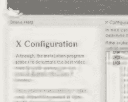

`X` 配置工具允许你管理 `X` 窗口系统的设置。

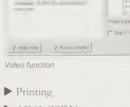

## 视频功能

- `ADSL/IS`

`Red Hat` 还包含了一个图形化防火墙工具，它可以在每个桌面环境中运行，并允许你从 `GUI` 设置 `iptables` 规则。

总之，`Red Hat 7.1` 让安装服务器变得简单得多，并提供了新工具，让管理员更容易管理一些流行的 `Linux`...

当然，可以。

作者：Jack Wallen, Jr.

随着时间的推移，技术也在不断进步。随着技术的进步，我们必须更新自己的知识。例如，我第一次面对使用 `Ultra DMA 100` 硬盘进行 `Linux` 安装的时刻！那真是一次难！！你在笑吗？你可能没用过这些系统。如果你计划在其中一个系统上安装 `Linux` 并经历我可能带给你的痛苦，那么我可能会带给你一些好消息、一些坏消息以及一丝宽慰。好消息是，你确实可以将 `Linux` 安装到 `UDMA` 磁盘驱动器上……而且运行良好。坏消息是这需要一些时间、精力以及拆解你的机器。好吧，老杰克将教你如何让这一切变得顺利！

`UDMA` 控制器位于板载 `UDMA 100` 控制器上。

## 关于安装

好的，在我们继续之前，我要明确一点：备份你的系统！每当你处理硬件时，你都面临着丢失数据的风险……你的数据！在进行下一步之前，请备份所有可能备份的内容。你备份了吗？如果没有，请回到上一个版本并带着感情再读一遍。

好……现在我们准备好了。让我们让这个小家伙叫起来吧！

退回邮件：地址未知

你需要做的第一件事是确定你的 `UDMA` 内核位置。`Linux` 内核将这些 `IDE` 和 `UDMA` 控制器作为特定地址，我们必须告诉内核你希望它位于何处。

`/proc` 目录下有一个名为 `partitions` 的文件，它提供的信息将比你想象的多。查看此文件，运行命令：

```
less /proc/partitions
```

你将获得一个较长的文本文件，它代表：

## 首先要做的事

首先，你需要验证你确实在运行 `UDMA` 系统。有几种方法可以。如果你已经安装了 `Linux`（并想要升级或重装），你可以运行 `mount` 命令——输出如下：

```
mount
```

`mount` 命令将报告你的硬盘名称等信息。这通常是类似于 `/dev/sda`。我们要寻找的是 `e` 或 `f`，比你想象的概率更大。如果你看到 `e` 或 `f`，说明你在 `UDMA` 上。

另一种方法是检查 `dmesg`。运行命令：

```
dmesg | grep -i ide
```

查看包含 `"UDMA mode"` 的行。例如：

```
hd0: UDMA mode 100 (3/3/0)
```

如果你看到 `UDMA mode`，说明你在 `UDMA` 上。

另一种方法是检查 `/proc/partitions` 文件。运行命令：

```
cat /proc/partitions
```

寻找你的硬盘。例如：

```
0:0 sda 2048000
0:1 sda1 1024000
0:2 sda2 1024000
```

如果大小是 `100000` 或更多，可能是 `UDMA`。如果是 `30000` 或更少，可能是 `PIO`。

等待，最好的方法是检查 `/proc/ide` 文件。运行命令：

```
cat /proc/ide
```

寻找你的硬盘。例如：

```
hd0: 2000000000 bytes, 100000000 sectors, UDMA mode 100 (3/3/0)
```

如果你看到 `UDMA mode`，说明你在 `UDMA` 上。

等待，另一种方法是检查 `/proc/diskinfo` 文件。运行命令：

```
cat /proc/diskinfo
```

寻找你的硬盘。例如：

```
hd0: 2000000000 bytes, 100000000 sectors, UDMA mode 100 (3/3/0)
```

如果你看到 `UDMA mode`，说明你在 `UDMA` 上。

等待，另一种方法是检查 `/proc/iopata` 文件。运行命令：

```
cat /proc/iopata
```

寻找你的硬盘。例如：

```
hd0: 2000000000 bytes, 100000000 sectors, UDMA mode 100 (3/3/0)
```

如果你看到 `UDMA mode`，说明你在 `UDMA` 上。

等待，另一种方法是检查 `/proc/scsi` 文件。运行命令：

```
cat /proc/scsi
```

寻找你的硬盘。例如：

```
hd0: 2000000000 bytes, 100000000 sectors, UDMA mode 100 (3/3/0)
```

如果你看到 `UDMA mode`，说明你在 `UDMA` 上。

等待，另一种方法是检查 `/proc/blockdev` 文件。运行命令：

```
cat /proc/blockdev
```

寻找你的硬盘。例如：

```
hd0: 2000000000 bytes, 100000000 sectors, UDMA mode 100 (3/3/0)
```

如果你看到 `UDMA mode`，说明你在 `UDMA` 上。

等待，另一种方法是检查 `/proc/interrupts` 文件。运行命令：

```
cat /proc/interrupts
```

寻找你的硬盘。例如：

```
hd0: 2000000000 bytes, 100000000 sectors, UDMA mode 100 (3/3/0)
```

如果你看到 `UDMA mode`，说明你在 `UDMA` 上。

等待，另一种方法是检查 `/proc/meminfo` 文件。运行命令：

```
cat /proc/meminfo
```

寻找你的硬盘。例如：

```
hd0: 2000000000 bytes, 100000000 sectors, UDMA mode 100 (3/3/0)
```

如果你看到 `UDMA mode`，说明你在 `UDMA` 上。

等待，另一种方法是检查 `/proc/cpu` 文件。运行命令：

```
cat /proc/cpu
```

寻找你的硬盘。例如：

```
hd0: 2000000000 bytes, 100000000 sectors, UDMA mode 100 (3/3/0)
```

如果你看到 `UDMA mode`，说明你在 `UDMA` 上。

等待，另一种方法是检查 `/proc/netinfo` 文件。运行命令：

```
cat /proc/netinfo
```

寻找你的硬盘。例如：

```
hd0: 2000000000 bytes, 100000000 sectors, UDMA mode 100 (3/3/0)
```

如果你看到 `UDMA mode`，说明你在 `UDMA` 上。

等待，另一种方法是检查 `/proc/loadavg` 文件。运行命令：

```
cat /proc/loadavg
```

寻找你的硬盘。例如：

```
hd0: 2000000000 bytes, 100000000 sectors, UDMA mode 100 (3/3/0)
```

如果你看到 `UDMA mode`，说明你在 `UDMA` 上。

等待，另一种方法是检查 `/proc/meminfo` 文件。运行命令：

```
cat /proc/meminfo
```

寻找你的硬盘。例如：

```
hd0: 2000000000 bytes, 100000000 sectors, UDMA mode 100 (3/3/0)
```

如果你看到 `UDMA mode`，说明你在 `UDMA` 上。

等待，另一种方法是检查 `/proc/uptime` 文件。运行命令：

```
cat /proc/uptime
```

寻找你的硬盘。例如：

```
hd0: 2000000000 bytes, 100000000 sectors, UDMA mode 100 (3/3/0)
```

如果你看到 `UDMA mode`，说明你在 `UDMA` 上。

等待，另一种方法是检查 `/proc/version` 文件。运行命令：

```
cat /proc/version
```

寻找你的硬盘。例如：

```
hd0: 2000000000 bytes, 100000000 sectors, UDMA mode 100 (3/3/0)
```

如果你看到 `UDMA mode`，说明你在 `UDMA` 上。

实际上，最简单的方法是使用 `mount` 命令。运行命令：

```
mount
```

`mount` 命令将报告你的硬盘名称等信息。这通常是类似于 `/dev/sda`。

等待，我把问题搞复杂化了。让我们回到基础。你需要做的第一件事是确定你的 `UDMA` 内核位置。`Linux` 内核将这些 `IDE` 和 `UDMA` 控制器作为特定地址，我们必须告诉内核你希望它位于何处。

`/proc` 目录下有一个名为 `partitions` 的文件，它提供的信息将比你想象的多。查看此文件，运行命令：

```
less /proc/partitions
```

你将获得一个较长的文本文件，它代表：

## 首先要做的事

首先，你需要验证你确实在运行 `UDMA` 系统。有几种方法可以。如果你已经安装了 `Linux`（并想要升级或重装），你可以运行 `mount` 命令——输出如下：

```
mount
```

`mount` 命令将报告你的硬盘名称等信息。这通常是类似于 `/dev/sda`。

等待，在我们继续之前，我要明确一点：备份你的系统！每当你处理硬件时，你都面临着丢失数据的风险……你的数据！在进行这些下一步之前，请备份所有可能备份的内容。你备份了吗？如果没有，请回到上一个版本并带着感情再读一遍。

好……现在我们准备好了。让这个小家伙叫起来吧！

你需要做的第一件事是确定你的 `UDMA` 内核位置。`Linux` 内核将这些 `IDE` 和 `UDMA` 控制器作为特定地址，我们必须告诉内核你希望它位于何处。

`/proc` 目录下有一个名为 `partitions` 的文件，它提供的信息将比你想象的多。查看此文件，运行命令：

```
less /proc/partitions
```

你将获得一个较长的文本文件，它代表：

## 首先要做的事

首先，你需要验证你确实在运行 `UDMA` 系统。有几种方法可以。如果你已经安装了 `Linux`（并想要升级或重装），你可以运行 `mount` 命令——输出如下：

```
mount
```

`mount` 命令将报告你的硬盘名称等信息。这通常是类似于 `/dev/sda`。

等待，

`Apache` 配置工具包括：

- **主（Main）**——设置服务器名称、电子邮件地址和监听端口

- **虚拟主机（Virtual Hosts）**——添加或编辑虚拟主机的特性和地址，详细列出根目录和主机信息等内容

- **服务器（Server）**——设置服务器的用户和组，以及 `PID`、文件和核心转储（core dump）目录的文件位置

- **性能优化（Performance Tuning）**——设置超时、每个连接的最大请求以及最大连接数

其他新的配置工具包括：

- `BIND`

## 图 B


## 防火墙配置


## 图 C


## X 配置

`X` 配置工具允许你管理 `X` 窗口系统的设置。


## 视频功能

- `ADSL/IS`

`Red Hat` 还包含了一个图形化防火墙工具，它可以在每个桌面环境中运行，并允许你从 `GUI` 设置 `iptables` 规则。

总之，`Red Hat 7.1` 让安装服务器变得简单得多，并提供了新工具，让管理员更容易管理一些流行的 `Linux`...


## UDMA 能在 Linux 上工作吗？

当然，可以。

作者：Jack Wallen, Jr.

随着时间的推移，技术也在不断进步。随着技术的进步，我们必须更新自己的知识。例如，我第一次面对使用 `Ultra DMA 100` 硬盘进行 `Linux` 安装的时刻！那真是一次难！！你在笑吗？你可能没用过这些系统。如果你计划在其中一个系统上安装 `Linux` 并经历我可能带给你的痛苦，那么我可能会带给你一些好消息、以及。好消息是，你确实可以将 `Linux` 安装到 `UDMA` 磁盘驱动器上……而且运行良好。坏消息是这需要一些时间、精力以及拆解你的机器。好吧，老杰克将教你如何让这一切变得顺利！

`UDMA` 控制器位于板载 `UDMA 100` 控制器上。

## 关于安装

好的，在我们继续之前，我要明确一点：备份你的系统！每当你处理硬件时，你都面临着丢失数据的风险……你的数据！在进行这些下一步之前，请备份所有可能备份的内容。你备份了吗？如果没有，请回到上一个版本并带着感情再读一遍。

好……现在我们准备好了。让这个小家伙叫起来吧！

你需要做的第一件事是确定你的 `UDMA` 内核位置。`Linux` 内核将这些 `IDE` 和 `UDMA` 控制器作为特定地址，我们必须告诉内核你希望它位于何处。

`/proc` 目录下有一个名为 `partitions` 的文件，它提供的信息将比你想象的多。查看此文件，运行命令：

```
less /proc/partitions
```

你将获得一个较长的文本文件，它代表：

## 首先要做的事

首先，你需要验证你确实在运行 `UDMA` 系统。有几种方法可以。如果你已经安装了 `Linux`（并想要升级或重装），你可以运行 `mount` 命令——输出如下：

```
mount
```

`mount` 命令将报告你的硬盘名称等信息。这通常是类似于 `/dev/sda`。

# 在 Linux 中添加第二块硬盘

作者：Jack Wallen, Jr.

我有幸在我的 `Linux` 机器上安装了第二块硬盘。准确地说，我将旧硬盘作为次级驱动安装到了新系统中。这个新系统来自 `PuppyLinux`，包含一个空间充足的单硬盘。我本以为这将是一次艰巨的实验，但事实证明它就像即插即用简单。

这显然表明旧的西部数据（`Western Digital`）硬盘在（`Linux` 中）存在为 `/dev/hdd`。

有了这些信息，我成功了一大半！下一步是创建一个挂载硬盘的位置。由于这台机器是单用户机器，我决定将硬盘挂载在 `/home/jallen/xander` 新建的目录下。创建该目录的命令如下：

```
mkdir /home/jallen/xander
```

有了新目录，是时候挂载硬盘了。

## 细节

如前所述，新机器来自 `PuppyLinux`，已经包含一个可拆卸硬盘。我决定添加第二个可拆卸硬盘，以使机器尽可能灵活。

这种类型的挂载需要由 `root` 用户执行。一旦你获得了 `root` 权限，就可以发出命令：

```
mount -t ext2 /dev/hdd1 /home/jallen/xander
```

`Puppy` 机器中当前的硬盘是一个 `UDMA 100-20 GB` 的硬盘，启动着 `Red Hat 7` 和 `Windows Me`。旧硬盘是一个 `6 GB` 的西部数据硬盘，已经安装了可以运行的 `Red Hat 6.2`。我担心安装一个已经配置好操作系统的硬盘会导致系统完全崩溃。多亏了 `Linux`，我错了。

并且新安装的硬盘可能无法挂载。在我的情况下，我遇到了了一些需要处理的问题。第一个问题是硬盘挂载不干净，需要检查。为了检查这一点，我卸载了硬盘：

```
umount /home/jallen/xander
```

使用 `fsck` 运行：

```
fsck /dev/hdd1
```

发现了一些损坏的索引节点（`inodes`）。幸运的是，`fsck` 修复了这些问题，我尝试重新挂载硬盘。使用命令：

```
mount -t ext2 /dev/hdd1 /home/jallen/xander
```

硬盘成功挂载，没有失败。

## BIOS

硬件安装完成后，首先要处理的是 `BIOS`。因为主硬盘使用 `UDMA` 控制器，我必须确保新安装硬盘的 `IDE` 控制器已禁用。一旦处理好，启动过程就如常一样进行。

## 清理工作

好了，我有了挂载西部数据硬盘的能力。然而，每次启动后运行每个命令（以及为了重启而重新挂载）并不像理想情况那样简单。为了实现这一点，我首先需要获取命令并将其放入 `/etc/fstab`，以便它们在启动时挂载。

## 挂载和使用硬盘

机器启动后，我运行了 `dmesg` 来查找硬盘的位置。在 `dmesg` 长长的输出中，我发现了以下：

```
HDA: CREATE53228E-F, ATA disk drive
CDROM drive
hdd: WDC264008_A, ATA disk drive
hdb: providing with STATUS (0x50)
instead of ALTLASTSTATUS (0xff)
db: IBM-DTLA-307020, ATA disk drive
```


我首先需要处理的问题之一是，我正在挂载一个来自完全不同的机器且安装了完整操作系统的硬盘。因为这个硬盘安装了完整的 OS，我需要配置好的设备文件。为此，我在这些特殊字符中添加了 `nodev` 选项，以防设备被误读。新命令看起来像：

## 自动化过程

为了自动化此过程，我必须做两件事：

- 赋予我的用户硬盘所有权
- 在 `/etc/fstab` 中添加条目

```
mount -t ext2 -o nodev /dev/hdd1 /home/jallen/xander
```

第一步是简单的运行命令：

```
chown jallen/xander /home/jallen/xander
```

我的命令是正确的。然而，涉及到一些不必要的变量。第一个是类型。我使用 `ext2`（Linux 文件系统）作为默认，我需要传递参数作为 Linux 专用硬盘。然后，命令看起来像：

### 用户注意

对于系统来说是唯一的。对于你的特定系统，你将拥有自己的用户名。由于硬盘更快（而且更大），我会使用它作为主硬盘和存储设备。我的新目标是获取这块硬盘，然后清理它。第二步是简单的。在我最喜欢的 Linux 文本编辑器中添加这一行：

```
mount -o nodev /dev/hdd1 /home/jallen/xander ext2 0
```

成功挂载后，我将所有文件复制到新目录（`/dev/sda`），并且作为 `root`，清理了 `/home/jallen/xander` 上的所有文件和目录。现在再次运行命令移除 `nodev` 选项：

```
/dev/hdd1 /home/jallen/xander
```

（注：此处原文逻辑似乎略显混乱，翻译已按字面意思处理）

## 结论

在 Linux 下安装第二块硬盘的方法对于任何用户来说都是可行的。正如我所展示的，只要有耐心，你就可以扩展系统到资源限制。一旦条目添加，我保存了文件并重启机器。启动时，我注意到硬盘被检测到，启动完成后，我运行了 `dmesg` 查看是否有任何错误信息。

```
/dev/hdd1 /home/jallen/xander
```

上述内容显示：

- 硬盘位于 `hdb`。
- 挂载点是 `/home/jallen/xander`。
- 类型是 `ext2`。

当我使用命令 `ls -la /home/jallen/xander` 查看目录时，我看到它是空的。硬盘已成功挂载并可以作为存储设施。

- 使用所有参数。
- 而不是文件系统。

| 文件系统 | 大小 | 已用 | 可用 | 使用率 | 挂载于 |
| :--- | :--- | :--- | :--- | :--- | :--- |
| `/dev/sda` | 14G | 2.9G | 10G | 23% | `/` |
| `/dev/sdb` | 23G | 5.0G | 16G | 23% | `/boot` |
| `/dev/hdd1` | 5.8G | 4.0G | 5.4G | 1% | `/home/jallen/xander` |


## Linux 分区详解

**作者**：`Jack Wallen, Jr.`

Linux 安装过程的核心（也是大多数 Windows 迁移者感到困惑的点）是分区。在 Linux 下，每个分区都有不同的用途，并有多种配置方式。类似于 Windows 的交换文件，它是专用的且更稳定。

有许多工具可以为硬盘做准备分区——例如 `Disk Utility`、`FDISK` 和 `Partition Magic` 等。每个工具都有其优缺点。随着 Linux 发行版版本的更新，分区程序可以通过良好的 GUI 界面执行。因此，分区操作变得比 Windows 的 `FDISK` 工具更简单。

在执行自定义安装（而不是发行版提供的面向新自动安装）时，Linux 分区的最大大小为 120 MB。通常交换分区的大小等于 RAM 的 MB 数。当然，如果你的机器超过 120 MB RAM，你将使用 120 MB 的交换分区。

基础 Windows 分区方案与 Linux 分区方案之间最大的区别是增加了交换分区。Linux 交换分区的作用很简单。

在交换分区之外，Linux 环境中唯一的分区是根分区，称为 `/` 分区。该分区拥有 Linux 安装创建的目录，包括 `home`、`etc`、`dev`、`var`、`bin`、`lost+found`、`mnt`、`root`、`tftpboot`、`usr`、`lib`、`misc`、`opt`、`proc` 和 `tmp`。

## RPM 文件详解

**作者**：`Jack Wallen, Jr.`

`RPM` 不仅仅是给汽车爱好者的。它们也是红帽对 `EXE` 文件的回答。

`RPM` 文件（用于应用程序安装的二进制文件）带有 `RPM` 扩展名，是 Windows `EXE` 文件的 Linux 等文件。`RPM` 只能从命令行作为 `root`（超级用户）运行，也可以通过 GUI 工具 `rpm`（来自 GNOME 桌面环境）或从 `rpm`（来自 KDE 环境）运行。该程序有几个“常用”参数。在最有用的安装标志中：

## 使用 RPM 安装

红帽软件包管理系统（`RPM`）是一个用户友好、健壮且标准化的安装应用程序，它让安装、卸载、验证和查询程序变得简单，同时保持了 Linux 的共同优势和效率。

与 Linux 命令和应用程序一样，`RPM` 接受参数和标志，增加了它的可用性。这些用法（类似于许多 Linux 参数）决定了 `RPM` 请求的性质——允许用户进行修改和控制。

让我们检查 `RPM` 的常用用法。

- `I`，安装（已安装的包）
- `v`，详细（在包安装时向屏幕输出详细信息）
- `h`，哈希（打印井号以指示进度）

通过上述参数，可以有许多变体。例如，你可以仅使用 `-lv` 组合进行详细输出安装，或者使用 `Uvh` 同时带有详细输出和哈希标记进行升级。（请注意稍后参数中的 `U`。）

使用此短列表中的参数，你可以运行与匹配的命令进行安装：

`RPMivh this_package-1.RPM`

这将安装 `this_package-1.1`，并带有详细输出和指示安装过程的哈希标记。

# 查询

一旦你安装了应用程序，就可以使用以下参数检查安装情况：

- `-q`, query（报告已安装的软件包）

执行命令

`RPM -q this_package`

它将报告以下信息：

`this_package-1.1.`

# 升级

使用 `RPM` 升级与安装一样简单。

要升级软件包，你只需要在以下参数中添加：

- `-U`, upgrade（升级列出的软件包）

如果你想将 `this_package-1.1` 升级到 `this_package-1.2`，请运行如下带有升级参数的 `RPM`：

`RPM -Uvh this_package-1.2`

使用 `RPM` 升级允许你扩展详细输出和哈希参数，就像

# 卸载

最后，要卸载 `this_package`，请运行带有以下标志的 `RPM`：

- `-e`, uninstall（卸载列出的软件包）

完整命令如下：

`RPM -e this_package`

> `Red Hat` 包管理系统是一种设计良好、功能完备的 Linux 环境应用程序和程序管理方法。`RPM` 技术曾是 `Red Hat Linux` 特有的，但现在它已用于许多其他发行版，例如 `Mandrake`、`Caldera` 和 `SuSE`。


# 启动与关闭

# 从 Linux 和 DOS 创建 Linux 启动盘

**作者**：`Jack Wallon, Jr.`

你是否遇到过这样的情况：机器重启后，结果发现自己在安装时跳过了创建启动盘的步骤？更糟糕的是，你尝试安装 Linux 却发现 `CD-ROM` 无法启动？在这种情况下你能做什么？你能创建所有的启动盘和救援盘吗？

创建启动盘和救援盘的方法有很多，需要创建的启动盘类型也很多。在本文中，我将引导你如何在 Linux 和 `DOS` 环境下创建启动盘，以便你可以在各种情况下都获得所需的帮助。

# 在 Linux 内部创建磁盘

在 Linux 内部创建安装盘依赖于 `dd` 命令。你将创建的各种类型安装软盘包括：

- `Boot.img`——从不可启动的 `CD-ROM` 执行安装时需要。
- `Boot.img`——在通过网络进行安装时需要。
- `Penca.img`——在笔记本电脑上进行网络安装时需要。
- `Rescue.img`——恢复时需要。

要创建安装盘，向软驱驱动器插入空软盘，向 `CD-ROM` 驱动器插入 Linux CD，打开控制台并运行以下命令（不要在 `#` 之前运行任何内容）：

# 挂载光驱

`mount /cdrom`

# 切换到 /mnt/cdrom/images

`cd /cdrom/images`

# 在指定的磁盘上运行 dd 命令

`dd if=image_file of=floppy`

请注意 `image_file` 和 `floppy` 部分。当你看到 `image_file` 时，将插入上述指定软盘之一的。如果你想创建一个用于从不可启动 `CD-ROM` 安装的标准安装软盘，将运行命令

`dd if=boot.img of=/dev/fd`

如果你想创建一个通过 `NFS`、`FTP`、`HTTP` 等网络进行安装的安装盘，将运行命令

`dd if=boot.img of=/dev/fd`

要在笔记本电脑上执行网络安装，运行命令

`dd if=pcmcia.img of=/dev/fd`

最后，对于救援盘，将运行

`dd if=Rescue.img of=/dev/fd`

# 在 DOS 内部创建磁盘

在 `DOS` 内部创建上述内容同样简单。你将使用 `rawrite.exe` 命令在 `DOS` 内部创建 Linux 安装/救援磁盘。`rawwrite` 命令随 `Red Hat`、`Mandrake` 等许多发行版提供。

在 `DOS` 内部创建安装/救援软盘的步骤如下：

- 插入 Linux CD。
- 插入空白软盘。
- 打开 `DOS` 提示符。
- 切换到 `D:\disks` 目录。
- 运行 `rawrite` 命令。
- 输入你想创建的文件名（从上述列表中）。
- 输入软盘设备名称（如果有多个，将是）：

上述步骤非常简单。与在 Linux 中创建此类磁盘的区别在于（除了处于完全不同的环境）：

- 文件名（上述列出的名称）位于 `D:\images` 目录中，且大小写不同（通常，除扩展名外的所有字符都是大写）。
- 软盘设备称为：相对于 `dev/fd0`。

所以假设你想从 `DOS` 创建一个 `Boot.img` 软盘。你将通过以下方式操作：

系统将提示你输入文件名。在文件名提示符下，输入

`D:\BOOT.img`

现在按 [Enter]，系统将提示你输入名称。在此提示符下，你输入

`a:` 然后按 [Enter]。

此时，它将开始创建，并完成（仅需几秒钟）。一旦完成，安全地将其移除（必要的话）。

## 结论

有了上述工具，你将能够为大多数情况创建安装盘。无论你的选择是从 `DOS` 创建启动盘，还是在为未来做准备（例如网络安装或系统彻底崩溃），这些工具都应该帮助你完成 Linux 安装之旅。

企业级 Linux 管理员指南

# 针对 Linux/Win2K 双系统尝试此实用的变通方法

**作者**：`Mike Walton`

好了，你现在真的做到了。你在测试机器上安装 `Microsoft Windows 2000` 时考虑到了以后，对硬盘进行了分区，以便可以将 Linux 放在同一台机器上。

然后你复制了 `Red Hat Linux` 副本并将其安装在你创建的分区上。当你运行 `Red Hat` 询问将 `LILO`（Linux 加载器）放在何处时，你直接点击通过，允许它被放在默认位置——机器的主引导记录（`MBR`）上。

但在安装 Linux 后重启机器时，你无法进入你的 `Windows 2000 Professional`。漂亮的界面列了出来，但唯一的选择是 Linux。哎！

图 A


LILO 配置

# 回到起点

问题是 `NT` 启动加载器位于机器的 `MBR` 上，用于启动 `NT 4.0` 或 `Windows 2000` 专业版，它在启动时宣布它是基于 `NT` 技术构建的。

这里有一个好消息：你所需要做的只是从 `MBR` 中清除 `LILO`，你就能找回 `Windows 2000`。坏消息是 `LILO` 的位置需要在安装时设置，如果它从 `MBR` 中被擦除，你必须重新安装 Linux 才能使其正常工作。

从 `MBR` 中清除 `LILO` 最简单的方法是找到旧的 `Windows 98` 磁盘（或任何包含 `fdisk` 工具的启动盘）。从该启动盘启动，在 `A` 提示符下：

现在使用下述变通方法再次安装 `Red Hat`。

（建议在双系统机器上安装任何版本的 `Windows`，并先安装 Linux。）

当你进入 `Red Hat 7.1` 安装中的 `LILO` 屏幕（图 A）时，你将有一个将 `LILO` 安装在启动分区第一个扇区的选项。希望你在对 Linux 进行分区时，按照安装该部分的建议创建了启动分区（`boot/`）。

此外，请确保点击了制作启动软盘的按钮，稍后需要它启动 Linux，因为在完成变通方法之前，`NT` 启动加载器不会在列表中显示 Linux。

如果你的 `CMOS` 设置为从硬盘启动，你应该应该进入 Linux。如果你安装了 `GNOME`，那么将进入控制台模式，这没关系。如果你安装了 `KDE`，它可能会进入 `KDE` 桌面，但你也可以从那里调用终端会话。

在我们的示例中，除了 `Red Hat` 安装期间 `LILO` 的位置外，所有操作都是按照建议执行的。

## Linux 引导程序简介

**作者**：`Vincent Danen`

对于许多人来说，Linux 仍然的一个谜团就是如何更改系统启动。当然，你已经完成了安装，但现在你想对其进行一些微调。也许你升级了内核，并已经知道了如何让系统启动新内核而不是旧内核。也许你想要为你的 Linux 工作站的启动设置密码。这些都是很棒的目标，但如何实现它们呢？

在本文，我们将查看 Linux 引导程序。引导程序是位于你计算机主引导（`Master Boot`）

`boot.ini` 文件中的程序。如果你没有以 `root` 身份登录，你需要使用 `sudo root` 然后运行 `/usr/sbin/fdev /boot/` 来查看 Linux 分区引导扇的位置。如果你得到的不是 `"hda"`（例如得到的是 `"hda"`），你只需要输入 `mount`，就会看到类似这样的一行：

`/dev/hda2 on /boot type ext2 (rw)`

`boot.ini` 文件。提示：你需要输入 `boot.ini`文件的文件名来打开它。

现在在文件的最后一行下方添加以下内容：

```
C:\BOOTSECT.LNX="Linux"
```

保存并关闭文件。然后，你需要通过以下命令恢复 `boot.ini` 文件的权限：

```
C:\attrib +s -r c:\boot.ini
```

无论引导扇区的地址是什么，它都会放入 `dd` 命令中，其格式如下：

`dd if=/dev/hda2 of=/bootsect.lnx bs=512 count=1`

现在，当你在 `A` 盘中没有任何内容的情况下重启电脑时，你应该看到一个列出计算机所有启动选项的屏幕，其中一个显示为 Linux。

此命令从你的 Linux 根分区拷贝引导扇区，如果 `bootsect.lnx` 的 `"bs"` 大于 512，那么说明出了问题，双系统将无法工作。

# 如果一切都出错该怎么办

由于某种原因，机器没有正常启动，或者你没有获得选择 Linux 的选项，还有其他方法可以解决这个问题。

将 `boot.ini` 文件复制到 `DOS` 格式的软盘上，可以通过挂载软盘并使用 `cp` 复制命令，或者不挂载软盘并使用 `mcopy` 命令，其读取为：

`mcopy boot.ini lnx a:`

首先尝试重新执行从 `dd` 命令开始的所有操作，并观察接下来发生了什么。下一步是去 `www.linuxdoc.com/HOWTO/linux-NT.html` 的 HowTo 网站查找安装和运行名为 `BootPart` 程序的说明，它可以自动完成安装的最后阶段。你可能还想阅读 HowTo 网站上的故障排除（Troubleshooting）部分。

现在，在 `A` 盘中没有任何启动软盘的情况下重启机器。

机器启动后，将 `boot.ini` 文件复制到你的 `C` 盘。然后进入命令行提示符并：

```
C:\attrib -s -r c:\boot.ini
```

这样你就可以更改 `boot.ini` 文件的权限了。然后，使用记事本，如

记录、`MBR` 或在可启动分区的开头。每个操作系统都使用某种形式的引导程序；没有它，计算机就无法进入你的操作系统。`Windows` 自带引导程序，对用户是透明的，就像 `DOS` 中的一样。它只会启动 `Windows` 或 `DOS`，取决于你安装了哪一个。你可以购买第三方的 `Windows` 引导程序，允许你在计算机上双系统运行不同的操作系统。一个例子是 `PowerQuest` 的 `BootMagic`，它也用于 `OS/2` 操作系统。

对于 Linux，如果你觉得需要引导程序，也可以使用 `BootMagic`。`BootMagic` 随 `PartitionMagic` 一起提供，你可能需要一个实时工具。如果你不需要，Linux 提供了两个额外的引导程序：`LILO` 和 `GRUB`。

# LILO 和 GRUB 简介

`LILO` (`http://biblio.org/linux/system/boot/LILOINDEX.html`) 是第一个 Linux 加载器，它的名字代表 `"Linux Loader"`。你需要下载它，因为并不是所有的 Linux 发行版都带有它。

`GRUB` 是一个较新的引导程序，曾一度比 `LILO` 稍微先进。它的名字代表 `Grand Unified Boot Loader`（统一引导加载程序）。`GRUB` 比 `LILO` 稍微难用一点，而且它不再比 `LILO` 先进了。它在 `LILO` 之前提供了图形化启动菜单，而且那还是基于 `ANSI` 的文本菜单。现在，`LILO` 提供了真正的图形化启动菜单，功能与 `GRUB` 相当甚至更强大。

## 使用 LILO


# LILO 配置

我们首先查看 `LILO`。`LILO` 的配置文件通常是 `/etc/lilo.conf`，包含有关可能的内核、启动镜像以及 `LILO` 细节的信息。`LILO` 可以在 Linux 和 Windows 之间双系统启动，以及许多其他操作系统；你的 `LILO` 配置文件可能会变得复杂。在一个系统上，我将 `LILO` 配置为在八个 Linux-Mandrake、Debian 和 SuSE 版本之间切换。所以，正如你所见，通过 `LILO` 可以实现的事情没有真正的限制。

让我们来看一个 `lilo.conf` 示例：

```
boot=/dev/hde
map=/boot/map
install=/boot/boot.b
vga=ext
default=linux
lba32
prompt
timeout=50
password=secret
restricted
message=/boot/message-graphic
menu-scheme=bw:bw:bw
image=/boot/vmlinux
```

我们为非帧缓冲内核定义了标签 `linux-nonroot`，并为根内核定义了 `linux2.2`。

你还需要使用 `root` 键为此 Linux 安装程序定义根目录。在这里，我们定义了 `/dev/hd1`，并将其挂载为 `/`。

如果你有 SCSI 适配器或使用 RootFS，你可能需要一个 `initrd` 镜像。这是为指定的内核加载的初始内存磁盘。这对于从 SCSI 驱动器启动或根分区格式化为 RootFS 的系统来说是尤为需要的。`initrd` 镜像将包含可用的模块，没有它们，你将无法从 SCSI 设备启动或挂载根分区。

`append` 关键字告诉 `LILO` 何时启动。在这种情况下，我们向内核传递了 `root=hd-side`，这告诉内核根分区是 `/dev/hd0`，即我们的 IDE 刻录机，它配合 `ide-scsi` 模块使用。这允许我们使用 `LILO` 覆盖我们的 IDE CD-rw。

`read-only` 关键字告诉 `LILO` 将根分区挂载为只读。别担心，启动过程会将根文件系统重新挂载为读写，并对其进行检查。这是一种安全措施。

你可以根据需要定义许多镜像。正如早些提到的，我有一个系统可以在 10 个不同的 Linux 发行版之间启动，因此我的 `my_lilo.file` 充满了镜像。

你也可以在这里看到，你可以告诉 `LILO` 从其他设备（软盘）启动。这是有益的，因为它允许你通过告诉 BIOS 仅从硬盘启动，来防止人们将软盘插入系统并启动。通过对 `LILO` 和你的 BIOS 进行密码保护，你可以确保只有经过授权的人才能从软盘启动。

要保存更改并重新生成启动镜像，你需要运行 `lilo` 命令。我建议使用：

```
/sbin/lilo -v
```

这会让 `LILO` 处于详细模式，并在执行操作时告诉你它正在做什么。通过这样，如果你的文件中存在任何错误，你可以快速判断出错误是什么。

## GRUB

`GRUB` 的工作方式非常不同。它通过一个交互式脚本 `grub-install` 工作，这是你最初配置它的方式，除非你真的非常自己在做什么。你需要先安装 `GRUB`；大多数发行版也自带 `GRUB`，但如果没有，你可以从 GNU.org 网站 `www.gnu.org/software/` 下载。

要开始配置，请以 root 身份执行以下：

```
grub-install /dev/hde
```

`/dev/hd1` 是主启动设备。同样，`/dev/hde` 是主 ATA100 驱动，所以如果你使用 ATA33 或 ATA66 驱动，请务必使用 `/dev/hda`。

一旦首次运行 `grub-grub`，它将创建一个文件 `/boot/grub/device.map` 并将其内容打印到屏幕。这将列出你系统中所有的设备，使用你的软盘驱动器。在运行 `grub-grub` 后，我的 `/boot/grub/device.map` 文件见表 A。

### 表 A：`device.map` 文件

| 标签 (Label) | 设备 (Device) |
| :--- | :--- |
| `(fd0)` | `/dev/td0` |
| `(hde)` | `/dev/hde` |
| `(hd1)` | `/dev/hdf` |
| `(hd2)` | `/dev/hdg` |

如果这些看起来是正确的，你需要创建 `GRUB` 配置文件：`/boot/grub/menu.lst`。让我们来看列表 A 所示的配置示例。

## 关键字

`default` 关键字告诉 `GRUB` 默认启动第一个定义；在这种情况下，它将是标题为 `Lilo` 的项。

`timeout` 关键字告诉 `GRUB` 在自动启动前等待 5 秒。与 `LILO` 不同，`GRUB` 使用的是秒，而不是十秒。

`i18n` 关键字告诉 `GRUB` 使用哪个消息文件，该文件将在 `grub>` 提示符之前显示。

### 列表 A：配置示例

```
default 0
timeout 5
i18n (hd0,0)/boot/grub/messages
password secret

# title Linux
kernel (hd0,0)/boot/vmlinuz root=/dev/hde initrd=/boot/initrd.img hdb=ide-scsi

# title Linux-failsafe
kernel (hd0,0)/boot/vmlinuz root=/dev/hde initrd=/boot/initrd.img hdb=ide-scsi
failsafe

# title Linux-2.2
kernel (hd0,0)/boot/vmlinuz-2.2 root=/dev/hde initrd=/boot/initrd-2.2.img append hdb=ide-scsi
```

`password` 定义了启动任何交互式操作（如编辑菜单项和进入命令行界面）所需的密码。通过这种方式，你可以防止 `GRUB` 在没有密码的情况下执行默认操作系统之外的任何操作，但你需要像我们在第二个镜像中那样使用 `lock`。`lock` 关键字告诉 `GRUB` 只有在提供有效密码时才启动。

`title` 关键字设置镜像定义。我们定义的第一个镜像（也是我们的默认镜像）是 Linux。

`kernel` 关键字定义要加载的内核镜像以及所有其他内核选项。`LILO` 使用许多条目来。

- `1.0`—停止 (Halt)（不要将此运行级别设置为默认值。）
- `2.`—单用户模式
- `3.`—多用户模式—带网络支持
- `4.`—全多用户模式—带网络支持
- `5.`—已使用 (Used)
- `6.`—X11—带多用户和网络支持
- `7.`—根用户 (Root)（不要将此运行级别设置为默认值。）

在同一个 `init` 配置文件中指定多个运行级别。例如，要同时为运行级别 1 和运行级别 3 指定明配置，可以使用以下语法：

```
id:13:action:process [arguments]
```

表 A 列出了系统运行级别可能执行的操作。

## `/etc/rc.sysinit` 脚本

当 Linux 系统启动时，内核运行 `init`，随后 `init` 继继运行 `/etc/rc.sysinit` 脚本。由于 `/etc/initab` 文件中存在以下行，该脚本在执行任何其他操作之前运行：

```
1::sysinit: /etc/rc.sysinit
```

此行中的运行级别字段为空，因为 `init` 将其视为系统初始化。`rc.sysinit` 执行多项任务，包括设置主机名、启用交换分区、检查文件系统以及加载内核模块。通常，你不需要修改 `/etc/rc.sysinit` 脚本。

## `/etc/rc.dinit` 脚本

当 `init` 需要更改可能的运行级别之一时，它将运行 `/etc/initab` 文件中以下行之一所指定的脚本：

### 表 A：系统运行级别可能的操作

| 操作 | 描述 |
| :--- | :--- |
| `respawn` | 进程每当终止时都会重启。 |
| `wait` | 进程运行一次，并等待其结束。 |
| `once` | 进程运行一次。 |
| `boot` | 进程在系统启动期间运行，无论运行级别为何。 |
| `bowait` | 进程在系统启动期间运行，并等待该进程结束。 |
| `off` | 不采取任何操作。用于在不删除该配置行的情况下禁用它。可以代替注释 (`#`) 使用。 |
| `onderman` | 未使用。 |
| `initdefault` | 指定系统的运行级别。忽略进程文件。 |
| `sysinit` | 进程在系统启动期间运行一次。`sysinit` 操作优先于 `boot` 或 `bowait`。 |
| `powerwait` | 当 `init` 接收到 `SIGPWR` 信号时运行。当检测到电源问题时，不间断电源 (UPS) 会发出 `SIGPWR` 信号。当 `SIGPWR` 信号发出时，`init` 将等待进程结束。 |
| `powerfail` | 与 `poweroff` 相同，但不等待进程结束。 |
| `powerokwait` | 当 `init` 接收到 `SIGPWR` 信号且 `/etc/powerstatus` 文件包含字符串 OK 时运行。该文件通常由 UPS 监控软件创建，用于指示电源问题正常。 |
| `ctrldelt` | 当 `init` 接收到 SIGINT 信号时运行。 |
| `krequest` | 当 `init` 接收到来自键盘处理器的键盘信号时运行。 |

```
10:wait=/etc/rc.d/rc 0
11:wait=/etc/rc.d/rc 1
12:wait=/etc/rc.d/rc 2
13:wait=/etc/rc.d/rc 3
14:wait=/etc/rc.d/rc 4
15:wait=/etc/rc.d/rc 5
16:wait=/etc/rc.d/rc 6
```

注意 `/etc/rc.d/init.d` 目录下的脚本通过两种方式链接。某些脚本使用以下语法链接：

`K[两位数字] 脚本名`

而另一些则使用语法：

对于每个运行级别 `[0-6]`，都会运行一个名为 `etc/rc.d/run` 的脚本，并将 `run` 作为参数传递给它。该脚本用于启动和停止指定运行级别中的所有脚本。例如，如果 `init` 被要求更改运行级别 5，则会在类似下面的命令行中带参数 `5` 调用 `/etc/rc.d/run` 脚本：

所有以 S 开头的脚本会被启动，以 K 开头的脚本会被停止，并在必要时重启。两位数字指定了这些服务的执行顺序，编号越低的服务越先执行。在示例中，`K0` 脚本在 `K5` 脚本之前运行。一旦完成所需的处理，系统即可在指定的运行级别下可用。

```
/etc/rc.d 3
```

1. 它检查是否存在对应指定运行级别的子目录。如果脚本带参数 `5` 运行，它将确保 `/etc/rc.d/5` 子目录存在。如果该目录存在，脚本将继续下一步。如果该目录不存在，则会更改运行级别。
2. 它确定指定运行级别中的任何程序是否已经在运行。如果某个服务已经在运行，脚本将杀死该进程，以便在下一步中启动它。
3. 任何带有 K 的脚本都将被停止，任何带有 S 的脚本将被启动。

`/etc/rc.d/init.d` 目录用于存放所有运行级别所需的全部脚本。目录中的每个脚本都用于启动或停止特定的服务。一个典型的 `/etc/rc.d/5` 目录如下所示。Red Hat 系统上该 `/etc/rc.d/5` 目录的简略版本显示了要启动或停止的服务，以及指向 `/etc/rc.d/init.d` 中脚本的符号链接。

（下文显示了要启动或停止的服务，以及相关的符号链接）

### 表 A：系统运行级别可能的操作

| 操作 | 描述 |
| :--- | :--- |
| `respawn` | 进程每当终止时都会重启。 |
| `wait` | 进程运行一次，并等待其结束。 |
| `once` | 进程运行一次。 |
| `boot` | 进程在系统启动期间运行，无论运行级别为何。 |
| `bowait` | 进程在系统启动期间运行，并等待该进程结束。 |
| `off` | 不采取任何操作。用于在不删除该配置行的情况下禁用它。可以代替注释 (`#`) 使用。 |
| `onderman` | 未使用。 |
| `initdefault` | 指定系统的运行级别。忽略进程文件。 |
| `sysinit` | 进程在系统启动期间运行一次。`sysinit` 操作优先于 `boot` 或 `bowait`。 |
| `powerwait` | 当 `init` 接收到 `SIGPWR` 信号时运行。当检测到电源问题时，不间断电源 (UPS) 会发出 `SIGPWR` 信号。当 `SIGPWR` 信号发出时，`init` 将等待进程结束。 |
| `powerfail` | 与 `poweroff` 相同，但不等待进程结束。 |
| `powerokwait` | 当 `init` 接收到 `SIGPWR` 信号且 `/etc/powerstatus` 文件包含字符串 OK 时运行。该文件通常由 UPS 监控软件创建，用于指示电源问题正常。 |
| `ctrldelt` | 当 `init` 接收到 SIGINT 信号时运行。 |
| `krequest` | 当 `init` 接收到来自键盘处理器的键盘信号时运行。 |

```
10:wait=/etc/rc.d/rc 0
11:wait=/etc/rc.d/rc 1
12:wait=/etc/rc.d/rc 2
13:wait=/etc/rc.d/rc 3
14:wait=/etc/rc.d/rc 4
15:wait=/etc/rc.d/rc 5
16:wait=/etc/rc.d/rc 6
```


`/etc/shutdown.allow` 文件是一个文本文件，每行包含一个用户名。文件中列出的每个用户都被允许使用 `shutdown` 命令。

目录。以下是 `chkconfig` 的一些用法。

# 处理停电

最终，你必须处理系统的停电问题。面对停电时，我的首要考虑是确保我的服务器正常关闭。这确保了文件系统被意外卸载，并且缓冲区中的数据被正确写入硬盘。默认的 init 文件包含以下内容：

```
:powerfail: /sbin/shutdown -f
```

```
+2 "Power failure: System Shutting Down"
```

此行告诉它在发生停电时运行 `shutdown`。当不间断电源 (UPS) 上的监控软件或电源监控守护向其发送 `SIGPWR` 信号时，该强大的操作就会启用。默认设置允许 UPS 在运行关机脚本之前运行系统两分钟。

如果在关机过程中恢复电源，以下行将取消关机：

```
12345:powerok:/sbin/shutdown
```

```
-c "Power Restored. Shutdown Cancelled"
```

当它收到 `SIGPWR` 信号且 `/etc/powerok` 文件包含文本 `OK` 时，`powerok` 操作就会被激活。

# 管理服务

要列出每个级别将启动的服务，请使用命令：

```
/sbin/chkconfig --list
```

要检查特定服务的运行级别配置，请使用命令：

```
/sbin/chkconfig --list
```

上述命令列出了每个运行级别下 `init` 服务的配置。该命令在我的系统上产生如下输出：

```
init 0:off 1:off 2:off 3:on 4:5:
```

输出告诉你 `init` 服务在运行级别 3 和 5 中启用，在所有其他运行级别中均禁用。

# 添加新服务

要让新服务在当前运行级别可用，请运行以下命令：

```
chkconfig --add http
```

此命令将 `httpd` 服务添加到当前运行级别。使用命令

要向特定运行级别添加服务，请使用命令

```
/sbin/chkconfig --level 4 --add inet
```

此命令将 `inet` 服务添加到该运行级别。

# 移除服务

要从当前运行级别移除服务，请使用命令

```bash
/sbin/chkconfig --del inet
```

此命令从当前运行级别中删除 `inet` 服务。

要从特定运行级别删除服务，请使用命令

```bash
/sbin/chkconfig --del level 5
```

此命令从运行级别 5 中移除该服务。

# 管理 init 文件

System V 程序使用了大量的文件、符号链接和目录。幸运的是，Linux 使用了三个工具来管理 init 文件：

- `chkconfig`
- `ntsys`
- `linuxrc`

# 使用 chkconfig

`chkconfig` 实用允许管理员维护运行级别下启动和停止服务的符号链接；`chkconfig` 可以管理 `/etc/rc.d/init.d` 下所有的脚本。

# 使用 ntsys

`ntsys` 实用允许通过简单的菜单界面进行服务管理。要运行当前运行级别的 `ntsys`，请使用命令

```
/sbin/ntsysys
```

入门指南

47

选择你希望在当前运行级别启动的服务并点击 OK。

要为特定运行级别运行 `ntsys/ntsysys`，请使用命令 `/usr/sbin/ntsys --level`

例如，要运行运行级别 4 的 `ntsys`，请使用命令 `/usr/sbin/ntsys --level 4`

为指定的运行级别选择已启动的服务并点击 OK。

3. 启用或禁用相应的服务。
4. 接受更改。
5. 在退出 `linuxconf` 之前激活更改。

## 结论

在本文中，我涵盖了 Linux 系统的启动和关机程序。我还解释了 `init` 程序以及 `init` 配置任何运行级别下的 Linux 系统所依赖的文件和目录。最后，我向你们展示了如何从 Linux 系统运行级别中添加和删除服务，并讨论了 Linux 系统上管理 init 文件的工具。

# 使用 linuxconf

要使用 `linuxconf` 管理 init 文件，请遵循以下步骤：

1. 从命令行输入 `linuxconf`。
2. 选择 Control | Control Panel | Control Service。


# 哪种最好：GUI 还是控制台登录？

作者：Jack Wallon, Jr.

你花时间安装了 Linux。它进展顺利，已准备就绪。使用 LILO 提示启动你的机器，你的机器进入了登录提示界面。现在你要做什么？你要去哪里？让我们来寻找答案。

你可以选择语言、默认 `bash` shell 和默认桌面环境。从红帽（Red Hat）登录界面，只需输入用户名并按下 [Enter] 即可。

取决于你选择的发行版以及该发行版版本，你会有不同的选项。例如，Caldera Open Linux 和 Red Hat 提供了进入图形界面登录或控制台登录的选择。让我们来看看这两种登录方式的优缺点。

红帽界面，只需输入用户名并按下 [Enter] 即可。简单。

## 图形登录

图形登录（也称为运行级别 5）是一个设计良好的界面。Caldera 和 Red Hat 提供了进入图形界面登录或控制台登录的选择。让我们来看看这两种登录方式的优缺点。

红帽界面，只需输入用户名并按下 [Enter] 即可。简单。

## 控制台登录

控制台登录是一种非常基础的登录，它以以下提示停止系统：

```
jallen@xena$
```

企业级 Linux 管理指南

## 修改运行级别

有两种方法更改机器的运行级别，允许机器启动 `X` 或不启动

1. 以 `root` 身份从命令行运行 `xconfig`。
2. 更简单的方法是手动编辑 init 文件。在 `/etc/init` 文件中，有一行：

`3:default`

位于文件顶部。它设置为 3，意味着控制台启动。要将其改为 5（图形模式），只需将该行改为：

`5:default`

重启机器。

## 使用 bash 命令行

作者：Dallas G. Rodeo

在本文中，我将尝试让你熟悉 `bash` 命令行和 Linux shell 的基础。我还会提供脚本示例以及如何使用条件和迭代语句。

# 什么是 Linux shell？

`shell` 是解释器的另一个名称，它在你首次运行操作系统时给你命令提示符。它接受并响应你在提示符中输入的内容，并告诉计算机遵循你的指令和命令。在 DOS 中，此功能由 `Command.com` 控制。如果你熟悉 DOS shell，那么你已经在了解 Linux 命令解释器（或 `shell`）工作原理上迈出了一步。Linux `shell` 既是一个解释器也是一种编程语言。Linux 能够运行多种 `shell`，但默认 `shell` 称为 `bash`，它可能是最常使用的。当你使用 `shell` 时，通常一次执行一个命令。

虽然 `bash` 通常是默认 `shell`，但你想看到 `bash` 正在你的系统上运行

入门

48

```
systemctl, 然后在命令提示符处输入：
echo $BASH_VERSION
pwd
echo 'Files in this directory:\n\'
ls
```

## 什么是脚本文件？

Linux 脚本类似于 DOS 批处理文件。你可以将命令放入 `shell` 脚本中，编译脚本文件并运行它。你可以使用几乎任何文本编辑器（如 `vi` 或 `emacs`）来创建脚本文件。

在你将所有命令编写到 `shell` 脚本之后，你必须使用 `chmod` 命令进行编译或使脚本文件准备好执行。

假设你创建了一个名为 `Friday` 的文件，它会在周五运行你的备份。以下是使其变为可执行的方法：

```
chmod +x Friday
```

在文件变为可执行后，你就可以像运行任何其他 Linux 命令一样运行它。要使文件可执行，你需要确保它在搜索路径中。获取搜索路径请输入以下内容：

```
echo $PATH
```

如果文件目录不在搜索路径中，你必须将其添加到目录中。要执行你在搜索路径中建立的程序，只需输入：

```
Friday
```

如果你想使用 `shell` 脚本来运行你的程序，必须按照示例所示输入 `shell` 的名称，后跟文件名：

```
bash Friday
```

## shell 脚本文件看起来是什么样的？

这是一个简单的 `shell` 脚本文件，显示关于你和你的计算机的信息：

```
cat stats
# 显示日期、时间，
## 用户名
## 当前目录以及
## 目录下的文件列表。
echo "Date and time is:"
date
echo
echo "Your username is: $(whoami)"
echo "Your current directory is: $(pwd)"
```

前四行简单的注释行。你使用 `bash` 可以识别的哈希（`#`）符号开始注释。`shell` 将忽略任何以哈希符号开头的内容。

命令 `whoami` 之后的反引号（`` ` ``）是用于演示命令替换的使用。`\n` 是 `echo` 命令的一个选项，用于在文件末尾添加额外的换行符。`\c` 是 `echo` 命令的另一个选项，告诉 `shell` 保持在同一行。`echo` 命令的参数必须加引号，以防止 `shell` 将其解释为使用反斜杠（`\`）转义。最后一行列出了当前目录下的文件，并表示完成。

程序最实用的功能之一是从用户处获取信息；其中一种方法是使用 `bash`。

在你的脚本中使用 `read` 命令的形式如下：

```
echo "User Information:"
echo "Enter your last name"
read name
echo "Enter your first name:"
read fname
echo "You can now log in '$fname':"
```

结果将如下所示所示：

`You can now log in Elizabeth`

在这个示例中，系统会提示用户输入，并将名称赋值给变量 `name`。当你想要在脚本语言中显示变量的内容时，必须在它前面加一个美元符号（`$`）。`read` 命令用于从用户处获取信息并将其放入变量。`echo` 命令打印变量中存储的内容。通过这种技术，你可以从用户那里获取信息，将其存储在变量中并打印到屏幕上。

50 企业 Linux 管理员指南

## 什么是变量？

每种语言都有某种存储信息的方法，大多数语言都使用某种形式的变量。`shell` 编程语言有内置变量，如 `PATH`、`PS` 以及参数 `$1` 和 `$2`。你也可以创建自己的自定义变量。变量仅仅是内存中存储某些值或信息的地方。你必须给它起一个名字并赋予它一个值。

在 `bash` 脚本语言中，你只需通过输入变量名、等号并给值即可为变量赋值。例如，如果你想为周三创建一个名为 `weekday` 的变量，你可以这样做：

```
weekday=3
```

这在内存中保存了一个名为 `weekday` 的位置，并给它赋值为 3。在接下来的示例中，

`name=elizabeth`

变量存储了名称 `elizabeth`。现在你已经在变量中存储了两种信息。一个数值被存储在变量中。我们存储了字母信息。一旦你输入了变量名，如何提取或使用这些信息呢？例如：

`echo weekday` 或 `echo $name`

变量对于存储和检索信息非常有用。你必须小心，不要在同一个脚本程序为两个不同的值使用相同的变量名。给每个变量起一个对你以及其他可能使用你程序的人有意义的名字。

## 什么是条件语句？

`bash`、`pdsh` 和 `tc` `shell` 有两种条件语句。这些是 `if` 和 `case` 语句，类似于你在其他语言（如 BASIC）中证明过的语句。这些语句用于根据某些条件是否真来执行程序的不同部分。不同 `shell` 之间的语法略有不同，因此与其尝试涵盖所有 `shell`，我们将在示例中使用 `bash` 和 `pdsh`。

## if 语句

条件语句允许你在 `shell` 程序中执行复杂的条件测试。`if` 语句的语法如下：

```
if [ expression ]
then
    commands
else
    commands
fi
```

## case 语句

`case` 语句允许你将变量与多个模式进行比较。`bash` 和 `pdsh` 使用的语法如下：

```
case variable in
    pattern1)
        commands
        ;;
    pattern2)
        commands
        ;;
    *)
        commands
        ;;
esac
```

## 迭代语句

`while` 语句允许在条件为真时重复执行代码块。`bash` 和 `pdsh` 的语法如下：

```
while expression
do
    commands
done
```

`until` 语句允许在条件变为真之前重复执行代码块。`bash` 和 `pdsh` 的语法如下：

```
until expression
do
    commands
done
```

当其条件表达式为假时，执行其代码块。`while` 语句在条件表达式为真时执行其代码。换句话说，`until` 语句将执行代码，直到某个条件为真，或者直到某个条件为假。

```
until expression
do
commands
done
```

```bash
# 12/June/2006
# 这是一个可以修改的程序，用于
## 显示
## 系统统计信息
# 你可以添加它以进行更多
## 实际用途
# 注意，你应该对计算机
## 程序进行大量的文档记录，为了你自己
## 也为了大家的理智健康。
# 实际第一个
# 子程序开始
# 看看这里还有谁
for i in $(who); do
if grep -s $i > /dev/null
then
echo $i is logged in
else
echo $i not available
fi
done
```

## 在 Linux Shell 中创建和使用函数

函数无本质是一个执行某些特定任务的代码块。在 Linux `Shell` 中使用函数与在任何其他语言中使用它们相似。函数允许你将常用代码分组在一起，而不是将它们散落在程序的各个部分。这些函数具有优势，因为它们让你的代码更有组织性、更容易阅读和维护，并且体积更小。

在 `bash` 中，创建函数的方法如下：`myname() {}`

在你创建函数后，可以像这样调用它：

`Myname [parm1 parm2 ...]`

请注意，你可以为你创建的函数传递任意数量的参数。函数会将这些参数视为位置参数，类似于你在命令行上传递参数时 `Shell` 程序的处理方式。在上述情况下，要调用该函数，你只需输入名称，后跟你想要传递给它的参数列表即可。


```bash
# 此脚本显示日期、时间、用户名和
## 当前目录。
echo "Date and time:"
date
echo "Your username is: $(whoami)\n"
echo -e "Your current directory is:\n\n"
pwd
echo "Show disk status \n"
free
echo "List files on current directory \n"
ls
echo "Check current running processes \n"
ps
echo "View the Directory Structure \n"
tree
echo "Information about me \n"
echo "Check what system is running \n"
uname -a
echo "That's the end of the program - exit well \c"
## 程序以这些命令结束
```

## 演示程序

这是一个简单的小脚本，用于展示如何使用我讨论过的所有语句和命令。我们把这个程序命名为`systats`。

```bash
cat systats
#!/bin/sh
# systats
# 由 Dallas G. Releford 编写
# 在下方调用。
```

如果你想尝试这个程序，请记住使用`chmod`命令进行编译，使其可以执行。该程序会告诉你关于你系统的一些信息。这就是你需要的这种类型的实用脚本文件，用于控制你计算机的工作方式——或者只是为了让你知道是谁在使用你的系统。

## 下一步做什么

在你使用 Linux 时，可能会有时需要编写 shell 脚本来执行某些你在系统启动时想要执行的操作。学习这种方法的方法是尽可能阅读关于 `bash` 和脚本的知识。学会它的最好方法是实践。

## 更多关于脚本编写

你可以在官方 GNU 网站`www.gnu.org/manual/bash/index.html`在线找到一份非常棒的`bash`手册。

## Jack Wallen, Jr. 的一小时 Linux 教程，第 1 部分

作者 Jack Wallen, Jr.

我需要学习 Linux，你也需要学习！我该怎么办呢？噢，MacDuff！

在本文中，我将介绍一个希望对你来说学习 Linux 基础入性的最快的方法。这本教程将教你：

- 当你第一次启动新的 Linux 时该做什么。
- 如何运行简单的命令。
- 如何连接互联网。
- 如何通过`.rpm`文件安装。
- 如何在桌面上移动。
- 如何进行一些自定义。

这本教程做出了几个假设，包括：

- 你已经在计算机上安装了 Linux。
- 计算机正作为桌面机器使用。
- 你的系统将立即引导到图形登录界面（在`/etc/init`中运行级别为 5）。
- 你正在使用 Red Hat 6.1 Linux 发行版。
- 你正在使用 Red Hat 6.1 安装的默认桌面（`GNOME` 和 `Enlightenment`）。
- 你拥有连接到 ISP（互联网服务供应商）的所有必要信息。

考虑到这些，让我们开始旅程。

## 启动与登录

你 Linux 体验的第一步是引导。当你启动机器时，会看到`LILO`提示符，它包含了允许你执行若干任务的选项。第一个选项是默认选项，或者按 `[Enter]` 或等待时间过期以启动 Linux。第二个选项是按 `[Tab]` 键，它会显示 `LILO`（引导管理器）检测到的操作系统列表。

## Linux 管理员指南

你 Linux 体验的下一步是登录。一旦你提供了用户名和密码，你将看到 `GNOME` 环境，它看起来与 Windows 非常相似——只是多了一些。

### 面板 (Panel)

桌面的两个主要特性是任务栏和桌面图标。`GNOME` 面板是一个水平条（可以变成垂直的或角落的——默认是水平的），它包含一个指向左侧的小箭头、一个主菜单（带有有趣的页脚块）、可点击按钮（`GNOME` 帮助浏览器、控制中心、`GNOME` 终端以及一个针对新手的工具分页器）、一个时钟应用和一个指向右侧的小箭头。

前两个项目是指向左或右的小箭头。这些箭头用于隐藏面板。在很多时候你需要额外的空间，而隐藏面板是一种获取空间非常简单的方法。要隐藏面板，点击其中一个箭头，面板就会移出（保留相反的箭头以便恢复面板）。

Windows 开始按钮包含了你将使用的所有主要工具/应用程序/菜单。主菜单被分为子菜单，子菜单又进一步细分为子菜单。这与 Windows 非常相似，只需稍微尝试一下，你就会理解它的布局和理念。

`GNOME` 面板上的下一个条目是 `GNOME` 帮助浏览器（`GNOME Help Browser`）。希望你已经花时间探索过这个小东西了。如果没有——我会等你的。要获取 `GHB`，点击面板上的那个大按钮，它上有一个卡通气泡，里面写着一个“?”问号（这些 Linux 开发者——幽默感真是真独特）。`GHB` 的右侧是配置 `GNOME` 桌面环境的核心：控制中心（`Control Center`）。（假设你使用的是 Red Hat 6.1 自带的开箱即用的 9 月版 `GNOME`。后续版本 `Octoline` 和 `Helix` 具有更多功能。）此应用程序允许你控制所有的桌面配置，包括背景、屏幕保护程序、选择器、窗口管理器、键盘提示音、声音、`CD` 属性、键盘、鼠标、启动程序、`URL` 处理程序、应用程序和对话框。如果你想在这个程序中尝试一下，请专注于较简单的部分，如背景、屏幕保护程序和主题选择器。和其他大多数应用程序一样，控制中心是全方位且非常直观的，因此你在在使用时不会遇到任何问题。这特别在于，它还让你为你的 `GNOME` 环境选择一些非常优雅（或看起来）外观。在控制中心内部，选择“选择器”并预览任何给定的主题（特别注意 `Jd3` 主题——）。

控制中心右侧的按钮是 `GNOME Terminal` 按钮。`GNOME Terminal` 是运行在 `GNOME` 上的模拟器。终端模拟器允许你运行所有命令。将终端想象成与你的工作环境交互的 `DOS` 窗口……真的！！点击 `GNOME Terminal` 按钮，你会在桌面上看到一个窗口。

该窗口将包含状态边框，标题栏也将包含一个菜单栏。菜单栏包含文件（`File`）、编辑（`Edit`）、设置（`Settings`）和帮助（`Help`）菜单以及滚动条。可以从“文件”菜单中移除 `GNOME Terminal` 栏，但它可以让你只需点击即可执行许多通常需要多个组合键才能完成的操作。“设置”菜单中的一个新条目允许你自定义 `GNOME Terminal` 的外观。

当你选择终端并启动新终端时，你会发现你的自定义设置已保存。当你打开 `GNOME Terminal` 时，你会看到 `bash` 提示符，如下：

```
[user@MACHINE:user]$
```

这与你在 `DOS` 窗口中使用的 Windows `C:\WINDOWS>` 提示符类似。你可能会发现的一个小异常是 `GNOME Terminal` 的默认“焦点”设置基本上是“聚焦”（`Focus`）。当 `GNOME Terminal` 首次打开并尝试在窗口中输入内容时，你会发现什么都没有发生。为了实际向窗口输入内容，你必须通过点击窗口或标题栏赋予它焦点。我们稍后会讨论更改它的简单方法。

现在你将在 `GNOME Terminal` 中学习一个简单的命令。`ls` 将列出你的主目录的内容，是你最终想要学习的基础命令集的一部分。要运行该命令，在 `bash` 提示符处输入`ls`并检查其输出。通过输入`ls`，你运行的是相当于特定应用程序的 Windows `.exe` 或 `.bat` 文件（`ls` 实际上是一个带有名为`ls`命令的应用程序）。如果你在一个没有添加内容的目录下，输出中将看不到任何内容。

接下来的内容只需要非常少的解释。女士们、先生们……

# 企业级 Linux 管理指南

56


# 表 A

| .xdefaults | .bash_rc | .gnome-desktop | .mc |
| :--- | :--- | :--- | :--- |
| .bash_history | .e-conf | .gnome-help-browser | .screenrc |
| .ICEAuthority | .bash_logout | .enlightenment | .gnome_private | .xauth |
| .Xauthority | .bash_profile | .gnome | .gtckrc | .xms |

标准的 `Netscape` 会话只有一个变体。当首次启动 Linux `Netscape` 时，你将收到大约三个关于不存在的目录警告。只需对所有将创建的目录点击 `OK`，你就再也不会看到这些错误了！

在 Red Hat 6.1 的情况下，有四个桌面的尺寸和配置完全相同，但位置不同。
让我向你们展示我的意思。首先，打开一个 `GN Terminal`，将光标移动到桌面分页器小部件（`Desktop Pager Applet`，`Netscape` 按钮旁边的“矩形内的四个矩形”）并点击上方的矩形。你的 `gnome Terminal` 应该消失了。现在看看桌面分页器小部件。在左上角的矩形中，你会看到一个代表 `gnome Terminal` 的小矩形，并注意到当前桌面是空白的。现在回到桌面分页器小部件并点击左上角的矩形。你会回到原始桌面和你的 `gnome Terminal`。

# 作者注：

Linux `Netscape` 包含一个需要指出的异常。当 `Netscape` 崩溃时（和所有优秀的浏览器一样，如果应用程序没有清理`~/.netscape`目录下的锁文件，你必须手动删除此文件）。为了删除锁文件，打开 `GNOME Terminal` 和`[MACHINE_NAME user]$` 提示符，输入`rm -f ~/.netscape/lock`

# 入门 57

模拟器、跟随和帮助工具、`amnets`、`Netscape` 以及 `Gimp`。桌面包含四个项目：清理桌面、进入下一个桌面、返回上一个桌面和 `FX-Ripple`。主题子菜单包含少量用于 `Enlightenment` 窗口管理器的主题。提供其中一些主题，或者访问`enlightenment.org`学习如何为你的桌面安装更多 `Enlightenment`。`Enlightenment` 和配置（`The and Configuration`）子菜单正是我们要找的。记得我提到过在这个窗口管理器可能会遇到那个烦人的查询吗？在 `Enlightenment` 配置菜单中，我们可以解决这个烦恼。在这个窗口（`Enlightenment` 配置）中，你将看到一个包含三个项目的树结构：鼠标跟随（`Mouse Follows`）、松散指针（`Sloppy Pointer`）和指针点击（`Pointer Clicks`）。默认设置是指针点击，这意味着要在窗口内操作，你必须先点击该窗口。这可能是因为……，所以我喜欢使用松散指针（`Sloppy Pointer`）——指针最后所在的地方获得焦点。另一个极端是鼠标指针（`Mouse Pointer`）——指针将获得焦点。选择松散指针，然后通过点击确定，你可能想检查其他选项。其中某些选项可能会消耗资源，但你可以随意尝试它们。

获取`rp3`更新：(`http://rpmfind.net/linux/redhat/7.0/en/os/i386/RedHat/RPM/rp3-1.1.4-4.i386.rpm`) 并将其保存到新创建的目录中。在新目录中编辑它，使用命令`ed rpm` 编辑该目录，然后切换到 `root`（输入 `word`），然后在提示时输入 `root` 密码，以便运行以下命令：

```
rpm -Uvh rp3-3.1-1._i386.rpm
```

此命令升级你当前的`rp3`应用。一旦升级完成，你可以通过输入`rp3-3.1-1._i386.rpm` 删除旧的 `rpm` 文件。下一次升级是 `ppp` 包，它将解决许多问题。下载 `ppp` 更新（`http://rpmfind.net/linux/redhat/7.0/en/os/i386/RedHat/RPM/ppp-2.3-11._i386.rpm`）并将其放入与`rp3`包相同的目录中。注意补丁位于`~rp3`目录中，运行以下命令：

```
rpm -Uvh ppp-2.3-11._i386.rpm
```

最后，使用`rpm-2.3-11._i386.rpm` ppp 更新。

现在两个包都已更新，是时候运行配置向导了。`rp3-config` 通过 `GNOME` 面板主菜单下的 `Internet` 菜单进行调用。选择拨号配置工具（`Dial Configuration Tool`），系统会提示输入 `root` 密码。提供此密码后，互联网连接将启动。向导程序会询问以下信息：

# 上网

- 账户名称
- 电话号码（如果拨号出去需要包含前缀）
- 用户名
- 密码

好了，你运行了命令，或者打开了应用程序，配置了桌面，并且正急于连接你的 `ISP`！热行（`Row Hot`）吗？方法如下：Red Hat 6 中使用的拨号连接工具称为`rp3`，它是各种脚本（包括`/etc/wdial/script`）的前端。在使用`rp3`之前，下载两个更新至关重要。第一个更新是针对`rp3`包本身的。现在我们将让你初次体验安装/使用 `RPM` 格式。`rp3` 更新修复了几个主要错误，并将成为你上线的首步。在下载`rp3`更新之前，进入 `GNOME Terminal`，并在 `bash` 提示符输入`mkdir rpm`，这将为你创建一个名为 `rpm` 的目录用于下载更新。

服务类型（目前将是普通 `ISP` 或 AT&T 全球网络服务）

一旦你提供了这些信息，将发送到主屏幕，你可以运行调试工具检查连接。通常，只有在使用 `rpm` 工具时才会发生问题。`wdial.conf` 文件使用松散模式（`Stupid Mode`）设置，在拨号连接后立即启动`pppd`。显然，某些 `ISP` 只有在你登录时才会工作。松散模式（`Stupid Mode`）默认情况下是禁用的，来自 `wial` 页面。奇怪的是，如果你的拨号未完成，松散模式设置是不正确的。为了更改此设置，你必须编辑`/etc/wdial.conf`。你正在寻找的脚本如下：

`Internet` 子菜单。一旦配置好连接，可以通过位于相同子菜单的拨号器启动连接。最后，一个更简单的技巧是将拨号器添加到 `GNOME` 面板。要这样做，导航到网络（`Network`）子菜单，通过拨号器选择你要启动的界面。一旦连接，`GNOME` 面板中会出现一个小框。此框显示连接以及传输数据的速度。要断开此设备，点击并提示是否要停止。

```
[Dialer]

用户名 = USER

密码 = PASSWORD

调制 = /dev/tty1

电话 = PHONE_NUMBER

波特率 = 115200

松散模式 = 0

远程 = *

默认 =
```


将松散模式设置为`0`，保存文件，并再次尝试`rp3-config`调试工具（该工具是从Internet子菜单启动的）。

## 结论

希望你的`Linux`课程是成功的。我已经引导你完成了最常见和流行的任务，带给你足够的知识。

# Wallen 的 Linux 教程第 2

由Wallen完成。在系列中，我解释了首次启动`Linux`机器时做什么，以及如何运行简单命令、连接互联网、安装`rpm`文件、在桌面移动以及。现在我将深入研究系统，解释如何关闭你的`Linux`机器、用各种管理电源以及修改简单命令。本教程与第一部分相同：

- `Linux`已安装在你的电脑上。
- 这台电脑将作为桌面机器使用。
- 你正在使用`Red Hat 6`发行版。
- 所以带上你最好的装备和喜欢的咖啡因饮料，放些音乐，让我们学习吧！

# 关机

关闭`Linux`机器的过程像`Windows`一样必须遵循某些步骤以确保数据一致。当`Linux`机器关机时，必须采取某些步骤。第一步是通知所有登录用户（如果是桌面机器，你）系统正在关闭。接下来，通过`SIGTERM`（终止信号）通知所有进程系统正在关闭。这为程序提供了文件的时间。`shutdown`命令通过加入`init`进程并运行级别来实现。运行级别`0`（在`/etc/init`中配置）用于停止系统，运行级别`1`用于重启系统到可以执行管理任务的状态。

命令的格式为：`/sbin/shutdown [-t] [-time]`

为了运行`shutdown`命令，你必须使用控制台（终端或其他），并带有必要的标志以及希望关机发生的时间。通常`shutdown`有两个标志：`-r`和`-b`。`-r`标志告诉`shutdown`你正在重启系统，这将引导机器通过关闭/启动过程。`-b`标志告诉系统你正在停止系统，或者更通俗地说，关机系统。单词`now`是`+0`的别名。因此，命令：

`shutdown -r 17:00`

将关闭你的机器（下午 5 点），并向所有用户广播消息，机器将在`17:00`关机。在发布`shutdown`命令在稍后时间关闭系统时，建议在命令末尾添加`&`将进程放在后台。通过在命令中添加`&`，你仍然可以使用你的机器（直到设定的关机时间）。现在命令看起来像：

`shutdown -r 17:00 &`

一旦发布`shutdown`命令，就可以取消该过程。取决于`shutdown`是在前台还是后台（`&`），如果命令在前台且你没有提示符，你可以按`Ctrl+C`终止`shutdown`；如果命令在后台，则输入`shutdown -`。

# 电源管理

电源管理是`Linux`社区内一个非常有争议的话题。尽管它主要影响笔记本用户，但在桌面社区也有分量。我将从通用意义上讨论电源管理，但请注意，它的许多用途和方面主要涉及笔记本电脑。

由于大多数笔记本电脑的设计假设是`Windows`是操作系统，制造商使用了与`Windows`软件配合的硬件。例如`Linux`的头宿敌——`Windows`调制调器（Win Modem）。大多数用户使用`Windows`调制调器是因为它们廉价，而且`CPU`速度的提高使得`CPU`上额外的`Windows`调制调器影响很小。然而，它无法与`Windows`调制调器工作。

你必须输入时间命令使关生效。最常见的关机时间是现在，通过命令：

`shutdown - now`

立即重启你的机器。立即关闭你的机器。

时间参数可以有不同的格式。首先，它可以是`hh:mm`格式的绝对时间，`hh`是小时（或两位数字），`mm`是小时内的分钟（两位数字）。其次，它可以是`+m`格式，其中`m`是要过的分钟数。

遗憾的是，许多电源管理无法在`Linux`上工作。因此，对你的笔记本采取其他预防措施更好，否则你会导致电池耗尽，就像我使用三个月后那样。这个基础技巧列表将帮助你减少笔记本电脑的功率浪费。这些技巧来自《电池供电迷你 HOWTO》。

- 在不需要显示时，降低或关闭显示背光。
- 降低`CPU`速度将减少功耗。许多笔记本电脑提供`CPU`选择器，可以在正常速度和慢速之间切换。
- 关闭`CPU`。许多现代笔记本电脑提供一个名为“冷却控制”（Cool Control）的`BIOS`选项。如果你的系统过热，此选项允许你通过小型风扇进行冷却（设置为`Performance`性能）或降低`CPU`速度（设置为`Silence`静音）。若要延长电池使用时间，请使用`Silence`。
- 使用电池供电电脑时，避免连接外部设备，如打印机（阴射线管显示器）、`Zip`驱动器和便携摄像头。
- 除非绝对必要，否则避免使用任何内置设备，如软盘驱动器、硬盘或`CD-ROM`。具体而言，访问`CD-ROM`将极大缩短你的电池持续时间。
- `PCMCIA`卡可能会消耗大量能量，因此在不使用时不要插拔调制调器或网络适配器。
- 使用简单的软件，使用`pico Starfield`编辑简单文本将节省大量的电池电量。
- 某些升级组件的新版本消耗的功率更少。
- 如果电池续航时间非常重要，不要购买带有二级缓存的笔记本电脑。二级缓存的性能提升约为`10`到`20`%，并且在多媒体应用和数据处理方面表现更好，但它消耗大量功率。
- 如果续航时间至关重要，不要购买最快的`CPU`。制造商通常会在一段时间后对旧`CPU`进行优化——且不通知。旧`CPU`的“新”版本比发布时产生的热量更少、功率更低。
- 为了更好地控制电源管理，请查看高级电源管理守护进程（Advanced Power Management Daemon），这是一组用户级应用程序，帮助控制笔记本电脑和桌面级电脑的`APM`。要了解更多信息，请输入`amd`。

特别注意建议使用简单软件的要点。今天许多大型应用程序（特别是微软应用程序、数据库应用程序、图形管理器和浏览器）消耗大量的`CPU`能量，耗尽宝贵电池的寿命。

只要你有机会，就替换为更轻量级的软件。在`Linux`中，这条简单的规则对你有效：`ASG`是王！使用基于文本的应用程序消耗电池的速度比其`GUI`对应慢得多。但你能替换什么呢？让我们看看表A：

如果这看起来像是一个短列表，请考虑笔记本电脑承受的典型负载。上述许多`GUI`应用程序的需求并不高于其他，但控制台/文本是最佳选择。

# 要 Gnome 还是不要 Gnome

随着`Gnome`和`KDE`等桌面环境的出现，`Linux`社区已经领先于大多数其他计算环境。遗憾的是，它们现在也有缺点。`Linux`桌面环境会对电池寿命产生影响。通过使用这些桌面环境，你将使用更多的机器硬件并损失电池。有一种在不使用桌面环境的情况下运行`Linux`笔记本的方法。

今天的许多窗口管理器功能如此丰富，以至于你会怀念桌面环境。`AfterStep`、`WindowMaker`、`Enlightenment`……它们都足够使用了。在列出的这些中，`Enlightenment`对机器资源的消耗最大，对于笔记本电脑，你最好的选择是`AfterStep`或`WindowMaker`。请注意，你必须安装一个电池监控器，因为大多数窗口管理器不包含电池监控器。

# 表 A

| 任务 | GUI 应用程序 | 文本应用程序 |
| --- | --- | --- |
| 编辑 | StarOffice, WordPerfect, Appligware | pico, vi, emacs |
| 电子邮件 | Netscape, kmail, Arrow, eucalyptus | pine, elm, muttr |
| 网页浏览 | Netscape, StarOffice, km, Opera | Lynx |

# 表 B

| 搜索： | 结果 |
| --- | --- |
| apm | 11 次命中 | xinitre entry |
| 电源管理 | 539 次命中 | exec afterstep |
| 笔记本电脑 | 6 次命中 | WindowMaker exec wmaker |
| 电池监控 | 69 次命中 | Enlightenment exec enlightenment |
| 笔记本监控 | 77 次命中 | Fvwm exec fvwm |

默认情况下，有许多不同的管理器程序用于电源监控。例如，用于`AfterStep`的高级管理器（Advanced Management Monitor）是一个应用程序（小组件），它包含剩余电池电量的读取以及剩余时间。用于`WindowMaker`的`wmdock`小组件`http://nis-www.lanl.gov/~mgh/WindowMaker/DockApps.shm`显示与`AfterStep`相同的输出。

`Linux`还有许多小组件和应用程序。例如，对`Freshmeat`的搜索发现了表B所示的结果。其中一些是重复的，显然`Linux`社区必须确保覆盖许多笔记本电脑用户。通过这些程序和应用程序，可以通过消除对桌面环境的需求来运行一个足迹更小的`GUI`。

当然，某些元素在仅窗口管理器的`GUI`中是不可用的，例如`GNOME`和`KDE`的拖放功能，但作为一个只需要基础功能的笔记本电脑用户，这种设置将让你获得自由。

# 让 X 窗口系统仅启动窗口管理器

为了让你的笔记本电脑仅启动窗口管理器，你必须

（`xinitre`文件可以在你的`/home/USER`目录中找到。如果该文件不存在，请使用你喜欢的文本编辑器（如`pico`、`vi`或`emacs`）创建。该文件的内容取决于你正在使用的窗口管理器。在表C中，你将找到一些最流行的窗口管理器列表。

# 修改和标志

有两种类型的参数：

## 参数

重定向命令的输出

可以将命令的输出重定向到文件中，以便有效地读取和分析数据。

```
#!/bin/sh
uptime >> /home/USERNAME/uptime.diary
```

比方，你有一个由`cron`任务生成的、作为简单数据库使用的`ASCII`表格，你想从一个仅限控制台的`Linux`终端打印它。对于一个名为`database`的文件，你需要进入包含该文件的目录并运行以下命令：

（将`USERNAME`替换为你登录系统时使用的用户名）。

```
lpr database
```

另一个小技巧可以帮助管理员或用户在不同的时间检查输出，或者允许你将输出发送给另一个用户。通过`Linux`邮件应用程序，你可以通过电子邮件发送命令的输出。通过运行：此命令会将文件发送到打印守护进程并输出到打印机。

```
uptime | mail thisguy@thisplace.com
```

你会将输出发送邮件给`thisguy@thisplace.com`。你甚至可以将该命令与`at`命令结合，让你的机器在（任何时候）发送输出：假设你想每天打印这个文件。在`/etc/cron.daily`中添加一个条目：

```
lpr /path/to/file
```

```
at pm <按下回车键>
uptime | mail thisguy@thisplace.com
<按下 ctrl-d>
```

确保权限为`-rwxr-xr-x 755 FILENAME`（作为`root`，`filename`是你上面创建的文件名），你将获得每日打印。

与所有`Linux`命令一样，你可以在`lpr`命令中使用多个参数。这些参数中最有用的是：

- `-F`：强制输出到特定打印机。否则将使用默认打印机（取决于站点），或使用环境变量`PRINTER`的值。
- `-h`：抑制打印摘要页。
- `-m`：完成后发送邮件。
- `-r`：打印完成后删除文件。由于安全考虑，不能与`-s`选项一起使用。

## 作者备注

在上面的部分中，每当显示`<按下回车键>`时，你必须按下回车键。

## 将输出重定向到打印机

使用简单的命令将文件直接发送到打印机通常比打开应用程序打印更理想。对于这项任务，`lpr`命令（使用打印守护进程的打印机）是完美的。

## KDE 训练营

Jack Wallen, Jr.

在你`IT`职业的某时刻，你的团队（或你团队中的某人）将为某种服务实现`Linux`，例如`Web`服务器、`DNS`服务器、邮件服务器和打印服务器、服务器、服务器、服务器！但最终你可能还必须处理桌面上的`Linux`。

由于桌面上微软产品的极大饱和，可以肯定地说，普通终端用户对`Linux`桌面一无所知，你将面临引入两者的挑战！幸运的是，这项并没有听起来那么巨大。在`KDE`桌面的帮助下，终端用户可以通过使用`Linux`轻松地加速并发现自己非常有效率。

但上述这些操作如何转化为简单的用户体验呢？让我们将其分解，并与你熟悉又爱恨的环境——`Microsoft Windows`联系起来。

在本文中，我将向你展示一些有助于的方法来配置`Linux (KDE)`桌面，这样你的用户就不会日没夜地给你打电话了。

## 登录

通常在企业级环境中，用户需要登录。登录桌面的过程会将用户的个人设置带到特定的机器上（或应该是这样）。`KDE`保持了这一功能。在键盘上按下任何键时，用户将看到一个登录窗口，在其中输入用户名和密码。一旦密码通过，桌面配置将从`~/.KDE Autostart`和`~/KDE`目录中读取。

## 图 D

当打开新终端时，输入命令`pico ~/Desktop/TPG`，这将打开`pico`文本编辑器。

在`pico`文本编辑器中，输入上述文本（见图E）。

输入文本后，按下`[Ctrl+X]`保存。（你可能需要回答一两个问题。）

文件一旦保存，桌面上就会出现“li”企鹅图标。点击该图标，它将打开`Konqueror`浏览器并进入`TechProg`网站。

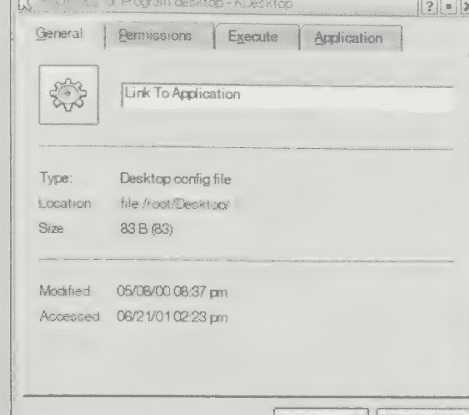

# 桌面菜单

与其`Windows`对应类似，`KDE`桌面拥有右键菜单。与你的`Windows`版本不同，`KDE`桌面菜单非常详尽。`KDE`桌面菜单允许你执行以下操作：

- 新新建：在这里，你可以创建新的目录、`HTML`文件、文件-`CD`、设备、应用程序链接以及位置链接（`URL`）。
- 书签：这允许你在`Konqueror`浏览器中打开（来自各种书签文件）网站。这类似于许多其他操作系统中的“收藏夹”文件夹。
- 撤销：与剪贴板交互。
- 粘贴：与剪贴板交互。
- 桌面帮助：打开`KDE`帮助应用程序。
- 运行命令：打开一个允许你输入命令的小窗口。（顺便说，这非常有用！）
- 配置背景：允许你配置桌面壁纸。
- 配置桌面：允许你配置桌面图标的数量、图标外观、边框等。
- 启用桌面：点击此可以在屏幕顶部启用一个水平菜单。如果你经常隐藏任务栏，这非常方便。
- 消除重叠窗口：点击此项将获取你所有打开的窗口并重新排列，使它们尽可能占据更多空间。这个选项比任何东西都让人困惑——自己排列你的窗口吧！


在桌面上点击右键，选择“链接到应用程序”创建一个新菜单，并填充接下来的文本框。你需要填充的第一项信息是“常规”选项卡（见图D）。在这里，你将提供一个图标名称，它将显示在桌面图标下方。你必须提供此名称。

# KDE 配置文件

```
[KDE Desktop Entry]

Icon=penguin

Type=Link

URL=http://www.techproguild.com
```

我们将如下所示创建上述文件：

- 点击面板上的“终端”按钮（见图E）。

# 图 F

# 图 G

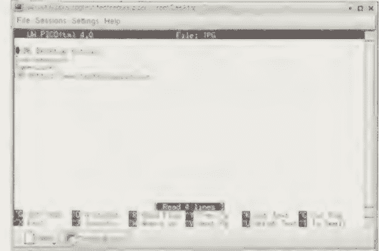

`pico`文本编辑器是最易使用的编辑器之一。

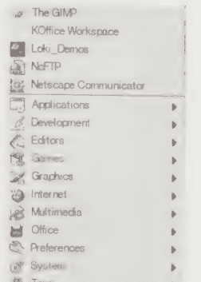

- 层叠窗口：这将以层叠方式堆叠你的打开窗口。
- 对齐图标：名称已经说明了一切。
- 排列图标：与上述类似。
- 锁定屏幕：切换到配置的屏幕保护程序并需要用户密码才能返回。
- 注销：用户注销。

你会发现`Linux`和`KDE`的一个不同是，你有机会使用多个桌面。这实际上让你的桌面空间扩大了四倍。这让你的工作区变得容易得多。如果你点击`Kicker`面板，你会注意到四个象限中有一个小正方形闪烁。这是分页器，它会将你带到你点击的任何桌面。

让用户习惯面板并不是一项简单的任务。典型的反应是，用户会瞬间跳到另一个桌面，然后呆在原地，因为他们看到所有的应用程序消失了！这是一个你（甚至是你自己）无法避免的问题，你可以通过配置来解决它（即：右键点击面板（象限正方形）并选择“设置”。一旦“设置”窗口打开，你可以将滑块移到最左侧仅启用一个桌面（这将启用类似`Windows`的桌面），或移到最右侧启用`16`个桌面。当然，`16`个有点多（而且相当困惑）。

菜单包含菜单和子菜单，就像大多数`PC`用户所习惯的那样。

# Kicker 面板和 K 菜单

`Kicker`类似于`Windows`任务栏，在功能上提供了相同的功能：从`K`菜单（或开始菜单）到可点击图标，再到系统托，这个面板没有缺少任何一项技巧。让我们从左到右观察`Kicker`，从`K`菜单开始。

# K 菜单

`K`菜单（图G）等同于`Windows`开始菜单，但配置性高得多。你会注意到的第一点是`K`菜单与`Windows`标准的差异。`K`菜单的大部分内容都是浅显易懂的，我们将跳到配置问题。

# 多桌面

你首先想做的一件事是从`K`菜单中添加（或删除）条目。假设你知道员工在工作时正在在线聊天（但你并不想从机器上删除应用程序）。作为`root`用户，打开菜单编辑器，导航组，然后点击“聊天”。当你点击此项时，你将看到“聊天”条目的详细信息（见图H）。要删除它，只需点击“删除”按钮并退出应用程序即可。

回到编辑器，你可以通过点击“新建子菜单”来创建新的子菜单。图J显示了创建新子菜单时可以进行的各种配置。在这里，你可以添加“注释”（认为工具提示）并更改图标。

在退出编辑器之前，还有一项你想考虑的配置。热键是让启动应用程序变得简单的方法。在“高级”选项卡中，你将看到一个配置选项（当前键）。假设你想通过按下`Alt+K`来启动`Konqueror`浏览器。要实现这一点，你可以输入`Alt+K`，或者点击“更改”按钮，选择“自定义键”，然后点击空框，输入所需的键，点击确定，最后点击“应用”。非常快速！

一旦你创建了新的子菜单（我们命名为“工作”），你就可以向此菜单中添加条目了。确保子菜单处于选中状态；否则它将属于主菜单本身。


# Kicker 面板

我们进入承载 `K` 菜单的实际面板。`Kicker` 面板非常像 `Windows NT` 任务栏。在这里你会发现 `Windows NT` 应用程序、分页器、锁定屏幕、注销以及许多其他功能。`Kicker` 面板非常直观。就像 `K` 菜单一样，面板是完全自定义的。面板的任何部分是是可以点击的。如果你在面板的任何空白处点击右键，你会看到一个窗口允许你配置面板。


如果你在面板空白处点击右键，可以在位置栏中输入服务器地址，一旦服务器在浏览器中出现，点击“配置配置文件”。命名然后保存。一旦你保存了配置文件，你将在“加载配置文件”子菜单中看到它。


# Konqueror

`Konqueror` 浏览器被许多人认为是 `KDE` 的卖点。`Konqueror` 不仅仅是一个强大的文件浏览器，还是一个功能齐全的 Web 浏览器！正如 `Torvalds` 本人所说：“从旧的 `fwm`（自由窗口管理器）切换到 `KDE2`，是因为我认为 `Konqueror` 是更好的 Web 浏览器。”

`Konqueror` 是一个多用途应用程序。作为一个文件浏览器，它提供了全拖放功能、内联图像查看、单击应用程序以及一系列功能。`Konqueror` 最近的特点之一是可以切换视图模式。可用模式有：

- 文件管理：这是标准的双面板视图。
- 文件预览：这是三面板视图，为用户提供了第三视图区域。在这里，左面板用于目录，中间面板用于列表，右面板查看文件的内容。
- `Midnight Commander`：这是一个有趣的视角，它在标准双面板基础上添加了底部的底部，实际上是一个小型终端，你可以在其中与命令行交互。
- Web 浏览：这是单页视图。

最常用的两种视图模式是文件管理和 Web 浏览。虽然它们看起来很棒，但文件预览和 `Midnight Commander` 视图模式并不容易使用。

选择各种模式很简单：从“窗口”菜单，导航到“加载视图配置文件”并选择四个模式之一（见图 K）。你也可以自定义自己的视图模式。如果你知道用户将使用某些目录，这会非常方便。假设某个部门经常访问特定的 `FTP` 服务器并在其传输文件。你可以轻松在位置栏中输入服务器地址，一旦服务器在浏览器中出现，点击“配置配置文件”（从“窗口”菜单）。命名然后保存。一旦你保存了配置文件，你将在“加载配置文件”子菜单中看到它。

# 图 J

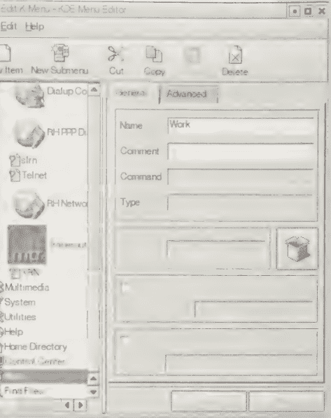

不要忘记更改子菜单的图标。

# Konqueror 实际上比我承认的要大得多。要给予它应有的评价，需要比我允许自己的更多的空间和时间。

## 结论

一旦你理解了这种比喻，帮助用户熟悉 `KDE` 并不是一项真正困难的任务。它的功能性/易用性与 `Windows` 桌面非常相似，而且根据你的需求自定义桌面的外观和功能的能力，使得新用户的迁移变得非常容易。

# 图 K

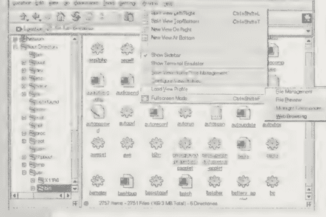

如果你需要更多关于 `KDE` 的帮助，请不要忽视 `KDE` 帮助系统。在默认的 `Kicker` 面板上，只需点击像救生圈一样的图标，你就能快速解决你的大多数问题。

你可以从“加载视图配置”（`Load View Profile`）子菜单中选择四种视图之一。

# 使用 find 命令

作者 `Jim McIntyre`

- 使用 `find` 进行备份。

`Linux` 用户面临的最常见问题之一是在系统中查找文件。由于缺乏类似 C 语言的提示符，用户往往无法找到配置系统所需的文件。尽管 `Linux` 有许多好用的文件管理器，但最强大的工具之一就是 `find` 命令。该命令在所有 `Linux` 发行版中可用，并随默认安装，这个强大且灵活的命令允许用户和管理员根据任何标准搜索文件和目录。在篇文章中，我将涵盖 `find` 命令的许多方面，包括：

任何 `Linux` 命令要介绍的第一点都是命令的语法。通用语法如下：

```
find [-options] actions
```

配合 `find` 命令使用的选项用于指定实际搜索哪些文件特征。

- 按文件名查找文件。
- 按所有者、文件关联的组、修改日期或时长进行查找。
- 按类型查找文件。
- 使用 `find` 检查文件安全。

## 文件名替换

当与 `find` 命令配合使用时，文件名替换为 `find` 命令提供了提供了更大的灵活性，并允许用户对搜索中排除或包含模式有更多控制权。表 A 列出了元字符（用于替换另一个字符或一组字符的单个字符）的使用示例。

现在，让我们看看如何在现实世界的情况中使用 `find` 命令。

72 企业 `Linux` 管理员指南

## 按文件名搜索文件

搜索文件的最常见方法是文件名；`name` 可以单独使用，也可以与其他选项一起使用。以下是根据文件名搜索文件的一些典型示例：

要在当前目录及其子目录中搜索所有扩展名为 `.txt` 的文件，请使用：

```
find -name "*.txt" -print
```

要找到家目录下所有年龄小于四天且以小写字母开头、后跟两个数字且扩展名为 `.gif` 的文件，请使用：

```
find -name "[a-z][0-9][0-9].gif"
```

## 使用 -exec 执行命令

一旦你执行了搜索并找到了文件，管理员将使用 `find` 对这些文件执行另一个操作。`-exec` 选项是对 `find` 输出执行操作的最常用方法。`-exec` 选项接受：

```
find <path> <options> -exec <command-to-run> {} \;
```

要查找由 `root` 所有且对组和其他用户具有读/执行权限的文件，并将这些权限更改为仅 `root` 的读取权限，请使用命令：

```
find /etc -user root -perm 655 -exec chmod 400 {} \;
```

要查找系统中所有属于 `finance` 组的文件并列出这些文件的完整路径，请使用命令：

```
find / -group finance -exec ls -l {}
```

## 根据文件权限查找文件

`find` 命令可以用来通过弱的文件和目录访问权限来暴露潜在的安全漏洞。管理员可以找到 `/etc` 中所有由 `root` 所有且对组和所有人设置了写权限的文件，然后更改权限，使得 `root` 用户具有访问权限而所有其他用户没有访问权限。这将通过使用实现：

| 表 A：文件名替换中使用的元字符 |
|---|
| * | 匹配任何字符，包括空字符串 |
| ? | 匹配任何单个字符 |
| [...] | 匹配括号内的任何字符 |
| [A-Z] | 匹配文件名中包含大写字母的文件 |
| [a-z] | 匹配文件名中包含小写字母的文件 |
| [0-9] | 匹配文件名中包含数字字符的文件 |
| [!] | 排除括号内的任何字符 |

使用如示例所示的带有 `exec` 选项的 `find` 命令：

```
find /etc -user root -perm 644 -exec chmod 480 \;
```

另一种方法是查找最近修改的文件。如果管理员想检查 `/sbin` 目录中任何由 `root` 所有且年龄小于两天的文件，然后删除这些文件，他可以使用命令：

```
find /etc -user root -mtime -2 -exec rm {} \;
```

## ROOTKIT

入侵者的首要目标之一是在你的系统上放置一个 `rootkit`。这意味着管理员用于检查安全的任何命令和文件都将被替换为掩盖放置在你的系统上的文件存在实实的版本。在检查你的安全措施时，请确保你正在使用你信任的命令和文件版本。

## 按文件类型查找或排除文件

要查找 `/etc` 的所有子目录，请使用命令：

```
find /etc -type d
```

要从搜索中排除文件类型，使用逻辑符号 `!`。例如，要查找 `/etc` 中的子目录并排除符号链接，请使用命令：

```
find /etc -type d ! -links
```

入门 73

## 将 find 用于 cpio

`find` 命令可以轻松地与 `cpio` 使用进行备份。例如，如果系统管理员想要备份 `/home`、`/etc` 和 `/html`，他或她可以使用以下命令：

```
cd /
find etc html | cpio -o /dev/rmt
```

这些命令将首先让 `find` 命令查看选定的目录，当找到所有文件时，输出将传递给 `cpio`。`cpio` 实用会将目录备份到 `/dev/rmt`。

## 结论

`find` 命令应该是 `Linux` 学习的首批命令之一。运行 `find` 命令并对 `exec` 的输出执行操作的能力使其成为最优秀的文件管理工具之一。该命令的力量和灵活性可以使管理员的工作变得简单得多。

# 两个更受欢迎的音频配置工具——sndconfig（来自 Red Linux）和 soundDrak（来自 Mandrake）。一旦你理解了如何运行它们，这些工具中的每一个都非常简单使用。

`Linux` 内核模块。这些模块位于 `/lib/modules/2.6.x-x/kernel/drivers/sound`（在我的情况下为 `/lib/modules/2.4.0-09.11/kernel/drivers/`）。如果你查看该目录，你会发现如下驱动程序：

- `soundcore.o`
- `adlib_card.o`
- `es1371.o`
- `maestro3.o`
- `shb.o`
- `galaxy.o`

这些是 `Linux` 内核用于驱动硬件的模块。

## 运行 sndconfig

和大多数配置一样，你需要权限来运行 `sndconfig`。使用控制台窗口，并运行以下命令：

```
/usr/sbin/sndconfig
```

你将看到类似图 A 所示界面。

一旦点击 OK，`sndconfig` 将使用 `pnpdumper` 对支持 PnP 的设备进行初始探测。在该页面中：

- `pnpdumper` 将扫描 `ISA PnP` 卡，并将你的资源数据导出到标准输出。

资源数据应该是声卡工作所需（或已经需要）的资源（`IO` 端口、中断、`DMA` 通道）的描述。它存储在声卡上的小型 ROM 中，可以作为即插用配置过程的一部分被读取。

注意，某些资源与 ROM 内容非常相似，特别是当声卡不准确时。由于它们通常为声卡提供 `OS/Windows` 驱动程序，它们只需要被识别，因为驱动程序可以检测配置。

如果你在 X 系统中运行 `sndconfig`，将收到一条提示显示未设置 `DISPLAY` 的警告。

## 图 A

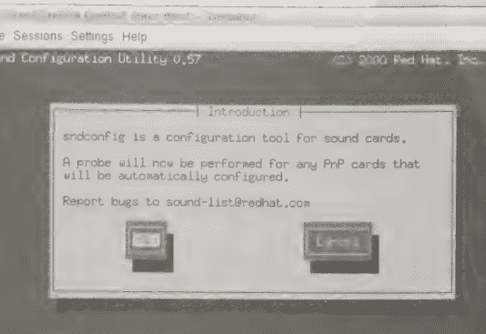

初始的 `sndconfig` 屏幕显示它将探测任何 PnP 设备。

## 图 B

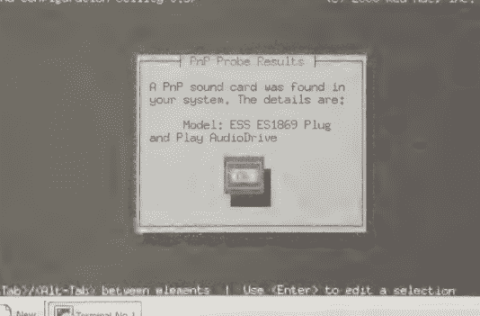

将显示 `sndconfig` 的 PnP 探测结果，你将知道你的 `Linux` 适用于什么类型的声卡。点击 OK 让 `pnpdumper` 执行工作。

在我的机器上，`pnpdumper` 发现了一个 `ES11869 Plug and AudioDrive` 声卡。这是正确的声卡，所以从下一页（如图 B 所示），我点击 OK 并继续。

## 处理失败

你可能有一张 `pnpdumper` 无法检测到的声卡。如果是这样，你必须手动选择和配置你的声卡。别担心，这并不。

当你手动配置声卡时，将得到一个很长的声卡列表供你选择。图 C 高亮了其中一部分。一旦你找到了声卡（或兼容类型），选择 OK，你将看到配置屏幕（图 D）。

从此屏幕开始，你必须选择 `I/O` 端口、`IRQ`、`DMA` 和 `MPU I/O` 设置。根据我的经验（在用 `sndconf` 工具五年后），在配置声卡时，通常需要调整的设置是 `IRQ` 和 `DMA`。如果你不确定声卡允许哪些设置，可以尝试这些设置直到正确为止。当然，你也可以去声卡管理器的网站查看他们的文档。

一旦你运行了声卡的手动配置，你将看到声学测试。如果有效，你就完成了！如果不起作用，请继续尝试 `IRQ` 和 `DMA` 设置。

## 图 C

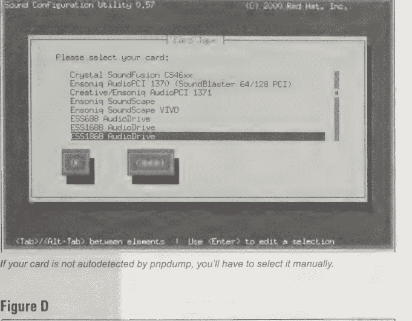

请选择你的声卡：

- `CrystalSoundFusionDS46`
- `EnsoniqAudioPCI170 (SoundBlaster64/128 PCI)`
- `EnsoniqAudioPCI1371`
- `EnsoniqSoundProVIVE`
- `EnsoniqAudioVIVO`
- `ESSAudioDriver`
- `ESS1069 AudioDrive`

## 仍然无效？

我遇到过 `npndump` 宣布我的声卡不支持 `Linux` 的情况。如果是这样，并且这是一个流行的（即：常见的）声卡，你可能想要带有 `--noprobe` 选项运行 `sndconf`。运行：`/usr/sbin/sndconf --noprobe`

如果 `npndump` 未检测到你的声卡，你必须手动选择它。

你将告诉 `sndconf` 你不想适配你的声卡（这会绕过“你的声卡不支持 Linux 只能静音计算音频”的限制）。如果你使用 `--noprobe` 选项运行，你将被引导进行声卡选择（见图 C）。

## 图 D


你的声卡是一个 `PCI` 设备，因此可以在没有任何拨开关的情况下配置其设置。从下面的菜单中选择你想要使用的值。

配置屏幕允许你手动配置声卡所需的设置。

76 Linux企业级 Linux 用户指南

## 使用 ALSA 配置 Linux音频服务

作者：`Jim McIntyre`

高级 Linux 音频架构 (`ALSA`) 旨在取代 Open Sound System (`OSS`)，`OSS` 是目前 Linux音频服务的标准。与标准相比，`ALSA` 架构具有几个优势：`ALSA` 软件包的源码必须从 `www.alsa-project.org` 网站下载。

- `ALSA` 比声卡驱动程序更具模块化。
- `ALSA` 比其他架构更容易安装。
- `ALSA` 可以模拟标准 `OSS`。
- `ALSA` 简化了系统配置声卡的过程。
- `ALSA` 使用非常灵活的接口，使得开发使用音频的应用程序更容易。
- `ALSA` 可以在没有安装声卡的系统中配置为 `dummy`。

你需要安装四个 `ALSA` 软件包：

- `Alsa-driver`：内核模块
- `Alsacconf`：设置工具
- `Alsa-utils`：配置工具
- `Alsa-lib`：接口

## 第二步：识别你的声卡

你需要：

- 运行在 `x86` 计算机上的 2.2 系列或更新版本的 `Linux` 内核
- 熟悉 `Linux shell`
- 编译和安装 `Linux` 内的经验

一旦下载了 `ALSA`，下一步是识别声卡。`ALSA` 网站提供了支持的声卡和芯片组列表。如果你已经知道是哪种声卡，检查 `ALSA` 网站上的声卡矩阵以确认所需的模块。

有了这些知识和经验，你就可以开始了。安装 `ALSA` 是一个七步骤的过程：

如果你使用 `PCI` 声卡，使用以下命令：

```
lspci
```

如果你使用 `ISA` 卡，使用命令：`sndump`

1. 下载 `ALSA`。
2. 确定你的系统声卡类型。
3. 编译支持音频的内核。
4. 安装 `ALSA` 驱动。
5. 构建 `ALSA` 需要的文件。
6. 配置 `ALSA` 使用声卡。
7. 在你的系统上测试 `ALSA`。

此命令是 `utils` 软件包的一部分。如果你使用安装了 `Linux` 和 `Windows` 的双启动系统，运行 `Windows` 并进入 启动 | 控制面板 | 设备管理器来识别你的声卡。一旦识别了声卡，你就可以编译支持的内核。

## 第一步：下载 ALSA

遗憾的是，`ALSA` 软件包尚未以二进制程序的形式提供。

## 第三步：编译支持音频的内核

要在 `Linux` 系统上启用音频支持，需要在内核中编译两个功能：

1. 支持加载模块
2. 支持音频

本文不涵盖编译和安装新 `Linux` 内核的步骤。假设你有编译支持内核所需的经验。

# 注意

在编译内核时，从内核中移除任何声卡驱动。`ALSA` 将稍后加载声卡所需的驱动。

## 第四步：安装 ALSA 驱动

内核编译并安装后，下一步是安装 `alsa-driver`。首先，使用命令解包并解压 `alsa-driver` 软件包：

```
tar -xvf alsa-driver-0.5.18a.bz2
```

使用命令进入包含 `alsa-driver` 软件包的目录：

```
cd alsa-driver-0.5.18a
```

在运行配置脚本之前，确保你所需的配置。`alsa-driver` 软件包支持以下选项：

- `--isapp=yes/no`：选择 `ALSA isap` 工具或标准 `Linux apps` 工具。如果你使用 `ISA` 声卡，请选择 `no`。
- `--sequencer=yes/no`：选择 `yes` 让 `ALSA` 模拟 `OSS` 音频系统。
- `--with-cards`：提供 `ALSA` 将支持的声卡逗号列表。选项 `"ALL"` 将支持所有 `ALSA` 支持的声卡。如果未安装声卡但需要音频支持，可以使用 `"dummy"` 选项。
- `--with-prefix-directory`：`ALSA` 包含了构建其他 `ALSA` 工具的 C 头文件。默认位置是 `/usr/include`。如果需要另一个位置，提供该位置的目录路径（例如 `/usr/local/`）。在我的系统中，如果你使用 `Creative-Blaster ens1371 PCI` 声卡，驱动将加载 `isnap` 软件包，我不需要 `OSS` 模拟。然而，我需要 `MIDI` 支持，并且使用 C 头文件的默认位置。使用这些选项配置 `ALSA`，我使用命令：

```
./configure --isapp=no
--sequencer=yes
--with-oss=no
--with-cards=ens1371
```

下一步是使用以下命令构建并安装模块：

```
make
make install
```


ALSA 驱动和头文件已安装，并生成了系统启动和关闭时加载/卸载 ALSA 的脚本。

## 第五步：构建 ALSA 设备文件

下一步是创建 ALSA 设备文件。驱动包使用设备脚本创建这些文件。与音频接口的程序高度依赖 `/proc` 文件系统。设备脚本在以下创建动态文件：

```
/proc/asound/
```

`soundsdevices` 将 `/proc/asound/` 链接到 `/dev/asound` 并在 `/dev` 中创建项以提供 OSS 模拟。运行 `sounddevices` 请从 `alsa-driver` 目录运行以下命令：

```
./sounddevices
```

如果你运行 2.2 内核，用于提供已安装 OSS 驱动信息的 `/dev/snd` 文件将无法正常工作。该问题的解决方法是

使用以下命令删除 `/dev/sndstat` 文件并为 `/proc/asound/sndstat` 创建新链接：

```
rm /dev/sndstat
ln /proc/asound/sndstat /dev/sndstat
```

遗憾的是，这种方法要求每次启动系统时都要加载声卡的内核模块。另一种确保系统启动时正确加载内核模块的方法是确保在 `/etc/modules.conf` 文件中将该模块与声卡关联。该文件在系统启动时被读取，并告诉 `modprobe` 哪些模块与系统的哪些设备关联。`alsconf` 工具用于自动化在 `/etc/modules.conf` 文件中创建正确的条目。第一步是使用命令下载并解压 `alsconf` 包：

### 注意

在 Linux 发行版中，`audio` 组将拥有此过程创建的设备。只有该组的成员才能读写音频硬件（声卡）。需要配置声卡权限的用户需要是该组的成员。

此时，ALSA 驱动程序已安装，但尚未配置。`alsconf` 配置非常简单，但 `alsconf` 需要先有 ALSA 库和 ALSA 工具。

```bash
tar -xvf alsconf-0.4.3.tar.gz
```

接下来，运行命令

```
cd alsconf-0.4.3b
```

然后运行命令

```

ALSA 库和 ALSA 工具的配置过程通常不会出现问题。要配置 ALSA 库，运行命令：
```bash
tar -xvf alsa-lib-0.5.10.tar.bz2
cd alsa-lib-0.5.10
./configure
make
make install
```

当 `alsconf` 运行时，按照以下步骤操作：
1. 为你的系统选择正确的声卡类型。
2. 为你的卡选择一个标识符或选择默认的 `CARD_0`。
3. 做出选择后，选择“no cards”（无卡）。
4. `alsconf` 脚本现在将为你的系统生成相应的 `/etc/conf.modules` 文件并尝试启动。

对 `alsa-utils` 包重复此过程。一旦安装了这些包，你就可以开始配置 ALSA 了。

## 第六步：配置 ALSA

`alsconf`

`alsconf` 工具让设置 ALSA 的过程简单了很多。该工具实际上是一个脚本，允许用户选择声卡，然后生成必要的配置文件。

记住，ALSA 还需要加载内核模块来支持特定的声卡。加载内核模块有两种常用方法。第一种是使用 `modprobe` 在每次需要声卡支持时加载适当的模块。在我的系统中，我将使用以下命令来加载声卡的内核模块：

```bash
modprobe snd-card-ens1371
```

## 第七步：在你的系统上测试 ALSA

假设 ALSA 成功启动，将创建 `/proc/asound` 目录。要确认该目录是否存在，运行命令：

```bash
ls /proc/asound/devices
```

如果目录已创建，上一个命令的输出将类似于表 A 中的文本。

| 表 A：`/proc/asound/devices` 的输出 |
|---|---|---|
| `0:` | `[0]:` | Control (控制) |
| `6:` | `[0]:` | Mixer (混音器) |
| `16:` | `[0]:` | Digital audio playback (数字音频播放) |
| `24:` | `[0]:` | Digital audio capture (数字音频采集) |
| `33:` | | timer (定时器) |

此命令的准确输出取决于你使用的声卡及其功能。

当 ALSA 首次运行时，所有音频通道都被设置为混音。这意味着在听到任何声音之前，你必须调整音量级。大多数声卡都自带播放和录制包，在 Linux 系统上，所有这些工具都由 ALSA 控制。此外，可以使用基于控制台的 `alsmix` 工具或 `gtk-amixer` 来控制系统的音量和录制设置。

如果你没有听到任何声音，不要惊慌。在 Linux 上排排除音频故障并不总是容易，但并非不可能。首先，检查扬声器。确保它们已通电并正确连接到声卡。如果无效，请阅读 ALSA FAQ 获取可能的解决方案。然后重新检查系统中的一切。

## 结论

如果你运行 MIX（GNOME 混音器），只需取消勾选静音设置并将你要使用的通道调整音量级。一旦设置好设置，使用命令保存配置：`alsactl store`

ALSA 是一个正在进行的项目，旨在取代 OSS 作为 Linux 音频标准。在本文中，我们涵盖了在 Linux 系统上安装 ALSA 的逐步过程。我们涵盖了安装 ALSA 所需的包、安装这些每个包的程序，以及如何使用 `alsconf` 和 `aplay` 工具根据你的系统来配置和测试 ALSA。

`aplay` 工具是一个基于控制台的工具，允许你播放多种格式的音频。如果你安装了 Gnome，尝试命令：

```bash
aplay /usr/share/sounds/startup1.wav
```

原本可以通过快捷键轻松解决的问题。

如上面的示例所示，创建无障碍软件并不需要耗费所有精力，但确实需要周全的考虑以及对残障用户所面临挑战的了解。以下指南规定了无障碍软件设计的基本原则：

- 允许用户根据需要自定义屏幕显示大小、前景颜色、背景颜色以及选择颜色。确保所有通过颜色传递的信息在没有颜色的情况下也同样可用。
- 实现高对比度选项，而无需用户更改文档或运行专门设计的软件。
- 为所有功能提供文档完备的键盘访问，并对键盘控制进行彻底测试，以确保视力有限的用户在尝试仅使用键盘导航应用程序时，不会被困住或遇到意料之外的后果。需要一种在桌面环境和应用层面统一应用和利用的键盘标准；一致性是软件无障碍的一个重要元素。
- 以一种对视力有限的人来说不至于细微的方式，提供焦点位置的通知。
- 提供视觉信息作为听觉信息；不要仅通过声音传递信息。

总之，无障碍程序在设计时考虑了视力、听力及灵活性受限人士的需求。可能最重要的是，它经过了广泛的设计和测试，以便仅使用鼠标或键盘即可成功导航。值得注意的是，这种设计要求为没有视力或灵活性受损的用户也创造了价值；许多人讨厌鼠标，更倾向于通过键盘导航他们的应用程序。

单凭无障碍软件无法完全解决视力或灵活性受限更严重人士的需求。这些残疾需要辅助技术，例如文本转语音读器，而这些技术并不是计算机操作系统或软件环境的一部分。然而，辅助技术与考虑到无障碍而设计的软件配合使用效果最好。如果程序引导盲用户进入一个对话框，而该对话框唯一的逃离方法是寻求视力正常的帮助来定位并点击正确的图标，那么文本转语音读器对盲用户将毫无帮助。

# Linux 环境中的无障碍

在所有其他桌面计算中，微软在无障碍部门处于领先地位。得益于 Greg Lowry 以及其他在内部倡导无障碍事业的员工的努力，微软已经为软件设计实施了一套符合所有上述无障碍标准的软件设计准则。此外，微软的 Windows 程序要求独立软件供应商满足其无障碍标准。对于希望为员工做正确的事——并减少过程中诉讼风险的雇主来说，Gmail 的例子清楚地表明，目前的 Windows 桌面环境落后于微软的无障碍标准。

但这并不意味着 Linux 在无障碍竞赛中已经出局。通过一些意识的提高，我们可以让 GNOME 和 KDE 达到 Windows 中发现的最低无障碍标准——这很容易。但这里有一个更深层次的观点，这也是为什么 Linux 在无障碍方面是一个优的计算环境：微软改进了 Windows 和 Windows 程序的无障碍功能，但到目前为止，对残障人士最好的计算环境是将完全开发的纯文本环境与高度可定制的图形界面相结合。（你指的是 Linux 吗？）

必须记住，图形用户界面的兴起（特别是微软 Windows 的兴起）对于那些已经学会充分利用一系列 MS-DOS 技术的残障人士来说，不小是一场灾难。微软通过为 Windows 和 Windows 应用开发无障碍准则在某种程度上扭转了局面，但公司是以将 DOS 抛弃一边为代价做到的。正是因为 Linux 结合了健康的环境与同样繁荣（且高度可定制）的环境，使其在无障碍部门具有明显的优越性——至少具有这种优越性。

# 介绍 Emacspeak

要理解 Linux 纯文本界面的无障碍优势，可以看看 Emacspeak，这是一种语音接口，使视障计算机用户能够独立、高效地与计算机工作。Emacspeak 使用 IBM ViaVoice 语音引擎和软件开发包进行发。向 IBM 提供此类软件致敬。得益于 ViaVoice，Emacspeak 用户可以使用普通的圆卡合成语音。在此之前，他们唯一的选择是 DECTalk，这是一种基于硬件的语音合成器，售价为 1,195 美元。

Linux 环境相比商业操作系统具有重要优势：开源许可的普及。目前，GNOME 和 KDE 项目在制定无障碍准则方面做得还不够好。但没有什么能阻止志愿者小组、一个组织或一群研究人员使一个或两个环境符合无障碍标准并开始他们的发布版本。这正是 ZipSpeak 的背后的哲学，ZipSpeak 是一种基于 Skaiz 的发行版，它整合了内核对语音的支持。（如需获取 ZipSpeak 副本，请联系 `http://www.zipspeak.org/zipspeak.html` 的 Computer Brille Facility）

我们不要忘记成本。有多达 5 亿人患有被缺乏的设计经常忽视的残疾，但许多人生活在贫困国家，购买商业软件是无法可能的。此外，富裕国家的许多残障人士由于面临就业困难，被迫生活在有限的收入中。成本问题是 Linux 发光热的地方。正如你将在下一节中看到的，Linux 有一个快速增长的无障碍和辅助软件库，几乎所有的软件都遵循 GNU 通用公共许可证（GPL）条款，这意味着对于 Linux 来说，可以免费获得。

Emacspeak 完美体现了利用 Linux 完全开发的纯文本环境所实现的杠杆。Linux 黑客深知这一点，而且 Emacs 远不止是一个文本编辑器；多年来，它获得了许多运行良好的创作。Emacspeak 提供了理解其传达含义所需的上下文。要听一个“现场”Emacs 会话的趣味音频 演示，请访问 `vivpace.org/audio/emacs`。

入门指南 83

## 展望

为了成为残障人士理想的低成本计算平台，Linux 需要高质量、免费分发的语音识别和合成软件。得益于两项正在进行的努力，这些似乎已经在路上了。

有一个正在开发 X 屏幕程序的项目，可以与为 Windows 开发的屏幕器相比。该软件由 Georgia Tech 图形、可视化和可用性中心的 Mercator 项目开发。Linux 移植版正在进行中；访问 Brian Sldon 的页面获取更多信息。

# 更多信息

有望填补语音合成空白的是 Sphinx，这是一个托管在卡内基大学计算机科学系的项目。Sphinx 是一个实验性的语音识别系统，适用于任何包含 Linux 的 POSIX 兼容系统。有关 Sphinx 的更多信息，请访问卡内基大学的 Sphinx 小组 `www.speech.cmu.edu/sphinx`。

- BLINUX (`http://leb.net/blux`) 该网站致力于提高 Linux 对盲人的可用性。有三个邮件列表（`blux-announce`, `blinux-dev`, `blux-list`）。

在语音合成方面，Festival 让 Linux 用户可以使用普通的声卡生成语音，这意味着它为 Linux 带来了 IBM ViaVoice 的优势，而没有受到限制性许可。Festival 以类 X11 许可证发行，目前已经非常好用；要尝试它，请访问大学语音技术研究中心。

## 服务器与服务

为了充分利用 Linux 提供的所有功能，你需要了解它的服务器功能。本章的文章旨在向你展示如何利用 Linux 来满足你组织的各种服务器需求。

# Apache

- 在 Linux 上安装 Apache Web 服务器 ...................................................................................85
- 在 Linux 上配置 Apache Web 服务器 ...............................................................................88
- 安装 Apache 和 PHP ............................................................................................................91

# FTP 服务器

- 使用 ProFTPD 建立安全的 FTP 服务器 ............................................................................96

# DNS

- 在 Linux 下建立 DNS 服务器，第 1 部分：配置 ................................................................101
- 在 Linux 下建立 DNS 服务器，第 2 部分：维护 ...................................................................106

# 代理服务器

- Squid 代理缓存服务器 ............................................................................................................110

# 在 Linux 上安装 Apache Web 服务器

作者：Thomas Nooning, CCNA, CCDA

随着各组织将其 Web 与后端系统集成，越来越多的各种规模的组织正在托管或机机托管自己的网站。由于 Apache 以可靠性和成本效益闻称，大量的实体选择 Apache Web 服务器作为运行网站的平台。此外，在全球范围内超过百万个 Apache Web 服务器中，Apache 拥有超过 60% 的市场份额，这也不无遗憾。而且，许多人选择在 Linux 上安装 Apache，我们将在本文中讨论这一点。关于在 Linux 上获取和安装 Apache 的选项，你可以从 `www.debian.org/dist/packages` 下载 `.DEB` 文件。首先，我们将从源码的角度来查看 Apache，然后我们将解释如何安装包管理器。

## 从源码安装

一旦下载了文件，下一步将是以 root 身份登录或使用 `sudo` 命令。大多数软件包都需要权限才能将 Apache 文件安装到你的系统中，并对 Linux 环境进行必要的更改。完成这些操作后，你需要从归包中提取 Apache。进入你下载文件的目录并执行以下命令：`tar xvf apache_1.3.20.tar.gz` [使用你下载的文件名]

## 获取 Apache

Apache 像 Linux 一样，是一个开源开发项目，因此该软件是免费的。大多数发行版都包含一个版本的 Apache。然而，为了安全和稳定，从最新版本的 Apache 开始是比较好的。你可以从 `http://apache.org/dist/httpd` 或从 Apache 网站链接的许多其他镜像站点下载源码和二进制文件（本文链接处的 1.3.20）。

Apache 网站提供了各种处理器和几种不同格式的 Apache 版本。本文将关注流行的 `tar.gz` 归档格式。一旦下载了适当的文件，你就可以准备安装 Apache 了。

如果你使用的是使用 RPM 的 Linux 发行版（如 Red Hat、Mandrake 或 SUSE）或带有包管理器的 Debian 兼容发行版，你比以往任何时候都可能下载这些格式之一的 Apache 包。对于合适的 RPM，我推荐使用 `www.rpmfind.net`。它拥有优秀的软件软件包数据库和强大的搜索功能。对于 Debian 用户，`apt-get install apache` 通常可以找到良好的 Apache 软件包。或者，这会将 Apache 安装到默认选项 `/usr/local/apache`，并带有所有标准选项。可以通过 `-prefix=/var/apache/` 更改安装目录。现在可以使用命令 `apache start` 启动 Apache。如果你单独执行 apache，它将为你列出其他选项，包括 stop（停止）、restart（重启）和 config（配置）。请注意，在此以及所有类型的安装过程中，你应该通过查看当前列表来验证服务器已启动。`ps apache` 命令将显示

```
/config
make
make install
```


当前正在运行的所有进程，其中应该包含`apache`或`httpd`。如果你没有看到其中一个，请检查`Apache error.log`，因为它可能会提供关于导致失败的某些见解。

## 添加模块

安装是配置某些`Apache`模块的好机会，这些模块对于构建稳健且安全的网站很有帮助。你也可以随时安装额外的模块，因为`Apache`支持动态加载模块。我们将查看的一些流行选项是`Perl`、`PHP`和`SSL`。

## 从 RPM 安装

`RPM`由`Red Hat`创建，是一个优秀的软件包系统。这种格式的包要么是预编译的二进制文件要么是源码，并将安装系统上的所有内容。它还会维护已安装软件包的数据库，并通知你依赖和冲突。虽然这无法提供太大的特殊性，但从原始编译使得任务变得极其简单。要从`RPM`安装，请执行以下命令：

```bash
rpm -ivh apache-1.3.20.rpm [使用下载的文件名]
```

这将正确安装包并显示进度条。你还应该自动启动服务器，但请检查列表以确保万无一失。更多信息和选项请访问`http://rpm.com`，你将在那里找到最新版本的`RPM`。

## 在 Debian 下安装

`Debian`是一个`Linux`发行版，包含其名为`Apt`的软件包系统。该系统提供了软件包的在线安装。与`RPM`一样，它将维护已安装软件包的数据库并自动下载依赖。另一种选项是用传统的方法（`Debian`方法）使用`dpkg`安装包，如下例：

```bash
dpkg -i apache-1.3.9.deb [使用下载的文件名]
```

`Perl`与`Apache`的集成由`mod_perl`软件包提供。这允许创建`mod_perl`。对于`Debian`用户，`apt-get install apache`通常可以找到良好的`Apache`软件包。或者，这会将`Apache`安装到默认选项`/usr/local/apache`，并带有所有标准选项。安装目录可以通过`-prefix=/var/apache/`更改。现在可以使用命令`apache start`启动`Apache`。如果你单独执行`apache`，它将为你列出其他选项，包括`stop`（停止）、`restart`（重启）和`config`（配置）。请注意，在此以及所有类型的安装过程中，你应该通过查看当前列表来验证服务器已启动。`ps apache`命令将显示

# 在 Linux 上配置 Apache Web 服务器

作者：Thomas Nooning, CCNA, CCDA

我的文章《在 Linux 上安装 Web 服务器》已经告诉了你去哪里下载`Apache`，并解释了如何在你的`Linux`上安装它。接下来我将介绍配置`Apache` Web 服务器的基础知识。我还将向你展示如何让`Apache`在系统启动时自动运行。

## 位置、位置、位置

现在我们已经了解了为什么配置文件会以目前的形式存在，让我们来看看它们位于何处。尽管`Apache`的根目录会根据安装选项而异，但这些文件通常位于`/conf`子目录下。例如，如果你按照所有默认设置安装了`Apache`，配置文件将位于`/etc/local/apache/`。

## 使用配置文件

与许多基于`Linux`的程序一样，`Apache`的配置是通过在纯文本文件中放置指令（directives）完成的。在这种情况下，文件被称为`httpd.conf`、`sd.conf`和`access.conf`。它们的位置和重要性可能因具体的安装情况而异，但格式保持不变。通过这些文件，你可以选择在何处提供 Web 文档、启动时动态加载哪些模块，以及`Apache`将监听哪个端口。

这意味着你每次都必须使用这些文件。`-command`命令行允许你在运行时从用户定义的文件加载配置。此外，来自`Red Hat`和`Debian`等发行版的预配置包可能会安装到不同的目录。在当前版本的`Debian`中，配置文件将位于`/etc/`。如果你正在使用`Red Hat`，你可能需要检查`/etc/httpd/conf`。

首先，让我们看看这三个独立配置文件文件背后的原理。这在社区中几乎带有一种类似于“三位一体”的神秘色彩。它们基本上是`NCSA 1.3` Web 服务器的遗留，并可以用不同的方式处理。

如果你运行了多个版本的`Linux`，你就知道目录结构和文件位置可能会有所不同。如果有疑问，在更新了文件数据库后，运行`locate httpd`或`locate apache`有助于确定确切位置。

一种方案是使用`httpd.conf`作为全局配置，使用`sd.conf`控制名称，使用`access.conf`设置服务器的访问控制。另一种方法是仅使用`httpd.conf`，它将支持任何可以放在另外两个文件中的指令。通过在`httpd.conf`中放置`Options AccessConf/dev/null`和`ResourceConfig/dev/null`，你可以告诉`Apache`只向该文件查找配置。

## 配置服务器

指令每行一个输入到配置文件中，并且区分大小写。命令末尾的反斜杠可以将条目扩展到多行。如果你不确定指令是否正确，`Apache`会对你的语法提供一些基础的错误检查。如果`Apache`发现某个命令存在问题，它会给你提供行号。记住，你仍然必须运行`apache start`来初始化服务器。让我们来看来自`httpd.conf`的一些标准`Apache`指令（你可以使用任的文本编辑器，如`vi`或`nano`打开它）：

另一种方法是分别使用`httpd.conf`、`sd.conf`和`access.conf`目录。服务器将自动解析位于上述配置文件中的任何文件和子目录。这将允许你以非常具体的程度将项目拆分为虚拟主机（VirtualHosts）。

```
# ServerType 既可以是 inet

## 或 standalone。

ServerType standalone

# # Port: standalone 监听的
# 端口。对于小于 1023 的端口，
# 我们最初需要让 httpd 以 root 身份运行。

Port 80

# # Document Root: 你将从中
# 提供文档的目录。
# 默认情况下，所有请求都从
## 此目录获取，符号
# 链接和别名可能被用于
## 指向其他位置。

DocumentRoot /var/www/

# # 动态共享对象 (DSO) 支持
# 为了能够使用作为 DSO 构建
# 的模块的功能，你必须在此
# 位置放置相应的
# 'LoadModule' 行。

LoadModule php4_module /usr/lib/apache/1.3/libphp4.so

# # AddType 允许你在不实际编辑
# 情况下调整 mime.types，
# 或将某些文件设置为
# 特定类型。

AddType application/x-httpd-php .php
.php3 .php
```

注意，指令之前都有注释，有助于解释语法和功能。几乎每一个配置选项都是定义某些文件本身——这是一项新功能就像我一样，只有当你无法通过其他方式解决问题时才会去阅读文档。一个值得注意的是`Load-Module`命令。在安装与`Apache`相关的程序时，你可能需要编辑配置以在启动时加载模块。如果你在`Apache`之后安装了`PHP`，你将需要上面的命令并配合`AddType`指令以确保`Apache`会处理`PHP`文件。

上面的示例是非常标准的，可能不需要编辑。然而，某些指令会随服务器的不同而改变。这些的一些示例包括：

- `ServerName`
- `ServerAdmin`
- `Bind/Address`

`ServerName`指令设置服务器的主机名，通常是一个完全限定域名。这避免了服务器尝试通过`IP`地址查找主机名，这可能不会返回你想要的结果。使用此内容的示例为：
`ServerName www.techpublic.com`

`ServerAdmin`选项仅仅是服务器的电子邮件地址。如果向多个 Web 服务器发送邮件（则使用）。

`Bind/Address`告诉`Apache`监听机器上所有的`IP`地址。如果你不想监听所有地址，这可能很重要。

# 启动 Apache

`Apache`可以手动启动，也可以在启动时自动启动。对于手动操作，你使用`apachectl`。如之前提到的，可以向此命令传递多个参数。在对配置进行更改后重启，你使用`graceful`。

要在系统启动时加载服务器，可以可以在`init.d`或`rc`中放置脚本以从`rc`调用`apachectl`。例如，列表`A`显示了你在`/etc/init/`中的脚本，或者如果上述建议在你的`Linux`系统上不起作用。

## 结论

`Apache`服务器与任何功能齐全的程序一样，有多种配置选项。主配置文件存储在纯文本文件中，可以通过你选择的文本编辑器轻松访问。除了配置文件中的注释外，`Apache`在`http://httpd.apache.org/docs`提供了关于指令和配置选项的优秀文档。

- 列表`A`：`Apache`启动脚本

```bash
## /bin/bash

#

# apache Start the apache HTTP server

#

NAME=apache

PATH=/usr/bin:/sbin:/usr/sbin/sbin

DAEMON=/usr/sbin/apache

suecex=/usr/lib/apache/sexec

PIDFILE=/var/run/$NAME.pid

CONF=/etc/apache/httpd.conf

APACHECTL=/usr/sbin/apachectl

trap "" 1

export LANG=C

test -f $DAEMON || exit 0

test -f $APACHECTL || exit 0

if egrep -i "[[:space:]]*ServerType[:space:]]+inet $CONF

then

  exit 0

fi

case "$1" in

  start)

    echo -ne "Starting web server: $NAME.\n"

    APACHECTL start

    ::

  stop)

    echo -ne "Stopping web server: $NAME.\n"

    APACHECTL stop

    ::

exit 0
```

# 安装 Apache 和 PHP

作者：Vincent Danen

在本文中，我们将介绍`Linux`下最流行的软件包之一：`Apache`服务器。`Apache`是一个开源的 Web 服务器，几乎存在于每一种`Linux`发行版中，它可能是今天互联网上最流行的 Web 服务器之一。它具有极佳的可移植性，因为它可以在`Linux`、`BSD`、`Unix`、`Windows`、`OS/2`甚至`BeOS`上运行。

由于大多数`Linux`发行版都带有一个`Apache`，因此你只需要很快就能学会从头开始构建。大多数情况下，你会使用`RPM`或`DEB`包来升级系统，但某些情况可能需要系统管理员从头构建并安装`Apache`。这在旧版系统中很常见，因为新版本的服务器可能存在依赖问题。通过`RPM`和`DEB`包安装`Apache`看起来非常简单，但我们建议查看一下那种安装方法，而我们将直接处理源码。

## 编译 Apache

`Apache`的配置是通过`configure`脚本完成的。这并不是你在实际配置文件中看到的配置。在在这里，你配置的是`Apache`的一些默认值，例如文件的安装位置、对额外功能和模块的支持等。

假设你已经安装了`Apache`，只是想在将整个系统迁移之前，测试运行新版本的`Apache`。这有助于确保在切换之前在使用新`Apache`时没有遇到困难，并且如果遇到问题可以最大限度地减少停机时间。

为了实现这一点，我们将把`Apache`安装在`/usr/local`而不是`/usr`目录树。这意味着 Web 服务器将安装到`/usr/local/apache`而不是`/usr/bin`。这样做，我们将如下配置：

```bash
./configure --prefix=/usr/local/apache
```

但我们并不是为了安装`Apache`（因为因为它提供了我们可能需要的某些）。相反，我们将运行列表`A`中的配置。

这比上一个例子多做了几件事，这些可能对你的网站至关重要。告诉`configure`我们希望最终安装位置在`/usr/local/apache`，并告诉它启用所有模块。默认情况下，`Apache`会启用模块，但不是所有模块，有些非常有用的模块，比如`mod_rewrite`。我们要启用的下一步是对最大数量模块的动态共享对象 (DSO) 支持，在我们的情况下是所有模块。启用 DSO 支持很重要，因为它允许你通过简单的重新配置并重启`Apache`来加载和卸载模块，而如果你想移除对特定模块的支持或添加对另一个模块的支持，则无需重新编译。

## 获取 Apache 源码

你首先需要获取源代码。你可以选择`Apache`的最新版本，也可以选择最近的开发版本（截至本文为`2.016 (beta)`版）。从`http://apache.org/dist/file/apache_1.3.20.tar.gz`下载最新版本。将此文件保存到`/usr/local/src`目录。

下一步是解压存档。通过`root`身份完成：

```bash
cd /usr/local/src
tar xzvf apache_1.3.20.tar.gz
```

你现在会在`/usr/local/src`树下有一个`apache_1.3.20/`子目录。现在进入该目录。是时候运行`configure`脚本了，它将设置我们的`Apache`选项。

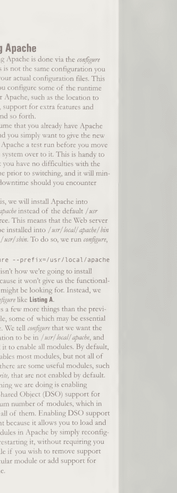

服务器与服务 91

## 列表 A：使用 configure 安装 Apache

```bash
./configure --prefix=/usr/local/apache \
    --enable-module=all --enable-shared=max \
    --disable-module=auth_db --disable-module=auth_digest \
    --with-perl=/usr/bin/perl --enable-suxec --suxec-caller=nobody \
    --suxec-safepath=/bin:/usr/bin:/local/bin
```

我们接做的工作是启用两个模块：`auth_db`和`auth_digest`。`auth_db`模块用于`HTTP`基础认证，用户名和密码存储在`DBMS`数据库中而不是明文密码文件中。`.htpasswd`文件要简单一些，这就是为什么我选择禁用这个模块。`auth_digest`模块是`mod_digest`模块的更新版本，允许使用`MD5`摘要进行用户验证。该模块被团队标记为实验性模块，所以如果你想使用`MD5`认证，可以使用`mod_digest`模块；然而，`auth_digest`在当前服务器上可能运行良好。如果你坚持要用`MD5`认证，请先尝试`mod_digest`，如果无效，再构建`auth_db`并使用它。请注意，你可以二选一，不能兼用。

执行`make install`然后坐下，喝杯咖啡，让编译器工作。这可能需要一些时间，取决于你机器的速度。不过，你可能会在构建过程中遇到一些困难。我在尝试编译`mod_rewrite`模块时遇到了一个问题，它在构建中找不到`gdbm.h`文件。由于`Apache`只在`src/include`中查找，而不在系统包含或子目录中查找，我创建了一个指向`/usr/include/gdbm/gdbm.h`的软链接（你必须安装`gdbm`开发库；所有使用`RPM`或`DEB`的发行版都是如此）。

```bash
ln -s /usr/include/gdbm/gdbm.h /usr/local/src/apache_1.3.20/src/include/gdbm.h
```

最常用的。例如，如果你希望`PHP`与你的`MySQL`数据库交互，你就需要启用`MySQL`支持。

`8080`。这将告诉`Apache`绑定到`8080`端口，这适用于测试。

最后，你需要编译`PHP`。实现方法与编译`Apache`相同，只需运行两个魔术命令：

```bash
make
make install
```

你还需要取消`PHP`支持的注释。在同一个文件中，转到第 843 行并取消以下两行的注释：

```
AddType application/x-httpd-php .php
AddType application/x-httpd-php-source .php
```

大功告成！你现在安装了`Apache`服务器及其`PHP`支持。

# 测试 Apache 和 PHP

保存你的更改。现在我们想要启动`Apache`，为了这样做，我们将使用以下命令：

```bash
/usr/local/apache/bin/apache start
```


## 测试服务器

下一步是测试服务器。你新 Apache 服务器的配置位于 `/usr/local/apache/conf` 目录。切换到该目录并编辑找到的 `httpd.conf` 文件。在文件中找到包含 `Port` 关键字的行，对于使用 Apache 1.3.20 的用户来说，那应该是第 314 行。将默认值改为 `8080`。

如果一切顺利，你将看到类似下面的内容：

```
apachectl: http started
```

接下来，我们将查看进程列表以检查 `httpd` 是否正在监听：

```
ps aux httpd | grep http
```

你将得到类似列表 D 的输出。

### 列表 D: `ps aux | grep http` 输出

| 2205 | S | 0:00 | `httpd-perl -f /etc/httpd/conf/httpd-perl.conf -DPERLP` |
| 2212 | S | 0:00 | `httpd-perl -f /etc/httpd/conf/httpd-perl.conf -DPERLP` |
| 2213 | S | 0:00 | `httpd-perl -f /etc/httpd/conf/httpd-perl.conf -DPERLP` |
| 2214 | S | 0:00 | `httpd-perl -f /etc/httpd/conf/httpd-perl.conf -DPERLP` |
| 2215 | S | 0:00 | `httpd-perl -f /etc/httpd/conf/httpd-perl.conf -DPERLP` |
| 2268 | S | 0:00 | `httpd -DERLPROXED -DAVE_PHP4 -DAVE_SSL -DAVE_PRO` |
| 2276 | S | 0:00 | `httpd -DERLPROXED -DAVE_PHP4 -DAVE_SSL -DAVE_PRO` |
| 2277 | S | 0:00 | `httpd -DERLPROXED -DAVE_PHP4 -DAVE_SSL -DAVE_PRO` |
| 2278 | S | 0:00 | `httpd -DERLPROXED -DAVE_PHP4 -DAVE_SSL -DAVE_PRO` |
| 2279 | S | 0:00 | `httpd -DERLPROXED -DAVE_PHP4 -DAVE_SSL -DAVE_PRO` |
| 13812 | S | 0:00 | `httpd -DERLPROXED -DAVE_PHP4 -DAVE_SSL -DAVE_PRO` |
| 8068 | S | 0:00 | `/usr/local/apache/bin/httpd` |
| 8069 | S | 0:00 | `/usr/local/apache/bin/httpd` |
| 8070 | S | 0:00 | `/usr/local/apache/bin/httpd` |
| 8071 | S | 0:00 | `/usr/local/apache/bin/httpd` |
| 8072 | S | 0:00 | `/usr/local/apache/bin/httpd` |
| 8073 | S | 0:00 | `/usr/local/apache/bin/httpd` |
| 8084 | pts/2 | S | 0:00 | `grep httpd` |

是的，它在这里。你可以看到，我们旧的 Apache 也在运行，但你可以看出输出中从 `PID` 为 `8068` 开始的进程属于我们新的 Apache 服务器。

下一步是将你的 Web 浏览器指向 `localhost:8080` 或 `www.yourdomain.com:8080`，取决于你是否与新服务器相关联。如果你看到了 Apache 页面，恭喜你！Apache 在你的系统上成功运行了！由于我们有点多疑，想额外确认一下，我们将执行：

```
telnet localhost 8080
```

你将看到：

```
Trying 127.0.0.1.

Connected to localhost.local.

Escape character is '^'
```

此时，输入以下内容并按 [Enter] 键：

```
HEAD /HTTP/1.0
```

你应该会看到与下面非常相似的内容：

```
Date: Fri, 22 Jun 2001 01:26:57 GMT

Server: Apache/1.3.20 (Unix)

PHP/4.0.6
```

其余部分我们可以忽略。如果你不对运行在 `80` 端口的 Web 服务器进行此测试，你可能会看到旧版本的 Apache 以及可能的旧版本的 PHP。嗯，这里。正如你所看到的，它报告运行着 Apache 1.3.20 和 PHP 4.0.6，这些都是我们刚刚安装的。

还有一个最后的测试，以确保 PHP 正常工作。进入你的 `/usr/local/apache/httpd` 目录，使用你喜欢的编辑器创建一个名为 `test.php` 的新文件，内容如下：

```php
<?php phpinfo(); ?>
```

现在将你的浏览器指向 `localhost:8080/test.php` 或你新 Apache 安装的类似 URL。你是否看到了一个关于 PHP 的信息页面，例如系统信息、正确的 PHP 版本以及配置指令的详情？如果是，PHP 工作正常。恭喜你！

## 结论

我们今天完成的工作只是让大家回归本质。我们都被喜喜软件的 RPM 和 DEB 软件包宠坏了；

```bash
--modules=mod_linuxprivs
```

指定 `ProFTPD` 是作为独立服务还是 `inetd` 服务运行。在我们的示例中，`ProFTPD` 作为一个独立服务器运行。如果你想从 `inetd` 运行 `ProFTPD`，请将其更改为 `inetd`，并将以下内容放入你的 `/etc/inetd.conf` 文件中：

```bash
mod_ratio:mod_readme
```

```
ftp stream tcp now rout

/usr/sbin/tcpd -inetproftpd
```

```bash
make

make install
```

第一条命令将设置 `make` 环境。你将告诉它使用 `/` 目录作为安装的顶层目录，它会将二进制文件存放在 `/usr/bin`，将手册存放在 `/usr/man` 等。你还告诉它处理 `/etc` 目录下的 `proftpd` 文件，并在 `/var/run/proftpd.daily` 提供位置状态文件（`PID`，或进程标识）。最后，你告诉它包含三个模块：

- `mod_linuxprivs` 为 `ProFTPD` 提供 Linux 权限支持。
- `mod_ratio` 提供上传/下载比例支持。
- `mod_readme` 提供显示状态信息的支持。

接下来，你制作二进制文件，然后使用 `make` 将所有内容安装到其正确位置。

## `/etc/proftpd.conf` 配置文件的详解

接下来，你想定义一些服务器默认值。这些值必须在 `<VirtualHost>` 或 `<Global>` 指令中定义，你应该将它们直接放在信息之后：

`ProFTPD` 的主配置位于 `/etc/proftpd.conf` 文件中。用你喜欢的文本编辑器打开 `proftpd` 文件，让我们来看几个可以创建一个启用多个安全选项的有效 FTP 服务器的指令：

```
# 基本默认设置
Port 21
TimeoutLogin 120
TimeoutIdle 600
TimeoutTransfer 900
TimeoutStalled 3600
MaxInstances 30
```

你首先想为服务器定义默认值。以下内容将定义 `ProFTPD` 需要的一些服务器信息。这些应该是你的 `proftpd.conf` 文件中的第一个条目。像配置文件一样，你使用行首的哈号 (`#`) 在文件中放置注释。

`Port` 关键字定义了服务器应该监听的默认端口（这对于 `inetd` 启动的服务器没有影响）。默认 FTP 端口是 `21`，因此将其设置为该值。

```
# 服务器信息
ServerName? MyServer
ServerType standalone
ServerAdmin mailto:myemail@mydomain.com
```

`TimeoutLogin` 关键字定义了服务器在连接建立后等待用户登录的超时时间。将值设置为 `120` 意味着你给用户两分钟登录，然后开始断开他们。

```
DefaultServer on
```

`ServerName` 关键字定义了服务器的默认名称。`HttpServer` 关键字

`Timeout` 关键字定义了在未接收数据或其他数据模式的情况下，`ProFTPD` 等待断开客户端的秒数。值 `0` 将禁用此，但如果 `TCP` 连接损坏，这通常是一个坏主意，服务器将永远不会终止断开的会话。


如果你需要切换到不同的 `UID`/`GID` 设置。在上面的示例中，我将 `UID` 和 `GID` 都设为了用户 `ftp`，这是一个非特权用户。你也可以使用用户 `nobody`（Apache 默认使用它）。

`TimeoutTransfer` 关键字用于定义客户端在登录 FTP 服务器后，在不启动文件上传或下载或不检索目录列表的情况下，可以空闲的最大秒数。

## 定义权限和日志选项

`TimeoutIdle` 关键字定义了在服务器和客户端之间的活动数据连接期间，未发送数据的最大等待秒数（换句话说，连接已挂起）。默认值为 `0`（无限期）。

现在你可以开始为服务器定义权限了。首先，你想允许所有用户登录服务器，所以我们必须使用 `<Limit>` 指令。因为这在 `<Global>` 或 `<VirtualHost>` 指令之外，此设置适用于所有定义的服务器：

最后，`MaxInstances` 关键字定义了独立服务器在任何给定时间产生的最大子进程数（对空闲启动的服务器没有影响）。由于每个子进程都是活动连接，它也控制了可以同时登录的用户数。超过配置最大值的连接将写入系统日志并被拒绝。默认是无限的，但这通常定义了配置。

### 服务器和服务

```
# 基本默认设置
Port 21
TimeoutLogin 120
TimeoutIdle 600
TimeoutTransfer 900
TimeoutStalled 3600
MaxInstances 30

# 服务器信息
ServerName? MyServer
ServerType standalone
ServerAdmin mailto:myemail@mydomain.com
```

`DefaultServer on`

`ServerName` 关键字定义了服务器的默认名称。`HttpServer` 关键字

`Timeout` 关键字定义了在未接收数据或其他数据模式的情况下，`ProFTPD` 等待断开客户端的秒数。值 `0` 将禁用此，但如果 `TCP` 连接损坏，这通常是一个坏主意，服务器将永远不会终止断开的会话。

并使用写入格式将 `READ` 命令组写入文件 `/var/log/access.log`（还记得之前定义的 `LogFormat` 关键字吗？）。第二个 `ProFTPD` 实例将所有 `AUTH` 命令记录到文件 `/var/log/proftpd/auth_name` 格式。最后一个实例是一个捕获型日志（paranoid log），它将使用默认格式写入 `/var/log/proftpd/paranoid.log` 文件。

对于安全意识型系统，你应该关闭它，否则匿名用户将永远无法登录。

`AnonRequirePassword` 如果设置为 `on`，将强制客户端输入有效密码。在匿名环境中，预计客户端将输入电子邮件地址作为密码，因此你应该设置 `AnonRequirePassword off`。如果你正在定义一个需要强制使用有效密码的访客账户，你将设置

你 FTP 站的后续部分。所有有效用户都将使用其常规用户名/密码登录到主目录，但为了允许匿名 FTP 客户端，你需要在 `<Anonymous>` 和 `</Anonymous>` 标签中定义一个区域，如下：

最后，让我们为真实用户添加一些额外的安全性。由于默认情况下你将连接到 FTP 站点并放置在 `/anonymous` 目录，让 `ProFTPD` 对该主目录进行 `chroot`。这可以防止用户移动到主目录之外。在任何其他没有 `chroot` 主目录的 FTP 目录，例如 `/etc` 或 `/usr/bin`。当你告诉 `ProFTPD` `chroot` 主目录时，你将被放置在 `/home/username`，且 `/home/username` 被视为绝对目录。如果用户尝试切换到 `/etc` 或 `/username`，`ProFTPD` 将尝试切换到 `/home/username/etc`。此外，这不应该是 FTP 安全性的完整基础（这成本很高），用户 组

```xml
<Anonymous>
    User ftp
    Group ftp
    UserAlias anonymous
    RequireValidShell off
    AnonRequirePassword off
    MaxClients 10
</Anonymous>
```

此部分告诉 `ProFTPD` 允许在主目录进行匿名连接。（你可以完全使用 `/home ftp`，不像 `wu-ftpd` 那样需要匿名密码）。在这里你再次定义 `User` 和 `Group` 关键字，告诉 `ProFTPD` 允许使用 FTP 用户的 `UID`/`GID` 建立匿名 FTP 连接。`UserAlias` 关键字告诉 `ProFTPD` 将匿名用户名映射到 FTP 用户。如果你没有名为 `anonymous` 的匿名 Linux 用户，为了允许该操作，你需要将其映射到一个现有的登录用户，使用 `ftp` 或 `nobody`。`UserAlias` 的格式为

```
DefaultRoot /home/bob

DefaultRoot /home/jim jim
```

这 意味着当 `bob` 登录时，他的根目录是 `/home/bob`，用户 `jim` 也是如此。

## 结论

虽然加固 FTP 站点并不是最简单的，但 `ProFTPD` 通过提供允许你收紧系统潜在漏洞防御措施的指令，使其变得更简单、更直观。除了安全性之外，`ProFTPD` 还是大多数 Linux 发行版自带的 `wu-ftpd` 的传统替代品。它不仅安全得多，而且更加通用且可配置。关键字

```
<login-user> <userid>
```


其中 `<login-user>` 是我们想要允许的（在本例中为 `anonymous`），`<userid>` 是要登录的真实用户名称（在本例中为 `ftp`）。

`RequireValidShell` 关键字指定用户是否需要 shell（如 `/bin/sh` 或 `/bin/csh`）才能登录。由于用户 `ftp` 应该具有 `/bin/false` 或 `/dev/null` 的 shell

在企业级 Linux 管理员指南中

指令如果一起使用，将提供一个具有匿名登录功能且具有相当水平安全性的全功能 FTP 服务器。为了提供更高的安全性，你可以放方地使用 `<Limit>` 指令来保护你站点的各个区域。

有关关于许多配置关键字和指令的更多信息，我建议访问 www.proftpd.net 上的 ProFTPD 网站并阅读随 ProFTPD 附的帮助页（manpages）。


# DNS

## 在 Linux 下设置 DNS 服务器，部分 1：配置

作者 Vincent Danen

使用 Linux 提供你的互联网服务不仅为你提供了稳定性；由于 Linux 的低成本，它在经济上也是合理的。人们开始由于各种原因将 Linux 作为他们的互联网服务器。然而，如果你想管理你的网络解决方案，你可以设置许多服务，将为你提供一个健壮稳定的服务器环境。除了 Linux 提供的基础 Web 托管、FTP 和电子邮件服务外，你还将获得域名系统（DNS）服务器。在本文中，我将解释如何为你的 Linux 系统配置 DNS 服务器。有很多资源可以帮助你设置 DNS 服务器，但其中一些很难找到且太令人困惑。因此，我将提供清晰的指令，以获取将增强你互联网托管服务的 DNS 设置。

在处理你网络上的分布式负载方面不足。例如，如果你的主服务器处理 Web 托管，你可能不希望你的 FTP 服务器在同一系统上运行。或者，如果你将所有服务器运行在同一台计算机上，你可能需要一个备份服务器在主服务器宕机时承担电子邮件服务。在这些情况下，你需要比某些管理服务提供的更多的灵活性。

# SOA 记录

结果文件将如下：

```
@INSOA.xyz.com root.titan.com
20003101
7200
3600
151200
86400
```

这是我们 SOA 文件的开头。第一行给了我们信息。`@char` 代表该域。`IN` 语句代表 Internet，`SOA` 告诉我们正在定义我们的域（`xyz.com`）。`SOA` 之后的第一个域名是该域的主服务器（`ns.xyz.com`）以及管理员电子邮件地址（`root.titan.com`）。注意 SOA 记录中的电子邮件使用点而不是 `@char`，请确保你正确格式化电子邮件地址。在管理员电子邮件地址之后，使用括号包含以下参数：

接下来的行指示服务器的参数。第一个是序列号。有些人使用一位或两位数字作为序列号，但我倾向于使用日期和修订号。实际数字翻译为“03/16/2000-修订01”。每当你更改资源记录时，你都需要增加序列号，以便辅助服务器知道它们必须执行区域传输。如果辅助服务器无法传输，你的更改将生效。

第二个数字是刷新率（秒），它们查询主服务器以查看记录是否已更新。第三个数字是重试率（秒）。如果辅助服务器尝试连接主 DNS 服务器进行更新但失败，辅助服务器将在你定义的秒数后再次尝试。

第四个数字与缓存该条目的辅助服务器有关。如果它们无法联系主服务器更新，它们将在指定的秒数后丢弃缓存值。你应该指定一个两周的值。第五个也是最后一个数字是缓存服务器在无法联系主 DNS 服务器的情况下应等待多久允许条目过期。七天是这个数字的典型值。

```
ns1.xyz.com.
ns2.xyz.com.
```

`192.168.1.1` 将 `devxyz.com` 映射到 IP 地址 `192.168.1.4`。由于主机名后没有点号，DNS 服务器假设它与当前 SOA 记录的域（即 `xyz.com` SOA）是同一个域。

`xyz` 域名有两个权威名称服务器：`ns1.xyz`（我们目前正在设置的计算机）和 `ns2.xyz.com`（备用或备份 DNS 服务器）。由于两者都是完全限定主机名，因此它们在名称后面需要加上点号。如果你想将地址写为 `ns1.xyz` 而不是 `ns1.xyz.com`，服务器将把地址翻译为 `ns1.xyz.com`。你可能不希望这样做。

## CNAME 记录

下一节应包含你想要定义的任何规范别名（CNAME）记录（也称为主机名）。使用 CNAME 别名是常见的做法，并且对于为服务器提供通用的名称非常有帮助。例如，如果你的邮件服务器的真实主机名是 `work`，因为你在那里完成其他工作。你可以给它分配一个 `mail` 的 CNAME，这样你就可以通过 `xyz.com` 和 `mail.com` 访问它。为了让 CNAME 生效，你必须定义地址（A）记录或邮件交换（MX）记录：

## MX 记录

下一个条目应包含 MX（邮件交换）记录。此条目告诉外部，定义的机器在从外部网络接收邮件时位于。如果你有两台计算机（一台作为主邮件服务器，一台作为从/备份邮件服务器），你可能会发布以下行：

```
mx10 xyz.com
mx50 ns2.xyz.com.
```

这些行告诉外部网络尝试向 `mail.com` 服务器投递邮件。如果无法访问第一个，则外部网络将邮件投递到 `ns2.xyz.com`。第二列的数字是优先级数字。你可以使用任何数字，只要遵循一个规则：由于 `mail.com` 的优先级级别为 10，它的优先级高于优先级级别为 50 的 `ns2.xyz.com`。因此，所有邮件服务器都将尝试投递到 `mail.xyz.com`。

```
mail1 CNAME
www CNAME
ftp CNAME
dev
```

上述行将 `mail.xyz.com`、`xyz.com` 和 `ftp.xyz.com` 映射到 `work.com` 计算机。此外，必须定义 `xyz.com` 的别名，它指向 `devxyz.com` 计算机。

## TXT 和 RP 记录

## A 记录

下一节处理 A（地址记录）记录。地址记录提供从主机名到 IP 地址的翻译。对于你想要识别的主名的所有情况，你都应该有 A 记录。

最后，你可以使用 TXT 和响应人（RP）记录类型在 SOA 记录中包含一些文本信息。它们对于在你的 DNS 记录中提供他人可以查询的联系信息有用。TXT 记录是自由格式记录，可以放置任何你想关联到特定主机的信息，因此这很重要。在下面，我将说明 `/var/named/xyz.com` 文件看起来什么样，你将看到应该如何放置你的 TXT 记录：

如果你在网络中有四台计算机，你运行以下几行：

```
ns1.168.1.1 1
ns2.168.1.2 2
work192.168.1.3 3
dev192.168.1.4 4
```

```
TXT="Contact: Jim Smith"
TXT="Guru of Linux"
```

`RP` 记录也是信息性的，但当你使用它们时，必须遵循一种特定的语法：

这些行告诉 DNS 服务器 `ns2.xyz.com` 映射到 IP 地址

```
RPadmin.xyz.comxyz.
```

`RP` 记录中的第一个字段是负责此 103 域的人的电子邮件地址。注意 `@` 符号已被点号所替换。（实际的电子邮件地址是 `admin@xyz.com`）。最后一列指定了一个 TXT 记录，该记录提供了更多信息。在这种情况下，它是 `xyz.com` 的 TXT 记录。

我们为 `devxyz.com` 定义了地址记录，并给它分配了一个特定的 MX 记录（`mail2xyz.com`），它是 `dev2xyz.com` 的 CNAME 记录。你有许多方法可以利用你的 DNS 服务器和你你设置的记录来执行任务。上面的例子非常简单，但其他例子可能会变得非常复杂。

# 产品

现在，我们已经为 `/var/named/xyz.com` 文件定义了 SOA 记录的所有重要部分。最终产品如下所示：

## 反向解析

* `xyz.com` 的正向解析
```
@INAs.xyz.com root.titan.com (201 : 序列号
7200 : 刷新 (小时)
51200 : 过期 (1 周)
86400 : 默认 TTL
```
* 定义我们的名称服务器：
```
ns1.xyz.com,
ns2.xyz.com,
```
* 定义我们的邮件服务器：
```
MX10 mail.com,
MX50 ns2.xyz.com,
```
* 定义此域的联系信息：
```
TXT:"John Smith"
TXT:"Guru of Linux"
RPadmin.xyz.com.
```
* 定义地址和别名：
```
ns1.xyz.com.
```

## 反向解析

现在，我们已经定义了 `/var/named/xyz.com` 文件的 SOA 记录的所有重要部分。对于 `/var/named/xyz.com` 文件，你已经定义了。.xyz.com 的反向解析。
`xyz.com` 
你
将 TXT 记录应该放置在 `/var/named/xyz.com` 文件中。
`192.168.1.1` 1.反向解析：
* 定义我们的名称服务器：
```
ns1.xyz.com,
ns2.xyz.com,
```
* 定义我们的邮件服务器：
```
MX10 mail.com,
MX50 ns2.xyz.com,
```
* 定义此域的联系信息：
```
TXT:"John Smith"
TXT:"Guru of Linux"
RPadmin.xyz.com.
```
* 定义地址和别名：
```
ns1.xyz.com.
```

## 反向解析

* `xyz.com` 的正向解析
```
@INAs.xyz.com root.titan.com (201 : 序列号
7200 : 刷新 (小时)
51200 : 过期 (1 周)
86400 : 默认 TTL
```
* 定义我们的名称服务器：
```
ns1.xyz.com,
ns2.xyz.com,
```
* 定义我们的邮件服务器：
```
MX10 mail.com,
MX50 ns2.xyz.com,
```
* 定义此域的联系信息：
```
TXT:"John Smith"
TXT:"Guru of Linux"
RPadmin.xyz.com.
```
* 定义地址和别名：
```
ns1.xyz.com.
```

# 在 Linux 下设置 DNS 服务器，第 2 部分：维护

作者：Vincent Danen

在“Linux 下设置 DNS 服务器，第 1 部分：配置”中，我讨论了主 DNS 服务器的初始设置和配置。本文中我将解释如何配置从 DNS 服务器，以及如何维护并对 DNS 服务器应用更改。我还将向你展示一些可以使用 DNS 服务器执行的其他有趣且实用的功能。

`192.168.1.1`）。在第四列中，输入该域名的数据库文件名。

请注意，你不需要根据从 DNS 服务器创建数据库。在启动和 DNS 刷新时（由任何域名的主 DNS 服务器决定），由于它作为从服务器运行，它会探测主 DNS 服务器上任何域数据库的更改。因此，它只会在需要时才实际创建数据库文件。对于你的从 DNS 服务器，你唯一需要关心的文件是 `/etc/named.conf`。它看起来像这样：

## 配置从 DNS 服务器

你必须设置一个从 DNS 服务器（也称为从属服务器）。假设你已经设置了主 DNS 服务器。将其命名为 `ns1.mydomain.com` 并给它分配 IP 地址 `192.168.1.1`。现在，你需要设置一个从 DNS 服务器，其名称为 `ns2.mydomain.com`，IP 地址为 `192.168.1.2`。之后，你还需要配置你的 `/etc/named.conf`，这与你主服务器上的同名文件相似。例如，你主服务器的 `/etc/named.conf` 文件可能如下：

```
options {
  directory "/var/named";
  zone "." {
    type hint;
    file "named.ca";
  }
  zone "mydomain.com" {
    type master;
    file "mydomain.com";
    masters { 192.168.1.1 };
  }
};
```

```
directory=/var/named
cache.named.ca
secondarydomain.com mydomain.com
primary1.192.168.1.1
addr.arpa.192.168.1
```

但从服务器的 `/etc/named.conf` 文件应该看起来像：

```
directory=/var/named
cache.named.ca
secondarydomain.com mydomain.com
secondary1.192.168.1.1
addr.arpa.192.168.1
```

两者之间的区别并不显著。在从服务器的第一列中，你需要告诉它们它是“secondary”（从）而不是“primary”（主）。在第三列中，不要输入数据库文件名；相反，要输入主服务器的 IP 地址（以及 `ns1.mydomain.com` 的 IP 地址）。

该文件与存在于你主 DNS 服务器上的 `/etc/named.conf` 非常相似。唯一的区别是关键字是“slave”（从）而不是“master”（主），这表示它是一个从 DNS 服务器。在括号中，新关键字（`masters`）包含了主（或）DNS 服务器的 IP 地址。

维护你的从 DNS 服务器 服务器和设置它一样简单。主 DNS 服务器会处理针对特定域的 MX 记录或其他 DNS 信息所做的任何更改。根据域记录确定的时间间隔，从 DNS 服务器仅查找更新。只有在你添加或删除域名时，才需要编辑 `/etc/named.boot` 和 `/etc/named.conf` 文件。否则，你的从 DNS 服务器将自行处理。

## 将权限委托给子域名

某些域名非常大，通常会为不同的公司或小组拆分为逻辑子域名。例如，一个拥有 `university.edu` 域名的大学可能想给物理系一个 `physics.university.edu` 的子域名。然而，如果物理系很大并且有很多计算机，它将必须管理一个条目列表。大学不需要更新 `university.edu` 的主 DNS，而可以在不打扰主 DNS 服务器管理员的情况下留下更改。现在，假设 `university.edu` 的主 DNS 和 `physics.university.edu` 的主 DNS 分如下：`university.edu` 的数据库文件可能如下所示：

```
@SOA....
IN NS5.myuniv.edu.
25. IN PTR Mail.myuniv.edu
```

```
@AAAA
A1 1 25
IN MX 10 mail.myuniv.edu.
IN NS5.myuniv.edu.
```

在这个示例中，我们为 `h2`（`physics.university.edu` 的主 DNS）预留了 `1.2.80` 的 IP 地址以防万一。如果物理系不小心破坏了自己的 DNS 数据，主 DNS 服务器仍然存在于 `university.edu` 的域记录中。由于备份指向第一列中的 `h2`（而不是 `h2`），翻译（这是错误的）将允许 `university.edu`（主 DNS 服务器）运行。在括号中，新关键字（`masters`）包含了主（或）DNS 服务器的 IP 地址。

维护你的从 DNS 服务器和设置它一样简单。主 DNS 服务器会处理针对特定域的 MX 记录或其他 DNS 信息所做的任何更改。根据域记录确定的时间间隔，从 DNS 服务器仅查找更新。只有在你添加或删除域名时，才需要编辑 `/etc/named.boot` 和 `/etc/named.conf` 文件。否则，你的从 DNS 服务器将自行处理。

## 将权限委托给子域名

某些域名非常大，通常会为不同的公司或小组拆分为逻辑子域名。例如，一个拥有 `university.edu` 域名的大学可能想给物理系一个 `physics.university.edu` 的子域名。然而，如果物理系很大并且有很多计算机，它将必须管理一个条目列表。大学不需要更新 `university.edu` 的主 DNS，而可以在不打扰主 DNS 服务器管理员的情况下留下更改。现在，假设 `university.edu` 的主 DNS 和 `physics.university.edu` 的主 DNS 分如下：`university.edu` 的数据库文件可能如下所示：

```
@SOA....
IN NS5.myuniv.edu.
25. IN PTR Mail.myuniv.edu
```

```
@AAAA
A1 1 25
IN MX 10 mail.myuniv.edu.
IN NS5.myuniv.edu.
```


在这个示例中，我们为 `h2`（`physics.university.edu` 的主 DNS）预留了 `1.2.80` 的 IP 地址以防万一。如果物理系不小心破坏了自己的 DNS 数据，主 DNS 服务器仍然存在于 `university.edu` 的域记录中。由于备份指向第一列中的 `h2`（而不是 `h2`），翻译（这是错误的）将允许 `university.edu`（主 DNS 服务器）运行。在括号中，新关键字（`masters`）包含了主（或）DNS 服务器的 IP 地址。

维护你的从 DNS 服务器和设置它一样简单。主 DNS 服务器会处理针对特定域的 `MX` 记录或其他 DNS 信息所做的任何更改。根据域记录确定的时间间隔，从 DNS 服务器仅查找更新。只有在你添加或删除域名时，才需要编辑 `/etc/named.boot` 和 `/etc/named.conf` 文件。否则，你的从 DNS 服务器将自行处理。

## 将权限委托给子域名

某些域名非常大，通常会为不同的公司或小组拆分为逻辑子域名。例如，一个拥有 `university.edu` 域名的大学可能想给物理系一个 `physics.university.edu` 的子域名。然而，如果物理系很大并且有很多计算机，它将必须管理一个条目列表。大学不需要更新 `university.edu` 的主 DNS，而可以在不打扰主 DNS 服务器管理员的情况下留下更改。现在，假设 `university.edu` 的主 DNS 和 `physics.university.edu` 的主 DNS 分如下：`university.edu` 的数据库文件可能如下所示：

```
@SOA....

IN NS5.myuniv.edu.

25. IN PTR Mail.myuniv.edu
```

```
@AAAA

A1 1 25

IN MX 10 mail.myuniv.edu.

IN NS5.myuniv.edu.
```

在这个示例中，我们为 `h2`（`physics.university.edu` 的主 DNS）预留了 `1.2.80` 的 IP 地址以防万一。如果物理系不小心破坏了自己的 DNS 数据，主 DNS 服务器仍然存在于 `university.edu` 的域记录中。由于备份指向第一列中的 `h2`（而不是 `h2`），翻译（这是错误的）将允许 `university.edu`（主 DNS 服务器）运行。在括号中，新关键字（`masters`）包含了主（或）DNS 服务器的 IP 地址。

维护你的从 DNS 服务器和设置它一样简单。主 DNS 服务器会处理针对特定域的 `MX` 记录或其他 DNS 信息所做的任何更改。根据域记录确定的时间间隔，从 DNS 服务器仅查找更新。只有在你添加或删除域名时，才需要编辑 `/etc/named.boot` 和 `/etc/named.conf` 文件。否则，你的从 DNS 服务器将自行处理。

## 管理多个域名

维护多个 DNS 服务器和设置 DNS DNS DNS。主............................................，但从服务器的 `/etc/named.conf` 文件应该看起来像：

```
directory=/var/named

cache.named.ca

secondarydomain.com mydomain.com

primary1.192.168.1.1

addr.arpa.192.168.1
```

```
directory=/var/named

cache.named.ca

secondarydomain.com mydomain.com

secondary1.192.168.1.1

addr.arpa.192.168.1
```

但从服务器的 `/etc/named.conf` 文件应该看起来像：

```
directory=/var/named

cache.named.ca

secondarydomain.com mydomain.com

secondary1.192.168.1.1

addr.arpa.192.168.1
```

两者之间的区别并不显著。在从服务器的第一列中，你需要告诉它们它是“secondary”（从）而不是“primary”（主）。在第三列中，不要输入数据库文件名；相反，要输入主服务器的 IP 地址（以及 `ns1.mydomain.com` 的 IP 地址）。

该文件与存在于你主 DNS 服务器上的 `/etc/named.conf` 非常相似。唯一的区别是关键字是“slave”（从）而不是“master”（主），这表示它是一个从 DNS 服务器。在括号中，新关键字（`masters`）包含了主（或）DNS 服务器的 IP 地址。

维护你的从 DNS 服务器和设置它一样简单。主 DNS 服务器会处理针对特定域的 `MX` 记录或其他 DNS 信息所做的任何更改。根据域记录确定的时间间隔，从 DNS 服务器仅查找更新。只有在你添加或删除域名时，才需要编辑 `/etc/named.boot` 和 `/etc/named.conf` 文件。否则，你的从 DNS 服务器将自行处理。

## 将权限委托给子域名

某些域名非常大，通常会为不同的公司或小组拆分为逻辑子域名。例如，一个拥有 `university.edu` 域名的大学可能想给物理系一个 `physics.university.edu` 的子域名。然而，如果物理系很大并且有很多计算机，它将必须管理一个条目列表。大学不需要更新 `university.edu` 的主 DNS，而可以在不打扰主 DNS 服务器管理员的情况下留下更改。现在，假设 `university.edu` 的主 DNS 和 `physics.university.edu` 的主 DNS 分如下：`university.edu` 的数据库文件可能如下所示：

```
@SOA....

IN NS5.myuniv.edu.

25. IN PTR Mail.myuniv.edu
```

```
@AAAA

A1 1 25

IN MX 10 mail.myuniv.edu.

IN NS5.myuniv.edu.
```

在这个示例中，我们为 `h2`（`physics.university.edu` 的主 DNS）预留了 `1.2.80` 的 IP 地址以防万一。如果物理系不小心破坏了自己的 DNS 数据，主 DNS 服务器仍然存在于 `university.edu` 的域记录中。由于备份指向第一列中的 `h2`（而不是 `h2`），翻译（这是错误的）将允许 `university.edu`（主 DNS 服务器）运行。在括号中，新关键字（`masters`）包含了主（或）DNS 服务器的 IP 地址。

维护你的从 DNS 服务器和设置它一样简单。主 DNS 服务器会处理针对特定域的 `MX` 记录或其他 DNS 信息所做的任何更改。根据域记录确定的时间间隔，从 DNS 服务器仅查找更新。只有在你添加或删除域名时，才需要编辑 `/etc/named.boot` 和 `/etc/named.conf` 文件。否则，你的从 DNS 服务器将自行处理。

`NSbackup.mydomain.com.`
`NSbackup.mydomain.com.`
`1PTRweb.mydomain.com.`
`2PRmail.mydomain.com.`
`3PTRbackup.mydomain.com.`

`local` 会被明确告知不要尝试任何外部服务器。`forwards` 选项包含一个 DNS 服务器列表，所有查询都将转发到这些服务器。（在上面的行中，将首先查询 `192.168.1.1`；然后将查询 `192.168.1.2`。）

如果你遵循这些步骤操作，在单台机器上运行多个域名应该不会遇到任何问题。基本上，你实际上只需要为网络准备一个主域名。通常，当你为计算机定义主机名时，你只有一个主机名和一个域名。这个域名将成为你的主域名，因为它是在网络中使用的那个。

# 最后的提示

现在，我要给你们两个可以帮你们节省大量烦恼的提示。如果这是你第一次设置 DNS 服务器，请务必密切关注这些提示。首先，由于与域名相关的各种 RFC 标准，你必须记住 `NS` 和 `MX` 记录不能指向 `CNAME` 记录。这些记录类型必须指向一个显式定义的记录。如果不是，`named` 将通过向 `syslog` 写错误来提醒你。虽然 `named` 可以在 `NS` 和 `MX` 记录指向 `CNAME` 的情况下运行，但这并不恰当，这种方法可能会导致问题。指向名为 `bunny.xy.com` 而不是 `mys.xy.com` 可能不仅仅是为了美观，它是规范的。这种区别对于其他 DNS 服务器以外的任何人来说都是不可见的，它其实并不重要。当你定义一个 `CNAME` 指向 `bunny.xy.com` 时，你会担心美观问题，但你可以告诉用户使用 `mys.xy.com` 作为普通主机名解析的 DNS 服务器。

## 转发 DNS 请求

将 DNS 请求转发到另一个 DNS 服务器是减轻你的 DNS 服务器负载的简单方法。如果本地服务器接收到任何无法从本地缓存中解析的查询，它会将主机名请求转发到特定的服务器列表。该方法在选定的服务器上建立缓存，并降低备服务器的负载。如果可能，此服务器应该存在于你的本地网络中。这样，你就可以防止服务器连接到互联网进行解析查找。你的网络上将只有一个服务器在互联网上查找主机名，如果你需要为互联网使用付费，这可能会非常有帮助。以下是使用以下选项的 `named.conf` 示例：

其次，如果你想设置主备用服务器，请确保它们存在于不同的机器上。记住，`named` 不喜欢你告诉它对于任何特定区域或域同时作为主和备用 DNS。如果它遇到这种配置，它会将信息写入 `syslog`：

```
options {

  directory "/var/named";

  forwarders {

    192.168.1.1;

    192.168.1.2;

  };

}
```

## 结论

这些行告诉本地服务器在尝试从任何外部服务器（如根服务器）获取答案之前，先尝试转发器。`forwarders first` 是多余的，因为它告诉本地服务器在尝试任何其他操作之前尝试转发器，这是默认设置。另一个备选选项是 `forwarders only`，它告诉本地服务器仅与转发器通信。使用 `forwarders only`，任何未被转发器解析的查询将保持未解析状态。

关于 DNS 的另一个优秀信息来源是 DNS Resources，你可以在 `www.dns.net` 找到它。如果你需要，该来源将帮助你获取进一步的配置。


# Squid 缓存服务器

任何人都听过代理服务器的术语，但不知道它如何让他们受益。我们都听说过防火墙，并且知道良好防火墙的价值。

# 安装 Squid

任何人都听过代理服务器，但不知道它如何让他们受益。 `Squid` 缓存服务器

在 `Squid` ，，，，， `Squid`。。。。让 `Squid` 运行在服务器上，它将其 `Squid`到适当的。。。  代理服务器的请求，`Squ Squid` 转发到到。

。

为了的客户端，`Squid` 可以以两种方式安装。你可以编译或安装 `RPM` 或 `DEB` 包。如果你使用 `RPM`，你可能什么都不需要做。除了为了特定的发行版，你应该使用 `Squid`。强烈建议将 `Squid` 运行在无权限用户下，这意味着它不会以 `root` 身份运行。使用 `Squid` 的，许多人选择让 `Squid` 运行在用户组中；然而，强烈建议将 `Squid` 运行在自己的用户和组中，这意味着它应该以该用户和组的身份运行。这种选择完全取决于你。

你需要做的第一件事是下载 `Squid` 的源代码或 `RPM` 或 `DEB` 包。如果你使用 `RPM`，你可能只需要运行 `rpm -ivh squid-2.3-stable-mdk`（在 `Linux 7.2` 上）。版本和发布取决于你的发行版。`Squid` 的最新版本是 `2.3 STABLE`。最新的开发版本是 `2.4-DEV`。除非你有迫切需求安装开发软件，否则你应该下载最新版本。访问 `Squid` 网站。

使用以下命令将文件解压到 `/usr/src`。这将创建一个名为 `squid` 的目录，其中包含了所有文件。默认情况下，`Squid` 安装在 `/usr/local`，但我更倾向于将它集成到系统中。我们正在做的是将 `Squid` 安装到 `/usr`，所以我们将这样定义：

```bash
cd /usr/src/squid

make

make install
```

## 列表 A：运行配置

```bash
./configure --usr --exec-prefix=/usr --bindir=/usr/sbin --libexecdir=/usr/lib/squid --locatestadir=/var --sysconfigdir=/etc/squid --enable-snmp --enable-heap-replacement
```

取决于你的机器，这可能需要几分钟。完成后，使用 `make install` 安装包。这会将所有 `Squid` 组件安装到适当的位置。

# 企业级 Linux 管理员指南

你可以使用 `cache_mem` 关键字来指定缓存内存大小。该关键字定义了 `Squid` 用于传输中对象、热点对象和负缓存对象的内存量。这些对象是数据片段，例如图形、声音或 Web页面。由于所有对象数据都存储在 `4-KB` 块中，因此你的规格必须是 `4 KB` 的倍数。这是一个分配给缓存的合理内存量。请注意，这不是 `Squid` 将使用的内存总量。这仅用于缓存，但是额外的内存。在负载较大的服务器上，定义的尺寸可能可能是整个进程用量的三分之一或一半。换句话说，如果你定义了 `8 MB`，那么在较高负载的情况下，`Squid` 准备使用高达 `24 MB` 的内存。以下是指定缓存内存大小的命令示例：

```
cache_mem 8 MB
```

你可以缓存目录的大小，以及在该下方可能嵌套的目录数量。你可以指定多个目录，这样你就可以让缓存跨越多个目录。这些目录必须由 `Squid` 进程拥有并可写。例如：`cache_dir ufs /var/spool/squid 100 16`

这是 `Squid` 的默认设置。它告诉我们目录类型。如果你通过配置中的 `enable-async-io` 选项启用了异步 I/O，你可能会改用 `async`。我们没有启用它，因为异步 I/O 存在问题且多 Bug。对于你使用的每个 `cache_dir` 类型，

下一个参数是目录本身；如果是 `/var/spool/squid`，则下一个参数是在该目录下使用的兆字节（MB）单位的磁盘空间。在上面的示例中，我们使用 `100 MB` 作为最大值，但你可以根据需要更改此值。下一个参数 `Level-1` 定义了在每个目录下创建的一级子目录数量。默认是 `16`，如下所示。`Level-2` 参数定义了每个一级子目录下创建的二级子目录数量。默认是 `256`。这意味着你最多可以有 `4096` 个目录 `/var/spool/squid/`

你想要配置的下一个项目是 `maximum_object_size` 关键字。该关键字定义了将保存的对象的最大大小。任何大于此定义的都都不会被保存。此值以千字节（KB）为单位，默认值为 `4096 KB`，或 `4 MB`。然而，这里存在权衡。如果你想增加大小，必须更改缓存宽度。以下是指定要保存的对象最大大小的命令示例：

```
maximum_object_size 4096 KB
```

`Squid` 还会缓存完全限定域名（FQDNs）。这意味着它最初会对要连接的站点进行 DNS 查找，但之后使用缓存数据来确定远程主机的 IP 地址。这可以让你在 DNS 服务器较慢时节省时间，特别是对于那些从你的网络中频繁访问的站点。默认条目数量为 `1024`，你可以根据需要减小此值。以下是示例：

```
fqdncache_size 1024
```

下一个需要配置的重要重要关键字是 `cache_dir`。它定义了……的位置。

你想在 `/var/log/squid/` 目录下记录请求事件吗？创建一个成员。这里是定义日志文件的地方：

```
cache_access_log /var/log/squid/

access.log
```


# 缓存日志配置

下一个是缓存日志文件，用于存储常规日志信息：

```
cache_log /var/log/squid/cache.log
```

另一个日志通常没用，因为另一个是存储管理器日志文件。此日志显示了未注册的信息，例如哪些对象从缓存中剔出、哪些被保留，以及它们存储的时间。由于大多数人从不看这个日志，你可以通过命令禁用它：

```
cache_log none
```

# MIME 类型与用户/组配置

下一个关键字定义了 Squid 的 MIME 类型。这应该在 `squid.conf` 配置文件所在的目录下，`mime_table` 关键字的定义看起来如下：

之前讨论过的 `squid` 和 `group`。如果你选择使用它，使用以下关键字：

```
cache_effective_user squid
cache_effective_group squid
```

你应该为 PID（进程 ID）文件定义一个适当的位置。在大多数系统中，应该是 `/var/run` 目录，或者你可以这样定义 `pid_filename`：

当你启动 Squid 时，如果它启动了，将其 uid 和 gid 信息定义在 `cache_effective_user` 和 `cache_effective_group`。这通常是许多服务器（如 Apache）运行的方式。指定的用户和组在第一次启动 Squid 之前应该存在。

```
pid_filename /var/run/squid
```

你还可以使用 `logging_options` 为 Squid 指定日志选项。默认（且推荐的）值是 `ALL`，它开启所有级别的日志记录并使用最低的日志级别（1）。最高级别是 9，但如果你使用该值，请准备好一些大型日志文件。这是一个指定日志选项的命令示例：

```
logging_options ALL,1
```

既然我们选择了这些关键字，我们将查看 Squid 提供的控制。虽然还有其他配置选项，但主要用于微调。Squid 默认的 `squid.conf` 有大量的注释，所以即使是 FAQ，你也应该能够配置它。

# 访问控制

你可以通过 `log_fqdn` 关键字在 `cache_access log` 中记录 FQDN。该关键字的值为 `Off` 和 `On`。如果你启用它，可能会增加连接延迟，因为 Squid 对它连接的每个 IP 进行查找。由于我们不希望浏览器运行得更慢，我们真的不需要让保持默认的 `Off`：

```
log_fqdn
```

Squid 提供了一种控制 Web 访问的强大方法。通过它，你可以控制访问站点、在何时以及哪些端口可以连接。这只是冰山一角。让我们看看 Squid 提供的访问控制。

另一个可以使用的选项是为 FTP 服务器设置匿名密码。将 Squid 的默认值改为更有意义的内容可能是明智的，如下：

访问控制通过以下语法定义：

```
acl [name] [acltype] [string1]
[string2] ...
```

```
ftp_user:someone@mydomain.com
```

`acl` 是访问控制的名称。`acltype` 定义了访问控制的类型，可以是 `src`（源）、`dst`（目的）、`creds`（凭据）、`main`（域名）、`url_pattern`（正则表达式）、`path`（正则表达式）、`port`（协议）、`method`（方法）。

Squid 从头到尾读取 `http` 密钥。如果没有匹配项，默认是第一行的反面。如果列表是一个语句，则拒绝变为允许，反之亦然。因此，在访问列表末尾包含 `deny` 或 `allow all` 语句是明智的，以避免潜在的混乱。

一些常见的 ACL 类型包括：
- `src`: 匹配源 IP 地址。
- `dst`: 匹配目的 IP 地址。
- `localhost`: 匹配服务器自身的 IP 地址。
- `subnet`: 匹配网络范围。
- `domain`: 匹配域名名称或模式。
- `user`: 匹配经过身份验证的用户。
- `http_method`: 匹配 HTTP 方法（`GET`, `POST` 等）。
- `time`: 匹配一天中的时间或星期几。
- `port`: 匹配目的端口。
- `path`: 匹配 URL 路径。

例如，你可能定义如下规则：

```
acl internalnet src 192.168.1.0/24
acl forbidden_sites dst_domain .badexample.com .malicious-site.com
acl allowed_methods http_method GET POST HEAD
acl work_hours time timeofday(Mon-Fri-Fri, 09:00-17:00)
```

然后你可以使用这些规则配合 `http_access` 指令：

```
http_access allow internalnet
http_access deny forbidden_sites
http_access allow allowed_methods
http_access allow work_hours
http_access deny all
```

# 日志路径配置

你想在 `/var/log/squid/` 目录下记录请求事件吗？创建一个成员。这里是定义日志文件的地方：

```
cache_access_log /var/log/squid/
access.log
```


既然我们选择了这些关键字，我们将查看 `Squid` 提供的控制。虽然还有其他配置选项，但主要用于微调。`Squid` 默认的 `squid.conf` 有大量的注释，所以即使是 FAQ，你也应该能够配置它。

## 结论

`Squid` 是一个强大的程序，在配置方面具有惊人的（有时令人不知所措的）灵活性，正如本文指出的。虽然它主要是一个 HTTP 缓存代理，但它提供了一种节省带宽和增加速度的方法，并通过广泛的访问控制机制对 Web 访问实施使用限制。如果你需要一个 Web 代理，你找不到比 `Squid` 更适合处理这项工作的了。关于 `Squid` 的更多信息，请访问 `Squid` 主页：


# 网络

成功的 Linux 部署需要与你现有的系统和网络进行无缝集成。本章将涵盖 Linux 网络的基础知识，并提供关于集成 Linux 和 Windows 操作系统的深度信息。

## 基础知识

- 你想知道关于 Linux 网络的一切但又于于问................................115
- 安装和配置 Linux 网关.......................................................................................123
- 使用 Linux 进行路由...............................................................................................................127
- 深入理解 Linux 配置工具：`netconf`..............................................................131

## 协议

- 在 Linux 下安装 DHCP 服务器...............................................................135
- 使用 NFS................................................................................................................140

# 系统集成

- 运行 `Samba`，第 1 部分：为 `Samba` 准备 Linux 和 Windows 环境..................144
- 运行 `Samba`，第 2 部分：配置 `Samba` 并挂载 `Samba` 文件系统.........148
- 用 Linux `Samba` 替换 NT 文件服务器以节省大量成本..................................................153
- 使用 `SWAT` 简化 `Samba` 配置...........................................................................157
- 网络邻域中的 Linux：使用 `smbount` 和 `smclient` 查看...............................161
- `LinNeighborhood`：一个在 Windows 网络中推进 Linux 进展的新 GUI...............................167

## 电子邮件

- 从零开始理解 `sendmail`...............................................................171
- 从零开始 `sendmail`：特性、测试和性能调优................................176
- `Qmail` 概述，第 1 部分：安装 `Qmail`.............................................................182
- `Qmail` 概述，第 2 部分：配置 `Qmail`........................................................187
- 使用 `Qmail` 进行病毒扫描..........................................................................................191
- `procmail` 的所有之处，第 1 部分................................................................195
- `procmail` 的所有之处，第 2 部分...............................................................................201

## 打印

- 使用 `printtool` 配置 Linux 打印机...............................................................205

# 你想知道关于 Linux 网络的一切但又碍于问

**作者：Larry Mintz**

在本文中我将深入工作的核心：我将讨论设置局域网、使用 `TCP/IP` 网络以及编写所需的文件。为了示例起见，让我们假设一家使用 `linuxstuff.com` 的公司设置了 Linux。

你可能对红帽的 `Linuxconf` 非常熟悉！这是一个用户友好的 GUI，允许管理员通过图形界面配置网络环境的许多方面。`Linuxconf` 写入以下内容：

- Networking | Server Specification：此部分写入 `/etc/resolv.conf`。
- Networking | Basic Host Information：此部分写入 `/etc/HOSTNAME`。
- Networking | Misc | Information About Other Networks：此部分将关于你的网络信息写入 `/etc/networks`。

## TCP/IP 是如何工作的？

`TCP/IP` 由四层组成：

- 应用层
- 传输层
- 网上层
- 网络接入层

这些层是逻辑上的，而非物理上的。所有的网络事务在通过硬件（电缆、网卡和计算机）传输时，都会在这些层中移动。

以下是关于每一层的具体细节：

- 应用层处理所有非 `TCP/IP` 的内容。
- 传输层处理数据路由和交付，包括会话建立、错误控制和序列检查。
- 网络层负责数据寻址、传输以及数据分片和重组（`IP` 协议）。
- 网络接入层负责跨网络传输数据，包括确定如何访问物理介质。

## TCP/IP 协议

我简要描述了 `TCP/IP` 如何在逻辑上分层，但仍有更多可以讨论。让我们来看看许多使用 `TCP/IP` 的协议。

- `TCP`（传输控制协议）：这是一种基于连接的服务，意味着发送和接收是专用的。
- `UDP`（用户数据报文协议）：这是一种无连接的服务，你将数据发送到一个地址，但你并不知道自己的邮件地址。

然后是路由协议：

- `IP`（网协议）：该协议处理数据事务。
- `ICMP`（网控制消息协议）：该协议处理 `IP` 的消息。
- `RIP`（路由信息协议）：该协议决定交付消息的最优路由。
- `OSPF`（开放最短路径优先）：这是另一种交付消息的方法。

这些是地址协议：

- `ARP`（地址解析协议）：该协议确定网络上机器的唯一数字地址。
- `DNS`（域名系统服务）：该协议根据机器名称确定数字地址。
- `RARP`（反向地址解析协议）：该协议确定网络上机器的地址，但顺序与 `ARP` 相反。

这些是基于用户的服务：

- `BootP`（启动协议）：该协议通过从服务器读取信息来启动网络。
- `FTP`（文件传输协议）：该协议允许跨网络传输文件。`FTP` 是不安全的，因为它发送和接收未加密的明文密码。
- `Telnet`：该协议允许用户远程登录另一台机器。像 `FTP` 一样，它是不安全的。

最后，是网关服务：

- `EGP`（外部网关协议）：该协议管理外部网络的信息传输。
- `GGP`（网关网关协议）：该协议处理网关之间的信息路由。
- `IGP`（内部网关协议）：该协议处理内部网络的信息路由。

## 什么是 inet 守护进程？

简单解释一下该文件是如何组合的：`<proto>` 指传输协议；`<args>` 是你给启动时提供的命令行；`<flags>` 指选项。

如果服务是单线程的，你应该使用标志（flag）；这意味着服务将读取在特定时间到达的所有剧本。如果没有到达，服务将超时。对于持续运行的服务，你应该使用 `now` 标志。

`inet` 超级守护进程是一个脚本。当你启动计算机时，它会调用这个脚本。红帽 6.1 的脚本如列表所示。

### 哪些是最常用的服务？

`/etc` `service` 文件列出了 Linux 可用的所有互联网和网络服务。该文件的特定列表如列表所示。

这些是 Linux 可用的服务。第一列代表服务。第二列代表 `<port><protocol>`；`<protocol>` 是 `tcp` 或 `udp`。第三列代表替代服务名称。列出的端口是常见的端口。

# 列表 B：The inetd 超级服务器脚本

```bash
# processname: inetd
# pidfile: /var/run/inetd.pid
# config: /etc/sysconfig/network
# config: /etc/inetd.conf

stop()
{
    echo -n "Stopping INET services: "
    killproc inetd
    RETVAL=$?
    echo
    [ $RETVAL -eq 0 ] && rm -f /var/lock/subsys/inet
}

status()
{
    status inetd
    RETVAL=$?
}

restart()
{
    $0 stop
    $0 start
    RETVAL=$?
}

reload()
{
    killall -HUP inetd
    RETVAL=$?
}

usage()
{
    echo "Usage: inet [start|status|restart|reload]"
    exit 1
}

case $1 in
    "start")
        echo -n "Starting INET services: "
        daemon inetd
        RETVAL=$?
        ;;
    "stop")
        [ $RETVAL -eq 0 ] && touch /var/lock/subsys/inetd
        ;;
esac
exit $RETVAL
```

在内核 2.6.12-20 (Red Hat 6.1) 上编译。
执行以下命令（除非你处于超级用户模式）：

硬件与软件之间的接口。

```bash
cd /usr/src/linux
make xconfig
```

接下来，进入网络选项（Network options），并在设置基础局域网时勾选以下项目：

- 路由映射（Routing mappings）：此选项允许你读取网络信息，这对于调试非常有用。
- 网络防火墙（Network firewalls）：如果网络中的任何计算机都有防火墙，则此选项是必须的。
- 数据包套字（Packet socket）：此选项允许你使用 `tcpdump`。它充当一个...
- `TCP/IP` 网络（`TCP/IP` networking）：为了让 `TCP/IP` 网络工作，此选项是绝对必要的。如果关闭它，将只有 `IPX` 网络。

# 注意

认为“开箱即用的 Linux 是完全安全的操作系统”是一个常见的误区。在不使用第三方的情况下，Linux 可以变成比大多数其他系统更强大的操作系统。实现这一点的步骤之一是注释掉 `/etc/services` 文件中几乎（如果不是全部）的服务。

网络 117

- <Y> `IP` 多组播（`IP` multicasting）：此选项允许单台机器同时对多个计算机进行寻址。
- <Y>/<M> `IP` 广告路由器（advertised router）：此选项允许你的任何一台设备成为路由器（转发和重新发布网络包的计算机）。
- <Y>/<M> `IP` 详细路由（verbose routing）：此选项允许调试。
- <Y> `IP` 内核级自动所有权（Kernel level auto own）：此选项由内核自动配置 `IP` 地址。
- <Y> `IP` 防火墙（`IP` firewalling）：此选项将 Linux 机器设置为数据包过滤防火墙。
- <Y> `IP` 伪装（`IP` Masquerading）：此选项允许计算机通过复用防火墙向外部世界发送信息。
- <Y> 反向 `ARP`（Reverse `ARP`）：此功能使用反向地址解析协议（`RARP`）。`RARP` 用于无盘客户端和终端查询它们的 `IP` 地址。

接下来，进入以太网（Ethernet）部分，为你的网卡勾选相应的软件。如果你有 `ARCNet` 设备或令牌环设备，请勾选相应的软件。

完成此任务后，你就可以处理网络设备支持了。勾选以下项目：

- <Y> 网络设备支持（Networking device support）
- <Y> 回环设备（Lookback device）
- <Y> 以太网 tap 设备（Ethernet tap device）：允许你向文件 `/dev/tap<m>` 写入原始数据，其中 `<m>` 是 tap 的数量。
- <Y> `FDDI` 驱动程序
- <Y> `Slip`

你可能想知道如何创建 `/dev/tap0` 文件。在提示符下输入：
`mknod /dev/tap0 c 36 c 16`

当然，你可以创建多个 tap。要创建三个 tap，你在提示符下输入：
`mknod /dev/tap0 c 36 c 16`
`mknod /dev/tap1 c 36 c 17`
`mknod /dev/tap2 c 36 c 18`

或者，通用方法：

```bash
mknod /dev/tap<m> c 36 <n>
(n=16,17,18... for m=0...)
```

接下来，必须连接 tap。假设你的设备 IP 为 172.234.1 并且你想连接它。输入：

```bash
ifconfig 172.234.1
```

你也可以设置 `ARP`。在提示符下输入：
`ifconfig 172.234.1 arp`

现在你的以太网已设置好。你需要编写一个程序来读取和写入数据。

- <Y> 支持多于四个端口
- <Y>/<m> `Cyclades` 多卡支持
- <Y> `Stallion` 多卡支持
- <Y>/<m> `Early` 8/32 支持
- <Y>/<m> `Board` 8/64 支持
- <Y>/<m> `Special` 108 支持

如果任何网络有多个通往世界的端口，进入设备（Devices）部分并勾选以下项：

留出文件系统（File System）部分。

保存内核，执行以下命令：

```bash
make dep
make disk
```

一旦你将 tap 复制到干净磁盘，重启系统。如果没有出现问题，输入以下命令：

```bash
dd if=/dev/fd0 of=linux-2.1
```

备份旧内核，在 `/boot` 中运行此命令：

```bash
/sbin/lilo
```

使用这些命令创建模块：

```bash
make modules
make modules_install
```

# 注意

认为开箱即用的 Linux 是完全安全的操作系统是一个常见的误区。在不使用第三方应用程序的情况下，Linux 可以变成比大多数其他系统更强大的操作系统。实现这一点的步骤之一是注释掉 `/etc/services` 文件中几乎（如果不是全部）的服务。

以太网 tap 是一个提供数据包接收和传输的设备，用于用户空间程序。

。如果 Linux 找不到你的网卡怎么办？将参数附加到 `/etc.conf`。使用的参数为：

```text
IRQ_ADDRESS,M2,NAME
```

前四个参数是数值。最后一个是设备名称。由于我们要安装多个网卡，必须添加 `reserve` 命令来探测网卡。如果你至少有一个网卡，将参数传递给内核：

```text
reserve=0x24,32,ether=0,0x24,eth1
```

`reserve` 选项确保其他驱动程序访问板的 IO 空间。另一种方法（如果你知道）是将参数插入 `/src/linux-x.y/drivers/net/`。

# TCP/IP 配置

现在我将向你展示如何设置接口以及如何手动配置网络。第一是从你国家的 NIC 选择一个 IP。网络有六类：

- A 类：范围从 1.0.0.0 到 127.0.0.0
- B 类：范围从 128.0.0.0 到 191.255.0.0
- C 类：范围从 192.0.0.0 到 223.255.255
- D、E 类：范围从 224.0.0.0 到 254.0.0.0

为了方便说明，假设你的公司将发展一个 C 类网络。NIC 提供的 IP 范围是 192.23.1.0 到 192.24.1.0。子网掩码是 255.255.255.0。

接下来，你必须对 IP 范围进行子网划分。然后，你要设置 `/etc/hosts` 文件。文件如下：主机可以是完全域名 (`FQDN`) 或相对于本地域。在 `/etc/hosts` 配置中添加以下行：

```text
order hosts
```

在这个假设的示例中，存在子网。因此，向 `/etc/networks` 文件添加以下内容：

```text
#etc/networks for the linux stuff company
tech-support-net      192.23.1.0
customer-support-net  192.23.2.0
research-net           192.23.3.0
```


网络拥有不同的地址是重要的；如果地址相同，可能会出现问题。设置好这些文件后，必须连接接口。你可以使用 `ifconfig` 和 `route`，或者使用 `ifconfig` 来讨论两种类型的设置：单接口和多接口。

# 单接口设置

在单接口设置中，我们将 `eth0` 连接到一个网络和主机。在多接口设置中，我们将多个接口（`eth0`, `eth1`, `ppp0`, `ppp1`）连接到许多网络和主机。

对于单接口，我们首先连接回环设备。在提示符下输入：`config 127.0.0.1`

## 列表 E：截版 named.ca 文件示例

```
: 为 NS.INTERNIC.NET
360000 IN NS A.ROOT-SERVERS.NET.
A.ROOT-SERVERS.NET. 360000 A 198.41.0.4
: 曾 NS1.ISI.EDU
360000 NS B.ROOT-SERVERS.NET.
.ROOT-SERVERS.NET. 360000 A 128.9.0.107
: 曾 C.PSI.NET
360000 NS C.ROOT-SERVERS.NET.
C.ROOT-SERVERS.NET. 360000 A 192.33.4.12
: 为 TERP.UMD.EDU
360000 NS D.ROOT-SERVERS.NET.
D.ROOT-SERVERS.NET. 360000 A 128.8.10.90
: 曾 NS5.NASA.GOV
```

现在输入：
`ifconfig eth0`
你将得到以下结果：

```
eth0 Link encap 10Mps Ethernet
hwaddr 00:0c:90:83:42
inet addr 192.23.1.3
Bcast 192.3.1.255 Mask 255.255.255.0
UP BROADCAST RUNNING MTU 1500
METRIC 1

RX packets errors dropped overrun
TX packets errors dropped overrun
```

我们可以使用 `ifconfig` 的不同选项来覆盖这些值。
接下来，我们必须告诉 `eth0` 它将通过哪个网络进行路由。在提示符下，输入：
`route -net 192.23.1.0 netmask 255.255.255.0 eth0`

你可能想知道 `route` 指向哪里以及它正在检测哪个网络。内核检测会检查所有接口，并将目标地址 (`tech-support-net`) 与接口地址的网络部分进行比较。只有 `eth0` 是匹配的。
该选项用于网络，而 `-host` 选项是另一种实现此目的的方法如下：
`route tech-support-net netmask 255.255.255.0 eth0`

接下来，假设你不是添加一个网络，而是添加一个主机：

`route -host 192.23.1.2 netmask 255.255.255.0 eth0`

你可能认为使用 `-host` 选项很繁琐。但这种方法同样有效：
`route head_branch netmask 255.255.255.0 eth0`

现在 ping 它：

```
ping store
ping store: 64 byte packets
64 bytes by 192.23.1.3 icmp_seq=0 time=11ms
64 bytes by 192.23.1.3 icmp_seq=0 time=7ms
64 bytes by 192.23.1.3 icmp_seq=0 time=13ms
64 bytes by 192.23.1.3 icmp_seq=0 time=5ms
```

如果你没有看到此响应，说明你的网络出现故障了。如果你假设存在丢包，可能是硬件问题。如果你收到了包，请使用 `netstat` 检查你的配置。`ifconfig` 应该告诉你是否有数据包从接口发出。

你想通过网关进行路由。有时两个或多个以太网连接在一起，或者它们可以连接到外部世界（即互联网）。在我们的示例中，可以在主机 `store` 和 `customer-support-net` 之间创建一个网关。
无论情况下，你必须向路由表提供额外信息。我们的网关是 `store` 的；我们假设你已经对其进行了正确配置。使用 `route` 命令的 `gw` 选项创建网关。在提示符下，
`route add default customer-support-net gw store`

## 列表 F：named.local 文件

```
;/var/named/named.local

@ IN 50A store.linux_stuff_.stuff.com tom.linux_stuff.com. (

16 :serial

86400 :refresh once per day

3600 :refresh

3600000 :expire 42 days

3600000 :minimum 100 hrs)

```

```
IN ns.linux_stuff.com.

@ PTR localhost.
```

## 多接口设置

假设 `linux_stuff.com` 公司决定需要更多的路由。这需要更多的 IP 地址。在下面你将看到四个以太网段和用于员工的三条 `ppp` 线路。
其中一条线路是主线，其他线路用于上网。你的工作是连接它们。首先，你将输入：

```
ifconfig eth0 store
ifconfig eth1 head_office
ifconfig eth2 software
ifconfig eth3 sales
```

然后，你输入：

```
route add tech-support netmask 255.255.255.eth0
route add accounting netmask 255.255.255.eth1
route add research-support netmask 255.255.255.eth2
route add customer-support netmask 255.255.255.eth3
route add default netmask 255.255.255.ppp0
route add surf_line netmask 255.255.255.ppp1
route add research_line netmask 255.255.255.ppp2
```

## 列表 G：named.hosts

```
;/var/named/named.hosts

@ IN 50A store.linux_stuff_.stuff.com

rob.linux_stuff.com.

16 :serial

86400 :refresh once per day

3600 :refresh

3600000 :expire 42 days

64800 :minimum 1 week

```

```
IN ns.linux_stuff.com.

@ IN MX 10

loopback A 127.0.0.1

Ethernet A 192.23.1.1

store-if1 CNAME store

store-if2 A 192.23.1.2

head_branch A 192.23.1.3

software A 192.23.1.4

internet A 192.23.1.2

complaints A 192.23.1.3
```

通过此操作或更少的操作可以配置 Linux 网络。但还有最后的问题需要处理：多网关路由和网关设置。配置 `store-if1-store-if2` 的命令序列为：

```
ifconfig eth0-if1
ifconfig eth1-if2
route add tech-support-net
route add customer-support-net
route add research-net
```

假设你想通过 `customer-support-net` 和 `tech-support-net` 路由 `store`。做法如下：

```
route add customer-support-net gw store
route add tech-support-net gw software
route add research-net gw
```

接下来，我们将为这家虚拟公司创建主文件。列表 E 显示了 `named.ca` 示例。
接下来，我们将创建列表 F 所示的 `named.local` 文件。
然后，我们将设置名为 `named.hosts` 的文件，如 G 所示。最后一个需要设置的文件是 H 所示的 `named.file`。
重启网络，使用 `/usr/sbin/service`，要验证其工作正常，使用 `nslookup` 和 `dig`。`dig` 将引导你完成每个过程并

## 域名服务和解析器配置

在 `/etc/resolv.conf` 文件中，写入以下行：

```
domain linux_stuff.com
nameserver 192.23.1.1
```

## 列表 H：named.ref 文件

`named.rev` 用于反向查找

```
@ IN SOA store.linux_stuff_.stuff.com

rob.linux_stuff.com.

16 :serial

86400 :refresh once per day

3600 :refresh

3600000 :expire 42 days

604800 :minimum 1 week

)

IN NS store.linux_stuff.com.

1.1 IN PTR store.linux_stuff.com

2.1 IN PTR head_branch.linux_stuff.com

3.1 IN PTR software.linux_stuff.com

4.1 IN PTR sales.linux_stuff.com

1.2 IN PTR store-if1.linux_stuff.com

2.2 IN PTR accounting.linux_stuff.com

3.2 IN PTR complaints.linux_stuff.com
```


## 安装和配置 Linux 网关

**Jim McIntyre**

网关计算机为本地网络提供了访问另一个网络或互联网的能力。Linux 可以配置为低成本、可靠的网关。本文详细介绍了将 Linux 服务器配置为网关的步骤。它不会涵盖网络安全或为 Linux 安装网络硬件的程序。

### 你将需要的
要设置此网关，你需要一个内核支持 IP 转发的 Linux 服务器、运行任何操作系统的桌面、Linux 兼容的网卡 (`NIC`) 以及集线器或交叉线缆。你应该咨询 Linux 供应商网站上的硬件兼容性（或 `www.linuxhardware.net` 网站）以确认你选择的网卡兼容的。

你必须进行两个更改来启用 IP 转发：

配置网络连接 Linux 网关有五个步骤：
- 1. 在网关计算机的 Linux 内核中启用 IP 转发。
- 6. 进入网络选项菜单并选择 IP：高级路由器。
- 2. 配置网关计算机。
- 7. 进入...
- 3. 配置 IP 转发。
- 4. 配置主机。
- 5. 测试网络。

### 步骤 1：启用 IP 转发

IP 转发必须构建到内核中。通过以下命令实现：
首先，使用 `/etc/sysconfig/network` 为网关计算机创建网络配置文件

```
NETWORK=yes
FORWARD_IP4=yes
HOSTNAME=training
DOMAIN=training
GATEWAY=192.168.1.21
GATEWAYdev=eth0
```

### 步骤 2：配置网关

如果此时间为 0，将需要重新编译支持 IP 转发的内核。

Linux 安装。此行的标准语法为 `hostname.domainname`。列出的域名名必须与网络文件中列出的域名名相同。

`DOMAIN_NAME` 行指定了此网络的域名，且在 Linux 安装期间不设置。

接下来的两行指定了定义此计算机默认网关所需的信息。此服务器将作为网关运行它通过另一个网关访问互联网。在这种情况下，该网关由 ISP 提供。当配置了多个接口时，`GATEWAYDEV` 行是必要的。当配置了多个接口时，`GATEWAYDEV` 行始终指定连接到网络文件中提供的默认网关的设备。确保 `root` 是所有者，并使用命令将文件权限设置为 `(rw-r--r--)`。

一旦配置了 `/etc/sysconfig/network` 文件，下一步是配置网关上的网络接口卡。第一张卡是我们将创建一个配置文件的接口，将数据包转发到外部网络。Linux 系统的第一个以太网接口始终是 `eth0`。

要配置以太网接口，请编辑 `/etc/sysconfig/network-scripts/ifcfg-eth0`。然后向此文件中输入以下信息：

```
DEVICE=eth0
IPADDR=255.255.255.0
NETWORK=10.28.3.0
BROADCAST=10.28.3.255
ONBOOT=yes
```

让我们查看此文件中的信息：

`DEVICE=` 行指定此接口的名称。由于它是配置的第一个接口，因此被命名为 `eth0`。

## 表 A：不可路由 IP 地址

| 地址段 | 子网掩码 | 类 |
|---|---|---|
| 10.x.x.x | 255.255.255.0 | A |
| 176.16.0.0-172.31.255.255 | 255.255.255.0 | B |
| 192.168.0.0-192.168.255.255 | 255.255.255.0 | C |

`IPADDR` 指定接口的 IP 地址。

`NETMASK` 指定此网络的子网掩码（mask）。

`NETWORK` 指定此网络的广播地址。

`ONBOOT yes` 确保此接口在系统启动时激活。

要配置第二个接口（`eth1`），使用文本编辑器编辑 `/etc/sysconfig/network-scripts/ifcfg-eth1` 并输入此接口的信息。`eth1` 的典型配置所示：

```
DEVICE=eth1
IPADDR=255.255.255.0
NETWORK=10.28.3.0
BROADCAST=10.28.3.255
ONBOOT=yes
```

### 第 3 步：配置 IP 伪装（Masquerading）

IP 伪装使你的网络外部认为来自局域网的所有数据包都来自同一个 IP 地址，无论它们是由哪个主机发送的。要在你的网关上配置 IP 伪装，请向 `/etc/rc.d/local` 文件中输入以下行：

```
#删除任何现有规则

/sbin -F forward

#设置默认转发策略为

DENY

/sbin -P forward DENY

#在内核中启用代理模块。

#这将允许 ftp、irc 和音频

#服务在启用 IP 伪装的情况下运行

```

```
MODULES= 'ftp irc audio'
IPADDR=10.28.3.1
NETMASK=255.255.255.0
NETWORK=10.28.3.0
BROADCAST=10.28.3.255
NOBOUT=yes

SERVICE in $MODULES:
do
/sbin/insmod ipod_masq_$SERVICE
done
```

### 第 4 步：配置主机计算机

#### 配置非 Linux 主机

主机计算机是网络上的桌面计算机。要配置主机，每台主机都需要知道网络地址、本地子网掩码和网关设备。

要配置非 Linux 主机，请使用网络配置工具由你操作桌面操作系统。

### 第 5 步：测试网络

#### 配置 Linux 主机

要配置 Linux 主机，请遵循以下步骤。在我们测试之前，网关已连接到网络。服务器的网关由 ISP 提供。一旦配置了 `/etc/sysconfig/network` 文件，下一步是配置网关上的网络接口卡。第一张卡是我们将创建一个配置文件的接口，将数据包转发到外部网络。Linux 系统的第一个以太网接口始终是 `eth0`。

要配置以太网接口，请编辑 `/etc/sysconfig/network-scripts/ifcfg-eth0`。然后向此文件中输入以下信息：

...

### 理解路由

在 Linux 和 UNIX 系统上，关于数据包如何转发的信息存储在一个名为“路由表”的内核结构中。在配置计算机以与网络上的其他计算机通信时，你需要操作此表。路由表可用于静态路由和动态路由。ICMP 重定向消息（通常情况下，除非使用动态路由，否则不会看到这些标记），你可能会看到 `!` 标记，它表示被拒绝的路由。

动态路由由内核决定数据包应该从多个现有路径中路由。由于默认路由器和 ISP（互联网服务商）通常处理动态路由，我将不再详细介绍，因为这超出了本文的范围。然而，我将关注静态路由，因为它是最常见的。`MSS` 列表示该路由上 TCP 连接的默认最大分段大小（Maximum Segment Size）。`Window` 列表示该路由上 TCP 连接的默认窗口大小，`Irtt` 列表示该路由的初始往返时间（Initial Round Trip Time）。内核利用此值来选择值参数，而无需等待远程主机可能缓慢的响应。除非性能受到影响且你正在尝试进行微调，否则不需要担心这三列。在大多数情况下，你不会重新定义路由。

你可以使用 `netstat` 程序来检查路由表：

```bash
netstat -r
```


这将打印出一个类似于表 A 所示的路由表。`Destination`（目的）列识别目标网络。`Gateway`（网关）列识别指定网络的网关。如果网络不需要转发网关，则在此列中出现星号 (`*`)。`Genmask`（子网掩码）列显示网络掩码；在此情况下，它是 `255.255.255.0`。`Interface`（接口）显示网络接口。如果你有多个接口，你将看到 `lo`（回环）、`eth0`（第一个以太网设备）、`eth1`（第二个以太网设备）以及根据你安装的接口数量的其他接口。在 `Flags`（标记）列下，`U` 表示路由已启用（up），`G` 标记表示该路由应使用指定的网关。你可能会看到的其他标记包括：`D` 表示动态安装，`M` 表示已修改，`R` 表示已恢复。这些标记表示路由是在遇到 ICMP 重定向消息后由路由守护进程创建或修改的。

如你所见，我为 `127.0.0.0` 定义了一个路由，这是回环网络。回环网络在本地处理，因此不需要转发网关。我还为 `192.168.10.0` 定义了一个路由，这是 `eth0` 接口连接的网络。它也不需要转发网关，因为它是本地网络。最后一行包含一个目的为 `default`（默认，有时为 `0.0.0.0`）的，所有其他不是发往回环网络或 `192.168.10.0` 网络的数据都将发送到 `192.168.10.1` 地址——即网关——以及通往 Internet 的路由。

## 更改静态路由

| 表 A：内核 IP 路由表 |
| :--- |
| Destination (目的) | Gateway (网关) | Genmask (掩码) | Flags (标记) | MSS | Window (窗口) | Irtt | Interface (接口) |
| :--- | :--- | :--- | :--- | :--- | :--- | :--- | :--- |
| `192.168.0.1` | `*` | `255.255.255.0` | `U` | `40` | `0` | `0` | `eth0` |
| `127.0.0.0` | `*` | `255.0.0.0` | `U` | `40` | `0` | `0` | `lo` |
| `default` | `192.168.10.1` | `0.0.0.0` | `UG` | `40` | `0` | `0` | `eth0` |

现在我向你展示了如何显示已定义的路由，你还需要知道如何更改它们。可以使用 `route` 命令轻松实现。为了添加新路由，使用 `add` 命令：

```bash
route -add -net 192.168.1.0 netmask 255.255.255.0 eth0
```

要删除现有路由，使用 `del` 命令：

```bash
route -del -net 192.168.1.0 netmask 255.255.255.0 eth0
```

要更改路由，可以使用 `change` 命令：

```bash
route -change -net 192.168.1.0 netmask 255.255.255.0 eth0
```

要设置默认网关：

```bash
route -add default gw 192.168.10.1
```

要删除默认网关：

```bash
route -del default
```

通常情况下，除非你正在配置路由器或拥有范围更大且复杂的局域网（LAN），否则不需要进行这些操作。

在 Linux 中完成更改后，只需退出并保存更改即可。然后，使用以下命令重启网络：

`/etc/rc.init.d/network restart`

如果你使用的是 sysctl 风格的脚本。很有可能，如果你的系统中有 Linux，你将会使用此类这样的初始化脚本（initscripts）。

## 结论

如你所见，路由并不一定是一件复杂的事情。静态路由是最容易处理和创建的。通过几个命令，你就可以告诉计算机如何处理可用的不同网络。

## 深入理解 Linux 配置工具：netconf

作者：Jack Wallen, Jr.

许多人因为 Linux 网络配置的困难而望而却步。在本文中我们将介绍 netconf，这是一种流行的 Linux 图形用户界面（GUI）工具，旨在揭开 Linux 网络配置的神秘面。

### 图 A

此软件包允许你使用以太网和调制解调器（或其他串行连接）从零开始配置 TCP/IP 网络

Linux 的许多管理工具都是非常强大的 Linux 工具。通过这个工具，你可以管理 Linux 的几乎所有方面（桌面环境除外）：Linuxconf 的遗憾之处在于它可能有点无所从。。想象在 Windows 中有一个工具汇聚了微软已知的每一个配置工具！你可能甚至不知道从何开始。坦率地说，Linuxconf 的创建者聪明地进行了模块化处理。他们不仅让这个工具模块化，还让你可以从 GUI 或控制台窗口运行工具（如果配置了，则允许你通过网络连接运行）。

### Linuxconf

| 客户端任务 | 服务器任务 | 防火墙 | 其他 |
|---|---|---|---|
| 主机名和 IP 网络设备 | | | |
| 域名服务器规范 (DNS) | | | |
| 路由和网关 | | | |
| 主机名搜索路径 | | | |
| 网络信息系统 (NIS) | | | |
| IP 接口设置 | | | |
| 界面 | 帮助 | | |

netconf 工具允许你配置网络的所有方面。

如果你当前使用的 Linux 系统没有配备 linuxconf 工具，你可以从 Linuxconf 官方页面（www.soluccorp.ca/linuxconf）获取二进制安装文件，它适用于几乎所有 Linux 发行版。

一旦安装完成，你就可以学习 Linux 的各种 GUI 配置工具了。

### netconf

现在让我们把注意力转向 netconf。netconf 工具是让你配置所有网络需求的地方。该工具只能由 root 用户使用，并可以通过以下命令打开：

```
/sbin/netconf
```

### 图 B

你被允许控制特定于主机及其与本地 IP 网络主连接的参数。

主机名 适配器 1 | 2 | 3 | 4

主机名 + 域名 getty.tech.terrepublic.com

一旦你调用该工具，你将看到一个与图 A 非常相似的窗口。从这里，你可能需要选择主界面。从这里，你可以选择要配置的网络各个方面。

如你在图 A 中所示，netconf 主窗口允许你配置各种网络需求。共有四个主标签（客户端任务、服务器任务、防火墙、其他），每个标签都有其独立的内容。第一个标签“客户端任务”允许你为以太网网络配置你的 Linux 客户端。在你看到的六个选项中，实际上有三个按钮是你会用的：主机名和 IP 网络设备、服务器规范 (DNS) 以及路由网关。


### 图 C

你被允许控制特定于主机及其与本地 IP 网络主连接的参数。

主机名 适配器 1 | 2 | 3 | 4

### 客户端配置：DHCP

让我们来看配置 Linux 客户端。假设你将在局域网上配置 DHCP 或静态 IP 地址，你首先会想要点击“主机名和 IP 设备”按钮。你将看到一个与图 B 类似的新窗口。

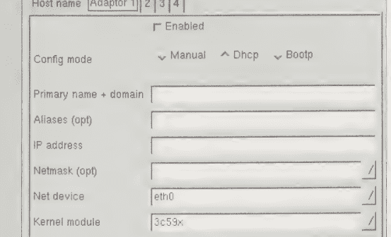

这一部分似乎没什么可说的，不是吗？你在这里输入的唯一信息是主机名和域名。此配置选项会写入 `/etc/sysconfig/network` 文件。

netconf 客户端侧的下一步是客户端配置的核心部分。点击“适配器 1”标签，你将看到实际的地址配置。

图 C 显示了使用 DHCP 配置适配器，使用了 `eth0` 和内核模块（驱动程序） `3c59fx`。`eth0` 设备是系统发现的第一个以太网。在这种情况下，使用网络工具为以太网设备配置 DHCP 是简单的。

132 企业 Linux 指南

关于 `eth0` 的信息（通过运行 `dmesg` 命令）看起来所示：3ComPCI 3e905B Cyclone 100baseTx at 0xa000, 00:10:5a:12:IRQ-11。

一旦你有了此配置，只需点击 Accept（接受）、Quit（退出），然后 Activate Changes（激活更改）。你可能需要运行命令 `/etc/network/restart`，这将重启你的网络连接，如果使用 DHCP，将从 DHCP 服务器请求 IP 地址。

`/etc/rc.d/init.d/network restart`

你的网络连接将重启，新的配置将生效。在某些情况下，可能需要更多信息，但作为网络管理员，你可能足够聪明来完善这些环境。

## 结论

在 Linux 中配置网络实际上是一个非常简单且无痛苦的过程。当然，你


# 在 Linux 下安装 DHCP 服务器

作者：Vincent Danen

当你使用 Linux 作为操作系统时，DHCP 的优势会成倍增加。在本文中，我将介绍配置 Linux 服务器作为 DHCP 服务器的步骤。不要担心——这一切非常简单。网络变化、IP 地址更改等都是极其耗时的。遗憾的是，DHCP 允许大多数系统管理员能够更轻松地处理大型网络环境。

## DHCP 的来来去脉

动态主机配置协议（DHCP）对于许多 Linux 用户来说并不新奇。大多数人在通过电缆或 DSL 调制解调器连接互联网的电脑上都安装了 DHCP 客户端。这使得他们在每次连接 ISP 时，只要有专用的电缆或 DSL 连接，只需启动系统即可获得动态分配的 IP 地址。这是一种向客户端发布半永久 IP 地址的简单方法，而无需给每个人都分配一个真正的静态 IP 地址。事实上，如果你大多数时间都离开电脑，由于它是基于 IP 地址租约/更新机制的，你可能很长时间都使用同一个 IP 地址。

DHCP 的设计目的是使用客户端/服务器模型为客户端计算机提供所有可能的 TCP/IP 配置参数。因为它包含了《互联网主机需求规范》（RFC）中定义的每项配置选项，因此系统管理员无需在用户的桌面上配置 TCP/IP。这一切都是通过 DHCP 客户端和 DHCP 服务器之间的交互实现的。

## IP 租约

DHCP 处理 IP 分配的方式非常简单。DHCP 客户端与服务器建立对话，服务器为客户端租用 IP 地址一段可配置的时间。当时间过期时，客户端必须续租或将地址返回给服务器，以便将其分配给另一个系统。不需要为每个客户端创建自定义配置，因为服务器负责地址分配。这还允许对 IP 地址进行有效利用。如果有人离开办公室一周，他们宝贵的 IP 地址（可能被某人带笔记本电脑来办公室使用一天的人需要）就不会被浪费。

然而，DHCP 的功能性比这种用法暗示的要强大得多。它可以用于任何笔记本电脑和计算机经常开关或定期更换的企业环境。对于大多数系统管理员来说，处理唯一的要求是 DHCP 服务器必须使用静态 IP 地址。这是因为客户端需要知道连接到哪个服务器，如果它使用动态 IP 地址，它将不知道连接到哪里获取在客户端上配置 TCP/IP 的信息。此外，DNS 对通过 DHCP 分配的地址一无所知，这意味着远程计算机无法查找通过 DHCP 获取 IP 地址的系统地址。

生成服务器并向客户端提供配置信息。

DHCP 服务器可以为具有静态地址分配的单独主机（适用于服务器）或任何动态地址分配的主机子集提供服务。配置文件使用 `host` 和 `subnet` 语句来识别客户端系统。

这里有一个语句示例：

```
host ns
hardware ethernet 12:34:56:78:AB:CD;fixed_address 192.168.1.5;
```

然而，有一个正在进行的项目旨在实现动态 DNS，允许 DHCP 服务器更新数据库信息以反映 IP 地址的分配和更改。由于这带来了轻微的安全风险，DNS 的工作进展缓慢且谨慎。但与此同时，DHCP 在大多数配置中运行良好，并将减少在单个客户端计算机上工作的时间。

此语句定义了客户端的名称和 IP 地址。使用此系统，任何具有匹配以太网地址的客户端连接到服务器，服务器将向客户端返回配置信息。

- Subnet

有一个语句示例：

```
subnet 192.168.1.0 mask 255.255.255.0 {
  range 192.168.1.10 192.168.1.200;
}
```

此语句定义了服务器可用的 IP 地址范围。

- Host

有一个语句示例：

（此处省略重复代码，参考上文）

- Fixed Address

有一个语句示例：

```
host ns
hardware ethernet 12:34:56:78:AB:CD;fixed_address 192.168.1.5;
```

此语句定义了客户端的名称和 IP 地址。

- Range

有一个语句示例：

（此处省略重复代码）

# 在 Linux 下安装 DHCP 服务器

作者：Vincent Danen

（后续内容为原文重复，已按要求处理或合并）

`server_name [name]`—此选项定义服务器的主机名。

`use_host_decl [true|false]`—此选项定义服务器是否将在 `host` 语句中提供的名称作为其主机名发送给客户端。

`use_lease_addr_for_default_route [true|false]`—此选项向客户端发送其自身的地址作为默认路由，而不是发送真实的默认路由。

之前的语句涉及服务器的操作；然而，还有更多关于客户端操作的配置选项。其中一些常见的如下：

- `option_broadcast_address [address]`—定义广播地址。
- `option_domain_name [domain]`—定义域名。
- `option_domain_name_servers [address_list]`—列出 DNS 名称服务器的地址列表。
- `option_finger_server [address_list]`—查找客户端的 finger 信息。finger 服务器通常用于在网关处拦截 finger 流量的站点。
- `option_host_name [name]`—定义主机名。
- `option_nis_name [name]`—定义本地 NIS（网络信息服务）域的名称。
- `option_nis_servers [address_list]`—列出 NIS 服务器的地址列表。
- `option_nttp_server [address_list]`—列出客户端使用的 NTTP 服务器地址列表。
- `option_ntp_server [address_list]`—列出客户端使用的 NTP（网络时间协议）服务器地址列表。
- `option_pop_server [address_list]`—列出客户端使用的 POP3 服务器地址列表。
- `option_routers [address_list]`—定义默认路由器。
- `option_smtp_server [address_list]`—列出客户端使用的 SMTP 服务器地址列表。
- `option_subnet_mask [mask]`—定义网络掩码。如果未定义此选项，则使用来自 subnet 语句的掩码。
- `option_time_offset [offset]`—定义所在区域相对于协调世界时（UTC）的偏移（例如，-5 可能意味着东部标准时间）。
- `option_www_server [address_list]`—列出客户端的 Web 服务器地址。通常这用于定义客户端使用的代理服务器。

可配置选项比列出的多，但这些是最常用的。有关可用选项的完整列表，请阅读 `dhcpd.conf` 和 `dhcpd_options` 的 man 页面。

# 一个 dhcpd.conf 文件

`/etc/dhcpd.conf` 的布局与 BIND 配置的布局类似，它使用类似编程的语言来指定语句。每个组（group）、子网（subnet）和主机（host）必须包含括号内，每条语句必须以分号结束。你可以在配置文件中使用井号符号来添加注释。以下是一个 `/etc/dhcpd.conf` 示例：

```
# 全局值
max_lease_time 64800
default_lease_time 86400
option subnet_mask 255.255.255.0
option domain "example.com"
option domain_name_servers 192.168.1.2 192.168.1.5
option pop_server 192.168.1.5
option smtp_server 192.168.1.5
```

```
# 为子网定义动态范围
subnet 192.168.1.10 mask 255.255.255.0 {
  option routers 192.168.1.215
  option broadcast_address 192.168.1.255
  range 192.168.1.10 192.168.1.20;
  range 192.168.1.210 192.168.1.240;
}
```

# 静态 IP 地址客户端的主机语句

```
group {
  use_decl true;
  host ns {
    hardware 12:34:56:78:AB:CD;
    fixed_address 192.168.1.55;
  }
}
```

```
host router {
  hardware 00:80:C7:A1:10:56;
  fixed_address 192.168.1.215;
}
```

此示例定义了全局属性，例如最大租约时间为一周，默认租约时间为一天。定义了网络掩码、域名、DNS 服务器以及 POP3 和 SMTP 服务器（这些都是相同的）。

接下来，定义一个组，使用在语句中定义的主机名。然后定义主机 `ns` 和 `router`。如你所见，`ns` 充当 DNS 服务器以及 POP3 和 SMTP 服务器。

要使此更改永久生效，将之前的命令添加到你的 `/etc/rc.local` 文件中。对于 Red Hat 和 Caldera 用户，上述命令已被添加到 init 脚本 `/etc/rc.d/init.dhcpd` 中。


如果你在多个网络接口上运行 `dhcp` 时遇到问题，可能是使用了旧版本的内核。请确保使用 `2.0.31` 或更高版本的内核。

如果你遇到“Protocol Not Configured”错误，请确保你的内核在编译时开启了 `CONFIG_PACKET` 和 `CONFIG_FILTER`。

由于 DHCP 服务器的通用性，静态 IP 的配置选项通常相同。

# 配置问题

在 DHCP 服务器配置并运行后，你可能遇到的障碍很少。主要是为 Windows 客户端提供 DHCP 时可能会遇到广播地址问题。如果 Windows 看不到来自服务器的消息（例如 Linux 客户端），你可能需要在 Linux 服务器上定义特定的广播路由。要这样做，请在 `/etc/hosts` 中添加如下：

```
255.255.255.255 lim_broad
```

然后，使用此命令为广播地址添加路由：

`route _host_lim_broad dev0`

## 结论

设置 DHCP 服务器并不困难，但初始配置可能需要时间。由于 DHCP 服务器的通用性，静态 IP 的配置选项通常相同。如果你不使用它，静态 IP 的配置选项通常相同。如果你不使用它，静态 IP 的配置选项通常相同。如果你不使用它，静态 IP 的配置选项通常相同。如果你不使用它，静态 IP 的配置选项通常相同。如果你不使用它，静态 IP 的配置选项通常相同。

# 使用 NFS 进行工作

网络文件系统 (NFS) 是一种仅适用于 Linux（以及其他 Unix 类系统）的协议。在本书中，我将揭示你需要安装的内容。你将从调查需要挂载的内容开始。接下来，你将学习如何从服务器导出目录供其他计算机使用。你还需要如何在客户端挂载远程目录，以及如何处理可能会遇到的错误。

# 根权限限制 (Squash root)

在开始研究根权限限制等 NFS 奥秘之前，请理解 NFS 并不是最安全的。一位同事说 NFS 的意思是“没有安全性”（no floppin' security）。就像互联网协议一样，它源于网络规模很小、大家都认识彼此且行为良好的时代。在“罗杰叔社区”的组织背景下，NFS 假设这没什么问题；如果用户登录到网络系统之一并提供了正确的用户名和密码，该系统就会变成受信任客户端。如果你以 `root` 身份登录客户端系统，你就可以以 `root` 身份登录服务器。

# 过渡

Linux 实现 NFS 的问题在于 Linux 用户正在经历过渡。从 Linux `2.2` 版本开始，NFS 在内核中得到了直接支持。这意味着所有 NFS 工具都需要随着内核的变化进行更新，文档也是如此。结果如预料那样：软件有 Bug，文档过时。也许你运气不错，没费太大就让 NFS 运行了，但许多 Linux 用户抱怨他们无法实现。

# 关于 Samba？

在开始研究根权限限制等 NFS 奥秘之前，请花点考虑 NFS 是否适合你的网络。其之一，NFS 仅适用于 Linux（以及其他 Unix 类操作系统）。

那些时代已经过去了，除非你正在家里搭建一个不连接互联网的小型网络。一旦你将网络连接到互联网，未经授权的入侵者就有获得 `root` 权限的机会——有了你的 NFS，你会迅速在任何系统上获得 `root` 权限。内部用户也是如此，例如寻找可能具有价值信息的员工。

# Samba

简而言之，Samba 是一种跨平台网络协议，实现了 Windows 原生的消息机制。该技术的 Linux 实现非常出色——事实上，有一些仅限 Linux 的网络在使用 Samba。尽管如此，Samba 并不像 NFS 那样紧密集成。例如，它可以配置 NFS，使得所需的软件在启动时运行，并在无需用户干预的情况下挂载目录。当然，你也可以用 Samba 实现这一点，但需要更多工作。

为了交换工作而提供给竞争对手（是的，这种情况确实发生）。

我被设置为用户名为 `bry`（ID `501`），我属于组名为 `strider`（ID `101`）。`itrivendell` 知道我是 ID 为 `501` 的 `bry`，并且属于 `strider` 组（ID `101`）。

简而言之，为了建立一个用户可以在远程服务器上挂载目录的 NFS 服务器，你需要确保客户端和服务器上的账户定义方式完全相同。出于这个原因，如今的 NFS 实现了一项名为“根用户映射”（root squaring）的功能（默认启用）。简而言之，当你在客户端上建立一个根会话（root session）并尝试访问 `root` 用户拥有的服务器目录时，就会发生根用户映射。NFS 将 `root` 用户的 ID 更改为 `nobody` ID，这个 ID 专门设计用于增加安全性的，使其极难造成破坏。`nobody` 用户并不知道他或她是谁，因为服务器的大部分系统都故意受到了保护，无法查看。

那么，为什么不起作用呢？为什么没有解释得更清楚呢？在手册页（man pages）中也有提到。作者通常假设你已经读过这些页面，并只提到了其中的内容。这虽然标准做法，但如果你假设其中包含相当大量的信息，可能就会不同。

## 陷阱！（Gotcha!）

根用户映射有助于解决 NFS 的底层缺陷，至少让服务器免受 `root` 攻击。但**陷阱 #1**：在 Linux 发行版中，NFS 的配置使得你无法从普通账户运行；只有 `root` 才能这样做。所以，当你切换到 `root` 并尝试挂载远程目录时，你被拒绝了？对于服务器来说，你正在尝试登录，但你没有任何权限。你该怎么办？禁用根用户映射？这不是个好主意，因为这会让网络系统暴露给任何加入网络的用户。出于这个原因，你希望设置 NFS，让普通用户能够访问远程服务器。我们稍后学习如何操作。

简而言之，如果 `/etc/fstab` 中的目录是一个可挂载设备（例如 CD-ROM 或软盘驱动器），它是如何定义该目录的。

## 概述

为了让 NFS 成功运行，你将处理以下内容：

- 使客户端和服务器系统上的用户 ID 和组 ID 匹配。
- 在服务器上，修改 `/etc/hosts.allow` 和 `/etc/hosts.deny`，以便服务器接受来自客户端的请求。
- 让所有需要的守护进程（daemons）和工具正常运行。
- 在服务器上，创建或修改 `/etc/exports` 文件，以便服务器将目录导出到网络上的其他机器。
- 在客户端上，修改 `/etc/fstab`，以便客户端在启动系统时自动加载导出的目录。

你可以设置让普通用户挂载他们在在远程服务器上拥有的目录。但这导致了**陷阱 #2**：对于普通账户，NFS 要求它们在服务器和客户端上具有完全相同的名称和数字 ID。

## 使你的用户 ID 和组 ID 相同

如果这些目录是用户文件系统的一部分，普通用户就能顺畅地访问他们的远程目录。正如我之前提到的，如果两个系统上的用户、组名以及数字 ID 不相同，NFS 将无法顺畅运行（或根本无法运行）。如果存在差异，你必须在继续之前修复它们。这里不适合详述修改用户和组名称的所有细节。你可以使用易于使用的工具为此目的，例如 KDE 用户管理器或 Red Hat 系统的 `linuxconf`。如果你更倾向于命令行，可以使用 `usermod` 进行必要的更改——但不要忘记使用 `-R`（递归模式）来更改用户主目录中所有文件的所有权。

## 修改 /etc/hosts.allow 和 /etc/hosts.deny

开始保护你的系统。如果你修改了 `/etc/hosts.allow` 和 `/etc/hosts.deny` 文件，你就能免受一系列可能的攻击。这种保护是万无一失的，但它将消除脚本小子（script kids）多年来使用的许多技巧。

1. 打开终端并切换到超级用户（输入 `su` 后输入你的密码）。
2. 在空行上，输入 `portmap: ALL:ALL`。
3. 保存文件。
4. 打开 `/etc/hosts.allow`。
5. 在空行上，输入 `portmap:` 后跟一个空格、客户端机器的 IP 地址、一个斜杠以及客户端的掩码。对于你可能使用的 C 类网络，默认掩码是 `255.255.255.0`。如果你不确定客户端的掩码是什么，进入终端窗口，输入 `ifconfig` 并按 [回车]。查找以太网接口（`eth0`，除非机器有多个网卡）下的你的 IP 地址和网络信息。
6. 在 `/etc/hosts.allow` 中，一个有效条示例是 `portmap: 192.168.100.10/255.255.255.0`。如果你想让网络上的所有机器都能使用导出内容，可以使用通配符，如示例所示：`portmap: 192.168.100.*/255.255.255.0`。
7. 保存文件。

## 让所有守护进程各就绪

要使用 NFS，你需要在服务器和客户端上运行以下守护进程（内存驻程序）：

- `portmap`: 接受查询信息的远程请求并将这些请求引导到相应的端口。
- `rpcbind`: 允许系统挂载和卸载 NFS 目录。
- `nfsd`: 提供 NFS 守护进程。

你应该配置网络上的所有机器在会话开始时启动这些守护进程。或者在 Red Hat 系统上，使用 `chkconfig`（一个允许你指定想要运行服务的文本工具）来实现。确保你的服务正在运行以下服务：`nfs`、`nslock`、`portmap` 和 `usher`。（注意：如果服务未运行，你需要重启系统。）

## 配置 /etc/fstab

在此示例中，我在客户端上指定了 `fstab`。如果你看到“程序未注册”（Program not registered）的错误信息，说明客户端上没有运行所需的守护进程。参考本文的“让所有守护进程各就绪”部分以确保它们运行，并配置系统在启动时运行。

## 使用 /etc/exports

在 NFS 使用你所做的修改之前，你必须使用 `exports` 更新导出数据库 `/var/lib/nfs/exports`。该数据库是远程挂载守护进程所需的。如果它不准确，客户端将无法挂载目录。要同步 `/etc/exports` 与数据库，输入 `exports -rv` 并按 [回车]。

在此示例中，我导出服务器 `192.168.100.33`，并具有读写权限 (rw)。我还将服务器的 CD-ROM (`/dev/cdrom`) 导出到我网络上的所有客户端，并具有只读权限 (ro)。

应该。如果你在运行 NFS 方面仍然遇到问题，我建议你升级到正在运行的 Linux 发行版的较新版本，这意味着你将自动获得更新版本的内核。

祝网络愉快！

# 系统集成

## 运行 Samba，第一部分：为 Samba 准备 Linux 和 Windows 环境

作者：Bryan Plaffenberger。这是一种基于 Linux 的 Windows 协议实现。通俗来说，这意味着非常简单：一旦你在 Linux 系统上运行了 Samba，该 Linux 机器就会出现在 Windows 用户的“网络邻居”对话框中；用户可以访问 Windows 系统中的目录。此外，用户可以将他们的打印机供网络用户使用，无论打印机是连接到 Windows 还是工作站都是如此。简之，Samba 在 Linux 和 Windows 系统共存的网络中实现了资源共享，这就是为什么 Samba 成为全球各地 Linux 用户不可或缺的资源。

如果你的网络中没有微软设备，那么 Samba 绝对值得投入。对于仅限 Linux 的网络，你没有理由不使用 Samba 作为你的网络协议。与原生的 Linux 网络共享协议（网络文件系统 NFS 和行打印机守护进程 `lpd`）相比，Samba 更容易实现、更灵活、在网络故障时不太可能导致工作站崩溃，并且更容易管理。

如果说 Samba 有什么缺点，那就是该包的复杂性。为了模拟 Windows Server 的功能，你需要大量的时间和专业知识来实现 Samba 的所有功能。此外，你不能仅仅安装 Samba 就能期望在网络邻居中看到你的 Linux 系统。你必须正确地准备你的 Linux 和 Windows 系统——为了做到这一点，你需要一定的系统管理专业知识，这些知识在在线 Samba 文档中通常被认为是理应当的——这也是许多人难以让 Samba 正常工作的原因之一。

我们需要一种简单、循序渐进的 Samba 介绍，包含你建立基础并让 Samba 正确运行所需的所有信息，花哨。这正是你将找到的内容。这系列两部分的文章将介绍配置网络用于 Samba 的每一步、安装和配置 Samba 软件，以及在 Linux 和 Windows 系统之间实现可靠、易用的文件共享。

### 恰好所需

Samba 是跨平台协作的理想人选，正如你将看到的，但这里有一点并不……

### 为 Windows 用户创建 Linux 账户

让我们开始吧——但不是从 Samba 开始。为了让 Samba 正常运行，你需要在 Linux 服务器上设置账户，其用户名和密码要与用户在 Windows 网络登录框中提供的相同。这是互联网可用文档未充分涵盖的领域之一：这些文档的作者假设，读者会立即意识到要采取本节描述的步骤。然而，人们往往尝试在不采取这些步骤的情况下配置 Samba——结果是——Samba 无法工作。

### 抉择：明文密码 vs. 加密密码

接下来，你需要考虑想使用明文密码还是加密密码。如果你想使用明文或加密密码，你将必须修改 Windows 客户端；如果你想使用加密密码，你将修改你的 Samba 安装，正如下一节所述。

哪种最好，明文密码还是加密密码？简短的回答是：加密密码。如下：默认情况下，Samba 使用明文密码，这意味着密码在网络上是普通文本。这些密码可能会被入侵者检测到，并用于访问所有用户都相当可信的小型网络中的机密资源。尽管如此，即使在小型网络中，使用加密密码也不是一个坏主意。

为什么要设置这些账户？问得。当 Windows 用户建立 Samba 连接时，Windows 没有提供提供用户名的方法。相反，Windows 客户端会发送在 Windows 网络登录框中提供的用户名，该用户名出现在 Windows 会话的开始。除非你想配置所有的 Samba 服务允许访客用户访问——这会创建一个你甚至让大卡车开过的安全漏洞——否则你需要设置账户，其用户名与 Windows 客户端提交的用户名并行。顺便创建这些账户时，请使用与 Windows 网络登录框中提供的相同的密码。如果用户的密码与 Windows 客户端上的用户密码相同，用户无需提供密码即可访问他们的 Samba 资源。

要设置账户，你将需要 `nobody` 工具或你所在的 Linux 发行版的配置工具（例如在 Red 和 Red Hat 系统上使用 `useradd`）。要为 `Suzanne-yat2bfu` 创建账户，如类型所示，输入 `useradd -m yat2bfu` 并按 [Enter]。默认情况下，此命令会创建一个主目录（在这里是 `/home/suzanne`）。如果命令未能执行此操作，说明 `CREATE_HOME` 被关闭了。要更改此行为，请编辑 `/etc/login.defs`。如果 `CREATE_HOME` 被设置为 `no`，请将其改为 `yes`；如果该值未出现，输入 `CREATE_HOME=yes` 并重新运行命令。

正如你所学到的，配置 Samba 密码最方便的方法是精确使用用户 Linux 和 Windows 账户的用户名和密码。缺点在于，如果人们使用数据包嗅器解密密码会发生什么：他们将获得用户所有账户（包括 Linux 账户）的权限，进入服务器的其他部分并不困难。在连接互联网的大型网络或放置了某些工作站的网络中，你需要这样做。如果你决定使用加密密码，你将需要修改 Windows 客户端。

### 设置名称服务

为了让网络上的计算机能够相互定位，你需要执行以下操作之一：

- 运行 DNS 服务器：域名系统（DNS）在人类可读的域名（如 `mycomputer`）和数字地址之间进行转换。
- 在 `/etc/hosts` 中列出 地址 地址域名：如果你设置的是较小的网络，可以跳过 DNS。

## 配置 Windows 系统

在继续之前，验证 Windows 能否在“网络邻居”窗口看到彼此；否则，你需要确保安装了所有必要的支持。

- 如果你的局域网是 DHCP 服务器，自动获取 IP 地址。
- 指定 IP 地址。在地址框中为你的系统输入一个静态 IP 地址。

| 表 A /etc/hosts 和 C:\Windows\Hosts 文件 |
|---|---|---|
| 127.0.0.1 | localhost.localdomain | localhost |
| 192.168.100.10 | lothrien.mydomain | lothrien |
| 192.168.100.33 | bag-end.mydomain.org | bag-end |
| 192.168.100.34 | roadrunner.mydomain | roadrunner |

`192.168.1.0`。你还需要提供子网掩码（对于 C 类网络，它是 `255.255.255.0`）。

现在，点击 WISE Resolution 选项卡，并确保 WISE Resolution 为禁用。WISE 是互联网标准 DNS 的 Windows 专有替代方案。如果你正在运行带有 TCP/IP 的 Samba（它使用 DNS），你不需要 WISE。

此时，点击 Gateway（网关）选项卡。在这里，你输入提供公共互联网访问的计算机或路由的 IP 地址。在 Gateway 框中，输入你用于将网络连接互联网的计算机或路由的 IP 地址，并点击 Add。确保在所有窗口中输入相同的网关地址。如果你的网络没有连接到互联网，请留空空白。

现在，点击 DNS Configuration（DNS 配置）选项卡。启用 DNS，并在 Host 框中输入唯一标识这台计算机的主机名。在 Domain 框中，输入你网络的域名。如果你设置了私有网络，可以使用任何域名（如 `subdomain.com`），但请确保网络上的所有计算机都使用相同的域名。

在 DNS Server Search Order（DNS 服务器搜索顺序）区域，执行以下操作之一：

- 如果你在局域网上设置了 DNS 服务器，在此处输入主、次 DNS 地址。
- 如果你的局域网有 DNS 服务器但连接到了互联网，在此处使用你 ISP 的主、次 DNS 地址。


如果你的网络没有连接到互联网且你没有运行 DNS，请将 Samba 服务器的地址作为主 DNS 服务器。由于这台机器没有运行 Samba，Windows 不会获取所需的信息，但这种失败将迫使你查看在此节中创建的 `C:\Windows\Hosts` 文件。

点击 `Bindings`（绑定）选项卡并选择 `Client for Microsoft Networks`（微软网络客户端）。如果你想让系统资源对网络上的其他工作站（包括运行 Samba 的 Linux）可用，选择 `File and Printer Sharing`（文件和打印机共享）。

接下来，点击 `NetBIOS` 选项卡并确保 `NetBIOS` 已启用。如果没有启用，说明 `TCP/IP` 安装出现问题；你应该重新安装并从头开始。

最后，点击 `OK`。如果 Windows 需要任何额外软件，你将在采取下一步之前经历一次重启。

在 DNS 对话框的 `Configuration` 选项卡上，选择 `Client for Microsoft Networks` 并点击 `properties`。如有必要，取消勾选 `Logon To NT Domain`（登录到 NT 域）。在 `Network Login` 区域，选择 `Logon And Restore Connections`（登录并恢复连接）；这两个选项均可接受。如果用户的网络驱动器映射到本地系统驱动器，`Logon` 不会恢复网络驱动器映射。点击 `OK` 确认 `Client For Microsoft Networks` 设置。接下来，在 DNS 对话框的 `Configuration` 处，点击 `File and Print Sharing` 对话框。在 `File and Print Sharing` 对话框中，访问用户（可以共享文件、本地打印机或两者）的选项。点击 `OK` 确认文件和打印共享设置。然后点击 `OK` 确认 Windows 网络。

### 你的步骤：安装和配置 Samba

恭喜！你在这篇文章中遵循的步骤为使用 Samba 实现顺畅、无故障的网络奠定了基础。在系列的第二部分中，你将学习如何安装和配置 Samba，以便你的 Linux 和 Windows 用户可以轻松交换文件。

# 网络 147

## 运行 Samba，第 2 部分：配置 Samba 和挂载文件系统

作者：Bryan Pfaffenberger

欢迎来到关于 Samba 的两部分系列的第二部分，Samba 是 Linux 上 Windows 网络协议的开源实现。为了让 Samba 顺畅运行，你需要按照“运行 Samba，Linux”中的说明准备 Linux 服务器和你的 Windows 工作站。如果你还没有阅读这篇文章，请在继续之前阅读。在本节中，你将学习如何安装 Samba 并修改或编辑 Samba 配置文件 (`/etc/smb.conf`)。你还将学习如何使用随 Samba 广泛分发的工具 `smbmount` 和 `smb` 在 Linux 上挂载 Windows 共享。

### 获取并安装 Samba

在下载 Samba 之前，确保它没有在运行。打开终端，以超级用户登录，输入 `ps aux | grep smb` 并按回车。如果 Samba 已安装，你将看到两个 Samba 守护进程的名字：`smbd` 和 `nmbd`。

没有 Samba？你需要下载它，并确保获取的是正确的版本。这里有几点建议：

- 如果你在局域网上设置了 DNS 服务器，在此处输入主、次 DNS 地址。
- 如果你的局域网有 DNS 服务器但连接到了互联网，在此处使用你 ISP 的主、次 DNS 地址。
- 如果你的网络没有连接到互联网且你没有运行 DNS，将 Samba 服务器的地址作为主 DNS 服务器。由于这台机器没有运行 Samba，Windows 不会获取所需的信息，但这种失败将迫使你查看在此节中创建的 `C:\Windows\Hosts` 文件。

点击 `Bindings` 选项卡并选择 `Client for Microsoft Networks`。如果你想让系统资源对网络上的其他工作站（包括运行 Samba 的 Linux）可用，选择 `File and Printer Sharing`。

接下来，点击 `NetBIOS` 选项卡并确保 `NetBIOS` 已启用。如果没有启用，说明 `TCP/IP` 安装出现问题；你应该重新安装并从头开始。

最后，点击 `OK`。如果 Windows 需要任何额外软件，你将在采取下一步之前经历一次重启。

在 DNS 对话框的 `Configuration` 选项卡上，选择 `Client for Microsoft Networks` 并点击 `properties`。如有必要，取消勾选 `Logon To NT Domain`。在 `Network Login` 区域，选择 `Logon And Restore Connections`；这两个选项均可接受。如果用户的网络驱动器映射到本地系统驱动器，`Logon` 不会恢复网络驱动器映射。点击 `OK` 确认 `Client For Microsoft Networks` 设置。接下来，在 DNS 对话框的 `Configuration` 处，点击 `File and Print Sharing` 对话框。在 `File and Print Sharing` 对话框中，访问用户（可以共享文件、本地打印机或两者）的选项。点击 `OK` 确认文件和打印共享设置。然后点击 `OK` 确认 Windows 网络。

### 工作组

接下来，找到以 `server string` 开头的行，并在必要时取消该行的注释。使用在 Windows 系统的网络邻域窗口中标识服务器的名称，例如 `server string = Lothlorien`。

```
comment = Home Directories
browse = no
writable = yes
available = yes
```

（注意：名称不能超过 15 个字符。）这可能与为 TCP/IP 目的定义的系统名称不匹配。

这些选项会自动赋予用户访问 Samba 服务器上其主目录的能力。

现在，找到以 `hosts` 开头的行：出于安全考虑，此设置非常重要；它决定了哪些主机可以访问 Samba 资源。另一种方法是将机器对任何访问网络的人开放。你可以输入一台机器的 IP 地址、用逗号分隔的 IP 地址列表，或者 `192.168.100.*` 匹配任何 IP 地址以这些数字开头的计算机。

现在，保存 `/etc/smb.conf` 并退出编辑器。然后通过输入 `/etc/init.d/smbd restart` 并按下 [Enter] 来重启 Samba。

接下来，寻找以 `hosts deny` 开头的行。如果该行存在，请取消其注释，并进行修改以便重启。

```
hosts deny =
```

如果该行不存在，请输入：

```
hosts deny =
```

现在，转到一台 Windows 网络终端上，输入用户的用户名和密码，双击“网络邻域”，并确定 Samba 服务器是否显示。如果是，尝试访问用户的主目录。

### 故障排除你的 Samba 配置

现在，寻找以 `security =` 开头的行。如有必要，取消该行的注释，并确保它与以下内容配合：

```
security = user
```

找到以 `encrypt passwords` 开头的行。如有必要，取消该行的注释并执行以下操作之一：如果你决定使用明文密码，将此行更改为

```
encrypt passwords=no
```

并删除下一行（`smb password file = /etc/smbpasswd`）。关于如何让加密密码生效，请参见“配置加密密码”部分；你需要按照该节中的步骤来使 Samba 正常工作。

如果 Samba 服务器未显示，请检查以下项：

- 如果你配置了 Samba 使用明文密码，你是否删除了 Windows 机器上的注册表，以便它们发送明文密码而非加密密码？如果你使用加密密码，Samba 服务器是否能与之正常工作？如果是，请使用 `encrypted passwords`。
- 查看配置文件，并确保你输入的内容完全正确。
- 在 Samba 服务器上，输入 `testparam /etc/smb.conf` 并按下 [Enter]。此诊断程序将检测 Samba 配置文件中的某些缺陷。
- 你的网络正常吗？从 Windows 机器，尝试 `ping` Windows 机器；尝试 `ping` Samba 服务器。（在 Windows 上，选择“运行”，输入 `ping` 后跟服务器的 IP 地址，然后按 [Enter]）。
- Samba 正在运行吗？在 Samba 服务器上，尝试运行 `smbclient -L` 后跟服务器名称和 `-N`，例如 `smbclient -L Lothlorien`。如果 Samba 安装并运行正常，你将看到该服务器上所有可用共享的列表。

仍然存在问题？很可能是你安装了一个与你的 Linux 发行版不兼容的 Samba 版本。确保你使用的是与你的 Linux 发行版自带的 Samba 版本，或者是针对同一发行版的其他更新版本。如有必要，重启 Samba。

### 配置加密密码

如果你为 Samba 选择了加密密码，你需要修改 Samba 系统，以配合 Windows 客户端将看到的加密密码。Windows 密码加密格式与 Linux 上使用的默认密码加密系统不兼容。因此，你需要为 Samba 用户创建一个遵循 Windows 格式的额外密码文件。这不是一个理想的解决方案；因为两个密码文件不会同步，所以当其中一个密码发生变化时，你需要更新这些文件。但是。

从 `/etc/passwd`（Linux 系统上的默认密码文件）中提取单词，并将它们写入一个名为 `/usr/local/samba/private/smbspasswd` 的新文件中。你将使用 Samba 提供的 `mksmbspasswd.sh` 脚本完成此操作。

输入 `mksmbspasswd.sh` 并按下 [Enter] 来查找该脚本的安装位置。如果它不在默认路径上，务必在下一步的命令中包含该名称。

使用以下命令启动脚本：

```
cat /etc/passwd | mksmbspasswd.sh /usr/local/samba/private/smbspasswd
```

然后，用文本编辑器打开 `/usr/local/samba/private/smbspasswd`。如你所见，每个用户密码都定义在单行（相当长的一行）上。如有必要增大窗口尺寸，你可以看到整行。删除除你授予访问权限的用户以外的所有条目。特别要务必删除 `root`、`cron` 和 `daemon`。

最后，保存文件并退出编辑器。你创建的文件包含用户，但密码字段是空的。你必须为每个用户定义密码。确保使用这些用户在 Windows 启动时通过“网络”对话框登录 Windows 时使用的相同密码。使用 `smbpasswd`，输入 `smbpasswd` 后跟一个空格和用户名。系统将提示你输入并重复用户密码。

以下过程将创建一个位于 `/usr/local/samba/create` 的密码文件，你对其进行修改，使其除 `root` 用户之外的人无法查看。你需要使用 Samba 分发版提供的名为 `mksmbspasswd` 的脚本从 `/etc/passwd` 中提取用户名，并按照 Windows 加密格式将其写入 `/usr/local/samba/create`。

# 通过 Linux Samba 替换 NT 服务器节省大量成本

作者：Jason Hines, MCSE.

消息已经传出。使用 Samba 在 Windows 域中建立 Linux 服务器为网络管理员提供了一些极佳的选择。与执行相同任务的 Windows 服务器相比，Samba 提供了卓越的稳定性、性能、集成性并显著降低了成本。然而，将 Samba 成功集成到 NT 域取决于是否使用了适用于 NT 集成的最佳 Samba 设置，并避免常见的配置错误。

在本文，我将逐步介绍在 Linux 上设置 Samba 服务器的过程，并针对 Windows 域环境对其进行安全和性能的优化。我还将解释如何避免常见的配置错误以及如何设置存档。Samba 可以作为一个极优秀的服务器使用，但本文将侧重于如何正确配置它。一旦你设置好了 Samba 配置，就可以通过学习 Linux 设置网络打印机的方法轻松添加打印服务。

本文假设你对 Windows 域有深入的理解，但对 Linux 处于初学者中级水平。Linux 方面的唯一例外是你目标机器上安装了 Linux 发行版，并且你对 Linux 文件系统以及如何使用文本编辑器有基础了解。

## 准备工作 Linux 配置

许多 Linux 发行版预装了 Samba，并且在所有主流发行版中都可以可选安装。如果你运行的是旧版本的发行版，我建议访问 Samba 官方网站 `www.samba.org` 下载最新版本的 Samba 并将其安装在你的 Linux 机器上。

一旦安装了 Samba，以 `root` 用户身份登录 Linux 系统。在开始配置之前，如果 Samba 守护进程（服务）正在运行，你需要停止它们。

你可以执行以下命令显示所有当前运行的守护进程：

```
ps aux | more
```

寻找 `smbd -D` 和 `nmbd -D`。（这些是 Samba 守护进程。）在左侧第二列找到这两个守护进程的 `PID` 号。执行以下命令（将 `1010` 替换为 `smbd` 的 `PID`）：

```
kill -9 1010
```

接下来，执行此命令（将 `0101` 替换为 `nmbd` 的 `PID`）：

```
kill -9 0101
```

在深入配置之前，你需要在 Linux 上设置用户和组，以对应 Windows 域中的用户和组。在 Linux 中设置组，执行以下命令：

```
groupadd groupname
```

然后，通过为每个用户执行命令来设置用户：

```
adduser username -g groupname
```

对于拥有大量用户的企业，我建议使用微软的 NT 服务或 MS Toolkit 来设置 Linux 和 Windows 之间的用户/密码同步。两者效果都很好，但微软的产品更节省资源，而 MS Toolkit 更健壮。

你还需要设置与 NT 网络共享的主目录。执行以下命令：

```
cd /
```

```
mkdir winshare
```

随后执行此命令：

```
chmod 777 /winshare
```

这为 `/winshare` 赋予了任何人读/写/执行权限。

## 现在你已经准备好处理 Samba 本身了

在 Linux 中，大多数 Samba 配置都在 `/etc` 目录下的 `smb.conf` 文件中完成。在开始编辑此文件之前，为了满足你的需求，让我们创建一个备份。执行以下命令：

```
cd /
cp /etc/smb.conf /usr/doc/samba-2.x
```

将 `x` 替换为你的 Samba 版本。上面的第二个命令将 `smb.conf` 文件复制到了包含 Samba 文档的目录。现在你可以深入研究 `smb.conf`，使用文本编辑器编辑该文件，使用以下命令：

```
pico smb.conf
```

对于本文，我将使用文本编辑器，并认为这对初学者是最好的；但你可以使用任何文本编辑器来完成这些任务。打开 `smb.conf` 后，你会发现文件中有很多类型的行。以 `#` 开头的行是已注释的配置选项。两者的作用相同：防止其后的内容被解析配置。

为了简化 Samba 配置并让 `smb.conf` 更易操作，使用你的文本编辑器删除所有带有 `#` 的行。在 `pico` 中，你可以通过方向键将光标置于行首并按 `Ctrl+K` 删除整行。对 `smb.conf` 中的每条注释行执行此操作。如果你想查看这些内容，可以查看复制到 `/usr/doc/samba-2/` 的。

## 为 Linux 集成优化 Samba


现在你打开了 `smb.conf` 文件，你会注意到许多如 `[global]` 和 `[printers]` 这样的括号字段，以及如 `workgroup = DOMAIN` 等行。括号字段代表这些共享的选项。Samba 配置的核心在于正确设置 `[global]` 变量。虽然其他括号字段引用打印机，但这一个管理所有设置。由于变量很多，这可能会令人望而畏；然而，我将引导你通过最重要的，并删除非必要的。以下是一个针对 Windows NT Linux Samba 优化的 `[global]` 设置文件示例：

```
[global]
security = domain
workgroup = NTServer
server string = Samba Server
wins = no
dns proxy = no
name order = winshosts
encrypt passwords = yes
log file = /var/log/samba/log.%m
max log size = 50000
remote announce = 255.255.255.255
remote browser sync = 255.255.255.255
socket options = TCP NODELAY SO_RCBUF=8192 SO_SNDBUF=8192
[printers]
printing = yes
```

在所有设置中，重要的是 `security = domain`。此设置告诉 Samba 如何验证用户。有四个可用选项：

- `user`

- `share`

在 Windows NT 域中设置 Samba 时，你经常看到管理员使用 `security server`。但从 Samba 2 版本开始，`domain` 选项已被启用。`domain` 安全让 Samba 像 NT 机器一样验证，而 `server` 安全则让 Samba 像 Windows 95/98 机器一样验证。`domain` 安全提供了在企业环境中参与 NT 域的优势。它减少了 PDC/BDC 连接资源，而 `server` 安全只要守护进程运行就会保持与 PDC 或 BDC 的连接；`domain` 安全仅在验证用户时才连接到 PDC 或 BDC。这节省了 NT 域控制器的贵的资源。放入连接此服务器的子网 IP 广播地址，以便列表同步。你可以保持 `socket options` 的默认值以获得最佳性能。打印机保持默认并包含在活动设置中，以便将来如果你需要可以轻松地打印到 Samba。

## 避免常见错误

`local master`、`domain master` 和 `preferred master` 设置都应设置为 `no` 或直接删除。这些设置涉及 NT 网络上的 Samba 主浏览器。你不希望发生这种情况，因为这会导致你的 NT 机器出现错误。在最好的情况下，它会引起一些烦人的事件查看器消息；最坏的情况下，它会使你的域控制器崩溃。

由于 `workgroup` 变量指定了你的 NT 域名称（全大写）。`net` 名称就是那样（全大写）。`server string` 是你在网络看到的注释。你还想要删除 `domain logins` 设置。如果将其设置为 `yes`，Samba 将尝试充当域控制器，这会导致你的网络崩溃；Samba 服务器可以被配置为 PDC。

`host setup` 将 UNIX 权限映射到访问控制列表。`win server` 是 Samba 用于解析 NetBIOS 名称的 WINS 服务器。`proxy` 告诉 Samba 查询 DNS。将其设置为 `no`。上面的 `name order` 列表在所有情况下都是标准且最佳。

在 NT 域中，实践中使用当前版本的 Samba 有许多问题。它对未来的 Samba 版本具有潜力。

如果你的客户端运行 Windows 95 SR2 或更高版本、Windows 98 或带有 Service Pack 3 或更高版本的 Windows NT，则必须设置密码。我建议升级它们。使用加密密码对于网络安全非常重要。`log file` 和 `max log` 设置可以简单保持默认值。

作为原则，你可以删除任何未使用的全局设置。一旦你了解了 Samba 和你的规范，可以重新添加设置。你也可以删除 `[home]`、`[log]`、`[tmp]`、`[profile]` 以及任何其他示例共享。但要保留 `[printer]`，因为用于通用打印功能。

此外，请记住你已设置 Samba 通过 NT 域控制器进行用户验证。这意味着 Linux 可以看到谁被允许挂载和访问 Samba 共享。然而，带有文件的读/写/执行权限取决于

在 `remote announce` 中，本地网络服务器的 IP 广播地址是开启的。在 `remote browser sync` 中，

这些共享仍然由 Linux 机器使用标准的 Linux 方法设置文件和目录权限进行管理。默认情况下，当我们设置 `/winshare` 时，该目录及其所有文件都会对任何可以挂载它的用户开放读/写/执行权限。尽管如此，你必须学习 Linux 目录和权限，以正确管理你的 Samba 服务器的安全性。一旦挂载完成，访问、读取和从 Samba 服务器复制文件出现问题，通常是权限配置不当导致的。

文件中的参数。如果你看到类似“unknown parameter”（未知参数）的内容，你需要检查它。如果底部返回一行显示“Loaded services file OK”（加载服务文件成功），则你应该准备就绪了。

## 整合

是时候让 Samba 上线了。要做到这一点，你需要将 Samba 加入 Windows NT 域。首先，进入 PDC，调用服务器管理器（Server Manager），并使用 `smb.conf` 文件指定的名称将 Samba 服务器作为 Windows 工作站或服务器添加。然后，在 Linux 命令行提示符输入：

`smpasswd -j DOMAIN -r PDC`

插入你的域名名称，并替换 `DOMAIN`、`DOM-IN` 和 `PDCSERVER`。这应该返回消息 `smb-password: joined domain DOMAIN`。

## 设置共享

现在你已经准备好为网络上的客户端设置一个共享文件的目录了。设置一个类似于所示的共享：

现在，通过输入以下命令来重启 Samba 守护进程：

```
cd /usr/sbin
```

```
smbd -D
```

```
nmb -D
```

`[WinShare]`

```
comment = Windows Share
path = /winshare
browse = yes
```

括号中的名称是在你在 Windows 上将将看到的共享名称。`comment`（注释）仅供网络管理员使用。`path`（路径）是你想要共享的目录的 Linux 文件路径。将共享设置为 `browseable`（可浏览）意味着可以通过 `net view` 和浏览列表查看它。

为了确保 Samba 守护进程在计算机启动时自动启动，请使用以下内容：

```
in -s /etc/rc.2/init.d/smbd
/etc/rc.3/591smbd
```

如所述，你在 `smb.conf` 文件中保留了 `[printers]` 共享，这样 Samba 也会准备好作为打印服务器运行。`[printers]` 共享应该像这样：

你可以去 Windows 电脑并打开“网络邻域”（Network Neighborhood），就能看到你的 Linux 机器。如果你双击它，你应该看到你创建的 `WinShare`。这太神奇了！

```
path = /usr/share/public
ghost = yes
printable = yes
```

由于 Linux 将作为文件服务器运行，你需要运行可靠的备份。在企业环境中，Linux 机器将会有大量文件，我建议在 Linux 服务器本身上放置一个磁带驱动器。另一个选项是使用 `cron` 每天晚上使用 `cron` 守护进程为 Linux 文件服务器上的所有文件创建一个压缩归档，并与你每日 Windows 备份中的其他关键任务文件一起备份。（注：原文此处 "daya" 疑为 "daily"）

到此为止，你已经完成了 `smb.conf` 文件。按 `[Ctrl]X` 关闭文件（假设你正在使用 `nano`），按 `Y` 保存，并按 `[Enter]` 更改文件名称为 `smb.conf`。一旦你回到命令行提示符，使用以下内容：

## 结语

```
testparam
```

这将测试 `smb.conf` 文件的配置，如果你有任何错误，它会检测出来。

虽然我不主张将整个 NT 网络迁移到 Linux，但在 NT 网络中使用 Linux Samba 提供文件和打印服务具有许多优势，尤其是成本。一台基础的 Windows NT 服务器单机花费 800 美元，而硬件通常至少需要 2000 美元。Linux 服务器软件成本最高只需 280 美元，而且你可以将其加载到任意数量的机器上。由于它需要的硬件资源较少，成本也更低。

通过这些成本节省，管理员可以更容易地在每个部门域和/或子网中放置 Samba 文件和打印服务器，以保持资源对用户本地化。这结合优化 Samba 服务器带来的速度提升，将提高文件和打印机的访问速度，从而提高员工生产力。此外，Linux 上 Samba 服务器的稳定性足够可靠，一旦配置完成，你很少需要关注它，更不用重启它了！

## 使用 SWAT 简化 Samba 配置

作者：Rob Campbell

对于具有 Windows 网络背景的管理员来说，Linux 中服务的配置可能会有些困惑。通常，来自 Windows 环境的首批管理员之一往往需要配置 Samba。在本文中，我们将学习如何获取、配置和管理 Samba 网页管理工具（SWAT）。正如你所料的，这是一个用于配置 Samba 的 GUI，对于需要让 Samba 运行起来的新 Linux 管理员来说非常有帮助。

安装 Samba 时，SWAT 自动安装。当你安装某些发行版时，你需要选择软件包并确保你选择了安装 SWAT 软件包。

如果你的机器上没有安装 Samba 和/或 SWAT，你可以安装这两个包。如果你安装了最新版本的 Samba，SWAT 会作为上述软件包的一部分自动安装。要获取最新的 Samba 安装程序，请访问 Samba 网站 `www.samba.org`，下载适用于你发行版的最新二进制文件，然后像安装任何其他包一样安装它。

一旦正确安装了 Samba，只需几步即可让 SWAT 运行起来。首先，通过打开 Windows 会话（使用 `start` 命令）并将 Web 浏览器指向 `http://127.0.0.1:901`，检查 SWAT 是否已在你的机器上运行。如果成功，将弹出一个请求用户名和密码的对话框。如果你通过网络连接，你的密码将以明文显示。如果收到错误消息，你需要进行一些处理。

### 什么是 Samba？

Samba 是一种用于 Linux（和 UNIX）的文件和打印服务器，可以模拟 Windows NT。最新版本的 Samba 可以作为独立的域控制器。

### 安装和设置 SWAT

在许多发行版中，SWAT 的安装非常简单。

1. 在 `/etc/services` 中添加以下内容：

   ```
   swat 901
   ```

2. 在 `/etc/services` 中添加以下内容：

   ```
   swat stream
   ```

3. 定位并重启 `swat`（如果你使用的是较新的发行版）

4. 在本地机器上，将你的浏览器指向 `http://127.0.0.1:901`。

### 如果你使用的是 Redhat7 或带有 inetd 的发行版，请阅读此处

如果你运行 7.x 或更高版本，你使用的是 `system` 而 `inetd`。如果你在 Red Hat 或其他发行版上使用 `inetd`，请忽略上述步骤，而是需要创建一个小脚本来处理 `inetd`。查看列表 A。此外，如果你运行的是 Red Hat 7.0，你应该使用补丁修复 `inetd`，补丁可以在 `www.redhat.com/support/erriba-2000-09.html` 找到，因为 Red Hat 7.0 包含的 `inetd` 版本与 SWAT 无法正常工作。

### 使用 SWAT 进行基础配置

当你第一次登录 SWAT 时，你会看到文档屏幕（图 A）。我强烈建议仔细阅读每个部分。这将帮助你学习基础知识，并在你的配置出现问题时提供极佳的参考。文档还包含了一本使用 SWAT 的优秀书籍文本。

现在 SWAT 已经运行起来了，你准备好配置 SWAT 了。让我们看看如何使用 SWAT 管理 Samba 设置。不过请记住，我们涵盖的是基础知识。如果你想获得更高级的 Samba 配置信息，我推荐

#### 列表 A：带有 xinetd 的 SWAT

```
#Description: Samba Web 管理工具
#此是一个通常位于 /etc/xinetd.d/swat 的文本文件
#此示例为 Red Hat 7.1 设计
service swat {
    port = 901
    socket_type = stream
    wait = no
    only_from = 127.0.0.1
    user = root
    server = /usr/sbin/swat
    log_failure += USERID
}
```

请查看 `http://us1.samba.org/docs/Samba-HOWTO-Collection.html` 处的 HOWTO。有关如何配置 Samba 以集成到 Windows 域的信息，请参阅之前的文章“用 Linux Samba 替换 NT 文件服务器以节省大量成本”。

### 全局变量

首先，我们将查看 Samba 配置的核心——全局变量（Global variables）。在 SWAT 中，你可以点击“Globals”（全局）选项卡来设置这些选项。你可以在图 B 中看到 Globals GUI 的界面示例。

这为你提供了设置主要全局变量的选项。如果你想设置额外的变量，可以点击“Advanced View”（高级视图）来访问几乎每个可能的 Samba 变量设置。让我们来看你将在主部分需要设置的几个变量。

`workgroup` 变量需要与所需的 Windows 工作组或域匹配，并且是全大写。`NetBIOS` 变量顾其实名，即 Windows 网络上的 Linux `netbios` 名称。它也应该是全大写。这将是在 Windows 机器“网络邻域”（Network Neighborhood）中显示的名称。

### 图 B

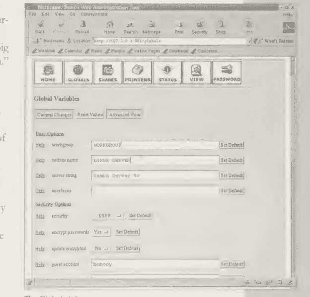

Globals 选项卡

如果你运行的是 Windows 98 或更高版本、带有 SP3 或更高版本的 Windows NT 4.0 或 Windows 2000，你需要确保它们使用加密密码=`yes`

### 共享

接下来，让我们移动到图 C 所示的 Shares（共享）选项卡。在这里，我们为 Windows 组或个人提供文件、驱动器等。默认创建的共享是“homes”共享，如果你选中它并点击“Choose”（选择），就可以对其进行编辑，这通常用于为个人用户账户设置 Samba 共享，因为目录位于 `/home` 中。然而，你可以使用 Shares 部分与网络共享你 Linux 机器上的任何目录。你也可以创建一个新文件夹例如 `/home/fileserver` 并进行共享。

### 图 C


### 共享参数

### 打印机

现在我们将查看 Printers（打印机）选项卡。在设置打印机之前，确保你已经在你的 Linux 机器上配置了打印机。如果你使用的是 Linux-Manjaro，请尝试使用 `Drakconf`，它有一个非常优秀的添加打印机实用。当你的打印机准备就绪并共享时，你将在打印机下方看到一个类似 `lr` 或 `lp0` 的条目下拉列表。这应该是活动打印机。选择 Printer（打印机）按钮将显示此共享的选项。确保你打算使用的用户可以访问该打印机。

### Shares 选项卡

### Samba 用户

图 D 所示的 Password（密码）选项卡带你使用密码工具添加 Samba 用户并设置或更改 Samba 密码。你还可以根据需要启用或禁用账户。要添加用户，你必须有一个本地 Linux 用户账户。最简单的方法是进入命令行并使用 `adduser`。当你输入 `adduser [回车]` 时，它会提示输入密码并确认。在本地添加用户后，回到 SWAT 的密码部分，输入用户名和密码，并选择“Add”（添加）。添加用户后，确保点击“Enable”（启用）按钮来启用该用户。

### 图 D


### 服务器密码管理

当你设置好所有共享、打印机和用户后，进入 Status（状态）选项卡并启动或重启 `smbd` 和 `nmbd` 服务（这是运行 Samba 的两个服务）。要测试你的配置，转到其中用户的 PC，尝试添加 Samba 打印机或将 Samba 共享挂载为 Windows 打印机或文件共享。如果你访问打印机或共享时遇到问题，可能是你的安全设置有问题。请参阅 SWAT 首页上的 Samba 文档。

## 网络邻域中的 Linux：使用 smbmount 和 smclient 查看 Windows

**作者：Jack Wallen, Jr.**

我曾多次不得不将 Linux 负载放入 Windows 堡垒中，但让它与网络邻域正常工作非常困难。

自诞生以来，`smbmount` 经历过重写，它的语法实际上发生了变化。

我首先假设你已经在机器上正确安装了 Samba，并设置了 `smbmount root id`。要设置此项，你必须进入 `root` 并运行这些命令：

```
M
```

当然，有方法可以让这种疯狂变得不那么疯狂。在这篇文章中，我将尝试展示这些方法并奠定基础，以帮助加快你在网络邻域中的速度。

一旦设置好，你就可以运行命令挂载你的 SMB 共享。

到结束时，你将……（注意：提供的文本从此处开始在 OCR 源中似乎损坏或乱码了）。


你当前所在的机器 IP 为 172.22.1.24。我们想要访问的机器是一台生产机器（名为 `Help`），其 IP 地址为 172.22.1.35，我们希望将它的共享挂载到主目录下一个名为 `work` 的子目录（该目录已经创建）。要挂载此目录，你需要在（以用户身份在你的机器上）运行以下命令：

`smbount //172.22.1.33/documentation-/work`

当你运行此命令时，你会看到如下输出：

```
$jwallen@$jwallen$ $smbount //172.22.1.24/documentation-/work
Added interface 172.22.1.24
bcast=172.22.1.255
mask=255.255.255.0
session request to: Failed Password:
```

当你输入密码（你的网络密码）后，你将看到 bash 提示符（如果一切顺利）。你可以通过对目录执行 `ls` 命令来检查挂载状态：

```
ls /work
```

该命令应该报告你所挂载机器的目录/文件列表。

## 后续的问题

当然，这有其处理方法。第一个也是最明显的是是，你处于一个使用 DHCP 分发 IP 地址的大型网络中。由于 DHCP 的存在，你不知道所需机器的 IP 地址。这在几乎任何情况下都是问题。即使在微软网络邻域（Network Neighborhood）中，你也无法识别这些信息。当然，绕过这个障碍的方法。要获取机器的 IP 地址，必须遵循以下步骤：

1. 找到机器的 NetBIOS 名称。
2. Ping 该名称。
3. 该名称报告的 IP 地址。

查找 NetBIOS 名称通常只需向机器的用户或网络管理员询问名称即可。通常当机器被用于生产环境时（特别是当多个用户需要时），用户会知道机器名称。如果没有人知道机器名称，且你拥有其物理访问权限，你可以进入控制面板，点击网络图标，并选择标识（Identification）选项卡。在标识选项卡下，你将看到想要访问的机器名称。

一旦有了名称，通过分页来确定 IP 地址就是件简单的事。在我们的示例中，你知道机器名称是 `Help`，而你使用的机器位于某个 DHCP 网络。运行命令

```bash
ping Help
```

你将收到机器的 IP 地址。记下该 IP 地址，以便将其插入 `smbount` 命令中。

## SMBclient 访问资源

当然，如果你不知道有哪些可用的共享，这对比你没有帮助。`smbount` 命令需要 `/share` 来在没有共享名称的情况下尝试挂载。你如何找到它？借助 Samba 的帮助找到共享名称！为了从机器获取可用共享，你将使用 Samba 的 `smbclient` 命令（我稍后会回顾），如下：

```bash
smbclient -L Help
```

## 作者备注：

如果你不知道 `Help` 机器的 IP 地址，可以进行替换。

以下是上述命令的输出片段：

```
Domain=[TECH] OS=[Windows NT 4.0]Server=[NT Lan Manager 4.0]
```

| Sharename | Type | Comment |
| :--- | :--- | :--- |
| NETLOGON | Disk | 登录服务器共享 |
| BizDev | Disk | 业务开发 |
| ProgramMan | Disk | 程序管理 |
| ADMIN$ | Disk | 远程管理 |
| Asset | Disk | 管理数据库 |
| Art | Disk | 运营 |
| IPC | Remote | 远程 IPC |

## smbclient

你在上方看到了你的机器可用的共享。现在你拥有了将共享挂载到 Linux 机器所需的所有信息。使用命令 `smbclient //help/work`

`smbclient` 是一个多功能工具，其作用之一是作为 Samba 的 FTP 客户端。当所有其他方法都失效时，这个工具非常有用。最大的缺点是你尝试访问 Windows 9x 机器。因为 9x 技术并非为网络设计，你将无法 FTP 进入那台机器。当然，有软件允许你在 9x 机器上启用这项技术，但那是以后的话题。

你将有效地将 `Art` 共享（来自 `Help`）挂载到 `/home/USER/work` 目录。你现在可以像使用自己的机器一样使用 `Art` 共享。

使用 `smbclient` 读写 Windows 机器上的目录，你需要使用此命令：`smbclient //SERVERNAME/SHARENAME`，并将收到如下信息：

然而，SMB 协议受一个问题的困扰。在随机时间，你会尝试查看（列出或更改）你的 SMB 挂载目录并收到以下错误：Work: Input/output error

```
Password:
Domain=[TECH] OS=[Windows NT 4.0]
Server=[NT LAN Manager 4.0]
```

这里是你创建用于挂载共享的目录。

这个问题没有解决方法。

再次登录，你会发现通过从 bash 提示符执行命令，你实际上已经将该命令发送到了 bash 文件中。将命令添加到 `/etc/rc.local` 文件中也是可能的，但这样做存在问题，且命令很少能成功。

（注：由于原文后续部分存在大量重复的文本段，译文已根据要求去重处理，避免重复输出。）

请注意，你必须在 PASSWORD 中使用你的网络密码。

## 使用 smclient 进行调试/诊断

你所使用的 `smclient` 工具提供了辅助调试 Samba 连接的能力（所有大写字母均为用户定义变量）：

- `IP_ADDRESS`—广播该地址。
- `DEBUG_LEVEL`—显示你调试信息的深度。
- `E`—将消息发送到 stderr（标准错误输出）而不是 stdout（标准输出）。
- `IP_ADDRESS`—设置你连接的服务器的 IP 地址。
- `i_SCOPE`—设置 NetBIOS 范围标识符。
- `LOG_FILE`—将日志设置到用户定义文件中。
- `NetBIOS_NAME`—允许你覆盖守护进程用于识别时将使用的 NetBIOS 名称。
- `SOCKET_OPTIONS`—设置 TCP/IP 套接字选项。这通常仅用于性能调优。
- `PORT_NUMBER`—设置客户端接受请求时使用的端口号。
- `RESOLVE_ORDER`—设置服务器的名称解析顺序。
- `CONFIGURATION_FILE`—声明 Samba 配置文件 (smb.conf)的位置。
- `TERMINAL_CODE`—设置亚洲语言的终端代码。
- `USERNAME`—设置用户名，并可与密码配合使用，如 `-Uusername@password`。
- `WORKGROUP`—设置你想要连接的组名。

上述列表非常全面，可以帮助你解决大多数 Samba 问题。

## GUI 前端

我终于可以提出那个我一直渴望讨论的问题了。偶尔，会发生非常神秘的事情。当我开始认为这并不是一个提供给读者的良好应用程序时，那实际上是因为微软的“网络邻域”（Network Neighborhood）。那个特定的应用程序简单易，读取工作既容易又高效，就像它是本地机器的固有部分一样。直到最近，Linux 还没有这样的应用程序。

LinNeighborhood（由 Hans Schmidt 和 Richard Steward 编写）是一个真正让我感到惊喜的应用程序。这个小程序只需自动且静默地挂载这些由实现创建的目录！我没等多久就发现这样一个应用程序出现，但这颗小宝石让在主 MS 服务器上运行 Linux 变得像一样简单。

虽然我对 LinNeighborhood 的使用经验没有它丰富，但我尝试了一下。该应用程序的基础建立在 `mount` 命令之上，并实现了它——以真正的 Windows 方式——尽可能地减少用户交互。一旦，这个精巧的程序就可以打开并显示可用的共享。通过右键点击，你可以从许多


| 挂载 | 卸载 | 停止 | 日志 | 添加 | 选项 | 关于 |
|---|---|---|---|---|---|---|
| /mnt | | | | | | |
| /mnt/devTeam | | | | | | |
| /home | | | | | | |
| /var | | | | | | |
| /etc | | | | | | |
| /tmp | | | | | | |
| /usr | | | | | | |
| /sbin | | | | | | |
| /dev | | | | | | |
| /home/user | | | | | | |
| 注销登录 | /home/user | | | | | |

选项中。在这些右键选项中，有能够共享挂载点然后使用文件管理器对其进行浏览的能力。它是既简单又优雅。

该应用程序唯一的可能在于初始配置。当你在典型的 MS 网络上运行时，你只需要配置以下内容（在 Options | Preferences 菜单下）：在 Scan 选项卡中配置 Workgroup。如果你有用户名和密码，请始终作为用户扫描（你需要此项）。在 Programs 选项卡中，你可能需要切换到稍不同的版本。选择 Mounted Shares/下次启动时重新挂载。在 Post 选项卡中，你可能想要配置不同的文件管理器。

该应用程序的优点之一在于，当你打开程序时，它会立即连接到整个网络——双击其他图标，它将挂载用户配置的共享。

挂载在 Giles（本地机器）上的机器共享（两个 NT 机器）。两个下面是第三个图标（一个可爱的企鹅头），它代表整个网络（尽管它带有本地机器的名字）。

LinNeighborhood 的主界面如图 A 所示。你会发现主窗口包含三个图标。前两个图标（小电脑）代表两个

## 结论

虽然过了一段时间，但 Linux 终于达到了可以与 Windows 世界轻松共存的程度。复杂的网络设置正迅速成为过去。在这篇文章中，我们努力让你离在没有 Windows 的工作站上工作的梦想更近。

## LinNeighborhood：一种在 Windows 网络中推进 Linux 的新 GUI

作者：Jack Wallen, Jr.

这已经很久了，但 Linux 终于在集成救援上看到了曙光。Hans Schmid 和 Richard Stemmer 创建了 LinNeighborhood，这是一个针对某些且复杂的命令的轻量级前端。

LinNeighborhood 是 Network 的图形化端口，运行在 Samba 单元以及内核大于 2.1.70 的 Linux `smbfs` 程序下，以及内核大于 2.1.70 的 `mount/smbnt/smbount`。LinNeighborhood 允许用户浏览 SMB (CIFS) 网络，该网络由 Samba、Windows（Windows 95, 98, NT，以及可能的（尽管尚未测试）OS/2 和 LANManager for DOS 等组成）。它还提供了一个界面来挂载共享。

当你打开程序时，它会立即连接到整个网络——双击其他图标，它将挂载用户配置的共享。

我偶然在 LinNeighborhood 中发现了这个关于访问许多 Windows 机器的应用程序。

你可以通过两种方式运行 LinNeighborhood：

- 使用 LinNeighborhood 命令
- 从主菜单选择 LinNeighborhood（在 KDE 中，如果你已添加到应用程序）

## 启动配置 LinNeighborhood

## 安装 LinNeighborhood

这等了很久，但 Linux 终于在集成救援上看到了曙光。Hans Schmid 和 Richard Stemmer 创建了 LinNeighborhood，这是一个针对某些且复杂的命令的轻量级前端。

LinNeighborhood 是 Network 的图形化端口，运行在 Samba 单元以及内核大于 2.1.70 的 Linux `smbfs` 程序下，以及内核大于 2.1.70 的 `mount/smbnt/smbount`。LinNeighborhood 允许用户浏览 SMB (CIFS) 网络，该网络由 Samba、Windows（Windows 95, 98, NT，以及可能的（尽管尚未测试）OS/2 和 LANManager for DOS 等组成）。它还提供了一个界面来挂载共享。

我偶然在 LinNeighborhood 中发现了这个关于访问许多 Windows 机器的应用程序。

我访问网站发现源码和 rpm 包均可用。为了加速进程，我选择了 rpm 包（版本为 0.6）并按以下方式安装：

使用源码安装同样简单。一旦下载了文件 `LinNeighborhood-0.6.tar.gz`，你可以运行：

配置 LinNeighborhood 非常简单。如果你对网络环境有基础知识并正确配置了 `smb.conf` 文件，配置过程只需几秒钟。配置应用程序的第一步是打开 LinNeighborhood 并选择 Options | Preferences。在窗口中，如图 B 所示，输入网络组信息。

在你运行上述命令后，软件包应该安装完成。

图 A

图 B

| 文件选项 |
| 挂载 | 卸载 | 步骤 | 日志 | 添加 | 选项 | 关于 |
|---|---|---|---|---|---|---|
| mt2 | | | | | | |
| nt1 | | | | | | |
| giles | | | | | | |
| AMERICAN | | | | | | |
| INTERWOVEN | | | | | | |
| STANFORD | | | | | | |
| TECH | | | | | | |
| TPG_LABS | | | | | | |
| WEBOPS | | | | | | |
| 扫描 程序 杂项 后 挂载 |
|---|---|---|||
| 扫描 选项 | | | |
| 工作组 | TECH | | |
| 主浏览器 | | | |
| WINS 服务器 | | | |
| 额外的主浏览器 | 编辑主浏览器列表 |
| 始终作为用户扫描 | 组作为用户扫描 | |
| 组扫描扫描 | 询问用户/密码 | |
| 挂载时使用组名 | | |
| 启动时初始浏览 | 快速浏览 | |
| 确定 | 保存 | 取消 |
| 资源 挂载点 |
|---|---|
| /mt2 | /home/walle/mtn2/TPG/ |
| /mt2/WebTeam | /home/walle/mtn2/WebTeam/ |
| /mt2/Editorial | /home/walle/mtn2/Editorial/ |
| 15 个对象 | 注销登录 |
|---|---|

当你打开 LinNeighborhood，你将看到。

企业级 Linux 管理员指南

在“扫描”（Scan）选项卡中，你可以选择配置主浏览器、配置 WINS 服务器以及编辑主浏览器列表。你还有这些选项：

如果你经常挂载共享内容，可以使用此选项。这样，你每次运行 LinNeighborhood 时就不需要重新映射驱动器。

- 以用户身份扫描
- 以组身份扫描
- 组用户身份扫描
- 询问用户/密码一次
- 挂载时使用组名
- 启动时初始浏览
- 快速浏览

“后挂载”（Post Mount）是一个有趣的选项。在这里，你可以配置在打开各种共享目录时希望使用的文件管理器。有趣的是它的配置方式。配置窗口提供了一个下拉框、一个可点击按钮和一个文本字段。从下拉列表中，你可以选择以下文件管理器之一：

- Midnight Commander
- KDE 的 Dolphin
- GNOME 的 gnc
- X-files
- Window Finder

在上述配置中，“工作组”（Workgroup）和“始终以用户身份扫描”（Always Scan As User）是你最可能用到的选项。配置好这些选项后，当你打开应用程序时，只需双击共享内容，然后输入用户名和密码即可静默挂载。

一旦选择了文件管理器，你会发现点击 Samba 和/或 OK 会设置配置。事实并非如此。在点击“保存”（Save）或“OK”后，你需要点击“从组合移动到编辑字段按钮”（Press Button To Move From Combo To Edit Field）按钮。通过点击此按钮，你实际上将配置选项选择到了正确的字段。

接下来是“程序”（Programs）选项卡。此选项卡包含三个框：

- 版本 <= 2.0.4
- 版本 = 2.0.6
- 版本 >= 2.0.6

在这里选择你安装的 Samba 版本并相应配置账户。要检查运行的 Samba 版本，请使用以下命令：

```
rpm -q samba
```

此时，Samba 的当前版本是 2.0.7-4，因此选择版本 2.0.6。这至关重要，因为之前的版本差异巨大且方式不同。

此时，选择 LinNeighborhood。你有配置 LinNeighborhood 包默认挂载点的选项。此设计的巧妙处（并向创建者致赞）是，安装后，该选项会创建 SMB/root 目录，所有其他子目录将在其中静默创建。这减轻了用户的负担。用户配置（微软思维，课程内容）。

这说明了我目前在 LinNeighborhood 中发现的局限性之一。许多用户习惯使用某种文件管理器而不是另一种——当你首选的文件管理器未在上述列表中时怎么办？你就运气了！不幸的是，可用的文件管理器涵盖了相当大的范围（从纯文本的 Midnight Commander 到功能强大的 gnc 图界面）。

一旦配置好 LinNeighborhood，它的使用过程非常简单。事实上，这是我用过的简单的 Linux 网络工具之一。

当打开应用程序时，你会在窗口中看到图标，代表网络上可用的共享（见图 A）。如果你选择了配置好的“始终以用户身份扫描”，用户只需双击共享图标即可弹出用户名/密码窗口，按下 [Enter] 键，共享就会打开并显示其宝藏。

在同一个选项卡（杂项/Miscellaneous）上，你会找到“记忆共享/下次启动时重挂”（Memorized Shares/Remount On Next Startup）选项。你会想要启用它。


或者，你可以右键点击，这将带出一个许多功能的菜单。这些选项包括：

- 重新扫描机器
- 以用户身份扫描
- 编辑机器
- 移除机器
- 显示信息

窗口中你可以双击子目录（以挂载它们），但在下方的窗口中无法这样做。

## 显著特性

`LinNeighborhood` 应用程序提供了这么多功能，几乎不可能列出所有功能。相反，我将只提到几个：

- 异构网络设置。
- 消除了使用 `smb`、`sebi` 和 `smient` 命令的所有复杂性。
- 让你远离命令行界面。
- 提供简单优雅的图形用户界面（GUI）。
- 具有智能设计。
- 与 `Windows` 网络无缝集成。

在这些命令中，你将主要使用“以用户身份扫描”。然而，偶尔你可能更改特定机器的信息或简单获取机器信息。这两个操作都非常简单。获取共享信息只需右键点击图标并选择“显示信息”。你将看到：

- 名称
- 操作系统
- 服务器
- IP 地址

## 结论

一旦挂载了共享并展开其内容，你会看到以文件形式显示的子目录。每个文件代表一个已挂载的共享，你可以使用配置的文件管理器进行浏览。要打开目录，你必须右键点击图标并选择“文件管理器”。配置的文件管理器将打开，你可以像访问本地驱动器一样进行浏览。

如果你使用 `Linux` 并处理 `Linux` 之外的应用程序，我再不能推荐你使用这个应用程序。`LinNeighborhood` 会让你的 `Linux` 计算变得简单得多——你将不知道没有它是如何生存的。

注意屏幕上方窗口的操作与下方窗口不同。在下方窗口中，你会看到显式的目录路径，例如 `/mnt2/TPG`，这显示了当前挂载的所有子目录。对于这些目录路径，右键点击可以访问“挂载”（或卸载）或“文件管理器”命令。虽然在上方窗口中

我的桌面上很少出现能像这个小宝石一样产生如此影响的应用程序。看起来创建者们做到了。


网络

169

一旦构建了 `sendmail`，你就需要对其进行配置。`Sendmail` 使用 `m4` 从源配置文件构建所有的 `/etc/sendmail.cf`。这允许你通过定义 `m4` 选项并构建你的 `/etc/sendmail.cf` 来定义一些复杂的邮件行为。另一种方法是手动修改 `/etc/sendmail.cf`，除非你觉得在列表 A 中的操作让你显得非常愚蠢，否则有时这样做是可以接受的，但我不建议你这样做。（当然，如果你是一个 `Perl` 黑客，你可能在想为什么他们选择让这个文件具有如此可读性）。

这些就足够了。让我们聊聊文件中的指令：

- `divert(-1)`: 这意味着忽略后续的所有内容，直到出现 `divert(0)` 命令为止。
- `VERSION`: 这将丢弃生成的配置文件中的版本信息。
- `OPTYPE`: 这非常重要。如果你没有正确定义 `OPTYPE`，在运行程序时会遇到很多问题。
- `DOMAIN`: 你可以在这里输入你的域名名称，或者让 `let-sendmail` 从系统中获取名称。
- `MAILER(local)`: 本地邮件发送器总是会自动包含在内的。
- `MAILER(smtp)`: 应该注意，如果你打算添加 `FEATURE` 指令，那么 `MAILER` 指令应该放在最后。

在 `/etc/sendmail.cf` 顶部的某些选项并非如此。即使在配置文件中进行更改，其缺点是，如果你以后需要从 `m4` 重新生成它，你的更改可能会丢失。

运行新创建的 `sendmail.x.x` 运行你的命令：

这些指令中的每一个都将在生成的文件中生成一行到多行内容，你将使用列表 G 中的命令来构建它：

```
cd /etc
cp generic-linux.m mysite.cf
```

这将根据 `generic-linux.m` 文件生成 `mysite.cf` 文件。通过这样做，你可以确保在开始之前拥有一份原始文件的副本。

你最终将得到一个大约 1200 行的文件，与你可以通过随书附带的 CD 光盘访问的示例配置类似。另外请注意上面的输出，如果你手动处理文件为 `.cf`，你需要运行的命令是：

```
/usr/bin/m4 ... /m4/cf.m4 mysite.cf
```

你应该选择一个与你的环境尽可能相似的模板。我是在 `Linux` 系统上构建，所以 `generic-linux` 似乎是合适的。

让我们看看模板文件，它在列表 B 中显示。

这里没什么。记住，这只是一个模板文件。对于许多站点，

最新版本的 `sendmail` 将配置文件保留在 `/etc/mail`，而不仅仅是 `/etc`：

# 列表 A：剥离语法

```
# strip 组：语法（不在括号内！）和结尾的分号
R$: $1 <@  addresses
R* < $ > $* <@  $1 < $2 $3  unmark <addr>
R@ * <@  $1  unmark @host:
nR*: : * <@  $1 : $2  unmark node:addr
R: include:<@  $include: $1  include:
R* [ * ] <@  $1 [ $2 [ 3 ]  IPv6 addrs
R*: : [ ]  $1 : $2 [ 3 ] <@  remark if leading colon
```

## 列表 B：模板文件

```
divert(-1)
# Copyright (c) 1998, 1999 Sendmail, Inc. and its suppliers.
## All rights reserved.
## Copyright (c) 1983 Eric P. Allman. All rights reserved.
# Copyright (c) 1988, 1993
# The Regents of the University of California. All rights reserved.
# 通过使用此文件，你同意在 LICENSE 文件中列出的
# 条款和条件，该文件可以在 sendmail 
# 发行版的根目录中找到。
## 这是一个用于 Linux 的通用配置文件。
# 它仅支持本地和 SMTP 邮件。如果你想
# 自定义它，请将其复制为适合你环境的名称
# 并在此处进行修改。

divert($)dnl
VERSIONID($Id: gen-sendmail.mc.v 8.1 1999/09/24 22:48:05 gshapiro Exp $')
OSTYPE(linux)dnl
DOMAIN(generic)dnl
MAILER(local)dnl
MAILER(smtp)dnl
```

## 列表 C：构建你的 .cf

```
[stew@notebook cf]$ Build mysite.cf
```

```
Using M4 /usr/bin/m4
rm -f mysite.cf
/usr/bin-m4 ...m4/cf.m4 mysite.cf || ( rm -f mysite.cf && exit 1 )
chmod 444 mysite.cf
```

要完成安装，请备份当前的 `sendmail`。运行你的命令：

这些指令每一个都将在生成的文件中生成一行到多行内容。另外请注意上面的输出，如果你手动处理文件为 `.cf`，你需要运行的命令是：

```
/usr/bin/m4 ... /m4/cf.m4 mysite.cf
```

你应该选择一个与你的环境尽可能相似的模板。`generic-linux` 似乎是。

让我们看看模板文件，它在列表 B 中显示。

这里没什么。记住，这只是一个模板文件。对于许多站点，

最新版本的 `sendmail` 将配置文件保留在 `/etc/mail`，而不仅仅是 `/etc`：

# 列表 A：剥离语法

```
# strip 组：语法（不在括号内！）和结尾的分号
R$: $1 <@  addresses
R* < $ > $* <@  $1 < $2 $3  unmark <addr>
R@ * <@  $1  unmark @host:
nR*: : * <@  $1 : $2  unmark node:addr
R: include:<@  $include: $1  include:
R* [ * ] <@  $1 [ $2 [ 3 ]  IPv6 addrs
R*: : [ ]  $1 : $2 [ 3 ] <@  remark if leading colon
```

## 列表 B：模板文件

```
divert(-1)
# Copyright (c) 1998, 1999 Sendmail, Inc. and its suppliers.
## All rights reserved.
## Copyright (c) 1983 Eric P. Allman. All rights reserved.
# Copyright (c) 1988, 1993
# The Regents of the University of California. All rights reserved.
# 通过使用此文件，你同意在 LICENSE 文件中列出的
# 条款和条件，该文件可以在 sendmail 
# 发行版的根目录中找到。
## 这是一个用于 Linux 的通用配置文件。
# 它仅支持本地和 SMTP 邮件。如果你想
# 自定义它，请将其复制为适合你环境的名称
# 并在此处进行修改。

divert($)dnl
VERSIONID($Id: gen-sendmail.mc.v 8.1 1999/09/24 22:48:05 gshapiro Exp $')
OSTYPE(linux)dnl
DOMAIN(generic)dnl
MAILER(local)dnl
MAILER(smtp)dnl
```

## 列表 C：构建你的 .cf

```
[stew@notebook cf]$ Build mysite.cf
```

```
Using M4 /usr/bin/m4
rm -f mysite.cf
/usr/bin-m4 ...m4/cf.m4 mysite.cf || ( rm -f mysite.cf && exit 1 )
chmod 444 mysite.cf
```

要完成安装，请备份当前的 `sendmail`。运行你的命令：

这些指令每一个都将在生成的文件中生成一行到多行内容。另外请注意上面的输出，如果你手动处理文件为 `.cf`，你需要运行的命令是：

```
/usr/bin/m4 ... /m4/cf.m4 mysite.cf
```

你应该选择一个与你的环境尽可能相似的模板。`generic-linux` 似乎是。

让我们看看模板文件，它在列表 B 中显示。

这里没什么。记住，这只是一个模板文件。对于许多站点，

最新版本的 `sendmail` 将配置文件保留在 `/etc/mail`，而不仅仅是 `/etc`：

# 列表 A：剥离语法

```
# strip 组：语法（不在括号内！）和结尾的分号
R$: $1 <@  addresses
R* < $ > $* <@  $1 < $2 $3  unmark <addr>
R@ * <@  $1  unmark @host:
nR*: : * <@  $1 : $2  unmark node:addr
R: include:<@  $include: $1  include:
R* [ * ] <@  $1 [ $2 [ 3 ]  IPv6 addrs
R*: : [ ]  $1 : $2 [ 3 ] <@  remark if leading colon
```

## 列表 B：模板文件

```
divert(-1)
# Copyright (c) 1998, 1999 Sendmail, Inc. and its suppliers.
## All rights reserved.
## Copyright (c) 1983 Eric P. Allman. All rights reserved.
# Copyright (c) 1988, 1993
# The Regents of the University of California. All rights reserved.
# 通过使用此文件，你同意在 LICENSE 文件中列出的
# 条款和条件，该文件可以在 sendmail 
# 发行版的根目录中找到。
## 这是一个用于 Linux 的通用配置文件。
# 它仅支持本地和 SMTP 邮件。如果你想
# 自定义它，请将其复制为适合你环境的名称
# 并在此处进行修改。

divert($)dnl
VERSIONID($Id: gen-sendmail.mc.v 8.1 1999/09/24 22:48:05 gshapiro Exp $')
OSTYPE(linux)dnl
DOMAIN(generic)dnl
MAILER(local)dnl
MAILER(smtp)dnl
```

## 列表 C：构建你的 .cf

```
[stew@notebook cf]$ Build mysite.cf
```

```
Using M4 /usr/bin/m4
rm -f mysite.cf
/usr/bin-m4 ...m4/cf.m4 mysite.cf || ( rm -f mysite.cf && exit 1 )
chmod 444 mysite.cf
```

要完成安装，请备份当前的 `sendmail`。运行你的命令：

这些指令每一个都将在生成的文件中生成一行到多行内容。另外请注意上面的输出，如果你手动处理文件为 `.cf`，你需要运行的命令是：

```
/usr/bin/m4 ... /m4/cf.m4 mysite.cf
```

你应该选择一个与你的环境尽可能相似的模板。`generic-linux` 似乎是。

让我们看看模板文件，它在列表 B 中显示。

这里没什么。记住，这只是一个模板文件。对于许多站点，

最新版本的 `sendmail` 将配置文件保留在 `/etc/mail`，而不仅仅是 `/etc`：

# 列表 A：剥离语法

```
# strip 组：语法（不在括号内！）和结尾的分号
R$: $1 <@  addresses
R* < $ > $* <@  $1 < $2 $3  unmark <addr>
R@ * <@  $1  unmark @host:
nR*: : * <@  $1 : $2  unmark node:addr
R: include:<@  $include: $1  include:
R* [ * ] <@  $1 [ $2 [ 3 ]  IPv6 addrs
R*: : [ ]  $1 : $2 [ 3 ] <@  remark if leading colon
```

## 列表 B：模板文件

```
divert(-1)
# Copyright (c) 1998, 1999 Sendmail, Inc. and its suppliers.
## All rights reserved.
## Copyright (c) 1983 Eric P. Allman. All rights reserved.
# Copyright (c) 1988, 1993
# The Regents of the University of California. All rights reserved.
# 通过使用此文件，你同意在 LICENSE 文件中列出的
# 条款和条件，该文件可以在 sendmail 
# 发行版的根目录中找到。
## 这是一个用于 Linux 的通用配置文件。
# 它仅支持本地和 SMTP 邮件。如果你想
# 自定义它，请将其复制为适合你环境的名称
# 并在此处进行修改。

divert($)dnl
VERSIONID($Id: gen-sendmail.mc.v 8.1 1999/09/24 22:48:05 gshapiro Exp $')
OSTYPE(linux)dnl
DOMAIN(generic)dnl
MAILER(local)dnl
MAILER(smtp)dnl
```

## 列表 C：构建你的 .cf

```
[stew@notebook cf]$ Build mysite.cf
```

```
Using M4 /usr/bin/m4
rm -f mysite.cf
/usr/bin-m4 ...m4/cf.m4 mysite.cf || ( rm -f mysite.cf && exit 1 )
chmod 444 mysite.cf
```

我们要求的是将 `sendmail.cf` 中的 `HOLD_EXPENSE` 标记设置为 `true`，并将所有 `SMTP` 邮件发送器标记为高昂（expensive）。我们还将所有出站邮件传递到我们 `ISP` 的 `SMART_HOST` 服务器——`smtp.mysyip.com`。

拒绝来自你域名之外主机或某些“信任”主机的中继。在下一篇文章中，我们将介绍如何微调此行为，以及如何控制系统内部和外部对邮件系统的使用。

对生成的 `sendmail.cf` 的影响将类似于列表 所示。

最后，如果你查看 `sendmail.cf` 文件末尾附近的 `SMTP` 邮件发送器定义，你会注意到添加了表示高昂的 `e` 标记：

```
Msmtp P=[IPC] F=MDFMuxe
```

本地邮件发送器将没有 `e` 标记。现在，所有出站邮件将被暂留，直到你运行以下命令：

```
/usr/sbin/sendmail -q -v
```

默认情况下，依赖于 `sendmail` 的中继并没有被禁用。在互联网爆炸以及我们收到的相应的垃圾邮件出现之前，从/到任何主机进行中继曾相当常见。大多数邮件服务器现在

## 结论

我们触及了一些可以在 `.mc` 文件中启用的功能，并简单介绍了 `sendmail` 使用的一些数据库功能。作为一个极其灵活、可配置的程序，`sendmail` 具有许多功能和可以启用的“黑科技”（hacks）。O'Reilly 的那本蝙壳书有 1000 页关于 `sendmail` 及相关的文档，这可能让你了解这个主题可以有多深。有些人已经将 `sendmail` 视为过恐龙，并推崇其他邮件发送器（如 `qmail`）的优点。这些发送器也很好，但 `sendmail` 仍然满意地运行着许多高流量邮件站点。

## 列表 G：智能中继

```
## “智能”中继主机（可能为空）
DSsmtp.mysyip.com
```


## 在初始提交时避免连接到“高昂”的邮件发送器？

`O HoldExpensive=True`

## 从零开始 sendmail：功能、调优与性能

作者：Stewart Benedict

在“从零开始理解 sendmail”中，我涵盖了哪里获取 `sendmail`，以及如何从源码构建并使用 `.mc` 文件和选项设置基础 `sendmail`。这次，我将涵盖一些额外的 `.mc` 选项以及它们对 `sendmail` 的影响。我还将涵盖一些命令行开关，以及你可以使用 `sendmail` 通过别名（aliases）或伪装（masquerading）来测试任何地址重写的方法。最后，我将提供关于性能调优以及如何分析 `sendmail` 统计数据和日志文件的信息。

### 启用额外功能

让我们看看更多可以在邮件文件中启用的功能，该文件被用于生成 `sendmail.cf`。回顾一下，我们在邮件文件中定义配置，并使用 `m4` 处理器生成 `cf` 文件：`/usr/bin/m4 ...cf mysite.mc < mysite.cf`

`sendmail` 现在带有中继交付功能。在互联网早期，这些并不是问题，但随着我们所有人收到的海量垃圾邮件，管理员有必要收紧对谁的邮件通过其系统的控制。如果你想启用中继，请在邮件文件中添加以下功能：

```
FEATURE ('promiscuous relay')
```

如果你只想中继到自己的域名，请使用：

```
FEATURE ('relay_domain')
```

硬币的另一面是如何设置一个服务器来接受另一个域名。如果你从一个未限定的域名（例如小型企业或家庭服务器）中继，但想将邮件队列并批量发送到你的 ISP，这将非常有用。这涉及到伪装和中继，留下了几个可以启用的控制层。最简单的伪装级别是：

```
MASQUADE_AS (host)
```

所以如果你的主机是 `sendmail.cf`，且你想让出站邮件看起来像 `domain.com`，那么 `sendmail.cf` 文件中的规则将如列表 A 所示。大多数邮件服务器现在

### 结论（此处为内容重复，根据原文保留翻译）

### A：伪装

`A`

（可能）

`smtp.mysyip.com`

有些站点会拒绝这种邮件，所以你可能需要伪装：

```
domain.com
```

如果你想对某些用户进行，，邮件发送器，使用：

```
EXPOSED_USER (usernames)
```

你还可以设置虚拟域名，你的邮件发送器可以：

```
FEATURE ('vertustable')
```

在这种情况下，你的入站邮件：

```
larry
```

为了以这种方式映射出站邮件，使用功能：

```
FEATURE ('genericstable')
```

并设置 `/etc/mail/genericstable`，像虚拟的具有：

```
larry
```

如果你有很多机器，并想在发送到 ISP 之前中继所有邮件，那么

```
define ('LOCAL_RELAY', 'mail:hostname')
```

所有未限定的地址将被中继到本地机器。在 `sendmail.cf` 中，结果类似于列表 B。

相关的功能是：

```
define ('SMART_HOST', 'mail:hostname')
```

### B：中继

`C： 使用黑名单`

文件的右侧，带有 `REJECT`、`OK`、`RELAY` 或各种 `ERROR` 信息：

```
spammer@yahoo.com      REJECT
cibers@cyber.com       REJECT
mybody@cyber.com        OK
```

你还可以为你的系统和用户设置“黑名单”，使用：

```
FEATURE ('blacklist_recipients')
```

再次，这是一个表格列表，可以包含用户和域名（使用 `C`），客户端在通过简单邮件传输协议 (SMTP) 服务器发送出站邮件之前，在 `POP` 服务器上检查他们的入站邮件。

由于许多客户端可以以此方式运行，对用户有特殊要求，只有授权的用户可以通过服务器中继邮件。

这涵盖了关于什么通过你的服务器的大部分关注问题。还有，`sendmail` 网站在 `www.sendmail.org` 显示了它们。

### 测试模式运行

另一种运行 `sendmail` 的方式是测试模式，它允许你检查别名和重写规则。你可以通过带有 `-bv` 或 `-bt` 关来运行 `sendmail`。

假设你有以下别名，有两个管理员接收 `root` 的邮件，还由于名为“`management`”的用户别名列表：

```
root           stew      Dianne
management   stew      Fred. Justin
```

```
[sendbook mail]$ /usr/sbin/sendmail -bv root
dianne... User unknown
stew... deliverable: mailer, local user stew
```

178 企业级 Linux 管理员指南

### 列表 D: 一个简单的别名检查脚本

```
[root@omnibook mail ~]# cat check_aliases.sh
#!/bin/sh

for i in $(grep "#" < /etc/mail/aliases | awk -F":" '{print $1}'); do
  result=$(usr/sbin/sendmail -bv $i | grep -v deliverable)
  if [ -n "$result" ]; then
    echo "Bad alias in: $i"
    echo "$result"
  fi
done
[root@omnibook mail ~]# ./check_aliases
Bad alias in root:
dianne... User known
Bad alias in management:
justin... User known
fred... User known
```

所以我们可以看到 `"dianne"` 用户不再是该机器上的有效账户了。

```
[omnibook mail]$ /usr/sbin/sendmail -bv management
justin... User known
fred... User known
stew... deliverable: mailer,
```

> 同样，“`Fred`” 和 “`Justin`” 不再是有效的账户。

如你所见，当你的用户账户系统中添加或删除账户时，这是一种测试别名的非常简单的方法，此时你可能想要设置别名文件，并向任何无效地址发送电子邮件。

列表 D:

你也可以使用 `-bt` 选项运行 `sendmail` 来测试你的规则集。如果运行了它，你会发现自己处于一个 `"$#"` 提示符，可以在其中输入规则集名称或地址，你将看到该地址是如何通过规则集并被处理的。

```
[stew@omnibook mail]$ /usr/sbin/sendmail -bt
ADDRESS TEST MODE (ruleset 3 NOT automatically invoked)
Enter <ruleset> 
> stew
```

```
parse input: stew
Parsec input: stew
Parsec returns: stew
ParLocal input: stew
ParLocal returns: stew
Parsel input: stew
Parsel returns: # local $: stew
Parse returns: # local $: stew
31 stew
HdrFromSMTP input: stew
PseudoToReal input: stew
PseudoToReal returns: stew
MasqSMTP input: stew
MasqSMTP returns: < @ LOCAL *
Masqdr input: < @ LOCAL *
Masqdr returns: < @ myisp
  .com .
HdrFromSMTP returns: < @ myisp
  .com .
```

如果我们在使用伪装设置（masquerading setup），可以使用此来确保“发件”地址正如你预期的那样被重写。

### 规则集 31

规则集 `31` 用于标头重写。

网络 179

观察地址如何通过各种规则集并被修改是非常趣的。列表显示了一个我们在 `access_db` 中设置的针对你的 Yahoo 垃圾邮件发送者的规则。

这些示例让你让你概览了通过启用不同的 `sendmail` 选项和功能可以执行的操作，并提供了一种比发送邮件并希望它能送达更高效的测试方法。如果你正在使用数据库表控制列表，设置一些脚本在添加新条目后通过测试模式运行它们将是有有无益的。事实上，你可以自动化处理向其中一个数据库表添加新条目的过程，运行 `makemap`，重启 `sendmail`，并并通过测试模式处理新条目。

## Sendmail 性能优化

现在我们已经了解了一些可以对进出邮件所施加的控制程度，让我们看看如何通过运行 `sendmail` 来获得最大效率。有很多选项

我们可以设置这些控制邮件如何被处理，以及 `sendmail` 如何与系统上运行的其他软件共存。

`QueueOrder=host`

如果你向同一主主上的多个用户传输大量邮件，此功能可以最有效地利用系统缓存。出站队列按主机名排序，通过缓存连接，发往同一个主机的多条消息可以通过一个连接通过，而不是不断打开和关闭 SMTP 连接。

如果你正在处理海量的邮件，你可能需要采取措施使用单独的磁盘、`RAID` 或哈希文件系统来增加消息队列的效率。你可能还需要运行额外的邮件处理器，并将 `QueueSortOrder` 同时设为 `"host"` 和 `"time"`，以便快速清理消息，并确保最旧的消息不会被退回。

`Sendmail` 大度利用了 `DNS`，如果你正在处理大量的邮件

### 列表 E: 拒绝我们的 spammer@yahoo.com

| 命令 | 输入 | 返回值 |
| :--- | :--- | :--- |
| `Basic_check_mail` | input: `spammer @ yahoo . com` | |
| `tls_client` | input: `$ \| < ? >` | |
| `LookUpDomain` | input: `< ? > < ? > < ! TLS Clt` | |
| `LookUpDomain` | returns: `< ? > < ? > < ? > < ! TLS Clt` | |
| `LookUpAddress` | input: `< ? > < << < ! TLS Clt` | |
| `LookUpAddress` | returns: `< ? > < << < ! TLS Clt` | |
| `tls_connection` | input: `$ \| < ? > < > < ! TLS Clt` | |
| `tls_connection` | returns: `OK` | |
| `tls_client` | input: `< spammer @ yahoo . com >` | |
| `canify` | input: `< spammer @ yahoo . com >` | |
| `canify2` | input: `< spammer @ yahoo . com >` | |
| `canify2` | returns: `< spammer @ yahoo . com >` | |
| `canify` | returns: `< spammer @ yahoo . com >` | |
| `Parse` | input: `< spammer @ yahoo . com >` | |
| `Parse` | returns: `< spammer @ yahoo . com >` | |
| `CanonAddr` | returns: `< spammer @ yahoo . com >` | |
| `SearchList` | input: `< From $ F : spammer @ yahoo . com > < : spammer @ H : . com >` | |
| `SearchList` | returns: `< REJECT` | |
| `Basic_check_mail` | returns: `# error @ $ 750 Access denied` | |

Linux 管理员指南：避免在同一台机器上同时运行 `sendmail` 和 `bind`，因为它们会竞争资源。还有其他选项可以控制如何与系统上的程序共存：

- `ConnectionCacheSize` 打开后续发往同一主机的连接数。
- `ConnectionCacheTimeout` 定义连接的超时。
- `ConnectionRate` 减慢入站连接。
- `Expensive` 将某些邮件定义为“昂贵的”，并在系统低负载时运行。
- `MaxChildren` 限制派生进程的数量。
- `MinQueueAge` 不处理过期的队列。
- `QueueFactor` 与 `QueueLA` 配合，根据系统负载调整是发送邮件还是进入队列。
- `QueueLA` 是 `sendmail` 开始排序的平均负载。
- `RefuseLA` 是 `sendmail` 拒绝入站邮件的平均负载。

`sendmail` distribution 提供了关于这些选项默认值的详细信息。本文的重点是查看你的邮件服务器在处理哪些内容（见列表 F）。这告诉我们有 15 条邮件来自本地邮件代理，同时有 664 条邮件来自 SMTP，其中一条邮件通过 SMTP 发出。你可以通过 `cron` 任务自动化报告统计并重置日志文件：

```
#!/bin/sh
mailstats -f /etc/statistics
cat /dev/null > /etc/statistics
```

如果你真的想深入了解 `/var/log/mail` 的细节。

### 列表 F: Mailstats 报告

```
[root@omnibook config]# mailstats -f /etc/mailstats

Statistics from Apr 14 17:48:21

| msgs_from | bytes_from | msgs_to | bytes_to | Mailer |
| :--- | :--- | :--- | :--- | :--- |
| 15 | 287 | 65 | 1310K | local |
| 664 | 2589K | 679 | 2617K | smtp |
| 679 | 676 | | | |
```

### 列表 G: mailog 将显示所有

```
Jun 4 18:58:26 omnibook sendmail[1934]: restarting on signal /usr/sbin/sendmail
Jun 4 18:58:26 omnibook sendmail[1956]: starting daemon (8.11.3): SMTP:+queue1:00
Jun 4 20:07:31 omnibook sendmail[2008]: ua2008: from=*root@omnibook.ays, size=275, class=0, ncerts=5, mgide=P.LNX.4.1081420724.2006-10000@omnibook.ays, retry=root@localhost
Jun 4 20:07:31 omnibook sendmail[2009]: ua2008: to=<stew@omnibook.ays.net>, claddr=<root@omnibook.ays.net> (0), delay=00:00:00, xdelay=00:00, mail=local, pri=3019, stat=2.0.0, stat=sent
```

most of the transaction details of `sendmail` and the local mail agent (see Listing G). 这些内容有点难以消化，但当然，有很多日志分析工具可以帮助你。其中一个工具是 `report`，地址位于：`http://ftp.matrix.co.za/pub/report/report-0.9.tar.gz`（见列表 H）。

有很多开关允许你只查看“来自”或“到达”，或者应用过滤和排序。同样，你可以将其作为 `cron` 任务运行并在处理后刷新日志文件，或者将其移动到备份中，以便在报告发现问题后进行审查。

### 列表 H: mreport

```
[root@omnibook mreport-0.9]# mreport

[ 2]    551 root@omnibook.ays.net stew@omnibook.ays.net
[ 1]    513 root
=================================================
Total Bytes           : 4266074
Number of Records    : 388
Host Name             : omnibook.ays.net
Input File            : /var/log/maillog
Output File           : stdout
First Record          : May 13 06:55:58
Last Record           : Jun 4 20:23:18

Time Taken            : 975576 µ
mreport-0.9 由 Jason Armstrong 
```

## 结论

我希望这篇文章让你对 `sendmail` 的工作原理有一定的见解，并提高你处理 `sendmail` 的从容度。正如我看到的，复杂的 `.file` 文件是由一些简单的 `.mc` 选项生成的。你还看到，很容易检查你的别名和规则集是否按预期工作。

## Qmail 概述，第 1 部分：安装 Qmail

作者：Vincent Daemon


有很多种为 Linux 设计的邮件传输代理（MTAs），但大多数发行版默认使用 `sendmail`，因为它是可用的最老且最成熟的邮件系统之一。还有其他 SMTP 服务器，包括 `postfix` 和 `Exim`，它们正变得流行。还有一种名为 `Qmail` 的 MTA，它被认为是最安全的邮件系统之一。

## 它提供了什么

`Qmail` 不仅仅是一个 SMTP 服务器。它还提供一个 POP3 服务器，因此不需要安装另一个提供 POP3 服务的包。`Qmail` 是一个非常安全且可靠的 MTA。它新的邮箱格式使其在投递过程中发生系统崩溃时能够防止数据损坏。`Qmail` 应该运行在运行 `BSD/OS` 的 Pentium 计算机上。在实时测试中，`Qmail` 可以轻松处理每天 200 条本地邮件，并将单独的消息注入并投递到邮箱中。`Qmail` 默认还允许 20 个并发传输，并且处理列表消息非常快。

目录。这是主 `Qmail` 包所在的位置。在我们安装 `Qmail` 之前，我们需要为安装准备系统。由于安装会创建许多本地用户，如果安装系统是 NIS 客户端系统，我们必须停止 `ybind` 服务。你还需要通过执行命令删除与 NIS 域对应的文件：

```
rm -rf /var/spool/sendmail/
```

`Qmail` 比其他 MTA 小，因为它只有一种投递模式和一种机制，而不是多种投递模式和隔离的机制。`Qmail` 是 `sendmail` 的合格替代品。一旦 `Qmail` 安装并正确配置，依赖 `sendmail` 的程序将无法识别出这两个 MTA 之间的区别。

现在我们设置你的 MTA。如果你运行的是 `RedHat`，默认会有 `sendmail`；后几个版本的 `Linux Mandrake` 使用 `postfix` 来从你的系统中移除 `sendmail`：

```
rm -eep sendmail
```

## 如何安装

如果你正在使用 `postfix` 或 `Exim`，请将我列出的第二个命令中的包名 `sendmail` 替换为 `sendmail`。现在，你已经准备好构建你的 `Qmail` 包了。由于你仍然在 `/usr/src/qmail` 目录，通过构建以下命令来构建创建/安装包：

```
rpm -f var-qmail-create-1.03-102memphis.src.rpm
```

遗憾的是，`Qmail` 并不是最容易安装的包。虽然你可以以 RPM 或 DEB 包的形式安装 `sendmail`、`postfix` 和 SMTP 服务器，但 `Qmail` 必须在安装时直接安装在系统上。对于从未编译过程序或 RPM 包的人来说，这可能有点复杂。对于本文，我将描述安装 `Qmail` 作为 MTA 替代品的步骤。我使用的计算机是一台运行 `Linux 7.0` 的配备 160MHz CPU 和 128MB RAM 的 Pentium。

RPM 的输出将填充屏幕。当你回到命令提示符时，将目录切换到 `RedHat` 下的 `/usr/src/redhat/RPMS/1586` 或 `Linux Mandrake` 下的 `/usr/src/rpm/RPMS/1586`。最后一个子目录取决于你安装 `Qmail` 的计算机架构。由于我处理的是 Pentium 计算机，我使用了 `i586` 子目录。如果你在 386 系统上安装 `Qmail`，你将进入 `i386` 子目录。

## 获取源码

首先，你应该镜像 `Qmail` 的分发代码。下载所有包含的目录和文件。你不会使用所有它们，但下载它们可以让你更容易找到你需要的内容。你可以在 `http://moni.msci.memphis.edu/pub/qmail` 获取所有子目录。对于我的示例，我将远程目录镜像到 `/usr/src/qmail` 目录。

在这里，我将安装 `var-qmail` 包，它将安装 `Qmail` 的源代码。这还会安装一个构建新包的文件。RPM 包将安装 `Qmail` 二进制文件并在系统上设置 `Qmail` 运行所需的用户。安装 `var-qmail-create` 包：

```
rpm -f var-qmail-create-1.03-102memphis.1586.rpm
```

现在包已安装，切换到 `/usr/src/RPM/SPECS` 目录。（如果你在 `RedHat` 下安装，请将 `/RPM` 替换为 `/redhat/`）。在此目录下，我们将使用该文件创建输出二进制文件。

## 安装

完成镜像目录后，进入 `/usr/src/qmail/var-qmail` RPM 文件，我们稍后将安装它。输入以下命令：

```
rpm -bb var-qmail.spec
```

RPM 会启动许多程序并安装 `Qmail` 正常运行所需的用户。它还会创建一个新的 RPM 包。要安装此包，返回 `/usr/src/RPM/RPMS/i586` 目录。然后输入以下命令安装 `Qmail` 二进制文件：

```
rpm -ivh qmail-1.03-102memphis.i586.rpm
```

## 尚未完成

现在，`Qmail` 已经安装。遗憾的是，我们的工作还没有结束。为了让 `Qmail` 正常运行，我们必须安装其他包。目前，`Qmail` 将作为本地 MTA 工作，但它可以作为 SMTP 或 POP3 服务器运行。继续操作，切换到 `/usr/src/rpm/qmail-run-directory`（来自我们的原始 FTP 镜像）。此目录中有三个我们必须安装的包：`functions`、`daemons` 和 `uscpi-tp`。

## Functions, daemons, and uscpi-tp

`functions` 是一个确保路径类变量设置且无组件重复的函数包。这对于 `Qmail` 正常启动和运行至关重要。`daemon` 包提供了各种监控守护进程、服务、用于写入和监控日志的 `syslog`，以及在特定用户 UID 和 GID 下运行程序的 `setrout`。由于最近的 `tp` 程序，`setter` 只能由 `root` 运行。`uscpi-tp` 是 `Inet` 和 `TCP wrappers` 的部分替代品。该程序在接收到连接时提供服务。然而，`tperser` 比 `inet` 快且更健壮，因为它将规则编译成哈希格式，可以轻松处理成千上万不同的主机。如果你使用 Pentium，可以使用预编译的 `i586` RPM 包，或者为自己的架构重新构建 `Qmail` 包 (`*src.rpm`)。按以下顺序安装所有包：

```
rpm -ivh functions-3.3.1386.rpm
rpm -ivh daemons-0.5-102memphis.1386.rpm
rpm -ivh uscpi-tp-0.8-102memphis.rpm
```

## qmail-run

最后，你可以安装 `qmail-run` 包。此包在启动时安装 `Qmail` 并使用 `/etc/inet.conf` 文件移除任何默认 SMTP 和 POP3 命令。它还设置了环境，例如你不需要重新构建包。只需安装它：

```
rpm -ivh qmail-run-4.4-102memphis.1386.rpm
```

## Starting Qmail

现在 `Qmail` SMTP 守护进程已安装在你的系统中，运行以下命令来启动它：

```
/etc/rc.d/init/qmail.init
/etc/rc.d/init/qmail-smtpd.init
```

当你重启系统时，服务会自动启动。`qmail-run` 在级别 3、4 和 5 设置服务。这些是守护进程启动的标准级别。

## Qmail POP3

现在你需要决定如何使用 `Qmail` POP3 服务器。让 POP3 服务器工作非常简单。由于 `Qmail` 邮箱与 `sendmail` 存储用户略有不同，如果你打算提供 POP3 服务，应该使用 `dir` 格式。在使用它之前，必须通过输入命令安装 `password` 包：

```
cd /usr/src/qmail/addons
rpm -ivh password-0.8-1386.rpm
```

默认情况下，`Qmail` POP3 服务器不会激活你的服务。再次，它将在级别 3、4 和 5 启动。只需执行以下命令：

```
ckconfig qmail-pop3_init
```

## Security with POP3

`tperser` 来管理 POP3 守护进程，你也可以使用此服务的规则。为 POP3 守护进程创建规则，编辑 `/etc/tperrules/pop3.db`。此文本文件指定了激活服务的规则。对于熟悉 `tperser` 且没有使用过 POP3 的人来说，可能不在 `/etc/tperrules/` 目录下操作。每个服务有两个文件：一个是 `rules`，哈希文件是 `rules.db`。由于 `tperser` 使用编译文件，你必须使用 `tperrules` 程序将 ASCII 配置编译成哈希文件。默认情况下，没有 `qmail-rules.db` 和 `qmail-pop3.db`。你需要创建它们。一个非常基础的文件可能如下：

```
127.0.0.1:allow
24.65.128.35:allow
```

## Security with POP3

假设 `24.128.35` 是你的 IP 地址，它只从本地地址和你的 IP 地址连接。这相当 {限制，但如果你只使用 POP3 服务且互联网上没有其他人连接到你的 POP3 服务器，它是很有用的。保存你新的 `qmail-pop3.db` 并使用以下命令编译它：

```
tprules qmail-pop3.db qmail-pop3.tmp qmail-pop3
```

现在你已经有了 `tperser` 正常运行所需的文件。要在不等待重启的情况下启动 POP3 服务器，运行

```
/etc/rc.d/init/qmail-pop3_init start
```

POP3 服务器将等待接入连接。你新的全功能 SMTP 和 POP3 邮件服务比任何其他 MTA 都安全。

## Converting older mailbox formats

接下来，你将存储邮件的旧邮箱格式转换为 `dir` 格式。旧的邮箱格式是一个名为 `/var/spool/mail/[username]` 的文件。从 `Qmail` 的角度来看，是不安全且不可靠的。相反，`Qmail` 使用 `dir` 格式，这可靠得多。邮箱仅涉及一个文件，存在一个缺陷。当程序向邮箱添加新消息时如果系统崩溃，它会被截断。在某些情况下，它会在文件中间被截断，剩余的消息与下一条消息在一起。投递程序可能会因为发生了崩溃而重新发送消息。那时就太晚了。你的邮箱已经损坏了。

当涉及新邮件时，`dir` 格式是防崩溃的。对于电子邮件客户端和邮件代理（MUAs）来说，它的速度更快、更容易。在 NFS 环境中，`Qmail` 不好地处理传入的旧格式。`dir` 格式在 NFS 上运行良好，并且容易保持安全整洁。在这种环境中，多个 MUAs 同时向你投递，由于没有文件锁定，不会有任何问题或延迟。如果你使用邮箱格式，规则将不再适用；不同的程序将尝试同时访问同一个单独文件。

你可以将现有的邮箱转换为 `dir` 格式。`Qmail` 提供了一个名为 `maildirmake` 的工具来为你完成此任务。你需要以用户身份运行它以完成转换。使用它成为该用户

临时以 root 身份执行以下命令：

```
maildirir ~ ~/Maildir

echo ~/Maildir/ ~/.qmail
```

遗憾的是，这些命令并不会将信箱格式中的的消息转换为新的邮件格式；因此，您应该将这些消息保存到另一个文件夹，这样就无需在两种邮件存储格式之间来切换。要切换到您系统上的邮件格式，您应该在新用户的模板目录中创建 `Maildir`。（在 `Linux Mandrake` 中，路径为 `/etc/skill/`）。接下来，将 `/var/spool/mail` 脚本中的 `/Mailbox` 替换为 `/Maildir/`，并指示 `Qmail` 默认使用该邮件格式。例如，查找脚本中读取以下内容的行：

```
qmail-start - /Mailbox splogger qmail
```

更改为以下内容：

```
qmail-start - /Maildir/ splogger qmail
```

你可以同时使用 `maildir` 和 `mailbox` 格式，但有一个注意事项：`Qmail` 存储邮箱箱的方法与传统的 SMTP 服务器不同。SMTP 服务器使用 `/var/spool/mail/[username]`，而 `Qmail` 使用 `/home/[username]`。`Qmail` 通过将邮箱箱存储在用户的家目录而不是 `/var` 目录中提供了额外的安全性。要使用这种新格式，请将 `/var/spool/mail` 中的文件移动到相应的目录。用户的电子邮件客户端（必须是 `Elm` 或 `Pine`）可能需要重新配置。然后，作为 `root` 身份，您必须为每个用户创建一个从 `/var/spool/mail/[username]` 指向 `/home/[username]/Mailbox` 的符号链接。出于安全考虑，请将 `/var/spool/mail` 目录的权限更改为 1777。这样您就可以防止用户删除这些链接。符号链接的作用是欺骗那些不支持（或无法支持）`Qmail` 处理邮箱格式方式的程序，将传入的邮件引导正确的默认。

## 使用单用户模式

如果您的系统繁忙，您应该进入单用户模式并进行维护。它将通过不启动 `Qmail` 服务器并允许用户登录来保护系统的完整性。这将使您向 `Qmail` 的过渡变得容易得多。要重启到单用户模式，请重启系统并在 `LILO` 提示符输入 `single`；或者如果您为 Linux 使用了不同的启动内核（如 `Mandrake`），输入 `mangle` 并进入单用户模式。之后，简单地输入以下行：

```
mv /var/spool/mail/[username] /home/[username]/Mailbox
ln -s /home/[username]/Mailbox /var/spool/mail/[username]
```

一旦您移动了所有的邮箱文件，就可以按照通常使用的任何运行级别重启系统。`Qmail` 将以新邮件格式或转换后的邮箱格式为您的用户启动传入邮件。在 `Pine` 中，将 `inbox-path` 更改为 `~/Maildir/var/spool/mail/[username]`。默认情况下，它是空的；如果您需要接收邮件，则需要正确配置符号链接。然而，如果您正确设置了符号链接，就不需要担心这个问题了。

## 结论

如果您遵循了所有这些指令，您将拥有一个为用户提供 SMTP 和 POP3 服务的 `Qmail` 系统。它还应该与可靠的邮箱或其他格式协同工作。如果您要在生产环境中使用 `Qmail`，还有许多您可能需要配置的其他选项，我将在系列的第二部分进行讨论。

186 企业级 Linux 适配员指南

## Qmail 概述，第 2 部分：配置 Qmail

*作者：Vincent Danen*

在《Qmail 概述，第 1 部分：安装 Qmail》中，我解释了如何安装 `Qmail`，这是一种为 Linux 服务器提供 POP3 和 SMTP 服务的邮件传输代理（MTA）（它与 `/sendmail` 或 `pop3:` 非常相似）。我将告诉您如何配置系统，以便您可以使用 `Qmail` 的邮件格式而不是传统的邮箱。在本文中，我将检查一些配置选项，并提供一些帮助您充分利用新 `Qmail` 设置的技巧。

使用您喜欢的编辑器编辑 `/etc/rc.d/qmail-pop3d.init` 文件。在该文件中，您会找到类似下面的行：

```
HOST=$($QMAIL/bin/dnsq)
HOST=$($QMAIL/bin/hostname)
```

只需注释掉该行并添加此新行（`myhost.com` 是您服务器的完全域名）：

```
HOST=myhost.com
```

## qmail-pop3d.init 中的硬错误或软错误

首先，让我们讨论一下 POP3 服务器的一个特定问题。根据您的系统和设置，您可能无法通过系统上的 POP3 读取邮件。如果不是，`Qmail` 将向电子邮件客户端报告各种错误。在安装后，我遇到了这个非常令人沮丧且耗时的问题。通过执行以下操作重启 POP3 服务器：

```
/etc/rc.d/qmail-pop3d.init restart
```

当您运行 POP3 服务器脚本 `/etc/rc.d/qmail-pop3d.init` 时，启动时可能会报告硬错误或软错误。这通常与 `dns` 有关，`Qmail` 调用它检索信息。互联网上的许多主机在连接到另一个主机之前会执行反查询。`Qmail` 尝试这样做是否会给您带来问题。如果某些主机无法执行反查询，它们将拒绝连接到您的主机。如果反查询不起，可能是您的 ISP 或 DNS 服务器有问题。另一方面，许多主机将根据您的域名执行反查询；如果是，反查询将成功。这个问题并不致命，您可以解决它。现在，如果您连接到 POP3 服务器接收邮件，就不应该出现任何问题。

## 将邮件转发到另一个主机

默认情况下，`Qmail` 只接收您的域名和其他域的邮件。但在某些配置设置下，您可能需要将接收到的系统上的邮件转发到另一个内部服务器或完全不同的主机。要让 `Qmail` 将邮件转发到另一个 SMTP 服务器，您必须编辑 `/var/qmail/control/` 中的两个文件。首先，您必须编辑 `hosts` 文件，它包含了 `Qmail` 将接收的所有域名。例如，如果您的域名是 `mydomain.com` 且您为 `otherdomain.com` 提供托管，这两个域名都将指向您的服务器。然而，假设 `otherdomain.com` 希望使用自己的 SMTP 服务器直接处理邮件。您仍然需要处理托管，并且 `otherdomain.com` 需要接收针对该域的邮件并将其转发到另一个主机。在 `/var/qmail/control/hosts` 文件的末尾添加以下行：

```
otherdomain.com
```

## 用户和别名

`Qmail` 处理用户和别名的方法与 `sendmail` 等 SMTP 服务器不同。在 `sendmail` 中，所有别名都定义在 `.qmail` 文件中。在 `Qmail` 中，这些别名位于 `/var/qmail/alias` 目录或用户特定的别名。

如果主机具有域名的静态 IP 地址，可以使用此行（此处 `1.2.3.4` 是连接的主机的 IP 地址）。`Qmail` 将转发所有发往 `any@otherdomain.com` 的消息：

```
1.2.3.4
```


您可能需要在系统上使用邮件转发，假设您定义了 `webmaster@mydomain.com` 为通过您的站点联系的电子邮件地址。与其在服务器上创建一个 `Webmaster` 并通过 POP3 接收邮件，您可以告诉 Qmail 转发针对该主邮件地址的所有邮件，例如 `myself@mydomain.com`。当然，您可能在端口 `1025` 上有一个 SMTP 监听而不是标准端口 `25`，试图阻止人们轻易连接到 SMTP 服务器。如果是这样，Qmail 需要将邮件转发到远程主机和备用 SMTP 端口。因此，您应该使用以下行：

```
1.2.3.4:1025
```

执行邮件转发是有意义的。如果您已经在系统中有一个账户来获取两个账户的邮件？或者如果您通过 POP3 登录获取邮件，为什么要连接两次同一个服务器？那是冗余的。Qmail 希望保持简单；您可以登录您的邮件账户并为 `myself` 和 `Webmaster` 获取邮件。当然，您可以创建一个新的 qmail 文件。如果是系统别名，例如 `/var/qmail/alias` 目录下的文件，如下：

```
/var/qmail/alias
joe=webmaster
```

您可以在本地机器或局域网内使用相同的方法。例如，如果您在同一台计算机上运行两个 SMTP 服务器，可以将子域的邮件转发到二级服务器。如果您需要将 `sub.myhost.com` 子域的邮件转发到同一台计算机上但监听端口 `1025` 的另一个 SMTP 服务器，您必须在 `/var/qmail/control/smtptrouters` 中使用以下行：

```
sub.myhost.com:sub.myhost.com:1025
```

由于 `sub.myhost.com` 指向 `sub.myhost.com` 所在的 IP 地址，所有发往 `any@sub.myhost.com` 的邮件将转发到监听端口 `1025` 的二级服务器。然而，该服务器位于处理 Qmail 的同一台计算机上，它监听标准的 SMTP 端口 `25`。当然，还需要将 `sub.myhost.com` 添加到 `/var/qmail/control/replhosts` 文件中。它将告诉 Qmail 接收针对该域名的邮件。

使用您喜欢的文本编辑器创建一个新文件：`/var/qmail/alias`（使用编辑器）。点 qmail 文件的格式为 `.qmail-alias-master@mydomain.com`。由于您想为 `webmaster@mydomain.com` 创建别名，您需要创建一个 `alias-webmaster`。这里是您需要放在文件中唯一的行：

此行告诉 Qmail 将所有 `Webmaster` 的邮件转发到 `myself` 账户。 符号 `&` 表示这是一个转发操作。如果您想将 `webmaster@mydomain.com` 的邮件转发到另一个系统上的电子邮件帐户，尽管您可以使用相同的语法，但您将提供完整的电子邮件地址。例如，如果你的主电子邮件地址可能是 `maybe@otherdomain.com`，那么你应该使用以下行：

`&email@otherdomain.com`

要将电子邮件转发到本地用户，你可以将电子邮件直接注入邮箱文件或 `maildir` 目录中。在 `mail-webmaster` 内部，针对此行：

```
/home/myemail/Mailbox.webmaster
```

此行将所有发送给 `test@otherdomain.com` 的邮件放在邮箱 `/home/myemail/Mailbox.webmaster` 中。

（你可以使用任何喜欢的邮箱名称。如果你将该别名的所有邮件放在该用户的另一个标准邮箱文件中（即 `/home/myemail/maildir`），那么，要使这种方法生效，你的电子邮件客户端必须理解并支持多个邮箱。你可以通过 `maildir` 实现这一点）

```
/home/myemail/Maildir/
```

此行将所有发送给 `test@otherdomain.com` 的邮件转发到 `maildir` `/home/myemail/maildir/`。为了让 Qmail 区分 `maildir` 和邮箱，请使用正斜杠 `/` 定义同步字符串，并以有效的邮箱文件名结尾。要定义一个 `maildir`，请以正斜杠开头并以句号结尾。要定义另一个 `maildir`（如 `/home/myemail/Maildir-webmaster`），如果你想将电子邮件注入其中，你的电子邮件客户端必须支持多个邮箱。

Qmail 允许用户特定的别名，这为你的用户提供了更大的灵活性。例如，你可以有一个电子邮件地址为 `joe@home` 的用户，他像任何普通邮件用户一样通过 POP3 处理邮件。也许 `Joe` 想要建立自己的关于 Qmail 的邮件列表。`Joe` 不需要请求系统管理员为他的邮件列表设置新别名（`qmail-list@mydomain.com`），而是自己设置类似 `qmail-list@mydomain.com` 的。这样他就完全不需要联系系统管理员了。当 Qmail 寻找 `/var/qmail/alias` 中定义的 dot-qmail 文件时，如果没有匹配，它会将邮件投递给本地用户 `joe`。为了让这个概念生效，`Joe` 设置了一个文件 `/home/joe/qmail-mailing-list`。该文件将包含一个订阅接收电子邮件的用户列表。对于一个非常基础的邮件列表，`Joe` 可能会在 `/home/joe/qmail-mailing-list` 中包含以下几行：

`&joe`

`&@somedomain.com`

这些行将所有发送给 `qmail-list@mydomain.com` 的消息转发到 `joe@mydomain.com` 和 `sub2@otherdomain.com`。对于复杂的邮件列表（例如提供用户订阅和取消订阅的），你将查看邮件管理器，例如 `majordo` 或 `example`。我的示例说明了用户如何可以在没有系统管理员干预的情况下定义本地别名。当然，为了让 `Joe` 启用此功能，他必须拥有包含 Qmail 的服务器的本地权限，或者能够使用 `telnet` 或 `SSH` 远程登录服务器以创建别名文件。

## 你可以创建的别名

到目前，我已经解释了如何创建在 dot-qmail 文件列表中定义的转发（类似）到其他用户的别名。dot-qmail 文件还可以执行另一个功能——向特定程序发送消息。该功能可能涉及从自动回复程序到机器人邮件列表管理器的任何内容。

首先，你按照转发电子邮件到另一个地址、邮箱或 `maildir` 的方式定义别名文件。使用管道符 `|` 开始你想要运行的程序的命令行。例如，`e-mail@mydomain.com` 必须运行程序 `/usr/bin/myprogram`。因此，创建 `/var/qmail/alias-auto-alias` 文件并在其中包含以下行：

```
/usr/bin/myprogram
```

要对传入的电子邮件消息运行一系列程序，你可以包含任意数量的行。基本上，Qmail 在 shell 中运行指定的程序，并使用它的 `command` 来执行 dot-qmail 文件中的命令。


## 配置后重启 Qmail

当 Qmail 运行 shell 命令时，它会从要处理的消息提供多个环境变量，包括：

- `SENDER` 信封的发送者地址

- `RECIPIENT` 信封的收件人地址 (`local@domain`)

- `USER` 用户的主目录

每次更改控制文件时都需要重启 Qmail。然而，当你更改 dot-qmail 文件时，不需要重启 Qmail。Qmail 动态读取信息；别名的更改或添加是即时生效的。但是，如果你支持虚拟域名或为 Qmail 需要接收邮件添加新主机，你将需要重启 Qmail。在 Red Hat 或 Linux 系统上，你使用：

```
/etc/rc.d/qmail.init restart
```

还有其他一些常用的变量。（要获取更多信息，请使用 `man qmail` 命令 8 并查看手册页）。Qmail 还会通过标准输入为你正在运行的任何命令提供消息文本。

你不需要重启 SMTP 和 POP3 服务——只需重启 Qmail。

## 监控 (Supervise)

`supervise` 程序最大的优点是它的用途不受限于此；它可以用于你需要的任何服务。如果你被监控，你可以：

```
/service/qmail
```

## 虚拟域名 (Virtual domains)

`supervise` 程序最大的优点是它的用途不受限于此；它可以用于你需要的任何服务。如果你被监控，你可以：

```
/service/qmail
```

## 作者备注 (Author' Note)

`supervise` 程序最大的优点是它的用途不受限于此；它可以用于你需要的任何服务。如果你被监控，你可以：

```
/service/qmail
```

## 选择病毒扫描器

设置扫描器在 Qmail 上运行防病毒软件程序是容易的部分。更具挑战性的活动是找到合适的防病毒软件选择。由于扫描器的选择价格差异巨大，最好进行研究并

`instant.LINUX-Z`，来自 `http://ftp.cai.com/pub/getbbins/linux.eng`。适用于 Linux 和 Unix 的 `IncludeIT` 是免费评估的，您可以免费使用它。在首次运行该程序时，您需要同意许可协议，因此您希望在将其引入 `AMAVIS` 之前确保运行过一次。

可以免费使用 30 天，但之后必须注册。在下载评估版本之前，您需要填写个人信息。

## 作者说明

要在邮件层面集成病毒扫描器，您需要一个包装程序来执行实际工作。我发现有一个与 `AMAVIS` 配合得非常完美的程序。其他的，例如 Qmail，但 `AMAVIS` 是最容易设置，且不需要您修补 Qmail 即可运行。`AMAVIS` 还可以与其他流行的邮件服务器软件包一起使用，如 `sendmail`、`postfix` 和 `ex`。我在示例中使用 `AMAVIS` 安装并使用了包装程序。

`F-Secure Inc.` 还有一个名为 `F-Secure AV` 的病毒扫描器，它可以与 `AMAVIS` 配合。要测试这一点，您需要联系 `F-Secure` 索要免费的 `F-Secure AV` ，因为没有供您下载的试用版。这里，最新版本的 `F-Secure AV` 是 Windows 版 5.1，但 Linux 没有 5.x 版本的 `F-Secure AV`。您可以订购 Linux Workstation And Server Version 4.09 的评估 CD，尽管单个 Linux `F-Secure` 许可费用为 $125，且您可以购买 10 个、25 个或更多工作站的许可。您可以从 `F-Secure` 的网站 `www.eu.f-secure.com/download-purchase` 获取其更多信息。

## 安装 AMAVIS

在继续使用包装程序之前，您应该已经安装了病毒扫描器。我将在假设您在使用 `Sophos Anti-Virus` 并且已将其安装在本地目录树（这是 `Sophos Sweep` 的默认安装位置）的情况下说明如何安装 `AMAVIS` 包装程序。

`CyberSoft` 提供的 `Vfind Toolkit` (`http://cyber.com/products.html`) 也适用于 Linux 系统。其价格为 695 美元，互联网维护费为每年139 美元。它不是免费的，但很有前景。`CyberSoft` 支持比其他供应商更广泛的 UNIX 系统。

在安装 `AMAVIS` 时，您可以安装旧版本的 `AMAVIS 0.2` 或较新的 `AMAVIS-Perl` 系统。`AMAVIS-Perl` 是用 Perl 重新写的 `AMAVIS`，包含了一些新功能和性能改进。开始之前，决定您将使用哪个版本，并在 `http://www.amavis.org/amavis-0.2.1.tar.gz` 下载旧版 `AMAVIS`，或者下载 `amavis-perl.tar.gz` 下载较新的 `AMAVIS-perl`。两种选择均可行。

另一个杀毒软件是卡巴斯基实验室杀毒软件 (`AVP`) (`www.kaspersky.com/products.asp?group=3&pid=90`)。它可以作为插件接入 `AMAVIS` 的扫描器，也可以作为一个实时监控系统病毒的守护进程。它的价格为 560 美元，包含单台服务器的一年许可。

另一个选项是 `H+BEDV AntiVir/X`。该扫描器可以在非商业环境中免费使用。要获得免费许可，请在 `www.antivier.de/order.html` 注册。支持通过邮件 `linux support@antivier.de` 提供。有适用于 Linux 服务器和邮件服务器的版本。每个安装版本都能与 `AMAVIS` 兼容。

`AMAVIS` 和 `AMAVIS-Perl` 的配置选项不同，因此我们先取 `AMAVIS` 的部分。在安装 `AMAVIS` 之前，您必须先安装 `nref` 程序 (`http://world.com/damned/software.html`)。安装完成后，您可以使用列表 A 为 Qmail 解压并配置 `AMAVIS`。

这会告诉 `AMAVIS` 您想启用 Qmail 并禁用 `syslog` 日志（这是当您选择 `/amavis/virusmail/` 作为隔离病毒的目录，并在 `/usr` 中安装 man 页面以便进行全局访问 时的默认设置）。您还希望将 `Amavis` 安装在 `/usr/local` 目录树中，以匹配您的病毒安装位置。您还告诉 `Amavis` 文件存储在 `/usr/local/lib` 中，这是 `Sophos Sweep` 识别其标识文件的默认位置。

如果您使用 `Amavis-Perl`，指令略有不同，需要一些额外的程序和 Perl 模块。您需要安装 `ARC` 归档工具和 `zoo` (`http://metatulk.net/edu/pub/linux/`)。

您还可以使用来自 Network Associates; McAfee 的 `VirusScan`。试用版

### 列表 A：为 Qmail 解压并配置 Amavis

```bash
tar xvzf amavis-0.2.1.tar.gz
cd amavis-0.2.1
./config --enable-qmail --enable-syslog=no --prefix=/usr/local \
  --with-virusdir=/var/amavis/virusmail --mandir=/usr/man \
  --with-sophos-ide=/usr/local/lib
```

### 列表 B：使用此代码配置 Amavis-Perl

```bash
tar xvzf amavis-perl-11.tar.gz
cd amavis-perl-11
./config --with-perl=/usr/bin/perl --enable-qmail \
  --with-virusdir=/var/amavis/virusmail --prefix=/usr/local \
  --mandir=/usr/local
```

# procmail 的所有奥秘，部分 1

**作者：Jack Wallen, Jr.**

想象一下你可以在自己的个人电脑上配置邮件处理代理，让它执行你希望的任何操作！想象一下通过简单的文件编辑，就能实现自动填充、自动回复、播放声音、过滤以及许多其他操作。现在，想象一下哪个应用程序可以做到这一点。最后，想象一下你必须使用什么样的操作系统才能拥有这些强大的功能！

如果你不熟悉 `procmail`，你并不知道自己错过了什么。`procmail` 与你的本地邮件传输代理（MTA）协同工作，作为一个本地邮件投递代理和强大的过滤系统。你说什么？好的，让我再给你解释一遍。Linux 有 MTA（邮件传输），它获取你配置的邮件服务器（或你 ISP 的邮件服务器），并将你的电子邮件送给你。MDA（邮件投递代理）从 MTA 停止的地方获取邮件并将其投入你的信箱。如果美国邮政是属于你的，那么邮递员就是 MDA，邮递员有权筛选你的邮件并删除所有垃圾邮件（而你没有权限）。

`procmail` 执行其功能（将邮件投递到信箱并过滤掉不需要的内容）具有惊人的灵活性，你可以花掉剩下的计算生命去研究它的选项和配置。在这篇文章中，我将重点介绍一些实用的选项，并帮助你创建一个高度个性化且实用的 `procmail` 配方。

## 什么是配方？

首先，`procmail` 使用一个 `.rc` 文件（资源配置），该文件位于用户主目录或 `/` 目录。如果用户主目录下没有 `procmail` 文件，应用程序将默认使用 `/` 目录下的文件。

**注意**

在编写默认文件时要小心，因为它将以 `root` 权限执行。

我们将从单用户 `procmail` 开始，最终迁移到一个更复杂的 `procmail` 系统，该系统将帮助管理员完成诸如邮件重发、邮件通知和过滤等任务。

`procmail` 配方由各种配方组成，这些配方实现了 `procmail` 能够完成的各种特技。其中一些配方是简单的，另一些是复杂的。无论配方的复杂程度如何，我们在 `procmail` 中使用的都有通用的之处。

## 编写 procmail 配方

`procmail` 有两种配方：投递型和非投递型。如果发现了匹配的投递型配方，`procmail` 将认为邮件已投递，并在成功执行后处理 `procmail` 过滤器。如果发现匹配的非投递型配方，`procmail` 将执行该配方的操作行后继续。换句话之，投递型配方在邮件结束，而非投递型配方允许操作继续。

`procmail` 配方使用 `mailfile` 语法编写，因此你可以想象其功能的广阔。在此基础上，我将为你介绍一些 `procmail` 配方的语法。

我推崇以非常简单的方式创建 `procmail` 配方的哲学：你希望如何接收传入的邮件，以及该邮件的哪个关键部分可以让你实现你的目标？因为你将需要查看包含以下部分的邮件：

- 目标人头（`To`, `Cc`, `Bcc`, 等）

- 发件人头（`From`）

- 日期头（`Date`）

- 主题头（`Subject`）

- 正文（`Body`）

最后，你将希望 `procmail` 拥有这些基本操作：

- 导向


## 使用表达式

`procmail` 使用 `grep` 表达式。正则表达式是描述一组字符串的模式（类似于算术表达式构造的字符串）。正则表达式通常由较小的、单一的表达式组成，各种运算符将它们组合在一起。`procmail` 使用正则表达式来执行诸如行查询等的操作。

让我们用一个常见的例子——垃圾邮件。我们都讨厌它，也都想办法消灭它。在 GUI 邮件客户端中，你可以包含关键词和短语，让邮件过滤器搜索并采取行动。`procmail` 正通过使用表达式来实现这一点。例如，你经常收到带有“Money From Home”（在家致财）的垃圾邮件。你如何过滤使得这类信息永远不会出现在你的收件箱中？当然是使用正则表达式。让我们来看用于过滤主题行“Money From Home”的一小段代码。以下代码是 `procmail` 扫描主题的部分（另一部分代码用于处理邮件）：

*   `Subject: Money From Home$`

*   `^` 标记行的开头。
*   `.` 表示任何随其后的字符。
*   `$` 表示行的结束。
*   `?` 前一个项目是可选的，且最多被匹配一次。
*   `*` 前一个项目将被匹配零或多次。
*   `+` 前一个项目将被匹配一次或多次。
*   `[n]` 前一个项目将被精确匹配 `n` 次。
*   `{n,-}` 前一个项目将被匹配 `n` 次或多次。
*   `{n,m}` 前一个项目将被匹配至少 `n` 次，不超过 `m` 次。

所以，你可以将这段代码看作通过运算符连接的两个表达式，形成一个短语：

*   `Subject:`
*   `Make Money From Home`

你可以更进一步，通过以下更改过滤掉任何主题包含“Money From Home”中任何一个单词的邮件：

*   `Subject: Make Money | From Home$`

我们做了以下添加：

*   `|` 告诉条件精确匹配紧随其后的内容，而不是：
*   `|` 可以作为标准的 Linux 管道符号或提取表达式（如在此或处）或 `[that | that]`

此外，`procmail` 还可以使用以下内容：

*   `!` 转发到指定的电子邮件地址。（小心，取决于它的位置和使用方式，这也可以插入条件。）
*   `*` 零或多次任何序列
*   `+` 一次或多次任何序列
*   `?` 零或一个 `a`
*   `^[a-d]` 任何不是 `a`, `b`, `c` 或 `d` 的字符
*   `(abc)` 零或多次 `abc`

### 注意

当然，还有许多复杂（同样强大）的过滤方法。还要注意，表达式将过滤任何主题中包含 `Money`、`From` 和 `Home` 单词任何组合的邮件。

## 关键字和特殊字符

和大多数应用程序一样，`procmail` 使用关键字和特殊字符来让生活更轻松。这些许多关键字和字符对我们来说应该是很容易捕捉的。示例包括：

*   `:` `0`—配方的开始
*   196 企业级 Linux 指南
*   使用锁文件的配方开始（或关于稍后使用锁文件的说明）
*   `To` — 使用锁文件的配方开始（或关于稍后使用锁文件的说明）
*   `From` — 使用锁文件的配方开始（或关于稍后使用锁文件的说明）
*   `Subject` — 使用锁文件的配方开始（或关于稍后使用锁文件的说明）
*   `V` — 使用锁文件的配方开始（或关于稍后使用锁文件的说明）
*   `TO` — 使用锁文件的配方开始（或关于稍后使用锁文件的说明）
*   `header`

喜欢 `header` 是 `procmail` 的第一部分。这部分设置了信箱和日志。

*   `(To, Cc, Bcc, 等）`
*   `TO` — 使用锁文件的配方开始（或关于稍后使用锁文件的说明）
*   `To` — 使用锁文件的配方开始（或关于稍后使用锁文件的说明）
*   `From` — 使用锁文件的配方开始（或关于稍后使用锁文件的说明）
*   `Subject` — 使用锁文件的配方开始（或关于稍后使用锁文件的说明）
*   `V` — 使用锁文件的配方开始（或关于稍后使用锁文件的说明）
*   `TO` — 使用锁文件的配方开始（或关于稍后使用锁文件的说明）

当然

这些是 `header` 的主要项目：

```
SHELL=/bin/sh
MAILDIR=$HOME/mail
DEFAULT=$MAILDIR/log
LOGFILE=$MAILDIR/log
ABSTRACT=all
VERBOSE=no
```

`SHELL=/bin/sh`

`MAILDIR=$HOME/mail`

`DEFAULT=$MAILDIR/log`

`LOGFILE=$MAILDIR/log`

`ABSTRACT=all`

`VERBOSE=no`

`header` 的其他环境变量：

*   `ORGMAIL=/path/to/system/mailbox`—通常是系统信箱由于某些原因无法删除邮件，信箱将是最后的手段。不建议使用全局锁；尽可能使用基于基础的本地锁
*   经过 `(x)` 秒后，`procmail` 才会认为子进程已启动。如果 `procmail` 认为进程挂起，则违规进程将接收 `TERMINATE` 信号，`r` 文件将继续。如果数字为零，则不使用超时，`procmail` 将等待直到子进程终止。默认值为 `960` 秒。
*   如果发生任何进程表满、内存不足或空间错误，将进行的重试次数。如果此数字为负数，`procmail` 将无限等待；如果没有指定，默认为四次。
*   如果 `procmail` 必须等待当前不可用的资源（内存、`fork` 等），将在等待 `(x)` 秒后失败——如果没有指定，将失败为 `16` 秒。
*   `MATCH`—每当 `procmail` 想要从匹配的正则表达式中提取文本时，就会给此赋值。它将包含匹配正则表达式 `\` 字符的所有文本
*   一个 `r` 文件（相对于当前目录），如果它是当前 `r` 文件的一部分，则将包含在此处

网络 197

## 配方

现在我们进入核心问题——`promail` 背后的首要力量。通俗来说，就是洋葱和土豆（抱歉，我是一个素食者，所以这里没有肉）。

一个 `promail` 配方就像它听起来一样——一个被制作出来并作用于传入邮件的配方。正如我之前提到的，配方分为投递型（`delivering`）和非投递型（`nondelivering`），在这里我将帮助你理解投递型配方（不同的格式）。我们将共同开始一个非常简单的配方，并随着学习过渡到更复杂的配方。

### 配方——基础

基础的 `promail` 配方看起来如下：

*   `action`（动作）
*   `flags: lockfile_name`（锁文件名）
*   `condition 1`（条件1）
*   `condition 2`（条件2）

添加更多可能性将得到：

*   `action`

第一个配方有两行。第一行标记配方的开始（所有配方都包含此行），第二行 `action` 是要对传入的邮件执行的操作。例如，你可以将 `action` 替换为简单的：

`> > XXX XXX. XXX.`

这会将所有邮件转发到电子邮件地址（将 `xxx@example.com` 替换为合法的电子邮件地址）。

第二个配方包含两个（或更多）标记为 `condition1` 和 `condition2` 的行。第二个配方在第一行的基础上增加了 `flags` 和一个用户定义的锁文件（`lockfile`）。锁文件在 `promail` 中非常重要，在使用之前你应该理解它。（关于 `promail` 中锁文件的讨论非常详尽，可以在 `promail` 页面中通过提示符输入 ``promail`` 找到）。

`promail` 配方的条件都是由用户定义的，仅限于你的想象力。通过这一部分，你将节省大量的时间、精力以及耐心。你可以将其理解为：

“如果邮件满足这些要求，则将其传递给以下的操作状态。”条件可以无限深度地进行堆叠，这使得它们既强大又非常令人混乱。

### 投递型配方

我们首先要看的是投递型配方。投递型配方是指将邮件头部和或正文写入文件、被程序吸收或转发到邮件地址的配方。

在开始编写配方之前，让我们在 `$HOME/$promail` 中写入一个安全网。插入以下两个配方将涵盖所有其他配方，确保所有到达的邮件中最后 `32` 条消息会被保留。在 `promail` 的 `rc` 文件中创建这些配方之前，请在你的 `$MAIL_DIR` 中创建一个目录备份。使用以下命令创建目录：

```
mkdir ~/backup
```

（假设 `~` 是你的邮件目录），然后就可以开始了。有了备份后，你可以创建第一个配方 `rc` 文件。在编辑器中打开 `rc` 文件，并在头部部分之后输入两个配方：

```
: 0 c
backup
```

```
: 0 ic
| backup |& rm -f dummy 'l -1 msg. | sed -e 1,32d'
```

让你知道该命令是如何拆解的。第一个配方：

*   `>0c`–开始配方并对所有邮件进行备份。
*   `>backup`–将所有副本保存到备份目录。

第二个配方：

*   `>0ic`–开始配方，忽略此配方上的任何错误，并对所有邮件进行备份。

```
| backup |& rm -f dummy 'l -1 msg. | sed -e 1,32d'
```

–切换到备份目录

（如果 `cd` 正常工作），删除任何空文件，出所有以 `mg` 开头的文件（按修改时间排序），将列出的文件通过管道 `sed` 命令，并删除除 `1` 到 `3` 以外的所有。

在新条件中的关键在于添加了 `\.`，它表示精确字符串将执行一次或多次。

### 注意事项

确保你在上面的条件中使用 `\` 后面跟 `/`，而不是大写的 `(V)`。

有了这些备份配方，你就可以开始尝试你的第一个配方了。

### 重定向电子邮件

我们要查看的第一个投递型配方应该是显而易见的，我希望如此。这个配方简单地接收电子邮件然后将其退回另一个地址（从接收账户中删除原始地址）。这可以通过（上述概述）实现。

### 进一步进

好了，现在你有了一个基础重定向配方，可以接收来自特定源的所有邮件并发送到另一个地方。假设你想为自己保留一份。如何简单地做到？

为了保留重定向邮件的副本，你只需要向当前工作的配方添加。配方可以简单地写另一个动作；但是，我们将使配方更加稳定和标准。记得上面的，我们有两行。第一行指示新配方的开始，第二行是实际的配方。这个配方的问题是它非常不针对特定。我们不喜欢那样。我们要做的是让配方尽可能具体，我们可以通过使用已有的工具来实现：

*   `* *`

这会将所有邮件重定向到 `xxxxx@com` 中定义的地址。该配方只包含一个动作（即重定向所有）。我们将通过添加一个指定邮件部分的条件来构建它，如果匹配成功，则对其执行操作。

例如，假设你想发送所有发送到个人账户 `home.com` 的每封邮件。你必须做的第一件事是检查传入邮件是否符合以下条件：

*   `* FROM@home.com`

有了上述条件后，来自该地址的邮件将被重定向。当然，像大多数大多数 Linux 应用程序和命令一样，这可以根据许多需求进行修改。例如，如果你想发送来自特定域名（使用 `domain.com`）的所有邮件。要做到这一点，你将修改地址条件：

*   `* FROM*`

这将把来自该域的任何邮件重定向到目标地址。注意这两个条件之间的区别：第一个包含你想要重定向的整个电子邮件地址，第二个只包含 `@` 和域名名。我们不想创建一个（基本上）“接收所有传入邮件（无论地址如何）并发送到 X”的配方，而是想说一些更具体的，如“从 X 获取所有邮件并发送到 Y”。这肯定让你进入窍门。所以，让我们实现它！

伪代码的第一部分“发送给 X 的所有邮件”可以通过以下处理：

*   `TO*mailaddy.com`

上述条件相当完整，但我们还没有结束。记得我们必须以字符开始，所以现在我们的新配方看起来这样：

`18a4cf5db1984d10d86ab0de74b_216_0.png`

Networking 199

地址（我们将使用 `mailaddy.com`）并将其副本保存在默认邮箱箱中。我们要做的第一件事是创建两个部分，然后将它们组合在一起。现在，将部分组合，完整的配方看起来如下：第一部分是：

```
: c
!mailaddy.com
```

```
{
*TO.*mailaddy.com
- Haversham
}
```

上述部分不熟悉的是第一行的标志。该标志告诉我们正在制作邮件的副本。此外，不熟悉（尽管之前提到）的是 `/`，它可以包含两种含义。在条件中，`/` 意味着反转条件（或）。在动作中，`/` 意味着转发到指定的地址。

### 另一个步骤

让我们为这个配方添加更多，以便当新邮件到达并由我们的配方投递时，我们必须在第一行添加一些声音。我们将使用以下：

*   忽略此配方上的错误。
*   生成邮件的副本。
*   将头部喂给管道、文件或邮件（目的地）。

在添加新部分之前，让我们放入改进后的配方：

```
: TO.*mailaddy.com
: c
!mailaddy.com
```

我们在条件中添加了一个播放声音的新动作行。这个新动作行看起来就像你有一个值得构建的配方：

`> | /path/to/sound/file`

位于条件下方。

此配方的最后一步是添加将邮件发送到默认邮箱箱的部分。然而，我们必须知道如何用大括号 `{}` 包裹我们的新动作语句，这样提示才知道两个动作都在同一个配方中使用。

我们更美味的配方现在看起来如下：

```
{
*TO.*mailaddy.com
| /path/to/sound/file
!mailaddy.com
- Haversham
}
```

我们现在要添加的部分非常简单：

```
:6
/path/to/mail/directory
```

请记住，在部分中，你将使用自己的用户邮箱箱（我们假设用户名是 `Haversham`）。例如，假设你的用户邮箱位于 `/home/Haversham/mail/Haversham` 并在获取文件的头部中定义。如果是这样，你需要在当前配方的新部分中写入：

### 注意事项

在新动作行中，你希望将 `play` 命令替换为你的系统用于播放声音的任何命令，并且你希望显式完成声音文件的路径。

```
:0
Haversham
```

### 吸收电子邮件

并且 `promail` 将知道这是该用户的默认邮箱。

虽然技术上不是为了创建一个程序，但我们要创建的配方处理垃圾邮件发送者的黑名单（文件名：`blacklist.list`）。该配方将传入头部与黑名单文件进行比较，如果发现任何，它将

Administrator's Guide to Linux in the Enterprise

将它们发送到 `/dev/null`（实际上是丢弃电子邮件）。

此配方涵盖常见的发送者头以及 `To` 字段（因为许多人使用手机地址）。此配方比我们之前使用的稍微复杂一点。在这个配方中，我们将使用 ``grep`` 来在黑名单中搜索垃圾邮件发送者，并使用 ``format`` 提取头文件的内容。

第一步是创建 ``black.list`` 文件，它将放在你的默认邮件目录 (`~/mail`)，它只需是一个如下的垃圾邮件地址列表：

```
spam1@spaddy.com
spam2@spaddy.com
spam3@spaddy.com
```

当在入站邮件的头中匹配到这些电子邮箱地址时，该邮件将被倾倒到 `/dev/null`，从而永久消失。

该配方的格式如下：

*   `* :0 format -x "From" -x "From"`
*   `-x "Sender:"`
*   `-x "Reply-To:" -x "Return-Path:"`
*   `-x "To:"`
*   `grep -f black.list`
*   `/dev/null`

该配方的分解如下：

*   `>0`- 开始配方（不使用锁文件）。
*   `? format-x "From"-x "From:"-x "Sender:"`
*   `-x "Reply-To:"-x "Return-Path:"-x "To:"`
*   `grep -f black.list` —这段代码是一整行。它的读取逻辑类似于：“以下项目将匹配一次或多次（但它们都是可选的）。使用 `format` 提取以下任何内容：`From;`、`Reply-To;`、`Return-Path;`，并使用 `grep` 应用（忽略大小写并抑制错误消息）将其与 `black.list` 文件进行比较。”
*   `/dev/null`—将任何（发现与 `black.list` 文件中的地址匹配的）地址发送到 `/dev/null`，实际上使其崩溃。

此配方的精妙之处在于，它允许你向单个文件中添加新的垃圾邮件地址，因此只需要一个配方。这比为所有垃圾邮件发送者创建多个配方要高效得多。

### 注意

在没有建立初始备份系统的情况下，不要使用上述配方。否则，你将面临丢失关键（或个人）电子邮件的风险。

## 结论

在本文中，我们引入了 `procmail` 并编写了一些相当实用的投递配方。现在你已经在理解这一工具强大之处的道路上了。

在我们 `procmail` 系列的第二部分中，我们将处理一些复杂的非投递配方，并引入介绍锁文件（`lockfiles`）。在此期间，开始你的操作吧。

# procmail 的奇之处，第 2 部分

作者：Jack Wallton, Jr.

当我们上次离开勇敢无畏的 `procmail` 时，我们已经发现了投递配方的奇之处。这次，我们将查看更高级的非投递配方以及锁文件。在上一篇文章中，非投递配方允许对入站邮件采取进一步的行动。

你不一定需要将非投递配方想成一种不能（或不会）投递邮件的方式。事实上，非投递配方可以将邮件投递到文件，甚至甚至是另一个电子邮件地址。

非投递配方是指导致程序或过滤器的输出从 `procmail` 回获的那些。换句话说，非投递配方可以使用外部应用程序（`procmail` 之外的程序），并在邮件处理被视为完成之前对该邮件进行操作。

网络

201

# 快速回顾基础

如果你还记得，`procmail` 配方的基础如下：

*   `: o`
*   `: action`

为了实现非投递配方，通常使用锁文件。什么是锁文件？我很高兴你问了！在这篇文章中，我们将揭开 Linux（以及 UNIX）社区称为锁文件的谜团。

增加几个可能性后你可以得到：

*   `* flags: lockfile_name`
*   `condition 1`
*   `condition 2`

# 锁文件

第一个配方有两个行。第一行 `0` 匹配配方的开头（所有配方都有这一行），第二行 `action` 是要对入站邮件采取的行动。例如，你可以将配方替换为简单的内容：

理解为什么在某些配方中使用锁文件以及为什么在另一些配方未使用是非常重要的。理解这种区别可以防止你丢失良好的邮件（以及在检索该锁邮件上花费大量时间）。

```
! xxxx.xxx
```

# 它们做什么的？

其中 `xxx@xxx.xxx` 被替换为电子邮件地址。这将所有邮件转发到指定的电子邮件。


简单来说，锁文件是文件中的信号量，它基本上表示“拥有锁的文件已经有一个进程正在对其处理，不能被其他进程处理。”有了这个得手的工具，你可以获取一个入站邮件，给它附上锁文件，对该邮件运行单个进程，并确保直到该锁进程完成为止。

第二个配方包含两个（或更多）标记为 `condition` 和 `condition2` 的额外行。第二个配方在第一行的基础上增加了 `flags` 和解码器锁文件。可能的 `flags` 很有价值：

- ► `H-egrep` 头部（`head`）。

- ► `B-egrep` 正文（`body`）。

### 它们是如何使用的？

在实践中，我们用它进行基础保护。假设我们遭遇了以病毒形式出现的病毒爆发。我们唯一做的就是识别病毒的形式，然后编写一个配方来捕获它。

此配方的精妙之处在于，它允许你向单个文件中添加新的垃圾邮件地址，因此只需要一个配方。这比为所有垃圾邮件发送者创建多个配方要高效得多。（等等，我在重复自己。让我们继续吧。）

在配方中唯一需要注意的是确保避免重复条目。这在不费费太大精力的情况下是完全可以的（毕竟是 `Linux`！）。该配方（实际上是二合一）的伪代码如下：

使用锁文件启动配方，用于创建一个唯一 `ID` 的数据库（这将取决于我们拥有）启动配方的后半部分，如果第一个配方在数据库中没有找到匹配项（再次使用锁文件），使用 `format` 提取 `From` 头并将其转入数据库。

...的邮件，并使用锁文件 `address_cache.lock`。

| 命令 | 描述 |
| :--- | :--- |
| `format -D8192 address.cache` | 使用 `format` 创建一个自动回复的头部（`header`），并检测唯一 `ID` 是否在缓存文件 `address_cache` 中出现过。缓存文件大小不会超过 `8192` `KB`。 |
| `exc address_cache.lock` | 启动配方的第一部分，不需要在头部前留空行，将头部输送到管道，创建邮件的副本，创建一个名为 `address_cache.lock` 的锁文件。 |
| `format -X >> address.cache` | 使用锁文件启动配方，使用 `format` 程序从头部中提取内容，并将头部信息追加到 `address_cache.file` 中。 |

对于我们的第一个配方，我们将编写一个假期通知系统，它会向发送假期邮件的人发送通知，但只会发送一次。这个配方应该放在处理邮件列表的配方之后。我们将通过使用 `vacation.cache` 文件（位于默认邮件目录下）来实现，它将记录每个发送过的通知。通过这个配方，我们还可以避免向邮件列表或守护进程（`daemons`）发送通知。为了防止这个配方看起来过于复杂，我们先用伪代码对其进行概述。

```
START
启动配方，提取头部，创建邮件副本，创建一个名为 vacation.lock 的锁文件
CONDITIONS
确保邮件确实是发给你的
确保你没有回复守护进程和邮件列表
确保你避免了邮件循环
使用 format 生成自动回复头部，并将其提取到文件 vacation.cache 中，作为数据库存储我们已发送的邮件地址（我们希望对每个地址只发送一次假期消息）
ACTIONS
如果名称不在上述缓存文件中，我们将使用 sendmail 配合 message-message 回复该地址
```

### 真实实现

真实的配方看起来与伪代码略有不同，但执行方式与我们概述的完全一致。你应该注意，这实际上是两个配方。第一个配方设置了 `vacation-cache`，以便我们使用收集到的邮件地址数据库。我们使用这个数据库仅向每个地址发送你的自动回复响应器。你可以通过命令 `touch ~/mail/vacation` 来创建这个 `vacation.cache` 文件。

第二个配方实际上组成了第二个部分的配方，它仅在第一个配方失败时起作用。以下是实际配方：

```
: Oh: vacation.lock
# TO: <<<LOGNAME>
# *FROM_DAEMON
# IX-Loop: jallen@technpublic.com
| format -RL 8192 vacation.cache

: Oh
| format -rI -Precedence: "junk"
- 'X-Loop: jallen@technpublic.com' \
echo "I received your mail, "
echo "I'm currently attending LinuxWorld Expo."
echo "and will return Friday, August 18."
echo "-"; cat $HOME/signature |
# SSENDMAIL -oi
```

现在我们看到了伪代码对应的实际配方，让我们逐行拆解：

- `Oh: vacation.lock`——这一行启动配方，在过滤邮件之前等待邮件被成功检查，然后将头部输送到目标文件（`vacation.cache`），创建邮件副本，并创建一个锁文件 `vacation.lock`。

- `\*TO: <<<LOGNAME>`——检查邮件是否确实是发给你的。

- `\*FROM_DAEMON`——确保不回复守护进程和邮件列表。

- `\*X-Loop: jallen@techreportpublic.com`——避免邮件循环（如果邮件源自你的账户并从你的账户自动重发回你的账户，这可能导致无限循环）。

- `|format| 8192 vacation.cache`——头部被传到此行，该行使用 `format` 创建邮件地址缓存进行比较。

- `0`——如果即时配方失败，它将执行此脚本，将头部输送到下一个管道并创建邮件副本。这种情况下不使用锁文件。

- `|format| 'Precedence', 'junk'`——追加一个自定义头部字段（`Precedence`），将其设置为 `junk`（垃圾），并剥离所有其他字段。

- `\*X-Loop: jallen@techreportpublic.com`——在我们新生成的邮件中添加 `X-Loop`，这样我们就可以保证避免邮件循环。

- `echo`——接下来的四行（均以 `echo` 开头）是你希望包含在自动回复器中的文本行。

- `)|$SENDMAIL=-t`——将带有条件并在 `()` 内创建的新消息输送给 `sendmail` 以交付给收件者。

为什么这个明明能发送到外部邮件地址的配方被认为是“非投递配方”（nondelivering recipe）呢？主要原因是因为它使用外部程序（`format`）来生成响应，使 `procmail` 的唯一目的变为写入文件（`vacation.cache`）。尽管最终动作是自动生成的邮件被发送了多次，但实际上不会生成新邮件（例如，当某人的邮件地址已在 `vacation.cache` 文件中时）。这就是它被视为非投递配方的原因吗？

## 结论

在本文中，我们揭开了锁文件的奥秘、配方的基础知识，并创建一个实用的非投递配方。`procmail` 还能做更多！不要假设这两篇文章就是详尽的资源。关于 `procmail` 的详尽资源，请咨询你的想象力。


打印

# 使用 printtool 配置 Linux 打印机

作者：Jack Wallen, Jr.

假设你已经有一台运行中的 `Linux` 机器，并且已经成功配置了用户和网络。现在是时候在打印机配置上大显身手了！

# 什么是 printtool？

`printtool` 实际上是多个不同应用程序的前端。`printtool` 的第一个用途是在与本地打印机通信时，创建并编辑 `/etc/printcap` 文件。

（此处由于原文存在大量重复的文本，已根据指令要求去重处理）

# 图 G

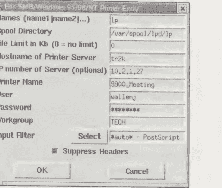

(图 B)。点击 `OK` 继续。你将看到 `Edit SMB/Windows 95/98/NT Printer` 条目。如图 G 所示，还有一些配置需要输入。在我们的示例中，除了为本地打印机输入的内容外，你还需要知道远程打印机的网络设置。

在我们的示例中，我们有一台名为 `tr2k` 的打印机，`IP` 地址为 `10.2.1.27`，打印机名称为 `9900_Meeting`，位于 `TECH` 工作组。示例中，我们使用的用户是 `allen`，密码为 ******（这只是小幽默）。

配置好打印机后，点击 `OK` 并重启，像你上面的那样进行测试。

在此配置中，关键的是打印服务器主机名、打印机名称、用户、密码和工作组条目。

# 注意事项

# 管理

本章的文章描述了 `Linux` 下提供的几种管理工具，并解释了如何使用它们来执行各种常见的管理任务。

# 系统管理

- 使用 `Webmin`：一个用于 `Linux` 管理的神工具...............................................................209

- `Linux` 中的进程管理.........................................................................................................211

- 在 `Linux` 中指定命令执行顺序......................................................................................214

- `Linux` 中的系统审计...............................................................................................................216

- 通过 `ReiserFS` 帮助 `Linux` 跨越企业级应用......................................................219

- 在 `Linux` 下挂载外部媒体..................................................................................223

# 用户与组

- `Linux` 中的用户管理................................................................................................227

- 深入理解 `Linux` 配置工具：`userconf`.......................................................................229

# 使用 Webmin：一个用于 Linux 管理的神工具

作者：Ed Engelking II, A+

作为一名 `Webmin` 站点管理员，我一直在寻找方法让配置 `Linux` 机器变得更简单。管理我的机器最简单的方法之一来自一个名为 `Webmin` 的 `Web` 应用程序。在这篇文章中，我将介绍这个优秀的工具，并向你展示如何让它适用于基于 `UNIX` 的组织。

# Webmin 到底是什么？

简单来说，`Webmin` 是一个基于 `Web` 的服务器管理工具。它从零开始构建，旨在让新手到专业的 `Linux/UNIX` 管理员都能尽可能轻松地管理服务器。新接触 `UNIX` 环境的用户会喜欢其易的导航和简单的界面，而资深人士则会欣赏便捷的服务器配置、模块安装以及其他提供的实用程序。

# Webmin 能做什么？

这里真正的问题应该是 `Webmin` 不能做什么。以下是几个通过 `Webmin` 提供的可用服务示例：

- 系统文件夹（`System Folder`）：在系统文件夹中，管理员可以配置启动和关闭选项、添加/删除服务器和组、安装/移除软件包、查看系统日志以及启动/停止运行中的进程。

- 服务器文件夹（`Servers Folder`）：见图 A）在标准的服务器文件夹中，管理员可以访问 `Apache` 配置服务、`DNS` 配置、`DHCP` 服务、`FTP` 服务器配置、`MySQL` 配置（包括 `SWAP`）以及代理服务。

- 硬件文件夹（`Hardware Folder`）：在标准的硬件文件夹中，管理员可以选择配置 `Linux` 启动配置、`RAID` 设备、网络配置、分区和打印机管理。

## 图 A

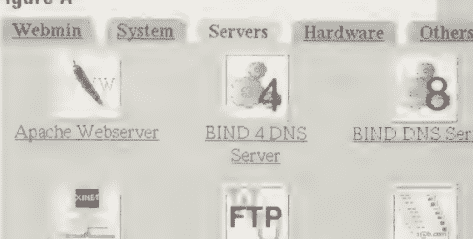

`Webmin` 用户会喜欢一个允许高级服务器配置的简单界面

- 其他文件夹（`Others Folder`）：这些文件夹包含不完全符合上述分类列表的服务。在标准配置中，你可以找到如基于 `Java` 的文件管理器、`Perl` 模块的安装和配置以及系统/服务器统计。

# 特定可用服务信息

作为一名 `Web` 管理员，有两个工具帮助我每天操作 `Webmin`：`Apache` `Web` 服务器配置和用户组配置。

# Apache Web 服务器工具

在我看来，`Web` 服务器工具是目前为止 `Webmin` 上最好的模块。通过它，我只需点击配置页面上的链接即可启动和重启我的 `Apache` `Web` 服务器。

我还可以毫无问题地在我的 `Web` 服务器上托管虚拟主机。如果没有 `Webmin`，如果我想在 `Apache` 服务器中添加新的虚拟主机，我必须手动编辑 `httpd.conf` 文件并逐行添加信息。有了 `Webmin`，我点击 `Virtual Host` 链接来添加新的虚拟主机，并在字段中输入信息（见图 B）。完成后，我只需点击 `Create` 按钮。就这样——新的虚拟主机就会安装完成。

创建虚拟服务器后，你可以点击 `Options` 链接直接配置虚拟服务器内部的选项。在 `Options` 链接中，你可以找到以下默认设置：

要删除用户/组，只需点击用户/组的超链接名称。然后你将进入一个页面，可以在那里更新用户/组的信息或删除文件。

添加用户也非常简单。在每个类别的顶部，都有创建一个用户或组的按钮。你只需点击链接，就会进入一个信息页面，可以在那里注册新的用户和或组。

- 进程与限制（`Processes And Limits`）

- 网络地址（`Networking Addressing`）

- 日志文件（`Log Files`）

- 文档选项（`Document Options`）

- `MIME` 类型（`MIME Types`）

- 错误处理（`Error Handling`）

- 用户组管理（`User And Group Administration`）

- 别名与重定向（`Aliases And Redirects`）

- `CGI` 程序（`CGI Programs`）

- 目录索引（`Directory Indexing`）

- 代理（`Proxying`）

- `SSL` 选项（`SSL Options`）

- 服务器配置（`Server Configuration`）

- 显示指令（`Show Directives`）

- 编辑指令（`Edit Directives`）

# 使用模块向 Webmin 添加服务

如果安装了 `Webmin`，但没有你配置的服务部分怎么办？答案是使用模块（`modules`），模块是一个可以下载并安装到 `Webmin` 中的小文件，允许在 `Linux/UNIX` 机器上安装服务后对其进行配置。你可以在第三方模块网站 `http://webminmodules.sourceforge.net` 找到许多不同的模块。

但如何在 `Webmin` 中安装这些新模块呢？其实非常简单。当你登录 `Webmin` 时，在 `Webmin` 文件夹下有一个名为 `Web Configuration` 的模块。点击专门针对 `Webmin` 的链接。你会看到列出的 `Webmin modules` 模块。

点击此链接后，你将看到一个选项，允许你从本地文件、上传的文件（针对那些不在托管 `Web` 服务器本地的用户）或通过 `FTP` 或 `HTTP` 安装新模块。这些选项都运行良好，它们都会安装到 `Webmin` 中。完成后，你将看到一条消息，说明模块已安装成功。从这里开始，浏览 `Webmin` 直到找到刚刚安装的模块。

如你所见，即使是单个虚拟主机，也有许多可用选项进行编辑和配置。

# 用户与组工具

使用 `Users And Groups` 工具添加和删除用户及组是一个简单高效的过程。当你第一次点击添加/删除新用户/组的链接时，你会看到当前可用的用户和组列表，位于

## 图 B

| 创建新虚拟服务器 | |
| :--- | :--- |
| 地址 | `Any` |
| 添加虚拟服务器地址（如需要） | |
| 端口 | 默认 `Any` |
| 文档根 | |
| 服务器名称 | 自动创建 |

通过使用 `Create New Virtual Server` 字段，`Web` 管理员能够快速轻松地添加虚拟主机。

# 通过 Webmin 控制其他机器

可能 `Webmin` 的最大用途之一是从一个地方配置一组服务器。如果你有许多对于运行 `Webmin` 的不同服务器，你可以使用位于 `Webmin` 文件夹中的 `Webmin` 服务器索引（`Server Index`）为其他服务器添加链接。

一旦你创建了服务器索引，只需访问该索引，并通过其个人图标选择你想要管理的 `Webmin` 服务器。

有几种选项可以定位网络上的服务器：

- **广播查找（`Broadcast For`）：** 如果你的网络上还有其他运行 `Webmin` 的服务器，你可以发送广播来定位这些服务器并将它们添加到服务器索引中。

- **扫描查找（`Scan For`）：** 如果你不想扫描整个网络寻找 `Webmin` 服务器，可以扫描特定的 `IP` 地址。

- **注册新服务器（`Register A New Server`）：** 如果你知道运行 `Webmin` 的服务器的特定 `IP` 地址，或者服务器位于你的内部网络之外，你可以手动注册该机器。

## 结论

`Webmin` 工具单凭之力将 `Linux` 管理带到了前所未有的简单程度。尽管有许多 `Linux` 管理工具，但没有一个在用例和灵活性上能与 `Webmin` 相比的。

但不要将 `Webmin` 视为一个仅限服务器的管理工具。`Webmin` 对于远程操作你的桌面也非常好用。


# Linux 中的进程管理


作者 Jim McIntyre

当你在 `Linux` 系统上运行程序时，该程序的实例会被加载到内存中。当程序被加载到内存时，它就变成了 `Linux` 系统上的一个进程。因为进程会消耗资源（如内存、`CPU` 时间和磁盘空间），能够管理进程是一项重要的管理技能。`Linux` 系统在任何时间的规模，或者说任何进程的规模，取决于此时运行在系统上的进程。在本文，我将介绍 `Linux` 系统上的进程管理。

`init`，它是系统上运行的第一个进程。根据系统的运行级别（run level），`init` 启动其他进程。`Linux` 系统上的每个进程都有一个进程标识符（`PID`）。因为 `init` 是第一个加载到内存的进程，它的 `PID` 始终为 1。

# 守护进程（Daemon process）

守护进程是在你的系统上持续运行或在被要求时加载到内存的进程。在 `Linux` 启动期间，会有几个守护进程加载到内存中。一些常见的守护进程有 `dhpd`（动态主机配置协议守护进程）、`crond`（Cron 守护进程）和 `pd`（行打印守护进程）。守护进程通常通过进程名末尾的字母 d 来识别。

# `Linux` 中启动进程

在我们涉及进程之前，我想解释一些概念。以下是主要的进程及其解释。

# `Init`

当 `Linux` 系统启动时，`init.conf` 加载内核。内核反过来运行其 `init` 进程...

# 用户进程（User process）

用户进程，也称为交互式进程，是通过 `Linux` shell 运行的进程。所有

管理 211

`Linux` shell 提供了一个命令行，用户可以在其中输入想要运行的命令和程序名称。当用户输入命令时（例如 `ls -al`）或程序时（例如 `./install.sh`），shell 会创建一个它的副本作为新进程，并用命令行中的命令或进程替换该新进程。简单来说，shell 将命令或程序作为另一个进程运行。

# 父进程与子进程（Parent and child processes）

父进程是任何启动或产生另一个进程的进程。父进程控制其所有的子进程。子进程是任何由另一个进程启动的进程。子进程也可以由其父进程产生。假设你正在 `Windows` 系统中工作并打开了一个 `xterm`（终端模拟器）。从 `xterm` 中，你可以运行命令 `--name type` 来查找目录中的所有文件。例如，终端窗口就是命令的进程。如果窗口关闭，命令就会被杀死。这是因为命令是作为子进程运行的。

# 进程查询（`ps`）

`ps` 命令用于显示报告当前会会显示正在运行的进程。

在例子中，`ps` 的输出如下：

| USER | PID %CPU %MEM | VSZ RSS TTY STAT START TIME COMMAND | NI | PRI |
| :--- | :--- | :--- | :--- | :--- | :--- | :--- | :--- | :--- | :--- |

| | | | | | | | | | |

| | | | | | | | | | |

`ps` 命令 命令显示的进程，`ps` 字段如下：

*   `USER` 用户
*   `PID` 进程 ID
*   `%CPU` `CPU` 占用
*   `%MEM` 内存占用
*   `VSZ` 虚拟内存
*   `RSS` 驻留内存
*   `TTY` 终端
*   `STAT` 状态
*   `START` 启动时间
*   `TIME` 运行时间
*   `COMMAND` 命令
*   `NI` 优先级值
*   `PRI` 进程优先级
*   `WCHAN` 内核阻塞
*   `FLAGS` 标志

# `ps` 命令参数（`ps` arguments）

`ps` 命令接受各种参数。常用的有：

*   `a` 显示所有用户
*   `e` 显示所有进程
*   `F` 显示进程族组
*   `u` 按用户格式显示
*   `w` 扩展宽度
*   `ww` 无限宽度
*   `x` 显示不在终端的进程
*   `g` 显示进程组
*   `h` 不显示表头
*   `l` 详细格式显示
*   `p` 指定进程 ID
*   `r` 显示正在运行的进程
*   `s` 显示启动时间
*   `t` 指定终端
*   `c` 显示命令路径
*   `W` 显示特定的进程

# 示例（Examples）

要捕获信号，使用 `kill` 命令，其语法为：

```
kill PID
```

示例（假设 `Netscape` 以进程 670 运行）：

```
kill -9 670
```

# 信号（Signaling Processes）

信号是告诉进程执行某些操作。常用的信号有：

*   `SIGHUP` 挂断。用于重新加载配置文件。
*   `SIGINT` 中断。
*   `SIGQUIT` 退出。
*   `SIGTRAP` 跟踪。
*   `SIGKILL` 杀死。此信号无法捕获或忽略。
*   `SIGTERM` 终止。通常在 `KILL` 信号之前发送。
*   `SIGSTOP` 停止。此信号可以捕获、阻塞或忽略。

# `killall` 命令（`killall` command）

`killall` 命令允许用户通过名称指定进程。例如，要杀死所有 `Netscape` 实例，输入：

```
killall netscape
```

使用 `killall` 命令时要小心。假设你正在使用 `Emacs` 编辑器运行两个实例，一个编辑文件 `foo.txt`，另一个编辑 `/etc/passwd`。假设你想杀死编辑 `foo.txt` 的 `Emacs` 实例，并使用了 `killall` 命令，那么编辑 `foo.txt` 的实例和编辑 `/etc/passwd` 的实例都会被终止。

# 在后台运行进程（Running a process in the background）

当命令从控制台运行时，它通常在前台运行。在前台运行进程意味着你必须等待它完成才能启动另一个进程。然而，当进程在后台运行时，另一个进程可以同时运行。可以通过在命令行末尾添加符号 `&` 让进程在后台运行，如下例：

```
find /etc -name *.conf > ~/--file &
```

并将输出写入用户主目录下的名为 `conf-file` 的文件中。该进程将在后台运行，允许用户在命令执行时执行其他任务。

## 在 `Linux` 中指定命令执行顺序

作者：Jim McIntyre

系统管理通常需要执行一系列命令。例如，我可能需要从系统中删除一个用户，将该用户主目录下的所有文件移动到备份目录，然后删除该用户的主目录。我可以通过逐个运行命令来实现此目标，如下：

`mv /home/jack/* /backup/users/jack; /usr/sbin/userdel -r jack`

以这种方式执行命令的问题在于，对第一条命令没有设置任何条件。无论我是否成功将 Jack 的所有文件移动到备份位置，我都能使用 `userdel` 命令删除该用户。该命令将删除 Jack 主目录中的所有文件、他的邮件池以及与 `/etc/passwd`、`/etc/group` 和 `/etc/shadow` 相关的所有文件。

如果 `command-1` 执行成功，则运行 `command-2`。如果 `command-1` 执行未成功，则不会执行 `command-2`。让我们来尝试一个简单的例子：从你的 `Linux` 控制台中，输入列表 A 所示的命令。

当运行这一系列命令时，你将看到当前目录下文件和目录的列表，以及消息“This is a file listing for the current directory”。

现在让我们看看如果第一条命令执行执行会发生什么。例如，我将添加一个不会运行的命令来测试 `&` 运算符。从你的控制台中，输入列表 B 所示的命令。

这种无条件运行命令的能力使得在系统的关键区域很容易出错。然而，`Linux` 需要使用逻辑操作符和命令分组来执行一组组命令。

当使用逻辑操作符时，上一个命令的结果将决定下一条命令是否会执行。运行命令分组允许我们一次运行一组命令。本文将介绍 `Linux` 中的逻辑操作符和命令分组。

## 使用 `&&` 运算符

`&&` 运算符使用以下语法：

`command-1 && command-2`

`&&` 运算符指定如果 `command-1` 执行成功，则将执行 `command-2`。用通俗的话说，这条命令的意思是：

列表 C 显示了另一个例子。在这种情况下，管理员想要找到 `/etc/sysconfig` 中在过去两天内修改过的所有文件。一旦这些文件被写入管理员的主目录，如果这两个操作成功完成，将在控制台上打印一条通知。在这个示例中，发生了以下操作：

1.  `find` 命令在 `/etc/sysconfig` 目录中搜索过去两天内修改过的任何文件。
2.  符合此条件的文件列表被重定向到 root 用户目录下的 `modified.txt` 文件（`> /root/modified.txt`）。
3.  如果这两个操作成功完成，控制台将打印消息“File search complete”。

> **列表 A：使用 && 运算符**
>
> `ls -l echo "This is a file listing for the current directory."`
>
> **列表 B：带有无效选项的 && 运算符**
>
> `ls -zz echo "This is a file listing for the current directory."`
>
> **列表 C：使用 && 查找修改的文件**
>
> `find /etc/sysconfig -mtime -2 > /root/modified.txt && echo "File search complete."`
>
> **列表 D：使用 || 运算符**
>
> `cp /jim/*.doc /backup/users/jim || echo "No MS Word files found."`
>
> **列表 E：未指定时执行失败**
>
> `find /etc/cron.d -mtime || echo "No modified files found." | mail root; exit`

现在，所有三条命令在没有控制台进一步干预的情况下运行，假设程序构建时没有错误。

## 使用 `||` 运算符

在某些情况下，管理员可能希望指定命令执行失败时应该执行哪些操作。这就是使用逻辑 `||` 运算符的地方。以下使用语法：`command-1 || command-2`

## 使用 `()` 和 `{}` 运算符

当命令被分组时，它们要么在当前 shell 中运行，要么在子 shell 中运行。要在当前 shell 中运行一系列命令，使用圆括号 `()` 对命令分组。

使用 `()` 运算符的格式为：

`(command-1; command-2)`

上述语句的含义是：“如果 Command-1 执行失败，则执行 command-2。”

要在子 shell 中执行命令，使用大括号 `{}`。`{}` 运算符的格式为：

`{command-1; command-2}`

列表 D 显示了一个简单的例子。在示例中，发生了以下操作：

1.  用户主目录中所有 `.doc` 扩展的文件都被复制到 `backup/users/jim` 目录。
2.  如果没有找到 `.doc` 扩展的文件，屏幕上将打印消息“No MS Word files found”。

这些运算符几乎从不使用。它们最好用于扩展 `&&` 和 `||` 运算符的功能。当我想在命令失败时执行多个操作时，这些运算符最为有用。

要理解运算符如何工作，请查看列表 E 所示的示例。在这里，执行以下操作：

1.  我想找到在 `/etc/cron.d` 目录下搜索文件的命令，该目录在周末期间可能被更改过。
2.  当命令失败时，我想生成消息“No modified files found.”。
3.  消息将通过邮件给我（root）。
4.  一旦这些操作完成，我想让脚本终止

## 命令分组

在 `Linux` 中分组命令的最简单方法是使用分号 `;`。使用分号 `;` 作为命令分隔符来分组命令是最简单的：

```
./configure
make
```

如果我知道要编译软件，将使用分号 `;` 进入以下操作：

```bash
./configure; make install
```

这里的问题是一旦命令执行后将知道结果。

为了确保 `||` 运算符后的所有命令执行，使用圆括号 `()` 包裹 `||` 运算符后的命令。列表 F 所示的示例将确保我获得后续 `find` 命令的消息。

> **列表 F：** 使用圆括号确保所有命令执行
>
> ```bash
> find /etc/cron.d -mtime || (echo "No modified files found." | mail root; exit)
> ```

## 结论

使用逻辑操作符和命令分组是为基础系统管理添加决策能力的简单方法。利用你的想象力创造无限可能，让你的 `Linux` 工作变得简单有趣！

## `Linux` 系统审计

作者：Jim McIntyre

监控 `Linux` 系统上的用户活动是管理员应该掌握的技能之一。这种能力是发现未经活动的第一道防线。本文将讨论 `Linux` 系统提供的监控工具，并演示如何利用系统审计程序来增强系统安全性。

### 连接审计

连接审计是跟踪当前用户和登录情况。`Linux` 系统上的连接审计通过以下工具管理：

*   `utmp`——将 `/var/run/utmp` 或 `/var/log/utmp` 中的原始数据转换为可读的 ASCII 文本。最适合在脚本中使用。
*   `acct`——读取 `/var/log/utmp` 并输出连接时间。默认是所有用户的总和。
*   `last`——显示登录用户列表。比 `ac` 命令提供了更多详细信息。
*   `who`——显示当前登录用户。
*   `wtmp`——记录用户会话。
*   `wtmp`——记录登录和注销活动。`wtmp` 工具还记录系统重启和运行级别更改。
*   `var/run/utmp`——包含与 `utmp` 相关的数据。
*   `var/log/wtmp`——包含与 `wtmp` 相关的数据。

多个程序参与提供了与连接审计的信息。这消除了运行特定守护进程来启动连接审计的需求。你的系统中必须存在以下文件：

如果这些文件在你的系统中不存在，以下命令将创建它们：

```bash
touch /var/run/utmp
```

```bash
touch /var/log/wtmp
```

这些文件由 root 创建，权限将设置为 644 (rw-r--r--)。

这些文件中包含的信息可以由运行 `act` 命令或类似命令的用户读取。然而，有一些工具可以将这些 `act` 转换为文本格式。

更改和系统崩溃都可以使用此工具检测到。作为系统管理员，每天运行 `last` 命令将使你能够发现网络中作为用户活动的异常活动。

### 的 `act` 命令

`act` 命令提供了连接的统计信息。`act` 命令的一个典型用途是检查每个用户登录系统的时间。

尽管如此，`act` 命令包含了一些与入侵检测相关的有用信息。如果你运行 `act` 命令，发现当 Susan 在休假时，她在过去两天内已经登录了几个小时，那么我就有一个指标，表明有人正在使用 Susan 的账户未经授权地访问系统。

### 的 `who` 命令

`who` 命令的主要目的是报告当前哪些用户正登录了系统。`who` 命令可以提供以下信息：

*   用户登录了哪个设备。
*   登录发生在何处。如果使用了远程登录，则主机名。
*   如果 `X` 是窗口，则显示 `X` 显示。
*   用户是否会接受或发送 `talk` 消息。

### 的 `last` 命令

`last` 命令提供了每个用户的登录和注销时间，以及系统重启和运行级别更改的信息。默认情况下，`last` 将显示记录在 `/var/log` 中的每个连接和运行级别更改。`last` 命令呈现的信息量可能会让人目不从心。更典型的用法是运行命令 `-5`。这将提供 `/var/log` 中最近的五条条目。

`who -iw` 命令将提供用户 ID、用户的空闲时间或 `talk` 状态，以及打印的表头。

`who` 命令的价值在于管理员可以获得系统上用户活动的快照。该命令是管理员在 `Linux` 系统上检测可疑活动的第一防线。

### 的 `lastlog`

另一个用于连接的命令是 `lastlog`。`lastlog` 读取 `/var/log/lastlog` 文件以生成用户上次登录时间的记录。虽然该命令在灵活性上受到限制，但 `lastlog` 提供了一种检查用户活动或发现异常登录时间或管理员不认识用户的快速方法。`lastlog` 对于发现 `Linux` 系统上的异常活动非常有用。

需要注意的不仅是是谁登录了系统，还有他们何时登录的、登录了多久以及在何处登录。这些信息可以用于识别系统上未经授权的活动。例如，`act -5` 命令显示有人在工作时间后登录了系统，这可能表明其他人正在使用该用户的账户访问权限，管理员可以在进行更彻底的安全分析之前防止其被进一步使用。运行命令 `-w` 将告诉关于关于你系统运行级别更改的信息。

`last` 命令可以为管理员提供有关可疑活动的线索。意外的登录、未经授权的运行级别...

### 进程审计 (Process accounting)

进程审计考虑了所有用于监控监控的进程和命令。进程审计的数据记录在 `/var/log/pacct` 文件中。该文件应该由 root 所有，并且权限应设置为 600。

如果你的系统上不存在 `/var/log/pacct`，你可以通过以下命令创建它：

```bash
touch /var/log/pacct
```

一旦创建了该文件，可以使用以下命令激活进程审计：

```bash
touch /var/log/pacct
```

`ReiserFS` 的长期目标是将数据库和关键字搜索选项整合到文件系统本身。这种文件系统的优势应该是显而易见的。快速的文件只是这个潜力文件系统所提供的最基本的服务了。`ReiserFS` 是模仿 `AS400` 设计的，因为它像 `AS400` 一样，以关系型数据库为核心。将 `AS400` 的关系数据库与传统 `Unix` 系统的许多优势相结合，是未来 `ReiserFS` 项目的希望。

没有 `ext2` 分区可以进行基准测试。但是，系统启动速度有了显著提高。而且，取决于系统重启的频率，你可能不再需要担心启动期间的定期检查。`ReiserFS` 能够快速高效地处理这一切。

你会发现，你不再受限于 `ext2` 文件系统的那 2 GB 大小限制。文件和目录的大小可以根据你的需要任意扩展。对于较大的目录，你会遇到轻微的性能影响，但不会像使用 `ext2` 那样（如果你在 `ext2` 分区上的话！）。

### 什么是日志文件系统？


# 日志文件系统简介

由于复杂性，我将向你简要介绍日志文件系统。描述日志文件系统背后的理论、架构以及 `ReiserFS` 本身已经超本文的范围了。

简单来说，日志文件系统使用数据库来存储文件系统信息，而不是像传统文件系统（如 `ext2`）那样使用像 `fsck` 的程序来检查整个分区。因此，当系统崩溃（或意外重置）时，`ReiserFS` 只需查询事务日志来确定系统是否存在任何问题。

## 将 `ReiserFS` 编译到你的内核

`ReiserFS` 正在被用于 Linux 系统以替代 `ext2`。虽然还有其他日志文件系统正在开发中，但 `ReiserFS` 是目前最成熟的。然而，从整体设计来看，毕竟 `XFS` 已经在 IRIX 系统上使用了多年，但在 Linux 的易用性上尚且如此。运行 Linux 的人现在可以使用 `ReiserFS`，而 SGI 的 `XFS` 和 IBM 的 `JFS` 还需要进行一些工作才能将它们的文件系统和相关单元移植到 Linux。

“日志（journaling）”一词源于 `ReiserFS` 和任何其他日志文件系统是将日志（或记录）通过写入日志缓冲区，然后异步写入磁盘日志来完成的。在崩溃后，`ReiserFS` 的恢复工具 `reiserck` 会读取日志。如有必要，将重做事务以确保文件系统保持一致状态。

> 简而言之，如果出现问题——如果你的系统崩溃了或你的猫碰到了重置按钮——使用 `ReiserFS` 分区的系统重启速度比普通 `ext2` 分区快得多。

简而言之，如果你的系统崩溃了或你的猫碰到了重置按钮——使用 `ReiserFS` 分区的系统重启速度比普通 `ext2` 分区快得多。我无法为你提供具体快多少的细节。

`ReiserFS` 现在非常有吸引力。它可以被立即使用，人们可以看到它的好处。

等待像 `XFS` 这样的东西——考虑到公司及其使用方式，它最终可能是健壮且稳定的——对某些人来说是一个选项，但其他人不需要等你。`ReiserFS` 满足了需求，而且完成得很好。

使用 `ReiserFS` 的阶段因发行版而异。例如，`LinuxMandra` 7 是第一个包含对 `ReiserFS` 支持的 Linux-Mandra 版本。

# 企业级 Linux 管理员指南

你可以在安装时用 `ReiserFS` 格式化分区，并在日常中使用愉快地使用 `ReiserFS` 分区。然而，不同的版本可能不行。对于其他发行版，这在很大程度上取决于你使用的内核应用了哪些补丁。因此，作为 `ReiserFS` 的主要赞助者之一，无疑使其成为你最新发布版本的选项。

使用以下任何命令配置内核：

- `make config`
- `make xconfig`
- `make menuconfig`

`make config` 命令可能是最简单的方法，因为它提供了一个界面。`make config` 命令是最困难的方法，应该只由那些以前编译过内核并了解内核精要的人使用，我建议初次尝试的人使用它。

然而，让旧版本的 Linux 与 `ReiserFS` 工作可能值得这种折腾。你最好的选择是将你的发行版更新到最新版本，它将支持 `ReiserFS`。如果你不能这样做，仍然可以让 `ReiserFS` 在你的系统上工作，但你需要将内核升级到至少 `2.2.1`。

接下来，使用以下命令编译你的内核：

- `cd /usr/src/linux`
- `make depend`
- `make clean`
- `make image`

从 `mys.com` 获取 `ReiserFS` 补丁。对于 `2.2.7` 内核有补丁，但对于 `2.2.8` `2.2.10` 没有。如果你不确定 `2.2.7` 补丁如何工作，我建议使用 `2.2.11` 内核，`2.2.16` 或最新的 `2.2.17` 内核可能是更好的选择。

一旦成功完成这些步骤，你需要编译模块或你的内核。使用以下命令：

- `cd /modules/`
- `mv 2.2.17 2.2.17-old`
- `cd /usr/src/linux`
- `make modules`
- `make modules_install`
- `cd /modules/2.2.17`
- `/sbin/depmod`

确保你在 `/usr/src/linux` 中有内核源码（如果你使用 `2.2.17` 内核），并应用 `ReiserFS` 补丁，该补丁包含在 `17_reiserfs_3.25_patch` 文件中。在下载文件后，如果系统上没有安装 `2.2.17` 内核，你可以省略上述某些步骤。如果你正在升级，你需要重命名你的 `/lib/modules/17-old`，因为该目录不存在。只有当你系统上安装了 `2.2.17` 时才需要这样做，因为它会覆盖你的内核。在开始之前，务必备份它们：

```bash
cd /usr/src/linux
zcat 2.2.7_reiserfs_3.25_patch.gz | patch -p
```

这将 `ReiserFS` 补丁应用到 `2.2.17` 内核，并在 `/usr/src/lib/reiserfs/` 下创建一个新目录，其中包含构建各种 `ReiserFS` 工具的源码。我稍后会说明如何构建这些工具。

此时，你在 `/usr/src/linux/arch/i86/boot` 中有一个新内核。将 `bzmage` 文件复制到你的 boot 目录，给它一个适当的名字（例如 `bzmage-2.2.17`），如下：

```bash
cd /usr/src/linux/arch/i86/boot
bzmage /boot/bzmage-2.2.17
```

下一步是用已应用的补丁编译内核。本文范围无法涵盖你在编译内核时选择哪些配置，除了一个处理 `ReiserFS` 支持的选项，回答 yes 或 no（模块化）以直接编译内核或作为模块编译 `ReiserFS` 支持。你可以查看 `)`

# 221 管理员

你可能想要生成一个 `initrd` 镜像文件，它将包含启动系统所需的模块。例如，如果你想能够从 `ReFS` 分区启动，你需要一个 `initrd` 镜像。你可以这样制作：

```bash
mkinitrd -f /boot/initrd-2.2.17 2.2.1
```

此命令将创建一个 `/boot/initrd-2.2.17` 的文件，它是包含启动分区所需模块的镜像（例如使用 `ReFS` 模块或 SCSI 硬盘等）。接下来，编辑你的 `/etc/fstab` 文件，如下所示：

```
root=/dev/sda1
map=/boot/initrd.prompt
timeout=50
image=/boot/bzImage-2.2.17
label=linux
initrd=/boot/initrd-2.2.17
root=/dev/1
image=/mlinuz-2.2.17-mdk
label=linux-old
root=/dev/hdc5
read-only
```

此代码假设你的根分区是 `/dev/bd5`，且你之前的内核是 Linux Mandrake 内核 (`2.2.17-mdk`)。与编译一样，你应该保持旧内核活动状态，直到验证新内核按预期工作。一旦编辑了 `/etc/fstab` 文件，运行此命令来重建你的根系统：

`/sbin/initrd_v`

当你成功编译内核后，进入 `/usr/src/linux/fs/reutils` 目录并编译 `ReFS` 工具，如下：

```bash
cd /usr/src/linux/fs/reutils
make dep
make
make install
```

完成这些步骤后，`ReFS` 工具将在你的系统上可用，你就可以重启电脑了。显然，如果这些步骤中的任何一个失败了，你需要返回起点并重新尝试。

通常情况下，内核编译的失败源于启动程序之前未正确配置内核。

如果有选择，我强烈建议使用供应商提供的最新稳定（`2.2.17` 或如果你喜欢 `2.2.18`）带有 `ReFS` 支持的 `RPM`，并安装包含 `ReFS` 工具的 `RPM`。这对于更多没有时间或专业知识来自己编译内核的人来说。编译内核并不是易事，但使用预编译的内核更好。

# 222 企业级 Linux 管理员指南

这是至关重要的，我建议使用该哈希值，即使这会带来微小的性能损失。如果你需要，也可以在设备之后指定块大小，但如果省略，`mkfs` 将决定使用的最佳块大小。

安装或更新与此相关的任何内容。任何错误都可能导致系统无法运行或损坏。这也是我鼓励你下载或购买你喜爱的发行版的最新版本的另一个原因，它们很可能已经内置了 `ReiserFS` 支持。我不知道为 `Red Hat` 5.1 构建一个支持 `ReiserFS` 的新内核需要多少精力。

接下来是挂载点。在这种情况下，我们希望将新分区挂载为 `/files`，因此我们创建挂载点：`mkdir /files`。

然后，使用以下命令挂载分区：`mount -t reiserfs /dev/hdc1 /files`

尽管如此，拥有像 `ReiserFS` 这样的日志文件系统的优势使得这些努力是值得的。凭借闪快的启动速度和更可靠的错误恢复，`ReiserFS` 绝对是一个很好的选择。与修复 30-GB `ext` 分区上花费的时间相比，`ReiserFS` 检查相同大小分区所花费的时间，这种对比是令人惊讶的。坦率地说，一旦你体验了像 `ReiserFS` 这样的日志文件系统，你就再也不需要回到 `ext2` 这样慢的东西了。

你还可以将其添加到 `/etc/fstab` 文件中，如下：`/dev/hdc1 /reiserfs defaults 2 2`

这将在你每次启动时自动将你的新 `ReiserFS` 分区挂载为 `/files`。

## 结论

由于文件系统是系统中非常重要的部分，当你……时必须小心。

...

# 在 Linux 下挂载外部媒体

作者：Vincent Danen

在本文，我将向你展示如何在 Linux 下挂载可移动媒体，以及如何组织 Linux 系统中的一切。我还会向你介绍一些简单的工具，用来构建和监控你的系统。

驱动器或分区被分配一个挂载点或目录。由于 Linux 对整个系统使用目录结构，你可能会发现一个被挂载为 `/boot`，另一个挂载为 `/`（根分区），可能还有另一个挂载为 `/home`。驱动器对于操作系统是透明的，你可以更改目录（就像在 Windows 下操作一样），并在多个硬盘或分区之间导航，而无需察觉自己正在这样做。

# 即插即用挂载？

Linux 处理任何类型驱动器的方式与类 Windows 操作系统有本质不同。在 Windows 中，每个驱动器或分区都被分配一个从 C 开始的驱动器符。如果你在硬盘上有三个分区，你就有三个字母来访问它们。在 Linux 中，没有所谓的驱动器符。每个使用这种目录结构使得在查看可移动媒体时变得有些挑战性。在 Windows 中，你的 A 盘是第一个软盘驱动，在 Linux 中，它可能是 `/mnt/floppy` 或你指定的任何作为挂点的目录。基本上，由于这两种操作系统之间的这种巨大差异，你需要重新思考你处理硬盘、分区和外部媒体的方法。归结底就是这一点：导航跨越多个磁盘的单一目录树，比使用多个磁盘跨越多个目录要容易得多。

`/mnt/floppy` 目录。SuSE 默认使用 `/mnt/floppy`，Red Hat 使用 `/mnt/floppy`。你必须确保这些目录存在。

在 Linux 系统上监控任何媒体的规则非常简单。你用于挂载点的目录必须是空的，如果你向该目录写入了任何文件，你将无法从中挂载任何内容。

# `df` 工具：第一步

你应该熟悉的第一个工具是 `df` 工具。该工具显示了任何设备上剩余的空间。在最简单的情况下，`df` 将报告每个已挂载文件系统的磁盘占用。你会看到挂载点、可用空间以及文件占用的空间。`df` 输出可能如下：

要挂载软盘，请执行以下命令：

```bash
mount -t msdos /dev/fd0 /mnt/floppy
```

此命令假设软盘是 MS-DOS（或 FAT16）。它还假设你使用的是链上的第一个软盘（DOS 术语中的 A 盘），并且你的挂载点是 `/mnt/floppy`。

```bash
mount -t [filesystem] [device] [mount point]
```

相同的命令可以用于任何文件系统类型。如果你的软盘是 `ext2`（Linux 文件系统），你会将 `msdos` 文件类型替换为 `ext2` 文件系统。

| 使用的文件系统 | 可用空间 | 挂载在 |
| :--- | :--- | :--- |
| `dev/sdc1` | 82 | 499618 0% |
| `dev/sda1` | 21M | 89761M | `/mnt/win8` |
| `dev/hda1` | 9660M | 2633M | `/mnt` |
| `dev/hdb1` | 8728M | 6.19N% | |
| `dev/hdc1` | 115M | 138M | `/` |
| `dev/gdi1` | 9750M | 16341M | `/` |

此输出向我们展示了若干信息：

- 文件系统，或实际硬件设备
- 设备的大小
- 已用空间
- 可用空间
- 空间占文件系统总大小的百分比
- 文件系统的挂载点

`mount` 命令适用于可移动和固定媒体。例如，如果你与 `OS/2` 双启动并希望将你的 `OS/2` 驱动器挂载到 `/os2` 挂载点，你会使用：

```bash
mount -t hfs /dev/hd5 /os2
```

切换到 `/mnt/cdrom` 设备并执行 `mount` 命令（或任何你想要读取目录内容或对 CD 上的文件操作的命令，`supermount` 将快速且方便地挂载 CD，使其变得可用）。一旦你离开该目录，`supermount` 就会解锁 CD-ROM 设备并将其更换为另一个，依此类推。这使得在 Linux 中使用可移动介质变得像任何其他操作系统一样简单。对于 Linux 初学者来说，这会让很多事情变得简单得多，仅仅因为这会提醒他们他们原来使用的操作系统（Windows、DOS 或 `OS`）。

为了利用可移动介质，有关于分区和设备的几点说明。CD-ROM 设备非常直观。要了解你的 CD-ROM 称为什么，你需要了解 `/dev` 设备树及其目的。在该目录下有你系统上的每一个硬件组件，从串口到扫描仪都有。如果你查看该目录，你会发现许多文件——也许文件多到让你无法理解哪些设备属于哪个文件。

一个供 `supermount` 使用的 `/fstab` 示例可能包含以下内容：

```
ext2,dev/hdb0
/mnt/floppy/mnt/supermountfs fs=
iso9660,dev/hdb1
/mnt/cdrom/mnt/supermountfs fs=
iso9660,dev/cdrom/dev/hdb2
/mnt/zip/mnt/supermountfs fs=
vfat,dev/sda40
```

如你所见，使用 `supermount` 与使用 `mount` 和 `umount` 命令相比，语法略有不同。命令的前两个元素表示挂载点，第三个元素表示这是一个由 `supermount` 管理的文件系统，最后一个元素包含该设备的选项，这些选项基本上指明了默认文件系统和硬件设备。

如果你的 CD-ROM 是一个 IDE 设备，在 Windows 中确定它非常简单。由于你的系统上有四个 IDE 设备，Linux 有一种方法非常简单的方法来区分 IDE 设备。`/dev/sda` 是主通道上的第一个设备，`/dev/hdb` 是第二个设备。从用通道上的第一个 IDE 设备是 `/dev/hddc`，而 `/dev/hddd` 是第三个。整体上的第二个或第四个 IDE 设备。无论设备是硬盘、CD-ROM 还是 LS-120 设备，这永远不会改变。

现在你已经有了在 Linux 下使用可移动介质的方法，让我们检查一些你需要注意的重要考虑因素。Linux 处理所有可移动介质的方式并不相同。我将三个流行的可移动设备并对每一个进行更仔细的检查。

你仍然需要记住的是 Zip 和 LS-120 设备上的分区信息。默认情况下，Zip 使用第四个分区（`/dev/hdd4`）作为主分区，而 LS-120 驱动器使用第一个分区（`/dev/hdd1`）。你需要知道如何尝试挂载这些类型的可移动磁盘。然而，CD-ROM 不使用分区，因此你只需要使用 `/dev` 而不带特定的标识符。

如果你安装 Linux 系统时很幸运，安装程序找到了你所有的可移动介质并在你的 `/etc/fstab` 文件中创建了相应的条目。然而，如果没有发生这种情况，你需要知道一个

## 结论

一旦你知道自己在做什么，在 Linux 下挂载可移动介质并不困难。达到这一步的过程比实际使用它更困难。在本文中

# Linux 中的用户管理

作者：Jim McIntyre

管理员的两个主要职责之一是对 Linux 网络上的用户进行管理和监控。系统管理员良好的远见可以防止不必要的停机，并在安全漏洞变成问题之前发现它们。在本文中我将讨论如何使用命令行工具添加、修改和删除用户及组，并将将 de root 和特权账户。

## ID

`useradd` 命令将自动创建用户标识（UID）和组标识（GID）。为了说明发生了什么，让我们检查 `/etc/passwd` 文件。

```
root:0:0:root:/root:/bin/bash
bin:1:1:bin:/bin
daemon:2:2:daemon:/sbin
adm:3:4:/var/adm
lpd:4:7:/var/spool/lpd
sync:5:0:sync:/sbin:/bin/sync
shutdown:6:0:shutdown:/sbin:/bin/shutdown
halt:7:0:halt:/sbin/halt
mail:8:12:mail:/var/spool/mail
news:9:13:/var/spool/news
ucp:10:14:ucp:/var/spool/ucp
operator:11:0:operator:/root
body:99:99:Nobody::/
fs:100:100:X Server /etc/
ltx:/bin/false
gim:42:42:/home/gim:/bin/bash
home/jim:500:Jim McIntyre:/bin/bash
user:501:anybody:/home/user:
```

## 使用命令行工具管理用户

### 创建用户

你可以非常地创建一个新用户。在命令行中，只需输入：

```bash
useradd <username>
```

要创建一个名为 `guest` 的新用户，运行：

```bash
useradd guest
```


## 创建用户

如果你看到提示“`command not found`”，请尝试 `/usr/bin/useradd`。如果你仍然收到相同的提示，尝试输入 `useradd` 以定位 `useradd` 程序。现在输入：

```bash
guest:501:anybody:/home/guest:
bin/bash
```

此命令将使用默认值在 `/etc/passwd` 文件中创建一个新行。当我运行该命令时，`/etc/passwd` 显示了以下行：

```bash
guest:x:501:anybody:/home/guest:
bin/bash
```

查看左起的第二个字段。它包含的唯一字符是 `x`，它是密码字段。要为用户创建密码，运行以下命令：

```bash
passwd guest
```

在我的系统中，我为用户名和它的密码都输入了 `guest`。`passwd` 命令允许你输入两次密码。在接受密码后，它会被加密并添加到 `/etc/passwd` 中的用户行中。我们关注的字段是第一行和最后一行。第一行用于 `root`（Linux 强制要求超级用户）。该用户在安装过程中创建，执行安装的人提供了组信息。

第一个字段是密码字段。你可能在想为什么密码字段中是 `x` 而不是字段和数字的组合。`x` 的出现是因为我正在使用名为“密码影子”（password shadowing）的过程。你也应该使用这个过程。我们将讨论如何操作。

### 修改现有用户信息

### 修改用户的家目录

### 更改用户密码

#### 修改指纹信息

使用 `finger` 命令，我们可以获取系统上用户的信息。`finger` 命令的语法如下：

```bash
finger <username>
```

用户名、办公室位置和电话号码是从 `finger` 获取的信息。`chfn` 命令用于更改用户的指纹信息。要更改 `jim` 的指纹信息，语法应为：

```bash
chfn jim
```

系统会提示你为该用户输入新的指纹信息。指纹信息存储在 `/etc/passwd` 中，但用户可以在自己的家目录下创建一个同名文件。新文件将追加到通过 `finger` 命令显示的信息中。

## 删除和禁用用户

要从系统中删除一个用户，请使用 `userdel` 命令。该命令的语法为：

```bash
userdel <username>
```

要删除用户家目录的内容，请使用以下语法：

```bash
userdel -r <username>
```

要从你的系统中删除 `guest` 用户，请运行：

```bash
userdel guest
```

通常，你可能想临时禁用账户以防止登录。你可以通过以下方法完成此任务：

- 使用 `usermod` 命令设置用户密码立即过期。
- 创建一个名为 `/etc/login` 的文件。在文件中放置一条简单的文本消息，解释用户无法登录的原因（只要此文件存在，`root` 用户将无法登录）。
- 编辑 `/etc/shells` 并向其追加一个名为 `/bin/false` 的 shell。然后，运行命令 `usermod -s /bin/false <username>`。（这可以防止用户登录）

## 结论

现在，你应该能够使用我讨论的命令添加、修改或删除用户和组账户，并且你应该能够创建 `root` 或特权用户账户。从长远来看，这些知识将使你的管理和监控工作变得容易得多。然而，正如我之前提到的，没有比你良好的预见性更重要的。如果你能在问题发生之前发现它们，就可以减少很多挫败感和不必要的停机。

# 深入 Linux 配置工具：userconf

作者：Jack Wallen, Jr.

作为系统管理员，你经常执行的任务之一就是管理用户账户。在添加、删除或编辑时，你每天都会处理用户账户。拥有正确的工具来处理这项任务可以让你的工作变得轻松得多，而 Linux 正好拥有这些工具。

我们将介绍的是 Linux 工具 `userconf` 的图形界面（GUI）。`linuxconf` 模块 `userconf` 是一个非常易用的工具，允许管理员在一个中心位置处理所有的用户配置。

`userconf` 工具分为四类：

- 普通用户 (Normal)
- 特殊账户 (Special accounts)
- 电子邮件别名 (E-mail aliases)
- 策略 (Policies)

每个类别中都包含许多子类别。当我们进入每个类别时会详细讨论，但在那之前，让我们看看应用程序本身。

## 界面

如图 A 所示，`userconf` 的 GUI 非常直观。与 `userconf` 中的其他模块一样，`userconf` 通过按钮设置，使其使用非常简单。

此应用程序只能由 `root` 调用，调用命令为：

```bash
userconf
```

当你运行此命令时，会显示 `userconf` 工具，你就可以开始工作了。

## 普通用户

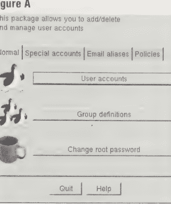

“Normal（普通）”标签页是你使用 `userconf` 完成大部分工作的地方。在普通用户中，你将添加/删除/修改用户和组信息。在使用此工具之前，你受限于使用 `userconf` 和 `grandchild` 命令。好吧，时代在变，即使是 Linux 管理员也可以通过 GUI 执行常规任务。

一旦你打开该工具，在打开“Normal（普通）”标签页后，你会看到类似图 B 的窗口。点击“Add（添加）”按钮，会弹出一个新窗口，你可以在此处操作。在该窗口中，你可以输入用户信息。在“普通用户”中，指纹信息存储在 `/etc/passwd` 中，但用户可以在自己的家目录下创建一个同名文件。

通常情况下，你可能想临时禁用一个账户以防止登录。你可以通过以下方法完成此任务：

- 使用 `usermod` 命令设置用户密码立即过期。


- 创建一个名为 `/etc/login` 的文件。在文件中放置一条简单的文本消息，解释用户无法登录的原因（只要此文件存在，`root` 用户将无法登录）。
- 编辑 `/etc/shells` 并向其追加一个名为 `/bin/false` 的 shell。然后，运行命令 `usermod -s /bin/false <username>`。（这可以防止用户登录）

一旦你打开该工具，在打开“Normal（普通）”标签页后，你会看到类似图 B 的窗口。点击“Add（添加）”按钮，会弹出一个新窗口，你可以在此处操作。在该窗口中，你可以输入用户信息。指纹信息存储在 `/etc/passwd` 中，但用户可以在自己的家目录下创建一个同名文件。新文件将追加到通过 `finger` 命令显示的信息中。

系统会提示你为该用户输入新的指纹信息。指纹信息存储在 `/etc/passwd` 中，但用户可以在自己的家目录下创建一个同名文件。新文件将追加到通过 `finger` 命令显示的信息中。

为用户组定义主目录时，你将创建一个目录（该组），该目录的所有者为用户 `root` 和组 `root`，权限设置为 `drwx-xr-x`（用户/组/其他用户可以执行，用户/组可以读取和写入）。这种方法唯一的问题是，当你创建一个带有目录的组时，该主目录同时属于用户 `root` 和组 `root`。这将导致任何属于新组的成员都无法向该目录写入。如果你想允许成员写入该目录，你需要更改目录的所有组，打开控制台，`su` 到 `root` 并运行相应的命令。假设你已经创建了名为 `accounting` 的组，并希望该组的任何成员都能向新目录 `/home/accounting` 写入。要实现这一点，请运行以下系列命令：

```bash
cd /home
chgrp accounting accounting
chmod o+rw accounting
```

现在，`accounting` 组的任何成员都将对该目录进行读写写操作。

# 注意

请务必谨慎执行此过程，因为可能会引发许多安全漏洞。

## 结论

`userroot` 还有许多其他用途（更改 `root` 密码、创建特殊账户、设置电子邮件别名，最明显且实用的是创建、删除和修改用户及组账户的能力）。

我想让你体验一下管理的乐趣！在 `userroot` 中（点击“Policies/策略”选项卡下的“Message Of The Day/每日消息”），你可以创建一个用户在登录机器时会看到的每日消息。你可以用它来实现许多不同的目的——无论是良性的还是恶意的！


# TechRepublic

真实世界。实时动态。真实 IT。

www.techrepublic.com

电子邮件：`customerservice@techrepublic.com`

电话：914-566-1866 • 800-217-4339

9900 Corporate Campus Drive • Louisville, KY 40223
