# UNIX 高级编程


# 前言

本书更新了 `Advanced UNIX Programming` 的 1985 年版本，以涵盖过去十八年间发生的一些变化。嗯，也许“一些”这个词不太准确！而且“更新”也不是恰当的表述。事实上，除了此处或彼处的几句话外，这本书完全是全新的。第一版包含大约 70 个系统调用；而这一版包含大约 300 个。并且，本书讨论的 UNIX 标准和实现——POSIX、Solaris、Linux、FreeBSD 和 Darwin（Mac OS X）——在 1985 年甚至都不存在。然而，1985 年前言中的几句话几乎可以原封不动地保留下来：

> 本书的主题是 UNIX 系统调用——即 UNIX 内核与运行在其上的用户程序之间的接口。那些仅与 shell、文本编辑器和其他应用程序等命令进行交互的人，可能没有太多了解系统调用的必要，但对于 UNIX 程序员来说，对系统调用的彻底了解是必不可少的。系统调用是访问内核功能（如文件系统、多任务机制和进程间通信原语）的唯一途径。

> 系统调用定义了 UNIX 是什么。其他所有内容——子程序和命令——都是建立在这个基础之上的。虽然许多这些高级程序的新颖性造就了 UNIX 的许多声誉，但它们同样可以在任何现代操作系统上编写。当人们形容 UNIX 优雅、简单、高效、可靠且可移植时，他们指的不是命令（其中一些命令并不具备这些特质），而是内核。

除了令人遗憾的一点外，上述说法依然正确，那就是内核的编程接口已不再优雅或简单。事实上，由于过去几十年 UNIX 的开发分化成了许多方向，且主要的标准组织 The Open Group 囊括了几乎所有存在的功能（共计 1108 个函数），该接口显得笨拙、不一致、冗余、易出错且令人困惑。但它依然高效、可靠实现且可移植，这正是 UNIX 及类 UNIX 系统如此成功的原因。确实，UNIX 系统调用接口是我们拥有且在未来有生之年都可能拥有的唯一广泛实现的可移植接口。

为了理清头绪，仅仅拥有完整的文档是不够的，就像黄页不足以帮你找到一家好餐馆或酒店一样。你需要一份指南，告诉你什么是好的，什么是坏的，而不仅仅是告诉你什么存在。这就是本书的目的，也是它与其他大多数 UNIX 编程书不同的原因。我不仅告诉你如何使用系统调用，还告诉你哪些应该避免使用，因为它们是不必要的、过时的、实现不当的，或者只是设计得很糟糕。

以下是我决定在本书中包含哪些内容的过程：我从单一 UNIX 规范版本 3 中定义的 1108 个函数开始，剔除了大约 590 个标准 C 和其他非内核接口级别的库函数，大约 90 个 POSIX 线程函数（保留其中最重要的十二个），大约 25 个记账和日志函数，大约 50 个跟踪函数，大约 15 个晦涩且过时的函数，以及大约 40 个用于调度及其他似乎并不通用的功能的函数。这就正好剩下了 307 个用于本书。（参见附录 D 的列表。）这并不是说这 307 个都是好的——其中一些是无用的，甚至是危险的。但这 307 个是你需要知道的。

本书不涵盖内核实现（除了一些基础知识）、设备驱动编写、C 编程（除非间接涉及）、UNIX 命令（`shell`、`vi`、`emacs` 等）或系统管理。

共有九章：基础概念、基本文件 I/O、高级文件 I/O、终端 I/O、进程和线程、基础进程间通信、高级进程间通信、网络与套接字，以及信号和计时器。请阅读第 1 章的全部内容，但之后可以自由地跳读。书中有很多交叉引用，以免你迷失方向。

与第一版一样，这本新书包含数千行示例代码，其中大部分来自现实但简化的应用程序，例如 `shell`、全屏菜单系统、`Web` 服务器和实时输出记录器。示例均为 C 语言编写，但我提供了附录 B 和 C 中的接口，以便你如果喜欢的话，可以使用 C++、Java 或 `Jython`（Python 的一种变体）进行编程。

正文和示例代码只是资源；你真正学会 UNIX 编程是通过动手实践。为了让你有事可做，我在每章末尾都包含了练习题。难度从几个句子就能回答的问题，到简单的编程问题，再到学期长程项目不等。

我使用四个 UNIX 系统进行基础研究和测试示例：Solaris 8、SuSE Linux 8（2.4 内核）、FreeBSD 4.6 和 Darwin（Mac OS X 内核）6.8。我在 FreeBSD 系统上保存源代码，并通过 NFS 或 Samba 将其挂载到其他系统上。

我在 Windows 系统上使用 `TextPad` 编辑代码，并通过 Telnet 或 `SSH`（`PuTTY`）或 X Window System（`XFree86` 和 `Cygwin`）访问这四个测试系统。在同一屏幕上同时打开文本编辑器和四个 Telnet/SSH/Xterm 窗口结果发现极其方便，因为只需几分钟就可以编写一些代码并在四个系统上进行检查。此外，我通常打开一个浏览器窗口浏览单一 UNIX 规范，另一个浏览 Google，还有一个窗口运行 `Microsoft` Word 用于编辑书籍。除了 Word（对于像书籍这样的大型文档来说非常糟糕：崩溃、样式混乱、交叉引用功能弱、文档汇编不稳定）外，这些工具都非常好用。我使用 Perl 和 Python 进行各种操作，例如提取代码示例和维护系统调用数据库。

所有示例代码（免费开源）、勘误表及其他内容均在书籍网站 `www.basepath.com/aup` 上。

我要感谢那些审阅手稿或以其他方式提供技术协助的人：`Tom` Cargill、`Geoff` Clare、`Andrew` Gierth、`Andrew` Josey、`Brian` Kernighan、`Barry` Margolin、`Craig` Pattridge 和 `David` Schwartz。还要特别感谢一位坚持、细致的审阅者，他/她要求匿名。当然，如果你发现任何错误，这些人都不是责任所在——我要承担全部责任。

我还要感谢我的编辑 `Mary` Franz，她大约一年前建议了这个项目。幸运的是，她在我深入研究 Linux 并重新开始对 UNIX 感到兴奋的时候找到了我。这让我有点想起 1972 年….

希望你能喜欢这本书！如果你发现任何错误，或者如果你将代码移植到任何新系统，或者你只是想分享你的想法，请通过 `aup@basepath.com` 给我发邮件。

`Marc` J. Rochkind

科罗拉多州博尔德市

2004 年 4 月

这四个系统运行在我多年来收集的旧 PC 和我在 `eBay` 上花 200 美元买的 Mac 上。我使用 `SuSE` Linux 并没有特别的原因，已将那台机器切换为 `RedHat` 9。

我本可以使用任何系统作为基础。Windows 结果证明很方便，因为我的大 LCD 显示器连接在该系统上，而且我喜欢 `TextPad`（`www.textpad.com`）。`PuTTY` 的信息位于 `www.chiark.greenend.org.uk/~sgtatham/putty/`。（如果该链接无效，请搜索“`PuTTY`”。）

## 1 基础概念

### 1.1 UNIX 和 Linux 快速入门

本节将带你快速浏览 UNIX 和 Linux 内核提供的设施。我不会讨论通常随 UNIX 一起提供的用户程序（命令），如 `ls`、`vi` 和 `grep`。对这些内容的讨论远远超出了本书的范围。同样，我也不会详细讨论内核的内部机制（例如文件系统的实现方式）。从现在开始，除非另有说明，每当我提到 UNIX 时，我也是指 Linux。

这次导览旨在作为一种复习。我会在定义术语之前就使用像“进程”这样的术语，因为我假设你已经大致知道它们的含义。如果你觉得听起来有太多陌生的概念，可能需要先更熟悉 UNIX 再继续阅读。（如果你不知道什么是进程，那你肯定需要更多地熟悉它！）有很多介绍 UNIX 的入门书籍可供参考。其中两本优秀的书是 `The UNIX Programming Environment` `[Ker1984]` 和 `UNIX for the Impatient` `[Abr1996]`（第 2 章是极好的入门内容）。¹

#### 1.1.1 文件

UNIX 文件有几种类型：常规文件、目录、符号链接、特殊文件、命名管道（`FIFO`）和套接字。我将在本节介绍前四种，并在第 1.1.7 节介绍后两种。

##### 1.1.1.1 常规文件

常规文件包含以线性数组形式组织的数据字节。可以读取或写入任意字节或字节序列。读写操作从由文件偏移量指定的字节位置开始，该偏移量可以设置为任意值（甚至可以超出文件末尾）。常规文件存储在磁盘上。

不可能在文件中间插入字节（拉开文件间隙），也不能从中间删除字节（消除间隙）。随着字节被写入文件末尾，文件会逐字节变大。文件可以被缩小或放大到任意长度，丢弃字节或添加零字节。

两个或多个进程可以并发地读写同一个文件。结果取决于各个 I/O 请求发生的顺序，通常是不可预测的。为了维持顺序，系统提供了文件锁定机制和信号量，这是一种系统范围的标志，进程可以对其进行测试和设置（更多内容见第 1.1.7 节）。

文件没有名称；它们拥有被称为 i 号码的数字。i 号码是 i 节点数组的索引，该数组保存在包含 UNIX 文件系统区域的磁盘前端。每个 i 节点都包含关于一个文件的重要信息。有趣的是，这些信息既不包括文件名，也不包括数据字节。它确实包含以下内容：文件类型（常规、目录、套接字等）；链接数（稍后解释）；所有者的用户和组 ID；三组访问权限——分别针对所有者、组和其他人；字节大小；最后访问时间、最后修改时间和状态更改时间（i 节点本身最后被修改的时间）；当然，还有指向包含文件内容的磁盘块的指针。

#### 1.1.2 目录和符号链接

由于使用 i 号码来引用文件很不方便，因此提供了目录以便使用名称。在实践中，几乎总是使用目录来访问文件。

从概念上讲，每个目录由一个两列表格组成，一列是名称，另一列是相应的 i 号码。名称/i 节点对称为链接。当告知 UNIX 内核通过名称访问文件时，它会自动在目录中查找以找到 i 号码。然后它获取相应的 i 节点，其中包含关于该文件的更多信息（例如谁可以访问它）。如果要访问数据本身，i 节点会指示在磁盘上的哪个位置找到它。

目录几乎类似于常规文件，占用一个 i 节点并拥有数据。因此，目录中特定名称对应的 i 节点可能是另一个目录的 i 节点。这允许用户将其文件组织成 UNIX 用户熟悉的分层结构。像 `memo/july/smith` 这样的路径指示内核获取当前目录的 i 节点以定位其数据字节，在这些数据字节中找到 `memo`，获取相应的 i 号码，获取该 i 节点以定位 `memo` 目录的数据字节，在其中找到 `july`，获取相应的 i 号码，获取 i 节点以定位 `july` 目录的数据字节，找到 `smith`，最后获取相应的 i 节点，即与 `memo/july/smith` 关联的那个。

在跟随相对路径（从当前目录开始的路径）时，内核如何知道从哪里开始？它简单地跟踪每个进程的当前目录的 i 号码。当进程更改其当前目录时，它必须提供新目录的路径。该路径导致一个 i 号码，然后保存为新当前目录的 i 号码。

绝对路径以 `/` 开头，并从根目录开始。内核简单地为根目录保留一个 i 号码（例如 2）。这是在文件系统首次构建时建立的。有一个系统调用可以更改进程的根目录（更改为除 2 以外的 i 号码）。

由于目录的双列结构被内核直接使用（这是内核关心文件内容的罕见情况），并且由于无效的目录很容易破坏整个 UNIX 系统，因此程序（即使是由超级用户运行的）不能像常规文件一样写入目录。相反，程序通过使用一组特殊的系统调用来操作目录。毕竟，合法的写操作只有添加或删除链接。

两个或多个链接（在同一目录或不同目录中）可以指向同一个 i 号码。这意味着同一个文件可以有多个名称。通过给定路径访问文件时没有歧义，因为只会找到一个 i 号码。它可能通过另一个路径也找到了，但那无关紧要。然而，当从目录中删除一个链接时，并不立即清楚是否也可以丢弃 i 节点和关联的数据字节。这就是为什么 i 节点包含链接计数的原因。删除指向 i 节点的链接仅仅是减少链接计数；当计数达到零时，内核丢弃该文件。

在结构上，目录和常规文件都可以有多个链接。然而，这会复杂化扫描整个文件系统的命令编程，因此大多数内核禁止这样做。

使用 i 号码对文件进行多重链接仅在链接位于同一文件系统中时才有效，因为 i 号码仅在文件系统中是唯一的。为了解决这个问题，还有符号链接，它们将所链接文件的路径放入实际文件的数据部分。这比仅仅在某处制作第二个目录链接的开销更大，但更通用。你不是直接读取和写入这些符号链接文件，而是专门使用用于符号链接的特殊系统调用。

##### 1.1.1.3 特殊文件

特殊文件通常是某种设备（如 CD-ROM 驱动器或通信链路）。²

设备特殊文件主要有两种类型：块设备和字符设备。块特殊文件遵循特定模型：设备包含固定大小块（例如，每块 4096 字节）的数组，并使用内核缓冲区池作为缓存以加快 I/O 速度。字符特殊文件不需要遵循任何规则。它们可能以非常小的块（字符）或非常大的块（磁盘磁道）进行 I/O，因此太不规则而无法使用缓冲区缓存。

同一物理设备可以既有块特殊文件又有字符特殊文件，事实上，对于磁盘，情况通常如此。常规文件和目录由内核中的文件系统代码通过块特殊文件访问，以利用缓冲区缓存的好处。有时，主要是在高性能应用中，需要更直接的访问。例如，数据库管理器可以完全绕过文件系统，使用字符特殊文件访问磁盘（但不访问文件系统正在使用的区域）。大多数 UNIX 系统都有一个用于此目的的字符特殊文件，它可以利用直接内存访问（DMA）在进程地址空间和磁盘之间直接传输数据，这可以带来数量级更好的性能。更强大的错误检测是另一个好处，因为缓冲区缓存的间接性往往使错误检测难以实现。

特殊文件有一个 i 节点，但磁盘上没有 i 节点所指向的数据字节。相反，i 节点的那部分包含一个设备号。这是用于内核查找称为设备驱动程序的子程序集合的表的索引。

当执行系统调用以对特殊文件进行操作时，将调用相应的设备驱动程序子程序。然后发生什么完全取决于设备驱动程序的设计者，因为驱动程序在内核中运行，而不是作为

[^1]: 你可以在书末找到参考文献。

[^2]: 保留原文的脚注标记。


在跟随相对路径（从当前目录开始的路径）时，内核如何知道从哪里开始？它简单地跟踪每个进程的当前目录的 `i` 号码。当进程更改其当前目录时，它必须提供新目录的路径。该路径指向一个 `i` 号码，然后保存为新当前目录的 `i` 号码。

绝对路径以 `/` 开头，并从根目录开始。内核简单地为根目录保留一个 `i` 号码（例如 2）。这是在文件系统首次构建时建立的。有一个系统调用可以更改进程的根目录（更改为除 2 以外的 `i` 号码）。

由于目录的双列结构被内核直接使用（这是内核关心文件内容的罕见情况），并且由于无效的目录很容易破坏整个 UNIX 系统，因此程序（即使是由超级用户运行的）不能像常规文件一样写入目录。相反，程序通过使用一组特殊的系统调用来操作目录。毕竟，合法的写操作只有添加或删除链接。

两个或多个链接（在同一目录或不同目录中）可以指向同一个 `i` 号码。这意味着同一个文件可以有多个名称。通过给定路径访问文件时没有歧义，因为只会找到一个 `i` 号码。它可能通过另一个路径也找到了，但那无关紧要。然而，当从目录中删除一个链接时，并不立即清楚是否也可以丢弃 `i` 节点和关联的数据字节。这就是为什么 `i` 节点包含链接计数的原因。删除指向 `i` 节点的链接仅仅是减少链接计数；当计数达到零时，内核丢弃该文件。

在结构上，目录和常规文件都可以有多个链接。然而，这会复杂化扫描整个文件系统的命令编程，因此大多数内核禁止这样做。

使用 `i` 号码对文件进行多重链接仅在链接位于同一文件系统中时才有效，因为 `i` 号码仅在文件系统中是唯一的。为了解决这个问题，还有符号链接，它们将所链接文件的路径放入实际文件的数据部分。这比仅仅在某处制作第二个目录链接的开销更大，但更通用。你不是直接读取和写入这些符号链接文件，而是专门使用用于符号链接的特殊系统调用。

#### 1.1.1.3 特殊文件

特殊文件通常是某种设备（如 CD-ROM 驱动器或通信链路）。[^2]

设备特殊文件主要有两种类型：块设备和字符设备。块特殊文件遵循特定模型：设备包含固定大小块（例如，每块 4096 字节）的数组，并使用内核缓冲区池作为缓存以加快 I/O 速度。字符特殊文件不需要遵循任何规则。它们可能以非常小的块（字符）或非常大的块（磁盘磁道）进行 I/O，因此太不规则而无法使用缓冲区缓存。

同一物理设备可以既有块特殊文件又有字符特殊文件，事实上，对于磁盘，情况通常如此。常规文件和目录由内核中的文件系统代码通过块特殊文件访问，以利用缓冲区缓存的好处。有时，主要是在高性能应用中，需要更直接的访问。例如，数据库管理器可以完全绕过文件系统，使用字符特殊文件访问磁盘（但不访问文件系统正在使用的区域）。大多数 UNIX 系统都有一个用于此目的的字符特殊文件，它可以利用直接内存访问（DMA）在进程地址空间和磁盘之间直接传输数据，这可以带来数量级更好的性能。更强大的错误检测是另一个好处，因为缓冲区缓存的间接性往往使错误检测难以实现。

特殊文件有一个 `i` 节点，但磁盘上没有 `i` 节点所指向的数据字节。相反，`i` 节点的那部分包含一个设备号。这是用于内核查找称为设备驱动程序的子程序集合的表的索引。

当执行系统调用以对特殊文件进行操作时，将调用相应的设备驱动程序子程序。然后发生什么完全取决于设备驱动程序的设计者，因为驱动程序在内核中运行，而不是作为
[^1]: 你可以在书末找到参考文献。

[^2]: 保留原文的脚注标记。

`user process`，它可以访问（并且可能修改）内核的任何部分、任何用户进程以及计算机本身的任何寄存器或内存。向内核添加新的设备驱动程序相对容易，因此这提供了一个挂钩，除了仅与新类型的 I/O 设备接口之外，还可以用于执行许多其他操作。这是让 UNIX 执行其设计者从未意图的功能的最受欢迎的方式。把它想象成做疯狂事情的获准方式。

### 1.1.2 程序、进程和线程

程序是一组保存在磁盘普通文件中的指令和数据。其 `i-node` 中该文件被标记为可执行，且文件内容按照内核确立的规则进行排列。（这是内核关心文件内容的另一个例子。）

程序员可以任意创建可执行文件。只要内容符合规则且文件被标记为可执行，程序就可以运行。在实践中，流程通常如下：首先，源程序（使用某种编程语言，例如 C 或 C++）被输入到一个普通文件中，这种文件常被称为文本文件，因为其内容排列成文本行。接下来，创建另一个称为目标文件的普通文件，其中包含源程序的机器语言翻译。这项工作由编译器或汇编器（它们本身也是程序）完成。如果该目标文件是完整的（没有缺失的子程序），则被标记为可执行，可以直接运行。如果不完整，则使用链接器（在 UNIX 术语中有时称为“加载器”）将该目标文件与之前创建的其他文件（可能来自称为库的目标文件集合）绑定在一起。除非链接器未找到其正在查找的内容，否则其输出是完整且可执行的。[^3]

为了运行一个程序，首先要请求内核创建一个新进程，该进程是程序执行的环境。进程由三个段组成：指令段、[^4] 用户数据段和系统数据段。程序用于初始化指令和用户数据。初始化完成后，进程开始偏离其运行的程序。尽管现代程序员通常不修改指令，但数据确实会被修改。此外，进程可能会获取（更多的内存、打开的文件等）程序中不存在的资源。

当进程运行时，内核跟踪其线程，每个线程都是通过指令的独立控制流，它们都可能读写进程的相同部分数据。（然而，每个线程都有自己的栈。）在编程时，你从一个线程开始，除非你执行特殊的系统调用来创建另一个线程，否则你只有一个线程。因此，初学者可以将进程视为单线程的。[^5]

多个并发运行的进程可以从同一个程序初始化。然而，这些进程之间没有功能关系。内核可能通过安排这些进程共享指令段来节省内存，但涉及的进程无法检测到这种共享。相比之下，同一进程中的线程之间存在强烈的功能关系。

进程的系统数据包括当前目录、打开的文件描述符、累计 CPU 时间等属性。进程无法直接访问或修改其系统数据，因为它位于其地址空间之外。相反，有各种系统调用用于访问或修改属性。

进程由内核代表当前执行的进程创建，该进程成为新子进程的父亲。子进程继承父亲的大部分系统数据属性。例如，如果父亲打开了某些文件，子进程也会打开这些文件。这种遗传对于 UNIX 的操作是绝对基础的，我们将在本书中看到。这与线程创建新线程不同。同一进程中的线程在大多数方面是平等的，没有继承关系。所有线程对所有数据和资源具有平等的访问权限，而不是它们的副本。

### 1.1.3 信号

内核可以向进程发送信号。信号可以由内核本身发起、由进程发送给自己、由另一个进程发送，或代表用户发送。

> [^5]: 并非每个版本的 UNIX 都支持多线程。它们是称为 POSIX 线程或“pthreads”的可选功能的一部分，于 1990 年代中期引入。关于 POSIX 的更多信息见第 1.5 节，关于线程的更多信息见第 5 章。

内核发起的信号的一个例子是段违反信号，当进程尝试访问其地址空间之外的内存时发送。进程发送给自身的信号的一个例子是中止信号，由 `abort` 函数发送以通过核心转储终止进程。从一个进程发送到另一个进程的信号的一个例子是终止信号，当相关进程之一决定终止整个进程族时发送。最后，用户发起的信号的一个例子是中断信号，当用户输入 Ctrl-c 时发送给该用户创建的所有进程。

大约有 28 种类型的信号（某些版本的 UNIX 稍多或稍少）。除了 2 个信号（终止信号和停止信号）外，进程可以控制收到信号时发生什么。它可以接受默认动作（通常导致进程终止）、忽略该信号，或者捕获该信号并在信号到达时执行一个称为信号处理器的函数。信号类型（例如 `SIGALRM`）作为参数传递给处理器。然而，没有直接的方式让处理器确定是谁发送了信号。[^5] 当信号处理器返回时，进程从中断点恢复执行。有两个信号未被内核使用。应用程序可以使用它们用于自己的目的。

### 1.1.4 进程 ID、进程组和会话

每个进程都有一个进程 ID，这是一个正整数。在任何时刻，这些 ID 保证是唯一的。除一个进程外，每个进程都有一个父进程。

进程的系统数据还记录其父进程 ID，即其父进程的进程 ID。如果进程因为父进程先于它终止而被孤立，其父进程 ID 会被更改为 1（或其他固定数字）。这是初始化进程（`init`）的进程 ID，该进程在启动时创建，是所有其他进程的祖先。换句话说，初始化进程会收养所有孤立的进程。

有时，程序员选择将子系统实现为一组相关的进程，而不是单个进程。UNIX 内核允许将这些相关进程组织成进程组。进程组进一步组织成会话。

[^6]: 这适用于基本的 28 个信号。实时信号选项添加了一些信号，对于这些信号，可以获得此信息以及更多信息。更多细节见第 9 章。

其中一个会话成员是会话领导者，每个进程组中有一个成员是进程组领导者。对于每个进程，UNIX 跟踪其进程组领导者和会话领导者的进程 ID，以便进程可以在层次结构中找到自己的位置。

内核提供一个系统调用，用于向进程组的每个成员发送信号。通常，这将用于终止整个组，但任何信号都可以通过这种方式广播。

UNIX shell 通常为每个登录创建一个会话。它们通常为管道中的进程形成一个单独的进程组；在这种上下文中，进程组也被称为作业。但这只是 shell 喜欢的方式；内核允许更大的灵活性，因此可以在单个登录内形成任意数量的会话，并且每个会话可以按照其喜欢的方式形成其进程组，只要保持层次结构即可。

它是这样工作的：任何进程都可以退出其会话，然后成为自己的会话（包含一个仅有一个进程的进程组）的领导者。然后，它可以创建子进程以完善新的进程组。会话中可以形成额外的进程组，并将进程分配给各个组。（分配也可以更改。）因此，单个用户可以运行，例如，由 10 个进程组成的会话，这些进程被组织成，例如，三个进程组。

一个会话，因此其中的进程，可以有一个控制终端，这是由会话领导者打开的第一个终端设备；会话领导者随后成为控制进程。通常，用户进程的控制终端是用户登录的终端。当形成新会话时，新会话中的进程不再具有控制终端，直到打开一个为止。没有控制终端是所谓的守护进程[^7]（Web 服务器、`cron` 设施等）的典型特征，它们一旦启动，就与用于启动它们的终端分离运行。

可以组织事物，使会话中的只有一个进程组——前台作业——有权访问终端，并可以在前台和后台之间移动进程组。这被称为作业控制。试图访问终端的后台进程组将被挂起，直到被移至前台。这防止它从后台任务窃取输入或在后台进程组的输出上进行乱写乱画。

如果没有使用作业控制（通常只有 shell 会这样），那么会话中的所有进程实际上都是前台进程，并且都可以自由地访问终端，即使混乱随之而来。

终端设备驱动程序将来自终端的中断、退出和挂起信号发送给以该终端为控制终端的每个前台进程组中的所有进程。例如，除非采取预防措施，否则断开终端（例如，关闭 `telnet` 连接）将终止该组中用户的所有进程。为了防止这种情况，进程可以设置为忽略挂起。此外，当会话领导者（控制进程）因任何原因终止时，前台进程组中的所有进程都会收到挂起信号。因此，除非采取了特定步骤使它们成为后台进程或使其对挂起信号具有免疫力，否则通常简单的注销操作会终止用户的所有进程。

总而言之，每个进程都关联着四个进程 ID：

- **进程 ID**：唯一标识此进程的正整数。
- **父进程 ID**：此进程的父进程的进程 ID。
- **进程组 ID**：进程组领导者的进程 ID。如果等于进程 ID，则该进程是组领导者。
- **会话领导者 ID**：会话领导者的进程 ID。

### 1.1.5 权限

用户 ID 是一个正整数，它关联于密码文件 (`/etc/passwd`) 中用户的登录名。当用户登录时，`login` 命令将此 ID 设置为创建的第一个进程（登录 shell）的用户 ID。从该 shell 派生的进程继承此用户 ID。

用户也被组织成组（不要与进程组混淆），这些组也有 ID，称为组 ID。用户的登录组 ID 被设置为其登录 shell 的组 ID。

组定义在组文件 (`/etc/group`) 中。在登录状态下，用户可以切换到其所属的另一个组。这会更改处理请求的进程的组 ID（通常是通过 `newgrp` 命令的 shell），然后所有后代进程都会继承它。由于用户可能是多个组的成员，进程还有一个辅助组 ID 列表。出于大多数目的，当涉及进程组权限时，这些 ID 也会被检查，因此用户不必手动频繁切换组。

这两个用户和组登录 ID 被称为真实用户 ID 和真实组 ID，因为它们代表了真实的用户，即已登录的人。每个进程还关联着另外两个 ID：有效用户 ID 和有效组 ID。这些 ID 通常与相应的真实 ID 相同，但如我们稍后将看到的，它们可能不同。

有效 ID 始终用于确定权限。真实 ID 用于记账和用户间通信。一个指示用户的权限；另一个指示用户的身份。

每个文件（普通文件、目录、套接字等）在其 `i` 节点中都有一个所有者用户 ID（简称为所有者）和一个所有者组 ID（简称为组）。`i` 节点还包含三组三个权限位（总共九个位）。每组中有一位用于读权限，一位用于写权限，一位用于执行权限。如果授予权限，位为 1；否则为 0。有一组用于所有者，一组用于组，还有一组用于其他人（不属于前两类）。表 1.1 显示了位分配（位 0 是最右边的位）。

**表 1.1 权限位**

| 位 | 含义       |
|:----|:--------------|
| 8   | 所有者读    |
| 7   | 所有者写     |
| 6   | 所有者执行   |
| 5   | 组读         |
| 4   | 组写         |
| 3   | 组执行       |
| 2   | 其他人读     |
| 1   | 其他人写     |
| 0   | 其他人执行   |

权限位通常使用八进制（基数 8）数字指定。例如，八进制 `775` 意味着所有者和组具有读、写和执行权限，而其他人仅具有读和执行权限。`ls` 命令会将此权限组合显示为 `rwxrwxr-x`；在二进制中它是 `111111101`，这直接对应八进制 `755`。（在十进制中它是 `493`，这是无用的，因为数字与权限位不对齐。）

> **注**：原文在二进制/十进制转换示例中包含错误。八进制 `775` 的标准表示是二进制 `111111101`（9 位）。8 位 775 -> 7*64 + 7*8 + 5 = 509。509 的二进制是 111111101。OCR 文本中提到的 `1111111101`（10 位）是错误的。标准的 `ls -l` 显示 `rwxrwxr-x`。

权限系统确定给定进程是否可以对给定文件执行期望的操作（读、写或执行）。对于普通文件，这些操作的含义是显而易见的。对于目录，读的含义是显而易见的。对目录的“写”权限意味着发出系统调用以修改目录（添加或删除链接）的能力。“执行”权限意味着在路径中使用目录的能力（有时称为“搜索”权限）。对于特殊文件，读和写权限意味着执行读和写系统调用的能力。这意味着什么（如果有），取决于设备驱动程序的设计者。对特殊文件的执行权限没有意义。

权限系统使用以下算法来确定是否授予权限：

1. 如果有效用户 ID 为零，立即授予权限（有效用户是超级用户）。
2. 如果进程的有效用户 ID 与文件的用户 ID 匹配，则使用所有者位集来查看是否允许该操作。
3. 如果进程的有效组 ID 或其中一个辅助组 ID 与文件的组 ID 匹配，则使用组位集。
4. 如果用户 ID 和组 ID 都不匹配，则进程属于“其他人”，并使用第三组位。

步骤按顺序进行，因此在步骤 3 中访问被拒绝（例如，组的写权限被拒绝），即使“其他人”权限（步骤 4）可能允许写，进程也不能写入。组的限制比其他人更严格是不寻常的，但它是这样工作的。（想象一个给员工团队的惊喜派对的邀请。除了团队之外的所有人应该能读它。）

还有其他操作，可以称为“更改 `i` 节点”，只有所有者或超级用户可以执行。这些包括更改文件的用户 ID 或组 ID，更改文件的权限，以及更改文件的访问或修改时间。作为一个特例，对文件的写权限允许将其访问和修改时间设置为当前时间。


有时，我们希望用户暂时获得另一个用户的特权。例如，当我们执行 `passwd` 命令更改密码时，我们希望有效用户 ID 是超级用户的，因为只有 `root` 可以写入密码文件。这是通过使 `root`（超级用户的登录名）成为 `passwd` 命令（即包含 `passwd` 程序的普通文件）的所有者，然后在 `passwd` 命令的 `i` 节点中打开另一个权限位，称为*设置用户 ID*位。执行带有此位打开的程序会更改进程的有效用户 ID 为包含该程序的文件的所有者。由于是有效用户 ID 而不是真实用户 ID 决定权限，这允许用户暂时获得其他人的权限。*设置组 ID*位以类似方式使用。

由于用户 ID（真实和有效）都是从父进程继承到子进程的，因此可以使用设置用户 ID 功能以非常长的时间运行具有有效用户 ID。这就是 `su` 命令所做的。

有一个潜在的漏洞。假设你执行以下操作：将 `sh` 命令复制到你的目录（你将是副本的所有者）。然后使用 `chmod` 打开设置用户 ID 位，并使用 `chown` 更改文件的所有者为 `root`。现在执行你的 `sh` 副本，获得 `root` 的特权！幸运的是，这个漏洞早已关闭。如果你不是超级用户，更改文件的所有者会自动清除设置用户 ID 和设置组 ID 位。

### 1.1.6 其他进程属性

进程的 `system` 数据段中记录了其他几个有趣的属性。

对于进程打开的每个文件（普通、特殊、套接字或命名管道），都有一个*打开文件描述符*（从 0 到大约 1000 的整数），对于进程创建的每个未命名管道（见 1.1.7 节）有两个。子进程不从父进程继承打开的文件描述符，而是它们的副本。尽管如此，它们指向同一个系统范围内的打开文件表，这意味着父子进程共享相同的文件偏移量（下一次读或写发生的字节位置）。

# 1.1.7 进程间通信

*进程优先级*由内核调度器使用。任何进程都可以通过系统调用 `nice` 来降低其优先级；超级用户进程则可以通过相同的系统调用提高其优先级（即“不客气”）。从技术上讲，`nice` 设置了一个称为 *nice 值* 的属性，该属性仅是计算实际优先级时的一个因素。

*进程的文件大小限制*可以（通常也是）小于系统全局限制；这是为了防止混淆或未经初始化的用户写入失控的文件。超级用户进程可以提高其限制。

在本书的相关系统调用描述中，还讨论了许多其他进程属性。

在最早（1980 年之前）的 `UNIX` 系统中，进程可以通过共享文件偏移量、*信号*、*进程跟踪*、*文件*和*管道*彼此通信。随后增加了*命名管道*（`FIFO`），接着是*信号量*、*文件锁*、*消息*、*共享内存*以及*网络套接字*。正如我们将在本书中看到的那样，这 11 种机制中没有一种是完全令人满意的。这就是为什么有 11 种机制！实际上甚至更多，因为信号量、消息和共享内存各有两种版本。一个是 `AT&T` `System V` `UNIX` 的非常古老的集合，称为“System V IPC”；另一个则新得多，来自 20 世纪 90 年代初召集的一个实时标准小组，称为“POSIX IPC”。几乎所有版本的 `UNIX`（包括 `FreeBSD` 和 `Linux`）都有最原始的 11 种机制，而主要的商业版本 `UNIX`（例如 `Sun` 的 `Solaris` 或 `HP` 的 `HP/UX`）则拥有全部 14 种。

*共享文件偏移量*很少用于进程间通信。理论上，一个进程可以将文件偏移量定位到文件中的某个虚构位置，然后第二个进程可以知道它指向哪里。该位置（例如 0 到 100 之间的一个数字）将作为通信的数据。由于进程必须相互关联才能共享文件偏移量，它们不妨直接使用管道。

*信号*有时用于当一个进程仅仅需要“戳”另一个进程时。例如，打印后台作业程序可以在打印文件被排队时向实际的打印进程发送信号。但信号传递的信息不足以在大多数应用程序中发挥作用。此外，信号会中断接收进程，使编程比接收者准备好再获取通信信息要复杂得多。信号主要用于终止进程或指示非常不寻常的事件。

通过进程跟踪，父进程可以控制其子进程的执行。由于父进程可以读写子进程的数据，两者可以自由通信。进程跟踪仅被调试器使用，因为它对于一般用途来说太复杂且不安全。

文件是进程间通信的最常见形式。例如，可以运行 `vi` 进程写一个文件，然后运行 `python` 进程执行它。然而，如果两个进程并发运行，文件使用起来就不方便了，原因有二：首先，读取者可能会超前于写入者，看到文件结尾，并认为通信已经结束。（这可以通过一些复杂的编程来处理。）其次，两个进程通信的时间越长，文件就越大。有时进程会通信几天甚至几周，传递数十亿字节的数据。这会很快耗尽文件系统。

使用空文件作为信号量也是传统的 `UNIX` 技术。这利用了 `UNIX` 创建文件方式中的一些特殊性。更多细节将在 2.4.3 节中给出。

最后，有一点我确实可以推荐：管道解决了文件的同步问题。管道不是常规文件的一种类型；虽然它有 `i` 节点，但没有指向它的链接。读写管道有点像读写文件，但有一些显著不同：如果读取者超前于写入者，读取者将阻塞（暂停运行一段时间），直到有更多数据。如果写入者超前于读取者太多，它将阻塞，直到读取者有机会追上，从而防止内核中排队太多数据。最后，一旦读取了一个字节，它就永远消失了，因此通过管道连接的长期运行进程不会填满文件系统。

管道为 `shell` 用户所熟知，他们可以输入如下的命令行

```
ls | wc
```

来查看他们有多少文件。然而，如我们将在第 6 章中看到的，内核提供的功能比 `shell` 提供的要通用得多。

然而，管道有三个主要缺点：首先，通过管道通信的进程必须相互关联，通常是父进程和子进程，或者是两个兄弟进程。这对于许多应用程序来说限制过于严格，例如当一个进程是数据库管理器，另一个是需要访问数据库的应用程序时。第二个缺点是，超过本地设置的最大值（例如 4096 字节）的写入不能保证是原子的，这禁止在存在多个写入者时使用管道——它们的数据可能会混在一起。第三个缺点是管道可能太慢。数据必须从写入的用户进程复制到内核，然后再复制回读取者。虽然不执行实际的磁盘 I/O，但对于某些关键应用而言，仅仅是复制操作可能就需要太长时间。正是由于这些缺点，更复杂的方案才得以发展。

*命名管道*，也称为 `FIFO`，是为了解决管道的第一个缺点而增加的。（FIFO 代表“先进先出”。）命名管道作为一种特殊文件存在，任何拥有权限的进程都可以打开它以进行读取或写入。正如我们将在第 7 章中证明的那样，命名管道也非常易于编程。

命名管道有什么问题？它们没有消除管道的第二和第三个缺点：大写入可能会发生交错，并且有时它们太慢。对于最关键的应用程序，可以使用较新的进程间通信功能（例如消息或共享内存），但远没有这么容易。

*信号量*（在计算机业务中）是一个计数器，用于防止两个或更多进程同时访问相同的资源。如前所述，文件也可以用作信号量，但对于许多应用程序而言，其开销太大了。`UNIX` 有两种完全不同的信号量机制，一个是 `System V IPC` 的一部分，另一个是 `POSIX IPC` 的一部分。（我们将在 1.5 节中介绍 `POSIX`。）

*文件锁*，实际上是一种专用信号量，防止两个或更多进程访问文件的同一段。通常只有在进程有意检查时它才有效；这种弱形式称为*建议*锁。更强的形式，*强制*锁，无论进程是否检查都有效，但它是非标准的，仅在部分 `UNIX` 系统中可用。

*消息*是少量数据（例如 500 字节），可以发送到*消息队列*。消息可以有不同类型。任何拥有适当权限的进程都可以从队列中接收消息。它有很多选择：要么第一个消息，要么某种类型的第一个消息，要么一组类型中的第一个消息。与信号量一样，有 `System V IPC` 消息系统调用，以及完全不同的 `POSIX IPC` 系统调用。

*共享内存*有潜力提供所有进程间通信方式中最快的。相同的内存被映射到两个或更多进程的地址空间。一旦数据写入共享内存，读取者可以立即使用它。使用信号量或消息来同步读取者和写入者。果然，共享内存有两个版本，细心的读者可以猜到它们是什么。

我把最好的留到了最后：网络进程间通信，使用一组称为*套接字*的系统调用。（该组中的其他系统调用名称如 `bind`、`connect` 和 `accept`。）与前面提到的所有其他机制不同，通过套接字通信的进程不必位于同一台机器上。它可以在另一台机器上，或者在本地网络或互联网的任何地方。那台机器甚至不必运行 `UNIX`。它可以运行 `Windows` 或其他任何东西。实际上，它甚至可以是网络打印机或无线电设备。

为特定应用程序选择 IPC 机制并不容易，因此我将在第 7 章和第 8 章中花费大量时间来比较它们。

## 1.2 UNIX 的版本

`Ken Thompson` 和 `Dennis Ritchie` 于 1969 年在 `AT&T` 贝尔实验室开始了 `UNIX` 作为研究项目，此后不久，它开始在 `AT&T` 内部系统中广泛使用（例如，自动化电话维修呼叫中心）。当时 `AT&T` 并未从事生产商用计算机或销售商用软件的生意，但到了 20 世纪 70 年代初，它确实向大学提供了 `UNIX` 用于教育目的，条件是源代码仅向拥有自己许可证的其他大学披露。到了 20 世纪 70 年代末，`AT&T` 也开始向商业供应商授权源代码。

许多，如果不是大多数，被授权者都对 `UNIX` 进行了自己的修改，以便将其移植到新的硬件上、添加设备驱动程序，或者仅仅为了进行调优。或许最重要的两次修改发生在加利福尼亚大学伯克利分校：网络系统调用（“套接字”）和对虚拟内存的支持。结果，世界各地的大学和研究实验室使用了伯克利系统（称为 `BSD`，即伯克利软件分发），即使他们仍然从 `AT&T` 获得许可证。一些商业供应商，特别是 `Sun Microsystems`，也以 `BSD UNIX` 作为起点。`Sun` 的创始人之一 `Bill Joy` 是 `BSD` 的主要开发者。

贝实验室（Bell Labs）的开发工作也在继续推进，到 20 世纪 80 年代中期，这两个系统已经大相径庭。（当时 `AT&T` 的系统被称为 `System V`。）两者都支持虚拟内存，但它们的网络系统调用完全不同。`System V` 拥有进程间通信机制（消息、共享内存和信号量），而 `BSD` 则以不同的方式提供这些功能；此外，`BSD` 修改了几乎所有的命令并增加了许多新命令，其中最著名的是 `vi`。

当时还有许多其他的 `UNIX` 变体，其中包括几个未使用 `AT&T` 授权源代码的 `UNIX` 克隆版本。但总的来说，该领域主要分为 `BSD` 阵营和 `System V` 阵营。`BSD` 阵营基本上包括所有学术界以及几家重要的工作站制造商，而 `System V` 阵营则包括 `AT&T` 本身和一些商业供应商。几乎所有计算机科学学生都是在 `BSD` 系统上学习的。（当他们来到贝尔实验室时，带来了他们最喜爱的命令，以及他们所有的 `UNIX` 知识。）讽刺的是，`AT&T` 和加利福尼亚大学其实都不想从事商业软件业务！（`AT&T` 声称它们想做，但事实并非如此。）

美国电气和电子工程师学会（IEEE）在 20 世纪 80 年代中期启动了统一 `UNIX` 系统调用和命令标准的工作，接手了此前由一个名为 `/usr/group` 的行业团体未完成的任务。IEEE 在 1988 年发布了其关于系统调用的第一个标准。该标准的官方名称是 `IEEE Std 1003.1-1988`，我将其简称为 `POSIX1988`。$^{8}$ 第一个关于命令的标准（例如 `vi` 和 `grep`）于 1992 年发布（`IEEE Std 1003.2-1992`）。`POSIX1988` 被国际标准化组织（ISO）采纳为国际标准，仅做了一些小改动，后来成为 `POSIX1990`。

标准仅对应用程序接口（API）的语法和语义进行标准化，而不包括底层实现。因此，无论其起源或内部架构如何，任何具有足够功能的系统都可以符合 `POSIX1990` 或其后续标准，甚至包括像 `Microsoft Windows` 或 `Digital`（现为 `HP`）`VMS` 这样的系统。如果应用程序符合操作系统 API 及其编写语言（例如 `C++`）的标准，且目标系统也符合标准，那么应用程序的源代码就可以移植，并且无需更改即可编译和运行。在实践中，应用程序、编译器和操作系统都存在 `bug`，并且几乎每个严肃的应用程序都必须使用一些非标准 API，因此移植确实需要做一些工作，但标准将其降低到了可控的水平，比标准出现之前要容易管理得多。

> 8. `POSIX` 代表便携式操作系统接口（Portable Operating System Interface），读作 *poh-zicks*。

`POSIX1990` 是一项巨大的成就，但它不足以统一 `System V` 和 `BSD` 两个阵营，因为它没有包含重要的 API，例如 `BSD sockets` 以及 `System V` 的消息、信号量和共享内存。此外，即使针对 `UNIX` 的新应用（主要是实时系统，即与现实世界交互的应用，如汽车发动机管理）和新线程模型，也有更新的 API 被引入。幸运的是，IEEE 也有针对实时系统和线程的标准工作组。（第 1.5 节更详细地介绍了 `POSIX1990` 之后标准的发展情况。）

1987 年，`AT&T` 和使用基于 `BSD` 的 `UNIX` 的 `Sun` 公司认为，通过合作开发单一系统可以统一 `UNIX` 的两个主要版本，但这吓到了行业中的其他公司，促使它们组成了开放软件基金会（Open Software Foundation），最终产生了自己的 `UNIX` 版本（尽管其中仍包含从 `AT&T` 获得授权的代码）。因此，在 20 世纪 90 年代初，我们有 `BSD`、`AT&T/Sun UNIX`、供应商在 OSF 之前的 `UNIX` 版本，以及 OSF 版本。

看起来 `UNIX` 可能会崩溃，`Microsoft Windows` 接管世界，这促使行业支持 `X/Open` 公司，该公司在将重要 API 纳入标准方面比 IEEE 更加积极。最新的标准定义了 1108 个函数接口！

到 20 世纪 90 年代中期，一切都开始趋于稳定，随后 `Linux` 出现了。它于 1991 年悄然开始，起因是一位名叫 `Linus Torvalds` 的研究生在 Usenet 新闻组发布了一篇标题为“面向 386-AT 的免费 `minix`-like 内核源码”的帖子，内容如下：

> 你是否怀念 `minix`-1.1 的美好时光，那时男人们还是男子汉，并亲自编写自己的设备驱动程序？你是否没有一个好的项目，迫切希望在一个可以根据你的需求进行修改的操作系统上磨练技艺？你是否在 `minix` 上遇到问题时感到沮丧？不再需要通宵达旦让一个精巧的程序运行起来？那么这篇帖子可能正适合你 :) 正如我一个月前（?）提到的，我正在为 AT-386 计算机开发一个 `minix` 外观的免费版本。它终于达到了可用的阶段（尽管具体可用性取决于你的需求），我愿意发布源码进行更广泛的分发。它目前只是 [0.02 版本（+ 1 个非常小的）补丁]，但我已经在其中成功运行了 `bash`/`gcc`/`gnu-make`/`gnu-sed`/`compress` 等程序。$^{10}$

到 20 世纪 90 年代末，`Linux` 已发展为一个严肃的操作系统，这主要归功于数百名开发者对其免费且开源代码的努力。

9. `Minix` 是由阿姆斯特丹自由大学的 `Andrew Tanenbaum` 开发的一个小型教学操作系统，于 1987 年首次发布。它没有使用任何 `AT&T` 代码。

10. 原始消息以及自 1981 年以来的其他 7 亿条 Usenet 消息都归档在 `Google Groups`（`www.google.com/groups`）。

有商业供应商提供针对基于 Intel 的 PC 的 `Linux` 二进制发行版（例如 `Red Hat`、`SuSE`、`Mandrake`），也有硬件制造商提供预装 `Linux` 的计算机（例如 `Dell`、`IBM`，甚至 `Sun`）。根据 `Linux` 许可证的要求，所有这些供应商都提供源代码，这与 `AT&T` 的许可证完全相反！

与此同时，尽管伯克利的程序员在 15 年里对内核进行了大量修改，但他们系统中仍包含 `AT&T` 授权的代码。他们开始移除 `AT&T` 代码，但在完成之前资金就耗尽了。他们在 20 世纪 90 年代初发布了一个不完整但无权利负担的系统，称为 `4.4BSD-Lite`。（如果早点这样做，`Torvalds` 就会从 `4.4BSD-Lite` 开始，而不是从 `Minix` 开始。）几个小组立即着手充实 `4.4BSD-Lite`，这些努力今天被称为 `FreeBSD`（针对 Intel CPU 和少数其他 CPU）、`NetBSD`/`OpenBSD`（可移植的）、`WindRiver` 的 `BSD/OS`（商业支持）以及 `Darwin`（`Mac OS X` 中的 `UNIX`）。不幸的是，伯克利小组已不复存在。

如今，`UNIX` 系统主要有三种流派：

- 历史上基于 `AT&T System V` 或 `BSD` 的商业闭源系统（`Solaris`、`HP/UX`、`AIX` 等）
- 基于 `BSD` 的系统，其中 `FreeBSD` 最为知名，而 `Darwin` 也在强劲追赶
- `Linux`

哪些是“UNIX”？拥有 `UNIX` 商标的 `AT&T UNIX` 开发部门于 1993 年出售给 `Novell`。`Novell` 迅速将 `UNIX` 商标移交给了 `X/Open`。1996 年，OSF 和 `X/Open` 合并成立开放组（Open Group），该组织今天开发了一个名为单一 UNIX 规范 [SUS2002] 的综合标准。“UNIX”现在是一个品牌，可以合法地应用于任何满足开放组要求的系统。主要硬件供应商都有带有 `UNIX` 品牌的系统——甚至 `IBM` 的大型机 `MVS`（现称为 `OS/390`）也带有 `UNIX` 品牌。但开源系统 `Linux` 和 `FreeBSD` 并没有，尽管它们确实声称符合某项 `POSIX` 标准。将所有这些系统称为“类 UNIX”（UNIX-like）是方便的。

## 1.3 使用系统调用

本节解释如何在 C 语言和其他语言中使用系统调用，并给出一些正确使用它们的指南。

### 1.3.1 C（和 C++）绑定

C 或 `C++` 程序员实际上是如何发出系统调用的？就像任何其他函数调用一样。例如，`read` 可能像这样被调用：

```
amt = read(fd, buf, numbyte);
```

函数 `read` 的实现因 `UNIX` 实现而异。通常它是一个小函数，执行一些特殊代码，将控制权从用户进程转移到内核，然后返回结果。真正的工作是在内核内部完成的，这就是为什么它是一个系统调用，而不是仅仅完全在用户空间工作的库例程，如 `qsort` 或 `strlen`。


不过，请记住，由于系统调用涉及两次上下文切换（从用户到内核再返回），它比在进程自己的地址空间内调用一个简单的函数要花费更多时间。因此，避免过多的系统调用是一个好主意。这一点将在第 2.12 节中当我们研究缓冲 I/O 时得到强调。

每个系统调用都在一个头文件中定义，在发起调用之前，必须确保包含了正确的头文件（有时需要包含多个头文件）。例如，`read` 要求我们包含头文件 `unistd.h`，如下所示：

```
#include <unistd.h>
```

单个头文件通常定义多个调用（`unistd.h` 大约定义了 80 个），因此典型的程序只需要少数几个 include。即使为 Standard C$^{11}$ 函数（例如 `string.h`）再包含一些头文件，仍然是可以管理的。包含实际不需要的头文件没有害处，因此最简单的方法是将最常见的头文件收集到一个主头文件中，只需包含该主头文件即可。对于这本书，主头文件是 `defs.h`，我将在第 1.6 节中介绍它。我在这本书的示例代码中不会显示包含它的语句，但你应该假设它包含在我写的每个 C 文件中。

不幸的是，由于各种标准中的歧义或实现者的误解，存在头文件冲突，因此有时你会发现需要调整 include 的顺序或对 C 预处理器进行一些技巧处理，才能使一切正常工作。你可以在 `defs.h` 中看到这一点，但至少它将这些怪异的操作隐藏在了包含它的代码之外。

> 11. 当我提到 Standard C 时，我指的是原始的 1989 标准、1995 年的更新版本，或最新的版本，即 C99。当我特指 C99 时，我会明确说明。

没有标准强制要求某个特定功能必须实现为系统调用，而不是库函数，在介绍某个功能或展示其在示例程序中的使用时，我不会过多强调这两者之间的区别。也不要过于字面化地理解我使用“系统调用”这个词；我只是说该功能通常是这样实现的。

### 1.3.2 其他语言绑定

虽然主要的 UNIX 标准文档（POSIX 和 SUS）用 C 语言描述接口，但它们承认 C 只是众多语言之一，因此也为其他标准化语言（如 Fortran 和 Ada）定义了绑定。对于像 `read` 这样简单的函数，没有多大问题，只要该语言有某种方式传入整数和缓冲区地址并获取一个整数返回值即可，大多数语言都支持（Fortran 曾是一个挑战）。处理结构体（例如 `stat` 使用的结构体）和链表（例如 `getaddrinfo` 使用的链表）则更具挑战性。尽管如此，语言专家通常能找到办法。^{12}

许多语言，如 Java、Perl 和 Python，都有支持某些 POSIX 功能的标准设施。例如，下面是一个使用 UNIX 系统调用 `fork` 创建子进程的 Python 程序。（我将在第 5 章详细介绍 `fork`；目前你只需知道它会创建一个子进程，并在子进程和父进程中分别以不同的值返回，因此在父进程中 `if` 为真，在子进程中 `else` 为真，或者更准确地说，两者都会执行，但条件判断结果不同。）

```python
import os
pid = os.fork()
if pid == 0:
    print 'Parent says, "HELLO!"'
else:
    print 'Child says, "hello!"'
```

输出如下：

```text
Parent says, "HELLO!"
Child says, "hello!"
```

除了附录 C（其中讨论了 Java 和 Jython，一种在 Java 环境中运行的 Python 版本）之外，本书中不会再提供除 C 和 C++ 以外语言的更多示例。

- 12. 例如，附录 C 中描述的 Jython 大量使用了 Java 原生接口（JNI）。

### 1.3.3 调用库函数的指南

以下是一些关于调用库函数（来自 C 或 C++）的通用指南，这些指南适用于系统调用或其他任何函数：

- 包含必要的`头文件`（如前文所述）。

- 确保你了解函数如何指示`错误`，并在没有`充分的理由不做此操作`（第 1.4 节）的情况下检查它。如果你不打算检查，请将返回值强制转换为 `void` 来记录你的决定，如下所示：

```c
(void)close(fd);
```

我们在 `printf` 上一直违反这一指南，但除此之外，我在我们的示例程序中遵循了这一准则。

- 除非绝对必要，否则不要使用`强制类型转换`，因为它们可能会掩盖错误。以下是你不应该做的示例：

```c
int n;
struct xyz *p;
...
free((void *)p); /* 多余的强制类型转换 */
```

问题在于，如果你错误地写了 `n` 而不是 `p`，强制类型转换将抑制编译器警告。当函数原型指定为 `void *` 时，你不需要强制类型转换。如果你不确定想要使用的类型是否合适，请省略强制类型转换，让编译器告诉你。当函数调用，例如需要一个 `int`，而你想提供一个 `pid_t`（进程 ID 的类型）时，这种情况也适用。如果有警告，最好收到警告，而不是在编译器有机会说话之前让它保持沉默。如果你确实收到警告，并且确定强制类型转换是修复方法，那时你可以加入强制类型转换。

- 如果你有多个`线程`，请了解你想调用的函数是否线程安全——即它是否正确处理多线程程序中的全局变量、互斥锁（信号量）、信号等。许多函数并非如此。

- 尽量针对`标准接口`编写代码，而不是针对你特定系统的接口。这有很多优点：你的代码可移植性更强，标准化功能通常经过更彻底的测试，其他程序员更容易理解你在做什么，并且你的代码更可能与操作系统的下一个版本兼容。在实践中，你可以保持一个浏览器窗口打开，访问 Open Group 网站（第 1.9 节和 [SUS2002]），那里有一个出色的按字母顺序排列的所有标准函数（包括标准 C 库）和所有头文件的参考。这比使用本地 UNIX 系统上的 `man` 页面要好得多。当然，有时你需要查找特定于你系统的详细信息，偶尔你需要使用非标准功能。但要让例外成为例外而非规则，并用注释记录它是非标准的。（关于我对“标准”的含义，更多见第 1.5 节。）

### 1.3.4 函数概要

当我详细介绍每个系统调用或函数时，我会用一个简短的概要来正式介绍它们，该概要记录必要的头文件、参数以及错误如何报告。以下是 `atexit`（一个标准 C 函数）的概要，我们将在第 1.4.2 节中需要用到它：

```c
atexit—注册在进程退出时调用的函数
#include <stdlib.h>
int atexit(
    void (*fcn)(void) /* 要调用的函数 */
);
/* 成功时返回 0，出错时返回非零值（未定义 errno） */
```

（如果你还不是很熟悉 `errno`，下一节将对此进行解释。）

`atexit` 的工作方式是，你像这样声明一个函数：

```c
static void fcn(void)
{
    /* 退出时需要完成的工作在此处进行 */
}
```

然后像这样注册它：

```c
if (atexit(fcn) != 0) {
    /* 处理错误 */
}
```

当进程退出时，你的函数会被自动调用。你可以注册多个函数（最多 32 个），并且它们会按照注册的相反顺序被调用。注意，`if` 语句中的测试是针对非零值的，因为概要中的措辞正是如此。它不是测试值为 1，大于零，-1，false，NULL 或其他任何值。这是唯一安全的方式。此外，如果你以后正在寻找 bug 并试图将代码与文档进行比较，这样会让事情变得更简单。你不需要在脑海中解决一个小谜题来比较两者。

## 1.4 错误处理

测试系统调用的错误返回值很棘手，发现错误后处理它更是难上加难。本节解释该问题并提供一些实用解决方案。

### 1.4.1 检查错误

大多数系统调用会返回一个值。在 `read` 示例（第 1.3.1 节）中，返回的是读取的字节数。为了指示错误，系统调用通常返回一个不会被误认为是有效数据的值，通常是 -1。因此，我的示例代码应该类似于：

```c
if ((amt = read(fd, buf, numbyte)) == -1) {
    fprintf(stderr, "Read failed!\n");
    exit(EXIT_FAILURE);
}
```

请注意，`exit` 也是一个系统调用，但它不能返回错误，因为它不返回。符号 `EXIT_FAILURE` 位于标准 C 中。

在本书涵盖的系统调用中，大约 60% 在出错时返回 -1，大约 20% 返回其他值，如 `NULL`、零或像 `SIG_ERR` 这样的特殊符号，大约 20% 根本不报告错误。因此，你不能假设它们的行为都相同——你必须阅读每个调用的文档。当我介绍每个系统调用时，我会提供相关信息。

返回错误指示的系统调用可能失败有很多原因。对于其中 80% 的情况，整型符号 `errno` 包含一个指示原因的代码。要访问 `errno`，你需要包含头文件 `errno.h`。你可以像使用整数一样使用 `errno`，尽管它不一定是一个整型变量。如果你使用线程，`errno` 可能涉及函数调用，因为不同的线程不能可靠地使用同一个全局变量。因此，不要自己声明 `errno`（过去确实要求你这样做），而是像下面这样使用头文件中的定义（未显示其他头文件）：

```
#include <errno.h>

if ((amt = read(fd, buf, nbytes)) == -1) {

    fprintf(stderr, "Read failed! errno = %d\n", errno);

    exit(EXIT_FAILURE);

}
```

如果，例如，文件描述符是无效的，输出将会是：

`Read failed! errno = 9`

在几乎所有的情况下，只有在你首先检查到错误之后，才能使用 `errno` 的值；你不能仅仅通过检查 `errno` 来看是否发生了错误，因为它的值只会在指定设置它的函数返回错误时才被设置。所以，这段代码是错误的：

```c
amt = read(fd, buf, nbytes);
if (errno != 0) { /* 错误！*/
    fprintf(stderr, "Read failed! errno = %d\n", errno);
    exit(EXIT_FAILURE);
}
```

先将 `errno` 设置为零是可以工作的：

```c
errno = 0;
amt = read(fd, buf, nbytes);
if (errno != 0) { /* 糟糕！*/
    fprintf(stderr, "Read failed! errno = %d\n", errno);
    exit(EXIT_FAILURE);
}
```

但这仍然是一个糟糕的主意，因为：

- 如果你稍后修改代码，在调用 `read` 之前插入另一个系统调用，或者任何最终执行系统调用的函数，`errno` 的值可能会被该调用设置。
- 并非所有系统调用都会设置 `errno` 的值，你应该养成检查错误是否严格符合函数规范的习惯。

因此，对于几乎所有系统调用，只有在确认发生了错误之后，再检查 `errno`。

现在，在警告了你不要仅使用 `errno` 来检查错误之后，这是 UNIX 环境，我不得不承认有一些例外（例如 `sysconf` 和 `readdir`）确实依赖于 `errno` 值的变化来指示错误，但即使它们也会返回一个特定值，告诉你去检查 `errno`。因此，关于“在首先检查返回值之前不要检查 `errno`”的规则是好的，而且它也适用于大多数例外情况。

几段前显示的错误值 `errno` 9 意义不大，且未标准化，所以最好使用标准 C 函数 `perror`，如下所示：

```c
if ((amt = read(fd, buf, numbyte)) == -1) {
    perror("Read failed!");
    exit(EXIT_FAILURE);
}
```

现在的输出是：

`Read failed!: Bad file number`

另一个有用的标准 C 函数 `strerror` 只是提供消息字符串，而不像 `perror` 那样同时显示它。

但是，“Bad file number”这条消息虽然足够清晰，却也不是标准化的，所以仍然存在问题：系统调用和其他使用 `errno` 的函数的官方文档使用像 `EBADF` 这样的符号来引用各种错误，而不是文本消息。例如，以下是 `read` 的 SUS 条目摘录：

> [EAGAIN]
>
> 文件描述符设置了 O_NONBLOCK 标志，且进程会被延迟。
>
> [EBADF]
>
> 文件参数不是用于读取的有效打开的文件描述符。
>
> [EBADMSG]
>
> 文件是设置为控制正常模式的 STREAM 文件，且等待读取的消息包含控制部分。

将“Bad file number”匹配到 `EBADF` 很直观，尽管这些确切的词并没有出现在文本中，但对于更晦涩的错误则不然。你真正想要的除了文本消息外还有实际的符号，但没有标准 C 或 SUS 函数提供这个功能。所以，我们可以编写自己的函数将数字转换为符号。我们根据 Linux、Solaris 和 BSD 上的 `errno.h` 文件构建以下代码中的符号列表，因为许多符号是系统特定的。你可能需要根据你自己的系统调整这段代码。为了简洁起见，并非显示所有符号，但完整代码在 AUP 网站（第 1.8 节和 [AUP2003]）上。

```c
static struct {
    int code;
    char *str;
} errcodes[] =
{
    { EPERM, "EPERM" },
    { ENOENT, "ENOENT" },
    ...
    { EINPROGRESS, "EINPROGRESS" },
    { ESTALE, "ESTALE" },
#ifdef BSD
    { ECHRNG, "ECHRNG" },
    { EL2NSYNC, "EL2NSYNC" },
    ...
    { ESTRPIPE, "ESTRPIPE" },
    { EDQUOT, "EDQUOT" },
#endif
#ifdef SOLARIS
    { EDOTDOT, "EDOTDOT" },
    { EUCLEAN, "EUCLEAN" },
    ...
    { ENOMEDIUM, "ENOMEDIUM" },
    { EMEDIUMTYPE, "EMEDIUMTYPE" },
#endif
    { 0, NULL}
};

const char *errsymbol(int errno_arg)
{
    int i;

    for (i = 0; errcodes[i].str != NULL; i++)
        if (errcodes[i].code == errno_arg)
            return errcodes[i].str;
    return "[UnknownSymbol]";
}
```

以下是使用新函数进行 `read` 错误检查的代码：

```c
if ((amt = read(fd, buf, nbytes)) == -1) {
    fprintf(stderr, "Read failed: %s (errno = %d: %s)\n",
           strerror(errno), errno, errsymbol(errno));
    exit(EXIT_FAILURE);
}
```

现在输出是完整的：

```
Read failed!: Bad file descriptor (errno = 9; EBADF)
```

编写另一个工具函数来格式化错误信息会很方便，这样我们可以用它来编写下一节中的一些代码：

```c
char *syserrmsg(char *buf, size_t buf_max, const char *msg, int errno_arg)
{
    char *errmsg;

    if (msg == NULL)
        msg = "???:";
    if (errno_arg == 0)
        snprintf(buf, buf_max, "%s", msg);
    else {
        errmsg = strerror(errno_arg);
        snprintf(buf, buf_max, "%s:\t\t*** %s {%d: \"%s\"} ****", msg,
            errsymbol(errno_arg), errno_arg,
            errmsg != NULL ? errmsg : "no message string");
    }
    return buf;
}
```

我们使用 `syserrmsg` 的方式如下：

```c
if ((amt = read(fd, buf, nbyte)) == -1) {
    fprintf(stderr, "%s\n", syserrmsg(buf, sizeof(buf),
        "Call to read function failed", errno));
    exit(EXIT_FAILURE);
}
```

输出如下：

```
Call to read function failed
*** EBADF (9: "Bad file descriptor") ***
```

那么，其他报告错误但不设置 `errno` 的 20% 的调用该怎么办呢？嗯，大约 20 个通过其他方式报告错误，通常只是简单地返回错误代码（即非零返回值表示发生了错误以及该代码是什么），其余的则完全不提供具体原因。我会在本书中提供每个函数（约 300 个）的详细信息。下面是一个直接返回错误代码的示例（这段代码本应做什么现在并不重要）：

```c
struct addrinfo *infop;

if ((r = getaddrinfo("localhost", "80", NULL, &infop)) != 0) {
    fprintf(stderr, "Got error code %d from getaddrinfo\n", r);
    exit(EXIT_FAILURE);
}
```


函数 `getaddrinfo` 是不设置 `errno` 的函数之一，你不能将它返回的错误代码传入 `strerror`，因为该函数只适用于 `errno` 值。非 `errno` 函数返回的各种错误代码定义在 `[SUS2002]` 或你的系统手册中，你当然可以为这些函数编写一个 `errsymbol`（前面所示）的版本。但使这变得困难的是，一个函数（例如 `getaddrinfo` 的 `EAI_BADFLAGS`）的符号没有规定其值必须与另一个函数的符号值不同。这意味着你不能编写一个仅接收错误代码并查找它的函数，就像 `errsymbol` 那样。你还必须传入函数的名称。（如果你这样做，可以利用 `gai_strerror`，它是专门为 `getaddrinfo` 定制的 `strerror` 版本。）

本书中大约有二十个函数，标准的 `[SUS2002]` 没有定义任何 `errno` 值，甚至没有说会设置 `errno`，但你的实现可能会设置 `errno`。这些函数的函数概要中会出现“`errno` 未定义”的字样。

开始头疼了吗？UNIX 错误处理确实是一团糟。这是不幸的，因为很难构建测试用例使系统调用行为异常，从而检查你编码的错误处理，而不一致性使得每次都做对变得困难。但它很快变得更好的几率为零（它被标准冻结了），所以你得忍受它。只要小心！

### 1.4.2 C 的错误检查便利宏

将每个系统调用放入 `if` 语句中，并跟随显示错误消息和退出或返回的代码是乏味的。当有清理工作要做时，情况会更糟，如下例所示：

```c
if ((p = malloc(sizeof(buf))) == NULL) {
    fprintf(stderr, "%s\n", syserrmsg(buf, sizeof(buf), "malloc failed", errno));
    return false;
}
if ((fdin = open(filein, O_RDONLY)) == -1) {
    fprintf(stderr, "%s\n", syserrmsg(buf, sizeof(buf), "Open (input) failed", errno));
    /* ... 清理代码 ... */
}
```

## 错误处理

清理代码变得越来越长。编写、阅读和维护它都很困难。许多程序员会直接使用 `goto`，以便清理代码只需编写一次。通常应避免使用 `goto`，但在这里似乎很有价值。请注意，我们必须仔细初始化涉及清理的变量，然后测试文件描述符的值，以便无论处于何种不完整状态，清理代码都能正确执行。

```c
char *p = NULL;
int fdin = -1, fdout = -1;

if ((p = malloc(sizeof(buf))) == NULL) {
    fprintf(stderr, "%s\n", syserrmsg(buf, sizeof(buf)),
        "malloc failed", errno));
    goto cleanup;
}
if ((fdin = open(filein, O_RDONLY)) == -1) {
    fprintf(stderr, "%s\n", syserrmsg(buf, sizeof(buf)),
        "open (input) failed", errno));
    goto cleanup;
}
if ((fdout = open(fileout, O_WRONLY)) == -1) {
    fprintf(stderr, "%s\n", syserrmsg(buf, sizeof(buf)),
        "open (output) failed", errno));
    goto cleanup;
}
return true;

cleanup:
    free(p);
    if (fdin != -1)
        (void)close(fdin);
    if (fdout != -1)
        (void)close(fdout);
    return false;
```

尽管如此，编写所有那些 `if`、`fprintf` 和 `goto` 仍然很痛苦。系统调用本身几乎被淹没了！

我们可以使用宏来简化检查错误、显示错误信息以及从函数中退出的工作。我首先将展示它们如何使用，然后展示如何实现。（这些内容只是标准 C 编码，与系统调用甚至 UNIX 没有特别紧密的联系，但我包含它是因为本书后续所有示例都会用到。）

以下是使用这些错误检查（“`ec`”）宏重写的先前示例。上下文未显示，但此代码位于名为 `fcn` 的函数内部：

```c
char *p = NULL;
int fdin = -1, fdout = -1;

ec_null( p = malloc(sizeof(buf)) )
ec_neg1( fdin = open(filein, O_RDONLY) )
ec_neg1( fdout = open(fileout, O_WRONLY) )

return true;

EC_CLEANUP_BGN
    free(p);
    if (fdin != -1)
        (void)close(fdin);
    if (fdout != -1)
        (void)close(fdout);
    return false;
EC_CLEANUP_END
```

以下是对该函数的调用。由于它在 `main` 函数中，在出错时退出是合理的。

```c
ec_false( fcn() )

/* other stuff here */

exit(EXIT_SUCCESS);

EC_CLEANUP_BGN
    exit(EXIT_FAILURE);
EC_CLEANUP_END
```

这里正在发生的事情是：宏 `ec_null`、`ec_neg1` 和 `ec_false` 分别将它们的参数表达式与 `NULL`、`-1` 和 `false` 进行比较，保存错误信息，并跳转到由 `EC_CLEANUP_BGN` 宏放置的标签。然后执行与之前相同的清理代码。在 `main` 中，对 `fcn` 返回值的测试也会导致跳转到 `main` 中相同的标签，程序退出。通过 `atexit` 安装的函数（在第 1.3.4 节中介绍）将显示所有累积的错误信息：

```text
ERROR:  0: main [/aup/cl/errorhandling.c:41] fcn()
      1: fcn [/aup/cl/errorhandling.c:15] fdin = open(filein, 0x0000)
          *** ENOENT (2: "No such file or directory") ***
```

我们看到的是最后一行的 `errno` 符号、值和描述文本。前面是错误返回的反向跟踪。每个跟踪行显示级别、函数名、文件名、行号以及返回错误指示的代码。这不是你希望最终用户看到的信息类型，但在开发过程中非常有用。稍后，你可以更改这些宏（我们很快就会看到如何更改），将这些详细信息放入日志文件中，这样用户可以看到更直观的东西。

我们累积错误信息而不是随边执行边打印，因为这给了应用程序开发人员最大的自由度来按自己的意愿处理错误。库中的函数只是将错误消息写入 `stderr` 确实不合适。这可能不是正确的地方，措辞也可能不适合应用程序的最终用户。最终我们确实打印了它，没错，但如果你在实际应用程序中使用这些宏，这个决定可以轻松更改。

那么，这些宏给我们提供的是：

- 简单且可读的错误检查
- 自动跳转到清理代码
- 完整的错误信息及回溯

缺点是宏的语法有些奇怪（末尾没有分号），并且控制流中存在隐藏的跳转，一些程序员认为这是非常糟糕的主意。如果你认为好处大于成本，就使用这些宏（正如我将在本书中做的那样）。如果不，就制定自己的集合（也许使用显式 `goto` 而不是隐藏的），或者完全跳过它们。

以下是实现错误检查宏（函数声明和少量其他细节被省略）的大部分头文件 (`ec.h`)：

```c
extern const bool ec_in_cleanup;

typedef enum (EC_ERRNO, EC_EAI) EC_ERRTYPE;

#define EC_CLEANUP_BGN\
   ec_warn();\
   ec_cleanup_bgn:\
   {\
      bool ec_in_cleanup;\
      ec_in_cleanup = true;
```

```c
#define EC_CLEANUP_END\
   }

#define ec_cmp(var, errrtn)\
(\
    assert(!ec_in_cleanup); \
    if ((intptr_t)(var) == (intptr_t)(errrtn)) { \
        ec_push(__func__, __FILE__, __LINE__, #var, errno, EC_ERRNO);\
        goto ec_cleanup_bgn; \
    })

#define ec_rv(var)\
(\
    int errrtn; \
    assert(!ec_in_cleanup); \
    if ((errrtn = (var)) != 0) { \
        ec_push(__func__, __FILE__, __LINE__, #var, errrtn, EC_ERRNO);\
        goto ec_cleanup_bgn; \
    })

#define ec_ai(var)\
(\
    int errrtn; \
    assert(!ec_in_cleanup); \
    if ((errrtn = (var)) != 0) { \
        ec_push(__func__, __FILE__, __LINE__, #var, errrtn, EC_EAI);\
        goto ec_cleanup_bgn; \
    })

#define ec_neg1(x) ec_cmp(x, -1)
#define ec_null(x) ec_cmp(x, NULL)
#define ec_false(x) ec_cmp(x, false)
#define ec_eof(x) ec_cmp(x, EOF)
#define ec_nzero(x)\
(\
    if (!((x) != 0)\
        EC_FAIL)\
)

#define EC_FAIL ec_cmp(0, 0)
#define EC_CLEANUP goto ec_cleanup_bgn;

#define EC_FLUSH(str)\
(\
    ec_prnt()\
    ec_reinit()\
)
```

在我解释这些宏之前，我必须提出一个问题并讨论其解决方案。问题是，如果在清理代码中调用其中一个错误检查宏（例如 `ec_neg1`）并且发生错误，极有可能出现无限循环，因为宏将跳转到清理代码！这是我所担心的：

```c
EC_CLEANUP_BGN
    free(p);
    if (fdin != -1)
        ec_neg1( close(fdin) )
    if (fdout != -1)
        ec_neg1( close(fdout) )
    return false;
EC_CLEANUP_END
```

看起来程序员非常小心地检查了 `close` 的错误返回，但这实际上是一场灾难的酝酿。真正糟糕的是，循环只会在清理错误之后发生错误时发生，这是一种罕见的情况，不太可能在测试中被捕获。我们要防范这种情况——错误检查宏应该提高可靠性，而不是降低它！

我们的解决方案是在清理代码中将局部变量 `ec_in_cleanup` 设置为 `true`，你可以在宏 `EC_CLEANUP_BGN` 的定义中看到这一点。对它的测试在宏 `ec_cmp` 中——如果它被设置，`assert` 将触发，我们会立即知道我们搞砸了。

（类型 `bool` 及其值 `true` 和 `false` 是 C99 中新引入的。如果你没有它们，只需在头文件中加入以下代码：）

```c
typedef int bool;
#define true 1
#define false 0
```

为了防止在 `ec_cmp` 在清理代码之外（即正常调用）被调用时断言触发，我们有一个全局变量，也称为 `ec_in_cleanup`，它永久设置为 `false`。这是一种罕见的情况，在这种情况中隐藏全局变量用局部变量是允许的（甚至是必要的）。

为什么要使用局部变量？为什么不在清理代码开始时将全局变量设置为 `true`，结束时设回 `false`？如果在清理代码内调用的函数合法地使用 `ec_cmp` 宏，这就行不通。它会发现全局变量被设置为 `true`，并认为它位于自己的清理代码中，而事实并非如此。因此，每个函数（即每个唯一的清理代码部分）需要一个私有的保护变量。

现在我逐个解释这些宏：

- `EC_CLEANUP_BGN` 包含清理代码的标签（`ec_cleanup_bgn`），前面有一个函数调用，仅输出警告说控制流进入了该标签。这防止了忘记在标签前放置 `return` 语句的常见错误，即使没有错误也会流入清理代码。（我在浪费一小时寻找一个不存在的错误后加了这个。）然后就是我之前解释过的局部 `ec_in_cleanup`。
- `EC_CLEANUP_END` 仅提供闭合大括号。我们需要大括号来创建局部上下文。
- `ec_cmp` 做了大部分工作：确保不在清理代码中，检查错误，调用 `ec_push`（我稍后介绍）将位置信息（`__FILE__` 等）压入堆栈，并跳转到清理代码。类型 `intptr_t` 是 C99 中新引入的：它是保证足够大以容纳指针的整数类型。如果你还没有它，将其 `typedef` 为 `long` 应该没问题。为了更加安全，在你的程序中某处插入一些代码测试 `sizeof(void *)` 是否等于 `sizeof(long)`。（如果你不熟悉 `#var` 的表示法，请查阅 C 语言——它使 `var` 扩展为字符串。）
- `ec_rv` 类似于 `ec_cmp`，但它用于返回非零错误代码以指示错误且本身不使用 `errno` 的函数。然而，它返回的代码是 `errno` 值，因此可以直接传递给 `ec_push`。
- `ec_ai` 类似于 `ec_rv`，但它处理的错误代码不是 `errno` 值。传递给 `ec_push` 的最后一个参数变为 `EC_EAI` 以表示这一点。（只有第 8 章中的两个函数使用这种处理方法。）
- 宏 `ec_neg1`、`ec_null`、`ec_false` 和 `ec_eof` 使用适当的参数调用 `ec_cmp`，而 `ec_nzero` 自行进行检查。它们涵盖了最常见的情况，对于其他情况我们可以直接使用 `ec_cmp`。

## 1.4.3 使用 C++ 异常

在你花大量时间和精力去决定你是否喜欢上一节中的“`ec`”宏并想出一些改进之前，你或许应该问问自己是否真的还会用 C 语言编程。如今，你更有可能使用 C++。毕竟，本书中的几乎所有内容在 C++ 程序中都能正常运行。尽管 C 语言仍常用于嵌入式系统、操作系统（例如 `Linux`）、编译器以及其他相对底层的软件，但这类系统通常拥有自己高度专业化的错误处理机制。

C++ 提供了一种机会，使用语言内置的异常来处理错误，而不是使用我们在 C 语言中结合 `goto` 和 `return` 语句的方法。异常也有其自身的陷阱，但如果谨慎使用，它们比“`ec`”宏更容易使用且更可靠，因为“`ec`”宏无法保护你，例如当你本意是想使用 `ec_neg1` 时却误用了 `ec_null`。

包含系统调用包装代码的库通常仅针对 C 语言设置，除非有人为 C++ 制作了特殊版本，否则它不会抛出异常。因此，要使用异常，你需要另一层包装，例如针对 `close` 系统调用的以下代码：

```cpp
class syscall_ex {
    public:
        int se_errno;
        
        syscall_ex(int n) 
            : se_errno(n)
        { }
        void print(void)
        {
            fprintf(stderr, "ERROR: %s\n", strerror(se_errno));
        }
};

class syscall {
    public:
        static int close(int fd)
        {
            int r;
            if ((r = ::close(fd)) == -1)
                throw(syscall_ex(errno));
            return r;
        }
};
```

然后，你只需调用 `syscall::close` 代替普通的 `close`，它在出错时就会抛出异常。你大概不想手动输入其余 1100 多个 UNIX 函数的代码，但也许你可以只实现你的应用程序使用的那些函数。

如果你希望异常信息包含位置信息，例如文件和行号，你需要定义另一个包装器，这次是一个宏，以捕获预处理器数据（例如通过 `__LINE__`），因此这里有一对更复杂的类：


```cpp
class syscall_ex {
 public:
  int se_errno;
  const char *se_file;
  int se_line;
  const char *se_func;

  syscall_ex(int n, const char *file, int line, const char *func)
    : se_errno(n), se_file(file), se_line(line), se_func(func)
  { }
  void print(void)
  {
    fprintf(stderr, "ERROR: %s (%s:%d %s())\n",
            strerror(se_errno), se_file, se_line, se_func);
  }
};

class syscall {
 public:
  static int close(int fd, const char *file, int line, const char *func)
  {
    int r;
    if ((r = ::close(fd)) == -1)
      throw(syscall_ex(errno, file, line, func));
    return r;
  }
};

#define Close(fd) (syscall::close(fd, __FILE__, __LINE__, __func__))
```

这次你调用 `Close` 代替 `close`。

如果你喜欢，我们可以像对“`ec`”宏所做的那样，通过调用跟踪（call-by-call trace）来进一步扩展这个功能，甚至走得更远。

附录 B 描述了一个针对本书中所有系统调用的 `C++` 包装器示例 `Ux`。

## 1.5 UNIX 标准

就实际而言，你在现实世界中主要会发现，商业 `UNIX` 厂商遵循开放组织（Open Group）的品牌标识（第 1.2 节），而开源发行商仅声称符合 `POSIX1990`，尽管除了极少数例外，它们并不介意实际运行认证测试。（这些测试现在已免费开放，因此未来的认证可能性更大。）

### 1.5.1 API 标准的演进

列举所有的各种 `POSIX` 和开放组织标准、指南和规范将极其复杂且令人困惑。对于大多数用途而言，通过将这些相关发展视为与 `UNIX API` 相关标准的一系列演进，可以简化理解，其中只有表 1.2 中列出的八个标准对本书而言是重要的。

**表 1.2 `POSIX` 和开放组织 `API` 标准**

| 名称 | 标准 | 备注 |
| --- | --- | --- |
| `POSIX1988` | `IEEE` 标准 1003.1-1988 (198808L$^{\ast}$) | 第一个标准 |
| `POSIX1990` | `IEEE` 标准 1003.1-1990/ `ISO` 9945-1:1990 (199009L) | `POSIX1988` 的微小更新 |
| `POSIX1993` | `IEEE` 标准 1003.1b-1993 (199309L) | `POSIX1990` + 实时 |
| `POSIX1996` | `IEEE` 标准 1003.1-1996/`ISO` 9945-1:1996 (199506L) | `POSIX1993` + 线程 + 实时修复 |
| `XPG3` | `X/Open` 可移植性指南 | 第一个广泛分发的 `X/Open` 指南 |
| `SUS1` | 单一 `UNIX` 规范，版本 1 | `POSIX1990` + `BSD`、`AT&T System V` 和 `OSF` 中所有常用 `API`；也称为 `Spec 1170`；认证系统品牌为 `UNIX 95`$^{\dagger}$ |
| `SUS2` | 单一 `UNIX` 规范，版本 2 | 将 `SUS1` 更新为 `POSIX1996` + 64 位、大文件、增强的多字节支持和 `Y2K`；`UNIX 98` 品牌 |
| `SUS3` | 单一 `UNIX` 规范，版本 3 (200112L) | `SUS2` 的更新；`API` 部分与 `IEEE` 标准 1003.1-2001 完全相同（`POSIX` 完全合并到开放组织）；`UNIX 03` 品牌 |

$^{\ast}$ 这些巨大的数字是 `IEEE` 批准的年份和月份。它们在下一节解释的特性测试中用到。

$^{\dagger}$ `Spec 1170` 的名字来源于 `API`、头文件和命令的总数。

实际上，也有一个 `POSIX2001`（`IEEE` 标准 `POSIX.1-2001`），但由于它包含在 `SUS3` 中，我们不需要为它单独列一行。

即使有了这份过度简化的列表，我们也已经可以看出，操作系统“符合 `POSIX`”这一笼统的说法是没有意义的，而且可能意味着做出这一声明的人要么真正不了解 `POSIX`（或 `SUS`），要么假设听众也不了解。指的是哪个 `POSIX`？而且，既然像实时和线程这样的新功能是可选的，那么是哪些选项？通常，解释你听到内容的含义如下：

- 如果你只听到 `POSIX`，那它很可能指的是 `POSIX1990`，这是大多数人唯一关注过且最后一次关注的操作系统标准。

- 除非你知道该操作系统已通过标准组织建立的认证测试，否则你唯一能确定的是操作系统开发人员以某种方式考虑了 `POSIX` 标准。

- 你必须单独调查可选功能的状态（稍后会详细说明）。

### 1.5.2 告诉系统你的需求

在本节和下一节中，我将描述根据标准，你*应该*做什么以确保你的应用程序符合规范，以及检查操作系统符合哪个版本的标准。然后你可以决定你想做其中多少部分，以及多少部分是你跳过的胡言乱语。

首先，你的应用程序可以通过在包含任何 `POSIX` 头文件（如 `unistd.h`）之前定义一个预处理器符号，来声明它所期望的标准版本。这将标准头文件（例如 `stdio.h, unistd.h, errno.h`）限制为仅包含标准中定义的符号。为了将自己限制在经典的 `POSIX1990` 范围内，你可以这样做：

```c
#define _POSIX_SOURCE
#include <sys/types.h>
#include <unistd.h>
```

对于较新的 `POSIX` 标准，你需要使用另一个符号更具体地指定，例如这样：

```c
#define _POSIX_SOURCE
#define _POSIX_C_SOURCE 199506L
#include <sys/types.h>
#include <unistd.h>
```

当测试中不使用上一段所述的宏时，使用 `EC_FAIL` 来表示出现错误条件。

当我们只是想跳转到清理代码时，使用 `EC_CLEANUP`。

当我们只是想显示错误信息，而不需要等待退出时，使用 `EC_FLUSH`。这在需要持续运行的交互式程序中很有用。（参数未被使用。）

从宏中调用的各种服务函数不会在这里展示，因为它们并没有说明太多关于 `UNIX` 系统调用的内容（它们只是使用标准 `C`），但你可以访问 `AUP` 网站 [AUP2003] 查看这些函数及其工作原理的说明。以下是摘要：

- `ec_push` 将传递给它的错误和上下文信息（例如通过 `ec_cmp` 宏）推送到栈上。

- 有一个函数通过 `atexit` 注册，在程序退出时打印栈上的信息：

```c
static void ec_atexit_fcn(void)
{
    ec_print();
}
```

- `ec_print` 沿着栈向下遍历以打印跟踪和错误信息。

- `ec_reinit` 清除栈上的内容，以便错误检查可以从一个新的跟踪开始。

- 如果我们不小心落入 `EC_CLEANUP_BGN` 代码中，会调用 `ec_warn`。

所有函数都是线程安全的，因此可以在多线程程序中使用。关于这意味着什么，将在第 5.17 节中详细讨论。

请注意，与 `_POSIX_SOURCE` 不同，`_POSIX_C_SOURCE` 的值通常是一个长整数，由标准批准时的年份和月份组成（例如示例中的 1995 年 6 月）。另一种可能的长整数是 `200112L`。但对于 `POSIX1990`，你应该将其设置为 `1`，而不是 `199009L`。[^14]

如果你有兴趣超越 `POSIX` 标准而进入 `SUS`（单 `UNIX` 规范）领域，使用商业 `UNIX` 系统的用户通常会这样做，那么有一个专门的符号 `_XOPEN_SOURCE` 以及两个特殊的数字：`SUS2` 对应 `500`，`SUS3` 对应 `600`。因此，如果你想使用带有 `UNIX 98` 标识的 `SUS2` 系统中的内容，你应该这样做：

```c
#define _POSIX_SOURCE
#define _POSIX_C_SOURCE 199506L
#define _XOPEN_SOURCE 500
#include <sys/types.h>
#include <unistd.h>
```

对于 `SUS1`，定义 `_XOPEN_SOURCE` 时不赋予值，并且将 `_XOPEN_SOURCE_EXTENDED` 定义为 `1`：

```c
#define _POSIX_SOURCE
#define _POSIX_C_SOURCE 2
#define _XOPEN_SOURCE
#define _XOPEN_SOURCE_EXTENDED 1
#include <unistd.h>
```

从技术上讲，如果你确实拥有一个 `SUS2` 系统，则不需要定义前两个 `POSIX` 符号，因为它们会被自动定义。但是，你编写的源代码可能会在旧系统上使用，你需要告诉该系统你希望它用它能理解的方式支持 `POSIX`。当 `_XOPEN_SOURCE` 定义时没有值，`_POSIX_C_SOURCE` 应使用 `2`；当其为 `500` 时，使用 `199506L`；当其为 `600` 时，使用 `200112L`。

你感到困惑了吗？太遗憾了，因为情况会变得糟糕得多。为了提供一些帮助，以下是该怎么做的一份摘要：

- 确定你的程序预期支持的标准化级别。

- 如果仅为 `POSIX1990`，仅定义 `_POSIX_SOURCE`。

- 如果是 `POSIX1993` 或 `POSIX1996`，定义 `_POSIX_SOURCE` 和 `_POSIX_C_SOURCE`，并使用第 1.5.1 节表 1.2 中的适当数字。

- 如果是 `SUS1`、`SUS2` 或 `SUS3`，定义 `_XOPEN_SOURCE`（无值、`500` 或 `600`），并同样使用带有适当数字的两个 `POSIX` 符号。

- 对于 `SUS1`，还需将 `_XOPEN_SOURCE_EXTENDED` 定义为 `1`。

- 忘掉 `XPG3`（以及我甚至没有提到的 `XPG4`）——你已经有太多需要担心的事了。

[^14]: 或者，如果你还想要 `1003.2-1992` 中的 `C` 绑定，可以将其设置为 `2`。

编写一个头文件很容易，该头文件根据在包含该头文件之前看到的单个定义来设置各种请求符号。这是头文件 `suvreg.h`。[^15]我将在下一节中展示如何使用它：

```c
/*
   请求特定标准支持的标头。在包含之前，
   必须定义以下符号之一（不支持 1003.1-1988）：

   SUV_POSIX1990    用于 1003.1-1990
   SUV_POSIX1993    用于 1003.1b-1993 - 实时
   SUV_POSIX1996    用于 1003.1-1996
   SUV_SUS1         用于单 UNIX 规范，第 1 版 (UNIX 95)
   SUV_SUS2         用于单 UNIX 规范，第 2 版 (UNIX 98)
   SUV_SUS3         用于单 UNIX 规范，第 3 版 (UNIX 03)
*/

#if defined(SUV_POSIX1990)
#define  _POSIX_SOURCE
#define  _POSIX_C_SOURCE 1

#elif defined(SUV_POSIX1993)
#define  _POSIX_SOURCE
#define  _POSIX_C_SOURCE 199309L

#elif defined(SUV_POSIX1996)
#define  _POSIX_SOURCE
#define  _POSIX_C_SOURCE 199506L

#elif defined(SUV_SUS1)
#define  _POSIX_SOURCE
#define  _POSIX_C_SOURCE 2
#define  _XOPEN_SOURCE
#define  _XOPEN_SOURCE_EXTENDED 1

#elif defined(SUV_SUS2)
#define  _POSIX_SOURCE
#define  _POSIX_C_SOURCE 199506L
#define  _XOPEN_SOURCE 500
#define  _XOPEN_SOURCE_EXTENDED 1

#elif defined(SUV_SUS3)
#define _POSIX_SOURCE
#define _POSIX_C_SOURCE 200112L
#define _XOPEN_SOURCE 600
#define _XOPEN_SOURCE_EXTENDED 1
#endif
```

[^15]: 它的读法是“S-U-V wreck”（SUV 残骸）。SUV 代表 Standard UNIX Version（标准 UNIX 版本）。你以为它是什么？

将你的程序限制在仅使用标准中已有的内容是件好事，如果你正在尝试编写高可移植性的应用程序，因为这有助于确保你不会意外使用任何非标准内容。但是，对于其他应用程序，这种限制过于严格。例如，`FreeBSD` 声称仅符合 `POSIX1990`，但它确实实现了 `System V` 消息，这属于 `SUS1` 级别。如果你需要消息，或者 `FreeBSD` 提供的任何 `POSIX1990` 之后的其他功能，你并不希望定义 `_POSIX_SOURCE`。因此，不要定义——它是完全可选的。这是我为了让本书中的示例代码在 `FreeBSD` 上运行而必须做的事情。[^16]

嗯嗯。我们在解释这些符号和所有奇怪的数字时“烧”了你的脑，然后告诉你你可能并不想使用它们。欢迎来到标准的世界！

### 1.5.3 询问系统拥有什么

仅仅因为你通过 `_POSIX_SOURCE`、`_POSIX_C_SOURCE` 和 `_XOPEN_SOURCE` 符号请求了某个级别，并不意味着你就能得到它。如果系统仅为 `POSIX1993`，那么它只能支持该级别。如果那是你所需的全部，那很好。如果不是，你需要拒绝编译（使用 `#error` 指令）、禁用应用程序的可选功能，或启用替代实现。

在你包含 `unistd.h` 之后，查找操作系统能提供什么的方法是检查 `_POSIX_VERSION` 符号，以及如果你使用的是 `SUS` 系统，检查 `_XOPEN_UNIX` 和 `_XOPEN_VERSION` 符号。上一节中的四个“`SOURCE`”符号是你与系统对话的方式，而现在系统正在与你对话。

当然，这些符号可能根本没有被定义，尽管对于 `_POSIX_VERSION` 来说这很奇怪，因为你已经成功包含了 `unistd.h`。因此，你必须仔细测试，方法是使用如下的预处理器命令：

```c
#if _POSIX_VERSION >= 199009L
/* 我们拥有某种级别的 POSIX */
#else
#error "只能在 POSIX 系统上编译！"
#endif
```

如果 `_POSIX_VERSION` 未定义，它将被替换为 `0`。

`_POSIX_VERSION` 取前一节表格中的数字（例如 `199009L`）。如果你至少拥有 `SUS1` 系统，`_XOPEN_UNIX` 将被定义（无值），但最好检查 `_XOPEN_VERSION`，它将等于 `4`、`500` 或 `600`，或者也许有一天会是更大的数字。

让我们编写一个小程序，在请求 `SUS2` 兼容性后打印标头告诉我们的内容（标头 `surveq.h` 在上一节中）：


```c
#define SUV_SUS2

#include "surveq.h"
#include <unistd.h>
#include <stdio.h>

int main(void)
{
    printf("Request:\n");

#ifdef _POSIX_SOURCE
    printf("\t_POSIX_SOURCE defined\n");
    printf("\t_POSIX_C_SOURCE = %ld\n", (long)_POSIX_C_SOURCE);
#else
    printf("\t_POSIX_SOURCE undefined\n");
#endif

#ifdef _XOPEN_SOURCE
    #if _XOPEN_SOURCE +0 == 0
        printf("\t_XOPEN_SOURCE defined (no value)\n");
    #else
        printf("\t_XOPEN_SOURCE = %d\n", _XOPEN_SOURCE);
    #endif
#else
    printf("\t_XOPEN_SOURCE undefined\n");
#endif

#ifdef _XOPEN_SOURCE_EXTENDED
    printf("\t_XOPEN_SOURCE_EXTENDED defined\n");
#else
    printf("\t_XOPEN_SOURCE_EXTENDED undefined\n");
#endif

    printf("Claims:\n");
#ifdef _POSIX_VERSION
    printf("\t_POSIX_VERSION = %ld\n", _POSIX_VERSION);
#else
    printf("\tNot POSIX\n");
#endif

#ifdef _XOPEN_UNIX
    printf("X/Open\n");
#ifdef _XOPEN_VERSION
    printf("\t_XOPEN_VERSION = %d\n", _XOPEN_VERSION);
#else
    printf("\tError: _XOPEN_UNIX defined, but not "
           " _XOPEN_VERSION\n");
#endif
#else
    printf("\tNot X/Open");
#endif
    return 0;
}
```

当我们在 Solaris 8 系统上运行此程序时，输出如下：

```
Request:
    _POSIX_SOURCE defined
    _POSIX_C_SOURCE = 199506
    _XOPEN_SOURCE = 500
    _XOPEN_SOURCE_EXTENDED defined
Claims:
    _POSIX_VERSION = 199506
    X/Open
    _XOPEN_VERSION = 500
```

因此，Solaris 愿意成为 `SUS2`。并且，如果我们将第一行更改为定义 `SUV_SUS1`，现在的输出是

```
Request:
    _POSIX_SOURCE defined
    _POSIX_C_SOURCE = 2
    _XOPEN_SOURCE defined (no value)
    _XOPEN_SOURCE_EXTENDED defined
Claims:
    _POSIX_VERSION = 199506
    X/Open
    _XOPEN_VERSION = 4
```

这意味着 Solaris 也被配置为像 `SUS1` 系统一样运行，隐藏任何比 `SUS1` 更新的功能。

在 FreeBSD 4.6 上运行该程序产生了以下输出：

```
Request:
_POSIX_SOURCE defined
_POSIX_C_SOURCE = 2
_XOPEN_SOURCE defined (no value)
_XOPEN_SOURCE_EXTENDED defined
Claims:
_POSIX_VERSION = 199009
Not X/Open
```

这意味着 FreeBSD 声称仅为 `POSIX1990`，尽管我们希望它支持更多。

如前所述，你可能不希望向 FreeBSD 发出此请求，因为这切断了它们包含的太多内容，其中一些可能符合比 `POSIX1990` 更晚的标准。当我们完全不使用 `suvreq.h` 头文件重新运行我们的程序时，得到的结果是：

```
Request:
_POSIX_SOURCE undefined
_XOPEN_SOURCE undefined
_XOPEN_SOURCE_EXTENDED undefined
Claims:
_POSIX_VERSION = 199009
Not X/Open
```

当然，仍然声称是 `POSIX1990`。有趣的是，当我们在 Solaris 上执行相同操作时，它决定成为 `XPG3`，所以我们可以称其默认级别。为什么默认值不是 `SUS2`，尤其是考虑到 Solaris 被标记为 `UNIX 98`，仍然是一个谜。以下是 Solaris 的输出：

```
Request:
_POSIX_SOURCE undefined
_XOPEN_SOURCE undefined
_XOPEN_SOURCE_EXTENDED undefined
Claims:
_POSIX_VERSION = 199506
X/Open
_XOPEN_VERSION = 3
```

在 SuSE Linux 8.0（Linux 版本 2.4，glibc 2.95.3）上，当我们定义 `SUV_SUS2` 时，得到的是：

```
Request:
_POSIX_SOURCE defined
_POSIX_C_SOURCE = 199506
_XOPEN_SOURCE = 500
_XOPEN_SOURCE_EXTENDED defined
Claims:
_POSIX_VERSION = 199506
X/Open
_XOPEN_VERSION = 500
```

这表明 Linux 愿意成为一个 `SUS2` 系统。但其默认标准是 `SUS1`，因为当我们完全没有包含 `sys/featuretest.h` 时，得到了如下结果：

```
Request:
_POSIX_SOURCE defined
_POSIX_C_SOURCE = 199506
_XOPEN_SOURCE undefined
_XOPEN_SOURCE_EXTENDED undefined
Claims:
_POSIX_VERSION = 199506
X/Open
_XOPEN_VERSION = 4
```

将此输出与我们未包含该头文件时 Solaris 的输出进行对比——这次，当我们包含 `unistd.h` 时，Linux 主动为我们定义了 `_POSIX_SOURCE`。这很可能有些道理，因为定义该宏一直是 `POSIX` 的要求。

Darwin 则非常低调——即使包含了 `sys/featuretest.h`，它也只声称支持 `POSIX1988` 标准：

```
Request:
_POSIX_SOURCE defined
_POSIX_C_SOURCE = 199506
_XOPEN_SOURCE = 500
_XOPEN_SOURCE_EXTENDED defined
Claims:
_POSIX_VERSION = 198808
非 X/Open
```

总之，本书中的所有示例代码都在包含 `sys/featuretest.h` 之前定义了 `_POSIX_C_SOURCE`，但在 FreeBSD 和 Darwin 上除外，在这两个系统上我们不做任何请求。这就引出了一个问题，我们如何判断自己正在 FreeBSD 或 Darwin 上？（答案见 1.5.8 节。）

### 1.5.4 检查选项

我之前提到，`POSIX1996`（IEEE Std 1003.1-1996）包含实时和线程功能，但这并不意味着符合该标准的系统必须支持实时和线程，因为那些是可选功能。这意味着，如果系统不支持这些功能，它们必须以一种标准的方式加以说明，我将在下文进行解释。

事实证明，尽管符号体系已经足够复杂，但它对于区分选项来说还是过于粗糙。为此，针对选项组（例如线程、POSIX 消息）以及某些选项的子选项，定义了一整套额外的符号。我不会在此处逐一解释每个符号，但仅说明一般情况下如何检查某个选项是否受支持。我的解释略显简化，因为选项检查规则从 `POSIX1990` 到 `SUS1` 再到 `SUS3` 已经演变得相当复杂。（有关选项的深度讨论，请参阅网络页面 [Dre2003]，其中还与受影响的函数进行了交叉引用。）

在实践中，我遇到了这种令人不快的状况：

- 主要的商业系统，如 Solaris，支持所有选项。它们也正确处理选项检查符号，尽管由于这些选项都受支持，即使不进行检查也能正常工作。
- 开源系统，如 Linux、FreeBSD 和 Darwin，倾向于不支持许多选项，因此进行选项检查至关重要。然而，它们未能正确处理选项检查，因此你放入的代码往往无法正常工作。

显然，如果操作系统开发人员不遵循当前标准，标准委员会再多的努力也无法改善这种状况。

总之，每个选项都有一个在 `unistd.h` 中定义的预处理器符号，可以通过测试该符号来检查选项是否受支持，例如用于“异步输入输出”选项的 `_POSIX_ASYNCHRONOUS_IO`，该选项包含系统调用 `aio_read`、`aio_write` 以及其他少数几个（第 3 章将详细介绍这些内容）。如果你的程序使用此选项，首先需要测试该符号，如下所示：

```c
#if _POSIX_ASYNCHRONOUS_IO <= 0
    /* 替代代码，或消息，或使用 #error 导致编译失败 */
#else
    /* 使用该功能的代码 */
#endif
```

这意味着，如果该符号未定义，或定义为 0 或负值，你就不能使用那些系统调用，也不能包含关联的头文件（`aio.h`）。如果该符号定义为大于 0 的值，你可以假定该功能始终受支持。¹⁷

某些选项取决于你使用的文件，那里的规则有所不同。例如，如果支持 `_POSIX_ASYNCHRONOUS_IO`，你还需要检查子选项 `_POSIX_ASYNC_IO`，以查看你想使用异步 I/O 的文件是否支持该功能。子选项的规则因选项而异，但在大多数情况下，如果选项与文件相关，首先检查其是否已定义。如果已定义，值为 -1 意味着该文件不支持，其他任何值意味着所有文件都支持。如果未定义，你必须调用 `pathconf` 或 `fpathconf` 进行测试（见 1.5.6 节）。

我刚才解释的文件依赖选项规则是针对 `SUS2` 的。对于 `SUS2` 之前——即 `POSIX1993` 和 `POSIX1996`——规则不同：只有当顶层选项（在我们的例子中是 `_POSIX_ASYNCHRONOUS_IO`）未定义时，你才需要检查文件；如果该选项定义为除 -1 以外的任何值，你可以假定所有文件都支持该功能。

Linux 有点混乱：它声称自己是 `SUS2` 系统，但遵循的是 `SUS2` 之前的规则。

处理这种选项混乱的一种方法是将选项检查封装成一个函数，用于每组你使用的可选系统调用。例如，下面是一个用于测试异步 I/O 函数是否受支持的函数，其中包含了针对 Linux 的适配（1.5.6 节解释了 `pathconf`）：

```c
typedef enum {OPT_NO = 0, OPT_YES = 1, OPT_ERROR = -1} OPT_RETURN;

OPT_RETURN option_async_io(const char *path) {
#if _POSIX_ASYNCHRONOUS_IO <= 0
    return OPT_NO;
#elif _XOPEN_VERSION >= 500 && !defined(LINUX)
#if !defined(_POSIX_ASYNC_IO)
    errno = 0;
    if (pathconf(path, _PC_ASYNC_IO) == -1) {
        if (errno == 0)
            return OPT_NO;
        else
            EC_FAIL
    } else
        return OPT_YES;
#elif _POSIX_ASYNC_IO == -1
    return OPT_NO;
#else
    return OPT_YES;
#endif /* _POSIX_ASYNC_IO */
#elif _POSIX_VERSION >= 199309L
    return OPT_YES;
#else
    errno = EINVAL;
    return OPT_ERROR;
#endif /* _POSIX_ASYNCHRONOUS_IO */
}
```

> 17. 我编写的测试代码过于简化，因为它没有将未定义或 0 的情况作为特殊情况处理。对于某些符号和某些版本的 `SUS`，你可以获取头文件和函数桩，并在运行时通过 `sysconf` 进行测试。但某些系统，特别是 Linux，在未定义的情况下会省略函数桩。因此，我们展示的测试代码未能考虑到符号值为零但 `sysconf` 报告该功能受支持的情况。

请注意，你不能使用该函数来确定使用某选项的代码是否能编译。为此，你必须使用预处理器，并直接使用该选项符号（例如 `_POSIX_ASYNCHRONOUS_IO`）。因此，你仍然需要做类似这样的事：

```c
#if _POSIX_ASYNCHRONOUS_IO <= 0
    /* 替代代码，或消息，或使用 #error 导致编译失败 */
#else
    /*
     调用 option_asynch_io 的代码，
     如果返回 OPT_YES 则使用该选项
    */
#endif
```

如果你迷失了方向，这里简要回顾一下：选项 `_POSIX_ASYNCHRONOUS_IO` 用于测试系统是否完全支持异步 I/O；在 `SUS2` 系统上，若要确定我们想要使用该功能的特定文件是否支持它，则还需要检查 `_POSIX_ASYNC_IO`，必要时在运行时通过调用 `pathconf` 或 `fpathconf` 进行检查。

千万不要试图学习所有选项的符号——它们数量太多，其中大多数你根本用不上，而且它们的工作方式存在许多不规则之处。相反，对于本书涵盖的大多数可选系统调用，我会指出需要检查哪些符号。¹⁸ 但我通常不会在示例程序中展示实际的选项检查代码。

### 1.5.5 `sysconf` 系统调用

你使用 `sysconf` 系统调用不仅是在运行时检查对可选功能的支持（1.5.4 节），还可以查看各种依赖实现的限制，例如你可以同时打开的文件数。你可以从 man 页面或 [SUS2002] 中查看它可以查询的项目列表。

**`sysconf`** — 获取系统选项或限制

```c
#include <unistd.h>

long sysconf(
    int name
); /* 选项或限制名称 */
/* 返回选项/限制值或 -1（出错时设置 errno） */
```

假设你的代码可以编译，使用 `sysconf` 时唯一可能犯的错误是使用它不知道的符号，在这种情况下它会返回 -1 并将 `errno` 设置为 `EINVAL`。否则，如果 `errno` 未被设置，返回 -1 仅意味着该选项不受支持；如果你测试的是限制，则意味着没有限制。因此，在调用 `sysconf` 之前，必须将 `errno` 设置为零。此外，不要使用 `ec_negl` 宏，因为它认为所有返回 -1 的情况都是错误。在以下检查限制值的示例中，我们自行进行判断，并使用 `EC_FAIL` 触发错误。（“ec”相关内容在 1.4.2 节中已有解释。）

```c
long value;

#if defined(_SC_ATEXIT_MAX)
    errno = 0;
    if ((value = sysconf(_SC_ATEXIT_MAX)) == -1) {
        if (errno == 0)
            printf("max atexit registrations: unlimited\n");
        else
            EC_FAIL
    } else
        printf("max atexit registrations: %ld\n", value);
#else
    printf("_SC_ATEXIT_MAX undefined\n");
#endif
```

在 Linux 上，我们得到：

```
Max atexit registrations: 2147483647
```

这是 `long` 类型能拥有的最大值（等同于标准 C 符号 `LONG_MAX`）。这可能意味着 Linux 使用链表而非固定大小的数组来保存注册信息。但在 FreeBSD 上，我们得到：

```
_SC_ATEXIT_MAX undefined
```

这同样是可以接受的，因为该符号并不是 `POSIX1990` 的一部分，而 FreeBSD 所声称符合的正是 `POSIX1990`。这仅仅说明了检查符号是否已定义的重要性。（由于标准 C 规定 `atexit` 的最小值为 32，我们可以假设 FreeBSD 的数值也是 32，尽管这个数值来源于 C 标准，而非 `sysconf`。）

### 1.5.6 `pathconf` 和 `fpathconf` 系统调用

`sysconf` 仅用于检查系统级的选项和限制。其他依赖于你正在讨论的文件，为此有两个非常相似的函数，分别名为 `fpathconf` 和 `pathconf`：

**`pathconf`**—根据路径获取系统选项或限制

```c
#include <unistd.h>

long pathconf(
    const char *path, /* pathname */
    int name          /* option or limit name */
);
/* Returns option/limit value or -1 (sets errno on error) */
```

**`fpathconf`**—根据文件描述符获取系统选项或限制

```c
#include <unistd.h>
```


```c
long fpathconf(
    int fd,   /* file descriptor */
    int name  /* option or limit name */
);
/* Returns option/limit value or -1 (sets errno on error) */
```

这两个函数接受相同的第二个参数并返回相同的结果；当你有一个打开的文件时，使用 `fpathconf`；当你有一个文件的路径名（该文件可能已打开也可能未打开）时，使用 `pathconf`。`name` 的有效值在 [SUS2002] 或你系统的手册页中。

返回值的解释与 `sysconf`（前一节）相同。特别是，只有当 `errno` 发生变化时，`-1` 才意味着错误，因此你在调用之前必须将其设置为零。我们在第 1.5.4 节中展示了使用 `pathconf` 的代码。

### 1.5.7 confstr 系统调用

`confstr` 调用类似于 `sysconf`，但它用于字符串值，而非数值：

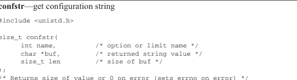

当你进行调用时，将 `len` 设置为你作为 `buf` 参数传入的缓冲区大小；在输出时，它会用 NUL 终止的字符串填充缓冲区，如果整个字符串放不下则进行截断。返回值为存放整个字符串所需的大小。如果返回 `0`，则 `errno` 指示了错误（如果它发生了变化）。如果 `errno` 没有变化，则意味着 `name` 无效。因此，与前几个函数一样，你必须在调用前将 `errno` 设置为零。

### 1.5.8 检查特定的操作系统

以 POSIX/SUS 的方式检查功能是最好的，但有时你确实需要知道是否正在 `Solaris`、`HP/UX`、`AIX`、`FreeBSD`、`Darwin`、`Linux` 或其他系统上。有时你甚至需要知道主版本号和次版本号。我们已经看到了一个这是合理的案例：我们不希望在 `FreeBSD` 或 `Darwin` 系统上定义 `_POSIX_SOURCE`。其他情况是操作系统存在 bug，或者具有超出其声称符合的标准的功能（例如 System V 消息，见下一节）。

没有可移植的方法来检查操作系统，并且在某些系统（例如 `Solaris`）上，甚至没有非可移植的方法。在大多数系统上，一旦包含特定的头文件，可能会设置一个符号，但我们希望非常早期就获得该指示，甚至在我们包含 `unistd.h`（通常应该是第一个包含的 POSIX 或标准 C 头文件）之前。因此，我们在编译时设置一个符号，确保每个系统都不同，如下所示：

```bash
gcc -DSOLARIS -c xyz.c
```

实际上，我们的命令行比这更复杂，并且它们位于 makefiles 中，但你明白了其意图。

### 1.5.9 附加功能

像 `FreeBSD` 和 `Darwin` 这样的系统在声称符合 POSIX 时相当保守，但它们比纯 POSIX 1988 或 POSIX1990 系统要完善得多，后者既不包含套接字式网络，也不包含 System V IPC。`FreeBSD` 具有这些功能，它们大多按预期工作，此外还有更多功能。[^19]

操作系统无法同时设置一个 POSIX 级别和一个指示其具有附加功能的选项符号，因为 (1) 一些功能（如我列出的那些）在 SUS3（即 POSIX2001，如果你愿意的话）之前的任何 POSIX 标准中都不存在，以及 (2) 在 SUS3 中，它们不是可选的，所以没有为它们定义符号。`FreeBSD` 不能通过声称符合，比如说，SUS1 来解决这个问题，因为它并不符合。

与此同时，我们当然不希望将针对 `FREEBSD` 符号的测试遍布我们的代码中，因为这不是我们的本意：我们的意思是“套接字”或“System V IPC”。随意的操作系统依赖性使得移植代码（特别是对于不同的程序员）变得困难，因为移植者完全不知道你在基于操作系统的测试中想要表达什么观点。将代码移植到 `Linux` 的人可能是 `Linux` 专家，但对于 `FreeBSD` 的特性可能一无所知。

因此，我们需要为我们所谓的附加功能发明更多的符号：那些在某处是标准的，但不属于操作系统声称符合的标准中的功能。我们将在进展中引入这些符号，你有时会在示例程序中看到它们，代码可能如下所示：

```c
#if (defined(_XOPEN_SOURCE) && _XOPEN_SOURCE >= 4) || defined(BSD_DERIVED)
#define HAVE_SYSVMSG
#endif
```

我们的公共头文件（见下一节）如果在定义了 `FREEBSD` 或 `DARWIN` 时定义 `BSD_DERIVED`，正如第 1.5.8 节中解释的那样。

[^19]: `Darwin` 6.6，即 `Mac OS X` 10.2.6 中的版本，缺少 System V 消息，尽管它具有其他 System V IPC 功能。

你可以把我们正在做的事情理解为“部分符合”这一概念的形式化，这个概念会让标准制定者感到不适，但操作系统实现者和应用程序编写者认为它是必不可少的。

## 1.6 公共头文件

本书中的所有示例都包含公共头文件 `defs.h`，其中包含我们对 `SUS_SUS2` 的请求以及对 `suvreq.h` 的包含，我在第 1.5.3 节中谈到了这一点。它还包含我们通常需要的许多标准头文件；我们不担心如果程序不需要所有这些而包含多余的内容。其他不太常见的头文件我们在需要时包含。这里我不展示它，但 `defs.h` 还包含像 `syserrmsg`（第 1.4.1 节）这样的实用函数的原型。下面是 `defs.h` 的大部分内容，至少是编写本书时的样子；最新版本在网站上 [AUP2003]：

```c
#if defined(FREEBSD) || defined(DARWIN)
#define BSD_DERIVED
#endif

#if !defined(BSD_DERIVED) /* POSIX_SOURCE too restrictive */
#define SUV_SUS2
#include "suvreq.h"
#endif

#ifdef _GNU_
#define _GNU_SOURCE /* bring GNU as close to C99 as possible */
#endif

#include <unistd.h>

#ifdef __cplusplus
#include <stdbool.h> /* C99 only */
#endif
#include <sys/types.h>
#include <time.h>
#include <limits.h>
#ifdef SOLARIS
#define _VA_LIST /* can't define it in stdio.h */
#endif
#include <stdio.h>
#ifdef SOLARIS
#undef _VA_LIST
#endif
#include <stdarg.h> /* this is the place to define _VA_LIST */

#include <stdlib.h>
#include <stddef.h>
#include <string.h>
#include <ctype.h>
#include <errno.h>
#include <fcntl.h>
#include <assert.h>
#include <ec.h>
```

位于下方约三分之二的 `#ifdef SOLARIS` 部分是关于为什么有时需要操作系统相关代码的完美示例。对于“va”宏（用于 C 中的可变参数列表）是放在 `stdio.h` 还是 `stdarg.h` 中存在分歧，并且 `Solaris` 上的 `gcc` 与其他系统处理方式不同。因此，我使用了一个小技巧来有效地禁用 `stdio.h` 中的定义。这并不美观，且值得努力避免，但有时别无他法，你需要继续你的工作。

包含顺序有点奇怪，可能可以部分按字母顺序排列，但在几种情况下，我发现了顺序依赖关系，不得不稍微调整一下，以便在我尝试的所有系统上获得干净的编译。你看到的内容是最终结果。通常不应有顺序依赖关系，因为头文件应该包含它所依赖的其他头文件，但确实存在。

## 1.7 日期和时间

UNIX 中常用两种时间：*日历时间* 和 *执行时间*。本节包括用于获取时间和操纵时间的系统调用和函数。还可以设置间隔定时器；它们在 9.7 节中讨论。

### 1.7.1 日历时间

日历时间用于文件的访问、修改和状态变更时间，用于记录用户登录时间，用于显示当前日期和时间等。

日历时间通常有四种形式之一：

- 算术类型 `time_t`，它是自 *epoch* 以来的秒数，传统上设定为 1970 年 1 月 1 日午夜

UTC.[^20] 这是将时间存储在文件中以及在函数之间传递时间的好方法，因为它紧凑且不依赖时区。

- 一种结构体类型 `timeval`，它保存秒和微秒的时间。（同时用于日历时间和执行时间。）

- 一种结构体类型 `struct tm`，它将时间分解为年、月、日、小时、分钟、秒以及几件其他事情。

- 一个字符串，例如 `Tue Jul 23 09:44:17 2002`。

有一整套库函数，其中大部分来自标准 C，用于在三种形式之间进行转换。这些函数的名称是一个毫无意义的疯狂集合（没有像 `cvt_tm_to_time` 这样简单的名字）；图 1.1 提供了一个地图，展示了九个转换函数的功能。第十个函数 `time` 用于获取当前时间。

以下是 `tm` 和 `timeval` 结构体[^21]，随后是主要日历时间函数的概要：[^22]

[^20]: 协调世界时 (Universal Coordinated Time)。以前被称为 `GMT`，即格林尼治标准时间 (Greenwich Mean Time)。

[^21]: 有一个过时的结构体 `timeb`，它保存秒和毫秒的时间，以及一个过时的函数 `ftime`，用于填充它。请使用 `gettimeofday` 代替。

[^22]: 一些标准 C 函数也有可重入形式（例如 `ctime_r`），不使用静态缓冲区，但这些不在本书中涵盖。

### struct tm—分解时间的结构体

```c
struct tm {
	int tm_sec;	/* second [0,61] (up to 2 leap seconds) */
	int tm_min;	/* minute [0,59] */
	int tm_hour;	/* hour [0,23] */
	int tm_mday;	/* day of month [1,31] */
	int tm_mon;	/* month [0,11] */
	int tm_year;	/* years since 1900 */
	int tm_wday;	/* day of week [0,6] (0 = Sunday) */
	int tm_yday;	/* day of year [0,365] */
	int tm_isdst;	/* daylight-savings flag */
};
```

### struct timeval—用于 gettimeofday 的结构体

```c
struct timeval {
	time_t tv_sec;	/* seconds */
	useconds_t tv_usec;	/* microseconds */
};
```

### time—作为 time_t 获取当前日期和时间

```c
#include <time.h>

time_t time(
	time_t *t		/* NULL or returned time */
);
/* Returns time or -1 on error (errno not defined) */
```

### gettimeofday—作为 timeval 获取当前日期和时间

```c
#include <sys/time.h>

int gettimeofday(
	struct timeval *tvalbuf,	/* returned time */
	void *dummy		/* always NULL */
);
/* Returns 0 on success or -1 (maybe) on error (may set errno) */
```

### localtime—将 time_t 转换为本地分解时间

```c
#include <time.h>

struct tm *localtime(
	const time_t *t		/* time */
);
/* Returns broken-down time or NULL on error (sets errno) */
```

### gmtime—将 time_t 转换为 UTC 分解时间

```c
#include <time.h>

struct tm *gmtime(
	const time_t *t		/* time */
);
/* Returns broken-down time or NULL on error (sets errno) */
```

### mktime—将本地分解时间转换为 time_t

```c
#include <time.h>

time_t mktime(
    struct tm *tmbuf              /* broken-down time */
);
/* Returns time or -1 on error (errno not defined) */
```

### ctime—将 time_t 转换为本地时间字符串

```c
#include <time.h>

char *ctime(
    const time_t *t               /* time */
);
/* Returns string or NULL on error (errno not defined) */
```

### asctime—将分解时间转换为本地时间字符串 [^23]

```c
#include <time.h>

char *asctime(
    const struct tm *tmbuf        /* broken-down time */
);
/* Returns string or NULL on error (errno not defined) */
```

### strftime—将分解时间转换为带有格式的字符串

```c
#include <time.h>

size_t strftime(
    char *buf,                    /* output buffer */
    size_t bufsiz,               /* size of buffer */
    const char *format,          /* format */
    const struct tm *tmbuf       /* broken-down time */
);
/* Returns byte count or 0 on error (errno not defined) */
```

### wcsftime—将分解时间转换为带有格式的双字符字符串

```c
#include <wchar.h>

size_t wcsftime(
    wchar_t *buf,                /* output buffer */
    size_t bufsiz,               /* size of buffer */
    const wchar_t *format,       /* format */
    const struct tm *tmbuf       /* broken-down time */
);
/* Returns wchar_t count or 0 on error (errno not defined) */
```

[^23]: SUS 并未说明 `asctime` 在出错时返回 NULL，但无论如何检查都是个好主意。

### getdate—根据规则将字符串转换为分解时间

```c
#include <time.h>
struct tm *getdate(
    const char *s        /* string to convert */
);
/* Returns broken-down time or NULL on error (sets getdate_err) */
```

### strptime—根据格式将字符串转换为分解时间

```c
#include <time.h>
char *strptime(
    const char *s,                /* string to convert */
    const char *format,           /* format */
    struct tm *tmbuf             /* broken-down time (output) */
);
/* Returns pointer to first unparsed char or NULL on error (errno not
   defined) */
```

根据标准，这些函数都不设置 `errno`，其中大多数甚至不返回错误指示，但无论如何将返回的指针与 `NULL` 进行测试都是一个好主意。`getdate` 真的很奇怪：在出错时，它将变量或宏 `getdate_err`（在其他地方没有使用）设置为 1 到 8 之间的一个数字，以指示问题的性质；详见 [SUS2002]。

大多数 UNIX 系统将 `time_t` 实现为 `long` 整数，通常只有 32 位（有符号）；这足以让我们计数到 19–Jan-2038[^24] 的秒数。在某个时候，需要更多的位，它将被更改为保证 64 位的东西[^25]。为了准备，始终使用 `time_t`（而不是，比如说，`long`），并且不要对它是做什么的做出任何假设。`time_t` 对于历史时间来说已经不够用了，因为在许多系统中，它（通过负数）只能回溯到 1901 年。


在不假设 `time_t` 是什么的情况下，减去两个 `time_t` 是困难的，这是一个常见需求，因此有一个专门的函数：

### `difftime`—减去两个 `time_t` 值

```c
#include <time.h>
double difftime(
    time_t time1,               /* time */
    time_t time0                /* time */
);
/* Returns time1 – time0 in seconds (no error return) */
```

[^24]: 如果我们坚持激进的 19 年修订周期，这应该是本书第四版出现的时候。

[^25]: 显然这是过度kill，但在计算机中，32 之后的数字通常是 64。

`gettimeofday` 是 `time` 的高分辨率替代方案，但其他函数都不接受 `struct timeval` 作为参数。然而，它们将单独接受 `tv_sec` 字段，因为它是 `time_t`，你可以单独处理微秒。关于类型 `tv_usec` 唯一可以安全假设的是它是一个某种大小的有符号整数。但是，没有理由它比 32 位更宽，因为一秒只有 1,000,000 微秒，所以将 `tv_usec` 字段强制转换为 `long` 可以正常工作。你可以通过用两次 `gettimeofday` 调用来括住执行间隔，然后对 `tv_sec` 字段使用 `difftime`，对 `tv_usec` 字段使用裸减法，来计时执行间隔。

一些实现（FreeBSD、Darwin 和 Linux，但不是 Solaris）使用 `gettimeofday` 的第二个参数返回时区信息，但这是非标准的。大多数实现通过返回 `-1` 来指示错误，甚至设置 `errno`。那些没有这样做的总是返回零，因此你可以在所有情况下安全地检查错误返回值。

`time_t` 始终以 UTC 为基准，但分解时间（`struct tm`）和字符串可以是 UTC 或本地时间。当时间被输入或打印时，使用本地时间很方便，这使事情变得复杂。必须有一种方式让计算机知道用户所在的时区，以及当前是标准时间还是夏令时。更糟糕的是，在打印过去的时间时，计算机必须知道*那时*是标准时间还是夏令时。涉及本地时间的各个函数相当好地解决了这个问题。

用户的时区记录在环境变量 `TZ` 中，或者如果未设置 `TZ`，则作为系统默认值。为了提供可移植性，有一个函数和三个全局变量来处理时区和夏令时设置：

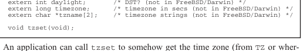

应用程序可以调用 `tzset` 来以某种方式获取时区（来自 `TZ` 或其他地方）并设置这三个全局变量，如下所示：

- 如果时区不应应用夏令时，则 `daylight` 被设置为零（false）；如果应该应用，则设置为非零（true）。切换周期是以实现定义的方式内置于库函数中的。

- `timezone` 被设置为 UTC 与当地标准时间之间以秒为单位的差值。（将其除以 3,600 即可得到以小时为单位的差值。）

- `tzname` 是一个包含两个字符串的数组，`tzname[0]` 用于指定标准时间下的本地时区，而 `tzname[1]` 用于指定夏令时。

这三个全局变量在 POSIX 2002 之前并不包含在 POSIX 中，并且在 FreeBSD 或 Darwin 上未定义。但通常你不需要直接调用 `tzset` 或查询这些全局变量。标准函数会按需执行这些操作。

无论如何，这里有一个示例：

```c
tzset();
printf("daylight = %d; timezone = %ld hrs.; tzname = %s/%s\n",
       daylight, timezone / 3600, tzname[0], tzname[1]);
```

输出如下：

```
daylight = 1; timezone = 7 hrs.; tzname = MST/MCT
```

关于所有日历时间函数用法的细节，特别是涉及格式化字符串的函数，请参见 [SUS2002] 或一本优秀的标准 C 书籍，例如 [Har2002]。以下是一些需要牢记的杂项要点：

- 忽略错误返回的可能性，`ctime(t)` 定义为 `asctime(localtime(t))`。

- `tm` 结构体中的 `tm_sec` 字段可以达到 61（而不仅仅是 59），以容纳偶尔出现的闰秒。

- `tm` 结构体中的 `tm_year` 字段是从 1900 年开始的偏移量。它完全兼容 Y2K 世纪末问题，只是有些奇怪（2002 年表示为 102）。

- 同样奇怪的是，`ctime` 和 `asctime` 在输出字符串的末尾放置了一个换行符。

- 一些函数接受指向 `time_t` 的指针，尽管按值传递的 `time_t` 也能正常工作。这是早期 UNIX 时代的遗留问题，当时 C 语言没有 `long` 数据类型，必须传入一个包含两个 16 位整数的数组。

- `time` 函数的 `time_t` 指针参数完全是不必要的，应该只是 `NULL`。它看起来像是为 `time` 提供一个缓冲区，但并不需要缓冲区，因为返回的 `time_t` 是一个算术类型。

- 这里介绍的所有返回指向 `tm` 结构体指针的函数，在大多数实现中内部都使用静态缓冲区，因此在调用另一个此类函数之前，请使用该缓冲区或复制它。如果需要，可以使用带有 `_r` 后缀的重入形式在多线程程序中。

- 使用 `formats`、`strftime`、`wcsftime`、`getdate` 和 `strptime` 的函数非常复杂，但功能强大，非常值得学习。前两个在标准 C 中；后两个在 SUS 中。`getdate` 在 FreeBSD 或 Darwin 中不存在，虽然可以在 GNU C 库中找到它的版本，如果你需要可以安装。

- 使用 `getdate` 获取用户输入日期和时间，以及在读取包含日期的数据文件时使用 `strptime` 或 `getdate`。原因是 `strptime` 只接受单一格式，这使得用户难以正确格式化日期和时间。`getdate` 使用一个完整的格式列表，并逐一尝试寻找匹配。

### 1.7.2 执行时间

执行时间用于测量时间间隔和进程执行时间，以及用于记账记录。内核会自动记录每个进程的执行时间。时间间隔以各种亚秒级单位表示，范围从纳秒到百分之一秒。

执行时间类型和函数与日历时间函数一样令人困惑。首先，这是主要的类型：

- `clock_t`，在标准 C 中，一个算术类型（通常是 `long`，但不要假设如此），表示以 `CLOCKS_PER_SEC` 或时钟滴答为单位的时间间隔

- `struct timeval`，保存以秒和微秒为单位的间隔（也用于日历时间，并在上一节中详细解释）

- `struct timespec`，保存以秒和纳秒为单位的间隔

这是 `timespec` 的结构体（我们之前已经展示了 `timeval`），它定义在头文件 `<time.h>` 中：

```c
struct timespec {
    time_t tv_sec;      /* 秒 */
    long tv_nsec;       /* 纳秒 */
};
```

有三个主要函数用于测量时间间隔，`gettimeofday`（在上一节中详细讲解）、`clock` 和 `times`。后两个函数以及 `times` 使用的结构体如下：

```c
#include <time.h>
clock_t clock(void);
/* 返回 CLOCKS_PER_SEC 的时间，出错时返回 -1（未定义 errno） */
```

```c
#include <sys/times.h>
clock_t times(
    struct tms *buffer  /* 返回的时间 */
);
/* 返回时钟滴答的时间，出错时返回 -1（设置 errno） */
```

```c
struct tms {
    clock_t tms_utime;      /* 用户时间 */
    clock_t tms_cutime;     /* 已终止子进程的用户时间 */
    clock_t tms_stime;      /* 系统时间 */
    clock_t tms_cstime;     /* 已终止子进程的系统时间 */
};
```

`times` 返回自过去某一点以来经过的时间（通常是自系统启动以来），有时被称为 `wall-clock` 或 `real` 时间。这与上一节中函数返回的时间不同，后者返回的是自纪元时间（通常是 1970 年 1 月 1 日）以来的时间。

`times` 使用时钟滴答作为单位；你可以通过 `sysconf`（第 1.5.5 节）获取每秒的时钟滴答数，如下所示：

```c
clock_ticks = sysconf(_SC_CLK_TCK);
```

此外，`times` 将更具体的信息加载到 `tms` 结构中：

- `tms_utime`（用户时间）是执行进程用户代码指令所花费的时间。这只是 CPU 时间，不包括等待运行的时间。

- `tms_stime`（系统时间）是为进程执行系统调用所花费的 CPU 时间。

- `tms_cutime`（子进程用户时间）是所有已终止子进程的用户 CPU 时间总和，且父进程已针对它们发出 wait 系统调用（在第 5 章中详细解释）。

- `tms_cstime`（子进程系统时间）是已终止并已 wait 的子进程的系统 CPU 时间总和。

尽管 `clock` 返回的类型与 `times` 相同，但它的值是进程启动以来使用的 CPU 时间，而不是实际时间，并且单位由宏 `CLOCKS_PER_SEC` 给定，而不是时钟滴答。除了单位不同外，它等同于 `tms_utime + tms_stime`。

`CLOCKS_PER_SEC` 在 SUS 中定义为 1,000,000（即微秒），但非 SUS 系统可能使用不同的值，因此始终使用宏。（FreeBSD 将 `CLOCKS_PER_SEC` 定义为 128；Darwin 定义为 100。）

如果 `clock_t` 是 32 位有符号整数（通常如此），并使用微秒作为单位，它在大约 36 分钟后会溢出，但至少 `clock` 是在进程启动时开始计时的。`times` 以时钟滴答为单位运行，可以运行更长时间，但它开始得更早——如果 UNIX 系统已运行数周或数月，开始得会早得多，这种情况非常常见。不过，以滴答为单位的 32 位有符号 `clock_t` 在大约 250 天内不会溢出，因此，如果可以安排，每年半重启一次可以解决此问题。

然而，你不能假设 `clock_t` 是 32 位有符号整数，或者它是有符号的，甚至不能假设它是整数。它可能是无符号 long，甚至是 double。

我们将在这本书中广泛使用 `times` 来对各个程序进行计时，因为它能一次性提供实际时间、用户 CPU 时间和系统 CPU 时间。下面是我们将使用的两个实用函数——一个用于开始计时，一个用于停止并打印结果：

```c
#include <sys/times.h>

static struct tms tbuf1;
static clock_t real1;
static long clock_ticks;

void timestart(void)
{
    ec_negl( real1 = times(&tbuf1) )
    /* 将所有 -1 返回值视为错误 */
    ec_negl( clock_ticks = sysconf(_SC_CLK_TCK) )
    return;

EC_CLEANUP_BGN
    EC_FLUSH("timestart");
EC_CLEANUP_END
}

void timestep(char *msg)
{
    struct tms tbuf2;
    clock_t real2;

    ec_negl( real2 = times(&tbuf2) )
    fprintf (stderr,"%s:\n\tTotal (user/sys/real)=%2.2f, %2.2f, %2.2f\n"
             "\t  Child (user/sys)=%2.2f, %2.2f\n", msg,
             ((double)(tbuf2.tms_utime + tbuf2.tms_cutime) -
               (tbuf1.tms_utime + tbuf1.tms_cutime)) / clock_ticks,
             ((double)(tbuf2.tms_stime + tbuf2.tms_cstime) -
               (tbuf1.tms_stime + tbuf1.tms_cstime)) / clock_ticks,
             (double)(real2 - real1) / clock_ticks,
             (double)(tbuf2.tms_cutime - tbuf1.tms_cutime) / clock_ticks,
             (double)(tbuf2.tms_cstime - tbuf1.tms_cstime) / clock_ticks);
    return;

EC_CLEANUP_BGN
    EC_FLUSH("timestep");
EC_CLEANUP_END
}
```

当我们想要对某事物进行计时时，只需在间隔开始时调用 `timestart`，在结束时调用 `timestep`，如下例所示，该示例还包含对 `gettimeofday` 和 `clock` 的调用以供比较：

```c
#define REPS 1000000
#define TV_SUBTRACT(t2, t1) \
    ((double)(t2).tv_sec + (t2).tv_usec / 1000000.0 - \
     ((double)(t1).tv_sec + (t1).tv_usec / 1000000.0)

int main(void)
{
    int i;
    char msg[100];
    clock_t c1, c2;
    struct timeval tv1, tv2;
```

```c
snprintf(msg, sizeof(msg), "%ld getpids", REPS);
```

这是在 Linux 系统上的输出（Solaris、FreeBSD 和 Darwin 给出了类似的结果）：

```text
1000000 getpids:
          "Total (user/sys/real)", 0.72, 0.44, 3.19
          "Child (user/sys)", 0.00, 0.00
clock(): 1.16
gettimeofday(): 3.19
```

因此，`clock` 测量值为 1.16，恰好是 0.72 和 0.44 之和，而 `gettimeofday` 测量的经过时间与 `times` 相同。这很好，否则我们会有更多的解释工作要做。

如果你需要比 `times` 更高的分辨率，请改用 `getrusage`（第 5.16 节）。

## 1.8 关于示例代码

本书中有很多示例代码，你可以自由地将其用于自己的教育目的，甚至用于商业产品中，只要你像通常那样给予署名，例如在“关于”对话框或手册/书籍的致谢页中。详情请参阅网页 `www.basepath.com/amp/copyright.htm`。

有时，为了节省空间，本书中的示例会被删减（例如本章前面提到的错误处理代码和 `def5.h` 中的代码），但完整的文件可以在网页 `www.basepath.com/aup` [AUP2003] 上找到。（那里还有很多其他信息，如勘误表等。）随着本书出版后发现的 bug 增多，网页上的代码会被更新，因此如果你因书中你认为错误的地方感到困惑，请首先检查较新的代码。然后，如果你仍然认为存在 bug，请通过邮件 `aup@basepath.com` 告知我。如果你对我所说的某事有不同看法，或者有更好的做事方法，甚至只是想说这是你读过的最好的一本书，我也很乐意收到这些邮件。

示例代码是用 C99 编写的，但如果你的编译器尚未达到该级别，新特性（例如 `intptr_t`、`bool`）不应造成问题，因为你可以定义自己的宏和 typedef。大部分代码已在 SuSE Linux 8.0（基于 Linux 2.4）、FreeBSD 4.6 和 Solaris 8 上使用 `gcc` 编译器进行了测试，均运行在 Intel CPU 上，以及 Darwin 6.6（Mac OS X 10.2.6 的 UNIX 部分）在基于 PowerPC 的 iMac 上。随着时间的推移，将在更多系统上进行更多测试，如果有任何更改，将发布在网站上。

### 1.9 必备资源

以下是你在编程时希望手边具备的必备资源列表（除了这本书！）：

- 你使用的语言的一本好的参考书。对于 C 语言，最好的是 Harbison 和 Steele 所著的 *C: A Reference Manual* [Har2002]；对于 C++，也许是 Bjarne Stroustrup 所著的 *The C++ Programming Language* [Str2000]。理念是要有一本包含所有答案的书，即使查找答案有点费事。一旦你熟悉了这本书，查找就不再费事，而且只用一本书代替几本书可以节省大量的时间和桌面空间。

- Open Group 的 SUS（Single UNIX Specification，单一 UNIX 规范），网址为：`www.unix.org/version3`

  - 这是一个很棒的网站。你在左侧框架中点击函数名，右侧框架就会显示规范。它也提供 CD 和纸质版本，但网页版是免费的。


- Usenet 新闻组 `comp.unix.programmer`。发布几乎任何 UNIX 问题，无论多难，你都会得到回答。回答可能不正确，但通常至少会为你指明正确的方向。（要访问新闻组，你需要一个能处理它们的邮件客户端和一个新闻源。你的 ISP 可能提供，如果没有，你可以向 `www.suppernews.com` 或 `www.igianews.com` 支付费用。或者，通过 `Google Groups` 在 `http://groups.google.com/groups/` 访问它们。）也有一些网络论坛，如 `www.unix.com`，但它们远不如 `comp.unix.programmer` 好。坚持发布 UNIX（或 Linux 或 FreeBSD）问题——如果你发布 C 或 C++ 问题，你会被粗暴对待。这些主题有单独的新闻组（总共有数万种新闻组）。`Google Groups` 还允许你搜索 Usenet 存档，看看是否也许你父母那一代人在 20 年前问过同样的问题。

- `Google`，网络搜索站点。假设 `sigwait` 系统调用在 FreeBSD 上似乎行为异常，或者你不確定 Linux 是否实现了异步 I/O。你可以通过系统性的方式获得答案（例如，从 FreeBSD 或 Linux 网站获取），或者你可以 google 一下找答案。大约有一半的时候，我找到的内容并非来自官方来源，而是来自 `Google` 恰好索引了某个不起眼的论坛帖子或私人网站。

- `GNU C Library`，一个很好的编码示例来源，可在 `www.gnu.org/software/libc` 下载。

- 你系统的手册页（man pages）。导航起来有点不方便（`apropos` 命令有点帮助），但一旦你找到了正确的页面，通常非常优秀。花些时间学习如何浏览是个好主意，这样当时候来临时，你能够高效地使用它们。

### 练习题

1.1. 用 C 语言编写一个程序，使用包含文件 `defs.h` 和至少一个错误检查宏（例如 `ec_neg1`）显示“Hello World”。此练习的目的是让你将本书的所有代码安装到你的系统中，确保你的 C 编译器运行正常，并确保你所需的工具（如文本编辑器和 `make`）已就位。如果你无法访问 UNIX 或 Linux 系统，解决这个问题也是此练习的一部分。

1.2. 编写一个程序，显示你的系统符合哪个版本的 `POSIX` 和 `SUS`。针对各种请求（例如 `SUV_SUS2`）进行此操作。

1.3. 编写一个程序，显示你的系统的所有 `sysconf` 值。想办法生成所有包含 `sysconf` 调用的行，而无需逐个输入每个符号。

1.4. 与 1.3 相同，但是针对 `pathconf`。设计程序，使你可以输入路径作为参数。

1.5. 与 1.3 相同，但是针对 `confstr`。

1.6. 编写 `date` 命令的一个版本，没有命令行选项。为了获得额外学分，处理尽可能多的选项。基于 `SUS` 或其中一个 `POSIX` 标准。不要作弊，不要偷看 Gnu 源代码或任何其他类似的示例。

## 2

**基本文件 I/O**

## 2.1 文件 I/O 简介

在本章中，我们将探讨普通文件的基本 I/O。I/O 的故事将在第 3 章通过更高级的 I/O 系统调用继续。特殊文件的 I/O 在第 4 章，管道的 I/O 在第 6 章，命名管道的 I/O 在第 7 章，套接字的 I/O 在第 8 章。

为了开始，我将展示一个简单的示例，该示例使用了四个你可能已经很熟悉的系统调用：`open`、`read`、`write` 和 `close`。此函数将一个文件复制到另一个文件（类似于 `cp` 命令）：

```c
#define BUFSIZE 512
void copy(char *from, char *to)  /* has a bug */
{
    int fromfd = -1, tofd = -1;
    ssize_t nread;
    char buf[BUFSIZE];
    ec_neg( fromfd = open(from, O_RDONLY) )
    ec_neg( tofd = open(to, O_WRONLY | O_CREAT | O_TRUNC,
            S_IRUSR | S_IWUSR) )
    while ((nread = read(fromfd, buf, sizeof(buf))) > 0)
        if (write(tofd, buf, nread) != nread)
            EC_FAIL
    if (nread == -1)
        EC_FAIL
    ec_neg( close(fromfd) )
    ec_neg( close(tofd) )
    return;
}
EC_CLEANUP_BGN
    (void) close(fromfd);  /* can’t use ec_neg here! */
    (void) close(tofd);
EC_CLEANUP_END
}
```

尝试找出这个函数中的错误（在第 1.4.1 节中有线索）。如果你找不出来，我会在第 2.9 节中指出它。

现在我简单说几句关于这个函数的话；以后会有充足的时间深入细节。第一次调用 `open` 以只读模式（由 `O_RDONLY` 指示）打开输入文件，并返回一个文件描述符，供后续系统调用使用。第二次调用 `open` 如果文件不存在则创建新文件（因为使用了 `O_CREAT`），或者截断已存在的文件（`O_TRUNC`）。无论哪种情况，文件都以写入模式打开，并返回一个文件描述符。`open` 的第三个参数是当创建文件时使用的权限位集合（我们希望仅所有者具有读和写权限）。`read` 将第三个参数指定的字节数读取到由第二个参数指向的缓冲区中。它返回读取的字节数，文件结束时返回零，出错时返回 -1。`write` 将第三个参数指定的字节数从第二个参数给出的缓冲区中写出。它返回写入的字节数，如果不等于我们要求写入的字节数，我们将其视为错误。最后，`close` 关闭文件描述符。

为了处理错误，我没有使用 `if` 语句、`fprintf` 调用和 `gotos`，而是使用了便捷宏 `ec_neg1`，如果其参数为 -1，它会让函数以错误状态退出；以及 `EC_FAIL`，它总是以错误状态退出。（实际上，它们跳转到清理代码，在本例中没有任何清理代码，由 `EC_CLEANUP_BGN` 和 `EC_CLEANUP_END` 界定。）这些宏在第 1.4.2 节中已引入。

## 2.2 文件描述符与打开的文件描述

每个 UNIX 进程都拥有多个可供使用的文件描述符，编号从 0 到 N，其中 N 是最大值。N 取决于 UNIX 的版本及其配置，但它至少总是 16，在大多数系统上则大得多。要在运行时确定 N 的实际值，你调用 `sysconf`（第 1.5.5 节），参数为 `_SC_OPEN_MAX`，如下所示：

```c
printf("_SC_OPEN_MAX = %ld\n",  sysconf(_SC_OPEN_MAX));
```

在 Linux 2.4 系统上我们得到 1024，在 FreeBSD 上为 957，在 Solaris 上为 256。除了某些嵌入式系统外，当前系统中可能没有只有 16 个文件描述符的。

### 2.2.1 标准文件描述符

按照惯例，进程开始时，前三个文件描述符已经打开。文件描述符 0 是标准输入，文件描述符 1 是标准输出，文件描述符 2 是标准错误输出，后者通常打开到控制终端。使用符号 `STDIN_FILENO`、`STDOUT_FILENO` 和 `STDERR_FILENO` 比使用数字更好。

一个 UNIX 过滤器将从 `STDIN_FILENO` 读取并写入到 `STDOUT_FILENO`；这样 shell 可以在管道中使用它。`STDERR_FILENO` 应用于重要消息，因为写入 `STDOUT_FILENO` 的内容可能会通过管道流向其他地方或写入文件，如果输出被重定向（这在 shell 中非常常见），就再也看不到了。

这些标准文件描述符中的任何一个都可以打开到一个文件、管道、FIFO、设备，甚至套接字。最好以独立于源或目标类型的方式进行编程，但这并不总是可能的。例如，如果标准输出不是终端设备，屏幕编辑器可能完全无法工作。

这三个标准文件描述符可以立即用于读取和写入调用。其他文件描述符可用于进程自己打开的文件、管道等。父进程可以将超过标准三个文件描述符的更多文件描述符传给子进程，我们将在第 6 章通过管道连接进程时看到这一点。

### 2.2.2 使用文件描述符

一般来说，UNIX 使用文件描述符来处理任何表现得像文件的东西，即你可以从中读取或向其写入。文件描述符不用于不太像文件的通信机制，例如消息队列，你不能从中读取和写入（为此有专门的调用）。

获取新的打开文件描述符的方法只有几种。我们现在还没准备好深入研究所有方法，但至少列出它们是有帮助的：

- `open`，用于大多数具有路径名的东西，包括常规文件、特殊文件和命名管道（FIFOs）

- `pipe`，创建并打开一个未命名的管道（第 6 章）

- `socket`、`accept` 和 `connect`，用于网络（第 8 章）

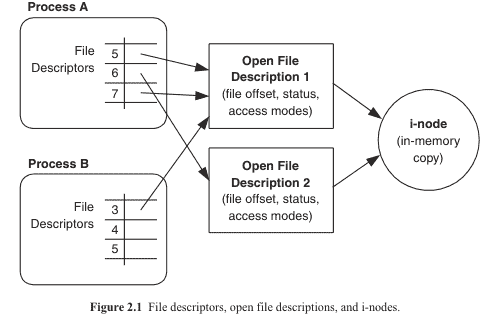

文件描述符没有特定的 C 类型（像进程 ID 那样），所以我们直接使用普通的 `int`。

**脚注 1：** 我考虑过引入类型 `fid_t` 仅用于本书，以使示例更易读，但后来决定不这样做，因为在实际代码中你会看到普通的 `int`，所以为什么不习惯它呢。

### 2.2.3 打开的文件描述与共享

如我在第 1 章所述，文件描述符只是一个每进程表的索引。每个表项指向一个系统范围的打开文件描述（也称为文件表项），后者又指向文件的数据（通过 i 节点的内存副本）。多个文件描述符，甚至来自不同进程的文件描述符，都可以指向同一个文件描述，如图 2.1 所示。

每个 `open` 或 `pipe` 系统调用都会创建一个新的打开文件描述和新的文件描述符。在图中，进程 A 两次打开同一个文件，获得文件描述符 5 和 6，并创建打开文件描述 1 和 2。然后，通过一种称为文件描述符复制（`dup`、`dup2` 和 `fork` 系统调用）的机制，可以共享文件描述符。

## 2.3 文件权限位符号

回顾第 1.1.5 节，文件有 9 个权限位：所有者、组和他人的读、写和执行。我们在 `ls` 命令的输出中经常看到它们：

```
-rwxr-xr-x 1 marc users 29808 Aug 4 13:45 hello
```

每个人都认为这 9 个位是连在一起且按特定顺序（所有者、组、他人）排列的，但这并非要求——只要求有 9 个独立的位。因此，从 POSIX1988 开始，就有了用于替代八进制数字（传统引用方式）的符号。这些符号的形式为 `S_I` 后跟一个权限字符（R、W 或 X）和一个用户类别字符（USR、GRP 或 OTH）。这总共给出 9 个符号。

例如，对于前面的文件，代替八进制 755，我们写：

```c
S_IRUSR | S_IWUSR | S_IXUSR | S_IRGRP | S_IXGRP | S_IROTH | S_IXOTH
```

对于 USR、GRP 或 OTH 具有所有三种权限的情况，有单独的符号，其形式为 `S_IRWX` 后跟“谁”类别的第一个字母（U、G 或 O）。因此，权限可以这样写：

```c
S_IRWXU | S_IRGRP | S_IXGRP | S_IRWXO
```

需要这些符号是为了给实现者自由度去处理位的位置，即使它们比直接使用八进制可读性更差且更容易出错。由于你编写的任何应用程序可能只使用少数几种组合（例如，为其创建的数据文件使用一种或两种，如果创建目录则可能还有一种），最好只定义一次宏来表示它们，而不是到处使用长长的 `S_I*` 符号序列。对于本书，我们将仅使用这些在 `defs.h`（第 1.6 节）中定义的宏：

```c
#define PERM_DIRECTORY    S_IRWXU
#define PERM_FILE        (S_IRUSR | S_IWUSR | S_IRGRP | S_IROTH)
```

注意，我们根据宏的使用方式而不是位来命名它们。因此，它是 `PERM_FILE`，而不是像 `PERM_RWURGO` 这样的名字，因为重点是能够通过只改变一个宏来改变应用程序的权限策略。

## 2.4 open 和 create 系统调用

**open**——打开或创建文件

```c
#include <sys/stat.h>
#include <fcntl.h>

int open(
    const char *path,    /* 路径名 */
    int flags,           /* 标志 */
    mode_t perms          /* 权限（创建时） */
);
/* 返回文件描述符，出错时返回 -1（设置 errno） */
```

你使用 `open` 打开现有文件（常规、特殊或命名管道）或创建新文件，在这种情况下只能是常规文件。特殊文件使用 `mknod`（第 3.8.2 节）创建，命名管道使用 `mkfifo`（第 7.2.1 节）创建。文件打开后，你可以使用返回的文件描述符配合 `read`、`write`、`lseek`、`close` 以及我将在本章和下一章讨论的一批其他调用。

### 2.4.1 打开现有文件

先谈谈打开由 `path` 指定的现有文件。如果 `flags` 是 `O_RDONLY`，则以只读方式打开；如果是 `O_WRONLY`，则以写入方式打开；如果是 `O_RDWR`，则既可以读取也可以写入。

> **脚注 3：** 为什么是三个标志？我们不能废除 `O_RDWR` 而仅使用 `O_RDONLY | O_WRONLY` 吗？不行，因为实现一直将 `O_RDONLY` 定义为零，而不是某个位。

该进程需要读权限、写权限或两者兼备，才能打开文件，具体使用第 1.1.5 节中解释的算法。例如，如果进程的有效用户 ID 与文件的所有者匹配，则必须设置文件所有者的读和/或写权限位。

对于已存在的文件，`perms` 参数不被使用，通常完全省略，因此 `open` 仅使用两个参数调用。

文件偏移量（读取和写入将发生的位置）位于文件的第一字节。关于此的更多细节参见第 2.8 节。

下面是打开一个已存在文件的一些代码：

```c
int fd;
ec_neg( fd = open("/home/marc/oldfile", O_RDONLY) )
```

`open` 失败的原因有很多，对于其中许多原因，告知用户具体问题是有价值的。指向不存在文件的路径（`ENOENT`）所需的解决方案与权限错误（`EACCES`）不同。我们正常的错误检查和报告机制处理得很好（“ec” 宏在第 1.4.2 节中有解释）。

成功 `open` 返回的文件描述符是可用编号最小的那个，但通常你并不在乎具体号码是多少。不过，当你想要重定向标准文件描述符 0、1 或 2 之一时（第 2.2.1 节），这一事实有时很有用：你关闭想要重定向的那个描述符，然后打开一个文件，该文件将使用你刚刚腾出的编号（例如 1）。

### 2.4.2 创建新文件

如果文件不存在，并且你在 `flags` 中或入了 `O_CREATE` 标志，`open` 会为你创建该文件。你当然可以创建一个仅用于读取的新文件，尽管这没有意义，因为将没有内容可读。因此，通常 `O_WRONLY` 或 `O_RDWR` 会与 `O_CREATE` 组合使用。此时，你需要 `perms` 参数，如下例所示：

```c
ec_neg( fd = open("/home/marc/newfile", O_RDWR | O_CREAT, 0644) )
```

`perms` 参数仅在文件被创建时使用。如果文件已存在，则对其没有影响。

新建文件中的权限位由系统调用中的权限位与进程文件模式创建掩码的补集进行逻辑与（AND）运算形成，该掩码通常在登录时（通过 `umask` 命令）或通过 `umask` 系统调用（第 2.5 节）设置。“与补集进行 AND 运算”意味着如果掩码中某一位被设置，则权限中该位将被清除。因此，002 的掩码会导致 `S_IWOTH` 位（其他用户的写权限）被清除，即使 `open` 调用中包含了 `S_IWOTH` 标志。然而，作为程序员，你通常不会考虑掩码，因为这是用户用来限制权限的操作。

如果你使用 `O_WRONLY` 或 `O_RDWR` 标志创建文件，但权限位不允许写入怎么办？由于文件是全新的，它仍然以写模式打开的。但是，下次打开它时，它将已经存在，因此权限位将按照上一节描述的方式控制访问。

有时你总是希望有一个新的文件，其中没有数据。也就是说，如果文件存在，你希望其数据被丢弃，并且文件偏移量设为零。`O_TRUNC` 标志可以做到这一点：

```c
ec_neg( fd = open("/home/marc/newFile", O_WRONLY | O_CREAT | O_TRUNC,
PERM_FILE) )
```

由于 `O_TRUNC` 会破坏数据，它只在进程具有写权限时才允许用于已存在的文件，因为它也是一种写入形式。类似地，如果同时设置了 `O_RDONLY` 标志，也不能使用 `O_TRUNC`。

对于新文件（即 `O_CREAT` 正在起作用的情况），你需要在父目录中具有写权限，因为将在该目录中添加一个新链接。对于已存在的文件，目录的权限无关紧要；起决定作用的是文件的权限。理解这一点的思路是问自己：“完成此操作需要写入什么？”

我还可以提到，你需要路径中的中间目录（例如 home 和 marc）具有搜索（执行）权限。不过，这普遍适用于路径的任何使用，我们将不会每次都说明。

`O_TRUNC` 不必与 `O_CREAT` 一起使用。单独使用时，它的含义是“如果文件存在则将其截断为零，如果不存在则直接失败”。（也许有一个记录功能会在创建日志文件时启用；没有日志文件意味着没有记录。）

组合 `O_WRONLY | O_CREAT | O_TRUNC` 非常常见（“创建或截断文件以进行写入”），为此专门有一个系统调用：

**creat**—创建或截断文件以进行写入


```c
#include <sys/stat.h>
#include <fcntl.h>

int creat(
    const char *path,      /* pathname */
    mode_t perms           /* permissions */
);
/* Returns file descriptor  or -1 on error (sets errno) */
```

`open` 对于仅使用第一和第二个参数（路径和标志）的已存在文件；`creat` 仅使用第一和第三个参数。实际上，`creat` 可以只是一个宏：

```c
#define creat(path, perms) open(path, O_WRONLY | O_CREAT | O_TRUNC, perms)
```

为什么不干脆忘掉 `creat`，而始终使用 `open` 呢——只需要记住一个系统调用而不是两个，并且标志总是显式声明的？听起来是个好主意，这也是我们将在本书中采用的做法。⁴

我们跳过了创建新文件的一个重要部分：谁拥有它？回想第 1.1.5 节，每个文件都有一个所有者用户 ID 和一个所有者组 ID，我们简称为`所有者`和`组`。新文件的设置方式如下：

- `所有者`是从进程的有效用户 ID 设置的。

- `组`设置为父目录的组 ID 或进程的有效组 ID。

你的应用程序不能假设使用了哪种方法来设置组 ID，尽管它可以通过 `stat` 系统调用（第 3.5.1 节）来查明。或者，它可以使用 `chown` 系统调用（第 3.7.2 节）强制将组 ID 设为其所需的值。但是，极少有应用程序关心组 ID。

还有另一个标志 `O_EXCL`，它与 `O_CREAT` 一起使用，导致如果文件已存在则失败。如果没有 `O_CREAT` 标志的 `open` 是“如果存在则打开，如果不存在则失败”，那么带有 `O_CREAT` | `O_EXCL` 的 `open` 则恰好相反，“如果不存在则创建，如果存在则失败”。

`O_EXCL` 有一个有趣的用途，即将文件用作锁，我将在下一节展示。另一个用途可能是一个临时文件，该文件应在应用程序退出时被删除。如果应用程序发现它已存在，这意味着上一次调用异常终止，因此需要进行一些清理或恢复操作。在这种情况下，你希望创建失败，而这正是 `O_EXCL` 标志为你所做的：

```c
int fd;

while ((fd = open("/tmp/apptemp", O_RDWR | O_CREAT | O_TRUNC | O_EXCL,
       PERM_FILE)) == -1) {
    if (errno == EEXIST) {
        if (cleanup_previous_run())
            continue;
        errno = EEXIST; /* may have been reset */
    }
    EC_FAIL /* some other error or can't cleanup */
}
/* file is open; go ahead with rest of app */
```

我们不希望在 `open` 上使用 `ec_neg` 宏，因为我们希望自行调查 `errno`。值 `EEXIST` 专门用于 `O_EXCL` 的情况。我们调用一个名为 `cleanup_previous_run`（未展示）的函数并重试，这就是为什么有 `while` 循环。如果清理不起作用，请注意我们重置了 `errno`，因为它相当易变，而且我们不知道 `cleanup_previous_run` 可能做了什么——它可能有数千行代码。（我们可以使用只有两次迭代的 `for` 循环代替 `while`，以捕捉 `cleanup_previous_run` 返回 `true` 但未能删除文件的情况，让我们留在循环中。但你理解其中的原理。）

如果应用程序并发运行（例如由两个不同用户运行），我们的示例会混乱。在这种情况下，临时文件的存在是有意义的，删除它将是罪过。如果允许并发执行，我们确实需要重新设计，使每次执行都有一个唯一的临时文件，我将在第 2.7 节展示如何做到这一点。如果我们想完全防止并发执行，我们需要某种锁定机制，答案在下一节中。

### 2.4.3 将文件用作锁

需要独占访问资源的进程可以遵循此协议：在访问资源之前，它们尝试使用 `O_EXCL` 创建一个文件（具有商定好的名称）。其中只有一个会成功；其他进程的 `open` 将会失败。它们可以等待稍后重试，或者直接放弃。当成功的进程完成对资源的使用，它会解除该文件的链接。此时，那些未成功打开该文件的进程中，有一个的 `open` 调用将会成功，并且它可以安全地继续执行。

> 4. 如果你对历史感兴趣，`creat` 实际上是一个非常古老的系统调用，在早期形式的 `open` 只有两个参数时很重要。

### 2.4.3 互斥

一旦进程完成对资源的使用，它会解除该文件的链接。此时，那些未成功打开该文件的进程中，有一个的 `open` 调用将会成功，并且它可以安全地继续执行。

为了实现这一点，检查文件是否存在（例如使用 `access`，参见 3.8.1 节）和创建该文件必须是原子的（不可分割的）——不允许其他进程在此期间执行，否则它们可能会在第一个进程检查之后`才`创建该文件。因此，不要这样做：

```
if (access(…) == 0)     /* file does not exist */
  … open(…) …          /* create it */
```

我们需要一种更可靠的方法来保证原子性。

像这样简单的排他性机制被称为 `mutex`（互斥的缩写）、`二元信号量`（只能计数到 1）或 `锁`。我们在这本书中会多次遇到这些概念；请参阅 1.1.7 节了解简要概述。在 UNIX 领域，“mutex”一词更常用于线程的上下文，而“semaphore”一词暗示使用 UNIX 信号量系统调用，因此在本节中我们将简单地称之为“锁”。

该协议最好封装成两个函数，`lock` 和 `unlock`，使用方式如下：

```
if (lock("accounts")) {
  … manipulate accounts …
  unlock("accounts");
}
else
  … couldn’t obtain lock …
```

锁名称 “accounts” 是抽象的；它不一定与实际文件有关。如果两个或更多进程并发执行此代码，锁将防止它们同时执行受保护的部分（即“操纵账户”，无论这意味着什么）。请记住，如果进程不调用 `lock`，则没有保护。它们是`建议性`锁，而非`强制性`锁；（有关两者区别的更多信息，请参阅 7.11.5 节。）

以下是 `lock`、`unlock` 和一个小函数 `lockpath` 的代码：

```
#define LOCKDIR "*/tmp/*"
#define MAXTRIES 10
#define MAPLENGTH 2

static char *lockpath(char *name)
{
    static char path[100];
    if (snprintf(path, sizeof(path), "%s%s", LOCKDIR, name) > sizeof(path))
        return NULL;
    return path;
}

bool lock(char *name)
{
    char *path;
    int fd, tries;

    ec_null( path = lockpath(name) )
    tries = 0;
    while ((fd = open(path, O_WRONLY | O_CREAT | O_EXCL, 0)) == -1 &&
        errno == EEXIST) {
        if (++tries >= MAXTRIES) {
            errno = EAGAIN;
            EC_FAIL
        }
        sleep(NAPLENGTH);
    }
    if (fd == -1)
        EC_FAIL
    ec_negl( close(fd) )
    return(true);

EC_CLEANUP_BGN
    return false;
EC_CLEANUP_END
}

bool unlock(char *name)
{
    char *path;

    ec_null( path = lockpath(name) )
    ec_negl( unlink(path) )
    return true;

EC_CLEANUP_BGN
    return false;
EC_CLEANUP_END
}
```

函数 `lockpath` 生成用作锁的实际文件名。我们将其放在 `/tmp` 目录中，因为该目录存在于每个 UNIX 系统中且对所有人可写。请注意，如果 `snprintf` 返回的数字过大，它不会溢出传递的缓冲区；该数字代表`可能`发生的操作。

`lock` 通过尝试使用 `O_EXCL` 创建文件来放置锁，如上一节所述，我们区分 `EEXIST` 情况和其他错误情况，就像我们在上一节中做的那样。

我们最多尝试 `MAXTRIES` 次创建文件，每次尝试之间睡眠 `NAP_LENGTH` 秒。（`sleep` 属于标准 C，也在 9.7.2 节中介绍。）我们关闭从 `open` 获得的文件描述符，因为我们并不关心实际向文件写入任何内容——我们只关心它的存在与否。我们甚至以无权限的方式创建了它。作为一种增强，我们可以将我们的进程号和时间写入文件，这样等待它的其他进程就可以看到他们在等待谁以及文件已繁忙多久。如果我们这样做，我们希望权限允许读取。

`unlock` 所需要做的只是删除该文件。下一次尝试创建它将成功。我将在 2.6 节中解释系统调用 `unlink`。

这个小型测试程序也很有趣：

```
void testlock(void)
{
    int i;

    for (i = 1; i <= 4; i++) {
        if (lock("accounts")) {
            printf("Process %ld got the lock\n", (long)getpid());
            sleep(rand() % 5 + 1); /* work on the accounts */
            ec_false( !unlock("accounts") )
        }
        else {
            if (errno == EAGAIN) {
                printf("Process %ld tired of waiting\n", (long)getpid());
                ec_reinit(); /* forget this error */
            }
            else
                EC_FAIL /* something serious */
        }
        sleep(rand() % 5 + 5); /* work on something else */
    }
    return;

EC_CLEANUP_BGN
    EC_FLUSH("testlock")
EC_CLEANUP_END
}
```

它循环执行四次“获取/工作/释放”模式，其中“工作”只是睡眠 1 到 5 秒之间的随机秒数。如果它无法获得锁，它会打印抱怨信息并继续执行。然后，它会执行其他不涉及账户的操作，持续 5 到 9 秒，再次循环。`printf` 调用使用了一个我尚未解释的系统调用来获取进程 ID，即 `getpid`（见 5.13 节）。我同时运行了三个这样的小程序：

```
$ tst & tst & tst &
```

输出如下：

- 进程 9232 获得了锁

- 进程 9233 获得了锁

- 进程 9234 获得了锁

- 进程 9232 获得了锁

- 进程 9233 获得了锁

- 进程 9232 获得了锁

- 进程 9233 获得了锁

- 进程 9234 获得了锁

- 进程 9232 获得了锁

- 进程 9233 获得了锁

- 进程 9234 获得了锁

开始阶段是可预测的，但在第 6 行变得有趣起来。最后，进程 9234 不得不在其他进程“回家”后继续停留。

让我们来谈谈使用文件作为锁的优缺点。优点包括它们易于编码（我们仍处于本书第 2 章的早期阶段），作为文件它们可以包含一些数据，并且它们像文件一样持续存在，这在需要长持续时间锁时很有用。最后一点也出现在缺点列表中：如果进程终止而没有清除其锁，即使重启系统，除非 `/tmp` 目录被清除，否则锁也不会清除。此外，它们非常慢，因为创建文件（即使失败）也是一个巨大的操作——对于应用程序执行过程中的少数几次可能还可以接受，但对于数据库或实时程序所需的快速锁来说并不合适。

我还没有提到最糟糕的问题：如果进程无法获得锁，它会不断睡眠和尝试，直到获得锁为止，这被称为`轮询`。这对 CPU 来说只是回答一个简单的复杂问题：“轮到我了吗？”而且，锁可能在进程仍在睡眠时变得可用，但它只有在醒来时才会发现，这是一种浪费。

幸运的是，UNIX 所有内置的锁设施都使用所谓的阻塞，这意味着进程会睡眠，直到它等待的事件发生。我将在 7.11 节中详细讨论这一点。

### 2.4.4 open 标志总结

除了我目前解释的那些标志外，还有更多的 open 标志，但在我有机会将它们放在适当的上下文中之后再进行讨论更合理。例如，`O_NOCTTY` 与终端有关，因此我将在第 4 章中讨论它。表 2.1 显示了 SUSv3 定义的所有标志，并对每个标志进行了快速描述，并交叉引用了详细讨论它们的章节。

### 表 2.1 open 标志

| 标志 | 注释 |
| :--- | :--- |
| `O_RDONLY` \* | 仅打开用于读取（2.4.1 节）。 |
| `O_WRONLY` | 仅打开用于写入（2.4.1 节）。 |
| `O_RDWR` | 同时用于读写（2.4.1 节）。 |
| `O_APPEND` | 所有写入操作发生在文件末尾（2.8 节）。 |
| `O_CREAT` | 如果不存在则创建（2.4.2 节）。 |
| `O_DSYNC` | 设置同步 I/O 行为（2.16.3 节）。 |
| `O_EXCL` | 如果存在则失败；必须与 `O_CREAT` 一起使用（2.4.2 节）。 |
| `O_NOCTTY` | 不要使设备成为控制终端（4.10.1 节）。 |
| `O_NONBLOCK` \dagger | 不要等待命名管道或特殊文件可用（4.2.2 节和 7.2 节）。 |
| `O_RSYNC` | 设置同步 I/O 行为（2.16.3 节）。 |
| `O_SYNC` | 设置同步 I/O 行为（2.16.3 节）。 |
| `O_TRUNC` | 截断为零字节（2.4.2 节）。 |

\* 前三个中必须使用其中一个。

\dagger 以前称为 `O_NDELAY`，语义略有不同。

### 2.5 umask 系统调用

我们在 2.4.2 节中提到了进程的文件模式创建掩码。它由 `umask` 系统调用设置，除了 `umask` 命令本身外，几乎很少有程序使用它：

```c
umask—设置和获取文件模式创建掩码

#include <sys/stat.h>

mode_t umask(
           mode_t cmask      /* 新掩码 */
);
/* 返回旧掩码（无错误返回值） */
```

由于每个进程都有一个掩码，且九个比特的每一种组合都是合法的，`umask` 永远不会返回错误。它总是返回旧掩码。若要在不改变掩码的情况下了解旧掩码是什么，需要对 `umask` 进行两次调用：第一次调用以获取旧值（参数可以是任意值），第二次调用将掩码恢复为原来的状态。

### 2.6 unlink 系统调用

```c
unlink—删除目录项

#include <unistd.h>

int unlink(
            const char *path     /* 路径名 */
);
/* 成功时返回 0，出错时返回 -1（设置 errno） */
```

`unlink` 系统调用从目录中删除一个链接，使 i 节点中的链接计数减少一。如果结果链接计数为零，文件系统将丢弃该文件：它所使用的所有磁盘空间都将被释放以便重新使用（添加到“空闲列表”）。i 节点也将变得可重新使用。进程必须在包含该链接的目录中具有写权限。

任何类型的文件（常规文件、套接字、命名管道、特殊文件等）都可以被 `unlink`，但只有超级用户才能 `unlink` 目录，而在某些系统上即使是超级用户也不行。无论如何，应该使用 `rmdir` 系统调用（见 3.6.3 节）来 `unlink` 目录，而不是 `unlink`。

如果在某些进程仍然打开文件时链接计数变为零，文件系统会延迟丢弃该文件，直到其被关闭，以免扰乱正在运行的进程。这一特性经常被用来创建仅在程序运行期间所需的临时文件，如下所示：

```c
ec_negl( fd = open("temp", O_RDWR | O_CREAT | O_TRUNC | O_EXCL, 0) )
ec_negl( unlink("temp") )
```

这种技术有两个优点：首先，如果进程因任何原因终止，文件将被丢弃。例如，无需使用 `atexit`（见 1.3.4 节）注册函数来确保文件被 `unlink`。其次，由于链接立即通过 `unlink` 从当前目录中移除，第二个进程意外使用同一临时文件并在 `open` 中因 `O_EXCL` 标志而失败的风险较小。不过，如果第二个进程的第一个 `open` 和 `unlink` 之间执行其 `open`，这种情况仍可能发生。

修复此问题的一种方法是使用锁（见 2.4.3 节）：

```c
ec_false( lock("opentemp") )
ec_negl( fd = open("temp", O_RDWR | O_CREAT | O_TRUNC | O_EXCL, 0) )
ec_negl( unlink("temp") )
ec_false( unlock("opentemp") )
```


我们的修复方案相当不错，但仍存在一个缺陷：锁仅是建议性的，且临时文件名缺乏想象力。因此，另一个应用程序（不使用锁）可能会使用相同的名称，其中一个进程将无法获取其临时文件（因`O_EXCL`导致`open`失败）。更好的修复方法是使临时文件名唯一，但这有点棘手，我们将在 2.7 节中看到，那里我将更多地讨论临时文件。

你可能认为还有另一个问题：由于文件名始终是`temp`，两个同时运行该代码的进程是否都在读写同一个临时文件，从而搞乱一切？不是。如果你今天创建了一个名为`myfile`的文件，删除它，明天又用相同的名称创建另一个文件，你不会认为它们是同一个文件。第一个进程仍然打开文件（数据完好无损）这一事实无关紧要，因为它使用的 i 节点与第二个进程将使用的 i 节点完全不同。可以这样理解：`unlink`使目录项消失，即使文件仍然打开，而 i 节点随后变得匿名，因此与访问新进程的完全隔离。

## 2.7 创建临时文件

我们在上一节中使用的创建临时文件的方法，使用固定名称（`temp`）和锁来防止两个进程同时执行相同的代码，这很笨拙，因此 UNIX 程序更典型的做法是使用保证唯一的名称来避免任何可能的冲突。

标准 C 函数`tmpnam`似乎满足我们的需求：

```c
char *pathname;

ec_null ( pathname = tmpnam (NULL) )
ec_negl( fd = open(pathname, O_RDWR | O_CREAT | O_TRUNC | O_EXCL, 0) )
ec_negl( unlink(pathname) )
```

保证`tmpnam`返回的是唯一的，因为它确保不存在该名称的文件。但文件直到`open`时才创建，因此同时执行`tmpnam`的另一个进程获得相同名称的可能性很小。（我们必须不断提醒自己，两行代码之间的时间可能任意长，其他进程可以执行。）由于`O_EXCL`标志，其中一个会实际创建和打开失败，因此不存在 I/O 混淆的危险；然而，我们比使用固定名称的情况好得不多。冲突的概率降低了，但仍不为零。这还不够好。

以下是答案：

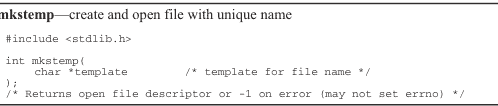

`mkstemp`绝对保证文件将以唯一的名称创建；没有竞态条件问题。你提供一个以六个`X`结尾的名称模板，它会用任何使其名称唯一的内容替换它们。它比`tmpnam`做得更多：它实际创建并打开文件以供读写。不能假设使用了哪些权限，因为标准（SUS3）没有说明，尽管大多数实现可能将读写权限限制为仅所有者（`S_IRUSR | S_IWUSR`）。

对于可移植程序，如果`mkstemp`返回`−1`，关于`errno`该怎么做并不清楚。标准未定义任何错误代码，但所有实现都会返回有效的`errno`是一个相当靠谱的推测。因此，我们选择使用`ec_negl`宏（它记录`errno`，回忆一下），即使概要说明说`errno`可能未设置。为了尝试防止在`errno`未设置时产生误导性的错误消息，我们尝试在调用前将其设置为零。

`mkstemp`在 SUSV3、Linux、FreeBSD 和 Darwin（起源于 BSD）中可用，因此你可以放心它在几乎所有地方都可用。

这里有一个例子；只是为了好玩，我们打印文件名：

```c
char pathname[] = "/tmp/dataXXXXXX";

    errno = 0; /* mkstemp 可能在错误时不设置它 */
    ec_negl( fd = mkstemp(pathname) )
    ec_negl( unlink(pathname) )
    printf("%s\n", pathname);
```

**输出：**

`/tmp/DataKdBy0u`

你不必立即`unlink`文件，但如果不这样做，你必须安排稍后`unlink`它（例如，在`atexit`注册的函数中），否则它将残留下来。当然，如果你需要将路径名传递给程序的另一部分或需要名称的外部程序，就不能立即`unlink`它，如下例所示：

```c
int status;
char cmd[100];

    ec_negl( fd = mkstemp(pathname) )
    /* 向 fd 写入 text_lines 的代码（未显示） */
    snprintf(cmd, sizeof(cmd), "sort %s", pathname);
    ec_negl( status = system(cmd) )
```

注释（“代码写入...”）替代了写入文件的代码。`system`是一个标准 C 函数，用于调用外部程序；我们将在第 5 章中看到它如何工作。

顺便说一句，有一个名为`tmpfile`的标准 C 函数，你可能想要查找，它和`mkstemp`一样好，但它返回的是`FILE`指针而不是文件描述符。

还有一个你可能听过的函数名为`mkdtemp`，它比`mkstemp`更接近`tmpnam`，因为它返回名称但不创建文件。它具有`tmpnam`的所有问题，且不在标准 C 中，所以不要使用它。

快速总结：

-   好的：`mkstemp`和`tmpfile`

-   不好的：`mkdtemp`和`tmpnam`

## 2.8 文件偏移和 `O_APPEND`

本节解释`O_APPEND`标志，我们在 2.4.4 节中首次见到它，然后介绍`read`、`write`、`lseek`、`pread`和`pwrite`系统调用的一些属性，这些调用在本章的其余部分有更完整的解释。

*文件偏移*是常规文件中的一个位置，标记下一次`read`或`write`将发生的地方。这是它唯一的用途。其他类型的文件——目录、套接字、命名管道和符号链接——没有文件偏移。特殊文件可能有也可能没有，取决于它们的实现（见 3.2 节）。

在 UNIX 出现之前（提示：披头士乐队还没解散），大多数操作系统都有“顺序”和“随机”数据文件。UNIX 只有一种类型的数据文件，带有可移动的文件偏移以处理随机访问。它是当时的一项重要创新，即使今天看起来正常且显而易见。

每次打开文件时，你都会获得一个独立的文件偏移，因为如图 2.1 所示，你会获得一个新的打开文件描述。这意味着在这个例子中：

```c
int fd1, fd2, fd3;

ec_negl( fd1 = open("myfile", O_WRONLY | O_CREAT | O_TRUNC, PERM_FILE) )
ec_negl( fd2 = open("myfile", O_RDONLY ) )
ec_negl( fd3 = open("yourfile", O_RDWR | O_CREAT | O_TRUNC, PERM_FILE) )
```

`fd1`和`fd2`各自有自己的文件偏移，所以`fd1`上的写操作和`fd2`上的读操作是独立的，但对于`fd3`上的读和写操作只有一个文件偏移。

如果没有`O_APPEND`标志，新打开的文件偏移从零开始，并由`read`和`write`自动增加它们读取或写入的量。因此，除非故意更改文件偏移，否则`reads`和`writes`是顺序的。你读一些，然后下一个`read`再读一些，等等。`writes`也是如此。

假设文件偏移量从零开始，如果我们先在`fd1`上写入 100 个字节，然后在`fd2`上读取 100 个字节，我们会得到刚刚写入的那 100 个字节。但是，如果我们先写入`fd3`，然后从`fd3`读取，我们会得到位于已写入数据*之后*的内容，如果后面没有内容，则会遇到文件末尾（EOF）。这是因为文件描述（file description）只有一个偏移量，该偏移量同时用于`read`和`write`操作。

你可以通过在文件描述符上调用`lseek`（第 2.13 节）来查询文件偏移量的位置，或者将其设置为新值。新的值将影响该文件描述符随后的`read`或`write`操作。

稍后，在第 6 章中，我们将了解如何复制一个打开的文件描述符。这里说的“复制”并不是指像`fd1 = fd2;`这样的赋值操作，而是指使用`dup`等系统调用进行复制。不管怎样，目前重要的一点是：如果一个文件描述符是另一个的副本，它们共享同一个文件偏移量，因为它们共享同一个打开的文件描述。

如果文件是以设置了`O_APPEND`标志打开的，那么通过`write`系统调用的所有写入操作之前都会隐式执行一次`lseek`，将位置定位到文件末尾，因此写入发生在末尾，且具有原子性。即使有多个进程同时以`O_APPEND`打开该文件并进行写入，它们的每一次写入都会发生在该时刻的末尾，它们不会相互覆盖或混入数据。你无法通过先调用`lseek`再调用`write`（即未设置`O_APPEND`）来实现等效的效果，因为正如我们在其他情况下所见，这两个系统调用之间存在一个间隙，可能导致如下情况：

-   进程 A 将其文件偏移量定位到末尾（假设是位置 1000）。

-   进程 B 将其文件偏移量定位到末尾（也是位置 1000）。

-   进程 B 写入 200 个字节（位于位置 1000）。

-   进程 A 写入 200 个字节（位于位置 1000——覆盖了 B 的数据）。糟糕！

我们可以使用锁（第 2.4.3 节）来修复这个问题，但有一种更好的方法：如果进程 A 和 B 在打开文件时都设置了`O_APPEND`，则可以保证发生以下情况：

-   进程 A 将其文件偏移量定位到末尾（假设是位置 1000）并写入。

-   进程 B 将其文件偏移量定位到末尾（位置 1200）并写入。

因此，`O_APPEND`非常适合日志文件或其他希望累积来自多个进程输出的场景。

你甚至可以通过在系统调用中直接指定位置来读取和写入，而无需先调用`lseek`；这就是*pread*和*pwrite*的作用（第 2.14 节）。它们不使用文件偏移量，也不会改变文件偏移量。

由于你很可能已经相当了解*read*和*write*的工作机制，如果你愿意，可以跳过这部分，直接去读第 2.13 节了解*lseek*并查看一些有趣的示例，然后再回到第 2.9 节按顺序继续阅读。

### 2.9 write 系统调用

`write`—写入文件描述符

```c
#include <unistd.h>

ssize_t write(
    int fd,                /* 文件描述符 */
    const void *buf,       /* 要写入的数据 */
    size_t nbytes          /* 要写入的字节数 */
);
/* 返回写入的字节数，出错时返回 -1（设置 errno） */
```

我们说了这么多关于*write*的事情，你觉得是不是该正式介绍一下它了？

*write* 将 *buf* 指向的 *nbytes* 个字节写入由 *fd* 表示的打开文件。写入从文件偏移量的当前位置开始，写入完成后，文件偏移量会增加已写入的字节数。返回值为写入的字节数，如果发生错误则返回 $-1$。

请记住，如果设置了`O_APPEND`标志，在执行写入之前，文件偏移量会自动设置为文件末尾。

*write*也用于向管道、特殊文件和套接字写入，但在这种情况下其语义略有不同。一个重要区别是，这类写入可能会阻塞，这意味着它们正在等待某些不可预测的事件，例如数据可用。如果*write*被阻塞，它可能会被传入的信号（第 9.1.4 节）中断，此时它会返回 $-1$，并将*errno*设置为 EINTR。关于向非普通文件写入的其余讨论，我将在第 4、6 和 8 章中介绍其他类型文件时再进行。

`write`看似简单，实则不然。它似乎只是写入数据然后返回，但稍微试验一下你就会发现这是不可能的——它太快了。它肯定是在作弊！

确实，它是在作弊。当你发出`write`系统调用时，它并不会执行写入然后返回。它只是将数据传输到内核的缓冲区缓存中，然后返回，声称除此之外没有任何其他保证：

> 我已经记录了你的请求，请放心，你的文件描述符没有问题。我已成功复制了你的数据，并且磁盘空间充足。稍后，在我方便的时候，如果我还“活着”，我会尝试将你的数据放到它所属的磁盘位置。如果那时我发现有错误，我会尝试在控制台打印一些信息，但我不会告诉你（事实上，到那时你可能已经终止了）。如果你或其他任何进程在我将其写出之前尝试读取这些数据，我会从缓冲区缓存中提供给你。因此，如果一切顺利，你永远不会知道我是何时、是否完成了你的请求。请不要问更多问题。请相信我，并感谢我快速的回复——我想这就是你真正关心的。

如果一切顺利，延迟写入是非常棒的。其语义与实际上执行了写入相同，但速度快得多。然而，如果发生磁盘错误，或者内核因任何原因停止，那么游戏就终结了。我们会发现我们“写入”的数据根本不在磁盘上。

除了物理写入发生时间的不确定性之外，延迟写入还有两个其他问题。首先，发起写入的进程无法得知写入错误。事实上，文件系统缓冲区不属于任何单个进程；如果多个进程同时向同一文件的同一块写入，它们的数据会被传输到同一个缓冲区。当然，可以设想一种方案，即向所有写入特定缓冲区的进程发送“写入错误”信号，但进程在如此晚的时刻应该对此做什么呢？内核又如何通知那些已经终止的进程呢？

第二个问题是，物理写入的顺序无法控制。顺序往往很重要。例如，在更新文件中的链表结构时，最好先写入新记录，然后再更新指向它的指针，而不是反过来。这是因为未被指针指向的记录通常比指向无效位置的指针问题小。然而，即使写入系统调用是按特定顺序发出的，这也不意味着缓冲区会按该顺序物理地写入磁盘。因此，像这种仔细的重置技术（这只是一个例子）并没有它们看起来那么有利。它们防止进程在不合适的时间终止，但无法防止磁盘错误或内核崩溃。

幸运的是，你可以强制同步写入，我将在第 2.16 节中解释如何做。

$write$的这些问题不应被过分强调。考虑到如今计算机的可靠性以及 UNIX 实现通常的可靠性，内核崩溃是相当罕见的。大多数用户很高兴享受缓冲区缓存提供的快速响应，而且永远不知道内核在“作弊”。

现在让我们再次看一下本章开头的文件复制示例。错误在于对写入错误的检查：

```c
if (write(tofd, buf, nread) != nread)
    EC_FAIL;
```

如果 $write$ 返回的计数值小于请求的计数值，这*并不*是错误。也许计数值较短是因为写入的管道暂时已满，或者也许是普通文件达到了其大小限制。将产生错误的是*下一次* `write` 调用。$^{6}$

因此，这里的 bug 在于`EC_FAIL`宏将记录一个无意义的 $errno$ 值，该值*仅*在返回值为 $-1$ 时设置。我们可以重写该函数，使其能够耐受部分写入，并持续尝试直到发生真正的错误：

```c
#define BUFSIZE 512

void copy2(char *from, char *to)
{
    int fromfd = -1, tofd = -1;
    ssize_t nread, nwrite, n;
    char buf[BUFSIZE];

    ec_neg1( fromfd = open(from, O_RDONLY) )
    ec_neg1( tofd = open(to, O_WRONLY | O_CREAT | O_TRUNC,
             S_IRUSR | S_IWUSR) )
    while ((nread = read(fromfd, buf, sizeof(buf))) > 0) {
        nwrite = 0;
        do {
            ec_neg1( n = write(tofd, &buf[nwrite], nread - nwrite) )
            nwrite += n;
        } while (nwrite < nread);
    }
}
```

6. 尽管即使如此，导致计数值较短的原因（例如空间不足）可能在下次调用前就已自行解决，因此下次调用不会返回错误。也就是说，没有 100% 可靠的方法来查明部分 $write$ 或 $read$ 为什么是短读取/短写入。

说句实话，对于常规文件而言，这似乎麻烦得有些离谱。尽管我们稍后在对终端和管道进行 I/O 时，会使用一种与此类似的技术，因为它们有时确实需要额外的尝试。也许当我们明确知道自己在写入常规文件时，这种简单的解决方案会更合理：

```c
if ( (nwrite = write(tofd, buf, nread)) != nread ) {
    if (nwrite != -1)
        errno = 0;
    EC_FAIL
}
```

或者你可能更喜欢这样编写代码：

```c
errno = 0;
ec_false( write(tofd, buf, nread) == nread )
```

我们将`errno`设置为零，这样错误报告虽然会显示一个错误（附带行号），但不会显示可能具有误导性的错误代码。有一点你绝对不想做的是完全忽略短计数（short count）：

```c
ec_neg1( write(tofd, buf, nread) ) /* 错误 */
```

这是一个便捷函数`writeall`，它封装了`copy2`示例中“持续重试”的方法。我们将在本书后续章节（第 4.10.2 节和第 8.5 节）中使用它，以确保所有内容都已写入。请注意，它不使用“ec”宏，因为它旨在作为`write`的直接替代方案：


```c
ssize_t writeall(int fd, const void *buf, size_t nbytes)
{
    ssize_t nwritten = 0, n;

    do {
        if ((n = write(fd, &((char *)buf)[nwritten],
            nbytes - nwritten)) == -1) {
            if (errno == EINTR)
                continue;
            else
                return -1;
        }
        nwritten += n;
    } while (nwritten < nbytes);
    return nwritten;
}
```

我们特别处理了 `EINTR` 错误，因为它实际上并不是一个错误。它只是表示 `write` 在写入任何数据之前就被信号中断了，因此我们继续执行。信号以及如何应对方程序被中断的讨论将在第 9.1.4 节中详细阐述。下一节中有一个类似的 `readall` 函数。

## 2.10 read 系统调用

```c
read—从文件描述符读取

#include <unistd.h>

ssize_t read(
    int fd,            /* 文件描述符 */
    void *buf,         /* 接收数据的地址 */
    size_t nbytes      /* 读取的数量 */
);
/* 返回读取的字节数；出错时返回 -1（设置 errno） */
```

`read` 系统调用是 `write` 的逆操作。它从由 `fd` 表示的打开文件中读取 `buf` 指向的 `nbytes` 个字节。`read` 从文件偏移量的当前位置开始，然后文件偏移量增加读取的字节数。`read` 返回读取的字节数，遇到文件末尾时返回 `0`，出错时返回 `-1`。它不受 `O_APPEND` 标志的影响。

与 `write` 不同，`read` 系统调用很难通过先传递数据稍后再读取的方式“作弊”。如果数据尚不在缓冲区缓存中（由于之前的 I/O 操作），进程只能等待内核从磁盘获取它。有时，内核会注意到访问模式暗示了对连续磁盘块的顺序读取，从而尝试预读（read-ahead）来加速过程并预判进程的需求。如果系统负载足够轻，使数据能留在缓冲区中一段时间，且读取是顺序的，那么预读非常有效。

获取关于部分读取（partial reads）的信息与部分写入（partial writes）存在同样的问题：由于短计数不是错误，`errno` 无效，你必须猜测问题所在。如果你确实需要读取全部数据，最好在循环中调用 `read`，这正是 `readall` 所做的（请将其与上一节中的 `writeall` 进行对比）：

```c
ssize_t readall(int fd, void *buf, size_t nbytes)
{
    ssize_t nread = 0, n;

    do {
        if ((n = read(fd, &((char *)buf)[nread], nbytes - nread)) == -1) {
            if (errno == EINTR)
                continue;
            else
                return -1;
        }
        if (n == 0)
            return nread;
        nread += n;
    } while (nread < nbytes);
    return nread;
}
```

我们将在第 8.5 节中看到 `readall` 的使用。

与 `write` 一样，从管道、特殊文件或套接字进行读取可能会阻塞，在这种情况下，它可能会被信号中断（第 9.1.4 节），导致其返回 -1 并将 `errno` 设置为 EINTR。

## 2.11 close 系统调用

```c
close—关闭文件描述符

#include <unistd.h>
int close(
    int fd              /* 文件描述符 */
);
/* 成功时返回 0；出错时返回 -1（设置 errno） */
```

关于 `close` 系统调用，最重要的一点是它实际上什么也不做。它不会刷新任何内核缓冲区；它只是使文件描述符可供重新使用。当指向一个打开文件描述（第 2.2.3 节）的最后一个文件描述符被关闭时，该打开文件描述也可以被删除。进而，当指向内存 i-node 的最后一个打开文件描述被删除时，内存 i-node 也可以被删除。还有最后一步：如果指向实际 i-node 的所有链接都已移除，磁盘上的 i-node 及其所有数据将被删除（详见第 2.6 节）。

由于 `close` 既不会刷新缓冲区缓存，甚至也不会加速刷新，因此没有必要在读取之前关闭你曾经写入过的文件。系统保证你会得到你写入的数据。换句话说，内核缓冲完全不影响 `read`、`write`、`lseek` 或任何其他系统调用的语义。

事实上，如果不再需要该文件描述符，甚至没有要求必须调用 `close`，因为当进程终止时，文件描述符将被回收。然而，释放内核结构并表明你已完成对该文件的操作仍是一个好主意。如果你一直检查错误，它还能防止你稍后意外地使用文件描述符。

调用 `close` 还有一些附加副作用，适用于管道和其他非常规文件，但当我们深入讨论这些文件类型的细节时，再对此加以说明。

## 2.12 用户缓冲 I/O

### 2.12.1 用户缓冲与内核缓冲

回顾第一章可知，UNIX 文件系统构建在块特殊文件之上，因此所有内核 I/O 操作和所有内核缓冲都是以块大小为单位进行的。任何值都有可能，但实际上总是 512 的倍数，常见的数值如 1024、2048 和 4096。它不一定在所有设备上都相同，甚至可能根据磁盘分区的创建方式而变化。我们很快就会弄清楚它的具体数值。

在块大小边界上以等于块大小的块进行读取和写入，比使用任何更小的单位都快。为了证明这一点，我们通过做出以下更改，将第 2.9 节中的 `copy2` 重新编译为使用 1 字节用户缓冲区大小：

```c
#define BUFSIZE 1
```

我们在 4MB 文件<sup>7</sup>上对这两个版本的 copy 进行了计时，结果如表 2.2 所示（时间单位为秒）。

**表 2.2 块大小 I/O 与逐字符对比**

| 方法 | 用户时间 | 系统时间 | 总时间 |
| :--- | :--- | :--- | :--- |
| 512 字节缓冲区 | 0.07 | 0.58 | 0.65 |
| 1 字节缓冲区 | 18.43 | 204.98 | 223.41 |

（显示的时间是在 Linux 上测量的；在 FreeBSD 上它们大致相同。）

用户时间是执行用户进程指令所花费的时间。系统时间是内核代表进程执行指令所花费的时间。

对于常规文件，使用如此小的块进行 I/O 的性能惩罚如此之大，以至于除非程序仅用于偶尔和随意的使用，或者情况非常特殊（例如向后读取文件；参见第 2.13 节），否则根本不会这样做。大部分惩罚仅仅是由于系统调用数量更多（倍率为 512）。为了测试选择不良 I/O 缓冲区大小的惩罚，测试以 `BUFSIZE` 设置为 1024（一个“良好”的大小）和 1100（更大但“不良”的大小）重新运行。这次在 Linux 上差异较小，但 1100 的情况仍比 1024 慢大约 75%（总时间为 7.4 秒，而 4.25 秒）。在 FreeBSD 和 Solaris 上，差异非常接近，仅相差 10–20%。

但问题在于，块大小很少能自然契合程序真正想要做的事情。长度各异的行和各种结构更为典型。解决方案是在用户空间将这些不规则的数据片段打包成块，并且仅在块已满时才写入一个块。对于输入，则执行相反的操作：随着读取，将数据从块中解包。也就是说，除了内核缓冲外，还进行用户缓冲。由于数据片段可能跨越块边界，编程起来有些棘手，我将在下一节中展示如何做。

首先，一个令人困扰的问题：你如何知道块大小是多少？好吧，你可以使用将保存这些文件的文件系统中的实际数值<sup>8</sup>，但一些实验表明，在合理范围内，较大的数值优于较小的数值，原因如下：如果该数值小于实际的块大小，并且能整除该块大小，内核可以非常高效地将写入操作打包到缓冲区中，然后在该缓冲区满时调度写入。如果该数值较大且是缓冲区大小的倍数，内核将数据装入缓冲区依然非常高效，*而且* `write` 系统调用的次数更少，这往往是决定性因素。类似的论点也适用于 `reads`。

因此，目前最容易做的就是用 Standard C 定义的宏 `BUFSIZ`，这也是标准 I/O 函数（例如 `fputs`）所使用的。它并没有针对实际的文件系统进行优化，因为它是一个常量，但实验表明这并不那么重要。如果空间非常紧张，你甚至可以使用 512，这样也没问题。

> 7. 本书 1985 年版使用了一个 4000 字节的文件，时间也差不多！

### 2.12.2 用于用户缓冲的函数

使用一组能够以调用者希望的任何单位执行读、写、定位等操作的函数非常方便。这些子程序自动处理缓冲，并且从不偏离块模型。此类软件包的一个绝佳例子是所谓的“标准 I/O 库”，它在大多数 C 语言书籍中都有描述，例如 [Har2002]。

为了展示用户缓冲软件包背后的原理，我在此介绍一个简化的版本，我将其称为 `BUFIO`。它支持以单个字符为单位的读和写，但不支持定位。首先是该软件包用户必须包含的头文件 `bufio.h`（未显示原型）：

```c
typedef struct {
int fd;
char dir;
size_t total;
size_t next;
unsigned char buf[BUSIZ];
} BUFFIO;
```

接下来是该软件包（`bufio.c`）的实现：

```c
BUFIO *Bopen(const char *path, const char *dir)
{
BUFIO *b = NULL;
int flags;

switch (dir[0]) {
case 'r':
flags = O_RDONLY;
break;
case 'w':
flags = O_WRONLY | O_CREAT | O_TRUNC;
break;
default:
errno = EINVAL;
EC_FAIL
}
ec_null( b = calloc(1, sizeof(BUFIO)) )
ec_neg!( b->fd = open(path, flags, PERM_FILE) )
b->dir = dir[0];
return b;

EC_CLEANUP_BGN
free(b);
return NULL;
EC_CLEANUP_END
}

static bool readbuf(BUFIO *b)
{
ec_neg!( b->total = read(b->fd, b->buf, sizeof(b->buf)) )
if (b->total == 0) {
errno = 0;
return false;
}
b->next = 0;
return true ;

EC_CLEANUP_BGN
return false;
EC_CLEANUP_END
}

static bool writebuf(BUFIO *b)
{
size_t n, total;

total = 0;
while (total < b->next) {
ec_neg!( n = write(b->fd, &b->buf[total], b->next - total) )
total += n;
}
b->next = 0;
return true;
}

EC_CLEANUP_BGN
return false;
EC_CLEANUP_END
}

int Bgetc(BUFIO *b)
{
if (b->next >= b->total)
if (!readbuf(b)) {
if (errno == 0)
return -1;
EC_FAIL
}
return b->buf[b->next++];

EC_CLEANUP_BGN
return -1;
EC_CLEANUP_END
}

bool Bputc(BUFIO *b, int c)
{
b->buf[b->next++] = c;
if (b->next >= sizeof(b->buf))
ec_false( writebuf(b) )
return true;

EC_CLEANUP_BGN
return false;
EC_CLEANUP_END
}

bool Bclose(BUFIO *b)
{
if (b != NULL) {
if (b->dir == 'w')
ec_false( writebuf(b) )
ec_neg1( close(b->fd) )
free(b);
}
return true;

EC_CLEANUP_BGN
return false;
EC_CLEANUP_END
}
```

## 用户缓冲 I/O

最后，我们将文件复制函数重新编码以使用新软件包：

```c
#include "bufio.h"

bool copy3(char *from, char *to)
{
BUFIO *stfrom, *stto;
int c;

ec_null( stfrom = Bopen(from, "r") )
ec_null( stto = Bopen(to, "w") )
while ((c = Bgetc(stfrom)) != -1)
ec_false( Bputc(stto, c) )
if (errno != 0)
EC_FAIL
ec_false( Bclose(stfrom) )
ec_false( Bclose(stto) )
return true;

EC_CLEANUP_BGN
(void)Bclose(stfrom);
(void)Bclose(stto);
return false;
EC_CLEANUP_END
}
```

你会发现 `BUFIO` 与标准 I/O 库的一个子集之间有很强的相似性。下面是一个使用库函数的 copy 版本：

```c
bool copy4(char *from, char *to)
{
FILE *stfrom, *stto;
int c;

ec_null( stfrom = fopen(from, "r") )
ec_null( stto = fopen(to, "w") )
while ((c = fgetc(stfrom)) != EOF)
ec_eof( putc(c, stto) )
ec_false( ferror(stfrom) )
ec_eof( fclose(stfrom) )
ec_eof( fclose(stto) )
return true;

EC_CLEANUP_BGN
(void)fclose(stfrom);
(void)fclose(stto);
return false;
EC_CLEANUP_END
}
```

为了了解用户缓冲的巨大优势，表 2.3 展示了使用 `BUFIO`、标准 I/O 库以及直接系统调用方法（如 `copy2` 所示）进行文件复制的时间（以秒为单位）。

**表 2.3** 缓冲与非缓冲 I/O 的对比

| 方法 | 用户 | 系统 | 总计 |
| :--- | :---: | :---: | :---: |
| **BUFIO** | | | |
| Solaris | 1.00 | 0.51 | 1.51 |
| Linux | 1.00 | 0.28 | 1.28 |
| FreeBSD | 1.00 | 0.45 | 1.45 |
| **标准 I/O** | | | |
| Solaris | 0.57 | 0.24 | 0.81 |
| Linux | 11.32 | 0.15 | 11.48 |
| FreeBSD | 1.02 | 0.20 | 1.22 |
| **BUFSIZ 缓冲区** | | | |
| Solaris | 0.00 | 0.52 | 0.52 |
| Linux | 0.00 | 0.23 | 0.23 |
| FreeBSD | 0.01 | 0.37 | 0.38 |

* 所有时间均以秒为单位，并在各系统内进行归一化，使该系统上用户 BUFIO 的时间为 1.00。

使用用户缓冲，我们几乎得到了两者的最佳结合：我们可以随心所欲地处理数据，甚至可以一次处理 1 个字节，同时我们的系统时间与 `BUFSIZ` 缓冲区方法大致相同。因此，用户缓冲绝对是正确的方向。除了 Linux 外，标准 I/O 的时间表现最佳；它所做的与我们 `BUFIO` 函数所做的相同，只是速度更快，灵活性更强。Linux 上标准 I/O 的用户时间（11.32）显得突出。少量的调研表明，虽然我们所有测试都使用了 gcc 编译器，但 Linux 使用的是 gcc 版本的 stdio.h，FreeBSD 使用的是基于 BSD 的版本，而 Solaris 使用的是基于 System V 的版本。看起来 gcc 版本需要进一步优化。

标准 I/O 库的广泛接受有些讽刺意味。在常规文件上以任意单位进行 I/O 的能力一直是 UNIX 内核的一个非常显著的特性，但在实践中，这个特性通常效率太低而无法使用。

## 2.13 lseek 系统调用

`lseek` 系统调用仅设置文件偏移量，供下一次 `read`、`write` 或 `lseek` 使用。不会执行实际的 I/O，也不会向磁盘控制器发送命令（请记住，通常会有缓冲缓存挡在中间）。

```c
lseek—设置和获取文件偏移量

#include <unistd.h>

off_t lseek(
    int fd,          /* 文件描述符 */
    off_t pos,       /* 位置 */
    int whence       /* 解释方式 */
);
/* 返回新的文件偏移量，出错时返回 -1（设置 errno） */
```

参数 `whence` 可以是以下之一：


### 文件定位

- `SEEK_SET`  
  文件偏移量设置为 `pos` 参数。

- `SEEK_CUR`  
  文件偏移量设置为其当前值加上 `pos` 参数，该参数可以是正数、零或负数。零是获取当前文件偏移量的一种方式。

- `SEEK_END`  
  文件偏移量设置为文件大小加上 `pos` 参数，该参数可以是正数、零或负数。零是将文件偏移量设置为文件末尾的一种方式。

生成的文件偏移量可以是任何非负值，甚至可以大于文件大小。如果大于文件大小，下一次 `write` 会将文件扩展到必要的长度，实际上是用零字节填充该区间。如果文件偏移量设置在文件末尾或之后，`read` 将生成零（文件末尾）返回。对由 `write` 超出文件末尾而产生的扩展区间的 `read` 操作会成功，并返回零字节，这是符合预期的。

当发生超出文件末尾的 `write` 时，大多数 UNIX 系统实际上并不存储中间的零字节块。因此，一个磁盘（例如，有 3,000,000 个可用块）可能包含总长度超过 3,000,000 个块的文件。如果按文件逐个进行备份然后恢复，这会带来严重问题；因为在将这些文件传输到备份设备时，需要读取文件，从而会写入并读回超过 3,000,000 个块！创建了许多包含空洞（holes）文件的用户通常会被系统管理员告知此事，除非备份程序足够智能，能够识别这些空洞。

在 `lseek` 的所有可能用法中，有三种最为常见。首先，`lseek` 可用于在文件中定位到绝对位置：

```
ec_negl( lseek(fd, offset, SEEK_SET) )
```

其次，`lseek` 可用于定位到文件末尾：

```
ec_negl( lseek(fd, 0, SEEK_END) )
```

第三，`lseek` 可用于查找当前的文件偏移量：

```
off_t where;
ec_negl( where = lseek(fd, 0, SEEK_CUR) )
```

其他使用 `lseek` 的方式要少得多。

正如我在第 2.8 节所述，内核执行的大多数定位操作是隐式的，而不是由显式调用 `lseek` 产生的。当调用 `open` 时，内核定位到第一个字节。当调用 `read` 或 `write` 时，内核会根据读取或写入的字节数增加文件偏移量。当使用 `O_APPEND` 标志打开文件时，每次写入前都会先定位到文件末尾。

### 示例：反向打印文件

为了说明 `lseek` 的用法，这里有一个函数 `backward`，它逐行反向打印文件。例如，如果文件包含：

```
dog
bytes
man
```

然后 `backward` 将打印：

```
man

bytes

dog
```

**以下是代码：**

```c
void backward(char *path)
{
    char s[256], c;
    int i, fd;
    off_t where;

    ec_neg!( fd = open(path, O_RDONLY) )
    ec_neg!( where = lseek(fd, 1, SEEK_END) )
    i = sizeof(s) - 1;
    s[i] = '\0';
    do {
        ec_neg!( where = lseek(fd, -2, SEEK_CUR) )
        switch (read(fd, &c, 1)) {
        case 1:
            if (c == '\n') {
                printf("%s", &s[i]);
                i = sizeof(s) - 1;
            }
            if (i <= 0) {
                errno = E2BIG;
                EC_FAIL
            }
            s[--i] = c;
            break;
        case -1:
            EC_FAIL
            break;
        default: /* impossible */
            errno = 0;
            EC_FAIL
        }
    } while (where > 0);
    printf("%s", &s[i]);
    ec_neg!( close(fd) )
    return;

    EC_CLEANUP_BGN
    EC_FLUSH("backward");
    EC_CLEANUP_END
}
```

在这个函数中有两件棘手的事情需要注意：首先，由于 `read` 隐式地将文件位置向前移动，因此我们需要向后回退 `two` 字节以读取上一个字节；为了启动流程，我们将文件偏移量设置为结束位置后一个字节处。其次，`read` 并没有类似“文件开头”的返回值，而它有“文件结尾”的返回值，因此我们必须监视文件偏移量（变量 `where`），并在读取完第一个字节后停止。或者，我们可以等到 `lseek` 尝试使文件指针变为负数时再停止；然而，这样做是不明智的，因为在这种情况下使用的错误代码（`EINVAL`）也用于指示其他类型的无效参数，而且从一般规则来看，最好不要使用错误返回来实现算法。

### 2.14 `p read` 和 `p write` 系统调用

```c
p read—在指定偏移量处从文件描述符读取
#include <unistd.h>

ssize_t p read(
    int fd,             /* 文件描述符 */
    void *buf,          /* 接收数据的地址 */
    size_t nbytes,      /* 要读取的数量 */
    off_t offset         /* 读取位置 */
);
/* 返回读取的字节数，或在出错时返回 -1（设置 errno） */
```

```c
p write—在指定偏移量处向文件描述符写入
#include <unistd.h>

ssize_t p write(
    int fd,             /* 文件描述符 */
    const void *buf,    /* 要写入的数据 */
    size_t nbytes,      /* 要写入的数量 */
    off_t offset         /* 写入位置 */
);
/* 返回写入的字节数，或在出错时返回 -1（设置 errno） */
```

`p read` 和 `p write` 几乎完全等同于先调用 `lseek` 再调用 `read` 和 `write`，除了以下不同：

- 文件偏移量不会被使用，因为读取和写入的位置由 `offset` 参数显式提供。
- 文件偏移量也不会被设置。事实上，它被完全忽略。

`O_APPEND` 标志（第 2.8 节）确实会影响 `p write`，使其行为完全等同于 `write`（如前所述，`offset` 参数被忽略）。

一次调用代替两次调用很方便，但更重要的是，`p read` 和 `p write` 避免了文件偏移量在 `lseek` 和随后的 `read` 或 `write` 之间被另一个进程或线程更改的问题。回想一下，这是有可能发生的，因为线程可以使用相同的文件描述符，而进程可能拥有共享文件偏移量的重复描述符，如第 2.2.3 节所解释。这与 `O_APPEND` 避免的问题相同（第 2.8 节）。由于 `p read` 和 `p write` 甚至不使用文件偏移量，因此它们不可能弄错位置。

为了展示 `p read` 的实际应用，这里提供了 `backward` 的另一个版本（来自上一节）。它更加直观——更容易编写和调试——因为之前调用 `lseek` 将文件偏移量减 2 的繁琐操作已经消失：

```c
void backward2(char *path)
{
    char s[256], c;
    int i, fd;
    off_t file_size, where;

    ec_neg1( fd = open(path, O_RDONLY) )
    ec_neg1( file_size = lseek(fd, 0, SEEK_END) )
    i = sizeof(s) - 1;
    s[i] = '\0';
    for (where = file_size - 1; where >= 0; where--)
        switch (pread(fd, &c, 1, where)) {
        case 1:
            if (c == '\n') {
                printf("%s", &s[i]);
                i = sizeof(s) - 1;
            }
            if (i <= 0) {
                errno = E2BIG;
                EC_FAIL
            }
            s[--i] = c;
            break;
        case -1:
            EC_FAIL
            break;
        default: /* impossible */
            errno = 0;
            EC_FAIL
        }
    printf("%s", &s[i]);
    ec_neg1( close(fd) )
    return;

    EC_CLEANUP_BGN
    EC_FLUSH("backward2");
    EC_CLEANUP_END
}
```

### 2.15 `readv` 和 `writev` 系统调用

```c
readv—分散读取
#include <sys/uio.h>
ssize_t readv(
    int fd,                    /* 文件描述符 */
    const struct iovec *iov,   /* 数据缓冲区向量 */
    int iovcnt                /* 元素数量 */
);
/* 返回读取的字节数，或在出错时返回 -1（设置 errno） */
```

```c
writev—聚集写入
#include <sys/uio.h>
ssize_t writev(
    int fd,                    /* 文件描述符 */
    const struct iovec *iov,   /* 数据缓冲区向量 */
    int iovcnt                /* 元素数量 */
);
/* 返回写入的字节数，或在出错时返回 -1（设置 errno） */
```

`readv` 和 `writev` 类似于 `read` 和 `write`，只不过它们不使用单个数据地址，而是可以同时从多个内存地址获取数据或向多个内存地址写入数据。它们有时被称为 `scatter`（分散）读取和 `gather`（聚集）写入。数据在文件、管道、套接字或 `fd` 打开的任何其他对象上仍然是连续的——是进程的内存可以是分散的。

换句话说，如果你有三个结构体需要写入，不必使用三次 `write`，你可以使用 `writev` 一次性写入所有三个；然而，查看其奇特的第二个参数，你可以很容易地看出这些函数使用起来很麻烦，因此它们最好值得这样做，对吗？我很快就会谈到这个问题；我会先展示如何使用它们。

在调用这两个函数中的任何一个之前，你需要设置 `iov` 数组（由 `iovec` 元素组成），使得每个元素包含指向数据的指针和大小——实际上，这相当于等效的 `read` 或 `write` 调用的第二和第三个参数。可以将 `struct iovec` 视为如下定义（它可能包含额外的非标准成员）：

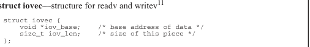

在你的程序中，你可以声明一个 `struct iovecs` 数组，或者使用 `malloc` 分配内存，或者任何你喜欢的方式，只要空间足够且正确初始化即可。你可以拥有的最大元素数量因系统而异，但始终至少为 16。在 SUS 系统上，如果定义了符号 `IOV_MAX`，它告诉你实际的最大值；如果未定义，你可以调用 `sysconf`（第 1.5.5 节），传入参数 `_SC_IOV_MAX`。但说实话，对于 `readv` 和 `writev` 的设计用途来说，16 已经很多了。

以下是使用 `writev` 先写入一个头部结构体，然后写入两个数据结构体的示例程序片段。首先，是结构体声明：

```c
#define VERSION 506
#define STR_MAX 100

struct header {
    int h_version;
    int h_num_items;
} hdr, *hp;
struct data {
    enum (TYPE_STRING, TYPE_FLOAT) d_type;
    union {
        float d_val;
        char d_str[STR_MAX];
    } d_data;
} d1, d2, *dp;
struct iovec v[3];
```

（版本号只是一个用于识别此头部类型的数字。）

接下来，我们初始化头部、两个数据结构和向量：

```c
hdr.h_version = VERSION;
hdr.h_num_items = 2;
d1.d_type = TYPE_STRING;
strcpy(d1.d_data.d_str, "Some data to write");
d2.d_type = TYPE_FLOAT;
d2.d_data.d_val = 123.456;
```

[^1]: 还有 `sendmsg` 和 `recvmsg`；参见第 8.6.3 节。

```c
v[0].iov_base = (char *)&hdr; /* iov_base 有时是 char * */  
v[0].iov_len = sizeof(hdr);  
v[1].iov_base = (char *)&d1;  
v[1].iov_len = sizeof(d1);  
v[2].iov_base = (char *)&d2;  
v[2].iov_len = sizeof(d2);
```

然后通过一次调用 `writev` 写入所有三个结构体：

```c
ec_neg1( n = writev(fd, v, sizeof(v) / sizeof(v[0])) )
```

请注意，在初始化 `iov_base` 时的类型转换，通常我们不需要这样做，因为 SUS 将其声明为 `void` 指针。但 `FreeBSD`（可能还有其他系统）将其定义为 `char` 指针。这种类型转换适用于两者。

为了证明数据在文件上确实是连续的，我们将其读回并打印出来。我们并没有将数据读回原始结构体，而是读入一个大而匿名的缓冲区，并使用适当类型的指针（`hp` 和 `dp`）指向该缓冲区。注意对 `lseek` 的调用，用于将文件卷回开头，该文件是以 `O_RDWR` 方式打开的（未显示）：

```c
ec_null( buf = malloc(n) )  
ec_neg1( lseek(fd, 0, SEEK_SET) )  
ec_neg1( read(fd, buf, n) )  
hp = buf;  
dp = (struct data *)(hp + 1);  
printf("Version = %d\n", hp->h_version);  
for ( i = 0; i < hp->h_num_items; i++ ) {  
    printf("%d: ", i);  
    switch (dp[i].d_type) {  
    case TYPE_STRING:  
        printf("%s\n", dp[i].d_data.d_str);  
        break;  
    case TYPE_FLOAT:  
        printf("%.3f\n", dp[i].d_data.d_val);  
        break;  
    default:  
        errno = 0;  
        EC_FAIL  
    }  
}  
ec_neg1( close(fd) )  
free(buf);
```

输出如下：

```
Version = 506  
0: Some data to write  
1: 123.456
```

除了显而易见的好处——能够在一个系统调用中完成否则需要多个系统调用才能实现的功能——`readv` 和 `writev` 究竟能带来多大的收益？表 2.4 展示了一些基于以下条件的计时测试：使用 `readv` 写 16 个各 200 字节的数据项，共 50,000 次，而对比方案是每次 `writev` 调用替换为 16 次 `write` 调用。因此，每个测试都写入了一个 160MB 的文件。由于不同的 UNIX 系统运行在不同的硬件上，我们将时间进行了标准化处理，以显示 `writev` 的系统时间为 50 秒，这恰好是它在 Linux 机器上的大致数值。[^2]

#### 表 2.4 `writev` 与 `write` 的速度对比

| 系统调用 | 用户时间 | 系统时间 |
| :--- | :--- | :--- |
| **Solaris** | | |
| `writev` | 1.35 | 50.00 |
| `write` | 8.45 | 67.61 |
| **Linux** | | |
| `writev` | .17 | 50.00 |
| `write` | 1.83 | 27.67 |
| **FreeBSD** | | |
| `writev` | .39 | 50.00 |
| `write` | 4.90 | 209.89 |


对于 Solaris，尤其是 FreeBSD，看起来 `writev` 确实比 `write` 表现更好。在 Linux 上，系统时间实际上更差。通过阅读 Linux 代码来查明原因，结果发现对于文件，Linux 只是遍历向量，对每个元素调用 `write`！而对于套接字（这正是 `readv` 和 `writev` 的设计初衷），Linux 的表现要好得多，它将向量一直传递到非常底层的代码中。我们并没有报告相关的计时测试，但从代码可以看出，对于套接字来说，使用 `writev` 确实是有价值的。

[^12]: 在阅读表格时请记住，你无法得出关于例如 Linux 与 FreeBSD 相对速度的任何结论，因为每个系统都是单独进行标准化的。我们只关心每个系统在使用 `writev` 相对于 `write` 时提供的优势程度。此外，Linux 可能并不像我的测试结果所示那么糟糕；请参阅 `www.basepath.com/asp/writer.htm`。

## 2.16 同步 I/O

本节解释如何绕过内核缓冲（如 2.12.1 节中所述），以及如果你不想做得那么彻底，如何控制缓冲区刷新到磁盘的时机。

### 2.16.1 同步（Synchronized）与 同步的（Synchronous）

在英语中，“synchronized”（同步的）和 “synchronous”（同步的）这两个词意思几乎相同，但在 UNIX I/O 中它们意味着不同的事情：

- **同步 I/O**（Synchronized I/O）意味着对 `write`（或其兄弟函数 `pwrite` 和 `writev`）的调用不会返回，直到数据被刷新到输出设备（通常是磁盘）。通常，正如我在第 2.9 节中提到的，非同步的 `write` 会返回，将数据留在内核缓冲区缓存中。如果在此期间计算机崩溃，数据将会丢失。

- **同步的 I/O**（Synchronous I/O）意味着 `read`（及其兄弟函数）不会返回，直到数据可用；而 `write`（及其兄弟函数）不会返回，直到数据至少被写入内核缓冲区，如果 I/O 也是同步的（synchronized），则一直写入到设备。我们到目前为止描述的 I/O 调用——`read`、`pread`、`readv`、`write`、`pwrite` 和 `writev`——都是以同步的（synchronous）方式运行的。

因此，通常 UNIX I/O 是非同步的（unsynchronized）和同步的（synchronous）。实际上，由于缓冲区缓存的工作方式，读取和写入在某种程度上是异步的；然而，一旦你使写入变得同步的（synchronized）（强制在每次调用时刷出缓冲区），实际上等待写入返回会大大减慢程序速度，而那时你才真正希望写入以异步（asynchronously）方式运行。你可能会说，“发起这个写入，然后我在它写入的时候去做一些有用的事，并在我觉得合适的时候再询问结果。”读取，特别是非顺序读取，总是某种程度上同步的（如果数据不在缓存中，内核无法伪造数据）；你也不希望等待它们。

使 `read` 和 `write` 变得同步（synchronized）涉及设置某些 `open` 标志或执行系统调用以刷新内核缓冲区，这是本节的内容。异步 I/O 使用一组完全不同的系统调用（例如 `aio_write`），我将在第 3.9 节中讨论，在那里我将更明确地区分 synchronized 和 synchronous。

### 2.16.2 缓冲区刷新的系统调用

最古老、最知名且效率最低的 I/O 同步调用是 `sync`：

```c
/* sync--调度缓冲区缓存刷新 */
#include <unistd.h>
void sync(void);
```

`sync` 所做的只是告诉内核刷新缓冲区缓存，内核会立即将其添加到待办事项列表中。但 `sync` 会立即返回，因此刷新发生在稍后的某个时候。你仍然不确定缓冲区何时被刷新。`sync` 也很笨拙——所有被写入的缓冲区都被刷新，而不仅仅是与你关心的文件相关的缓冲区。

这个系统调用的主要用途是实现 `sync` 命令，该命令在 UNIX 关闭时或可移除设备卸载前运行。对于应用程序，有更好的选择。

下一个调用，`fsync`，至少表现得像 `sync`，但仅针对为特定文件写入的那些缓冲区。它在 SUS2 系统上受支持，如果在早期系统中定义了选项符号 `_POSIX_FSYNC`，则也受支持。

```c
/* fsync--调度或强制单个文件的缓冲区缓存刷新 */
#include <unistd.h>
int fsync(
    int fd              /* 文件描述符 */
);
/* 成功返回 0，出错返回 -1（设置 errno） */
```

我们说“至少”是因为如果支持同步 I/O 选项（`_POSIX_SYNCHRONIZED_IO`，见 1.5.4 节），保证会强得多：它不会返回，直到缓冲区被物理写入设备控制器，或者检测到错误。

这里是用于检查该选项是否受支持的函数 `option_sync_io`；参见 1.5.4 节了解其工作原理的解释。

```c
OPT_RETURN option_sync_io(const char *path)
{
#if _POSIX_SYNCHRONIZED_IO < 0
return OPT_NO;
#elif _XOPEN_VERSION >= 500 && !defined(LINUX)
#if !defined(_POSIX_SYNC_IO)
errno = 0;
if (pathconf(path, _PC_SYNC_IO) == -1)
if (errno != 0)
return OPT_NO;
else
EC_FAIL
return OPT_YES;

EC_CLEANUP_BGN
return OPT_ERROR;
EC_CLEANUP_END
#elif _POSIX_SYNC_IO == -1
return OPT_NO;
#else
return OPT_YES;
#endif /* _POSIX_SYNC_IO */
#elif _POSIX_VERSION >= 199309L
return OPT_YES;
#else
errno = EINVAL;
return OPT_ERROR;
#endif /* _POSIX_SYNCHRONIZED_IO */
}
```

最后一个同步调用，`fdatasync`，是 `fsync` 的稍快形式，因为它只强制输出实际数据，而不是诸如文件修改时间等控制信息。对于大多数关键应用来说，这就足够了；普通的缓冲区缓存写入稍后会处理控制信息。`fdatasync` 仅作为同步 I/O 选项的一部分可用（即没有类似 `sync` 的行为）。

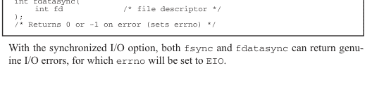

在同步 I/O 选项下，`fsync` 和 `fdatasync` 都可能返回真正的 I/O 错误，此时 `errno` 将设置为 `EIO`。

关于这些函数的最后一点：如果不支持同步 I/O，实现并不要求在你调用 `fsync` 或 `fdatasync`（`fdatasync` 将不存在）时执行任何操作；它们可能是空操作（no-ops）。可以将它们视为仅仅是请求。然而，如果支持该选项，则要求实现提供高水平的数据完整性，尽管实际发生什么取决于设备驱动程序和设备。

### 2.16.3 用于同步的 open 标志

通常，你需要在应用程序知道数据已写入时调用 `fsync` 或 `fdatasync`，例如在报告给用户数据库事务已提交之前。然而，对于更关键的应用程序，你可以通过 `open` 标志来安排，以便在每次 `write`、`pwrite` 和 `writev` 时隐式执行 `fsync` 或 `fdatasync`。

我最初在 2.4.4 节的表格中提到了这些标志：`O_SYNC`、`O_DSYNC` 和 `O_RSYNC`。它们仅在支持同步 I/O 时才可用。以下是它们的作用：

- `O_SYNC` 导致每次写入后隐式执行 `fsync`（完整强度）。

- `O_DSYNC` 导致每次 `write` 后隐式执行 `fdatasync`。

- `O_RSYNC` 导致 `read` 以及 `write` 都进行同步；必须与 `O_SYNC` 或 `O_DSYNC` 一起使用。

（当我们要说 `write` 时，我们也包括 `pwrite` 和 `writev`，`read` 同理。）

`O_RSYNC` 真正所做的只是确保 i-node 中的访问时间以同步方式更新，这意味着在使用 `O_DSYNC` 时，它可能根本不起任何作用。即使在使用 `O_SYNC` 时，访问时间也很少重要到需要同步更新。在某些系统上，`O_RSYNC` 也可能禁用预读。

下面是一个使用 `O_DSYNC` 来比较同步和非同步写入的示例程序：

```c
#define  SYNCREPS   5000
#define  PATHNAME   "tmp"
```

## 2.17 truncate 和 ftruncate 系统调用

**truncate**——通过路径截断或扩展文件

```c
#include <unistd.h>
int truncate(
  const char *path,  /* pathname */
  off_t length       /* new length */
);
/* Returns 0 on success or -1 on error (sets errno) */
```

**ftruncate**——通过文件描述符截断或扩展文件

```c
#include <unistd.h>
int ftruncate(
  int fd,           /* file descriptor */
  off_t length      /* new length */
);
/* Returns 0 on success or -1 on error (sets errno) */
```

扩展文件——在不实际写入大量数据的情况下使其变大——是一件容易的事，我已经展示了如何做：`lseek` 到文件末尾之后的某个位置并写入一些内容。`truncate` 和 `ftruncate` 也可以做到这一点，但它们最常用于截断（缩小）文件，这在它们出现之前在 UNIX 上是不可能的。（你以前不得不编写一个全新的文件，然后将其重命名为旧文件名。）

这里是一个相当刻意构造的例子。注意对 `write` 的非寻常错误检查，我在第 2.9 节末尾对此进行过解释：

```c
void ftruncate_test(void)
{
    int fd;
    const char s[] = "Those are my principles.\n"
                     "If you don't like them I have others.\n"
                     "\t\t--Groucho Marx\n";
    ec_neg1( fd = open("tmp", O_WRONLY | O_CREAT | O_TRUNC, PERM_FILE) )
    errno = 0;
    ec_false( write(fd, s, sizeof(s)) == sizeof(s) )
    (void)system("ls -l tmp; cat tmp");
    ec_neg1( ftruncate(fd, 25) )
    (void)system("ls -l tmp; cat tmp");
    ec_neg1( close(fd) )
    return;

EC_CLEANUP_BGN
EC_FLUSH(*ftruncate_test*);
EC_CLEANUP_END
}
```

以下是输出结果：

```
-rw-r--r--  1 marc  sysadmin  80 Oct 2 14:03 tmp
Those are my principles.
If you don't like them I have others.
		--Groucho Marx
-rw-f--r--  1 marc  sysadmin  25 Oct 2 14:03 tmp
Those are my principles.
```

`ftruncate` 也用于调整共享内存的大小，正如在第 7.14 节中解释的那样。

### 练习

- 2.1. 修改第 2.4.3 节中的 `lock`，使其将登录名存储到锁文件中（使用 `getlogin`；第 3.5.2 节）。添加一个参数，当 `lock` 返回 false 时使用该参数提供已获取锁的用户的登录名。

- 2.2. 编写一个程序，使用 `O_APPEND` 标志打开一个文件进行写入，然后在文件中写入一行文本。运行几个并发进程执行此程序，以确信文本行不会相互混合。然后重新编码该程序，不使用 `O_APPEND`，而是在每次写入前使用 `lseek` 定位到文件末尾。重新运行并发进程，查看文本现在是否相互混合。

- 2.3. 重新运行第 2.12.2 节中的缓冲 I/O 计时测试，缓冲区大小分别为 2、57、128、256、511、513 和 1024。如果您愿意，可以尝试其他一些有趣的数字。如果您可以访问多个版本的 UNIX，请在每个版本上运行该实验，并将结果汇编成表格。

- 2.4. 增强 `BUFIO` 软件包（第 2.12.2 节），使其能够同时打开文件进行读取和写入。

- 2.5. 在 `BUFIO` 软件包中添加一个 `Bseek` 函数。

- 2.6. 编写一个不接受任何选项的 `cat` 命令。作为额外加分项，实现尽可能多的选项。使用 SUS 作为规范。

- 2.7. 与练习 2.6 相同，但针对 `tail` 命令。

# 3 高级文件 I/O

## 3.1 引言

本章承接第 2 章的内容。首先，我将扩展已介绍的 I/O 系统调用的用法，使其适用于磁盘特殊文件。我将利用这一点来查看文件系统内部。然后，我将介绍额外的系统调用，这些调用允许我们将现有文件链接起来；创建、删除和读取目录；以及获取或修改文件状态信息。

与第 2 章中涉及的内容相比，您不太可能使用本章覆盖的高级功能。然而，了解如何使用这些功能仍然会有益，因为这会让您对文件 I/O 的工作方式有更完整的理解。

本章中的程序示例比迄今为止出现的示例更加广泛。仔细研究这些示例是值得您花时间的，因为它们说明了正文中没有明确涵盖的细节。

## 3.2 磁盘特殊文件和文件系统

本节解释了如何对磁盘特殊文件进行 I/O 操作，然后用于访问 UNIX 文件系统的内部结构。它还解释了挂载和卸载是如何工作的。

### 3.2.1 磁盘特殊文件的 I/O

到目前为止，我们通过内核文件系统进行的 I/O 操作完全是基于相对高级的抽象，如文件、目录和 i 节点。如第 2.1.2 节所述，文件系统建立在块 I/O 系统之上，该系统使用缓冲区缓存[^1]。块 I/O 系统通过一个块特殊文件（或块设备）进行访问，该设备直接连接到磁盘。磁盘被视作为一系列块的序列，其大小是扇区大小的倍数，通常是 512。

可能存在多个物理磁盘，并且每个物理磁盘可能分为若干部分，每个部分被称为卷、分区或文件系统。（术语文件系统具有误导性，因为它也描述了内核的一部分。我们使用该术语的上下文将使我们的意图清晰。）

每个卷对应一个特殊文件，其名称通常由设备名称（如“hd”）后跟数字和字母组成，这些数字和字母指示其位于哪个物理磁盘的哪个部分。这些特殊文件通常链接到 `/dev` 目录，尽管它们不一定需要如此。例如，在 Linux 上，文件 `/dev/hdb3` 指的是第二个物理硬盘的第三个分区。

原则上，可以像操作普通文件一样对磁盘特殊文件使用 I/O 系统调用。可以打开它们进行读取和/或写入，读取或写入（以任意单位），查找（到任何字节边界），并关闭。使用缓冲区缓存（因为它是块特殊文件），但在卷内没有目录、文件、i 节点、权限、所有者、大小、时间等。人们只需处理一个巨大的编号块数组。

实际上，大多数用户无法执行这些操作中的任何一个，因为他们被拒绝访问权限。读取包含其他用户文件的磁盘会损害他们的隐私，尽管当作为特殊文件查看时磁盘显得杂乱无章（块按照不明显的顺序分配给 UNIX 文件和目录）。如果不通过内核文件系统而直接写入磁盘，会造成更糟糕的混乱。

另一方面，如果某个卷保留给用户使用，且不用于其他用户的文件和目录，那么就没有冲突。实现数据库管理器或数据采集系统的用户确实可能希望保留一个卷，以便他们可以作为块特殊文件访问它。当然，限制因素是磁盘特殊文件的数量是有限的。通常，当应用程序使用磁盘特殊文件时，该应用程序是该计算机上唯一或至少是主要的应用程序。

潜在上比块磁盘特殊文件更快的是原始磁盘特殊文件。这些设备驱动程序处理磁盘的相同区域。然而，这些原始特殊文件-

[^1]: 较新的系统实际上使用虚拟内存系统而不是缓冲区缓存，但缓存仍然是内核处理文件的有用抽象模型。

原始设备文件是字符设备，而非块设备。这意味着它们不遵循块模型，也不使用缓冲区缓存。它们的做法甚至更好。

当在原始特殊文件上发起读或写操作时，该进程会被锁定在内存中（防止被换出），因此没有任何物理数据地址会发生变化。随后，如果硬件和驱动程序支持，磁盘将被指令使用 DMA（直接内存访问）传输数据。数据直接在进程的数据段和磁盘控制器之间流动，完全绕过内核。传输的大小可能超过单次一个块的大小。

通常，在原始设备上的 I/O 操作不如在常规文件和块特殊文件上灵活。要求 I/O 以磁盘扇区的整数倍进行。DMA 硬件可能要求进程的缓冲区地址位于特定的边界上。寻道可能仅限于块边界。这些限制不会困扰面向数据库的文件系统设计者，因为他们本来就觉得将磁盘视为由固定大小的页组成更为方便。

到目前为止，我们看到 UNIX 的功能在不同版本间略有差异。然而，在这里，这种差异还取决于硬件、设备驱动程序甚至安装配置。由于计算机在 I/O 硬件方面差异巨大，设备驱动程序也随之不同。此外，实施工作的目标也会影响使原始 I/O 高速化的重要性。例如，在通用桌面系统上，这可能重要性极低。


如同同步 I/O（第 2.16 节），原始 I/O 有一个巨大的优点和一个巨大的缺点。巨大的优点是，由于进程等待写入完成，且不存在哪个进程拥有数据的问题，因此可以通过返回 –1 和 `errno` 代码向进程通知物理写入错误。虽然定义了一个代码（`EIO`），但它是否真正传递取决于设备驱动程序的实现者。你必须查看系统特定文档，甚至查看设备驱动程序的代码才能确定。

原始 I/O 的巨大缺点是，由于进程等待读或写完成，且 UNIX 的设计允许进程一次只能发起单个读或写系统调用，因此进程的 I/O 非常快但频率很低。例如，在一个拥有集中式数据库管理进程的多用户数据库应用程序中（这是一种常见配置），如果使用原始 I/O，将会造成巨大的 I/O 交通堵塞，因为只有一个进程为所有人执行 I/O。解决方案包括多个数据库进程、多个线程（第 5.17 节）或异步 I/O（第 3.9 节）。

我们可以立即排除原始 I/O 的一个小缺点是，当进程被锁定在内存中时，其他进程可能无法运行，因为没有空间将它们换入。这将是一种遗憾，因为 DMA 不使用 CPU，这些进程本可以实际执行。解决方案只是增加更多内存。以今天的价格而言，没有理由不配置足够的内存来避免大多数（如果不是全部的话）换页，特别是对于运行重要到需要进行原始 I/O 的应用程序的计算机而言。

表 3.1 总结了在常规文件、块磁盘设备和原始磁盘设备上进行 I/O 的功能差异。

### 表 3.1 I/O 功能比较

| 特性 | 常规文件 | 块磁盘设备 | 原始磁盘设备 |
| :--- | :---: | :---: | :---: |
| 目录、文件、i 节点、权限等 | 是 | 否 | 否 |
| 缓冲区缓存 | 是 | 是 | 否 |
| I/O 错误返回、DMA | 否 | 否 | 是 |

为了展示速度差异，我们在 Solaris 上测量了 10,000 次读取，每次 65,536 字节。我们读取了一个常规文件、一个块磁盘设备（`/dev/dsk/c0d0p0`）和一个原始磁盘设备（`/dev/rdsk/c0d0p0`）。如同我在第 2 章中所做的那样，我在表 3.2 中报告了系统时间、用户时间和实际时间（以秒为单位）。由于读取原始磁盘设备提供的功能与使用 `O_ASYNC` 标志读取常规文件类似，如第 2.16.3 节所述，我也包含了该情况下的时间数据。

### 表 3.2 I/O 计时比较

| I/O 类型 | 用户 | 系统 | 实际 |
| :--- | :---: | :---: | :---: |
| 常规文件 | 0.40 | 21.28 | 441.75 |
| 常规文件，`O_ASYNC \| O_DSYNC` | 0.25 | 25.50 | 412.05 |
| 块磁盘设备 | 0.38 | 22.50 | 562.78 |
| 原始磁盘设备 | 0.10 | 2.87 | 409.70 |

如您所见，Solaris 上原始 I/O 的速度优势是巨大的，我在 Linux 上得到了类似的结果。我没有费心进行写操作的比较，因为我知道使用缓冲区缓存的两种文件类型会赢得毫无悬念，而且我没有多余的卷来随意写入。当然，这不会是一个公平的比较，因为使用缓冲区缓存的时间不会包括物理 I/O，而原始 I/O 的时间除了包含物理 I/O 外不会包含多少其他内容。

### 3.2.2 文件系统的低级访问

通过将其作为磁盘设备读取来查看文件系统的内部结构是有启发性的（假设你有读取权限）。你很可能不会在应用程序中这样做，但这就是 `fsck` 等低级文件实用程序所做的。

文件系统的设计比 UNIX 系统的版本更多：Solaris 上的 UFS（UNIX 文件系统），FreeBSD 上的 FFS（快速文件系统，也称为 UFS），以及 Linux 上的 ReiserFS 和 Ext2fs。以下内容松散地基于原始的（1970 年代的）UNIX 文件系统和 FFS。

原始磁盘被视为一系列固定大小的块的序列，例如 2048 字节。（实际大小对于此讨论无关紧要。）大约第一个块保留给自举程序（如果磁盘可引导）、磁盘标签和其他此类管理信息。

文件系统主体从磁盘起始的固定偏移处开始，位于超级块（`superblock`）；它包含各种结构信息，如 `i` 节点数量、卷中块的总数、空闲块链表的头部等。每个文件（常规、目录、特殊等）使用一个 `i` 节点，并且必须至少从一个目录链接到该文件。磁盘上有数据的文件——常规文件、目录和符号链接——也具有从其 `i` 节点指向的数据块。`i` 节点从超级块指向的位置开始。

`i` 节点 0 和 1 未使用。² `i` 节点 2 保留给根目录（`/`），因此当内核被给予绝对路径时，它可以从一个已知位置开始。其他 `i` 节点编号没有特定的意义；它们根据需要分配给文件。

> 2. `i` 节点编号从 1 开始，这使得 0 可以用来表示“无 `i` 节点”（例如，一个空目录）。历史上，`i` 节点 1 用于收集坏磁盘块。

以下程序非常特定于 FreeBSD 对 FFS 的实现，它展示了一种通过读取磁盘设备 `/dev/ad0slg` 来访问超级块和 `i` 节点的方式，该设备是一个恰好包含 `/usr` 目录树的原始磁盘设备。可以通过执行 `mount` 命令（该命令知道 FFS 类型为 `"ufs"`）来验证这一点：

```
$ mount
/dev/ad0sla on / (ufs, NFS exported, local)
/dev/ad0slf on /tmp (ufs, local, soft-updates)
/dev/ad0slg on /usr (ufs, local, soft-updates)
/dev/ad0sle on /var (ufs, local, soft-updates)
procfs on /proc (procfs, local)
```

程序如下：

```c
#ifdef FREEBSD
#error "Program is for FreeBSD only."
#endif

#include "defs.h"
#include <sys/param.h>
#include <ufs/ffs/fs.h>
#include <ufs/ufs/dinode.h>

#define DEVICE "/dev/ad0slg"

int main(int argc, char *argv[])
{
int fd;
long inumber;
char sb_buf[(sizeof(struct fs) / DEV_BSIZE) + 1] * DEV_BSIZE];
struct fs *superblock = (struct fs *)sb_buf;
struct dinode *d;
ssize_t nread;
off_t fsbo, fsba;
char *inode_buf;
size_t inode_buf_size;

if (argc < 2) {
printf("Usage: inode n\n");
exit(EXIT_FAILURE);
}
inumber = atol(argv[1]);
ec_negl( fd = open(DEVICE, O_RDONLY) )
ec_negl( lseek(fd, SBLOCK * DEV_BSIZE, SEEK_SET) )
switch (nread = read(fd, sb_buf, sizeof(sb_buf))) {
case 0:
    errno = 0;
    printf("EOF from read (1)\n");
    EC_FAIL
case -1:
    EC_FAIL
default:
    if (nread != sizeof(sb_buf)) {
        errno = 0;
        printf("Read only %d bytes instead of %d\n", nread,
               sizeof(sb_buf));
        EC_FAIL
    }
}
printf("Superblock info for %s:\n", DEVICE);
printf("\tlast time written = %s", ctime(&superblock->fs_time));
printf("\tnumber of blocks in fs = %ld\n", (long)superblock->fs_size);
printf("\tnumber of data blocks in fs = %ld\n", 
       (long)superblock->fs_dsize);
printf("\tsize of basic blocks in fs = %ld\n", 
       (long)superblock->fs_bsize);
printf("\tsize of frag blocks in fs = %ld\n",
       (long)superblock->fs_fsize);
printf("\tname mounted on = %s\n", superblock->fs_fstmt);

inode_buf_size = superblock->fs_bsize;
ec_null( inode_buf = malloc(inode_buf_size) )

fsba = ino_to_fsba(superblock, inumber);
fsbo = ino_to_fsbo(superblock, inumber);

ec_negl( lseek(fd, fsbtoDb(superblock, fsba) * DEV_BSIZE, SEEK_SET) )
switch (nread = read(fd, inode_buf, inode_buf_size)) {
case 0:
    errno = 0;
    printf("EOF from read (2)\n");
    EC_FAIL
case -1:
    EC_FAIL
default:
    if (nread != inode_buf_size) {
        errno = 0;
        printf("Read only %d bytes instead of %d\n", nread, inode_buf_size);
        EC_FAIL
    }
}
```

以下代码片段演示了如何检索目录索引节点：

```c
d = (struct dinode *)kindo_buf(fab0 * sizeof(struct dinode));
printf("\nlnumber %ld info:\n", inumber);
printf("\tmode = 0%o\n", d->di_mode);
printf("\tlinks = %d\n", d->di_nlink);
printf("\towner = %d\n", d->di_uid);
printf("\tmod. time = %s", ctime((time_t *)&d->di_mtime));
exit(EXIT_SUCCESS);
EC_CLEANUP_BGN

    exit(EXIT_FAILURE);
EC_CLEANUP_END
```

`sb_buf` 的复杂声明：

```c
char sb_buf[((sizeof(struct fs) / DEV_BSIZE) + 1) * DEV_BSIZE];
```

是为了将其大小向上取整到偶数扇区，因为在 FreeBSD 上读取原始磁盘设备有这一要求。

第一个 `lseek` 操作定位到 `SBLOCK * DEV_BSIZE`，即超级块的位置。`SBLOCK` 恰好为 16，而 `DEV_BSIZE` 是扇区大小，通常为 512，这对大多数磁盘都适用。超级块总是从文件系统的起始位置开始第 16 个扇区。第一组 `printf` 语句打印非常长的 `fs` 结构体中的几个字段。这是该输出：

```text
Superblock info for /dev/ad0s1g:
last time written = Mon Oct 14 15:25:25 2002
number of blocks in fs = 1731396
number of data blocks in fs = 1704331
size of basic blocks in fs = 16384
size of frag blocks in fs = 2048
name mounted on = /usr
```

接下来，程序使用一些宏（这些宏位于某个头文件中，因为 FFS 磁盘上的算术运算非常复杂）来查找作为参数提供的索引节点（`argv[1]`）。我通过 `ls` 命令的 `-i` 选项获取了文件的 `i` 节点号：

```text
$ ls -li x
383642 -rw-r--r-- 1 marc marc 11687 Sep 19 13:29 x
```

以下是 `i` 节点 383642 的其余输出：

```text
inumber 383642 info:
mode = 0100755
links = 1
owner = 1001
mod. time = Thu Sep 19 13:29:30 2002
```

我不打算再花时间讨论底层磁盘访问——我真正想做的只是说明普通文件和特殊文件之间的关系。但是如果你有 FreeBSD 系统，可能会喜欢稍作修改以显示其他信息；或者如果你有另一个 UNIX 系统，也可以尝试将其修改为适用于该系统。

## 3.2.3 statvfs 和 fstatvfs 系统调用

在块设备或原始设备上找到超级块后，使用 `read` 读取它虽然有趣，但在符合 SUS1 的系统上（参见 1.5.1 节），使用 `statvfs` 或 `fstatvfs` 系统调用是一种更好的方法：

```c
/* statvfs—通过路径获取文件系统信息 */
#include <sys/statvfs.h>
int statvfs(
    const char *path,     /* 路径名 */
    struct statvfs *buf   /* 返回的信息 */
); /* 成功时返回 0，出错时返回 -1（并设置 errno） */

/* fstatvfs—通过文件描述符获取文件系统信息 */
#include <sys/statvfs.h>
int fstatvfs(
    int fd,               /* 文件描述符 */
    struct statvfs *buf   /* 返回的信息 */
); /* 成功时返回 0，出错时返回 -1（并设置 errno） */
```

通常，你会使用 `statvfs`，它返回包含其第一个参数所给路径的文件系统信息。如果有一个已打开的文件，你可以改用 `fstatvfs`，它返回相同的信息。

标准定义了 `statvfs` 结构的字段，但实现并不要求支持所有字段。此外，大多数实现支持额外的字段以及 `f_fflag` 字段的额外标志。你需要查看你系统的手册页以获取具体细节。如果某个实现不支持某个标准字段，该字段仍然存在，但不会包含有意义的信息。

```c
/* struct statvfs—statvfs 和 fstatvfs 的结构体 */
struct statvfs {
    unsigned long f_bsize;       /* 块大小 */
    unsigned long f_fsize;       /* 基本（fblock）大小 */
    fsblkcnt_t f_blocks;         /* 总块数 */
    fsblkcnt_t f_bfree;          /* 空闲块数 */
    fsblkcnt_t f_bavail;         /* 可用 fblock 数 */
    fsfilcnt_t f_files;          /* 总 i 节点数 */
    fsfilcnt_t f_ffree;          /* 空闲 i 节点数 */
    fsfilcnt_t f_favail;         /* 可用 i 节点数 */
    unsigned long f_fsid;        /* 文件系统 ID */
    unsigned long f_flag;        /* 标志（见下文） */
    unsigned long f_namemax;     /* 文件名最大长度 */
};
```

关于此结构体的一些说明：

-   大多数文件系统为文件分配相当大的块，由 `f_fsize` 字段给出，以加快访问速度，但随后使用较小的碎片块来结束文件，以避免浪费空间。碎片块大小被称为 *基本* 块大小，由 `f_fsize` 字段给出；我们简称为 *fblock*。类型为 `fsblkcnt_t` 的字段以块为单位，因此，要获取总字节空间，需将 `f_blocks` 乘以 `f_fsize`。

-   类型 `fsblkcnt_t` 和 `fsfilcnt_t` 是无符号的，但具体由实现定义。它们通常是 `long` 或 `long long`。如果需要显示其中一个且你有 C99 编译器，请将其强制转换为 `uintmax_t` 并使用 `printf` 格式 `%ju`；否则，将其强制转换为 `unsigned long long` 并使用格式 `%llu`。

-   SUS 标准为 `f_flag` 字段仅定义了两个标志，指示文件系统的挂载方式：
    -   如果是只读，则设置 `ST_RDONLY`，
    -   如果可执行文件应忽略设置用户 ID 在执行时和设置组 ID 在执行时位（一种安全措施），则设置 `ST_NOSUID`。

-   适用于 `f_bavail` 和 `f_favail` 字段的术语“可用”意味着“对非超级用户进程可用”。它可能小于对应的“空闲”字段，以便在空闲空间变紧时性能会受到影响上，预留最小量的空闲空间。

FreeBSD 由于早于 SUS，不支持 `statvfs` 或 `fstatvfs` 函数，但它有一个类似名为 `statfs` 的函数，其结构体名称不同且大多数字段也不同。对于基本信息，可以通过编写同时适用于 `statvfs` 和 `statfs` 的代码来实现，如下所示程序所示。

# 磁盘特殊文件和文件系统


```c
#if _XOPEN_SOURCE >= 4
#include <sys/statvfs.h>
#define FCN_NAME statvfs
#define STATVFS 1

#elif defined(FREEBSD)
#include <sys/param.h>
#include <sys/mount.h>
#define FCN_NAME statfs

#else
#error "Need statvfs or nonstandard substitute"
#endif

void print_statvfs(const char *path)
{
  struct FCN_NAME buf;

  if (path == NULL)
    path = ".";
  ec_neg1( FCN_NAME(path, &buf) )
#ifdef STATVFS
  printf("block size = %lu\n", buf.f_bsize);
  printf("fundamental block (fblock) size = %lu\n", buf.f_fsize);
#else
  printf("block size = %lu\n", buf.f_iosize);
  printf("fundamental block (fblock) size = %lu\n", buf.f_bsize);
#endif
  printf("total number of fblocks = %llu\n",
         (unsigned long long)buf.f_blocks);
  printf("number of free fblocks = %llu\n",
         (unsigned long long)buf.f_bfree);
  printf("number of avail. fblocks = %llu\n",
         (unsigned long long)buf.f_bavail);
  printf("total number of i-numbers = %llu\n",
         (unsigned long long)buf.f_files);
  printf("number of free i-numbers = %llu\n",
         (unsigned long long)buf.f_ffree);
#ifdef STATVFS
  printf("number of avail. i-numbers = %llu\n",
         (unsigned long long)buf.f_favail);
  printf("file-system ID = %lu\n", buf.f_fsid);
  printf("Read-only = %s\n",
         (buf.f_flag & ST_RDONLY) == ST_RDONLY ? "yes" : "no");
  printf("No setuid/setgid = %s\n",
         (buf.f_flag & ST_NOSUID) == ST_NOSUID ? "yes" : "no");
  printf("max length of filename = %lu\n", buf.f_namemax);
#else
  printf("Read-only = %s\n",
         (buf.f_flags & MNT_RDONLY) == MNT_RDONLY ? "yes" : "no");
  printf("No setuid/setgid = %s\n",
         (buf.f_flags & MNT_NOSUID) ? "yes" : "no");
#endif
  printf("\nFree space = %.0f%%\n",
         (double)buf.f_bfree * 100 / buf.f_blocks);
  return;

EC_CLEANUP_BGN
EC_FLUSH("print_statvfs");
EC_CLEANUP_END
}
```

这是我们在包含目录 `/home/marc/aup` 的文件系统上在 `Solaris` 上获得的输出（`Linux` 产生类似的输出）：

```text
block size = 8192
fundamental block (fblock) size = 1024
total number of fblocks = 4473046
number of free fblocks = 3683675
number of avail. fblocks = 3638945
total number of i-numbers = 566912
number of free i-numbers = 565782
number of avail. i-numbers = 565782
file-system ID = 26738695
Read-only = no
No setuid/setgid = no
Max length of filename = 255

Free space = 82%
```

在 `FreeBSD` 上，对于 `/usr/home/marc/aup`，这是其输出：

```text
block size = 16384
fundamental block size = 2048
total number of fblocks = 1704331
number of free fblocks = 1209974
number of avail. fblocks = 1073628
total number of i-numbers = 428030
number of free i-numbers = 310266
Read-only = no
No setuid/setgid = no

Free space = 71%
```

`statvfs`（或 `statfs`）系统调用是著名的 `df`（“磁盘空闲”）命令的核心（参见练习 3.2）。以下是它在 `FreeBSD` 上报告的内容：

`$ df /usr`

```text
文件系统 1k 块数 已用 可用 容量 挂载点

/dev/ad0s1g 3408662 988696 2147274 32% /usr
```

报告的 1k 块数 3408662，相当于我们的 `print_statvfs` 程序显示的 2k 块数 1704331。

还有一种标准方法可以读取 i 节点中的信息，因此你不需要像前一节那样读取设备文件。我们将在第 3.5 节中详细介绍这一点。

## 3.2.4 挂载和卸载文件系统

一个 UNIX 系统可以拥有大量的磁盘文件系统（硬盘、软盘、`CD-ROM`、`DVD` 等），但它们都通过一个以根目录开始的单一目录树进行访问。将文件系统连接到现有层次结构称为*挂载*，而断开连接称为*卸载*。图 3.1 显示了一个大型文件系统，包含根目录（i 节点 2，含目录项 `x` 和 `y`）以及一个较小的未连接文件系统，该文件系统也有自己的根目录，编号同样为 2。（请记住，2 始终是根目录的 i 编号。）

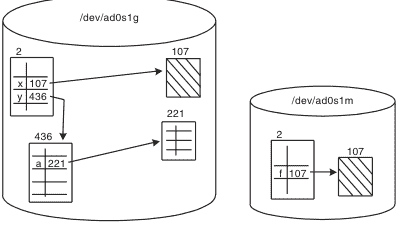

**图 3.1** 两个未连接的文件系统。

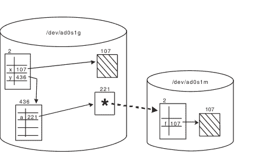

**图 3.2** 已挂载的文件系统。

要挂载第二个文件系统，你需要两样东西：其设备名称（即 `/dev/ad0slm`）以及你希望连接它的目录，我们这里选择 `/y/a`（i 节点 221）。以下是创建图 3.2 所示目录树的命令：

```bash
# mount /dev/ad0slm /y/a
```

目录 `/y/a` 的旧内容现在被隐藏了，对该目录的所有引用自动变为对 i 节点 `ad0slm:2` 的引用，这种表示方法我将用它来表示“设备 `ad0slm` 上的 i 节点 2”。因此，文件 `ad0slm:107` 现在可以通过 `/y/a/f` 访问。当 `ad0slm` 被卸载时，其内容不再可访问，`ad0s1g:221` 的旧内容会重新出现。³

每个 UNIX 系统都有一个仅限超级用户使用的系统调用 `mount`，以及其逆操作函数 `unmount`（有时称为 `umount`），但它们的参数和具体行为因系统而异。与其他仅限超级用户使用的功能一样，它们没有标准化。在实践中，这些系统调用用于实现 `mount` 和 `unmount` 命令，几乎从未被直接调用。作为一个例子，以下是 `Linux` 的函数原型，我不打算完全解释它们：

```c
mount—挂载文件系统（非标准）

#include <sys/mount.h>

int mount(
    const char *source,    /* 设备 */
    const char *target,     /* 目录 */
    const char *type,       /* 类型 (例如, ext2) */
    unsigned long flags,    /* 挂载标志 (例如, MS_RDONLY) */
    const void *data        /* 依赖文件系统的数据 */
);
/* 成功返回 0，出错返回 -1（设置 errno） */
```

```c
umount — 卸载文件系统（非标准）

#include <sys/mount.h>

int umount(
    const char *target     /* 目录 */
);
/* 成功返回 0，出错返回 -1（设置 errno） */
```

通常，如果该文件系统上的任何文件或目录正在使用中，`umount` 会因错误 `EBUSY` 而失败。通常有一个替代的系统调用 `umount2`，其第二个参数是一个标志，用于强制卸载，这在系统需要关机时偶尔是必要的。

从应用程序编程的角度来看，除了某种特定情况外，只要你有可用的路径名，你通常不必关心你试图访问的某个文件或目录是挂载在与另一个文件或目录不同的文件系统上。事实上，所有可访问的文件系统，甚至包括根文件系统，都曾在某个时刻被挂载过，也许是在启动序列期间。那一种特定情况与链接有关，这正是下一节的内容。

³ 一个目录中仅作为挂载点而实际拥有内容的情况很少见，但这被允许，并且系统管理员偶尔会用它来隐藏某个目录。

## 3.3 硬链接和符号链接

目录中的一个条目，由名称和 i 编号组成，称为硬链接。另一种类型的链接是符号链接，我稍后就会谈到。图 3.3.3 说明了这两种链接。（括号中的十六进制数是设备 ID，我稍后会解释。）

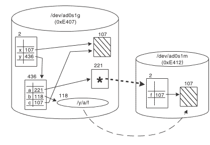

图 3.3 硬链接和符号链接。

### 3.3.1 创建硬链接（link 系统调用）

当创建任何类型的文件（包括目录）时，都会获得一个硬链接。你可以使用 `link` 系统调用来获取非目录的额外硬链接 ⁴：

```c
/*—创建硬链接
#include <unistd.h>

int link(
    const char *oldpath, /* 旧路径名 */
    const char *newpath  /* 新路径名 */
);
/* 成功返回 0，出错返回 -1（设置 errno） */
```

第一个参数 `oldpath` 必须是一个已存在的链接；它提供了要使用的 i 编号。第二个参数 `newpath` 指示新链接的名称。这些链接在所有方面都是平等的，因为 UNIX 没有主要链接和次要链接的概念。进程必须对将包含新链接的目录具有写权限。由第二个参数指定的链接不能已经存在；`link` 不能用于更改现有的链接。在这种情况下，必须先使用 `unlink`（第 2.6 节）删除旧链接，或者可以使用 `rename` 系统调用（下一节）。

⁴ 在某些系统中，超级用户可以链接到现有的目录，但这样做意味着目录结构不再是一棵树，使系统管理变得复杂。

### 3.3.2 重命名文件或目录（rename 系统调用）

乍一看，重命名文件似乎很容易，如果你指的是“更改目录条目中的名称”。你所做的只是用 `link` 创建第二个硬链接，并用 `unlink` 删除旧链接，但有很多复杂的情况：

- 文件可能是目录，而你无法为目录创建第二个硬链接。
- 有时你希望新名称位于不同的目录中，如果在同一个文件系统内这不是问题，但如果不在同一个文件系统内，这就是一个大问题，因为 `link` 仅在文件系统内部有效。当然，你可以在新目录中创建符号链接（下一节），但这并不是大多数人所说的“重命名”。
- 如果你想将目录“重命名”（实际上是“移动”）到不同的文件系统之间，你必须移动其下的整个子树。仅移动空目录限制过于严格。
- 如果存在多个硬链接，并且你在同一个文件系统中重命名文件，它们不会有问题，因为它们引用的是 i 编号，而 i 编号不会改变。但如果你设法将文件移动到另一个文件系统，旧链接将不再有效。由于你必须先复制文件然后删除原始文件，可能会发生的情况是旧副本仍然存在，除了被移动的硬链接外，其他链接仍指向它。这不好。
- 如果存在指向某路径的符号链接，而你更改了该路径，符号链接就会变成死胡同。这也是不好的。

如果我们再仔细想想，可能还能列出更多复杂情况，但你大概明白意思了，我们已经开始头疼了。这就是为什么 UNIX `mv` 命令（即用于“重命名”文件或目录的命令）是一个极其复杂的代码块。而且它甚至没有处理最后两个问题。

无论如何，`mv` 命令表现还不错，但要在文件系统内移动目录，它需要以下替代机制之一。

- 始终复制目录及其子树，然后删除旧目录，即使目录只是在其父目录内重命名。
- 一个对目录有效的 `link` 系统调用，即使限制为仅超级用户可用（`mv` 命令可以启用 `set-user-ID` 位来运行，以暂时获得超级用户权限。）
- 一个可以在文件系统内重命名目录的新系统调用

第一种选择很糟糕——如果你只想更改名称中的几个字符，那工作量太大了！第二种被 `POSIX` 否决，转而支持第三种——一个新的系统调用，`rename`。实际上，它并不新——它存在于标准 `C` 中，并且在 `BSD` 中早已存在。这是重命名目录而不进行完整 `copy`/`unlink` 的唯一方法。

```c
rename—重命名文件

#include <stdio.h>

int rename(
         const char *oldpath,         /* 旧路径名 */
         const char *newpath          /* 新路径名 */
      );
/* 成功返回 0，出错返回 -1（设置 errno） */
```

`rename` 大致等同于以下序列：

1. 如果 `newpath` 存在，使用 `unlink` 或 `rmdir` 将其删除。
2. `link(oldpath, newpath)`，即使 `oldpath` 是目录。
3. 使用 `unlink` 或 `rmdir` 删除 `oldpath`。

`rename` 带来了一些额外的特性和规则：

- 如前所述，步骤 2 对目录有效，即使进程不是以超级用户身份运行。（不过你需要对 `newpath` 的父目录有写权限。）
- 如果 `newpath` 存在，它和 `oldpath` 必须都是文件或都是目录。
- 如果 `newpath` 存在且是目录，它必须是空的。（与 `rmdir` 的规则相同。）在步骤 3 中，如果 `oldpath` 是目录，即使非空也会被删除，因为其内容也在 `newpath` 中。
- 如果 `rename` 在过程中某处失败，一切保持不变。

因此你可以看到，尽管步骤 1、2 和 3 看起来可以编写为一个库函数，但无法使其表现得像系统调用那样。

`mv` 命令可以执行 `rename` 系统调用所无法完成的多项操作，例如在文件系统之间移动文件和目录，以及将文件和目录的组移动到新的父目录。`rename` 仅仅提供了 `mv` 功能中一个虽小但不可或缺的部分。

最后需要说明的是：如果 `oldpath` 是一个符号链接，`rename` 将作用于该符号链接本身，而不是它指向的目标对象；因此，从理论上讲它或许应被称为 `lrename`，但那会让标准 `C` 的维护者感到困惑。

### 3.3.3 创建符号链接 (symlink 系统调用)

如图 3.3 所示，如果我们希望为文件 `/x` (`ad0s1g:107`) 创建第二个链接，位于目录 `/y` 中，我们可以执行以下调用：

```
ec_neg1( link("/x", "/y/c") )
```

这使得 `/x` 和 `/y/c` 在所有方面都等价；`ad0s1g:107` 并不“属于”其中任何一个目录。

但现在，UNIX 挂载机制的透明性被打破了：无法从 `/y` 创建一个指向 `/y/a/f` (`ad0slm:107`) 的硬链接，因为目录项仅包含一个 i 节点号来标识被链接的对象，而不包含“设备: i 节点号”的组合，而后者才是保证唯一性的必要条件。（我特意在图中让 107 成为两个完全不同文件的 i 节点号。）如果你尝试执行：

```
ec_neg1( link("/y/a/f", "/y/b") )
```

它将产生一个 `EXDEV` 错误。

正如所有经验丰富的 UNIX 用户所知，解决方案是使用符号链接。与硬链接不同，硬链接是将要链接到的 i 节点号直接放入目录中，而符号链接则是一个小型文件，其中包含指向你想要链接的对象的路径文本。图 3.3 中的椭圆所示即为我们想要的链接。它拥有自己的 i 节点 (`ad0s1g:118`)，但通常任何对 `/y/b` 的访问尝试都会导致内核将其解释为对 `/y/a/f` 的访问，而后者位于另一个文件系统上。

符号链接可以引用另一个符号链接。通常，当把一个符号链接传递给 `open` 时，内核会不断解除引用（解链），直到找到非符号链接的对象为止。这种链式解引用不会发生在硬链接中，因为硬链接直接引用一个 i 节点，而 i 节点本身不能是一个硬链接。（虽然 i 节点可以是一个包含硬链接的目录。）换句话说，如果路径通向一个硬链接，该路径将被字面执行。如果它通向一个符号链接，实际执行的路径取决于该符号链接所引用的对象，直到达到链的末端。

用户使用 `ln` 命令的 `-s` 选项来创建符号链接，但真正执行工作的系统调用是 `symlink`：


**symlink**——创建符号链接

```c
#include <unistd.h>
int symlink(
    const char *oldpath,    /* old pathname */
    const char *newpath     /* possible new pathname */
);
/* Returns 0 on success or -1 on error (sets errno) */
```

在大多数情况下，`symlink` 的行为类似于 `link`。在两种情况下，都会创建一个路径由 `newpath` 指定的硬链接；然而，在使用 `symlink` 时，这个硬链接指向的是一个包含 `oldpath` 给定字符串的符号链接文件。

概要中的注释说“可能（possible）”，因为对 `newpath` 没有任何验证——不仅不检查它是否为有效路径，甚至不检查它是否合法。你甚至可以这样做：

```
ec_neg1( symlink("lunch with Mike at 11:30", "reminder") )
```

然后使用 `ls` 命令查看你的提醒（输出已换行以适应页面宽度）：

```
$ ls -l reminder
lrwxrwxrwx    1 marc    sysadmin      24
Oct 16 12:04 reminder -> lunch with Mike at 11:30
```

这种相当宽松的行为是有意为之，并带来了一个符号链接的有用特性：它所引用的对象无需存在。或者，它可能存在，但其所在的文件系统可能未挂载。

内核不关心符号链接目标是否存在的另一面，是当目标被解除链接时，对符号链接本身不做任何处理。这里所说的“解除链接”，我当然指的是“解除硬链接”。因为当硬链接计数降为零时，内核才决定文件是否不再需要（`i` 节点和数据可回收）。在这种情况下，调整符号链接可能是不可能的，因为其中一些符号链接可能位于未挂载的文件系统上。这对硬链接来说是不可能的，因为硬链接是文件系统内部的。

那么，如何删除一个符号链接？使用 `unlink`（参见图 3.3）：

```
ec_neg1( unlink("/y/b") )
```

这解除了符号链接 `/y/b`，并且对其引用的文件 `a/f` 没有影响。可以将 `unlink` 理解为移除其参数直接指定的硬链接。

好的，那么如何通过符号链接引用的路径来解除某个文件的链接呢？你可以使用另一个路径，因为文件必须硬链接到某个目录。但如果你只有符号链接路径，你可以使用 `readlink` 系统调用读取其内容：

**readlink**——读取符号链接

```c
#include <unistd.h>
ssize_t readlink(
        const char *path,        /* pathname */
        char *buf,               /* returned text */
        size_t bufsiz)
/* Returns byte count or -1 on error (sets errno) */
```

`readlink` 对于 UNIX 系统调用而言并不寻常，因为你不能假设返回的字符串以 NUL 结尾。你需要确保 `buf` 指向足够大的空间以容纳符号链接的内容加上一个 NUL 字节，然后将其大小减一作为第三个参数传递。返回后，你可能希望强制插入一个 NUL 字节，如下所示：

```c
ssize_t n;
char buf[1024];

ec_neg1( n = readlink("/home/marc/mylink", buf, sizeof(buf) - 1) )
buf[n] = '\0';
```

如果需要，你现在可以删除 `/home/marc/mylink` 所链接的对象以及该符号链接本身，方式如下：

```
ec_neg1( unlink(buf) )
ec_neg1( unlink("/home/marc/mylink") )
```

`readlink` 并非唯一需要处理符号链接本身（而非其引用对象）的情况。另一个例子是 `stat` 系统调用（第 3.5.1 节），用于获取 `i` 节点信息，它有一个不跟随符号链接的变体，称为 `lstat`。

`readlink` 示例代码中的一个问题是常量 `1024`，它旨在代表足以容纳最长路径名的大小。即使路径更长，我们的代码也不会崩溃——我们在那方面足够谨慎。它只是截断返回的路径，这仍然不好。

但是，如果目录中的文件名限制为例如 `255` 字节，而目录嵌套的深度没有限制，那么多大的空间才足够？显然 `1024` 不是答案——那只能处理四层！获取答案的过程有些杂乱，因此它有一个专门的章节来讨论。请继续阅读。

## 3.4 路径名

本节解释如何确定路径名的最大长度以及如何获取当前目录的路径名。

### 3.4.1 路径名有多长？

如果路径名长度有一个固定限制——例如常数 `_POSIX_MAX_PATH`——那么目录嵌套的深度也将有一个限制。即使这个数字很大，也会带来问题，因为通过 NFS 等机制，UNIX 系统挂载其他计算机上的文件系统是相当常见的。因此，该限制必须在运行时动态确定，并且必须能够随文件系统而变化。

这正是 `pathconf` 和 `fpathconf` 的用途（第 1.5.6 节）。在符合 POSIX1990 的系统上——基本上是所有系统——你这样调用它：

```c
static long get_max_pathname(const char *path)
{
    long max_path;

    errno = 0;
    max_path = pathconf(path, _PC_PATH_MAX);
    if (max_path == -1) {
        if (errno == 0)
            max_path = 4096; /* guess */
        else
            EC_FAIL
    }
    return max_path + 1;
}

EC_CLEANUP_BGN
    return -1;
EC_CLEANUP_END
}
```

我对 `pathconf` 返回的值加了一，因为我查看过的文档对于大小是否包含 NUL 字节的空间描述有些模糊。我倾向于认为它不包含，猜想操作系统实现者和我一样不确定。

我在每个测试系统上分别为本地挂载的文件系统和 NFS 挂载的文件系统调用了此函数，在 FreeBSD 和 Solaris 上得到 `1024`，在 Linux 上得到 `4096`。但那是我那些系统的版本和我的配置。你需要在自己的代码中使用 `pathconf`，而不是依赖我的数字。

技术上讲，对于 `_PC_PATH_MAX`，`pathconf` 返回的是从其参数路径开始的最长相对路径名的大小，而不是最长绝对路径的大小；因此，为了完全准确，你应该使用你感兴趣的文件系统的根目录作为 `path` 参数调用它，然后将根目录到该文件系统根目录的路径大小加到那个数字上。但这样做*可能*有些过度——大多数人只是以 `"/"` 或 `"."` 作为参数调用它。

上述描述是基于 POSIX 和 SUS 标准的。实际上，即使从 `pathconf` 和 `fpathconf` 返回某个数字的系统，在创建目录时也不会强制执行该限制，但当试图将过长的路径名传递给接受路径的系统调用（如 `open`）时，它们会强制执行该限制（错误为 `ENAMETOOLONG`）。在大多数系统上，`getcwd`（下一节）可以返回一个比 `pathconf` 或 `fpathconf` 返回的最大值更长的字符串，只要你给它一个足够大的缓冲区。

### 3.4.2 getcwd 系统调用

有一个直接的系统调用用于获取当前目录的路径。与 `readlink`（第 3.3.3 节）类似，唯一棘手的事情是知道要传入多大的缓冲区。

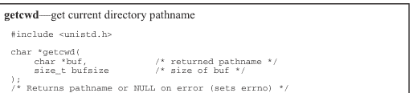

这里有一个函数，它能让你更轻松地调用 `getcwd`，因为它会自动分配一个缓冲区来存放路径字符串。传入 `true` 参数调用该函数时，会指示它释放该缓冲区。

```c
static char *get_cwd(bool cleanup)
{
    static char *cwd = NULL;
    static long max_path;

    if (cleanup) {
        free(cwd);
        cwd = NULL;
    }
    else {
        if (cwd == NULL) {
            ec_negl( max_path = get_max_pathname(".") )
            ec_null( cwd = malloc(size_t)max_path) )
        }
        ec_null( getcwd(cwd, max_path) )
        return cwd;
    }
    return NULL;
}
EC_CLEANUP_BGN
    return NULL;
EC_CLEANUP_END
```

下面是一些代码，其功能类似于标准的 `pwd` 命令：

```c
char *cwd;

ec_null( cwd = get_cwd(false) )
printf("%s\n", cwd);
(void) get_cwd(true);
```

我在 Solaris 上运行它时，得到了以下结果：

```
/home/marc/aup
```

本章中提供的功能已足够让我们自己实现 `getcwd`，我将在 3.6.4 节中展示相关代码。

还有一个类似的系统调用 `getwd`，但它已废弃，不应在新程序中使用。

## 3.5 访问和显示文件元数据

本节解释如何获取文件元数据（如所有者或修改时间），以及如何显示这些元数据。

### 3.5.1 stat, fstat, 和 lstat 系统调用

`i` 节点（`i-node`）包含文件的*元数据*——除了文件名（其实它根本不属于文件）和数据（`i` 节点指向的对象）之外的所有信息。像我们在 3.2.2 节中那样直接从磁盘读取 `i` 节点，确实非常原始。幸运的是，有三个标准化的系统调用用于访问 `i` 节点：`stat`、`fstat` 和 `lstat`，以及一个非常著名的命令：`ls`。

**stat**——通过路径获取文件信息

```c
#include <sys/stat.h>
int stat(
    const char *path,    /* pathname */
    struct stat *buf    /* returned information */
);
/* Returns 0 on success or -1 on error (sets errno) */
```

**lstat**——通过路径获取文件信息，但不跟随符号链接

```c
#include <sys/stat.h>
int lstat(
    const char *path,    /* pathname */
    struct stat *buf    /* returned information */
);
/* Returns 0 on success or -1 on error (sets errno) */
```

**fstat**——通过文件描述符获取文件信息

```c
#include <sys/stat.h>
int fstat(
    int fd,                /* file descriptor */
    struct stat *buf    /* returned information */
);
/* Returns 0 on success or -1 on error (sets errno) */
```

`stat` 接收一个路径并通过跟随该路径找到 `i` 节点；`fstat` 接收一个打开的文件描述符，并从内核中的活动 `i` 节点表中找到 `i` 节点。`lstat` 与 `stat` 完全相同，除了如果路径指向一个符号链接，元数据是关于该符号链接本身的，而不是它所指向的对象。^5 对于这三个调用，相同的 `i` 节点元数据都会被重新排列并放入提供的 `stat` 结构中。

下面是 `stat` 结构，但请注意，实现者可以自由地添加或重新排列字段，因此请确保包含你本地系统的 `sys/stat.h` 头文件。

```c
struct stat {
    dev_t st_dev; /* device ID of file system */
    ino_t st_ino; /* i-number */
    mode_t st_mode; /* mode (see below) */
    nlink_t st_nlink; /* number of hard links */
    uid_t st_uid; /* user ID */
    gid_t st_gid; /* group ID */
    dev_t st_rdev; /* device ID (if special file) */
    off_t st_size; /* size in bytes */
    time_t st_atime; /* last access */
    time_t st_mtime; /* last data modification */
    time_t st_ctime; /* last i-node modification */
    blksize_t st_blksize; /* optimal I/O size */
    blkcnt_t st_blocks; /* allocated 512-byte blocks */
};
```

关于此结构的一些注释：

- 设备 ID（类型为 `dev_t`）是一个唯一标识已挂载文件系统的数字，即使它是以 NFS 挂载的也是如此。因此，`st_dev` 和 `st_ino` 的组合可以唯一标识 `i` 节点。这基本上就是我们在 3.2.4 节中使用像 `"ad05l g;22l"` 这样的记号时所做的操作。再次查看图 3.3，我已经在每个设备名称下方用十六进制标出了设备 ID。

- 标准没有规定如何分解设备 ID，但基本上所有实现都将其视为主设备号和次设备号的组合，其中主设备号标识驱动程序，次设备号标识实际设备，因为同一个驱动程序可以接口同一类型的所有设备。通常，次设备号是最低的字节。

- 字段 `st_dev` 是包含该 `i` 节点的设备；字段 `st_rdev`，仅用于特殊文件，是该特殊文件所表示的设备。例如，特殊文件 `/dev/ads0lm1` 位于根文件系统中，因此其 `st_dev` 是根文件系统的设备 ID。但 `st_rdev` 是它所引用的设备，这是完全不同的一块磁盘。

- 字段 `st_size` 的解释因 `i` 节点类型和实现而异。对于表示磁盘上数据的 `i` 节点——常规文件、目录和符号链接——它是该数据的大小（对于符号链接，则是路径的大小）。对于共享内存对象，它是内存大小。对于管道，它是管道中的数据量，但这不是标准的。

- 访问时间（`st_atime`）在任何类型的文件被读取时都会更新，但仅在路径中出现的目录仅被搜索时不会更新。

- 数据修改时间（`st_mtime`）在文件被写入时更新，包括在目录中添加或移除硬链接时。

- `i` 节点修改时间（`st_ctime`），也称为状态改变时间，在文件数据被写入或 `i` 节点被显式修改时（例如，通过更改所有者或链接计数）更新，但在仅作为读取文件副作用而更改访问时间时不更新。

- 字段 `st_blksize` 位于 `stat` 结构中，以便实现在需要时可以为每个文件设置不同的值。在大多数情况下，它可能与超级块中的值相同（见 3.2.3 节）。

- 如果文件有“空洞”（由 `seek` 超过文件末尾并写入某些内容形成），则 `st_blocks * 512` 的值可能小于 `st_size`。

- 当你有一个并非来自打开路径的文件描述符时，`fstat` 特别有用，例如用于未命名管道或套接字。对于这些，`st_mode`、`st_ino`、`st_dev`、`st_uid`、`st_gid`、`st_atime`、`st_ctime` 和 `st_mtime` 需要具有有效值，但其他字段是否有值则取决于实现。不过通常，对于命名和未命名管道，`st_size` 字段包含管道中未读取的字节数。

字段 `st_mode` 由表示文件类型（常规、目录等）、权限以及其他几个特征的位组成。可移植应用程序不应假设特定的位，而应使用宏。首先是文件类型的宏。

**st_mode**——文件类型的位掩码和值

| 常量 | 描述 |
| :--- | :--- |
| `S_IFMT` | `/\* 所有文件类型位 \*/` |
| `S_IFBLK` | `/\* 块特殊文件 \*/` |
| `S_IFCHR` | `/\* 字符特殊文件 \*/` |
| `S_IFDIR` | `/\* 目录 \*/` |
| `S_IFIFO` | `/\* 命名或未命名管道 \*/`^6 |
| `S_IFLNK` | `/\* 符号链接 \*/` |
| `S_IFREG` | `/\* 常规文件 \*/` |
| `S_IFSOCK` | `/\* 套接字 \*/` |

宏 `S_IFMT` 定义了文件类型的位；其他的是这些位的值，而*不是*位掩码。因此，例如测试套接字不应编码为：

```c
if ((buf.st_mode & S_IFSOCK) == S_IFSOCK) /* wrong */
```

而应该是：

```c
if ((buf.st_mode & S_IFMT) == S_IFSOCK)
```

或者，你可以使用以下测试宏之一，每个宏在结果为假时返回零，在结果为真时返回非零值，因此它们可以作为 C 布尔表达式使用：

**st_mode**——文件类型测试宏

| 宏 | 描述 |
| :--- | :--- |
| `S_ISBLK(mode)` | `/\* 是否为块特殊文件 \*/` |
| `S_ISCHR(mode)` | `/\* 是否为字符特殊文件 \*/` |
| `S_ISDIR(mode)` | `/\* 是否为目录 \*/` |


| `S_ISFIFO(mode)` | `/* 是否为命名或未命名管道 */` |

| `S_ISLNK(mode)` | `/* 是否为符号链接 */` |

| `S_ISREG(mode)` | `/* 是否为常规文件 */` |

| `S_ISSOCK(mode)` | `/* 是否为套接字 */` |

对套接字的测试可以写成：

```c
if (S_ISSOCK(buf.st_mode))
```

`mode` 中某处有九个位用于权限，我在 2.3 节中已经介绍了它们的宏，因为相同的宏也用于 `open` 系统调用和其他几个调用。这些宏的形式为 `S_rtpwww`，其中 `p` 是权限（`R`、`W` 或 `X`），`www` 表示对象（`USR`、`GRP` 或 `OTH`）。

这次你确实将它们用作位掩码，如下所示，这测试了组的读*和*写权限：

```c
if ((buf.st_mode & (S_IGRP | S_IWGRP)) == (S_IGRP | S_IWGRP))
```

为了试图澄清事情（或者也许使其变得更糟——抱歉！），下面是测试组读*或*写权限的方法：

^5. 没有 `fstat`，因为没有办法获取指向符号链接的文件描述符。任何使用符号链接进行打开的尝试都会打开链接目标文件，而不是符号链接本身。而且，如果确实存在这样的方法，`fstat` 就足够了，因为文件描述符已经指定了正确的对象。

^6. 实际上，`S_IFIFO` 虽然正确，但拼写有误；它应该被命名为 `S_IFFIFO`。

```c
if ((buf.st_mode & S_IRGRP) == S_IRGRP ||
    (buf.st_mode & S_IWGRP) == S_IWGRP)
```

如果我们愿意，本可以将读和写情况编码为如下形式：

```c
if ((buf.st_mode & S_IRGRP) == S_IRGRP &&
    (buf.st_mode & S_IWGRP) == S_IWGRP)
```

`st_mode` 字段中还有其他一些位，我将在下方的框中重复列出权限位，以便你稍后翻回此页时更容易找到：

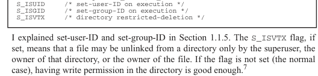

我在 1.1.5 节中解释过 set-user-ID（设置用户 ID）和 set-group-ID（设置组 ID）。`S_ISVTX` 标志如果已设置，意味着只有超级用户、该目录的所有者或文件的所有者才能将文件从目录中解除链接。如果未设置该标志（这是正常情况），只要在目录中拥有写权限就足够了。

展示如何使用这些宏的一个好方法是像 `ls` 命令那样显示模式，即使用由 10 个字符组成的序列（例如 `drwxx-r-x-x`）。简而言之，`ls` 使用的规则如下：

- 第一个字符指示文件类型。

- 接下来的九个字符分为三组，每组三个，分别对应所有者（owner）、组（group）和其他人（others），如果权限已设置，则通常为 `r`、`w` 或 `x`，否则为连字符 `-`。

- 所有者和组的执行字符如果在设置 set-user-ID 或 set-group-ID 位的同时也设置了执行位，则变为小写 `s`；如果设置了设置位但执行位未设置，则变为大写 `S`。第二种组合是可能的，但除了一种特殊情况外没有意义：即设置了 set-group-ID 但组执行位未设置，在某些系统中这会导致强制性文件锁定，正如 7.11.5 节所解释的那样。

- 其他人的执行字符如果在设置了受限删除位（`S_ISVTX`）的同时也设置了执行（搜索）位，则变为 `t`；如果设置了受限删除位但未设置执行位，则变为 `T`。

> 7. 这是 SUS 的定义。历史上，这个位被称为粘性位（sticky bit），用于可执行程序文件，以保持常用程序（例如 `shell`）的指令段驻留在交换设备上。在现代的分页 UNIX 系统中，它通常不再被这样使用。（字母“SVTX”源自“sAve TeXT”，因为指令也被称为“文本”。）

以下函数应该有助于理清算法：

```c
#define TYPE(b) ((statp->st_mode & (S_IFMT)) == (b))
#define MODE(b) ((statp->st_mode & (b)) == (b))

static void print_mode(const struct stat *statp)
{

    if (TYPE(S_IFBLK))
        putchar('b');
    else if (TYPE(S_IFCHR))
        putchar('c');
    else if (TYPE(S_IFDIR))
        putchar('d');
    else if (TYPE(S_IFIFO)) /* sic */
        putchar('p');
    else if (TYPE(S_IFREG))
        putchar('-');
    else if (TYPE(S_IFLNK))
        putchar('l');
    else if (TYPE(S_IFSOCK))
        putchar('s');
    else
        putchar('?');

    putchar(MODE(S_IXUSR) ? 'x' : '-');
    putchar(MODE(S_IWUSR) ? 'w' : '-');
    if (MODE(S_ISUID)) {
        if (MODE(S_IXUSR))
            putchar('s');
        else
            putchar('S');
    }
    else if (MODE(S_IXUSR))
        putchar('x');
    else
        putchar('-');

    putchar(MODE(S_IRGRP) ? 'r' : '-');
    putchar(MODE(S_IWGRP) ? 'w' : '-');
    if (MODE(S_ISGID)) {
        if (MODE(S_IXGRP))
            putchar('s');
        else
            putchar('S');
    }
    else if (MODE(S_IXGRP))
        putchar('x');
    else
        putchar('-');

    putchar(MODE(S_IROTH) ? 'r' : '-');
    putchar(MODE(S_IWOTH) ? 'w' : '-');
    if (MODE(S_IFDIR) && MODE(S_ISVTX)) {
        if (MODE(S_IXOTH))
            putchar('t');
        else
            putchar('T');
    }
    else if (MODE(S_IXOTH))
        putchar('x');
    else
        putchar('-');
}
```

这个函数不会以换行符结束其输出，原因很快就会变得非常清楚，但我不想提前剧透。这里是一些测试代码：

```c
struct stat statbuf;

ec_negl( lstat("somefile", &statbuf) )
print_mode(&statbuf);
putchar('\n');
ec_negl( system("ls -l somefile") )
```

以及输出结果，以防你不相信我所说的：

```text
prw--w--w-
prw--w-- 1 marc sysadmin 0 Oct 17 13:57 somefile
```

请注意，我们调用的是 `lstat` 而不是 `stat`，因为如果参数是符号链接，我们希望获取关于符号链接本身的信息，而不是跟随链接。

接下来，是一个打印链接数的函数，这比打印模式简单多了。（你看我们要往哪个方向走？）

```c
static void print_numlinks(const struct stat *statp)
{
printf("%5ld", (long)statp->st_nlink);
}
```

为什么要转换为 `long` 类型？嗯，我们实际上并不知道 `nlink_t` 类型是什么，只知道它是一个整数类型。我们需要将其转换为具体的类型，以确保其与 `printf` 中的格式匹配。本章稍后我们还会看到 `stat` 结构中的其他一些类型也有类似的情况。

接下来我们要打印所有者和组名，为此我们需要另外两个库函数。

### 3.5.2 `getpwwid`, `getgrgid`, and `getlogin` 系统调用

获取所有者和组号很容易，因为它们在 `stat` 结构的 `st_uid` 和 `st_gid` 字段中，但我们想要它们的名称。为此有两个函数 `getpwwid` 和 `getgrgid`，它们严格来说不是系统调用，因为它们所需的信息位于密码文件和组文件中，任何进程如果需要都可以自己读取这些文件。不过，由此产生的一个问题是，这些文件的布局并没有标准化。

在 Solaris 上，“marc” 的密码文件条目看起来是这样的，这是相当典型的例子：

```bash
$ grep marc /etc/passwd
marc:x:100:14::/home/marc:/bin/sh
```

（密码文件中*没有*包含的一项内容就是密码本身！它被加密存储在另一个只有超级用户才能读取的文件中。）

在这个系统中，“marc” 是几个组的成员，但组 14 是他的登录组：

```bash
$ grep 14 /etc/group
sysadmin::14:
```

### `getpwwid`—获取密码文件条目

```c
#include <pwd.h>

struct passwd *getpwwid(
  uid_t uid        /* user ID */
); /* Returns pointer to structure or NULL on error (sets errno) */
```

### `struct passwd`—`getpwwid` 的结构体

```c
struct passwd {
  char *pw_name;    /* login name */
  uid_t pw_uid;     /* user ID */
  gid_t pw_gid;     /* group ID */
  char *pw_dir;     /* login directory */
  char *pw_shell;   /* login shell */
};
```

### `getgrgid`—获取组文件条目

```c
#include <grp.h>

struct group *getgrgid(
  gid_t gid         /* group ID */
); /* Returns pointer to structure or NULL on error (sets errno) */
```

### `struct group`—`getgrgid` 的结构体

```c
struct group {
    char *gr_name;     /* group name */
    gid_t gr_gid;      /* group ID */
    char **gr_mem;     /* member-name array (NULL terminated) */
};
```

正如我之前所说，这里的两个结构体仅展示了标准化的字段。你的实现中可能有更多字段，因此请使用头文件中定义的结构体。

现在我们可以使用这两个查找函数来打印登录名和组名，如果名称未知，则只打印数字。在通过网络挂载文件系统时，找不到名称是常见现象，因为一个系统上的用户可能在另一个系统上没有登录名。

```c
static void print_owner(const struct stat *statp)
{
    struct passwd *pwd = getpwuid(statp->st_uid);

    if (pwd == NULL)
        printf(" %8ld", (long)statp->st_uid);
    else
        printf(" %-8s", pwd->pw_name);
}

static void print_group(const struct stat *statp)
{
    struct group *grp = getgrgid(statp->st_gid);

    if (grp == NULL)
        printf(" %8ld", (long)statp->st_gid);
    else
        printf(" %-8s", grp->gr_name);
}
```

既然我们在这里，这里还有一个获取用户登录名称的函数：

### `getlogin`—获取登录名

```c
#include <unistd.h>
char *getlogin(void);
/* Returns name or NULL on error (sets errno) */
```

### 3.5.3 更多关于显示文件元数据的内容

继续讨论 `stat` 结构，这里有一个打印文件大小的函数。对于特殊文件，我们打印主要设备和次要设备号，因为在这种情况下大小并不是……

有意义的。正如我在第 3.5 节中所述，它们在设备 ID 中的编码方式并未标准化，但通常将最右边的 8 位作为次号（minor number）是可行的：

```c
static void print_size(const struct stat *statp)
{
    switch (statp->st_mode & S_IFMT) {
    case S_IFCHR:
    case S_IFBLK:
        printf("%4u,%4u", (unsigned)(statp->st_rdev >> 8),
                (unsigned)(statp->st_rdev & 0xff));
        break;
    default:
        printf("%9lu", (unsigned long)statp->st_size);
    }
}
```

接下来是文件数据修改日期和时间，使用标准 C 函数 `strftime` 来完成繁重的工作。函数 `time` 和 `diff_time` 也在标准 C 中。（参见第 1.7.1 节了解这三个函数。）我们通常不打印年份，除非时间相隔 6 个月，在这种情况下，我们会跳过时间以腾出空间:^8

```c
static void print_date(const struct stat *statp)
{
    time_t now;
    double diff;
    char buf[100], *fmt;

    if (time(&now) == -1) {
        printf(" ??????????????");
        return;
    }

    diff = diff_time(now, statp->st_mtime);
    if (diff < 0 || diff > 60 * 60 * 24 * 182.5) /* 大约 6 个月 */
        fmt = "%b %e %Y";
    else
        fmt = "%b %e %H:%M";
    strftime(buf, sizeof(buf), fmt, localtime(&statp->st_mtime));
    printf(" %s", buf);
}
```

我们最后想要打印的是文件名，它当然不在 stat 结构体中，因为它不在 i 节点中。然而，这一点有点棘手，因为如果名称是符号链接，我们既要打印它，也要打印其内容：

8. 通常，我们的策略是检查所有错误，除了格式化（打印）和打印本身。`diff_time` 是个例外——它是那些没有错误返回值的函数之一。

```c
static void print_name(const struct stat *statp, const char *name)
{
    if (S_ISLNK(statp->st_mode)) {
        char *contents = malloc(statp->st_size + 1);
        ssize_t n;

        if (contents != NULL && (n = readlink(name, contents,
                statp->st_size)) != -1) {
            contents[n] = '\0'; /* 不能假设以 NUL 结尾 */
            printf(" %s -> %s", name, contents);
        }
        else
            printf(" %s -> [can't read link]", name);
        free(contents);
    }
    else
        printf(" %s", name);
}
```

回想一下在第 3.3.3 节中我介绍 `readlink` 时，我指出我们需要知道最长路径名的长度以确定缓冲区的大小。这个函数展示了一种更直接的方法，因为路径的精确大小（不包括 NUL 字节）在符号链接的 `st_size` 字段中.^9 注意，我分配的内存比 `st_size` 多一个字节，但传递给 `readlink` 的是 `st_size`，以确保为 NUL 字节留出空间，以防 `readlink` 不提供该字节，因为它并没有要求这样做。

现在，是大家等待已久的将所有打印功能组合在一起的程序：


```c
int main(int argc, char *argv[])
{
    int i;
    struct stat statbuf;

    for (i = 1; i < argc; i++) {
        ec_neg1( stat(argv[i], &statbuf))
        ls_long(&statbuf, argv[i]);
    }
    exit(EXIT_SUCCESS);

EC_CLEANUP_BGN
    exit(EXIT_FAILURE);
EC_CLEANUP_END
}
```

9. 大多数现代文件系统将短的符号链接直接存储在 `i` 节点中，而不是占用数据块，但 `st_size` 字段仍然给出大小。

158   第 3 章：高级文件 I/O

```c
static void ls_long(const struct stat *statp, const char *name)
{
    print_mode(statp);
    print_numlinks(statp);
    print_owner(statp);
    print_group(statp);
    print_size(statp);
    print_date(statp);
    print_name(statp, name);
    putchar('\n');
}
```

以下是我们简化的 `ls` 命令的运行效果：

```text
$ auple /dev/tty
crw-rw-rw-  1 root    root      5,    0 Mar 23  2002 /dev/tty
$ auple a.tmp a.out util
lrwxrwxrwx  1 marc    sysadmin  5 Jul 29 13:30 a.tmp -> b.tmp
-rwxr-xr-x  1 marc    sysadmin 8392 Aug  1  2001 a.out
drw-xr-x    3 marc    sysadmin  512 Aug 28 12:26 util
```

注意最后一行，它不知道如何列出一个目录——它只列出作为参数给出的名称。要添加该功能，我们需要了解如何读取目录以获取其链接。这就来了。

## 3.6 目录

本节涵盖读取和删除目录、更改当前目录以及遍历目录树。

### 3.6.1 读取目录

在底层，UNIX 系统几乎总是将目录实现为普通文件，只是它们的 `i-mode` 中设置了一个特殊位，并且内核不允许对其写入。在某些系统上，允许使用 `read` 读取目录，但 POSIX 和 SUS 标准并不要求这样做，它们也没有指定目录信息的内部格式。但窥探这些信息很有趣，所以我写了一个小程序来读取当前目录的前 96 个字节，并将这些字节转储为字符（如果它们是可打印的）和十六进制：

```c
static void dir_read_test(void)
{
    int fd;
    unsigned char buf[96];
    ssize_t nread;

    ec_neg1( fd = open(".", O_RDONLY) )
    ec_neg1( nread = read(fd, buf, sizeof(buf)) )
    dump(buf, nread);
    return;

    EC_CLEANUP_BGN
    EC_FLUSH("dir_read_test");
    EC_CLEANUP_END
}

static void dump(const unsigned char *buf, ssize_t n)
{
    int i, j;

    for (i = 0; i < n; i += 16) {
        printf("%4d ", i);
        for (j = i; j < n && j < i + 16; j++)
            printf(" %c", isprint((int)buf[j]) ? buf[j] : '.');
        printf("\n ");
        for (j = i; j < n && j < i + 16; j++)
            printf(" %.2x", buf[j]);
        printf("\n\n");
    }
    printf("\n");
}
```

这是在 Linux 上得到的输出（去掉了“`ec`”跟踪内容）：

```text
*** BISSDIR (21: "Is a directory") ***
```

所以，那里没有运气。但是，在 FreeBSD（和 Solaris）上，有收获：

```text
0     .               .   V
60 d8 05 00 0c 00 04 01 2e 00 00 00 56 d8 05 00
16  .     .   b
0c 00 04 02 2e 2e 00 00 62 d8 05 00 0c 00 08 02
32  m 2   y   k   C
6d 32 00 c0 79 d8 05 00 0c 00 08 01 6b 00 43 c6
48          P c y n c - s
b3 da 05 00 18 00 08 0c 70 63 73 79 6e 63 5f 73
64  i g . o
69 67 2e 6f 00 00 00 00 e3 e3 05 00 10 00 08 06
80  t i m e . o   r
74 69 6d 65 2e 6f 00 c6 72 d8 05 00 0c 00 08 02
```

乍一看这似乎是一堆杂乱的混合物，但仔细一看，它开始变得有意义。可以看到六个名称：`.`、`..`、`m2`、`k`、`pcsync_sig.o` 和 `time.o`。我们知道它们的 `i` 编号也必须包含在内，为了在十六进制中找到它们，我们使用 `ls` 命令的 `-i` 选项以及 `dc`（“桌面计算器”）将十进制转换为十六进制（*斜体注释是后来添加的*）:[10]

```text
$ ls -ldi . .. m2 k
383072 drwxr-xr-x 2 marc marc 2560 Oct 18 11:02 .
383062 drwxr-xr-x 9 marc marc  512 Oct 14 18:05 ..
383074 -rwxrwxrwx 1 marc marc   55 Jul 25 11:14 m2
383097 -rw-r--r-- 1 marc marc  138 Sep 19 13:28 k
$ dc
160          使输出基数变为 16
383072p     将 i 编号推入栈中并打印它
5D860       dc 以十六进制（基数 16）打印 i 编号
383062p     ... 同上 ...
5D856
q           退出
```

果然，数字 `5D860` 和 `5D856` 出现在转储的第二行（第一个十六进制行）上。每个条目那里还有一些其他数字，例如用于字符串大小等，但我们真的不想挖掘得更深。有一种更好的、标准化的方法来读取目录，使用专门为此目的设计的系统调用：

- `opendir`—打开目录

```c
#include <dirent.h>
DIR *opendir(
    const char *path /* 目录路径名 */
);
/* 返回 DIR 指针，出错时返回 NULL（设置 errno） */
```

- `closedir`—关闭目录

```c
#include <dirent.h>
int closedir(
    DIR *dirp
); /* 来自 opendir 的 DIR 指针 */
/* 成功时返回 0，出错时返回 -1（设置 errno） */
```

- `readdir`—读取目录

```c
#include <dirent.h>
struct dirent *readdir(
    DIR *dirp            /* 来自 opendir 的 DIR 指针 */
);
/* 返回结构体，EOF 或出错时返回 NULL（设置 errno） */
```

- `struct dirent`—用于 `readdir` 的结构体

```c
struct dirent {
    ino_t d_ino;         /* i 编号 */
    char d_name[];       /* 名称 */
};
```

- `rewinddir`—将目录指针回溯到开头

```c
#include <dirent.h>
void rewinddir(
    DIR *dirp            /* 来自 opendir 的 DIR 指针 */
);
```

- `seekdir`—在目录中定位

```c
#include <dirent.h>
void seekdir(
    DIR *dirp,                 /* 来自 opendir 的 DIR 指针 */
    long loc                  /* 位置 */
);
```

- `telldir`—获取目录位置

```c
#include <dirent.h>
long telldir(
    DIR *dirp                  /* 来自 opendir 的 DIR 指针 */
);
/* 返回位置（无错误返回） */
```

这些函数的作用正如你所期望的那样：你从 `opendir` 开始，它会给你一个指向 `DIR` 的指针（类似于调用标准 C 函数 `fopen` 获取指向 `FILE` 的指针）。然后该指针作为其他五个函数的参数使用。你在循环中调用 `readdir`，直到它返回 `NULL`，这意味着如果你没有通过 `readdir` 更改 `errno`，则你已到达末尾；如果更改了，则表示出错。（为了避免混淆，你在调用 `readdir` 之前应该将 `errno` 设置为零。）`readdir` 返回指向 `dirent` 结构体的指针，该结构体包含一个条目的 `i` 编号和名称。完成 `DIR` 的使用后，你用 `closedir` 将其关闭。

`readdir` 在 `d_ino` 字段中返回的 `i-node` 号（`i-number`）实用性不高，因为如果该条目是一个挂载点，返回的将是挂载前的 `i-node` 号，而不是反映当前目录树的 `i-node` 号。例如，在图 3.3（见第 3.3 节）中，对于目录条目 `./y/a`，`readdir` 会返回 `221`，但由于它是一个挂载点，有效的 `i-node` 实际上是 `ad0slm2`（单纯的 `2` 不够具体，因为设备 `ad0s1g` 也有 `i-node` 号 `2`）。`i-node` `221` 甚至无法访问。因此，在读取目录以遍历目录树时（正如我将在第 3.6.4 节中演示如何获取当前目录路径那样），你需要通过调用 `stat` 函数之一来获取目录条目的正确 `i-node` 号，而不是从 `d_ino` 字段中获取。

`rewinddir` 偶尔有用，用于回到目录的开头，这样你就可以在不关闭和重新打开目录的情况下再次读取它。`seekdir` 和 `telldir` 的使用频率较低。`seekdir` 的 `loc` 参数必须是你从 `telldir` 获取的值；你不能假设它是一个条目编号，也不能假设目录条目占用固定宽度的位置，正如我们之前已经看到的。

`readdir` 是那些使用单个静态分配结构体的函数之一，返回的指针指向该结构体。这非常方便，但对于多线程程序并不理想，因此存在一个 `readdir` 的无状态变体，它使用你传入的内存：

### `readdir_r`——读取目录

```c
#include <dirent.h>

int readdir_r(
        DIR *restrict dirp,      /* 来自 opendir 的 DIR 指针 */
        struct dirent *entry,     /* 用于存储条目的结构体 */
        struct dirent **result    /* 结果（指针或 NULL） */
); /* 成功返回 0，出错时返回错误编号（不设置 errno） */
```

你需要向 `readdir_r` 传递一个指向 `dirent` 结构体的指针，该指针的大小必须足以容纳至少 `NAME_MAX` + `1` 个元素的名称。你可以通过调用 `pathconf` 或 `fpathconf`，并传入目录作为参数来获取 `NAME_MAX` 的值，类似于我们在第 3.4 节中获取最大路径长度值所做的事情。`readdir_r` 通过 `result` 参数返回结果；其解释与 `readdir` 的返回值完全相同，但这次你不需要检查 `errno`——错误编号（或零）是函数的返回值。你可以使用 `ec_rv` 宏（第 1.4.2 节）来检查它，就像我在下面这个示例中所做的那样，该示例列出了当前目录中的名称和 `i-node` 号。

```c
static void readdir_r_test(void)
{
    bool ok = false;
    long name_max;
    DIR *dir = NULL;
    struct dirent *entry = NULL, *result;

    errno = 0;
    /* 当 errno == 0 时失败意味着值未找到 */
    ec_negil(name_max = pathconf(".", __PC_NAME_MAX) )
    ec_null( entry = malloc(offsetof(struct dirent, d_name) +
            name_max + 1) )
    ec_null( dir = opendir(".") )
    while (true) {
        ec_rw( readdir_r(dir, entry, &result) )
        if (result == NULL)
            break;
        printf("name: %s; i-number: %ld\n", result->d_name,
                (long)result->d_ino);
    }
    ok = true;
    EC_CLEANUP
    EC_CLEANUP_BGN
        if (dir != NULL)
            (void)closedir(dir);
        free(entry);
        if (!ok)
            EC_FLUSH("*readdir_r_test*");
    EC_CLEANUP_END
}
```

关于这段代码的一些注释：

- `pathconf` 返回 `-1` 且 `errno` 为零意味着目录中名称没有长度限制，但这是不可能的。但我们希望代码能处理这种情况，所以采取了一种简化的方法，将 `errno` 设置为零，然后将所有 `-1` 的返回值视为错误。注释是为了那些实际遇到 `errno` 值为零的错误消息的人准备的。我们的理念是确保代码能够处理不可能的情况，而无需以过于复杂的方式处理它们，反正我们也无法为不可能发生的情况创建测试用例。

- 使用 `malloc` 进行分配很棘手。关于 `dirent` 结构体，我们唯一确定的是 `d_ino` 字段位于其本地位置（可能存在其他非标准字段），并且 `d_name` 位于最后。因此，`d_name` 的偏移量加上我们所需的容量是计算总大小的唯一安全方式，同时考虑了结构体中的空洞（标准 C 允许）和隐藏字段。

- `EC_CLEANUP` 跳转到清理代码，如第 1.4.2 节所述。布尔变量 `ok` 告诉我们是否发生了错误。

真麻烦！使用 `readdir` 要简单得多，如果你不使用多线程，或者能确保每次只有一个线程读取目录，这样做是没问题的：

```c
static void readdir_test(void)
{
    DIR *dir = NULL;
    struct dirent *entry;

    ec_null(dir = opendir("."))
    while (errno = 0, (entry = readdir(dir)) != NULL)
        printf("name: %s; i-number: %ld\n", entry->d_name,
               (long)entry->d_ino);
    ec_nzero(errno)
    EC_CLEANUP

    EC_CLEANUP_BGN
        if (dir != NULL)
            (void)closedir(dir);
        EC_FLUSH("readdir_test");
    EC_CLEANUP_END
}
```

这里的一个棘手之处在于将 `readdir` 的调用塞进 `while` 条件中：逗号表达式的第一部分将 `errno` 置零，第二部分确定整个表达式的值，而 `while` 正是测试这个值。你可能希望有一个密度较低的版本，这也没问题，但不要这样做：

```c
errno = 0;
while ((entry = readdir(dir)) != NULL) { /* 错误 */
    /* 处理条目 */
}
```

因为 `errno` 可能在处理条目的过程中被重置。每次调用 `readdir` 时，你都应该将 `errno` 设置为零。[11]

不管怎样，这里是输出（来自任一示例）的前几行：

`name: . ; i-number: 383072`

`name: .. ; i-number: 383062`

`name: m2 ; i-number: 383074`

`name: k ; i-number: 383097`

> 11. 我知道你在想什么：UNIX 编程难度的一半在于处理 `errno`。你说得对！但别怪我，我只负责传话：参见附录 B 了解一种更简单的方法。

既然我们可以读取目录，让我们将 `readdir` 循环与出现在第 3.5.3 节末尾的 `ls_long` 函数结合起来，以获得一个可以列出目录的 `ls` 命令：


```c
int main(int argc, char *argv[]) /* 存在 bug */
{
    bool ok = false;
    int i;
    DIR *dir = NULL;
    struct dirent *entry;
    struct stat statbuf;

    for (i = 1; i < argc; i++) {
        ec_negl( 1stat(argv[i], &statbuf) )
        if (!S_ISDIR(statbuf.st_mode)) {
            ls_long(&statbuf, argv[i]);
            ok = true;
            EC_CLEANUP
        }
        ec_null( dir = opendir(argv[i]) )
        while (errno = 0, ((entry = readdir(dir)) != NULL)) {
            ec_negl( 1stat(entry->d_name, &statbuf) )
            ls_long(&statbuf, entry->d_name);
        }
        ec_nzero( errno )
    }
    ok = true;
    EC_CLEANUP

    EC_CLEANUP_BGN
    if (dir != NULL)
        (void)closedir(dir);
    exit(ok ? EXIT_SUCCESS : EXIT_FAILURE);
    EC_CLEANUP_END
}
```

当我列出当前目录时，这个程序运行得非常完美，如下面的输出所示（仅显示前几行）：

```bash
$ au ls .
drwxr-xr-x   2 marc    marc      2560 Oct 18 12:20 .
drwxr-xr-x   9 marc    marc       512 Oct 14 18:05 ..
rwxrwxrwx    1 marc    marc        55 Jul 25 11:14 m2
-rwxr--r--    1 marc    marc       138 Sep 19 13:28 k
```

但当我在 `/tmp` 目录上尝试时，得到了以下结果：

```bash
$ aupls /tmp
drwxr-xr-x    2 marc     marc         2560 Oct 18 12:20 .
drwxr-xrx    9 marc     marc          512 Oct 14 18:05 ..
ERROR:   0: main [./aup/c3/aupls.c:422] lstat(entry->d_name, &statbuf)
**** ENOENT (2: "No such file or directory") ****
```

症状是，`readdir` 循环中的 `lstat` 调用未能找到该名称，尽管我们刚刚从目录中读取了它。原因是我们试图用路径 `"auplog.tmp/"` 调用 `lstat`，如果 `/tmp` 是当前目录，这样没问题，但它并不是。先执行 `cd` 就可以正常工作（仅显示前几行）：

```bash
$ cd /tmp
$ /usr/home/marc/aup/aupls
drwxrwxrwt    3 root     wheel         1536 Oct 18 12:20 .
drwxr-xrx    18 root     wheel          512 Jul 25 08:01 ..
-rw-r-r-x    1 marc     wheel         189741 Aug 30 11:22 auplog.tmp
-rw-------    1 marc     wheel           0 Aug 5 13:23 ed.7GHAhk
```

修复方法是在 `readdir` 循环之前添加一个 `chdir` 系统调用，这是一个很好的理由让我们继续下一节。

## 3.6.2 `chdir` 和 `fchdir` 系统调用

每个人都知道 shell 的 `cd` 命令的作用，以下是其背后的系统调用：

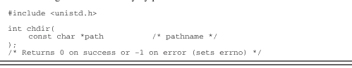

```c
#include <unistd.h>
int chdir(
    const char *path      /* 路径名 */
);
/* 成功返回 0，出错时返回 -1（设置 errno） */
```

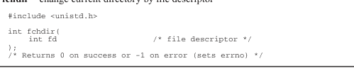

```c
#include <unistd.h>
int fchdir(
    int fd               /* 文件描述符 */
);
/* 成功返回 0，出错时返回 -1（设置 errno） */
```

不出所料，`chdir` 的参数可以是相对路径或绝对路径，无论它指向哪个 i-node，只要该 i-node 是一个目录，它就成了新的当前目录。

`fchdir` 以一个打开的目录文件描述符作为参数。等等！我在 3.6.1 节中不是说打开目录是非标准的吗？不，我没有；我说的是*读取*目录是非标准的。打开目录有且仅有一个标准的、有用的理由，那就是为了获取一个文件描述符供 `fchdir` 使用。不过，你必须使用 `O_RDONLY` 来打开它；不允许以写模式打开它。

既然无法可移植地读取目录，为什么要有 `fchdir`——为什么不能总是使用带有路径名的 `chdir`？因为一次 `open` 配合一次 `fchdir` 是标记你当前位置并返回该位置的好方法。比较这两种技术：

- 1. 获取当前目录的路径名
- 2. 某些改变当前目录的操作
- 3. 使用步骤 1 中的路径名调用 `chdir`
- 1. 打开当前目录
- 2. 某些改变当前目录的操作
- 3. 使用步骤 1 中的文件描述符调用 `fchdir`

左侧的技术之所以较差，原因如下：

- 如我们在 3.4.2 节中所见，获取当前目录的路径很麻烦。
- 正如我们稍后在 3.6.4 节中亲自实现时会看到的，这种方式非常耗时。

在某些情况下，如果你只下降一级，你可以使用以下代码返回到原处：

```c
ec_neg1( chdir("..") )
```

这不需要你拥有路径名，但仍然最好使用 `open`/`fchdir` 方法，因为它不依赖于对你程序如何遍历目录的了解。然而，如果你对目录没有读权限，就不能使用它。

所以现在让我们修复上一节中 `au_pls` 的版本，使其在读取目录之前先切换到该目录。我们确实需要返回原来的位置，因为可能有多个参数需要处理，且每个参数都假设当前目录未变。以下是修复后的中间部分：

```c
ec_null( dir = opendir(argv[i]) )
ec_neg1( fd = open("..", O_RDONLY) )
ec_neg1( chdir(argv[i]) )
while (errno = 0, !(entry = readdir(dir)) != NULL) {
    ec_neg1( lstat(entry->d_name, &statbuf) )
    ls_long(&statbuf, entry->d_name);
}
ec_nzero( errno )
ec_neg1( fchdir(fd) )
```

还有一个问题。如果你想在告诉我问题是什么之前先试着找到它，请*在此处*停止阅读。

问题是，如果在 `chdir` 和 `fchdir` 调用之间发生错误并跳转到清理代码，`fchdir` 的调用将不会执行，当前目录也就不会被恢复。在这个程序中这没关系，因为所有这些错误都会终止进程，而当前目录是特定于每个进程的。（Shell 的当前目录不受影响。）但是，如果将来错误处理被修改，或者这段代码被复制并粘贴到另一个程序中，事情可能会出错。

一个好的修复方法（未展示）是在清理代码中添加第二个 `fchdir` 调用，这样无论发生什么它都会执行。你可以将 `fd` 初始化为 −1 并测试它，以便除非它有一个有效的值，否则不使用它。

## 3.6.3 `mkdir` 和 `rmdir` 系统调用

有两个用于创建和删除目录的系统调用：

```
`mkdir`—创建目录

#include <sys/stat.h>
int mkdir(
    const char *path,         /* 路径名 */
    mode_t perms              /* 权限 */
);
/* 成功返回 0，出错返回 −1（设置 errno） */
```

```
`rmdir`—删除目录

#include <unistd.h>
int rmdir(
    const char *path          /* 路径名 */
);
/* 成功返回 0，出错返回 −1（设置 errno） */
```

对于 `mkdir`，权限、它们与文件创建掩码的交互以及新目录的所有权与 `open`（第 2.4 节）相同。它会自动创建特殊的 `.` 和 `..` 链接。

`rmdir` 的作用与 `unlink` 非常相似，而后者是不允许用于目录的。[^13] 一个主要限制是，要删除的目录必须是空的（除了 `.` 和 `..`）。如果它不是空的，你必须先删除其中的链接，这可能涉及从子树的底部开始，层层向上，进行多次 `unlink` 和 `rmdir` 调用。如果你确实想这样做，只写下面这行代码会容易得多：

```c
ec_neg1( system("rm -rf somedir") )
```

因为 `rm` 命令知道如何遍历目录树。

下面是关于我们刚才所说的一个示例：

```c
void rmdir_test(void)
{
    ec_neg1( mkdir("somedir", PERM_DIRECTORY) )
    ec_neg1( rmdir("somedir") )
    ec_neg1( mkdir("somedir", PERM_DIRECTORY) )
    ec_neg1( close(open("somedir/x", O_WRONLY | O_CREAT, PERM_FILE)) )
    ec_neg1( system("ls -ld somedir; ls -l somedir") )
    if (rmdir("somedir") == -1)
        perror("Expected error");
    ec_neg1( system("rm -rf somedir") )
    ec_neg1( system("ls -ld somedir") )
    return;
}

EC_CLEANUP_BGN
    EC_FLUSH("rmdir_test");
EC_CLEANUP_END
```

`PERM_DIRECTORY` 和 `PERM_FILE` 在第 1.1.5 节中有解释。创建文件的那一行有点怪异，但当你只是想创建一个文件时很有用。唯一不好的地方是，如果 `open` 失败，报告的 `errno` 值将是 `close`（将得到一个参数为 −1 的值）的值，我们将不得不猜测为什么无法创建文件。

执行该函数的输出：

[^13]: 超级用户在某些系统上可以将其用于目录，但这不是标准的。

```
drwx------ 2 marc users 72 Oct 18 15:32 somedir
total 0
-rw-r-r- 1 marc users 0 Oct 18 15:32 x
Expected error: Directory not empty
ls: somedir: No such file or directory
```

### 3.6.4 实现 `getcwd`（向上遍历树）

回顾第 3.4.2 节，调用 `getcwd` 实在没有什么乐趣，光是调整缓冲区大小就费了不少周折。现在让我们通过*实现*它来享受一下乐趣！

基本思路是从当前目录开始，获取其 i-number，然后进入其父目录以找到具有该 i-node 的项，从而获得子目录的名称。然后我们重复这一过程，直到无法再向上走为止。

“无法再向上”是什么意思？这意味着要么

```c
chdir("..")
```

返回 −1 并带有 `ENOENT` 错误，要么它成功但使我们留在同一目录——两种行为都有可能，且都意味着我们处于根目录。

当我们向上遍历树时，我们会以链表形式积累路径的各个组件，最新（最高级别）的项在链表头部。因此，如果当前目录的名称是 `grandchild`，然后我们移动到其父目录 `child`，接着移动到其父目录 `parent`，然后发现我们处于根目录，那么我们将最终获得的链表如 3.4 图所示。

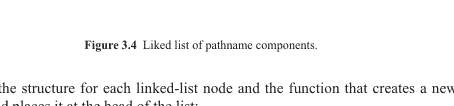

以下是每个链表节点的结构以及创建一个新节点并将其置于链表头部的函数：

```c
struct pathlist_node {
  struct pathlist_node *c_next;
  char c_name[1];  /** 柔性数组 */
};
```

```c
static bool push_pathlist(struct pathlist_node **head, const char *name)
{
  struct pathlist_node *p;

  ec_null( p = malloc(sizeof(struct pathlist_node) + strlen(name)) )
  strcpy(p->c_name, name);
  p->c_next = *head;
  *head = p;
  return true;

EC_CLEANUP_BGN
  return false;
EC_CLEANUP_END
}
```

每个 `pathlist_node` 的大小是可变的；该结构为终止字符串的 NUL 字节提供了足够的空间，并且在分配节点时，我们必须为名称添加空间，这可以在 `malloc` 的参数中看到。请注意，我们将每个节点放在链表的头部，以保持链表与我们遇到每个节点的顺序相反。这正是我们想要组装路径组件的顺序，如函数 `get_pathlist` 所示：

```c
static char *get_pathlist(struct pathlist_node *head)
{
  struct pathlist_node *p;
  char *path;
  size_t total = 0;

  for (p = head; p != NULL; p = p->c_next)
    total += strlen(p->c_name) + 1;
  ec_null( path = malloc(total + 1) )
  path[0] = '\0';
  for (p = head; p != NULL; p = p->c_next) {
    strcat(path, "/");
    strcat(path, p->c_name);
  }

  return path;

EC_CLEANUP_BGN
  return NULL;
EC_CLEANUP_END
}
```

该函数对列表进行两次遍历。第一次仅统计路径所需的总空间（循环中的 +1 是为斜杠预留的），第二次则构建路径字符串。

最后一个路径处理函数会释放链表，通常应在调用 `get_pathlist` 之后调用：

```c
static void free_pathlist(struct pathlist_node **head)
{
    struct pathlist_node *p, *p_next;

    for (p = *head; p != NULL; p = p_next) {
        p_next = p->c_next;
        free(p);
    }
    *head = NULL;
}
```

我们使用 `p_next` 变量来保存指向下一个节点的指针，因为一旦调用 `free`，`p` 本身就会变得无效。

下面是一些测试代码，用于构建图 3.4 中所示的列表：

```c
struct pathlist_node *head = NULL;
char *path;

cr_false( push_pathlist(&head, "grandchild"))
cr_false( push_pathlist(&head, "child"))
cr_false( push_pathlist(&head, "parent"))
cr_null( path = get_pathlist(head) );
free_pathlist(&head);
printf("%s\n", path);
free(path);
```

输出结果如下：

```
/parent/child/grandchild
```

以这种方式处理路径的一个非常便利的特点是，我们不必像在第 3.4.2 节中调用标准 `getcwd` 函数那样预先分配路径的空间。

现在，我们准备实现 `getcwdx`，这是 `getcwd` 的我们的版本，它沿树向上遍历，每当识别出一个子项的名称时，就在每一级调用一次 `push_pathlist`，直到到达根目录为止。首先是一个宏，通过测试设备 ID 和 i 节点号来判断两个 stat 结构是否代表同一个 i 节点：

```c
#define SAME_INODE(s1, s2)  ((s1).st_dev == (s2).st_dev &&\
                             (s1).st_ino == (s2).st_ino)
```

我们将在这个 `getcwdx` 函数中两次使用该宏：


```c
char *getcwdx(void)
{
    struct stat stat_child, stat_parent, stat_entry;
    DIR *sp = NULL;
    struct dirent *dp;
    struct pathlist_node *head = NULL;
    int dirfd = -1, rtn;
    char *path = NULL;

    ec_neg1( dirfd = open(".", O_RDONLY) )
    ec_neg1( lstat(".", &stat_child) )
    while (true) {
        ec_neg1( lstat("..", &stat_parent) )

        /* change to parent and detect root */
        if (((rtn = chdir("..")) == -1 && errno == ENOENT) ||
            SAME_INODE(stat_child, stat_parent)) {
            if (head == NULL)
                ec_false( push_pathlist(&head, ".") )
                ec_null( path = get_pathlist(head) )
                EC_CLEANUP
        }
        ec_neg1( rtn )

        /* read directory looking for child */
        ec_null( sp = opendir(".") )
        while (errno = 0, (dp = readdir(sp)) != NULL) {
            ec_neg1( lstat(dp->d_name, &stat_entry) )
            if (SAME_INODE(stat_child, stat_entry)) {
                ec_false( push_pathlist(&head, dp->d_name) )
                break;
            }
        }

        if (dp == NULL) {
            if (errno == 0)
                errno = ENOENT;
            EC_FAIL
        }
        stat_child = stat_parent;
    }
    EC_CLEANUP_BGN
    if (sp != NULL)
        (void)closedir(sp);
    if (dirfd != -1) {
        (void)fcdir(dirfd);
        (void)close(dirfd);
    }
    free_pathlist(&head);
    return path;
    EC_CLEANUP_END
}
```

关于该函数的一些说明：

- 我们使用`open`/`fchdir`技术来获取和重置当前目录，因为该函数在遍历树时会改变当前目录。
- 在循环中，`stat_child`对应我们要尝试获取其条目名称的子项，`stat_entry`对应从`readdir`调用中获取的每个条目，`stat_parent`对应父目录，当我们向上移动时，它成为子目录。
- 测试到达根目录的方法在本节开头已解释：要么`chdir`失败，要么它没有让我们移动到任何地方。
- 如果我们到达根目录时列表仍为空，我们就向栈中压入一个空名称，这样路径名就会显示为`/`。
- 在`readdir`循环中，我们本可以跳过非目录条目，但这其实并非必要，因为`SAME_INODE`测试同样快速且准确。

最后，这里有一个小程序，使其成为一个像标准`pwd`命令一样行为的命令：

```c
int main(void)
{
    char *path;
    ec_null( path = getcwd() )
    printf("%s\n", path);
    free(path);
    exit(EXIT_SUCCESS);

    EC_CLEANUP_BGN
    exit(EXIT_FAILURE);
    EC_CLEANUP_END
}
```

## 3.6.5 实现 `ftw`（向下遍历树）

有一个标准库函数`ftw`（“文件树遍历”），我不在此具体描述它，它提供了一种通用方法来递归处理目录树中的条目。你给它一个函数指针，它对遇到的每个对象调用该函数，但对我们来说，使用本章所学内容实现自己的树遍历函数更有趣。

首先要澄清的是，目录结构是否真的是一棵树，因为我们的递归算法依赖于这一点。如果存在循环，我们的程序可能会卡住；如果同一个目录被链接了两次（通过除`.`和`..`以外的条目），我们可能会访问同一个目录（及其子树）多次。有两种需要思考的问题类型：

1. 符号链接指向目录的情况很常见，这至少创建了两个链接，因为每个目录也被硬链接。也没有任何机制防止符号链接创建循环。
2. 在某些系统上，超级用户可以创建到目录的第二个硬链接，使用`link`系统调用。这种情况几乎从未发生过，但这是我们的程序可能会遇到的可能性。

问题 1 可以通过简单地不遵循任何符号链接轻松解决。我们暂时忽略问题 2，尽管本章末尾的练习 3.5 涉及它。因此，对于我们的目的而言，由硬链接形成的树确实是一棵树。

我们希望我们的程序`au1s`（是第 3.5.3 节中展示的程序的扩展）表现得有点像`ls`，即`-R`参数使其递归，而`-d`参数告诉它仅列出目录的信息，而不是该目录内容的信息。如果没有这两个参数中的任何一个，它的行为与之前的`au1s`相同。

带有`-R`参数时，`au1s`（像`ls`一样）首先列出到目录的路径以及该级别的所有条目，包括目录，然后对每个目录递归执行相同操作，如下例所示：

```text
$ au1s -R /aup/common

/aup/common:
-rwxr-xr-x    1 root     root        1145 Oct  2 10:21 makefile
-rwxr-xr-x    1 root     root         171 Aug 23 10:41 logf.h
-rwxr-xr-x    1 root     root        1076 Aug 26 15:24 logf.c
drwxr-xr-x    1 root     root         4096 Oct  2 12:20 cf
-rwxr-xr-x    1 root     root         245 Aug 26 15:29 notes.txt

/aup/common/cf:
-rwxr-xr-x    1 root     root        1348 Oct  3 13:52 cf-ec.c-ec_push.htm
-rwxr-xr-x    1 root     root         576 Oct  3 13:52 cf-ec.c-ec_print.htm
-rwxr-xr-x    1 root    root      450 Oct  3 13:52 cf-ec.c-ec_reinit.htm
-rwxr-xr-x    1 root    root      120 Oct  3 13:52 cf-ec.c-ec_warn.htm
```

当我们查看代码时就会发现，对于每一级（一个`readdir`循环），有两次遍历。在第一次遍历中，我们打印"stat"信息，然后在第二次遍历中，对于每个目录，我们递归，在该目录中执行第一次遍历，等等。

使用传递给程序中每个函数的结构体来表示遍历信息很方便，而不是使用全局变量或长长的参数列表：

```c
typedef enum (SHOW_PATH, SHOW_INFO) SHOW_OP;

struct traverse_info {
    bool ti_recursive;                /* -R option? */
    char *ti_name;                    /* current entry */
    struct stat ti_stat;              /* stat for ti_name */
    bool (*ti_fcn)(struct traverse_info *, SHOW_OP); /* callback fcn */
};
```

以下是我们要使用的回调函数：

```c
static bool show_stat(struct traverse_info *p, SHOW_OP op)
{
    switch (op) {
    case SHOW_PATH:
        ec_falsel( print_cwd(false) )
        break;
    case SHOW_INFO:
        ls_long(&p->ti_stat, p->ti_name);
    }
    return true;

    BC_CLEANUP_BGN
    return false;
    BC_CLEANUP_END
}
```

`show_stat`在`op`设置为`SHOW_PATH`时被调用以打印路径名标题，在设置为`SHOW_INFO`时打印详细行。`ls_long`来自第 3.5.3 节，而`print_cwd`与我们在第 3.4.2 节中展示的示例代码几乎相同：

```c
static bool print_cwd(bool cleanup)
{
    char *cwd;
    if (cleanup)
        (void)get_cwd(true);
    else {
        ec_null( cwd = get_cwd(false) )
        printf("\n%s:\n", cwd);
    }
    return true;

    EC_CLEANUP_BGN
    return false;
    EC_CLEANUP_END
}
```

## 3.6 实现 `ls` 命令

稍后我们将看到整体清理代码中会调用`print_cwd(true)`。

现在让我们跳回主函数的顶层，看看一切是如何初始化的，以及列表显示是如何开始的：

```c
#define USAGE "Usage: aupls [-Rd] [dir]\n"
static long total_entries = 0, total_dirs = 0;
int main(int argc, char *argv[])
{
    struct travser_info ti = {0};
    int c, status = EXIT_FAILURE;
    bool stat_only = false;
    ti.ti_fcn = show_stat;
    while ((c = getopt(argc, argv, "dR")) != -1)
        switch(c) {
            case 'd':
                stat_only = true;
                break;
            case 'R':
                ti.ti_recursive = true;
                break;
            default:
                fprintf(stderr, USAGE);
                EC_CLEANUP
        }
    switch (argc - optind) {
        case 0:
            ti.ti_name = ".";
            break;
        case 1:
            ti.ti_name = argv[optind];
            break;
        default:
            fprintf(stderr, USAGE);
            EC_CLEANUP
        }
    ec_false( do_entry(&ti, stat_only) )
    printf("\nTotal entries: %ld; directories = %ld\n", total_entries, total_dirs);
    status = EXIT_SUCCESS;
    EC_CLEANUP
    EC_CLEANUP_BGN
    print_cwd(true);
    exit(status);
    EC_CLEANUP_END
}
```

两个全局变量`total_entries`和`total_dirs`用于保持总体计数，我们发现将这些显示在结尾很有意思；稍后我们会看到它们在哪里被递增。

`getopt`是一个标准库函数（属于 POSIX/SUS，而不是标准 C）。它的第三个参数是允许使用的选项字母列表。当选项处理完毕后，它将全局变量`optind`设置为下一个待处理参数的索引，在我们的示例中，这是一个可选的路径名。如果没有给出，则假设为当前目录。

真正的工作由`do_entry`完成，它看起来是这样的：

```c
static bool do_entry(struct traverse_info *p, bool stat_only)
{
    bool is_dir;

    ec_negil( lstat(p->ti_name, &p->ti_stat) )
    is_dir = S_ISDIR(p->ti_stat.st_mode);
    if (stat_only || !is_dir) {
        total_entries++;
        if (is_dir)
            total_dirs++;
        ec_false( (p->ti_fcn)(p, SHOW_INFO) )
    }
    else if (is_dir)
        ec_false( do_dir(p) )
    return true;

    EC_CLEANUP_BGN
    return false;
    EC_CLEANUP_END
}
```

`do_entry`有两种使用方式：如果`stat_only`参数为真，或者当前条目不是目录，它会递增全局计数器，然后在`SHOW_INFO`模式下调用回调函数。这在指定了`-d`参数、在`aupls`命令行上指定了非目录项，或在目录列表的第一遍（Pass 1）期间完成。否则，对于目录，它会调用包含`readdir`循环以处理目录条目的函数`do_dir`：


## 代码实现

```c
static bool do_dir(struct traverse_info *p)
{
    DIR *sp = NULL;
    struct dirent *dp;
    int dirfd = -1;
    bool result = false;

    ec_neg1( dirfd = open(".", O_RDONLY) )
    if ( (sp = opendir(p->ti_name)) == NULL || chdir(p->ti_name) == -1) {
        if (errno == EACCES) {
            fprintf(stderr, "%s: Permission denied.\n", p->ti_name);
            result = true;
            EC_CLEANUP
        }
        EC_FAIL
    }
    if (p->ti_recursive)
        ec_false( (p->ti_fcn)(p, SHOW_PATH) )
    while (errno = 0, (dp = readdir(sp)) != NULL) {
        if ( strcmp(dp->d_name, ".") == 0 ||
             strcmp(dp->d_name, "..") == 0 )
            continue;
        p->ti_name = dp->d_name;
        ec_false( do_entry(p, true) )
    }
    if (errno != 0)
        syserr_print("Reading directory (Pass 1)");
    if (p->ti_recursive) {
        rewinddir(sp);
        while (errno = 0, (dp = readdir(sp)) != NULL) {
            if ( strcmp(dp->d_name, ".") == 0 ||
                 strcmp(dp->d_name, "..") == 0 )
                continue;
            p->ti_name = dp->d_name;
            ec_false( do_entry(p, false) )
        }
        if (errno != 0)
            syserr_print("Reading directory (Pass 2)");
    }
    result = true;
    EC_CLEANUP
    EC_CLEANUP_BGN
    if (dirfd != -1) {
        (void)fchdir(dirfd);
        (void)close(dirfd);
    }
    if (sp != NULL)
        (void)closedir(sp);
    return result;
    EC_CLEANUP_END
}
```

`do_dir` 是递归发生的地方。它打开指向当前目录的 `dirfd`，以便在清理时可以恢复。然后它使用 `opendir` 打开目录并切换到该目录，以便相对于父目录处理条目。由于目录不可读（`opendir` 失败）或不可搜索（`chdir` 失败），经常会遇到 `EACCES` 错误，因此在这种情况下我们希望只打印一条消息，而不是终止处理。

接下来，如果指定了 `-R` 参数，我们告诉回调函数打印当前目录路径。这样可以将所有常规打印局部化到一个回调函数中。

然后我们有第一遍的 `readdir` 循环（其中 `do_entry` 以 `stat_only` 设为真调用），一个 `rewinddir` 系统调用，以及如果指定了 `-R`，则进行第二遍的 `readdir` 循环（以 `stat_only` 设为假调用 `do_entry`）。递归发生是因为第二遍对 `do_dir` 的调用可能会递归调用 `do_dir`。注意两个 `readdir` 循环都跳过了 `.` 和 `..` 条目，`ls` 默认也会省略这些。

我们决定将来自 `readdir` 的错误视为非致命错误，以保持进程继续，而不是使用 `ec_nzero` 宏退出，这解释了对 `syserr_print` 的两次调用，该函数如下：

```c
void syserr_print(const char *msg)
{
    char buf[200];

    fprintf(stderr, "ERROR: %s\n", syserrmsg(buf, sizeof(buf), msg,
      errno, EC_ERRNO));
}
```

`syserrmsg` 在第 1.4.1 节中介绍过。

就这样了——我们自己的完全递归版本的 `ls`！

## 3.7 更改 I 节点

`stat` 系列系统调用（第 3.5.1 节）从 i 节点中检索信息，我在其中解释了当文件被操作时 i 节点中的各个数据字段如何变化。本节的讨论中的一些系统调用也可以直接更改部分字段。表 3.3 指出了哪些系统调用执行哪些更改。“固定”意味着该字段完全不可更改——如果你希望它是其他值，必须创建一个新的 i 节点——而“副作用”意味着它只能通过执行其他操作（例如使用 `link` 创建新链接）的副作用来更改，而不能直接更改。

### 表 3.3 更改 I 节点字段

| I 节点字段 | 描述 | 由...更改 |
| :--- | :--- | :--- |
| `st_dev` | 文件系统设备 ID | 固定 |
| `st_ino` | i 编号 | 固定 |
| `st_mode` | 模式 | `chmod`, `fchmod` |
| `st_nlink` | 硬链接数 | 副作用 |
| `st_uid` | 用户 ID | `chown`, `fchown`, `lchown` |
| `st_gid` | 组 ID | `chown`, `fchown`, `lchown` |
| `st_rdev` | 设备 ID（如果是特殊文件） | 固定 |
| `st_size` | 大小（字节） | 副作用 |
| `st_atime` | 最后访问时间 | `utime` |
| `st_mtime` | 最后数据修改时间 | `utime` |
| `st_ctime` | 最后 i 节点修改时间 | 副作用 |
| `st_blksize` | 最佳 I/O 大小 | 固定 |
| `st_blocks` | 已分配的 512 字节块 | 副作用 |

### 3.7.1 `chmod` 和 `fchmod` 系统调用

````
`chmod` — 通过路径更改文件模式

#include <sys/stat.h>
int chmod(
    const char *path,      /* 路径名 */
    mode_t mode            /* 新模式 */
); /* 成功返回 0，出错返回 -1（设置 errno） */
````

````
`fchmod` — 通过文件描述符更改文件模式

#include <sys/stat.h>
int fchmod(
    int fd,                /* 文件描述符 */
    mode_t mode            /* 新模式 */
); /* 成功返回 0，出错返回 -1（设置 errno） */
````

`chmod` 系统调用更改任何类型的现有文件的模式。然而，它不能用于更改类型本身，因此只能更改 `S_ISUID`、`S_ISGID` 和 `S_ISVTX` 标志或权限位。使用与 `stat` 结构（第 3.5.1 节）相同的宏。`fchmod` 类似，但它接受一个打开的文件描述符而不是路径。

调用者的有效用户 ID 必须与文件的用户 ID 匹配，或者调用者必须是超级用户。仅具有写权限或调用者的有效组 ID 与文件匹配是不够的。此外，如果正在设置 `S_ISGID`，有效组 ID 必须匹配（超级用户除外）。

除非你要设置整个模式，否则你必须先通过调用 `stat` 函数之一来获取现有模式，设置或清除你想要更改的位，然后使用修改后的模式执行 `chmod`。

在应用程序内部调用 `chmod` 的情况很少见，因为模式通常在文件创建时设置。然而，用户经常使用 `chmod` 命令。

### 3.7.2 `chown`, `fchown`, 和 `lchown` 系统调用

`chown` 更改文件的用户 ID 和组 ID。只有所有者（进程的有效用户 ID 等于文件的用户 ID）或超级用户可以执行它。如果 `uid` 或 `gid` 中任意为 –1，则对应的 ID 保持不变。

#### `chown`——通过路径修改文件的属主和组

```c
#include <unistd.h>

int chown(
    const char *path,    /* 路径名 */
    uid_t uid,           /* 新用户 ID */
    gid_t gid            /* 新组 ID */
);
/* 成功时返回 0，出错时返回 -1（并设置 errno） */
```

#### `fchown`——通过文件描述符修改文件的属主和组

```c
#include <unistd.h>

int fchown(
    int fd,             /* 文件描述符 */
    uid_t uid,          /* 新用户 ID */
    gid_t gid           /* 新组 ID */
);
/* 成功时返回 0，出错时返回 -1（并设置 errno） */
```

#### `lchown`——通过路径修改符号链接的属主和组

```c
#include <unistd.h>

int lchown(
    const char *path,   /* 路径名 */
    uid_t uid,          /* 用户 ID */
    gid_t gid           /* 组 ID */
);
/* 成功时返回 0，出错时返回 -1（并设置 errno） */
```

`fchown` 与其类似，但接收的是已打开的文件描述符，而不是路径。`lchown` 也类似，但它直接作用于路径参数，而不是路径所指向的目标（如果路径是符号链接的话）。

除非调用者是超级用户，否则这些系统调用会清除 set-user-ID 和 set-group-ID 位。这是为了防止一种相当明显的入侵形式：

```bash
$ cp /bin/sh mysh          [获取 shell 的个人副本]
$ chmod 4700 mysh         [开启 set-user-ID 位]
$ chown root mysh         [使超级用户成为属主]
$ mysh                    [变成超级用户]
```

如果你想要自己的超级用户 shell，必须颠倒 `chmod` 和 `chown` 的顺序；然而，除非你已经是超级用户，否则你不被允许执行 `chmod`。因此，这个漏洞被堵住了。

如果宏 `_POSIX_CHOWN_RESTRICTED` 被设置，某些 UNIX 系统会被配置为执行略有不同的规则（通过 `pathconf` 或 `fpathconf` 测试）。

只有超级用户可以更改属主（用户 ID），但属主可以将组 ID 更改为进程的有效组 ID 或其补充组 ID 之一。换句话说，属主不能将文件赠送给他人——最多只能将组 ID 更改为与进程关联的组 ID 之一。

由于属主的更改通常由 `chown` 命令执行（该命令调用 `chown` 系统调用），这些规则通常不会直接影响应用程序。但它们会影响系统管理以及用户使用系统的方式。

### 3.7.3 `utime` 系统调用

```c
/* utime——设置文件访问和修改时间 */
#include <utime.h>

int utime(
    const char *path,           /* 路径名 */
    const struct utimbuf *timbuf /* 新时间 */
);
/* 成功时返回 0，出错时返回 -1（并设置 errno） */
```

```c
/* struct utimbuf——utime 的结构体 */
struct utimbuf {
    time_t actime;      /* 访问时间 */
    time_t modtime;     /* 修改时间 */
};
```

`utime` 修改任意类型文件的访问时间和修改时间。[14] 结构体中的类型 `time_t` 是定义在 1.7.1 节中的自纪元（epoch）以来的秒数。只有属主或超级用户可以通过 `timbuf` 参数修改时间。

但是，如果 `timbuf` 参数为 `NULL`，访问时间和修改时间会被设置为当前时间。这样做是为了使文件看起来是最新的，而无需重写文件，主要用于 `touch` 命令的好处。任何具有写权限的人都可以这样做，因为写入（他们被允许的操作）也会改变时间。

除了 `touch` 之外，`utime` 最常用于从转储磁带恢复文件或通过网络接收文件时。时间被重置为其原始值，这些数据以某种方式随文件一起提供。状态变更时间无法重置，但这很合理，因为 i 节点没有移动——而是创建了一个新的 i 节点。

## 3.8 更多文件操作调用

本节介绍一些不属于前面章节的其他文件操作系统调用。

### 3.8.1 `access` 系统调用

与处理权限的其他任何系统调用不同，`access` 检查的是*实际*用户 ID 或组 ID，而不是*有效*的 ID。

```c
/* access——确定文件的可访问性 */
#include <unistd.h>

int access(
    const char *path,     /* 路径名 */
    int what              /* 要测试的权限 */
);
/* 允许时返回 0，不允许或出错时返回 -1（并设置 errno） */
```

参数 `what` 使用以下标志，前三个可以按位或（OR）在一起：

```c
R_OK                /* 读权限 */
W_OK                /* 写权限 */
X_OK                /* 执行（搜索）权限 */
F_OK                /* 测试是否存在 */
```

如果进程的实际用户 ID 与路径匹配，则检查属主权限；如果实际组 ID 匹配，则检查组权限；如果都不匹配，则检查其他权限。

`access` 有两个主要用途：

- 检查实际用户或组是否有权对文件执行某些操作，特别是在 set-user-ID 或 set-group-ID 位被设置的情况下。例如，可能存在一个在运行时将用户 ID 设置为超级用户的命令，但它希望检查实际用户是否有权在执行前从目录中解除文件链接。它不能简单地测试 `unlink` 是否会因 `EACCES` 错误而失败，因为有效用户 ID 是超级用户，所以不会因该原因失败。

- 检查文件是否存在。你可以使用 `stat`，但 `access` 更简单。（实际上，整个 `access` 系统调用可以编写为一个调用 `stat` 的库函数，在某些实现中，它甚至可能是这样实现的。）

如果路径是符号链接，则该链接会被跟随，直到找到一个非符号链接。[15]

当你调用 `access` 时，你可能不希望将其放入 `ec_neg1` 宏中，因为如果它返回 –1，你希望区分 `EACCES` 错误（对于 `R_OK`、`W_OK` 和/或 `X_OK`）或 `ENOENT` 错误（对于 `F_OK`）与其他错误。如下所示：

```c
if (access("tmp", R_OK) == 0)
    printf("Exist\n");
else if (errno == ENOENT)
    printf("Does not exist\n");
else
    EC_FAIL
```

### 3.8.2 `mknod` 系统调用

```c
/* mknod——创建文件 */
#include <sys/stat.h>

int mknod(
    const char *path,     /* 路径名 */
    mode_t perms,         /* 模式 */
    dev_t dev             /* 设备 ID */
);
/* 成功时返回 0，出错时返回 -1（并设置 errno） */
```

`mknod` 创建普通文件、目录、特殊文件或命名管道（FIFO）。唯一的可移植用法（也是唯一不需要超级用户权限的用法）是创建命名管道，但对于这种用法，你有 `mkfifo`（7.2.1 节）。你也不需要它来创建普通文件（使用 `open`）或目录（使用 `mkdir`）。你不能用它来创建符号链接（使用 `symlink`）或套接字（使用 `bind`）。

因此，`mknod` 的主要用途是创建通常位于 `/dev` 目录中、用于访问设备的特殊文件。由于这通常是在安装新的设备驱动程序时执行的，因此使用 `mknod` 命令，该命令执行系统调用。

`perms` 参数使用了在 3.5.1 节中为 `stat` 结构体定义的相同位和宏，`dev` 是那里定义的设备 ID。如果你安装了新的设备驱动程序，你会知道设备 ID 是什么。

### 3.8.3 `fcntl` 系统调用

在 2.2.3 节中（在继续之前你可能想重新阅读该节），我解释了多个**打开文件描述符**可以共享同一个**打开文件描述**，其中持有文件偏移量、状态标志（例如，`O_APPEND`）和访问模式（例如，`O_RDONLY`）。通常，你在打开文件时设置状态标志和访问模式，但你也可以使用 `fcntl` 系统调用在任何时候获取和设置状态标志。你还可以使用它来获取（但不能设置）访问模式。


```c
#include <unistd.h>
#include <fcntl.h>

int fcntl(
    int fd,            /* 文件描述符 */
    int op,            /* 操作 */
    ...               /* 取决于 op 的可选参数 */
);
/* 根据 op 返回结果，出错时返回 -1（并设置 errno） */
```

总共有十种操作，但我将只在这里讨论其中四种。其他操作将在别处讨论，如`表 3.4`所示。

| 操作 | 用途 | 位置 |
|:----------|:--------|:------|
| `F_DUPFD`   | 复制文件描述符 | 第 6.3 节 |
| `F_GETFD`   | 获取文件描述符标志 | 此处 |
| `F_SETFD`   | 设置文件描述符标志（使用第三个 `int` 参数） | 此处 |
| `F_GETFL`   | 获取文件描述状态标志和访问模式 | 此处 |

`[14]` 脚注引用

`[15]` 对于几乎所有接受路径名的系统调用，除非它们以字母 `l` 开头，否则这是真的。两个例外是 `unlink` 和 `rename`。

## 表 3.4 `fcntl` 操作（续）

| 操作 | 目的 | 位置 |
|---|---|---|
| `F_SETFL` | 设置文件描述状态标志（使用第三个 `int` 参数） | 此处 |
| `F_GETOWN` | 用于套接字 * | 第 8.7 节 |
| `F_SETOWN` | 用于套接字 * | 第 8.7 节 |
| `F_GETLK` | 获取锁 | 第 7.11.4 节 |
| `F_SETLK` | 设置或清除锁 | 第 7.11.4 节 |
| `F_SETLKW` | 设置或清除锁 | 第 7.11.4 节 |

* 过于复杂，甚至无法在此处总结。

对于所有的“获取”和“设置”操作，你应该获取当前值，设置或清除你想要修改的标志，然后执行设置操作，即使只定义了一个标志。这样，即使以后添加了更多标志，或者存在你不知道的实现依赖型、非标准标志，你的代码仍然可以正常工作。例如，设置 `O_APPEND` 标志的错误方式是：

```c
ec_neg1(fcntl(fd, F_SETFL, O_APPEND)) /* 错误 */
```

而正确的方式是：

```c
ec_neg1(flags = fcntl(fd, F_GETFL))
ec_neg1(fcntl(fd, F_SETFL, flags | O_APPEND))
```

如果我们想要清除 `O_APPEND` 标志，第二行应该是：

```c
ec_neg1(fcntl(fd, F_SETFL, flags & ~O_APPEND))
```

（规则是“或运算以设置，与取反以清除”。）

唯一已定义的标准文件描述符标志是关闭-on-exec 标志，`FD_CLOEXEC`，它指示当发出 `exec` 系统调用时文件描述符是否将被关闭。关于关闭-on-exec 的更多信息见第 5.3 节。你使用 `F_GETFD` 和 `F_SETFD` 操作来处理它。这是 `fcntl` 的一个重要用途，因为此标志不能在打开文件时设置。

你使用 `F_GETFL` 和 `F_SETFL` 操作来处理文件描述状态标志和访问模式。访问模式，你可以获取但不能设置，是 `O_RDONLY`、`O_WRONLY` 或 `O_RDWR` 之一。由于这些是值，而不是位掩码，必须使用掩码 `O_ACCMODE` 从返回的值中挑选出来，就像这样：

```c
ec_neg1( flags = fcntl(fd, F_GETFL) )
if ( (flags & O_ACCMODE) == O_RDONLY)   /* 文件以只读方式打开 */
```

以下两个 if 语句都是错误的：

```c
if (flags & O_RDONLY)           /* 错误 */
if ( (flags & O_RDONLY) == O_RDONLY)  /* 仍然错误 */
```

状态标志，全部列在第 2.4.4 节的表 2.1 中，更有趣一些。你可以获取和设置 `O_APPEND`、`O_DSYNC`、`O_NOCTTY`、`O_NONBLOCK`、`O_RSYNC` 和 `O_SYNC`。你可以获取 `O_CREAT`、`O_TRUNC` 和 `O_EXCL`，但设置它们没有意义，因为它们只在 `open` 系统调用中起作用（之后就太晚了）。我之前展示了一个使用 `O_APPEND` 的示例。

关于 `O_NONBLOCK` 标志的更多信息见第 4.2.2 节和第 7.2 节。

## 3.9 异步 I/O

本节解释了如何发起 I/O 操作，使你的程序不需要等待其完成。你可以去做其他事情，然后稍后回来检查操作的状态。

### 3.9.1 同步 vs. 同步，再次探讨

在阅读本节之前，请确保你已阅读第 2.16.1 节，其中解释了同步（与非同步）I/O。这里我们关注的是异步 I/O，这意味着 I/O 操作由一个系统调用（例如，`aio_read`）发起，该调用在操作完成之前返回，其完成由其他机制单独处理。也就是说：

- *同步（Synchronized）* 意味着当物理 I/O 完成时，I/O 才算完成。*非同步（Nonsynchronized）* 意味着进程与缓冲缓存之间的 I/O 足以视为完成。

- *同步的（Synchronous）* 意味着系统调用仅在 I/O 完成（按上一段的定义）时才返回。*异步的（Asynchronous）* 意味着系统调用在 I/O 发起后立即返回，并通过其他系统调用测试完成状态。

用一句话概括同样的意思：同步/异步指的是调用是否等待完成，而同步（Synchronized）/非同步（Nonsynchronized）指定了“完成”意味着什么。

本节的某些部分还假设你知道如何处理信号，因此你可能需要在阅读本节之前阅读第 9 章，或者至少在阅读时参考第 9 章的部分内容，特别是第 9.5.6 节。

正如我提到的（第 2.9 节），大多数 UNIX *写入* 操作已经是某种程度的异步，因为系统调用在数据传输到缓冲缓存后立即返回，实际输出稍后才发生。然而，如果设置了 `O_SYNC` 或 `O_DSYNC` 标志（第 2.16.3 节），*写入* 不会返回，直到实际输出完成。相比之下，普通的 *读取* 通常涉及等待实际输入，因为除非有预读或数据恰好就在某个缓冲区中，否则 *读取* 会等待直到数据可以被物理读取。

使用异步 I/O (AIO)，进程不需要等待 *读取*，也不需要等待同步（`O_SYNC` 或 `O_DSYNC`）的 *写入*。I/O 操作被发起，AIO 调用立即返回，稍后进程可以调用 `aio_error` 来了解操作是否已完成，甚至可以通过信号或新线程的创建（第 5.17 节）在操作完成时得到通知。

这里使用的“完成”一词的含义与 *read* 和 *write* 中的含义相同。除非文件描述符已设置为同步，如第 2.16.3 节所述，否则它并不意味着 I/O 是同步的。因此，存在表 3.5 所示的四种情况。

## 表 3.5 同步与非同步读取和写入

| | 同步的 | 异步的 |
| :--- | :--- | :--- |
| **非同步（Nonsynchronized）** | `read`/`write`; `O_SYNC` 和 `O_DSYNC` 清除 | `aio_read`/`aio_write`; `O_SYNC` 和 `O_DSYNC` 清除 |
| **同步的（Synchronized）** | `read`/`write`; `O_SYNC` 或 `O_DSYNC` 设置 | `aio_read`/`aio_write`; `O_SYNC` 或 `O_DSYNC` 设置 |

如果你能组织应用程序，使其在需要数据之前发起 *读取*，然后去做其他有用的事情，AIO 可以提高 *读取* 的性能，无论是否同步。然而，如果它在此期间没有其他事情可以做，它最好只是在 *read* 中阻塞，让另一个进程或线程运行。AIO 也有助于同步 *写入*，但对于非同步 *写入* 作用不大，因为缓冲缓存已经做了类似的事情。

不要将异步 I/O 与通过设置 `O_NONBLOCK` 标志（第 2.4.4 节和第 4.2.2 节）指定的非阻塞 I/O 混淆。非阻塞意味着如果调用会阻塞则返回，但它不执行工作。¹⁶ 异步意味着它发起工作然后返回。

AIO 函数是异步输入输出选项的一部分，由 `_POSIX_ASYNCHRONOUS_IO` 宏表示。你可以使用 `pathconf` 在运行时测试它，我在第 1.5.4 节中展示了执行此操作的示例代码。

本节中的一个系统调用，`lio_listio`，可用于同步或异步 I/O。

### 3.9.2 AIO 控制块

所有的 AIO 系统调用都使用控制块来跟踪操作的状态，并且不同的操作必须使用不同的控制块。当然，当一个操作完成时，其控制块可以被重用。

```c
struct aiocb {  /* AIO 控制块 */
  int   aio_fildes;         /* 文件描述符 */
  off_t aio_offset;         /* 文件偏移量 */
  volatile void *aio_buf;   /* 缓冲区 */
  size_t aio_nbytes;        /* 传输大小 */
  int   aio_reqprio;        /* 请求优先级偏移 */
  struct sigevent aio_sigevent; /* 信号信息 */
  int   aio_lio_opcode;     /* 要执行的操作 */
};
```

前四个成员类似于 `pread` 和 `pwrite` 的成员（第 2.14 节）。也就是说，`read` 或 `write` 所需的三个参数，加上用于隐式 `lseek` 的文件偏移量。

`sigevent` 结构在第 9.5.6 节中进行了完整解释。使用它，你可以安排当操作完成时生成一个信号或启动一个线程。你可以向信号处理程序或线程传递任意整数值或指针值，通常这将是指向控制块的指针。如果你不

如果想要一个信号或线程，则需将成员 `aio_sigevent.sigev_notify` 设置为 `SIGEV_NONE`。

`aio_reqprio` 成员用于影响操作的优先级，并且仅在支持另外两个 POSIX 选项 `_POSIX_PRIORITIZED_IO` 和 `_POSIX_PRIORITY_SCHEDULING` 时可用。有关此功能的更多信息，请参见 `[SUS2002]`。

最后一个成员 `aio_lio_opcode` 与 `lio_listio` 系统调用一起使用，如第 3.9.9 节所述。

## 3.9.3 `aio_read` 和 `aio_write`

基本的 AIO 函数是 `aio_read` 和 `aio_write`。与 `pread` 和 `pwrite` 类似，`aio_offset` 成员决定了 I/O 在文件中的位置。如果文件描述符打开的是一个不允许寻址的设备（例如套接字），或者对于 `aio_write` 来说设置了 `O_APPEND` 标志（第 2.8 节），则该成员无效。缓冲区和大小位于控制块中，而不是作为参数传递。

`aio_read`——从文件异步读取

```c
#include <aio.h>

int aio_read(
    struct aiocb *aiocbp    /* 控制块 */
);
/* 成功返回 0，出错返回 -1（设置 errno） */
```

`aio_write`——向文件异步写入

```c
#include <aio.h>

int aio_write(
    struct aiocb *aiocbp    /* 控制块 */
);
/* 成功返回 0，出错返回 -1（设置 errno） */
```

这些函数的成功返回仅表示操作已启动；这绝不意味着 I/O 成功，甚至也不意味着控制块中设置的值是正确的。你始终必须使用 `aio_error` 检查结果（见下一节）。实现可能会立即报告错误（如无效偏移），此时 `aio_read` 或 `aio_write` 返回 -1；也可能返回 0，并在稍后报告错误信息。

### 3.9.4 `aio_error` 和 `aio_return`

`aio_error`——获取异步 I/O 操作的错误状态

```c
#include <aio.h>

int aio_error(
    const struct aiocb *aiocbp /* 控制块 */
);
/* 返回 0、errno 值或 EINPROGRESS（不设置 errno） */
```

如果操作已完成，`aio_error` 在成功时返回 0，或者返回等效的 `read`、`write`、`fsync` 或 `fdatasync` 将返回的 `errno` 值（第 2.9、2.10 和 2.16.2 节）。如果操作未完成，则返回 `EINPROGRESS`。如果你知道操作已完成（例如，你收到了相应的信号），你可以将 `EINPROGRESS` 像其他错误一样处理，并像我们在第 3.6.1 节中那样使用 `ecrv` 宏：

```c
ecrv( aio_error(aiocbp) )
```

不过我应当指出，异步 I/O 调用通常用于相当高级的应用程序，对于这类应用程序，我们简单的“ec”错误检查可能并不合适，如我在第 1.4.2 节中所述。尽管如此，在开发期间使用 `ecrv` 是没问题的，因为它能提供函数调用跟踪。

如果 `aio_error` 表明操作成功，你仍可能需要获取等效 `read` 或 `write` 的返回值，以得到实际传输的字节数。你可以通过 `aio_return` 做到这一点：

`aio_return`——获取异步 I/O 操作的返回状态

```c
#include <aio.h>

size_t aio_return(
    struct aiocb *aiocbp /* 控制块 */
);
/* 返回操作返回值，出错时返回 -1（设置 errno） */
```

仅当 `aio_error` 报告成功时，才应调用 `aio_return`。`aio_return` 返回 -1 意味着你调用方式错误，而非操作返回了错误。此外，每个操作只能调用一次 `aio_return`，因为获取后该值可能会被丢弃。

### 3.9.5 `aio_cancel`

你可以使用 `aio_cancel` 取消未完成的异步操作：

`aio_cancel`——取消异步 I/O 请求

```c
#include <aio.h>

int aio_cancel(
    int fd,                   /* 文件描述符 */
    struct aiocb *aiocbp      /* 控制块 */
);
/* 返回结果代码，出错时返回 -1（设置 errno） */
```

如果 `aiocbp` 参数为 `NULL`，此调用将尝试取消文件描述符 `fd` 上的所有异步操作。未被取消的操作会以正常方式报告其完成，而被取消的操作将通过 `aio_error` 报告错误代码 `ECANCELED`。

如果 `aiocbp` 参数不为 `NULL`，`aio_cancel` 将尝试仅取消使用该控制块启动的操作。在这种情况下，`fd` 参数必须与控制块的 `aio_fildes` 成员相同。

如果 `aio_cancel` 成功，它将返回以下结果代码之一：

| 代码 | 描述 |
| :--- | :--- |
| `AIO_CANCELED` | 所有请求的操作均已被取消。 |
| `AIO_NOTCANCELED` | 一个或多个请求的操作（可能是全部）未被取消，因为它们已经正在进行中。你必须对每个操作调用 `aio_error` 以确定哪些被取消了。 |
| `AIO_ALLDONE` | 没有请求的操作被取消，因为所有操作均已完成。 |

### 3.9.6 `aio_fsync`

除了读和写的等效操作外，还有第三种可以异步执行的 I/O 类型：刷新缓冲缓存，如 `fsync` 或 `fdatasync` 所做的（有关区别，参见第 2.16.2 节）。两种类型的刷新都由同一个调用处理：

`aio_fsync`——为一个文件发起缓冲缓存刷新

```c
#include <aio.h>

int aio_fsync(
    int op,                      /* O_SYNC 或 O_DSYNC */
    struct aiocb *aiocbp         /* 控制块 */
);
/* 成功返回 0，出错返回 -1（设置 errno） */
```

控制块在此处的使用方式与其他调用略有不同：与 `aio_fildes` 成员给出的文件描述符相关的所有缓冲区都会被刷新，而不仅仅是（如果存在的话）与该控制块启动的操作相关的缓冲区。同步（即刷新缓冲区）的请求是异步的：它不会立即发生，只是被发起，你可以以通常的方式检查完成状态（例如，使用 `aio_error` 或通过信号）。因此，与 `aio_read` 和 `aio_write` 一样，返回零仅表示发起成功。

### 3.9.7 `aio_suspend`

你可以通过简单地等待其完成来决定变为同步，而不是通过信号或线程在 I/O 完成时异步获得通知：

`aio_suspend`——等待异步 I/O 请求

```c
#include <aio.h>

int aio_suspend(
    const struct aiocb *const list[], /* 控制块数组 */
    int cnt,                          /* 数组中的元素数量 */
    const struct timespec *timeout    /* 最大等待时间 */
);
/* 成功返回 0，出错返回 -1（设置 errno） */
```


如果 `timeout` 为 `NULL`，`aio_suspend` 接受一个包含 `cnt` 个控制块的数组，并阻塞直到其中任何一个完成。每个控制块必须曾用于发起异步 I/O 操作。如果调用时至少有一个操作已完成，`aio_suspend` 将立即返回。

为了便于重用同一个数组，`list` 中的元素可以是 `NULL`，但这样的元素也算入 `cnt` 中。

如果 `timeout` 不为 `NULL`，`aio_suspend` 最多阻塞该时长，然后返回 −1 并将 `errno` 设置为 `EAGAIN`。`timespec` 结构体见第 1.7.2 节。

与大多数其他阻塞系统调用一样，`aio_suspend` 可以被信号中断，如第 9.1.4 节进一步解释。这导致了一种非常棘手的情况：`aio_suspend` 正在等待的完成，根据控制块如何设置，可能会产生一个信号，这将导致 `aio_suspend` 被中断，进而使其返回 −1 并将 `errno` 设置为 `EINTR`。在某些情况下，它返回的原因并不重要，但 `EINTR` 返回的问题是，任何信号都可能导致它，而不仅仅是来自已完成 I/O 请求的信号。你可以通过以下两种方式之一避免让异步完成信号中断 `aio_suspend`：

- 使用信号表示完成，或调用 `aio_suspend`，但不能两者都用。
- 为该信号设置 `SA_RESTART` 标志（第 9.1.6 节）。

或者，让信号中断 `aio_suspend`，当它返回时，对传递给 `aio_suspend` 的列表中每个元素调用 `aio_error` 来查看发生了什么（如果有的话），如果什么都没发生，则重新发出 `aio_suspend`（可能在一个循环中）。

## 3.9.8 同步与异步 I/O 对比示例

本节展示了一个如何使用 AIO 调用的示例，并展示了它们相对于同步 I/O 的一些优势。

首先，这里有一个名为 `sio` 的程序，它使用传统的同步 I/O 来读取文件。每进行 8000 次读取，它还会读取标准输入。

```c
#define PATH "/aug/c3/datafile.txt"
#define FREQ 8000

static void synchronous(void)
{
    int fd, count = 0;
    ssize_t nread;
    char buff1[512], buff2[512];

    ec_neg1( fd = open(PATH, O_RDONLY) )
    timestart();
    while ( true) {
        ec_neg1( nread = read(fd, buf1, sizeof(buf1)) )
        if (nread == 0)
            break;
```

```
if (count & FREQ == 0)
    ec_negl( read(STDIN_FILENO, buf2, sizeof(buf2)) )
count++;
)
timestop("synchronous");
printf("read %d blocks\n", count);
return;

EC_CLEANUP_BGN
    EC_PLUSH("asynchronous")
EC_CLEANUP_END
)
```

（`timestart` 和 `timestop` 在 1.7.2 节中有介绍。）

标准输入连接到一个管道，该管道由一个名为 `feed` 的程序填充：

`$ feed | sio`

`feed` 是一个写操作非常迟缓的程序——它每 20 秒才写一次：

```
int main(void)
{
    char buf[512];

    memset(buf, 'x', sizeof(buf));
    while (true) {
        sleep(20);
        write(STDOUT_FILENO, buf, sizeof(buf));
    }
}
```

如前文所示的管道中，`sio` 运行至完成时耗时 0.12 秒用户 CPU 时间、0.73 秒系统 CPU 时间，总耗时 200.05 秒。显然，大量的实际耗时（elapsed time）都花在了等待管道输入上。

这是一个人为构造的示例，但即便如此，它也提供了一个通过异步 I/O 来缩短总耗时的机会。如果管道的读取可以异步进行，那么在此期间就可以读取文件，如下面的重写代码所示：

```
static void asynchronous(void)
{
    int fd, count = 0;
    size_t nread;
    char buf1[512], buf2[512];
    struct aiocb cb;
    const struct aiocb *list[1] = { &cb };
    memset(&cb, 0, sizeof(cb));
    cb.aio_fildes = STDIN_FILENO;
    cb.aio_buf = buf2;
    cb.aio_nbytes = sizeof(buf2);
    cb.aio_sigevent.sigev_notify = SIGEV_NONE;
    ec_neg1( fd = open(PATH, O_RDONLY) )
    timestart();
    while (true) {
        ec_neg1( nread = read(fd, buf1, sizeof(buf1)) )
        if (nread == 0)
            break;
        if (count & FREQ == 0) {
            if (count > 1) {
                ec_neg1( aio_suspend(list, 1, NULL) )
                ec_cv( aio_error(&cb) )
            }
            ec_neg1( aio_read(&cb) )
        }
        count++;
    }
    timestop("asynchronous");
    printf("read %d blocks\n", count);
    return;

cleanup:
    EC_CLEANUP_BGN
    EC_FLUSH("asynchronous")
EC_CLEANUP_END
}
```

请注意控制块的设置方式；首先将其清零，以确保任何依赖于实现的额外成员也被清零。每 8000 次读取（`FREQ` 之前已定义）后，程序发起一次 `aio_read` 调用，之后在 `aio_suspend` 中等待，直到控制块就绪才发起下一次调用。在 `aio_read` 处理期间，程序继续读取文件，在接下来的 8000 次读取中不再挂起。这次的用户 CPU 时间变得更差了——0.18 秒——因为有更多的工作要做。系统时间大致相同（0.70 秒），但总耗时缩短了：180.58 秒。

使用 AIO 并不总能带来如此显著的收益，有时你甚至能看到比这个示例更好的改进。关键在于：

- 程序在 I/O 异步处理期间必须有一些有用的工作要做。
- 收益必须超过增加的管理开销（bookkeeping costs）和增加的系统调用次数。你还应考虑增加的编程复杂度以及 AIO 并非在所有系统上都受支持这一事实。

### 3.9.9 `lio_listio`

控制块列表还有另一种用途：将 I/O 请求批量处理，并通过单次调用启动它们：

`lio_listio`——列表驱动的 I/O

```
#include <aio.h>

int lio_listio(
    int mode,                    /* LIO_WAIT or LIO_NOWAIT */
    struct aiocb *const list[],  /* array of control blocks */
    int ncnt,                    /* number of elements in array */
    struct sigevent *sig         /* NULL or signal to generate */
);
/* Returns 0 on success or -1 on error (sets errno) */
```

与 `aio_suspend` 类似，`lio_listio` 接受一个由 `cbcnt` 个控制块组成的列表，忽略 `list` 中的 `NULL` 元素。它以非特定顺序发起请求。每个操作由控制块的 `aio_lio_opcode` 成员指定：

- `LIO_READ` 相当于调用 `aio_read` 或 `pread`。
- `LIO_WRITE` 相当于调用 `aio_write` 或 `pwrite`。
- `LIO_NOP` 空操作；忽略该控制块。

`mode` 参数决定由 `lio_listio` 发起的 I/O 是同步还是异步，如表 3.6 所示，该表类似于表 3.5（参见 3.9.1 节）。

**表 3.6** 同步与异步的 `lio_listio` 对比

| | 同步 | 异步 |
| :--- | :--- | :--- |
| 非同步化 | `LIO_WAIT; O_SYNC` 和 `O_DSYNC` 未设置 | `LIO_NOWAIT; O_SYNC` 和 `O_DSYNC` 未设置 |
| 同步化 | `LIO_WAIT; O_SYNC` 或 `O_DSYNC` 已设置 | `LIO_NOWAIT; O_SYNC` 或 `O_DSYNC` 已设置 |

因此，`lio_listio` 并不像“aio”系统调用那样仅用于异步 I/O——只要你想批量处理 I/O 调用，就可以使用它。

对于异步的 `lio_listio`，若 mode 为 `LIO_NOWAIT`，你可以像使用控制块的 `aio_sigevent` 成员一样，通过 `sig` 参数请求通过信号或线程启动进行通知。但在这里，通知意味着列表中的所有请求都已完成。你仍可通过各个控制块的 `aio_sigevent` 成员接收完成通知。

对于 `LIO_WAIT`，`sig` 参数不被使用。

与其他一些 AIO 调用一样，`lio_listio` 的成功返回仅意味着该调用本身正常结束。它并未说明 I/O 操作的状态，你需要使用 `aio_error` 来测试。

### 练习

- 3.1. 按照该节最后一段的建议，修改 3.2.2 节中的程序。
- 3.2. 编写标准的 `clc` 命令。
- 3.3. 按照 3.6.2 节最后一段的建议，修改 `aupls` 命令。
- 3.4. 修改 3.6.4 节中的 `getcwdx` 函数，使其绝不更改当前目录。
- 3.5. 修复在 3.6.5 节开头描述的问题 2。
- 3.6. 修改 3.6.5 节中的 `aupls` 命令，使其按名称对列表进行排序。
- 3.7. 修改 3.6.5 节中的 `aupls` 命令，使其接受 `-t` 选项以按修改时间和名称排序。
- 3.8. 修改 3.6.5 节中的 `aupls` 命令，使其接受额外的标准选项（由你选择）。
- 3.9. 编写一个程序来复制整个目录和文件树。它应该有两个参数：树的根目录（例如，`/usr/marc/book`）和副本的根目录（例如，`/usr/marc/backup/book`）。无需处理符号链接或硬链接（即，允许多份拷贝），也无需保留所有权、权限或时间。
- 3.10. 与练习 3.9 相同，但在可能的范围内保留所有权、权限和时间。使“可能的范围”取决于命令是否以超级用户身份运行。
- 3.11. 与练习 3.10 相同，但保留符号链接和硬链接的结构。
- 3.12. 为什么没有 `lchmod` 系统调用？
- 3.13. 将 `access` 编写为一个函数。你可以使用任何系统调用，除了 `access` 之外。
- 3.14. 使用 `lio_listio` 实现 `readv` 和 `writev`（第 2.15 节）。以这种方式实现有任何优势吗？有什么缺点？
- 3.15. 你能对 `read`, `write`, `pread`, `pwrite`, `fsync`, `fdatasync`, `aio_read`, `aio_write`, 和 `aio_fsync` 执行练习 3.14 吗？如果可以，请执行。有什么优势？有什么缺点？
- 3.16. 列出使用 `aio_suspend`、信号、线程启动或使用 `aio_error` 轮询来检查 AIO 完成情况的优缺点。（需要第 5 章和第 9 章中的信息。）

# 终端 I/O

## 4.1 引言

终端 I/O 非常复杂，需要独占大部分章节内容来描述。问题不在于正常的终端 I/O，我将以此开始介绍——它甚至比文件 I/O 更简单。使情况复杂化的是终端属性的众多变化。在本章中，我还会解释终端与会话和进程组之间的关系。然后，我将展示如何设置伪终端，这允许一个进程控制另一个为终端编写的进程。

UNIX 上的终端 I/O 将终端视为老式的硬拷贝电传打字机（Teletype），即那种带有巨大键盘箱、运行时发出巨大噪音并在博物馆或老电影中才能见到的型号。内核中没有对屏幕（字符或图形）、功能键或鼠标及其他指向设备的具体支持。其中一些较现代的设备可以通过调用标准设备驱动的库来处理。对于字符显示，最著名的此类软件包是 Curses，它现在是 [SUS2002] 的一部分。所谓的 UNIX 图形用户界面（GUI）应用程序通常构建为运行在 X Window System 上，可能使用其工具包之一，如 Motif、Qt、KDE 或 Gnome。

由于本章的主题主要是关于设备驱动，而不是像文件系统这样的内核固有部分，因此具体功能在不同 UNIX 版本之间通常比平时差异更大。有时甚至单个 UNIX 站点也会修改终端设备驱动程序。请记住，并非所有终端 I/O 的特性都是由 UNIX 本身造成的：随着智能终端、局域网和前端处理器的使用越来越多，字符流在 UNIX 内核看到它以及将其发送之后，都会经历大量的处理。这些预处理和后处理的细节差异太大，无法在此详述。一如既往，我将关注终端 I/O 的标准化属性。以此为背景，你应该能够根据自己的手册弄清楚自己的系统。

## 4.2 从终端读取

本节解释了如何从终端读取数据，包括当终端没有就绪读取的数据时，如何避免被阻塞。

### 4.2.1 正常终端 I/O

我将首先解释正常的终端输入和输出是如何工作的；也就是说，当你首次登录且尚未使用 `stty` 命令按个人喜好进行自定义之前，它们的工作方式。随后，在后续章节中，我将展示如何调用 `fcntl` 和 `tcsetattr` 系统调用以改变正常行为。

访问终端进行输入或输出有三种方式：

1. 你可以打开字符特殊文件 `/dev/tty` 进行读取、写入，或者最常见的是两者兼有。这个特殊文件是进程的**控制终端（controlling terminal）**的同义词（参见第 4.3.1 节）。
2. 如果你知道特殊文件的实际名称（例如 `/dev/tty04`），你可以直接打开它。如果你只需要控制终端，使用通用名称 `/dev/tty` 并没有任何劣势。在应用程序中，它主要用于访问除控制终端以外的其他终端。
3. 按照惯例，每个进程继承三个已经打开的文件描述符：标准输入、标准输出和标准错误输出。这些描述符可能指向也可能不指向控制终端，但通常无论如何都应该使用它们，因为如果它们指向的是普通文件或管道，那是因为用户或父进程决定重定向输入或输出。

终端的基本 I/O 系统调用是 `open`、`read`、`write` 和 `close`。调用 `creat` 没有太大意义，因为该特殊文件必须已经存在。`lseek` 对终端没有影响，因为不存在文件偏移量，这意味着 `pread` 和 `pwrite` 无法使用。

除非你指定了 `O_NONBLOCK` 标志，否则尝试打开终端设备的操作会一直等待，直到设备连接到某个终端。这一特性主要是为了方便某个系统进程在 `open` 中阻塞等待用户连接。随后，它会从 `open` 返回并调用登录进程，以便用户可以登录。登录后，密码文件中指定的用户 shell 会被调用，用户即可开始操作。

默认情况下，`read` 系统调用对终端的作用与对文件的作用不同：它从不返回超过一行输入，且在整行准备就绪之前不会返回任何字符，即使 `read` 请求的只是一个字符。这是因为在用户结束该行之前，我们无法假设其处于最终形式——擦除字符（erase）和杀死字符（kill）可用于修改该行或完全取消该行。`read` 返回的计数用于确定实际读取了多少个字符。（我们刚才描述的是所谓的规范终端输入，但你可以禁用它；参见第 4.5.9 节。）

用户可以通过两种方式结束一行。最常见的是，换行符（newline character）作为终止符。按下回车键后，设备驱动程序会将回车（八进制 15）转换为换行（八进制 12）。或者，用户可以通过按下 `Ctrl-d` 生成一个文件结束（EOF）字符。在这种情况下，该行会按原样提供给 `read`，不带换行终止符。有一个特殊情况很重要：如果用户在行首生成 EOF，`read` 将返回零计数，因为 EOF 终止的那一行是空的。这看起来像是文件结束（end-of-file），这就是为什么 `Ctrl-d` 可以被视为一个文件结束“字符”。

以下函数可以使用标准输入文件描述符 `STDIN_FILENO`（定义为 0）来读取终端。如果存在终止的换行字符，它会将其移除，并添加一个终止的空字符以使该行成为一个 C 字符串。


```c
bool getln(char *s, size_t max, bool *iseof)
{
    size_t nread;

    switch (nread = read(STDIN_FILENO, s, max - 1)) {
    case -1:
        EC_FAIL
    case 0:
        *iseof = true;
        return true;
    default:
        if (s[nread - 1] == '\n')
            nread--;
        s[nread] = '\0';
        *iseof = false;
        return true;
    }

    EC_CLEANUP_BGN
    return false;
    EC_CLEANUP_END
}
```

返回值用于指示错误，因此 `EOF` 通过第三个参数表示，如以下调用示例所示：

```c
ec_false( getline (s, sizeof(s), &iseof) )
if (iseof)
    printf ("EOF\n" );
else
    printf ("Read: %s\n", s);
```

`getline` 对终端非常高效，因为它通过单次系统调用读取整行。此外，它不需要查找结尾——它只根据 `read` 返回的计数进行判断。但它完全不适用于文件或管道，因为单行限制不适用于它们，`read` 通常会读取过多的数据。`getline` 不会读取一行，而是会读取接下来的 `max - 1` 个字符（假设存在那么多字符）。

`getline` 一个更通用的版本将忽略终端的该独特属性——每次最多读取一行。它只需检查每个字符，寻找换行符：

```c
bool getline2 (char *s, ssize_t max, bool *iseof)
{
    ssize_t n;
    char c;

    n = 0;
    while (true)
        switch (read (STDIN_FILENO, &c, 1)) {
        case -1:
            EC_FAIL
        case 0:
            s[n] = '\0';
            *iseof = true;
            return true;
        default:
            if (c == '\n') {
                s[n] = '\0';
                *iseof = false;
                return true;
            }
            if (n >= max - 1) {
                errno = E2BIG;
                EC_FAIL
            }
            s[n++] = c;
        }

    EC_CLEANUP_BGN
    return false;
    EC_CLEANUP_END
}
```

这个版本将任何位置输入的 Ctrl-d 都视为表示 `EOF`，这与 `getln` 的做法不同（`getln` 仅将行首的 Ctrl-d 视为 `EOF`）。记住，对于非终端的任何输入源，都没有 Ctrl-d；文件结束仅仅是文件或管道的结尾，或者没有打开写入文件描述符的管道。

虽然 `getline2` 能正确读取终端、文件和管道，但由于它没有像第 2.12 节中描述的那样对输入进行缓冲，因此读取这些源的速度比可能达到的速度要慢。通过让 `getline2` 调用 `Bgetc` 可以轻松修复此问题，`Bgetc` 是该节中介绍的 `B FIFO` 包的一部分。`Bopen` 已经适合打开终端特殊文件（例如 `/dev/tty`）。然而，为了让我们能在标准输入上使用 `Bgetc`，我们需要添加一个名为 `BFopen` 的函数（练习 4.2），该函数从已经打开的文件描述符（而不是从路径）初始化一个 `B FIFO` 指针。然后，我们可以像这样从标准输入中读取字符，无论它是终端、文件还是管道：

```c
ec_null( stdin = BFopen(STDIN_FILENO, "r"))
while ((c = Bgetc(stdin)) != -1)
  /* 处理字符 */
```

我们现在在每种情况下都以尽可能快的速度读取：对文件和管道是逐块读取，对终端是逐行读取。

我们的 `B FIFO` 包实现不允许同一个 `B FIFO` 指针同时用于输入和输出，因此如果输出要发送到终端，必须使用文件描述符 `STDOUT_FILENO`（定义为 1）打开第二个 `B FIFO`。

`UN*X` 标准 I/O 库提供了三个预定义的、已打开的 `FILE` 指针来访问终端：`stdin`、`stdout` 和 `stderr`，因此其函数 `fdopen`（类似于我们的 `BFopen`）通常不需要为终端调用。

向终端输出比输入更直接，因为不会执行诸如擦除和杀死处理等操作。无论是否存在换行符，通过 `write` 输出的字符会立即排队发送到终端。

对打开指向终端的文件描述符调用 `close` 并没有比处理文件时做更多的事。它只是使文件描述符可供重用；然而，由于文件描述符通常是 0、1 或 2，我们很难想到明显的重用场景。因此，没有人会在程序结束时费力关闭这些文件描述符。^[1]

### 4.2.2 非阻塞输入

如我所说，如果在终端上执行 `read` 时没有可用的数据行，`read` 会等待数据后再返回。由于进程在此期间无法执行任何操作，这被称为*阻塞*。文件中不会发生类似情况：要么数据可用，要么已达到文件结尾。虽然文件随后可能被另一个进程添加数据，但重要的是在执行 `read` 时文件末尾的位置。

通过 `open` 或 `fcntl` 设置的 `O_NONBLOCK` 标志使 `read` 变为非阻塞。如果没有可用的数据行，`read` 立即返回 -1，并将 `errno` 设置为 `EAGAIN`。^[2]

我们经常希望随意开关阻塞模式，因此我们将编写一个函数 `setblock` 来适当地调用 `fcntl`。（我将使用的技术与我在第 3.8.3 节中展示的设置 `O_APPEND` 标志的技术相同。）

```c
bool setblock(int fd, bool block)
{
    int flags;

    ec_neg( flags = fcntl(fd, F_GETFL) )
    if (block)
        flags &= ~O_NONBLOCK;
    else
        flags |= O_NONBLOCK;
    ec_neg( fcntl(fd, F_SETFL, flags) )
    return true;

    EC_CLEANUP_BGN
    return false;
    EC_CLEANUP_END
}
```

这里是 `setblock` 的一个测试程序。它关闭阻塞模式，然后在循环中读取行。如果没有数据，它会休眠 5 秒后再继续。我包括

## 4.2 非阻塞 I/O

在提示符处，使用我在第 1.7.1 节中介绍的 `time` 系统调用，显示自循环开始以来经过的时间。

```c
static void test_setblock(void)
{
	char s[100];
	ssize_t n;
	time_t tstart, tnow;

	ec_neg1( tstart = time(NULL) )
	ec_false( setblock(STDIN_FILENO, false) )
	while (true) {
		ec_neg1( tnow = time(NULL) )
		printf("Waiting for input (%.0f sec.) ...\n",
				difftime(tnow, tstart));
		switch(n = read(STDIN_FILENO, s, sizeof(s) - 1)) {
		case 0:
			printf("EOF\n");
			break;
		case -1:
			if (errno == EAGAIN) {
				sleep(5);
				continue;
			}
			EC_FAIL
		default:
			if (s[n - 1] == '\n')
				n--;
			s[n] = '\0';
			printf("Read \"%s\"\n", s);
			continue;
		}
		break;
	}
	return;
}

EC_CLEANUP_BGN
	EC_FLUSH("test_setblock")
EC_CLEANUP_END
```

以下是一次运行的输出结果。我在输入 "hello" 之前等待了一会儿，然后在输入 Ctrl-d 之前又等待了更长的时间：

```text
Waiting for input (0 sec.) ...
Waiting for input (5 sec.) ...
Waiting for input (10 sec.) ...
hello
Waiting for input (15 sec.) ...
Read "hello"
Waiting for input (20 sec.) ...
Waiting for input (25 sec.) ...
^DEOF
```

睡眠 5 秒的方法是在过早发出 `reads` 导致浪费 CPU 时间和等待过久导致无法立即处理用户输入之间的折衷方案。正如你所见，从我输入 "hello" 到程序最终读取并回显该输入之间，已经过去了数秒。因此，总的来说，关闭阻塞模式并在 `read/sleep` 循环中获取输入是一个糟糕的主意。我们可以做得更好，我将在下一节中展示方法。

如前所述，在通过 `open` 打开终端特殊文件时，也可以设置 `O_NONBLOCK` 标志。在这种情况下，`O_NONBLOCK` 也会影响 `open` 和 `read`：如果没有连接，`open` 将直接返回而不会等待连接建立。

非阻塞输入的一个应用场景是监控多个终端。这些终端可能是通过终端端口连接到 `UNIX` 计算机的实验仪器。字符是零星发送的，因此我们希望按到达顺序逐个累积它们。由于无法预测特定终端何时会传输字符，我们不能使用阻塞 I/O，因为我们可能会等待一个没有数据可发送的终端，同时忽略了其他正在“喋喋不休”的终端。然而，使用非阻塞 I/O，我们可以依次轮询每个终端；如果某个终端尚未准备好，`read` 将返回 -1（`errno` 设置为 `EAGAIN`），我们可以继续执行。如果我们完成了一轮循环且未找到任何就绪的数据，我们就会睡眠一秒再重新循环，以免独占 CPU。

函数 `readyany` 演示了这一算法。它的前两个参数是一个文件描述符数组 `fds` 和该数组中文件描述符的数量 `nfds`。它不会返回，直到对其中一个文件描述符的 `read` 操作返回一个字符。然后它通过第三个参数（告诉调用者哪个文件描述符产生了该字符）返回。该字符本身是函数的返回值；0 表示文件结束（`EOF`）；-1 表示错误。`readyany` 的调用者通常会以一种有用的方式累积传入数据，以便后续处理。

- 假设实验仪器输入的是以换行符结尾的行。在第 4.5.9 节中，我们将了解如何在完整行尚未就绪时读取数据。

```c
int readany(int fds[], int nfds, int *whichp)
{
    int i;
    unsigned char c;

    for (i = 0; i < nfds; i++)
        setblock(fds[i], false); /* inefficient to do this every time */
    i = 0;
    while (true) {
        if (i >= nfds) {
            sleep(1);
            i = 0;
        }
        c = 0; /* return value for EOF */
        if (read(fds[i], &c, 1) == -1) {
            if (errno == EAGAIN) {
                i++;
                continue;
            }
            EC_FAIL
        }
        *whichp = i;
        return c;
    }

    EC_CLEANUP_BGN
    return -1;
    EC_CLEANUP_END
}
```

关于调用 `setblock` 效率低下的注释意味着我们确实不必每次调用 `readany` 时都这样做。如果由调用者负责此事，虽然模块性会降低，但效率会更高。

以下是 `readany` 的一个测试函数。它打开两个终端：`/dev/tty` 是控制终端（一个运行在网络其他地方的 telnet 应用程序），如我们在第 4.2.1 节中所述；`/dev/pts/3` 是直接连接到运行 `SuSE Linux` 的计算机屏幕上的一个 `xterm` 窗口。（我是通过 `tty` 命令发现名称 `/dev/pts/3` 的。）

```c
static void readany_test(void)
{
    int fds[2] = {-1, -1}, which;
    int c;
    bool ok = false;

    ec_neg1( fds[0] = open("/dev/tty", O_RDWR) )
    ec_neg1( fds[1] = open("/dev/pts/3", O_RDWR) )

    while ((c = readany(fds, 2, &which)) > 0)
        printf("Got %c from terminal %d\n", isprint(c) ? c : '?', which);
    c_ecnegf( c )
    ok = true;
    EC_CLEANUP

    EC_CLEANUP_BGN
        if (fds[0] != -1)
            (void)close(fds[0]);
        if (fds[1] != -1)
            (void)close(fds[1]);
        if (!ok)
            EC_FLUSH("readany_test")
    EC_CLEANUP_END
}
```

以下是我在控制终端（也是 `printf` 函数写入输出的地方）看到的输出：

```text
$ readany_test
dog
Got d from terminal 0
Got o from terminal 0
Got g from terminal 0
Got ? from terminal 0
Got c from terminal 1
Got o from terminal 1
Got w from terminal 1
Got ? from terminal 1
```

以下是我得到此输出所做的操作：首先，我在控制终端输入了 "dog" 并接着按了回车键。这导致了在 "dog" 的回显之后出现的四行输出。（问号代表换行符。）然后，我穿过房间去 Linux 计算机那里，输入了 "cow" 并接着按了回车键，结果得到了以下输出：

```text
cow: command not found
```

控制终端上没有任何显示。问题在于我在 `xterm` 窗口中运行了一个 shell，它阻塞在 `read` 调用中等待某些输入。对于被遗弃的终端来说，这是正常的。有两个进程在读取同一个终端，shell 先获得了这些字符，并理所当然地将其解释为命令。所以，我再次尝试，这次这样操作：

```text
$ sleep 10000
cow
```

在前台运行的 `sleep` 命令让 shell 等待了很长时间，这次我的输入传到了 `readany_test` 命令，该命令打印了最后四行输入。这说明了终端驱动程序并不属于任何特定进程；仅仅因为打开了该终端的一个进程没有读取，并不意味着另一个进程不能读取。

关于测试程序还有另一条评论：任何输入终端上的 `EOF` 都会终止它，这是我决定这样编程的原因。在自己的应用程序中，你可能希望采用不同的方式。

### 4.2.3 select 系统调用

调用 `sleep` 来消磨时间有两个缺点：首先，如前所述，在传入字符被处理之前可能会有长达一秒的延迟，这对时间敏感的应用程序来说可能是一个问题。其次，我们可能会醒来并进行又一次徒劳的轮询循环，也许很多次，直到字符准备好为止。最好的方式是有一个系统调用，它说：“让我睡觉，直到任何文件描述符上有输入字符准备好。” 如果我们有了这个，我们甚至不需要将 `read` 设置为非阻塞，因为如果数据已准备好，`read` 就不会阻塞。

我们要找的系统调用名为 `select`（我们将很快介绍类似的 `pselect`）：


# select 与 pselect 系统调用

```c
select—wait for I/O to be ready

#include <sys/select.h>

int select(
    int nfds,              /* highest fd + 1 */
    fd_set *readset,       /* read set or NULL */
    fd_set *writeset,      /* write set or NULL */
    fd_set *errorset,      /* error set or NULL */
    struct timeval *timeout /* time-out (microseconds) or NULL */
);
/* Returns number of bits set or -1 on error (sets errno) */
```

```c
pselect—wait for I/O to be ready

#include <sys/select.h>

int pselect(
    int nfds,                       /* highest fd + 1 */
    int fd_set *readset,            /* read set or NULL */
    fd_set *writeset,               /* write set or NULL */
    fd_set *errorset,               /* error set or NULL */
    const struct timespec *timeout, /* time-out (nanoseconds) or NULL */
    const sigset_t *sigmask         /* signal mask */
);
/* Returns number of bits set or -1 on error (sets errno) */
```

与我们 `ready` 中传入文件描述符数组不同，使用 `select` 时，你需要为想要测试的每个文件描述符在其中一个 `fd_set` 参数中设置一位 [4]。有四个宏用于操作集合：

*   `FD_ZERO()`—清空整个 `fd_set`

    ```c
    #include <sys/select.h>
    void FD_ZERO(
        fd_set *fdset           /* 要清空的 fd_set */
    );
    ```

*   `FD_SET()`—设置 `fd_set` 中的文件描述符

    ```c
    #include <sys/select.h>
    void FD_SET(
        int fd,                 /* 要设置的文件描述符 */
        fd_set *fdset           /* fd_set */
    );
    ```

*   `FD_CLR()`—清除 `fd_set` 中的文件描述符

    ```c
    #include <sys/select.h>
    void FD_CLR(
        int fd,                 /* 要清除的文件描述符 */
        fd_set *fdset           /* fd_set */
    );
    ```

*   `FD_ISSET()`—测试 `fd_set` 中的文件描述符

    ```c
    #include <sys/select.h>
    int FD_ISSET(
        int fd,                 /* 要测试的文件描述符 */
        fd_set *fdset           /* fd_set */
    );
    /* 如果已设置则返回 1，如果未设置则返回 0（无错误返回） */
    ```

你可以使用 0、1、2 或 3 个集合来调用 `select()`，这取决于你感兴趣等待什么（读取、写入或错误）。如果所有 `fd_set` 参数都是 `NULL`，`select()` 只会阻塞，直到超时或被信号中断；这并没有特别大的用处。

你用 `FD_ZERO()` 初始化一个集合，然后使用 `FD_SET()` 为你感兴趣的每个文件描述符设置一位，如下所示：

```c
fd_set set;

FD_ZERO(&set);
FD_SET(fd1, &set);
FD_SET(fd2, &set);
```

然后你调用 `select()`，它会阻塞（即使设置了 `O_NONBLOCK`），直到一个或多个文件描述符准备好进行读取或写入，或者发生错误。它会修改你传入的集合，这次为每个已准备就绪的文件描述符设置一位，并且你必须测试每个文件描述符以查看其是否已设置，如下所示：

```c
if (FD_ISSET(fd1, &set)) {
    /* 根据所在的 fd_set 对 fd1 执行某些操作 */
}
```

没有方法直接获取文件描述符的列表；你必须分别询问每一个。你知道哪个文件描述符已准备好是因为你测试的是哪个集合。因此，你不能用同一个集合作为多个参数，即使输入的集合是相同的。你需要不同的输出集合来获取结果。

只有在输入时已设置的一位，在输出时才会被设置，即使对应的文件描述符已准备就绪。也就是说，你只能得到你所提问的答案。

成功时，`select()` 返回所有集合中已设置的位的总数，这是一个几乎无用的数字，除非用它来双重检查你通过调用（可能在循环中）`FD_ISSET()` 得到的文件描述符数量。

第一个参数 `nfds` 不是输入时已设置的位数。它是 `select()` 应该考虑的集合的长度。也就是说，对于每个输入集合，所有已设置的位必须都在编号从 0 到 `nfds` − 1（包含两端）的文件描述符范围内。通常，你计算最大的文件描述符编号并加 1。如果你不想这样做，可以使用常量 `FD_SETSIZE`，它是集合能拥有的最大文件描述符数量。但是，由于这个数字相当大（例如 1024），给 `select()` 传入实际数量通常要高效得多。

`select()` 的最后一个参数是一个超时区间，以 `timeval` 结构的形式表示，我们在第 1.7.1 节中解释过。如果在该时间区间内没有任何事情发生，`select()` 将返回 0 值——没有错误也没有位被设置。请注意，`select()` 可能会修改该结构，因此在再次调用 `select()` 之前请重置它。

如果 `timeout` 参数是 `NULL`，则没有超时；这相当于无限的时间区间。如果它不是 `NULL` 但时间为零，`select()` 会执行测试并立即返回；你可以用此进行轮询，而不是等待。如果你的应用程序有其他工作要做，这样做是有意义的：你可以在其他工作进行时偶尔进行轮询，因为你的应用程序正在有效地利用 CPU，然后在完成工作且除了等待外无事可做时切换到阻塞模式（非零时间或 `NULL` 超时参数）。

程序员使用 `select()` 时常见的错误有三种：

*   将第一个参数 `nfds` 设置为最大编号的文件描述符，而不是该编号加一。
*   再次调用 `select()` 时使用它刚刚修改过的相同集合，没有意识到返回时只有代表已准备就绪文件描述符的位被设置。你必须在每次调用前重新初始化输入集合。
*   没有意识到“就绪”的含义。它并不意味着数据已就绪，而是意味着一个未设置 `O_NONBLOCK` 的 `read()` 或 `write()` 不会阻塞。返回零计数（EOF）、错误或数据都是可能的。文件描述符是否设置了 `O_NONBLOCK`（意味着它将永远不会阻塞）无关紧要；`select()` 仅在假设 `O_NONBLOCK` 清除时不会阻塞的情况下才认为它已就绪。

现在这里是一个好得多的 `ready` 实现：

```c
int readany2(int fds[], int nfds, int *whichp)
{
    fd_set set_read;
    int i, maxfd = 0;
    unsigned char c;

    FD_ZERO(&set_read);
    for (i = 0; i < nfds; i++) {
        FD_SET(fds[i], &set_read);
        if (fds[i] > maxfd)
            maxfd = fds[i];
    }
    ec_neg1( select(maxfd + 1, &set_read, NULL, NULL, NULL) );
    for (i = 0; i < nfds; i++) {
        if (FD_ISSET(fds[i], &set_read)) {
            c = 0; /* 返回值为 EOF */
            ec_neg1( read(fds[i], &c, 1) );
            *whichp = i;
            return c;
        }
    }
    /* “不可能”到达这里 */
    errno = 0;
    EC_FAIL;
    EC_CLEANUP_BGN
        return -1;
    EC_CLEANUP_END
}
```

这个版本非常高效。读取操作保持阻塞状态，没有轮询循环，也没有休眠。所有的等待都在 `select()` 中，当它返回时，我们可以读取字符并立即将其返回。

如果有另一个线程可能正在读取与阻塞式读取相同的文件描述符，那么有可能在代码执行到读取之前，`select()` 说已就绪的数据就消失了，这可能意味着它将永远阻塞。修复此问题的最简单方法可能是让读取变为非阻塞，如果它返回 -1 且 `errno` 设置为 `EAGAIN`，则循环回到 `select()`。

担心向终端的写入会阻塞是不寻常的。即使发生这种情况（因为驱动器的缓冲区满了），它通常也会很快自行清除。通常，阻塞的写入对于其他输出（如管道或套接字）更为关键。我将在后续章节中讨论它们。特别是，第 8.1.3 节中有一个示例，以使用套接字接受来自多个客户端连接的方式来典型地使用 `select()`。

如果读取集合中设置了位，你就读取；如果写入集合中设置了位，你就写入。如果错误集合中设置了位，你要做什么？这取决于文件描述符打开的是什么。对于套接字，“错误”或许最好称为“异常条件”，这转化为带外数据已就绪（第 8.7 节）。对于终端（本章的主题），没有标准的异常或错误条件，尽管实现可能会有些非标准的东西，你需要查阅该系统的文档。

`select()` 有一个更复杂的变体，称为 `pselect()`；它与 `select()` 的区别在于：

*   对于 `pselect()`，超时是一个 `timespec` 结构，以纳秒为单位测量，并且它不会被修改。
*   有一个第六个参数，是一个要在调用 `pselect()` 期间设置的信号掩码（第 9.1.5 节），并在返回时恢复旧掩码。出于第 9 章中解释的原因，如果你期望它被信号中断，你应该使用 `pselect()` 而不是 `select()`。（如果 `sigmask` 参数是 `NULL`，`select()` 和 `pselect()` 在信号处理方面的行为完全相同。）

`pselect()` 是 SUS 版本 3 新增的，因此它刚刚开始出现，你的系统可能还没有它。

## 4.2.4 poll 系统调用

```c
poll—等待 I/O 就绪

#include <poll.h>

int poll( 
  struct pollfd fdinfo[], /* 要测试的文件描述符信息 */ 
  nfds_t nfds, /* fdinfo 数组中的元素数量 */ 
  int timeout /* 超时时间（毫秒） */ 
); 
/* 返回就绪的文件描述符数量，出错时返回 -1（设置 errno） */
```

```c
struct pollfd—poll 的结构体

struct pollfd { 
  int fd; /* 文件描述符 */ 
  short events; /* 事件标志（见下表） */ 
  short revents; /* 返回的事件标志（见下表） */ 
};
```

`poll` 最初是设计用于 AT&T System V（第 4.9 节）中的 STREAMS I/O 设施的，但和 `select` 一样，它也可以用于打开任何类型文件的文件描述符。尽管名为 `poll`，但和 `select` 一样，它既可用于等待，也可用于轮询。大多数系统都支持 `poll`，但 Darwin 6.6 是个例外。

在使用 `select` 时，你设置的是位掩码；而在使用 `poll` 时，你设置的是 `pollfd` 结构体，为你想要监控的每个文件描述符设置一个。对于每个文件描述符，你需要在 `events` 字段中设置标志，以监控每种事件（例如，读取、写入）。当 `poll` 返回时，每个结构体的 `revents` 字段中会设置相应的位，以指示发生了哪些事件。因此，与 `select` 不同，该调用不会干扰输入，你可以重复使用它们。

如果你正在尝试测试一个值非常大的文件描述符，`poll` 可能比 `select` 更高效。为了解释原因，假设你想测试文件描述符 1000。`select` 必须测试从 0 到 1000 的所有位，而你可以为 `poll` 构建一个仅包含一个元素的数组。`select` 的另一个问题是，集合的大小是根据潜在的文件描述符数量确定的，而某些内核被配置为允许非常大数量的文件描述符。拥有 10,000 位的位掩码非常低效。

`timeout` 参数以毫秒为单位，而不是像 `select` 和 `pselect` 那样使用 `timeval` 或 `timespec` 结构体。如果 `timeout` 为 –1，`poll` 将阻塞，直到列出的某个文件描述符上至少发生了一个请求的事件。如果为 0，与 `select` 和 `pselect` 一样，`poll` 仅测试文件描述符并返回，可能返回值为 0，这表示未发生任何事件。如果 `timeout` 为正数，`poll` 最多阻塞该时间段。（因此，与 `select` 和 `pselect` 一样，0 和正数的情况实际上是相同的。）

表 4.1 列出了 `poll` 的事件标志。要理解它们的含义，你需要知道 `poll` 区分“正常”数据、“优先级”数据和“高优先级”数据。这些术语的具体含义取决于文件描述符打开的对象。

| 表 4.1 poll 系统调用的事件标志 |
|---|---|
| 标志 | 含义 |
|---|---|
| `POLLRNORM` | 正常数据已准备好读取 |
| `POLLRDBAND` | 优先级数据已准备好读取 |
| `POLLIN`* | 等同于 `POLLRNORM` \| `POLLRDBAND` |
| `POLLPRI`* | 高优先级数据已准备好读取 |
| `POLLWRNORM` | 正常数据已准备好写入 |
| `POLLOUT`* | 等同于 `POLLWRNORM` |
| `POLLWRBAND` | 可以写入优先级数据 |
| `POLLERR`* | 发生 I/O 错误；仅在 `revents` 中设置（即不在输入中设置） |
| `POLLHUP`* | 设备断开连接（不再可写，但可能可读）；仅在 `revents` 中设置 |
| `POLLNVAL`* | 无效的文件描述符；仅在 `revents` 中设置 |

*   非 STREAMS 最常用的标志；`POLLPRI` 通常仅用于套接字。

除非处于特殊情况，否则你可以认为 `POLLIN` \| `POLLPRI` 等同于 `select` 的 read，`POLLOUT` \| `POLLWRBAND` 等同于 `select` 的 write。注意，使用 `poll` 时，你不需要专门询问异常情况——无论输入标志如何，如果表中最后三个标志适用，它们都会被设置。

如果你已经设置好了 `pollfd` 数组，但只是想禁用对某个文件描述符的检查，你可以将其 `fd` 字段设为 –1。

下面是使用 `poll` 实现的 `readany` 版本（来自第 4.2.2 节）。（第 4.2.3 节有一个使用 `select` 的版本。）

```c
#define MAXFDS 100

int readany3(int fds[], int nfds, int *whichp)
{
   struct pollfd fdinfo[MAXFDS] = { { 0 } };
   int i;
   unsigned char c;

   if (nfds > MAXFDS) {
      errno = E2BIG;
      EC_FAIL
   }
   for (i = 0; i < nfds; i++) {
      fdinfo[i].fd = fds[i];
      fdinfo[i].events = POLLIN | POLLPRI;
   }
   ec_negl( poll(fdinfo, nfds, –1) )
   for (i = 0; i < nfds; i++) {
      if ((fdinfo[i].revents & (POLLIN | POLLPRI))) {
         c = 0; /* EOF 的返回值 */
         ec_negl( read(fdinfo[i].fd, &c, 1) )
         *whichp = i;
         return c;
      }
   }
   /* *不可能* 到达这里 */
   errno = 0;
   EC_FAIL

   EC_CLEANUP_BGN
      return -1;
   EC_CLEANUP_END
}
```

### 关于 `readany3` 的评论：

*   将结构体初始化为全零是个好主意，这就是 `fdinfo` 数组声明中发生的事情，以防实现定义了我们要知道的额外字段。此外，如果我们需要使用调试器查看结构体，将未显式初始化的字段（例如 `revents`）设为零而不是垃圾值，会使显示更易于阅读。
*   我们的程序限制为最多 100 个文件描述符。将其改为动态分配数组将是一个简单的改进。
*   严格来说，对 `revents` 的测试假设 `flags` 使用不同的位，这在 SUS 中似乎没有明确说明，但对于 `poll` 来说这是一个安全的假设。


- 我们没有检查 `POLLERR`、`POLLHUP` 或 `POLLNVAL` 标志，但我们本来应该检查它们。
- 在你自己的应用程序中，你通常不想为每次调用都设置 `pollfd` 结构体数组，因为关注的文件描述符通常不会经常改变。
- 阻塞的 `read` 可能会出问题，如果另一个线程正在读取相同的文件描述符。`select` 示例（第 4.2.3 节）中的解决方案也可以在这里使用。

## 4.2.5 测试和读取单个输入

在第 4.2.2 节中，我们用一个有多个输入的例子说明了使用 `select` 和 `poll` 的动机。然而，有时只有一个输入，但你想知道是否有字符就绪，而不希望立即读取它；你希望将测试和读取分开。你可以通过将超时设为零来使用 `select` 或 `poll` 实现这一点。但是，如果只有一个输入，仅使用设置了 `O_NONBLOCK` 的 `read` 也同样简单。我们将通过两个函数来实现：`cready` 告知字符是否就绪，`cget` 读取该字符。

`cready` 的一个小问题是，如果字符就绪，`read` 会读取它，但我们要让 `cget` 读取它。简单的解决方案是将提前读取的字符保存在缓冲区中。然后 `cget` 可以先查看缓冲区。如果字符在那里，我们返回它；如果没有，我们开启阻塞模式并调用 `read`。以下实现中使用了这种方案来实现 `cready` 和 `cget`：

```c
#define EMPTY '\0'
static unsigned char cbuf = EMPTY;
typedef enum {CR_READY, CR_NOTREADY, CR_EOF} CR_STATUS;

bool cready(CR_STATUS *statusp)
{
    if (cbuf != EMPTY) {
        *statusp = CR_READY;
        return true;
    }
    setblock(STDIN_FILENO, false);
    switch (read(STDIN_FILENO, &cbuf, 1)) {
    case -1:
        if (errno == EAGAIN) {
            *statusp = CR_NOTREADY;
            return true;
        }
        EC_FAIL
    case 0:
        *statusp = CR_EOF;
        return true;
    case 1:
        return true;
    default: /* “不可能” 的情况 */
        errno = 0;
        EC_FAIL
    }

    EC_CLEANUP_BGN
    return false;
    EC_CLEANUP_END
}

bool cget(CR_STATUS *statusp, int *cp)
{
    if (cbuf != EMPTY) {
        *cp = cbuf;
        cbuf = EMPTY;
        *statusp = CR_READY;
        return true;
    }
    setblock(0, true);
    switch (read(STDIN_FILENO, cp, 1)) {
    case -1:
        EC_FAIL
    case 0:
        *cp = 0;
        *statusp = CR_EOF;
        return true;
    case 1:
        *statusp = CR_READY;
        return true;
    default: /* “不可能”的情况 */
        errno = 0;
        EC_FAIL
    }

    EC_CLEANUP_BGN
    return false;
    EC_CLEANUP_END
}
```

这两个函数在成功时返回 `true`，在出错时返回 `false`。`statusp` 参数给出 `ready` 的状态：`CR_READY`、`CR_NOTREADY` 或 `CR_EOF`。对于 `cget`，唯一可能的值是 `CR_READY` 和 `CR_EOF`。

我们预先将 NUL 字节指定为空缓冲区指示符（`EMPTY`），这意味着 `cready` 读取到的 NUL 字节将被忽略。如果这不可接受，可以使用一个单独的 `bool` 变量作为空缓冲区标志。

注意 `cready` 和 `cget` 如何在阻塞输入和非阻塞输入之间切换。由于我们只读取一个输入流，因此没有必要像 4.2.2 节中第一个低效版本的 `ready` 那样，在测试是否有可用字符时保持在非阻塞状态下。我们恢复为阻塞模式并发出读取请求。毕竟，等待字符正是阻塞的含义。

当程序有一些可以推迟的 discretionary 工作时，`cready` 和 `cget` 最为有用，即如果有字符准备好，这些工作可以延后。一个好的例子是使用 Curses（第 4.8 节）的程序。Curses 的工作方式是，所有屏幕输出都保存在缓冲区中，直到调用 `refresh` 才将其发送到物理屏幕。这个过程耗时较长，因为 `refresh` 会比较当前屏幕内容与新图像，以最大限度地减少传输的字符数量。打字快的用户很容易赶在更新之前输入字符，特别是当屏幕必须在每次按键时更新的情况下，例如屏幕编辑器。一个巧妙的解决方案是在输入例程中调用 `refresh`，但只有在没有输入等待时才调用。如果有输入等待，显然用户已经超前打字而没有等待屏幕跟上，因此跳过屏幕更新。当下次执行输入例程时，屏幕将被更新，除非那时也有字符在等待。当用户停止打字时，屏幕将变得同步。另一方面，如果程序处理字符的速度快于用户打字的速度，屏幕将随每次按键而更新。

这听起来可能很复杂，但通过使用我们之前开发的函数，只需几行代码即可实现：

```c
ec_false( cready(&status) )
if (status == CR_NOTREADY)
    refresh();
ec_false( cget(&status, &c) )
```

## 4.3 会话和进程组（作业）

本节介绍会话和进程组（也称为作业），它们主要用于 shell。

### 4.3.1 术语

当用户登录时，会创建一个新的会话，该会话包含一个新的进程组，由一个运行登录 shell 的单个进程组成。该进程是进程组领导者，其进程 ID（例如 73056）也是进程组 ID。该进程同时也是会话领导者，其进程 ID 也是会话 ID。^5 用户登录所连接的终端成为该会话的控制终端。会话领导者也是控制进程。这种安排在图 4.1 的右侧部分中展示，进程组标记为 FG，代表前台（foreground）。

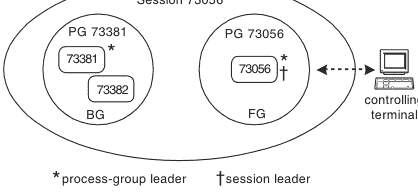

`进程组领导者` `会话领导者`

**图 4.1** 会话、进程组、进程和控制终端。

> 5. 各种标准使用短语“会话领导者的进程组 ID”，但我更喜欢直接称其为会话 ID。

如果 shell 启用了作业控制，并且在后台运行一个命令或命令管道，如下所示：

```bash
$ du -a | grep tmp >out.tmp
```

此时会形成一个新的进程组，这次包含两个进程，如图 4.1 左侧所示，进程组标记为 BG，代表后台（background）。两个新进程中的一个是这个新进程组的领导者。

两个进程组（73056 和 73381）位于同一个会话中，并拥有相同的控制终端。启用作业控制时，每条命令行都会创建一个新的进程组，每个这样的进程组也被称为一个作业。

仅仅因为一个进程组在后台运行，并不意味着其标准文件描述符不再指向终端。在前面的管道示例中，`du` 的标准输出通过管道连接到 `grep` 的标准输入，而 `grep` 的标准输出重定向到一个文件，但这是因为用户特意这样设置的，而不是因为它们运行在后台。

作业控制意味着，如果从控制终端生成某些信号，如中断（`SIGINT`）、退出（`SIGQUIT`）或挂起（`SIGSTP`），这些信号只发送给前台进程组，而不会干扰任何后台进程组。“控制”部分意味着用户可以执行 shell 命令将进程组（作业）在前台和后台之间移动。通常，如果一个进程组正在前台运行，按 Ctrl-z 会向其发送一个 `SIGSTP` 信号，这会导致 shell 将其移至后台，并将其中一个后台进程组带到前台。或者，`fg` shell 命令可以将特定的后台进程组带到前台，同时也会将原来的前台进程组移至后台。

如果未启用作业控制，示例管道中的两个新进程（运行 `du` 和 `grep`）不会运行在自己的进程组中，而是运行在进程组 73056 中，与第一个进程（shell）一起运行，如图 4.2 所示。它们仍然在后台运行，但这仅意味着 shell 不会等待它们完成。由于只有一个进程组，无法在前台和后台之间移动进程组，从控制终端生成的任何信号都会发送给会话中唯一进程组中的所有进程。在终端输入 Ctrl-c 会向所有三个进程（包括两个后台进程）发送 `SIGINT`，除非这些进程已设置为捕获或忽略该信号，否则会导致它们终止，这是该信号的默认操作。（更多关于信号的内容见第 9 章。）

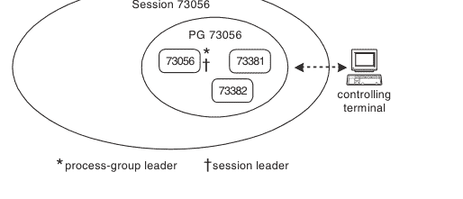

**图 4.2** 无作业控制；每个会话只有一个进程组。

无论是否启用作业控制，当控制终端断开或挂起时，会向控制进程发送 `SIGHUP` 信号，该信号的默认操作是终止进程。对于典型的会话，这会终止登录 shell 并注销用户。控制终端不再是该会话的控制终端，此时会话没有控制终端。其他会话进程是否仍能访问终端，所有标准均未规定，大多数实现可能会通过例如从 `read` 或 `write` 返回错误来阻止这种访问。

然而，一旦控制进程因任何原因（不仅仅是收到 `SIGHUP`）终止，前台（或仅有的）进程组中的所有进程都会收到 `SIGHUP`，默认情况下这会导致它们终止。除非它们已安排捕获或忽略此信号，否则它们无法走得足够远以尝试访问原控制终端。

如果后台进程组中的一个进程尝试访问控制终端，会发生什么？无论控制进程是否在运行，基本规则是：后台进程尝试读取控制终端会使其收到 `SIGTTIN` 信号，任何写入操作会生成 `SIGTTOU` 信号。这里“写入”也指使用终端控制系统调用 `tcsetattr`、`tcdrain`、`tcflow`、`tcflush` 和 `tcsendbreak`（第 4.5 节和 4.6 节）。

这些信号的默认行为是挂起进程，这很有道理：需要访问控制终端的后台进程会停止，当你准备好与它们交互时，将它们移到前台。

基本规则的例外情况是：

- 如果后台进程尝试读取，而 `SIGTTIN` 信号被忽略或阻塞，则 `read` 会返回 `EIO` 错误。
- 孤儿后台进程（进程组领导者已终止）从 `read` 也会收到 `EIO` 错误。
- 如果 `TOSTOP` 终端属性（参见第 4.5.6 节）被清除，进程被允许写入。
- 如果设置了 `TOSTOP`，但 `SIGTTOU` 信号被忽略或阻塞，进程被允许写入。
- 如果设置了 `TOSTOP`，孤儿后台进程从 `write` 会收到 `EIO` 错误。

因此，总结这些规则：后台进程无论如何都无法读取控制终端；它会收到错误或停止。孤儿后台进程尝试写入终端时会收到错误。非孤儿的后台进程如果 `TOSTOP` 被清除，或者 `SIGTTOU` 被忽略或阻塞，则可以写入；否则它们会被停止。

读取和写入之间的不对称性是因为两个进程同时读取字符永远没有意义——这太危险了。（想象输入 `rm *.o` 而 shell 只获取到 `rm *` 的情况。）两个进程写入只会造成混乱，如果这正是用户想要的，那就随它去吧。

### 4.3.2 会话的系统调用

**`setsid`** -- 创建会话和进程组

```c
#include <unistd.h>

pid_t setsid(void);
/* 返回进程组 ID，出错时返回 -1（设置 errno） */
```

**`getsid`** -- 获取会话 ID

```c
#include <unistd.h>

pid_t getsid(
    pid_t pid               /* 进程 ID，或 0 表示调用进程 */
);
/* 返回会话 ID，出错时返回 -1（设置 errno） */
```

我说过每次登录都会开启一个新会话，但会话究竟从何而来？实际上，任何非会话领导的进程都可以调用 `setsid` 成为新会话的领导，同时成为该会话中唯一进程组（即该进程组也是该会话中唯一的进程组）的领导进程。重要的是，新会话没有控制终端。这对守护进程非常有用，因为它们不需要控制终端；对于那些希望建立不同于登录时建立的某个控制终端的会话也很有用。新会话打开的第一个终端设备将成为其控制终端。

### 4.3.3 进程组的系统调用

**`setpgid`** -- 设置或创建进程组

```c
#include <unistd.h>

int setpgid(
    pid_t pid,            /* 进程 ID，或 0 表示调用进程 */
    pid_t pgid           /* 进程组 ID */
);
/* 成功返回 0，出错返回 -1（设置 errno） */
```

**`getpgid`** -- 获取进程组 ID

```c
#include <unistd.h>

pid_t getpgid(
    pid_t pid            /* 进程 ID，或 0 表示调用进程 */
);
/* 返回进程组 ID，出错时返回 -1（设置 errno） */
```

通过调用 `setpgid`，一个尚未成为进程组领导的进程可以被设置为新进程组的领导。这发生在两个参数相等且不存在该 ID 的进程组时。或者，如果第二个参数指定了一个已存在的进程组 ID，则由 `pid` 参数指定的进程组会被更改。但是，这里有许多限制：

- `pid` 必须是调用进程或调用进程的一个子进程，且该子进程尚未执行 `exec` 系统调用（将在第 5.3 节解释）。
- `pid` 必须与调用进程在同一个会话中。
- 如果 `pgid` 存在，它必须与调用进程在同一个会话中。

实际上，这些限制并没有那么严格。通常，shell 会为管道中的每个命令创建子进程，选择其中一个作为进程组领导，通过调用 `setpgid` 创建新的进程组，然后通过额外的 `setpgid` 调用将管道中的其他命令放入该组中。一旦设置完成，进程组分配通常不会改变，尽管从理论上讲这是可能的。

两个较旧的设置和获取进程组 ID 的调用是 `setpgrp` 和 `getpgrp`，但它们的实用性不如 `setpgid` 和 `getpgid`，并且已经过时。

### 4.3.4 控制终端的系统调用

**`tcsetpgrp`** -- 设置前台进程组 ID

```c
#include <unistd.h>

int tcsetpgrp(
    int fd,          /* 文件描述符 */
    pid_t pgrp       /* 进程组 ID */
);
/* 成功返回 0，出错返回 -1（设置 errno） */
```

**`tcgetpgrp`** -- 获取前台进程组 ID

```c
#include <unistd.h>

pid_t tcgetpgrp(
    int fd           /* 文件描述符 */
);
/* 返回进程组 ID，出错时返回 -1（设置 errno） */
```

**`tcgetsid`** -- 获取会话 ID

```c
#include <termios.h>

pid_t tcgetsid(
    int fd           /* 文件描述符 */
);
/* 返回会话 ID，出错时返回 -1（设置 errno） */
```

`tcsetpgrp` 系统调用将某个进程组带到前台，这意味着它将接收由控制终端生成的信号。之前处于前台的进程组将被移到后台。该进程组必须与调用进程在同一个会话中。

Shell 的 `fg` 命令使用 `tcsetpgrp` 将请求的进程带到前台。输入 Ctrl-z 并不会直接将前台进程移到后台；实际发生的情况是它向该进程发送一个 `SIGSTOP` 信号，使其停止，然后其父进程（即 shell）从 `waitpid` 系统调用中返回，得知发生了什么。然后 shell 执行 `tcsetpgrp` 将自己移到前台。

`tcgetsid` 仅存在于 SUS 系统中，因此在 FreeBSD 上不可用。不过，您可以从打开的控制终端文件描述符获取会话 ID，方法是先调用 `tcgetpgrp` 获取前台进程组 ID，然后，由于该 ID 必然是会话中某进程的进程 ID，您可以调用 `getsid` 获取会话 ID。

### 4.3.5 使用会话相关的系统调用

下面是一个使用上述系统调用打印大量会话和进程组相关信息的函数：


```c
#include <termios.h>

static void showpginfo(const char *msg)
{
    int fd;

    printf("%s\n", msg);
    printf("\tprocess ID = %ld; parent = %ld\n",
           (long)getpid(), (long)getppid());
    printf("\tsession ID = %ld; process-group ID = %ld\n",
           (long)getsid(0), (long)getpgid(0));
    EC_NEG( fd = open("/dev/tty", O_RDWR) )
    printf("\tcontrolling terminal's foreground process-group ID = %ld\n",
           (long)tcgetpgrp(fd));
#if _XOPEN_VERSION >= 4
    printf("\tcontrolling-terminal's session ID = %ld\n",
           (long)tcgetsid(fd));
#else
    printf("\tcontrolling-terminal's session ID = %ld\n",
           (long)getsid(tcgetpgrp(fd)));
#endif
    EC_NEG( close(fd) )
    return;

    EC_CLEANUP_BGN
        EC_FLUSH("showpginfo")
    EC_CLEANUP_END
}
```

我们希望进程启动时以及接收到 `SIGCONT` 信号时调用 `showpginfo`，这样我们可以看到它在后台运行时的情况。在第 9 章之前，我不会详细介绍信号捕获；你目前只需要知道，初始化该结构体并调用 `sigaction` 安排当 `SIGCONT` 信号到达时执行函数 `catchsig`。<sup>6</sup> 之后，主程序休眠。如果它因为信号到达而从 `sleep` 返回，它将再次进入休眠。

```c
int main(void)
{
   struct sigaction act;

   memset(&act, 0, sizeof(act));
   act.sa_handler = catchsig;
   EC_NEG( sigaction(SIGCONT, &act, NULL) ) ;
   showpinfo("initial call");
   while (true)
      sleep(10000);

   EC_CLEANUP_BGN
       exit(EXIT_FAILURE);
   EC_CLEANUP_END
}

static void catchsig(int signo)
{
   if (signo == SIGCONT)
      showpinfo("got SIGCONT");
}
```

与 `pgrpinfo` 的交互很有启发性：

```
$ echo $$
5140
$ pgrpinfo
            initial call
    process ID = 6262; parent = 5140
    session ID = 5140; process-group ID = 6262
    controlling terminal's foreground process-group ID = 6262
    controlling-terminal's session ID = 5140
^Z[1]+  Stopped              pgrpinfo
$ bg &!
[1]+ pgrpinfo &
    got SIGCONT
    process ID = 6262; parent = 5140
    session ID = 5140; process-group ID = 6262
    controlling terminal's foreground process-group ID = 5140
    controlling-terminal's session ID = 5140
```

6. 在 9.1.7 节中，我将说明在信号处理程序中使用系统调用有一些限制，因此，`showpinfo` 所做的某些事情在技术上是非法的。不过，我们目前只读到了第 4 章，我们还不知道的事不足以让我们在这个例子中吃大亏。

首先，我们看到 shell 的进程 ID 是 5140。最初，`pginfo` 在前台运行。它位于自己的进程组中，其 ID 为 6262，这与 `pginfo` 的进程 ID 相同。这意味着它是进程组领导。会话 ID 与 shell 的进程 ID 相同，这意味着 `pginfo` 与 shell 在同一个会话中。然后，当用户输入 `Ctrl-z` 时，shell 获取了其子进程 `pginfo` 的状态，报告为已停止，并将自己移到前台，使我们能够向 shell 输入另一个命令 `bg`，该命令在后台重启了 `pginfo`。这向 `pginfo` 发送了一个 `SIGCONT` 信号，导致它再次打印信息。情况大多相同，除了这次前台进程组是 5140，即 shell 的进程组。

大多数与会话和进程组相关的系统调用被 shell 使用，而非其他应用程序。然而，其中一个，`setsid`，对应用程序非常重要，我们将在 4.10.1 节看到，当时我们使用它将进程的控制终端切换到伪终端。

## 4.4 ioctl 系统调用

回想一下，UNIX 中有两种设备：块设备和字符设备。块设备在第 3 章讨论过，而一种重要的字符设备类型——终端——正是我们在本章中讨论的对象。有一种用于控制所有类型字符设备的通用系统调用，称为 `ioctl`：

```c
ioctl—控制字符设备
#include <...>
int ioctl(
  int fd,             /* 文件描述符 */
  int req,            /* 请求 */
  ...                /* 取决于请求的参数 */
);
/* 出错返回 -1（设置 errno）；成功时返回其他某个值 */
```

有两个例外，因为 POSIX 和 SUS 标准没有指定设备，所以头文件、各种请求以及 `ioctl` 使用的相应第三个参数是实现依赖的，你通常可以在试图控制的目标驱动程序文档中找到细节。

这两个例外是：

## 4.5 设置终端属性

控制终端的两个重要系统调用是 `tcgetattr`（获取当前属性）和 `tcsetattr`（设置新属性）。另外四个函数 `tcdrain`、`tcflow`、`tcflush` 和 `tcsendbreak` 将在第 4.6 节中解释。

### 4.5.1 基本的 tcgetattr 和 tcsetattr 用法

几乎你可以使用 `ioctl` 对终端执行的所有操作，都有各自标准化的函数，主要目的是在编译时检查参数的类型。这些函数是 `tcgetattr`、`tcsetattr`、`tcdrain`、`tcflow`、`tcflush` 和 `tcsendbreak`，它们将在下一节中描述。

SUS 确实规定了如何在使用 STREAMS 时使用 `ioctl`，我在第 4.9 节中简要提及了这一点。

除了第 4.9 节，本书中我将不再进一步讨论 `ioctl`。

**`tcgetattr`——获取终端属性**

```c
#include <termios.h>
int tcgetattr(
    int fd, /* 文件描述符 */
    struct termios *tp /* 属性 */
);
/* 成功返回 0，出错返回 -1（设置 errno） */
```

**`tcsetattr`——设置终端属性**

```c
#include <termios.h>
int tcsetattr(
    int fd, /* 文件描述符 */
    int actions, /* 设置时的动作 */
    const struct termios *tp /* 属性 */
);
/* 成功返回 0，出错返回 -1（设置 errno） */
```

**`struct termios`——终端控制函数的结构体**

```c
struct termios {
    tcflag_t c_iflag; /* 输入标志 */
    tcflag_t c_oflag; /* 输出标志 */
    tcflag_t c_cflag; /* 控制标志 */
    tcflag_t c_lflag; /* 局部标志 */
    cc_t c_cc[ NCCS ]; /* 控制字符 */
};
```

终端信息结构体（`termios`）包含大约 50 个标志位，用于告知驱动程序如何处理传入和传出的字符、如何设置通信线路参数（如波特率）等。该结构体还定义了几个控制字符，例如擦除（通常是 Del 或退格符）、杀死（通常是 Ctrl-u）和 EOF（通常是 Ctrl-d）。

在修改属性之前，你需要调用 `tcgetattr` 来初始化结构体。由于该结构体复杂且可能加载了由实现定义标志，从零开始直接初始化一个结构体是不切实际的。获取结构体后，你可以随意调整标志位和其他字段，然后调用 `tcsetattr` 来应用这些更改。其第二个参数 `action` 控制更改发生的方式和时间；使用以下符号之一：

- **TCSDRAIN**：类似于 `TCSANOW`，但首先等待所有挂起的输出字符被发送。当对影响输出的更改时，应使用此选项，以确保先前输出的字符按照它们写入时生效的规则进行处理。

- **TCSAFLUSH**：类似于 `TCSDRAIN`，但除了等待挂起的输出排空外，还会刷新输入队列（字符被丢弃）。在开始新的交互模式时（例如启动屏幕编辑器），这是最安全的命令，因为它可以防止可能提前输入的字符导致非预期的操作。

- **TCSANOW**：根据结构体中的信息立即设置终端。

以下小节描述了大多数常用标志位及其在典型用途中的通用组合方式（例如，“原始”模式）。要查看标准化标志位的完整列表，请参阅 [SUS2002]。或者，你可以执行 `man termios` 或 `man termios` 来查看你的实现中的标志位。

### 4.5.2 字符大小和奇偶校验

`c_cflag` 中的标志位表示字符大小（`CS7` 表示 7 位；`CS8` 表示 8 位）、停止位数（`CSTOPB` 表示 2 位，清除表示 1 位）、是否应检查奇偶校验（如果是，则设置 `PARENB`）以及奇偶校验类型（`PARODD` 表示奇校验，清除表示偶校验）。这里没有什么创造性可言；通常找到一个可用的组合就令人满意了。

你也可以获取有关奇偶校验检查失败字符的更多信息。如果 `c_iflag` 中的 `PARMRK` 标志位被设置，坏字符前面会加上两个字符 0377 和 0。否则，奇偶校验错误的字符将作为 NUL 字节输入。或者，可以设置 `c_iflag` 中的标志位 `IGNPAR` 以完全忽略奇偶校验错误的字符。

### 4.5.3 速度

如今大多数终端运行速度都很快，但仍然有一组符号（不是整数）被定义为各种标准速度，包括一些非常低的速度。它们的名称形式为 `Bn`，其中 n 为 50, 75, 110, 134, 150, 200, 300, 600, 1200, 1800, 2400, 4800, 9600, 19200 或 38400。单位是比特每秒，在 UNIX 文档和标准中被称为“波特”（baud）。

一些实现将速度编码在 `c_cflag` 字段中，但为了可移植性，你使用四个标准函数来设置或获取输入和输出速度，而不是直接操作 `termios` 结构体。这些函数只操作结构体——你必须先通过调用 `tcgetattr` 来填充结构体，然后必须调用 `tcsetattr` 才能使速度更改生效。此外，请记住 `speed_t` 的唯一标准化值是 `Bn` 符号。你不能以可移植的方式传入一个普通的整数，尽管某些实现可能允许这样做。

**`cfgetispeed`**——从 `termios` 结构体获取输入速度

```c
#include <termios.h>

speed_t cfgetispeed(
    const struct termios *tp  /* 属性 */
);
/* 返回速度（无错误返回） */
```

**`cfgetospeed`**——从 `termios` 结构体获取输出速度

```c
#include <termios.h>

speed_t cfgetospeed(
    const struct termios *tp  /* 属性 */
);
/* 返回速度（无错误返回） */
```

**`cfsetspeed`**——在 `termios` 结构体中设置输入速度

```c
#include <termios.h>

int cfsetspeed(
    struct termios *tp,         /* 属性 */
    speed_t speed              /* 速度 */
);
/* 成功返回 0，出错返回 -1（可能设置 errno） */
```

**`cfsetospeed`**——在 `termios` 结构体中设置输出速度

```c
#include <termios.h>

int cfsetospeed(
    struct termios *tp,         /* 属性 */
    speed_t speed               /* 速度 */
);
/* 成功返回 0，出错返回 -1（可能设置 errno） */
```

速度 `B0` 是特殊的：如果它被设置为输出速度，对 `tcsetattr` 的调用将断开终端连接。如果它被设置为输入速度，则表示输出和输入速度相同。

### 4.5.4 字符映射

输入时换行符到回车符以及回车符到换行符的映射由 `c_oflag` 中的标志位 `INLCR` 和 `ICRNL` 控制；通常前者被清除，后者被设置。对于按下回车键时输入回车符和换行符的终端，可以忽略回车符（`IGNCR`）。

在输出时，我们通常希望将换行符映射为回车-换行符对；`c_oflag` 中的标志位 `ONLCR` 完成这项工作。其他标志位会导致回车符被更改为换行符（`OCRNL`），以及在第 0 列的回车符被抑制（`ONOCR`）。如果换行符也会导致回车符，则有一个标志位（`ONLRET`）告知终端驱动程序这一点，以便它可以跟踪列位置（用于制表符和退格符）。

驱动程序还可以处理仅支持大写的终端，虽然它们曾经比现在更常见。如果 `c_iflag` 中的 `IXCASE` 被设置，`c_iflag` 中的 `IUCLC` 被设置，并且 `c_oflag` 中的 `OLCUC` 被设置，则输入时大写字母映射为小写字母，输出时小写字母映射为大写字母。由于 UNIX 使用小写多于大写，这是可取的。要输入或输出大写字母，需要在字母前加上反斜杠（\）。

> 7. “少得多了”这句话出现在本书的 1985 年版中。现在它们可能甚至不再存在于博物馆之外。

如果 `c_iflag` 中的 `ISTRIP` 标志位被设置，输入字符会被剥离为 7 位（在检查奇偶校验后）。否则，所有 8 位都被输入。一些终端使用 ASCII，这是一种 7 位代码，因此对这些终端来说通常需要剥离。然而，现代设备和程序（如 `xterm`、`telnet` 或 `ssh`）可能会传输完整的 8 位。在输出时，进程写入的所有位都可能会被发送。如果要向终端发送 8 个数据位，则必须通过清除 `c_oflag` 中的 `PARENB` 标志位来关闭奇偶校验生成。

### 4.5.5 延迟和制表符

终端曾经是机械式的，缺乏大容量缓冲区，因此需要时间来执行各种动作，例如回车。`c_oflag` 中的标志位可以设置为调整换行符、回车符、退格符、水平制表符、垂直制表符和换页符的延迟，但现在不太可能需要这些了。

另一个标志位 `TAB3` 会导致输出的制表符被替换为适当数量的空格。这在终端本身没有制表符、设置制表符太麻烦，或者终端实际上是另一台正在下载输出且只需要空格的计算机时很有用。

### 4.5.6 流量控制

终端输出可以通过用户按 `Ctrl-s` 或进程调用 `tcflow`（参见第 4.6 节）暂时停止。流量通过用户输入 `Ctrl-q` 或通过 `tcflow` 重启。

如果 `c_iflag` 中的 `IXANY` 标志位被设置，用户可以输入任何字符来重启流量，而不仅仅是 `Ctrl-q`。如果 `IXON` 标志位被清除，用户完全无法使用输出流量控制；`Ctrl-s` 和 `Ctrl-q` 没有特殊含义。

终端驱动程序还支持输入流量控制。如果 `IXOFF` 标志位被设置，则当输入队列变满时，驱动程序将向终端发送 `Ctrl-s` 以暂停输入。当队列长度因为进程读取了一些排队字符而减少时，将发送 `Ctrl-q` 以告知终端恢复输入。当然，这个功能只能与支持它的终端一起使用。

如果 `c_lflag` 中的 `TOSTOP` 标志位被设置，当后台进程组中的进程尝试写入控制终端时，会发送 `SIGTTOU` 信号，如我在第 4.3.1 节中解释的那样。

## 4.5.7 控制字符

可以通过设置 `termios` 结构体中 `c_cc` 数组的元素，将若干控制字符更改为默认值以外的值。表 4.2 列出了每个可设置控制字符在 `c_cc` 中的下标及其默认值。在数组中，字符以其内部值表示。

ASCII 控制字符如下：`Ctrl-a` 到 `Ctrl-z` 的值分别为 1 到 26；`Ctrl-[`、`Ctrl-\`、`Ctrl-]`、`Ctrl-^` 和 `Ctrl-_` 的值分别为 27 到 31；`Ctrl-?` (`Del`) 的值为 127；`Ctrl-@` 的值为 0。值 32 到 126 是 95 个可打印的 ASCII 字符，对于控制字符来说没有用处。大于 127 的值无法从标准美式英语键盘上产生，但在其他键盘上可能可用。没有标准的 UNIX 方法来使用产生多字符序列的功能键。

### 表 4.2 c_cc 下标

| 下标 | 含义 | 典型默认值 |


| :---------- | :------- | :-------------- |
| `*VEOF` | 文件结束符 | `Ctrl-d` |
| `VEOI` | 换行符的替代（很少使用） | 未定义 |
| `*VERASE` | 擦除字符 | `Ctrl-?` |
| `VINTR` | 中断；生成 `SIGINT` | `Ctrl-c` |
| `VKILL` | 取消整行 | `Ctrl-u` |
| `VQUIT` | 退出；生成 `SIGQUIT` | `Ctrl-\` |
| `*VSUSP` | 暂停进程；生成 `SIGSTP` | `Ctrl-z` |
| `VSTART` | 恢复输入或输出 | `Ctrl-q` |
| `*VSTOP` | 暂停输入或输出 | `Ctrl-s` |

* 交换 `VSUSP` 和 `VSTOP` 的名称可能更合理，但表格中的对应关系是正确的。
* † 因为某些终端在按下退格键时产生 `Ctrl-?` (`ASCII DEL`)，而不是 `Ctrl-h` (`ASCII BS`)。

大多数实现定义了一些额外的字符，用于单词擦除、重新打印和丢弃输出等功能；然而，标准化的字符仅为表中列出的那些。数组中元素的总数为 `NCCS`。

由 `c_cc` 下标 `VINTR`、`VQUIT` 和 `VSUSP` 指定的字符会产生信号，正如我在第 4.3 节中所述。默认情况下，`SIGINT` 终止进程，`SIGQUIT` 导致进程终止并转储核心文件，`SIGSTOP` 使进程暂停，直到接收到 `SIGCONT` 信号。第 9 章对信号有更多讨论。

若要抑制某个控制字符，可以将其设置为 `_POSIX_VDISABLE`。或者，可以通过清除 `c_lflag` 中的 `ISIG` 标志来抑制中断、退出和停止（`c_cc[VSUSP]`），从而禁用信号生成。如果头文件 `unistd.h` 中没有定义 `_POSIX_VDISABLE`，则可以从 `pathconf` 或 `fpathconf`（第 1.5.6 节）获取其值。通常定义为零。

### 4.5.8 回显

终端通常处于全双工模式运行，这意味着数据可以同时双向通过通信线路流动。因此，计算机（而非终端）将键入的字符回显以验证它们是否被正确接收。通常的输出字符映射适用，因此，例如，回车被映射为换行，然后在回显时，换行又被映射为回车和换行。

若要关闭回显，需清除 `c_lflag` 中的 `ECHO` 标志。这既是为了保密（如输入密码时），也是为了让进程本身决定是否需要回显、回显什么以及在哪里回显（如运行屏幕编辑器时）。

对于擦除和取消整行字符，有两种特殊的回显方式。可以设置 `ECHOE` 标志，使擦除字符回显为“退格-空格-退格”。这在 CRT 屏幕上具有清除被擦除字符的 pleasing 效果（对硬拷贝终端毫无影响，除了使打印头晃动一下）。可以设置 `ECHOK` 标志，在取消整行字符后回显一个换行符（可能映射为回车和换行）；这为用户提供了新的一行进行操作。

### 4.5.9 即时输入与规范输入

通常，输入字符会被排队，直到一行完成为止，这由换行符或 `EOF` 指示。只有在那时，字符才会对 `read` 可用，而 `read` 可能只请求并获取一个字符。在许多应用程序中，如屏幕编辑器和表单输入系统，读取过程希望字符在被键入时立即获取，而无需等待行组装完成。事实上，“行”的概念可能没有意义。

如果 `c_lflag` 中的标志 `ICANON`（“规范模式”）被清除，则在读取之前，输入字符不会被组装成行；因此，擦除和取消整行的编辑功能不可用。擦除和取消整行字符失去了其特殊含义。两个参数 `MIN` 和 `TIME` 决定了 `read` 何时满足条件。当队列长度达到 `MIN` 个字符时，或者在接收到一个字节后 `TIME` 的十分之一秒过去时，队列中的字符变得可用。`TIME` 使用一个字节间定时器，该定时器在接收到字节时重置，并且在收到第一个字节之前不会启动，因此不会在未收到任何字节的情况下发生超时。（如果 `MIN` 为零，则有一个例外，见下文。）

`c_cc` 数组的下标 `VMIN` 和 `VTIME` 分别保存 `MIN` 和 `TIME`。由于这些位置可能与 `VEOF` 和 `VEOL` 相同，请务必显式设置 `MIN` 和 `TIME`，否则可能会得到当前 `EOF` 和 `EOL` 字符对应的值，这会导致非常奇怪的结果。如果你发现某个进程在每键入第四个字符时获取输入，这可能就是发生的原因。（`Ctrl-d`，通常是 `EOF` 字符，值为 4。）

`MIN` 和 `TIME` 背后的思想是允许进程在字符被键入时或紧随其后获取字符，同时不失去单次 `read` 系统调用读取多个字符的好处。然而，除非你编写输入例程来缓存输入，否则最好将 `MIN` 设置为 1（只要 `TIME` 大于零，则 `TIME` 无关紧要），因为你的 `read` 系统调用无论如何都只读取单个字符。

我刚才描述的情况适用于 `MIN` 和 `TIME` 都大于零的情形。如果其中一个或两者为零，则属于以下特殊情况之一：

- 如果 `TIME` 为零，定时器被关闭，且 `MIN` 生效（假设它大于零）。
- 如果 `MIN` 为零，`TIME` 不再被视为字节间定时器，计时在发出 `read` 后立即开始。当读取到一个字节或 `TIME` 超时 whichever 先发生时返回。因此，在这种情况下，`read` 可能返回计数为零。
- 如果两者都为零，`read` 在最小值（由 `read` 的第三个参数请求的字节数）和输入队列中可用的字节数中返回。如果没有可用字节，`read` 返回计数为零，因此这表现得像非阻塞读取。

标准没有明确指定在设置了 `O_NONBLOCK` 且 `MIN` 和/或 `TIME` 为非零值时发生什么。`O_NONBLOCK` 可能具有优先级（如果在没有可用字符时立即返回），或者 `MIN\TIME` 可能具有优先级。为了避免这种不确定性，在 `ICANON` 被清除时，你不应该设置 `O_NONBLOCK`。

下面是一个名为 `tc_keystroke` 的即时输入例程，它具有缓存功能。由于它会更改终端标志，我们还提供了配套例程 `tc_restore`，以便在首次调用 `tc_keystroke` 之前将终端恢复原状。调用程序必须在终止前调用 `tc_restore`。

```c
static struct termios tbufsave;
static bool have_attr = false;

int tc_keystroke(void)
{
    static unsigned char buf[10];
    static ssize_t total = 0, next = 0;
    static bool first = true;
    struct termios tbuf;

    if (first) {
        first = false;
        EC_NEGL(tcgetattr(STDIN_FILENO, &tbuf));
        have_attr = true;
        tbufsave = tbuf;
        tbuf.c_lflag &= ~ICANON;
        tbuf.c_cc[VMIN] = sizeof(buf);
        tbuf.c_cc[VTIME] = 2;
        EC_NEGL(tcsetattr(STDIN_FILENO, TCSAFLUSH, &tbuf));
    }
    if (next >= total)
        switch (total = read(0, buf, sizeof(buf))) {
        case -1:
            syserr("read");
        case 0:
            fprintf(stderr, "Mysterious EOF\n");
            exit(EXIT_FAILURE);
        default:
            next = 0;
        }
    return buf[next++];

    EC_CLEANUP_BEGIN
    return -1;
    EC_CLEANUP_END
}
```

```c
bool tc_restore(void)
{
    if (have_attr)
        ec_neg1(tcsetattr(STDIN_FILENO, TCSAFLUSH, &tbufsave));
    return true;
    EC_CLEANUP_BGN
    return false;
    EC_CLEANUP_END
}
```

注意，我们只清除了 `ICANON`（当然，还设置了 `MIN` 和 `TIME`）。通常，你会希望清除更多的标志，以关闭回显、输出字符映射等。这将在下一节中讨论。在特定应用中，你需要尝试 `MIN` 和 `TIME` 的值。我们使用了 10 个字符和 0.2 秒，这似乎效果很好。

下面是一些测试代码，在一个循环中调用 `tc_keystroke`：

```c
setbuf(stdout, NULL);
while (true) {
    c = tc_keystroke();
    putchar(c);
    if (c == 5) { /* ^E */
        ec_false(tc_restore());
        printf("\n%\n", "Exiting...");
        exit(EXIT_SUCCESS);
    }
}
```

关于这段测试代码，重要的是字符在键入时由终端驱动程序回显，然后在 `tc_keystroke` 返回时由 `putchar` 函数再次回显。这让我们能看到 `MIN` 和 `TIME` 的效果，如下面的示例输出所示，其中“slow”中的字母输入得非常慢，而“fast”中的字母输入得非常快。键入的字母以下划线标示。

```
ssslowwfastfast^E
Exiting...
```

因此，`MIN` 和 `TIME` 不会改变 `tc_keystroke` 的操作方式，即它仍然是即时的（在我们设置的 `TIME` 下，在 0.2 秒内），但将读取次数减少了 10 倍（或我们设置的 `MIN` 值对应的倍数）。

### 4.5.10 原始终端 I/O

前一节描述的即时（或非规范）输入很有用，但有时我们还想关闭回显，以及几乎所有其他功能。

这通常被称为 原始 模式，意味着不进行特殊的输入或输出处理，字符可以立即被读取，而无需等待一行文本的组装完成。没有单一的标志位可以设置原始模式；相反，你必须逐一设置各项属性。（`stty` 命令确实有一个 `raw` 选项。）

我们希望的原始终端 I/O 具有以下属性，尽管没有严格的定义，你可能需要根据自己的用途稍作调整：

- 精确的输入。 清除 `ICANON`，并设置 `IMIN` 和 `TIME`。
- 无字符映射。 清除 `OPOST` 以关闭输出处理。对于输入，清除 `INLCR` 和 `ICRNL`。将字符大小设置为 `CS8`。清除 `ISTRIP` 以获取全部八位，清除 `INPCK` 和 `PARENB` 以关闭奇偶校验。清除 `IEXTEN` 以关闭扩展字符处理。
- 无流控。 清除 `IXON`。
- 无控制字符。 清除 `BRKINT` 和 `ISIG`，并将所有控制字符设置为禁用值，即使那些是特定于实现定义的。
- 无回显。 清除 `ECHO`。

这些操作被封装在函数 `tc_setraw` 中。请注意，它保存了旧的 `termios` 结构以备 `tc_restore` 使用（见前文）。

```c
bool tc_setraw(void)
{
    struct termios tbuf;
    long disable;
    int i;

#ifdef _POSIX_VDISABLE
    disable = _POSIX_VDISABLE;
#else
    /* treat undefined as error with errno = 0 */
    ec_neg1( errno = 0, disable = fpathconf (STDIN_FILENO, _PC_VDISABLE));
#endif

    ec_neg1( tcgetattr(STDIN_FILENO, &tbuf));
    have_attr = true;
    tbufsave = tbuf;
    tbuf.c_cflag &= ~(CSIZE | PARENB);
    tbuf.c_cflag |= CS8;
    tbuf.c_iflag &= ~(INLCR | ICRNL | ISTRIP | INPCK | IXON | BRKINT);
    tbuf.c_oflag &= ~OPOST;
    tbuf.c_lflag &= ~(ICANON | ISIG | IEXTEN | ECHO);
    for (i = 0; i < NCCS; i++)
        tbuf.c_cc[i] = (cc_t)disable;
    tbuf.c_cc[VMIN] = 5;
    tbuf.c_cc[VTIME] = 2;
    ec_neg1( tcsetattr(STDIN_FILENO, TCSAFLUSH, &tbuf) );
    return true;
    EC_CLEANUP_BGN
    return false;
    EC_CLEANUP_END
}
```

下面是一个使用 `stty` 命令显示终端设置的 `tc_setraw` 测试程序：

```c
setbuf(stdout, NULL);
printf("Initial attributes:\n");
system("stty | fold -s -w 60");
printf("\r\nRaw attributes:\n");
tc_setraw();
system("stty | fold -s -w 60");
tc_restore();
printf("\r\nRestored attributes:\n");
system("stty | fold -s -w 60");
```

以下是我得到的输出（在 Solaris 上）。请注意，`tc_setraw` 关闭了所有 `c_cc` 字符，而不仅仅是我们所知道的标准字符。但是，它并没有关闭所有可能使终端变为非原始模式的标志，例如 `imaxbel`<sup>8</sup> 你可能会发现，对于你移植代码的每个系统，都必须调整你版本的 `tc_setraw`，或者使用 Curses 库（第 4.8 节），该库有自己将终端设置为原始模式的方法。

初始属性：  

速度 38400 波特；`evenp`  

行数 = 40；列数 = 110；`xpixels` = 0；`ypixels` = 0；  

`swtch` = <undef>；  

`brkint` `-inpck` `icrnl` `-ixany` `imaxbel` `onlcr`  

`echo` `echoe` `echoct` `echoctl` `echoke` `iexten`

原始属性：  

速度 38400 波特；`-parity`  

行数 = 40；列数 = 110；`xpixels` = 0；`ypixels` = 0；  

`min` = 5；`time` = 2；  

`intr` = <undef>；`quit` = <undef>；`erase` = <undef>；`kill` = <undef>；  

`eof` = `^e`；`eol` = `^b`；`swtch` = <undef>；`start` = <undef>；  

`stop` = <undef>；`susp` = <undef>；`dasup` = <undef>；  

`rprnt` = <undef>；`flush` = <undef>；`werase` = <undef>；`lnext` = <undef>；  

`-inpck` `-istrip` `-ixon` `ixonb` `-opost`  

`-isig` `-icanon` `-echo` `echoe` `echokl` `echoctl` `echoke`

恢复后的属性：  

速度 96400 波特；`evenp`  

行数 = 40；列数 = 110；`xpixels` = 0；`ypixels` = 0；  

`swtch` = <undef>；  

`brkint` `-inpck` `icrnl` `-ixany` `imaxbel` `onlcr`  

`echo` `echoe` `echok` `echoctl` `echoke` `iexten`

有时在调试过程中（甚至调试后！），一个已将终端置于原始模式的程序在能够恢复原始设置之前就会中止。用户有时认为计算机崩溃了，或者他们的终端“死机”了——他们甚至无法使用 `EOF` 来注销。但是，可以从原始模式恢复。首先，回想一下 `ICRNL` 已被清除；这意味着你必须使用 `Ctrl-j` 而不是回车键来结束输入行。<sup>9</sup> 其次，因为 `ECHO` 也关闭了，你将看不到你输入的内容。首先输入几个换行符；你应该会看到一系列 shell 提示符，但不会出现在左边界处，因为输出处理（`OPOST`）已关闭。然后输入 `stty sane`，接着输入一个换行符，一切应该就恢复正常了。

## 4.6 额外的终端控制系统调用

如我们在第 4.5.1 节中看到的那样，当你使用 `tcsetattr` 设置终端属性时，你可以使用 `TCSADRAIN` 操作来排空（等待）输出队列，在属性设置之前完成，并且你还可以使用 `TCSAFLUSH` 操作额外刷新（丢弃）输入队列中的任何字符。两个系统调用允许你单独控制排空和刷新，而无需同时设置属性：

`tcdrain` — 排空（等待）终端输出

```c
#include <termios.h>

int tcdrain(
    int fd            /* file descriptor */
);
/* Returns 0 on success or -1 on error (sets errno). */
```

`tcflush` — 刷新（丢弃）终端输出、输入或两者

```c
#include <termios.h>

int tcflush(
    int fd,          /* file descriptor */
    int queue        /* queue to be affected */
);
/* Returns 0 on success or -1 on error (sets errno) */
```


### 终端 I/O 函数

这些函数作用于队列——即，从终端接收但尚未被任何进程读取的字符，或由进程写入但尚未传输到终端的字符。

`tcflush` 的第二个参数（`queue`）是以下之一：

- `TCIFLUSH` 刷新输入队列。
- `TCOFLUSH` 刷新输出队列。
- `TCIOFLUSH` 刷新两个队列。

因此，`tcsetattr` 的 `TCSADRAIN` 参数相当于在属性设置之前调用 `tcdrain`，而 `tcsetattr` 的 `TCSAFLUSH` 参数相当于调用 `tcdrain` 和 `tcflush`，其中队列参数为 `TCIFLUSH`。

下一个系统调用 `tcflow` 允许应用程序暂停或重启终端输入或输出：

**`tcflow`** — 暂停或重启终端输入或输出的流

```c
#include <termios.h>

int tcflow(
    int fd,          /* file descriptor */
    int action       /* direction and suspend/restart */
);
/* Returns 0 on success or -1 on error (sets errno) */
```

`action` 参数是以下之一：

- `TCOOFF` 暂停输出。
- `TCOON` 重启已暂停的输出。
- `TCIOFF` 发送 STOP 字符，旨在使终端暂停输入。
- `TCION` 发送 START 字符，旨在使终端重启已暂停的输入。

应用程序可以使用 `TCOOF` 来在写入终端的每页之后暂停输出，以便用户在通过键盘输入 START 字符继续之前阅读（默认是 Ctrl-q，见第 4.5.7 节）。在调用 `tcflow` 并使用 `TCOOF` 后，应用程序可以继续写入输出页；当终端的队列已满时，下一个 `write` 操作将被阻塞，直到队列稍微排空。

然而，这不是用户期望的行为，也不是逐页显示应用程序通常的工作方式。像 `more` 和 `man` 这样的命令会输出一页，然后提示用户输入一个普通字符（例如空格或回车）以获取下一页。内部地，此类应用程序输出一页，输出提示符，并阻塞在 `read` 上（通常是在关闭标准输入和回显的情况下），等待用户输入继续字符。

在输入端，`TCIOFF` 和 `TCION` 历史上用于防止终端溢出输入队列，但如今这完全由驱动器和/或硬件处理。如今，`tcflow` 可能仅用于专用设备，而不是实际的终端。

同一类别的还有 `tcsendbreak`，它向终端发送断字符：

**`tcsendbreak`** — 向终端发送断字符

```c
#include <termios.h>

int tcsendbreak(
    int fd,            /* file descriptor */
    int duration       /* duration of break */
);
/* Returns 0 on success or -1 on error (sets errno) */
```

“断字符”是发送到终端的一段时间内的 0 位流，通常作为将终端置于特殊“注意”模式的一种方式。

如果 `duration` 参数为 0，则持续时间在四分之一到二分之一秒之间。如果非零，其含义取决于具体实现。不过，不要担心可移植性——你很可能没有机会向终端发送断字符。

### Shell 的一个很好的增强功能是，它除了换行符外，还应接受回车符作为行结束符

（该脚注首次出现在 1985 年——迄今尚无进展。）

## 4.7 终端识别系统调用

正如我在第 4.2.1 节中所说，通用路径名 `/dev/tty` 提供了一种在不知道其名称的情况下访问进程控制终端的方法。然而，这并非一直是一项要求，相反，曾经有一个用于获取此类同义词的系统调用：

```c
ctermid—获取控制终端的路径名

#include <stdio.h>
char *ctermid(
 char *buf
 );
 /* 大小为 L_ctermid 的缓冲区或 NULL */
 /* 返回路径名，出错时返回空字符串（未定义 errno） */
```

你可以传入一个 `NULL` 参数来调用 `ctermid`，在这种情况下它会使用适当大小的静态缓冲区。或者，你可以提供一个大小为 `L_ctermid`（包含 NUL 字节的存储空间）的缓冲区，以避免在多个线程调用该函数时发生冲突。请注意，出错时 `ctermid` 返回的是空字符串，而不是 `NULL`。`ctermid` 并不要求返回比字符串 `/dev/tty` 更有用的内容，而且在大多数（如果不是所有的话）系统上，它也就只返回 `/dev/tty`。

更有用的系统调用是返回实际终端名称的那个，而这正是 `ttyname` 和 `ttyname_r` 的用途，只是你必须将打开的文件描述符作为输入提供给它们：

```c
ttyname—查找终端的路径名

#include <unistd.h>
char *ttyname(
 int fd
 );
 /* 文件描述符 */
 /* 返回字符串，出错时返回 NULL（设置 errno） */
```

```c
ttyname_r—查找终端的路径名

#include <unistd.h>
int ttyname_r(
 int fd,
 char *buf,
 size_t bufsize
 );
 /* 文件描述符 */
 /* 用于路径名的缓冲区 */
 /* 缓冲区大小 */
 /* 成功时返回 0，出错时返回错误编号（不设置 errno） */
```

正如我们在其他函数中看到的那样，`_r` 后缀意味着 `ttyname_r` 是可重入的——它不使用静态存储，而是使用你传入的缓冲区。并且，正如我们在其他函数中看到的那样，为该缓冲区确定大小是一件令人头疼的事。如果宏 `TTY_NAME_MAX` 有定义（在 `limits.h` 中），你可以使用它；如果没有定义，你必须使用参数 `_SC_TTY_NAME_MAX` 调用 `sysconf`（第 1.5.5 节）。或者，你可以随时直接调用 `sysconf`。如果你知道只有一个线程在调用 `ttyname`，那么它显然是两者中更容易使用的选择。

以下是我版本的 `tcty` 命令，它打印连接到标准输入的终端的名称，如果标准输入不是终端，则打印 "not a tty"（不是终端）：

```c
int main(void)
{
    char *ctty;

    if ((ctty = ttyname(STDIN_FILENO)) == NULL) {
        printf("not a tty\n");
        exit(1);
    }
    printf("%s\n", ctty);
    exit(0);
}
```

在这里，我使用数字 1 和 0 代替符号 `EXIT_FAILURE` 和 `EXIT_SUCCESS`，因为 SUS 明确规定返回码应为 1 或 0。（POSIX 仅规定 `EXIT_FAILURE` 必须为非零值，并未规定其必须为 1。）

如果你确实想要获取控制终端的名称，即使标准输入以某种方式连接到了不同的终端或非终端输入，你可能认为可以打开 `/dev/tty` 并将该文件描述符传递给 `ttyname`。但遗憾的是，在我尝试过的系统上并不是这样运作——`ttyname` 只是返回 `/dev/tty`，而不是实际的名称。事实上，似乎没有可移植的方法来获取控制终端的名称，尽管如果标准输入是一个终端，那么它很可能就是控制终端。

你可以使用 `isatty` 系统调用来测试文件描述符是否打开在一个终端上：

```c
isatty—测试是否为终端
#include <unistd.h>
int isatty(
 int fd        /* 文件描述符 */
);              /* 如果是终端返回 1，否则返回 0（返回 0 时可能设置 errno） */
```

如果 `isatty` 返回 0，你不能依赖 `errno` 被设置，但在大多数情况下，如果它返回的值不是 1，你也不关心原因。

### 4.8 全屏应用程序

传统的 UNIX 命令有时是交互式的（例如 `dc`、`more`），但它们仍然以文本行进行读写。还有至少其他三类有趣的应用程序类别，它们更充分地利用了显示屏及其相关输入设备（例如鼠标）的功能：

-   运行在廉价终端（现在几乎不再生产）和终端仿真器（如 `telnet` 和 `xterm`）上的面向字符的全屏应用程序。最著名的此类应用程序可能是 `vi` 文本编辑器。
-   为 X Window 系统编写的使用图形用户界面（GUI）的应用程序，可能使用更高级的工具包，如 Motif、Gnome、KDE，甚至 Tk/Tcl。（除了 X 之外，还有其他一些 GUI 系统。）
-   Web 应用程序，其用户界面使用 HTML、JavaScript 和 Java 等技术编写。

只有第一组使用了本章所讨论的终端功能。X 应用程序通过网络与所谓的 X 服务器通信，而 GUI 处理实际上发生在服务器中，该服务器可能运行在基于 UNIX 的计算机上，也可能不是。如果是前者，它通过设备驱动程序直接与显示和输入设备通信，而不是通过字符终端驱动程序。同样，Web 应用程序通过网络与浏览器通信（第 8.4.3 节），而浏览器处理用户交互。如果浏览器运行在 UNIX 上，它通常是一个 X 应用程序。

我将介绍一个非常简单的面向字符的全屏应用程序示例，该程序会清屏并显示一个类似下面的菜单：


**图 4.3** 菜单。

用户输入的数字不会回显，也不需要以回车符结尾。在我的小示例中，如果你输入，比如说，3，你得到的只是图 4.4 中的屏幕画面。

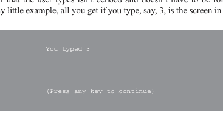

**图 4.4** 响应。

我将展示这个应用程序的两种实现。第一种仅适用于 ANSI 终端，在任何能够仿真 VT100 终端的地方都能正常工作。ANSI 终端（以及 VT100）有数十种控制序列，我们将只使用其中两种：

-   序列 `ESC [r c H` 将光标定位到第 `r` 行、第 `c` 列。（`\e` 是转义字符。）
-   序列 `ESC [2 J` 清除屏幕。

有两个函数使用这些控制序列；请注意 `clear` 也将光标移动到屏幕左上角：

```c
#define ESC "\033"

bool mvaddstr(int y, int x, const char *str)
{
    return printf(ESC "[%d;%df%s", y, x, str) >= 0;
}

bool clear(void)
{
    return printf(ESC "[2J") >= 0 &&
           mvaddstr(0, 0, "");
}
```

如果我们希望用户输入错误字符时让终端发出铃声，我们可以使用一个 ASCII 码来实现：

```c
#define BEL "\007"

int beep(void)
{
  return printf(BEL) >= 0;
}
```

假设终端通过调用 `tc_setraw` 进入了原始模式，我们调用 `getch` 来读取一个字符：

```c
int getch(void)
{
  char c;

  switch(read(STDIN_FILENO, &c, 1)) {
  default:
    errno = 0;
    /* 继续到下一个 case */
  case -1:
    return -1;
  case 1:
    break;
  }
  return c;
}
```

这些是我们所需的所有用户界面服务例程。整个应用程序都在 main 函数中。显然，如果它执行任何实际功能，代码会长得多。

```c
int main(void)
{
  int c;
  char s[100];
  bool ok = false;

  ec_false( tc_setraw() )
  setbuf(stdout, NULL);
  while (true) {
    ec_false( clear() )
    ec_false( mvaddstr(2, 9, "What do you want to do?" ) )
    ec_false( mvaddstr(3, 9, "1. Check out tape/DVD" ) )
    ec_false( mvaddstr(4, 9, "2. Reserve tape/DVD" ) )
    ec_false( mvaddstr(5, 9, "3. Register new member" ) )
    ec_false( mvaddstr(6, 9, "4. Search for title/actor" ) )
    ec_false( mvaddstr(7, 9, "5. Quit" ) )
    ec_false( mvaddstr(9, 9, "(Type item number to continue)" ) )
    ec_neg1( c = getch() )

    switch (c) {
    case '1':
    case '2':
    case '3':
    case '4':
        ec_false( clear() )
        snprintf(s, sizeof(s), "You typed %c", c);
        ec_false( mvaddstr(4, 9, s) )
        ec_false( mvaddstr(9, 9, "(Press any key to continue)") )
        ec_neg1( getch() )
        break;
    case '5':
        ok = true;
        EC_CLEANUP
    default:
        ec_false( beep() )
    }
  }

  EC_CLEANUP_BGN
    (void)tc_restore();
    (void)clear();
    exit(ok ? EXIT_SUCCESS : EXIT_FAILURE);
  EC_CLEANUP_END
}
```

无论你面对的终端种类多么普遍，你通常都不希望只为某一种终端编码。相反，你会希望使用一个名为 Curses 的标准库，它在第 4.1 节中有所介绍。它维护着一个包含有史以来每种终端控制序列的数据库，以便在运行时切换到适当的控制序列。

我巧妙地将函数 `mvaddstr`、`clear`、`beep` 和 `getch` 命名以模仿 Curses 中同名的函数，它们执行相同的功能。因此，对于 Curses 版本，我们要展示的就是 `main` 函数：

```c
#include <curses.h>

/* 用于 ERR（Curses 使用）的 "ec" 宏 */
#define ec_ERR(x) ec_cmp(x, ERR)

int main(void)
{
    int c;
    char s[100];
    bool ok = false;
```

```c
(void)initscr();
ec_ERR(raw());
while (true) {
    ec_ERR(clear());
    ec_ERR(mvwaddstr(2, 9, "What do you want to do?"));
    ec_ERR(mvwaddstr(3, 9, "1. Check out tape/DVD"));
    ec_ERR(mvwaddstr(4, 9, "2. Reserve tape/DVD"));
    ec_ERR(mvwaddstr(5, 9, "3. Register new member"));
    ec_ERR(mvwaddstr(6, 9, "4. Search for title/actor"));
    ec_ERR(mvwaddstr(7, 9, "5. Quit"));
    ec_ERR(mvwaddstr(9, 9, "(Type item number to continue)"));
    ec_ERR(c = getch());
    switch (c) {
        case '1':
        case '2':
        case '3':
        case '4':
            ec_ERR(clear());
            snprintf(s, sizeof(s), "You typed %c", c);
            ec_ERR(mvwaddstr(4, 9, s));
            ec_ERR(mvwaddstr(9, 9, "(Press any key to continue)"));
            ec_ERR(getch());
            break;
        case '5':
            ok = true;
            EC_CLEANUP;
        default:
            ec_ERR(beep());
    }
}

EC_CLEANUP_BGN
(void)clear();
(void)refresh();
(void)endwin();
exit(ok ? EXIT_SUCCESS : EXIT_FAILURE);
EC_CLEANUP_END
```

关于此程序的几点说明：

- 大多数 Curses 函数在出错时会返回 `ERR`，因此我专门针对它们定义了一个 `ec_ERR` 宏。Curses 的文档并未说明它使用 `errno`，但我保留了原样，因为我知道如果确实获取到一条消息，其值可能没有意义。
- Curses 要求以 `initscr` 开始，并以 `endwin` 结束。


- `tc_setraw` 的 Curses 版本是 `raw`。

本书中不再涉及 Curses 的其他内容，因为它不是内核服务。$^{10}$

Curses 是 SUS2 和 SUS3 的一部分，因此你可以在 SUS2 网站 `www.unix-systems.org/version2/online.html` 上在线阅读规范。在大多数系统上，你也可以输入 `man curses` 或 `man ncurses`（Curses 的一个免费版本）。

### 4.9 STREAMS I/O

STREAMS 是一些 UNIX 实现中的一种机制，允许以模块化方式实现字符设备驱动程序。应用程序可以在一定程度上将各种 STREAMS 模块串联起来，以获得所需的驱动程序功能。这在某种程度上类似于 UNIX 过滤器在 shell 层面的工作方式；例如，`who` 命令可能没有排序输出的选项，但如果你想要的话，可以通过管道将其输入到 `sort` 中。

我将在下一节中展示一个基于 STREAMS 的伪终端示例。在那里我将做的是 `open` 一个设备文件以获取伪终端，然后使用 `ioctl` 将两个 STREAMS 模块（`ldterm` 和 `ptem`）“推送”到该模块上，使其表现得像一个终端。与 shell 管道不同，在 shell 管道中你可以从数十种过滤器中选择，并以数百种创造性的方式组合它们；STREAMS 模块通常以配方式（cookbook fashion）方式使用——你推送文档告诉你需要推送的模块，并且就像烹饪一样，如果你随意推送东西，不会得到任何美味的结果。（不应将 STREAMS 与标准 I/O 流概念混淆，后者用于 `fopen`、`fwrite` 等。两者完全没有关系。）

SUS1 和 SUS2 要求具备 STREAMS 功能，但 SUS3 并不要求。将 `_XOPEN_VERSION` 设置为 500（表示它是 SUS2）的 Linux 不提供 STREAMS，因此从某种意义上说它是非符合标准的。

除了我在下一节中使用 STREAMS 进行伪终端以及本书中的其他几处提及之外，我将不会全面介绍 STREAMS。了解更多关于它们的最好方法是参考 SUS 或 Sun 的网站 `www.sun.com`，在那里你可以找到 STREAMS Programming Guide。

> 10. 此外，如果我们包含 Curses，我们就必须包含 X，而那会要我们的命。（在此语境中，“我们”指的是“你和我”。）

### 4.10 伪终端

正常的终端设备驱动程序将进程连接到实际的终端，如图 4.5a 所示，其中终端处的用户正在运行 `vi`。伪终端设备驱动程序对于交互式（从属）进程（`vi`）而言表现得与终端完全一样，但另一端连接的是主进程，而不是实际设备。这允许主进程将输入提供给从属进程，就好像输入来自实际终端一样，并捕获从属进程的输出，就好像输出要去往实际终端一样。从属进程可以像往常一样使用 `tcgetattr`、`tcsetattr` 和其他仅限终端的系统调用，并且它们都将按预期工作。

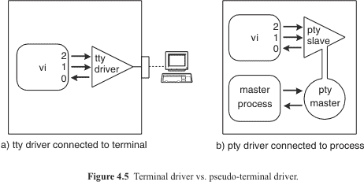

a) 连接到终端的 tty 驱动程序

b) 连接到进程的 pty 驱动程序

图 4.5 终端驱动程序与伪终端驱动程序。

你可以将伪终端连接到进程的概念类比为通过 shell 重定向其输入和输出，但使用的是某种终端而不是管道。事实上，`vi` 无法使用管道：

```sh
$ vi >tmp
ex/vi: Vi's standard input and output must be a terminal
```

伪终端最常见的用途之一是由 `telnetd` 服务器使用，如图 4.6 所示。它通过网络与 `telnet` 客户端通信，并通过伪终端与 `telnet` 用户执行的操作进行通信。在实践中，`telnet` 会话通常以 shell 开始，就像实际终端会话一样；在

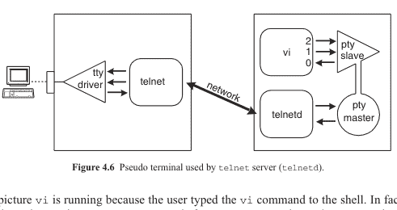

图 4.6 由 `telnet` 服务器（`telnetd`）使用的伪终端。

图中，`vi` 正在运行，因为用户向 shell 输入了 `vi` 命令。事实上，如今使用 `telnet` 或 `xterm` 比使用实际终端更为常见，因为大多数用户通过网络而不是直接拨号连接 UNIX 计算机。（他们可能拨号连接互联网服务提供商（ISP），但这只是为了让他们进入互联网。）我不会展示如何实现 `telnetd` 服务器（参见练习 4.6）；我们只关注图中的伪终端部分。

在伪终端的主侧，主进程获取从属进程写入的内容。在 `vi` 和其他面向屏幕的程序的情况下，这些数据包括转义序列（例如，用于清屏），如我们在 4.8 节中所见。终端驱动程序或伪终端驱动程序都关心这些序列是什么。另一方面，使用 `tcsetattr` 执行的控制操作完全由驱动程序处理，不会到达主进程。因此，在图 4.6 中，`vi` 生成的转义序列一直传输到左侧计算机上运行的 `telnet` 进程。如果它在全屏模式下运行，它可以将其直接发送到实际终端。更常见的是，`telnet` 进程根本不连接到终端驱动程序，而是运行在窗口系统下。在这种情况下，它必须知道如何将这些转义序列转换为窗口系统显示窗口中字符所需的内容。这样的程序被称为终端模拟器。因此，请记住终端模拟器和伪终端是两件非常不同的事情：前者处理转义序列，后者替代终端驱动程序，以便将 I/O 重新路由到主进程。

#### 4.10.1 伪终端库

> 由于本节使用了一些第 5 章中的系统调用（例如 `fork`），你可能希望在阅读完该章之后再阅读本节。

伪终端（从现在起称为“pty”），像所有其他设备一样，由特殊文件表示，其名称因系统而异。不幸的是，将进程连接到 pty 并不像执行以下操作那样简单直接：

```sh
$ vi </dev/pty/01 > /dev/pty/01
```

它更复杂：我们必须获取 pty 的名称，执行一些系统调用来准备它，并将其设置为控制终端。其中一些系统调用由 SUS1（1.5.1 节）及后续标准标准化，但诸如 FreeBSD 等 pre-SUS 系统以完全不同的方式处理此事。更糟糕的是，使用 STREAMS 实现 ptys 的系统需要额外的步骤，并且 SUS2 和 SUS3 之间发生了一些变化。

我将把系统之间的差异封装到一个小型函数库中，每个函数都以 `pty_` 开头。然后，我将使用这个 pty 库来实现一个记录/播放应用程序作为示例。

以下是使用 ptys 的总体方案，分为九个步骤：

1. 打开 pty 的主侧以进行读写。
2. 获取对 pty 的访问权限（如下文所述）。
3. 从主侧的名称或文件描述符获取从侧的名称。暂时不要打开它。
4. 执行 `fork` 系统调用（5.5 节）以创建子进程。
5. 在子进程中，调用 `setsid`（4.3.2 节）使其放弃其控制终端。
6. 在子进程中，打开 pty 的从侧。它将变成新的控制终端。在支持 STREAMS 的系统（例如 Solaris）上，你必须设置 STREAM。在 BSD 系统上，你必须显式使用以下命令使其成为控制终端：

```c
ec_neg1(ioctl(fd, TIOCSCTTY));
```

7. 将子进程的标准输入、输出和错误文件描述符重定向到 pty。
8. 执行 `execvp` 系统调用（第 5.3 节），让子进程运行所需的程序（例如 `vi`）。（“exec”系统调用的六种变体中的任何一种都可以工作；我在示例中使用的是 `execvp`。）
9. 现在，父进程可以使用在第 1 步中获得的文件描述符来读写 pty 的主端。子进程将像往常一样从其标准输入读取，并写入其标准输出和标准错误输出（它不知道自己是在什么上下文中被执行的），而这些文件描述符的行为就好像它们打开到了终端设备上一样。

所有这些管道处理如图 4.5b 所示。

打开 pty 主端（第 1 步）有三种方法：

- A. 在 SUS3 系统上，你只需调用 `posix_openpt`（见下文）。
- B. 在大多数 SUS1 和 SUS2 系统（包括 Solaris 和 Linux）上，你打开克隆文件 `/dev/ptmx`，这将提供一个唯一的 pty，尽管你可能不知道实际的文件名，甚至可能根本不存在。这没关系，因为你只需要打开的文件描述符。
- C. 在基于 BSD 的系统上，有一组特殊文件，其名称形式为 `/dev/ptyXY`，其中 X 和 Y 是数字或字母。你必须尝试所有文件，直到找到一个可以打开的文件。（不是开玩笑！）

我们可以使用 `XOPEN_VERSION` 宏来区分方法 A 和方法 B，并为使用方法 C 的系统定义宏 `MASTER_NAME_SEARCH`。在之前的 9 个步骤中的第 6 步，我们将为需要设置 STREAM 的系统定义宏 `NEED_STREAM_SETUP`，并为需要 `ioctl` 调用的系统定义宏 `NEED_TIOCSCCTTY`。以下是 pt-library 中为 Solaris 和 FreeBSD 设置这些宏的代码；Linux 不需要设置其中任何一个：

```c
#if defined(SOLARIS) /* add to this as necessary */
#define NEED_STREAM_SETUP
#endif

#if defined(FREEBSD) /* add to this as necessary */
#define NEED_TIOCSCCTTY
#endif

#ifdef XOPEN_UNIX
#define MASTER_NAME_SEARCH
#endif
```

如果你的系统尚未被考虑到，你可能需要为此代码进行扩充。

以下是 `posix_openpt` 的原型，仅适用于符合 SUS3 的系统：

```c
posix_openpt—open pty
#include <stdlib.h>
#include <fcntl.h>

int posix_openpt(
    int oflag               /* O_RDWR optionally Ored with O_NOCTTY */
);
/* Returns file descriptor on success or -1 on error (sets errno) */
```

使用标志 `O_NOCTTY` 可以防止主端成为控制终端，以防进程尚未拥有控制终端。（请记住，对于没有控制终端的进程，打开的第一个终端设备将成为其控制终端。）我们通常不希望主端成为控制终端，但我们确实希望从端（第 5 步）正好是这样的，因此我们将使用 `O_NOCTTY` 标志。

现在，继续编写 pt-library 代码，它需要一些不在 `defs.h` 中的头文件包含：

```c
#ifdef _XOPEN_UNIX
#include <string.h>  /* for STREAMS */
#endif
#ifdef NEED_TIOCSCTTY
#include <sys/ttycom.h> /* for TIOCSCTTY */
#endif
```

pt-library 的所有函数都操作于一个 `PTINFO` 结构体，该结构体保存主端和从端的文件描述符及其路径名（如果已知）：

```c
#define PT_MAX_NAME 20

typedef struct {
    int pt_fd_m;             /* master file descriptor */
    int pt_fd_s;             /* slave file descriptor */
    char pt_name_m[PT_MAX_NAME]; /* master file name */
    char pt_name_s[PT_MAX_NAME]; /* slave file name */
} PTINFO;

#define PT_GET_MASTER_FD(p)  ((p)->pt_fd_m)
#define PT_GET_SLAVE_FD(p)   ((p)->pt_fd_s)
```

这两个宏供调用 pt-library 的应用程序使用，因为它们需要文件描述符。

稍后展示的函数 `pt_open_master` 会分配一个 `PTINFO` 结构体并返回指向它的指针，以便与其他库函数一起使用，正如标准 I/O 库使用 `FILE` 结构体一样。内部地，`pt_open_master` 调用 `find_and_open_master` 来实现第 1 步，使用前面概述的三种方法之一：

```c
#if defined(MASTER_NAME_SEARCH)
#define PTY_RANGE \
       "0123456789ABCDEFGHIJKLMNOPQRSTUVWXYZabcdefghijklmnopqrstuvwxyz"

#define PTY_PROTO   "/dev/ptyXY"
#define PTY_X       8
#define PTY_Y       9
#define PTY_MG      5 /* replace with 't' to get slave name */
#endif /* MASTER_NAME_SEARCH */

static bool find_and_open_master(PTINFO *p)
{
#if defined(_XOPEN_UNIX)
#if _XOPEN_VERSION >= 600
    p->pt_name_m[0] = '\0'; /* don't know or need name */
    ec_negl( p->pt_fd_m = posix_openpt(O_RDWR | O_NOCTTY) )
#else
    strcpy(p->pt_name_m, "/dev/ptmx"); /* clone device */
    ec_negl( p->pt_fd_m = open(p->pt_name_m, O_RDWR | O_NOCTTY) )
#endif
#elif defined(MASTER_NAME_SEARCH)
    int i, j;
    char proto[] = PTY_PROTO;

    if (p->pt_fd_m != -1) {
        (void)close(p->pt_fd_m);
        p->pt_fd_m = -1;
    }

    for (i = 0; i < sizeof(PTY_RANGE) - 1; i++) {
        proto[PTY_X] = PTY_RANGE[i];
        proto[PTY_Y] = PTY_RANGE[0];
        if (access(proto, F_OK) == -1) {
            if (errno == ENOENT)
                continue;
            EC_FAIL
        }
        for (j = 0; j < sizeof(PTY_RANGE) - 1; j++) {
            proto[PTY_X] = PTY_RANGE[j];
            if ((p->pt_fd_m = open(proto, O_RDWR)) == -1) {
                if (errno == ENOENT)
                    break;
            }
            else {
                strcpy(p->pt_name_m, proto);
                break;
            }
        }
        if (p->pt_fd_m != -1)
            break;
    }
    if (p->pt_fd_m == -1) {
        errno = EAGAIN;
        EC_FAIL
    }
#else
    errno = ENOSYS;
    EC_FAIL
#endif
    return true;

EC_CLEANUP_BGN
    return false;
EC_CLEANUP_END
}
```

`find_and_open_master` 中的大部分代码用于那个愚蠢的名称搜索——多达 3844 个名称！为了稍微加快速度，我们使用 `access`（第 3.8.1 节）来测试形式为 `/dev/ptyX0` 的每个名称是否存在，如果不存在，我们就不必理会 `/dev/ptyX1`、`/dev/ptyX2` 以及该系列中的其他 59 个名称，而是直接移动到下一个 `X`。

第 2 步是获取对 pty 的访问权限。在 SUS 系统上，你必须调用 `grantpt` 来获取对从端的访问权限，并在 pty 被锁定时调用 `unlockpt`：

**grantpt**—获取 pty 从端的访问权限

```c
#include <stdlib.h>
int grantpt(
    int fd           /* file descriptor */
);
/* Returns 0 on success or -1 on error (sets errno) */
```

**unlockpt**—解锁 pty

```c
#include <stdlib.h>
int unlockpt(
 int fd /* file descriptor */
);
/* Returns 0 on success or -1 on error (sets errno) */
```

第 3 步是获取从端的名称。在 SUS1 系统上有一个系统调用用于此目的：

**ptsname**—获取 pty 从端的名称

```c
#include <stdlib.h>
char *ptsname(
 int fd /* file descriptor */
);
/* Returns name or NULL on error (errno not defined) */
```


在 `BSD` 系统（定义了 `MASTER_NAME_SEARCH`）上，你通过将 `/dev/ptyXY` 中的“p”替换为“t”来从主端的名称中获得从端的名称。也就是说，如果你发现 `/dev/ptyK4` 可以打开为主端，那么对应的从端名称将是 `/dev/ttyK4`。

以下是函数 `pt_open_master` 的代码，它调用前面展示的 `find_and_open_master` 函数来执行第 1 步，然后执行第 2 步和第 3 步，最终得到已命名但未打开的从端：

```c
PTINFO *pt_open_master(void) {

    PTINFO *p = NULL;
    char *s;

    ec_null( p = calloc(1, sizeof(PTINFO)) )
    p->pt_fd_m = -1;
    p->pt_fd_s = -1;
    ec_false( find_and_open_master(p) )
    #ifdef _XOPEN_UNIX
    ec_neg1( grantpt(p->pt_fd_m) )
    ec_neg1( unlockpt(p->pt_fd_m) )
    ec_null( s = ptsname(p->pt_fd_m) )
    if (strlen(s) >= PT_MAX_NAME) {
        errno = ENAMETOOLONG;
        EC_FAIL
    }
    strcpy(p->pt_name_s, s);
    #if defined(MASTER_NAME_SEARCH)
    strcpy(p->pt_name_s, p->pt_name_m);
    p->pt_name_s[PTY_MS] = 't';
    #else
    errno = ENOSYS;
    EC_FAIL
    #endif
    return p;

EC_CLEANUP_BGN
if (p != NULL) {
(void)close(p->pt_fd_m);
(void)close(p->pt_fd_s);
free(p);
}
return NULL;
EC_CLEANUP_END
```

第 4 步，即通过 `fork` 创建子进程，是由使用库的程序完成的——没有库函数来执行此操作。

第 5 步是在子进程中调用 `setsid`（第 4.3.2 节），使其放弃其控制终端，因为我们希望 `pty` 成为控制终端。第 6 步也在子进程中完成，即打开从端，其名称我们已经知道。这两步由 `pt_open_slave` 完成：

```c
bool pt_open_slave(PTINFO *p)
{
ec_neg1( setsid() )
if (p->pt_fd_s != -1)
ec_neg1( close(p->pt_fd_s) )
ec_neg1( p->pt_fd_s = open(p->pt_name_s, O_RDWR) )
#if defined(NEED_TIOCSTTY)
ec_neg1( ioctl(p->pt_fd_s, TIOCSTTY, 0) )
#endif
#if defined(NEED_OSTREAM_SETUP)
ec_neg1( ioctl(p->pt_fd_s, I_PUSH, "ptem" )
ec_neg1( ioctl(p->pt_fd_s, I_PUSH, "ldterm" ) )
#endif
/*
Changing mode not that important, so don't fail if it doesn't
work only because we're not superuser.
*/
if (fchmod(p->pt_fd_s, PERM_FILE) == -1 && errno != EPERM)
EC_FAIL
return true;

EC_CLEANUP_BGN
return false;

EC_CLEANUP_END
}
```

同样，`pt_open_slave` 必须在子进程中调用，而不是在父进程中。（我们很快就会看到一个示例。）对于定义了 `NEED_STREAM_SETUP` 的系统，例如 `Solaris`，需要向流推入两个模块：`ptem`（伪终端仿真器）和 `ldterm`（常规终端模块）。¹¹（`ioctl` 系统调用和 `I_PUSH` 命令是标准化的，但用于设置 `pty` 的模块名称不是标准化的。）

在 `pt_open_slave` 的末尾，我们更改 `pty` 的模式，因为在某些系统上它可能没有合适的权限。然而，由于它可能不属于该进程的用户 `ID`（这取决于系统），`fchmod` 调用（第 3.7.1 节）可能会失败，在这种情况下，我们仍然会继续执行，寄希望于最好的结果。

步骤 7、8 和 9 不是通过 `pt` 库完成的，而是通过第 5 章和第 6 章中介绍的系统调用完成的。不过，我将在本节稍后出现的示例中展示代码。

由于子进程（从端）和父进程（主端）是独立运行的，父进程必须确保子进程完全设置好之后，才开始在第 9 步中读取和写入 `pty`。因此，`pt` 库提供了一个供父进程使用的调用，该调用在可以安全继续之前不会返回：

```c
bool pt_wait_master (PTINFO *p)
{
    fd_set fd_set_write;

    FD_ZERO(&fd_set_write);
    FD_SET(PT_GET_MASTER_PD(p), &fd_set_write);
    ec_negl( select(PT_GET_MASTER_PD(p) + 1, NULL, &fd_set_write, NULL,
        NULL) )
    return true;

EC_CLEANUP_BGN
    return false;
EC_CLEANUP_END
}
```

> 11. 要在 `Solaris` 系统（以及可能其他实现 `STREAMS` 的系统）上阅读关于这些的内容，请运行 `man ptem` 和 `man ldterm`。

我们只是使用 `select`（第 4.2.3 节）等待直到 `pt` 可写。下一个函数是 `pt_close_master`，在父进程中调用以在不再需要 `pt` 时关闭文件描述符并释放 `PTINFO` 结构体。

```c
bool pt_close_master(PTINFO *p)
{
	ec_neg1( close(p->pt_fd_m) )
	free(p);
	return true;

EC_CLEANUP_BGN
	return false;
EC_CLEANUP_END
}
```

还有一个 `pt_close_slave`，但通常不会调用它，因为在步骤 8 中，子进程会被另一个程序覆盖。此外，由于我们重定向了文件描述符，此时 `pt` 的子进程端由标准文件描述符（0、1 和 2）表示，而这些标准文件描述符在进程终止时几乎总是会自动关闭。以下是它的代码：

```c
bool pt_close_slave(PTINFO *p)
{
	(void)close(p->pt_fd_s); /* 可能已经关闭 */
	free(p);
	return true;
}
```

如果你发现自己在代码中调用了 `pt_close_slave`，那你很可能做错了什么。

请注意，`pt_close_master` 和 `pt_close_slave` 都释放了 `PTINFO` 结构体。这是应该的，因为当它们执行时，该结构体在父进程和子进程中都被分配了。当第 5.5 节解释 `fork` 时，这一点会更清楚。

综合所有内容，以下是使用 `pt` 库调用的一般框架：

```c
PTINFO *p = NULL;
bool ok = false;
	ec_null( p = pt_open_master() ) /* 步骤 1、2 和 3 */
switch (fork()) { /* 步骤 4 */
case 0:
	ec_false( pt_open_slave(p) ) /* 步骤 5 和 6 */

/*
	重定向文件描述符并 exec（未显示） - 步骤 7 和 8
*/
	break;
case -1:
    EC_FAIL
}
ec_false( pt_wait_master(p) )  /* 在步骤 9 之前同步 */

/* 父进程（主端）现在按需要读取和写入 pty - 步骤 9 */
ok = true;
EC_CLEANUP

EC_CLEANUP_BGN
if (p != NULL)
    (void)pt_close_master(p);
    /* 其他清理工作放在这里 */
exit(ok ? EXIT_SUCCESS : EXIT_FAILURE);
EC_CLEANUP_END
```

这就是我即将介绍的应用程序的样子。

#### 4.10.2 录制和播放示例

我将使用 `pty` 来构建一个录制/播放系统，该系统可以录制命令的输出，然后像命令正在运行一样回放录制的输出。这意味着不仅屏幕必须与原始显示完全相同，而且回放速度也必须相同。为了了解我的意思，这里有一个脚本，它显示时间，等待 5 秒，然后再次显示时间：

```bash
$ cat >script1
date
sleep 5
date
$ chmod +x script1
$ script1
Wed Nov  6 10:46:31 MST 2002 [5秒暂停]
Wed Nov  6 10:46:36 MST 2002
```

当然，正如你从时间中看到的，第一次和第二次执行 `date` 命令之间有一个 5 秒的暂停。（括号中的注释不是输出的一部分。）

但是，如果我们只是在文件中捕获输出并显示该文件，文件中的文本会非常快地显示。没错，文件中的时间确实是 `date` 命令写入的内容，但当 `cat` 命令打印输出时没有暂停：

```bash
$ script1 >tmp
$ cat tmp
Wed Nov 6 10:55:24 MST 2002   /* 无暂停 */
Wed Nov 6 10:55:29 MST 2002
```

然而，这不是我们想要的。我们想要以与录制相同的速度回放输出，这通过我们稍后展示的一个名为 `record` 的命令来实现（其 `-p` 选项会回放录制内容）：

```bash
$ record script1
Wed Nov 6 10:57:18 MST 2002   /* 5秒暂停 */
Wed Nov 6 10:57:23 MST 2002
$ record -p
Wed Nov 6 10:57:18 MST 2002   /* 5秒暂停 */
Wed Nov 6 10:57:23 MST 2002
```

你在页面上看不到，但在显示第一行后，在显示第二行之前有一个 5 秒的暂停，这与输出录制时的速度相同。

因此，至少 `record` 需要保存`事件`（events）：时间以及字符，以便回放部分知道以多快的速度将它们写入标准输出。我们希望它与交互式程序一起工作，所以它不能仅用管道捕获输出——它必须使用 `pty` 设置命令，因为像 `vi`、`emacs` 和其他全屏应用程序等有趣的命令只能在终端上工作。录波器、录制内容和被录制的命令是如何连接的，如图 4.7 所示。`record` 从标准输入读取的内容写入 `pty`，而从 `pty` 读取的内容既写入其标准输出 `and` 也写入 `事件` 文件。

首先，我将展示用于将命令的输出记录为一系列 `事件` 的数据结构和函数。然后，我将展示 `读取`

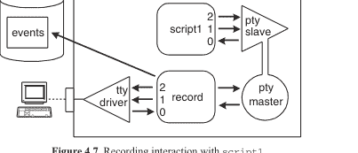

图 4.7 与 `script1` 的录制交互。

事件并在适当的时间显示其中数据的播放函数。播放不涉及 `pty`，因为命令实际上并未运行。最后，我将展示录波器，它遵循我在上一节中展示的使用 `pt` 库的框架。

每次被录制的进程写入一些数据时，`pty` 的主端都会读取它并将其视为一个事件。它将自录制开始以来的相对时间和数据长度存储在一个 *事件*（event）结构中。然后将该结构和数据本身写入名为 `recording.tmp` 的文件。图 4.8 显示了文件中的三个这样的事件。

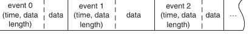

**图 4.8** 录制文件的布局。

这是 *事件*（event）结构体，以及用于文件名称和读写数据缓冲区大小的全局文件描述符和宏：

```c
#define EVFILE "recording.tmp"
#define EVBUFSIZE 512

struct event {
    struct timeval e_time;
    unsigned e_datalen;
};
static int fd_ev = -1;
```

`timeval` 结构体在第 1.7.1 节中解释过。

录波器使用 `ev_creat` 打开录制文件（必要时创建该文件），使用 `ev_write` 向其中写入事件，并使用 `ev_close` 关闭它：

```c
static bool ev_creat(void)
{
    EC_NEG1( fd_ev = open(EVFILE, O_WRONLY | O_CREAT | O_TRUNC,
        PERM_FILE) )
    return true;

    EC_CLEANUP_BGN
        return false;
    EC_CLEANUP_END
}

static bool ev_write(char *data, unsigned datalen)
{
    struct event ev = { { 0 } };

    get_rel_time(&ev.e_time);
    ev.e_datalen = datalen;
    ec_negl( writeall(fd_ev, &ev, sizeof(ev) ) )
    ec_negl( writeall(fd_ev, data, datalen) )
    return true;

EC_CLEANUP_BGN
    return false;
EC_CLEANUP_END
}

static void ev_close(void)
{
    (void)close(fd_ev);
    fd_ev = -1;
}
```

`writeall` 是写入完整缓冲区的一种简单方法，即使这需要多次调用 `write`；它来自第 2.9 节。

函数 `get_rel_time` 执行调用 `gettimeofday`（第 1.7.1 节）获取当前时间并从起始时间（它在第一次调用时保存）中减去的操作，使用另一个函数 `timeval_subtract`：

```c
static void get_rel_time(struct timeval *tv_rel)
{
    static bool first = true;
    static struct timeval starttime;
    struct timeval tv;

    if (first) {
        first = false;
        (void)gettimeofday(&starttime, NULL);
    }
    (void)gettimeofday(tv, NULL);
    timeval_subtract(&tv, &starttime, tv_rel);
}

static void timeval_subtract(const struct timeval *x,
    const struct timeval *y, struct timeval *diff)
{
    if (x->tv_sec == y->tv_sec || x->tv_usec >= y->tv_usec) {
        diff->tv_sec = x->tv_sec - y->tv_sec;
        diff->tv_usec = x->tv_usec - y->tv_usec;
    }
    else {
        diff->tv_sec = x->tv_sec - 1 - y->tv_sec;
        diff->tv_usec = 1000000 + x->tv_usec - y->tv_usec;
    }
}
```

请注意，`timeval_subtract` 假设 `x>=y`。

以上就是创建录音所需的所有服务函数。回放录音需要用于打开录音文件以及读取文件中的事件结构及其后续数据的函数：

```c
static bool ev_open(void)
{
    EC_NEG1( fd_ev = open(EVFILE, O_RDONLY) )
    return true;

EC_CLEANUP_BGN
    return false;

EC_CLEANUP_END
}

static bool ev_read(struct event *ev, char *data, unsigned datalen)
{
    size_t nread;

    EC_NEG1( nread = read(fd_ev, ev, sizeof(*ev)) )
    if (nread != sizeof(*ev)) {
        errno = EIO;
        EC_FAIL
    }
    EC_NEG1( nread = read(fd_ev, data, ev->e_datalen) )
    if (nread != ev->e_datalen) {
        errno = EIO;
        EC_FAIL
    }
    return true;

EC_CLEANUP_BGN
    return false;

EC_CLEANUP_END
}
```


还有一点：一旦播放器获取了事件，它需要在显示该事件之前等待适当的时间。这是实时回放与仅仅转储数据之间的主要区别。函数`ev_sleep`从事件结构中获取时间，计算需要等待的时长，然后睡眠该间隔。由于`timeval`以秒和微秒存储时间，因此我们使用标准 C 函数`sleep`处理秒数，并使用`usleep`系统调用（第 9.7.3 节）处理微秒数。

```c
static bool ev_sleep(struct timeval *tv)
{
    struct timeval tv_rel, tv_diff;

    get_rel_time(&tv_rel);

    if ((tv->tv_sec > tv_rel.tv_sec ||
         (tv->tv_sec == tv_rel.tv_sec && tv->tv_usec >= tv_rel.tv_usec)) {
        timeval_subtract(tv, &tv_rel, &tv_diff);
        (void)sleep(tv_diff.tv_sec);
        ec_negl( usleep(tv_diff.tv_usec) )
    }

    /* else we are already running late */

    return true;

EC_CLEANUP_BGN
    return false;
EC_CLEANUP_END
}
```

记录事件和回放事件所需的内容到此为止。假设已经制作了录音，以下是回放它的函数：

```c
static bool playback(void)
{
    bool ok = false;
    struct event ev;
    char buf[EVBUFSIZE];
    struct termios tbuf, tbufsave;

    ec_negl( tcgetattr(STDIN_FILENO, &tbuf) )
    tbufsave = tbuf;
    tbuf.c_lflag &= ~ECHO;
    ec_negl( tcsetattr(STDIN_FILENO, TCSAFLUSH, &tbuf) )
    ec_false( ev_open( ) )
    while (true) {
        ec_false( ev_read(&ev, buf, sizeof(buf)) )
        if (ev.e_datalen == 0)
            break;
        ev_sleep(&ev.e_time);
        ec_negl( writeall(STDOUT_FILENO, buf, ev.e_datalen) )
    }

    ec_negl( write(STDOUT_FILENO, "\n", 1) )

    ok = true;
    EC_CLEANUP
}

EC_CLEANUP_BGN
(void)tcdrain(STDOUT_FILENO);
(void)sleep(1); /* Give the terminal a chance to respond. */
(void)tcsetattr(STDIN_FILENO, TCSAFLUSH, &tbbufsave);
ev_close();
return ok;
EC_CLEANUP_END
```

在该函数中，读取事件和写入`STDOUT_FILENO`的操作相当直观。但是，写入终端的某些转义序列会触发终端响应。虽然我们不关心回放期间的响应（无论其原本含义如何，都已在录音中捕获），但我们必须关闭回显，以确保响应不会弄乱输出。在最后，我们调用`tcdrain`以输出剩余的输出，等待一秒让终端处理它，然后在恢复终端属性时刷新任何剩余的输入。函数`tcgetattr`、`tcsetattr`和`tcdrain`来自第 4.5.1 节和第 4.6 节。

现在，我们可以使用前一节中的`pt-library`和“ev”例程来制作录音。（您可能需要回顾一下前一节末尾的框架。）我将分段介绍`main`函数；它是这样开始的：

```c
int main(int argc, char *argv[])
{
    bool ok = false;
    PTINFO *p = NULL;
    if (argc < 2) {
        fprintf(stderr, "Usage: record cmd ...\n       record -p\n");
        exit(EXIT_FAILURE);
    }

    if (strncmp(argv[1], "-p") == 0) {
        playback();
        ok = true;
        EC_CLEANUP
    }
}
```

如果以`-p`选项调用，它只是调用我前面展示过的`playback`函数并退出。否则，对于录音，它遵循以下框架：

```c
ec_null( p = pt_open_master() )
switch (fork()) {
case 0:
    ec_false( pt_open_slave(p) )
    ec_false( exec_redirected(argv[1], aargv[1],
                             PT_GET_SLAVE_FD(p),
                             PT_GET_SLAVE_FD(p),
                             PT_GET_SLAVE_FD(p) ) )
    break; 
case -1:
    EC_FAIL
}
ec_false( ev_creat() )
ec_false( pt_wait_master(p) )
```

我将涉及重定向文件描述符和执行命令的内容放在函数`exec_redirected`中，因为我将在第 5 章和第 6 章中详细解释这些内容。不过，我会展示`exec_redirected`的代码，但不进行解释。如果需要，您可以在读完这些章节后再回过头来看。

`main`中到目前为止的代码让我们到达了步骤 9（在前一节中解释过），即开始读写 pt 主端文件描述符的时候。请记住，目标命令（`script1`、`vi`或其他的）已经在运行，并且很可能正阻塞在`read`中，等待它认为是终端的某种输入。以下是`main`函数的剩余部分：

```c
tc_setraw();
while (true) {
    fd_set fd_set_read;
    char buf[EVBUFSIZE];
    ssize_t nread;

    FD_ZERO(&fd_set_read);
    FD_SET(STDIN_FILENO, &fd_set_read);
    FD_SET(PT_GET_MASTER_FD(p), &fd_set_read);

    ec_negl( select(PD_SETSIZE, &fd_set_read, NULL, NULL, NULL) )
    if (FD_ISSET(STDIN_FILENO, &fd_set_read) ) {
        ec_negl( nread = read(STDIN_FILENO, &buf, sizeof(buf)) )
        ec_negl( writeall(PT_GET_MASTER_FD(p), buf, nread) )
    }

    if (FD_ISSET(PT_GET_MASTER_FD(p), &fd_set_read) ) {
        if ((nread = read(PT_GET_MASTER_FD(p), &buf,
        sizeof(buf))) > 0) {
            ec_false( ev_write(buf, nread) )
            ec_negl( writeall(STDOUT_FILENO, buf, nread) )
        } else if (nread == 0 || (nread == -1 && errno == EIO))
            break;
        else
            EC_FAIL
    }

}

ec_negl( ev_write(NULL, 0) )
fprintf(stderr,
    "EOF or error reading stdin or master pseudo-terminal; exiting\n");
ok = true;
EC_CLEANUP
EC_CLEANUP_BGN
if (p != NULL)
(void) pt_close_master(p);
tc_restore();
ev_close();
printf("\nr\n");
exit(ok ? EXIT_SUCCESS : EXIT_FAILURE);
EC_CLEANUP_END
```

关于 main 最后部分的评论：

- 由于`record`主要用于面向屏幕的命令，我们使用`tc_setraw`（见第 4.5.10 节）将终端设置为原始模式。属性在清理代码中由`tc_restore`恢复。我们在`playback`中没有使用这些函数，因为在那里我们只想关闭回显。
- `record`有两个输入：用户输入的内容和 pty 返回的内容，如前一节中的图 4.5 所示。它使用`select`等待这两个输入之一有数据，处理该数据，然后循环回到`select`。注意它每次都设置`fd_set_read`，因为`select`会改变位以报告其结果。
- 当我们从 pty 接收到文件结束或 I/O 错误时，我们跳出循环，而不是从`record`的标准输入中跳出。毕竟，何时结束取决于目标命令的决定，而不是我们。文件结束或 I/O 错误意味着 pty 的从端所有文件描述符都已关闭；也就是说，目标命令已终止。我们收到哪个指示符取决于实现，因此我们接受任何一种。

最后，如前所述，以下是`exec_redirected`，在您读完第 6 章后就能理解它：

```c
bool exec_redirected(const char *file, char *const argv[], int fd_stdin,
int fd_stdout, int fd_stderr)
{
if (fd_stdin != STDIN_FILENO)
ec_negl( dup2(fd_stdin, STDIN_FILENO) )
if (fd_stdout != STDOUT_FILENO)
ec_negl( dup2(fd_stdout, STDOUT_FILENO) )
if (fd_stderr != STDERR_FILENO)
ec_negl( dup2(fd_stderr, STDERR_FILENO) )
if (fd_stdin != STDIN_FILENO)
(void) close(fd_stdin);
if (fd_stdout != STDOUT_FILENO)
(void) close(fd_stdout);
if (fd_stderr != STDERR_FILENO)
(void) close(fd_stderr);
EC_CLEANUP_BGN
if (execvp(file, argv) < 0)
    return false;
EC_CLEANUP_END
}
```

在一本书中真正欣赏`record`的实际操作效果是很困难的——我们需要视频才能充分展现其魅力。请自己动手试一试！当你看到它以与原始录制完全相同的时间节奏回放录音时，你会露出笑容的——简直就像你在看一个键盘上的幽灵。

### 练习

- 4.1. 修改`getln`，使其返回以 EOF 结尾的行，如第 4.2.1 节所述。
- 4.2. 实现`mfdopen`，如第 4.2.1 节所述。
- 4.3. 实现`stty`命令的简化版本，该版本仅打印当前的终端状态。
- 4.4. 实现一个`stty`命令的版本，允许用户只指定最常用的 10 个操作数。你需要决定这 10 个操作数是什么。
- 4.5. 实现一个简单的屏幕编辑器。确定一小部分功能，允许合理的编辑，但不要包含太多的花哨功能。在内部内存中保存正在编辑的文本。使用`Cursee`（或等效工具）来更新屏幕和读取键盘。如果可以的话，使用`man-page`宏编写一些文档。
- 4.6. 实现一个`telnetd`服务器。有关它应该做什么的完整细节，请参阅[RFC854]。但是，对于这个练习，你只需要实现足够的功能，使得你可以从另一台运行`telnet`的机器连接，并通过你的服务器执行面向行的命令以及`vi`或`emacs`。

## 5 进程与线程

### 5.1 引言

我们现在离开输入和输出的主题，开始研究 UNIX 的多任务功能。本章涉及调用程序和进程的技术，使用`exec`、`fork`、`wait`和相关系统调用。下一章解释使用管道进行简单的进程间通信。第 7 章和第 8 章继续介绍更高级的进程间通信机制。

我的阐述组织以实现一个相当完整的命令解释器，或 shell 为目标。我们将从一个功能有限、barely usable（ barely 可用）的 shell 开始。然后我们将不断添加功能，直到在下一章中，我们得到一个可以处理 I/O 重定向、管道、后台进程、带引号的参数和环境变量的 shell。

### 5.2 环境变量

我将从环境变量的讨论开始，大多数 UNIX 用户已经在 shell 级别熟悉它。当执行一个 UNIX 程序时，它会从调用它的进程接收两组数据：参数和环境变量。对于 C 程序，这两者都以字符指针数组的形式出现，除最后一个外，所有指针都指向以 NUL 结尾的字符串。最后一个指针为 NULL。还会传递参数数量的计数。其他语言使用不同的接口，但我们在这里只关注 C 和 C++。

C 或 C++ 程序以两种方式之一开始：<sup>1</sup>

1. 某些实现允许第三个字符串数组参数来包含环境变量，但这既非标准也不必要。

**main**—C 或 C++ 程序入口点

```c
int main(
    int argc,        /* argument count */
    char *argv[])    /* array of argument strings */
)

int main(void)
```

计数`argc`不包括终止`argv`数组的`NULL`指针。如果程序不接受参数，可以省略计数和数组，如第二种形式所示。我在这本书中已经展示了这两种形式的示例。

此外，全局变量`environ`指向环境变量字符串数组，同样以`NULL`结尾（没有相关的计数变量）：

**environ**—环境变量字符串

```c
extern char **environ;    /* environment array (not in any header) */
```

每个参数字符串可以是任何内容，只要它以 NUL 结尾。环境变量字符串的限制更多。每个都是`name=value`的形式，值后面跟着 NUL 字节。当然，名称不能包含 = 字符。

我将在第 5.3 节讨论环境如何传递给`main`（从而导致`environ`被设置）；在这里，我只想谈谈如何从`environ`中检索值以及修改`environ`。

访问环境的一种方法是直接访问`environ`，如下所示：

```c
extern char **environ;

int main(void)
{
    int i;

    for (i = 0; environ[i] != NULL; i++)
        printf("%s\n", environ[i]);
    exit(EXIT_SUCCESS);
}
```

在 Solaris 上，这是该程序打印的一些行（为了节省空间，省略了其余部分）：

```text
HOME=/home/marc
HZ=100
LC_COLLATE=en_US.ISO8859-1
LC_CTYPE=en_US.ISO8859-1
LC_MESSAGES=C
LC_MONETARY=en_US.ISO8859-1
LOGNAME=marc
MAIL=/var/mail/marc
```

列出整个环境是一种不寻常的需求；通常，程序需要特定变量的值，为此有标准 C 函数`getenv`：

**getenv—获取环境变量值**

```c
#include <stdlib.h>
char *getenv(   const char *var     /* variable to find */
);             /* Returns value or NULL if not found (errno not defined) */
```

`getenv`仅返回等号右边的值部分，如下例所示：

```c
int main(void)
{
     char *s;

     s = getenv("LOGNAME");

     if (s == NULL)
         printf("variable not found\n");
     else
         printf("value is \"%s\"\n", s);
     exit(EXIT_SUCCESS);
}
```

打印结果为：

```text
value is "marc"
```


更新环境不像读取环境那样简单。虽然它占用的内部存储是进程的专属属性，并且可以随意修改，但没有保证为任何新变量或更长的值提供额外的空间。因此，除非更新很琐碎，否则必须创建一个完全新的环境。如果指针`environ`指向这个新环境，它将被传递给随后调用的任何程序（我们将在第 5.3 节中看到），并且将被随后的`getenv`调用使用。任何更新对其他进程都没有影响，包括调用执行更新的进程的`shell`（或其他进程）。因此，如果你想修改`shell`的环境，你必须使用`shell`内置的命令。

与其直接处理环境变量，你可以使用一些标准函数：

**`putenv`—更改或添加到环境**

```c
#include <stdlib.h>
int putenv(
char *string /* string of form name=value */
);
/* Returns 0 on success or non-zero on error (sets errno) */
```

**`setenv`—更改或添加到环境**

```c
#include <stdlib.h>
int setenv(
const char *var, /* variable to be changed or added */
const char *val, /* value */
int overwrite /* overwrite? */
);
/* Returns 0 on success or -1 on error (sets errno) */
```

**`unsetenv`—移除环境变量**

```c
#include <stdlib.h>
int unsetenv(
const char *var /* variable to be removed */
);
/* Returns 0 on success or -1 on error (sets errno) */
```

所有这些函数都会修改`environ`指向的存储，如果指针数组不够长，可能会将`environ`设置为新值。如果你自己修改了`environ`或其指向的环境变量的任何部分，这些函数的行为是未定义的，因此请决定你是自己去做还是使用这些函数，但不要混合这两种方法。

`putenv`接受`name=value`形式的完整环境变量字符串，并使`environ`数组中的一个指针指向你传入的存储，从而使其成为环境的一部分，因此不要传入任何自动分配的数据（局部、非静态变量），并且在调用`putenv`后不要修改该字符串。

`setenv`更复杂：它复制你传入的变量名和值，并为其分配自己的存储。如果变量已经存在，则如果第三个`overwrite`参数非零，其值将被更改；否则，旧值保持。如果变量尚不存在，它将被添加到环境中，并且`overwrite`的值无关紧要。

`unsetenv`是随`setenv`一起提供的，它用于从环境中移除变量及其值。如果系统没有`unsetenv`，从环境中移除变量的最佳办法是将其值设置为空字符串，根据应用程序的不同，这种方式可能可接受，也可能不可接受。（某些系统，如`Linux`、`FreeBSD`和`Darwin`，将`unsetenv`定义为`void`函数，因此没有错误返回值。）

虽然这些函数的接口是标准化的，但它们的实际存在并非强制要求。`FreeBSD`、`Linux`和`Solaris`都有`putenv`，前两者则有全部三个函数。`SUS3`要求具备`setenv`和`unsetenv`，但截至本文写作时，尚无任何`SUS3`系统，因此没有简单、可移植的方法来判定哪些函数存在。`setenv`和`unsetenv`源自`BSD`，应当存在于所有由其衍生出的系统中，包括`FreeBSD`；`putenv`源自`System V`，应当存在于所有由其衍生出的系统中，包括`Solaris`。鉴于`SUS`推荐使用`setenv`和`unsetenv`，也许最佳做法是使用这两个函数进行编码，并为那些尚未提供它们的系统自行包含实现版本。

如果不关心内存泄漏，实现`setenv`和`unsetenv`很容易。问题在于它们可能需要分配内存，或者在`unsetenv`的情况下产生孤立内存，但由于无法假设最初的内存是如何分配的，因此它们无法释放这些内存。尽管存在这一缺陷，以下是我们版本的`setenv`：

```c
int setenv(const char *var, const char *val, int overwrite)
{
    int i;
    size_t varlen;
    char **e;

    if (var == NULL || val == NULL || var[0] == '\0' ||
        strchr(var, '=') != NULL) {
        errno = EINVAL;
        return -1;
    }
    varlen = strlen(var);
    for (i = 0; environ[i] != NULL; i++)
        if (strncmp(environ[i], var, varlen) == 0 &&
            environ[i][varlen] == '=')
            break;

    if (environ[i] == NULL) {
        if ((e = malloc((i + 2) * sizeof(char *))) == NULL)
            return -1;
        memcpy(e, environ, i * sizeof(char *));
        /* 旧的指针数组可能存在内存泄漏 */
        environ = e;
        environ[i + 1] = NULL;
        return setnew(i, var, val);
    } else {
        if (overwrite) {
            if (strlen(&environ[i][varlen + 1]) >= strlen(val)) {
                strncpy(&environ[i][varlen + 1], val, strlen(val));
                return 0;
            }
            return setnew(i, var, val);
        }
        return 0;
    }
}
```

关于此函数的说明：

-   我们首先做的是检查参数，这是`SUS`要求的。
-   接下来我们搜索环境，查看该变量是否已经定义。请注意，我们必须查找以该名称开头后跟等号（`=`）的字符串。
-   如果找到该变量，且`overwrite`参数为假，则退出。否则有两种情况：新值能容纳，此时我们直接复制进去；或者容纳不下，此时我们调用函数`setnew`（如下所示）将其放入。
-   如果未找到该变量，我们需要扩展数组。正如我们所说，我们不能使用`realloc`，因为我们无法假设旧内存是如何分配的。因此，我们使用`malloc`并自行复制旧内容。然后，我们用`NULL`指针终结新数组，并调用`setnew`放入新条目。

以下是`setnew`，它分配空间用于名称、等号和值，并将其存储在数组中：

```c
static int setnew(int i, const char *var, const char *val)
{
    char *s;

    if ((s = malloc(strlen(var) + 1 + strlen(val) + 1)) == NULL)
        return -1;
    strncpy(s, var, strlen(var) + 1);
    strcat(s, "=");
    strcat(s, val);
    /* environ[i] 的旧值可能导致内存泄漏 */
    environ[i] = s;
    return 0;
}
```

最后，我们有`unsetenv`，它检查参数，查找变量，如果存在，则将数组其余部分向下滑动，从而有效地将其移除。这也会产生可能的内存泄漏，因为我们无法假设被取消设置的变量的内存可以被释放。

```c
int unsetenv(const char *var)
{
    int i, found = -1;
    size_t varlen;
    size_t t;

    if (var == NULL || var[0] == '\0' || strchr(var, '=') != NULL) {
        errno = EINVAL;
        return -1;
    }

    varlen = strlen(var);
    for (i = 0; environ[i] != NULL; i++)
        if (strncmp(environ[i], var, varlen) == 0 &&
            environ[i][varlen] == '=')
            found = i;
    if (found != -1) {
        /* environ[found] 的旧值可能导致内存泄漏 */
        /* 计算包括 NULL 终止符在内的指针总数 */
        t = i + 1; 
        /* i 是最后一个有效条目的索引加 1（即 NULL 的索引），
           因此需要移动的元件数量为 i - found */
        /* 注意：原始代码中的 't' 在此处范围内未定义，
           假设 't' 意指剩余元件的数量。
           在移动内存的上下文中，我们从 found+1 移动到末尾。
           要移动的数量是（总元件数 - found - 1）个指针，
           加上 NULL 终止符？
           实际上，memmove 是复制。我们需要覆盖 environ[found]。
           源是 environ[found+1]。
           目标是 environ[found]。
           要移动的元件数量是从索引 found+1 到 NULL 终止符。
           假设 environ 中的指针总数为 N。
           我们要移动从 N-found-1 个元件吗？不，我们要移动从 found+1 到末尾的数组。
           原始代码使用了 't'。查看上面的循环，'i' 在 NULL 索引处结束。
           因此，指针总数是 'i'。
           要移动的元件数量是 i - found。
           但我们还需要确保 NULL 终止符被移动。
           如果 environ[i] 是 NULL，且我们从 found+1 开始移动，我们移动 i-found 个元件？
           让我们看看原始代码：memmove(&environ[found], &environ[found + 1], (t - found) * sizeof(char *));
           这里 't' 可能是 NULL 终止符的索引（即上面循环中的 'i'，但 'i' 在循环作用域内？不，'i' 在外部声明）。
           等等，在上一段中：
           for (i = 0; environ[i] != NULL; i++) ...
           所以 'i' 保存了 NULL 指针的索引。
           因此，指针总数是 'i'（0 到 i-1 是有效的，i 是 NULL）。
           我们要移除索引 'found'。
           我们需要移动从 found+1 到 i（包含 NULL）的指针。
           数量是 i - found。
           原始代码说 (t - found)。如果 t == i，那么它是正确的。
           假设 't' 是保存总数或 NULL 索引的变量。
           在提供的 OCR 中：
           for (i = 0; environ[i] != NULL; i++) ...
           ...
           memmove(..., (t - found) * sizeof(char *));
           
           由于 't' 未在所提供的 unsetenv 函数范围的直接作用域中定义，
           但 'i' 已定义。极有可能是 't' 是 'i' 的拼写错误，或者是一个
           计算总大小的变量。鉴于循环在 environ[i]==NULL 处结束，
           'i' 是指针的数量。
           我们将 't' 更正为 'i'，因为它是唯一可能保存总长度索引的合理变量。
        */
        memmove(&environ[found], &environ[found + 1],
                (i - found) * sizeof(char *));
    }
    return 0;
}
```

请注意，我们使用`memmove`而不是`memcpy`，因为前者保证在源和目标内存区域重叠时也能正常工作，而这种情况在此处必然发生。

你可能想知道为什么我们在这些函数中没有使用我们的“`ec`”错误检查宏。原因是我们希望它们的行为尽可能接近标准函数。

修正`setenv`和`unsetenv`中的内存泄漏问题相当直接；参见练习 5.1。

## 5.3 `exec` 系统调用

如果不完全理解进程与程序之间的区别，就不可能理解`exec`或`fork`系统调用。如果这些术语对你来说是新的，你可能想要回头复习第 1.1.2 节。如果你准备继续，我们将用一句话总结这种区别：进程是一个执行环境，由指令、用户数据和系统数据段组成，以及运行时获取的大量其他资源；而程序是一个包含指令和数据的文件，用于初始化进程的指令段和用户数据段。

`exec`系统调用使用指定的程序重新初始化一个进程；程序改变，但进程保持不变。另一方面，`fork`系统调用（第 5.5 节的主题）通过仅仅复制指令、用户数据和系统数据段来创建一个新进程，该进程是现有进程的克隆；新进程不是由程序初始化的，因此新旧进程执行相同的指令。

单独来看，`fork`和`exec`的用途有限——大多数情况下，它们是配合使用的。在我分别介绍它们时请记住这一点，不要因为你认为它们无用而惊慌——只需试着理解它们的作用。在第 5.4 节中，当我们联合使用它们时，你会发现它们是一对强有力的工具。

除了启动`UNIX`内核本身之外，`exec`是`UNIX`上执行程序的唯一方式。不仅`shell`使用`exec`来执行程序，`shell`及其祖先是同样由`exec`调用的。而`fork`是创建新进程的唯一方式。

实际上，并没有名为“`exec`”的系统调用。所谓的“`exec`”系统调用是一组六个，名称形式为`execAB`，其中`A`是`l`或`v`，取决于参数是在调用中直接给出（列表）还是在数组中（向量），`B`是`absent`、表示应使用`PATH`环境变量搜索程序的`p`，或表示使用特定环境的`e`。（奇怪的是，你无法在同一个调用中同时获得`p`和`e`功能。）因此，六个名称是`execl`、`execv`、`execlp`、`execvp`、`execl e`和`execve`。² 我们将从`execl`开始，然后处理其他五个。

> 2. 相同的特性可以在两个系统调用中轻松提供，而不是六个，但现在改变为时已晚。参见练习 5.6。

### `exec`—使用参数列表执行文件

```c
#include <unistd.h>
int execl(
    const char *path, /* 程序路径名 */
    const char *arg0, /* 第一个参数（文件名） */
    const char *arg1, /* 第二个参数（如果需要） */
    ... /* 其余参数（如果需要） */
    (char *)NULL /* 参数列表终止符 */
);
/* 出错时返回 -1（设置 errno） */
```

参数`path`必须指定一个可执行文件，该文件必须能被有效用户ID执行（例如模式 755），且具有可执行程序的正确内容。进程的指令段被程序的指令覆盖，进程的用户数据段被程序的数据覆盖，并重新初始化栈。然后进程从顶部执行新程序（即调用其`main`函数）。

成功的`execl`无法返回，因为返回地址已丢失。不成功的`execl`会返回，值为 -1，但无需测试该值，因为不可能有其他值。不成功的`execl`最常见的原因是`path`不存在或不可执行。

`execl`中跟随在`path`后面的参数被收集到一个字符指针数组中；最后一个参数必须是`NULL`，它停止收集并终止数组。按照惯例，第一个参数是程序文件的名称（而不是完整路径）。新程序可以通过`main`的熟悉参数`argc`和`argv`访问这些参数。由`environ`指向的环境也会被传递过去，并且可以通过新程序的`environ`指针或`getenv`访问，如上一节所述。

由于进程继续存在，且其系统数据段基本上未受扰动，进程的大多数属性保持不变，包括进程ID、父进程ID、进程组ID、会话ID、控制终端、实际用户ID和组ID、当前和根目录、优先级、累计执行时间，以及通常打开的文件描述符。列出那些确实发生变化的主要属性更简单，且都有充分理由：

## 5.3.3 内核中发生了什么


- 如果进程之前已安排捕获任何信号，它们会被重置为默认操作，因为指定用于捕获它们的指令已经消失。被忽略或默认处理的信号会保持原样。（有关信号的更多信息见第 9 章。）

- 如果新程序文件的 set-user-ID 或 set-group-ID 位被设置，则有效用户 ID 或组 ID 会更改为文件的属主 ID 或组 ID。如果先前的有效 ID 与真实 ID 不同，则没有方法恢复这些先前的有效 ID。

- 任何使用 `atexit`（第 1.3.4 节）注册的函数都会被注销，因为它们的代码已经消失。

- 共享内存段（第 7.12 节）会被分离（解除映射），因为附着点不再有效。

- POSIX 命名信号量（第 7.10 节）会被关闭。System V 信号量（第 7.9 节）则不受影响。

完整的列表请参见附录 A。但你能理解其中的思路：如果保留某个属性或资源对于一个完全新运行的程序没有意义，那么它就会被重置为其默认值或被关闭。

为了展示如何使用 `execl`，这里是一个相当人为构造的示例：

```c
void exetest(void)
{
   printf("The quick brown fox jumped over ");
   ec_negl( execl( "/bin/echo", "echo", "the", "lazy", "dogs.",
         (char *)NULL) )
   return;
}

EC_CLEANUP_BGN
   EC_FLUSH("exetest");
EC_CLEANUP_END
```

这是我们调用该函数时得到的输出：

```text
the lazy dogs.
```

那只狐狸去哪了？嗯，事实证明它跑得不够快：标准 I/O 库（`printf` 是其中的一部分）对其输出进行了缓冲，任何部分填充的最后一个缓冲区会在进程退出时自动刷新。但是，在调用 `execl` 之前进程并没有退出，而位于用户数据段中的缓冲区在能够刷新之前就被覆盖了。

这个问题可以通过强制无缓冲输出来解决，就像这样：

```c
setbuf(stdout, NULL);
```

或者通过在调用 `execl` 之前刷新缓冲区来解决，就像这样：

```c
fflush(stdout);
```

正如我之前提到的，打开的文件描述符在 `exec` 之后通常会保持打开状态。如果我们不希望某个文件描述符保持打开状态，我们会先用 `close` 将其关闭。但有时我们无法这样做。假设我们要调用一个要求所有文件描述符都关闭的程序（这是一个极不常规的要求）。因此，我们可能会尝试这样做：

```c
errno = 0;
ec_neg1( open_max = sysconf(_SC_OPEN_MAX) )
for (fd = 0; fd < open_max; fd++)
    (void)close(fd); /* ignore errors */
ec_neg1( exec1(path, arg0, arg1, arg2, (char *)NULL) )
```

我们调用 `sysconf`（第 1.5.5 节）来获取进程可以打开的最大文件数，最高编号的文件描述符比该数小 1。在这里，我们非常希望关闭所有文件描述符，以至于我们甚至不关心它们是否都打开着——无论如何我们都要关闭它们。这是少数忽略系统调用错误返回也是合理的罕见情况之一。

如果 `exec` 成功，一切正常；但如果它失败，我们将永远看不到错误消息，因为文件描述符 2 已经被关闭了！这里就可以使用我们在第 3.8.3 节中遇到的 close-on-exec 标志。当设置该标志时（通过 `fcntl`），如果 `exec` 成功，文件描述符会被关闭；否则保持原样。我们可以只为重要的文件描述符设置此标志，或者像这样为所有文件描述符设置：

```c
for (fd = 0; fd < open_max; fd++) {
    ec_neg1( flags = fcntl(fd, F_GETFD) )
    ec_neg1( fcntl(fd, F_SETFD, flags | FD_CLOEXEC) )
}
ec_neg1( exec1(path, arg0, arg1, arg2, (char *)NULL) )
```

关闭所有文件描述符或为所有文件描述符设置 close-on-exec 的问题在于，可能存在一千个甚至更多的文件描述符，这就意味着大量的处理工作，其中大部分是浪费的。与此同时，在 `exec` 期间除了标准文件描述符之外，保留任何其他文件描述符处于打开状态都是错误的，除非新程序期望多于标准的三个文件描述符，而这通常是不寻常的。因此，在大多数情况下，你需要跟踪你的程序打开了哪些文件描述符，并在 `exec` 之前显式地关闭它们。

由于标准文件描述符通常保持打开状态，close-on-exec 很少被使用。一个有实用例程是针对打开到日志文件的文件描述符，在这种情况下，如果 `exec` 失败且你想记录该事实，你可能希望保持该文件描述符打开。

其他五个 `exec` 系统调用提供了 `execl` 不具备的三个功能：

- 将参数放入数组中，而不是显式列出它们。当参数数量在编译时未知时（例如在编写 shell 时），这是必需的。

- 使用 `PATH` 环境变量的值来搜索程序文件，就像 shell 所做的那样。

- 手动传递一个显式的环境指针，而不是自动使用 `environ`。既然成功的 `exec` 无论如何都会覆盖现有环境，这个功能很少带来优势。[^1]

[^1]: 但请参见练习 5.2。

以下是我尚未展示的其他 `exec` 变体的概要：

```c
/* execv—使用参数向量执行文件 */
#include <unistd.h>

int execv(
    const char *path,       /* 程序路径名 */
    char *const argv[]      /* 参数向量 */
);
/* 出错时返回 -1（设置 errno） */
```

```c
/* execlp—使用参数列表和 PATH 搜索执行文件 */
#include <unistd.h>

int execlp(
    const char *file,       /* 程序文件名 */
    const char *arg0,       /* 第一个参数（文件名） */
    const char *arg1,       /* 第二个参数（如果需要） */
    ...                    /* 剩余参数（如果需要） */
    (char *)NULL           /* 参数列表终止符 */
);
/* 出错时返回 -1（设置 errno） */
```

```c
/* execvp—使用参数向量和 PATH 搜索执行文件 */
#include <unistd.h>

int execvp(
    const char *file,       /* 程序文件名 */
    char *const argv[]      /* 参数向量 */
);
/* 出错时返回 -1（设置 errno） */
```

```c
/* execl—使用参数列表和环境执行文件 */
#include <unistd.h>
int execl(
  const char *path, /* 程序路径名 */
  const char *arg0, /* 第一个参数（文件名） */
  const char *arg1, /* 第二个参数（如果需要） */
  ... /* 剩余参数（如果需要） */
  (char *)NULL, /* 参数列表终止符 */
  char *const env[] /* 环境向量 */
); /* 出错时返回 -1（设置 errno） */
```

```c
/* execve—使用参数向量和环境执行文件 */
#include <unistd.h>
int execve(
  const char *path, /* 程序路径名 */
  char *const argv[], /* 参数向量 */
  char *const env[] /* 环境向量 */
); /* 出错时返回 -1（设置 errno） */
```

注意，这里使用的 `argv` 参数在布局上与 `main` 函数的 `argv` 参数完全相同。别忘了最后一个指针必须是 `NULL`。

如果 `execlp` 或 `execvp` 的文件参数中没有斜杠，那么 `PATH` 变量值中列出的字符串会被逐个前置，直到找到一个具有执行权限的普通文件，其结果路径名匹配。如果该文件包含一个程序（如其第一个字中的代码编号所示），则执行它。否则，假设它是一个脚本文件；通常，会执行一个 shell，并将该路径作为其第一个参数来运行它。

例如，如果文件参数是 `echo`，并且搜索 `PATH` 字符串找到的可执行文件路径为 `/bin/echo`，那么由于它包含正确格式的二进制指令，该文件会作为程序被执行。但是，如果文件参数是，比如说，`myscript`，并且搜索找到了 `/home/marc/myscript`，而它不是一个二进制可执行文件，`execlp` 或 `execvp` 会执行以下等效操作：

```sh
sh /home/marc/myscript arg1 arg2 ...
```

使用哪个 shell 取决于实现，但它必须符合标准。

还有另一种普遍支持但非标准的约定：如果脚本的第一行是以下形式：

```
#! pathname [arg]
```

则由 `pathname` 指定的解释器（而不是 shell）会被执行，脚本文件的路径作为其第一个参数。如果 `#!` 行上有可选的 `arg`，它将成为程序的第一参数，脚本路径则成为第二参数。解释器必须跳过 `#!` 行，这就是为什么大多数 UNIX 脚本语言使用 `#` 来开始命令的原因。

例如，你可以将这样的脚本放入文件 `mycmd` 中：

```python
#! /usr/bin/python2.2
print "Hello World!"
```

使其可执行，然后像这样执行：

```text
$ mycmd
Hello World!
$
```

在几乎所有系统中，处理 `#!` 行的工作是由 `execvp` 完成的，而不是由 shell 本身完成的。

如果 `PATH` 搜索没有发现任何可执行文件，`exec` 将失败。如果文件参数中包含斜杠，则不会进行搜索——假设路径是完整的。然而，它仍然可能是一个脚本。

编写调用 `execv` 或 `execl` 的库函数来编程 `execvp` 和 `execlp` 是可能的，我们可以从中获益良多。我将展示一个接近标准版本的 `execvp`，但它使用了“ec”错误检查宏。

请记住，对于通过搜索 `PATH` 找到的每个路径，`execvp` 首先必须尝试将其作为二进制可执行文件执行，然后再尝试作为 shell 脚本执行。下面是一个执行这些操作（省略 `#!` 功能）的函数：

```c
int exec_path(const char *path, char *const argv[], char *newargv[])
{
    int i;

    execv(path, argv);
    if (errno == ENOEXEC) {
        newargv[0] = argv[0];
        newargv[1] = (char *)path;
        i = 1;
        do {
            newargv[i + 1] = argv[i];
        } while (argv[i++] != NULL);
        return execv("/bin/sh", (char *const *)newargv);
    }
    return -1;
}
```

如果以某种方式无法执行该路径，`exec_path` 将返回 -1 并设置 `errno`。

我们的 `execvp` 版本，称为 `execvp2`，必须依次尝试 `PATH` 中的每个路径，每次调用 `exec_path`，除非传入的文件名包含斜杠或 `PATH` 不存在，在这种情况下直接使用该路径：

```c
int execvp2(const char *file, char *const argv[]) {
    char *s, *pathseq = NULL, *path = NULL, **newargv = NULL;
    int argc;
    for (argc = 0; argv[argc] != NULL; argc++)
        ;
    /* If shell script, we'll need room for one additional arg and NULL. */
    ec_null( newargv = malloc((argc + 2) * sizeof(char *)) )
    s = getenv("PATH");
    if (strchr(file, '/') != NULL || s == NULL || s[0] == '\0' )
        ec_neg1( exec_path(file, argv, newargv) )
    ec_null( pathseq = strdup(s) )
    /* Following line usually allocates too much */
    ec_null( path = malloc(strlen(file) + strlen(pathseq) + 2) )
    while ((s = strtok(pathseq, ":")) != NULL) {
        pathseq = NULL; /* tell strtok to keep going */
        if (s[0] == '\0' )
            s = ".";
        strcpy(path, s);
        strcat(path, "/");
        strcat(path, file);
        exec_path(path, argv, newargv);
    }
    errno = ENOENT;
    EC_FAIL

    EC_CLEANUP_BGN
    free(pathseq);
    free(path);
    free(newargv);
    return -1;
    EC_CLEANUP_END
}
```

关于内存分配的若干注释如下：

- 即使 `exec` 成功，也没有必要甚至不可能释放已分配的内存，因为所有用户数据都会被覆盖。

- 将 `PATH` 的长度加上传入文件名的长度，再加上两个字节用于斜杠和 `NULL`，这对于我们要合成的任何路径都绝对足够。

- 如果我们打算尝试执行一个 shell 脚本，我们需要一个比传入的向量多一个槽位的参数向量，因此我们计算传入参数的数量（在 `for` 循环中），然后分配一个比该数量多两个槽位的向量（一个用于额外的参数——要执行的 shell 的文件路径名——以及末尾的 `NULL` 指针）。

- 我们使用 `strdup` 分配一个新字符串来保存 `PATH` 的值，因为 `strtok` 会修改该字符串。直接从 `getenv` 获取的指针指向环境变量，我们不想直接修改这些字符串，以防 `execvp` 失败。（将 `strtok` 的第一个参数设置为 `NULL` 是调用该函数时必须执行的操作——这是它知道继续扫描原始字符串的方式。）

正如我们所说，通常 `exec` 是与 `fork` 配对的，但偶尔单独使用也很有用。有时，大型程序被拆分为几个阶段，而 `exec` 引入下一个阶段。但由于所有指令和用户数据都被覆盖，为了使其可行，这些阶段必须相对独立——数据只能通过参数、环境变量或文件传递。因此，这种应用虽然罕见，但并非不存在。

更常见的是，当我们需要在调用命令之前做非常少量的预处理工作时，单独使用 `exec`。一个例子是 `nohup` 命令，它在调用 `execvp` 来执行用户命令之前抑制挂断信号。另一个例子是 `nice` 命令，它改变命令的优先级（参见第 5.15 节的示例）。

## 5.4 实现 Shell（版本 1）

我们现在已经了解足够的系统调用，可以编写自己的 shell，尽管它并不完美。它的主要缺陷是，为了执行命令，它必须“自杀”，因为 `exec` 没有返回值。令人困惑的是，如果你输入错误的命令，shell 可以继续运行。既然我们要做这件事，我们将实现两个内置命令来修改和访问环境变量：`assignment`（例如，`BOOK=/usr/marc/book`）和 `set`，后者打印环境变量。<sup>4</sup>

> 4. 没有 `export` 命令；整个环境变量都会传递给执行的命令。

第一个任务是将命令行分解为参数。为了简单起见，我们不处理带引号的参数。此外，由于这个 shell 无法处理后台进程、顺序执行或管道，我们不必担心特殊字符 `&`, `;` 和 `|`。我们也不处理重定向（`>`, `>>` 和 `<`）。因此，命令行只是一系列由空格或制表符分隔的单词。我们需要将它们收集起来并放入 `argv` 数组中：


```c
#define MAXLINE 200

static bool getargs(int *argcp, char *argv[], int max, bool *eofp)
{
    static char cmd[MAXLINE];
    char *cmdp;
    int i;

    *eofp = false;
    if (fgets(cmd, sizeof(cmd), stdin) == NULL) {
        if (ferror(stdin))
            EC_FAIL
        *eofp = true;
        return false;
    }
    if (strchr(cmd, '\n') == NULL) {
        /* eat up rest of line */
        while (true) {
            switch (getchar()) {
                case '\n':
                    break;
                case EOF:
                    if (ferror(stdin))
                        EC_FAIL
                default:
                    continue;
            }
            break;
        }
    }
    printf("Line too long -- command ignored\n");
    return false;

cmdp = cmd;
for (i = 0; i < max; i++) {
    if ((argv[i] = strtok(cmdp, " \t\n")) == NULL)
        break;
    cmdp = NULL; /* tell strtok to keep going */
}
if (i >= max) {
    printf("Too many args -- command ignored\n");
    return false;
}

*argcp = i;
return true;

EC_CLEANUP_BGN
    EC_FLUSH("getargs")
    return false;
EC_CLEANUP_END
}
```

注释：

- `getargs` 如果成功解析参数则返回 `true`，否则返回 `false`。

- 它使用标准 C 函数 `fgets` 读取一行输入。如果输入了较长的行，该函数是足够安全的，因为它不会超出我们传入的缓冲区。但在这种情况下，我们不希望留下未读取的字符以便稍后读取，因为它们本身将是一个意外的、潜在破坏性的 shell 命令。因此，在这种情况下（没有换行符终止），我们在打印错误消息之前读取并丢弃该行的剩余部分。

- 然后我们使用 `strtok` 将该行分解为其参数。（我们在上一节的 `execvp2` 中也使用了 `strtok`。）

- 如果调用的库函数发生真实错误，`getargs` 使用 `EC_FLUSH` 显示其自身的错误消息；否则——例如行太长的情况——打印用户消息。

接下来，我们需要处理内置命令 `assignment` 和 `set` 的函数。这些很容易，因为我们可以使用第 5.2 节中的环境变量操作技术：

```c
extern char **environ;

void set(int argc, char *argv[])
{
    int i;

    if (argc != 1)
        printf("Extra args\n");
    else
        for (i = 0; environ[i] != NULL; i++)
            printf("%s\n", environ[i]);
}

void ass(int argc, char *argv[])
{
    char *name, *val;
    if (argc != 1)
        printf("Extra args\n");
    else {
        name = strtok(argv[0], "=");
        val = strtok(NULL, ""); /* get all that's left */
        if (name == NULL || val == NULL)
            printf("Bad command\n");
        else
            ec_neg1( setenv(name, val, true) )
    }
    return;

    EC_CLEANUP_BGN
        EC_FLUSH("asg")
    EC_CLEANUP_END
}
```

接下来，我们通过主函数完成程序，该函数打印提示符字符（我们使用 `@`），获取参数，检查命令是否是内置的，如果不是，则尝试执行它：

```c
#define MAXARG 20

int main(void)
{
    char *argv[MAXARG];
    int argc;
    bool eof;

    while (true) {
        printf("@ ");
        if (getargs(&argc, argv, MAXARG, &eof) && argc > 0) {
            if (strchr(argv[0], '=') != NULL)
                asg(argc, argv);
            else if (strcmp(argv[0], "set") == 0)
                set(argc, argv);
            else
                execute(argc, argv);
        }
        if (eof)
            exit(EXIT_SUCCESS);
    }
}

static void execute(int argc, char *argv[])
{
    execvp(argv[0], argv);
    printf("Can't execute\n");
}
```

请注意，只有当 `execvp` 失败时，我们才会循环回到打印另一个提示符。这就是为什么我们不太可能觉得这个 shell 有用的原因。无论如何，这是一个会话示例（为了节省空间，环境变量列表已省略）：

```
$ sh0
@ set
SSH_CLIENT=192.168.0.1 4971 22
USER=marc
MAIL=/var/mail/marc
EDITOR=vi
@ LASTNAME=Rochkind
@ set
SSH_CLIENT=192.168.0.1 4971 22
USER=marc
MAIL=/var/mail/marc
EDITOR=vi
LASTNAME=Rochkind
@ echo Hello World!
Hello World!
$
```

注意末尾的美元符号提示符——执行 `echo` 后，我们的 shell 已退出。实际上，退出的是 `echo`，因为它是替代 shell 的程序。显然，shell 在各自的进程中执行命令会更好，而这正是我们要去的方向。

### 5.5 fork 系统调用

`fork` 在某种程度上与 `exec` 相反：它创建一个新的进程，但不从新程序初始化它。相反，新进程的指令、用户数据和系统数据段几乎完全是旧进程的副本。

```
fork—create new process

#include <unistd.h>
pid_t fork(void);
/* Returns child process-ID and 0 on success or -1 on error (sets errno) */
```

在 `fork` 返回后，*两个* 进程（父进程和子进程）都会收到返回。然而，返回值不同，这一点至关重要，因为这允许它们后续的行为不同。通常，子进程执行一个 `exec`，而父进程要么等待子进程终止，要么去做其他事情。

子进程从 `fork` 接收到 0 的返回值；父进程接收到子进程的进程 ID。如往常一样，返回 −1 表示错误，但由于 `fork` 没有

对于参数而言，调用者不可能做错任何事。错误的原因只能是资源耗尽，例如交换空间不足或已运行的进程过多。父进程可能不希望直接放弃，而是稍等片刻（例如使用 `sleep`）再重试，尽管这通常不是 shell 的做法——它们会打印一条消息并重新提示。

回想一下，由 `exec` 系统调用启动的程序保留了许多属性，因为系统数据段几乎未被改动。同样，由 `fork` 创建子进程会继承父进程的大部分属性，因为它的系统数据段是从父进程复制而来的。正是这种继承机制，使得用户能够 shell 中设置某些属性（如当前目录、有效用户 ID 和优先级），这些属性随后将应用于后续调用的每个命令。可以想象这些属性属于“直系家庭”，尽管这不是一个正式定义的 UNIX 术语。

只有少数几个属性不被继承：

- 显然，子进程的进程 ID 和父进程 ID 是不同的，因为它是另一个进程。

- 如果父进程正在运行多个线程（第 5.17 节），只有执行了 `fork` 的那个线程存在于子进程中。然而，所有线程在父进程中保持完好。

- 子进程获得父进程打开文件描述符的副本。每个副本都指向同一个文件，且文件指针具有相同的值。如果打开的文件描述（第 2.2.3 节）共享，因此文件偏移量也是共享的。如果子进程通过 `lseek` 修改了它，那么父进程的下一次读或写将发生在新的位置。然而，文件描述符本身是独立的：如果子进程关闭了它，父进程的副本不会受到影响。

- 子进程的累计执行时间被重置为零，因为它处于生命周期的开始阶段。

（这些是主要的属性——完整列表请参见附录 A。）

下面是一个简单的例子，展示了 `fork` 的效果：

```c
void forktest(void)
{
 int pid;

 printf("Start of test\n");
 pid = fork();
 printf("Returned %d\n", pid);
}
```

输出结果：

```
$ forktest
Start of test
Returned 98657
Returned 0
$
```

在这种情况下，父进程在子进程之前执行了其 `printf`，但一般来说，你不能依赖哪一个先执行，因为进程是独立调度的。如果顺序很重要，你需要像第 9.2.3 节解释的那样自己同步这两个进程。正如那里所示，你可以用管道来做到这一点，或者较难地用信号来实现。

让我们再次运行 `forktest`，但这次将标准输出重定向到一个文件：

```
$ forktest >tmp
$ cat tmp
Start of test
Returned 56807
Start of test
Returned 0
$
```

这次 "Start of test" 被写了两次！你能想通为什么吗？（下一段会有剧透。）

发生的情况是，`printf` 缓冲了其输出（如第 2.12 节所述），而子进程继承了未刷新的缓冲区以及所有内容。当子进程退出时，它刷新了缓冲区，父进程也刷新了缓冲区。之前，当输出未被重定向时，`printf` 没有缓冲，因为它知道标准输出是一个终端设备，应该更具交互性地行为。我将在第 5.7 节讨论如何控制退出的副作用。

`fork` 和 `exec` 是完美搭档，因为由 `fork` 创建的子进程，作为父进程的近似克隆，通常并不实用。但它非常适合被新程序覆盖，而这正是 `exec` 所做的。我们将在下一节中随着改进我们的 shell 来看到这一点。

`fork` 的开销可能非常大。它费尽周折去克隆父进程，或许复制了一个庞大的数据段（指令段通常是只读的，可以共享），结果只执行了几百条指令就重新初始化了代码段和数据段。这看起来很浪费，事实也是如此。在虚拟内存版本的 UNIX 中，复制特别昂贵，使用了一种巧妙的解决方案，称为写时复制（copy-on-write）。其工作原理如下：在 `fork` 时，父进程和子进程共享数据段，它由一组页面组成。只要页面保持未修改，这种捷径就能正常工作。然后，一旦父进程或子进程试图写入某个页面，仅该页面就会被复制，使每个进程拥有自己的版本。在拥有适当类型的动态地址转换硬件的情况下，这是透明且高效的，几乎所有现代计算机都有这种硬件。由于在几乎所有情况下 `exec` 紧随其后，因此很少有页面需要被复制。但即使所有页面都需要复制，我们也不会更差——事实上，我们情况更好，因为我们能够更早地开始运行子进程。请记住，写时复制方案是内核内部的，它不改变 `fork` 的语义，除了性能提升外，用户对此并不知情。

比写时复制效率更高，但透明度较差的是 `fork` 的一种变体，称为 `vfork`：

```
vfork—创建新进程；共享内存（已废弃）

#include <unistd.h>
pid_t vfork(void);
/* 成功时返回子进程 ID 和 0，错误时返回 -1（设置 errno） */
```

`vfork` 在创建子进程方面表现得与 `fork` 完全相同，但父进程和子进程共享同一个数据段。没有写时复制——它们都读写相同的变量，除非子进程立即退出或执行 `exec`，否则就会引发混乱，而这通常是正常发生的情况（参见下一节中的示例函数 `execute2`）。在早期版本的 BSD UNIX 中，`vfork` 很重要；然而，它相对于 `fork` 的性能优势已不再显著，且使用它是危险的，因此你不应该使用它，这就是为什么在函数概要中标注为“已废弃”。

为了提高 `fork` 和 `exec` 的效率，最近的一次尝试是 `posix_spawn`，它是 1999 年 POSIX 更新的一部分。由于其最终结果是运行不同程序的子进程，它避免了 `vfork` 的问题。它不提供单独的 `fork` 和 `exec` 的所有灵活性，但它确实处理了最常见的情形（例如，复制文件描述符）。`posix_spawn` 的真正目的是在实时系统中提供一种高效的方式来作为子进程调用程序，此时交换过于缓慢且硬件缺乏动态地址转换。有可能将 `posix_spawn` 实现为一个使用 `fork` 和 `exec` 的库函数（练习 5.8），但在设计者设想的那类实时系统中，`posix_spawn` 必须作为系统调用实现。

现在是时候提一下标准 C 函数 `system` 了：

```
system—运行命令

#include <stdlib.h>

int system( const char *command /* 命令 */
); /* 返回退出状态，错误时返回 -1（设置 errno） */
```

此函数执行一次 `fork`，然后执行 shell 的 `exec`，将命令参数作为 shell 命令行传递。它是一种从程序内部执行命令行的便捷方式，但它不提供单独的 `fork` 后接 `exec` 或 `posix_spawn` 的效率（shell 始终被调用）或灵活性。

### 5.6 实现 Shell（版本 2）

现在让我们把 `fork` 和 `execvp` 结合起来，使上一节中的 shell 变得更加有用——它在运行完一个命令后不会直接退出，而是实际上会提示输入另一个命令！我们用 `execute2` 替换函数 `execute`：

```c
static void execute2(int argc, char *argv[])  {
    pid_t pid;

    switch (pid = fork()) {
    case -1:  /* 父进程（错误） */
    EC_PFAIL
    case 0:  /* 子进程 */
    execvp(argv[0], argv);
    EC_PFAIL
    default:  /* 父进程 */
    ec_neg1( wait(NULL) )
    }
    return;

EC_CLEANUP_BGN
    EC_FLUSH("execute2*")
    if (pid == 0)
       _exit(EXIT_FAILURE);
EC_CLEANUP_END
}
```

我将在第 5.8 节详细介绍 `wait`；目前，你只需要知道它会等待子进程终止后再返回。

此函数对来自 `fork` 和 `wait` 的错误与来自 `execvp` 的错误处理方式不同。如果 `fork` 或 `wait` 返回 -1，我们在父进程中，因此只需打印错误信息（使用 `EC_FLUSH`）并返回。调用者（上一节的 `main`）随后会再次提示用户，这是我们所期望的——shell 不应该因为出错而终止。但如果 `execvp` 返回，我们在子进程中，而不是父进程中，最好应该退出。否则，子进程将继续运行，我们将有两个 shell 在提示输入命令。如果我们真的尝试输入命令，两个进程会争夺字符，每个进程都会读取其中的一部分，因为单个字符只能被读取一次。如果我们例如输入 `rm t*`，而其中一个 shell 读取了 `rm *`，另一个读取了 `t`，这可能会产生严重后果。

我们使用 `_exit` 而不是 `exit`，原因我将在下面解释。

### 5.7 exit 系统调用和进程终止

进程终止正好有四种方式：

- 1. 调用 `exit`。从 `main` 返回一个值等同于调用 `exit` 并将该值作为参数，不带值返回等同于返回 0。

- 2. 调用 `_exit` 或其等价物 `_Exit`，这是两种即将解释的 `exit` 变体。

- 3. 接收到终止信号。

- 4. 系统崩溃，原因可能从电力故障到操作系统 bug 都有可能。本节关注前两种情况，第 9 章讨论信号，而对于崩溃，实际上没什么可说的，进程只是停止而已。 6

> 5. 两个进程并发地读写相同的变量与线程类似，具有类似的潜在危险。第 5.17 节有更多内容。

> 6. 某些计算机在电力故障时会向进程发送信号，但这只是将其变为第三种情况。

三种 `_exit` 变体之间的区别如下：


-   `_exit` 和 `_Exit` 在所有方面都表现为完全相同的行为，尽管从技术角度来说，`_exit` 源自 UNIX，而 `_Exit` 源自标准 C。从现在起，我将仅提及 `_exit`，你可以默认我关于它所说的一切都同样适用于 `_Exit`。

-   `exit`（不带下划线）也源自标准 C。它执行了 `_exit` 所做的所有操作，还包括一些更高级的清理工作，至少包括调用通过 `atexit` 注册的函数（见第 1.3.4 节）以及刷新标准 I/O 缓冲区，就好像调用了 `fflush` 或 `fclose` 一样。（`_exit` 是否刷新缓冲区是由实现定义的，因此不要依赖于此。）

由于 `exit` 是 `_exit` 的超集，我在这里关于后者所说的一切都同样适用于前者，因此我主要讨论 `_exit`。

通常，在一个未执行 `exec` 的子进程中，你会调用 `_exit` 而不是 `exit`，正如我在上一节的 `execute2` 中展示的那样，因为子进程继承的清理处理通常只应执行一次。但这并非总是正确的，因此你需要检查每种情况以确定何种做法是合适的。在最常见的情况下，当子进程被 `exec` 覆盖时，程序会重新启动，因此无论它在退出时执行什么清理操作都是可以的。父进程的任何缓冲区或 `atexit` 函数早已不复存在。

如果你像我在这本书中所做的那样使用“ec”宏进行错误检查，请记住，错误消息的自动显示和函数回溯是在一个通过 `atexit` 注册的函数中完成的，如果你使用 `_exit` 终止程序，该函数将不会被调用（见第 1.4.2 节）。在上一节的 `execute2` 中，我们在父进程和子进程中都使用了 `EC_FLUSH` 宏来处理这一问题，尽管只有子进程调用 `_exit`。

以下是退出函数的概要。注意，这里涉及两个不同的包含文件：

```
_exit—在不进行清理的情况下终止进程
#include <unistd.h>
    void _exit(            /* 退出状态 */
    int status
    );
    /* 不会返回 */
```

```
_Exit—在不进行清理的情况下终止进程
#include <stdlib.h>

void _Exit(
        int status           /* 退出状态 */
);
/* 不会返回 */
```

```
exit—在清理的情况下终止进程
#include <stdlib.h>

void exit(
        int status           /* 退出状态 */
);
/* 不会返回 */
```

`_exit` 以及其他两个变体会终止发出该调用的进程，其状态代码等于 `status` 的最右侧（最低有效）字节。还有许多其他副作用；主要列在这里，你可以在 [SUS2002] 中找到完整列表。实际上，这些副作用适用于一般的进程终止（崩溃除外）：

-   所有打开的文件描述符都会被关闭。

-   如第 4.3 节所述，如果该进程是控制进程（会话首进程），则该会话将失去其控制终端。此外，会话中的每个进程都会收到一个挂起（`SIGHUP`）信号，如果未捕获或忽略该信号，它们也将终止。

-   父进程将以下一节中解释的方式获知退出状态。

-   子进程不会受到任何直接的影响，除非它们的新父进程变成了一个特殊的系统进程，并且如果它们执行 `getpid`（见第 5.13 节）系统调用，它们将获得该系统进程的进程 ID（通常是 1）。

正在退出的进程的父进程通过其中一个 `wait` 系统调用接收其状态代码，这些调用在下一节中介绍。状态代码是一个从 0 到 255 的数字。按照惯例，0 表示成功终止，非零值表示某种异常终止，具体由正在退出的程序定义。定义了两个标准宏，我在本书的许多示例中已经使用过它们：`EXIT_SUCCESS` 定义为 0，`EXIT_FAILURE` 定义为某个非零值，通常是 1。使用宏而不是像 0 和 1 这样的整数会使程序稍微更具可读性，这就是我们这样做的原因。

一旦进程通过 `exit` 变体或信号终止，它停止执行，但其退出状态报告给父进程之前不会完全消失，除非系统已确定（如下一节所述）其父进程对状态不感兴趣。一个已终止但尚未报告状态的进程被称为 _僵尸_。

## 5.8 `wait`、`waitpid` 和 `waitid` 系统调用

`wait`、`waitpid` 或 `waitid` 等待子进程状态改变（停止、继续或终止），然后检索该进程的状态。前一节解释了进程如何终止；第 4.3 节解释了停止和继续的进程。我将从 `waitpid` 开始，然后介绍其他两个变体。

本节和下一节中描述的某些特性仅存在于符合 X/Open 标准的系统中，且截至撰写时，尚未在 FreeBSD 或 Linux 中实现；它们用标记“[X/Open]”标出。（X/Open 在第 1.2 节和第 1.5.1 节中讨论；虽然截至撰写时 Linux 声称符合 X/Open（当我们使用特性测试宏进行测试时），但它并不具备本节中描述的 X/Open 功能。）

```
waitpid---等待子进程状态改变

#include <sys/wait.h>

pid_t waitpid(
	pid_t pid,      /* 进程或进程组 ID */
	int *statusp,   /* 指向状态或 NULL 的指针 */
	int options,    /* 选项（见下文） */
);
/* 成功时返回进程 ID 或 0，错误时返回 -1（设置 errno） */
```

`pid` 参数可用于以下四种情况之一：

-   `>0`：等待具有该进程 ID 的子进程

-   `-1`：等待任意子进程

-   `0`：等待与调用进程在同一进程组中的任意子进程

-   `<-1`：等待进程组 ID 为 `-pid` 的进程组中的任意子进程

进程组在第 4.3 节中解释过。通常，运行每个管道（pipeline）在各自进程组中的 shell，在等待管道完成时会将 `pid` 设置为该进程组 ID 的负值，以便管道中的任何进程都会导致 `waitpid` 返回。

当 `waitpid` 因为匹配 `pid` 参数的子进程改变状态而返回时，会返回该子进程的进程 ID。在一种情况下会返回零，这种情况将在下文 `WNOHANG` 选项下解释。

只能等待直接子进程——即那些通过 `fork` 创建的子进程。孙子进程（即通过 `fork` 创建的子进程的子进程）不能被等待，即使它们的父进程（直接子进程）已经终止。如前一节所述，孤儿进程由一个特殊的系统进程继承，而不是由祖父进程继承。

通常，进程等待其创建的每个子进程是很重要的——否则，已终止的子进程将作为僵尸留在系统中，直到父进程终止，届时继承它们的系统进程会执行等待并将它们彻底清理掉。由于有些进程很长时间都不终止（有时长达数月），让僵尸存在那么久真的会塞满系统表。如果等待太麻烦，进程可以使用信号来消除僵尸，如下一节所述。

状态改变的子进程，称为可等待的（waitable），最多只能导致一次 `waitpid` 返回。换句话说，一个已被等待的可等待子进程不再可等待。这意味着，如果程序的某一部分获取了状态并发现这不是它期望的进程的状态，那么没有办法将该结果塞回系统中，以便稍后其他 `waitpid` 能获取该进程的状态。（不过，`waitid` 调用可以做到这一点——见下文。）

如果执行 `waitpid` 且存在符合 `pid` 规范的可等待子进程，`waitpid` 会立即返回。如果存在这样的子进程但它尚未改变状态，`waitpid` 会阻塞，直到有一个合适的可等待子进程。如果根本没有匹配 `pid` 的子进程，`waitpid` 返回 -1 并将 `errno` 设置为 `ECHILD`。可能没有子进程，因为 `pid` 仅仅是错误的，或者因为子进程已经被等待过，在这种情况下它不再可等待（但再次，参见 `waitid`）。

如果 `statusp` 非空指针，则其指向的整数会被设置为子进程的状态。这是子进程调用 `_exit` 或 `exit` 的参数（如果它是以此方式终止的）与一个指示其如何终止或停止的码的组合。提供了若干宏来解释该整数值：

- `WIFEXITED(status)`：如果子进程正常终止（通过 `_exit` 或 `exit`），则为真

- `WEXITSTATUS(status)`：如果 `WIFEXITED` 为真，则为 `_exit` 或 `exit` 参数的低 8 位

- `WIFSIGNALED(status)`：如果子进程异常终止（因为收到信号），则为真

- `WTERMSIG(status)`：如果 `WIFSIGNALED` 为真，则为导致终止的信号编号

- `WIFSTOPPED(status)`：如果子进程停止，则为真；仅当设置了 `WUNTRACED` 选项时可能（见下文）

- `WSTOPSIG(status)`：如果 `WIFSTOPPED` 为真，则为导致子进程停止的信号编号

- `WIFCONTINUED(status)`：如果进程被继续执行，则为真；仅当设置了 `WCONTINUED` 选项时可能 [X/Open]

- `WCOREDUMP(status)`：如果生成了内存转储文件（在 UNIX 中称为“核心转储”），则为真；有时用于事后分析（该宏非标准，但通常已实现）

最后一个参数 `options` 是一个或多个通过按位或（OR）运算组合的标记：

- `WCONTINUED`：除了已终止的子进程外，还报告被继续执行的子进程。[X/Open]

- `WNOHANG`：如果状态不可立即获取，则不等待子进程；返回 0 而不是进程 ID。

- `WUNTRACED`：除了已终止的子进程外，还报告已停止的子进程。

以下是 `waitpid` 的一些使用示例：

```
/* 等待子进程 pid 终止并获取其状态。 */
ec_neg!( waitpid(pid, &status, 0) )
/* 等待任意子进程终止，但不获取其状态。 */
ec_neg!( pid = waitpid(-1, NULL, 0) )
/* 报告进程组 pgid 中任何已终止或停止的子进程，
并获取其状态。如果状态不可立即获取，则不等待。 */
ec_neg!( pid = waitpid(-pgid, &status, WNOHANG | WUNTRACED) )
```

下面是一个示例程序，它创建了三个子进程，每个子进程的终止方式不同。对于每种终止情况，都会报告其状态。

```
int main(void)
{
    pid_t pid;

    /* 情况 1：显式调用 _exit */
    if (fork() == 0) { /* 子进程 */
        _exit(123);
    }
    /* 父进程 */
    ec_false(wait_and_display())

    /* 情况 2：由内核终止 */
    if (fork() == 0) { /* 子进程 */
        int a, b = 0;
        a = 1 / b;
        _exit(EXIT_SUCCESS);
    }
    /* 父进程 */
    ec_false(wait_and_display())

    /* 情况 3：外部信号 */
    if ((pid = fork()) == 0) { /* 子进程 */
        sleep(100);
        _exit(EXIT_SUCCESS);
    }
    /* 父进程 */
    ec_neg!( kill(pid, SIGHUP) )
    ec_false(wait_and_display())

    exit(EXIT_SUCCESS);
}

EC_CLEANUP_BGN
exit(EXIT_FAILURE);
EC_CLEANUP_END
}

static bool wait_and_display(void)
{
pid_t wpid;
int status;

c_negl( wpid = waitpid(-1, &status, 0) )
display_status(wpid, status);
return true;

EC_CLEANUP_BGN
return false;
EC_CLEANUP_END
}

void display_status(pid_t pid, int status)
{
if (pid != 0)
printf("Process %ld: ", (long)pid);
if (WIFEXITED(status))
printf("Exit value %d\n", WEXITSTATUS(status));
else {
char *desc;
char *signame = get_macrostr("signal", WTERMSIG(status), &desc);
if (desc[0] == '?')
desc = signame;
if (signame[0] == '?')
printf("Signal #%d", WTERMSIG(status));
else
printf("%s", desc);
if (WCOREDUMP(status))
printf(" - core dumped");
if (WIFSTOPPED(status))
printf(" (stopped)");
#else defined(_XOPEN_UNIX) && !defined(LINUX)
else if (WIFCONTINUED(status))
printf(" (continued)");
#endif
printf("\n");
}
}
```

如前所述，下面这一行

```c
#if defined(_XOPEN_UNIX) && !defined(LINUX)
```

单独针对 Linux 进行测试，因为它错误地声称符合 X/Open 标准。

函数 `get_macrostr` 提供了信号编号的可打印版本（除其他功能外），其工作方式与 1.4.1 节中的 `errsysob` 非常相似。如果你感兴趣，代码可以在网站 [AUP2003] 上找到。

这是该程序的输出：

```
Process 9585: Exit value 123
Process 9586: Erroneous arithmetic operation - core dumped
Process 9587: Hangup
```

如输出所示，在情况 1 中，子进程通过调用 `exit` 并传入退出值 123 来终止自身。在情况 2 中，当子进程尝试除以零时，被 `SIGFPE`（浮点运算错误）信号终止。在情况 3 中，正在休眠的子进程被其父进程发送的 `SIGHUP` 信号终止。（发送信号的 `kill` 系统调用位于 9.1.9 节。）

我们将在本章稍后的 shell 的下一个版本中使用函数 `display_status`。

第二种变体，`wait` 系统调用，是 `pid` 为 -1 且无选项的 `waitpid` 的简写形式：


由于 `pid` 设为 -1 的 `wait` 和 `waitpid` 会等待任意子进程，因此当一个作为更大程序一部分的函数创建了一个它想要等待的子进程时，它们通常是不合适的。它可能会意外地收到完全来自其他子进程的返回结果，而且由于一个子进程只能被等待一次，这将剥夺程序其他部分等待该子进程的能力，从而导致潜在的混乱。最好使用 `waitpid` 等待特定的子进程，或至少等待进程组中的某个成员，因此 `wait` 很少在简单程序之外使用。它绝不应该用于创建子进程库函数中。

但假设一个进程有两个子进程，且无法预测哪个会先终止。如果它只关心等待它们两个都终止，它可以简单地等待其中任意一个，然后在该次 `waitpid` 调用返回时，等待另一个。或者，父进程可以继续执行其自身的工作，并定期使用 `WNOHANG` 选项为每个进程发起 `waitpid` 调用。但是，正如我们所说，除非能保证没有其他子进程，否则它不应该发起通用的 `waitpid` 调用（`pid` 参数为 `-1`）。通常，在大型、复杂的程序中，其部分代码来自不同的开发团队（例如，成像库、数据库接口），就无法保证没有其他子进程。如果能向某种 `wait` 变体传递一个进程 ID 数组，那就再好不过了，但实际上不能。

第三种变体，`waitid`，随着 SUS1 进入 UNIX，因此截至撰写本文时，它尚不存在于 Linux 或 FreeBSD 中。它提供了一项重要的新功能：你可以在保持进程仍可等待的状态下获取其状态，因此查询错误的进程不会造成损害。此外，它比 `waitpid` 或 `wait` 提供更多信息。以下是其概要：

**`waitid`**—等待子进程状态改变 [X/Open]

```c
#include <sys/wait.h>
int waitid(
    idtype_t idtype, /* id 的解释 */
    id_t id,         /* 进程或进程组 ID */
    siginfo_t *infop,/* 返回的信息 */
    int options
);
/* 成功返回 0，出错返回 -1（并设置 errno） */
```

**`siginfo_t`**—用于 `waitid` 的结构体

```c
typedef struct { /* 仅显示与 waitid 相关的成员 */
    int si_code; /* 代码（见下文） */
    pid_t si_pid; /* 子进程 ID */
    uid_t si_uid; /* 子进程的真实用户 ID */
    int si_status; /* 退出值或信号 */
} siginfo_t;
```

`waitid` 的第一个参数 `idtype` 是以下之一：

- `P_PID`：等待进程 ID 为 `id` 的子进程（类似 `pid > 0` 的 `waitpid`）

- `P_PGID`：等待进程组 `id` 中的任何子进程（类似 `pid < -1` 的 `waitpid`）

- `P_ALL`：等待任何子进程（类似 `pid = -1` 的 `waitpid`）；`id` 被忽略

对于 `pid = 0` 的 `waitpid` 没有直接的等价物，但可以使用 **`P_PID`** 且 `id` 等于调用者的进程组 ID 来实现相同的效果。


与`waitpid`一样，`options`参数是一个或多个通过按位或（OR）运算组合的标记：

- `WEXITED` 报告已退出的进程。（对于没有此类标记的`waitpid`，这总是成立。）
- `WSTOPPED` 报告已停止的子进程（类似于带有`WUNTRACED`标记的`waitpid`）。
- `WCONTINUED` 报告被继续执行的子进程（与`waitid`使用相同的标记）。
- `WNOWAIT` 如果状态不可立即获取，则不等待子进程；返回`0`（与`waitpid`使用相同的标记）。
- `WNOWAIT` 使被报告的进程保持可等待状态，以便后续的`waitid`（或其他变体）调用可以用于该进程。

通过其`infop`参数，`waitid`提供的信息比`waitpid`更多。该参数指向一个`siginfo_t`结构体；在其概要中显示了与其用于`waitid`相关的成员。返回时，子进程的ID位于`si_pid`成员中。你检查`si_code`以了解子进程终止的原因；最常出现的代码有：

- `CLD_EXITED` 通过`_exit`或`exit`退出
- `CLD_KILLED` 异常终止（通过信号）
- `CLD_DUMPED` 异常终止并创建了内存转储文件（在UNIX中称为“核心”文件）
- `CLD_STOPPED` 已停止
- `CLD_CONTINUED` 已继续执行

如果代码是`CLD_EXITED`，则`si_status`成员持有传递给`_exit`或`exit`的数字。否则，状态改变是由信号引起的，`si_status`即为信号编号。

1. 它似乎只在我的Linux版本上部分实现（看起来可以工作，但只定义了`waitpid`的选项，且没有man手册页）。你需要检查你自行版本的情况。
2. 该结构已由实时信号扩展（Realtime Signals Extension）扩充；参见9.5节。

## 5.9 信号、终止与等待

下面是之前`waitpid`示例中的`wait_and_display`和`display_status`函数，已改写为适用于`waitid`的版本：

```c
static bool wait_and_display(void)
{
    siginfo_t info;

    ec_negl( waitid(P_ALL, 0, &info, WEXITED) )
        display_status(&info);
        return true;

EC_CLEANUP_BGN
    return false;
EC_CLEANUP_END
}

void display_status(siginfo_t *infop)
{
    printf("Process %ld terminated:\n", (long)infop->si_pid);
    printf("\ttcode = %s\n",
           get_macrostr("sigchld-code", infop->si_code, NULL));
    if (infop->si_code == CLD_EXITED)
        printf("\ttext value = %d\n", infop->si_status);
    else
        printf("\tsignal = %s\n",
               get_macrostr("signal", infop->si_status, NULL));
}
```

输出结果：

```text
Process 9580 terminated:
	tcode = CLD_EXITED
	exit value = 123
Process 9581 terminated:
	tcode = CLD_DUMPED
	signal = SIGGPPE
Process 9582 terminated:
	tcode = CLD_KILLED
	signal = SIGHUP
```

使用`waitid`时，可以通过类似以下的算法避免意外获取到错误子进程的报告：

1. 执行带有`P_ALL`和`WNOWAIT`选项的`waitid`。
2. 如果返回的进程ID不是程序这部分关心的，则返回步骤 1。
3. 如果该进程ID是被关心的，则为该进程ID重新执行`waitid`而不带`WNOWAIT`选项（或者直接调用`waitpid`），以清除其状态，使其不再处于可等待状态。
4. 如果还有任何其他未被等待的子进程需要等待，则返回步骤 1。

使用`waitid`的唯一问题是，在SUS1之前的系统上不可用，截至本文写作时，这些系统包括Linux、FreeBSD和Darwin。因此，必须使用之前在`waitpid`讨论中描述的更繁琐的方法。

`wait`、`waitpid`和`waitid`的行为还受到父进程对`SIGCHLD`信号处理方式的进一步影响，详见下一节。

关于信号的大多数细节都在第 9 章中，但在这里讨论`SIGCHLD`是合理的。第 1.1.3 节中关于信号的快速入门介绍应该足以理解本节的内容；如果不够，可以跳至阅读完第 9 章后再看本节。

如上一节所述，父进程可以使用其中一个`wait`变体函数来获取状态发生变化的子进程（终止、停止或继续）的状态。如果一个子进程从未被等待过，它将保持可等待状态（即僵尸进程），直到父进程终止。

我之前没有提到，但状态发生变化的子进程通常会向其父进程发送一个`SIGCHLD`信号。除非父进程做了其他安排，否则该信号的默认操作是被忽略，这就是为什么在之前的例子中处理它并不重要。

父进程可以捕获该信号，以便在子进程状态变化时得到通知。不幸的是，父进程无法获知哪个子进程导致了该信号。 [12] 如果它使用其中一个`wait`变体函数来获取进程ID，那么如上一节所述，存在获取错误进程状态的危险，因为在信号发送和调用`wait`变体函数之间，其他某些进程可能已经改变了状态。安全的做法是使用`waitid`（如上一节所述）或者使用`waitpid`逐个检查所有可能的子进程。

> 12. 除非使用了实时信号扩展的高级特性，但该扩展并非普遍可用。

与其等待，父进程可以通过调用带有`SA_NOCLDWAIT`标志的`sigaction`来阻止未被等待的子进程变成僵尸进程（变成可等待状态）。这样子进程终止时其状态将被直接丢弃，父进程因此无法获取该状态（并且推定也不关心）。如果父进程仍然执行`wait`或`waitpid`，无论其参数如何（甚至包括`WNOHANG`），它将阻塞直到所有子进程终止，然后返回`-1`，并将`errno`设置为`ECHILD`。如果父进程捕获`SIGCHLD`信号，它仍可能得到通知。

如果父进程显式地设置忽略`SIGCHLD`信号（例如，调用`sigaction`并设置操作为`SIG_IGN`），而不是接受默认操作，这与使用`SA_NOCLDWAIT`标志的效果相同 [X/Open]。但鉴于并非所有系统都支持此行为，同时设置`SA_NOCLDWAIT`标志是个好主意，因为它被更广泛地支持。

### 5.10 实现 Shell（版本 3）

使用第 5.8 节中`waitpid`版本的`display_status`函数，我们可以改进第 5.6 节中的`execute2`：

```c
static void execute3(int argc, char *argv[])
{
	pid_t pid;
	int status;

	switch (pid = fork()) {
	case -1: /* parent (error) */
		EC_FAIL
	case 0: /* child */
		execvp(argv[0], argv);
		EC_FAIL
	default: /* parent */
		ec_neg1( waitpid(pid, &status, 0) )
		display_status(pid, status);
	}
	return;

	EC_CLEANUP_BGN
	EC_FLUSH("execute3*")
	if (pid == 0)
		_exit(EXIT_FAILURE);
	EC_CLEANUP_END
}
```

这里有一些输出示例；命令`fpe`，它仅仅尝试除以零，是专门为这个例子编写的：

```bash
$ sh3
@ date
Tue Feb 25 12:49:52 MST 2003
Process 9954: Exit value 0
@ echo The shell is getting better!
The shell is getting better!
Process 9955: Exit value 0
@ fpe
Process 9956: Erroneous arithmetic operation - core dumped
@ EOF $
我通过输入 EOF 字符来展示我按下 Ctrl-d 的位置：
```

### 5.11 获取用户和组 ID

有一系列系统调用用于获取真实和有效的用户及组 ID（这些概念在第 1.1.5 节中有解释）：

```c
getuid—获取真实用户 ID

#include <unistd.h>
uid_t getuid(void);
/* 返回用户 ID（无错误返回） */
```

```c
geteuid—获取有效用户 ID

#include <unistd.h>
uid_t geteuid(void);
/* 返回用户 ID（无错误返回） */
```

```c
getgid—获取真实组 ID

#include <unistd.h>
gid_t getgid(void);
/* 返回组 ID（无错误返回） */
```

```c
getegid—获取有效组 ID

#include <unistd.h>
uid_t getegid(void);
/* 返回用户 ID（无错误返回） */
```

用户或组ID只是一个数字。如果你想要名称，你必须调用`getpwuid`或`getgrgid`，这些在第 3.5.2 节中已有描述。下面是一个显示真实和有效用户及组ID的示例程序：

```c
int main(void)
{
	uid_t uid;
	gid_t gid;
	struct passwd *pwd;
	struct group *grp;

	uid = getuid();
	if ( (pwd = getpwuid(uid)) != NULL )
		printf("Real user = %ld (%s)\n", (long)uid, pwd->pw_name);

	uid = geteuid();
	if ( (pwd = getpwuid(uid)) != NULL )
		printf("Effective user = %ld (%s)\n", (long)uid, pwd->pw_name);

	gid = getgid();
	if ( (grp = getgrgid(gid)) != NULL )
		printf("Real group = %ld (%s)\n", (long)gid, grp->gr_name);

	gid = getegid();
	if ( (grp = getgrgid(gid)) != NULL )
		printf("Effective group = %ld (%s)\n", (long)gid, grp->gr_name);

	exit(EXIT_SUCCESS);

CLEANUP_BEG
	exit(EXIT_FAILURE);
CLEANUP_END
}
```

为了使输出更有意思，我更改了程序文件（`uidgrp`）的用户和组所有者，然后为用户和组设置了 set-ID-on-execution 位：

```bash
$ su
Password:
# chown adm:sys uidgrp
# chmod +s uidgrp
$ uidgrp
Real user = 100 (marc)
Effective user = 4 (adm)
Real group = 14 (sysadmin)
Effective group = 3 (sys)
$ 
```

### 5.12 设置用户和组 ID

关于真实和有效用户及组ID如何改变的规则很复杂，并且取决于进程是否以超级用户身份运行。在解释这些规则之前，我需要指出，除了其当前的真实和有效用户及组ID外，内核还为每个进程保留了一条记录，记载了上一次`exec`设置的原始有效用户和组ID。这些被称为保存的 set-user-ID 和保存的 set-group-ID。

下面是设置用户ID的规则；组ID的规则类似：

1. 除了通过`exec`（它可以更改保存的ID）之外，普通（非超级用户）进程永远不能显式更改真实用户ID或保存的ID。
2. 普通进程可以将有效ID更改为真实ID或保存的ID。
3. 超级用户进程可以将真实和有效用户ID更改为任何用户ID值。
4. 当超级用户进程更改真实用户ID时，保存的ID也会更改为该值。

超级用户的规则并不太有趣——为所欲为。普通用户的两条规则本质上意味着：如果`exec`导致真实和有效用户ID（或组ID）不同，进程可以在它们之间来回切换。

这是一个来回切换有用的场景：想象一个名为`putfile`的工具，它在网络上的计算机之间传输文件。该工具需要访问一个仅管理用户（称之为`pfadm`）可以访问的日志文件。程序文件的所有者是`pfadm`，并设置了 set-user-ID 位。它开始运行时可以访问日志文件，因为其有效用户ID是`pfadm`。然后，为了写入真实用户的文件，它将有效用户ID设置为真实用户ID，以便真实用户的权限控制访问。完成写入后，它再次将有效用户ID设置回`pfadm`以再次访问日志文件。（如果原始的有效用户ID没有被保存，它就无法回去。）请注意，虽然对于该工具而言`pfadm`看起来很特殊，但对于内核来说，它只是一个普通用户——不是超级用户。

现在是这些调用本身。对于普通用户进程，唯一有用的就是`seteuid`和`setegid`。

## 5.12 设置进程的用户和组 ID

`seteuid`——设置有效用户 ID

```c
#include <unistd.h>
int seteuid(
    uid_t uid             /* effective user ID */
);
/* Returns 0 on success or -1 on error (sets errno) */
```

`setegid`——设置有效组 ID

```c
#include <unistd.h>
int setegid(
    gid_t gid             /* effective group ID */
);
/* Returns 0 on success or -1 on error (sets errno) */
```

根据我们前面制定的规则，对于普通用户进程，参数必须等于真实用户（或组）ID或保存的ID。对于超级用户，参数可以是任何用户（或组）ID。

超级用户可以使用两个额外的调用：

`setuid`——设置真实、有效和保存的用户 ID

```c
#include <unistd.h>
int setuid(
    uid_t uid             /* real, effective, and saved user ID */
);
/* Returns 0 on success or -1 on error (sets errno) */
```

`setgid`——设置真实、有效和保存的组 ID

```c
#include <unistd.h>
int setgid(
    gid_t gid             /* real, effective, and saved group ID */
);
/* Returns 0 on success or -1 on error (sets errno) */
```

对于超级用户，参数可以是任何用户（或组）ID，并且它会设置真实、有效和保存的值。对于普通用户，这两个调用的行为与前面展示的带有“e”后缀的版本相同，这非常令人困惑，因此应避免使用它们。

还有两个调用，`setreuid`和`setregid`，它们的功能与我之前介绍的四个调用有重叠，并增加了额外的混乱，因此也应避免使用。（它们在引入`seteuid`和`setegid`之前的旧系统中很重要。）

## 5.13 获取进程 ID

进程可以通过以下调用获取其进程ID及其父进程的进程ID：

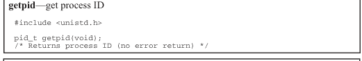

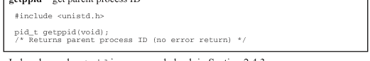

我已经在第 2.4.3 节的示例中使用过`getpid`。

## 5.14 chroot 系统调用

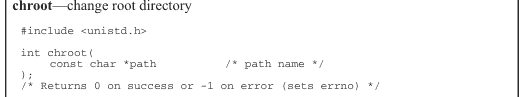

这个系统调用保留给超级用户进程，用于更改进程的根目录，即路径为`/`的目录。它不是标准的，但在几乎所有类UNIX系统上都实现了（因为它历史悠久）。

想到`chroot`的两种用途：

- 当一个带有内置路径名（例如`/etc/passwd`）的命令需要在不同于通常文件的文件上运行时。可以在方便的地方构建一个新的目录树；更改根目录，然后执行命令。这主要用于在安装前测试新命令。
- 为了增加安全性，例如当web服务器进程开始处理HTML文件时。它可以将根目录设置为基础路径，这确保了无法访问其他文件的路径。即使路径`..`也不起作用，因为在根目录下，它被解释为直接指向根目录本身的引用。


一旦根目录被更改，就没有办法使用`chroot`返回原来的根目录。然而，某些系统提供了一个姊妹函数`fchroot`，它接受一个文件描述符。（这与第 3.6.2 节中解释的`fchdir`和`chdir`之间的关系类似。）你可以通过打开当前根目录的文件描述符来获取它，执行`chroot`，然后使用保存的文件描述符作为参数通过`fchroot`返回。

## 5.15 获取和设置优先级

如我在第 1.1.6 节中提到，每个进程都有一个*nice*值，这是进程影响内核调度优先级的一种方式。较高的值意味着进程希望更*nice*——即以较低的优先级运行。较低的值意味着不那么*nice*——优先级更高。为了使*nice*值保持为正，它们会从某个随系统变化的数字（奇怪的是，在 UNIX 文档中被称为`NZERO`）偏移；典型值为 20。进程以 20 开始，最*nice*可达 39，最不*nice*为 0。

要使进程*nice*或不*nice*，进程执行*nice*系统调用：

```
nice—change nice value

```c
#include <unistd.h>

int nice(int incr)          /* increment */

/* Returns old nice value - NZERO or -1 on error (sets errno) */
```
```

*nice*系统调用将*incr*加到*nice*值上。结果*nice*值必须在 0 到 39 之间（包含两端）；如果产生无效值，则使用最近的合法值。只有超级用户可以降低*nice*值，从而获得优于平均水平的服务。

*nice*实际上返回新的*nice*值减去 20，因此如果`NZERO`为 20，返回值的范围是从 -20 到 19。然而，返回的值很少很有用。这也挺好，因为新的*nice*值 19 与错误返回（$19 - 20 = -1$）无法区分。这个 bug 如果在如此多年间未被修复（甚至未被注意到），这表明大多数 UNIX 系统程序员对像*nice*这样的小系统调用的错误返回值并不怎么关心。

大多数 UNIX 用户熟悉*nice*命令，它以较低的优先级运行程序（如果是超级用户运行，则以较高的优先级运行）。以下是我们的版本：

```c
#define USAGE "usage: aupnice [-num] command\n"

int main(int argc, char *argv[])
{
  int incr, cmdarg;
  char *cmdname, *cmdpath;

  if (argc < 2) {
    fprintf(stderr, USAGE);
    exit(EXIT_FAILURE);
  }
  if (argv[1][0] == '-') {
    incr = atoi(&argv[1][1]);
    cmdarg = 2;
  }
  else {
    incr = 10;
    cmdarg = 1;
  }
  if (cmdarg >= argc) {
    fprintf(stderr, USAGE);
    exit(EXIT_FAILURE);
  }
  (void)nice(incr);
  cmdname = strchr(argv[cmdarg], '/');
  if (cmdname == NULL)
    cmdname = argv[cmdarg];
  else
    cmdname++;
  cmdpath = argv[cmdarg];
  argv[cmdarg] = cmdname;
  execvp(cmdpath, &argv[cmdarg]);
  EC_FAIL

  EC_CLEANUP_BGN
  exit(EXIT_FAILURE);
  EC_CLEANUP_END
}
```

注意我们在调用*execvp*时如何重用传入的*argv*。变量*cmdarg*持有命令路径的下标（1 或 2，取决于是否指定了增量）。*argv*中从*cmdarg*开始的部分是传递下去的部分。您可能想要将此与第 5.3 节中为`execvp2`所需的更广泛操作进行对比。在那里我们需要*插入*一个参数，这要求我们重新复制整个数组。

向量中的第一个字符串应该只是命令名称，而不是完整的路径，因此我们必须剥离路径中除最后一个组件以外的所有部分，以防命令是通过包含斜杠的路径名执行的。然而，`execvp`的第一个参数必须是在`aupnice`命令行上输入的内容。

还要注意我们使用了没有`fork`的`execvp`。在更改了优先级之后，没有必要保持一个父进程活着来等待。

下面是`aupnice`在 Solaris 上的运行情况。对于示例命令，它使用`ps`报告自身。请注意，内部优先级（无论那是什么）在 nice 值增加 10 时（`aupnice`的默认值）从 58 变为 28。

```
$ ps -ac
  PID CLS PRI TTY     TIME CMD
 10460 TS 58 pts/2    0:00 ps
$ aupnice ps -ac
  PID CLS PRI TTY     TIME CMD
 10461 TS 28 pts/2    0:00 ps
```

有一些更新的、更花哨的调用称为`getpriority`和`setpriority`，您可以使用它们来操纵 nice 值；有关详细信息，请参阅 [SUS2002] 或您系统的文档。

## 5.16 进程限制

内核对进程资源执行各种限制，例如最大文件大小和最大堆栈大小。通常，当达到限制时，导致限制的功能（例如`write`、`malloc`）会返回错误，或者会产生一个信号，例如在堆栈溢出的情况下产生`SIGSEGV`（第 9 章）。

> 14. 如果捕获了`SIGSEGV`，当没有堆栈时，信号处理器如何执行？您可以设置一个备用堆栈，如第 9.3 节所述。如果没有这样做，信号将恢复其默认行为，即终止进程。

下面列出了七种标准资源，它们的限制值可以设置或获取，实现中可能定义其他资源。

对于每种资源，都有一个*最大*（*或硬*）限制和一个*当前*（*或软*）限制。当前限制是生效的限制，普通进程允许将其设置为不超过最大值的任何合理数值。普通进程还可以不可逆地降低（但不能提高）最大值，使其等于当前限制。超级用户进程可以将任一限制设置为内核支持的任何值。

以下是获取和设置限制的系统调用：

`getrlimit`——获取资源限制

```c
#include <sys/resource.h>
int getrlimit(
    int resource,        /* resource */
    struct rlimit *rlp   /* returned limits */
);
/* Returns 0 on success or -1 on error (sets errno) */
```

`setrlimit`——设置资源限制

```c
#include <sys/resource.h>
int setrlimit(
    int resource,        /* resource */
    const struct rlimit *rlp  /* limits to set */
);
/* Returns 0 on success or -1 on error (sets errno) */
```

`struct rlimit`——*getrlimit* 和 *setrlimit* 的结构体

```c
struct rlimit {
    rlim_t rlim_cur;     /* current (soft) limit */
    rlim_t rlim_max;     /* maximum (hard) limit */
};
```

每个调用针对单一资源；您通过*getrlimit*获取其限制，并根据之前给出的规则通过*setrlimit*设置它们。标准资源包括：

- **RLIMIT_CORE** 核心转储（内存转储）文件的最大大小（以字节为单位）；零表示根本不写入文件。如果超过该大小，不会报告错误——写入仅在该大小时停止，可能会留下一个无用的文件。
- **RLIMIT_CPU** 最大 CPU 时间（以秒为单位）。超过它会生成 *SIGXCPU*，默认情况下会终止进程。标准没有定义如果捕获、忽略或阻止此信号会发生什么——进程可能会被终止，因为没有办法在不积累更多 CPU 时间的情况下继续执行。

## 进程限制

| 常量 | 描述 |
| :--- | :--- |
| `RLIMIT_DATA` | 数据段的最大大小（以字节为单位）。超出此值会导致内存分配函数（例如 `malloc`）失败。 |
| `RLIMIT_FSIZE` | 最大文件大小（以字节为单位）。超出此值会生成 `SIGXFSZ` 信号；如果捕获、忽略或阻塞该信号，则导致违规函数失败。 |
| `RLIMIT_NOFILE` | 进程可能使用的文件描述符的最大数量。[^15] 超出此值会导致违规函数失败。 |
| `RLIMIT_STACK` | 最大堆栈大小（以字节为单位）。如果超出此值，将生成 `SIGSEGV` 信号。 |
| `RLIMIT_AS` | 最大总内存大小，包括数据段、堆栈以及通过 `mmap`（第 7.14 节）映射的任何内容。超出此值会导致违规函数失败，或者如果是堆栈，则产生与 `RLIMIT_STACK` 描述相同的效果。 |

[^15]: 脚注 15

进程限制在 `exec` 过程中保持不变，并在 `fork` 之后被子进程继承，因此如果在登录时设置一次，它们将影响从登录 shell 派生的所有进程。但是，与 `cd` 一样，设置它们的命令必须内置于 shell 中——在 shell 的子进程中执行该命令是无效的。大多数 shell 都有一个设置文件大小限制的 `ulimit` 命令，而其他 shell 则有一个更通用的命令，可能称为 `limit`、`limits` 或 `plimit`。[^16]

[^16]: 脚注 16

除了实际数字外，对于 `rlimit` 结构中的 `rlim_cur` 和 `rlim_max` 成员，还有一些特殊的宏：`RLIM_SAVED_CUR`、`RLIM_SAVED_MAX` 和 `RLIM_INFINITY`。

当你调用 `getrlimit` 时，如果数值适合 `rlim_t`（这是一种宽度未由标准指定的无符号类型），则返回实际数字。如果数值不适合，则如果该成员等于最大值，该成员将被设置为 `RLIM_SAVED_MAX`。否则，它被设置为 `RLIM_SAVED_CUR`，这意味着“限制被设置为限制本身所在的值”。如果某个成员被设置为 `RLIM_INFINITY`，则意味着没有限制。

当你调用 `setrlimit` 时，如果成员是 `RLIM_SAVED_CUR`，则将其设置为当前限制；如果是 `RLIM_SAVED_MAX`，则将其设置为最大限制；如果是 `RLIM_INFINITY`，则不强制执行限制。否则，限制被设置为你使用的任何数字。但是，只有当对 `getrlimit` 的调用返回这些值时，你才能使用 `RLIM_SAVED_CUR` 或 `RLIM_SAVED_MAX`；否则，你必须使用实际数字。换句话说：只有当 `rlim_t` 无法容纳该数值时，你才被迫使用这些宏。

`RLIM_SAVED_CUR` 和 `RLIM_SAVED_MAX` 的繁琐过程实际上就是这样：即使你无法获取它们的实际值，你仍然可以在某种程度上操作这些限制。

如果一个实现永远不会拥有一个无法放入 `rlim_t` 的限制，那么 `RLIM_SAVED_CUR` 或 `RLIM_SAVED_MAX` 宏永远不会被使用，因此允许它们具有与 `RLIM_INFINITY` 相同的值。我们将在下面的示例中看到这一点的影响，该示例显示限制，将文件限制设置为一个低得离谱的数字，然后超出它，导致程序被 `SIGXFSZ` 终止：

```c
int main(void)
{
    struct rlimit r;
    int fd;
    char buf[500] = { 0 };

    if (sizeof(rlim_t) > sizeof(long long))
        printf("Warning: rlim_t > long long; results may be wrong\n");
    ec_false( showlimit(RLIMIT_CORE, "RLIMIT_CORE") )
    ec_false( showlimit(RLIMIT_CPU, "RLIMIT_CPU") )
    ec_false( showlimit(RLIMIT_DATA, "RLIMIT_DATA") )
    ec_false( showlimit(RLIMIT_FSIZE, "RLIMIT_FSIZE") )
    ec_false( showlimit(RLIMIT_NOFILE, "RLIMIT_NOFILE") )
    ec_false( showlimit(RLIMIT_STACK, "RLIMIT_STACK") )
#ifdef FREEBSD
    ec_false( showlimit(RLIMIT_AS, "RLIMIT_AS") )
#endif
    ec_negl( getrlimit(RLIMIT_FSIZE, &r) )
    r.rlim_cur = 500;
    ec_negl( setrlimit(RLIMIT_FSIZE, &r) )
    ec_negl( fd = open("tmp", O_WRONLY | O_CREAT | O_TRUNC, PERM_FILE) )
    ec_negl( write(fd, buf, sizeof(buf)) )
    ec_negl( write(fd, buf, sizeof(buf)) )
    printf("Wrote two buffers! (?)\n");
    exit(EXIT_SUCCESS);
}

EC_CLEANUP_BGN
    exit(EXIT_FAILURE);
EC_CLEANUP_END
```

```c
static bool showlimit(int resource, const char *name)
{
    struct rlimit r;

    ec_negl( getrlimit(resource, &r) );
    printf("%s: ", name);
    printf("rlim_cur = ");
    showvalue(r.rlim_cur);
    printf("; rlim_max = ");
    showvalue(r.rlim_max);
    printf("\n");
    return true;

    EC_CLEANUP_BGN
    return false;
    EC_CLEANUP_END
}

static void showvalue(rlim_t lim)
{
    /*
     * All macros may equal RLIM_INFINITY; that test
     * must be first; can't use switch statement.
     */
    if (lim == RLIM_INFINITY)
        printf("RLIM_INFINITY");
#ifdef BSD_DERIVED
    else if (lim == RLIM_SAVED_CUR)
        printf("RLIM_SAVED_CUR");
    else if (lim == RLIM_SAVED_MAX)
        printf("RLIM_SAVED_MAX");
#endif
    else
        printf("%llu", (unsigned long long)lim);
}
```

正如你从代码中可以看到的那样，FreeBSD 和 Darwin 没有实现整个过程。[^17]

[^17]: 脚注 17

这是我们在四个测试系统上得到的结果，从 Solaris 开始：

```
RLIMIT_CORE: rlim_cur = RLIM_INFINITY; rlim_max = RLIM_INFINITY
RLIMIT_CPU: rlim_cur = RLIM_INFINITY; rlim_max = RLIM_INFINITY
RLIMIT_DATA: rlim_cur = RLIM_INFINITY; rlim_max = RLIM_INFINITY
RLIMIT_FSIZE: rlim_cur = RLIM_INFINITY; rlim_max = RLIM_INFINITY
RLIMIT_NOFILE: rlim_cur = 256; rlim_max = 1024
RLIMIT_STACK: rlim_cur = 8683520; rlim_max = 133464064
RLIMIT_AS: rlim_cur = RLIM_INFINITY; rlim_max = RLIM_INFINITY
File Size Limit Exceeded - core dumped
```

### Linux


```
RLIMIT_CORE: rlim_cur = 0; rlim_max = RLIM_INFINITY
RLIMIT_CPU: rlim_cur = RLIM_INFINITY; rlim_max = RLIM_INFINITY
RLIMIT_DATA: rlim_cur = RLIM_INFINITY; rlim_max = RLIM_INFINITY
RLIMIT_FSIZE: rlim_cur = RLIM_INFINITY; rlim_max = RLIM_INFINITY
RLIMIT_NOFILE: rlim_cur = 1024; rlim_max = 1024
RLIMIT_STACK: rlim_cur = RLIM_INFINITY; rlim_max = RLIM_INFINITY
RLIMIT_AS: rlim_cur = RLIM_INFINITY; rlim_max = RLIM_INFINITY
File size limit exceeded
```

### FreeBSD

```
RLIMIT_CORE: rlim_cur = RLIM_INFINITY; rlim_max = RLIM_INFINITY
RLIMIT_CPU: rlim_cur = RLIM_INFINITY; rlim_max = RLIM_INFINITY
RLIMIT_DATA: rlim_cur = 536870912; rlim_max = 536870912
RLIMIT_FSIZE: rlim_cur = RLIM_INFINITY; rlim_max = RLIM_INFINITY
RLIMIT_NOFILE: rlim_cur = 957; rlim_max = 957
RLIMIT_STACK: rlim_cur = 67108864; rlim_max = 67108864
Filesize limit exceeded
```

### Darwin

```
RLIMIT_CORE: rlim_cur = 0; rlim_max = RLIM_INFINITY
RLIMIT_CPU: rlim_cur = RLIM_INFINITY; rlim_max = RLIM_INFINITY
RLIMIT_DATA: rlim_cur = 6291456; rlim_max = RLIM_INFINITY
RLIMIT_FSIZE: rlim_cur = RLIM_INFINITY; rlim_max = RLIM_INFINITY
RLIMIT_NOFILE: rlim_cur = 256; rlim_max = RLIM_INFINITY
RLIMIT_STACK: rlim_cur = 524288; rlim_max = 67108864
Filesize limit exceeded
```

有一个更老且功能较弱的系统调用，并且其返回值存在问题：

```c
/* ulimit—get and set process limits */
#include <ulimit.h>

long ulimit(
    int cmd,        /* command */
    ...             /* optional argument */
);
/* Returns limit or -1 with errno changed on error (sets errno) */
```

`cmd` 参数是以下之一：

- `UL_GETFSIZE`：获取当前文件大小限制；等同于带有 `RLIMIT_FSIZE` 的 `getrlimit`。

- `UL_SETFSIZE`：将文件大小限制设置为第二个 `long` 参数；只有超级用户进程才能增加该限制。等同于带有 `RLIMIT_FSIZE` 的 `setrlimit`，其中调整了 `rlim_max` 并使 `rlim_cur` 与之匹配。

设置或获取的大小单位为 512 字节。由于大小可能会变得很大，返回值可能是负数，甚至可能是 −1。因此，检查错误的方法是将在调用前将 `errno` 设置为零。如果返回 −1，仅当 `errno` 发生变化时才表示错误。

`ulimit` 还有一些其他怪癖，但深入探讨它们没有意义。它基本上是一团糟，你应该使用 `getrlimit` 和 `setrlimit` 来代替。

`getrusage` 系统调用获取进程或其已终止且已等待的子进程的资源使用情况信息：

```c
/* getrusage—get resource usage */
#include <sys/resource.h>

int getrusage(
    int who,                  /* RUSAGE_SELF or RUSAGE_CHILDREN */
    struct rusage *r_usage    /* returned usage information */
);
/* Returns 0 on success or −1 on error (sets errno) */
```

```c
/* struct rusage—structure for getrusage */
struct rusage {
    struct timeval ru_utime;    /* user time used */
    struct timeval ru_stime;    /* system time used */
    /* Following members are nonstandard */
    long ru_maxrss;             /* maximum resident set size */
    long ru_ixss;              /* integral shared memory size */
    long ru_idrss;             /* integral unshared data size */
    long ru_isrss;             /* integral unshared stack size */
    long ru_minflt;            /* page reclaims */
    long ru_majflt;           /* page faults */
    long ru_nswap;            /* swaps */
    long ru_inblock;          /* block input operations */
    long ru_oublock;          /* block output operations */
    long ru_msgsnd;          /* messages sent */
    long ru_msgrcv;          /* messages received */
    long ru_nsignals;        /* signals received */
    long ru_nvcsw;           /* voluntary context switches */
    long ru_nivcsw;         /* involuntary context switches */
};
```

[SUS2002] 仅规定了前两个成员。更新的 BSD 系统，包括 FreeBSD，支持所有成员。Solaris 8（至少在 Intel 架构上）仅支持标准成员；Linux 2.4 支持标准成员以及 `ru_minflt`、`ru_majflt` 和 `ru_nswap`。有关这些成员含义的详细信息，请查阅你系统的 `getrusage` 手册页；若要了解全貌，如果有条件，请在基于 BSD 的系统中运行它。

返回的两个时间类似于 `times` 返回的时间（第 1.7.2 节），但分辨率更高，因为 `timeval`（第 1.7.1 节）是以微秒为单位的。

## 5.17 线程简介

本节将非常简要地介绍线程，内容仅足以展示一些有趣的示例程序。我的目标是解释它们是什么，帮助你判断应用设计是否可能从中受益，并提醒你如果不小心使用它们可能会遇到的危险。

若要了解线程的全部真相（管理它们需要大约一百个系统调用），你不得不找一本相关书籍，例如 [Norl997] 或 [But1997]。

### 5.17.1 线程创建

在之前的示例中，我们创建（通过 `fork`）的进程只有一个控制流，或线程。执行从一条指令顺序进行到下一条指令，在一个单一序列中，堆栈、全局数据和系统资源会被各种指令修改，其中一些指令可能执行了系统调用。

借助 UNIX 的 POSIX 线程功能，一个进程可以拥有多个线程，每个线程都有自己的控制流（自己的指令计数器和 CPU 时钟）以及自己的堆栈。除了这些，关于该进程的一切，包括全局数据和资源（如打开的文件或当前目录），都是共享的。<sup>18</sup>以下代码说明了我的意思。

- 18. 线程还可以安排拥有一些线程特定数据；有关详情，请参阅 [SUS2002] 或所引用的任何一本参考书。

```c
static long x = 0;

static void *thread_func(void *arg)
{
    while (true) {
        printf("Thread 2 says %ld\n", ++x);
        sleep(1);
    }
}

int main(void)
{
    pthread_t tid;

    ec_rv( pthread_create(&tid, NULL, thread_func, NULL) )
    while (x < 10) {
        printf("Thread 1 says %ld\n", ++x);
        sleep(2);
    }
    return EXIT_SUCCESS;

EC_CLEANUP_BGN
    return EXIT_FAILURE;
EC_CLEANUP_END
}
```

线程打印的顺序是不可预测的；这是我们碰巧得到的输出：

```
Thread 2 says 1
Thread 1 says 2
Thread 2 says 3
Thread 1 says 4
Thread 2 says 5
Thread 2 says 6
Thread 1 says 7
Thread 2 says 8
Thread 2 says 9
Thread 1 says 10
Thread 2 says 11
Thread 2 says 12
```

因此你可以看到，两个线程——`main` 中的那个和 `thread_func` 中的那个——都访问了同一个全局变量 `x`。这存在一些我在第 5.17.3 节中会讨论的问题。

初始线程——包含 `main` 的那个——通过 `pthread_create` 系统调用启动了第二个线程：

```c
pthread_create—创建线程

#include <pthread.h>

int pthread_create(
    pthread_t *thread_id,      /* 新线程的 ID */
    const pthread_attr_t *attr, /* 属性（或 NULL） */
    void *(*start_fcn)(void *), /* 启动函数 */
    void *arg                 /* 传递给启动函数的参数 */
);
/* 成功时返回 0，出错时返回错误号 */
```

新线程从调用在 `pthread_create` 调用中指定的启动函数开始，该函数必须具有如下原型：

```c
pthread 启动函数

void *start_fcn(
    void *arg
);
/* 返回退出状态 */
```

你传递给 `pthread_create` 的第四个参数将直接传递给启动函数。为了通用性，它是一个 `void` 指针，通常它确实是指向某些数据的指针。由于线程共享同一地址空间，该指针对两个线程都有效。如果你愿意，也可以传入整型数据，但必须将其强制转换为 `void` 指针。并且，为了安全起见，你应该检查（例如使用 `assert`）你使用的整型大小是否适合放在 `void` 指针中，使用类似下面这样的代码，你会在随后的某些示例中看到：

```c
assert(sizeof(long) <= sizeof(void *));
```

影响新线程的属性不仅仅是一些标志，而是一个类型为 `pthread_attr_t` 的对象，你必须使用诸如 `pthread_attr_setscope` 和 `pthread_attr_setstacksize` 这样的调用对其进行设置，这里我不展开讨论。（但也许你已经开始理解为什么有一百个线程相关的调用了。）在我们的示例中，我们只使用默认属性，因此我们传递给 `pthread_create` 的第二个参数将是 NULL。

“pthread” 函数统一在成功时返回 0，失败时返回错误码，而不是设置 `errno`。我们有一个特殊的“ec”宏用于此目的，`ec_rv`，它接收错误码（如果有的话），并将其视为一个 `errno` 值，因为它确实是一个 `errno` 值。<sup>19</sup>

> 19. 错误检查包中的各个函数已修改为线程安全，但本书未展示相关代码。不过，你可以在网站上看到。

### 5.17.2 等待线程终止

线程可以等待另一个线程终止并获取其退出状态，使用 `pthread_join`（类似于 `wait` 及其变体）。

```c
pthread_join—等待线程终止
#include <pthread.h>
int pthread_join(
    pthread_t thread_id,   /* 要加入的线程 ID */
    void **status_ptr      /* 返回的退出状态（如果参数不为 NULL） */
);
/* 成功时返回 0，出错时返回错误号 */
```

以下是我修改后的小示例，使得线程 1 将限制传递给线程 2，然后线程 2 将 `x` 的值报告回线程 1：

```c
static long x = 0;

static void *thread_func(void *arg)
{
    while (x < (long)arg) {
        printf("Thread 2 says %ld\n", ++x);
        sleep(1);
    }
    return (void *)x;
}

int main(void)
{
    pthread_t tid;
    void *status;

    assert(sizeof(long) <= sizeof(void *));
    ec_rv( pthread_create(&tid, NULL, thread_func, (void *)6) )
    while (x < 10) {
        printf("Thread 1 says %ld\n", ++x);
        sleep(2);
    }
    ec_rv( pthread_join(tid, &status) )
    printf("Thread 2’s exit status is %ld\n", (long)status);
    return EXIT_SUCCESS;

EC_CLEANUP_BGN
    return EXIT_FAILURE;
EC_CLEANUP_END
}
```

输出如下：

```
Thread 1 says 1
Thread 2 says 2
Thread 2 says 3
Thread 1 says 4
Thread 2 says 5
Thread 2 says 6
Thread 1 says 7
Thread 1 says 8
Thread 1 says 9
Thread 1 says 10
Thread 2's exit status is 7
```

### 5.17.3 线程同步（互斥锁）

正如我们将在接下来的几章中看到的那样，在 UNIX 上处理多进程（可能跨越网络）的挑战是允许它们共享数据。对于线程来说情况恰恰相反——挑战在于保持其自然的数据共享是分离的。实际上，我展示的两个线程示例都有缺陷，因为两个线程都可能同时访问相同的数据，即变量 `x`。虽然简单的自增运算符似乎是一个原子操作，但没有保证它一定是。实际上，线程 1 可能在更新 32 位 `x` 的一半时，线程 2 读取了整个 32 位，得到一个混合体而不是有效的整数。<sup>20</sup> 对于更复杂的共享数据结构——这是一个更现实的情况——问题严重得多。我们希望访问共享数据是原子的。这意味着以下两个示例：

- 如果更新数据结构使其暂时处于不一致状态，除了正在更新的那个线程外，其他线程不应看到这种状态，并且

- 如果一个线程必须读取数据、计算结果并写回，其他线程不应修改数据，直到整个序列完成。否则，其他线程的修改将丢失。

一些简单的系统调用提供了这些需求，它们实现互斥对象，简称为互斥锁（mutexes）。线程使用它们来保护临界区，以免其他线程看到不一致的数据或干扰更新。主要的互斥锁系统调用是 `pthread_mutex_lock` 和 `pthread_mutex_unlock`：

> 20. 而这只是可能出错的一件事。另一件事是编译器优化可能会将整数留在寄存器中。你真的永远不能让线程在未加保护的情况下同时访问数据。

#### pthread_mutex_lock

```c
#include <pthread.h>

int pthread_mutex_lock(
        pthread_mutex_t *mutex    /* mutex to lock */
);
/* Returns 0 on success, error number on error */
```

`pthread_mutex_lock` — 锁住互斥量

#### pthread_mutex_unlock


## 互斥量：pthread_mutex_unlock

```c
#include <pthread.h>

int pthread_mutex_unlock(
        pthread_mutex_t *mutex    /* mutex to unlock */
);
/* Returns 0 on success, error number on error */
```

`pthread_mutex_unlock`—解锁互斥量

互斥机制的工作原理如下：如果互斥量已经被锁定，`pthread_mutex_lock` 将阻塞，直到它被解锁。

获取合适的互斥量变量最简单的方法就是使用初始化器声明它，例如：

`static pthread_mutex_t mtx = PTHREAD_MUTEX_INITIALIZER;`

它可以是文件局部变量（`static`），也可以在文件间共享（`extern`）。你也可以在栈上（自动变量）或动态分配互斥量，但在这种情况下，你需要调用 `pthread_mutex_init` 进行初始化，此处不再详细展开。$^{21}$

现在我们可以修改示例，以充分保护共享数据：

```c
static pthread_mutex_t mtx = PTHREAD_MUTEX_INITIALIZER;
static long x = 0;

static void *thread_func(void *arg)
{
    bool done;

    while (true) {
        ec_rv( pthread_mutex_lock(&mtx) )
        done = x >= (long)arg;
        ec_rv( pthread_mutex_unlock(&mtx) )
        if (done)
            break;
        ec_rv( pthread_mutex_lock(&mtx) )
        printf("Thread 2 says %ld\n", ++x);
        ec_rv( pthread_mutex_unlock(&mtx) )
        sleep(1);
    }
    return (void *)x;

EC_CLEANUP_BGN
    EC_FLUSH("thread_func")
    return NULL;
EC_CLEANUP_END
}

int main(void)
{
    pthread_t tid;
    void *status;
    bool done;

    assert(sizeof(long) <= sizeof(void *));
    ec_rv( pthread_create(&tid, NULL, thread_func, (void *)6) )
    while (true) {
        ec_rv( pthread_mutex_lock(&mtx) )
        done = x >= 10;
        ec_rv( pthread_mutex_unlock(&mtx) )
        if (done)
            break;
        ec_rv( pthread_mutex_lock(&mtx) )
        printf("Thread 1 says %ld\n", ++x);
        ec_rv( pthread_mutex_unlock(&mtx) )
        sleep(2);
    }
    ec_rv( pthread_join(tid, &status) )
    printf("Thread 2's exit status is %ld\n", (long)status);
    return EXIT_SUCCESS;

EC_CLEANUP_BGN
    return EXIT_FAILURE;
EC_CLEANUP_END
}
```

请注意，我们必须将条件判断从 `while` 表达式中提取出来，以便我们能用加锁和解锁调用将它们包围起来。我们肯定不想保护整个循环，因为那样会破坏并发特性。需要仔细处理，确保保护措施足够以确保安全，但不过度影响性能。不幸的是，虽然你可以通过适当的测试检测到性能问题，但要测试是否已防止所有竞态条件却要难得多。

我们仍然存在一个缺陷：假设在 `pthread_func` 中，`pthread_mutex_unlock` 的调用失败，导致线程退出。这可能会导致互斥量保持锁定状态，从而使初始线程在调用 `pthread_mutex_lock` 时永久阻塞。一种潜在的解决方案是在 `pthread_func` 的清理代码中确保互斥量被解锁，通过再次调用 `pthread_mutex_unlock`，例如：

```c
EC_CLEANUP_BGN
    (void)pthread_mutex_unlock(&mtx);
    EC_FLUSH("thread_func")
    return NULL;
EC_CLEANUP_END
```

我们假设如果第一次调用 `pthread_mutex_unlock` 失败，第二次可能会成功，这似乎有点牵强。只要互斥量具有有效值，`pthread_mutex_lock` 或 `pthread_mutex_unlock` 实际上都不会失败，因此继续处理的最简单、最安全、最清晰的方法是在调试期间检查这些函数的错误返回值，而在生产程序中不进行检查。或者，你可能决定在应用程序中保留错误检查，只要你能收到错误报告，以便不浪费时间试图找出应用程序停滞的原因。这是线程使用起来可能非常棘手的又一个例子。你可能会发现，你花 5% 的时间实现线程，而花 95% 的时间确保你做对了。

正确的做法是封装对共享数据的访问，使用一组函数（如果使用 C++ 等面向对象语言，可以使用类），并在访问函数中包含互斥量。不要像我那样在整个程序中随意散布加锁和解锁调用。

因此，我将再次重写示例，这次所有对 `x` 的访问都通过单个函数 `get_and_incr_x` 进行，该函数执行所有的加锁和解锁操作。`x` 和互斥量都被移到了函数内部。请注意，这个版本比之前的版本可读性要高得多。更高的可读性几乎总是意味着更高的可靠性！

```c
static long get_and_incr_x(long incr)
{
    static long x = 0;
    static pthread_mutex_t mtx = PTHREAD_MUTEX_INITIALIZER;
    long rtn;

    ec_rv( pthread_mutex_lock(&mtx) )
    rtn = x += incr;
    ec_rv( pthread_mutex_unlock(&mtx) )
    return rtn;

EC_CLEANUP_BGN
    extit(EXIT_FAILURE);
EC_CLEANUP_END
}

static void *thread_func(void *arg)
{
    while (get_and_incr_x(0) < (long)arg) {
        printf("Thread 2 says %ld\n", get_and_incr_x(1));
        sleep(1);
    }
    return (void *)get_and_incr_x(0);
}

int main(void)
{
    pthread_t tid;
    void *status;

    assert(sizeof(long) <= sizeof(void *));
    ec_rv( pthread_create(&tid, NULL, thread_func, (void *)6) )
    while (get_and_incr_x(0) < 10) {
        printf("Thread 1 says %ld\n", get_and_incr_x(1));
        sleep(2);
    }

    ec_rv( pthread_join(tid, &status) )
    printf("Thread 2’s exit status is %ld\n", (long)status);
    return EXIT_SUCCESS;

EC_CLEANUP_BGN
    return EXIT_FAILURE;
EC_CLEANUP_END
}
```

这次我决定将加锁或解锁错误视为致命错误，这是另一种可能的选择。我的观点肯定不是说在所有情况下都应该这样做。相反，我的观点是，处理这类错误有多种方法，最佳方案取决于特定应用程序的需求。

理解函数 `get_and_incr_x` 中以下行为何有效至关重要：

```c
ec_rv( pthread_mutex_lock( &mtx ) )
    rtn = x += incr;
ec_rv( pthread_mutex_unlock( &mtx ) )
```

我们需要保护的是对 `x` 的访问，因为 `x` 作为一个全局变量，在线程之间共享。变量 `rtn` 和 `incr` 位于每个线程独特的栈上（即每个线程拥有自己的副本），因此无需保护。

关于这个例子，我还有一个观察，将留到练习 5.11 中讨论。

还有三种其他类型的线程同步对象，你可以在 [SUS2002] 或第 5.17 节开头引用的一本参考书中阅读到：

- **读写锁** 类似于互斥量，但它们区分针对数据读取的锁定和针对写入的锁定，以获得额外的并发性。有关读写锁的一般信息，请参见第 7.11.4 节。
- **自旋锁** 也类似于互斥量，但它们更快，适用于短持续时间。它们通常通过在 CPU 循环中测试锁来实现，而不是通过阻塞线程。
- **屏障** 是同步点，一个或多个线程在此等待，确保所有线程都已完成某项任务后，任何线程才被允许继续执行。

### 5.17.4 条件变量

假设线程 A 正在执行某些工作（例如从网络连接读取数据）并向队列添加项，而线程 B 从队列中取出项并对它们执行一些额外的工作（例如更新数据库）。使用互斥量 `M` 来控制对队列的访问，你可以像这样组织线程：

| 线程 A | 线程 B |
| :--- | :--- |
| 1. 读取数据 [B] | 1. 锁定 M [b] |
| 2. 锁定 M [b] | 2. 如果队列中有项，则移除并更新数据库 |
| 3. 将项放入队列 | 3. 解锁 M |
| 4. 解锁 M | 4. 转到步骤 1 |
| 5. 转到步骤 1 | |

（符号 [B] 表示不确定阻塞，[b] 表示短期阻塞。）

这可以正常工作，但当队列为空时，线程 B 浪费了大量 CPU 时间，因为它在循环中不断检查。你可以像这样稍微放慢它的速度：

- 线程 A
    - 1. 读取数据 [B]
    - 2. 锁定 M [b]
    - 3. 将项放入队列
    - 4. 解锁 M
    - 5. 转到步骤 1
- 线程 B
    - 1. 锁定 M
    - 2. 如果队列中有项，则移除并更新数据库
    - 3. 解锁 M [b]
    - 4. 休眠 1 秒 [b]
    - 5. 转到步骤 1

但这并没有太大改善：线程 B 现在响应性较差，因为当有工作要做时它可能正在休眠，而且由于唤醒时队列可能仍然为空，它依然浪费 CPU 时间。我们要做的是让线程 A 在将项放入队列时向线程 B 发送信号，并使线程 B 阻塞直到收到信号。让我们尝试使用另一个互斥量 `Q` 来表示概念“`Q` 队列非空”：

- 线程 A
    - 1. 读取数据 [B]
    - 2. 锁定 M [b]
    - 3. 将项放入队列
    - 4. 解锁 M
    - 5. 解锁 `Q`
    - 6. 转到步骤 1
- 线程 B
    - 1. 锁定 M [b]
    - 2. 如果队列中有项，则移除并更新数据库
    - 3. 解锁 M
    - 4. 锁定 `Q` [B]
    - 5. 转到步骤 1

线程 B 尝试锁定 `Q`（步骤 4）是不确定阻塞，因为 `Q` 只有在线程 A 从读取返回（步骤 1）时才会解锁。

现在的问题是，线程 A 可能会在线程 B 未锁定 `Q` 时尝试解锁 `Q`，这将导致信号丢失——解锁尝试不会被记录以便下一次锁定尝试（即，互斥量不是计数信号量）。因此，如果发生这种情况，线程 B 将被阻塞等待 `Q` 的锁，且该锁在下一次读取数据之前（如果有的话）不会释放。与此同时，队列中的项未被线程 B 处理。

关于 `Q` 的一个更具体的问题是，只有锁定互斥量的线程才能解锁它。因此，A 的步骤 5 将导致错误。

我们可以尝试用计数信号量（第 7.8 节）来替代 `Q`，但更好的选择是使用 POSIX 线程提供的另一种信号机制：**条件变量**。以下是本示例中条件变量的用法：

#### 线程 A

1. 读取数据 B
2. 加锁 `M` B
3. 将项放入队列
4. `cond_signal(C)`
5. 解锁 `M`
6. 跳转至步骤 1

#### 线程 B

1. 加锁 `M` B
2. `while (队列为空) { cond_wait(C, M) B }`
3. 移除项；更新数据库
4. 解锁 `M`
5. 跳转至步骤 1

第二个互斥锁 `Q` 已经不存在了，取而代之的是一个条件变量 `C`。在线程 B 中，`cond_wait` 会等待直到条件 `C` 被发出信号，这在步骤 4 中由线程 A 完成。然而，`cond_wait` 与互斥锁 `M`（它的第二个参数）之间有一个特殊的交互：在调用 `cond_wait` 时，必须已锁定该互斥锁。*在等待期间互斥锁会被解锁，当 cond_wait 返回时又会自动重新加锁*。这样既不会出现信号丢失的情况，也不会发生死锁，而这两者都是我们早期尝试中的缺陷。此外，线程 B 中步骤 2 和 3 的所有代码都在锁定 `M` 的状态下执行，这正是应有的行为。

为什么 `cond_wait` 要放在一个测试队列是否为空的循环中，而当条件 `C`（由线程 A）发出信号时，队列实际上是非空的？这是因为 `cond_wait` 像任何 UNIX 阻塞系统调用一样，可能会被打断（例如，由传统的 UNIX 信号，如 `SIGINT` 引起），在这种情况下，即使队列仍然为空，也可能返回。一个测试谓词（在此情况下为队列为空）的循环可以确保在这种虚假返回的情况下，我们会立即重新进入 `cond_wait`。由于虚假返回很少发生，浪费的 CPU 时间可以忽略不计。

在调用 `cond_wait` 之前检查队列的另一个原因是，`cond_signal` 可能在线程 B 调用 `cond_wait` 之前很久就被调用了，而如果没有任何线程在等待，`cond_signal` 会被丢弃（不会挂起保留）。因此，除非必要，否则不要调用 `cond_wait`，否则即使队列非空，等待也可能永远持续下去。

因此，为了发出和等待某个条件，你需要三样东西：一个**条件变量**、一个**互斥锁**和一个**谓词**。前两者是特殊的数据类型，但谓词只是对你有意义的普通代码——它是条件变量抽象表示的具体细节。

以下是 `pthread_cond_signal` 和 `pthread_cond_wait` 系统调用的概要：

```c
pthread_cond_signal—signal condition

#include <pthread.h>
int pthread_cond_signal(
  pthread_cond_t *cond        /* condition variable */
);
/* Returns 0 on success, error number on error */
```

```c
pthread_cond_wait—wait for condition

#include <pthread.h>
int pthread_cond_wait(
  pthread_cond_t *cond,       /* condition variable */
  pthread_mutex_t *mutex      /* mutex */
);
/* Returns 0 on success, error number on error */
```

与互斥锁一样，你可以静态地声明和初始化一个条件变量，例如：

```c
static pthread_cond_t cond = PTHREAD_COND_INITIALIZER;
```

位于栈上（自动分配）或动态分配的条件变量需要通过调用 `pthread_cond_init` 进行初始化，这超出了本书的讨论范围。

下面是一个示例程序，其中初始线程将节点放入队列，而另一个线程将它们取出并显示其内容。当有节点进入队列时，初始线程发出一个条件信号，另一个线程则等待该条件：

```c
static pthread_mutex_t mtx = PTHREAD_MUTEX_INITIALIZER;
static pthread_cond_t cond = PTHREAD_COND_INITIALIZER;

struct node {
    int n_number;
    struct node *n_next;
} *head = NULL;
```


```c
static void *thread_func(void *arg)
{
    struct node *p;

    while (true) {
        ec_rv( pthread_mutex_lock(&mtx) )
        while (head == NULL)
            ec_rv( pthread_cond_wait(&cond, &mtx) )
        p = head;
        head = head->n_next;
        printf("Got %d from front of queue\n", p->n_number);
        free(p);
        ec_rv( pthread_mutex_unlock(&mtx) )
    }
    return (void *)true;
}

EC_CLEANUP_BGN
    (void)pthread_mutex_unlock(&mtx);
EC_FLUSH("thread_func")
    return (void *)false;
EC_CLEANUP_END
}
```

```c
int main(void)
{
    pthread_t tid;
    int i;
    struct node *p;

    ec_rv( pthread_create(&tid, NULL, thread_func, NULL) )
    for (i = 0; i < 10; i++) {
        ec_null( p = malloc(sizeof(struct node)) )
        p->n_number = i;
        ec_rv( pthread_mutex_lock(&mtx) )
        p->n_next = head;
        head = p;
        ec_rv( pthread_cond_signal(&cond) )
        ec_rv( pthread_mutex_unlock(&mtx) )
        sleep(1);
    }

    ec_rv( pthread_join(tid, NULL) )
    printf("All done -- exiting\n");
    return EXIT_SUCCESS;

EC_CLEANUP_BGN
    return EXIT_FAILURE;
EC_CLEANUP_END
}
```

初始线程中将新节点放入队列的核心部分遵循了前面展示的模式——它在锁定互斥锁的情况下调用 `pthread_cond_signal`。<sup>22</sup>

```c
ec_rv( pthread_mutex_lock(&mtx) )
p->n_next = head;
head = p;
ec_rv( pthread_cond_signal(&cond) )
ec_rv( pthread_mutex_unlock(&mtx) )
```

移除节点的线程也遵循该模式，它在锁定互斥锁的情况下调用 `pthread_cond_wait`：

```c
ec_rv( pthread_mutex_lock(&mtx) )
while( head == NULL
ec_rv( pthread_cond_wait(&cond, &mtx) )
p = head;
head = head->n_next;
printf("Got %d from front of queue\n", p->n_number);
free(p);
ec_rv( pthread_mutex_unlock(&mtx) )
```

这两个线程之所以能成功协作，是因为 `pthread_cond_wait` 在等待期间解锁互斥锁，并在返回前重新加锁。因此，以下事实是被保证的：

- 处理队列的两个临界区都在互斥锁 `mtx` 的保护下执行。
- 当第二个线程中执行语句 `p = head;` 时，`head` 非 `NULL`。

以下是我们得到的输出：

```
Got 0 from front of queue
Got 1 from front of queue
Got 2 from front of queue
Got 3 from front of queue
Got 4 from front of queue
Got 5 from front of queue
Got 6 from front of queue
Got 7 from front of queue
Got 8 from front of queue
Got 9 from front of queue
```

“全部完成 – 退出”的消息去哪了？我们并没有收到。实际上，程序在打印出“Got 9”行后挂起了，我们按下了 Ctrl-C 来停止它。

22. 在解锁互斥锁的情况下调用 `pthread_cond_signal` 也是可以的，事实上，这样可能会稍微提高吞吐量。

查看程序代码，我们可以找出原因：第二个线程永远停留在其循环中，寻找一个永远不会到来的队列节点，而初始线程永远无法从其 `pthread_join` 调用中返回。

一个显而易见的修复方法是在队列中放置某种“文件结束”节点，以告知第二个线程退出。或者，初始线程可以在没有更多工作时取消第二个线程。我们将采用后一种方法，以便有机会讨论如何取消线程。

# 5.17.5 取消线程

一个线程可以使用 `pthread_cancel` 取消另一个线程：

```c
pthread_cancel—cancel thread

#include <pthread.h>
int pthread_cancel(
    pthread_t thread_id    /* ID of thread to cancel */
);
/* Returns 0 on success, error number on error */
```

通常，被取消的线程不会立即停止，而是在一个*取消点*停止，即线程调用那 200 多个可能阻塞的系统调用或标准函数之一（如 `read`、`waitpid` 或 `pthread_cond_wait`）时。<sup>23</sup> 如果线程调用了在程序其他地方或库中定义的函数，它很有可能会调用这 200 多个系统调用或函数之一；因此，除非有明确的文档说明且你信任该文档，否则应将任何函数调用视为潜在的（但非保证的）取消点。

取消点的意义在于，你可以安全地执行普通代码，而不用担心它被取消。例如，你可以修改一个链表（可能受互斥锁保护），因为你知道代码序列会被允许完成。

让你感到宽慰的是，没有任何“pthread”互斥锁调用是取消点，`free`、`calloc`、`malloc` 或 `realloc` 也不是。如果互斥锁调用是取消点，使用互斥锁将会非常繁琐，因为每次调用 `pthread_mutex_lock` 时你都必须添加处理取消的代码。

23. SUS 规范中指定了大约 65 个始终是取消点的调用，以及另外大约 150 个可能是取消点的调用。

如果某个线程根本没有取消点，或者没有你可以依赖的取消点，但它的存活时间足够长，以至于允许取消成为一个问题，你可以在安全的地方插入一个或多个对 `pthread_testcancel` 的调用，以显式提供取消点。如果没有待处理的取消，这个调用不会做任何事。

## pthread_testcancel——测试取消

```c
#include <pthread.h>

void pthread_testcancel(void);
```

我之前说过，*通常* 线程仅在取消点处被取消。当取消类型设置为 `PTHREAD_CANCEL_DEFERRED`（这是默认值）时，这是真的。如果你使用 `pthread_setcanceltype` 函数将类型设置为 `PTHREAD_CANCEL_ASYNCHRONOUS`（详见 [SUS2002]），它确实会被立即取消，这是一个令人恐惧的想法。大概，任何这样做的人都知道自己在做什么。

现在我们可以修改前一个示例的主函数，以便在没有更多节点入队时取消另一个线程：

```c
for (i = 0; i < 10; i++) {
    ec_null( p = malloc(sizeof(struct node)) )
    p->n_number = i;
    ec_rv( pthread_mutex_lock(&mtx) )
    p->n_next = head;
    head = p;
    ec_rv( pthread_cond_signal(&cond) )
    ec_rv( pthread_mutex_unlock(&mtx) )
    sleep(1);
}
ec_rv( pthread_cancel(tid) )
ec_rv( pthread_join(tid, NULL) )
printf("All done -- exiting\n") ;
return EXIT_SUCCESS;
```

通过这一改进，程序能够干净地终止：

```
Got 0 from front of queue
Got 1 from front of queue
Got 2 from front of queue
Got 3 from front of queue
Got 4 from front of queue
Got 5 from front of queue
Got 6 from front of queue
Got 7 from front of queue
Got 8 from front of queue
Got 9 from front of queue
All done -- exiting
```

不过，我们还没有完全结束。我们需要仔细检查那个被取消的线程的代码，以确保取消不会使队列处于不一致的状态。这里再展示一遍：

```c
static void *thread_func(void *arg)
{
   struct node *p;

   while (true) {
      ec_rv( pthread_mutex_lock(&mtx) )
      while (head == NULL)
         ec_rv( pthread_cond_wait(&cond, &mtx) )
      p = head;
      head = head->n_next;
      printf("Got %d from front of queue\n", p->n_number);
      free(p);
      ec_rv( pthread_mutex_unlock(&mtx) )
   }
   return (void *)true;
}

EC_CLEANUP_BGN
   (void)pthread_mutex_unlock(&mtx);
   EC_FLUSH("thread_func")
   return (void *)false;
EC_CLEANUP_END
}
```

事实上，存在两个问题：

- `pthread_cond_wait` 是一个取消点。如果线程在那里被取消，队列本身没问题，因为还没有对它做任何操作，但是互斥锁被重新锁定了，这在离开 `pthread_cond_wait` 时总是会发生。我们不希望线程在互斥锁被锁定的情况下终止，因为那样它永远无法被解锁。
- `printf` 可能是一个取消点。如果线程在那里终止，刚刚移除的节点不会被释放，导致内存泄漏。

确实，这个程序在取消线程后退出，但这并不总是这种情况，因此修复这些 bug 是有意义的。重要的是防范*可能*发生的情况，而不仅仅是防范通常发生的情况。

对于第二个问题的解决方案是将要打印的数字存储在一个局部变量中，释放节点，然后调用 `printf`。

但是第一个问题没有显而易见的解决方案。我们必须安装一个*取消清理处理程序*，这是一个在取消之前调用的函数，用于清理状态。我们也将在取消清理处理程序中修复第二个问题。

取消清理处理程序始终具有以下原型（名字无关紧要）：

```c
void cleanup_handler(void *arg);
```

线程使用 `pthread_cleanup_push` 安装清理处理程序，并使用 `pthread_cleanup_pop` 卸载它：

## pthread_cleanup_push——安装清理处理程序

```c
#include <pthread.h>

void pthread_cleanup_push(
    void (*handler)(void*), /* 指向清理处理程序函数的指针 */
    void *arg               /* 传递给函数的数据 */
);
```

## pthread_cleanup_pop——卸载清理处理程序

```c
#include <pthread.h>

void pthread_cleanup_pop(
    int execute /* 是否执行处理程序？ */
);
```

当取消发生时，清理处理程序会被调用。如果有多个，它们都会按推送的相反顺序被调用。每个函数在被调用后会被弹出，这是没问题的，因为线程即将消失。

这些函数必须成对出现，并且它们必须位于相同的 C 或 C++ 块级别。如果你没有这样做，你很可能会得到非常奇怪的*编译时错误*，因为这些函数通常实现为嵌入大括号的宏（如 `EC_CLEANUP_BGN` 和 `EC_CLEANUP_END`；参见第 1.4.2 节）。

根据你的具体做法，即使在线程正常退出时调用清理处理程序也可能有意义。为了方便起见，你可以将 `pthread_cleanup_pop` 的 `execute` 参数设置为 true。

以下是 `thread_func` 的改进版本。请注意，我显式地将 `p` 初始化为 `NULL`，以确保其值始终对 `free` 有效。

```c
static void cleanup_handler(void *arg)
{
    free(arg);
    (void)pthread_mutex_unlock(&mtx);
}

static void *thread_func(void *arg)
{
    struct node *p = NULL;

    pthread_cleanup_push(cleanup_handler, &p);
    while (true) {
        ec_rv( pthread_mutex_lock(&mtx) )
        while (head == NULL)
            ec_rv( pthread_cond_wait(&cond, &mtx) )
        p = head;
        head = head->n_next;
        printf("Got %d from front of queue\n", p->n_number);
        free(p);
        p = NULL;
        ec_rv( pthread_mutex_unlock(&mtx) )
    }
    pthread_cleanup_pop(false);
    return (void *)true;
}

EC_CLEANUP_BGN
    (void)pthread_mutex_unlock(&mtx);
    EC_FLUSH("thread_func")
    return (void *)false;
EC_CLEANUP_END
}
```

现在我们应该没问题了。请注意，如果我选择其他一些方式来终止线程（一旦初始线程停止向队列添加节点），就可以避免处理取消的所有复杂情况。这是你在自己的应用程序中需要考虑的事情——当更温和的操作就能完成任务时，不要使用取消。另一方面，如果要终止的线程处于阻塞状态（例如在 `read` 中），而且你无法轻易解除其阻塞，线程取消可能是最好的选择。它肯定比信号更好的选择，信号也可以解除系统调用的阻塞；正如我们将在第 9 章中看到，信号有更严重的副作用。

## 5.17.6 线程与进程

你可能正在想知道何时应该使用线程而不是进程。通常，当你想要在相同的复杂数据结构上进行并发处理时，你会使用线程。三种常见情况是：

- 你希望用户界面在活动，同时其他计算在后台进行。例如，在允许文档查看和编辑的同时进行后台打印或后台页面格式化的文字处理程序中。
- 你希望组织算法以利用多处理计算机——拥有多个 CPU 的计算机。在这样的系统上，UNIX 调度程序可以自动将不同的线程分配给不同的 CPU。
- 你需要处理几种导致系统调用（例如，`read`、`waitpid`、`msgrcv`）阻塞的事件类型。这是下一节的内容。

对于耦合度较低的应用程序，可以使用进程，其中一些数据在进程之间传递，但不需要直接操纵相同的数据结构。（经过一些努力，可以使用共享内存共享数据结构，我们将在第 7 章中看到。）独立的进程拥有自己的有效用户 ID、文件描述符、全局变量等，而独立的线程则没有。进程可以更轻松地单独开发、测试和调试，并且对锁的需求少得多，因此未检测到的竞态条件或死锁的可能性也低得多。另一种比较方式是说，进程用于应用程序的大块部分，而线程提供更具细粒度的并发性。

**警告：** 截至本文写作时，Linux 和 FreeBSD 通常附带的线程包并不遵循 POSIX 标准，主要是因为它们实现的线程要么太弱（在用户空间完成所有工作），要么太强（为每个线程使用一个进程）。前者主要问题是，像 `msgrcv` 这样的阻塞系统调用会阻塞所有线程，而不仅仅是包含该调用的线程。后者的问题是，像 `waitpid` 这样的某些系统调用不能正常工作，因为它们处于错误的进程中（只有父进程才能等待子进程）。另一个麻烦的是，如果系统附带的包不够用，你可能需要自己查找、编译和安装你想要的线程包。

寻找最新的 Linux 线程实现，称为 Linux 原生 POSIX 线程库（NPTL），它正在进入 Linux 系统。它修复了所有重要的 POSIX 合规性 bug。

## 5.18 阻塞问题


# 5.18 阻塞问题

我们已经遇到了几种可能会阻塞的系统调用，例如 `read`、`write`、`pthread_cond_wait` 和 `waitpid`，而且书中还有更多，特别是在第 7 章和第 8 章中。UNIX 编程中最难的问题之一是你的应用程序可能需要阻塞在多个系统调用上，因为你不知道接下来会发生什么。我称之为**阻塞问题**。

对于接受文件描述符的阻塞系统调用，比如 `read` 和 `write`，你可以使用单个系统调用 `select` 或 `poll`（第 4.2 节）来阻塞，直到一个或多个文件描述符就绪。但这在通常情况下并没有帮助，因为你要等待的许多事情，例如进程、信号、消息、信号量和条件变量，并不与文件描述符相关联。是的，你可以通过写入一个专门为此目的建立的管道来通知阻塞在 `select` 或 `poll` 上的线程，比如说当消息到达时（我们将在下一节看到），但这无助于解决 `msgrcv` 或 `mq_receive` 本身正在阻塞等待消息这一事实。没有方法将消息等待系统调用直接关联到文件描述符。这不是一个通知问题，而是一个阻塞问题。

## 5.18.1 使用进程和线程的解决方案

从历史上看，解决阻塞问题的方法是创建一个子进程来进行阻塞。²⁴ 当它所阻塞的对象解除阻塞时，它随后会写入管道，向父进程指示已发生某个事件。管道是一个很好的选择，因为它们容易设置（我们将在下一章看到），并且由于它们使用文件描述符，父进程可以将它们整合到 `select` 或 `poll` 中。这在实质上是将父进程从阻塞在非文件描述符事件上转换为阻塞在文件描述符上。转换一切，在父进程中使用 `select` 或 `poll`，你就成功啦。

但在 UNIX 中，进程是非常重量级的对象——创建成本高，调度成本高，且数量有限。此外，两个进程共享相同的数据结构也很麻烦。如果事件发生时能够先将其排队，然后父进程在方便时再检查，那就太好了。使用共享内存和信号量在进程间设置事件队列是可行的，但进程间信号量可能太慢，特别是当事件发生得非常快时。

使用独立进程的另一个问题是，某些对象，如文件描述符，无法传递给现有进程（至少在可移植性方面不行）。它们只能通过继承来传递；因此，如果进程 `A` 负责阻塞 I/O 并且已经在运行，刚刚打开网络连接进程 `B` 无法让进程 `A` 等待新获得的文件描述符。

解决阻塞问题的较新方案是使用 POSIX 线程。一种简单的方法是为每个你想阻塞的对象（例如，消息队列、文件描述符集合、信号量）创建一个新线程。每个线程只是发出适当的阻塞系统调用（`O_NONBLOCK` 清除）。当系统调用返回时，线程向共享队列中添加一个事件（使用互斥锁进行保护），然后立即回到阻塞系统调用中。然后主线程只需要阻塞在一件事上：队列中是否存在事件。阻塞线程使用条件变量在队列变为非空时向主线程发出信号，正如第 5.17.4 节中的示例所示。

## 5.18.2 统一事件管理器原型

我将展示一种使用线程解决阻塞问题的通用方法，我称之为**统一事件管理器**（Unified Event Manager）。它是一组库函数，任何应用程序都可以使用。应用程序可以注册一个事件，这会导致库创建阻塞的线程。应用程序围绕等待单一事件队列组织。当事件出现时，应用程序将其从队列中取出，处理它，然后返回等待。

我不会在书中展示所有代码，但如果你想看，它就在网站上。它是一个原型，因为它对关键应用来说效率不够高，并且它使用了本书所有示例都使用的 `ec` 错误检查方法，而这本身也是一个原型。

我们从一个枚举开始，它涵盖了 UNIX 中几乎所有可等待的事件：

```c
enum UEM_TYPE { /* System V message */ UEM_SVMSG, /* POSIX message */ UEM_PXMSG, /* System V semaphore */ UEM_SVSEM, /* POSIX semaphore */ UEM_PXSEM, /* file-descriptor set -- read */ UEM_FD_READ,
                /* file-descriptor set - write */ UEM_FD_WRITE,
                /* file-descriptor set - error */ UEM_FD_ERROR,
                /* signal */ UEM_SIG,
                /* process */ UEM_PROCESS,
                /* heartbeat */ UEM_HEARTBEAT,
                /* none */ UEM_NONE
};
```

最后两个需要一些解释：`UEM_HEARTBEAT` 是一种以特定间隔获取定期事件的方式，而 `UEM_NONE` 在那里，因为拥有一个可以用来指示某物为空的值总是个好主意。

当我们注册一个事件时，我们需要一个结构来跟踪阻塞系统调用所需的信息。例如，为了发出 `select`，我们需要文件描述符集合，所以这个结构为每个 `UEM_TYPE` 持有这种类型的所有数据：

```c
struct uem_reg {
    enum UEM_TYPE ur_type;          /* type of registration */
    pthread_t ur_tid;               /* thread ID */
    union {
        int ur_mqid;                /* System V message-queue ID */
        struct {
            int s_semid;            /* System V semaphore-set ID */
            struct sembuf *s_sops;  /* semaphore operations */
        } ur_svsem;
#ifndef POSIX_IPC
        mqd_t ur_mqd;               /* POSIX message-queue descriptor */
        sem_t *ur_sem;             /* POSIX semaphore */
#endif
        int ur_signum;              /* signal number */
        pid_t ur_pid;               /* process ID */
        long ur_usecs;              /* microseconds (for heartbeat) */
        fd_set ur_fdset;            /* file-descriptor set */
    } ur_resource;
    void *ur_data;                 /* data to be queued with event */
    size_t ur_size;                 /* size (used for various purposes) */
};
```

宏 `POSIX_IPC` 不是一个标准宏，而是我们在这个原型中使用的宏。它是从真正的特性测试宏中非常复杂地设置的，这在第 1.5.4 节中有解释。我们需要它，因为 Linux 和 FreeBSD 尚未支持 POSIX IPC。

当应用程序想要注册事件类型时，它调用形式为 `uem_register_E` 的函数，其中 `E` 是事件类型的缩写。例如，这里是注册等待进程终止的调用：

```c
ec_false( uem_register_process(pid, NULL) )
```

这是直接发出 `waitpid` 的替代方案，后者会阻塞。当进程 `pid` 终止时，包含其退出状态的事件将被放入队列，注册该事件的应用程序随后可以获取状态。我们很快就会看到这些细节。

以下是 `uem_register_process` 的代码：

```c
bool uem_register_process(pid_t pid, void *data)
{
	struct uem_reg *p;
	ec_null( p = new_reg() )
	p->ur_type = UEM_PROCESS;
	p->ur_resource.ur_pid = pid;
	p->ur_size = 0;
	p->ur_data = data;
	ec_rv( pthread_create(&p->ur_tid, NULL, thread_process, p) )
	return true;

EC_CLEANUP_BGN
	return false;
EC_CLEANUP_END
}
```

函数 `new_reg`，被所有的 `uem_register_E` 调用使用，只是分配一个结构。我们把它放在一个单独的函数中，以防有共同的初始化工作要做，但在当前设计中并没有。

```c
static struct uem_reg *new_reg(void)
{
	struct uem_reg *p;
	ec_null( p = calloc(1, sizeof(struct uem_reg)) )
	return p;

EC_CLEANUP_BGN
	return NULL;
EC_CLEANUP_END
}
```

注册信息只是传递给线程函数，它看起来像这样：

```c
static void *thread_process(void *arg)
{
	struct uem_event *e = NULL;

	pthread_cleanup_push(cleanup_handler, e);
	ec_null( e = calloc(1, sizeof(struct uem_event)) )
```

> 24. 这项技术大约由我母亲在 1953 年发明。在杂货店里，她会让一个孩子排在熟食柜台，另一个孩子排在鱼柜台，而她自己则购买那些不需要排队的商品。偶尔她也会遇到阻塞，不过，她于是又生了三个孩子。

该函数首先推入一个清理处理器（如 5.17.5 节所述）。然后，它分配一个事件结构体，以便当事件发生时（在此情况下为 `waitpid` 返回）将其加入队列。以下是所有线程使用的该事件结构体：

```c
struct uem_event {
    struct uem_reg *ue_reg;
    void *ue_buf;
    ssize_t ue_result;
    int ue_errno;
    struct uem_event *ue_next;
};
```

请注意，它指回注册结构体，后者包含该类所有事件的公共数据。`ue_buf` 成员用于需要返回数据的情况（例如消息），但在此案例中并无此类数据。我们确实有状态信息，并将其放入 `ue_result` 成员中。如果发生错误，`errno` 将存入 `ue_errno` 成员；接收该事件的应用程序需要将该成员与零进行比较，以检查等待该事件的函数是否返回了错误。`ue_next` 成员的存在使得 `uem_event` 结构体能够链接成事件队列。

该清理处理器与 5.17.5 节中的类似，除了它会调用 `uem_free`（此处未展示）来释放已分配的事件结构体：

```c
static void cleanup_handler(void *arg)
{
    (void)uem_free((struct uem_event *)arg);
}
```

从队列中移除事件的应用程序也负责调用 `uem_free`。

将事件放入队列的实际工作由 `queue_event` 完成，线程在 `waitpid` 返回时调用它。请注意，即使 `waitpid` 报告了错误，事件仍会被加入队列，这正是应用程序了解此类错误的方式。

```c
static pthread_mutex_t uem_mtx = PTHREAD_MUTEX_INITIALIZER;
static pthread_cond_t uem_cond_event = PTHREAD_COND_INITIALIZER;
static struct uem_event *event_head = NULL;

static bool queue_event(struct uem_event *e)
{
    struct uem_event *cur;

    ec_rv( pthread_mutex_lock(&uem_mtx) )
    if (event_head == NULL)
        event_head = e;
    else {
        for (cur = event_head; cur->ue_next != NULL; cur = cur->ue_next)
            /* 同一错误只入队一次 */
            if (e->ue_errno != 0 &&
                cur->ue_reg->ur_type == e->ue_reg->ur_type &&
                cur->ue_errno == e->ue_errno) {
                ec_rv( pthread_mutex_unlock(&uem_mtx) )
                uem_free(e);
                return true;
            }
        cur->ue_next = e;
    }
    ec_rv( pthread_cond_signal(&uem_cond_event) )
    ec_rv( pthread_mutex_unlock(&uem_mtx) )
    return true;

EC_CLEANUP_BGN
    (void)pthread_mutex_unlock(&uem_mtx);
    return false;
EC_CLEANUP_END
}
```

此函数遵循 5.17.4 节中关于使用条件变量发出事件信号的模式。然而，如果调用 `queue_event` 的线程持续收到错误，则可能会重复生成错误事件（`ue_errno` 非零）。例如，如果传递给 `waitpid` 的进程 ID 无效，`waitpid` 将一直返回，直到线程被取消。这本身已经浪费了 CPU 时间，但我们更不希望事件队列中填满成千上万报告相同内容的事件。因此，在将错误事件入队之前，我们确保队列中尚未存在与其完全相同的事件。（这可能不是最佳方法，但这只是一个原型，对吧？）

如果事件需要入队，语句 `cur->ue_next = e;` 将其加入队列，随后我们发出条件信号，解锁互斥锁并返回。基本上这就是整个库的内容，只是有一组注册函数（如 `uem_register_process`），由于它们所做的几乎相同，仅在阻塞的系统调用上有所不同，故此处不再展示。也就是说，`uem_register_svmsg` 启动一个包含 `msgrcv` 调用的线程，`uem_register_pxmsg` 启动一个包含 `mq_receive` 调用的线程，等等。它们都使用 `queue_event`。

使用该库的应用程序看起来类似于这样：

```c
struct uem_event *e;
...
ec_false( uem_register_process(pid, NULL) )
ec_false( uem_register_pxmsg(mqd, NULL) )
...
while (true) {
    ec_null( e = uem_wait() )
    if (e->ue_errno != 0)
        ... /* 显示错误 */
    else
        switch (e->ue_reg->ur_type) {
            case UEM_PXMSG:
                ... /* 处理接收到的消息 */
                break;
            case UEM_PROCESS:
                ... /* 处理来自已终止进程的状态 */
                break;
            ...
        }
}
```

这里最重要的是，无论需要处理多少种不同类型的事件，应用程序都只在一个地方阻塞，即对 `uem_wait` 的调用。以下是 `uem_wait` 的代码；请注意，与 `queue_event` 一样，它遵循 5.17.4 节中的条件变量模式：

```c
struct uem_event *uem_wait(void)
{
    struct uem_event *e = NULL;

    ec_rv( pthread_mutex_lock(&uem_mtx) )
    while (event_head == NULL)
        ec_rv( pthread_cond_wait(&uem_cond_event, &uem_mtx) )
    e = event_head;
    event_head = event_head->ue_next;
    ec_rv( pthread_mutex_unlock(&uem_mtx) )
    return e;

EC_CLEANUP_BGN
    (void)pthread_mutex_unlock(&uem_mtx);
    return NULL;
EC_CLEANUP_END
}
```

当谓词为真（即队列中存在事件）时，它从队列中移除该事件并返回指向该事件的指针。调用者有责任通过调用 `uem_free` 来释放内存，正如我之前提到的。

除了一些额外的记录细节和其余的注册函数外，这就是整个系统了。它解决了阻塞问题！

由于高度依赖线程，这种方法的好坏取决于底层线程实现。线程必须快速、轻量且充足，并且必须严格遵循 POSIX 标准。否则，开销将过大，宝贵的系统资源将被消耗，并且应用程序中会出现许多细微的 bug，由于多线程的原因，这些 bug 将非常难以查找。


如果你感兴趣，试着用进程而不是线程重写`uenv`包。你会发现编写起来很困难，使其高效更是难上加难。但这番努力应该能让你体会到线程为何如此重要。

### 练习

- 1. 按照 5.2 节末尾的建议，修复`setenv`和`unsetenv`中的内存泄漏问题。

- 2. 重写 5.2 节中的环境操作函数，使其像标准 shell 那样处理导出变量。也就是说，变量的更新值只有在名为`env_export`（例如）的函数中明确声明为导出时才会被导出。仔细考虑何时以及如何更新`environ`，以及现有的`getenv`函数是否可以原样使用，还是需要用替代方案替换。

- 5.3. 编写一个程序，扫描其参数中以`$variable=value`形式出现的赋值，相应地更新环境，然后执行由第一个非赋值参数指定的程序。其他非赋值参数将成为被调用程序的参数。不要使用`fork`。

- 5.4. 编写一个函数`execlp2`，类似于 5.3 节中的`execvp2`。使用标准 C 的可变参数设施（`va_arg`等）。

- 5.5. 增强 5.3 节中的`exec_path`函数，以支持该节中讨论的`#!`特性。

- 5.6. 设计并实现两个函数`execvx`和`execlx`，以替代六个`exec`系统调用，如 5.3 节脚注中建议的那样。在实现中可以使用任意数量的`exec`系统调用。

- 5.7. 用你自己的话（也许配合图示）解释`fork`和`exec`通常是如何实现的。（你需要做一些研究；参见例如 [Bac1986], [Mck1996], [Mau2001] 或 [Bov2001]。）然后展示如何更高效地实现`posix_spawn`。不要编写代码——伪代码或清晰的逐步算法即可。

- 5.8. 研究`posix_spawn`的语义（参见 [SUS2002]），然后按照 5.5 节末尾的建议，基于`fork`和`exec`实现它。起初，跳过 attributes（属性）和 actions（动作）。然后处理动作，最后处理属性。要完成整个任务，你需要实现相关的系统调用（例如，`posix_spawn_file_actions_init`）。即使你不关心实时系统，这也是一个非常有用的练习。

- 5.9. 设计并运行一个实验来测量`fork`使用的 CPU 时间。（你可能想使用 1.7.2 节中的`time_start`和`time_stop`。）如果你能访问不同的 UNIX 版本和不同的硬件，请尝试它们。如果你的系统支持`vfork`，请比较`fork`和`vfork`的时间。对`posix_spawn`同理。

- 5.10. 研究在其他操作系统中提供的与`exec`和`fork`等效的系统调用，例如 VMS、OS/390、Windows 和 MacOS。比较它们的特性，并总结其优缺点。

- 5.11. 在第 5.17.3 节中，在使用`get_x(0)`读取后、使用`get_x(1)`递增之前，`x`可能会被另一个线程递增，这可能导致`x`变得过大。通过重写示例，使用一个既测试又递增`x`的单次函数调用来修复这个问题。

- 5.12. 编写`fileview`，这是一个交互式全屏应用程序（第 4.8 节），它用水平线将屏幕分为两部分。“s”命令提示输入搜索字符串，在标准包含文件（至少包括这些）中查找包含该字符串于一行或多行的文件，并在上半部分显示匹配的路径名。在显示这些路径名期间或之后，“v”命令在下半部分显示所选文件的内容，并突出显示匹配的字符串。选择两个键用于向上和向下滚动上半部分，再选择另外两个键用于下半部分。为了使“v”命令易于实现，在上半部分对路径进行编号，并让“v”命令通过编号提示用户选择文件。注意短语“While they’re being displayed”中的“While”一词；这意味着你必须使用多线程，并且由于 Curses 不一定是线程安全的，你必须使用互斥锁来保护对其的访问。还有一个“q”命令用于退出应用程序。

- 5.13. 解释如何在不使用多线程的情况下实现`fileview`（练习 5.12），而是使用进程。你可能需要先探索第 7 章。如果你认为无法在不使用多线程的情况下完成，请解释原因。（由于你正在尝试证明一个否定命题，你的解释必须非常有说服力。）

- 5.14. 编写一个程序，尽可能多地显示附录 A 中列出的进程属性，目前限制为只讨论本书前五章中涉及的那些属性。稍后，你可以扩展你的程序以包含所有属性。如果有任何无法显示的属性，请解释原因。为了使输出有趣，在开始时执行一些系统调用，打开一些文件，设置一些信号操作等。

## 6 进程间通信基础

### 6.1 引言

现在我们知道如何创建进程，我们希望通过某种方式将它们连接起来以便它们能够通信。在本章中，我们将使用管道（pipes）来实现这一点，采用那些在所有 UNIX 版本上始终有效的技术。在下一章中，我们将开始探索使用更高效、更健壮、通用性较差且编程更复杂的进程间通信技术。

大多数 UNIX 用户熟悉管道作为 shell 功能。例如，要显示登录用户的排序列表，你可以输入：

```
$ who | sort | more
```

这里有三个进程，通过两个管道连接。数据仅向一个方向流动，从`who`到`sort`再到`more`。使用系统调用也可以建立用于双向通信（从进程 A 到 B 以及从 B 回 A）的管道，或者建立环形管道（从 A 到 B 到 C 再到 A）。然而，大多数 shell 不提供用于这些复杂安排的符号表示，因此大多数 UNIX 用户对此并不了解。¹

我将首先展示一些用于单向通信的简单进程连接示例。然后我们将改进我们在第 5 章开发的原始 shell。我们的新 shell 将足够完整，可以被称作“真实”的——它将处理管道、后台进程、I/O 重定向和带引号的参数。它将缺乏文件名生成（例如，`ls t*.?`）和编程结构（例如，`if`语句）。最后，我将展示如何连接进程进行双向通信，并揭示可能出现的死锁问题。

### 6.2 管道

本节涉及无名管道（unnamed pipes），尽管描述的许多行为也适用于 FIFO（命名管道）。FIFO 在第 7.2 节中详细讨论。

#### 6.2.1 pipe 系统调用

```c
#include <unistd.h>
int pipe(
	int pfd[2]  /* file descriptors */
); /* Returns 0 on success or -1 on error (sets errno) */
```

`pipe`系统调用创建一个管道，它是由两个文件描述符表示的通信通道，这两个描述符在`pfd`数组中返回。向`pfd[1]`写入数据将数据放入管道；从`pfd[0]`读取可获取数据。

UNIX 文档中有一个名为`PIPE_BUF`的参数，你可以将其视为管道的缓冲区大小。如果多个进程或线程正在向同一个管道写入，写入`PIPE_BUF`或更少字节的数据保证是原子的——其他写入者的数据不会交错。如果多个进程正在写入结构化数据，这一属性极其重要，因为没有它就无法保证读取者能读取到有效数据。`PIPE_BUF`始终至少为 512，但你可以在运行时通过调用`fpathconf(2)`（第 1.5.6 节）获取特定管道的实际值：

```c
int pfd[2];
long v;

ec_neg1( pipe(pfd) )
errno = 0;
v = fpathconf(pfd[0], _PC_PIPE_BUF);

if (v == -1)
    if (errno != 0)
        EC_FAIL
    else
        printf("No limit for PIPE_BUF\n");
else
    printf("PIPE_BUF = %id\n", v);
```

在我的系统中，Solaris 上得到的值是 5120，FreeBSD 上是 512，Linux 上是 4096。

最初，管道的`O_NONBLOCK`（第 4.2.2 节）标志是清除的；也就是说，读取和写入可能会阻塞。正如你所能推测的，你可以使用`fcntl`（第 3.8.3 节）设置此标志。下面解释了此标志如何影响读取和写入。

### 6.2.2 管道（和 FIFO）I/O 行为

本节内容适用于管道和 FIFO（在第 7.2 节中进一步讨论），在这里术语“pipe”指代两者。

一些 I/O 系统调用在管道文件描述符上的行为与它们在普通文件上的行为不同，有些则完全没有作用，总结如下列表（这些是主要的；[SUS2002] 包含所有细节）：

- **`write`**: 写入管道中的数据按到达顺序排序。通常情况下（`O_NONBLOCK`清除），如果管道已满，`write`将阻塞，直到通过`read`移除足够多的旧数据；没有部分写入。管道的容量因 UNIX 实现而异，但显然它始终至少为`PIPE_BUF`字节。如果设置了`O_NONBLOCK`且要写入的数据量小于或等于`PIPE_BUF`，`write`要么立即写入数据，要么返回 −1 并将`errno`设置为`EAGAIN`；没有部分写入。但如果数据量大于`PIPE_BUF`，则可能发生部分写入。

- **`read`**: 数据从管道中按到达顺序读取，就像写入时那样。一旦读取，数据就不能重新读取或放回。通常情况下（`O_NONBLOCK`清除），如果管道为空，`read`将阻塞，直到至少有一个字节的数据可用，除非所有写入文件描述符都已关闭，在这种情况下，`read`将返回计数为 0（通常的末尾文件指示）。但是，作为`read`第三个参数给出的字节数不一定能满足——只读取该时刻存在的字节数，并返回相应的计数。当然，字节数永远不会被超过；未读取的字节将保留给下一次`read`。如果设置了`O_NONBLOCK`，对空管道的读取将返回 −1，并将`errno`设置为`EAGAIN`。

- **`close`**: 在管道上比在文件上含义更多。它不仅释放文件描述符以便重用，而且当所有写入文件描述符都关闭时，它充当读者的末尾文件。如果所有读取文件描述符都关闭，对写入文件描述符的`write`将导致错误。通常还会生成致命信号；见第 9.1.3 节。

- **`fstat`**: 在管道上不太有用，除了确定文件描述符是否打开到管道外。返回的大小通常是管道中的字节数，但这并非任何 UNIX 标准所要求的。

- **`dup`**: 此系统调用和`dup2`在第 6.3 节中解释。

- **`lseek`**: 不用于管道。这意味着如果管道包含一系列消息，不可能浏览它们以寻找下一条要读取的消息。就像管子里的牙膏，你必须把它取出来检查，然后就无法再放回去。这是管道对于在进程之间传递消息的应用程序来说笨拙的原因之一。

未明确列出的系统调用（例如，`select`、`poll`）在管道上的操作正如你所期望的那样。例如，当由`select`测试的文件描述符打开到管道时，`select`测试读取或写入是否会阻塞。

对于写入，原子性与非原子性、阻塞与非阻塞、完整与部分与延迟（返回 –1 且`errno`为 EAGAIN）之间的关系有点复杂。表 6.1（基于 POSIX1990 中的表格）应该有所帮助。第一列和第二列包含`O_NONBLOCK`标志状态和写入数据量的可能性，最后三列指示对于满管道、可以立即接收部分数据的管道以及可以接收所有数据的管道会发生什么。

在表中，符号“complete write”意味着`write`在请求的完整数量写入之前不会返回。“Nonatomic”意味着数据全部在管道中，但不一定连续（在这种情况下，甚至前`PIPE_BUF`字节都不保证连续）。“EAGAIN”意味着`write`返回 –1 且`errno`设置为 EAGAIN。“Partial”意味着`write`返回的值小于请求的数量。

第二行末尾符号“might block”的原因是，虽然当`write`开始时所有数据都能容纳，但由于它是非原子的，在`write`完成之前，另一个进程或线程可能会填满部分管道，迫使其阻塞。

1. 这些安排可以通过 FIFO 设置，但 shell 是无辜的旁观者——它认为它们是普通文件。

#### 6.2.2 管道

### 表 6.1 写入管道

| O_NONBLOCK？ | 写入量 | 立即不可写 | 部分立即可写 (>=1 且 < amt.) | 全部立即可写 |
| :--- | :--- | :--- | :--- | :--- |
| 清除 | <=PIPE_BUF | 阻塞；完整写入；原子操作 | 阻塞；完整写入；原子操作 | 不阻塞；完整写入；原子操作 |
| 清除 | >PIPE_BUF | 阻塞；完整写入；非原子操作 | 阻塞；完整写入；非原子操作 | 可能阻塞；完整写入；非原子操作 |
| 设置 | <=PIPE_BUF | EAGAIN | EAGAIN | 不阻塞；完整写入；原子操作 |
| 设置 | >PIPE_BUF | EAGAIN | 不阻塞；部分写入或 EAGAIN；非原子操作 | 不阻塞；完整、部分写入或 EAGAIN；非原子操作 |

再次总结管道写入规则：

- 如果请求的写入量为`PIPE_BUF`或更少，写入总是原子的（这意味着永远不会发生部分写入）。

- 如果`O_NONBLOCK`被清除（正常情况），写入永远不会部分完成，即使它是非原子的。

- 部分写入仅发生在设置了`O_NONBLOCK`且请求的写入量大于`PIPE_BUF`时。

### 表 6.2 从管道读取

| O_NONBLOCK？ | 立即不可读 | 部分或全部立即可读 (>=1 且 <=amt.) |
| :--- | :--- | :--- |
| 清除 | 阻塞，除非没有写入者（返回 0） | 不阻塞；可能部分读取 |
| 设置 | EAGAIN，除非没有写入者（返回 0） | 不阻塞；可能部分读取 |

请注意，`read`表比`write`表简单得多，因为从来没有原子性或完整读取的保证。`read`的工作方式如下：

- 如果所有写入文件描述符都已关闭，对空管道的`read`总是立即返回 0，大多数程序将其视为文件结束。

- 如果写入文件描述符是打开的，对空管道的`read`是否阻塞取决于`O_NONBLOCK`是否被设置。

- 对非空管道的`read`总是立即返回，无论请求的读取量与管道中数据量的关系如何。实际读取的字节数会被返回。

- 由于没有原子性的保证，除非你有其他并发控制机制（例如进程间信号量）来防止同时读取，否则你绝不能允许多个读取者。（在实践中，你很少会这样做——你通常会使用类似消息队列的东西。）

以下是需要牢记的其他准则：

- 如果你有一个写入者和一个读取者（例如 shell 管道），并且读取者能够处理部分读取（例如使用标准 C I/O 函数），你可以写入任意数量，尽管块大小的倍数效率最高，如我们在第 2.12 节中所见。

- 如果你有多个写入者（和一个读取者），始终写入`PIPE_BUF`或更少的数据。除非你使用另一种同步机制（如信号量，见第 7.8 节），否则没有实用方法使管道在更大数量下正常工作。

- 除了它至少是 512 以外，不要对`PIPE_BUF`的值做任何假设。如果你真的需要知道它的具体值，请使用`fpathconf`。

- 尽管标准不要求原子读取，但几乎所有实现如果在请求的量为`PIPE_BUF`或更少时都会使它们成为原子操作。使用这一事实的风险由你自行承担。

- 记住，要获得文件结束（`read`返回 0），所有写入文件描述符都必须关闭，包括正在执行读取的进程中的任何描述符。这一点以后会更清楚，当我们展示如何使用管道连接两个进程时。

#### 6.2.3 管道示例

（现在，我再次仅讨论`匿名`管道；FIFO 的示例在下一章。）

仅考虑单个进程，管道有什么用？没什么用，但这样一个例子非常有启发性：

```c
void pipetest(void)
{
    int pfd[2];
    ssize_t nread;
    char s[100];

    ec_neg!( pipe(pfd) )
    ec_neg!( write(pfd[1], "hello", 6) )
    ec_neg!( nread = read(pfd[0], s, sizeof(s)) )
    if (nread == 0)
        printf("EOF\n");
    else
        printf("read %ld bytes: %s\n", (long)nread, s);
    return;

    EC_CLEANUP_BGN
    EC_FLUSH("pipetest");
    EC_CLEANUP_END
}
```

输出结果：

```text
read 6 bytes: hello
```

我们可以安全地将 6 字节写入管道，而不用担心它会填满，因为该值远低于 512（`PIPE_BUF`的最小值）。但如果我们写入更多数据并确实填满了管道，写入操作将会阻塞，直到读取操作清空部分内容。然而，这种情况永远不会发生，因为程序永远无法到达读取步骤。我们会陷入一种称为死锁的情况。使用管道时必须小心避免死锁，但不要过度担心：当通过单向通信使用的单个管道连接进程时（就像 shell 所做的那样），死锁（由管道引起）是不可能的。只有更特殊的安排才会导致死锁。

既然我们有两个进程，我们该如何连接它们，使一个进程可以从管道中读取另一个进程写入的内容？我们做不到。一旦进程被创建，它们就无法再连接，因为创建管道的进程没有方法将文件描述符传递给另一个进程。¹ 当然，它可以传递文件描述符的编号，但该编号在另一个进程中无效。但如果在创建一个进程之前在一个进程中创建管道，该进程将继承管道文件描述符，并且它们在两个进程中都是有效的。因此，通过管道通信的两个进程可以是父进程和子进程，或两个子进程，或祖父进程和孙子进程，等等。然而，它们必须是相关的，并且管道必须在出生时传递。在实践中，这可能是一个严重的限制，因为如果进程终止，没有办法重新创建它并将其重新连接到其管道——存活的进程也必须被终止，然后整个家族必须重新创建。


在下面的示例中，一个进程（运行函数 `pipewrite`）创建一个管道，创建一个继承该管道的子进程（运行 `pipe_read`），然后向管道写入一些数据供子进程读取。尽管子进程继承了必要的读取文件描述符，但它仍然不知道其编号，因此编号作为参数传递。

```c
void pipewrite(void)
{
    int pfd[2];
    char fdstr[10];
    ec_negl( pipe(pfd) )
    switch ( fork( ) ) {
    case -1:
        EC_FAIL
    case 0: /* child */
        ec_negl( close(pfd[1]) )
        sprintf( fdstr, sizeof( fdstr ), "%d", pfd[0] );
        exec1p( "./pipe_read", "pipe_read", fdstr, (char *)NULL );
        EC_FAIL
    default: /* parent */
        ec_negl( close(pfd[0]) )
        ec_negl( write(pfd[1], "hello", 6) )
    }
    return;
}
EC_CLEANUP_BGN
EC_FLUSH("pipewrite");
EC_CLEANUP_END
```

子进程的代码如下：

```c
int main(int argc, char *argv[]) 
{
    int fd;
    size_t nread;
    char s[100];

    fd = atoi(argv[1]);
    printf("reading file descriptor %d\n", fd);
    ec_neg1( if (nread = read(fd, s, sizeof(s))) )
    if (nread == 0)
        printf("EOF\n");
    else
        printf("read %ld bytes: %s\n", (long)nread, s);
    exit(EXIT_SUCCESS);

    EC_CLEANUP_BGN
    exit(EXIT_FAILURE);
    EC_CLEANUP_END
}
```

输出结果如下：

```text
reading file descriptor 3
read 6 bytes: hello
```

关于此示例需要一些评论：

- 由于子进程只读取管道而不写入，它立即关闭写入端（`pfd[1]`）（父进程中 `case 0` 之后的语句），以节省文件描述符。（如果子进程要读取更多内容，关闭写入端至关重要，否则子进程永远无法获得文件结束。）
- 父进程不需要管道的读取端，因此它关闭 `pfd[0]`。
- `snprintf` 将读取文件描述符从整数转换为字符串，以便可以作为程序参数使用。
- 由于我们知道子程序位于当前目录，我们将其路径编码为 `./pipe_read` 以阻止 `execlp` 进行搜索。这节省了时间，但更重要的是，它防止了意外执行其他 `pipe_read`（谁知道用户的路径中可能有什么）。我们可以通过使用不进行搜索的 `execl` 来达到相同的效果。
- 我们没有麻烦地去编码子进程的 `wait`，因为在这个简单的示例中，父进程将立即退出。
- 子进程运行 `pipe_read`，它只是将参数转换回整数，并从该文件描述符读取。（记住，知道该整数并不能使文件描述符有效——它是有效的，因为它是继承而来的。）

因此，一般来说，使用管道连接两个进程进行单向通信的方法如下：

1. 创建管道。
2. 分叉（`fork`）以创建读取子进程。

    ¹ 某些系统有一种非可移植的方法来实现这一点。
3. 在子进程中，关闭管道的写端，并进行其他必要的准备。（我们将在后续示例中看到这些内容。）
4. 在子进程中，执行子程序。
5. 在父进程中，关闭管道的读端。
6. 如果有第二个子进程要写入管道，则创建该子进程，进行必要的准备，并执行其程序。如果是由父进程写入，那就直接进行写入。

我们关于单向管道的所有示例都将遵循此范式。

现在我们可以看到为什么 `fork` 和 `exec` 是独立的系统调用。为什么不用一个系统调用来完成这两项工作，从而节省 `fork` 的开销呢？将它们分开是为了让我们能够执行上述步骤 3。我们已经发现需要在 `fork` 和 `exec` 之间做一些工作（关闭 `pfd[1]`），并且在本章的后续部分我们将看到更多。我们不能在 `fork` 之前做这些工作，因为我们不希望它影响父进程（父进程必须不关闭管道的写端）。我们不希望子程序来做这项工作，因为我们希望程序对它们是如何被调用以及它们的输入和输出是如何连接的毫无感知（这是 UNIX 哲学的一个基石）。因此，我们在完美的位置执行这些工作：在子进程中，执行从父进程克隆的代码。一个额外的优点是连接代码被局部化，使其更容易调试和修改。

进一步思考：既然进程连接的方式通常只有几种，为什么不设置一个带有各种进程间连接选项的单一 `fork-exec` 系统调用呢？毕竟，还有其他许多带有大量选项的系统调用，这里为什么不行？答案很简单：UNIX 的原始设计者 Thompson 和 Ritchie 希望最小化系统调用的数量。`fork` 和 `exec` 很简单，但它们允许调用者安排各种自定义连接。那么我们为什么要搞出另一个复杂的系统调用³？

读取程序 `pipe` 是专门设计用来读取传入的文件描述符的。这是一个奇怪的程序——没有标准的 UNIX 命令那样工作。许多程序可以读取特定的文件描述符，它们假定该描述符已经打开，但该文件描述符固定为 0（标准输入，`STDIN_FILENO`）。它不需要作为参数传入。类似地，许多程序被设计用来写入文件描述符 1（标准输出，`STDOUT_FILENO`）。为了像 shell 那样连接命令，我们需要某种方式迫使 `pipe` 在 `pfd` 数组中返回特定的文件描述符：读端为 0，写端为 1。可惜，`pipe` 不提供这样的功能。我们可以尝试在调用 `pipe` 之前关闭 0 和 1，以使它们可用，但这并不安全，因为标准并未说明哪一端是哪一端，而且，我们通常不能为了创建管道而牺牲我们的标准输入和标准输出。那么，我们如何完成这个小技巧呢？我们使用 `dup` 或 `dup2`。

## 6.3 dup 和 dup2 系统调用

`dup`——复制文件描述符

```c
#include <unistd.h>
int dup(
        int fd;            /* 要复制的文件描述符 */
);
/* 返回新的文件描述符，出错时返回 -1（设置 errno） */
```

`dup2`——复制文件描述符

```c
#include <unistd.h>
int dup2(
        int fd,            /* 要复制的文件描述符 */
        int fd2;           /* 要使用的文件描述符 */
);
/* 返回新的文件描述符，出错时返回 -1（设置 errno） */
```

`dup` 复制现有的文件描述符，返回一个新的文件描述符，该描述符打开到同一文件（或管道等）。两者共享同一个文件描述（参见第 2.2 节），就像继承的文件描述符与其父进程中对应的文件描述符共享文件描述符一样。如果参数无效（未打开）或没有可用的文件描述符，该调用将失败。

`dup` 采用编号最小的可用文件描述符，因此如果您知道哪些文件描述符已打开，您可以控制它返回什么。不过，使用 `dup2` 更容易，它允许您通过 `fd2` 参数指定要返回的文件描述符。为了使 `fd2` 可用，如果需要，`dup2` 会关闭它。

`dup`(`fd`) 等价于：

```c
fcntl(fd, F_DUPFD, 0)
```

而 `dup2`(`fd`, `fd2`) 等价于：

```c
close(fd2);
fcntl(fd, F_DUPFD, fd2);
```

不同之处在于 `dup2` 是原子操作——如果复制过程中出现问题，`fd2` 不会被关闭。我们将使用 `dup2` 而不是 `dup` 作为我们所有示例中的选择，因为它更容易使用。

由于文件描述是共享的，拥有第二个文件描述符只有一个好处：它的编号不同，可能更适合调用者的目的。假设我们创建一个管道，然后使用 `dup2` 使 `STDIN_FILENO`（文件描述符 0）成为管道读端（其文件描述符可能是 3、4、27 或任何数字）的副本。如果我们随后执行一个设计为读取 `STDIN_FILENO` 的程序（有很多这样的程序！），它就会被“欺骗”去读取管道。可以使用类似的算法来强制 `STDOUT_FILENO` 成为管道的写端。

如果 `dup2` 的参数相等，它仅返回该文件描述符，而不关闭或复制任何内容。这在某些情况下很有帮助，例如，管道的读端碰巧已经等于 `STDIN_FILENO` 时。

为了说明 `dup2`，这里有一个示例，该示例创建一个管道，创建一个子进程来读取它，安排子进程的 `STDIN_FILENO` 为管道的读端，然后调用 `cat` 命令来读取管道。既然我们可以使用 `STDIN_FILENO`，我们就不需要像上一节示例中的 `pipe_read` 那样的特殊程序了。

```c
void pipewrite2(void) /* 有一个 bug */
{
  int pfd[2];
  pid_t pid;

  ec_neg1( pipe(pfd) )
  switch (pid = fork()) {
  case -1:
    EC_FAIL
  case 0: /* 子进程 */
    ec_neg1( dup2(pfd[0], STDIN_FILENO) )
    ec_neg1( close(pfd[0]) )
    ec_neg1( close(pfd[1]) )
    exec1p("cat", "cat", (char *)NULL);
    EC_FAIL
  default: /* 父进程 */
    ec_neg1( close(pfd[0]) )
    ec_neg1( write(pfd[1], "hello", 6) )
    ec_neg1( waitpid(pid, NULL, 0) )
  }
  return;

EC_CLEANUP_BGN
  EC_FLUSH("pipewrite2");
EC_CLEANUP_END
}
```

我们得到了这个不出所料的结果：

```
hello
```

请注意，在子进程中，我们在复制其中一个文件描述符之后关闭了从 `pipe` 获得的两个文件描述符。管道的读端仍然打开，但现在它的文件描述符是 `STDIN_FILENO`。父进程关闭了 `pfd[0]`（读端），因为它不需要它。对 `waitpid` 的调用等待 `cat` 终止；我们在上一节的 `pipe` 读示例中省略了这一点。

不幸的是，在显示 "hello" 之后，程序挂起了，我们必须通过 Ctrl-c 终止它才能得到 shell 提示符。你知道原因吗？（下一段会有剧透。）

程序挂起是因为 `cat` 一直读取直到遇到文件结束符（EOF），但它没有遇到，所以它没有终止。回想一下，只有当 *所有* 打开到管道的写文件描述符都被关闭时，`read` 才会返回 0，而在调用 `waitpid` 时，`pfd[1]` 仍然处于打开状态。因此，父进程和子进程形成了死锁。解决方案是在写入数据后关闭写端：

```c
default: /* 父进程 */
    ec_neg1( close(pfd[0]) )
    ec_neg1( write(pfd[1], "Hello", 6) )
    ec_neg1( close(pfd[1]) )
    ec_neg1( waitpid(pid, NULL, 0) )
```

我们不必局限于从父进程向子进程进行管道传输。下一个示例实现了与 shell 命令行等价的操作：

`$ who | wc`

以查看有多少用户登录。

```c
void who_wc(void)
{
    int pfd[2];
    pid_t pid1, pid2;

    ec_neg1( pipe(pfd) )
    switch (pid1 = fork()) {
    case -1:
        EC_FAIL
    case 0: /* 第一个子进程 */
        ec_neg1( dup2(pfd[1], STDOUT_FILENO) )
        ec_neg1( close(pfd[0]) )
        ec_neg1( close(pfd[1]) )
        execlp("who", "who", (char *)NULL);
        EC_FAIL
    }
    /* 父进程 */
    switch (pid2 = fork()) {
    case -1:
        EC_FAIL
    case 0: /* 第二个子进程 */
        ec_neg1( dup2(pfd[0], STDIN_FILENO) )
        ec_neg1( close(pfd[0]) )
        ec_neg1( close(pfd[1]) )
        execlp("wc", "wc", "-l", (char *)NULL);
        EC_FAIL
    }
    /* 仍然是父进程 */
    ec_neg1( close(pfd[0]) )
    ec_neg1( close(pfd[1]) )
    ec_neg1( waitpid(pid1, NULL, 0) )
    ec_neg1( waitpid(pid2, NULL, 0) )
    return;
}
EC_CLEANUP_BGN
EC_FLUSH("who_wc");
EC_CLEANUP_END
```

这是输出：

```
1
```

`who` 和 `wc` 不必都是同一个父进程的子进程；`wc` 也可以是 `who` 的子进程，设置起来同样容易：

```c
void who_wc2(void)
{
    int pfd[2];
    pid_t pid1, pid2;

    ec_neg1( pipe(pfd) )
    switch (pid1 = fork()) {
    case -1:
        EC_FAIL
    case 0: /* child */
        switch (pid2 = fork()) {
        case -1:
            EC_FAIL
        case 0: /* grandchild */
            ec_neg1( dup2(pfd[0], STDIN_FILENO) )
            ec_neg1( close(pfd[0]) )
            ec_neg1( close(pfd[1]) )
            exec1p("wc", "wc", "-1", (char *)NULL);
            EC_FAIL
        }
        /* still the child */
        ec_neg1( dup2(pfd[1], STDOUT_FILENO) )
        ec_neg1( close(pfd[0]) )
        ec_neg1( close(pfd[1]) )
        exec1p("who", "who", (char *)NULL);
        EC_FAIL
        /* parent */
        ec_neg1( close(pfd[0]) )
        ec_neg1( close(pfd[1]) )
        ec_neg1( waitpid(pid1, NULL, 0) )
        return;
    EC_CLEANUP_BGN
    EC_FLUSH("who_wc2*");
    EC_CLEANUP_END
}
```

关于这个例子有两个要点：

- 子进程必须在关闭读取文件描述符之前创建孙子进程，以便孙子进程能够继承该描述符。
- 父进程只等待 `who` 进程（`pid1`）终止。它不能等待 `wc`，因为 `wc` 不是它的子进程。运行 `who` 的子进程也不能等待 `wc`，因为 `who` 程序并没有被设计来做这件事。在 `exec` 调用 `wc` 的调用之后放置对 `waitpid` 的调用也没有帮助，因为在 `exec` 成功后，所有代码都被覆盖。实际发生的事情（如第 5.8 节所述）是：当 `who`（`wc` 的父进程）终止时，某个系统进程会接管 `wc` 并等待其结束。

我们同样可以反转角色，让 `wc` 成为 `who` 的父进程（参见练习 6.11）。

当然，使用 shell 来建立像这样的命令行要比编写自定义程序容易得多。在下一节中，我们将编写这样一个 shell。

## 6.4 真正的 Shell

我们的 shell 是您通常使用的典型 UNIX shell 的一个子集。它具有以下特性：

- 一个*简单命令*由一个命令名组成，后跟一个可选的由空格或制表符分隔的参数序列，每个参数都是一个单词或由双引号（`"`）包围的字符串。如果被引用，参数可以包含任何否则具有特殊含义的字符（`|`、`;`、`&`、`>`、`<`、空格、制表符和换行符）。包含的引号或反斜杠必须由反斜杠（`\"` 或 `\\`）转义。一个命令最多可以有 50 个参数，每个参数最多可以有 500 个字符。
- 简单命令的标准输入可以通过在文件名前加 `<` 重定向到从文件中读取。类似地，标准输出可以通过 `>` 重定向，这会截断输出文件。如果输出重定向符号是 `>>`，输出将被追加到文件中。如果输出文件不存在，则会被创建。
- 一个*管道*由一系列由竖线（`|`）分隔的一个或多个简单命令组成。除最后一个简单命令外，管道中每个简单命令的标准输出都通过管道连接到其右侧邻居的标准输入。


## 管道与命令执行

- 管道以换行符、分号（`;`）或 ampersand（`&`）终止。在前两种情况下，shell 会等待最右边的简单命令终止后才继续。在 ampersand 的情况下，shell 不等待。它报告管道中每个简单命令的进程号，并且每个简单命令都在忽略中断和终止信号的情况下运行。

- 内置命令是赋值、`set` 和 `cd`。其中前两个在第 5.4 节中已经描述过。`cd` 的工作方式众所周知。

## 词法分析

第一步是将输入行解析为 `tokens`（标记），即构成语法单元的字符组；例如单词、引用字符串以及诸如 `&` 和 `>>` 等特殊符号。每个标记都由一个符号常量表示，如下所示：

- `T_WORD`：一个参数或文件名。如果被引用，在识别出标记后引号会被移除。

- `T_BAR`：符号 `|`。

- `T_AMP`：符号 `&`。

- `T_SEMI`：符号 `;`。

- `T_GT`：符号 `>`。

- `T_GTGT`：符号 `>>`。

- `T_LT`：符号 `<`。

- `T_NL`：一个换行符。

- `T_EOF`：一个表示已到达文件末尾的特殊标记。如果标准输入是一个终端，则用户已输入 EOT（Ctrl-d）。

- `T_ERROR`：表示错误的特殊标记。

词法分析器的任务是读取输入并将字符组装成标记。每次被调用时，它返回一个标记。如果标记是 `T_WORD`，则同时返回包含组成该标记的实际字符的字符串。（对于其他标记，实际字符是显而易见的。）词法分析器应该绕过无关字符，例如分隔参数的空格，而不返回任何内容。

我们的词法分析器是一个有限状态机：随着字符被读取，它们要么立即被识别为标记，要么被累积（例如单词的字符）。对于每个字符，词法分析器可以切换到新状态，以记住它正在做什么以及字符应如何解释。例如，在累积引用字符串时，空格的处理方式与它们出现在引号外时不同。对于我们的 shell，我们需要四个状态：

- `NEUTRAL`：每次调用词法分析器时的起始状态。空格和制表符会被跳过。字符 `|`、`&`、`;`、`<`、`>` 和换行符会被立即识别为标记。字符 `>` 会导致切换到 `GTGT` 状态，以查看其后是否跟随另一个 `>`，因为 `>` 和 `>>` 是两个不同的标记。引号会导致切换到 `INQUOTE` 状态，该状态收集引用字符串。其他任何字符都被视为未加引号的单词的开头；该字符被保存在缓冲区中，状态切换到 `INWORD`。

- `GTGT`：此状态表示刚刚读取了 `>`。如果下一个字符也是 `>`，则返回标记 `T_GTGT`。否则，返回 `T_GT`。但首先，我们多读了一个字符，因此使用标准 C 函数 `ungetc` 将其放回输入中。

- `INQUOTE`：此状态表示读取了起始引号。我们将字符累积到缓冲区中，直到读取到结束引号。然后返回标记 `T_WORD` 和累积的字符串。必须采取特殊步骤来处理转义字符 `\`。

- `INWORD`：此状态表示读取了单词的第一个字符并已将其放入缓冲区。我们继续累积字符，直到读取到非单词字符（例如 `,`）。我们将多余的字符放回输入中，并返回标记 `T_WORD`。

通过上述说明，我们的词法分析器 `gettoken` 的代码应该很容易理解：

```c
typedef enum (T_WORD, T_BAR, T_AMP, T_SEMI, T_GT, T_GTGT, T_LT, T_NL, T_EOF, T_ERROR) TOKEN;

static TOKEN gettoken(char *word, size_t maxword)
{
    enum (NEUTRAL, GTGT, INQUOTE, INWORD) state = NEUTRAL;
    int c;
    size_t wordn = 0;

    while ((c = getchar()) != EOF) {
        switch (state) {
        case NEUTRAL:
            switch (c) {
            case ';':
                return T_SEMI;
            case '&':
                return T_AMP;
            case '|':
                return T_BAR;
            case '<':
                return T_LT;
            case '\n':
                return T_NL;
            case '\t':
                continue;
            case '>':
                state = GTGT;
                continue;
            case '"':
                state = INQUOTE;
                continue;
            default:
                state = INWORD;
                ec_false( store_char(word, maxword, c, &wordn) )
                continue;
            }
        case GTGT:
            if (c == '>')
                return T_GTGT;
            ungetc(c, stdin);
            return T_GT;
        case INQUOTE:
            switch (c) {
            case '\\':
                if ((c = getchar()) == EOF)
                    c = '\\';
                ec_false( store_char(word, maxword, c, &wordn) );
                continue;
            case '"':
                ec_false( store_char(word, maxword, '\0', &wordn) )
                return T_WORD;
            default:
                ec_false( store_char(word, maxword, c, &wordn) )
                continue;
            }
        case INWORD:
            switch (c) {
            case '/':
            case ',':
            case ']':
            case '<':
            case '>':
            case '\n':
            case '"':
            case '\t':
                ungetc(c, stdin);
                ec_false( store_char(word, maxword, '\0', &wordn) )
                return T_WORD;
            default:
                ec_false( store_char(word, maxword, c, &wordn) )
                continue;
            }
        }
    }
    ec_false( !ferror(stdin) )
    return T_EOF;
}

EC_CLEANUP_BGN
return T_ERROR;
EC_CLEANUP_END
}

static bool store_char(char *word, size_t maxword, int c, size_t *np)
{
    errno = E2BIG;
    if (!(*np < maxword))
    {
        return false;
    }
    word[(*np)++] = c;
    return true;
    EC_CLEANUP_BGN
    return false;
    EC_CLEANUP_END
}
```

### 测试程序

在编写大型程序时，分块调试非常方便。这不仅提供了早期反馈，还使查找错误变得更加容易，因为需要搜索的代码行数较少。这里是一个用于 `gettoken` 的测试程序：

```c
int main(void)
{
    char word[200];
    while (1)
        switch (gettoken(word, sizeof(word))) {
        case T_WORD:
            printf("T_WORD <s>\n", word);
            break;
        case T_BAR:
            printf("T_BAR\n");
            break;
        case T_AMP:
            printf("T_AMP\n");
            break;
        case T_SEMI:
            printf("T_SEMI\n");
            break;
        case T_GT:
            printf("T_GT\n");
            break;
        case T_GGT:
            printf("T_GGT\n");
            break;
        case T_LT:
            printf("T_LT\n");
            break;
        case T_NL:
            printf("T_NL\n");
            break;
        case T_EOF:
            printf("T_EOF\n");
            exit(EXIT_SUCCESS);
        case T_ERROR:
            printf("T_ERROR\n");
            exit(EXIT_SUCCESS);
        }
}
```

当我们运行这个程序并输入以下行（后跟 EOT）：

```
$ sort <inf | pr -h "Sept. Results" >>out&
```

我们得到了以下输出：

```
T_WORD <sort>
T_LT
T_WORD <inf>
T_BAR
T_WORD <pr>
T_WORD <-h>
T_WORD <Sept. Results>
T_GGT
T_WORD <out&>
T_AMP
T_NL
T_EOF
```

这个测试并没有证明 `gettoken` 是正确的，但它足以鼓励我们继续处理 shell 的其余部分。

## 简单命令处理

下一步是编写一个函数来处理简单命令，该命令由 `|`、`&`、`;` 或换行符终止。我们将把这个函数称为 `command`。参数只是被输入到一个 `argv` 数组中，以便稍后在调用 `execvp` 时使用。标准输入有三种可能性：默认值（`STDIN_FILENO`）、文件（如果存在 `<`），或管道的读取端（如果该简单命令前由 `|` 引导）。标准输出有四种可能性：默认值（`STDOUT_FILENO`）、要创建或截断的文件（如果存在 `>`）、要创建或追加的文件（如果存在 `>>`），或管道的写入端（如果该简单命令后跟随 `|`）。从 `gettoken` 接收的标记告诉我们是哪种情况成立。

当 `command` 处理标记时，它使用这些变量来记录简单命令的标准输入和输出情况：

- `srcfd`：源文件描述符，初始值为 `STDIN_FILENO`。如果输入通过 `<` 重定向，`srcfd` 被设置为 `-1`，并且 `srcfile` 记录文件名。如果输入是管道，`srcfd` 将设置为其他非 `STDIN_FILENO` 的文件描述符号码。
- `srcfile`：源文件，仅当简单命令包含 `<` 时使用。
- `dstfd`：目标文件描述符，初始值为 `STDOUT_FILENO`。如果输出通过 `>` 或 `>>` 重定向，则被设置为 `-1`，并且 `dstfile` 记录文件名。与 `srcfd` 类似，如果输出是管道，它被设置为非 `STDOUT_FILENO` 的文件描述符。
- `dstfile`：输出文件，仅当简单命令包含 `>` 或 `>>` 时使用。
- `append`：这个布尔变量仅在输出通过 `>>` 重定向时设置为 `true`。
- `makepipe`：这是 `command` 的一个参数。如果为 `true`，调用者要求 `command` 创建管道，将读取端用作其标准输入，并将写入端的文件描述符传回给调用者，调用者将其用作其标准输出。这一机制将在稍后解释。

在遍历标记时，`command` 还检查逻辑错误：`<` 或 `>` 出现两次、当简单命令以 `|` 终止时出现 `>`、当简单命令前由 `|` 引导时出现 `<` 等。有趣的是，典型的 UNIX shell 并不检查其中的一些异常情况：你实际上可以运行如下的命令行：

```
$ who >outf | wc
```

函数 `command` 返回终止管道的那个标记，因为终止符的类型会影响后续处理：如果终止符是 `&`，最右边的简单命令不会被等待，并且管道中的所有简单命令都会在忽略中断和退出信号的情况下运行。如果最右边的简单命令需要被等待，其进程 ID 也必须通过参数 `wpid` 返回。如果终止符是换行符，则会提示用户输入新命令。

关于 `command` 最微妙的地方在于，当简单命令后跟随 `|` 时，它会递归调用自身。递归调用一直持续，直到遇到其他终止符（`;`、`&` 或换行符）之一。每个递归调用负责实际创建管道（使用 `pipe` 系统调用），因此其参数 `makepipe` 被设置为 `true`。写入端管道的文件描述符通过另一个参数 `pipefdp` 传回。只有在递归调用返回后，简单命令才会实际被调用（使用函数 `invoke`），因为在管道的写入端可用之前无法调用它。此外，如上所述，在调用任何组成简单命令之前，必须知道管道终止符，以便 `invoke` 知道如何处理信号。因此，管道从左到右处理，但简单命令从右到左调用。对于最左边的简单命令有一次调用 `command`，此时 `makepipe` 设置为 `false`；然后对于每个额外的简单命令，再进行一次 `makepipe` 设置为 `true` 的递归调用。当 `command` 调用的栈返回时，简单命令被调用——此时所有需要的信息都已可用。

以下是 `command` 的代码。值得仔细研究。


```c
#define MAXARG  50      /* max args in command */
#define MAXFNAME  500    /* max chars in file name */
#define MAXWORD  500     /* max chars in arg */

static TOKEN command(pid_t *wpid, bool makepipe, int *pipefdp)
{
    TOKEN token, term;
    int argc, srcfd, dstfd, pid, pfd[2] = {-1, -1};
    char *argv[MAXARG], srcfile[MAXFNAME] = "", dstfile[MAXFNAME] = "";
    char word[MAXWORD];
    bool append;

    argc = 0;
    srcfd = STDIN_FILENO;
    dstfd = STDOUT_FILENO;
    while (true) {
        switch (token = gettoken(word, sizeof(word))) {
        case T_WORD:
            if (argc >= MAXARG - 1) {
                fprintf(stderr, "Too many args\n");
                continue;
            }

            if ((argv[argc] = malloc(strlen(word) + 1)) == NULL) {
                fprintf(stderr, "Out of arg memory\n");
                continue;
            }
            strcpy(argv[argc], word);
            argc++;
            continue;
        case T_LT:
            if (makepipe) {
                fprintf(stderr, "Extra <\n");
                break;
            }
            if (gettoken(srcfile, sizeof(srcfile)) != T_WORD) {
                fprintf(stderr, "Illegal <\n");
                break;
            }
            srcfd = -1;
            continue;
        case T_GT:
        case T_GGT:
            if (dstfd != STDOUT_FILENO) {
                fprintf(stderr, "Extra > or >>\n");
                break;
            }
            if (gettoken(dstfile, sizeof(dstfile)) != T_WORD) {
                fprintf(stderr, "Illegal > or >>\n");
                break;
            }
            dstfd = -1;
            append = token == T_GGT;
            continue;
        case T_BAR:
        case T_AMP:
        case T_SEMI:
        case T_NL:
            argv[argc] = NULL;
            if (token == T_BAR) {
                if (dstfd != STDOUT_FILENO) {
                    fprintf(stderr, "> or >> conflicts with |\n");
                    break;
                }
                term = command(wpfd, true, &dstfd);
                if (term == T_ERROR)
                    return T_ERROR;
            }
            else
                term = token;
            if (makepipe) {
                ec_negl(pipe(pfd));
                *pipefdp = pfd[1];
                srcfd = pfd[0];
            }
            ec_negl(pid = invoke(argc, argv, srcfd, srcfile, dstfd,
                dstfile, append, term == T_AMP, pfd[1]));
            if (token != T_BAR)
                *wpid = pid;
            if (argc == 0 && (token != T_NL || srcfd > 1))
                fprintf(stderr, "Missing command\n");
            while (--argc >= 0)
                free(argv[argc]);
            return term;
        case T_EOF:
            exit(EXIT_SUCCESS);
        case T_ERROR:
            return T_ERROR;
        }
    }
    EC_CLEANUP_BGN
    return T_ERROR;
    EC_CLEANUP_END
}
```

一旦 `command` 遇到标记 `T_BAR` 并感知到需要管道，为什么它要求下一次调用 `command` 来创建管道，而不是自己创建然后仅仅传递读取文件描述符？这是为了节省文件描述符。如果在递归调用 `command` 之前而不是之后调用 `pipe` 系统调用，每个递归级别——每个简单命令——都会占用两个管道文件描述符，这些描述符在递归调用返回之前无法关闭。由于在某些系统中文件描述符资源紧缺，管道将被限制为比该数量少一半左右的简单命令。通过让读取端创建管道，我们可以在调用 `invoke` 之前（我们将很快涉及到）调用 `pipe`，如果我们的调用者要求我们创建管道，从而允许管道具有任意长度。

`invoke` 将创建的子进程不需要管道的写入端（`pfd[1]`），因此它作为最后一个参数传递给 `invoke`，以便在子进程中关闭；我们将稍后看到这一点。

### 主程序

以下是创建第一次对 `command` 调用的主程序。它是基于第 5.4 节中单次 shell 的主程序构建的。

```c
int main(void)
{
    pid_t pid;
    TOKEN term = T_NL;

    ignore_sig();
    while (true) {
        if (term == T_NL)
            printf("%s", PROMPT);
        term = command(&pid, false, NULL);

        if (term == T_ERROR) {
            fprintf(stderr, "Bad command\n");
            EC_FLUSH("main--bad command")
            term = T_NL;
        }

        if (term != T_AMP && pid > 0)
            wait_and_display(pid);

        fd_check();
    }
}
```

对 `ignore_sig` 的调用会导致中断和退出信号被忽略——我们不想在按下中断或退出键时杀死我们的 shell。我们将在 9.1.6 节中展示 `ignore_sig` 的代码。由 `command` 返回的管道终止符告诉我们是否等待最右侧的简单命令终止（我们将很快看到 `wait_and_display` 的这一版本）以及是否提示输入。

我们希望确保在所有的重定向和管道操作中不会遗漏关闭任何文件描述符，因此每次处理命令时我们都会调用 `fd_check`，以确保只有标准文件描述符是打开的。（如果愿意，我们可以在这个 shell 的生产版本中移除 `fd_check`。）我们只检查前 20 个文件描述符，因为这就足以揭示任何未关闭的 bug：

```c
static void fd_check(void)
{
    int fd;
    bool ok = true;

    for (fd = 3; fd < 20; fd++)
        if (fcntl(fd, F_GETFL) != -1 || errno != EBADF) {
            ok = false;
            fprintf(stderr, "*** fd %d is open ***\n", fd);
        }

    if (!ok)
        _exit(EXIT_FAILURE);
}
```

`command` 调用 `invoke` 来执行简单命令。它传递命令参数（`argc` 和 `argv`）以及前面描述的源变量和目标变量（`srcfd`、`srcfile`、`dstfd`、`dstfile` 和 `append`）。倒数第二个参数告诉 `invoke` 是否要在后台运行该简单命令；最后一个参数是需要在子进程中关闭的文件描述符，如前所述。`invoke` 使用的 `fork` 和 `exec` 方案此时应该已经很熟悉了：

```c
static pid_t invoke(int argc, char *argv[], int srcfd, const char *srcfile,
    int dstfd, const char *dstfile, bool append, bool ckgrnd, int closefd)
{
    pid_t pid;
    char *cmdname, *cmdpath;

    if (argc == 0 || builtin(argc, argv, srcfd, dstfd))
        return 0;

    switch (pid = fork() ) {
    case -1:
        fprintf(stderr, "Can't create new process\n");
        return 0;
    case 0:
        if (closefd != -1)
            ec_neg1( _close(closefd) )
        if (!ckgrnd)
            ec_false( entry_sig() )
        redirect(srcfd, srcfile, dstfd, dstfile, append, ckgrnd);

        cmdname = strchr(argv[0], '/');

        if (cmdname == NULL)
            cmdname = argv[0];
        else
            cmdname++;

        cmdpath = argv[0];
        argv[0] = cmdname;

        execvp(cmdpath, argv);

        fprintf(stderr, "Can't execute %s\n", cmdpath);
        _exit(EXIT_FAILURE);
    }

    /* parent */
    if (srcfd > STDOUT_FILENO)
        ec_neg1( _close(srcfd) )
    if (dstfd > STDOUT_FILENO)
        ec_neg1( _close(dstfd) )
    if ( ckgrnd)
        printf("%ld\n", (long)pid);

    return pid;

    EC_CLEANUP_BGN
    if (pid <= 0)
        _exit(EXIT_FAILURE);
    return -1;
    EC_CLEANUP_END
}
```

对 `cmdname` 和 `cmdpath` 的这种操作是由于需要保留可能作为 `execvp` 第一个参数输入的完整路径，但又要让 `argv[0]` 仅指向文件名部分。

要调用的命令可以是内置命令。如果是，`builtin`（即将展示）将返回 `true`。如果不是，则创建一个子进程来运行该简单命令。回想一下，中断和退出信号已被忽略。如果命令不在后台运行，则通过调用 `entry_sig`（在 9.1.6 节中有详细说明）将它们恢复为进入 shell 时的状态。

`invoke` 调用 `redirect` 来重定向 I/O，并确保在必要时将源和目标重定向到 `STDIN_FILENO` 和 `STDOUT_FILENO`。以下是 `redirect` 的代码：

```c
static void redirect(int srcfd, const char *srcfile, int dstfd,
    const char *dstfile, bool append, bool ckckgrnd)
{
    int flags;

    if (srcfd == STDIN_FILENO && ckckgrnd) {
        srcfile = "/dev/null";
        srcfd = -1;
    }

    if (srcfile[0] != '\0')
        ec_negl( srcfd = open(srcfile, O_RDONLY, 0) )
    ec_negl( dup2(srcfd, STDIN_FILENO) )
    if (srcfd != STDIN_FILENO)
        ec_negl( close(srcfd) )

    if (dstfile[0] != '\0') {
        flags = O_WRONLY | O_CREAT;
        if (append)
            flags |= O_APPEND;
        else
            flags |= O_TRUNC;
        ec_negl( dstfd = open(dstfile, flags, PERM_FILE) )
    }

    ec_negl( dup2(dstfd, STDOUT_FILENO) )
    if (dstfd != STDOUT_FILENO)
        ec_negl( close(dstfd) )

    fd_check();

    return;
}

EC_CLEANUP_BGN
_exit(EXIT_FAILURE); /* we are in child */
EC_CLEANUP_END
```

如果后台命令没有将其标准输入重定向到来自文件或管道，我们会采取预防措施，将其重定向到特殊文件 `/dev/null`，这样读取时会立即返回文件结束标志。`redirect` 的其余部分应该很清晰。

`wait_and_display`（从 `main` 调用）是 5.8 节中代码的扩展。它被告知要等待哪个进程，但在等待期间它可能会得知其他进程终止。如果是，它使用 `display_status` 打印它们的进程 ID 和终止原因的描述。当指定的进程终止时，`wait_and_display` 在显示其状态后返回。代码如下：

```c
static bool wait_and_display(pid_t pid)
{
    pid_t wpid;
    int status;

    do {
        ec_negl( wpid = waitpid(-1, &status, 0) )
        display_status(wpid, status);
    } while (wpid != pid);

    return true;

    EC_CLEANUP_BGN
        return false;
    EC_CLEANUP_END
}
```

最后，这里是 `builtin`。其中大部分内容取自 5.4 节；我们添加了处理 `cd` 命令的代码。不带参数的 `cd` 会切换到由 `HOME` 环境变量给出的路径指定的目录。

```c
static bool builtin(int argc, char *argv[], int srcfd, int dstfd)
{
    char *path;

    if (strchr(argv[0], '=') != NULL)
        asg(argc, argv);
    else if (strcmp(argv[0], "set") == 0)
        set(argc, argv);
    else if (strcmp(argv[0], "cd") == 0) {
        if (argc > 1)
```


```c
path = argv[1];

else if ((path = getenv("HOME")) == NULL)

path = ".";

if (chdir(path) == -1)

fprintf(stderr, "%s: bad directory\n", path);

}

else

return false;

if (srcfd != STDIN_FILENO || dstfd != STDOUT_FILENO)

fprintf(stderr, "Illegal redirection or pipeline\n");

return true;

}
```

你可能已经注意到，我们的 shell 发现的一些错误是由沉重的`ec`机制处理的，而另一些只是打印一条消息，然后 shell 继续运行。我们将“不可能”的错误视为严重错误，因为如果它们发生，意味着操作系统已受到致命伤害。这是一种妥协：我们当然不想忽略这些错误，因为“不可能”的事情确实发生过，但我们也不希望去编写代码以恢复一种很可能永远不会发生的情况。有时我们猜错了——一个严重错误反复出现，因为它并非真的不可能。那时我们就必须修改代码以不同方式处理该错误。

我不会展示该 shell 的使用示例。我不必这样做，因为它的行为就像你每天使用的那个 shell 一样。

## 6.5 通过单向管道实现双向通信

现在我们要超越 shell 使用的单向管道通信，转向双向通信。典型的 shell 不提供设置进程间双向通信的语法。双向管道是从 C 程序中建立的。

我们将从一个相当简单的例子开始。我们想在一个程序内部调用 `sort` 命令来对某些数据进行排序。当然，我们可以这样做：

```c
system("sort <datafile >outfile");
```

然后我们可以读取`outfile`的内容来访问排序后的数据。然而，我们不想这样做——我们希望将数据通过管道传递给 `sort`，并让 `sort` 将排序后的输出通过管道传回给我们。由于 `sort` 可以读取和写入其标准输入和输出（它是一个过滤器），我们应该能够按我们希望的方式使用它。我们已经知道如何强制将任意文件描述符作为进程的标准输入或输出。

正如婴儿在学会走路之前先学会跌倒，我们将首先错误地完成这项工作。这样，如果我们直接给出解决方案，我们将比那种方式更多地了解如何正确完成它。

由于每个管道都有读取端和写入端，并且两个文件描述符都被子进程继承，我们将只使用一个管道。`sort` 将读取它以获得输入，并写入以将排序后的输出发送回来。父进程也拥有访问该管道的文件描述符。它将把未排序的数据写入管道，并从管道读取已排序的数据。以下是一个从`datafile`读取数据并调用`sort`进行排序的程序；排序后的数据会被打印出来：

```c
void fsort0(void)   /* wrong */
{
   int pfd[2], fd;
   size_t nread;
   pid_t pid;
   char buf[512];

   ec_negl( pipe(pfd) )
   ec_negl( pid = fork() )
   if (pid == 0) {  /* child */
      ec_negl( dup2(pfd[0], STDIN_FILENO) )
      ec_negl( close(pfd[0]) )
      ec_negl( dup2(pfd[1], STDOUT_FILENO) )
      ec_negl( close(pfd[1]) )
      execlp("sort", "sort", (char *)NULL);
      EC_FAIL
   }
   /* parent */
   ec_negl( fd = open("datafile", O_RDONLY) )
   while (true) {
      ec_negl( nread = read(fd, buf, sizeof(buf)) )
      if (nread == 0)
         break;
      ec_negl( write(pfd[1], buf, nread) )
   }
   ec_negl( close(fd) )
   ec_negl( close(pfd[1]) )
   while (true) {
      ec_negl( nread = read(pfd[0], buf, sizeof(buf)) )
      if (nread == 0)
         break;
      ec_negl( write(STDOUT_FILENO, buf, nread) )
   }
   ec_negl( close(pfd[0]) )
   ec_negl( waitpid(pid, NULL, 0) )
   return;

   EC_CLEANUP_BGN
      EC_FLUSH("fsort0");
   EC_CLEANUP_END
}
```

`datafile`中包含以下内容：

```
peach
apple
orange
strawberry
plum
cherry
banana
apricot
tomato
pineapple
mango
```

当我运行这个程序时，它打印的水果顺序与它们在`datafile`中出现的顺序完全一致——即未排序状态——然后程序挂起了。我不得不按下中断键来终止它。哪里出错了？

仅使用一个管道存在两个问题。首先，在将未排序数据写入管道后，父进程立即开始读取管道，假设它会读取 `sort` 的输出。然而，它比 `sort` 更快到达，结果只是读回了它自己写入的输出！因此，数据以未排序的形式被打印出来。这让我想起了 6.2.3 节中的第一个示例。

第二个问题导致了死锁。运行 `sort` 的子进程开始读取其标准输入，由于其父进程已经清空了标准输入，此时输入为空。无论是否为空，`sort` 都会阻塞在 `read` 系统调用中，等待文件结束符（`EOF`），这只有在写入端关闭时才会发生。事实的确如此，父进程已经关闭了写入端，但`子进程`仍然保持着写入端打开——毕竟，子进程应该在那里写入其输出。因此，子进程卡住了。通常，任何过滤器如果同时读取和写入同一个管道，就会发生死锁。

有人可能会尝试通过让父进程在读取管道之前等待子进程终止来解决第一个问题。起初，这听起来很有吸引力。然而，如果子进程的输出填满了管道，这种方法将不起作用，当我们对大量数据进行排序时可能会发生这种情况，因为子进程会阻塞在 `write` 系统调用中。由于父进程阻塞在 `waitpid` 中，我们再次面临死锁。

接下来，有人可能会尝试使用一些信号量来同步操作而不引起死锁，但这就过于复杂了。如果只使用`两个`管道，每个管道只处理单向流量，这个问题就会完全消失。一个管道处理流入`sort`的数据，另一个管道处理流回的数据。以下是`fsort0`的重写版本，它能正确工作：

```c
void fsort(void)
{
   int pfdout[2], pfdin[2], fd;
   ssize_t nread;
   pid_t pid;
   char buf[512];

   ec_negl( pipe(pfdout) )
   ec_negl( pipe(pfdin) )
   ec_negl( pid = fork() )
   if (pid == 0) { /* child */
      ec_negl( dup2(pfdout[0], STDIN_FILENO) )
      ec_negl( close(pfdout[0]) )
      ec_negl( close(pfdout[1]) )
      ec_negl( dup2(pfdin[1], STDOUT_FILENO) )
      ec_negl( close(pfdin[0]) )
      ec_negl( close(pfdin[1]) )
      execlp("sort", "sort", (char *)NULL);
      EC_FAIL
   }
   /* parent */
   ec_negl( close(pfdout[0]) )
   ec_negl( close(pfdin[1]) )
   ec_negl( fd = open("datafile", O_RDONLY) )
   while (true) {
      ec_negl( nread = read(fd, buf, sizeof(buf)) )
      if (nread == 0)
         break;
      ec_negl( write(pfdout[1], buf, nread) )
   }
   ec_negl( close(fd) )
   ec_negl( close(pfdout[1]) )
   while (true) {
      ec_negl( nread = read(pfdin[0], buf, sizeof(buf)) )
      if (nread == 0)
         break;
      ec_negl( write(STDOUT_FILENO, buf, nread) )
   }
   ec_negl( close(pfdin[0]) )
   ec_negl( waitpid(pid, NULL, 0) )
   return;

   EC_CLEANUP_BGN
      EC_FLUSH("fsort");
   EC_CLEANUP_END
}
```

现在我们要得到：

- apple
- apricot
- banana
- cherry
- mango
- orange
- peach
- pear
- pineapple
- plum
- strawberry
- tomato

不仅列表已排序，而且程序自行停止了！正确版本的有趣之处在于，尽管它多使用了一个管道，但没有消耗额外的文件描述符。在两个版本中，父进程和子进程都需要相互读写，因此每个都需要两个管道文件描述符。在第二个版本中，父进程可以关闭 `pfdout` 的读取端和 `pfdin` 的写入端。

通常，即使使用两个管道，死锁仍然可能发生，尽管在我们使用 `sort` 的例子中不会。如果父进程因为输出管道已满而阻塞在写入操作上，而子进程没有清空管道，而是写入了足够多的数据返回给父进程，导致父进程在另一个管道上阻塞，就会发生死锁。必须仔细检查每种情况，确保始终无死锁，而不仅仅是针对少量的测试数据。

还有其他可能导致死锁的方式。为了探讨其中一种情况，我们来看一个更复杂的双向进程间通信示例。这里，子进程是标准行编辑器，`ed`。父进程将编辑器用作服务器，向其发送编辑器命令行并获取返回的输出。这种安排可能被可视编辑器使用，其中父进程处理键盘和屏幕，而让 `ed` 进行实际的编辑。我没有空间展示一个可视编辑器，所以我的示例将不得不极其简单。它是一个交互式搜索程序，很像 `grep`。以下是一个示例会话（我输入的内容带有下划线）：

```
$ search
File? datafile
Search pattern? ^a
apple
apricot
Search pattern? apple
apple
pineapple
Search pattern? pG
tomato
mango
Search pattern? EOF
$
```

水果数据文件来自上面的排序示例。

当我使用`sort`时，我知道何时停止读取其输出：当我到达文件结束时。情况很简单，因为`sort`读取所有输入，写出所有输出，然后终止。然而，编辑器是交互式的。它读取一些输入，可能写出不确定长度的一些输出，然后回到读取更多输入。我们可以通过使其标准输出成为管道来捕获其输出，但我们如何知道每次读多少？我们不能等待文件结束符，因为编辑器在其终止之前不会关闭其输出文件描述符。如果我们读取得太多，我们将死锁；如果我们读取得不够多，我们将丢失命令及其结果之间的同步。

如果我们能修改编辑器，我们会让它每次准备好接收更多输入时都发送一行无歧义的数据。事实上，编辑器确实有提示用户输入的能力（由`P`命令启用），但提示字符是`*`，这几乎毫无歧义可言。（虽然你可以更改提示符；见练习 6.12。）我们需要以某种方式让编辑器告知我们它何时完成每个命令的结果输出。

我们将使用一种技巧，可以说这是一种最典型的拼凑方案（`kludge`）：在每个命令之后，发出一个带有一个不存在文件名的`r`（读取文件）命令，并查找`ed`产生的错误信息。当这条消息出现时，我们知道编辑器已响应了错误的`r`命令，并准备接收下一个命令。不存在的文件名应该使得错误信息具有无歧义性。最好使用包含控制字符的名称，这些字符很少出现在文本文件中，但为了清晰起见，我们将使用名称`"end-of-file"`。为了查看消息的确切形式，我们运行编辑器：

```
$ ed
r end-of-file
?end-of-file
q
$
```

因此，我们必须寻找`"end-of-file"`标志。

为了简化操作，我们将编写函数来处理与编辑器的交互。在处理开始时，我们调用`edinvoke`来启动编辑器并设置管道。我们不直接使用文件描述符（那样需要使用`read`和`write`进行`I/O`），而是使用`fdopen`创建标准 C 的`FILE`指针。然后，我们可以向`sndfp`写入数据以发送给编辑器，并从`rcvfp`读取编辑器的响应。以下是`edinvoke`函数，它与`fsort`的前半部分非常相似：

```c
static FILE *sndfp, *rcvfp;
static bool edinvoke(void)
{
    int pfdout[2], pfdin[2];
    pid_t pid;

    ec_negl( pipe(pfdout) )
    ec_negl( pipe(pfdin) )
    switch (pid = fork()) {
    case -1:
        EC_FAIL
    case 0:
        ec_negl( dup2(pfdout[0], STDIN_FILENO) )
        ec_negl( dup2(pfdin[1], STDOUT_FILENO) )
        ec_negl( close(pfdout[0]) )
        ec_negl( close(pfdin[1]) )
        ec_negl( close(pfdout[1]) )
        ec_negl( close(pfdin[0]) )
        execlp("ed", "ed", "-", (char *) NULL);
        EC_FAIL
    }
    ec_negl( close(pfdout[0]) )
    ec_negl( close(pfdin[1]) )
    ec_null( sndfp = fdopen(pfdout[1], "w") )
    ec_null( rcvfp = fdopen(pfdin[0], "r") )
    return true;

EC_CLEANUP_BGN
    if (pid == 0) {
        EC_FLUSH("edinvoke");
        _exit(EXIT_FAILURE);
    }
    return false;
EC_CLEANUP_END
}
```

请注意，我们在子进程中出错时调用了`_exit`而不是`exit`，但随后必须调用`EC_FLUSH`以显示错误消息，正如我们在 5.6 节中所做的那样。

为了读写管道，我们使用`edsnd`、`edrcv`和`turnaround`。当没有更多编辑器输出可用时，`edrcv`返回`false`，它之所以知道这一点，是因为它发现了强制错误消息。（它将实际的文件结束，即`fgets`返回`NULL`，视为错误。）为了确保错误消息存在，必须调用`turnaround`从发送模式切换到接收模式。以下是这三个函数：

```c
static bool edsnd(const char *s)
{
    ec_eof( fputs(s, sndfp) )
    return true;

EC_CLEANUP_BGN
    return false;
EC_CLEANUP_END
}

static bool edrcv(char *s, size_t smax)
{
    ec_null( fgets(s, smax, rcvfp) )
    return true;

EC_CLEANUP_BGN
    return false;
EC_CLEANUP_END
}

static bool turnaround(void)
{
    ec_false( edsnd("r end-of-file\n") )
    ec_eof( fflush(sndfp) )
    return true;

EC_CLEANUP_BGN
    return false;
EC_CLEANUP_END
}
```

我们刷新`sndfp`，以便编辑器接收到我们所有的输出，因为通常写入管道的输出是缓冲的。

由于我们通常希望显示编辑器要说的所有内容，一个执行此功能的函数将会非常有用：

```c
static bool rcvall(void)
{
    char s[200];

    ec_false( turnaround( ) )
    while (true) {
        ec_false( edrcv(s, sizeof(s)) )
        if (strcmp(s, "end-of-file\n") == 0)
            break;
        printf("%s", s);
    }
    return true;

EC_CLEANUP_BGN
    return false;
EC_CLEANUP_END
}
```

最后，是与用户进行对话并与编辑器通信的主程序：


```c
int main(void)
{
    char s[100], line[200];
    bool eof;

    ec_false( prompt("File", s, sizeof(s), &eof) )
    if (eof)
        exit(EXIT_SUCCESS);
    ec_false( edinvoke() )
    sprintf(line, sizeof(line), "e %s\n", s);
    ec_false( edsnd(line) )
    ec_false( rcvall( ) );
    while (true) {
        ec_false( prompt("Search pattern", s, sizeof(s), &eof) )
        if (eof)
            break;
        sprintf(line, sizeof(line), "g/%s/p\n", s);
        ec_false( edsnd(line) )
        ec_false( rcvall( ) );
    }
    ec_false( edsnd("q\n"))
    exit(EXIT_SUCCESS);

EC_CLEANUP_BGN
    exit(EXIT_FAILURE);
EC_CLEANUP_END
}

static bool prompt(const char *msg, char *result, size_t resultmax,
                   bool *eofp)
{
    char *p;

    printf("\n%s? ", msg);

    if (fgets(result, resultmax, stdin) == NULL) {
        if (!error(stdin))
            EC_FAIL;
        *eofp = true;
    }
    else {
        if ((p = strrchr(result, '\n')) != NULL)
            *p = '\0';
        *eofp = false;
    }

    return true;

EC_CLEANUP_BGN
    return false;
EC_CLEANUP_END
}
```

这个程序是避免死锁的吗？由于我们知道管道的容量至少为 512 字节，父进程在向编辑器的输入管道写入时永远不会阻塞，因为我们的编辑器指令相当短。除了暂时的情况外，编辑器在向父进程写回时也不会阻塞，因为父进程会读取它所说的所有内容。除非有人实际上创建了一个名为该名称的文件（最好不要这样做），否则没有理由错过“坏文件”消息。这算不上什么证明，但至少避免了明显的陷阱。

所示的示例输出是在 `Solaris` 上生成的。该程序在 `FreeBSD`、`Darwin` 或 `Linux` 上完全无法工作，因为它们版本的 `ed` 不同。如果你好奇细节，请参阅练习 6.12。

## 6.6 使用双向管道进行双向通信

当我最初介绍管道（6.2.1 节）时，我说第一个文件描述符（`pfd[0]`）以只读方式打开，第二个（`pfd[1]`）以只写方式打开，并且任何写入 `pfd[1]` 的内容都可以从 `pfd[0]` 读取。当我展示了几个有用的示例时，其中一个进程是写者，另一个是读者，包括一些使用两个管道（每个单向）进行双向通信的示例，这就像一条由两条单向道路组成的分隔高速公路。

我说的关于管道的一切都是正确的，但这并不意味着文件描述符只能以只读或只写方式打开。为了了解实际情况，这里有一个小程序显示了管道文件描述符的访问模式：

```c
void pipe_access_mode(void)
{
    int pfd[2], flags, i;

    ec_negl( pipe(pfd) )
    for ( i = 0; i < 2; i++ ) {
        ec_negl( flags = fcntl(pfd[i], F_GETFL) )
        if ((flags & O_ACCMODE) == O_RDONLY)
            printf("pfd[%d] O_RDONLY\n", i);
        if ((flags & O_ACCMODE) == O_WRONLY)
            printf("pfd[%d] O_WRONLY\n", i);
        if ((flags & O_ACCMODE) == O_RDWR)
            printf("pfd[%d] O_RDWR\n", i);
    }
    return;

EC_CLEANUP_BGN
    EC_FLUSH("pipe_access_mode")
EC_CLEANUP_END
}
```

在 `Linux` 上，我得到了你预期的结果：

```
pfd[0] O_RDONLY
pfd[1] O_WRONLY
```

但看看 `FreeBSD` 和 `Solaris` 说了什么：

```
pfd[0] O_RDWR
pfd[1] O_RDWR
```

`两个` 管道端都以读写方式打开！事实证明，在这两个系统（以及其他系统）上，任何写入 `pfd[0]` 的内容都可以在 `pfd[1]` 上读取，任何写入 `pfd[1]` 的内容都可以在 `pfd[0]` 上读取，并且数据永远不会混淆。实际上，在这些系统中，单个管道就是一条没有碰撞的分隔高速公路。这意味着我们可以仅用一个管道设置双向通信，因为它是双向的。

为了看到这一点，这里是上一节最后一个示例中 `edinvoke` 的修订版本：

```c
static FILE *sndfp, *rcvfp;

static bool edinvoke(void)
{
    int pfd[2];
    pid_t pid;

    ec_negl( pipe(pfd) )
    switch (pid = fork()) {
    case -1:
        EC_FAIL
    case 0:
        ec_negl( dup2(pfd[0], STDIN_FILENO) )
        ec_negl( dup2(pfd[0], STDOUT_FILENO) )
        ec_negl( close(pfd[0]) )
        execlp("ed", "ed", "-", (char *)NULL);
        EC_FAIL
    }
    ec_null( sndfp = fdopen(pfd[1], "w") )
    ec_null( rcvfp = fdopen(pfd[1], "r") )
    return true;

EC_CLEANUP_BGN
    if (pid == 0) {
        EC_FLUSH("edinvoke");
        _exit(EXIT_FAILURE);
    }
    return false;
EC_CLEANUP_END
}
```

这就是我改变的所有内容——程序的其余部分完全相同。它像以前一样正常工作，但只用了一个管道而不是两个。

使用双向管道而不是两个单向管道有两个缺点：

- 它们是非标准的，因此不具有可移植性。
- 既写又读的进程无法关闭管道的写入端来模拟文件结束，因为它只有一个端。这意味着，例如，上一节中的 `fsort` 示例不能写成只使用一个管道。（如果你不相信，可以试一试。）

因此，最好假设管道是单向的，如果需要双向通信，则使用两个管道。

### 练习

6.1. 使用你可访问的所有 shell（例如 `sh`、`ksh`、`bash`、`csh`），尝试输入错误的命令行，查看会得到什么错误信息（如果有的话），以及会发生什么。起初可以尝试以下示例：

```
echo abc > f1 > f2
echo def | cat < f1
echo ghi < f1 | cat
cat < f1 < f2
echo jkl | | cat
echo jki > f1
```

6.2. 在第 6.4 节中的函数 `gettoken` 中，在状态 `INQUOTE` 下，当调用 `getchar` 时，并未对文件结尾（end-of-file）给予太多关注。这是一个问题吗？为什么是或为什么不是？

6.3. 为第 6.4 节中的 shell 添加参数替换功能（例如 `echo $PATH`）。

6.4. 为第 6.4 节中的 shell 添加通配符（文件名生成）功能。如果你有标准函数 `glob`，请使用它（大多数系统都有）。如果没有，你可以将匹配限制在路径名的最后一个组件中（即 `ls */*.c` 是非法的）。

6.5. 为第 6.4 节中的 shell 添加一个 `goto` 内置语句。你能将其实现为作为子进程运行的外部命令吗？（提示：回顾第 2.2.3 节中的打开文件描述。）

6.6. 为第 6.4 节中的 shell 添加 `if` 语句。

6.7. 设计并实现一个菜单 shell。它不提示输入命令，而是显示一个选项菜单，用户只需选择其中一项。你还需要为命令参数提供菜单。shell 不应该内置各种命令的细节，而应从数据库中获取关于命令及其参数的信息。

6.8. 设计并实现一个窗口 shell。如果你可以访问 `Curses`，请使用它。

将终端屏幕分成两半（水平分割还是垂直分割更容易？）。在每个半屏中运行一个 shell 子进程。用户按下功能键或控制键（例如 `Ctrl-w`）来选择活动窗口。在非活动窗口中运行的命令会继续向屏幕输出，但当请求输入时，它会阻塞，直到用户激活该窗口并输入响应。当窗口满时，它会滚动，滚动掉的行将永久消失。仅支持面向行的输入和输出。设计问题：命令的标准输出是直接发送到 `CRT`，通过专门设计的过滤器，还是返回给窗口 shell？输入呢？可选的额外功能（从难到极难）：用户可以向前滚动窗口以查看消失的内容（直到某个限制）。除了面向行，还可以处理面向屏幕的输出。

6.9. 编写一个程序，该程序将其进程 ID 写入标准输出，然后从标准输入读取一个进程 ID 列表。如果其自身的进程 ID 在列表中，则打印出该列表（使用文件描述符 2）。否则，它将它的进程 ID 添加到列表中，并将整个列表写入标准输出。然后重复此过程。安排五个运行此程序的进程形成一个环，让它们玩耍（这是一个让计算机自己玩的计算机游戏）。

6.10. 使用类似第 6.5 节中交互式搜索程序的方法，为桌面计算器 `dc` 编写一个前端，允许用户以中缀表示法（`2 + 3`）而不是后缀表示法（`2 3 +`）输入表达式。（这就是 `bc` 命令所做的事情。）

6.11. 反转第 6.3 节中的最后一个示例，使得 `wc` 是 `who` 的父进程。

6.12. 如果你使用的是 `FreeBSD`、`Darwin` 或 `Linux`，请尝试弄清楚为什么第 6.6 节中的搜索程序不起作用。提示：它故意产生错误，这总是一种有问题的技术，而且它们的 `ed` 版本不喜欢这样。这是一个 `bug`，还是记录在 man 页面上，还是两者都有？有任何方法可以修复它吗？

6.13. 扩展你在练习 5.14 中编写的程序，以包含附录 A 中本章解释的进程属性。

## 7 高级进程间通信

### 7.1 引言

到目前为止，我们已经看到了如何使用管道连接两个进程，但前提是这两个进程之间存在关系，并且管道必须在其中一个进程之前创建，因为文件描述符只有在继承的情况下才能使用。对于服务器持续运行，而想要与其通信的客户端来来去去的更现实的情况来说，这限制太多。我们希望建立连接时具有更多的灵活性，对信息流有更多的控制（例如，队列和优先级），并且在要传输大量数据时具有更高的效率。

幸运的是，如今的 `UNIX` 系统除了我们已经知道的管道之外，还有几种进程间通信（`IPC`）机制：命名管道、消息队列、信号量和文件锁、共享内存以及套接字。本章涵盖了所有这些在单个系统内传递数据的 `IPC` 机制；跨系统的套接字将在下一章中介绍。

大多数 `IPC` 机制都足够灵活，可以适应广泛的应用架构，但如果你是初学者，如果我们限制示例为单个服务器与多个客户端交换消息的简单情况，理解它们就会容易得多。为了便于比较这些机制，我将引入一个简单消息接口（`SMI`），然后以六种不同的方式实现它：使用 `FIFO`（命名管道）、`System V` 消息队列、`POSIX` 消息队列、`System V` 共享内存和信号量、`POSIX` 共享内存和信号量，以及套接字（在下一章中）。这应该为你提供一个坚实的基础，以便选择适合自己应用程序需求的机制，并在研究你所选机制的高级功能时在此基础上进行构建。

既然有这么多方式做大致相同的事情，自然就会想知道哪个最好。“最好”至少有三个维度：

- 使用方便且很好地满足你应用程序的需求
- 可移植性，以防你某天想从 `HP/UX`、`Solaris` 或 `AIX` 迁移到 `Linux`
- 效率

我将在介绍每种 `IPC` 机制时深入讨论前两个标准，并在“评析”部分进行总结。效率在很大程度上取决于该机制在你关心的系统上的实现方式以及你的应用程序如何使用它们，因此，如果可行，你可以考虑实现自己的抽象层（类似于 `SMI`）。这将允许你在应用程序运行后尝试不同的机制。我将在本章末尾提供某些计时测试的结果。当然，它们绝对不是最终定论，你得到的结果可能会不同。

### 7.2 FIFO，即命名管道

`FIFO` 结合了常规文件和管道的特性。与常规文件一样，它有名字，任何具有适当权限的进程都可以打开它进行读取或写入。因此，与管道不同，无关进程可以通过 `FIFO` 进行通信，因为它们不需要仅依赖继承来访问它。然而，一旦打开，`FIFO` 的行为更像管道而不是常规文件。它遵循第 6.2.2 节中描述的管道行为。

通常，当以读取方式打开 `FIFO` 时，`open` 会等待，直到它也被以写入方式打开（通常由另一个进程打开）。同样，以写入方式打开会阻塞，直到 `FIFO` 被以读取方式打开。因此，无论是读者还是写者，先执行 `open` 的进程将等待另一个进程。这允许进程在实际数据传输开始之前进行同步。

如果在 `open` 时设置了 `O_NONBLOCK` 标志，以读取方式打开会立即返回（带有一个打开的文件描述符），而不等待写者；如果没有任何读者打开 `FIFO`，则以写入方式打开会返回 –1 并将 `errno` 设置为 `ENXIO`。这种不对称性意味着 `O_NONBLOCK` 在以读取方式打开时很有用，但在以写入方式打开时却很麻烦，因为必须处理错误，然后可能还需要重试 `open`。其目的是防止进程将数据放入 `FIFO` 中，而这些数据不会被立即读取，因为 `UNIX` 没有永久存储 `FIFO` 中数据的方法。就像水管一样，在两端都焊接好之前，你没有理由打开水龙头。当所有读者和写者都关闭它们的文件描述符时，如果 `FIFO` 中仍有数据，这些数据将被丢弃，且没有错误指示。这也像水管：如果你在两端断开水管，水就会泄漏。

`O_NONBLOCK` 标志对 `FIFO` 的 `read` 和 `write` 的影响与对管道的影响相同。（详见第 6.2.2 节。）

#### 7.2.1 创建 FIFO

与常规文件不同，你不能使用 `open` 创建 `FIFO`；你使用一个独立的系统调用：

**`mkfifo`** — 创建 `FIFO`

```c
#include <sys/stat.h>
int mkfifo(
  const char *path, /* 路径名 */
  mode_t perms /* 权限 */
);
/* 成功返回 0，出错返回 -1（设置 errno） */
```

`perms` 参数像 `open` 的第三个参数一样使用；也就是说，它是新文件的权限。

`FIFO` 的一个明显用途是作为管道的替代品。不使用 `pipe` 系统调用，而是创建一个 `FIFO`，然后打开它两次，以获取读取和写入的文件描述符。¹ 从那时起，你可以像处理管道一样处理它。然而，这样使用时，`FIFO` 相对于管道没有任何优势，还有几个缺点：创建 `FIFO` 的额外开销，获取文件描述符需要两个系统调用，以及正如临时文件那样发生名称冲突的风险。

`FIFO` 并不是添加到 `UNIX` 中来替代管道的——它们被添加以提供在服务器进程和客户端之间传递数据的一种简单方法。回想一下，管道的一个限制是用于读取和写入它们的文件描述符只能通过继承传递给进程。如果服务器需要保持...

1. 以读写方式（`O_RDWR`）打开它可能在你的系统上有效，但这不是标准的。

在客户端进程不断出现和消失的同时运行。由于任何具有适当权限的进程都可以打开一个 `FIFO`，因此很容易让服务器创建一个具有固定名称的进程，以便客户端可以打开它。

在本章中，我们将使用所有引入的进程间通信机制来在进程之间传递消息——即短片段的结构化数据，而不是像第 6 章中那样传递数据流。不过，请记住，你当然也可以使用 `FIFO` 来传递数据流。

### 7.2.2 一个简单的 FIFO 示例

我们将从两个程序开始：一个服务器和一个客户端。服务器持续运行，等待客户端发送消息。在这个例子中，消息是一个需要转换为大写的字符串。服务器将其转换并发送回客户端，然后循环等待下一条消息，这条消息可能来自不同的客户端。示例客户端向服务器发送几个字符串，显示结果，然后退出。

我们这样启动服务器：

```bash
$ smsg_server&
server started
[1] 8725
$
```

然后我们这样运行一个客户端：

```bash
$ smsg_client
client 8747: started
client 8747: apple sauce --> APPLE SAUCE
client 8747: tiger --> TIGER
client 8747: mountain --> MOUNTAIN
client 8747: done
```


图 7.1 展示了服务器、客户端和 FIFO 的布局。服务器创建一个供所有客户端使用的单输入 FIFO，名为 `fifo_server`，每个客户端（图中显示了两个）创建自己的 FIFO，名称中嵌入进程 ID 以确保唯一性，用于接收服务器的回复。在图中，客户端 `8748` 已经发送了一个消息（用矩形表示），其中包含要转换的数据（`tiger`）及其进程 ID。服务器从其输入 FIFO 读取该消息，转换数据（为 `TIGER`），然后使用发送的进程 ID（`8748`）确定写入结果消息的 FIFO 名称。因此，只有一个公共的服务器 FIFO，但每个客户端都有一个独立的回复 FIFO。

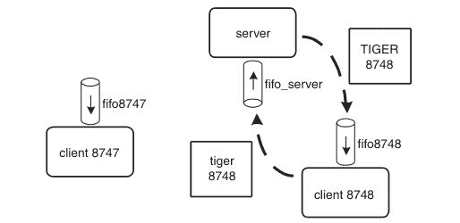

**图 7.1** 带有两个客户端的服务器。

客户端和服务器必须使用相同的算法来根据客户端进程 ID 组成 FIFO 名称，所以我的示例为此目的使用了一个共享的函数：

```c
bool make_fifo_name(pid_t pid, char *name, size_t name_max)
{
    snprintf(name, name_max, "fifo%d", (long)pid);
    return true;
}
```

一个公共头文件定义了固定的服务器 FIFO 名称和一个消息结构体：

```c
#define SERVER_FIFO_NAME "fifo_server"

struct simple_message {
    pid_t sm_clientpid;
    char sm_data[200];
};
```

以下是服务器程序的代码：

```c
int main(void)
{
    int fd_server, fd_client, i;
    size_t nread;
    struct simple_message msg;
    char fifo_name[100];

    printf("server started\n");
    if (mkfifo(SERVER_FIFO_NAME, PERM_FILE) == -1 && errno != EEXIST)
        EC_FAIL
    ec_negl( fd_server = open(SERVER_FIFO_NAME, O_RDONLY) )
    while (true) {
        ec_negl( nread = read(fd_server, &msg, sizeof(msg)) )
        if (nread == 0) {
            errno = ENETDOWN;
            EC_FAIL
        }
        for (i = 0; msg.sm_data[i] != '\0'; i++)
            msg.sm_data[i] = toupper(msg.sm_data[i]);
        ec_false( make_fifo_name(msg.sm_clientpid, fifo_name,
            sizeof(fifo_name)) )
        ec_negl( fd_client = open(fifo_name, O_WRONLY) )
        ec_negl( write(fd_client, &msg, sizeof(msg)) )
        ec_negl( close(fd_client) )
    }
    /* never actually get here */
    ec_negl( close(fd_server) )
    exit(EXIT_SUCCESS);

    EC_CLEANUP_BGN
        exit(EXIT_FAILURE);
    EC_CLEANUP_END
}
```

以下是服务器执行的操作：

*   它创建其 FIFO，仅当 `mkfifo` 返回的错误不是 FIFO 已存在时才失败，因为它可能由服务器之前的运行遗留下来。
*   它以读取模式打开其 FIFO。这将会阻塞，直到有写入者出现，因此在任何客户端运行之前启动服务器是没问题的。
*   每次循环中，它读取一条消息，转换数据，打开客户端的 FIFO，将结果消息写入该 FIFO，然后关闭它。
*   由于我们没有提供显式停止服务器的方式，它将无限期地停留在循环中，直到被 `kill` 命令终止（在我们的示例中未显示）。

你可能已经可以想象客户端程序需要做什么。以下是代码：

```c
int main(int argc, char *argv[])
{
    int fd_server, fd_client = -1, i;
    ssize_t nread;
    struct simple_message msg;
    char fifo_name[100];
    char *work[] = {
        "apple sauce", "tiger", "mountain",
        NULL
    };

    printf("client %ld started\n", (long) getpid());
    msg.sm_clientpid = getpid();
    ec_false(make_fifo_name(msg.sm_clientpid, fifo_name,
        sizeof(fifo_name)) )
    if (mkfifo(fifo_name, PERM_FILE) == -1 && errno != EEXIST)
        EC_FAIL
    ec_negl( fd_server = open(SERVER_FIFO_NAME, O_WRONLY) )
    for (i = 0; work[i] != NULL; i++) {
        strcpy(msg.sm_data, work[i]);
        ec_negl(write(fd_server, &msg, sizeof(msg)) )
        if (fd_client == -1)
        {
            ec_negl( fd_client = open(fifo_name, O_RDONLY) )
            ec_negl( nread = read(fd_client, &msg, sizeof(msg)) )
            if (nread == 0) {
                errno = ENETDOWN;
                EC_FAIL
            }
        }
        printf("client %ld: %s --> %s\n", (long) getpid(),
            work[i], msg.sm_data );
    }

    ec_negl( close(fd_server) )
    ec_negl( close(fd_client) )
    ec_negl( unlink(fifo_name))
    printf("Client %ld done\n", (long) getpid();
    exit(EXIT_SUCCESS);

    EC_CLEANUP_BGN
        exit(EXIT_FAILURE);
    EC_CLEANUP_END
}
```

客户端执行以下操作：

*   创建其 FIFO。
*   以写入模式打开服务器 FIFO。这将会阻塞，直到服务器以读取模式打开它，因此在服务器启动之前启动客户端是没问题的。
*   对于每个要转换的字符串，它组成消息，将其写入服务器，如果有必要，打开自己的客户端以读取模式，并读取结果。
*   在所有字符串转换完成后，它关闭其打开的文件描述符，并取消其 FIFO 的链接，因为其他客户端使用它的可能性不大。

有两点坏消息要告诉你：第一，客户端和服务器都有类似性质的 bug，第二，我展示客户端输出时撒谎了。事实上，客户端的输出是这样的：

```bash
$ smsg_client
client 8747: started
client 8747: apple sauce --> APPLE SAUCE
ERROR:    0: main [/asp/c7/smsg_client.c:46] 0
           *** ? (100: "Network is down") ***
$
```

发生了什么？bug 是什么？位置信息和 `errno` 值告诉我们，客户端从其自己的 FIFO 获取了文件结尾（end-of-file）。既然客户端刚刚向服务器发送了消息，为什么没有数据呢？问题是时序问题：服务器在每条消息后关闭其客户端 FIFO 文件描述符，并且在客户端从其写入操作转向 `read` 之前没有来得及重新打开它。因此，由于没有打开用于写入的文件描述符，客户端获取了文件结尾，如 6.2.2 节所述。

修复方法非常简单。如果客户端保持一个用于向其自己的 FIFO 写入的文件描述符打开，即使它永远不会写入，这将强制对其 FIFO 的任何 `read` 阻塞，直到有数据写入其中（由服务器写入），这正是我们想要的行为。因此，为了修复客户端，我们只需声明另一个文件描述符变量，如下所示：

```c
int fd_client_w = -1;
```

然后像这样，与读取文件描述符一起打开它：

```c
if (fd_client == -1)
    ec_negl( fd_client = open(fifo_name, O_RDONLY) )
if (fd_client_w == -1)
    ec_negl( fd_client_w = open(fifo_name, O_WRONLY) )
```

（我们也应该将它与 `fd_client` 一起关闭。）在大多数 UNIX 系统上，你还可以通过打开一个同时用于读取和写入的文件描述符来修复客户端，但这是非标准的。

因此，使用此修复方法重新运行客户端，我们现在得到以下输出：

```bash
client 8937 started
client 8937: apple sauce --> APPLE SAUCE
client 8937: tiger --> TIGER
client 8937: mountain --> MOUNTAIN
Client 8937 done
ERROR: 0: main [/asp/c7/smsg_server.c:33] 0
*** ? (100: "Network is down") ***
```

仍然不正确！现在*服务器*抱怨它从*它的* FIFO 获取了文件结尾。原因是客户端在不再工作后关闭了服务器 FIFO 的写入端，并且由于没有其他客户端正在运行，服务器获取了文件结尾。我们不希望那样——我们希望服务器继续运行，理想情况下在其读取中阻塞，直到有消息到来。修复方法与客户端的修复方法类似——服务器保持一个用于写入其自己的 FIFO 的文件描述符打开，以避免文件结尾。（我不展示代码——你可以很容易地找出来。）

修复服务器后，不仅两个程序都能平稳运行，我们甚至可以运行多个客户端：

```bash
$ smsg_client & smsg_client & smsg_client & smsg_client
client 9001 started
client 9001: apple sauce --> APPLE SAUCE
client 9001: tiger --> TIGER
[2] 9001
client 9002 started
client 9002: apple sauce --> APPLE SAUCE
client 9002: tiger --> TIGER
[3] 9002
[4] 9003
client 9004 started
client 9004: apple sauce --> APPLE SAUCE
client 9004: tiger --> TIGER
client 9003 started
client 9003: apple sauce --> APPLE SAUCE
client 9003: tiger --> TIGER
client 9002: mountain --> MOUNTAIN
client 9001: mountain --> MOUNTAIN
client 9004: mountain --> MOUNTAIN
client 9003: mountain --> MOUNTAIN
Client 9001 done
Client 9002 done
Client 9004 done
[2]-  Done      smsg_client
[3]-  Done      smsg_client
$ Client 9003 done
[4]+  Done      smsg_client
```

## 7.2.3 对 FIFOs 的批评

FIFOs 的优点包括：

*   易于理解和使用，因为它们本质上是管道，并使用基本的 I/O 系统调用（`open`、`read`、`write` 等）。
*   在所有版本的 UNIX 中均可用。
*   效率较高（参见本章末尾的表 7.2）。
*   适用于数据流和离散消息。为了提高速度，读取端可以一次读取多条消息，写入端也可以一次写入整个缓冲区的消息，前提是未超过原子写入的最大限制。

缺点是：

*   单个 FIFO 不能有多个读取者，因为读取时没有原子性保证（有关此问题的更多说明，参见第 6.2.2 节）。
*   数据必须从一个进程的用户的空间复制到内核缓冲区，然后再复制回另一个用户空间，这会带来较高的开销。（消息队列和套接字也有相同的缺点。）因此，FIFO 不适用于最关键的应用场景。
*   如果消息大小过大（参见第 6.2.2 节），写入者可能会阻塞。如果对此处理不当，应用程序可能会死锁。

## 7.3 抽象的简单消息接口 (SMI)

将上一节 FIFO 示例中的消息发送和接收推广为一个抽象接口是很有用的，主要原因有两个：

*   关键细节（例如保持用于写入的文件描述符处于打开状态）可以由接口的实现来处理，从而允许更轻松、更可靠的应用程序编程。
*   可以为不同的 IPC 机制编程实现多种不同的实现方式。您可以在不更改应用程序源代码的情况下试验各种实现，以找到效果最好的那一种。

我将在本节中使用的接口称为 SMI，即简单消息接口 (Simple Messaging Interface)。

2. 它是为本书设计的，不属于任何标准的一部分。

### 7.3.1 SMI 类型与函数

本节我将只解释该接口，具体实现将在后续章节中介绍。首先，这是通用的消息结构：

```c
struct smi_msg—structure for SMI

struct smi_msg {
long smi_mtype; /* must be first */
struct client_id {
long c_id1;
long c_id2;
} smi_client;
char smi_data[1];
};
```

前两个成员，`smi_mtype` 和 `smi_client`，是某些实现所必需的，我们稍后会看到这一点。我们已经在第 7.2.2 节的示例中看到，客户端必须向服务器传递其进程 ID；在 SMI 消息中，这将放入 `client.c1_id1` 成员。我们将稍后看到 `smi_mtype` 和 `smi_client.c_c_id2` 的使用。

消息数据（`smi_data`）可以是任何内容，但有以下限制：

*   服务器和客户端可能位于不同的机器上，因此不应传递指针或其他在网络上没有意义的数据。
*   由于不同机器具有不同的字节序，二进制数必须以网络标准格式表示。这一主题将在第 8.1.4 节中探讨。

在这个简单接口中，服务器和客户端必须就固定的消息大小达成一致，而 `smi_data` 数组的实际大小取决于该大小。一旦您掌握了本章和下一章的原则，您就可以研究在您自己应用程序中使用的 SMI 版本中放宽这一限制。

在发送或接收之前，服务器或客户端必须打开一个消息队列，并且在终止时应将其关闭。从概念上讲，发送的消息会被放入队列中，而接收的消息会从队列中取出。队列实际是什么取决于实现，并且隐藏在 SMI 实现内部，就像 `FILE` 类型的内部细节被标准 C I/O 函数隐藏一样。

打开和关闭的接口如下：

#### SMI 类型—SMI 的类型

```c
typedef void *SMIQ;          /* message queue */
typedef enum {
    SMI_SERVER,              /* server */
    SMI_CLIENT               /* client */
} SMIDENTITY;
#define SERVER_NAME_MAX 50  /* max size of server name */
```

#### smi_open—打开 SMI 消息队列

```c
SMIQ *smi_open(
    const char *name,        /* server name */
    SMIDENTITY entity,       /* entity being opened */
    size_t msize             /* fixed message size */
);
/* Returns pointer to message queue or NULL on error (sets errno) */
```

#### smi_close—关闭 SMI 消息队列

```c
bool smi_close(
    SMIQ *sqp               /* queue */
);
/* Returns true on success or false on error (sets errno) */
```


传递给 `smi_open` 的消息队列名称必须为服务器和所有客户端所知。如果实现需要在打开之前创建它，这会在 `smi_open` 内部悄悄完成。这个简单接口中没有任何权限设置，这是它被称为“简单”的众多原因之一。消息队列在关闭后是否保留并未作为接口的一部分进行规定，这也取决于实现。

`entity` 参数是 `SMI_SERVER` 或 `SMI_CLIENT`，具体取决于正在执行打开操作的程序类型。只能有一个服务器进程，但客户端的数量是未定义的。

`msgsize` 参数是 `smi_msg` 结构中 `smi_data` 成员的大小，适用于所有消息。如前所述，没有规定消息可以是不同大小的。

对于发送和接收，我们可以将缓冲区地址传递给简单的发送和接收函数，类似 `write` 和 `read`，如下所示（因为没有大小参数，因为它是固定数量）：

```c
ec_false( smi_send(sqp, buffer) )
...
ec_false( smi_receive(sqp, buffer) )
```

但如果这样做，将要求所有实现将每条消息从发送进程复制到内核，然后再从内核复制到接收进程。相反，我们将使用一个稍微复杂的接口，发送使用两次调用，接收也使用两次调用。每对调用的第一次调用仅获取消息的地址，第二次调用则释放对该地址的访问。这样，实现可以将其保留在 `SMIQ` 结构中（这意味着它确实被复制了），或者保留在共享内存中，或者以任何其他方式。调用者只知道它们有一个可以解引用的地址。需要释放函数是因为该地址可能不会永远有效——内存可能必须被释放，或者共享内存段可能需要被重用——而且底层实现需要知道发送者准备好让消息发送出去了。

解释接收比解释发送更容易：

#### `smi_receive_getaddr`—获取接收的 SMI 消息地址

```c
bool smi_receive_getaddr(
    SMIQ *smp,             /* queue */
    void **addr            /* message */
);
/* Returns true on success or false on error (sets errno) */
```

#### `smi_receive_release`—释放接收的 SMI 消息

```c
bool smi_receive_release(
    SMIQ *smp             /* queue */
);
/* Returns true on success or false on error (sets errno) */
```

`addr` 参数是指向 `void` 指针的指针，而不是指向 `struct smi_msg` 指针，因为在实际中，每个应用程序都会定义自己的消息结构，其前两个成员与 `smi_msg` 的前两个成员（`smi_mtype` 和 `smi_client`）匹配。

应用程序使用这两个调用如下：

```c
struct my_msg *msg;
...
ec_false( smi_receive_getaddr(smp, (void **)&msg) )
/* process data in msg->smi_data */
ec_false( smi_receive_release(smp) )
```

从概念上讲，当调用 `smi_receive_getaddr` 时，消息实际上已被接收。请注意，应用程序不为消息分配空间；那是由实现完成的。

发送非常相似，但有一个额外的难点——识别客户端：

#### `smi_send_getaddr`—获取发送的 SMI 消息地址

```c
bool smi_send_getaddr(
    SMIQ *scp,
    struct client_id *client,    /* client identifier */
    void **addr                 /* message */
);
/* Returns true on success or false on error (sets errno) */
```

#### `smi_send_release`—释放并发送 SMI 消息

```c
bool smi_send_release (
    SMIQ *scp                  /* queue */
);
/* Returns true on success or false on error (sets errno) */
```

从概念上讲，实际的发送发生在调用 `smi_send_release` 时。

`smi_send_getaddr` 的第二个参数由服务器用于识别它正在向其发送消息的客户端。它是一个指向接收消息中的 `struct client_id` 的指针。这是可行的，因为服务器在向其发送消息之前，先会收到想要与其进行通信的客户端的消息。发送的客户端不需要识别服务器（这已经在 `smi_open` 中完成了），因此第二个参数为 `NULL`。

然后，服务器会执行类似以下操作：

```c
struct my_msg *msg_in, *msg_out;
...
ec_false( smi_receive_getaddr(scp, (void **) &msg_in ) )
/* code to process data in msg_in->smi_data */
ec_false( smi_send_getaddr(scp, &msg_in->smi_client, (void **) &msg_out ) )
ec_false( smi_receive_release(scp) )
/* code to put data into msg_out->smi_data */
ec_false( smi_send_release(scp) )
```

请注意：

- 服务器使用了两个独立的 `my_msg` 地址（`msg_in` 和 `msg_out`），因为涉及到两个不同的缓冲区。
- `msg_in` 直到调用 `smi_send_getaddr` 之后才释放，因为在此之前需要 `msg_in->smi_client` 结构。以这种方式交错调用调用是可以的；事实上，`smi_receive_release` 甚至可以在调用 `smi_send_release` 之后调用——发送和接收是完全独立的。或者，`client_id` 结构可以已被复制到一个临时变量中，其地址可在调用 `smi_send_getaddr` 时使用。

客户端像这样调用 `smi_send_getaddr` 和 `smi_send_release`（很可能有一个 `msg_in`，但我们没有展示它）：

```c
struct smi_msg *msg_out;
...
ec_false( smi_send_getaddr(sqp, NULL, (void **)&msg_out) )
/* 向 msg_out->smi_data 中填充数据的代码 */
ec_false( smi_send_release(sqp) )
```

下一节包含一个更完整的示例。

### 7.3.2 使用 SMI 的服务器和客户端示例

为了展示如何在应用程序中使用 SMI 函数，下面是第 7.2.2 节示例中的服务器，它被重写以使用 SMI 接口（`#defines` 位于一个由服务器和客户端共同包含的头文件中）：

```c
#define SERVER_NAME "smg_server"
#define DATA_SIZE 200

int main(void)
{
    SMIQ *sqp;
    struct smi_msg *msg_in, *msg_out;
    int i;

    printf("server started\n");
    ec_null( sqp = smi_open(SERVER_NAME, SMI_SERVER, DATA_SIZE) )
    while (true) {
        ec_false( smi_receive_getaddr(sqp, (void **)&msg_in) )
        ec_false( smi_send_getaddr(sqp, msg_in->smi_client,
                                   (void **)&msg_out) )
        for (i = 0; msg_in->smi_data[i] != '\0'; i++)
            msg_out->smi_data[i] = toupper(msg_in->smi_data[i]);
        msg_out->smi_data[i] = '\0';
        ec_false( smi_receive_release(sqp) )
        ec_false( smi_send_release(sqp) )
    }
    /* 实际上永远无法到达此处 */
    ec_false( smi_close(sqp) )
    exit(EXIT_SUCCESS);

    EC_CLEANUP_BGN
        exit(EXIT_FAILURE);
    EC_CLEANUP_END
}
```

以下是客户端代码：

```c
int main(int argc, char *argv[]) {

    SMIQ *sqp;
    struct smi_msg *msg;
    int i;

    char *work[] = {
        "appleSauce",
        "tiger",
        "mountain",
        NULL
    };

    printf("client %ld started\n", (long)getpid());
    ec_null( sqp = smi_open(SERVER_NAME, SMI_CLIENT, DATA_SIZE) )
    for ( i = 0; work[i] != NULL; i++ ) {
        ec_false( smi_send_getaddr(sqp, NULL, (void **) &msg) )
            strcpy(msg->smi_data, work[i]);
        ec_false( smi_send_release(sqp) )
        ec_false( smi_receive_getaddr(sqp, (void **) &msg) )
            printf("client %ld: %s --> %s\n", (long)getpid(),
                work[i], msg->smi_data);
        ec_false( smi_receive_release(sqp) )
    }
    ec_false( smi_close(sqp) )
    printf("Client %ld done\n", (long)getpid());
    exit(EXIT_SUCCESS);

    EC_CLEANUP_BGN
        exit(EXIT_FAILURE);
    EC_CLEANUP_END
}
```

请注意，我们在第 7.2.2 节中看到的保持文件描述符打开以便写入的那些“棘手操作”已不复存在，`FIFO` 名称等细节也是如此。也许说它们被“隐藏”比说它们“消失”更准确，正如我们要即将发现的那样。

### 7.3.3 SMI 的 FIFO 实现

之前从服务器和客户端中移除的所有与 `FIFO` 消息传递相关的复杂性，现在都必须放入 SMI 函数的实现中。此外，服务器实现将尝试跨消息保持客户端-`FIFO` 文件描述符的打开状态，以避免每次打开和关闭带来的开销，就像第 7.2.2 节中的示例所做的那样。

`FIFO` 实现使用形如 `smifcn_fifo` 的函数名，其中 `smifcn` 是 SMI 名称（例如，`smi_send_getaddr_fifo` 是 `smi_send_getaddr` 的实现）。一个小型包装文件实际上翻译了这些名称，通过像下面这样的小函数：

```c
bool smi_send_getaddr(SMIQ *sqp, struct client_id *client, void **addr)
{
    return smi_send_getaddr_fifo(sqp, client, addr);
}
```

使用包装器允许链接两种类型的应用程序：

- 一个实现无关的应用程序，如上一节所示，可以用通用的 SMI 函数（例如，`smi_send_getaddr`）来编写，然后与特定的实现以及适当的包装器链接，以将调用从通用翻译为特定。
- 希望使用几种实现的应用程序可以使用特定的函数名（例如，`smi_send_getaddr_fifo`, `smi_send_getaddr_skt`），绕过未链接的包装器。这样做的一个主要目的是编写测试程序，例如，使用不同方法运行相同的应用程序以比较它们的性能。我正是这样做的，以准备第 7.2 表，该表是本章的结尾。

我将在书中不展示这些包装器，但它们在网站上 [AUP2003] 有。

我们将以内部的消息队列开始 `FIFO` 实现。服务器和客户端使用相同的数据结构，尽管由于它们在不同的进程中，因此各自拥有自己的数据。

```c
#define MAX_CLIENTS 20
typedef struct {
    SMINTITY sq_entity;           /* 实体 */
    int sq_fd_server;             /* 服务器读取及... */
    int sq_fd_server_w;           /* ... 写入文件描述符 */
    char sq_name[SERVER_NAME_MAX];/* 服务器名称 */
    struct {
        int cl_fd;                /* 客户端文件描述符 */
        pid_t cl_pid;             /* 客户端进程 ID */
    } sq_clients[MAX_CLIENTS];
    struct client_id sq_client;   /* 客户端 ID */
    size_t sq_msgsize;            /* 消息大小 */
    struct smi_msg *sq_msg;       /* 消息缓冲区 */
} SMIQ_FIFO;
```

每个服务器只有 20 个客户端的空间。可以使用链表来解除这个限制，但我没有费心去做。服务器端使用 `sq_fd_server` 来操作服务器，并且服务器端还额外使用 `sq_fd_server_w` 保持一个用于写入的文件描述符处于打开状态，如第 7.2.2 节所述。服务器使用 `sq_clients` 数组保存客户端文件描述符，以避免在处理每个传入消息时反复打开和关闭它们。客户端只需其中一个用于读取自己的 `FIFO`，它使用 `sq_clients[0]`。它使用 `sq_clients[1]` 保持第二个文件描述符处于打开状态以用于写入。对于客户端来说，数组的其余部分和 `sq_fd_server_w` 是浪费的空间，但我认为对两者使用相同的队列结构会更简单，因为浪费的空间很小。

由服务器传递给 `smi_send_getaddr_fifo` 的客户端 ID 信息保留在 `sq_client` 成员中，以供后续的 `smi_send_release_fifo` 使用。传递给 `smi_open_fifo` 的大小和指向消息缓冲区的指针位于 `sq_msgsize` 和 `sq_msg` 成员中。（请注意，与消息队列和套接字一样，对于 `FIFO` 而言，从用户空间到内核再回到接收进程的数据复制是不可避免的。）

服务器和客户端都需要初始化 `sq_clients` 数组，使用这个内部函数：

```c
static void clients_bgn(SMIQ_FIFO *p)
{
    int i;

    for (i = 0; i < MAX_CLIENTS; i++)
        p->sq_clients[i].cl_fd = -1;
}
```

最后，它们调用 `clients_end`：

```c
static void clients_end(SMIQ_FIFO *p)
{
    clients_close_all(p);
}

static void clients_close_all(SMIQ_FIFO *p)
{
    int i;

    for (i = 0; i < MAX_CLIENTS; i++)
        if (p->sq_clients[i].cl_fd != -1) {
            (void)close(p->sq_clients[i].cl_fd);
            p->sq_clients[i].cl_fd = -1;
        }
}
```

我们将在 `smi_open_fifo` 和 `smi_close_fifo` 函数中看到这些调用。

当服务器收到消息时，它使用 `clients_find` 来检查是否已经有一个打开到该 `FIFO` 的文件描述符，如果没有，则找到一个可用的槽位：


```c
static int clients_find(SMIQ_FIFO *p, pid_t pid)
{
    int i, avail = -1;

    for (i = 0; i < MAX_CLIENTS; i++) {
        if (p->sq_clients[i].cl_pid == pid)
            return i;
        if (p->sq_clients[i].cl_fd == -1 && avail == -1)
            avail = i;
    }
    if (avail != -1)
        p->sq_clients[avail].cl_pid = pid;
    return avail;
}
```

如果没有更多客户端可以处理，此函数返回 -1。

最后的内部函数用于创建 FIFO 名称。服务器的名称是固定的，而客户端的包含其进程 ID，正如第 7.2.2 节中较早的示例所示。

```c
static void make_fifo_name_server(const SMIQ_FIFO *p, char *fifo_name,
                                  size_t fifoname_max)
{
    snprintf(fifo_name, fifoname_max, "/tmp/smiq_fifo-%s", p->sq_name);
}

static void make_fifo_name_client(pid_t pid, char *fifo_name,
                                  size_t fifoname_max)
{
    snprintf(fifo_name, fifoname_max, "/tmp/smiq_fifo%d", (long)pid);
}
```

现在我们准备好查看 `smi_open_fifo`：

```c
SMIQ *smi_open_fifo(const char *name, SMIENTITY entity, size_t msgsize)
{
    SMIQ_FIFO *p = NULL;
    char fifoname[SERVER_NAME_MAX + 50];

    ec_null( p = calloc(1, sizeof(SMIQ_FIFO)) )
    p->sq_msgsize = msgsize + offsetof(struct smi_msg, smi_data);
    ec_null( p->sq_msg = calloc(1, p->sq_msgsize) )
    p->sq_entity = entity;
```

## 7.3 (来自代码的隐式上下文)

```c
if (strlen(name) >= SERVER_NAME_MAX) {
    errno = ENAMETOOLONG;
    EC_FAIL
}
strcpy(p->sq_name, name);
make_fifo_name_server(p, fifoName, sizeof(fifoName));
if (p->sq_entity == SMII_SERVER) {
    client5_bgp(p);
    if (mkfifo(fifoName, PERM_FILE) == -1 && errno != EEXIST)
        EC_FAIL
    ec_negI( p->sq_fd_server = open(fifoName, O_RDONLY) )
    ec_negl( p->sq_fd_server_w = open(fifoName, O_WRONLY) )
} else {
    ec_negI( p->sq_fd_server = open(fifoName, O_WRONLY) )
    make_fifo_name_client(getpid(), fifoName, sizeof(fifoName));
    (void)unlink(fifoName);
    ec_negI( mkfifo(fifoName, PERM_FILE) )
    ec_negl( p->sq_clients[0].cl_fd =
             open(fifoName, O_RDONLY | O_NONBLOCK) )
    ec_false( setblock(p->sq_clients[0].cl_fd, true) )
    ec_negI( p->sq_clients[1].cl_fd = open(fifoName, O_WRONLY) )
}
return (SMIq *)p;

EC_CLEANUP_BGN
if (p != NULL) {
    free(p->sq_msg);
    free(p);
}
return NULL;
EC_CLEANUP_END
```

如果你已经理解了第 7.2.2 节中的示例，这段代码应该是易于理解的。但实际打开 FIFO 的部分值得回顾一下。对于服务器，打开其 FIFO 的顺序是：

```c
ec_negI( p->sq_fd_server = open(fifoName, O_RDONLY) )
ec_negl( p->sq_fd_server_w = open(fifoName, O_WRONLY) )
```

如果没有写入者，第一个调用将阻塞，这是没问题的，因为没有写入者时服务器本来也就没有什么事可做。然而，客户端打开其 FIFO 的顺序更复杂：

```c
ec_negI( p->sq_clients[0].cl_fd =
         open(fifoName, O_RDONLY | O_NONBLOCK) )
ec_false( setblock(p->sq_clients[0].cl_fd, true) )
ec_negI( p->sq_clients[1].cl_fd = open(fifoName, O_WRONLY) )
```

如果没有 `O_NONBLOCK` 标志，客户端在打开时会阻塞，等待服务器为写入而打开 FIFO。但是，除非服务器收到消息，否则它不会这样做，因为只有那时它才知道这个特定客户端的存在。这就导致了死锁！解决方案，如代码所示，是以非阻塞方式打开 FIFO，这意味着它会返回一个有效的文件描述符，而无需等待写入者。然后我们必须清除 `O_NONBLOCK` 标志（即设置为阻塞模式），以便后续的读取操作会阻塞，这是我们期望的行为。（`setblock` 使用 `fcntl` 系统调用，来自于第 4.2.2 节。）在第 7.2.2 节的示例中，我们不需要这样做，因为客户端只有在向服务器发送消息之后才打开自己的 FIFO。在这里行不通，因为 SMI 函数是独立的，有特定的任务要完成。（有时模块化需要额外的工作。）

这里是配套的 `smi_close_fifo` 函数：

```c
bool smi_close_fifo(SMIO *sqp)
{
    SMIO_FIFO *p = (SMIO_FIFO *)sqp;

    clients_end(p);
    (void)close(p->sq_fd_server);
    if (p->sq_entity == SMI_CLIENT) {
        char filename[SERVER_NAME_MAX + 50];

        make_fifo_name_client(getpid(), filename, sizeof(filename));
        (void)unlink(filename);
    }
    else
        (void)close(p->sq_fd_server_w);
    free(p->sq_msg);
    free(p);
    return true;
}
```

注意客户端会删除其 FIFO，但服务器保留其 FIFO，以便将来可以在服务器未运行的情况下启动客户端。

这里是 `smi_send_getaddr_fifo`，除了保存客户端 ID 并返回缓冲区地址外，它几乎什么也不做：

```c
bool smi_send_getaddr_fifo(SMIO *sqp, struct client_id *client,
               void **addr)
{
    SMIO_FIFO *p = (SMIO_FIFO *)sqp;
    if (p->sq_entry == SMI_SERVER)
        p->sq_client = *client;
    *addr = p->sq_msg;
    return true;
}
```

真正的工作在 `smi_send_release_fifo` 中：

```c
bool smi_send_release_fifo(SMIO *sqp)
{
   SMIO_FIFO *p = (SMIO_FIFO *)sqp;
   ssize_t nwrite;

   if (p->sq_entry == SMI_SERVER) {
      int nclient = clients_find(p, p->sq_client.c_idl);
      if (nclient == -1 || p->sq_clients[nclient].cl_fd == -1) {
         errno = EADDRNOTAVAIL;
         EC_FAIL
      }
      ec_neg1( nwrite = write(p->sq_clients[nclient].cl_fd, p->sq_msg,
         p->sq_msgsize) )
   }
   else {
      p->sq_msg->smi_client.c_idl = (long)getpid();
      ec_neg1( nwrite = write(p->sq_fd_server, p->sq_msg,
         p->sq_msgsize) )
   }
   return true;

   EC_CLEANUP_BGN
      return false;
   EC_CLEANUP_END
}
```

这里没有什么特别之处，这些内容在第 7.2.2 节的早期示例中已经出现过。`smi_receive_getaddr_fifo` 完成了接收消息的所有工作：

```c
bool smi_receive_getaddr_fifo(SMIO *sqp, void **addr)
{
   SMIO_FIFO *p = (SMIO_FIFO *)sqp;
   ssize_t nread;

   if (p->sq_entry == SMI_SERVER) {
      int nclient;
      char ffname[SERVER_NAME_MAX + 5];

      while (true) {
         ec_neg1( nread = read(p->sq_fd_server, p->sq_msg,
            p->sq_msgsize) )
         if (nread == 0) {
            errno = ENETDOWN;
            EC_FAIL
         }
         if (nread < offsetof(struct smi_msg, smi_data)) {
            errno = EBIG;
            EC_FAIL
         }
         if ((nclient = clients_find(p,
            (pid_t)p->sq_msg->smi_client.c_idl)) == -1) {
            continue; /* 客户端未被通知 */
         }
         if (p->sq_clients[nclient].cl_fd == -1) {
            make_fifo_name_client((pid_t)p->sq_msg->smi_client.c_idl,
            fifo_name, sizeof(fifo_name));
            ec_negl(p->sq_clients[nclient].cl_fd =
            open(fifo_name, O_WRONLY))
         }
         break;
      }
   } else
      ec_negl( nread = read(p->sq_clients[0].cl_fd, p->sq_msg,
      p->sq_msgsizes) )
   *addr = p->sq_msg;
   return true;

   EC_CLEANUP_BGN
   return false;
   EC_CLEANUP_END
}
```

这里棘手的一个部分是：

```c
if ((nclient = clients_find(p, (pid_t)mp->smi_client)) == -1) (
    continue; /* 客户端未被通知 */
)
```

如果 `clients_find` 返回 −1，这意味着服务器从客户端收到了消息，但无法在 `sq_clients` 数组中获取一个槽位，因此无法打开响应 FIFO。由于无法响应，甚至无法发送错误消息。示例代码直接忽略了错误，让客户端保持阻塞状态。一些替代方案包括：

- 向客户端发送信号，并修改 `smi_open_fifo` 以安排捕获该信号。
- 使用一个整型变量保存用于打开 FIFO 的紧急文件描述符，以便可以发送错误消息。
- 至少修改客户端，使其超时而不是永远保持阻塞状态。

剩下一个函数，但它根本不需要做任何事情：

```c
bool smi_receive_release_fifo(SMIQ *scp)
{
    return true;
}
```

这就是整个实现。即使存在我所讨论的局限性，它仍然是一个可移植性高、可靠性合理的 SMI 函数实现，你可以立即在自己的应用程序中开始使用它，至少用于原型设计。以后，你可以使用其他实现，因为接口是相同的。

## 7.4 System V IPC (进程间通信)

如第 1.1.7 节所述，用于消息、信号量和共享内存的系统调用有两组。较旧的一组通常称为 System V IPC，而较新的一组称为 POSIX IPC。本章将讨论这两者，首先是 System V 和 POSIX 消息，然后是两种类型的信号量，最后是共享内存。本节解释适用于所有 System V IPC 机制的一些通用概念；稍后，在第 7.6 节中，将解释通用的 POSIX IPC 概念。

### 7.4.1 System V IPC 对象

System V IPC 对象有三种类型：消息队列、信号量集和共享内存段。它们不是文件——甚至不是特殊文件——而是拥有自己的命名方案、生命周期规则和权限系统的对象。以下是 System V IPC 对象的主要特征：

- 它们仅存在于单个机器内。不能用于跨网络通信。
- 它们的寿命与内核相同——重启时会被销毁。
- 你使用一个在对象生命周期内固定的整数标识符来访问对象。知道该标识符的任何进程都可以直接使用它来访问对象——无需先打开对象。这与文件描述符不同，文件描述符是进程的属性，当进程结束时就会消失。（System V IPC 也有键，我将在下一节解释。）
- 没有 i 节点（i-nodes）或路径名，因此传统的文件和目录操作系统调用，如 `unlink`、`stat`、`read` 或 `write` 均无法使用。

这三种对象都有形式为 Xget 和 Xctl 的系统调用，其中 X 为 msg、sem 或 shm。因此，这六个调用分别是 `msgget`、`semget`、`shmget`、`msgctl`、`semctl` 和 `shmctl`。当讨论内容适用于这三种对象时，我将继续使用术语 Xget 和 Xctl 来指代“get”和“ctl”调用。

只剩下另外五个调用：用于发送和接收消息的 `msgsnd` 和 `msgrcv`，用于操作信号量集的 `semop`，以及用于附加和分离共享内存段的 `shmat` 和 `shmdt`。

## 7.4.2 标识符、键和 ftok 系统调用

当创建 System V IPC 对象时，内核会分配一个标识符，因此通常情况下，该标识符的值在每次重启后都会不同。为了方便不同的进程获取它们需要共享的对象的标识符，还存在永久的 `keys`，其值永远不会改变。进程可以在使用 Xget 创建对象时指定一个键，或者如果对象已经存在，直接使用 Xget 通过键获取标识符。然而，键并不能真正识别特定对象，就像路径名识别文件那样，因为对象的生命周期仅持续到下一次重启。下次，相同的键将用于生成一个新的对象，该对象可能具有不同的标识符。

键的类型为 `key_t`，虽然各种系统调用将其用作算术类型，但该类型并不一定要求是算术类型，因此这是一个安全的假设。如果需要，你完全可以像下面这样为程序定义键值：

```c
#define MSGQ_KEY    1234
#define SEM_KEY     1235
#define SHM_KEY1    1236
#define SHM_KEY2    1237
```

然后，任何使用 `MSGQ_KEY` 作为参数调用 `msgget` 的进程都将获得指向同一消息队列的标识符。

使用键的问题是，需要一种全球性的管理方案来分配它们，以避免应用程序之间出现冲突。这显然是不可行的，因此另一层抽象允许通过 `ftok` 系统调用从路径名生成键。

`ftok`—生成 System V IPC 键


```c
#include <sys/ipc.h>

key_t ftok(
    const char *path,      /* 现有文件的路径名 */
    int id                 /* 期望的键编号 */
);
/* 成功时返回键，出错时返回 -1 (设置 errno) */
```

实际上，`ftok` 可以从同一路径生成许多键；期望的键由 `id` 参数指定，它可以是一个字符，因为只使用其最低的 8 位。它也不能为零。例如，如果你的应用程序需要四个键（一个消息队列，一个信号量集，两个共享内存段），你可以使用单个路径名（例如 `/tmp/myappkeys`）并调用四次 `ftok`，第二个参数分别取值为 `q`、`s`、`m` 和 `n`（或者你喜欢的任意四个值）。路径名必须已经存在—`ftok` 不会创建它。

请记住我说过 System V IPC 对象不是文件，也没有 `i` 节点。传递给 `ftok` 的文件名存在的唯一目的是为键生成提供全局名称。文件的内容无关紧要。即使名称保持不变，也不能保证如果文件被删除并重新创建，就会生成相同的键，因此你应该在应用程序安装或首次运行时创建该文件，并让它保留直到应用程序被卸载。

只有当路径位于同一文件系统时，两个不同的路径才保证生成两个不同的键（见第 3.2.4 节）。如果你担心不同的应用程序意外使用相同的键，你可以使用特殊的键 `IPC_PRIVATE` 在一个 `Xget` 调用中（详见第 7.5.1 节），这保证你获得一个唯一的 IPC 对象，而完全不需要使用 `ftok` 或特定的键。你需要以某种方式发布生成的标识符，以便所有需要它的进程都能获取；做到这一点的一种方法是将其写入一个这些进程已知名称的文件中。但是，对于大多数目的，包括本书中的所有示例，我们将假设不会发生 `ftok` 冲突。

总结：

- 你通过标识符访问 System V IPC 对象。获取标识符的方式无关紧要—它可以是 `exec` 的参数，通过消息传递，从文件读取，由类似 `msgget` 的系统调用返回，等等。
- 如果你想要（通常你也想要），你可以使用键来引用对象，与标识符不同，即使对象被销毁并重新创建，键仍然保持恒定。
- 由于管理键很困难，它们可以通过 `ftok` 从路径名生成，在实践中，这通常是你所做的事情。非唯一键是种遥远的可能性；创建 `IPC_PRIVATE` 对象是一种潜在的解决方案。

你可能会问自己：“既然 UNIX 已经有了一个非常完善的涉及路径名和文件描述符的机制，为什么还要有所有这些标识符/键/`ftok` 的东西？”当我们查看一些使用 System V IPC 消息的示例代码时，答案很快就会清楚。我们会看到，服务器可以获取客户端消息队列的标识符，并立即使用它发送消息回去，而不需要 `open` 所执行查找和打开 `i` 节点的开销。

尽管如此，人们还是会猜想是否有可能设计出一种更清洁的方法，既高效又能更好地融入文件系统的其余部分。当我们查看 POSIX IPC 消息时，将会看到这样一种方法，尽管它在路径名的使用方式上也有其自身的问题。

除了复杂性和不规则性外，System V IPC 方法的另一个缺点是，由于标识符不是文件描述符，你无法使用 `select` 或 `poll`（第 4.2 节）来阻塞，例如直到消息就绪。我已经在第 5.18 节中展示了这个问题的一个解决方案。

无论如何，System V IPC 系统调用现在已经标准化，没有任何改进的机会。

## 7.4.3 System V IPC 所有权和权限

如果 System V IPC 对象仅仅是文件，它们就可以使用文件所使用的权限系统，我也就不需要在这里解释什么了。但是，由于它们不是文件，它们有自己的系统。幸运的是，它非常像文件使用的那个系统。

权限使用常规的 9 位进行指定：所有者、组和其他人的读、写和执行。然而，“执行”没有任何含义，因此这些位未被使用。对象的权限是在使用其中一个 `Xget` 系统调用创建对象时设置的。稍后，你可以使用 `Xctl` 系统调用来更改权限。

文件有所有者用户 ID 和所有者组 ID。System V IPC 对象除了拥有这两个 ID 外，还存储创建者的用户 ID 和组 ID。你可以使用 `Xctl` 更改所有者 ID，但不能更改创建者 ID。

当你操作一个对象时，检查权限的算法使用有效用户 ID 和有效组 ID，正如对文件所做的那样一样，并且“其他”权限位仅在用户 ID 或组 ID 没有匹配时使用。然而，有效用户 ID 或组 ID 可以与创建者或所有者 ID 匹配。

拥有独立的创建者和所有者 ID 允许一个管理用户，例如 “dbmsadm”，既是消息队列的创建者，也是拥有数据库文件访问权限的数据库服务器进程的有效用户 ID。一个权限较低的用户，例如 “dbmuser”，可以访问消息队列但不能访问文件。

当你使用其中一个 `Xctl` 系统调用获取或设置权限时，你使用此结构：

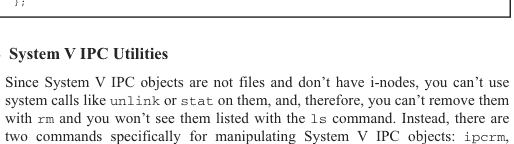

## 7.4.4 System V IPC 实用工具

由于 System V IPC 对象不是文件，没有 `i` 节点，你不能在它们上使用像 `unlink` 或 `stat` 这样的系统调用，因此，你不能使用 `rm` 移除它们，也不会看到它们被 `ls` 命令列出。相反，有两个专门用于操作 System V IPC 对象的命令：`ipcrm`，用于移除对象，以及 `ipcs`，用于报告其状态。查看 [SUS2002] 或你系统的文档以了解这些命令的所有各种选项；这里我将只概述基本内容。

你调用 `ipcrm` 时，带有一个或多个形式为

`X Y`

的参数对

其中 `X` 为消息队列的小写或大写 `Q`，`S` 为信号量集，或 `M` 为共享内存段。若为小写，`Y` 是标识符；若为大写，`Y` 是键。^3 例如，命令

```
ipcrm -q 50
```

将删除标识符为 50 的消息队列。当你删除一个文件时，实际上你只是从目录中删除了一个条目；`i-node` 会保留，直到打开该文件的最后一个文件描述符被关闭，因此正在运行的进程不会受到不当影响。然而，对于 System V IPC 对象并没有规定此类行为——对象可能会立即消失，从而导致正在使用它的进程陷入混乱。因此，通常 `ipcrm` 仅用于非工作时间段的系统管理，或者当你确切知道该对象未被使用时。

`ls` 的 System V IPC 等价命令是 `ipcs`。在不带参数使用时，它会显示类似以下内容的内容：

```
IPC status from <running system> as of Wed Mar 12 15:04:06 MST 2003
T  ID   KEY        MODE            OWNER     GROUP
Message Queues:
q  50   0x1007b8c --rw-rw-rw-     marc  sysadmin
Shared Memory:
m  0    0x500004b7 --rw-r--r--    root    root
m  102  0           --rw-rw-rw-   marc  sysadmin
m  103  0           --rw-rw-rw-   marc  sysadmin
m  104  0           --rw-rw-rw-   marc  sysadmin
m  105  0           --rw-rw-rw-   marc  sysadmin
Semaphores:
s  131072 0x1007b8d -ra-ra-ra--   marc  sysadmin
s  131073 0           --ra-ra-ra-- marc  sysadmin
```

请注意，其中一些键为零。这些是私有对象，是通过 `Xget` 以 `IPC_PRIVATE` 作为键参数创建的，而不是使用某个具体的键。当标识符将直接传递给其他进程（例如，作为消息中的数据）时，就会这样做，此时其他进程无需执行自己的 `Xget`。我们将在 SMI 函数的 System V 消息队列实现中看到这一点（第 7.5.3 节）。（`IPC_PRIVATE` 也可以用于确保对象是唯一的，如我在第 7.4.2 节中解释的那样。）

## 7.5 System V 消息队列

现在我们要开始介绍 System V 消息队列系统调用的细节。

### 7.5.1 System V 消息队列系统调用

我们已经概述了 `msqget` 的作用；以下是具体细节：

```
msqget—获取消息队列标识符

#include <sys/msg.h>

int msqget(
    key_t key,               /* 键 */
    int flags                /* 创建标志 */
);
/* 返回标识符，出错时返回 -1（设置 errno） */
```

正如我在第 7.4 节讨论 System V IPC 对象时所说，`msqget` 获取其键由第一个参数指定的已存在消息队列的标识符。如果 `flags` 参数设置了 `IPC_CREAT` 标志，且队列尚不存在，则创建该队列。在这种情况下，权限取自 `flags` 参数低 9 位。创建者和所有者的用户 ID 及组 ID 取自发出 `msqget` 调用的进程的有效 ID。

对于权限位，你可以使用与 `open` 相同的 `S_` 标志（第 2.3 节）。但请确保使用 `IPC_CREAT`；切勿误用 `O_CREAT`！^4 还有一个 `IPC_EXCL` 标志，你可以使用它来使 `msqget` 在队列已存在时失败。

键参数为 `IPC_PRIVATE` 允许你创建一个不与特定键关联的消息队列。每次你使用 `IPC_PRIVATE` 调用 `msqget`（无需 `IPC_CREAT` 标志）时，你都会得到一个不同的队列。这对于希望拥有自己的消息队列以接收来自服务器响应的客户进程来说非常理想；它将标识符传递给服务器，服务器随后可以使用它进行回复。客户和服务器无需共享一个键，因为这通常很麻烦，因为服务器通常不会预先知道它可能拥有哪些客户。

^4 为什么设计 System V IPC 调用的人没有使用与 `open` 相同的符号，而是自己发明了新的符号？因为那时（20 世纪 70 年代中期），`open` 并未使用符号。因此，问题应该是：为什么 `open` 没有使用与 System V IPC 相同的符号？因为这些符号都以 `IPC_` 为前缀，而且，贝尔实验室内部的主流 UNIX 社区并不喜欢 IPC 调用。

你可以通过 `msgctl` 来控制现有队列：

```
msgctl——控制消息队列

#include <sys/msg.h>

int msgctl(

int msqid,    /* 标识符 */

int cmd,    /* 命令 */

struct msqid_ds *data    /* 命令数据 */

);    /* 成功时返回 0，出错时返回 -1（设置 errno） */
```

```
struct msqid_ds——msgctl 使用的结构体

struct msqid_ds {

struct ipc_perm msg_perm;    /* 权限结构 */

msgqnum_t msg_qnum;    /* 当前队列中的消息数量 */

msglen_t msg_qbytes;    /* 队列允许的最大字节数 */

pid_t msg_lspid;    /* 最后一次执行 msgsnd 的进程 ID */

pid_t msg_lrpid;    /* 最后一次执行 msgrcv 的进程 ID */

time_t msg_stime;    /* 最后一次执行 msgsnd 的时间 */

time_t msg_rtime;    /* 最后一次执行 msgrcv 的时间 */

time_t msg_ctime;    /* 最后一次 msgctl 变更的时间 */

};
```

`cmd` 参数有三个可能的值：

- `IPC_RMID` 删除与 `msqid` 关联的队列。有效用户 ID 必须是超级用户，或者等于队列的创建者或所有者用户 ID。`data` 参数不被使用，可以是 `NULL`。
- `IPC_STAT` 用关于队列的信息填充 `data` 指向的结构体。
- `IPC_SET` 从 `data` 指向的结构体中的以下成员设置队列的四个属性：
    - `msg_perm.uid`
    - `msg_perm.gid`
    - `msg_perm.mode`
    - `msg_qbytes`
    
    与 `IPC_RMID` 相同，需要相同的权限，但只有超级用户可以增加 `msg_qbytes` 的值。

你通过 `msgsnd` 和 `msgrcv` 向队列发送和接收消息。

你用于消息的结构体可以是任意类型，只要其第一个成员是一个用于消息类型的 `long`。这样就可以将发送的消息分组为不同类型，然后在调用 `msgrcv` 时指定你想要接收的消息类型：

- 如果 `msgrcv` 的 `msgtype` 参数为 0，你获得队列中的第一条消息，不管其类型。
- 如果参数 >0，你获得该类型的第一条消息。
- 如果参数 <0，你获得类型小于或等于 `msgtype` 绝对值的最低类型的第一条消息。也就是说，如果队列中有类型为 5、6 和 17 的消息，而你指定 –6，你将获得类型为 5 的第一条消息。

如果你不关心类型，发送时使用 1（类型必须非零），而在 `msgrcv` 的 `msgtype` 参数中使用 0。当使用类型时，最常见的用途是建立一个优先级系统。你也可以为一个队列用于多个服务和客户端，每个服务和客户端拥有自己的类型编号，但那样组织方式很笨拙。

```
msgsnd—发送消息
#include <sys/msg.h>
int msgsnd(
 int msqid, /* 标识符 */
 const void *msgp, /* 消息 */
 size_t msgsize, /* 消息大小 */
 int flags /* 标志 */
);
/* 成功时返回 0，出错时返回 -1（设置 errno） */
```

```
msgrcv—接收消息
#include <sys/msg.h>
size_t msgrcv(
 int msqid, /* 标识符 */
 void *msgp, /* 消息 */
 size_t mtextsize, /* mtext 缓冲区大小 */
 long msgtype, /* 请求的消息类型 */
 int flags /* 标志 */
);
/* 返回放入 mtext 的字节数，出错时返回 -1（设置 errno） */
```

```
struct msg—msgsnd 和 msgrcv 的典型结构体
struct msg {
 long mtype; /* 消息类型 */
 char mtext[MTXTSIZE]; /* 消息文本 */
};
```

`msgsnd` 的 `msgsize` 参数是结构体中 `mtext` 成员中仅消息部分的大小，而不是包含 `mtype` 成员的整体结构体大小。类似地，`msgrcv` 返回 `mtext` 成员中消息的字节数，而不是整体结构体的大小。如果接收到的消息超过 `msgsize` 参数，这是一个错误，除非你在 `flags` 参数中指定 `MSG_NOERROR`，在这种情况下，过大的消息会被截断，且完全没有任何通知。这通常是个坏主意。

如果队列中消息的数量或队列上消息总大小的限制被超过，`msgsnd` 通常会阻塞。或者，你可以在 `flags` 参数中指定 `IPC_NOWAIT`（这是 System V IPC 版本的 `O_NONBLOCK`），使其返回 `-1` 并将 `errno` 设置为 `EAGAIN`。下一节将更详细地介绍限制。

如果请求的消息类型不存在，`msgrcv` 通常会阻塞。或者，与 `msgsnd` 一样，你可以设置 `IPC_NOWAIT` 标志使其非阻塞。因为消息队列不使用文件描述符，你不能使用 `select` 或 `poll`，所以要尽量避免需要等待多个队列的设计。你可以尝试使用单个队列并配合不同的消息类型来区分内容。如果必须等待多个队列，考虑使用第 5.18 节中的技术。

### 7.5.2 System V 消息队列限制

对于严肃的应用程序来说，可能会遇到一组限制，包括：

- 队列中所有消息总大小的限制。你可以使用 `msgctl` 系统调用，通过 `msqid_ds` 结构体中的 `msg_qbytes` 成员访问此限制。
- 队列中消息数量的限制。
- 消息大小的限制。
- 队列数量的限制。

达到前两个限制并不一定是严重错误。你可以安排 `msgsnd` 阻塞或返回指示已达到限制的结果，如上一节所述。

其他限制确实会引发错误，除了重新配置内核外，你对此无能为力。你甚至很难确定这些限制具体是多少（`sysconf` 无法获取它们），虽然通过实验来大致了解它们相对容易。例如，我在 Solaris 上遇到了 40 条消息的限制，但那是所有队列的最大消息总数。在 FreeBSD 上，这个限制是 20，而且这似乎是每个队列的限制。在 Linux 上则没有此限制。关于消息的最大尺寸，我在 Solaris 和 FreeBSD 上得出的数值是 2048 字节，而在 Linux 上是 8192。

在开发系统上重新配置内核可能没问题，但如果你需要将应用程序交付给客户，让他们在自己的计算机上运行，这样做就不切实际了。更糟糕的是，客户可能有多个应用程序在使用 System V IPC 消息队列，而这些配置指令可能会产生冲突。

因此，这里有一些实用的建议：

- 保持消息简短——例如，保持在 1024 字节或更少。如果必须传输更多数据，请使用共享内存。共享内存还避免了两次昂贵的复制（从一个进程到内核，再从内核到另一个进程）。
- 不要逼近其他限制。保持队列数量较少，并且不要假设你可以在某个队列中放置特定数量的消息。
- 在应用程序安装期间，运行一些测试以确保限制条件足够。准备好在必要时建议客户如何重新配置系统。

## 7.5.3 System V 消息队列的 SMI 实现

消息队列系统调用实际上非常容易使用，我将通过实现 SMI 接口来证明这一点。在继续之前，您可能需要回顾第 7.3.1 节，该节介绍了该接口。


与第 7.3.3 节中用于 FIFO 的内部消息队列相比，这里的内部消息队列相当简单：

```c
typedef struct {
    SMIENTITY sq_entity;     /* entity */
    int sq_qid_server;       /* server identifier */
    int sq_qid_client;       /* client identifier (not used by server) */
    char sq_name[SERVER_NAME_MAX];   /* server name */
    struct client_id sq_client;        /* client ID */
    size_t sq_msgsize;                /* msg size */
    struct smi_msg *sq_msg;           /* msg buffer */
} SMIQ_MSG;
```

请注意，服务器无需保留每个客户端的信息，因为在返回消息时，可以使用随每条消息传递的标识符直接调用 `msgsnd`，从而减少开销。事实上，服务器甚至不使用 `sq_qid_client` 成员。

打开 SMI 消息队列也很简单：

```c
SMIQ *smi_open_msg(const char *name, SMIENTITY entity, size_t msgsize)
{
    SMIQ_MSG *p = NULL;
    char msgname[SERVER_NAME_MAX + 100];
    key_t key;

    ec_null( p = calloc(1, sizeof(SMIQ_MSG)) )
    p->sq_msgsize = msgsize + offsetof(struct smi_msg, smi_data);
    ec_null( p->sq_msg = calloc(1, p->sq_msgsize) )
    p->sq_qid_server = p->sq_qid_client = -1;
    p->sq_entity = entity;
    if (strlen(name) >= SERVER_NAME_MAX) {
        errno = ENAMETOOLONG;
        ec_FAIL
    }
    strcpy(p->sq_name, name);
    mkmsg_name_server(p, msgname, sizeof(msgname));
    (void)close(open(msgname, O_WRONLY | O_CREAT, 0));
    ec_neg1( key = ftok(msgname, 1) )
    if (p->sq_entity == SMI_SERVER) {
        if ((p->sq_qid_server = msgget(key, PERM_FILE)) != -1)
            (void)msgctl(p->sq_qid_server, IPC_RMD, NULL);
        ec_neg1( p->sq_qid_server = msgget(key, IPC_CREAT | PERM_FILE) )
    }
    else {
        ec_neg1( p->sq_qid_server = msgget(key, 0) )
        ec_neg1( p->sq_qid_client = msgget(IPC_PRIVATE, PERM_FILE) );
    }
    return (SMIQ *)p;

    EC_CLEANUP_BGN
    if (p != NULL)
        (void)smi_close_msg((SMIQ *)p);
    return NULL;
    EC_CLEANUP_END
}
```

```c
static void mkmsg_name_server(const SMIQ_MSG *p, char *msgname, size_t msgname_max)
{
    snprintf(msgname, msgname_max, "/tmp/msg-%d", p->sq_name);
}
```

我们为每个唯一的服务器名称在 `/tmp` 目录中创建一个文件；函数 `mkmsg_name_server` 构造路径名。如果该文件尚不存在，调用 `ftok` 之前的那一行代码会创建它。我们希望服务器从一个全新的队列开始，因此在创建之前，如果队列已存在，它会先删除该消息队列。（在你自己的应用程序中，你可能不能如此随意——你会担心正在运行的客户端该怎么办，以及你是真的想要一个全新的队列，还是想对现有消息做更多处理而不仅仅是丢弃它们。）客户端获取对服务器队列的访问权限（假设服务器已经启动），并为自己创建一个私有队列。

这里是 `smi_close_msg`：

```c
bool smi_close_msg(SMIQ *sqp)
{
    SMIQ_MSG *p = (SMIQ_MSG *)sqp;
    if (p->sq_entity == SMI_SERVER) {
        char msgname[FILENAME_MAX];
        (void)msgctl(p->sq_qid_server, IPC_RMID, NULL);
        mkmsg_name_server(p, msgname, sizeof(msgname));
        (void)unlink(msgname);
    } else {
        (void)msgctl(p->sq_qid_client, IPC_RMID, NULL);
        free(p->sq_msg);
        free(p);
    }
    return true;
}
```

接下来是 `smi_send_getaddr_msg` 和 `smi_send_release_msg`：

```c
bool smi_send_getaddr_msg(SMIQ *sqp, struct client_id *client, void **addr)
{
    SMIQ_MSG *p = (SMIQ_MSG *)sqp;
    if (p->sq_entity == SMI_SERVER)
        p->sq_client = *client;
    *addr = p->sq_msg;
    return true;
}
```

```c
bool smi_send_release_msg(SMIQ *sqp)
{
    SMIQ_MSG *p = (SMIQ_MSG *)sqp;
    int qid_receiver;
    p->sq_msg->smi_mtype = 1;
    if (p->sq_entity == SMI_SERVER)
        qid_receiver = p->sq_client.c_id;
    else {
        qid_receiver = p->sq_qid_server;
        p->sq_msg->smi_client.c_id = p->sq_qid_client;
    }
    ec_neg1( msgsnd(qid_receiver, p->sq_msg,
        p->sq_msgsize - sizeof(p->sq_msg->smi_mtype), 0) )
    return true;

    EC_CLEANUP_BGN
    return false;
    EC_CLEANUP_END
}
```

在 `smi_send_release_msg` 中，如果客户端正在发送，它已经拥有服务器标识符，并将该标识符放入其私有队列的消息中。如果服务器正在发送，它从 `SMIQ_MSG` 结构中获取要发送到的标识符，该标识符是由前一次调用 `smi_send_getaddr_msg` 保存的。现在你也可以看到为什么我们在 `smi_msg` 结构体的开头放置一个消息类型：它允许我们在调用 `msgsnd` 和 `msgrcv` 时直接使用该结构体。还要注意，传递给 `msgsnd` 的大小只是数据部分，而不是整个结构体。

最后，这里是 `smi_receive_getaddr_msg` 和 `smi_receive_release_msg`，它们甚至比发送函数对还要简单：

```c
bool smi_receive_getaddr_msg(SMIQ *sqp, void **addr)
{
    SMIQ_MSG *p = (SMIQ_MSG *)sqp;
    int qid_receiver;
    ssize_t nrcv;

    if (p->sq_entity == SMI_SERVER)
        qid_receiver = p->sq_qid_server;
    else
        qid_receiver = p->sq_qid_client;
    ec_neg1( nrcv = msgrcv(qid_receiver, p->sq_msg,
        p->sq_msgsize - sizeof(p->sq_msg->smi_mtype), 0, 0) )
    *addr = p->sq_msg;
    return true;

    EC_CLEANUP_BGN
    return false;
    EC_CLEANUP_END
}
```

```c
bool smi_receive_release_msg(SMIQ *sqp)
{
    return true;
}
```

服务器和客户端都已经在 `SMIQ_MSG` 结构中拥有其队列的标识符。

## 7.5.4 System V 消息队列的批评

这个 SMI 实现展示了 System V 消息队列的最佳方面：进程仅凭标识符就可以向队列发送消息，无需额外的系统调用来获取访问权限的开销，而且不用担心保持消息的原子性。虽然这里没有展示，但从同一个队列进行多个接收也没有问题（对于 FIFO 来说，这是不安全的）。

一个缺点是，各种限制规定得不够完善（最小值会更好），并且在运行时查询起来很麻烦。然而，最大的缺点——也是除了套接字以外的所有 IPC 机制都存在的问题——是消息只能在一台机器内部发送。对于当今的应用程序来说，这往往限制过多。

本书的第一版中包含以下建议：

> [System V 消息队列]复杂、文档不完整且不可移植。`尽可能避免使用它们！`

从 2004 年的视角重新审视，它们不再显得非常复杂，因为我们现在有套接字、线程以及其他许多更复杂的特性。它们的文档仍然不完整，但同样，这并不使它们显得多么特别。它们绝对是可移植的——它们包含在 SUS 中，似乎在所有主要系统（包括我们希望的 Darwin）上都存在。因此，只要你了解其局限性，就没有理由避免使用它们。

## 7.6 POSIX IPC

本节解释了关于 POSIX IPC 的一些通用内容，这些内容适用于消息、信号量和共享内存，这些将在第 7.7、7.10 和 7.14 节中分别介绍。

## 7.6.1 POSIX IPC 历史

POSIX IPC 随着 POSIX 1003.1b-1993（简称为 POSIX1993）的实时扩展部分而引入。本文描述的正统 IPC 消息队列系统调用构成了该标准的消息传递选项，并且在 POSIX2001 中它们仍然是可选的。相比之下，System V IPC 从未是 POSIX 的一部分，但现在已经是 Open Group UNIX 认证系统上的强制要求。

从历史上看，System V IPC 虽然是非标准的，但几乎被普遍实现；而 POSIX IPC 作为一种标准（但可选）已经存在了 10 年，但在许多 UNIX 系统上仍然不可用，特别是 Linux、FreeBSD 和 Darwin。理论上，POSIX IPC 比 System V IPC 更具可移植性；但实际上情况恰恰相反。

更重要的是，即使实现了 POSIX IPC，它对于关键实时应用来说也不一定能足够高效。标准未要求特定的性能水平，一些操作系统供应商也没有投入资源来实现超越合规性的任何目标。

因此，正如我们将看到的，POSIX IPC 系统调用在许多方面比 System V IPC 的更具功能性和更清晰的设计，但你可能无法在你的应用程序中使用它们。

## 7.6.2 POSIX IPC 名称

回想一下第 7.4.2 节，System V IPC 使用键来指定其对象，并附带了通过 `ftok` 系统调用从路径名生成键的便捷方案。POSIX IPC 使用更简单的方案，使用名称（字符串）而不是键。

名称必须遵循与路径名相同的规则，标准要求如果名称以斜杠开头，则对该名称的所有引用都指向同一对象。如果名称不以斜杠开头，则没有这样的要求，但这种方案存在问题：

- 没有要求具有指定名称的文件实际上出现在文件系统中。与 System V IPC 对象一样，POSIX IPC 对象也不是文件。这是为了效率——文件系统代表了许多沉重的机制，快速的 POSIX IPC 实现可以绕过它们，例如使用内存中的哈希表来查找对象，而不是使用文件系统的目录树。
- 在大多数 UNIX 系统上，普通用户无法在根目录中写入，如果实现实际创建了与名称对应的文件，这就产生了一个问题。解决这个问题的一个潜在方案是管理员首先为通用用途设置至少一个子目录（例如，`/ipc`），但见下一点。
- 除第一个斜杠以外的斜杠的解释是依赖于实现的。一些实现可能将它们视为普通字符，一些可能将它们视为目录分隔符，还有一些（如 Solaris）可能完全禁止它们。因此，为了可移植性，你应该除了开头的斜杠外不使用任何斜杠。这排除了上一点中的解决方案。

那么，该怎么办？可能编写一个小的初始化程序，只创建你的应用程序所需的所有对象（使用仅以斜杠开头的名称），并设置其有效用户 ID 为超级用户或任何可以写入根目录的用户。对于开发，可以使用初始化程序或在不创建实际文件的系统上运行。本书中的示例是在 Solaris 上开发的，它不创建文件，因此看起来在根目录中的路径名实际上并不在那里，一切都工作得很好。

另一种方法是针对各种系统使用 `#ifdef` 处理你的代码，使用该系统支持的任何命名方案。但通常这是一个坏主意，因为你决定包含的任意小型系统集合最终肯定是不够的，然后某人必须修改代码以包含新的系统。然后修改后的代码必须回传到基础代码中，随之而来的是不可避免的伴随支持和维护的麻烦。

另一个想法是将 POSIX IPC 名称的模式放在一个运行时读取的配置文件中。那么选择合适的方案就变成了安装选项，而不是编译时选项。这可能可以，但它仍然增加了一种复杂应用程序可以被错误安装的方式，这是你不需要的。也许使用键和 `ftok` 的 System V IPC 方案并不那么愚蠢。

## 7.6.3 POSIX IPC 功能测试宏

正如在 1.5.4 节中详细解释的，SUS 和早期 POSIX 标准提供了可以在编译时检查的宏，以测试可选功能是否存在、缺失，或者你是否必须编码运行时检查。不幸的是，按照正确方式实现宏的系统通常具有可选功能（这意味着你可以跳过测试），而没有可选功能的系统也没有正确实现宏。因此，在实践中，测试宏实际上并未带来可移植性。

但是，如果你想尝试，请仔细阅读我在第一章中关于它们通常如何工作的说法，然后查阅 [SUS2002] 或相关的 POSIX 标准，以查看要测试哪些特定宏。

我在示例中通常不使用宏测试。它们在支持可选功能的系统上编译和运行，而在其他系统上则无法编译。

## 7.6.4 POSIX IPC 实用工具

对于 System V，我们有方便的 `ipcs` 和 `ipcrm` 实用工具（第 7.4.4 节）。POSIX IPC 没有任何这些工具，所以本节很短。如果你想要检查可能由失控应用程序遗留下来的消息队列、信号量或共享内存段，那就很遗憾了。

## 7.7 POSIX 消息队列

本节解释 POSIX 消息队列并展示如何使用它们来实现 SMI。

## 7.7.1 POSIX 消息队列系统调用

事实证明，名称问题是使用 POSIX 消息队列时唯一真正的棘手部分。剩下的部分足够简单。首先，`mq_open` 打开一个消息队列。

`mq_open` 的行为很像 `open`，尽管它创建的对象不能以可移植的方式作为文件处理，并且它返回一个消息队列描述符，而不是文件描述符。遗憾的是，你不能用消息队列描述符与 `select` 或 `poll` 一起使用，这是我们在 System V 消息队列中看到过的同样缺点。然而，你可以被一个信号通知当消息可用时；见下文中的 `mq_notify`。

### mq_open—打开消息队列

```c
#include <mqueue.h>

mqd_t mq_open(
    const char *name,    /* POSIX IPC 名称 */
    int flags           /* 标志（不包含 O_CREAT） */
);
/* 返回消息队列描述符，错误时返回 -1（设置 errno） */

mqd_t mq_open(
    const char *name,    /* POSIX IPC 名称 */
    int flags,           /* 标志（包含 O_CREAT） */
    mode_t perms,        /* 权限 */
    struct mq_attr *attr /* 属性（或 NULL） */
);
/* 返回消息队列描述符，错误时返回 -1（设置 errno） */
```

### struct mq_attr—用于 mq_open, mq_getattr, 和 mq_setattr 的结构

```c
struct mq_attr {
    long mq_flags;      /* 标志 */
    long mq_maxmsg;     /* 最大消息数 */
    long mq_msgsize;    /* 最大消息大小 */
    long mq_curmsgs;    /* 当前排队消息数 */
};
```


标志参数的宏与 `open` 相同（例如，`O_CREAT`），而不是像与 `msgget` 使用的那样特殊的宏（例如，`IPC_CREAT`）：

- 根据你是想只接收消息、只发送消息还是两者都做，你必须指定 `O_RDONLY`、`O_WRONLY` 或 `O_RDWR` 之一。
- 如果你想如果队列尚不存在则创建队列，你指定 `O_CREAT`。在这种情况下，你提供四个参数，如语法框中第二种形式所示。
- 如果你想当队列已经存在时函数失败，你指定 `O_EXCL`。
- 如果你想消息队列描述符是非阻塞的，你指定 `O_NONBLOCK`，这意味着如果队列分别是满的或空的，`mq_send` 和 `mq_receive` 将返回 −1，并将 `errno` 设置为 `EAGAIN`。默认行为是阻塞的。

当设置了 `O_CREAT` 并且实际上创建了队列时，`perms` 参数的解释类似于文件和 System V 消息队列上的权限，具有通常的 `S_` 标志（第 2.3 节）。读和写权限分别意味着接收和发送消息的能力，而执行权限没有任何意义。与文件一样，队列具有用户 ID 和组 ID，它们由创建该队列的进程的有效 ID 设置。随后，`owner`、`group` 和 `other` 位与有效用户 ID 和组 ID 的关系与文件相同。

此外，如果指定了 `O_CREAT` 并且创建了一个队列，且 `attr` 参数不为 `NULL`，则会从提供的 `mq_attr` 结构体中设置两个属性：`mq_maxmsg` 和 `mq_msgsize`。这两个属性分别表示队列所能容纳的最大消息数量以及单条消息的最大尺寸。标准并未对这两个属性规定具体的上限值，但如果空间不足，`mq_open` 将返回 -1，并将 `errno` 设置为 `ENOSPC`。大多数实现都会使用链表来实现队列，因此无论数值多少，`mq_open` 都不会因空间耗尽而失败，因为新创建的队列是空的。如果 `attr` 参数为 `NULL`，这两个属性将被设置为实现定义的值。

如果阅读前几段时让你感到头晕目眩，并且你假设 `mq_open` 与 `open` 完全一样，那么只要你不要假设它返回一个文件描述符，你就可能一切正常。

你使用 `mq_close` 来关闭一个打开的消息队列：

```c
#include <mqueue.h>

int mq_close(
   mqd_t mqd                /* 消息队列描述符 */
);
/* 成功返回零，错误返回 -1（设置 errno） */
```

与 System V 消息队列类似，POSIX 消息队列会持续存在，直到它们被删除或内核重启。你通过类似 `unlink` 的调用删除一个 POSIX 消息队列：

```c
#include <mqueue.h>

int mq_unlink(
   const char *name          /* POSIX IPC 名称 */
);
/* 成功返回 0，错误返回 -1（设置 errno） */
```

就像 `unlink` 一样，`mq_unlink` 会立即使该名称消失，但队列的实际销毁会推迟到所有打开的消息队列描述符被关闭之后。（回想一下，在 System V 消息队列中，使用 `msgctl` 删除队列是立即生效的，并且可能具有破坏性。）因此，如果你愿意，一旦所有需要该队列的进程都打开了它，你就可以调用 `mq_unlink` 将其删除，就像你有时对临时文件做的那样。

好吧，准备好发送消息了吗？正如你可能猜测的那样，你调用 `mq_send`：

```c
#include <mqueue.h>

int mq_send(
          mqd_t mqd,             /* 消息队列描述符 */
          const char *msg,       /* 消息 */
          size_t msgsize,        /* 消息大小 */
          unsigned priority      /* 优先级 */
      );
/* 成功返回 0，错误返回 -1（设置 errno） */
```

`mq_send` 将大小为 `msgsize` 的消息放入队列中，将其位置排在所有具有 `优先级` 较低的消息之前，但排在具有相同 `优先级` 的消息之后（换句话说，正如你所期望的那样）。优先级从 0 到至少 31；你可以使用 `sysconf` 获取实际的最大值（见第 1.5.5 节）。

如前所述，如果队列已满，`mq_send` 将阻塞，除非设置了 `O_NONBLOCK` 标志。

当然，接收消息的调用是 `mq_receive`：

```c
#include <mqueue.h>

ssize_t mq_receive(
         mqd_t mqd,             /* 消息队列描述符 */
         char *msg,             /* 消息缓冲区 */
         size_t msgsize,        /* 消息缓冲区大小 */
         unsigned *priority     /* 返回的优先级或 NULL */
      );
/* 返回消息大小，错误时返回 -1（设置 errno） */
```

`mq_receive` 获取最高优先级中最旧的消息，由于 `mq_send` 的定义方式，这等同于获取队列中的第一个消息。

`msgsize` 参数有点棘手：它是 `msg` 参数指向的缓冲区的大小，正如你所预期的那样，但它必须至少等于 `mq_msgsize` 属性（参见上面的 `mq_open`），否则 `mq_receive` 将失败，*即使队首的消息足够小可以容纳*。这实际上是一个优秀的设计选择：立即发现缓冲区过小的问题，而不是需要恰好合适的测试数据来暴露 bug。接收到消息的实际大小是函数的返回值。

如果优先级参数不为 `NULL`，它将获取接收到消息的优先级。接收到的消息会从队列中移除；没有方法只是窥视它。如果队列为空，除非设置了 `O_NONBLOCK`，否则 `mq_receive` 将阻塞。`mq_send` 和 `mq_receive` 的变体允许阻塞的调用超时：

```c
#include <mqueue.h>
#include <time.h>

int mq_timesend(
        mqd_t mqfd,                          /* 消息队列描述符 */
        const char *msg,                     /* 消息 */
        size_t msgsize,                      /* 消息大小 */
        unsigned priority,                   /* 优先级 */
        const struct timespec *tmout         /* 超时 */
);
/* 成功返回 0，错误返回 -1（设置 errno） */
```

```c
#include <mqueue.h>
#include <time.h>

size_t mq_timedreceive(
        mqd_t mqfd,                          /* 消息队列描述符 */
        char *msg,                           /* 消息缓冲区 */
        size_t msgsize,                      /* 消息缓冲区大小 */
        unsigned *priority,                   /* 返回的优先级或 NULL */
        const struct timespec *tmout         /* 超时 */
);
/* 返回消息大小，错误时返回 -1（设置 errno） */
```

超时仅在该调用会阻塞且 `O_NONBLOCK` 未设置时适用。当该时间段结束时，函数返回 -1，并将 `errno` 设置为 `ETIMEDOUT`。这两个函数是超时节选项（`_POSIX_TIMEOUTS`）的一部分，并且是 SUS3 中新增加的。

如我所说，处理多个消息队列，或者将消息队列与可能阻塞的其他事物（如终端或网络连接）结合使用是很棘手的，因为你不能用 `select` 或 `poll` 测试消息队列描述符。然而，你可以安排当消息到达时通过信号进行通知，然后你就可以调用 `mq_receive` 而不用担心阻塞问题。（参见第 5.18 节了解另一种解决方案。）你使用 `mq_notify` 来设置此功能。

```c
#include <mqueue.h>

int mq_notify(
             mqd_t mqd,                  /* 消息队列描述符 */
             const struct sigevent *ep    /* 通知 */
);
/* 成功返回 0，错误返回 -1（设置 errno） */
```

当一个进程或线程被注册时，如果在由 `mqd` 指定的空队列上收到消息，它会收到一个信号，除非有一个或多个进程或线程已经阻塞在 `mq_receive` 中，在这种情况下，其中一个 `mq_receive` 调用将返回。

只能注册一个进程或线程；尝试注册第二个进程或线程将导致错误。当发出信号或调用 `mq_notify` 且第二个参数为 `NULL` 时，进程或线程将被取消注册。

对于非空队列上的消息到达，没有通知，因此仅靠 `mq_notify` 无法确保进程在每次消息到达时都收到信号。例如，它可能会在空队列上收到消息时收到信号，但随后第二条消息可能在第一条消息被接收之前到达，这不会触发通知，因为队列此时不再是空的。因此，应用程序需要执行类似以下的操作：

- 在调用 `mq_notify` 后，重复调用设置了 `O_NONBLOCK` 的 `mq_receive`，直到队列为空。
- 当收到信号时，立即再次调用 `mq_notify`，然后执行上一步。

发送的信号以及通知的其他属性由传递给 `mq_notify` 的 `sigevent` 结构体的内容决定，如第 9.5.6 节所述。

最后，你可以获取和设置消息队列属性：

```c
#include <mqueue.h>

int mq_getattr(
             mqd_t mqd,                      /* 消息队列描述符 */
             struct mq_attr *attr             /* 属性 */
);
/* 成功返回 0，错误返回 -1（设置 errno） */
```

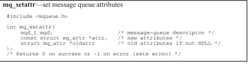

`mq_getattr` 根据队列的当前状态填充结构体（与 `mq_open` 一起展示）。最有用的属性可能是成员 `mq_curmsgs`，它包含队列中当前的消息数量。

`mq_setattr` 设置或清除 `mq_flags` 成员中的 `O_NONBLOCK` 标志；按照标准，它对其他方面没有影响。（实现中可能还有其他非移植的标志可以设置。）因此，对于 `O_NONBLOCK` 标志，`mq_setattr` 用于消息队列描述符，就像 `fcntl` 用于文件描述符一样。如果 `oldattr` 非 `NULL`，则用它来获取返回的旧属性。

## 7.7.2 SMI 的 POSIX 消息队列实现

现在是 SMI 函数的第三个实现。首先，这是内部消息队列，它与 FIFO 的内部队列几乎相同，因为它要处理类似问题：

```c
#define MAX_CLIENTS 20

typedef struct {
    SMIENTITY sq_entity;          /* entity */
    mqd_t sq_mqd_server;         /* server message-queue descriptor */
    char sq_name[SERVER_NAME_MAX];/* server name */
    struct client_info {
        mqd_t cl_mqd;            /* client message-queue descriptor */
        pid_t cl_pid;            /* client process ID */
    } sq_clients[MAX_CLIENTS];
    struct client_id sq_client;  /* client ID */
    size_t sq_msgsize;           /* msg size */
    struct smi_msg *sq_msg;      /* msg buffer */
} SMIQ_MQ;
```

与 FIFO 一样，为了避免为每条消息打开客户端消息队列的开销，服务器将跟踪它知道的每个客户端，并查找已打开队列的存储的消息队列描述符。在许多实际服务器中，这其实不是那么大的负担，因为它们几乎总是想跟踪其客户端。客户端只使用数组的第一个元素来存储其自身的消息队列描述符，但我们不关心在这个示例中浪费的空间。

有两个函数将 SMI 服务器名称和客户端进程 ID 转换为 POSIX IPC 名称：

```c
static void make_mq_name_server(const SMIQ_MQ *p, char *mqname,
           size_t mqname_max)
{
    snprintf(mqname, mqname_max, "/smmq-%s&", p->sq_name);
}

static void make_mq_name_client(pid_t pid, char *mqname,
           size_t mqname_max)
{
    snprintf(mqname, mqname_max, "/smimq-c%d", pid);
}
```

这些名称看起来像是在根目录中，但在 Solaris 上并非如此，如 7.6.2 节所述。

接下来是一个由服务器使用的函数，用于根据客户端的进程 ID 获取其消息队列描述符，这是客户端在消息中发送给服务器的内容：

```c
static mqd_t get_client_mqd(SMIQ_MQ *p, pid_t pid)
{
    int i, avail = -1;
    char mqname[SERVER_NAME_MAX + 100];

    for (i = 0; i < MAX_CLIENTS; i++) {
        if (p->sq_clients[i].cl_pid == pid)
            return p->sq_clients[i].cl_mqd;
        if (avail == -1 && p->sq_clients[i].cl_pid == 0)
            avail = i;
    }

    errno = ECONNREFUSED;
    ec_negl_t avail )
    p->sq_clients[avail].cl_pid = pid;
    make_mq_name_client(pid, mqname, sizeof(mqname));
    ec_negl( p->sq_clients[avail].cl_mqd = mq_open(mqname, O_WRONLY) )
    return p->sq_clients[avail].cl_mqd;

EC_CLEANUP_BGN
    return (mqd_t) -1;
EC_CLEANUP_END
}
```

该函数首先在数组中查找是否已经见过该客户端，如果是这样，它已经拥有消息队列描述符。如果没有，它会以写方式打开队列并保存描述符供下次使用。

现在我们准备好第一个 SMI 函数 `smi_open_mq`：


```c
static pid_t my_pid;

SMIQ *smi_open_mq(const char *name, SMIENTITY entity, size_t msgsize)
{
    SMIQ_MQ *p = NULL;
    char mqname[SERVER_NAME_MAX + 100];
    struct mq_attr attr = {0};

    my_pid = getpid();
    ec_null( p = calloc(1, sizeof(SMIQ_MQ)) )
    p->sq_msgsize = msgsize + offsetof(struct smi_msg, smi_data);
    ec_null( p->sq_msg = calloc(1, p->sq_msgsize) )
    p->sq_entity = entity;
    p->sq_mqd_server = p->sq_clients[0].cl_mqd = (mqd_t)-1;
    if (strlen(name) >= SERVER_NAME_MAX) {
        errno = ENAMETOOLONG;
        EC_FAIL
    }
    strcpy(p->sq_name, name);
    make_mq_name_server(p, mqname, sizeof(mqname));
    attr.mq_maxmsg = 100;
    attr.mq_msgsize = p->sq_msgsize;
    if (p->sq_entity == SMI_SERVER) {
        (void)mq_unlink(mqname);
        ec_cmp( errno, ENOSYS )
        ec_neg1( p->sq_mqd_server = mq_open(mqname, O_RDONLY | O_CREAT,
                PERM_FILE, &attr) )
    } else {
        ec_neg1( p->sq_mqd_server = mq_open(mqname, O_WRONLY) )
        make_mq_name_client(my_pid, mqname, sizeof(mqname));
        ec_neg1( p->sq_clients[0].cl_mqd = mq_open(mqname,
                O_RDONLY | O_CREAT, PERM_FILE, &attr) )
    }
    return (SMIQ *)p;

EC_CLEANUP_BGN
    if (p != NULL)
        (void)smi_close_mq((SMIQ *)p);
    return NULL;
EC_CLEANUP_END
}
```

在初始化内部 SMI 队列之后，我们使用队列中 100 条消息的限制和作为第三个参数传入的消息大小来初始化 `mq_attr` 结构体。然后，如果我们是服务器，我们将丢弃任何现有的服务器队列并创建一个全新的队列。我们不为客户端执行此操作，尽管我们可能应该这样做，因为客户端的进程 ID 嵌入在队列名称中，不太可能被重用。

关闭函数如下所示，执行预期的操作：

```c
bool smi_close_mq(SMIQ *sqp)
{
    SMIQ_MQ *p = (SMIQ_MQ *)sqp;
    char msqname[SERVER_NAME_MAX + 100];

    if (p->sq_entity == SMI_SERVER) {
        make_mq_name_server(p, msqname, sizeof(msqname));
        (void)mq_close(p->sq_mqd_server);
        (void)mq_unlink(msqname);
    }
    else {
        make_mq_name_client(my_pid, msqname, sizeof(msqname));
        (void)mq_close(p->sq_mqd_server);
        (void)mq_unlink(msqname);
    }

    free(p->sq_msg);
    free(p);
    return true;
}
```

接下来是 `smi_send_getaddr_mq` 和 `smi_send_release_mq`：

```c
bool smi_send_getaddr_mq(SMIQ *sqp, struct client_id *client,
    void **addr)
{
    SMIQ_MQ *p = (SMIQ_MQ *)sqp;

    if (p->sq_entity == SMI_SERVER)
        p->sq_client = *client;
    *addr = p->sq_msg;
    return true;
}

bool smi_send_release_mq(SMIQ *sqp)
{
    SMIQ_MQ *p = (SMIQ_MQ *)sqp;
    mqd_t mqd_receiver;

    if (p->sq_entity == SMI_SERVER)
        ec_negl( mqd_receiver = get_client_mqd(p, p->sq_client.c_id) )
    else {
        mqd_receiver = p->sq_mqd_server;
        p->sq_msg->smi_client.c_id = my_pid;
    }
    ec_negl( mq_send(mqd_receiver, (const char *)p->sq_msg,
        p->sq_msgsize, 0) )
    return true;

    EC_CLEANUP_BGN
        return false;
    EC_CLEANUP_END
}
```

像之前对 FIFO 和 System V 消息队列一样，`smi_send_getaddr_mq` 只是保存客户端 ID（如果从服务器调用）并返回缓冲区地址。真正的工作在 `smi_send_release_mq` 中。服务器调用查找函数 `get_client_mqd` 获取消息队列描述符。它的参数由 `smi_send_getaddr_mq` 保存在 `SMIQ_MQ` 结构中。

客户端已经拥有服务器的描述符，并将它的进程 ID 放入消息中。（消息队列描述符不能像 System V 消息队列标识符那样在进程之间传递。）

接收对更简单，因为接收者已经拥有其消息队列的描述符：

```c
bool smi_receive_getaddr_mq(SMIQ *sqp, void **addr)
{
    SMIQ_MQ *p = (SMIQ_MQ *)sqp;
    mqd_t mqd_receiver;
    ssize_t nrcv;

    if (p->sq_entity == SMI_SERVER)
        mqd_receiver = p->sq_mqd_server;
    else
        mqd_receiver = p->sq_clients[0].cl_mqd;

    ec_negl( nrcv = mq_receive(mqd_receiver, (char *)p->sq_msg,
        p->sq_msgsize, NULL) )
    *addr = p->sq_msg;
    return true;

    EC_CLEANUP_BGN
        return false;
    EC_CLEANUP_END
}
```

```c
bool smi_receive_release_mq(SMIQ *sqp)
{
    return true;
}
```

## 7.7.3 对 POSIX 消息队列的批评

POSIX 消息队列系统调用比 System V 调用具有稍微更干净的接口，并且更好地集成到 UNIX 的其他部分中，但它们仍然使用自己的描述符而不是文件描述符，因此不能使用 `select` 和 `poll`。作为补偿，有一个通知功能，但使用起来非常棘手，因为我们将在第 9 章中看到，因为它基于信号，而信号总是很难使用。

POSIX 消息队列的主要问题（实际上所有 POSIX IPC 都是）是它没有广泛可用，但当然，这不属于对设计的批评。

表 7.1 更详细地比较了 POSIX 和 System V 消息队列：

**表 7.1** POSIX 与 System V 消息队列

| 标准 | POSIX | System V |
| :--- | :--- | :--- |
| 标准化了吗？ | 是 | 是 |
| 在 UNIX 认证系统中是强制的吗？ | 否 | 是 |
| 在所有主要 UNIX 系统中可用吗？ | 否 | 是 |
| 消息限制？ | 非常少；可设置 | 很多；只有一个可设置；难以管理 |
| 线程安全（根据 SUS3）？ | 是 | 是 |
| 消息优先级？ | 是 | 是 |
| 接收非最高优先级消息？ | 否 | 是 |
| 通知？ | 是 | 否 |

## 表 7.1 POSIX 与 System V 消息队列。（续）

| 标准 | POSIX | System V |
| :--- | :--- | :--- |
| 是否使用文件描述符？ | 否 | 否 |
| 效率如何？ | 取决于实现 | 取决于实现 |
| 每条消息有两个用户-内核副本吗？¹ | 是 | 是 |
| 队列名称的可移植性问题？ | 有 | 无 |

¹ 这意味着数据从用户空间复制到内核空间，或反之。

尽管有这些优缺点混杂的情况，为什么 POSIX 实时小组在 System V 消息已经存在了超过 10 年之久时，还要发明一种新的消息系统？而且，既然他们确实这么做了，为什么结果并不更好呢？

以下是我的回答：

- 虽然 POSIX 小组对现有的 System V 方法确实有很多不满，但他们需要新标准的主要原因是，许多主要系统已经拥有一个不适合实时应用的 System V 实现，而在同一接口下同时拥有两个实现是非常困难的。他们需要一种方式让实现者能够重新开始。

- 但是，在 POSIX 流程内没有实际的方法要求任何特定的性能水平，因此对于许多系统（如果不是大多数系统）来说，两种消息队列（如果确实存在两种的话）的效率大致相同。

- POSIX IPC 名称的可移植性问题是由规范不足造成的，这是为了允许广泛的实现所必需的，包括速度极快的内存队列，而不需要进行任何文件系统查找。

- POSIX 小组对实现缺失并不负责。很可能最负责任的方面是，到 20 世纪 90 年代中期，许多（如果不是大多数）应用程序开发者都专注于网络应用，他们使用套接字（第 8 章）来处理这些应用，而对处理非网络消息的替代方式兴趣不大。因此，像 Sun 这样资金雄厚的机构实现了 POSIX 选项包，而像 BSD 和 Linux 社区这样较小的机构则发现了更紧迫的事情去做。

### 7.8 关于信号量

本节解释信号量的一般特性，并展示如何使用文件和消息来实现它们。System V 和 POSIX 信号量系统调用将在第 7.9 节和第 7.10 节中介绍。

### 7.8.1 信号量的基本用法

我们在第 5.17.3 节中已经遇到过互斥锁。更一般地说，信号量是一个计数器，用于防止两个或多个进程或线程同时访问共享资源。然而，它仅仅是建议性的：如果一个进程或线程在访问共享资源之前不检查信号量，可能会导致混乱。

在 UNIX 中，“信号量”一词通常指由信号量系统调用操纵以同步进程的对象。“互斥锁”一词通常指一种轻量级的对象，用于同步线程，这正是我们在第 5.17.3 节中讨论的内容。在本节中，我将只讨论信号量。

二进制信号量只有两种状态：锁定和解锁。通用信号量有无限（或至少非常大）数量的状态。它是一个计数器，当获取它（“锁定”）时减 1，当释放它（“解锁”）时加 1。如果它是零，试图获取它的进程必须等待另一个进程增加其值——它永远不能变为负数。（如果一个信号量只能取两个值 0 和 1，那么它就是一个二进制信号量。）通用信号量通常通过两个操作来访问，我们可以抽象地称之为 `semwait` 和 `sempost`（有时也称为 P 和 V）。我们可以尝试用 C 语言编写这些代码：

```c
void semwait(int *sem)
{
    while (*sem <= 0)
        ; /* do nothing */
    (*sem)--;
}

void sempost(int *sem)
{
    (*sem)++;
}
```

> P 和 V 是 E. W. Dijkstra 用来表示荷兰语短语 *proberen te verlagen*（“尝试减少”）和单词 *verhogen*（“增加”）的缩写。有些书说 P 代表 *prolagen*，但这不是一个词，即使在荷兰语中也不是。它是完整短语的缩写。

信号量必须通过调用 `sempost` 进行初始化；否则，它初始时没有内容可以获取。例如，如果信号量计数的是空闲缓冲区数量，且初始时有五个缓冲区，我们需要先调用五次 `sempost`。或者，我们可以直接将信号量变量设置为五。

既然费心编程实现了 `semwait` 和 `sempost`，我现在必须指出它们无法正常工作，原因有三：

- 由 `sem` 指向的信号量变量通常不在进程之间共享，因为进程拥有不同的数据段。（尽管它可以在共享内存中。）

- 这些函数不是原子执行的——内核可以在任何时候中断进程。可能会发生以下场景：进程 1 完成了 `semwait` 中的 `while` 循环，但在递减信号量之前被中断；进程 2 进入 `semwait`，发现信号量等于 1，完成其 `while` 循环并将信号量减为 0；进程 1 恢复执行并将信号量减为 –1（非法值）。

- 如果 `sem` 为零，`semwait` 会执行所谓的忙等待。这是一种愚蠢的 CPU 使用方式。

因此，`semwait` 和 `sempost` 不能仅在用户空间中编程。信号量必须由内核提供，内核可以进程间共享数据，可以执行原子操作，并且当进程阻塞时可以将 CPU 交给就绪进程。

### 7.8.2 使用文件和消息实现信号量

在第 2.4.3 节中，我展示了如何使用 `open` 制作一个简单的二进制信号量。这种方法对于只访问共享资源几次的进程来说是合适的，例如正在写入邮件箱文件的电子邮件程序，但对于高强度使用来说开销太大。我们希望有一种信号量，其检查和设置所需的时间更短。

消息队列也可以用作信号量：发送操作向队列添加一条消息，等效于 `sempost`；接收操作从队列移除一条消息，等效于 `semwait`。当队列为空时，接收操作会阻塞，这等效于信号量为零。

然而，任何支持消息的 UNIX 系统（System V 或 POSIX 种类）也都独立地支持信号量，且效率更高。

## 7.9 System V 信号量

System V 和 POSIX 信号量都不使用像 `semwait` 和 `sempost` 这样简单的机制。它们的系统调用更复杂，尽管 POSIX 信号量复杂得并不多。我将在第 7.10.3 节中一起批评这两种机制。

我将从 System V 开始。这些系统调用太复杂，我无法完全描述。不过，我会确保解释得足够多，以便我们能够实现 `semwait` 和 `sempost`；其余部分，请参阅系统的文档或 [SUS2002]。

第 7.4 节中的信息适用于这些系统调用，因此我们无需专门讨论密钥、标识符、所有权等。

System V 信号量机制有趣的地方在于，系统调用不仅操作单个信号量，而且一次操作整个数组。通过一次原子操作，你可以对几个信号量执行 `semwait`，并对另外几个执行 `sempost`。在实践是否你真的想要这样做是值得商榷的，但如果你需要，它是存在的。在大多数示例中，我们将一次只操作一个信号量，尽管我们稍后会使用一组两个信号量，只是为了方便。

在我们继续之前，有一个评论：System V 信号量太复杂了！在任何使用信号量的程序中，都必须能够证明对共享资源的访问是排他的，不会发生死锁，也不会发生饥饿（永远无法获得访问权）。仅靠测试通常是不够的，因为事情非常依赖时序；必须使用分析。对于普通的 `semwait` 和 `sempost` 来说，这已经足够困难了。使用 System V 系统调用并充分发挥其功能时，分析可能是不可能的。

### 7.9.1 System V 信号量系统调用

与 System V 消息队列一样，你从 `X_get` 调用开始：

**semget**—获取信号量集标识符

```c
#include <sys/sem.h>

int semget(
    key_t key,        /* Key */
    int nsems,        /* size of set */
    int flags          /* flags */
);
/* Returns identifier or -1 on error (sets errno) */
```

不出所料，`semget` 将 `key` 转换为表示一组信号量的 ID。如果 `flags` 中的 `IPC_CREAT` 位被置位，若该组尚不存在，则会被创建。该组中包含 `nsems` 个信号量，编号从零开始。

信号量并不能立即使用——必须通过调用 `semctl` 对其进行初始化。为什么 `semget` 不将它们初始化为零是个谜，但 SUS 并没有要求这样做，[^7] 而且许多实现也不这样做。以下是 `semctl` 的说明：

```c
semctl—control semaphore set

#include <sys/sem.h>
int semctl(
 int semid, /* identifier */
 int semnum, /* semaphore number */
 int cmd, /* command */
 union semun arg /* argument for command */
);
/* Returns value or 0 on success; -1 on error (sets errno) */
```


```c
union semun—union for semctl

union semun {
 int val; /* integer */
 struct semid_ds *buf; /* pointer to structure */
 unsigned short *array; /* array */
};
```

```c
struct semid_ds—structure for semctl

struct semid_ds {
 struct ipc_perm sem_perm; /* permission structure */
 unsigned short sem_nsems; /* size of set */
 time_t sem_otime; /* time of last semop */
 time_t sem_ctime; /* time of last semctl */
};
```

奇怪的是，`union semun` 并未在头文件 `sem.h` 中定义——你必须自行定义它。

除了通用的 System V IPC 命令 `IPC_RMID`、`IPC_STAT` 和 `IPC_SET` 之外，还有七个专用于信号量的命令：

- **`GETNCNT`** 获取阻塞等待信号量 `semnum` 值增加的过程数。

- **`GETZCNT`** 获取阻塞等待信号量 `semnum` 值变为零的过程数。

- **`GETPID`** 获取最后一次对信号量执行 `semop` 操作的进程 ID。

- **`GETVAL`** 获取信号量 `semnum` 的值。

- **`SETVAL`** 设置信号量 `semnum` 的值。使用 `arg.val`。

- **`GETALL`** 获取组中所有信号量的值。使用 `arg.array`。

- **`SETALL`** 设置组中所有信号量的值。使用 `arg.array`。

令人惊讶的是，如果你有一个包含 100 个信号量的组，并且你想通过单次 `semctl` 调用将它们全部设置为零，你必须构建一个包含 100 个零的数组作为第四个参数！这并不困扰我们，因为我们总是使用 `SETVAL` 逐个初始化它们。

`IPC_RMID` 命令的行为与在 `msgctl`（第 7.5.1 节）中的表现完全相同。

`IPC_STAT` 使用联合体的 `buf` 成员，填充通过第四个参数传递的 `semid_ds` 结构。`IPC_SET` 仅可用于设置 `sem_perm.uid`、`sem_perm.gid` 和 `sem_perm.mode` 成员。

既然如前所述，`semget` 不会初始化信号量，你就需要使用 `semctl` 来完成，如下面的序列所示：

```c
ec_negl(semid = semget(key, 1, PERM_FILE | IPC_CREAT )
arg.val = 0;
ec_negl( semctl(semid, 0, SETVAL, arg) )
```

不幸的是，由于需要两个系统调用来创建并初始化信号量，第二个对同一信号量执行 `semget` 的进程或线程可能会在 `semctl` 执行之前，就带着一个未初始化的信号量开始处理。解决方案是利用这样一个事实：虽然新信号量的值未被初始化，但存储在 `semid_ds` 结构的 `sem_otime` 成员中的“最后一次 semop 时间”会被 `semget` 初始化为零。这建议[^8] 采用以下方案：

- 创建信号量的进程或线程也调用 `semctl` 对其进行初始化，然后在其上执行一次 `semop`，从而使 `sem_otime` 变成一个非零值。

- 其他获取该信号量 ID 的进程或线程等待该时间变为非零。

此方案仅适用于全新的信号量。如果你重启应用程序，而系统中仍保留着前一次运行遗留的信号量，那么该信号量将已经具有一个值和一个非零的 `sem_otime` 值，这很可能会搞乱局面。因此，请确保在应用程序的运行之间通过移除信号量来进行清理，可以通过调用 `semctl` 或使用 `ipcrm` 命令（第 7.4.4 节）来实现。

不幸的是，截至本文撰写时，在 FreeBSD 或 Darwin 上等待 `sem_otime` 无效，因为该时间从未被更新。[^9] 因此，除非你确信由于应用程序的性质，初始化会在第二次尝试 `semget` 信号量之前发生，否则 System V 信号量根本无法可靠使用。（更不幸的是，那些系统也不完全支持 POSIX 信号量。）

用于操作信号量组的系统调用 `semop` 将在下一节介绍。

### 7.9.2 简单信号量接口

我们可以用一个简单的信号量打开调用来隐藏信号量的复杂性，我们将先为 System V 实现它，稍后再为 POSIX 信号量实现。以下是 `SimpleSemOpen` 及其配套函数 `SimpleSemClose` 的原型：

```c
SimpleSemOpen—open simple semaphore

    #include "SimpleSem.h"
    struct SimpleSem *SimpleSemOpen(
        const char *name    /* name (follows System V or POSIX rules) */
    );
    /* Returns pointer to structure or NULL on error (sets errno) */
```

```c
SimpleSemClose—close simple semaphore
#include "SimpleSem.h"
bool SimpleSemClose(
         struct SimpleSem *sem  /* semaphore */
);
/* Returns true on success or false on error (sets errno) */
```

```c
struct SimpleSem—structure for simple-semaphore functions
struct SimpleSem {
    union {
        int sm_sem;          /* System V semaphore-set ID */
        void *sm_sem;        /* POSIX sem_t pointer (needs a cast) */
    } sm;
};
```

`SimpleSemOpen` 没有任何选项：它按名称打开单个信号量（在 System V 实现的情况下，自行获取 key），如有必要则以 `PERM_FILE`（第 2.3 节）权限创建它。它返回指向 `SimpleSem` 结构体的指针，该结构体包含其他函数识别信号量组（仅含一个）所需的信息，对于 System V 而言，这是一个整数信号量组 ID。（我们稍后会介绍 POSIX 信号量所需的内容。）但简单信号量包的用户无需担心 `SimpleSem` 结构体内部的内容，因为指向它的指针只是传递给其他函数（如 `SimpleSemClose`），后者关闭信号量并释放 `SimpleSem` 结构体使用的任何内存。

以下是 `SimpleSemOpen` 的 System V 实现，其中你可以看到上述确保信号量被正确初始化的方案：

```c
struct SimpleSem *SimpleSemOpen(const char *name)
{
       struct SimpleSem *sem = NULL;
       key_t key;
       union semun {
           int val;
           struct semid_ds *buf;
           unsigned short *array;
       } arg;
       struct sembuf sop;

       (void)close(open(name, O_WRONLY | O_CREAT, 0));
       ec_negl( key = ftok(name, 1),
       ec_null( sem = malloc(sizeof(struct SimpleSem) )

       if ((!sem->sm.sm_semid = semget(key, 1, PERM_FILE | IPC_CREAT | IPC_EXCL)) != -1) {
           arg.val = 0;
           ec_negl( semctl(sem->sm.sm_semid, 0, SETVAL, arg) }
           sop.sem_num = 0;
           sop.sem_op = 0;
           sop.sem_flg = 0;
           ec_negl( semop(sem->sm.sm_semid, &sop, 1) )
       } else {
           if (errno == EEXIST) {
               while (true) {
                   if ((!sem->sm.sm_semid = semget(key, 1, PERM_FILE)) == -1) {
                       if (errno == ENOENT) {
                           sleep(1);
                           continue;
                       }
                   } else
                       EC_FAIL
               }
               else
                   break;
               while (true) {
                   struct semid_ds buf;
                   arg.buf = &buf;
                   ec_negl( semctl(sem->sm.sm_semid, 0, IPC_STAT, arg) }
                   if (buf.sem_otime == 0) {
                       sleep(1);
                       continue;
                   }
               } else
                   break;
           }
       }
       else
           EC_FAIL
       )
       return sem;
}
EC_CLEANUP_BGN
free(sem);
return NULL;
EC_CLEANUP_END
```

### 序列说明

```c
(void) close(open(name, O_WRONLY | O_CREAT, 0));
```

```c
ec_negl( key = ftok(name, 1) )
```

这与我们在第 7.5.3 节中所做的一致。如果名称尚不存在，则创建该名称；关于名称的任何问题都会作为 `ftok` 的问题报告，而不是 `open` 或 `close` 的问题。（如果你不喜欢这样，可以单独检查 `open` 是否出现除 `ENOENT` 以外的错误，而不是将其嵌入到对 `close` 的立即调用中。）

然后，我们使用 `IPC_CREAT` 和 `IPC_EXCL` 标志执行 `semget`，这样如果信号量已经存在，该调用将失败。所有因该原因失败的进程和线程都需要等待其初始化完成。从 `semget` 成功返回的进程或线程使用 `semctl` 对其进行初始化，然后执行一次 `semop`（我稍后会解释），该操作对值没有实际改变，但作为副作用设置了 `sem_otime`。

需要等待的进程和线程将循环执行，直到 `semget` 成功，每次循环都睡眠，然后再次循环，直到时间变为非零，每次也睡眠。

对于 System V 信号量，`SimpleSemClose` 几乎不做任何事情：

```c
bool SimpleSemClose(struct SimpleSem *sem)
{
    free(sem);
    return true;
}
```

要移除一个简单信号量，你调用 `SimpleSemRemove`：

> **`SimpleSemRemove`**—remove simple semaphore

> 

> ```c
> #include "SimpleSem.h"
> 
> bool SimpleSemRemove(
>       struct SimpleSem *sem       /* semaphore */
> );
> /* Returns true on success or false on error (sets errno) */
> ```

对一个不存在的信号量调用 `SimpleSemRemove` 是可以的——这不被视为错误。事实上，这正是应用程序启动时你希望从零开始使用新信号量时应该做的事情。

以下是 `SimpleSemRemove` 的代码：

```c
bool SimpleSemRemove(const char *name)
{
    key_t key;
    int semid;
```

```c
if ((key = ftok(name, 1)) == -1) {
    if (errno != ENOENT)
        EC_FAIL
} else {
    if ((semid = semget(key, 1, PERM_FILE)) == -1) {
        if (errno != ENOENT)
            EC_FAIL
    } else
        ec_negl(semctl(semid, 0, IPC_RMID));
}
return true;
EC_CLEANUP_BGN
    return false;
EC_CLEANUP_END
}
```

现在，让我们回到 System V。我们准备好介绍那个令人望而生畏的 `semop` 系统调用，它同时执行 `semwait` 和 `sempost` 操作：

### `semop`—对信号量集进行操作

```c
#include <sys/sem.h>

int semop(
    int semid,                  /* 标识符 */
    struct sembuf *sops,        /* 操作 */
    size_t nsops                /* 操作数量 */
);
/* 成功时返回 0，错误时返回 -1（设置 errno） */
```

### `struct sembuf`—用于 `semop` 的结构体

```c
struct sembuf {
    unsigned short sem_num;     /* 信号量编号 */
    short sem_op;               /* 信号量操作 */
    short sem_flg;              /* 操作标志 */
};
```

正如我所述，`semop` 不仅操作一个信号量，还可以操作任意多个，甚至整个集合。在进行调用之前，你需要构建一个操作数组（`struct sembufs`），尽管如果只有一个需要操作，单个 `struct sembuf` 就足够了——你只需传递其地址，并将 `nsops` 设为 1。

每个 `sem_op` 可以是正值、负值或零：

- **`> 0`** `sem_op` 的值加到信号量值上（*sempost*）。

- **`< 0`** `sem_op` 的绝对值从值中减去，除非这会使值变为负数；如果是这种情况，该调用将阻塞，直到整个值可以被减去（*semwait*）。

- **`0`** 该调用将阻塞，直到值变为零。

传递给 `semop` 的所有操作都是原子执行的，函数在全部完成之前不会返回。（除非它被线程取消、信号或信号量集的移除所中断。）

你可以通过在某个操作的 `sem_flg` 成员中设置 `SEM_UNDO` 标志来防止阻塞。如果数组中的任何操作会阻塞且设置了该标志，`semop` 将立即返回。由于 `semop` 总是原子性地执行，因此不会执行任何其他操作，即使它们出现在数组中更早的位置且本身不会阻塞。

还有一个特性：对于进程增加的或减少的每个信号量，都会维护一个调整值，与实际值一起保存。当增加操作设置了 `SEM_UNDO` 标志时，调整值会减少；对于减少操作则反之。当进程退出时，其调整值会被加到信号量的值上，从而撤销该进程对信号量所做的更改。例如，假设一个进程减少一个信号量（即 *semwait*）以锁定缓冲区，并在完成后增加它（*sempost*）。使用 `SEM_UNDO` 标志，它可以确保如果在异常退出时，缓冲区被解锁。

对于我们的简单信号量，我们只想一次操作一个，只增加或减少 1，并且不使用 `SEM_UNDO`。因此 `SimpleSemWait` 和 `SimpleSemPost` 确实很简单：

### `SimpleSemWait`—减少简单信号量

```c
#include "SimpleSem.h"

bool SimpleSemWait(
    struct SimpleSem *sem    /* 信号量 */
);
/* 成功时返回 true，错误时返回 false（设置 errno） */
```

### `SimpleSemPost`—增加简单信号量

```c
#include "SimpleSem.h"

bool SimpleSemPost(
    struct SimpleSem *sem    /* 信号量 */
);
/* 成功时返回 true，错误时返回 false（设置 errno） */
```

这是代码：


```c
bool SimpleSemWait(struct SimpleSem *sem)
{
    struct sembuf sop;

    sop.sem_num = 0;
    sop.sem_op = -1;
    sop.sem_flg = 0;
    ec_negl( semop(sem->sm_sm_semId, &sop, 1) );
    return true;

EC_CLEANUP_BGN
    return false;
EC_CLEANUP_END
}

bool SimpleSemPost(struct SimpleSem *sem)
{
    struct sembuf sop;

    sop.sem_num = 0;
    sop.sem_op = 1;
    sop.sem_flg = 0;
    ec_negl( semop(sem->sm_sm_semId, &sop, 1) );
    return true;

EC_CLEANUP_BGN
    return false;
EC_CLEANUP_END
}
```

在我们继续之前，我应该提到 System V 信号量的另一个用途：在进程之间传递整数。例如，假设客户端想要将其进程 ID 传递给服务器。它获取对一个信号量的访问权并将其值设置为其进程 ID。然后服务器可以通过查看该值来获取这个数字。由于信号量集可以包含一个信号量数组，因此可以以这种方式传递一个整数数组。

## 7.10 POSIX 信号量

这些信号量系统调用是 POSIX 标准的一部分，尽管是可选的，并且你需要检查 `_POSIX_SEMAPHORES` 特性测试宏来确定它们是否存在（参见第 1.5.4 节和第 7.6.3 节）。截至目前，它们在 FreeBSD、Darwin 或 Linux 中并不存在。

### 7.10.1 命名 POSIX 信号量

POSIX 信号量比 System V 信号量简单得多，也更容易使用。实际上，五个系统调用与上一节中 `SimpleSem` 接口完全对应：

### sem_open—打开命名信号量

```c
#include <semaphore.h>

sem_t *sem_open(
    const char *name,    /* POSIX IPC 名称 */
    int flags            /* 标志（不包括 O_CREATE） */
);
/* 成功时返回指向信号量的指针，错误时返回 SEM_FAILED（设置 errno） */

sem_t *sem_open(
    const char *name,    /* POSIX IPC 名称 */
    int flags,           /* 标志（包括 O_CREATE） */
    mode_t perms,        /* 权限 */
    unsigned value       /* 初始值 */
);
/* 成功时返回指向信号量的指针，错误时返回 SEM_FAILED（设置 errno） */
```

### sem_close—关闭命名信号量

```c
#include <semaphore.h>

int sem_close(
    sem_t *sem           /* 信号量 */
);
/* 成功时返回 0，错误时返回 -1（设置 errno） */
```

### sem_unlink—移除命名信号量

```c
#include <semaphore.h>

int sem_unlink(
    const char *name     /* POSIX IPC 名称 */
);
/* 成功时返回 0，错误时返回 -1（设置 errno） */
```

### sem_wait—减少信号量

```c
#include <semaphore.h>

int sem_wait(
    sem_t *sem           /* 信号量 */
);
/* 成功时返回 0，错误时返回 -1（设置 errno） */
```

### sem_post—增加信号量

```c
#include <semaphore.h>

int sem_post(
    sem_t *sem           /* 信号量 */
);
/* 成功时返回 0，错误时返回 -1（设置 errno） */
```

POSIX 信号量是计数信号量，与 System V 变体类似，但仅以 1 为步长。每个 `sem_t` 对象仅代表一个信号量，而不是像 System V 那样的一组信号量。

打开、关闭和解除链接的调用遵循我们在第 7.7.1 节中看到的 POSIX IPC 调用的模式，针对的是 POSIX 消息队列系统调用。特别是，传递给 `sem_open` 的名称必须遵循第 7.6.2 节中讨论的可移植性规则。不出所料，`sem_post` 将 1 加到信号量的值上，而 `sem_wait` 减去 1，如果值已经是零则阻塞。

你在 `sem_open` 中不使用 `O_RDONLY`、`O_WRONLY` 或 `O_RDWR`，因为它们是无意义的——除非 `sem_post` 和 `sem_wait` 都可以使用，否则信号量毫无用处。

我们需要为 System V 所做的那些繁琐的初始化过程已经消失了。我们只需将所需的值（通常是零）传递给 `sem_open`。

当 `sem_open` 失败时，要注意其返回值：它是 `SEM_FAILED`，而不是 `NULL`，后者是其他返回指针的函数的常规失败返回值。

POSIX 信号量的 `SimpleSem` 调用的实现是微不足道的：

```c
struct SimpleSem *SimpleSemOpen(const char *name)
{
    struct SimpleSem *sem = NULL;

    ec_null( sem = malloc(sizeof(struct SimpleSem)) );
    if ((sem->sm_sem = sem_open(name, O_CREAT, PERM_FILE, 0)) == SEM_FAILED)
        EC_FAIL;
    return sem;

EC_CLEANUP_BGN
    free(sem);
    return NULL;
EC_CLEANUP_END
}

bool SimpleSemClose(struct SimpleSem *sem)
{
    ec_neg1( sem_close(sem->sm_sm_sem) );
    free(sem);
    return true;

EC_CLEANUP_BGN
    return false;
EC_CLEANUP_END
}

bool SimpleSemRemove(const char *name)
{
    if (sem_unlink(name) == -1 && errno != ENOENT)
        EC_FAIL;
    return true;

EC_CLEANUP_BGN
    return false;
EC_CLEANUP_END
}

bool SimpleSemPost(struct SimpleSem *sem)
{
    ec_neg1( sem_post(sem->sm_sm_sem) );
    return true;

EC_CLEANUP_BGN
    return false;
EC_CLEANUP_END
}

bool SimpleSemWait(struct SimpleSem *sem)
{
    ec_neg1( sem_wait(sem->sm_sm_sem) );
    return true;

EC_CLEANUP_BGN
    return false;
EC_CLEANUP_END
}

10. 如果你不熟悉这个术语，我查阅的一本词典将其定义为“一套复杂而琐碎的程序”，这简直再合适不过了。
```

POSIX 信号量有一些我们 `SimpleSem` 接口未使用的额外特性。首先，与 System V 一样，你可以在不修改或不等待的情况下查询信号量的值：

`sem_getvalue`—获取信号量的值

```c
#include <semaphore.h>

int sem_getvalue(
       sem_t *restrict sem,      /* 信号量 */
       int *value)               /* 返回值 */
;

/* 成功返回 0，出错返回 -1（设置 errno） */
```

如果在调用 `sem_getvalue` 期间信号量的值大于零，则返回该值。然而，当 `sem_getvalue` 返回时，该值可能已经有所不同，因此实际数值并不是非常有用。如果值为零，则返回等待该信号量的进程数量的负值。如果没有进程在等待，则返回零。

`sem_wait` 有两种变体：其一，`sem_trywait` 是非阻塞的：

`sem_trywait`—如果可能则递减信号量

```c
#include <semaphore.h>

int sem_trywait(
       sem_t *sem              /* 信号量 */
);

/* 成功返回 0，出错返回 -1（设置 errno） */
```

如果信号量已经为零，`sem_trywait` 会返回 -1 并将 `errno` 设置为 `EAGAIN`。（其他系统调用使用类似 `O_NONBLOCK` 或 `IPC_NOWAIT` 的标志来实现非阻塞；而这里是一个独立的系统调用。）

另一个变体 `sem_timedwait` 在指定时间间隔内如果信号量未变为正值则超时：

`sem_timedwait`—递减信号量

```c
#include <semaphore.h>

#include <time.h>

int sem_timedwait(
       sem_t *restrict sem,           /* 信号量 */
       const struct timespec *time    /* 绝对时间 */
);

/* 成功返回 0，出错返回 -1（设置 errno） */
```

传递给 `sem_timedwait` 的时间是一个绝对时间（例如，下午 1:23:17），而不是一个时间间隔（例如，27 秒）。它是与哪个时钟进行比较以及精度如何，取决于是否支持 POSIX 定时器选项。如果支持，则是实时时钟。如果不支持，则使用普通时钟（即 `time` 系统调用所使用的那个时钟）。（有关 `struct timespec` 和 UNIX 时间其他方面的讨论，请参见 1.7 节。）

`sem_timedwait` 是超时选项（`_POSIX_TIMEOUTS`）的一部分，是 SUS3 中新增的特性。

## 7.10.2 非命名 POSIX 信号量

快速回顾：`sem_open`、`sem_close` 和 `sem_unlink` 用于与进程外部存在的命名信号量配合使用，并通过 POSIX IPC 名称进行访问。`sem_open` 获取 `sem_t` 对象的指针，而您从不直接处理该对象。它使用的任何内存都会在调用 `sem_close` 时释放。这些信号量天然支持线程和进程间的工作。

为了使信号量更快，你也可以直接声明一个 `sem_t` 对象：

```c
sem_t sem;
```

或者甚至动态分配一个，如下所示：

```c
sem_t *sem = malloc(sizeof(sem_t));
```

但如果你自己分配 `sem_t` 对象，则必须调用 `sem_init` 来初始化它：

`sem_init`—初始化非命名信号量

```c
#include <semaphore.h>

int sem_init(
    sem_t *sem,       /* 信号量 */
    int pshared,      /* 是否在进程间共享？ */
    unsigned value    /* 初始值 */
);

/* 成功返回 0，出错返回 -1（设置 errno） */
```

然后调用 `sem_destroy` 来销毁它：

`sem_destroy`—销毁非命名信号量

```c
#include <semaphore.h>

int sem_destroy(
    sem_t *sem        /* 信号量 */
);

/* 成功返回 0，出错返回 -1（设置 errno） */
```

`sem_destroy` 并不释放 `sem_t` 对象，因为它不知道内存是如何到达那里的（静态声明、`malloc` 等）。你需要自己释放内存（如果适用）。如果信号量是全局分配的或在栈上分配的，当然，你不需要做任何事情；它的生命周期会在适当的时候结束。

`sem_init` 和 `sem_destroy` 是 `sem_open` 和 `sem_close` 的替代品；根据信号量是否为命名，你使用其中一对。其他调用（例如 `sem_post`、`sem_timedwait`）不关心你是如何获取 `sem_t` 指针的。

好的，非命名信号量可能很快，但如果它们位于单个进程的内存中，那有什么用呢？它们非常有用：

- 当你需要计数信号量而不仅仅是只有两种状态的二进制信号量（互斥锁）时，它们可以很好地用于线程间的同步。
- 如果它们位于共享内存中，它们也可以很好地用于进程间通信，这一点我们稍后会详细介绍。在这种情况下，`sem_init` 的 `pshared` 参数必须为非零。

第一种用途对线程非常重要，一些 UNIX 实现，特别是 Linux 和 FreeBSD（但不是 Darwin），支持它，尽管某些版本完全支持 POSIX 信号量。也就是说，支持 `sem_init`（仅限 `pshared` 为零）和 `sem_destroy`，但不支持 `sem_open` 和 `sem_close`。在这些有限实现中，支持 `sem_post`、`sem_wait`、`sem_trywait` 和 `sem_getvalue`，但不支持 `sem_timedwait`。

关于非命名（内存中）信号量还有一条规则：只能使用传递给 `sem_init` 的实际内存，而不能使用其副本。因此，以下代码是错误的：

```c
void fcn(sem_t *s)
{
    sem_post(*s);
    ...
}

void fcn2(void)
{
    sem_t sem;
    sem_init(&sem);
    fcn(sem);
    ...
}
```

调用 `fcn` 会复制信号量，这违反了规则。相反，程序中所有操作信号量的部分都需要处理原始初始化存储的地址。我将在 7.14.2 节中提供一个位于共享内存中的非命名信号量的示例。

## 7.10.3 对 System V 和 POSIX 信号量的评述

对于进程间通信，System V 信号量系统调用使用起来极其困难且功能臃肿，但它们普遍可用，一旦将困难的部分（主要是初始化）隐藏在如 `SimpleSem` 这样的合理接口之后，情况就会好很多。POSIX 信号量使用起来容易得多，但并非普遍可用。*如果可移植性对你很重要，你就需要使用 System V 系统调用，并且如果你不能在所有地方使用 POSIX 调用，那么在有些地方使用它们也无任何好处。如果可移植性不重要，并且目标 UNIX 系统支持 POSIX 调用，那么显然应该使用 POSIX 调用。*¹¹

对于进程内通信——即线程之间——System V 信号量太笨重且太慢，而非命名、非进程共享的 POSIX 信号量通常在支持 POSIX 线程的地方都可以使用，因此如果你需要的功能超出了互斥锁的范围，就应使用它们。

## 7.10.4 进程共享互斥锁和读写锁

我在 5.17.3 节中引入了互斥锁，用于线程同步，但它们位于进程内的内存中——本质上是以二进制方式使用的内存中、非进程共享的 POSIX 信号量。你还可以创建一个内存中的互斥锁，并在使用 `pthread_mutex_init` 初始化时设置 `PTHREAD_PROCESS_SHARED` 属性，这样它就可以在被不同进程中的线程之间共享。但是，即使支持 POSIX 线程，这个特性也不一定被实现（它是一个独立的子选项），因此可能不可用。

还有 POSIX 线程读写锁，我在第 5 章中完全没有描述。它们类似于互斥锁，但区分读和写（共享和独占），以允许更高的吞吐量。与互斥锁一样，你可以设置 `PTHREAD_PROCESS_SHARED` 属性。（如我们将在下一节所见，读写锁之于互斥锁，正如 `fcntl` 文件锁之于 `lockf` 文件锁 [7.11.3 节和 7.11.4 节]。）

# 7.11 文件锁定

本节解释 UNIX 中文件锁定是如何工作的，以及它有时为何不按你需要的方式工作。

## 7.11.1 一个糟糕的例子

我们喜欢一开始做错事——这为做正确的事提供了动力。

为了引出关于文件锁定的讨论，让我们构建一个示例应用程序，其中一个进程构建文件，而另一个进程读取它。该文件是一个记录链表，每个记录包含一个整数数据和下一个记录的偏移量。链表是排序的，但记录的物理位置按照其创建顺序排列。每个记录的结构为：

```c
struct rec {
   int r_data;
   off_t r_next;
};
```

如果我们按 1000、999 和 998 的顺序插入具有这些数据的记录，文件看起来就像图 7.2 所示。第一个记录只是一个头部，指示列表的起始位置。

该示例的主程序启动一个子进程（`process1`）来构建列表，同时父进程（`process2`）使用互斥锁反复对其进行加锁以检查其是否正确形成：

```c
int main(void)
{
   pid_t pid;

**图 7.2** 记录链表。

```c
ec_neg1( pid = fork( ) );

if (pid == 0)
    process1( );

else {
    process2( );
    ec_neg1( waitpid(pid, NULL, 0) );
}

exit(EXIT_SUCCESS);

EC_CLEANUP_BGN
    exit(EXIT_FAILURE);
EC_CLEANUP_END
}
```


对于数据，`process1` 在写入头记录后，只需从 1000 开始倒数：

```c
#define DBNAME "termdb"

static void process1(void)
{
    int dbfd, data;
    struct rec r;

    ec_neg1( dbfd = open(DBNAME, O_CREAT | O_TRUNC | O_RDWR, PERM_FILE) );
    memest(&r, 0, sizeof(r));
    ec_false( writerec(dbfd, &r, 0) );

    for (data = 1000; data >= 0; data--)
        ec_false( store(dbfd, data) );

    ec_neg1( close(dbfd) );
    exit(EXIT_SUCCESS);

EC_CLEANUP_BGN
    exit(EXIT_FAILURE);
EC_CLEANUP_END
}
```

为了使 I/O 操作简便，有两个函数：`write_rec` 在指定偏移量处写入一个记录，而 `read_rec` 从偏移量读取一个记录。它们都将部分写入或读取或文件末尾视为错误：

```c
bool read_rec(int dbfd, struct rec *r, off_t off)
{
    ssize_t nread;
    if ((nread = pread(dbfd, r, sizeof(struct rec), off)) == sizeof(struct.rec))
        return true;

    if (nread != -1)
        errno = EIO;
    EC_FAIL
    return false;

    EC_CLEANUP_BGN
    return false;
    EC_CLEANUP_END
}

bool write_rec(int dbfd, struct rec *r, off_t off)
{
    ssize_t nwrote;
    if ((nwrote = pwrite(dbfd, r, sizeof(struct.rec), off)) == sizeof(struct.rec))
        return true;

    if (nwrote != -1)
        errno = EIO;
    EC_FAIL
    return false;

    EC_CLEANUP_BGN
    return false;
    EC_CLEANUP_END
}
```

我们几乎可以同样轻松地直接使用 `pwrite` 和 `pread`，但错误检查有点复杂，因此将它们封装起来是有意义的。

函数 `store`（由进程 1 调用）负责保持链表有序。注意，它不试图最小化 I/O 操作：

```c
bool store(int dbfd, int data)
{
    struct rec r, rnew;
    off_t end, prev;

    ec_neg1( end = lseek( dbfd, 0, SEEK_END) );
    prev = 0;
    ec_false( read_rec( dbfd, &r, prev) );

    while ( r.r_next != 0) {
        ec_false( read_rec( dbfd, &r, r.r_next) );
        if (r.r_data > data)
            break;
        prev = r.r_next;
    }

    ec_false( read_rec( dbfd, &r, prev) );
    rnew.r_next = r.r_next;
    r.r_next = end;
    ec_false( write_rec( dbfd, &r, prev) );
    rnew.r_data = data;
    usleep(1); /* give up CPU */
    ec_false( write_rec( dbfd, &rnew, end) );
    return true;

    EC_CLEANUP_BGN
    return false;
    EC_CLEANUP_END
}
```

花点时间研究 `store`，它的逻辑就应该变得清晰了。注意，它正确处理了新记录位于开头或末尾的情况。在末尾附近对 `usleep`（睡眠 1 微秒）的调用只是为了放弃 CPU，让其他进程运行一小会儿。这在复杂的程序中是自然发生的，但我必须在这个简单的程序中强制实现，因为我即将展示的另一个进程需要并发运行。

这是检查文件完整性的 `process2`：

```c
static void process2(void)
{
    int try, dbfd;
    struct rec r1, r2;

    for ( try = 0; try < 10; try++)
        if ((dbfd = open( DBNAME, O_RDWR) ) == -1) {
            if (errno == ENOENT) {
                continue;
            } else
                EC_FAIL
        }

    ec_neg1( dbfd );

    for (try = 0; try < 100; try++) {
        ec_false( read_rec(dbfd, &r1, 0) );
        while (r1.r_next != 0) {
            ec_false( read_rec(dbfd, &r2, r1.r_next) );
            if (r1.r_data > r2.r_data) {
                printf("Found sorting error (try %d)\n", try);
                break;
            }
            r1 = r2;
        }
    }

    ec_neg1( close(dbfd) );
    return;

    EC_CLEANUP_BGN
    exit(EXIT_FAILURE);
    EC_CLEANUP_END
}
```

我尝试多次打开数据库，因为进程 1 可能需要一段时间才能被调度并完成其 `open` 调用。然后我反复（100 次）遍历链表，查找诸如记录缺失或数据顺序错误等错误。

果然，当我运行程序时，得到了以下结果：

```text
ERROR: 0: process2 [/aup/c7/f1.c:107] readrec(dbfd, &r2, rl.r_next)
        1: readrec [/aup/c7/f1.c:17] 0
        *** EIO (5: "I/O error") ***
```

这个特定错误发生的原因在于，`store` 即将写入数据库末尾的新记录在进程 2 查找时尚未写入。

现在我们有一个无法工作的应用程序，这算不上什么伟大成就，但我们的应用程序具体来说是因为两个进程正在访问同一个文件，其中一个发现数据不一致而无法工作。它们需要某种协调。

那么，你有动力看看这一节是关于什么的吗？

## 7.11.2 将信号量用作文件锁

修复上一节示例的明显方法是使用信号量来防止进程 2 看到不一致的文件。使用 7.9.2 节中的 `SimpleSem` 接口，我们可以这样定义一个全局变量：

```c
static struct SimpleSem *sem;
```

每个进程独立地打开信号量，使用类似下面这一行的代码：

```c
ec_null( sem = SimpleSemOpen("sem"))
```

此外，`process1` 最初会递增信号量，以表明数据库是一致的：

```c
ec_false( SimpleSemPost(sem))
```

`store` 中的关键行是那些就地更新记录并在末尾存储新记录的代码：

```c
ec_false( SimpleSemWait(sem))
ec_false( readrec(dbfd, &r, prev))
rnew.r_next = r.r_next;
r.r_next = end;
ec_false( writerec(dbfd, &r, prev))
rnew.r_data = data;
usleep(1); /* give up CPU */
ec_false( writerec(dbfd, &rnew, end))
ec_false( SimpleSemPost(sem))
```

`process2` 中的关键行是那些遍历链表的代码：

```c
for (try = 0; try < 100; try++) {
    ec_false( SimpleSemWait(sem))
    ec_false( readrec(dbfd, &r1, 0))
    while (r1.r_next != 0) {
        ec_false( readrec(dbfd, &r2, r1.r_next))
        if (r1.r_data > r2.r_data) {
            printf("Found sorting error (try %d)\n", try);
            break;
        }
        r1 = r2;
    }
}
ec_false( SimpleSemPost(sem))
```

经过这些更改，应用程序完美运行。（除了 FreeBSD 和 Darwin，其中 System V 信号量实现有误，如 7.9.1 节所述。）

使用信号量作为文件锁的主要问题是，对于任意文件，并不清楚信号量名称应该是什么。对于具有少量固定文件名的应用程序，这不是问题，但临时处理文件会非常麻烦。我们必须发明一种机制将文件名映射到信号量名称。更糟糕的是，有时只需要锁定文件的一部分，这意味着不同部分需要不同的信号量。最后，管理信号量——打开、关闭以及清理遗留的信号量——非常令人头疼。

## 7.11.3 lockf 系统调用

使用信号量锁定文件的麻烦其实无关紧要，因为 UNIX 有一个特殊的系统调用用于锁定文件的某一部分：

```c
lockf—lock section of file

#include <unistd.h>

int lockf(          /* file descriptor */
    int fd,
    int op,         /* operation */
    off_t len       /* length of section */
);

/* Returns 0 on success or -1 on error (sets errno) */
```

文件描述符必须打开用于写入（`O_WRONLY` 或 `O_RDWR`）。

要锁定或解锁的区域是从当前文件偏移量（由 `read`、`write` 或 `lseek` 设置）开始，向前或向后延伸 `len` 字节（如果 `len` 为负，则向后）。在向后锁定的情况下，当前偏移量处的字节不属于该区域。在向前的情况下，可以锁定尚未存在的字节，因为文件还没有那么大。如果 `len` 为零，区域将从当前偏移量延伸到文件末尾，即使文件在增长。因此，要锁定整个文件，只需确保偏移量为零，并使用零长度。

如果要锁定的区域与已锁定的区域重叠，这两个区域将合并。如果部分解锁了一个已锁定的区域，该锁定区域会变小，并可能被分割成两个不连续的区域。

进程在文件上拥有的所有锁，当该进程打开该文件的任何文件描述符被关闭时都会释放，即使关闭的文件描述符是独立获取的（即，通过不同的 `open` 调用获得），与传递给 `lockf` 的那个不同[^12]。由此可知，当进程终止时，所有锁都会释放，因为这会导致所有文件描述符被关闭。当进程调用 `fork` 时，锁不会被继承。

[^12]: 摘自 FreeBSD 手册页：“此接口遵循 System V 和 IEEE Std 1003.1-1988 (*POSIX I*) 那套完全愚蠢的语义，它要求当该进程关闭该文件的任何文件描述符时，移除与该文件相关的所有锁。这种语义意味着应用程序必须意识到子程序库可能访问的任何文件。例如，如果一个更新密码文件的应用程序在更新期间锁定了密码文件数据库，然后调用 *getpwnam*(3) 来获取记录，锁将会丢失，因为 *getpwnam*(3) 打开、读取并关闭了密码数据库。” 基于 BSD 的系统有一个更好的调用 *flock*，但它是非标准的。

以下是 `op` 参数的操作：

- `F_LOCK` 锁定该区域；如果该区域的任何部分已被另一个进程锁定，则阻塞。
- `F_TLOCK` 类似于 `F_LOCK`，但如果 `F_LOCK` 会阻塞，则返回 -1 并将 `errno` 设置为 `EAGAIN`（或 `EACCES`）。
- `F_TEST` 不锁定，但如果 `F_LOCK` 会阻塞，则像 `F_TLOCK` 一样返回错误。
- `F_ULOCK` 解锁该区域。

你不需要有信号量名称或打开任何特殊内容来对文件使用 `lockf`，因为它使用你访问文件时所用的同一个文件描述符。因此，我们可以很容易地将其嵌入到我们的示例中，以替代上一节中的信号量调用。我只展示 `store` 的关键部分：

```c
ec_neg1( lseek( dbfd, 0, SEEK_SET ) )
ec_neg1( lockf( dbfd, F_LOCK, 0 ) )
ec_false( readrec( dbfd, &r, prev ) )
rnew.r_next = r.r_next;
r.r_next = end;
ec_false( writeec( dbfd, &r, prev ) )
rnew.r_data = data;
usleep(1); /* give up CPU */
ec_false( writeec( dbfd, &rnew, end ) )
ec_neg1( lseek( dbfd, 0, SEEK_SET ) )
ec_neg1( lockf( dbfd, F_ULOCK, 0 ) )
```

以及 `process2` 的关键部分：

```c
for( try = 0; try < 100; try++ ) {
    ec_neg1( lseek( dbfd, 0, SEEK_SET ) )
    ec_neg1( lockf( dbfd, F_LOCK, 0 ) )
    ec_false( readrec( dbfd, &r1, 0 ) )
    while( r1.r_next != 0 ) {
        ec_false( readrec( dbfd, &r2, r1.r_next ) )
        if( r1.r_data > r2.r_data ) {
            printf( "Found sorting error (try %d)\n", try );
            break;
        }
        r1 = r2;
    }
    ec_neg1( lseek( dbfd, 0, SEEK_SET ) )
    ec_neg1( lockf( dbfd, F_ULOCK, 0 ) )
}
```

## 7.11.4 fcntl 系统调用用于文件锁定

你也可以使用 `fcntl` 系统调用来锁定文件，我们在第 3.8.3 节中首次遇到过该调用。其锁定功能是 `lockf` 的超集。以下是 `fcntl` 概要的回顾：

```
fcntl--控制打开文件

#include <unistd.h>
#include <fcntl.h>

int fcntl(
    int fd,         /* file descriptor */
    int op,         /* operation */
    ...             /* optional argument depending on op */
);

/* Returns result depending on op or -1 on error (sets errno) */
```

有三个 `fcntl` 操作用于锁定，它们操作于一个结构体，指向该结构体的指针作为第三个参数传递：

```
struct flock--用于 fcntl 文件锁定的结构体

struct flock {
    short l_type;     /* lock type: F_RDLCK, F_WRLCK, F_UNLCK */
    short l_whence;   /* interpretation of l_start */
    off_t l_start;    /* start of section */
    off_t l_len;      /* length of section */
    pid_t l_pid;      /* process holding lock; used with F_GETLK */
};
```


该结构体的三个成员`l_whence`、`l_start`和`l_len`，确定了要操作的区域。前两者类似于`lseek`的参数（`l_whence`可以是`SEEK_SET`、`SEEK_CUR`或`SEEK_END`），而`l_start`是相对于当前文件偏移量、相对于文件末尾的绝对位置或相对位置。区域的长度由`l_len`给出。

在`lockf`中只有一种类型的锁，但在`fcntl`中你可以同时拥有读锁和写锁，或者通常称为共享锁和排他锁。对某个区域的共享锁会阻止对该区域的排他锁；排他锁则阻止共享锁或排他锁。实际上，当你仅读取数据时设置共享锁，当你写入数据时设置排他锁。

你在`l_type`成员中指定锁类型；概要中显示的第三个选项用于解锁区域。

现在我们要解释`fcntl`的锁定操作，它们非常简单：

- `F_SETLK` 如果可能，执行结构体中指定的操作。如果无法立即设置锁，则返回-1并将`errno`设置为`EAGAIN`或`EACCES`；即不阻塞。
- `F_SETLKW` 类似于`F_SETLK`，但如果无法立即设置锁，则阻塞。
- `F_GETLK` 返回有关第一个会导致结构体中指定的锁阻塞的锁的信息（如果有）。传入结构体的所有成员都被结果覆盖，包括持有锁的进程的进程 ID。如果传入的锁不会阻塞，则结构体原样返回，除了第一个成员被更改为`F_UNLCK`。

因此，`fcntl`锁定可以做`lockf`能做的一切。此外，它区分共享锁和排他锁，并且可以检索有关现有锁的信息。通常，实现者将`lockf`实现为基于`fcntl`的库函数，但这并非必须。另外，`[SUS2002]`指出你不应该假设两个函数操作的锁是相同的。也就是说，如果你用`lockf`锁定，不要用`fcntl`解锁。事实上，不要期望`fcntl`甚至知道该锁。

与`lockf`锁一样，用`fcntl`设置的锁在关闭打开到该文件的文件描述符或进程终止时释放，并且当进程调用`fork`时不会被继承。

## 7.11.5 建议锁和强制锁

使用`lockf`和`fcntl`设置的锁通常仅影响那些函数调用，而不影响其他 I/O 操作。也就是说，如果你使用`lockf`对文件设置锁，然后另一个进程在不调用`lockf`的情况下写入该文件，该写入将照常进行。这被称为建议锁，显然，只有当所有进程都通过适当调用`lockf`或`fcntl`进行协作时，它才有效。

强制锁意味着一旦设置锁，它确实会禁止冲突的 I/O 操作。POSIX 和 SUS 标准完全没有规定强制锁，但它们也不禁止它。

在支持强制锁的系统中，你在调用`lockf`或`fcntl`时并不做任何不同的操作。相反，你用一组通常没有意义的权限标记文件本身：设置执行时设置组 ID 位（set-group-ID-on-execution bit），并关闭组执行位。下面是一个根据参数使用建议锁或强制锁的示例程序：

```c
int main(int argc, char *argv[])
{
    int fd;
    mode_t perms = PERM_FILE;

    if (fork() == 0) {
        sleep(1); /* wait for parent */
        ec_neg1( fd = open("tmpfile", O_WRONLY | O_NONBLOCK) )
        ec_neg1( write(fd, "x", 1) )
        printf("child wrote OK\n");
    }

    else {
        (void)unlink("tmpfile");

        if (argc == 2)
            perms |= S_ISGID; /* mandatory locking */

        ec_neg1( fd = open("tmpfile", O_CREAT | O_RDWR, perms) )
        ec_neg1( lockf(fd, F_LOCK, 0) )
        printf("parent has lock\n");

        ec_neg1( wait(NULL) )
    }

    exit(EXIT_SUCCESS);
}

EC_CLEANUP_BGN
    exit(EXIT_FAILURE);
EC_CLEANUP_END
```

当我在具有强制锁的 Solaris 上运行此程序时，得到以下结果：

```
$ lockftest
parent has lock
child wrote OK
$ lockftest x
parent has lock
ERROR: 0: main [/aup/c7/lockftest.c:11] write(fd, "x", 1)
*** EAGAIN (11: "Resource temporarily unavailable") ***
$
```

如果没有`O_NONBLOCK`标志，子进程中的写入将阻塞，等待锁释放。

## 7.11.6 高性能数据库锁定

`fcntl`和`lockf`系统调用提供的文件锁定，即使有强制锁，也不适合高性能数据库，因为在操作锁时开销太大，并且很难实现复杂的死锁检测和修正算法。不过，这通常没问题，因为大型数据库系统通常在它们自己的进程中运行，因此它们作为数据库文件的网关。锁可以轻松保存在数据库进程的地址空间中，或保存在多个数据库进程之间的共享内存中。这样做的话，根本不需要使用系统调用来管理锁。

## 7.12 关于共享内存

回想第 5.17 节，进程内的线程共享所有静态数据——全局数据和函数内部的静态数据。另一方面，进程拥有完全独立的内存，即使执行了`fork`而没有`exec`，在这种情况下，子进程获得父进程地址空间的副本。

使用共享内存，你可以安排不同的进程拥有部分共同内存。与线程一样，它们通常需要使用互斥锁或信号量来协调对内存的访问。

共享内存既有 System V 版本，也有 POSIX 版本，就像消息和信号量一样。对于这两种机制，每个进程都“打开”一个共享内存段并获得指向该内存的指针，然后可以随意使用普通的 C 或 C++ 运算符对其进行操作，而无需使用系统调用。通常，每个进程的指针具有不同的值，仅在该进程内有意义，但底层的内存是相同的。像之前一样，我们先从 System V 共享内存开始，然后转向 POSIX。

## 7.13 System V 共享内存

到这时，你应该已经熟悉了 System V IPC 调用的工作方式。正如 7.4 节所解释的，你获取一个键（key），如果使用`ftok`的话，然后使用一个`Xget`调用（`shmget`）来获取标识符。你使用一个`Xctl`调用（`shmctl`）来控制它。对于共享内存，你使用`shmat`将其附加到你的进程，该函数返回一个指针，当你用完它时，使用`shmdt`将其分离。

### 7.13.1 System V 共享内存系统调用

以下是 System V 共享内存系统调用的摘要：

**`shmget`** — 获取共享内存段

```c
#include <sys/shm.h>

int shmget(
  key_t key,          /* key */
  size_t size,        /* size of segment */
  int flags           /* creation flags */
);

/* Returns shared-memory identifier or -1 on error (sets errno) */
```

**`shmctl`** — 控制共享内存段

```c
#include <sys/shm.h>

int shmctl(
  int shmid,          /* identifier */
  int cmd,            /* command */
  struct shm_ds *data /* data for command */
);

/* Returns 0 on success or -1 on error (sets errno) */
```

**`struct shm_ds`** — 用于`shmctl`的结构体

```c
struct shm_ds {
  struct ipc_perm shm_perm; /* permission structure */
  size_t shm_segsz;         /* size of segment in bytes */
  pid_t shm_lpid;           /* process ID of last shared memory op */
  pid_t shm_cpid;           /* process ID of creator */
  shmatt_t shm_nattach;     /* number of current attaches */
  time_t shm_atime;         /* time of last shmat */
  time_t shm_dtime;         /* time of last shmdt */
  time_t shm_ctime;         /* time of last change by shmctl */
};
```

**`shmat`** — 附加共享内存段

```c
#include <sys/shm.h>

void *shmat(
 int shmid, /* identifier */
 const void *shmaddr, /* desired address or NULL */
 int flags /* attachment flags */
);

/* Returns pointer or -1 on error (sets errno) */
```

**`shmdt`** — 分离共享内存段

```c
#include <sys/shm.h>

int shmdt(
 const void *shmaddr /* pointer to segment */
);

/* Returns 0 on success or -1 on error (sets errno) */
```

不出所料，`shmget`访问共享内存段，如有必要且存在`IPC_CREAT`或`IPC_PRIVATE`标志时，它会创建该段。只有当段被创建时，`size`参数才有意义。新创建的段初始化为零。

然后，要使用该段，你调用`shmat`，它会给你一个指向该段的指针。奇怪的是，`shmat`在出错时返回-1，而不是`NULL`。这是可行的，因为它永远不会返回一个可能被误认为-1的指针；事实上，在几乎所有的 UNIX 系统上，返回的指针都是偶数。

当你用完该段时，你调用`shmdt`，传入从`shmat`获取的指针，而不是标识符。该段会一直存在，直到被显式移除（通过`shmctl`或`ipc(1)`命令）或者机器重启，因此你可以自由地重新附加它。不过，你可能会得到一个不同的指针。

通常，你并不关心`shmat`给你什么地址，所以将第二个参数设置为`NULL`。但是，如果你愿意，你可以尝试强制它给你指定通过`shmaddr`的地址。如果它做不到，因为该地址已经被使用或其他原因无效，它会失败并将`errno`设置为`EINVAL`。还有一个标志`SHM_RND`，用于将地址舍入到合适的边界，但我不会描述细节。另一个标志`SHM_RDONLY`，如果设置，则以只读方式附加该段。

使用`shmctl`时，你使用与其他`Xctl`系统调用相同的命令，`IPC_STAT`、`IPC_SET`和`IPC_RMID`。`IPC_SET`设置`shm_perm.uid`、`shm_perm.gid`以及`shm_perm.mode`的低 9 位。

这是一个简单的程序，展示了一个段（一个小段！）如何在两个进程之间共享：

```c
static int *getaddr(void)
{
    key_t key;
    int shmfd, *p;
    (void)close(open("shmeeg", O_WRONLY | O_CREAT, 0));
    ec_negl( key = ftok("shmeeg", 1) )
    ec_negl( shmfd = shmget(key, sizeof(int), IPC_CREAT | PERM_FILE) )
    ec_negl( p = shmat(shmfd, NULL, 0) )
    return p;

    EC_CLEANUP_BGN
        return NULL;
    EC_CLEANUP_END
}

int main(void)
{
    pid_t pid;
    if ((pid = fork()) == 0) {
        int *p, prev = 0;
        ec_null( p = getaddr() )
        while (*p != 99)
            if (prev != *p) {
                printf("child saw %d\n", *p);
                prev = *p;
            }
        printf("child is done\n");
    }

    else {
        int *p;
        ec_null( p = getaddr() )
        for (*p = 1; *p < 4; (*p)++)
            sleep(1);

        *p = 99;
    }

    exit(EXIT_SUCCESS);
    EC_CLEANUP_BGN
        exit(EXIT_FAILURE);
    EC_CLEANUP_END
}
```

每个进程都调用`getaddr`；其中一个创建段，另一个只是访问它。以下是我们得到的输出：

```
$ shmem
child saw 1
child saw 2
child saw 3
$ child saw 99
child is done
```

有点奇怪，不是吗？为什么子进程报告它看到了 99，而 99 恰恰是终止其`while`循环的值？好吧，在行

```c
while (*p != 99)
```

中，`*p`在某个时刻等于 3，但等到到达行

```c
printf("child saw %d\n", *p);
```

时，`*p`已经是 99 了。（`$`提示符在那里是因为父进程在退出之前没有等待子进程。这不是缺陷，但在 UNIX 中是一种相当常见的现象。）

如果你第二次运行`shmem`，事情会变得甚至更奇怪：

```
$ shmem
child is done
$
```

它坏了！不，实际上唯一的错误是段在第一次`shmem`终止后留在那里——未分离——并且仍然保持值 99。在第二次运行中，子进程在父进程甚至到达其`for`循环之前就看到了 99。显然，我们可以通过在`shmem`终止时移除段来修复这个问题。但你明白了：共享内存是复杂的！

### 7.13.2 共享内存与信号量

上一节的示例由于另一个更微妙的原因是错误的：正如我们在线程中所看到的（5.17.3 节），我们不能假设对`*p`的引用是原子的。通常，你不能在没有某种形式的信号量控制的情况下在进程之间共享内存。因此，让我们加上它（`getaddr`不变）：

```c
int main(void)
{
    pid_t pid;
    ec_false( SimpleSemRemove("shmxsem") )
    if ((pid = fork()) == 0) {
        struct SimpleSem *sem;
        int *p, prev = 0, n;
        ec_null( sem = SimpleSemOpen("shmxsem") )
        ec_null( p = getaddr() )
        while (true) {
            ec_false( SimpleSemWait(sem) )
            n = *p;
            ec_false( SimpleSemPost(sem) )
            if (n == 99)
                break;
            if (prev != n) {
                printf("child saw %d\n", n);
                prev = n;
            }
        }
        printf("child is done\n");
        ec_false( SimpleSemClose(sem) )
    }

    else {
        struct SimpleSem *sem;
        int *p, i;
        ec_null( sem = SimpleSemOpen("shmxsem") )
        ec_null( p = getaddr() )
        *p = 0;
        ec_false( SimpleSemPost(sem) )
        for (i = 1; i < 4; i++) {
            ec_false( SimpleSemWait(sem) )
            *p = i;
```


```c
ec_false( SimpleSemPost(sem) )

sleep(1);

}

ec_false( SimpleSemWait(sem) )

*p = 99;

ec_false( SimpleSemPost(sem) )

ec_false( SimpleSemClose(sem) )

}

exit(EXIT_SUCCESS);

}

EC_CLEANUP_BGN

exit(EXIT_FAILURE);

EC_CLEANUP_END
```

这是现在的输出——它合理多了：

```
$ shmex2

child saw 1

child saw 2

child saw 3

$ child is done

shmex2

child saw 1

child saw 2

child saw 3

$ child is done
```

看看我们为了加入保护所需的所有更改：

- 子进程在锁定信号量的情况下将 `*p` 赋值给本地内存，然后可以自由地在解除锁定信号量的情况下使用本地内存。
- 类似地，父进程在 `for` 循环中使用本地变量，仅在访问共享内存时锁定信号量。
- 最初，信号量是锁定的（零值），因此父进程可以自由地将共享内存初始化为零。然后它调用 `SimpleSemPost` 让事情开始运作。如果子进程在那时访问共享内存也没问题。这个版本可以重复运行，因为它每次运行时都初始化段。
- 我们在每次运行开始时移除信号量，以便它从零开始。

虽然我们解决了原子性问题，但子进程仍然效率低下。为了明白原因，再次看看它的循环：

```c
while (true) {

    ec_false( SimpleSemWait(sem) )

    n = *p;

    ec_false( SimpleSemPost(sem) )

    if (n == 99)
        break;

    if (prev != n) {

        printf("child saw %d\n", n);

        prev = n;

    }

}
```

它一直在这里转圈，锁定和解锁信号量，但只有在值变化时才做一些事情（打印）。它的大部分努力都浪费了，所有的锁定都无端地让信号量不可用。如果父进程只是在值变化时通知子进程，岂不是很棒？（这让人想起 5.17.4 节中条件变量的动机。）

我们可以用两个信号量而不是一个来修复程序：一个用于写共享内存前必须锁定的信号量 `W`，以及一个用于读取的信号量 `R`。父进程在写入前等待 `W`，完成后发布 `R`。子进程在读取前等待 `R`，完成后发布 `W`。为了开始运行，`W` 初始化为 1（已发布），`R` 保持为 0。以下是修改后的代码（`getaddr` 仍然没有改变）：

```c
int main(void)

{

    pid_t pid;

    ec_false( SimpleSemRemove("shmexsem") );

    if ((pid = fork()) == 0) {

        struct SimpleSem *semR, *semW;

        int *p, n;

        ec_null( semR = SimpleSemOpen("shmexsemR") );

        ec_null( semW = SimpleSemOpen("shmexsemW") );

        ec_null( p = getaddr() );

        while (true) {

            ec_false( SimpleSemWait(semR) );

            n = *p;

            ec_false( SimpleSemPost(semW) );

            if (n == 99)
                break;

            printf("child saw %d\n", n);

        }

        printf("child is done\n");

        ec_false( SimpleSemClose(semR) );

        ec_false( SimpleSemClose(semW) );

    }

    else {

        struct SimpleSem *semR, *semW;

        int *p, i;

        ec_null( semR = SimpleSemOpen("shmexsemR") );

        ec_null( semW = SimpleSemOpen("shmexsemW") );

        ec_null( p = getaddr() );

        *p = 0;

        ec_false( SimpleSemPost(semW) );

        for (i = 1; i < 4; i++) {

            ec_false( SimpleSemWait(semW) );

            *p = i;

            ec_false( SimpleSemPost(semR) );

            sleep(1);

        }

        ec_false( SimpleSemWait(semW) );

        *p = 99;

        ec_false( SimpleSemPost(semR) );

        ec_false( SimpleSemClose(semR) );

        ec_false( SimpleSemClose(semW) );

    }

    exit(EXIT_SUCCESS);

EC_CLEANUP_BGN

    exit(EXIT_FAILURE);

EC_CLEANUP_END

}
```

请注意，子进程不再使用 `prev` 来判断共享内存何时发生变化，因为现在只有当有变化时它才会获得 `semR`。这高效多了！

### 7.13.3 使用 System V 共享内存实现 SMI

现在让我们扩展前一节中的想法，使用共享内存和信号量来实现 SMI 函数，这些函数我们已经用 FIFO（第 7.3.3 节）和消息（第 7.5.3 节和第 7.7.2 节）实现过。

服务器和每个客户端将使用一个独立的共享内存段来接收消息，外加两个信号量，正如我在之前的例子中解释的那样。因此，如果有两个客户端，将会有三个共享内存段和六个信号量。采用这种方法，没有消息队列——每个段每次只持有一条消息，并且只有在接收方处理完并发布写信号量（`W`）之前，新的消息无法写入。由于每个客户端只能以服务器处理它的速度运行，所以这种设计并不是最好的，但它足以展示共享内存是如何使用的，而这也是我们的目标。

图 7.3 展示了服务器和两个客户端。共享内存段 `mem-server` 由所有三个进程共享；段 `mem-1` 由 `client1` 和服务器共享；段 `mem-2` 由 `client2` 和服务器共享。这三个进程中的每一个都可以访问位于共享内存中的消息，而这些消息始终不需要移动。

在介绍 System V 共享内存的 SMI 实现时，我们假设你熟悉本章前面各节中的 FIFO 和消息队列实现，因此我们不会解释已经解释过的细节。

回想一下，SMI 函数是专门设计为允许就地处理消息的；发送和接收操作被分为“`getaddr`”和“`release`”函数。在早期的实现中，这种好处并不是很明显，但在这一实现中它会体现出来。

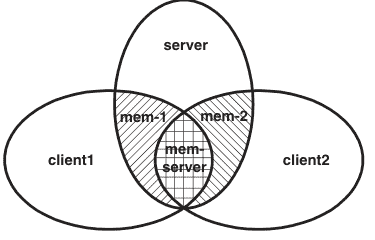

图 7.3 服务器与两个客户端共享内存。

我们将利用 System V 信号量的一个特性，为每个共享内存段使用包含两个信号量的一个信号量集。信号量 0 是读信号量，1 是写信号量。以下是针对这些数字以及在此之上进行 `semwait` 和 `sempost` 操作的宏：

```c
#define SEMI_READ    0

#define SEMI_WRITE   1

#define SEMI_POST    1

#define SEMI_WAIT    -1
```

给定一个信号量，函数 `op_semi` 对其进行操作。例如，要发布某个段的写信号量，您执行：

```c
ec_negl( op_semi(semid_receiver, SEMI_WRITE, SEMI_POST) )
```

这里是 `op_semi` 的代码：

```c
static int op_semi(int semid, int sem_num, int sem_op)

{

   struct sembuf sbuf;

   int r;

   sbuf.sem_num = sem_num;

   sbuf.sem_op = sem_op;

   sbuf.sem_flg = 0;

   ec_negl( r = semop(semid, &sbuf, 1) );

   return r;

EC_CLEANUP_BGN

   return -1;

EC_CLEANUP_END

}
```

还有一个方便的函数来初始化信号量：

```c
static int init_semi(int semid)

{

    union semun arg;

    int r;

    arg.val = 0;

    semctl(semid, SEMI_WRITE, SETVAL, arg);

    semctl(semid, SEMI_READ, SETVAL, arg);

    /* Following call will set 0 time, allowing clients to proceed. */

    ec_negl( r = op_semi(semid, SEMI_WRITE, SEMI_POST) );

    return r;

EC_CLEANUP_BGN

    return -1;

EC_CLEANUP_END

}
```

这是 SMI 使用的 SMIQ 类型背后的内部数据结构：

```c
typedef struct {

    SMIENTITY sq_entity;      /* entity */

    int sq_semID_server;      /* server sem */

    int sq_semID_client;      /* client sem (client only) */

    int sq_shmID_server;      /* server shm ID */

    int sq_shmID_client;      /* client shm ID (client only) */

    struct smi_msg *msg_server; /* ptr to server shm */

    struct smi_msg *msg_client; /* ptr to client shm (client only) */

    char sq_name[SERVER_NAME_MAX]; /* server name */

    struct client_id sq_client; /* client identification (server only) */

} SMIQ_SHM;
```

客户端使用几乎整个结构，但服务器只使用其中的一些成员。客户端存储：

- 它的实体（`SMI_CLIENT`）和服务器名称
- 它自己和服务器的信号量集 ID（每个包含 2 个信号量）
- 它自己和服务器的共享内存段 ID
- 指向它自己和服务器段的指针（来自 `shmat`）

服务器存储：

- 它的实体（`SMI_SERVER`）和名称。
- 它的信号量集 ID（2 个信号量）。
- 它的共享内存段 ID。
- 指向其段的指针。
- 传递给 `smi_send_getaddr` 的 `client_id`，以便它可以在随后的 `smi_send_release` 中使用它。这就是它知道要发送给哪个客户端的方式。在此用途下以及消息中，`client_id` 结构体的 `c_id` 成员是共享内存标识符，而 `c_id2` 成员是信号量集标识符。（参见下文 `smi_send_getaddr_shm` 的代码，查看这些成员是在哪里设置的。）

服务器不存储任何客户端的信号量集或共享内存信息，因为有很多客户端。这些信息可以轻易地通过来自客户端的传入消息传递，类似于 System V 消息队列 SMI 实现（第 7.5.3 节）中消息队列 ID 在消息中传递的方式。我们很快就会看到细节。

基于对如何使用该结构的描述，`smi_open_shm` 的代码应该是可以理解的：

```c
SMI_Q *smi_open_shm(const char *name, SMIENTITY entity, size_t msgsize)

{

    SMI_SHM *p = NULL;

    char shmname[FILNAME_MAX];

    int i;

    key_t key;

    ec_null( p = alloc(1, sizeof(SMI_Q)) );

    p->sq_entity = entity;

    if (strlen(name) >= SERVER_NAME_MAX) {

        errno = ENAMETOOLONG;

        EC_FAIL

    }

    strcpy(p->sq_name, name);

    mkshm_name_server(p, shmname, sizeof(shmname));

    (void)close(open(shmname, O_WRONLY | O_CREAT, 0));

    ec_negl( key = ftok(shmname, 1) );

    if (p->sq_entity == SMI_SERVER)
        if ((p->sq_sem_id_server = semget(key, 2, PERM_FILE)) != -1)
            (void)semctl(p->sq_sem_id_server, IPC_RMID, NULL);

    ec_negl( p->sq_sem_id_server = semget(key, 2,
        PERM_FILE | IPC_CREAT) );

    p->sq_sem_id_client = -1;

    if ((p->sq_shm_id_server = shmget(key, 0, PERM_FILE)) != -1)
        (void)shmctl(p->sq_shm_id_server, IPC_RMID, NULL);
```

## 504 第 7 章：高级进程间通信

```c
    ec_neg1(p->sq_shmid_server = shmget(key, msgsize, PERM_FILE | IPC_CREAT))

    p->sq_shmid_client = -1;

    ec_neg1(init_semi(p->sq_semid_server))

} else {

    ec_neg1(p->sq_semid_server = semget(key, 2, PERM_FILE))

    ec_neg1(p->sq_semid_client = semget(IPC_PRIVATE, 2, PERM_FILE | IPC_CREAT))

    ec_neg1(p->sq_shmid_server = shmget(key, msgsize, PERM_FILE))

    ec_neg1(p->sq_shmid_client = shmget(IPC_PRIVATE, msgsize, PERM_FILE | IPC_CREAT))

    ec_neg1(init_semi(p->sq_shmid_client, NULL, 0))

    ec_neg1(init_semi(p->sq_semid_client))

    for (i = 0; !semi_client_nowait(&s; i++) {

        union semun arg;

        struct semid_ds ds;

        arg.buf = &ds;

        ec_neg1(semctl(p->sq_semid_server, SEMI_WRITE, IPC_STAT, arg))

        if (ds.sem_otime > 0) break;

        sleep(1);

    }

}

ec_neg1(p->msg_server = shmat(p->sq_shmid_server, NULL, 0))

return (SMI_Q *)p;

EC_CLEANUP_BGN

free(p);

return NULL;

EC_CLEANUP_END
```


第一部分，通过对`ftok`的调用，与第 7.5.3 节中用于 System V 消息队列的该函数版本的代码几乎相同。然后，对于服务器，它删除旧的信号量集合（如果存在），并创建一个新的信号量集合，对共享内存段也执行相同的操作。客户端创建一个私有的信号量集合和共享内存段。两者都挂载了服务器的共享内存段。

注意`init_semi`（如前所示），它发布写信号量（以允许发送继续进行），并且还设置了操作时间，这就是其他进程如何得知信号量已初始化的方法，如第 7.9.1 节所述。我们在该节的`SimpleSem`实现中展示了一个等待算法；这里的算法稍微复杂一些：

* 我们最多尝试 10 次，因为 FreeBSD 和 Darwin 系统不设置时间，我们不想因此卡住。
* 有一个底层的全局变量`semi_client_nowait`，可用于防止任何等待。它在计时测试中使用，此时我们知道服务器远早于任何客户端启动。我们在开发本章末尾比较表数据的程序中使用了它。

`smi_close_shm` 非常简单：

```c
bool smi_close_shm(SMIQ *sqp)
{
    SMIQ_SHM *p = (SMIQ_SHM *)sqp;

    if (p->sq_entity == SMI_SERVER) {
        char shmname[FILENAME_MAX];
        (void)getaddr(-1);
        ec_negl( semctl(p->sq_semid_server, 0, IPC_RMID) )
        (void)shmctl(p->sq_shmid_server, IPC_RMID, NULL);
        mkshm_name_server(p, shmname, sizeof(shmname));
        (void)unlink(shmname);
    }
    else {
        ec_negl( semctl(p->sq_semid_client, 0, IPC_RMID) )
        (void)shmctl(p->sq_shmid_client, IPC_RMID, NULL);
    }
    free(p);
    return true;

    EC_CLEANUP_BGN
    return false;
    EC_CLEANUP_END
}
```

现在我们可以使用`smi_send_getaddr_shm` 了：

```c
bool smi_send_getaddr_shm(SMIQ *sqp, struct client_id *client,
                          void **addr)
{
    SMIQ_SHM *p = (SMIQ_SHM *)sqp;
    int semid_receiver;
    if (p->sq_entity == SMI_SERVER) {
        semid_receiver = client->c_id2;
        p->sq_client = *client;
    }
    else
        semid_receiver = p->sq_semid_server;

    ec_negl( op_semi(semid_receiver, SEMI_WRITE, SEMI_WAIT) );

    if (p->sq_entity == SMI_SERVER)
        ec_null( *addr = getaddr(client->c_id1) );
    else {
        *addr = p->msg_client;
        ((struct smi_msg *)*addr)->smi_client.c_id1 = p->sq_shmid_client;
        ((struct smi_msg *)*addr)->smi_client.c_id2 = p->sq_semid_client;
    }
    return true;
    EC_CLEANUP_BGN
        return false;
    EC_CLEANUP_END
}
```

对于来自服务器的发送，`client` 参数必须指向客户端标识；对于来自客户端的发送，它是 `NULL`。让我们首先跟踪服务器代码，然后是客户端代码。

对于服务器，`semid_receiver` 从 `c_id2` 成员设置，整个 `client_id` 结构体被保存以备 `smi_send_release` 稍后使用，正如我之前提到的。然后我们在 `SEMI_WRITE` 信号量上等待。由于它已在 `init_semi` 中发布，因此在开始时我们立即继续。消息本身位于由 `client->c_id1` 给出的共享内存段中，我们调用 `getaddr` 获取其地址，这就是通过 `addr` 参数返回的内容。我们将很快看到 `getaddr`；现在，把它看作只是执行 `shmat`。

对于客户端，实际上更简单，因为客户端已经拥有访问其自身和服务器共享内存段及信号量所需的一切。它直接从 `SMI_SHM` 结构体设置 `semid_receiver`，在 `SEMI_WRITE` 信号量上等待，设置返回的地址，并将标识符存储在消息中，用于其共享内存段和信号量集合。这就是接收方（服务器）将如何得知谁发送了消息以及如何回应。

一旦 `smi_send_getaddr_shm` 返回，其调用者可以自由使用返回的消息地址，并且该内存已被锁定，防止其他任何客户端进一步写入。（正如我之前指出的，这效率不高——入站服务器消息池会更好，但实现起来要复杂得多。）

当调用者完成后，它调用 `smi_send_release`：

```c
bool smi_send_release_shm(SMIQ *sqp)
{
    SMIQ_SHM *p = (SMIQ_SHM *)sqp;
    int semid_receiver;

    if (p->sq_entity == SMI_SERVER)
        semid_receiver = p->sq_client.c_id2;
    else
        semid_receiver = p->sq_semid_server;

    ec_neg( op_semi(semid_receiver, SEMI_READ, SEMI_POST) );

    return true;
    EC_CLEANUP_BGN
    return false;
    EC_CLEANUP_END
}
```

该函数只需要发布 `SEMI_READ` 信号量，但要做到这一点，它需要信号量集合标识符。对于服务器，它位于 `smi_send_getaddr_shm` 存储在 `SMIQ_SHM` 结构体中的 `client_id` 中；对于客户端，我们从一开始就在该结构体中有了它。

在此时，你应该能够轻松理解 `smi_receive_getaddr_shm`：

```c
bool smi_receive_getaddr_shm(SMIQ *sqp, void **addr)
{
    SMIQ_SHM *p = (SMIQ_SHM *)sqp;
    int semid_receiver;

    if (p->sq_entity == SMI_SERVER)
        semid_receiver = p->sq_semid_server;
    else
        semid_receiver = p->sq_semid_client;

    ec_neg( op_semi(semid_receiver, SEMI_READ, SEMI_WAIT) );

    if (p->sq_entity == SMI_SERVER)
        *addr = p->msg_server;
    else
        *addr = p->msg_client;

    return true;
    EC_CLEANUP_BGN
    return false;
    EC_CLEANUP_END
}
```

对应的函数 `smi_receive_release_shm` 必须发布 `SEMI_WRITE` 信号量：

```c
bool smi_receive_release_shm(SMIQ *sqp)
{
    SMIQ_SHM *p = (SMIQ_SHM *)sqp;
    int semid_receiver;

    if (p->sq_entity == SMI_SERVER)
        semid_receiver = p->sq_semid_server;
    else
        semid_receiver = p->sq_semid_client;

    ec_negl( OP_semi(semid_receiver, SEMI_WRITE, SEMI_POST) );

    return true;
    EC_CLEANUP_BGN
    return false;
    EC_CLEANUP_END
}
```

就是这样。大量的信号量操作，但很少涉及共享内存。如果消息很大（例如 100,000 字节），这是一个巨大的优势。消息队列（无论是 System V 还是 POSIX）可能甚至无法处理这么大的消息，而且即使可以，每条消息从用户空间复制到内核再复制回用户空间也会极大地拖慢速度。相比之下，共享内存 SMI 实现的速度与消息大小无关。

### 7.13.4 对 System V 共享内存的批评

System V 共享内存没有什么可抱怨的。系统调用相当直接、高效，通常实现得非常好。难点在于同步，这也是使用线程的难点，原因完全相同：一旦事物被共享，程序运行得很快，但可能不正确，而使其正确的工作极其难以测试。你必须证明它是正确的，然后完美地实现它。

### 7.14 POSIX 共享内存

本节介绍 POSIX 共享内存系统调用，并展示了一个使用 POSIX 共享内存和 POSIX 信号量的 SMI 实现。

13. 大约 30 年前，我的一位同事说，如果一个程序不必正确，他可以使其任意快——他只需将其更改为打印零并丢弃所有其他代码。因此，如果你无法保证你对共享内存或线程的使用是正确的，就不要使用这些功能——较慢但正确的方案会更高效。

## 7.14.1 POSIX 共享内存系统调用

POSIX 共享内存涉及打开，并可能创建带有 POSIX IPC 名称的共享内存段，其中包含第 7.6.2 节中描述的所有纠缠关系。该调用 `shm_open` 返回一个文件描述符，就好像打开了一个文件一样。事实上，POSIX 共享内存段表现得就像内存中的文件。一旦打开，你就使用 `ftruncate` 设置其大小，我们在第 2.17 节中已经看到过这个函数，就好像你在设置文件大小一样，事实上你确实是在这样做。然后，你使用 `mmap` 将该段映射到你的地址空间，`mmap` 可以映射一般的文件，而不仅仅是共享内存段。换句话说，只有 `shm_open` 和 `shm_unlink` 是为 POSIX 共享内存专门设计的。其他调用适用于任何常规文件。

以下是与共享内存相关的特定调用：

```c
/*
 * shm_open---打开共享内存对象
 */
#include <sys/mman.h>
int shm_open(
    const char *name,      /* POSIX IPC 名称 */
    int flags,             /* 标志 */
    mode_t perms           /* 权限 */
);
/* 返回文件描述符，出错时返回 -1 (设置 errno) */
```

```c
/*
 * shm_unlink---删除共享内存对象
 */
#include <sys/mman.h>
int shm_unlink(
    const char *name       /* POSIX IPC 名称 */
);
/* 成功时返回 0，出错时返回 -1 (设置 errno) */
```

`shm_open` 的标志就是我们已在其他面向文件的系统调用中见过的：`O_CREAT`、`O_EXCL`、`O_TRUNC`、`O_RDONLY` 和 `O_RDWR`。你不能使用 `O_WRONLY`。如果对象被创建，第三个参数将建立其权限。

与其他 POSIX 和 System V IPC 对象一样，POSIX 共享内存对象的内容至少在系统重启前都会保持持久存在。

当你完成对文件描述符的使用时，使用 `close` 关闭它，就像对待任何其它文件描述符一样。

`[SUS2002]` 并没有说你可以实际对共享内存对象执行 I/O 操作，比如使用 `read` 和 `write`，但实现方允许这样做是可能的。这是一种将内存文件像其他文件一样使用的方式。然而，拥有内存文件的整个意义在于，你可以对其使用普通的 C 或 C++ 操作，而不是通过昂贵的 I/O 系统调用，所以，即使支持此功能，它也不会非常有用。

通常，在创建共享内存对象后，你会使用 `ftruncate` 设置其大小，因为其初始大小为 0 字节。以下是第 2.17 节中 `ftruncate` 的回顾：

```c
/*
 * `ftruncate`—通过文件描述符截断或扩展文件
 */
#include <unistd.h>
int ftruncate(
 int fd,             /* 文件描述符 */
 off_t length         /* 新长度 */
);
/* 成功时返回 0，出错时返回 -1 (设置 errno) */
```

接下来，你将该对象映射到你的地址空间（类似于对 System V 共享内存对象使用 `shmat`）：

```c
/*
 * `mmap`—映射内存页
 */
#include <sys/mman.h>
void *mmap(
 void *addr,          /* 期望的地址或 NULL */
 size_t len,          /* 段的长度 */
 int prot,            /* 保护 (见下文) */
 int flags,            /* 标志 */
 int fd,              /* 文件描述符 */
 off_t off             /* 文件或共享内存对象中的偏移量 */
);
/* 返回指向段的指针，出错时返回 MAP_FAILED (设置 errno) */
```

第一个参数 `addr` 是段应该被映射到的地址附近的位置，如果 `flags` 参数中设置了 `MAP_FIXED`，则正是应该被映射到的位置。否则，它是 `NULL`。这意味着你可以使用任何地址，这是最常见的情况。我们在示例中会这样处理。

要映射的对象部分从对象内的 `off` 开始，并延伸 `len` 字节。没有必要一次映射整个对象（其大小由 `ftruncate` 设置），尽管这就是我们在示例中要做的，因此 `off` 将为 0，而 `len` 将与 `ftruncate` 的参数相同。

`prot` 参数要么是 `PROT_NONE`，意味着内存完全无法访问，或者是以下标志中的一个或多个按位或在一起：

* `PROT_READ` 数据可以被读取。
* `PROT_WRITE` 数据可以被写入。
* `PROT_EXEC` 数据可以被执行（可能不被支持）。

对于我们的用途，我们将使用 `PROT_READ` | `PROT_WRITE`。此外，我们在 `flags` 参数中将使用的唯一标志是 `MAP_SHARED`，这意味着对段的所有更改都立即可见。另一种选择是 `MAP_PRIVATE`，这意味着更改对于执行 `mmap` 的进程来说是私有的。在共享内存中使用 `MAP_PRIVATE` 没有多大意义。

`mmap` 是那些返回指针的函数之一，它具有一个特殊符号 `MAP_FAILED`，在此情况下用于错误返回。确保你测试的是它而不是 `NULL`。

所以，上述所有内容意味着，为了映射整个共享内存对象以进行读写，我们将这样做：

```c
ec_negl(ftruncate(fd, len))
mem = mmap(NULL, len, PROT_READ | PROT_WRITE, MAP_SHARED, fd, 0);
ec_cmp(mem, MAP_FAILED)
```

当你完成对已映射段的使用时，取消映射它：

```c
/*
 * munmap—取消映射内存页
 */
#include <sys/mman.h>
int munmap(
    void *addr,        /* 指向段的指针 */
    size_t len         /* 段的长度 */
);
/* 成功时返回 0，出错时返回 -1 (设置 errno) */
```

你不需要取消映射已映射的所有内容，但在我们的示例中我们会这样做。因此，`addr` 将是 `mmap` 返回的值，而 `len` 与传入 `mmap` 的值相同。

### 7.14.2 POSIX 共享内存的 SMI 实现

SMI 函数的 POSIX 共享内存实现与 System V 共享内存实现（来自第 7.13.3 节，在进行下一步之前你应该回顾该节）非常相似，不同之处在于，我们没有使用独立的信号量对象，而是利用 POSIX 信号量的特性并使用内存中的信号量。由于它们必须在服务器和客户端之间共享，我们将它们放入共享内存段中。

更精确地说，每个共享内存段（服务器一个，每个客户端一个）具有这种布局：

```c
struct shared_mem {
    sem_t sm_sem_w;
    sem_t sm_sem_r;
    struct smi_msg sm_msg; /* 可变大小 -- 必须是最后一个 */
};
```


`smi_msg` 的数据部分延伸到段的末尾，其大小是根据传递给 `smi_open_dshm` 的内容使用此宏计算得出的：

```c
#define MEM_SIZE(s)
    (sizeof(struct shared_mem) + sizeof(struct smi_msg) * (s))
```

其中 `s` 是 `smi_open_dshm` 的第三个参数。

```c
#define SEMI_READ     0
```

给定指向共享内存中 `struct shared_mem` 的指针，这里有一个方便的功能，执行 `semwait`、`sempost` 或销毁操作：

```c
#define SEMI_WRITE    1
#define SEMI_DESTROY  2
#define SEMI_POST     1
#define SEMI_WAIT     -1

static int op_smi(struct shared_mem *m, int sem_num, int sem_op)
{
    sem_t *sem_p = NULL;
    if (sem_num == SEMI_WRITE)
        sem_p = &m->sm_sem_w;
    else
        sem_p = &m->sm_sem_r;
    switch (sem_op) {
    case SEMI_WAIT: {
        ec_neg1( sem_wait(sem_p) )
        break;
    case SEMI_POST:
        ec_neg1( sem_post(sem_p) )
        break;
    case SEMI_DESTROY:
        ec_neg1( sem_destroy(sem_p) )
    }
    return 0;
EC_CLEANUP_BGN
return -1;
EC_CLEANUP_END
}
```

所以，如果 `m` 是这样的指针，我们可以进行如下调用：

```c
ec_neg1( op_smi(m, SEMI_READ, SEMI_POST) )
ec_neg1( op_smi(m, SEMI_WRITE, SEMI_WAIT) )
```

POSIX 调用不允许客户端仅仅将共享内存段的标识符和消息传递给服务器。相反，我们必须使用与第 7.3.3 节中我们使用 FIFO 时类似的方法：客户端传递其进程 ID，服务器使用该 ID 形成对象的 POSIX 名称，然后打开并映射它。这是昂贵的，因此服务器每个客户端只执行一次，并在表中查找已映射的段。所有这些以及更多内容都存储在 `SMIO_PSHM` 结构中，其形状如今应该已经很熟悉了：

```c
#define MAX_CLIENTS 50
typedef struct {
    SMIENTITY sg_entity;             /* 实体 */
    char sg_name[SERVER_NAME_MAX];   /* 服务器名称 */
    int sg_srv_fd;                   /* 服务器 shm 文件描述符 */
    struct shared_mem *sg_srv_mem;    /* 服务器映射的 shm 段 */
    struct client {
        pid_t cl_pid;                 /* 客户端进程 ID */
        int cl_fd;                   /* 客户端 shm 文件描述符 */
        struct shared_mem *cl_mem;    /* 客户端映射的 shm 段 */
    } sg_clients[MAX_CLIENTS];        /* 客户端仅使用 [0] */
    struct client_id cl_q_client;    /* 客户端 ID (仅服务器) */
    size_t sg_msgsize;               /* 消息大小 */
} SMIO_PSHM;
```

服务器可以跟踪 50 个客户端。我们的实现完全缺失的是一种方法，用于让客户端告知服务器它已完成，以便服务器可以重用其槽位。

现在，我们可以准备查看 `SMIO_PSHM` 结构如何通过 `smi_open_pshm` 填充。

```c
SMIQ *smi_open_pshm(const char *name, SMIDENTITY entity, size_t msgsize)
{
   SMIQ_PSHM *p = NULL;
   char shname[SERVER_NAME_MAX + 50];
   ec_null( p = calloc(1, sizeof(SMIQ_PSHM)) )
   p->sq_entity = entity;
   p->sq_msgsize = msgsize;
   if (strlen(name) >= SERVER_NAME_MAX) {
      errno = ENAMETOOLONG;
      EC_FAIL
   }
   strcpy(p->sq_name, name);
   mkshm_name_server(p, shname, sizeof(shname));
   if (p->sq_entity == SMI_SERVER) {
      if ((p->sq_srv_fd = shm_open(shname, O_RDWR, PERM_FILE)) == -1) {
         (void)shm_unlink(shname);
         (void)close(p->sq_srv_fd);
      }
      ec_negl( p->sq_srv_fd = shm_open(shname, O_RDWR | O_CREAT,
         PERM_FILE) )
      ec_negl( ftruncate(p->sq_srv_fd, MEM_SIZE(msgsize)) )
      p->sq_srv_mem = mmap(NULL, MEM_SIZE(msgsize),
         PROT_READ | PROT_WRITE, MAP_SHARED, p->sq_srv_fd, 0);
      ec_cmp(p->sq_srv_mem, MAP_FAILED)
      ec_negl( sem_init(&p->sq_srv_mem->sm_sem_w, true, 1) )
      ec_negl( sem_init(&p->sq_srv_mem->sm_sem_r, true, 0) )
   }
   else {
      ec_negl( p->sq_srv_fd = shm_open(shname, O_RDWR, PERM_FILE) )
      p->sq_srv_mem = mmap(NULL, MEM_SIZE(msgsize),
         PROT_READ | PROT_WRITE, MAP_SHARED, p->sq_srv_fd, 0);
      ec_cmp(p->sq_srv_mem, MAP_FAILED)
      mkshm_name_client(getpid(), shname, sizeof(shname));
      if ((p->sq_clients[0].cl_fd = shm_open(shname, O_RDWR, PERM_FILE))
         != -1) {
         (void)shm_unlink(shname);
         (void)close(p->sq_clients[0].cl_fd);
      }
      ec_negl( p->sq_clients[0].cl_fd = shm_open(shname,
         O_RDWR | O_CREAT, PERM_FILE) )
      ec_negl( ftruncate(p->sq_clients[0].cl_fd, MEM_SIZE(msgsize)) )
      p->sq_clients[0].cl_mem = mmap(NULL, MEM_SIZE(msgsize),
         PROT_READ | PROT_WRITE, MAP_SHARED, p->sq_clients[0].cl_fd, 0);
      ec_cmp(p->sq_clients[0].cl_mem, MAP_FAILED)
      ec_negl( sem_init(&p->sq_clients[0].cl_mem->sm_sem_w, true,
         1) )
      ec_negl( sem_init(&p->sq_clients[0].cl_mem->sm_sem_r, true,
         0) )
   }
   return (SMIQ *)p;
}
EC_CLEANUP_BGN
if (p != NULL)
    (void)smi_close_pshm((SMIQ *)p);
return NULL;
EC_CLEANUP_END
}

static void mkshm_name_server(const SMIQ_PSHM *p, char *shmname,
    size_t shmname_max)
{
    snprintf(shmname, shmname_max, "/smipshmq-%s", p->sq_name);
}

static void mkshm_name_client(pid_t pid, char *shmname,
    size_t shmname_max)
{
    snprintf(shmname, shmname_max, "/smipshmq-%d", pid);
}
```

前几行代码，直到调用 `mkshm_name_server` 之前，与我们之前在其他实现中看到的完全相同。随后，服务器创建一个全新的共享内存对象（删除旧对象），设置其大小并将其映射。完成这些操作后，信号量位于内存中，并完成了初始化。

客户端也会映射服务器的段，但它不会设置其大小，也不会初始化服务器的信号量，因为服务器已经完成了这些工作。然而，客户端确实会创建、设置大小并映射它自己的段，它使用数组的第一个元素来存储，并初始化它自己的信号量。

正如我所说的，服务器在收到来自某个客户端的消息之前，不会映射该客户端的段，因为它无法预知客户端是谁。下面是一个供服务器使用的函数（稍后我们将看到它在哪里被使用），该函数可以根据客户端的进程 ID 获取客户端段的映射地址，如前所述，这个进程 ID 会在每个从客户端发送到服务器的消息中传递：

```c
static struct client *get_client(SMIQ_PSHM *p, pid_t pid)
{
    int i, avail = -1;
    char shmname[SERVER_NAME_MAX + 50];
    for (i = 0; i < MAX_CLIENTS; i++) {
        if (p->sq_clients[i].cl_pid == pid)
            return &p->sq_clients[i];
        if (p->sq_clients[i].cl_pid == 0 && avail == -1)
            avail = i;
    }
    if (avail == -1) {
        errno = EADDRNOTAVAIL;
        EC_FAIL
    }
    p->sq_clients[avail].cl_pid = pid;
    mkshm_name_client(pid, shmname, sizeof(shmname));
    ec_negl( p->sq_clients[avail].cl_fd = shm_open(shmname, O_RDWR,
        PERM_FILE) )
    p->sq_clients[avail].cl_mem = mmap(NULL, MEM_SIZE(p->sq_msgsize),
        PROT_READ | PROT_WRITE, MAP_SHARED, p->sq_clients[avail].cl_fd,
        0L);
    ec_cmp(p->sq_clients[avail].cl_mem, MAP_FAILED)
    return &p->sq_clients[avail];
    EC_CLEANUP_BEGIN
    return NULL;
    EC_CLEANUP_END
}
```

为了查看 `get_client` 的使用方式，让我们接下来看看 `smi_send_getaddr_pshm`：

```c
bool smi_send_getaddr_pshm(SMIQ *sqp, struct client_id *client,
    void **addr)
{
    SMIQ_PSHM *p = (SMIQ_PSHM *)sqp;
    struct client *cp;
    struct shared_mem *sm;
    if (p->sq_entity == SMI_SERVER) {
        *p->sq_client = *client;
        ec_null( cp = get_client(p, client->c_id) )
        sm = cp->cl_mem;
    }
    else
        sm = p->sq_srv_mem;
    ec_negl( open_sem(sm, SEMI_WAIT) )
    if (p->sq_entity == SMI_CLIENT)
        sm->sm_msg.smi_client.c_idl = getpid();
    *addr = &sm->sm_msg;
    return true;
    EC_CLEANUP_BEGIN
    return false;
    EC_CLEANUP_END
}
```

请记住，参数 `client` 仅在服务器发送消息时使用；服务器之前从收到的消息中获取了这个结构体。`c_id` 成员是进程 ID，这就是传递给 `get_client` 的内容。对于客户端而言，服务器段的地址就在 `SMI_Q_PSHM` 结构中。拿到段地址后，我们等待写信号量，一旦可用，该段就可以由我们使用了。然后客户端将它的进程 ID 存入消息中，并返回地址。

对应的函数是 `smi_send_release_pshm`：

```c
bool smi_send_release_pshm(SMIQ *sqp)
{
    SMIQ_PSHM *p = (SMIQ_PSHM *)sqp;
    struct client *cp;
    struct shared_mem *sm;
    if (p->sq_entity == SMI_SERVER) {
        ec_null( cp = get_client(p, p->sq_client.c_idl) )
        sm = cp->cl_mem;
    }
    else
        sm = p->sq_srv_mem;
    ec_negl( op_semi(sm, SEMI_READ, SEMI_POST) )
    return true;
    EC_CLEANUP_BGN
    return false;
    EC_CLEANUP_END
}
```

当服务器调用此函数时，它会调用 `get_client`，使用 `smi_send_getaddr_pshm` 保存的进程 ID（`c_id1` 成员）来获取客户端段的地址。客户端的段已经被 `smi_send_getaddr_pshm` 映射过了——我们只需要查找它即可。对于客户端，与之前一样，服务器的段就在 `SMI_Q_PSHM` 结构中。一旦我们拥有了该段，我们需要做的唯一工作就是投递读取信号量，该信号量位于段中。这将允许对该段的 `smi_receive_getaddr_pshm` 操作继续进行，如下所示：

```c
bool smi_receive_getaddr_pshm(SMIQ *sqp, void **addr)
{
    SMIQ_PSHM *p = (SMIQ_PSHM *)sqp;
    struct shared_mem *sm;
    if (p->sq_entity == SMI_SERVER)
        sm = p->sq_srv_mem;
    else
        sm = p->sq_clients[0].cl_mem;
    ec_negl( OP_SEMI(sm, SEMI_READ, SEMI_WAIT) )
    *addr = &sm->sm_msg;
    return true;
    EC_CLEANUP_BGN
    return false;
    EC_CLEANUP_END
}
```

由于服务器和客户端各自从自己的段接收数据，地址是可用的，可以直接传递给 `op_semi`。不需要调用 `get_client`。一旦段可以读取，就返回其地址。

最后，`smi_receive_release_pshm` 在接收者完成读取后，对已接收的段投递写信号量：

```c
bool smi_receive_release_pshm(SMIQ *sqp)
{
```


```c
SMIQ_PSHM *p = (SMIQ_PSHM *)sqp;

struct shared_mem *sm;

if (p->sq_entity == SMI_SERVER)
    sm = p->sq_srv_mem;
else
    sm = p->sq_clients[0].cl_mem;

ec_negl( OP_SEMI(sm, SEMI_WRITE, SEMI_POST) )

return true;

EC_CLEANUP_BGN
return false;
EC_CLEANUP_END
}
```

如果你还没有将本实现与第 7.13.3 节中的 System V 共享内存实现进行对比，现在应该这样做了。你会发现它们非常相似，但存在以下差异：

- 在使用 System V 调用时，客户端可以传入每个消息的共享内存段和信号量集标识符，服务器可以使用这些标识符快速访问对象。因此，服务器不需要一个表来跟踪客户端。

## 7.14.3 对 POSIX 共享内存的批评

就共享内存而言，POSIX 和 System V 接口在便利性上大致相当。哪一个比另一个更高效取决于具体实现，但很可能任何同时支持两者的实现都会在内核中使用相同的内部机制来处理二者。

POSIX 共享内存的关键优势在于，映射调用 `mmap` 适用于任何常规文件，而不仅仅是通过 `shm_open` 打开的内存文件。你可以在任何时候对段的哪部分进行映射进行大量控制。

POSIX 共享内存的关键缺点是它并非总是可用的。例如，在某些版本的 Linux、FreeBSD 或 Darwin 中并不支持。

## 7.15 性能比较

既然已经有了针对六种不同 IPC 方法（包括第 8 章中的套接字）的 SMI 实现，构建一个测试程序来比较发送不同大小消息所需的时间是很容易的。在我的所有测试中，我在四个客户端和一个服务器之间发送了 5000 条消息。然后，我将数字归一化到了四个系统（Solaris、FreeBSD、Darwin 和 Linux），方法是除以该系统上 100 字节消息的 FIFO 时间。否则，由于四个系统的计算机硬件在性能上差异很大，结果将具有误导性。表 7.2 显示了结果。两种大尺寸的消息只能使用共享内存和 POSIX 消息队列来发送。此外，截至撰写本文时，FreeBSD、Darwin 和 Linux 并不支持 POSIX 消息队列或 POSIX 共享内存。

### 表 7.2 不同消息传递方法的性能

| 方法 | 100 字节消息 | 2000 字节消息 | 20,000 字节消息 | 100,000 字节消息 |
| :--- | :--- | :--- | :--- | :--- |
| FIFO | S: 1.00 B: 1.00 D: 1.00 L: 1.00 | S: 1.22 B: 1.46 D: 1.29 L: 1.51 | 太大 | 太大 |
| System V 消息队列 | S: 0.90 B: 0.62 L: 0.31 | S: 1.82 B: 3.76 L: 0.64 | 太大 | 太大 |
| POSIX 消息队列 | S: 2.02 | S: 2.40 | S: 7.03 | S: 33.39 |
| System V 共享内存 | S: 1.47 B: 0.94 D: 1.04 L: 0.55 | S: 1.41 B: 0.91 D: 1.07 L: 0.53 | S: 1.55 B: 0.90 D: 1.02 L: 0.47 | S: 1.24 B: 0.90 D: 1.06 L: 0.51 |
| POSIX 共享内存 | S: 1.27 | S: 1.25 | S: 1.41 | S: 1.37 |
| 套接字 | S: 1.84 B: 0.81 D: 1.04 L: 0.75 | S: 2.15 B: 1.00 D: 1.27 L: 0.95 | S: 10.15 B: 7.99 D: 5.52 L: 6.06 | S: 44.13 B: 35.83 D: 25.86 L: 31.91 |

S: Solaris；B: FreeBSD；D: Darwin；L: Linux。所有时间均已针对每个系统进行归一化，使得 100 字节消息的 FIFO 时间为 1.00。套接字使用了 `AF_UNIX` 域（见第 8 章）。

关于结果的一些评论：

- 这些结果并非定论，因为这只是众多可能的测试之一，SMI 只是众多可能的接口之一，而且我们的实现并非最优——它们主要被设计用作教科书示例。
- 即使经过归一化，对于某种方法耗时更短的系统，也不意味着它对该方法的实现更好。它可能只是对 FIFO（归一化的除数）的实现较慢。
- 对于小消息（大约 100 字节），System V 消息队列在所有系统上都表现出色，除了不支持它们的 Darwin 6.6。
- 套接字的性能几乎与两种消息队列方法一样好（在少数情况下甚至更好），并且可以处理任意大小的消息。此外，它们是唯一能在机器之间（包括通过互联网）传输的方法，尽管计时测试仅在单台机器内部使用它们。
- 在 Solaris 上，POSIX 消息队列的表现不如 System V 消息队列，但具有处理非常大消息的优势。
- 正如我们所预期的，两种共享内存方法的性能与消息大小无关。

因此，如果我们必须做出概括性的总结，我们会说，为了获得最大性能，对小消息使用 System V 消息队列，对大消息使用共享内存。一个我们未尝试的想法是结合这两者：使用 System V 消息来告知服务器何时需要工作，但使用共享内存段来传递数据。

如果最优性能并非至关重要，并且你希望生活简单，那就对所有内容都使用套接字。它们相当高效，能处理任意大小的消息，得到普遍支持，并且可以在机器之间传输。

这些建议仅适用于面向消息的 IPC。对于其他用途，根据你的需求，一种 IPC 方法可能比另一种更好。

### 练习

前六项练习要求你使用 POSIX IPC 函数实现 System V IPC 函数，或者反过来。在大多数情况下，你将无法实现所有功能和行为，因此练习的一部分是仔细记录你的实现在哪些地方存在不足。

- **7.1.** 使用 POSIX IPC 函数实现 `msgget`、`msgctl`、`msgsnd` 和 `msgrcv`。
- **7.2.** 使用 System V IPC 函数实现 `mq_open`、`mq_close`、`mq_unlink`、`mq_send` 和 `mq_receive`。
- **7.3.** 使用 POSIX IPC 函数实现 `semget`、`semctl` 和 `semop`，每集只允许一个信号量。你能处理大于 1 的增量和减量吗？
- **7.4.** 与上一题相同，但每集有多个信号量。
- **7.5.** 使用 System V IPC 函数实现 `sem_open`、`sem_close`、`sem_unlink`、`sem_post` 和 `sem_wait`。
- **7.6.** 使用 POSIX IPC 函数实现 `shmget`、`shmemt`、`shmat` 和 `shmdt`。
- **7.7.** 没有练习要求你使用 System V IPC 函数实现 `shm_open`、`shm_unlink`、`ftruncate`、`mmap` 和 `munmap`。为什么没有？你能提出一个合适的练习吗？你能完成它吗？
- **7.8.** 设计并执行一项实验，比较使用 `read` 和 `write` 对常规文件进行常规 I/O 的效率与通过内存映射文件进行访问的效率。包括顺序 I/O 和随机 I/O，以及可能的几种变体。
- **7.9.** 设计并执行一项实验，比较仅使用写锁（使用 `lockf`）与读写锁组合（使用 `fcntl`）的效率。尝试创建一种读写模式，以显示效率最大的差异。
- **7.10.** 扩展你在练习 5.14 中编写的程序，以包含本章节中解释的附录 A 中的进程属性。

## 8
# 网络与套接字

当然，第 6 章和第 7 章中的 IPC 机制有其用途，但许多现代应用程序需要在机器之间发送数据，而不仅仅是同一台机器上的进程之间。我所说的“机器之间”，指的不仅仅是同一房间甚至同一栋楼里的机器。我指的是使用互联网，在世界的任何地方。

在机器之间传输数据的基本机制——网络——被称为*套接字*。有八个基本的套接字系统调用，其中五个是套接字独有的：`socket`、`bind`、`listen`、`accept`、`connect`、`read`、`write` 和 `close`。然而，由于套接字，尤其是其底层的通信协议，可能会变得复杂，因此还涉及大约 60 个其他系统调用，所有这些都在本章中描述。

虽然这里提供的内容足以让你入门，并包含大量示例（包括 Web 浏览器和服务器），但当你更深入地研究 UNIX 网络时，你可能需要更高级的参考资料。迄今为止最全面的书籍是 [Ste2003]。你还需要熟悉你系统的文档以及你所使用的协议细节，特别是如果该协议比 TCP/IP 更奇特的话。

以下是我们的推进方式：首先，我将解释基本的套接字相关系统调用，并给出一些简单的客户端/服务器示例。然后，我将讨论套接字地址和套接字选项。我将介绍一个简单的接口，以隐藏许多复杂性，并使用它来实现基于套接字的简单消息接口（SMI）版本，我在第 7 章中详细讨论过该接口。接下来是更高级的主题：无连接套接字、带外数据、网络数据库函数以及其他一些杂项函数。最后，我将简要谈谈构建能够同时处理成千上万客户端的服务器所面临的挑战。

## 8.1 Socket 基础

本节介绍套接字，并描述基本的套接字系统调用。

### 8.1.1 套接字的工作机制

套接字很复杂，所以我们先从已知的内容开始。回忆一下第 7.2 节，进程可以像这样打开一个 FIFO：

```c
fd = open("MyFifo", O_RDONLY);
```

现在考虑这个系统调用在底层执行了哪些操作：

- 它创建一个用于 I/O 的端点，并为其分配一个文件描述符。
- 它将文件描述符绑定到外部名称 "MyFifo"。
- 它等待直到有写入者出现。
- 它返回文件描述符，该描述符可用于 `read` 系统调用。

套接字的工作方式类似，但不同之处在于每个步骤都被分解为独立的系统调用：

| 命令 | 描述 |
| :--- | :--- |
| `socket` | 创建端点并分配文件描述符。 |
| `bind` | 将套接字与外部名称关联，以便其他进程可以引用它。 |
| `listen` | 标记套接字使其能够接受来自其他套接字的连接。 |
| `accept` | 阻塞等待连接。 |
| `connect` | 连接到处于 `accept` 阻塞状态的套接字。 |

FIFO 在客户端和服务器之间是对称的，因为两者执行完全相同的系统调用 `open`，但使用不同的标志（例如，`O_RDONLY` 与 `O_WRONLY`）。但连接的套接字通常是不对称的，因为客户端和服务器使用不同的系统调用序列，如图 8.1 所示。

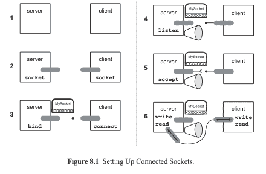

服务器端：

- 调用 `socket` 创建端点并创建文件描述符（步骤 2）。
- 调用 `bind` 将套接字绑定到名称（步骤 3）。
- 调用 `listen` 将其标记为接受连接（步骤 4）。
- 调用 `accept` 阻塞直到建立连接。然后 `accept` 创建第二个套接字，拥有新的文件描述符（步骤 5）。
- 使用新的文件描述符在第二个套接字上读写数据（步骤 6）。

客户端：

- 调用 `socket` 创建端点并创建文件描述符（步骤 2）。
- 调用 `connect`，以服务器端绑定的名称作为参数，阻塞直到服务器接受连接（步骤 3，尽管它不一定需要与服务器的步骤 3 同步）。
- 使用该套接字的文件描述符读写数据（步骤 6）。

在我正式介绍任何套接字系统调用之前，让我们看一下一个示例程序，该程序通过 `fork` 创建一个子进程作为客户端，而父进程作为服务器端：

```c
#define SOCKETNAME "MySocket"

int main(void)
{
    struct sockaddr_un sa;

    (void)unlink(SOCKETNAME);

    strcpy(sa.sun_path, SOCKETNAME);

    sa.sun_family = AF_UNIX;

    if (fork() == 0) { /* child -- client */

        int fd_skt;

        char buf[100];

        ec_negl( fd_skt = socket(AF_UNIX, SOCK_STREAM, 0) )

        while (connect(fd_skt, (struct sockaddr *)&sa, sizeof(sa)) == -1)
            if (errno == ECONNREFUSED) {
                sleep(1);

                continue;

            } else
                EC_FAIL;

        ec_negl( write(fd_skt, "Hello!", 7) )

        ec_negl( read(fd_skt, buf, sizeof(buf)) )

        printf("Client got \"%s\"\n", buf);

        ec_negl( close(fd_skt) )

        exit(EXIT_SUCCESS);
    }

    else { /* parent -- server */

        int fd_skt, fd_client;

        char buf[100];

        ec_negl( fd_skt = socket(AF_UNIX, SOCK_STREAM, 0) )

        ec_negl( bind(fd_skt, (struct sockaddr *)&sa, sizeof(sa)) )

        ec_negl( listen(fd_skt, SOMAXCONN) )

        ec_negl( fd_client = accept(fd_skt, NULL, 0) )

        ec_negl( read(fd_client, buf, sizeof(buf)) )

        printf("Server got \"%s\"\n", buf);

        ec_negl( write(fd_client, "Goodbye!", 9) )

        ec_negl( close(fd_skt) )

        ec_negl( close(fd_client) )

        exit(EXIT_SUCCESS);
    }

    EC_CLEANUP_BGN
    exit(EXIT_FAILURE);
    EC_CLEANUP_END
}
```

我们首先看到的是，传递给 `bind` 和 `connect` 的名称不仅仅是一个字符串，而是一个 `sockaddr` 结构，其中包含在 `sun_path` 成员中的字符串以及在 `sun_family` 成员中的地址族。套接字地址本身就是一个庞大的主题，我稍后会详细介绍，但现在只需假设 `AF_UNIX` 意味着“在单机内的本地通信”，这是此示例所需的。

`unlink` 套接字文件名是因为，对于 `AF_UNIX`，`bind` 不会重用现有名称，而我们希望确保它从一个新鲜的名称开始。

服务器端（父进程）遵循图 8.1 中的六步序列。（暂时忽略 `listen` 和 `accept` 中神秘的参数。）客户端（子进程）也遵循图 8.1 中的步骤，但有一个转折：如果它在服务器端到达其 `bind` 之前到达其 `connect`，`connect` 将会失败，因为套接字文件尚未存在。在这种情况下，我们睡眠并再次尝试。

当服务器端从 `accept` 返回时，它继续读取和写入从 `accept` 获取的文件描述符（而不是原始套接字的文件描述符）。当客户端从 `connect` 返回时，它读写其套接字文件描述符（它拥有的唯一描述符）。请记住，`accept` 和 `connect` 是两个阻塞的调用——其他调用只是完成它们的工作并立即返回。

只要服务器端和客户端希望如此，连接就会保持开启状态，表现得像一条双向管道（第 6.6 节）。

套接字文件确实是该类型的文件，如 `ls` 命令所示：

```bash
$ ls -l MySocket
srwxr-xr-x   1 marc    sysadmin    0 Apr  4 10:03 MySocket
```

以下是我运行示例程序时得到的输出：

```text
Server got "Hello!"
Client got "Goodbye!"
```

因此，套接字其实相当简单，除了关于以下方面的细节：

- 处理来自同一服务器端的多个客户端
- 地址族，包括用于网络通信的有趣的 `AF_INET` 族
- 非流导向通信，涉及数据报而不仅仅是数据流
- 无连接通信，其中进程向命名接收者发送数据报，而不是像我的示例那样建立半永久连接
- 许多用于微调套接字行为的选项，特别是针对 `AF_INET` 和 `AF_INET6`
- 在不同数字存储方式的机器之间传递二进制数据
- 访问名称数据库（例如，www.basempath.com/aup）

嗯，实际上，这些不仅仅是细节。它们是构建网络应用程序时你需要了解的重要主题，它们占据了本章的其余部分。

### 8.1.2 连接套接字的基本系统调用

如前所述，有连接套接字（通过 `accept` 和 `connect` 建立通道）和无连接套接字（数据报发送到命名接收者（不使用 `listen` 和 `accept`，且 `connect` 以不同方式使用））。在本节中，我将仅讨论连接套接字，并将无连接套接字推迟到第 8.6 节。

本节仅涵盖基本的五个特定于套接字的系统调用，我已在非正式的介绍中提及，从 `socket` 开始：

```c
socket—create endpoint for communication
```


```c
#include <sys/socket.h>

int socket(int domain, /* domain (AF_UNIX, AF_INET, etc.) */
int type, /* SOCK_STREAM, SOCK_DGRAM, etc. */
int protocol /* specific to type; usually zero */);

/* Returns file descriptor or -1 on error (sets errno) */
```

从`socket`返回的文件描述符可用于两个不同的目的：

- 由服务器端用作接受连接（通过`accept`）的端点（实际`I/O`在`accept`返回的文件描述符上进行）。
- 由客户端在`connect`成功连接套接字后用于直接`I/O`。

`domain`¹ 和`type`与将在后续调用`bind`或`connect`中使用的套接字地址相同。`protocol`参数用于创建

1. 以`AF`开头的宏有时显示为以`PF`开头，但标准使用`AF`表示法，这是你应该使用的。

当类型提供选择时，可以自行决定，但在大多数情况下，使用默认值即可，因此设为零。

接下来，服务器必须使用`bind`为套接字命名：

```c
bind—将名称绑定到套接字

#include <sys/socket.h>

int bind(
    int socket_fd,                    /* 套接字文件描述符 */
    const struct sockaddr *sa,         /* 套接字地址 */
    socklen_t sa_len                   /* 地址长度 */
);

/* 成功时返回 0，出错时返回 -1（设置 errno） */
```

套接字地址拥有一个独立的章节（第 8.2 节）来专门介绍。我们已经看到了一个`AF_UNIX`的例子，它仅用于单机内部的通信，就像第 7 章中介绍的`IPC`机制一样。稍后我们将看到如何为其他域（包括`AF_INET`）设置地址。

请记住，在大多数系统上，对于`AF_UNIX`，`bind`会创建一个全新的套接字文件；它无法重用已存在的文件。

服务器还必须调用`listen`来配置套接字以接受连接：

```c
listen—标记套接字以接受连接并设置队列上限

#include <sys/socket.h>

int listen(
    int socket_fd,                    /* 套接字文件描述符 */
    int backlog                       /* 最大连接队列长度 */
);

/* 成功时返回 0，出错时返回 -1（设置 errno） */
```

上一节的示例并未展示这一点，但服务器可以从众多客户端接受连接。此外，由于服务器只能以特定速率处理`accept`，因此连接请求可能会排队。`listen`的第二个参数限制了该队列的长度。通常，当队列已满时，客户端尝试连接会导致其`connect`返回 -1，并将`errno`设置为`ECONNREFUSED`。在我的示例中，我使用了常量`SOMAXCONN`，它是系统定义的最大值。

接下来，服务器接受连接：

```c
accept—在套接字上接受新连接并创建新套接字

#include <sys/socket.h>

int accept(
    int socket_fd,            /* 套接字文件描述符 */
    struct sockaddr *sa,      /* 套接字地址或 NULL */
    socklen_t *sa_len         /* 地址长度 */
);

/* 成功时返回文件描述符，出错时返回 -1（设置 errno） */
```

通常，`accept`会阻塞，直到收到连接请求（来自另一个进程调用的`connect`），然后它会为该连接的`I/O`创建一个新套接字，并返回一个新的文件描述符。该文件描述符可以与普通的`read`和`write`系统调用一起使用，尽管为了更精细地控制`I/O`，您也可以使用针对套接字的特定调用——`send`、`sendto`、`sendmsg`、`recv`、`recvfrom`和`recvmsg`——我将在第 8.6.2、8.6.3 和 8.9.1 节中讨论这些调用。

如果为套接字文件描述符设置了`O_NONBLOCK`标志（通过`fcntl`；参见第 3.8.3 节），`accept`不会等待连接，如果队列上没有请求，则立即返回 −1，并将`errno`设置为`EAGAIN`或`EWOULDBLOCK`。

套接字文件描述符可以与`select`或`poll`一起使用，而且通常确实如此，我们将在第 8.1.3 节中看到。通常，服务器使用套接字文件描述符和`accept`返回的每个文件描述符来为`select`（或`poll`的等价物）设置`fd_set`。如果`select`或`poll`表示套接字文件描述符就绪，这意味着服务器应该执行`accept`（此时不会阻塞）。如果其他某个文件描述符就绪，这意味着数据已从客户端到达，应该被读取。

如果`sa`参数不为`NULL`，它将用于返回已连接套接字的地址。在输入时，必须将`sa_len`设置为`sa`指向的存储大小；在返回时，它会被设置为实际地址的大小。

关于服务器的部分就说到这里。客户端在创建其套接字后，只需调用`connect`，并使用与服务器`bind`时相同的套接字地址：

```c
connect—连接套接字

#include <sys/socket.h>

int connect(
    int socket_fd,                /* 套接字文件描述符 */
    const struct sockaddr *sa,    /* 套接字地址 */
    socklen_t sa_len              /* 地址长度 */
);

/* 成功时返回 0，出错时返回 -1（设置 errno） */
```

与`accept`类似，`connect`通常也会阻塞，直到连接请求被接受，但它不返回文件描述符——客户端在套接字文件描述符上进行`I/O`。

如果设置了`O_NONBLOCK`标志，`connect`不会阻塞等待连接，而是返回 −1，并将`errno`设置为`EINPROGRESS`。连接请求并未被放弃，而是保留在队列中等待最终被满足。在此期间对`connect`的后续调用也会返回 −1，但此时`errno`被设置为`EALREADY`。当连接建立时，可以使用该套接字文件描述符。如果需要，可以使用`select`或`poll`等待其变为可写状态（而非可读状态）。一个典型的用例是具有某些初始化任务的应用程序。它发起非阻塞的`connect`，执行初始化，然后发起`select`或`poll`进行阻塞等待。

### 8.1.3 处理多个客户端

现在让我们扩展第 8.1.1 节中的示例，以便服务器能够处理多个客户端。以下是该示例中服务器端代码的替代版本：

```c
static bool run_server(struct sockaddr_un *sap)
{
  int fd_skt, fd_client, fd_hwm = 0, fd;
  char buf[100];
  fd_set set, read_set;
  ssize_t nread;

  ec_neg1( fd_skt = socket(AF_UNIX, SOCK_STREAM, 0) )
  ec_neg1( bind(fd_skt, (struct sockaddr *)sap, sizeof(*sap)) )
  ec_neg1( listen(fd_skt, SOMAXCONN) )

  if (fd_skt > fd_hwm)
    fd_hwm = fd_skt;

  FD_ZERO(&set);
  FD_SET(fd_skt, &set);

  while ( true ) {
    read_set = set;
    ec_neg1( select(fd_hwm + 1, &read_set, NULL, NULL, NULL) )

    for (fd = 0; fd <= fd_hwm; fd++)
      if (FD_ISSET(fd, &read_set)) {
        if (fd == fd_skt) {
          ec_neg1( fd_client = accept(fd_skt, NULL, 0) )
          FD_SET(fd_client, &set);
          if (fd_client > fd_hwm)
            fd_hwm = fd_client;
        }
        else {
          ec_neg1( nread = read(fd, buf, sizeof(buf)) );
          if (nread == 0) {
            FD_CLR(fd, &set);
            if (fd == fd_hwm)
              fd_hwm--;
            ec_neg1( close(fd) );
          }
          else {
            printf("Server got '%s'\n", buf);
            ec_neg1( write(fd, "Goodbye!", 9) );
          }
        }
      }
  }

  return true;

EC_CLEANUP_BGN
    close(fd_skt);
    return false;
EC_CLEANUP_END
}
```

新代码的大部分都涉及设置和使用`select`。我在第 4.2.3 节中讨论过，但这里做一个回顾：

```c
select—等待 I/O 就绪

#include <sys/select.h>

int select(
    int nfds,          /* 最高 fd + 1 */
    fd_set *readset,   /* 读集合或 NULL */
    fd_set *writeset,  /* 写集合或 NULL */
    fd_set *errorset,  /* 错误集合或 NULL */
    struct timeval *timeout   /* 超时时间（微秒）或 NULL */
);

/* 返回置位的位数，出错时返回 -1（设置 errno） */
```

函数`run_server`中有两个`fd_set`：一个是`set`，它保存所有感兴趣的文件描述符：套接字文件描述符，以及由`accept`返回的每个客户端各一个。我们需要`select`应该查看的集合中文件描述符的数量，因此变量`fd_hwm`（“高水位标记”）会随着我们从`accept`获得新的文件描述符而保持更新。当我们关闭最高的文件描述符时，我们将其从`set`中移除并递减高水位标记。将其从`set`中移除非常重要；否则，`select`会持续报告它已就绪，这意味着并不是有数据可供读取，而仅仅是`read`不会阻塞。

第二个`fd_set`，`read_set`，每次调用`select`时都会从`set`复制，然后由`select`修改以指示哪些文件描述符已就绪。

然后该函数永远循环，直到我们用信号终止它。每次从`select`返回时，它都会遍历返回的集合（被修改的`read_set`变量）以寻找就绪的文件描述符。如果`fd_skt`就绪，它就执行`accept`；如果其他任何内容就绪，这意味着客户端已发送了一些数据。我们读取它，显示它，并发送一条简短的消息回去。

客户端的代码与之前的示例相同，只是发送给服务器的消息包含进程`ID`：

```c
static bool run_client(struct sockaddr_un *sap)
{
    if (fork() == 0) {
        int fd_skt;
        char buf[100];

        ec_neg1( fd_skt = socket(AF_UNIX, SOCK_STREAM, 0 ) )

        while (connect(fd_skt, (struct sockaddr *)sap, sizeof(*sap)) == -1) {
            if (errno == ENOENT) {
                sleep(1);
                continue;
            }
            else
                EC_FAIL
        }

        snprintf(buf, sizeof(buf), "Hello from %ld!",
                 (long)getpid());

        ec_neg1( write(fd_skt, buf, strlen(buf)) )
        ec_neg1( read(fd_skt, buf, sizeof(buf)) )

        printf("Client got \"%s\"\n", buf);

        ec_neg1( close(fd_skt) )

        exit(EXIT_SUCCESS);
    }

    return true;

EC_CLEANUP_BGN
    /* 只有子进程到达这里 */
    exit(EXIT_FAILURE);
EC_CLEANUP_END
}
```

最后，有一个小的`main`函数，它设置套接字地址，创建四个客户端子进程，并在父进程中运行服务器：

```c
#define SOCKETNAME "MySocket"

int main(void)
{
    struct sockaddr_un sa;
    int nclient;

    (void)unlink(SOCKETNAME);

    strcpy(sa.sun_path, SOCKETNAME);
    sa.sun_family = AF_UNIX;

    for (nclient = 1; nclient <= 4; nclient++)
        ec_false( run_client(&sa) )
        ec_false( run_server(&sa) )

    exit(EXIT_SUCCESS);

    EC_CLEANUP_BGN
        exit(EXIT_FAILURE);
    EC_CLEANUP_END
}
```

以下是我们获得的输出：

```
Server got "Hello from 31786!"
Client got "Goodbye!"
Server got "Hello from 31785!"
Client got "Goodbye!"
Server got "Hello from 31784!"
Client got "Goodbye!"
Server got "Hello from 31787!"
Client got "Goodbye!"
```

我们已经拥有了实现一个相当复杂的客户端-服务器系统所需的大部分要素。我们需要进一步了解的是如何设置套接字地址（`AF_UNIX`本身并不特别有趣）以及如何设置套接字选项。在我们处理完字节序问题后，这一部分马上就会到来。

## 8.1.4 字节序

通过网络在不同机器之间传递如 “Hello” 和 “Goodbye” 这样的字符串时从来不会有问题，因为所有通信都保持了字节的顺序。然而，在传递二进制数字时可能会遇到问题，因为数字中字节的排列方式确实在不同机器之间存在差异。

为了理解这一点，请参见图 8.2，它展示了在内存位置 106204 存储一个十六进制表示为 0xD04C 的两字节整数的两种方法。

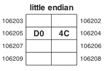


**图 8.2** 小端序与大端序。

在所谓的“小端序”机器中，数字的地址是其最低有效字节的地址；而在“大端序”机器中，它是其最高有效字节的地址。³ 两者都是给数字编址的完全有效方式，但问题是，如果一台机器向另一台使用不同字节序的机器发送二进制数字，数字就会被打乱。也就是说，如果小端序机器将数字作为字节序列发送（数据发送的唯一方式），发送的顺序将是先 4C 后 D0，而如果接收方机器是大端序的，它会将其解释为 4CD0，因为它将接收到的第一个字节视为高有效字节。

解决方案是以约定的网络字节序发送二进制数字。因此，所有发送方都必须从主机（本地）字节序转换为网络字节序，所有接收方都必须从网络字节序转换为主机字节序。但这仅在数据尚未以标准方式结构化的情况下执行。例如，如果你有一张编码为 JPEG 的照片，你会原样发送它——你不会尝试将 JPEG 的任何部分转换为网络字节序。

在大多数情况下，你不需要知道你的主机字节序或网络字节序，因为有一套标准的转换函数用于对 16 位和 32 位整数进行转换：

- `htons` — 将 16 位值从主机字节序转换为网络字节序

```c
#include <arpa/inet.h>

uint16_t htons(
    uint16_t hostnum /* 主机字节序下的 16 位数 */);

/* 返回网络字节序下的数字（无错误返回） */
```

- `htonl` — 将 32 位值从主机字节序转换为网络字节序

```c
#include <arpa/inet.h>

uint32_t htonl(
```


## 字节序转换函数

```c
uint32_t hostnum /* 主机字节序下的 32 位数 */);

/* 返回网络字节序下的数字（无错误返回） */
```

### `ntohs`

`ntohs` 将 16 位值从网络字节序转换为主机字节序

```c
#include <arpa/inet.h>

uint16_t ntohs(
    uint16_t netnum /* 网络字节序下的 16 位数 */);

/* 返回主机字节序下的数字（无错误返回） */
```

### `ntohl`

`ntohl` 将 32 位值从网络字节序转换为主机字节序

```c
#include <arpa/inet.h>

uint32_t ntohl(
    uint32_t netnum /* 网络字节序下的 32 位数 */);

/* 返回主机字节序下的数字（无错误返回） */
```

不幸的是，16 位函数使用后缀“s”代表 `short`，即使 `short` 类型可能超过 16 位；类似地，32 位函数使用后缀“l”代表 `long`。事实上，这些函数甚至不操作 `short` 和 `long` 类型；它们操作的是 `uint16_t`（16 位无符号整数）和 `uint32_t`（32 位无符号整数）类型。

为了演示其中两个函数的实际效果，下面是一个将 `0xD04C` 转换为网络字节序、显示字节再转换回原顺序的程序：

```c
int main(void)
{
    uint16_t nhost = 0xD04C, nnetwork;
    unsigned char *p;
    p = (unsigned char *)&nhost;
    printf("%x %x\n", *p, *(p + 1));
    nnetwork = htons(nhost);
    p = (unsigned char *)&nnetwork;
    printf("%x %x\n", *p, *(p + 1));
    exit(EXIT_SUCCESS);
}
```

输出显示运行该程序的 Intel Pentium CPU 使用的字节序与网络字节序不同：

```
4c d0
d0 4c
```

我们可以进一步得出结论：Pentium 处理器采用小端序，而网络字节序是大端序。⁴

通常，当你使用的协议要求发送二进制数字时（我们在下一节中会看到），你会使用这些标准转换函数。对于你自己的用途，请尽量设计应用程序以发送字符而不是二进制数据，除非你正在发送具有标准化格式的对象（JPEG、MP3 等）。这正是 HTTP（Web 协议）的做法（第 8.4.2 节）。

## 8.2 套接字地址

本节的全部内容仅关乎如何确定一个套接字地址（`struct sockaddr`），以便在调用 `bind` 和 `connect` 时使用。我们已经看到了如何针对 `AF_UNIX` 域执行此操作，其中地址主要只是一个路径名：

```c
struct sockaddr_un sa;
strcpy(sa.sun_path, SOCKETNAME);
sa.sun_family = AF_UNIX;
```

但这只是唯一简单的情况。其他域更为复杂。

### 8.2.1 套接字地址结构

每个地址家族都有自己的结构体结构和头文件。`AF_UNIX` 有 `sockaddr_un`，`AF_INET` 有 `sockaddr_in`，`AF_X25` 有 `sockaddr_x25`，等等，尽管只有前两个域在 [SUS2002] 中是标准化的。一种方法（我们在 `AF_UNIX` 中一直使用的方法）是声明一个你需要使用的特定结构体的变量，以某种方式填充其成员，并在调用 `bind` 或 `connect` 时将其地址强制转换为指向 `struct sockaddr`（通用类型）的指针。

从可移植性的角度来说，结构体 `sockaddr` 仅定义了一个抽象类型；你不能用它来声明要使用的结构体，因为它可能没有足够的空间。相反，有一个名为 `sockaddr_storage` 的标准结构体，它保证有足够的空间，但其成员并未针对任何特定域进行定制。

听起来很混乱，但其实没那么糟糕：

- 如果你确切知道你正在使用哪个域，请声明合适类型的结构体（例如 `sockaddr_un`），或动态分配足以容纳该结构体的空间（例如使用 `malloc`）。
- 如果你需要足以容纳任何域结构体的空间，请使用 `sockaddr_storage`，但在使用前将指针强制转换为合适类型的指针。
- 在调用 `bind` 和 `connect` 时使用强制转换为 `struct sockaddr *` 的操作——根据它们的函数原型，你别无选择。

下面是最后两条规则结合使用的示例：

```c
struct sockaddr_storage sas;
struct sockaddr_un *sa = (struct sockaddr_un *)&sas;
sa->sun_family = AF_UNIX;
...
ec_neg!( bind(fd, (struct sockaddr *)sa, sizeof(*sa)) )
```

不要过于担心最后一条规则。如果你做错了，编译器会告诉你。也不要担心直接使用 `sockaddr_storage`——它不包含你打算使用的任何成员。但是，由于你进行了强制转换，编译器在编译时不会检查你是否为你的域使用了正确的域特定结构体。这一点你必须在第一次时就做对。

### 8.2.2 AF_UNIX 套接字地址

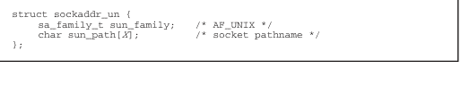

³ 术语本身很直观，但“大端序”这一术语实际上出自乔纳森·斯威夫特的*《格列佛游记》*，书中描述了关于从蛋的大头还是小头敲开的争议。事实上，“有一万一千个 [大头派] 曾数次宁愿承受死亡，也不愿服从从蛋的小头敲开的法令。”

### 8.2.3 AF_INET 套接字地址

如前所述，`AF_INET` 域用于通过 Internet 与套接字进行通信。以下是 `$sockaddr_{-}in$` 结构：

```
struct sockaddr_in—structure for AF_INET socket addresses

#include <netinet/in.h>

struct sockaddr_in {
    sa_family_t sin_family;    /* AF_INET */
    in_port_t sin_port;        /* port number (uint16_t) */
    struct in_addr sin_addr;   /* IPv4 address */
};

struct in_addr {
    in_addr_t s_addr;          /* IPv4 address (uint32_t) */
};
```

IPv4[^5] 地址（通常简称为“IP 地址”）是分配给机器上网络接口的 32 位二进制数。我们通常不使用常规方式（例如，1,182,625,240）来引用这些数字，而是使用点分十进制表示法，其中每个字节表示为一个单独的十进制数，例如 `216.109.125.70`。即便如此，这种方式也不够方便，因此还有一种使用描述性名称代替数字的系统，允许我们使用 `www.yahoo.com` 而不是 `216.109.125.70`（参见第 8.2.5 节），但在这里我将使用点分表示法。

每个 IP 地址可以关联许多不同的服务，每个服务都被分配了一个 16 位端口号。许多端口号按照惯例被分配给知名服务。例如，HTTP（Web）服务器使用 `80` 端口，FTP 服务器使用 `21` 端口，Telnet 服务器使用 `23` 端口，等等。你可以通过查看 `/etc/services` 文件来了解你的机器上端口的分配情况。例如，以下是我的 FreeBSD 系统中该文件的部分内容（总共超过 2000 行）：

```
... 
ftp             21/tcp    #File Transfer [Control]
ftp             21/udp    #File Transfer [Control]
ssh             22/tcp    #Secure Shell Login
ssh             22/udp    #Secure Shell Login
telnet          23/tcp    #Telnet
telnet          23/udp    #Telnet
...
finger          79/tcp    #Finger
finger          79/udp    #Finger
http            80/tcp    www www-http #World Wide Web HTTP
http            80/udp    www www-http #World Wide Web HTTP
...
```

[^5]: 它是 Internet 协议的第 4 版本。

端口和 IP 数字的类型 `in_port_t` 和 `in_addr_t` 分别被定义为 `uint16_t` 和 `uint32_t`，并且必须使用网络字节序，这意味着你可以使用 `htons` 和 `htonl` 函数，如下所示：

```c
struct sockaddr_in sa;
sa.sin_family = AF_INET;
sa.sin_port = htons(80);
sa.sin_addr.s_addr = htonl((216UL << 24) + (109UL << 16) +
                           (125UL << 8) + 70UL); /* 216.109.125.70 */
```

但对于点分 IP 数字，有一个更好的函数可以直接将字符串转换为网络字节序的 32 位 IP 数字：

```
**inet_addr**—convert dotted IPv4 address string to integer

#include <arpa/inet.h>

in_addr_t inet_addr(
    const char *cp             /* dotted IP address */
);

/* Returns IP address or (in_addr_t)-1 on error (errno not defined) */
```

其返回值，即将 −1 转换为无符号 32 位数字，与我们将 `255.255.255.255` 转换后的结果相同。但这没什么问题，因为这是一个非法 IP 地址。

反向函数有时也很有用：

```
**inet_ntoa**—convert integer IPv4 address to dotted string

#include <arpa/inet.h>

char *inet_ntoa(
    struct in_addr in          /* integer address */
);

/* Returns string (no error return) */
```

除了使用 `inet_addr` 和 `inet_ntoa`，你还可以使用更通用的函数 `inet_ntop` 和 `inet_pton`（参见第 8.9.5 节），这些函数也适用于 IPv6 地址。

回到我们的示例，让我们使用 `inet_addr` 而不是 `htonl` 来处理 IP 地址，并添加一些代码来连接 `80` 端口上的 HTTP 服务器，发送一个网页请求，并显示返回内容的一部分：

```c
#define REQUEST "GET / HTTP/1.0\r\n\r\n"

int main(void)
{
    struct sockaddr_in sa;
    int fd_skt;
    char buf[1000];
    ssize_t nread;
    sa.sin_family = AF_INET;
    sa.sin_port = htons(80);
    sa.sin_addr.s_addr = inet_addr("216.109.125.70");
    ec_negl( fd_skt = socket(AF_INET, SOCK_STREAM, 0) )
    ec_negl( connect(fd_skt, (struct sockaddr *)\&sa, sizeof(sa)) )
    ec_negl( write(fd_skt, REQUEST, strlen(REQUEST)) )
    ec_negl( nread = read(fd_skt, buf, sizeof(buf)) )
    (void)write(STDOUT_FILENO, buf, nread);
    ec_negl( close(fd_skt) )
    exit(EXIT_SUCCESS);
    EC_CLEANUP_BGN
    exit(EXIT_FAILURE);
    EC_CLEANUP_END
}
```

该请求是一个 GET 命令，由定义 Web 通信的 HTTP 协议所定义（参见第 8.4.2 节）。以下是返回输出的一部分，你可能会认出这是 Yahoo 主页的 HTML 源代码。它以状态行开始，紧接着是 HTML 内容（此处大幅省略显示）：

```
HTTP/1.1 200 OK
Date: Sat, 19 Jul 2003 18:51:56 GMT
P3P: policyref="http://p3p.yahoo.com/w3c/p3p.xml", CP="CAO DSP COR CUR ADM ...
Cache-Control: private
Connection: close
Content-Type: text/html
<html><head>
<title>Yahoo!</title>...
```

## 8.2.4 AF_INET6 套接字地址

如果 IPv4 地址的所有 32 位都能被使用，那么将有 43 亿个网络接口地址，这对于一段时间来说可能已经足够了。然而，由于 IPv4 地址的分配方式，只有 5.34 亿个所谓的 B 类地址（那些以 192 到 223 开头的地址）可供大型组织使用，而大约 1992 年时，这些地址似乎将在 1995 年中用尽。另一个问题是，互联网骨干站点使用的路由表增长得太大，无法容纳在当时可用的路由器内存中。

提出的解决方案是 Internet 协议的第 6 版本，称为 IPv6，除了其他改进外，它将地址从 4 字节扩展到 16 字节，允许 $2^{128}$ 个地址。[^6]

[^6]: 这种扩展允许拥有数量极其庞大的唯一地址。

书写 IPv6 地址的首选方式是将其表示为 8 组，每组 2 字节，例如 `FEDC:BA98:7654:3210:FEDC:BA98:7654:3210`。

你使用 `sockaddr_in6` 结构来设置 `AF_INET6` 套接字地址；与 `AF_INET` 相比，这里的内容更多，这也是意料之中的：

```
struct sockaddr_in6—structure for AF_INET6 socket addresses

#include <netinet/in.h>

struct sockaddr_in6 {
    sa_family_t sin6_family;    /* AF_INET6 */
    in_port_t sin6_port;        /* port number (uint16_t) */
    uint32_t sin6_flowinfo;    /* traffic class and flow information */
    struct in6_addr sin6_addr; /* IPv6 address */
    uint32_t sin6_scope_id;    /* set of interfaces for a scope */
};

struct in6_addr {
    uint8_t s6_addr[16];       /* IPv6 address */
};
```


这里有两个 `sockaddr_in` 结构中不存在的新成员：`sin6_flowinfo`，它旨在保存“流标签”和优先级，但目前其用途尚未规定；以及 `sin6_scope_id`，它标识与某些地址一起使用的接口集合，具体取决于实现。如果你正在设置自己的 `sockaddr_in6` 结构，请将这两个成员设置为零。实际上，你应当将整个结构初始化为零，然后再设置你感兴趣的成员，因为某些实现在上述概要中列出的成员之外还有额外成员。

在实践中，你不会直接初始化 `sockaddr_in6` 结构；相反，你会从 `getaddrinfo` 获取一个实例，这在第 8.2.6 节中有描述。

你不能在 IPv6 地址上使用 `inet_addr` 和 `inet_ntoa`。相反，你使用在第 8.9.5 节中介绍的 `inet_ntop` 和 `inet_pton`。

## 8.2.5 域名系统 (DNS)

当然，你很少在 Internet 浏览器或 FTP 客户端中输入数字 IP 地址——你输入的是像 `www.yahoo.com` 或 `www.basepath.com` 这样的助记名称。这些主机名由一个名为 DNS 的全球分布式数据库翻译成 IP 地址。有若干标准化的函数用于从 UNIX 应用程序访问 DNS。最新且功能最强大的是 `getaddrinfo`，这就是我们在示例中使用的函数。第 8.8.1 节简要描述了一些较旧的函数（例如 `gethostbyname`）。

在像 `http://www.basepath.com/aup`（本书网站的 URL）这样的 URL 中，主机名只是中间部分。也就是说，整体语法是：[^7]

`scheme` // `hostname`/`path`

其中 `scheme` 指定访问资源的方法（例如，HTTP、FTP），`hostname` 是在 DNS 数据库中记录的主机名称，而 `path` 是主机文件系统内的路径。

[^7]: 这是一个简化的观点，但对于我们的目的来说已经足够了。统一资源标识符（URI）的完整语法更为复杂。

在我们的示例中，我们使用套接字系统调用连接到主机。一旦建立了连接，我们就根据方案与主机交互。例如，在第 8.2.3 节的示例中，方案是 HTTP，因此我们发送了请求

```
GET / HTTP/1.0
```

到服务器，服务器将其解释为对一个 Web 页面的请求，并将其发送回给我们。路径的处理方式取决于协议方案；对于 HTTP 来说，它是 `GET` 命令的参数（在我们的示例中是一个斜杠）。没有任何套接字系统调用关心路径或协议方案。

在这本书中，除了理解一些简单示例所需的最少内容外，我们不需要深入讨论 HTTP、HTML、FTP 或任何其他与协议方案相关的主题。了解各种协议方案的最佳方式是阅读 RFC（请求意见）文档 [RFC]。

### 8.2.6 getaddrinfo

与其从头构建一个 `sockaddr_in` 或 `sockaddr_in6` 地址，不如调用 `getaddrinfo` 更容易，它会为你构建一个套接字地址：

**getaddrinfo**——获取套接字地址信息

```c
#include <sys/socket.h>
#include <netdb.h>

int getaddrinfo(
    const char *nodename,        /* 节点名称 */
    const char *servname,       /* 服务名称 */
    const struct addrinfo *hint, /* 提示 */
    struct addrinfo **info      /* 作为链表返回的信息 */
);

/* 成功返回 0，出错时返回错误号（不设置 errno） */
```

**struct addrinfo**——`getaddrinfo` 的结构体

```c
struct addrinfo {
    int ai_flags;               /* 输入标志 */
    int ai_family;             /* 地址族 */
    int ai_socktype;           /* 套接字类型 */
    int ai_protocol;           /* 协议 */
    socklen_t ai_addrlen;      /* 套接字地址长度 */
    struct sockaddr *ai_addr;   /* 套接字地址 */
    char *ai_canonname;         /* 服务位置的规范名称 */
    struct addrinfo *ai_next;   /* 指向链表中下一个结构的指针 */
};
```

通常，你调用 `getaddrinfo` 时，将 `nodename` 设置为你想要的主机名，将 `servname` 设置为端口号（作为字符串），并将 `hint` 设置为你想要的地址族和套接字类型。你通过 `info` 参数获得一个 `addrinfo` 结构体的链表，其中包含与你的提示相匹配的套接字地址和其他信息。你选择一个合适的套接字地址，并在调用 `connect` 或 `bind` 时直接使用它，将 `ai_addr` 成员强制转换为 `struct sockaddr`。

“主机名”可以是通过 DNS 服务器查找的名称、本地机器 `/etc/hosts` 文件中定义的名称、点分表示法的 IPv4 地址（作为字符串）或冒号表示法的 IPv6 地址（作为字符串）。

一个关键的标志是 `AI_PASSIVE`，它意味着返回的套接字地址用于 `accept`；也就是说，`getaddrinfo` 的调用来自服务器。否则，如果标志清除，则调用来自客户端，套接字地址将用于 `connect`。对于无连接协议（例如 `SOCK_DGRAM`），它也可以用于 `sendto` 或 `sendmsg`。

`getaddrinfo` 返回其自身的错误代码，不能将其作为 `errno` 值处理，这意味着在出错时你不能使用 `perror` 或 `strerror` 等标准函数。相反，有一个专门用于 `getaddrinfo` 返回的错误代码的函数，以及另一个函数 `getnameinfo`（第 8.8.1 节）：

**gai_strerror**——获取错误代码描述

```c
#include <netdb.h>

const char *gai_strerror(
         int code    /* 错误代码 */
);

/* 返回字符串（无错误返回） */
```

在我们的示例中，我们将使用错误检查宏 `ec_ai`，它知道如何处理 `getaddrinfo` 和 `getnameinfo` 的返回值，因此我们不会直接调用 `gai_strerror`。

下面是一个使用 `getaddrinfo` 的简单示例：

```c
int main(void)
{
 struct addrinfo *infp = NULL, hint;
 memset(&hint, 0, sizeof(hint));
 hint.ai_family = AF_INET;
 hint.ai_socktype = SOCK_STREAM;
 ec_ai( getaddrinfo("www.yahoo.com", "80", &hint, &infp) )
 for ( ; infp != NULL; infp = infp->ai_next) {
 struct sockaddr_in *sa = (struct sockaddr_in *)infp->ai_addr;
 printf("%s port: %d protocol: %d\n", inet_ntoa(sa->sin_addr),
 ntohs(sa->sin_port), infp->ai_protocol);
 }
 exit(EXIT_SUCCESS);
}

EC_CLEANUP_BGN
    exit(EXIT_FAILURE);
EC_CLEANUP_END
}
```

**输出结果：**

- `66.218.70.48` port: `80` protocol: `0`
- `66.218.70.49` port: `80` protocol: `0`
- `66.218.71.88` port: `80` protocol: `0`
- `66.218.71.86` port: `80` protocol: `0`
- `66.218.70.50` port: `80` protocol: `0`
- `66.218.71.91` port: `80` protocol: `0`
- `66.218.71.80` port: `80` protocol: `0`
- `66.218.71.84` port: `80` protocol: `0`
- `66.218.71.90` port: `80` protocol: `0`
- `66.218.71.93` port: `80` protocol: `0`
- `66.218.71.94` port: `80` protocol: `0`
- `66.218.71.92` port: `80` protocol: `0`
- `66.218.71.89` port: `80` protocol: `0`

因此，似乎 `www.yahoo.com` 关联了多个不同的 IP 地址。由于有提示，我们知道它们都是 `AF_INET` 地址，类型为 `SOCK_STREAM`，因此其中任何一个都适合访问 Web 页面。为了看到这一点，让我们将通过 `getaddrinfo` 获取套接字地址的过程与第 8.2.3 节示例中的连接和显示代码配对：

```c
#define REQUEST "GET / HTTP/1.0\r\n\r\n"

int main(void)
{
    struct addrinfo *infop = NULL, hint;
    int fd_skt;
    char buf[1000];
    size_t nread;
    memset(&hint, 0, sizeof(hint));
    hint.ai_family = AF_INET;
    hint.ai_socktype = SOCK_STREAM;
    ec_ai( getaddrinfo("www.yahoo.com", "80", &hint, &infop) )
    ec_negl( fd_skt = socket(infop->ai_family, infop->ai_socktype,
            infop->ai_protocol) )
    ec_negl( connect(fd_skt, (struct sockaddr *)infop->ai_addr,
            infop->ai_addrlen) )
    ec_negl( write(fd_skt, REQUEST, strlen(REQUEST)) )
    ec_negl( nread = read(fd_skt, buf, sizeof(buf)) )
    (void)write(STDOUT_FILENO, buf, nread);
    ec_negl( close(fd_skt) )
    exit(EXIT_SUCCESS);
}

EC_CLEANUP_BGN
    exit(EXIT_FAILURE);
EC_CLEANUP_END
}
```

运行此程序产生了我们在第 8.2.3 节中之前展示过的相同输出。

如果你的系统、你的 DNS 服务器和你访问的主机支持的话，你可以使用 `getaddrinfo` 访问 80 端口上更多 `SOCK_STREAM` `AF_INET` 地址以外的内容。你可以将 `nodename` 或 `servname` 参数中的任意一个设置为 `NULL`（但不能两者都为 `NULL`），和/或在提示中使用 `AF_UNSPEC` 作为地址“族”来查看有哪些可用。然后你搜索返回的地址，找到你想要使用的那个。例如，如果存在 `AF_INET6`（IPv6）地址，你可能希望使用它。关于 `getaddrinfo` 这种高级用法的详细信息，请参阅 [SUS2002]、你的系统文档或 [Ste2003] 的第 11 章。

在结束本节之前还有一点：当你不再需要 `getaddrinfo` 返回的列表时，应该通过调用 `freeaddrinfo` 来释放它：

**freeaddrinfo**——释放套接字地址信息

```c
#include <sys/socket.h>
#include <netdb.h>

void freeaddrinfo(
    struct addrinfo *infop    /* 要释放的列表 */
);
```

我们在示例中没有调用 `freeaddrinfo`，因为那些是即将退出的 `main` 函数。

### 8.2.7 gethostname

有时，例如在第 8.4.4 节的示例 Web 服务器中，程序需要其自身主机的名称。通常通用的名称“localhost”是可行的，但如果其他机器需要连接该名称，则需要系统管理员分配的公开名称。这就是 `gethostname` 的用途。

**gethostname**——获取主机名称

```c
#include <unistd.h>

int gethostname(
    char *name,          /* 返回的名称 */
    size_t namelen      /* 名称缓冲区大小 */
);

/* 成功返回 0，出错时返回 -1（未定义 errno） */
```

参见第 8.4.4 节，查看 `gethostname` 的使用示例。

## 8.3 套接字选项

`socket` 系统调用如此简单的一个原因是，尽管套接字很复杂，但所有选项都是由另一个系统调用处理的：

**setsockopt**——设置套接字选项

```c
#include <sys/socket.h>

int setsockopt(
    int socket_fd,       /* 套接字文件描述符 */
    int level,           /* 要访问的级别 */
    int option,          /* 要设置的选项 */
    const void *value,   /* 要设置的值 */
    socklen_t value_len  /* 值的长度 */
);

/* 成功返回 0，出错时返回 -1（设置 errno） */
```

五个参数中有四个很容易解释：`socket_fd` 是套接字文件描述符，`option` 是选项的名称，`value` 指向要设置的值，而 `value_len` 是 `value` 指向的值的长度。值通常是一个整数，但有时它是该选项特有的结构体，我们会看到。

第二个参数 `level` 标识选项所属的协议级别。一个级别 `SOL_SOCKET` 适用于套接字级别本身，这也是你可能最常使用的。[SUS2002] 在 `<netinet/in.h>` 中定义了另外六个协议级别：

- `IPPROTO_IP` 互联网协议
- `IPPROTO_IPV6` 互联网协议第 6 版
- `IPPROTO_ICMP` 控制消息协议
- `IPPROTO_RAW` 原始 IP 数据包协议
- `IPPROTO_TCP` 传输控制协议
- `IPPROTO_UDP` 用户数据报协议

[SUS2002] 定义了这六种协议的一些选项，但实现通常会定义额外的选项。不幸的是，很难获取所有选项的列表——你需要阅读正在使用的协议文档。例如，在 Solaris 上，输入 `man ip` 会调出一个描述 `IPPROTO_IP` 选项的手册页。

这里我们仅描述标准化的 `SOL_SOCKET` 选项；对于其他选项，请查阅系统文档或 [Ste003]。

有一个用于获取选项的对应调用，其参数几乎相同：

**getsockopt**—获取套接字选项

```c
#include <sys/socket.h>

int getsockopt(
    int socket_fd,      /* 套接字文件描述符 */
    int level,          /* 要访问的层级 */
    int option,         /* 要获取的选项 */
    void *value,        /* 返回的值 */
    socklen_t *value_len/* value 的长度 */
);

/* 成功时返回 0，出错时返回 -1（设置 errno） */
```

`setsockopt` 和 `getsockopt` 之间的唯一区别在于，在后者中 `value_len` 参数是一个指向长度的指针，并且在调用之前必须将其设置为由 `value` 参数指向的缓冲区的大小。返回时，它会被设置为返回值的长度。

下面是一个简短的示例，用于设置套接字的 `SO_REUSEADDR` 选项（我稍后会解释其具体含义）：

```c
int socket_option_value = 1;
ec_neg1( setsockopt(fd, SOL_SOCKET, SO_REUSEADDR,
    &socket_option_value, sizeof(socket_option_value)) )
```


# 8.4 简单套接字接口 (SSI)

我将简要描述所有可移植的 `SOL_SOCKET` 选项。大多数选项值是整数，在这种情况下，`value` 必须指向一个 `int`，并且 `value_len` 将是 `sizeof(int)`。有些整数是布尔值，其中 `1` 表示真，`0` 表示假。不要使用 C 常量 `true` 来代替 `1`，因为 `true` 的值可能是 `−1`，这对 C 语言来说没问题，但 `setsockopt` 不接受。在下表中，符号 `(B)` 表示布尔值，`(I)` 表示整数，`(X)` 表示需要进一步说明的类型。字母后跟随的“`s`”和/或“`g`”表示该选项是用于 `setsockopt`、`getsockopt` 还是两者兼用。

请注意，某些选项是否真正起作用（例如 `SO_KEEPALIVE`）取决于实际使用的协议及其实现。

-   **`SO_ACCEPTCONN`**
    套接字正在接受连接；即已调用 `listen`。`(Bg)`

-   **`SO_BROADCAST`**
    如果协议支持，允许发送广播消息。`(Bsg)`

-   **`SO_DEBUG`**
    底层协议实现会记录调试信息。`(Bsg)`

-   **`SO_DONTROUTE`**
    发送的消息绕过标准路由设施，根据目标地址直接到达网络接口。`(Bsg)`

-   **`SO_ERROR`**
    套接字错误状态，获取后会被清除。`(Ig)`

-   **`SO_KEEPALIVE`**
    通过定期发送消息来保持连接活动。如果没有响应，套接字将断开连接。（向已断开的套接字写入，就像向没有读取者的管道写入一样，会产生 `SIGPIPE` 信号。）`(Bsg)`

-   **`SO_LINGER`**
    如果开启，当有未发送的消息时，`close` 操作将阻塞，直到消息发送完毕或等待时间到期。`(Xsg)` 该值是一个 linger 结构：
    ```c
    struct linger {
       int l_onoff;    /* 开启 (1) 或关闭 (0) */
       int l_linger;   /* 等待时间（秒） */
    };
    ```

-   **`SO_OOBINLINE`**
    接收到的带外数据保持内联状态（参见 8.7 节）。`(Bsg)`

-   **`SO_RCVBUF`**
    接收缓冲区大小。`(Isg)`

-   **`SO_RCVLOWAT`**
    接收低水位标记。阻塞接收操作（例如 `read()`）会阻塞，直到接收到该数值与请求数值中较小的那个为止。默认为 1。`(Isg)`

-   **`SO_RCVTIMEO`**
    使用 `timeval` 结构（1.7.1 节）作为阻塞接收操作完成前的最大等待时间。零时间（默认值）表示无限。如果时间到期，操作返回部分计数，或者返回 `–1` 并将 `errno` 设置为 `EAGAIN` 或 `EWOULDBLOCK`。`(Xsg)`

-   **`SO_REUSEADDR`**
    允许 `bind` 重用本地地址。否则，如果在系统定义的时间段内（例如几分钟）之前发生过 `bind`，`bind` 将返回 `−1` 并将 `errno` 设置为 `EADDRINUSE`。这对于调试和测试非常方便。`(Bsg)`

-   **`SO_SNDBUF`**
    发送缓冲区大小。此选项接收一个 `int` 值。`(Isg)`

-   **`SO_SNDLOWAT`**
    发送低水位标记。非阻塞发送操作（例如 `write`）除非可以立即发送该数值与请求数值中较小的那个，否则不发送任何数据。`(Isg)`

-   **`SO_SNDTIMEO`**
    使用 `timeval` 结构（1.7.1 节）作为阻塞发送操作完成前的最大等待时间。零时间（默认值）表示无限。如果时间到期，操作返回部分计数，或者返回 `−1` 并将 `errno` 设置为 `EAGAIN` 或 `EWOULDBLOCK`。`(Xsg)`

-   **`SO_TYPE`**
    套接字类型（例如，`SOCK_STREAM`）。`(Isg)`

为了展示这些选项如何与 `getsockopt` 配合使用，这里有一个程序显示几种不同套接字的值：

```c
typedef enum (OT_INT, OT_LINGER, OT_TIMEVAL) OPT_TYPE;

static void show(int skt, int level, int option, const char *name,
OPT_TYPE type)
{
    socklen_t len;
    int n;
    struct linger lng;
    struct timeval tv;

    switch (type) {
    case OT_INT:
        len = sizeof(n);
        if (getsockopt(skt, level, option, &n, &len) == -1)
            printf("%s FAILED (%s)\n", name, strerror(errno));
        else
            printf("%s = %d\n", name, n);
        break;
    case OT_LINGER:
        len = sizeof(lng);
        if (getsockopt(skt, level, option, &lng, &len) == -1)
            printf("%s FAILED (%s)\n", name, strerror(errno));
        else
            printf("%s = l_onoff: %d; l_linger: %d secs.\n", name,
                lng_l_onoff, lng_l_linger);
        break;
    case OT_TIMEVAL:
        len = sizeof(tv);
        if (getsockopt(skt, level, option, &tv, &len) == -1)
            printf("%s FAILED (%s)\n", name, strerror(errno));
        else
            printf("%s = %ld secs., %ld usecs.\n", name,
                (long)tv.tv_sec, (long)tv.tv_usec);
    }
}

static void showall(int skt, const char *caption)
{
    printf("\n%s\n", caption);

    show(skt, SOL_SOCKET, SO_ACCEPTCONN, "SO_ACCEPTCONN", OT_INT);
    show(skt, SOL_SOCKET, SO_BROADCAST, "SO_BROADCAST", OT_INT);
    show(skt, SOL_SOCKET, SO_DEBUG, "SO_DEBUG", OT_INT);
    show(skt, SOL_SOCKET, SO_DONTROUTE, "SO_DONTROUTE", OT_INT);
    show(skt, SOL_SOCKET, SO_ERROR, "SO_ERROR", OT_INT);
    show(skt, SOL_SOCKET, SO_KEEPALIVE, "SO_KEEPALIVE", OT_INT);
    show(skt, SOL_SOCKET, SO_LINGER, "SO_LINGER", OT_LINGER);
    show(skt, SOL_SOCKET, SO_OOBINLINE, "SO_OOBINLINE", OT_INT);
    show(skt, SOL_SOCKET, SO_RCVBUF, "SO_RCVBUF", OT_INT);
    show(skt, SOL_SOCKET, SO_RCVLOWAT, "SO_RCVLOWAT", OT_INT);
    show(skt, SOL_SOCKET, SO_RCVTIMEO, "SO_RCVTIMEO", OT_TIMEVAL);
    show(skt, SOL_SOCKET, SO_REUSEADDR, "SO_REUSEADDR", OT_INT);
    show(skt, SOL_SOCKET, SO_SNDBUF, "SO_SNDBUF", OT_INT);
    show(skt, SOL_SOCKET, SO_SNDLOWAT, "SO_SNDLOWAT", OT_INT);
    show(skt, SOL_SOCKET, SO_SNDTIMEO, "SO_SNDTIMEO", OT_TIMEVAL);
    show(skt, SOL_SOCKET, SO_TYPE, "SO_TYPE", OT_INT);
}

int main(void)
{
    int skt;

    ec_neg1( skt = socket(AF_INET, SOCK_STREAM, 0) )
    showall(skt, "AF_INET SOCK_STREAM");

    ec_neg1( close(skt) )

    ec_neg1( skt = socket(AF_INET, SOCK_DGRAM, 0) )
    showall(skt, "AF_INET SOCK_DGRAM");

    ec_neg1( close(skt) )

    exit(EXIT_SUCCESS);
}

EC_CLEANUP_BGN
    exit(EXIT_FAILURE);
EC_CLEANUP_END
```

在 Solaris 上的输出如下：

```
AF_INET SOCK_STREAM

SO_ACCEPTCONN = 0
SO_BROADCAST = 0
SO_DEBUG = 0
SO_DONTROUTE = 0
SO_ERROR = 0
SO_KEEPALIVE = 0
SO_LINGER = l_onoff: 0; l_linger: 0 secs.
SO_OOBINLINE = 0
SO_RCVBUF = 65536
SO_RCVLOWAT FAILED (Option not supported by protocol)
SO_RCVTIMEO FAILED (Option not supported by protocol)
SO_REUSEADDR = 0
SO_SNDBUF = 65536
SO_SNDLOWAT FAILED (Option not supported by protocol)
SO_SNDTIMEO FAILED (Option not supported by protocol)
SO_TYPE = 2

AF_INET SOCK_DGRAM

SO_ACCEPTCONN = 0
SO_BROADCAST = 0
SO_DEBUG = 0
SO_DONTROUTE = 0
SO_ERROR = 0
SO_KEEPALIVE = 0
SO_LINGER = l_onoff: 0; l_linger: 0 secs.
SO_OOBINLINE = 0
SO_RCVBUF = 65536
SO_RCVLOWAT FAILED (Option not supported by protocol)
SO_RCVTIMEO FAILED (Option not supported by protocol)
SO_REUSEADDR = 0
SO_SNDBUF = 65536
SO_SNDLOWAT FAILED (Option not supported by protocol)
SO_SNDTIMEO FAILED (Option not supported by protocol)
SO_TYPE = 1
```

每当我们要使用套接字时，除了调用 `getaddrinfo`、`socket`、`bind`、`connect` 以及其他相关函数外，让我们编写一些更高级的函数来隐藏一些繁琐的细节。我们将这些函数的接口称为 SSI，即简单套接字接口（Simple Socket Interface）。

## 8.4.1 SSI 函数调用

内部上，SSI 函数在一个类型为 SSI 的结构中保持打开连接的状态，我们将稍后详细介绍。当你调用 `ssi_open` 时，你会获得一个指向 SSI 的指针；当你完成时使用 `ssi_close` 关闭 SSI：

- `ssi_open`—打开 SSI 连接
```c
SSI *ssi_open(
    const char *name, /* 服务器名称 */
    bool server /* 是否从服务器调用？ */
);

/* 返回指向 SSI 的指针，出错时返回 NULL（设置 errno） */
```

- `ssi_close`—关闭 SSI 连接
```c
bool ssi_close(
    SSI *ssip /* 指向 SSI 的指针 */
);

/* 成功时返回 true，出错时返回 false（设置 errno） */
```

正如我们将看到的，`ssi_open` 封装了构建套接字地址的过程（例如通过调用 `getaddrinfo`），以及对 `socket`、`bind`、`listen` 和 `connect` 的调用。

传递给 `ssi_open` 的名称如果以两个斜杠开头（这两个斜杠不属于名称的一部分），则被视为 `AF_INET` 主机名。名称后必须跟一个冒号和端口号。如果它不以两个斜杠开头，则它是一个本地 `AF_UNIX` 名称，如第 8.1.1 节中所述。一些示例：

- `//www.basepath.com:80` 到主机 `www.basepath.com` 端口 80 的 `AF_INET` 连接
- `//firecracker:31000` 到 `firecracker` 端口 31000 的 `AF_INET` 连接
- `//216.109.125.43:21` 到 `216.109.125.43` 端口 21 的 `AF_INET` 连接
- `MyServer` `AF_UNIX` 连接

服务器调用 `ssi_wait_server` 等待客户端的文件描述符就绪；它封装了我们在第 8.1.3 节示例中看到的对 `select` 和 `accept` 的调用：

- `ssi_wait_server`—等待就绪的文件描述符
```c
int ssi_wait_server(
    SSI *ssip /* 指向 SSI 的指针 */
);

/* 返回文件描述符，出错时返回 -1（设置 errno） */
```

客户端调用 `ssi_get_server_fd` 获取其与服务器连接的文件描述符：

- `ssi_get_server_fd`—获取服务器的文件描述符
```c
int ssi_get_server_fd(
    SSI *ssip,        /* 指向 SSI 的指针 */
);

/* 返回文件描述符，出错时返回 -1（设置 errno） */
```

最后，当服务器从客户端的文件描述符接收到 EOF 或其他方式得知该文件描述符不再需要时，调用 `ssi_close_fd`：

- `ssi_close_fd`—关闭客户端文件描述符
```c
bool ssi_close_fd(
    SSI *ssip,        /* 指向 SSI 的指针 */
    int fd,           /* 文件描述符 */
);

/* 成功时返回 true，出错时返回 false（设置 errno） */
```

这些函数是我们使用 `AF_UNIX` 或 `AF_INET` 上的已连接（`SOCK_STREAM`）客户端来实现简单服务器和客户端所需的全部内容。我们将通过展示一个简单的 Web 浏览器和一个简单的 Web 服务器来说明如何使用它们。然后我们将展示 SSI 的实现。

## 8.4.2 HTTP 简介

HTTP，超文本传输协议，由互联网工程任务组（IETF）在一个名为 `RFC 2616` 的文档中定义。你可以在他们的网站 [RFC] 阅读完整的 RFC 以及许多其他文档。以下是 HTTP 的高度简化解释——足以理解本节的示例。

在 HTTP 中，客户端通常是 Web 浏览器，服务器是 Web 服务器。一旦建立连接，客户端通过向服务器发送字符串来启动交换，格式为

```
GET path HTTP/version\r\n\r\n
```

其中 *path* 是所需的文档（例如 `/index.html`），*version* 是要使用的 HTTP 期望版本（例如 1.0）。

服务器确定文档是否存在以及客户端是否有权访问它。如果没有，它返回一个状态行，如
`HTTP/1.1 404 Not Found\r\n`
随后是一个解释错误的 HTML 文档。（我们将很快了解文档是如何发送的。）

如果文件可以发送，状态行如下
`HTTP/1.1 200 OK\r\n`

每个文档，无论是 HTML 文本、JPEG 还是其他，前面都有一个描述它的头部，它具有这种通用形式（至少在我們的示例中）：

```
Server: servername\r\n
Content-Length: length\r\n
Content-Type: type\r\n\r\n
```


`servername` 可以是任何东西；我们将使用“AUP-ws”作为我们的服务器。`length` 是文档的字节长度，以便客户端知道要读取多少。这样，连接可以保持打开状态，因为客户端不需要 EOF 来告诉它停止读取。`type` 是所谓的 MIME（多用途互联网邮件扩展）类型，我们只关心其中的两种：“`text/html`” 和 “`image/jpeg`”。（还有几十种。）头部之后是文档，其形式与服务器文件系统中存在的方式完全一致。

## 8.4.3 SSI Web 浏览器

这是一个名为 `minibr` 的简单 Web 浏览器。与早期的示例一样，它可以获取 HTML；然而，它不知道如何解释标签以显示漂亮的屏幕，因此它只是将所有内容转储到标准输出：

```c
int main(void)
{
    char url[100], s[500], *path = "", *p;

    SSI *ssip;

    int fd;

    ssize_t nread;

    while (true) {
        printf("URL: ");

        if (fgets(url, sizeof(url), stdin) == NULL)
            break;

        if ((p = strchr(url, '\n')) != NULL)
            *p = '\0';

        if ((p = strchr(url, '/')) != NULL) {
            path = p + 1;
            *p = '\0';
        }

        snprintf(s, sizeof(s), "/%s:80", url);

        ec_null( ssi = ssi_open(s, false) )
        ec_negl( fd = ssi_get_server_fd(ssi) )
        snprintf(s, sizeof(s), "GET /%s HTTP/1.0\r\n\r\n", path);

        ec_negl( writeall(fd, s, strlen(s)) )

        while (true) {
            switch (nread = read(fd, s, sizeof(s))) {
                case 0:
                    printf("EOF\n");
                    break;
                case -1: EC_FAIL
                default:
                    ec_negl( writeall(STDOUT_FILENO, s, nread) )
                    continue;
            }
            break;
        }

        ec_false( ssi_close(ssi) )
        ec_false( !ferror(stdin) )
        exit(EXIT_SUCCESS);

    EC_CLEANUP_BGN
        exit(EXIT_FAILURE);
    EC_CLEANUP_END
```

在调用 `fgets` 之后紧接着的代码将输入的 URL 拆分为主机名和路径（在第 8.2.5 节中有解释）。主机名前面加上斜杠，后面附加端口 80，然后传递给 `ssi_open`。路径被格式化到 HTTP GET 请求中，该请求在连接建立后发送到 Web 服务器。

下面是一个 `minibr` 会话的示例，其中获取的每个页面都大大简化了：

```
URL: www.basepath.com

HTTP/1.1 200 OK

Date: Sat, 19 Jul 2003 19:01:41 GMT

Server: Apache/1.3.27 (Unix) FrontPage/5.0.2.2510 mod_jk/1.1.0

Last-Modified: Thu, 15 May 2003 19:56:49 GMT

Etag: "61744-191-3ec3f101"

Accept-Ranges: bytes

Content-Length: 401

Connection: close

Content-Type: text/html

<!DOCTYPE HTML PUBLIC "-//IETF//DTD HTML//EN">

<html>

<head>

...

URL: 216.109.125.70

HTTP/1.1 200 OK

Date: Sat, 19 Jul 2003 19:02:49 GMT

P3P: policyref="http://p3p.yahoo.com/w3c/p3p.xml", CP="CAO DSP COR CUR ADM

...

Cache-Control: private

Connection: close

Content-Type: text/html

</html>

<head>

<title>Yahoo!</title>

...
```

## 8.4.4 SSI Web 服务器

到目前为止，我们一直在展示客户端——现在是服务器的时候了。我们简单的 Web 服务器查找来自客户端的 GET 请求，从中提取路径，并根据第 8.4.2 节的描述，将响应加上请求的文件写入客户端的文件描述符。

它首先定义了一些用于它可能提供的 HTTP 响应的宏以及一些用于“未找到”错误的 HTML：

```c
#define HEADER\
    "HTTP/1.0 %s\r\n"\
    "Server: AUP-ws\r\n"\
    "Content-Length: %ld\r\n"

#define CONTENT_TEXT\
    "Content-Type: text/html\r\n\r\n"

#define CONTENT_JPEG\
    "Content-Type: image/jpeg\r\n\r\n"

#define HTML_NOTFOUND\
    "<!DOCTYPE html PUBLIC \"-//IETF//DTD HTML 2.0//EN\">\n"\
    "<html><head><title>Error 404</title>\n"\
    "<head><body>\n"\
    "<h2>AUP-ws server can't find document.</h2>\n"\
    "</body></html>\r\n"
```

请注意，`HEADER` 包含格式化代码，在实际被函数 `send_header` 使用时，这些代码会被状态码和内容长度替换：

```c
static void send_header(SSI *ssip, const char *msg, off_t len,
            const char *path, int fd)
{
    char buf[1000], *dot;
    snprintf(buf, sizeof(buf), HEADER, msg, (long)len);

    ec_negl( writeall(fd, buf, strlen(buf)) )
    dot = strchr(path, '.');
    if (dot != NULL && (strcasecmp(dot, ".jpg") == 0 ||
            strcasecmp(dot, ".jpeg") == 0))
        ec_negl( writeall(fd, CONTENT_JPEG, strlen(CONTENT_JPEG)) )
    else
        ec_negl( writeall(fd, CONTENT_TEXT, strlen(CONTENT_TEXT)) )
    return;
    EC_CLEANUP_BGN
        EC_FLUSH("Error sending response (nonfatal)")
    EC_CLEANUP_END
}
```

该函数以 `msg` 为“`404 Not Found`”或“`200 OK`”之一被调用，正如我在第 8.4.2 节中解释的。`len` 参数是文档的长度，`path` 是其文件名，仅用于确定文件是 JPEG 还是 HTML。`send_header` 的调用者负责发送文件。

`send_header` 由处理 GET 请求的函数 `handle_request` 调用：

```c
#define DEFAULT_DOC "index.html"

#define WEB_ROOT "/aup/webroot/"

static bool handle_request(SSI *ssip, char *s, int fd)
{
    char *tkn, buf[1000], path[500];
    int ntkn;
    FILE *in;
    struct stat statbuf;
    size_t nread;

    for (ntkn = 1; (tkn = strtok(s, " ")) != NULL; ntkn++) {
        s = NULL;
        switch (ntkn) {
            case 1:
                if (strcasecmp(tkn, "Get") != 0) {
                    printf("Unknown request\n");
                    return false;
                }
                continue;
            case 2:
                break;
        }
        break;
    }
    snprintf(path, sizeof(path) - 1 - strlen(DEFAULT_DOC),
             "%s%s/", WEB_ROOT, tkn);
    if (stat(path, &stbuf) == 0 && S_ISDIR(stbuf.st_mode)) {
        if (path[strlen(path) - 1] != '/')
            strcat(path, "/");
        strcat(path, DEFAULT_DOC);
    }
    if (stat(path, &stbuf) == -1 ||
        (in = fopen(path, "rb")) == NULL) {
        send_header(ssip, "404 Not Found", strlen(HTML_NOTFOUND), "", fd);
        ec_neg1( writeall(fd, HTML_NOTFOUND, strlen(HTML_NOTFOUND)) )
        return false;
    }
    send_header(ssip, "200 OK", statbuf.st_size, path, fd);
    while ((nread = fread(buf, 1, sizeof(buf), in)) > 0)
        ec_neg1( writeall(fd, buf, nread) )
    ec_eof( fclose(in) )
    return true;

    EC_CLEANUP_BGN
        EC_FLUSH("Error sending response (nonfatal)")
        return false;
    EC_CLEANUP_END
}
```

该 `for` 循环只是一种方式来检查它确实是一个 GET 请求，并提取路径名称，该名称随后被视为 `WEB_ROOT` 的子目录，以确保不会向客户端提供本地系统上的任意路径。如果它是目录，则附加默认 HTML 文件 `index.html`；否则，假定它指定了一个 HTML 或 JPEG 文件。

如果路径不存在，则发送 404 头部，随后是一些 HTML。否则，发送 200 头部，随后是文件。注意，该文件可能是文本或二进制 JPEG 文件。

最后，这里是包含对 SSI 函数调用的主程序，用于执行连接客户端的实际工作：

```c
#define PORT ":8000"

int main(void)
{
    SSI *ssip = NULL;
    char msg[1600];
    ssize_t nrcv;
    int fd;
    char host[100] = "/";

    ec_neg1( gethostname(&host[2], sizeof(host) - 2 - strlen(PORT)) )

    strcat(host, PORT);

    printf("Connecting to host %s\n", host);

    ec_null( ssip = ssi_open(host, true) )

    printf("\t...connected\n");

    while (true) {
        ec_neg1( fd = ssi_wait_server(ssip) )
        switch (nrcv = read(fd, msg, sizeof(msg) - 1)) {
        case -1:
            printf("Read error (nonfatal)\n");
            /* fall through */
        case 0:
            ec_false( ssi_close_fd(ssip, fd) )
            continue;
        default:
            msg[nrcv] = '\0';
            (void)handle_request(ssip, msg, fd);
        }
    }

    ec_false( ssi_close(ssip) )
    printf("Done.\n");
    exit(EXIT_SUCCESS);

    EC_CLEANUP_BGN
    return EXIT_FAILURE;
    EC_CLEANUP_END
}
```

`ssi_open` 的服务器名称形成方式如下：

`//host:8000`

我们使用端口 8000，因为端口 80 已被系统中一个真正的 Web 服务器（Apache）占用，并且 1024 以下的端口仅限于超级用户访问。

该函数建立连接，然后进入一个循环，在其中等待就绪的文件描述符，读取命令，并将其交给 `handle_request`。如果客户端终止或只是关闭了连接（某些客户端会不时这样做），可能会收到 EOF。在这种情况下，必须调用 `ssi_close_fd` 以告知 `ssi_wait_server` 不再考虑该文件描述符，如 8.1.3 节中所述。这个 Web 服务器确实有效，你可以从任何浏览器访问它，而不仅仅是上一节中那个简单的浏览器。例如，图 8.3 显示了通过 URL `http://suse2:8000` 进行访问的情况：

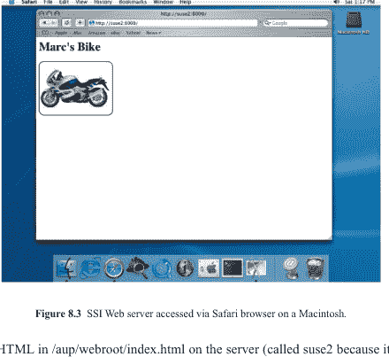

服务器（称为 `suse2`，因为它运行 SuSE Linux）上 `/aup/webrroot/index.html` 中的 HTML 内容为：

```html
<!DOCTYPE HTML PUBLIC "-//W3C//DTD HTML 3.2 Final//EN">
<html>
<head>
</head>
<body>
<h1>Marc's Bike</h1>
<p>
</body>
</html>
```

### 8.4.5 SSI 实现

我已经讨论了实现 SSI 函数涉及的所有问题，并在一个示例或另一个示例中展示了所有代码。你可能希望回顾第 8.1.3、8.2.2 和 8.2.6 节。

这是类型 SSI 的结构：

```c
#define SSI_NAME_SIZE 200

typedef struct {
    bool ssi_server;	/* server? (vs. client) */
    int ssi_domain;	/* AF_INET or AF_UNIX */
    int ssi_fd;	/* socket fd */
    char ssi_name_server[SSI_NAME_SIZE];	/* server name */
    fd_set ssi_fd_set;	/* set for server’s select */
    int ssi_fd_hwm;	/* high-water-mark for fds seen */
} SSI;
```

我们将在阅读代码过程中了解这些成员是如何使用的。

首先是一个方便的函数，可以生成 AF_UNIX 或 AF_INET 的套接字地址。`name` 参数对于 AF_INET 的形式为 `host:port`，对于 AF_UNIX 则只是一个普通的名称。`will_bind` 参数指示该套接字地址是用于 `bind` 还是 `connect`，如第 8.2.6 节中所述。

```c
bool make_sockaddr(struct sockaddr *sa, socklen_t *len, const char *name,
int domain, bool will_bind)
{
    struct addrinfo *infop = NULL;

    if (domain == AF_UNIX) {
```


```
        struct sockaddr_un *sunp = (struct sockaddr_un *)sa;

        if (strlen(name) >= sizeof(sunp->sun_path)) {

            errno = ENAMETOOLONG;

            EC_FAIL

        }

        strcpy(sunp->sun_path, name);

        sunp->sun_family = AF_UNIX;

        *len = sizeof(*sunp);

    }

    else {

        struct addrinfo hint;

        char nodename[SSI_NAME_SIZE], *servicename;

        memset(&hint, 0, sizeof(hint));

        hint.ai_family = domain;

        hint.ai_socktype = SOCK_STREAM;

        if (will_bind)

            hint.ai_flags = AI_PASSIVE;

        strcpy(nodename, name);

        servicename = strchr(nodename, ':');

        if (servicename == NULL) {

            errno = EINVAL;

            EC_FAIL

        }

        *servicename = '\0';

        servicename++;

        ec_ai(getaddrinfo(nodename, servicename, &hint, &infop) )

        memcpy(&sa, infop->ai_addr, infop->ai_addrlen);

        *len = infop->ai_addrlen;

        freeaddrinfo(infop);

    }

    return true;

    EC_CLEANUP_BGN

    if (infop != NULL)

        freeaddrinfo(infop);

    return false;

    EC_CLEANUP_END

}
```

我有意保持 `make_sockaddr` 独立于 `SSI` 结构，以便你希望将其提取出来并在自己的应用程序中使用。

接下来是两个函数，由 `ssi_open` 和 `ssi_close` 用于维护文件描述符的高水位标记，正如我们在第 8.1.3 节中所做的那样：

```c
static void set_fd_hwm(SSI *ssip, int fd)

{

    if (fd > ssip->ssi_fd_hwm)

        ssip->ssi_fd_hwm = fd;

}

static void reset_fd_hwm(SSI *ssip, int fd)

{

    if (fd == ssip->ssi_fd_hwm)

        ssip->ssi_fd_hwm--;

}
```

现在我们已经准备好处理 `ssi_open`，它没有做任何我们尚未见过的事情：

```c
SSI *ssi_open(const char *name_server, bool server)

{

    SSI *ssip = NULL;

    struct sockaddr_storage sa;

    socklen_t sa_len;

    ec_null( ssip = calloc(1, sizeof(SSI)) )

    ssip->ssi_server = server;

    if (strncmp(name_server, "/", 2) == 0) {

        ssip->ssi_domain = AF_INET;

        name_server += 2;

    }

    else {

        ssip->ssi_domain = AF_UNIX;

        if (!ssip->ssi_server)

            (void)unlink(name_server);

    }

    if (strlen(name_server) >= sizeof(ssip->ssi_name_server)) {

        errno = ENAMETOOLONG;

        EC_FAIL

    }

    strncpy(ssip->ssi_name_server, name_server);

    ec_false(make_sockaddr((struct sockaddr *)&sa, &sa_len,

        ssip->ssi_name_server, ssip->ssi_domain, ssip->ssi_server))

    ec_neg1(ssip->ssi_fd = socket(ssip->ssi_domain, SOCK_STREAM, 0))

    set_fd_hwm(ssip, ssip->ssi_fd);

    if (ssip->ssi_domain == AF_INET) {

        int socket_option_value = 1;

        ec_neg1(setsockopt(ssip->ssi_fd, SOL_SOCKET, SO_REUSEADDR,

            &socket_option_value, sizeof(socket_option_value)))

    }

    if (ssip->ssi_server) {

        FD_ZERO(&ssip->ssi_fd_set);

        ec_neg1(bind(ssip->ssi_fd, (struct sockaddr *)&sa, sa_len))

        ec_neg1(listen(ssip->ssi_fd, SOMAXCONN))

        FD_SET(ssip->ssi_fd, &ssip->ssi_fd_set);

    }

    else

        ec_neg1(connect(ssip->ssi_fd, (struct sockaddr *)&sa, sa_len))

    return ssip;

    EC_CLEANUP_BGN

    free(ssip);

    return NULL;

    EC_CLEANUP_END

}
```

套接字选项 `SO_REUSEADDR` 在第 8.3 节中有解释。

关闭一个 `SSI` 很简单：

```c
bool ssi_close(SSI *ssip)

{

    if (ssip->ssi_server) {

        int fd;

        for (fd = 0; fd <= ssip->ssi_fd_hwm; fd++)

            if (FD_ISSET(fd, &ssip->ssi_fd_set))

                (void)close(fd);

        if (ssip->ssi_domain == AF_UNIX)

            (void)unlink(ssip->ssi_name_server);

    }

    else

        (void)close(ssip->ssi_fd);

    free(ssip);

    return true;

}
```

接下来是 `ssi_wait_server`，它只是对第 8.1.3 节中代码的重新整理，不同之处在于它返回一个就绪的文件描述符（即除服务器套接字以外的），而不是自己使用该文件描述符：

```c
int ssi_wait_server(SSI *ssip)

{

    if (ssip->ssi_server) {

        fd_set fd_set_read;

        int fd, clientfd;

        struct sockaddr_un from;

        socklen_t from_len = sizeof(from);

        while (true) {

            fd_set_read = ssip->ssi_fd_set;

            ec_neg1(select(ssip->ssi_fd_hwm + 1, &fd_set_read, NULL, NULL,

                NULL));

            for (fd = 0; fd <= ssip->ssi_fd_hwm; fd++)

                if (FD_ISSET(fd, &fd_set_read)) {

                    if (fd == ssip->ssi_fd) {

                        ec_neg1(clientfd = accept(ssip->ssi_fd,

                            (struct sockaddr *) &from, &from_len));

                        FD_SET(clientfd, &ssip->ssi_fd_set);

                        set_fd_hwm(ssip, clientfd);

                        continue;

                    }

                }

                else

                    return fd;

        }

    }

}
```

```
else {
    errno = ENOTSUP;
    EC_FAIL
}

EC_CLEANUP_BGN
    return -1;
EC_CLEANUP_END
}
```

另外两个函数非常琐碎：

```c
int ssi_get_server_fd(SSI *ssip)

{

    return ssip->ssi_fd;

}
```

```c
bool ssi_close_fd(SSI *ssip, int fd)

{

    EC_negII (close (fd) );

    FD_CLR(fd, &ssip->ssi_fd_set);

    reset_fd_hwim(ssip, fd);

    return true;

    EC_CLEANUP_BGN

        return false;

    EC_CLEANUP_END

}
```

这就是完整的实现。对于已连接的套接字（`SOCK_STREAM`），我们在后续的示例中都不必再使用任何原始系统调用。

## 8.5 SMI 的套接字实现

将第 7 章中介绍的简单消息接口（`SMI`）实现为使用套接字，并据此将其与那里展示的其他五种实现方式进行对比，这很有趣。我们将使用前一节中的 `SSI` 函数，而不是直接调用各种与套接字相关的系统调用，因此这项任务相当简单。

本节假设你非常熟悉第 7 章及其中的 `SMI` 实现；如果不熟悉，请跳过本节，直到你有时间读完第 7 章——否则读起来会很难理解。

对于套接字来说，内部结构体 `SMIQ_SKT` 很简单，这主要是因为其他实现方式所承担的记录客户端的工作，在这种情况下是由 `accept` 系统调用完成的，而且我们已经有了 `SSI` 来处理许多细节：

```c
typedef struct { /* entity */

    SMIENTITY sq_entity;

    SSI *sq_ssi; /* structure for SSI */

    struct client_id sq_client; /* client ID */

    size_t sq_msgsize; /* msg size */

    struct smi_msg *sq_msg; /* msg buffer */

} SMIQ_SKT;
```

打开 `SMIQ_SKT` 的工作不多，因为 `ssi_open` 承担了大部分工作：

```c
SMIQ *smi_open_skt (const char *name, SMIENTITY entity, size_t msgsize)

{

    SMIQ_SKT *p = NULL;

    ec_null ( p = calloc (1, sizeof (SMIQ_SKT)))

    p->sq_msgsize = msgsize + offsetof (struct smi_msg, smi_data);

    ec_null ( p->sq_msg = calloc (1, p->sq_msgsize))

    p->sq_entity = entity;

    ec_null ( p->sq_ssi = ssi_open (name, entity == SMI_SERVER))

    return (SMIQ *)p;

EC_CLEANUP_BGN

    (void) smi_close_skt ((SMIQ *)p);

    return NULL;

EC_CLEANUP_END

}
```

关闭过程也是如此：

```c
bool smi_close_skt (SMIQ *sqp)

{

    SMIQ_SKT *p = (SMIQ_SKT *)sqp;

    SSI *ssip;

    if (p != NULL) {

        ssip = p->sq_ssi;

        free (p->sq_msg);

        free (p);

        if (ssip != NULL)

            ec_false ( ssi_close (ssip))

    }

    return true;

EC_CLEANUP_BGN

    return false;

EC_CLEANUP_END

}
```

正如我们在第 7 章中看到的其他几种实现方式，`smi_send_getaddr_skt` 所要做的全部工作就是，如果由服务器调用，则保存 `client_id`，并返回消息地址：

```c
bool smi_send_getaddr_skt(SMIQ *sqp, struct client_id *client,

void **addr)

{

    SMIQ_SKT *p = (SMIQ_SKT *)sqp;

    if (p->sq_entity == SMI_SERVER)

        p->sq_client = *client;

    *addr = p->sq_msg;

    return true;

}
```

`smi_send_release_skt` 将消息（使用 2.9 节中的 `writeall`）写入客户端的文件描述符（如果来自服务器），或者写入服务器套接字文件描述符（如果来自客户端）：

```c
bool smi_send_release_skt(SMIQ *sqp)

{

    SMIQ_SKT *p = (SMIQ_SKT *)sqp;

    int fd;

    if (p->sq_entity == SMI_SERVER)

        ec_negl( fd = p->sq_client.c_idl )

    else

        ec_negl( fd = ssi_get_server_fd(p->sq_ssi) )

    ec_negl( writeall(fd, p->sq_msg, p->sq_msgsize) )

    return true;

EC_CLEANUP_BGN

    return false;

EC_CLEANUP_END

}
```

对于服务器而言，服务器接收消息意味着必须等待一个就绪的文件描述符，`SSI` 通过 `ssi_wait_server` 为我们处理了这一点。服务器还必须将就绪的文件描述符保存在消息的 `client_id` 部分，以便调用者（服务器）知道该回复谁。客户端所做的只需调用 `ssi_get_server_fd` 来获取服务器的套接字文件描述符：

```c
bool smi_receive_getaddr_skt(SMIQ *sqp, void **addr)

{

    SMIQ_SKT *p = (SMIQ_SKT *)sqp;

    size_t /*nremain,*/ nread;

    int fd;

    *addr = p->sq_msg;

    while (true) {

        if (p->sq_entity == SMI_SERVER)

            ec_neg1( fd = ssi_wait_server(p->sq_ssi) )

        else

            ec_neg1( fd = ssi_get_server_fd(p->sq_ssi) )

        ec_neg1( nread = readall(fd, p->sq_msg, p->sq_msgsize) )

        if (nread == 0) {

            if (p->sq_entity == SMI_SERVER) {

                ec_false( ssi_close_fd(p->sq_ssi, fd) )
```


```c
                continue;

            }

            else {

                errno = ENOMSG;

                EC_FAIL

            }

        }

        else

            break;

    }

    if (p->sq_entity == SMI_SERVER)

        p->sq_msg->smi_client.c_idl = fd;

    return true;

EC_CLEANUP_BGN

    return false;

EC_CLEANUP_END

}
```

最后一个函数完全不需要做任何工作：

```c
bool smi_receive_release_skt(SMIQ *sqp)
{
    return true;
}
```

使用这种 `SMI` 实现方式，第 7 章中所有关于消息发送的示例都能在套接字上运行。我们在 7.15 节中已经将其性能与其他 `IPC` 方法进行了比较。

请注意，我们的 `SMI` 示例是为机器内部 `IPC` 设计的，使用的是普通的服务器名称。这意味着当名称进入 `ssi_open` 时，会被视为属于 `AF_UNIX` 域。你也可以同样轻松地使用 `SMI` 接口进行 `AF_INET` 域的消息传递（在机器之间），尽管如果你的名称是这样写的——以两个斜杠开头——那么只有 `SMI` 的套接字实现才能工作。

## 8.6 无连接套接字

到目前为止，我们所有的示例和 `SSI` 的实现都使用了 `SOCK_STREAM` 类型的已连接套接字。有一个调用 `listen` 和 `accept` 的服务器，以及一个或多个连接到该服务器的客户端。连接会保持打开状态，直到一方或另一方关闭它。

相比之下，无连接套接字不使用连接，因此不会调用 `listen` 和 `accept`。发送方指定它想要发送到的地址。接收方指定它想要接收到的地址，或者它从任何人处接收数据并被告知发送方的地址。接收方始终需要将自己 `bind` 到一个外部名称，因为这是发送方唯一能联系到它们的方式。因此，无连接套接字比已连接的套接字更具对称性；可能存在客户端/服务器关系，但有时将参与者视为对等方（`peers`）更有用。

### 8.6.1 关于数据报

无连接通信使用数据报（`datagrams`），它们是包含目标地址的独立数据块。系统不会尝试保持数据报的顺序，也没有任何保证它们一定会到达。相比之下，`SOCK_STREAM` 既保证顺序也保证到达。可以将数据报想象成一封邮寄信件或电子邮件，将 `SOCK_STREAM` 想象成电话通话。

在许多应用中，顺序和到达的不确定性并不重要。例如，假设应用程序用于预订图书馆书籍。屏幕上有一个表单，提交时会向图书馆服务器发送一个数据报，服务器则回复一个确认信息。如果两个预订请求相差一秒左右，重新排序数据报或许有点不公平，但由于读者彼此不知道对方的活动，因此不会有投诉。在极少数数据报根本未到达的情况下，读者将不会收到确认信息，并会再次提交表单。因此，在此应用中，使用数据报比仅为预订一本书而建立连接然后立即断开连接要高效得多。另一方面，如果读者打算交互式地浏览一段时间的书目目录，那么建立连接可能是最佳选择。

图 8.4 展示了两个对等方互相向对方的套接字发送数据报。请将其与图 8.1 进行对比，后者展示的是已连接的套接字。监听和接受的符号消失了，并且两个套接字都绑定到名称上，而不仅仅是服务器的套接字。


### 8.6.2 sendto 和 recvfrom 系统调用

在我们之前的所有套接字示例中，我们使用 `write`（或 `writeall`）向套接字发送数据，这之所以有效，是因为我们有一个代表连接写入端的文件描述符。但是，如果套接字未连接，我们只有一个属于我们自己套接字的文件描述符；我们需要将目标指定为套接字地址，而不是文件描述符。因此，`write` 行不通。我们需要另一个名为 `sendto` 的系统调用，它接受一个套接字地址：

```c
sendto—send message to socket

#include <sys/socket.h>

ssize_t sendto(
    int socket_fd,             /* socket file descriptor */
    const void *message,        /* message to send */
    size_t length,             /* length of message */
    int flags,                 /* flags */
    const struct sockaddr *sa, /* target address */
    socklen_t sa_len           /* length of target address */
);  /* Returns number of bytes sent or -1 on error (sets errno) */
```

参数 `socket_fd` 是发送方的套接字；接收方通过参数 `sa` 和 `sa_len` 指定。`sendto` 成功返回并不意味着消息已到达，仅表示未检测到任何本地错误。

你的实现可能会定义一些标志，但唯一重要的可移植标志是 `MSG_OOB`，它发送带外（紧急）数据；参见 8.7 节。

对于无连接套接字，长度为 `length` 字节的消息被视为不可分割的数据报。如果套接字通道已满，`sendto` 通常会阻塞，直到所有数据

将容纳；如果设置了 `O_NONBLOCK` 标志且数据无法容纳，则不会发送任何数据，返回 `−1`，并将 `errno` 设置为 `EAGAIN` 或 `EWOULDBLOCK`。

你可以在已连接的套接字上使用 `sendto`，但在这种情况下，目标套接字地址会被忽略，输出将直接发往 `socket_fd` 套接字，这与 `write` 的行为完全一致。相较于 `write` 的唯一优势是你可以指定标志，但如果只是需要这一点，直接使用 `send`（参见第 8.9.1 节）会更直观。

现在我们展示一个示例，该示例实现了图 8.4 所示的功能，并额外增加了每个对端读取传入数据的逻辑。对端 2 接收到消息后，对其进行少量修改，然后发送回给对端 1。对端 1 组装四条消息发送给对端 2，并显示收到的回复。注意，与已连接套接字的示例不同，这里两个对端都执行了 `bind`，且都没有调用 `listen`、`accept` 或 `connect`。

```c
#define SOCKETNAME1 "SktOne"

#define SOCKETNAME2 "SktTwo"

#define MSG_SIZE 100

int main(void)
{
    struct sockaddr_un sa1, sa2;

    strcpy(sa1.sun_path, SOCKETNAME1);

    sa1.sun_family = AF_UNIX;

    strcpy(sa2.sun_path, SOCKETNAME2);

    sa2.sun_family = AF_UNIX;

    (void)unlink(SOCKETNAME1);

    (void)unlink(SOCKETNAME2);

    if (fork() == 0) { /* 对端 1 */
    int fd_skt;

    size_t nread;

    char msg[MSG_SIZE];

    int i;

    sleep(1); /* 让对端 2 先启动 */

    ec_neg1( fd_skt = socket(AF_UNIX, SOCK_DGRAM, 0) )
    ec_neg1( bind(fd_skt, (struct sockaddr *)&sa1, sizeof(sa1)) )
    for (i = 1; i <= 4; i++) {
        snprintf(msg, sizeof(msg), "Message #%d", i);

        ec_neg1( sendto(fd_skt, msg, sizeof(msg), 0,
        (struct sockaddr *)&sa2, sizeof(sa2)) )

        ec_neg1( nread = read(fd_skt, msg, sizeof(msg)) )

        if (nread != sizeof(msg)) {
            printf("对端 1 收到短消息\n");

            break;

        }

    }

    printf("收到 \"%s\" 的回复\n", msg);

        }

        ec_neg1( close(fd_skt) )

        exit(EXIT_SUCCESS);
    }

    else { /* 对端 2 */

        int fd_skt;

        size_t nread;

        char msg[MSG_SIZE];

        ec_neg1( fd_skt = socket(AF_UNIX, SOCK_DGRAM, 0) )

        ec_neg1( bind(fd_skt, (struct sockaddr *)&sa2, sizeof(sa2) ) )

        ec_neg1( nread = read(fd_skt, msg, sizeof(msg)) )

        while (true) {
            if (nread != sizeof(msg)) {
                printf("对端 2 收到短消息\n");

                break;

            }

            msg[0] = 'm';

            ec_neg1( sendto(fd_skt, msg, sizeof(msg), 0,
                     (struct sockaddr *)&sa1, sizeof(sa1)) )

            ec_neg1( close(fd_skt) )

            exit(EXIT_SUCCESS);
        }

    }

    EC_CLEANUP_BGN

        exit(EXIT_FAILURE);

    EC_CLEANUP_END
}
```

将两个进程放在同一个程序中并非常规做法；我们这样做只是为了简化示例。然而，我们不得不在子进程（对端 1）的开头插入对 `sleep` 的调用，以便让对端 2 先运行。虽然这不是控制执行顺序的最佳方式，但对于我们当前的目的来说是可行的。在实际应用中，确保服务器先于客户端启动通常不是问题。如果确实存在此问题，正确的同步方法见第 9.2 节。

输出如下：

```
收到 "message #1" 的回复

收到 "message #2" 的回复

收到 "message #3" 的回复

收到 "message #4" 的回复
```

对于数据报而言，`read` 并不是一个很好的选择，因为它无法告知我们数据是谁发送的。这对已连接套接字来说不是问题，因为每次从 `accept` 返回时都会为每个客户端提供一个单独的文件描述符，我们既可以对其进行 `read` 也可以进行 `write`。在刚才给出的示例中，对端 2 只是假定应该使用 `sendto` 发送给对端 1，但通常来说，应用程序比这要复杂得多。

确实，存在与 `sendto` 相反的操作，称为 `recvfrom`：

```c
recvfrom—从套接字接收消息

#include <sys/socket.h>

ssize_t recvfrom(
  int socket_fd,                /* 套接字文件描述符 */
  void *buffer,                 /* 接收消息的缓冲区 */
  size_t length,                /* 缓冲区长度 */
  int flags,                    /* 标志 */
  struct sockaddr *sa,          /* 发送方地址 */
  socklen_t *sa_len            /* 地址长度 */
);

/* 返回接收的字节数、0 或 -1（出错时设置 errno） */
```

`recvfrom` 的前三个参数与 `read` 类似。此外，它还包含一个 `flags` 参数以及两个用于接收发送方套接字地址的参数。

在调用之前，你必须将 `sa` 设置为足以容纳发送方套接字地址的值，并将 `sa_len` 设置为该存储空间的大小。返回时，`sa_len` 会被设置为地址的实际大小。然后，如果你愿意，可以直接将 `sa` 和 `sa_len` 传递给 `sendto` 以进行回复。

与 `sendto` 类似，`recvfrom` 对于无连接套接字总是返回完整的消息。如果 `O_NONBLOCK` 未设置，它将等待接收；如果已设置，则返回 `−1`，并将 `errno` 设置为 `EAGAIN` 或 `EWOULDBLOCK`。

如果你想知道源地址，也可以使用 `recvfrom` 配合已连接的套接字，但正如之前解释的那样，在调用 `sendto` 时该地址会被忽略，因此你无法用它做太多事情。获取文件描述符对应套接字地址的另一种方法是调用 `get-sockname`（参见第 8.9.2 节）。

以下是你可以与 `recvfrom` 一起使用的三个可移植标志：

| 标志 | 描述 |
| :--- | :--- |
| `MSG_OOB` | 接收带外数据（如果有）；参见第 8.7 节。 |
| `MSG_PEEK` | 返回消息，但保留该消息未读，供下一次 `read`、`recvfrom` 或其他输入操作使用。 |
| `MSG_WAITALL` | 仅适用于已连接套接字，使 `recvfrom` 阻塞直到请求的完整长度可用，除非同时设置了 `MSG_PEEK`，或者调用被信号、连接终止或错误中断。对无连接套接字无效，因为消息总是不可分割的。 |

以下是重构后的示例，它使用 `recvfrom`，并包含多个对端向同一套接字发送数据，因此采用客户端/服务器架构：

```c
#define SOCKETNAME_SERVER "SktOne"

#define SOCKETNAME_CLIENT "SktTwo"

static struct sockaddr_un sa_server;

#define MSG_SIZE 100

static void run_client(int nclient)
{
    struct sockaddr_un sa_client;

    int fd_skt;

    ssize_t nrecv;

    char msg[MSG_SIZE];

    int i;

    if (fork() == 0) {  /* 客户端 */
    sleep(1);  /* 让服务器先启动 */

    ec_neg1( fd_skt = socket(AF_UNIX, SOCK_DGRAM, 0) )

    snprintf(sa_client.sun_path, sizeof(sa_client.sun_path),
        "%s-%d", SOCKETNAME_CLIENT, nclient);

    (void)unlink(sa_client.sun_path);

    sa_client.sun_family = AF_UNIX;

    ec_neg1( bind(fd_skt, (struct sockaddr *)sa_client,
        sizeof(sa_client)) )

    for (i = 1; i <= 4; i++) {
    snprintf(msg, sizeof(msg), "Message #%d", i);

    ec_neg1( sendto(fd_skt, msg, sizeof(msg), 0,
        (struct sockaddr *)sa_server, sizeof(sa_server)) )

    ec_neg1( nrecv = read(fd_skt, msg, sizeof(msg)) )
    if (nrecv != sizeof(msg)) {
        printf("客户端收到短消息\n");

        break;
    }

    printf("收到 \"%s\" 的回复\n", msg);
    }

    ec_neg1( close(fd_skt) )
    exit(EXIT_SUCCESS);
    }

return;

EC_CLEANUP_BGN

  exit(EXIT_FAILURE);

EC_CLEANUP_END
}

static void run_server(void)
{
  int fd_skt;
  ssize_t nrecv;
  char msg[MSG_SIZE];
  struct sockaddr_storage sa;
  socklen_t sa_len;
  ec_neg1( fd_skt = socket(AF_UNIX, SOCK_DGRAM, 0) )
  ec_neg1( bind(fd_skt, (struct sockaddr *)&sa_server, sizeof(sa_server)) )
  while (true) {
    sa_len = sizeof(sa);
    ec_neg1( nrecv = recvfrom(fd_skt, msg, sizeof(msg), 0,


```c
struct sockaddr *)(&sa, &sa_len) )

    if (nrecv != sizeof(msg)) {

      printf("服务器收到短消息\n");

      break;

    }

    msg[0] = 'm';

    ec_neg1( sendto(fd_skt, msg, sizeof(msg), 0,

                    (struct sockaddr *)(&sa, sa_len) )

  }

  ec_neg1( close(fd_skt) )

  exit(EXIT_SUCCESS);

EC_CLEANUP_BGN

  exit(EXIT_FAILURE);

EC_CLEANUP_END

}

int main(void)

{

  int nclient;

  strcpy(sa_server.sun_path, SOCKETNAME_SERVER);

  sa_server.sun_family = AF_UNIX;

  (void)unlink(SOCKETNAME_SERVER);

  for (nclient = 1; nclient <= 3; nclient++)

    run_client(nclient);

  run_server();

  exit(EXIT_SUCCESS);

}
```

在这个新示例中，只有服务器的套接字地址为服务器和客户端所知。客户端套接字地址仅为该客户端所知；服务器通过其调用 `recvfrom` 获取它。我保留了客户端中的 `read` 调用，但那些调用也可以是 `recvfrom`。由于现在有三个客户端，因此有更多的输出：

```text
Got "message #1" back
Got "message #2" back
Got "message #3" back
Got "message #4" back
Got "message #1" back
Got "message #2" back
Got "message #3" back
Got "message #4" back
Got "message #1" back
Got "message #2" back
Got "message #3" back
Got "message #4" back
```

## 8.6.3 sendmsg 和 recvmsg

`sendto` 和 `recvfrom` 有变体，它们使用相同的标志并具有相同的返回值，但使用一个指向 `msghdr` 结构的单个参数，该结构包含套接字地址和消息。它们支持分散读取和聚集写入，就像我们在第 2.15 节中看到的 `readv` 和 `writev` 一样。

```c
sendmsg—使用 msghdr 结构向套接字发送消息

#include <sys/socket.h>

ssize_t sendmsg(
int socket_fd,         /* 套接字文件描述符 */
const struct msghdr *message, /* 消息 */
int flags              /* 标志 */
);

/* 返回发送的字节数，出错时返回 -1（设置 errno） */
```

```c
recvmsg—使用 msghdr 结构从套接字接收消息

#include <sys/socket.h>

ssize_t recvmsg(
int socket_fd,         /* 套接字文件描述符 */
struct msghdr *message, /* 消息 */
int flags              /* 标志 */
);

/* 返回接收的字节数、0，或出错时返回 -1（设置 errno） */
```

### struct msghdr—用于 sendmsg 和 recvmsg 的结构体

```c
struct msghdr {       /* 可选地址 */
    void *msg_name;
    socklen_t msg_namelen; /* 地址长度 */
    struct iovec *msg_iov; /* 分散/聚集数组 */
    int msg_iovlen; /* msg_iov 中的元素数量 */
    void *msg_control; /* 辅助数据 */
    socklen_t msg_controllen; /* 辅助数据缓冲区长度 */
    int msg_flags; /* 接收消息的标志 */
};
```

对于 `sendmsg`，套接字地址由命名不当的 `msg_name` 成员指向，套接字地址长度放在 `msg_namelen` 中。要发送的数据通过 `msg_iov` 成员指向，该成员指向一个 `iovec` 结构，其用法与 `writev` 相同。`msg_iovlen` 成员是 `msg_iov` 数组中的元素数量。我在第 2.15 节中解释了如何设置这些成员。`msg_flags` 成员被忽略。

对于 `recvmsg`，您可以将 `msg_name` 设置为 `NULL` 或设置为长度为 `msg_namelen` 的缓冲区，以接收发送方的套接字地址，类似于 `recvfrom` 的工作方式。当 `recvmsg` 返回时，`msg_namelen` 会更改为实际的套接字地址长度。`msg_iov` 和 `msg_iovlen` 成员的使用方式与 `readv` 相同。有一个可移植的标志可以设置在返回的 `msg_flags` 成员中：`MSG_TRUNC`，它表示消息太长，无法放入提供的缓冲区中。

套接字地址成员 `msg_name` 和 `msg_namelen` 用于无连接套接字；对于已连接套接字，它们被忽略。

我没有解释的另外两个成员，`msg_control` 和 `msg_controllen`，用于涉及访问权限的辅助数据。这里我不深入探讨，但您可以阅读 [SUS2002] 或您的系统文档。

这里是上一节中仅重写以使用 `recvmsg` 和 `sendmsg` 的 `run_server` 函数：

```c
static void run_server(void)

{

    int fd_skt;

    ssize_t nrecv;

    char msg[MSG_SIZE];

    struct sockaddr_storage sa;

    struct msghdr m;

    struct iovec v;

    ec_neg1( fd_skt = socket(AF_UNIX, SOCK_DGRAM, 0) )

    ec_neg1( bind(fd_skt, (struct sockaddr *)&sa_server, sizeof(sa_server)) )

    while (true) {

        memest(&m, 0, sizeof(m));

        m.msg_name = &sa;

        m.msg_namelen = sizeof(sa);

        v.iov_base = msg;

        v.iov_len = sizeof(msg);

        m.msg_iov = &v;

        m.msg_iovlen = 1;

        ec_neg1( nrecv = recvmsg(fd_skt, &m, 0) )

        if (nrecv != sizeof(msg)) {

            printf("server got short message\n");

            break;

        }

        ((char *)m.msg_iov->iov_base)[0] = 'm';

        ec_neg1( sendmsg(fd_skt, &m, 0) )

    }

    c_neg1( close(fd_skt) )

    exit(EXIT_SUCCESS);

EC_CLEANUP_BGN

    exit(EXIT_FAILURE);

EC_CLEANUP_END

}
```

设置 `msghdr` 结构需要额外的工作，但随后的 `recvmsg` 和 `sendmsg` 调用非常简单。想象一下一个应用程序，其中有许多不同的消息被发送到不同的地址，您就可以开始看到将地址与消息数据保持在同一结构中的好处。

### 8.6.4 在无连接套接字中使用 connect

通常，客户端使用 `connect`（第 8.1.2 节）与服务器的套接字建立连接，但它也可以用于无连接套接字，以建立后续发送和接收的默认地址，这些后续操作不再需要套接字地址参数。这两个系统调用的具体细节在第 8.9.1 节中。

使用 `NULL` 套接字地址调用 `connect` 会移除默认地址。

## 8.7 带外数据

偶尔需要在套接字连接上发送紧急消息。如果以内联方式发送，在它前面的所有数据被读取之前，它不会被读取，因此有一种方法可以将其作为带外数据发送。接收方也必须正在接收带外消息。

要发送带外消息，请在 `sendto`、`sendmsg` 或 `send` 中设置 `MSG_OOB` 标志。

使用 `select`（第 8.1.3 节）的接收方通过作为 `select` 第四个参数传递的所谓“错误”文件描述符集获知带外消息。然后，通过在调用 `recvfrom`、`recvmsg` 或 `recv` 时设置 `MSG_OOB` 标志来获取消息。或者，它可以在每次准备接收普通数据之前检查是否有带外消息，方法是在套接字文件描述符（通过 `fcntl`，第 3.8.3 节）上设置 `O_NONBLOCK` 标志，并在接收调用中设置 `MSG_OOB`。

如果设置了 `SO_OOBINLINE` 选项（第 8.3 节），带外数据可能与其他数据一起内联放置。协议可能在带外数据前加上一个带外标记，读取数据时会忽略该标记，但可以通过专门用于此目的的调用来检测其存在：

```c
sockatmark—测试带外标记是否存在

#include <sys/socket.h>

int sockatmark(
    int socket_fd    /* 套接字文件描述符 */
);

/* 如果在标记处返回 1，否则返回 0，出错时返回 -1（设置 errno） */
```

`sockatmark` 的问题是，如果由于套接字为空而返回 0，带外数据可能在调用 `sockatmark` 之后但在下一次接收操作之前到达。由于带外标记在接收数据时被忽略，该标记将丢失。避免这种情况的方法是确保在调用 `sockatmark` 之前数据已准备好接收，例如通过调用 `select`。这样，`sockatmark` 返回 0 就明确意味着有数据，但数据前没有带外标记。

您还可以安排当带外数据到达时接收 `SIGURG` 信号。为此，调用 `fcntl` 并执行 `F_SETOWN` 操作，以设置应接收信号的进程或进程组。更多细节请参见 [SUS2002] 或您的系统文档。

## 8.8 网络数据库函数

这些 `网络数据库` 函数提供有关主机、网络、协议和服务的信息。我已经在第 8.2.6 节中介绍了这些函数中最重要的 `getaddrinfo`。另一个方便的函数 `gethostname` 在第 8.2.7 节中。这里我将描述其余的函数，并根据它们处理的信息类型进行分组。

### 8.8.1 主机函数

用于扫描主机数据库的三个函数是：

- `sethostent` — 开始主机数据库扫描

```c
#include <netdb.h>

void sethostent( int stayopen /* 是否保持连接打开？ */
      );
```

- `gethostent` — 获取下一个主机数据库条目

```c
#include <netdb.h>

struct hostent *gethostent(void);

/* 返回下一个条目，或在数据库结束时返回 NULL（未定义 errno） */
```

- `endhostent` — 结束主机数据库扫描

```c
#include <netdb.h>

void endhostent(void);
```

`struct hostent` — 用于主机数据库函数的结构体

```c
struct hostent {
  char  *h_name;             /* 官方主机名 */
  char  **h_aliases;         /* 替代主机名数组 */
  int     h_addrtype;        /* 地址族（而非类型） */
  int     h_length;          /* 每个地址的长度 */
  char  **h_addr_list;       /* 指向网络地址的指针数组 */
};
```

您可以在循环中调用 `gethostent` 以扫描所有已知的主机名。您使用 `sethostent` 开始扫描，使用参数指示到主机数据库的连接是否应保持打开，或者 `gethostent` 是否应在每次调用时打开和关闭连接。您在结束时调用 `endhostent`。因此，听起来可能会有很多操作发生，但实践中所有这些函数可能只是扫描本地机器上的 `/etc/hosts` 文件。

`hostent` 结构体中包含两个数组，每个数组均以 `NULL` 指针结尾。其中一个，`h_aliases`，是一个替代主机名数组。另一个，`h_addr_list`，是一个指向网络地址的指针数组。对于 `AF_INET`，这些是存储为 32 位二进制数（采用网络字节序）的 IP 地址；因此，请使用 `ntohl`（见 8.1.4 节）将它们转换为本地字节序，或者使用 `inet_ntoa`（见 8.2.3 节）或 `inet_ntop`（见 8.9.5 节）将其获取为点分字符串。

下面是一个示例：

```c
static void hostdb(void)

{

   struct hostent *h;

   sethostent(true);

   while ((h = gethostent()) != NULL)
      display_hostent(h);

   endhostent();

}

static void display_hostent(struct hostent *h)

{

   int i;

   printf("name: %s; type: %d; len: %d\n", h->h_name, h->h_addrtype,
          h->h_length);

   for (i = 0; h->h_aliases[i] != NULL; i++)
      printf("  %s\n", h->h_aliases[i]);

   if (h->h_addrtype == AF_INET) {
      for (i = 0; h->h_addr_list[i] != NULL; i++)
         printf("  %s\n",
                inet_ntoa(*((struct in_addr *)h->h_addr_list[i])));

   }

}
```

调用 `hostdb` 的一个小型主程序（未显示）的输出如下：

```text
name: localhost; type: 2; len: 4
   127.0.0.1

name: sol; type: 2; len: 4
   loghost
   192.168.0.10

name: bsd; type: 2; len: 4
   192.168.0.15

name: suse2; type: 2; len: 4
   suse2.MSHOME
   192.168.0.19
```

作为对比，同一系统上的 `/etc/hosts` 文件内容如下：

```text
   127.0.0.1    localhost
   192.168.0.10 sol    loghost
   192.168.0.15 bsd
   192.168.0.19 suse2 susse2.MSHOME
```

要根据主机名查找主机，你可以调用 `gethostbyname`。如果可用，它使用 DNS，而不仅仅使用 `/etc/hosts` 文件。实际上，直到 `getaddrinfo` 出现之前，它是获取网络地址的主要方式，而且由于 `gethostbyname` 非常古老，几乎所有人都是这样学会操作的，因此它至今仍比 `getaddrinfo` 使用得更多。但是，与 `getaddrinfo` 不同，使用 `gethostbyname` 你只能获取 IP 地址——你仍然必须像我们在 8.2.3 节中那样自行构建 `sockaddr_in` 结构体。此外，`gethostbyname` 无法处理 IPv6 地址。以下是其函数原型：

```text
gethostbyname—按名称查找主机

    #include <netdb.h>

    struct hostent *gethostbyname(
        const char *nodename,      /* 节点名称 */
    );

    /* 返回指向 hostent 的指针，出错时返回 NULL（设置 h_errno） */
```

函数原型末尾的括号注释并非误印——该函数确实设置了 `h_errno`，而不是 `errno`，而且它使用的代码也不是 `errno` 代码。（我没有为 `h_errno` 编写“ec”宏，因为我不使用该函数。）

下面是一个示例（`display_hostent` 来自上一个示例）：

```c
static void gethostbyname_ex(void)

{

    struct hostent *h;
```


```c
if ((h = gethostbyname("www.yahoo.com")) == NULL) {
    if (h_errno == HOST_NOT_FOUND)
        printf("host not found\n");
    else
        printf("h_errno = %d\n", h_errno);
} else
    display_hostent(h);
}
```

我们调用该函数得到的输出如下：

```text
name: www.yahoo.akadns.net; type: 2; len: 4
www.yahoo.com
66.218.71.95
66.218.70.49
66.218.71.88
66.218.71.81
66.218.71.86
66.218.71.92
66.218.71.94
66.218.71.89
66.218.70.48
66.218.71.93
66.218.70.50
66.218.71.87
66.218.71.84
```

你可以将此输出与 8.2.6 节中显示的输出进行比较，在那一节中，我们通过调用 `getaddrinfo` 做了几乎相同的事情。

`gethostbyname` 的反向操作是 `gethostbyaddr`，它使用主机数据库（可能是 `DNS`）将 `IP` 地址转换为名称：

```text
gethostbyaddr—按地址查找主机
#include <netdb.h>

struct hostent *gethostbyaddr(
        const void *addr,           /* IP 地址 */
        size_t len,                /* 地址长度 */
        int family);                /* 协议族（在 SUS 中称为“类型”） */

/* 返回指向 hostent 的指针，出错时返回 NULL（设置 h_errno） */
```

下面是一个示例程序（`inet_addr` 在 8.2.3 节中介绍）：

```c
static void gethostbyaddr_ex(void)
{
    struct hostent *h;
    in_addr_t a;
    ec_neg1(a = inet_addr("66.218.71.94"));
    if ((h = gethostbyaddr(&a, sizeof(a), AF_INET)) == NULL) {
        if (h_errno == HOST_NOT_FOUND)
            printf("address not found\n");
        else
            printf("h_errno = %d\n", h_errno);
    } else
        display_hostent(h);

    return;

    EC_CLEANUP_BGN
    EC_FLUSH("gethostbyaddr_ex")
    EC_CLEANUP_END
}
```

输出如下：

```text
name: wl5.www.scd.yahoo.com; type: 2; len: 4
66.218.71.94
```

发生的情况是，当我们获取 `www.yahoo.com` 的 `IP` 地址时，`66.218.71.94` 在列表中，但当我们询问该 `IP` 的名称时，得到的是 `wl5.www.scd.yahoo.com`。这就是 `DNS` 的工作方式——显然 `Yahoo` 使用了很多服务器，当然，它必须如此。

`gethostbyaddr` 和 `gethostbyname` 一样过时。现代函数是 `getaddrinfo`（见 8.2.6 节）的对应函数，称为 `getnameinfo`：

```text
getnameinfo—获取名称信息
#include <sys/socket.h>
#include <netdb.h>

int getnameinfo(
     const struct sockaddr *sa,    /* 套接字地址 */
     socklen_t sa_len,            /* 套接字地址长度 */
     char *nodename,              /* 节点名称 */
     socklen_t nodelen,           /* 节点名称缓冲区长度 */
     char *servname,             /* 服务名称 */
     socklen_t servlen,          /* 服务名称缓冲区长度 */
     unsigned flags             /* 标志 */
);

/* 成功返回 0，出错返回错误码 */
```

`getnameinfo` 接受完整的套接字地址，而不仅仅是裸 `IP` 地址，因为它潜在地与许多不同的协议族配合工作。最重要的是，它支持 `IPv6` 地址，而 `gethostbyname` 不支持。答案返回到两个缓冲区中：长度为 `nodelen` 的 `nodename` 用于节点（或主机）名称，长度为 `servlen` 的 `servname` 用于服务名称。如果缓冲区指针为 `NULL` 或其长度为 0，你就不会获取到该信息。

与 `getaddrinfo` 类似，`getnameinfo` 返回的错误号不是 `errno` 代码，而是特殊的“`EAI`”代码，如果你愿意，可以对它们使用函数 `gai_strerror`（见 8.2.6 节）。或者，使用我们专门为这两个函数提供的 `ec_ai` 宏。

你可以按位或（`OR`）组合的各种标志控制 `getnameinfo` 的返回值：

| 标志 | 描述 |
| :--- | :--- |
| `NI_NOFQDN` | 对于本地主机，仅返回节点名称部分，而不是完全限定域名。 |
| `NI_NUMERICHOST` | 返回地址的数字形式（`IPv4` 为点分表示法，`IPv6` 为冒号表示法），而不是名称。 |
| `NI_NAMERQD` | 如果找不到主机名称，则返回错误。通常在这种情况下返回数字形式。 |
| `NI_NUMERICSERV` | 返回端口号（作为字符串），而不是服务名称。 |
| `NI_DGRAM` | 查找 `SOCK_DGRAM` (`UDP`) 服务。通常它查找 `SOCK_STREAM` (`TCP`) 服务。 |

下面是一个示例：

```c
static void getnameinfo_ex(void)
{
    struct sockaddr_in sa;
    char nodename[200], servname[200];
    sa.sin_family = AF_INET;
    sa.sin_port = htons(80);
    sa.sin_addr.s_addr = inet_addr("216.109.125.70");
    ec_ai(getnameinfo((struct sockaddr *)&sa, sizeof(sa), nodename,
        sizeof(nodename), servname, sizeof(servname), 0));
    printf("node: %s; service: %s\n", nodename, servname);
    return;

    EC_CLEANUP_BGN
    EC_FLUSH("getnameinfo_ex")
    EC_CLEANUP_END
}
```

输出如下：

```text
node: w17.www.dcn.yahoo.com; service: http
```

另一个需要讨论的面向主机的函数是：

```text
gethostid—获取本地主机的标识符
#include <unistd.h>

long gethostid(void);
/* 返回标识符（无错误返回） */
```

`gethostid` 看起来可能返回本地机器的 `IP`，但它并不一定这样做。它只需要返回一个唯一标识符，而即使这样做是否有效，可能也取决于是否在启动时设置了这样的标识符。我在此处记录它，只是为了避免你误以为它是有用的函数。

还有另一个函数，它与网络没有直接关联，但提供了识别系统的信息：

### `uname`—获取当前系统信息

```text
#include <sys/utsname.h>

int uname(
  struct utsname *info  /* 返回的信息 */
); /* 成功返回非负值，出错返回 -1（设置 errno） */
```

### `struct utsname`—`uname` 的结构体

```text
struct utsname {
  char sysname[];   /* 操作系统名称 */
  char nodename[];  /* 网络中的节点名称 */
  char release[];   /* 发行版编号（字符串形式） */
  char version[];   /* 版本号（字符串形式） */
  char machine[];   /* 硬件类型或计算机型号 */
};
```

不幸的是，`utsname` 结构体的任何成员都没有标准化，因此你不能用它们来控制应用程序的处理逻辑。例如，测试 `machine` 成员以查看是否运行在 `Intel` `CPU` 上会很方便；然而，运行在该 `CPU` 上的每个系统都会按其想要的方式格式化字符串，而且“`Intel`”或“`x86`”这个词甚至可能根本不存在。你可以做的是将这些字符串用于显示目的——也许用于标记性能测试输出。而且，自然，`uname` 系统调用是 `uname` 命令的核心，我们的版本（没有选项）如下：

```c
int main(void)
{
    struct utsname info;
    ec_neg1(uname(&info));
    printf("sysname = %s\n", info.sysname);
    printf("nodename = %s\n", info.nodename);
    printf("release = %s\n", info.release);
    printf("version = %s\n", info.version);
    printf("machine = %s\n", info.machine);
    exit(EXIT_SUCCESS);

    EC_CLEANUP_BGN
    exit(EXIT_FAILURE);
    EC_CLEANUP_END
}
```

下面是我们在四个测试系统上运行此程序得到的输出$^9$；看看你能否发现其中的规律：

```text
sysname = SunOS
nodename = sol
release = 5.8
version = Generic_108529-13
machine = i86pc
```

```text
sysname = Darwin
nodename = Marc-Rockhinds-Computer.local.
release = 6.6
version = Darwin Kernel Version 6.6: Thu May  1 21:48:54 PDT 2003;
    root:xnu/xnu-344_34.obj-1/RELEASE_PPC
machine = Power Macintosh
```

```text
sysname = FreeBSD
nodename = bsd.MSHOME
release = 4.6-RELEASE
version = FreeBSD 4.6-RELEASE #0: Tue Jun
machine = i386
```

```text
sysname = Linux
nodename = suse2
release = 2.4.18-4GB
version = #1 Wed Mar 27 13:57:05 UTC 2002
machine = i686
```

## 8.8.2 网络函数

此类别中的函数用于获取本地机器可能连接到的网络信息。首先是三个类似主机函数（例如 `gethostent`）的函数，用于扫描网络：

### `setnetent`—开始扫描网络数据库

```c
#include <netdb.h>

void setnetent(
    int stayopen; /* 是否保持连接打开？ */
);
```

### `getnetent`—获取网络数据库条目

```c
#include <netdb.h>

struct netent *getnetent(void);
/* 返回指向 netent 的指针，或在结束时返回 NULL（未定义 errno） */
```

### `endnetent`—结束扫描网络数据库

```c
#include <netdb.h>

void endnetent(void);
```

### `struct netent`—用于网络数据库函数的结构体

```c
struct netent {
   char *n_name;        /* 正式网络名称 */
   char *n_aliases;     /* 替代网络名称数组 */
   int n_addrtype;      /* 地址族（而非类型） */
   uint32_t n_net;      /* 网络号 */
};
```

这是一个示例：

```c
static void netdb(void)
{
    struct netent *n;
    setnetent(true);
    while ((n = getnetent()) != NULL)
        display_netent(n);
    endnetent();
}

static void display_netent(struct netent *n)
{
    int i;
    printf("name: %s; type: %d; number: %lu\n", n->n_name, n->n_addrtype,
           (unsigned long)n->n_net);
    for (i = 0; n->n_aliases[i] != NULL; i++)
        printf("\t%s\n", n->n_aliases[i]);
}
```

输出如下：

```text
name: loopback; type: 2; number: 127
name: arpanet; type: 2; number: 10
arpa
```

几乎所有（如果不是全部的话）机器都有一个用于测试的回环网络。这台机器（运行 `Solaris` 系统）还拥有一个连接到它称之为“`arpanet`”（为了纪念其历史）的互联网网络的连接。请记住，显示的“`type`”实际上是地址族；事实证明，宏 `AF_INET` 定义为 2。

与主机数据库类似，也有用于通过网络号或名称查找条目的函数：

`getnetbyname`—按名称查找网络

```c
#include <netdb.h>

struct netent *getnetbyname(
          const char *name       /* 网络名称（需匹配 n_name 成员） */
);

/* 返回指向 netent 的指针，若未找到则返回 NULL（未定义 errno） */
```

`getnetbyaddr`—按网络号查找网络

```c
#include <netdb.h>

struct netent *getnetbyaddr(
        uint32_t net,           /* 网络号（需匹配 n_net 成员） */
        int type                /* 地址族（需匹配 n_addrtype 成员） */
);

/* 返回指向 netent 的指针，若未找到则返回 NULL（未定义 errno） */
```

### 8.8.3 协议函数

按照同样的模式，扫描协议数据库的函数如下：

`setprotoent`—开始扫描协议数据库

```c
#include <netdb.h>

void setprotoent(
       int stayopen          /* 是否保持连接打开？ */
);
```

`getprotoent`—获取协议数据库条目

```c
#include <netdb.h>

struct protoent *getprotoent(void);
/* 返回指向 protoent 的指针，或在结束时返回 NULL（未定义 errno） */
```

`endprotoent`—结束扫描协议数据库

```c
#include <netdb.h>

void endprotoent(void);
```

`struct protoent`—用于协议数据库函数的结构体

```c
struct protoent {
    char  *p_name;         /* 正式协议名称 */
    char **p_aliases;      /* 替代协议名称数组 */
    int   p_proto;         /* 协议号 */
};
```

在某些系统上，调用 `setsockopt` 或 `getsockopt` 时可以使用协议号作为协议级别，但这是非标准的。

如果你一直阅读到这里，示例代码应该显而易见：

```c


```c
static void protodb(void)
{
    struct protoent *p;
    setprotoent(true);
    while ((p = getprotoent()) != NULL)
        display_protoent(p);
    endprotoent();
}

static void display_protoent(struct protoent *p)
{
    int i;
    printf("name: %s; number: %d\n", p->p_name, p->p_proto);
    for (i = 0; p->p_aliases[i] != NULL; i++)
        printf("\t%s\n", p->p_aliases[i]);
}
```

但是输出结果相当有趣。在 SuSE Linux 上我得到了 135 种协议。这只是输出的一部分：

```text
...
name: mobile; number: 55
       MOBILE

name: tlsp; number: 56
       TLSP

name: sktp; number: 57
       SKIP

name: ipv6-icmp; number: 58
       IPv6-ICMP
       ICMPv6
       icmprv6
       icmpr6

name: ipv6-nonxt; number: 59
       IPv6-NoNxt

name: ipv6-opts; number: 60
       IPv6-Opts

name: cftp; number: 62
       CFTP

name: sat-expak; number: 64
       SAT-EXPAK

name: krypton; number: 65
       KRYPTOLAN

...
```

还有两个更可预测的函数来完善这一组：

`getprotobyname`—按名称查找协议

```c
#include <netdb.h>

struct protoent *getprotobyname(
const char *name          /* 协议名称 */
);

/* 返回指向 protoent 的指针，若未找到则返回 NULL（未定义 errno） */
```

`getprotobynumber`—按号查找协议

```c
#include <netdb.h>

struct protoent *getprotobynumber(
int proto                 /* 协议号 */
);

/* 返回指向 protoent 的指针，若未找到则返回 NULL（未定义 errno） */
```

### 8.8.4 服务函数

还有一套扫描及按名称和编号获取的函数，这次是针对服务的。这些函数扫描本地系统的 `/etc/services` 文件。

`setservent`—开始扫描服务数据库

```c
#include <netdb.h>

void setservent(
int stayopen          /* 是否保持连接打开？ */
);
```

`getservent`—获取服务数据库条目

```c
#include <netdb.h>

struct servent *getservent(void);

/* 返回指向 servent 的指针，或在结束时返回 NULL（未定义 errno） */
```

`endservent`—结束扫描服务数据库

```c
#include <netdb.h>

void endservent(void);
```

`struct servent`—用于服务数据库函数的结构体

```c
struct servent {
  char *s_name;  /* 正式服务名称 */
  char **s_aliases;  /* 替代服务名称数组 */
  int s_port;  /* 端口号 */
  char *s_proto;  /* 该服务的协议名称 */
};
```

`getservbyname`—按名称查找服务

```c
#include <netdb.h>

struct servent *getservbyname(
    const char *name,  /* 服务名称 */
    const char *proto  /* 协议名称 */
);

/* 返回指向 servent 的指针，若未找到则返回 NULL（未定义 errno） */
```

`getservbyport`—按端口查找服务

```c
#include <netdb.h>

struct servent *getservbyport(
    int port,  /* 端口 */
    const char *proto  /* 协议名称 */
);

/* 返回指向 servent 的指针，若未找到则返回 NULL（未定义 errno） */
```

我们最后的一个此类示例如下：

```c
static void servdb(void)
{
    struct servent *s;
    setservent(true);
    while ((s = getservent()) != NULL)
      display_servent(s);
    endservent();
}

static void display_servent(struct servent *s)
{
    int i;
    printf("name: %s; port: %d; protocol: %s\n", s->s_name,
           ntohs(s->s_port), s->s_proto);
    for (i = 0; s->s_aliases[i] != NULL; i++)
        printf("\t%s\n", s->s_aliases[i]);
}
```

输出非常大，因为 `/etc/services` 文件通常很大。这是一个片段：

```text
...
name: ftp-data; port: 20; protocol: tcp
name: ftp-data; port: 20; protocol: udp
name: ftp; port: 21; protocol: tcp
name: ftp; port: 21; protocol: udp
name: ssh; port: 22; protocol: tcp
name: ssh; port: 22; protocol: udp
name: telnet; port: 23; protocol: tcp
name: telnet; port: 23; protocol: udp
name: smtp; port: 25; protocol: tcp
mail
name: smtp; port: 25; protocol: udp
mail
name: nsw-fe; port: 27; protocol: tcp
name: nsw-fe; port: 27; protocol: udp
name: msg-icp; port: 29; protocol: tcp
name: msg-icp; port: 29; protocol: udp
name: msg-auth; port: 31; protocol: tcp
name: msg-auth; port: 31; protocol: udp
...
```

### 8.8.5 网络接口函数

有一组函数用于获取网络接口的名称及其索引号。首先，这里有一个函数以 `if_nameindex` 结构体数组的形式获取它们，以及一个对应的用于释放该数组的函数：

`if_nameindex`—获取所有网络接口名称和索引

```c
#include <net/if.h>

struct if_nameindex *if_nameindex(void);

/* 返回数组，或在出错时返回 NULL（设置 errno） */
```

`if_freenameindex`—释放由 `if_nameindex` 分配的数组

```c
#include <net/if.h>

void if_freenameindex(
struct if_nameindex *ptr /* 指向数组的指针 */
);
```

`if_nameindex` 结构体——用于网络接口函数

```c
struct if_nameindex {
    unsigned if_index;      /* 接口索引 */
    char *if_name;          /* 接口名称 */
};
```

以下是一个显示索引和接口的函数：

```c
static void ifdb(void)
{
    struct if_nameindex *ni;
    int i;
    ec_null(ni = if_nameindex())
    for (i = 0; ni[i].if_index != 0 || ni[i].if_name != NULL; i++)
        printf("index: %d; name: %s\n", ni[i].if_index, ni[i].if_name);
    if_freenameindex(ni);
    return;
EC_CLEANUP_BGN
    EC_FLUSH("ifdb")
EC_CLEANUP_END
}
```

在 Solaris 上的输出为：

```text
index: 1; name: lo0
index: 2; name: iprb0
```

在 SuSE Linux 上：

```text
index: 1; name: lo
index: 2; name: eth0
```

这些与 8.8.2 节中函数显示的网络名称大致对应：一个回环接口和一个使用以太网的互联网接口。

还有一个函数用于将名称映射到其索引：

`if_nameetoindex`——将网络接口名称映射为索引

```c
#include <net/if.h>

unsigned if_nameetoindex(
    const char *ifname   /* 接口名称 */
);

/* 出错时返回索引或 0（未定义 errno） */
```

请注意——如果找不到该名称，此函数返回 `0`，而不是 `−1`。

要将索引映射为名称，你需要调用：

`if_indextoname`——将网络接口索引映射为名称

```c
#include <net/if.h>

char *if_indextoname(
    unsigned ifindex,       /* 接口索引 */
    char *ifname            /* 接口名称 */
);

/* 出错时返回名称或 NULL（设置 errno） */
```

`ifname` 参数必须是一个至少包含 `IF_NAMESIZE` 字节的缓冲区，其中包含终止空字符的空间。它还返回指向该缓冲区的指针。

## 8.9 杂项系统调用

本节介绍了一些不属于之前章节的网络系统调用。

### 8.9.1 `send` 和 `recv`

这两个函数的行为与 `write` 和 `read` 完全相同，只是允许你指定标志。由于它们没有套接字地址参数，因此通常用于已连接的套接字。对于非连接型套接字，使用 `sendto`、`sendmsg`、`recvfrom` 和 `recvmsg` 更为方便。

`send`—向套接字发送数据

```c
#include <sys/socket.h>

ssize_t send(
    int socket_fd,         /* 套接字文件描述符 */
    const void *data,      /* 要发送的数据 */
    size_t length,         /* 数据的长度 */
    int flags              /* 标志 */
);

/* 返回发送的字节数，出错时返回 -1（设置 errno） */
```

`recv`—从套接字接收数据

```c
#include <sys/socket.h>

ssize_t recv(
    int socket_fd,    /* 套接字文件描述符 */
    void *buffer,     /* 接收数据的缓冲区 */
    size_t length,    /* 缓冲区的长度 */
    int flags         /* 标志 */
);

/* 返回接收的字节数、0，出错时返回 -1（设置 errno） */
```

你可以在 `send` 和 `recv` 中都使用 `MSG_OOB` 标志；该标志在 8.7 节中已作解释。此外，对于 `recv`，你还可以指定 `MSG_PEEK` 和/或 `MSG_WAITALL`，这些在 8.6.2 节中已作解释。我们在 8.5 节的 SMI 实现中本可以使用 `recv` 配合 `MSG_WAITALL` 来代替调用 `readall`。

### 8.9.2 `getsockname` 和 `getpeername`

`getsockname` 获取套接字通过先前调用 `bind` 绑定到的套接字地址：

`getsockname`—获取套接字地址

```c
#include <sys/socket.h>

int getsockname(
    int socket_fd,      /* 套接字文件描述符 */
    struct sockaddr *sa,/* 套接字地址 */
    socklen_t *sa_len   /* 地址长度 */
);

/* 成功时返回 0，出错时返回 -1（设置 errno） */
```

对于返回套接字地址的函数来说，输入时 `sa` 应指向一个足以容纳套接字地址的缓冲区，`sa_len` 应为该缓冲区的大小。输出时 `sa_len` 是地址的实际大小。

一个类似的函数获取与套接字相连接的那个套接字的套接字地址：

`getpeername`—获取已连接套接字的套接字地址

```c
#include <sys/socket.h>

int getpeername(
    int socket_fd,      /* 套接字文件描述符 */
    struct sockaddr *sa,/* 套接字地址 */
    socklen_t *sa_len   /* 地址长度 */
);

/* 成功时返回 0，出错时返回 -1（设置 errno） */
```

如果已连接的套接字未绑定（这种情况很常见），那么 `getpeername` 的返回值是不确定的。在这种情况下你不会得到错误返回。

### 8.9.3 `socketpair`

`AF_UNIX` 套接字的作用类似于双向 FIFO，与 FIFO 一样，每个想要通信的进程都会设置自己的套接字。相比之下，`pipe` 系统调用返回两个文件描述符，子进程可以继承它们。`socketpair` 系统调用在一定程度上融合了这两种方法——你通过一次调用获得两个套接字文件描述符：

`socketpair`—创建一对套接字

```c
#include <sys/socket.h>

int socketpair(
  int domain,                    /* 域 (AF_UNIX, AF_INET, 等) */
  int type,                      /* SOCK_STREAM, SOCK_DGRAM, 等 */
  int protocol,                  /* 特定于类型；通常为 0 */
  int socket_vector[2]);         /* 返回的套接字文件描述符 */

/* 成功时返回 0，出错时返回 -1（设置 errno） */
```

前三个参数与 `socket` 的参数相同。处理的域和类型取决于实现，通常只支持 `AF_UNIX` 和 `SOCK_STREAM`。

### 8.9.4 `shutdown`

当你关闭一个仍有待发送或接收数据的已连接套接字时，系统会持续尝试一段时间，直到放弃并丢弃数据。你可以在关闭套接字之前通过调用 `shutdown` 来表示你不想处理这些数据：

`shutdown`—终止套接字的发送和/或接收操作

```c
#include <sys/socket.h>

int shutdown(
  int socket_fd,                /* 套接字文件描述符 */
  int how                       /* SHUT_RD, SHUT_WR, 或 SHUT_RDWR */
);

/* 成功时返回 0，出错时返回 -1（设置 errno） */
```

`SHUT_RD` 禁用进一步的接收，`SHUT_WR` 禁用发送，而 `SHUT_RDWR` 禁用两者。

### 8.9.5 `inet_ntop` 和 `inet_pton`

8.2.3 节中讨论的 `inet_ntoa` 和 `inet_addr` 函数用于在二进制 IPv4 地址和点分字符串之间进行转换。以下两个函数，`inet_ntop` 和 `inet_pton` 更加智能：它们同时支持 IPv4 和 IPv6 地址。

`inet_ntop`—将 IPv4 或 IPv6 二进制地址转换为字符串

```c
#include <arpa/inet.h>

const char *inet_ntop(
      int domain,     /* AF_INET 或 AF_INET6 */
      const void *src,        /* 指向二进制地址的指针（输入） */


`char *dst`              /* 字符串（输出） */

`socklen_t dst_len`       /* `dst` 缓冲区的长度 */

);

/* 出错时返回字符串或 `NULL`（设置 `errno`） */

```

`inet_pton`—将 IPv4 或 IPv6 字符串地址转换为二进制

```c

#include <arpa/inet.h>

int inet_pton(

      int domain,              /* `AF_INET` 或 `AF_INET6` */

      const char *src,         /* 字符串（输入） */

      void *dst                /* 二进制地址的缓冲区（输出） */

);

/* 成功时返回 1，字符串无效时返回 0，出错时返回 -1（设置 `errno`） */

```

调用 `inet_ntop` 时，`src` 指向二进制地址，对于 IPv4 是 32 位数字，对于 IPv6 是 16 字节数组。结果放置在 `dst` 指向的缓冲区中。有两个宏可用于确定 `dst` 的大小：IPv4 使用 `INET_ADDRSTRLEN`，IPv6 使用 `INET6_ADDRSTRLEN`。

对于 `inet_pton`，输入是点分或冒号表示法的字符串，二进制输出写入 `dst` 指向的位置，该位置必须足够大，因为没有长度参数。IPv4 地址需要 32 位，IPv6 需要 128 位（16 字节）。

这里有一个示例：

```c

static void cvt(void)

{

    char ipv6[16], ipv6str[INET6_ADDRSTRLEN], ipv4str[INET_ADDRSTRLEN];

    uint32_t ipv4;

    int r;

    ec_negl( r = inet_pton(AF_INET, "66.218.71.94", &ipv4) )

    if (r == 0)

        printf("Can't convert\n");

    else {

        ec_null( inet_ntop(AF_INET, &ipv4, ipv4str, sizeof(ipv4str)) )

        printf("%s\n", ipv4str);

    }

    ec_negl( r = inet_pton(AF_INET6,

        "FEDC:BA98:7654:3210:FEDC:BA98:7654:3210", &ipv6) )

    if (r == 0)

        printf("Can't convert\n");

    else {

        ec_null( inet_ntop(AF_INET6, &ipv6, ipv6str, sizeof(ipv6str)) )

        printf("%s\n", ipv6str);

    }

    return;

    EC_CLEANUP_BGN

        EC_FLUSH("cvt")

    EC_CLEANUP_END

}

```

调用该函数的输出：

```
66.218.71.94
fedc:ba98:7654:3210:fedc:ba98:7654:3210
```

## 8.10 高性能考量

我在 8.4.4 节中展示了一个 Web 服务器的示例，使用了 8.1.3 节中的多客户端方法。现在想象一下，我们的 Web 服务器正试图同时处理 1000 个客户端。或者 10,000 个。它能正常工作吗？

让我们列举一下我们简单示例中所谓的“C10K”（“10,000 个客户端”）问题可能有哪些：

- `select` 必须查看多达 10,001 个文件描述符。这可能超出了 `fd_set` 的容纳能力。即使它能容纳这个数量，`select` 处理所有描述符也会花费很长时间。
- 进程可以打开的文件描述符数量是有限制的，通常远小于 10,001。
- 为了提供良好的响应，我们希望启用多个进程或多个线程来处理所有工作，但对这些资源也有限制。

- 将数据从文件复制到套接字（进出进程内存）的过程非常耗时。对于 10,000 个客户端来说，这将是一个致命的问题。
- 服务器可能使用的许多其他内部表和资源开始耗尽空间，或运行速度大幅下降，或两者兼而有之。

因此，如你所见，这些问题变得相当严重。这就是为什么真正的 Web 服务器（或任何其他大容量服务器）是一个极其复杂的软件组件的原因之一。

如果你试图处理 10,000 个客户端，甚至只是 500 个，有一篇题为“C10K 问题”的精彩文章解释了该问题并综述了大多数可能的解决方案 [Keg2003]。

### 练习

- **8.1.** 修改 8.1.3 节中的多客户端示例，使其在计算机之间工作（`AF_INET`）。在一台计算机上运行服务器，在至少另一台计算机上运行客户端。

- **8.2.** 基于 [RFC1288] 中的信息，实现 `finger` 命令的简单版本，除了 `user@host` 参数外没有其他选项。使用连接套接字（`SOCK_STREAM`）。对于下一个练习，你可能需要一个选项来设置端口号。

- **8.3.** 同样基于 [RFC1288]，实现一个简单的 `finger` 服务器，但使用未占用的较高编号端口（例如 3079）代替标准端口 79。使用连接套接字。使用上一个练习中编写的 `finger` 命令测试你的服务器。如果你有一台可以玩的机器，请安装你的服务器在端口 79 上，并使用在另一台机器上运行的标准 `finger` 命令进行测试。

- **8.4.** 与练习 8.2 相同，但使用无连接套接字。

- **8.5.** 与练习 8.3 相同，但使用无连接套接字。

- **8.6.** 设计并尝试实现一个基于 RFC 2549 的简单通信示例，你可以在 [RFC] 中找到它。你可以将自己限制在协和式和第一类服务质量级别。

- **8.7.** 使用 Qt 等 GUI 工具包实现一个图形 Web 浏览器。警告：这真的很难！你可能希望将其作为一个学期长的团体项目来完成。提示：从处理嵌套表格的方法开始你的设计。如果你正确地处理了那部分，其他一切都是相对容易的。

- **8.8.** 实现 SMI，使用无连接套接字，而不是像我们在 8.5 节中做的那样使用连接套接字。运行一些像 7.15 节中的那样计时测试。

- **8.9.** 实现一个 Web 爬虫，它从某个 URL 开始，然后扫描在那里找到的内容以发现额外的 URL（例如，通过查找以 "href" 开头的字符串）。它将发现的 URL 添加到列表中，然后扫描它们，发现更多的 URL。当它找到了指定数量的 URL 或被中断时，它会停止。（显然，当它遇到错误时需要继续。）应该有一种方式显示结果——至少包括所有发现的 URL，以及它们是否被成功扫描（HTTP 状态码为 200）或没有，如果没有，原因是什么。你*必须*实现机器人排除协议（有关详细信息，请参见 www.robotstxt.org），以便你不爬取你被要求远离的页面。提供一个“唯一主机”选项，该选项仅爬取每个主机（URL 直到第一个斜杠的部分）一次，使用为该主机尝试的第一个 URL（例如，www.basepath.com/index.htm）。使用该选项，尝试找到一个起始 URL，使其产生最多成功扫描的唯一主机。（我以为从 www.yahoo.com 开始是个好主意，但我恰好只得到一个命中，因为那里的所有链接都是相对于 www.yahoo.com 的。）当你运行你的爬虫时，通过确保你不独占网络资源来善待他人。

- **8.10.** 扩展你在练习 5.14 中编写的程序，包括附录 A 中在本章解释的进程属性。

## 9 信号和计时器

### 9.1 信号基础

信号是事件已发生的通知，例如用户输入中断（通常是 Ctrl-c）、浮点异常或闹钟响起。通常，信号是异步地传递到进程或线程的，并且无论进程或线程正在做什么都会被打断。信号可能会立即终止进程，或者，按照预先安排，被指定捕获它的函数可能会执行。

#### 9.1.1 信号简介

为了展示程序如何处理信号，这里有一个简单的程序示例，该程序每三秒显示一个数字，但当发生中断信号时，它显示一条消息并终止：

```c

static void fcn(int signum)

{

    (void)write(STDOUT_FILENO, "Got signal\n", 11);

    _exit(EXIT_FAILURE);

}

int main(void)

{

    int i;

    struct sigaction act;

    memset(&act, 0, sizeof(act));

    act.sa_handler = fcn;

    ec_negl( sigaction(SIGINT, &act, NULL) );

    for ( i = 1; ; i++ ) {

        sleep(3);

        printf("%d\n", i);

    }

    exit(EXIT_SUCCESS);

EC_CLEANUP_BGN:

    exit(EXIT_FAILURE);

EC_CLEANUP_END:

}

```

对 `sigaction` 的调用为 `SIGINT` 信号安装了一个信号处理函数。当我运行这个程序时，我在出现“2”之后输入了 Ctrl-c。这导致程序正在做的任何事（可能在睡眠，或在 `printf` 内部，或只是循环）被打断，并且立即调用函数 `fcn`。它显示一条消息并通过调用 `_exit` 终止程序。（有关为什么我没有使用 `exit` 的原因，参见 9.1.7 节。）

屏幕上的输出是：

```
1
2
Got signal
```

如果我没有安装信号处理程序，输入 Ctrl-c 会立即终止进程。从技术上讲，原因是 `SIGINT` 信号的默认动作是终止进程。

我也可以调用 `sigaction` 来安排忽略 `SIGINT` 信号：

```c

int main(void)

{

    int i;

    struct sigaction act;

    memset(&act, 0, sizeof(act));

    act.sa_handler = SIG_IGN;

    ec_negl( sigaction(SIGINT, &act, NULL) );

    for ( i = 1; ; i++ ) {

        sleep(3);

        printf("%d\n", i);

    }

    exit(EXIT_SUCCESS);

EC_CLEANUP_BGN:

    exit(EXIT_FAILURE);

EC_CLEANUP_END:

}


这一次，它继续显示数字，输入 `Ctrl-c` 没有任何效果。我们最终通过输入 `Ctrl-\` 终止它，这产生了一个退出信号（`SIGQUIT`），其默认行为（我们没有修改它）是终止进程。

好了，这就是基础。信号实际上相当复杂，因为：

-   有许多不同的信号，有时它们产生的环境和它们的含义是复杂的。
-   为信号安排适当的动作可能是复杂的。
-   处理信号可能是复杂的。

我将逐步讨论这些问题，当你读完这一章时，一切都将清晰明了。

### 9.1.2 信号的生命周期

当信号关联的事件发生时，信号就被生成。它的生命在它被传递时结束，这意味着已经采取了为其指定的任何动作。有三种可能的动作：

1.  默认动作（`SIG_DFL`）：终止、停止或继续进程，或忽略信号。
2.  忽略信号（`SIG_IGN`）。
3.  通过在执行信号处理函数时捕获信号。

大多数信号可以由与其关联的任何用户或系统事件自然地生成。例如，除以零自然产生 `SIGFPE` 事件，而子进程的终止自然产生 `SIGCHLD` 事件。或者，任何信号都可以由五个系统调用之一合成地生成：`kill`、`killpg`、`pthread_kill`、`raise` 或 `sigqueue`。下一节，其中列出了所有信号，指出了每个具有自然原因信号的成因。五个信号，`SIGKILL`、`SIGSTOP`、`SIGTERM`、`SIGUSR1` 和 `SIGUSR2` 没有自然原因，仅存在用于合成，通常使用 `kill` 系统调用。

在生成和传递之间，信号是挂起的。如果一个相同类型的信号在另一个信号挂起时到达，多个相同类型的信号是否被传递取决于实现，并且不应在可移植程序中假设。关于此主题，请参阅 9.5.3 节。

## 9.1.2 信号掩码与动作

线程（第 5.17 节）可以通过屏蔽信号来将未决信号保持在未决状态。¹ 当前所有被屏蔽信号的集合被称为信号掩码。有多种系统调用（我将在第 9.1.5 节中解释），可用于创建和操作掩码，并使特定的掩码成为该线程的有效信号掩码。

信号是针对特定线程或整个进程生成的。在后一种情况下，如果有多个线程未屏蔽该信号，则向哪个线程投递该信号是未定义的。第 9.1.3 节提供了更多信息，说明了哪些事件是发送给线程与进程，以及在什么情况下发送。²

即使存在多个线程，信号的动作也是进程范围内的，尽管正如我所说的，信号掩码是线程级别的。

通常，当信号处理程序被执行时，它正在处理的信号会被临时添加到该线程的信号掩码中，这样在该类型信号的第二次投递之前，该信号就不会被再次送达。这样你就不必担心对同一信号的递归调用。然而，如果你使用同一个函数来处理几种不同的信号类型，则递归调用是可能的。

### 9.1.3 信号类型

[SUS2002] 中定义了 28 种信号，大多数实现还定义了一些其他可以查询但我不会在这里描述的信号。此外，还有一些信号是实时信号扩展（第 9.5 节）的一部分。将 SUS 信号归类为几个组是有用的。在以下列表中，括号中的字母表示信号的默认动作，稍后会有解释。每个信号的自然成因都予以说明；前文提到的 5 种仅由合成的信号会明确标出。请记住，所有具有自然成因的信号也可以通过合成方式生成。

- **检测到的错误：**
  - `SIGBUS` – 访问内存对象的未定义部分（A）
  - `SIGFPE` – 错误的算术运算（A）
  - `SIGILL` – 非法指令（A）
  - `SIGPIPE` – 向没有读取者的管道写入（T）
  - `SIGSEGV` – 无效的内存引用（A）
  - `SIGSYS` – 错误的系统调用（A）
  - `SIGXCPU` – 超过 CPU 时间限制（A）
  - `SIGXFSZ` – 超过文件大小限制（A）

- **用户/应用程序生成：**
  - `SIGABRT` – 调用 `abort`（A）
  - `SIGHUP` – 挂断（T）
  - `SIGINT` – 中断（来自键盘）（T）
  - `SIGKILL` – 杀死；仅由合成（T）
  - `SIGQUIT` – 退出（来自键盘）（A）
  - `SIGTERM` – 终止；仅由合成（T）
  - `SIGUSR1` – 用户信号 1；仅由合成（T）
  - `SIGUSR2` – 用户信号 2；仅由合成（T）

- **作业控制：**
  - `SIGCHLD` – 子进程终止或停止（I）
  - `SIGCONT` – 继续执行（来自键盘）（C）
  - `SIGSTOP` – 停止执行；仅由合成（S）
  - `SIGTSTP` – 终端停止信号（来自键盘）（S）
  - `SIGTTIN` – 后台进程尝试读取（S）
  - `SIGTTOU` – 后台进程尝试写入（S）

- **定时器：**
  - `SIGALRM` – 闹钟定时器到期（T）
  - `SIGVTALRM` – 虚拟定时器到期（T）
  - `SIGPROF` – 性能分析定时器到期（T）

- **杂项事件：**
  - `SIGPOLL` – 可轮询事件（T）
  - `SIGTRAP` – 跟踪/断点陷阱（A）
  - `SIGURG` – 套接字上有带外数据可用（I）

以下是括号中的字母（默认动作）的含义：

| 字母 | 动作 |
| :--- | :--- |
| I | 信号被忽略 |
| T | 终止 |
| A | 与 T 相同，但带有额外的实现定义动作，例如写入 core-dump 文件 |
| S | 停止 |
| C | 停止后继续 |

检测到的错误信号的自然生成源于程序错误。对于 `SIGBUS`、`SIGFPE`、`SIGILL` 和 `SIGSEGV`，错误的精确成因未标准化，但通常是由硬件检测到的。此外，当这些信号自然发生时，这四个信号还受到一些特殊规则的限制：

- 如果它们通过 `sigaction` 设置为被忽略，其行为是未定义的。
- 信号捕获函数返回的结果是未定义的。
- 其中一个信号在被屏蔽时发生的结果是未定义的。

换句话说，如果硬件检测到的错误是真实的，你的程序不一定能通过它。忽略它、在信号处理程序返回后继续处理、或通过屏蔽它来推迟处理都是不安全的。你必须在信号处理程序中立即处理它，该处理程序必须退出（或执行 long-jump；参见第 9.6 节），而不是返回，否则进程将立即终止，这是默认动作。

两个由用户/应用程序生成的信号 `SIGINT` 和 `SIGQUIT` 通常与键盘控制序列相关联，如第 4.5.7 节所述。`SIGHUP` 通常由终端设备挂断产生。`SIGABRT` 由 `abort` 系统调用（第 9.1.9 节）生成，`SIGTERM` 是 `kill` 命令的默认信号——它是终止任意进程的主要方式，例如，当系统管理员需要关闭系统时。`SIGUSR1` 和 `SIGUSR2` 不被任何系统调用使用，可供应用程序使用。

作业控制信号在第 4.3 节中讨论过。

`SIGALRM` 在第 9.7.1 节中讨论。另外两个定时器信号在第 9.7.4 节中讨论。

在杂项事件信号中，`SIGPOLL` 可用于 STREAMS（第 4.9 节）；通过调用 `ioctl` 启用。通常，它不会被生成，因此你不必担心它。`SIGURG` 在第 8.7 节中解释。`SIGTRAP` 由调试器使用。

当信号被投递时，无法判断它是自然生成的还是合成生成的。当检测到的错误信号自然生成时，它被发送给引发错误的线程；其他信号被发送给进程。合成生成的信号可以发送给进程或线程，具体取决于使用哪个系统调用（第 9.1.9 节）来生成它。

需要在终止前清理资源的程序应安排捕获信号 `SIGHUP`、`SIGINT` 和 `SIGTERM`。在程序稳定之前，`SIGHUP` 应保持原样，以便通过键盘终止程序（并生成核心转储文件）的方式保留。其他信号的处理安排很少见；通常它们被保留用于终止进程。但真正完善的程序希望捕获它所能捕获的所有信号，以便清理资源、可能记录错误日志，并打印友好的错误信息。心理上，“内部错误 53：请联系客户支持”这样的消息比来自 shell 的“总线错误-已转储核心”更容易接受。有关此主题的更多信息和一个示例程序，请参见第 9.1.8 节。

### 9.1.4 被中断的系统调用

非忽略信号的投递可能导致系统调用被中断。如果动作导致进程终止，无论是因为那是信号的默认动作，还是因为信号处理程序终止了进程（如上文所示的示例），被中断的系统调用将永远不会恢复。如果动作是停止进程，当进程被继续时，执行将继续进行。

然而，如果动作是捕获信号且信号处理程序返回，被中断的系统调用通常不会重启。相反，它通常返回 −1，并将 `errno` 设置为 `EINTR`。在某些情况下，这正是你想要的；例如，你可能有意设置一个闹钟以生成 `SIGALRM` 信号，在例如 10 秒后中断等待的 `read`。但在其他情况下，被中断的系统调用会导致问题，因为算法不允许被中断的调用。

要遵循的最简单规则是，除非你仔细控制了信号发生的上下文，否则永远不要从信号处理程序返回。如果这不可行，你可以在为信号调用 `sigaction` 时设置 `SA_RESTART` 标志（第 9.1.6 节），这样系统调用就不会被中断——当信号处理程序返回时，它们将从中断处继续执行。

只有阻塞的系统调用才会被中断。在此上下文中，“阻塞”意味着该调用正在等待某个无法预测其到达的事件，例如来自终端或套接字的输入、进程终止、消息到达、信号量置位等。仅花费一些时间的系统调用，如读取文件或创建进程，不是阻塞的；虽然有一小段延迟，但它花在处理或等待处理器上，而不是等待某个不可预测的事件。

---

¹ 如果进程中只有一个线程，可能是因为它没有进行多线程操作，那么我关于线程所说的内容适用于整个进程。

² 本章中关于线程的说法仅适用于 POSIX 线程的实现。某些广泛用于 Linux 和 FreeBSD 系统的“Linux 线程”实现并不是忠实的 POSIX 线程实现，信号在它们上的工作方式也不标准。然而，正在发布的最新版本 NPTL 工作正常。

并非所有阻塞的系统调用都是可中断的。例如，`pthread_mutex_lock` 即使在信号到达且其处理程序返回时，仍会继续等待。要确定一个系统调用是否可中断的可靠方法是阅读其文档，最好是参考可移植操作系统的标准（SUS）。

## 9.1.5 管理信号掩码

与 `select` 使用的 `fd_set`（第 4.2.3 节）一样，信号掩码也有一组用于操作各位的函数。[^1]

[^1]: 另一种做法是直接 `unsigned long`，但在这些函数引入时，在几乎所有机器上 `longs` 都是 32 位（`long long` 尚未引入），而 32 被认为太小。

### `sigemptyset` -- 初始化空信号集

```c
#include <signal.h>

int sigemptyset(sigset_t *set);

/* 成功返回 0，出错返回 -1（设置 errno） */
```

### `sigfillset` -- 初始化全信号集

```c
#include <signal.h>

int sigfillset(sigset_t *set);

/* 成功返回 0，出错返回 -1（设置 errno） */
```

### `sigaddset` -- 将信号添加到信号集

```c
#include <signal.h>

int sigaddset(sigset_t *set, int signum);

/* 成功返回 0，出错返回 -1（设置 errno） */
```

### `sigdelset` -- 从信号集中删除信号

```c
#include <signal.h>

int sigdelset(sigset_t *set, int signum);

/* 成功返回 0，出错返回 -1（设置 errno） */
```

### `sigismember` -- 测试信号是否在信号集中

```c
#include <signal.h>

int sigismember(const sigset_t *set, int signum);

/* 若是成员返回 1，否则返回 0，出错返回 -1（设置 errno） */
```

给定一个 `sigset_t`，你从 `sigemptyset` 或 `sigfillset` 开始，然后调用 `sigaddset` 或 `sigdelset` 来添加或删除成员。你可以调用 `sigismember` 来测试某个信号是否为成员。

线程在同一时间只有一个信号掩码，你使用 `pthread_sigmask` 来设置它：

### `pthread_sigmask` -- 更改线程的信号掩码

```c
#include <pthread.h>

int pthread_sigmask(int how, const sigset_t *set, sigset_t *oset);

/* 成功返回 0，失败返回错误号（不设置 errno） */
```

输入集如何改变信号掩码由 `how` 参数决定：

- `SIG_BLOCK`：新的信号掩码变为当前信号掩码与 `set` 的并集。
- `SIG_SETMASK`：新的信号掩码变为 `set`，完全替换当前信号掩码。
- `SIG_UNBLOCK`：新的信号掩码变为当前信号掩码与 `set` 的补集的并集。

换句话说，`SIG_BLOCK` 将 `set` 参数中的信号添加到信号掩码中，`SIG_UNBLOCK` 从信号掩码中移除 `set` 中的信号，而 `SIG_SETMASK` 则直接将信号掩码设置为 `set`。

如果 `oset` 不为 NULL，则之前的信号掩码会被返回到 `oset` 指向的位置。此外，`set` 可以为 NULL，在这种情况下，信号掩码保持不变（无论 `how` 为何值），但会通过 `oset` 返回（如果 `oset` 也不为 NULL）；这是一种在不改变信号掩码的情况下获取它的方法。

你不能阻塞 `SIGKILL` 或 `SIGSTOP` 信号，因为它们总是被递送到进程并总是终止或停止进程。（它们也不能被捕获或忽略。）

如果进程中只有一个线程，你可以选择调用一个较旧的函数（该函数出现于 POSIX 线程引入之前），该函数与 `pthread_sigmask` 的行为完全相同，只是它使用 `errno` 而不是返回错误代码：

### `sigprocmask` -- 更改线程的信号掩码（仅限单线程）

```c
#include <signal.h>

int sigprocmask(int how, const sigset_t *set, sigset_t *oset);

/* 成功返回 0，出错返回 -1（设置 errno） */
```

通常，完全不使用线程的程序不会链接“pthread”库，因此 `pthread_sigmask` 不可用，你不得不使用 `sigprocmask`。[^2]

[^2]: 原文包含脚注标记 $^{4}$。语境暗示这是源书中的脚注 4。

你通过信号掩码阻塞信号并不是为了让你进程忽略它——那是 `SIG_IGN` 操作的作用。相反，阻塞是一种临时状态，用于保护代码的某部分免受信号的到达。我之前提到的一个例子：当信号处理程序正在执行时，导致其被调用的信号会被临时自动添加到信号掩码中，然后在（如果）函数返回时移除。[^3]

[^3]: 原文包含脚注标记 $^{5}$。语境暗示这是源书中的脚注 5。

另一个例子是你的应用程序启动时，在它有机会为它关心的所有信号设置操作之前。只需要调用一次 `sigfillset` 和一次 `pthread_sigmask`（或 `sigprocmask`）就可以获得暂时的保护。

在本章中还有其他地方，信号掩码非常重要。

## 9.1.6 `sigaction` 系统调用

你使用 `sigaction` 系统调用来确定信号递送时要采取的操作，你为每个想要设置操作的信号调用它：

```c
#include <signal.h>

int sigaction(int signum,
              const struct sigaction *act,
              struct sigaction *oact);
```

参数 `act` 指向一个结构体，该结构体指定整个进程的新操作——信号操作不是为单个线程保留的。如果 `oact` 非 NULL，旧的操作会被返回到它指向的位置。如果你只想要旧的操作，你可以将 `act` 设置为 NULL，在这种情况下操作不会被改变。在我们的大多数示例中，我们将 `act` 设置为 NULL，但第 9.7.2 节有一个示例，其中它被用来保存旧的操作以便恢复。

你不能更改 `SIGKILL` 的操作，它始终终止进程（不仅仅是线程），也不能更改 `SIGSTOP`，它始终停止进程（不仅仅是线程）。

在 `sigaction` 结构体中，`sa_handler` 通过以下值之一指定操作：

- `SIG_DFL`：信号获得其默认操作，具体取决于该信号，如第 9.1.3 节所述，但总是忽略、终止、停止或继续。同样，这些总是应用于整个进程，而不仅仅是单个线程。
- `SIG_IGN`：忽略信号，因此递送没有效果。当 `SIGCHLD` 信号被设置为 `SIG_IGN` 时还有一个副作用，这与 `SA_NOCLDWAIT` 标志的效果相同；见下文。令人困惑的是，将 `SIGCHLD` 设置为 `SIG_DFL` 不会导致这个副作用，即使该信号的默认行为是忽略它。
- 指向信号处理函数的指针；该信号被称为被捕获。

信号处理程序看起来像第 9.1.1 节示例中的那个：

```c
static void fcn(int signum)
{
    (void)write(STDOUT_FILENO, "Got signal\n", 11);

    _exit(EXIT_FAILURE);
}
```


该函数可以是静态的或非静态的，只要它具有正确的原型即可。当信号被递送时，函数被调用，参数设置为该信号的编号（例如，`SIGINT`，`SIGUSR1`）。不同的信号及其宏名称在第 9.1.3 节中有描述。你可以为每个信号编号设置一个单独的函数，为它们所有设置一个函数，或者介于两者之间。有关在信号处理程序内部可以执行的操作，详见第 9.1.7 节。

如果支持实时信号选项，你可以设置 `SA_SIGINFO` 标志（见下文），然后使用 `sa_sigaction` 成员代替 `sa_handler` 成员作为信号处理程序，这为信号处理程序提供了更多信息。此功能在第 9.5 节中讨论。实现可能会为 `sa_sigaction` 和 `sa_handler` 使用相同的存储，因此请确保只设置其中一个。不要设置一个然后将另一个清零。

正如我提到的，在信号处理程序执行期间，导致其被调用的信号被阻塞，但你可以通过在 `sa_mask` 参数中指定要阻塞的额外信号来安排阻塞更多信号，该参数使用第 9.1.8 节中的信号掩码操作函数进行设置。

当线程接收到被捕获的信号时，信号处理程序在该线程内执行，并且该线程的信号掩码是在信号处理程序执行期间临时修改的对象。回想一下，被捕获的信号有两次方式递送到线程：它被递送到进程，并且以未指定的方式选择一个未阻塞它的线程，或者它被递送到特定线程。

以下是 `sa_flags` 成员的便携式标志列表。请注意，前两个仅适用于 `SIGCHLD` 信号。

- `SA_NOCLDSTOP`：当子进程停止或继续时，不生成 `SIGCHLD` 信号。
- `SA_NOCLDWAIT`：当子进程终止时，不创建僵尸进程。

### `SA_NOCLDWAIT`

不要将终止的子进程转换为僵尸进程。详见第 5.9 节。显式将 `SIGCHLD` 信号设置为 `SIG_IGN` 具有相同的效果。

### `SA_NODEFER`

除非信号掩码的 `sa_mask` 成员中明确包含该信号，否则在进入信号处理程序时，不要将该信号添加到信号掩码中。此标志仅存在以便实现已过时的 `signal` 函数（第 9.4 节）。

### `SA_ONSTACK`

如果已通过 `sigaltstack` 声明了备用信号堆栈，则在该备用信号堆栈上传递信号。参见第 9.3 节。

### `SA_RESETHAND`

当进入信号处理程序时，将信号的动作重置为 `SIG_DFL`，并清除 `SA_SIGINFO` 标志。此选项对 `SIGILL` 和 `SIGTRAP` 信号无效。此外，它还强制启用 `SA_NODEFER` 行为，与后者一样，它的存在仅允许实现 `signal` 函数。

### `SA_RESTART`

不允许信号中断系统调用；参见第 9.1.4 节。第 9.7.4 节中有一个示例。

### `SA_SIGINFO`

使用 `sa_sigaction` 成员代替 `sa_handler` 成员；参见第 9.5 节。

总结一下这些标志：

- `SA_NOCLDSTOP` 和 `SA_NOCLDWAIT` 仅用于 `SIGCHLD` 信号。
- `SA_NODEFER` 和 `SA_RESETHAND` 兼容一种已过时且不可靠的信号机制，你应避免使用（除非你正在完成练习 9.4）。
- `SA_ONSTACK` 适用于非常专业化的用途。
- `SA_SIGINFO` 用于 Realtime Signals 选项。
- `SA_RESTART` 偶尔有用。

总结一下信号动作及其对线程的影响：

- 信号的动作始终是进程范围的，并且是捕获、忽略、终止、停止或继续之一。
- 信号掩码是基于每个线程的。
- 你可以使用 `sigaction` 显式设置捕获和忽略；如果动作为 `SIG_DFL`，则你会得到忽略、终止、停止或继续，但你无法选择具体是这四种中的哪一种（参见第 9.1.3 节）。
- 忽略、终止、停止和继续始终适用于整个进程。
- 捕获的信号仅在其中一个线程中执行信号处理程序。如果信号被传递到进程（而非针对特定线程），并且多个线程都已将其解除阻塞，则它会传递给一个基本上随机选择的线程。

例如，下面是一个忽略 `SIGINT` 和 `SIGQUIT` 信号的函数。它在第 6.4 节的 shell 中被调用：

```c
static struct sigaction entry_int, entry_quit;

static bool ignore_sig(void)
{
    static bool first = true;
    struct sigaction act_ignore;

    memset(&act_ignore, 0, sizeof(act_ignore));

    act_ignore.sa_handler = SIG_IGN;

    if (first) {
        first = false;
        ec_negl( sigaction(SIGINT, &act_ignore, &entry_int) )
        ec_negl( sigaction(SIGQUIT, &act_ignore, &entry_quit) )
    }
    else {
        ec_negl( sigaction(SIGINT, &act_ignore, NULL) )
        ec_negl( sigaction(SIGQUIT, &act_ignore, NULL) )
    }

    return true;

EC_CLEANUP_BGN
    return false;
EC_CLEANUP_END
}
```

注意静态布尔变量 `first`，以确保在首次为每个信号调用 `sigaction` 时捕获原始动作。

这里是一个伴随函数，用于恢复 `ignore_sig` 调用前的动作：

```c
static bool entry_sig(void)
{
    ec_negl( sigaction(SIGINT, &entry_int, NULL) )
    ec_negl( sigaction(SIGQUIT, &entry_quit, NULL) )
    return true;
}

EC_CLEANUP_BGN
return false;
EC_CLEANUP_END
}
```

## 9.1.7 信号处理程序

通过调用 `sigaction` 为信号安装信号处理程序后，当捕获的信号被传递时，该信号处理程序会被调用。除非设置了 `SA_NODEFER`（这种情况很少发生），否则在信号处理程序执行期间，捕获的信号会被阻塞。此外，`sigaction` 结构中 `sa_mask` 成员中设置的所有信号也会被阻塞。当信号处理程序返回时，原始掩码会被恢复，即使在信号处理程序执行期间显式修改了临时掩码（通过调用 `pthread_sigmask` 或 `sigprocmask`）也是如此。

好的，假设你已经捕获了一个信号。接下来该怎么办？嗯，这取决于它是哪种信号以及它生成的原因：

- 信号可能是由内核生成的，因为内核检测到了错误。示例包括 `SIGFPE`（算术错误）或 `SIGPIPE`（写入没有读取者的管道）。你可能希望显示或记录错误消息，然后终止线程或进程。从处理程序返回可能是一个坏主意，因为对于某些信号，计算的状态可能不确定。而且，对于硬件生成的错误，如 `SIGFPE`，如我在第 9.1.3 节中所述，如果你返回，进程可能会终止。
- 信号可能是由用户操作生成的，例如按下 Ctrl-c，通常会生成 `SIGINT` 信号。你可能希望在清理后终止程序，或者你希望停止计算（例如数据库搜索）并返回用户提示符。这些只是示例——无论做什么，都高度依赖于应用程序。
- 信号可能是你的应用程序设计的一部分。例如，发送 `SIGUSR1` 信号给进程，表示数据文件已准备好进行处理。
- 定时器可能已到期。

无论你怎么做，总有两件事需要考虑：

1. 在信号处理程序内部执行什么操作来改变应用程序的状态，以表明信号已发生。
2. 从信号处理程序跳转到哪里。选择包括从处理程序返回、终止程序、全局跳转到程序的另一部分，或生成另一个信号。

在信号处理程序内部，你可以调用的系统调用或标准函数受到限制，因为信号可能发生在无法安全重新进入的地方。事实上，SUS（第 3 版）仅定义了 116 个所谓的异步信号安全函数，这些函数列在表 9.1 中。

### 表 9.1 异步信号安全函数

| 列 1 | 列 2 | 列 3 |
| :--- | :--- | :--- |
| `accept` | `getpid` | `sigdelset` |
| `access` | `getsockname` | `sigemptyset` |
| `aio_error` | `getsockopt` | `sigfillset` |
| `aio_return` | `getuid` | `sigismember` |
| `aio_suspend` | `kill` | `signal` |
| `alarm` | `link` | `sigpause` |
| `bind` | `listen` | `sigpending` |
| `cfgetispeed` | `lseek` | `sigprocmask` |
| `cfgetosp` | `lstat` | `sigqueue` |
| `cfsetispeed` | `mkdir` | `sigset` |
| `cfsetosp` | `mkfifo` | `sigsuspend` |
| `chdir` | `open` | `sleep` |
| `chmod` | `pathconf` | `socket` |
| `chown` | `pause` | `socketpair` |
| `clock_gettime` | `pipe` | `stat` |
| `close` | `poll` | `symlink` |
| `connect` | `posix_trace_event` | `sysconf` |
| `create` | `pselect` | `tcdrain` |
| `dup` | `raise` | `tcflow` |
| `dup2` | `read` | `tcflush` |
| `execl` | `readlink` | `tcgetattr` |
| `execve` | `recv` | `tcgetpgrp` |
| `_exit` / `_Exit` | `recvfrom` | `tcsetbreak` |
| `fchmod` | `renvmsg` | `tcsetattr` |
| `fchown` | `rename` | `tcsetpgrp` |
| `fcntl` | `rmdir` | `time` |
| `fdatasync` | `select` | `timer_getoverrun` |
| `fork` | `sem_post` | `timer_gettime` |
| `fpathconf` | `send` | `timer_settime` |
| `fstat` | `sendmsg` | `times` |
| `fsync` | `sendto` | `umask` |
| `ftruncate` | `setgid` | `uname` |
| `getegid` | `setpgid` | `unlink` |
| `geteuid` | `setsid` | `utime` |
| `getgid` | `setsockopt` | `wait` |
| `getgroups` | `setuid` | `waitpid` |
| `getpeername` | `shutdown` | `write` |
| `getpgrp` | `sigaction` | |
| `getpid` | `sigaddset` | |

调用更高级别的函数通常是不安全的，例如库中的函数，甚至是你自己应用程序中的函数，因为你通常无法确定它在做什么，特别是随着时间的推移它发生了演变。你甚至不能调用 `printf`，这就是为什么在本章开头的示例中我们使用了 `write` 的原因。

还有一个更严重的限制：你也无法安全地引用全局变量，除非它是 `volatile sig_atomic_t` 类型。

从技术上讲，如果你知道没有不安全函数被中断，那么在处理程序中调用不安全的（非异步信号安全的）函数或引用不安全的存储是可以的，但既然你只有在极少数情况下才知道这一点，这样编程是不明智的。最好将自己限制在表中的列表以及修改 `volatile sig_atomic_t` 类型的变量。

这种状况看起来非常冒险，确实如此。以下是让你保持理智且程序可靠的建议：

- 显示错误（使用 `write` 或其他安全函数）然后 `_exit` 的信号处理程序是可以的。
- 如果已为信号设置 `SA_RESTART` 标志，设置 `volatile sig_atomic_t` 类型的标志并返回是可以的。
- 完全避免使用信号处理程序是最佳选择。相反，使用线程和 `sigwait`（第 9.2 节）。

实际上，如果你读到这里，可能你已经决定采纳最后一条建议了！但是，即使没有信号处理程序，信号仍然有用，因为有两种完全安全的方法可以在没有信号处理程序的情况下处理它们：使用 `sigsuspend`（第 9.2.3 节）以及更好的选择 `sigwait`（第 9.2.2 节）。

作为本节结尾，这里有一个示例，展示了一个完全合法的信号处理程序，它记录到达的信号然后返回。尽管指定了 `SA_RESTART`，但 `sleep` 仍然被中断，因为它不受该标志的影响。

```c
static volatile sig_atomic_t gotsig = -1;

static void handler(int signum)
{
    gotsig = signum;
}
```

```c
int main(void)
{
    struct sigaction act;
    time_t start, stop;

    memset(&act, 0, sizeof(act));

    act.sa_handler = handler;
    act.sa_flags = SA_RESTART;

    ec_negl( sigaction(SIGINT, &act, NULL) )
    printf("Type Ctrl-c in the next 10 secs.\n");

    ec_negl( start = time(NULL) )
    sleep(20);

    ec_negl( stop = time(NULL) )
    printf("Sleep for %ld secs\n", (long)(stop - start));

    if (gotsig > 0)
        printf("Got signal number %ld\n", (long)gotsig);
    else
        printf("Did not get signal\n");

    exit(EXIT_SUCCESS);

EC_CLEANUP_BGN
    exit(EXIT_FAILURE);
EC_CLEANUP_END
}
```

这是我得到的输出结果；在看到第一行之后我输入了 Ctrl-c：

```text
Type Ctrl-c in the next 10 secs.
Sleep for 4 secs
Got signal number 2
```

### 9.1.8 最小防御性信号处理

即使你决定避免使用信号处理程序，通常你仍然需要至少最低限度的信号处理，以防止你的应用程序被用户意外终止。此外，如果存在导致程序非正常终止的 bug（例如引用了无效内存，即“段错误”），仅仅让程序非正常终止也是不专业的。更好的做法是捕获该信号，记录问题，并告知用户，而不是简单地显示“程序中止 – 段错误”或 shell 决定显示的任何内容。

因此，大多数应用程序至少应该做到以下几点：

- 在程序开始时尽快阻塞所有信号，如下所示：

```c
sigset_t set;
ec_negl( sigfillset(&set) )
ec_negl( sigprocmask(SIG_SETMASK, &set, NULL) )
(如果你有多个线程，请使用 `pthread_sigmask`。)
```

- 设置你不希望捕获的所有键盘生成信号为忽略状态，例如 `SIGINT`。
- 捕获 `SIGTERM`，并安排在其到达时进行清理和终止，因为这是系统管理员关闭进程的标准方式。
- 捕获所有由错误生成的信号，并安排在收到其中一个信号时显示和/或记录错误并终止。
- 忽略 `SIGPIPE`，以便在写入空管道时 `write` 返回错误。这比接收信号更方便。
- 通过调用 `sigemptyset` 和 `sigprocmask`（或 `pthread_sigmask`）解除对所有信号的阻塞。

这是一个你可以在应用程序开始时调用的函数，用于最小化地处理信号：

```c
static bool handle_signals(void)
{
    sigset_t set;
    struct sigaction act;

    ec_negl( sigfillset(&set) )
    ec_negl( sigprocmask(SIG_SETMASK, &set, NULL) )
    memset(&act, 0, sizeof(act));
    ec_negl( sigfillset(&act.sa_mask) )

    act.sa_handler = SIG_IGN;
    ec_negl( sigaction(SIGHUP, &act, NULL) )
    ec_negl( sigaction(SIGINT, &act, NULL) )
    ec_negl( sigaction(SIGQUIT, &act, NULL) )
    ec_negl( sigaction(SIGPIPE, &act, NULL) )

    act.sa_handler = handler;
    ec_negl( sigaction(SIGTERM, &act, NULL) )
    ec_negl( sigaction(SIGBUS, &act, NULL) )
    ec_negl( sigaction(SIGFPE, &act, NULL) )
    ec_negl( sigaction(SIGILL, &act, NULL) )
    ec_negl( sigaction(SIGSEGV, &act, NULL) )
    ec_negl( sigaction(SIGSYS, &act, NULL) )
    ec_negl( sigaction(SIGXCPU, &act, NULL) )
}
```


```c
    ec_negl( sigaction(SIGXFSZ, &act, NULL) )

    ec_negl( sigemptyset(&set) )

    ec_negl( sigprocmask(SIG_SETMASK, &set, NULL) )

    return true;

EC_CLEANUP_BGN

    return false;

EC_CLEANUP_END

}
```

以下是实际的处理程序及其调用的两个辅助函数：

```c
static void handler(int signum)
{
    int i;
    struct {
        int signum;
        char *msg;
    } sigmsg[] = {
        { SIGTERM, "Termination signal" },
        { SIGBUS, "Access to undefined portion of a memory object" },
        { SIGFPE, "Erroneous arithmetic operation" },
        { SIGILL, "Illegal instruction" },
        { SIGSEGV, "Invalid memory reference" },
        { SIGSYS, "Bad system call" },
        { SIGXCPU, "CPU-time limit exceeded" },
        { SIGXFSZ, "File-size limit exceeded" },
        { 0, NULL }
    };

    clean_up();
    for (i = 0; sigmsg[i].signum > 0; i++)
        if (sigmsg[i].signum == signum) {
            (void)write(STDERR_FILENO, sigmsg[i].msg,
                strlen_safe(sigmsg[i].msg));
            (void)write(STDERR_FILENO, "\n", 1);
            break;
        }

    _exit(EXIT_FAILURE);
}

static void clean_up(void)
{
    /*
     Clean-up code goes here --
     must be async-signal-safe.
     */
}

static size_t strlen_safe(const char *s)
{
    size_t n = 0;
    while (*s++ != '\0')
        n++;
    return n;
}
```

这里的想法是用适合你应用程序的代码替换`clean_up`的内部实现。我自己编写了`strlen`的版本，因为听起来可能很荒唐，标准的`strlen`并不在异步信号安全函数列表中。出于同样的原因，我在处理程序中使用了`write`而不是`fprintf`。还要注意使用了`_exit`而不是`exit`——如5.7节所述，带下划线的版本会跳过调用`atexit`和刷新标准C I/O缓冲区，这是执行异步信号安全正常退出的唯一方式。

### 9.1.9 合成生成信号

正如我在9.1.3节中所述，每个信号都有一个自然的原因，也可以通过调用`kill`、`killpg`、`pthread_kill`、`abort`、`raise`或`sigqueue`（9.5.4节）显式生成：

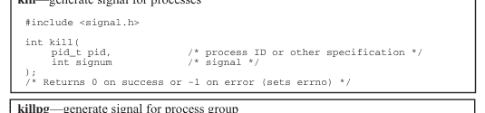

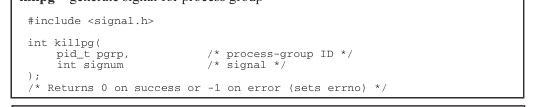

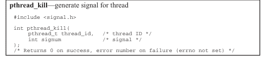

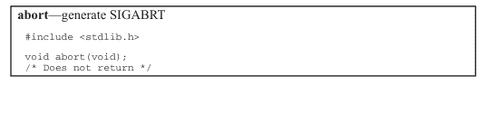

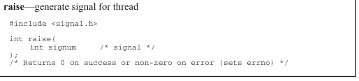

命名不当的`kill`系统调用可以向一个或多个进程发送任意信号，而不仅仅是`SIGKILL`，前提是具有发送信号的权限。如果由超级用户运行，或者发送进程的real或effective user ID与接收进程的real或saved set-user-ID匹配，则具有权限。信号传递给哪些进程取决于`pid`参数：

- `> 0` 进程ID为`pid`的进程
- `0` 其进程组ID与发送进程的进程组ID相同的进程组
- `< -1` 其进程组ID与`pid`的绝对值相同的进程组
- `-1` 发送者具有权限的所有进程，除了实现定义的一组系统进程外

如果`sig_num`为0，`kill`仅测试其`pid`参数的有效性。这是一种判断进程或进程组是否存活的方法。如果发送进程没有权限发送信号，调用将失败，但`errno`值将指示进程或进程组是否存活：如果`pid`不存在，则为`ESRCH`；如果存在但发送者无权限，则为`EPERM`。

`killpg`是一个完全不必要的系统调用，它只为进程组ID为`pgrp`的进程组生成信号，因此它与以下调用等效：

```c
kill(-pgrp, sig_num);
```

`pthread_kill`类似于`kill`，但它只向线程`thread_id`发送信号，该线程必须与发送线程位于同一进程中。它没有`kill`对进程拥有的广播功能。使用`pthread_kill`时要小心——记住，终止、停止或继续的信号始终会影响整个进程。因此，`pthread_kill`仅对捕获的信号按你期望的方式工作。如果你执行

```c
pthread_kill(tid, SIGKILL);
```

进程将被终止，而不仅仅是线程`tid`。（你使用`pthread_cancel`来终止单个线程。）

`abort`几乎等同于参数为`SIGABRT`的`kill`，但如果该信号被捕获且信号处理程序不返回（例如，调用`siglongjmp`或`_exit`），进程无论如何都会被终止，就好像`SIGABRT`具有默认行为一样；`abort`永不返回。例如，如果通过`sigaction`将`SIGABRT`设置为`SIG_IGN`，`abort`会终止进程，但

```c
kill(getpid(), SIGABRT)
```

没有效果。

`raise`实际上是一个标准C函数。它向执行它的线程发送信号。也就是说，它与以下调用相同：

```c
pthread_kill(pthread_self(), signum);
```

然而，即使不支持POSIX线程选项，`raise`始终存在，在这种情况下它与以下调用相同：

```c
kill(getpid(), signum);
```

### 9.1.10 fork、pthread_create 和 exec 对信号的影响

`fork`、`pthread_create`或`exec`为新进程、线程或程序设置了线程的三个属性：

1. **信号动作：** 在`fork`之后，子进程继承所有信号动作。在`exec`之后，设置为`SIG_DFL`的信号保持该状态；设置为`SIG_IGN`的信号保持该状态，除了`SIGCHLD`，它可能被设置为`SIG_IGN`或`SIG_DFL`，具体由实现决定；被捕获的信号被设置为`SIG_DFL`。由于所有动作都是进程范围的，`pthread_create`没有影响。
2. **信号掩码：** 在`fork`之后从fork线程继承；在`exec`之后保持与执行线程相同；在`pthread_create`之后从创建线程复制到新线程。
3. **待处理信号：** 在`fork`之后被清除；在`exec`之后与执行线程相同；在`pthread_create`之后被清除。

记住这九条规则（三个属性乘以三个系统调用）的简单方法是这样：倾向于复制或继承属性而不改变，因此只需记住三个例外，其中前两个完全合乎逻辑：

- 如果一个已捕获的信号的处理程序消失了（例如在`exec`时），则该信号必须更改为`SIG_DFL`。
- `挂起`的信号是按进程或按线程划分的，因此当有新进程或新线程时，它们会被清除。
- 标准制定者更关心不破坏现有实现，而不是强制可移植性，因此他们在`SIGCHLD`上摇摆不定。

## 9.2 等待信号

本节描述允许进程等待信号传递的系统调用。

### 9.2.1 pause 系统调用

我们遇到过许多在某个活动完成前会阻塞等待事件的系统调用。例如，在读取终端时，`read`通常等待输入一整行。`pause`是纯粹的等待：它什么都不做，也不特别等待任何内容。

> `pause` — 等待信号
> #include <unistd.h>
> int pause(void);
> /* 出错时返回 -1（设置 errno） */

由于已传递的信号会中断大多数阻塞的系统调用，我们可以说`pause`等待的是一个被捕获的信号。如果信号捕获函数返回，`pause`会返回并将`errno`设置为`EINTR`，但由于这是`pause`返回的唯一方式，测试它是没有意义的。

通常，你会使用像`sigwait`这样更复杂的调用，而不是`pause`。

### 9.2.2 sigwait 系统调用

与`pause`不同，`sigwait`让你可以选择等待什么。你不需要信号处理程序，并且当它返回时，你会被告知到达的是哪个信号：

```c
/*
sigwait — 等待信号
*/
#include <signal.h>
int sigwait(
    const sigset_t *set,      /* 要等待的信号 */
    int *signum              /* 被接受的信号 */
);
/* 成功返回 0，错误时返回错误编号 */
```

参数`set`是一个信号集合（参见第9.1.5节），`sigwait`将等待其中的信号。当一个信号变为挂起状态时，其编号通过`signum`参数返回，`sigwait`随之返回。如果在调用`sigwait`时已有一个或多个信号处于挂起状态，则会以未定义的方式选择一个并立即返回。`sigwait`返回的信号的技术术语是“被接受”；它不是“被传递”。

当你使用`sigwait`时，你希望信号保持挂起状态，直到`sigwait`返回它；你不希望信号被传递。因此，你阻塞了`sigwait`将要等待的信号，并保持它们阻塞状态。（信号的生命周期——从产生到挂起到传递——在第9.1.2节中描述过。）

如果有多个线程在`sigwait`中等待发送给进程的同一直信号，只有一个线程会获取该信号，且选择方式是未定义的。如果信号发送给特定线程，只有该线程的`sigwait`（如果有的话）才能返回它。

通常，你使用`sigwait`有两个目的之一：

- 当线程在某个与信号相关的事件发生前无法继续时。例如，一个线程可能在消息到达时向另一个线程发送`SIGUSR1`。不过，通常使用条件变量（第5.17.4节）来实现此目的更好。本节稍后有一个示例。
- 当指定一个线程来处理信号时。也就是说，使用等待线程代替信号处理函数。所有线程都阻塞了将要等待的信号，一个线程执行`sigwait`。但这仅适用于发送给进程的信号——如果信号发送给线程，只有该线程的`sigwait`才能返回它。

对于发送给进程的信号，使用`sigwait`代替信号处理程序要好得多，因为信号处理程序的所有限制都不适用。当`sigwait`返回时，你可以自由调用任何系统调用或函数，或在线程中做其他任何事情。

在第9.1.8节中，我们展示了一个函数`handle_signals`，它安排捕获所有检测到错误的信号（例如`SIGFPE`、`SIGSEGV`），以便在退出前调用清理函数并显示一条友好消息。让我们重新编写此函数，使用线程中的`sigwait`代替信号处理程序：

```c
static bool handle_signals(void) /* 请勿使用 -- 见下文 */
{
  sigset_t *set;
  struct sigaction act;
  pthread_t tid;
  ec_null( set = malloc(sizeof(*set)) )
  ec_negl( sigfillset(set) )
  ec_rv( pthread_sigmask(SIG_SETMASK, set, NULL) )
  memset(&act, 0, sizeof(act));
  act.sa_handler = SIG_IGN;
  ec_negl( sigaction(SIGHUP, &act, NULL) )
  ec_negl( sigaction(SIGINT, &act, NULL) )
  ec_negl( sigaction(SIGQUIT, &act, NULL) )
  ec_negl( sigaction(SIGPIPE, &act, NULL) )
  ec_negl( sigemptyset(set) )
  ec_negl( sigaddset(set, SIGTERM) )
  ec_negl( sigaddset(set, SIGBUS) )
  ec_negl( sigaddset(set, SIGFPE) )
  ec_negl( sigaddset(set, SIGILL) )
  ec_negl( sigaddset(set, SIGSEGV) )
  ec_negl( sigaddset(set, SIGSYS) )
  ec_negl( sigaddset(set, SIGXCPU) )
  ec_negl( sigaddset(set, SIGXFSZ) )
  ec_rv( pthread_sigmask(SIG_SETMASK, set, NULL) )
  ec_rv( pthread_create(&tid, NULL, sig_thread, set) )
  return true;

EC_CLEANUP_BGN
  return false;
EC_CLEANUP_END
}

static void *sig_thread(void *arg)
{
  int signum;
  int i;
  struct {
    int signum;
    char *msg;
  } sigmsg[] = {
    { SIGTERM, "Termination signal" },
    { SIGBUS, "Access to undefined portion of a memory object" },
    { SIGFPE, "Erroneous arithmetic operation" },
    { SIGILL, "Illegal instruction" },
    { SIGSEGV, "Invalid memory reference" },
    { SIGSYS, "Bad system call" },
    { SIGXCPU, "CPU-time limit exceeded" },
    { SIGXFSZ, "File-size limit exceeded" },
    { 0, NULL }
  };

  while (true) {
    ec_rx( sigwait((const sigset_t *)arg, &signum) )
    clean_up();
    for (i = 0; sigmsg[i].signum > 0; i++)
      if (sigmsg[i].signum == signum) {
        fprintf(stderr, "%s\n", sigmsg[i].msg);
        break;
      }

    _exit(EXIT_FAILURE);
  }

  return (void *)true; /* 永远不会到达这里 */

  EC_CLEANUP_BGN
  EC_PUSH("sig_thread")
  return (void *)false;
  EC_CLEANUP_END
}

static void clean_up(void)
{
  /*
  清理代码放在这里 --
  不需要是异步信号安全的。
  */
}
```


这一版本相对于第 9.1.8 节中的版本的优势在于，当`sigwait`返回一个信号时，我们处于线程中，而不是信号处理程序中，我们可以自由使用任何系统调用或函数——不受异步信号安全列表的限制。请注意，`clean_up`函数中的注释已相应更改。

这一版本的缺点是它不起作用！原因有两个，都很严重：

- 如果某个其他线程获得`SIGSYS`等信号，该信号将发送给该线程，而不是进程，`sig_thread`函数中的`sigwait`不会返回该信号。事实上，由于该信号在所有线程中都被阻塞，它将永远保持挂起状态。因此，对于检测到错误的信号，应该使用使用信号处理程序的原版。
- 如果硬件检测信号之一（`SIGBUS`、`SIGFPE`、`SIGILL`和`SIGSEGV`）在阻塞时自然发生，结果未定义（参见第 9.1.3 节）。最可能的情况是进程立即终止，`sigwait`没有机会返回它。使用信号处理程序的版本没有问题，因为在初始设置后，那四个信号是未被阻塞的。

这并不是说`sigwait`没有用处。大多数信号，包括第 9.1.3 节中检测到错误的信号组之外所有信号，在自然产生时（即不是由`pthread_kill`产生）是发送给进程的，因此等待在`sigwait`中的线程工作得非常好，是比信号处理程序好得多的选择。

### 9.2.3 sigsuspend 系统调用

`sigsuspend`是一个较旧的、非多线程的系统调用，它也等待信号。在详细介绍之前，让我们探讨一下它解决的问题。回顾第 8 章，我们不断运行示例，其中`fork`创建连接到父进程套接字的进程，对于父进程来说，在子进程连接之前获取套接字绑定很重要，我们使用了粗略的技术，让子进程睡眠几秒钟，给父进程机会赶在前面。不仅睡眠不可靠，因为不能保证几秒钟就足够了，而且效率也很低，因为几秒钟可能太长了。总结一下，这里用一个更简单的示例说明同样的问题：

```c
void try1(void)
{
    if (fork() == 0) {
        printf("child\n");
        exit(EXIT_SUCCESS);
    }
    printf("parent\n");
    return;
}
```

此函数显示：

- child
- parent

但我们希望父进程先执行，然后通知子进程何时继续。我们第一次尝试同步它们的方法是父进程向子进程发送一个`SIGUSR1`信号，子进程捕获该信号并设置一个变量：

```c
static volatile sig_atomic_t got_sig;

static void handler(int signum)
{
    if (signum == SIGUSR1)
        got_sig = 1;
}

void try2(void)
{
    pid_t pid;
    got_sig = 0;
    ec_neg1(pid = fork());
    if (pid == 0) {
        struct sigaction act;
        memset(&act, 0, sizeof(act));
        act.sa_handler = handler;
        ec_neg1(sigaction(SIGUSR1, &act, NULL));
        while (got_sig == 0)
            if (pause() == -1 && errno != EINTR)
                EC_FAIL
        printf("child\n");
        exit(EXIT_SUCCESS);
    }
    printf("parent\n");
    ec_neg1(kill(pid, SIGUSR1));
    return;
    EC_CLEANUP_BGN
    EC_FLUSH("try2")
    EC_CLEANUP_END
}
```

处理程序是安全的——它只是设置一个允许类型的变量。子进程在循环中测试该变量，暂停以等待信号的到来。（`pause`，我们将在 9.2.1 节中详细讨论，会阻塞直到信号到达。）现在的执行顺序是我们所期望的：

- 父进程
- 子进程

但存在两个问题：

- 如果`SIGUSR1`在子进程有机会安装处理程序之前就被投递给子进程，它将终止子进程。一个潜在的解决方案是在`fork`之前安装处理程序，这样子进程将继承它，但这仅在父子进程中有效。我们希望能找到一种适用于需要同步的任意进程的解决方案。
- 如果`SIGUSR1`在`while`语句中的测试和调用`pause`之间被投递，`pause`将永远等待，因为本应唤醒它的信号在它进入睡眠之前就已经到达了。

我们可以尝试通过阻塞`SIGUSR1`信号直到我们准备好接收它来修复问题：

```c
void try3(void)
{
    sigset_t set;
    pid_t pid;
    got_sig = 0;
    ec_neg1( sigemptyset(&set) )
    ec_neg1( sigaddset(&set, SIGUSR1) )
    ec_neg1( sigprocmask(SIG_SETMASK, &set, NULL) )
    ec_neg1( pid = fork() )
    if (pid == 0) {
        struct sigaction act;
        sigset_t suspendset;
        memset(&act, 0, sizeof(act));
        act.sa_handler = handler;
        ec_neg1( sigaction(SIGUSR1, &act, NULL) )
        ec_neg1( sigfillset(&suspendset) )
        ec_neg1( sigdelset(&suspendset, SIGUSR1) )
        ec_neg1( sigprocmask(SIG_SETMASK, &suspendset, NULL) )
        while (got_sig == 0)
            if (pause() == -1 && errno != EINTR)
                EC_FAIL
        printf("child\n");
        exit(EXIT_SUCCESS);
    }
    printf("parent\n");
    ec_neg1( kill(pid, SIGUSR1) )
    return;
    EC_CLEANUP_BGN
        EC_FLUSH("try3")
    EC_CLEANUP_END
}
```

这彻底解决了问题 #1。由于信号被阻塞，`SIGUSR1`无法在处理程序安装前到达。但问题 #2 依然存在，我们无能为力。尽管时间窗口很小，信号仍然可能在测试和暂停之间到达。

我们需要一种方法，在暂停开始之前保持信号处于阻塞状态。或者换一种说法，我们希望解除阻塞和暂停是原子的。这正是`sigsuspend`所做的：

**`sigsuspend`**——更改信号掩码并等待信号

```c
#include <signal.h>

int sigsuspend(
   const sigset_t *sigmask      /* 临时信号掩码 */
); /* 出错时返回 -1，始终如此（设置 errno） */
```

`sigsuspend`暂时用`sigmask`替换线程的信号掩码，然后等待直到一个未被阻塞的信号被投递，其动作为终止或被捕获。如果是终止，进程（而不仅仅是线程，请记住）将被终止，且`sigsuspend`不会返回。如果是被捕获且信号处理程序返回，之前的信号掩码将被恢复，并且`sigsuspend`会带错误返回。通常，错误仅为`EINTR`；也就是说，返回 -1 且`errno`为`EINTR`对于被中断的系统调用来说是正常的（与`pause`相同，如上述示例所示）。

在几乎所有情况下，传递给`sigsuspend`的掩码的效果是解除在调用前被阻塞的一个或多个信号的阻塞，尽管这实际上并不是要求。只是做其他事情没有太大意义。

好的，完美。我们现在可以通过简单地将`pause`替换为`sigsuspend`来永久解决我们的同步问题。我们不再需要`while`循环，因为解除信号阻塞和暂停现在是原子的。

```c
void try4(void)
{
   sigset_t set;
   pid_t pid;
   ec_neg1( sigemptyset(&set) )
   ec_neg1( sigaddset(&set, SIGUSR1) )
   ec_neg1( sigprocmask(SIG_SETMASK, &set, NULL) )
   ec_neg1( pid = fork() )
   if (pid == 0) {
      struct sigaction act;
      sigset_t suspendset;
      memset(&act, 0, sizeof(act));
      act.sa_handler = handler;
      ec_neg1( sigaction(SIGUSR1, &act, NULL) )
      ec_neg1( sigfillset(&suspendset) )
      ec_neg1( sigdelset(&suspendset, SIGUSR1) )
      if (sigsuspend(&suspendset) == -1 && errno != EINTR)
          EC_FAIL
      printf("child\n");
      exit(EXIT_SUCCESS);
   }
   printf("parent\n");
   ec_neg1( kill(pid, SIGUSR1) )
   return;
   EC_CLEANUP_BGN
   EC_FLUSH("try4")
   EC_CLEANUP_END
}
```

我们仍然可以使用相同的处理函数，它设置`got_sig`变量；但是，我们不再需要该变量，空的处理程序也能正常工作：

```c
static void handler(int signum)
{
}
```

此外，将`sigsuspend`的返回值与−1 进行比较的测试其实并不需要，因为它始终返回−1。但这样做很奇怪，会让那些不记得或不了解`sigsuspend`所有细节的读者感到困惑。

注意，我们在`fork`之前阻塞`SIGUSR1`，以便子进程继承信号掩码。在需要同步的两个进程互不相关的情况下，调用`sigsuspend`的进程只需自行进行阻塞。实际上，这只是我们在 9.1.8 节中提到的通用建议的一个特例，即每个应用程序开始时都阻塞所有信号。

请注意，与`sigwait`不同，你几乎总是将`sigsuspend`与信号处理程序一起使用，但通常处理程序不做任何事。它的存在只是为了让投递的信号中断`sigsuspend`。

`sigsuspend`和`sigwait`之间的另一个重大区别是，使用`sigwait`时，你正在等待的信号保持阻塞状态。事实上，它从未被投递——相反，`sigwait`接受它；将其从待处理信号集合中移除并返回它。因此，使用`sigwait`时不存在解除信号阻塞与等待信号投递之间的竞争条件，`sigsuspend`消除了这种竞争条件，因为你永远不会解除信号的阻塞。我们的同步代码变得更加简单：

```c
void try5(void)
{
    sigset_t set;
    pid_t pid;
    ec_neg1( sigemptyset(&set) )
    ec_neg1( sigaddset(&set, SIGUSR1) )
    ec_neg1( sigprocmask(SIG_SETMASK, &set, NULL) )
    ec_neg1( pid = fork() )
    if (pid == 0) {
        int signum;
        ec_rv( sigwait(&set, &signum) )
        printf("child\n");
        exit(EXIT_SUCCESS);
    }
    printf("parent\n");
    ec_neg1( kill(pid, SIGUSR1) )
    return;
    EC_CLEANUP_BGN
        EC_FLUSH("try5")
    EC_CLEANUP_END
}
```

我们应该提到，父进程和子进程的同步也可以通过管道完成，完全跳过信号的复杂性：

```c
void try6(void)
{
    int pfd[2];
    pid_t pid;
    ec_neg1( pipe(pfd) )
    ec_neg1( pid = fork() )
    if (pid == 0) {
        char c;
        ec_neg1( close(pfd[1]) )
        ec_neg1( read(pfd[0], &c, 1) )
        ec_neg1( close(pfd[0]) )
        printf("child\n");
        exit(EXIT_SUCCESS);
    }
    printf("parent\n");
    ec_neg1( close(pfd[0]) )
    ec_neg1( close(pfd[1]) )
    return;
    EC_CLEANUP_BGN
        EC_FLUSH("try6")
    EC_CLEANUP_END
}
```

这里，子进程在`read`中阻塞，直到父进程关闭管道的写端，导致子进程获得零返回。

## 9.3 杂项信号系统调用

你可以通过`sigpending`得知是否有信号处于挂起状态，它返回一组挂起的信号：

**`sigpending`**——检查挂起信号

```c
#include <signal.h>

int sigpending(
        sigset_t *set        /* 返回的挂起信号集合 */
); /* 成功时返回 0，出错时返回 -1（设置 errno） */
```

你可以使用`sigismember`（见 9.1.5 节）对返回的集合进行测试，以确定哪些信号是挂起的。当然，除非信号被阻塞，否则在测试时它可能已不再处于挂起状态。

回想 9.1.6 节，`SA_ONSTACK`标志安排信号的处理程序在备用栈上执行。你使用`sigaltstack`来管理该栈：

**`sigaltstack`**——设置和获取备用栈上下文

```c
#include <signal.h>

int sigaltstack(
        const stack_t *stack,      /* 新栈 */
                stack_t *ostack    /* 旧栈 */
); /* 成功时返回 0，出错时返回 -1（设置 errno） */
```


关于此系统调用的详细信息，请参阅你的系统文档或 SUS（单一 UNIX 规范）。

另外，请记住 `SA_RESTART` 标志可以防止信号中断函数。你可以使用 `siginterrupt` 来打开或关闭该标志，而无需调用 `sigaction`：

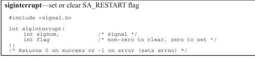

## 9.4 已废弃的信号系统调用

本节中的系统调用虽然已标准化，但它们并未为前文已介绍的系统调用增加任何功能，除了练习 9.4 和 9.5 需要花费的时间外，不值得你花时间去研究。

设置信号动作的经典方式是使用 `signal` 系统调用：

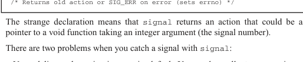

这个奇怪的声明意味着 `signal` 返回的动作可能是一个指向接受整数参数（信号号）的 `void` 函数的指针。

使用 `signal` 捕获信号时存在两个问题：

- 信号投递后，动作会被重置为默认值。如果你仍希望捕获该信号，需要再次调用 `signal`。
- 投递的信号不会被屏蔽，因此信号的第二次到达可能会终止进程。

规避这些问题的方法是使用 `sigaction`（参见 9.1.6 节）并彻底忘掉 `signal`。

有一组五个系统调用提供了简化的信号处理，但你应该避免使用它们，因为它们没有做到比主要函数（例如 `sigaction`）更好地完成某些事情。尽管如此，我还是会简要描述一下它们。

你可以使用 `sigset` 为信号设置 `sigaction` 风格的动作，而无需使用包含 `sigset` 的结构体：

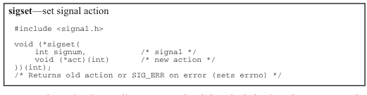

`sigset` 的调用与 `signal` 同样简单，但它具有 `sigaction` 的行为，即当处理程序正在执行时，投递的信号会被屏蔽，且动作不会改变。此外，它接受一个新动作 `SIG_HOLD`，该动作只是将信号添加到信号掩码中。与 `sigaction` 不同，如果你调用 `sigset` 时没有使用 `SIG_HOLD` 动作，作为副产品，它还会解除屏蔽（即从信号掩码中移除）该信号。

避免使用 `sigset` 和以下其他相关函数的主要原因是，掌握 `sigaction` 的行为已经足够困难，再试图学习一套略有不同的功能组合就太难了。少即是多！避免使用它们的另一个原因是它们在多线程环境中未定义。想象一下，如果你在单线程程序中使用过它们，后来又添加了多线程支持，会出现什么问题！

要直接解除屏蔽信号（即从信号掩码中移除），你可以调用 `sigrelse`：

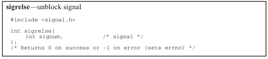

`sigsuspend` 有一个简化版本，即 `sigpause`，它从信号掩码中移除一个信号，暂停直到有信号到达（任何未屏蔽的信号），然后恢复掩码：

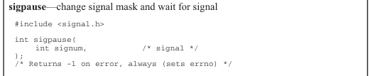

最后，以下是两个冗余的系统调用，因为它们所做的与 `sigset` 使用 `SIG_HOLD` 和 `SIG_IGN` 动作时的操作完全相同：

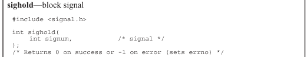

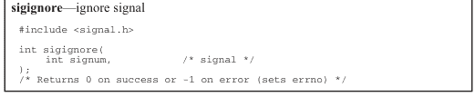

## 9.5 实时信号扩展（RTS）

所谓的 POSIX.4（实时）标准包含一种新的信号机制 `RTS`，它通过以下方式改进了本章前文描述的信号相关系统调用：

- 将用于应用程序的信号数量增加到 `SIGUSR1` 和 `SIGUSR2` 之外
- 允许对信号进行排队，因此当同类型信号已挂起时，新生成的信号不会丢失
- 指定信号的投递顺序
- 随信号包含附加信息，例如信号来源、原因，以及可能的应用程序数据

新特性是在传统特性的基础上增加的，因此你仍然可以使用经典的 28 个信号（参见 9.1.3 节），并使用相同的处理程序和其他动作，以及相同的合成调用，例如 `kill`。标准并未说明你可以将新的 `RTS` 特性（例如排队、传递值）用于旧信号，尽管在许多系统上你可以这样做，因此如果你希望保持可移植性，请避免这样做。有几个特性测试宏（参见 1.5.4 节）指示这些特性是否可用。主要的一个是 `_POSIX_REALTIME_SIGNALS`。

本节中的子节详细讨论大多数 `RTS` 特性。在适当的时候，引用使用 `RTS` 信号机制发送信号的一组函数将非常方便。这些函数在下一节中以与代码 `SI_QUEUE`、`SI_TIMER`、`SI_ASYNCIO` 和 `SI_MESGQ` 相关的形式给出。我将这组函数称为 `RTS-generation` 函数（这是我自己起的名字，其他地方并未使用）。在 9.7.5 节和 9.7.6 节中还描述了一些其他 `RTS` 特性。

### 9.5.1 RTS 信号处理程序

在继续阅读之前，你可能需要回顾 9.1.6 节中关于 `sigaction` 的讨论。

如果在传递给 `sigaction` 的结构体中设置了 `SA_SIGINFO` 标志，则使用 `sa_sigaction` 成员代替 `sa_handler` 成员来保存指向信号处理函数的指针。除了仅有一个信号号参数外，它具有以下更复杂的原型：

```c
void rts_handler(int signum, siginfo_t *info, void *context);
```

`info` 参数指向 `siginfo_t` 结构体中的信号信息，我们最初在 5.8 节的 `waitid` 中使用了它：

`siginfo_t` — `sigaction` 的结构体

```c
typedef struct {          /* 信号号 */
    int si_signo;
    int si_errno;       /* 与信号相关的 errno 值 */
    int si_code;        /* 信号代码（见下文） */
    pid_t si_pid;       /* 发送进程 ID */
    uid_t si_uid;       /* 发送进程的实际用户 ID */
    void *si_addr;      /* 故障指令的地址 */
    int si_status;       /* 退出值或信号 */
    long si_band;       /* SIGPOLL 的带事件 */
    union sigval si_value;  /* 信号值 */
} siginfo_t;
```

`union sigval` — 信号值的联合体

```c
union sigval {
    int sigval_int;             /* 整型信号值 */
    void *sigval_ptr;           /* 指针型信号值 */
};
```

成员 `si_signo` 只是处理程序参数 `signum` 的重复。

`si_errno` 的使用取决于实现；它可能包含一个指示信号原因的误差代码。

成员 `si_code` 指示信号的原因。通常，如果它是 0 或负数，则信号来自进程；进程 ID 位于 `si_pid` 中，实际用户 ID 位于 `si_uid` 中。`si_code` 成员是以下之一：

- `SI_USER`：由 `kill` 发送，或者由实现自行决定由用于合成信号的其他系统调用（例如 `raise`）发送
- `SI_QUEUE`：由 `sigqueue` 发送（参见 9.5.4 节）
- `SI_TIMER`：由 `timer_settime` 设置的定时器到期（参见 9.7.6 节）
- `SI_ASYNCIO`：异步 I/O 完成（参见 3.9 节）
- `SI_MESGQ`：消息到达（参见 7.7 节）

对于最后四个（`RTS-generation` 函数），还有一个可以通过 `si_value` 成员访问的随信号发送的值。

如果 `si_code` 是正数，则信号来自内核，代码取决于信号。例如，如果信号是 `SIGFPE`，则整型除以零的代码是 `FPE_INTDIV`，整型溢出的代码是 `FPE_INTOVF`，浮点除以零的代码是 `FPE_FLTDIV`。关于 `SIGFPE` 代码以及其他信号代码的完整列表，请参见 [SUS2002] 或系统文档。此外，5.8 节列出了 `SIGCHLD` 的代码。

其他成员的使用取决于信号。`SIGCHLD` 的成员已在 5.8 节中描述。对于 `SIGILL` 和 `SIGSEGV`，`si_addr` 成员给出导致问题的实际机器地址。对于 `SIGPOLL`（与 STREAMS 一起使用），成员 `si_band` 指示带事件。

下面是一个程序，它展示了当你设置 `SA_SIGINFO` 标志时，在信号处理程序中可用的部分附加信息：

```c
int main(void)
{
    struct sigaction act;
    union sigval val;
    memset(&act, 0, sizeof(act));
    act.sa_flags = SA_SIGINFO;
    act.sa_sigaction = handler;
    ec_neg1( sigaction(SIGUSR1, &act, NULL) )
    ec_neg1( sigaction(SIGRTMIN, &act, NULL) )
    ec_neg1( kill(getpid(), SIGUSR1) )
    val.sival_int = 1234;
    ec_neg1( sigqueue(getpid(), SIGRTMIN, val) )
    exit(EXIT_SUCCESS);
EC_CLEANUP_BGN
    exit(EXIT_FAILURE);
EC_CLEANUP_END
}

static void handler(int signum, siginfo_t *info, void *context)
{
    printf("Signal number: %d\n", info->si_signo);
    printf("Sending process ID: %ld\n", (long)info->si_pid);
    printf("Real user ID of sending process: %ld\n", (long)info->si_uid);
    switch (info->si_code) {
        case SI_USER:
            printf("Signal from user\n");
            break;
        case SI_QUEUE:
            printf("Signal from sigqueue; value = %d\n",
                 info->si_value.sival_int);
            break;
        case SI_TIMER:
            printf("Signal from timer expiration; value = %d\n",
                 info->si_value.sival_int);
            break;
        case SI_ASYNCIO:
            printf("Signal from asynchronous I/O completion; value = %d\n",
                 info->si_value.sival_int);
            break;
        case SI_MESGQ:
            printf("Signal from message arrival; value = %d\n",
                 info->si_value.sival_int);
            break;
    }
    default:
        printf("Other signal\n");
}
```

将这段代码与本章的第一个示例进行对比，你会发现为调用 `sigaction` 做准备时的差异：设置了 `SA_SIGINFO` 标志，且处理函数的成员是 `sa_sigaction` 而不是 `sa_handler`。我将在下一节介绍信号 `SIGRTMIN`；在此之前，如果将其视为 `SIGUSR2` 有助于你理解代码，那就请这样认为。

尽管 `printf` 函数并非异步信号安全（async-signal-safe），但我们在信号处理函数中调用它是合法的，因为该信号是由一个异步信号安全的系统调用产生的：`kill` 或 `sigqueue`（我们稍后将在第 9.5.4 节中介绍）。

以下是我获得的输出：

```
signal number: 10
sending process ID: 29501
real user ID of sending process: 500
Signal from user
signal number: 32
sending process ID: 29501
real user ID of sending process: 500
Signal from sigqueue; value = 1234
```

信号处理函数的第三个参数 `context` 是指向 `ucontext_t` 类型对象的指针，它描述了接收进程在被中断时的上下文。之所以是指向 `void` 的指针而不是 `ucontext_t`，是因为在引入此原型时，该新类型尚未标准化。此指针并不总是被实现，也很少被使用。更多信息请参阅 [SUS2002] 或你系统的文档。

### 9.5.2 RTS 信号

`RTS` 引入了一组新信号，其编号范围从 `SIGRTMIN` 到 `SIGRTMAX`，至少提供 `RTSIG_MAX` 个信号。你可以在运行时通过 `sysconf`（第 1.5.5 节）获取实际数量，但它始终至少为 8。（事实上，在我的 Solaris 版本上就是如此；在 Linux 上则是 32。）

对于 `RTS` 生成函数（定义于第 9.5 节开头），你可以指定想要使用的信号，且应选择其中一个 `RTS` 信号；是否可以使用经典信号则取决于实现。

除了第一个和最后一个信号外，其他 `RTS` 信号没有对应的符号，因此你需要引用 `SIGRTMIN`、`SIGRTMIN + 1`，依此类推，直到 `SIGRTMAX`。当然，你会希望定义自己的宏，例如：

```c
#define DB_IO_DONE SIGRTMIN + 4
```

遗憾的是，两个库使用相同信号的问题并未由 POSIX.4 组解决，因此请小心。

`SIGRTMIN` 和 `SIGRTMAX` 不一定是常量整型表达式，因此你不能可移植地将其用作 case 标签或在预处理器表达式中（例如在 `#ifs` 中）使用。

如果有一个以上的 `RTS` 信号（`SIGRTMIN` 至 `SIGRTMAX`）处于挂起状态，编号最小的信号将首先被递送。因此，你可以将它们视为按优先级排序，在将它们分配给不同的应用目的时可能需要考虑这一点。所有 `RTS` 信号的默认操作都是终止。

### 9.5.3 排队信号

通常情况下，当同类型的信号已处于挂起状态时，如果生成了该信号，你不能指望会发生什么。如果实现不具备排队信号的能力，例如每种信号只保留一个标志，那么它会直接忽略第二个信号。你绝不应将信号用于计数目的——例如，用来跟踪 `SIGUSR1` 被发送的次数。

然而，对于 `RTS`，如果通过 `sigaction` 为该信号设置了 `SA_SIGINFO` 标志，由 `RTS` 生成函数（定义于第 9.5 节开头）发送的 `RTS` 信号（`SIGRTMIN` 至 `SIGRTMAX`）将被排队。经典信号是否也支持排队取决于实现，因此不要依赖这一点。许多系统即使你不设置 `SA_SIGINFO` 标志也会将 `RTS` 信号排队，这是完全合法的，但为了可移植性，你应该设置该标志。

如果你希望排队但不希望有信号处理函数，因为例如你打算使用 `sigwait`（第 9.2.2 节），似乎可以将 `sigaction` 结构体的 `sa_sigaction` 成员设置为 `SIG_DFL`，但 SUS 在此点上并不明确。为了安全起见，编码一个空的处理函数，并将操作指向该函数。

进程的队列长度最大至少为 32；你可以使用 `sysconf`（第 1.5.5 节）查找实际数量。

### 9.5.4 sigqueue

`sigqueue` — 为进程生成信号

```c
#include <signal.h>

int sigqueue(
    pid_t pid,                   /* process ID */
    int signum,                 /* signal */
    const union sigval value
);

/* Returns 0 on success or -1 on error (sets errno) */
```


我们已经在第 9.5.1 节的示例中看到了 `sigqueue` 的使用。前两个参数与 `kill` 的参数类似，但 `pid` 只能是一个进程 ID——`kill` 的广播功能（例如，发送给所有进程）在这里不起作用。此外，你可以传递一个值，如果设置了 `SA_SIGINFO` 标志且信号处理函数使用第 9.5.1 节描述的三参数形式，该值即可被接收。你自己决定是要使用联合体中的 `int` 成员还是指针成员；处理函数必须知道使用哪一个，因为不会传递关于你使用了哪一个的信息。

如果你向另一个进程发送信号，你可能无法使用指针，因为该指针对于另一个进程没有意义。唯一有效的情况是，两个进程共享位于相同地址的内存，并且该指针指向该共享内存。

正如我在上一节中所述，如果设置了 `SA_SIGINFO` 标志且接收进程已有 `signum` 信号挂起，则新信号将被排队。

你只能对 RTS 信号（第 9.5.2 节）依赖排队和传递值的机制。

正如上一节所解释的，你只能排队有限数量的信号。如果新信号无法排队，`sigqueue` 返回 -1 并将 `errno` 设置为 `EAGAIN`。下一节中有一个使用 `sigqueue` 的另一个示例。

### 9.5.5 `sigwaitinfo` 和 `sigtimedwait`

第 9.2.2 节中的 `sigwait` 系统调用不是 RTS 的一部分，但它对 RTS 信号运行良好，即使在排队时也是如此。它接受一个挂起信号并返回它；如果仍有该类型的信号挂起，它们保持排队状态。与信号处理函数一样，如果有一个以上的 RTS 信号（`SIGRTMIN` 至 `SIGRTMAX`）挂起，最高优先级（编号最小）的信号将首先被接受。

但 `sigsuspend` 的问题是，你无法获取 `siginfo_t` 信息，包括 `value`，而这可能是 RTS 最重要的功能。因此，有一个略微增强的系统调用名为 `sigwaitinfo`：

`sigwaitinfo`—等待信号

```c
#include <signal.h>

int sigwaitinfo(
    const sigset_t *set,    /* signals to wait for */

    siginfo_t *info          /* returned info */

);                     /* Returns signal number or -1 on error (sets errno) */
```

如果 `info` 为 NULL，则不会返回信息，且 `sigwaitinfo` 与 `sigsuspend` 完全相同，区别在于信号编号作为函数返回值而不是通过参数返回。如果 `info` 非 NULL，它将接收与 `SA_SIGINFO` 风格信号处理函数相同的结构体，如第 9.5.1 节所述。与 `sigsuspend` 一样，请确保 `set` 中的信号被阻塞；否则，当其中一个信号被递送时将发生不可预测的行为。

这是一个使用排队信号的示例。首先，这是我们将使用的两个 RTS 信号的定义：

```c
#define MYSIG_COUNT  SIGRTMIN

#define MYSIG_STOP  SIGRTMIN + 1
```

以下是等待信号的线程的函数，如果它是 `MYSIG_COUNT` 则将其值显示为字符串，如果它是 `MYSIG_STOP` 则返回（终止线程）：

```c
static void *sig_thread(void *arg)
{
    int signum;

    siginfo_t info;

    do {

        signum = sigwaitinfo((sigset_t *)arg, &info);

        if (signum == MYSIG_COUNT)

            printf("Got MYSIG_COUNT; value: %s\n",

                   (char *)info.si_value.sival_ptr);

        else if (signum == MYSIG_STOP) {

            printf("Got MYSIG_STOP; terminating thread\n");

            return (void *)true;

        }

        else

            printf("Got %d\n", signum);

    } while (signum != -1 || errno == EINTR);

    EC_FAIL;

    EC_CLEANUP_BGN;

    EC_FLUSH("sig_thread");

    return (void *)false;

    EC_CLEANUP_END;

}
```

请注意，我们不能使用 `switch` 语句，因为如第 9.5.2 节所述，`MYSIG_COUNT` 和 `MYSIG_STOP` 可能是非常量整型表达式。

下面是主函数：

```c
int main(void)
{
    sigset_t set;

    struct sigaction act;

    union sigval value;

    pthread_t tid;

    ec_negl( sigemptyset(&set) )

    ec_negl( sigaddset(&set, MYSIG_COUNT) )

    ec_negl( sigaddset(&set, MYSIG_STOP) )

    ec_rv( pthread_sigmask(SIG_SETMASK, &set, NULL) )

    memset(&act, 0, sizeof(act));

    act.sa_flags = SA_SIGINFO;

    act.sa_sigaction = &dummy_handler;

    ec_negl( sigaction(MYSIG_COUNT, &act, NULL) )

    ec_negl( sigaction(MYSIG_STOP, &act, NULL) )

    value.sival_ptr = "One";

    ec_negl( sigqueue(getpid(), MYSIG_COUNT, value) )

    value.sival_ptr = "Two";

    ec_negl( sigqueue(getpid(), MYSIG_COUNT, value) )

    value.sival_ptr = "Three";

    ec_negl( sigqueue(getpid(), MYSIG_COUNT, value) )

    value.sival_ptr = NULL;

    ec_negl( sigqueue(getpid(), MYSIG_STOP, value) )

    ec_rv( pthread_create(&tid, NULL, sig_thread, &set) )

    ec_rv( pthread_join(tid, NULL) )

    exit(EXIT_SUCCESS);

}

EC_CLEANUP_BGN

  @exit(EXIT_FAILURE);

EC_CLEANUP_END

}

static void dummy_handler(int signum, siginfo_t *info, void *context)

{

}
```

请注意，在线程创建之前已经生成了四个信号，以证明它们会被排队。由于这些信号的编号低于 `MYSIG_STOP`，因此保证在线程处理 `MYSIG_STOP` 之前会先接受 `MYSIG_COUNT` 个信号。还要注意，信号是被阻塞的，并且保持阻塞状态。需要设置一个空处理器，因为必须设置 `SA_SIGINFO` 以启用排队功能。恰好的是，Solaris 无论如何都会对 RTS 信号进行排队，但在可移植程序中不能依赖这一点。

以下是输出结果，证明了信号已被排队：

```
Got MYSIG_COUNT: value: One

Got MYSIG_COUNT: value: Two

Got MYSIG_COUNT: value: Three

Got MYSIG_STOP: terminating thread
```

如果你只想等待有限的时间，可以使用 `sigtimedwait`，它在 `sigwaitinfo` 的基础上增加了一个超时参数：

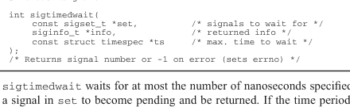

`sigtimedwait` 最多等待 `ts` 指定的纳秒数，以便 `set` 中的某个信号变为待处理状态并返回。如果时间周期过期，它会返回 −1，并将 `errno` 设置为 `EAGAIN`。不能将超时设置为 `NULL`。如果 `timespec` 的两个成员都为零且 `set` 中没有待处理的信号，`sigtimedwait` 会立即返回，但这并不是真正的特殊情况——只是超时了而已。

### 9.5.6 `sigevent` 结构与 `SIGEV_THREAD`

除了 `sigqueue` 之外的 RTS 生成函数在其他地方都有描述，如第 9.5.1 节所列，但它们都使用 `sigevent` 结构来指定要发送的信号和值。我在此仅解释 `sigevent` 结构。

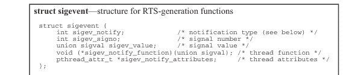

要发送的信号（例如 `SIGRTMIN`）放入 `sigev_signo`，伴随的值放入 `sigev_value`。与其他 RTS 特性一样，它保证只对 RTS 信号有效。`sigev_notify` 成员指定信号如何发送：

- `SIGEV_SIGNAL` 生成一个信号，就好像调用了 `sigqueue` 一样

- `SIGEV_THREAD` 启动一个线程，就好像调用了 `pthread_create` 一样

- `SIGEV_NONE` 不提供任何通知，这通常没有太大意义

`SIGEV_THREAD` 是最有趣的。当事件发生时，每次发生都会启动一个新线程，并且由 `sigev_notify_function` 指向的函数成为该线程的启动函数。通常，启动函数有一个指向 `void` 的指针参数；在这种情况下，它是一个指向 `union sigval` 的指针，这大致相同，因为联合体的一个成员是一个 `void` 指针。你可以使用 `sigev_notify_attributes` 成员来设置线程的属性，但不能使线程可连接（joinable）。如果该成员为 `NULL`，线程默认是分离的（detached），这与 `pthread_create` 的默认行为相反。

创建线程有很大的开销，因此显然，除非事件相当罕见和/或其生成相对于启动新线程的成本来说代表大量工作，否则你不应该指定 `SIGEV_THREAD`。例如，每次有输入到达时都启动一个新线程可能有点过头了。

如果你感到困惑，当本来可以生成信号时创建线程，与让线程在 `sigwait`（第 9.2.2 节）中等待是完全不同的。它们唯一的共同点是都使用线程。

## 9.6 全局跳转

通常，函数仅通过执行 `return` 语句返回到调用者，或者如果它是 `void` 函数，则通过流经其外层块的末尾（效果相同）。但是，可以使用标准 C 函数 `setjmp` 和 `longjmp` 跳转到程序中任意但预先计划好的点：

`setjmp`—设置跳转点

```c
#include <setjmp.h>
int setjmp(
    jmp_buf loc_info      /* 保存的位置信息 */
);
/* 如果直接调用则返回 0，如果从 longjmp 返回则返回非零值
   （没有错误返回） */
```

`longjmp`—跳转到跳转点

```c
#include <setjmp.h>
void longjmp(
    jmp_buf loc_info,     /* 保存的位置信息 */
    int val               /* setjmp 返回的值 */
);
```

你通过调用 `setjmp` 来标记想要跳转的位置——可以说这是标签——它保存所需的位置信息（例如当前栈指针、机器地址）到其参数中，该参数看起来不像可以接收信息的指针，但实际上是。然后，从任何函数内部，无论嵌套多深，你执行 `longjmp` 并使用相同的参数，效果就好像 `setjmp` 返回了 `val`，而 `val` 不能为零；如果为零，`setjmp` 返回 1。

由于调用包含 `longjmp` 的函数可能向栈中压入了数据，`longjmp` 会自动将所有这些数据弹出。包含 `setjmp` 的函数没有被“调用”，返回时没有递归，尽管在调用 `longjmp` 的路径上可能存在递归。

这是一个例子。如果你以前从未见过 `setjmp` 和 `longjmp`，你会觉得它相当奇怪：

```c
static jmp_buf loc_info;

static void fcn2(void)
{
    printf("In fcn2\n");
    longjmp(loc_info, 1234);
    printf("Leaving fcn2\n");
}

static void fcn1(void)
{
    printf("In fcn1\n");
    fcn2();
    printf("Leaving fcn1\n");
}

int main(void)
{
    int rtn;

    rtn = setjmp(loc_info);
    printf("setjmp returned %d\n", rtn);
    if (rtn == 0)
        fcn1();
    printf("Exiting\n");
    exit(EXIT_SUCCESS);
}
```

以下是输出结果：

```
setjmp returned 0
In fcn1
In fcn2
setjmp returned 1234
Exiting
```

因此，你可以看到 `setjmp` 被调用了一次但返回了两次，并且跳转直接从 `fcn2` 的中间跳回到 `main` 的中间；两行“leaving”语句没有被打印出来。

如果你没有完全理解，不用担心，因为我接下来要说的是：永远不要使用 `longjmp`。原因如下：

- 虽然栈被清理了，但其他很少（例如，分配的内存、打开的文件）不会。

- 关于在哪里可以使用 `setjmp` 和 `longjmp` 有一些限制，如果你忘记了它们，就会陷入麻烦。

- 有些人（包括我）甚至不喜欢在函数内部使用 `goto`。他们更不喜欢 `longjmp`。它使程序非常难以理解和维护。

- `longjmp` 的主要用途是从信号处理器中调用，但它不是异步信号安全的，因此你不能在那里使用它，除非你能保证信号处理器是由异步信号安全函数调用的，例如从同一进程内部执行的 `kill`（第 9.1.7 节）。

如果你认为需要 `longjmp`，那可能是因为你没有足够好地设计你的函数，使它们能够返回到调用者，也许带有一个错误或异常状态的指示。努力一点，你会想出办法的。

`longjmp` 可能会也可能不会恢复信号掩码。如果你想强制恢复它，有 `setjmp`/`longjmp` 的变体，它们是完全相同的，除了它们可以保存和恢复信号掩码：

`sigsetjmp`—设置跳转点

```c
#include <setjmp.h>
int sigsetjmp(
    sigjmp_buf loc_info,    /* 保存的位置信息 */
    int savemask             /* 非零以保存信号掩码 */
);
/* 如果直接调用则返回 0，如果从 siglongjmp 返回则返回非零值（没有错误返回） */
```

`siglongjmp`—跳转到跳转点，如果已保存则恢复信号掩码

```c
#include <setjmp.h>
void siglongjmp(
    sigjmp_buf loc_info,    /* 保存的位置信息 */
    int val                  /* sigsetjmp 返回的值 */
);
```

恢复的信号掩码是在调用 `sigsetjmp` 时生效的那个。如果 `siglongjmp` 在信号处理器内部被调用（这是它的设计目的），这可能不同于信号处理器如果允许正常返回时会恢复的掩码。

由于 `siglongjmp` 与 `longjmp` 一样不是异步信号安全的，它通常不能用于信号处理器中，因此其额外的恢复信号掩码的功能几乎无用。

如果不想保存信号掩码，并且由于某些原因不想将 `sigsetjmp` 的 `save_mask` 参数设置为零，你可以使用另一对函数：

- `_setjmp`——设置跳转点

```c
#include <setjmp.h>

int _setjmp(
    jmp_buf loc_info    /* saved location information */
);
/* Returns 0 if called directly, non-zero if from longjmp (no error
   return) */
```

- `_longjmp`——跳转到跳转点而不恢复信号掩码

```c
#include <setjmp.h>

void _longjmp(
    jmp_buf loc_info,     /* saved location information */
    int val               /* value for setjmp to return */
);
```

当然，`_longjmp` 也不是异步信号安全的。实际上，这两个带下划线的函数只是早期标准的遗留产物。

## 9.7 时钟和定时器

本节描述了各种系统时钟和定时器，这些定时器使用这些时钟在经过预设时间间隔后生成信号。

### 9.7.1 `alarm` 系统调用

- `alarm`——调度一个闹钟信号

```c
#include <unistd.h>
```


## 9.7.1 alarm 系统调用

```c
unsigned alarm(
    unsigned secs     /* seconds until signal */
);
/* Returns seconds left on previous alarm or zero if none (no error return) */
```

每个进程都有一个专门用于 `alarm` 系统调用的闹钟。当闹钟响起时，会发送一个 `SIGALRM` 信号。子进程继承父进程的闹钟时钟值，但实际的时钟并不共享。`exec` 之后闹钟时钟设置保持不变。

`alarm` 将时钟设置为 `secs` 指定的秒数。它返回之前的设置值；如果之前时钟上没有剩余时间或者没有之前的闹钟，则返回 0。之前的设置用于在调用 `alarm` 之前恢复时钟状态。

如果 `secs` 为 0，则关闭闹钟时钟。重要的是要记住这样做。例如，假设你有一个阻塞系统调用如 `read`，而你只想让它阻塞有限时间。你捕获 `SIGALRM`（使用空处理器），调用 `alarm` 设置为比如 5 秒，然后发起 `read`，此时它会阻塞。当闹钟响起时，`SIGALRM` 会中断阻塞的系统调用，`read` 返回 -1，并且 `errno` 被设置为 `EINTR`。但如果 `read` 在 5 秒内返回，而你又忘记关闭闹钟，它稍后（在计算机术语中，5 秒是非常长的时间）会响起——可能会莫名其妙地中断其他操作！如果你像本书中那样严格检查错误返回值，你会察觉到不对劲，但遗憾的是，并非所有人都这样做。

下面是一个示例：

```c
int main(void)
{
    struct sigaction act;
    char buf[100];
    ssize_t rtn;

    memset(&act, 0, sizeof(act));
    act.sa_handler = handler;
    ec_neg1( sigaction(SIGALRM, &act, NULL) )
    alarm(5);
    if ((rtn = read(STDIN_FILENO, buf, sizeof(buf) - 1)) == -1) {
        if (errno == EINTR)
            printf("Timed out... type faster next time!\n");
        else
            EC_FAIL
    }
    alarm(0);
    if (rtn == 0)
        printf("Got EOF\n");
    else if (rtn > 0) {
        buf[rtn] = '\0';
        printf("Got %s", buf);
    }
    exit(EXIT_SUCCESS);

EC_CLEANUP_BGN
    exit(EXIT_FAILURE);
EC_CLEANUP_END
}
```

```c
static void handler(int signum)
{
}
```

在以下示例交互中，我在 `alarm_test` 第一次执行后没有输入任何内容；在第二次执行后我输入了 "faster"：

```text
$ alarm_test
Timed out... type faster next time!

$ alarm_test
faster
Got faster
$
```

使用 `alarm` 来中断阻塞系统调用在简单情况下是可行的，比如我展示的例子，但在更复杂的情况下，你很可能是在 `select` 或 `poll` 中阻塞，而不是直接在 `read` 中。如果你想实现超时，如果可用，请使用 `pselect` 而不是设置闹钟。

`alarm` 的一个限制是每个进程只有一个这样的闹钟时钟。9.7.4 节和 9.7.6 节描述了具有更大灵活性的定时器系统调用。

### 9.7.2 sleep 系统调用

`sleep` 是我们整本书中经常使用的熟悉函数。它使线程阻塞指定的秒数：

- `sleep`——挂起执行直到秒数结束或收到信号

```c
#include <unistd.h>

unsigned sleep(
  unsigned secs      /* seconds to sleep */
);
/* Returns unslept amount */
```

SUS 中关于 `sleep` 的规则包含大量措辞，允许 `SIGALRM` 对其产生干扰，特别是为了让 `sleep` 可以基于 `alarm` 和 `pause`，或者更好地，基于 `alarm` 和 `sigsuspend` 作为函数来实现。下面是一种实现 `sleep` 的简单方法：

```c
unsigned aup_sleep(unsigned secs)
{
  struct sigaction act;
  unsigned unslept;

  memset(&act, 0, sizeof(act));
  act.sa_handler = sig_handler;
  ec_neg1( sigaction(SIGALRM, &act, NULL) )
  alarm(secs);
  pause();
  unslept = alarm(0);
  return unslept;

  EC_CLEANUP_BGN
    EC_FLUSH("aup_sleep")
    return 0;
  EC_CLEANUP_END
}

static void sig_handler(int signum)
{
}
```

这个版本可以工作，但有一些问题：

- 如果 `SIGALRM` 没有被屏蔽，在调用 `sigaction` 之前到达的 `SIGALRM` 可能会导致进程终止。
- 如果它们被屏蔽了，函数甚至无法正常工作。
- 如果 `alarm` 在调用 `alarm` 和 `pause` 之间响起，`pause` 可能会永久持续。
- `SIGALRM` 的旧操作没有被恢复。
- `alarm` 和 `sleep` 应该兼容。

最后一点意味着在如下序列中：

```c
alarm(10);
...
sleep(20);
```

`alarm` 响起时应该中断 `sleep` 并执行 `SIGALRM` 的处理器，而在如下序列中：

```c
alarm(20);
...
sleep(10);
```

`alarm` 应该在 `sleep` 返回后再设置 10 秒。

处理 `alarm` 和 `sleep` 的交互，防止错误的 `SIGALRM` 终止进程，防止无限的 `pause`，以及恢复旧的操作和掩码，需要大量复杂的代码来处理三种可能的情况：

- 调用 `sleep` 时没有设置闹钟。
- 剩余的闹钟时间小于或等于请求的 `sleep` 时间。
- 剩余的闹钟时间大于请求的 `sleep` 时间。

这个版本可以工作：

```c
unsigned aup_sleep(unsigned secs)
{
    sigset_t set, oset;
    struct sigaction act, oact;
    unsigned prev_alarm, slept, unslept, effective_secs;

    ec_neg1( sigemptyset(&set) )
    ec_neg1( sigaddset(&set, SIGALRM) )
    ec_neg1( sigprocmask(SIG_BLOCK, &set, &oset) )
    prev_alarm = alarm(0);
    if (prev_alarm != 0 && prev_alarm <= secs)
        effective_secs = prev_alarm;
    else {
        memset(&act, 0, sizeof(act));
        act.sa_handler = slp_handler;
        ec_neg1( sigaction(SIGALRM, &act, &oact) )
        effective_secs = secs;
    }
    alarm(effective_secs);
    set = oset;
    ec_neg1( sigdelset(&set, SIGALRM) )
    if (sigsuspend(&set) == -1 && errno != EINTR)
        EC_FAIL
    unslept = alarm(0);
    slept = effective_secs - unslept;
    ec_neg1( sigaction(SIGALRM, &oact, NULL) )
    if (prev_alarm > slept)
        alarm(prev_alarm - slept);
    ec_neg1( sigprocmask(SIG_SETMASK, &oset, NULL) )
    return unslept;

    EC_CLEANUP_BGN
    EC_FLUSH("aup_sleep")
    return 0;
    EC_CLEANUP_END
}

static void slp_handler(int signum)
{
}
```

[^8] Geoff Clare 通过发现我原始尝试中的错误而对这个版本做出了贡献。

以下是逐步解析：

1. 我们屏蔽 `SIGALRM`，这样我们可以继续执行而不必担心它会交付。我们将旧的信号掩码保存在 `oset` 中。
2. 我们关闭闹钟（如果已设置），并保存剩余时间。
3. 我们计算要睡眠多长时间（`effective_secs`，如果剩余的闹钟时间较少，则减少请求的时间），并为该时间设置闹钟。
4. 如果之前没有设置闹钟，或者睡眠时间小于剩余的闹钟时间，我们安装空处理器并将旧操作保存在 `oact` 中。
5. 我们调用 `sigsuspend` 而不是 `pause`，以便原子地解除 `SIGALRM` 的屏蔽。我们保持掩码中其他位在进入 `aup_sleep` 时那样不变。
6. 当 `sigsuspend` 返回时，是因为闹钟响起或其他信号中断了它。我们并不特别关心是哪一个。但我们需要闹钟上剩余的秒数，我们关闭闹钟时获取。
7. 我们计算实际睡眠的时间。
8. 我们恢复 `SIGALRM` 的旧操作。
9. 如果睡眠的时间小于进入时剩余的闹钟时间，我们将闹钟重置为新的剩余时间（部分时间已被睡眠消耗）。
10. 我们恢复信号掩码。
11. 我们返回未睡眠的时间。

如果你能理解这个函数，你就掌握了本章 90% 的内容，你可以给自己打 A。如果你发现错误并邮寄到 aup@basepath.com，你可以给自己打 A+。

### 9.7.3 更高分辨率的睡眠

`sleep` 以秒为单位睡眠，但对许多用途来说太长了。还有两个其他调用可以以更精确的时间间隔睡眠：

#### **usleep** — 以微秒为单位挂起执行，或直到收到信号

```c
#include <unistd.h>

int usleep(
unsigned long usecs
/* 要睡眠的微秒数 */
);
/* 成功时返回 0，出错时返回 -1（设置 errno） */
```

`usleep` 几乎与 `sleep` 相同，区别在于：如果试图使用它睡眠整整一秒或更长时间，则被视为错误。也就是说，`usecs` 必须小于一百万。如果你知道系统具有定时器选项（`_POSIX_TIMERS`），那么 `nanosleep` 更精确，且没有这种限制：

#### **nanosleep** — 以纳秒为单位挂起执行，或直到收到信号

```c
#include <time.h>

int nanosleep(
const struct timespec *req,
struct timespec *rem
/* 返回时：未使用的剩余时间，或为 NULL */
);
/* 成功时返回 0，出错时返回 -1（设置 errno） */
```

`nanosleep` 接受一个 `timespec` 结构，该结构在第 1.7.2 节中定义。回顾一下，它包含一个用于秒的 `tv_sec` 成员和一个用于纳秒的 `tv_nsec` 成员。

如果该函数被中断，它会像往常一样返回 -1 并将 `errno` 设置为 `EINTR`，同时将其指针 `rem` 所指向的内存设置为剩余时间。如果返回值为零，或者 `rem` 为 `NULL`，则它不会通过参数返回任何内容。

第 9.7.5 节中还有另一个名为 `clock_nanosleep` 的睡眠函数。

## 9.7.4 基本区间定时器系统调用

`alarm` 系统调用（第 9.7.1 节）使用一个进程范围内的区间定时器，存在于所有 UNIX 版本中。所有符合 SUS 标准的系统，以及一些其他系统，还提供另外三个你可以独立使用的区间定时器：

- `ITIMER_REAL` 在真实时间内递减；到期时产生 `SIGALRM`。
- `ITIMER_VIRTUAL` 在进程虚拟时间内递减；到期时产生 `SIGVTALRM`。
- `ITIMER_PROF` 在进程虚拟时间以及系统代表该进程运行期间同时递减；到期时产生 `SIGPROF`。它旨在供性能分析器使用，帮助通过指示程序在哪里耗费时间来进行调优。

在接下来的两个系统调用中，`which` 参数必须是上述列出的三个宏之一：

#### **getitimer** — 获取区间定时器的值

```c
#include <sys/time.h>

int getitimer(
	int which,	/* 要获取的定时器 */
	struct itimerval *val	/* 返回的值 */
);
/* 成功时返回 0，出错时返回 -1（设置 errno） */
```

#### **setitimer** — 设置区间定时器的值

```c
#include <sys/time.h>

int setitimer(
	int which,	/* 要设置的定时器 */
	const struct itimerval *val,	/* 要设置的值 */
	struct itimerval *oval	/* 返回的旧值 */
);
/* 成功时返回 0，出错时返回 -1（设置 errno） */
```

#### **struct itimerval** — 用于 getitimer 和 setitimer 的结构体

```c
struct itimerval {
	struct timeval it_interval;	/* 重置值 */
	struct timeval it_value;	/* 当前值 */
};
```

在 `itimerval` 结构中，`it_interval` 是定时器到期时重置定时器所用的时间，`it_value` 是当前区间的值。也就是说，与只触发一次的 `alarm` 不同，这些定时器可以在触发时自动重置。如果你调用 `setitimer` 时 `it_value` 成员为零，它会立即停止定时器。如果你调用 `setitimer` 时 `it_interval` 成员为零，它会在当前区间到期后停止定时器。在第 1.7.1 节中定义的 `timeval` 结构有两个成员：`tv_sec` 用于秒，`tv_usec` 用于微秒。

如果 `setitimer` 的 `oval` 参数非 `NULL`，它会获取旧值。示例如下：

```c
/* 3.5 秒定时器，仅触发一次 */
itv.it_interval.tv_sec = 0;
itv.it_interval.tv_usec = 0;
itv.it_value.tv_sec = 3;
itv.it_value.tv_usec = 500000;
ec_neg1( setitimer(TIMER_REAL, &itv, NULL) )
```

```c
/* 3.5 秒定时器，然后重复 2.25 秒的定时器 */
itv.it_interval.tv_sec = 2;
itv.it_interval.tv_usec = 250000;
itv.it_value.tv_sec = 3;
itv.it_value.tv_usec = 500000;
ec_neg!(setitimer(TIMER_REAL, &itv, NULL))

/* 立即停止定时器；区间并不重要 */
itv.it_value.tv_sec = 0;
itv.it_value.tv_usec = 0;
ec_neg!(setitimer(TIMER_REAL, &itv, NULL))
```

在中间的示例中，定时器将在 3.5 秒时触发，然后在 5.75 秒再次触发，接着在 8 秒触发，依此类推，之后每隔 2.25 秒触发一次，直到停止。

下面是一个示例，它每 2 秒（真实/“墙上时钟”时间）显示一个 X。请注意，一旦设置好定时器，程序其余部分就可以自由执行其任务，在此示例中，该任务只是从终端读取数据并回显所读取的内容：


```c
void timer_try(void)
{
    struct sigaction act;
    struct itimerval itv;
    char buf[100];
    ssize_t nread;

    memset(&act, 0, sizeof(act));
    act.sa_handler = handler;
    ec_neg!(sigaction(SIGALRM, &act, NULL))
    memset(&itv, 0, sizeof(itv));
    itv.it_interval.tv_sec = 2;
    itv.it_value.tv_sec = 2;
    ec_neg!(setitimer(TIMER_REAL, &itv, NULL))
    while (true) {
        switch (nread = read(STDIN_FILENO, buf, sizeof(buf) - 1)) {
        case -1:
            EC_FAIL
        case 0:
            printf("EOF\n");
            break;
        default:
            if (nread > 0) {
                buf[nread] = '\0';
                ec_neg!(write(STDOUT_FILENO, buf, strlen(buf)))
            }
            continue;
        }
        break;
    }
    return;

EC_CLEANUP_BGN
    EC_FLUSH("timer_try1")
EC_CLEANUP_END
}

void handler(int signum)
{
    write(STDOUT_FILENO, "\nX\n", 3);
}
```

输出如下所示：

```text
X
ERROR:  0: tml [/aup/c9/tmr.c:26] 0
    *** EINTR (4: "Interrupted system call") ***
```

发生的情况是，第一个 `X` 在 2 秒后正常输出，但 `SIGALRM` 信号中断了处于阻塞状态的 `read`。解决方法是设置 `SA_RESTART` 标志，以便系统调用不被中断：

```c
    memset(&act, 0, sizeof(act));
    act.sa_handler = handler;
    act.sa_flags = SA_RESTART;
    ec_neg1( sigaction(SIGALRM, &act, NULL) )
```

现在的输出如下，显示输入了 “hello” 并被回显，同时每 2 秒显示一个 `X`：

```text
X
x
hello
X
hello
X
...
```

还有一个名为 `ualarm` 的区间定时器系统调用，但它已被弃用。

## 9.7.5 实时时钟

所有 UNIX 系统都有一个基本时钟，你可以使用 `time` 和 `gettimeofday` 系统调用（第 1.7.1 节）读取其值，但带来 `nanosleep`（第 9.7.3 节）的同一 Timers 选项（`_POSIX_TIMERS`）还包括一个或多个额外的时钟，具体取决于软件和硬件支持的数量。要访问其中一个，需通过其时钟 ID 进行引用。

所有具有 Timers 选项的系统都支持一个 ID，即 `CLOCK_REALTIME`，它记录时间（time of day）。是否存在其他时钟、它们的宏是什么，以及它们是系统范围内的还是进程私有的，取决于具体实现。例如，Solaris 还支持一个系统范围内的 `CLOCK_HIGHRES` 时钟，它从过去的某个点开始计数。读取它不能得到当天的时间，因为你不知道它是如何设置的，但它非常适合比较两个不同时刻的读数。

调用 `clock_gettime` 可以在返回的 `timespec` 结构中获取纳秒级的时间（第 1.7.2 节和第 9.7.3 节）：

**`clock_gettime`** — 从时钟获取时间

```c
#include <time.h>

int clock_gettime(
    clockid_t clock_id,          /* 时钟 ID（如 CLOCK_REALTIME） */
    struct timespec *tp          /* 时间 */
);
/* 成功时返回 0，出错时返回 -1（设置 errno） */
```

使用 `clock_getres` 可以获取时钟的纳秒级分辨率：

**`clock_getres`** — 获取时钟分辨率

```c
#include <time.h>

int clock_getres(
    clockid_t clock_id,          /* 时钟 ID */
    struct timespec *res         /* 分辨率 */
);
/* 成功时返回 0，出错时返回 -1（设置 errno） */
```

此外，在具有适当权限的情况下（对于 `CLOCK_REALTIME` 为超级用户权限），你可以设置时钟：

**`clock_settime`** — 设置时钟

```c
#include <time.h>

int clock_settime(
    clockid_t clock_id,          /* 时钟 ID */
    const struct timespec *tp     /* 时间 */
);
/* 成功时返回 0，出错时返回 -1（设置 errno） */
```

下面是一个函数，它从时钟获取时间和分辨率并显示出来，同时显示 `time` 系统调用（第 1.7.1 节）以秒为单位的时间：

```c
void clocks(void)
{
    struct timespec ts;
    time_t tm;

    ec_negl( time(&tm) )
    printf("time() Time: %ld secs.\n", (long)tm);
    printf("CLOCK_REALTIME:\n");
    ec_negl( clock_gettime(CLOCK_REALTIME, &ts) )
    printf("Time: %1d.%09ld secs.\n", (long)ts.tv_sec, (long)ts.tv_nsec);
    ec_negl( clock_getres(CLOCK_REALTIME, &ts) )
    printf("Res.: %1d.%09ld secs.\n", (long)ts.tv_sec, (long)ts.tv_nsec);
    return;

EC_CLEANUP_BGN
    EC_FLUSH("clocks")
EC_CLEANUP_END
}
```

在 FreeBSD 系统上的输出为：

```text
time() Time: 1051646878 secs.
CLOCK_REALTIME:
Time: 1051646878.568628061 secs.
Res.: 0.000000838 secs.
```

这表明分辨率略小于一微秒。在不同的硬件上，Solaris 系统的输出为：

```text
time() Time: 1051646409 secs.
CLOCK_REALTIME:
Time: 1051646409.686869683 secs.
Res.: 0.010000000 secs.
```

那里的分辨率仅为百分之一秒。显示小数点后 9 位时间具有误导性——最好将显示限制在分辨率所能达到的精度。然而，这些时钟并非用于显示目的。它们用于计时。

有一个使用特定时钟的 `nanosleep` 版本（第 9.7.3 节）：

### 9.7.5 高级时钟函数

`clock_nanosleep` — 挂起执行以休眠纳秒级时间或直到收到信号

```c
#include <time.h>

int clock_nanosleep(
    clockid_t clock_id,          /* 时钟 ID */
    int flags,                   /* TIMER_ABSTIME 或零 */
    const struct timespec *nsecs, /* 休眠的纳秒数 */
    struct timespec *remain       /* 剩余时间或 NULL */
);
/* 成功时返回 0，出错时返回错误编号 */
```

第一个参数是时钟 ID；最后两个参数与 `nanosleep` 相同。如果 `flags` 为零，则休眠指定的纳秒数，行为与 `nanosleep` 一致。但如果它是 `TIMER_ABSTIME`，则休眠直到 `nsecs` 指定的绝对时间。最后一个参数用于返回剩余时间，仅适用于相对休眠；即当 `flags` 为零时。

最后，在支持进程 CPU 时间时钟选项（`_POSIX_CPUTIME`）的系统上，你可以获取进程的 CPU 时间时钟 ID：

`clock_getcpuclockid` — 获取进程 CPU 时间时钟

```c
#include <time.h>

int clock_getcpuclockid(
    pid_t pid,                    /* 进程 ID */
    clockid_t *clock_id           /* 返回的时钟 ID */
);
/* 成功时返回 0，出错时返回错误编号 */
```

### 9.7.6 高级间隔计时器系统调用

正如实时时钟超越了基本时钟，高级间隔计时器也超越了第 9.7.4 节中讨论的间隔计时器。借助这些调用，你不再局限于几个全系统范围的计时器，而是可以为每个进程拥有多个基于同一时钟的间隔计时器；回想一下上一节的内容，唯一保证可用的时钟是 `CLOCK_REALTIME`。

你首先创建一个计时器：

`timer_create` — 创建进程专属计时器

```c
#include <signal.h>
#include <time.h>

int timer_create(
    clockid_t clockid,           /* 时钟 ID */
    struct sigevent *sig,        /* NULL 或要生成的信号 */
    timer_t *timer_id            /* 返回的计时器 ID */
);
/* 成功时返回 0，出错时返回 -1（并设置 errno） */
```

如果成功，`timer_create` 会通过 `timer_id` 参数返回一个新的计时器 ID。如果 `sig` 非 `NULL`，则它指定当计时器超时要生成的信号、一个值以及其投递方式，具体说明见第 9.5.6 节。如果 `sig` 为 `NULL`，则生成 `SIGALRM`，且值被设置为计时器 ID。

你可以使用 `timer_delete` 删除一个计时器：

`timer_delete` — 删除进程专属计时器

```c
#include <time.h>

int timer_delete(
    timer_t timer_id             /* 计时器 ID */
);
/* 成功时返回 0，出错时返回 -1（并设置 errno） */
```

接下来是两个类似 `getitimer` 和 `setitimer`（第 9.7.4 节）的调用，区别在于 `itimerspec` 结构中的分辨率是纳秒，而不是微秒：

`timer_gettime` — 获取进程专属计时器的值

```c
#include <time.h>

int timer_gettime(
    timer_t timer_id,            /* 计时器 ID */
    struct itimerspec *val       /* 返回的值 */
);
/* 成功时返回 0，出错时返回 -1（并设置 errno） */
```

`timer_settime` — 设置进程专属计时器的值

```c
#include <time.h>

int timer_settime(
    timer_t timer_id,            /* 计时器 ID */
    int flags,                   /* 标志位 */
    const struct itimerspec *val, /* 要设置的值 */
    struct itimerspec *oval      /* 返回的旧值或 NULL */
);
/* 成功时返回 0，出错时返回 -1（并设置 errno） */
```

`struct itimerspec` — 计时器函数的结构体

```c
struct itimerspec {
    struct timespec it_interval; /* 重置值 */
    struct timespec it_value;    /* 当前值 */
};
```

如果 `timer_settime` 的 `flags` 参数为零，该函数的行为与 `setitimer` 相同。但如果设置了 `TIMER_ABSTIME` 标志，`it_value` 时间将被解释为类似于 `clock_nanosleep` 的 `nsecs` 参数；即计时器应当响起的绝对时间。（也就是说，就像你床边的那个闹钟。）`it_interval` 成员仍然用于在计时器响起时重置计时器。

当计时器超时时，只会排入一个信号，如果 `it_interval` 成员足够小，则可能在信号生成和该信号被投递或接受之间的时间内，计时器多次超时。在这种情况下，你可以使用此系统调用来获取额外的超时次数（即溢出）：

`timer_getoverrun` — 获取进程专属计时器溢出计数

```c
#include <time.h>

int timer_getoverrun(
    timer_t timer_id             /* 计时器 ID */
);
/* 返回溢出计数，出错时返回 -1（并设置 errno） */
```

### 练习

1.  **9.1.** 调查除了第 9.1.3 节中列出的标准 28 个信号外，你的系统上实现了哪些其他信号。
2.  **9.2.** 编写一个程序，使得在调用 `write` 时生成 `SIGPIPE` 信号（提示：使用管道）。然后修改它以忽略 `SIGPIPE`，并验证 `write` 此时返回写入错误。`errno` 的值是多少，它意味着什么？
3.  **9.3.** 使用 `sigwait` 以及其他你需要的系统调用来实现 `pause`。
4.  **9.4.** 尝试使用 `sigaction` 来实现 `signal`（第 9.4 节）。处理程序（handler）的处理比较棘手——看看你能不能想出办法。
5.  **9.5.** 使用 `sigaction` 来实现 `sigset`（第 9.4 节）。
6.  **9.6.** 编写一个信号处理程序，在收到信号时执行全局跳转（第 9.6 节），并演示执行从 `setjmp` 或 `sigsetjmp` 正常继续。为什么 `longjmp` 和 `siglongjmp` 不在异步信号安全函数列表（第 9.1.7 节）中？
7.  **9.7.** `longjmp` 和 `siglongjmp` 仅清理栈；它们不处理由 `malloc` 和 `realloc` 动态分配的内存。讨论其影响。是否有自动解决方案？是否可行？建议一种设计变更，以（至少）处理 `setjmp`、`sigsetjmp`、`longjmp`、`siglongjmp`、`malloc`、`realloc` 和 `free` 所面临的问题。
8.  **9.8.** 使用 `usleep` 来实现 `sleep`，遵守 `usleep` 必须休眠少于一秒的限制。也就是说，你必须想办法休眠，例如，3 秒。
9.  **9.9.** 使用本章中的任何系统调用（例如，间隔计时器调用）以及之前章节中的调用，编写一个名为 `alarmclock` 的命令，它接受一个时间和一条消息作为参数，然后在该时间将消息显示在标准输出并响铃。你的命令应使用内核机制等待时间；除了设置外，在时间到达之前不应执行。设计它以便在用户忘记末尾的 `&` 时也能在后台运行。
10. **9.10.** 解释（无需编写代码）如何增强上一练习中的 `alarmclock` 命令，使其即使系统崩溃也能记住设置。你还必须想办法使后台进程重启。是否已经存在类似功能的 UNIX 命令？
11. **9.11.** 扩展你在练习 5.14 中编写的程序，以包含附录 A 中解释的、在本章中描述的进程属性。


## 附录 A

# 进程属性

本附录中的表格列出了受 `fork` 或 `exec` 影响的进程属性，并指出了书中各处对这些属性的讨论位置。

请注意，以下内容不是进程属性，因为它们独立于任何进程而存在，如第 7 章所述。然而，与文件不同，它们的存续期通常仅限于系统运行期间——重启后它们会丢失。

- POSIX 消息队列（第 7.7 节）
- POSIX 命名信号量（第 7.10 节）
- POSIX 共享内存段（第 7.14 节）
- System V 消息队列 ID（第 7.5 节）
- System V 消息队列（第 7.5 节）
- System V 信号量集 ID（第 7.9 节）
- System V 信号量集（第 7.9 节）
- System V 共享内存段 ID（第 7.13 节）
- System V 共享内存段（第 7.13 节）

### 表 A.1 进程属性

| 属性 | fork | exec | 章节 |
|---|---|---|---|
| 异步 I/O 操作 | 不复制 | 取消或完成（无通知） | 3.9 |


| 通过 `atexit` 注册的函数 | 复制 | 注销 | 1.3.4 |

| 控制终端 | 复制 | 保留 | 4.3 |

| 目录流定位 | 共享 | 不可访问 | 3.6.1 |

| 目录流 | 复制 | 关闭 | 3.6.1 |

## 表 A.1 进程属性（续）

| 属性 | fork | exec | 章节 |
| :--- | :--- | :--- | :--- |
| 目录，当前 | 复制 | 保留 | 3.6.2 |
| 目录，根目录 | 复制 | 保留 | 5.14 |
| 退出状态¹ | - | - | 5.7 |
| 文件描述符（file descriptions） | 共享 | 不变 | 2.2 |
| 文件描述符（file descriptors） | 复制 | 保留，除非设置了 `FD_CLOEXEC` | 2.2 |
| 文件锁 | 不复制 | 保留，除非文件描述符已关闭 | 7.11 |
| 文件模式创建掩码 | 复制 | 保留 | 2.4.2 |
| 浮点环境² | 复制 | 默认 | - |
| ID，有效组 | 复制 | 取决于 `set-group-ID` 位 | 5.12 |
| ID，有效用户 | 复制 | 取决于 `set-user-ID` 位 | 5.12 |
| ID，父进程 | 改变 | 保留 | 5.13 |
| ID，进程 | 新建 | 保留 | 5.13 |
| ID，进程组 | 复制 | 保留 | 4.3 |
| ID，实组 | 复制 | 保留 | 5.12 |
| ID，实用户 | 复制 | 保留 | 5.12 |
| ID，保存的 `set-group-ID` | 复制 | 取决于 `set-group-ID` 位 | 5.12 |
| ID，保存的 `set-user-ID` | 复制 | 取决于 `set-user-ID` 位 | 5.12 |
| ID，线程（thread） | 复制 | 丢失 | 5.17.1 |
| ID，补充组 | 复制 | 保留 | 1.1.8 |
| 限制，资源（包括文件大小） | 复制 | 保留 | 5.16 |
| 内存，数据段 | 复制 | 新建 | 1.1.5 |
| 内存，数据段，参数 | 复制 | 新建 | 5.3 |
| 内存，数据段，环境 | 复制 | 新建 | 5.2 |
| 内存，指令段 | 复制 | 新建 | 1.1.5 |
| 内存，锁³ | 不复制 | 移除 | - |
| 内存，映射（POSIX 和 System V） | 复制 | 解除映射 | 7.12 |
| 内存，`栈`（线程） | 复制 | 新建 | 5.17 |
| 消息队列描述符（POSIX） | 共享 | 不受影响 | 7.5 |
| 消息队列描述符（POSIX） | 复制 | 关闭 | 7.5 |
| 管道（`FIFO`）⁴ | 复制 | 保留 | 7.2 |
| 管道（无名） | 复制 | 保留 | 6.2 |
| 调度，`nice` 值 | 复制 | 保留 | 5.15 |
| 调度，`SCHED_FIFO` 和 `SCHED_RR` 策略⁵ | 复制 | 保留 | - |
| 信号量，指向命名（POSIX） | 复制 | 关闭 | 7.10 |
| 信号量，内存（POSIX） | 复制 | 关闭 | 7.10 |
| 信号量，`semadj` 值（System V） | 置零 | 保留 | 7.9 |
| 会话成员资格 | 复制 | 保留 | 4.3 |
| 信号处理动作 | 复制 | 保留，但捕获信号改为默认处理（`SIGCHLD` 除外） | 9.1.6 |
| 信号备用栈 | 复制 | 丢失；所有 `SA_ONSTACK` 标志位被清除 | 9.3 |
| 信号掩码（线程） | 复制 | 保留 | 9.1.5 |
| 挂起信号 | 不复制 | 保留 | 9.1.2 |
| 套接字 | 复制 | 保留 | 8.1 |
| 线程属性、优先级等 | 复制 | 丢失 | 5.17 |
| 线程屏障（线程） | 复制 | 丢失 | 5.17.3 |
| 线程条件变量（线程） | 复制 | 丢失 | 5.17.4 |
| 线程互斥锁（线程） | 复制 | 丢失 | 5.17.3 |
| 线程读写锁（线程） | 复制 | 丢失 | 5.17.3 |
| 线程自旋锁（线程） | 复制 | 丢失 | 5.17.3 |
| 线程（thread） | 复制一个 | 终止 | 5.17 |
| 线程特定数据（线程） | 复制 | 丢失 | 5.17.1 |
| 时间，`CPU` | 置零 | 保留 | 1.7.2 |
| 时间，`CPU` 时间时钟 | 置零 | 保留 | 9.7.5 |
| 时间，线程的 `CPU` 时间时钟⁶ | 置零 | 置零 | 5.17.1 |
| 计时器，闹钟 | 取消并置零 | 保留 | 9.7.1 |
| 计时器，间隔 | 重置 | 保留 | 9.7.4 |
| 计时器，每进程 | 不复制 | 删除 | 9.7.6 |
| 跟踪属性 | 取决于⁷ | 保留（主要是） | 1.1.10 |

¹ 直到进程退出前不会设置。

² 浮点环境指浮点状态标志和控制模式。

³ 通过 `mlock` 和 `munlock` 进行锁定和解锁；属于范围内存锁定选项的一部分。

⁴ `FIFO` 本身的持久性与其他文件相同，但如果没有进程打开它进行读取，其中的数据将会消失。

⁵ 通过 `sched_setscheduler` 设置；属于进程调度选项的一部分。

⁶ 通过 `pthread_getprocattr` 设置；属于线程 `CPU` 时间时钟选项的一部分。

⁷ 取决于跟踪流的继承策略。

## B. `Ux`：标准 UNIX 函数的 C++ 封装

在这本书中，我一直在抱怨标准 UNIX API 存在错误处理不一致、命名令人困惑以及冗余等问题。正如我在 1.4.3 节中所建议的，C++ 异常提供了一种更好的错误处理方式。既然要做这件事，我最好将函数重命名并将它们组织成类，主要遵循附录 D 中的分类。

我对 C++ 封装的尝试被称为 `Ux`。它的设计目标是：

- 100% 统一所有函数的错误处理
- 被封装函数具备 100% 的功能
- 组织成反映 UNIX 架构的对象
- 消除冗余、过时或缺陷的函数（例如，在存在替代方案的情况下，消除 `readdir`, `signal`, `mktemp`）
- 尽可能接近原生 C 接口的速度

为了实现这些目标，在设计 `Ux` 时遵循了以下规则：

- 1. 在标准 UNIX 规范 v3 的层级上——不要更高，且具有相同的语义（除了错误处理）。也就是说，不像 `iostream` 或 `Boost`¹ 线程，甚至不像 `ACE` 等更复杂的包。² 但是，可以包含标准之外的额外函数（例如，`setblock`, `find_and_open_master`）。
- 2. 实现 `SUS` 中 1108 个接口中的约 290 个接口的 100% 功能。排除的是标准 C 函数、POSIX 线程、用户级函数（如 `bsearch` 和 `accounting`）、生成、跟踪、废弃的函数以及其他少数函数。
- 3. 所有错误抛出，从不返回。抛出的对象是一个包含 `errno` 和其他错误代码（例如，来自 `getaddrinfo`）的类型。
- 4. 除非成员函数名称中出现“`alloc`”一词，否则不进行动态内存分配，且这种情况非常少。
- 5. 空间和时间的效率非常接近原生 C `SUS`，除了成员函数调用开销。
- 6. 对象反映 UNIX 和 `SUS` 对象的组织（例如，`File`, `Dir`, `DirStream`, `Process`）。也就是说，`Ux` 实现 UNIX 抽象，而不是引入不同的抽象。
- 7. 在定义了可重入和非可重入函数的地方（例如，`readdir` 和 `readdir_r`），通常使用可重入版本，并且缓冲区在对象中。如果必要，提供“`alloc`”成员函数来分配其存储空间（见上文 #4）。
- 8. 不额外增加超出 `SUS` 函数提供的错误检查。例如，如果将 `NULL` 指针传递给 `File::open`，则直接传递给底层的 `open`。
- 9. 自动选择，例如，如果对象是打开的，则优先使用 `fchown` 而不是 `chown`。两个功能都使用单个成员函数 `File::chown`。
- 10. 在某些情况下自动检测是否发生错误。例如，对于 `pathconf`，`-1` 返回值仅当 `errno` 改变时才是错误。
- 11. 一些函数通过可选参数合并。例如，`read/pread`, `write/pwrite`, `fsync/fdatasync`。
- 12. 除了默认外，没有其他拷贝构造函数或赋值运算符。部分源自 #4。

以下是 `Ux` 类层次结构：

```
Ux::Base
    Ux::Aio
    Ux::Clock
    Ux::DirStream
    Ux::ExitStatus
    Ux::File
        Ux::Dir
        Ux::PosixShm
        Ux::Socket
        Ux::Terminal
        Ux::Pty
    Ux::NetDb
    Ux::PosixMsg
    Ux::PosixSem
    Ux::Process
    Ux::Sigset
    Ux::SockAddr
        Ux::SockAddrIn
        Ux::SockAddrUn
    Ux::SockIPv4
    Ux::SockIPv6
    Ux::System
    Ux::SysVIPC
        Ux::SysVMag
        Ux::SysVSem
    Ux::Termios
    Ux::TimeMsec
    Ux::TimeNsec
    Ux::TimeParts
    Ux::Timer
        Ux::IntervalTimer
        Ux::RealtimeTimer
    Ux::TimeSec
    Ux::Tmestr
    Ux::TimeString
    Ux::Timet
    Ux::Timetm
    Ux::Timeval
    Ux::Error
    mq_attr
    semun
```

更多细节，包括完整的文档和源文件，请访问 `www.basepath.com/aup`。虽然 `Ux` 看起来很有前途，但它仅被用于琐碎的例子，所以陪审团（本书的读者是其成员之一）尚未做出最终决定。请告诉我你的看法（`aup@basepath.com`）。

## `Jtux`：面向标准 UNIX 函数的 Java/Jython 接口

三十年前，当 UNIX 还是一项新技术时，几乎所有的 UNIX 应用程序开发都使用 C 语言，而 C 语言依然是“UNIX 语言”，因为主要的 UNIX 标准都使用 C，UNIX 内核是用 C 编写的，而且大多数 UNIX 编程书籍（如本书）都使用 C 展示所有示例。然而如今，如果非要说大多数 UNIX 编程不使用 C，那么确实如此：C++、Java、Perl、Python[^1]、PHP 等等都占有一席之地。

C++ 是一个特例，因为你可以直接使用 C 接口，或者使用如附录 B 中描述的 `Ux` 这样的极薄的 C++ 类库。其他语言通常只提供 `POSIX.1990` 中一些经典 UNIX 系统调用的接口，而不包括 `getaddrinfo` 或 `msend` 等较新的调用。因此，想要深入学习 UNIX 的认真的学生被迫必须学习 C 或 C++，即使他们在其他课程中使用 Java，并且开发者无法便捷地访问他们可能需要的系统调用。

为了解决 Java 中存在的问题，我创建了 `Java-to-Unix` (`Jtux`)。`Jtux` 的目标是提供：

- 一个使用 Java 或 Jython 学习 UNIX 编程的教育工具。
- 访问当前 Java 包不支持的 UNIX 功能。
- 一致的错误处理。无论系统调用的错误是如何表示的（返回 `-1`、返回 `NULL`、返回错误代码等），总是会抛出一个 `ErrorException`。

`Jtux` 不：

- 提供 UNIX API 的面向对象视图。
- 修复 UNIX 系统调用命名或参数中的任何不一致，或清理大多数冗余，就像 `Ux`（附录 B）那样。事实上，`Jtux` 的几乎每个方法都与相应的 `POSIX/SUS` 调用具有相同的名称和参数，因为否则 `Jtux` 将无法帮助学生学习 UNIX 编程。（`Jtux` 确实修复了错误处理的不一致性。）
- 提供超出 `POSIX/SUS` 已提供的可移植性。`Jtux` 不适用于未由 `POSIX/SUS` 系统托管的 Java/Jython 环境，例如 Windows。
- 在小程序（applets）中运行，因为用于将 Java 与 C API 连接的 Java 原生接口（JNI）不支持。

如果你希望采用一种更符合 Java 精神的面向对象方法来处理 UNIX 设施，最好使用其他 Java 包。例如，使用 `java.net.Socket` 而不是 `jtux.UNetwork`。然而，`Jtux` 是以压倒性优势最完整的 Java 或 Jython UNIX 包。

`Jtux` 涵盖了这 186 个系统调用：

| `abort` | `getpid` | `poll` | `setpgid` |
| :--- | :--- | :--- | :--- |
| `accept` | `getrlimit` | `pread` | `setrlimit` |
| `access` | `getrusage` | `pselect` | `setsid` |
| `alarm` | `getsid` | `pthread_sigmask` | `setsockopt` |
| `bind` | `getsockopt` | `putenv` | `setuid` |
| `chdir` | `getuid` | `pwrite` | `shm_open` |
| `chmod` | `htonl` | `read` | `shm_unlink` |
| `chown` | `htons` | `readdir` | `shmat` |
| `chroot` | `inet_ntop` | `readlink` | `shmctl` |
| `clock` | `inet_pton` | `readv` | `shmdt` |
| `close` | `kill` | `recv` | `shmget` |
| `closedir` | `lchown` | `recvfrom` | `sigaction` |
| `connect` | `link` | `recvmsg` | `sigaddset` |
| `creat` | `listen` | `rename` | `sigaltstack` |
| `dup` | `lockf` | `rewinddir` | `sigdelset` |
| `dup2` | `lseek` | `rmdir` | `sigemptyset` |
| `execvp` | `lstat` | `S_ISBLK` | `sigfillset` |
| `_exit` | `mkdir` | `S_ISCHR` | `siginterrupt` |
| `exit` | `mkfifo` | `S_ISDIR` | `sigismember` |
| `fchdir` | `mknod` | `S_ISFIFO` | `sigpending` |
| `fchmod` | `mkstemp` | `S_ISLNK` | `sigprocmask` |
| `fchown` | `mmap` | `S_ISREG` | `sigqueue` |
| `fcntl` | `mq_close` | `S_ISSOCK` | `sigsuspend` |
| `FD_CLR` | `mq_getattr` | `seekdir` | `sigtimedwait` |
| `FD_ISSET` | `mq_notify` | `select` | `sigwait` |
| `FD_SET` | `mq_open` | `sem_close` | `sigwaitinfo` |
| `FD_ZERO` | `mq_open` | `sem_destroy` | `sleep` |
| `fdatasync` | `mq_receive` | `sem_getvalue` | `socket` |
| `fork` | `mq_send` | `sem_init` | `socket` |
| `freeaddrinfo` | `mq_setattr` | `sem_open` | `stat` |
| `fstat` | `mq_timedreceive` | `sem_open` | `statvfs` |
| `fstatvfs` | `mq_timedsend` | `sem_post` | `symlink` |
| `fsync` | `mq_unlink` | `sem_timedwait` | `sync` |
| `ftok` | `msgctl` | `sem_trywait` | `system` |
| `ftruncate` | `msgrcv` | `sem_unlink` | `telldir` |
| `gai_strerror` | `msgsnd` | `sem_wait` | `times` |
| `getaddrinfo` | `msgrcv` | `semctl` | `truncate` |
| `getcwd` | `mmap` | `semget` | `umask` |
| `getegid` | `nanosleep` | `semop` | `unlink` |
| `getenv` | `nice` | `send` | `unsetenv` |
| `geteuid` | `ntohl` | `sendmsg` | `usleep` |
| `getgid` | `ntohs` | `sendto` | `utime` |
| `gethostid` | `open` | `setegid` | `wait` |
| `gethostname` | `open` | `setenv` | `waitpid` |
| `getnameinfo` | `opendir` | `seteuid` | `write` |
| `getpgid` | `pause` | `setgid` | `writev` |
| `getpid` | `pipe` | | |


这里包含的正是所有处理文件、文件系统、目录、套接字、管道、进程、`System V` 消息/信号量/共享内存、`POSIX` 消息/信号量/共享内存、信号、环境等事务的 `POSIX/SUS` 调用。我努力保持完整性；例如，不仅有 `write`，还有 `pwrite` 和 `writev`；不仅有 `send`，还有 `sendmsg` 和 `sendto`。每个包含函数的每个参数和每个结构的每个字段都得到支持，除非在技术上不可能。终端 I/O、伪终端、间隔计时器（`alarm` 除外）和实时时钟的函数未包含在内，尽管它们可以包含。如果你愿意，可以添加这些。

`Jython` 是一个尝试 UNIX 系统调用的绝佳系统。为了向你展示 `Jython` 和 `Jtux` 的样子，这里是一个两个进程使用数据报进行通信的程序（参见 8.6 节）：

```python
# Jython 示例，展示使用 AF_INET 套接字和 SOCK_DGRAM。
# 使用的系统调用：bind, close, _exit, fork, getaddrinfo,
# recvfrom, sendto, setsockopt, sleep, socket, waitpid
import jtux.UClock as UClock
import jtux.UConstant as UConstant
import jtux.UErrorException as UErrorException
import jtux.UFile as UFile
import jtux.UNetwork as UNetwork
import jtux.UProcess as UProcess
import jtux.Util as UUtil
import java.lang
import jarray

def b_to_s(ba): # 将字节数组转换为字符串
    s = ''
    for b in ba:
        if b == 0:
            break
        s += chr(b)
    return s

nodename = "localhost"
servername1 = "5431" # 对等方 1 的未使用端口
servername2 = "5432" # 对等方 2 的未使用端口
msgsize = 300
hint = UNetwork.s_addrinfo()
hint.ai_family = UConstant.AF_INET
hint.ai_socktype = UConstant.SOCK_DGRAM
infop = UNetwork.AddrInfoListHead()
UNetwork.getaddrinfo(nodename, servername2, hint, infop)
sa_peer2 = infop.ai_next.ai_addr; # 两个对等方都需要这个套接字地址
int_opt = UNetwork.SockOptValue.int() # Jtux 处理 setsockopt 值的方式
int_opt.value = 1
pid = UProcess.fork()
if pid == 0: # 对等方 1
    msg = jarray.zeros(msgsize, 'b') # jarray 是 Jython 的标准模块
    UNetwork.getaddrinfo(nodename, servername1, hint, infop)
    sa_peer1 = infop.ai_next.ai_addr
    UClock.sleep(1); # 让对等方 2 先启动 —— 这不是最佳方法
    fd_skt = UNetwork.socket(UConstant.AF_INET, UConstant.SOCK_DGRAM, 0)
    UNetwork.setsockopt(fd_skt, UConstant.SOL_SOCKET, UConstant.SO_REUSEADDR, int_opt, 0)
    UNetwork.bind(fd_skt, sa_peer1, 0)
    sa_sender = UNetwork.s_sockaddr_in()
    sa_len = Util.IntHolder(); # Jtux 类，用于通过引用传递 int
    maxmsgs = 4
    for i in xrange(maxmsgs + 1):
        if i == maxmsgs:
            m = "Stop"
        else:
            m = "Message #" + str(i)
        UNetwork.sendto(fd_skt, m, len(m), 0, sa_peer2, 0)
        if i == maxmsgs:
            break
        nrcv = UNetwork.recvfrom(fd_skt, msg, len(msg), 0, sa_sender, sa_len)
        print "Peer 1 got \"" + b_to_s(msg) + "\" from " + str(sa_sender)
    UFile.close(fd_skt)
    print "Peer 1 exiting"
    UProcess._exit(UConstant.EXIT_SUCCESS)
else: # 对等方 2
    msg = jarray.zeros(msgsize, 'b') # jarray 是 Jython 的标准模块
    fd_skt = UNetwork.socket(UConstant.AF_INET, UConstant.SOCK_DGRAM, 0)
    UNetwork.setsockopt(fd_skt, UConstant.SOL_SOCKET, UConstant.SO_REUSEADDR, int_opt, 0)
    UNetwork.bind(fd_skt, sa_peer2, 0)
    sa_sender = UNetwork.s_sockaddr_in()
    sa_len = Util.IntHolder()
    while 1:
        nrcv = UNetwork.recvfrom(fd_skt, msg, len(msg), 0, sa_sender, sa_len)
        if b_to_s(msg[:4]) == "Stop":
            break
        print "Peer 2 got \"" + b_to_s(msg[:nrcv]) + "\" from " + str(sa_sender)
        msg[0] = ord('m')
        UNetwork.sendto(fd_skt, msg, len(msg), 0, sa_sender, sa_len.value)
    UFile.close(fd_skt)
    UProcess.waitpid(pid, None, 0)
    print "Peer 2 exiting"
```

这里是一个 Java 示例：

```java
// 递归遍历目录树的 Java 示例。
import jtux.*;

class TreeList {
    static void list(String entry, int level) {
        int dir_fd = -1;
        try {
            String tabs = "";
            for (int i = 0; i < level; i++)
                tabs += "\t";
            long dir = -1;
            try {
                dir = UDir.opendir(entry);
            }
            catch (UErrorException e) {
                System.out.println(tabs + entry + " - " + e);
                return;
            }
            dir_fd = UFile.open(".", UConstant.O_RDONLY);
            UProcess.chdir(entry);
            UDir.s_dirent dirent = new UDir.s_dirent();
            UFile.s_stat stbuf = new UFile.s_stat();
        }
    }
}
```

[^1]: `Jython` 是用 `Java` 编写的 `Python` 实现，运行在 `Java` 环境中，因此可以直接访问任何 `Java` 类。例如，在 `Jython` 中，你使用 `AWT` 或 `Swing` 编写用户界面，而不是 `Tkinter`。这就是为什么 `Jtux` 在 `Jython` 中像 `Java` 一样好用。关于 `Jython` 的更多信息，请访问 `www.jython.org`。

```java
while ((dirent = UDir.readdir(dir)) != null) {

    UFile.lstat(dirent.d_name, sbuf);

    if (UFile.S_ISDIR(sbuf.st_mode) && !dirent.d_name.equals(".") &&

        !dirent.d_name.equals("..")) {

        System.out.println(tabs + dirent.d_name + "/");

        if (UFile.S_ISLNK(sbuf.st_mode)) {

            System.out.println(tabs + "[symbolic link -- skipping]");

        } else {

            list(dirent.d_name, level + 1);

        }

    } else {

        System.out.println(tabs + dirent.d_name);

    }

}

UDir.closedir(dir);

UProcess.fchdir(dir_fd3);

UFile.close(dir_fd);

dir_fd = -1;

}

catch (UErrorException e) {

    try {

        if (dir_fd != -1)

            UProcess.fchdir(dir_fd);

    }

    catch (Exception edummy) {

    }

    System.out.println(e);

}

}

public static void main(String args[]) {

    list("/", 0);

}
```

将 `UNIX` `C` API 与 `Java` 混合使用并不完全顺畅。`Java` 没有诸如指针之类的东西。像 `ENOENT` 或 `O_CREAT` 这样的实现定义常量对 `Java` 程序是不可见的。有关如何克服这些及其他困难、如何构建和安装 `Jtux`，以及当然还有如何下载源代码本身的详细信息，请访问 [www.basepath.com/aup](https://www.basepath.com/aup)。


# D

## 按字母顺序和分类列出的函数列表

本附录按字母顺序和按类别列出了本书涵盖的 307 个函数，并标注了解释该函数所在的章节。

### 按字母顺序排列的函数

- **`FD_CLR`** — 清除 `fd_set` 位 (4.2.3)
- **`FD_ISSSET`** — 测试 `fd_set` 位 (4.2.3)
- **`FD_SET`** — 设置 `fd_set` 位 (4.2.3)
- **`FD_ZERO`** — 清除整个 `fd_set` (4.2.3)
- **`_Exit`** — 在不进行清理的情况下终止进程 (5.7)
- **`_exit`** — 在不进行清理的情况下终止进程 (5.7)
- **`_longjmp`** — 跳转到跳转点而不恢复信号掩码 (9.6)
- **`_setjmp`** — 设置跳转点 (9.6)
- **`abort`** — 生成 `SIGABRT` (9.1.9)
- **`accept`** — 接受套接字上的新连接并创建新套接字 (8.1.2)
- **`access`** — 确定文件的可访问性 (3.8.1)
- **`aio_cancel`** — 取消异步 I/O 请求 (3.9.5)
- **`aio_error`** — 获取异步 I/O 操作的错误状态 (3.9.4)
- **`aio_fsync`** — 为单个文件启动缓冲区高速缓存刷新 (3.9.6)
- **`aio_read`** — 从文件异步读取 (3.9.3)
- **`aio_return`** — 获取异步 I/O 操作的返回状态 (3.9.4)
- **`aio_suspend`** — 等待异步 I/O 请求 (3.9.7)
- **`aio_write`** — 向文件异步写入 (3.9.3)
- **`alarm`** — 设置闹钟信号 (9.7.1)
- **`asctime`** — 将拆分的时间转换为本地时间字符串 (7.1.1)
- **`atexit`** — 注册在进程退出时调用的函数 (1.3.4)
- **`bind`** — 将名称绑定到套接字 (8.1.2)
- **`cfgetispeed`** — 从 `termios` 结构获取输入速度 (4.5.3)
- **`cfgetospeed`** — 从 `termios` 结构获取输出速度 (4.5.3)
- **`cfsetispeed`** — 在 `termios` 结构中设置输入速度 (4.5.3)
- **`cfsetospeed`** — 在 `termios` 结构中设置输出速度 (4.5.3)
- **`chdir`** — 通过路径更改当前目录 (3.6.2)
- **`chmod`** — 通过路径更改文件的模式 (3.7.1)
- **`chown`** — 通过路径更改文件的属主和组 (3.7.2)
- **`chroot`** — 更改根目录 (5.14)
- **`clock`** — 获取执行时间 (1.7.2)
- **`clock_getcpuclockid`** — 获取进程 CPU 时间时钟 (9.7.5)
- **`clock_getres`** — 获取时钟分辨率 (9.7.5)
- **`clock_gettime`** — 从时钟获取时间 (9.7.5)
- **`clock_nanosleep`** — 挂起执行以纳秒为单位或直到收到信号 (9.7.5)
- **`clock_settime`** — 设置时钟 (9.7.5)
- **`close`** — 关闭文件描述符 (2.11)
- **`closedir`** — 关闭目录 (3.6.1)
- **`confstr`** — 获取配置字符串 (1.5.7)
- **`connect`** — 连接套接字 (8.1.2)
- **`creat`** — 创建或截断文件以便写入 (2.4.2)
- **`ctermid`** — 获取控制终端的路径名 (4.7)
- **`ctime`** — 将 `time_t` 转换为本地时间字符串 (1.7.1)
- **`difftime`** — 减去两个 `time_t` 值 (1.7.1)
- **`dup`** — 复制文件描述符 (6.3)
- **`dup2`** — 复制文件描述符 (6.3)
- **`endhostent`** — 结束主机数据库扫描 (8.8.1)
- **`endnetent`** — 结束网络数据库扫描 (8.8.2)
- **`endprotoent`** — 结束协议数据库扫描 (8.8.3)
- **`endservent`** — 结束服务数据库扫描 (8.8.4)
- **`exec`** — 使用参数列表执行文件 (5.3)
- **`execle`** — 使用参数列表和环境变量执行文件 (5.3)
- **`execlp`** — 使用参数列表和 `PATH` 搜索执行文件 (5.3)
- **`execv`** — 使用参数向量执行文件 (5.3)
- **`execve`** — 使用参数向量和环境变量执行文件 (5.3)
- **`execvp`** — 使用参数向量和 `PATH` 搜索执行文件 (5.3)
- **`exit`** — 在进行清理的情况下终止进程 (5.7)
- **`fchdir`** — 通过文件描述符更改当前目录 (3.6.2)
- **`fchmod`** — 通过文件描述符更改文件模式 (3.7.1)
- **`fchown`** — 通过文件描述符更改文件的属主和组 (3.7.2)
- **`fcntl`** — 控制打开的文件 (3.8.3)
- **`fdatasync`** — 强制刷新单个文件数据的缓冲区高速缓存 (2.16.2)
- **`fork`** — 创建新进程 (5.5)
- **`fpathconf`** — 通过文件描述符获取系统选项或限制 (1.5.6)
- **`freeaddrinfo`** — 释放由 `if_nameindex` 分配的数组 (8.2.6)
- **`fstat`** — 通过文件描述符获取文件信息 (3.5.1)
- **`fstatvfs`** — 通过文件描述符获取文件系统信息 (3.2.3)
- **`fsync`** — 安排或强制刷新单个文件的缓冲区高速缓存 (2.16.2)
- **`ftok`** — 生成 `System V IPC` 键 (7.4.2)
- **`ftruncate`** — 通过文件描述符截断或扩展文件 (2.17)
- **`gai_strerror`** — 获取错误代码描述 (8.2.6)


- `getaddrinfo` — 获取套接字地址信息 (8.2.6)

- `getcwd` — 获取当前目录路径名 (3.4.2)

- `getdate` — 将字符串根据规则转换为拆分的时间 (1.7.1)

- `getegid` — 获取有效组 ID (5.11)

- `getenv` — 获取环境变量的值 (5.2)

- `geteuid` — 获取有效用户 ID (5.11)

- `getgid` — 获取真实组 ID (5.11)

- `getgrent` — 获取组文件条目 (3.5.2)

- `gethostbyaddr` — 通过地址查找主机 (8.8.1)

- `gethostbyname` — 通过名称查找主机 (8.8.1)

- `gethostent` — 获取下一个主机数据库条目 (8.8.1)

- `gethostid` — 获取本地主机的标识符 (8.8.1)

- `gethostname` — 获取主机名称 (8.2.7)

- `getitimer` — 获取间隔定时器的值 (9.7.4)

- `getlogin` — 获取登录名称 (3.5.2)

- `getnameinfo` — 获取名称信息 (8.8.1)

- `getnetbyaddr` — 通过编号查找网络 (8.8.2)

- `getnetbyname` — 通过名称查找网络 (8.8.2)

- `getnetent` — 获取网络数据库条目 (8.8.2)

- `getpeername` — 获取已连接套接字的套接字地址 (8.9.2)

- `getpgid` — 获取进程组 ID (4.3.3)

- `getpid` — 获取进程 ID (5.13)

- `getppid` — 获取父进程 ID (5.13)

- `getprotobyname` — 通过名称查找协议 (8.8.3)

- `getprotobynumber` — 通过编号查找协议 (8.8.3)

- `getprotoent` — 获取协议数据库条目 (8.8.3)

- `getpwuid` — 获取密码文件条目 (3.5.2)

- `getrlimit` — 获取资源限制 (5.16)

- `getrusage` — 获取资源使用情况 (5.16)

- `getservbyname` — 通过名称查找服务 (8.8.4)

- `getservbyport` — 通过端口查找服务 (8.8.4)

- `getservent` — 获取服务数据库条目 (8.8.4)

- `getsid` — 获取会话 ID (4.3.2)

- `getsockname` — 获取套接字地址 (8.9.2)

- `getsockopt` — 获取套接字选项 (8.3)

- `gettimeofday` — 以 `timeval` 形式获取当前日期和时间 (1.7.1)

- `getuid` — 获取真实用户 ID (5.11)

- `gmtime` — 将 `time_t` 转换为 UTC 拆分时间 (1.7.1)

- `grantpt` — 获取 `pty` 从属端访问权限 (4.10.1)

- `htonl` — 将 32 位值从主机字节序转换为网络字节序 (8.1.4)

- `htons` — 将 16 位值从主机字节序转换为网络字节序 (8.1.4)

- `if_freenameindex` — 释放由 `if_nameindex` 分配的数组 (8.8.5)

- `if_indextoname` — 将网络接口索引映射到名称 (8.8.5)

- `if_nameindex` — 获取所有网络接口名称和索引 (8.8.5)

- `if_nametoindex` — 将网络接口名称映射到索引 (8.8.5)

- `inet_addr` — 将点分 IPv4 地址字符串转换为整数 (8.2.3)

- `inet_ntoa` — 将整数 IPv4 地址转换为点分字符串 (8.2.3)

- `inet_ntop` — 将 IPv4 或 IPv6 二进制地址转换为字符串 (8.9.5)

- `inet_pton` — 将 IPv4 或 IPv6 字符串地址转换为二进制 (8.9.5)

- `ioctl` — 控制字符设备 (4.4)

- `isatty` — 测试是否为终端 (4.7)

- `kill` — 为进程生成信号 (9.1.9)

- `killpg` — 为进程组生成信号 (9.1.9)

- `lchown` — 通过路径更改符号链接的属主和组 (3.7.2)

- `link` — 创建硬链接 (3.3.1)

- `lio_listio` — 列表导向的 I/O (3.9.9)

- `listen` — 标记套接字为接受状态并设置队列限制 (8.1.2)

- `localtime` — 将 `time_t` 转换为本地拆分时间 (1.7.1)

- `lockf` — 锁定文件的一部分 (7.11.3)

- `longjmp` — 跳转到跳转点 (9.6)

- `lseek` — 设置和获取文件偏移量 (2.13)

- `lstat` — 通过路径获取文件信息而不跟随符号链接 (3.5.1)

- `mkdir` — 创建目录 (3.6.3)

- `mkfifo` — 创建 FIFO (7.2.1)

- `mknode` — 创建文件 (3.8.2)

- `mkstemp` — 创建并打开具有唯一名称的文件 (2.7)

- `mktime` — 将本地拆分时间转换为 `time_t` (1.7.1)

- `mmap` — 映射内存页 (7.14.1)

- `mount` — 挂载文件系统（非标准） (3.2.4)

- `mq_close` — 关闭消息队列 (7.7.1)

- `mq_getattr` — 获取消息队列属性 (7.7.1)

- `mq_notify` — 注册或注销消息通知 (7.7.1)

- `mq_open` — 打开消息队列 (7.7.1)

- `mq_receive` — 接收消息 (7.7.1)

- `mq_send` — 发送消息 (7.7.1)

- `mq_setattr` — 设置消息队列属性 (7.7.1)

- `mq_timedreceive` — 带超时地接收消息 (7.7.1)

- `mq_timedsend` — 带超时地发送消息 (7.7.1)

- `mq_unlink` — 删除消息队列 (7.7.1)

- `msgctl` — 控制消息队列 (7.5.1)

- `msgget` — 获取消息队列标识符 (7.5.1)

- `msgrcv` — 接收消息 (7.5.1)

- `msgsnd` — 发送消息 (7.5.1)

- `munmap` — 取消映射内存页 (7.14.1)

- `nanosleep` — 挂起执行以纳秒为单位或直到收到信号 (9.7.3)

- `nice` — 更改 `nice` 值 (5.15)

- `ntohl` — 将 32 位值从网络字节序转换为主机字节序 (8.1.4)

- `ntohs` — 将 16 位值从网络字节序转换为主机字节序 (8.1.4)

- `open` — 打开或创建文件 (2.4)

- `opendir` — 打开目录 (3.6.1)

- `pathconf` — 通过路径获取系统选项或限制 (1.5.6)

- `pause` — 等待信号 (9.2.1)

- `pipe` — 创建管道 (6.2.1)

- `poll` — 等待 I/O 就绪 (4.2.4)

- `posix_openpt` — 打开 `pty` (4.10.1)

- `pread` — 从文件描述符在偏移处读取 (2.14)

- `pselect` — 等待 I/O 就绪 (4.2.3)

- `pthread_cancel` — 取消线程 (5.17.5)

- `pthread_cleanup_pop` — 卸载清理处理程序 (5.17.5)

- `pthread_cleanup_push` — 安装清理处理程序 (5.17.5)

- `pthread_cond_signal` — 发出条件信号 (5.17.4)

- `pthread_cond_wait` — 等待条件 (5.17.4)

- `pthread_create` — 创建线程 (5.17.1)

- `pthread_join` — 等待线程终止 (5.17.2)

- `pthread_kill` — 为线程生成信号 (9.1.9)

- `pthread_mutex_lock` — 锁定互斥锁 (5.17.3)

- `pthread_mutex_unlock` — 解锁互斥锁 (5.17.3)

- `pthread_sigmask` — 更改线程的信号掩码 (9.1.5)

- `pthread_testcancel` — 测试取消请求 (5.17.5)

- `ptsname` — 获取 `pty` 从机端的名称 (4.10.1)

- `putenv` — 更改或添加环境变量 (5.2)

- `pwrite` — 向文件描述符在偏移处写入 (2.14)

- `raise` — 为线程生成信号 (9.1.9)

- `read` — 从文件描述符读取 (2.10)

- `readdir` — 读取目录 (3.6.1)

- `readdir_r` — 读取目录 (3.6.1)

- `readlink` — 读取符号链接 (3.3.3)

- `readv` — 散射读取 (2.15)

- `recv` — 从套接字接收数据 (8.9.1)

- `recvfrom` — 从套接字接收消息 (8.6.2)

- `recvmsg` — 从套接字接收消息 (8.6.3)

- `rename` — 重命名文件 (3.3.2)

- `rewinddir` — 将目录流重置到起始位置 (3.6.1)

- `rmdir` — 删除目录 (3.6.3)

- `seekdir` — 定位目录流 (3.6.1)

- `select` — 等待 I/O 就绪 (4.2.3)

- `sem_close` — 关闭命名信号量 (7.10.1)

- `sem_destroy` — 销毁未命名信号量 (7.10.2)

- `sem_getvalue` — 获取信号量的值 (7.10.1)

- `sem_init` — 初始化未命名信号量 (7.10.2)

- `sem_open` — 打开命名信号量 (7.10.1)

- `sem_post` — 递增信号量 (7.10.1)

- `sem_timedwait` — 递减信号量 (7.10.1)

- `sem_trywait` — 尽可能递减信号量 (7.10.1)

- `sem_unlink` — 删除命名信号量 (7.10.1)

- `sem_wait` — 递减信号量 (7.10.1)

- `semctl` — 控制信号量集 (7.9.1)

- `semget` — 获取信号量集标识符 (7.9.1)

- `semop` — 操作信号量集 (7.9.2)

- `send` — 向套接字发送数据 (8.9.1)

- `sendmsg` — 使用消息结构向套接字发送消息 (8.6.3)

- `sendto` — 向套接字发送消息 (8.6.2)

- `setegid` — 设置有效组 ID (5.12)

- `setenv` — 更改或添加环境变量 (5.2)

- `seteuid` — 设置有效用户 ID (5.12)

- `setgid` — 设置真实、有效和保存的组 ID (5.12)

- `sethostent` — 启动主机数据库扫描 (8.8.1)

- `setitimer` — 设置间隔定时器的值 (9.7.4)

- `setjmp` — 设置跳转点 (9.6)

- `setnetent` — 启动网络数据库扫描 (8.8.2)

- `setpgid` — 设置或创建进程组 (4.3.3)

- `setprotoent` — 启动协议数据库扫描 (8.8.3)

- `setrlimit` — 设置资源限制 (5.16)

- `setservent` — 启动服务数据库扫描 (8.8.4)

- `setsid` — 创建会话和进程组 (4.3.2)

- `setsockopt` — 设置套接字选项 (8.3)

- `setuid` — 设置真实、有效和保存的用户 ID (5.12)

- `shm_open` — 打开共享内存对象 (7.14.1)

- `shm_unlink` — 删除共享内存对象 (7.14.1)

- `shmat` — 附加共享内存段 (7.13.1)

- `shmctl` — 控制共享内存段 (7.13.1)

- `shmdt` — 分离共享内存段 (7.13.1)

- `shmget` — 获取共享内存段 (7.13.1)

- `shutdown` — 终止套接字的发送和/或接收操作 (8.9.4)

- `sigaction` — 设置信号动作 (9.1.6)

- `sigaddset` — 将信号添加到信号集 (9.1.5)

- `sigaltstack` — 设置和获取备用堆栈上下文 (9.3)

- `sigdelset` — 从信号集中删除信号 (9.1.5)

- `sigemptyset` — 初始化空信号集 (9.1.5)

- `sigfillset` — 初始化全信号集 (9.1.5)

- `sighold` — 阻塞信号 (9.4)

- `sigignore` — 忽略信号 (9.4)

- `siginterrupt` — 设置或清除 `SA_RESTART` 标志 (9.3)

- `sigismember` — 测试信号是否在信号集中 (9.1.5)

- `siglongjmp` — 跳转到跳转点，如果已保存则恢复信号掩码 (9.6)

- `signal` — 设置信号动作 (9.4)

- `sigpause` — 更改信号掩码并等待信号 (9.4)

- `sigpending` — 检查挂起的信号 (9.3)

- `sigprocmask` — 更改线程的信号掩码（仅限单线程） (9.1.5)

- `sigqueue` — 为进程生成信号 (9.5.4)

- `sigrelse` — 解除阻塞信号 (9.4)

- `sigset` — 信号管理 (9.4)

- `sigsetjmp` — 设置跳转点 (9.6)

- `sigsuspend` — 更改信号掩码并等待信号 (9.2.3)

- `sigtimedwait` — 等待信号 (9.5.5)

- `sigwait` — 等待信号 (9.2.2)

- `sigwaitinfo` — 等待信号 (9.5.5)

- `sleep` — 挂起执行以秒为单位或直到收到信号 (9.7.2)

- `sockatmark` — 测试是否存在带外标记 (8.7)

- `socket` — 创建用于通信的端点 (8.1.2)

- `socketpair` — 创建一对套接字 (8.9.3)

- `stat` — 通过路径获取文件信息 (3.5.1)

- `statvfs` — 通过路径获取文件系统信息 (3.2.3)

- `strftime` — 将分解时间转换为格式化的字符串 (1.7.1)

- `strptime` — 将字符串转换为格式化的分解时间 (1.7.1)

- `symlink` — 创建符号链接 (3.3.3)

- `sync` — 调度缓冲缓存刷新 (2.16.2)

- `sysconf` — 获取系统选项或限制 (1.5.5)

- `system` — 运行命令 (5.5)

- `tcdrain` — 排空（等待）终端输出 (4.6)

- `tcflow` — 暂停或重启终端输入或输出的数据流 (4.6)

- `tcflush` — 刷新（丢弃）终端输出、输入或两者 (4.6)

- `tcgetattr` — 获取终端属性 (4.5.1)

- `tcgetpgrp` — 获取前台进程组 ID (4.3.4)

- `tcgetsid` — 获取会话 ID (4.3.4)

- `tcsendbreak` — 向终端发送断点 (4.6)

- `tcsetattr` — 设置终端属性 (4.5.1)

- `tcsetpgrp` — 设置前台进程组 ID (4.3.4)

- `telldir` — 获取目录位置 (3.6.1)

- `time` — 作为 `time_t` 获取当前日期和时间 (1.7.1)

- `timer_create` — 创建进程内定时器 (9.7.6)

- `timer_delete` — 删除进程内定时器 (9.7.6)

- `timer_getoverrun` — 获取进程内定时器超额计数 (9.7.6)

- `timer_gettime` — 获取进程内定时器的值 (9.7.6)

- `timer_settime` — 设置进程内定时器的值 (9.7.6)

- `times` — 获取进程和子进程的执行时间 (1.7.2)

- `truncate` — 通过路径截断或扩展文件 (2.17)

- `ttyname` — 查找终端的路径名 (4.7)

- `ttyname_r` — 查找终端的路径名 (4.7)

- `tzset` — 设置时区信息 (1.7.1)

- `ulimit` — 获取和设置进程限制 (5.1.6)

- `umask` — 设置和获取文件模式创建掩码 (2.5)

- `umount` — 卸载文件系统（非标准） (3.2.4)

- `uname` — 获取当前系统信息 (8.8.1)

- `unlink` — 删除目录项 (2.6)

- `unlockpt` — 解锁 `pty` (4.10.1)

- `unsetenv` — 删除环境变量 (5.2)

## 函数分类

### 配置

- `confstr` — 获取配置字符串 (1.5.7)

- `fpathconf` — 通过文件描述符获取系统选项或限制 (1.5.6)

- `gethostid` — 获取本地主机标识符 (8.8.1)

- `gethostname` — 获取主机名 (8.2.7)

- `pathconf` — 通过路径获取系统选项或限制 (1.5.6)

- `sysconf` — 获取系统选项或限制 (1.5.5)

- `uname` — 获取当前系统信息 (8.8.1)

- `rewinddir` — 卷绕目录 (3.6.1)

- `seekdir` — 查找目录 (3.6.1)

- `telldir` — 获取目录位置 (3.6.1)

### 目录管理

- `link` — 创建硬链接 (3.3.1)

- `mkdir` — 创建目录 (3.6.3)

- `readlink` — 读取符号链接 (3.3.3)

- `rename` — 重命名文件 (3.3.2)

- `rmdir` — 删除目录 (3.6.3)

- `symlink` — 创建符号链接 (3.3.3)

- `unlink` — 删除目录项 (2.6)

### 目录 I/O

- `closedir` — 关闭目录 (3.6.1)

- `opendir` — 打开目录 (3.6.1)

- `readdir` — 读取目录 (3.6.1)


### 文件属性

- `readdir_r` — 读取目录 (3.6.1)

- `access` — 确定文件的可访问性 (3.8.1)

- `chmod` — 通过路径更改文件模式 (3.7.1)

- `chown` — 通过路径更改文件的所有者和组 (3.7.2)

- `fchmod` — 通过文件描述符更改文件模式 (3.7.1)

- `fchown` — 通过文件描述符更改文件的所有者和组 (3.7.2)

- `fstat` — 通过文件描述符获取文件信息 (3.5.1)

- `lchown` — 通过路径更改符号链接的所有者和组 (3.7.2)

- `lstat` — 通过路径获取文件信息而不跟随符号链接 (3.5.1)

- `stat` — 通过路径获取文件信息 (3.5.1)

- `utime` — 设置文件访问和修改时间 (3.7.3)

### 文件 I/O

- `close` — 关闭文件描述符 (2.11)

- `creat` — 创建或截断文件以便写入 (2.4.2)

- `dup` — 复制文件描述符 (6.3)

- `dup2` — 复制文件描述符 (6.3)

- `fcntl` — 控制打开的文件 (3.8.3)

- `fdatasynce` — 强制刷新单个文件数据的缓冲缓存 (2.16.2)

- `fsynce` — 计划或强制刷新单个文件的缓冲缓存 (2.16.2)

- `ftruncate` — 通过文件描述符截断或扩展文件 (2.17)

- `lseek` — 设置和获取文件偏移量 (2.13)

- `mkstemp` — 创建并打开具有唯一名称的文件 (2.7)

- `open` — 打开或创建文件 (2.4)

- `pipe` — 创建管道 (6.2.1)

- `poll` — 等待 I/O 就绪 (4.2.4)

- `pread` — 从指定偏移量的文件描述符读取 (2.14)

- `pselect` — 等待 I/O 就绪 (4.2.3)

- `pwrite` — 写入指定偏移量的文件描述符 (2.14)

- `read` — 从文件描述符读取 (2.10)

- `readv` — 分散读取 (2.15)

- `select` — 等待 I/O 就绪 (4.2.3)

- `sync` — 计划缓冲缓存刷新 (2.16.2)

- `truncate` — 通过路径截断或扩展文件 (2.17)

- `write` — 写入文件描述符 (2.9)

- `writev` — 分散写入 (2.15)

### 文件 I/O（异步）

- `aio_cancel` — 取消异步 I/O 请求 (3.9.5)

- `aio_error` — 获取异步 I/O 操作的状态错误 (3.9.4)

- `aio_fsynce` — 启动单个文件的缓冲缓存刷新 (3.9.6)

- `aio_read` — 异步从文件读取 (3.9.3)

- `aio_return` — 获取异步 I/O 操作的返回状态 (3.9.4)

- `aio_suspend` — 等待异步 I/O 请求 (3.9.7)

- `aio_write` — 异步写入文件 (3.9.3)

- `lio_listio` — 列表指导的 I/O (3.9.9)

### 文件管理

- `lockf` — 锁定文件区域 (7.11.3)

- `mkfifo` — 创建 FIFO (7.2.1)

- `mknod` — 创建文件 (3.8.2)

### 文件系统

- `fstatvfs` — 通过文件描述符获取文件系统信息 (3.2.3)

- `mount` — 挂载文件系统（非标准） (3.2.4)

- `statvfs` — 通过路径获取文件系统信息 (3.2.3)

- `umount` — 卸载文件系统（非标准） (3.2.4)

### 文件描述符集

- `FD_CLR` — 清除 `fd_set` 位 (4.2.3)

- `FD_ISSET` — 测试 `fd_set` 位 (4.2.3)

- `FD_SET` — 设置 `fd_set` 位 (4.2.3)

- `FD_ZERO` — 清除整个 `fd_set` (4.2.3)

### IPC — POSIX 消息队列

- `mq_close` — 关闭消息队列 (7.7.1)

- `mq_getattr` — 获取消息队列属性 (7.7.1)

- `mq_notify` — 注册或注销消息通知 (7.7.1)

- `mq_open` — 打开消息队列 (7.7.1)

- `mq_receive` — 接收消息 (7.7.1)

- `mq_send` — 发送消息 (7.7.1)

- `mq_setattr` — 设置消息队列属性 (7.7.1)

- `mq_timedreceive` — 带超时地接收消息 (7.7.1)

- `mq_timedsend` — 带超时地发送消息 (7.7.1)

- `mq_unlink` — 删除消息队列 (7.7.1)

### IPC — POSIX 信号量

- `sem_close` — 关闭命名信号量 (7.10.1)

- `sem_destroy` — 销毁未命名信号量 (7.10.2)

- `sem_getvalue` — 获取信号量的值 (7.10.1)

- `sem_init` — 初始化未命名信号量 (7.10.2)

- `sem_open` — 打开命名信号量 (7.10.1)

- `sem_post` — 增加信号量 (7.10.1)

- `sem_timedwait` — 减少信号量 (7.10.1)

- `sem_trywait` — 如果可能则减少信号量 (7.10.1)

- `sem_unlink` — 删除命名信号量 (7.10.1)

- `sem_wait` — 减少信号量 (7.10.1)

### IPC — POSIX 共享内存

- `mmap` — 映射内存页面 (7.14.1)

- `munmap` — 取消映射内存页面 (7.14.1)

- `shm_open` — 打开共享内存对象 (7.14.1)

- `shm_unlink` — 删除共享内存对象 (7.14.1)

### IPC — System V 消息队列

- `ftok` — 生成 System V IPC 密钥 (7.4.2)

- `msgctl` — 控制消息队列 (7.5.1)

- `msgget` — 获取消息队列标识符 (7.5.1)

- `msgrcv` — 接收消息 (7.5.1)

- `msgsnd` — 发送消息 (7.5.1)

### IPC — System V 信号量

- `semctl` — 控制信号量集 (7.9.1)

- `semget` — 获取信号量集标识符 (7.9.1)

- `semop` — 操作信号量集 (7.9.2)

### IPC — System V 共享内存

- `shmat` — 附加共享内存段 (7.13.1)

- `shmctl` — 控制共享内存段 (7.13.1)

- `shmdt` — 分离共享内存段 (7.13.1)

- `shmget` — 获取共享内存段 (7.13.1)

### 网络数据库

- `endhostent` — 结束主机数据库扫描 (8.8.1)

- `endnetent` — 结束网络数据库扫描 (8.8.2)

- `endprotoent` — 结束协议数据库扫描 (8.8.3)

- `endservent` — 结束服务数据库扫描 (8.8.4)

- `gethostent` — 获取下一个主机数据库条目 (8.8.1)

- `getnetbyaddr` — 通过数字查找网络 (8.8.2)

- `getnetbyname` — 通过名称查找网络 (8.8.2)

- `getnetent` — 获取网络数据库条目 (8.8.2)

- `getprotobyname` — 通过名称查找协议 (8.8.3)

- `getprotobynumber` — 通过数字查找协议 (8.8.3)

- `getprotoent` — 获取协议数据库条目 (8.8.3)

- `getservbyname` — 通过名称查找服务 (8.8.4)

- `getservbyport` — 通过端口查找服务 (8.8.4)

- `getservent` — 获取服务数据库条目 (8.8.4)

- `htonl` — 将 32 位值从主机字节序转换为网络字节序 (8.1.4)

- `htons` — 将 16 位值从主机字节序转换为网络字节序 (8.1.4)

- `if_freenamemex` — 释放由 `if_namemex` 分配的数组 (8.8.5)

- `if_indextoname` — 将网络接口索引映射为名称 (8.8.5)

- `if_nameindex` — 获取所有网络接口名称和索引 (8.8.5)

- `if_indextoname` — 将网络接口索引映射为名称 (8.8.5)

- `if_nametoidx` — 将网络接口名称映射为索引 (8.8.5)

- `ntohl` — 将 32 位值从网络字节序转换为主机字节序 (8.1.4)

- `ntohs` — 将 16 位值从网络字节序转换为主机字节序 (8.1.4)

- `sethostent` — 开始主机数据库扫描 (8.8.1)

- `setnetent` — 开始网络数据库扫描 (8.8.2)

- `setprotoent` — 开始协议数据库扫描 (8.8.3)

- `setservent` — 开始服务数据库扫描 (8.8.4)

### 进程属性

- `chdir` — 通过路径更改当前目录 (3.6.2)

- `chroot` — 更改根目录 (5.14)

- `fchdir` — 通过文件描述符更改当前目录 (3.6.2)

- `getcwd` — 获取当前目录路径名 (3.4.2)

- `getrusage` — 获取资源使用情况 (5.16)

- `nice` — 更改 `nice` 值 (5.15)

### 进程控制流

- `longjmp` — 跳转到跳转点而不恢复信号掩码 (9.6)

- `setjmp` — 设置跳转点 (9.6)

- `longjmp` — 跳转到跳转点 (9.6)

- `pause` — 等待信号 (9.2.1)

- `setjmp` — 设置跳转点 (9.6)

- `siglongjmp` — 跳转到跳转点，如果已保存则恢复信号掩码 (9.6)

- `sigsetjmp` — 设置跳转点 (9.6)

### 进程环境

- `getenv` — 获取环境变量的值 (5.2)

- `putenv` — 更改或添加环境 (5.2)

- `setenv` — 更改或添加环境 (5.2)

- `unsetenv` — 删除环境变量 (5.2)

### 进程限制

- `getrlimit` — 获取资源限制 (5.16)

- `setrlimit` — 设置资源限制 (5.16)

- `ulimit` — 获取和设置进程限制 (5.16)

# 进程管理

- `exit` — 终止进程，无清理操作 (5.7)

- `_exit` — 终止进程，无清理操作 (5.7)

- `abort` — 生成 `SIGABRT` 信号 (9.1.9)

- `atexit` — 注册在进程退出时调用的函数 (1.3.4)

- `exec1` — 执行带有参数列表的文件 (5.3)

- `execle` — 执行带有参数列表和环境的文件 (5.3)

- `execlp` — 执行带有参数列表并搜索 `PATH` 的文件 (5.3)

- `execv` — 执行带有参数向量的文件 (5.3)

- `execve` — 执行带有参数向量和环境的文件 (5.3)

- `execvp` — 执行带有参数向量并搜索 `PATH` 的文件 (5.3)

- `exit` — 终止进程，执行清理操作 (5.7)

- `fork` — 创建新进程 (5.5)

- `system` — 运行命令 (5.5)

- `vfork` — 创建新进程；共享内存（已废弃） (5.5)

- `wait` — 等待子进程终止 (5.8)

- `waitid` — 等待子进程状态改变 [X/Open] (5.8)

- `waitpid` — 等待子进程状态改变 (5.8)

# 进程权限

- `getgid` — 获取有效组 ID (5.11)

- `geteuid` — 获取有效用户 ID (5.11)

- `getgid` — 获取真实组 ID (5.11)

- `getuid` — 获取真实用户 ID (5.11)

- `setegid` — 设置有效组 ID (5.12)

- `seteuid` — 设置有效用户 ID (5.12)

- `setgid` — 设置真实、有效和保存的组 ID (5.12)

- `setuid` — 设置真实、有效和保存的用户 ID (5.12)

- `umask` — 设置和获取文件模式创建掩码 (2.5)

# 进程资源

- `getpgid` — 获取进程组 ID (4.3.3)

- `getpid` — 获取进程 ID (5.13)

- `getppid` — 获取父进程 ID (5.13)

- `getsid` — 获取会话 ID (4.3.2)

- `setpgid` — 设置或创建进程组 (4.3.3)

- `setsid` — 创建会话和进程组 (4.3.2)

# 信号

- `kill` — 为进程生成信号 (9.1.9)

- `killpg` — 为进程组生成信号 (9.1.9)

- `raise` — 为线程生成信号 (9.1.9)

- `sigaction` — 设置信号处理动作 (9.1.6)

- `sigaltstack` — 设置和获取备用堆栈上下文 (9.3)

- `sighold` — 阻塞信号 (9.4)

- `signal` — 设置信号处理动作 (9.4)

- `sigpause` — 更改信号掩码并等待信号 (9.4)

- `sigpending` — 检查待处理信号 (9.3)

- `sigqueue` — 为进程生成信号 (9.5.4)

- `sigrelse` — 解除信号阻塞 (9.4)

- `sigset` — 信号管理 (9.4)

- `sigsuspend` — 更改信号掩码并等待信号 (9.2.3)

- `sigtimedwait` — 等待信号 (9.5.5)

- `sigwait` — 等待信号 (9.2.2)

- `sigwaitinfo` — 等待信号 (9.5.5)

### 信号掩码

- `sigaddset` — 将信号添加到信号集 (9.1.5)

- `sigdelset` — 从信号集中删除信号 (9.1.5)

- `sigemptyset` — 初始化空信号集 (9.1.5)

- `sigfillset` — 初始化全信号集 (9.1.5)

- `sigprocmask` — 更改线程的信号掩码（仅限单线程） (9.1.5)

# 套接字

- `accept` — 在套接字上接受新连接并创建新套接字 (8.1.2)

- `bind` — 将名称绑定到套接字 (8.1.2)

- `connect` — 连接套接字 (8.1.2)

- `getpeername` — 获取已连接套接字的地址 (8.9.2)

- `getsockname` — 获取套接字地址 (8.9.2)

- `getsockopt` — 获取套接字选项 (8.3)

- `listen` — 标记套接字为可接受连接并设置队列限制 (8.1.2)

- `recv` — 从套接字接收数据 (8.9.1)

- `recvfrom` — 从套接字接收消息 (8.6.2)

- `recvmmsg` — 从套接字接收消息 (8.6.5)

- `send` — 向套接字发送数据 (8.9.1)

- `sendmsg` — 使用消息结构向套接字发送消息 (8.6.3)

- `sendto` — 向套接字发送消息 (8.6.2)

- `setsockopt` — 设置套接字选项 (8.3)

- `shutdown` — 关闭套接字的发送和/或接收操作 (8.9.4)

- `sockatmark` — 测试带外标记是否存在 (8.7)

- `socket` — 创建通信端点 (8.1.2)

- `socketpair` — 创建套接字对 (8.9.3)

### 套接字地址

- `freeaddrinfo` — 释放套接字地址信息 (8.2.6)

- `gai_strerror` — 获取错误代码描述 (8.2.6)

- `getaddrinfo` — 获取套接字地址信息 (8.2.6)

- `gethostbyaddr` — 通过地址查找主机 (8.8.1)

- `gethostbyname` — 通过名称查找主机 (8.8.1)

- `getnameinfo` — 获取名称信息 (8.8.1)

- `inet_addr` — 将点分 IPv4 地址字符串转换为整数 (8.2.3)

- `inet_ntoa` — 将整数 IPv4 地址转换为点分字符串 (8.2.3)

- `inet_pton` — 将 IPv4 或 IPv6 地址转换为字符串 (8.9.5)

- `inet_pton` — 将 IPv4 或 IPv6 字符串地址转换为二进制 (8.9.5)

### 终端

- `ticl` — 控制字符设备 (4.4)

- `isatty` — 测试是否为终端 (4.7)

- `tcdrain` — 排空（等待）终端输出 (4.6)

- `tcflow` — 暂停或恢复终端输入或输出的流 (4.6)

- `tcflush` — 刷新（丢弃）终端输出、输入或两者 (4.6)

- `tcgetattr` — 获取终端属性 (4.5.1)

- `tcgetpgrp` — 获取前台进程组 ID (4.3.4)


- `tcgetsid`—获取会话 ID (4.3.4)

- `tcsendbreak`—向终端发送断点 (4.6)

- `tcssetattr`—设置终端属性 (4.5.1)

- `tcsetpgrp`—设置前台进程组 ID (4.3.4)

- `ttyname`—查找终端的文件名 (4.7)

- `ttyname_r`—查找终端的文件名 (4.7)

### 终端

- `cfgetispeed`—从 `termios` 结构中获取输入速度 (4.5.3)

- `cfgetospeed`—从 `termios` 结构中获取输出速度 (4.5.3)

- `cfsetispeed`—在 `termios` 结构中设置输入速度 (4.5.3)

- `cfsetospeed`—在 `termios` 结构中设置输出速度 (4.5.3)

- `cgetattr`—获取 `termios` 结构 (4.5.1)

- `cgetwattr`—获取 `wint` 终端属性 (4.5.1)

- `cgetspeed`—获取 `termios` 结构中的输入/输出速度 (4.5.3)

- `csetwattr`—设置 `wint` 终端属性 (4.5.1)

- `csetspeed`—在 `termios` 结构中设置输入/输出速度 (4.5.3)

### 终端 (Pty)

- `grantpt`—获取 `pty` 从设备侧的访问权限 (4.10.1)

- `posix_openpt`—打开 `pty` (4.10.1)

- `ptsname`—获取 `pty` 从设备侧的名称 (4.10.1)

- `unlockpt`—解锁 `pty` (4.10.1)

# 线程

- `pthread_cancel`—取消线程 (5.17.5)

- `pthread_cleanup_pop`—卸载清理处理程序 (5.17.5)

- `pthread_cleanup_push`—安装清理处理程序 (5.17.5)

- `pthread_cond_signal`—发出条件信号 (5.17.4)

- `pthread_cond_wait`—等待条件 (5.17.4)

- `pthread_create`—创建线程 (5.17.1)

- `pthread_join`—等待线程终止 (5.17.2)

- `pthread_kill`—为线程生成信号 (9.1.9)

- `pthread_mutex_lock`—锁定互斥锁 (5.17.3)

- `pthread_mutex_unlock`—解锁互斥锁 (5.17.3)

- `pthread_sigmask`—更改线程的信号掩码 (9.1.5)

- `pthread_testcancel`—测试取消 (5.17.5)

# 时间

- `asctime`—将分解的时间转换为本地时间字符串 (1.7.1)

- `clock`—获取执行时间 (1.7.2)

- `clock_getcpuclockid`—获取进程 CPU 时间时钟 (9.7.5)

- `clock_getres`—获取时钟分辨率 (9.7.5)

- `clock_gettime`—从时钟获取时间 (9.7.5)

- `clock_nanosleep`—挂起执行以纳秒为单位或直到信号到达 (9.7.5)

- `clock_settime`—设置时钟 (9.7.5)

- `ctime`—将 `time_t` 转换为本地时间字符串 (1.7.1)

- `difftime`—减去两个 `time_t` 值 (1.7.1)

- `getdate`—根据规则将字符串转换为分解的时间 (1.7.1)

- `gettimeofday`—获取当前日期和时间作为 `timeval` (1.7.1)

- `gmtime`—将 `time_t` 转换为 UTC 分解的时间 (1.7.1)

- `localtime`—将 `time_t` 转换为本地分解的时间 (1.7.1)

- `mktime`—将本地分解的时间转换为 `time_t` (1.7.1)

- `nanosleep`—挂起执行以纳秒为单位或直到信号到达 (9.7.3)

- `sleep`—挂起执行以秒为单位或直到信号到达 (9.7.2)

- `strftime`—将分解的时间转换为格式字符串 (1.7.1)

- `strptime`—将字符串转换为格式分解的时间 (1.7.1)

- `time`—获取当前日期和时间作为 `time_t` (1.7.1)

- `times`—获取进程和子进程的执行时间 (1.7.2)

- `tzset`—设置时区信息 (1.7.1)

- `usleep`—挂起执行以微秒为单位或直到信号到达 (9.7.3)

- `wcstftime`—将分解的时间转换为格式宽字符字符串 (1.7.1)

### 定时器

- `alarm`—调度一个闹钟信号 (9.7.1)

- `getitimer`—获取间隔定时器的值 (9.7.4)

- `setitimer`—设置间隔定时器的值 (9.7.4)

- `timer_create`—创建进程内定时器 (9.7.6)

- `timer_delete`—删除进程内定时器 (9.7.6)

- `timer_getoverrun`—获取进程内定时器超时次数 (9.7.6)

- `timer_gettime`—获取进程内定时器的值 (9.7.6)

- `timer_settime`—设置进程内定时器的值 (9.7.6)

### 用户信息

- `getgrgid`—获取组文件项 (3.5.2)

- `getlogin`—获取登录名称 (3.5.2)

- `getpwnid`—获取密码文件项 (3.5.2)


## 参考文献

- [Abr1996] Abrahams, Paul W. 和 Bruce R. Larson，《*UNIX for the Impatient, 2nd Ed.*》（《UNIX 不耐烦指南，第 2 版》），Addison-Wesley Longman，1996。

- [AUP2003] Rochkind, Marc，Advanced UNIX Programming Web Site（高级 UNIX 编程网站），`www.basepath.com/aup`

- [Bac1986] Bach, Maurice J.，《*The Design of the UNIX Operating System*》（《UNIX 操作系统设计》），Prentice Hall，1986。

- [Bov2001] Bovet, Daniel P. 和 Marco Cesati，《*Understanding the Linux Kernel*》（《深入理解 Linux 内核》），O’Reilly & Associates，2001。

- [But1997] Butenhof, David R.，《*Programming with POSIX Threads*》（《使用 POSIX 线程编程》），Addison-Wesley Longman，1997。

- [Dre2003] Drepper, Ulrich，“POSIX 选项组”，`http://people.redhat.com/~drepper/posix-option-groups.html`

- [Har2002] Harbison III, Samuel P. 和 Guy L. Steele Jr.，《*C: A Reference Manual, 5th Ed.*》（《C 语言参考手册，第 5 版》），Prentice Hall，2002。

- [Keg2003] Kegel, Dan，“The C10K 问题”，`www.kegel.com/c10k.html`

- [Ker1984] Kernighan, Brian W. 和 Rob Pike，《*The UNIX Programming Environment*》（《UNIX 编程环境》），Prentice Hall Computer Books，1984。

- [Mau2001] Mauro, Jim 和 Richard McDougall，《*Solaris Internals*》（《Solaris 内部结构》），Prentice Hall PTR，2001。

- [McK1996] McKusick, Marshall Kirk, Keith Bostic, Michael J. Karels 和 John S. Quarterman，《*The Design and Implementation of the 4.4BSD Operating System*》（《4.4BSD 操作系统的设计与实现》），Addison-Wesley，1996。

- [Nor1997] Norton, Scott J. 和 Mark D. DiPawquale，《*Thread Time: The Multithreaded Programming Guide*》（《线程时间：多线程编程指南》），Prentice-Hall PTR，1997。

- [RFC] IETF RFC 页面，`www.ietf.org/rfc`

- [RFC854] Postel, J. 和 J. Reynolds，“Telnet 协议规范”，`www.ietf.org/rfc/rfc0854.txt?number=854`

- [RFC1288] Zimmerman, D.，“Finger 用户信息协议”，`www.ietf.org/rfc/rfc1288.txt?number=1288`

- [Ste1999] Stevens, Richard P.，《*UNIX Network Programming, Vol. 2, 2nd Ed.*》（《UNIX 网络编程，第 2 卷，第 2 版》），Prentice Hall PTR，1999。

- [Ste2003] Stevens, Richard P., Bill Fenner 和 Andrew M. Rusoff，《*UNIX Network Programming, Vol. 1, 3rd Ed.*》（《UNIX 网络编程，第 1 卷，第 3 版》），Addison-Wesley，2004。

- [Str2000] Stroustrup, Bjarne，《*The C++ Programming Language (Special 3rd Edition)*》（《C++ 编程语言（特别第 3 版）》），Addison-Wesley，2000。

- [SUS2002] The Open Group，“Single UNIX Specification, Version 3”（“单一 UNIX 规范，第 3 版”），`www.unix.org/version3`

## 其他推荐

- Bell Labs，“The Creation of the UNIX* Operating System”（“UNIX* 操作系统的创建”），`www.bell-labs.com/history/unix/`。这是一个由 Bell Labs 赞助的有趣网站，UNIX 即起源于此。

- Gallmeister, Bill O.，《*POSIX.4: Programming for the Real World*》（《POSIX.4：现实世界编程》），O'Reilly & Associates，1995。这是唯一一本关于 POSIX 实时扩展的书籍，作者是该标准编写小组的副主席。

- Garfinkel, Simson, Daniel Weise 和 Steven Strassmann，《*The UNIX-Haters Handbook*》（《UNIX 痛恨者手册》），IDG Books Worldwide，1994。UNIX 爱好者痛恨这本书，但它的批评确实中肯。这本书非常滑稽，单凭这一点就值得推荐。虽然已绝版，但你可以免费在 `http://web.mit.edu/simson/www/ngh.pdf` 阅读。（如果链接失效，请谷歌搜索书名。）

- Google Groups，`www.google.com/grphb`。在这里你可以找到 `comp.unix.programmer` 等新闻组。

- Libes, Don 和 Sardy Ressler，《*Life With UNIX*》（《与 UNIX 共度一生》），Prentice Hall，1989。包含 UNIX 历史以及其他许多有趣的信息，既有琐碎的也有重要的。其中大部分技术信息和市场信息已过时，但仍有许多保持时效。

- Nemeth, Evi, Garth Snyder, Scott Seebass 和 Trent R. Hein，《*UNIX System Administration Handbook, 3rd Ed.*》（《UNIX 系统管理手册，第 3 版》），Prentice Hall PTR，2001。这是最好的 UNIX 管理书籍。专门涵盖 `Solaris`、`HP-UX`、`Red Hat Linux` 和 `FreeBSD`，但书中大部分内容适用于任何 UNIX 系统。从书名你可能不会觉得这本书读起来有趣，但事实并非如此。

- Sulus, Peter H.，《*A Quarter Century of UNIX*》（《UNIX 的四分之一世纪》），Addison-Wesley，1994。这是 UNIX 历史中异常完整的一部。

- Taylor, Christopher C.，“Unix Is a Four Letter Word”（“Unix 是一个四个字母的词”），`http://unix-t-a-y-t-o-r.com`。在线介绍 UNIX 和 `vi` 编辑器。

- Unix Heritage Society，`www.tuks.org`。杰出的历史 UNIX 资料链接集合。

## 索引

### A

- `abort` signals（中止信号），7

- absolute path（绝对路径）, directories（目录）, 3

- `accept`（接受）, 526

- file descriptors（文件描述符）, 73

- `access`（访问）, 185–186

- file systems（文件系统）, low-level access（低层访问）, 127–131

- addresses（地址）, sockets（套接字）, 523

- `AF_INET6`, 538–539

- `AF_UNIX`, 534–535

- functions（函数）, 700

- structures（结构）, 533–534

- advisory locks（咨询锁）, 81, 487–488

- `AF_INET6` socket addresses（`AF_INET6` 套接字地址）, 538–539

- `AF_UNIX` socket addresses（`AF_UNIX` 套接字地址）, 534–535

- AIO（asynchronous I/O）（异步 I/O）, 189–190
  - control block（控制块）, 191–192
  - synchronous comparison（同步比较）, 196–198

- `aio_cancel`, 194

- `aio_error`, 193

- `aio_fsync`, 194–195

- `aio_read`, 192

- `aio_return`, 193

- `aio_suspend`, 195–196

- `aio_write`, 192

- `alarm`（闹钟）, 651–653

- API standards（API 标准）, 39–40

- applications（应用程序）, full-screen（全屏）, 250–255

- `asctime`, 59

- async-signal-safe functions（异步信号安全函数）, 616

- AT&T Bell Laboratories, 16

### B

- bidirectional pipes（双向管道）, 399–401

- binary semaphores（二进制信号量）, 81

- `bind`（绑定）, 525

- block special files（块特殊文件）, 4–5

- blocks（块）, 14
  - processes and（与进程）, 350–351
  - threads and（与线程）, 350–351
  - Unified Event Manager（统一事件管理器）, 351–357

- BSD（Berkeley Software Distribution）（伯克利软件分发版）, 16

- buffer-flushing system calls（缓冲刷新系统调用）, 115–117

- buffers（缓冲区）, 4

- byte order（字节顺序）, 530–533

### C

- C programming language（C 编程语言）
  - binding（绑定）, 20–21
  - error checking（错误检查）, macros（宏）, 29–36
  - macros（宏）, error checking（错误检查）, 29–36

- C++ programming language（C++ 编程语言）
  - binding（绑定）, 20–21
  - exceptions（异常）, 36–38

- calendar time（日历时间）, 56–63
  - `asctime`, 59
  - `ctime`, 59
  - `difftime`, 60
  - `getdate`, 60
  - `gettimeofday`, 58
  - `gmtime`, 58
  - `localtime`, 58
  - `mktime`, 59
  - `strftime`, 59
  - `struct` `tmerval`, 58


- `struct tm`, 58
- `time`, 58
- `wcstime`, 59

- canceling threads（取消线程）, 344–348
- canonical I/O（规范 I/O）, 239–242
- character mapping（字符映射）, 236–237
- character special files（字符特殊文件）, 4
- characters（字符）
  - `parity`（奇偶校验）, 234–235
  - `size`（大小）, 234–235
- `chdir`, 166–168
- checking for errors（错误检查）, 24–29
- child processes（子进程）, 6
  - `SIGCHLD` signal（`SIGCHLD` 信号）, 313–314
  - `wait`, 309–310
  - `waitid`, 310–313
  - `waitpid`, 304
- `chnmod`, i-mode and（与 i-mode）, 182
- `chown`, 182–184
- `chroot`, 319–320
- clients（客户端）
  - `SMI`, 419–420
  - sockets（套接字）, 527–530
- clock（时钟）, 64
- `clock_getres`, 661
- `clock_gettime`, 661
- `clock_settime`, 661
- clocks/timers（时钟/计时器）
  - basic interval-timer system calls（基本间隔计时器系统调用）, 657–660
  - signals（信号）
    - `alarm`, 651–653
    - realtime clocks（实时时钟）, 660–663
    - `sleep`, 653–656
- `close`, 97–98
- `closedir`, 160–162
- command line（命令行）, arguments（参数）, 293
- common header file（公共头文件）, 55–56
- condition variables（条件变量）, threads（线程）, 338–344
- configuration functions（配置函数）, 693
- `conststr`, 53
- `connect`, 526–527, 576
- connect command（`connect` 命令）, file descriptors（文件描述符）, 73
- connected sockets（已连接套接字）, system calls（系统调用）, 524–527
- connectionless（无连接）
  - `recvfrom`, 568–574
  - connectionless sockets（无连接套接字）
    - `connect`, 576
    - `datagrams`（数据报）, 567–568
    - `sendto`, 568–574
- control characters（控制字符）, terminals（终端）, 238–239
- controlling terminal（控制终端）, 8
- `creat`, 77–80
- `cttermid`, 248
- `ctime`, 59
- Curses functions（Curses 函数）, 254–255

### D

- daemons（守护进程）, 8
- data transfer（数据传输）, DMA and（与 DMA）, 4
- databases（数据库）, file locking（文件锁定）, 488
- datagrams（数据报）, 567–568
- date/time（日期/时间）
  - calendar time（日历时间）, 56–63
  - execution time（执行时间）, 63–67
  - `clock`, 64
  - `struct timespec`, 64
  - `struct tms`, 64
  - `times`, 64
- delays（延迟）, terminals（终端）, 237
- device drivers（设备驱动程序）, 4
- device number（设备号）, i-mode, 4
- `diff_time`, 60
- directories（目录）, 2–4
  - `chdir`, 166–168
  - creating（创建）, 168–170
  - `fchdir`, 166–168
  - `fts` and（与 `fts`）, 174–180
  - `getcwd` and（与 `getcwd`）, 170–174
  - links（链接）
    - multiple（多个）, 3–4
    - removing（删除）, 86–87
  - `pathname_getcwd`, 145–147
  - paths（路径）, 2–3
    - absolute（绝对）, 3
    - relative（相对）, 3
  - reading（读取）, 158–166
  - removing（删除）, 168–170
  - renaming（重命名）, 139–141
  - rewinding（回绕）, 161–162
  - root, `chroot`（根, `chroot`）, 319–320
- directory I/O functions（目录 I/O 函数）, 693
- directory management functions（目录管理函数）, 693
- disk special files（磁盘特殊文件）, I/O, 123–127
- disks（磁盘）, physical（物理）, 124
- DMA（direct memory access）（直接内存访问）, 4
- DNS（domain name system）（域名系统）, 539–540
- drivers（驱动器）, device drivers（设备驱动程序）, 4
- `dup`, 371–375
- `dup2`, 371–375
- duplicates（重复项）, 371–375

### E

- `e_ca\i` macro（宏）, 35
- `EC_CLEANUP` macro（宏）, 36
- `EC_CLEANUP_BIO` macro（宏）, 35
- `EC_CLEANUP_END` macro（宏）, 35
- `ec_cmp` macro（宏）, 35, 36
- `ec_eof` 宏，35
- `EC_FAIL` 宏，36
- `ec_false` 宏，35
- `ec_flush` 宏，36
- 回显开关（echo on/off），239
- `ec_negl` 宏，35
- `ec_null` 宏，35
- `ec_print` 宏，36
- `ec_push` 宏，36
- `ec_reinit` 宏，36
- `ec_rv` 宏，35
- `ec_warn` 宏，36
- 有效组 ID，10
- 有效用户 ID，9
- `endhostent`，578
- `endnetent`，586
- `endprotoent`，588
- `endservent`，590
- 环境变量，277–283
- `errno`，24–29
- 错误检查，24–29
- C 宏，29–36
- 错误处理，错误检查，24–29
- 事件标志，`poll` 相关，219
- 事件。`pyxa`，268
- 示例代码，67–68
- 异常，C++，36–38
- `exec` 系统调用，284–292
- `execl`，285
- `execle`，289
- `execlp`，288
- `execv`，288
- `execve`，289
- `execvp`，288
- 信号相关，623–624
- 执行权限，10
- `symls`，75–76
- 执行时间，63
- `clock`，64
- `struct timespec`，64
- `struct time`，64
- `times`，64
- `exit` 系统调用，301–304

## F

- `fcfdil`，166–168
- `fchmod`，与 i-nodes 相关，182
- `fchown`，182–184
- `fcntl`，187–189
- 文件锁相关，485–486
- `fdatasync`，116–117
- `FIFOs`，15。另见命名管道
  - 优点/缺点，414
  - 创建，407–408
  - 示例，408–413
  - 简介，406–407
  - 性能比较，515–517
  - 管道相关，363–371
  - `SMI` 实现，420–428
  - `sockets`（套接字），520
- 文件属性函数，693–694
- `fd` 描述符，12
  - 复制，371–375
  - 与 `metadata`（元数据）相关，`fstat`，147–154
  - 编号，72
  - 打开，74–75
  - 共享，74–75
  - `standard`（标准），73
  - 用途，73–74
- 文件 I/O 函数，694
- 文件 I/O 函数（异步），694
- 文件锁，13, 15, 477–481
  - 数据库，488
  - `fcntl`，485–486
  - 作为信号量，481–483
- 文件管理函数，695
- 文件对象
  - 锁，13, 15
  - 消息，13, 15
  - 信号量，13
  - 共享内存，13, 15–16
  - `sockets`（套接字），13
- 文件偏移量，2, 90–92
- 文件权限位，`symls`，75–76
- 文件大小限制，13
- 文件系统函数，695
- 文件系统，124
  - 访问，低级，127–131
  - 挂载，135–137
  - 卸载，135–137
- 文件树
  - 向下遍历 (`ftw`)，174–180
  - 向上遍历 (`getcwd`)，170–174
- 文件描述符集函数，695
- 文件
  - 作为锁，80–85
  - 访问时间，184–185
  - 缓冲区，4
  - 字节，在中间插入，2
  - 创建，77–80, 186–187
  - 目录，2–4
  - 头文件，通用头文件，55–56

# 索引

# 707

文件（续）

- i-节点号，2
- 元数据
  - 访问，147–158
  - 显示，147–158
- `mknod` 功能，186–187
- 打开，76–77
- 所有者，更改，182–184
- 常规文件，1–2
- 重命名，139–141
- 信号量，2, 458
- 共享文件偏移量，13
- 特殊文件，4–5
  - 块设备，4
  - 字符设备，4
  - 符号链接，2–4
- 临时文件，创建，88–90
- 文本文件，5
- 标志，打开标志，85
  - 与同步 I/O 相关，117–119
- `fork`（生成子进程），284, 296–300
  - 与信号相关，623–624
- `fpathconf`，52
- `fstat`，147–154
- `fstatvfs`，131–135
- `ftok`，429–431
- `ftruncate`，119–120
- `ftw`，实现，174–180
- 全屏应用程序，250–255
- 函数调用，881, 550–551
- 函数，23
  - `aio_cancel`，194
  - `aio_error`，193
  - `aio_fsync`，194–195
  - `aio_read`，192
  - `aio_return`，193
  - `aio_suspend`，195–196
  - `aio_write`，192
  - 字母顺序列表，685–693
  - 异步信号安全，616
  - 日历时间
    - `asctime`，59
    - `ctime`，59
    - `difftime`，60
    - `get_date`，60
    - `gmtimeofday`，58
    - `gmtime`，58
    - `localtime`，58
    - `mstime`，59
    - `strftime`，59
    - `struct timeval`，58
    - `struct tm`，58
    - `time`，58
    - `wait4time`，59
  - 分类列表，693–702
  - `clock_getres`，661
  - `clock_gettime`，661
  - `clock_settime`，661
  - 配置函数，693
  - Curses 函数，254–255
  - 目录 I/O 函数，693
  - 目录管理，693
  - `endhostent`，578
  - `endnetent`，586
  - `endprotoent`，587
  - `endservent`，590
  - 执行时间
    - `clock`，64
    - `struct timespec`，64
    - `struct tm`，64
    - `times`，64
  - 文件属性，693–694
  - 文件 I/O，694
  - 文件 I/O（异步），694
  - 文件管理，695
  - 文件系统，695
  - 文件描述符集，695
  - `gai_strerror`，541
  - `getenv`，279
  - `gethostbyaddr`，581–582
  - `gethostbyname`，580–581
  - `gethostent`，578
  - `gethostid`，583–584
  - `getnameinfo`，582–583
  - `getnetent`，586
  - `getprotoent`，589
  - `getprotobynumber`，589
  - `getprotoname`，587
  - `getservbyname`，590
  - `getservbyport`，590
  - `getservent`，590
  - `if_freenameindex`，591
  - `if_indextoname`，593
  - `if_nameindex`，591
  - `if_nametoindex`，592–593
  - `inet_addr`，536–537
  - `inet_ntoa`，536–537
  - `inet_ntop`，596–597
  - `inet_pton`，596–597
  - IPC-POSIX 消息队列，695
  - IPC-POSIX 共享内存，695
  - IPC-System V 消息队列，696
  - IPC-System V 信号量，696
  - IPC-System V 共享内存，696
  - 库函数，调用，22–23
  - `llio_listio`，199–200
  - `lock`，81
  - `lockpath`，82
  - `longjmp`，648–651
  - `mkstemp`，88–90
  - 网络数据库，696–697
    - 主机函数，578–585
    - 网络函数，585–587
  - 进程属性，697
  - 进程控制流，697
  - 进程环境，697
  - 进程限制，697
  - 进程管理，698
  - 进程权限，698
  - 进程资源，698
  - `putenv`，280
  - `recv`，593–594
  - `send`，593–594
  - `setenv`，280–281
  - `sethostent`，578
  - `setjump`，648–651
  - `setnetent`，586
  - `setprotoent`，586
  - `setservernt`，589
  - `sigaddset`，608
  - `sigdelset`，608
  - `sigemptyset`，608
  - `sigfillset`，608
  - `sigismember/set`，609
  - 信号掩码，698–699
  - 信号，698–699
  - 套接字，699, 700
  - `tcgetattr`，233
  - `tcsetattr`，233
  - 终端，700
  - 终端 (Py)，700
  - 线程，701
  - 时间，701–702
  - 定时器，702
  - `tmpnam`，88–90
  - `uname`，584
  - `unloc_k`，81
  - `unsetenv`，280–281
  - 用户缓冲相关，100–105
  - 用户信息，702

## G

- `gai_strerror`，541
- `gathe rwrite`，110
- 合成生成信号，621–623
- `get date`，60
- `getaddrinfo`，540–543
- `getcwd`，145–147
  - 实现，170–174
- `getegid`，315–316
- `getenv`，279
- `geteid`，315–316
- `getgid`，315–316
- `getgrgid`，154–155
- `getgrbyaddr`，581–582
- `gethostbyname`，580–581
- `gethostent`，578
- `gethostid`，583–584
- `gethostname`，543–544
- `getlogin`，154–155
- `getnameinfo`，582–583
- `getnetent`，586
- `getpeername`，594
- `getpgrd`，228–229
- `getpid`，319
- `getppid`，319
- `getprotobynumber`，589
- `getprotobyname`，589
- `getprotent`，587
- `getpvo id`，154–155
- `getrlimit`，323
- `getruusage`，328
- `getservbyname`，590
- `getservbyport`，590
- `getservent`，590
- `getxid`，227


- `getxokname`，594
- `gettimeofday`，58
- `gettimer`，658
- `getuid`，315–316
- 全局跳转，648–651
- `gmt ime`，58
- 组文件，10
- 组 ID
    - 设置，317–318
    - 系统调用，315–316
- 组 ID，9
- 组，用户，9
- GUI（图形用户界面），250

## H

- 硬链接
    - 创建，138–139
    - 简介，137–138
    - 与重命名相关，139–141
- 头文件
    - 通用头文件，55–56
    - 系统调用，20
- 主机函数，网络数据库，578–585
- HTTP（超文本传输协议），与 SSI 相关，551–552

## I

- 标识符，System V IPC，429–431
- IEEE（电气和电子工程师协会），17
- `if_freenameindex`，591
- `if_indextoname`，593
- `if_nameindex`，591
- `if_nametoindex`，592–593
- 实现
    - shells（Shell）
        - `exec`，292–296
        - `fork`，300–301
        - `waitpid`，314–315
    - SML，与 sockets 相关，563–566
    - SSI，559–563
- `inet_ntoa`，536–537
- `inet_addr`，536–537
- `inet_ntop`，596–597
- `inet_pton`，596–597
- i-节点
    - 更改，181
    - 与 `chmod` 相关，182
    - 与 `chown` 相关，182–184
    - 设备号，4
    - 与 `fchmod` 相关，182
    - 与 `fchown` 相关，182–184
    - `lchown`，182–184
    - System V IPC，429
- 指令，5
- 接口，信号量，463–469
- 进程间通信，简介，361–362
- 被中断的系统调用，与信号相关，607–608
- i-节点号，文件，2
- 链接，3
- I/O（输入/输出）
    - 异步，189–200
    - 缓冲与非缓冲，104
    - 磁盘特殊文件，123–127
    - 概述，71–72
    - 与管道相关，363–371
    - STREAMS I/O，255
    - 同步，与非同步比较，114
    - 终端 I/O（另见终端 I/O）
    - 用户缓冲
        - 函数，100–105
        - 与内核缓冲相关，98–100
- `ioctl`，1, 232–233
- IPC（进程间通信），405。
    - 另见 System V IPC
- IPC-POSIX
    - 消息队列函数，695
    - 信号量函数，695
    - 共享内存函数，696
- IPC-System V
    - 消息队列函数，696
    - 信号量函数，696
    - 共享内存函数，696
- ia tty，249

## J

- Java，21
- 作业控制，8, 225
- 作业，8
- 跳转，全局，648–651

## K

- 内核缓冲 I/O，与用户缓冲相关，98–100
- 键，System V IPC，429–431

## L

- `lchown`，182–184
- 词法分析器，shells（Shell），377–381
- 库函数，调用，22–23
- 限制进程，322–329
- 链接
    - 目录
        - 多重链接，3–4
        - 移除，86–87
    - 硬链接，137–138
        - 创建，138–139
        - 与重命名相关，139–141
    - 与 i-节点相关，3
    - 符号链接，2–4, 3–4, 137–138
        - 创建，141–144

## L

- 链接，138–139
- `llio_listio`，199–200
- `listen`（监听），525
- `localtime`（本地时间），58
- `lock`（锁定），81
- `lockf`（文件锁定），483–485
- 锁定文件，477–481
    - 咨询锁，487–488
    - 数据库，488
    - `fcntl`（文件控制），485–486
    - 强制锁，487–488
    - 作为文件锁的信号量，481–483
- `lockpath`（锁定路径），82
- 锁
    - 咨询锁，81
    - 作为锁的文件，80–85
    - 强制锁，81
- `longjump`（长跳转），648–651
- 低级别文件系统访问，127–131
- `lseek`（绝对定位），105–108
- `lstat`（非跟踪文件状态），147–154

## M

- 宏
    - 错误检查，C 语言，29–36
    - POSIX 进程间通信（IPC），444–445
- 强制锁，81，487–488
- 映射
    - 字符映射，236–237
    - 换行符映射，236–237
    - 共享内存映射，488–489
    - POSIX 映射，504
    - 系统调用映射，505–507
    - POSIX 共享内存（SML）实现，508–515
    - 与信号量相关，492–496
    - System V 共享内存（SML）实现，496–504
    - System V 系统调用，489–492
- 消息，13，15
    - 信号量，458
    - System V 队列限制，437–438
- 元数据
    - 访问，147–158
    - 显示，147–158
- `mkdir`（创建目录），168–170
- `mkfifo`（创建命名管道），407
- `mknod`（创建节点），186–187
- `mktemp`（创建临时文件），88–90
- `mtime`（修改时间），59
- `mount`（挂载），135–136
- 挂载文件系统，135–137
- `mq_close`，447
- `mq_getattr`，450
- `mq_notify`，450
- `mq_open`，446
- `mq_receive`，448
- `mq_send`，448
- `mq_setattr`，451
- `mq_timedreceive`，449
- `mq_timedsend`，449
- `mq_unlink`，447
- `magictl`，435
- `magenta`（品红），434
- `msgget`，436
- `msgsend`，436
- 互斥锁，81，333–338
    - 进程共享，476

## N

- 命名管道，13，15。另见 FIFOs（先进先出队列）
- 命名的 POSIX 信号量，470–474
- name_i/node 对（名称/ inode 对），2–4
- `nanosleep`（纳秒级睡眠），657
- 网络数据库函数，696–697
    - 主机函数，578–585
    - 网络函数，585–587
    - 协议函数，587–589
    - 服务函数，589–591
- 网络接口函数
    - `if_freenameindex`，591
    - `if_nameindex`，591
- 网络。另见 sockets（套接字）
    - 字节序，530–533
- 换行符，映射，236–237
- `nice`（优先级），320–321
    - 值，13
- 非阻塞输入，终端 I/O 相关，208–213

## O

- `O_APPEND` 标志，与文件偏移量相关，90–92
- 目标文件，5
- `O_DSYNC` 标志，117
- `open`（打开），76–77
- `open` 命令，文件描述符，73
- 打开的文件，控制，187
- 打开标志，85
    - 与同步相关，117–119
- `opendir`（打开目录），160–162
- 选项，POSIX，48–50
- `O_RDONLY` 标志，117
- 操作系统，检查，53–54
- `O_SYNC` 标志，117
- 带外数据，套接字，577
- 所有权，System V 进程间通信（IPC），431–432

## P

- 父进程，6
- 父进程 ID，7
- 分区，124
- `passwd`（密码文件），12
- `pcheck_errno`，52
- 路径名
    - 目录，`getcwd`（获取当前工作目录），145–147
    - 长度，144–145
    - System V 进程间通信（IPC），429
- 路径，2–3
    - 绝对路径，3
    - 相对路径，3
- Perl 语言，21
- 权限
    - 权限位，10–11
    - 更改权限，12
    - 有效组 ID，10
    - 有效用户 ID，9
    - 执行权限，10
    - 文件权限位，符号，75–76
    - 组 ID，9
    - `passwd`（密码文件），12
    - 读取权限，10
    - 真实组 ID，9
    - 真实用户 ID，9
    - 限制权限，78
    - 补充组 ID，10
    - System V 进程间通信（IPC），431–432
    - 用户 ID，9
    - 写入权限，10
- 物理磁盘，124
- 原理，shell（壳），376
- 管道，13，14–15
    - 双向管道，399–401
    - 示例，363–371
    - 与 FIFOs（先进先出队列）相关，363–371
    - 文件描述符，73
    - 输入/输出行为，363–371
    - 命名管道，13
    - `pipe`（管道调用），362–363
    - 从管道读取，365–366
    - 单向管道，390–399
    - 向管道写入，364–365
- `poll`（轮询），218–221
- POSIX
    - 消息队列
        - 优势/劣势，456–457
        - SMI 实现，451–456
        - 系统调用，445–451
    - 选项，48–50
    - 性能比较，515–517
- POSIX 1990 标准，18
- POSIX 进程间通信（IPC）
    - 历史，443
    - 宏，444–445
    - 命名约定，443–444
    - 实用工具，445
    - 信号量，469
        - 命名信号量，470–474
        - 进程共享互斥锁，476
        - 读写锁，476
        - 与 System V 的比较，476
        - 无名信号量，474–476
    - 共享内存，504
        - 劣势/优势，515
        - SMI 实现，508–515
        - 系统调用，505–507
    - 标准，39–40
- `pread`（预读），108–110
- 优先级
    - 获取，320–322
    - `nice` 值，13
    - 进程，13
    - 设置，320–322
- 进程控制流函数，697
- 进程环境函数，697
- 进程组，7，224。另见 job leaders（作业领导者），8
- 进程组领导者，224
    - 会话，7
    - 系统调用，228–229
- 进程 ID，系统调用，319
- 进程限制函数，697
- 进程管理函数，698
- 进程权限函数，698
- 进程资源函数，698
- 进程跟踪，13，14
- 进程，5
    - 属性，667–671
    - 函数，697
    - 与阻塞相关，350–351
    - 子进程
        - `SIGCHLD` 信号，313–314
        - `wait`（等待），309–310
        - `waitid`（等待 ID），310–313
        - `waitpid`（等待 PID），304
    - 文件描述符，12
    - 文件大小限制，13
    - `fork`（创建子进程），296–297
    - 限制，322–329
    - 父进程 ID，7
    - 优先级，13
        - 获取，320–322
        - 设置，320–322
    - 信号，13
- 进程（续）
    - 终止，`exit` 系统调用，301–304
    - 与线程的比较，348–349
- 进程 ID，7
- 进程共享互斥锁，与 POSIX 信号量相关，476
- 程序，5–6
- 协议函数，网络数据库，587–589
- 伪终端，参见 ptys (Pseudo terminals)（伪终端）
- `pthread_cancel`，344–345
- `pthread_cleanup_pop`，347–348
- `pthread_cleanup_push`，347–348
- `pthread_cond_signal`，341–344
- `pthread_cond_wait`，341–344
- `pthread_create`，331，623–624
- `pthread_join`，332–333
- `pthread_mutex_lock`，334–338
- `pthread_mutex_unlock`，334–338
- `pthread_testcancel`，345–347
- ptys (Pseudo terminals)（伪终端），256–257
    - 库，258–267
    - 记录/回放，267–276
- 准 I/O，239–242
- `putenv`，280
- `pwrite`（预写），108–110

## R

- 原始终端 I/O，242–245
- `read`（读取），96–97
    - 与读取相关，108
    - 与同步 I/O 相关，114
- 读取权限，10
    - 符号，75–76
- `readdir`（读取目录），161–162
- 读取目录，158–166
    - `readdir`（读取目录），110–113
- 读写锁，与 POSIX 信号量相关，476
- 真实组 ID，9
- 真实用户 ID，9
- 实时时钟，信号，660–663
- 记录/回放，与 ptys（伪终端）相关，267–276
- `recv`（接收），593–594
- `recvfrom`（接收自），568–574
- `recvmsg`（接收消息），574–576
- 常规文件，1–2
- 相对路径，目录，3
- `rename`（重命名），139–141
- 重命名
    - 目录，139–141
    - 文件，139–141
- 限制，权限，78
- `resizendir`，161–162
- Ritchie, Dennis（丹尼斯·里奇），16
- `rmdir`（删除目录），168–170
- 根目录，`chroot`（改变根目录），319–320
- RTS (Realtime Signals Extension)（实时信号扩展），637–638
    - 排队信号，642
    - RTS 信号，641–642
    - 信号处理器，638–641

## S

- scanner read（扫描器读取），110
- `seekdir`（定位目录），161–162
- 段，5
- `select`（选择），213–218，528
- 信号量，13，15，458–459
    - 二值信号量，81
    - 作为文件锁，481–483
    - 文件，2
    - 接口，463–469
    - POSIX 信号量，469
        - 命名信号量，470–474
        - 与 System V 的比较，476
        - 无名信号量，474–476
    - 与共享内存相关，492–496
    - System V 信号量
        - 与 POSIX 的比较，476
        - 系统调用，460–463
            - `semctl`，461
            - `semget`，460
- `send`（发送），593–594
- `sendmsg`（发送消息），574–576
- `sendto`（发送至），568–574
- 服务器
    - SMI（System V 共享内存实现），419–420
    - Web 服务器，SSI（服务器包含文件），554–558
- 服务函数，网络数据库，589–591
- 会话，7
    - 控制处理，224
    - 控制终端，224
    - 领导者，8–9
    - 进程组，224
    - 进程组领导者，224
    - 会话领导者，224
    - 系统调用，227–228，230–232
- `setegid`（设置有效组 ID），318
- `setenv`（设置环境变量），280–281
- `setgid`（设置组 ID），318
- set-group-ID（设置组 ID），12
- `sethostent`，578
- `setjump`（设置跳转），648–651
- `setnetent`，586
- `setpgid`（设置进程组 ID），228–229
- `setprotoent`，587
- `setrlimit`（设置资源限制），323
- `setservent`，589
- `setsid`（设置会话 ID），227
- `setsockopt`（设置套接字选项），544–545
- `settimer`（设置定时器），658
- `setuid`（设置用户 ID），318
- set-user-ID（设置用户 ID），12
- 共享文件偏移量，13
- 共享内存，13，15–16，488–489
    - POSIX 共享内存，504
        - 劣势/优势，515
        - SMI 实现，508–515
        - 系统调用，505–507
        - 与信号量相关，492–496
    - System V 共享内存
        - SMI 实现，496–504
        - 系统调用，489–492
- 共享，文件描述符，74–75
- shell（壳）
    - 实现
        - `exec`（执行），292–296
        - `fork`（创建子进程），300–301
        - `waitpid`（等待 PID），314–315
    - 词法分析器，377–381
    - 管道线，376
    - 简单命令，376
    - 标记（词素），376–377
- `shmat`（连接共享内存），490
- `shmctl`（控制共享内存），489
- `shmdt`（断开共享内存），490
- `shmget`（获取共享内存），489
- `shm_open`，505
- `shm_unlink`，505
- `shutdown`（关闭），595
- `sigaction`（信号动作），611–615
- `sigaddset`（信号集添加），608
- `sigaltstack`（备用堆栈），634
- `SIGHOLD`（信号保持），313–314
- `sigdelset`（信号集删除），608
- `sigemptyset`（信号集清空），608
- `sigfillset`（信号集填充），608
- `sighold`（信号保持），636
- `sigignore`（信号忽略），636
- `sigismember`（信号集成员判断），609
- `siglongjmp`（信号长跳转），650–651
- `signal`（信号），635–636
- 信号处理器，615–618
    - 最小防御性信号处理，618–621
- 信号掩码
    - 函数，698–699
    - `sigaddset`，608
    - `sigdelset`，608
    - `sigemptyset`，608
    - `sigfillset`，608
    - `sigismember`，609
- 信号，6–7，13
    - 中止信号，7
    - 高级间隔定时器系统调用，663–665
    - 异步信号安全函数，616
    - 时钟/定时器，651–665
    - 基础间隔定时器系统调用，657–660
    - 实时时钟，660–663
    - 默认动作，605
    - 定义，601
    - 检测到的错误，604–605
    - 函数，698–699
    - 生成，合成方式，621–623
    - 作业控制，605
    - 生命周期，603–604
    - 杂项，605


## 概述
601–603

## 排队信号 (RTS)
642

## RTS (Realtime Signals Extension)
637–642

## SIGHOLD（信号保持）
313–314

## sigonment
647–648

## 系统调用

### 高级间隔定时器
663–665

### alarm（报警）
651–653

### 基础间隔定时器
657–660

### 弃用调用
635–637

### exec（执行）
623–624

### fork（创建子进程）
623–624

# 索引

被中断，607–608

## nanosleep（纳秒级睡眠）
657

## pause（暂停）
624

## pthread_create（创建线程）
623–624

## sigaction（信号处理）
611–615

## sigaltstack（备用信号堆栈）
634

## siglongjmp（信号长跳转）
650–651

## sigpending（待处理信号）
634

## sigqueue（信号队列）
643

## sigsetjmp（信号设置跳跃点）
650–651

## sigsuspend（挂起等待信号）
628–634

## sigtimedwait（定时等待信号）
643–646

## sigwait（等待信号）
624–628

## sigwaitinfo（等待信号信息）
643–646

## sleep（睡眠）
653–656

## ualerp（未定义/拼写错误）
657

## timer（定时器）
605

用户/应用程序生成的，605

## sigpause（信号暂停）
636

## sigpending（待处理信号）
634

## sigqueue（信号队列）
643

## sigrelse（释放信号掩码）
636

## sigset（信号集）
636

## sigsetjmp（信号设置跳跃点）
650–651

## sigsuspend（挂起等待信号）
628–634

## sigtimedwait（定时等待信号）
643–646

## sigwait（等待信号）
624–628

## sigwaitinfo（等待信号信息）
643–646

简单命令，`shell`，376

## sleep（睡眠）
653–657

## SMI（简单消息接口，Simple Messaging Interface）
405

- 客户端示例，420
- 函数，415–418
- 实现
    - FIFO 与，420–428
    - 套接字与，563–566
- 简介，414
- POSIX 共享内存实现，508–515
- POSIX 消息队列实现，451–456
- 服务器示例，419–420
- System V 消息队列实现，438–442
- 类型，415–418

## socket（套接字）
524–525

## socketpair（套接字对）
595

## sockets（套接字）
13, 519

- 地址，523
    - `AF_INET6`，538–539
    - `AF_UNIX`，534–535
- 函数，700
- 结构体，533–534
- 客户端，多个，527–530
- 连接的，系统调用，524–527
- 无连接的，数据报，567–568
- FIFO，700
- 文件描述符，73
- 函数，699–700
- 选项，544–549
- 带外数据，577
- 概述，520–524
- SMI 实现，563–566

## 特殊文件
4–5

- 块特殊文件，4–5
- 字符特殊文件，4
- 磁盘特殊文件，I/O，123–127

## SSI（简单套接字接口，Simple Socket Interface）

- 函数调用，550–551
- HTTP 与，551–552
- 实现，559–563
- 简介，549
- Web 浏览器，552–554
- Web 服务器，554–558

## ssi_close（关闭 SSI 套接字）
550

## ssi_close_fd（关闭 SSI 文件描述符）
551

## ssi_get_server_fd（获取 SSI 服务器文件描述符）
551

## ssi_open（打开 SSI 套接字）
550

## ssi_wait_server（等待 SSI 服务器）
550

## 标准文件描述符
73

## 标准接口
库函数调用与，22

## stat（文件状态）
147–154

## statvfs（虚拟文件状态）
131–135

## STREAMS I/O
255

## strftime（时间格式化字符串）
59

## struct dirent（目录项结构体）
161–162

## struct iovecs（I/O 向量结构体）
111

## struct timespec（时间间隔结构体）
64

## struct timeval（时间值结构体）
58

## struct tm（时间结构体）
58

## struct tms（时间结构体）
64

## 超级用户
11

## 附加组 ID
10

## 符号链接
2–4, 3–4, 137–138

- 创建，141–144
- 元数据与，147–154
- 符号，141–144

## sync（同步）
115–117

## 同步
线程，333–338

## 同步 I/O

- 定义，189–190
- `open` 标志与，117–119
- 与同步（同步性）的区别，114

## 同步写入
94

## 同步 I/O

- 与异步 I/O 的对比，196–198
- 定义，189–190
- 与同步（同步性）的区别，114

## 合成生成的信号
621–623

## sysconf（系统配置）
51–52

## 系统调用
19, 661. *另见* 函数

- `accept`，526
- `access`，185–186
- `bind`，525
- 缓冲区刷新，115–117
- C 绑定，20–21
- C++ 绑定，20–21
- `chdir`，166–168
- `chmod`，182
- `chown`，182–184
- `chroot`，319–320
- `close`，97–98
- `closedir`，160–162
- `confstr`，53
- `connect`，526–527, 576
- `connect` 套接字与，524–527
- `creat`，77–80
- `ctty`，248
- `dup`，371–375
- `dup2`，371–375
- `exec`，284–292
    - `exec1`，285
    - `exec1e`，289
    - `exec1p`，288
    - `execvp`，288
    - `execve`，289
    - `execvp`，288
- `exit`，301–304
- `fchdir`，166–168
- `fchmod`，182
- `fchown`，182–184
- `fcntl`，187–189
- `fdatasync`，116–117
- `fork`，284, 296–300
- `fpathconf`，52
- `fstat`，147–154
- `fstatvfs`，131–135
- `ftok`，429–431
- `ftruncate`，119–120
- `getaddinfo`，540–543
- `getcwd`，145–147, 170–174
- `getgroupld`（获取组 ID），154–155
- `gethsoame`（获取主机别名），543–544
- `getlogin`，154–155
- `getpeername`，594
- `getpgid`，228–229
- `getpwd`（获取密码），154–155
- `getrlimit`，323
- `getrusage`，328
- `gettid`，227
- `getsockopt`，594
- `getsockopt`，545–549
- `gettimer`，658
- 组 ID，315–316
- 被中断，信号与，607–608
- `ioctl`，232–233
- `isatty`，249
- `lchown`，182–184
- 链接，138–139
- `listen`，525
- `lockf`，483–485
- `look`，105–108
- `lstat`，147–154
- `mkdir`，168–170
- `mkfif0`（创建 FIFO），407
- `mknod`，186–187
- `mount`，135–136
- `mq_close`，447
- `mq_getatr`（获取消息队列属性），450
- `mq_notify`，450
- `mq_open`，446
- `mq_receive`，448
- `mq_send`，448
- `mq_setatr`（设置消息队列属性），451
- `mq_timedreceive`，449
- `mq_timedsend`，449
- `mq_unlink`，447
- `magctl`（消息控制），445
- `magget`（获取消息），434
- `magcrv`（获取消息值），436
- `magsend`（发送消息），436
- `nanoSleep`，657
- `nice`，320–321
- `open`，76–77
- `opendir`，160–162
- `pathconf`，52
- `pipe`，362–363
- `poll`，218–221
- POSIX 消息队列，445–451
- POSIX 共享内存，505–507
- `pread`，108–110
- 优先级设置/获取，320–321
- 进程组，228–229
- 进程 ID，319
- `pthread_cancel`，344–345
- `pthread_cleanup_pop`，347–348
- `pthread_cleanup_push`，347–348
- `pthread_cond_signal`，341–344
- `pthread_cond_wait`，341–344
- `pthread_create`，331
- `pthread_join`，332–333
- `pthread_mutex_lock`，334–338
- `pthread_mutex_unlock`，334–338
- `pthread_testcancel`，345–347
- `pwrite`，108–110
- `read`，96–97
- `readdir`，161–162
- `readv`，110–113
- `recvfrom`，568–574
- `recvmsg`，574–576
- `rename`，139–141
- `rewinddir`，161–162
- `rmkdir`（递归创建目录），168–170
- `seekdir`，161–162
- `select`，213–218, 528
- `semctl`，461
- `semget`，460
- `semmsg`，574–576
- `sendto`，568–574
- 会话，227–228, 230–232
- `setgid`，318
- `setuid`，318
- `setgid`，318
- `setpgid`，228–229
- `setrlimit`，323
- `setuid`，227
- `setsockopt`，544–545
- `settimer`，658
- `setuid`，318
- `shm.at`（共享内存属性），490
- `shmctl`，489
- `shmdt`，490
- `shmat`，489
- `shm_open`，505
- `shm_unlink`，505
- `shutdown`，595
- `sigaction`，611–615
- `sigattack`（信号攻击/待处理信号），634
- `sighold`，636
- `sigignore`，636
- `siglongjmp`，650–651
- `sig1`，635–636
- `sigpause`，636
- `sigpending`，634
- `sigsqueue`，643
- `sigrelse`，636
- `sigset`，636
- `sigsetjmp`，650–651
- `sigsuspend`，628–634
- `sigtimedwait`，643–646
- `sigwait`，624–628
- `sigwaitinfo`，643–646
- `sleep`，653–656
- `socket`，524–525
- `socketpair`，395
- `stat`，147–154
- `statvfs`，131–135
- `symlink`，141–144
- `sync`，115–117
- `sysconf`，51–52
- System V 消息队列，434–437
- System V 信号量，460–463
- System V 共享内存，489–492
- `tdrain`，245–247
- `tcflow`，246
- `tcflush`，246
- `togtppgrp`，229–230
- `tgetsid`，229–230
- `tosendbreak`，247
- `tosetpgrp`，229–230
- `telldir`，161–162
- 终端控制，229–230, 245–247
- 终端识别，248–250
- `truncates`（截断），119–120
- `ttyname`，248
- `ttyname_r`，248
- `umask`，86
- `umount`，135–136
- `union semvar`，461
- `unlink`，86–87
- 用户 ID，315–316
- `ualerp`，657
- `utime`，184–185
- `vfork`，299
- `wait`，304–313
- `waitid`，304–313
- `waitpid`，304–313
- `write`，92–96
- `writev`，110–113

## 系统数据
5, 6

## System V

- `IPC`（进程间通信），428 (*另见* **IPC**
    - [*进程间通信*]
        - 标识符，429–431
        - 对象，428–429
        - 所有权，431–432
        - 权限，431–432
        - 实用工具，432–433
- 消息队列
    - 缺点/优点，442
    - 限制，437–438
    - SMI 实现，438–442
    - 系统调用，434–437
- 性能对比，515–517
- 信号量
    - 与 POSIX 对比，476
    - 系统调用，460–463
- 共享内存
    - 优点/缺点，504
    - SMI 实现，496–504
    - 系统调用，489–492

## T

## 制表符，终端
237

## tcflow
246

## tcflush
246

## tcgetattr
233

## tcsetattr
233

## tcgetpgrp
229–230

## tcsetpgrp
229–230

## tcsendbrk
247

## tcsetattr
233

## tsendbrk
247

## telldir
161–162

## 临时文件，创建
88–90

## 终端函数
700

## 终端 I/O

- 规范的（`canonical`），239–242
- 简介，203
- `poll`，218–221
- `punctual`（及时的），239–242
- 原始终端 I/O，242–245

## 从终端读取

- `glin`（获取行），206
- 非阻塞输入，208–213
- `select`，213–218
- 测试输入，221–224

## 终端 (Py) 函数
700

## 终端

- 属性
    - `tcgetattr`，233
    - `tcsetattr`，233
- 中断，247
- 字符映射，236–237
- 字符，234–235
- 控制字符，238–239
- 控制终端，8
- 延迟，237
- 回显开/关，239
- 流控制，237
- 刷新，246
- I/O 流控制，246
- 填充，248
- 伪终端，256–257
- 读取自，终端 I/O 与，204–224
- 速度，235–236
- 系统调用，229–230
- 制表符，237
- 测试，249

## 终止

- 进程，301–304
- 线程，等待，332–333

## termios 结构体
233–234

## 测试，输入，终端 I/O
221–224

## 文本，目标文件
5

## 文本文件
5

## Thompson, Ken
16

## 线程函数
701

## 线程
6

- 阻塞与，350–351
- 取消，344–348
- 创建，329–331
- 库函数与，22
- 与进程对比，348–349
- 同步，333–338
- 终止，等待，332–333
- 变量，条件变量，338–344

## time
See `data time`（参见 数据时间）

## time
58

## 时间函数
701–702

## 定时器，函数
702

## times
64

## tmpnam
88–90

## tokens, shells
376–377

## transferring data
See `data transfer`

## truncate
119–120

## ttyname
248

## ttyname_r
248

## U

## umask
86

## umount
135–136

## uname
584

## unidirectional pipes
390–399

## Unified Event Manager, blocking and
351–357

## union semem
461

## UNIX, history
16–19

## unlink
86–87

## unlock
81

## unmounting file systems
135–137

## unsetenv
280–281

## updating environment
279

## user buffered I/O

## functions
100–105

## kernel buffering and
98–100

## user data
5

## user IDs

## setting
317–318

## system calls
315–316

## user info functions
702

## user ID
9

## users

## groups
9


### 目录索引

`super user`, 11

`usleep`, 657

`utilities`

`POSIX IPC`, 445

`System V IPC`, 432–433

`uptime`, 184–185

#### V

`variables, condition variables, threads`, 338–344

`versions of UNIX`, 16–19

`vfork`, 299

`vi text editor`, 250

`volumes`, 124

#### W

`wait`, 304–313

`waitid`, 304–313

`waitpid`, 304–315

`wctime`, 59

`Web browsers, minibr (SSI)`, 552–554

`Web servers, SSL`, 554–558

`write`, 92–96

- `pread and`, 108
- `pwrite and`, 108
- `synchronized I/O and`, 114
- `synchronized writes`, 94
- `write comparison`, 113
- `write permissions`, 10
- `symbols`, 75–76

`writew`, 110–113

`writing, to pipes`, 364–365

# UNIX 编程

## 经典的 UNIX® 编程指南——全面更新！

UNIX 应用程序编程要求熟练掌握系统级服务。要理清众多函数——当前 UNIX 规范中有超过 1,100 个函数——是一项艰巨的任务，因此多年来，程序员们一直依赖 `Advanced UNIX Programming`（高级 UNIX 编程）一书，获取关于如何可靠使用关键函数的清晰、专业建议。

自第一版问世以来，UNIX 环境发生了巨大的变化。在 `Advanced UNIX Programming, Second Edition`（高级 UNIX 编程，第二版）中，UNIX 先驱 Marc J. Rochkind 使这本书完全与时俱进，涵盖了全新的、全面的内容，包括：

- `POSIX`
- `Solaris™`
- `Linux®`
- `FreeBSD`
- `Darwin`，即 `Mac OS X` 内核
- 以及 200 多个新的系统调用

### Rochkind 全面更新的经典著作解释了您可能需要的所有 UNIX 系统调用，全部收录在这一卷中！

- 进程间通信、网络（套接字）、伪终端、异步 `I/O`、高级信号、实时和线程
- 涵盖您实际会使用的系统调用——无需费力阅读数百个实现不当、过时及其他不必要的系统调用！
- 数千行示例代码包括一个 Web 浏览器和服务器、一个击键记录/播放器，以及一个包含管道、重定向和后台进程的完整 `shell`
- 强调实用性——确保证实、避免陷阱，还有更多！

自 1985 年以来，掌握 UNIX 应用程序编程必读书籍之一就是 Rochkind 的 `Advanced UNIX Programming`。现在全面更新，第二版依然是掌握 UNIX 操作系统家族基本系统级服务的最新、深入内容的选择。

## 作者简介

MARC J. ROCHKIND 很幸运能在 20 世纪 70 年代在贝尔实验室工作，当时 UNIX 还处于起步阶段。正是在那里，Rochkind 对 UNIX 做出了几项关键贡献，特别是源代码控制系统（Source Code Control System）。他于 1984 年撰写了 `Advanced UNIX Programming` 的第一版。这次全面修订受益于他在贝尔实验室之后多年的应用系统开发经验。

封面设计由 Joyce C. Weston 完成


`informit.com/series/professionalcomputing`

ISBN `978-0-3213354-8`


