# 非常规加工技术的发展

## 前言

加工是重要的制造工艺之一。常规和非常规加工工艺在工业中发挥着至关重要的作用。

在现代制造时代，非常规加工方法因其各种优势而广受欢迎，例如高精度、优异的表面光洁度、较少的刀具磨损以及更安静的操作*等等*。此外，由于新年代和新型材料具有高硬度、高韧性、脆性等特点，有时难以用传统加工方法进行加工*等等*。非常规加工方法现在在工业中已被常用且频繁使用。本书《非常规加工工艺的进展》旨在阐明这些方法的最新发展。

本书的主要目的是向读者提供关于非常规加工领域各种进展的详细资料。除了提供前沿信息外，本书还描述了各工业界采用的现代技术级别。

许多作者就非常规加工工艺的各个方面贡献了他们的观点。所有作者的主要焦点都是提供关于各个主题的最新且准确的信息。总共有九章贡献给这本书，涵盖了非常规加工的各种领域，如磨料喷射加工、电火花加工、热加工*等等*。鉴于该主题的趋势，每章末尾都给出了引用良好的参考文献，以便获取更多关于该主题的信息。其中一章还重点介绍了非常规加工与人工智能之间的关系以及它们与现代工业的关系。

书中努力提供高质量的研究数据，本书既适用于学术界，也适用于工业界。前者指正在从事制造领域工作的本科及研究生以及博士生，而后者指那些研发部门正致力于改进加工工艺以生产复杂产品的工业界。

Suneev Anil Bansal
机械工程系
Maharaja Agrasen 大学
印度

## 贡献者列表

- I.K. Gujrat Punjab 技术大学, Kapurthala, 印度
- 潘贾布大学 Chandigarh 分校 UIET 机械工程系, 印度
- SRM 大学德里校区机械工程系, 印度
- Maharaja Agrasen 理工学院机械与自动化工程系, Delhi, 印度
- Alakh Prakash Goyal 喜马拉雅大学 Shimal 机械工程系, Himachal Pradesh, 印度
- Thapar 工程与技术学院机械工程系, Patiala, 印度
- 先进计算发展中心, Mohali, 印度
- SRM 大学 NCR Haryana 校区机械工程系, Delhi, 印度
- Lovely Professional University 机械工程学科 (SME), Jalandhar, 印度
- 先进计算发展中心, Mohali, Punjab, 印度
- Maharaja Agrasen 大学机械工程系, 印度
- Chandigarh Engineering College Landran, Mohali, 印度
- Maharaja Agrasen 大学机械工程系, Baddi, Solan, 印度
- Lovely Professional University 机械工程系, 印度
- 先进计算发展中心, Mohali, Punjab, 印度
- Maharaja Agrasen 理工学院机械与自动化工程系, Delhi, 印度
- Chandigarh Engineering College Landran 机械工程系, Mohali, 印度
- Chandigarh Engineering College Landran 机械工程系, Mohali, 印度
- Maharaja Agrasen 大学机械工程系, 印度
- Thapar 工程与技术学院机械工程系, Patiala, 印度
- Maharaja Agrasen 大学机械工程系, Baddi, Solan, 印度
- Thapar 工程与技术学院机械工程系, Patiala, 印度

- Amit Handa
- Amrinder Pal Singh
- Ankitmani Tripathi
- Anupam Thakur
- Anurag Thakur
- Armlnder Singh Walia
- Babwinder Singh
- Bhunnesh Kumar
- Chander Prakash
- Hitesh Pahuja
- Janender Kumar
- Kamaljit Singh
- Manta
- Munish Mehta
- P.K Khosla
- Ramakant Rana
- Sachin Mohal
- Saurabh Chaitanya
- Suneev Anil Bansal
- Vineet Srivastava
- Virat Khanna
- Vivek Jain

# 第 1 章

## 超声波加工过程综述

Janender Kumar1,*, Amrinder Pal Singh2, Anurag Thakur3 和 Munish Mehta4

- 1 Maharaja Agrasen 大学（印度索兰巴迪），机械工程部门
- 2 旁遮普大学 UIET（印度昌迪加尔），机械工程部门
- 3 Maharaja Agrasen 技术研究所（印度德里），机械与自动化工程部门
- 4 罗丽专业大学（印度旁遮普邦法格瓦拉），机械工程学校

**摘要：** 陶瓷、复合材料等*先进*材料的应用日益增加，与此同时，这些坚硬、脆性且昂贵的材料的加工极具挑战性。由于传统加工过程在加工硬脆材料方面存在诸多局限，工业界正在依赖非传统加工过程。正是为了克服传统加工的这些局限性，超声波加工（USM）等现代加工过程应运而生。在超声波加工中，材料的去除是由于磨粒的作用以及加工过程中振动刀具的影响。在一定程度上，它克服了传统加工的问题。此外，超声波加工也存在一些缺点，*例如*材料去除率低、刀具磨损率高。由于刀具持续撞击工件，加工出的型腔存在尺寸超差，且钻孔操作在深度上受到限制。工艺参数的优化可以改善所有这些 problems。文献综述研究表明，与单独的超声波加工相比，一种名为旋转超声波加工（RUM）的混合加工过程在钻孔和铣削操作中能取得显著成效。近年来，由于其智能加工特性，该过程在工业中日益流行。本文探讨了超声波加工的参数优化技术以及旋转超声波加工过程的未来发展方向。

**关键词：** 磨粒形状与尺寸，陶瓷与复合材料，硬脆材料，混合加工，加工参数，旋转超声波加工，超声波加工。

## 引言

在当今世界，由于技术的进步，行业需求不断变化。最新和先进的材料及其加工是制造业的要求。研究是一个持续的过程，也是行业发展/壮大的需求。诚然，追求进步是必要的。在过去，加工硬脆材料对工程师来说是一项艰巨的任务，对研究和设计团队也是一个挑战。传统加工已使用了多年。新的加工过程被开发出来，并被命名为现代加工方法/非传统加工。这些过程近期的发展为加工硬脆材料开辟了一条道路。在传统加工过程中，刀具与工件直接接触，材料以切屑形式去除，即在宏观层面上；而在非传统加工中，刀具与工件之间没有直接接触。在此过程中，材料在微观层面（粉尘/粉末形式）被去除。在传统加工中，由于物理接触，刀具的磨损率比非传统加工高。近年来硬脆材料用途的增加促使研究人员开发新的先进加工过程。通过传统加工难以加工的材料，通过非传统加工过程进行加工。开发新方法的主要理念是用更高效、更快速、能达到加工精度的方法取代传统加工方法。超声波加工是非传统方法领域的一项此类发展。在此过程中，含有微小磨粒的悬浮液通过轴向振动的刀具强行作用于工件，从而以微小颗粒的形式去除工件材料。磨粒可能是碳化硅、碳化硼或金刚石粉。为了促进/提供高精度加工，当在刀具、工件或工作介质中引入振动时，这被称为振动辅助加工 [13]。在振动辅助车削中，与常规加工相比，切削力减少了高达 40%，从而提高了刀具寿命。工件中产生的应力较小，且加工表面质量得到改善 [15]。旋转超声波加工是用于克服超声波加工局限性的最新工艺之一。与单独的超声波加工相比，在通过旋转超声波加工进行的钻孔操作中观察到了更高的金属去除率 [23]。

## 文献综述

Kumar 和 Khamba 评估了超声波加工在钛基工件上的加工性能。调查了材料去除率、刀具磨损率，并了解了工件的表面粗糙度。采用田口方法进行了多项实验，数据通过 ANOVA 进行分析，并选择可增强超声波加工性能的优化参数 [1]。

B. Lauwers *等* 研究了 $ZrO_2$ 超声波辅助磨削过程中的材料去除率、表面质量和表面裂纹。论文表明，在加工过程中振动的影响下，切削力和刀具磨损减少了。因此生产力提高 [2]。

Cong *等* 提出了在旋转超声波加工过程中测量振动幅度的方法。在本文中，结论是振动幅度因不同条件而变化。当使用百分表法测量振动幅度并与新方法进行比较时，结果相同。但检查有或没有旋转超声波加工，并使用具有不同规格的刀具时，结果不同 [3]。

Heise *等* 研究了花岗岩和石材上的超声波辅助钻孔操作，这是一种混合加工过程。当应用超声波过程时，切削力和扭矩减少了高达 20%。这可以通过使用机器人代替加工中心来实现 [4]。

Kei-Lin 和 Chung-Chen 提交了关于旋转超声波加工的论文，其中玻璃被用于铣削操作。基于表面粗糙度参数评估了操作的效率。观察到超声波铣削的表面质量与非超声波铣削相比非常差 [5]。

Liu *等* 开发了旋转超声波加工过程中的切削力模型。切削力在脆性材料加工过程中起着非常重要的作用。基于切削力模型，建立了切削力与主轴速度、进给率、超声振动幅度和磨粒等输入变量之间的关系。在研究分析中做出了各种假设，如磨粒形状及其材料。使用了八面体形状的金刚石磨粒。开发的模型提供了关于切削力的信息，*即*随着输入变量参数的增加，力增加；随着输入变量参数的减少，力减少 [6]。

Rashheed 比较了微电火花加工（micro-EDM）和激光束加工产生的微孔的结果。比较了加工参数，如材料去除率、孔的锥度、产生孔的入口和出口直径、产生孔的同轴度。结论是，当工件的表面质量不是那么重要时，为了获得高材料去除率，可以利用激光束加工。如果需要表面质量，则可以使用微电火花加工，但材料去除率会降低。因此，可以制作一种混合过程，以发挥两种过程的优势 [7]。

Das *等* 研究了六角形孔在超声波加工后 Zir-Conia 生物陶瓷材料中的表面粗糙度和材料去除率。通过利用遗传算法技术，在控制参数下获得优化结果。在进行的实验中，使用优化参数，分别获得了 0.2365g/min 的材料去除率和 0.58-微米 的表面粗糙度 [8]。

Lian *等* 进行了多项实验，以分析 A16061 材料在有或没有超声振动辅助下的微铣削表面粗糙度。观察到在超声振动辅助加工下，A16061 获得了更好的表面光洁度。当选择适当的超声振动幅度时，获得了更好的结果 [9]。

Cong *等* 提供了关于超声波加工中孔入口和出口表面粗糙度的解释。该论文考虑了假设及其测试。实验在不锈钢工件上进行。结论是，工件入口和出口表面粗糙度差异的原因取决于磨料粘结部分在工件全长内随刀具运动的情况 [10]。

Selvukumar 和 Arulshri 开展了一项工作，利用遗传算法以及遗传算法与人工神经网络方法的组合来优化夹具布局。调查的目的是减少工件在夹具上夹紧后的变形以及操作过程中的加工力。最后，比较了遗传算法和人工神经网络方法的结果。证明遗传算法与人工神经网络方法的组合优于单独的遗传算法 [11]。

Yang *等* 对齿轮超声波研磨进行了研究。与传统的研磨方法相比，这是一种提高齿轮齿面质量的更好过程。本文的目的是最终确定双曲面齿轮超声波研磨设计的方法论。实验后，结论是齿轮超声波研磨的传动质量优于传统研磨方法 [12]。

Feucht *等* 介绍了使用超声波辅助加工加工硬脆材料或先进材料（如陶瓷和纤维增强材料，常用于医疗和航空航天工业）的结果。纤维增强材料在性质上是异质的。因此，加工这种材料仍然困难。但当由换能器产生振动时

在传统加工过程的纺锤运动上叠加超声振动，当刀具周期性地脱离工件时，切削力和刀具磨损率可降低20%至30% [13]。

Muhammad等人讨论了混合加工技术，该技术将超声辅助车削与热加工技术相结合，用于加工钛合金。结果表明，钛合金的切削力降低，表面粗糙度显著改善。在热超声辅助车削中，表面粗糙度表现出50%的额外改进 [14]。

Kumar等人提出了针对硬脆材料的振动辅助加工。振动可以施加在刀具、工件和工作介质上。在超声辅助车削期间，工艺参数得到改善，例如与常规加工相比，切削力降低了40%至45%，平均切削力降至40%。刀具磨损率降低，工件的表面粗糙度得到改善 [15]。

Bhosale等人研究了工艺参数对氧化铝-氧化锆陶瓷复合材料的影响，包括材料去除率、刀具磨损率和表面形貌。通过研磨粒子悬浮液及携带流体等参数的影响，分析了振幅对工艺的作用。研究表明，当使用坚硬且粗糙的磨料时，刀具磨损率往往增加。与常规磨削条件下使用的碳化硅磨料相比，使用碳化硼磨料时发生较高的刀具磨损率。研究结论认为，悬浮液浓度对刀具磨损率的影响较小，而振幅的增加会导致表面粗糙度增加 [16]。

Silberschmidt等人进行了超声辅助车削实验，在针对铜、合金等不同材料的机床上尝试了切削参数的组合。由于超声辅助车削，加工过程中的切削力降低，表面粗糙度改善。对于Inconel 718合金，与传统车削相比，超声辅助车削获得的表面粗糙度结果更好。传统车削的Ra值为1.179微米，而超声辅助车削的Ra值为0.505微米 [17]。

Goswami和Chakraborty利用两种技术对超声加工过程进行参数优化。这两项技术分别是引力搜索和烟花对数算法。作者开发了比引力搜索更优的最佳结果，例如更高的材料去除率 [18]。

Agarwal研究了玻璃材料的超声加工。研究重点在于材料去除机制和材料去除率。结果表明，随着磨粒尺寸的增大，材料去除率也随之增加。建立了冲击力与材料去除率之间的关系。分析表明，增加工具尖端的静态负载振幅可以提高材料去除率。另一方面，随着磨粒尺寸的增加，由于工件碎屑阻碍了工具的振动，材料去除率反而降低。研究揭示，只有适当控制参数才能提高材料去除率 [19]。

Ning讨论了碳/纤维增强聚合物（CFRP）复合材料因其优异性能而在航空航天和飞机工业中的重要性。比较了两种钻孔方法：旋转超声加工和磨削。研究中考虑了切削参数，如切削力、表面光洁度、扭矩、孔径和材料去除率。比较结果显示，在CFRP钻孔中，旋转超声加工的表现优于磨削 [20]。

Wang等人研究了在C/SiC复合材料钻孔过程中孔出口处的撕裂缺陷问题。开发了一种新刀具，并与普通钻头进行了比较。使用复合阶梯锥形钻头在孔出口处效果更佳。使用这种钻头减少了撕裂缺陷问题。维持的切削参数包括进给率为2 mm/min，主轴转速为2000 rpm。结果表明，使用复合阶梯锥形钻头使撕裂尺寸减少了30%。钻孔后在出口处产生的缺陷包括毛刺、边缘崩缺等 [21]。

Amini等人研究了超声振动辅助车削过程中的摩擦学特性。考虑摩擦系数和磨损率等切削参数进行评估。方差分析（ANOVA）结果显示，在摩擦系数方面观察到了32.32%的有效性 [22]。

Singh和Singhal综述了非传统混合加工过程，即旋转超声加工。与静态超声加工不同，在加工过程中，磨粒持续插入刀具和工件之间。振动的刀具撞击工件，从而实现材料去除。在此过程中，刀具和工件之间没有直接接触。因此，材料去除量较少，加工结果不符合规范。由此导致钻孔中出现大尺寸孔、偏心孔和壁面侵蚀等缺陷。在旋转超声加工中，将常规金刚石磨削与超声加工结合在一起。因此，与常规磨削和超声加工相比，产生了更高的材料去除率。在旋转超声加工中，振动的钻具进行旋转，且金刚石磨粒在钻孔操作过程中附着在刀具尖端。该过程比常规磨削和静态超声加工具有更高的材料去除量、改善的表面粗糙度以及更高的加工孔精度 [23]。

Zhen *et al*. 对陶瓷基复合材料进行了研究。研究观察到，与常规铣削相比，旋转超声加工提高了5.8倍的加工效率，表面质量改善了54% [24]。

Ning *et al*. 介绍了旋转超声表面加工与传统表面磨削在CFRP复合材料上的对比。研究了磨粒的运动学，并进行了比较。在分析磨粒的运动学运动时，假设磨粒为球形且直径相同，且在加工过程中形状保持不变。实验结果表明，旋转超声表面加工产生的进给切削力、轴向切削力以及扭矩数值较低。除此之外，与传统的表面磨削相比，旋转超声表面加工产生了较大的表面粗糙度。造成这一现象的原因是垂直超声振动 [25]。

Feng *et al*. 讨论了钻孔过程中孔出口处的撕裂缺陷。实验显示，该缺陷是由较大的推力引起的。旋转超声加工减少了推力，并观察到撕裂缺陷减少了60%。实验结果表明，在该研究中推力减少了约55%。晶粒尺寸对推力的影响较大，且在一定程度内推力随晶粒尺寸变化而减小 [26]。

Wang *et al*. 研究了刀具磨损机制及其与材料去除率的关系。在试验中，使用了三种不同材料的刀具，分别为304不锈钢、1045碳钢和钨。刀具磨损的影响导致低材料去除率（MRR）和加工不精确。在加工过程中，观察到304不锈钢刀具最适合微型超声磨削（USM）。刀具磨损和磨粒磨损较低，有助于去除更多材料。与其他外部表面相比，304不锈钢刀具的内部表面硬度较低。复合表面材料（软硬结合）确保了低刀具磨损和颗粒磨损 [27]。

Wang *et al*. 研究了超声加工的潜力，并调查了磨粒的形状。研究中采用了两种不同形状的磨粒。形状分别为立方体和球形，内部填充碳化硅和氧化铝材料。结果表明，球形的硬磨粒（Al2O3）以良好的方式抵抗了刀具磨损，如图(1)所示。这提高了超声加工过程中的材料去除效率及其性能 [28]。

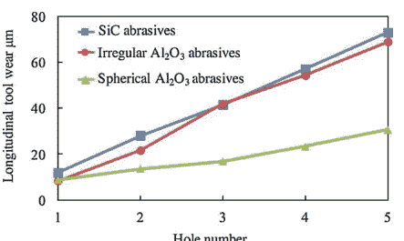

图 (1). 钻孔过程中使用不同磨料颗粒时刀具磨损率的变化趋势。

Wang等人阐述了旋转超声加工中的切削力和材料去除机制。钻孔过程中产生的缺陷包括边缘崩缺、撕裂缺陷和亚表面损伤等。文中还描述了损伤减少技术以及加工参数的优化。在加工过程中，孔的出口处会产生损伤。如果切削力小于临界切削力，这种损伤可以得到减少。通过优化加工参数，可以减少加工过程中的损伤 [29]。

Wang等人研究了旋转超声加工中的临界切削力。通过分析切削力，开发了一种用于超声机床设计和制造的 Novel 指数。文中分析了切削力对加工参数和超声幅度的影响。此外，还分析了临界切削力对旋转超声机床工具的影响，并讨论了改进方法 [30]。

Popli和Gupta研究了旋转超声加工钻孔过程中的边缘崩缺问题。设计了一项实验，通过增加支撑长度来去除钻孔时在孔出口处产生的边缘。这有助于将边缘崩缺尺寸减少高达50%。崩缺尺寸与支撑长度之间的关系为：崩缺尺寸与 l/支撑长度成正比 [31]。

Mikhailova等人介绍了大理石中传统钻削技术和超声辅助钻削技术的结果。实验结果有利于超声辅助钻削。观察到，Jobber钻头也适用于大理石钻削，但进给率有一定的限制 [32]。

Wang等人开发了一个基于运动学分析和脆性材料断裂力学的表面模型。该模型有助于预测在哪些参数下表面粗糙度会增加或减少。在本文中，当主轴转速为2000 rpm时，表面粗糙度很低，表面形貌较好；但当主轴转速在2500-3000 rpm之间时，表面粗糙度很高 [33]。

Wang等人研究了像CFRP复合材料这样坚硬且脆的材料在加工过程中高切削力和高表面粗糙度的问题。具有一定程度的垂直超声振动的旋转超声表面加工减少了切削力，但产生的表面粗糙度高于传统表面磨削。为了改善这一参数，进行了具有水平超声振动的旋转超声表面加工实验。与传统表面磨削相比，这有助于减少切削力并改善表面粗糙度 [34]。

Wang等人指出了CFRP复合材料在旋转超声表面加工中的材料去除机制。为此，进行了单磨料划痕测试。在使用点角为100°的单金刚石颗粒压头进行小划痕深度测试时，观察到延性材料去除模式机制；当划痕深度较大时，观察到脆性去除模式。在延性材料去除模式下，观察到的表面没有裂纹；而在脆性材料去除模式下，加工过程中观察到裂纹。同样，在较小的划痕深度下，延性模式的力较小，而脆性材料去除的力较大 [35]。

在研究论文的过程中，观察到旋转超声加工优于超声加工。

## 传统加工与非传统加工

传统加工是一种传统的加工过程，在加工过程中刀具与工件直接接触，并受到加工某些材料和生产复杂形状的限制；而非传统加工中刀具与工件之间没有直接接触。它没有加工任何材料的限制。

## 超声加工与旋转超声加工

超声加工是一种加工过程，其中成型刀具与所需的型腔相反，以受控参数轴向振动并进料到工件上 [36]。在刀具和工件之间插入浆料，其作用是切削。图 (2 和 3) 展示了超声加工原理的基本元素和工作原理的示意图。

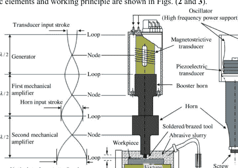

图 (2). 超声加工设备示意图 [28]。

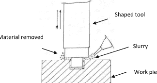

图 (3). 超声加工过程的工作原理。

而在旋转超声加工中，钻头连续旋转，同时也存在轴向振动 [37]。在刀具和工件之间不单独提供浆料。切削刀具经过特殊设计，磨料颗粒粘结在刀体上，如图 (4) 所示 [38]。在旋转超声加工中，磨料颗粒直接粘结在钻头上。然后，旋转和振动的钻头可以在玻璃、陶瓷材料等多种材料中提供快速、精确且高质量的孔 [39]。

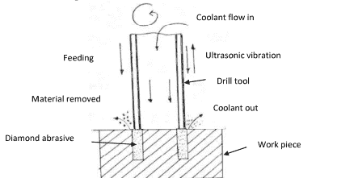

**图 (4).** 旋转超声加工过程的工作原理。

旋转超声加工是一种混合加工过程，它将超声加工和传统磨削结合在一起，以获得更好的加工结果 [23]。

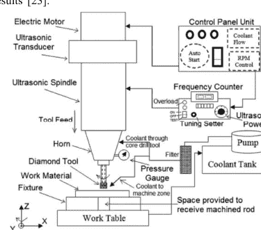

**图 (5).** 旋转超声加工设备示意图 [23]。

研究表明，只有超声加工的受控参数可以提高加工效率。这些参数包括振动幅度、磨料颗粒的形状和尺寸 [25, 28]、施加静态载荷的影响等。这些受控参数可以减少切削力，以提高过程性能 [6, 13 - 15, 17]。旋转超声加工是静态超声加工的升级 [40]。旋转超声加工的示意图如图 (5) 所示。

## 结论

- 1. 超声加工克服了传统加工的问题，在传统加工中刀具始终与工件直接接触，而在超声加工中，刀具周期性地从工件或零件上抬起，从而减少了刀具磨损率。
- 2. 它可以加工坚硬且脆的材料，这些材料在传统加工过程中受到限制。
- 3. 当与其他传统和非传统加工结合时，超声加工的特性得到改善。
- 4. 可以实施烟花算法（一种用于超声加工参数优化的数学方法）。
- 5. 振动辅助加工消除了切削液或冷却剂的使用。在加工过程中，周期性的工件-刀具分离保持间隙，有助于从切削区散发热量。
- 6. 它有助于减少由冷却剂造成的环境危害，并提高加工效率。
- 7. 在文献综述过程中，观察到旋转超声加工已被用于钻孔操作，与静态超声加工钻孔部件相比，显示出良好的结果，如高的材料去除率、低的刀具磨损率和良好的表面光洁度。
- 8. 在坚硬且脆的材料中，为了获得更好的结果，钻孔操作可以选择旋转超声加工而非静态超声加工。
- 9. 研究表明，近年来，旋转超声加工因其对坚硬且脆性材料的智能加工而越来越受欢迎。在航空航天工业中，利用钻组可以通过此工艺同时创建多个孔。
- 10. 为了获得更好的结果，可以利用球形磨料颗粒，而不是锐利边缘颗粒。
- 11. 旋转超声加工中磨料颗粒的消耗可以减少，因为它粘结在刀具表面，而在超声加工中，它是单独插入的。
- 12. 最后，静态超声和旋转超声加工解决了加工坚硬且脆性材料的问题，这在质量上非常优越，但成本也很高。

## 未来进展

在研究论文的过程中，注意到旋转超声加工仅被用于坚硬且脆性材料的钻孔和表面铣削操作。它在其他操作中显示出局限性。它甚至没有涉及其他与钻孔相关的操作，如锪孔、锪沉、铣钻复合操作和攻丝等。这背后可能有一些原因，但留下了一些进一步研究的领域。

## 发表同意书

不适用。

## 利益冲突

作者确认本章节内容没有利益冲突。

## 致谢

作者希望向编辑和匿名审稿人表示诚挚的感谢，感谢他们的宝贵建议和时间。

## 参考文献

- 1. J. Kumar, and J.S. Khamba, "Multi-response optimisation in ultrasonic machining of titanium using Taguchi’s approach and utility concept", _Int. J. Manuf. Res._, vol. 5, no. 2, pp. 139-160, 2010. [http://dx.doi.org/10.1504/IJMR.2010.031629]
- 2. B. Lauwers, F. Bleicher, P. Ten Haaf, and J. Loenders, "Investigation of the process-material interaction in ultrasonic assisted grinding of Zro2 based ceramic materials", _Proceedings of 4th CIRP International on high performance cutting_, 2010 pp. 1-7
- 3. W.L. Cong, Z.J. Pei, N. Mohanty, E. Van Vleet, and C. Treadwell, "Vibration amplitude in rotary ultrasonic machining: a novel measurement method and effects of process variables", _J. Manuf. Sci. Eng._, vol. 133, pp. 034501-034505, 2011. [http://dx.doi.org/10.1115/1.4004133]
- 4. U. Heise, R.Eisseler, R.Eber, J.Tieifel and M.Huang, "Ultrasonic-assisted machining of stone", _Prod.Eng.Res.Devel._, vol. 5, pp. 587-594, 2011. [http://dx.doi.org/10.1007/s11740-011-0330-1]
- 5. "Rotary ultrasonic-assisted milling of brittle materials", _Trans. Nonferrous Met. Soc. China_, vol. 22, pp. 793-800, 2012.

## 参考文献

- [5] [http://dx.doi.org/10.1016/S1003-6326(16)31806-8]

- [6] D. Liu, W.L. Cong, Z.J. Pei, and Y. Jun Tang, “脆性材料旋转超声磨削切削力模型”，*Int. J. Mach. Tools Manuf.*，vol. 52, pp. 77-84, 2012. [http://dx.doi.org/10.1016/j.ijmachtools.2011.09.006]

- [7] M.S. Raseedh, “微电火花加工与激光加工产生的微孔对比”，In: *International journal of science and modern engineering* vol. 1., 2013, pp. 3., pp. 14-18.

- [8] S. Das, B. Doloi, and B. Bhattacharyya, “使用遗传算法优化氧化锆生物陶瓷的超声加工”，*International journal of manufacturing technology and management*，vol. 27, no. 4/5/6, pp. 186-197, 2013.

- [9] H. Lian, Z. Guo, Z. Huang, Y. Tang, and J. Song, “Al6061超声振动辅助微铣削实验研究”，*Procedia CIRP*，vol. 6, pp. 561-564, 2013. [http://dx.doi.org/10.1016/j.procir.2013.03.056]

- [10] W.L. Cong, Z.J. Pei, T.W. Deines, P.F. Zhang, and C. Treadwell, “旋转超声加工中的表面粗糙度：假设及其通过实验和仿真的验证”，*Int. J. Manuf. Res.*，vol. 8, no. 4, pp. 378-393, 2013. [http://dx.doi.org/10.1504/IJMR.2013.057748]

- [11] S. Selvakumar, and K.P. Arulshri, “使用遗传算法和人工神经网络优化加工夹具布局”，*Int. J. Manuf. Res.*，vol. 8, no. 2, pp. 171-195, 2013. [http://dx.doi.org/10.1504/IJMR.2013.053286]

- [12] J.J. Yang, H. Zhang, X.Z. Deng, and B.Y. Wei, “准双曲面齿轮的超声研磨：系统设计及实验”，*Mechanism Mach. Theory*，vol. 65, pp. 71-78, 2013. [http://dx.doi.org/10.1016/j.mechmachtheory.2013.03.002]

- [13] F. Feucht, J. Ketelaer, and A. Wolff, “Masahiko Mori, Makoto Fujishima, '难切削材料超声机床最新加工技术'，*6* CIRP International Conference on High Performance Cutting, *Procedia CIRP* 14, 2014 pp. 148-152

- [14] R. Muhammad, A. Maurotto, M. Demial, A. Roy, and V.V. Silberschmidt, “钛合金热增强超声辅助加工”，*CIRO J. Manuf. Sci. Technol.*，vol. 7, no. 2, pp. 159-167, 2014. [http://dx.doi.org/10.1016/j.cirpj.2014.01.002]

- [15] M.N. Kumar, K. Subbu, and V. Krishna, *Procedia Eng.*，vol. 97, pp. 1577-1586, 2014. [http://dx.doi.org/10.1016/j.proeng.2014.12.441]

- [16] S.B. Bhosale, R.S. Pawade, and P.K. Brahmanankar, “工艺参数对氧化铝-氧化锆陶瓷复合材料超声加工中材料去除率、工具磨损率及表面形貌的影响”，*Ceram. Int.*，vol. 44, no. 8, pp. 12831-12836, 2014. [http://dx.doi.org/10.1016/j.ceramint.2014.04.137]

- [17] V.V. Silberschmidt, S.M.A. Mahdyb, M.A. Goudab, A. Naseera, A. Maurottoa, and A. Roy, “超声辅助车削表面粗糙度改善”，*2* CIRP Conference on Surface Integrity (CSI) *Procedia CIRP* 13, pp. 49-54, 2014.

- [18] D. Goswami, and S. Chakraborty, “使用引力搜索和烟花算法进行超声加工工艺参数优化”，*Ain Shams Engineering*，vol. 6, pp. 315-331, 2015. [http://dx.doi.org/10.1016/j.asej.2014.10.009]

- [19] S. Agarwal, “超声加工中材料去除的机制”，*Int. J. Mach. Tools Manuf.*，vol. 96, pp. 1-14, 2015. [http://dx.doi.org/10.1016/j.ijmachtools.2015.05.006]

- [20] F.D. Ning, W.L. Cong, Z.J. Pei, and C. Treadwell, “CFRP的旋转超声加工：与磨削的比较”，*Ultrasonics*，vol. 66, pp. 125-132, 2016. [http://dx.doi.org/10.1016/j.ultras.2015.11.002] [PMID: 26614168]

- [21] J. Wang, P. Feng, J. Zheng, and J. Zhang, “使用复合台阶锥形钻改善陶瓷基复合材料旋转超声加工中的孔质量”，*Ceram. Int.*，vol. 42, no. 12, pp. 13387-13394, 2016. [http://dx.doi.org/10.1016/j.ceramint.2016.05.095]

- [22] S. Amineti, H. Nouri Hosseina-badi, and S.A. Sajjadi, “超声振动辅助端面车削产生的微织构表面对摩擦和磨损性能影响的实验研究”，*Appl. Surf. Sci.*，vol. 390, pp. 633-648, 2016. [http://dx.doi.org/10.1016/j.apsusc.2016.07.064]

- [23] R.P. Singh, and R. Singhal, “旋转超声加工：综述”，*Mater. Manuf. Process.*，vol. 31, no. 14, pp. 1795-1824, 2016. [http://dx.doi.org/10.1080/10426914.2016.1140188]

- [24] Z. Li, Y. Songmei, and Z. Chong'a, “陶瓷基复合材料旋转超声仿形铣削研究”，*9th International Conference on Digital Enterprise Technology - DET 2016 - "Intelligent Manufacturing in the Knowledge Economy Era*, *Procedia CIRP*，vol. 56, 2016 pp. 428-433 [http://dx.doi.org/10.1016/j.procir.2016.10.077]

- [25] F. Ning, and H. Wang, “CFRP复合材料旋转超声表面加工：与传统表面磨削的比较”，*Procedia manufacturing*，vol. 10, pp. 557-567, 2017.

- [26] P. Feng, J. Zheng, J. Zhang, and J. Wang, “碳/SiC复合材料旋转超声加工中钻孔引起的撕裂缺陷”，*Ceram. Int.*，vol. 43, no. 1, pp. 791-799, 2017. [http://dx.doi.org/10.1016/j.ceramint.2016.10.010]

- [27] J. Wang, K. Shimada, M. Mizutani, and T. Kuriyagawa, “超声加工中的刀具磨损机制及其与材料去除的关系”，*Wear*，vol. 394-395, pp. 96-108, 2018. [http://dx.doi.org/10.1016/j.wear.2017.10.010]

- [28] J. Wang, K. Shimada, M. Mizutani, and T. Kuriyagawa, “磨料材料和颗粒形状对微超声加工性能的影响”，*Precis. Eng.*，vol. 51, pp. 373-387, 2018. [http://dx.doi.org/10.1016/j.precisioneng.2017.09.008]

- [29] J. Wang, J. Zhang, P. Feng, and P. Guo, “硬脆材料旋转超声加工中损伤的形成与抑制：关键综述”，*Ceram. Int.*，vol. 44, no. 2, pp. 1227-1239, 2018. [http://dx.doi.org/10.1016/j.ceramint.2017.10.050]

- [30] J. Wang, J. Zhang, P. Feng, and P. Guo, “脆性材料和复合材料旋转超声钻孔临界切削力的实验与理论研究”，*Int. J. Mech. Sci.*，vol. 135, pp. 555-564, 2018. [http://dx.doi.org/10.1016/j.ijmecsini.2017.11.042]

- [31] D. Popli, and M. Gupta, “先进陶瓷旋转超声加工中崩碎减小的方法”，*Proceedings*，vol. 5, pp. 6329-6338, 2018.

- [32] N. Mikhailova, P.Y. Onauwubih, G. Volkova, I. Smirnova, M. Brosegchkiné, A. Roy, and V.V. Yu Petrova, "Silberschmidt, '大理石中的超声辅助钻孔'”，*J. Sound Vibrat.*，vol. 460, pp. 1-29, 2019. [http://dx.doi.org/10.1016/j.jsv.2019.114880]

- [33] Y. Wang, K. Shimada, M. Mizutani, and T. Kuriyagawa, “影响硬脆材料旋转超声磨削表面生成的关键因素研究”，*J. Manuf. Process.*，vol. 38, pp. 549-555, 2019. [http://dx.doi.org/10.1016/j.jmapro.2019.01.046]

- [34] H. Wang, Y. Hua, and A. R. Burks, “CFRP复合材料旋转超声表面加工中水平超声振动的影响”，*Procedia manufacturing*，vol. 34, pp. 399-407, 2019.

- [35] H. Wang, F. Ning, Y. Li, Y. Hu, and W. Cong, “CFRP旋转超声表面加工中划痕引起的表面特征及材料去除机制”，*Ultrasonics*，vol. 97, pp. 19-28, 2019. [http://dx.doi.org/10.1016/j.ultras.2019.04.004] [PMID: 31030058]

- [36] J. Wang, K. Shimada, M. Mizutani, and T. Kuriyagawa, “磨料材料和颗粒形状对微超声加工性能的影响”，*Precis. Eng.*，vol. 51, pp. 373-387, 2018. [http://dx.doi.org/10.1016/j.precisioneng.2017.09.008]

- [37] X. Chen, H. Wang, Y. Hu, D. Zhang, W. Cong, and A.R. Burks, “'CFRP复合材料旋转超声加工：加工变量对工作件分层的影响'，in Volume 2: Processes”，*Materials (Basel)*，2019. [http://dx.doi.org/10.1155/MSEC2019-3019]

- [38] R.P. Singh, and S. Singhal, “氧化铝陶瓷旋转超声加工中加工特性的研究”，*Mater. Manuf. Process.*，vol. 32, no. 3, pp. 309-326, 2017. [http://dx.doi.org/10.1080/10426914.2016.1176190]

- [39] H. Zhou, J. Zhang, P. Feng, D. Yu, and W. Cai, “考虑负载效应的巨磁致伸缩旋转超声加工系统输出幅值模型”，*Precis. Eng.*，vol. 60, pp. 340-347, 2019. [http://dx.doi.org/10.1016/j.precisioneng.2019.07.005]

- [40] N. Ahmed, B.M. Abdo, S. Darwish, K. Mouldidin, S. Pervaiz, A.M. Alhamari, and M. Naveed, “钛合金电子束熔覆及通过旋转超声加工改善表面光洁度”，*Int. J. Adv. Manuf. Technol.*，vol. 92, no. 9-12, pp. 3349-3361, 2017. [http://dx.doi.org/10.1007/s00170-017-0365-3]

## 第2章
### 电火花加工过程中的工具电极材料及其制造技术

Arinder Singh Walia^{1,*}, Vineet Srivastava^1, Vivek Jain^1 和 Amit Handa^2

^1 旁遮普印度，巴蒂拉（Patiala-147004），塔帕尔理工学院，机械工程系

^2 旁遮普印度，卡普尔塔拉（Kapurthala-144603），I.K. Gujral 旁遮普技术大学，机械工程系

**摘要：** 电火花加工是一种先进的加工方法，常用于难加工材料和模具制造行业。电火花加工的主要成本组成是工具电极的成本。常规使用的电极材料，如铜和石墨，磨损阻力极低，因此磨损很快。人们正在持续努力寻找具有最佳电导率、热导率和磨损阻力的电极材料。已尝试各种材料组合的复合材料以寻找替代工具材料。本研究回顾了用于制造电火花加工复合电极的不同材料及其制造工艺。观察发现，在现有的各种电极制造工艺中，粉末冶金法显示出非常有希望的结果。

**关键词：** 复合材料、电火花加工、电极磨损率、材料去除率、粉末冶金、快速原型制造。

## 引言

在21世纪，产品开始由最耐用、因而也是最难加工的材料制造而成。现代结构的持续发展需要能够应对不断升高的工作温度、机械载荷、机械变形和化学退化的材料 [1]。工业界迫切需要生成具有非常严格公差和精细表面光洁度的复杂形状部件。

为了满足这些要求，发展了超声加工（USM）、磨料射流加工（AJM）、电化学加工（ECM）、电子束加工（EBM）、激光束加工（LBM）和电火花加工（EDM）等先进加工方法。这些方法在工具、模具、航空、汽车和模具制造行业中起着关键作用 [2]。

磨料水射流加工具有较高的材料去除率，加工表面不会产生热应力，且是一种非常经济的过程。然而，该过程无法切割厚件和复杂轮廓。该过程产生的表面质量也较差 [3]。化学加工适合薄件的加工，且所需设备极少。在此过程中不会产生残余应力。然而，使用化学品的处理和处置增加了该过程的加工成本 [4]。激光加工产生的零件会受到激光热效应的影响，导致加工表面变脆并产生表面裂纹 [5]。在超声加工中，加工表面的质量优于大多数其他现代加工过程。不过，较低的材料去除率和成本竞争力不足是该过程的缺点 [6, 7]。电化学加工是生产复杂形状的一种非常精密的过程，但较低的材料去除率和化学品的处理在某些情况下使其不具吸引力。

热力学能对于难加工材料和复杂几何形状工件的经济加工非常有用。电火花加工是许多现代加工方法之一，其材料去除基于热学原理 [2]。在各种先进加工方法中，EDM 被广泛用于生产手术部件、模具、型芯以及汽车和航空航天行业的精整部件。线切割 EDM 和型腔电极放电加工（die sinking EDM）是常用的电火花加工技术。

## EDM 的物理原理

型腔电极放电加工过程如图（1）所示。EDM 过程可分为以下几个阶段：

- 电子的冷发射和介电击穿
- 火花形成、熔化和蒸发
- 等离子通道崩塌和清洗

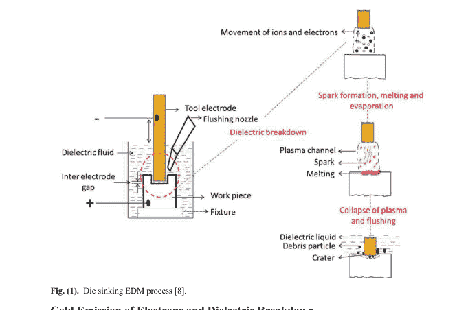

### 电子的冷发射和介电击穿

在导电工具电极和工作电极之间施加了电位差。该电位差在两个电极之间建立了电场。这取决于电极间隙和位于两个电极之间的介电流体的介电常数。导电材料具有足够数量的自由电子。随着电场的建立，由于电场的存在，自由电子开始从工具（负极）被拉出。电子将大量放电。这被称为“电子的冷发射”。在电场存在的情况下，由于工具为负极，工件为正极，电子将加速向工件移动。这两个电极之间的间隙充满了介电介质。由于介质的存在，电子没有自由路径，因此它们遇到阻碍。移动的电子与介质粒子发生碰撞。电子的能量使介质分子电离。这将产生更多的离子和电子。

### 火花形成、熔化和蒸发

初次碰撞产生的电子将再次加速。这将导致二次和三次碰撞，依此类推。这会在工具和工件之间的间隙中释放大量离子和电子。这将导致“等离子通道”的形成，等离子态包含电子和离子。一旦等离子通道形成，电子流动的阻力将降低。电子将以非常快的速度从工具移动到工件，并撞击工件。此时可以看到火花。由于这个原因，EDM 过程也被称为火花腐蚀过程。工件将不断被电子撞击。移动的电子具有很高的动能。撞击时，这种动能将转化为热能。这将在工件上产生 8000-20000 °C [9] 的高温。高温将导致材料的局部熔化和气化。

### 等离子通道崩塌和清洗

一旦脉动直流电的供应停止，就会产生压力或冲击波。该冲击波会破坏等离子通道，从而允许循环的介电流体使等离子通道崩塌，并以微观碎屑的形式将熔融材料从电极表面冲出。将在该位置形成一个凹坑。重复的极高温度电放电能去除材料，并形成所需工具形状的空腔。

## 金属去除理论

根据实验观察，提出了三种不同的材料去除机制 [10]：

### 高压理论

根据该理论，当电动力学波突然停止时，在电极上产生巨大的冲量力。这种力是电极腐蚀的原因。据报道，放电柱中的压力范围为 10-100 kgf/cm²。研究发现，压力作用的时间长于放电周期。结论是，在小放电下，仅放电压力不足以从电极中腐蚀材料。然而，其他因素（如热量）的统一作用，压力可能会从电极表面去除熔融金属。

### 静态场理论

库仑定律指出，两个带电电极之间存在静电力。这种力将在电极上产生应力。如果电极间隙较小，该力可能超过电极材料的极限应力极限，从而导致拉伸失效。对于放电持续时间小于 2 µs 的情况，在阳极表面下方由于极高电流密度引起的拉伸断裂腐蚀中涉及的力会产生强烈的电场梯度。当力超过材料的抗拉强度时，会发生拉伸断裂，从而从电极中腐蚀一个或多个粒子。但对于放电持续时间超过几微秒的情况，观察到拉伸断裂理论无法解释材料从电极中的去除。

### 高温理论

该理论认为，当高能电子撞击电极表面时，温度会升高，特别是对于热导率低的材料。在电极表面产生的高温会立即熔化并气化材料，从而形成凹坑。阳极消耗的能量与总放电能量之比与诸如电极间隙、阴极和两个电极的功函数等几个参数相关。还发现，高温并非仅由电子撞击产生。由高密度电流产生的焦耳热效应也是一个促成因素。

## 工具电极材料

在 EDM 过程中，在加工过程中，除了材料去除外，工具电极的磨损是不可避免的现象。在模具和制造等行业中，工具的设计、开发和制造占工具车间交货期的 25-45% [11]。在大多数 EDM 操作中，工具成本超过总操作成本的 70% [12]。这强调了为工具选择合适的材料的需求。在金属加工中存在使用正确工具进行工作的观念。为特定加工操作选择合适的工具材料是生成制造零件的最有效过程计划的第一步。切削工具材料的选择取决于工件材料和要执行的操作。通常，可能存在成功生产零件但不是成本效益高的工具材料选择 [13]。

在传统加工中，切削工具材料的选择取决于工件材料和要执行的操作。然而，在 EDM 情况下，工具最重要的要求是其电导率。工具材料较高的电导率有助于电子的轻松发射

在冷发射期间。EDM工具的另一个要求是具有高导热系数，以散发热量。这将非常有助于降低工具的表面温度，以避免工具材料的熔化和蒸发。工具材料密度较高也是一个优势，因为在相同可用热量和相同重量损失的情况下，工具的体积材料去除量较少，因此尺寸损失也较少。工具材料熔点较高也会导致工具磨损降低，因为在相同可用热量的情况下，材料熔化较少。除了上述所有要求外，工具材料易于加工性也非常重要，因为它构成了工具成本的重要组成部分。

最常用的工具材料是金属（铜、黄铜、钨、铝*等*）、非金属（石墨）和复合材料（铜钨、碳化硅铜、硼化铜、铜石墨）*等*。由于具有高电导率和热导率，铜是最广泛使用的工具材料。然而，在加工难加工材料时，发现铜工具的侵蚀速度更快 [14]。铜的低熔点增加了电极的磨损率，导致工具形状发生变化。在EDM中，工件是工具轮廓的复制品。加工型腔的精度取决于工具的形状稳定性。因此，工具形状的任何变化都可能获得与期望形状和尺寸不同的产品 [15]。为了减少电极磨损，过去研究人员提出的一种方法是制造具有改进的机械、电气和热特性的改性工具 [16 - 18]。铜的强度可以通过添加Cr和Zr等合金材料来提高，但这些元素在高温下溶解在铜中时会失去这些特性 [19]。为了避免这个问题，通过向铜中添加氧化物、碳化物和陶瓷颗粒来制造铜基复合材料 [20 - 22]。当需要高电导率和热导率以及高耐磨性时，铜基复合材料是不错的选择 [23]。利用具有高熔点和耐磨性特性，且具有良好的电导率和热导率的材料来降低铜基电极的电极磨损。添加碳化物等陶瓷增强材料可改善耐磨性和高温稳定性等特性。在铜基体中加入石墨等材料会降低复合材料的强度。通过添加碳化硅（SiC）等陶瓷增强材料可以提高复合材料的强度。它提高了复合材料的强度，但电阻率也增加了。由SiC和Cu制成的复合材料具有Cu的优良延性和韧性，以及SiC增强相的高强度 [24]。向铜中添加碳化钛（TiC）可提高其强度，但也会略微降低铜的电导率。TiC是一种硬质材料，具有极高的熔点以及优异的热震和耐磨性能 [17, 25]。通常，有一些工具材料选择可以成功生产零件，但成本效益不高。

电极材料必须具有高熔点和低电阻率。电极材料的成功主要取决于被加工材料和特定的切削应用 [26]。EDM工具电极常用的材料包括铜、黄铜、石墨、钨、银和钢。高工具磨损是这类电极的主要关注点。正在持续努力开发一种用于EDM工艺的工具材料，该材料应具有低电阻率和热阻、高耐磨性以及易于获取和制造 [27]。陶瓷材料的研究趋势正从单一材料向多材料电极转变。通过在基础材料中加入一种或多种材料形成复合工具材料，工具的耐磨性、断裂韧性、硬度和热震耐性得到了显著改善 [28]。

Ozgedik和Cogan [12] 研究了使用铜电极对1040钢进行EDM加工时工具的边缘和前部磨损。观察到随着放电电流的增加，工具的内端和外端磨损增加。还记录了随着脉冲持续时间增加，TWR（工具磨损率）增加。在静态冲油中，熔融金属的冲油不当导致最低的材料去除率。注入冲油产生了最佳的表面质量。

Gerlc [13] 对添加切削工具材料与氧化铝基体进行了研究。还检查了其成分、强化和增韧机制。使用硬质颗粒或晶须增强了Al₂O₃基体的力学性能。在氧化铝基体中添加碳化物、氧化物和氮化物后，注意到脆性降低。在氧化铝中添加TiB提高了复合材料的耐磨性。添加氧化钇稳定氧化锆提高了耐磨性，但复合材料的显微硬度降低。

Srivastava和Pandey [18] 测试了烧结Cu-TiC和常规铜工具电极在超声辅助深冷冷却EDM中的工作情况。EWR（电极磨损率）随电流增加而增加，但与铜工具尖相比，金属陶瓷工具尖的EWR较低。随着占空比的增加，火花能量增加，最终导致更高的EWR。与铜工具尖相比，金属陶瓷电极尖度的圆度减小。使用金属陶瓷工具尖时，MRR（材料去除率）和表面粗糙度也有所记录。在Cu-TiC工具尖加工的表面，表面裂纹密度和裂纹宽度较小。

Khanra等人 [27] 使用烧结工艺制造ZrB₂-Cu复合材料，以获得工具热导率、电导率和耐磨性的最佳值。该复合材料通过添加不同百分比的铜制成。在不同参数下的EDM加工中对软钢进行了测试。与铜工具相比，含40%铜的复合材料具有较高的MRR和可接受的TWR（工具磨损率）。然而，常规铜工具显示出较小的直径过切和表面粗糙度。MRR随铜百分比变化的偏差如图(2)所示。

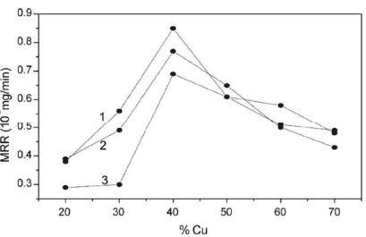

Mohari等人 [29] 使用铜、铝、钛和碳化钨粉制造EDM工艺的工具电极。制造压片使用的压制压力为343 MPa。使用了绿色、烧结和实心铜电极。碳钢管和铝用作工件材料。与原材料相比，记录了绿色压坯和烧结电极的较低电导率。烧结和绿色电极的磨损率分别是实心铜电极（0.32 µm/min）的五倍和九十倍。

Kumar等人 [30] 使用正极性Cu-Cr工具电极通过EDM加工哈氏合金。在60V电压和18A电流下实现了最高的MRR。此后，电压和电流的进一步增加导致粉末冶金工具电极上的材料沉积到工件材料上，导致材料去除率降低。由于高电流下可用能量较高，电流增加导致TWR增加。在60V电压和14A电流下获得最佳表面粗糙度结果，因为超过这些电流和电压值时TWR会增加。

Janmanee和Muttamara [31] 研究了铜-钨（实心）、铜-石墨和石墨作为钨-钴（90WC-10Co）工件EDM加工的工具材料。分析了一些重要工艺标准如占空比、开路电压、电极极性和电流的影响。结果表明，石墨工具在MRR方面表现更好（图**3a**），而铜-钨工具的EWR和表面粗糙度最小（图**3b**、**3c**）。

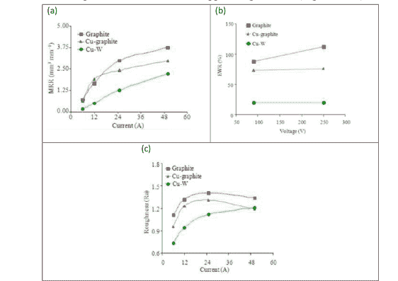

**图(3).** 放电电流对(**a**) MRR (**b**) EWR (**c**) 表面粗糙度的影响 [31]

Nadaliman和Khan [32] 描述了通过粉末冶金方法制造的Cu-TaC（两种成分，TaC分别为30%和55%重量比）工具电极的特性。测量并比较了烧结和绿色压块电极的密度、电导率和热导率。绿色压片的电导率、热导率和密度分别在94.96-189.92 $\Omega$'m-1、29.70-33.20 W/m K和6.13-9.80 g/cm3范围内测量，高于烧结压片。电导率最高的绿色压片含30% TaC。

Li等人 [33] 报道了使用实心铜电极和通过电沉积制造的Cu-SiC电极对Inconel 718进行EDM加工。与...相比，Cu-SiC电极提高了15.12%的材料去除效率

传统铜电极在 7.5 µs 的脉冲持续时间下降低了 16.3%，而在 24.5 µs 的脉冲持续时间下降低了 16.3%。在峰值电流 14.2 A 时，$R_a$ 降低了 17.1%，而在 25.6 A 时，$R_a$ 的降低幅度为 16.5%。因科镍 718（Inconel 718）的高韧性值导致加工型腔中没有出现微裂纹。Cu-SiC 复合材料的电极损耗也很低，这归因于其精细的微观结构和较高的熔点。这些电极在材料去除率（MRR）、电极磨损率（EWR）和表面粗糙度方面的性能如 **图 (4)** 所示。

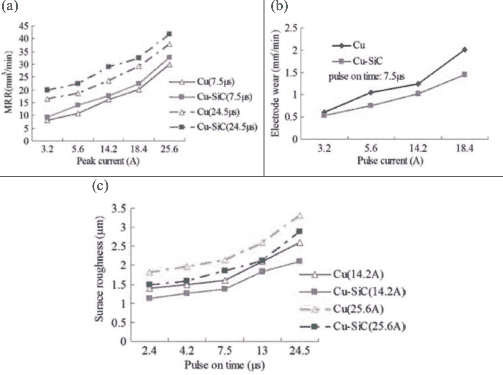

**图 (4).** 不同电极性能的变化：(a) MRR (b) EWR (c) 表面粗糙度 [33]

Hussain *等人* [34] 使用粉末冶金技术开发了基于 Cu-$Al_2O_3$ 的复合材料。使用 $Al_2O_3$ 的原因是其具有高耐磨性和高温耐受性。实验期间使用了四种工具，其 $Al_2O_3$ 的百分比分别为 0、1、3 和 5%。样品中 5% $Al_2O_3$ 组成的质量密度和硬度达到最大值（**图 5a** 和 **b**）。研究表明，复合材料的耐磨性取决于质量密度和硬度，并建议将其用作电火花加工（EDM）电极。含 5% $Al_2O_3$ 的工具显示出最低的磨损率（**图 5c**）。

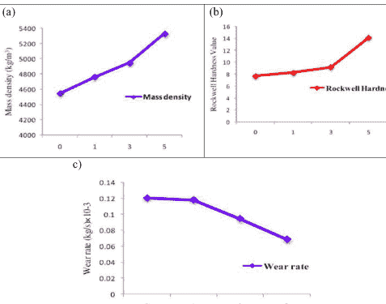

**图 (5).** 质量密度 **(a)**、硬度 **(b)** 和磨损率 **(c)** 随 $Al_2O_3$ 百分比的变化 [34]。

Kumar *等人* [35] 在进行 Monel 400™ 合金的电火花加工（EDM）时，使用铜-二硼化钛（titanium diboride）工具进行了实验。研究了二硼化钛百分比（8-20%）、脉冲电流（2-10 A）、脉冲持续时间（10-50 μs）和介电压力（0.4-1.2 MPa）对 MRR 和 EWR 的影响。在工具中添加二硼化钛显著降低了 EWR，并略微提高了 MRR。根据结果，建议了一组最佳工艺变量（二硼化钛 16%，脉冲电流 6 A，开脉冲 35 μs，介电压力 1 MPa）。

Liew *等人* [36] 报告了碳纤维（CNF）增强铜工具（CNF 百分比变化为 0、0.5、1、2 和 4%）在反应结合碳化硅（RB-SiC）电火花加工中的性能。在所检查的所有电极中，Cu-CNF (1%) 显示出最大的 MRR (0.5502 mm³/min) 和最低的表面粗糙度（**图 6a** 和 **b**）。随着 CNF 百分比的增加，EWR 也增加（**图 6c**），这是由于工具本体材料去除所致，如 **图 (6d)** 所示。

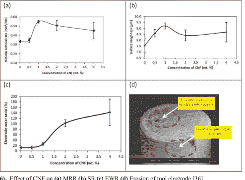

**图 (6).** CNF 对 (a) MRR (b) SR (c) EWR (d) 工具电极侵蚀的影响 [36]

Mandal 和 Mondal [37] 通过用铜和单壁碳纳米管对 6061Al 进行涂层，制造了电火花加工（EDM）电极。使用这种混合工具对 AISI 304 不锈钢进行了实验。将所得结果与铜涂层 6061Al 和未涂层 6061Al 工具进行了比较。与未涂层 6061Al 电极相比，铜涂层和铜单壁碳纳米管涂层 6061Al 电极的 MRR 分别增加了 3.13% 和 14.52%，EWR 分别降低了 21.04% 和 29.6%。使用铜涂层和铜单壁碳纳米管涂层 6061Al 电极时，加工型腔的表面粗糙度分别降低了 14.06% 和 8.03%。

使用不同类型工具电极材料的主要研究努力汇总于 **表 1** 中。

## 表 1. 使用不同类型工具电极材料的主要研究努力

| 研究者 | 工具电极材料 | 工件材料 | 研究因素 | 响应 |
| :--- | :--- | :--- | :--- | :--- |
| Srivastava 和 Pandey [18] | Cu-TiC | M2 高速钢 (HSS) | 间隙电压、电流、脉冲持续时间、占空比 | 使用陶瓷金属工具时，不圆度降低，同时记录了 MRR 增加和表面粗糙度。 |
| Mohari 等人 [29] | Cu, WC-Co, TiC-Al | 碳钢和铝 | 脉冲持续时间、加工时间 | 生坯或烧结产品较低的导电率导致较高的磨损率。 |
| Kumar 等人 [30] | Cu90-Cr10 | 哈氏合金 (Hastelloy) | 电流、电压 | 在 14A 和 60V 电压下获得了最佳表面粗糙度，因为超过这些值时 TWR 增加。 |
| Jammance 和 Muttamara [31] | 石墨、铜-石墨、Cu-W (固态) | 碳化钨-钴 (WC90-Co10) | 开/关时间、电流、开路电压 | 在 MRR 和 TWR 方面，石墨和铜-石墨粉末冶金的性能更好。 |
| Li 等人 [33] | 固态铜电极、Cu-SiC | 因科镍 718 合金钢 | 脉冲持续时间、脉冲间隔、电压、电流 | 与铜电极相比，使用 Cu-SiC 电极时 MRR 增加了 15.12%。 |
| Hussain 等人 [34] | Cu-Al$_2$O$_3$ | 高速钢 | 工具中 Al$_2$O$_3$ 的百分比 | 含 5% Al$_2$O$_3$ 的工具显示出最低的磨损率。 |
| Mandal 和 Mondal [37] | 未涂层 6061Al、铜单壁碳纳米管涂层 6061Al、铜涂层 6061Al | AISI 304 不锈钢 | 工具组成 | 与未涂层 6061Al 电极相比，铜涂层和铜单壁碳纳米管涂层 6061Al 电极的 MRR 分别增加了 3.13% 和 14.52%，EWR 分别降低了 21.04% 和 29.6%。 |

## 使用替代方法制造电极

电极的物理性质影响加工性能。高电导率、高比热容、良好的可加工性、高抗蚀损性等是理想电极必须具备的特性。单一材料无法满足所有这些要求。制造电火花加工（EDM）电极时主要使用传统的加工方法 [38]。几何形状的复杂性和所需的精度通常决定了电极的制造成本。尺寸均匀的电极成本低廉且易于生产，但通过传统加工过程制造的复杂形状电极的成本可能是简单形状电极的 100 倍 [39]。为了制造复杂的三维形状电极，使用了不同的方法，如传统机械加工、电铸、金属喷镀、铸造、快速原型制造或粉末冶金 [17, 40]。这些技术也有助于缩短交货周期。下文介绍了一项关于制造电火花加工工具的研究综述。

Samuel 和 Philip [16] 进行了实验工作并观察到，使用粉末冶金（P/M）方法可以容易地制造工具电极，并且其性质可以相对容易地控制，因此使其具有优于其他电极制造方法的优势。压实压力对相对密度和生坯强度的影响如 **图 (7a 和 b)** 所示。在低温烧结和压实压力下，间隙污染更多，并观察到较高的电极磨损。由于粉末冶金电极的表面特性，在低电流和高频下金属去除率较低。低压实压力和烧结温度导致机械强度差和工具磨损高。

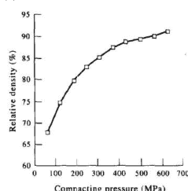

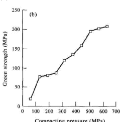

**图 (7).** 压实压力对 (a) 相对密度 (b) 生坯强度的影响 [16]。

Samuel 和 Philip [39] 在研究中使用纯度为 99.7% 的铜 (Cu) 粉末作为工具材料，并使用粉末冶金 (P/M) 工艺制造工具。发现随着烧结温度和压实压力的升高，导电率增加。在低工艺条件下压实的电极机械强度低。高烧结温度增加了键合强度并减少了侵蚀。因此，压实压力和烧结温度的增加导致电气、热学、力学和微观结构特性的变化，从而带来更好的性能。

Dimla 等人 [40] 应用立体光刻和直接金属激光烧结对模型进行涂层，以制造电火花加工（EDM）过程的工具。两种方法在模型上沉积的铜量带来了问题。所使用的工艺是

无法在模型上沉积均匀的单层铜，厚度在 50-1000 µm 之间变化。这些方法无法沉积所需的铜量，特别是在电极的内部。镀层厚度从外表面向内壁逐渐减小，并且发现工具电极不适合电火花加工（EDM）。电极内垂直壁上铜厚度的变化如图 (8) 所示。

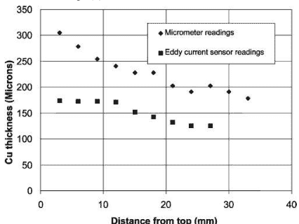

图 (8)。电极内部垂直壁上铜沉积的测量 [40]。

Durr 等人 [41] 引入了直接金属激光烧结的概念，用于制造电火花加工（EDM）工艺的工具电极。这些电极包含青铜、镍和磷酸铜粉末，逐层构建。工艺优化表明，烧结电极的孔隙率直接受激光速度、激光功率和烧结策略的控制。这些电极还采用了含银的钎焊金属进行浸渗。这些电极实现了约 12.5 mm$^{3}$/min 的材料去除率（MRR），但与常规电极相比，其电极损耗率（EWR）和表面粗糙度更大。

Norasetthekul 等人 [42] 通过对包覆聚合物的 ZrB$_{2}$ 粉末进行机械压制合成工具电极，随后在高温炉中将铜浸渗到生坯中。注意到压实压力越高，颗粒间的空隙越小，从而减少了填充空隙所需的铜量。然而，研究发现铜倾向于不能完全填充空隙。观察到 ZrB$_{2}$-Cu 电极在极高能量通量条件下对等离子体火花具有最高的热耐磨性。此外，该工具比石墨和铜工具切割钢工件的速度更快。

Li *等人* [43] 揭示了添加 TiC 对烧结基铜工具性能的影响。通过粉末冶金（P/M）法，通过改变 TiC 含量从 5% 到 45% 制造铜和铜-钨（Cu–W）粉末的压片，随后进行液相烧结。添加 TiC 改善了表面光洁度，并建议用于精加工目的。与市售电极相比，所有这些电极的耐磨性（TWR）也都更低。

Zhao *等人* [44] 报道了使用选择性激光烧结（SLS）作为制造电火花加工（EDM）金属原型的有用方法。通过金属浸渗，提高了 SLS 金属原型的密度和其他机械性能方面。金属原型浸入液态浸渗剂（通常使用铜）中，通过毛细作用上升至开放孔隙中。结果表明，电极的磨损率与常规电极相当。获得的表面粗糙度在类似的机器设置下处于可接受范围内。

Blom *等人* [45] 采用喷雾金属沉积和电铸工艺来生产工具电极。将这些电极的性能与常规实心工具电极进行了比较。在不同的工作条件下测量了材料去除率（MRR）、工具磨损率（TWR）、加工时间和表面粗糙度。在 MRR 和 TWR 方面，实心工具取得了比电铸工具更好的结果。然而，发现采用电铸方法合成的工具比实心工具更便宜。

Shibayama 和 Kunieda [46] 揭示了使用具有非常小孔径的电极进行深槽电火花加工。孔将介电液引导到工件表面上方。两个在界面上具有微槽以引导介电液的铜板通过扩散键合连接形成电极。与通常使用的实心工具电极相比，该电极具有更少的加工时间和更高的加工精度。

Mishra 和 Pathak [47] 在 ZrB2 粉末中加入碳（0 至 10%）和碳化钛（0 至 10%），并研究了系统性烧结。将碳混合至 4% 以内会导致致密化，但进一步增加碳的添加量会延缓致密化。添加超过 5% 的 TiC 对 ZrB2 的烧结产生不利影响。碳的加入有助于抑制晶粒尺寸，并获得了具有细晶粒尺寸和较高密度的复合材料。

Hsu *等人* [48] 使用基于无电极电镀（镀镍）和电铸（铜）的快速成型技术来制造电火花加工（EDM）工艺的电极。

此类工艺减少了制造时间，也降低了电极制造的
成本。实验观察表明电极上没有裂纹，并且在电火花加工（EDM）工艺中取得了令人满意的结果。

Monzon 等人 [49] 尝试使用快速成型和电铸工艺制造电火花加工（EDM）电极。他们开发了铜电铸壳体的测试方法。分析了各种方面，如成分、内部应力、电解液添加剂、点蚀、尺寸精度和粗糙度。与常规技术相比，在电极的重量和制造便利性方面记录了有利结果。

Egashira 等人 [50] 通过结合线电极放电磨削和电化学加工制造超小型钨工具。成功地在黄铜和锌材料中钻出了半径小于 0.5 μm 且深度超过 1 μm 的孔。然而，由于单个放电坑的尺寸发现大于孔径，孔的圆度并不理想。

Meshran 和 Puri [51] 使用三种不同的方法，快速线电火花加工、近净成形铸造工艺和失蜡铸造工艺来制造电火花加工（EDM）电极。与其他两种方法相比，快速线电火花加工工艺产生了更好的尺寸精度。近净成形铸造需要较少的时间来制造电极。通过该工艺制造的铜-黄铜电极产生了最高的材料去除率（MRR）和电极磨损率（EWR）。发现失蜡铸造在生产复杂形状电极方面比其他方法具有优势。

Balasubramanian 和 Senthilvelan [52] 使用铸造和粉末冶金铜工具电极对 EN8 和 D3 钢进行电火花加工。与烧结电极相比，使用铸造电极在 EN-8 材料上获得了更高的平均材料去除率（77.4 mm³/min）和更低的平均工具磨损率（10.99 mm³/min）。在 D3 钢的电火花加工中，铸造电极也表现出高 MRR（136.1 mm³/min）和低 TWR（3.32 mm³/min）。与铸造电极相比，烧结电极在 EN-8 和 D3 钢上显示出更好的表面光洁度。

Pal 和 Choudhry [53] 通过磨料水射流加工（AWJM）制造用于电火花加工（EDM）工艺的铜和黄铜电极。在保持电压、电流、占空比和脉冲持续时间恒定的情况下，在不锈钢和 Ti-6Al-4V 上制作了一系列孔。观察到由磨料水射流加工产生的工具尺寸与工件尺寸之间的偏差，如图 (9) 所示。有两个原因被认为对此负责。第一个是由磨料水射流加工射流的本征特性在工具上产生的锥度，在鳍片长度上产生了狭缝。第二个逻辑是盲腔的侧壁被加工，因为工具两侧未进行遮罩。

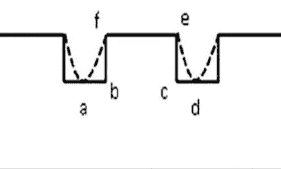

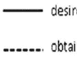

图 (9)。AWJM 的理想切割与实际切割 [53]。

Goyal 等人 [54] 研究了使用通过粉末冶金技术制造的 Cu-Mn 工具对 EN31 钢进行电火花加工（EDM）加工后的硬度和表面粗糙度（SR）。放电电流和脉冲持续时间被选为加工变量。发现使用 70Cu-30Mn 电极加工的表面显微硬度为 913 VHN，比铜电极高 11.94%，比 80Cu-20Mn 电极高 3.39%。然而，由于孔隙率特性，粉末冶金电极产生的表面粗糙度较高，尽管差异是微小的。

Sahu 等人 [55] 探索了使用由 SLS 制造的 AlSiMg 工具对 Nitinol 进行电火花加工，并将其性能与市售的石墨和铜工具进行了比较。选择表面粗糙度作为响应参数，以考察电极材料、电流、电压、脉冲持续时间和占空比的影响。使用 SLS 工具达到的平均表面粗糙度最小，其次是铜工具。

Equal 等人 [56] 使用熔融沉积建模（FDM）制造电火花加工工具。使用丙烯腈-丁二烯-苯乙烯（ABS）作为核心材料，外壳通过铜涂层产生。通过 FDM，发现很难保持工具的锐利边缘。虽然通过 FDM 工艺制造的工具性能与实心铜工具相当，但其尺寸精度较低。引用难以通过 FDM 产生精确尺寸的工具作为原因。

Saxena 和 Metkar [57] 也使用 FDM 开发了一种电火花加工工具。在通过 FDM 制造的 ABS 材料核心上进行了铜涂层。分析了电流、脉冲时间和电压对电极磨损率（EWR）和材料去除率（MRR）的影响。使用实心铜工具和通过 FDM 制造的工具获得了相似的 MRR 结果，而后者在 EWR 方面表现稍好。

表 2 中介绍了电火花加工（EDM）工具电极制造技术的主要研究工作。

## 表 2. 电火花加工（EDM）工具电极制造的主要研究工作。

| 研究者 | 工具电极制造方法 | 工具电极材料 | 备注 |
| :--- | :--- | :--- | :--- |
| Dimla *等人* [40] | 快速成型，电铸 | Cu, 青铜 | 内腔未沉积足够的 Cu。 |
| Durr *等人* [41] | 直接金属激光烧结 | 青铜，镍和铜磷化物 | 这些电极实现了 12.5 mm$^2$/min 的材料去除率（MRR），但与常规电极相比，其电极磨损率（EWR）和表面粗糙度（SR）更大。 |
| Li *等人* [43] | 快速成型 | Cu-TiC-W | 镍改善了 TiC-Cu-W 的致密化，因为镍在 Cu 和 W 中具有良好的溶解度。 |
| Blom *等人* [45] | 电铸，喷射金属沉积 | 固态 Cu，电铸 Cu | 在制造大量电极时，电铸所花费的时间与制造单个电极所需的时间相似。 |
| Monzon [49] | 电铸，快速成型 | Cu | 结果显示，在重量和制造便利性方面取得了有利结果。 |
| Egashira *等人* [50] | 线电极放电磨削和电解加工 | 钨 | 成功地在黄铜和锌材料上钻出了半径小于 0.5 $\mu$m 且深度大于 1 $\mu$m 的孔。 |
| Meshram 和 Puri [51] | 快速线切割，近净形铸造工艺和熔模铸造 | Al, Cu, Cu-黄铜 | 快速线切割工艺具有更高的尺寸精度。近净形铸造在电极制造方面所需时间更少。熔模铸造在制造复杂形状电极方面比其他方法具有优势。 |
| Balasubramanian 和 Senthilvelan [52] | 铸造和烧结粉末冶金电极 | Cu | 铸造铜电极在 EN8 和 D3 钢上表现出更高的 MRR、较低的 TWR（工具磨损率）和较高的表面粗糙度。 |
| Pal 和 Choudhry [53] | 磨料水射流加工 | Cu 和黄铜 | 由于 AWJM（磨料水射流加工）在工具上产生的锥度以及对侧壁的加工，导致工具尺寸出现偏差。 |
| Sahu 等人 [55] | 选择性激光烧结 | AlSiMg | 由 AlSiMg 工具电极加工的表面具有较低的表面裂纹密度。 |
| Equbal 等人 [56] | 熔融沉积成型 | 丙烯腈-丁二烯-苯乙烯（ABS）和铜 | 发现很难保持工具的锋利边缘，且尺寸精度较低。 |

## 结论

人们还观察到，工具端部随时间推移会变平并变形。如果用硬质导电材料如陶瓷金属（cermet）替换电极端部，可以避免这种情况。这些陶瓷金属尖端可以具备不同组合材料所需的特性。在工具制造中，使用了许多方法。几何形状的复杂性和所需的精度通常决定了电极制造所使用工艺的成本。常规方法需要更多的加工时间，材料浪费也更大，特别是在制造复杂形状的工具轮廓时。

陶瓷金属尖端可以通过铸造、固相烧结、快速原型制造和工具制造、喷射金属沉积、直接金属激光烧结、磨料水射流加工、粉末冶金等方法制造。一些铸造方法，如熔模铸造，成本高且耗时较长。近净形铸造等工艺尺寸精度较低 [51]。通过选择性激光烧结工艺生产的电极孔隙率非常高（高达 20%），磨损较大，并且加工出的型腔精度非常低 [41]。通过喷射金属沉积生产的电极存在涂层厚度不均的问题，有时喷射金属还会渗透基底材料 [45]。在一些工艺中，如立体光刻和直接金属激光烧结，观察到涂层厚度不均，导致电极不适合用于电火花加工过程 [40]。通过电铸生产的电极表面粗糙度非常高 [49]。磨料水射流加工在鳍长上产生了切缝，这是由于在加工部件/电极上产生了锥度。与这一工艺相关的另一个问题是，盲腔的侧壁被加工了，因为工具在侧面没有进行遮蔽 Pal 和 Choudhry [53]。

在粉末冶金（P/M）技术中，可以结合不同材料的期望特性，并通过压实压力和烧结温度改变物理特性 [40]。因此，通过 P/M 可以更好控制电极的特性。制造容易、成分灵活性以及在分散细颗粒方面的有效性 [34] 是粉末冶金的优点，从而使其成为适合电极制造的方法。

## 出版同意书

不适用。

## 利益冲突

作者确认本章内容不存在利益冲突。

## 致谢

作者们愿向编辑和匿名审稿人表示诚挚的感谢，感谢他们付出的时间和宝贵的建议。

## 参考文献

- [1] T.S. Sidhu, S. Prakash, and R.D. Agrawal, "镍铬涂层镍基合金的抗热腐蚀性能", *Scr. Mater.*, vol. 55, pp. 179-182, 2006. [http://dx.doi.org/10.1016/j.scriptamat.2006.03.054]

- [2] H.A.G. El-Hofy, *先进加工技术：非传统和混合加工技术.* McGraw Hill Professional, 2016.

- [3] A.W. Momber, I. Euseph, and R. Kovacevic, "用磨料水射流加工难熔陶瓷", *J. Mater. Sci.*, vol. 31, pp. 6485-6493, 1996. [http://dx.doi.org/10.1007/BF00356252]

- [4] H.T. Ting, K.A. Abou-El-Hossein, and H.B. Chua, "陶瓷蚀刻微加工综述", *Trans. Nonferrous Met. Soc. China*, vol. 19, pp. s1-s16, 2009. [http://dx.doi.org/10.1016/S1003-6326(10)60237-3]

- [5] A.N. Samant, and N.B. Dahotre, "结构陶瓷激光加工——综述", *J. Eur. Ceram. Soc.*, vol. 29, pp. 969-993, 2009. [http://dx.doi.org/10.1016/j.jeurceramsoc.2008.11.010]

- [6] M.N. Farooqui, and N.G. Patil, "电火花加工成型先进陶瓷的前景", *Procedia Manufacturing*, vol. 20, pp. 65-72, 2018. [http://dx.doi.org/10.1016/j.promfg.2018.02.009]

- [7] J. Kumar, "超声加工——全面综述", *Mach. Sci. Technol.*, vol. 17, pp. 325- 379, 2013. [http://dx.doi.org/10.1080/10910344.2013.80693]

- [8] A.S. Walía, V. Srivastava, and V. Jain, "铜-碳化钛尖头对电火花加工 EN31 模具钢期间加工表面完整性的影响", *Mater. Res. Express*, vol. 6, no. 106582, 2019.

- [9] P. Ong, C.H. Chong, M.Z. Bin Rahim, W.K. Lee, C.K. Sia, and M.A.H. Bin Ahmad, "多晶金刚石电火花加工过程建模与优化的智能方法", *J. Intell. Manuf.*, pp. 1-21, 2018.

- [10] P.K. Mishra, *非传统加工*, Narosa publishing house: 印度, 2007.

- [11] G.S. Brar, and H.S. Sandhu, "使用增材制造制作电铸工具的电火花加工研究", *AIMTDR*, pp. 713-717, 2016.

- [12] A. Ozgedik, and C. Cogun, "电火花加工中工具磨损的实验研究", *Int. J. Adv. Manuf. Technol.*, vol. 27, pp. 488-500, 2016. [http://dx.doi.org/10.1007/s00170-004-2220-6]

- [13] K. Gerič, "铝基金属陶瓷工具材料", *Mach. Des.*, vol. 3, pp. 367-372, 2010.

- [14] C. Upadhyay, S. Datta, M. Masanta, and S.S. Mahapatra, "强调电火花加工 Inconel 601 表面特性的实验研究", *J. Braz. Soc. Mech. Sci. Eng.*, vol. 39, pp. 3051-3066, 2017. [http://dx.doi.org/10.1007/s0430-016-0643-2]

- [15] A.S. Walia, Y. Srivastava, V. Jain, and M. Garg, 电火花加工过程中烧结 Cu–TiC 工具尖头形状变化的建模与分析。*非常规加工与复合材料进展*. 多学科工业工程讲义。Springer: 新加坡, 2020, pp. 515-525. [http://dx.doi.org/10.1007/978-981-32-9471-4_42]

- [16] M.P. Samuel, and P.K. Philip, "用于电火花加工的动力学冶金工具电极", *Int. J. Mach. Tools Manuf.*, vol. 37, pp. 1625-1633, 1997. [http://dx.doi.org/10.1016/S0890-6955(97)00006-0]

- [17] H.M. Zaw, J.Y.H. Fuh, A.Y.C. Nee, and L. Lu, "利用烧结技术形成新的电火花加工电极材料", *J. Mater. Process. Technol.*, vol. 89, pp. 182-186, 1999. [http://dx.doi.org/10.1016/S0924-0136(99)00054-0]

- [18] V. Srivastava, and P.M. Pandey, "使用烧结 (Cu–TiC) 尖头的超声辅助低温冷却电火花加工过程研究", *J. Manuf. Process.*, vol. 15, pp. 158-166, 2013. [http://dx.doi.org/10.1016/j.jmapro.2012.12.002]

- [19] J.B. Correia, H.A. Davies, and C.M. Sellaris, "急冷时效硬化 Cu–Cr 和 Cu–Cr–Zr 合金中的强化机制", *Acta Mater.*, vol. 45, pp. 177-180, 1997. [http://dx.doi.org/10.1016/S1359-6454(96)00142-5]

- [20] A.T. Alpas, H. Hu, and J. Zhang, "磨损表面以下的塑性变形和损伤累积", *Wear*, vol. 162, pp. 188-195, 1993. [http://dx.doi.org/10.1016/0043-6488(93)90500-L]

- [21] A.K. Shukla, S.N. Murty, R.S. Kumar, and K. Mondal, "粉末研磨对热压和热轧 Cu–Cr–Nb 合金力学性能的影响", *J. Alloys Compd.*, vol. 580, pp. 427-434, 2013. [http://dx.doi.org/10.1016/j.jallcom.2013.06.118]

- [22] A.S. Walia, Y. Srivastava, and V. Jain, "电火花加工中复合电极的制造与应用——综述", *国际计算机应用期刊 (0975-887)*, pp. 1-5, 2017.

- [23] S. Buyuzoz, F. Dagdelen, S. Islak, M. Kok, D. Kir, and E. Ercan, "TiC 含量对粉末冶金制备的 Cu–TiC 复合材料微观结构和热性能的影响", *J Thermal Anal Calorim.*, vol. 117, pp. 1277-1283, 2014. [http://dx.doi.org/10.1007/s10973-014-3900-6]

- [24] G.C. Efe, I. Altinsoy, M. Ipek, S. Zeitun, and C. Bindal, "通过粉末冶金方法生产的 Cu–SiC 复合材料的一些特性", *Kovove Mater.*, vol. 49, p. 131, 2011.

25. K. M. Shu, and G.C. Tu, "Cu-SiCp复合材料的制备与表征及其在电火花加工中的应用", *Mater. Manuf. Process.*, vol. 16, pp. 483-502, 2001. [http://dx.doi.org/10.1081/MMP-100108522]

26. S. Gopalakannan, and T. Senthilvelan, "电极材料对316 L和17-4 PH不锈钢电火花加工的影响", *J. Miner. Mater. Charact. Eng.*, vol. 11, pp. 685-690, 2012. [http://dx.doi.org/10.4236/jmmce.2012.11.7053]

27. A.K. Khana, B.R. Sarkar, B. Bhattacharya, L.C. Pathak, and M.M. Godkhindi, "ZrB2-Cu复合材料作为EDM电极的性能", *J. Mater. Process. Technol.*, vol. 183, pp. 122-126, 2007. [http://dx.doi.org/10.1016/j.jmatprotec.2006.09.034]

28. T. Czeulsniak, F.L. Amorim, C.F. Higa, and A. Lohrengel, "通过选择性激光烧结制造的新型复合材料作为EDM电极的开发与应用", *Int. J. Adv. Manuf. Technol.*, vol. 72, pp. 1503-1512, 2014. [http://dx.doi.org/10.1007/s00170-014-5765-z]

29. N. Mohri, N. Saito, Y. Tsunekawa, and N. Kinoshita, "利用复合电极进行电火花加工的金属表面改性", *CIRP Ann.*, vol. 42, pp. 219-222, 1993. [http://dx.doi.org/10.1016/S0007-8506(67)62429-9]

30. V. Kumar, N. Beri, A. Kumar, and P. Singh, "使用粉末冶金电极对哈氏合金进行电火花加工的若干研究", *Int. J. Adv. Eng. Technol.*, vol. 1, pp. 16-27, 2010.

31. P. Jannanee, and A. Muttamara, "不同电极材料在碳化钨电火花加工中的性能", *Energy Research Journal*, vol. 1, pp. 87-90, 2010. [http://dx.doi.org/10.3844/erjsp.2010.87.90]

32. M.B. Ndaliman, and A.A. Khan, "用于EDM的粉末冶金(PM)压制Cu-TaC电极的开发", *Journal of Mechanics Engineering and Automation*, vol. 1, pp. 385-391, 2011.

33. L. Li, Z.Y. Li, X.T. Wei, and X. Cheng, "Inconel 718型合金的放电电火花加工和线切割电火花加工的加工特性", *Mater. Manuf. Process.*, vol. 30, pp. 968-973, 2015. [http://dx.doi.org/10.1080/10426914.2014.973579]

34. M.Z. Hussain, U. Khan, R. Jangid, and S. Khan, "用于EDM电极的Cu/Al2O3复合材料的硬度与磨损分析", *IOP Conf. Series Mater. Sci. Eng.*, vol. 310, no. 012044, 2018.

35. P.M. Kumar, K. Sivakumar, and N. Jayakumar, "蒙乃尔400H合金EDM中铜-二硼化钛电极的多目标优化与分析", *Mater. Manuf. Process.*, vol. 33, pp. 1429-1437, 2018. [http://dx.doi.org/10.1080/10426914.2017.1415439]

36. P.J. Liew, Z. Nurlishafiqah, Q. Ahsan, T. Shou, and J. Yan, "使用Cu-CNF复合电极对RB-SiC进行电火花加工实验研究", *Int. J. Adv. Manuf. Technol.*, vol. 98, pp. 3019-3028, 2018. [http://dx.doi.org/10.1007/s00170-018-2417-8]

37. P. Mandal, and S.C. Mondal, "用于EDM的包覆Cu-SWCNT纳米复合材料的6061Al电极的开发与应用", *Int. J. Adv. Manuf. Technol.*, pp. 1-10, 2019. [http://dx.doi.org/10.1007/s00170-019-03710-5]

38. A.S. Walia, V. Jain, and V. Srivastava, "硬化钢EDM加工中烧结刀头电极的开发与性能评估", *Mater. Res. Express*, vol. 6, no. 086520, 2019. [http://dx.doi.org/10.1088/2053-1593/a61b7a]

39. M.P. Samuel, and P.K. Philip, "用于电火花加工的粉末冶金生产的压实、预烧结和完全烧结电极的特性", *Indian J. Eng. Mater. Sci.*, vol. 3, pp. 229-233, 1996.

40. D.E. Dimla, N. Hopkinson, and H. Rothe, "针对快速工装应用的复杂快速EDM电极研究", *Int. J. Adv. Manuf. Technol.*, vol. 23, pp. 249-255, 2004. [http://dx.doi.org/10.1007/s00170-003-1709-8]

41. H. Durr, R. Pilz, and N.S. Elseer, "通过选择性激光烧结进行EDM电极的快速工装", *Comput. Ind.*, vol. 39, pp. 35-45, 1999. [http://dx.doi.org/10.1016/S0166-3615(98)00123-7]

42. S. Norasethekel, P.T. Eubank, W.L. Bradley, B. Bozkurt, and B. Stuecker, "二硼化锆-铜在等离子体应用中作为电极的使用", *J. Mater. Sci.*, vol. 34, pp. 1261-1270, 1999. [http://dx.doi.org/10.1023/A:1004529527162]

43. L. Li, Y.S. Wong, J.Y.H. Fuh, and L. Lu, "TiC/基于铜的烧结电极的EDM性能", *Mater. Des.*, vol. 22, pp. 669-678, 2001. [http://dx.doi.org/10.1016/S0261-3069(01)00010-3]

44. J. Zhao, Y. Li, J. Zhang, C. Yu, and Y. Zhang, "通过选择性激光烧结制造的EDM电极磨损特性分析", *J. Mater. Process. Technol.*, vol. 138, pp. 475-478, 2003. [http://dx.doi.org/10.1016/S0924-0136(03)00122-5]

45. R.J. Btom, P.K. Yarlagadda, and R.M. Iyer, "评估使用电铸和喷涂金属沉积技术进行电火花加工的快速工装", 第1届全球制造与管理大会论文集, 2004, pp. 490-495, Vellerre, 印度

46. T. Shibayama, and M. Kunieda, "带有微孔的扩散结合EDM电极用于喷射介电液体", *CIRP Ann.*, vol. 55, pp. 171-174, 2006. [http://dx.doi.org/10.1016/S0007-8506(07)60391-6]

47. S.K. Mishra, and L.C. Pathak, "碳和碳化钛对二硼化锆烧结行为的影响", *J. Alloys Compd.*, vol. 465, pp. 547-555, 2008. [http://dx.doi.org/10.1016/j.jallcom.2007.11.004]

48. C.Y. Hsu, D.Y. Chen, M.Y. Lai, and G.J. Tzou, "利用RP结合化学镀与电铸制造EDM电极", *Int. J. Adv. Manuf. Technol.*, vol. 38, pp. 915-924, 2008. [http://dx.doi.org/10.1007/s00170-007-1155-0]

49. M. Monzon, A.N. Benitez, M.D. Marrero, N. Hernandez, P. Hernandez, and J. Aisa, "验证使用快速工装技术制造的电火花加工电极", *J. Mater. Process. Technol.*, vol. 196, pp. 109-114, 2008. [http://dx.doi.org/10.1016/j.jmatprotec.2007.05.025]

50. K. Egashira, Y. Morita, and Y. Hattori, "使用超小直径电极进行亚微米孔的电火花加工", *Precis. Eng.*, vol. 34, pp. 139-144, 2010. [http://dx.doi.org/10.1016/j.pceprecision.2009.05.007]

51. D. Mshram, and Y. Puri, "利用快速工装概念制造EDM电极", *International Journal of Engineering Research and Development*, vol. 3, pp. 58-70, 2012.

52. P. Balasubramanian, and T. Senthilvelan, "使用铸造和烧结铜电极对EDM工艺参数的优化", 2014. [http://dx.doi.org/10.1016/j.mspro.2014.07.108]

53. V.K. Pal, and S.K. Choudhury, "通过电火花加工和磨料水射流加工制造纹理工具以产生方孔阵列", *Int. J. Adv. Manuf. Technol.*, vol. 85, pp. 2061-2071, 2016. [http://dx.doi.org/10.1007/s00170-015-8755-7]

54. P. Goyal, N.M. Suri, S. Kumar, and R. Kumar, "使用粉末冶金EDM电极加工后EN-31模具钢的表面特性研究", *Materials Today: Proceedings*, vol. 4, pp. 3694-3700, 2017.

55. A.K. Sahu, S. Chatterjee, P.K. Nayak, and S.S. Mahapatra, "镍钛诺（Nitinol）电火花加工中工具电极对表面光洁度的影响研究", *IOP Conf. Series Mater. Sci. Eng.*, vol. 338, no. 012033, 2018.

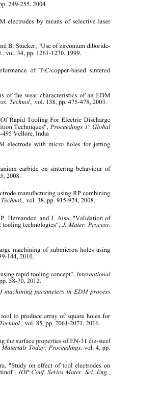

56. A. Equbal, M.I. Equbal, and A.K. Sood, "关于熔融沉积成型工艺在EDM电极制造中可行性的研究", *CIRP J. Manuf. Sci. Technol.*, 2019. [http://dx.doi.org/10.1016/j.cirjp.2019.07.001]

57. P. Saxena, and R.M. Metkar, "使用熔融沉积成型（FDM）开发电火花加工（EDM）电极", 2019. [http://dx.doi.org/10.1007/978-981-13-0305-0_22]

## 第3章

## 热增强非传统加工过程 - 综述

Janender Kumar$^{1}$, Suneev Anil Bansal$^{1,*}$ and Munish Mehta$^{2}$

$^{1}$ Maharaja Agrasen University, Baddi, Solan, 印度 机械工程系

$^{2}$ Lovely Professional University, Phagwara, Punjab, 印度 机械工程学校

**摘要：** 本工作重点关注利用热能去除工件材料的非传统加工过程。激光束加工是一种高强光束照射到工件表面以提高温度，从而实现材料汽化的过程。激光束加工过程可用于加工硬脆材料。本文综述了使用的激光类型和激光钻孔过程。可以完成复杂轮廓切割和微钻孔，这是其他常规和非传统加工过程无法实现的。许多研究者已经研究出混合工艺可以提高激光束加工的工艺参数。本文综述了其需求、混合工艺以及陶瓷、复合材料等不同材料加工领域的最新发展。本文最后一部分讨论了该领域未来的研究方向。

**关键词：** 复杂形状，钻孔，硬脆材料，热能，混合加工，激光束，激光束加工，加工参数，微钻孔。

### 引言

在制造业中，先进材料的发展由于其实用的高性能而给设备和机械的性能带来了革命性的变化。同时，这也对其加工提出了挑战，因为这些材料是硬脆的。复杂形状和不寻常的工件尺寸也是需求所在。工业界迫使研究工程师开发新的加工方法 [8] [12]。因此，为了充分利用这些昂贵的材料，正在考虑先进的加工方法。这些包括超声波加工、电化学加工、电化学研磨、激光束加工、水射流加工、*等等*是加工、等离子*等等*是加工。然而这些具有

自身在对母材加工方面存在一定的局限性。本文研究了激光束加工及其相关工艺。由于利用热能进行加工，这也称为热增强加工过程。在我们孩提时代，我们曾进行过一个实验，即通过透镜聚焦太阳光来燃烧一张碳纸。其能量密度约为 1W/mm²。从某些方面来说，激光束可以聚焦到高硬度的材料上，以高密度使材料通过汽化从工件中移除。爱因斯坦提出了激光理论和受激辐射的概念。第一台名为红宝石激光器的激光是由 Tower 和 Shallow 在 1957 年制造出来的。

## 激光束加工

激光的全称是“光通过受激辐射的放大”（Light Amplification by Stimulated Emission of Radiation）。激光是单色光，即其波长占据了光谱中非常窄的一部分。因此，一个简单的透镜可以将激光聚焦到一个直径非常小、强度比其他类型光线更高的微斑上。激光光是相干的，因为它在相位上是一致的。任何激光设备的三个主要元素是：

- a. 激光介质
- b. 用于激发这些原子到更高能级的泵浦能量源。
- c. 光学反馈系统。

激光介质可以是固体、液体或气体。它们都具有不同的波长。它位于 0.2-1 微米之间。

红宝石 = 0.7 微米，Nd:YAG = 1.0 微米，CO=2.7 微米，CO₂=10 微米。

### 激光的类型

如表 1 所示，不同种类的激光被用于加工，具有相应的频率和平均功率。

### 普通光与激光的区别

激光具有相同频率、波长和相位的 photon（光子）。这就是为什么它具有高度的方向性和高功率密度。与普通光相比，它具有更好的聚焦特性。

表 1. 激光的类型 [3]。

| 激光类型 | 平均功率 | 效率 |
| :--- | :--- | :--- |
| Nd: YAG | 1w-2kw | 2-5% |
| CO₂ | 10w-20kw | 10-15% |
| 准分子（Excimer） | 1w-500w | 小于 3 |
| CO | 5w-15kw | 小于 20 |
| I₂ | 小于 1kw | 小于 20 |

### 激光束加工原理

当激光束通过透镜聚焦在工件上时，吸收的热量能量会熔化选定的表面，使其熔化、瞬间汽化并穿透。因此，如图 (1) 所示，它也可以称为热切割过程。

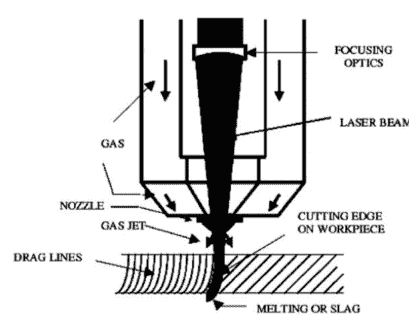

图 (1). 激光束切割 [12]。

### 激光钻孔概述

小尺寸的孔，无法通过常规加工过程产生，可以通过激光束加工制备。因此，这对难切割材料的钻孔具有巨大优势。表 2 展示了使用激光钻孔与其他过程进行比较的钻孔情况。

### 激光钻孔的类型

目前存在两种类型的激光束钻孔过程，分别是脉冲钻（percussion）和环钻（trepan）。脉冲钻直接穿透工件材料，激光或工件没有相对运动。环钻涉及沿孔的圆周进行切割，如图 (2) 所示。

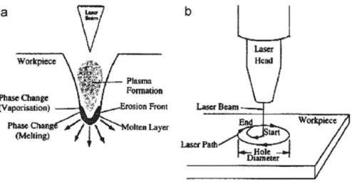

图 (2). 激光束示意图 (a) 脉冲钻 (b) 环钻 [12]。

表 2. 非常规加工过程的比较 [10]。

| 非常规加工过程 | 精密小孔（直径小于 0.25mm） |
| :--- | :--- |
| 超声加工 | - |
| 电化学加工 | - |
| 激光束加工 | 良好 |
| 等离子弧加工 | - |
| 电火花加工 | - |
| 磨料射流加工 | - |
| 化学加工 | 一般 |

从表中可以清楚地看出，只有两种过程能产生直径小于 0.25 英寸的孔。激光束钻孔的表现优于化学加工。

## 文献综述

Peyman *等人* 描述了激光在医学领域的使用。在此，Nd: YAG 激光能量被用于肿瘤手术，并且是成功的。如今，激光在此方向上的使用不断增加 [1]。Jiang *等人* 讨论了激光束加工过程，这是最奇妙且增长最快的。重点在于 CO₂ 和 Nd: YAG 激光的使用。这两种类型的激光都被用于切割硬材料，并且它们各自都有局限性。Nd: YAG 激光具有低的平均光束功率，但光束强度高。高光束强度使其在 CO₂ 激光之上具有特殊性。由于低的平均光束功率，脉冲 Nd: YAG 激光的最大加工深度是一个严重的问题。因此，进行了一项研究以估计加工深度和所产生孔的横向尺寸 [2]。Yeo *等人* 研究了通常用于航空航天工业的材料中的激光钻孔操作。在这篇论文中，分析了不同波长不同类型的激光。每种激光的操作功率和它们的效率并不相同。该过程的不同参数也被审查，以获得高质量孔 [3]。Piotrrot *等人* 审查了激光切割过程及激光生产的组件质量。产品质量的提高可以通过适当的监测、诊断和调节来实现，以改善切割。该过程的初始设置和运行成本非常高。必须进行适当的控制以使过程在经济上可行 [4]。Black *等人* 研究了厚度为 8.5 和 9.2mm 的厚陶瓷瓦片的加工。在此进行了 CO₂ 激光束加工，并研究了不同切割速度下的不同切割参数。使用 CO₂ 激光时，观察到裂纹，这是由于陶瓷瓦片内的温度梯度（随厚度变化的温度）造成的。为避免裂纹，必须在加工期间引入冷却装置 [5]。Black *等人* 研究了使用 CO₂ 激光切割陶瓷瓦片的过程。分析了各种参数，以为该过程准备数据库。考虑了六种基于 Si/Al₂O₃ 的陶瓷瓦片进行分析，厚度在 3.7 到 9.2mm 之间。数据库是在两种条件下收集的，一种来自大气层，另一种来自水下切割 [6]。Fang *等人* 指出，刀具磨损是玻璃金刚石车削中的大问题。论文中讨论了三种方法用于加工类玻璃压痕、单点划痕和锥形槽。其中，锥形槽对于研究从脆性到延展模式的转变更为有效。然而，刀具寿命仍然是主要问题 [7]。Meijer *等人* 讨论了激光束加工及其使用超短脉冲激光的应用。使用短脉冲激光，微加工可以轻松完成，这是该过程的优势。尽管如此，在该激光领域，发展仍在进行中，研究在该领域继续 [8]。Sun *等人* 总结了硬脆材料热增强加工的进展和益处，其中材料通过外部热源去除。观察到，激光束加工可以提高可加工性，表现为更长的刀具寿命、减少的切削力和更好的表面光洁度，用于复合材料和陶瓷材料。观察到，在激光和等离子辅助加工中，刀具成本节省和更换时间减少，刀具寿命增加 [9]。Dhar 等人审查了激光钻孔过程及技术，以解决高质量和精确孔的问题。讨论了三种钻孔技术。它们是单脉冲钻、环钻和螺旋钻。通过这些钻孔技术，可以生产从小到大的孔。结论是，钻孔时间占总时间的大部分，因此钻孔成本增加。激光束钻孔具有通过更好地控制过程来减少钻孔时间的潜力 [10]。Pham 等人提出了一种新的氧化铝材料激光铣削加工技术。基本上，在早期，陶瓷组件的加工非常昂贵，因为它需要昂贵的刀具。在当前的论文中，审查了该过程的材料去除特性。结果表明，使用激光束铣削可以生产复杂的几何形状，而不需要昂贵的工具。因此，结论是，如果批量生产陶瓷组件，该过程是具有成本效益的 [11]。Dubey 等人研究了混合过程在当今行业中的影响。近年来，激光和非激光混合过程变得越来越流行。激光和非激光混合常规加工过程包括激光辅助车削和磨削。同样，激光和非激光非常规混合加工过程包括激光辅助超声加工、激光辅助电化学和电火花加工。Yue 等人发现，与没有超声辅助的激光辅助钻孔相比，超声辅助激光钻孔期间产生了更深的孔，重铸层更小 [12] [13]。Low 等人报告了激光钻孔期间锥形孔形成的研究。这是激光脉冲钻孔的普遍问题。孔中的锥度可以通过具有可变脉冲的激光束来控制。使用相同的脉冲，在钻孔期间可以轻松看到锥形孔。新方法用于产生零、负和正孔 [14]。Dubey 等人研究了工艺参数对 Nd: YAG 激光束加工性能的影响。通过实验设计进行了钻孔、微钻孔和切割操作的调查。结果表明，由于改变波长和频率的能力，Nd: YAG 激光束加工可以成功地应用于加工。使用该过程，可以轻松加工高达 5 微米的微孔和 4 微米的薄板 [15]。Kibria 等人使用 Nd: YAG 激光在陶瓷材料的圆柱形工件上进行微车削实验，因为它在汽车、医疗和电子工业中具有巨大优势。通过改变工艺参数分析了材料的切削深度和表面粗糙度。结果表明，过程

## 激光束加工与复合工艺文献综述

参数对实现切割深度和表面粗糙度有重大影响。通过分析光学和扫描电镜（SEM）显微照片，可以深入了解激光微加工过程参数设置。研究发现，在灯电流 23 安培、脉冲频率 800Hz、扫描速度 6.6 mm/s 的设置下，经过单次激光束微车削后可获得良好的表面光洁度 [16]。

Kim *等人* 对复合工艺进行了研究，该新工艺为激光辅助车削。在此工艺中，利用激光辅助加工和 CNC 车床进行加工。文中讨论了激光辅助车削中的三个问题：加工过程、热处理和设备机构。在此过程中，由于短波长具有较高的吸收率，因此采用了高功率二极管激光器代替 CO$_{2}$ 或 Nd: YAG 激光器。在激光束车削领域，观察到的研究工作非常少，特别是在铣削方面。因此，在该领域进行研究变得十分必要 [17]。

Phiphon *等人* 利用通用算法改进和优化激光束加工过程参数。使用响应面方法设计了实验和数学模型，然后应用通用算法以获得最佳结果。在表面粗糙度和切缝锥度方面获得了最佳结果。因此，结果证明通用算法是一种良好的优化技术 [18]。

Loumena *等人* 讨论了轻质 CRPF 材料的隐藏潜力。激光加工通过切削提高了这种高强度且耐腐蚀良好的材料的可行性。在实验中，使用了具有特定技术规格的新一代 BOREAS 系列纳秒激光器。通过使用这种激光器，CRPF 材料过度加热的缺点在某种程度上得到了减少，并建议在未来使用准分子激光器或棒型光纤激光器 [19]。

Mishra *等人* 详细阐述了开发激光束穿孔钻孔预测模型的耦合方法。利用了两种方法：有限元分析和人工神经网络。实验针对激光钻孔过程中产生的孔锥度进行了研究。优化后的参数显示，孔锥度减少了 67.5%，热影响区减少了 3.25%，材料去除率提高了 65% [20]。

Nasim *等人* 讨论了二极管激光器相关技术及其测量技术。该工艺能够生产出尺寸极小且加工可靠性高的产品。该工艺的应用包括癌症识别、爆炸物检测以及空气和水质监测等医疗领域。当前论文讨论了二极管激光器从医疗实验室到工业加工的应用 [21]。

Venkata *等人* 综述了所有非传统加工过程，重点在于这些过程的优化参数。这些过程包括电化学加工、微加工、纳米加工、复合工艺和激光束加工。本综述的目的是概述所有过程并为该领域的新研究方向提供指导。本文还对这些过程及其相关过程进行了比较 [22]。

Venkatesan *等人* 总结了激光辅助加工及其切割硬脆材料的潜力，这是一种复合方法。本文研究了钛合金、镍基合金、陶瓷和复合材料的激光辅助加工，并为激光辅助加工工艺的优化留下了空间。结论指出，复合工艺可用于提高难以用传统方法加工的材料性能 [23]。

Liu *等人* 介绍了超声辅助水约束激光微加工。实际上，在激光束加工过程中会产生许多缺陷，并且产生的切屑会沉积在工件材料上，从而产生有害的热残余效应。本文引入了超声辅助水约束激光加工，消除了激光束加工中产生的缺陷。结果显示，该方法中碎屑沉积较少 [24]。

Mishra *等人* 讨论了利用超短激光脉冲在硬质材料中创建微加工及其分析。工业界可以利用这种先进的加工方法。这被称为激光束微加工，而在激光束加工中，通常利用高激光脉冲。激光束微加工用于制造只读存储器芯片、三维尺寸结构和生物光学芯片。当前论文强调了短脉冲或超短激光脉冲与不同类型材料相互作用的本性 [25]。

Darnish *等人* 比较了用于加工 Inconel 718 高温合金的两种加工介质：湿式和干式。研究发现，水下加工比干式介质更具生产效益 [26]。

Ahman *等人* 比较了微电火花加工（micro-EDM）和激光加工，这是一种复合工艺。观察到，在不影响微孔质量的情况下，该工艺将加工时间缩短了 50-65%。在难以通过常规机械加工过程加工的 Ni-Ti 合金中钻出微孔。因此，利用这种复合工艺对其进行加工。微电火花加工工艺用于制作小于 200 微米的孔。在 Ni-Ti 合金的微钻孔中，使用黄铜电极的材料去除率相对较高，在不影响微孔质量的情况下观察到 40-65% 的增长 [27]。

Alahmari *等人* 提出了水下激光束加工，用于制造基于镍的 Inconel 718 高温合金中的微通道，不同参数的激光分析结果表明，水下激光束加工可以提高工件质量 [28]。

Lee *等人* 分别综述了激光和电弧热源在加工中的应用。作者提出了激光电弧辅助复合工艺 [29]。

Firdaus *等人* 综述了材料表面特性的摩擦学方面。使用 Nd: YAG 激光进行激光束加工以减少磨损和摩擦，从而改善表面纹理。在本文中，比较了两种表面纹理处理的执行方式。通常，在大多数方法中，纹理直接在工件上进行；在某些情况下，研究在涂层材料上进行。涂层材料有助于减少摩擦和磨损。研究表明，陶瓷涂层材料被用于通过消除摩擦和磨损来改善表面纹理 [30]。

Lee *等人* 综述了激光辅助复合工艺，因为这些工艺对各种难以切割的材料有重大影响。使用这些工艺观察到加工性能的改善，并识别出切削力大幅降低。讨论并比较了不同激光的特性。CO$_{2}$ 具有更高的波长 [31]。

Wang *等人* 演示了利用激光束加工钻孔陶瓷材料。研究了钻孔质量，并利用计算方法处理激光束加工的输入参数。讨论了陶瓷钻孔的不同方法，在激光钻孔领域仍需更多工作以实现更高的精度 [32]。

Mishty *等人* 专注于研究液体辅助激光束微加工。这是在微米级别加工材料表面的绝佳方法。通过该工艺，可以在某种程度上改善因高温和表面光洁度差导致的热损伤。为了理解过程参数，利用了有限元模拟技术。结果显示，水下加工通过减少表面损伤和改善表面光洁度而取得了良好结果。微加工在有或无液体参与的情况下均进行了执行 [33]。

Dutt *等人* 将研究重点放在脉冲 Nd: YAG 激光束在钻削不同高强度、难切削材料（如高温合金、复合材料、陶瓷、铁基和非铁基材料）中的应用。综述强调了在钻削不同材料中使用激光以提高工艺生产率 [34]。

Sherpa 和 Pradhan 探索了使用 Nd: YAG 激光增强不同材料微加工的各种参数。使用二极管泵浦固体激光器进行微加工。发现材料去除率随频率增加而线性增加。表面粗糙度也随二极管电流增加而增加 [35]。

Rana *等人* 研究了检查加工对材料影响及材料特性变化原因的不同技术。研究人员还探索了激光束加工在工业中的应用，特别是航空航天、军事和航空领域。实施了各种技术，如田口方法、遗传算法、响应面方法。观察了相互关联的参数。结果表明，在切割低碳钢时，氧气在加工较厚材料方面给出了最佳结果，而惰性气体则用于较薄材料 [36]。

Faisal *等人* 综述了激光束加工和激光束微加工工艺。这些技术为硬质材料加工领域带来了革命。激光工艺也被用于医疗、航空航天和通信领域。激光可以生产直径 <0.3 mm 的孔。因此，这也称为激光束微加工，因为这种尺寸无法通过任何其他传统或非传统加工工艺获得。金属微加工包括微钻孔和

微铣削，近期激光微加工领域的这一进展已被观察到 [37]。Holmbergy 等人评估了加工后工件的表面状态。研究中考虑并比较了三种非传统加工过程的表面完整性。这些过程包括磨料水射流加工、电火花加工和激光束加工。实验是在 718 合金上进行的。结果表明，与电火花加工（EDM）和激光束加工（LBM）相比，磨料水射流加工能够产生具有低表面粗糙度、质量优良的表面状态。这是该研究的主要目标 [38]。Vasanath 等人通过在水牛皮上进行加工实验进行了研究。CO₂ 激光器被用于切割，观察到与手工工艺相比，激光束加工能够减少皮革表面上的低质量/废料形成 [39]。Zhat 等人使用飞秒激光在 2000 微米厚的 Inconel 718 材料上通过脉冲钻削，对具有热障涂层的镍基合金进行了实验。通过此过程，在镍基合金上产生了零锥度孔，内径为 162 微米。Nd:YAG 固态飞秒激光器被用于脉冲钻削。该研究证明了飞秒激光在加工涡轮叶片气膜孔方面的可行性 [40]。Hófý 等人回顾了通过激光束加工碳纤维增强聚合物（CRPF）材料所开展的研究工作。在该论文中，对各种技术进行了批判性分析，以通过缩短加工时间和提高材料去除率来提高生产率。对于 CRPF 材料的传统加工过程，刀具磨损率高于非传统加工。因此，该研究显示了激光束加工作为一种替代工艺，具有更好的精度 [41]。AboD 等人评估了激光工艺的性能，该工艺获得了 V 形和 U 形截面的微通道。该研究在两个方面继续进行；一个是几何特征，另一个是加工微通道的质量。使用了方差分析（ANOVA）和扫描电子显微镜（SEM）两种技术。注意到以下观察结果。控制激光参数可以产生高值的激光强度以产生 V 和 U 形结构；其次，通道的表面光洁度可以达到接近 2 微米 [42]。

表 3 展示了激光束及其相关工艺的汇编或简要回顾。

本综述为我们在激光束加工领域进行进一步研究奠定了基础。

在文献回顾期间，观察到大多数研究人员在实验中利用 Nd:YAG 激光进行加工。因此，在未来，对其他类型激光的研究可以成为进一步研究的主题。

## Nd:YAG 激光概述

其缩写为“掺钕钇铝石榴石”（Neodymium-doped Yttrium Aluminium Garnet）。它是一种强大的固体激光器。它用于轻型工作。高反射性和介电材料可以 easily 加工。在脉冲模式下，它可以加工更厚的材料。这是一种紧凑且可靠的激光器。这种激光平均光束功率较低，但在脉冲模式下使用时具有高的能量密度。它被用作激光束加工过程中的激光介质。该过程的示意图见图 (3)。

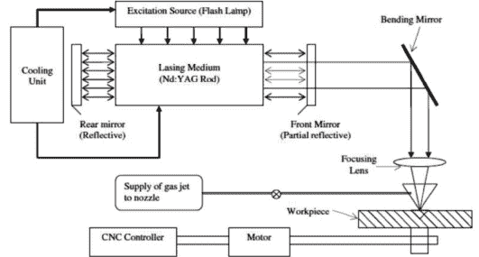

图 (3). Nd:YAG 激光束切割过程示意图 [12]。

表 3. 激光束加工和激光辅助工艺的汇编 [22]。

| 作者 | 工艺 | 工件材料 | 考虑的重要输入变量 | 优化技术 | 备注 |
|---|---|---|---|---|---|
| Pham et al (2007) | 激光铣削过程 | 氧化铝材料和氮化硅陶瓷 | 扫描速度、脉冲强度、灯电流 | 单因素实验 | 建议对于任何采用 1064 纳米波长激光铣削的机床：应提供玻璃支撑板以重新定位工件。 |
| Duba* et al (2008) | 激光钻孔-微钻孔 | 复合材料、陶瓷和合金 | 激光、材料和工艺参数 | DOE、田口方法 | YAG 激光适合制造最大 5 微米的微孔 |
| Allman- et al (2015) | 激光微钻孔 | 镍钛合金 | 灯电流、脉冲频率、脉冲宽度、空气压力 | 混合工艺 | 通过混合工艺（激光和微电火花加工），加工时间减少且材料去除率（RR）增加 |
| Wang et al (2016) | 激光钻孔过程 | 陶瓷 | 脉冲宽度、能量密度和重复频率 | ANSYS 和 COMSOL 方法 | 建议液辅助加工在激光钻孔中表现良好，由于冷却和蒸发过程。 |
| Dutt et al. (2018) | 激光钻孔过程 | 复合材料、陶瓷和超级合金 | 调 Q、峰值功率、脉冲时间、脉冲频率、脉冲数和气体压力 | 基于人工智能的方法（ANN、遗传算法） | 由于更好的聚焦特性，脉冲 Nd:YAG 激光束钻孔变得更加容易 |

## 结论

1. 激光束加工用于在工件中制作复杂轮廓，钻不同尺寸的孔（直径最大 5 微米的微孔）以及切割厚达 4 微米的薄箔。
2. 激光的性能取决于三个参数。这些是工艺参数、激光参数和材料参数。
3. 激光混合加工过程比单一非传统加工过程产生了更好的结果。
4. 冷却液在常规和非传统加工过程中被使用。冷却液对环境和操作员具有毒性，因为它在机器上连续使用。但是，由于缺乏冷却液的使用，激光辅助加工是一个环境友好型过程。
5. 激光辅助加工优于传统加工。此外，它可以用于提高那些传统方法难以加工的材料的过程效率。
6. 结论指出，使用 Nd:YAG 激光，在静态水模式下湿条件中对 Inconel 718 超级合金进行激光束加工，在保持尺寸、无毛刺表面和重铸层方面给出了最佳结果。
7. 还得出结论，使用脉冲 Nd:YAG 激光束钻孔可以 easily 钻削难以切割的材料。从实际和理论上讲，该过程可以成功地应用于复合材料。激光的这一应用正在不断增加。

## 激光束加工研究的未来范围

1. 大多数研究论文与钻孔和微钻孔有关。然而，诸如车削和铣削等三维激光束加工仍然难以执行。在不久的将来，可以进行激光辅助铣削的研究。
2. 激光束加工通常在板金属上进行，但由于先进或后期工程材料的需求，有必要开发用于难加工硬材料的加工技术。因此，这可能是未来的研究领域。
3. 在激光过程中，由于外部热源，工件在刀具前方保持软化状态。此外，刀具和切屑接口的高温可能导致刀具寿命缩短。因此，需要一种适当的方法来冷却切削刀具，同时不影响刀具前方的加热区域 [9]。
4. 通常，该过程用于硬性和脆性材料。但也有一些塑性材料难以加工。因此，可采用热增强加工来提高塑性材料的可加工性 [9]。
5. 为了优化热增强加工过程，需要对切削刀具和切屑之间的摩擦、磨损和摩擦等摩擦学要素进行深入研究。

## 出版同意书

不适用。

## 利益冲突

作者确认本章内容没有利益冲突。

## 致谢

作者们诚挚感谢编辑和匿名审稿人付出的时间与宝贵建议。

## 参考文献

1. G.A. Peyman, A. Alghadyan, and J.H. Pearce, “A contact Nd:YAG laser to resect large ciliary body and choroidal tumors”, *Int. Ophthalmol.*, vol. 11, no. 1, pp. 55-61, 1987. [http://dx.doi.org/10.1007/BF02027898] [PMID: 3692695]
2. C.Y. Jiang, W.S. Lau, T.M. Yue, and L. Chiang, “On maximum depth and profile of cut in pulsed Nd:YAG laser machining”, *Annals of CIRP*, vol. 42, no. 1, pp. 223-226, 1993. [http://dx.doi.org/10.1016/S0007-8500(97)62430-5]
3. C.Y. Yeo, S.C. Tam, S. Jana, and M.W.S. Lau, “A technical review of laser drilling of aerospace material”, *J. Mater. Process. Technol.*, vol. 42, pp. 15-49, 1994. [http://dx.doi.org/10.1016/0924-0136(94)90073-6]
4. P. Di Pietrol, and Y.L. Yao, “An investigation into characterizing and optimizing laser cutting quality - A review”, *Int. J. Mach. Tools Manuf.*, vol. 34, no. 2, pp. 225-243, 1994. [http://dx.doi.org/10.1016/0890-6955(94)90103-1]
5. I. Black, and K.L. Chuck, “Laser cutting of thick ceramic tile”, *Opt. Laser Technol.*, vol. 29, no. 4, pp. 193-205, 1997. [http://dx.doi.org/10.1016/S0030-3992(97)00005-4]
6. I. Black, S.A.J. Livingstone, and K.L. Chua, “A laser beam machining database for the cutting of ceramic tile”, *J. Mater. Process. Technol.*, vol. 84, pp. 47-55, 1998. [http://dx.doi.org/10.1016/S0924-0136(98)00078-8]
7. F.Z. Fang, X.D. Liu, and L.C. Lee, “Micro-machining of optical glasses - A review of diamond-cutting glasses”, *Sadhana - Acad.*, *Proc. Eng. Sci.*, vol. 28, no. 5, pp. 945-955, 2003.
8. J. Mejier, “Laser beam machining, state of art and new opportunities”, *J. Mater. Process. Technol.*, vol. 149, pp. 2-17, 2004. [http://dx.doi.org/10.1016/j.jmatprotec.2004.02.003]
9. S. Sun, M. Brandt, and M.S. Dargusch, “Thermally enhanced machining of hard-to-machine materialsAs review”, *Int. J. Mach. Tools Manuf.*, vol. 50, no. 8, pp. 663-680, 2006. [http://dx.doi.org/10.1016/j.ijmachtools.2010.04.008]
10. S. Dher, and N. Saini, “A review on laser beam drilling and its techniques”, International conference on advances in mechanical engineering, BBSBEC, Pb
11. D.T. Pham, S.S. Dimov, and P.V. Petrov, “laser milling of ceramic components”, *Int. J. Mach. Tools Manuf.*, vol. 47, pp. 618-626, 2007. [http://dx.doi.org/10.1016/j.ijmachtools.2006.05.002]
12. A.K. Dubey, and V. Yadava, “Laser beam machining-a review”, *Int. J. Mach. Tools Manuf.*, vol. 48, pp. 609-628, 2008. [http://dx.doi.org/10.1016/j.ijmachtools.2007.10.017]
13. T.M. Yue, T.W. Chan, H.C. Man, and W.S. Law, “Analysing ultrasonic aided laser drilling using infinite element method”, *CIRP Ann.*, 45, no. 1, pp. 169-172, 1996. [http://dx.doi.org/10.1016/S0007-8506(97)63040-6]
14. L.I.Low, D.K.Y. Ghoreishi and J.R. Crookall, “Hole taper characterisation and control in laser percussion drilling”, *CIRP Ann.*, vol. 51, no. 1, pp. 153-156, 2002. [http://dx.doi.org/10.1016/S0007-8506(07)61488-7]
15. A.K. Dubey, and V. Yadava, “experimental study of Nd: YAG laser beam machining-a review”, *Journal of material processing technology*, vol. 195, pp. 15-26, 2008.
16. G. Kibiria, B. DoloI, and B. Bhattacharyya, “Experimental analysis on Nd:YAG laser micro-turning of alumina ceramic”, *Int. J. Adv. Manuf. Technol.*, vol. 50, no. 5–8, pp. 643–650, 2010. [http://dx.doi.org/10.1007/s00170-010-2527-4]
17. K.S. Kim, “A review on research and development of laser assisted turning”, *International journal of precision and manufacturing*, vol. 12, pp. 753-759, 2011.
18. R. Phion, and B.B. Pradhan, “control parameters optimisation of laser beam machining using genetic algorithm”, *International journal of advanced manufacturing engineering research*, vol. 2, no. 5, pp. 1500–1516, 2012.
19. C. Loumena, M. Nguyen, J. Lopez, and R. Kling, “Potentials for lasers in CFRP production”, [http://dx.doi.org/10.2351/1.5062378]
20. S. Mishra, and V. Yadava, *Modelling and optimisation of laser beam percussion drilling of thin aluminium sheet*, *Optics and laser technology*, vol. 48, 2013, pp. 461–474.
21. H. Nasim, and Y. Jamil, “Diode lasers: From laboratory to industry”, *Opt. Laser Technol.*, vol. 56, pp. 211–222, 2014. [http://dx.doi.org/10.1016/j.optlastec.2013.08.012]
22. R. Venkata, “optimisation of modern machining processes using advanced optimisation techniques-a review”, *International journal of advanced manufacturing technology*, vol. 73, no. 5–8, p. 1159–1188, 2014.
23. K. Venkatesan, and R. Ramanujan, *Procedia Eng.*, vol. 97, pp. 1626–1636, 2014. [http://dx.doi.org/10.1016/j.proeng.2014.12.313]
24. Z. liu-Y. Gao, B. Wu, N. Shen, and H. Ding, “Ultrasound-assisted water-confined laser micromachining: A novel machining process”, *Manuf. Lett.*, vol. 2, no. 4, pp. 87–90, 2014. [http://dx.doi.org/10.1016/j.mflet.2014.06.001]
25. “finite element analysis and simulation of liquid assisted laser beam machining”, *Int. J. Adv. Manuf. Technol.*, vol. 94, no. 5–8, pp. 2325–2331, 2017.
26. S. Darvish, N. Ahmed, A.M. Alhamari, and N.A. Mufri, “A comparison of laser beam machining of micro-channels under dry and wet medium”, *Int. J. Adv. Manuf. Technol.*, vol. 83, pp. 1539–1555, 2015. [http://dx.doi.org/10.1007/s00170-015-7658-1]
27. A. Ahman, M.S. Rashed, M.K. Mohamed, and T. Saleh, “A hybrid machining process combining micro-machining and laser beam machining of Ni-Ti based shape memory alloys”, *Mater. Manuf. Process.*, vol. 31, no. 4, pp. 447–455, 2015.
28. A.M. Alhamari, N. Ahmed, and S. Darwish, “laser beam micromachining under water immersion”, *In: International journal of advanced manufacturing technology*, vol. 83, 2016, pp. 1671–1681.
29. C.M. Lee, W.S. Woo, D.H. Kim, and W.J. Oh, “laser assisted hybrid processes-a review”, *International journal of precision engineering and manufacturing*, vol. 17, pp. 257–267, 2016.
30. A. Firdaus, S. Baharin, M.J. Ghazil, and J.A. Wahab, “laser surface texturing and its contribution to friction and wear reduction-a brief review”, *Ind. Lubr. Tribol.*, vol. 8, no. 1, pp. 57–66, 2016.
31. C.M. Lee, W.S. Woo, J.T. Baek, and E.J. Kim, “laser and arc manufacturing process-a review”, *Int. J. Precis. Eng. Manuf.*, vol. 17, no. 7, pp. 973–985, 2016. [http://dx.doi.org/10.12541/IJPIEJ-I.019-4]
32. H. Wang, H. Lin, C. Wang, L. Zheng, and X. Hu, “Laser drilling of structural ceramics—A review”, *Journal of European. Cerom. Soc.*, vol. 37, no. 4, pp. 1157–1173, 2016. [http://dx.doi.org/10.1016/j.jeurceramsoc.2016.10.031]
33. V. Mistry, and S. James, "finite element analysis and simulation of liquid assisted laser beam machining process", *Int. J. Adv. Manuf. Technol.*, vol. 94, no. 5-8, pp. 2325-2331, 2017. [http://dx.doi.org/10.1007/s00170-017-1009-3]
34. G.D. Gautam, and A.K. Pandey, "Pulsed Nd: YAG laser beam drilling-a review", In: *Optics and laser technology* vol. 100, 2018, pp. 21-1833.
35. T.D. Sherpa, and B.B. Pradhan, "Micro-grooving of silicon wafer by Nd:YAG laser beam machining", *IOP Conf. Series Mater. Sci. Eng.*, vol. 577, pp. 1-7, 2018. [http://dx.doi.org/10.1088/1757-899X/377/1/012219]
36. R.S. Rana, R. Chouksey, K.K. Dhakad, and D. Palwal, "Optimization of process parameter of Laser beam machining of high strength steels: A review", *Mater. Today Proc*, vol. 5, no. 9, pp. 19191-19199, 2018. [http://dx.doi.org/10.1016/j.matpr.2018.06.274]
37. N. Faisal, D. Zindani, K. Kumar, and S. Bhownik, "laser micromachining of engineering materials and tribology-a review", *Material forming, machining and tribology*, pp. 121-136, 2018.
38. J. Holmberg, and A. Berglund, "Wretland and T. Bano", Evaluation of surface integrity after high energy machining with EDM, laser beam machining and abrasive water jet machining of alloy 718", *Int. J. Adv. Manuf. Technol.*, vol. 100, pp. 1575-1591, 2018. [http://dx.doi.org/10.1007/s00170-018-2697-z]
39. S. Vasanth, and T. Muthuramalingam, "a study on machinability of leather using co2-based laser beam machining process", *Advances in manufacturing processes*, pp. 239-244, 2018.
40. Z. Zhai, and X. Wang, "percussion drilling on nickel-based alloy with thermal barrier coatings using femtosecond laser", *International journal for light and electron optic*, vol. 194, p. 163066, 2019.
41. M.H. Ei-Hofy, and H. Ei-Hofy, "laser beam machining of carbon fibre reinforced composites-a review", *Int. J. Adv. Manuf. Technol.*, vol. 101, no. 9-12, pp. 2965-2975, 2019. [http://dx.doi.org/10.1007/s00170-018-2978-6]
42. B.H.A. Abdo, N. Ahmed, A.M. El-Tamimi, S. Anwar, H. Alkhalefaeh, and E.A. Nasr, "laser beam micro-machining of zirconia ceramic-a review," an investigation of micromachining geometry and surface roughness", *J. Mech. Sci. Technol.*, vol. 133, no. 4, pp. 1817-1831, 2019. [http://dx.doi.org/10.1007/s12206-019-0334-x]

## 第4章

## AWJM 工艺综述

Manta ^*,†^, Sachin Mohal^‡^, Saurabh Chaitanya^§^ and Ankithmani Tripathi^¶^
† 印度，索兰，巴迪，皇家阿格拉森大学，机械工程系
‡ 印度，莫哈利，兰德兰，昌迪加尔工程学院，机械工程系
§ 印度，哈里亚纳邦，SRM大学德里 NCR 校区，机械工程系

**摘要：** 磨料水射流加工（AWJM），作为一种非传统加工（NCM）技术，在质量和可靠性方面得到了根本性的提升。AWJM 是一种广泛使用的 NCM 工艺，在刀具、零件、微结构或复杂产品（如钛合金、合金钢 *等*）的技术应用领域已得到广泛确立。它已深深扎根于理论研究的每一个重要领域以及广阔的应用谱系中。应用包括医疗器械、精密零件、高效材料、智能汽车制造、航空航天设备、可再生能源科学 *等*。本文审查了可验证的最新研究进展，涵盖了 AWJM 系统的集成应用及执行。该研究促进了高精度制造和稳定的执行质量，并带来了更高的生产力。AWJM 的优点包括能够切割复杂材料、难加工表面、高灵活性、较小的切削力以及环境友好。此外，也强调了 AWJM 系统的局限性。AWJM 是极其先进系统之一，在微加工方面具有重大潜力。

**关键词：** 磨料水射流，加工，材料。

## 引言

设计和技术的快速进步需要极其精确和高度精细的物品。表面特性在制造汽车、航空和生物医学应用产品方面起着重要作用。微小的划痕或毛刺可能导致巨大的损失，例如发动机中途故障、航空灾难等。各行各业正在努力并投入巨资完成这些工作，同时不损害表面特性。在不改变表面质量和表面特性的情况下，对坚硬且坚韧的材料进行加工是一项艰巨的任务。在 NCM 中，加工过程中产生的热量可能会导致表面缺陷 [1]。因此，通过选择合适的加工工艺，我们可以提供更好的表面质量。在这种情况下，可以使用水射流来加工坚硬且坚韧的材料，且不会生成任何热量。这种混合物 *即* 水和磨料，称为水射流加工（WJM），是一种 NCM 工艺，其中利用高速水流从工件外部侵蚀材料。WJM 也可用于切割塑料、橡胶或木材等软材料。但是，为了切割金属或岩石等更坚硬的材料，磨料被混合到水中。当在加工过程中使用磨料水时，称为 AWJM。它基于水侵蚀原理。当高速水流撞击表面时，就会发生材料去除。诺曼·C·弗朗茨博士于 1968 年启动了现代 WJM 技术，并获得了具有创新的高压 WJM 系统的专利，1971 年第一个商用水射流切割机被制造出来，用于切割层压纸管。1980 年，哈希什博士发现了向普通 WJM 中添加磨料的方法，从那时起 AWJM 被发明出来，用于切割钢、玻璃和水泥等机械材料 [2, 3]。

在 WJM 工艺中，高速水射流被引导撞击工件。施加在水末端喷嘴上的压力力转化为高速度。随后，为了切割高质量的材料并切割坚硬材料，磨料被添加到高速水射流中。与 WJM 相关的多个优势以及较低的成本结构。这项技术是快速发展和灵活的。有毒废气、重铸层、熔渣和残余应力可以轻松消除。AWJM 中的切削力较小，并且在切割区域附近没有像 NCM 中那样存在受热的热影响区。因此，已经证明那些无法通过 NCM 轻松加工的材料（例如，在玻璃、石头和金属上切割槽，在钛上快速钻孔 *等*）可以通过 WJM 轻松加工 [4]。

（图 1）展示了 AWJM 组件的示意图。AWJM 工艺的主要组成部分包括高压液体泵（HPLP）、高压泵、计算机控制系统、加工头及收集器。HPLP 用于提供恒定的超高压。该系统包含两个罐，分别满足切割材料和用水的需求。整个系统配备了过滤机制，可以过滤掉较大的颗粒。系统中的大颗粒可能会阻塞整个系统的运行 [6]。

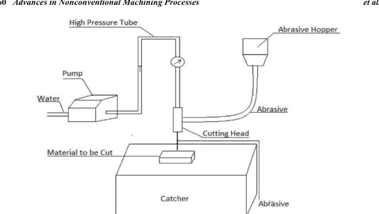

图 (1). AWJM 工艺及其组件和附件的示意图 [5]。

利用 AWJM 工艺可以对不同应用塑造广泛的材料范围，如 Inconel、钛、玻璃、陶瓷、复合材料、热敏感合金等。对耐热和高强度材料的需求正在增加，特别是在航空航天工业中。然而，由于这些材料的高强度和低热导率等物理和机械特性，它们通常难以加工，这需要极高的切削能量，使得切削力和切削温度非常高，甚至导致刀具寿命缩短。这为难以加工的材料开辟了一条热辅助加工（TEM）的途径。TEM 可能使用外部热源来加热和软化工件。结果，工件的屈服强度、硬度和应变硬化降低，难以加工材料的变形行为发生变化，允许发生塑性变形。这使得那些难以加工的材料能够容易地进行机器加工，同时具有较低的能量需求，从而导致材料去除率（MRR）和生产率的提高 [7]。

AWJM 工艺的各种特性和开发的机床已被用于切割各种材料，如玻璃等硬质材料、钛和 Inconel 等硬金属、复合材料和合金。对耐热和高品质材料的兴趣正在扩展，特别是在航空应用领域。由于这些材料的物理和机械特性，例如高强度和低导电性，使得它们难以加工，这需要极高的切削力，并使切削力和切削温度变得异常高。甚至会导致切削材料的服务寿命缩短。这为难以加工的材料开辟了一条热改进加工（TIM）的道路。TIM 可以利用外部热源来加热和软化工件。因此，工件的屈服强度、硬度和应变硬化效应降低。通过这样做，难以加工的材料发生变化并允许塑性变形。这使得那些难以加工的材料能够有效地进行机器加工，同时具有低能量需求，从而导致 MRR 和生产率的提高 [7]。

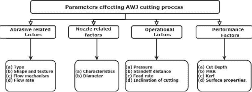

**图 (2).** 展示影响 AWJ 切削工艺的各种参数类别的示意图 [8]。

热改进 AWJM（TIAWJM）的性能取决于各种因素（图 2）。这些因素可以归类为各种类别。这些类别和因素列举如下。

(1) 磨料相关因素
- 类型
- 形状和纹理
- 流动机制
- 流量

(2) 喷嘴相关因素
- 特性
- 直径

## (3) 操作因素
- 压力
-  standoff 距离
- 进给速度
- 切割倾角

## (4) 性能因素
- 切割深度
- 材料去除率 (MRR)
- 切缝
- 表面特性。

在磨料水射流加工（AWJM）过程中，磨料颗粒起着关键作用。高速运动的磨料撞击工件，导致工件材料发生侵蚀。水射流赋予磨料颗粒如此高的速度。由于 AWJM 工艺的特性，它几乎可以切割任何材料 [9]。在使用 AWJM 进行加工时，材料去除率（MRR）、表面粗糙度和生产率彼此相关。

这些参数决定了表面质量，并决定了最终产品的功能性能。几何精度也是 AWJM 过程中的主要输出参数。

通过考虑机械性能和行为，工件材料可分为两组，*即* 延性材料和脆性材料。这两组材料的加工机制各不相同。

延性材料的加工机制可进一步分为两组，*即* 微切割和塑性变形，如图 **(3)** [6] 所示。

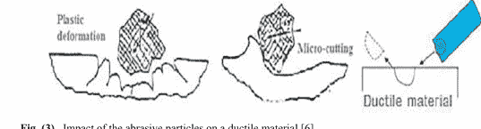

图 (3). 磨料颗粒对延性材料的影响 [6]。

另一方面，脆性材料表现出不同的切割行为。在切割过程中，脆性材料会经历塑性变形区和脆性断裂（图 4）。

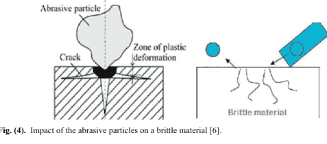

许多研究人员在这一领域开展工作，其中 Hashish 及其同事的贡献尤为显著。AWJ 锯在金属切割、飞机复合材料切割、金属和电路板切割等方面具有极强的能力。

# **AWJM - 文献综述**

研究人员研究了在加工 Al7475 铝合金时的 AWJM 过程。研究中考虑了各种参数，如压力、横向速度、距工件的距离和射流倾角。研究中使用了 3mm 厚的铝材。研究了加工过程中的疲劳寿命和材料去除率 [11]。*Yue 等人* [12] 通过实验研究输入参数对 AWJM 过程的影响。通过改变压力、进给、磨料流速和喷嘴角度，观察其对 MRR 的影响。在切割氧化铝时，得出结论：同时增加压力和磨料流速可以提高 MRR。针对一种特殊类型的 AWJM 过程也进行了数值模拟研究 [13]。调查了一种超声波辅助 AWJM 过程以了解磨料侵蚀过程。研究了部分重叠条件和完全重叠条件。研究结论指出，具有锋利边缘颗粒在 30° 撞击角下可能导致更高的 MRR。与无振动加工相比，在振动辅助加工中观察到了更高的 MRR [13]。

使用 AWJM 切割了 Ti6Al4V-CFRP 等特殊材料 [14]。该研究首次考虑了锥角、切缝和粗糙度。传统机械加工在切割这些材料时面临诸多困难，因为这两种材料（Ti6Al4V 和 CFRP）的特性差异很大。该研究成功实施，并为航空航天行业中广泛使用的异种组合材料的加工开辟了新途径 [14]。Uthayakumar 等人研究了用于加工超级合金的 AWJM。实验表明，AWJM 可以成功用于加工镍合金。使用 AWJM 可以以具有成本效益的方式产生精确的表面。在加工过程中，材料的表面性能未发生退化。观察到加工时的压力和速度会影响切缝壁倾角。发现 MRR 受流速和压力等参数强烈影响。在高压且具有适当横向速度的情况下，获得了超级合金的高表面光洁度 [15]。温度也被视为 AWJM 中的影响因素 [7]。利用所需位置的热处理对工件进行预加热，沿加工路径进行。假设预加热可软化材料，从而有助于大幅降低切削力并提高 MRR。观察到很难长时间维持温度和尺寸。因此，它仅对微切割和微通道切割有价值 [7]。还实验了使用 AWJ 切割过程切割难以切割的不锈钢 [16]。使用 AJM 切割切割了 EN1 不锈钢。在 3400-3800 bar 的不同水压下切割了 20mm 的棒材。

2016 年，Shukla 等人优化了 AA6351 铝合金材料的 AWJM 过程参数。使用了各种优化技术 [17]。该研究旨在确定达到预期输出结果的过程参数领域。初步来看，使用田口方法优化过程参数，揭示了一组获得预期结果所需的各种过程参数 [17]。Tamananee 等人考虑了 AWJM 中的侵蚀速率。在加工中使用了一种粉末填充的热塑性烯烃。从那时起，利用侵蚀速率估算值来创建加工配置，以扩大定界侧壁的斜率 [18]。还研究了用 AWJM 过程加工 Al-MMCs。该研究的重点在于改善切缝特性 [19]。还尝试使用 AWJM 加工 Ti-6Al-4V。还使用了田口和 ANOVA 分析等优化方法。进行了一系列实验以优化可变输入并达到预期输出。对 MRR 和切缝特性等预期结果输出参数进行了优化 [20]。碳纤维环氧树脂作为一种广泛使用的轻质材料，其 AWJM 应用仍然有限。因此，进行了一项研究，使用 AWJM 加工碳纤维环氧树脂复合材料 [21]。钛及其合金被归类为难以切割的材料。M. Douiri 等人使用 AWJM 过程加工了钛合金 Ti-6Al-4V [22]。该研究揭示了加工过程中的几个不同区域。区域 1，在较低的攻角下发生初始阶段损伤。然后切割进入区域 2。该区域切割平滑。攻角增加。在区域 3，观察到不规则的切割。射流在区域 3 中发生偏转 [22]。由于其机械性能，Inconel 在发动机中找到了多种应用。相同的机械性能使 Inconel 成为一种难以切割的材料。AWJM 被成功用于切割 Inconel [23]。为了进一步改进研究，使用田口-灰色关联方法优化了过程参数 [23]。

还研究了 AWJM 与铣削加工的表面特性对比，见表 1。结论认为，与铣削相比，AWJM 能够以更好的方式生成所需的光洁度 [23]。Suresh *等人* 使用 AWJM 加工过程钻削纤维增强复合材料。与其他报告相反，磨料颗粒尺寸不影响 MRR。还观察到压力影响工件的锥度 [24]。最近，2018 年，Xiao*chu* *等人* 进行了各种实验以开发 WJM。分析了各种输入和输出参数 [25]。

还进行了各种理论研究以分析 WJM，见表 2。Melen*tev* *等人* 使用理论方法分析微 AJM。特别关注使用小喷嘴 [26]。Jagadish *等人* 使用了软计算方法。利用软计算方法改善了表面质量和服务寿命 [27]。

表 1. AWJM 综述。

| 序号 | 作者 | 工艺 | 贡献 |
|---|---|---|---|
| 1. | Hagblin *等人* [28] | AWJ 铣削 | • 表面演化模型。 • 微通道加工 • 加工相对深的槽 |
| 2. | Jafar *等人* [29] | AWSJ 切割 | • 硼硅酸盐玻璃加工 • MMR • 表面改善。 |
| 3. | Pang *等人* [2] | AWJ 切割 | • 非晶态玻璃加工 • 调查通道形成 • MRR 预测模型 • 尺寸预测 |
| 4. | Tamannaae *等人* [18] | 水射流切割 | • 热塑性烯烃加工 • 加工模型口袋 |
| 5. | Xu *等人* [30] | AWJ 磨削、研磨和抛光 | • 陶瓷加工 • 玻璃加工 • 硬脆材料加工 |
| 6. | Feng *等人* [31] | AWJ 钻孔 | • 小尺寸孔钻孔 • 快速钻孔 |
| 7. | Li *等人* [32] | 径向模式 AWJ 车削 | • 径向模式 AWJ 车削 • 各种参数优化 |

## 水射流磨削加工的应用

以下是水射流磨削加工（AWJ machining）的应用领域：

- 1. AWJM工艺适用于工业零件的加工。
- 2. AWJM能够大幅缩短加工周期，并有望成为替代传统铣削工艺的潜在方案。
- 3. 水射流切割具备切割复杂形状和钻出困难孔洞的能力。在材料切割方面已开发出多种应用[4]。
- 4. AWJM在页岩油领域得到应用，利用磨料浆体切割坚硬岩石。
- 5. 适用于航空航天领域使用的耐热和高强度材料的加工。
- 6. 利用AWJM和纯水射流加工（WJM），玻璃、陶瓷、石材、黑色金属及有色金属合金均能被成功切割[41]。
- 7. 可持续的AWJM在可持续工程领域得到应用，其中用于切割的磨料及其他材料得以适当回收[42]。
- 8. 对于其他方法难以切割的航空航天零部件用的钛/镍合金，可利用AWJM进行适当切割[43]。
- 9. 利用冰射流加工技术可实现盘片和印刷电路板（PCB）的可持续清洗和脱脂[44]。

## 未来展望

针对不锈钢的可加工性研究仍是水射流加工（AWJ）可发现多种应用的关键领域。开展全因子实验仍具有广阔空间。关于加工复合材料时的表面纹理和行为，现有报告有限。磨料粒径及形状分布尚未得到充分探索。未来的研究可以着眼于这些领域。

## 结论

基于文献综述，结论认为水射流加工（WJM）方法在加工或切割工件材料方面具有巨大潜力。磨料射流（AWJM）和纯水射流（WJM）被广泛用于加工或切割精密零件和难加工表面。在AWJM工艺中，材料去除率（MRR）主要受磨料粒径的影响。MRR在很大程度上取决于载体模式和流体特性。通过采用各种优化技术，AWJM工艺的性能指标（如MRR和表面粗糙度）已得到共同改善。由于不存在热影响区，带来了显著的 advantages（优势）。因此，材料不会经历任何变形。

## 发表同意书

不适用。

## 利益冲突声明

作者确认本章节内容不存在利益冲突。

## 致谢

作者谨向编辑和匿名审稿人致以诚挚的谢意，感谢他们付出的时间和宝贵的建议。

## 参考文献

[1] A.S. Walia, V. Srivastava, V. Jain, and S.A. Bansal, "Effect of TiC reinforcement in the copper tool on roundness during EDM process", "Lect. Notes Mech. Eng., pp. 125-135, 2020.

[2] K. L. Pang, T. Nguyen, J.M. Fan, and J. Wang, "Modelling of the micro-channelling process on glasses using an abrasive slurry jet", "Int. J. Mach. Tools Manuf.," vol. 53, no. 1, pp. 118-126, 2012. http://dx.doi.org/10.1016/j.jmatproctools.2011.10.005

[3] G.A. Escobar-Palafoux, R.S. Gault, and K. Ridgetay, "Characterisation of abrasive water-jet process for pocket milling in Inconel 718", "Procedia CIRP," vol. 1, no. 1, pp. 404-408, 2012. http://dx.doi.org/10.1016/j.procir.2012.04.072

[4] S.B. Supriya, and S. Srinivas, "Machinability studies on stainless steel by abrasive water jet-review", "Mater. Today Proc.," vol. 5, no. 1, pp. 2871-2876, 2018. http://dx.doi.org/10.1016/j.matpr.2018.01.079

[5] M. C. P. Selvan, and N. M. S. Raju, "A machinability study of stainless steel using abrasive waterjet cutting technology"

[6] S. Saravanan, V. Vijayan, S.T.J. Suthahar, A.V. B alan, S. Sankar, and M. Ravichandran, "A review on recent progresses in machining methods based on abrasive water jet machining Mater", "Today Proc.," vol. no. xxxx, pp. 5-11, 2019.

[7] D. Patel, and P. Tandon, "Experimental investigations of thermally enhanced abrasive water jet machining of hard-to-machine metals", "CIROJ. Manuf. Sci. Technol.," vol. 10, pp. 92-101, 2015. http://dx.doi.org/10.1016/j.cirj.2015.04.002

[8] Y. Gaidhani, "Abrasive water jet review and parameter selection by AHP method", "IOSR J. Mech. Civ. Eng.," vol. 8, no. 5, pp. 1-6, 2013.

[9] X. Miao, M. Wu, L. Song, F. Ye, and Z. Jiang, "Research on the method of stacked cutting of abrasive waterjet", "Int. J. Adv. Manuf. Technol.," vol. 103, no. 1-4, pp. 597-604, 2019. http://dx.doi.org/10.1007/s00170-019-03567-8

[10] A.T. Parameters, "Turning with abrasive-waterjets - A First Investigation", November 1987

[11] F. Boud, L.F. Loo, and P.K. Kinnell, "The impact of plain waterjet machining on the surface integrity of aluminium 7475", "Procedia CIRP," vol. 13, pp. 382-386, 2014. http://dx.doi.org/10.1016/j.procir.2014.04.065

[12] Z. Yue, C. Huang, H. Zhu, J. Wang, P. Yao, and Z. Liu, "Optimization of machining parameters in the abrasive waterjet turning of alumina ceramic based on the response surface methodology", "Int. J. Adv. Manuf. Technol.," vol. 71, no. 9-12, pp. 2107-2114, 2014. http://dx.doi.org/10.1007/s00170-014-5624-y

[13] Z. Yue, C. Huang, H. Zhu, J. Wang, Y. Yao, and Z. Liu, "FEM Analysis on the abrasive erosion process in ultrasonic-assisted abrasive waterjet machining", "Int. J. Adv. Manuf. Technol.," vol. 78, no. 9-12, pp. 1641-1649, 2015. http://dx.doi.org/10.1007/s00170-014-6768-5

[14] A. Alberdi, T. Artaza, A. Suárez, A. Rivero, and F. Girod, "An experimental study on abrasive waterjet cutting of CFRP/Ti6Al4V stacks for drilling operations", "Int. J. Adv. Manuf. Technol.," vol. 86, no. 1-4, pp. 691-704, 2016. http://dx.doi.org/10.1007/s00170-015-8192-x

[15] M. Uthayakumar, M. A. Khan, S.T. Kumaran, A. Slota, and J. Zajac, "Machinability of nickel-based superalloy by abrasive water jet machining", "Mater. Manuf. Process.," vol. 31, no. 13, pp. 1733-1739, 2016. http://dx.doi.org/10.1080/10426914.2015.1103859

[16] Ion aurel Periannu, "Researches regarding the effect of pressure on surface quality during abrasive waterjet cutting of austenitic steels", vol. 4306, 2013

[17] R. Shukla, and D. Singh, "Experimental investigation of abrasive water jet machining parameters using Taguchi and Evolutionary optimization techniques." vol. 32, Elsevier, 2017.

[18] N. Tamananace, J.K. Spelt, and M. Papini, "Abrasive slurry jet micro-machining of edges, planar areas and transitional slopes in a tale-filled co-polymer", *Precis. Eng.*, vol. 43, pp. 52-62, 2016. [http://dx.doi.org/10.1016/j.precisioneng.2015.06.009]

[19] K.S.K. Sasikumars, K.P. Arulshri, K. Ponapp, and M. Utthayakumar, "A study on kerf characteristics of hybrid aluminium 7075 metal matrix composites machined using abrasive water jet machining technology", *Proc. Inst. Mech. Eng. B.J. Eng. Manuf.*, vol. 232, no. 4, pp. 690-704, 2018. [http://dx.doi.org/10.1177/0957650416654085]

[20] K. Nagendra Prasad, D. John Bash, and K.C. Varaprasad, "Experimental Investigation and Analysis of Process Paramaters in Abrasive Jet Machining of Ti-6Al-4V Alloy using Taguchi Method", *Mater. Today Proc.*, vol. 4, no. 10, pp. 10984-10903, 2017. [http://dx.doi.org/10.1016/j.matpr.2017.08.044]

[21] A. Dhanawade, and S. Kumar, "Study on carbon exopy composite surfaces machined by abrasive water jet machining", *J. Compos. Mater.*, vol. 12, 2018.

[22] M. Douiri, M. Boujlehene, S. Bayrakar, and S. Ben Salem, "Process reliability of abrasive water jet to cut shapes of the titanium alloy Ti-6Ai-4V", *Conf. Proc. Soc. Exp. Mech. Ser.*, vol. 5, 2019pp. 229-236 [http://dx.doi.org/10.1007/978-3-319-95510-0_28]

[23] M. Kumar, A. Sharma, A.S. Shahi, A.S.A. Pwta, and A. Butt, *Advances in Manufacturing Processes*. Springer Singapore, 2019.

[24] R. Suresh, K. Sohit Reddy, and K. Shapur, "Abrasive jet machining for micro-hole drilling on glass and GFRP composites", *Mater. Today Proc.*, vol. 5, no. 2, pp. 5757-5761, 2018. [http://dx.doi.org/10.1016/j.matpr.2017.12.171]

[25] X. Liu, Z. Liang, G. Wen, and X. Yuan, "Waterjet machining and research developments: A review", *Int. J. Adv. Manuf. Technol.*, 2019. [http://dx.doi.org/10.1007/s00170-018-3094-3]

[26] R. Melentiev, and F. Fang, "Theoretical study on particle velocity in micro-abrasive jet machining", *Powder Technol.*, vol. 344, pp. 121-132, 2019. [http://dx.doi.org/10.1016/j.powtec.2018.12.003]

[27] S. Jagadish, "Prediction of surface roughness quality of green abrasive water jet machining: a soft computing approach", *J. Intell. Manuf.*, vol. Cm, pp. 1-5, 2015.

[28] N. Haghbin, J.K. Spelt, and M. Papini, "Abrasive waterjet micro-machining of channels in metals: Model to predict high aspect-ratio channel profiles for submerged and unsubmerged machining", *J. Mater. Process. Technol.*, vol. 222, pp. 399-409, 2015. [http://dx.doi.org/10.1016/j.jmatprotec.2015.03.026]

[29] R. Haj Mohammad Jafar, H. Nouraei, M. Esmannfar, M. Papini, and J.K. Spelt, "Erosion modeling in abrasive slurry jet micro-machining of brittle materials", *J. Manuf. Process.*, vol. 17, pp. 127-140, 2015. [http://dx.doi.org/10.1016/j.jmapro.2014.08.006]

[30] S. Xu, and J. Wang, "A study of abrasive waterjet cutting of alumina ceramics with controlled nozzle oscillation", *Int. J. Adv. Manuf. Technol.*, vol. 27, no. 7-8, pp. 693-702, 2006. [http://dx.doi.org/10.1007/s00170-004-2256-0]

[31] Y.X. Feng, C.Z. Huang, J. Wang, X.Y. Lu, and H.T. Zhu, "Surface characteristics of ceramics milled with abrasive waterjet technology", *Key Eng. Mater.*, vol. 329, pp. 335-340, 2007. [http://dx.doi.org/10.4028/www.scientific.net/KEM.329.335]

[32] W. Li, H. Zhu, J. Wang, Y.M. Ali, and C. Huang, "An investigation into the radial-mode abrasive waterjet turning process on high tensile steels", *Int. J. Mech. Sci.*, vol. 77, pp. 365-376, 2013. [http://dx.doi.org/10.1016/j.ijmechsci.2013.05.005]

| 序号 | 作者 | 工艺 | 贡献 |
| :--- | :--- | :--- | :--- |
| 8. | Haghbin等人 [33, 34] | WJM | • 实验性WJM • 加工期间流体的影响 • 浅通道加工。 |
| 9. | Rupam等人 [35] | AWJ钻孔 | • AWJ钻孔 • 压力和时间的影响 • 控制磨料流量。 |

## 表2. WJM工艺动态模拟概述。

| 序号 | 作者 | 工艺 | 贡献 |
| :--- | :--- | :--- | :--- |
| 1. | Yang等人 [36] | COMSOL模拟 | • 阴极工作区 • 阴极结构优化 |
| 2. | Anwar等人 [37, 38] | 3D表面生成 | • 预测模型 • 调整应变率 • 加热和摩擦行为 |
| 3. | Hou等人 [39] | 水射流 (WJ) | • 速度振动分析 • 超高压环境 • 流速振动 |
| 4. | Thomas等人 [40] | AWJ切割边缘 | • 团聚诱导凹腔的形成 • 边缘轮廓 • 塑性变形行为 |

## 3. 参考文献
- [33] N. Haghibin, J.K. Spelt, 和 M. Papini, “金属中通道磨料水射流微加工：空气中加工与水中浸没加工的对比”，国际机械工具制造杂志，第 88 卷，第 108–117 页，2015 年。[http://dx.doi.org/10.1016/j.ijmachtools.2014.09.012]
- [34] N. Haghibin, F. Ahmadzadeh, J.K. Spelt, 和 M. Papini, “磨料水射流微加工中夹带空气的影响：利用浆料夹带减少通道宽度和波纹度”，磨损，第 344–345 卷，第 99–109 页，2015 年。[http://dx.doi.org/10.1016/j.wear.2015.10.008]
- [35] R. Tripathi, M. Srivastava, S. Hloch, P. Adamčík, S. Chattopadhyaya, 和 A.K. Das, “岩石解体过程中声发射的监测”，工程程序，第 149 卷，6 月，第 481–488 页，2016 年。[http://dx.doi.org/10.1016/j.proeng.2016.06.695]
- [36] F. Yang, T. Ren, H. Wang, B. Liu, 和 M. Chen, “电化学加工金属螺杆泵定子的流场分析”，国际先进制造技术杂志，第 89 卷，第 5–8 期，第 1317–1326 页，2017 年。[http://dx.doi.org/10.1007/s00170-016-9187-y]
- [37] S. Anwar, D.A. Axinte, 和 A.A. Becker, “磨料水射流铣削足迹的有限元建模”，材料加工技术杂志，第 213 卷，第 2 期，第 180–193 页，2013 年。[http://dx.doi.org/10.1016/j.jmatprotec.2012.09.006]
- [38] W. Jianming, G. Na, 和 G. Wenjun, “SPH 方法磨料水射流加工模拟”，国际先进制造技术杂志，第 50 卷，第 1–4 期，第 227–234 页，2010 年。[http://dx.doi.org/10.1007/s00170-010-2521-x]
- [39] R. Hou, C. Huang, 和 H. Zhu, “喷嘴孔口处高频速度振动下超高压水射流（WJ）流场的数值模拟”，国际先进制造技术杂志，第 71 卷，第 5–8 期，第 1087–1092 页，2014 年。[http://dx.doi.org/10.1007/s00170-013-5493-9]
- [40] D.J. Thomas, “磨料水射流切割表面骨料凹槽腔体形成特性的表征”，制造过程杂志，第 15 卷，第 3 期，第 355–363 页，2013 年。[http://dx.doi.org/10.1016/j.jmapro.2013.02.003]
- [41] V. Bhandarkar, V. Singh, 和 T. V. K. Gupta, “Inconel 718 磨料水射流加工的实验分析与表征”，今日材料程序，第 xxxx 卷，2019 年。
- [42] Y. Dong, W. Liu, H. Zhang, 和 H. Zhang, “磨料水射流清洗中磨料的在线回收”，CIRP 程序，第 15 卷，第 278–282 页，2014 年。[http://dx.doi.org/10.1016/j.procir.2014.06.045]
- [43] L. Huang, J. Folkes, P. Kinnell, 和 P.H. Shipway, “超高压力纯水射流侵蚀中钛合金水滴冲击损伤起始机制”，材料加工技术杂志，第 212 卷，第 9 期，第 1906–1915 页，2012 年。[http://dx.doi.org/10.1016/j.jmatprotec.2012.04.013]
- [44] D.V. Shishkin, E.S. Geskin, 和 B. Goldenberg, “冰粒子在敏感表面精密清洗中的应用”，电子封装杂志（ASME 事务），第 124 卷，第 4 期，第 355–361 页，2002 年。[http://dx.doi.org/10.1115/1.1511735]

## 第 5 章：磨料加工的创新

Anupam Thakur$^{1,3,*}$, Chander Prakash$^{2}$ 和 Ramakant Rana$^{3}$

$^{1}$ 机械工程系，Maharaja Agrasen 大学，哈里亚纳邦巴迪，印度
$^{2}$ 机械工程学院 (SME)，Lovely 专业大学，印度詹达
$^{3}$ 机械与自动化工程系，Maharaja Agrasen 理工学院，德里，印度

**摘要：** 磨料加工在近年来取得了重大进展。制造中使用的基于强化技术的局部侵蚀被称为磨料射流加工。本文重点介绍了在加工射流使用的各种参数和创新技术（如热辅助、完全或中间浸没条件等）方面的最新进展。磨料射流加工（AJM）在摩擦学等某些领域也取得了进展。微加工和小微通道抛光等某些领域也利用了其优势。还发现了一种利用弹性侵蚀的新加工方式。除此之外，还审查了射流喷嘴材料、其设计标准、粒径和使用的射流量等某些参数。使用磨料射流加工在大量微加工和复合材料加工方面取得了进展。

**关键词：** 磨料射流加工，材料，微加工，工艺参数。

### 引言

磨料射流加工是一种非传统加工过程，专门用于加工在加工过程中抗冲击能力低的材料。可以看到，由于诸如加工具有各种复杂结构的光学、医疗器械、精密仪器 [1] 的设计区域以及所需产品设计或特征的整体质量 [2] 等各种因素，加工的重要性在过去几年里不断提升。

还发现 AJM 在具有 CNC 概念的精密加工中找到了应用。由于技术微型化的变化，AJM 正转向微加工，从而将喷嘴尺寸从宏观变为微观尺度，并将喷嘴材料改为蓝宝石。AJM 配备了高压泵和更硬的磨料颗粒用于加工。Verma 等人 [5] 讨论了依赖于喷嘴长度、喷嘴直径、喷嘴入口角和孔径等参数喷嘴磨损。还发现，喷嘴移动速度与磨料流量一起对材料去除率（MRR）起着最重要的作用，直至一定限度，因为它导致表面粗糙度降低和割缝几何形状增加。因此，尽管进行了各种研究，但在 AJM 分析、AJM 中的喷嘴磨损以及各种参数对表面完整性影响的研究方面仍发现了一些需要关注的空白。

本文讨论了各种研究，展示了基于技术进步、工业应用及其多样性的最新进展。还针对 AJM 的各种材料机制、材料去除、工艺参数的影响和喷嘴磨损进行了综述。

### 文献综述

#### 磨料空气射流加工

磨料空气射流加工（AAJM）可以描述为一种通过高速喷射颗粒流从而导致材料侵蚀的技术 [6]。强调具有良好的材料去除率。已发现，当喷嘴直径减小到 1mm 以下时，它变成微加工过程或微 AAIMJ。布局如（图 1）所示。系统内的过滤器和干燥机用于清洁压缩空气并同时将其干燥。之后，空气通过调节阀，在那里调节和控制空气压力。然后最终，它被传递到靠近工件的喷射枪。颗粒在侵蚀使用后即与切屑一起通过吸尘器的帮助收集。在加工过程中，根据使用的材料、特性以及考虑的 various 参数，会有少量断裂。侵蚀后，颗粒和气体逸出。微 AAIMJ 用于在各种脆性材料（如陶瓷、玻璃和碳化物金属）上生产小通道（如气道和孔）。还发现磨料颗粒经常嵌入加工表面，因此在加工有色金属或聚合物时会产生负面关系。为了加工此类材料，使用冷冻辅助 AJM，这在后面讨论。

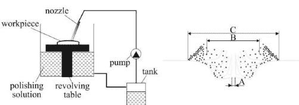

图 (1). 磨料射流加工过程布局 [51]。

#### 磨料水射流加工

磨料水射流加工是传统加工过程的进步，用水代替载气，并在采矿业中找到关键应用 [7]。有时它与浆料射流加工进行比较，后者以两种不同低压模块和预混合浆料混合物工作。在此，介质粘度起着重要作用，因为与空气相比，喷嘴处的射流强度提高了 100 倍。可以看到，AWJM 取得了许多改进，如粗糙度降低到纳米尺度 [8]，远处的足迹 [10]，更快的工件冷却和足够的浆料回收 [11, 12]。但由于水流停滞区的高减速以及粘度对磨料轨迹的高影响，发现冲击速度不同（图 **2 & 3**）。在此之后，磨料颗粒失去其所有动能。与空气相比，水中的材料去除率（MRR）较低，因为它提供较小的停滞区。也有研究旨在减少这种停滞区 [13]，并提议使用 V 形掩模。还发现，使用大豆油作为磨料载体可以减少主要足迹中工件的二次冲击 [14]。此处的缺点体现在压力流体的使用（特别是在加工陶瓷时）导致的裂纹形成及其扩展 [15]。

## 低温技术在 AJM 中的应用

前文已讨论过，由于使用磨料时无法通过精确定尺寸加工较软的金属，且细小的磨料具有高动能和高速度，在垂直撞击表面时容易穿透表面。因此发现，对于具有延展性或软质材料特性的工件，很难通过相同原理（即针对脆性或硬质材料的侵蚀原理）进行大量材料去除。因此，为了加工此类材料，引入了低温技术，以便改变材料去除机制。使用 AAJM（干式磨料射流加工）和低温辅助 AJM（磨料射流加工）对 AA5083-H32 铝合金进行了加工，并对表面完整性进行了对比研究 [16]。在该研究中，他们使用 -195°C 的液态氮，并通过压缩空气将其输送到加工区域。这导致硬度大幅提高，从而减少了侵蚀过程中嵌入材料的磨粒数量。伴随的现象是连续粗糙度的峰谷轮廓。使用的液态氮还产生了应变效应，从而通过晶粒细化使被加工材料硬化，显微硬度提高了近两倍。其他研究还采用了配备液态氮的热交换器，不仅用于冷却待加工材料，还用于冷却气流 [17, 18]。使用了 L N2 型管状热交换器，其内部具有高导热性，外部具有低导热性。磨粒在 -80°C 的射流条件下被导向材料。温度从 -80°C 变化到 180°C。当射流温度达到 -180°C 时，观察到侵蚀原理转变为脆性断裂。

该研究还发现，30°至 60°的入射角对于最大材料去除率（MRR）是最理想的。该研究表明，在 -180°C 下也可以获得对软材料的侵蚀。在较低温度下，利用脆性去除机制对这类材料进行更精确的加工也是一个值得考虑的方面。然而，使用液态氮也存在一些缺点，因为它本身需要大量的能源和能源消耗，并且如此高的冷却会导致材料内部热应变引起裂纹形成。但研究发现，这也导致表面弱化，这有助于材料的后续侵蚀。

## 热增强 AJM

*Patel 等人* [19] 发现，如 Inconel 718 和钛合金（Ti6Al4V）等某些材料不易加工；为了使磨粒能够穿透表面并产生侵蚀，这类材料需要具有较低的硬度。为此，通过氧气-乙炔气体火焰将工件加热至 850°C 以提供某种热辅助，从而降低表面硬度并提高使用磨料水射流加工时的 MRR。尽管过程中温度发生了剧烈变化，但在加工后的零件中并未发现应力和裂纹。

## 各种射流条件的影响

### 间歇射流条件

研究发现，当制造较大的沟槽或空腔时，磨粒有趋向于在这些特征底部沉降的趋势，从而阻碍后续新的磨粒到达被这些磨粒遮蔽的底部，进而降低 MRR。通过创建磨料流动的间歇阻塞模式，并在该时间段内通过高压射流来解决这种颗粒堆积的问题。这是通过安装 100 Hz 电磁阀来实现的，该阀门有助于创建磨料和高压空气射流的交替模式 [20]。这有助于去除底部的积聚磨料。研究发现，在一次 500 次射击的样本研究中，开/关时间为 10/40 毫秒时，孔深从 440μm 增加到 740 μm。

### 淹没射流条件

随着 AJM 的进步，带来了大量的技术和经济优势，但其环境影响也随之显现，例如过程中产生的噪音。为了研究这一方面，采用了淹没式 AWJM（磨料水射流加工）[21]。这在一定程度上降低了粒子到达加工表面前的动能。这也减少了射流上的拖曳力，从而导致沿喷嘴直径的射流衍射减少 [22]。这也提供了解决在加工过程中环境中粉尘较少问题的思路，传统方法中观察到的粉尘会导致肺部损伤等医疗影响。研究发现，当使用甘油作为淹没液体时，最大可减少 61%，配合液态聚合物可减少 42%，用水则减少 36% [23]。当液体与磨料浆液混合，且仅将高速射流直接导向工件时，喷嘴寿命有了显著提高。唯一的缺点是粒子的速度显著降低。

## 应用领域

磨料射流加工在许多领域都有应用，既有一些优势，也存在一些缺陷。本节讨论其中的一些优势及缺陷，并分析其在摩擦学领域的应用。以下是列举的一些优点：

- 它不仅发现了其技术方面，还发现了其环境方面，这可能带来更好的加工能力和环境可能性，从而提高工艺灵活性。
- 表面特性方面有很多改进，例如作为喷丸过程中塑性变形效应的晶粒细化和材料硬化 [25]。
- 研究发现，与常规加工方法相比，微加工的成本几乎降至最低，并且磨粒可以回收 [26]。

尽管有所有这些优势，但仍观察到一些缺陷，如加工深沟时形成的锥形几何形状 [28]，显著脆性材料上的微裂纹形成，微加工中 MRR 不稳定，因为无法获得具有稳定流速的细颗粒 [27]，微应用中的生产率也很低，并且观察到超过 105db 的临界噪声水平 [21]。

## 表面纹理化及摩擦学方面

Costa *等人* 发现，表面纹理化是一种创建均匀微纹理的方法，由具有受控几何形状的尖锐压痕组成 [29]。各种研究发现，随着世界开始向电子领域进步，微纹理化开始获得价值。有人指出，常规 AJM 和微 AJM 之间的界限在于其开口直径形状的孔设计标准。进行的各种研究表明，随着通道均匀性分辨率的简明化，使用 23µm 大小的磨粒颗粒，在 100µm 的路径中均匀性可达 5%，并受限于掩模尺寸和在边缘发现的磨损 [30]。研究还总结，限制这一过程的主要因素包括使用的掩模材料、低至 3µm 的细颗粒大小导致的一致流动问题以及冲击动能低和工作材料中最小的裂纹长度。

在获得表面纹理化能力后，它也在摩擦学领域找到了应用路径，如本节所示。可以看到，在医疗领域，全球范围内进行了大量的膝盖和髋部手术及置换。随着时间推移，其中 80% 在使用几年内报告了磨损 [31]。这在某种程度上与所用材料的表面完整性和硬度有关。在开发的所有人造关节滑动副中，最成功的是金属与聚乙烯的组合，其成功率为 90%，寿命为 15 年。进一步的研究表明，由于表面缺陷、裂纹、毛刺 *等* 导致的磨损和撕裂，导致关节寿命缩短。有观点认为，应该增强人造关节，使其能够收集使用过程中因磨损产生的所有颗粒，同时提供润滑以确保其平滑运行，从而将其使用寿命延长至 30 年。这种用于收集碎屑和润滑的微小孔隙很难通过常规加工方法加工，因此发现 AJM 在钻这些孔时很有用。一种抛光钴铬合金的技术

- 一种带有微观尺度雕刻沟槽的钼合金已被开发出来，可应用于假体，以最大限度地减少磨损 [32]。此外，其他研究还制造出了更小的孔和沟槽，其尺寸分别可达 100 μm 和 40 μm。这将整体促成人造膝关节和髋关节的发展，从而在摩擦学领域开辟出一个广阔的研究区域。

## 材料去除机制

在较早的章节中，可以看出磨粒流喷砂加工（AJM）已在具有延展性和脆性的各种材料以及各种工艺参数中找到了多种应用。与此同时，近期发现了一种名为“弹性侵蚀”的新型侵蚀现象。总体而言，材料去除机制（MRM）体现了机器的效率。对于脆性材料，磨粒撞击机器表面，并在向下方向上产生垂直于表面的裂纹，导致在变形材料截面区域底部形成一条平行于上表面的斜向裂纹。这里假设崩落的部分呈半球形，其深度或半径等于单个磨粒撞击产生的裂纹。已有许多研究将标准模型与陶瓷的韧性、硬度和粘弹性、产生的崩落物几何形状以及磨粒压入力与崩落物半径之间的关系进行了关联。作者还指出，裂纹扩展对于特定材料来说必须具有特定的能量。

## 弹性模式 MRM

前文已讨论过，表面完整性受颗粒尺寸的影响 [4]。脆性/延展性侵蚀会导致微观层面的表面结构发生变化。当我们将磨粒尺寸从 120 nm 减小到 40 nm 时，未发现表面粗糙度效应。因此，使用颗粒有助于减少最终加工表面上的变形和裂纹。因此，在使用小于 100 nm 尺寸的磨粒时，强调将压入机制转变为“表面积机制”。常规的大尺寸磨粒在表面上沿直线移动，但细磨粒可以随气流改变方向。对于特定的磨粒质量与流速之比，会出现切向力，从而将路径改变为曲线轨迹，并渐近地撞击工件基体（图 4）。因此，在侵蚀能量低于阈值能量但在基底表面产生侵蚀的情况下，即发生了弹性侵蚀。考虑到这一点，提出了一种基于产生化学侵蚀（即弹性侵蚀）的新理论，该理论考虑了羟基化效应和化学吸收。在此过程中，纳米级颗粒与基底表面发生化学反应，在基底顶层 1nm 距离内形成键合。Peng 等人 [33] 还指出，表面可被磨平至 0.17nm 的 Ra 粗糙度。在此机制中，最终工件表面未见缺陷。

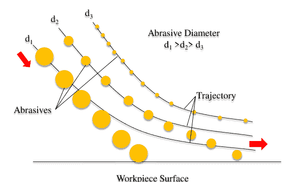

Fig. (4). 不同尺寸磨粒遵循的路径对比 [33]。

## 各种工艺参数的影响

### 磨粒尺寸

磨粒尺寸在任何磨粒射流机床中都起着非常重要的作用。随着磨粒尺寸的增加，与之相关的体积和质量发生变化，进而影响磨粒的动能，从而影响 AJM 的材料去除率（MRR），如表 1 所示。但是，即使颗粒比喷嘴尺寸小 15 倍，喷嘴尺寸也限制了所用磨粒的尺寸上限。研究发现，颗粒尺寸的增加还会导致表面粗糙度增加和产生更大的崩落物 [34]。Kowsari 等人 [35] 在其研究中指出，尺寸为 25µm 和 10µm 的颗粒在烧结陶瓷材料加工中产生了相似的峰谷粗糙度。对于陶瓷，崩落物是通过从基底剥离晶粒，然后与具有更强结合强度的金属晶粒结合而去除的。观察到的另一个因素是磨粒对工件表面的撞击，这被认为归因于两者之间的静摩擦。还发现，细颗粒与大尺寸磨粒相比，嵌入倾向较低 [36]。

### 流量

流量定义为在相应量的载气、液体或浆料中供应的磨粒颗粒的克数。*Li 等人* [37] 表明，流动动力学也可能取决于除此外的其他工艺因素。研究表明，随着流量降低，产生的沟槽形状变为略微锥度。使用干燥剂、保持储层中低水平的磨粒 *等* 被认为能带来最佳的磨粒流动。

### 喷嘴材料和几何形状

就像整个加工过程中的刀具磨损一样，喷嘴磨损在所有类型的 AJM 中都会发生。它是 AJM 中最精密的部分。携带颗粒的高压载气介质通过喷嘴孔洞。在通过过程中，颗粒多次与喷嘴内壁碰撞，从而导致其磨损及其轮廓扰动、过程不稳定性以及射流扰动。因此，将其视为改进领域非常重要。喷嘴磨损以‘喷嘴重量损失率’（NWLR，克/分钟）来衡量。在各种建议的喷嘴材料中，氧化铝陶瓷喷嘴的使用寿命比不锈钢喷嘴更长。与 Al2O3/钨、钛涂层相比，单一 B、C 涂层的 NWLR 降低了 30%。与此同时，发现功能梯度材料（FGM）的涂层证明了其耐磨性高达标准喷嘴的 4 倍。通过模拟相同的有限元（FEM）模型，还观察到喷嘴入口处的应力水平降低。同时，增加喷嘴长度会降低出口处的磨损速率。这样做后，颗粒速度矢量沿喷嘴长度获得相同的方向，从而减少了磨损。将喷嘴长度从 76mm 增加到 126 mm，喷嘴寿命翻倍。发现孔：喷嘴直径的最佳值为 0.4 [38]。还发现，拉应力和热应力也会导致大量喷嘴磨损。发现喷嘴入口的最佳角度为 11°。同时，较大的入口角度会产生更大的应力。

| 序号 | 作者 | 磨粒材料 | 工件材料 | 影响参数 | 结果 |
| :--- | :--- | :--- | :--- | :--- | :--- |
| 1 | Paul et al. [39] | 刚玉（Garnet） | C-37 钢 | 孔径- 0.3 mm，倾斜角- 90°，插入直径 1.1 mm，水压- 2000-3000 bar，磨粒流量-0.22--0.832 Kb/min，进给速度- 2000-4000mm/min， standoff 距离- 4-10mm，进给-0.25-0.8 | 进给速度、standoff 距离和进给量对 Ra 为 4-6μ 的影响最大。 |
| 2 | AM Hoogstrate et al. [40] | 刚玉（Garnet） 橄榄石 | 玻璃纤维金属层压板 | 孔径-0.3 mm，插入直径 1.1 mm，长度 51 mm，冲击角 90°，磨粒尺寸 60 目，水压 -2000 至 3000 bar，磨粒质量流量 0.145 至 0.92 kg/min，Stand-off 距离 - 2 mm，进给速度 500 至 3000mm/min | 层压层主要受水压影响。切削能力参数 ($\mathrm{C_a}$) 与割缝质量参数呈直接关系。 |
| 3 | Hussein et al. [41] | Al₂O₃ | GRPF 复合材料 3240 型 | 孔径- 6 至 8mm，切削速度- 0.2 至 0.3 m/min，磨粒流量 – 100 至 130 gm/min。射流压力 – 150 MPa，Standoff 距离 – 2mm。 | 切削进给、Standoff 距离和射流压力对表面粗糙度的影响最大。加工期间获得的 Ra 为 0.402 μm。 |
| 4 | Haque et al. [42] | 刚玉（Garnet）、Al₂O₃ 和 SiC | 玻璃 | 孔径- 0.1mm，射流方向 90°，SOD- 1-5mm，进给率 -10-50 mm/min.，射流压力- 10 至 50 ksi， | 切割锥度随 SOD 增加而增加，与另外两种相比，刚玉产生更多的锥度。锥度与工件进给率之间存在直接关系。SiC 的平均切割量和切削能力高于 Al₂O₃ 和刚玉。 |
| 5 | Vu Ngoc Pi et al. [43] | GMA 磨料（新的和回收的） | Al6061T6 | 孔径-0.25 mm，喷嘴直径-0.92mm，冲击角 90°，磨粒尺寸 63 至 180 μ，水压 -300 至 360MPa，磨粒质量流量 50 至 300g/min，Stand-off 距离 - 2 mm，进给速度 120mm/min。 | 新磨料和回收磨料的最佳尺寸均为 90μm，使用回收磨料时切削性能更好，表面粗糙度为 6μm。 |

## (表 1) 续

| 序号 | 作者 | 磨料材质 | 工件材质 | 影响参数 | 结果 |
| :--- | :--- | :--- | :--- | :--- | :--- |
| 6 | Khajavi 等人 [44] | 石榴石 | AA6063-T6 | 水压–165 至 239 MPa，行进速度 37 至 125 mm/min，磨料流量 – 0.35 至 0.95 kg/min，聚焦喷嘴直径– 0.8 至 1.5 mm。 | 利用 ANOVA 在 1% 误差范围内开发了预测工艺参数及其输出特性的模型。 |
| 7 | Guilhaue 等人 [45] | 黑色碳黑磨料颗粒 | 陶瓷 | 喷嘴直径 3 至 5 (mm)，压力 4-6 (kgf/cm²)， standoff 距离 20 至 40(mm) | 正交方法与 ANOVA 的结果相匹配，喷嘴直径对 MRR 的影响最大，而 SOD 对切缝宽度的影响最大 |
| 8 | Rao 等人 [46] | 石榴石 (36% FeO, 33% SiO₂, 20% Al₂O₃, 4% MgO, 3% TiO₂, 2% CaO 和 2% MnO₂)。 | 低碳钢 | 水压 35000 -55000 psi，行进速度 80-320 mm/min，SOD – 1 到 4 mm，射流冲击角- 90° 喷嘴直径- 0.35 mm，喷嘴长度 – 76.2mm，喷嘴直径.-1.05mm，磨料直径 0.18 mm | 与水压和 SOD 相比，行进速度对表面粗糙度的影响最大。获得最小 SR 的最佳参数为：水压 – 35000 psi，速度 – 80mm/min 和 SOD 2.5mm |
| 9 | S. Srinivas 等人 [47]. | 石榴石 | Inconel 718 | 水压 – 100 至 300 MPa，行进速度 – 75-175 mm/min., 磨料流量 – 0.3017 至 0.5994 kg/min，孔口直径 0.25 mm，射流冲击角 90°，聚焦喷嘴直径 1.07mm | 行进速度和水压是穿透深度最重要的因素。 |
| 10 | Santanakumar 等人 [48] | 石榴石 | 陶瓷瓦 | 磨料粒度 – #80 至 120，磨料流量 - 300 至 500 gm/min，SOD - 1 至 3 mm，水压-2000 至 3000 bar，射流行进速率 - 200 至 400 mm/min. | 提出了一种预测模型，用于优化表面粗糙度和锥度角，其平均值分别为 5.27 µm 和 1.41°。 |

*(表 1) 续*

| 序号 | 作者 | 磨料材质 | 工件材质 | 影响参数 | 结果 |
| :--- | :--- | :--- | :--- | :--- | :--- |
| 11 | Kanthababu 等人 [49] | 石榴石 | Al7075 (0 至 15%) 与 B₄C 复合材料 | 孔口直径 ~ 0.25 mm，聚焦喷嘴直径 0.75mm，射流冲击角 90°，网目尺寸 ~ 80 至 120#，磨料流量 240 至 440 g/min.，水压~ 125 至 275 MPa，行进速率~ 60 至 120 mm/min. | 测量了每种复合材料的 DOC（切削深度），并确定了切削特性的最佳条件。对于 5% Al7075 与 B₄C 金属复合材料，获得了高达 25 mm 的 DOC。 |

DOC-切削深度，# = 网目尺寸，SR/Ra- 表面粗糙度，SOD= standoff 距离（喷射距离），MRR= 材料去除率。

## 结论

AJM（磨料水射流加工）是一种现代加工技术，在微观至宏观尺度上提供具有更高精度和控制能力的加工。本文讨论了各种类型的 AJM 及其在精度、更好环境的可持续性以及大尺寸加工方面的优缺点。*等等*。研究表明，AJM 的摩擦学应用显得非常相关，应进行更多研究以将其扩展到其他领域。还研究了引入低温技术以加工较软材料并提供精密加工的情况。这也带来了诸如热应力等其他缺点，这也需要研究。由于温度和热效应在对加工效率产生更高影响方面起着非常重要的作用，因此也需要将这种影响最小化。还可以研究 AJM 的入射角，因为它被证明是磨料流体射流抛光 (AFJP) 中的重要因素 [50]。射流喷嘴的磨损特性也没有得到彻底的研究，因此也可以对此进行研究。虽然 FGM（功能梯度材料）为喷嘴磨损提供了很大的改进，但也可以研究微蓝宝石和钻石喷嘴等更多材料，以检查其性能特性。

## 出版同意书

不适用。

## 利益冲突

作者确认本章节内容不存在利益冲突。

## 致谢

作者愿向编辑和匿名审稿人表示诚挚的谢意，感谢他们付出的时间和宝贵建议。

## 参考文献

1.  F.J. Chen, S.H. Yin, H. Ohmori, and J.W. Yu, "Form error compensation in single-point inclined axis nanoengraving for small aspheric inset", *Int. J. Adv. Manuf. Technol.*, vol. 65, no. 1–4, pp. 433-441, 2013.
    [http://dx.doi.org/10.1007/s00170-012-4182-4]

2.  F.J. Chen, S.J. Hu, and S.H. Yin, "A novel mathematical model for grinding ball-end milling cutter with equal rake and clearance angle", *Int. J. Adv. Manuf. Technol.*, vol. 63, no. 1–4, pp. 109-116, 2012.
    [http://dx.doi.org/10.1007/s00170-011-3889-y]

3.  A. Ray, and S. Jagadish Bhowmik, "Abrasive water jet machining of composite materials. Advanced Manufacturing Technology, 2017, pp. 77-97."

4.  H. Fang, P.J. Guo, and J.C. Yu, "Research on material removal mechanism of fluid jet polishing", *Optimization Technique*, vol. 30, no. 2, pp. 248-250, 2004.

5.  S. Verma, S.K. Moulic, and S.K. Mishra, "Nozzle Wear Parameter in Water Jet Machining The Review", *International Journal of Engineering Development and Research*, vol. 2, pp. 1063-1073, 2014.

6.  M. Wakuda, Y. Yamauchi, and S. Kanzaki, "Effect of Workpiece Properties on Machinability in Abrasive Jet Machining of Ceramic Materials", *Precis. Eng.*, vol. 26, pp. 193-198, 2002.
    [http://dx.doi.org/10.1016/S0141-6359(01)00114-3]

7.  M. Molitoris, J. Petel, A. Hosovsky, M. Tothova, and K. Zidek, "A Review of Research on Water Jet with Slurry Injection", *Procedia Eng.*, vol. 149, pp. 333-339, 2016.
    [http://dx.doi.org/10.1016/j.proeng.2016.06.675]

8.  Z.Z. Li, J.M. Wang, X.Q. Peng, L.T. Ho, and Z.Q. Yin, S.Y. Li, C.F. Cheung, "Removal of Single Point Diamond-turning Marks by Abrasive Jet Polishing", *Appl. Opt.*, vol. 50, pp. 24-58, 2011.
    [http://dx.doi.org/10.1364/AO.50.002458]

9.  T. Matsumura, T. Muramatsu, and S. Fukei, "Abrasive Water Jet Machining of Glass with Stagnation Effect", vol. 60, *CIRP Annals – Manufacturing Technology*, 2011, pp. 355-358.

10. N. Hagbin, J.K. Spelt, and M. Papini, "Abrasive Waterjet Micro-machining of Channels in Metals: Comparison Between Machining in Air and Submerged in Water", *Int. J. Man. Tools Manuf.*, vol. 88, pp. 108-117, 2015.
    [http://dx.doi.org/10.1016/j.ijmachtools.2014.09.012]

11. H.C. Li, and W. S. Chen, "Recovery of Silicon Carbide from Waste Silicon Slurry by Using Flotation", *Energy Procedia*, vol. 136, pp. 53-59, 2017.
    [http://dx.doi.org/10.1016/j.egypro.2017.10.281]

12. J.Y. Kim, U.S. Kim, M.S. Byeon, W.K. Kang, K.T. Hwang, and W.S. Cho, "Recovery of Cerium from Glass Polishing Slurry", *J. Rare Earths*, vol. 29, pp. 1075-1078, 2011.
    [http://dx.doi.org/10.1016/S1002-0721(10)60601-1]

13. T. Matsumura, T. Muramatsu, and S. Fukei, "Abrasive Water Jet Machining of Glass with Stagnation Effect", vol. 60, *CIRP Annals – Manufacturing Technology*, 2011, pp. 355-358.

14. K. Kowsari, M. Papini, and J.K. Spelt, "Selective Removal of Metatle Layers from Sintered Ceramic and Metallic Plates Using Abrasive Slurry Jet Micro-machining", *J. Manuf. Process.*, vol. 29, pp. 252-264, 2017.
    [http://dx.doi.org/10.1016/j.jmapro.2017.08.005]

15. S. Lathabai, and D.G. Pender, “Microstructural Influence in Slurry Erosion of Ceramics”, *Wear*, vol. 189, pp. 122-135, 1995.
    [http://dx.doi.org/10.1016/0043-1648(95)06679-9]

16. N. Yuvraj, and M.P. Kumar, “Cutting of Aluminium Alloy with Abrasive Water Jet and Cryogenic Assisted Abrasive Water Jet: A Comparative Study of the Surface Integrity Approach”, *Wear*, vol. 362-363, pp. 18-32, 2016.
    [http://dx.doi.org/10.1016/j.wear.2016.05.008]

17. A.G. GraeBen, J.K. Spelt, and M. Papini, “Cryogenic Abrasive Jet Machining of Polydimethylsiloxane at Different Temperatures”, *Wear*, vol. 274-275, pp. 335-344, 2012.
    [http://dx.doi.org/10.1016/j.wear.2011.09.013]

18. A.G. GraeBen, M. Papini, and J.K. Spelt, “The Effect of Temperature on the Cryogenic Abrasive Jet Micro-machining of Polytetraorthoxyethylene, High Carbon Steel and Polydimethylsiloxane”, *Wear*, vol. 317, pp. 170-178, 2014.
    [http://dx.doi.org/10.1016/j.wear.2014.06.002]

19. D. Patel, and P. Tandon, “Experimental Investigations of Thermally En-hanced Abrasive Water Jet Machining of Hard-to-machine Metals”, *CIRO J. Manuf. Sci. Technol.*, vol. 10, pp. 92-101, 2015.
    [http://dx.doi.org/10.1016/j.cirpj.2015.04.002]

20. L. Zhang, T. Kuriyagawa, Y. Yasutomi, and J. Zhao, “Investigation into Micro Abrasive Intermittent Jet Machining”, *Int. J. Mach. Tools Manuf.*, vol. 55, pp. 873-879, 2005.
    [http://dx.doi.org/10.1016/j.ijmachtools.2004.11.003]

21. A. Radvanska, T. Ergic, Z. Ivandic, S. Hloch, J. Valicek, and J. Mullerova, “Technical Possibilities of Noise Reduction in Material Cutting by Abrasive Water-jet”, *Strojarsvo*, vol. 51, pp. 347-354, 2009.

22. N. Hagbin, J.K. Spelt, and M. Papini, “Abrasive Waterjet Micro-machining of Channels in Metals: Model to Predict High Aspect-ratio Channel Profiles for Submerged and Unsubmerged Machining”, *J. Mater. Process. Technol.*, vol. 222, pp. 399-409, 2015.
    [http://dx.doi.org/10.1016/j.jmatprotec.2015.03.026]

23. R.H.M. Jafar, V. Hadavi, J.K. Spelt, and M. Papini, “Dust Reduction in Abrasive Jet Micro-machining Using Liquid Films”, *Powder Technol.*, vol. 301, pp. 1270-1274, 2016.
    [http://dx.doi.org/10.1016/j.powtec.2016.08.002]

24. C.J. Wang, C.F. Cheung, L.T. Ho, M.Y. Liu, and W.B. Lee, “A Novel Multi-jet Polishing Process and Tool for High-efficiency Polishing”, *Int. J. Mach. Tools Manuf.*, vol. 115, pp. 60-73, 2017.
    [http://dx.doi.org/10.1016/j.ijmachtools.2016.12.006]

25. S. Barriuso, M. Jaafr, J. Chao, A. Aseno, and J.L. Gonzalez-Carrasco, “Improvement of the Blasting Induced Effects on Medical 316 Lvm Stainless Steel by Short-term Thermal Treatments”, *Surf. Coat. Tech.*, vol. 258, pp. 1075-1081, 2014.
    [http://dx.doi.org/10.1016/j.surfcoat.2014.07.027]

26. Y. Dong, W. Liu, H. Zhang, and H. Zhang, “On-line Recycling of Abrasives in Abrasive Water Jet Cleaning”, *Procedia CIRP*, vol. 15, pp. 278-282, 2014.
    [http://dx.doi.org/10.1016/j.procir.2014.06.045]

27. R. Shukla, and D. Singh, “Experimentation Investigation of Abrasive Water Jet Machining Parameters Using Taguchi and Evolutionary Optimization Techniques”, *Swarm Evol. Comput.*, vol. 32, pp. 167-183, 2017.
    [http://dx.doi.org/10.1016/j.swevo.2016.07.002]

28. N.S. Pawar, R.R. Lakhe, and R.L. Shrivastava, “Validation of Experimental Work by Using Cubic Polynomial Models For Sea Sand as an Abrasive Material in Silicon Nozzle in Abrasive Jet Machining Process”, *Materials Today: Proceedings*, vol. 2, pp. 1927-1933, 2015.

29. H. Costa, and I. Hutchings, “Some Innovative Surface Texturing Techniques for Tribological Purposes”, *Proc. Inst. Mech. Eng., Part J J. Eng. Tribol.*, vol. 229, pp. 429-448, 2015.

[30] P.J. Slikkerveer, P.C.P. Boutsen, and F.C.M. De Haas, “通过粉末喷射实现脆性材料的高质量机械刻蚀”，*Sens. Actuators A Phys.*, 第 85 卷, 第 296-303 页, 2000. [http://dx.doi.org/10.1016/S0924-4247(00)00343-5]

[31] L. Kuniczka, R. Kociej, and T.C. Lowe, “关节置换用金属和合金的进展”，*Prog. Mater. Sci.*, 第 88 卷, 第 232-280 页, 2017. [http://dx.doi.org/10.1016/j.pmatsci.2017.04.002]

[32] Y. Nakaniishi, Y. Nakashima, Y. Fujiwara, Y. Komohara, M. Takeya, H. Miura, and H. Higaki, “Co-28Cr-6Mo 合金表面轮廓对人工关节用超高分子量聚乙烯磨损行为的影响”，*Tribol. Int.*, 第 118 卷, 第 538-546 页, 2018. [http://dx.doi.org/10.1016/j.triboint.2017.06.030]

[33] W. Peng, C. Guan, and S. Li, “流体射流抛光中粒子尺寸对材料去除模式的影响”，*Appl. Opt.*, 第 52 卷, 第 33 期, 第 7927-7933 页, 2013. [http://dx.doi.org/10.1364/AO.52.007927] [PMID: 24513743]

[34] N. Su, L. Yue, Y. Liao, W. Liu, H. Zhang, X. Li, H. Wang, and J. Shen, “各种喷砂条件对牙科氧化锆表面变化及氧化锆核心与间接复合树脂之间剪切结合强度的影响”，*J. Adv. Prosthodont.*, 第 7 卷, 第 3 期, 第 214-223 页, 2015. [http://dx.doi.org/10.4047/jap.2015.7.3.214] [PMID: 26140173]

[35] K. Kowsari, M.R. Sookhakari, H. Nouraei, M. Papini, and J.K. Splett, “含铜填充通孔与无通孔的烧结陶瓷晶圆混合侵蚀射流微铣削”，*J. Mater. Process. Technol.*, 第 230 卷, 第 198-210 页, 2016. [http://dx.doi.org/10.1016/j.jmatprotec.2015.11.027]

[36] V. Hadavi, B. Michaelson, and M. Papini, “磨料空气射流内瞬时粒子取向的测量与建模及其对粒子嵌入的影响”，*Wear*, 第 336–337 卷, 第 9-20 页, 2015. [http://dx.doi.org/10.1016/j.wear.2015.04.016]

[37] H. Li, J. Wang, N. Kwok, T. Nguyen, and G.H. Yeoh, “磨料空气射流微加工玻璃微孔几何演化研究”，*J. Manuf. Process.*, 第 31 卷, 第 156-166 页, 2018. [http://dx.doi.org/10.1016/j.jmapro.2017.11.013]

[38] M. Nanduri, D.G. Taggart, and T.J. Kim, “系统参数和几何参数对磨料水射流喷嘴磨损的影响”，*Int. J. Mach. Tools Manuf.*, 第 42 卷, 第 615-623 页, 2002. [http://dx.doi.org/10.1016/S0890-6955(01)00147-X]

[39] S. Paul, A.M. Hoogstrate, C.A. van Luttervelt, and H.J.J. Kals, “磨料水射流矩形槽铣削实验研究”，*J. Mater. Process. Technol.*, 第 73 卷, 第 179-188 页, 1998. [http://dx.doi.org/10.1016/S0924-4247(97)00227-6]

[40] S. Paul, A.M. Hoogstrate, and R. van Praag, “玻璃纤维金属层压板的磨料水射流加工”，*机械工程师学会论文集，C 部分：机械工程科学期刊*, 第 216 卷, 第 5 期, 第 1459-1469 页, 2002. [http://dx.doi.org/10.1243/095440702320783396]

[41] M.A.I. Hussein, A. Iqbal, and M. Hashemifam, “利用磨料水射流加工工艺对 GFPR 复合材料钻孔的数值优化”，*Zhongguo Gongcheng Kexuan*, 第 38 卷, 第 66-76 页, 2015. [http://dx.doi.org/10.1080/02533839.2014.953240]

[42] A.A. Khan, and M.M. Haque, “不同磨料材料在玻璃磨料水射流加工过程中的性能”，*J. Mater. Process. Technol.*, 第 191 卷, 第 404-407 页, 2007. [http://dx.doi.org/10.1016/j.jmatprotec.2007.03.071]

[43] V.N. Pi, and A.M. Hoogstrate, “磨料水射流（AWJ）加工中磨料回收与再充电的研究”，*Int. J. Machining and Machinability of Materials*, 第 6 卷, 第 3/4 期, 第 213-233 页, 2009. [http://dx.doi.org/10.1504/IJMM.2009.027325]

[44] A. Farhad Kolahan, “预测和优化 6063-T6 铝合金 AWJ 加工切削深度的统计方法”，*World Academy of Science, Engineering and Technology International Journal of Mechanical and Mechatronics Engineering*, 第 3 卷, 第 11 期, 2009.

[45] U.D. Gulhane, P.P. Patkar, P.P. Toraskar, S.P. Patil, and A.A. Patil, “磨料射流加工参数对陶瓷等硬脆材料材料去除率（MRR）和切缝宽度的分析”，*International Journal of Design and Manufacturing Technology*, 第 4 卷, 第 1 期, 第 51-58 页, 2013. [IJDMT].

[46] M. Sreelvasa Rao, S. Ravinder, and A. Seshu Kumar, “低碳钢磨料水射流加工的参数优化：田中方法”，*International Journal of Current Engineering and Technology*, 特刊, 第 2 卷, 第 28-30 页, 2014.

[47] Raghavendra, Y. Ratnagiri, and S. Srinivas, “工艺参数对 Inconel 718 磨料水射流渗透能力的影响”，*International Conference on Precision Engineering (COPEN 10)*, 第 404-407 页, 2017.

[48] M. Santhanakumar, R. Adalarasan, and M. Rajmohan, “基于灰度响应面法的陶瓷瓷砖磨料水射流切削实验建模与分析”，*Arab. J. Sci. Eng.*, 第 40 卷, 第 3299-3311 页, 2015. [http://dx.doi.org/10.1007/s13369-015-1775-x]

[49] V. Mohanakumar, and M. Kanthababu, “Al7075/B4C 金属基复合材料磨料水射流加工切削深度的实验研究”，*Int. J. Engine Res.*, 第 5 卷, 第 4 期, 第 322-326 页, 2016.

[50] C.J. Wang, C.F. Cheung, and M.Y. Liu, “流体射流抛光三维材料去除特性的数值建模与实验”，*Int. J. Mech. Sci.*, 第 133 卷, 第 568-577 页, 2017. [http://dx.doi.org/10.1016/j.ijmecscl.2017.09.018]

## 第 6 章

## 陶瓷基复合材料电火花加工综述

**Manta** 1.*, **Suneev Anil Bansal** 1 和 **Bhuvnesh Kumar** 2

1. 印度哈里亚纳邦索兰巴迪 Maharaja Agrasen 大学机械工程系
2. 印度哈里亚纳邦 SRM 大学德里 NCR 校区机械工程系

**摘要：** 电火花加工（EDM）是一种非传统工艺，已被广泛用于切割镍及其合金、钛以及复杂形状材料等较硬的材料，这些材料通过其他传统方法难以加工。EDM 利用电能和热能通过去除多余材料来加工工件。该工艺使用两个电极，即阳极和阴极，其中工具作为阴极，接受加工的工件作为阳极。电流、脉冲开/关时间、施加电压等因素可用于优化 EDM 的主要加工参数，如材料去除率（MRR）、工具磨损率、表面粗糙度等。本研究的主要重点是这些参数对由陶瓷基复合材料（CMs）、钨和碳化钴等制成的复合材料的影响。最后，还讨论了需要进一步改进和研究领域的未来前景。

**关键词：** 陶瓷，复合材料，电火花加工。

### 引言

电火花加工（EDM）是一种用于金属加工的流行制造工艺。在该工艺中，通过控制电极和正在接受操作的工件之间的火花，以熔化并蒸发所有具有电导性质的材料的形式进行加工 [1, 2]。这就是 EDM 也被称为非传统火花侵蚀热电加工过程的原因 [3]。经过一段时间的发展，EDM 已成为一种高效的材料去除工艺。EDM 具有加工非常复杂和坚硬材料的能力，并且还能保持高精度，而这些材料用其他传统方法很难加工。

为了跟上现代制造业的步伐，EDM 也具有成为自动化工艺的能力。EDM 主要应用于原型制造、模具和量具制造行业，以及主要涉及加工金属（如高合金钢）生产的行业。

在过去几十年中，陶瓷材料（CMs）通过在所有主要工程部门（如汽车、航空航天、涉及电气和电子设备制造的领域）中的应用而确立了其地位。一些主要应用，如防弹装甲的制造、汽车制动系统、柴油颗粒过滤器、计算机存储器组件、传感器以及各种医疗产品（如假肢）等，也涉及 CMs 的使用 [5]。CMs 具有如此广泛应用的原因在于其优异的机械性能，如高抗压强度、高硬度以及耐化学和耐磨性能。

WC-Co 也被探索用于 EDM 加工。一份特别 CIRP 报告也提到了 EDM 在硬质合金中的应用 [6]。尽管据报道 EDM 表面确实存在残余热应力 [7]。某个团队

### EDM 原理

在 EDM 中，通过控制两个电极之间的放电来实现材料去除，其中一个电极是工具，另一个是正在接受加工的工件，如图 (1) 所示。

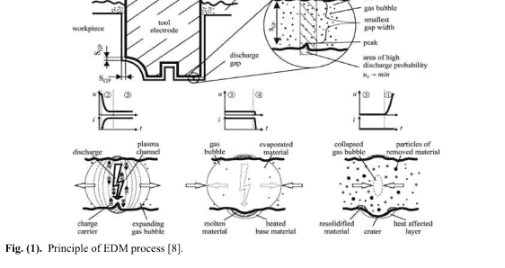

两个电极之间由某种介质隔离，该介质可能是绝缘油或去离子水。然后施加电压，从而形成等离子体通道，使电流能够流动。当电压介质达到击穿阈值时，就会发生放电。由于电火花加工（EDM）过程基于通过熔化和蒸发去除材料，因此当形成通道的底部温度达到约 ≥ 10,000°K 时，第二电极（工件）发生熔化和蒸发，从而导致材料去除。

## 陶瓷的电火花加工

CMs（复合材料），如二硼化钛（$\text{TiB}_2$）、硅掺杂碳化硅（Si-SiC）和氮化钛（$\text{TiN}$），在本质上是导电的，可以通过电火花加工（EDM）进行加工 [9]。根据 Luis 等人 [10] 的说法，由无机材料获得的、通常具有高纯度的材料被称为陶瓷或高级 CMs。这些 CMs 进一步分为氧化物陶瓷（如 $\text{Al}_2\text{O}_3$ 或 $\text{ZrO}_2$）和非氧化物陶瓷（如 $\text{Si}_3\text{N}_4$ 或 SiC）。

使用电火花加工（EDM）过程加工 CMs 也可以分为天然导电材料、非导电材料和导电材料。大多数导电材料是通过混合一些杂质原子由非导电材料制成的，这是通过引入一些导电的第二相来实现的（图 2）。

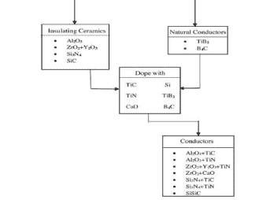

图 (2). 基于导电性的陶瓷材料分类 [11]。

向 CMs 中添加这些相从而增加了其电导率。据报道，添加这些掺杂剂也会在一定程度上改善硬度、强度和断裂韧性 [12, 13]。

## 复合材料陶瓷中的材料去除机制

Lauwers 等人 [13] 进行了一项研究，旨在开发耐磨且能通过电火花加工（EDM）过程加工的 CMs。这项研究的主要重点是调查电火花加工过程参数与 CMs 微观结构之间的关系。为此，选取了基于 $\text{ZrO}_2$、$\text{Al}_2\text{O}_3$ 和 $\text{Si}_3\text{N}_4$ 的 CMs，并通过 $\text{TiC}_n$ 和 $\text{TiN}$ 向这些材料中引入一些具有导电性的相。结果观察到，除了熔化和蒸发外，氧化和基体材料分解等因素也是有效去除材料的原因。此外，还指出，过程中的裂纹形成是由于剥落效应导致的。

主要材料去除机制见表 1。

表 1. 不同复合 CMs 的材料去除机制 [13]。

| 复合陶瓷 | 介质 | 机床配置 | 材料去除机制 |
| :--- | :--- | :--- | :--- |
| $\text{ZrO}_2$-TiN | 去离子水 | WEDM（粗化条件下的线切割电火花加工） | 熔化和蒸发 |
| $\text{Al}_2\text{O}_3$-SiCw-TiC | 去离子水 | WEDM（粗化条件下的线切割电火花加工） | 熔化和蒸发 |
| $\text{Al}_2\text{O}_3$-SiCw-TiC | 油 | 中到高能量输入的慢走丝/型腔电火花加工 | 剥落 |
| $\text{Si}_3\text{N}_4$-TiN | 去离子水 | 高能量输入的型腔电火花加工 | 剥落 |
| $\text{Si}_3\text{N}_4$-TiN | 去离子水 | WEDM | 氧化、分解 |
| $\text{Si}_3\text{N}_4$-TiN | 油 | 粗化条件下的型腔电火花加工 | 熔化、蒸发 |

从表 1 中观察到，介质、放电介质以及加工参数的配置在材料去除机制中起着重要作用。两大主要机制是熔化/蒸发和剥落。熔化和蒸发发生在低能量放电状态下，而剥落机制则发生在高能量放电状态下。一些陶瓷和金属材料的电导率概述显示在图 (3) 中。观察到，与金属材料一样，本质导电的陶瓷也可以通过电火花加工（EDM）过程轻松加工，例如二硼化钛（$\text{TiB}_2$）、氮化钛（$\text{TiN}$）或硅掺杂碳化硅（SiC）[14]。

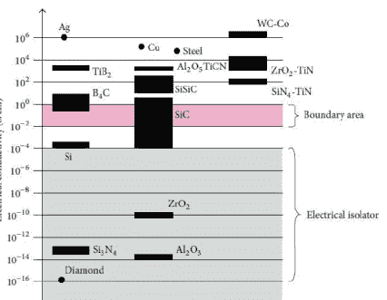

图 (3). 材料的电导率 [15]。

## WC-Co 复合材料的加工

由碳化钨/钴（WC-Co）材料制成的复合材料具有良好的机械性能范围，如良好的强度、高硬度值以及在较宽温度范围内良好的耐磨性，因此在模具、切削工具和一些特殊用途工具的制造中有着广泛的应用。这些复合材料具有极高的比强度，因此难以通过传统加工过程进行加工 [16]。此外，由于涉及一些复杂的形状，因此在加工过程中需要非常高的精度，这是传统加工过程无法达到的 [17]。

多项研究报告了使用传统过程加工这些材料，例如在 CNC 车床上使用 CBN 刀具。所得结果表明了负面影响，如高切削力、低材料去除率（MRR）以及加工表面质量差 [18]。另一方面，Levy 等人 [19] 和 Bonny 等人 [20] 进行了一些研究，观察到电火花加工（EDM）过程能够加工这些复合材料，以制造涉及复杂形状的整体硬质合金模具，无论其硬度和强度如何。在另一项研究中，Mahdavinejad 等人 [2] 进行了一项研究，以分析电火花加工（EDM）过程在加工 WC-Co 复合材料时的不稳定性。结果显示，对于不同配比的 WC-Co 复合材料，脉冲持续时间的因素会影响材料去除率。去除率随脉冲持续时间的增加而增加。还观察到，加工不稳定性也随脉冲持续时间的增加而增加。指出这种不稳定性可以通过降低所形成的复合材料中 Co 的百分比来减少（图 4）。

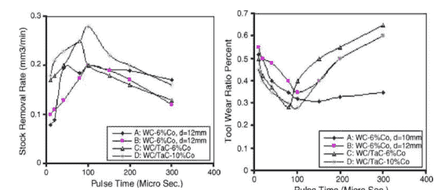

图 (4). WC-Co 不同成分中刀具磨损率、脉冲时间和材料去除率变化的影响 [2]。

进行了类似的研究，观察到脉冲时间和脉冲电流等各种因素极大地影响正在进行作业的工件的表面粗糙度 [6]。这些加工参数的值越高，工件的表面粗糙度值将越好 [6]。

## 电火花加工 - 文献综述

Gadalla 等人 [21] 进行了实验，以检查由 CMs 制成的复合材料通过电火花加工（EDM）过程的成型。结果与其他传统过程加工的曲面进行了比较。结果表明，由于单位体积能量的减少，MRR 增加，且电阻率和热扩散率等主要因素是影响 MRR 的主要因素。还指出，材料的表面粗糙度在很大程度上受材料晶粒尺寸分布的影响。在类似的研究中，Farooqui 等人 [22] 比较了陶瓷和先进陶瓷通过电火花加工（EDM）过程的加工。观察到过程的脉冲持续时间负责材料的去除机制。较短的脉冲导致氧化和分解，而较长的脉冲则导致剥落机制。在另一项研究中，Gamage 等人 [23] 使用全铝 3003 作为材料，使用由 AISI P20 制成的刀具进行线切割电火花加工（wire EDM）和型腔电火花加工（DSEDM）的案例研究。观察了结果，并指出电能是主要的影响源，其次分别是型腔电火花加工（DSEDM）和线切割电火花加工（wire EDM）中的绝缘油和线材材料等因素。Lauwer [24] 提出了一项研究，概述了与由 CMs 制成的复合材料的电火花加工（EDM）相关的各种挑战。结果得出结论，通过改变材料的成分，可以在一定程度上改善电火花加工过程和材料的机械性能。Schubert 等人 [15] 进行了一项研究，介绍了有关由 CMs 制成的复合材料微型电火花加工的最新研究。还讨论并介绍了用于绝缘陶瓷和陶瓷加工的程序示例。结果观察到，由于辅助电极的方法，建议加工绝缘陶瓷，因此被视为适用于 CMs 的后处理过程。Buccioi 等人 [25] 进行了实验，通过电火花加工过程处理由硅和氮化钛制成的生物医学植入物设备。研究了其机械、毒理学和微观结构特性，观察到这些材料与其他用于制造相同关节的氧化物 CMs 相比表现良好，并且诸如倒扣和近净形状等非常复杂的形状可以通过电火花加工过程制造。

Mohri 等人 [26] 进行了实验，以研究通过使用辅助电极对绝缘 CMs 进行电火花加工的应用。使用煤油作为工作流体，观察到使用铜电极对 CMs 的加工非常容易。在另一项研究中，报告了对 $\text{ZrO}_2$-TiN 混合复合材料进行线切割电火花加工精加工。使用等离子活化烧结法合成 $\text{ZrO}_2$-TiN 坯料 [27]。Sano 等人 [28] 使用由多晶金刚石（PCD）制成的电极进行电火花加工实验。使用两种 PCD，即 CTB-010 和 CTH-015，两者均有平坦表面，并将结果与由 Cu-W 制成的电极进行比较。观察到由 PCD 制成的电极在短脉冲持续时间下磨损较少，为 1.5%，而在长脉冲持续时间下无磨损，而在相同条件下，由 Cu-W 制成的电极磨损为 10%。Palanikumar 等人 [29] 进行了测试，以研究通过电火花加工过程加工 WC/Co 整体硬质合金复合材料的工艺参数。还分析了各种加工参数，并观察到这些参数对 MRR 和表面质量的影响。在类似的研究中，Hanaoka 等人 [30] 研究了使用辅助电极的电火花加工过程对由 $\text{Si}_3\text{N}_4$ CMs 制成的复合材料的放电行为的影响。在结论中，指出绝缘材料的 MRR 结果优于导电材料的结果。Gadalla 和 Tasi [31] 进行了一些实验研究，以演示钴含量和晶粒尺寸对钨整体硬质合金的各种加工特性的影响

碳化物。观察到材料去除率（MRR）可以通过钴的百分比进行调整。随着钴含量的增加，MRR 也会提高，同时增强电火花加工（EDM）过程的稳定性。Lin 等人 [32] 进行了一些研究，试图建立各种参数（如 MRR、表面粗糙度、表面裂纹）与放电率之间的联系。结果显示，增加电能放电会显著增加由 EDM 工艺形成的材料的 MRR 和表面粗糙度。

Song 等人 [33] 进行了一项实验，以研究 EDM 工艺对由含 10.5% 钴的 WC-Co 复合材料的影响，并使用水喷雾作为介电介质。结果表明，使用水喷雾介电介质未报告腐蚀现象，且 MRR 增加，同时电极磨损显著减少。Yu 等人 [34] 使用两种类型的 EDM 工艺——干式 EDM 和传统基于油介质的 EDM——对硬质合金进行了实验研究。结果显示，与传统基于油介质的 EDM 相比，干式 EDM 在高速切削和低电极磨损方面表现出更好的结果。研究进一步指出，干式 EDM 也可用于作为工件材料的碳化物的三维加工。在另一项研究中，Kumar 等人 [35] 研究了 EDM 工艺对由含 5 wt.% SiC 和 5 wt.% B₄C 的 Al63Si 复合材料的一些加工参数（如脉冲开启和关闭时间、脉冲电流和电压）的影响。观察了工具磨损、表面粗糙度和功耗，并指出随着电放电和脉冲电流的增加，工具磨损增加的可能性显著增大。在类似的研究中，Patel 等人 [36] 优化了由 Al₇₀.₅-SiCw-TiC 制成的复合材料在 EDM 工艺下的表面粗糙度参数。通过在 Al₂O₃ 中加入 SiC 晶须和 TiC 颗粒实现了机械性能的提升。结果结论认为，表面方法学对于获得 EDM 工艺形成的复合材料更好的表面光洁度非常有用。Selvarajan 等人 [37] 综述了用于工业应用中并经 EDM 处理的复合材料的各种参数。讨论了获得更好输出所需的多种因素，并得出结论，在所研究的材料中，Al₁₂O₃、SiC 和 TiC 由于其易加工性，在大多数应用中需求量最大。Kangararajan [38] 进行了研究，比较了由粉末冶金工艺和 EDM 工艺制造的 WC-Co 复合材料磨损机制的结果。使用概率神经网络绘制了不同工艺磨损机制的图谱。随后将磨损状态分为三个部分：轻微磨损、严重磨损和超严重磨损。这些状态基于磨损率和材料表面粗糙度等各种因素。还观察到，由 EDM 工艺形成的表面的机械性能因电放电产生的气泡和熔坑而受损。研究结论认为，从磨损表面粗糙度和磨损率的角度来看，陶瓷磨损状态可简要识别为轻微磨损、严重磨损和超严重磨损。电火花在加工表面产生熔坑、气泡和裂纹，这恶化了 EDM WC-Co 表面的光洁度和机械性能，对于表面敏感的应用应予以去除。Dinsh 等人 [39] 开展了一项研究，调查了不同工艺参数对诸如电极进给率；脉冲开启/关闭时间和电放电等点的影响。结果表明，电流是影响经 EDM 处理的复合材料 MRR 和表面粗糙度的主要因素。Aidil 等人 [40] 开展研究并仔细审查了影响 EDM 工艺的各种加工因子的各种参数。观察到，随着脉冲开启时间的增加，由于等离子通道的扩张，材料去除减少，从而导致 MRR 率和材料表面粗糙度降低。同样，随着脉冲关闭时间的增加，这些参数的值也增加。

## 表 2. 陶瓷复合材料电火花加工综述。

| S.No | 作者 | 工件材料 | 输入参数及范围 | 优化结果 |
| :--- | :--- | :--- | :--- | :--- |
| 1. | Janameea and Muttamara [41]. | WC-10%Co. | 放电电流，(1.5-75A)。关闭时间 (2-1600 µs)。开路电压 (90-250 V)。 | MRR: 2.7mm³/min。EWR: 37.2 mm³/min。微裂纹密度: 183.9 µm/mm²。 |
| 2. | Shah et al. [42]. | WC-12%Co. | 材料厚度 (25.4-76.2 mm)。开路电压 (75-105V)。脉冲开启时间 (3-5µs)。脉冲关闭时间 (20-30µs)。伺服电压 (40-60V)。丝进给速度 (30-90mm/s)。丝张紧力 (1000-2200g)。 | MRR: 13.64 mm³/min。切缝: 290.6 µm。SR: 1.11 µm。 |
| 3. | Singh et al. [43]. | WC-10%Co. | 轮速 (700-1100rpm)。电流 (4-8A)。脉冲开启时间 (50-150µs)。占空因子 (0.57- 0.70)。 | MRR: 0.3845 mm³/min。WWR: 0.007042 g/min。ASR: 3.606 µm。 |
| 4. | Jangra et al. [44]. | WC-6%Co. | 峰值电流 (80-120A)。脉冲开启时间 (108-122µs)。脉冲关闭时间 (30-50µs)。丝张紧力 (6-10N)。介电液流率 (4-10L/M-1)。 | MRR: 2.52 mm³/min。SR: 0.88 µm。 |
| 5. | Vogelar et al. [27]. | ZrO₂-TiN. | 线切割 EDM，操作：熔化、蒸发 & 化学分解。 | 每个切割维度减少，弯曲强度未改变。 |
| 6. | Vogeler et al. [45]. | ZrO₂-TiN. | 线切割 EDM，操作：熔化、蒸发 & 化学分解。 | 精密切割似乎与抗弯强度无关。 |
| 7. | Schubert et al. [46]. | Si₃N₄-TiN 和铝氧化物强化氧化锆 (ATZ)。 | 微 EDM，开路电压，放电类型。 | Si₃N₄-TiN 的烧蚀行为使 MRR 比 ATZ 提高 200%。 |
| 8. | Yeakub et al. [47]. | 氧化锆（碳化钛，与煤油混合的粉末）。 | 微 EDM，间隙电压，电容。 | 对 MRR 影响最大的因素是电容。86 V 和 1.0 nF 是达到最大 MRR 的最佳值。 |

Saxena 等人 [48] 调查了 EDM 工艺对 SiC 加工的影响。从获得的 SEM 图像结果中，可以清楚地观察到材料去除机制是熔化和蒸发，且材料的迁移也是双向的。

Nihal 等人 [49] 使用混合羟基磷灰石粉来加工 Ti6Al4V 工件。研究发现，当脉冲时间为 100μs 且脉冲电流为 12A 时，工件出现随机去除并形成微裂纹。其他非接触工艺，如激光加工、超声加工 [50, 51] 和磨料水射流加工 [52]，也正如不同研究人员报告的那样，具有各自的优缺点。

Yoo 等人成功将硝酸钇（YN）掺杂到 SiC 中，并表明 EDM 工艺可用于加工这些陶瓷 [53]。Yeakub 等人 [54] 调查了含有碳化钛粉末的非导电氧化锆的微 EDM。在这项研究中，变化了两个参数：电容和间隙电压。

Singh 等人 [55] 对钴结合碳化钨（WC-Co）的混合粉体 EDM 进行了实验研究。在他的实验中，使用了混合石墨粉末的介电液。少数研究集中在预测建模上，以理解 EDM 对加工产品的影响 [47]。表 2 展示了陶瓷复合材料电火花加工的综合综述。

## 未来前景

基于本章综述的各项研究，观察到强烈需要研究各种操作参数对某些纳米结构 WC 的影响。针对复合金属（CMs）的 EDM 微观研究被视为

该领域具有重大的未来发展空间。需要使用一些先进的有限元方法（FEM）技术，对导电性次级层的形成机制进行深入研究。

## 结论

基于陶瓷基复合材料（CM）制造的应用已成为现代生活方式的重要组成部分。本文回顾了电火花加工（EDM）工艺及其在加工由陶瓷基复合材料（CM）和碳化钨组成的复合材料中的作用。从上述广泛的综述中可以得出结论，EDM 工艺能够加工氮化钛（TiN）、碳化硅（SiC）和氮化硼（TiB₂）等陶瓷基复合材料，这些材料具有高度的电导率。观察还发现，诸如火花强度和电流等各种加工参数会影响工件的加工性能。随着这些参数的增加，材料去除率（MRR）和表面粗糙度也会显著增加。研究了脉宽对 MRR 的影响。随着脉宽的增加，MRR 和表面粗糙度降低，从而增加了材料加工的不稳定性。

此外，还观察到了不同工艺参数对 EDM 加工表面特征的影响，并讨论了一些关于陶瓷基复合材料加工后效应的研究 [27, 45]。

## 出版同意

不适用。

## 利益冲突

作者确认本章节内容不存在利益冲突。

## 致谢

作者衷心感谢编辑和匿名审稿人付出的时间及宝贵建议。

## 参考文献

1. I. Puertas, C.J. Luis, and L. Álvarez, “Analysis of the influence of EDM parameters on surface quality, MRR and EW of WC-Co”, J. Mater. Process. Technol., vol. 153–154, no. 1-3, pp. 1026-1032, 2004. [http://dx.doi.org/10.1016/j.jmatprotec.2004.04.346]

2. A.S. Walia, V. Srivastava, V. Jain, and S.A. Bansal, “Effect of TiC Reinforcement in the Copper Tool on Roundness During EDM Process Lect. notes”, Mech. Eng., pp. 125-135, 2020.

3. G. Singh, and D. Parkash Dhimar, Review: Parametric Optimization of Edm Machine Using Taguchi & Anova Technique, Int. Res. J. Eng. Technol, pp. 783-788, 2016.

4. B. Bhattacharyya, B.N. Doloı, and S.K. Sorkehel, “Experimental investigations into electrochemical discharge machining (ECDM) of non-conductive ceramic materials”, J. Mater. Process. Technol., vol. 95, no. 1–3, pp. 145-154, 1999. [http://dx.doi.org/10.1016/S0924-0136(99)00318-0]

5. Y. H. Liu, X.P. Li, R.J. Ji, L. L. Yu, H. F. Zhang, and Q. Y. Li, "Effect of technological parameter on the process performance for electric discharge machining of insulating Al2O3 ceramic", J. Mater. Process. Technol., vol. 208, no. 1–3, pp. 245-250, 2008. [http://dx.doi.org/10.1016/j.jmatprotec.2007.12.143]

6. M. Kiyaak, and O. Çakır, "Examination of machining parameters on surface roughness in EDM of tool steel", J. Mater. Process. Technol., vol. 191, no. 1–3, pp. 141-144, 2007. [http://dx.doi.org/10.1016/j.jmatprotec.2007.03.008]

7. V. Yadav, V. K. Jain, and P. M. Dixit, "Thermal stresses due to electrical discharge machining", Int. J. Mach. Tools Manuf., vol. 42, no. 8, pp. 877-888, 2002. [http://dx.doi.org/10.1016/S0890-6955(02)00029-0]

8. A. Schubert, H. Zeidler, M. H. Oeschützen, J. Schneider, and M. Hahn, "Micro-EDM using Ultrasonic Vibration and Approaches for Machining of Nonconducting Ceramics," Strojniski Vestn.-, Jizic Gongcheng Xuebao, vol. 59, no. 3, pp. 156-164, 2013. [http://dx.doi.org/10.5545/sv-jmc.2012.442]

9. A. Schoth, R. Förster, and W. Menz, "Micro wire EDM for high aspect ratio 3D microstructuring of ceramics and metals", Microsyst. Technol., vol. 11, no. 4–5, pp. 250-253, 2005. [http://dx.doi.org/10.1007/s00542-004-0399-y]

10. C. J. Luis, I. Puertas, and G. Villa, "Material removal rate and electrode wear study on the EDM of silicon carbide", J. Mater. Process. Technol., vol. 164–165, pp. 889-896, 2005. [http://dx.doi.org/10.1016/j.jmatprotec.2005.02.045]

11. W. König, D. F. Dauw, G. Levy, and U. Panten, "EDM-Future Steps towards the Machining of Ceramics", CIRP Ann. Z, Manuf. Technol., vol. 37, no. 2, pp. 623-631, 1988. [http://dx.doi.org/10.1016/S0007-8506(07)67059-8]

12. A. Schubert, H. Zeidler, N. Wolf, and M. Hacketr, "Micro electro discharge machining of electrically nonconductive ceramics", AIP Conf. Proc., vol. 1353, pp. 1303-1308, 2011. [http://dx.doi.org/10.1063/1.3585966]

13. B. Lauwers, J. P. Kruth, W. Liu, P. Eeraerts, B. Schacht, and P. Bleys, "Investigation of material removal mechanisms in EDM of composite ceramic materials", J. Mater. Process. Technol., vol. 149, no. 1–3, pp. 347-352, 2004. [http://dx.doi.org/10.1016/j.jmatprotec.2004.02.013]

14. C. Martin, B. Cales, P. Vivier, and P. Mathieu, "Electrical discharge machineable ceramic composites", Mater. Sci. Eng. A, vol. 399, no. C, pp. 351-356, 1989. [http://dx.doi.org/10.1016/S0921-5093(09)00614-X]

15. A. Schubert, H. Zeidler, R. Kühn, and M. Hackett-Oeschützen, "Microelectrical discharge machining: A suitable process for machining ceramics", J. Ceram., vol. 2015, pp. 1-9, 2015. [http://dx.doi.org/10.1155/2015/470801]

16. S.H. Lee, and X.P. Li, "Study of the effect of machining parameters on the machining characteristics in electrical discharge machining of tungsten carbide", J. Mater. Process. Technol., vol. 115, no. 3, pp. 344-358, 2001. [http://dx.doi.org/10.1016/S0924-0136(01)00092-9]

17. D. Kanagarajan, R. Karthikeyan, K. Palanikannan, and J.P. Davim, "Application of goal programming technique for electro discharge machining (EDM) characteristics of cemented carbide (WC/Co)", Int. J. Mater. Prod. Technol., vol. 35, no. 1–2, pp. 216-227, 2009. [http://dx.doi.org/10.1504/IJMPT.2009.025228]

18. K. Jangra, S. Grover, F. T. S. Chan, and A. Aggarwal, "Digraph and matrix method to evaluate the machinability of tungsten carbide composite with wire EDM", Int. J. Adv. Manuf. Technol., vol. 56, no. 9-12, pp. 959-974, 2011. [http://dx.doi.org/10.1007/s00170-011-3234-5]

19. G.N. Levy, and R. Wertheim, "EDM-Machining of Sintered Carbide Compacting Dies," CIRP Ann. - Manuf. Technol., vol. 37, no. 1, pp. 175-178, 1988. [http://dx.doi.org/10.1016/S0007-8506(07)61612-6]

20. K. Bonny, P. De Baets, J. Vleugels, O. Van Der Bieest, B. Lauwers, and W. Liu, "EDM machinability and dry sliding friction of WC-Co cemented carbides", Int. J. Manuf. Res., vol. 4, no. 4, pp. 375-394, 2009. [http://dx.doi.org/10.1504/IJMR.2009.028336]

21. A.M. Gadalla, and N.F. Petrofs, Materials and Manufacturing Processes SURFACES OF ADVANCED CERAMIC COMPOSITES FORMED BY ELECTRICAL DISCHARGE MACHINING, 2007.

22. M.N. Farooqui, and N.G. Patil, "A perspective on shaping of advanced ceramics by electro discharge machining", Procedia Manuf., vol. 20, pp. 65-72, 2018. [http://dx.doi.org/10.1016/j.promfg.2018.02.009]

23. J.R. Gamage, A.K.M. DeSilva, C.S. Harrison, and D.K. Harrison, "Process level environmental performance of electrodischarge machining of aluminium (3003) and steel (AISI P20)", J. Clean. Prod., vol. 137, no. 3003, pp. 291-299, 2016. [http://dx.doi.org/10.1016/j.jclepro.2016.07.090]

24. B. Lauwers, J. Vleugels, O. Malek, K. Brans, and K. Liu, "Electrical discharge machining of composites", Mach. Technol. Compos. Mater. Princ., pp. 202-241, 2011. [http://dx.doi.org/10.1016/B978-0-85709-030-0/50008-4]

25. F. Buccotti, M. Mazzocchi, and A. Bellosi, "Perspectives of the Si3N4-TiN ceramic composite as a biomaterial and manufacturing of complex-shaped implantable devices by electrical discharge machining (EDM)", J. Appl. Biomater. Biomech., vol. 8, no. 1, pp. 28-32, 2010. [PMID: 20740419]

26. N. Mohri, Y. Fukuzawa, T. Tani, N. Saito, and K. Furutani, "Assisting Electrode Method for Machining Insulating Ceramics," CIRP Ann. - Manuf. Technol., vol. 45, no. 1, pp. 201-204, 1996. [http://dx.doi.org/10.1016/S0007-8506(07)63047-9]

27. F. Vogelr, B. Lauwers, and E. Ferraris, Analysis of Wire-EDM Finishing Cuts on Large Scale ZrO2-TiN Hybrid Spark Plasma Sintered Blanks, 2016. [http://dx.doi.org/10.1016/j.procir.2016.02.284]

28. S. Sano, K. Suzuki, W. Pan, M. Iwai, Y. Murakami, and T. Uematsu, "Forming fine V-grooves on a tungsten carbide workpiece with a PCD electrode by EDM", Key Eng. Mater., vol. 329, pp. 631-636, 2007. [http://dx.doi.org/10.4028/www.scientific.net/KEM.329.631]

29. K. Palanikumar, Machining and machine-tools. Woodhead Publishing Limited, 2013.

30. D. Hanaoka, Y. Fukuzawa, C. Ramirez, P. Miranzo, M.I. Osendi, and M. Belmonte, "Electrical discharge machining of ceramic-carbon nanotube composites", Procedia CIRP, vol. 6, pp. 95-100, 2013. [http://dx.doi.org/10.1016/j.procir.2013.03.033]

31. A.M. Gadalla, and W. Tsai, "Electrical Discharge Machining of Tungsten Carbide:Cobalt Composites", J. Am. Ceram. Soc., vol. 72, no. 8, pp. 1396-1401, 1989. [http://dx.doi.org/10.1111/j.1151-2916.1989.tb07660.x]

32. Y.C. Lin, L.R. Hwang, C.H. Cheng, and P.L. Su, "Effects of electrical discharge energy on machining performance and bending strength of cemented tungsten carbides", J. Mater. Process. Technol., vol. 206, no. 1-3, pp. 491-499, 2008. [http://dx.doi.org/10.1016/j.jmatprotec.2007.12.056]

[33] K. Y. Song, D. K. Chung, M. S. Park, 和 C. N. Chu，“为了防止电蚀腐蚀而对 WC-Co 进行水喷射放电钻孔”，*Int. J. Precis. Eng. Manuf.*，第 13 卷，第 7 期，第 1117-1123 页，2012 年。[http://dx.doi.org/10.1007/s12541-012-0147-7]

[34] Z. B. Yu, T. Jun, 和 K. Masanori，“碳化钨硬质合金的干式放电加工”，*J. Mater. Process. Technol.*，第 149 卷，第 1-3 期，第 353-357 页，2004 年。[http://dx.doi.org/10.1016/j.jmatprotec.2003.10.044]

[35] S. S. Kumar, M. Uthayakumar, S. T. Kumaran, 和 P. Parameswaran，“Al(6551)-SiC-B4C 杂化复合材料的放电加工”，*Mater. Manuf. Process.*，第 29 卷，第 11-12 期，第 1395-1400 页，2014 年。[http://dx.doi.org/10.1080/10426914.2014.952024]

[36] K. M. Patel, P. M. Pandey, 和 P. Venkateswara Rao，“基于表面粗糙度预测模型确定 Al 2 O 3 /SiC w /TiC 陶瓷复合材料 EDM 的最佳参数组合”，*Mater. Manuf. Process.*，第 24 卷，第 6 期，第 675-682 页，2009 年。[http://dx.doi.org/10.1080/10426910902769319]

[37] L. Selvarajan, J. Rajavel, V. Prabakaran, B. Sivakumar, 和 G. Jeeva，“关于复合材料 EDM 参数及工业需求材料加工的综述论文”，*Mater. Today Proc.*，第 5 卷，第 2 期，第 5506-5513 页，2018 年。[http://dx.doi.org/10.1016/j.matpr.2017.12.140]

[38] D. Kanagarajan，《电火花加工、微观结构及力学性能对 WC-30% Co 复合材料磨损行为的影响》，2016 年。

[39] S. Dinesh Kumar, M. Ravichandran, S. V. Alagarswamy, M. Meignanamoorthy, 和 S. Sakthivelu，“EDM 工艺参数对金属基复合材料材料去除率和表面粗糙度的影响：综述”，*Mater. Today Proc.*，卷 xxxx，2019 年。[http://dx.doi.org/10.1016/j.matpr.201906.725]

[40] A. R. M. Aidi, M. Minhaj, 和 N. I. S. Hussian，“线切割电火花加工 (WEDM) 的当前研究趋势：综述”，*J. Adv. Manuf. Technol*，第 12 卷，第 11-24 页，2018 年。

[41] P. Janmamme 和 A. Muttamara，“基于田口方法优化 90WC-10Co 基复合材料的电火花加工”，*Eur. J. Sci. Res.*，第 64 卷，第 3 期，第 426-436 页，2011 年。

[42] A. Shah, N. A. Mufri, D. Rakhwal, 和 E. Bamberg，“使用线切割电火花加工钨碳化物的材料去除率、切缝和表面粗糙度”，*J. Mater. Eng. Perform.*，第 20 卷，第 1 期，第 71-76 页，2011 年。[http://dx.doi.org/10.1007/s11665-010-9644-y]

[43] G. K. Singh, V. Yadava, 和 R. Kumar，“火花辅助 WC-Co 复合材料的金刚石面磨削：实验研究与参数优化”，*Int. J. Precis. Eng. Manuf.*，第 11 卷，第 4 期，第 509-518 页，2010 年。[http://dx.doi.org/10.1007/s12541-010-0059-3]

[44] K. Jangra, S. Grover, 和 A. Aggarwal，“使用灰关联分析结合田口方法同时优化 WC-Co 复合材料 WEDM 的材料去除率和表面粗糙度”，*Int. J. Ind. Eng. Comput*，第 2 卷，第 3 期，第 479-490 页，2011 年。[http://dx.doi.org/10.5267/j.ijiec.2011.04.005]

[45] F. Vogeler, A. Migdal, B. Lauwers, 和 E. Ferraris，“线切割 EDM 加工对大型 ZrO2-TiN 抗弯强度的影响”，*Procedia CIRP*，第 45 卷，第 179-182 页，2016 年。[http://dx.doi.org/10.1016/j.procir.2016.02.333]

[46] A. Schuber, H. Zeidler, R. Kühn, M. Hackert-Öschützen, S. Flemmig, 和 N. Treffkorn，《非导电陶瓷复合材料 ATZ 和 Si3N4-TiN 在微 EDM 中烧蚀行为的研究》，2016 年。[http://dx.doi.org/10.1016/j.procir.2016.02.309]

[47] A. Guleman, D. Boyatzis, 和 R. McKee,*J. Chem. Inf. Model.*，第 53 卷，第 9 期，第 1689–1699 页，2019 年。[http://dx.doi.org/10.1017/CBO9781107145324.004]

[48] K. K. Saxena, S. Agarwal, 和 S. K. Khare,《导电 SiC 微 EDM 过程的表面表征、材料去除机制及材料迁移研究》，2016 年。[http://dx.doi.org/10.1016/j.procir.2016.02.267]

[49] N. Ekmecki 和 B. Ekmecki，“羟基磷灰石粉末混合介电液中的 Ti6Al4V 电火花加工”，*Mater. Manuf. Process.*，第 31 卷，第 13 期，第 1663–1670 页，2016 年。[http://dx.doi.org/10.1080/10426914.2015.1090591]

[50] R.P. Singh 和 S. Singhal，“Macor 陶瓷旋转超声加工实验研究”，*Proc. Inst. Mech. Eng., B J. Eng. Manuf.*，第 232 卷，第 7 期，第 1221–1234 页，2018 年。[http://dx.doi.org/10.1177/0954405416666897]

[51] R.P. Singh 和 S. Singhal，“石英陶瓷旋转超声加工特性实验研究”，*Proc. Inst. Mech. Eng. Part L J, Mater. Des. Appl.*，第 232 卷，第 10 期，第 870–889 页，2018 年。[http://dx.doi.org/10.1177/1464420716653422]

[52] A.M. Deris, A.M. Zain, 和 R. Sallehuddin，“关于使用混合 GR-SVM 预测磨料水射流加工中表面粗糙度的笔记：一种回应”，*Meccanica*，第 52 卷，第 8 期，第 1993–1994 页，2017 年。[http://dx.doi.org/10.1007/s11012-016-0551-7]

[53] H.K. Yoo, J.H. Ko, K.Y. Lim, W.T. Kwon, 和 Y.W. Kim，“新开发导电 SiC 陶瓷的微电火花加工特性”，*Ceram. Int.*，第 41 卷，第 3 期，第 3490–3496 页，2015 年。[http://dx.doi.org/10.1016/j.ceramint.2014.10.175]

[54] M. A. Moudood, A. Sabur, M. Y. Ali, 和 I. H. Jaafar，“间隙电压和脉宽对 $\mathrm{Al}_{2}\mathrm{O}_{3}$ 电火花加工材料去除率的影响”，*Adv. Mater. Res*，第 3–6 页，2015 年。[http://dx.doi.org/10.1016/j.ceramint.2014.10.175]

[55] J. Singh 和 R.K. Sharma，“评估不同介电液对环境友好型粉末混合 EDM 难加工材料 (WC-Co) 的影响”，*Front. Mech. Eng.*，第 11 卷，第 4 期，第 374–387 页，2016 年。[http://dx.doi.org/10.1007/s11465-016-0388-8]

## 第 7 章

## 使用线切割电火花加工钛基合金的最新进展

Kamaljit Singh$^1$ 和 Virat Khanna$^2$$^*$

$^1$ 昌迪加尔工程学院，莫哈里，印度
$^2$ Maharaja Agrasen 大学机械工程系，巴迪，喜马偕尔邦，印度

摘要：在汽车、航空航天和医疗应用等多学科领域中，始终存在对具有更佳性能的高级材料的需求，这需要先进的加工过程。线切割电火花加工（WEDM）是一种有前景的非传统加工方法，被广泛用于加工具有不同硬度和复杂形状的材料，并具有极高的精度和精确度。WEDM 是一种非接触式工艺，涉及以火花侵蚀的形式去除材料。在丝电极和工件之间不断产生直流电火花，以在部件上实现所需的形状。诸如脉宽、脉间时间、线速、伺服电压和冲洗压力等输入变量可以被调整和控制在，以优化加工过程的响应。本研究的目的是确定工艺参数对钛镍记忆合金的材料去除率 (MRR)、工具磨损率 (TWR)、表面粗糙度 (SR) 和表面形貌的显著影响。此外，还确定了一些需要深入研究考虑领域。本文还介绍了 WEDM 的未来方面。

关键词：人工神经网络 (ANN)，实验设计 (DOE)，电子背散射衍射 (EBSD)，能量色散光谱学 (EDS)，金属去除率 (MRR)，扫描电子显微镜 (SEM)，表面粗糙度 (SR)，透射电子显微镜 (TEM)，线切割电火花加工 (WEDM)。

### 引言

如今，制造业遵循向高精度加工发展的趋势。这在微机械部件、电子和航空航天工业等要求严格的市场中很容易发现 [1]。随着过去几十年中开发出了更新、更奇异的合金材料，传统加工操作已达到其极限。

随着工业的进步，需要制造形状相对更复杂的工件 [2]。WEDM 在 90 年代末引入，此后在制造业中获得了极大的普及。这主要归功于其在加工难切削、高比强度材料方面强大的能力，以及产生复杂形状和轮廓的能力。此外，WEDM 可以产生精细、尺寸精确且高精度的表面。线切割电火花加工是一种用于通过导电工件产生复杂二维和三维形状的火花侵蚀过程。WEDM 与传统电火花加工不同。一根细丝作为电极并完成切割操作 [3]。

线切割 EDM 是传统 EDM 过程的一种特殊形式，其中电极是连续移动的。通过工件和由一层薄薄的介电液体（去离子水）隔开的线电极（工具）之间的一系列离散火花，材料从工件中侵蚀掉。线切割 EDM 为加工导电、奇异、高强度和耐温 (HSTR) 材料提供了最佳替代方案，有时甚至是唯一替代方案，并具有生成复杂几何形状的范围。已证明其在当今金属切削行业中具有巨大的应用潜力，以实现产品或部件相当大的尺寸精度、表面光洁度和轮廓生成特性 [4]。

在最短的时间内并以最大精度加工钛合金是所有应用中的重要问题，特别是生物医学领域 [5]。钛及其合金被归类为难加工材料，因为即使在极端温度下它们也具有高韧性和强度。由于轻重量、卓越的耐蚀性 *等* 特性，Ti 合金 *等* 在生物医学、汽车、航空航天、化工领域、电子、气体和食品工业中具有多样化且广泛谱系的应用。此外，钛合金极其耐用且持久。当钛笼、棒、板和钉插入人体时，它们可以保持二十多年不受影响 [6]。

由于诸如极大的刀具磨损、切削期间的高温需求 *等* 问题，用传统方法加工钛合金非常不便。因此，这些合金可以用 WEDM 加工，因为它更适合此类材料。Ti 合金的非铁磁性是另一个优势，允许体内植入不同类型钛植入物的患者安全地在 MRI 和 NMRIs 下进行分析 [7]。图 (1) 中展示了一些由钛制成的植入物。

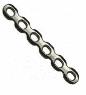

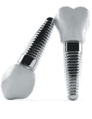

图 (1). 由钛合金制成的医用植入物 [7]。

# 线切割电火花加工 (WEDM)

虽然电火花加工（EDM）和线切割电火花加工（WEDM）的材料去除机理相似，但它们的功能特性并不完全相同 [8]。在 WEDM 过程中，在作为工具电极的细薄、运动导线与工件之间产生电火花，以侵蚀材料并生成所需的形状。WEDM 的原理示意图如图 (2) 所示。

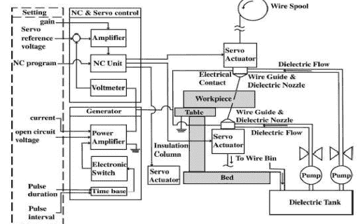

图 (2). WEDM 系统示意图 [9]。

在操作过程中，导线从导线卷连续送出，并由线切割电火花机床的上、下喷嘴引导，而工件保持静止。通常使用的材料具有导电性，例如铜、黄铜、镀锌黄铜、扩散黄铜、钼*等*。在导线电极和工件之间施加电势，其中电极作为阴极，工件作为阳极，同时保持两者之间有一个小间隙。

去离子水等介电液也存在于导线电极和工件之间。电子从阴极移动，撞击去离子水分子并释放出若干电子。这些电子接着撞击下一个去离子水分子。该过程持续不断地进行，同时正离子向阴极移动。通过这种方式，大量电子向阳极（工件）移动。电子的动能转化为热能并产生火花。这种火花能量使工件温度升高至约 10,000°C。因此，工件材料发生熔化和蒸发 [10]。过滤后的介电液被泵送并连续喷射，以包裹工件和导线电极。通过导线电极进入加工区域的电能脉冲使介电液汽化，吹飞工件和导线的微小部分。由于导线由导线卷连续送出，每次旧截面被切断成为废料时，导线的每一新截面都充当电极。然而，导线与工件之间的间隙被保持和控制，以产生精确的切割表面。此外，介电液起绝缘作用，从而在间隙中产生高能以生成火花。它还能收集并带走碎屑，减少加工过程中产生的热量。

当希望残留应力较低时，会使用线切割电火花加工（Wire-cut EDM），因为它不需要高切削力来去除材料。如果每脉冲能量相对较低，由于这些低残留应力，预计材料的机械性能变化很小。尽管在常规加工过程中，未进行应力释放的材料可能会在服役寿命期间发生变形。由于该过程的固有特性，线切割电火花加工可以轻松加工复杂零件和精密组件。

# WEDM 工艺参数

各种电气和非电气工艺参数、WEDM 的加工间关系及性能指标如图 (3) 所示。选择这些参数的适当水平以实现经济加工条件至关重要。考虑到这些参数对输出变量的影响，可以设置输入变量以达到最佳加工环境。

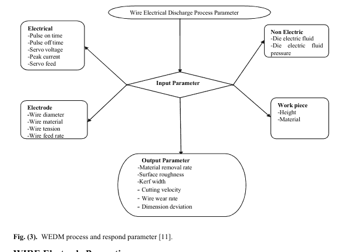

# 导线电极特性

WEDM 的加工性能通常依赖于工具电极各种物理、化学、电气和机械特性的组合。因此，导线电极应具备优异的特性，以实现高精度和高精度的高速切割。表 1 列出了 WEDM 导线的独特特性列表。

表 1. WEDM 导线的必备特性 [12]。

| 序号 | 特性 | 描述 |
| :--- | :--- | :--- |
| 1. | 导电性 | 低导线导电性会导致从电源馈送到切割点的距离上产生电压降和相关的能量损失 |
| 2. | 抗拉强度 | 抗拉强度为 900MPa 的硬线用于大多数工作，而抗拉强度约为 490MPa 的半硬线和低于 440MPa 的软线用于角度大于 5° 的锥度切割。 |

表 1 续。

| 序号 | 特性 | 描述 |
| :--- | :--- | :--- |
| 3. | 延伸率 | 硬线的延伸率比半硬线小得多。脆性导线可能在首次过载条件下断裂，而韧性更好的导线则预期能接受暂时的过载 |
| 4. | 熔点 | 导线电极应对火花的快速熔化具有抵抗力 |
| 5. | 几何形状 | WEDM 通常可获得直径从 0.02 到 0.36 mm 不等的导线。导线直径的增加会导致提供给工作间隙的脉冲能量增加，从而增加整体的材料去除率 |

图 (4) 说明了随着导线电极的发展，为了改进 WEDM 过程，导线直径的增加 [13]。

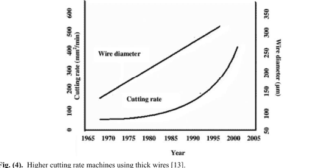

# WEDM 工艺的进展

WEDM 已被证明是一种用于高精度加工复杂几何形状硬材料的先进技术。然而，其他加工过程可以与 WEDM 集成在一起以实现更好的加工。表 2 展示了近年来开发的现代 WEDM 技术。

表 2. 混合 WEDM 技术。

| 序号. | 混合 WEDM |
| :--- | :--- |
| 1. | 线切割电火花磨削 |
| 2. | 微 WEDG |
| 3. | 线切割电火花铣削 |
| 4. | 线切割电火花车削 |
| 5. | 磨料线切割电火花加工 |

# 线切割电火花磨削

为了生产圆柱形微零件，偏好使用如线切割电火花磨削（WEDG）之类的加工过程 [14]。在 WEDG 过程中，以高精度加工如杆和销等微旋转零件 [15]。然而，WEDG 工艺可以精确制造具有曲线轮廓剖面的微旋转零件；但其加工效率非常有限。此外，这项技术依赖于昂贵且专用的微电火花机床，这限制了该技术在普通行业中的普及 [16]。

# 微线切割电火花磨削

在微 WEDG 中，砂轮的使用被作为电极的微导线所取代。当需要磨削细杆时，它作为工件，允许旋转，而电极（微导线）保持静止。该过程利用产生的电火花或热能去除工件上多余的材料，以达到所需的形状 [17]。然而，从技术和经济角度来看，导线断裂控制是微 WEDM 过程最关键方面。

# 线切割电火花车削

线切割电火花车削（WEDT）过程是一种新兴的非传统加工过程，用于制造微型部件和轴对称部件 [18]。在 WEDT 和 WEDG 中，侵蚀机理与 WEDM 过程类似，区别在于在 WEDG 中，工件是沿纵向方向进给，而 WEDT 中是水平进给。此外，WEDG 和 WEDT 过程变体的特性在于工具与工件电极之间的相对运动以及进给。

# 磨料线切割电火花加工 (AWEDM)

在此过程中，电火花连同磨料一起磨削工件表面。通过将 WEDM 与细粒磨料集成，可以实现更高的材料去除率和更好的表面光洁度。

# 钛基合金 WEDM 的发展

Srinivasan 和 Palani [19] 检查了氮化硅-氮化钛（Si3N4- TiN）陶瓷复合材料，以表征其表面完整性和疲劳

WEDM（线切割）加工性能。在对陶瓷复合材料WEDM加工表面进行SEM观察时，发现了不同类型的缺陷，例如微裂纹、微孔、熔珠、液滴和表面凹坑。此外，与抛光表面相比，线切割加工表面的疲劳寿命降低了25-35%。同时，抛光表面的硬度也远优于机械加工表面。

Takale和Chougle [20] 指出，Ti49.4Ni50.6形状记忆合金具有较低的杨氏模量，这使其成为新型骨科植入物的极佳材料。然而，采用传统方法加工Ti-Ni合金时，其表面质量和尺寸精度较差。因此，WEDM可以作为一种替代方案，以实现Ti-Ni记忆合金加工的高尺寸精度。研究人员针对不同WEDM输入参数，考察了Ti-Ni合金的去除率（MRR）和表面粗糙度（SR）。所选定的输入参数包括脉冲通断时间、脉冲闭断时间、火花间隙设定电压、丝材进给速率和丝材张力。采用灰比数分析法（GRA）进行了多目标优化。为了研究加工表面冶金变化，还进行了能谱分析（EDS）。

Singh和Misra [21] 研究了不同输入变量下Nimonic 263合金在WEDM中的加工情况。实验设计基于Box-Behnken设计技术，而表面粗糙度的参数优化则使用响应面法（RSM）进行。BPNN（反向传播神经网络）结果表明，BPNN是预测响应值的宝贵工具。在FE-SEM（场发射扫描电子显微镜）鉴定中发现，WEDM加工表面含有微裂纹、凹坑、球形液滴和碎屑团。

Pramanik和Basak [22] 展示了在Ti-6Al-4V合金线切割加工中，输入参数对疲劳寿命、裂纹扩展、表面粗糙度和加工过程的影响。研究了加工参数、脉冲通断时间、脉冲闭断时间和丝材张力，并使用SEM观察了这些因素对表面完整性的影响。观察到的影响疲劳性能的主要因素是重铸层和热影响区（HAZ）的性质及范围。

Kavimani等人 [23] 采用田口方法结合灰色关联分析，研究了WEDM切削参数对增强还原氧化石墨烯镁基金属复合材料的影响。使用L27正交表进行实验设计，并通过方差分析（ANOVA）验证了结果。确定在MRR和SR方面，增强材料重量百分比和脉冲通断时间比其他输入参数（如脉冲闭断时间和丝材进给速率）更具影响力。

Chu等人 [24] 讨论了一种用于在金属板上生成微沟槽的新可行低频振动辅助技术，适用于高速WEDM。脊宽受平均电流、振动频率和进给速率的显著影响。然而，与传统WEDM工艺相比，低频振动辅助WEDM能够生成更小的微沟槽表面结构，并提高加工效率。

Rajkumar等人 [25] 研究了线电放电加工中纳米氧化铝颗粒增强铝基金属复合材料的加工。发现电压和脉冲通断时间是实现高MRR的主要输入参数。此外，控制脉冲持续时间可以通过减少加工缺陷来提高表面完整性。

Zhang等人 [26] 分析和降低了WEDM加工薄壁部件时的功耗，并研究了部件的热变形。他们利用新的微裂纹丝材电极改善了加工特性。调查结果还表明，微裂纹丝材可以极大地减少能量消耗和碎屑污染。

Sharma等人 [27] 研究了富Ni的Ni50.8Ti形状记忆合金（特别是用于生物医学领域）在WEDM加工中的输入变量优化。使用田口DOE（实验设计）选择L16正交表进行研究。研究结果证实，在最佳条件下加工可获得更好的表面完整性和更高的MRR。

Smirnov等人 [28] 对3y-TZP/Ta陶瓷-金属复合材料进行了WEDM加工，发现SPS（放电等离子体烧结）烧结复合材料具有适合WEDM工艺的导电率。此外，得出的结论是，在加工过程中可以保持高精度，而不会显著损害部件的机械强度。

Zhou等人 [29] 在WEDM中制备并表征了具有规则且可控微沟槽结构的疏水Ti3SiC2表面。还研究了接触角、深宽比与表面质量之间的关系，发现深宽比可用于预测平行接触角，且误差较小。

Pramanik和Basak [30] 强调了在硬质材料WEDM中持续不间断加工对于控制能量和时间消耗的重要性。研究了Ti-6Al-4V合金工件的丝材断裂情况，以使加工过程具有高度的可持续性。虽然在丝材尖端未检测到工件材料，但注意到由于高温氧化，在断裂的丝材尖端形成了氧化物痕迹。此外，在低温下观察到，高张力的丝材会迅速断裂。

Thankachan等人 [31] 预测了铝基合金在WEDM加工过程中的性能指标。利用田口技术结合GRA进行调查。通过开发人工神经网络方法，基于输入控制因子预测了最佳MRR和表面粗糙度值。与其他模型相比，结果被证明是高效的。

Nain等人 [32] 使用粒子群优化技术来提高超级合金Udimet-L605线电放电加工的精度和生产率。在其他输入变量中，发现脉冲通断时间对切削速度、丝材磨损比和几何偏差有极大影响。使用SEM和EDS研究了因侵蚀和热影响区引起的成分变化。

Chaudhary等人 [33] 研究了WEDM加工AISI 304时，不同丝材张力对性能指标的影响。注意到丝材张力对狭缝宽度没有影响，但显著影响MRR、SR和显微硬度。SR随丝材张力的增加而降低，而MRR则略有改善。

Gaitonde等人 [34] 讨论了采用RSM和差分进化整合方法，对HCHr钢WEDM输入变量的优化。基于田口实验设计技术选择L27正交表进行调查。脉冲通断时间增加会导致MRR升高。

Goyal [35] 通过采用普通和低温锌涂层丝材，展示了Inconel 625合金WEDM关键输入参数优化研究，以改善MRR和SR。发现MRR和SR受脉冲通断时间、工具电极和电流强度的显著影响。通过SEM分析了加工表面的微观结构。

Mouralova等人 [36] 区分了WEDM结构材料表面的形貌和拓扑结构。利用SEM和非接触式3D轮廓仪进行分析。这些仪器允许对轮廓进行评估并创建3D表面图像以供进一步研究。

Arikatla等人 [37] 讨论了在加工Ti-6Al-4V合金时，使用RSM对WEDM过程进行参数优化。实验采用五个输入工艺参数进行，以改善MRR、狭缝宽度和SR。使用SEM检查了表面特性。丝材张力和伺服电压对表面粗糙度影响较大，并提高了加工表面的质量。

Siddiqui和Ramkumar [38] 建议，镁作为一种在可生物降解骨科植入物应用中重要的材料，可以在微-WEDM中加工成微尺度复杂形状。选择AZ31镁合金进行实验，以建立微WEDM各种输入参数之间的关系。对于最佳条件，为了获得高MRR，希望具有中等电压和高电容。

Liu等人 [39] 描述了WEDM中Nitinol形状记忆合金的加工。进行了实验以识别工艺参数对白层晶体学、成分和性能的影响。使用TEM（透射电子显微镜）、X射线衍射（XRD）和EBSD（电子背散射衍射）来表征加工表面白层的性能。与块体材料相比，白层由于氧化物强化而表现出更高的纳米硬度。

Manjaih等人 [40] 研究了WEDM加工钛形状记忆合金时丝材电极材料的影响。研究中使用了黄铜和锌涂层丝材。结论认为，脉冲通断时间、脉冲闭断时间与伺服电压一起，是优化增强加工材料MRR和SR条件的最具影响力的参数。

Sun等人 [41] 讨论了低速线电放电加工中微型铣削螺旋和波纹微型端铣刀的特性。完成了丝材电极轨迹的设计和数学模拟，并阐明了加工参数对螺旋端铣刀的影响。

## 表3. WEDM综述。

| 序号 | 作者 | 优化技术 | 工件材料 | 输入参数 | 结果 |
|---|---|---|---|---|---|
| 1. | Shakeri等人 [42] | 人工神经网络 (ANN) | 渗碳合金钢 | 脉冲电流, A (8-16). 频率, kHz (40-60). 丝材速度, m/min (8-12). 伺服速度, mm/min (4-8) | 丝材速度、脉冲电流和频率的增加会导致高MRR |
| 2. | Goyal等人 [43] | ANN, RSM, SEM | Ni50Ti50 | 电流, A (4-8). 脉冲通断时间, μs (60-120). 脉冲闭断时间, μs (15-45). 丝材张力, cm²/gm (11-15). 丝材进给速率, m/min (4-8) | 脉冲通断时间和电流的增加会增加MRR。 |

### 表5（续）

| 序号 | 作者 | 优化技术 | 加工材料 | 输入参数 | 结果 |
| :--- | :--- | :--- | :--- | :--- | :--- |
| 3 | Suthan 和 Muralidharan [44] | 田口方法 | 316L | 脉冲on时间, μs (30–32)；脉冲off时间, μs (5–7)；间隙, mm/min (50–700) | 更高的脉冲on时间导致更高的MRR |
| 4 | Liao *et al.* [45] | 田口质量设计、ANOVA 和 F检验 | 合金 | 脉冲发生电路 (ac, dc)；介电常数 (15–45)；电容, C (0–20)；施加电压, V (100–150)；工作台进给率, mm/min (2–4)；脉冲off时间, 微秒 (4–8)；电路电阻, 欧姆 (25–75) | 脉冲发生电路、电压和电路电阻对表面粗糙度有显著影响 |
| 5 | Padmavathi *et al.* [46] | 田口稳健设计方法 | AISI 316 不锈钢 | 脉冲on时间, μs (1–10)；脉冲off时间, μs (1–10)；峰值电流, A (0–30)；丝张力, cm²/gm (200–1500)；丝进给速度, m/min (0–10) | 峰值电流和脉冲on时间对MRR和SR均有显著影响 |

Ishfaq *et al.* [47] 研究了不锈钢复合钢在WEDM加工中的工艺参数。由于复合材料的异质性，复合材料的加工极具挑战性。与其他专门用于切割这些材料的工艺（如气割和等离子弧切割）相比，复合钢的WEDM加工提供了更好的表面光洁度。然而，较低的切割速度是WEDM应用的一个局限。基于田口方法设计实验以优化切割速度。研究发现，复合材料的单层厚度对控制WEDM的加工率起着关键作用。Babu *et al.* [48] 研究了过共晶Al-Si合金在WEDM中的参数优化。在实验中，选择了不同的输入控制因子，包括脉冲on时间和硅百分比的变化。实施了灰色关联分析（GRA）和主成分分析（PCA）进行多目标优化。与GRA相比，PCA在执行该任务方面表现更好。

Periyannan *et al.* [49] 描述了微型WEDM在加工复杂且精确的三维结构微部件和微工具中的应用。采用田口方法优化微型WEDM的输入变量以提高MRR。结果表明，进给率、电容和电压是对MRR影响最大的参数。

Giridharan 和 Samuel [50] 在WEDT中对AISI 4340钢进行了实验以提高其侵蚀率。采用新方法测量凹坑深度，并获得了更好的结果。利用SEM研究了随机侵蚀机制。表3展示了关于WEDM各项研究综述。

## WEDM的未来前景

频繁的断丝使WEDM效率降低并恶化加工质量。因此，减少断丝以提高尺寸精度和效率仍将是关键的研究领域。

钛合金具有广泛的应用。由于这些合金难以加工成复杂形状，其加工仍是一项挑战。可以优化WEDM的工艺参数来切割钛合金，以降低制造成本和时间。

应提高钛合金WEDM的加工效率。然而，现有的线材材料在这方面表现不佳。因此，需要集成新芯材和涂层材料的新线材电极材料。

## 结论

在彻底研究WEDM文献后，可以得出结论，钛合金在生物医学、航空航天和微工具制造领域非常有用。利用WEDM可以平滑且低成本地加工出复杂形状的这些合金。观察到输入变量对性能指标有显著影响，因此优化参数以实现高尺寸精度和高重复性至关重要。对于WEDM中各种钛合金加工的研究，可以基于数学模型采用田口方法、响应曲面法（RSM）、模糊算法、算法和人工神经网络（ANN）等优化技术。此外，通过应用扫描电子显微镜（SEM）、透射电子显微镜（TEM）和X射线衍射（XRD），可以评估和研究加工材料的表面完整性、成分和缺陷。

## 出版同意书

不适用。

## 利益冲突声明

作者确认本章节内容不存在利益冲突。

## 致谢

作者衷心感谢编辑和匿名审稿人付出的时间和宝贵建议。

## 参考文献

- 1. C-T. Lin, I-Fang Chung and Shih-Yu Huang, "模糊逻辑在拐角部件线电火花加工中提高加工精度", *Fuzzy Sets Syst.*, no. 122, pp. 499-511, 2001. [http://dx.doi.org/10.1016/S0165-0144(00)00034-8]
- 2. A.B. Puri, and B. Bhattacharya, "线切割电火花加工中丝滞后现象导致的几何精度分析及其优化", *Int. J. Mach. Tools Manuf.*, no. 43, pp. 151-159, 2003. [http://dx.doi.org/10.1016/S0890-6955(02)00158-X]
- 3. N. Tosun, and C. Cogan, "线切割电火花加工中丝磨损的研究", *J. Mater. Process. Technol.*, no. 134, pp. 273-278, 2003. [http://dx.doi.org/10.1016/S0924-0136(02)01045-2]
- 4. A.B. Puri, and B. Bhattacharya, "线切割电火花加工中丝工具振动的建模与分析", *J. Mater. Process. Technol.*, vol. 141, pp. 295-301, 2003. [http://dx.doi.org/10.1016/S0924-0136(03)00280-2]
- 5. D. Amin, and V. Mehta, "液氮处理Ti6Al4V线电火花加工综述", *International Journal for Innovative Research in Science & Technology*, vol. 2, no. 12, pp. 173-177, 2016.
- 6. K.P. FarNaz Nourbakhsh, "钛合金线电火花加工", *procedia CIRP*, no. 5, pp. 13-18, 2013.
- 7. Bassam Khan, Rahul Davis, and Abhishek Singh, "输入变量和低温处理在Ti-6Al-4V合金生物医学应用线电火花加工中的影响", 2019. [http://dx.doi.org/10.1016/j.matpr.2019.09.226]
- 8. K.H. Ho, S.T. Newman, S. Rahimifard, and R.D. Allen, "线电火花加工（WEDM）的最新进展", *Int. J. Mach. Tools Manuf.*, no. 44, pp. 1247-1259, 2004. [http://dx.doi.org/10.1016/j.jmachtools.2004.04.017]
- 9. J. Wang, and B. Ravani, "移动丝线电火花加工（EDM）的计算机辅助轮廓操作", *Comput. Aided Des.*, no. 35, pp. 925-934, 2004.
- 10. S. Awarup, "使用田口方法和灰色关联分析优化AISI 4140线电火花加工的工艺参数", *Materials Today: Proceedings*, no. 18, pp. 4261-4270, 2019.
- 11. Jaksan C Patel and Kalpesh D Maniya, "金属基复合材料线切割电火花加工过程综述", *Procedia Manufacturing*, no. 20, pp. 253-258, 2018.
- 12. Ibrahim Mahér, "延长工作时间并利用在WEDM加工中的线电极性能改进综述", *International Journal of Advance Manufacturing and Technology*, no. 76, pp. 329-351, 2015.
- 13. J. Kapoor, "高性能线电极用于线电火花加工综述", *Proceedings of the Institution of Mechanical Engineers, Part B: Journal of Engineering Manufacture*, 2012, pp. 1-17.
- 14. M. Parthiban, V. Krishnaraj, R. Sindhu mathi, and J. Valentincic, "使用线电火花磨削（WEDG）制造碳化钨微工具的研究", *J. Braz. Soc. Mech. Sci. Eng.*, 2017.
- 15. T. Masuzawa, M. Fujino, and K. Kobayashi, "微加工中的线电火花磨削", *Annals of the CIRP*, vol. 34, no. 1, pp. 431-434, 1985.
- 16. Y. Zhu, T. Liang, L. Gu, and W. Zhao, "使用线电火花加工机床加工微型旋转部件", *Procedia Manufacturing*, vol. 5, pp. 849-856, 2016.
- 17. M.Y. Ali, M.A. Rahman, and R. Nordlin, "微型线电火花磨削：材料去除率和表面粗糙度的优化", *IOP Conf. Series: Materials Science and Engineering*, 2017, pp. 1-7.
- 18. Abimannan Giridharan and G. L. Samuel, "线电火花车削（WEDT）过程中凹坑形成模型的建模与分析", *International Journal of Advance Manufacturing and Technology*, no. 77, pp. 1229-1247, 2015.
- 19. V.P. Srinivasan, and P.K. Palan, "线电极放电加工后Si3N4-TiN的表面完整性、疲劳性能和干摩擦磨损行为", *Ceram. Int.*, 2020. [http://dx.doi.org/10.1016/j.ceramint.2020.01.082]
- 20. A.M. Takale, and N.K. Chougule, "线电火花加工工艺参数对骨科植入应用Ti49.4N/50.6形状记忆合金表面完整性的影响", *Mater. Sci. Eng. C*, vol. 97, pp. 264-274, 2019.
- 21. B. Singh, and J.P. Misra, "基于响应曲面法和人工神经网络模型的线电火花加工试样表面光洁度分析", *Measurement*, no. 137, pp. 225-237, 2019.
- 22. A. Pramanik, and A.K. Basak, *线电火花加工（EDM）参数对Ti-6Al-4V合金疲劳寿命的影响*, 2019.
- 23. V. Kavyman, and K. Soorya Prakash, "加工参数对还原氧化石墨烯/镁复合材料线电火花加工性能及其表面完整性特征的影响", *Composites Part B*, no. 167, pp. 621-630, 2019.
- 24. X. Chu, X. Zeng, W. Zhuang, W. Zhou, X. Quan, and T. Fu, "振动辅助高速线电火花加工以加工表面微沟槽", *J. Manuf. Process.*, no. 44, pp. 418-426, 2019.
- 25. K. Rajkumar, C. Balasubramanian, K.M. Nambiar, and M. Rajesh, *铝纳米氧化铝复合材料的黄铜线电火花加工变量优化*, 2019. [http://dx.doi.org/10.1016/j.matpr.2019.11.252]
- 26. Guojun Zhang, Wenyuan Li, Yanming Zhang, Yu Huang, Zhen Zhang, and Zhi Chen, *分析与...

减少微结构线电极电火花加工薄壁部件的能耗和热变形，2020。[http://dx.doi.org/10.1016/j.jelepro.2019.118763]

- [27] Neeraj Sharma 和 Kapil Gupta，“镍富型 NiTi 形状记忆合金的生物医用 Wire 电火花切割加工”，载于《*Procedia Manufacturing*》，2019 年，第 35 期，第 401–406 页。

- [28] A. Smirnov, P. Peretyagin, and J.F. Bartolomé, “3Y-TZP/Ta 陶瓷金属复合材料的线放电加工”，*J. Alloys Comp.*, 2018 年。[http://dx.doi.org/10.1016/j.jallcom.2017.11221]

- [29] C. Zhou, X. Wu, and Y. Lu, “Wen Wu, Hang Zhao and Liejun Li, “通过线放电加工制备具有微沟槽结构的亲水性 Ti3SiC2 表面”，*Ceram. Int.*, 第 1-8 页，2018 年。[http://dx.doi.org/10.1016/j.ceramint.2018.07.032]

- [30] A. Pramnik, and A.K. Basak, “钛合金线放电加工中的可持续性：理解线材断裂”，*J. Clean. Prod.*, 第 1-16 页，2018 年。[http://dx.doi.org/10.1016/j.jclepro.2018.07.045]

- [31] K. Titus Thankachan, “Soorya Prakash, R Malini, S Ramu, Prabhu Sundararaj, Sivakumar Rajandran, Devaraj Rammamansamy and Sathiskumar Joths, “基于 Taguchi 耦合灰关联分析和人工神经网络预测铝合金/复合材料线放电加工的表面粗糙度和材料去除率”，*Appl. Surf. Sci.*, 2018 年。[http://dx.doi.org/10.1016/j.apsusc.2018.06.117]

- [32] Somvir Singh Nain, Dixit Garg, and Sanjeev Kumar, *调查使用粒子群优化提高 Udimet-L605 高温合金 WEDM 性能的最优解获取*, 2018 年。[http://dx.doi.org/10.1016/j.jestech.2018.03.005]

- [33] Tina Chaudhary, Arshad Noor Siddiqee, and Arindam Kumar Chanda, “线放电加工 AISI 304 不锈钢时线张力对不同输出响应的影响”，第 1-13 页，2018 年。[http://dx.doi.org/10.1016/j.d.2018.11.003]

- [34] V.N. Gaitonde, M. Manjiaah, S. Maradi, S.R. Karnik, P.M. Petkar, and J. Paulo Davim, *通过结合响应面法 (RSM) 与差分进化多响应优化 HCHCr 钢的线电火花加工 (WEDM)*. 计算方法与生产工程: DE, 2017, 第 199-221 页。[http://dx.doi.org/10.1016/B978-0-85709-481-0.00007-0]

- [35] A. Goyal, “低温处理工具电极对 Inconel 625 超级合金线放电加工 (WEDM) 中材料去除率和表面粗糙度的影响研究”，Journal of King Saud University – *Science, 第 29 期，第 528-535 页，2017 年。

- [36] K. Mouralova, J. Kovar, L. Klakurkova, T. Prokes, and M. Horynova, “WEDM 加工结构材料表面形貌和拓扑结构的比较”，*Measurement*. [http://dx.doi.org/10.1016/j.measurement.2017.03.009]

- [37] K. Siva Prasad Arikala, “使用响应面法对钛合金线放电加工进行参数优化”，*Materials Today: Proceedings*, 第 4 期，第 1434-1441 页，2017 年。

- [38] T.U. Siddiqui, and J. Runkumar, “用于可生物降解骨科植入物的镁合金微型线放电加工”，*Materials Today: Proceedings*, 第 4 卷，第 10273-10277 页，2017 年。

- [39] J.F. Liu, Y.B. Guo, T.M. Butler, and M.L. Weaver, “Nitinol 形状记忆合金线放电加工形成的白色层的晶体学、成分和特性”，*Mater. Des.*, 第 109 卷，第 1-9 页，2016 年。[http://dx.doi.org/10.1016/j.matdes.2016.07.063]

- [40] M. Manjaih, S. Narendranath, S. Basavarajappa, and V.N. Gaitonde, “电极材料对 Ti50Ni50-xCux 形状记忆合金线电火花加工特性的影响”，*Precis. Eng.*, 2015 年。[http://dx.doi.org/10.1016/j.precisioneng.2015.01.008]

- [41] Y. Sun, Y.D. Gong, X.L. Wen, G.Q. Yin, and F.T. Meng, “LS-WEDM 制造的螺旋形和波纹形微型立铣刀的微铣削特性”，*Int. J. Mech. Sci.*, 2019 年。[http://dx.doi.org/10.1016/j.ijmecsci.2019.105277]

- [42] Saied Shakeri, Azzam Ghassemi, Mohsen Hassani, and Alireza Hajian, *使用人工神经网络调查渗碳合金钢线放电加工过程中的材料去除率和表面粗糙度*, 2016 年。[http://dx.doi.org/10.1007/s00170-015-7349-y]

- [43] A. Goyal, and U.R. HuzeF, “Rahman and S.A.C. Ghani, “Ni49Ti51 形状记忆合金线放电加工过程参数的实验研究与优化”，*Journal of King Saud University - Eng. Sci.*, 2020 年。[http://dx.doi.org/10.1016/j.jksues.2020.01.003]

- [44] S. Suthan, and K. Muralidharan, “316L 不锈钢线 edm 工艺参数实验分析优化”，*International Research Journal of Engineering and Technology*, 第 05 卷，第 06 期，第 1258-1263 页，2018 年。

- [45] Y.S. Liao, J.T. Huang, and Y.H. Chen, “实现 Wire-EDM 精细表面光洁度的研究”，*J. Mater. Process. Technol.*, 第 149 期，第 165-171 页，2004 年。[http://dx.doi.org/10.1016/j.jmatprotec.2003.10.034]

- [46] K.R. Padmavathi, S. Devaraj, I. John Solomon, and A. Premkumar, “工艺参数对 AISI 316 不锈钢 Wire EDM 工艺的影响”，*Int. J. Eng. Res. Technol. (Ahmedabad)*, 第 06 卷，第 02 期，2018 年。[http://dx.doi.org/10.17577/IJERTCON067]

- [47] K. Ishfaq, N.A. Muhi, M.P. Mughal, M.Q. Saleem, and N. Ahmed, “不锈钢包覆钢线放电加工切削速度优化研究”，*Int. J. Adv. Manuf. Technol.*, 2018 年。[http://dx.doi.org/10.1007/s00170-018-1630-9]

- [48] D.M. Babu, S.V. Kiran, and P.R. Vundavilli, “高共晶 Al-Si 合金线放电加工实验研究与多响应优化”，*Int. J. Manuf. Res.*, 第 11 卷，第 03 期，第 221-257 页，2016 年。[http://dx.doi.org/10.1504/IJMR.2016.079460]

- [49] P.R. Periyannan, U. Natarajan, and A. Elango, “微-WEDM 工艺中影响材料去除率的参数优化”，*Int. J. Eng. Sci. Technol.*, 第 3 卷，第 9 期，第 66-76 页，2011 年。

- [50] A. Giridharan, and G.L. Samuel, “线放电加工车削过程中 AISI 4340 钢侵蚀率的研究”，*Mach. Sci. Technol.*, 第 22 卷，第 2 期，第 287-298 页，2018 年。[http://dx.doi.org/10.1080/10910344.2017.1365890]

# 第 8 章

## EDM 及其类型的最新发展

Anupam Thakur* 和 Suneel Anil Bansal

印度喜马偕尔邦巴迪 (Baddi) 皇家阿格雷森大学 (Maharaja Agrasen University) 机械工程系

**摘要：** 电火花加工是一种先进的加工方法，通过考虑表面粗糙度和高精度等多种参数，对工件上的复杂和精细形状进行加工。在 EDM 领域进行了大量研究，旨在开发各种模型并选择使用常规 EDM 或线放电 EDM 进行加工的最佳优化条件。本文还讨论了关于湿式和干式 EDM 处理的一些结果。此外，还讨论了智能 EDM 的最新发展，以预测 EDM 机器的未来能力。本文概述了基于加工能力、参数、加工表面特性以及各种线材材料及其对加工过程中 EDM 线材影响和整体性能的最新发展。

**关键词：** 复合材料，电火花机，材料，材料去除率 (MRR)，工艺参数。

### 引言

电火花机使得许多复杂的形状能够在工件与作为电极的工具之间无物理接触的情况下生产出来。加工过程是通过电极和工件界面之间的连续火花蚀除来实现的（图 1）。该过程通过在工作件和工具之间建立适当的电压来执行，从而导致介质在强静电场的作用下发生击穿。这是一种先进的制造技术，通常用于模具制造、模具制作、汽车制造和医疗器械等。大多数易碎物体无法通过其他机器轻松加工，但可以通过它轻松加工且没有任何风险因素。已观察到，该过程不会产生有毒气体烟雾和受污染的介质。

线切割电火花加工（Wire EDM）在某种程度上也类似于常规电火花加工，因为它以线材形式实施电极，用于电火花蚀刻。

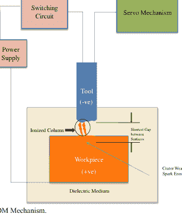

图 (1). 电火花加工机构布局。

这进一步扩大了使用线切割电火花加工（WEDM）生产具有高精度和高表面光洁度的复杂精细形状的可能性。一些研究描绘了在工具和工件之间最短距离处产生电离柱的过程 [1]。随着复杂精细设计的进步，线切割电火花加工应运而生，它提供了高精度和高光洁度加工的新领域。它利用通过细铜线或黄铜线（作为电极）导电的电流作为能量源。当此线材靠近工件时，最近区域的电火花开始放电，从而导致金属通过微观粒子的熔化和汽化而受到电火花蚀刻。在此过程中，线材也会在小尺度上受到侵蚀，从而导致某种形式的工具磨损。为了允许切割区域具有相等且精确的尺寸，随着加工的进行和切割的执行，机器会通过机器上的自动机制，用新的线材部分替换旧线材。整个过程在去离子水电介质中进行，以促进加工区域的均匀连续冷却，并清除加工过程中产生的蚀刻颗粒。

## 电火花加工的现状以及脉冲特性对电火花加工过程的影响

由于电火花加工的非线性，电火花加工机器需要大量改进。多项研究强调了可以改进当前工艺的方面（表 1）。在过去 20 年里，从最初的发展及其随时间的进步开始，已经进行了大量研究 [2]。它提供了各种控制和结果，以通过优化工艺参数来改进电火花加工机器 [3]。鉴于优化问题，研究中规定了输入参数。一些研究还强调了新技术的发展，以提高加工表面的质量。还发现，许多研究集中于粉末混合电火花加工，以研究表面及其改性 [4]。还进行了关于用于提高机器效率的直流脉冲的研究。发现如果在使用 RC 型脉冲发生器方面进行改进，则可以看到好得多的结果，包括使用碳化钨作为工件时的高表面质量和改进的材料去除率（MRR）[5]（图 2）。

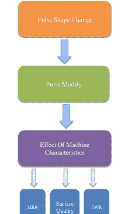

图 (2). 脉冲波形对电火花加工特性的影响。

另一项研究表明，如果使用来自改进型晶体管的 1MHz 脉冲，而不是 RC 型发生器，则会产生更高的 MRR，加工速度快三倍 [6]。Han 等人进行了一项研究，他们设计了一种新的晶体管脉冲发生器用于脉冲生成，能够产生大 24 倍的 MRR [7]。还进行了一项研究，观察到了电火花加工电容对阻抗的影响，从而导致了高加工性能 [8]。在表面精加工过程中，还实施了较低的能量消散在工具和工件界面，以使用基于半导体的开关电路获得更高的表面光洁度 [9]。

一些实验表明，用于加工的脉冲发生器的波形变化对各种加工特性具有显著影响。研究表明，能量密度对刀具磨损率（TWR）有较大影响 [10]。短脉冲持续时间通常用于高精度加工。发现使用均匀放电能量时，表面形貌具有较高的价值。还发现，如果使用均匀波形的脉冲进行放电加工，电弧效应较少 [11]。

**表 1. 线切割电火花加工的各种综述。**

| 序号 | 作者 | 工件材料 | 输入参数 | 结果 |
| :--- | :--- | :--- | :--- | :--- |
| 1 | Bhatia 等人 [12] | 高碳高铬钢 | 脉冲导通时间(125-131µs)，脉冲关断时间(34-48 µs)，线张力(1-3)，最大电流(210-230A)。 | 发现脉冲关断时间对 SR（表面粗糙度）有显著影响。开发的模型误差为 3.93%。 |
| 2 | Tlekar 等人 [13] | 铝和低碳钢 | 脉冲导通时间(25-39 µs)，脉冲关断时间(6-10µs)，电流(1-3A)，送丝速度(75-85mm/s)。 | SR 受脉冲导通时间和电流影响。对于割缝宽度，送丝速度有显著影响。 |
| 3 | Brajesh 等人 [14] | AISI D3 钢 | 脉冲导通时间(18-24 µs)，脉冲关断时间(51-59µs)，峰值电流(180-200A)，送丝速度 (4-6mm/min)。 | SR 受影响 |
| 4 | Selvakumar 等人 [15] | 5083 铝合金 | 脉冲导通时间(0.5-0 µs)，脉冲关断时间(14-38µs)，峰值电流(20-100A)，线张力 (420-660g)。 | 切割速度与线张力无关，表面粗糙度 (Ra) 与脉冲关断时间和线张力无关。 |
| 5 | Azhiri 等人 [16] | Al/SiC | 脉冲导通时间(106-126 µs)，脉冲关断时间(60-40µs)，放电电流(70-230A)，间隙电压(60-20V)。 | 切割速度和表面粗糙度受脉冲导通时间和电流影响。还进行了灰色关联分析以优化这两项指标。 |
| 6 | Srivastava 等人 [17] | 用 SiC 增强的 Al2O24 | 电流(2-4 A)，脉冲导通时间(15-25 µs)，增强百分比 (2-4%) | SR 随电流、脉冲导通时间和增强百分比的增加而增加。MRR 与脉冲导通时间和电流成正比，与增强百分比成反比。 |
| 7 | Ikram 等人 [18] | 模具钢 D2 | 送丝速度 (5-15m/s)，脉冲导通时间(3-5 µs)，脉冲关断时间(2-30 µs)，电介质压力(4-10 kg/cm²)，线张力(800-2000g)，开路电压(80-110V)，伺服电压(40-60V) 和材料厚度(12.7-25.4) | 脉冲导通时间对 SR、割缝宽度和 MRR 至关重要。 |
| 8 | Bobbili 等人 [19] | 高强度装甲钢 | 脉冲导通时间 (0.6-1.6µs)，脉冲关断时间(14-46 µs)，送丝速度(2-4m/min.)，冲洗压力(4-8Kg/cm²)，火花电压(15-25V)，线张力(4-8Kg-f) | 为各种响应参数开发了回归模型，结果显示火花电压、脉冲通/断时间对 MRR 和表面粗糙度具有高度显著性。 |
| 9 | Kumar 等人 [20] | 纯钛 | 脉冲导通时间 (0.7-1.1µs)，脉冲关断时间(17-38 µs)，送丝速度(4-10m/min.)，峰值电流(120-200A)，火花电压(40-60V)，线张力(500-1400g) | 开发了一个半经验模型，实测 MRR 与预测 MRR 的比较误差为 6-32-6.95% |
| 10 | Zhang 等人 [21] | SKD11 | 脉冲导通时间 (1-9µs)，脉冲关断时间(10-70 µs)，送丝速度(3-11m/min.)，电流(1-5A)，跟踪系数 (40-80) | 对响应参数高 MRR 和低粗糙度的最佳条件进行了建模。 |
| 11 | Garg 等人 [22] | 钛 6-2-4-2 合金。 | T_{on}(0.7-0µs)，T_{off}(22-38)，IP(140-200A)，WF(6-10m/min.)，WT(500-1000g) | 为该 MMC（金属基复合材料）的最佳条件优化的 CV=8.1235mm/min. 和 SR=1.254µm |

MRR= 材料去除率，SR,Ra= 表面粗糙度，TWR= 刀具磨损率，Ton= 脉冲导通时间，Toff= 脉冲关断时间，WT= 线张力，WF= 送丝，CV= 切割速度。

## 线材定位的影响

发现线切割电火花加工中使用的线材的尺寸一致性对加工的准确性和精度起着非常重要的作用。此外，工作台的准确性也起着非常重要的作用。由于存在其他各种因素，理论上无法达到这种精度。因为在加工区域内控制线材是非常困难的（图 3）。在火花放电和切割过程中控制线材的前后运动，很难保持在一个精确的位置。此外，未固定的线材部分是

对振动频率敏感。通过计算机控制监控丝线与工件之间的间隙来防止这种情况。但还有其他一些因素和原因，无论定位系统多么好，某些振动都无法控制。这导致火花区域中电极丝和工件之间的间隙发生变化，进而导致击穿电压和放电能量持续变化。研究表明，由于内部和外部振动，丝线会产生高达 10µm 的振荡 [23]。因此，机器需要尽可能制造得坚固，以防止这种振动，最终导致工件表面光洁度提高。

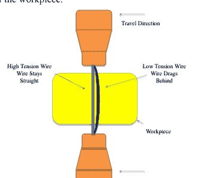

图 (3). 线切割（WEDM）加工过程中产生的丝线拖拽和张力 [25]。

## 丝线张力的影响

为了防止加工过程中丝线内的振动，丝线的两端保持张力，从而将振动降至最低。这有助于保持丝线呈直线状态并维持良好的切割。这还导致在丝线运行期间切割间隙相等。仍然可能由于丝线中产生的过度应力导致丝线断裂。这构成了适用于丝线张力的限制条件（图 4）[23, 24]。

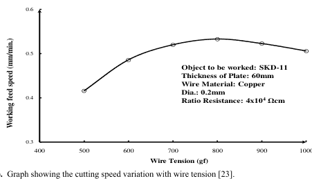

## 丝线材料和成分的影响

如前一节所述，加工过程中的丝线振动及其刚度起着非常重要的作用。因此，丝线的材料选择应基于具有高耐久性（就抗拉强度和韧性而言），以吸收产生的所有振动和应力，并将振动降至最低。研究表明，随着丝线成分中锌含量的增加，加工速度增加，伺服电压需求降低，从而降低了加工期间短路的可能性 [26]。许多研究旨在以最低的刀具磨损率（TWR）和表面粗糙度（SR）最大化材料去除率（MRR）。下面讨论了几种重要的丝线材料。

### 铜

铜是最早用作加工电极的材料之一。但由于物理限制，如强度和低蒸气压，它在用作 WEDM 丝线时存在一些限制 [25]。

### 黄铜

作为铜的替代物，黄铜在 WEDM 中起着非常重要的作用，具有优异的性能结果。它是铜和锌的合金，分别含有约 63% 和 37% 的这两种元素。添加锌是为了表现出高抗拉强度、高蒸气压和低熔点 [25, 26]。

### 涂层丝线

研究发现，具有较低汽化温度的丝线电极涂层遭受热冲击的可能性较小。它包括具有高导电率核心的丝线，包覆低熔点合金，最后包覆高强度合金，从而促进高速加工。已经进行了大量关于这种涂层电极丝线的研究，具有高加工能力，具有更好的冲刷能力，产生误差最小且表面粗糙度最低的切割。但唯一的缺点是涂层较厚，以及使用的电介质受污染的可能性，从而造成环境限制 [27]。

### 扩散退火丝线

由于锌涂层的这些优良特性，可以认为纯锌涂层丝线会产生较高的加工效果。锌具有低熔点，并结合了良好的冲刷性能。因此，可以陈述，在顶层具有高或纯锌浓度的扩散涂层可以产生令人鼓舞的结果。为了生产这种扩散丝线，对封装材料进行退火处理，以便合金在顶层均匀分布。通过这种方式，与传统的电火花加工（EDM）电极材料相比，可以生产出具有较高耐磨性的丝线。与传统黄铜电极丝线相比，所得的 EDM 丝线在生产率方面有相当显著的提高 [28]。

## 冲刷和电介质流体的影响

电介质以各种形式用于 EDM，如完全浸没、喷射或喷雾冲刷。在图 (5) 中，绘制了冲刷压力对加工速度 (Vs) 和表面粗糙度 (Ra) 的影响。

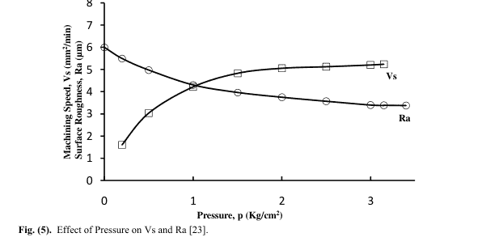

压力流促进火花过程中产生的蚀除颗粒的连续去除，并且在接近精加工时间时应该较低。还可以看到，存在某个极限，超出该极限则无法进行足够的加工。随着冲刷压力增加至 1 Kg/cm²，可以实现更高的加工速度，超过此值后加工速度速率下降。当冲刷压力小于 0.3 kg/cm² 时，火花放电处观察到高温范围。

除了冲刷蚀除颗粒外，电介质流体还执行各种功能，例如在加工期间冷却工件和工具。它还帮助将火花能量集中在加工所需的较小截面上，并在大量能量积聚之前进行间隙绝缘。

## 智能线切割 EDM

我们知道，工业一直在变化，并引入了称为“工业 4.0”的新革命。研究表明，通过避免停机时间，可以消除各种不必要的成本，从而产生更好的结果 [29]。鉴于当前微加工的需求，需要引入一些智能因素，以帮助以高水平的精确度和准确性进行此类工作。与传统的 EDM 项目相比，大量资金已投入到此类项目中 [30]。在此强调，在加工时代引入新的智能因素，以优化各种控制参数并排除环境危害。这些不仅限于此，还具有自我检查和监控各种任务的能力，并进行适当更改以获得最佳加工特性。近年来，Walder 等人的研究中可以看到这种应用 [31]。由于 WEDM 配备了大量传感器和装置，用于监控各种事项（例如在服役时间完成后更换部件），与传统的 EDM 相比，可以削减大量制造成本，在传统 EDM 中，我们通常提前更换一些部件以避免停机，但同时增加了制造成本。迄今为止，尚未进行深入的研究来优化此类情况并建立预测模型，因为这需要在加工领域及其化学研究方面进行大量彻底的研究。Walder 等人努力建立了这样的模型。这具有各种优点，如实时数据收集以及预测模型的更新，以获得精确模型，同时在加工进行时。WEDM 的最新应用可见于 Inconel、K110 工具钢以及其他用于各种高级行业的硬质金属。研究聚焦于四个参数，即 EDM 丝线、主过滤器、用于离子交换的树脂、以及用于向丝线供电的触点，因为它们在停机/更换成本方面占主要部分。

电介质流体起着非常重要的作用，因为它持续清洁加工表面，并在加工期间保持足够的电导率。过滤器和电介质等消耗品很大程度上取决于要加工的材料和各种控制参数。机器上安装了传感器，以持续监控这些设备。使用的电介质仅仅是去离子水，其电导率仅为 15 µ-siemens/cm。

此处使用的电介质起着维持 20°C 温度的主要作用，同时清洁并保持电极和工件之间的去离子化间隙。为此使用了两个储罐，其中安装了过滤器，维持电介质的压力并持续清洁电介质。在图 (6) 中，我们可以看到旨在稳定电介质电导率的电介质回路布局，因为随着加工过程中产生的新细颗粒的引入，电导率会发生变化。因此，尽管预先安装了大量传感器，仍在使用新的去离子化系统来降低这种增加的电导率并使其稳定。

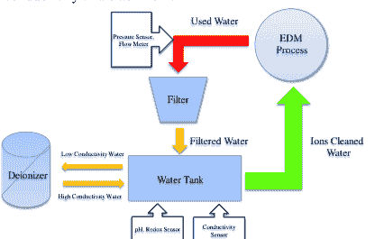

图 (6). 电介质回路布局 [31]。

该布局包括压力传感器、电导率传感器以及 pH 和氧化还原传感器的组合。还在过滤器入口处使用压力传感器维持过滤器压降的监控。设定压力值上限为 2.8 bar，超过该值机器将自动停止。对给定材料进行加工后，获得了每个设置的压降图，并计算了树脂中蚀除颗粒的重量。这表明在大约 304 个有效加工小时中，通过加工工件和丝线，总共去除了 4kg 的 WC（碳化钨），并且在加工过程中侵蚀了约 7.7 kg 的丝线。与树脂中收集碎屑的数量相比，发现总共 5.4 Kg 在加工过程中以离子形式被吸收。最后，创建了一个模型来预测压降。触点磨损

研究还发现其磨损率也很显著，因为它会持续摩擦电火花加工（EDM）中的金属丝。文献模型与开发模型之间表现出良好的相关性。最后得出结论：如果利用合适的传感器和预测模型对线切割（WEDM）中使用的树脂、过滤器、触点和金属丝进行精确监控，则这些材料将具有最高的成本效益。

## 结语

大量研究针对包括复合材料在内的各种材料进行了分析，同时考虑了脉宽/脉间时间、金属丝进给速度、金属丝张力、峰值电流和电压等多种控制参数，但从目前所做的综述来看，关于金属丝材料影响的研究仍然很少，因此应进行深入研究以查明其对加工特性的重要性。人们还发现金属丝直径可能在加工特性和金属丝磨损率（WWR）中发挥重要作用。这也需要研究其对材料去除率（MRR）、表面粗糙度（SR）和尺寸偏差（CV）的重要性。研究发现各种其他参数如过滤器饱和度与文献模型相比存在很大差异，因此需要建立一个详细的模型，利用铝等材料来预测过滤器饱和度。我们还看到，假设缺失的质量以离子形式被消耗。需要进行一些研究来验证并彻底阐述这一点。

## 出版同意书

不适用。

## 利益冲突

作者确认本章节内容不存在利益冲突。

## 致谢

作者谨向编辑和匿名审稿人致以诚挚的谢意，感谢他们宝贵的时间和建议。

## 参考文献

- [1] E.C. Jameson, *Electrical Discharge Machining*, 1st ed. Society of Manufacturing Engineers: Michigan, 2001.
- [2] K.H. Ho, and S.T. Newman, "State of the art electrical discharge machining (EDM)", *Int. J. Mach. Tools Manuf.*, vol. 43, pp. 1287-1300, 2003.
- [3] N.M. Abbas, D.G. Soloman, and M. Fuad Bahari, "A review on current research trends in electrical discharge machining", *Int. J. Mach. Tools Manuf.*, vol. 47, pp. 1214-1228, 2007.
- [4] S. Kumar, R. Singh, T.P. Singh, and B.L. Sethi, "Surface modification by electrical discharge machining: A Review", *J. Mater. Process. Technol.*, vol. 209, pp. 3675-3687, 2009.
- [5] M.P. Jahan, Y.S. Wong, and M. Rahman, "A study on the fine-finish die-sinking micro EDM of tungsten carbide using different electrode materials", *J. Mater. Process. Technol.*, vol. 209, pp. 3956-3967, 2009.
- [6] F. Han, L. Chen, D. Yu, and X. Zhou, "Basic study on pulse generator for micro EDM", *Int. J. Adv. Manuf. Technol.*, vol. 33, pp. 474-479, 2007.
- [7] F. Han, S. Wachi, and M. Kunieda, "Improvement of machining characteristics of micro-EDM using transistor type iso pulse generator and servo feed control", *Precis. Eng.*, vol. 28, pp. 378-385, 2004.
- [8] R. Casanueva, F.J. Azconado, and S. Bracho, "Series-parallel resonant converter for an EDM power supply", *Journal of Materials Processing Technology*, vol. 149, 2004.
- [9] T. Muthuramalingam, and B. Mohan, "Design and fabrication of control system based iso pulse generator for electrical discharge machining", *International Journal of Mechatronics and Manufacturing Systems*, vol. 6, pp. 133-143, 2013.
- [10] T. Muthuramalingam, and B. Mohan, "Influence of discharge current pulse on machinability in electrical discharge machining", *Mater. Manuf. Process.*, vol. 28, pp. 375-380, 2013.
- [11] T. Muthuramalingam, and B. Mohan, "Experimental investigation of iso energy pulse generator on performance measures in EDM", *Mater. Manuf. Process.*, vol. 71, pp. 1137-1142, 2013.
- [12] A. Bhatia, S. Kumar, and P. Kumar, "A Study to achieve minimum surface roughness in Wire EDM", *Procedia Materials Science*, vol. 5, pp. 2560-2566, 2014.
- [13] S. Tilekar, and S.S. Das, "P.K Patowari, "Process Parameter Optimization of Wire EDM on Aluminum and Mild Steel using Taguchi Method", *Procedia Materials Science*, vol. 5, pp. 2577-2584, 2014.
- [14] B.K. Lodi, and S. Agarwal, "Optimization of machining parameters in WEDM of AISI D3 Steel using Taguchi Technique", *Procedia CIRP*, vol. 14, pp. 194-199, 2014.
- [15] G. Selvakumar, G. Sornalatha, S. Sarkar, and S. Mitra, "Experimental investigation and multi-objective optimization of wire electrical discharge machining (WEDM) of 5083 aluminum alloy", *Trans. Nonferrous Met. Soc. China*, vol. 24, pp. 373-379, 2014.
- [16] R. Bagherian Azhri, R. Teimouri, M. Ghasemi Babloy, and Z. Leseman, "Application of Taguchi, ANFIS and grey relational analysis for studying, modeling and optimization of wire EDM process while using gaseous media", *Int. J. Adv. Manuf. Technol.*, vol. 71, pp. 279-295, 2014.
- [17] A. Srivastava, A.R. Dixit, and S. Tiwari, "Experimental Investigation of Wire EDM Process Parameters on Aluminium Metal Matrix Composite Al2024/SiC", *International Journal of Advance Research and Innovation*, vol. 2, pp. 511-515, 2014.
- [18] A. Ikram, N.A. Muflhi, M.Q. Saleeon, and A.R. Khan, "Parametric optimization for surface roughness, kerf and MRR in wire electrical discharge machining (WEDM) using Taguchi design of experiment", *J. Mech. Sci. Technol.*, vol. 27, no. 7, pp. 2133-2141, 2013.
- [19] V. Ravinandhadn Babholi, "Madhub, and A. K. Goglia, "Effect of Wire-EDM Machining Parameters on Surface Roughness and Material Removal Rate of High Strength Armor Steel", *Mater. Manuf. Process.*, vol. 28, pp. 364-368, 2013.
- [20] A. Kumar, V. Kumar, and J. Kumar, "Semi-empirical Model On MRR And Overcut In WEDM ProcessOf Pure Titanium Using Multi- objective Desirability Approach", *J. Braz. Soc. Mech. Eng.*, vol. 37, pp. 689-721, 2015.
- [21] G. Zhang, Z. Zhang, J. Guo, W. Ming, M. Li, and Y. Huang, "Modeling And Optimization Of Medium Speed WEDM Process Parameters For Machining SKD11", *Mater. Manuf. Process.*, vol. 28, pp. 1124-1132, 2013.
- [22] M.P. Garg, A. Jain, and G. Bhusan, "Multi-objective Optimization of Process Parameters in Wire Electric Discharge Machining of Ti- 6-2-4-2 Alloy", *Arab. J. Sci. Eng.*, vol. 39, pp. 1465-1476, 2014.
- [23] A. Umare, S. Parchand, and P. Shingare, "Wire cut EDM Process- A review", *International Journal of Advance Research and Innovative Ideas in Education*, vol. 3, no. 6, pp. 294-398, 2017.
- [24] Rishavraj Singh, "Review on Effects of Process Parameters in Wire Cut EDM and Wire Electrode Development", *International Journal for Innovative Research in Science & Technology*, vol. 2, no. 11, pp. 701-706, 2016.
- [25] D. Ghodsiyeh, A. Golshan, and J.A. Shirvanehdel, "Review on Current Research Trends in Wire Electrical Discharge Machining", *Indian J. Sci. Technol.*, vol. 6, pp. 4128-4140, 2013.
- [26] J. Kapoor, Sehjipal Singh, and Jainal Singh Khamba, "Recent Developments in Wire Electrodes for High Performance WEDM", *Proceedings of the World Congress on Engineering*, vol. 2, 2010.
- [27] M. Singh, H. Lal, and R. Singh, "Recent Developments in Wire EDM: A Review", *International Journal of Research in Mechanical Engineering & Technology*, vol. 3, pp. 150-152, 2013.
- [28] M.T. Antor, S.L. Soo, D.K. Aspinwall, D. Jones, and R. Perez, "Productivity and workpiece surface integrity when WEDM aerospace alloys using coated wires," 1st CIRP Conference on Surface Integrity (CSI1), *Procedia Eng.*, vol. 19, pp. 3-8, 2011.
- [29] H. Kagermann, *Umsatzempfehlungen für Industrie 4.0*, p. 107. https://www.bmbf.de/files/Umsatzempfehlungen_Industrie4_0.pdf
- [30] Q. Yi, *Micro-manufacturing research: drivers and latest developments*, 2015. https://strathprints.strath.ac.uk/id/eprint/59119
- [31] G. Waldér, D. Fulliquet, N. Foulkia, F. Jaquenod, M. Lauria, R. Rozsnyo, B. Lavazais, and R. Perez, "Smart Wire EDM machine, 19th CIRP Conference on Electro Physical and Chemical Machining", *Procedia CIRP*, vol. 68, pp. 109-114, 2018.

## 第 9 章

## 制造业中的人工智能与机器人：机遇与挑战

Hitesh Pahuja*，PK Khosla 和 Balwinder Singh

印度旁遮普邦莫哈利，高级计算发展中心

**摘要**：如今由人类所做的任何工作，未来都将由基于人工智能（AI）的系统完成，但以计算机的速度、规模和范围进行。人工智能正致力于推动制造业的转型并改进制造流程。根据《福布斯》技术委员会成员的观点，包括制造业在内的 13 个不同行业将被人工智能彻底改变。人工智能和机器人技术可以将复杂的任务转化为一致且精确的解决方案。随着工业机器人操作的增加，制造业中人工智能的部署显著增加。人工智能在制造领域得到广泛应用并逐渐渗透，利用学习算法通过学习和无错误决策简化自动化流程。人工智能驱动的系统正在为未来制造业开辟更简单的道路，通过提供创新前景、提高生产效率以推动商品生产，以及实施通用人工智能使机器交互更接近人类交互，从而带来诸多好处。该技术使制造商能够克服制造业中长期存在的各种挑战，如专家短缺、决策失误、集成相关问题以及数据过载。因此，在制造业中实施人工智能使公司能够全面革新其流程。它允许智能 AI 机器人/机器收集和提取数据，识别各种模式，从模式中学习，并根据分配任务的复杂性，通过机器或基于深度学习适应新环境。因此，在工业界部署人工智能和机器人将变革大规模生产，并具备无错误决策能力。工业 4.0 中基于人工智能的机器人可以执行持久行动，例如设计制造模型、开发专业知识、开发新的自动化解决方案、消除人为错误以及在产品中提供卓越质量。随着人工智能的实施，机器人将取代人力并执行危险活动。因此，制造业各部门的事故数量将下降。

\* 通讯作者 Hitesh Pahuja: 印度旁遮普邦莫哈利，高级计算发展中心；邮箱：hitesh@cdac.in

AI与机器人技术将使制造商摆脱与未经培训工人相关的问题。因此，企业家可以将精力集中在工业的进一步现代化以及将其规模扩大到更高水平上。除了采用像AI这样的新兴技术带来的众多机遇外，工业家也面临一些挑战。在制造业中引入AI和机器人技术将需要初创企业和现有制造商进行巨额资本投资。但投资回报率将会很高，因为智能机器将开始处理日常活动；公司将承担 considerably 更低的运营成本。AI的支持者声称，技术只是自动化的演进形式，是第四次工业革命的必然结果。AI在创造、改进和降低成本方面可能很有效。但在应对口味和需求方面不可预见的变化时，人类的创造力无可替代。

**关键词：** 人工智能、数据、制造业、机器学习、机器人。

## 引言

人工智能（AI）是一种技术，强调形成能够像个体一样工作和响应的智能机器。具备完成智力任务（如观察、学习、决策、推理和解决问题）能力的机器或智能计算机被称为人工智能计算机或机器。而机器人学是人工智能的一个领域，它使用深度学习技术创建智能机器人。机器人技术是人工智能的一个领域，它由机械工程、电气工程和计算机科学等所有工程领域组成，用于规划、设计、组装、开发和应用基于AI的机器人，如图(1)所示。

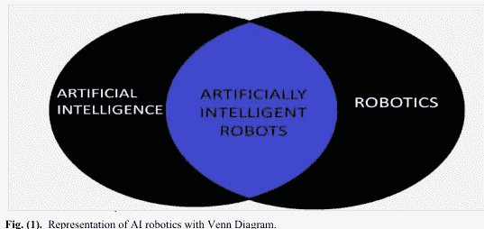

有智能机器在实时工作中发挥作用 [1, 4, 6]。它们被部署用于通过检测、积累、移动、修改对象的基本属性、损坏它或对其产生智能影响来监控对象，从而将劳动力从单调且令人疲惫的工作中释放出来，使其不受干扰。AI机器人拥有先进的机械结构，旨在高敏感度和精度地完成任务，如图(1)所示。它还包含为机器人的机械结构提供动力和控制的电气模块。此外，它还包含一定级别的先进软件编程，规定机器人如何同时执行多项任务。AI和机器人是智能机器和机器人展现出的智能，用于完成通常涉及智力、人类知识和学习技能的任務，如感知、学习、推理、解决问题、决策和可视化等。新兴技术包括各种子集技术，如机器学习和深度学习，随着时间推移，随着数据量的增加而学习，如图(2)所示。

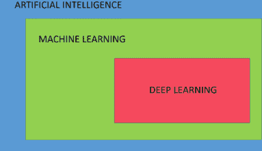

机器学习是机器或计算机无需编程即可学习的能力。它使用多种算法来分析和评估数据；在分析数据后，从中学到知识，然后做出判断或输出结果。因此，机器学习算法允许系统通过应用可用数据作为输入来训练机器，从而执行任务。另一方面，深度学习是AI和机器学习的子集，它基于生物神经网络学习表示来解决复杂问题，就像人类所做的那样。AI中的学习可以是监督式、半监督式、强化式或非监督式 [2]。监督式学习，顾名思义，表明有导师（老师）的存在。监督式学习是一种通过标记数据进行机器教学的学习，这意味着某些数据之前已被标记了正确解决方案。之后，机器被提供一组新的实例（数据）。因此，基于监督方法的算法分析训练数据集，并从之前标记的数据学习中生成适当的结论。

例如，假设一个装满各种水果的篮子。初始阶段是按顺序用所有不同的水果训练系统。如果某物品的形状是圆的，且顶部印记呈红色，则该水果将被标记为苹果。另一方面，如果一个物体是长弯曲圆柱体，呈绿黄色，则它将被标记为香蕉。假设我们从标记数据训练后，如果机器输入了来自篮子的一个新的相似水果样本并要求检测它。由于系统之前已从早期数据中学习，机器会给出准确的输出。监督式学习分为两类算法：分类和回归。

另一方面，非监督式学习是对既未标记也未分类的数据进行的。因此，它允许算法在没有指导的情况下操作该信息。现在，机器必须根据模式、相似性和差异对未排序的数据进行分组，而无需先前的数据训练。与监督式学习不同，没有老师提供建议，也没有向系统或机器进行此类教学或训练。因此，基于非监督式的机器只能自行发现非标记数据中的隐藏安排。让我们以狗和猫的图片为例，这些图片之前未用任何数据集进行过训练。现在，系统对狗和猫的形状毫无头绪。因此，它们不能被归类为狗、猫或动物。虽然，非监督算法可以根据它们的相似性、模式和差异对它们进行分类。

最后，强化学习在人工智能中是一种动态方法，通过奖励和惩罚技术来教导机器。在这种技术中，机器通过与环境交互来学习 [3, 4]。

## 制造业中的人工智能与机器人

制造业一直被认为具有最高程度的自学习自动化；完全技术化的AI机器人工厂仍然显得遥不可及。然而，具有AI特征的机器人有望改变这一趋势。具备卓越创造力和自给自足学习能力的AI赋能机器人将转变工业中的生产过程 [5 - 8]。与此同时，该领域的研究正面临重大挑战，特别是在预算限制方面。为了克服这些设计挑战，可以将原材料、制造技术和其他细节的参数集成到软件中，该软件在所有可行的输入变量排列上运行，并推荐最佳设计。利用人工智能技术，输出结果在每次迭代中都会得到进一步增强和改善。因此，这些有前途的技术可以为我们提供优越的设计并消除垃圾。

目前，与基于AI的机器相比，故障检测方法和工具不够准确，导致制造业中数万亿美元的无价值生产。为了克服这一问题，可以构建一个过程、产品和供应链的模拟模型，称为数字孪生。这是数据与智能的结合，标示系统的行为和框架。该技术可以通过仅处理关键信息并删除垃圾信息来提高数据使用效率。机器学习算法在视觉模式识别方面具有优势，有助于对整个供应链管理中的资产进行物理审查 [9 - 11]。使用监督或非监督算法，应用程序可以区分损坏或磨损。它可以整理行动列表，并建议纠正性解决方案以恢复资产中的问题。

供应链管理可以通过先进的AI算法完成。由于供应链是生产行业的支柱。AI赋能的机器或机器人将有助于降低运输成本、管理仓库以及高效的供应链管理。这些机器学习算法能够实时处理大量多样化数据集以进行供需预测。在基于AI的供应链模型中，将实现货运成本的降低和供应商交付的改善 [12]。此外，未来可以通过AI赋能的机器实现库存管理流程。因为大多数供应链必须面对全球 recent 现实、不稳定的需求以及日益差异化、适应性和复合的产品。在照顾库存的同时匹配客户设施是一项艰巨的任务。库存管理中的不适区一直是库存过剩和无法追踪重要物品。在此，AI机器将有助于资产的实时监督和优化。AI赋能的机器人可以帮助改善供需计划。库存优化结果的首要目的是在最低库存管理下，在正确的时间将精确的产品交付给正确地点的客户。将存在一个智能优化解决方案，常规地调整库存水平以精确满足客户需求，提高服务水平，降低成本，并提高公司的库存周转率 [13, 14]。

机器学习算法将帮助在整个供应链中进行库存优化，并通过自动化危险活动来提高安全性。使用AI机器人技术部署，可以处理实时数据和危险工作，使其影响最小化。这些AI机器人可以在风险环境中工作，如熔炉、危险材料、锅炉、焊接和压铸，*等等*，而现有的程序无法达到上述精度水平。此外，像AI机器人这样的新兴技术领域的进步正在为混合劳动力开辟道路，机器人和机器共同管理。它们协同工作以改善

提高生产力，同时创造更多由人工智能技术促进的帖子。如今，机器人正以科幻故事中描绘的方式执行工作。尽管在制造业中使用赋能人工智能的机器人具有巨大的应用范围和优势，但人工智能机器人带来的好处远远超过了其实施过程中面临的挑战。这项技术在制造和生产方面的应用范围和潜力，将在未来引发下一场工业革命 [15 - 18]。

## 机遇与优势

人工智能和机器人的应用将提高生产力，并能在印度等国创造更多的制造业生产工作岗位。预计劳动人口将从人工智能和机器人技术中获得大部分利润。在制造业部门，人工智能和机器人的实施极具帮助性，因为它将提高产品的产量和质量，提升生产效率并加快生产速度。人工智能机器人的引入被认为是制造业行业的一次繁荣 [19]。

人工智能机器人可以像人类学习一样，通过标记数据集进行训练，以更高效地运行，包括最初未在初始编程中预见的新指令。基于人工智能的机器人将像人类一样工作，但不同于人类，它们可以连续工作。因为它们不会感到无聊、饥饿或疲惫。一旦延伸到微缩化和精密测量领域，赋能人工智能的机器人能力将远远超越人类能力 [20]。此外，这些在制造业部门兴起的技术将在未来带来卓越的优质保证。人工智能和机器人可以将复杂任务转化为一致且精确的解决方案。随着工业机器人运行量的增加，人工智能在制造过程中的部署已显著增加。

人工智能（AI）被广泛应用的，并正在逐渐接近制造领域，利用学习算法通过学习和无错决策简化自动化流程。通过提供创新前景、通过提高效率来增加商品产量，以及通过实施通用人工智能使机器交互更接近人类交互，人工智能驱动的系统为未来制造业指明了更简单的路径。拥有卓越创新和自我学习能力的赋能人工智能机器人将转变工业生产流程。然而，该领域的研究在预算限制方面面临重大挑战。为了克服这些设计问题，可以将原材料、制造技术和其他细节的参数整合到软件中，该软件针对所有可行的输入变量配置运行并推荐最佳设计 [21]。随着人工智能技术应用的每一次重复，输出结果都会进一步增强和改进。图 (3) 展示了制造业中人工智能和机器人的多种优势。基于人工智能系统的详细好处如下所述。

图 (3). 人工智能和机器人在制造业中的作用。

### a) 直接自动化

在重工业中引入机器人和带有大数据分析的人工智能，并通过使其具备逻辑控制器可编程性来安装新机器。新兴技术将增加未来工业中精密传感设备的使用。此过程涉及制造过程各个阶段的信息生成、记录和分析，涵盖从温度感知到产品选择、拣选和包装的所有内容。SCADA（监控与数据采集）结合深度学习可以自动对流畅产生的数据做出反应，并在无需人工介入的情况下调整最细微的事件。由人工智能处理的机器人技术和大数据分析可以显著增强整个制造过程中的实施和性能，并且整个过程可以远程控制 [22]。

### b) 7x24小时生产

人类是需要日常关注的生物，如护理、休息、水和食物，因此每天工作时间有限。然而，为了让每个制造单位连续工作，必须启动轮班，雇佣四名工人全天候工作以完成一个24小时循环。人工智能机器人的优势包括无需休息、无疲劳以及不间断的规律工作时间。此外，它们在制造单位全天候工作效率极高。这导致了制造设施的增长，这是逐步满足全球和当地客户需求所必需的。此外，人工智能机器人在许多领域更有效，如装配线、物品选择和拣选以及包装。因此，它们可以显著缩短制造业各个部门的周转时间 [18 - 21]。

### c) 安全

人类是多疑的，且容易犯错误，尤其是在疲劳或分心时。在工厂车间和任何开发或处理环境中，错误和失配都会发生；这种倾向几乎可以通过人工智能和机器人技术消除。无法接近控制意味着减少人力资源，特别是当工作环境危险或需要超人力量时。确实，传统的工作状况将减少机械失配的频率，并带来整体安全性的增强。此外，更先进的触觉硬件与IloT（工业物联网）设备的集成，使得建立安全监视和屏障变得更加容易和有效，以确保人类生命 [5]。

### d) 降低运营成本

许多公司对人工智能进入制造业持恐惧态度，因为这需要巨大的资本投入。另一方面，投资回报率（ROI）很大，并随时间推移而增加。一旦智能机器开始接管生产线上的日常操作，企业将通过显著降低的运营成本获益，同时现有的维护也有助于减少机器停机时间。满足这些需求变得越来越容易且便宜，使用人工智能和机器学习方法意味着整个生产准备过程将更具成本效益。将机器学习和CAD（计算机辅助设计）结合意味着可以在虚拟环境中规划和测试框架，然后再将其投入生产，从而降低试错机器测试的成本 [23]。

### e) 更高效率

借助大数据分析等新兴技术，经过人工智能算法处理，可以预测工业部门的整体趋势，通过训练进行模式识别，预测市场发展趋势、宏观经济周期，甚至借助机器学习和数据分析预测天气模式。人工智能具有利用机器学习预测数据、优化表单并追踪不一致性的能力，贯穿从源头到成品的整个供应链。这可以特别通过如RFID（射频识别）跟踪等进步得到支持，它允许材料被跟踪而不必经过如条形码扫描器这样的物理过程 [16, 19]。

### f) 质量控制

人工智能机器人在实施机器、设备和其他工业硬件的预测性维护方面也非常有价值。此外，利用内置人工智能技术的各种传感器来跟踪机器的性能和工作条件，以检查、预测所有类型的故障，并在发生故障前采取行动进行修复。这可能带来更快的反馈，减少机器停机时间。因此，它提高了整体效率和生产力。它们还可以识别纳米或微观故障，以远超正常人类想象能力的分辨率进行检查，从而增强生产力并提高通过质量检查和控制部门的产品数量。赋能人工智能的机器人在加速多个计划模型方面发挥了巨大作用，并将精确度提升到大规模水平。这避免了由人类进行质量控制和在线评估的需求，该过程耗时且经常出错 [22, 23]。

### g) 快速决策

人工智能机器人可以通过将复杂任务数字化来为制造业提供快速决策，这些任务如果仅靠人类可能需要极短的时间（原文此处可能有误，结合语境应为“人类需要很长时间”）。相比之下，它在数据层面更深层次地使用信息，发现人类可能永远无法捕捉到的模式。制造智能在决策中的应用必须适合客户端有意义的工作流和设计。人工智能涵盖了认知和身体任务的数字化。它帮助个人更快地完成任务，做得更好，并做出更好的选择。它支持决策的机器人化，无需人工干预。人工智能可以通过减少人类劳动和重复性任务来提高机器人化水平 [16 - 18]。因此，还有更多方式表明人工智能正在发挥作用。人工智能在决策或其他任务中的细节已在表1中说明。

## 表 1. 带有描述和示例的 AI 决策

| 决策类型 | 描述 | 示例 |
|---|---|---|
| 分类 | 归类为好或坏 | 潜在借款人可能违约，客户可能流失，图像中的物体可能是猫，等等。 |
| 分组 | 检测客户的自然分组 | 将客户分群到不同的集群中 |
| 关联 | 发现各个实体之间有意义的关联 | 基于其他相关客户建议下一个最佳产品或优惠 |
| 预测 | 预测连续数量的未来价格 | 预测交易，预测客户在整个生命周期内的价格 |
| 自然语言处理 | 识别结构，识别实体，提取意义 | 翻译，从细节生成摘要，识别实体及其关系 |
| 视觉感知 | 识别图像或视频中的对象，生成 3D 世界 | 理解边缘、纹理、对象。重建 3D 世界，检测异常 |
| 机器人技术 | 操纵现实世界中的物体 | 移动操纵器，如自动驾驶汽车、装配线零件拣选机器人 |

## 制造业中 AI 和机器人的挑战

在行业中实施 AI 和机器人技术并不像采购机器人并插入应用程序那样简单。在 AI 能够建设性地实现任何自动化之前，有许多不同的财务和政府政策考量需要考虑。每个生产商都会根据其行业、规划以及商业模式面临独特的挑战。然而，在制造业中实施 AI 通常存在许多挑战。实施 AI 和机器人技术以开启其价值的关键在于将原始数据转化为智能预测，以便快速决策。一般来说，在人工智能的实施中存在着各种各样的挑战 [25]。

### a). 数据

设计框架目前产生部分信息，而尖端行业是一个巨大的信息环境。然而，机械数据通常是结构化的，但质量可能较差。数据质量可能很差，而且与其他面向消费者的应用不同，来自机械系统的数据通常具有明确的物理含义，这使得通过数据量来弥补质量缺陷变得更加困难。通常用于训练机器学习模型的数据缺乏全面的工作条件和健康状态/故障模式集合，这可能导致 AI 系统在线使用时出现假阳性和假阴性。机械数据设计可以具有极强的时间依赖性，解读这些设计需要空间专业知识，仅靠挖掘数值数据很难充分利用 [26]。

### b). 速度

制造过程发生得很快，机器/设备和其他类型的设备可能价格昂贵，各种应用的 AI 以及数据分析方法必须实时应用，以立即检测异常并防止废料和其他影响。基于云的解决方案可能是有效且快速的技术，但不适用于特定的计算效率条件 [24 - 26]。

### c). 高保真要求

与遭遇错误的 AI 基于推荐系统的客户相比，这些系统对错误有较高的容忍度，但即使是最低限度的错误处理速率也可能损害机器人和 AI 系统的整体可靠性。工程 AI 启用应用程序通常处理与保护、一致性和操作相关的关键问题。预测中的任何故障都可能对客户产生不利影响，并阻止他们信任 AI 启用的系统。

### d). 可解释性

一般的 AI 启用系统还应超越预测结果，并为故障提供根本原因评估。这需要数据科学家在开发通用应用程序期间与领域专家合作，并且必须将领域流程细节纳入建模过程。

### e). 员工技能组合和培训

当执行新的 AI 机器人技术时，预计员工需要具备新的知识水平。许多员工将需要接受如何在这种不同环境中管理的培训，而其他工作者则需要被任命，使其具备适当的 AI 和机器人技术的资格、学习和经验。

### f). 安全措施

AI 和机器人技术将许多现代安全风险带入工作环境，并且存在严格的控制措施以及围绕自动化安全的严厉惩罚。生产者必须在近期引入机器人之前做好准备，以确保合规性并为专家创造安全的环境。

### g). 系统成本预算

制造商在将 AI 启用的应用程序/软件引入工作场所时可能会面临运营和财务挑战。此类应用程序/软件可能包含从可靠的超高速互联网到昂贵机械的各种内容。AI 和机器人技术通常涉及大量投资，尽管价格正在大幅下降。但对于现有玩家来说，更新现有系统仍然是一个巨大的挑战。在制造业中引入 AI 和机器人技术将需要初创企业和现有制造商进行巨额资本投资。因此，在预计的投资回报率（ROI）期间，商品的销售和生产数量应保持稳定，以弥补初始投资时间 [27]。

### h). 管理产品工作流

在决定引入 AI 时产品工作流将呈现何种状态时，有许多考量因素。必须计算向 AI 机器人引入部分的速度，以确保在不给现有框架造成过多负担的情况下实现最大效率。代表性技能组合、未使用的安全协议、预算以及管理产品工作流是生产者在执行机械自动化框架时面临的一些最大挑战。了解新兴技术远比购买和拥有它们复杂得多。制造商应为挑战做好准备，以便从其 AI 启用的机器人化框架中获得最大收益 [24 - 27]。

现在，是时候将传统的制造工厂转变为智能的 AI 启用工厂，利用 AI、物联网（IoT）、数据分析和技术云计算，因为它确实如此。一如既往，存在挑战——在这种情况下，它是一个获取成本的问题。新时代将经历许多变化，并为研究人员、工业界和学术界带来新的研究体验 [28 - 32]。

## 结论

制造业非常适合应用人工智能和机器人技术。尽管 AI 革命仍处于初期阶段，但我们现在已经观察到该技术带来的实质性好处。从初步设计过程、生产楼层、完整供应链到全面管理，人工智能旨在改变以往生产产品和工艺材料整合的方式。AI 和机器人技术可以嵌入到现有制造商品和应用程序中，以创建更高效、一致、更安全以及寿命和操作方面更强大的产品。在 AI 和机器人技术的支持下，工业自动化的水平和速度已发生深刻变化。AI 启用的技术增强了传统应用程序的性能并开发其能力。一个例子是 AI 启用的协作机器人。机械臂可以学习由人类操作员展示的移动和路线，并在作为人工智能一部分的监督训练后执行类似的工作。此外，AI 还自动化了涉及人工参与的方法。

## 出版许可

不适用。

## 利益冲突

作者确认本章节内容没有利益冲突。

## 致谢

作者谨向编辑和匿名审稿人致以诚挚的感谢，感谢他们宝贵的时间和建议。

## 参考文献

- [1] X. Shang, X. Liu, G. Xiong, C. Cheng, Y. Ma, and T.R. Nyberg, "服装行业大规模定制化社会制造云平台", *Proc. IEEE Int. Conf. Service Oper. Logistics Infomat.*, pp. 220-224, 2013. [http://dx.doi.org/10.1109/SOLI.2013.6611413]
- [2] J.H. Thrall, X. Li, Q. Li, C. Cruz, S. Do, K. Dreyer, and J. Brick, "放射学中的人工智能和机器学习：机遇、挑战、陷阱和成功标准", *J. Am. Coll. Radiol.*, vol. 15, no. 3 Pt B, pp. 504-508, 2018. [http://dx.doi.org/10.1016/j.jacr.2017.12.026] [PMID: 29402533]
- [3] X. Xu, and Q. Hua, "智能工厂中的工业大数据分析：现状和研究策略", *IEEE Access*, vol. 5, pp. 17543-17551, 2017. [http://dx.doi.org/10.1109/ACCESS.2017.2741105]
- [4] Z.X. Guo, W.K. Wong, S.Y.S. Leung, and M. Li, "服装行业中的人工智能应用：综述". *Text. Res. J.*, vol. 81, no. 18, pp. 1871-1892, 2011.

- [5] R. Nayak 和 R. Padhyye，“人工智能及其在服装行业中的应用”，载于《*自动化服装制造*》，Elsevier出版社：荷兰阿姆斯特丹，2018年，第109-138页。[http://dx.doi.org/10.1177/0040517511411968]

- [6] C.K.H. Lee, K.I.L. Choy, K.M.Y. Law 和 G.T.S. Ho, “香港服装业生产资源规划的智能系统”，*《IEEE工业工程与管理国际会议论文集》*，第889-893页，2012年。

- [7] G.M. Nasira 和 P. Banumathi, “用于自动织物检测的智能系统”，*《亚洲信息技术杂志》*，第13卷，第6期，第308-312页，2014年。

- [8] M-K. Chen, Y-H. Wang 和 T-Y. Hung, “基于学习曲线模型的服装物流订单分配决策支持系统构建”，*《工业与生产工程杂志》*，第31卷，第5期，第274-285页，2014年。

- [9] G. Barannis, S. Dani 和 G. Antoniou, “使用机器学习预测供应链风险：性能与可解释性之间的权衡”，*《未来代计算机系统》*，第101卷，第993-1004页，2019年。[http://dx.doi.org/10.1016/j.future.2019.07.059]

- [10] R. Sharma, S.S. Kamble, A. Gunasekaran, V. Kumar 和 A. Kumar, “关于机器学习在可持续农业供应链绩效中应用的系统性文献综述”，*《计算机与运筹学》*，第119卷，2020.104926 [http://dx.doi.org/10.1016/j.cor.2020.104926]

- [11] R. Stuart 和 P. Norvig, *《人工智能：一种现代方法》*。Prentice-Hall出版社：美国新泽西州上萨德尔里弗，2009年。

- [12] M. Mohri, A. Rostamizadeh 和 A. Talwalkar, *《机器学习基础》*。MIT出版社：美国马萨诸塞州剑桥，2012年。

- [13] S.V. Kumar 和 S. Poonkuzhali, “利用数据挖掘技术预测市场趋势以改善服装销售”，*《国际纯应用数学杂志》*，第119卷，第7期，第797-805页，2018年。

- [14] H. Pahuja, M. Tyagi, S. Panday 和 B. Singh, “一种具有高运行裕度、低写功耗的低电压操作单端9T FinFET亚阈值SRAM单元”，*《集成（阿姆斯特丹）》*，第60卷，第99-116页，2018年。[http://dx.doi.org/10.1016/j.vlsi.2017.08.004]

- [15] H. Pahuja, M. Tyagi, B. Singh 和 S. Panday, “用于超低功耗存储设计的抗漏电流单端8T SRAM单元”，*《工程科学与技术杂志》*，第14卷，第2期，第629-645页，2019年。

- [16] Y.H. Pan, “迈向人工智能2.0”，*《工程》*，第2卷，第4期，第409-413页，2016年。[http://dx.doi.org/10.1016/J.ENG.2016.04.018]

- [17] B-R. Li, Y. Wang 和 K-S. Wang, “基于数据挖掘的时尚产品设计评估新方法”，*《先进制造》*，第5卷，第4期，第370-376页，2017年。[http://dx.doi.org/10.1007/s40436-017-0201-x]

- [18] S-W. Hsiao, C-H. Lee, R-Q. Chen 和 C-H. Yen, “基于模糊C均值和灰理论的时尚色彩预测智能系统”，*《色彩研究与应用》*，第42卷，第2期，第273-285页，2017年。[http://dx.doi.org/10.1002/col.22057]

- [19] M. Mohri, A. Rostamizadeh 和 A. Talwalkar, *《机器学习基础》*。MIT出版社：美国马萨诸塞州剑桥，2012年。

- [20] R. Stuart 和 P. Norvig, *《人工智能：一种现代方法》*。Prentice-Hall出版社：美国新泽西州上萨德尔里弗，2009年。

- [21] P. Yildirim, D. Birant 和 T. Alpystig, “纺织行业中的数据挖掘与机器学习”，*《Wiley跨学科综述：数据挖掘与知识发现》*，第8卷，第1期，2018.e1228 [http://dx.doi.org/10.1002/widm.1228]

- [22] S.K. Acharya, V. Singh, V. Pereira, P. Singh. “时尚行业中的大数据知识共创与决策”，*《国际信息管理杂志》*，第42卷，第90-101页，2018年。[http://dx.doi.org/10.1016/j.ijinfomgt.2018.06.008]

- [23] J. Lee, E. Lapisla, B. Bagheri 和 H.A. Kao, “大数据环境下预测性制造系统的最新进展与趋势”，*《制造快报》*，第1卷，第1期，第38-41页，2015年。[http://dx.doi.org/10.1016/j.mfglet.2013.09.005]

- [24] K. Lee, “人工智能、自动化与经济体”。白宫博客，2016年。

- [25] H. Leurent 和 E.D. Boer, “第四次工业革命：制造业中的技术与创新灯塔”，白皮书，2019年1月。10. https://www.weforum.org/whitepapers/fourth-industrial-revolution-beacons-of-technology-and-innovation-in-manufacturing

- [26] J. Lee, M. Azamfar 和 J. Singh, “面向工业4.0制造系统的区块链使能信息物理系统架构”，*《制造快报》*，2019年。[http://dx.doi.org/10.1016/j.mfglet.2019.05.003]

- [27] H. Xiao, B. Muthu 和 S. Kadyr, “利用机器人辅助混合整数规划模型在先进制造业中应用机器人的人工智能”，*《智能服务机器人》*，2020年。[http://dx.doi.org/10.1007/s11370-020-00326-7]

- [28] C. Chow 和 C. Leung, “技术挑战” [http://dx.doi.org/10.2174/9781681087498118010025]

- [29] J. Jiang, Z. Min, X. Ma, Y. Zhang 和 V. Song, “机器人在手部功能康复中的应用”，*《近期专利：机械工程》*，第11卷，第1期，第2-14页，2018年。[http://dx.doi.org/10.2174/2212279761166618018094318]

- [30] C. Chow 和 C. Leung, “第四次工业革命” [http://dx.doi.org/10.2174/9781681087498118010017]

- [31] J. Pérez-Sianes, H. Pérez-Sánchez 和 F. Díaz, “虚拟筛选遇上深度学习”，*《当前计算机辅助药物设计》*，第15卷，第1期，第6-28页，2019年。[http://dx.doi.org/10.2174/157340091466618108141602] [PMID: 30338743]

- [32] M.T. Almansoori, X. Li 和 L. Zheng, “电子皮肤及其多功能传感应用的简要综述”，*《当前智能材料》*，第4卷，第1期，第3-14页，2019年。[http://dx.doi.org/10.2174/2405465804666190313154903]

## 主题索引

### A

- 磨粒侵蚀过程 63
- 磨粒空气射流加工 (AAJM) 72, 74
- 磨粒液体射流抛光 (AFJP) 83
- 磨料颗粒 1
- 磨料射流加工 18, 45, 71, 73, 83
- 磨料材料 81, 82, 83, 59
- 磨料尺寸 79, 80, 81
- 磨料水射流 18, 33, 36, 51, 58, 73, 74, 75, 97
- 磨料水射流加工 18, 33, 36, 51, 58, 73, 74, 75, 97
- 磨料电火花线切割 109
- 合金钢 29, 58, 113
- 人工智能 133, 134, 135, 138, 139, 145
- 人工神经网络 (ANN) 4, 5, 48, 53, 103, 112, 113

### C

- 硬质合金 95
- 陶瓷基体 7
- 崩碎 6, 8
- 切屑 2, 49, 54, 72, 79
- 钴结合碳化钨 97
- 复杂形状 29, 33, 35, 36, 42, 88
- 复合材料 67, 76, 88, 92, 94, 95, 96
- 导电材料 19, 90, 94
- 常规切削加工 1, 2, 5, 9, 12, 21, 29, 44, 63, 77, 92, 103, 106
- 切削液 12, 53
- 裂纹扩展 78, 110
- 月牙窝 20, 21, 33, 95, 96, 110
- 低温加工 72, 74, 83, 112
- 切削力 2, 3, 5, 6, 7, 8, 9, 12, 47, 50, 60, 61, 106
- 切削刀具 1, 10, 21, 23, 54, 92
- 切削速度 (CV) 107, 123, 124

### D

- 去离子水 106
- 实验设计 (DOE) 47, 53, 103
- 介电液 19, 20, 32, 104, 106, 127, 128, 129
- 介电压力 27, 124
- 尺寸精度 33, 34, 35, 36, 104, 110, 115
- 延性材料 62, 54

### E

- 电火花加工电极 26, 28, 33
- 弹性侵蚀 71, 78
- 电脉冲 122
- 电导率 17, 21, 22, 24, 25, 29, 90, 91, 92, 111
- 电火花加工 (EDM) 17, 18, 45, 47, 88, 90, 93, 104
- 电子背散射衍射 (EBSD) 103, 113
- 延伸率 108
- 能量色散X射线光谱分析 (EDS) 103, 110

### F

- 进给率 3, 6, 8, 62, 81, 111, 114, 115
- 流量 61, 66, 71, 72, 77, 80, 81, 82, 83, 96
- 流速分布 74
- 功能梯度材料 (FGM) 80

### H

- 硬脆材料 1, 2, 5, 9, 12, 13
- 热能 20, 42, 43, 88
- 高压液泵 (HPLP) 59
- 高速水射流 59
- 混合复合材料 94
- 混合加工 1, 3, 5, 6, 11, 42, 47, 53
- 混合水-电火花线切割 (Hybrid WEEDM) 108, 109

### I

- 间歇射流 75

### K

- 切缝 33, 36, 48, 62, 63, 64, 72, 81, 82, 96, 107, 112, 123

### L

- 激光束加工 3, 18, 42, 43, 44, 45, 46, 47, 48, 49, 50, 51, 52, 53, 54

### M

- 机器学习 134, 135, 137, 140, 141, 142
- 加工参数 1, 91, 93, 94, 95, 98, 110, 113
- 材料去除机制 8, 9, 20, 74, 78, 91, 105
- 材料去除率 1, 3, 4, 5, 6, 7, 12, 17, 18, 23, 24, 48, 49, 50, 60, 83, 107, 108, 109, 124
- 微型磨粒空气射流加工 (Micro AAJM) 72
- 微型磨料射流加工 (Micro AJM) 65, 77
- 微型电火花加工 (Micro EDM) 3, 4, 49, 53, 94, 97, 109
- 微观研究 97
- 微型电火花线切割 (Micro WEDM) 108
- 微切削 62
- 微钻削 42, 47, 50, 53, 54
- 微加工 46, 49, 50, 51, 58

### N

- 钕: 钇铝石榴石 (Nd: YAG) 43, 44, 46, 47, 48, 49, 50, 51, 52, 53, 54
- 非导电材料 90
- 非接触加工过程 97, 103
- 非常规加工 1, 2, 9, 12, 42, 45, 48, 53, 58
- 喷嘴重量损失率 (NWLR) 80

### O

- 最佳条件 83, 124
- 最佳参数 82
- 最佳尺寸 81
- 优化 3, 4, 48

### P

- 峰值电流 96, 107, 114, 123
- 塑性变形 26, 60, 61, 62, 63, 66, 76, 124, 130
- 粉末冶金 17, 24, 25, 26, 29, 30, 33, 34, 35, 36, 37, 95
- 粉末冶金工艺 95
- 粉末混合电火花加工 122
- 脉冲发生器 122, 123
- 脉冲关断时间 96, 103, 107, 110, 113, 114, 123, 124
- 脉冲开闭时间 88, 95
- 脉冲时间 34, 53, 93, 97, 98
- 脉冲 47, 49, 53

### R

- 快速成型 17, 32, 33, 35, 36
- 氧化还原 129
- 可再生能源 58
- 机器人技术 133, 136, 139, 142
- 旋转超声加工 (RUM) 1, 2, 3, 6, 7, 8, 9, 10, 11, 12, 13

### S

- 扫描电子显微镜 (SEM) 48, 51, 97, 103, 110, 112, 113, 115
- 传感器 89, 128, 129, 130, 141
- 智能电火花线切割 128
- 火花侵蚀过程 20, 104
- 离焦距离 62, 81, 83
- 库存去除率 92, 93
- 浸没射流 76
- 表面精加工 123

### T

- 抗拉强度 21, 103, 107, 126
- 热导率 17, 21, 22, 25, 60, 75

## 索引

- 热增强激活能机制（AJM） 75
- 热增强加工 43, 46, 54, 59, 60
- 钛合金 5, 49, 58, 59, 64, 104, 105, 115
- 刀具磨损率 3, 5, 8, 12, 24, 51, 93, 123, 124
- 工装夹具 36, 47
- 透射电子显微镜 (TEM) 60, 103, 113, 115
- 摩擦学 71, 76, 77, 78
- 硬质合金 24, 29, 92, 98, 122

### U

- 超声加工 (USM) 1, 2, 3, 4, 5, 6, 7, 8, 9, 12

### V

- 振动频率 110, 125
- 振动 1, 4, 9, 10, 11, 125, 126

### W

- 水射流切割 59, 65
- 水射流加工 18, 33, 36, 42, 51, 58, 59, 73, 74, 75, 97
- 丝材成分 126
- 丝材直径 107, 108, 130
- 电火花磨削（Wire EDM Grinding） 108
- 电火花铣削（Wire EDM Milling） 108
- 电火花车削（Wire EDM Turning） 109
- 电火花线切割（WEDM） 103, 105, 107, 108, 111, 112, 113
- 进丝速度 107, 110, 113, 114, 123
- 丝材张力 96, 107, 110, 112, 113, 114, 123, 125, 130

## Suneev Anil Bansal

Suneev Anil Bansal 获得印度旁遮普大学（Chandigarh）机械工程博士，专长为纳米/微制造与材料。目前，他在印度哈里亚纳邦的 Maharaja Agrasen 大学担任助理教授。他在制造、材料开发设施规划及产品开发领域拥有超过 15 年的工业界、研究和学术界经验。在他的职业生涯中，他曾在多个关键职位任职，例如在印度国防研究与开发组织（DRDO）担任科学家。他在 Hero Honda（现为 Hero MotoCorp）开发新款摩托车、在 DRDO 开发和升级俄罗斯战斗机、在 LPU 开发各个部门以及在 RIMT & MAU 开发各种纳米/微制造方法与材料方面发挥了关键作用。他的研究兴趣集中在二维材料、石墨烯、聚合物/金属复合材料、传感和纳米材料等领域。他担任材料科学、纳米材料、制造等领域多家顶级期刊的专家。在他的职业生涯中，他获得了来自工业界、学术界和研究机构的各项奖项。

