# Linux 命令行冒险 - 互联网首版

本书是 `LinuxCommand.org` 项目的一部分，该网站致力于 Linux 教育和倡导，旨在帮助旧版操作系统的用户迁移到未来。你可以访问 `https://linuxcommand.org` 访问 `LinuxCommand.org` 项目。

## 发布历史

| 版本 | 日期 | 描述 |
| --- | --- | --- |
| `21.10` | 2021年10月1日 | 第一版网络版。 |

## 5 tput

**可用性**  
它的作用/工作原理  
读取终端属性  
控制光标  
文本效果  
清除屏幕  
创造时间  
总结  
延伸阅读

## 6 dialog

**特性**  
**可用性**  
**工作原理**  
之前与之后  
**局限性**  
**总结**  
**延伸阅读**

## 7 AWK

**历史**  
**可用性**  
那么，它有什么用？  
**工作原理**  
**调用**  
**语言**  
**总结**  
**延伸阅读**

## 8 强力终端

典型的现代终端  
过去的宠爱  
现代强大的终端  
针对其他平台的终端  
**总结**  
**延伸阅读**

## 9 其他 Shell

`Shell` 的演进  
现代实现  
切换 `Shell`  
**总结**  
**延伸阅读**

## 10 活力十足的 Vim

- 我们开始吧
- 获取帮助
- 启动脚本
- 使用 `Shell`
- 缓冲区 (Buffers)
- 标签页 (Tabs)
- 配色方案
- 标记与文件标记 (Marks and File Marks)
- 视觉模式
- 缩进
- 强力移动
- 文本格式化
- 宏 (Macros)
- 寄存器 (Registers)
- 插入子模式 (Insert Sub-Modes)
- 映射 (Mapping)
- 代码片段 (Snippets)
- 完成我们的脚本
- 使用外部命令
- 文件系统管理与导航
- 人不能仅仅靠代码生存
- 更多 `.vimrc` 技巧
- 总结
- 延伸阅读

## 11 源码 (source)

- 配置文件
- 函数库
- 别忘记 `.bashrc`
- 安全考量与其他细微之处
- 总结
- 延伸阅读

## 12 编码规范部分 1：我们自己的

- 我们自己的编码标准
- 总结
- 延伸阅读


# 13 编码规范部分 2：`new_script`
- 安装 `new_script`
- 选项与参数
- 创建我们的第一个模板
- 查看模板
- 总结
- 延伸阅读

# 14 SQL
- 基础理论：表、架构和键
- 数据库引擎/服务器
- `sqlite3`
- 创建表并插入数据
- 创建和删除表
- 数据类型
- 插入数据
- 执行一些查询
- 控制输出
- 排序输出
- 子查询
- 更新表
- 删除行
- 添加和删除列
- 连接 (Joins)
- 视图 (Views)
- 索引 (Indexes)
- 触发器与存储过程
- 执行备份
- 生成你自己的数据集
- 总结
- 延伸阅读

# 索引 (Index)

# “惊艳你的朋友！困住你的敌人！”

故事仍在继续。

很久很久以前（在我 1977 年大学毕业后不久），我买了我的第一台电脑，一台 `TRS-80 1` 型机。在个人计算的早期，许多计算机外设（如打印机和软盘驱动器）非常昂贵，因此，我父亲（一名电气工程师）经常会逛欧洲的剩余物资商店，寻找可以连接到我们新电脑上的设备。

有一天，当我们在马里兰大学附近的一个大仓库搜寻时，我遇到一家商店，里面陈列着一个小透明的塑料盒子，里面装着几个计算机芯片和几个随机闪烁的 LED 灯。虽然这个小装置什么用处，但它有闪烁的灯。它上方挂着一张手写的牌子，上面写着：

> 惊艳你的朋友！困住你的敌人！

个人计算早期那种弥漫的兴奋感很难向今天的人解释。那个时期的计算机按今天的标准来看似乎原始得令人发笑，但它终究是一场革命，许多探险家在绘制个人赋权和技术创新的这一未开发领域的新地图。

# 本书关于什么

本书是我第一本书《Linux 命令行》（The Linux Command Line）的续集/补充，因此，我们将频繁地参考第一本书。如果你还没有那本书，请从 `LinuxCommand.org` 下载，或者如果你更喜欢纸质版，可以在你喜欢的书店或图书馆购买副本。这一次我们将基于我们对命令行的经验，为我们的技能库增添一些工具和技术。与第一本书一样，第二卷并不是一本关于 Linux 系统管理的书籍，而是一系列我认为既有趣又吸引的话题集合。我们将涵盖许多对初级系统管理员感兴趣的话题，但工具的挑选是出于其他原因的。有时选择这些工具是因为它们是“经典的”Unix，有些则是因为它们仅仅是“你应该知道的”，而大多数主题的选择是因为我觉得它们有趣且吸引。个人计算，一切都应该像早期那样，做一些有趣且吸引的事情。

# 谁应该读这本书

这本书是为寻找探险的探险家和创造者准备的。我认为电脑是世界上最酷的东西，如果你对让电脑做出的每一件新尝试都感到兴奋，那么你来对对地方了。如今许多人进入计算机领域仅仅是希望培养技能以获得工作。当然，这并没有错。每个人都能过上体面的生活，但生活不仅于此。生活中还有美和爱，如果你明智（而且幸运），你将在职业生涯中发现这些东西。电脑是强大的工具，在正确的人手中，可以改善人类的处境。我认为让世界比你发现它时稍微好一点是一个值得的目标。我希望你也是如此。

# 第一版网络版包含什么

在大多数情况下，你可以将这本书看作 `TLCL` 第 3 部分的扩展。事实上，我曾考虑将其中一些主题包含在第一书中，但空间不足了。尽管如此，这绝对是一部进行中的作品。未来的版本将包含更多章节，现有章节将包含额外内容，且章节顺序可能会不同。排版和布局将得到改进。

# 如何阅读这本书

这本书不像 `TLCL` 那样线性，所以请随意跳读。某些探险是后续探险的前决条件。如果某个探险需要先前的探险，将会注明。少数探险需要补充材料（通常是代码示例和数据集），可以从 `LinuxCommand.org` 下载。

# 致谢

我在此再次感谢我永远忠实的编辑 `Karen Shotts`，感谢她对我的文本进行挑剔。还要感谢我的许多读者，是我的第一本书如此成功。如果你在我的代码中发现打印错误或 Bug，请留言至 `bshhotts@users.sourceforge.net`，以便在未来的版本中进行修正。谢谢。

一如既往，请仅用你的力量行善。让探险开始吧！

# Midnight Commander

在 `TLCL` 第 4 章的开头，讨论了基于 GUI 的文件管理器与用于文件操作的传统命令行工具（如 `cp`, `mv`, 和 `rm`）。虽然许多常见的文件操作可以通过图形化文件管理器轻松完成，但命令行工具提供了额外的力量和灵活性。

在这次探险中，我们将查看 `Midnight Commander`，它是一个基于字符的目录浏览器和文件管理器，桥接了熟悉的图形化文件管理器和命令行工具这两个世界。

`Midnight Commander` 的设计基于文件管理器中的一个通用概念：双目录面板，同时显示两个目录的列表。这种想法是将文件从一个面板中显示的目录移动或复制到另一个面板中显示的目录。`Midnight Commander` 可以做到这一点，还能做很多、非常多。

## 特性

`Midnight Commander` 非常强大，拥有一系列广泛的功能：

- 执行所有常见的文件和目录操作，如复制、重命名、链接和删除。
- 允许操作文件和目录权限。
- 可以将远程系统（通过 `FTP` 或 `SSH`）视为本地目录。
- 可以将存档文件（如 `.tar` 和 `.zip`）视为本地目录。
- 允许创建用户定义的频繁使用目录的“热列表”（`hotlist`）。
- 可以根据文件名或文件内容搜索文件，并将搜索结果视为目录。

## 可用性

`Midnight Commander` 是 `GNU` 项目的一部分。它在某些 `Linux` 发行版中默认安装，并且几乎在每个发行版的软件仓库中都作为包 `mc` 提供。

## 调用

要启动 `Midnight Commander`，输入命令 `mc`，可选地跟随 1 或 2 个启动时浏览的目录。

# 屏幕布局

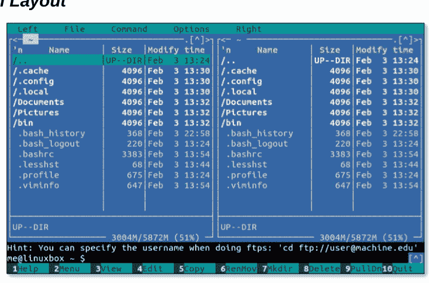

`Midnight Commander` 屏幕布局

- 1. 左、右目录面板

屏幕中心部分由两个大的目录面板（称为当前面板）占据，一次只有一个处于激活状态。要更改哪个是当前面板，按下 `Tab` 键。

- 2. 功能键标签

显示器的底行包含最常用功能的功能键（`F1`-`F10`）快捷键。

- 3. 菜单栏

显示器的顶部包含一组下拉菜单。可以通过按下 `F9` 键激活。

- 4. 命令行

在功能键标签之后是一个 `shell` 提示符。可以用通常的方式输入命令。一个特别实用的命令是 `cd` 后跟目录路径名。这将更改当前目录面板中显示的目录。

- 5. 迷你状态行

在目录面板和命令行的最底部是迷你状态行。该区域用于显示关于当前所选项目的补充性信息，例如符号链接的目标。

## 使用键盘和鼠标

作为一个具有许多功能的字符应用程序，意味着 `Midnight Commander` 有许多键盘命令，其中一些与其他应用程序共享；另一些是独特的。这使得 `Midnight Commander` 学习起来具有挑战性。幸运的是，`Midnight Commander` 在大多数终端模拟器上支持鼠标输入（如果在控制台中安装了 `gpm`），基础操作很容易。学习键盘命令对于充分利用程序的功能是必要的。

使用键盘操作 `Midnight Commander` 的另一个问题是来自窗口管理器和终端器本身的干扰。`Midnight Commander` 使用的许多功能键和 `Alt` 键组合被用于其他用途。

为了解决这个问题，`Midnight Commander` 允许将 `Esc` 键作为 `Meta` 键。由于外部程序干扰无法使用功能键或 `Alt` 键组合时，请使用 `Esc` 键。例如，输入 `F1` 键时，释放“1”键（`F10` 为“0”）。相同的方法也适用于麻烦的 `Alt` 键组合。例如，输入 `Alt-t` 时，先释放 `Esc` 键再按“t”键。在 `Midnight Commander` 中关闭对话框，按两次 `Esc` 键。

## 导航与浏览

在我们开始执行文件操作之前，学习如何使用目录面板和导航文件系统是重要的。

正如我们看到的，有两个目录面板，一次只有一个面板处于激活状态并被称为当前面板。另一个面板在 `Midnight Commander` 文档方便地被称为其他面板。

当前面板可以通过目录列表中的高亮条来识别，可以使用箭头键、`PgUp`、`PgDn`上下移动。任何被高亮的文件或目录将被选中。

选择一个目录并按 `Enter`。当前目录将变为所选目录。高亮列表中的顶部项会选中面板目录。也可以在目录面板下方的命令行上直接更改目录。只需按通常方式输入 `cd` 后跟路径名即可。

按下 `Tab` 键会切换当前面板。

# 更改列表格式

目录列表可以用不同的格式显示。按下 `Alt-t` 可以在这些格式之间切换。有一种双栏格式，类似于 `ls -1` 的输出，以及其他格式。

还有一个“信息模式”。这将在另一个面板中显示关于当前面板中选定项的详细文件系统信息。要调用此模式，输入 `Ctrl-i`。要将另一个面板恢复到正常状态，再次输入 `Ctrl-x`。

| 左 | 文件 | 命令 | 选项 | 右 |
| --- | --- | --- | --- | --- |
| 名字 | 大小 | 修改 | 时间 | 信息 `Midnight Commander` 4.0 |
| /.cache | 4096 | 2月3 | 13:32 | 文件: .bash_history |
| /.config | 4096 | 2月3 | 13:32 | 位置: 8300h:27C8ih |
| /.local | 4096 | 2月3 | 13:32 | -rw------- (060) |
| /Documents | 4096 | 2月3 | 13:32 | 链接: 1 |
| /Pictures | 4096 | 2月3 | 13:32 | 所有者: me |
| .bash_history | 376 | 2月3 | 13:24 | 大小: 376 (块) |
| .bash_logout | 220 | 2月3 | 13:24 | 修改: 2月4 00:55 |
| .bashrc | 68 | 2月3 | 13:44 | 访问: 2月3 13:45 |
| .lesshst | 675 | 2月3 | 13:24 | 设备: rootfs |
| .profile | 646 | 2月3 | 13:54 | 类型: rootfs |
| .viminfo | | | | 空闲空间: 300M/587M (51%) |

> 提示：在进行 `ftp` 时可以指定用户名：`cd ftp://user@machine.edu`

`MidnightLinux` 1 帮助 2 菜单 3 视图 4 复制 5 名称 7 创建目录 8 删除 9 退出 10 退出

信息模式下的目录面板

## 设置另一个面板的目录

在当前面板中选择一个目录并在另一个面板中列出其内容通常有用；例如，将文件从父目录移动到子目录时。要执行此操作，选择一个目录并按下 `Alt-o`。要强制另一个面板列出与当前面板相同的目录，输入 `Alt-1`。

## 目录热列表

`Midnight Commander` 可以存储经常访问的目录列表。可以通过按下 `Ctrl-\` 显示此“热列表”。

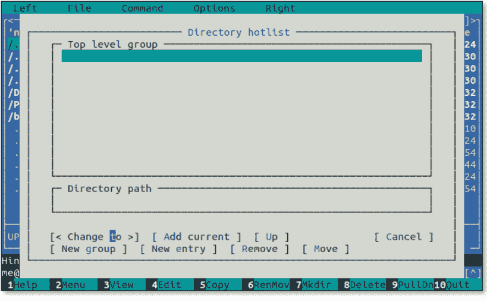

目录热列表

在浏览时将目录添加到热列表中，请选择一个目录并输入 `Ctrl-x h`。

## 目录历史

每个目录面板都维护一个其显示过的目录列表。要访问此列表，输入 `Alt-H`。从列表中可以选择一个目录进行浏览。即使没有显示历史列表，我们也可以使用 `Alt-u` 和 `Alt-y` 键分别向前向后遍历历史列表。

## 使用鼠标

我们可以使用鼠标执行许多 `Midnight Commander` 操作。点击目录面板可以选择它，双击目录可以打开它。功能键和菜单栏项目可以通过点击它们来激活。访问和遍历目录历史并不那么明显。在每个目录面板的顶部都有小箭头（在下图中用圆圈出）。点击它们将显示目录历史（向上箭头）并在历史中向前和向后移动（向右和向左箭头）。命令行最右侧还有一个箭头，可以显示行历史。


## 目录列表

| 名字 | 大小 | 修改时间 |
|---|---|---|
| `/.cache` | 4096 | 2月 13:24 |
| `/.config` | 4096 | 2月 13:30 |
| `/.local` | 4096 | 2月 13:30 |
| `/Documents` | 4096 | 2月 13:32 |
| `/Pictures` | 4096 | 2月 13:32 |
| `/bin` | 4096 | 2月 13:32 |
| `/.bash_history` | 368 | 2月 22:58 |
| `/.bash_logout` | 220 | 2月 13:24 |
| `/.bashrc` | 368 | 2月 13:24 |
| `/.lessh` | 68 | 2月 13:44 |
| `/.profile` | 675 | 2月 13:24 |
| `/.viminfo` | 647 | 2月 13:54 |
| `UP-DIR` | 3004M/872M (51%) | |

> 提示：使用 `ftp` 时可以指定用户名：`cd ftp://user@machine.edu`

`Midnight Commander` 功能键说明：`1` 帮助 `2` 菜单 `3` 视图 `4` 编辑 `5` 复制 `6` 重命名 `7` 标记 `8` 删除 `9` 退出

### 目录和命令行控制

## 查看和编辑文件

在浏览目录时执行的操作是检查内容。`Midnight Commander` 提供了一个强大的查看器，可以通过选择并按下 `F3` 访问。

```bash
home/me/.bashrc 649/383
## /usr/share/doc/bash/startup-files (in bash package)
## 如果不是交互式运行，不要任何
[ -z $PS1 ] && return

## 不要重复以空格开头的行。
## 查看 bash(1) 更多选项
shopt -s history

## 设置历史长度 HISTSIZE
HISTSIZE=1000
HISTSIZE=2000

## 如果必要，在每个命令后更新 COLUMNS 的值
shopt -s winsize
1 帮助 2 换行 3 退出 4 Hex

查看器
```

可以看到，当查看器激活时，底部的功能键标签会显示查看器功能。可以搜索文件，查看器可以快速跳转到文件的任何位置。重要的是，当我们需要详细查看时，可以以 ASCII（普通文本）或十六进制格式查看文件。

| 位置 | 十六进制内容 |
|---|---|
| `home/me/.bashrc` | `0x80000000` |
| `00000000` | `7E/2F.62 61 73 72 63 20 25 65 78` |
| `00000001` | `03 75 74 64 20 63 75 74 64 20 68 31 29` |
| `00000002` | `20 6d 6f 72 20 6d 6f 6e 25 65 76 72 66` |
| `00000003` | `68 65 6c 73 2e.2f /share/doc/bash 20 63 75 74 64` |
| `00000004` | `70 72 79 73 20 73 2f 61 64 6f 73 61 63 73` |
| `00000005` | `61 61 75 25 6f 6f 74 74 20 70 61 63 6b` |
| `00000006` | `70 20 64 69 67 20 24 24 65 20 20 61 74 74` |
| `00000007` | `01 61 63 68 20 62 61 73 68 28 20 63 75 74 64` |
| `00000008` | `28 78 75 74 25 20 64 6f 6e 27 6f 6e 27 20 24` |
| `00000009` | `0a 8a 23 2e. 49 66 28 2e 65 26 6f 72 74` |
| `0000000a` | `6e 62 72 69 6e 67 6e 74 65 72 69 63 74 65 76` |
| `0000000b` | `2c 28 64 6f 64 20 64 6f 74 65 72 20 64 74` |
| `0000000c` | `65 65 74 79 20 64 6f 6e 27 20 64 6f 6e 27` |
| `0000000d` | `61 61 75 25 6f 6f 74 74 20 70 61 63 6b` |
| `0000000e` | `73 72 69 6e 67 6e 74 65 72 69 63 74 65 76` |

## `.bashrc`

```bash
# ~/.bashrc executed by bash(l) for non-login shells.

## /usr/share/doc/bash/examples/startup_files (in the package bash-doc)

## for examples

## If not running Interactively, don't do anything

## -z $PS1 && return

## don't duplicate lines or lines with space in the history.

## see bash(1) for more options

HISTCONTROL=ignoredu

## append to the history file, don't overwrite it

shopt -s hist

## for setting history size use HISTSIZE and HISTFILE in bash(1)

HISTSIZE=1000

HISTFILE=2000

## check the window size after each command, if necessary

## update the values of LINES and COLUMNS.

shopt -s winsize
```

## 标记文件

我们已经看到如何通过简单高亮来选择当前面板中的文件，但对单个文件进行操作并不大。毕竟，我们可以直接通过命令行输入命令来更容易地执行此类操作。然而，我们经常希望通过标记对多个文件进行操作。当一个文件被标记时，它会被标记以便稍后操作（如复制）。这就是为什么我们选择像 `Midnight Commander` 这样的文件管理器。当标记了一个或多个文件时，文件操作（如复制）将在标记的文件上执行，且选择也会生效。

### 标记单个文件

要标记单个文件或目录，选择它并按下 `Insert` 键。要取消标记，再次按下 `Insert` 键。

### 标记文件组

要根据选择标准（如通配符模式）标记一组文件或目录，按下 `+` 键。这将显示一个其中指定模式的对话框。该对话框会存储模式。使用 `Ctrl` 加上下方向键进行遍历。也可以取消标记一组文件。按下 `-` 键将弹出模式输入对话框。

## 我们需要一个 Playground

为了探索 `Midnight Commander` 的基本文件操作功能，我们恰恰需要一个“playground”。创建实验场的第一步是创建一个名为“playground”的目录。首先，我们将导航到主目录，按下 `F7` 键。

### 创建目录

在对话框中输入 "playground" 并按回车。接下来，我们希望另一个面板显示 playground 的内容。为此，高亮 playground 目录并按下 `Alt-c`。现在，让我们在 playground 中放入一些文件。按下 `Tab` 键将当前面板切换到 playground 面板。我们将通过重复创建 `dir1` 和 `dir2` 的操作来创建几个子目录。最后，使用命令行创建几个文件：

```bash
touch file1 file2
```

## 复制和移动文件

好了，这里的情况开始变得奇怪了。选择 `dir1`，然后按下 `Alt-o` 在另一个面板中显示 `dir1`。选择文件 `file1` 并按下 `F5` 复制（`F6` 命令类似）。我们现在看到了这个看起来很吓人的对话框：

### 复制对话框

若要查看 `Midnight Commander` 的默认行为，只需按回车，文件就会复制到目录 `dir1` 中（即文件从当前面板显示的目录复制到另一个面板显示的目录中）。这很直接，但如果我们想将 `file2` 复制到 `dir1` 中名为 `file3` 的文件中呢？为此，我们选择 `file2` 并再次按下 `F5`，在复制对话框中输入新文件名：

| 左侧 | 文件 | 命令 | 选项 | 右侧 |
| :--- | :--- | :--- | :--- | :--- |
| `~/playground` | | | | `~/playground` |
| 名称 | 大小 | 修改时间 | 名称 | 大小 |
| `..` | 复制 | | | |
| 使用源掩码复制文件 "file"： | | | [X] 使用 shell 模式 | |
| 到: | | | 如果存在则进入子目录 | |
| `home/me/playground/dir1/` | [ ] 跟符号链接 | | [ ] 稳定链接 | |
| [X] 保留属性 | | | | |

## 在复制时重命名

再次，这非常直接。但假设我们标记了一组文件，并希望在复制（或移动）时对其重命名。我们该如何做？`Midnight Commander` 提供了一种方法，但有点奇怪。

秘密在于在复制中使用掩码。起初，掩码看起来是选择通配符，但表象具有欺骗性。它按我们的预期过滤文件，但方式有限。与 shell 中提供的通配符范围相比，源掩码中的通配符限于 `?`（匹配单个字符）和 `*`（匹配多个字符）。此外，通配符具有特殊属性。

它的工作原理是这样的：假设我们想将其复制（或移动）到 `dir1`，并带有一个空格，例如 "ugly file"，并想使用 `*`。使用源掩码，我们可以输入模式 `*`，这意味着文件名分成两个文本块。`Midnight Commander` 将为每个块关联一个从 1 开始的数字，因此块 1 包含 "ugly"，块 2 包含 "file"。可以使用正则表达式分组引用每个块。为目标创建一个不带空格的新文件名，我们将在复制对话框的“到：”字段中指定 `1\2`：

### 使用分组

+   `*` 通配符的行为相同。如果我们把源掩码设置为 `???? ???`（它匹配 ugly file），我们就有八段可以重新排列的文本。例如，我们可以将“到”掩码设置为 `\7\6\5\4\3\2\1`，生成的文件名将是 "elifylgu"。漂亮。

`Midnight Commander` 还可以对文件名进行大小写转换。在这种情况下，我们在 `to:` 中包含一些额外的转义序列：

*   `\u` 将下一个字符转换为大写。
*   `\U` 将直到遇到另一个序列之前的所有字符转换为大写。
*   `\l` 将下一个字符转换为小写。
*   `\L` 将直到遇到另一个序列之前的所有字符转换为小写。

`Ctrl-x s` 会在另一个面板显示的目录中创建一个符号链接，并使用绝对目录路径。

`Ctrl-x v` 会在另一个面板显示的目录中创建一个符号链接，并使用相对目录路径。

这两个符号链接命令基本上是相同的。它们唯一的区别在于，在“符号链接”（Symbolic Link）对话框中建议的路径是绝对路径还是相对路径。

我们将通过创建一个指向 `file1` 的链接来演示如何创建符号链接。为此，我们在当前面板中选择 `file1` 并按下 `Ctrl-x s`。会出现“符号链接”对话框，我们可以输入链接的名称，也可以接受程序的建议。为了清晰起见，我们将名称更改为 `file1-sym`。

| 左侧 | 文件 | 命令 | 选项 | 右侧 |
|---|---|---|---|---|
| `~/playground/dir/` | `~[>]` | `~/playground` | | `~[^]` |
| 命名 | 大小 | 修改时间 | | 命名 | 大小 | 修改时间 |
| `UP-DIR` | | Feb 10 18:00 | `/` | | Feb 10 23:24 |
| `UglyFile` | | 符号链接 | | | 18:07 |
| `file1` | | | | | 18:08 |
| `uglyfile` | 现有文件名 (文件名 symlink 指向:) | | | | 18:08 |
| `/home/me/playground/dir/file1` | | | | | |
| 符号链接文件名: | | | | | |
| `/home/me/playground/dir/file1-sym` | | | [ 取消 ] | | |
| < 确定 > | | | | | |

| `UP-DIR` | `file1` |
|---|---|
| `2995M/S872M (S1%)` | `2995M/S872M (S1%)` |

提示：`%D` 扩展为相反目录中的标记文件。
`melinux~/playground s`
`1` 移动 `2` 命名 `3` 低 `4` 退出 `5` 复制 `6` 转换 `7` 目录 `8` 删除 `9` 撤销 `10` 退出

# 符号链接对话框

## 设置文件模式和所有权

通过输入 `Ctrl-x c` 可以为选定或标记的文件设置文件模式（权限）。这样做将显示一个对话框，其中每个属性都可以开启或关闭。如果以超级用户权限运行 `Midnight Commander`，可以通过按下 `Ctrl-x o` 更改文件所有权。将显示一个对话框，可以在其中设置选定/标记文件的所有者和组所有者。

`Midnight Commander`

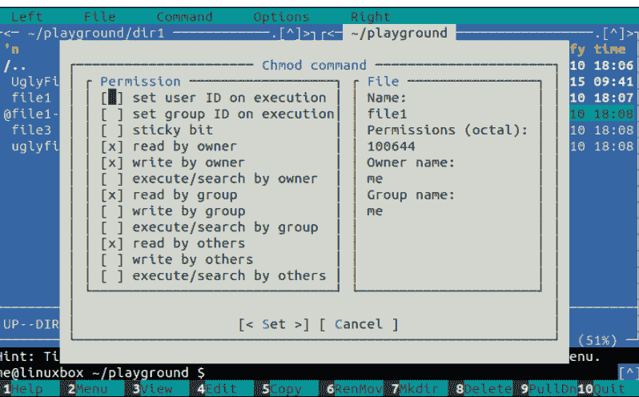

## Chmod 对话框

为了演示更改文件模式，我们将文件设为可执行。首先，我们选择该文件，然后输入 `Ctrl-x`。会出现“Chmod”命令对话框，列出文件的模式设置。通过箭头键，可以选择标记为“所有者执行/搜索”的复选框，并使用空格键切换其设置。

## 删除文件

按下 `F8` 键会删除选定或标记的文件和目录。默认情况下，`Midnight Commander` 在执行删除之前始终会提示用户确认。

我们现在完成了对实验场的操作，是时候清理了。我们将在 shell 提示符中输入 `cd` 以让当前面板列出主目录。接下来，我们将选择 `playground` 并按下 `F8` 删除 `playground` 目录。

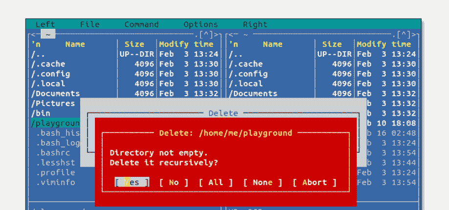

删除确认对话框

# 高级功能

除了基本的文件操作外， `Midnight Commander` 还提供了许多额外功能，其中一些非常有趣。

## 虚拟文件系统

`Midnight Commander` 可以将某些类型的存档文件和主机视为本地文件。在 shell 提示符处使用 `cd` 命令即可访问它们。

我们将通过创建一个指向 `file1` 的链接来演示如何创建符号链接。为此，我们在当前面板中选择 `file1` 并按下 `Ctrl-x s`。会出现“符号链接”对话框，我们可以输入链接的名称，也可以接受程序的建议。为了清晰起见，我们将名称更改为 `file1-sym`。

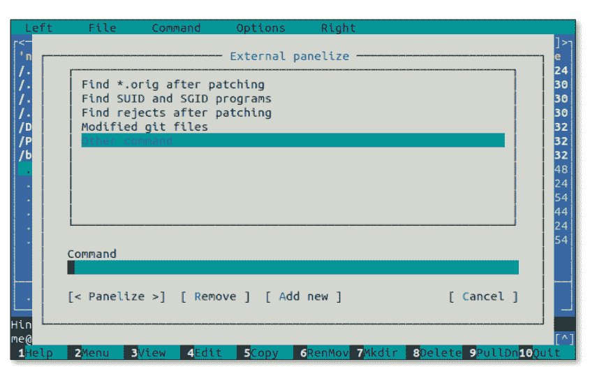

## 外部面板对话框

在这个对话框中，我们看到一组预定义的面板命令。`Midnight Commander` 允许我们使用 shell 命令进行重复操作。让我们尝试创建一个面板命令，该命令将从当前面板目录开始，在系统中搜索所有扩展名为 `.JPG` 的文件。从列表中选择“Other command”（其他命令），并在“Command”（命令）字段中输入以下命令：

```bash
find . -type f -name "*.JPG"
```


输入命令后，我们可以按回车键执行命令，或者为了增加趣味性，可以点击“`Add new`”（添加）按钮，为我们的命令指定一个名称并保存以备以后使用。

## 子 shell

我们随时可以通过按下 `Ctrl-o` 从 `Midnight Commander` 切换到完整的 shell 会话并再次返回。子 shell 是普通 shell 的副本，用户 shell 建立任何环境（别名、shell 函数、提示符字符串等）都会出现在子 shell 中。如果我们在子 shell 中启动了一个长时间运行的命令并按下 `Ctrl-o`，该命令将被挂起直到我们返回子 shell。注意，一旦命令被挂起，在挂起的命令终止之前，`Midnight Commander` 无法执行任何后续外部命令。

22 Midnight Commander

## 用户菜单

到为止，我们避免了对神秘 `F2` 命令的讨论。这是用户菜单，可能是 `Midnight Commander` 最强大且实用的功能。正如名称所示，用户菜单是用户定义命令的菜单。

当我们按下 `F2` 键时，`Midnight Commander` 会在当前目录下查找名为 `.mc.menu` 的文件。如果该文件不存在，`Midnight Commander` 会查找 `~/.config/mc/menu`。如果文件不存在，则 `Midnight Commander` 将回退到一个名为 `/usr/share/mc/mc.menu` 的系统级菜单文件。

关于此点的下一点是，每个目录都可以有自己的一组用户命令，这样我们可以针对当前目录的内容创建命令。例如，如果我们有一个“`Pictures`”（图片）目录，我们可以为处理图像创建命令；如果我们有一个满是 HTML 文件的目录，我们可以为管理网站创建命令，以此此类推。

所以，在我们第一次按下 `F2` 后，将看到如下所示的默认用户菜单：

| 左侧 | 文件 | 命令 | 选项 | 右侧 | 大小 | 修改时间 |
|---|---|---|---|---|---|---|
| `^n` 名称 | | `UP-DIR` | 修改时间 | `^>` 名称 | 大小 `UP-DIR` | 2月3:24 |
| `.cache` | `@` | 用户菜单编辑 dont 文件 | | | 3:30 | 3:30 |
| `/config` | `0` | 编辑报告并发送到 root | | | 3:30 | 3:30 |
| `/documents` | | | 启动 info 帮助浏览器 | | | 3:32 | 3:32 |
| `/Pictures` | | | 压缩当前子目录 (`tar.gz`) | | | 3:32 | 3:32 |
| `/tmp` | | | 压缩当前子目录 (`tar.bz2`) | | | 6:45 | 6:45 |
| `.bash_h` | `3` | 压缩当前子目录 (`tar.xz`) | | | 3:24 | 3:24 |
| `.bashrc` | | | | | | 3:54 | 3:54 |
| `.lessmap` | | | 检查 grid 的 newsfetch | | | 3:24 | 3:24 |
| `.profile` | | | 从当前 newsarticle 中去除页头 | | | 3:54 | 3:54 |
| `.viminfo` | | | 复制文件到重命名主机 | | | |
| `y` | | | `Gzip` 或 `bzip2` 当前文件 | | | |
| `b` | | | `Bzip2` 或 `bzip2` 当前文件 | | | |
| `UP-DIR` | | | | | | |

提示：`M-I` 将想要执行程序并在查看器中查看输出。

`midnightlinux $ 1Help 2Menu 3View 4Lit 5Copy 6GenMay 7Ndir 8Delete 9Quit 10Quit`

## 用户菜单

默认用户菜单包含几个示例条目。这些绝不是固定不变的。我们鼓励编辑菜单并创建自己的条目。菜单是普通文本，可以使用任何编辑器编辑，`Midnight Commander` 在“`Command`”（命令）下拉菜单提供了一个菜单编辑功能。该条目被称为“`Edit menu file`”（编辑菜单文件）。

如果我们选择此条目，`Midnight Commander` 为我们提供“`Local`”（本地）和“`User`”（用户）的选择。`Local` 条目允许我们编辑当前目录下的 `.mc.menu` 文件，而选择 `User` 将调用我们编辑 `~/.config/mc/menu` 文件。注意，如果我们选择了 `Local` 且当前目录不包含菜单文件，`Midnight Commander` 将默认菜单文件复制到当前目录，作为我们编辑的起点。

## 菜单文件格式

用户菜单文件的某些部分非常简单；其他部分则没那么。我们将从第一部分开始。

菜单文件由一个或多个条目组成。每个条目包含：

- 单个字符（通常是字母），在菜单显示时作为该条目的热键。
- 紧随热键之后在同一行是菜单条目的描述，其在菜单上显示的形式。
- 随后的行是一个或多个命令，当选择菜单项时执行。这些是 shell 命令。可以指定任意数量的命令，由于命令可以缩进，因此复杂的选项是可能的。
- 一个空行，用于将一个条目与下一个隔开。
- 注释可以以 `#` 开头。

这里有一个创建 HTML 模板的菜单条目示例：

```html
## 创建 HTML 文件

H 创建 HTML 文件

echo "<html>\n<head>"

echo "<body>"

echo "</body></html>" > page.html
```

## 宏

在解决了这些琐事之后，让我们看看如何让菜单条目作用于当前选择或标记的文件。首先，有助于理解 `Midnight Commander` 如何执行菜单。它是将命令写入文件（本质上是一个 shell 脚本）然后启动 shell 执行的。在写入文件的过程中，`Midnight Commander` 执行宏替换，将菜单条目中的符号替换为替代值。这些宏是带有百分号引导的单个字母字符。这里是常见的：

| 宏 | 含义 |
|---|---|
| `%f` | 选择的文件名 |
| `%x` | 选择文件的扩展名 |
| `%b` | 去掉扩展的选择名称 (`basename`) |
| `%d` | 当前目录名称 |
| `%t` | 标记的文件列表 |
| `%s` | 如果文件已标记，则使用它们，否则使用选择的文件。 |

常用宏列表

假设我们要创建一个用户菜单条目，使用 `ImageMagick` 套件中常用的 `convert` 程序调整 图像的大小。使用宏，我们可以编写如下菜单条目，它将作用于当前选择的文件：

```
## 使用 convert 调整大小

调整以适应 800 像素的正方形边界

size=800

convert "%f" -resize ${size}x${size} "%b-${size}.*"
```

使用 `%b` 和 `%x` 宏，我们能够为调整后的图像构造一个新的输出文件名。此菜单条目仍然存在一个问题。可能会在目录上运行此菜单命令，或者针对非图像文件（这样做将不利）。

我们可以包含一些额外的代码来确保 `%f` 实际上是图像的文件，但 `Midnight Commander` 也提供了一种方法，仅显示适用于当前选择（或标记）文件的菜单条目。

## 条件判断

`Midnight Commander` 支持两种影响菜单项行为的条件判断。第一种称为“添加条件”（addition conditional），用于确定菜单项是否显示。第二种是“默认条件”（default conditional），用于设置菜单的默认条目。

条件被添加在菜单项的第一行之前。条件以 `+=`（表示添加）或 `=`（表示默认）开头，随后紧跟一个或多个子条件。子条件之间通过 `|`（表示“或”）或 `&`（表示“与”）进行隔开，这允许我们表达一些复杂的逻辑。也可以通过以 `+=` 开始条件来同时结合添加条件和默认条件。在菜单项出现之前，也允许存在两个独立的条件（一个添加条件和一个默认条件）。

让我们来看下子条件。它们由以下内容之一组成：

| 子条件 | 描述 |
| :--- | :--- |
| `f pattern` | 匹配当前选中的文件 |
| `F pattern` | 匹配另一个面板中上一次选择的文件 |
| `d pattern` | 匹配当前选中的目录 |
| `D pattern` | 匹配另一个面板中上一次选择的目录 |
| `t type` | 当前选中文件的类型 |
| `Type` | 另一个面板中上一次选择的文件类型 |
| `x filename` | 文件是否可执行 |
| `! sub-condition` | 取反子条件的结果 |

- 子条件列表

`pattern` 既可以是 shell 模式（即通配符），也可以根据“`Options/Configuration`”（选项/配置）对话框中配置的全局设置使用正则表达式。可以通过在菜单文件的第一行添加 `shell_patterns=0` 来覆盖此设置。值 `1` 使用 shell 模式，而值 `0` 则强制使用正则表达式。

`type` 是以下内容中的一个或多个：

| 类型 | 描述 |
| :--- | :--- |
| `r` | 普通文件 |
| `d` | 目录 |
| `n` | 非目录 |
| `l` | 链接 |
| `x` | 可执行文件 |
| `t` | 标记文件 |
| `c` | 字符设备 |
| `b` | 块设备 |
| `f` | FIFO (管道) |
| `s` | 套接字 (`socket`) |

- 文件类型列表

尽管看起来非常复杂，但其实并没有那么糟糕。为了让我们的图像缩放项仅在当前选中的文件扩展名为 `.jpg` 或 `.JPG` 时显示，我们可以在该项的开头添加一行（此示例使用了正则表达式）：

```
## 使用 convert 缩放图像

+ f \.jpg | f \.JPG

 R Resize image within 800 pixel bounding square

 size=800

 convert "%f" -resize ${size}x${size} "%b-${size}.%x"
```

条件以 `+` 开头，意味着它是一个添加条件。后面跟着两个子条件。分隔它们的 `|` 表示两者之间是“或”的关系。因此，完成后的条件意味着“如果选中的文件名以 `.jpg` 结尾，或者选中的文件名以 `.JPG` 结尾，则显示此项”。

默认菜单文件包含了许多条件示例，非常值得了解。

## 总结

尽管学习需要一点时间，但 `Midnight Commander` 提供了许多功能和便利，使得在命令行下的文件管理变得更容易。这在可能没有图形用户界面的远程系统上操作时尤为如此。用户菜单功能对于专门的管理任务特别有用。通过适当的配置，`Midnight Commander` 可以成为我们命令行工具箱中强大的工具。

## 延伸阅读

- *`Midnight Commander` 的 man 手页非常详尽，讨论了比我们在这里涵盖的更多的功能。
- `midnight-commander.org` 是该项目的官方网站。

# 2 终端复用器

认为终端是理所当然的很容易。毕竟，现代终端模拟器（如 `gnome-terminal`、`konsole` 以及 Linux 桌面环境中自带的其他）都是功能丰富的应用程序，满足了我们的大多数需求。但有时我们需要更多。我们需要在一个终端中运行多个会话。我们需要在单个终端中显示多个应用程序。我们需要在单个终端中移动会。简而言之，我们需要终端复用器。

终端复用器是可以执行这些神奇操作的程序。在本次冒险中，我们将查看三个示例：`GNU screen`、`tmux` 和 `byobyu`。

## 历史背景

如果我们回到过去，20 世纪 80 年代，可能会发现自己面对着一个终端；带有 80 列宽、24 行高的显示器，通过 `RS-232` 串口连接，可能还有一个声学耦合器调制解调器和听筒。显示屏上可能会出现与我们今天 Linux 会话中不同的提示符。然而，与今天不同，80 年代的计算机没有多窗口或标签来显示多个应用程序或 shell 会话。我们只有一个屏幕。终端复用器的开发最初是为了解决这一局限性。终端复用器允许在单个屏幕上显示和管理多个会话和应用程序。虽然现代桌面环境和终端模拟程序支持多窗口和标签终端会话缓解了某些情况下对终端复用器的需求，但终端复用器仍然提供某些极大增强我们命令行体验的功能。

## GNU Screen

`GNU screen` 历史悠久。它最早于 1987 年开发，是第一个定义了后续所有终端复用器基础功能的程序。

## 可用性

正如其名，`GNU screen` 是 `GNU` 项目的一部分。虽然它很少默认安装，但在大多数发行版的仓库中都可以通过包 `screen` 安装。

## 调用

只需输入 `screen` 即可启动。启动后，我们将看到一个 shell。

## 多窗口

此时，`screen` 已经创建了多个窗口。此外，`screen` 还可以将终端分成多个区域。

## 初始屏幕

到目前为止，现在让我们创建另一个窗口。为了这样做，我们使用 `Ctrl-a` 后紧接字符 `c`。我们的终端屏幕应该清空，并看到一个新的 shell 提示符。我们那个运行着 `top` 的第一个窗口怎么了？它仍在那里，在后台运行。我们可以通过输入 `Ctrl-a p`（`p` 代表 `previous`）返回第一个窗口。

在继续之前，我们聊聊键盘。控制 `screen` 非常简单。每个命令都是 `Ctrl-a`（称为“命令前缀”或“转义序列”）后跟另一个字符。我们已经看到了两个这样的命令：`Ctrl-a` 创建新窗口，`Ctrl-a p` 从当前窗口切换到上一个窗口。使用 `typing` 将显示所有命令。

`GNU screen` 有几个命令用于从一个窗口切换到另一个窗口。类似于“上一个”命令，还有一个“下一个”命令 `Ctrl-a n`。窗口从 0 开始编号，可以通过输入 `Ctrl-a` 后跟数字 0 到 9 来直接选择。你也可以通过输入 `Ctrl-a k` 列出所有窗口。此命令将显示窗口列表，我们可以在从中选择一个窗口。

| 名称 | 标记 |
|---|---|
| `0 bash` | |
| `1 bash` | `S` |


Screen 窗口列表

如我们所示，窗口是有名称的。窗口的默认名称是创建时运行的程序名称，因此我们的两个窗口都命名为“`bash`”。让我们来修改它。由于我们在第一个窗口中运行 `top`，让我们让它的名称反映得体一些。使用我们讨论过的任何方法切换到第一个窗口，输入命令 `Ctrl-a A`，系统会提示我们输入窗口名称。简单。

好了，既然我们已经创建了窗口，如何销毁它们呢？每当我们终止在其中的程序时，窗口就会销毁。所有窗口销毁后，`screen` 本身也会终止。由于我们的两个窗口都在运行 `bash`，我们只需要退出相应的 shell 即可结束 `screen` 会话。对于拒绝正常退出的程序，`Ctrl-a k` 可以解决问题。

让我们通过按 `q` 退出运行 `top` 的 shell，然后输入 `exit` 终止 `bash`，从而销毁第一个窗口。我们现在回到了仍在运行其自身的 `bash` 副本的窗口。我们可以通过再次输入 `Ctrl-a k` 查看窗口列表来确认这一点。

终端复用器 31

可以在没有底层 shell 的情况下创建窗口并运行程序。要做到这一点，我们输入 `screen` 后紧跟想要运行的程序名称，例如：

```
me@linux:~ $ screen vim ~/.bashrc
```

我们可以在 `screen` 窗口中执行此操作。在 `screen` 窗口中发布 `screen` 命令并不会调用 `screen` 窗口切换到另一个。它是通过进入所谓的“回滚模式”（scrollback mode）来实现的。它告诉现有的 `screen` 实例执行类似创建新窗口的操作。

## 复制与粘贴

考虑到 `GNU screen` 是为了既没有图形用户界面也没有鼠标的系统开发的，因此 `screen` 提供一种从一个 `screen` 窗口复制文本到另一个窗口的方法是合理的。在这种模式下，`screen` 允许文本光标在当前窗口中以及回滚缓冲区（其中包含窗口之前的内容）中自由移动。

我们通过输入 `Ctrl-a {` 进入回滚模式。在回滚模式下，我们可以使用方向键以及 `Page Up` 和 `Page Down` 键导航回滚缓冲区。要复制文本，我们首先需要标记目标文本的开头并按下空格键，这是通过将光标移动到目标文本的开头（光标移动时会高亮）并再次按下空格键来标记要复制文本的结束。标记文本会退出回滚模式并将标记的文本复制到 `screen` 的内部缓冲区。我们现在可以将文本粘贴到任何 `screen` 窗口中。要做到这一点，我们转到目标窗口并输入 `Ctrl-a ]`。

32 终端复用器

## SCREEN(1)

名称 `screen` - 带有 VT100/ANSI 仿真器的 screen器

```
用法

screen [ -options ] [ cmd [ args ]

screen -r [[pid.tty|host]]

screen -f [sessionowner|[pid.tty|host]]
```

描述
`Screen` 是一个全屏管理器，在多个进程（通常是交互式 shell）之间复用物理终端。此外，每个虚拟终端都提供了 `DEC VT100` 终端的功能，以及 `ISO 6429` (`ECMA 48`, `ANSI X3.4`) 和 `ISO 2022-2` 标准的若干控制功能（有一个用于多个字符集的回滚行和缓冲区）；一个允许在窗口之间移动区域的复制粘贴机制。

当调用 `screen` 时，它会创建一个带有 shell（或指定的命令）的单一窗口，并避开干扰以便你像往常使用该程序。然后，你随时可以查看手动帮助页 `screen(1)` 第 1 行（按 `h` 获取帮助或按 `q` 退出）。

## 多区域

`GNU screen` 还可以将终端划分为更小的区域，允许你同时查看多个窗口。要水平分割终端，输入 `Ctrl-a s`；要垂直分割终端，输入 `Ctrl-a |`。新创建的区域是空的。要聚焦于某个区域，输入 `Ctrl-a <` 后跟区域编号。要关闭某个区域，输入 `Ctrl-a x`。

可以在没有底层 shell 的情况下创建窗口并运行程序。要做到这一点，我们输入 `screen` 后紧跟想要运行的程序名称，例如：

```
me@linux:~ $ screen vim ~/.bashrc
```


## 滚动回滚模式

我们可以在 `screen` 窗口中执行此操作。在 `screen` 窗口中发布 `screen` 命令并不会调用 `screen` 窗口切换到另一个。它是通过进入所谓的“回滚模式”来实现的。它告诉现有的 `screen` 实例执行类似创建新窗口的操作。

## 复制与粘贴

考虑到 `GNU screen` 是为了既没有图形用户界面也没有鼠标的系统开发的，因此 `screen` 提供一种从一个 `screen` 窗口复制文本到另一个窗口的方法是合理的。在这种模式下，`screen` 允许文本光标在当前窗口中以及回滚缓冲区（其中包含窗口之前的内容）中自由移动。

我们通过输入 `` `Ctrl-a {` `` 进入回滚模式。在回滚模式下，我们可以使用方向键以及 `Page Up` 和 `Page Down` 键导航回滚缓冲区。要复制文本，我们首先需要标记目标文本的开头并按下空格键，这是通过将光标移动到目标文本的开头（光标移动时会高亮）并再次按下空格键来标记要复制文本的结束。标记文本会退出回滚模式并将标记的文本复制到 `screen` 的内部缓冲区。我们现在可以将文本粘贴到任何 `screen` 窗口中。要做到这一点，我们转到目标窗口并输入 `` `Ctrl-a ]` ``。

## 分离会话

要从终端分离会话，使用 `` `Ctrl-a d` ``。这会让会话在后台运行，允许你注销。重新连接到分离会话，使用 `screen -r`。如果有多个会话运行，使用 `screen -ls` 列出它们，然后指定 PID 或名称重新连接。要强制分离已在别处连接会话，使用 `screen -d -r`。

## 自定义 Screen

像交互式工具一样，`screen` 是自定义的。在调用期间，`screen` 会读取存在的 `/etc/screenrc` 和 `~/.screenrc` 文件。虽然自定义功能列表非常详尽（许多与类 Unix 平台上的终端显示有关），但我们将关注键绑定和启动会话配置。

首先，让我们看看示例 `.screenrc` 文件：

```bash
## 这是一个注释

## 设置一些键绑定

bind k           # 解绑 "k" 键（设置为无操作）

bind K kill      # 'Ctrl-a K' 销毁当前窗口

bind ) history  # 'Ctrl-a -' 复制粘贴当前
                 # 命令行

## 在启动时定义窗口 7、8 和 9

screen -t "mc cmdr" 7 mc

screen -t htop 8 htop

screen -t 9 tail /var/log/syslog
```

如我们所示，格式非常简单。`bind` 指令后跟着按键和要绑定的命令。`screen` 手页中找到的命令完整列表。我们到为止讨论的所有 `screen` 命令都类似于示例中的键绑定。我们可以重新定义所有内容。

示例 `.screenrc` 结尾的三行在启动时创建窗口。这些命令设置了窗口标题（`-t` 选项）、窗口编号以及窗口包含的命令。这样，我们就可以设置一个自动构建的 `screen` 会话。

当我们启动 `screen` 时，会包含一个完整的多窗口命令行环境，其中运行着我们所有喜爱的程序。

## tmux

尽管 `GNU screen` 仍然很流行，但由于其代码复杂性（甚至到了“不可维护”的地步）和资源消耗一直受到批评。此外，据报道 `screen` 已不再进行活跃开发。为了应对这些担忧，一个更新的程序 `tmux` 吸引了广泛关注。

`tmux` 更现代、更友好、更高效，并且在大多数方面普遍优于 `screen`。在概念上，`tmux` 与 `screen` 非常相似，它们都支持会话（sessions）、窗口和区域（在 `tmux` 中称为 `panes`）的概念。事实上，它甚至与 `screen` 共享一些键盘命令。

## 可用性

`tmux` 广泛可用，尽管没有 `screen` 那么普及。它适用于大多数发行版的软件库。软件包得名为“`tmux`”。

## 调用

通过命令 `tmux new` 调用程序以创建一个新会话。我们可以可选地添加 `-s <session_name>` 为新会话命名，并添加 `-n <window_name>` 为第一个窗口命名。如果未提供 `new` 命令的选项，可以省略 `new` 本身；系统会默认执行。以下是一个示例：

```bash
me@linuxbox: ~ $ tmux new -s "my session" -n "window 1"
```

程序启动后，我们将看到一个 shell 提示符和窗口底部一个精美的状态栏。

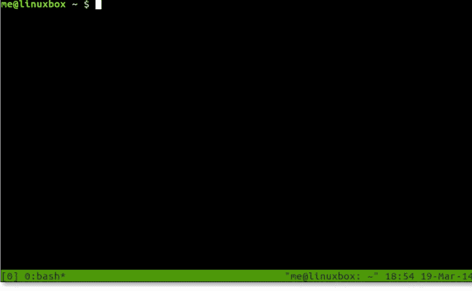

初始 `tmux` 窗口

## 多窗口

`tmux` 使用键盘的方式与 `screen` 类似，但它不是使用 `Ctrl-a` 作为命令前缀，而是使用 `Ctrl-b`。这是件好事，因为在 `bash` 中编辑命令行时，`Ctrl-a` 用于将光标移动到行首。

以下是创建窗口和导航窗口的基本命令：

| 命令 | 描述 |
| --- | --- |
| `Ctrl-b ?` | 显示按键绑定列表（即帮助） |
| `Ctrl-b c` | 创建新窗口 |
| `Ctrl-b n` | 转到下一个窗口 |
| `Ctrl-b p` | 转到上一个窗口 |
| `Ctrl-b 0` | 转到窗口 0。数字 1-9 类似。 |
| `Ctrl-b w` | 显示窗口列表。状态栏也列出了窗口。 |
| `Ctrl-b ,` | 重命名当前窗口 |

`tmux` 窗口命令

## 多窗格

像 `screen` 一样，`tmux` 可以将终端显示划分为称为 `panes` 部分。然而，与 `screen` 中区域的实现不同，`tmux` 中的 `panes` 不仅仅提供各个窗口的视图。在 `tmux` 中，它们是与窗口关联的完整伪终端。因此，单个 `tmux` 窗口可以包含多个终端。

## 命令描述

| 命令 | 描述 |
| --- | --- |
| `Ctrl-b "` | 水平分割窗格 |
| `Ctrl-b %` | 垂直分割窗格 |
| `Ctrl-b arrow` | 移动到相邻窗格 |
| `Ctrl-b Ctrl-arrow` | 按1字符调整窗格大小 |
| `Ctrl-b Alt-arrow` | 按5字符调整窗格大小 |
| `Ctrl-b x` | 销毁当前窗格 |

## `tmux` 窗格命令

我们可以通过创建一个会话和窗口来演示 `panes` 的行为。首先，我们将创建一个会话，命名它，并命名初始窗口：

```bash
@linuxbox: ~ $ tmux new -s PaneDemo -n Window0
```

接下来，我们将创建第二个窗口并给它命名：

```bash
@linuxbox: ~ $ tmux new -n Window1
```

我们本可以使用 `Ctrl-b` 命令完成第二步，但通过命令行方法可以为稍后某些操作做些准备。

假设一切顺利，现在我们正处于一个名为 `"PaneDemo"` 的 `tmux` 会话和一个名为 `"Window1"` 的窗口中。现在我们通过输入 `Ctrl-b .` 将窗口水平平分为两部分。我们只有两个窗口（`Window0` 和 `Window1`），但现在 `Window1` 上有两个提示符。我们可以通过输入 `Ctrl-b` 后跟上方向箭头或向下箭头在两个窗格之间来回切换。

为了好玩，我们输入 `Ctrl-b t`，当前窗格中出现了一个数字时钟。这只是 `tmux` 可以做的一个趣事。

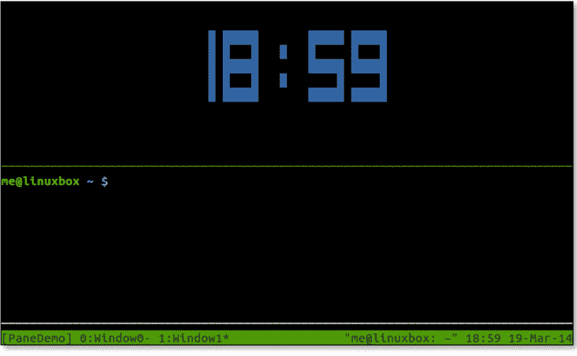

## 多窗格

我们可以通过输入 `q` 来启用时钟显示。如果我们通过输入 `Ctrl-b 0` 回到第一个窗口，会发现 `panes` 仍然与 `Window1` 关联，且对 `Window0` 没有影响。

回到 `Window 1`，让我们调整窗格的大小。我们通过输入 `Ctrl-b Alt-arrow` 将边界向上或向下移动 5 行。输入 `Ctrl-b Ctrl-arrow` 将将边界移动 1 行。

可以将一个窗格拆分为它自己的新窗口。这是通过输入 `Ctrl-b !` 实现的。

`Ctrl-b x` 用于销毁窗格。注意，与 `screen` 不同，在 `tmux` 中销毁窗格会销毁运行在其内部的终端以及任何关联的窗格。

## 复制模式

像 `screen` 一样，`tmux` 有复制模式。通过输入 `Ctrl-b [` 触发。在复制模式下，我们可以在滚动缓冲区内自由移动光标。为了标记复制内容，我们首先输入 `Ctrl-space` 开始。

```bash
set -g default-terminal "screen-256color"

## Make copy work like vi

## Start copy 'b-

## Use vi movement keys (arrows, etc.)

## Select with V, y

## Yank and copy mode with y

## Paste with 'b-

## View all key bindings with 'b-: followed by list-keys -T copy-mode-vi

set-window-option -g mode-keys vi

bind-key -T copy-mode-vi 'v' send -X begin-selection

bind-key -T copy-mode-vi 'y' send -X copy-selection-and-cancel
```

## byobu

`byobu`（发音为 "BEE-oh-boo”）源自日语，意为“折叠的装饰性的多面板屏幕”，它并不是一个终端复用器本身，而是 `GNU screen` 或 `tmux` 的封装器（默认为 `tmux`）。它的目的是创建一个简化的用户界面，重点是在状态栏上显示实用的系统信息。

## 可用性

`byobu` 最初由 Canonical 员工 Dustin Kirkland 开发，因此通常在 Ubuntu 和其他基于 Debian 的发行版中找到。最近的版本比初始版本更具移植性，并开始出现在更广泛的发行版中。它以包 "byobu"的形式发行。

## 调用

可以通过输入命令 `byobu` 来启动 `byobu`，后面跟跟传递给后端终端复用器（即 `tmux` 或 `screen`）的选项和命令。对于本次介绍，我们将讨论限制在 `tmux` 后端，因为它支持更丰富的功能。

```bash
me@linuxbox - $ _
```

初始 `byobu` 窗口

## 使用

与 `screen` 和 `tmux` 不同，`byobu` 不使用像 `Ctrl-a` 这样的命令前缀来启动命令。`byobu` 极地依赖功能键。这使得 `byobu` 变得稍微更容易，但作为交换，它牺牲了底层终端复用器的一些某些和灵活性。尽管如此，`byobu` 为最实用的功能提供了易于使用的界面，并提供了一个按键（`F12`），作为 `tmux` 命令的命令前缀。以下是使用 `tmux` 作为默认值时 `byobu` 提供的帮助文件摘录：

| 按键 | 描述 |
|---|---|
| F1 | * 由 F1 使用 |
| Shift-F1 | 显示帮助 |
| F2 | 创建新窗口 |
| Shift-F2 | 创建水平分割 |
| Ctrl-F2 | 创建垂直分割 |
| Ctrl-Shift-F2 | 创建新会话 |
| F3/4 | 在窗口间切换焦点 |
| Shift-F3/F4 | 在分割间切换焦点 |
| Ctrl-F3/F4 | 移动分割 |
| Ctrl-Shift-F3/F4 | 移动窗口 |
| Alt-Up/Down | 在会话间切换焦点 |
| Shift-Left/Right/Up/Down | 在分割间切换焦点 |
| Ctrl-Shift-Left/Right | 在窗口间切换焦点 |
| Ctrl-Left/Right/Up/Down | 调整分割大小 |
| F5 | 重新加载配置，刷新状态 |
| Shift-F5 | 切换状态行显示/隐藏 |
| Ctrl-F5 | 重新连接 ssh/gpg/dbus 套接 |
| Ctrl-Shift-F5 | 随机更改状态栏颜色 |
| F6 | 分离会话并注销 |
| Shift-F6 | 分离会话但不注销 |
| Ctrl-F6 | 杀死焦点所在的分割 |

终端复用器 43

| 按键 | 描述 |
|---|---|
| F7 | 进入滚动回滚历史 |
| Alt-PageUp/PageDown | 进入并滚动回滚历史 |
| F7 (cont.) | 更改当前窗口名称 |
| F8 | 切换分割布局 |
| Shift-F8 | 恢复分割面板布局 |
| Ctrl-F8 | 保存当前分割面板布局 |
| Ctrl-Shift-F8 | 启动 byobu-config 窗口 |
| F9 | * 由 X11 使用 * |
| F10 | * 由 X11 使用 * |
| Shift-F12 | 将分割扩展为全窗口 |
| Ctrl-Shift-F12 | 将窗口合并为水平分割 |
| Modrian 方块 | 将窗口合并为垂直分割 |
| F12 | 转义序列 |
| Shift-F12 | 切换/关闭 Byobu 的按键绑定 |
| Ctrl-Shift-F12 | 转义序列 |

正如我们所看到的，大多数命令对应于我们在 `tmux` 中已经过的功能。然而，还有几个有趣的添加。

首先是 `F9` 键，它会弹出一个菜单屏幕：

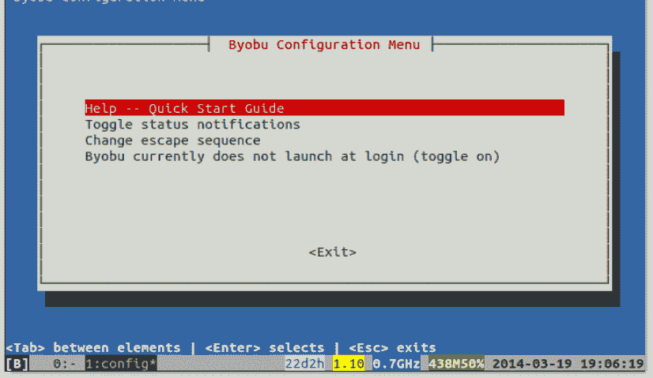

`byobu` 菜单

选项非常直而易见，尽管“更改转义序列”项仅在用作背景时才相关。如果我们选择“切换状态通知”，我们就得到了 `byobu` 中一个非常实用的功能：丰富且易于配置的状态栏。

## Byobu 配置菜单

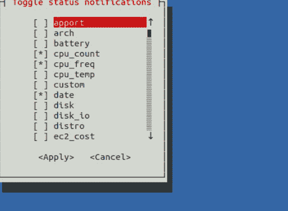

元素之间使用 `<Tab>` | `<Enter>` 选择 | `<Esc>` 退出
`[0] 0-:config* 222h 2.55 0.7GHz 438M50 2014-03-19 19:07:27`

## 状态通知

在这里我们可以从各种系统状态信息中选择显示。如果我们正在监控状态，这非常有用。

第二个是 `Shift-F12` 键，它可以禁用 `byobu`。遗憾的是，`byobu` 提供了一系列功能。

## 复制模式

`byobu` 提供了一个复制文本的模式。以下是按键：

| 按键 | 描述 |
|---|---|
| F9 | 打开菜单屏幕 |
| F12 | 切换状态通知 |

## 分离会话

与 `screen` 和 `tmux` 不同，`byobu` 不使用像 `Ctrl-a` 这样的命令前缀来启动命令。`byobu` 极地依赖功能键。

## Shell 函数示例

正如我们在 TLCL 中回顾过的样，shell 函数是微型的 shell 脚本，我们可以将其添加到 `.bashrc` 文件中，以执行任何我们本可能通过 shell 脚本完成的操作。这里是一个显示系统健康快速摘要的示例函数：

```bash
status() {

  echo -e "uptime:"

  utime

  echo -e "disk space:"

  df -h 2>/dev/null

  echo -e "inodes:"

  df -i 2>/dev/null

  echo -e "\nblock devices:"

  blkid

  echo -e "\nmemory"

  free -m

  if [[ -f /var/log/syslog ]]; then

    echo -e "syslog"

    tail /var/log/syslog

  fi

  if [[ -f /var/log/messages ]]; then

    echo -e "messages"

    tail /var/log/messages

  fi

} | less
```

与别名（aliases）不同，shell 函数可以接受位置参数：

```bash
params() {

  local argc=0

  while [[ -n $1 ]]; do

    argc=$((++argc))

    echo "Argument $argc $1"

    shift

  done

}
```


## 命令行编辑

别名和 shell 函数都是很好用，前提是我们预先知道想要执行的操作，但在实时操作时，其他时间该怎么办？我们执行的大多数命令行操作都是实时的，因此需要其他技术。

正如我们在 TLCL 第 8 章中看到的，`shell` 包含一个名为 `readline` 的库，用于处理交互式 `shell` 会话期间的键盘输入。这包括在 `shell` 提示符处输入的文本，以及在指定了 `-e` 选项使用 `read` 内置命令时的键盘输入。`readline` 库支持许多命令，用于编辑我们在命令行输入的内容。由于 `readline` 来自 GNU 项目，许多命令源自 `emacs` 文本编辑器。

## 控制命令

在进入实际编辑命令之前，让我们来看一些用于控制编辑过程的命令。

| 命令 | 描述 |
|---|---|
| `Enter` | 按下回车键将接受当前行。注意，行内的光标位置并不重要（即它不必在末尾）。如果行不为空，它会被添加到命令历史中。 |
| `Esc` | 元前缀（Meta-prefix）。如果 `Alt` 键不可，可以用 `Esc` 键代替。如果命令需要 `Alt-r` 但另一个程序拦截了该命令，按下并释放 `Esc` 键，然后按 `:` 键。 |
| `Ctrl-g` | 取消当前的编辑命令。 |
| `Ctrl-_` | 增量撤销对行的更改（即完全撤销）。 |
| `Ctrl-l` | 清屏。 |
| `Alt-num` | 其中 `num` 是一个数字。某些命令接受数字参数。对于这些接受参数的命令，先输入此键，然后输入命令。 |

编辑控制命令

## 移动

这里是一些让光标在当前行移动的命令。在 `readline` 文档中，当前光标位置被称为“点（point）”。

| 命令 | 描述 |
|---|---|
| `Right` | 向前移动一个字符。 |
| `Left` | 向后移动一个字符。 |
| `Alt-f` | 向前移动一个单词。 |
| `Alt-b` | 向后移动一个单词。 |
| `Ctrl-a` | 移动到行首。 |
| `Ctrl-e` | 移动到行尾。 |

光标移动命令

## 使用命令历史

为了节省输入，我们经常复用存储在命令历史中的之前的命令。我们可以向上和向下移动历史列表，并对历史列表进行搜索。

| 命令 | 描述 |
|---|---|
| `Up` | 移动到上一个历史列表项。 |
| `Down` | 移动到下一个历史列表项。 |

## 命令

| 命令 | 描述 |
|---|---|
| `Alt-<` | 移动到历史列表的开头。 |
| `Alt->` | 移动到历史列表的末尾。 |
| `Ctrl-r` | 从当前位置开始向上历史列表执行增量历史搜索。输入命令后，会出现提示符，每输入一个后续字符，列表中的位置就会移动到下一条匹配行。这可能是搜索命令中最用的。 |
| `Ctrl-s` | 与 `Ctrl-r` 类似，但搜索是向下移动历史列表进行的。 |
| `Alt-p` | 向上历史列表执行非增量搜索。 |
| `Alt-n` | 向下历史列表执行非增量搜索。 |
| `Alt-Ctrl-y` | 插入上一个历史条目的第一个参数。此命令可以接受数字参数。当给出数字参数时，将插入上一个历史条目的第九个参数。 |
| `Alt-.` | 插入上一个历史条目的最后一个参数。当给出数字参数时，行为与上述 `Alt-Ctrl-y` 相同。 |

历史命令

## 修改文本

| 命令 | 描述 |
|---|---|
| `Ctrl-d` | 删除点处的字符。 |
| `Ctrl-t` | 交换字符。将点处的字符与其之前的字符交换。 |
| `Alt-t` | 交换单词。将点处的单词与其之前的单词交换。 |
| `Alt-u` | 将当前单词转换为大写。 |
| `Alt-l` | 将当前单词转换为小写。 |
| `Alt-c` | 将当前单词的首字母大写。 |

编辑命令

## 剪切和粘贴

与 `vim` 一样，剪切和粘贴是一种常见操作。然而，对于许多情况，只需重新输入就足够了。对于长行，剪切和粘贴高效得多。在 `readline` 中，我们可以通过删除来剪切文本，它会被存储在一个名为 `kill` 的缓冲区中。我们可以在行的任何地方粘贴剪切的内容。

（注：由于此部分的 OCR 文本严重损坏，我将包含可用的片段。）

`insyslog`, `inmessages`, refer to the current word

通常对其他人可用。要检查该包，请查看 `/etc/bash-completion.d` 目录。如果该目录存在，则该包已安装。

`bash-completion` 包增加了对许多命令行程序的支持，允许我们对命令选项和参数进行自动补全。`ls` 命令就是一个很好的例子。如果我们输入 `ls -` 然后按下命令的 `Tab` 键，我们将看到该命令可能的选项列表：

```bash
me@linux: ~$ ls      --ignore=

  --all                 --ignore-backups
  --all-all             --indicator-style=
  --author              --inode
  --block-size=         --literal
  --classify            --no-group
  --color               --numeric-guid
  --context             --quote-name
  --dereference         --quoting-style=
  --dereference-command-line --recursive
  --dereference-command-line-symlink-to-dir --reverse
  --directory           --show-control-chars
  --dired               --size
  --escape              --sort
  --file-type           --sort=
  --format              --tabsize=
  --group-directories-first --time=
  --help                --time-style=
  --hide                --version
  --hide-control-chars --width=
--human-readable
```

可以通过输入部分选项后按 `Tab` 键来完成选项。例如，输入 `ls -ver` 然后按 `Tab` 将将补全为 `ls -version`。

`bash-completion` 系统本身也非常有趣，因为它由一系列 `shell` 脚本实现，这些脚本利用了 `complete` 和 `compgen` `bash` 内置命令。工作的主体由 `/etc/bash_completion`（或较新版本中的 `/usr/share/bash-completion`）脚本完成，并带有位于 `/etc/bash-completion.d` 目录或 `/usr/share/bash-completion/completions` 目录中针对单个程序的额外脚本。这些脚本是高级脚本技术的示例，值得学习研究。

## 总结

这次探险包含了很多内容，起初看起来可能并不都有用，但随着我们继续积累经验并练习命令行，学习这些省力的技巧将为我们节省大量的时间和精力。

## 延伸阅读

- “时间的开端”在 `Linux` 等类 `Unix` 操作系统中是有意义的。那是 1970 年 1 月 1 日。详情请参见：`https://en.wikipedia.org/wiki/Unix_time`。
- 别名（Aliases）和 `shell` 函数分别在 *The Linux Command Line* 的第 5 章和第 26 章中进行了讨论：`https://linuxcommand.org/tlcl.php`。
- `bash` man 页的 `READLINE` 部分描述了命令行上的许多键盘快捷键。
- `bash` man 页的 `HISTORY` 部分涵盖了 `bash` 的命令行历史功能。
- `bash-completion` 项目的官方首页：`https://github.com/scop/bash-completion`
- 对于那些兴趣学习如何编写自己的 `bash` 补全脚本的读者，请参阅 `Linux` 文档项目的这篇教程：`https://tldp.org/LDP/abs/html/tabexpansion.html`。

# 4 更多种重定向

正如我们在 TLCL 的第 6 章中学到的，I/O 重定向是 `shell` 最实用且强大的功能之一。通过重定向，我们的命令可以向文件和设备发送和接收数据流，并允许我们将不同的程序连接在一起。在这次探险中，我们将更深入地研究重定向，看看它是如何工作的，并发现一些额外的功能和实用的技巧。

## 发生了什么

每当系统上运行新程序时，内核都会为该程序创建一个文件描述符表。按照约定，前三个描述符（0、1 和 2）分别被用作标准输入 (stdin)、标准输出 (stdout) 和标准错误 (stderr)。初始情况下，这三个描述符都指向终端。

每当通过重定向 运行一个 `shell` 脚本时，内核会为程序创建一个文件描述符表。

`terminfo` 数据库中定义了许多不同的终端类型，以及许多终端能力名称（capnames）。`terminfo` man 页面包含了一个完整的列表。但请注意，在实际工作中，我们可能在 `Linux` 系统上遇到的所有终端类型中，只有少数能力名称是被支持的。

## 读取终端属性

对于以下能力名称，`tput` 会将一个值输出到标准输出（stdout）：

| Capname | 说明 |
| --- | --- |
| `longname` | 终端类型的全名 |
| `lines` | 终端的行数 |
| `cols` | 终端的列数 |
| `colors` | 可用颜色数量 |

## 能力名称

`lines` 和 `cols` 的值是动态的。也就是说，它们会随着终端窗口的大小改变而更新。这里有一个实用的别名，可以创建一个查看当前终端窗口大小的命令。

`alias term_size="echo Rows=$(tput lines) Cols=$(tput cols)"`

如果我们定义了此别名并执行它，我们将看到输出的当前终端大小。如果我们更改了终端窗口的大小并第二次执行该别名，我们将看到值已经更新。

我们在脚本中可以使用的一个有趣特性是 `SIGWINCH` 信号。每当终端窗口调整大小时，系统都会发送此信号。我们可以在脚本中包含一个信号处理程序（即 `trap`）来检测此信号并对其采取操作：

```bash
#!/bin/bash
```

## 复制描述符

我们可以使用 `exec` 来打开和关闭额外的描述符。这里是打开和关闭描述符 3 的示例：

```bash
exec 3 > some_file.txt
exec 3>&-
```

在 `shell` 中，我们可以很容易打开使用描述符 3-9，甚至可以使用 10 及以上的描述符，尽管 `bash` 可能会有此限制。

所以，我们为什么想使用额外的描述符？这很难回答。

在某些情况下 `exec` 不需要。例如：

```bash
command > file
```

当我们在 `shell` 中使用重定向时，这通常是可见的：

```bash
command > file
```

复制描述符 2 到 1 示例：

```bash
command 2>&1
```

使用 `exec`，我们可以这样做：

```bash
# counter-exec - Count number of lines in a pipe

exec 3>/dev/tty # 打开fd3并指向控制终端

count=0
while read line; do
    echo "$line" # 将REPLY发送到标准输出
    ((count++))
    printf "\r%06d" "$count" >&3 # 格式化数字并写入fd3
done

echo "Lines Counted" >&3 # 重定向到3
```

该程序将输入复制到标准输出，但显示了它复制的行数。如果我们调用它，可以看到效果：

```bash
ps ax | counter-exec > ./list.txt
```

在这个管道中，我们使用重定向生成了一个名为 `list.txt` 的文件。上面的脚本通过使用文件描述符 3 来重定向，它指向了 `/dev/tty`。

## 总结

这次探险包含了很多内容，起初看起来可能并不都有用，但随着我们继续积累经验并练习命令行，学习这些省力的技巧将为我们节省大量的时间和精力。

## 延伸阅读

- “时间的开端”在 `Linux` 等类 `Unix` 操作系统中是有意义的。那是 1970 年 1 月 1 日。详情请参见：`https://en.wikipedia.org/wiki/Unix_time`。
- 别名（Aliases）和 `shell` 函数分别在 *The Linux Command Line* 的第 5 章和第 26 章中进行了讨论：`https://linuxcommand.org/tlcl.php`。
- `bash` man 页的 `READLINE` 部分描述了命令行上的许多键盘快捷键。
- `bash` man 页的 `HISTORY` 部分涵盖了 `bash` 的命令行历史功能。
- `bash-completion` 项目的官方首页：`https://github.com/scop/bash-completion`
- 对于那些兴趣学习如何编写自己的 `bash` 补全脚本的读者，请参阅 `Linux` 文档项目的这篇教程：`https://tldp.org/LDP/abs/html/tabexpansion.html`。


## 动态显示终端窗口大小

```bash
#!/bin/bash

## term_size2 - 动态显示终端窗口大小

redraw() {

  clear

  Width = $(tput cols)

  Height = $(tput lines)

}

trap redraw WINCH

redraw

while true; do

  :

done

```

通过这个脚本，我们启动了一个空循环，但由于我们为 `SIGWINCH` 信号设置了 `trap`，每当终端窗口调整大时，`trap` 就会触发并显示新的终端大小。要退出此脚本，请输入 `Ctrl-c`。


`term_size2`

## 控制光标

下面的能力名称输出包含控制代码的字符串，这些代码指示终端操纵光标：

| Capname | 说明 |
| --- | --- |
| `sc` | 保存光标位置 |
| `rc` | 恢复光标位置 |
| `home` | 将光标移动到左上角 (0,0) |
| `cup <row> <col>` | 将光标移动到指定的行、列位置 |
| `cudl` | 光标向下移动 1 行 |
| `cuul` | 光标向上移动 1 行 |
| `civis` | 设置光标为隐藏 |
| `cnorm` | 设置光标为正常状态 |

## 光标控制能力名称

我们可以修改之前的脚本，使用光标定位功能并在终端调整大小时将窗口尺寸信息置于中心：

```bash
#!/bin/bash

## term_size3 - 动态显示终端窗口大小

## 带有文本居中

redraw() {

    local str width height length

    width=$(tput cols)

    height=$(tput lines)

    str="Width = $width Height=$height"

    length=$(#str)

    clear

    tput cup $((height / 2)) \$((width / 2) - (length / 2))

    echo "$str"

}

trap redraw WINCH

redraw

while true; do

  :

done

```

与之前的脚本一样，我们为 `WINCH` 信号设置了 `trap` 并启动了无限循环。此脚本中的 `redraw` 函数要复杂一些，因为它必须在每次窗口大小变化时都重新计算终端窗口的中心点。

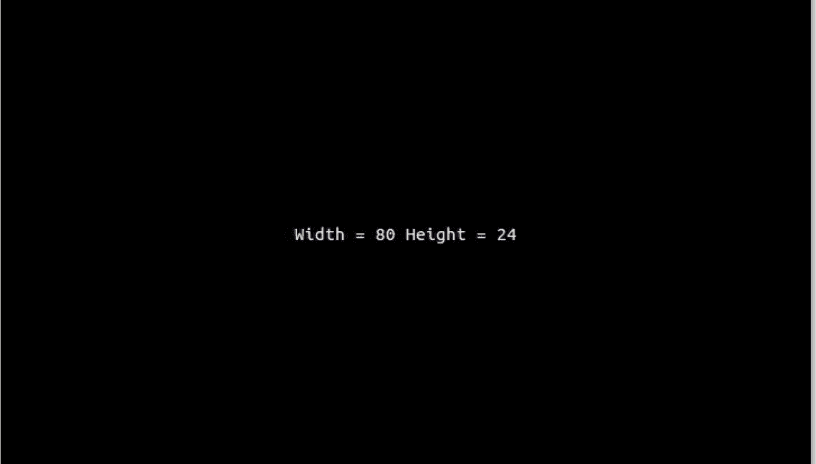

`term_size3`

## 文本效果

与用于光标操作的能力名称类似，以下能力名称输出控制代码字符串，影响终端显示文本字符的方式：

| Capname | 说明 |
| --- | --- |
| `bold` | 开始加粗文本 |
| `smul` | 开始下划线文本 |
| `rmul` | 结束下划线文本 |
| `rev` | 开始反色显示（反 video） |
| `blink` | 开始闪烁文本 |
| `invis` | 开始不可见文本 |
| `smso` | 开始“突出”模式（standout） |
| `rmso` | 结束“突出”模式 |
| `sgr0` | 关闭所有属性 |
| `setaf <value>` | 设置前景颜色 |
| `set <value>` | 设置背景颜色 |

## 文本效果能力名称

某些能力（如下划线和突出显示）具有用于开启和关闭该属性的能力名称，而另一些能力只有开启该属性的能力名称。在这种情况下，可以使用 `sgr0` 能力名称将文本渲染恢复到“正常”状态。这是一个演示常用文本效果的简单脚本：

```bash
#!/bin/bash

## tput_characters - 测试各种字符属性

clear

echo "tput character test"

echo "======================"

echo

tput bold; echo "这段文本有加粗属性."; tput sgr0

tput smul; echo "这段文本有下划线 (smul);"; tput rmul

# 大终端模拟器都不支持闪烁文本（尽管 xterm

# 支持），因为闪烁文本被认为是不够雅的 ;-)

tput blink; echo "这段文本正在闪烁 (blink)."; tput sgr0

tput rev; echo "这段文本有反色属性"; tput sgr0

## 在许多终端上，突出模式是反色的，在其他终端上是粗体的。

tput smso; echo "这段文本处于突出模式 (smso)."; tput rmso

tput sgr0

echo

```

输出示例：

```text
tput character test
============
这段文本有加粗属性。
这段文本有下划线 (smul)。
这段文本正在闪烁 (blink)。
这段文本有反色属性
这段文本处于突出模式 (smso).
me@linuxbox ~ $
```

`term_size3`

## 文本颜色

大多数终端都支持前景颜色和背景颜色（尽管某些支持 256 种）。使用 `setaf` 和 `set` 能力可以设置终端显示颜色。尽管如此，这里是可用的颜色：

| Value | Color |
|---|---|
| 0 | Black |
| 1 | Red |
| 2 | Green |
| 3 | Yellow |
| 4 | Blue |
| 5 | Magenta |
| 6 | Cyan |
| 7 | White |

## 清理屏幕

这些能力允许我们选择性地清除终端的部分：

| Capname | 说明 |
| --- | --- |
| `smcup` | 保存屏幕内容 |
| `rmcup` | 恢复屏幕内容 |
| `el` | 从行尾清除 |
| `ell` | 从行首清除 |
| `ed` | 从光标到屏幕末尾清除 |
| `clear` | 清除整个屏幕 |

## 屏幕擦除

使用这些能力，我们可以构建一个带有菜单和独立输出区域的脚本来显示系统信息：

```bash
#!/bin/bash

# tput menu: 菜单驱动的系统信息

BG_BLUE="$(tput setab 4)"

BG_BLACK="$(tput setab 0)"

FG_GREEN="$(tput setaf 2)"

FG_WHITE="$(tput setaf 7)"

## 保存屏幕

tput smcup

## 显示菜单直到 selection 0

while [ "$selection" != "0" ]; do
  echo -n "${BG_BLUE}${FG_WHITE}"

  clear

  cat <<EOF

  请选择：

  1. 显示主机名和运行时间

  2. 显示磁盘空间

  3. 显示主目录空间使用率

  0. 退出

EOF

  read -p "输入选择 [0-3]: " selection

  # 清除下方区域

  tput cup 10

  echo -n "${BG_BLACK}${FG_GREEN}"

  tput ed

  tput cup 11 0

  # 根据选择操作

  case $selection in

    1)

      echo "主机名: $HOSTNAME"

      uptime

      ;;

    2)

      df -h

      ;;

    3)

      if [ $(du -u) -eq 0 ]; then

        echo "所有用户的主目录空间使用率"

        du -sh /home/* 2>/dev/null

      else

        echo "$HOME"

        du -s $HOME/* 2>/dev/null | sort -nr

      fi

      ;;

    0)

      break

      ;;

    *)

      echo "输入无效。"

      ;;

  esac

  printf "\n\n按任意键继续..."

  read -n 1

done

## 恢复屏幕

tput rmcup

echo "程序已终止。"

```


通过这个脚本，我们启动了一个空循环，但由于我们为 `SIGWINCH` 信号设置了 `trap`，每当终端窗口调整大时，`trap` 就会触发并显示新的终端大小。要退出此脚本，请输入 `Ctrl-c`。


`term_size2`

## 控制光标

下面的能力名称输出包含控制代码的字符串，这些代码指示终端操纵光标：

| Capname | 说明 |
| --- | --- |
| `sc` | 保存光标位置 |
| `rc` | 恢复光标位置 |
| `home` | 将光标移动到左上角 (0,0) |
| `cup <row> <col>` | 将光标移动到指定的行、列位置 |
| `cudl` | 光标向下移动 1 行 |
| `cuul` | 光标向上移动 1 行 |
| `civis` | 设置光标为隐藏 |
| `cnorm` | 设置光标为正常状态 |

## 光标控制能力名称

我们可以修改之前的脚本，使用光标定位功能并在终端调整大时将窗口尺寸置于中心：

```bash
#!/bin/bash

## term_size3 - 动态显示终端窗口大小

## 带有文本居中

redraw() {

    local str width height length

    width=$(tput cols)

    height=$(tput lines)

    str="Width = $width Height=$height"

    length=$(#str)

    clear

    tput cup $((height / 2)) \$((width / 2) - (length / 2))

    echo "$str"

}

trap redraw WINCH

redraw

while true; do

  :

done
```

与之前的脚本一样，我们为 `WINCH` 信号设置了 `trap` 并启动了无限循环。此脚本中的 `redraw` 函数要复杂一些，因为它必须在每次窗口大小变化时都重新计算终端窗口的中心点。


`term_size3`

## 文本效果

与用于光标操作的能力名称类似，以下能力名称输出控制代码字符串，影响终端显示文本字符的方式：

| Capname | 说明 |
| --- | --- |
| `bold` | 开始加粗文本 |
| `smul` | 开始下划线文本 |
| `rmul` | 结束下划线文本 |
| `rev` | 开始反色显示 |
| `blink` | 开始闪烁文本 |
| `invis` | 开始不可见文本 |
| `smso` | 开始“突出”模式 |
| `rmso` | 结束“突出”模式 |
| `sgr0` | 关闭所有属性 |
| `setaf <value>` | 设置前景颜色 |
| `set <value>` | 设置背景颜色 |

## 文本效果能力名称

某些能力（如下划线和突出显示）具有用于开启和关闭该属性的能力名称，而另一些能力只有开启该属性的能力名称。在这种情况下，可以使用 `sgr0` 能力名称将文本渲染恢复到“正常”状态。这是一个演示常用文本效果的简单脚本：

```bash
#!/bin/bash

## tput_characters - 测试各种字符属性

clear

echo "tput character test"

echo "======================"

echo

tput bold; echo "这段文本有加粗属性."; tput sgr0

tput smul; echo "这段文本有下划线 (smul);"; tput rmul

# 大终端模拟器都不支持闪烁文本（尽管 xterm

# 支持），因为闪烁文本被认为是不够雅的 ;-)

tput blink; echo "这段文本正在闪烁 (blink)."; tput sgr0

tput rev; echo "这段文本有反色属性"; tput sgr0

## 在许多终端上，突出模式是反色的，在其他终端上是粗体的。

tput smso; echo "这段文本处于突出模式 (smso)."; tput rmso

tput sgr0

echo
```

```text
tput character test

============

这段文本有加粗属性。

这段文本有下划线 (smul)。

这段文本正在闪烁 (blink)。

这段文本有反色属性

这段文本处于突出模式 (smso).

me@linuxbox ~ $
```

`tput_characters`

## 文本颜色

大多数终端都支持前景颜色和背景颜色（尽管某些支持 256 种）。使用 `setaf` 和 `set` 能力可以设置终端显示颜色。尽管如此，这里是可用的颜色：

| Value | Color |
|---|---|
| 0 | Black |
| 1 | Red |
| 2 |

## 清理屏幕

这些能力允许我们选择性地清除终端的部分：

| Capname | 说明 |
| --- | --- |
| `smcup` | 保存屏幕内容 |
| `rmcup` | 恢复屏幕内容 |
| `el` | 从行尾清除 |
| `ell` | 从行首清除 |
| `ed` | 从光标到屏幕末尾清除 |
| `clear` |

## 屏幕擦除

使用这些能力，我们可以构建一个带有菜单和独立输出区域的脚本来显示系统信息：

```bash
#!/bin/bash

# tput menu: 菜单驱动的系统信息

BG_BLUE="$(tput setab 4)"
BG_BLACK="$(tput setab 0)"
FG_GREEN="$(tput setab 2)"
FG_WHITE="$(tput setab 7)"

## 保存屏幕
tput smcup

## 显示菜单直到 selection 0
while [ "$REPLY" != 0 ]; do
  echo -n "${BG_BLUE}${FG_WHITE}"
  clear
  cat <<EOF
  请选择：
  1. 显示主机名和运行时间
  2. 显示磁盘空间
  3. 显示主目录空间使用率
  0. 退出
EOF
  read -p "输入选择 [0-3]: " selection
  # 清除下方区域
  tput cup 10
  echo -n "${BG_BLACK}${FG_GREEN}"
  tput ed
  tput cup 11 0
  # 根据选择操作
  case $selection in
    1)
      echo "主机名: $HOSTNAME"
      uptime
      ;;
    2)
      df -h
      ;;
    3)
      if [ $(du -u) -eq 0 ]; then
        echo "所有用户的主目录空间使用率"
        du -sh /home/* 2>/dev/null
      else
        echo "$HOME/*"
        du -s $HOME/* 2>/dev/null | sort -nr
      fi
      ;;
    0)
      break
      ;;
    *)
      echo "输入无效。"
      ;;
  esac
  printf "\n\n按任意键继续..."
  read -n 1
done

## 恢复屏幕
tput rmcup

echo "程序已终止。"
```

# 制作时间

在最后一个练习中，我们将制作一个实用的东西：大型字符时钟。为了实现这一点，我们首先需要安装名为 `banner` 的程序。`banner` 程序接受一个或多个单词作为参数，并将其如下所示：

```bash
me@linuxbox~$ banner "BIG TEXT"

###### ###### ###### ######
#      #  #      #  #      #  #      #
#      #  #      #  #      #  #      #
#      #  #      #  #      #  #      #
#      #  #      #  #      #  #      #
###### ###### ###### ######
```

这个程序已经存在很长时间了，有几种不同的实现。在基于 Debian 的系统（如 Ubuntu）上，该包名为 "sys-banner"，在基于 Red Hat 的系统中，包名简单为 "banner"。一旦我们有了 `banner`，就可以运行这个脚本来显示我们的时钟：

```bash
#!/bin/bash

# clock - 在终端中显示时钟

FG_BLUE=$(tput setaf 4)
FG_BLACK=$(tput setaf 0)
FG_WHITE=$(tput setaf 7)

terminal_size() { # 计算终端的尺寸
    terminal_cols=$(tput cols)
    terminal_rows=$(tput lines)
}

banner_size() {
    # 因为有不同版本的 banner，我们需要计算
    # 我们的 banner 输出的尺寸
    banner_cols=0
    banner_rows=0
    while read; do
        [[ $(($REPLY) -gt $banner_cols ]] && banner_cols=$($REPLY)
        ((+banner_rows))
    done <(banner "12:34 PM")
}

display_clock() {
    # 因为我们要将时钟放在终端的中心，
    # 我们需要读取 banner 输出的每一行并将其放在
    # 正确的位置
    local row=$clock_row
    while read; do
        tput cup $row $clock_col
        echo -n "$REPLY"
        ((+row))
    done <(banner "$(date +%I:%M %p)")
}

# 设置一个陷阱（trap）以便在 Ctrl-c (退出) 时恢复终端。
# 重置属性，使光标可见，并恢复
# 之前的屏幕内容（如果可能）。
trap 'tput cnorm; tput rmcup || clear; exit 0' SIGINT

# 保存屏幕内容并隐藏光标
tput smcup;; tput civis

# 计算尺寸和位置
terminal_size=
banner_size=
clock_row=$((terminal_rows - banner_rows) / 2))
clock_col=$((terminal_cols - banner_cols) / 2))
progress_row=$((clock_row + banner_rows) + 1))
progress_col=$((terminal_cols - 60) / 2))

# 以防终端无法用背景颜色绘制屏幕
#（tmux 有这个问题），创建一个包含空格的屏幕尺寸字符串，
# 这样我们可以通过硬办法绘制屏幕。
blank_screen=
for ((i=0; i < (terminal_cols * terminal_rows); ++i)); do
    blank_screen+=" "
done

# 设置前景和背景颜色并开始！
echo -n ${FG_BLUE}${FG_WHITE}
while true; do
    # 设置背景并绘制时钟
    if tput bce; then
        # 如果支持 bce，用简单的方法绘制屏幕
        clear
    else
        # 使用硬办法
        tput home
        echo -n "$blank_screen"
    fi
    tput cup $clock_row $clock_col
    display_clock
    # 绘制一个黑色进度条然后用白色填充
    tput cup $progress_row $progress_col
    echo -n "${FG_BLACK}"
    echo -n "##################################################"
    tput cup $progress_row $progress_col
    echo -n "${FG_WHITE}"
    # 每秒推进进度条直到分钟用完
    for ((i = $(date +%s);i < 60; ++i)); do
        echo "#"
        sleep 1
    done
done
```


# 对话框选项描述

| 对话框 | 选项 | 描述 |
| :--- | :--- | :--- |
| 消息框 | `--msgbox` | 显示文本消息并等待用户响应。 |
| 密码框 | `--password` | 与输入框类似，但会隐藏用户的输入。 |
| 暂停 | `--pause` | 显示文本消息和倒计时器。当计时结束或用户按下“确定”或“取消”按钮时，对话框将终止。 |
| 程序框 | `--programbox` | 显示管道命令的输出。当命令完成后，对话框等待用户点击“确定”按钮。 |
| 进度框 | `--progressbar` | 与程序框类似，不同之处在于管道命令完成后对话框会自动终止，而不是等待用户点击确定。 |
| 单选列表框 | `--radiolist` | 显示选项列表并允许用户选择单项。任何之前选中的项目将变为取消选中。 |
| 范围框 | `--rangebox` | 允许用户使用基于键盘的滑块在指定范围内选择数值。 |
| 尾部框 | `--tailbox` | 显示实时更新的文本文件。工作类似于命令 `tail -f`。 |
| 文本框 | `--textbox` | 简单的文本文件查看器。支持许多与 `less` 相同的键盘命令。 |
| 时间框 | `--timebox` | 用于输入当天时间的对话框。 |
| 树形视图 | `--treeview` | 以树形层次结构显示项目列表。 |
| 是/否框 | `--yesno` | 显示消息并给予用户用“是”或“否”响应的机会。 |

## 支持的对话框

以下是一些示例：

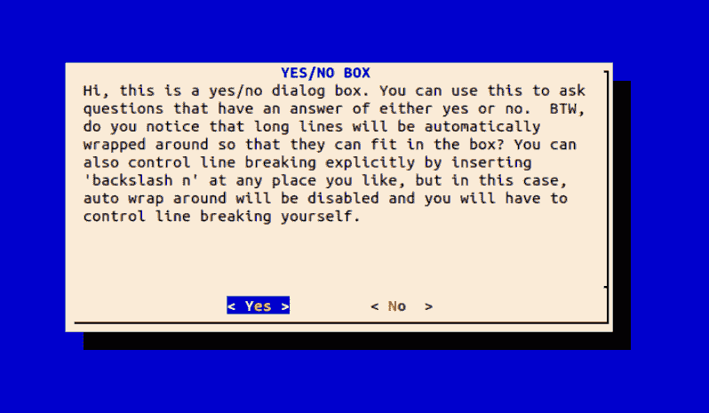

`yesno` 对话框截图

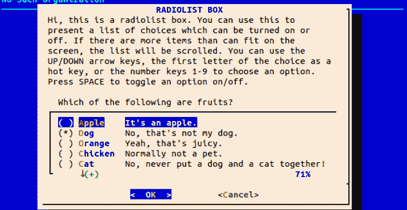

`radiolist` 对话框截图

### `dialog` 79

## 可用性

`dialog` 在大多数发行版的仓库中通过包 `dialog` 提供。除了程序本身，`dialog` 包还包含一个相当详尽的 man 和大量的示例程序，演示了它可以显示的各种对话框。在基于 Debian 的系统上安装后，这些示例程序可以在 `/usr/share/doc/dialog/examples` 目录中找到。其他发行版也类似。

顺便说，使用 Midnight Commander 浏览示例目录是运行示例程序和学习脚本本身的极佳方法：

| 左侧文件命令选项 | 右侧 .../share/doc/dialog/examples -<c> |
| :--- | :--- |
| 'n 名称 大 修改时间 | ../ 名称 大 修改时间 |
| -checklist1 815 Jan 13 2018 | -calendar 229 Jan 13 2018 |
| -editbox 103 Jan 13 2018 | -calendar-stout 215 Jan 13 2010 |
| -editbox-utf8 665 Jan 13 2018 | -calendar-2-stout 207 Jan 13 2010 |
| -formi 1428 Oct 4 2011 | -Checklist 1084 Jan 13 2018 |
| -form 119 Jan 13 2018 | -Checklist1 815 Jan 13 2018 |
| -fselect-stout 199 Jan 13 2018 | -editbox 1039 Jan 13 2018 |
| -fselect 322 Jan 13 2018 | -editbox-utf8 665 Jan 13 2018 |
| -fselect-stout 312 Jan 13 2018 | -formi 1428 Oct 4 2011 |
| -fselect2 194 Jan 13 2018 | -form 119 Jan 13 2018 |
| -fselect2-stout 212 Jan 13 2018 | -fselect 239 Jan 13 2018 |
| -gauge 336 Jan 13 2018 | -fselect 234 Jan 13 2018 |
| -gauge-input-fd 466 Jan 13 2018 | -fselect-stout 199 Jan 13 2018 |
| -gauge2 | | -calendar-stout |

使用 Midnight Commander 浏览示例

# 工作原理

从表面上看，`dialog` 看起来非常简单。我们启动 `dialog`，随后跟上一个或多个通用选项（无论所需的对话框如何都适用），然后是框选项及其关联参数。使用 `dialog` 的难点在于如何从中提取数据。

`dialog` 接收的数据（例如输入输入框中的字符串）通常返回在标准错误输出中。这是因为 `dialog` 使用标准错误来显示内容。让我们来看看它们。

## 方法 1：将结果存储在临时文件中

脚本的第一部分定义了 `dialog` 使用的一些常量。我们使用临时文件来处理这些。

```bash
#!/bin/bash

# inputbox - 演示输入框

# 定义 dialog 的退出状态

DIALOG_OK=0

DIALOG_CANCEL=1

DIALOG_HELP=2

DIALOG_EXTRA=3

DIALOG_ITEM_HELP=4

DIALOG_ESC=255

# 使用 tempfile 命令创建一个名为 tmp_file 的临时文件

tmp_file=$(mktemp)

# 设置 trap（信号捕获）以确保在程序退出时删除临时文件

trap "rm -f $tmp_file" EXIT

# 进入 dialog 命令本身。我们首先为输入框设置标题，并指定 --clear 选项，告诉 dialog 擦除屏幕上之前的任何对话框。接下来，我们指明我们想要的对话框类型及其所需的参数。这些参数包括显示在输入字段上方的标题，以及框所需的高度和宽度。虽然[截断] 尽管我们也可以将这两个值都指定零，dialog 将尝试自动确定大小。

# 由于 dialog 通常将其结果输出到标准错误，我们将它的文件描述符重定向到我们的临时文件进行存储。

dialog \
  --title "INPUT BOX \
  --clear \
  --inputbox "" 10 40 2>"$tmp_file"
```

*(注：由于原始文本在此处截断，后续的 Method 2 及完整代码未包含翻译)*

“你好，这是一个输入对话框。你可以使用它\n提问需要用户\n输入字符串作为答案的问题。你可以\n输入比输入框更长的字符串，在这种情况下，\n输入字段将自动滚动。你可以使用退格键来纠正错误。\n\n请在下方输入你的名字：” 16 51&4 1&3

```bash
# Get dialog's exit status

return_value=$

# Close file descriptor 3

exec 3&-

# On the exit status

case $return_value in

($DIALOG_OK)

  echo "Result: $result";

($DIALOG_CANCEL)

  echo "Cancel pressed.";

($DIALOG_HELP)

  echo "Help pressed.";

($DIALOG_EXTRA)

  echo "Extra button pressed.";

($DIALOG_ITEM_HELP)

  echo "Item-help pressed.";

($DIALOG_ESC)

  if test -n "$result"; then

    echo "$result"

  else

    echo "ESC pressed."

  fi

esac
```

起初，这种重定向似乎毫无意义。首先，我们使用 `exec` 将文件描述符 1（stdout）复制并重定向到 3，以创建描述符 1 的备份副本。

下一步是执行命令替换，并将 `dialog` 命令的输出赋值给变量。命令将描述符 2（stderr）的重定向为描述符 1 的副本，最后，通过复制包含备份副本的描述符 3 将描述符 1 恢复到其原始值。可能无法立即看出为什么最后一步是必要的。在子过程中，标准输出（描述符 1）并不指向控制终端。相反，它指向一个将交付输出的管道。由于 `result` 需要标准输出到终端以便显示输入框，我们必须将标准错误重定向到标准输出（这样 `dialog` 的输出就会进入 `result` 变量），然后将标准输出重定向回控制终端。

那么，哪种方法更好？临时文件还是命令替换？可能是命令替换更好，因为它避免了文件的创建。

14 dialog

## 之前与之后

现在我们已经基本掌握了如何使用 `dialog`，让我们将其应用于一个实际示例。

这里有一个“普通”脚本。它是一个菜单驱动的系统信息程序，类似于 TLCL 第 29 章中讨论过的程序。

```bash
#!/bin/bash

# while-menu: a menu-driven system information program

DELAY=3 # 显示结果的秒数

while true; do

  clear

  cat << EOF

Please:

  1. 显示系统信息

  2. 显示磁盘空间

  3. 显示主目录空间利用

  0. 退出

EOF

read -p "Enter selection [0-3] " 

if [[ $REPLY =~ ^[0-3]$ ]]; then

  case $REPLY in

    1)

      echo "Hostname:$HOSTNAME"

      uptime

      sleep $DELAY

      continue

      ;;

    2)

      df -h

      sleep $DELAY

      continue

      ;;

    3)

      if [[ $(id -u) -eq 0 ]]; then

        echo "Home/Space Space Utilization (All Users)"

        du -sh /home/* 2>/dev/null

      else

        echo "Home Space Utilization ($USER)"

        du -sh $HOME 2>/dev/null

      fi

      sleep $DELAY

      continue

      ;;

    0)

      break

      ;

  esac

else

  echo "Invalid entry."

  sleep $DELAY

fi

done

echo "Program terminated."
```

请选择：
1. 显示系统信息
2. 显示磁盘空间
3. 显示主目录空间利用
0. 退出

Enter selection [0-3] >

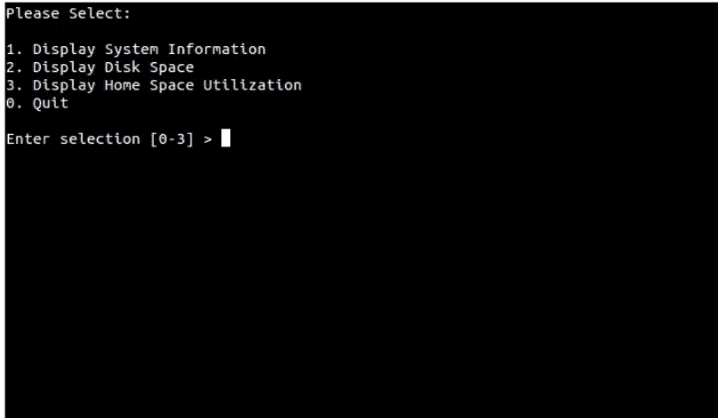

## 显示文本菜单的脚本

该脚本显示了一个简单的选项菜单。在用户输入选择后，会对该选择进行验证，确保它是允许的选项之一（数字 0-3），如果验证通过，则将使用 `case` 语句执行选定的操作。结果将显示 `DELAY` 常量定义的秒数，之后整个过程将重复，直到用户选择菜单退出程序。

以下是修改后使用 `dialog` 提供新用户界面的脚本：

86 dialog

```bash
--menu "Please select:" $HEIGHT $WIDTH 4 \
"1" "Display System Information" \
"2" "Display Disk Space" \
"3" "Display Home Space Utilization" \
2&|1<3)

exit_status=$?

exec 3<

case $exit_status in

	$DIALOG_CANCEL)

	clear

	echo "Program terminated."

	exit

	;

	$DIALOG_ESC)

	clear

	echo "Program aborted." >&2

	exit 1

	;

esac

case $selection in

	1)

		result=$(echo "Hostname: $HOSTNAME; uptime")

		display_result="System Information"

	;

	2)

		result=$(df -h)

		display_result="Disk Space"

	;;

	3)

		if [[ $(id -u) -eq 0 ]]; then

			result=$(du -sh /home/* 2>/dev/null)

			display_result="Home Space Utilization (All Users)"

		else

			result=$(du -sh $HOME 2>/dev/null)

			display_result="Home Space Utilization ($USER)"

		fi

	;

esac

done
```

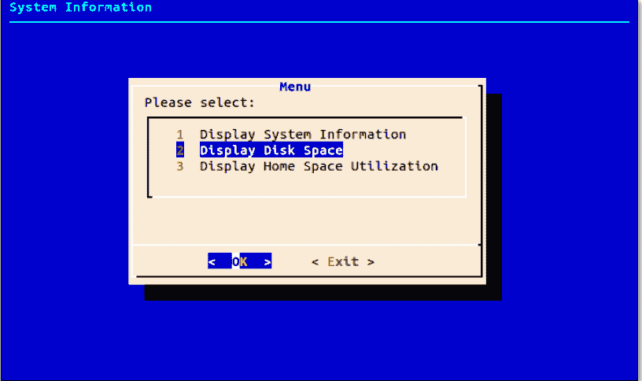

显示 `dialog` 菜单的脚本

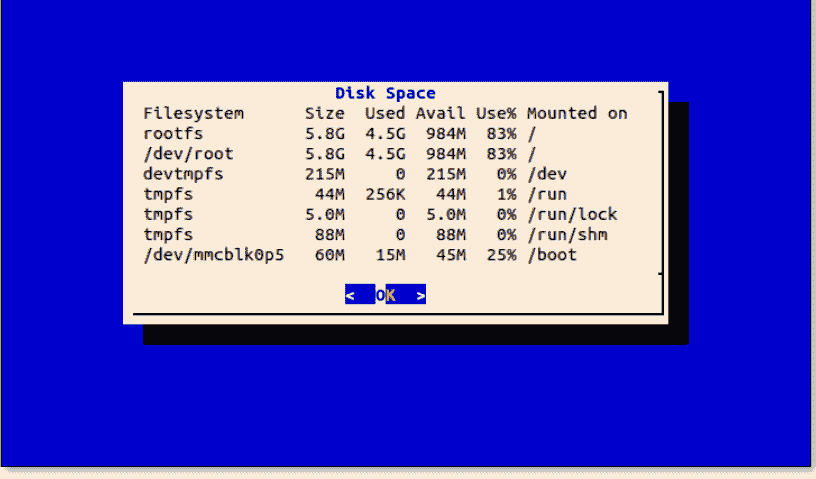

### 使用 `msgbox` 显示结果

可以看出，脚本发生了一些结构性变化。首先，我们不再需要验证用户的选择。菜单框只允许有效的选择。其次，在开头定义了一个函数，用于显示每个选择的输出。

我们还注意到使用了 `dialog` 的几个常用选项：

88 dialog

# 工作原理

AWK 程序的结构在编程语言中是相当独特的。程序由一个或多个“模式/动作”对组合组成。在深入细节之前，让我们先看看 AWK 程序是做什么的。

我们已经知道，典型的 AWK 程序充当过滤器。它从标准输入读取数据，并将数据输出到标准输出。它一次读取一条记录（record）。默认情况下，记录是以换行符结束的一行文本。每当读取一个记录时，AWK 会自动将记录分成字段（fields）。默认情况下，字段是通过空格分隔的。每个字段被分配给一个变量，并赋予数字名称。变量 `$1` 是第一个字段，`$2` 是第二个字段，依此类推。`$0` 表示整个记录。此外，还会设置一个名为 `NF` 的变量，包含记录中检测到的字段数量。

模式/动作对是对每个记录执行的测试以及相应的执行的动作。如果模式为真，则执行该动作。当模式列表耗尽时，AWK 程序读取下一个记录并重复该过程。

让我们尝试一个非常简单的用。我们将过滤 `ls` 命令的输出：

```bash
linuxbox ~ $ ls -l /usr/bin | awk 'print $0'
```

AWK 程序包含在 `awk` 命令后的单引号中。单引号很重要，因为我们不希望 shell 尝试对 AWK 程序进行任何扩展，因为它的语法与 shell 无关。例如，`$0` 代表 AWK 程序从标准输入读取的整个记录的值。在 AWK 中，`$` 意味着“字段”，而不会像在 shell 中那样成为参数扩展的触发器。

我们的示例程序包含一个单一的动作且没有模式。这是被允许的，并且每条记录都匹配该模式。当我们运行它时，它会像 `cat` 命令一样简单地输出输入的每一行。

如果我们看 `ls` 输出的典型行，会发现它包含 9 个字段，每个字段由一个或多个空格字符分隔：

```
-rwxr-xr-x 1 root root      265 Apr 17 2012 zxpdf
```

让我们为程序添加一个模式，以便它只打印字段多于 9 个的行：

```bash
linuxbox ~ $ ls -l /usr/bin | awk 'NF > 9 {print $0}'
```

我们现在看到 `/usr/bin` 中的符号链接列表，因为这些目录列表包含超过 9 个条目。此模式也会匹配文件名包含嵌入空格的条目，它们也有超过 9 个字段。

# 12 AWK

# 特殊模式

AWK 中的模式可以有许多形式。有我们刚刚看到的条件表达式。正如我们预期的那样，还有正则表达式。有两个特殊的模式称为 `BEGIN` 和 `END`。`BEGIN` 模式在读取第一条记录之前执行其相应的动作。这对于初始化变量或在输出开头打印头非常有用。同样，`END` 模式在从输入文件中读取最后记录后执行其相应的动作。这对于处理完输入后输出摘要很有处。

让我们尝试一个更复杂的例子。暂假设目录不包含任何嵌入空格的文件（尽管这永远不是安全的假设）。我们可以使用以下脚本列出符号链接：

```bash
#!/bin/bash

# 打印目录报告

ls -l /usr/bin | awk '
BEGIN {
    print "Directory Report"
    print "===================="
}

NF > 9 {
    print $9, "is a symbolic link to", $NF
}

END {
    print "===================="
    print "End Of Report"
}'
```


在这个示例中，我们的 AWK 程序中有 3 组模式/动作对。第一个是 `BEGIN` 模式，其动作打印报告头。我们可以将动作分散在几行中，尽管动作的左括号 “{” 必须与模式出现在同一行。

第二个模式测试当前记录以检查是否包含多于 9 个字段，如果为真，打印第 9 个字段，随后是一些文本和记录中的最后一个字段。注意这是如何做的。`NF` 变量前面有一个“$”，因此它指的是第 `NF` 个字段，而不是 `NF` 本身的值。

最后，我们有一个 `END` 模式。其相应的动作在读取完所有输入行后打印“End Of Report”（报告结束）消息。

## 调用

我们有三种方法可以运行 AWK 程序。我们已经看到如何通过包含在单引号内将程序嵌入 shell 脚本中。第二种方法是将 awk 脚本放在单独的文件中并像这样从 awk 程序调用它：

```
awk -f program_file
```

最后，我们使用 shebang 机制使 AWK 脚本变成像 shell 脚本那样的独立程序：

```bash
#!/usr/bin/awk -f

# 打印目录报告

BEGIN {
    print "Directory Report"
    print "===================="
}

NF > 9 {
    print $9, "is a symbolic link to", $NF
}

END {
    print "===================="
    print "End Of Report"
}
```

# 语言

让我们来看下 AWK 程序的特征和语法。

# 程序格式

AWK 程序的格式规则非常简单。动作由一个或多个被括号 `{}` 包围的语句组成，起始括号必须与模式出现在同一行。空行被忽略。注释以井号 (`#`) 开始，并出现在任何行的末尾。长语句可以使用续行符（反斜杠后紧跟换行符）拆分为多行。用逗号分隔的参数列表可以在任何逗号后拆分。这里有一个例子：

```awk
BEGIN { The action's opening brace must be on same line as the pattern
# Blank lines are ignored
# Line continuation characters can be used to break long lines \
\ $1, # Parameter lists may be broken by commas,
$2, # Comments can appear at the end of any line
$3
# Multiple statements can appear on one line if separated by
# a semicolon
print "String 1"; print "String 2"
} # Closing brace for action
```

# 模式

这里是 AWK 中最常用的模式类型：

# BEGIN 和 END

正如我们之前看到的，`BEGIN` 和 `END` 模式分别在我们读取的第一条记录之前和读取最后一条记录后执行动作。

# 关系表达式

关系表达式用于测试值。例如，我们可以测试等价性

```
$1 == "Fedora"
```

或者测试某些关系，例如：

```
$1 >= 50
```

# 正则表达式

AWK 支持如 `egrep` 那样的正则表达式。首先，我们可以在正斜杠中选择一个正则表达式：

```
expression ~ /regexp/
```

例如，如果需要更细粒度的控制，我们可以尝试匹配第三个字段：

```
$3 ~ /^[567]/
```

# 模式逻辑运算符

可以使用逻辑运算符 `||` 和 `&&` 将模式组合起来。例如，如果我们想测试记录的第一个字段是否为大于 100 的数字且最后一个字段是单词 "Debit"，我们可以这样做：

```
$1 > 100 && NF == "Debit"
```

# ! 模式

也可以对模式进行否定，使得不匹配该模式的记录被选中。

# 模式, 模式

两个用逗号分隔的模式可以调用范围模式。通过它，一旦匹配到第一个模式，后续每条记录都会匹配，直到匹配到第二个模式。因此，这种类型的模式将选择记录列表。让我们假设有一组记录，且每条记录的第一个字段包含一个顺序数字：

```
0001 field field field
0002 field field field
0003 field field field
```

依此类推。假设我们想提取从 `0050` 到 `0100` 的记录（包含边界）。为了这样做，我们使用如下范围模式：

```
$1 == "0050", $1 == "0100"
```

# 字段和记录

AWK 语言之所以有用是因为它能够自动根据换行符和空格分隔字段和记录，这是可以调整的。例如，`/etc/passwd` 文件没有使用空格分隔其字段；AWK 有一个名为 `FS`（字段分隔符）的内置变量，定义了分隔记录中字段的定界符。这里有一个列出用户 ID 和用户名的 AWK 程序：

```awk
BEGIN { FS = ":" }
print $1, $5
```

该程序有两个模式/动作对。第一个动作在读取第一条记录之前执行，并将输入分隔符设置为冒号。第二对只包含一个动作而没有模式。这将匹配每条记录。动作打印每条记录的第一个和第五个字段。

`FS` 变量可以包含正则表达式，因此可以使用非常强大的方法来分隔字段。

记录通常由换行符分隔，但也可以进行调整。内置变量 `RS`（记录分隔符）定义了如何界定记录。一种常见的记录类型是由由一个或多个空行分隔的多行组成的。AWK 在这种情况下指定记录分隔符有一个简便方法。我们将 `RS` 定义为空字符串：

```awk
RS = ""
```

注意当完成此操作时，换行符除了任何其他指定的字符外，始终被视为字段分隔符，无论 `FS` 变量如何设置。当我们处理多行记录时，通常希望将每一行视为一个单独的字段，因此这样做通常是理想的：

```
BEGIN { FS = "\n"; RS = "" }
```

# 变量与数据类型

AWK 将数据处理为字符串或数字，取决于其上下文。这在处理数字时有时会产生问题。AWK 通常会将数字视为字符串，除非对它们执行了特定的“数值化”操作。

我们可以通过对数字字符串进行一些算术运算，强制 AWK 将其视为数字。最简单的方法是在数字上加上 `0`：

```
n = 105 + 0
```

同样地，我们可以通过连接一个空字符串，让 AWK 将数字字符串视为字符串：

```
s = 105 ""
```

AWK 中的字符串拼接是使用空格字符作为运算符完成的——这是该语言的一个不寻常特性。

变量是在 AWK 遇到它们时创建的（不需要预先声明），就像 Shell 一样。AWK 中的变量名遵循与 Shell 相同的规则。名称由字母、数字和下划线组成。与 Shell 一样，变量名的第一个字符不能是数字。变量名对大小写敏感。

# 内置变量

我们已经查看了 AWK 的几个内置变量。以下是最实用的变量列表：

## FS - 字段分隔符

该变量包含一个正则表达式，用于将记录划分为字段。初始值使用空白分隔字段。AWK 支持一种快捷方式，可以将此变量恢复到原始值：

```
FS = " "
```

`FS` 的值也可以通过命令行上的 `-F` 选项进行设置。例如，我们可以这样快速地从 `/etc/passwd` 文件中提取用户名和 UID 字段：

```awk
awk -F: '(print $1, $3)' /etc/passwd
```

## NF - 字段数

该变量每次读取记录时都会更新。我们可以通过引用 `$NF` 轻松地访问记录中的最后一个字段。

## NR - 记录数

该变量在每次读取记录时都会递增，因此它包含了来自输入流的记录总数。使用该变量，我们可以轻松通过以下命令模拟 `wc -l` 命令：

```
awk 'END {print NR}'
```

或者通过以下命令为文件中的行编号：

```awk
awk '{print NR, $0}'
```

## OFS - 输出字段分隔符

该字符串用于在打印输出时分隔字段。默认是一个单个空格。此设置可以通过重新格式化数据来更改。例如，我们可以通过将 `OFS` 设置为 `","` 来轻松将数值表转换为 CSV（逗号分隔值）。为了演示，这里有一个读取我们的目录列表并输出 CSV 流的程序：

```
ls -l | awk 'BEGIN {OFS = ","} NF == 9 {print $1,$2,$3,$4,$5,$6,$7,$8,$9}'
```

我们设置了模式来匹配包含 9 个字段的输入行。这消除了待处理数据中的符号链接和其他奇异的字段名。

结果输出的每行看起来像这样：

```
-rwxr-xr-x,1,root,root,100984,Jan,11,2015,a2p
```

如果我们省略了 `OFS`，`print` 语句将使用默认值（单个空格）：

```
ls -l | awk 'NF == 9 {print $1,$2,$3,$4,$5,$6,$7,$8,$9}'
```

导致输出的每行看起来像这样：

```
-rwxr-xr-x 1  root  root 100984 Jan 11 2015 a2p
```

## ORS - 输出记录分隔符

该字符串用于在打印输出时分隔记录。默认是一个换行符。我们可以通过将 `ORS` 设置为两个换行符来轻松让文件双倍行距：

```
ls -l | awk 'BEGIN {ORS = "\n\n"} {print}'
```

98 AWK

## RS - 记录分隔符

在读取输入时，AWK 将此字符串解释为记录结束标记。默认值是换行符。

## FILENAME - 文件名

如果 AWK 从命令行指定的文件读取输入，则该变量包含该文件的名称。

## FNR - 文件记录数

当从命令行指定的文件中读取输入时，AWK 将此变量设置为从该文件中读取的记录数。

# 数组

AWK 支持一维数组。数组元素中包含的数据可以是数字或字符串。数组索引可以是字符串（用于关联数组）或数字。

为数组元素赋值的方法如下：

| `a[1] = 5` | # 数字索引 |
| `a["five"] = 5` | # 字符串索引 |

# 运算符与表达式

AWK 支持多种运算符。它们分为算术、字符串、逻辑和关系运算符。

# 算术运算符

算术运算符用于数学运算。

- `+` (加法)
- `-` (减法)
- `*` (乘法)
- `/` (除法)
- `%` (取模)
- `^` (幂)

# 字符串运算符

字符串运算符用于字符串处理。

- `.` (拼接)

# 逻辑运算符

逻辑运算符组合表达式。

- `&&` (与)
- `||` (或)
- `!` (非)

# 关系运算符

关系运算符用于比较两个值。

- `==` (等于)
- `!=` (不等于)
- `>` (大于)
- `<` (小于)
- `>=` (大于等于)
- `<=` (小于等于)

# 赋值运算符

赋值运算符用于给变量赋值。

- `=` (赋值)
- `+=` (加法赋值)
- `-=` (减法赋值)
- `*=` (乘法赋值)
- `/=` (除法赋值)
- `%=` (取模赋值)

# 三元运算符

三元运算符是 `if-then-else` 语句的简写。

- `condition ? expression_true : expression_false`

# 控制流

控制结构允许你控制代码的执行顺序。

# if-else-else

该语句允许 AWK 根据条件执行不同的代码块。

```awk
if (condition) {
    # 如果条件为真则执行
} else if (condition2) {
    # 如果条件2为真则执行
} else {
    # 如果条件都不真则执行
}
```

# while

`while` 循环在条件保持真时重复代码块。

```awk
while (condition) {
    # 代码
}
```

# do-while

`do-while` 循环在检查条件之前至少执行一次代码块。

```awk
do {
    # 代码
} while (condition)
```

# for

`for` 循环用于按指定的次数重复代码块。

```awk
for (initialization; condition; step) {
    # 代码
}
```

# 函数

AWK 支持内置函数和自定义函数。

# 内置函数

AWK 提供了许多用于常见任务的内置函数。

- `print`: 输出文本到标准输出。
- `printf`: 输出格式化文本。
- `length()`: 返回字符串或数组的长度。
- `substr()`: 从字符串中提取子字符串。
- `tolower()`: 将字符串转换为小写。
- `toupper()`: 将字符串转换为大写。
- `int()`: 将数字转换为整数。
- `split()`: 将字符串分割为数组。
- `rand()`: 生成随机数。

# 定义函数

你可以使用 `function` 关键字在 AWK 中定义自己的函数。

```awk
function function_name(parameters) {
    # 代码
    return value
}
```

输入流中处理的行数 (`NR`) 除以页长度，如果结果为零，则表示这是一个偶倍数。

AWK 支持一种用于测试数组成员身份的表达式：

```
(var in array)
```

其中 `var` 是索引值，`array` 是一个数组变量。使用此表达式可以测试 `var` 是否存在指定的数组中。这种测试数组成员身份的方法避免了通过某些方法无意中创建数组的问题，例如：

```
if (array[var] == "
```

当以这种方式尝试测试时，数组元素 `var` 被创建，因为 AWK 会通过通过其使用来创建变量。而使用 `(var in array)` 形式时，不会创建新变量。

要测试多维数组中的数组成员身份，使用以下语法：

```
(var,var2) in array
```

# for : 表达式 ; 表达式 ) 语句

AWK 中的循环与 C 语言中的循环非常相似。第一个表达式通常用于初始化计数器变量，第二个表达式定义了循环何时完成，第三个表达式定义了每次迭代时如何增加或推进循环。这里有一个使用循环反序打印字段的示例：

```
ls -l | awk '{s=""; for (i=NF; i>0; i--) s=$i OFS; print s}'
```

在这个示例中，我们创建了一个空字符串 `s`，然后开始一个循环，从当前输入行的字段数 (`i=NF`) 开始并递减 (`--`) 直到第一个字段 (`i>0`)。循环的每次迭代都会计算当前字段并将输出分隔符连接到字符串 `s` 中 (`s = s OFS`)。循环结束后，我们打印字符串 `s` 的结果值。

# for ( var in array )

AWK 有一种特殊的流控制语句用于遍历数组的索引。以下是它的作用的示例：

在这个程序中，我们有一个 `BEGIN` 动作，可以在不需要输入流的情况下完成整个练习。我们创建了一个数组 `a` 并添加了 10 个元素，其中包含字符串 `"foo"`。接下来，我们使用 `for (i in a)` 遍历数组中的所有索引并打印每个索引。需要注意的是，内存中数组的顺序取决于实现，这意味着它可以是任何顺序，我们不能依赖任何特定顺序的执行结果。稍后我们将查看如何解决这个问题。

# AWK

即使没有排序，如果我们需要处理数组中的每一个元素，这种循环也是很有用的。例如，我们可以像这样删除数组的每个元素：

```
for (i in a) delete a[i]
```

# while ( 表达式 ) 语句

do 语句 while ( 表达式 )

AWK 中的 `while` 和 `do` 循环非常直观。我们确定一个为了保持循环持续必须满足的条件。我们可以通过字段反转程序来演示这一点（我们将它写成多行以便于理解逻辑）：

```
ls -l | awk {
s = ""
i = NF
while (i > 0) {
s = $i OFS
i--
}
print s
}
```

`do` 循环与 `while` 循环类似；但 `do` 循环始终至少执行一次其语句，而 `while` 循环只有在满足初始条件时才会执行其语句。

# break continue next

`break`、`continue` 和 `next` 关键字用于从循环中“跳出”。`break` 和 `continue` 的行为与它们在 shell 中对应的命令相似。`continue` 告诉 AWK 停止当前并继续当前循环的下一次迭代。`break` 告诉 AWK 完全退出当前循环。`next` 关键字告诉 AWK 跳过当前程序的剩余部分，并开始处理下一条输入记录。

# exit 表达式

与 shell 一样，我们可以告诉 AWK 退出并提供一个可选的表达式来设置 AWK 的退出状态。

# 正则表达式

AWK 中的正则表达式工作方式与 `egrep` 中的类似，这是我们在 TLCL 第 19 章中涵盖过的话题。需要注意的是，不支持回引用（back references），并且某些版本的 AWK（特别是 1.3.4 之前的 `awk` 版本）不支持 POSIX 字符类。

正则表达式通常用于模式（`patterns`），但它们也用于某些内置变量（如 `FS` 和 `RS`），并且在稍后后将讨论的字符串函数中也起着各种不同的角色。

让我们尝试使用一些正则表达式来识别目录列出中的不同文件类型（我们也会巧妙地利用关联数组）。

```
ls -l /usr/bin | awk '
$1 ~ /\[Regular Files\]/
$1 ~ /\[directories\]/
$1 ~ /\[Symbolic Links\]/
END (for (i in t) print "\t "" t[i])'
```


在这个程序中，我们使用正则表达式来识别第一个字段的第一个字符，并增加数组`r`中对应元素的值。由于`AWK`中可以使用字符串作为数组索引，我们将文件类型拆分为索引。这使得在`END`动作中打印结果变得简单，因为我们只需要通过`(i in t)`遍历数组即可获取每种类型的名称和累计总和。

## 输出函数

`print expr1, expr2, expr3,...`

正如我们所看到的，`print`接受由逗号分隔的参数列表。参数可以是任何有效表达式；但是，如果表达式包含关系运算符，则整个列表必须括在括号中。

逗号很重要，因为它们分隔了参数。如果省略，`AWK`将在不带空格的情况下输出它们。

## `printf(format, expr1, expr2, expr3...)`

在`AWK`中，`printf`类似于`C`函数。它根据字符串格式化输出。这里有一个使用`printf`格式化列的示例：

```
awk '{printf "%-10s %s\n", $1, $2}'
```

## 输出文件和管道

除了标准输出，我们还可以输出到文件。为了这样做，我们使用重定向运算符。例如，将输出重定向到文件：

```
awk '{print $0}' > file.txt
```

如果我们想追加到文件，我们使用`>>`运算符：

```
awk '{print $0}' >> file.txt
```

## 读取数据

正如我们所看到的，`awk`处理标准输入的数据。然而，我们也可以在命令行中指定文件名：

```
awk '{print $0}' file1 file2
```

通过此，我们可以创建一个模拟`wc`的程序：

```
awk '{chars += length($0)} END {print NR, chars}' file1
```

这个程序有两个有趣的特性。首先，`length($0)`不计算行尾的换行符，所以我们必须加上它们来获得字符数。第二个特性是`NR`。

即使我们不在命令行中包含文件名，也可以告诉`AWK`在程序内部读取数据。通常我们不这样做，但在某些情况下这可能是必要的。例如，如果我们想将一个文件插入另一个文件中，可以使用`getline`函数。这里有一个给现有主体添加头部和页脚的示例：

```
awk '
BEGIN {
    while (getline <"header.txt" > 0) {
        print $0
    }
}
END {
    while (getline <"footer.txt" > 0) {
        print $0
    }
}' body.txt > finished_file
```

`getline`非常灵活，可以用于各种场景：

### `getline`

在最基本的形式下，`getline`从当前输入流读取下一个记录。`$0`、`NF`、`NR`和`FNR`均设置。

### `getline var`

从当前输入流读取下一个记录并将其内容赋值给变量`var`。`var`、`NR`和`FNR`均设置。

### `getline <file`

从文件读取记录。`$0`和`NF`已设置。读取文件时检查错误是非常重要的。在前面的示例中，我们指定了如下循环：

```
while (getline <"header.txt" > 0)
```

正如我们所见，`getline`正在从文件`header.txt`读取，但“> 0”意味着什么？答案是像大多数函数一样，`getline`返回一个值。正值表示成功，零表示`EOF`（文件结束），负值表示发生了其他文件相关问题，例如未找到文件。如果我们不检查返回值，可能会导致无限循环。

### `getline var <file`

从`file`读取下一条记录并将其内容赋值给变量`var`。只有`var`会被设置。

### `command | getline`

从`command`的输出中读取下一条记录。设置`$0`和`NF`。这里有一个使用`AWK`解析`date`命令输出的示例：

```
awk
BEGIN {
  "date" | getline
  print $4
}
```

### `command | getline var`

从`command`的输出中读取下一条记录并将其内容赋值给变量`var`。只有`var`会被设置。

## 字符串函数

正如所预期的，`AWK`拥有许多用于处理字符串的函数，更重要的是，其中许多函数支持正则表达式。这使得`AWK`的字符串处理变得非常强大。

### `gsub(r, s, t)`

全局替换目标字符串`t`中所有匹配正则表达式`r`的子字符串为字符串`s`。目标字符串是可选的。如果省略，则使用`$0`作为目标字符串。该函数返回替换的次数。

### `index(s1, s2)`

返回字符串`s2`在字符串`s1`中最左侧的位置。如果`s2`不在`s1`中，该函数返回`0`。

### `length(s)`

返回字符串`s`中的字符数。

### `match(s, r)`

返回字符串`s`中匹配正则表达式`r`的子字符串的最左侧位置。如果没有找到匹配项，则返回`0`。此函数还会设置内部变量`RSTART`和`RLENGTH`。

### `split(s, a, fs)`

将字符串拆分为字段并将每个字段存储在数组`a`的元素中。字段根据字段分隔符`fs`进行拆分。例如，如果我们想将一个电话号码（如`800-555-1212`）拆分为`3`个由字符`-`分隔的字段，我们可以这样做：

```
phone="800-555-1212"
split(phone, fields, "-")
```

执行后，数组`fields`将包含以下元素：

```
fields[1] = "800"
fields[2] = "555"
fields[3] = "1212"
```

### `sprint(fmt, exprs)`

此函数的行为类似于`printf`，但它不是输出格式化字符串，而是返回一个包含表达式列表的格式化字符串给调用者。使用此函数将格式化字符串赋值给变量：

```
area_code = "800"
change = "555"
number = "1212"
phone_number = printf("(%s) %s-%s", area_code, exchange, number)
```

### `sub(s, t, l)`

行为类似于`gsub`，但只进行最左侧的替换。与`gsub`一样，目标字符串`t`是可选的。如果省略，则使用`$0`作为目标字符串。

### `substr(s, p, l)`

返回字符串中从位置`p`开始长度为`l`的子字符串。

## 算术函数

`AWK`拥有常用的算术函数。关于`AWK`中的数学运算有一点提醒：它在数字大小和浮点操作精度方面存在局限性。这对于`mawk`尤为如此。对于涉及大量计算的任务，首选`gawk`。`gawk`文档对相关问题提供了良好的讨论。

### `atan2(y, x)`

返回`y/x`的弧度反正切。

### `cos(x)`

返回`x`的余弦，`x`为弧度。

### `exp(x)`

返回`x`的指数，即`e^x`。

### `int(x)`

返回`x`的整数部分。例如，如果`x = 1.9`，则返回`1`。

### `log(x)`

返回`x`的自然对数。`x`必须为正。

### `rand()`

返回一个随机浮点值`n`，使得`0 <= n < 1`。这是一个`0`到`1`之间的值，可能是`0`但不可能是`1`。在`AWK`中，除非先使用`rand()`函数设置随机数生成器的种子，否则随机数总是遵循相同的序列（见下文）。

### `sin(x)`

返回`x`的正弦，`x`为弧度。

### `sqrt(x)`

返回`x`的平方根。

### `rand(x)`

将随机数生成器的设置为`x`。如果省略`x`，则使用当天的时间作为种子。要生成`1`到`n`范围内的随机整数，可以使用如下代码：

```
rand()
# 生成一个 1 到 6 之间的随机整数
dice_roll = int(6 * rand()) + 1
```

## 用户定义函数

除了内置的字符串和算术函数外，`AWK`还像`shell`一样支持用户定义函数。参数传递的机制不同，更像`C`等传统语言。

### 定义函数

典型的函数定义如下：

```
function name(parameter-list) {
    statements
}
```

```
return expression
}
```

我们使用关键字`function`后紧跟要定义的函数名。函数名必须紧跟参数列表的左括号。参数列表可以包含零或多个用逗号分隔的参数。大括号限定的块后面跟着更多一个语句。要指定函数的返回值，使用`return`语句，后跟一个包含要返回值的表达式。如果我们把之前的掷骰子程序转换为函数，它看起来像这样：

```
function dice_roll() {
    return int(6 * rand()) + 1
}
```

此外，如果我们想泛化函数以支持不同的最大值，可以这样代码：

```
function rand_integer(max) {
    return int(max * rand()) + 1
}
```

然后通过`dice_roll()`使用我们的函数：

```
function dice_roll() {
    return rand_integer(6)
}
```

### 向函数传递参数

正如我们在上面的示例所示，我们将参数传递给函数并在体内部对其进行操作。参数分为两大类。首先是标量变量，如字符串和数字。其次是数组。这种区别在`AWK`中很重要，因为参数传递的方式不同。标量变量按值传递的，这意味着创建变量的副本并交给函数。这意味着标量变量在函数内部作为局部变量，并在函数退出时销毁。而数组是通过引用传递的。

### 局部变量

`AWK`的一个有趣的限制是我们无法在体内部声明局部变量。这个问题有一个解决办法。我们可以将变量添加到参数列表中。所有按值传递的变量都将被视为局部变量。这不适用于数组，因为数组总是按引用传递。

110 AWK

## 将文件转换为 CSV 格式

`AWK`的优势之一是文件格式转换。在这里我们将整齐排列的列转换为`CSV`（逗号分隔值）文件。

```bash
awk 'BEGIN {OFS=","} print $1,$2,$3,$4,$5' random_table.dat
```

这是一个非常简单的情况。我们所做的只是更改输出字段分隔符并打印所有的单独字段。虽然编写`CSV`文件很容易，但读取它可能很复杂。在某些情况下，许多流行的电子表格程序会创建如下行：

```
word1,"worda,wordb",word3
```

注意第二个字段中的嵌入逗号。这使得简单的`AWK`解决方案（`FS=","`)失效了。解析这种文件可以完成（实际上`gawk`实际上一个语言扩展），但它并不美观。最好避免尝试读取此类文件。

## 将文件转换为 TSV 格式

`CSV`的一个经常可用替代方案是`TSV`（制表符分隔值）文件。该文件使用制表符字符作为字段分隔符：

```awk
awk 'BEGIN{FS="\t"} print $1,$2,$3,$4,$5' random_table.dat
```

同样，编写这些文件也是很容易的。我们只需要将输出字段分隔符设置为制表符即可。在读取方面，大多数创建`CSV`文件的应用程序也可以写入`TSV`文件。使用`TSV`文件可以避免了我们在尝试读取`CSV`文件时经常看到的嵌入逗号问题。

## 打印每行的总和

如果我们只需要做一些简单的加法，这可以很容易地完成：

```awk
awk '{
  t = $1 + $2 + $3 + $4 + $5
  printf("%6d\n", $0, t)
}' random_table.dat
```

## 打印每列的总和

累加列非常简单。在这个示例中，我们使用循环和数组来维护数据文件中五列中每一列的总和：

```awk
awk '{
  for (i = 1; i <= 5; i++) {
    t[i] += $i
  }
  print
}
END {
  print "-----"
  for (i = 1; i <= 5; i++) {
    printf("%7d", t[i])
  }
  printf("\n", "")
}' random_table.dat
```

## 打印第一列的最小值和最大值

```awk
awk '{
  BEGIN {min = 99999}
  if ($1 > max) {max = $1}
  if ($1 < min) {min = $1}
}
END {print "Max=", max, "Min =", min}
' random_table.dat
```

112 AWK

## 最后一个示例

最后一个示例中，我们将创建一个程序来处理路径列表并从每个文件名中提取扩展名，以统计具有该扩展的文件数量：

```awk
# file_types.awk - 文件扩展名和计数的排序列表
BEGIN { FS = "." }
{types[$NF]++}
END {
    for (i in types) {
        printf("%6d %s\n", types[i], i) | "sort -nr"
    }
}
```

要找到我们主目录下最流行的`10`个文件扩展，我们可以这样运行该程序：

```bash
find . -name ".*" | awk -f file_types.awk | head
```


## 总结

我们非常钦佩 `AWK` 在 Unix 早期创建的优雅且实用的工具。它是如此独特，以至于它的用途一直持续到现在。在这个冒险中，我们对 `AWK` 进行了简短的检查。你可以通过深入研究各种 `AWK` 实现的文档来进一步探索。此外，在网络上搜索“`AWK` one-liners”将发现许多有用的 `AWK` 技巧。

## 延伸阅读

- `awk` man 页面为 `AWK` 的基础版本提供了很好的参考。在线版本可用：<https://linux.net/man/awk>
- 许多实用的程序只有一行长。Eric Pement 编译了一个详尽的列表：<http://www.pement.org/awk/>
- 除了 man 页，`gawk` 还有自己的书，名为《Gawk: Effective Programming》，地址为：<https://www.gnu.org/software/gawk/manual/>
- Peter Krum 有一个很不错的博客，列出了针对用户的各种提示：<https://caton.net/awk-tips-and-pitfalls>

# 终端

在我们的许多课程中，我们学习了许多关于 `shell` 的知识，并探索了 `Linux` 系统上许多常见的命令行实用程序。然而，我们忽略了一个程序，它可能是所有程序中最重要且最频繁使用的——终端模拟器。在这次冒险中，我们将深入这些本质工具，并查看几个不同的终端程序以及使用它们可以做的许多有趣的事情。

# 典型的终端

图形桌面环境（如 `GNOME`, `KDE`, `LXDE`, `XFCE` 等）都将终端模拟器作为标准配置。如果桌面环境缺少某些功能，我们仍然可以访问 `shell` 并完成工作。现代终端模拟器非常灵活，可以通过许多方式进行配置：


`gnome-terminal` 偏好

# 大小

终端模拟器显示的窗口可以调整为从极小到荒谬的任何尺寸。许多终端允许配置默认尺寸。终端的“标准”尺寸是 80 列 24 行。这些维度继承自常见硬件的尺寸，而这些尺寸又受到 `IBM` 孔卡格式（80 列 12 行）的影响。某些应用程序期望 `80x24` 是最小尺寸，当尺寸较小时将无法正常显示。另一方面，在大多数情况下，将终端调大是更优的，特别是涉及到终端高度时。80 列是阅读文本的良好宽度，但增加高度可以让我们在命令行工作时提供更多上下文。另一个常见的宽度是 132 列，源自宽纸的宽度。虽然对于舒适地阅读正文文本（例如 man 页）来说这个宽度太宽了（此处原文不如此），但它对于其他用途（例如查看日志文件）是可以的。80 列的默认宽度对 `shell` 脚本和其他程序有影响。

# 标签页

一个包含多个 `shell` 会话的终端窗口是现代终端模拟器的一项价值功能。这是通过使用标签实现的。


带有标签页的 `gnome-terminal`

116 强大的终端

标签页是终端模拟器较晚添加的功能，最早出现在 2003 年的 `GNOME` 的 `gnome-terminal` 和 `KDE` 的 `konsole` 中。

# 配置

某些终端的另一个功能是多配置。通过此功能，我们可以为不同的任务准备不同的配置。例如，如果我们负责维护服务器，可能会为终端准备一个配置。

# 字体、颜色和背景

大多数终端模拟器允许我们为终端选择字体、颜色和背景。选择字体、颜色和背景最重要的三个标准是：1. 可读性，2. 可读性，3. 可读性。许多人在网上发布 `Linux` 桌面截图，并且对“时尚”字体、淡雅颜色和伪透明终端窗口非常着迷，但我们用它们处理非常严肃的事情，所以我们也应该认真对待终端。没有人希望在管理系统时因为看错屏幕上的内容而出错。明智选择。

# 过去的喜好

当图形环境在 20 世纪 80 年代中期出现时，终端模拟器是最开发的应用程序之一。毕竟，那时的 `GUI` 功能很少，人们仍然需要进行工作。此外，图形桌面允许用户显示多个终端窗口——这在当时是一个强大的优势。

# xterm

所有图形终端的祖先是 `xterm`，`X` 窗口系统的标准终端模拟器。它最初发布于 1984 年，现在仍在活跃维护。由于它是 `X` 的标准部分，它包含在许多 `Linux` 发行版中。`xterm` 非常有影响力，大多数现代终端程序都以某种方式模拟了它的行为。


默认配置的 `xterm`

在默认配置下，`xterm` 看起来相当很小且可怜，但 `xterm` 的几乎一切都是可配置的。当我们说“可配置”时，并不是有一个漂亮的“偏好”对话框。这是 `Unix`！像许多早期 `X` 应用程序一样，它依赖 `XResources` 文件进行配置。该文件可以是全局的（`/etc/X11/XResources`），也可以是用户本地的（`~/.XResources`）。该文件中的每一项由应用程序类和一个设置组成。如果我们创建如下内容的文件 `~/.XResources`：

```
XTerm.vt100.geometry: 8x35
XTerm.vt100.faceName: Liberation Mono:size=11
XTerm.vt100.cursorBlink: true
```

那么我们就会得到这样的终端：

```
me@linuxbox: ~
me@linuxbox ~ $ 
```

# 配置过的 xterm

`xterm` 的 `Xresources` 配置值完整列表出现在其 man 页面中。

虽然 `xterm` 看起来没有菜单，但它实际上有 3 种不同的菜单，通过按住 `Ctrl` 键并点击鼠标按钮即可显示。根据按下哪个按钮，会出现不同的菜单。终端侧的滚动条行为类似于古老的 `X` 应用程序。提示：通过菜单启用滚动条后，使用鼠标按钮拖动滑块。

尽管 `xterm` 既不支持标签页也不支持配置文件（`profiles`），但它有一个奇怪的额外功能：它可以显示 `Tektronix 4014` 图形终端模拟器窗口。`Tektronix 4014` 是一种早期且昂贵的存储器图形显示器，在 20 世纪 70 年代的计算机设计系统中非常流行。它极其冷。名字源于同期的流行计算机终端 `DEC VT220`。普通的 `xterm` 窗口被称为 `VT` 窗口。`xterm` 以及大多数终端在某种程度上都模拟了它。`xterm` 与 `VT` 终端并不完全相同，它有自己特定的 `terminfo` 条目（想了解 `terminfo` 背景可以看 `tput adventure`）。终端会设置一个名为 `TERM` 的环境变量，`X` 和 `terminfo` 使用它来识别终端类型，并为其发送正确的控制代码。要查看 `TERM` 变量当前值，我们可以这样做：

```
me@linuxbox ~$ echo $TERM
```

即使我们使用现代终端（如 `gnome-terminal`），我们也会发现 `TERM` 变量通常被设置为 `"xterm"` 或 `"xterm-color"`。这说明 `xterm` 的影响有多大。我们仍然将其作为标准。

# rxvt

按照当时的标准来看，`xterm` 是一个重量级程序，但随着时间的推移，它的某些功能很少被使用，例如 `Tektronix` 模拟。1990 年左右，为了创建一个更简单、更轻量级的终端模拟器，`Robert Nano` 作为 `FVWM` 窗口管理器（一种用于类 `Unix` 系统的早期桌面环境）的一部分编写了 `rxvt`。

`rxvt` 的功能集比 `xterm` 小，并且模拟的是 `DEC VT102` 终端而不是更先进的 `VT220`。`rxvt` 将 `TERM` 变量设置为 `"rxvt"`，这得到了广泛支持。与 `xterm` 一样，`rxvt` 也有通过按住 `Ctrl` 键并点击不同鼠标按钮显示的菜单。

`rxvt` 仍处于活跃维护中，还有一个由 `Mark Lehmann` 从原始版本分支出的流行现代实现版本 `urxvt`，它支持 `Unicode`（使用多字节字符表示比 `ASCII` 更广泛的写语言）。`urxvt` 的一个有趣功能是守护进程模式（`daemon mode`），它允许启动多个终端窗口共享同一个程序实例——这是一个潜在的内存节省方案。

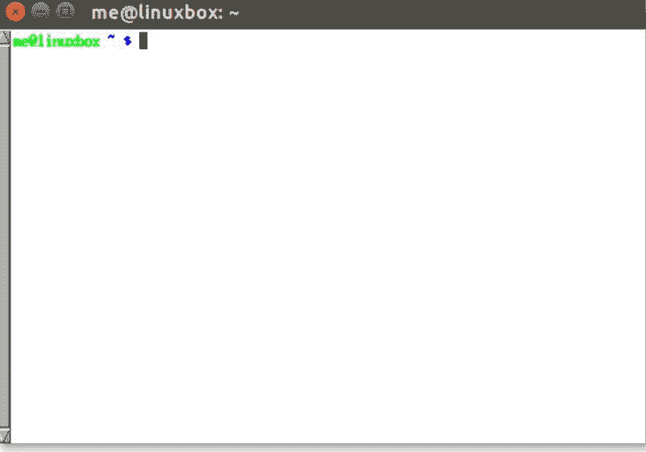

# 默认配置的 urxvt

与 `xterm` 一样，`rxvt` 使用 `Xresources` 来控制其配置。默认 `rxvt` 配置非常精简。在我们的 `Xresources` 文件中添加以下设置使其更易用（显示为 `urxvt`）：

```
URxvt.geometry: 80x35
URxvt.saveLines: 10000
URxvt.scrollBar: false
URxvt.foreground: white
URxvt.background: black
URxvt.secondaryScroll: true
URxvt.font:xft:liberation mono:size=11
URxvt.cursorBlink: true
```

# 现代强大的终端

大多数现代图形桌面环境都包含一个终端模拟器程序。有些比其他的功能更丰富。让我们来看看一些最强大且流行的终端。

# gnome-terminal

`GNOME` 及其衍生发行版的默认终端应用程序是 `gnome-terminal`。它可能是世界上最流行的终端应用，是一个良好且功能齐全程序。它具有许多我们在现代终端中期望的功能，如多标签页和配置文件支持。它还允许各种自定义。

强大的终端 121

# 标签页

忙碌的终端用户经常发现自己同时在多个终端会话中工作。这可能是为了同时对几台机器进行操作，或者在单个系统上管理一组复杂的任务。这个问题可以通过打开多个终端窗口或在单个窗口中使用多个标签页来解决。

`gnome-terminal` 中的文件菜单提供了这两种选择（至少在旧版本中如此）。在较新版本中，使用键盘快捷键 `Ctrl-Shift-T` 打开标签页。可以使用鼠标重新排列标签页，或将其拖出一个新窗口。在 `gnome-terminal` 中，我们甚至可以将标签页从一个终端窗口拖到另一个窗口。

# 键盘快捷键

由于在一个理想的宇宙中，我们的手指永远不会离开键盘，因此我们需要方法在不借助鼠标的情况下控制终端。`gnome-terminal` 为常用操作提供了大量的键盘快捷键。以下是默认定义的一些最实用的：

| 快捷键 | 操作 |
| --- | --- |
| `Ctrl-Shift-N` | 新窗口 |
| `Ctrl-Shift-W` | 关闭窗口 |
| `F11` | 终端全屏查看 |
| `Shift-PgUp` | 向上滚动 |
| `Shift-PgDn` | 向下滚动 |
| `Shift-Home` | 滚动到开头 |
| `Shift-End` | 滚动到末尾 |
| `Ctrl-Shift-T` | 新标签页 |
| `Ctrl-Shift-Q` | 关闭标签页 |
| `Ctrl-PgUp` | 下一个标签页 |
| `Ctrl-PgDn` | 上一个标签页 |
| `Alt-n` | 切换 `n` |

`gnome-terminal` 快捷键也是可配置的。

众所周知 `Ctrl-c` 和 `Ctrl-v` 不能在终端中使用，但 `gnome-terminal` 提供了它们。

# 配置文件

配置文件（`Profiles`）是许多终端程序被忽视的功能之一。当我们想要视觉上区分会话时，配置文件特别有用。这在管理多台机器时尤其如此。

强大的终端 122

我们可以为任何想要的命令行程序配置配置文件：`Midnight Commander`、`tmux` 等。

这里是另一个例子。我们将创建一个简单的帮助页查看器。通过此终端配置，我们有一个专门显示帮助页的窗口。为了实现这一点，我们首先需要编写一个短脚本提示用户要查询的命令，并在近乎无限的循环中显示帮助页：

```bash
#!/bin/bash
# man_view -- simple man page viewer
while true; do
  echo -en "\n请输入命令名称 (q 退出) "
  read
  [[ "$REPLY" = "q" ]] && break
  [[ -n "$REPLY" ]] && { sleep 3; }
  clear
done
```

我们将此文件保存在 `~/bin` 目录并将其作为终端配置的自定义命令。

接下来，创建一个新的终端配置并命名为 `"man page"`。由于我们在为帮助页设计窗口，可以调整窗口大小和颜色。我们将颜色设置为黑色背景上的绿色文字，以获得复古终端的感觉：

# root 配置 gnome-terminal

首先，进入文件菜单并选择“新建配置文件...”并命名为 `"root"`。接下来，我们将配置终端的字体和默认大小。为了创建一个 `root` shell，可以使用 `sudo -i` 命令。我们还将确保终端在命令退出时退出。

最后，我们将选择一些颜色。深红色背景上的白色文字如何？这在我们使用 `shell` 时应该传达出适当的严肃感。完成配置后，我们可以测试我们的 `shell`：

```
LS(1) 用户命令 LS(1)
名称
    ls - 列出目录内容
概要
    ls [OPTION]... [FILE]...
描述
    ls 显示关于文件（默认是当前目录）的信息。如果未指定 -cftuvSUX 中的任何一个或 --sort，则按字母顺序对条目进行排序。
    长选项的强制性参数对于短选项同样是强制性的。
  --all
    不忽略以 - 开头的条目
  -A, --almost-all
    不列出隐含的 . 和 ..
  --author
    配合 -l 使用时，打印每个文件的作者
  -b, --escape
    对非图形字符打印 C 风格的转义字符
  --block-size=SIZE
ls(1) 手册页行（按 h 获得帮助或按 q 退出）
```

`gnome-terminal` 窗口显示帮助页

# 打开超链接和电子邮件地址

`gnome-terminal` 能够执行的一个巧妙技巧是直接复制/或打开 `URL`。当它在显示的文本流中检测到 `URL` 时，它会带有下划线显示它。右键点击链接会显示操作菜单：

```
Please enter a command name (q to quit) -> q
me@linuxbox:~ sudo
[password for me:]
root@linuxbox:~ cd bashrc
root@linuxbox# exit
[password for root:] sudo apt get-update
Hit: http://archive.ubuntu.com/ubuntu ubuntu-security-InRelease
Get: http://archive.ubuntu.com/ubuntu ubuntu-security-InRelease [94.5 kB]
Ign: http://dl.ubuntu.com/linux/crypto ease
Hit: http://archive.ubuntu.com/ubuntu terminal-InRelease
Hit: http://dl.google.com/linux/chrome
Fetched 1 kB in 1s amd64 stable 80/x
Reading package lists... Done
Get: http://dl.google.com/chrome
key 3B0GF0B6F7893A2E4AF3B44991397BC53 release.gpg: Signature by Google (SHA)
lease.gpg: Signature by Google (SHA)
```

# gnome-terminal URL 上键菜单

# 重置终端

有时，尽管我们尽了努力，仍会在终端里做一些蠢事，比如尝试显示非文本文件。当这种情况发生时，终端模拟器会尽职地将随机字节解释为控制代码，我们会发现屏幕充满了垃圾字符且任何功能都无法使用。为了逃离这种情况，我们必须重置终端。`gnome-terminal` 在其“终端”菜单中提供了一个此类功能。

# konsole

`konsole` 是 `KDE` 桌面环境的默认应用程序，其功能集合与 `gnome-terminal` 类似。这当然是有意义，因为 `konsole` 直接在与 `gnome-terminal` 进行“竞争”。例如，`konsole` 以类似的方式支持标签页（`tabs`）和配置（`profiles`）。

`konsole` 拥有一些 `gnome-terminal` 不具备的独特性。`konsole` 拥有书签，并且 `konsole` 可以将屏幕分成多个区域，允许同时显示终端会话的多个视图。

# 书签

`konsole` 允许我们将目录位置存储为书签。位置也可以包括通过 `ssh` 访问的远程位置。例如，我们可以定义一个书签

# 终端

例如 `ssh:me@remotehost`，当使用该书签时，它将尝试连接远程系统。

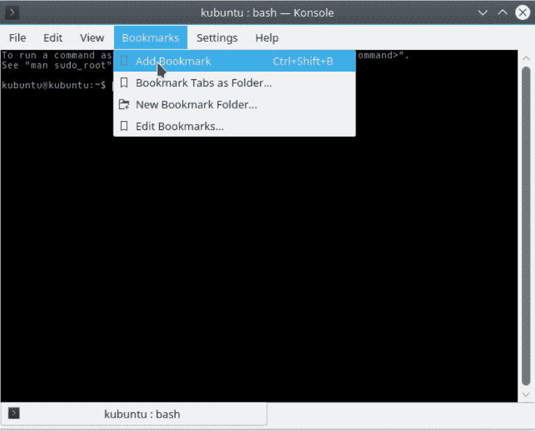
`konsole` 书签菜单

# 分屏视图

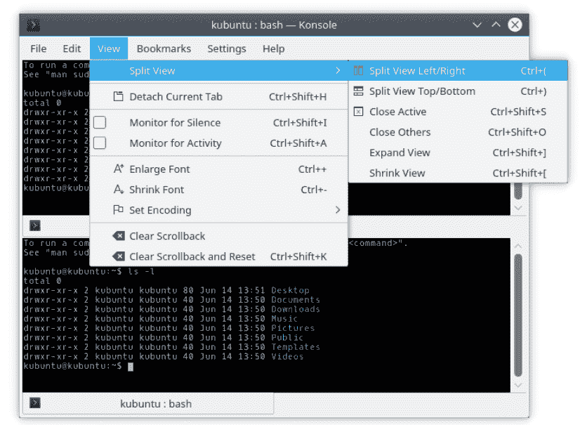
`konsole` 的分屏视图功能

`konsole` 独特的分屏功能允许我们对单个终端会话拥有两个视图。初看之下很奇怪，但在检查长输出流时非常有用。例如，如果需要从长输出流的一个部分复制文本到底部的命令行，这将非常方便。此外，我们可以通过结合标签页和分屏视图来获取不同终端会话的视图，而标签页将出现在所有分屏中，并且可以在每个视图中独立切换：

# guake

`gnome-terminal` 启动了几个程序，它们复用了它的许多内部组件来创建不同的终端应用程序。第一个是 `guake`，这是一个借用了热门第一人称射击游戏设计特征的终端。运行时，`guake` 通常隐藏在后台，当按下 `F12` 键时，终端窗口会从屏幕顶部“滚落”下来显示自己。如果终端是间歇使用的，或者屏幕空间非常宝贵，这会非常有用。

`guake` 与 `gnome-terminal` 共享配置选项，还可以配置激活它的按键、它从屏幕哪一侧滚落以及它的大小。

尽管 `guake` 支持标签页，但它（截至本文编写）不支持配置（`profiles`）。不过，我们可以通过一点脚本来模拟它们：

```bash
#!/bin/bash
# qtab 为 guake 创建伪配置
```


```bash
if [[ $1 == "" ]]; then

  guake --new-tab=. --show

  exit

fi

case $1 in

root) # 创建一个 root shell 标签页

  guake --new-tab=. --fgcolor=#ffffff --bgcolor=#5e0000

  guake --show # 切换到新的前后背景颜色

  guake --rename-current-tab=root

  guake --execute-command=sudo -i; exit

  ) # 创建一个 viewer 标签页

  guake --new-tab=. --fgcolor=#000000 --bgcolor=#000000

  guake --show # 切换到新的前后背景颜色

  guake --rename-current-tab=viewer

  guake --execute-command=exit; exit

  ;;

*)

  echo "没有这样的 tab"

  exit 1

  ;;

esac
```

通过结合标签页和分屏视图，我们可以获取不同终端会话的视图，而标签页将出现在所有分屏中，并且可以在每个视图中独立切换：

...此后，我们可以结合标签页和分屏视图来获取不同终端会话的视图。

对于 KDE 用户，有一个类似的程序叫做 `yake`。

配置它的行为。

# `terminator`

类似于 `guake`，`terminator` 建立在 `gnome-terminal` 的基础上，是一个非常流行的替代方案。它的主要功能增强是支持分屏。

可以。

我们可以通过导航到“偏好/布局（`Preferences/Layouts`）”并存储我们的全屏布局（我们暂将其命名为“`2x2`”），然后通过这种方式调用 `terminator`：

```bash
terminator --maximize --layout=2x2
```

以立即获取我们的布局。

# 其他平台的终端

# `Android`

虽然我们可能不会认为 `Android` 手机或平板电脑是 `Linux` 计算机，但实际上是，而且我们可以获取用于管理系统的终端应用。

# `Connectbot`

`Connectbot` 是 `Android` 上的安全 shell 客户端。通过它，我们可以登录任何运行 `SSH` 服务器的系统。对于远程系统来说，`Connectbot` 看起来就像使用 `GNU Screen` 类型的终端。

在 `Android` 上使用终端模拟器的一个问题是原生 `Google` 键盘的局限性。它没有充分利用终端会话所需的所有键。幸运的是，我们可以在 `Android` 上使用替代键盘。一个非常好的键盘是由 `Klaus Weidner` 开发的 `Hacker's Keyboard`。它支持所有标准键、`Ctrl`、`Alt`、`F1-F10`、方向键、`PageUp`、`PageDown` 等。在手机上使用 `vi` 时非常方便。

# `ConnectBot`

```
CPU: 任务：36， 77 线程，5 正在运行
平均负载: 1.50 1.59
运行时间: 120 天(1), 16:29:53

| PID | 用户 | PRIME | VIRT | RES | SHR | SMEM | CPU | %STAT | TIME+ | 命令 |
|---|---|---|---|---|---|---|---|---|---|---|
| 13610 | bshwts | 20 | 10796 | 2456 | 528 | S | 0.0 | 1:04:51 [2] | htop -T1 -D -A +H23 |
| 13607 | bshwts | 20 | 10796 | 2456 | 528 | S | 0.0 | 0:00:11 | htop -T1 -A +H23 |
| 13723 | me | 20 | 04912 | 2456 | 248 | R | 6.0 | 0:09:46 | |
| 13621 | bshwts | 20 | 10796 | 2456 | 528 | S | 3.0 | 0:21:55 | htop -T1 -D +H23 |
| 12277 | bshwts | 20 | 10796 | 2456 | 528 | S | 0.0 | 0:01:55 | htop -T1 -D -A +H23 |
| 13627 | bshwts | 20 | 05428 | 2956 | 528 | S | 0.0 | 0:00:10 | sshd:sessions@pts/3 |
| 13668 | bshwts | 20 | 10796 | 2456 | 528 | S | 0.0 | 0:00:56 | htop -T1 -A +H23 |
| 1 | root | 20 | 02164 | 1208 | 116 | S | 0.3 | 01:36:91 | /usr/sbin/daemon |
| 159 | root | 20 | 01752 | 420 | 328 | S | 0.4 | 0:04:08 | /usr/sbin/sshd -l1 |
| 1642 | root | 20 | 01752 | 420 | 348 | S | 0.0 | 0:08:51 | /usr/sbin/syslogd -c5 |
| 1646 | root | 20 | 01752 | 420 | 328 | S | 0.1 | 0:27:57 | /usr/sbin/syslogd -c5 |
| 1905 | root | 20 | 02420 | 774 | 844 | S | 0.0 | 0:00:24 | /usr/sbin/syslogd -c5 |
| 1940 | root | 20 | 02420 | 774 | 844 | S | 0.0 | 0:04:54 | /usr/sbin/syslogd -c5 |
| 1943 | root | 20 | 02420 | 774 | 844 | S | 0.0 | 0:04:54 | /usr/sbin/syslogd -c5 |
| 1944 | root | 20 | 02420 | 774 | 844 | S | 0.0 | 0:03:50 | /usr/sbin/syslogd -c5 |
| 1975 | root | 20 | 02720 | 868 | 624 | S | 0.2 | 0:00:00 | /sbin/kpcsd |
| 1978 | root | 20 | 02720 | 868 | 624 | S | 0.0 | 0:00:02 | /sbin/kpcsd |
| 1982 | root | 20 | 02720 | 868 | 624 | S | 0.0 | 0:00:01 | /sbin/kpcsd |
| 2012 | root | 20 | 03804 | 560 | 392 | S | 0.1 | 0:46:77 | /usr/sbin/cron |
| 2021 | messagebu | 20 | 3320 | 1064 | 728 | S | 0.2 | 0:11:32 | /usr/lib/dbus-daemon |
| 2040 | root | 20 | 02420 | 774 | 844 | S | 0.0 | 0:02:25 | /usr/lib/dbus-daemon --p-system |
| 2143 | mobuky | 20 | 3752 | 496 | 368 | S | 0.1 | 0:00:62 | /sbin/getty 38400 tty1 |
| 2167 | root | 20 | 03752 | 496 | 368 | S | 0.1 | 0:00:62 | /sbin/getty 38400 tty1 |
```


强大的终端

## 在 `Android` 上带有 `Hacker` 键盘的 `Connectbot`

## `Termux`

`Android` 版 `Termux` 令人惊叹。它不仅仅是一个 `SSH` 客户端；它无需 `root` 设备即可提供一个完整的 `Android` 环境。安装后，系统中包含 `bash` 和许多常用的工具。起初，这些工具是内置在 `busybox` 中的（一种常用于嵌入系统的紧凑工具集），但它提供了类似 `Debian/Ubuntu` 的 `apt` 包管理程序，允许安装各种 `Linux` 程序。

## 强大的终端

```bash
# job_spec

(( expression ))

# arg

[[ expression ]]

# bg

# keymap

# break

# builtin -shopt(arg)

# selector

# case WORD in (PATTERN| PATTERN ...)

# cd

# compab-coderef

# return

# complete

# declare -a

# echo

# exit

# false

# fc

# for (in {0..253});

# for (in ...);

# function name ()

# hash -p

# help

# if

# then

# elif

# let

# local

# ls

# read

# select

# shift

# sort

# suspend

# unset

# variables

# while

# done

# string

# sign

# time

# pipeline

# true

# type

# )
```


## 显示内置 shell 命令的 `Termux`

我们可以拥有配置文件（如 `.bashrc`），甚至可以在 `Termux` 中编写 shell 脚本并编译、调试程序。非常酷。

当执行 `ssh` 时，`Termux` 在远程系统中看起来就像 `xterm-256color` 终端。

## `Chrome/Chrome OS`

`Google` 为 `Chrome` 和 `Chrome OS`（毕竟也是 `Linux`）制作了一个不错的 `SSH` 客户端，允许登录远程系统。它名为 `Secure Shell`，将 `HTML Terminal`（一种用 `JavaScript` 编写的终端模拟器）与 `SSH` 客户端相结合。对于远程系统，它看起来像“`xterm-256color`”终端。它运行良好，但缺少一些高级 `SSH` 用户需要的功能。

`Secure Shell` 可以在 `Chrome` 应用商店获取。

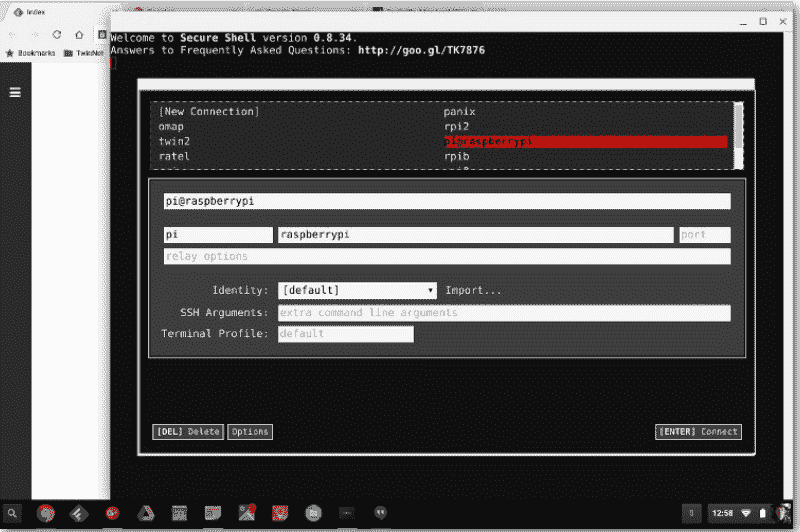

在 `Chrome OS` 上运行的 `Secure Shell`

## 总结

鉴于我们的终端模拟器是我们最核心的工具之一，它们应该引起我们更多的关注。许多不同的终端程序具有潜在有趣且实用的功能，但其中大多数功能很少甚至从不被使用。这很遗憾，因为其中许多功能对于忙碌的命令行用户来说确实是`有用`的。我们查看了这些功能应用到日常工作中的几种方法，但显然还有很多。

## 延伸阅读

- “愤怒编辑者的终端模拟器指南”，作者 `Jonathan Corbet`：
  `https://lwn.net/Articles/88161/`

## `xterm`:

- 基百科上的 `xterm`：`https://en.wikipedia.org/wiki/Xterm`
- `xterm` 当前维护者 `Thomas Dickey` 的主页：`https://invisible-island.net/xterm/`

## `Tektronix 4014`:

- 基百科上的 `Tektronix 4014`：`https://en.wikipedia.org/wiki/Tektronix_4010`
- 关于 `4014` 的背景介绍，源自 `Chilton`

脚本。遗憾的是，`Korn shell` 是由 `AT&T` 授权分发的专有软件。这种情况在 2000 年发生了变化，当时它以开源许可证发布了。

当 `POSIX` 对用于 `Unix` 系统的 shell 进行标准化时，它规定了 `Korn` 的一个子集，该子集在很大程度上与早期的 `Bourne shell` 兼容。结果是大多数 `Bourne` 类型的 shell 现在符合 `POSIX` 标准，但包含了各种扩展。

在一定程度上为了 `Korn shell` 的专有许可，`GNU` 项目开发了 `bash`，它包含了许多 `Korn shell` 的功能。第一个版本由 `Brian Fox` 编写，于 1989 年发布，如今由 `Chet Remay` 维护。`Bash` 最适合作为大多数 `Linux` 发行版的默认 shell。它也是 `macOS` 版本的默认 shell；然而，由于 `Apple` 对机密性和封闭性（锁定）的执着，由于 `GNU GPLv3` 的规定，他们拒绝将 `bash` 更新到第 4 版本。

自 `bash` 开发以来，有一种新的 shell 正在 `Linux` 和 `macOS` 用户中受到关注。它就是 `Z shell (zsh)`。由于其功能强大，有时被描述为“shell 中的 `Emacs`”，`zsh` 添加了更多功能来增强交互式使用。

## 现代实现

`Linux` 用户有多种 shell 程序供选择。当然，最受欢迎的是 `bash`，因为它是大多数 `Linux` 发行版提供的默认 shell。尽管如此，从其他 `Unix` 和类 `Unix` 系统迁移而来的用户可能更习惯其他 shell。还存在可移植性问题。如果一个脚本需要在多个类 `Unix` 系统上运行，则必须小心确保：1) 确保所有系统都运行相同的 shell 程序，或者 2) 编写一个符合 `POSIX` 标准的脚本，因为大多数现代 `Bourne` shell 衍生品都符合 `POSIX` 标准。

## 引用脚本

为了比较不同的 shell 方言，我们将从 `TLCL` 第 33 章节取的这段 `bash` 脚本开始：

```bash
#!/bin/bash

# longest-word : find文件中最长的字符串

for i; do

  if [[ -r "$i" ]]; then

    max_word=

    max_len=0

    for j in $(strings "$i"); do

      len=${#j}

      if (( len > max_len )); then

        max_len=$len

        max_word=$j

      fi

    done

    echo "$max_word' ($max_len characters)"

  fi

done
```

## `dash - Debian Almquist Shell`

`Debian Almquist shell` 是 `Debian` 对 `Almquist shell (ash)` 的适配，`ash` 最初由 `Kenneth Almquist` 在 20 世纪 80 年代编写。`ash` 是几个 `BSD Unix` 版本的默认 shell。`dash` 拥有其祖先 `ash`，它的优势是小巧且快速；然而，它是通过放弃交互式使用的便利性（如命令历史和编辑）来实现的。它还缺少一些内置命令，而是依赖外部程序。它的主要用途是执行 shell 脚本，特别是在系统设置期间。在 `Debian` 和 `Ubuntu` 等相关发行版中，`dash` 被链接到 `/bin/sh`，这是运行系统初始化脚本的 shell。

`dash` 是一个符合 `POSIX` 标准的 shell，支持 `Bourne shell`语法以及少量 `Korn shell` 功能：

```dash
#!/bin/dash

# longest-word.dash : find文件中最长的字符串

for i; do

  if [ -r "$i" ]; then

    max_word=

    max_len=

    for i in ${strings "$i"}; do

      if [ $len -gt $max_len ]; then

        max_len=$len

        max_word=$i

      fi

    done

    echo "$max_word ($max_len characters)"

  fi

done
```

在这里我们看到 `dash` 脚本大部分与 `bash` 参考脚本相同，但我们也看到了一些区别。例如，`dash` 不支持用于条件测试的 `[()]` 语法；它使用较旧的 `Bourne` 语法。`POSIX` 规范也缺少算术扩展的 `((expression))` 语法，也不支持大括号扩展。`dash` 和 `POSIX` 规范除了旧的 `cmd` 语法外，还支持用于命令替换的 `$(cmd)` 语法。

## `tcsh - TENEX C Shell`

`tcsh` 由 `Ken Greer` 在 20 世纪 80 年代初开发，作为原始 `csh` 程序的增强版。`TENEX` 这个名字源于同名的操作系统，该操作系统影响了 `tcsh` 交互功能的设计。与 `csh` 相比，`tcsh` 添加了额外的命令历史功能、`Emacs` 和 `vi` 风格的命令编辑、拼写检查以及针对交互式使用的改进。`Apple` 的早期操作系统使用 `tcsh` 作为默认 shell。它仍然是几个 `BSD` 发行版的默认 `root` shell。

`tcsh` 像 `C shell` 一样，并不符合 `POSIX` 标准，正如这里所示：

```tcsh
#!/usr/bin/tcsh

# longest-word.tcsh : find文件中最长的字符串

foreach i ($argv)

    set max_word=""

    set max_len=0

    foreach j ($strings $i)

        set len=$j

        if [$len > $max_len] then

            set max_word=$j

            set max_len=$len

        fi

    end

    echo "$1 $max_word ($max_len characters)"

end
```


## tcsh - TENEX C Shell

我们的 `tcsh` 版本脚本展示了与 `Bourne` 语法的许多不同。在 `C shell` 中，大多数流程控制语句都是不同的。例如，我们看到外层循环从一个 `foreach` 语句开始，通过列表 `$argv` 中的后续值来增加变量 `$i`。

## ksh - Korn Shell

`Korn shell` 是由 AT&T 授权分发的专有软件。这种情况在 2000 年发生了变化，当时它以开源许可证发布。

当 `POSIX` 对用于 `Unix` 系统的 shell 进行标准化时，它规定了 `Korn` 的一个子集，该子集在很大程度上与早期的 `Bourne` shell 兼容。结果是大多数 `Bourne` 类型的 shell 现在符合 `POSIX` 标准，但包含了各种扩展。

在一定程度上为了 `Korn` shell 的专有许可，`GNU` 项目开发了 `bash`，它包含了许多 `Korn` shell 的功能。第一个版本由 Brian Fox 编写，于 1989 年发布，如今由 Chet Remay 维护。`Bash` 最适合作为大多数 `Linux` 发行版的默认 shell。它也是 `macOS` 版本的默认 shell；然而，由于 Apple 对机密性和封闭性（锁定）的执着，由于 `GNU GPLv3` 的规定，他们拒绝将 `bash` 更新到第 4 版本。

自 `bash` 开发以来，有一种新的 shell 正在 `Linux` 和 `macOS` 用户中受到关注。它就是 `Z shell` (`zsh`)。由于其功能强大，有时被描述为“shell 中的 Emacs”，`zsh` 添加了更多功能来增强交互式使用。

`Linux` 用户有多种 shell 程序供选择。当然，最受欢迎的是 `bash`，因为它是大多数 `Linux` 发行版提供的默认 shell。尽管如此，从其他 `Unix` 和类 `Unix` 系统迁移而来的用户可能更习惯其他 shell。还存在可移植性问题。如果一个脚本需要在多个类 `Unix` 系统上运行，则必须小心确保：1) 确保所有系统都运行相同的 shell 程序，或者 2) 编写一个符合 `POSIX` 标准的脚本，因为大多数现代 `Bourne` shell 衍生品都符合 `POSIX` 标准。

为了比较不同的 shell 方言，我们将从 TLCL 第 33 章节取的这段 `bash` 脚本开始：

```bash
#!/bin/bash

# longest-word : find文件中最长的字符串

for i; do

  if [[ -r "$i" ]]; then

    max_word=

    max_len=0

    for j in $(strings "$i"); do

      len=${#j}

      if (( len > max_len )); then

        max_len=$len

        max_word=$j

      fi

    done

    echo "$max_word' ($max_len characters)"

  fi

done
```

## dash - Debian Almquist Shell

`Debian Almquist` shell 是 `Debian` 对 `Almquist` shell (`ash`) 的适配，`ash` 最初由 Kenneth Almquist 在 20 世纪 80 年代编写。`ash` 是几个 `BSD Unix` 版本的默认 shell。`dash` 拥有其祖先 `ash`，它的优势是小巧且快速；然而，它是通过放弃交互式使用的便利性（如命令历史和编辑）来实现的。它还缺少一些内置命令，而是依赖外部程序。它的主要用途是执行 shell 脚本，特别是在系统设置期间。在 `Debian` 和 `Ubuntu` 等相关发行版中，`dash` 被链接到 `/bin/sh`，这是运行系统初始化脚本的 shell。

`dash` 是一个符合 `POSIX` 标准的 shell，支持 `Bourne` shell 语法以及少量 `Korn` shell 功能：

```dash
#!/bin/dash

# longest-word.dash : find文件中最长的字符串

for i; do

  if [ -r "$i" ]; then

    max_word=

    max_len=

    for i in ${strings "$i"}; do

      if [ $len -gt $max_len ]; then

        max_len=$len

        max_word=$i

      fi

    done

    echo "$max_word ($max_len characters)"

  fi

done
```

在这里我们看到 `dash` 脚本大部分与 `bash` 参考脚本相同，但我们也看到了一些区别。例如，`dash` 不支持用于条件测试的 `[()]` 语法；它使用较旧的 `Bourne` 语法。`POSIX` 规范也缺少算术扩展的 `((expression))` 语法，也不支持大括号扩展。`dash` 和 `POSIX` 规范除了旧的 `cmd` 语法外，还支持用于命令替换的 `$(cmd)` 语法。

## tcsh - TENEX C Shell

`tcsh` 由 Ken Greer 在 20 世纪 80 年代初开发，作为原始 `csh` 程序的增强版。`TENEX` 这个名字源于同名的操作系统，该操作系统影响了 `tcsh` 交互功能的设计。与 `csh` 相比，`tcsh` 添加了额外的命令历史功能、`Emacs` 和 `vi` 风格的命令编辑、拼写检查以及针对交互式使用的改进。Apple 的早期操作系统使用 `tcsh` 作为默认 shell。它仍然是几个 `BSD` 发行版的默认 `root` shell。

`tcsh` 像 `C shell` 一样，并不符合 `POSIX` 标准，正如这里所示：

```tcsh
#!/usr/bin/tcsh

# longest-word.tcsh : find文件中最长的字符串

foreach i ($argv)

    set max_word=""

    set max_len=0

    foreach j ($strings $i)

        set len=$j

        if [$len > $max_len] then

            set max_word=$j

            set max_len=$len

        fi

    end

    echo "$1 $max_word ($max_len characters)"

end
```

我们的 `tcsh` 版本脚本展示了与 `Bourne` 语法的许多不同。在 `C shell` 中，大多数流程控制语句都是不同的。例如，我们看到外层循环从一个 `foreach` 语句开始，通过列表 `$argv` 中的后续值来增加变量 `$i`。

## zsh - Z Shell

一眼看去，`zsh` 在脚本方面与 `bash` 区别不大。

```zsh
#!/bin/zsh

# longest-word.zsh : find文件中最长的字符串

for i; do

  if [[ -r "$i" ]]; then

    max_word=

    max_len=0

    for j in $(strings "$i"); do

      len=${#j}

      if (( len > max_len )); then

        max_len=$len

        max_word=$j

      fi

    done

    print "$i: '$max_word' ($max_len characters)"

  fi

done
```

它运行方式和 `bash` 一样。这是预料之中的，因为 `zsh` 在大多数情况下旨在 `bash` 的无缝替换。然而有几点需要注意。首先，`zsh` 管道像 `Korn` shell 一样；管道中的最后一个命令在当前 shell 中执行。其次，在 `zsh` 中，数组第一个元素的索引是 1，而不是 0。

# Tab Completion

`zsh` 支持多种 `tab` 补全。这些包括命令名、命令选项和参数。

当使用 `cd` 命令时，反复按 `tab` 键首先显示可用目录列表，然后开始循环遍历。例如：

```bash
me@linux ~ $ cd <tab>
```

```bash
me@linux ~ $ cd <tab>

Documents/ Downloads/ Music/ Pictures/ Public/

Desktop/ Videos/

me@linux ~ $ cd Desktop/<tab>

Documents/ Downloads/ Music/ Pictures/ Public/

Templates/ Videos/

me@linux ~ $ cd Documents/

Documents/ Downloads/ Music/ Pictures/ Public/

Templates/ Videos/
```

我们也可以通过将路径名中的部分替换为另一个来切换目录：

```bash


# 9. Z Shell 增强功能

## 路径缩写与扩展

`me@linux ~ $ cd /usr/local/share`

```
```

`me@linux share $ cd bin`

`me@linux bin $ pwd`

`/usr/local/bin`

只要路径没有歧义，路径就可以缩写。如果我们输入：

`me@linux ~ $ ls /usr/share<tab>`

`zsh` 将其展开为：

`me@linux ~ $ ls /usr/local/share/`

这可以节省大量的输入工作！许多命令都提供了参数。要调用此功能，我们只需要输入命令以及选项开头的横杠，然后按下按键：

`me@linux ~ $ rm <-tab>`

```
--force 忽略不存在的文件，永不提示
--help 显示帮助信息并退出
-i 在删除前提示
-i 在删除多个文件时提示
-i-interactive 在特定条件下进行交互式提示（默认始终总是提示）
--preserve-root 不特殊对待 /
--one-file-system 仅留在所给参数指定的文件系统中
--preserve-root 不删除 /（默认）
--recursive -R r 递归地删除目录及其内容
--verbose 解释正在执行的操作
--v 输出版本信息并退出
```

这显示了命令的选项列表，就像 `cd` 命令一样，反复按下 `tab` 键 `zsh` 会循环切换这些选项。

### 路径扩展 (Pathname Expansion)

`Shell` 为路径扩展提供了几个强大的增强功能，可以在指定文件参数时节省步骤。我们可以使用 `**` 来触发递归扩展。例如，如果我们想在主目录及其子目录下列出所有以 `.txt` 结尾的文件，在 `bash` 中我们必须这样做：

`me@linux $ find -name "*.txt" | sort`

在 `zsh` 中，我们可以这样做：

`me@linux ~ $ ls **/*.txt`

并得到相同的结果。如果这还不够酷，我们还可以为通配符添加限定符（qualifiers），以执行 `find` 命令可以进行的许多测试。例如：

`me@linux ~ $ **/*.txt`

将只显示名称以 `.txt` 结尾的文件和符号链接。支持许多限定符，并且可以将它们结合起来以进行细粒度的选择。以下是一些示例：

| 限定符 | 描述 | 示例 |
| :--- | :--- | :--- |
| `.` | 普通文件 | `ls * (.)` |
| `/` | 目录 | `ls * (/)` |
| `@` | 符号链接 | `ls * (@)` |
| `*` | 可执行文件 | `ls * (*)` |
| `^F` | 非空目录 | `ls * (^F)` |
| `^` | 空目录 | `ls * (m)` |
| `m` | `n` 前修改过 | `ls * (m-5)` |
| `m-n` | 在 `n` 天前修改过 | `ls * (m+5)` |
| `m+n` | 超过 `n` 天未修改 | `ls * (L)` |
| `L` | 空（长度为 0） | `ls * (LM+5)` |
| `LK-n` | 小于 `n` 千字节的文件 | `ls * (LK0)` |

### 全局别名 (Global Aliases)

`Shell` 提供了强大的别名功能。在 `zsh` 中，我们可以按照通常的方式定义别名，例如：

`me@linuxbox ~ alias vi=/usr/bin/vim`

它的行为会和 `bash` 中完全一样。但我们也可以定义全局别名，它可以在命令行的任何位置使用，而不仅仅是开头。例如，我们将一个常用的名称定义为别名：

`me@linuxbox ~ alias -g ls='/var/log/syslog'`

然后在命令行的任何地方使用它：

`me@linuxbox ~ $ ls`

使用别名名称并不是强制的，它只是为了方便查看的自定义习惯。我们还可以使用全局别名来定义常见的重定向：

`me@linuxbox ~ $ alias -g L='| less'`

或者

`me@linuxbox ~ $ alias -g W='| wc -l'`

然后我们就可以执行这样的操作：

`me@linuxbox ~ $ cat /var/log/syslog`

来显示行数。

### 后缀别名 (Suffix Aliases)

此外，我们可以通过定义后缀别名来定义类似于“用...打开”的功能。例如，我们可以定义一个别名，表示所有以“`.txt`”结尾的文件都用以下方式查看：

`me@linuxbox ~ alias -s txt='less'`

然后我们只需要输入文本文件的文件名，它就会由别名指定的应用程序打开：

`me@linuxbox ~ dir-list.txt`

这有多酷？

### 改进的历史搜索 (Improved History Search)

`zsh` 为历史搜索增加了一个巧妙的技巧。在 `bash`（以及 `zsh` 中）中，我们可以通过按下 `Ctrl-r` 执行反向增量历史搜索，随后的每次按键都会缩小搜索范围。`zsh` 更进一步，只需在命令行输入目标搜索字符串的几个字母并按下向上方向键。它会回溯历史查找第一个匹配项，每次按下向上方向键都会显示下一个匹配项。

### 环境变量编辑 (Environment Variable Editing)

`zsh` 提供了一个名为 `varied` 的内置命令来编辑 `shell` 变量。例如，如果我们想快速更改 `PATH` 变量，可以这样做：

`me@linuxbox ~ $ varied PATH`

`PATH` 变量的内容会出现在命令编辑器中，这样我们可以进行更改并按回车键，更改就会生效。

### 框架 (Frameworks)

我们只触及了 `zsh`可用功能的一部分。它非常丰富。但由于配置 `zsh` 以充分利用其潜力的复杂性很大，可能会令人望畏。在这里，手册页（man page）只是涵盖其他 10 多页各种主题的目录。幸运的是，许多社区已经涌现出来，提供了为 `zsh` 提供现成配置的框架。其中最流行的是 `Oh-MyZsh`，由 `Robby Russell` 领导。`Oh-MyZsh` 是大量的配置文件、别名和主题。它支持许多软件开发和系统管理任务。

### 切换 Shell (Changing to Another Shell)

现在我们已经了解 `Linux` 可用的不同 `shell`，如何尝试它们呢？首先我们可以直接从 `bash` 提示符输入 `shell` 的名称。这将作为 `bash` 的子进程启动第二个 `shell`：

`me@linuxbox ~ $ tsh%`

在这里我们启动了 `tsch`，并看到了默认的 `tsch` 提示符百分号。由于我们没有为新 `shell` 创建任何配置文件，得到的是基础环境。每个 `shell` 都有自己的交互式配置文件，就像 `bash` 有 `.bashrc` 文件来配置其会话一样。

以下是配置文件：

| `Shell` | 配置文件 |
| :--- | :--- |
| `dash` | `~/.profile` |
| `bash` | `~/.bashrc` |
| `ksh` | `~/.kshrc` |
| `tsch` | `~/.tcrc` |
| `zsh` | `~/.zshrc` |

我们需要参考相应的 `/usr/share/doc` 目录。要退出 `shell`，只需输入 `exit` 命令：

`me@linuxbox ~ $ exit`

一旦我们完成了实验，就可以使用 `chsh` 将默认 `shell` 从 `bash` 更改为 `zsh`。例如，从 `bash` 切换到 `zsh` 使用：

`me@linuxbox ~ $ chsh /bin/zsh`

该名称必须出现在 `/etc/shells` 中。

### 总结

由于 `Linux` 在类 `Unix` 系统中日益流行，`bash` 已成为世界上最主要的 `shell`。它拥有早期 `shell` 的许多优秀特性以及一些自己的技巧。然而，如果需要轻量级和脚本执行（例如在嵌入式系统中），`dash` 是一个很好的选择。同样，如果需要与其他系统交互，`ksh` 将提供必要的兼容性。对于我们这些冒险者来说，`zsh` 的高级交互功能可以增强我们的日常 `shell` 体验。

-   `Nacho Caballero` 的《通过这些极其实用的技巧精通 Z Shell》：http://reasoniamhere.com/2014/01/11/outrageously-useful-tips-to-master-your-z-shell/
-   `Oh-My-Zsh` 首页：https://ohmyz.sh/

# 10 充满活力的 Vim

`TLCL` 第 12 章教了我们使用 `vim` 编辑器所需的 `Basic` 技能。然而，我们仅仅是触及了它能力的皮毛。`Vim` 是一个非常强大的程序。事实上，可以说 `vim` 可以完成任何事情。这只是一个关于如何实现的问题。在这场冒险中，我们将获得这一流行工具的中级技能水平。具体而言，我们将查看一些提高编写 `shell` 脚本、配置文件和文档时生产力的方法。更好的是，在我们掌握了这些额外功能后，使用 `vim` 实际上是一件很有趣的事。

在这场冒险中，我们将查看一些让 `vim` 在开发者和管理员中流行的特性。支持 `vim` 的社区非常大且充满活力。由于 `vim` 功能极其丰富且支持脚本化，因此有许多插件和扩展可用。然而，我们将限制在原生 `vim` 及其通常附带的内容范围内。

关于术语的说明：在 `TLCL` 中，我们使用“`command`”（命令）、“`insert`”（插入）和“`ex`”来标识 `vim` 的三种模式。这样做是为了匹配 `vim` 祖先的传统模式。由于这是一场全 `vim` 的冒险，我们将切换到文档使用的名称，即 `normal`（普通）、`insert`（插入）和 `command`（命令）。

## 开始吧

首先，我们需要确保运行的是 `vim` 的完整版本。许多发行版只带有缩减版本。要获取完整版本，如果尚未安装，请安装 "vim" 包。此时也是向 `.bashrc` 文件添加一个别名的好时机，以让 "vi" 运行 `vim`（某些发行版将 'vi' 链接到 'vim'，所以可能不需要）。

接下来，让我们创建一个最小的 `.vimrc`，即它的配置文件。

```bash
alias vi='vim'

[me@linuxbox ~]$ vi ~/.vimrc
```

编辑该文件使其包含两行内容：

```
set compatible
filetype plugin on
```

这将确保 `vim` 不受限于 `vi` 的特性集，并加载一个标准插件，让 `vim` 识别不同的文件类型。在插入这两行文本后，返回普通模式并（只是为了好玩）输入 'm' 接着输入大写的 'V'。

```vim
mV
```

看起来没有发生什么，这没关系。我们稍后会回到这一点。保存文件并退出 `vim`。

```vim
:wq
```

## 获取帮助

`Vim` 拥有广泛的内置帮助系统。如果我们要让 `vim`：

```bash
[me@linuxbox ~]$ vi
```

并输入命令：

```vim
:help
```

它将出现在屏幕的顶部。

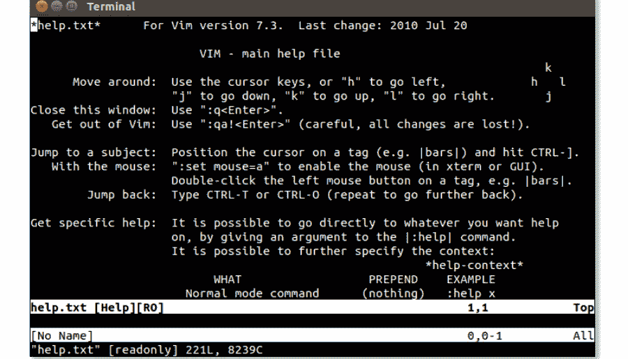

Vim 帮助窗口

虽然帮助内容详尽且有用，但它立即带来了一个问题，因为它在显示上创建了一个分屏。这是一个相当高级的特性，需要一些解释。

`Vim` 可以将显示区域分为多个面板，在 `vim` 术语中被称为 `windows`（窗口）。在处理多个文件并将其他 `vim` 特性作为帮助时，这些窗口非常有用。当帮助以这种方式显示时，我们可以通过输入两次 `Ctrl-w` 来切换窗口。我们可以用以下命令操作 `vim` 窗口：

```vim
:split      创建一个新窗口
Ctrl-w Ctrl-w 在窗口间切换
Ctrl-w       放大活动窗口
Ctrl-w =    使窗口变得等大
:close      关闭活动窗口
:only       关闭所有其他窗口
```

在处理文件时，重要的是，“关闭”一个窗口（使用 `q` 或 `:close`）并不会移除包含窗口内容的 `buffer`（缓冲区）；我们可以随时重新调回它。然而，当我们关闭最后一个窗口时，`vim` 会终止。

若要退出，请确保光标在帮助窗口中并输入退出命令。

```vim
:q
```

但关于窗口的话题到此为止了，让我们回到帮助。如果我们在初始帮助文件中上下滚动，我们会发现它是一份包含指向各种主题链接的超文本文档，并且它从我们导航帮助系统所需的命令开始。这些都很好，但这不是最 Limit 趣的使用方式。

最好的方法是输入 `:h` 后跟上我们感兴趣的主题。不需要输入完整的 "help" 的事实表明，大多数命令都可以缩写。这节省了大量工作。经常使用的命令（如 `help`）可以缩短为最小的无歧形式。它们通常被缩短为单个字符，但缩写系统是不可预测的，所以我们必须使用帮助来查找它们。在冒险的剩余部分，我们将尝试使用可用的最短形式。

在初始帮助文件的开头有一个重要的表：

| 内容 | 前缀 | 示例 |
| :--- | :--- | :--- |
| 普通模式命令 | (无) | `:help x` |
| 视觉模式命令 | `v` | `:help v_u` |
| 插入模式命令 | `i` | `:help i <Esc>` |
| 命令行命令 | `:` | `:help :quit` |
| 命令行编辑 | `c` | `:help c <Del>` |
| `Vim` 命令参数 | | `:help r` |
| 选项 | | `:help filepath` |

搜索帮助：

由于帮助内容详尽且有用，它立即带来了一个问题，因为它在显示上创建了一个分屏。这是一个相当高级的特性，需要一些解释。

`Vim` 可以将显示区域分为多个面板，在 `vim` 术语中被称为 `windows`（窗口）。在处理多个文件并将其他 `vim` 特性作为帮助时，这些窗口非常有用。当帮助以这种方式显示时，我们可以通过输入两次 `Ctrl-w` 来切换窗口。我们可以用以下命令操作 `vim` 窗口：

```vim
:split      创建一个新窗口
Ctrl-w Ctrl-w 在窗口间切换
Ctrl-w       放大活动窗口
Ctrl-w =    使窗口变得等大
:close      关闭活动窗口
:only       关闭所有其他窗口
```

在处理文件时，重要的是，“关闭”一个窗口（使用 `q` 或 `:close`）并不会移除包含窗口内容的 `buffer`（缓冲区）；我们可以随时重新调回它。然而，当我们关闭最后一个窗口时，`vim` 会终止。

若要退出，请确保光标在帮助窗口中并输入退出命令。

```vim
:q
```

但关于窗口的话题到此为止了，让我们回到帮助。如果我们在初始帮助文件中上下滚动，我们会发现它是一份包含指向各种主题链接的超文本文档，并且它从我们导航帮助系统所需的命令开始。这些都很好，但这不是最 Limit 趣的使用方式。

最好的方法是输入 `:h` 后跟上我们感兴趣的主题。不需要输入完整的 "help" 的事实表明，大多数命令都可以缩写。这节省了大量工作。经常使用的命令（如 `help`）可以缩短为最小的无歧形式。它们通常被缩短为单个字符，但缩写系统是不可预测的，所以我们必须使用帮助来查找它们。在冒险的剩余部分，我们将尝试使用可用的最短形式。

在初始帮助文件的开头有一个重要的表：

| 内容 | 前缀 | 示例 |
| :--- | :--- | :--- |
| 普通模式命令 | (无) | `:help x` |
| 视觉模式命令 | `v` | `:help v_u` |
| 插入模式命令 | `i` | `:help i <Esc>` |
| 命令行命令 | `:` | `:help :quit` |
| 命令行编辑 | `c` | `:help c <Del>` |
| `Vim` 命令参数 | | `:help r` |
| 选项 | | `:help filepath` |

搜索帮助：

由于帮助内容详尽且有用，它立即带来了一个问题，因为它在显示上创建了一个分屏。这是一个相当高级的特性，需要一些解释。

`Vim` 可以将显示区域分为多个面板，在 `vim` 术语中被称为 `windows`（窗口）。在处理多个文件并将其他 `vim` 特性作为帮助时，这些窗口非常有用。当帮助以这种方式显示时，我们可以通过输入两次 `Ctrl-w` 来切换窗口。我们可以用以下命令操作 `vim` 窗口：

```vim
:split      创建一个新窗口
Ctrl-w Ctrl-w 在窗口间切换
Ctrl-w       放大活动窗口
Ctrl-w =    使窗口变得等大
:close      关闭活动窗口
:only       关闭所有其他窗口
```

在处理文件时，重要的是，“关闭”一个窗口（使用 `q` 或 `:close`）并不会移除包含窗口内容的 `buffer`（缓冲区）；我们可以随时重新调回它。然而，当我们关闭最后一个窗口时，`vim` 会终止。

若要退出，请确保光标在帮助窗口中并输入退出命令。

```vim
:q
```


但关于窗口的话题到此为止了，让我们回到帮助。如果我们在初始帮助文件中上下滚动，我们会发现它是一份包含指向各种主题链接的超文本文档，并且它从我们导航帮助系统所需的命令开始。这些都很好，但这不是最 `Limit` 趣的使用方式。

### 命令缩写

最好的方法是输入 `:h` 后跟上我们感兴趣的主题。不需要输入完整的 `"help"` 的事实表明，大多数命令都可以缩写。这节省了大量工作。经常使用的命令（如 `help`）可以缩短为最小的无歧形式。它们通常被缩短为单个字符，但缩写系统是不可预测的，所以我们必须使用帮助来查找它们。在冒险的剩余部分，我们将尝试使用可用的最短形式。

在初始帮助文件的开头有一个重要的表：

| 内容 | 前缀 | 示例 |
| :--- | :--- | :--- |
| 普通模式命令 | (无) | `:help x` |
| 视觉模式命令 | `v` | `:help v_u` |
| 插入模式命令 | `i` | `:help i <Esc>` |
| 命令行命令 | `:` | `:help :quit` |
| 命令行编辑 | `c` | `:help c <Del>` |
| `Vim` 命令参数 | | `:help r` |
| 选项 | | `:help filepath` |

### 搜索帮助

由于帮助内容详尽且有用，它立即带来了一个问题，因为它在显示上创建了一个分屏。这是一个相当高级的特性，需要一些解释。

### 窗口管理

`Vim` 可以将显示区域分为多个面板，在 `vim` 术语中被称为 `windows`（窗口）。在处理多个文件并将其他 `vim` 特性作为帮助时，这些窗口非常有用。当帮助以这种方式显示时，我们可以通过输入两次 `Ctrl-w` 来切换窗口。我们可以用以下命令操作 `vim` 窗口：

```vim
:split      创建一个新窗口

Ctrl-w Ctrl-w 在窗口间切换

Ctrl-w       放大活动窗口

Ctrl-w =    使窗口变得等大

:close      关闭活动窗口

:only       关闭所有其他窗口
```

在处理文件时，重要的是，“关闭”一个窗口（使用 `q` 或 `:close`）并不会移除包含窗口内容的 `buffer`（缓冲区）；我们可以随时重新调回它。然而，当我们关闭最后一个窗口时，`vim` 会终止。

若要退出，请确保光标在帮助窗口中并输入退出命令。

```vim
:q
```


# 缓冲区 (Buffers)

在我们开始编辑新文件之前，让我们看看 `vim` 正在做什么。我们编辑的每个文件都存储在缓冲区中。我们可以通过以下方式查看当前的缓冲区列表：

```vim
:ls
```

这将显示列表。我们有几种方法可以切换缓冲区。第一种方法是在它们之间循环切换：

```vim
:bn
```

此命令（`:bnext` 的缩写）会在缓冲区列表中循环切换，并在末尾时回到开头。同样，还有一个 `:bp`（`:bprevious`）命令，它可以反向循环缓冲区列表。我们也可以通过数字选择缓冲区：

```vim
:b 2
```

我们可以切换回新缓冲区，并在我们的配置文件中添加此行：

```vim
setlocal number
```

这将在每次加载 shell 脚本时开启行号。注意这里用的是 `setlocal` 命令而不是 `set`。这是因为 `set` 会全局应用该选项，而 `setlocal` 命令仅将选项应用于当前缓冲区。这可以防止在编辑不同类型的多个文件时发生设置冲突。

在这里，我们还可以控制语法高亮。我们可以通过以下命令开启它：

```vim
syntax on
```

或者通过以下命令关闭它：

```vim
syntax off
```


我们将保存此文件，现在在此之前，让我们输入 `mS`（小写 `m` 大写 `S`），这与我们之前保存初始 `.vimrc` 时所的操作类似。

帮助主题：`:ls` `:buffers` `:bnext` `:previous` `:setlocal` `'number'` `:syntax`

# 标签页 (Tabs)

在离开缓冲区主题之前，让我们看看使用它们的可能方法。我们已经讨论了分屏和窗口，但最新版本的 `vim` 包含一个名为标签页（tabs）的有用替代方案。正如名称所示，此功能允许每个缓冲区出现在它自己的标签页中。

要创建一个新标签页，我们输入以下命令：

```
:tabnew
```

这将打开一个新的标签页。由于我们还没有将标签页与缓冲区关联，标签页将标记为“`[No Name]`”。

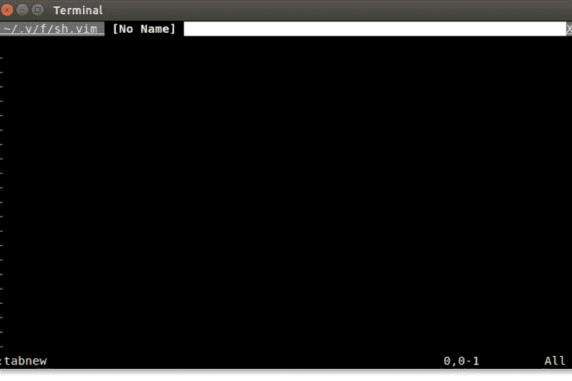

新标签页

当我们新创建的标签页中，可以像以前一样通过输入命令切换到现有的缓冲区之一：

```
:bn
```

```
-v/f/sh.vim fooscript

1 #!/bin/bash

2

3 # Script to test editing with vim

4

  "fooscript" 4L, 48C                          4,0-1  All
```

# 在标签页中显示缓冲区

我们也可以在标签页中打开文件。它的工作方式非常像 `:e` 命令。要在标签页中打开文件，我们输入 `:tabe` 后跟文件名。

切换标签页很容易。要向前循环标签页，我们输入 `gt`。要向后循环，我们输入 `GT`。如果启用了支持，可以通过点击它们来选择标签页，并通过双击屏幕顶部的标签栏来打开新标签页。

我们还可以通过在命令行添加 `-p` 选项来启动加载了多个标签页内文件的 `vim`。例如：

```
@melinuxbox ~]$ vim -p file1 file2
```

要关闭标签页，我们使用 `:q` 命令，就像关闭窗口一样。当只剩下一个标签页时，`vim` 会退出标签页模式，显示恢复到通常状态。

`vim` 中有很多与标签页相关的功能。请查看帮助主题以获取完整细节。

**帮助主题：** `tabpage`

# 配色方案 (Color Schemes)

如果我们回到包含 shell 脚本的缓冲区，我们将看到 `sh.vim` 文件的效果。当开启语法高亮（使用 `:syn on` 即可）时，它会采用当前的配色方案。`vim` 自带了不同的方案。要查看当前方案的名称，输入此命令：

```
162 Vim, with Vigor

:colo
```

它将显示名称。要查看所有可用的配色方案，输入 `:colo` 后跟一个空格，然后按 `Tab` 键。这将触发 `vim` 的自动补全，我们应该看到列表中的第一个名称。后续按 `Tab` 键会在列表中循环，我们可以尝试每一个。

`'desert'` 配色方案配合 shell 脚本看起来很不错，所以让我们将其添加到 `sh.vim` 文件中。要这样做，切换到包含该文件的缓冲区并添加以下行：

```
colorscheme desert
```

注意我们使用了 `colorscheme` 命令的长格式。我们本可以使用缩写形式 `col`，但为了清晰起见，在配置文件中使用长名称是一种常见的习惯。

互联网上有许多适用于 `vim` 的额外配色方案。要使用其中一种，首先创建一个 `~/.colors` 目录并将新方案下载其中。当我们循环列表时，新方案将会出现。

现在，保存文件并返回我们的 shell 脚本。

帮助主题：`:colorscheme`

# 标记 (Marks) 和文件标记 (File Marks)

我们知道在 `vim` 中移动文档有多种方法。例如，要到达顶部，我们可以输入：

```
gg
```

要到达底部，我们可以输入：

```
G
```

`vim`（对于来说是真正的 `vi`）还允许我们标记文档中的任意位置，并随时召回它。为了演示这一点，转到脚本顶部并输入：

```
ma
```

接下来，到文档底部并输入：

```
mb
```

我们刚刚设置了一个标记。要召回它，我们输入标记名称。我们可以使用 `m` 后跟行号来设置行标记。我们还可以使用 `m` 后跟字符位置来设置字符标记。要召回标记，我们使用 `'` 后跟标记名称。例如，要召回我们刚刚设置的标记，输入：

```
'b
```

我们还可以使用 `"` 后跟标记名称来设置全局标记。例如，要召回全局标记，输入：

```
"b
```

我们还可以使用 `$` 后跟标记名称来设置文件的开头和结束标记。我们还可以使用 `<` 和 `>` 设置文件的前半和后半部分标记。这些对于导航文件非常有用。要召回这些标记，我们使用 `'` 后跟符号：

```
'

$
```
*(注：由于原文文本存在大量重复和 OCR 错误，已根据逻辑进行了清理和翻译)*

# 脚本的缩进设置

为了我们的目的，我们将使用方法 2 并在 `sh.vim` 文件中添加以下行，将制表符设置为 2 个空格。这是某些 shell 脚本编码标准中的常用设置。

```vim
setlocal tabstop=2
setlocal shiftwidth=2
setlocal expandtab
setlocal softtabstop=2
setlocal autindent
setlocal smartindent
```

除了制表符，我们还包含了 `autindent` 和 `smartindent` 设置，我们在编写代码块时需要。

在 `sh.vim` 文件中添加缩进设置后，我们将向 shell 脚本中添加更多行（输入这些内容以观察行为）：

```bash
# /bin/bash

# 这是一个演示 vim 特性的 shell 脚本。

# 它实际上并没有做什么，只是展示了我们能做什么。

# 常量

A=1

B=2

if [ "$A" == "$B" ]; then

  echo "This shows how smartindent works.\n  echo "This shows how autindent works.\n  echo "A and B match."

else

  echo "A and B do not match."

fi

afunction() {

  cmd1

  cmd2

}

if [ -e file ]]; then

  cmd1

  cmd2

fi
```

当我们在脚本中输入这些额外行时，我们注意到 `vim` 现在可以根据需要自动提供缩进。当 `smartindent` 选项为函数和 `if` 等某些程序结构提供缩进时，`autindent` 选项会导致 `vim` 重复上一行的缩进。这在编码时节省了大量时间，并确保我们的代码保持整洁。

如果我们发现其他人正在编辑一个现有脚本，且其缩进方案与我们当前的设置不同，`vim` 可以转换该文件。通过输入实现：

```vim
:retab
```

该文件的制表符将被调整以匹配我们当前的缩进风格。

帮助主题：`'tabstop'` `'shiftwidth'` `'expandtab'` `'softtabstop'` `'autoindent'` `'smartindent'`

# 强力移动

正如我们在 `TLCL` 中学到的，`vim` 有许多移动命令可以用来快速在文档中导航。这些命令可以用许多实用的方式使用。

以下是常用移动命令列表。其中一些是复习，另一些是新的。

- `h` 向左（也可以用左箭头）
- `l` 向右（也可以用右箭头）
- `j` 向下（也可以用下箭头）
- `k` 向上（也可以用上箭头）
- `0` 行首第一个字符（也可以用 `Home` 键）
- 行内第一个非空白字符
- `$` 行尾最后一个字符（也可以用 `End` 键）
- `f(char)` 向右移动到当前行中 `char` 的下一次出现处
- `t(char)` 向右移动直到（即：紧邻）行中 `char` 的下一次出现处
- `r` 重复上一个 `f` 或 `t` 命令
- `g` 跳到最后一行。如果指定了计数，则跳到该行
- `w` 向前（单词）到下一个单词的开头
- `b` 向后（单词）移动到上一个单词的开头
- `e` 向前到单词末尾
- `)` 向前进到下一个句子的开头
- `(` 向前进到下一个段落的开头
- `{` 向后移动到上一个段落的开头

记住，每个命令之前都可以跟一个计数，表示执行命令的次数。

# 操作符

移动命令通常与操作符结合使用。移动命令决定了操作符影响文本的范围。以下是最常用的操作符列表：

- `c` 修改（即删除后插入）
- `d` 删除/剪切
- `y` 圈取（即复制）
- `t` 切换大小写
- `g` 转小写
- `g` 转大写
- `q` 格式化文本（我们很快会涉及的话题）
- `?` ROT13 编码（用于混淆文本）
- `>` 向右移动（即缩进）
- `<` 向左移动

我们可以使用视觉模式轻松地演示移动命令。将光标移动到脚本第 3 行的开头并输入：

`vf.`

这将选择从行首到第一个句子末尾的文本。

再次按 `v` 取消视觉模式。接下来，回到第 3 行开头并输入：

`v)`

选择第一个句子。再次取消视觉模式并输入：

`v)`

选择整个段落（任何由空行分隔的文本块）。按 `}\ag` 将选定内容缩进到下一个段落。

# 文本对象选择

除了传统的 `vi` 移动命令外，`vim` 还增加了一个名为*文本对象选择*的相关功能。这些命令仅与操作符配合使用。命令如下：

- 选择整个（所有）文本对象。
- 选择文本对象的内部（`in`）。

文本对象有：

- 单词 (Word)
- 句子 (Sentence)
- 段落 (Paragraph)
- 标签块（例如 HTML 中使用的 `<a>...</a>`）
- `{` 包闭块
  `{` 包闭块（也可以使用 `b`）
  `{` 包闭块（也可以使用 `B`）
- `"双引号字符串"`
- `'单引号字符串'`

这种工作方式非常有趣。例如，如果我们把光标放在一个单词上并输入：

`caw`

（"change all word" 的缩写，修改整个单词，删除它并切换到插入模式）。文本对象也适用于视觉模式。尝试一下：移动到第 11 行，将光标放在引号字符串内部并输入：

`vi"`

引号字符串的内部将被选中。如果我们输入：

`va"`

则整个字符串（包括引号）被选中了。

帮助主题：`motion.txt` `text-objects`

# 文本格式化

假设我们想在脚本开头添加一个许可头。这将由文件顶部的一个注释块组成，包含版权声明的文本。

我们将移动到脚本的第 3 行并添加文本，但在开始之前，让我们告诉 `vim` 文本行的长度应该是多少。首先我们询问 `vim` 当前的设置：

```vim
:set tw=75
```

`Vim` 将响应：

```text
textwidth=0
```

`"tw"` 是 `text` 的缩写，行长度设置。值为 `0` 意味着 `vim` 没有对行长度实施限制。我们将 `textwidth` 设置另一个值：

```vim
:set tw=75
```

现在，当行长度超过该值时，`vim` 将自动换行（在单词边界）。

# 段落格式化

通常我们在编写代码时不想设置文本宽度（尽管将行长度保持在 `80` 个字符以内是一个良好的习惯），但那时将很有用。

所以让我们添加文本。输入以下内容：

```bash
# This program is free software: you can redistribute it/or modify it
# under the terms of the General Public License as published by the
# Free Software Foundation, either version 3 or (at your
# option) any later version.
```

```bash
# This program is distributed in the hope that it will be useful,
# WITHOUT ANY WARRANTY; without even the implied of
# MERCHANTABILITY OR FITNESS FOR A PARTICULAR PURPOSE. See the Vim
# Public License at <http://www.vim.org/licenses/> for more details.
```

注意到 `vim` 的魔法。每当行长度达到文本宽度时，`vim` 会开始新行并包含注释符号。这是为 shell 脚本设置的，理解某些 shell 语法并尝试提供帮助。非常方便。

现在假设我们对这些行的长度不满意，或者编辑了文本导致某些行太长或太短，无法保持我们格式良好的文本。如果我们能重新格式化我们的注释块该有多好？嗯，我们可以。非常简单。

为了演示，我们将文本宽度更改为 `65` 个字符：

```vim
:set tw=65
```

现在将光标放在注释块内部并输入：

`ggip`

（意味着“格式段落”）稍后我们将展示如何将这四个键序列减少到单个键。

# 注释块

我们可以在这个注释块上执行一个技巧。当我们格式化段落时，观察发生了什么。预料成功，块被重新格式化为新的格式！稍后我们将展示如何将这四个键序列减少到单个键。 *(注：此处原文中似乎有重复的句子，翻译时已根据语境调整)*

*注：由于原文文本中存在重复，翻译时已进行了逻辑处理。*

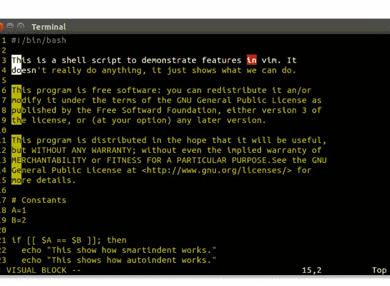

## 列操作

接下来，使用 `Shift-i` 进入插入模式（在行首插入的命令），然后输入 `#` 符号并紧跟一个空格。最后，双击 `Esc` 键。`Vim` 将将该符号和空格插入到块中的每一行。

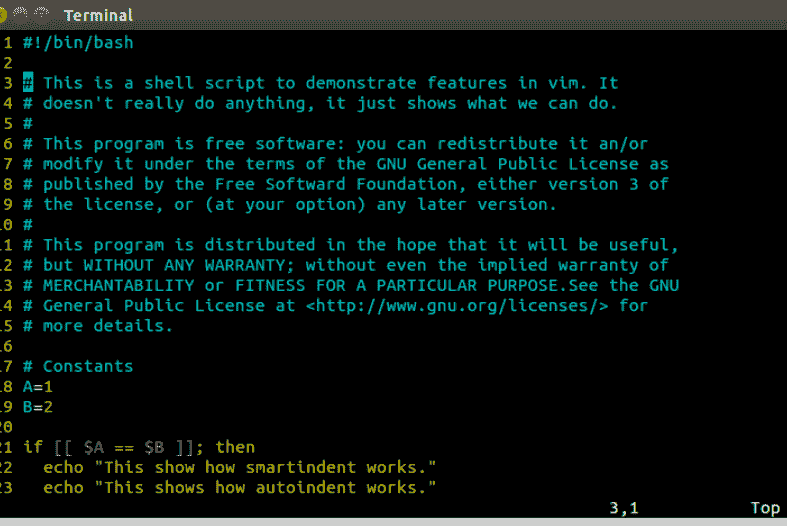

## 完成的块

## 大小写转换

有时，我们需要将文本从大写转换为小写，反之亦然，`vim` 有以下大小转换命令：

| 命令 | 描述 |
| :--- | :--- |
| `gU` | 将文本转换为大写 |
| `gu` | 将文本转换为小写 |

`gU` 和 `gu` 命令都可以应用于视觉模式下的选定文本，或者与移动命令或文本选择结合使用。例如：

```
guis   将当前句子转换为大写

guf:   将文本从光标位置到当前行的下一个 ':'

       字符转换为大写
```

## 文件格式转换

偶尔，我们会遇到一个在 `DOS/Windows` 系统中创建或使用的文本文件。这些文件在每行的末尾包含一个额外的回车符。`Vim` 在加载文件后会通过在编辑窗口底部显示“`DOS`”消息来指示此情况。要纠正这一烦人的状况，请执行以下操作：

```
:set fileformat=unix
```

文件将以正确的格式重写。

帮助主题：`'textwidth'` `gq` `'fileformat'` `~` `gu` `gU`

## 宏

文本编辑有时意味着我们陷入了枯燥的重复编辑任务中，反复又反复地执行同一组操作。这是每个计算机用户的噩梦。幸运的是，`vim` 为我们提供了一种记录操作序列的方法，我们稍后可以回放。这些记录被称为宏。

要创建一个宏，我们开始录制输入 `q` 然后跟着单个字母。输入 `q` 之后输入的字符将成为宏的名字。开始录制后，我们执行的一切都会记录在宏中。要结束，再次输入 `q`。

为了演示，让我们考虑我们的块注释。要创建一个从行首删除字符符号的宏，我们可以这样操作：移动到注释块的第一行，并输入以下命令：

让我们分解一下这个序列：

| 命令 | 描述 |
| :--- | :--- |
| `qa` | 开始录制宏 `"a"` |
| `^` | 移动到当前行的第一个非空白字符 |
| `xx` | 删除光标下的前两个字符 |
| `j` | 向下移动一行 |

`q` 结束录制

现在，我们已经删除了第一行的注释符号，且光标在第二行上，我们可以通过输入以下内容来重放我们的宏：

`@a`

记录的序列将被执行。若要在随后的行上重复该宏，我们可以重复上一个宏命令，即：

`@@`

或者，我们可以像其他命令一样，在调用宏之前加上一个计数器。例如，如果我们输入：

`5@a`

宏将重复 `5` 次。我们可以通过反复输入：

`u`

来撤销宏的效果。

关于宏的一点是，`vim` 会记住它们。每当我们退出 `vim` 时，当前的宏定义都会被存储，以便下次启动另一个编辑会话时使用。

**帮助主题：** `q` `@@`

## 寄存器

我们无疑熟悉文本编辑器中复制和粘贴的想法。在 `vim` 中，我们知道 `y` 执行选定文本的 `yank`（复制），而 `p` 和 `P` 分别在当前光标位置粘贴文本。`vim` 执行此操作的方法涉及对**寄存器**的使用。

寄存器是命名的内存区域，`vim` 在其中存储文本。我们可以将其视为字符串变量列表。`Vim` 使用一组特定的集合来存储我们删除的内容，但还有其他集合我们可以根据意愿存储和恢复内容。这就像拥有多元素剪贴板。

要引用寄存器，我们输入 `"` 后跟一个小写字母或数字（数字有特殊用途），例如：

`"a`

引用名为 `"a"` 的寄存器。要将内容放入寄存器，我们在寄存器名后跟一个“yank取到行尾”的操作：

`"ay$`

要召回寄存器的内容，我们在寄存器名后跟一个粘贴操作，如下：

`"ap`

使用寄存器使我们能够同时将许多文本块放入剪贴板。但即使我们没有意识地尝试使用寄存器，在我们执行删除和 `yank` 时，`vim` 也在使用它们。

正如我们之前提到的，名为 `0-9` 的寄存器有特殊用途。当我们执行普通的 `yank` 和删除时，`vim` 将我们最新的 `yank` 放在寄存器 `0` 中，最后九次删除放在 `1-9` 中。随着我们继续删除，`vim` 将之前的删除移动到下一个数字，因此寄存器 `1` 将包含我们最近的删除，而寄存器 `9` 包含最旧的。

这一点使我们能够解决执行 `yank` 后删除会导致所 `yank` 文本丢失的问题（使用 `vim` 的常见风险）。我们始终可以通过引用寄存器 `0` 来召回最近的 `yank`。

要查看寄存器的当前内容，我们可以使用命令：

```
:reg
```


帮助主题：`:registers`

## 插入子模式

虽然并不显而易见，但 vim 在插入模式内部有一组命令。这些命令大部分都调用了某种形式的自动补全，以加快我们的输入速度。这些虽然笨拙，但值得尝试。

### 自动补全单词

虽然并不显而易见，但 vim 在插入模式内部有一组命令。这些命令大部分都调用了某种形式的自动补全以加快我们的输入速度。这些虽然笨拙，但值得尝试。让我们到文件末尾添加新行：

```
echo "It worked."
```

我们开始输入字符（"afun"），vim 应该自动补全该行。当 vim 为我们提供多个选择时，使用 `Ctrl-n` 和 `Ctrl-p` 向上向下移动。输入任何字符，如空格，接受选择并结束自动补全。`Ctrl-e` 可立即退出子模式。

`Ctrl-r` 后跟单个字符将插入该寄存器的内容。与使用 `p` 或 `P` 进行普通粘贴不同，寄存器插入尊重格式和缩进。

174 Vim，活力

虽然并不显而易见，但 vim 在插入模式内部有一组命令命令。这些命令大部分都调用了某种形式的自动补全。这些虽然笨拙，但值得尝试。

### 自动补全行

屏幕底部会弹出一个菜单，列出我们可以输入执行不同补全的键。如果我们输入了此处或任何其他打开文件的几个字母，`Ctrl-x-l` 将尝试自动补全该行，并复制到当前位置。

### 自动补全文件名

这将执行文件名补全。如果我们输入现有路径/文件的名称，可以输入 `Ctrl-x-f`，vim 将尝试补全该名称。

### 字典查询

如果我们通过在配置文件中添加此行来定义字典：

```
setlocal dictionary=/usr/share/dict/words
```

大多数 Linux 系统的默认字典，我们可以开始输入单词，输入 `Ctrl-x-k`，vim 将尝试使用字典补全该单词。我们将看到一个单词列表，从中选择所需的条目。

帮助主题：`i^n` `i^p` `i^x l` `i^x r` `i^x f` `i^x k` `'dictionary'`

## 映射

与其他交互式命令行程序一样，vim 允许用户映射键以自定义 vim 行为。它有一个特定的命令来实现此功能 `map`，允许将按键分配给任何其他键或按键序列。此外，vim 还允许我们指定在特定模式下重新映射按键，例如在普通模式下重新映射，但在插入模式下不重新映射。

在继续之前，我们应该指出使用 `map` 命令是不被鼓励的。它可能会在某些情况下产生糟糕的副作用。vim 提供了另一组安全的映射命令。

之前我们查看了段落重格式化序列 `gqip`，为了演示一个实用的映射，我们将 `Q` 键映射为该序列。我们可以通过输入来实现：

```
:nnoremap Q gqip
```

执行此命令后，在普通模式下按下 `q` 键将执行普通模式序列 `gqip`。

`nnoremap` 命令是 `noremap` 命令之一，它是 `map` 命令的安全版本。该系列的成员包括：

| | |
|---|---|
| `noremap` | 不分模式地映射按键 |
| `nnoremap` | 映射普通模式键 |
| `inoremap` | 映射插入模式键 |
| `cnoremap` | 映射命令模式键 |

大多数时候，我们会重新映射普通模式键，因此 `nnoremap` 命令是最常用的。这里是另一个例子：

```
:nnoremap S :split<Return>
```

此命令将 `S` 键映射为进入命令模式、执行 `split` 命令并回车。`<Return>` 被称为键表示（key notation）。对于不可打印字符，vim 有一种特定的表示方法，可以在指定映射时指示按键。要查看可能代码的完整列表，请输入：

```
:h key-notation
```

那么，我们知道哪些键可以用于重映射赋值吗？由于 Vim 几乎每个键都有用途，我们必须做出判断，即为了获得我们想要的映射，愿意放弃哪些原生功能。在我们第一个示例中使用的 `Q` 键为例，它通常用于调用模式（invoke mode），这是一个很少使用的功能。Vim 中有许多这样的情况，我们只需要有选择性。最好的方法是通过执行类似下面的操作来检查第一个键：

```
:h Q
```

以便在我们应用自己的映射之前，查看该键是如何被使用的。

要使映射永久化，我们可以将这些映射命令添加到我们的 `.vimrc` 文件中：

```
nnoremap Q ggip
noremap S :split<Return>
```

帮助主题：`:map` `key-notation`

# 代码段 (Snippets)

映射不仅限于单个字符。我们也可以使用序列。当我们想要为自己设计的、易于记忆且相关的命令创建一个名称时，这非常有帮助。例如，向文档中插入模版文本。如果我们有一组这样的代码段，我们可能想为它们唯一命名，但让名称具有通用的结构以便于回忆。

我们在脚本开头的注释块中添加了 GPL 通知。由于输入这些内容非常繁琐，而且我们可能再次使用它们，因此它是代码段的绝佳候选对象。

176 Vim，充满活力 (Vim, with Vigor)

要做到这一点，我们首先进入 shell 并创建一个目录来存储我们的代码段文本文件。将代码段放在哪里都行，但为了将所有 Vim 相关内容放在一起，我们将它们放在其他 Vim 相关文件一起。

```
:sh
me@linux~$ mkdir ~/.vim/snippets
me@linux~$ exit
```

接下来，我们将通过视觉模式下高亮文本并剪切（yank）来复制许可。为了创建代码段文件，我们将打开一个新的缓冲区：

```
:e ~/.vim/snippets/gpl.sh
```

从而创建一个名为 `gpl.sh` 的新文件。最后，我们将复制的文本粘贴到新文件中并保存：

```
:w
```

现在代码段文件已经就位，我们准备好定义映射了：

```
:nnoremap ,GPL : r ~/.vim/snippets/gpl.sh<Return>
```

我们将 `",GPL"` 映射到一个会导致 Vim 读取当前缓冲区中代码段文件的命令上。开头的逗号被用作引导符（leader character）。逗号是一个很少使用的命令，通常重映射是安全的。如果我们创建了很多代码段，使用引导符将减少我们重映射的实际 Vim 命令的数量。

当我们添加映射时，知道它们所有是什么很有用。要显示映射列表，我们使用后不带参数的 `:map` 命令：

```
:map
```

一旦我们对映射表示满意，就可以将其添加到我们的 Vim 配置文件之一中。如果我们希望它是全局的（即适用于所有类型的文件），可以像这样将其放入 `.vimrc` 文件中：

```
nnoremap ,GPL : r ~/.vim/snippets/gpl.sh<Return>
```

另一方面，如果我们希望它适用于特定的文件类型，我们会将其放在适当的文件中如 `~/.vim/ftplugin/sh.vim`：

```
nnoremap <buffer>,GPL : r ~/.vim/snippets/gpl.sh<Return>
```

帮助主题：netrw :find 'wildmenu' gf

# netrw

当加载文件类型插件（正如我们已经设置了 `.vimrc`）时，Vim 还会加载另一个名为 `netrw` 的插件。该插件正如名称所示，可以从本地文件系统和通过网络的远程系统读写文件。在这次冒险中，我们关注将 `netrw` 作为本地文件浏览器。

## :find

`:find` 命令通过搜索 vim 维护的路径变量来加载文件。通过 `:find` 我们可以指定部分文件名，vim 将尝试定位该文件，并在按下 `Tab` 键时自动补全名称。

如果在路径末尾添加字符 `**`，则可以增强 `:find` 命令的功能。实现此操作的最佳方法是：

```
:set path=**
```

将此添加到路径中允许 `:find` 递归搜索目录。例如，我们可以将当前工作目录更改项目源文件树的顶部，并使用 `:find` 加载整个树中的任何文件。

## wildmenu

我们可以应用到命令行的另一个酷炫增强是 `wildmenu`。这是一个高亮条，当我们在输入文件名时，它会出现在命令行上方。名称中的“wild”是指对“wild” 键的使用。默认情况下，按下 wild 键时，将尝试进行自动补全并在 wildmenu 中显示可能的匹配项列表。使用左、右方向键（或 `Ctrl-p` 和 `Ctrl-n`）允许我们选择显示的项目之一。

```bash
#!/bin/bash
# 这是一个用于演示 vim 功能的 shell 脚本。它
# 并没有做什么，只是展示了我们可以做什么。
# 此程序是自由软件：你可以根据自由软件基金会发布的
# GNU 通用许可许可证条款进行分发和/或
# 修改，版本为许可证的第 3 版（或根据你的选择，任何后续版本）。
# 分发此程序的目的是希望它是有用的，
# 但不提供任何保证。此程序的预期用途是特定目的。请参见 http://www.gnu.org/licenses/
# GNU 通用许可许可证。
# 常量
# -l
bash_history .bashrc
```

我们可以通过此命令开启 wildmenu：

```
:set wildmenu
```

## 打开文档中命名的文件

如果我们正在编辑的文档包含文件名，我们可以将光标放在文件名上并输入以下命令之一来打开它：

```
gf 打开光标下的文件名
^f 在新窗口打开光标下的文件名
```

## 不仅限于代码

虽然 vim 经常与编写各种代码相关，但它也很擅长编写普通的散文。需要证明吗？所有的冒险都是使用运行在树莓派上的 vim 写的！

我们可以通过在 `~/.ftplugin/` 目录下为文件类型创建一个文件让 vim 很好地处理文本：

```vim
" ~/.ftplugin/text.vim
setlocal textwidth=75
setlocal tabstop=4
setlocal shiftwidth=4
setlocal expandtab
```

此配置将在行超过 75 个字符时自动换行。当 `textwidth` 不为 0 时，vim 将自动限制行长度，并设置制表符。

## 拼写检查

在我们打字时，进行拼写检查非常方便。幸运的是，vim 也可以做到这一点。如果我们将以下行添加到 `text.vim`，vim 将帮助修复那些拼写错误：

```vim
setlocal spelllang=en_us
setlocal dictionary=/usr/share/dict/words
setlocal spell
```

第一行定义拼写检查的语言，此处为美国英语。接下来，我们指定要使用的字典。大多数 Linux 发行版都包含此词汇列表，但也可以使用其他字典。最后一行开启拼写检查器。激活时，拼写检查器会在打字时高亮显示错误的单词（字典中未找到的单词）。

`Ctrl` 键并点击鼠标按钮可以显示。根据按了哪个按钮显示不同的菜单。终端侧边的滚动条在开启菜单后具有类似的行为，使用鼠标中间键拖动滑动。

`xterm` 为配置提供了标签，它并没有奇怪的额外功能：它可以显示 `Tektronix 4014` 图形终端模拟器窗口。`Tektronix 4014` 是一种早期昂贵的终端，兼容 1970 年代的计算机系统。在今天它非常罕见。普通的文本编辑器被称为 `VIM`。这个名字源于当时流行的终端 `DEC vt220`，大多数人在某种程度上使用这种终端。`xterm` 与 `VT` 终端并不完全相同，它有自己的特定项目（终端某些背景的冒险）。名为 `TERM` 的环境变量用于 `X` 和 `termcap` 来识别终端类型，从而发送正确的代码。要查看 `TERM` 变量的当前值，我们可以：

## 11 引入

大多数编程语言都允许程序员指定要包含在程序中的外部文件。这通常用于向程序中添加“样板”代码，例如定义标准常量和引用外部库的函数定义。

`Bash`（以及 `ksh` 和 `zsh`）拥有一个内置的命令行命令 `source`，它实现了这一功能。当我们在处理用于建立 shell 环境的 `.profile` 和 `.bashrc` 文件时，曾简要查看过 `source`。

在这次探险中，我们将再次查看 `source`，并发现它可以让我们的脚本更强大且更易维护的方法。

回顾一下，`source` 读取指定的文件，并使用当前的 shell 执行其中的命令。它既可以在交互式命令行中使用，也可以在脚本内部使用。以命令行为例，我们可以通过执行以下命令来重新加载 `.bashrc` 文件：

```bash
linuxbox: ~ source ~/.bashrc
```

注意，`source` 命令可以缩写为单个点符号 `.`，如下所示：

```bash
linuxbox: ~ . ~/.bashrc
```

当在命令行中使用 `source` 时，文件中的命令被视为直接在键盘上键入的。在 shell 脚本中，这些命令被视为脚本的一部分。

## 配置文件

在探索 Linux 生态系统的过程中，我们看到许多程序依赖于配置文件。这些文件大多数都是简单的文本文件，就像我们的 shell 脚本一样。通过使用 `source`，我们也可以轻松地为 shell 脚本创建配置文件。

考虑这个例子。假设我们的网络中有几台计算机需要定期备份，并使用一个中央备份服务器来存储来自各种系统的文件。在每个备份客户端系统上，我们都有一个 `back_me_up` 的脚本，它通过网络复制文件。进一步假设，每个客户端系统需要备份一组不同的目录。

为了实现这一点，我们必须在 `back_me_up` 脚本中像如下所示定义一个常量：

```bash
BACKUP_DIRS="/etc /usr/local /home"
```


然而，这样做将要求我们为每个客户端维护一个独立的脚本版本。这将使脚本维护变得更加费力，因为对脚本的任何后续改进都必须单独应用于每个脚本副本。

此外，这个目录列表可能对其他程序也有用。例如，我们可以有一个名为`restore_me`的文件恢复脚本，它从备份服务器将文件恢复到备份客户端系统。如果是这样，我们需要维护两倍的脚本。处理此问题的更好方法是创建一个配置文件来定义`BACKUP_DIR`常量，并在运行时将其加载到脚本中。

以下是我们可以的方法。

首先，我们将创建一个名为`back_me.cfg`的配置文件，并将其放在合理的位置。由于`back_me_up`和`restore_me`脚本是在系统范围内使用的（作为备份程序），我们将它们视为本地资源。然后，我们将它们放在`/usr/local/sbin`目录并

```bash
# back_me_up 配置文件
BACKUP_DIR=/etc /usr/local /home/
```

虽然配置文件包含有效的 shell 语法，但由于其内容是由 shell 执行的，它与真实的脚本有两个不同。首先，它不需要 shebang；其次，该文件不需要执行权限，只需对 shell 可读即可。

接下来，我们将以下代码添加到`back_me_up`和`restore_me`脚本中：

```bash
CONFIG_FILE=/usr/local/etc/back_me.cfg

if [[ -f "$CONFIG_FILE" ]]; then
    source "$CONFIG_FILE"
else
    echo "无法读取配置文件!" >&2
    exit 1
fi
```

## 函数库

除了`back_me_up`和`restore_me`脚本共享的配置之外，可能还存在两个程序共享的代码。例如，拥有一个显示错误的共享函数是有意义的：

```bash
# 将消息发送到标准错误
# 选项：无
# 参数：1 错误消息
# 注意：使用此函数将错误报告到标准错误。
#       不会生成错误状态。
------------------------------------------------------
error_msg() {
```

## 通用库

由于我们希望成为高效脚本作者，随着时间的推移，建立一个未来脚本可能使用的常用代码库是有意义的。在进行这样的项目时，编写高质量的函数是明智的，因为这些代码可能会被使用。仔细测试、包含大量的错误处理并对函数进行文档是非常重要的。毕竟，目标是节省编写良好脚本的时间，现在投入时间是为了以后节省时间。

## 不要忘记 .bashrc

`source` 是协调小型机器配置的强大工具。对于大型集合，有更强大的工具，如果任务不是太大，`source` 效果良好。

我们以前处理过`.bashrc`文件，并添加了一些内容，如别名和一些 shell 函数。然而，当我们处理多个系统（例如，小型网络）时，创建一个公共配置文件来对齐所有系统是一个好主意。为了演示，让我们创建一个`.mynworkrc.sh`文件，并在其中放置我们会在每台机器上期望的常用别名和 shell 函数。使用该文件，我们将...

```bash
install() {
  if [[ -z "$1" ]]; then
    echo "Usage: install package..." >&2
    return 1
  elif [[ "$1" = "-h" || "$1" = "--help" ]]; then
    echo "Usage: install package..."
    return
  elif [[ -x /usr/bin/apt ]]; then
    sudo apt update && sudo apt install "$1"
    return
  elif [[ -x /usr/bin/apt-get ]]; then
    sudo apt-get update && sudo apt-get install "$1"
    return
  elif [[ -x /usr/bin/yum ]]; then
    sudo yum install "$1"
  fi
}

# 执行系统更新
# 支持 Debian, Ubuntu, CentOS, Arch

update() {
  if [[ -x /usr/bin/apt ]]; then # Debian, 等类
    sudo apt update && sudo apt upgrade
    return
  elif [[ -x /usr/bin/apt-get ]]; then # 旧版 Debian, 等类
    sudo apt-get update && sudo apt-get install
    return
  elif [[ -x /usr/bin/yum ]]; then # CentOS/Fedora
    sudo yum update -y
    return
  elif [[ -x /usr/bin/pacman ]]; then # Arch
    sudo pacman -S
  fi
}

# 显示发行版版本（打印操作系统名称和版本）

version() {
  local s
  for s in /etc/os-release /etc/debian_release /etc/centos-release /etc/fedora-release; do
    [[ -r "$s" ]] && cat "$s"
  done
}
```

## 你是否想过为什么它被称为 .bashrc？

在 Linux 的各种方方面面中，我们经常遇到以神秘后缀 "rc" 结尾的文件，如`.bashrc`、`.vimrc`等。许多发行版在`/etc`目录下都有一系列名为 rc 的目录。这是为什么呢？这是来自古老 Unix 的遗留物。它的原始含义是“运行”（run），但后来变成了“运行控制”（run-control）。运行控制文件通常是一种脚本或配置文件，用于为程序的运行准备环境。以`.bashrc`为例，它是一个用于为用户准备`bash`环境的脚本。

## 安全考量和其他细微之处

尽管被`source`（加载）的文件不是直接执行的，但它们包含了会被任何`source`它们的程序执行的代码。因此，将权限设置为仅所有者可是非常重要的。

```
me@linuxbox:~$ sudo chmod 644 /etc/bashrc.cfg
```

虽然`bash`、`ksh`和`zsh`都有内置的`source`命令，但`dash`以及所有严格兼容 POSIX 的 shell 只支持单个点符号（`.`）。如果传递给`source`的名称参数不包含`/`字符，系统将在`PATH`变量列出的目录中搜索指定的文件。出于安全考虑，依赖这一点可能不是个好主意。请始终指定显式路径。

另一个微妙之处与位置参数有关。`source`在当前 shell 环境中执行其命令，这包括传递给脚本的位置参数。这在大多数情况下都是没问题的；但是，如果在 shell 函数内部使用`source`，且该函数有自己的位置参数，`source`将忽略它们并转而使用 shell 的环境。为了克服这个问题，可以在文件名之后指定位置参数。考虑以下脚本：

```bash
#!/bin/bash

# foo_script
source ~/foo.sh

foo() {
  source ~/foo.sh
}
```

`foo "string2"`

`foo.sh`包含以下这一行代码：

`echo $1`

我们期望看到以下输出：

`me@linuxbox: ~ foo_script string1`

`string1`

`string2`

但是，我们实际得到的是：

```
me@linuxbox:~$ foo_script string1
string1
string1
```

这是因为`source`使用的是执行脚本时的环境，而不是调用函数时所存在的环境。为了纠正这一点，我们需要这样写脚本：

```bash
#!/bin/bash

# foo_script

source ~/foo.sh

foo() {
  source ~/foo.sh "$1"
}

foo "string2"
```

通过在函数`foo`内部的`source`命令添加所需的参数，我们能够获得预期的行为。是的，这很微妙。

## 总结

通过使用`source`，我们可以极大地减少维护`bash`脚本所需的精力，特别是当我们在多机器上部署它们时。它还允许我们通过函数库有效地复用代码，我们所有的脚本都可以共享这些库。最后，我们可以使用`source`为日常命令行使用构建功能更强大的 shell 环境。

## 延伸阅读

- 关于点命令的维基百科（`source`内置命令源于此）：https://en.wikipedia.org/wiki/Dot_(command)

- 另一篇关于运行命令的文章：https://en.wikipedia.org/wiki/Run_commands

## 12 编码规范第 1 部分：我们自己的

大多数计算机编程是由组织和团队完成的。有些程序由团队内的个人开发，而另一些则由协作小组开发。为了提高程序质量，许多组织会制定正式的编程指南，即编码规范，定义了特定的风格编码实践，以确保质量和一致性。

在本次冒险中，我们将开发自己的 shell 脚本编码规范，后续称为 LinuxCommand Bash 脚本编码风格指南。`source`冒险是本次冒险的必要前提。

漫游互联网，我们可以找到大量关于“正确”shell 脚本标准和实践的文章。有些列在本文末尾的延伸阅读中。虽然 TLCL 中的脚本没有遵循任何特定标准（它们是从历史角度介绍常见做法），但让我们遵循一些原则：

- 编写简洁的代码。

- 记录你的工作。

- 保持谨慎并具有防御性。

- 任何可能发生的错误最终都会发生。

`superuser`应该放置在`/usr/local/sbin`。共享代码可以位于用户主目录的任何子目录下。供系统范围使用的共享代码应放在`/usr/local/lib`，除非该共享代码仅指定配置设置，在这种情况下它应位于`/usr/local/etc`。

可执行代码必须可读且可执行才能使用，因此根据安全需求，shell 脚本的权限设置应为`755`、`750`或`700`。共享代码只需要可读，因此共享代码的权限应为`644`、`640`或`600`。

## 结构

脚本分为五个部分。它们是：

1. Shebang 解释器路径

2. 注释块

3. 常量

4. 函数

5. 程序体

## Shebang

脚本的第一行应该是以下两种形式之一的 shebang：

```
#!/bin/bash
```

或者

```
#!/usr/bin/env bash
```

第二种形式用于脚本打算在非 Linux 系统（如 macOS）上使用的情况。`env`命令将在用户的`PATH`中搜索`bash`可执行文件并启动找到的第一个实例。在这两种形式中，优选第一种，因为其结果不具歧义。

## 注释块

脚本中出现的第一个文档是注释块。这组注释应该包含脚本名称及其作者、任何必要的版权和许可信息、脚本目的的简要描述，以及命令行选项和参数。

包含版本信息和修订历史也是很有用的。这里有一个完全填充的注释块示例。该块的准确视觉样式未定义，由程序员自行决定。

```
# ----------------------------------------------------------------------
# new_script - Bash 脚本模板生成器

# Copyright 2022-2021, William Shotts <bshots@users.sourceforge.net>

# 此程序是自由软件：你可以根据自由软件基金发布的
# GNU 通用许可许可证对其进行重新分发和/或修改，
# 该许可证的第 3 版本或
# （根据你的选择）任何更高版本。

# 分发此程序的目的是希望它是有用的，
# 但不提供任何保证；不包括对商品性或
# 特定用途的适用性的暗示保证。请参阅
# GNU 通用许可许可证 http://www.gnu.org/licenses/ # 更多详情。

# 用法: new script [ -h|--help]
# new script [-q|--quiet] [-s|--root] [script]

# 修订历史:
# 2024-04-02 更新到新的编码标准 (3.5)
# 2019-05-09 添加对 shell 脚本库的支持 (3.4)
# 2015-05-14 Shellcheck 的微清理 (3.3)
# 2014-12-21 小的格式修正 (3.2)
# 2014-12-12 版本清理 (3.1)
# 2012-05-14 创建
```

## 常量

在注释块之后，我们定义脚本使用的常量。正如记忆的，常量是具有固定值的变量。它们被用于定义脚本各个位置使用的值。常量通过消除分散在代码中的硬编码值来简化脚本的维护。通过将此部分放在顶部，可以使脚本更容易编写。

每个脚本都应该包含两个常量。首先是包含程序名称的常量，例如：

```
PROGRAMNAME=$(basename "$0")
```

此值对于帮助和错误消息等内容有用。在上面的示例中，程序名称是从调用脚本的命令行上的第一个单词（`$0`）计算得出的，并去除了任何领先路径。通过始终计算脚本文件名，常量将自动包含新名称。

第二个应该包含的常量包含脚本的版本号。与`PROGRAMNAME`常量一样，此值在帮助和错误消息中很有用。

```
VERSION="3.5"
```

还应该为数值值定义常量，例如计算中使用的最大或最小限制，以及被使用或操作的文件或目录名称。

## 编码标准第 1 部分：我们自己的

## 函数

函数应该在被调用之前定义。这允许脚本从上到下被阅读，这对于大多数读者来说更自然。函数还应该进行缩进，以与主程序体隔离开来。

```
function_name() {
    local variable="value"
    # code
}
```

## 程序体

程序体是脚本主体逻辑所在。它应该是脚本的最后部分。它通常调用脚本之前定义的函数。

```bash
main() {
    # main logic
}

main "$@"
```

```bash
command1 && short_command
command2 \
|| long_command "$param1" "$param2" "$param3"
```

## 编码实践 (Coding Practices)

为了实现编写健壮、易于维护脚本的目标，我们的编码标准建议以下编码实践。

## 注释 (Commenting)

良好的注释对于脚本维护至关重要。注释目的是解释程序中的关键事实。如果脚本要具有任何持久性，我们必须预见到某人（即使是作者本人）会在以后某个日期重新查看脚本，并需要重温脚本是如何运行的。不要注释显而易见且容易理解的代码；相反要解释难以理解的部分。经验法则：你在这某段代码上花费的设计和编写时间越长，注释可能越需要解释得详细。

函数库是一个特殊情况。库中的每个函数之前都应该跟有一个注释块，记录其用途和位置参数。

一种常见的注释类型指出未来需要添加和更改的地方。这些被称为“todo”注释，通常写如下：

```bash
# TODO 修复此例程以便能运行得更好
```

这些注释以字符串`TODO`开头，以便使用文本编辑器的搜索功能轻松找到。

## Shell 内置命令与外部程序 (Shell Builtins vs. External Programs)

尽可能使用`bash`内置命令而不是外部命令。例如，`basename`和`dirname`程序可以用参数扩展来替换，以剥离路径开头或结尾的字符串。与外部程序相比，shell 内置命令使用的资源更少，执行速度快得多。

## 变量扩展与引用 (Variable Expansion and Quoting)

```bash
a="$var"
b="$1"
c=${command1}
command2="$file1" "$file2"
[[ -z "$str" ]] || exit 1
```

与其他编码标准相反，只有在需要防止扩展期间产生歧义时才需要基础变量分隔：

```bash
a="Compat"
port="bably condition"
echo "ability pro${port}ional to desire."
```

## 路径扩展与通配符 (Pathname Expansion and Wildcards)

由于 Unix 类系统中的路径名可以除`/`和`NULL`之外的任何字符，在扩展期间需要采取特殊措施。

- 为了防止以``开头的文件被解释为命令选项，请务必这样做：

  ```bash
  command1./*.txt
  ```

- 不要这样写：

  ```bash
  command1!*.txt
  ```

这里是一个代码片段，它会在需要时在路径名前加上`./`。

```bash
# 这将清理 $pathname
[[ "$pathname" =~ [^./$S]* ]] || pathname="$pathname"
```

除非脚本必须在 POSIX 兼容的环境中运行，否则在执行条件测试时使用`[[ ... ]]`而不是`[ ... ]`。与`[`和`test`内置命令不同，`[[ ]]`是 shell 语法的一部分，而不是命令。这意味着它可以更健壮的方式处理其内部元素（测试条件），因为不会发生路径扩展和单词分割。此外，`[[ ... ]]`还增加额外的功能，例如使用`~`执行正则表达式测试。

## 使用 (( )) 进行整数运算

在进行整数算术时，使用`(( ))`代替`let`或`expr`。`bash` let 内置命令的工作方式与`(( ))`，但它的参数通常需要仔细的引用，而`expr`是一个外部命令，通常比 shell 慢。

```bash
# 在评估整数时使用 (( )) 代替 [[ ... ]]
if (( i > 1 )); then
...
fi

# 执行算术赋值
(( y = x * 2 ))
```

```bash
# 对算术计算进行扩展
echo $((i * 7))
```


## `printf` vs. `echo`

在某些情况下，输出参数扩展时使用 `printf` 比 `echo` 更好。这在扩展路径名时尤其如此。此类路径名包含几乎任何字符，扩展可能会导致命令选项、命令序列等。

## 错误处理 (Error Handling)

除了完成工作外，脚本最重要的事情是确保它成功完成了工作。为了做到，我们必须处理错误。

1. **预判错误。** 在设计脚本时，考虑可能的失败点很重要。在脚本启动之前，系统上是否安装了所有必要的外部程序？预期的文件和目录是否存在并具有脚本运行所需的权限？脚本第一次运行时后续调用会发生什么？程序的开头应该包含测试，以确保所有必要的资源都可用。

2. **不要造成破坏。** 如果脚本必须执行任何破坏性操作（例如删除文件），我们必须确保脚本只执行它应该做的事情。在执行任何破坏性操作之前，对所有必要条件进行测试。

3. **报告错误并提供线索。** 当检测到错误时，报告错误并在必要时终止脚本。所有错误消息必须发送到标准错误，并包含有助于调试的有用信息。此事的良好方法是使用如下的错误消息函数：

```bash
error_exit() {
    local error_message="$1"
    printf "%s\n" "${PRAGAME}:${error_message}-Unknown Error" >&2
    exit 1
}
```

我们可以这样调用错误消息函数：

```bash
error_exit "错误信息"
```

4. **清理现场。** 当我们处理错误时，必须确保系统处于良好的状态。如果脚本创建了临时文件或执行了可能导致系统状态异常的操作，必须清理它们。

```bash
trap 'cleanup' EXIT
```

## 命令选项与参数 (Command Options and Arguments)

### 陷阱

除了正常退出和错误退出外，脚本还可以在接收到信号时终止。对于某些脚本来说，如果它们以意外的方式退出，这是一个重要问题；它们可能会让系统处于一种不可理想的状态。为了避免这个问题，我们包含了陷阱（`traps`）来拦截信号，并在脚本退出前执行清理程序。最重要的三个信号是 `SIGINT`（在输入 `Ctrl-c` 时发生）、`SIGTERM`（在系统关机或重启时发生）和 `SIGHUP`（当终端关闭时发生）。以下是一组用于 `SIGINT`、`SIGTERM` 和 `SIGHUP` 信号的陷阱设置。

```
# Trap signals
trap "signal exit TERM" TERM HUP
trap "signal exit INT" INT
```

由于 `trap` 内置命令的语法限制，最好使用一个单独的函数来处理信号。以下是一个处理信号退出的函数：

```bash
signal_exit() { # Handled signals
  local signal="$1"
  case "$signal" in
    INT)
      error_exit "Program interrupted by user"
      ;;
    TERM)
      printf "\n\n" "$PROGNAME: Program terminated" >&2
      graceful_exit
      ;;
    *)
      error_exit "$PROGNAME: Termating on unknown signal"
      ;;
  esac
}
```

我们使用 `case` 语句根据信号提供不同的结果。在这个示例中，我们还看到了 `graceful_exit` 函数，它可以在脚本终止之前提供必要的清理工作。

### 临时文件

尽可能应该避免使用临时文件。在很多情况下，可以使用进程替换（`process substitution`）。这样做可以减少文件碎片，运行速度更快，并且在某些情况下更安全。

```bash
# 而不是这种：
command1 > "TEMPFILE"
.
command2 < "$TEMPFILE"

# 考虑这种：
command2 < <(command1)
```

如果无法避免临时文件，必须小心安全地创建它们。我们必须考虑，例如如果同时运行多个脚本实例会发生。出于安全考虑，如果将临时文件放在 `world` 可写目录中（如 `/tmp`），我们必须确保文件名是不可预测的。创建临时文件的良好方法是使用如下的 `mktemp` 命令：

```
TEMPFILE=$mktemp /tmp/$PROGRAMNAME.\$.XXXXXXXXXX
```

在这个示例中，将在 `/tmp` 目录下创建一个临时文件，其名称由脚本名称、其 `ID` (`PID`) 和 10 个随机字符组成。

对于普通用户的临时文件，应该避免使用 `/tmp` 目录，而是使用用户的家目录。

### `ShellCheck` 是你的朋友

大多数发行版仓库中都有一个名为 `shellcheck` 的程序，它可以对 shell 脚本进行分析，并检测出许多类型的错误和糟糕的脚本实践。检查脚本质量是非常值得的。要在带有 `shebang` 的脚本中使用它，我们只需要这样做：

```
shellcheck my_script
```

`ShellCheck` 会根据 `shebang` 自动检测它所使用的方言。对于不包含 `shebang` 的 shell 脚本代码（例如函数库），我们通过如下方式使用 `ShellCheck`：

```
shellcheck -s bash my_library
```

使用 `-s` 选项来指定所需的 shell 方言。关于 `ShellCheck` 的更多信息请访问其网站 `http://www.shellcheck.net`。

## 总结

在这次冒险中我们涵盖了很多内容，指定了一套完整的技术和风格特性。使用这种编码标准，我们现在可以编写生产级的脚本了。然而，该标准的复杂性确实在开发时间和精力方面带来了一些成本。

在第二部分中，我们将检查来自 `LinuxCommand.org` 的一个名为 `new_script` 的程序，这是一个 `bash` 脚本模板生成器，将极大方便编写符合我们编码标准的脚本。

## 扩展阅读

这里是一些关于 shell 脚本编码标准的链接。它们从松散到痴迷不等。阅读它们是一个好主意，以便感受社区的集体智慧。许多标准并不是 `bash` 特有的，有些强调多 shell 可移植性，而不一定是一个有用的目标。

- *`The Google Shell Style Guide`*: Google 开发脚本的编码标准。它是最合理的标准。`https://google.github.io/styleguide/`

- *`Anyone Can Write Good (with a little effort)`*: `https://shellcheck.net/`

- *`Some Bash conventions`*: `https://github.com/`

- *`Scripting Standards`*: `http://linuxcommand.org/`

- *`Filenames in Shell`*: `https://stackexchange.com/`

- *`Writing Robust Scripts`*: `https://davidpash.com/`

- *`Error handling`*: `https://youtube.com/`

- *`Why printf better than echo?`*: `https://mywiki.org/`

- *`Why doesn't set -o exit`*: `https://ronford.net/`

- *`Filenames and Pathnames in Shell`*: `https://dweler.com/`

- *`A Solution to`*: `https://youtu.be/`

### `new_script` 选项

- **`h,--help`** 帮助选项显示我们上面看到的帮助消息。帮助选项与其他 `new_script` 选项互斥，在显示帮助消息后，`new_script` 将退出。

- **`q,--quiet`** 静默选项使 `new_script` 变为非交互模式，并输出一个不经过自定义的基础模板。在此模式下，如果没有指定脚本文件，`new_script` 将将其脚本模板输出到标准输出。

- **`s,--root`** 超级用户选项会在模板中添加一个例程，要求脚本必须由超级用户（`root`）运行。如果非特权用户尝试运行生成的脚本，它将显示错误消息并终止。

## 创建我们的第一个模板

让我们创建一个模板来演示 `new_script` 是如何工作的以及它能做什么。首先，我们将启动 `new_script` 并给它我们想要创建的脚本名称。

`me@linuxbox:$ new_script new_script-demo`

```
--------------------------------------------------------------------------------
** 欢迎使用 new_script 版本 3.5.3 **
--------------------------------------------------------------------------------
文件 'new_script-demo' 已存在。覆盖 [y/n] > y
--------------------------------------------------------------------------------
我们将收到一条欢迎消息。如果脚本已存在，我们将会被提示覆盖。
如果我们没有指定脚本名称，将会被提示输入一个。
--------------------------------------------------------------------------------
** 注释块 **
--------------------------------------------------------------------------------
用途是对脚本功能作用的单行描述。
--------------------------------------------------------------------------------
脚本的目的是： > 演示 new_script 模板
--------------------------------------------------------------------------------
脚本可以通过以下两种方式之一进行许可：
1. 保留所有权利（默认）或
2. GNU GPL 版本 3（首选）。
--------------------------------------------------------------------------------
```

包含 GPL 许可头文件 [y/n] > y

`new_script` 第一个询问的信息是脚本的用途及其许可方式。稍后，当我们检查下面完成的模板时，我们将看到 `new_script` 会识别出作者的姓名、电子邮件地址，以及版权日期。

** 权限 **

```
--------------------------------------------------------------------------------
模板可以可选地包含代码，如果用户没有超级用户（root）权限，
将阻止其运行。
--------------------------------------------------------------------------------
```

212 编码标准 第二部分：`new_script`

此脚本需要超级用户权限 [y/n]? > n

如果我们需要让此脚本仅供超级用户使用，我们将在下一步设置。

** 命令行选项 **

生成的模板同时支持短名称（1 个字符）和长名称（1 个单词）选项。所有选项必须有一个短名称。长名称是可选的。`'h'` 和 `'help'` 选项会自动提供。

此外，每个选项可能带有一个参数。参数名称必须是有效的变量名。

选项和选项参数的描述应该是短的（少于 1 行），并将出现在模板的注释块和 `help_message` 中。

此脚本支持命令行选项 [y/n]? > y

现在我们进入了有趣的部分：定义命令行选项。如果我们对这个问题回答“否”，`new_script` 将写入模板并（结束）。

当我们回答下一组提示时，请记住我们将构建一个帮助消息（以及解析器），该解析器将解析 `new_script` 的帮助消息，以便我们使用指南作为上下文。保持回答清晰简洁。

选项 1：

- 输入短选项名称 [a-z]（按回车结束） -> `a`

选项描述 ---> 第一个名为 `'a'` 的选项

输入长选项名称（可选） ---> `option_a`

输入参数（如果有的话） --->

选项 2：

- 输入短选项名称 [a-z]（按回车结束） -> `b`

选项描述 ---> 第二个名为 `'b'` 的选项

输入长选项名称（可选） ---> `option_b`

输入参数（如果有的话） ---> `b_argument`

输入参数（如果有的话） ---> 为 `'b'` 的参数

选项 3：

- 输入短选项名称 [a-z]（按回车结束） ->

通过不输入短选项提示，`new_script` 将结束命令行选项的输入并写入模板。我们完成了！

关于短选项名称的说明：`new_script` 将接受任何值，而不只是小写字母。这包括大写字母、数字等。请自行判断。

关于长选项名称和选项参数的说明：长名称和参数必须是有效的变量名。如果不是，`new_script` 将尝试修正它们；如果嵌入了空格，它们将被替换为下划线。任何内容都会导致 `new_script` 根据短选项名称计算出的默认值来替换名称。

213 编码标准 第二部分：`new_script`

## 查看模板

我们在这里看到完成后模板的编号列表。

```bash
1 #!/usr/bin/env bash
2 #
3 # new_script-demo - 演示 new_script 模板
4
5 # Copyright 2021, Linux User <me@linuxbox.example.com>
6 # 此程序是免费软件：你可以根据自由软件基金发布的
7 # GNU 通用公共许可协议（GNU General Public License）条款进行分发和/
8 # 修改它，可以是该许可的第 3 版本，或
9 # （根据你的意愿）任何版本。

10 # 发布此程序的目的是希望它是有用的，
11 # 但不提供任何保证；即使是对商品性
12 # 或适用性的暗示保证。
13 # GNU 通用公共许可协议 <http://www.gnu.org/licenses/> 
14 # 更多详情。

15 # 用法: new_script-demo [-h|--help]
16 # 修订历史：
17 # 2021-05 创建
18 # 2021-05-10 更新
19 # 2021-05-12 修复
20 #
21 clean_up() {
22 # 执行退出前的清理工作
23   return
24 }
```

214 编码标准 第二部分：`new_script`

```bash
error_exit() {
    local error_message="$1"
    printf("%s: %s\n" "$PROGNAME" "${error_message:-未知错误}" >&2
    clean_up
    exit 1
}
```

```bash
graceful_exit() {
    clean_up
    exit
}
```

```bash
signal_exit() { # 处理捕获的信号
    local signal="$1"
    case "$signal" in
        INT)
            error_exit "程序被用户中断"; ;
        TERM)
            error_exit "在未知信号终止"; ;
    esac
}
```

第一组函数处理参数解析。`clean_up` 函数应该包含脚本退出前所需的任何清理工作。此函数被所有其他退出函数调用，以确保有序终止。

```bash
load_libraries() { # 加载外部脚本库
    local i
    for i in $LIBS; do
        if [ ! -r "$i" ]; then
            source "$i" || error_exit "库 '$i' 包含错误.";
        else
            error_exit "未找到所需的库 '$i'.";
        fi
    done
}
```

```bash
usage() {
    printf "%s\n" "用法: ${PROGNAME} [-h|--help]"
    printf "%s\n" "  ${PROGNAME} [-a|--option_a] [-b|--option_b b_argument]"
}
```

```bash
help_message() {
    cat <<EOF
$PROGNAME 版本 $VERSION
演示 new_script 模板
EOF
}
```

215 编码标准 第二部分：`new_script`

## `usage` 输出

| 选项 |
| :--- |
| `-b, --help` | 显示此帮助信息并退出。 |
| `-a, --option_a` | 名为 `'a'` 的第一个选项 |
| `-b, --option_b 参数` | 名为 `'b'` 的第二个选项 |
| 其中 `'b_argument'` 是选项 `'b'` 的参数。 |

```bash
EOF
return
```

`usage` 和 `help_message` 函数基于所提供的信息。注意帮助信息是如何格式整齐的，并且选项描述使用了大写字母。

```bash
# Trap 捕获信号
trap "signal_exit TERM" TERM HUP
trap "signal_exit INT" INT
```


```bash
load_libraries
```

最后的任务涉及设置信号捕获（`signal traps`）以及调用外部库函数（如果有的话）。

接下来是解析器，同样基于我们的命令选项。

```bash
# 解析命令行参数
while [[ -n "$1" ]]; do
  case "$1" in
    -h | --help)
      help_message
      graceful_exit
      ;;
    -a | --option_a)
      echo "the first option named 'a'"
      ;;
    -b | --option_b)
      echo "the second option named 'b'"
      shift; b_argument="$1"
      echo "b_argument == $b_argument"
      ;;
    -* | -)
      usage >&2
      error_exit "Unknown option $1"
      ;;
  esac
  printf "Processing %s...\n" "$1"
  shift
done
```

解析器检测我们指定的每个选项，并为我们的实际代码提供一个简单的存位符（stub）。解析器的一个特性是，出现在选项后的位置参数被认为是脚本的参数，因此此模板即使在脚本没有选项的情况下准备好处理它们。

## 216 编码规范部分 2：new_script

### 主逻辑

`graceful_exit`

我们来到了模板的结尾，也就是主逻辑所在地。由于此脚本还没有执行任何事情，我们简单地调用 `graceful_exit` 函数，这样我们就能……优雅地退出。

### 测试模板

完成的模板是一个功能性（且正确的！）脚本。我们可以测试它。首先是帮助函数：

```bash
me@linuxbox:~$ ./new_script-demo --help
new_script-demo ver.0.1
Demonstrate the new_script
Usage: new_script-demo [-h|--help]
new_script-demo [-a|--option_a]
new_script-demo [-b|--option_b]
Options:
-h, --help                显示此帮助信息并退出。
-a, --option_a             名为 'a' 的第一个选项
-b, --option_b           名为 'b' 的第二个选项
  Where 'b_argument' 是选项 'b' 的参数。
```

在没有选项或参数的情况下，模板没有产生输出。

```bash
me@linuxbox:~$ ./new_script-demo
```

模板在处理选项时会显示信息。

```bash
me@linuxbox:~$ ./new_script-demo -a
```

模板是主逻辑所在地。由于此脚本还没有执行任何事情，我们简单地调用 `graceful_exit` 函数，这样我们就能……优雅地退出。

```bash
me@linuxbox:~$ ./new_script-demo -b
```

模板是主逻辑所在地。由于此脚本还没有执行任何事情，我们简单地调用 `graceful_exit` 函数，这样我们就能……优雅地退出。

```bash
me@linuxbox:~$ ./new_script-demo ./
```

```
Processing ./bin...
Processing ./Desktop...
Processing ./Documents...
Processing ./Downloads...
```

## 总结

使用 `new_script` 节省了大量的时间和精力。它易于使用且质量很高。一旦程序员决定了脚本的选项，他们使用 `new_script` 快速生成一个运行的脚本，并添加功能，直到所有内容完全实现。

编码规范部分 2：217

尽管查看代码。它的部分内容非常有趣。

### 扩展阅读

互联网上有许多 shell 脚本模板可用。在 Google 上搜索 "bash template" 可以找到一些关于编码规范的建议。这里有几个值得阅读的有趣资源：

- 模板化 Shell 模板 https://natelandau.com/boilerplate-shell-template/
- 另一个 Bash 模板 https://jonlabelle.com/snippets/view/another-bash-template
- 每个 shell 的基础脚本 https://coderwall.com/p/koixia/mini-framework-for-every-shell
- Bash 文档 一个从配置文件而非交互式运行的生成器。https://argbash.readthedocs.io/latest/

# 14 SQL

好了，我们所知的世界是由数据驱动的。而数据反过来存储在数据库中。我们大多数使用计算机的操作涉及存储在某种数据库中的数据。当我们谈论存储大量数据时，通常指的是关系型数据库管理系统（RDBMS）。银行、保险公司、大多数会计系统以及许多网站使用关系型数据库来存储和组织它们的数据。

关系型数据存储的想法通常归功于英国计算机科学家、IBM 研究员 E. F. Cobb，他在 1970 年的一篇论文中提出了这一观点。在随后的几年里，许多软件公司构建了关系型数据库并取得了不同程度的成功。1973 年左右，IBM 开发了一种简单且灵活的数据库管理方法，称为结构化查询语言（SQL），通常读作 "sequel"。今天，RDBMS 和 SQL 的结合是一个巨大的产业，每年产生数十亿美元的收入。

关系型数据库对 Linux 历史同样重要。正是开源数据库程序（如 `MySQL`）和 Web 服务器（最著名的 `Apache`）的可用，导致了 Linux 在全球维网初期的爆发式增长。

在这场冒险中，我们将学习关系型数据库的基础知识，并使用一个流行的命令行程序创建并管理我们自己的数据库。AWK 冒险是一个建议的先决条件。

## 一些理论：表、模式和键

在深入研究 SQL 之前，我们必须查看关系型数据库以及它们是如何工作的。

### 表（Tables）

简单来说，关系型数据库是一个或多个包含列和行的表。技术上，列被称为属性，行被称为元组（tuples），但大多数时候简单称为列和行。在许多方面，表代表了熟悉的电子表格。事实上，电子表格程序经常用于准备和编辑数据库表。每列都包含一致类型的数据，例如，一列可能由整数组成，另一行为字符串。表可以包含任意数量的行。

### 模式（Schemas）

数据库的设计被称为其 schema（模式），可以是简单的，只包含一个或两个表，也可以是复杂的，包含许多之间存在复杂相互关系的表。

让我们想象一个由三张表组成的书店数据库。第一个表名为 Customers（客户），第二个名为 Items（项目），第三个名为 Sales（销售）。Customers 表将有多个行，每行包含一个客户的信息。列包括客户编号、姓、名以及客户地址。这里是这样一个带有假设名称的表：Items 表列出了我们的书籍并包含项目编号、作者和价格。

| First | Last | Street | City | ST |
| :--- | :--- | :--- | :--- | :--- |
| 0001 | Richard | Stollman | 1 Ontowne Street | Boston | MA |
| 0002 | Eric | | 2 Amendment Road | Bunker | PA |
| 0003 | Bruce | Porens | 42 Middleville | Anytown | US |

| Item | Title | Author | Price |
| :--- | :--- | :--- | :--- |
| 1001 | Winning Friends and Influencing People | Dale Carnegie | 14.95 |
| 1002 | The Communist Manifesto | Marx & Engels | 0.00 |
| 1003 | Atlas Shrugged | Ayn Rand | 99.99 |

当我们在想象的书店中销售商品时，我们在 Sales 表中生成行。每笔销售都会生成一个包含客户编号、销售日期时间、项目编号、数量和总金额的项目。

| Cust | Date | Item | Quan | Total |
| :--- | :--- | :--- | :--- | :--- |
| 0002 | 202006150931 | 1003 | 1 | 99.99 |
| 0001 | 202006151108 | 1002 | 1 | 0.00 |
| 0003 | 202006151820 | 1001 | 10 | 14.90 |

## 键（Keys）

现在好奇 Cust 和 Item 列的用途是什么。它们作为键来唯一标识一行，并促进表与表之间的相互关系。键具有特殊的属性。它们必须是唯一的（在表中只出现一次并专门地标识一行），并且必须是不可变的（永远不会改变）。如果它们不能满足这些要求，它们就不能作为键。某些数据库实现提供了创建时强制执行这些要求的方法。

键？为什么不呢，例如，直接使用客户名称作为键？这是因为我们无法保证名称不会改变，也无法保证两个人的名字不会相同。但我们可以保证一个任意分配的值（如我们的客户编号）是唯一且不可变的。

## 数据库引擎/服务器

Linux 提供了许多可用的数据库服务器。其中最著名的是 `MySQL`（及其分支 `MariaDB`）和 `PostgreSQL`。这些数据库服务器实现了客户端/服务器架构，这个概念在 20 世纪 90 年变成了一个热门话题。这种类型的数据库服务器作为服务器进程运行，通过网络连接到它们，并发送 SQL 语句到服务器执行。数据库操作的结果将返回给客户端程序进行进一步的处理和展示。许多网站使用这种架构，通过 Web 服务器向独立的数据库发送 SQL 语句，以根据需要动态创建网页。由 `Linux`、`Apache` Web 服务器、`MySQL` 和 `PHP` 组成的著名 `LAMP` 堆栈推动了早期的很大发展。

对于这次冒险来说，设置 `MySQL` 和 `PostgreSQL` 等数据库服务器太复杂，无法在这里涵盖，因为除了其他之外，它们还支持多个并发用户以及相应的安全控制。这对于我们学习 SQL 来说已经超出了。

## sqlite3

我们将使用的数据库是 `SQLite`。`SQLite` 是一个可以与应用程序配合使用提供高级 SQL 功能的库。它在嵌入式系统领域非常受欢迎。它省去了开发者为自己的数据存储和管理任务编写自定义解决方案的麻烦。除了库之外，`SQLite` 还提供了一个命令行工具直接与 SQLite 数据库交互。此外，它还接受来自标准输入的 SQL（以及自己的命令行界面），并将结果发送到标准输出，它是我们使用 shell 脚本的理想选择。

大多数 Linux 仓库中都有 `SQLite`。安装非常简单，如下：

```bash
me@linuxbox:-$ sudo apt install sqlite3
```

## 构建实验场

让我们创建一个包含一些真实数据的实验场。在 `LinuxCommand.org` 网站上有一个我们可以下载的存档，可以实现这一点。

```bash
me@linuxbox:-$ cd
me@linuxbox:-$ curl -c http://linuxcommand.org/adventure-sql.tgz
me@linuxbox:-$ tar xzf adventure-sql.tgz
me@linuxbox:-$ cd adventure-sql
```

解压 `.tgz` 文件将生成一个包含数据集、一些演示代码和一些实用工具的实验场目录。我们将处理的数据集包含 `Ubuntu 18.04` 系统上安装的软件包列表。这将包含软件包名称、每个软件包的简短描述、每个软件包包含的文件列表以及它们的大小。

```bash
me@linuxbox:~/adventure-sq$
```

所有文件都是人类可读的文本，所以请随意查看。存档中的数据集是 `.tsv` 文件。这些是制表符分隔的值文件。第一个是 `package_descriptions.tsv` 文件。它包含两列数据：软件包名称和软件包描述。第二个名为 `package_files.txt` 的文件有三列：软件包名称、该软件包安装的文件名称以及文件的大小。

## 启动 sqlite

要启动 `SQLite`，只需使用 `sqlite3` 命令，后面可选地跟一个用于加载我们数据库的文件名。如果我们不使用文件名，`SQLite` 将在内存中创建一个临时数据库。

```bash
me@linuxbox:~/adventure-sq$ sqlite3
SQLite version 3.22.0 2018-01-22 18:45:57
Enter."help" for usage hints.
Connected to a transient in-memory database.
Use ".FILENAME" to reopen on a persistent database.
sqlite>
```

加载完成后，`SQLite` 将呈现一个提示符让我们可以在其中输入命令。命令可以是 SQL 语句，也可以是控制 `SQLite` 自身的点命令（dot commands）。要查看可用点命令的列表，我们在提示符处输入 `.help`。

```bash
sqlite> .help
```

对我们感兴趣的点命令只有几个，它们处理输出的格式化问题。要退出 `sqlite3`，我们输入点命令 `.quit`。

```bash
sqlite> .quit
```

虽然我们可以使用 `sqlite>` 提示符直接与 `sqlite3` 程序交互，但 `sqlite3` 也可以通过标准输入接受点命令流和 SQL 语句。这通常是 `SQLite` 的被使用方式。

## 创建表并插入我们的数据

为了开始使用数据库，我们需要将 `.tsv` 文件转换为 SQL 语句流。我们的数据库最初将包含两个表。第一个名为 `Package_Descriptions`，第二个名为 `Package_Files`。为 `Package_Descriptions` 表创建 SQL 流，我们将使用实验场存档中提供的 `insert_Package_Descriptions.awk` 程序。

```bash
me@linuxbox:~/adventure-sql$ ./Package_Descriptions.awk < package_descriptions.tsv > insert_Package_Descriptions.sql
```

让我们看看生成的 SQL 查询。我们将使用 `head` 命令显示流的前几行。

```bash
me@linuxbox:~/adventure-sql$ insert_Package_Descriptions.sql
DROP TABLE IF EXISTS Package_Descriptions;
CREATE TABLE Package_Descriptions (
    package_name VARCHAR(60),
    description VARCHAR(120)
);

BEGIN TRANSACTION;
INSERT INTO Package_Descriptions
VALUES ('a2ps', 
'GNU a2ps "Anything to PostScript" converter and pretty-printer\');
INSERT INTO Package_Descriptions
VALUES ('accountservice', 
'query and manipulate user account information');
```

使用 `tail` 命令查看最后几行。

```bash
me@linuxbox:~/adventure-sql$ tail insert_Package_Descriptions.sql
VALUES ('zlibamd64', 
'compression library - runtime\');
INSERT INTO Package_Descriptions
VALUES ('zlib186', 
'compression library - runtime\');
INSERT INTO Package_Descriptions
VALUES ('zlib-devamd64', 
'compression library - development\');
INSERT INTO Package_Descriptions
VALUES ('zsh', 
'shell with lots of features\');
INSERT INTO Package_Descriptions
VALUES ('zsh-common', 
'architecture independent files for Zsh');

COMMIT;
```

如我们所见，SQL 是冗长的且像英语的。英语规定关键字要大写；但并非强制要求。SQL 是不区分大小写的。空格并不重要，但通常用于使 SQL 语句更易读。语句可以跨多行，但不是必须的。语句以分号字符结束。这次冒险中的 SQL 通常按照下文“延伸阅读”部分由 `Simon Holywell` 编写的风格指南格式化。由于 SQL 可能变得复杂，编写代码时的视觉化支持 SQL 有两种注释形式。

- 单行注释以破折号开头
- 而多行注释采用类似于编程语言的 `/* */` 风格

在继续之前，我们需要暂时偏离一下讨论一下作为标准的 SQL。虽然有 ANSI 标准，但每个数据库服务器实现 SQL 的方式都不同。早期并没有固定的标准，部分是出于商业考虑。每个供应商都想让客户难以迁移到竞争对手的产品，因此他们都向语言中添加了独特的特性，以促进令人畏惧的“供应商锁定”。

## 创建和删除表


我们 SQL 流的前两行删除了任何名为 `Package_Descriptions` 的现有表，并创建一个同名的新表。`DROP TABLE` 语句删除表。可选的 `IF EXISTS` 子句用于在表不存在时防止错误。SQL 中有很多可选子句。`CREATE TABLE` 语句定义一个新表。正如我们看到的，这将有两个列。第一列 `package_name` 定义为多达 60 个字符的变量字符串 `VARCHAR`。这里是 SQL 数据库支持的一些常用数据类型：

| 数据类型 | 说明 |
| --- | --- |
| `INTEGER` | 整数 |
| `CHAR(n)` | 固定长度字符串 |
| `VARCHAR(n)` | 可变长度字符串 |
| `NUMERIC` | 数字 |
| `REAL` | 浮点数 |
| `DATETIME` | 日期和时间 |

## 数据类型

SQL 数据库支持许多类型。遗憾的是，这取决于供应商。即使在两个数据库共享相同数据类型名称的情况下，数据类型的实际含义也可能不同。SQLite 中的数据类型是动态的。与其他 SQL 数据库不同，SQLite 不是固定的。SQLite 允许其他数据库中的许多常见数据类型，它实际上支持 4 种通用数据存储类型。

| 数据类型 | 说明 |
| --- | --- |
| `INTEGER` | 根据需要使用 1, 2, 3, 4, 6 或 8 字节的有符号整数 |
| `REAL` | 8 字节 IEEE 浮点数 |
| `TEXT` | 字符串 |
| `BLOB` | 二进制大对象（例如 JPEG 或 MP3 文件） |

SQLite 数据类型在上面的示例中，我们将 `VARCHAR` 指定为列类型。SQLite 对此完全满意，但它实际上将这些列中的值存储为 `TEXT`。它忽略了数据类型规范中的长度限制。SQLite 极其对数据类型非常宽容。事实上，它允许将任何类型的数据存储在任何指定的数据类型中，甚至允许在单列中混合数据类型。这与所有其他数据库完全不兼容，依赖这一点将是非常糟糕的实践。在这次冒险的剩余部分中，我们将遵循传统的数据类型和行为。

## 插入数据

继续我们的 SQL 流，我们看到流的大部分由 `INSERT` 语句组成。这是向表中添加行的方法。`INSERT`（插入）某种程度上是一个误称，因为 `INSERT` 语句实际上是将行追加到表中。

我们将 `INSERT` 语句封装在 `BEGIN TRANSACTION` 和 `COMMIT` 之间。这样做是为了出于性能考虑。如果我们省略这些语句，行仍然会被添加到表中，但每一条行都将被视为一个独立的事务，这极大地增加了添加大量行所需的时间。这样处理事务还有一个重要的好处：在接收到 `COMMIT` 语句之前，SQL 不会将事务应用到数据库，因此可以编写 SQL 代码，以便在出现问题时放弃事务，更改将被回滚，使数据库保持不变。

让我们开始创建第一张表，并添加包名和描述。

```
me@linux:~/adventure-sql$ sqlite3 adv-sql.sqlite \
< insert_Package_Descriptions.sql
```

我们执行 `sqlite3` 程序并指定 `adv-sql.sqlite` 为用于存储表的文件。文件名的选择是任意的。我们将 SQL 流读入标准输入，`sqlite3` 执行这些语句。

## 执行查询

现在我们已经有了一个数据库（尽管很小），让我们来看看它。为了做到这一点，我们将启动 `sqlite3` 提示符并与其交互。

```
me@linux:~/adventure-sql$ sqlite3 adv-sql.sqlite
SQLite version 3.22.0 2018-01-22 18:45:57
Enter "help" for usage hints.
sqlite>
```

我们首先将使用一些 SQLite 命令检查数据库的结构。

```
sqlite> .tables
Package_Descriptions
sqlite> .schema Package_Descriptions
CREATE TABLE Package_Descriptions (
 package_name VARCHAR(60),
description VARCHAR(120)
);
```

`.tables` 点命令显示数据库中的表列表，而 `.schema` 点命令列出用于创建指定表的语句。

接下来，我们将使用 `SELECT` 进入一些真正的 SQL 操作，这可能是最常用的 SQL 语句。

```
sqlite> SELECT * FROM Package_Descriptions;
a2ps (GNU) a2ps 'Anything to PostScript' converter and pretty-printer
accountserver-query and manipulate user account information
acl control utilities
acpi-support scripts for handling many ACPI events
acpidid Advanced Configuration and Power Interface event daemon
adduser remove users and groups
adium-theme-abuntu Adium message style for Ubuntu
adwaita-icon-theme default icon theme of GNOME (small subset)
alaislerot solitaire card game collection
alsa-base ALSA driver configuration files
```

这是 `SELECT` 语句最简单的形式。语法是单词 `SELECT` 后面跟一个列列表或计算值，以及一个指定数据源的 `FROM` 子句。此示例使用了 `*`，意味着所有列。或者，我们可以显式地命名列名，如下：

```
sqlite> SELECT package_name, description FROM Package_Descriptions
```

并获得相同的结果。

## 控制输出

正如我们从上面的输出中所看到的，对于人类阅读来说，默认格式是可以接受的。我们可以通过一些命令调整输出格式。我们还在查询末尾添加了 `LIMIT` 子句来输出 10 行。

```
sqlite> .headers on
sqlite> .mode column
sqlite> SELECT * FROM Package_Descriptions LIMIT 10;
package_name      description
-----------------
a2ps               GNU a2ps 'Anything to PostScript' converter and pretty-printer
accountserver-query and manipulate user account information
acl
acpi-support scripts for handling many ACPI events
acpidid Advanced Configuration and Power Interface event daemon
adduser remove users and groups
adium-theme-abuntu Adium message style for Ubuntu
adwaita-icon default icon theme of GNOME (small subset)
alaislerot GNOME solitaire card game collection
alsa-base ALSA driver configuration files
```

通过使用 `.headers` 和 `.mode` 命令，我们更改了输出格式。`column` 模式使输出更具读性。

## 模式描述

| `Mode` | 描述 |
| --- | --- |
| `csv` | 逗号分隔值 |
| `column` | 列对齐 |
| `html` | HTML 表格 |
| `list` | 列表格式 |
| `list` | 每列占新行 |
| `markdown` | Markdown 风格表格格式 |
| `tabs` | 制表符分隔值 |

`.mode` 命令允许我们更改结果的方式。例如，`column` 模式让输出更容易读。

## 排序输出

除非我们 `SELECT` 对数据进行排序，否则它们将按照插入顺序列出。可以添加 `ORDER BY` 子句来确定使用哪个列进行排序。为了演示，让我们按描述对输出排序。

```
sqlite SELECT * FROM Package_Descriptions ORDER BY description LIMIT 10;
package_name      description
-----------------
a2ps               GNU a2ps 'Anything to PostScript' converter and pretty-printer
accountserver-query and manipulate user account information
acl
acpi-support scripts for handling many ACPI events
acpidid Advanced Configuration and Power Interface event daemon
adduser remove users and groups
adium-theme-abuntu Adium message style for Ubuntu
adwaita-icon default icon theme of GNOME (small subset)
alaislerot GNOME solitaire card game collection
alsa-base ALSA driver configuration files
```

默认排序顺序是升序的，但我们也可以在名称后包含 `DESC` 来进行降序。可以命名多个列，并使用 `ASC` 来指定升序。

## 添加另一张表

为了演示 `SELECT` 能做的事情，我们需要一个更大的数据库。我们有一个可以添加的第二个 `.csv` 文件。为了节省步骤，我们将文件过滤为 SQL 并将其直接管道传输到 `sqlite3`。

```bash
me@linuxbox:~/adventure-sql$ .insert_package_files.awk \
      < package_files-deb.tsv \
      | sqlite3 adv-sql.sqlite
```

第二个表命名为 `Package_Files`。以下是它的架构：

```sqlite
sqlite> .schema Package_Files
CREATE TABLE Package_Files (
    package_name VARCHAR(60),
    file VARCHAR(120),
    size_bytes INTEGER
);
```

如我们见，此表有 3 列：包名、该包安装的文件名，以及安装文件以字节为单位的大小。让我们执行一个 `SELECT` 看看表是否工作正常。

```sqlite
sqlite> headers on
sqlite> mode column
sqlite> width 15 50 -10
sqlite> SELECT * FROM Package_Files WHERE package_name = 'bash'
```

| `package_name` | `size_bytes` |
|---|---|
| `/bin/bash` | 1113504 |
| `/etc/bash.bashrc` | 2319 |
| `/etc/skel/.bash_logout` | 10312 |
| `/etc/skel/.profile` | 3771 |
| `/usr/bin/bashbug` | 807 |
| `/usr/bin/clear_console` | 7115 |
| `/usr/share/doc/bash/COMPAT.gz` | 7853 |
| `/usr/share/doc/INTRO.gz` | 2921 |
| `/usr/share/doc/README` | 2793 |
| `/usr/share/doc/POSIX.gz` | 3702 |
| `/usr/share/doc/RASBH` | 1693 |
| `/usr/share/doc/README` | 3839 |
| `/usr/share/doc/Debian.Debian` | 1919 |
| `/usr/share/doc/README.abs-guide` | 1105 |
| `/usr/share/doc/README.commands.gz` | 3021 |
| `/usr/share/doc/bash/changelog.Debian` | 1357 |
| `/usr/share/doc/bash/copgrl.gz` | 1023 |
| `/usr/share/doc/bash/inputrc.arrows` | 726 |
| `/usr/share/doc/bash/lintian/overrides/bash` | 156 |
| `/usr/share/man/man/bash.1.gz` | 86656 |
| `/usr/share/man/man/bashinfo.1.gz` | 804 |
| `/usr/share/man/man/clear_console.1.gz` | 1194 |
| `/usr/share/man/man/bash.1.gz` | 154 |
| `/usr/share/man/man7/bash-builds.7.gz` | 508 |
| `/usr/share/man/menu/bash` | 194 |
| `/bin/bash` | 4 |

注意上面的 `.width` 列。负值会导致相应的列右对齐。

# 子查询

`SELECT` 语句可以用于产生各种输出。例如，它可以仅用于打印字面量字符串。

```sqlite
sqlite .mode column
sqlite .header off
sqlite SELECT 'String 1', 'String 2';
string 1 string 2
```

正如我们之前看到的，`SELECT` 可以产生计算后的值。

```sqlite
sqlite>.header on
sqlite SELECT 2 + 2;
2 + 2
$
SELECT COUNT(file), AVG(size_bytes) FROM Package_Files;
count(file) avg(size_bytes)
-------------------------------------------
153506 33370.3488658424
```

为了让复杂的表达式更具可读性，我们可以使用 `AS` 子句通过别名为其赋值。

```sqlite
SELECT COUNT(file) AS Files,
...> AVG(size_bytes) AS 'Average Size'
... FROM Package_Files;
... Average Size
-------------------------------------------
153506 33370.3488658424
```

`SELECT` 的一个重要特性是能够通过组合多个表的数据来产生结果。这一过程通过执行连接（joins）和子查询完成。连接稍后会讨论，但现在让我们关注子查询。`SELECT` 允许我们将另一个 `SELECT` 语句作为输出。为了演示这一点，我们生成一个包含包名、包内文件数量和包总大小列的表格。执行此操作的 `SELECT` 语句相当复杂。我们将打开文本编辑器并创建一个名为 `subquery_demol.sql` 的文件，内容如下：

```sql
-- subquery_demol.sql
-- 查询列出文件数量最多的 20 个包

.mode column
.header on
.width 20 40 10 10

SELECT package_name, description,
(SELECT COUNT(file)
    FROM Package_Files
    WHERE Package_Descriptions.package_name = Package_Files.package_name),
    (SELECT SUM(size_bytes)
    FROM Package_Files
    WHERE Package_Descriptions.package_name = Package_Files.package_name)
AS size
FROM Package_Descriptions ORDER BY files DESC LIMIT 20;
```

我们将运行这个查询并查看结果。

```bash
me@linuxbox:~/adventure-sql$ sqlite3 adv-sql.sqlite < subquery_demol.sql
package_name description size
---------------------------
| package_name | description | size |
|---|---|---|
| linux-headers-4.15.0 | files to Linux | 1484963918 |
| linux-headers-4.15.0 | files to Linux | 14849640194 |
| humanity-icon-theme | Icon theme | 801412175 |
| linux-headers-4.15.0 | kernel headers for version | 7861902584 |
```


| linux-modules-extra | kernel modules for version | 7860902563 |
| linux-modules-extra | kernel modules for v | 41721659017 |
| libreoffice-common | office productivity suite | 3551165846 |
| gnome-accessibility | GTK+2 theme and i | 3464371362 |
| ubuntu-common | additional terminal | 3025375593 |
| ncurses-term | | 2727198743 |
| manpages-dev | Manual pages about gu | 2120219260 |
| linux-firmware | for Linux kernel | 19383314725 |
| vim-runtime | Runtime | 16422794132 |
| codium | Code editing. Redefined. | 13072179108 |
| zsh-common | independent files f | 1256221607 |
| perl-modules-5.26 | | 1144180196 |
| adwaita-theme | default icon of GNOME (s) | 1127484878 |
| gimp-data | Data for GIMP | 10324501617 |

该查询运行需要一些时间（有很多工作要做），从结果可以看出它产生了 4 个包：包名、描述、包中的文件数量以及包的总大小。让我们拆解这个查询看看它是如何工作的。在最顶层我们看到了 `SELECT` 语句的正常模式。

```sql
SELECT list_of_items FROM Package_Descriptions
ORDER BY total_files DESC
LIMIT 20;
```

基础结构很简单。有趣的是 `WHERE` 子句中的子查询：这 `list_of_items` 部分。我们知道列表是逗号分隔的输出，或者如果我们跟随逗号可以看到：

1. `package_name`
2. `description`
3. `(SELECT COUNT(file) FROM Package_Files WHERE Package_Descriptions.package_name = Package_Files.package_name) AS files`
4. `(SELECT SUM(size_bytes) FROM Package_Files WHERE Package_Descriptions.package_name = Package_Files.package_name) AS size`

在 `WHERE` 子句中使用子查询也是可能的。当我们使用 `subquery_demo2.sql` 时：

```sql
-- subquery_demo2.sql

-- 列出所有包含超过1000个文件的包

.mode column
.header on
.width 20 60
SELECT package_name, description
FROM Package_Descriptions
WHERE 1000 < (SELECT COUNT(file) FROM Package_Files)
```

当我们执行此操作时，得到以下结果：

```bash
me@linuxbox:~/adventure-sql sqlite3 adv-sql.sqlite < query_demo2.sql
package_name description

| package_name | description |
|---|---|
| adwaita-icon-theme | default icon of GNOME (small subset) |
| codium | Code editing. Redefined. |
| gimp-data | Data files for GIMP |
| gnome-accessibility | High Contrast GT+ 2 theme and icons |
| humanity-icon-theme | Humanity icon theme |
| inkscape | vector-based drawing program |
| libreoffice-common | office productivity suite |
| linux-firmware | Drivers for Linux kernel |
| linux-headers-4.15.0 | Linux kernel version 4.15.0 |
| linux-headers-4.15.0 | Kernel headers for version 4.15.0 on 64 bit x86 SM |
| linux-headers-4.15.0 | Header files to Linux kernel version 4.15.0... |
| linux-headers-4.15.0 | Kernel headers for version 4.15.0 on 64 bit x86 SM |
| linux-modules-4.15.0 | Linux extra modules for version 4.15.0 on 64 bit |
| linux-modules-4.15.0 | Linux extra modules for version 4.15.0 on 64 bit |
| linux-modules-extra | Linux extra modules for version 4.15.0 on 64 bit |
| manpages-dev | Manual pages about userLinux for development |
| ncurses-term | additional terminal type definitions |
| perl-modules-5.26 | Core modules |
| tzdata | time zone and daylight-saving time data |
| ubuntu-mono | Ubuntu Mono Icon |
| vim-runtime | Vi Improved Runtime files |
| zsh-common | architecture independent files for Zsh |
```

# 更新表

`UPDATE` 语句用于更改一个或多行中的值。我们将通过向 `sqlite3` 包中每个文件的大小添加 `100` 来演示这一点。首先，让我们看看包中的文件：

```sqlite
sqlite> mode column
sqlite> headers on
sqlite> width 50 10
sqlite> SELECT file, size_bytes FROM Package_Files
file> ... WHERE package_name = 'sqlite3';
```

| file | size_bytes |
|---|---|
| /usr/bin/sqldiff | 1103280 |
| /usr/bin/sqlite3 | 1260976 |
| /usr/share/doc/sqlite3.1.gz | 1261 |
| /usr/share/man/man1/sqlite3.1 | 356 |
| /usr/share/doc/sqlite3/changelog.Debian.gz | 35 |

接下来，我们更新表，为每个文件的大小增加 `100`：

```sqlite
sqlite> UPDATE Package_Files set size_bytes = size_bytes + 100
...> WHERE package_name = 'sqlite3';
```

当我们检查结果时，就能看到变化：

```sqlite
sqlite> SELECT file, size_bytes FROM Package_Files
...> WHERE package_name = 'sqlite3'
```

| 文件名 | 字节大小 |
| :--- | :--- |
| /usr/bin/sqldiff | 1103380 |
| /usr/bin/sqlite3 | 1261076 |
| /usr/share/doc/sqlite3/man1/sqlite3.1.gz | 1361 |
| /usr/share/man/doc/sqlite3/changelog.Debian | 135 |

最后，我们将从每行减去 `100`，将大小恢复到原始值。

```sql
sqlite> UPDATE Package_Files SET size_bytes = size_bytes - 100
WHERE package_name = 'sqlite3';
```

`UPDATE` 可以一次修改多个值。为了演示这一点，我们将创建一个名为 `Package_Stats` 的新表，并使用 `UPDATE` 来填充这些值。由于这有点复杂，我们将将其放在名为 `create_Package_Stats.sql` 的文件中。

```sql
-- create_Package_Stats.sql

DROP TABLE IF EXISTS Package_Stats;

CREATE TABLE Package_Stats (
  package_name VARCHAR(60),
  count INTEGER,
  tot_size INTEGER,
  min_size INTEGER,
  max_size INTEGER,
  avg_size REAL
);

INSERT INTO Package_Stats (package_name)
SELECT package_name
FROM Package_Descriptions;

UPDATE Package_Stats
SET count = (SELECT COUNT(file)
 FROM Package_Files
 WHERE Package_Files.package_name = Package_Stats.package_name),
tot_size = (SELECT SUM(size_bytes)
 FROM Package_Files
 WHERE Package_Files.package_name = Package_Stats.package_name),
min_size = (SELECT MIN(size_bytes)
 FROM Package_Files
 WHERE Package_Files.package_name = Package_Stats.package_name),
max_size = (SELECT MAX(size_bytes)
 FROM Package_Files
 WHERE Package_Files.package_name = Package_Stats.package_name),
avg_size = (SELECT AVG(size_bytes)
 FROM Package_Files
 WHERE Package_Files.package_name = Package_Stats.package_name);
```

该文件包含四个 `SQL` 语句。前两个语句用于创建新表，正如我们之前看到的。第三条语句是 `INSERT` 语句的变体形式。这种形式非常有用，它可以将值从一个表复制到另一个表。`INSERT` 将创建我们所需的所有行，但只填充 `package_name` 列。为了填充其余部分，我们使用 `UPDATE` 根据对 `Package_Files` 表的某些查询结果来填充剩余值。请注意，如果没有 `WHERE` 子句，`UPDATE` 将更改应用到每一行。

一旦构建了表，我们就可以检查它的内容。

```sql
sqlite> .width 25 -5 -10 -8 -10
sqlite> SELECT * FROM Package_Stats LIMIT 10;

| package_name | count | tot_size | min_size | max_size | avg_size |
| :--- | :--- | :--- | :--- | :--- | :--- |
| a2ps | 299 | 3455890 | 117 | 388096 | 11558.165 |
| accountservice | 136 | 261704 | 42 | 182552 | 1373.8942 |
| alisa-base | 11 | 91936 | 30 | 35532 | 828.28364 |
| acpi-support | 13 | 13896 | 6 | 4922 | 772.0 |
| acpid | 19 | 86126 | 15 | 52064 | 4532.94736 |
| adusser | 1 | 246658 | 7 | 37322 | 3045.10649 |
| demium-theuntu | 137 | 126759 | 25 | 120502 | 952.96111 |
| adwaita-icon-theme | 1127 | 4848678 | 30 | 87850 | 4027.27848 |
| aislierot | 316 | 1890864 | 47 | 281544 | 5983.74636 |
| alisa-base | 42 | 195295 | 24 | 34160 | 469.88095 |
```

我们稍后会在查看此表时再次回到这里。

# 删除行

删除行非常简单。在 `DELETE` 语句中使用 `WHERE` 子句来指定目标。我们将演示这一点，但首先 `SQLite` 支持一个非常巧妙的功能。

我们可以将输出模式更改为写入 `INSERT` 语句。让我们试一下。

```sql
sqlite> .mode insert Package_Files
```

如果我们使用这个 `.mode`，我们就是告诉 `SQLite` 我们想要指向指定表（在这种情况下是 `Package_Files`）的 `INSERT` 语句。一旦设置输出模式，我们就可以查看结果。

```sql
sqlite> SELECT * FROM Package_Files WHERE package_name = 'sqlite3';

INSERT INTO Package_Files VALUES('sqlite3',/usr/bin/sqldiff,1103380);

INSERT INTO Package_Files VALUES('sqlite3',/usr/bin/sqlite3,1261076);

INSERT INTO Package_Files VALUES('sqlite3',/usr/share/doc/sqlite3/copytext,1361);

INSERT INTO Package_Files VALUES('sqlite3',/usr/share/man/man/sqlite3.1.gz',3696);

INSERT INTO Package_Files VALUES('sqlite3',/usr/share/doc/sqlite3/changelog.Debian.gz,135);
```

我们重复这个 `SELECT`，但首先我们可以将输出格式更改为名为 `sqlite3.sql` 的文件。

```sql
sqlite> .output insert_sqlite3.sql
sqlite> select from Package_Files where package_name = 'sqlite3';
```

这将把 `INSERT` 语句流写入指定的文件。接下来，我们将通过执行不带输出文件的 `.output` 命令来查看标准输出。

```sql
sqlite> .output
```

# 234 SQL

现在让我们删除 `Package_Files` 表中的行。

```sql
sqlite> DELETE FROM Package_Files WHERE package_name = 'sqlite3';
```

通过再次运行查询，我们可以确认删除。

```sql
sqlite> .header on
sqlite> .column
sqlite> .width 25 -5 -10 -8 -10
sqlite> SELECT FROM Package_Files WHERE package_name = 'sqlite3';
```

由于我们使用了 `SQL` 恢复表，我们现在可以放入它们。行已经恢复。

```sql
sqlite> .read insert_sqlite3.sql
```

| package_name | file | size_bytes |
| :--- | :--- | :--- |
| sqlite3 | /usr/bin/sqldiff | 1103380 |
| sqlite3 | /usr/bin/sqlite3 | 1261076 |
| sqlite3 | /usr/share/doc/sqlite3/copytext | 1361 |
| sqlite3 | /usr/share/man/man/sqlite3.1.gz | 3696 |
| sqlite3 | /usr/share/doc/sqlite3/changelog.Debian.gz | 135 |

# 235 SQL

## 添加和删除列

`SQL` 提供了 `ALTER TABLE` 语句来修改表结构。为了演示这一点，我们将向表中添加几列并填充值。

`SQL` 还提供了另一个用于从表中删除列的 `ALTER TABLE` 语句。它的格式如下：

```sql
```


`ALTER TABLE table_name DROP column_name;`

遗憾的是，SQLite 不支持，因此我们需要采用困难的方法。这通过四个步骤完成：

1. 创建一个所需架构的临时表。
2. 将我们要保留的列复制到临时表中。
3. 删除原始表。
4. 重命名临时表。

这里有一个名为 `drop_column.sql` 的文件可以完成工作。

```sql
-- drop_column.sql

-- 从 Package_Descriptions 中移除多余列

BEGIN TRANSACTION;

-- 创建临时临时表

DROP TABLE IF EXISTS temp;

CREATE TABLE temp (
  package_name VARCHAR(60),
  description VARCHAR(120));

-- 将想要的列复制到新表

INSERT INTO temp
  (package_name, description)
SELECT package_name, description
FROM Package_Descriptions;

-- 移除旧表并重命名新的替换表

DROP TABLE Package_Descriptions;

ALTER TABLE temp RENAME TO Package_Descriptions;

COMMIT;
```

我们再次使用 `INSERT` 语句的变体形式将值从一个表复制到另一个表。我们将 `Package_Descriptions` 表中的 `package_name` 和 `description` 列复制到 `temp` 表中对应的列。

## 连接 (Joins)

连接是一种我们执行查询并产生结合了两个表数据的结果的方法。SQL 支持多种类型的连接，但我们将重点关注最常用的类型，称为 `inner join`（内连接）。我们可以将内连接看作是两个表的交集。在下面的示例文件 `join_demo.sql` 中，我们将产生一个查询结果，该结果将与我们之前在为 `Package_Descriptions` 表添加列时的示例相匹配。

```sql
-- join_demo.sql

-- 通过从 2 张表中选择列来演示连接

.header on

.mode column

.width 20 35 -10

SELECT Package_Descriptions.package_name AS Package,
    description AS Description,
    count AS Files,
    tot_size AS Size
FROM Package_Descriptions
INNER JOIN Package_Stats
ON Package_Descriptions.package_name = Package_Stats.package_name
```

该查询的结果如下：

| Package | Description | Files | Size |
|---|---|---|---|
| a2ps | GNU a2ps - 'Anything to PostScript' | 29 | 3455890 |
| accountservice | query and manipulate user account i | 19 | 2617044 |
| acl | Access control list utilities | 11 | 91016 |
| acpi-support | scripts for handling many ACPI event | 18 | 13896 |
| acpid | Advanced Configuration and Power In | 19 | 86126 |
| aduser | add and remove users and groups | 81 | 2465658 |
| adium-theme-ubuntu | theme style Ubuntu | 137 | 126759 |
| adwaita-icon-theme | default icon of GNOME (small) | 1127 | 4848678 |
| aliserot | GNOME solitaire game collecto | 316 | 1890864 |
| albase | ASA driver configuration file | 42 | 195295 |

如果我们拆解这个查询，会发现它正如我们预期的那样，后面跟着 `INNER JOIN` 语句。`INNER JOIN` 是可选的，因为内连接是默认的。在 `INNER JOIN` 之后，我们必须指定连接的基础关系。在这个示例中，我们正在寻找两个表中 `package_name` 的匹配实例。我们使用的任何用于传达表关系的表达式，只要该表达式的结果为真或假即可。

由于 `package_name` 既是 `Package_Descriptions` 表也是 `Package_Stats` 表中的列，我们必须在它前面加上相应的表名以避免歧义。

## 视图 (Views)

上面的连接示例对于我们的表来说是一个非常有用的查询，但由于其复杂性，最好从文件中执行而不是即时查询。SQL 通过提供一种功能来解决这个问题，该功能允许将复杂查询存储在数据库中，并用于生成可以使用简单查询命令处理的虚拟表。在接下来的示例中，我们将使用 `INNER JOIN` 查询创建一个名为 `Stats` 的视图，我们可以将其作为后续查询的目标。

```sql
-- view_demo.sql

DROP VIEW IF EXISTS Stats;

CREATE VIEW Stats
AS
SELECT Package_Descriptions.package_name AS Package,
description AS Description,
count AS Files,
tot_size AS Size
FROM Package_Descriptions
INNER JOIN Stats
ON Package_Descriptions.package_name =
Package_Stats.package_name
ORDER BY Package;
```

一旦创建完成，我们就可以 `Stats` 视为数据库中的另一个表，尽管它实际上并不存在。

| Description | Files | Size |
|---|---|---|
| 'Anything to PostScript' query and manage user i | 299 | 3455890 |
| Access control list utilities | 19 | 261704 |
| scripts for handling many ACPI event | 11 | 91106 |
| Advanced configuration and Power In | 18 | 86126 |
| admin release notes | 81 | 246658 |
| Adium message style for Ubuntu | 137 | 126759 |
| default icon of GNOME (small | 1127 | 484868 |
| GNOME solitaire game collectio | 316 | 1890864 |
| ASA driver configuration files | 42 | 195295 |

要删除视图，我们使用 `DROP VIEW` 语句：

```sql
DROP VIEW Stats;
```

## 索引 (Indexes)

人们说，如果我们拆解这个查询，会发现它正如我们预期的那样输出，并且后面跟着 `INNER JOIN` 语句。`INNER JOIN` 是可选的，因为内连接是默认的。在 `INNER JOIN` 之后，我们必须指定连接的基础。在这个示例中，我们正在寻找两个表中 `package_name` 的匹配实例。我们使用的任何用于传达表关系的表达式，只要该表达式的结果为真或假即可。

（注：此处原文存在部分乱乱，翻译已已上下文逻辑处理）

由于 `package_name` 既是 `Package_Descriptions` 表也是 `Package_Stats` 表中的列，我们必须在它前面加上相应的表名以避免歧义。

（注：此处原文存在部分乱乱，翻译已按逻辑逻辑处理）

上面的示例示例我们的表来说是一个非常有非常有查询查询，由于由于复杂性性，从从执行执行即即即查询。SQLSQL 提供功能功能功能允许允许允许复杂查询复杂在在在数据库数据库中，并用于生成虚拟表，可以使用简单的查询查询命令处理。在接下来的示例示例中，我们将使用 `INNER JOIN` 查询创建一个名为 `Stats` 的视图，我们可以将其作为后续查询的目标。

一旦创建完成，我们就可以 `Stats` 视为数据库中的另一个表，尽管它实际上并不存在并不存在。

（注：此处原文存在部分乱乱，翻译已按逻辑逻辑处理）

要删除视图，我们使用 `DROP VIEW` 语句：

```sql
DROP VIEW Stats;
```

人们说，如果我们拆解这个查询，会发现它正如我们预期的那样输出，并且后面跟着 `INNER JOIN` 语句。`INNER JOIN` 是可选的，因为内连接是默认的。在 `INNER JOIN` 之后，我们必须指定连接的基础关系。在这个示例中，我们正在寻找两个表中 `package_name` 的匹配实例。我们使用的任何用于传达表关系的表达式，只要该表达式的结果为真或假即可。

由于 `package_name` 既是 `Package_Descriptions` 表也是 `Package_Stats` 表中的列，我们必须在它前面加上相应的表名以避免歧义。

（注：此处原文存在部分乱乱，翻译已按逻辑逻辑处理）

上面的示例示例对于我们的表来说是一个非常有用的查询查询，但由于其复杂性性，最好从文件中执行而不是即时查询。SQL 通过提供一种功能来解决这个问题，该功能允许将复杂查询复杂查询存储在数据库中，并用于生成一个虚拟表，可以使用简单的查询查询查询命令处理。在接下来的示例示例中，我们将使用 `INNER JOIN` 查询创建一个名为 `Stats` 的视图，我们可以将其作为后续查询的目标。

一旦创建完成，我们就可以 `Stats` 视为数据库中的另一个表，尽管它实际上并不存在存在并不存在。

（注：此处原文存在部分乱乱，翻译已按逻辑逻辑处理）

要删除视图，我们使用 `DROP VIEW` 语句：

```sql
DROP VIEW Stats;
```

人们说，如果我们拆解这个查询，会发现它正如我们预期的那样输出，并且后面跟着 `INNER JOIN` 语句。`INNER JOIN` 是可选的，因为内连接是默认的。在 `INNER JOIN` 之后，我们必须指定连接的基础关系。在这个示例中，我们正在寻找两个表中 `package_name` 的匹配实例。我们使用的任何用于传达表关系的表达式，只要该表达式的结果为真或假即可。

由于 `package_name` 既是 `Package_Descriptions` 表也是 `Package_Stats` 表中的列，我们必须在它前面加上相应的表名以避免歧义。

（注：此处原文存在部分乱乱，翻译已按逻辑逻辑处理）

## 触发器与存储过程 (Triggers and Stored Procedures)

正如我们在早期讨论视图时所说，SQL 允许我们将 SQL 代码存储在数据库中。除了视图之外，SQL 还提供了另外两种方法来存储代码。这两种方法是 `stored procedures`（存储过程）和 `triggers`（触发器）。`stored procedures`（存储过程）正如其名所示，它允许一个块 SQL 语句被存储并被视为变量供其他程序使用，或用于与数据库进行即时交互。创建存储过程，使用如下语法：

```sql
CREATE PROCEDURE procedure_name
AS
[block of SQL code];
```

可以向参数传递到存储过程中。这里是一个示例：

```sql
CREATE PROCEDURE list_pkg_files @package VARCHAR(60)
AS
SELECT package_name, file
FROM package_Files
WHERE package_name = @package;
```

要调用此存储过程，我们需要执行：

```sql
EXEC list_pkg_files @package = 'bash';
```

遗憾的是，SQLite 不支持存储过程。然而，它支持另一种代码存储方法：`triggers`（触发器）。

触发器是存储好的代码块，当某些事件发生并满足特定条件时，它们会被调用。触发器通常用于执行某些维护任务，以保持数据库处于正常状态。

触发器可以设置为在 `INSERT`、`DELETE` 或 `UPDATE` 语句执行之前或之后激活。在下面的示例中，我们将让一个触发器在 `Package_Files` 表上执行 `DELETE` 操作之前激活。

```sql
/*
tigger_demo.sql
触发器演示：我们为 Package_Files 表创建了一个“垃圾桶”，
并设置了一个触发器，在行从 Package_Files 中删除之前，
将它们复制到 PF_Backup 表。
*/

-- 创建一个与 Package_Files 结构相同的备份表
CREATE TABLE IF NOT EXISTS PF_Backup (
    package_name VARCHAR(60),
    file VARCHAR(120),
    size_bytes INTEGER
);

-- 定义触发器，在行从 Package_Files 删除之前
-- 将其复制到 PF_Backup
CREATE TRIGGER backup_row_before_delete
BEFORE DELETE ON Package_Files
BEGIN
    INSERT INTO PF_Backup
    VALUES (OLD.package_name, OLD.file, OLD.size_bytes);
END;
```

我们做的第一件事是创建一个表来存放被删除的行。我们使用略有不同的 `CREATE TABLE` 语句形式，仅在表不存在时才创建它。

这将确保即使我们重新加载触发器，已有的保存了行的表也会持续存在（持久化）。

在创建表之后，我们创建了一个名为 `backup_row_before_delete` 的触发器，在 `Package_Files` 中的任何行被删除之前，将数据从 `Package_Files` 复制到 `PF_Backup` 表。

为了引用可能被触发器使用的数据，SQL 提供了用于插入或更新的新数据的 `NEW` 引用，以及用于更新或删除的旧数据的 `OLD` 引用。在我们的示例中，我们使用 `OLD` 引用来指向即将被删除的数据。

# 执行备份

由于 SQLite 使用普通文件来存储每个数据库（而不是其他系统使用的奇特方法），我们可以使用像 `cp` 这样的命令行工具来执行数据库备份。我们也可以使用一种有趣的 SQL 方法：`.dump` 命令将生成一个 SQL 语句流，这些语句可以重现数据库，包括表、视图、触发器等在内的所有内容。要以这种方式输出数据库，我们只需要以下操作：

```sql
sqlite> .dump
```

流将显示在标准输出上，或者我们可以使用 `.output` 命令将流重定向到我们选择的文件。

这种技术的一个有趣应用是将多个数据库合并为了一个。例如，假设我们有几台树莓派计算机，每台都在对外部传感器进行数据记录。我们可以收集每台机器的 `dump`，并将所有表合并到一个数据库中，以便进行数据分析和报告。

# 生成你自己的数据集

以下是用于创建本次冒险中使用数据集的程序。它们包含在压缩包中，供那些想要创建自己数据集的用户。

# 对于基于 Deb 的系统 (Debian, Ubuntu, Mint, Raspberry Pi OS)

第一个使用的程序 `mk_package_descriptions-deb` 提取包信息并输出一个 `.tsv` 文件。

```bash
#!/bin/bash
# mk_package_descriptions-deb - 在标准输出输出已的 debian/ubuntu
# 包的 tsv 列表
```

```bash
phase1() { # 将重复的空格替换为制表符
awk '
{
  gsub(/[ ]+/, "\t")
  print $0
}
return
'
```

```bash
phase2() { # 输出由制表符分隔的第 2 和第 5 字段
awk '
BEGIN {
  FS = "\t"
}
$1 == "ii" (
  print $2 "\t" $5
)
return
'}
```

`dpkg-query -l | phase1 | phase2`

第二个程序 `mk_package_files-deb` 输出每个包包含的所有文件。

```bash
#!/bin/bash
# mk_package_files - 创建所有包中的文件列表
# 读取 LIST_DIR 中的 .list 文件。向 stdout 输出 tsv 数据流。
LIST_DIR="/var/lib/dpkg/info"

mk_list() {
  local list_file="$1"
  local lf_length="${#list_file}"
  local len
  local package
  local -a
  ((len = lf_length - 5))
  package="${list_file:0:$len}" # 去掉 '.list' 扩展
  package+=("${package#*/}") # 去掉开头的路径
  for i in "${package[@]}"; do
```


`i="${i//%%([[:space:]]\|[[:space:]])/}"` # 去掉结尾的换行符

```
if [ -f "$i" ]; then #  tsv 文件

  printf "%s\t%s\t%s\n" \
    "$package" \
    "$(stat -printf '%s' "$i")" # 文件大小

fi

done

return

}

for i in "$LIST_DIR"/*.list; do

  mk_list "$i"

done
```

# 对于 `RPM` 的系统 (`RHEL`, `CentOS`, `Fedora`)

第一个使用的程序 `mk_package_descriptions-rpm` 提取包信息并输出一个 `.tsv` 文件。

```bash
#!/bin/bash

# mk_package_descriptions-rpm - 在标准输出输出已的 rhel/
# 包的 tsv 列表

while read -r package version; do

  echo -e "$package\t$"

done <(rpm -qa --query "%{NAME}\t%{VERSION}")
```

第二个程序 `mk_package_files-rpm` 输出每个包包含的所有文件。

```bash
#!/bin/bash

# mk_package_files - 创建所有包中的文件列表
# 读取 .list 文件。向 stdout 输出 tsv 数据流。

LIST_DIR="/var/lib/dpkg/info"

mk_list() {

  local list_file="$1"

  local lf_length="${#list_file}"

  local len

  local package

  local -a

  ((len = lf_length - 5))

  package="${list_file:0:$len}" # 去掉 '.list' 扩展

  package+=("${package#*/}") # 去掉开头的路径

  for i in "${package[@]}"; do

    i="${i//%%([[:space:]]\|[[:space:]])/}" # 去掉结尾的换行符

    if [ -f "$i" ]; then # 写 tsv 文件

      printf "%s\t%s\t%s\n" \
        "$package" \
        "$(stat -printf '%s' "$i")" # 文件大小

    fi

  done

  return

}

for i in "$LIST_DIR"/*.list; do

  mk_list "$i"

done
```

# 将 `.tsv` 转换为 `SQL`

以下是两个将 `.tsv` 转换为 `SQL` 的 `AWK` 程序。首先是 `insert_package_descriptions.awk`：

```awk
BEGIN {

  print "CREATE TABLE package_descriptions (name TEXT, description);"

}

{

  print "INSERT INTO package_descriptions VALUES ('$1', '$2');"

}
```

第二个是 `insert_package_files.awk`：

```awk
BEGIN {

  print "CREATE TABLE package_files (name TEXT, file TEXT, size_bytes INTEGER);"

}

{

  print "INSERT INTO package_files VALUES ('$1', '$2', '$3');"

}
```


# 索引

## A
- Alfred Aho...............................................................91
- 别名 (`aliases`)................................................................49, 230
- Alquist shell...........................................................145
- 在 `vim` 中...............................................................167, 172
- 检查清单 (`checklist`).................................................77
- Chet Ramey............................................................144
- `csh` 命令.......................................................152
- 清除屏幕 (`clear screen`)...................................................70
- 客户端/服务器架构................................................221
- 编码标准....................................................195
- `ALTER TABLE` 语句.......................................235
- Android..................................................................135
- `SQL ANSI` 标准...............................................223
- Apache..................................................................219
- 颜色方案....................................................................
- `gnome-terminal`.......................................................124
- 在终端模拟器中...............................................117
- 列式数据..................................................................162
- 追加到文件.....................................................105
- 反切正 (`arctangent`)...................................................108
- 算术运算符...............................................99
- 在 `vim` 中.........................................................................99
- 逗号分隔值 (`CSV`)................................................111
- 命令历史..................................................................143
- AS 类..................................................................230
- 关联数组 (`associative arrays`)...................................99, 143
- AT&T 贝尔电话实验室...............91, 143
- 在 Midnight Commander 中...............................................5
- `readline`.......................................................................51
- 在 `vim` 中.........................................................................158
- `atan2()` 函数..................................................................108
- 属性 (`attributes`)...................................................219
- 自动补全 (`autocomplete`)..............................................163
- 命令选项...............................................213
- 命令模式..................................................................155
- 命令前缀...........................................................
- `autointd`..................................................................166
- `AWK`-ones...............................................................113
- 在 `byobu` 中..................................................................43
- 在 `GNU scheme` 中.......................................................30
- `tmux`..................................................................37

## B
- 背景颜色.....................................................68
- `banner` 命令.........................................................................72
- `bash` 内置命令..................................................................202
- 命令替换...............................................84, 202
- 注释掉代码 (`commenting out code`)...................................170
- 注释 (`comments`)................................................94, 197,
- 批处理..................................................196
- `BEGIN`...............................................................................93
- Bill Joy.......................................................................143
- 命令命令 (`command commands`)...................................201
- 配置文件..................................................187
- Connectbot..................................................................135
- 闪烁文本.................................................................67
- 粗体文本.......................................................................67
- Bourne shell..................................................................143
- 常数..................................................200
- `yp`...............................................................................198
- 继续语句 (`continue statement`)...................................................103
- 大括号定界变量 (`brace delimiting variables`).......................203
- `break` 语句 (`break statement`)........................................................103
- Brian Fox.....................................................................144
- 复制文件...........................................................
- 在 Midnight Commander 中复制...............................................12
- 复制文本..................................................................176
- Brian Kernighan.....................................................91
- 缓冲区 (`buffers`).........................................................
- `busybox`...............................................................137
- 在 `byobu` 中..................................................................45
- `gnome-terminal`.......................................................122
- 在 `GNU scheme` 中..........................................................32

## C
- `C` 语言语言...............................................91, 100
- `C Shell` (`C shell`)..........................................................143
- 日历 (`calendar`)........................................................................77
- `readline`.....................................................................52
- `tmux`...............................................................................39
- 驼峰命名法 (`camelCase`)...................................................200
- 大写字母名 (`capnames`)......................................................64
- 大小写转换 (`case conversion`)............................................................
- 在 `vim` 中...............................................................164, 167, 173, 175
- `cos()` 函数 (`cos function`)...........................................................108
- 余弦 (`cosine`)..........................................................108
- 倒计时器 (`countdown timer`)........................................78
- `CREATE TABLE` 语句...............................................224
- 在 Midnight Commander 中...............................................15
- 创建目录....................................................247
- 在 Midnight Commander 中使用 `+`...............................................10
- 点命令 (`dot commands commands`)................................................222
- `CSV` 文件...............................................................111
- `DROP TABLE` 语句...............................................224
- 光标移动...................................................................................
- 在 in deadline 中.....................................................................51
- 在 `tput` 中................................................................66
- 在 `vim` 中.............................................................................163, 167

## D
- `+ dash` shell...........................................................145, 193
- Dash Kord...........................................................143
- E. F. Cobb................................................................219
- `echo` (`echo`)................................................................................204
- DEC VT102.......................................................................120
- 输入框 (`edit box`)................................................................................77
- DEC VT220......................................................................119
- 编辑文件...............................................................................77
- 删除数组 (`delete array`)........................................................................99
- 在 `dialog` 中...............................................................................77
- `DELETE` 语句..................................................................234
- 删除文件....................................................................................
- `egrep`...............................................................................95
- 在 in Midnight Commander 中..................................................17
- `END`...............................................................................93
- 删除文本....................................................................................
- 错误消息函数 (`error message function`)................................................188
- 在 in deadline 中.....................................................................52
- 在 Midnight Commander 中...............................................3
- Dennis Richie....................................................................143
- `exec` 命令 (`exec command`)................................................................................58, 83
- 分离会话 (`detaching sessions`).....................................................................................
- 退出状态 (`exit status`)................................................................103
- 在 `byobu` 中使用 `+`...........................................................................43, 46
- 在 `GNU screen` 中.......................................................................34
- 在 `tboxes` 中..................................................................................40
- 对话框 (`dialog boxes`).................................................................77
- 日历 (`calendar`)......................................................77
- 检查清单 (`checklist`)......................................................77
- 目录选择 (`directory selection`).....................................................................77
- 输入框 (`edit box`)......................................................77
- 文件选择器 (`file selector`)................................................................................77, 80
- 文件名 (`FILENAME`)................................................................99
- 文件类型插件 (`filetype plugin`)................................................150, 180
- 文本过滤 (`filtering text`)................................................179
- 过滤器 (`filters`)................................................................91
- 查找文件 (`finding files`)................................................................
- 在 Midnight Commander 中...............................................19
- 在 `vim` 中................................................................181
- 菜单框 (`menu box`).................................................................77, 88
- 消息框 (`message box`)..............................................................78, 88
- 密码框 (`password box`)......................................................78
- 流控制语句 (`flow control statements`)................................................100
- `FNR`...............................................................................99
- 鼠标跟随焦点 (`focus follows mouse`)................................................134
- `for` 循环 (`for loop`)................................................................102
- 前景色 (`foreground color`)................................................68
- 表单 (`form`)................................................................................77
- 在 `vim` 中...............................................................................96
- FTP....................................................................
- 字段区 (`field sector`)................................................................96
- 字段 (`fields`)................................................................92
- 文件复制 (`file duplication`)................................................................................57
- 树形视图 (`tree view`).................................................................79
- 是否选择框 (`yes/no box`)..............................................................78
- 函数名 (`f. function names`)................................................................200
- 函数语句 (`function statement`)................................................110
- 显示系统 (`display system`).......................................................191
- FVVM...............................................................................120
- `do` 循环 (`do loop`).................................................................103
- DOS 格式文件 (`DOS format files`).....................................................172

## G
`gauge`................................................................77
`gawk`..................................................................91
`getline`...............................................................106
`global alias`...............................................150
`GNOME`...............................................................115
`gnome-terminal`...............................................117, 121
`GNU GPLv3`..........................................................144
`gpm`................................................................3
`gsub`...............................................................107
`guake`...............................................................131

## H
Hacker's Keyboard..................................................135
`help file`...............................................................157
`help message`...............................................................206, 213
`hostname` 命令..............................................................190

## I
I Think We're All Bozos on This Bus..................................246
`if/then/else`.......................................................164, 167, 200
`indentation`...............................................................
`index` 函数.......................................................
`indexes`..................................................................238
`info box`...................................................................
`infocmp` 命令......................................................63
`inner join`...............................................................237
`input box`................................................................77
`input files`...............................................................105
`insert mode`...............................................................155
`INSERT` 语句......................................................223, 233
`inserting boilerplate text`.............................................176
`install a package`.......................................................
`int` 函数...............................................................109
`integer arithmetic`.....................................................203
`invisible text`........................................................667

## J
`job control`..................................................................143
`joins`...............................................................................230

## KDE
Ken Thompson..................................................................115
`keyboard shortcuts`.......................................................143
`keys`...............................................................................175
`gnome-terminal`.......................................................122
`keys`...............................................................................220
`konsol`.....................................................................117, 128
Korn shell.........................................................................143
`ksh88`......................................................................146
`ksh93`.......................................................................143, 146

## L
`LAMP stack`..........................................................221
`leader character`...............................................................177
`length` 函数...............................................................107
`LIMIT` 子句..................................................................226
`line continuations`......................................................199
`line length`......................................................................199
in `vim`..........................................................................183
`load function library`.....................................................189
`local variables`...............................................................109
`log` 函数.....................................................................95
`logical operators`..........................................................200
`long form options`...................................................................
`long option names`...................................................................
`LXDE`...............................................................................115

## macOS
`macros`...............................................................................172
`MatADB`...............................................................................221
Mashey shell.......................................................................143
`match` 函数..................................................................107
...........................................................................................91
`cmcedit`............................................................................8
`menu box`.......................................................................77, 88
`message box`...............................................................77, 80
Midnight Commander..................................................................3
`current panel`.......................................................................
`holist`..................................................................................4
`information mode`...................................................................3
`Meta-key`...........................................................................
`other panel`.......................................................................3
`mktemp` 命令...............................................................208
`multi-dimensional arrays`...............................................................99
`MySQL`.......................................................................219, 221

## N
`natural longterm`..................................................................109
`nawk`...............................................................................................91
`curses`..................................................................................63
`netnetw plugin`.......................................................................180
`next` 语句.....................................................................103
`NF`.........................................................................................98
`noclobber` 选项..................................................................61
`manual mode`.......................................................................155
`NR`.........................................................................................98
`number of fields`.....................................................................98

## O
`OFS`.........................................................................................98
Oh-My-Zsh...............................................................151
`ORDER BY` 子句......................................................228
`ORS`...............................................................98
OS X.............................................................................146
`output field separator`.........................................................98
`output record separator`.........................................................98

## P
`parameter expansion`...............................................................202
`passed by reference`..................................................................110
`passed by value`................................................................................110
`password box`......................................................................................78
`pasting`...............................................................................................45
in `byobiu`...................................................................................................
in `GNU shell`................................................................................................32
in `tmux`...............................................................................40
`PATH` 变量...............................................................................193, 196
`pathname expansion`.........................................................................................49
`pattern matching`......................................................................................................96
`pattern/actions`..................................................................................................92
`pause`...............................................................................................................78
`pdsh`.........................................................................................................................146
Peter Weiner.......................................................................................................78
`piped command`...............................................................................................205
`pipelines`...............................................................................50, 193, 199
`positional parameters`................................................................................144, 196, 203
`POSIX`..................................................................................................21
PostgreSQL.....................................................................................104
`print`...............................................................................105, 204
`program box`.......................................................................................................78
`progress box`......................................................................................................78
`progress indicator`.........................................................................................77
`queries`..................................................................................................225

## R
`radio list box`.....................................................................................79
`radio list box`.....................................................................................78
`rand` 函数................................................................................................
`random numbers`.........................................................................................109
`range box`.....................................................................................78
`range pattern`..................................................................................96
Raspberry Pi...................................................................................v
`rc files`.....................................................................................192
`RDBMS`.....................................................................................219
`readline`.....................................................................................50
`record`.........................................................................................92
`record number`.....................................................................................98
`record separator`....................................................................................96
`region`...................................................................................
in `GNU screen`.....................................................................30
in `tmux`...............................................................................37
`registers`................................................................................173
`regular expressions`.....................................................................95, 103
`relational database management`...............................................................219
`relational expressions`.....................................................................95
`remaining files`...................................................................................
in Midnight Commander..................................................................13
`REPLYTO` 值.....................................................................214
`report generators`.........................................................................91
`return` 语句................................................................................199
`reverse incremental search`...............................................................151
`reverse video`......................................................................................68
`revision history`...............................................................................197
`root shell`...............................................................................190
`RO-13` 编码.....................................................................67
`RS`......................................................................................96
`rxlt`...............................................................................120
`scalar variables`.............................................................................110
`schema`...............................................................................220
`script minecraft`....................................................................187
`script templates`..................................................................211
`scrollback mode`...................................................................
in `GNU shell`...............................................................................32
in `tmux`...............................................................................................39
Secure Shell for Chrome.......................................................139
`sed`.....................................................................................91
`seed random number generator`...............................................109
`SELECT` 语句...................................................................
`session`...................................................................
in `GNU shell`...............................................................................30
in `tmux`...............................................................................30
`terminal multiplexer`....................................................
`set -e`................................................................................205
`set -o PIPEFAIL`...............................................................205
`set -u`................................................................................................
`setting time`.....................................................................................78
`shebang`...............................................................................94, 188, 197
`shell built`................................................................................202
`shell functions`.....................................................................49
`shellcheck`.......................................................................208
`SIGHUP`..................................................................................207
`SIGINT`..................................................................................207
`SIGTERM`..................................................................................207
`sin` 函数..................................................................................109
`sine`...............................................................................................109
`single dimension arrays`.......................................................99
SMB/CIFS...................................................................

## T
- 在 Midnight Commander 中...............................19
- 术语................................................63, 119
- 排序数据库输出............................228
- Termux..................................................137
- 拼写检查.......................................183
- 测试主机是否可用................189
- `split` 函数......................................108
- 测试程序是否安装...............189
- `sprint` 函数.........................................108
- 测试数组成员关系................102
- `SQL`..................................................219
- 文本框................................................78
- SQLite 模式.......................................227
- 文本补全.......................................53
- `sqrt` 函数.....................................109
- 在 `vim` 中...............................................174
- 平方........................................109
- 文本编辑操作符................167
- `strand` 函数..................................109
- 文本文件查看器................................78
- `stderr`.............................................57
- 文本对象选择...............168
- `stdin`.............................................57
- Thompson shell..................................143
- `stdout`.............................................57
- `TODO` 注释..........................................202
- Steve Bourne.....................................143
- `tcp`...............................................9
- 存储过程...............................240
- `tree`..................................................207
- 字符串拼接.........................97
- 触发器...............................240
- 结构化查询语言................219
- TRS-80.....................................................v
- `sub` 函数..................................108
- 截断文件.........................105
- 子查询..................................229
- TSV 文件.........................................112
- 子 shell.......................................147
- 元组.............................................219
- 子 shells.........................................147
- 打字机.......................................165
- 在 Midnight Commander 中..22
- 在.............................................159
- 下划线文本..................................67
- `substr` 函数.............................108
- Unicode.......................................120
- 后缀链接...............................151
- 更新系统...............................192
- 语法高亮..................160
- `UPDATE` 语句...............................232
- 制表符..................................165
- `urxvt`.........................................120
- 标签符补全.........................148
- 使用信息...............................216
- 制表符分隔值..................112
- 在 Midnight Commander 中................5
- 标签符.........................................219
- 在 `vim` 中.......................................185
- 在终端模拟器中................116
- 在 `vim` 中................................................................160
- `tail box`...............................................................78
- `tcsh`................................................................145
- Tektronix 4014 图形终端.....165
- 模板生成器.......................................211
- 临时文件..................................................81
- 临时文件.........................................................207
- `TERM` 变量...............................................63, 120
- 终端能力名称................................64
- 终端复用器.......................................29
- 终端配置文件.........................................122
- 终端类型..................................................63
- 终端宽度..................................................116
- `terminator`..................................................132
- 变量名.........................................................200
- 变量..................................................................97
- 厂商锁定.........................................................224
- 版本号......................................................198
- 查看终端全屏.......................................122
- 查看文件................................................................
- 在 `dialog` 中.........................................................78
- 视图...............................................................238
- 视觉块选择.......................................170
- 视觉模式..................................................164
- `WHERE` 子句.........................................................................227
- `while` 循环...............................................................103
- `zsh`...............................................................144, 148

## V
- 窗口...................................................................................
- 创建..................................................................... `*.bashrc`.......50, 139, 152, 155, 187, 190, 192, 214
- 在 `byobu` 中..................................43
- `tar` 文件...........................................................................18
- 在 `GNU screen` 中...............................30 /
- 在在 `tmux` 中................................................................37 /bin/sh.............................................................................145
- 在 `GNU screen` 中...............................33 /dev/tty.............................................................60
- `split`.................................................................... /etc/X11/Xresources................................................118
- 在 `byobu` 中..................................43 /tmp...........................................................................208
- 在 `GNU screen` 中...............................33 /usr/local/bin...............................................................196
- 在 `konsole` 中..........................................128, 130 /usr/local/lib............................................................196
- 在在 `terminator` 中.......................................132 /usr/local/etc/...........................................................197
- 在在 `tmux` 中..................................37 /usr/local/sbin...........................................................197
- 在在 `vim` 中...........................................156, 176, 180 /usr/local/bin...........................................................197
- 终端复用器.....................................................200 /usr/share/dict/words...............................................183
- 单词拆分..................................................30 ~
- 换行..................................................183 ~/.kshrc.....................................................................152
- 写入文件.......................................................105 ~/.profile..................................................................152
- ~/.tchrc................................................................152
- ~/.vim/ftplugin................................................................159
- ~/.vim/ftplugin/sh.vim.......................................159, 185
- ~/.vim/ftplugin/text.vim..................................................185
- ~/.vimrc.......................................................155, 185
- ~/Resources..................................................118
- ~/.zshrc................................................................152

## X
- XCFE...............................................................115
- xterm................................................................63, 117
- 是/否对话框................................................................78 f.

## Z
- Z shell.........................................................................144

《Adventures with the Linux Command Line》是在树莓派 2B 的 Raspbian 系统上使用 `vim` 以 `markdown` 编写的。它通过 `pandoc` 转换为 `html` 和 `open document` 格式。`pdf` 版本是在运行 Ubuntu 20.04 的 System 76 Ratel 工作站上使用 `libreoffice writer` 创建的。正文字体采用 `liberation serif` 和 `liberation sans`。
