# AIX 7.2、PowerVM：UNIX、虚拟化与安全管理员指南


## 前言
当我们谈到可靠稳定的操作系统时，通常指的是 UNIX 家族的系统。这类系统灵活性强，可实现管理活动的大范围自动化，几乎能够适配任何需求。
AIX 是主流的 UNIX 系统之一，由 IBM 开发。本书即围绕这一系统展开。
AIX 的优势不仅在于操作系统本身的设计，还在于其运行的硬件平台，即 IBM Power Systems 服务器。这些服务器基于 POWER 处理器（目前为 Power8 和 Power9），性能优于 x86 架构产品。事实上，多项基准测试都证实了基于 POWER 处理器的服务器的高性能，例如 [www.tpc.org](http://www.tpc.org)。
本书面向希望管理 UNIX 系统的读者，介绍了 AIX 系统及其设计与运行原理。本书基于 AIX 7.2 编写，但多处也描述了该版本与先前版本的差异，帮助读者了解当前版本及更早版本 AIX 的最新知识。
书中描述的大部分系统特性在后续版本中会长期保持有效。
本书不仅介绍了系统特性，还为管理员提供了执行特定操作的指导，以及相关操作可能带来的后果。
本书各章节的内容对读者的知识储备有不同的要求。大部分章节仅需读者具备 UNIX 或 Linux 的基础知识以及计算机网络相关基础，适合入门者阅读。但若要理解虚拟化相关章节，读者需对操作系统虚拟化有基本的了解。此外，安全章节涉及的内容需要具备中级或高级 AIX 知识的读者才能更容易理解。
AIX 操作系统附带了大量关于其各类特性的官方文档，读者可以直接从中找到许多问题的答案。但这种方式提供的知识往往较为零散，初学者可能难以理解。因此，最合适的方式是通过系统化、清晰明了的方式来了解系统特性，本书正是为此而写。拓展知识的另一个自然步骤是在官方文档中检索感兴趣的问题并进行剖析。
更多参考资料如下：
- [https://www.redbooks.ibm.com](https://www.redbooks.ibm.com) —— 该网站收录了描述 IBM 产品及其特性的 IBM 红皮书。
- [https://www.ibm.com/support/knowledgecenter](https://www.ibm.com/support/knowledgecenter) —— 该网站提供 IBM 产品的相关文档。IBM 知识中心包含大量信息，但多数内容以事实陈述的形式呈现，需要读者具备较好的基础才能理解。
- 此外还有大量其他可用的参考资料，例如博客，你可以通过搜索引擎轻松找到。这类资料的核心优势在于其传递知识与经验的方式是“管理员之间的经验分享”，通俗易懂，且针对实际工作中遇到的真问题。
## AIX、PowerVM —— UNIX、虚拟化与安全
## 作者序
我出生于 20 世纪 70 年代。为什么我要写这个时代？因为我在相对年轻的时候，有幸见证了 IT 行业的飞速发展。IT 公司以惊人的速度壮大，计算机硬件和软件进入普通家庭。许多当时保持着开放心态经历那个时代的人，不会面临当今管理员常遇到的两大基础性劣势：
1. 不理解不同软件层的工作原理
如今典型的 IT 管理员通常只具备某一狭窄领域的工作能力，往往只掌握高度专业化的技能：可能是操作系统专家（甚至是单一系统专家），也可能是数据库、应用服务器、备份系统，甚至是硬件或虚拟化方向的专家。专业化固然重要，但这种各自为政的工作方式会导致很多短板，阻碍组织内的良好协作与沟通。由于不了解其他专家团队的需求，团队之间需要花费大量时间进行协调，最终达成的方案往往并不合理。计划内的工作常出现故障，进而导致各团队互相指责。
20 世纪 90 年代末或本世纪初，通常不会将工作划分为高度细分的专业方向。典型的管理员需要处理所有产品，这使得他们能够培养全面的能力，同时理解不同层级任务的具体特点。如果这种全面能力得以保留，如今他们就能快速理解其他高度专业化团队的同事的需求与问题。
2. 不主动探索自主解决方案
我曾多次听到这样的话：“文档里没有相关信息，所以这事做不了”以及“文档这么写的，所以就必须这么运行”。很多情况下这话没错，为了保障我们所负责的环境部分正常运行，遵循相关文档是值得的。但很多时候，产品文档只会给出众多可行方案中的一种。有时，文档里找不到对应的解决方案，但只要你将多个可用功能组合起来，就能实现新的功能。同样是在 20 世纪 90 年代末或本世纪初，我们当时接触的很多产品文档质量很差，有时甚至根本没有文档。正是在这样的工作环境中，我们学会了寻找新的解决方案。我们深信：文档里没有相关内容，不代表这件事做不到，只是没有人把它写出来而已。这种态度让我们乐于探索和构建许多“开箱即用”产品之外的新解决方案。
这是否意味着年轻的管理员不具备这些技能？并非如此。只是对他们而言，培养这些技能难度更大。这需要付出大量努力，因为高度专业化的行业环境并不利于这类能力的培养。所以，亲爱的各位管理员、IT 从业者们，不要给自己设限。保持开放的心态，努力理解整个解决方案，而不只是“你自己的那部分”。主动探索新的解决方案。


Sebastian Biedroń
你手中的这本书是我十七年IT经验的结晶。我大部分工作都与UNIX系统相关，尤其是AIX、IBM Power Systems平台以及PowerVM虚拟化技术。我在波兰最大的一家银行之一建立了该环境运维的标准。十多年来，我打造了一个标准化、全监控的高可用环境，包含容灾与安全解决方案，同时针对运行环境的软件许可成本与性能做了优化。该环境的规模已达2000个虚拟AIX系统。
在我的工作中，广泛的知识（涵盖远不止操作系统的范畴）一直至关重要——多年来我也一直努力保持知识更新。如今，我基于自身经验参与各类与基础设施、自动化及云解决方案相关的项目。如果您订购IBM授权培训课程，希望由经验丰富、思想开放的讲师授课，请联系我。我乐意与所有IBM培训服务商分享我的知识、开展合作。如需更多信息，您可以在领英找到我：https://www.linkedin.com/in/sebastian-biedro%C5%84-8372209/
## 基础概念
### 程序 - 进程（线程） - 守护进程
简单来说，程序是为实现特定功能而设计的文件或一组文件。运行程序时，操作系统会将其代码加载到内存中，随后创建处理该代码所需的结构。如此一来你就创建了一个进程（系统内所有进程都可以通过*ps*命令查看）。对用户而言，进程是单一实体，但从操作系统层面来看，你会看到它由内存中创建的多个独立结构组成。其中两个主要结构是程序代码和数据。重复运行同一个程序时，会产生多个独立的进程。每个进程都有独立的结构存储程序代码，也有独立的结构存储数据。除了启动后续进程外，你也可以为指定进程创建后续线程。这些线程会有独立的结构存储数据，但都会共用同一个存储程序代码的结构。这使得系统能够用更少的内存执行相同任务。多线程必须在程序创建时实现。内核进程也会使用该机制，部分外部服务也是如此，比如网络文件系统（所有带线程的进程都可以通过*ps -emo THREAD*命令查看）。
正在运行的进程通常在前台运行，与特定会话以及启动它的终端相关联。这意味着关闭会话时，该进程也会随之关闭。服务程序启动时，通常会创建独立于会话的进程，并在后台运行。这类进程被称为守护进程。
### 固件
固件是特定设备的内部软件，存储在其内存中，负责控制设备的运行方式。固件可以更新，以修复软件故障或提升功能。在AIX服务器上，固件可与整台机器关联，其中还包含管理程序（有关管理程序的更多信息，请参阅虚拟化章节）。固件也可以与磁盘、控制器、网络适配器等设备关联。
### 磁盘 - 磁带 - 光驱（可启动）
“可启动”指的是可以引导操作系统的设备（例如磁盘、DVD或磁带）。
### 启动顺序
启动顺序是服务器检索设备以寻找可启动设备的先后顺序。例如，启动顺序可能如下所示：
- rmt0
- cd0
- hdisk0
- hdisk1
这意味着*rmt0*设备（磁带驱动器）会被首先检查。如果其中没有可启动磁带，接下来会检查*cd0*设备（DVD驱动器）。如果其中没有可启动磁盘，则会检查*hdisk0*（硬盘驱动器）设备。如果其中也没有操作系统，接下来会检查列表中的其他设备。
### 转储
转储也称为内存转储，通常由系统关键故障引发，导致系统无法继续运行。系统的最后一步是将自身状态保存到专用设备上，会保存内存内容、进程、CPU寄存器等信息。所有这些信息都用于帮助排查故障原因。
### UNIX系统
本文中提及UNIX系统或仅写UNIX时，指的是所有基于原始UNIX系统的理念和工作方式的系统。因此，UNIX包含AIX，也包括Solaris、HP-UX等系统。本书描述了大量系统命令。和其他UNIX系统一样，这些命令可以搭配多个参数（标志）运行，以控制其运行方式。描述特定命令时，我不会列出所有可使用的参数的完整信息。你可以通过手册（*man*命令）或《命令参考》了解单个命令的更多功能。你也可以在*IBM Knowledge Center*找到相关信息。
### *AIX发展史*
AIX系统的基础奠定于20世纪80年代末。和大多数UNIX系统一样，它源自UNIX System V。自初始版本发布以来，系统经历了许多变更。多年来，系统不断获得新功能，同时新增工具、优化现有工具。通过查阅描述各版本差异的文档，可以追踪每个版本的系统变更。这类文档通常随新版本一同发布。本系列的红皮书包括：
- IBM AIX 7.1版本差异指南
- IBM AIX 6.1版本差异指南
- AIX 5L差异指南5.3版
- AIX 5L差异指南5.2版
- AIX 4.3版本差异指南
- AIX 4.2版本差异指南
不同AIX版本的变更情况如表0-1所示。
### 表0-1：AIX发展史
| 年份 | 操作系统版本 |
| :--- | :--- |
| 2015 | AIX 7.2 |
| 2010 | AIX 7.1 |
| 2007 | AIX 6.1 |
| 2004 | AIX 5L v 5.3 |
| 2002 | AIX 5L v 5.2 |
| 2001 | AIX 5L v 5.1 |
| 2000 | AIX 5L alpha |
| 1999 | AIX 4.3.3 |
| 1998 | AIX 4.3.2 |
| 1997 | AIX 4.3 |
| 1994 | AIX 4.2.5、AIX 4.1 |
| 1993 | AIX 4.0、AIX 3.2.4 |
| 1990 | AIX 3.2、AIX 3.1 |
| 1989 | AIX/6000 v3 |
| 1987 | AIX/RT 2.2.1 |
| 1986 | AIX/RT 2.1.2、AIX/RT 2 |
| 1984 | UNIX System V第2版 |
| 1983 | UNIX System V |
| 1982 | UNIX System IV |
| 1981 | UNIX System III |
| 1978 | CB UNIX 3、CB UNIX 2、CB UNIX 1 |
## 第1章 IBM Power Systems
本文聚焦的AIX操作系统只能运行在一种硬件平台上，即IBM Power Systems平台。不过，这种限制在操作系统层面带来了一些优势，包括：
- 稳定性：硬件组件数量有限，意味着它们在操作系统层面更精细、问题更少。
- 性能：操作系统了解其运行环境，因此可以优化自身运行。例如通过将进程定向到对应进程内存附近的CPU这类功能实现，从而提升处理效率。
"Power"是*性能优化增强型RISC*的缩写。服务器核心处理器也被称为Power，基于该架构的整个服务器产品线被称为Power Systems。科技领域使用的名称往往更迭频繁。在此必须指出，Power Systems这个名称已经使用了相当长的时间，事实上自2008年就开始了。2008年对这一架构而言是重要的一年，因为两个独立的世界在同一个平台上融合：AIX的世界和IBM i的世界。在这两个世界（服务器产品线）合并之前，它们的名称多次变更：
- AIX系统：RS/6000、pSeries
- IBM i系统：AS/400、iSeries
目前，IBM Power平台上支持的操作系统更加丰富：
- AIX（*高级交互执行系统*）：本书介绍的是AIX操作系统。
- IBM i：一款内置多项高可用特性、集成DB2数据库的操作系统。可以说它是最早面向对象的操作系统之一，在该系统中我们操作的是对象而非传统文件。
- 多个发行版的Linux：
  - 红帽企业Linux
  - SUSE Linux Enterprise Server
  - Ubuntu
这类硬件平台需要独特的功能来吸引客户兴趣，存在多项此类功能：
- **系统可靠性与可用性**。该平台具备多项RAS（*可靠性、可用性与可服务性*）特性，保障服务器可靠运行。系统在多种故障类型下仍可继续运行，许多故障无需关闭服务器即可解决。你可以通过关键词“Power Systems RAS”轻松查找相关文档，了解更多信息。
- **服务器性能**。多项测试表明，Power Systems服务器的效率是同等级x86服务器的两倍。这既可以让你在单台服务器上运行更多虚拟机，也能更好地整合系统。这也可以解释Power解决方案与x86解决方案的价差原因。


### 可扩展性与虚拟化
Power服务器有多种规格和尺寸可供选择。此前服务器的最大核心数为256核（对应795型服务器，搭载Power7处理器）。截至本出版物发布时，服务器最高支持192核（对应880型服务器，搭载Power8处理器）。在Power服务器上，所有操作系统均可采用PowerVM虚拟化技术（针对Linux方案，也可使用KVM）。PowerVM虚拟化具备一项独特特性，即性能具有高可扩展性。这意味着系统可进行全虚拟化或部分虚拟化，可使用虚拟核心或物理核心，也可使用虚拟或物理局域网（LAN）适配器、存储区域网（SAN）适配器。这些特性可支持您处理任何高负载任务，无论服务器的哪个部件（CPU、局域网或存储区域网）负载最高。

### IBM Power Systems：服务器管理
若要对服务器进行常规基础管理，可使用HMC或IVM控制台。但若想在IaaS（基础设施即服务）模式下管理Power服务器，则需要使用PowerVC。
**硬件管理控制台（HMC）**是一种用于对一台或多台服务器进行配置、运维和虚拟化管理的“硬件型”控制台。在虚拟化的Power Systems环境中，并非必须使用此类控制台，但若要管理多台服务器并使用更高级的虚拟化功能，该控制台则是更优选择。实际上，HMC通常被称为专用设备，它是一台搭载了足量局域网端口与管理软件的物理x86服务器。HMC也可作为虚拟机，安装在x86平台上的管理程序中。HMC控制台如图1-1所示。
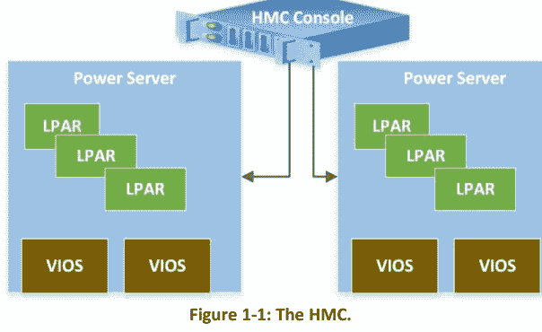
**图1-1：HMC控制台**

**集成虚拟化管理器（IVM）**是一种软件控制台，若未配备HMC，可将其作为VIOS的一部分进行安装。该控制台使用便捷，足以满足小型、低负载场景的需求。尽管与HMC相比存在一定限制，IVM在小型环境中仍可稳定运行。该控制台的主要限制在于仅支持部署一个VIOS，且不支持LPAR分配物理设备的能力（此处所用术语将在后续虚拟化章节中详细说明）。IVM控制台如图1-2所示。
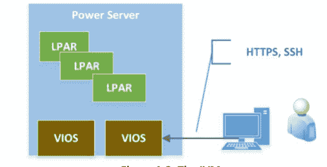

**Power虚拟化中心（PowerVC）**是一款用于管理虚拟环境的高级自动化解决方案，该方案基于OpenStack开发，支持在IBM Power Systems平台上自动部署搭载AIX、IBM i、Linux操作系统的虚拟机。该解决方案可简化管理员的日常工作，是该平台落地云解决方案的第一步。该产品的主要特性如下：
- 简化服务器管理；
- 快速创建新虚拟机；
- 提供基础功能的自助服务门户；
- 基于策略的系统管理；
- 镜像系统管理；以及
- 机器抓取、机器复制与自动部署。

从架构层面来看，PowerVC与Power平台的协作关系如图1-3所示。值得注意的是，该解决方案可与HMC支持的服务器兼容；在最新版本中，该解决方案还可与PowerVM NovaLink配合工作，后者是一种可与服务器管理程序通信的特殊LPAR。使用NovaLink可进一步推广OpenStack生态内开发的SDN（软件定义网络）功能。
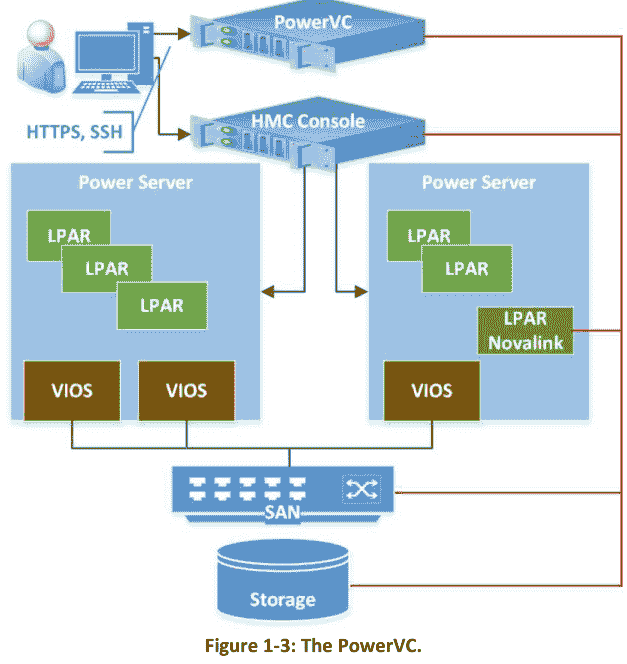
**图1-3：PowerVC**

PowerVC本身是一个独立的话题，本出版物仅会简要提及该方案，不会深入探讨，重点仍放在操作系统与虚拟化组件上。

## 第2章 AIX：基础信息
若要了解操作系统的基础知识，你需要掌握读取系统配置与参数所需的工具、数据存储位置以及配置工具。所有UNIX系统都使用全套命令来管理操作系统，这些命令通过命令行在Shell环境中调用。这种环境对新用户而言并不友好，但随着用户使用经验的积累，它会体现出比图形界面更突出的优越性，这种优越性主要体现在三个方面：可轻松基于命令构建脚本、能够将命令结果处理为我们需要的格式，以及能够将一条命令的输出作为另一条命令的输入。掌握操作系统命令的使用是每位管理员必备的核心技能。不过，大部分配置工作都可以通过配置工具完成。
针对AIX系统，核心配置工具是SMIT（*系统管理接口工具*），该工具可用于配置大部分系统参数。此前还存在一款名为WSM的图形化工具（*基于Web的系统管理器*），可用于配置操作系统，但在AIX 7.1版本中被移除。另一款曾用于管理系统部分功能的工具是IBM Systems Director，但在本书编写时，该工具已经停止销售。与其他UNIX系统类似，部分配置数据存储在平面文件中，AIX的独特之处在于，其部分配置数据存储在由ODM（*对象数据管理器*）文件所表示的配置数据库中。

### SMIT（*系统管理接口工具*）
SMIT是AIX系统专属的配置工具。大部分命令行操作都可以通过SMIT完成，无需了解需要调用的命令以及对应的参数。SMIT提供了菜单界面，用户可从中选择要在系统上执行的操作。对管理员而言，该工具的任务执行逻辑非常清晰，这一点至关重要。所有菜单操作都是通过带对应参数的系统命令或系统脚本执行的；SMIT调用的命令在执行前可进行预览与解析，也可用于构建自定义的系统管理脚本。
该工具提供两种功能相同的运行模式，仅运行环境不同：
- **图形模式** - 通过X Window System（X11）启动，可使用`smit`或`smit -M`命令调用。不带参数运行`smit`命令时，该工具可在图形模式或文本模式下启动；如果图形环境正在运行，或DISPLAY变量被设置为指向外部显示主机（例如安装了Xming、Cygwin的PC等），工具将启动为图形模式，否则将启动为文本模式。图形版本的界面如图2-1所示。
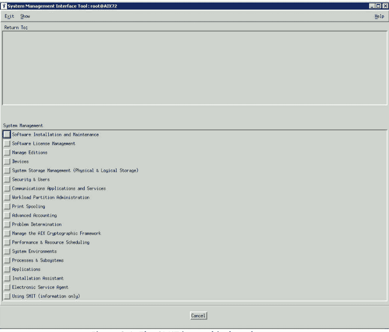
**图2-1：** 图形模式下的SMIT界面
- **文本模式** - 可从文本控制台或终端模拟器中运行，通过`smitty`或`smit -C`命令启动；如果系统配置符合要求，也可使用不带参数的`smit`命令启动。文本版本的界面如图2-2所示。

## AIX、PowerVM —— UNIX、虚拟化与安全
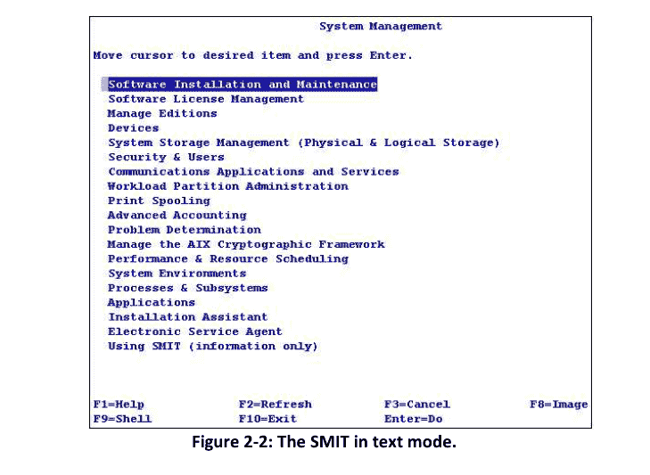
SMIT的文本版本使用最为广泛，因为它仅通过键盘即可操作；而图形版本则需要使用鼠标。因此，本书后续内容中的大部分SMIT相关界面将以文本模式呈现。菜单中每个选项的名称都能唯一标识其对应的功能，若要获取目标选项的更多信息，按下*F1*键即可显示附加说明。使用SMIT工具时，*F1*键始终可用。执行菜单选中的操作前，你可以查看即将调用的命令，按下*F6*键即可查看对应命令。图2-3展示了该功能的运作方式：

Sebastian Biedroń
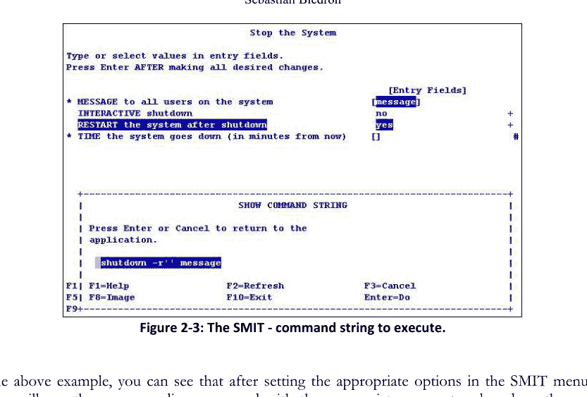
在上方示例中可以看到，在SMIT菜单中设置好对应选项后，系统会根据输入的信息，带上合适的参数运行对应命令。上述场景中对应的就是关机并重启系统的命令：
``` # shutdown -r "message" ```
SMIT可以通过快速路径启动，这样用户就能直接跳转到指定界面。你可以按下*F8*键查看哪个快速路径对应当前活动窗口，相关内容在*图像*中进行了说明。如果你想要调出用户管理菜单，就可以使用"user"这个快速路径，示例如下：
``` # smit user ```
需要注意的是，使用SMIT菜单时你可能遇到以下几个符号的含义：
- [ ] - 表示你可以在该字段中输入选定的值。
- < 或 > - 表示左右两侧存在因屏幕空间不足无法完全显示的内容，你可以通过方向键查看。
- * - 表示该字段为必填项。
- + - 表示该字段有可选列表，按下*F4*键即可查看列表。
- # - 表示该字段需要填写数值。
- x - 表示该字段需要填写十六进制值。

## SMIT创建的文件
在用户的主目录（即`$HOME`系统变量指向的目录）中使用SMIT工具时，会生成两个文件：`$HOME/smit.log`和`$HOME/smit.script`。*smit.log*文件会存储用户在SMIT菜单中的所有操作，你可以通过该文件精准追溯用户的操作记录。
下方展示了SMIT生成的日志样例，内容显示我们启动了SMIT，选择了*系统存储管理（物理存储与逻辑存储）*，随后退出了该工具。
```
# tail -20 smit.log
#Display the last 20 lines of the smit.log file.
[Oct 14 2016, 06:14:45] Starting SMIT (Menu screen selected, FastPath = "top_menu", id_seq_num = "0", next_id = "top_menu", title = "System Management".)
(Menu screen selected, FastPath = "storage", id_seq_num = "030", next_id = "storage", title = "System Storage Management (Physical & Logical Storage)".)
[Oct 14 2016, 06:15:05] Exiting SMIT
```
SMIT触发的每一项操作，都是通过调用基于菜单所选设置、用该工具生成的特定命令或脚本运行的。以此方式生成并调用的命令或脚本会被写入*smit.script*文件。生成的脚本会展示该操作的具体执行过程，你也可以复制其中的部分内容，用于构建你自己的脚本。
下方示例展示了通过SMIT菜单创建文件系统时生成的脚本：
```
# tail -46 smit.log
Command_to_Execute follows below:
>> x() {
    LIST=
    FLAG=0
    for i in "$@"
    do
        case "$i" in
        Megabytes) FLAG=1;;
        Gigabytes) FLAG=2;;
        512bytes) ;;
        quota=all) LIST="$LIST \"quota=userquota,groupquota\"" ;;
        size=*)
            case "$FLAG" in
            1) LIST="$LIST \"$i\"M"
                FLAG=0;;
            2) LIST="$LIST \"$i\"G"
                FLAG=0;;
            0) LIST="$LIST \"$i\"" ;;
            esac
            ;;
        *) LIST="$LIST \"$i\"" ;;
        esac
    done
    eval /usr/sbin/crfs -v jfs2 $LIST
}
x -g'rootvg' 'Megabytes' -a size='100' -m'/testfs1' -A'yes' -p'rw' -a agblksize='4096' -a isnapshot='no'
```
Command_to_Execute的执行输出如下所示：
```
---- start ----
File system created successfully.
114480 kilobytes total disk space.
New File System size is 229376
---- end ----
```
[Oct 14 2016, 06:20:08]
[Oct 14 2016, 06:20:13] Exiting SMIT

### ODM（对象数据管理器）
大部分系统配置数据都存储在ODM管理的数据库中，ODM存储的信息示例如下：
- 操作系统中的设备配置；
- SMIT工具展示的信息（表单、对话框等）；
- 已安装软件的相关信息；
- 网络配置；
- 系统资源信息。
该系统组件的含义和存在作用与Windows系统注册表类似，二者的主要区别如下：
- 该机制在AIX系统上稳定性更高；
- ODM主要用于存储系统相关信息，而非已安装应用产生的信息；
- 多数情况下可通过系统命令获取所需数据，无需手动操作ODM数据库。
ODM数据存储在以下三个位置：
- */usr/lib/objrepos*（该文件存储了大部分信息）
- */usr/share/lib/objrepos*
- */etc/objrepos*
通常不推荐手动修改数据库内容，否则可能导致系统出现异常行为。但如果确实需要手动修改，请提前备份上述文件（将其复制到安全位置），以便出现问题时可以快速恢复。除了复制ODM文件外，务必记得进行全系统备份，在紧急情况下这类备份会非常有用。
此处的“手动”修改ODM，是指使用专用命令直接操作ODM。其余修改会在系统运行的各个环节自动完成，用户通常感知不到这类操作。例如，创建文件系统、卷组这类存储结构，或是添加、修改硬件特性时，都会触发这类无感知的自动修改操作。
用于手动修改ODM数据库的命令如下：
- *odmadd.*
- *odmchange.*
- *odmcreate.*
- *odmdelete.*
- *odmdrop.*
- *odmget.*
- *odmshow.*
由于这类命令极少会被用到，此处不再赘述。但有必要知道的是，在极端情况下可以使用这些工具。

### SRC（系统资源控制器）
系统资源控制器是能够简化系统管理的工具之一，可用于管理子系统与子服务。
- 子系统：指用于执行特定任务的程序、进程，或一组程序/进程。多个子系统会组合为群组，以执行更复杂的任务。
- 子服务：指用于控制其他进程/服务运行的子系统。AIX系统中的*inetd*就是典型的子服务，需要时会运行*/etc/inetd.conf*配置文件中定义的服务。
如果服务器上安装的软件是独立实体，且需要在后台长期运行，通常会为其配置单独的子系统。
SRC具备多项优势，包括：
- 可轻松启动、停止、刷新子系统配置；
- 会将子系统问题记录到系统错误日志（errorlog）中；
- 可跟踪子系统状态；
- 支持远程管控子系统（一台服务器可管控另一台服务器的子系统）。
SRC对应的负责进程为*/usr/sbin/srcmstr*。系统启动时会通过*/etc/initab*中的对应配置项启动该进程：
```
srcmstr:23456789:respawn:/usr/sbin/srcmstr # System Resource Controller
```
如需远程管理SRC资源，远程系统上的*srcmstr*进程必须带有*r*参数运行。接下来的章节将介绍SRC的基础功能。

## 显示子系统信息
你可以使用`lssrc`命令查看子系统信息，该命令会按照以下格式展示已定义的子系统：
- 子系统名称；
- 所属群组；
- 进程标识符（仅当子系统运行时显示）；
- 子系统状态：*active*表示已激活，*inoperative*表示未激活。
`lssrc`命令的运行示例如下：
```
# lssrc -a
#Display all defined subsystems.
Subsystem Group PID Status
syslogd ras 4063618 active
sendmail mail 4456844 active
portmap portmap 3735900 active
inetd tcpip 3604964 active
snmpd tcpip 3539326 active
snmpmibd tcpip 4129158 active
aixmibd tcpip 4194696 active
hostmibd tcpip 4522382 active
aso 4587920 active
biod nfs 4260236 active
rpc.lockd nfs 6095346 active
clcomd caa 6160852 active
qdaemon spooler 4849944 active
writesrv spooler 4784430 active
pfcdamon 6291720 active
ctrmc rsct 5439924 active
IBM.ConfigRM rsct_rm 6947288 active
IBM.MgmtDomainRM rsct_rm 7078364 active
IBM.HostRM rsct_rm 5570904 active
IBM.ServiceRM rsct_rm 6750676 active
IBM.DRM rsct_rm 4391316 active
lpd spooler inoperative
keyserv keyserv inoperative
ypbind yp inoperative
gsclvmd inoperative
cdromd inoperative
ndpd-host tcpip inoperative
ndpd-router tcpip inoperative
netcd netcd inoperative
tftpd tcpip inoperative
routed tcpip inoperative
# All unnecessary information has been omitted.
```

### 启动、停止和刷新子系统配置
`startsrc`、`stopsrc`和`refresh`命令可用于执行主要操作，每个命令都可作用于单个子系统（参数为*-s subsystem_name*）或子系统群组（参数为*-g group_name*）。使用示例如下：

## AIX、PowerVM —— UNIX、虚拟化与安全
要停止 *automountd* 子系统：
```shell
# lssrc -s automountd
# Automountd before stopping.
Subsystem Group PID Status
automountd autofs 180362 active
```
```shell
# stopsrc -s automountd
# Stop automountd.
0513-044 The automountd Subsystem was requested to stop.
```
```shell
# lssrc -s automountd
# Automountd after stopping.
Subsystem Group PID Status
automountd autofs inoperative
```
要启动 *nfs* 子系统组：
```shell
# lssrc -g nfs
# Group of nfs subsystems before startup.
Subsystem Group PID Status
biod nfs inoperative
nfsd nfs inoperative
rpc.mountd nfs inoperative
nfsrgyd nfs inoperative
gssd nfs inoperative
rpc.lockd nfs inoperative
rpc.statd nfs inoperative
```
```shell
# startsrc -g nfs
# Start subsystems belonging to the nfs group
0513-059 The biod Subsystem has been started. Subsystem PID is 184426.
0513-059 The nfsd Subsystem has been started. Subsystem PID is 176242.
0513-059 The rpc.mountd Subsystem has been started. Subsystem PID is 139312.
0513-059 The nfsrgyd Subsystem has been started. Subsystem PID is 213098.
0513-059 The gssd Subsystem has been started. Subsystem PID is 196766.
0513-059 The rpc.lockd Subsystem has been started. Subsystem PID is 307418.
0513-059 The rpc.statd Subsystem has been started. Subsystem PID is 303318.
```
```shell
# lssrc -g nfs
# Group of nfs subsystems after startup.
Subsystem Group PID Status
biod nfs 184426 active
nfsd nfs 176242 active
rpc.mountd nfs 139312 active
rpc.lockd nfs 307418 active
rpc.statd nfs 303318 active
nfsrgyd nfs inoperative
gssd nfs inoperative
```
最后两个子系统的 *未激活* 状态表明它们启动失败。如需了解更多故障原因，你可以查看系统错误日志（*errpt* 命令）。
要刷新子服务器配置：
```shell
# refresh -s inetd
# Refresh the inetd subserver configuration.
0513-095 The request for subsystem refresh was completed successfully.
```
*inetd* 子系统（子服务器）的配置文件位于 */etc/inetd.conf* 文件中。该文件会在启动 *inetd* 守护进程时被读取。如果在子系统配置过程中对该文件做了修改，要让修改生效，你需要指令子系统重新读取该文件。你可以通过执行 *refresh* 命令实现这一操作。或者，你也可以使用 *kill -HUP inetd_process_number* 命令。
### 检查系统中的设备信息
了解系统设备的配置是系统管理员的核心职责。AIX 中的独立设备指任何硬件或虚拟组件（例如网络接口、磁盘、逻辑卷或内存）。每个设备在 `/dev` 目录中都以一个文件的形式呈现，我们可以像操作普通文件一样对其进行操作。
存在一些与硬件无关的虚拟设备：
- `/dev/zero` —— 读取该设备时会返回零值。例如，可以用它来擦除磁盘内容（`cat /dev/zero > /dev/hdisk0`）。
- `/dev/null` —— 空设备。将任何信息重定向到该设备时，信息会被直接丢弃。例如，`find / -name sm* 2> /dev/null` 会将错误输出（2）重定向到 `/dev/null` 设备，从而让错误信息不会显示在屏幕上。
此外还有一类与操作系统对象相关的特殊设备。这类设备用于指定特定的操作系统参数。例如：
- `sys0` —— 包含属性以及部分系统级参数的系统对象；
- `inet0` —— 包含属性以及部分网络参数的系统对象。
这类对象不会以文件的形式映射到 `/dev` 目录中。
查看系统配置需要用到的命令包括 `lsdev`、`lsattr`、`lscfg` 和 `prtconf`。需要注意的是，这些命令提供的信息均来自 ODM 数据库。和几乎所有 UNIX 系统的命令一样，这些命令也支持大量参数。后续章节将介绍这些命令的基础功能。
#### `lsdev` 命令
`lsdev` 命令用于显示系统中逻辑设备和物理设备的概览信息。
###### 关键参数：
- **-C** —— ODM 数据库中定义的设备（即系统中存在的设备）。
- **-P** —— 预定义设备（即系统所有支持处理的设备），也即内置设备驱动列表。
- **-c *device_class*** —— 仅显示指定类别的设备，例如 `disk`（磁盘）、`bus`（总线）、`adapter`（适配器）或 `if`（接口）。
- **-H** —— 显示表头。
```shell
# lsdev -CH name status location description
L2cache0    Available     L2 Cache
cache0      cache0       Defined     SSD Cache virtual device
cd0         Available     Virtual SCSI Optical Served by VIO Server
cengine0    Available     SSD Cache engine
cluster0    Available     Cluster Node
en0         Available     Standard Ethernet Network Interface
ent0        Available     Virtual I/O Ethernet Adapter (l-lan)
et0         Defined       IEEE 802.3 Ethernet Network Interface
fslv00      Available     Logical volume
hd1         Defined       Logical volume
hd2         Defined       Logical volume
hd3         Defined       Logical volume
hd4         Defined       Logical volume
hd5         Defined       Logical volume
hd6         Defined       Logical volume
hd8         Defined       Logical volume
# All unnecessary information has been omitted.
proc0       Available     00-00 Processor
proc4       Available     00-04 Processor
# All unnecessary information has been omitted.
```
以上命令会显示系统中的所有设备。*location*（位置）列提供设备的物理位置信息。此处显示的数字即所谓的位置码，可通过对应服务器型号的维修指南解读这些位置码，从而获取诸如接口所在的 PCI 插槽、硬盘的安装位置等信息。此外，状态列显示设备的运行状态。设备共有两种状态：
- *Available*（可用）—— 设备可完全访问，即可以正常使用。在各类 IBM 资料中，这类设备也被描述为“已配置”。
- *Defined*（已定义）—— 设备存在于系统中，但无法对其进行操作。这类设备也被称为“未配置”。
为了直观区分两种状态的差异，我们来看已配置的 *en0* 设备（处于 *Available* 状态）和未配置的 *et0* 设备（处于 *Defined* 状态）。*en0* 是一块网络适配器。它已分配 IP 地址，是唯一能够与网络中其他计算机通信的设备。*et0* 是没有分配 IP 地址的设备，也从未被激活过。可以认为，“available”状态指的是已启用的设备，“defined”状态指的是已禁用的设备。
另一则使用 *lsdev* 命令显示所有 *disk*（磁盘）类设备信息的示例如下：
```shell
# lsdev -Cc disk
hdisk0      Available     10-60-00-10,0     16 Bit LVD SCSI Disk Drive
hdisk1      Available     10-60-00-11,0     16 Bit LVD SCSI Disk Drive
```
#### `lsattr` 命令
*lsattr* 命令用于显示设备的参数，其中部分参数可通过 *chdev* 命令修改。
###### 关键参数：
- *-E* —— 显示当前已设置的参数值。
- *-D* —— 显示设备的默认参数值。
- *-R* —— 显示设备单个参数可被分配的取值范围。
- *-I deviceName* —— 指定命令作用的目标设备，该参数为必填项。
- *-a attribute* —— 指定命令作用的属性。
```shell
# lsattr -El hdisk0
PCM           PCM/friend/vscsi          Path Control Module                False
PR_key_value  none                      N/A                               True
algorithm     fail_over                  Algorithm                         True
hcheck_cmd    test_unit_rdy              Health Check Command              True
hcheck_interval 0                       Health Check Interval             True
hcheck_mode   nonactive                  Health Check Mode                 True
max_transfer  0x40000                   Maximum TRANSFER Size             True
pvid          00f621774d9300420000000000000000    Physical volume identifier    False
queue_depth   8                         Queue DEPTH                       True
reserve_policy no_reserve                Reserve Policy                    True
```
以上命令显示了 *hdisk0* 设备的当前参数。展示的信息包括：参数名称、参数值、简要描述，以及该参数是否可修改（*True* 表示可修改，*False* 表示不可修改）。部分参数的详细作用说明需要深入掌握 AIX 驱动的工作原理才能理解。不过本章节我们重点关注如何获取信息，而非详细解读参数含义。以下示例展示了 *lsattr* 命令的扩展功能，即显示指定参数可接受的值，以及显示参数的默认值。
```shell
# lsattr -Rl hdisk0 -a queue_depth
1...256 (+1)
# The parameter can range from 1 to 256 with a jump of 1.
```
```shell
# lsattr -Dl hdisk0 -a queue_depth
queue_depth 8 Queue DEPTH True
# The default value of queue_depth for this device is 8.
```
接下来我们来看 *sys0* 设备。这是一个象征系统整体配置的虚拟设备。通过查看该设备的参数，我们可以获取大量有用的信息。
```shell
# lsattr -El sys0
SW_dist_intr   false                     Enable SW distribution of interrupts  True
autorestart    true                      Automatically REBOOT OS after a crash True
boottype       disk                      N/A                                False
capacity_inc   0.01                      Processor capacity increment        False
capped         false                     Partition is capped                 False
chown_restrict true                      Chown Restriction Mode              True
clouddev       0                         Recreate ODM devices on next boot   True
conslogin      enable                    System Console Login                False
cpuguard       enable                    CPU Guard                          True
dedicated      false                     Partition is dedicated              False
enhanced_RBAC  true                      Enhanced RBAC Mode                  True
ent_capacity   2.00                      Entitled processor capacity         False
frequency      6400000000                System Bus Frequency                False
fullcore       false                     Enable full CORE dump               True
fwversion      IBM,AL730_149             Firmware version and revision levels False
ghostdev       0                         Recreate ODM devices on system change/modify PVID True
id_to_partition 0X80000341CC500016       Partition ID                        False
id_to_system   0X80000341CC500000        System ID                           False
iostat         false                     Continuously maintain DISK I/O history True
keylock        normal                    State of system keylock at boot time False
log_pg_dealloc true                      Log predictive memory page deallocation events True
max_capacity   2.00                      Maximum potential processor capacity False
max_logname    9                         Maximum login name length at boot time True
maxbuf         20                        Maximum number of pages in block I/O BUFFER CACHE True
```

## AIX、PowerVM——UNIX、虚拟化与安全
| 参数名 | 值 | 描述 | 是否默认启用 |
|--------|----|------|--------------|
| maxmbuf | 0 | 允许分配给MBUFS的最大内存容量（单位：千字节） | 是 |
| maxpout | 8193 | 每个文件挂起写I/O的高水位线 | 是 |
| maxuproc | 128 | 每个用户允许的最大进程数 | 是 |
| min_capacity | 0.10 | 最低处理器潜在容量 | 否 |
| minpout | 4096 | 每个文件挂起写I/O的低水位线 | 是 |
| modelname | IBM,8233-E8B | 机器名称 | 否 |
| ncargs | 256 | 以4K字节块为单位的参数/环境变量列表大小 | 是 |
| nfs4_acl_compat | secure | NFS4访问控制列表兼容模式 | 是 |
| ngroups_allowed | 128 | 允许的组数量 | 是 |
| pre430core | false | 使用430版本之前的旧式核心转储 | 是 |
| pre520tune | disable | 520版本之前的调优兼容模式 | 是 |
| realmem | 2097152 | 可用物理内存总量（单位：千字节） | 否 |
| rtasversion | 1 | 开放固件RTAS版本 | 否 |
| sed_config | select | 堆栈执行禁用（SED）模式 | 是 |
| systemid | IBM,02062177P | 硬件系统标识符 | 否 |
| variable_weight | 128 | 可变处理器容量权重 | 否 |

您可以在此获取的信息示例如下：
- 服务器的固件版本 - *fwversion*；
- 系统是否收集输入/输出操作统计信息 - *iostat*；
- 可用内存量 - *realmem*；
- 服务器序列号 - *systemid*。

### lscfg命令
lscfg命令用于显示系统中设备的详细信息。通过该命令，我们可以确定系统中设备的序列号、固件版本及制造商。所获取的信息可以非常详细，例如我们可以读取设备在服务器内的物理位置。

**关键参数：**
- *-v* - 设备的详细信息。
- *-p* - 额外的平台专属信息。
- *-l deviceName* - 指定命令中使用的设备（不带此参数时，默认使用所有设备）。

``` # lscfg -vpl fcs0
fcs0 U78A0.001.DNWHWGD-P1-C2-T1 8Gb PCI Express Dual Port FC Adapter (df1000f114108a03)
Part Number.................10N9824
Serial Number..............1C019087F8
Manufacturer................001C
EC Level....................D76482B
Customer Card ID Number.....577D
FRU Number..................10N9824
Device Specific.(ZM)........3
Network Address.............10000000C9B01108
ROS Level and ID............02781174
Device Specific.(Z0)........31004549
Device Specific.(Z1)........00000000
Device Specific.(Z2)........00000000
Device Specific.(Z3)........09030909
Device Specific.(Z4)........FF781116
Device Specific.(Z5)........02781174
Device Specific.(Z6)........07731174
Device Specific.(Z7)........0B7C1174
Device Specific.(Z8)........20000000C9B01108
Device Specific.(Z9)........US1.11X4
Device Specific.(ZA)........U2D1.11X4
Device Specific.(ZB)........U3K1.11X4
Device Specific.(ZC)........00000000
Hardware Location Code......U78A0.001.DNWHWGD-P1-C2-T1
```

**平台专属信息**
*`-p` 参数的补充信息*
名称：fibre-channel
型号：10N9824
节点：fibre-channel@0
设备类型：fcp
物理位置：U78A0.001.DNWHWGD-P1-C2-T1

上述示例展示了物理光纤通道控制器的详细硬件信息，例如：
- 位置和接口速度——对应结果第一行；
- 制造商信息——对应“Manufacturer:”字段；
- 固件版本——对应“ROS Level and ID:”字段。

### prtconf命令
prtconf命令以最简洁直观的方式展示系统信息。该命令会呈现一组最常被查询的信息，详细说明系统配置的各个维度。它能解答90%关于系统和服务器的基本问题。用户可以通过不同的参数调用该命令，以获取不同的信息模块。使用*prtconf*可获取的信息示例如下：

``` # prtconf
System Model: IBM,8233-E8B
Machine Serial Number: 062177P
Processor Type: PowerPC_POWER7
Processor Implementation Mode: POWER 7
Processor Version: PV_7_Compat
Number Of Processors: 2
Processor Clock Speed: 3300 MHz
CPU Type: 64-bit
Kernel Type: 64-bit
LPAR Info: 22 SB5437_AIX72_c2
Memory Size: 2048 MB
Good Memory Size: 2048 MB
Platform Firmware level: AL730_149
Firmware Version: IBM,AL730_149
Console Login: enable
Auto Restart: true
Full Core: false
NX Crypto Acceleration: Not Capable

Network Information
Host Name: AIX72c2
IP Address: 10.10.177.4
Sub Netmask: 255.255.0.0
Gateway: 10.10.10.1
Name Server:
Domain Name:

Paging Space Information
Total Paging Space: 512MB
Percent Used: 2%
```

**卷组信息**
===============================================================================
活跃VG
===============================================================================
| 物理卷名称 | 物理卷状态 | 总物理分区数 | 可用物理分区数 | 可用分区分布 |
|---------|----------|-----------|----------|--------------------|
| hdisk0 | 活跃 | 511 | 214 | 14..00..00..98..102 |
===============================================================================
> 已省略所有非必要信息。

## 第3章 AIX：虚拟化
系统虚拟化的起源早已成为历史。如今，几乎所有操作系统都支持虚拟化。我们几乎所有人的笔记本电脑上都运行着若干虚拟机，可随时启动，既可用于学习，也可在隔离环境中完成工作。商业解决方案与服务器虚拟化也不例外。市场上有诸多广为人知的虚拟化方案。上述每种方案都既有优势也有劣势。POWER平台的一个明显缺点是可用虚拟化方法的选择有限。但这也带来了相应的优势：能够确保虚拟化程序与平台实现更优的集成。借此你可以获得更高的系统效率与可用性，以及更高级别的安全保障。Power平台提供两类虚拟化程序：一类是功能成熟、已推出十余年的PowerVM，另一类是Linux领域的轻量解决方案KVM。此外，你还可以通过WPAR（工作负载分区）在AIX操作系统层面应用虚拟化。本章将讨论Power平台上最流行的虚拟化方案PowerVM。若要更好地理解本章内容，建议先掌握操作系统虚拟化相关的基础通用知识。如果你只对操作系统层面的相关内容感兴趣，可以跳过本章，稍后再返回学习。

### PowerVM
PowerVM是上述三种虚拟化方法中认可度最高、功能最强大的方案。它已投入使用超过十年。如果你深入了解该方案的发展历程，会发现它源自大型机平台上的既有解决方案。该虚拟化平台的特点是：与硬件平台和操作系统的集成度极高。实现如此深度集成的原因是：所有这些层级均由同一家公司开发，信息流与利益诉求高度统一。该虚拟化方法的一个核心特性是性能具有高度可扩展性。这得益于另一项关键特性，即为虚拟化系统分配虚拟和物理资源的能力。使用该方法时，如果你需要极高带宽的局域网或存储区域网络（SAN），可以分配任意数量的物理适配器来处理相关流量。截至2018年，PowerVM共推出两个销售版本：*standard*（标准版）和*enterprise*（企业版）。二者的差异仅在于高版本提供了少量额外的进阶功能，即*Active Memory Sharing（活动内存共享）*、*Live Partition Mobility（实时分区迁移）* 和 *PowerVP Performance Monitor（PowerVP性能监视器）*。标准版与企业版的区别如下：

相关版本信息列于表3-1。
| 特性 | 标准版 | 企业版 |
| :--- | :---: | :---: |
| 虚拟I/O服务器 | 支持（双VIOS） | 支持（双VIOS） |
| 暂停/恢复 | 支持 | 支持 |
| NPIV | 支持 | 支持 |
| 共享处理器池 | 支持 | 支持 |
| 共享存储池 | 支持 | 支持 |
| 精简置备 | 支持 | 支持 |
| 主动内存共享 | 不支持 | 支持 |
| 动态分区迁移 | 不支持 | 支持 |
| PowerVP性能监视器 | 不支持 | 支持 |
| SR-IOV | 支持 | 支持 |
表中列出的各项特性将在本章后续做详细介绍。

#### 虚拟化组件
要理解PowerVM虚拟化的运行原理，关键在于将整个机制拆分为在整个解决方案中承担不同功能的基础部件。相关内容如图3-1所示。
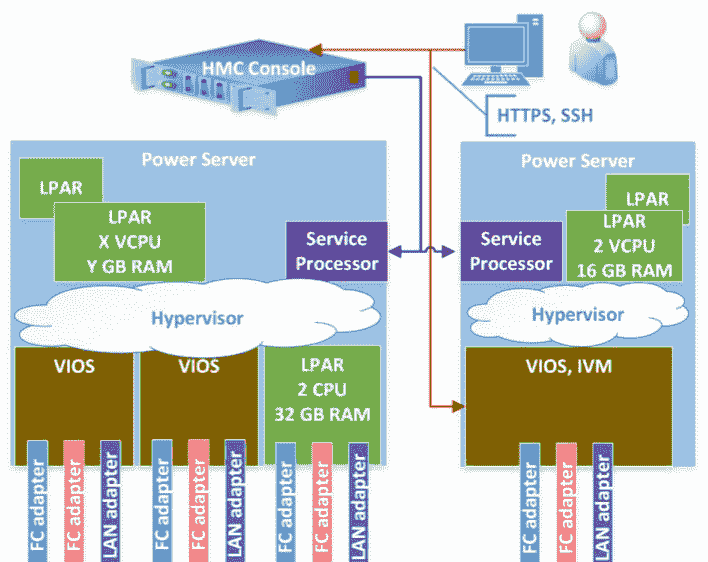
**图3-1：PowerVM虚拟化组件。**

实现高效虚拟化所需的基础部件包括：
- *LPAR（逻辑分区、分区、微分区、SPLPAR（共享处理器逻辑分区））*，这些术语通常可以互换使用。上述术语指运行在POWER平台上的虚拟系统（虚拟服务器），与x86世界中的“虚拟机”类似。
- 给定的LPAR拥有虚拟资源，例如处理器、内存和I/O设备（磁盘、局域网、存储域网）。它也可以配置物理设备，比如物理处理器和物理I/O适配器。你可以通过管理控制台来运行该LPAR并安装操作系统。
- 从逻辑层面来看，下文提到的VIOS服务器是安装了对应软件的LPAR。
- 从发展历程来看，微分区是比LPAR更新的概念，指的是分配给虚拟实体的资源粒度更细。在虚拟化的最初实现中，处理器资源分配以整个处理器（核心）为单位，之后可以以处理器的分数级为单位进行分配。如今，上述术语在日常使用中含义相同，本书也将统一如此表述。
- POWER平台虚拟化的独特之处在于，LPAR既可以完全虚拟化，也可以包含物理组件（专用的处理器核心、局域网/存储域网及其他方案的I/O适配器）。
- 不同类型的LPAR如图3-2所示。
- 所有LPAR的一项重要特性是支持安装非AIX系统，例如历史上被称为OS/400的IBM i系统，或是Linux（Red Hat、SLES、Ubuntu）。

AIX, PowerVM – UNIX, Virtualization, and Security
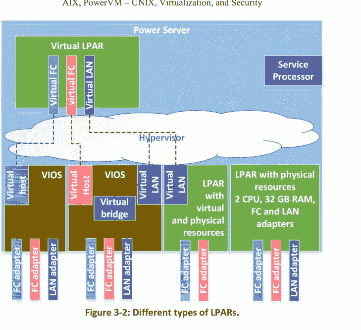
**图3-2：不同类型的LPAR。**

需要注意的是，LPAR的配置存储在两个位置：分区配置文件和“当前配置”中。这一信息非常重要，因为两个位置的参数不需要完全一致。例如，如果你新增了处理器，当前配置会同步该操作，但除非你主动更新，否则配置文件不会自动同步。

*硬件管理控制台（HMC）*是一种硬件控制台，用于管理一台或多台服务器的配置、维护以及部分虚拟化特性的管理。这类控制台并非标准虚拟化POWER环境的必备组件，但当你管理多台服务器、使用更高级的虚拟化功能时，它就成为必需项。实际上，HMC通常是一台设备，即配备足够局域网端口、已安装管理软件的物理x86服务器。HMC也可以作为虚拟机安装在x86平台的管理程序上。用户与该控制台的交互方式、以及控制台与服务器之间的连接方式如图3-3所示。
Sebastian Biedroń
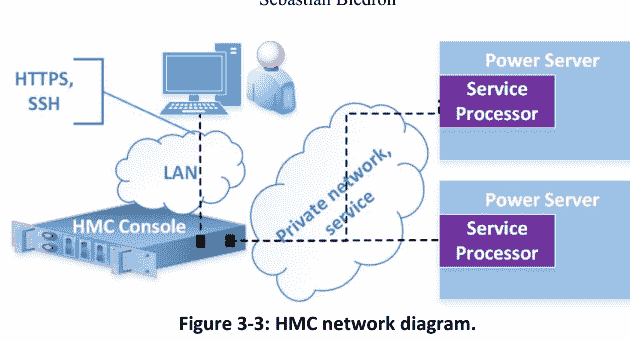
**图3-3：HMC网络拓扑图。**

*IVM（集成虚拟化管理器）*是一种“软件”控制台，如果没有HMC，它可以作为VIOS的一部分安装。IVM使用便捷，对于要求不高的小型环境完全够用。尽管与HMC相比存在一些局限性，但在这种环境中使用IVM仍是合适的方案。两款控制台的功能差异如表3-2所示。

| 特性 | HMC | IVM |
| :--- | :---: | :---: |
| 虚拟化，可在服务器上创建多个LPAR | 支持 | 支持 |
| 一台控制台可连接多台服务器 | 支持 | 不支持 |
| 将物理组件（局域网、存储域网适配器）分配给LPAR | 支持 | 不支持 |
| 双VIOS | 支持 | 不支持 |
| 动态分区迁移 | 支持（HMC-HMC） | 支持（IVM-IVM） |
| NPIV | 支持 | 支持 |
| 带高可用选项的共享以太网适配器（SEA） | 支持（双VIOS） | 不支持 |
表3-2：HMC与IVM的功能差异

*管理程序*的基础功能由嵌入服务器的轻量级代码控制，该代码是服务器固件的一部分。管理程序的作用是实现CPU、内存以及局域网内部部分的虚拟化。但并非所有虚拟化都基于管理程序实现，例如它不会虚拟化I/O设备。I/O虚拟化由名为虚拟I/O服务器（VIOS）的独立部件完成。从服务器性能和可用性的角度来看，将CPU、内存的虚拟化与I/O虚拟化分离是非常合理的设计。得益于靠近服务器“核心”（固件中）的短代码，服务器能够更高效地管理资源，同时更不容易出现故障。借助部分服务器型号的高级功能，还可以启用RAM级别的管理程序镜像，这也能显著提升其可用性。不过，由于I/O操作的特性，支持同时使用多个VIOS。

*VIOS（虚拟I/O服务器）*是负责I/O操作虚拟化的部件，可为LPAR提供局域网和磁盘空间。实际上，它是一个安装了对应软件的LPAR，可以看作是专为承担I/O服务器功能定制的AIX系统。单台服务器上可以部署多个VIOS，不过通常只会使用1到2个。当需要保障系统最高可用性、同时支持在不关闭客户端LPAR的情况下升级虚拟I/O服务器时，就会使用两个VIOS。VIOS的功能将在本章后续做更详细的介绍。

##### 处理器虚拟化
管理程序负责管理处理器和内存的虚拟化。如前所述，管理程序是服务器的固有组成部分，随服务器固件一同提供。其代码体积小且贴近硬件，因此相比无此类贴近设计的方案，它的运行效率更高、稳定性更强。相较于使用物理处理器，处理器虚拟化的优势在于可以更充分地利用整个平台。运行数十个LPAR的多处理器大型服务器，负载通常可达60%-80%，同时仍能保持性能稳定。如果使用专用物理服务器替代LPAR，其利用率通常仅在10%-20%之间波动。另一项重要特性是可以动态响应负载的升降。大多数情况下，向系统添加或移除处理器仅需几次点击，无需重启。而如果是物理服务器，完成同样的操作就需要升级服务器或迁移到性能更高的其他服务器。

PowerVM的一项重要独有特性是支持将“物理”处理器核心分配给LPAR，这种情况下LPAR运行于专用模式。管理程序会决定分配哪一个（或哪些）物理处理器核心，管理员对该流程的干预权限有限。管理程序会以优化LPAR性能、消除潜在问题为原则做出决策，例如避免处理器与内存距离过远（即所谓的*亲缘性*）。值得一提的是IBM采用的处理器定义，对于POWER服务器而言

##### 虚拟处理器参数
LPAR拥有诸多参数，可在创建时定义，也可在运行过程中后续修改。这些参数会对系统运行方式、LPAR资源分配产生显著影响。LPAR有两种运行模式：*专用*和*共享*。创建LPAR时可见的模式选择界面如图3-4所示。


##### *专用模式*
专用模式需要将整个“物理”处理器（核心）分配给LPAR。如果LPAR不使用该处理器，未使用的CPU周期就会丢失。在操作系统中，这会以空闲处理器周期（*% 空闲*）的形式体现。如果你不想丢失专用处理器周期，可以将它的运行模式指定为*捐赠*。该设置意味着，除非捐赠专用处理器的LPAR负载过高，否则该处理器未使用的时间会被服务器上的其他LPAR利用。默认情况下，负载达到80%的LPAR不会将处理器时间捐赠给资源池。你可以通过操作系统中的`schedo`命令修改`ded_cpu_donate_thresh`设置，来控制该阈值。在*专用*模式下，你可以指定三个更详细的运行参数：
- ***最小处理器数*** - LPAR启动所需的最小处理器数量。如果尝试启动LPAR时没有可用的最小数量处理器，LPAR将无法启动，并会报错。
- ***期望处理器数*** - 即期望的处理器数量。LPAR启动时始终使用此处指定的处理器数量。唯一例外是启动分区时，服务器上没有对应“期望”数量的空闲资源，此时LPAR会以不低于最小值的最多可用处理器数量启动。你可以在系统运行过程中，在该参数的最小值与最大值之间动态调整该值。
- ***最大处理器数*** - 无需重启即可分配给LPAR的最大处理器数量。如果分区在系统中显示有2个（*期望*）处理器，且最大处理器数设置为4，管理员可以通过管理控制台再添加2个处理器，即可在不重启的情况下提升当前分区的算力，整个操作耗时约30秒。但是，如果需要将LPAR的算力提升到最大值以上，你需要：
  - 修改配置单中的“最大值”参数；
  - 停止LPAR；
  - 从修改后的配置单启动LPAR。
为什么会有这个（最大值）设置？我们难道不能统一设置规则，让所有LPAR的最大值默认为256（256是AIX支持的最大处理器（核心）数量）吗？原因有两方面：
- *性能* - 操作系统必须做好动态添加处理器、内存等资源的准备，需要搭建对应的支撑结构。这些结构会在系统启动时构建。如果这些结构永远不会被用到，却提前构建出来会浪费资源，并对系统性能产生负面影响，显然不利于性能优化。
- *许可* - 部分软件供应商可能要求将“最大值”设置为与软件许可数量对应的数值，这会导致无法随意添加资源，从而避免出现许可侵权问题。目前主流的大型软件供应商并不关注该参数值，但许可政策是完全意义上的“政策”，不讲逻辑，随时可能调整。因此“最大值”参数需要合理设置；如果条件允许，建议预留合理的资源余量，以便在出现性能问题时调整现有资源。
专用模式的缺点是会造成未使用资源的浪费。捐赠未使用的专用处理器（*捐赠*模式）的能力可以部分弥补这一缺陷。该功能可以随时启用，但即便如此，仍有一部分处理器周期会被闲置。而专用模式的优势在于，它能保证性能稳定，不受虚拟化机制的干扰。在该模式下运行可以感受到性能提升，尤其是当服务器负载波动较大（即频繁创建、删除、修改大量LPAR）时效果更明显。根据官方文档，使用专用处理器与共享处理器的系统性能差距约为7%-10%。但需要注意的是，实际效果很大程度上取决于服务器上的LPAR数量、总负载，以及LPAR的分配合理性（关联性）。该模式主要适用于处理器资源负载高且稳定的系统。如果想最大化利用整个平台的资源，需要谨慎合理地使用该模式（也就是说，使用场景相对较少）。

##### ***共享模式***
共享模式下，虚拟处理器会被分配给LPAR。它们可以使用可用处理器池中不同处理器的周期，但单个虚拟处理器的最大算力永远不会超过物理处理器核心的算力。该模式的最大优势在于可以充分利用整个服务器的资源。它提供了大量参数，可用于控制系统运行和资源分配。可修改的参数如图3-5所示。
##### *参数说明：*
- *最小虚拟处理器数*、*期望虚拟处理器数*和*最大虚拟处理器数* - 这几个参数的作用与专用模式下对应的参数类似，区别仅在于此处指的是虚拟处理器而非物理处理器。
- *最小处理单元* - 该LPAR可拥有的最小处理器算力。如果服务器没有对应数量的可用算力，LPAR将无法启动。但即使动态调整处理器算力，也不会将其降低到该阈值以下。该阈值的精度可达处理器算力的1/100（每个虚拟处理器最低为1/10个CPU）。你可以修改该参数，但需要重新加载LPAR配置单，即停止LPAR后再重新启动。
- *期望处理单元* - LPAR启动时会始终使用此处指定的处理器算力。唯一例外是启动分区时，服务器没有对应*期望*数量的空闲资源，此时LPAR会以不低于最小值的最高的可用算力启动。你可以在系统运行过程中，以1/100的算力精度（每个虚拟处理器最低为1/10个CPU）在最小值和最大值之间动态调整该参数。该参数非常重要，因为即使LPAR运行在*无上限*模式下，实际获得的算力也不会低于“期望处理单元”的数值，这是分区算力的保障。但需要注意，这不代表该算力会永久分配给LPAR。正确的理解是：只要LPAR有需求，就能获得100%的对应算力；但如果LPAR不需要这些算力，Hypervisor（虚拟化管理程序）会将其捐赠给空闲资源池，分配给其他有需求的LPAR。
- *最大处理单元* - 无需重启操作系统即可为LPAR添加的最大处理器算力。如果需要将分区算力提升到最大值以上，需要修改配置单中的最大值参数，关闭LPAR后，再使用修改后的配置单和新最大值重新启动LPAR。该参数的调整精度可达处理器算力的1/100（每个虚拟处理器最低为1/10个CPU）。
- *无上限/有上限* - 除非选择*无上限*模式，否则LPAR默认运行在*有上限*模式下。二者的区别最好通过两个LPAR的示例说明：假设你在共享模式下创建了两个分区，参数如**表3-3：LPAR示例 - 有上限/无上限模式**所示。

| | 虚拟处理器数 | | | 处理单元数 | | | 有上限/无上限 | |
| --- | --- | --- | --- | --- | --- | --- | --- | --- |
| | **LPAR1** | 1 | 2 | 4 | 0.1 | 0.5 | 4 | *有上限* | |
| | **LPAR2** | 1 | 2 | 4 | 0.1 | 0.5 | 4 | *无上限* | |

两个LPAR的初始行为一致，都支持动态（无需重启）添加或移除处理器资源。两种模式下，修改最小值和最大值参数都需要重新加载配置单（停止LPAR、修改配置单、使用修改后的配置单启动分区）。但二者存在关键区别：
- 运行在*有上限*模式下的LPAR1，“期望处理单元”值设置为0.5，因此除非你显式将其模式切换为*无上限*，或显式添加CPU算力，否则其使用的CPU算力永远不会超过0.5。
- 运行在*无上限*模式下的LPAR2，“期望处理单元”值虽设置为0.5，但可以使用与“期望虚拟处理器数”对应的算力，即2个CPU。LPAR2可以使用超过0.5的处理器算力，但前提是服务器有可用的CPU容量，且LPAR所属的*共享处理器池*中有未分配的处理器资源。
你可能会有疑问：是否所有LPAR都创建为无上限模式更好，这样每个LPAR都能够在出现异常且难以预测的

需求。答案通常是肯定的。这是优化服务器使用的关键机制。唯一与无上限模式使用相悖的重要因素，是在该模式下运行的软件许可的相关要求。对于LPAR1来说，仅需0.5个CPU的许可即可（前提是软件供应商支持亚容量许可）。而对于LPAR2，所使用软件的许可要求为2个CPU，因为这是LPAR2在不更改配置的情况下能达到的最高CPU利用率。值得注意的是，用来演示该运行机制的LPAR1配置，从性能角度来看属于非最佳实践的设置。

##### 只要服务器利用率未达到100%，权重优先级就属于非关键值
在此之前的阶段，每个以无上限模式运行的LPAR都可以按需使用足够的处理能力。当服务器处理资源使用率达到100%时，管理程序算法就会“显现作用”：它们会使CPU算力分配与LPAR设置的权重成正比。当服务器负载达到100%时，优先级权重、虚拟处理器数量以及期望值是影响CPU算力分配最重要的因素。
> *权重*参数应当合理使用。例如，区分测试系统与生产系统的优先级，或根据系统的重要程度以及未按时交付可能产生的成本差异来区分不同系统的优先级。

### 共享处理器池
*共享处理器池*是一种虚拟实体，用于定义一组处理器。更准确地说，它指定的是以处理器数量表示的处理能力，因为它不关联特定的物理处理器。每个LPAR都属于某个处理器池。如果归属哪个池没有特殊要求，它会被创建在默认池中，该池管控整个服务器的资源。处理器池能够优化许可的使用。许多软件供应商，尤其是头部厂商，都会将处理器池纳入其产品许可模型中。下面的例子最能说明处理器池的运行逻辑：假设我们有一台拥有32个核心的服务器（在POWER服务器领域，1个处理器=1个核心）。我们要在这台服务器上运行4个LPAR，每个LPAR配备4个处理器，且都安装了DB2数据库，但我们只有8个核心的许可。上述示例在表3-4中进行了说明：

##### 表3-4：共享处理器池中的LPAR示例
| LPAR | 虚拟处理器（最小值） | 虚拟处理器（期望值） | 虚拟处理器（最大值） | 处理单元（最小值） | 处理单元（期望值） | 处理单元（最大值） | 上限/无上限 | 权重 | 所属池 |
|--------|---------------------------|-------------------------------|---------------------------|-------------------------|-----------------------------|-------------------------|-----------|--------|--------|
| LPAR1 | 1 | 4 | 4 | 0.1 | 1 | 4 | 无上限 | 64 |  |
| LPAR2 | 1 | 4 | 4 | 0.1 | 1 | 4 | 无上限 | 64 | 8 CPU |
| LPAR3 | 1 | 4 | 4 | 0.1 | 1 | 4 | 无上限 | 128 |  |
| LPAR4 | 1 | 4 | 4 | 0.1 | 1 | 4 | 无上限 | 128 |  |

如果不使用处理器池，该配置需要16个处理器。使用处理器池的情况下仅需要8个。对于上述表格中的这类配置，列出的LPAR需遵循以下规则：
- 所有LPAR的总负载永远不会超过8个处理器。
- 只要服务器仍有可用的处理器算力、且处理器池利用率未达到8个处理器，每个LPAR在任何时刻最多可使用4个处理器（*期望虚拟处理器*数）。
- 无论服务器负载多高，都能保证LPAR获得1个处理器的算力（*期望处理单元*数）。
- 如果所有LPAR同时达到最大处理能力需求，且服务器负载达到100%，*权重*（优先级）参数便会生效。这意味着管理程序会根据优先级比例分配LPAR的算力（精度由管理程序算法决定）。预期效果如下：
  - LPAR1 = 1.67（因*权重=64*额外获得0.67个CPU算力）
  - LPAR2 = 1.67（因*权重=64*额外获得0.67个CPU算力）
  - LPAR3 = 2.33（因*权重=128*额外获得1.33个CPU算力）
  - LPAR4 = 2.33（因*权重=128*额外获得1.33个CPU算力）

### 内存虚拟化
与处理器虚拟化类似，管理程序负责管理内存虚拟化。管理程序是服务器的组成部分，随服务器固件一同提供。从服务器视角来看，内存会以专用模式分配给每个LPAR，因此通常情况下LPAR不会与其他LPAR共享这部分内存。内存分配通过服务器初始化时定义的*逻辑内存块*（LMB）完成，单个块的典型大小为256 MB，给LPAR添加或缩减内存时使用的就是这个尺寸。
例外情况是*主动内存共享*（AMS）模式：该模式下内存以4 KB大小的块进行分配，可在多个LPAR之间共享。AMS的相关内容会在本章后续部分介绍。
从服务器视角来看，以专用模式分配给特定LPAR的内存可能不是连续的，但从LPAR的视角来看，其内存是连续的。为了实现这一效果，管理程序会对LPAR的内存地址进行虚拟化处理，该流程如图3-6所示：
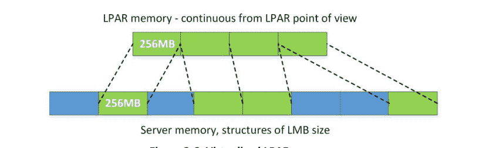
创建LPAR时，管理程序会尝试在连续区域内分配内存，这也符合物理位置的认知。但如果在服务器上的多个LPAR执行更改LPAR内存容量（增加或缩减）的操作，可能会导致内存分布不连续。在多处理器解决方案中，只要内存与分配的处理器“位置相近”，这一问题就不会造成影响。
内存虚拟化还有一个相关问题涉及管理程序本身的内存：管理程序会使用一部分不与LPAR共享的内存。部分服务器型号支持通过镜像管理程序内存来提升方案可用性，该功能被称为*主动内存镜像*或*管理程序内存镜像*。需要注意的是，管理程序内存镜像不适用于虚拟I/O服务器，相关内容会在本章后续部分介绍。此外，你也可以通过创建更多支持相同网络和磁盘流量的虚拟I/O服务器来提升I/O操作的可用性。

#### LPAR内存的基本参数
LPAR专用内存的基本参数在创建时设置，如图3-7所示：
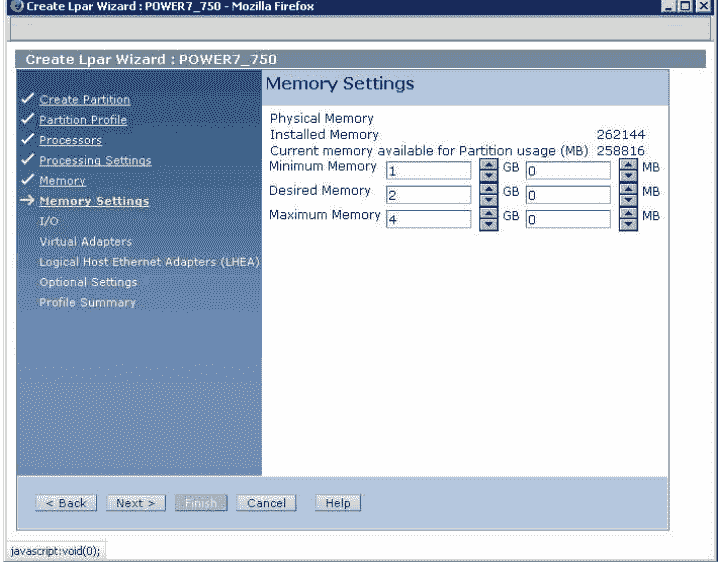
**图3-7：基本内存参数 - HMC**
- ***最小内存***：该LPAR可拥有的最低内存容量。如果服务器没有足够可用内存，LPAR将无法启动。如果动态从LPAR中移除内存，也不会将该值降低到该阈值以下。
- *期望内存*：LPAR的预期内存容量。只要服务器有足够的空闲RAM，LPAR启动时会使用该容量的内存。
- *最大内存*：无需重启分区即可分配给分区的最大内存容量。该参数的值不宜设置得过高，否则会导致两处真实内存损耗：
  1. 从整个服务器的视角来看，提高*最大内存*参数会使管理程序使用的内存量增加，因此LPAR可用的内存量会减少（会损失约定义为*最大内存*的内存量的1/64）。
  2. 从LPAR的视角来看，可用内存会被用于支撑*最大内存*容量的结构占用，这些结构会在LPAR启动过程中在内存中创建。

### 主动内存扩展（AME）
*主动内存扩展*功能基于内存压缩实现。虽然该功能在操作系统层面运行，但需要在管理控制台层面配置，且需要对应的许可。AME随POWER7处理器家族一同推出，在POWER7+或更新款处理器上运行时效率高得多，因为这些处理器支持硬件压缩与解压。该功能可以在物理内存有限的情况下，创建更多LPAR或配置内存容量更大的LPAR。当然，这会消耗处理器资源，因为需要执行额外的计算工作。但通过设置合理的压缩参数，额外开销可以极小，仅占百分之几到百分之十几。
创建启用*主动内存扩展*的LPAR时，需要设置两个参数：
- *主动内存扩展*：启用/禁用该功能。启用或禁用内存压缩都需要重启LPAR。
- *主动内存扩展系数*：LPAR内存的压缩系数，范围为1.00~10.00。AME开启时，该系数可以动态调整。该系数决定了操作系统可见的内存容量，计算方法为：管理控制台分配给LPAR的内存容量（*期望内存*）乘以该系数。不同压缩率下的LPAR示例如表3-5所示：

#### 表3-5：AME - 不同压缩系数下的内存容量
| LPAR | 期望内存（GB） | AME状态 | AME - 压缩系数 | 操作系统可见内存（GB） |
|-------|---------------------|-----|--------------------------|-------------------------------------------|
| LPAR1 | *4* | 开启 | 1.0 | *4·1 = 4* |
| LPAR2 | *4* | 开启 | 1.5 | *4·1.5 = 6* |
| LPAR3 | *4* | 开启 | 1.8 | *4·1.8 = 7.2* |


| **LPAR4** | 4 | ON | 3.0 | 4*3 = 12 |
| --- | --- | --- | --- | --- |
运行在操作系统上的应用程序无法感知内存压缩机制，因此该机制对它们完全透明。当然，这一结论的前提是合理选择压缩比。如果应用程序占用了所有可用内存，过高的压缩比设置会对性能造成严重影响。这类情况下，尽管应用程序并不知道系统启用了内存压缩，但会因等待持续压缩、解压缩所需的处理器周期而出现性能下降。

操作系统启用内存压缩功能时，会将可用内存划分为两个池。为了更直观地说明该方案，我们假设一个拥有10GB内存、且启用了AME（主动内存扩展）功能、压缩比为2.0的LPAR（逻辑分区），对应情况如图3-8所示。
- *非压缩池*：操作系统以传统方式操作的非压缩内存，其容量随时间动态变化，由压缩比和操作系统占用的内存量共同决定。
- *压缩池*：压缩后的内存，其容量与非压缩池类似随时间动态变化，由压缩数据的总量决定。

只要当前使用的内存能够装入*非压缩池*，即使压缩比设置得非常高，操作系统也不会使用*压缩池*。如果*非压缩池*无法容纳正在使用的内存，AME会将访问频率最低的内存页压缩后移至*压缩池*，从而释放*非压缩池*中的内存。如果应用程序访问处于压缩状态的内存页，会触发*页错误*；随后该内存页会被解压缩并移回*非压缩池*，之后应用程序即可正常执行所需操作，完全不会感知到操作系统执行的解压缩和内存迁移操作。

关于AME有以下注意事项：
- AME不会压缩*固定内存*（即永远无法被换入换出空间或由AME压缩的内存）。
- AME不会压缩文件系统缓存，因此使用AME时建议限制文件缓存的最大容量（可通过*vmo*命令的*maxclient%*参数配置）。
- 运行压缩或加密类应用程序的系统无法从内存压缩功能中获益。
- AME仅压缩4KB大小的内存页。
- 压缩功能的使用需要额外的处理器周期，不过合理配置下该负载极低。
- 如果压缩比设置得过高，可能会出现*内存短缺*。这意味着由于压缩比过低或大量数据不可压缩，操作系统可识别到的内存容量无法达到预期。这种情况下，无法装入内存的结构会被换出到换入换出空间，会严重拖慢操作系统运行速度，内存短缺的实例如图3-9所示。

尽管存在上述限制，大多数系统仍可在最大限度降低CPU性能损耗的前提下成功使用该机制。你可以使用*amepat*工具轻松验证这一点，该工具在AIX系统上无需对应授权即可直接使用。

#### 使用主动内存扩展（AME）
启用AME可能会带来性能影响方面的潜在风险，也会引发“系统应当使用何种压缩比最合适”的疑问，而*amepat*工具可以同时解决这两个问题。无论服务器是否拥有该功能的授权，都可以通过操作系统使用该工具。该工具可执行必要的分析，并输出多套系统配置方案。你只要结合这些建议以及它们对系统负载的影响信息，即可选择最适合自身场景的选项。

*amepat*工具的使用示例如下：
```
# amepat 1 9
# Launch of nine one-minute samples.
# All unnecessary information has been omitted.
Active Memory Expansion Modeled Statistics :
-------------------------------------------------
Modeled Expanded Memory Size : 4.00 GB
Achievable Compression ratio :2.42
# The average compression ratio of the LPAR memory.
Expansion Modeled True Modeled CPU Usage Factor Memory Size Memory Gain Estimate
---------- --------------- ---------------- ---------------- ----------------
1.00 4.00 GB 0.00 KB [ 0%] 0.00 [ 0%]
1.07 3.75 GB 256.00 MB [ 7%] 0.00 [ 0%]
1.15 3.50 GB 512.00 MB [ 14%] 0.00 [ 0%]
1.24 3.25 GB 768.00 MB [ 23%] 0.00 [ 0%]
1.34 3.00 GB 1.00 GB [ 33%] 0.00 [ 0%]
1.46 2.75 GB 1.25 GB [ 45%] 0.00 [ 0%]
1.60 2.50 GB 1.50 GB [ 60%] 0.00 [ 0%]
Active Memory Expansion Recommendation:
---------------------------------------
The recommended AME configuration for this workload is to configure the LPAR with a memory size of 2.50 GB and to configure a memory expansion factor of 1.60. This will result in a memory gain of 60%. With this configuration, the estimated CPU usage due to AME is approximately 0.00 physical processors, and the estimated overall peak CPU resource required for the LPAR is 0.80 physical processors.
# All unnecessary information has been omitted.
```

从上面的示例可以看出，运行分析的结果会输出多组配置建议。最后一项建议使用1.6的压缩比，并将物理内存从4GB缩减至2.5GB。采用该配置后，压缩带来的额外CPU占用率仍为0%。测试过程中，该LPAR仅使用了少量可用内存，内存使用率未超过2.5GB，因此即使启用了压缩功能，也不会造成处理器周期的损耗。这种情况下，分析结果显示该LPAR的内存容量超出了实际需求，因此建议仅需缩减物理内存容量并开启压缩功能即可。如此一来，会释放出部分内存可供其他用途使用，但对于正在运行的应用程序而言完全不会有感知变化。

分析工作的关键在于选择合适的执行时机，建议在预期系统负载会升高时执行。同时建议拉长分析的运行周期，以保证结果的可靠性。配置选择不当可能会对系统性能产生负面影响。

尽管内存压缩对应用程序完全透明，但你可以轻松在操作系统层面读取其配置信息，获取正确配置信息的命令是lparstat：
```
# lparstat -i
# All unnecessary information has been omitted.
Online Memory : 6144 MB
Memory Mode : Dedicated-Expanded
Target Memory Expansion Factor : 1.50
Target Memory Expansion Size : 9216 MB
```
该命令输出显示系统拥有6144MB物理内存，已开启压缩功能且压缩比设置为1.5，因此系统总内存容量可达9216MB。你可以使用vmstat -c、lparstat -c或topas等工具监控AME的运行状态。

### 主动内存共享（AMS）
上一节介绍了主动内存扩展（AME）机制，该机制在LPAR层级运行，支持LPAR使用超出其实际拥有的内存容量。本节介绍的主动内存共享（AMS）机制可实现类似效果，即支持使用超出服务器实际总内存的容量，二者的主要区别在于：AMS在整台服务器层级运行，而AME仅在LPAR层级运行。


**图3-10：主动内存共享（AMS）- 运行方案**
AMS比AME更复杂，运行前需要做更多准备工作。运行主动内存共享时，需要将一部分内存拆分为专用的AMS共享内存池结构，同时还需要配备带有专用逻辑卷或磁盘的虚拟I/O服务器（VIOS），这些磁盘用于实现所谓的分页设备功能。
上图所示的结构包括：
#### AMS共享内存池
这是一个供一组分区共享的独立内存池，每台服务器上仅能存在一个此类池。逻辑分区（LPAR）要么完全使用共享内存，要么完全使用专用内存，不允许在同一分区内混合使用不同类型的内存。管理程序可以动态为LPAR分配内存，也可以从中回收内存。这意味着同一块内存区域可以先分配给一个LPAR，之后再分配给另一个LPAR。借助该机制，分区不会出现未使用的闲置内存，因为闲置内存会退回至内存池，一旦有新的内存需求，就会分配给指定的LPAR。此类操作的内存利用率非常高，因为它们以4KB的区块为单位进行操作，这是操作系统的典型区块大小。
#### VIOS分页设备
运行在*AMS共享内存池*中的LPAR所声明的内存容量可能超过该池的总容量（即超配），若使用此类内存池，这是可取的，因为超配能够提升内存利用率。但可能存在这样一种情况：大量LPAR同时上报内存需求，总需求超出内存池的可用容量。解决该问题的方法是使用部署在指定VIOS上的专用分页设备（为保障高可用性，通常会配置1到2个VIOS）。但遗憾的是，上述情况会导致内存页与分页设备之间进行数据交换。这是一种有效的防护机制，但可能会导致受该进程影响的LPAR出现明显的性能下降。需要注意的是，每个LPAR都会分配一个专用的分页设备，因此要运行该机制，所需设备数量与在内存池中工作的LPAR数量必须一致。
#### 主动内存共享管理器（AMSM）
这是位于管理程序中的核心代码，是该机制的核心，负责管理内存池、为LPAR分配或回收内存，并与VIOS协同工作，指令VIOS从分页设备写入或读取内存页。从LPAR获取内存页有两种方式：
- **租借**：这种情况下由操作系统自行指定不再需要的内存页，自愿将这些页面出借，通过这种方式获取的内存页不会对系统性能产生负面影响。
- **强取**：这种情况下，AMSM会以“强制”方式获取内存页，事先会通过VIOS将这些页面的内容保存到对应的分页设备中。管理程序始终强取使用频率最低的页面，作为被操作对象的操作系统内核会向管理程序提供内存页使用相关的统计数据。
#### 协同内存管理器（CMM）
它是操作系统内核的功能模块，作用是与AMSM协同工作，提供各个内存页的权重信息，同时指定可捐赠的页面，并提供页面使用统计数据，管理程序会利用这些统计数据来“强取”相关页面。
#### 主动内存去重（AMD）
内存共享流程缺少不了去重机制的支撑，此处也提供了该机制（主动内存去重，AMD）。AMD可针对所有使用AMS的LPAR统一开启或关闭，不支持为单个LPAR单独开启该机制。去重能够大幅降低所需内存容量，因此可实现大容量内存超配。你可以设想一个简单场景：你运行4个安装有相同版本操作系统、运行相同类型应用的LPAR，由于加载的应用代码相同，每个LPAR的内存内容在很多区域都是一致的。因此，去重机制不需要为每个LPAR单独存储4次相同信息，仅需存储1次该信息，再将其“映射”到每个LPAR对应的内存地址即可，该场景如图3-11所示。
**图3-11a：LPAR内存示例 - 未开启去重**
**图3-11b：LPAR内存示例 - 开启去重 - 物理内存使用量更低**
**图3-11：AMS - 去重**
去重机制不会立即生效。你不能期望在同时启动多个相同的LPAR时，全局内存利用率会马上下降。该机制在后台运行，管理程序会通过计算每个页面的签名来构建内存映射表。当管理程序有更多空闲计算资源时，就会检索该映射表，执行去重流程合并页面。如果有使用同一页面的LPAR修改了该页面，就会触发COW（*写时复制*）流程：内存页会被复制到新位置，并映射到原有LPAR内存页的地址，之后才会修改其内容。
和其他同类机制一样，AMS也存在一些你需要注意的限制：
- 使用该功能的LPAR必须使用共享模式的处理器（不允许使用专用模式）。
- LPAR只能配备虚拟设备（虚拟SCSI、虚拟光纤通道-NPIV、虚拟串口、虚拟以太网），不允许使用物理设备。
- 操作系统无法使用4KB以外的区块，对于大规模使用64KB页面的应用，这可能会产生一些负面的性能影响。使用AMS时，应用必须使用4KB页面，因此其运行所需的处理器周期可能比使用64KB页面时更多。
关于*主动内存共享*的详细信息可参阅出版物《IBM PowerVM虚拟化主动内存共享》，该出版物可通过以下链接获取：<https://www.redbooks.ibm.com>
### 虚拟I/O服务器（VIOS）- I/O虚拟化
将虚拟化拆分为负责处理器和内存虚拟化的独立组件，以及负责I/O操作虚拟化的独立组件，这种划分方式乍看之下可能令人意外，尤其是对于在x86平台上从事虚拟化相关工作的人员而言。但这种方式具备显著的合理性，具体体现在以下方面：
- 稳定的CPU和RAM虚拟化内部生态，可由服务器内嵌的简单管理程序代码提供支持。
- 复杂多变的I/O操作生态，可由专用的虚拟化软件——虚拟I/O服务器提供支持。
从AIX管理员的角度来看，VIOS就是一个经过深度定制的AIX系统，专门用于与管理程序协同工作，并对I/O操作提供最优支持。使用虚拟I/O服务器时，你通常会在权限受限的受限Shell中工作，仅能访问专门预设的命令，这些命令大多是AIX命令的别名。运行oem_setup_env命令后，你将成为VIOS的root用户，可访问传统的AIX命令。
虚拟I/O服务器是一种LPAR，你可以向其分配物理设备（磁盘、局域网适配器、SAN适配器），以此对这些设备进行虚拟化，并将它们提供给服务器上的其他LPAR使用。单台服务器上可以部署多个VIOS，既可以为特定系统创建专用VIOS，也可以分别创建专门处理磁盘流量、网络流量的专用VIOS。通常使用1个或2个VIOS的两种典型配置，这两种典型配置以及使用多个VIOS的非常规配置如下图所示。
- **单VIOS服务器**：这是小型服务器和测试系统的典型配置。单个VIOS不会对虚拟化造成任何限制，在单个VIOS上你可以使用多路径访问磁盘和局域网，在单个适配器故障时非常有用。但该配置无法充分发挥平台在最大化可用性方面的潜力。如果仅部署1个VIOS，一旦它出现故障，所有使用该VIOS的LPAR都将无法使用。此外，每次VIOS重启（例如由于打补丁）时，使用它的LPAR都必须关机，或通过实时分区迁移等机制迁移到其他服务器。


塞巴斯蒂安·比德龙
单个VIOS的服务器虚拟化方案如图3-12所示。
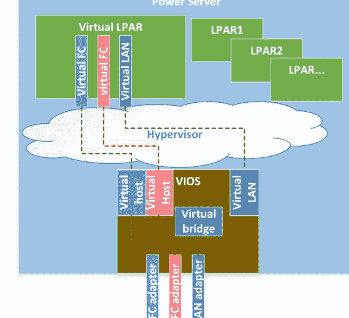
**图3-12：单VIOS服务器**
- **双VIOS服务器**
这是一种支持完全冗余的典型部署方案。两个VIOS可同时为逻辑分区（LPAR）提供服务，其中任意一个发生故障或计划内重启，都不会导致服务器上的分区不可用，因为另一条VIOS的访问路径依然可用。部署双VIOS在提升系统可用性的同时，还支持以交替模式对VIOS进行系统性补丁更新。双VIOS服务器的虚拟化方案如图3-13所示。
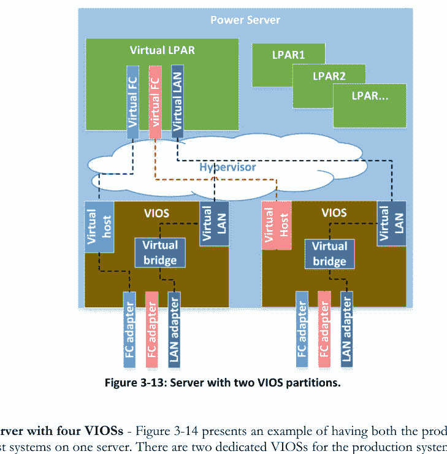
- **四VIOS服务器**
图3-14展示了单服务器同时承载生产系统与测试系统的示例：生产系统配备2台专属VIOS，测试系统同样配备2台专属VIOS。从更广泛的角度来看，这也体现了VIOS的广泛应用及其众多的潜在使用场景。
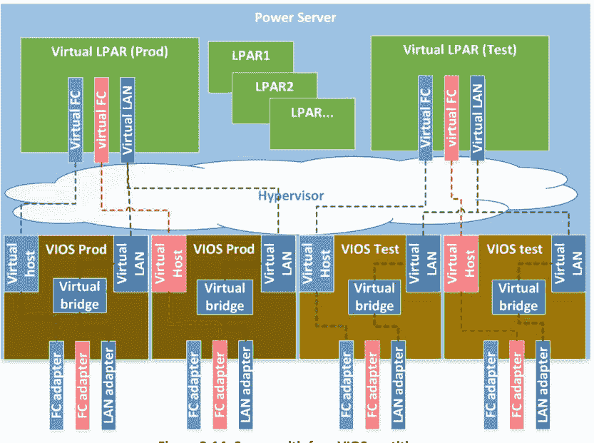
**图3-14：含四个VIOS分区的服务器**

#### VIOS部署规划
虚拟I/O服务器的部署流程本身比AIX操作系统的部署流程简单得多。由于VIOS是高度专用化的系统，部署过程中可选择的配置项并不多。不过，提前合理规划配置、确定部署所需的物理组件是十分重要的。
VIOS可部署在与串行连接SCSI（SAS）总线相连的内置磁盘上，也可部署在外置磁盘阵列的磁盘上。通常情况下，都会选择内置磁盘作为部署载体。选择内置磁盘部署VIOS的原因主要有以下几点：
- **可将磁盘阵列、SAN/LAN网络故障隔离**
试想以下场景：若磁盘阵列损坏，我们将同时无法访问操作系统与VIOS，这种情况会加大故障排查难度，延长系统恢复时间。
- **磁盘故障后可快速恢复VIOS**
试想以下场景：因管理员操作失误导致VIOS崩溃，需要从备份中恢复VIOS，而问题就出在选取恢复系统的目标磁盘时。如果是内置磁盘，选择很简单，因为它极有可能是唯一的内置可启动磁盘；但如果选用外置存储子系统的磁盘，很容易选错目标磁盘——这些磁盘之前是通过VIOS映射给LPAR使用的。恢复界面仅提供有限的可用磁盘信息，进一步加大了正确选择目标磁盘的难度。

## AIX、PowerVM——UNIX、虚拟化与安全
对于需要互备高可用（HA）的双VIOS部署场景，需保证两个VIOS安装所用的内置磁盘无共用组件。二者不能通过同一个磁盘控制器连接，对于大型服务器而言，还不能位于同一个模块（CEC，即中央电子组件）中。
对于多VIOS部署场景，一个尤为重要的要点是确定需要被虚拟化的组件（即物理适配器）。模块化服务器的相关配置可参考下方示例：假设你使用的是IBM Power System 870服务器，这是一款模块化服务器。本示例假设你使用的服务器由两个模块组成，不含任何外置I/O组件。这种情况下，两个VIOS需互备配置为高可用模式。以下是一个组件部署与分配规划示例，可保障服务器的最高可用性。图3-15展示了一些值得遵循的规则，下方将对这些规则进行说明，并解释其适用原因。
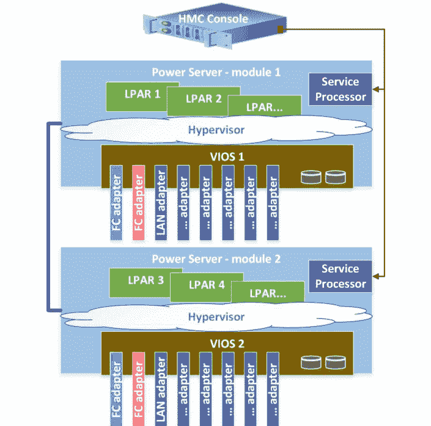
**图3-15：模块化服务器上的VIOS分区**
塞巴斯蒂安·比德龙
- **系统磁盘分置不同模块**
每台虚拟I/O服务器物理部署于不同的服务器模块中，其磁盘配置为镜像模式。建议尽可能让每块磁盘部署在独立的控制器上。
- **外部适配器与系统磁盘同模块部署**
VIOS管理的所有外部适配器都与VIOS的系统磁盘部署在同一个模块中。建议为虚拟I/O服务器配备专属高速网络端口，在使用*实时分区迁移*功能时这一要求尤为重要。这样可保证迁移流程快速完成，且不会干扰其他系统的网络流量。部署前请查阅服务器文档，将适配器插入合适的插槽，避免限制其性能。
- **所有VIOS组件分配至同一模块**
下方示例将解释这一要求的重要性：
- **某模块发生“重大”故障**
此处的“重大”指整个模块完全失效。由于服务器由两个模块组成，其中一个模块仍可正常运行。如果两个VIOS按照要求正确部署并互备配置为高可用模式，那么其中一个很可能可以持续运行（创建VIOS时，管理程序应尽量将内存、处理器资源分配在靠近物理组件的位置）。大约一半的LPAR也很有可能不受此次故障影响。即便故障导致所有系统关闭，一个服务器模块失效的情况下，仍可启动一台虚拟I/O服务器和一半的LPAR。
- **某模块发生“轻微”故障**
此处的“轻微”指例如处理器、内存故障等LPAR无感知的故障。POWER平台拥有多种RAS（*可靠性、可用性与可服务性*）解决方案，可在部件发生故障时提前检测故障，或将指令转发到其他处理器上继续执行。轻微故障虽然不会影响系统可用性，但仍可能需要开展维修作业，导致模块停用。若配置合理，可在不停机的情况下完成该操作，仅需停用其中一个VIOS，以及无法容纳到单个模块中的部分LPAR即可。

## AIX、PowerVM——UNIX、虚拟化与安全
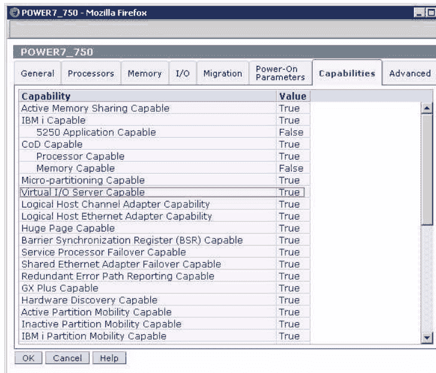
**图3-16：HMC——功能与VIOS**
从图中可以看出，虚拟I/O服务器功能已启用。后续部署步骤可分为以下几个要点：
- **创建LPAR**
创建LPAR时需指定其用途为VIOS，该流程与创建搭载AIX系统的客户端LPAR类似，区别在于VIOS必须部署在物理组件上。创建分区时需特别关注物理设备的分配，分配方案需与之前制定的规划保持一致。一个常见错误是将*最大虚拟适配器*的数量设置得过低，该值默认值为10，若不做修改会很快触达上限，届时需要重启VIOS才能调整该数值。
- **VIOS部署**
VIOS的本地部署可通过以下方式完成：使用DVD启动LPAR、通过HMC（使用NIMOL机制，即Linux上的NIMOL），或通过局域网的*网络安装管理器*进行部署。网络安装管理器的详细说明可参考AIX部署相关章节。VIOS部署流程本身的可选配置项并不多，由于VIOS需符合严格的功能定义，因此部署流程始终较为简单，仅包含少量的自定义配置项。
- **补丁更新**
部署任何软件时，都需要安装最新补丁并持续检查是否有新版本发布。VIOS补丁更新会有对应的部署说明，需严格按照要求执行。
- **配置**
该步骤涵盖系统的多项配置内容，包括用户配置、

## 塞巴斯蒂安·别德龙 监控、合适存储驱动程序的安装、系统加固、共享网络配置等。该主题内容非常广泛。因此，值得参考相关文档，尽管其中部分问题也将在本章后续讨论。不过仍有一些初始建议值得考虑：
- 拥有全部权限的主用户名为`padmin`。该用户运行在受限shell中，因此他拥有完整的配置权限，但仅能使用预先为其准备的命令。用户可用的命令可通过`help`命令查看，也会作为别名显示在用户的`profile`文件中：
```bash
# head -15 /home/padmin/.profile
export PATH=/usr/ios/cli:/usr/ios/utils:/usr/ios/lpm/bin:/usr/ios/oem:/usr/ios/ldw/bin:$HOME
if [ $LOGNAME = "padmin" ]
then
    ioscli license -swma
fi
export SHELL=/usr/bin/ksh
alias backup="ioscli backup"
alias restore="ioscli restore"
alias chbdsp="ioscli chbdsp"
alias mvbdsp="ioscli mvbdsp"
alias rmsp="ioscli rmsp"
alias mkrep="ioscli mkrep"
alias chrep="ioscli chrep"
```
- VIOS基于AIX系统。你可以使用`oem_setup_env`命令获取`root`权限。使用该命令后，你可以像在AIX操作系统中一样在VIOS中操作。通常需要安装存储驱动程序或监控客户端。
- 始终使用VIOS专属命令，以专用VIOS用户的权限进行操作。`root`用户仅在必要时使用。

### 存储虚拟化
虚拟I/O服务器（VIOS）存在的核心原因之一就是存储虚拟化。在POWER平台上，可用于实现存储虚拟化的方案有很多，你可以通过以下方式实现存储虚拟化：
- VSCSI（虚拟SCSI）
- NPIV（N端口ID虚拟化）
- VSCSI与共享存储池

该平台的一大特色是支持对特定功能不做虚拟化，你可以将物理资源直接分配给逻辑分区（LPAR），这样能获得更高的带宽和性能，但会牺牲灵活性。

后续关于存储的讨论会涉及该领域的关键术语，因此需要在此先明确这些术语的定义：
- **SCSI** - 小型计算机系统接口。该术语包含两层含义：
  1. 定义载波和传输参数的物理总线。过去该总线常被用于服务器，如今已被光纤通道等技术取代。
  2. SCSI协议，规定了设备间的通信方式。至今它仍是用于存储设备通信的协议，也被光纤通道协议、iSCSI和FCoE等其他协议所使用。
- **FCP - 光纤通道协议**。该协议用于SAN（存储区域网络），是SCSI协议的载体，服务器通过它对存储呈现的磁盘执行操作。
- **LUN - 逻辑单元号**。该名称源自SCSI术语。从服务器视角看，它是一块磁盘；从存储视角看，它是一个逻辑结构，意味着会给指定服务器呈现一块指定大小的存储空间。
- **SAN - 存储区域网络**。一种为低延迟、高带宽设计的高速网络，用于连接存储数据的设备（磁盘阵列、磁带驱动器等）与服务器。
- **SAN 结构**。一组互连的SAN网络设备（交换机）。在企业配置SAN网络时，通常使用两个结构，二者物理隔离，每台服务器和每个存储设备都通过独立的适配器连接到两个结构上，这种配置可构建高可靠的网络。
- **HBA - 主机总线适配器**。在本场景中，它是连接到SAN网络的光纤通道适配器，使服务器能够访问外部存储提供的磁盘。

#### VSCSI（虚拟SCSI）
VSCSI是VIOS提供的最早的存储虚拟化形式。磁盘通过连接虚拟I/O服务器与客户逻辑分区（LPAR）的虚拟SCSI通道，连接到各个LPAR。
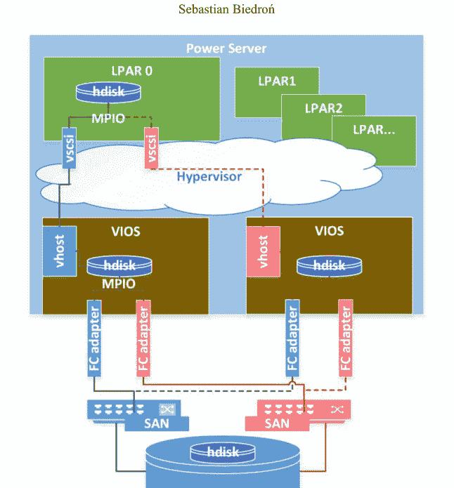
**图3-17：虚拟SCSI。**
如上例所示，客户分区通过虚拟SCSI通道连接到两个虚拟I/O服务器（数量可多可少）。上述场景中，同一个LUN从外部存储呈现给两个VIOS，并映射到客户LPAR。分区识别到同一磁盘被两个VIOS映射，会创建一个具有两条访问路径的单一设备，每条路径分别通过一个虚拟I/O服务器。其中一条路径为主路径，另一条为备份路径。路径的优先级决定了与磁盘通信所使用的VIOS。为了实现负载均衡，你可以设置路径优先级，让一部分LPAR的磁盘由一个VIOS提供服务，另一部分由另一个VIOS提供服务。

上述示例展示的是最常见的场景之一，即将原始磁盘（LUN）映射到客户分区。你也可以将VIOS内部创建的文件或逻辑卷映射到客户分区，还可以使用后续会介绍的共享存储池。不同方案的差异如表3-6所示，各列含义如下：
- **LUN** - 将LUN直接映射到LPAR。LUN是VIOS识别为另一块*hdisk*的设备。
- **SSP** - 共享存储池。将共享存储池中创建的结构映射到客户LPAR。
- **LV** - 将VIOS上创建的逻辑卷或文件映射到客户LPAR。

##### 表3-6：SCSI映射差异
| 特性 | LUN | SSP | LV |
| :--- | :---: | :---: | :---: |
| 是否支持通过多个VIO映射（高可用性） | 是 | 是 | 否 |
| 是否支持将LPAR“热迁移”到其他服务器（实时分区迁移） | 是 | 是 | 否 |
| 是否支持在外部存储层复制二进制数据 | 是 | 否 | 否 |
| 是否支持在VIOS层使用快照、精简配置和克隆 | 否 | 是 | 否 |
| 是否支持在外部存储层使用快照、精简配置和克隆（若外部存储支持） | 是 | 否* | 否* |
* 三种方案都支持成功使用精简配置。

通过VSCSI，你可以在虚拟I/O服务器上创建虚拟光驱设备和镜像仓库。这样你就可以维护一个安装软件仓库，可随时在服务器上的任意LPAR上“挂载”该仓库。这种情况下，分区使用挂载的镜像的方式与使用物理CD/DVD设备类似。

#### VSCSI操作示例场景
##### 为LPAR扩容磁盘
假设你有一个包含两个VIO的配置，希望在不影响高可用方案的前提下，将两块新增的、供数据库使用的磁盘映射到LPAR，因此这两块磁盘需要同时连接到两个虚拟I/O服务器。

第一步，你在外部磁盘阵列上创建LUN，并将其映射到两个VIO的对应HBA上。在两个VIO上检测磁盘：
```bash
$ cfgdev
```
磁盘已被检测到。如果磁盘数量较多，可能会遇到识别问题，此时最好使用存储子系统软件提供的信息（不同存储的信息会有差异）。另外，你也可以通过/dev目录下代表这些磁盘的文件的创建时间来验证设备。本例中，两个VIO上都新增了hdisk4和hdisk5（两个VIO上的编号可能不同）。

如果通过多个VIO映射磁盘，需要在每个VIO上禁用SCSI预留。如果不执行该操作，当主虚拟I/O服务器发生故障时，LPAR将无法通过备用VIOS使用替代访问路径，因为磁盘已被主VIOS预留。

检查SCSI预留状态：
```bash
$ lsdev -dev hdisk4 -attr | grep reserve_policy
reserve_policy    single_path    Reserve Policy    True
```

Sebastian Biedroń

# AIX、PowerVM —— UNIX、虚拟化与安全
```bash
$ lsdev -dev hdisk5 -attr | grep reserve_policy
  reserve_policy    single_path    Reserve Policy                    True
```
磁盘保留功能已启用，因此需要在两台VIOS上都将其禁用：
```bash
$ chdev -dev hdisk4 -attr reserve_policy=no_reserve
hdisk4 changed
```
```bash
$ chdev -dev hdisk5 -attr reserve_policy=no_reserve
hdisk5 changed
```
虽然这一步不是必需的，但此时为磁盘设置唯一标识符（物理卷标识符，PVID）是不错的选择。如此一来，您就可以轻松地在两台VIOS和LPAR上识别对应磁盘，因此执行以下操作：
```bash
$ chdev -dev hdisk4 -attr pv=yes
$ chdev -dev hdisk5 -attr pv=yes
```
下一步是将磁盘映射到LPAR，更准确地说，是映射到LPAR连接VIOS所使用的VSCSI控制器。从VIOS端来看，该控制器对应*vhostX*设备。因此，当您从HMC（硬件管理控制台）读取VIOS连接LPAR所用的插槽标识符时，就能识别出VIOS端的对应设备。经识别该插槽为98，示例如下：
```bash
$ lsmap -all | grep C98
vhost10 U8233.E8B.062177P-V1-C98 0x00000014
```
通常，LPAR会通过单个控制器连接到VIOS。因此，您也可以使用LPAR ID来识别VIOS端的设备。您可以从HMC读取LPAR ID的值，本例中该值为20。将十进制值转换为十六进制后得到14，接下来您需要查找对应的*vhost*设备：
```bash
$ lsmap -all | grep 0014
vhost10 U8233.E8B.062177P-V1-C98 0x00000014
```
在第二台VIOS上执行相同操作。不同VIOS上的设备名称和磁盘编号可能不同，请务必仔细核对。随后，在兩台VIOS上都将磁盘映射到对应的*vhost*设备：
```bash
$ mkvdev -vdev hdisk4 -vadapter vhost10 -dev aix72_data1
aix72_data1 Available
```
```bash
$ mkvdev -vdev hdisk5 -vadapter vhost10 -dev aix72_data2
aix72_data2 Available
```
上述命令的最后一个参数表示连接的名称，该值对于明确配置信息非常重要。建议在此处包含部分LPAR名称，这样可以更清晰地验证VIOS上的映射关系，从而减少出错概率。映射完成后，您可以执行以下操作验证：
```bash
$ lsmap -vadapter vhost10
SVSA Physloc Client Partition ID
--------- -------------------------- -------------------
vhost10 U8233.E8B.062177P-V1-C98 0x00000014
```
```bash
VTD: aix72_data1
  Status: Available
  LUN: 0x8300000000000000
  Backing device: hdisk4
  Physloc: U78A0.001.DNWHWGD-P1-C2-T1-W50050768013047ED-L400000000000
  Mirrored: false
VTD: aix72_data2
  Status: Available
  LUN: 0x8400000000000000
  Backing device: hdisk5
  Physloc: U78A0.001.DNWHWGD-P1-C2-T1-W50050768013047ED-L500000000000
  Mirrored: false
```
> # 所有无关信息均已省略。当磁盘已完成两台虚拟I/O服务器的映射后，即可进入客户端分区操作。在LPAR上进行磁盘检测：
```bash
# cfgmgr
```
系统已检测到新磁盘：*hdisk1*和*hdisk2*。您可以验证这些磁盘具有冗余性，且能通过两台VIOS正常访问：
```bash
# lspath | egrep "hdisk1|hdisk2"
Enabled hdisk1 vscsi0
Enabled hdisk2 vscsi0
Enabled hdisk1 vscsi1
Enabled hdisk2 vscsi1
```
如您所见，每块磁盘通过每台VIOS都有两条路径，其中一条为被动路径。这种情况会导致其中一台VIOS承载两块磁盘的I/O流量，另一台则作为备份。您可以通过调整路径优先级来平衡两台VIOS的负载，使每台VIOS各自负责一块磁盘的活跃流量，同时作为另一块磁盘的备份。初始状态下两条路径优先级相同，因此两块磁盘的流量都由编号最低的设备（*vscsi0*）对应的VIOS承载：
```bash
# lspath -AE -l hdisk1 -p vscsi1 -w `lspath -l hdisk1 -p vscsi1 -F'connection'`
priority 1 Priority True
# lspath -AE -l hdisk1 -p vscsi0 -w `lspath -l hdisk1 -p vscsi0 -F'connection'`
priority 1 Priority True
```
调整路径优先级，执行以下操作：
```bash
# chpath -l hdisk1 -p vscsi0 -a priority=10
path Changed
# chpath -l hdisk2 -p vscsi1 -a priority=10
path Changed
```
完成上述调整后，*hdisk1*的流量将由*vscsi1*连接对应的VIOS承载，*hdisk2*的流量则由*vscsi0*连接对应的VIOS承载。客户端侧的磁盘仍需要调整部分参数，其默认参数通常如下所示：
```bash
# lsattr -El hdisk1
PCM                PCM/friend/vscsi        Path Control Module             False
algorithm          fail_over                Algorithm                       True
```
| 参数 | 值 | 描述 | 可修改 |
|-----------------|-------------------|------------------------------|------------|
| hcheck_cmd | test_unit_rdy | 健康检查命令 | 是 |
| hcheck_interval | 0 | 健康检查间隔 | 是 |
| hcheck_mode | nonactive | 健康检查模式 | 是 |
| max_transfer | 0x40000 | 最大传输大小 | 是 |
| pvid | none | 物理卷标识符 | 否 |
| queue_depth | 3 | 队列深度 | 是 |
| reserve_policy | no_reserve | 保留策略 | 是 |

为了提升磁盘的性能和可靠性，需要修改以下参数：
- **hcheck_interval**：默认值为0，表示不会对磁盘的路径进行检查。将该值设置为60后，会在路径处于非活跃状态时每60秒自动执行一次路径检查，这对于双VIOS配置至关重要。启用该设置后，重启某一台VIOS时，LPAR会自动检查通过该VIOS的路径并将其恢复为在线状态。如果不开启该设置，在依次重启VIOS（例如更新系统时）会导致LPAR因无法访问磁盘而宕机。将该参数设置为60后，VIOS完成维护重启后，系统会自动验证路径并将其置为可用状态。
- **queue_depth**：即磁盘队列深度。默认值3会严重限制I/O操作的性能，建议将该值调整为VIOS上配置的磁盘队列深度（通常为20~30）。关于该参数的更多说明可参阅性能考量相关章节。

在磁盘上修改以下参数：
```bash
# chdev -l hdisk1 -a hcheck_interval=60
hdisk1 changed
# chdev -l hdisk2 -a hcheck_interval=60
hdisk2 changed
# chdev -l hdisk1 -a queue_depth=20
hdisk1 changed
# chdev -l hdisk2 -a queue_depth=20
hdisk2 changed
```

此外，您还需要修改*vscsi*接口的配置：
- **vscsi_err_recov**：默认值为*delayed_fail*（延迟失败），将其修改为*fast_fail*（快速失败）后，发生故障时能够更快切换到备份路径，降低用户感知到服务中断的概率。
- **vscsi_path_to**：即*vscsi*的超时设置。将该参数设置为30后，发生故障时会更快触发超时，减少切换到备份路径前的延迟。

首先查看vscsi0的默认VSCSI参数：
```bash
# lsattr -El vscsi0
rw_timeout        0                  Virtual SCSI Read/Write Command Timeout    True
vscsi_err_recov   delayed_fail       N/A                                         True
vscsi_path_to     0                  Virtual SCSI Path Timeout                  True
```
修改参数：
```bash
# chdev -l vscsi0 -a vscsi_err_recov=fast_fail -P
vscsi0 changed
# chdev -l vscsi0 -a vscsi_path_to=30 -P
vscsi0 changed
```
重启LPAR后，您将获得两块配置完成的全新磁盘，之后即可按照原计划执行后续配置步骤。

### 在VIOS上配置软件仓库
通过DVD安装软件非常繁琐，需要前往服务器室将光盘插入光驱。解决方案是使用VIOS的VIOS介质仓库（Media Repository）和虚拟介质库（Virtual Media Library）功能，您可以在虚拟I/O服务器上创建DVD镜像仓库，服务器上的任何LPAR都可以通过虚拟光驱使用这些镜像。本次操作中，您将在虚拟I/O服务器上创建仓库并加载AIX 7.2安装镜像。我们在rootvg卷组中创建4GB大小的仓库，您也可以选择其他专用卷组：
```bash
$ mkrep -sp rootvg -size 4G
Virtual Media Repository Created
Repository created within "VMLibrary" logical volume
```
验证仓库。此时已创建空仓库，其物理存储位置为/var/vio/VMLibrary文件系统：
```bash
$ lsrep
Size(mb)  Free(mb)  Parent Pool  Parent Size  Parent Free
4079      4079      rootvg       81792        43904
$ df -k | grep VMLibrary
/dev/VMLibrary  4194304  4176952    1%     4  1% /var/vio/VMLibrary
```
下一步是从仓库中的AIX 7.2安装镜像创建虚拟磁盘。先从物理介质制作ISO文件，将其复制到VIOS上，再创建虚拟磁盘：
```bash
$ mkvopt -name AIX72TL0SP2DVD10F2 -file /home/padmin/AIX_V7.2_TL_72002_DVD10F2.iso -ro
```
指定文件已复制到仓库中，并以给定名称注册为只读介质：
```bash
$ lsrep
Size(mb)  Free(mb)  Parent Pool  Parent Size  Parent Free
4079      921       rootvg       81792        43904
Name                 File Size  Optical  Access
AIX72TL0SP2DVD10F2   3158       None     ro
$ ls -l /var/vio/VMLibrary
total 6466112
drwxr-xr-x 2 root  staff   3310649344 Sep 29 14:22 AIX72TL0SP2DVD10F2
drwxr-xr-x 2 root  system  256 Sep 29 14:09 lost+found
```
如果后续需要向仓库中添加更多镜像，您可以随时扩容：
```bash
$ chrep -size 1G
# Expands the repository by 1 GB
```


Sebastian Biedroń

#### 将存储库中的镜像映射到LPAR
LPAR仅当其配备虚拟光驱设备时，才能使用存储库。因此，你需要识别出对应待执行安装流程的LPAR的`vhost`设备（识别`vhost`设备的具体流程在「添加磁盘空间」相关场景中有更详细的说明）。本场景中对应的设备为`vhost7`。为通过`vhost7`标识的LPAR创建虚拟光驱设备：
``` $ mkvdev -fbo -vadapter vhost7 vtopt0 Available ```
该LPAR有一个空置设备：
``` $ lsmap -vadapter vhost7 | SVSA | Physloc | Client Partition ID | |--------|--------------------------|---------------------| | vhost7 | U8233.E8B.062177P-V2-C23 | 0x00000010 | | VTD vtopt0 | Status Available | LUN 0x8100000000000000 Backing device Physloc Mirrored N/A | ```
将AIX 7.2安装镜像加载至虚拟设备：
``` $ loadopt -vtd vtopt0 -disk AIX72TL0SP2DVD10F2 ```
镜像加载完成：
``` $ lsmap -vadapter vhost7 | SVSA | Physloc | Client Partition ID | |--------|--------------------------|---------------------| | vhost7 | U8233.E8B.062177P-V2-C23 | 0x00000010 | | VTD vtopt0 | Status Available | LUN 0x8100000000000000 Backing device /var/vio/VMLibrary/AIX72TL0SP2DVD10F2 Physloc Mirrored N/A | ```
``` $ lsvopt | VTD | Media | Size(mb) | |-------|------------------------|----------| | vtopt0 | AIX72TL0SP2DVD10F2 | 3158 | ```

### 性能注意事项
从理论上讲你可能认同该说法，但实际中性能差异通常很小。性能差异巨大的流言源于一个事实：基于默认配置构建的NPIV配置可高效运行，而基于默认配置构建的VSCSI配置则会限制性能。问题在于，管理员通常会将参数保持为默认值，而非进行针对性优化。以下信息将介绍基于VSCSI配置磁盘空间虚拟化时需要注意的各个方面。

#### 磁盘队列
队列是非常关键的参数，LPAR能在指定LUN上同时执行的操作数量等于磁盘队列的长度。若队列包含3个元素，系统一次仅能执行3个操作，其余操作需排队等待。遇到的第一个问题是队列长度问题：LPAR侧的队列长度默认值为3，而VIOS侧的队列长度通常为20-30（具体数值可能因外部存储及其驱动而异）。
``` # lsattr -El hdisk1 | grep queue_depth # The default queue length from the LPAR Level. queue_depth 3 Queue DEPTH True # lsattr -El hdisk1 | grep queue_depth # The default queue length from the VIOS Level. queue_depth 20 Queue DEPTH True ```
因此，如果你通过将LUN从VIOS直接映射到LPAR的方式配置磁盘空间，应当对这些参数进行协调。20-30是通用值，适用于大多数场景。在某些场景下，将队列长度设置得高于该值可能产生正向效果，但具体表现取决于应用程序和存储的性能特征。修改队列设置时，需注意这些设置会影响整个传输链路。修改队列参数时必须考虑这一点，因为瓶颈可能出现在以下任一组件中：
- **外部存储主机总线适配器** - 单个端口在特定时刻可处理的操作数量是有限的。通常，外部存储端口的队列长度远大于主机端的队列长度，尽管与同一存储端口通信的主机数量可能很多。不过，通常无法调整该参数的大小。
- **主机总线适配器** - 本场景中指VIOS端口。每个端口都有其下挂的各个磁盘/LUN的父队列。通过非常精细的配置，你可以尝试将映射到某一端口的全部磁盘的队列长度调整至与端口队列长度一致。不过，考虑到磁盘队列几乎不会达到100%饱和，且不同系统不会同时出现饱和情况，这些参数通常的配置比例并不均衡。
- **VIOS上的磁盘** - 队列长度通常为20-30，一般由外部磁盘阵列驱动决定。
- **LPAR上的磁盘** - 队列长度默认值为3，性能表现不足，且与VIOS上同一磁盘的队列长度不一致。

传输链路中的队列及其他重要参数如图3-18所示。
``````
##### 图3-18：VSCSI - 队列长度及其他关键参数

### 双VIOS流量均衡
从高可用性角度来看，服务器上配置两个VIOS是非常典型的方案。该场景下，每块磁盘仅通过一个VIOS运行，另一个VIOS则维护备用路径，用于首个VIOS发生故障时启用。从性能角度来看，问题在于：无论分配给LPAR的磁盘数量有多少，每块磁盘默认都通过同一个VIOS运行。如果LPAR配备多块磁盘，应当对各条路径的优先级进行区分，使部分路径通过第一个VIOS运行，另一部分通过第二个VIOS运行。具体实现方法在本章的某个场景中有详细说明。此外，在由多块磁盘构成的卷组中创建逻辑卷时，必须应用跨所有磁盘条带化数据的分配策略。若卷组由较小的分配单元（小型物理分区）构成，即可实现磁盘间的高效条带化。修改路径优先级后，即可实现VIOS间的高效条带化。其他可能体现VSCSI劣势的方面还包括与系统可用性相关的默认参数，尤其是双VIOS构成的配置场景。

此类场景下需要修改的默认参数如下：

## 《AIX、PowerVM —— UNIX、虚拟化与安全》
- **保留策略** - VIOS上的磁盘参数。如果通过多个VIOS映射磁盘，需将该参数设置为`no_reserve`，默认值为`single_path`。
``` # chdev -dev hdiskX -attr reserve_policy=no_reserve ```
- **路径检查间隔** - LPAR上的磁盘参数。默认值为`0`，表示不进行路径检查。建议值设为`60`，即要求每60秒验证一次路径。
``` # chdev -l hdisk0 -a hcheck_interval=60 -P ```

其他需要注意的参数与SAN网络的运行相关，而非VSCSI本身。不过，修改FC端口（fscsiX设备）的设置非常重要。需要修改的参数如下：
- **快速故障恢复=快速失效** - 允许驱动快速响应某条路径上的问题。控制器会禁用该故障路径，从而支持使用其余正常路径运行。
``` # chdev -dev fscsiX -perm -attr fc_err_recov=fast_fail ```
- **动态跟踪=启用** - 使驱动能够感知并抵御SAN架构的潜在变更。
``` # chdev -dev fscsiX -attr dyntrk=yes ```

### NPIV（N_Port ID Virtualization，N端口ID虚拟化）
NPIV是SAN网络访问虚拟化的标准。该特性被多种硬件平台支持，在x86平台和POWER平台上的运作方式相似。为了说明其工作原理，有必要简要提及该特性在SAN中的起源。存储区域网络（SAN）允许用户共享其连接的所有资源。通过这种共享机制，单个磁盘阵列、单个磁带驱动器或连接到SAN的任意设备都可被多台服务器使用。在SAN网络中互连设备即可创建分区，分区有多种创建方式。最流行且通常最高效的方式是使用WWN（*全球通用名称*）地址。每个适配器端口都有其独有的WWPN（*全球通用端口名称*）地址。这是64位地址，示例如下：
``` # lscfg -vl fcs0 | grep Network Network Address.............1000000C99ACBF4 ```
在SAN、服务器和磁盘阵列上进行配置时，都会用到这些地址。不过，这些地址存在一个关键缺陷。这些地址过长，不符合SAN网络的设计理念：SAN网络的设计前提是最小化延迟、最小化不必要信息的传输。因此，网络自身会将64位WWN地址动态转换为24位的FCID（*光纤通道ID*）地址。这类地址由三部分组成：

- **域** 网络中的8位交换机标识符。
- **区域** 网络中的8位端口标识符（也可使用分配给节点的部分中的额外位）。
- **节点** 8位节点标识符。该部分地址用于环状网络中的设备场景。随着SAN中环状拓扑的使用越来越少，作为寻址要素的节点部分现已不再使用。这部分通常留空的地址区域支持NPIV功能，通过该功能可向单个物理端口分配更多地址。因此从SAN视角来看，物理端口地址和虚拟端口地址通常仅在最后8位存在差异。
寻址示例：
- `020200`（十六进制）—— 24位物理端口地址示例。
- `020203`（十六进制）—— 24位虚拟端口地址示例。
使用NPIV虚拟化访问SAN网络的优势在于，其工作模式与系统连接物理适配器时类似。因此你可以使用面向外部存储的高级驱动、在SAN中使用磁带驱动器，或是使用通常需要直接与外部存储通信的高级集群解决方案。

#### *AIX系统中的NPIV*
要在AIX操作系统中配置NPIV，需满足以下条件：
- 必须配备支持虚拟化的HBA适配器。所有速率不低于8Gb/s的适配器均支持该功能，但建议查阅设备文档进行确认。
- 必须持有虚拟化许可证，且至少部署一台虚拟I/O服务器（VIOS）。
- SAN需支持该解决方案，通常该功能仅在SAN交换机的特定端口上启用。

虚拟化操作与VSCSI场景类似，由VIOS执行。VIOS必须配备可被虚拟化的物理HBA。建议考虑部署双VIOS的高可用机制；否则，单一虚拟I/O服务器关机或故障将导致LPAR无法访问SAN。VSCSI场景下，磁盘阵列驱动会安装在VIOS上，LPAR使用原生VSCSI驱动。而使用NPIV时情况不同：虚拟I/O服务器无需安装任何额外驱动，因其仅将特定流量转发至LPAR。但LPAR必须能够识别磁盘阵列，通常需要安装对应磁盘阵列的支持驱动。该运行模式的优势在于，配置仅需在VIOS层面完成一次，后续无需在VIOS上执行任何操作即可完成从SAN到LPAR的设备/磁盘映射。NPIV在POWER平台上的工作机制如图3-19所示。
**图3-19：NPIV - 双VIOS分区。**

还需注意，队列在此场景中同样起着关键作用。虽然默认情况下已检测磁盘的队列长度已设置得较大，但仍需关注虚拟适配器与物理适配器的队列及其对应关系。请牢记，所有虚拟适配器虽有独立队列，但同时也会使用其在VIOS上绑定的物理适配器的队列。因此，若多个虚拟适配器绑定至同一物理适配器，需考虑在VIOS上调大物理适配器的队列，或调小LPAR上虚拟适配器的队列。
```bash
# lsattr -El fcs0 | grep num_cmd_elems
# A queue that you can modify on the physical and virtual adapters.
num_cmd_elems 500 Maximum number of COMMANDS to queue to the adapter True
```

#### *NPIV场景示例*
##### 通过NPIV将LPAR连接至SAN
本场景中，我们有一台名为5437v1的VIOS。我们将LPAR SB5437_AIX72连接至SAN网络，同时保留冗余能力（即同时连接至两个不同的Fabric结构）。我们为LPAR创建两个虚拟光纤通道适配器（图3-20），为VIOS创建两个虚拟光纤通道适配器（图3-21）：
**图3-20：** HMC - 创建虚拟光纤通道客户端适配器 - LPAR。
**图3-21：** HMC - 创建虚拟光纤通道服务端适配器 - VIOS。

添加构成LPAR与VIOS之间连接的虚拟适配器后，我们会检测到已创建的设备。LPAR上会检测到*fcs0*和*fcs1*设备：
*《AIX、PowerVM – UNIX、虚拟化与安全》*
```bash
# cfgmgr
```
```bash
# lsdev -Cc adapter | grep fcs
fcs0 Available C3-T1 Virtual Fibre Channel Client Adapter
fcs1 Available C4-T1 Virtual Fibre Channel Client Adapter
```
VIOS上会检测到*vfchost0*和*vfchost1*设备：
```bash
$ cfgdev
$ lsmap -all -npiv | grep -e "C30"
# We check the device corresponding to our adapter number: C30.
Vfchost0 U8233.E8B.062177P-V1-C30 20
$ lsmap -all -npiv | grep -e "C31"
# We check the device corresponding to our adapter number: C31.
Vfchost1 U8233.E8B.062177P-V1-C31 20
```

下一步，我们将vfchostX设备映射至VIOS上的特定物理FC适配器。需要先明确哪些适配器连接至哪个Fabric结构，据此配置冗余，使LPAR能够在两个独立的SAN结构上运行。本案例中，我们有两块可用于映射的FC适配器，每块物理适配器最多可支持64个虚拟适配器。
```bash
$ lsnpports
name physloc fabric tports aports swpns awwpns
fcs0 U78A0.001.DNWHWGD-P1-C2-T1 1 64 64 2048 2036
fcs1 U78A0.001.DNWHWGD-P1-C2-T2 1 64 64 2048 2036
```
执行映射操作：
```bash
$ vfcmap -vadapter vfchost0 -fcp fcs0
$ vfcmap -vadapter vfchost1 -fcp fcs1
```
随后检查映射状态，可以看到连接状态为*LOGGED_IN*，表示适配器已正确登录至SAN网络。
```bash
$ lsmap -vadapter vfchost0 -npiv
Name Physloc ClntID ClntName ClntOS
---------- ---------------------------------------- ------ ------------- -------
Vfchost0 U8233.E8B.062177P-V1-C30 20 SB5437_AIX72 AIX
Status:LOGGED_IN
FC name:fcs0 FC loc code:U78A0.001.DNWHWGD-P1-C2-T1
Ports logged in:1 Flags:a<LOGGED_IN,STRIP_MERGE>
VFC client name:fcs0 VFC client DRC:U8233.E8B.062177P-V20-C3
$ lsmap -vadapter vfchost1 -npiv
Name Physloc ClntID ClntName ClntOS
---------- ---------------------------------------- ------ ------------- -------
vfchost1 U8233.E8B.062177P-V1-C31 20 SB5437_AIX72 AIX
Status:LOGGED_IN
FC name:fcs1 FC loc code:U78A0.001.DNWHWGD-P1-C2-T2
Ports logged in:1 Flags:a<LOGGED_IN,STRIP_MERGE>
VFC client name:fcs1 VFC client DRC:U8233.E8B.062177P-V20-C4
```

此后，分配给虚拟适配器的WWPN地址将出现在SAN中。你可以开始创建对应的区域，将特定磁盘和其他设备映射至这些适配器。如果需要查看分配给虚拟适配器的WWN地址，可以从客户端LPAR侧或HMC侧查询：
```bash
# lscfg -vl fcs0 | grep Network
Network Address.............C0507602DD6E0204
# Checking from the LPAR side.
```
还可以从HMC侧查看WWN地址（图3-22）：
**图3-22：** 查看分配给虚拟适配器的WWN地址。
控制台上会显示分配给同一适配器的两个WWN地址。第二个地址（备份地址）在SAN中不可见，其作用是支持实时分区迁移（LPM）流程。若执行LPM迁移至其他服务器，备份地址将在迁移后的LPAR上可见，而原主地址变为备份地址。规划迁移操作时，需使用这两个地址在SAN中创建区域。有关实时分区迁移的更多信息，可在本章后续内容中查阅。

#### *NPIV与VSCSI对比*
目前存在一种观点，认为应尽可能使用NPIV替代VSCSI。这种观点通常基于“新技术对企业始终更优”的认知。但实际上，选择使用NPIV还是VSCSI，取决于企业的运营方式、业务规模或特定系统的个性化需求，二者均可成为合适的方案。为便于更清晰地了解不同方案的特性，相关内容已整理至表3.7中，包含评估结果及各选项的含义说明。在VSCSI场景中，我们假设VIOS仅用于将指定（整块）磁盘直接映射到特定LPAR。


##### 表3-7：NPIV与VSCSI对比
| 特性 | VSCSI评估 | NPIV评估 |
|---|---|---|
| *性能* | *经过额外配置后性能极佳* | *默认情况下性能极佳* |
| *配置工作量* | *VIOS和AIX侧工作量较大* | *存储侧工作量适中* |
| *管理* | *VIOS侧管理工作更多* | *存储侧管理工作更多* |
| *磁带驱动器和存储控制* | *缺乏或难以协同* | *协同性良好* |
***NPIV***
您拥有等效于物理适配器的虚拟HBA。因此，您可以在LPAR上使用专用驱动程序来管理外部存储提供的多磁盘访问路径。应用适当的驱动程序后，流量会在所有路径之间智能分配，从而优化性能。通常，分配给磁盘的默认参数（例如队列大小）在性能方面是正确的；因此，无需任何额外配置，您就能获得预期的性能。
***VSCSI***
外部存储驱动程序的安装在VIOS上执行。LPAR使用标准的VSCSI驱动程序。默认情况下，分配给LPAR磁盘的参数通常效率低下。只要进行额外的配置，效率就可以非常接近NPIV，该配置在VSCSI相关章节中有描述。从客户端LPAR的角度来看，此配置包括：
- 修改磁盘路径的优先级；
- 更改磁盘队列的长度；
- 提供磁盘间和路径间条带的适当卷组配置。
***NPIV***
在配置过程中，每个存储管理员必须：
- 为活动WWN地址创建区域（通常在两个fabric中）；
- 如果使用LPM功能，为非活动WWN地址创建区域（通常在两个fabric中）；
- 在存储上新WWN地址的上下文中创建适当的配置。
- Virtual I/O Server管理员必须在VIOS和HMC上执行初始配置。之后，所有磁盘都可以直接从存储映射到操作系统，无需在VIOS上进行额外配置。
***VSCSI***
配置系统时，存储管理员无需创建区域，因为这些区域是在VIOS初始配置期间创建的。出于同样的原因，他无需在新WWN地址的上下文中执行存储配置。在这种情况下，VIOS管理员必须检测新的LUN，并在必要时更改SCSI保留和性能的相关参数。之后，他必须将这些LUN映射到LPAR。操作系统管理员还必须执行一些额外操作：
- 更改性能和可用性参数（队列、运行状况检查等）；
- 更改部分磁盘路径的优先级，以平衡两个VIOS之间的负载。
***NPIV***
从进一步系统管理的角度来看，从存储本身添加、更改和删除磁盘等活动对VIOS是透明的。当您从其他存储将磁盘映射到操作系统时，可能必须安装新驱动程序，甚至添加额外的虚拟适配器。这种情况可能是因为同一适配器上无法同时使用多个驱动程序。在此配置中，“幻象”磁盘出现的可能性更低。删除LPAR后，WWN地址会变为非活动状态，更容易找到未使用的磁盘。删除LPAR需要额外的清理工作，例如删除相关区域和存储配置。
***VSCSI***
所有与添加、更改和删除磁盘相关的操作都需要在VIOS上进行干预。但是，无需在操作系统中维护存储驱动程序，因为这些驱动程序是在VIOS上维护的。从其他存储附加磁盘对LPAR是透明的，因为LPAR通过标准VSCSI驱动程序操作存储。对于此配置，删除LPAR后，仍然映射到VIOS的“幻象”磁盘出现的可能性更高。删除LPAR无需修改区域，也无需在存储侧更改与WWN地址相关的配置。
***NPIV***
NPIV具有与SAN物理连接的所有特性，因此可用于与磁带驱动器和磁盘阵列直接协同。这种与磁盘阵列的直接协同可用于高级配置，例如自动化多站点之间的集群操作，或控制数据复制。
***VSCSI***
由于VIOS的间接映射，*VSCSI*无法直接与磁带驱动器配合工作。例外情况是通过物理SCSI接口直接连接到VIOS的驱动器。通常，我们无法通过这种方式控制数据复制。

通过NPIV将SSP（共享存储池）磁盘空间映射到LPAR，或通过VSCSI将LUN直接映射到LPAR，存在一个主要缺点：创建LPAR或修改磁盘空间时，需要对外部存储（VSCSI）和SAN（NPIV）执行相关操作。这在大型公司中可能不太方便，因为这类公司的系统管理员和存储管理员通常是不同角色。的确，不同团队的成员对同一项活动可能采取不同的处理方式。为克服上述问题，使操作系统管理员和Power平台管理员能够独立操作，提出了共享存储池（SSP）概念。SSP在Virtual I/O Server上创建。您可以将SSP类比为扩展了新功能的卷组，这些卷组可以同时在多台服务器上处于活动状态。SSP的运行机制如图3-23所示。
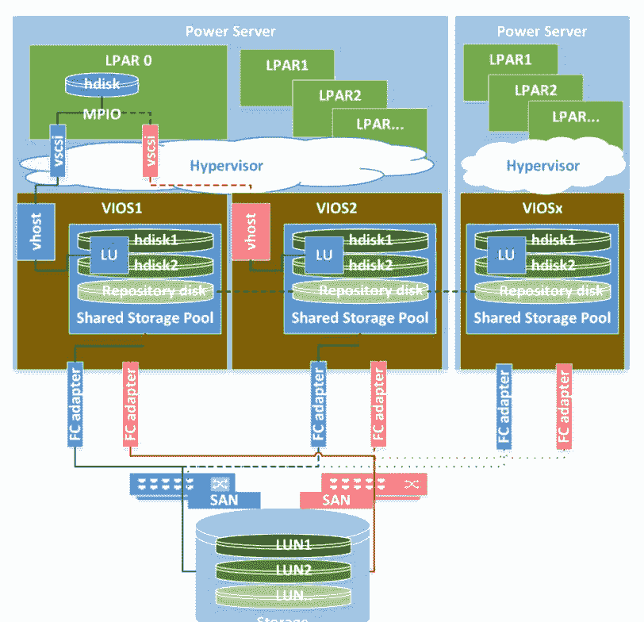
在SSP的磁盘上，您可以创建所谓的逻辑单元（LU），这些单元通过VSCSI呈现给LPAR，并在LPAR上被视为标准磁盘（*hdisk*）。通过搭建该结构，您可以在VIOS上获得附加的可使用功能，例如*精简置备*，或创建快照的能力。此外，分配给SSP的空间完全由Power平台管理员管理，简化了创建和修改LPAR的流程。单个SSP可被多个VIOS分区使用，其通过CAA集群机制（Cluster Aware AIX）和RSCT运行。安装过程使用存储库磁盘，其作用是在LAN故障时维护集群节点（VIOS分区）之间的替代信息交换路径。共享存储池的功能正在持续迭代更新，其当前限制详见：Sebastian Biedroń

##### 表3-8：共享存储池 - 限制
| 特性 | 最大值 |
|---|---|
| 集群中的VIOS分区数 | 16 |
| 可用于创建存储池的LUN数量 | 1024 |
| 池中创建的逻辑单元数 | 8192 |
| 单个VIOS上的LPAR数量 | 200 |
| 可用于构建存储池的LUN大小 | 16 TB |
| 存储池大小 | 512 TB |
| 映射到LPAR的磁盘（LU）大小 | 4 TB |

此解决方案的缺点是无法使用支持灾难恢复解决方案的外部存储系统的高级功能，如同步或异步复制。因此，SSP的理想适用场景是测试与开发系统，以及未使用外部存储级复制解决方案的生产系统。

### 网络虚拟化
网络虚拟化是高效虚拟化的另一个关键要素。在Power平台上，有多种方式可虚拟化对外部网络的访问：
- **共享以太网适配器（SEA）** - 基于Virtual I/O Server的经典虚拟化方法。该方法既是Power平台特有的，也是该平台上最常用的方法。
- **单根I/O虚拟化（SR-IOV）** - 一种相对较新、在IT领域广泛使用且适用于多种硬件平台的方法。它可以独立于Virtual I/O Server使用。SR-IOV是一项标准，允许以最少的虚拟机监控程序参与、且无需Virtual I/O Server即可虚拟化适配器，从而实现更高的传输性能。仅当您拥有专用的PCIe适配器时，才能使用此标准虚拟化网络。单个适配器最多可提供64个逻辑端口，这些端口可以分配给各个LPAR。此方法在Power平台上的一个重要扩展是可通过VIOS进行进一步虚拟化。您可以创建vNIC适配器，这类适配器在保留SR-IOV性能优势的同时，可由VIOS进行管理。这使您有机会将SR-IOV与动态分区迁移等高级虚拟化功能结合使用。
- **集成虚拟以太网（IVE）** - Power平台特有的虚拟化方法，也被称为主机以太网适配器（HEA）。它在较旧的服务器型号（Power 8之前）上可用。该方法旨在最大程度降低延迟、最大化带宽，同时提供虚拟化能力，其工作原理与SR-IOV类似。
接下来将更详细地讨论与*共享以太网适配器*功能相关的问题。


## AIX、PowerVM —— UNIX、虚拟化与安全
#### 共享以太网适配器（SEA）
共享以太网适配器是Power平台原生的一种外部网络访问虚拟化方法，它需要借助虚拟I/O服务器（VIOS）实现。它能够让多个逻辑分区（LPAR）共享物理局域网适配器，也支持多个LPAR通过独立的物理适配器进行网络通信。SEA支持大量VLAN，借助它可以打造可扩展且高可用的解决方案。这种虚拟化方法会使用嵌入机器固件和VIOS中的虚拟机监控程序，后者可实现服务器内置的内部虚拟局域网交换机的功能。单台服务器中可以存在大量虚拟交换机，其运行方式与物理交换机一致，工作于ISO OSI模型的第二层，支持创建多达4094个VLAN。每个虚拟网络适配器都分配有MAC地址，且位于你指定的VLAN中。由于虚拟交换机的运行逻辑与物理交换机类似，因此连接到同一虚拟交换机、且处于同一VLAN的LPAR可通过虚拟机监控程序在服务器内部互相通信。这种情况下，虚拟适配器之间的网络通信由虚拟机监控程序通过内存拷贝完成。而连接到不同虚拟交换机、或处于不同VLAN的LPAR则需通过外部网络才能互相通信，例如通过配置了SEA的VIOS连接外部局域网交换机。上述功能如图3-24所示。
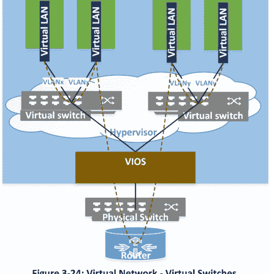

虚拟I/O服务器是实现与外部网络通信的核心组件，它充当服务器内部网络与外部世界之间的桥梁。通过使用VIOS，你可以创建连接内部与外部网络的SEA适配器。SEA适配器的数量没有限制，每个适配器可支持单个或多个VLAN，也可使用单条或聚合的物理链路。这类方案的典型配置如图3-25所示。
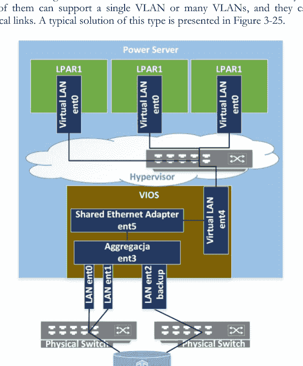

此外，你还可以通过在两个VIOS分区上分别创建SEA适配器，并通过“心跳”机制连接二者来保障高可用性。这种配置还能在其中一台VIOS的LPAR出现故障时，确保持续与外部网络通信。同时，使用*共享*模式还可实现两台VIOS之间的负载均衡：这种情况下，部分VLAN由一台VIOS提供服务，其余则由另一台提供。双虚拟I/O服务器的配置如图3-26所示。
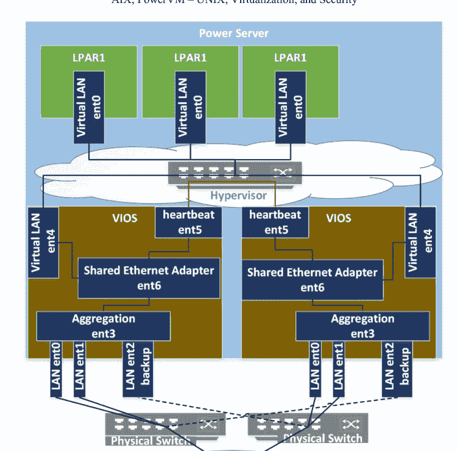

##### SEA配置场景
以下场景将演示如何配置VIOS对（VIOS1和VIOS2）以支持编号为22、23、24、25的VLAN。该配置旨在实现单台VIOS故障容错，以及两台虚拟I/O服务器之间的网络流量负载均衡。每台VIOS上都有一块物理适配器*ent0*，该适配器被配置为中继端口，支持22、23、24、25号VLAN。如果需要实现单台VIOS级别的冗余，可将多块适配器聚合为单一通信信道（*EtherChannel*，以太网通道），再用其创建*共享以太网适配器*。在第一台VIOS上，我们会创建三块将被识别为*ent1*、*ent2*和*ent3*的适配器，HMC上的适配器创建操作如图3-27所示。
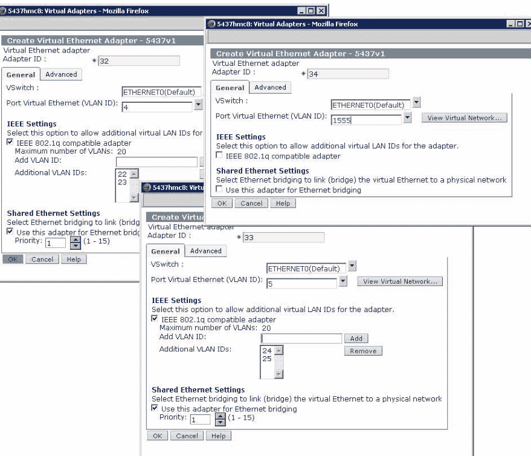

- **ent1**：ID为32的该适配器支持22和23号VLAN。“*端口虚拟以太网（VLAN ID）*”字段需填写唯一值，该值本身无实际意义，但必须唯一，且指向服务器上未使用的VLAN。该适配器被标记为*bridge*（网桥），优先级为*1*。
- **ent2**：ID为33的该适配器支持24和25号VLAN。“*端口虚拟以太网（VLAN ID）*”字段需填写唯一值，该值本身无实际意义，但必须唯一，且指向服务器上未使用的VLAN。该适配器被标记为*bridge*（网桥），优先级为*1*。
- **ent3**：ID为34的适配器是经典虚拟适配器，它位于1555号独立VLAN中，该VLAN是我们选定的、用于在VIOS1的SEA和VIOS2的SEA之间构建控制信道的VLAN。如果我们要搭建高可用（*Active/Passive*，主备）配置的共享以太网适配器，那么无需创建两块各支持两个VLAN的虚拟适配器，只需创建一块支持全部四个VLAN的适配器即可。但若要以*共享*模式搭建SEA，则需要将VLAN拆分到多块适配器上，以便每台VIOS都能处理部分VLAN。

在第二台VIOS上，我们会创建三块将被识别为*ent1*、*ent2*和*ent3*的适配器，HMC上的适配器创建操作如图3-28所示。
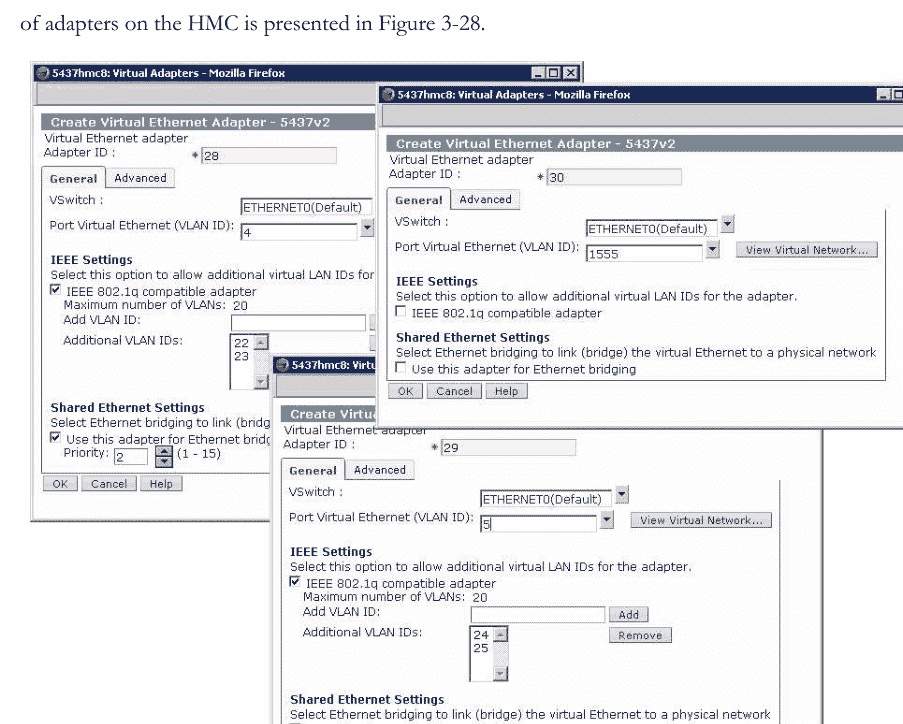

- **ent1**：ID为28的适配器支持22和23号VLAN，它等同于第一台VIOS上的*ent1*适配器，唯一区别是优先级为*2*。这意味着VIOS1上的适配器优先级更高，将处理列表中第一个VLAN的网络流量，VIOS2则处理列表中第二个VLAN的网络流量；两台VIOS分区都会保留备用路径，在其中一台出现故障时可以接管。
- **ent2**：ID为29的适配器支持24和25号VLAN，它等同于第一台VIOS上的*ent2*适配器，唯一区别是优先级为*2*。
- **ent3**：ID为30的适配器是经典虚拟适配器，它位于1555号独立VLAN中，该VLAN是我们选定的、用于在VIOS1的SEA和VIOS2的SEA之间构建控制信道的VLAN。

在第一台VIOS上，我们以*共享*模式创建*共享以太网适配器*：
```bash
# mkvdev -sea ent0 -vadapter ent1,ent2 -default ent1 -defaultid 4 -attr ha_mode=sharing ctl_chan=ent3
```
在第二台VIOS上，我们也以*共享*模式创建*共享以太网适配器*：
```bash
# mkvdev -sea ent0 -vadapter ent1,ent2 -default ent1 -defaultid 4 -attr ha_mode=sharing ctl_chan=ent3
```

上述对两台VIOS分区的配置，即在物理适配器（*ent0*）与虚拟适配器（*ent1*和*ent2*）之间创建网桥。两种情况下*ent3*适配器都是控制信道，其作用是诊断某台SEA是否发生故障，一旦出现此类故障，另一台SEA将自动接管。尽管*default*和*defaultid*参数对SEA的运行没有实际影响，但配置时必须填写这两个值：
- *default*：指定用于传输无标签以太网帧的适配器。无标签帧即不带有VLAN标签的帧，通常我们不会遇到此类帧，也不需要处理它们。
- *defaultid*：如果端口出现无标签以太网帧，系统会为其打上此处指定的VLAN ID标签。由于我们通常不需要处理无标签帧，因此本次配置会将其重定向到空VLAN以实现忽略。
最终配置如图3-29所示。
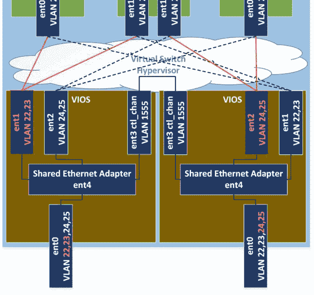

###### 性能
*共享以太网适配器*是非常便捷的解决方案，它支持配置高可用性，还能将部分性能配置迁移到虚拟I/O服务器层。因此，从LPAR的角度来看，仅需一块虚拟网络适配器即可，无需操心高可用性配置。从LPAR视角来看配置简单，是共享以太网适配器的核心优势。但SEA也存在一定的性能限制：大多数场景下SEA的性能足以满足多数应用的需求，但仍需注意以下几点：
1. **无法跑满物理适配器全速的问题**
该问题并非直接与SEA本身相关，而是由虚拟适配器的传输机制导致：两块虚拟适配器之间的传输无法达到10Gb/s高速物理适配器的全速，不过随着新服务器的普及，这一速度正逐步接近该数值。支持内部传输的虚拟机监控程序是导致这一问题的原因。通过使用大帧（即增大MTU参数、在以太网中启用巨帧）可以提升虚拟适配器之间的传输速度。使用大帧可优化虚拟机监控程序的工作效率，因为处理少量大帧比处理大量小帧的难度更低。无论帧的大小如何，虚拟机监控程序需要完成的工作量保持不变。
2. **VIOS处理器的负载问题**
通过*共享以太网适配器*进行网络流量管理是虚拟I/O服务器开销最大的操作之一。在Power5平台虚拟化技术发展初期，SEA传输1GB数据就会占用整个Power5核心的性能。此后硬件性能实现了数倍提升，算法也得到了优化，但你仍然需要留意可能出现的CPU负载。使用SEA和虚拟网络时，建议参考以下提示：
- **确保系统部署和寻址合理**
通过合理规划服务器上的系统部署，可以大幅优化网络传输效率。若将互相通信的多个LPAR部署在同一台服务器、同一VLAN内，即可确保低延迟，同时减少SEA和外部网络的负载，因为通信无需出服务器。若将互相通信的两台LPAR部署在同一台服务器但不同VLAN内，它们会通过外部交换机通信，这类网络流量可能会通过同一接口进出。
- **使用大帧**
大以太网帧（*巨帧*）可加速大批量数据的传输，同时还能降低SEA的负载。处理的帧数量对SEA负载影响显著，用更少的帧处理相同数量的数据，会降低VIOS的负载。巨帧应在物理接口和SEA本身层面同时启用。


关于该参数，在LPAR本身层级使用大MTU值也很有必要，这能够显著提升虚拟适配器之间的传输效率（甚至可提升数倍）。同时，在网络接口和共享以太网适配器（SEA）上启用*largesend*参数也很有必要。启用该选项后，服务器上的虚拟适配器之间会传输64KB的大帧，发往SEA的数据也会以该尺寸的帧进行传输。SEA可将相关任务卸载至物理网络适配器，从而减轻CPU负载。此场景下的任务是将大帧分片为更小的帧，以便向外部网络传输。

## 3. 考虑其他类型的网络接入
可以确定SEA适合90%的应用场景。但在某些情况下，尤其是使用极高传输速率的系统，你需要考虑采用SR-IOV或物理适配器。该方案能够降低SEA的服务器负载、提升传输性能。使用物理适配器还能将与传输构建和控制相关的工作卸载至适配器的硬件层（即所谓的卸载功能），从而减轻VIOS和客户端LPAR的负担。

### LPAR
如本章开头所述，LPAR有许多同义词，包括逻辑分区、分区、微分区以及SPLPAR（*共享处理器逻辑分区*）。尽管其中部分名称被用来指代Power平台虚拟化方案的全新形态，但口语中这些名称的含义完全相同。LPAR是服务器的逻辑组成部分，由特定资源构成：
- **处理器资源** - 资源有多种可用模式，且支持上文描述的各种运行状态。
- **内存** - 服务器内存的一部分，虚拟化程度随所选虚拟化方案的不同而有所差异。
- **虚拟适配器** - 用于访问局域网、磁盘空间或磁带驱动器。
- **物理适配器** - POWER平台独有的虚拟化特性，可让虚拟系统使用物理硬件。

上述所有组件均在本章各小节中有详细介绍。下文将重点介绍可在LPAR上执行的操作，以及从操作系统层面读取LPAR参数的方法。

#### 创建LPAR
创建分区有多种方案。在经常开展大量此类工作的组织中，通常采用自动化方案。你可以使用PowerVC等专用工具，也可以通过编写自定义脚本实现部分任务的自动化。即便采用全自动化方式创建系统，有时也值得手动走一遍完整流程，避免丢失关于流程步骤和功能的细节知识。若遇到问题需要开展故障排查时，这些细节知识尤为重要。基于HMC图形界面的手动创建LPAR流程如下：

从控制台菜单选择创建LPAR的选项，本例中为AIX/Linux LPAR。此外还支持创建VIOS和IBM i的LPAR。弹出的首个窗口如图3-30所示。

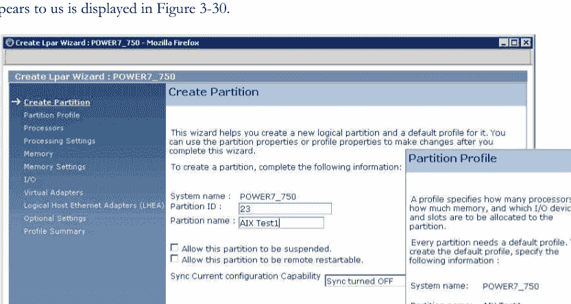
**图3-30：HMC - 创建LPAR**

创建AIX/Linux LPAR时，首个窗口中有多个可选配置项：
- *分区ID* - 单服务器级别的唯一标识符，系统控制台会自动分配首个可用编号，该编号通常对LPAR的运行没有影响。
- *分区名称* - 由管理员指定的名称，建议使用透明的命名规范，方便识别分区功能。
- *允许挂起该分区* - 用于冻结LPAR的选项，该功能正常运行需要正确的VIOS配置：VIOS需有专用磁盘空间用于转存被冻结分区的内存；同时LPAR也需具备相应配置（例如需完全虚拟化），此外该功能还有其他使用限制。
- *允许该分区远程重启* - 该选项支持在主服务器故障等场景下，在其他服务器上运行LPAR。但该选项不能被视为高可用解决方案，此类操作在LPAR自身配置、源服务器运行状态等方面存在诸多限制；若源服务器完全故障（包括服务处理器不可用），则无法通过该功能在其他服务器上启动LPAR。
- *同步当前配置能力* - 用于保持LPAR当前配置与配置文件中保存的配置一致性的选项。使用分区时的常见问题是两类配置不一致，通常是因为将变更应用到当前配置后，需要手动将变更保存到配置文件。如果不执行该操作，导致当前配置与配置文件出现偏差，就可能出现启动LPAR时使用的配置与关闭时的配置不同的问题。启用同步功能可确保配置文件与当前配置保持一致。
- *配置文件名* - 由管理员指定的配置文件名，该名称通常没有特殊要求，除非你需要为LPAR配置多个配置文件，此时文件名应体现配置文件的创建用途。

后续步骤将配置处理器参数（如图3-31所示），可选择*共享*和*专属*两种模式，两种模式的具体参数将在处理器虚拟化相关章节中详细介绍。

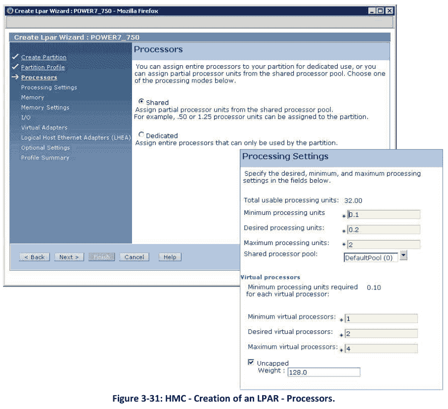
**图3-31：HMC - 创建LPAR - 处理器**

后续步骤将配置内存相关参数（如图3-32所示），该设置与处理器配置类似，同样分为*共享*和*专属*两种类型，相关运行模式和参数将在内存虚拟化章节中介绍。

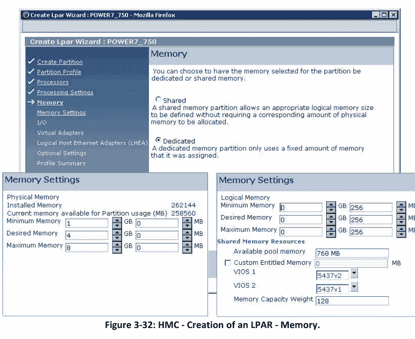
## 塞巴斯蒂安·比德翁
**图3-32：HMC - 创建LPAR - 内存**

下一步是为LPAR添加物理组件，服务器上的所有可用适配器均可添加到配置中。但需要注意，使用物理组件会触发LPAR运行的若干限制：无法使用许多高级功能，包括将系统实时迁移至其他服务器（*实时分区迁移*）、冻结系统状态并在之后恢复运行、以及使用*远程重启*功能。

无论是否添加物理组件，都需要创建虚拟适配器，此处有四种类型的适配器可选：
- **串行适配器** - 系统默认包含两个此类适配器：第一个用于通过HMC的虚拟终端登录系统，第二个用于LPAR与服务器/管理程序之间的内部通信。此外还可通过虚拟串行适配器连接服务器上的任意两个LPAR。
- **光纤通道适配器** - 可通过NPIV技术访问SAN网络的虚拟设备，该技术的更多细节将在存储虚拟化相关章节介绍。使用时需要在LPAR上创建客户端适配器（对应系统中的fcsX设备），同时在VIOS上创建服务器端适配器（对应系统中的vfchostX设备）。
- **SCSI适配器** - 可通过VIOS访问磁盘的虚拟SCSI设备，该技术的更多细节将在存储虚拟化相关章节介绍。使用时需要在LPAR上创建客户端适配器（对应系统中的vscsiX设备），同时在VIOS上创建服务器端适配器（对应系统中的vhostX设备）。


## AIX、PowerVM —— UNIX、虚拟化与安全
- *以太网适配器*
  一种虚拟以太网适配器，允许通过虚拟机监控程序在服务器内部进行网络传输。向服务器外部的传输通过虚拟I/O服务器（Virtual I/O Server）及其上配置的*共享以太网适配器（Shared Ethernet Adapter）*完成。更多信息请参阅网络虚拟化相关章节。图3-33展示了如何创建虚拟SCSI客户端适配器和虚拟以太网适配器。SCSI适配器指向两个不同的VIOS（图中的*服务器分区*选项），以及每个VIOS上的适配器编号155（*服务器适配器ID*选项）。每个VIOS上的适配器必须独立创建，然后与客户端适配器配对。虚拟以太网适配器支持VLAN 120中的通信，且工作在默认的虚拟交换机上。就适配器而言，您有多种可用于管理分配MAC地址的高级选项：
  - *MAC地址*
    该选项默认状态为*自动分配（Auto-Assigned）*，即自动分配MAC地址。选择*覆盖（Override）*选项后，状态会变为*用户自定义（User-Defined）*，您可以为适配器分配自定义MAC地址。
  - *最大服务质量（QoS）*
    可用于定义网络流量的QoS。提供0到7的等级，其中等级7优先级最高。
  - *允许所有操作系统定义的MAC地址*
    默认值。MAC地址由虚拟机监控程序自动分配给适配器，您可以在操作系统层面修改该地址。
  - *拒绝所有操作系统定义的MAC地址*
    这种情况下，您无法修改自动分配的MAC地址。
  - *指定允许的操作系统定义MAC地址*
    可用于定义该接口允许使用的最多4个MAC地址。

Sebastian Biedroń 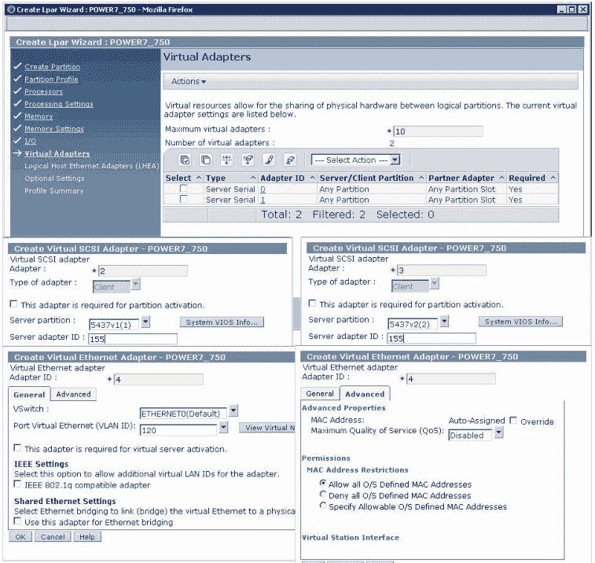
在下一步中，部分服务器提供主机以太网适配器配置选项。随后有一些可选设置，如图3-34所示：
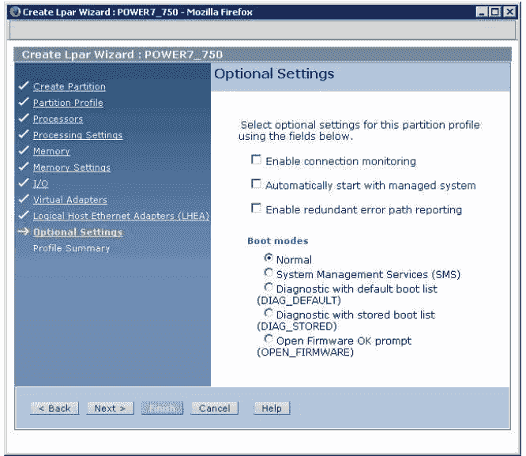
- *启用连接监控*
  该选项用于启用HMC与LPAR之间连接的监控。如果连接出现问题，会在控制台日志中生成事件。
- *随管理系统自动启动*
  选中该选项后，LPAR会在服务器启动后自动启动。
- *启用冗余错误路径报告*
  禁用该选项时，LPAR仅向控制台报告影响自身的错误；启用后，LPAR会向控制台报告涉及整个服务器的错误。
- *启动模式*
  LPAR默认启动的模式。通常使用*正常（Normal）*模式，除非需要执行诊断或通过将LPAR激活停止在*SMS*模式来辅助操作系统安装。

下一步可以验证配置并创建LPAR。该分区已准备好映射磁盘，通过网络安装管理器（Network Installation Manager）服务器或带有操作系统的经典物理/虚拟介质安装操作系统。

#### 可在LPAR上执行的操作
所有已定义的LPAR参数都可以从管理控制台修改。其中部分参数可以“热修改”，即系统运行时修改；另一部分参数需要读取新配置文件才能生效。要读取新配置文件，需执行以下流程：修改配置文件、关闭LPAR、从修改后的配置文件中启动LPAR。可执行的操作及对应执行方式详见表3-9。

##### **表3-9：更改虚拟化参数的方式**
| 操作 | 执行方式 | 备注 |
| --- | --- | --- |
| 虚拟CPU - 添加/移除 | 在线 | 在线执行，范围在*最小*与*最大虚拟处理器*之间。 |
| CPU - 添加/移除 | 在线 | 在线执行，范围在*最小*与*最大处理单元*之间。 |
| 内存 - 添加/移除 | 在线 | 在线执行，范围在*最小*与*最大内存*之间。 |
| 更改*最小/最大*值 | 更改配置文件 | 更改任何指定为*最大*和*最小*的值都需要更改配置文件：关闭LPAR，然后从修改后的配置文件启动LPAR。 |
| *受限/非受限* - 切换模式 | 在线 |  |
| *权重* - 非受限模式下更改优先级 | 在线 |  |
| 更改*共享/专用*模式 | 更改配置文件 |  |
| AME - 开启/关闭 | 更改配置文件 | AME（*主动内存扩展*）需要重启系统。启动时，系统会为AME创建专用结构。 |
| AME - 更改扩展系数 | 在线 | AME开启时在线执行。 |
| AMS – 从轮询中添加/移除 | 更改配置文件 |  |
| *虚拟SCSI适配器* - 添加/移除 | 在线 | 在线执行，需先从操作系统中解除配置后再移除。 |
| *虚拟以太网适配器* - 添加/移除 | 在线 | 在线执行，需先从操作系统中解除配置后再移除。 |
| *虚拟光纤通道适配器* - 添加/移除 | 在线 | 在线执行，需先从操作系统中解除配置后再移除。 |
| *共享处理器池* - 添加/移除CPU | 在线 |  |
| LPAR - 更改处理器池 | 在线 |  |

#### 从AIX验证LPAR参数
您可以从管理控制台和操作系统层面检查指定LPAR的参数。在AIX系统中，可以使用*lparstat*命令完成此操作。以下是该命令的运行示例，以及对最重要参数的说明：
```shell
# lparstat -i
Node Name : AIX72c2
Partition Name : AIX Test1
Partition Number : 23
# ID
LPAR-a. Type : Shared-SMT-4
# SMT is on, four threads per core.
Mode : Uncapped # Processor mode.
Entitled Capacity : 2.00 # CPU power guaranteed.
Partition Group-ID : 32790
Shared Pool ID : 0 # The LPAR is in the default pool.
Online Virtual CPUs : 2 # The system shows two cores in SMT-4 mode. Thus, you will see eight threads from the operating system level.
Maximum Virtual CPUs : 2
Minimum Virtual CPUs : 1
Online Memory : 2048 MB
Maximum Memory : 2048 MB # The maximum memory amount is equal to the current amount. To add more to the LPAR, a reboot is required.
Minimum Memory : 256 MB
Variable Capacity Weight : 128
Minimum Capacity : 0.10
Maximum Capacity : 2.00
Capacity Increment : 0.01
Maximum Physical CPUs in system : 32 # The number of processors in the server.
Active Physical CPUs in system : 32 # The number of active processors. Some processors can be activated later, for example, in the Capacity on Demand option.
Active CPUs in Pool : 28
Shared Physical CPUs in system : 28 # The LPAR is in the default pool, the size of which represents all the server's processor resources.
Maximum Capacity of Pool : 2800 # The size of the pool is expressed in 100 units per one core. The power of the processor can be allocated with this gradation.
Entitled Capacity of Pool : 1610 # The processor power that is assigned to all the LPARS in the pool in the Entitled Capacity parameter.
Unallocated Capacity : 0.00
Physical CPU Percentage : 100.00%
Unallocated Weight : 0
Memory Mode : Dedicated # Memory allocation mode. Below are a number of parameters regarding the allocation in Shared mode.
Total I/O Memory Entitlement : -
Variable Memory Capacity Weight : -
Memory Pool ID : -
Physical Memory in the Pool : -
Hypervisor Page Size : -
Unallocated Variable Memory Capacity Weight: -
Unallocated I/O Memory entitlement : -
Memory Group ID of LPAR : -
Desired Virtual CPUs : 2
Desired Memory : 2048 MB
Desired Variable Capacity Weight : 128
Desired Capacity : 2.00
Target Memory Expansion Factor : - # Parameters related to memory compression.
Target Memory Expansion Size : -
Power Saving Mode : Disabled
Sub Processor Mode : -
```
您还可以使用带其他参数的*lparstat*命令来监控当前LPAR的运行状态。

### 高级PowerVM功能
#### 实时分区移动（Live Partition Mobility, LPM）
实时分区移动（Live Partition Mobility, LPM）是Power平台和PowerVM虚拟化的功能之一，支持在服务器之间移动分区。其他虚拟化提供商也有类似功能，包括VMware（vMotion）和Microsoft（Hyper-V Live Migration）。


通过实时分区迁移（LPM）移动的系统可以处于运行状态并提供服务（主动LPM），也可以处于停用状态（非主动LPM）。在服务器之间迁移运行中的系统时，用户和系统上运行的服务均无感知，迁移期间使用系统的用户完全不会察觉此次操作。在服务器间迁移的逻辑分区（LPAR）可搭载AIX、Linux或IBM i操作系统。该功能可用于实现以下目标：
##### 减少系统不可用时间
服务器偶尔需要进入不可用状态：例如安装新固件时需要关闭服务器，有时因组件故障也必须执行此类操作。借助LPM，无需停用系统即可完成迁移：在修复所需的时间内，可将系统迁移至其他服务器，完成必要操作后再迁回原服务器。
##### 降低管理员工作负载
系统定期关机是非常繁重的操作，对于拥有大量IT系统的组织而言更是如此。该场景下的核心问题并非技术复杂度，而是需要在多个业务部门之间协调此类操作。部分组织中，关闭一个系统会引发连锁事件，导致后续系统也必须关闭并重启。这就需要做出大量协调安排，还需多个管理员团队提供支持。由于LPM操作对用户无感知，可减少所需的系统重启次数，从而降低组织内部的工作负载。
##### 服务器间负载均衡
单个系统的负载往往会持续增长。使用LPM可将负载分配到各服务器上，从而平衡整个环境的负载。
##### 轻松迁移至新服务器
Power平台的独有功能是支持LPAR以旧版POWER处理器的兼容模式运行。购买搭载新版处理器的新服务器时，可选择将LPAR迁移至新服务器，无需关闭LPAR。这类LPAR会以旧版处理器模型的兼容模式运行，直到你决定重启并更改运行模式。
##### 节能
借助无需停机即可迁移系统的能力，你可以定期将系统整合到更少的服务器上，然后关闭多余的服务器。你可以在平台负载较低的时间段执行此类操作，例如节假日、周末或夜间。

#### 迁移流程
塞巴斯蒂安·比德龙
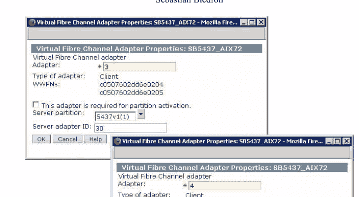
迁移流程可通过硬件管理控制台（HMC）的图形用户界面（GUI）或命令行启动。可同时执行多轮迁移，当前Power8服务器的支持参数为每台服务器最多16轮并行迁移，每个虚拟I/O服务器（VIOS）最多8轮。主动迁移和非主动迁移的流程基本一致，仅有一个关键阶段不同，该阶段涉及将当前LPAR的状态迁移至另一台服务器。
执行迁移需要满足以下条件：
- 管理控制台：HMC或集成虚拟化管理器（IVM）。需要注意的是，无法在由不同类型的控制台管理的系统之间执行迁移。控制台之间还需通过SSH密钥交换建立互信关系。
- 源服务器和目标服务器上的虚拟I/O服务器（VIOS），需标记为「迁移服务分区」。VIOS在同步服务器间LPAR状态的过程中起关键作用。源侧和目标侧的VIOS分区必须能访问分配给LPAR的相同磁盘资源。支持在每台服务器配置1个或2个VIOS LPAR的环境下执行迁移。
- 无任何物理组件的全虚拟化LPAR。

迁移流程本身可分为以下几个阶段：
##### 验证
需验证服务器侧可用资源（内存、处理器等物理资源）、固件版本、处理器类型等。验证过程在操作系统和VIOS上同步执行。目标VIOS必须支持源VIOS使用的VLAN，且能访问与源VIOS相同的磁盘资源。若磁盘通过VSCSI映射，则两个VIOS需以相同参数识别这些磁盘。验证失败的常见原因是磁盘配置在不常被关注的参数上不兼容（例如*max_transfer*参数）。
##### 创建新LPAR
在目标服务器上创建新的LPAR，新LPAR与旧LPAR完全一致，包括设备编号。设备编号通常对系统运行无影响，但对管理员而言很重要，能帮助其更清晰地了解环境。MAC地址等重要参数会迁移至新LPAR的接口上。若LPAR通过N_Port ID虚拟化（NPIV）连接到存储区域网络（SAN），则会出现一项重要变更：创建*虚拟光纤通道*适配器时，我们会配置两个全球名称（WWN）地址，一个处于活跃状态，另一个处于非活跃状态。新创建的LPAR将拥有相同的两个地址，但顺序相反。新旧LPAR短期内可同时访问同一组磁盘。WWN寻址的示例如图3-35所示。
##### 为LPAR创建资源
在VIOS侧（若使用双VIOS配置迁移LPAR，则为多个VIOS侧）会创建相应的资源以支持LPAR运行。这些虚拟资源会映射源VIOS侧的配置，例如*vhost*（支持VSCSI磁盘）和*vfchost*（支持NPIV磁盘）。尽可能保留原有设备名称。
##### LPAR状态迁移
该阶段仅在迁移主动LPAR时触发。处于「*迁移服务分区*」状态的源虚拟I/O服务器会通过局域网（LAN）将所有待迁移LPAR的状态信息发送至目标VIOS，包括：
- 分区内存内容；
- 处理器状态；
- 虚拟适配器状态；
- 其他信息。
迁移过程中，待迁移的LPAR仍会持续运行，内存部分内容也会发生变化。LPAR产生的所有变更都会被记录，并同步至目标服务器，直至完全同步。该运行模式要求VIOS分区之间具备高效的网络通信能力。若网络效率不足，可能导致LPAR修改内存内容的速度快于VIOS通过局域网发送数据的速度，此时迁移流程将无法成功。另一项重要关注点是VIOS分区间传输数据的安全性，可通过在虚拟I/O服务器之间构建安全隧道保障安全。完成LPAR状态同步后，源LPAR会被冻结，工作负载切换至新LPAR。该过程通常对应用程序或用户无感知，但若启用高级监控，可捕捉到LPAR响应时间的短期延长。
##### 移除旧LPAR并释放资源
后续阶段会清理源服务器上的配置，移除VIOS服务器上的旧LPAR及其设备。

#### LPM的主要使用要求
与x86平台上其他主流虚拟化器的实时迁移（Live Migration）通用功能相比，LPM似乎存在诸多限制。但仔细观察这些限制后你会发现，它们都是由PowerVM环境更丰富的配置能力导致的。若搭建非常通用的虚拟系统配置，通常不会遇到限制。使用*实时分区迁移（主动迁移）*需满足的主要条件如下：
##### 许可证
LPM功能仅在PowerVM企业版中提供。
##### 全虚拟化LPAR
要以*主动*模式执行迁移，LPAR必须为全虚拟化配置：
- 磁盘需通过VSCSI或NPIV映射；
- 需使用共享以太网适配器（SEA）与外部网络通信。当然，使用主机以太网适配器（HEA）的LPAR也可迁移，但仅当这些适配器与虚拟以太网适配器配对时才可。此类迁移的结果是HEA适配器从配对中被移除，操作系统后续在虚拟适配器上运行。最新变更是支持迁移使用单根I/O虚拟化（SR-IOV）的LPAR，前提是LPAR不直接使用SR-IOV，而是通过虚拟vNIC适配器使用。
##### 服务器兼容性
发生迁移的服务器必须相互兼容：
- *逻辑内存块大小*参数指定了可分配给LPAR的最小内存单元大小。要在*主动*模式下执行LPM操作，两台服务器的该参数必须一致。这一点非常重要，因为后续更改此参数需要重启整个服务器。
- 必须保持固件层级的兼容性。相关依赖限制并不严格，但若服务器的固件版本相差多年，则可能出现问题。迁移前请验证兼容性矩阵：*分区迁移固件支持矩阵*。
- 可在搭载Power 6、7、8处理器的服务器之间执行迁移。向搭载更新版本处理器的服务器迁移通常不会引发问题，迁移后LPAR会以旧版CPU的兼容模式运行。若要从更新版本的处理器向旧版处理器迁移，仅当LPAR运行在旧版服务器支持的处理器兼容模式下时才会成功。在服务器上运行LPAR时，必须了解是否

Sebastian Biedroń 以及迁移到哪些服务器，以使其在适当的兼容性模式下运行。
- ### 通信
  管理控制台、虚拟I/O服务器和逻辑分区（LPAR）均参与迁移过程。要执行迁移，需完成以下操作：
  - 确保控制台与过程中所有参与者之间通过*资源监控与控制*（RMC）子系统进行通信。默认情况下该通信已存在，因为需要通过控制台管理系统，但该通信可能不稳定，例如因网络问题导致。
  - 确保与参与迁移过程的虚拟I/O服务器之间通信高效。
  - 确保不同控制台之间配置受信任（若发生通信的服务器由不同控制台管理）。受信任通信通过SSH协议进行，需要提前完成控制台之间的密钥交换。
- ### 通过虚拟I/O服务器访问相同资源
  两台服务器上的虚拟I/O服务器必须提供对相同资源的访问权限：
  - 针对LPAR所在的VLAN，通过SEA（共享以太网适配器）提供通信。
  - 当LPAR通过VSCSI（虚拟SCSI）运行时，提供对配置方式完全一致的相同磁盘设备的访问权限。
  - 当LPAR使用NPIV（N_Port ID虚拟化）技术时，提供启用额外NPIV适配器的选项。
  此外，需要执行LPAR状态传输操作的虚拟I/O服务器分区必须标记为*移动服务分区*，如图3-36所示。
  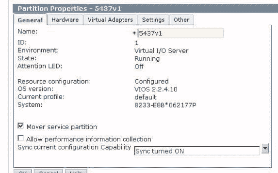
  **图3-36：** HMC - 移动服务分区。
  在执行首次迁移前，建议阅读相关文档。同时建议通过HMC执行验证操作。验证流程会检查已定义迁移场景下的依赖关系，并列出所有潜在的不兼容问题。验证流程示例如图3-37所示。
  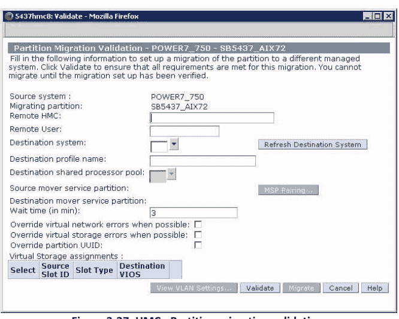
  若采用*非活跃*模式的LPAR迁移，则部分上述要求无需满足。
#### 挂起与恢复
在POWER平台上，挂起分区的操作会将分区的当前状态保存到磁盘空间中，随后释放其所占用的资源。被释放的资源包括运行内存和处理器算力。被挂起分区占用的所有资源均可用于其他任意用途。即使整个服务器重启后，分区仍会保持挂起状态，并且可以随时恢复。LPAR会从被挂起的时刻点恢复。这是通过恢复运行内存、虚拟处理器和设备的状态，并使用之前存储在磁盘空间中的数据实现的。所有已启动的应用程序会准确从挂起时的位置恢复运行，多数情况下它们甚至不会察觉到曾被挂起。不过，挂起操作在多个系统协同工作的大型环境中可能会导致一些问题，例如系统间会话过期，进而给后续通信造成困难。
#### 使用场景与要求
该功能可应用于以下几种典型场景：
- ### 运维维护
  运维维护可能需要停机。这种情况下，可以挂起服务器上运行的系统，完成必要操作后再恢复系统。系统在挂起期间不可用，但恢复运行的速度更快，且无需重启整个应用程序。
- ### 降低服务器负载与许可需求
  每个系统都有独立的工作周期，测试系统组是特殊场景。企业内可能部署大量测试系统，但同一时间仅有一台或几台处于实际运行状态。这种情况下，可将未运行的系统挂起，相当于永久关闭部分系统，因此支撑该环境所需的服务器数量更少。此外，许可配置相同的系统可在*共享处理器池*中运行。若部分系统被永久挂起，所需处理器数量和产品许可数量也会相应减少。
- ### 能耗管理
  挂起部分系统可实现部分服务器的临时关机，既能节省成本，也能降低对环境的影响。
- ### 加速迁移（LPM）
  对于内存容量较大的系统，可先将其挂起以加快迁移速度。如此一来，LPAR在迁移过程中不会修改内存，也不会产生额外的网络传输流量。
要使用*挂起/恢复*功能，需要满足以下基本要求：
- 需持有标准版或企业版的PowerVM虚拟化许可。
- 分区需启用该功能，对应选项为*允许挂起此分区*。该分区仅能包含虚拟设备，这与使用*实时分区迁移*功能的要求一致。
- 虚拟I/O服务器需有专用磁盘空间用于存储LPAR状态，该空间称为*保留存储设备池*。池中应为每个被挂起的LPAR分配一块独立的磁盘或逻辑卷，其容量等于待*挂起/恢复*的分区的内存容量，并额外增加10%用于存储附加数据。
- 操作系统、控制台和虚拟I/O服务器的版本均需支持该功能。由于该功能推出时间较早，所有相对较新的安装环境均能满足该条件。
#### 操作场景
##### 创建保留存储设备池
在以下场景中，我们将创建*保留存储设备池*，以便使用此前未启用的*挂起/恢复*功能，且该池由两个虚拟I/O服务器分区提供服务。第一步，我们将单个LUN屏蔽给两个虚拟I/O服务器分区，随后将其识别为hdisk6。下一步，我们创建*保留存储设备池*（图3-38）：
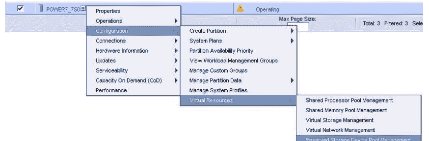
随后弹出窗口，可在窗口中选择分配给该池的设备（磁盘）（图3-39）：
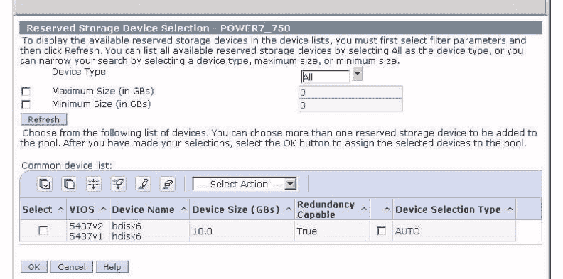
选择磁盘后，即可创建*保留存储设备池*，此时即可为内存小于10GB的单个LPAR使用*挂起/恢复*功能。若要挂起更多LPAR，则需要添加对应数量的磁盘，每个LPAR对应一块，磁盘容量需满足「对应LPAR的内存容量 + 10%」的要求。
##### LPAR挂起
我们决定挂起该LPAR。但在此之前，需要修改其配置以允许执行该操作。在分区属性菜单中，选择*允许挂起此分区*选项（图3-40）：
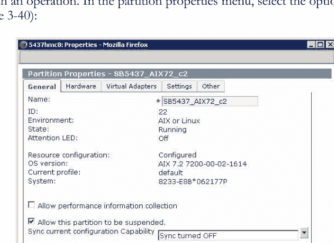
**图3-40：** HMC - 允许挂起此分区。
从分区菜单中启动*挂起*操作（图3-41）：
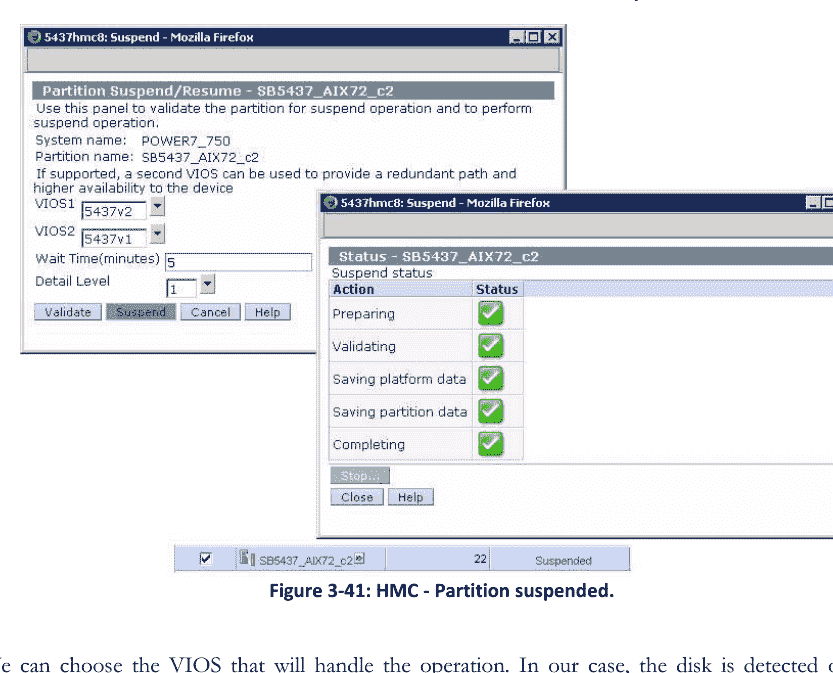
此时可以选择处理该操作的虚拟I/O服务器。在本场景中，两块虚拟I/O服务器均可识别该磁盘，因此具备冗余能力。若其中一块虚拟I/O服务器分区不可用，仍可选择另一块来恢复分区。点击*挂起*按钮后，所有标记为绿色的流程阶段执行完成后，工作负载将被挂起。分区被挂起后，即使整个服务器重启，仍会保持该挂起状态。恢复分区仅需从菜单中选择*恢复*选项即可。
#### 动态平台优化器（DPO）
支持多处理器的大型服务器结构复杂，由多个插槽组成，每个插槽又可包含多个核心。每个插槽都配有专属的内存bank。给定服务器的所有插槽均可访问整台服务器的内存，但不同场景下访问内存所需的时间可能存在差异。访问距离自身最近的内存的处理器的运行效率，要高于访问分配给其他插槽的内存的处理器。该场景如图3-42所示。


LPAR1 - 靠近内存的处理器
LPAR2 - 与内存不在同一插槽的处理器
其他 LPAR

图 3-42：动态平台优化器 - CPU 与内存。创建新的 LPAR 或为现有 LPAR 添加资源时，管理程序会确保服务器上的资源分配达到最优状态。不过，这并不总能实现。在频繁删除、创建 LPAR 的场景下，内存会发生碎片化。创建新 LPAR 时，管理程序可能无计可施，只能在多个插槽上分配内存。扩展 LPAR 内存时也可能出现类似情况。显然，经过大量创建、删除、调整 LPAR 容量操作的利用率较高的服务器，无法一直保持最优运行状态。过去，解决这个问题只有一种方式：关闭服务器上的所有分区，删除分配给这些分区的资源信息，然后从最重要的分区开始依次启动。启动 LPAR 时，会为每个 LPAR 重新分配物理内存。不幸的是，服务器上持续的操作（即创建、删除、变更 LPAR 资源）会导致服务器进入非最优运行状态。针对这一问题，*动态平台优化器（DPO）*功能可提供解决方案。该功能无需关闭 LPAR，就能改善单个 LPAR 的内存和 CPU 资源分配。这通常涉及将部分 LPAR 的内存内容重写到其他位置，使处理器能够使用距离最近的周边内存。图 3-43 展示了该优化过程的示例。

## AIX、PowerVM —— UNIX、虚拟化与安全
使用 DPO 时，需确保受该功能影响的操作系统均支持它。如果系统不支持 DPO 功能，变更反而可能导致性能下降。这是因为操作系统本身会基于自身可用的资源优化运行。如果系统不支持 DPO，它不会意识到发生了资源变更，会使用过时的信息优化自身运行。重启对应的 LPAR 即可解决这一问题，重启会刷新有关平台的信息。你也可以将这类 LPAR 从优化流程中排除。机器的固件负责实际的优化流程。DPO 相关的操作可通过 HMC 使用以下命令启动：
- *lsmemopt* - 计算优化带来的收益，同时验证当前运行状态。
- *optmem* - 启动或停止指定服务器的优化。
优化并非必须在整台服务器层面执行，部分 LPAR 可以从该流程中排除。计划使用该功能前，请确认服务器固件版本、HMC 或操作系统版本的相关要求。由于相关操作需要在服务器内部复制内存，因此应安排在负载较低的时段执行。

#### 动态系统优化器（DSO）
操作系统完全知晓自身所运行的硬件、架构以及分配给自身的资源，这是 PowerVM 虚拟化相比竞争性 x86 架构解决方案的一大优势。得益于这种硬件感知能力，操作系统可以优化自身运行。优化涵盖诸多方面，甚至可以在内存碎片化严重的场景下保障系统高效运行。其运行原理可通过图 3-44 所示的简单示例很好地说明。

在上图中，系统（LPAR1）的内存分布在服务器上，且位于多个不同插槽的周边。操作系统会尽量优化自身运行逻辑：在距离*socket 0*最近的内存上运行的进程，会被调度到*socket 0*上的处理器执行；在距离*socket 1*最近的内存上运行的进程，则会被调度到*socket 1*上的处理器执行。上述这类部分优化会在无感知的情况下自动运行。不过，*动态系统优化器*的功能值得关注，它默认处于禁用状态。该功能可能会影响系统在服务器缓存内存层面的运行表现。DSO 子系统负责该功能的运行：
```# lssrc -s aso
Subsystem Group PID Status
aso ... 4587920 active
```

要管理该功能，你可以使用 asoo 命令，该命令支持多个配置选项。
```# asoo -F
L | NAME | CUR | DEF | BOOT | MIN | MAX | UNIT | TYPE | DEPENDENCIES |
|------|-----|-----|------|-----|-----|------|------|--------------|
| aso_active | 0 | 0 | 0 | 0 | 1 | boolean | D | |
| debug_level | -1 | -1 | -1 | -1 | 9 | numeric | D | |
| ##Restricted tunables | | | | | | | | | |
| aggressive_cache_affinity | 1 | 1 | 1 | 0 | 1 | boolean | D | |
| aggressive_cache_opt_utilisation | 1000 | 1000 | 1000 | 1 | 2000 | 1/1000th cores | D | |
| allow_fp_placement | 1 | 1 | 1 | 0 | 1 | boolean | D | |
| allow_sub_srad_placement | 1 | 1 | 1 | 0 | 1 | boolean | D | |
| cache_affinity | 1 | 1 | 1 | 0 | 1 | boolean | D | |
| # ALL unnecessary information has been omitted. |
```

使用 DSO 时，你可以应用多种基础优化：
- **缓存亲和性** - 该功能会将特定处理器的线程调度到彼此更近的位置

### PowerVM 环境下的软件许可
PowerVM 和 AIX 构成了可运行几乎所有类型软件的环境。这类软件通常具备商业属性，因此需要获得授权许可。可用的许可方式各不相同，计量维度可能涉及用户数、并行会话数、核心数、插槽数，或特定产品自定的其他计量单位。考察不同软件厂商的许可模式时，你可能会犯一个根本性错误：该错误在于用户往往依靠逻辑推断，而非依据特定产品的实际政策规则。需要说明的是，许可规则并不一定符合逻辑，它是厂商制定的营销策略，旨在达成预期的财务目标，同时实现与竞争产品的“对抗”。因此，许可模式并非一成不变，厂商可以动态调整，以此优化利润或提升产品竞争力。接下来我们将基于 IBM 和 Oracle 两大核心厂商的案例，讨论不同的许可模式以及优化许可使用的方式。由于许可模式可能动态调整，且部分软件厂商留有解释空间，以下指南在使用前需与软件厂商确认。

#### IBM - PVU 许可
IBM 根据不同产品采用多种许可方式，本章我们将重点介绍 PVU（*处理器价值单元*）许可。IBM 的大部分软件都采用这类许可方式，例如 WebSphere 系列软件、数据库（DB2、Informix）等诸多产品。PVU 会根据核心类型分配对应的价值单位。在 Power 平台上，该值的范围从小型服务器的每核心 70 PVU 到最大型、最高性能服务器的每核心 120 PVU 不等。这类许可方式的一大实用优势是，它完全支持 Power 平台上的虚拟化。它支持处理器分数（*子容量*）许可和*共享处理器池*，且允许无限制使用实时分区迁移功能。如果在虚拟平台上使用 IBM 软件，你必须使用许可控制软件 ILMT（IBM 许可度量工具）。该软件由 IBM 免费提供。所有使用 IBM 许可且适用 PVU 许可的虚拟机，都必须安装 ILMT 客户端。作为用户，我们需要每季度提交一次许可证使用情况报告，并在审计时保存此类报告至少两年。使用该软件属于额外义务，但正确的操作流程可以让你完全掌控许可证使用情况，限制厂商的解释空间。许可使用规则清晰，作为客户你可以直观看到自身的许可证使用情况，如果发现任何对许可证使用不利的变更，可以立即做出响应。


## AIX、PowerVM——UNIX、虚拟化与安全
为了优化安装了相同软件的多实例组织的许可证使用效率，建议遵循以下规则：
- 在所有LPAR上安装相似的软件集。此外，在可能的情况下，将不同的软件分配到不同分区。采用这种方式，你可以通过应用后续要点中详述的方法，实现许可证使用优化。
- 使用无上限类型配置。只有这种配置能够实现服务器全部CPU资源的最优利用。此外，如果将这种配置的效果与下文第三条提到的信息结合，还能优化其上安装的软件许可证的使用。由于系统典型的性能特征，这种模式非常值得采用。通常情况下，没有系统会一直使用分配给它的最大CPU算力，即便短暂使用峰值算力，持续时长也极为有限。正是由于这样的工作特性，一台承载生产系统的服务器可以配置至少两倍于物理处理器的虚拟处理器，且不会对性能造成明显的负面影响。测试服务器在这方面的倍数优势更高。采用这种方式能够实现许可证利用率优化。
- 对安装了特定软件的LPAR进行分组。如果LPAR按照所安装的软件做了区分，你可以将它们集中在专属服务器上，或归入*共享处理器池*，从而减少所需许可证的数量。
- 考虑选用何种服务器型号。根据服务器的不同，单个核心所需的许可证单位数量可能在70到120之间。因此，针对特定解决方案选用适配的服务器非常有必要。

#### 必要许可证数量计算及优化示例
以下示例中我们假设所有LPAR都安装了相同IBM产品，且均适用PVU许可规则。

##### 1. CPU分配占比
以下示例（表3-10）展示了配置在同一台服务器上的多个LPAR。每个LPAR都分配了部分处理器算力，且以*受限模式*运行。单个分区无法使用超过指定占比的算力，而所有LPAR用到的总算力上限为1个核心。所有LPAR总共可使用的算力为1个CPU，因此所需许可证数量取决于服务器类型，对应1个核心为70至120 PVU。

###### 表3-10：IBM许可证配置，受限模式
| LPAR | 所需虚拟处理器数 | 所需处理单元数 | 模式类型 |
|--------|-------------------------------|-----------------------------|-----------|
| LPAR1 | 1 | 0.3 | 受限 |
| LPAR2 | 1 | 0.3 | 受限 |
| LPAR3 | 1 | 0.4 | 受限 |
| *合计* | *3* | *1.0* | |
| **许可证需求：** 1个核心（70–120 PVU）。**提示：** 尽量将这类系统集中到单台服务器上。

下一个示例（表3-11）展示了相同的LPAR，但运行模式为无上限模式。在此情况下，每个LPAR都可以使用完整的核心，因此它们合计最多可使用3个核心，所需许可证数量也对应为3个核心。

###### 表3-11：IBM许可证配置，无上限模式
| LPAR | 所需虚拟处理器数 | 所需处理单元数 | 模式类型 |
|--------|-------------------------------|-----------------------------|-----------|
| LPAR1 | 1 | 0.3 | 无上限 |
| LPAR2 | 1 | 0.3 | 无上限 |
| LPAR3 | 1 | 0.4 | 无上限 |
| *合计* | *3* | *1.0* | |
| **许可证需求：** 3个核心。**提示：** 这种情况下你可以考虑使用*共享处理器池*。

##### 2. 共享处理器池
以下示例（表3-12）展示了6个安装相同软件的LPAR。为了优化许可证使用，这些分区被分配到一个容量为13 CPU的处理器池中，这意味着所需许可证数量也为13个。尽管所有LPAR的算力总和被限制在13个核心以内，但每个分区都可以根据自身拥有的虚拟处理器数量，单独使用对应算力。

###### 表3-12：IBM许可证配置，共享处理器池
| LPAR | 所需虚拟处理器数 | 所需处理单元数 | 模式类型 | 所属池 |
|--------|-------------------------------|-----------------------------|-----------|--------|
| LPAR1 | 2 | 1.2 | 无上限 | |
| LPAR2 | 4 | 2 | 无上限 | |
| LPAR3 | 6 | 4 | 无上限 | |
| LPAR4 | 3 | 1 | 无上限 | 13 CPU |
| LPAR5 | 4 | 2 | 无上限 | |
| LPAR6 | 4 | 2.5 | 无上限 | |
| *合计* | *23* | *12.7* | | |
| **许可证需求：** 13个核心。**提示：** 如果你不想限制LPAR的算力，那么应当根据池内所有分区的负载数据确定池的容量，同时预留足够的安全余量。另一种方法是先将LPAR归入一个较大的池，再根据负载观测结果逐步缩小池的容量。

##### 3. 实时分区迁移
使用该功能没有特殊限制。重点关注单LPAR在特定时段内使用的最大处理器数量。一个高效可行的方案是在两台服务器上配置专属处理器池，LPAR可以在两台服务器之间迁移。如果考虑到大规模场景，可以使用专属服务器承载这两个池。

### Oracle——核心处理器许可系数
Oracle与其他软件厂商一样，拥有多种产品许可方式。即便是同一款产品，其许可方式也会因软件版本和用途不同而有所差异。开发类应用的许可规则不同，适用场景也分为中小企业和大型企业两类。对于大型组织而言，许可通常与指定数量的核心绑定。此处的核心数量不能按字面理解，因为会通过[核心处理器许可系数]进行换算。Oracle软件在Power平台上的换算系数是最不利的。截至本书撰写时，该系数为1，而在x86和SPARC平台上通常为0.5。尽管Power平台的许可系数不占优势，但凭借平台本身的高性能以及优秀的整合方案，使用Oracle软件依然能获得收益。在Power平台上核查已使用的Oracle许可证并不容易，涉及两个方面：
- Power平台的许可政策尚不明确，存在解释空间。因此，涉及Oracle软件的虚拟化配置需要在采购前与软件厂商确认。
- IBM环境下我们使用ILMT工具，尽管该工具使用起来不够便捷，但能够帮助我们核查许可证状态并进行管控。而Oracle软件的情况更复杂，因为Oracle没有提供类似的工具。

在POWER平台上优化Oracle许可证使用的规则与IBM软件的规则类似，上文针对IBM的章节已对这些规则进行了更详细的说明，下文会对这些规则进行提示，并标注差异点：
- 在所有LPAR上安装相似的软件集。
- 使用*无上限*模式配置。
- 对安装了特定软件的LPAR进行分组。
- 选用最高性能的服务器型号。

Oracle对Power平台上的软件采用统一的许可规则，与服务器性能无关。因此，性能更高的服务器能够帮你减少所需的许可证数量。

#### 必要许可证数量计算及优化示例
以下示例中我们假设所有LPAR都安装了同一款适用*核心处理器许可系数*规则的Oracle产品。由于许可规则存在模糊性，建议更复杂的配置提前与厂商确认。

##### 1. 无上限模式
与其他厂商一样，Oracle认可无上限配置。下表（表3-13）中的3个LPAR无论其他参数如何，都需要为3个核心购买许可证。

###### 表3-13：Oracle许可证配置，无上限模式
| LPAR | 虚拟处理器最小值 | 虚拟处理器期望值 | 虚拟处理器最大值 | 处理单元最小值 | 处理单元期望值 | 处理单元最大值 | 模式类型 | 权重 |
|--------|------------------------|----------------------------|------------------------|----------------------|--------------------------|----------------------|-----------|--------|
| LPAR1 | 1 | 1 | 4 | 0.1 | 0.5 | 4 | 无上限 | 64 |
| LPAR2 | 1 | 1 | 4 | 0.1 | 0.5 | 4 | 无上限 | 64 |
| LPAR3 | 1 | 1 | 4 | 0.1 | 0.5 | 4 | 无上限 | 128 |
| *合计* | *3* | | | *1.5* | | | | |
| **许可证需求：** 3个核心。**提示：** 这种情况下你可以考虑使用*共享处理器池*。

##### 2. 共享处理器池
我们可以通过使用处理器池来优化所需许可证的数量。以下示例（表3-14）中我们有4个LPAR，共4个活跃核心。由于分配到了容量为8 CPU的处理器池，我们需要为8个核心购买许可证。

###### 表3-14：Oracle许可证配置，共享处理器池
| LPAR | 虚拟处理器最小值 | 虚拟处理器期望值 | 虚拟处理器最大值 | 处理单元最小值 | 处理单元期望值 | 处理单元最大值 | 模式类型 | 权重 | 所属池 |
|--------|------------------------|----------------------------|------------------------|----------------------|--------------------------|----------------------|-----------|--------|--------|
| LPAR1 | 1 | 4 | 4 | 0.1 | 1 | 4 | 无上限 | 64 | |
| LPAR2 | 1 | 4 | 4 | 0.1 | 1 | 4 | 无上限 | 64 | 8 CPU |
| LPAR3 | 1 | 4 | 4 | 0.1 | 1 | 4 | 无上限 | 128 | |
| LPAR4 | 1 | 4 | 4 | 0.1 | 1 | 4 | 无上限 | 128 | |
| *合计* | *16* | | | *4* | | | | | |
| **许可证需求：** 8个核心。**提示：** 如果你不想限制LPAR的算力，那么应当根据池内所有分区的负载数据确定池的容量，同时预留足够的安全余量。另一种方法是先将LPAR归入一个较大的池，再根据负载观测结果逐步缩小池的容量。


##### 3. 实时分区迁移
在Oracle软件场景中，使用被称为*实时迁移*的机制成本极高。就Power服务器而言，使用该机制要求您必须为所有源服务器和目标服务器购买许可证，无论迁移的逻辑分区（LPAR）规模如何。当您拥有两台64核服务器，并在它们之间迁移一个仅含1个虚拟处理器的LPAR时，您需要为128个核心购买许可证。在处理器池之间迁移也无济于事，因为这不会改变许可规则。这种规则看似不合逻辑，但正如我之前解释的，许可制度的目标不止于逻辑。

## 第4章 物理与虚拟环境安装
我们只能在IBM Power Systems系列的服务器上安装AIX。这些服务器搭载IBM POWER处理器，因此AIX可在单一厂商生产的统一硬件上运行。这种情况有利有弊：一方面，我们受限于单一供应商的垄断；另一方面，操作系统与硬件的深度协同带来了高稳定性方案的优势，还能充分发挥服务器性能。
您可以通过多种方式安装AIX，例如使用安装DVD、磁带备份，或通过网络——借助*网络安装管理器（NIM）*。另一种相对较新的方法是使用基于OpenStack的PowerVC环境，从其中预准备的系统镜像完成安装。在大型环境中，PowerVC的使用正越来越普遍，预计它将成为使用IBM Power Systems的组织的必备解决方案。
本章主要介绍使用操作系统介质安装的传统方式，同时也会提及其他安装方法：
- **网络安装管理器（NIM）**
  该方法支持在无DVD的服务器上安装操作系统，也支持多台服务器同时安装系统。要使用此方法，您需要先将其中一台AIX系统配置为网络安装管理器服务器。该方法的最大优势是能够实现安装流程的自动化：传统安装流程需要我们逐屏操作，每次输入必要的参数；而使用网络安装管理器安装时，可以跳过这些步骤。这需要提前准备一个描述所选选项的参数文件，还支持在操作系统安装完成后运行自定义脚本，可定制性极强。通过NIM，我们可以从预先准备好的镜像（即使用`mksysb`命令创建的备份）安装系统。该方法允许我们按照组织标准提前准备操作系统镜像，从而省去每次安装后都需要执行的后续工作。
- **从系统备份介质安装**
  该方式与从AIX DVD安装非常相似。使用`mksysb`命令创建系统备份的过程会在目标介质上生成特定结构，使其能够启动系统精简版本。从这类介质启动后，您可以选择恢复备份或安装新系统。安装可以在与备份创建时不同的服务器上执行，但需要满足一个前提条件：备份必须来自安装时开启了`Enable System Backups`选项、且该选项设置为`install any system`的操作系统。该选项会将服务器可能搭载的所有设备的驱动程序全部纳入系统，额外优势是：后续修改硬件资源时，通常不需要额外安装驱动程序，因为所有驱动已预置在系统中。另一个优势是，可以在备份前提前配置好操作系统，使其能直接用于新系统安装，可预先按照组织标准配置所有必要设置，大幅减少全新安装系统后需要执行的配置工作。
- **PowerVC**
  这种情况下安装更类似于克隆已准备好的系统镜像。这是一种非常高效的方法，全程自动化，相比前两种方法能大幅减少工作量。系统正确准备完成后，此类操作无需管理员甚至人工干预即可执行。PowerVC提供了REST API，可用于从上层（例如编排器）对其进行控制。
上述三种方法都可以使用系统镜像完成安装，若需使用镜像，通常需要提前准备。首次准备镜像时，需要从安装介质执行经典的系统安装。

#### 安装类型
无论从DVD还是系统备份安装AIX，都提供三种不同类型的安装以满足不同需求：
- **全新完全覆盖安装**
  该方式会删除系统磁盘（为系统安装所选磁盘）上存储的所有数据，主要用于新服务器安装，也用于完全刷新系统。需注意，如果服务器有独立的系统磁盘和位于不同卷组中的独立数据磁盘，数据磁盘上的信息可以轻松快速地重新导入系统（`importvg`命令），磁盘结构将在后续章节介绍。
- **迁移安装**
  此类安装用于将旧版本操作系统升级到新版本，当从包含比服务器当前已安装系统更新版本的介质启动服务器时，会默认选择该方式。迁移会保留所有磁盘结构和已安装软件不变，仅会删除`/tmp`目录下的文件。由于后续系统版本的变更，迁移过程中部分系统设置无法保留，这种情况下系统会通知您迁移后发生的所有变更。
- **保留安装**
  当您需要重新安装系统，同时需要保留`rootvg`卷组中的用户数据时，可使用此类安装。这是一种完整的系统安装，不会删除用于存储用户文件的文件系统，而是会删除所有用于存储操作系统文件的文件系统。已删除和保留的文件系统列表如下表4-1所示：

#### 表4-1：保留安装 – 文件系统
| 已删除的文件系统 | 保留的文件系统 |
| :--- | :--- |
| /(root) | /home |
| /usr | /opt |
| /var | 系统安装后创建的所有其他文件系统和逻辑卷 |
| /tmp | |

Sebastian Biedroń 在开始此类安装之前，您可以指定需要保留的可移动文件系统中的文件。您可以使用`/etc/preserve.list`文件来列出这些文件。默认情况下，AIX会保留`/etc/filesystems`、`/etc/swapspaces`、`/etc/resolv.conf`和`/var/adm/ras/raspertune`，这些文件的名称都列在`/etc/preserve.list`中。您可以在安装前扩展该文件，添加其他需要保留的文件。
完成此类安装后，您需要配置系统：即创建相应的用户、用户组，并配置相关资源。通常，您还需要重新安装服务器上运行的应用程序，或至少从操作系统层对其进行配置。

### 启动顺序
请务必设置正确的启动顺序，即服务器检查可启动操作系统设备的顺序，有两种方式可以实现：
- **使用`bootlist`命令修改启动顺序**
  如果系统已经安装完成，但您需要重新安装或迁移到更新版本，可使用该方法。进行修改前，您可以检查当前的启动顺序：
  ```shell
  # bootlist -m normal -o hdisk0 blv=hd5 pathid=0 cd0
  ```
  上面的示例中选择了“normal”启动模式，这是服务器默认使用的模式。还有“service”模式，其启动顺序的检查和修改方式相同，只需将关键字“normal”替换为“service”即可。您可以在服务器启动时按下*6*键，强制其以服务模式启动。
  如果顺序不正确，您可以使用以下命令进行修改：
  ```shell
  # bootlist -m normal cd0 hdisk0
  ```
- **通过SMS（*系统管理服务*）模式修改启动顺序**
  您可以在操作系统启动流程开始前，通过控制台进入该模式。以下是使用该方法修改启动顺序的简要说明：
  1. 进入SMS模式：启动服务器，等待控制台显示欢迎屏幕。机器会开始输出“memory keyboard network scsi speaker”字样，此时按下*1*键进入菜单（图4-1）：


图 4-1：进入SMS模式。
2. 在SMS模式中：选择“*选择启动选项*”，再选择“*选择安装/启动设备*”。下一级菜单非常直观，无需详细说明。值得一提的是，从这一层级开始，我们还可以选择通过BOOTP从网络启动。这样就能提前配置系统，提供系统IP地址相关信息，并设置NIM服务器的IP地址。
3. 退出SMS模式后，服务器会从修改后的启动列表中的第一个驱动器启动系统。对于基础系统安装来说，通常是DVD光驱。安装程序运行后，即可执行安装操作。有时系统可能无法从DVD启动，可能是介质损坏。除了介质损坏外，导致该行为的可能原因还包括系统安装版本过旧，没有对应（通常是新型号）服务器资源的必要驱动。此处的“旧版本”并非指AIX版本，而是指特定安装DVD。也有可能需要更新服务器固件，才能在旧硬件上安装更新版本的系统。

### 安装过程
从安装DVD启动的服务器会读取支持后续安装流程的精简版内核。系统与安装程序的首次交互涉及默认控制台以及安装期间系统应使用的语言的相关问题。回答完这些问题后，即可进入主配置窗口，其中包含五个选项（图4-2）：
- **立即使用默认设置开始安装** - 选择该选项后会显示默认设置，输入“99”可确认设置或返回上一级菜单。
- **更改/显示安装设置并安装** - 可修改待安装系统的参数。由于这是最常用的选项，本章后续会进一步介绍该选项。
- **启动系统恢复维护模式** - 该选项提供强大的系统修复能力，备份恢复章节会详细介绍该功能。
- **添加额外磁盘** - 使用iSCSI时可配置磁盘，也可释放特定驱动器的SCSI保留。
- **选择存储适配器** - 选择安装系统的磁盘所连接到的适配器。

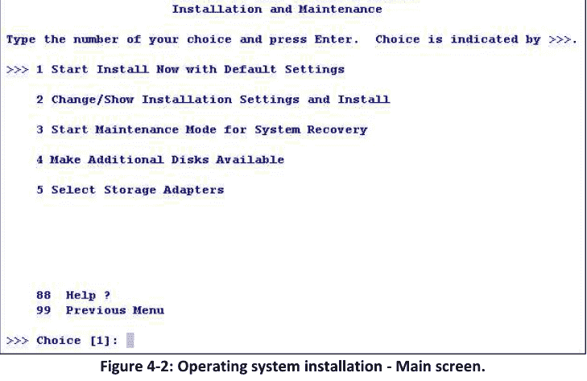
图4-2：操作系统安装 - 主界面。

## AIX、PowerVM —— UNIX、虚拟化与安全
#### 更改/显示安装设置并安装
选择该选项后，控制台会显示以下用于选择安装参数的界面（图4-3）。
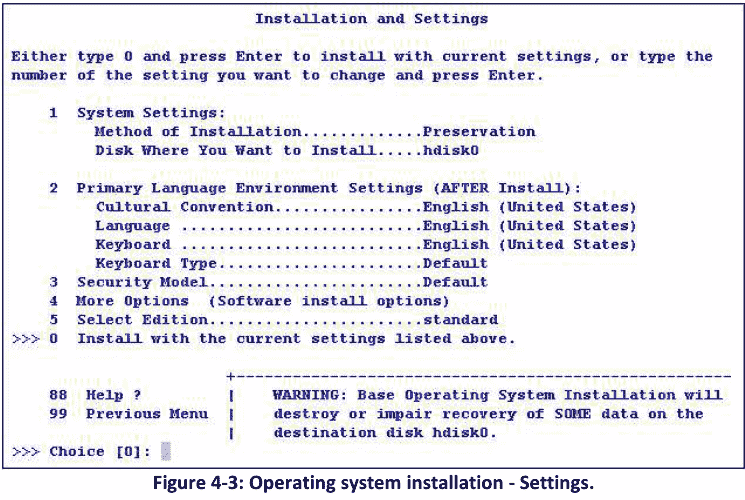

##### 各参数含义：
- **安装方式** - 指定要执行的安装类型。本章前文已介绍过安装类型及其含义。
- **要安装的磁盘** - 可选择要安装操作系统的磁盘，支持多选。如果选择多个磁盘，系统会分布在这些磁盘上。虽然这能保证所选磁盘间的负载均衡，但无法提供故障保护。因此通常选择安装到单块磁盘，安装完成后再按需创建镜像。
- **主语言环境设置（安装后）** - 该选项的参数适用于语言设置。通常选择英语比选择其他语言更合适。非英语显示的信息可能更难理解、可读性更低。此外，使用英语时，更容易联系厂商技术支持或查阅相关文档。上述参数可在系统安装完成后修改。
- **安全模型** - 可选择额外的安全选项，例如*可信AIX、BAS和EALA + 配置安装、LAS/EALA + 配置安装*，以及*默认安全*。安全章节会介绍这些选项。
- **选择版本** - 可选择操作系统版本。系统提供标准版和企业版。两个版本的基础功能没有差异，但企业版包含更广泛的外部工具附加许可，例如PowerVC、Tivoli Monitoring和IBM BigFix Lifecycle。所选版本可在系统运行过程中通过*chedition*命令或*smitty editions*菜单修改。该选项的主要作用是指定系统版本，供*IBM许可度量工具（ILMT）*用于统计和上报IBM许可使用情况。
- **更多选项** - 该选项提供额外的安装参数，包括：
  - **启用系统备份以安装至任意系统** - 将该选项设为*是*时安装的系统，会包含所有已知系统设备的可用驱动。因此，基于该服务器制作的系统备份，可用于在其他服务器上安装系统。该安装流程与从安装介质安装的流程一致。更多信息请参阅备份章节。
  - **OpenSSH客户端软件与OpenSSH服务器软件** - 安装OpenSSH的文件集。通常我们会使用安全方式访问系统，因此会选择该选项。
  - **图形软件** - 安装图形环境。
  - **系统管理客户端软件** - 安装Java软件和附加工具。

可以从已安装的系统中彻底验证安装菜单所选软件包的内容。这些软件包被归为所谓的捆绑包。运行*smitty install_bundle*并选择对应软件包，即可查看其包含的文件类型。我们可以找到如下软件包：
- **AllDevicesKernels** - 选择“启用系统备份以安装至任意系统”时使用该软件包。
- **"openssh_client"和"openssh_server"** - 选择“OpenSSH客户端软件”与“OpenSSH服务器软件”时使用该软件包。
- **Graphics** - 选择“图形软件”时使用该软件包。
- **SystemMgmtClient** - 选择“系统管理客户端软件”时使用该软件包。

#### 安装助手
系统安装完成后会自动启动基础配置工具，即*安装助手*，其界面如图4-4所示。
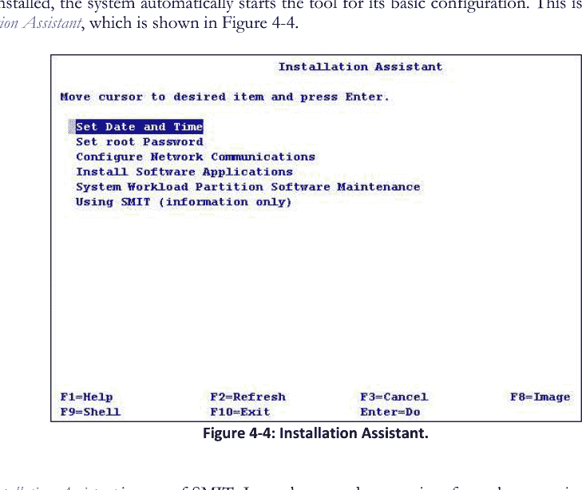
*安装助手*是SMIT的一部分，可在操作系统中随时通过`smit_assist`命令启动。*安装助手*支持快速配置基础系统参数，包括：
- 日期、时间和时区；
- root用户密码；
- IP地址和基础网络参数。
该工具还支持安装额外的应用程序，以及管理WPAR（工作负载分区）。操作系统安装完成后，你会找到`rootvg`卷组、一系列逻辑卷以及位于其上的文件系统。文件系统和逻辑卷的列表如表4-2所示。

#### 表4-2：安装后系统状态
| 逻辑卷名称 | 类型 | 文件系统 |
|---------------------|------|-------------|
| hd1 | jfs2 | /home |
| hd2 | jfs2 | /usr |
| hd3 | jfs2 | /tmp |
| hd4 | jfs2 | / |
| hd5 | boot | |
| hd6 | paging | |
| hd8 | jfs2log | |
| hd9var | jfs2 | /var |
| hd10op | jfs2 | /opt |
| lg_dumplv | sysdump | |
| livedump | jfs2 | /var/adm/ras/livedump |

上述术语，例如卷组和逻辑卷，将在本书后续部分解释。


## 第5章 操作系统维护
操作系统的维护高度依赖补丁安装、系统组件更新，以及按需安装额外组件。为了能够清晰、全面地描述这些流程，我们需要先熟悉与之相关的概念：
#### 文件集（Fileset）
它是可在AIX上安装的最小单元，包含执行特定任务所需的全部文件，通常是完整产品本身或是产品的功能独立部分。
示例文件集：
- *bos.rte.cron* - cron工具运行所需的文件。
- *bos.net.nfs.client* - NFS客户端运行所需的文件。
#### 捆绑包（Bundle，多文件集合集）
将大量基于相同角色的文件集集合成的更大分组。
示例捆绑包：
- *Alt_Disk_Install* - 文件集的集合，包含克隆系统所需的全部工具。
- *App-Dev* - 文件集的集合，包含AIX操作系统开发者所需的文件集。
#### PMR（问题管理记录，Problem Management Record）
向IBM技术支持提交的问题。这类问题会被分配对应的标识符和优先级，为其创建记录，并开始推进问题解决。问题的处理结果可能生成APAR。
#### APAR（授权程序分析报告，Authorized Program Analysis Report）
因处理上报问题（PMR）生成的报告。如果IBM支持团队确认客户遇到的问题属于AIX层面问题，就会创建APAR。针对单个APAR，可以开发变通方案、临时修复补丁，或是文件集的新版本。如果同一问题出现在多个技术级别（TL）中，就会生成多个APAR。
#### 临时修复补丁（iFixes，Interim Fixes）
针对需要快速响应的关键问题的临时修复方案。IBM会对这类补丁进行测试，但不会开展完整的回归测试。
#### 安全临时修复补丁（Security iFixes）
包含安全修复的特殊临时修复补丁子集。这类补丁同样不会开展完整的回归测试，因此可能会对系统稳定性造成负面影响。但鉴于这类iFix的改动数量极少，因此引发不稳定的风险也相对有限。
#### 技术级别（TL，Technology Level）
可支持操作系统新硬件及软件增强功能的大型补丁包，这类包每年发布一次。每个TL都可以通过安装对应的服务包（SP）来打补丁。IBM会同时为多个TL发布补丁，因此安装最新补丁不一定会更改系统的TL。在“技术级别”这一术语推出之前，类似的包被称为“维护级别”（ML），ML的缩写目前仍会在部分命令中出现。
#### 服务包（SP，Service Pack）
安装在特定TL下、可能支持新硬件的补丁包，每个受支持的TL通常每年会发布两次SP。SP内归集的补丁对系统功能的影响应尽可能小。可通过*oslevel*命令获取已安装AIX版本，以及对应TL和SP版本的相关信息：
```shell
# oslevel -s
7200-00-02-1614
```
#### 各部分含义：
- *7200* - AIX版本，本例中为7.2。
- *00* - 技术级别（TL），本例中为0。
- *02* - 服务包（SP），本例中为2。
- *1614* - 编译序列标识符，指示发布的年份和周数，本例为2016年第14周。
### 文件集的安装与更新
系统更新和额外组件的安装都可以通过传统方式或安全方式完成，安全方式支持回滚更改。
#### 安全方式
加载新文件集时，旧文件会存储在*/usr/lpp*目录中。通过这种方式新增或更新的文件集在系统中的状态为*已应用*。这种方式唯一的问题是旧文件会占用*/usr*文件系统的大量空间。为解决该问题，在指定周期后，需要对新增或更新的文件集执行提交或拒绝操作：第一种选择是删除旧版本文件，使其无法被恢复，此时文件集的状态会变为*已提交*；第二种选择是恢复文件集的旧版本，即回滚补丁。
当我们不确定正在更新或安装的组件能否正常运行时，应始终采用安全方式。若要通过安全方式更新，需在SMIT菜单中选择以下选项：
- *“是否提交软件更新？” = “否”* - 补丁不会被正式批准，后续可随时回滚。
- *“是否保存替换的文件？” = “是”* - 打补丁过程中被替换的文件会被留存，便于后续可能的回滚操作。
#### 传统方式
旧文件集会被新文件集直接替换，安装或更新的文件集状态为*已提交*，因此无法简单回滚到之前的文件集。只有在确认所安装或更新的组件可正常运行时，才应使用这种安装方式。
更新时选择合适的方式非常重要：我们新增的文件可以被删除，但恢复至早期版本可能会引发更多问题，甚至需要从备份恢复整个系统。和AIX操作系统上的几乎所有操作一样，这一操作既可以通过SMIT工具完成，也可以通过命令行完成。下一节将介绍如何使用SMIT工具完成该操作，但了解仅使用命令行时需要用到的命令同样重要：
- *installp* - 安装文件集和捆绑包。
- *instfix* - 安装修复补丁，并检查已安装的修复补丁。
- *emgr* - 安装并检查临时修复补丁。
- `lslpp` - 显示已安装组件的相关信息。
- `lppchk` - 验证文件集的安装状态。
#### lslpp命令使用示例：
检查系统上已安装的文件集：
```shell
# lslpp -l
# "-L" displays the installed files on the screen.
```
| 路径 | 文件集 | 版本 | 状态 | 描述 |
| --- | --- | --- | --- | --- |
| /usr/lib/objrepos | ICU4C.rte | 7.2.0.0 | 已提交 | Unicode国际化组件 |
| /usr/lib/objrepos | Java7_64.jre | 7.0.0.320 | 已提交 | Java SDK 64位Java运行时环境 |
| /usr/lib/objrepos | Java7_64.sdk | 7.0.0.320 | 已提交 | Java SDK 64位开发工具包 |
# 已省略所有非必要信息。
检查指定文件集的内容：
```shell
# lslpp -f bos.rte.cron
Fileset File
-------------------------------------------------------
Path: /usr/lib/objrepos
bos.rte.cron 7.2.0.0
/usr/bin/at
/usr/bin/atq
/usr/bin/atrm
/usr/bin/batch
/usr/bin/cronadm
/usr/bin/crontab
/usr/sbin/cron
/usr/lib/cron -> /var/adm/cron
Path: /etc/objrepos
bos.rte.cron 7.2.0.0
/etc/cronlog.conf
/var/adm/cron
/var/adm/cron/at.deny
/var/adm/cron/cron.deny
/var/adm/cron/log
/var/adm/cron/queuedefs
/var/spool/cron
/var/spool/cron/atjobs
/var/spool/cron/crontabs
/var/spool/cron/crontabs/adm
/var/spool/cron/crontabs/root
/var/spool/cron/crontabs/sys
```
### 补丁
AIX操作系统和所有软件一样存在错误，这类错误可能在特定情况下引发系统故障，还可能导致系统安全漏洞。任何处于开发阶段的软件都可能出现这类错误，因此系统管理员最重要的任务之一就是确保错误被尽快消除。
系统可以通过安装IBM定期发布的补丁组（TL、SP）来打补丁，也可以通过加载尚未纳入TL或SP的单体补丁（以新版本文件集的形式）进行修复。如果发现的问题非常严重，需要立即修复，就可以使用iFix补丁。这类补丁可临时解决问题，后续会被对应的服务包（SP）或引发问题的文件集专用补丁替换。
需要注意的是，iFix补丁不会经过完整的回归测试。使用iFix补丁前，建议先检查是否存在该问题的变通方案：如果存在变通方案，我们可以通过修改系统参数消除问题，等待经过完整回归测试的补丁发布。最佳实践是确保系统安装的是最新且经过验证的补丁。必须配备测试环境，用于验证补丁在应用环境中的表现，测试环境与生产环境越接近，测试结果越可靠。
IBM会维护多个TL，并为其发布补丁，所有最新信息都可以在[IBM Fix Central 页面](https://www.ibm.com/support/fixcentral/)验证。
截至本书撰写时，仅AIX 7.2基础版本可用，而AIX 7.1的补丁会同时为TL3和TL4发布，如图5-1所示。
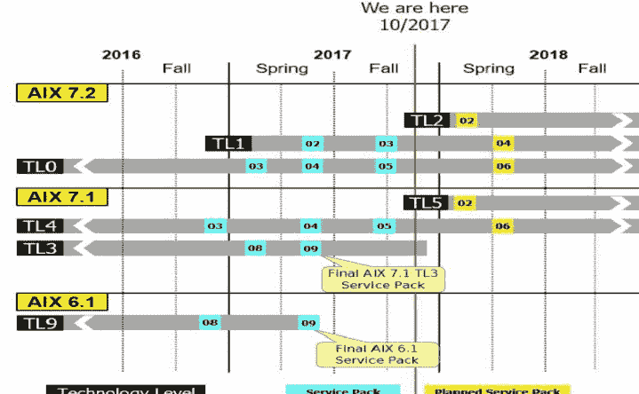
图5-1：IBM Fix Central - TL与SP


## AIX、PowerVM —— UNIX、虚拟化与安全
技术版本（TL）会带来新功能。如果不需要使用这些新功能，建议至少保留在当前技术版本，直到首个服务包（SP）发布。AIX技术版本大约每年发布一次，而每个技术版本对应的服务包大约每年发布两次。你可以通过*instfix*命令查看已安装的技术版本（TL）和服务包（SP）相关信息：
```
# instfix -i | grep ML
# Displays TLs, formerly called Maintenance Levels (ML). All filesets for 7.2.0.0_AIX_ML were found.
All filesets for 7200-00_AIX_ML were found.
# instfix -i | grep SP
# Displays the installed Service Packs. All filesets for 72-00-011543_SP were found.
All filesets for 72-00-021614_SP were found.
```
以上是AIX 7.2的示例，表明已正确安装两个服务包。由于未安装任何技术版本，系统显示当前技术版本（TL）为0（即基础版本）。如需以更简洁的方式确认上述信息，可使用*oslevel*命令：
```
# oslevel -s
7200-00-02-1614
```
你需要跟踪所有出现的补丁，这对系统的安全和稳定性至关重要。获取补丁更新的方式之一是在IBM支持门户网站的*我的通知*功能中订阅相关信息：https://support.ibm.com/。

#### SUMA（服务更新管理助手）
SUMA工具旨在让管理员无需主动检查并从IBM服务器下载补丁，它支持自动化下载以下内容：
- 技术版本（TL）
- 服务包（SP）
- 单项修复
- 所有最新修复
该工具支持在指定时间自动执行特定任务，因此你可以将补丁下载任务安排在服务器和网络负载最低的时段。工具与补丁服务器的通信通过HTTPS进行，文件可通过HTTP或HTTPS下载。如果希望使用该工具但无法直接访问互联网，可以使用代理服务器，代理访问配置可通过SMIT菜单（*smitty srv_conn*）完成。SUMA下载的补丁默认存储在*/usr/sys/inst.images*目录中。
Sebastian Biedroń
SUMA的主SMIT菜单（*smit suma*）支持以下操作：
- *立即下载更新（简易模式）*；
- *自定义/自动化下载（高级模式）*
- *配置SUMA*。

##### 配置SUMA
大多数情况下，无需额外配置即可使用SUMA工具，工具会基于预定义配置执行任务。但有时预设置不适用于你的系统，因此你需要了解相关配置选项。你可以通过两个菜单配置该工具：*基础配置*和*任务默认设置*。你可以通过*smit suma_config_base*或*sum -c*命令执行全局配置。可配置的全局参数如图5-2所示（下图展示各参数的默认值）。
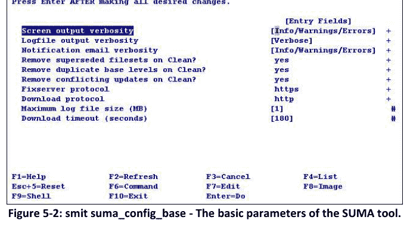
**图5-2：smit suma_config_base —— SUMA工具的基础参数**

###### 参数含义：
**屏幕输出详细程度、日志文件输出详细程度、通知邮件详细程度** —— 用于设置任务日志的明细等级，决定计划任务执行后屏幕显示、记录到日志文件（*/var/adm/ras/suma.log*）或以邮件发送的信息详细程度。这些选项的可选值及各值对应的信息级别如下所示：
- *静默* —— 无任何信息。
- *错误* —— 仅记录错误信息。
- *警告和错误* —— 记录警告和错误信息。
- *信息/警告/错误* —— 记录常规信息、警告和错误信息。
- *详细* —— 除错误、警告外，还会输出比*信息/警告/错误*更详细的其他信息。
- *调试* —— 输出全量信息。该值不适用于正常操作，但对排查补丁下载相关问题很有帮助。

**清理时是否移除被取代的文件集？、清理时是否移除重复的基础版本？、清理时是否移除冲突的更新？** —— 适用于已定义*下载并清理*操作的任务，这些设置将指示SUMA执行以下操作：
- 下载新版本补丁时，从下载目录中移除旧版本补丁；
- 移除重复文件；
- 移除冲突的更新。

**补丁服务器协议** —— 用于与补丁服务器通信的协议，当前仅支持HTTPS，历史上也曾支持HTTP。
**下载协议** —— 用于从补丁服务器获取补丁的协议，可在HTTP和HTTPS之间选择。
**最大日志文件大小（MB）** —— SUMA日志文件（*/var/adm/ras/suma.log*和*sum_log.log*）的最大体积限制。当日志文件达到该大小时，文件名会添加*.bak*后缀，同时生成新文件替代旧文件；若已存在同名文件，则会被覆盖。
**下载超时时间（秒）** —— 设置连接的空闲时间，超过该时间后连接将自动中断。

如需配置SUMA工具的任务，可使用*查看/修改SUMA任务默认设置*菜单，也可通过运行*smit suma_task_defaults*命令打开该菜单。此外，还可使用*suma -D*命令在不启动SMIT工具的情况下配置任务。你可以设置用于创建新任务的默认参数，这意味着如果在创建任务时未另行指定，新建任务将自动使用此处设置的参数。配置选项如图5-3所示（图中展示各参数的默认值）。
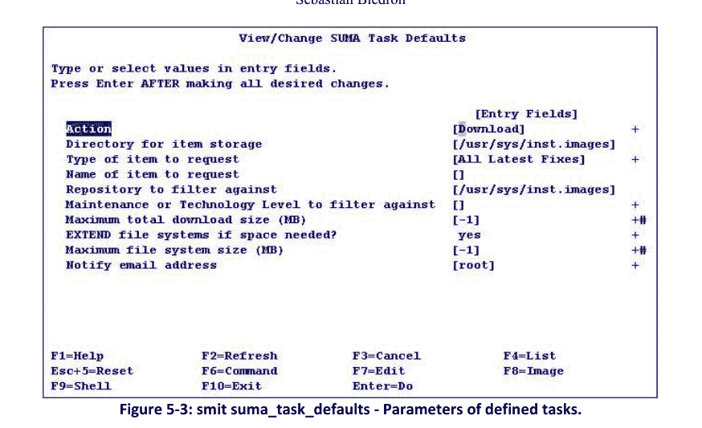
最重要的参数如下：
- *操作* —— 任务要执行的动作，可选类型如下：
  - *预览* —— 模拟补丁下载任务，可提前知晓下载过程中会发生什么、哪些文件会被下载、哪些不会被下载。
  - *下载* —— 获取补丁并将其写入*项目存储目录*参数指定的位置。
  - *下载并清理* —— 获取补丁并将其保存到*项目存储目录*参数指定的位置，同时移除所有不必要的文件。全局参数将决定是否执行清理以及要删除的文件：
    - *清理时是否移除被取代的文件集？*
    - *清理时是否移除重复的基础版本？*
    - *清理时是否移除冲突的更新？*
- *项目存储目录* —— 指定下载文件的存储位置。
- *请求项类型* —— 要下载的文件类型，可选类型如下：
  - *PTF（程序临时修复）* —— 服务包发布之间创建的补丁。
  - *维护版本* —— 补丁组，*维护版本*这一名称已被*技术版本*替代。
  - *技术版本*。
  - *服务包*。
- *请求项名称* —— 要下载的文件名称，在该字段中可根据之前选择的类型填写不同的值：
  - *PTF* —— PTF编号，例如“U254389”。
  - *维护版本/技术版本* —— 补丁组编号，例如“7100-04”。
  - *服务包* —— 服务包编号，例如“7100-04-03”。
- *过滤基准仓库* —— 指定工具过滤已下载文件所依据的目录，已存在于指定目录中的文件不会被重复下载。
- *过滤基准维护版本* —— 指定系统版本，SUMA会以此为依据过滤待下载文件。例如当指定AIX 7.1的首个版本（7100-03）时，该版本对应的补丁组文件会在下载过程中被跳过。
- *最大总下载大小（MB）* —— 单次任务下载的所有文件的最大体积总和。如果待下载文件总大小超过该值，任务将自动执行*预览*操作而非实际下载；此外，设置为*-1*表示无大小限制。
- *空间不足时是否扩展文件系统？* —— 设置下载文件时若存储空间不足，操作系统是否自动扩展文件系统。
- *最大文件系统大小（MB）* —— 设置文件系统可自动扩展到的最大体积（参见上述参数）。
- *通知邮箱地址* —— 接收SUMA通知的邮箱地址，多个地址可用分号分隔。

###### 下载更新
*立即下载更新（简易模式）*菜单（*smit suma_easy*）如图5-4所示，可用于快速获取指定补丁，可选选项精简，系统会自动使用上述*任务默认设置*菜单中定义的默认参数，该菜单支持以下操作：
- *下载维护版本或技术版本* —— 下载整组补丁；
- *下载服务包*；
- *下载所有最新修复* —— 具体下载哪些补丁由SUMA配置（*任务默认设置*）决定。
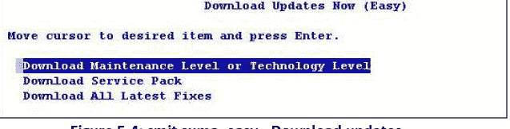
如需执行非标准任务，可使用*自定义/自动化下载（高级模式）*菜单（*smit suma_task*），该选项支持创建、删除、查看和修改此类任务。创建的任务可立即执行、在指定时间执行一次，或按周期循环执行。任务创建格式如图5-5所示。


**图5-5：** `smit suma_task_new` - 创建新的SUMA任务。此处列出的参数与*查看/修改SUMA任务默认值*菜单中的参数一致。在之前的SMIT菜单中，你定义了默认值，而在此菜单中，你可以为单个任务修改这些参数。这些参数的含义已在前面章节说明。定义定时或周期性运行的任务时，需要配置*调度选项*。在此参数中，需按照Cron工具使用的格式指定执行日期（即“分钟 小时 月份中的日期 月份 星期几”）。参数示例如下：
- `45 2 * * 0` - 任务每周日2:45启动。0代表周日，因为星期用0到6的数字表示（0为周日，6为周六）。
- `45 2 1 12 *` - 任务在12月1日2:45启动。

#### 对比报告
你可以使用IBM Fix Central页面搜索并下载补丁。还可以下载指定软件包（TL、SP）的组件（文件集）信息。如果操作系统缺少若干文件集，该选项尤其有用。点击图5-6所示的*对比报告*链接，即可下载补丁包的文件集信息。
**图5-6：** Fix Central - 对比报告。
要通过这种方式获取补丁，第一步是下载包含特定软件包内补丁列表的文件。需将下载的文件复制到待更新的AIX操作系统，例如复制到`/tmp`目录下。随后，结合该文件与系统中的信息，生成一份报告，列出更新系统所需的缺失文件集。使用`compare_report`命令生成报告，示例如下：
```shell
# compare_report -s -r /tmp/7200-01-01-1643.compare -l #(lowerthanlatest1.rpt)
# Installed Software that is at a LOWER level
#PTF:Fileset_Name:Installed_Level:Available_Level
| PTF | Fileset_Name | Installed_Level | Available_Level |
|---------|----------------|-----------------|-----------------|
| U874558 | ICU4C.rte | 7.2.0.0 | 7.2.1.0 |
| U871559 | Java7_64.jre | 7.0.0.320 | 7.0.0.370 |
| U871560 | Java7_64.sdk | 7.0.0.320 | 7.0.0.370 |
| U872502 | X11.adt.lib | 7.2.0.1 | 7.2.1.0 |
| U863743 | X11.apps.rte | 7.2.0.1 | 7.2.1.0 |
# ...unnecessary information has been cut.
#(lowerthanmaint.rpt)
# Installed Software that is at a LOWER level than the latest maintenance level
#PTF:Fileset_Name:Installed_Level:Available_Level
| PTF | Fileset_Name | Installed_Level | Available_Level |
|---------|----------------|-----------------|-----------------|
| U874558 | ICU4C.rte | 7.2.0.0 | 7.2.1.0 |
| U871559 | Java7_64.jre | 7.0.0.320 | 7.0.0.370 |
| U871560 | Java7_64.sdk | 7.0.0.320 | 7.0.0.370 |
| U872502 | X11.adt.lib | 7.2.0.1 | 7.2.1.0 |
# ALL unnecessary information has been omitted.
```
**所用参数：**
- `-s`：指示该命令获取当前已安装文件集的列表，以便与从IBM Fix Central下载的列表进行对比。
- `-r /tmp/LatestFixData53`：指定从IBM Fix Central下载的文件。
- `-l`：指示该命令生成以下报告：
  - `/tmp/lowerthanlatest1.rpt`：版本低于最新可用文件集的文件集列表。
  - `/tmp/lowerthanmaint.rpt`：版本低于最新维护和技术级别中文件集的文件集列表。

`compare_report`命令的功能远不止上面介绍的这一种。它支持对比部署在不同服务器上的系统组件，也可以对比操作系统中已安装的文件集与软件仓库中的文件集。此处的软件仓库即文件集所在的目录。借助生成的报告，你无需下载整个软件包，即可下载所需的补丁。通过这种方式，你可以将系统升级到目标级别（参考`lowerthanmaint.rpt`报告）。需要注意的是，基于AIX操作系统补丁安装的最佳实践，建议使用完整服务包而非单个补丁。

### 补丁安装
你可以通过命令行或SMIT菜单直接安装补丁。从IBM Fix Central下载补丁组时会附带安装说明链接，因此此处无需详细描述该流程。但你需要知道，将下载的文件复制到操作系统（或将其放到NFS等网络资源上提供访问）后，需要运行`inutoc directory_name`命令。*目录名称*是下载文件所在目录的名称。该命令会在该目录下创建`.toc`文件，此文件包含目录内文件的相关信息，供安装命令调用。你可以跳过`.toc`文件的创建步骤，但需要确保存放`.bff`文件的目录下不存在已生成的`.toc`文件（可能存在之前创建的包含错误信息的文件）。如果目录下没有`.toc`文件，安装程序会自动生成该文件。

另一个实用操作是为下载的补丁重命名。下载后的补丁默认是无意义名称，示例如下：
```shell
# ls | head -5
# List the first five fileset in the directory.
U856876.bff
U856877.bff
U856878.bff
U856879.bff
U856880.bff
```
在这些补丁所在目录下执行`bffcreate`命令后，补丁会获得与其功能匹配的名称：
```shell
# bffcreate -c -d .
# Naming of filesets.
# ls | head -5
bos.adt.syscalls.7.2.1.0.U
bos.diag.util.7.2.1.0.U
bos.rte.shell.7.2.1.0.U
devices.artic960.rte.7.2.1.0.U
security.acf.7.2.1.0.U
```

此时即可开始安装补丁。但如果你想使用*预览*功能查看预期的安装状态，需要先单独安装安装文件集。如果不执行这一步，预览功能会显示安装文件集将被正确安装，其余文件集将处于*延迟*状态。示例如下：
```
FILESET STATISTICS
------------------
286 Selected to be installed, of which:
1 Passed pre-installation verification
285 Deferred (see *NOTE below*)

*NOTE The deferred filesets mentioned above will be processed after the installp update and its requisites are successfully installed.*
```
如果在安装安装文件集后使用*预览*选项，即可获得完整的预期安装流程信息。
```shell
# installp -acgXd /tmp/aix72_01_01 bos.rte.install
```

你也可以通过SMIT菜单安装补丁，这是最简单的方式。使用`smitty update_all`命令进入相应菜单，然后选择补丁源，即可看到图5-7所示的菜单。
**图5-7：** smit update_all - 补丁安装。
此处的大部分选项将在后续章节介绍。这里需要特别说明：安装新的“技术级别（Technology Level）”时，需要将“*是否接受新许可协议？*”选项设置为“*是*”。该选项会自动接受更新文件集的许可条款，否则安装可能会失败。如果希望在安装补丁组后支持回滚到旧版本，可将“*是否提交软件更新？*”设置为“*否*”，将“*是否保存替换的文件*”设置为“*是*”。这种更新方式具备前面提到的优势，但所需磁盘空间几乎是普通更新的两倍，耗时也几乎翻倍。该操作耗时较长的原因是需要复制被替换的文件，以保留回滚能力。

请注意，安装过程中AIX仅更新旧版本的文件集。如果所选安装文件的版本低于当前版本，则会跳过这些文件。安装完补丁组后，通常需要重启系统。单个文件集的安装流程与补丁组安装类似，但需使用*smitty install_latest*菜单。更新系统通常意味着安装其组件的新版本，因此额外软件的安装流程与操作系统补丁安装类似，你可以在“安装额外系统组件”小节中了解具体操作。

### 补丁相关问题
安装补丁组后，需要验证更新流程是否已成功完成，因此需要检查系统级别。你可以使用带*-i*参数的*instfix*命令查看所有已安装的补丁：
```shell
# instfix -i | grep ML
# Check Technology Level (Maintenance level - ML).
All filesets for 7.2.0.0_AIX_ML were found.
All filesets for 7200-00_AIX_ML were found.
Not all filesets for 7200-01_AIX_ML were found.
# At least one fileset from the Technology Level 1 is missing.
# instfix -i | grep SP
# All files from Service Packs are installed.
All filesets for 72-00-011543_SP were found.
All filesets for 72-00-021614_SP were found.
All filesets for 72-00-031642_SP were found.
All filesets for 72-01-011642_SP were found.
```
另外，你可以使用*oslevel*命令查看当前系统所属技术级别对应的最高已安装服务包：
```shell
# oslevel -s
7200-00-03-1642
# TL0 SP3.
```
你可以通过在*instfix -i*命令的输出结果中过滤“ML”相关信息，获取操作系统已安装的修复程序级别；通过这种方式还可以检查指定级别的所有必需文件集是否均已以对应版本安装在系统中。


上述输出的最后一行显示，我们测试的AIX 7.2操作系统缺少部分TL1文件集。这种情况可能出现在两种场景下：
- 安装补丁组后：这意味着系统更新未完全成功，此时需要分析原因并安装缺失的文件。
- 安装额外系统组件后：这意味着你安装的系统组件版本低于当前系统等级的要求。这种情况可能出现在你已将系统补丁更新至更高版本，随后又从安装DVD安装新系统组件时，所安装的组件会是系统打补丁前的旧版本。此时你可以从IBM Fix Central下载缺失的文件集，或重新安装补丁组，后者会一并安装缺失的文件集。

某一等级缺失当前文件集通常不会对操作系统造成危害。但你需要始终意识到，各文件集的更新发布绝非毫无原因。为确保系统正常运行，你需要保持操作规范，始终将所有文件组更新至对应等级。针对单个缺失文件集的解决办法是下载对应版本并完成安装。

你可以通过*instfix*命令查看需要下载的文件集：
```
# instfix -icqk 7200-01_AIX_ML |grep ":-:"
7200-01_AIX_ML:Java7_64.jre:7.0.0.370:7.0.0.320:-:AIX 7200-01 Update
```
上述命令用于查找所有缺失的AIX 7.2 TL1文件。其中7200字符串代表执行该操作对应的系统版本（AIX 7.2）。你可以从前文提及的IBM页面下载缺失的文件集：选择*Fix search*选项后按名称搜索即可。

### 安装额外系统组件
安装额外系统组件最便捷的方式是通过SMIT完成，通过该工具你可以执行多种类型的安装操作，如图5-8所示。
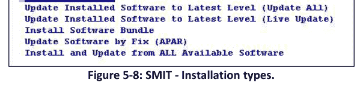
- ***安装软件*** - 可用于安装或重新安装任意文件集，该选项主要用于安装单个系统组件。
- ***将已安装软件更新至最新等级（全部更新）*** - 通过安装可提升系统等级的补丁组来更新操作系统的选项。
- **_将已安装软件更新至最新等级（实时更新）_** - 用于调用所谓实时更新的选项，该方式可在不导致操作系统无法访问的前提下安装补丁。该选项自AIX 7.2起可用，使用前需完成预先准备。
- **_安装软件包_** - 可根据角色安装被组装为单个包的多份文件集。例如你可以选择安装系统中预设的如下软件包：
  - PerfTools - 包含管理系统性能所需的全部文件集。
  - App-Dev - 包含在AIX上工作的开发人员所需的文件集。这类软件包还有很多，你也可以自定义专属软件包。
- **_通过修复（APAR）更新软件_** - 可通过APAR编号安装对应的文件集，这类编号用于标识可解决特定问题的文件集版本。通常针对某个问题的解决办法是安装一份或多份文件集。
- **_从所有可用软件安装并更新_** - 该选项使用频率较低，通过该菜单你可以将文件集重新安装至你拥有的任意版本，甚至是更早的旧版本。

### 安装软件
选择上述任意选项都会进入类似的菜单。下文我们将聚焦最常用的选项，即_安装软件_。如果你选择该选项并指定要安装的文件集路径，就会看到如图5-9所示的菜单。
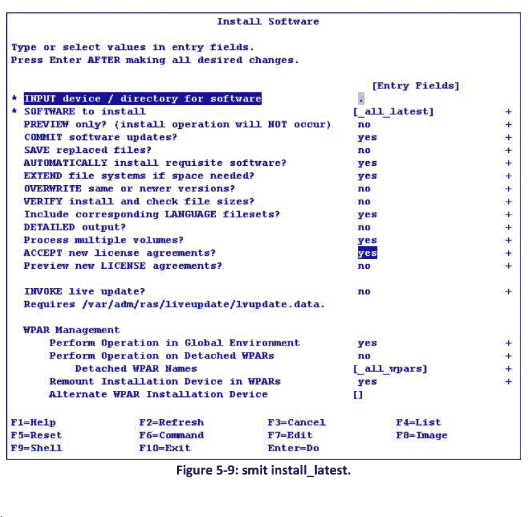
#### 关键选项：
- ***待安装软件*** - 可用于选择要安装的文件集，对应项为上方目录中列出的文件集。
- ***仅预览？（不会执行安装操作）*** - 若将该选项设为“是”，系统会执行模拟操作而非实际安装，因此不会有任何文件集被安装。操作系统会检查文件系统的剩余空间，以及安装该产品所需安装的额外文件集的依赖关系。模拟结束后，系统会告知你哪些文件集已安装，以及该产品需要但当前系统中缺失的文件集。
- ***提交软件更新？*** – 将该选项设为“是”会提交你所做的更改，且不会保留旧文件集。如果你确定要安装的组件可正常运行，就可以使用该设置。若将该选项设为“否”，同时将“保存被替换的文件？”设为“是”，你就可以随时回滚已安装的组件，并恢复存储在/usr/lpp目录中的旧系统保留文件。
- ***自动安装必需软件？*** - 若将该选项设为“是”，系统会自动安装正确安装组件所需的文件集。当然，这只有在系统能访问这些文件集时才成立，比如它们和你正在安装的文件集处于同一目录。若将该选项设为“否”，且操作系统没有你正在安装的文件集正常运行所需的任何组件，该文件集将不会被安装，系统只会显示一份列出缺失文件集的报告。
- **_空间不足时扩展文件系统？_** - 将该选项设为*"是"*会在需要时自动扩展文件系统。
- **_覆盖相同或更新版本？_** - 如果你想重新安装指定文件集，或是安装更早的旧版本，需要设置该选项。若将该选项设为*"是"*，则需要将*"自动安装必需软件？"*选项设为*"否"*。
- **_验证安装并检查文件大小？_** - 该选项会检查文件的校验和，确保安装过程正常执行。启用该选项会略微增加安装所需时长。
- **_包含对应语言文件集？_** - 该选项会安装操作系统预设语言对应的消息文件，消息内容与已安装的文件集相关。为确保消息正常显示，你需要将该选项设为*"是"*。
- **_处理多卷存储？_** - 如果待安装文件存储在多个存储介质（例如DVD）中，建议保留默认设置*"是"*。
- **_接受新许可协议？_** - 如果不接受与产品（文件集）关联的许可协议，你将无法安装该产品。因此安装新文件集前需要将该选项设为*"是"*。
- **_WPAR管理_** - 该部分包含若干操作系统层虚拟化选项。与LPAR不同，WPAR的使用频率较低。

### 卸载已安装软件
你可以卸载处于*COMMITTED*（已提交）或*BROKEN*（损坏）状态的任意软件，这两个状态标识软件已损坏。处于*APPLIED*（已应用）状态的文件集只能被提交（接受）或拒绝。拒绝操作会删除特定文件集并恢复之前的版本。如果删除某个产品，其所有更新和配置信息都会被移除。你可以通过重新安装来恢复已删除的组件，图5-10展示了smitty remove的示例。
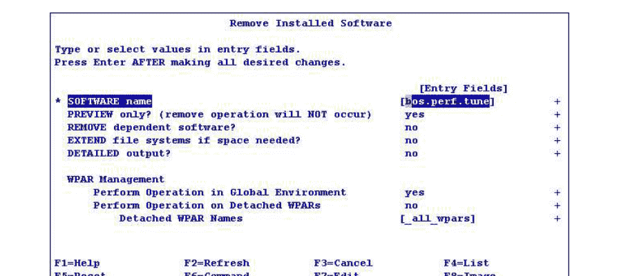
*图5-10：smit remove - 移除已安装的系统组件*

该SMIT菜单中唯一可能让人困惑的选项是“*移除依赖软件？*”。如果有其他组件依赖某个系统组件，则该组件无法被移除。这类尝试会失败，并弹出提示显示需要先移除的依赖组件。此时你可以将该选项设为“是”，它就会移除所有依赖你想要移除的组件的组件。使用该选项时需要格外谨慎，因为存在删除超出你预期范围的文件集的风险。此外，如果确实需要使用该选项，你应该先以*仅预览*模式运行任务，确认其影响后再操作。

如果你想移除处于*APPLIED*状态的产品，只需拒绝该状态即可，这会删除并撤销安装过程中所做的更改。你可以使用`smit reject`菜单来拒绝更改。若要批准处于APPLIED状态的组件，你可以使用类似的`smit commit`菜单。

需要注意的是，批准已安装的文件集会从/usr/lpp目录中移除拒绝这些文件集所需的信息。这么做的好处是会增加/usr文件系统的可用空间。

### 克隆操作系统（alt_disk）
AIX操作系统是动态迭代的，每年都会发布多个新的技术等级（Technology Level）和服务包（Service Pack）。管理员的工作是以安全、便捷、停机时间最短的方式安装这些更新。系统克隆是完成该任务的绝佳机制。

克隆是存储在独立磁盘上的系统副本，你可以从克隆系统启动。对原系统做的任何修改都不会影响克隆系统，反之亦然。克隆系统可被视为同一服务器上的第二套操作系统安装实例，支持从该克隆启动。

系统克隆可在运行中的系统上执行，该操作基于三条命令：

- `alt_disk_copy` - 允许你在空磁盘上创建系统克隆。
- `alt_disk_mksysb` - 允许你使用先前通过`mksysb`工具准备的备份，将系统安装到独立磁盘上。
- `alt_rootvg_op` - 由于前两条命令的执行，会创建一个名为`altinst_rootvg`的新卷组。通过该命令，你可以执行各类操作。

#### alt_disk_copy命令
`alt_disk_copy`命令允许你在独立磁盘上创建`rootvg`卷组的克隆。克隆出的系统可以进行升级和补丁安装，你也可以安装新的文件集、修改系统以满足新需求。该克隆还可以作为rootvg组的备份存在于系统中。克隆的一大优势是可以在系统正常运行期间执行，它能让系统更新更安全，因为更新可以在系统副本上执行。如果系统运行异常，只需重启并从包含原始版本的磁盘（即更新前被克隆的磁盘）启动即可。

要创建克隆，服务器需拥有一块未分配给任何卷组的磁盘。此外，该磁盘的容量必须足够容纳被克隆的`rootvg`卷组的全部内容。以下示例中，空闲磁盘为`hdisk1`，当前正在运行的系统安装在`hdisk0`上。

克隆包含诸多操作：
```
# alt_disk_copy -d hdisk1
# Cloning the operating system (rootvg group) to hdisk1.
Calling mkszfile to create new /image.data file.
Checking disk sizes.
Creating cloned rootvg volume group and associated logical volumes.
Creating logical volume alt_hd5
Creating logical volume alt_hd6
Creating logical volume alt_hd8
Creating logical volume alt_hd4
Creating logical volume alt_hd2
Creating logical volume alt_hd9var
Creating logical volume alt_hd3
Creating logical volume alt_hd1
Creating logical volume alt_hd10opt
Creating logical volume alt_hd11admin
Creating logical volume alt_lg_dumplv
Creating logical volume alt_livedump
Creating /alt_inst/ file system.
Creating /alt_inst/admin file system.
Creating /alt_inst/home file system.
Creating /alt_inst/opt file system.
Creating /alt_inst/tmp file system.
Creating /alt_inst/usr file system.
Creating /alt_inst/var file system.
Creating /alt_inst/var/adm/ras/livedump file system.
Generating a list of files for backup and restore into the alternate file system...
Backing-up the rootvg files and restoring them to the alternate file system...
Modifying ODM on cloned disk.
Building boot image on cloned disk.
forced unmount of /alt_inst/var/adm/ras/livedump
forced unmount of /alt_inst/var
forced unmount of /alt_inst/var
forced unmount of /alt_inst/usr
forced unmount of /alt_inst/usr
forced unmount of /alt_inst/tmp
forced unmount of /alt_inst/tmp
forced unmount of /alt_inst/opt
forced unmount of /alt_inst/opt
forced unmount of /alt_inst/home
forced unmount of /alt_inst/home
forced unmount of /alt_inst/admin
forced unmount of /alt_inst/admin
forced unmount of /alt_inst
Changing logical volume names in volume group descriptor area.
Fixing LV control blocks…
Fixing file system superblocks…
Bootlist is set to the boot disk: hdisk1 blv=hd5
```

## AIX、PowerVM——UNIX、虚拟化与安全
第一步是创建描述`rootvg`卷组结构的`/image.data`文件，该文件是在克隆磁盘上创建结构时的信息来源。随后，命令会检查计划用于创建克隆的磁盘容量，以确认其是否足够。确认完成后，会在该磁盘上创建所有必要的结构：
- 名为`altinst_rootvg`的卷组。
- 逻辑卷名称与原逻辑卷一致，但会增加`alt_`前缀。
- 位于逻辑卷上的文件系统。
随后，会将源文件系统中的文件复制到克隆盘上创建的结构中。正如你所料，这是克隆过程中耗时最久的阶段。之后，会对克隆的系统磁盘做启动盘适配处理：
- 更新ODM数据库。
- 创建BLV（启动逻辑卷），它是用于启动流程的、包含内核版本的逻辑卷。
- 卸载克隆磁盘上挂载的所有文件系统。
- 修改VGDA——即存储卷组内容元数据的初始磁盘空间。
- 修改逻辑卷控制块与文件系统控制块。
- 修改逻辑卷与文件系统控制块。
- 修改启动列表，使操作系统能够从克隆磁盘启动。

完成上述操作后，克隆磁盘会成为名为`altinst_rootvg`的新卷组，此时该卷组处于非激活状态。克隆磁盘位于启动列表的首位，这意味着重启后操作系统会从该磁盘启动。重启完成后，`altinst_rootvg`卷组会被重命名为`rootvg`，而原有的`rootvg`卷组会被重命名为`old_rootvg`：
```
# lsvg
# 克隆创建完成后立即执行
rootvg
altinst_rootvg
# lspv
# 系统从hdisk0启动
hdisk0 00f62177fc932e26 rootvg active
```
Sebastian Biedroń
```
hdisk1 00f6217735697d2a altinst_rootvg
```
```
# lsvg
# 系统重启后
old_rootvg
rootvg
```
```
# lspv
# 系统从克隆盘（hdisk1）启动
hdisk0 00f62177fc932e26 old_rootvg
hdisk1 00f6217735697d2a rootvg active
```

如需切换两个版本的操作系统，只需修改启动顺序后重启系统即可。系统会从启动列表首位的磁盘启动。当你从包含原始版本操作系统的磁盘启动时，卷组名称会恢复为`rootvg`和`altinst_rootvg`：
```
# lsvg
rootvg altinst_rootvg
```

#### 更新克隆
`alt_disk_copy`命令的执行分为三个阶段。默认情况下会执行全部阶段，但你也可以通过`-P`参数指定要运行的阶段，单独执行某个阶段：
- 第一阶段——创建结构并向其中复制数据。该阶段完成后，即可访问克隆系统，其文件系统会挂载到`/alt_inst`目录下，你可以在此进行任意修改。
- 第二阶段——验证第一阶段创建的结构是否有效。
- 第三阶段——将克隆磁盘适配为可启动操作系统的状态。该阶段完成后，你可以从克隆盘启动操作系统，但其中创建的卷组处于不可用状态。

系统克隆的核心目的是对克隆盘而非原始系统版本进行修改。完成修改后，可以从克隆盘启动系统。如果修改对系统稳定性产生负面影响，可以快速回退到未修改的版本。系统迁移至新版本、文件升级或补丁安装等操作，会在命令的第一阶段完成后执行。以上步骤仅在您有意执行且为命令输入了对应参数时才会运行。你可以通过一条`alt_disk_copy`命令完成系统克隆与克隆更新，该命令会启动全部三个阶段（这是默认行为）。你也可以依次执行三个阶段，每次执行`alt_disk_copy`命令时搭配不同参数来启动对应阶段。启动第二阶段或第三阶段时，可以添加参数指定要安装的内容及安装位置。在第一阶段或第二阶段结束时，你可以对挂载在`/alt_inst`目录下的克隆文件进行任何必要修改：
```
# alt_disk_copy -d hdisk1 -P 1
# First phase - cloning.
Calling mkszfile to create new /image.data file.
```


## AIX、PowerVM——UNIX、虚拟化与安全
检查磁盘大小。
- 创建克隆的rootvg卷组及关联的逻辑卷。
- 创建逻辑卷alt_hd5
- 创建逻辑卷alt_hd6
- 创建逻辑卷alt_hd8
- 创建逻辑卷alt_hd4
- 创建逻辑卷alt_hd2
- 创建逻辑卷alt_hd9var
- 创建逻辑卷alt_hd3
- 创建逻辑卷alt_hd1
- 创建逻辑卷alt_hd10opt
- 创建逻辑卷alt_hd11admin
- 创建逻辑卷alt_lg_dumplv
- 创建逻辑卷alt_livedump
- 创建/alt_inst/文件系统。
- 创建/alt_inst/admin文件系统。
- 创建/alt_inst/home文件系统。
- 创建/alt_inst/opt文件系统。
- 创建/alt_inst/tmp文件系统。
- 创建/alt_inst/usr文件系统。
- 创建/alt_inst/var文件系统。
- 创建/alt_inst/var/adm/ras/livedump文件系统。
生成用于备份和恢复到备用文件系统的文件列表...
备份rootvg文件并将其恢复到备用文件系统...
第一阶段完成。
# df -k 第一阶段完成后，即可对克隆的文件系统（`"/alt_*"`）进行操作。
| 文件系统 | 1024块 | 可用空间 | 使用率% | 已用Inode数 | Inode使用率% | 挂载点 |
|--------------|------------|--------|-------|-----------|-----------|------------|
| /dev/hd4 | 344064 | 167452 | 52% | 11436 | 23% | / |
| /dev/hd2 | 2080768 | 208264 | 90% | 36711 | 43% | /usr |
| /dev/hd9var | 180224 | 143268 | 21% | 608 | 2% | /var |
| /dev/hd3 | 98304 | 97512 | 1% | 37 | 1% | /tmp |
| /dev/hd1 | 16384 | 16012 | 3% | 7 | 1% | /home |
| /dev/hd11admin | 131072 | 130708 | 1% | 5 | 1% | /admin |
| /proc | - | - | - | - | - | /proc |
| /dev/hd10opt | 32768 | 15964 | 52% | 225 | 6% | /opt |
| /dev/livedump | 262144 | 261776 | 1% | 4 | 1% | /var/adm/ras/livedump |
| /dev/alt_hd4 | 344064 | 168020 | 52% | 11406 | 23% | /alt_inst |
| /dev/alt_hd11admin | 131072 | 130708 | 1% | 5 | 1% | /alt_inst/admin |
| /dev/alt_hd1 | 16384 | 16012 | 3% | 7 | 1% | /alt_inst/home |
| /dev/alt_hd10opt | 32768 | 15964 | 52% | 225 | 6% | /alt_inst/opt |
| /dev/alt_hd3 | 98304 | 94708 | 4% | 37 | 1% | /alt_inst/tmp |
| /dev/alt_hd2 | 2080768 | 208648 | 90% | 36711 | 43% | /alt_inst/usr |
| /dev/alt_hd9var | 180224 | 142896 | 21% | 601 | 2% | /alt_inst/var |
| /dev/alt_livedump | 262144 | 261776 | 1% | 4 | 1% | /alt_inst/var/adm/ras/livedump |
要完成克隆流程，需运行`alt_disk_copy`命令并指定第二和第三阶段。
要在全部三个阶段完成后更新系统克隆，需使用`alt_rootvg_op`命令唤醒克隆（相关内容将在本章后续说明）。
你也可以在克隆流程执行期间更新系统。
这些功能在`smit alt_clone`菜单中有详细说明，如图5-11所示。

图5-11：smit alt_clone
上述菜单会使用相应参数运行*alt_disk_copy*命令。
如图所示，你可以安装文件集、软件包束以及单独的修复包。
该菜单提供的选项与常规系统组件安装的选项类似。
例如自动提交已安装的组件、保留旧版本以供恢复等。
#### alt_disk_mksysb命令
*alt_disk_mksysb*命令可用于通过*mksysb*工具创建的备份安装操作系统。
该安装可在运行中的操作系统上执行，目标为任意空闲磁盘。
*mksysb*工具支持从其他服务器创建的备份安装系统（更多信息请参阅备份相关章节）。
以下是在*hdisk1*上从备份安装系统的示例（该备份为*hdisk0*上的*rootvg*卷组对应的操作系统）。
本示例以备份文件为来源，你也可以成功使用磁带或DVD上创建的备份。
``` 
# alt_disk_install -d /tmp/mksysb_1225.bckp hdisk1
+------------------------------------------------------------------------------+
ATTENTION: calling new module /usr/sbin/alt_disk_mksysb.
Please see the alt_disk_mksysb man page and documentation for more details.
Executing command: {/usr/sbin/alt_disk_mksysb -m /tmp/mksysb_1225.bckp -d "hdisk1"}
+------------------------------------------------------------------------------+
Restoring /image.data from mksysb image.
Checking disk sizes.
- Creating cloned rootvg volume group and associated logical volumes.
- Creating logical volume alt_hd5
- Creating logical volume alt_hd6
- Creating logical volume alt_hd8
- Creating logical volume alt_hd4
- Creating logical volume alt_hd2
- Creating logical volume alt_hd9var
- Creating logical volume alt_hd3
- Creating logical volume alt_hd1
- Creating logical volume alt_hd10opt
- Creating logical volume alt_hd11admin
- Creating logical volume alt_lg_dumplv
- Creating logical volume alt_livedump
- Creating /alt_inst/ file system.
- Creating /alt_inst/admin file system.
- Creating /alt_inst/home file system.
- Creating /alt_inst/opt file system.
- Creating /alt_inst/tmp file system.
- Creating /alt_inst/usr file system.
- Creating /alt_inst/var file system.
- Creating /alt_inst/var/adm/ras/livedump file system.
Restoring mksysb image to alternate disk(s).
Linking to 64bit kernel.
Changing logical volume names in volume group descriptor area.
Fixing LV control blocks...
forced unmount of /alt_inst/var/adm/ras/livedump
forced unmount of /alt_inst/var/adm/ras/livedump
forced unmount of /alt_inst/var
forced unmount of /alt_inst/var
forced unmount of /alt_inst/usr
forced unmount of /alt_inst/usr
forced unmount of /alt_inst/tmp
forced unmount of /alt_inst/tmp
forced unmount of /alt_inst/opt
forced unmount of /alt_inst/opt
forced unmount of /alt_inst/home
forced unmount of /alt_inst/home
forced unmount of /alt_inst/admin
forced unmount of /alt_inst/admin
forced unmount of /alt_inst
forced unmount of /alt_inst
Fixing file system superblocks...
Bootlist is set to the boot disk: hdisk1 blv=hd5
```
整个流程与使用*alt_disk_copy*命令克隆系统的流程几乎完全一致。
二者仅存在细微差异，这些差异源于数据源的不同（*alt_disk_copy*使用磁盘作为数据源，*alt_disk_mksysb*使用备份文件）。
系统安装到目标磁盘后，会创建一个包含已安装系统的非活跃*altinst_rootvg*卷组。
目标磁盘位于启动列表的首位。
这意味着如果你重启操作系统，系统将从此磁盘启动。
系统重启后，当前的*rootvg*卷组会被重命名为*old_rootvg*，而*altinst_rootvg*会被重命名为*rootvg*。
如需切换不同系统实例，只需修改系统的启动磁盘（使用*bootlist*命令即可实现）。
#### 备用操作系统的更新
*alt_disk_mksysb*命令与*alt_disk_copy*命令相同，均分为三个阶段执行。
这两个命令的各阶段步骤一致。
默认情况下所有阶段都会自动执行，但你可以通过使用-P参数并指定要执行的阶段，来分步执行这些阶段。
使用*alt_disk_mksysb*命令从备份安装系统，不支持如*alt_disk_copy*命令般丰富的更新功能。
该命令在第二、第三阶段执行时，没有用于安装文件集的参数。
这些缺陷可以通过使用*alt_rootvg_op*命令来弥补。
示例如下：
第一阶段：
``` 
# alt_disk_install -d /tmp/mksysb_1225.bckp -P 1 hdisk1
```
更新——安装来自/updates目录的所有文件集：
```
# alt_rootvg_op -d hdisk1 -b update_all -l /updates
```
第二和第三阶段：
```
# alt_disk_mksysb -d /tmp/mksysb_1225.bckp -P 23 hdisk1
```
需要注意的是，在第一和第二阶段完成后，可以完全访问已安装系统的文件，因为所有新创建的文件系统都会挂载到*/alt_inst*目录下。
#### alt_rootvg_op命令
该命令可用于操作克隆系统（即备用系统实例）。
你可以通过它更新或安装额外的文件集，或进行额外的配置操作。
如需执行更新，克隆系统必须处于第一或第二克隆阶段完成后的状态。
卷组必须处于活跃状态，且其文件系统已挂载到*/alt_inst*目录下。
此过程被称为唤醒克隆（使用`alt_rootvg_op -W`命令）：
``` 
# df -k # before waking up the clone.
Filesystem 1024-blocks Free %Used Iused %Iused Mounted on
/dev/hd4 344064 167444 52% 11402 23% /
/dev/hd2 2080768 208244 90% 36713 43% /usr
/dev/hd9var 180224 143108 21% 602 2% /var
/dev/hd3 2195456 664536 70% 39 1% /tmp
/dev/hd1 16384 160812 3% 7 1% /home
/dev/hd11admin 131072 130692 1% 7 1% /admin
/proc - - - - - /proc
/dev/hd10opt 32768 15964 52% 225 6% /opt
/dev/livedump 262144 261776 1% 4 1% /var/adm/ras/livedump
# alt_rootvg_op -Wd hdisk1
# Waking up the clone.. Waking up altinst_rootvg volume group ...
# df -k # After awaking the clone.
Filesystem 1024-blocks Free %Used Iused %Iused Mounted on
/dev/hd4 344064 167436 52% 11428 23% /
/dev/hd2 2080768 208244 90% 36713 43% /usr
/dev/hd9var 180224 143100 21% 602 2% /var
/dev/hd3 2195456 664532 70% 40 1% /tmp
```


# AIX、PowerVM —— UNIX、虚拟化与安全
| 文件系统 | 总块数 | 已用 | 使用率 | Inode数 | Inode使用率 | 挂载点 |
| --- | --- | --- | --- | --- | --- | --- |
| /dev/hd1 | 16384 | 16012 | 3% | 7 | 1% | /home |
| /dev/hd11admin | 131072 | 130692 | 1% | 7 | 1% | /admin |
| /proc | - | - | - | - | - | /proc |
| /dev/hd10opt | 32768 | 15964 | 52% | 225 | 6% | /opt |
| /dev/livedump | 262144 | 261776 | 1% | 4 | 1% | /var/adm/ras/livedump |
| /dev/alt_hd4 | 344064 | 167896 | 52% | 11089 | 23% | /alt_inst |
| /dev/alt_hd11admin | 131072 | 130708 | 1% | 5 | 1% | /alt_inst/admin |
| /dev/alt_hd1 | 16384 | 16012 | 3% | 7 | 1% | /alt_inst/home |
| /dev/alt_hd10opt | 32768 | 15964 | 52% | 225 | 6% | /alt_inst/opt |
| /dev/alt_hd3 | 2195456 | 2194168 | 1% | 39 | 1% | /alt_inst/tmp |
| /dev/alt_hd2 | 2080768 | 208252 | 90% | 36711 | 43% | /alt_inst/usr |
| /dev/alt_hd9var | 180224 | 143052 | 21% | 594 | 2% | /alt_inst/var |
| /dev/alt_livedump | 262144 | 261776 | 1% | 4 | 1% | /alt_inst/var/adm/ras/livedump |

你可以在唤醒的克隆系统上修改、安装和更新系统。以下示例将从*/updates*目录更新所有文件集：
``` # alt_rootvg_op -d hdisk1 -b update_all -l /updates ```

*-l*参数在更新或安装文件集时非常实用，它允许你指定*installp*命令运行时要携带的标志位。

完成更新以及文件系统上所有必要操作后，需要将克隆系统设为“休眠”状态（使用*-S*标志）：
``` # alt_rootvg_op -Sd hdisk1
Putting volume group altinst_rootvg to sleep ...
forced unmount of /alt_inst/var/adm/ras/livedump
forced unmount of /alt_inst/var/adm/ras/livedump
forced unmount of /alt_inst/var
forced unmount of /alt_inst/var
forced unmount of /alt_inst/usr
forced unmount of /alt_inst/usr
forced unmount of /alt_inst/tmp
forced unmount of /alt_inst/tmp
forced unmount of /alt_inst/opt
forced unmount of /alt_inst/opt
forced unmount of /alt_inst/home
forced unmount of /alt_inst/home
forced unmount of /alt_inst/admin
forced unmount of /alt_inst/admin
forced unmount of /alt_inst
Fixing LV control blocks...
Fixing file system superblocks...
```

## 第6章 用户管理
管理系统用户是管理员的核心任务之一。旧版UNIX应用大多基于终端界面，需要用户登录系统才能使用。如今几乎所有应用都采用图形界面，登录流程由服务端应用管控，这种情况下系统管理员或应用通常只会使用少量用户账户。

你可以对操作系统用户进行分组并分配角色。用户组是每个UNIX系统都存在的标准结构，运作方式一致，它支持创建具有特定权限的用户集合，从而简化权限修改流程。仅基于用户和组权限进行管控存在诸多弊端，主要问题在于无法为多个用户组精准分配权限。这导致管理员需要频繁通过*su*和*sudo*命令执行root用户操作，也使得SUID和SGID位（本书后续会讨论）被频繁使用。针对这种情况，角色机制对传统UNIX权限管理进行了大幅优化，相关内容将在安全章节详细讨论。

UNIX系统上的用户、权限及密码通常存储在本地，这意味着每个系统都有独立的用户和组定义。对于拥有数百套此类部署的大型组织而言，这往往是个难题。该问题的解决方案是集中式用户管理，例如使用LDAP或其他集中式系统。AIX支持与LDAP集成实现该功能，但本章将聚焦于单系统视角下的用户管理。

#### 创建用户
创建用户最便捷的方式是使用SMIT工具。AIX为用户账户提供了大量描述性参数，若未显式定义这些参数，系统会为其分配默认值，因此创建用户账户时唯一需要指定的参数就是用户名。

用户数据并非如你所想存储在ODM数据库中，而是保存在多个系统文件中，其中*/etc/passwd*和*/etc/group*等文件是UNIX系统存储用户信息的标准文件。

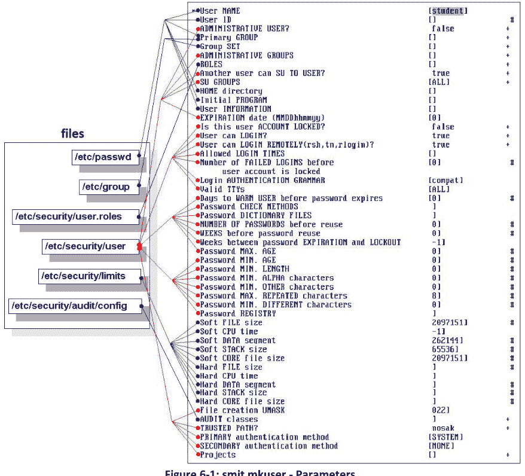

大部分相关参数的含义十分明确，无需赘述，下文仅对需要额外说明的参数进行介绍。

- **用户ID**：通常此处无需手动输入数值，系统会自动分配空闲的可用编号。需要注意的是，标识用户的核心参数就是该编号。如果你删除了ID为*303*的*student*用户，但保留其在系统中的文件，这些文件仍会显示为*303*用户的文件（用户名字段显示为*303*）。在部分场景下，保持多系统用户编号的一致性是有价值的，尤其是运用于集群或共用文件系统的操作系统场景。
- **主属组**：用户所属的主用户组。在标准权限体系下，每个文件仅能属于一个用户和一个用户组，用户创建的文件会自动归属其主属组。
- **附加组**：用户所属的其他用户组，用户可以访问属于这些附加组的文件。
- **初始程序**：用户登录后默认使用的操作系统Shell，默认值为*/usr/bin/ksh*。你也可以不指定Shell，而是填入应用执行文件的路径，从而允许用户仅能使用该应用、无法操作系统。若要在此选项中替换为自定义程序，需要将该程序路径添加到*/etc/shells*和*/etc/security/login.cfg*文件中。
- **账户过期时间**：指定账户可使用的截止时间，到期后用户将无法访问系统。
- **是否锁定该用户账户？**：用于确定是否要锁定目标用户账户，该选项也存在于修改用户参数的菜单中。此外，该菜单支持解锁账户，但若账户因登录尝试次数过多被锁定，则无法通过此菜单解锁，这种情况需要使用*重置用户失败登录次数*菜单（*smit failed_logins*）来解锁用户。
- **允许登录的时间段**：指定用户可登录系统的时间范围（包含星期、时段区间）。
- **有效终端**：指定用户可用于登录的终端。该选项在通过直连服务器的控制台登录时较为重要，若通过Telnet或SSH登录系统则无此限制，此时每个用户会话可分配不同的虚拟终端编号。
- **密码校验规则**：用于指定用户密码需满足的额外要求，每次修改密码时，系统会调用该字段指定的程序来校验密码是否符合要求。
- **密码禁用字典文件**：以逗号分隔的文件列表，这些文件中包含不可作为密码使用的词汇。
- **密码最长有效期**：用户必须在此时间间隔后修改密码，否则无法登录（使用旧密码登录后会提示用户修改密码）。
- **密码最短有效期**：用户修改密码需等待的最短时间间隔。
- **文件大小软限制**：用户可创建文件的最大大小，单位为512字节块。你可以通过*ulimit -f size*命令手动为当前会话提升该参数，但不得超过硬限制值。若达到上限，进程会被终止并提示*文件大小不能超过ulimit设定的值*，且无法超过*硬文件大小限制*。
- **CPU时间软限制**：CPU处理每个用户进程的最长时间（单位为秒），该值为有效处理时间（例如进程可运行两天，但有效处理时间仅为1秒）。你可以通过*ulimit -t number_of_seconds*命令手动提升该参数，但不得超过*CPU时间硬限制*值。
- **数据段软限制**：任意用户进程可使用的数据段最大大小，单位为512字节块。你可以通过*ulimit -d size*命令手动提升该参数，但不得超过*数据段硬限制*值。


#### 软栈大小
任何用户进程可使用的栈的最大大小，以512字节块为单位。你可以使用`ulimit -s size`命令手动增加该参数，但它不能超过*硬栈大小*的值。

#### 软核心转储文件大小
用户进程可生成的`core`文件的最大大小，以512字节块为单位。`core`文件由进程异常终止时生成，其中包含进程内存映像，可帮助定位问题。你可以使用`ulimit -c size`命令手动增加该参数，但它不能超过*硬核心转储文件大小*的值。

#### 文件创建掩码（UMASK）
用于指定用户创建文件的默认权限。文件掩码以八进制表示，和`chmod`命令的用法一致。区别在于，值为*1*的位表示不具备对应权限，值为*0*的位表示具备对应权限。以掩码022为例，将其转换为二进制后得到000 010 010，表示文件所有者拥有完全权限（000），所属组拥有读和执行权限（010），其他用户拥有读和执行权限（010）。因此从`ls`命令的视角来看，该文件的权限为rwxr-xr-x。

#### 主认证方法
用于指定用户认证方式。默认的*SYSTEM*设置表示基于`/etc/passwd`文件的传统认证方式。你也可以使用LDAP认证用户，方便在大型组织中管理用户。

#### 审计类
用于指定分配给用户的审计类。选择该选项会修改`/etc/security/audit/config`文件。

#### 密钥库/文件加密算法
用于加密文件系统（EFS）的算法。加密文件系统的更多细节可参考安全章节。用户组的管理非常简单，与之相关的核心参数是*管理员列表*。该参数指定除root用户外，可管理该组（向组中添加/移除用户）的用户。

#### 修改用户参数
你可以通过`smit chuser`菜单修改用户参数。该菜单和创建用户账户时用到的菜单完全一致，因此你可以修改创建用户时几乎所有的可用参数。该菜单还有另一个实用选项：锁定和解锁用户（`smit lockuser`）。通常UNIX系统采用不删除用户、而是锁定用户的原则，这样做的好处是系统中现有文件的所有者身份始终可查。下面的示例展示了从系统中移除某文件所有者后，执行`ls -l`命令的输出结果。你可以看到，用户名位置显示的是数字：
```sh
# ls -l /home/testuser/smit.log
-rw-r--r-- 1 system 44898 Oct 19 02:24 /home/testuser/smit.log
```
该数字代表文件的所有者。出现这个数字是因为在描述文件属性的I-节点中，所有者以数字而非名称的形式存储。该数字通过`/etc/passwd`文件映射到对应用户名。如果删除用户，其在`/etc/passwd`中的记录会被删除，因此无法将标识符映射到用户名，最终丢失文件所有者的相关信息。创建用户账户时，你需要指定一个参数，用于设置多少次登录失败后会锁定账户。以这种方式锁定的账户无法通过*锁定/解锁与用户账户*菜单（`smit lockuser`）解锁，只能通过*重置用户登录失败计数*菜单（`smit failed_login`）重置登录失败计数器来解锁。

#### 用户登录流程
操作系统用户登录流程，无论是通过直接连接到服务器的控制台，还是通过SSH，流程都非常相似。输入用户名和密码后，操作系统会检查用户是否存在（`/etc/passwd`）、输入的密码是否有效（`/etc/security/passwd`），以及用户是否有登录权限。上述流程成功执行后，操作系统会配置用户环境：它会读取参数文件并运行多个脚本，为用户设置相关变量和参数。这些文件可以自由修改，你可以调整它们来定制用户环境，以满足用户的动态需求。文件按以下顺序处理：
- **/etc/profile** - 所有用户登录时都会处理的脚本，其设置的变量适用于所有用户。该文件默认设置的最重要参数包括：终端类型（*TERM*变量，负责屏幕数据的显示）和邮件提示（*MAILMSG*变量）。
- *PATH* - 指定操作系统搜索文件的路径，当你操作文件时无需提供完整路径，系统会自动在这些路径中查找。
- *TZ（时区）* - 指定服务器运行的时区。通过该变量，操作系统会展示对应时区的正确时间，并知晓何时切换冬令时和夏令时（反之亦然）。这不会修改服务器上的时间计数器，但读取时间时会按照*TZ*变量的设置进行展示。如果修改时区，系统命令和函数会自动展示对应时区的正确时间。
- *LANG* - 操作系统与用户交互时使用的语言。该变量指定了例如手册页（*man*）的语言、系统工具（*smit*、*errpt*等）的语言，以及系统展示消息所使用的语言。
- **$HOME/.profile** - 位于每个用户主目录中的隐藏文件，在使用默认系统shell（*ksh*）时会被处理。它用于定制用户环境，通常会覆盖`/etc/profile`文件中定义的部分变量。
- **$HOME/.env** - 位于每个用户主目录中的隐藏文件。如果`$HOME/.profile`文件中包含字符串`"export ENV=$HOME/.env"`，它的作用和`/etc/environment`文件一致，但仅适用于单个用户，而非所有用户。

如果使用的是*csh* shell，则会使用其他文件：
- `/etc/csh.csrc`
- `/etc/csh.login`
- `$HOME/.csrc`
- `$HOME/.login`

系统处理完上述文件后，普通用户就完成了登录，拥有已配置的环境，并可以访问命令行。你可以通过`.profile`文件定义用户对操作系统的访问范围。例如，你可以配置用户配置文件，使其无法访问命令行，只能访问处理`.profile`文件时启动的终端应用程序。或者，你可以为用户配置一个自定义菜单，使其仅能访问你指定的特定功能。你可以禁用中断信号，防止用户退出到shell。你可以通过*trap*命令实现该功能，它是shell内部命令。该命令被称为内部命令，是因为它并不以可执行文件的形式存在，而是系统shell（*ksh*、*csh*、*bsh*或其他shell）的一部分。它允许你在处理`.profile`或任意脚本时，定义对用户可发送信号（例如*Ctrl+C*、*Ctrl+Z*等）的响应。

```sh
# cat .profile
trap 'kill -16 $$' 1 2 3 15
PATH=/usr/bin:/etc:/usr/sbin:/usr/ucb:$HOME/bin:/usr/bin/X11:/sbin:.
export PATH
if [ -s "$MAIL" ] # This is at Shell startup. In normal operation, the Shell checks periodically.
then
  echo "$MAILMSG"
fi
./program
exit
```

上述文件的第一行表示，在处理`.profile`文件期间产生的1、2、3、15号信号会被拦截，并终止我们会话的shell进程。这些信号中的任何一个都可能中断脚本处理，此处即`.profile`的处理，从而让用户能够使用命令行。由于信号被拦截，用户将无法中断脚本。因此，脚本要么会完全执行完毕，要么其运行的shell进程会被终止。在上面的示例中，两种情况都会导致会话结束（脚本执行完毕后退出，或者尝试中断时执行kill -16终止会话）。你可以使用*kill -l*命令查看可发送给任意进程的信号。进程处理信号的方式由对应程序的开发者在创建程序时决定。如果开发者没有考虑对信号的支持，信号会被忽略（信号9除外，它会直接终止进程）。


#### 跟踪用户
如果要完全跟踪某个用户，需开启系统审计功能，并指定要跟踪特定用户的行为。审计相关说明会在安全章节中描述。
以下是独立于审计系统的典型日志文件。操作系统中有多个文件会收集用户活动的相关信息：
- **`$HOME/.sh_history`** - 该文件包含基于*sh* shell的近期用户命令列表。该文件仅供所有者使用，但系统管理员可借助它监控用户活动。在监控场景下，该文件存在一个短板：用户对该文件拥有完全访问权限。它是文本文件，因此用户可以随意修改其内容。若要获取用户在系统上的全量行为信息，需启用用户审计功能。若不使用审计功能，可运行一个持续监控*.sh_history*文件内容的进程。该进程需将持续出现在历史文件中的内容保存到另一份用户无写入权限的文件中。
```
# nohup tail -f /home/testuser/.sh_history > /var/adm/users/testuser.history & [1] 237752
```
上述示例中，*nohup*命令可令*tail*命令在会话关闭后仍保留在系统中（否则该命令会在会话结束时终止）。*tail -f*命令会追踪文件中新增的行，并将其写入标准输出。新增行会被重定向（>）到对应的文件中。
- **`/var/adm/wtmp`** - 该文件包含登录信息。通过该文件可获取如下信息：用户登录的时间、登录来源IP地址、登录时长。该文件为二进制文件，可使用*last*命令查看其内容，示例如下：
```
# last | grep testuser
testuser pts/1 10.10.254.241 Oct 19 03:22 still logged in.
testuser pts/1 10.10.254.241 Oct 19 03:21 - 03:21 (00:00)
```
如你所见，*testuser*已两次登录操作系统，且其中一次会话仍处于活跃状态。
- **`/etc/security/lastlog`** - 该文件包含用户近期成功与失败的登录系统尝试的详细信息。其中尤为重要的是登录来源IP地址，以及登录失败次数（*unsuccessful_login_count*）。请注意，若登录失败次数超过创建用户账户时设定的阈值，账户将被锁定，直至失败登录计数器被重置（*smit_failed_logins*）。
```
# cat /etc/security/lastlog
# ALL unnecessary information has been omitted.
test: time_last_unsuccessful_login = 1476865241 tty_last_unsuccessful_login = /dev/pts/1 host_last_unsuccessful_login = 10.10.254.241 unsuccessful_login_count = 0 time_last_login = 1476865322 tty_last_login = /dev/pts/1 host_last_login = 10.10.254.241
# ALL unnecessary information has been omitted.
```
## AIX、PowerVM——UNIX、虚拟化与安全
- `/var/adm/sulog` - 该文件包含`su`命令的使用信息，该命令可用于切换到其他用户，包括`root`账户（`root`用户切换至任意用户无需输入密码）。出于安全考虑，UNIX操作系统中直接登录`root`的权限通常受到限制。因此，允许切换到该用户的`su`命令是必要组件。理论上，你可以通过使用`sudo`命令消除切换到`root`用户的需求。部分场景下，你也可以停止使用`root`账户，转而通过基于角色的访问控制（RBAC）管理系统。但在实际场景中，多数组织仍使用切换选项，因为这通常能提升系统管理效率。通过查看上述文件，可验证针对单个用户的切换操作是否成功：
```
# tail -3 /var/adm/sulog
# "tail -3" displays the last three lines of the file.
SU 10/19 03:15 + pts/0 root-test
SU 10/19 03:39 - pts/2 test-root
SU 10/19 03:39 - pts/2 test-root
```
上述示例中，+字符代表切换成功，–字符代表切换失败。例如，第一行显示`root`用户成功切换至`test`用户，下一行显示从`test`用户切换至`root`用户的尝试失败。
#### 与用户管理相关的文件
UNIX系统中有大量与用户管理相关的文件。如果通过工具（SMIT菜单、专用命令）管理系统，你无需了解这些文件。但若操作系统出现故障，这类知识对定位解决方案而言可能至关重要。两个核心用户管理文件是`/etc/passwd`和`/etc/group`：
- `/etc/passwd` - 存储UNIX系统中的用户信息。系统中的每个用户在该文件中对应一行描述，各用户信息以“:”分隔，内容格式如下：`用户名: 密码（当前存储在其他文件中）: 用户ID: 组ID: 主目录: 用户shell`
```
# cat /etc/passwd
root:!::0:0:::/usr/bin/ksh
daemon!:1:1::/etc:
# ALL unnecessary information has been omitted.
student:*:202:1::/home/student:/usr/bin/ksh
```
塞巴斯蒂安·别德隆
在旧版UNIX系统中，密码会直接哈希存储到*/etc/passwd*文件中。哈希是单向函数，因此即使你获取了密码的哈希值，也没有算法可以从哈希值还原出原始密码。这类受保护的密码只能通过*暴力破解*的方式破解，也可以使用基于常用密码的字典法进行破解。由于所有用户都有权限读取*/etc/passwd*文件，用户可能读取其他用户的密码并尝试破解。为防止用户读取密码信息，密码已被移至*/etc/security/passwd*文件中，仅*root*用户可访问该文件。*/etc/passwd*文件中密码字段的位置始终为“?”或“*”字符。文件系统结构中的用户文件以用户ID而非用户名作为标识，文件显示命令会基于*/etc/passwd*文件中的条目，将该标识符转换为对应的名称。因此，若你删除了某个用户但保留其文件，会看到文件所有者显示为数字（例如324）。主组ID用于指定用户创建的文件所属的组号，该标识符对应的组名可在*/etc/group*中查询。
- */etc/group* - 该文件存储UNIX系统中的用户组信息。操作系统中的每个用户组在该文件中对应一行描述，信息以“:”分隔，内容格式如下：*组名:: 组ID: 组成员*
```
# cat /etc/group
system!:!:0:root,srvproxy,esaadmin
staff!:!:1:ipsec,srvproxy,esaadmin,test
# All unnecessary information has been omitted.
```
包含用户信息及其属性的其他文件位于*/etc/security*目录中。仅*root*用户拥有该目录的完全访问权限，属于*security*组的用户拥有读取权限。最重要的文件如下（以下所有文件均为文本文件）：
- */etc/security/passwd* - 包含哈希后的用户密码。
- */etc/security/group* - 包含额外的用户组属性，这些属性用于启用或禁用非root用户管理组的权限，以及组管理员列表。
- */etc/security/user* - 包含所有用户的附加属性，每个用户在该文件中都有一个专属段落，存储与默认段落中默认值不同的属性值。
- */etc/security/login.cfg* - 包含登录参数，即适用的shell、最大会话数、登录时输入密码的可用时长（单位：秒），以及系统上的用户认证方式。
- */etc/security/limits* - 包含用户的系统资源限制。每个用户在该文件中都有一个专属段落，描述与默认段落中默认参数不同的参数。此处可指定的参数示例包括最大文件大小、进程可使用的最大处理器时长等。
- */usr/lib/security/mkuser.default* – 包含分配给
 创建新用户时若未传入其他参数，将采用此处列出的默认参数。这些默认参数可自由修改，借此可优化系统中创建用户账号的流程。批量创建用户账号时这一设置尤为重要，尽管目前该场景相对少见。
- **/usr/lib/security/mkuser.sys**：由*mkuser*命令调用的脚本，用于为用户创建具备适当访问权限和基础配置的主目录。该文件可根据需求自定义修改。
Sebastian Biedroń
## 第7章 存储管理
存储管理如同IT领域的大多数分支一样，也在持续演进与优化。
IT发展早期，服务器配备独立磁盘，且仅能直接操作自身磁盘。这种架构存在诸多优势，例如其他系统不会对服务器的磁盘性能造成干扰；同时也存在明显短板，比如扩展性不足，无法使用高级高可用与容灾解决方案（数据复制），此外未使用的磁盘空间也无法分配给其他服务器或用作其他用途。
发展到一定阶段后，磁盘空间管理领域出现了网络化概念。由此衍生出了利用局域网传输数据的SAN（存储区域网络）、iSCSI等技术。使用SAN需要搭配中央智能存储系统，可实现多服务器间的磁盘空间共享，一个系统不再需要的空间可重新分配给其他系统，还可支持高级数据管理功能。这一方向曾一度是唯一的演进路径，不过随着越来越高效的固态硬盘（SSD）方案普及，如今该理念已被修正。
SAN引入的数据传输最低延迟，对默认延迟就很高的机械硬盘（HDD）而言几乎没有影响，但在响应时间大幅降低的SSD上却至关重要。因此，在无法受益于SAN的特定场景下，我们仍会使用直连磁盘。
过去，AIX的磁盘空间完全在操作系统层面配置。如今，我们主要操作由存储系统创建、通过SAN共享的LUN（逻辑磁盘）。这种情况下，空间配置通常不由服务器或操作系统管控。无论磁盘空间部署在何处，了解其基础结构和特性都至关重要。磁盘空间配置的核心标准是RAID（独立磁盘冗余阵列），该技术已在多种存储系统和操作系统中实现。对于服务器直连的磁盘，通常由专用硬件控制器管理RAID阵列。通过RAID，你可以像操作单块磁盘一样同时向多块磁盘读写数据，从而提升I/O性能。此外，RAID还可引入冗余机制，降低硬件故障导致数据丢失的风险。
#### RAID（独立磁盘冗余阵列）
RAID存在多种不同的实现方案，每种方案都各有利弊，适用于特定场景的方案未必适合其他场景。下文将介绍最重要的几种实现方案。
##### RAID 0 - 分条
RAID 0 实际上不配被称为RAID，因为它没有冗余特性，而名称中的“R”正代表冗余。阵列中的所有磁盘会同时进行数据的写入与读取，阵列最少需要2块磁盘。若通过RAID控制器在操作系统内创建该结构，会生成一块虚拟磁盘，其容量等于磁盘数量乘以最小磁盘的容量。因此最好使用容量相同的磁盘（此外，并非所有控制器都支持在容量不同的磁盘上构建RAID）。这块虚拟磁盘会被划分为若干块（称为条带），其大小通常可在创建结构时自行定义。后续的块会通过轮询算法写入所有参与阵列的磁盘，如图7-1所示。
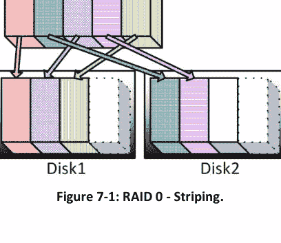
在RAID 0中，若条带大小为64KB、共有2块磁盘，那么128KB的文件会分布在两块磁盘上，第一块存64KB，第二块存64KB。这种分布能带来显著的性能提升，因为该文件的读写操作可同时由两块磁盘执行。
###### 优势
- 读写性能显著提升
- 架构简单：磁盘操作算法十分简单，因此软件实现的性能与硬件实现无异。
###### 劣势
- 无冗余：单块磁盘故障会导致阵列中所有数据丢失，该劣势使得该方案在多数场景下适用性有限。
**解决方案：** 若服务器仅配置单块直连磁盘，则通常不会面临该问题。若操作的是存储系统创建的LUN，则可成功应用该RAID方案，此类LUN在存储系统层面已具备磁盘故障保护机制。如果故障容错要求较低、唯一核心指标是速度，也可选用该方案。
##### RAID 1 - 镜像
RAID 1 具备完全冗余性，可完美防范数据丢失，因此常被用作服务器系统盘的防护方案。RAID 1由2块磁盘组成，若需要保护更多磁盘，可创建多个独立的此类RAID阵列。若通过RAID控制器在操作系统内创建该结构，会生成一块代表镜像的虚拟磁盘，其容量等于构建该结构所用最小磁盘的容量。由于我们通常会使用容量相同的磁盘，因此可以说构建镜像后，可用磁盘容量会减半。两块物理磁盘会被划分为数量相同、大小一致的条带，第一块磁盘上的每个条带都会在第二块磁盘上留存副本。这意味着写入操作的数量会翻倍，因为相同的数据需要写入两块磁盘。而读取操作不存在该问题，可将任务拆分到两块磁盘上执行，从而缩短读取耗时。RAID 1的架构示意图如图7-2所示。

**图7-2：RAID 1 - 镜像**。我们进一步详细说明该示例：假设条带大小为64KB，镜像由2块磁盘构成，那么128KB的文件会同时存储在两块磁盘上，总写入量为256KB。多数写入操作会在两块磁盘上并行执行，这会导致写入耗时增加：原因是需要通过总线传输双倍数据量，且要等待较慢的磁盘完成写入。读取操作则可以高速执行，性能与RAID 0相当，因为阵列可将读取任务拆分到两块磁盘上执行。由于两块磁盘存储的数据完全一致，因此可以分别从两块磁盘读取部分数据，没有任何障碍。尽管读取速度很快，但双倍写入的特性使得RAID 1的写入速度较慢，不过它具备容错能力。
###### 优势
- 完全冗余：数据同时存储两份，数据丢失的概率极低。
- 架构简单：磁盘操作算法十分简单，因此软件实现的性能与硬件实现无异。
###### 劣势
- 冗余成本极高：阵列中仅有一半的磁盘容量可用于存储数据。
- 写入性能较低：由于需要执行双倍写入操作，写入性能低于单块磁盘。
**解决方案：** 操作内置磁盘时，系统盘通常会采用该方案进行防护：系统盘不需要极高的性能，但需要在故障时具备良好的保护能力。如果部署环境是虚拟化的，Virtual I/O Server的系统盘也会采用该方案保护。该方案特别适合作为系统盘的另一个原因是，此类结构的操作十分简单，而且RAID中的单块磁盘可被视为独立单元，而非RAID的组成部分。这一特性简化了系统启动相关的代码：代码在启动阶段仅需操作单块磁盘，直到负责镜像的代码加载完成即可，无需配备从RAID读取数据的算法，仅需从其中一块磁盘读取内核并将其移交控制权即可，内核后续即可操作整个RAID阵列。
##### RAID 10 - 分条+镜像
RAID 10是RAID 1与RAID 0的组合方案，继承了RAID 1的完全冗余特性和RAID 0的高速度，是所有RAID等级中速度最快的。它针对故障导致的数据丢失有极强的防护能力，但代价是总磁盘容量减半。构建此类RAID至少需要4块磁盘，通常要求容量一致。创建此类RAID后，会生成一块容量为单块磁盘容量一半的虚拟磁盘。该虚拟磁盘会被划分为若干块（称为条带），大小通常可在创建RAID时自行定义。后续的块会通过轮询算法写入半数磁盘，此外每个条带都会在另一块磁盘上留存副本，可防范单块磁盘故障导致的数据丢失。四块磁盘的RAID 10配置方案如图7-3所示。


Sebastian Biedroń
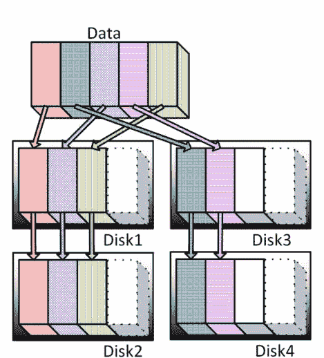
图 7-3：RAID 10——镜像与条带化。让我们更详细地来看这个示例。在 RAID 10 中，若条带大小为 64 KB、包含 4 块磁盘，那么 128 KB 的文件会存储在 2 块磁盘上，且每个条带会在另一块磁盘上留有一份副本。写入 128 KB 数据时，实际需要物理写入 256 KB。尽管如此，由于写入操作分散在 4 块磁盘上，我们仍然能获得操作加速的效果。
###### 优点
- 读写性能显著提升
- 从读写速度来看，这是所有提供数据保护的 RAID 实现中速度最快的（仅 RAID 0 比它更快）
- 完全冗余——由于同时存储两份数据，数据丢失的概率极低
- 配置简单——执行磁盘操作的算法非常简洁，使得软件实现的效率和硬件实现相当
###### 缺点
- 冗余成本极高——阵列中仅有一半的磁盘容量可用
###### 适用场景
该 RAID 等级适用于对读写性能要求较高的场景，常被用于存储数据库文件。需要注意的是，使用 SSD 时，它相较于 RAID 5 的优势不像在机械硬盘（HDD）上那么明显。多数操作系统都支持通过软件创建该等级的 RAID，且能获得不错的性能。
##### RAID 5——条带化与分布式奇偶校验
搭建最小的 RAID 5 仅需 3 块磁盘，通常最多使用 8~16 块磁盘。RAID 5 具备冗余能力，可抵御指定群组内 1 块磁盘故障，若再出现 1 块磁盘故障，则会导致 RAID 中所有数据完全丢失。RAID 5 的读取效率很高，但写入速度较慢。大容量数据的顺序写入效率不错，但随机小写入会导致性能大幅下降。
RAID 5 基于计算奇偶校验的算法实现，奇偶校验信息均匀分布在所有磁盘上，因此单块磁盘故障不会导致数据丢失。阵列中单块磁盘的性能表现正常，但由于需要计算故障磁盘上应有的数据，效率会有所降低。计算过程同时基于可用磁盘上的数据和奇偶校验信息。
由于 RAID 5 在运行过程中需要进行大量计算，因此很少通过软件实现该等级，软件实现的性能会比硬件实现慢很多，还会造成计算资源浪费。
创建该类型的 RAID 至少需要 3 块磁盘，通常要求磁盘容量相同。创建 RAID 时会生成一块虚拟磁盘，其容量为所有磁盘总容量减去 1 块磁盘的容量。虚拟磁盘会被划分为多个块（也称为条带），条带大小通常可在创建 RAID 时自定义。后续的条带会通过轮询算法依次写入后续磁盘。若干条带组成一个群组（也称为步幅），每个群组包含每块磁盘上的 1 个条带。每个群组中有 1 个条带用于存储奇偶校验信息，奇偶校验条带会均匀分布以平衡所有磁盘的负载。图 7-4 展示了由 3 块磁盘构建的此类 RAID 的示例。
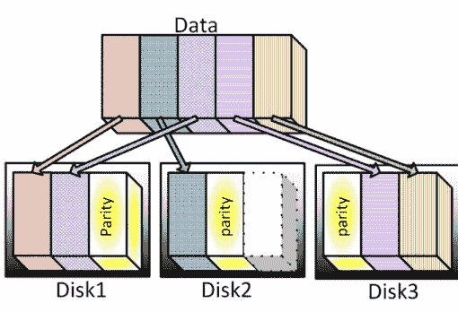
**图 7-4：RAID 5。**
让我们更详细地分析这个示例：在 RAID 5 中，若条带大小为 64 KB、包含 3 块磁盘，那么 128 KB 的文件会分布在 3 块磁盘上，其中 2 块存储文件数据，第 3 块存储奇偶校验信息，总共占用 192 KB 存储空间。由于需要计算并写入新的奇偶校验信息，磁盘上存储的任意一部分数据发生修改时，都会触发两次写入操作。由于不需要强制更新奇偶校验信息，RAID 5 的读取速度可以像 RAID 0 一样非常高。
###### 优点
- 读取性能出色
- 冗余成本低——构建 RAID 所用的所有磁盘中，仅损失 1 块磁盘的容量
###### 缺点
- 写入性能较差——这一点在小量随机写入场景下尤为明显
- 奇偶校验计算算法会增加处理器负载——奇偶校验计算会给处理器带来额外负担，写入时会导致性能明显下降，尤其是大量小写入操作场景下
###### 适用场景
该 RAID 等级适用于对成本敏感的场景，因为它的磁盘空间利用率更高（构建 RAID 5 时仅损失 1 块磁盘的容量）。但它通常不用于对写入性能要求极高的系统。RAID 5 常被用于应用服务器和 Web 服务器，因为这些场景下磁盘的主要操作是读取操作。但数据库服务器很少使用 RAID 5。使用 SSD 可以降低 RAID 5 的缺点带来的影响，这意味着它适用于所有类型的场景。
###### 补充信息
历史上还存在 RAID 1 到 RAID 5 之间的 RAID 等级，即 RAID 2、RAID 3 和 RAID 4，但这些等级效率低下，几乎不会被使用。RAID 2 最初是为了适配无法自主校验数据可读性的磁盘而设计的（目前所有磁盘都支持该功能），而 RAID 3 和 RAID 4 是 RAID 5 的前身。它们的运行效率比 RAID 5 更低，主要问题在于奇偶校验信息会被写入专用的磁盘，这会导致磁盘负载过高，进而造成性能损失。
此外还有 RAID 6，它在提供比 RAID 5 更高级别数据保护的同时，依然能保持较高的磁盘空间利用率。RAID 6 的运行机制和 RAID 5 非常相似，区别在于每个群组（步幅）中有 2 个条带用于存储控制数据，这意味着 RAID 6 可以抵御 2 块磁盘同时故障的情况。使用这类 RAID 的原因通常是为了搭配大容量、低速的磁盘：磁盘故障后需要更换并重建 RAID，而大容量低速磁盘的重建过程可能耗时数小时，还会给剩余磁盘带来沉重负载，进一步提升后续故障和数据不可访问的风险。RAID 6 可以有效规避这类风险。
磁盘阵列和内置 RAID 控制器支持将 1 块或多块磁盘定义为“热备盘”。阵列中的磁盘故障后，会由热备盘接管替换。该过程可能耗时较长，因为替换磁盘需要写入故障磁盘上的原有数据：RAID 5 的数据是通过剩余磁盘上的信息计算得出，而 RAID 1 和 RAID 10 的数据则是从第二份可用副本中复制得到。
#### RAID 等级对比
从性能维度对比不同 RAID 等级可以得出，RAID 0 和 RAID 10 的速度最快。若仅用 RAID 5 执行读取操作，其速度可以媲美 RAID 10。性能对比结果如表 7-1 所示。
##### 表 7-1：RAID 性能对比
|  | 读取 | 写入 | 整体性能 | 
|:---|:---|:---|:---| 
| **RAID 0** | 极佳 | 极佳 | 极佳 | 
| **RAID 1** | 极佳/良好¹ | 较差 | 较差/良好 | 
| **RAID 10** | 极佳 | 极佳 | 极佳 | 
| **RAID 5** | 极佳 | 较差² | 良好 | 
¹ 取决于具体实现，因为操作系统可以在 RAID 1 的磁盘间分配读取任务，也可以始终从单块磁盘读取。
² 大块写入时性能可能显著提升，但小块写入时性能会大幅下降。
以下场景可以说明 RAID 10 和 RAID 5 之间性能差异的原因：向 RAID 10 和 RAID 5 中写入一个 64 KB 的数据块，假设两者均由 4 块磁盘构建，条带大小为 64 KB。
##### RAID 10
用户写入一个存储在磁盘对上的块，因此会触发 2 次操作：
1. 将数据块写入第一块磁盘 = 1 次 I/O
2. 将数据块写入第二块磁盘 = 1 次 I/O
因此，从操作系统视角看，单次写入需要 2 次写入操作。
##### RAID 5
用户写入一个大小为条带大小的块，因此在由 4 块磁盘构建的 RAID 5 中，会触发以下操作：
1. 将数据块写入对应磁盘 = 1 次 I/O
2. 从另外 2 块磁盘读取对应的数据块 = 2 次 I/O
3. 计算奇偶校验信息
4. 将携带奇偶校验信息的数据块写入第三块磁盘 = 1 次 I/O
因此，从操作系统视角看，单次写入需要 2 次写入操作、2 次读取操作以及 1 次计算操作。
该场景也解释了为何 RAID 5 的大容量数据顺序写入效率较高：这种情况下不需要执行读取操作，因为每个群组（步幅）中的所有条带都会被修改，仅需要计算奇偶校验信息即可。
从容错能力来看，RAID 1 和 RAID 10 的数据丢失风险最低。各 RAID 等级的容错能力如表 7-2 所示。


塞巴斯蒂安·别德龙
##### 表 7-2：RAID 的抗故障能力
|  | 最少磁盘数 | 抗故障能力 | 单磁盘故障 | 50% 磁盘故障 |
| :--- | :--- | :--- | :--- | :--- |
| **RAID 0** | 2 | 无 | 数据丢失 | 数据丢失 |
| **RAID 1** | 2 | 高 | 数据可用 | 数据可用³ |
| **RAID 10** | 4 | 高 | 数据可用 | 数据可用或不可用⁴ |
| **RAID 5** | 3 | 中等 | 数据可用⁵ | 数据丢失⁶ |
³ 由于该 RAID 通常由两块磁盘构建，50% 的故障即意味着一块磁盘故障。
⁴ 取决于故障的是哪些磁盘。
⁵ 阵列处于降级模式，缺失的数据会通过计算重建，这可能会造成显著的性能损失。
⁶ 超过一块磁盘故障会导致全部数据丢失。
#### AIX 中的磁盘管理
我们通常会使用 SAN（存储区域网络）和外部存储来管理磁盘空间。外部存储设备是智能设备，在性能和可用性方面提供了多样化的配置能力。它们为操作系统共享逻辑驱动器，操作系统通过内部机制管理这些设备。AIX 拥有自身的内部虚拟化层，用于从其视角管理可用磁盘空间。该层非常复杂且灵活，借助它我们可以在不影响系统运行的情况下，检查磁盘子系统的每个组件，以及验证和修改数据放置位置。
这种磁盘管理机制被称为**逻辑卷管理器（LVM）**，它具备诸多优势：
- 支持调整文件系统大小。在传统文件系统中，调整文件系统大小是项复杂的任务，需要删除文件系统所在的分区、创建符合新尺寸的新分区，再恢复分区上的所有文件。而在 AIX 中，可以在系统正常运行期间通过一条命令调整文件系统大小，该操作仅需几秒即可完成。
- 逻辑卷（等同于传统文件系统中的分区）无需放置在磁盘的连续空间上，也不必位于同一块磁盘上，可以分散在多块磁盘中。
- 支持轻松执行各类磁盘操作，例如迁移结构、修改参数、创建 RAID 0、1、10 配置等。
- 通过对多磁盘阵列进行操作，可以在不导致系统无法访问的前提下，在阵列之间迁移数据。
磁盘管理负责管理构成磁盘系统的各类组件，其中包含若干基础结构：
- **卷组（VG）**：所有结构的父级结构，用于编组物理卷（磁盘），从而定义物理卷的部分特性。
- **物理卷（PV）**：简单来说，这就是磁盘阵列或内部 RAID 控制器提供给操作系统的整块物理或逻辑磁盘（LUN）。物理卷可隶属于某个卷组，这种情况下它会被分割为固定大小的物理分区，分区大小由卷组参数决定。在操作系统中，物理卷的标识为`/dev/bdiskX`。需要特别注意的是，本书中绝大多数情况下，“磁盘”一词与“物理卷”同义。
- **物理分区（PP）**：物理卷的固定组成部分。由于物理卷被划分为物理分区，逻辑卷以及对应的文件系统无需以连续区域的形式存在于物理卷上。调整逻辑卷和文件系统大小时，仅需添加或移除 PP 即可。
- **逻辑分区（LP）**：PP 的逻辑等价结构，逻辑分区会映射到物理分区。一个 LP 始终对应一块、两块（镜像）或三块（双重镜像）物理卷上的物理分区。
- **逻辑卷（LV）**：由一个或多个逻辑分区构成的结构。逻辑卷可类比为任意操作系统中的普通分区，区别在于 LV 无需是连续区域，它由一组可分布在多块物理卷上的“块”（LP/PP）组成。文件系统创建在逻辑卷上。
- **文件系统（FS）**：直接存储数据的结构，创建在 LV 上。每个逻辑卷仅可创建一个文件系统。
逻辑卷管理器的各结构及其相互关系如图 7-5 所示。

卷组和逻辑卷的相关信息存储在以下两处：
- **对象数据管理器数据库（ODM）**：ODM 数据库已在之前章节中介绍过。
- **卷组描述符区域（VGDA）**：该区域存在于隶属于该卷组的每块物理卷上，是存储整个卷组配置信息的独立区域。借助该区域，你可以将整个卷组迁移到其他服务器，只需移动磁盘，再从其中一块磁盘的 VGDA 区域导入卷组数据即可（导入的数据会存储在 ODM 中）。
##### 卷组（VG）
卷组是管控存储数据的基础逻辑结构，是优于其他子结构的上层架构，用于定义其下属结构的部分参数。卷组的直接下属结构是物理卷（PV），以及所有基于物理卷间接创建的各类结构。一块物理卷仅可隶属于一个卷组，且卷组必须至少包含一块物理卷。当卷组中最后一物理卷被移除时，该卷组会被自动删除。要访问卷组的资源，卷组必须处于激活状态（vary on），激活卷组可类比为挂载文件系统。
操作系统安装完成后，会生成名为 rootvg 的卷组，其中包含系统安装时选中的磁盘。该卷组仅应用于存储操作系统。最佳实践是将数据存储在不同的独立卷组中，这样可确保系统组织有序，且与数据相互隔离。这种隔离对于数据备份和恢复至关重要，本书的备份章节会详细解释这种分离为何对备份如此重要。
AIX 中存在多种类型的卷组，这些类型是为了满足单卷组存储数据量不断增长的需求而设计的。此外，不同卷组的运行方式并没有显著差异，各类卷组的区别如表 7-3 所示。
###### 表 7-3：各类卷组的区别
| 卷组类型 | 单卷组最大 PV 数 | 单卷组最大 LV 数 | 单卷组最大 PP 数 | 最大 PP 大小 |
| :--- | :--- | :--- | :--- | :--- |
| **原始卷组（Original VG）** | 32 | 256 | 1016（每 PV 的 PP 数）· 32（PV 数）= 32512 | 1 GB |
| **大型卷组（Big VG）** | 128 | 512 | 1016（每 PV 的 PP 数）· 128（PV 数）= 130048 | 1 GB |
| **可扩展卷组（Scalable VG）** | 1024 | 4096 | 2097152 | 128 GB |
大型卷组在 AIX 4.3.2 中引入，可扩展卷组则在 AIX 5.3 中推出。更早之前，在 AIX 4.3.1 中进行了调整，允许原始卷组中每块 PV 拥有超过 1016 个 PP，但该调整的代价是降低了单 VG 的最大 PV 数量。如果将原始卷组的每 PV PP 数设置为 2032（即 1016 的 2 倍），那么单 VG 的最大 PV 数量会缩减为原来的一半（降至 16）。
所有新卷组都应创建为可扩展卷组，其他类型的卷组仅用于兼容更早版本的操作系统。卷组的属性由可为其配置的参数描述，使用`lsvg`命令即可获取卷组及其参数的相关信息，通过该命令可以查看任意卷组的特性。
## AIX、PowerVM —— UNIX、虚拟化与安全
##### `lsvg` 命令的基本用法：
- `lsvg`：显示所有卷组的相关信息。
- `lsvg VGname`：显示指定卷组的参数。
- `lsvg -l VGname`：显示属于指定卷组“VGname”的逻辑卷信息。
- `lsvg -p VGname`：显示属于指定卷组“VGname”的物理卷信息。
- `lsvg -M VGname`：显示指定卷组内逻辑卷的分布信息，同时标注逻辑卷所在的物理分区。
##### 描述卷组的参数
``` 
# lsvg rootvg datavg 
# lsvg rootvg 
VOLUME GROUP: rootvg 
VG IDENTIFIER: 00f6217700004c0000000157d28ec368 
VG STATE: active 
PP SIZE: 16 megabyte(s) 
VG PERMISSION: read/write 
TOTAL PPs: 511 (8176 megabytes) 
MAX LVs: 256 
FREE PPs: 156 (2496 megabytes) 
LVs: 12 
USED PPs: 355 (5680 megabytes) 
OPEN LVs: 11 
QUORUM: 2 (Enabled) 
TOTAL PVs: 1 
VG DESCRIPTORS: 2 
STALE PVs: 0 
STALE PPs: 0 
ACTIVE PVs: 1 
AUTO ON: yes 
MAX PPs per VG: 32512 
MAX PPs per PV: 1016 
MAX PVs: 32 
LTG size (Dynamic): 256 kilobyte(s) 
AUTO SYNC: no 
HOT SPARE: no 
BB POLICY: relocatable 
PV RESTRICTION: none 
INFINITE RETRY: no 
DISK BLOCK SIZE: 512 
CRITICAL VG: no 
FS SYNC OPTION: no 
```
###### 关键参数：
- **VOLUME GROUP**：卷组的名称。
- **VG STATE**：卷组的状态，共分为三种：
  - Active/Complete：卷组完全激活（已对其执行`varyonvg`命令）。
  - Active/Partial：卷组处于激活状态，但部分 PV 未激活（可能已损坏）。
  - Inactive：卷组未激活，因为尚未执行`varyonvg`命令。
- **VG PERMISSION**：只读或读写访问权限。
- **MAX LVs**：卷组中可存在的逻辑卷的最大数量。
- **TOTAL PVs**：卷组中当前的物理卷数量。
- **STALE PVs**：卷组中损坏/未配置的物理卷数量。
- **HOT SPARE**：用于判断卷组是否配置了“热备盘”，即可在故障时

- **PP大小** - 物理分区的大小。每个物理卷会被划分为大小为PP SIZE的物理分区。逻辑卷和文件系统的空间以该大小的块为单位进行分配。因此，该大小指定了可从逻辑卷中扣除或添加到逻辑卷的最小空间。物理分区的大小在卷组的整个生命周期内保持不变，即无法修改。
- **空闲PP** - 整个卷组中空闲物理分区的数量（即卷组中的可用磁盘空间量）。
- **已用PP** - 整个卷组中已使用的物理分区数量，即卷组中已占用的磁盘空间量。
- **仲裁** - 用于确定仲裁机制是开启（2）还是关闭（1）。本章后续会提供关于该参数的更多信息。
- **失效PP** - 损坏的物理分区数量。
- **自动激活** - 该参数用于确定卷组是否在系统启动时自动激活。

##### 卷组中的逻辑卷（lsvg -l）
```shell
# lsvg -l rootvg
rootvg:
LV NAME    TYPE      LPs  PPs  PVs  LV STATE       MOUNT POINT
hd5        boot      2    2    1    closed/syncd   N/A
hd6        paging    32   32   1    open/syncd     N/A
hd8        jfs2log   1    1    1    open/syncd     N/A
hd4        jfs2      21   21   1    open/syncd     /
hd2        jfs2      127  127  1    open/syncd     /usr
hd9var     jfs2      11   11   1    open/syncd     /var
hd3        jfs2      70   70   1    open/syncd     /tmp
hd1        jfs2      1    1    1    open/syncd     /home
hd10opt    jfs2      2    2    1    open/syncd     /opt
hd11admin  jfs2      8    8    1    open/syncd     /admin
lg_dumplv  sysdump   64   64   1    open/syncd     N/A
livedump   jfs2      16   16   1    open/syncd     /var/adm/ras/livedump
```
- **逻辑卷名称** - 逻辑卷的名称。你可以为任意新逻辑卷命名。操作系统安装完成后，rootvg卷组始终包含上述输出中指定的逻辑卷。
- **类型** - 逻辑卷的类型。五种基本类型如下：
  - JFS/JFS2 - 表示该逻辑卷用于存放文件系统（JFS或JFS2）的类型。
  - JFSLOG/JFS2LOG - 表示该逻辑卷用于存放文件系统日志（JFSLOG或JFS2LOG）的类型。
  - **paging** - 表示该逻辑卷用于存放分页空间（也称为交换空间）的类型。
  - **boot** - 表示该逻辑卷是启动逻辑卷，启动时会在此加载内核的类型。
  - **sysdump** - 表示该逻辑卷用于存放系统转储的类型。转储是导致系统故障时系统运行状态的镜像。发生故障时，系统会将自身状态写入该位置。
类型并非严格定义。创建逻辑卷时，你可以在类型字段中输入任意字符串。因此，不应将类型按字面意思理解。无论分配何种类型，逻辑卷的结构都是相同的。
- **LP（逻辑分区）** - 分配给指定逻辑卷的逻辑分区数量。可使用该值计算逻辑卷的大小：将其与物理分区大小（PP SIZE）相乘，即可得到逻辑卷的大小。PP SIZE可通过`lsvg VGname`命令查看。
- **PP（物理分区）** - 构成逻辑卷的物理分区数量。通过对比PP值和LP值，可以确定存储的副本数量。在上面的示例中PP = LP = 1，因此每个逻辑分区对应一个物理分区。该配置表示数据以简单形式存储，无镜像。可配置单镜像或双镜像。你可以通过`lsvg -l LVname`命令验证数据是否已镜像。
- **PV（物理卷）** - 指定逻辑卷的物理分区所在的物理卷数量。如果使用单镜像，PP数量将是LP数量的两倍。
- **LV STATE（逻辑卷状态）** - 逻辑卷的状态，共有三种可能状态：
  - **opened/syncd** - 逻辑卷处于打开状态。这意味着其上创建的文件系统已挂载，或是某个程序使用该逻辑卷绕过文件系统。如果逻辑卷配置为镜像，则两份数据副本均已同步（syncd）。
  - **opened/stale** - 逻辑卷处于打开状态。如果逻辑卷配置为镜像，则数据副本未同步（stale）。这可能表示存储其中一份数据副本的磁盘已损坏。如果不是该情况，你需要同步两份副本（例如使用`syncvg`命令）。
  - **closed** - 逻辑卷处于关闭状态。这意味着当前没有程序使用该逻辑卷。
- **MOUNT POINT（挂载点）** - 显示该逻辑卷上存放的文件系统默认挂载的目录。

##### 卷组中的物理卷（lsvg -p）
```shell
# lsvg -p rootvg
rootvg:
PV_NAME   PV STATE  TOTAL PPs  FREE PPs  FREE DISTRIBUTION
hdisk0    active    542       433      108..87..21..108..109
hdisk1    active    542       427      108..81..21..108..109
```
- **PV NAME（物理卷名称）** - 物理卷的名称。
- **PV STATE（物理卷状态）** - 物理卷的状态，可显示指定物理卷的状态。仅当物理卷处于*active*状态时才能访问。它也可能处于*stale*状态，表示无法访问或已损坏。
- **TOTAL PPs（总物理分区数）** - 物理卷中物理分区的总数量。
- **FREE PPs（空闲物理分区数）** - 空闲物理分区的数量。
- **FREE DISTRIBUTION（空闲分布）** - 磁盘每个区域（从左至右依次为：外边缘、外中间、中心、内中间、内边缘）的空闲PP数量。
对于物理磁盘而言，这些区域的平均数据访问时间各不相同。创建文件系统时，管理员可通过调整逻辑卷的分布位置来影响磁盘性能。对于磁盘阵列，调整这些参数没有意义，因为我们无法得知LUN的物理特性。固态硬盘（SSD）也是如此，数据分布对其性能无影响。在这种情况下，由于存在防止同一存储单元被频繁写入的保护机制，被覆盖的数据可能会出现在其他存储单元中。

##### 仲裁机制
AIX支持一种仲裁机制，该机制不允许激活物理卷不可用率≥50%的卷组。仲裁参数用于控制该机制。该参数为自动设置，用于确定卷组可激活所需的最低可用描述符（VGDA，即卷组描述符区域）数量。卷组中的每块磁盘都拥有一个VGDA。需要注意的是，卷组中的第一块磁盘拥有两个VGDA，其余磁盘仅有一个。如果该参数设置为1（通过`lsvg VGname`命令查看），则仲裁功能处于禁用状态；否则，该参数的取值为整数，对应实现仲裁所需的最低可用VGDA数量。不同磁盘数量下的仲裁参数取值如表7-4所示：

**表7-4：不同磁盘数量对应的仲裁参数取值**
| 卷组中的磁盘数量 | 卷组中的VGDA数量 | 卷组中的仲裁参数取值 |
|------------------|------------------|----------------------|
| 1                | 2                | 2                    |
| 2                | 3                | 2                    |
| 3                | 4                | 2                    |
| 4                | 5                | 3                    |
| ...              | ...              | ...                  |

如果卷组中一半及以上的磁盘损坏，其中存储的数据可能会出现不一致或无法访问的情况。在不知情的情况下尝试使用这些磁盘，最终可能导致已保留的数据被破坏。因此，卷组故障是提醒管理员磁盘存在严重问题的信号，需要在恢复运行前解决该问题。建议在包含多块磁盘的卷组中使用该机制。但不应针对仅包含两块磁盘的`rootvg`卷组使用该机制。双磁盘卷组的仲裁值为2，这意味着如果其中一块磁盘故障，卷组可能无法激活。这种情况会发生在拥有两个VGDA的第一块磁盘故障时。如果`rootvg`卷组无法激活，即使单块磁盘丢失对镜像而言不是问题，操作系统也无法启动。如果系统运行过程中该卷组中的某块磁盘损坏，它将不会

塞巴斯蒂安·别德龙 AIX、PowerVM——UNIX、虚拟化与安全组件不会对系统产生任何负面影响，尽管重启后系统无法启动。AIX在包含两块磁盘的卷组中默认禁用仲裁功能。

##### 添加卷组
添加卷组时，根目录（/）中需要有大约2MB的可用空间。这是必要的，因为添加卷组时，操作系统还会在文件系统中创建代表该卷组的结构。你可以使用SMIT菜单（`smet mkvg`）创建卷组。选择该菜单后，就可以选择要创建的卷组类型。
共有三种卷组类型可选：原始型（Original）、大型型（Big）和可扩展型（Scalable）。这些类型在本章开头已经介绍过。这里需要提醒的是，除可扩展型之外的其他类型的存在，是为了兼容操作系统的早期版本。
选择卷组类型后，会显示如图7-6所示的菜单，各类型的菜单基本一致。下图是用于创建可扩展卷组的菜单。


###### 关键参数：
- 物理分区大小（单位为MB）——决定整个卷组的物理分区大小。此处指定的值将决定作为逻辑卷和文件系统分配单元的磁盘空间大小。换句话说，该卷组中的每个逻辑卷和文件系统都由该大小的块组成。定义可扩展类型卷组时，无需考虑实际限制；但旧类型的卷组存在此类限制。为原始型或大型型卷组定义该参数时，需注意每块磁盘的最大物理分区数为1016。由于这一限制，如果设置的物理分区大小过低，将无法添加大小超过1016 *（物理分区大小）的磁盘。下面详细说明该示例：我们创建了一个物理分区大小为128MB的原始型卷组，此前使用的磁盘大小为72GB。如果尝试向该卷组中添加146GB的物理卷，操作将失败。要使该操作成功，磁盘需要被划分为超过1016个物理分区，这因上述限制而无法实现。这一限制（每个物理卷最多1016个物理分区）可以通过命令行使用`mkvg`命令创建卷组来部分突破。此时可以使用`-t`参数指定每块磁盘更高的PP（物理分区）数量。增加物理卷上的物理分区数量时，会限制卷组中物理卷的数量，对应关系如表7-5所示。

###### 表7-5：每个PV的PP数量与每个VG的PV数量对应关系
| 每个PV的PP数量 | 原始型VG每个VG的PV数量 | 大型型VG每个VG的PV数量 | 创建VG时的-t参数 |
| --- | --- | --- | --- |
| 1016 | 32 | 128 | |
| 2032 | 16 | 64 | -t 2 |
| 3048 | 10 | 42 | -t 3 |
| 4064 | 8 | 32 | -t 4 |
| 5080 | 6 | 25 | -t 5 |
| ... | ... | ... | ... |

`-t`参数也存在于`chvg`命令中，该命令用于修改卷组的属性，可在系统正常运行期间使用。
- **物理卷名称**——指定将成为卷组一部分的磁盘（PV）。你可以使用`extendvg VGname hdiskX`命令将磁盘添加到卷组中。一块磁盘只能属于一个卷组。
- **系统重启时自动激活卷组**——决定操作系统启动时是否激活该卷组（对应`varyonvg`命令）。
- **卷组主编号**——指定卷组标识符。操作系统引用任何设备时都会使用两个编号，即`主编号`和`次编号`。由于AIX将卷组视为设备，因此仅通过这两个编号引用卷组。用户通过卷组名称引用VG，因此该参数对用户无意义，最好保持不变。在集群方案中，如果卷组可以挂载到一台服务器后再挂载到另一台，保持编号一致性非常重要。
- **创建支持并发的VG**——该选项主要用于集群方案。将卷组设置为*增强并发*模式后，允许多台服务器同时使用该卷组。此设置下，卷组在其中一台服务器上以*活动*模式运行，可执行所有操作；在其他服务器上则以*被动*模式运行。

##### 另一种创建卷组的方法是使用*mkvg*命令
此处描述的大部分参数都可以在创建卷组后通过`chvg`命令修改，但物理分区大小无法更改。

##### 修改参数
可以通过SMIT菜单（*smit chvg*）修改单个参数，该菜单调用了`chvg`命令。你可以将卷组转换为更新的格式（选项包括：*转换为大型VG格式？*和*转换为可扩展VG格式？*）。将原始型卷组转换为大型型卷组是简单操作，可在卷组已挂载（使用`varyonvg`命令）的情况下执行，不会对内容（逻辑卷和文件系统）产生任何负面影响。转换为可扩展型卷组则更复杂，需要先禁用（使用`varyoffvg`命令）卷组，即卸载属于该卷组的文件系统。两种转换过程对系统的影响都很小，因此整个操作仅需几秒钟，风险很低。需要注意，`rootvg`卷组无法进行转换。使用SMIT菜单可执行的更改如图7-7所示。


##### 基本操作
你可以通过SMIT菜单或命令行执行卷组的基本操作，下文介绍命令行方法。最佳实践要求你掌握使用命令行修改系统的方法，无需依赖更复杂的工具。这一知识可以让你通过脚本实现系统管理自动化，而编写良好的脚本又允许你同时执行一系列操作，从而节省时间。下文所示的命令支持应用众多参数，可调整其行为以满足你的特定需求，因此接下来会详细介绍它们的基本用法。

##### 激活卷组
``` 
# varyonvg VGname 
# 激活名为"VGname"的卷组 
```
如果要对属于某个卷组的文件系统或逻辑卷执行任何操作，该卷组必须处于活动状态。如果未满足仲裁规则，或存储在*对象数据管理器（ODM）*文件中的VG特征与存储在*卷组描述符区域（VGDA）*中的特征不一致，卷组激活将失败。`rootvg`会在启动时自动激活，其他卷组可设置自动激活或手动激活。你可以通过检查`lsvg VGname`命令输出中的*AUTO ON*设置来确认这一点。

##### 停用卷组
``` 
# varyoffvg VGname 
# 停用名为"VGname"的卷组 
```
系统关闭时，每个卷组都会自动停用。卷组停用时，属于该卷组的文件系统和逻辑卷将不可用。停用操作可随时“手动”执行，但如果属于该卷组的任何文件系统已挂载或任何逻辑卷已打开，停用操作将失败。

##### 添加物理卷
``` 
# extendvg VGname hdiskX 
# 将物理卷hdiskX添加到"VGname"卷组 
```
如果文件系统没有可用空间且卷组中没有空闲空间，就需要向卷组中添加新的物理卷。可以使用上述命令完成该操作，且不会影响系统的当前运行。如果要添加的PV已经属于另一个卷组，或要添加的磁盘所属的卷组处于停用状态，该命令将执行失败。

##### 移除物理卷
``` 
# reducevg VGname hdiskX 
# 从"VGname"卷组中移除物理卷hdiskX 
```
尝试从卷组中移除磁盘时，卷组必须处于活动状态。当卷组中的所有磁盘都被移除后，该卷组将不存在。你可以使用`-d`参数，该参数会自动移除磁盘上的所有逻辑卷（LV）。但最好不要使用该参数，而是先单独移除逻辑卷，这样可以降低出错概率。

##### 卷组的其他参数
通过使用`chvg`（修改卷组）命令，你可以修改其他多个参数。其中一个参数是操作系统启动时VG的自动激活设置：
``` 
# chvg -a y VGname 
```

##### 在系统间迁移卷组
有一种简单的方法可以将VG及其所有逻辑内容（即LV和文件系统）从一台AIX系统迁移到另一台。可以使用属于卷组的磁盘完成传输，方法如下。
### 源系统
迁移卷组前，必须先将其停用：
``` 
# varyoffvg VGname 
```

塞巴斯蒂安·比德龙
然后，从源系统中删除卷组的信息：
``` 
# exportvg VGname 
```
更准确地说，这一步会从ODM数据库和配置文件中删除卷组的相关信息，使得该卷组在系统中不可见。此操作过程中，磁盘上存储的所有数据都不会丢失。由于卷组的相关描述数据仍然存储在每个属于该组的磁盘的VGDA中，因此这些描述数据也不会丢失。
下一步是从系统中删除属于该组的磁盘：
``` 
# rmdev -dl -X 
```
- `-l` 将磁盘的状态从*可用*更改为*已定义*。
- `-d` 从ODM数据库中删除该设备（磁盘）（磁盘将在系统中不再可见）。
完成上述操作后，属于被迁移卷组的磁盘就可以被移动到目标系统了。

## 目标系统
为了让新添加的磁盘在系统中可见，需要运行*cfgmgr*配置程序。
下一步是将卷组导入到目标系统：
``` 
# importVG -y groupVG hdiskX 
# 将卷组信息保存到ODM数据库中。 
```
卷组描述会从*hdiskX*中读取并保存到系统配置中。卷组名称在系统中必须唯一，因此你可以通过`-y`参数自定义名称。你也可以跳过该参数，让系统自动分配唯一名称（当然这种名称可读性会更差）。如果不存在与现有文件系统的冲突，导入过程会创建挂载点，并在`/etc/filesystems`文件中添加描述导入文件系统的条目。如果导入的卷组中的逻辑卷名称与现有名称重复，这些名称会被修改为唯一名称。
导入完成后，该卷组处于非激活（*varyoff*）状态。你可以使用`*varyonvg VGname*`命令手动激活它，也可以使用`*chvg -a y VGname*`命令将其设置为系统启动时自动激活。

##### 逻辑卷（LV）
逻辑卷是由若干尺寸相同的逻辑分区（LP）组成的集合。逻辑分区与物理分区类似，可以理解为指向1个、2个（镜像）或3个（双镜像）物理分区的指针。因此，向指向2个物理分区的逻辑分区写入数据时，相同的数据会同时写入两个位置。这样一来，就可以在逻辑卷层级而非物理卷（磁盘）层级创建RAID 0、1和10阵列。
逻辑卷的示例如图7-8所示。

从上述图中可以看出，逻辑卷可以由属于同一卷组的任意物理卷上的任意物理分区构建。对于逻辑卷操作而言，这些物理分区是相邻还是分散在磁盘各处并不重要，从操作视角来看，它们表现为连续区域。
上图中的*逻辑卷2*展示了镜像的工作原理：一个逻辑分区指向两个物理分区，因此数据会同时写入两个物理分区。
调整逻辑卷大小时，会增加或移除逻辑分区，也就是说，调整逻辑卷大小的最小粒度是物理分区的尺寸。
逻辑卷可以类比传统分区，和分区一样，你可以在逻辑卷上创建文件系统，也可以直接对其进行操作。
系统通过`/dev`目录下的两个文件表示逻辑卷：第一个文件名与逻辑卷名称相同，第二个文件名前带有字母`r`。按照该规则，存放根文件系统（`/`）的逻辑卷`hd4`对应以下两个设备：
- `/dev/hd4` —— 块设备，由操作系统缓存。
- `/dev/rhd4` —— 字符设备，不由操作系统缓存。

###### 块设备与字符设备
在所有UNIX系统中，块设备和字符设备是分开的。两者的核心区别在于系统的操作方式。部分设备可能同时具备块设备和字符设备的形态，这种情况下系统采用哪种操作方式，取决于其使用的设备类型（块设备或字符设备）。同时具备两种形态的典型设备包括逻辑卷和物理卷。

####### 块设备
包含逻辑卷在内的块设备，可以通过标识文件类型的字母*b*来识别：
``` 
# ls -l /dev/hd4 
brw-rw---- 1 root system 10, 4 Aug 23 07:35 /dev/hd4 
```
这类设备由操作系统进行缓冲处理，因此对它们的操作速度通常快于字符设备。缓冲机制的含义是：数据写入时，首先会进入负责缓存设备读写操作的内存区域，之后再定期或收集到足够量的数据时，才会将数据从内存写入磁盘。对于逻辑卷和物理卷而言，延迟写入机制允许操作系统按照与缓冲区输入顺序不同的顺序写入记录，这让系统可以优化写入操作，例如将多个写入请求合并为更大的数据包。这种机制的核心优势是提升设备操作性能，但并非所有场景下都能生效。

####### 字符设备
字符设备通过标识文件类型的字母*c*以及以字母*r*开头的名称（*原始设备*）来识别：
``` 
# ls -l /dev/rhd4 
crw-rw---- 1 root system 10, 4 Aug 23 07:35 /dev/rhd4 
```
字符设备不由操作系统缓存，这意味着任何向该设备的写入操作都会立即执行。写入字符设备的数据会严格按照发出的顺序送达。字符设备通常被数据库使用，以提升I/O操作性能。
既然已经证明缓冲式设备访问速度更快，为什么字符设备能提升数据库性能？答案在于数据库拥有专属的缓存系统，该机制是专门为数据库的工作方式设计的，效率高于操作系统的缓存机制。此外，当数据库系统运行在缓冲设备上时，会发生双重缓冲：数据库缓存的数据在写入磁盘前，会先存入操作系统缓冲区，这会增加额外的内存操作，导致同一份数据在两个位置存储，造成内存使用效率低下。

##### 描述逻辑卷的参数（lslv）
你可以使用*lslv*命令查看描述逻辑卷的基础参数：
``` 
# lslv hd3 
# 逻辑卷的基础特征。 
LOGICAL VOLUME: hd3 
VOLUME GROUP: rootvg 
LV IDENTIFIER: 00f6217700004c00000001574d9300a7.7 
PERMISSION: read/write 
VG STATE: active/complete 
LV STATE: opened/syncd 
TYPE: jfs2 
WRITE VERIFY: off 
MAX LPs: 512 
PP SIZE: 16 megabyte(s) 
COPIES: 1 
SCHED POLICY: parallel 
LPs: 38 
PPs: 38 
STALE PPs: 0 
BB POLICY: relocatable 
INTER-POLICY: minimum 
RELOCATABLE: yes 
INTRA-POLICY: center 
UPPER BOUND: 32 
MOUNT POINT: /tmp 
LABEL: /tmp 
MIRROR WRITE CONSISTENCY: on/ACTIVE 
EACH LP COPY ON A SEPARATE PV ?: yes 
Serialize IO ?: NO 
INFINITE RETRY: no 
PREFERRED READ: 0 
```
参数*TYPE*、*MOUNT POINT*、*LV STATE*和*PP SIZE*在讨论卷组时已经介绍过，此处含义相同。还有一些其他值得关注的参数：
- **MAX LPs** —— 逻辑卷最多可包含的逻辑分区数量，该值在创建逻辑卷时设定，你可以将其修改为符合所应用卷组类型的限制范围。
- **COPIES** —— 每个逻辑分区对应的物理分区数量，值为2时代表镜像，值为3时代表双镜像。
- **LPs** —— 构成逻辑卷的逻辑分区数量，通过将该参数值与*PP SIZE*相乘，即可计算逻辑卷的容量。
- **STALE PPs** —— 逻辑卷中损坏的物理分区数量。
- **INTER-POLICY** —— 磁盘上物理分区的分配策略。如你所知，一个逻辑卷的物理分区可以分布在多个磁盘上，该参数用于决定逻辑卷管理（Logical Volume Manager）在创建或扩展逻辑卷时，是将所有物理分区（PP）集中分配到最少数量的磁盘上，还是分散到最多数量的磁盘上。*INTER-POLICY*可以通过两种方式设置：
  - *minimum* —— 系统会尝试将所有PP放在同一个物理卷上，如果放不下，则会将其分配到数量最少且可容纳的磁盘上。
  - *maximum* —— 系统会尝试将卷组内的所有PP分散到尽可能多的磁盘上。这种排列方式会提升磁盘操作性能，因为针对一个逻辑卷的操作会被分散到多个磁盘上执行。
- **INTRA-POLICY** —— 指定为指定逻辑卷分配物理分区时使用的磁盘区域。如今这一参数的重要性越来越低，因为大部分磁盘资源都由外部磁盘存储提供给系统，该参数仅在直接连接到服务器的机械磁盘场景下适用。在这种情况下，该设置可能产生显著影响：磁盘中心区域的数据访问时间更短，磁盘外缘区域的顺序读写速度更快，因此使用频率最高的逻辑卷应该被分配到磁盘中心区域。

然而，使用大块数据执行读写操作的逻辑卷（LV）应放置在外部边缘。内边缘效率最低，因此最适合存放极少使用的数据。
##### 物理卷分为五个区域：
- 边缘
- 中部
- 中心
- 内中部
- 内边缘
上述物理卷划分如图7-9所示。

**图7-9：磁盘区域 - 盘内策略**
###### 镜像写一致性
一种可加快系统恢复的机制。试举一例：若该机制处于禁用状态，系统发生故障会导致镜像逻辑卷（LV）无法正常关闭。这种情况下，操作系统需先同步其副本（*syncvg -f -l LVname*）才能使用该逻辑卷。该过程在系统启动时执行，可能需要数秒到数分钟。若启用该机制，系统会执行额外的写入操作，记录逻辑卷同步的相关信息。借助这些附加信息，同步速度会更快，且可在后台透明执行。该机制的主要缺点是会产生额外的磁盘写入，可能降低I/O操作的性能。
###### 每个逻辑分区（LP）副本位于独立物理卷（PV）上？
该参数用于使逻辑分区的每个副本都创建在独立的物理卷上。系统正常运行期间，该参数的值应始终设置为*YES*；否则创建镜像时，两个副本可能会落在同一块磁盘上。这种镜像会拖慢写入速度，也无法提升可用性。
###### I/O序列化
该机制可将多条记录合并为一条。若系统收到针对连续磁盘块的多个写入指令，会将这些指令合并为一个更大的写入任务，从而提升I/O操作性能。尽管使用该机制有明显益处，但通常建议将其禁用（这也是默认设置），因为文件系统和数据库自身已有对应机制，重复启用反而会产生不利影响。
###### 写入校验
该机制可快速检测存储数据中的异常并维持数据一致性。启用该机制后，每次向磁盘写入数据后都会读取相同数据以验证写入的正确性。该机制极少被使用，唯一适用场景是测试内置磁盘的正确性。
###### 调度策略
该参数用于指定镜像逻辑卷的工作方式，可调整其读写逻辑以提升效率或增强可靠性，共有四种模式：
- 顺序模式：所有读取操作均从主磁盘（第一份副本）执行。写入时先写入第一份副本，下一步再写入第二份副本，最后写入第三份。最后一份副本写入完成后，该操作视为完成。该模式可提升磁盘子系统的可靠性，但会极大限制其性能。
- 并行模式：读取操作在镜像的所有磁盘（所有逻辑卷副本）间分配，由负载较低的磁盘（等待队列中任务更少的磁盘）执行读取。负载相同时则选择主磁盘（存储数据第一份副本的磁盘）。写入操作会同时向两块磁盘执行，仅当两个写入任务都完成时，该写入操作视为完成。这是默认设置，可最大程度提升镜像逻辑卷的性能。该方案还可通过将更多读取操作导向负载较低的磁盘，降低镜像中各磁盘的性能差异负担。
- 并行写入/顺序读取：混合模式。读取操作始终从主磁盘执行，逻辑同顺序模式；写入操作同时向所有磁盘执行，逻辑同并行模式。
- 并行写入/轮询读取：该模式与并行模式非常相似，区别在于读取操作会均匀分配。因此，该模式适合创建在性能相同的磁盘上的逻辑卷。
###### 坏块（BB）策略
该参数用于决定是否重定位损坏的块。
###### 可重定位
该参数用于决定指定逻辑卷（LV）是否需要执行重组流程，重组相关内容将在本章后续部分讨论。
###### 上限
该参数用于指定创建镜像时可使用的物理卷的最大数量。
##### 逻辑卷部署（lslv -l）
使用*lslv -l LVname*命令可获取逻辑卷在磁盘上的部署信息，示例如下：
```
# lslv -l hd3 hd3:/tmp
```
| 物理卷（PV） | 副本数 | 带内完成率 | 分布 |
|-------|-------------|---------|------------------------|
| hdisk1 | 006:000:000 | 100% | 000:000:006:000:000 |
| hdisk0 | 006:000:000 | 100% | 000:000:006:000:000 |
塞巴斯蒂安·别德龙
##### 关键参数
- **物理卷（PV）** - 逻辑卷所在的物理卷，上例中该逻辑卷位于两块物理卷上。
- **副本数** - 三个以冒号分隔的字段分别代表（从左至右）：
  - 指定物理卷上仅有1个物理分区的逻辑分区数量，这是最常见的情况。
  - 指定物理卷上有2个物理分区的逻辑分区数量，通常出现在配置错误的镜像中，因为同一磁盘上的两份副本无法抵御故障，反而会使数据写入耗时翻倍。
  - 指定物理卷上有3个物理分区的逻辑分区数量，相关说明同上一情况，仅数据写入耗时会变为三倍。
- **分布** - 展示指定逻辑卷的物理分区所处位置，从左到右分别对应边缘、中部、中心、内中部、内边缘的物理分区（PP）数量。上例中所有物理分区（共6个）均位于中心区域。
- **带内完成率** - 用于计算已达成部署推荐的百分比，推荐规则在逻辑卷创建时分配，可在其生命周期内修改。逻辑卷*hd3*的推荐规则为将所有物理分区部署在物理卷的中心区域，最终完成度为100%，即该逻辑卷的所有物理分区均已部署到指定位置（磁盘中心区域）。
##### 逻辑卷详细部署信息（lslv -l）
使用`lslv -m LVname`命令可获取逻辑卷在磁盘上的详细部署信息，示例如下：
```
# lslv -m hd3 hd3:/tmp LP PP1 PV1 PP2 PV2 PP3 PV3
```
| 逻辑分区（LP） | 物理分区1（PP1） | 物理卷1（PV1） | 物理分区2（PP2） | 物理卷2（PV2） | 物理分区3（PP3） | 物理卷3（PV3） |
|-----|-----|--------|-----|--------|-----|--------|
| 0001 | 0219 | hdisk1 | 0296 | hdisk0 |  |  |
| 0002 | 0220 | hdisk1 | 0297 | hdisk0 |  |  |
| 0003 | 0300 | hdisk1 | 0300 | hdisk0 |  |  |
| 0004 | 0301 | hdisk1 | 0301 | hdisk0 |  |  |
| 0005 | 0302 | hdisk1 | 0302 | hdisk0 |  |  |
| 0006 | 0303 | hdisk1 | 0303 | hdisk0 |  |  |
通过该命令即可获取逻辑卷的物理分区详细信息。上例中可以看到，逻辑卷*hd3*的第1号逻辑分区有两份副本：主副本位于*hdisk1*的第0219号物理分区，次副本位于*hdisk0*的第0296号物理分区。
##### 添加逻辑卷
可使用SMIT工具或`mklv`命令添加逻辑卷。通过SMIT创建逻辑卷时，需为各个参数赋值。这些参数的名称可能具有误导性，因为其名称可能与通过`lslv`命令获取的参数名称不同。SMIT菜单中的参数及其与`lslv`命令获取参数的对应关系如图7-10所示。

添加逻辑卷时可设置的大部分参数已在章首介绍，下方将说明此前未提及的参数，或对已知参数作出补充说明：

Sebastian Biedroń - **逻辑分区（_LPs_，_lslv_命令中的参数）的数量**
逻辑卷的容量。你可以通过将逻辑分区的数量乘以物理分区的大小（_PP SIZE_）来将其换算为MB。

- **物理卷（_PHYSICAL VOLUME_）名称**
指定用于创建逻辑卷的物理卷。如果指定了多个物理卷，最合适的逻辑分区分配方式将取决于_物理卷范围_的设置。

- **物理卷上的位置（_lslv_命令中的_INTRA-POLICY_参数）**
指定逻辑卷的物理分区应放置的位置。该参数仅在直接连接到服务器的物理旋转磁盘驱动器场景下适用，这种情况下会直接影响I/O操作的性能。

- **物理卷范围（_lslv_命令中的_INTER-POLICY_参数）**
该参数可取两个值：
  - _minimum_（最小）：操作系统会尝试在数量最少的磁盘上分配物理分区，这意味着物理分区将放置于：
    - 创建单副本逻辑卷（每个逻辑分区的_副本数=1_）时，放置于1块磁盘上。
    - 创建镜像逻辑卷（每个逻辑分区的_副本数=2_）时，放置于2块磁盘上。
    - 创建三副本逻辑卷（每个逻辑分区的_副本数=3_）时，放置于3块磁盘上。
  - _maximum_（最大）：系统会尝试在创建逻辑卷涉及的所有物理卷（即所有列出的_物理卷名称_）上分布物理分区。该设置可实现更高的I/O性能。

- **每个_逻辑分区_的_副本数_（_lslv_命令中的_COPIES_参数）**
用于确定创建普通逻辑卷（值为1）、镜像逻辑卷（值为2）还是双重镜像逻辑卷（值为3）。

- **是否将每个_逻辑卷_分配至_独立的物理卷_？**
该参数可取三个值：
  - _Yes_（是）：指定不允许在同一个物理卷上存在分区的两个逻辑副本。该设置为默认值，通常该设置是正确的，因为它可以避免在单块磁盘上创建镜像，这类操作通常没有实际意义。
  - _No_（否）：上述设置的相反选项。
  - _Superstrict_（超级严格）：指定单个镜像的逻辑分区不能位于已存在另一镜像分区的物理卷上。

- **重组过程中是否迁移_逻辑卷_？（_lslv_命令中的_RELOCATABLE_参数）**
用于确定系统在重组过程（_reorg_命令）中，是否应根据分配策略（_INTRA-POLICY_）迁移逻辑卷的逻辑分区。

- **是否启用_坏块_迁移？（_lslv_命令中的_BB POLICY_参数）**
该参数用于确定系统是否要将损坏的磁盘块替换为其他块。这类操作对用户不可见，仅在错误日志中留有记录。

- **包含_分配映射_的文件**
在此处可指定映射文件的路径，该文件用于说明在哪些物理卷的哪些物理分区上创建逻辑卷。文件需要为逻辑卷的每个逻辑分区添加条目，条目格式如下：_PVname: PPnum1 [-PPnum2]_。
以下是一个定义了由5个物理分区组成的逻辑卷的示例文件：
``` hdisk1:166 hdisk1:168 hdisk1:170-172 ```
# 该行与以下内容等效：hdisk1:170 hdisk1:171 hdisk1:172。

**条带大小？**
该参数用于创建条带化（即RAID 0或RAID 10）。要配置RAID 0，需在至少2个物理卷上创建逻辑卷；要配置RAID 10，需在4个物理卷上创建。可设置的值范围为4KB到128MB，条带化逻辑卷的速度取决于所选的数值。
若逻辑卷的读写操作使用大块数据，则适合设置较大的值；磁盘操作使用的块越小，对应的设置值也应越小。
通常更推荐的方式是使用不带*条带大小*选项的条带化。该方法需要创建一个使用小尺寸物理分区的卷组，同时创建逻辑卷时设置*物理卷范围=最大*选项。这样会创建一个条带大小等于物理分区大小的条带。
由于我们通常操作外部存储的LUN（逻辑单元号），因此这类条带即使较大也不会影响性能。采用这种方式，可以规避*条带大小*选项带来的所有限制。

另一种添加逻辑卷的方式是使用命令行和`mklv`命令：
```shell
# mklv -y'dane' -t'jfs2' -c'2' rootvg 40 hdisk0 hdisk1
```
**所用参数：**
- *-y*：要创建的逻辑卷的名称。
- *-t*：逻辑卷的类型。
- *-c*：逻辑卷的副本数。
- `rootvg`：用于创建逻辑卷的卷组。
- *40*：逻辑分区的数量（即所创建逻辑卷的容量）。
- `hdisk0 hdisk1`：用于创建逻辑卷的物理卷。

多数参数都有默认值，因此执行命令时仅需指定部分参数即可，必填参数如下：
- 逻辑卷的名称；
- 创建逻辑卷所属的卷组；以及
- 逻辑分区的数量。

##### 添加镜像逻辑卷
逻辑卷可以创建为镜像形式。如果通过SMIT菜单添加逻辑卷，需要配置3个参数，这些参数如图7-11所示。

*图7-11：添加镜像逻辑卷。*
- *物理卷名称*：需指定2块磁盘。
- *每个逻辑分区的副本数*：需设置为2。
- *是否将每个逻辑分区副本分配至独立的物理卷？*：需设置为是。

创建逻辑卷后，可验证其配置是否正确。
```shell
# lslv -m testlv
testlv:N/A
LP PP1 PV1 PP2 PV2 PP3 PV3
0001 0204 hdisk1 0204 hdisk2
0002 0205 hdisk1 0205 hdisk2
0003 0206 hdisk1 0206 hdisk2
0004 0207 hdisk1 0207 hdisk2
0005 0208 hdisk1 0208 hdisk2
0006 0209 hdisk1 0209 hdisk2
0007 0210 hdisk1 0210 hdisk2
0008 0211 hdisk1 0211 hdisk2
0009 0212 hdisk1 0212 hdisk2
0010 0213 hdisk1 0213 hdisk2
```

##### 将镜像拆分为独立的逻辑卷
在AIX系统中，可以将镜像拆分为独立的逻辑卷，可通过`splitlvcopy`命令实现。通过该方法创建的逻辑卷相互独立，需作为独立实体进行管理。
可以对处于活跃状态的逻辑卷执行拆分操作，但不推荐这么做，因为可能导致数据不一致。因此最好先卸载逻辑卷上创建的文件系统，关闭逻辑卷。如果直接访问逻辑卷，需先关闭使用该逻辑卷的应用程序。
以下示例演示如何拆分上一节中创建的`testlv`逻辑卷的副本：
```shell
# splitlvcopy -y testlv_new testlv 1 hdisk2 testlv_new
```
上述命令会拆分位于物理卷`hdisk2`上的`testlv`逻辑卷副本，并创建一个名为`testlv_new`的独立逻辑卷。命令中的数字1指定`testlv`保留1个副本。如果从由3个副本组成的逻辑卷中提取1个副本，则该数字应设置为2。
逻辑卷拆分后的状态如以下输出及表7-6所示。
```shell
# lsvg -l datavg
datavg:
LV NAME     TYPE    LPs  PPs  PVs  LV STATE      MOUNT POINT
testlv      jfs2    10   10   1    closed/syncd  N/A
testlv_new  jfs2    10   10   1    closed/syncd  N/A
```
*表7-6：通过splitlvcopy命令拆分的逻辑卷*
| 原始逻辑卷 | 提取的逻辑卷 |
| :--- | :--- |
| ```shell<br># lslv -m testlv<br>testlv:N/A<br>LP PP1 PV1 PP2 PV2 PP3 PV3<br>0001 0204 hdisk1<br>0002 0205 hdisk1<br>0003 0206 hdisk1<br>0004 0207 hdisk1<br>0005 0208 hdisk1<br>0006 0209 hdisk1<br>0007 0210 hdisk1<br>0008 0211 hdisk1<br>0009 0212 hdisk1<br>0010 0213 hdisk1<br>``` | ```shell<br># lslv -m testlv_new<br>testlv_new:N/A<br>LP PP1 PV1 PP2 PV2 PP3 PV3<br>0001 0204 hdisk2<br>0002 0205 hdisk2<br>0003 0206 hdisk2<br>0004 0207 hdisk2<br>0005 0208 hdisk2<br>0006 0209 hdisk2<br>0007 0210 hdisk2<br>0008 0211 hdisk2<br>0009 0212 hdisk2<br>0010 0213 hdisk2<br>``` |

操作完成后，原本1个`testlv`逻辑卷会变为2个：
- `testlv`：原始逻辑卷，完全位于物理卷`hdisk1`上。

哦对了，刚才的那个lsvg的输出，原OCR里的格式是：
``` # lsvg -l datavg datavg: LV NAME TYPE LPs PPs PVs LV STATE MOUNT POINT testlv jfs2 10 10 1 closed/syncd N/A testlv_new jfs2 10 10 1 closed/syncd N/A ```
所以整理成代码块里的表格格式，更清晰，没错。 还有纠正的那个OCR错误：原OCR里写的是hdisk3，实际是hdisk2，因为命令里指定的是hdisk2，后面表格里testlv_new的PV也是hdisk2，所以那个是OCR识别错误，纠正了，符合要求。 还有原来的分页标记都删掉了，没有[PAGE X]的内容，段落之间用空行分隔，标题正确，列表项用- 开头，表格转换成了Markdown格式，所有原文信息都保留了，没有删减总结。


- *testlv_new*
- 该新逻辑卷是从位于*hdisk2*物理卷上的*testlv*副本中分离出来的。

##### 更改逻辑卷参数
可在逻辑卷上进行的更改操作如图 7-12 所示。


### 可执行以下更改操作：
1. **更改逻辑卷**（*chlv* 命令）—— 创建逻辑卷时指定的部分参数可以“动态修改”，例如 INTRA-POLICY、SCHED POLICY、BB POLICY 等。
2. **重命名逻辑卷**（*chlv -n '新名称' 旧名称* 命令）。
3. **扩容逻辑卷**（*extendlv* 命令）—— 可按指定的物理分区数增加逻辑卷容量，该操作对用户透明。命令示例如下：
   ```
   # extendlv examplelv 10 # Increases LV size by 10 PP.
   ```
   —— 添加到逻辑卷的物理分区将分配在符合分配策略（INTRA-POLICY）的磁盘空间中，若这些区域没有可用空间，则将分配在最接近分配策略要求的区域。
4. **为逻辑卷添加副本**（*mklvcopy* 命令）—— 即创建逻辑卷的镜像（或双重镜像）。如前所述，AIX 中的镜像是在逻辑卷层级创建，而非整个磁盘（PV）层级。
5. **从逻辑卷移除副本**（*rmlvcopy* 命令）—— 即从指定逻辑卷中移除镜像（或双重镜像），示例如下：
   ```
   # rmlvcopy hd3 1 hdisk0 # Remove all LV copies from hdisk0 so that LV has only 1 copy.
   ```

##### 在卷组内移动逻辑卷
LVM 有一个非常实用的功能：可在卷组内的物理卷之间移动逻辑卷，进而移动对应的文件系统。借助该功能，你可以将打算从磁盘删除的数据移走，或将数据转移到更快的磁盘以提升性能。
例如你在系统中添加新磁盘以提升 I/O 性能时，仅添加磁盘并不会提升系统性能，还需要合理分配数据。
在传统磁盘系统中，磁盘间移动数据存在一个较大问题：需要停止使用相关文件的应用程序。而在 AIX 中，借助*migratepv*命令即可完成该操作，且不会中断应用程序运行。
磁盘间的数据迁移是在物理分区层级进行的，以下示例展示了将所有物理分区从`hdisk1`转移到`hdisk2`的过程（见图 7-13）。
```
# migratepv -l lv00 hdisk1 hdisk2
```
`-l` 参数用于指定要移动的逻辑卷；若不指定该参数，则会从`hdisk1`向`hdisk2`迁移所有逻辑卷。


上述示例的操作对象是带镜像的逻辑卷。若一个逻辑分区指向两个物理分区，则说明该逻辑卷存在镜像（见上图）。
执行`migratepv -l lv00 hdisk1 hdisk2`命令后，逻辑卷`lv00`的所有物理分区会从`hdisk1`转移到`hdisk2`，该逻辑卷中位于`hdisk0`的物理分区则保持不变。
需注意，上述逻辑卷移动操作只能在同一个卷组内执行。虽然无法直接将逻辑卷移动到其他卷组，但可在任意逻辑卷组之间执行复制操作。

##### 复制逻辑卷
与卷迁移（*migratepv*）不同，逻辑卷复制可在任意逻辑卷组之间执行。不同卷组的物理分区大小可能不同。复制逻辑卷时需使用*cplv*命令或*smit cplv*菜单。与*migratepv*相比，该工具的缺点是复制过程中逻辑卷必须处于关闭状态，即不能有进程访问该逻辑卷，若逻辑卷上挂载有文件系统，则需先卸载。
复制逻辑卷是简单的操作，更具实用性的是将包含逻辑卷的文件系统移动到其他卷组的流程。以下示例任务为：将*newVG*卷组中的`/new`文件系统移动到*new2VG*卷组。
两个卷组的当前状态如下：
```
# lsvg -l newVG newVG:
LV NAME   TYPE   LPs PPs PVs LV STATE   MOUNT POINT
loglv01   jfslog  1   1  1  open/syncd N/A
lv00      jfs    38  38  1  open/syncd /new
```
```
# lsvg -l new2VG new2VG:
```
```
# lsvg -l new2VG new2VG:
| LV NAME   | TYPE   | LPs | PPs | PVs | LV STATE   | MOUNT POINT |
| --------- | ------ | --- | --- | --- | ---------- | ----------- |
| lv00 copy | jfs    | 304 | 304 | 1  | closed/syncd | N/A |
| loglv02   | jfslog | 1   | 1   | 1  | closed/syncd | N/A |
```
你可以注意到，复制后的逻辑卷包含的逻辑分区和物理分区数量多于原逻辑卷，造成这一差异的原因是*new2VG*卷组的物理分区尺寸小于*newVG*卷组。
要完成该迁移任务，需遵循以下步骤：
1. 卸载`/new`文件系统。逻辑卷的*open*状态表示其已挂载，执行卸载命令：`# umount /new`
2. 将包含`/new`文件系统的逻辑卷*lv00*复制到*new2VG*卷组，需指定副本名称（本例中为*lv00_copy*），否则系统将使用默认名称。
   ```
   # cplv -v new2 -y lv00_copy lv00
   cplv: Logical volume lv00 successfully copied to lv00_copy .
   ```
   复制完成后，*newVG*卷组的状态如下：
   ```
   # lsvg -l newVG newVG:
   LV NAME   TYPE   LPs PPs PVs LV STATE   MOUNT POINT
   loglv01   jfslog  1   1  1  closed/syncd N/A
   lv00      jfs    38  38  1  closed/syncd /new
   ```
3. 按照表 7-7 所示修改`/etc/filesystems`文件中的条目。
   **表 7-7：在卷组之间迁移文件系统**
   | 原始条目 | 修改后条目 |
   | --- | --- |
   | /new:<br> dev = /dev/lv00<br> vfs = jfs<br> log = /dev/loglv01<br> mount = true<br> options = rw<br> account = false | /new:<br> dev = /dev/lv00_copy<br> vfs = jfs<br> log = /dev/loglv02<br> mount = true<br> options = rw<br> account = false |
   
   原承载文件系统的逻辑卷已被副本替换，同时需要修改文件系统日志，因为每个文件系统必须使用与其处于同一卷组的日志。
   当然，你也可以不修改`/etc/filesystems`中的现有条目，而是新增条目并定义新的挂载点，两个文件系统可独立操作。
完成上述步骤后，文件系统已处于新卷组中，可执行挂载命令（`mount /new`）将其挂载。挂载并验证文件系统无误后，即可删除原逻辑卷。

##### 重组卷组内的逻辑卷
创建逻辑卷时会指定分配策略（*INTRA-POLICY*），用于定义磁盘空间的分配规则。如前所述，该参数仅在操作系统直接使用机械磁盘时有意义，如今大多数系统使用磁盘阵列或 SSD，该参数的重要性已大幅降低。
不过了解该参数的适用场景仍有价值。通常在长时间观测系统后，可发现当前选择的逻辑卷组织方式并非最优，此时可修改分配策略，再重组逻辑卷的分布。
重组操作可在处于开启状态的逻辑卷上执行，例如包含当前已挂载文件系统的逻辑卷。重组的唯一负面影响是会导致 I/O 操作性能暂时下降。
现通过一个示例来说明重组操作：

## AIX、PowerVM —— UNIX、虚拟化与安全
存在一个*testlv*逻辑卷，其中包含一个*/testlv*文件系统。这是最常用的文件系统之一，对它的操作耗时过长。逻辑卷的分布如下：
| 物理卷（PV） | 副本数 | 带内占比 | 分布 |
|--------|--------|---------|------------------------|
| hdisk0 | 1 | 100% | 01..00..00..00..00 |
如你所见，*testlv*逻辑卷位于磁盘的边缘。这种位置只能保证少量大规模读写的性能，并不符合当前场景。解决该问题的最有效方法是将逻辑卷移至磁盘的其他区域，以此获得更好的性能。最合适的区域是磁盘中心，能够保证数据访问路径最短。此类场景下的第一步是变更策略（*INTRA-POLICY*）。你可以通过`/usr/sbin/chlv -a 'c' testlv`命令或*smit chlv1*菜单完成该操作，如图7-14所示：

上图展示了策略变更的结果。该变更会将*testlv*逻辑卷的新物理分区创建在磁盘中心，但该操作不会按照新策略移动当前的物理分区。当你变更策略后，会发现*lslv -l*命令显示的逻辑卷信息发生了变化：
| 物理卷（PV） | 副本数 | 带内占比 | 分布 |
|--------|--------|---------|------------------------|
| hdisk0 | 1 | 0% | 01..00..00..00..00 |
*IN BAND*（带内占比）从*100%*变为了*0%*。这表示物理分区的分布仅*0%*符合策略要求。策略要求将所有物理分区（PP）放在磁盘中间，但当前它们位于磁盘边缘。如果这10个物理分区中有1个位于磁盘中间，*IN BAND*值就会是*10%*。
下一步是启动逻辑卷重组流程，移动物理分区使其符合新策略要求。如果磁盘特定区域空间不足无法完成该操作，物理分区会被放置在尽可能接近目标区域的位置（例如，会被移至*middle*（中间）或*inner middle*（内中）区域，而非*center*（中心）区域）。你可以使用`reorgvg`命令启动重组：
```shell
# reorgvg rootvg testlv
0516-962 reorgvg: logical volume testlv migrated.
```
要执行重组，逻辑卷必须将*RELOCATABLE*参数设置为*yes*（你可以通过`lslv LVname`命令检查该参数）。命令执行完成后，你会发现物理分区（*DISTRIBUTION*，分布）已发生变更，符合策略要求（*IN BAND = 100%*）。
| 物理卷（PV） | 副本数 | 带内占比 | 分布 |
|--------|--------|---------|------------------------|
| hdisk0 | 1 | 100% | 00..00..10..00..00 |
从此，对`/testlv`文件系统的I/O操作速度会有所提升。该规则适用于作为物理旋转磁盘的物理卷，对于磁盘阵列提供的LUN并不适用。由于磁盘阵列的工作原理，大多数情况下我们无法确定所谓的*edge*（边缘）是否真的是磁盘边缘，*center*（中心）是否真的是磁盘中心。重组操作会影响整个卷组。要执行该操作，你必须先变更组内各个逻辑卷的分配策略，再运行`reorgvg VGname`命令。
##### 元数据同步
卷组和逻辑卷的相关信息始终存储在两个位置：
- 在数据库对象数据管理器（ODM）数据库中。
- 在卷组描述符区域（VGDA）中，即卷组内每个物理卷的起始位置。
有可能出现两个位置的数据不一致的情况，这会导致逻辑卷信息显示错误。出现此类情况时，你应该同步整个卷组或指定逻辑卷的信息。你可以使用`synclvodm`命令完成同步，示例如下：
```shell
# synclvodm -v rootvg hd5 hd6
# Synchronization of information about 2 LVs in the rootvg group.
synclvodm: Physical volume data updated.
synclvodm: Logical volume hd5 updated.
synclvodm: Logical volume hd6 updated.
```
`-v`：该参数会在屏幕上显示各个逻辑卷的更新状态。同步操作并非危险操作，但为了稳妥起见，你可以通过将以下目录中的文件复制到安全位置的方式备份ODM数据库：
```shell
/usr/lib/objrepos
/usr/share/lib/objrepos
/etc/objrepos
```
##### 物理卷（PV）
你可以将物理卷识别为物理磁盘，在某些场景下这种识别是完全正确的，但并非总是如此。PV是一种逻辑结构，其代表的并不一定是物理磁盘。物理卷也可以是由外部或内部磁盘阵列向操作系统呈现的逻辑结构，这种结构可能是作为RAID运行的多个磁盘的片段，也可能是任何支持数据读写的基础设施。系统通常将物理卷识别为`/dev/hdiskX`设备，部分磁盘阵列提供的LUN的设备名称可能有所不同。物理卷会被划分为固定大小的物理分区（PP），其大小由所属卷组决定，即同一卷组内的所有物理卷都会被划分为相同大小的物理分区。物理分区的大小是2的幂次方，范围为1MB到128GB（针对*scalable*（可扩展）卷组）。
##### 物理卷的参数
你可以使用`lspv`命令获取物理卷的基础信息，该命令会展示物理卷的名称、PVID（物理卷标识符）、所属卷组以及其状态。
```shell
# lspv
hdisk0         0056072ad41d1b79   rootvg          active
hdisk1         0056072ad5b7570f   rootvg          active
hdisk2         0056072ad5ee0985   dat avg          active
```
- ***STATUS PV***（物理卷状态）：展示物理卷是否正常运行。如果卷组处于激活状态，物理卷会处于以下几种状态之一：
  - *active*（活跃）：物理卷运行正常。
  - *missing*（缺失）：系统无法识别该物理卷。
  - *removed*（已移除）：物理卷已被移除。
  - *concurrent*（并发）：该状态仅适用于集群环境，表示该物理卷可被多个系统同时使用。
- ***PVID***（物理卷标识符）：物理卷的唯一标识，为十六进制数值，例如`0056072ad41d1b79`。要使磁盘或逻辑结构成为物理卷并被逻辑卷管理器使用，必须为其分配物理卷标识符。有时，将磁盘分配给服务器并运行配置器（`cfgmgr`）后，系统会自动分配标识符。如果未自动分配，你需要通过以下命令手动分配标识符：
```shell
# chdev -l hdiskX -a pv=yes
```
你可以使用`lspv PVname`命令获取指定物理卷的详细信息。
```shell
# lspv hdisk0
PHYSICAL VOLUME: hdisk0
VOLUME GROUP: rootvg
PV IDENTIFIER: 00f62177ff249ff1
VG IDENTIFIER 00f6217700004c000000157d28ec368
PV STATE: active
STALE PARTITIONS: 0
ALLOCATABLE: yes
PP SIZE: 16 megabyte(s)
LOGICAL VOLUMES: 12
TOTAL PPs: 511 (8176 megabytes)
VG DESCRIPTORS: 2
FREE PPs: 156 (2496 megabytes)
HOT SPARE: no
USED PPs: 355 (5680 megabytes)
MAX REQUEST: 256 kilobytes
FREE DISTRIBUTION: 21..00..00..33..102
USED DISTRIBUTION: 82..102..102..69..00
MIRROR POOL: None
```
大部分参数的含义都很直观，或是已经在前文讨论过，但仍有部分参数值得说明：
- **STALE PARTITIONS**（陈旧分区）：损坏的物理分区数量。
- **FREE DISTRIBUTION**（空闲分布）：磁盘以下各区域的可用空间大小，从左到右依次为：
  - *Edge*（边缘）。
  - *Middle*（中间）。
  - *Center*（中心）。
  - *Inner Middle*（内中）。
  - *Inner Edge*（内边缘）。
- **USED DISTRIBUTION**（已用分布）：含义与**FREE DISTRIBUTION**（空闲分布）相反。
- **ALLOCATABLE**（可分配）：判断系统是否可以在指定物理卷上分配更多物理分区，分配能力可以通过`chpv -a [n | y] PVname`命令修改。
- **LOGICAL VOLUMES**（逻辑卷数量）：至少部分位于该物理卷上的逻辑卷（LV）数量。
- **VG DESCRIPTORS**（卷组描述符数量）：VGDA占用的物理分区数量。
##### 逻辑卷的分布（lspv -l）
`lspv -l PV`命令用于展示至少部分位于指定物理卷上的逻辑卷，示例如下：
| 逻辑卷名称 | 逻辑分区数 | 物理分区数 | 分布 | 挂载点 |
|------------|-----|-----|------------------|---------------------------|
| hd6 | 32 | 32 | 00..32..00..00..00 | 无 |
| hd5 | 2 | 2 | 02..00..00..00..00 | 无 |
| hd4 | 21 | 21 | 00..00..21..00..00 | / |
| hd8 | 1 | 1 | 00..00..01..00..00 | 无 |
| lg_dumplv | 64 | 64 | 64..00..00..00..00 | 无 |
| hd11admin | 8 | 8 | 00..00..08..00..00 | /admin |
| livedump | 16 | 16 | 16..00..00..00..00 | /var/adm/ras/livedump |
| hd10opt | 2 | 2 | 00..00..01..01..00 | /opt |
| hd9var | 11 | 11 | 00..06..01..04..00 | /var |
| hd2 | 127 | 127 | 00..64..63..00..00 | /usr |
| hd1 | 1 | 1 | 00..00..01..00..00 | /home |
| hd3 | 70 | 70 | 00..00..06..64..00 | /tmp |

## 塞巴斯蒂安·比德龙
###### 关键参数：
- *逻辑卷名称* - 位于磁盘上的逻辑卷的名称。此处列出的卷并不意味着它完全位于正在检查的物理卷上，逻辑卷可以分布在多个物理卷上。
- *逻辑分区数* - 逻辑卷位于磁盘上的逻辑分区数量。不能使用此信息指定逻辑卷的大小，因为它可以跨多个磁盘分布。
- *物理分区数* - 位于磁盘上的物理分区数量。上例显示，对于每个逻辑卷，物理分区数等于逻辑分区数。这种情况并不意味着每个逻辑卷只有一份副本，因为此命令之后显示的所有数据仅适用于正在检查的磁盘。
- *分布情况* - 逻辑卷在磁盘上的分布情况。数字表示逻辑卷在后续磁盘区域中占用的物理分区数量。
##### 物理卷映射（lspv -p）
*lspv -p -PVname*命令可提供详细的磁盘空间映射，其中包含有关逻辑卷类型和挂载点的信息。该命令示例如下：
```shell
# lspv -p hdisk0
```
| PP范围 | 状态 | 区域 | 逻辑卷名称 | 类型 | 挂载点 |
|----------|--------|------------|-----------|---------|---------------------------|
| 1-2 | 已使用 | 外边缘 | hd5 | 引导卷 | 不适用 |
| 3-23 | 空闲 | 外边缘 |  |  |  |
| 24-39 | 已使用 | 外边缘 | livedump | jfs2 | /var/adm/ras/livedump |
| 40-103 | 已使用 | 外边缘 | lg_dumplv | 系统转储 | 不适用 |
| 104-135 | 已使用 | 中外围 | hd6 | 分页 | 不适用 |
| 136-141 | 已使用 | 中外围 | hd9var | jfs2 | /var |
| 142-205 | 已使用 | 中外围 | hd2 | jfs2 | /usr |
| 206-206 | 已使用 | 中心 | hd8 | jfs2日志 | 不适用 |
| 207-208 | 已使用 | 中心 | hd4 | jfs2 | / |
| 209-217 | 已使用 | 中心 | hd2 | jfs2 | /usr |
| 218-218 | 已使用 | 中心 | hd9var | jfs2 | /var |
| 219-224 | 已使用 | 中心 | hd3 | jfs2 | /tmp |
| 225-225 | 已使用 | 中心 | hd1 | jfs2 | /home |
| 226-226 | 已使用 | 中心 | hd10opt | jfs2 | /opt |
| 227-234 | 已使用 | 中心 | hd11admin | jfs2 | /admin |
| 235-235 | 已使用 | 中心 | hd4 | jfs2 | / |
| 236-237 | 已使用 | 中心 | hd2 | jfs2 | /usr |
| 238-255 | 已使用 | 中心 | hd4 | jfs2 | / |
| 256-307 | 已使用 | 中心 | hd2 | jfs2 | /usr |
| 308-311 | 已使用 | 中内围 | hd9var | jfs2 | /var |
| 312-312 | 已使用 | 中内围 | hd10opt | jfs2 | /opt |
| 313-376 | 已使用 | 中内围 | hd3 | jfs2 | /tmp |
| 377-409 | 空闲 | 中内围 |  |  |  |
| 410-511 | 空闲 | 内边缘 |  |  |  |
###### 关键参数：
- *PP范围* - 该行描述的物理分区范围。例如，最后一行描述的是410到511的物理分区。
- **状态** - 物理分区的状态：
  - *空闲*
  - *已使用*
  - *失效*
- **VGDA** - 保留给VGDA（卷组描述符区）。此类物理分区仅在卷组开头的区域无法存储所有卷组配置数据时出现，因此通常出现在包含大量物理卷的大型卷组中。
- **区域** - 表示指定物理分区所在的磁盘区域。
##### 添加物理卷
添加物理卷的流程通常从向操作系统展示磁盘开始。该操作对于内置驱动器、外部存储和虚拟化的表现形式不同，因此我们不会重点介绍。完成此操作后，运行*cfgmgr*配置程序。该程序会检测系统中的新磁盘并将其添加到配置中。检测到的磁盘可能没有物理卷标识符（PVID），这将导致*逻辑卷管理器*无法使用它。可以通过读取物理卷列表来检查这一点：
```shell
# lspv hdisk0
0056072ad41d1b79 rootvg active
hdisk1 0056072ad5b7570f rootvg active
hdisk2 none
```
上例中*hdisk2*没有PVID。要修正此问题，必须运行`chdev hdisk2 -l -a pv=yes`命令。如果不指定磁盘ID，将磁盘添加到卷组时会自动指定。添加到rootvg后，结果如下：
```shell
# lspv hdisk0
0056072ad41d1b79 rootvg active
hdisk1 0056072ad5b7570f rootvg active
hdisk2 0056072ad5ee0985 rootvg active
```
##### 移除物理卷
如果需要从系统中移除磁盘，需要先完成几个步骤：
1. 使用*rmlv*命令从磁盘中移除所有逻辑卷，然后使用*reducevg*命令将磁盘从卷组中移除。
2. 将磁盘的状态从*可用*改为*已定义*，并从ODM数据库中删除它（`rmdev -dl PVname`）。
完成上述步骤后，磁盘配置会从系统中移除，如果是物理磁盘，可以取消映射或拔出。如果未完成上述步骤就取消映射磁盘，系统将保留其相关信息，其状态将变为*缺失*。后续可以清理系统（如果磁盘不包含唯一的数据副本）。不过，保留已移除磁盘的信息在后续操作中可能造成麻烦。
##### 更改物理卷
使用`chpv`命令可以更改物理卷的参数，可进行如下调整：
- 启用或禁用物理卷上的物理分区分配。该选项在`lspv PVname`命令中描述为ALLOCATABLE，默认处于启用状态，这意味着在指定物理卷上可以创建逻辑卷并扩展现有逻辑卷。可以使用`chpv -a n PVname`命令禁用此选项，使用`chpv -a y PVname`命令启用此选项。
- 启用和禁用物理卷。使用此选项可以使物理卷不可用，这会阻止在其上执行I/O操作，但不会阻止对其进行管理。要使物理卷不可用，请运行`chpv -v r PVname`；要使其恢复可用，请运行`chpv -v PVname`。
- 将磁盘指定为其所属卷组的“热备用盘”。将磁盘设为“热备用盘”的同时，其ALLOCATABLE参数会被关闭，这会阻止将物理卷的物理分区分配给逻辑卷。如果逻辑卷的一个副本损坏（伴随磁盘故障），可以自动将其重建到可用于此类事件的“热备用盘”上。只有空的物理卷可以用作此类磁盘。使用`chpv -h y PVname`命令可以创建“热备用盘”，使用`chpv -h n PVname`命令可将其改回普通磁盘。
需要注意的是，使用`chpv`命令需要在`/tmp`文件系统中留有一些空间。如果命令失败，首先检查是否有足够的可用空间。
#### AIX、SAN和MPIO
通过对比现有服务器和旧服务器，可以观察到磁盘空间管理方法存在很大差异。过去，服务器被认为与其磁盘空间是一个整体，拥有可专属访问的直接连接磁盘资源。这种存储访问方式被称为DAS（直连存储）。在某些情况下，这仍然是一种解决方案，使用SSD缩短磁盘访问时间时，这种情况越来越常见。
在IT发展的下一阶段，组织内的系统数量增加，同时系统变得越来越多样化，开发速度加快，生命周期缩短。DAS方案的缺点变得越来越突出：磁盘空间难以共享，如果服务器磁盘空间不足就必须扩容，如果磁盘空间过多，这些空间通常不会被使用。这些因素推动了存储网络的发展，进而消除了以“磁盘孤岛”形式存在的已知缺点，也推动了外部存储的普及——外部存储将部分磁盘空间管理功能从服务器中分离出来。
谈及存储的网络访问时，我们可以想到许多不同的技术：有些基于文件运行，有些以传统块形式处理数据，这与从操作系统角度操作物理磁盘的方式是一致的。允许访问文件数据的典型技术是NAS：
- **NAS（网络附加存储）** - 所有允许通过网络（通常是局域网）访问文件的技术。在这种情况下，文件系统在与我们系统相关的外部设备上定义，例如外部磁盘阵列或NAS服务器。系统通过NFS（与UNIX关联的网络文件系统）或CIFS（与Windows关联的通用互联网文件系统）等协议操作共享的文件。
接下来是用于以块形式访问数据的技术组。这类访问有一个共同特征：仍然使用SCSI（小型计算机系统接口）来处理数据，因此由此定义了LUN（逻辑单元）。与经典SCSI一样，LUN表示由外部存储在此呈现的特定大小的磁盘空间。从历史上看，SCSI的物理接口发生了变化，但与磁盘空间通信的方式并未改变。该组中可以区分出多种技术：
- **SAN（存储区域网络）** - 一种通用的块数据访问解决方案。大多数大型组织都依赖SAN进行块访问。SAN的主要特征是使用网络与磁盘空间通信，同时仅产生极小的数据访问延迟。SAN基于光纤通道协议，该协议又作为用于与外部存储通信的SCSI协议的“封装”。
- **iSCSI（互联网SCSI）** - 一种常见的解决方案，但它提供的延迟不如SAN低，数据安全性也不如SAN高。原因是传输介质是TCP/IP网络，该网络更复杂，传输延迟更高，SCSI协议通过该网络传输。
- **FCoE（以太网光纤通道）** - 一种不如前两种常见的解决方案。在这种情况下，SCSI协议在光纤通道帧中传输，而光纤通道又在以太网帧中传输，其层级比iSCSI更低，因此能提供比iSCSI更低的延迟。此解决方案需要专用的融合以太网交换机和适配器。
- **FCIP（IP上的光纤通道）** - 一种通过TCP/IP网络以光纤通道封装传输SCSI的解决方案，通常用于将SAN扩展到远距离。


最常用的数据块技术是*存储区域网络*。因此本章的后续信息均适用于该技术。
##### AIX与存储区域网络
为了理解AIX在存储场景下的运行原理，有必要先介绍一些关于存储区域网络（SAN）的基础知识。
存储区域网络是大型组织用于管理磁盘空间的通用解决方案。它基于光纤通道协议运行，该协议是SCSI协议的承载协议。该方案具备单组件故障容错能力，同时扩展性极强。它通过多路复用接入线路实现高速运行，且仅会产生极小的延迟。存储区域网络可运行在多个交换机上，支持多种不同的拓扑和配置。“双 fabric”配置最常用于提升可靠性。这类配置将两个独立、单独配置的存储区域网络（即“fabric”）在物理层面隔离。
图7-16给出了使用两个SAN交换机的双 fabric 配置示例。
**图7-16：双 fabric 配置。**
上图展示了一个简单配置示例。图中的虚拟化服务器配备有四块主机总线适配器（HBA）。其中两块适配器连接至一个fabric，另外两块连接至另一个fabric。该案例体现了方案的高可用性：即单台交换机、整个fabric或若干块HBA出现故障时，不会导致磁盘访问中断。同时也体现了方案的性能扩展性，该特性通过服务器和外部存储的接入接口扩容实现。
从配置角度来看，还需要完成若干步骤才能使LUN通过磁盘阵列对服务器可见：
- 1. **分区**
分区的创建需要对每个fabric进行正确的配置。该配置允许设备与同一fabric下的其他设备通信。通信可以通过指定服务器和存储所连接的物理端口建立，也可以通过指定地址建立：
```
# lscfg -vl fcs0 | grep Network
Network Address..............10000000C99ACBF4
```
请注意，该地址仅用于配置目的。更短的24位FCID（*光纤通道标识*）地址用于标识SAN上发送的数据帧。在HBA端口登录SAN的过程中，WWN会被映射为FCID，以便在帧传输过程中尽可能减少管理信息的使用（仅需24位而非64位）。在我们使用WWN地址的系统中，地址映射是完全透明的。
- 2. LUN屏蔽
分区实现了SAN内设备间的传输能力。本示例的下一步是配置外部存储。在存储层面，还需要指定哪些设备/服务器可以访问该LUN。此处同样基于WWN地址层面完成配置。LUN屏蔽用于指定哪些存储端口需要向哪些WWN呈现哪些LUN。从操作系统角度来看，该配置需体现为指定LUN的多个访问路径，这一点非常重要。
如下案例所示，访问可通过四条路径完成，每块HBA对应两条路径。这意味着服务器端的单个端口会与存储端的两个端口通信。
```
# lspath | grep hdisk0
Enabled hdisk0 fscsi0
Enabled hdisk0 fscsi0
Enabled hdisk0 fscsi1
Enabled hdisk0 fscsi1
```
使用多路径时，磁盘访问效率高，同时能保障高可用性。从操作系统角度来看，代表HBA和SAN的核心设备是`fcsX`和`fscsiX`，示例如下：
```
# lsattr -El fcs0
DIF_enabled       no                   DIF (T10 protection) enabled              True
bus_intr_lvl      Bus interrupt level                                           False
bus_mem_addr      0xffe76000         Bus memory address                     False
bus_mem_addr2     0xffe78000         Bus memory address                     False
init_link         auto                INIT Link flags                        False
intr_msi_1        254501              Bus interrupt level                     False
intr_priority     3                   Interrupt priority                      False
lg_term_dma       0x800000            Long term DMA                          True
max_xfer_size     0x100000            Maximum Transfer Size                   True
num_cmd_elems     500                 Maximum number of COMMANDS to queue to the adapter  True
pref_alpa         0x1                 Preferred AL_PA                        True
sw_fc_class       2                   FC Class for Fabric                     True
tme               no                  Target Mode Enabled                     True
```
```
# lsattr -El fscsi0
attach           switch              How this adapter is CONNECTED           False
dyntrk           yes                 Dynamic Tracking of FC Devices          True
fc_err_recov     fast_fail           FC Fabric Event Error RECOVERY Policy   True
scsi_id          0x1134e             Adapter SCSI ID                         False
sw_fc_class      3                   FC Class for Fabric                     True
```
**需要注意以下几个重要参数：**
- `num_cmd_elems` - 可通过该接口同时发送的消息（读/写消息、控制消息）数量。所有后续消息会等待前一条消息确认完成才会发送，每一条确认消息都表示可以发送下一条消息。从性能角度来看，该参数非常重要，但没有通用的正确设置值，其取值取决于系统所连接存储的性能。通常建议保留默认值，或通过测试后自行调整配置。
- `max_xfer_size` - 单次读/写操作的最大数据量。较高的取值通常对备份场景较为重要。
- *动态跟踪* - 将参数设置为*是*可使设备驱动感知SAN架构的潜在变更并具备容错能力，该设置符合最佳实践。
- *光纤通道错误恢复* - 将该参数设置为*快速失败*可使设备驱动在出现某条访问路径故障时快速响应：驱动会自动禁用故障路径，使系统可通过剩余路径正常运行，该设置同样符合最佳实践。
可展示大量配置数据和统计信息的实用命令是*fcstat命令*。通过该命令可以查看适配器速率（支持速率和协商速率）、WWN地址、FCID地址以及适配器统计信息。命令示例如下：
```
# fcstat fcs0
FIBRE CHANNEL STATISTICS REPORT: fcs0
Device Type: 8Gb PCI Express Dual Port FC Adapter (df1000f114108a03) (adapter/pciex/df1000f114108a0)
Serial Number: 1C019087F8
Option ROM Version: 02781174 ZA: U2D1.11X4
World Wide Node Name: 0x20000000c9b01108
World Wide Port Name: 0x10000000c9b01108
FC-4 TYPES:
Supported: 0x0000012
Active: 0x0000001
Class of Service: 3
Port Speed (supported): 8 GBIT
Port Speed (running): 4 GBIT
Port FC ID: 0x01134e
Port Type: Fabric
Attention Type: Link Up
Topology: Point to Point or Fabric
Seconds Since Last Reset: 14333334
Transmit Statistics          Receive Statistics
-----------------------     -----------------------
Frames:              372083470           819730134
Words:           150201496064         348493861376
# ALL unnecessary information has been omitted.
```
##### MPIO（多路径输入/输出）
MPIO指的是磁盘可通过多条路径访问。上文讨论的SAN就是典型示例，但并非唯一场景。MPIO的另一常见应用场景是虚拟化（双VIOS配置）。在该配置下，特定磁盘资源的访问基于MPIO实现，包含两条路径，分别通过每台虚拟I/O服务器（VIOS）。路径可由操作系统内置的软件或存储厂商提供的驱动管理。存储厂商提供的驱动具备更多磁盘管理功能，包括在所有路径间动态平衡磁盘操作、展示更多LUN相关信息，甚至支持存储高级特性的管理，例如数据复制或快照。
存储阵列提供的LUN在操作系统中呈现为磁盘，通常命名为*磁盘hdiskX*。AIX使用名为PCM（路径控制模块）的内核扩展来管理多路径（MPIO）。AIX自带默认PCM，各存储厂商可为其设备编写专属PCM。可通过以下命令查看受支持的设备及其默认驱动：
```
# manage_disk_drivers -l
Device      Present    Driver     Driver Options
2810XIV                AIX_AAPCM  AIX_AAPCM,AIX_non_MPIO
DS4100                 AIX_APPCM  AIX_APPCM,AIX_fcparra
DS4200                 AIX_APPCM  AIX_APPCM,AIX_fcparra
DS4300                 AIX_APPCM  AIX_APPCM,AIX_fcparra
DS4500                 AIX_APPCM  AIX_APPCM,AIX_fcparra
DS4700                 AIX_APPCM  AIX_APPCM,AIX_fcparra
DS4800                 AIX_APPCM  AIX_APPCM,AIX_fcparra
DS3950                 AIX_APPCM  AIX_APPCM
DS5020                 AIX_APPCM  AIX_APPCM
DCS3700                 AIX_APPCM  AIX_APPCM
DS5100/DS5300          AIX_APPCM  AIX_APPCM
DS3500                 AIX_APPCM  AIX_APPCM
# All unnecessary information has been omitted.
```
| 设备 | 存在状态 | 驱动 | 驱动选项 |
|----------|---------|-----------|---------------------------------|
| 2810XIV | | AIX_AAPCM | AIX_AAPCM,AIX_non_MPIO |
| DS4100 | | AIX_APPCM | AIX_APPCM,AIX_fcparra |
| DS4200 | | AIX_APPCM | AIX_APPCM,AIX_fcparra |
| DS4300 | | AIX_APPCM | AIX_APPCM,AIX_fcparra |
| DS4500 | | AIX_APPCM | AIX_APPCM,AIX_fcparra |
| DS4700 | | AIX_APPCM | AIX_APPCM,AIX_fcparra |
| DS4800 | | AIX_APPCM | AIX_APPCM,AIX_fcparra |
| DS3950 | | AIX_APPCM | AIX_APPCM |
| DS5020 | | AIX_APPCM | AIX_APPCM |
| DCS3700 | | AIX_APPCM | AIX_APPCM |
| DS5100/DS5300 | | AIX_APPCM | AIX_APPCM |
| DS3500 | | AIX_APPCM | AIX_APPCM |
*AIX_AAPCM* 驱动与 *AIX_APPCM* 驱动在使用路径的方式上存在差异（*AA = 主/主模式，AP = 主/备模式*）。使用内置驱动时，根据可选设备的类型不同，会有多种路径使用算法。磁盘可使用的算法可从磁盘属性中查看，示例如下：
```
# lscfg -vl hdisk1 | head -1
hdisk1 U78A0.001.DNWHWGD-P1-C2-T2-W50050768013047ED-L1000000000000 MPIO IBM 2145 FC Disk
```
```
# lsattr -R -l hdisk1 -a algorithm
fail_over
round_robin
shortest_queue
```
从上述输出可以看出，*磁盘hdisk1* 是由 *IBM 2145* 存储提供的LUN。你可以验证该设备是 *存储卷控制器（SVC）*。该驱动器可通过三种不同的路径算法运行：


- *故障转移* - 仅适用于高可用场景的算法。仅通过单一路径执行I/O操作，若该路径故障，则使用优先级最高的另一可用路径。
- *轮询* - I/O操作会按照优先级分配给所有可用路径。优先级相同的路径执行的I/O操作量相同，优先级更高的路径会按自身优先级比例执行更多I/O操作。
- *最短队列* - 该算法在全部路径上分配流量，优先选择队列中待处理元素最少的路径，这种情况下会忽略优先级。你可以使用*lspath*、*lsmpio*、*rmpath*、*chpath*和*mkpath*命令来管理路径。以下是*lspath*命令的示例：
```bash
# lspath | grep hdisk1
Enabled hdisk0 fscsi0
Enabled hdisk0 fscsi0
Enabled hdisk0 fscsi1
Enabled hdisk0 fscsi1
```
你可以使用*chpath*命令管理路径。在以下输出中，两条经*fscsi0*的路径优先级为1。因此，在使用*故障转移*算法时，会使用编号更低的路径；而在使用*轮询*算法时，I/O操作会平均分配给所有路径。
```bash
# lspath -AHE -l hdisk1 -p fscsi0 -i 0
attribute value description user_settable
scsi_id 0x10100 SCSI ID False
node_name 0x50050768010047ed FC Node Name False
priority 1 Priority True
# lspath -AHE -l hdisk1 -p fscsi0 -i 1
attribute value description user_settable
scsi_id 0x10200 SCSI ID False
node_name 0x500507680100484d FC Node Name False
priority 1 Priority True
```
通过修改编号为1的路径的优先级，我们可以调整状态，使另一条路径变为活动路径。
```bash
# chpath -l hdisk1 -i 0 -a priority=2 # 修改优先级。
path changed
```
```bash
# lspath -AHE -l hdisk1 -p fscsi0 -i 0 # 优先级已修改为2。
attribute value description user_settable
scsi_id 0x10100 SCSI ID False
node_name 0x50050768010047ed FC Node Name False
priority 2 Priority True
```
```bash
# lsmpio | grep hdisk1 # 修改优先级后的路径状态。
hdisk1 0 Enabled Opt fscsi0 50050768013047ed,200000000000
hdisk1 1 Enabled Sel,Opt fscsi0 50050768012047ed,200000000000
hdisk1 2 Enabled Opt fscsi1 50050768013047ed,200000000000
hdisk1 3 Enabled Opt fscsi1 50050768012047ed,200000000000
```
如你所见，编号为1的路径（*Sel*）已成为活动路径。对磁盘执行任意I/O操作后，该变更就会生效。其余路径为被动路径，会在活动路径故障时等待接管控制权。`lspath`命令显示的路径可能有多种状态。本章给出的`lspath`命令输出中，你可以看到四条处于`enabled`状态的路径，这意味着它们功能正常，可投入使用。还有另外四种可能的状态：
- **禁用** - 该路径被手动禁用，不用于I/O操作。
- **故障** - 路径已损坏，不用于I/O操作。恢复该路径的方式之一是修复对应的技术问题，随后删除该路径并重新识别它。
- **已定义** - 路径未配置，不用于I/O操作。使用`rmpath -l`命令显式关闭路径后，可能出现该状态。
- **缺失** - 系统重启后未被检测到、但此前存在于系统中的路径。

需要特别关注在磁盘层级配置的两个参数，即`hcheck_interval`和`hcheck_mode`，二者支持定期路径校验以及路径故障后的自动恢复。
```bash
# lsattr -El hdisk1 | grep hcheck
hcheck_cmd test_unit_rdy Health Check Command True
hcheck_interval 60 Health Check Interval True
hcheck_mode nonactive Health Check Mode True
```
- **健康检查模式** - 指定需要校验的路径，共有三种设置：
  - `nonactive` - 校验未用于I/O操作的路径，标记为`failed`的路径也包含在内。因此该设置支持恢复此前故障的路径，是默认设置，在大多数情况下也是符合需求的设置。
  - `enabled` - 校验所有标记为`enabled`的路径，无论其是否用于I/O操作。该模式不会自动恢复故障路径。
  - `failed` - 仅校验标记为`failed`的路径。该模式下，不会检测到已启用但未用于I/O操作的备份路径的损坏情况。
- **健康检查间隔** - 指定两次连续路径检查之间的秒数，值为0表示禁用检查。

如果使用外部存储设备驱动，路径处理逻辑可能有所不同。针对存储阵列的操作可使用高级工具和额外命令。

## 第8章 文件系统
目前为止，我们已经讨论了卷组、逻辑卷和物理卷这类结构。然而，尽管它们非常重要，但如果没有那一种不可或缺的结构就无法运作，这种结构就是文件系统（FS）。AIX文件系统始终创建在逻辑卷（LV）上，单个LV上仅能创建一个文件系统。文件系统不能分散在多个LV上。如果你不使用裸设备（即不使用磁盘或逻辑卷直接存储数据），那么文件系统的数量与逻辑卷的数量一致（不包括分页空间和日志文件系统对应的LV）。
文件系统允许你以惯用的标准方式存储数据，即以文件和目录的形式存储。文件存在不同类型，访问权限由分配的访问规则决定。换言之，从用户视角来看，AIX文件系统的行为与典型的UNIX文件系统一致，但从操作系统侧来看，其内部机制更为复杂。在AIX中，你可以创建四种不同的文件系统：
- **JFS（日志文件系统）** - 带日志记录功能的文件系统，会记录尚未提交到文件系统的所有变更。由于存在诸多功能限制，如今已很少被使用。
- **JFS2（增强型日志文件系统）** - JFS的增强版本，首次随AIX 5.1发布，至今仍在使用。
- **CDRFS（光盘文件系统）** - 用于表示CD/DVD存储介质的文件系统。
- **NFS（网络文件系统）**

### 日志文件系统
该文件系统在AIX中已存在很长时间。由于问世时间较早且存在功能限制，它已被改进版本JFS2取代。JFS文件系统的行为与JFS2非常相似，因此下文将通过JFS示例展示通用的文件系统操作原理。顾名思义，JFS（日志文件系统）是带有事务日志功能的文件系统，这使得它比经典文件系统更不易出现一致性问题。不过，一致性机制要求系统执行额外的磁盘操作。这些操作可能会拖慢文件系统的运行速度，但不会造成明显的性能下降，通常情况下，文件系统的防护机制带来的益处是值得的。每个JFS仅能占用一个逻辑卷，其作用是以一致且易于访问的方式在LV中存储文件。该文件系统可读写的最小单元是4096字节（4 KB）的存储块。文件系统的主要结构是文件和目录。不过，还存在一些用户不可见、但对文件系统正常运行同样重要的结构，这些结构包括：

- 超级块
- i节点
- 数据块
- 分配组
- 文件系统日志

#### 超级块
这是存储文件系统基础信息的必要结构。其大小为4096字节，存储在第一个逻辑卷块中。如果超级块损坏，你可能会丢失文件系统中的所有数据。幸运的是，它的副本位于31号块中。
超级块存储的信息包括：
- 文件系统大小
- 文件中数据块的总数
- 文件系统状态
- 分配组大小
- 文件系统日志地址

如果第一个块损坏，当你尝试挂载文件系统时，可能会收到以下一条或多条消息：
``` 
# mount /testjfs
mount: 0506-324 Cannot mount /dev/lv00 on /testjfs: A system call received a parameter that is not valid. 
```
这条消息并没有说明我们无法挂载文件系统的原因，但在这种情况下，我们可以推断是超级块出现了问题。你可以使用`fsck`（文件系统一致性检查）命令修复它，例如：
``` 
# fsck -p /dev/LVname
# LVname - logical volume on which FS was placed.
log redo processing for /dev/rlv00
/dev/rlv00 (/testjfs): Superblock is marked dirty (FIXED)
/dev/rlv00 (/testjfs): 8 files 7272 blocks 222104 free 
```
`-p`参数会自动修复某些错误。当`fsck`遇到损坏的超级块时，会从位于31号块的副本中恢复其内容。如果你不加`-p`参数运行`fsck`，文件系统将不会被修复，例如：
``` 
# fsck /testjfs
Not a recognized filesystem type. (TERMINATED) 
```
另一种解决方法是使用`dd`命令直接将31号块的内容复制到1号块中。
``` 
# dd count=1 bs=4k skip=31 seek=1 if=/dev/LVname of=/dev/LVname 
```
上述结构在JFS2文件系统中同样存在，针对这两种文件系统的上述操作步骤也完全一致。

#### i节点
i节点用于表示系统中的每个文件和目录。所有文件参数和数据指针都存储在其结构中。JFS会维护创建文件系统时指定的i节点数量，这意味着每个JFS文件系统中的文件数量都存在上限。
i节点中存储了大量重要信息：
- 文件类型
  - `-`：普通文件
  - `d`：目录
  - `b`：块设备，由操作系统缓冲的文件
  - `c`：字符设备，不由操作系统缓冲的文件
  - `l`：符号链接
  - `p`：FIFO文件（先进先出）
  - `s`：套接字文件
- 符号链接数量
- 最近一次文件访问和修改时间
- 文件权限
- 数据存储的逻辑磁盘块地址

文件越大，其i节点所需占用的空间就越大。为了让i节点尽可能占用更少的磁盘空间，系统使用了三种地址类型，系统会根据文件大小自动选择地址类型。如果文件超出某类地址的分配大小，系统会使用下一类地址来分配后续块。
JFS文件系统中有三种地址类型：
- **直接寻址**
  用于不超过32KB（8×4096字节）的文件。这种情况下i节点占用1个分配单元（即4KB），分配单元的大部分空间被文件参数占用，最后32字节存储数据所在的磁盘单元的8个直接地址。如果你查看图8-1中文件的内容，会看到以下块的内容：33、34、35、38、41、42和43，这些块的地址来自存储i节点的分配单元。
  
  **图8-1：i节点直接寻址。**
  这类寻址的大小限制为32KB，因为在存储i节点的分配单元中，仅能容纳8个数据块的地址，而8个4KB的块总大小为32KB，i节点的其余空间被其他定义文件的参数占用。
- **单级间接寻址**
  用于大于32KB但不超过4MB（1024×4KB）的文件。此时i节点占用2个分配单元（即8KB），第一个分配单元的7个地址未被使用，第8个地址指向一个充满包含数据的分配单元地址的分配单元。这种情况如图8-2所示。
  
  **图8-2：i节点单级间接寻址。**
  其大小限制为4MB，因为需要使用一个4KB的块来存储包含数据的分配单元的地址，每个地址占4字节，即每个分配单元可容纳1024个地址，1024×4KB（分配单元）=4MB。
- **双级间接寻址**
  用于大于4MB的文件。每个i节点至少占用3个分配单元，在最大文件大小时可占1026个分配单元，超过4MB，如此大的i节点对应的文件大小需达到2GB。第一个分配单元的7个地址未被使用，第8个地址指向一个充满地址的分配单元，这些地址（共1024个）指向包含512个地址的下一级分配单元。这种地址类型可处理最大2GB（1024×512×4KB）的文件。
  自AIX 4.3版本起，单个地址指向的块大小从4KB调整为128KB，由于这项改动，JFS文件系统的最大文件尺寸已提升至64GB。这种寻址类型如图8-3所示。
  
  **图8-3：i节点双级间接寻址。**

#### 数据块
文件系统被划分为称为分配单元的块。块是系统可进行读写操作的最小单位，是磁盘块（通常大小为512字节）的整数倍（尽管使用4KB块的磁盘驱动器正变得越来越普遍）。在JFS中，数据块大小为4096字节，等同于操作系统的内存页大小。
默认情况下，一个数据块中只能存放一个文件片段。因此，如果文件大小不是4096的倍数（大多数情况都如此），部分磁盘空间会被闲置。这种容量损耗的情况如图8-4所示。当你保存两个文件，大小分别为6250字节和9100字节时，会产生两个部分使用的数据块，无法用于写入其他文件。我们会损失5130字节的容量：1942字节 + 3188字节 = 5130字节。


有一种方法可以限制这类损耗。创建文件系统时，你可以定义数据块拆分后的片段大小，片段大小可以是512、1024、2048或4096字节（4096字节等于数据块的大小，因此意味着零碎片化）。如果你使用的片段小于数据块的大小，系统就能将多个文件的尾部存入同一个数据块，这样就能减少磁盘空间的损耗。和前面的例子一样，写入两个大小相同的文件时，如果使用1024字节的片段，损失仅为1034字节。通过将两个文件的尾部存入同一个块，损耗得以减少，如图8-5所示。


这还能带来额外的好处：进行文件读操作时，系统只需要从磁盘读取4个块而非5个，减少了I/O操作次数。不过，管理这类文件系统需要操作系统执行更多操作，因此工作量也更大。

#### 分配组
文件系统被划分为多个分配组，每个分配组都包含数据块和指向这些块的i节点。分配组的大小可以是8、16、32或64MB。当你创建256MB的文件系统并设置分配组大小为64MB时，会得到一个由4个分配组（每个64MB）组成的文件系统，每个分配组都有独立的i节点表。


塞巴斯蒂安·比德龙 此表的大小由NBPI（每i节点字节数，Number of Bytes Per I-node）参数决定，该参数间接反映了你可以在指定文件系统上创建多少文件。由于划分了分配组，你可以“即时”扩展文件系统。当你将上述文件系统扩展128 MB时，系统会新增两组各64 MB的分配组。每组都包含一个存储数据块的空间，以及一个描述这些块的i节点表空间。

#### 文件系统日志
JFS是带有日志功能的文件系统。这意味着在执行文件修改操作前，变更信息会先写入文件系统日志。这可以保护文件系统避免因写入过程中系统崩溃而失去一致性。如果记录不完整，系统会利用日志记录回滚i节点表中的变更，使文件系统恢复一致性。该恢复操作速度极快，且无需扫描整个文件系统。文件系统的日志机制与数据库的事务日志机制非常相似：区别在于，数据库日志会同时记录元数据变更和表中单个数值的变更的完整信息，而文件系统仅将元数据写入其日志，日志中不会存储已变更数据的信息。文件系统的元数据包括i节点、空闲/已占用块映射等结构。

日志功能有以下优势：
- **数据一致性**：发生崩溃时，系统会利用日志恢复数据完整性。
- **一致性恢复速度快**：一致性恢复在系统启动时进行，通常仅需几秒到几分钟。而对于无日志功能的文件系统，若出现一致性丢失，恢复时间会依据文件系统大小从几分钟到数小时不等，这类操作需要扫描整个文件系统。

AIX通常每个卷组对应一个JFS日志文件，它在卷组中创建第一个文件系统时自动生成。如果同时使用JFS和JFS2，系统会为两种文件系统分别创建日志。从以下输出中可以看到这一点：
``` # lsvg -l rootvg
rootvg:
LV NAME             TYPE       LPs   PPs   PVs  LV STATE       MOUNT POINT
hd5                 boot       1     2     2    closed/syncd   N/A
hd6                 paging     30    60    2    open/syncd     N/A
hd8                 jfs2log     1     2     2    open/syncd     N/A
hd4                 jfs2       1     2     2    open/syncd     /
hd2                 jfs2      154   308    2    open/syncd     /usr
hd9var              jfs2       4     8     2    open/syncd     /var
hd3                 jfs2       7    14    2    open/syncd     /tmp
hd1                 jfs2       1     2     2    open/syncd     /home
hd10opt             jfs2       2     4     2    open/syncd     /opt
fslv00              jfs        8     8     1    closed/syncd   /data
loglv01             jfslog     1     1     1    closed/syncd   N/A
```
如你所见，文件系统日志占用的磁盘空间很小，通常仅占一个物理分区。创建JFS2文件系统时，可以定义*内联日志*。这种情况下，日志存储在文件系统内部，因此无需为日志单独划分逻辑卷。日志是文件系统的重要组成部分，其中的无效条目可能导致文件系统无法挂载。如果出现这类问题，可能需要格式化日志，即清除所有条目后重建日志，这一操作可以通过`logform`命令完成。

#### 增强日志型文件系统（JFS2）
随着用户存储的文件数量和文件尺寸不断增长，JFS的容量和性能限制问题愈发突出。为解决这些问题，文件系统的改进版本——*增强日志型文件系统（JFS2）*应运而生。JFS2的架构与JFS非常相似，上文描述的JFS特性在JFS2上同样适用，具体差异如下：
- **目录组织方式**：JFS2使用两种目录组织方式，分别适用于文件数量较少和较多的目录：
  - 对于小型目录，其内容描述存储在目录的i节点中，无需额外使用磁盘块，从而减少了搜索和引用文件时的磁盘读取次数。
  - 对于大型目录，目录内的所有条目（文件和目录）都会通过B+树建立索引，索引键为文件名。与不使用排序的传统目录结构相比，这种方式大幅提升了目录内文件的搜索速度。
- **块大小**：JFS2支持创建块大小为512、1024、2048、4096字节的文件系统。块大小调整机制有效替代了前一版文件系统使用的块碎片化机制，同时允许用户自定义文件系统，以更好地适配系统及相关应用的需求。
- **i节点动态分配**：i节点的磁盘空间会根据需求动态分配、动态释放，因此在创建文件系统时无需指定可创建文件的最大数量。
- **最大文件及文件系统尺寸**：JFS2的最大尺寸上限已提升。
- **压缩功能**：新版文件系统移除了创建压缩文件系统的能力。由于磁盘容量不断提升、价格持续下降，该功能的重要性已经降低。

上述及其他差异详见表8.1。塞巴斯蒂安·比德龙

#### 表8-1：JFS与JFS2的差异
| 特性 | JFS2 | JFS |
| --- | --- | --- |
| 块大小 | 512–4096 B | 4096 B（支持512–4096 B的碎片） |
| 最大文件大小 | 16 TB | 2 GB（JFS）/ 64 GB（JFS - 启用大文件支持） |
| 最大文件系统大小 | 32 TB | 1 TB |
| i节点数量 | 动态分配，无限制 | 可指定，在创建文件系统时设定 |
| 目录组织方式 | B+树 | 线性结构 |
| 压缩功能 | 否 | 是 |
| 默认属主 | root:system | sys:sys |
| 扩展访问控制列表（ACL） | 是 | 是 |
| 配额限制 | 是（从AIX 5.3开始支持） | 是 |
| 加密 | 是（加密文件系统） | 否 |
| 快照 | 是 | 否 |

### 添加文件系统
你可以创建两种主要类型的文件系统：
- **JFS（日志型文件系统）**：因存在一定限制，通常不推荐使用，但仍可用。在JFS下还可创建以下三类：
  - “普通”JFS：与AIX 3中使用的JFS文件系统兼容，此类文件系统下的文件大小不可超过2 GB。
  - 压缩JFS：所有数据在写入磁盘前会自动压缩，读取时会自动解压。这种方式可以在付出一定处理器负载代价的前提下，在文件系统中存储更多数据。
  - 支持大文件的JFS：从AIX 4.3开始支持，这类文件系统允许创建约64 GB（64 GB减去124 MB）的文件，是应对大于2 GB文件创建需求的首次方案，后续推出的JFS2是另一种解决方案。
- **JFS2（增强日志型文件系统）**：JFS的改进版本，从AIX 5开始作为默认文件系统使用，支持创建的最大文件尺寸为32 TB。

你可以在预先定义的逻辑卷上创建文件系统，也可以在无现有逻辑卷的情况下创建。若采用后一种方式，创建文件系统时会自动在某个磁盘上创建逻辑卷。建议优先选择第一种方式，因为你可以完全掌控逻辑卷所在的磁盘，也就是可以自主决定文件系统的创建位置。


#### 添加JFS2文件系统
默认情况下，所有文件系统（包括操作系统安装过程中自动创建的文件系统）均以JFS2文件系统形式创建。图8-6展示了通过*smit crjfs2std*菜单创建文件系统的流程。

文件系统创建完成后，相关信息会以下方输出所示的形式添加到*/etc/filesystems*中：
``` # grep -p "/data:" /etc/filesystems /data: dev = /dev/fslv00 # The directory that is the mount point. vfs = jfs2 # Automatically created logical volume. log = INLINE mount = false # No automatic mounting of the FS after the restart. options = rw account = false ```
关键参数：
- **文件系统大小**：指定文件系统的大小、要分配的*分配单元数*以及*单元大小*。你可以以块为精度指定文件系统大小，实际上它会按整物理分区分配，因此最终大小会向上取整以填满整个分区。上述示例添加的是一个100 GB的文件系统。
- **日志逻辑卷**：用于确定日志是否需要作为文件系统的一部分，或是否需要存储在专用逻辑卷上。若要将日志作为文件系统的一部分，请选择*INLINE*；否则请选择已定义为日志的现有逻辑卷。与仅能使用存储在独立逻辑卷上的日志的传统JFS相比，JFS2文件系统中的*INLINE*日志是一项新功能。
- **内联日志大小（MB）**：即将创建的内联日志的大小（如果选择了内联日志）。默认情况下，操作系统会创建大小为`file_system_size / 256`的日志，通常无需修改该值。
- **扩展属性格式**：该参数最早出现在AIX 5.3中，用于指定文件系统是否应使用扩展属性，以及是否支持随NFS 4.0协议引入的NFS4访问控制列表。该参数有两个可选设置：
  - **版本1**：默认设置，兼容AIX 5.2及更早版本，此时会使用系统早期版本中已知的标准访问控制列表（AIXC - AIX经典版）。本章后续将提供更多关于该列表的信息。
  - **版本2**：创建的文件系统将支持与NFS 4.0搭配使用的NFS4列表。
- **启用配额管理？**：用于指定是否可以在文件系统中为单个用户设置限制，该选项随AIX 5.3中实现的JFS2一同出现。
- **启用EFS？**：用于开启文件系统内文件加密功能。有关加密的更多信息，请参阅安全相关章节。该参数可在文件系统的生命周期内动态设置。
- **允许内部快照？**：用于指定文件系统快照的创建方式。
  - **是**：指在文件系统内部创建快照。
  - **否**：指在独立的专用逻辑卷上为文件系统创建快照。
此外，你也可以使用*crfs*命令创建文件系统。

#### 添加压缩文件系统
压缩文件系统仅可在旧版本（即JFS）中创建。创建时需注意，没有简便方法可以在压缩文件系统与未压缩文件系统之间相互转换，唯一的方式是新建一个具备对应属性的文件系统，再复制数据或从备份中恢复数据。以下示例演示了如何在预先准备好的逻辑卷上创建文件系统。这种方法有显著优势：创建逻辑卷时，你可以完全控制该逻辑卷所在的磁盘，从而优化I/O性能，因此建议采用该方法。你可以通过*smit crjfsclvcomp*菜单轻松创建压缩文件系统，如图8-7所示。

**图8-7：smit crjfsclvcomp - 添加压缩文件系统**
关键参数：
- **逻辑卷名称**：指定预先创建的、将用于创建文件系统的逻辑卷，文件系统将占满整个逻辑卷。
- **权限**：指定文件系统的默认访问权限：
  - 读/写
  - 只读
- **挂载选项**：挂载该文件系统时，会默认分配给*mount*命令的参数。
- **块片大小（字节）**：该参数在数据块相关章节中已说明。
- **每个inode的字节数**和**分配组大小（MB）**：这两个参数在分配组相关章节中已说明。

#### 压缩文件系统属性
压缩文件系统使用LZ算法压缩数据。为保证正常运行，需要进行块片分裂（即创建文件系统时设置的*块片大小*选项必须小于4096 B）。块片分裂是压缩数据存储方式决定的：该方法会将压缩后的数据块插入更小的区域（即块片）中。如前所述，更新版本的文件系统（JFS2）不支持压缩。使用压缩文件系统时，可预期的容量增益和效率损失如下方示例所示。我们保存一个包含文本数据的文件，该文件大小为500 MB，将其复制到两个完全相同的文件系统中：一个是压缩文件系统，另一个是未压缩文件系统。为了确定操作的耗时和消耗的系统资源量，我们使用*time*命令，该命令会显示以下信息：
- 命令的实际运行时长；
- 触发任务的用户进程消耗的CPU时间；以及
- 运行中的用户进程生成的任务完成所消耗的CPU时间。
``` # time cp file.dbf /nocomp ```
*将文件复制到未压缩文件系统中。*
``` real 0m2.21s user 0m0.00s sys 0m0.87s ```
``` # time cp file.dbf /comp ```
*将文件复制到压缩文件系统中。*
``` real 0m4.98s user 0m0.00s sys 0m0.97s ```
将大型典型文件复制到压缩文件系统所需的时间约为复制到未压缩文件系统的两倍。需要注意的是，如果复制更多小型文件，结果会更差。有趣的是，*time*命令显示，压缩文件系统操作和非压缩文件系统操作的处理器负载差异很小。实际上，向压缩文件系统写入数据会消耗更多的系统资源，因此也会占用更多处理器时间。负载差异较小的原因是，等待输入输出操作所需的时间被计入了系统负载。写入未压缩数据时，我们需要执行更多I/O操作，因此系统执行这些操作的时间更长。但在正常系统运行过程中，该进程等待输入输出操作的时间会被其他不需要此类操作的进程占用，因此sys项会显示更低的值。为了检查读取预先准备好的文件时的速度和系统资源占用情况，我们将使用*dd*命令，在本示例中，该命令会逐块读取文件：
``` # time dd if=/nocomp/file.dbf of=/dev/null bs=4096 119541+1 records in. 119541+1 records out. ```
``` real 0m2.97s user 0m0.16s sys 0m0.86s ```
``` # time dd if=/comp/file.dbf of=/dev/null bs=4096 119541+1 records in. 119541+1 records out. ```
``` real 0m4.20s user 0m0.15 sys 0m1.41s ```
从压缩文件系统读取示例文件所需的时间几乎是未压缩文件系统的两倍，消耗的CPU资源也超过两倍。如下方输出所示，容量增益几乎是原来的三倍。这一结果虽不像文本文件那样惊人，但仍值得注意。不同类型文件的收益可能有所不同，且该

AIX、PowerVM – UNIX、虚拟化与安全
平均可以达到的效果是将占用空间减半。

```shell
# du -sm /nocomp/file.dbf
466.96 /nocomp/file.dbf
# Uncompressed file - Size is 466.96.
# du -sm /comp/file.dbf
167.98 /comp/file.dbf
# Compressed file - Size after compression is 167.98.
```

从上面的示例中可以看到，压缩带来的收益并不是很大。此外，它只能用于 JFS，这有很多限制，包括最大文件大小。然而，在某些情况下，例如存储多个文本文件时，考虑使用压缩是很重要的。

### 文件系统操作

```shell
/testfs:
    dev = /dev/fslv01 # LV on which the FS is created.
    vfs = jfs2 # FS type.
    log = /dev/hd8 # LV on which the FS Log is located.
    mount = false # Should the FS be mounted during system startup.
    options = rw # Type of access to the FS.
    account = false # Accounting.
```

该文件包含创建文件系统时给出的相同参数。你可以使用 `lsfs` 命令获取类似信息：

| Name          | Nodename | Mount Pt                  | VFS   | Size    | Options | Auto | Accounting |
|---------------|----------|---------------------------|-------|---------|---------|------|------------|
| /dev/hd4      | --       | /                         | jfs2  | 688128  | --      | yes  | no         |
| /dev/hd1      | --       | /home                     | jfs2  | 32768   | --      | yes  | no         |
| /dev/hd2      | --       | /usr                      | jfs2  | 5210112 | --      | yes  | no         |
| /dev/hd9var   | --       | /var                      | jfs2  | 360448  | --      | yes  | no         |
| /dev/hd3      | --       | /tmp                      | jfs2  | 196608  | --      | yes  | no         |
| /dev/hd11admin| --       | /admin                    | jfs2  | 262144  | --      | yes  | no         |
| /proc         | --       | /proc                     | procfs| --      | --      | yes  | no         |
| /dev/hd10opt  | --       | /opt                      | jfs2  | 65536   | --      | yes  | no         |
| /dev/livedump | --       | /var/adm/ras/livedump     | jfs2  | 524288  | --      | yes  | no         |
| /dev/fslv00   | --       | /data                     | jfs2  | 229376  | rw      | yes  | no         |
| /dev/testlv   | --       | /comp                     | jfs   | 1605632 | rw      | yes  | no         |
| /dev/lv00     | --       | /nocomp                   | jfs   | 1277952 | rw      | yes  | no         |

创建文件系统后，你可以更改其许多参数。你可以使用 `SMIT` 实用程序或 `chfs` 命令执行大多数更改。可以对文件系统执行的基本操作有：
- 挂载和卸载
- 更改大小
- 碎片整理

Sebastian Biedroń
#### 挂载和卸载

文件系统可以在启动时自动挂载。所有重要的 AIX 文件系统都会这样做。如果文件系统在启动时未挂载，则需要使用 `mount` 命令将其挂载到现有目录：
```shell
# mount /testfs # File system /testfs will be mounted as described in /etc/filesystems.
```

这是 mount 命令最简单的用法。你可能想知道 AIX 如何知道要挂载哪个文件系统。答案很简单。AIX 知道每个文件系统都在 `/etc/filesystems` 文件中描述，因此它会检查该文件以获取所需信息。当它找到一个条目时，就拥有了挂载所需的所有数据。因此，通常不需要在 `mount` 命令中指定其他参数。

你可以使用一条命令挂载所有在 `/etc/filesystems` 文件中描述的未挂载文件系统：
```shell
# mount -a
```

你还可以使用 NFS 或 SMB 协议挂载远程文件系统。有关如何操作的详细信息，请查阅手册（`man mount`）。

卸载文件系统涉及类似的过程，只是使用 `umount` 命令：
```shell
# umount /testfs # FS /testfs will be unmounted.
```

#### 调整大小

JFS 和 JFS2 文件系统都可以在不中断访问的情况下"即时"扩展。但是，从 AIX 5.3 版本开始，JFS2 只能"即时"缩小。扩展文件系统的命令对 JFS 和 JFS2 是相同的。

##### 扩展文件系统

- 你可以在运行中的系统上使用 `chfs` 命令执行此操作，例如：
```shell
# chfs -a size=40000 /testfs # Extension of the FS size up to 40,000 blocks of 512 B each.
# chfs -a size="+4M" /testfs # Addition of 4 MB to the FS.
```

从上面的示例中可以看到，默认情况下文件系统大小会增加指定的磁盘块数。你可以指定要添加的区域大小的单位。例如，在数字后面输入"M"表示兆字节，而"G"表示千兆字节。创建文件系统时，其大小会向上取整到完整物理分区的大小。扩展文件系统时也是如此。即使你将文件系统增加一个磁盘块，系统也会将该大小向上取整到整个物理分区的大小。物理分区的大小范围可能从 1 MB 到 132 GB，因此取整可能很显著。

##### 缩小文件系统大小

- 在 AIX 5.2 之前，缩小文件系统的唯一方法是删除旧的并创建一个更小的新文件系统。在 AIX 5.3 及更高版本中，你可以像扩展一样"即时"缩小 JFS2 文件系统，例如：
```shell
# chfs -a size=40000 /testfs # Resizes the file system to 40,000 blocks of 512 B each.
# chfs -a size="-40M" /testfs # Reduces the file system by 40 MB.
```

第一个示例将文件系统大小缩小到 40,000 个磁盘块（如果更大）。新大小会向上取整，使其由完整的物理分区组成。如果现有数据可以放入命令中指定的大小，操作将成功。第二个示例通过向下取整到完整物理分区来将文件系统大小缩小 40 MB。如果分区大小为 16 MB，则会将文件系统缩小两个分区（即 32 兆字节）。

缩小文件系统大小时，操作系统执行三个步骤：
- 检查文件系统中是否有足够的空间来释放逻辑分区。如果有足够的空闲空间至少释放一个，系统将进入步骤二。
- 将要删除的逻辑分区中的数据块移动到文件系统中将保留的逻辑分区中。
- 移除空的逻辑分区。

Sebastian Biedroń
#### 碎片整理

碎片整理对于在小于块大小的片段上构建的文件系统（仅 JFS）最为重要。压缩文件系统属于这一类。如果文件系统定义了分段，操作系统总是尝试将文件的末尾保存在块的片段中。这样做的目的是确保小的（小于 4 KB）文件末尾不占用整个文件系统块。这允许你将多个文件末尾保存在一个块中，从而文件占用更少的磁盘空间。如图 8-8 所示。


**图 8-8：文件系统碎片整理。**

从上图中可以看到，碎片整理之前占用了五个文件系统块。执行碎片整理后，占用量减少到四个块。将多个文件末尾放在一个块中的另一个好处是它限制了 I/O 操作的数量。系统总是从完整的块中读取。如果在碎片整理之前要操作两个文件，它必须读取五个文件系统块。然而，在碎片整理之后操作文件时，它只需要读取四个块。

碎片整理过程也可以在没有分段的文件系统上运行。然而，在这种情况下，系统唯一要做的就是组织数据以获得连续的空闲块区域。你应该在已挂载的文件系统上执行碎片整理。你可以在系统正常运行期间执行此操作，唯一的副作用是磁盘负载较高。你可以使用 *defragfs* 命令执行碎片整理并评估获得的结果。

碎片整理结果最好通过示例来说明。本例中，示例文件系统为 */frag*：
```shell
# df | grep -E "Filesystem|/frag"
Filesystem 512-blocks Free %Used Iused %Iused Mounted on
/dev/lv00 524288 339168 36% 3334 6% /frag
```

*/frag* 文件系统占用 524,288 个 512 字节磁盘块。它是一个分段文件系统，其中片段大小为 512 B。在开始任何碎片整理之前，你可以查看可以达到的结果：
```shell
# defragfs -s /frag
/frag filesystem is 0 percent fragmented
Total number of fragments : 524288
Number of fragments that can be migrated : 417
```

上面的命令为我们提供了一些有价值的信息：
- 文件系统碎片化的百分比。
- 片段总数 - 这是以片段为单位的文件系统总大小。我们的情况中片段大小为 512 B。
- 可以移动到其他磁盘区域并合并的片段数量，从而使它们占用更少的分配块。

如果你需要关于 *defragfs* 命令可提供结果的更多信息，可以使用 -r 选项：
```shell
# defragfs -r /frag
Statistics before running defragfs:
Number of free fragments : 298043
Number of allocated fragments : 226245
Number of free spaces shorter than a block : 197
Number of free fragments in short free spaces : 488
Statistics after running defragfs:
Number of free spaces shorter than a block : 164
```

短空闲空间中的空闲片段数：416
其他统计信息：
移动的片段数：417
移动的逻辑块数：120
分配尝试次数：104
精确匹配次数：25
上述操作在处理大型文件系统时可能耗时较长，因为它需要对文件布局进行详细审查。因此，相关信息被分为三个部分，分别说明：
- 当前系统的碎片化程度；
- 碎片整理后的结果；以及
- 执行时将执行的操作。
上述示例显示，共有197个块（每个4KB）未完全填充，这些块中的空闲片段数为488。碎片整理后，预计将有164个块包含空闲片段，这些块中的空闲片段数为416。通过将片段集中到尽可能少的块中，文件系统中可以获得一些额外的空闲空间。
在第三部分中，你会看到将移动417个片段和120个分配单元（4KB），同时25个分配单元将被文件末尾完全填充。如果你了解*碎片整理命令*的作用，就可以决定是否使用它。如果决定使用，执行方式如下：
```
# defragfs /frag
运行defragfs前的统计信息：
空闲片段数：298043
已分配片段数：226245
短于一个块的空闲空间数：197
短空闲空间中的空闲片段数：488
运行defragfs后的统计信息：
短于一个块的空闲空间数：164
短空闲空间中的空闲片段数：416
其他统计信息：
移动的片段数：417
移动的逻辑块数：120
分配尝试次数：104
精确匹配次数：25
```
结果符合预期。需要知道的是，在AIX系统和其他UNIX系统中，碎片整理很少被使用。操作系统在写入或修改数据时会持续优化记录，因此文件系统内通常不会出现严重的碎片化，碎片整理也无法显著提升系统性能。执行完整碎片整理的唯一方法是将文件系统中的所有文件删除，再从备份中复制或恢复它们。
#### 其他操作
##### 删除
- 删除前请确保文件系统已卸载（例如使用`df`命令确认）。
```
# rmfs /testfs
# 正在删除文件系统 /testfs。
```
执行该命令将：
- 删除文件系统；
- 删除文件系统所在的逻辑卷；以及
- 从`/etc/filesystems`中删除文件系统条目。
##### 检查
- 如果不确定文件系统是否正常运行，可以使用`fsck`命令检查其状态。该命令会检查文件系统，根据所用参数的不同，会自动修复错误或请求管理员确认。修复文件系统前必须先将其卸载。如果需要在**不修复**文件系统的情况下检查它，可以在已挂载的运行中文件系统上运行`fsck`命令：
```
# fsck /dev/fslv01
# 检查位于名为fslv01的逻辑卷上的文件系统。
```
#### 标准文件系统权限
所有文件和目录权限均按照UNIX标准方式定义。最佳查看方式是使用`ls -e`命令，该命令与`ls -l`命令功能相同，额外会告知你是否设置了扩展文件属性：
```
# ls -e smit.log
-rw-r--r--+ 1 root system 24753 Dec 14 12:11 smit.log
```
使用该命令后，第一列会显示多个字段：`-|rwx|rwx|rwx|+`。这些字段（从左到右）分别表示文件类型、所有者权限、用户组权限、其他用户权限，以及是否使用扩展属性（ACL）。第一个由单个字符表示的字段为文件类型，常见的文件类型包括：
- `-` - 普通文件。
- `d` - 目录。
- `l` - 符号链接。
- `s` - 套接字文件。
- `c` - 字符设备。
- `b` - 块设备。
- `p` - FIFO文件（先进先出）。
接下来的三个字段分别表示文件所有者、用户组和其他用户的权限。这些权限对于文件和目录的含义相似但不完全相同，具体内容如表8-2所示。
#### 表8-2：访问权限
| 权限 | 文件 | 目录 |
| :--- | :--- | :--- |
| *读* | 读权限（包含该文件的目录需具备*执行*权限） | 浏览目录内文件的权限 |
| *写* | 写入/删除权限（包含该文件的目录需具备*执行*或*写*权限） | 在目录中创建文件的权限<br>在目录中重命名文件的权限<br>从目录中删除文件的权限 |
| *执行* | 执行权限（包含该文件的目录需具备*执行*权限） | 在目录中读取、写入和执行文件所必需的权限 |
与文件权限关联的额外三个属性称为权限位：
- SUID（设置用户ID位）：可执行文件设置的权限位，在所有者权限字段中由字母"s"标识。它表示该文件（可执行程序）将使用所有者的权限运行，而非运行该程序的用户的权限。例如：
```
# ls -1 /usr/bin/su
-r-sr-xr-x 1 root security 40047 Mar 07 2016 /usr/bin/su
```
安全组中的任何用户运行`/usr/bin/su`文件时，程序都将以所有者权限运行，本例中所有者权限为`root`。SUID对目录无意义。
- SGID（设置组ID位）：在用户组权限字段中由字母"s"标识的权限位。它表示该文件（可执行程序）将使用文件所属用户组的权限运行，而非运行该程序的用户的主组权限。例如：
```
# ls -1 /usr/bin/timex
-r-xr-sr-x 1 bin adm 8678 Jan 21 2016 /usr/bin/timex
```
任何用户运行`/usr/bin/timex`程序时，程序都将以`adm`用户组权限运行，与运行者的主组无关。目录设置SGID位表示在该目录中创建的所有文件和目录都会继承父目录的用户组。未设置SGID位时，新创建的文件和目录会属于所有者的主用户组，该权限会沿目录结构向下传递。
- SVTX（粘滞位）：在其他用户权限字段中由字母"t"标识的权限位，该位对文件无意义。设置在目录上时，表示该目录下的文件仅可被其所有者删除。操作系统安装完成后，只有`/tmp`目录设置了粘滞位：
Sebastian Biedroń
```
# ls -l / | grep tmp
drwxrwxrwt 7 bin bin 4096 Dec 15 04:00 tmp
```
此处有必要说明一个可能不明显的情况：没有文件“写”权限的用户，只要拥有该文件所在目录的“写”权限，就可以删除该文件。
你可以使用三个命令管理文件权限：
```
# /usr/bin/chown # *Change the owner of the file.*
# /usr/bin/chgrp # *Change the group.*
# /usr/bin/chmod # *Change the file permissions.*
```
你可以使用**chmod命令**，通过字母或数字两种方式修改权限。这两种方式在下方输出及表8-3中均有展示。
#### 表8-3：文件权限的数值表示法
| 特殊权限位 |  |  | 所有者 |  |  | 用户组 |  |  | 其他用户 |  |  |
| :--- | :--- | :--- | :--- | :--- | :--- | :--- | :--- | :--- | :--- | :--- | :--- |
| SUID | SGID | SVTX | *读* | *写* | *执行* | *读* | *写* | *执行* | *读* | *写* | *执行* |
| 4 | 2 | 1 | 4 | 2 | 1 | 4 | 2 | 1 | 4 | 2 | 1 |
| /usr/bin/chmod 0750 file1 |  |  |  |  |  |  |  |  |  |  |  |  | - | - | - | 4 | 2 | 1 | 4 | - | 1 | - | - | - |
|  | 0 |  |  | 7 |  |  | 5 |  |  | 0 |  |
#### 访问控制列表（ACL）
在传统UNIX系统中，文件和目录仅可授予读、写、执行三类权限，这些权限可授予所有者、用户组或所有用户，通常足以满足基础应用需求。当前使用的应用大多不需要用户访问命令行，信息共享通常基于应用定义的规则。但传统UNIX的文件和目录权限有时无法满足需求，此时访问控制列表就能发挥重要作用。
在AIX系统中，有两种可用的ACL类型：
- AIXC（AIX经典ACL）：AIX传统的访问控制列表。
- NFS4：随网络文件系统第4版在AIX 5.3中引入的访问控制列表。


##### AIXC（AIX 经典模式）
AIXC 在 AIX 系统中已存在很长时间。相较于传统 UNIX 机制，它支持更精细化的权限操作。ACL 操作共有三个命令：
- **aclget** - 读取文件或目录的权限。
- **acledit** - 编辑文件或目录的权限。
- **aclput** - 通过命令行修改权限。
默认情况下，ACL 处于禁用状态。可以为单独的文件或目录启用 ACL，操作方法为编辑列表，将“disabled”替换为“enabled”，示例如下：
```shell
# aclget /smit.log
* * ACL_type AIXC
* attributes:
  base permissions
  # The base file permissions.
  owner(root): rwx
  group(system): r--
  others: r--
  extended permissions
  # Below this row are the ACL permissions.
  disabled # Disabled/enabled
```
需要注意的是，若要使用*acledit*命令，需提前设置*EDITOR*环境变量。该变量需要指向系统默认文本编辑器的完整路径。为文件启用 ACL 并不会禁用其基础权限，仅会扩展或限制原有权限（使用*deny*关键字即可）。修改已启用 ACL 的文件权限时，不要使用带数字标记的*chmod*命令（例如 *# chmod 750 /file1*），否则会关闭该文件的 ACL 功能。

##### 扩展权限
定义扩展权限需使用三个关键字。每个关键字后需填写一个或多个代表读、写、执行权限的字符，例如 *rwx*，再接下来是这些权限适用的用户或组名称，格式为 u: *user_name*、g: *group_name*。
三个关键字的作用如下：
- *permit* - 允许指定用户或组访问文件或目录。
- *specify* - 作用与*permit*类似，但能更精确地定义访问权限，这种精确性的具体含义将在本章后续的示例中说明。
- *deny* - 禁止指定用户或用户组访问文件或目录。*deny*的优先级高于*permit*和*specify*，若权限记录存在冲突，以*deny*规则为准。
使用扩展权限的文件的示例如下：
```shell
# aclget /var/message
* * ACL_type AIXC
* attributes:
  base permissions
  owner(stud3): rwx
  group(students): r--
  others: r--
  extended permissions
  enabled
  permit -w- u:stud1,g:physics
  specify -wx u:stud2,g:physics
  deny --x g:students
```
以*permit*开头的行表示：如果用户*stud1*属于*physics*组，则赋予其对该文件的写权限（*-w-*）。以*specify*开头的行表示：如果用户*stud2*属于*physics*组，则赋予其对该文件的写和执行权限（*-wx*）。换句话说，若*stud2*不属于*physics*组，则无法获得上述权限，仅能拥有*基础权限*部分定义的读权限。以*deny*开头的行会禁止属于*students*组的所有用户运行该文件。需要注意的是，文件所有者（即*stud3*）也没有权限运行该文件，但作为文件所有者，他始终可以修改权限。

##### 权限修改
可以使用*acledit*命令修改扩展权限，该命令会调用系统默认的文本编辑器供你编辑权限。*EDITOR*环境变量即用于指定所使用的文本编辑器。编辑完权限后保存文件，退出编辑器时系统会询问是否更新 ACL，*acledit*工具的界面如图 8-9 所示。

但遗憾的是，这种授权方式非常繁琐，还需要牢记权限的书写规则。部分场景下，使用`aclget`和`aclput`命令会更简便，二者结合即可将文件的权限复制到另一个文件中。使用这两个命令共有两种方法。

##### 复制权限，方法一：
```shell
# aclget message1
# Checking the permissions for the file message1.
* * ACL_type AIXC
* attributes:
  base permissions
  owner(root): rwx
  group(system): r--
  others: r--
  extended permissions
  disabled
# aclget message | aclput message1
# Copying the permissions from the message file to the message1 file.
# aclget message1
# Checking the copy result.
* * ACL_type AIXC
* attributes:
  base permissions
  owner(root): rwx
  group(system): r--
  others: r--
  extended permissions
  # Extended permissions were copied.
  enabled
  permit -w- u:stud1,g:physics
  specify -wx u:stud2,g:physics
  deny --x g:students
```

##### 复制权限，方法二：
```shell
# aclget -o rights message
# Saving the permissions for the file "message" to the file "rights."
# cat rights
# Checking the resultant file - It can also be edited.
* * ACL_type AIXC
* attributes:
  base permissions
  owner(root): rwx
  group(system): r--
  others: r--
  extended permissions
  enabled
  permit -w- u:stud1,g:physics
  specify -wx u:stud2,g:physics
  deny --x g:students
# aclput -i rights message1
# Assigning permissions to the file message1.
```
若添加-R参数并指定目录，即可将上述权限递归应用到该目录及其所有内容中，示例如下：
```shell
# aclput -i rights -R messages
# Assigning permissions to all the files and subdirectories in the "messages" directory.
```

#### NFS4
AIX 5.3 随网络文件系统第 4 版（NFS）一同引入了 NFS4 访问控制列表（ACL）。该列表最初用于管理网络资源的访问权限，AIX 也支持在本地使用。这种 ACL 与 Windows 系统使用的 NTFS 文件系统的 ACL 非常相似，且比 AIXC 支持更多的权限定义方式。无论是本地还是远程使用该列表，都需要文件系统提供支持。AIX 仅在 JFS2 文件系统的*扩展属性格式*设置为*版本 2*时支持该 ACL，若未满足该条件，可在文件系统运行过程中通过*smit chfs*菜单动态修改*扩展属性格式*参数。
AIXC 是所有文件的默认访问控制列表。若此前使用的是 AIXC 列表，想要切换为 NFS4 列表，则需要执行转换操作，可使用*aclconvert*命令完成（-R参数支持对目录进行递归转换）。该命令支持双向转换，以下示例展示了 AIXC、NFS4 列表，以及从 AIXC 转换为 NFS4 的方法：
```shell
# aclget test
# Access Control List (AIXC) of a sample file
* * ACL_type AIXC
* attributes:
  base permissions
  owner(root): rw-
  group(system): r--
  others: r--
  extended permissions
  disabled
# aclconvert -t NFS4 test
# Conversion of the above list to NFS4.
# aclget test
# The same list as above when converted to NFS4.
* * ACL_type NFS4
* * *
Owner: root
Group: system
  s:(OWNER@): a rwpRWaAdcCs
  s:(OWNER@): d xo
  s:(GROUP@): a rRadcs
  s:(GROUP@): d wpWxACo
  s:(EVERYONE@): a rRadcs
  s:(EVERYONE@): d wpWxACo
```
AIXC 和 NFS4 访问控制列表均支持使用*acledit*、*aclget*、*aclput*这三个命令，这些命令的使用方法已在 AIXC 列表的相关介绍中说明。

##### 访问权限格式
权限列表的文本表示由多行结构组成（ACE = 访问控制条目），格式为：
**IDENTITY ACE_TYPE ACE_MASK ACE_FLAGS**
即：**身份标识  ACE类型  权限掩码  ACE标志**

###### 1. 身份标识
身份标识的格式为：`IDENTITY_type:(IDENTITY_name or IDENTITY_ID or IDENTITY_who)`
各字段的含义如表 8-4 所示。

**表 8-4：NFS4 ACL 中 IDENTITY_type 字段的可选值**
| IDENTITY_type | 描述 |
| :--- | :--- |
| u : user | 此时，IDENTITY_name 为用户名，IDENTITY_ID 为用户ID |
| g : group | 此时，IDENTITY_name 为组名称，IDENTITY_ID 为组ID |
| s : special who string | 此时，IDENTITY_who 为以下三个特殊值之一：OWNER@ - 文件所有者；GROUP@ - 文件所属组；EVERYONE@ - 所有用户 |

示例：
- s:(OWNER@): - 表示该行对应文件所有者的权限。
- s:(GROUP@): - 表示该行对应文件所属组的权限。

###### 2. ACE类型
ACE类型由单个字母表示：
- a : 允许
- d : 拒绝
- l : 告警
- u : 审计

###### 3. 权限掩码
ACE_MASK 由多个单个字母组成，每个字母代表一种特定的权限，具体权限含义如表 8-5 所示。


## AIX、PowerVM —— UNIX、虚拟化与安全
## 表8-5：NFS4 ACL - ACE_MASK的可能取值
| ACE_MASK | 说明 |
| :--- | :--- |
| r | 读取文件或列出目录内容的权限。 |
| w | 修改文件内容或向目录添加新文件的权限。 |
| p | 向文件添加数据或创建新子目录的权限。 |
| R | 读取文件或目录属性的权限。 |
| W | 修改文件或目录属性的权限。 |
| x | 文件执行权限。 |
| D | 删除某目录下的文件或子目录的权限。 |
| a | 读取文件或目录基础属性（与访问控制列表无关）的权限。 |
| A | 修改文件或目录基础属性（与访问控制列表无关）的权限。 |
| d | 删除文件或目录的权限。 |
| c | 读取文件或目录访问控制列表的权限。 |
| C | 修改文件或目录访问控制列表的权限。 |
| o | 更改文件或目录所有权的权限。 |
| s | 服务器本地文件访问权限（读写同步）。 |

##### 4. ACE_FLAGS
ACE_FLAGS用于指定访问控制列表的继承规则，由两个字母的参数表示，如表8-6所示。

###### 表8-6：NFS4 ACL - ACE_FLAGS的可能取值
| ACE_FLAGS | 说明 |
| :--- | :--- |
| fi | 表示该条目适用于所有新创建的文件（非目录）。 |
| di | 表示该条目适用于所有新创建的子目录。 |
| oi | 表示该条目不适用于当前目录，但适用于新创建的文件或目录（如上所述）。 |
| ni | 表示该条目适用于该目录下新创建的文件或子目录，但子目录不会将此条目传递给其“子项”。 |

如需完整概览，可参考以下NFS4 ACL条目样例：
``` s:(OWNER@):a rwpRWaAdcCs fidi ```
- `s:(OWNER@):` 表示该条目指向文件所有者的权限。
- a：授予权限（“d”表示撤销权限）。
- rwpRWaAdcCs：单个权限，对应ACE_MASK表中的可能取值：
  - r：读取文件或列出目录内容的权限。
  - w：修改文件内容或向目录添加新文件的权限。
  - 其他权限参照ACE_MASK可能取值表依次类推。
- fidi：表示该条目适用于所有新创建的文件和子目录。

##### 附加信息
对于NFS4 ACL，有两类用户拥有特殊文件权限：
- 用户ID为0的用户（即root用户）。该用户默认拥有所有文件权限，无论ACL中的条目如何，唯一的例外是文件的执行权限。
- 文件所有者。无论ACL如何设置，其对自己的文件始终拥有以下权限：
  - c（读取ACL）；
  - C（修改ACL）；
  - a（读取文件基础权限）；
  - A（修改文件基础权限）。

若使用NFS4 ACL，请勿通过`chmod`命令修改基础权限。该操作会禁用访问控制列表，导致您丢失扩展权限的相关信息。唯一允许使用`chmod`命令的场景是设置以下权限位：*SUID*（`chmod u+s`或`u-s`）、*SGID*（`chmod g+s`或`g-s`）或*SVTX*（`chmod +t`或`-t`）。

#### 文件系统快照
自AIX 5.2起，您可以创建文件系统快照。该机制此前曾用于大型磁盘阵列，后被适配到AIX中，主要用于提升备份能力。它仅适用于JFS2文件系统，支持对快照创建时状态的文件和目录执行（只读）操作，不受后续对这些文件/目录执行的操作影响。

通过使用任意标准AIX工具执行常规文件系统备份，我们可以按特定顺序将文件复制到选定位置，该位置可以是单个文件、其他文件系统或磁带等。若文件系统较大，备份运行过程可能耗时数小时。因此，第一个文件的保存时间会比最后一个文件早数小时，可能导致备份数据不一致。当两个文件存在某种关联时，就会出现该问题。解决方案是创建文件系统快照，以访问完全同一时间点的文件，备份需要在此快照上执行。

在AIX 7.x中，您可以在文件系统快照上执行多种操作，具体操作如图8-10所示。

**图8-10：** SMIT - 文件系统快照操作。各快照选项的含义如下：
- **列出增强型日志文件系统的快照** - 显示文件系统的快照信息，包括快照创建时间、所属逻辑卷，以及该卷的大小和使用情况。等效于以下`snapshot`命令：
  ``` # /usr/sbin/snapshot -q /usr Snapshots for /usr Current Location 512-blocks Free Time * /dev/fslv01 229376 227328 Thu Dec 15 05:53:00 CST 2016 ```
- **创建增强型日志文件系统的快照** - 创建文件系统快照，该选项的更多信息将在下一节介绍。
- **挂载增强型日志文件系统的快照** - 传统上通过带`-o snapshot`参数的`mount`命令执行，仅在快照挂载完成后才能访问数据，且始终以只读模式挂载。
- **移除增强型日志文件系统的快照** - 等效于`snapshot -d /dev/logical_volume`命令。
- **卸载增强型日志文件系统的快照** - 等效于`umount /filesystem`命令。
- **更改增强型日志文件系统的快照** - 可用于修改独立逻辑卷中创建的快照的大小，等效于`snapshot -o size="snapshot_size" /dev/logical_volume`命令。
- **将增强型日志文件系统回滚至快照** - 从之前创建的快照恢复文件系统状态，执行该操作前需要卸载文件系统。

Sebastian Biedroń 唯一值得进一步讨论的操作是创建文件系统快照，因此下一节将对该操作进行说明。

##### 创建快照
若创建文件系统时启用了“允许内部快照”选项，则可以在文件系统空间中创建快照。若创建时未启用该选项，则唯一可行方案是在独立逻辑卷中创建快照，可以预先创建好逻辑卷，也可以在创建快照时自动创建逻辑卷。后者情况下会创建默认名称的逻辑卷（例如fish00），此时您无法对该卷的存放位置进行控制。

通过SMIT菜单创建快照的过程如图8-11所示。

**图8-11：** SMIT - 创建文件系统快照。此处仅需输入两个参数：
- **文件系统名称** - 要为其创建快照的文件系统的名称。
- **单元数量** - 以所选单位（512字节块、兆字节、吉字节）表示的快照大小。

由于快照的工作原理，典型文件系统的快照大小只需达到源文件系统大小的2%~6%即可满足需求。不过该数值高度依赖于该文件系统的变更量，以及快照的保留时长。

另一种创建快照的方式是使用命令行：
``` # snapshot -o snapfrom=/usr -o size=100M ```

##### 创建快照的过程
在启动创建快照的操作时，为确保一致性，会暂时暂停对源文件系统的写操作。要在其上创建快照的逻辑卷上，会生成支撑结构。这些最终生成的结构负责映射来自源文件系统的信息。在此情况下，映射是指：如果源文件系统的某个给定块未被修改，该块将不会存储在快照中，仅会记录该块在源文件系统中的对应位置。如果从快照中读取某个块，会从源文件系统中获取该块。如果修改源文件系统中该块的内容，修改后的内容会被复制到快照中。通过这种机制，创建快照的过程仅需几秒钟（耗时取决于文件系统的大小），且快照对应的逻辑卷体积可以远小于源文件系统。不过，维护文件系统快照会在修改源文件系统的磁盘块时给I/O操作带来更大的负载。首次修改源文件系统的块时，必须将该块复制到快照中。为更清晰地说明快照的工作原理，我们以下面基于/usr文件系统的示例进行演示：
```
# df | grep -E "Filesystem|/usr"
Filesystem 512-blocks Free %Used Iused %Iused Mounted on
/dev/hd2 1048576 137216 87% 11688 41% /usr
```
为演示创建快照过程中消耗的时间和资源，我们使用time命令，该命令之前在压缩部分使用过。
```
# time snapshot -o snapfrom=/usr -o size=10M
Snapshot for file system /usr created on /dev/fslv01
real 0m0.80s
user 0m0.22s
sys 0m0.10s
```
如你所见，创建该文件系统的快照耗时0.8秒，已创建/dev/fslv01逻辑卷用于存储快照。虽然上述输出未显示，但该逻辑卷的大小为64MB，而非声明的10MB。这是因为分配给逻辑卷的最小单位是物理分区，本场景中物理分区的大小为64MB。创建快照的过程中，不会对/usr文件系统执行任何写操作，所有计划中的写操作都会等待快照创建流程完成。快照最重要的部分是其映射表，存储在超级块中。该映射表的作用是存储所有被映射的文件系统块的状态。创建快照时，不会从源文件系统复制任何块，仅需生成一个包含源文件系统块地址的映射表。该映射表存储以下信息：
- 快照创建时处于使用状态的源文件系统块地址（包含部分数据）。
- 快照创建时处于使用状态的源文件系统块地址（包含部分数据），快照创建后被修改或删除的块地址。
- 从源文件系统复制到快照中的块地址，包含快照创建后被修改或移除的源文件系统对应块的副本。
要查看你创建的镜像，需要将其挂载。挂载后，该镜像将以只读模式提供访问：
```
# mount -v jfs2 -o snapshot /dev/fslv01 /snap
```
```
# df -k | grep -E "Filesystem|/usr|/snap"
Filesystem 1024-blocks Free %Used Iused %Iused Mounted on
/dev/hd2 524288 73216 87% 11688 40% /usr
/dev/fslv01 65536 65152 1% - - /snap
```
刚创建完成时，这个使用率达87%的500MB文件系统的快照仅占用384KB空间。这几百千字节的空间用于存放快照映射表。这是因为截至目前，还没有任何源系统块被修改或删除。从源文件系统中删除大小约10MB的/usr/snap.bid文件后，情况会发生明显变化：
```
# rm /usr/snap.bid
```
```
# df -k | grep -E "Filesystem|/usr|/snap"
Filesystem 1024-blocks Free %Used Iused %Iused Mounted on
/dev/hd2 524288 83680 85% 11687 37% /usr
/dev/fslv01 65536 54272 18% - - /snap
```
快照的大小增加了10MB以上，也就是与被删除文件的大小一致。为保持快照的状态一致性，系统在删除文件前，会将文件的所有块从源文件系统复制到快照中。该操作的耗时远长于删除文件本身的操作。不过，无论源文件系统发生何种修改，快照始终包含其创建时的数据。需要注意的是，在源文件系统上创建文件不会对快照产生任何操作，因为这一行为不会干扰快照创建时的源文件系统状态。如果创建快照仅是为了备份文件系统，你可以使用更简单的方法，即使用`backsnap`命令，该命令会创建文件系统快照、使用`backup`命令对快照进行备份，随后删除快照。你可以在以下输出中查看该命令的运行效果：
```
# backsnap -R -m /snap -s size=64M -i -f/tmp/backup /var
Snapshot for file system /var created on /dev/fslv01
Mount volume 1 on /tmp/backup.
Press Enter to continue.
rmlv: Logical volume fslv01 is removed.
```
##### *backsnap*命令的已用参数：
- *-R*：复制完成后删除已创建的快照。
- *-m /snap*：指定*/snap*目录作为快照的挂载位置。
- *-s size=64M*：指定快照的大小。
- *-i*：传递给快照创建后运行的*backup*命令的选项，指示*backup*命令从标准输入获取要备份的文件名。
- *-f /tmp/backup*：指定备份文件的存储位置，你也可以指定通常用*/dev/rmt0*表示的磁带驱动器。
## 第9章 分页空间
分页空间与虚拟内存概念相关，不过虚拟内存的实际含义更广泛。“分页空间”这一术语常被称为“交换空间”，几乎所有现代操作系统都有对应的实现。分页空间是系统可将其作为RAM扩展使用的区域（通常是磁盘），它支持运行体积超过可用RAM大小的程序和创建对应结构。如果没有分页空间就尝试执行这类操作，操作最坏会失败，最坏可能导致系统运行不稳定。该空间需要适配操作系统中运行的应用程序的需求。应用提供商通常会随环境规范提供推荐设置，其中也包含所需分页空间的相关信息。如果你没有具体信息，可以使用通用的分页空间大小设置规则。你可以根据系统中的RAM容量确定所需空间的大小：如果内存容量较低（不超过8GB），最佳做法是创建的空间为可用RAM的两倍；如果内存容量更高，通常会创建与物理内存大小相等的空间；如果内存容量很大，你可以创建为物理内存一半或更小大小的分页空间。上述规则非常宽泛。如果你创建的页空间过大，除了浪费磁盘空间外，不会对系统产生负面影响；如果你创建的空间较小，只要你能管控内存使用，也不会对系统产生负面影响。从通用规则的角度来看，最佳配置是让系统完全不使用分页空间，或至少尽可能少使用。使用该空间可能会拖慢系统和应用程序的运行速度。不过，分页空间必须存在，才能应对任何意外的额外内存需求。
### 工作原理
操作系统使用固定大小的单元管理内存和分页空间，这些单元称为页，大小为4KB或64KB。操作系统也可以操作16MB或16GB的内存页，不过这需要额外配置，而4KB和64KB的页由系统自动管理。固定的页大小方便了RAM和分页空间之间的信息交换。对于AIX操作系统，内存页分为两类：
- **计算页**：所有处理数据、因此可能被换出的页。这意味着如果可用页不足、某页需要释放RAM时，该页会被保存到分页空间中。简化来说，这类页可以理解为除表示文件系统缓存的页之外的所有内存页（数据、栈、共享内存等）。
- **非计算页**：所有不直接与信息处理相关、因此不会被换出的内存页。简化来说，这类页可以理解为表示文件系统缓存的内存页。当可用RAM页的数量低于其不应超过的限制时（该限制由

指定*vmo*命令的*minfree*参数后，系统会启动释放部分已占用内存页面的流程。操作系统此时有两个选择：释放缓存文件占用的内存，或者释放数据占用的内存。需要释放的页面类型由*lru_file_repage*参数（从AIX 7.1开始不再可用）以及*vmo*命令的*minperm*和*maxperm*参数共同决定。

*lru_file_repage* - 该参数从AIX 7.1起不再可用。在更早版本的AIX中，当出现额外内存需求时，操作系统会决定释放哪种内存页面。可能的配置如下：
- **1**：操作系统会根据*minperm*和*maxperm*参数，无特殊偏好地释放计算与非计算页面：
  - 如果非计算页面数大于等于*maxperm*，则释放非计算页面；
  - 如果非计算页面数介于*minperm*和*maxperm*之间，则同时释放计算与非计算页面；
  - 如果非计算页面数小于等于*minperm*，则释放计算页面。
- **0**：操作系统会根据*minperm*和*maxperm*参数释放页面，但优先释放非计算页面：
  - 如果非计算页面数大于等于*maxperm*，则释放非计算页面；
  - 如果非计算页面数介于*minperm*和*maxperm*之间，则释放非计算页面，偶尔也会释放计算页面；
  - 如果非计算页面数小于等于*minperm*，则同时释放两类页面。

从AIX 7.1开始，系统的行为与*lru_file_repage*=0时的描述一致。

释放文件缓存占用的页面（非计算页面）是最简单且资源消耗（I/O、CPU时间）最低的选项。如果文件页在加载到内存后未被修改，释放时只需将其标记为空闲即可，无需额外操作。系统可以无损执行该操作，因为文件永久存储在磁盘上，系统仅移除文件页的易失性表示。如果文件页在加载到内存后被修改过，则会在释放前写入磁盘。这不会给操作系统带来额外开销，因为这类页面迟早需要写入磁盘，写入完成后才会将页面标记为空闲。

释放数据占用的内存页面（计算页面）对系统来说更为复杂。数据页面在磁盘上没有对应表示，要从RAM中释放这类页面，必须将其写入分页空间。完成该操作后，在对页面执行任何操作前，都需要将其重新加载回RAM。操作系统会释放使用频率最低的页面。但如果你使用大容量分页空间，可能会遇到颠簸（thrashing）问题，即页面不断在RAM和分页空间之间反复写入写出。这种情况会严重拖慢系统速度，甚至导致系统完全死锁。因此，你需要控制内存消耗，避免过度使用分页空间。

AIX支持多分页空间，当你RAM容量较小、必须将分页空间作为内存扩展时，这一特性尤为重要。这种情况下，系统会在所有分页空间之间均衡负载。如果将分页空间分布在多个磁盘上，还能加速这类操作。存在多个分页空间时的分页空间写入场景如图9-1所示。

**图9-1：将内存页面写入多个分页空间的场景**

系统会尽可能在每个分页空间中写入相同数量的页面。如果其中一个分页空间耗尽，则将其余页面写入其他空间。停用单个分页空间时，数据会被重写到其他空间，该过程可能耗时较长，持续时间取决于需要重写的块数量。

#### 检查分页空间
在AIX中，必须至少存在一个处于激活状态的分页空间。系统安装完成后，默认会有一个*hd6*分页空间。
```shell
# lsps -a
# Checking the paging spaces.
| Page Space | Physical Volume | Volume Group | Size | %Used | Active | Auto | Type | Chksum |
|------------|-----------------|--------------|------|-------|--------|------|------|--------|
| hd6 | hdisk0 | rootvg | 512MB| 1 | yes | yes | lv | 0 |
```
上述输出表明*hd6*位于属于rootvg卷组的hdisk0磁盘上，大小为512MB，当前已使用1%的空间。该分页空间处于激活状态，且在系统启动时会默认自动激活。Type列代表分页空间的类型，共有两种可能的类型：
- **lv**：表示分页空间位于逻辑卷上。这种类型最为常用，因为其配置效率最高。
- **nfs**：表示分页空间是由网络文件系统共享的文件。通常不会使用这种方式，因为这类分页空间速度较慢，且如果与服务器断开连接，文件将不可用。该配置适用于基于AIX的无盘工作站。

*Chksum*列用于指定是否为指定分页空间启用校验和，可提升分页空间的可靠性。

关于分页空间的一个重要方面是监控。整个分页空间的占用率过高或过度使用，都会影响系统运行。你可以使用任意监控工具轻松检查分页空间的容量和使用情况，例如前面提到的*lsps*命令。

另一个重要方面是性能。如果你发现操作系统上某个应用的性能下降，需要检查的主要参数之一就是分页空间的使用情况。你可以使用*vmstat*命令轻松获取这些信息：
```shell
# vmstat 1
# Continuous monitoring with a 1 s interval.
System configuration: lcpu=8 mem=2048MB ent=2.00
| kthr | memory | page | faults | cpu |
|------|--------|------|--------|-----|
| r | b | avm | fre | re | pi | po | fr | sr | cy | in | sy | cs | us | sy | id | wa | pc | ec |
|------|--------|------|--------|-----|-----|-----|-----|-----|-----|-----|-----|-----|-----|-----|-----|-----|-----|-----|
| 2 | 0 | 252303 | 8894 | 0 | 0 | 0 | 0 | 0 | 0 | 10 | 480 | 182 | 0 | 0 | 99 | 0 | 0.01 | 0.4 |
| 2 | 0 | 252303 | 8894 | 0 | 0 | 0 | 0 | 0 | 0 | 12 | 33 | 175 | 0 | 0 | 99 | 0 | 0.00 | 0.1 |
```
这种情况下，你需要特别关注page部分以及*pi*（页面调入）和*po*（页面调出）参数。它们显示了从分页空间读写内存页面的次数。如果这些参数持续有非零值，通常表示存在性能问题。这表明系统变慢的原因是当前系统运行没有足够的内存。

需要注意的是，分页空间的高占用率不一定会导致性能问题，只要页面不会在分页空间和RAM之间交换即可。但是，如果没有实际使用这些页面却持续大量使用分页空间，可能意味着应用程序存在内存泄漏。也可能表示启动了不必要的进程，其（未被使用的）内存被写入分页空间。

#### 添加分页空间
AIX安装完成后，分页空间位于逻辑卷*/dev/hd6*上：
```shell
# lsvg -l rootvg | grep -E "TYPE|paging"
| LV NAME | TYPE | LPs | PPs | PVs | LV STATE | MOUNT POINT |
|---------|--------|-----|-----|-----|------------|-------------|
| hd6 | paging | 32 | 32 | 1 | open/syncd | N/A |
```
分页空间的数量没有限制。添加新分页空间时，系统会使用轮询算法在所有可用分页空间之间均衡分配负载。要添加新的分页空间，可以使用*mkps*命令或*smit mkps*。创建一个包含4个物理卷的分页空间，创建后立即激活且在系统启动时始终激活的操作示例如下：
```shell
# mkps -a -n -s 4 rootvg hdisk0 paging00
# Added a space with a standard name.
```


Sebastian Biedroń
##### *mkps*命令的关键参数：
- * -a* - 每次系统启动时激活该空间。
- * -n* - 立即激活。
- * -s 4* - 指定空间大小（4个逻辑分区）。
运行该命令后，会出现一个新的64 MB分页空间（由4个16 MB的逻辑分区组成）：
`# lsps -a`
# 检查分页空间。
| 分页空间 | 物理卷 | 卷组 | 大小 | 使用率 | 激活状态 | 自动激活 | 类型 | 校验和 |
|------------|-----------------|--------------|------|-------|--------|------|------|--------|
| paging00 | hdisk0 | rootvg | 64MB | 0 | yes | yes | lv | 0 |
| hd6 | hdisk0 | rootvg | 512MB | 1 | yes | yes | lv | 0 |

#### 移除分页空间
操作系统中必须始终存在至少一个处于激活状态的分页空间。因此，仅当存在多个可用分页空间时，才能移除其中部分。
移除分页空间前，必须先用*swapoff*命令将其停用，否则移除操作会失败。
移除分页空间的操作步骤如下：
`# lsps -a`
# 检查分页空间。
| 分页空间 | 物理卷 | 卷组 | 大小 | 使用率 | 激活状态 | 自动激活 | 类型 | 校验和 |
|------------|-----------------|--------------|------|-------|--------|------|------|--------|
| paging00 | hdisk0 | rootvg | 64MB | 0 | yes | yes | lv | 0 |
| hd6 | hdisk0 | rootvg | 512MB | 1 | yes | yes | lv | 0 |

`# swapoff /dev/paging00`
# 停用分页空间paging00。
`# rmps paging00`
# 移除分页空间paging00。
rmlv：逻辑卷paging00已被移除。
`# lsps -a`
| 分页空间 | 物理卷 | 卷组 | 大小 | 使用率 | 激活状态 | 自动激活 | 类型 | 校验和 |
|------------|-----------------|--------------|------|-------|--------|------|------|--------|
| hd6 | hdisk0 | rootvg | 512MB | 1 | yes | yes | lv | 0 |

上面的示例展示了当有2个或更多可用分页空间时，如何移除其中一个。如果系统中仅存在一个分页空间，则无法将其移除或停用。
`# lsps -a`
| 分页空间 | 物理卷 | 卷组 | 大小 | 使用率 | 激活状态 | 自动激活 | 类型 | 校验和 |
|------------|-----------------|--------------|------|-------|--------|------|------|--------|
| hd6 | hdisk0 | rootvg | 512MB | 1 | yes | yes | lv | 0 |

`# swapoff /dev/hd6`
# 尝试停用但未成功。
0517-081 swapoff：无法停用分页空间/dev/hd6。原因：文件系统空间不足。

#### 分页空间的其他操作
可以使用*lsps*（列出分页空间）、*swapon*、*swapoff*、*mkps*（创建分页空间）、*rmps*（移除分页空间）和*chps*（修改分页空间）等多种命令操作分页空间。
除上一节提到的操作外，还可以使用这些命令完成以下操作：
- 激活与停用；
- 增大容量；
- 缩小容量。

##### 激活与停用
只要始终有一个分页空间处于激活状态，就可以随时执行这些操作。分页空间在移除前必须先停用；如果不执行停用操作，尝试移除空间时会失败。
`# lsps -a`
# 检查分页空间。
| 分页空间 | 物理卷 | 卷组 | 大小 | 使用率 | 激活状态 | 自动激活 | 类型 | 校验和 |
|------------|-----------------|--------------|------|-------|--------|------|------|--------|
| paging00 | hdisk0 | rootvg | 64MB | 0 | yes | yes | lv | 0 |
| hd6 | hdisk0 | rootvg | 512MB | 1 | yes | yes | lv | 0 |

`# swapoff /dev/paging00`
# 停用分页空间paging00。
`# lsps -a`
| 分页空间 | 物理卷 | 卷组 | 大小 | 使用率 | 激活状态 | 自动激活 | 类型 | 校验和 |
|------------|-----------------|--------------|------|-------|--------|------|------|--------|
| paging00 | hdisk0 | rootvg | 64MB | 0 | no | yes | lv | 0 |
| hd6 | hdisk0 | rootvg | 512MB | 1 | yes | yes | lv | 0 |

`# swapon /dev/paging00`
# 激活分页空间paging00。
`# lsps -a`
| 分页空间 | 物理卷 | 卷组 | 大小 | 使用率 | 激活状态 | 自动激活 | 类型 | 校验和 |
|------------|-----------------|--------------|------|-------|--------|------|------|--------|
| paging00 | hdisk0 | rootvg | 64MB | 0 | yes | yes | lv | 0 |
| hd6 | hdisk0 | rootvg | 512MB | 1 | yes | yes | lv | 0 |

从上面的输出可以看出，两个空间最初都处于激活状态，可以通过*激活状态*列中的*yes*标识这一状态。随后使用`swapoff paging00`命令停用*paging00*空间。如果系统在分页空间中存储了大量数据，该操作可能会花费一些时间，原因是停用*paging00*前，写入该空间的页面必须重新写入*hd6*。后续的分页空间列示（*lsps*）结果显示*paging00*未处于激活状态。
使用`swapon`命令执行激活操作总是快速的过程。可以指定系统启动时是否自动激活该空间，通过执行`lsps -a`命令检查*自动激活*列即可确认该配置。若要在系统启动时自动激活*paging00*空间，请执行以下命令：
`# chps -a y paging00`
否则执行：
`# chps -a n paging00`

##### 增大容量
可以随时增大分页空间的容量。可以对处于激活状态且正在使用的分页空间使用带*-s*参数的*chps*命令实现扩容，操作如下：
`# lsps -a`
| 分页空间 | 物理卷 | 卷组 | 大小 | 使用率 | 激活状态 | 自动激活 | 类型 | 校验和 |
|------------|-----------------|--------------|------|-------|--------|------|------|--------|
| hd6 | hdisk0 | rootvg | 512MB | 1 | yes | yes | lv | 0 |

`# chps -s 6 hd6`
# 为hd6分页空间添加6个逻辑分区。
`# lsps -a`
| 分页空间 | 物理卷 | 卷组 | 大小 | 使用率 | 激活状态 | 自动激活 | 类型 | 校验和 |
|------------|-----------------|--------------|------|-------|--------|------|------|--------|
| hd6 | hdisk0 | rootvg | 608MB | 1 | yes | yes | lv | 0 |

上面的示例中为*hd6*分页空间添加了6个物理分区，每个物理分区的大小为16 MB。分页空间通常是逻辑卷（类型为lv），因此可以使用标准的*extendlv*命令扩展其容量，该命令会增大逻辑卷的大小。
`# extendlv hd6 6`
# 为hd6逻辑卷添加6个物理分区。
不过，不建议使用这种方式修改分页空间的大小。

##### 缩小容量
从AIX 5.1版本开始，可以使用*chps -d*命令缩小分页空间的容量，即使系统中仅有一个分页空间也可以执行该操作。
执行该命令会触发一系列步骤，这些步骤在早期AIX版本中需要手动完成：
- 创建一个名为*paging00*的临时分页空间。如果该空间已存在，则会使用其他未使用的编号创建分页空间（通过*mkps*命令实现）。
- 将系统崩溃时用于转储系统状态的设备更改为临时分页空间（通过*sysdumpdev*命令实现）。仅在缩小用于转储系统状态的分页空间容量时才会执行该步骤，可以通过*sysdumpdev*命令检查该配置。在新版本系统中，转储空间会作为rootvg组中的额外逻辑卷创建。
- 移除需要缩容的分页空间（通过*rmps*命令实现）。
- 使用更小的容量重新创建该分页空间（通过*mkps*命令实现）。
上述步骤的示例如下：
`# chps -d 2 hd6`
# 将hd6分页空间的容量缩小2个逻辑分区。
shrinkps：已创建临时分页空间paging01。
shrinkps：分页空间hd6已被移除。
shrinkps：已使用新容量重新创建分页空间hd6。
shrinkps：调整后的容量与原分页空间属性不同，请检查lslv命令的输出。

### 备份
如今先进的备份系统通常在整个组织范围内进行集中管控。这类系统通常兼容多种操作系统和不同类型的数据库，能够提升数据备份的效率。
从操作系统角度来看，这类系统通常功能不完整。它们大多仅支持文件备份，无法轻松高效地完成整个操作系统的完整备份。虽然可以使用这类系统备份包含系统镜像的文件（*mksysb*），但创建该文件以及恢复系统都必须使用AIX原生的工具。
本章将介绍操作系统提供的相关工具。高效创建备份是操作系统的核心任务之一。和所有UNIX系统一样，AIX支持使用*tar*或*cpio*等标准工具备份文件。这类工具的优势在于，你创建的备份副本可以恢复到与创建环境不同的其他操作系统中。但作为通用工具，它们不会考虑系统的特性，因此功能潜力不如为特定操作系统开发的专用工具。
使用标准工具可以高效创建数据副本，需要时也可以将副本恢复到系统中。这些备份副本虽然不会包含某些系统专属信息（如稀疏文件、加密文件），但会包含所有核心数据。
备份操作系统本身的情况则有所不同。这种情况下重建系统，需要先在服务器上安装系统，创建对应的结构和文件系统，之后再从备份中恢复文件，流程繁琐。为了避免执行这么多步骤以及由此产生的时间浪费，专门的备份工具被开发出来，这类工具可以实现操作系统的快速、便捷恢复，包含所有磁盘结构。
多种AIX专属工具大幅提升了备份性能：
- **mksysb** - 用于备份系统卷组（*rootvg*）。
- **savevg** - 用于备份任意卷组。
- **backup** - 用于备份任意文件。
另外，网络安装管理器（NIM）的功能也值得注意。该工具在系统安装、备份与恢复方面都非常实用，支持远程备份和恢复任意系统（*mksysb*），以及带有文件内容的卷组（*savevg*）。

#### Mksysb
该工具用于创建系统备份，即备份*rootvg*卷组。该卷组包含系统逻辑卷、文件系统以及AIX运行所需的其他结构。最佳实践是将非系统文件存储在单独的卷组中，这样系统崩溃后需要恢复的文件更少，操作系统也能更快恢复。
该工具非常重要的一个功能是支持创建可启动磁带或

塞巴斯蒂安·比德龙光盘，可让操作系统实现简便快捷的恢复。也可通过NIM实用工具通过网络恢复备份文件。如果直接将备份创建到磁带或光盘上，恢复操作系统会非常简便：你只需更改启动顺序，将备份磁带驱动器或DVD设置为第一启动项，再启动服务器即可。从备份介质启动后，会运行服务任务的内核，通过菜单即可执行系统恢复操作。通过这种方式恢复的系统可进行自定义修改，例如调整文件系统的大小；也可将其恢复到其他服务器上，更重要的是，目标服务器无需与制作备份的服务器一致。要实现如此灵活的恢复，安装系统时需勾选*启用任意系统备份*选项。选择该选项（默认已勾选）后，会为Power Systems平台上的现有设备安装所有可能的驱动程序。

##### mksysb工具的主要功能：
- 仅用于*rootvg*卷组的备份
- 其他卷组的备份会使用类似工具，即*savevg*
- 保存卷组、逻辑卷及其位置、关联策略以及文件的相关信息
- 保存分页空间定义
- 不会备份未挂载的文件系统
- 文件通过*backup*命令保存

##### 磁带上的数据结构
系统备份的结构大致相同，不依赖于其保存的介质，不过因不同驱动器类型的特性，可能存在细微差异。备份的详细结构十分重要，尤其是针对磁带备份，这类数据是顺序访问的。因此，下文将以磁带为例说明备份介质的结构。
使用*mksysb*工具制作的备份磁带信息以特殊格式排列，会将存储的各类数据划分为多个部分，如图0-1所示。


##### 备份磁带的各个分区：
- **BOS启动映像**
  包含系统可启动内核及恢复系统所需的驱动程序。该分区通过`bosboot`命令创建。从磁带启动时，会运行该分区中的内核，接管控制权后弹出菜单，供用户选择后续操作。
- **mksysb磁带映像**
  其中包含定义系统恢复时要创建的结构的文件（`image.data`），以及决定恢复流程如何运行的文件（`bosinst.data`）。最重要的文件为`image.data`、`bosinst.data`和`tapeblksz`。
  - *image.data*：描述rootvg卷组及其内部结构。它包含所有决定rootvg卷组、所创建逻辑卷以及在这些逻辑卷上创建的文件系统的参数的详细定义。该文本文件通过`mkkeysfile`命令创建。根据备份创建时调用命令的方式，该文件会被重新生成（`mksysb -i`），或使用之前创建的文件版本（位于`/`目录下）。由于该文件是持久化的，你可以在执行备份前对其进行修改，自定义后再与`mksysb`命令配合使用。恢复后，你将获得根据自定义`image.data`文件构建的定制化系统。
  - *bosinst.data*：描述备份磁带上的安装程序应如何运行。换言之，该文件可包含系统从备份启动时弹出的问题的答案，从而自动化系统恢复流程。恢复前会弹出问题，以便你对备份进行部分修改后再恢复。
  - *tapeblksz*：包含用于写入第四分区（即数据分区）的块大小相关信息。
- **数据**
  该分区是最大的分区，存储所有卷组文件。文件通过`backup`命令保存，因此可以从备份中恢复单个文件。恢复单个文件时，需对存储文件的磁带第四分区使用`restore`命令。以下为列出备份内容的示例命令：
  ```
  restore -Tvs 4 -f /dev/rmt0.1.
  ```
  也可使用对应的SMIT菜单（`smit restmksysb`）。

##### 备份创建
可在系统正常运行期间创建备份。不过建议将*禁用备份软件压缩*选项设置为`yes`，这样会在保存到磁带前禁用数据压缩。这样可以避免备份可能出现的不一致问题，该问题可能在应用程序或系统在压缩过程中修改文件时出现。
系统备份的创建选项会显示在SMIT菜单（`smit mksysb`）中，如图0-2所示。

以此方式运行的备份会调用带对应参数的`mksysb`命令。

###### 菜单中需指定的关键参数：
- **备份设备或文件**：选择备份的目标设备（`/dev/rmt0`为典型的磁带驱动器设备，`/dev/cd0`为典型的光驱设备）
- **创建映射文件？**（`mksysb -m`）：写入额外的逻辑卷信息。它可以让逻辑卷在磁盘上恢复到与创建备份时完全相同的物理位置
- **使用快照创建备份？**：指定备份期间是否使用快照。快照的相关说明见文件系统章节
- **排除文件？**（`mksysb -e`）：备份期间跳过`/etc/exclude.rootvg`中列出的文件
- **验证磁带设备可读性？**（`mksysb -V`）：完成复制后，检查磁带上的记录是否正确。该选项仅检查记录的物理正确性，不会检查备份是否可启动，也不会检查磁带上的数据是否一致
- **生成新的/image.data文件？**（`mksysb -i`）：决定系统是创建新的`/image.data`文件，还是使用现有文件。若希望备份包含与原始系统不同的磁盘结构定义，该选项非常有用。这种情况下，编辑现有文件的内容，然后将该选项设置为*否*后再执行备份即可
- **需要时扩展/tmp？**（*mksysb -X*）：备份期间会使用`/tmp`文件系统临时存储启动映像，该启动映像会被保存到正在创建系统备份的介质中。该选项决定`/tmp`文件系统空间不足时是否对其进行扩容。如果遵循最佳实践，该选项无需设置，因为你通常会确保`/tmp`文件系统始终有可用空间。注意，各类系统实用工具会非常频繁地使用该文件系统
- **禁用备份软件压缩？**（*mksysb -p*）：指定保存前是否压缩文件。在以下两种情况下建议禁用压缩：
  - 目标驱动器本身自带压缩机制（磁带驱动器属于这类情况，是通用的规则）
  - 备份期间文件会被修改。这样可以避免因压缩过程中文件内容变更导致的错误
- **备份扩展属性？**：该选项会将额外的文件属性（例如AIXC和NFS4 ACL）保存到备份中
- **单次写入的块数量**（*mksysb -b block_size*）：指定系统将备份写入磁带时使用的块大小
- **现有mksysb映像的位置**：指定要传输到磁带的mksysb备份文件的位置，同时创建可启动备份

创建典型系统备份时包含几个关键操作，如图0-3所示。


- **扩展/tmp**：`/tmp`文件系统被扩容，这是由于设置了*需要时扩展/tmp*参数。提示信息表示*mksysb*创建的临时文件没有足够空间，因此对临时文件系统进行了扩容
- **创建rootvg的信息文件（/image.data）**：创建描述rootvg卷组及其内部结构的文件，该文件是最早被保存的文件之一

在从存储介质进行系统恢复时，最早的步骤之一就是按照文件中的描述，在磁盘上创建结构（逻辑卷、文件系统等）。
- **创建磁带启动镜像**
  该条目未出现在上图中，因为备份是保存到文件而非磁带。如果是磁带备份，该条目就会出现，表示会创建系统内核的副本（使用*bosboot*命令）。内核副本将保存在备份介质中。该内核用于控制服务器从备份介质启动后的后续运行。
- **创建待备份文件列表**
  mksysb工具仅会创建完整的文件列表后，才会执行备份操作。这意味着在正常运行的系统中创建备份时，可能会出现提示部分文件缺失的错误。你通常无需担心这类提示，因为系统中会产生大量临时文件，这些文件会在短时间内自动消失。如果你清楚这些文件的用途，最好将它们排除在备份范围外，这样备份过程就不会出现告警。
- **执行备份**
  按照预先准备好的列表备份文件。备份通过backup命令执行，该命令会在本章后续内容中介绍。
##### 备份恢复
你可以通过NIM服务器、可启动光盘（DVD）或使用mksysb工具制作的磁带，通过网络恢复系统。若使用磁带执行恢复，需设置正确的启动顺序（通过bootlist命令或SMS模式），将备份介质插入驱动器后启动服务器。系统会从该介质启动，通过内置菜单以交互方式恢复系统。如果从备份介质启动时出现问题，你可以从安装DVD启动，进而启动系统恢复流程。从备份介质启动服务器后，选择*系统恢复维护模式*，再选择*从系统备份安装*。此时系统会提示你选择恢复源设备（磁带驱动器通常对应`/dev/rmt0`，DVD驱动器对应`/dev/cd0`）。完成选择后，你仍可通过恢复菜单调整备份的恢复方式。具体操作如图0-4所示。

##### 可修改的参数
- **要安装系统的磁盘**
  用于恢复系统的磁盘。如果系统中有未分配给任何卷组的磁盘，你可以将系统恢复至该磁盘。这样你的服务器上就可以同时存有两份操作系统副本：原始副本和恢复至额外磁盘的副本。你只需更改启动顺序，即可运行任意一个系统。
- **使用映射文件**
  此选项用于决定恢复过程中创建的逻辑卷，是否要存放在与创建备份时完全相同的磁盘位置上。
- **压缩文件系统**
  该选项用于决定是否将所有文件系统压缩至最小容量。最小容量是指能够存下指定文件系统中所有文件的最小空间。
- **导入用户卷组**
  该选项用于决定是否将其他磁盘上的卷组导入至恢复完成后的系统。其他卷组可以随时通过`importvg`命令导入，因此该选项的重要性较低。
- **恢复设备配置**
  该选项用于决定是否恢复设备数据库。如果备份要恢复到创建它的原服务器上，该选项需设置为*是*；否则需设置为*否*。
系统恢复过程中，目标磁盘的内容会被清空。随后会创建恢复后系统的结构：卷组、逻辑卷和文件系统。仅在这些结构创建完成后，才会从备份介质复制文件。使用mksysb工具创建的备份也可用于在其他服务器上执行系统的“全新”安装，这种安装模式通常被称为克隆。
##### 恢复参数
自定义系统恢复是一项非常实用的功能。如前所述，系统恢复过程中需要创建的结构的相关信息存储在*镜像数据文件*中。修改该文件，你就可以控制需要创建的结构、其容量以及其他参数。若要使用修改后的*镜像数据文件*执行恢复，需先从备份介质中读取该文件，再将其修改为适配NIM服务器使用的格式。`smit restmksysb`菜单是执行该操作最简单的方式。*镜像数据文件*包含多个部分，分别对应同一备份、卷组、物理卷、逻辑卷和文件系统的参数。示例如下：
```plaintext
Volume Group Parameters:
vg_data: VGNAME= rootvg PPSIZE= 16 VARYON= yes VG_SOURCE_DISK_LIST= hdisk0 QUORUM= 2 ENH_CONC_CAPABLE= no CONC_AUTO= no BIGVG= no TFACTOR= 1 CRITVG= no
```
```plaintext
Parameters for Physical Volumes (disks):
source_disk_data: PVID= 00f62177fc930906 PHYSICAL_LOCATION= U8233.E8B.062177P-V10-C3-T1-L8100000000000000 CONNECTION= vscsi0//810000000000 LOCATION= SIZE_MB= 8192 HDISKNAME= hdisk0
```
```plaintext
Logical Volume Parameters:
lv_data: VOLUME_GROUP= rootvg LV_SOURCE_DISK_LIST= hdisk0 LV_IDENTIFIER= 00f6217700004c0000000158f791b446.4 LOGICAL_VOLUME= hd4 VG_STAT= active/complete TYPE= jfs2 MAX_LPS= 512 COPIES= 1 LPs= 21 STALE_PPs= 0 INTER_POLICY= minimum INTRA_POLICY= center MOUNT_POINT= / MIRROR_WRITE_CONSISTENCY= on/ACTIVE LV_SEPARATE_PV= yes PERMISSION= read/write LV_STATE= opened/syncd WRITE_VERIFY= off PP_SIZE= 16 SCHED_POLICY= parallel PP= 21 BB_POLICY= relocatable RELOCATABLE= yes UPPER_BOUND= 32 LABEL= / MAPFILE= /tmp/vgdata/rootvg/hd4.map LV_MIN_LPS= 11 STRIPE_WIDTH= STRIPE_SIZE= SERIALIZE_IO= no FS_TAG= DEV_SUBTYP=
```
```plaintext
File System Parameters:
fs_data: FS_NAME= / FS_SIZE= 688128 FS_MIN_SIZE= 353484 FS_LV= /dev/hd4 FS_JFS2_BS= 4096 FS_JFS2_SPARSE= yes FS_JFS2_INLINELOG= no FS_JFS2_SIZEINLINELOG= 0 FS_JFS2_EAFORMAT= v2 FS_JFS2_QUOTA= no FS_JFS2_DMAPI= no FS_JFS2_VIX= yes FS_JFS2_EFS= no
```
大部分部分的参数都与使用SMIT工具或对应命令创建单个结构时定义的参数一致。如果你直接修改文件中的参数，需要保证参数的一致性：也就是说，修改某一处参数时，你必须提前考虑到需要同步修改的其他参数。例如，当你缩小物理分区的大小时，必须考虑到文件系统的大小也会随之缩小（逻辑卷由固定数量的物理分区构成）。这种修改可能会导致所有文件没有足够的存储空间。因此，这种情况你需要增加逻辑分区的数量，也就是增加每个逻辑卷对应的物理分区数量。
修改完成*镜像数据文件*后，你可以通过网络安装管理器启动恢复流程。你也可以指定修改后的*系统安装数据文件*，该文件用于描述备份的恢复方式。通过这种方式，你可以实现恢复或克隆流程的自动化。你可以配置*系统安装数据文件*，使其无需与管理员交互即可自动完成恢复。操作系统中的`/var/adm/ras/bosinst.data`路径下提供了*系统安装数据文件*的示例内容。
```plaintext
control_flow:
# Definition of the parameters that affect the interactive installation.
CONSOLE = Default
INSTALL_METHOD = overwrite
INSTALL_EDITION = enterprise
PROMPT = yes
EXISTING_SYSTEM_OVERWRITE = yes
INSTALL_X_IF_ADAPTER = yes
RUN_STARTUP = yes
RM_INST_ROOTS = no
ERROR_EXIT =
CUSTOMIZATION_FILE =
INSTALL_TYPE =
BUNDLES =
SWITCH_TO_PRODUCT_TAPE =
RECOVER_DEVICES = Default
BOSINST_DEBUG = no
ACCEPT_LICENSES =
ACCEPT_SWMA =
DESKTOP = NONE
INSTALL_DEVICES_AND_UPDATES = yes
IMPORT_USER_VGS =
ALL_DEVICES_KERNELS = yes
GRAPHICS_BUNDLE = yes
SYSTEM_MGMT_CLIENT_BUNDLE = yes
OPENSSH_CLIENT_BUNDLE = yes
OPENSSH_SERVER_BUNDLE = yes
FIREFOX_BUNDLE =
KERBEROS_5_BUNDLE = no
SERVER_BUNDLE = no
ALT_DISK_INSTALL_BUNDLE = no
REMOVE_JAVA_5 = yes
HARDWARE_DUMP = yes
ADD_CDE = no
ADD_GNOME = no
ADD_KDE = no
ERASE_ITERATIONS = 0
ERASE_PATTERNS =
MKSYSB_MIGRATION_DEVICE =
TRUSTED_AIX = no
TRUSTED_AIX_LSPP =
TRUSTED_AIX_SYSMGT =
SECURE_BY_DEFAULT = no
ADAPTER_SEARCH_LIST =
target_disk_data:
# Indication of the disk on which the restore/install should be performed.
PVID = 00f62177fc930906
PHYSICAL_LOCATION = U8233.E8B.062177P-V10-C3-T1-L810000000000000
CONNECTION = vscsi0//8100000000
LOCATION = none
```

``` 
SIZE_MB = 8192 
HDISKNAME = hdisk0 
```
``` 
# Language settings. 
BOSINST_LANG = en_US 
CULTURAL_CONVENTION = en_US 
MESSAGES = en_US 
KEYBOARD = en_US 
```
#### 维护模式
使用*mksysb*工具创建的备份不仅仅是普通备份，其功能远不止恢复数据。和安装 DVD 一样，该备份也可被视为救援介质。通过它，你可以通过“后门”进入系统，解决各类问题。维护模式对于修复导致系统启动时崩溃的关键配置错误尤为实用，同时也非常适用于重置遗忘的*root*密码。
当你从备份磁带或安装 DVD 启动服务器，并选择*启动系统恢复维护模式*时，会出现服务菜单，如图 0-5 所示。

**图 0-5：系统备份 - 维护模式。**
**该菜单提供以下选项：**
- **访问根卷组** - 启动系统，并挂载来自*rootvg*卷组的主文件系统。选择该选项后的下一步是选择你要访问的卷组。当然你需要访问的是*rootvg*组，但此阶段的系统无法确定哪一个单独的卷组是*rootvg*，系统仅能看到卷组ID以及属于这些卷组的磁盘。如果服务器上有多个不同的卷组，你需要手动判断哪一个是rootvg组。图 0-6 展示的是单磁盘系统，因此仅有一个卷组可供选择。

**图 0-6：维护模式 - 选择要访问的卷组。**
选择卷组后，会显示其逻辑卷（如图 0-7 所示）。

**图 0-7：维护模式 - 卷组内容信息。**
如果你看到了逻辑卷的名称，就可以轻松判断它是否为rootvg组。rootvg组始终包含表 0-1 列出的逻辑卷。
表 0-1：rootvg中的逻辑卷。
| 逻辑卷 | 文件系统 |
|------|------|
| *hd1* | */home* |
| *hd2* | */usr* |
| *hd3* | */tmp* |
| *hd4* | */* |
| *hd5* | 引导逻辑卷 |
| *hd6* | 分页空间 |
| *hd9var* | */var* |
| *hd10opt* | */opt* |
如果你发现选错了卷组，可以返回上一级菜单更正选择。下一步你需要选择是否挂载文件系统。整个操作最终会进入命令行界面，你可以在该界面进行任意修改。
- **将系统转储复制到可移动介质** - 将系统故障发生时的状态复制到外部介质。如果发生严重故障，系统会在此刻保存其状态，该记录可用于排查故障原因。建议将系统转储复制到外部介质，之后再将系统恢复正常运行。
- **访问高级维护功能** - 用于访问高级功能。实际应用中该选项很少被使用。
- **擦除磁盘。** -
- **配置网络磁盘（iSCSI）** - 可用于配置 iSCSI 磁盘并验证其工作状态。
- **选择存储适配器** - 可用于选择存储适配器，该适配器会显示可用于安装/恢复的磁盘。
- **从系统备份安装** - 用于恢复系统。该选项在本节开头有说明。
#### savevg
该命令用于为任意卷组创建备份，通常用于为除`rootvg`外的所有卷组创建备份。你也可以使用`savevg`工具备份`rootvg`，但这类备份无法用于启动，实用性远低于之前提到的使用`mksysb`工具创建的备份。总体而言，`savevg`的工作方式与`mksysb`基本相同，仅不会创建可启动备份。
##### 磁带上的数据结构
`savevg`不会分配单独的区块来存储描述卷组结构的参数，整个备份仅包含一个区块，即`backup`命令保存的文件。描述结构的文件会先被写入，因此可以优先读取这些文件，并基于它们恢复卷组。用于描述卷组结构的文件如下：
Sebastian Biedroń
- ***Name_VG.data*** - *Name_VG*是卷组的名称，这意味着卷组`testvg`对应的文件会被命名为`testvg.data`。该文件是使用`savevg`创建的备份中最重要的文件，等同于之前提到的`image.data`文件，两者的结构和修改规则非常相似。实际使用时，恢复卷组时必须要用到此处描述的文件组中的该文件。下面列出的其余文件均为辅助文件。
- ***filesystems*** - `/etc/filesystems`文件的副本。使用必要的结构恢复卷组后，`savevg`命令会将恢复后的文件系统添加到`/etc/filesystems`文件中，这些信息均来自该文件。
- ***tapeblksz*** - 包含写入磁带备份时所用块大小的文件，读取备份磁带时可能需要用到该信息。
- *backup.data* - 用于告知哪些文件系统属于备份范围的文件，同时还会说明使用*收缩文件系统*选项恢复卷组时，系统将要创建的文件系统大小。
上述文件不仅会保存在磁带上，也会存储在`/tmp/vgdata/vg_name/`目录中。
##### 创建备份
创建备份的过程与*mksysb*的操作流程一致，你可以通过smit *savevg*菜单完成该操作，如图 0-8 所示。

**图 0-8：smit savevg - 备份卷组。**
执行这样配置好的备份任务会调用带有对应参数的*savevg*命令。使用*savevg*创建备份时，需要指定的参数与*mksysb*的相同，主要区别在于你还需要额外指定要备份的卷组名称。创建备份时，系统首先会在`/tmp/vgdata/NameVG/`目录中生成信息文件，即*name_VG.data*、*backup.data*、*filesystems*和*tapeblksz*，随后这些文件以及该卷组的所有其他文件（指已挂载的文件系统）会被保存到备份介质中。
##### 恢复备份
你可以使用`restvg`命令或`smit restvg`菜单恢复卷组。恢复备份前，你可以修改恢复过程中将要创建的结构的参数，这与系统备份的操作一致，区别仅在于需要修改的是`name_VG.data`文件而非`image.data`文件。具体操作时，你需要复制`/tmp/vgdata/nameVG/name_VG.data`文件，或从备份中复制其等效文件，随后编辑该文件，在`重建卷组`菜单的`备用vg.data文件`字段中输入修改后的文件的路径。使用SMIT（`smit restvg`）恢复备份的流程如图 0-9 所示。

确认配置好的菜单后，系统会调用带有对应参数的`restvg`命令，本场景下的命令为：
``` 
# /usr/bin/restvg -q -f'/dev/rmt0' 
```
关键参数：
- **收缩文件系统？** - 决定是否重新创建收缩至适配数据的最小尺寸的逻辑卷和文件系统。
- **仅重建逻辑卷和文件系统？** - 指定是仅恢复结构不恢复文件，还是同时恢复结构和文件。
- **物理卷名称** - 指定要恢复卷组所在的物理卷。
- **使用现有MAP文件？** - 指定是否将逻辑卷放置在完全相同的

备份前的物理分区（仅适用于使用“创建MAP文件”选项集创建的备份）。
- **备用vg.data文件** - 指定包含备份元数据的备用文件的路径（即修改后的vg.data文件）。请勿将`/tmp/vgdata/group_name/group_name_VG.data`文件用作备用文件。您应先将其复制到其他位置，因为恢复卷组时，系统执行的初始步骤之一是恢复元数据文件。这意味着`/tmp/vgdata/group_name/group_name_VG.data`文件会被备份中的同名文件替换，随后系统会依据该文件恢复卷组结构。

#### 备份与还原工具
*备份*和*还原*工具是AIX特有的工具，*mksysb*和*savevg*命令会使用它们备份文件，不过也可以直接使用。这些工具的备份方式和*tar*、*cpio*这类标准UNIX工具一致。但它们具备创建增量备份、支持稀疏文件、保存扩展文件属性的优势。我们日常处理的普通文件内容会完全写入磁盘；而稀疏文件在写入时会跳过填充了空值（NULL）的文件系统块，具体如图0-10所示。

采用这种写入方式时，稀疏文件占用的磁盘空间比普通文件更小。此外，对稀疏文件的操作效率更高，因为需要的磁盘操作更少。使用*backup*命令创建的备份会考虑稀疏文件的特性，因此占用的空间比其他工具创建的备份更小。使用*restore*命令还原这类备份时，文件会以稀疏形式保存；而使用*tar*或*cpio*这类传统命令备份时，存储的文件会变成普通文件。

使用这两类工具，你可以通过两种方式创建备份：
##### 1. 按文件名备份
这种方式支持备份任意文件。调用命令时必须添加`-i`参数，才能从标准输入读取文件名，仅存储指定的文件。如果在标准输入中指定了目录名，则仅保存该目录（不包含目录内容）。使用这种方式时，通常会将备份命令与find命令搭配使用。需要注意确定你使用的是相对路径（例如`./home`）还是绝对路径（例如`/home`）：前者支持将文件还原到任意目录，后者则会将还原的文件创建在备份时所在的原始目录。建议使用相对路径，灵活性更高。
示例：
```shell
# find /home -print | backup -if /dev/rmt0
# 备份到磁带（rmt0）。
# "-i" - 待备份的文件名将从标准输入（来自find命令）读取。
```
```shell
# find . -name "bac*" | backup -ivpf archive
# 备份find命令指定的文件。
```
```shell
# backup -ivpf archive < filelist
# 备份"filelist"文件中指定的文件。
```
所用参数：
- `-i`：从标准输入读取待备份的文件名（按文件名备份时必需的参数）
- `-f 文件或设备`：指定写入备份的目标文件或设备
- `-v`：显示备份过程的相关信息
- `-p`：文件压缩（仅支持压缩不超过2GB的文件）

##### 2. 按i节点备份
这类备份支持备份整个文件系统，不支持备份单个文件，但可以创建增量备份。创建这类备份时，需要指定备份级别（0到9）。级别规则为：如果已有x级备份，再创建x+1级备份时，仅会写入自x级备份后被修改的文件。还原整个文件系统需要按编号从低到高的顺序依次还原。通常认为0级备份是全量备份，如果先执行0级备份，一段时间后再执行1级备份，还原整个文件系统时也需要遵循相同规则：先还原0级备份，再还原1级备份。所有增量备份的日期、时间和级别信息会存储在`/etc/dumpdates`中。
示例内容：
```shell
# cat /etc/dumpdates
/dev/rhd1 0 Mon Dec 19 03:00:20 2016 # /dev/rhd1文件系统的0级备份。
/dev/rhd1 1 Mon Dec 19 05:00:52 2016 # /dev/rhd1文件系统的1级备份。
```
运行`lsfs /dev/hd1`可查看文件系统信息，输出如下：
| 名称 | 节点名 | 挂载点 | 虚拟文件系统 | 大小 | 选项 | 自动挂载 | 计账 |
|---------|----------|----------|------|-------|---------|------|------------|
| /dev/hd1| -- | /home | jfs2 | 32768 | -- | 是 | 否 |

如果`/etc/dumpdates`文件为空，任意级别的备份都会写入文件系统中的所有文件。这类备份推荐用于未挂载的文件系统。虽然这不是物理限制，你也可以备份已挂载的文件系统，但无法100%保证备份的正确性。备份过程中对文件的任何修改都可能导致文件完整性受损。此外，这类备份仅支持在JFS和JFS2文件系统上执行。
示例：
```shell
# backup -0 -uf /dev/rmt0 /home
# 全量备份/home文件系统（0级）。
# backup -1 -uf /dev/rmt0 /home
# 增量备份/home文件系统（1级）。
```

###### 所用参数
- `-0`、`-1`：指定备份级别（级别范围为0到9；0级备份为全量备份，因为该级别会备份文件系统的所有文件）
- `-u`：将本次备份的信息写入`/etc/dumpdates`，增量备份时必须使用该参数
- `-f 文件名或设备名`：执行备份的目标文件或设备

你可以使用*restore*命令浏览并还原备份内容，也可以使用它还原整个备份或提取单个文件（两类备份都适用）。
示例：
##### 查看备份内容
```shell
# restore -Tvf /dev/rmt0
```
##### 从磁带还原`/home`文件系统
```shell
# restore -xvf /dev/rmt0 /home
```
###### 所用参数
- `-T`：显示备份内容的相关信息
- `-v`：显示命令执行的附加信息
- `-f 文件名或设备`：指定备份所在的目标文件或设备
- `-x`：还原指定文件（上述示例中为整个`/home`文件系统）

#### 标准UNIX系统工具
你可以使用所有UNIX系统都提供的标准工具备份AIX系统。用这些工具创建的备份具有通用性，不依赖特定系统，因此可以在不同UNIX系统之间迁移。只要在目标系统中安装对应的工具，甚至可以在UNIX和Windows系统之间迁移。这类标准工具为*tar*和*cpio*。

##### Tar
*tar*是UNIX系统使用的传统备份方式，支持将备份创建为文件或存储到磁带中。AIX 7.1 TL3及更早版本仅支持备份最大8GB的文件，更新版本（即AIX 7.1 TL3以上）已移除此限制。和备份工具类似，*tar*也支持两种备份方式：
- **绝对路径**：还原文件时必须恢复到原始目标位置
- **相对路径**：可以将文件还原到文件系统的任意位置
*tar*支持备份扩展文件属性（ACL），但不支持稀疏文件。稀疏文件会被备份并还原为普通文件，这意味着空值也会被写入备份，还原后文件会变成普通文件。
示例：
**将`/home`目录备份到磁带设备`/dev/rmt0`：**
```shell
# tar -cvf /dev/rmt0 /home
```
**列出`tar`归档中的文件：**
```shell
# tar -tvf /dev/rmt0
```
**从归档中还原文件：**
```shell
# tar -xvf /dev/rmt0 /home/user
```

###### 所用参数
- `-c`：创建备份
- `-v`：列出所有已处理的文件
- `-f 文件名或设备`：指定写入备份的目标文件或设备
- `-t`：按出现顺序列出归档中的文件
- `-x`：还原指定文件或目录（上述示例中为还原`/home/user`目录及其所有内容）


## Cpio `cpio` 与 `tar` 类似，可用于在系统间传输数据。它支持创建最大 2 GB 的备份文件（受 XPG/4 和 POSIX.2 标准限制）。和 `tar` 一样，它也不支持稀疏文件。

**备份当前目录及子目录中的文件：**
``` # find . -print | cpio -ov >/tmp/backup.cpio ```

**检查备份内容：**
``` # cpio -itv </dev/rmt0 ```

**从位于/tmp/backup.cpio的备份中恢复文件：**
``` # cpio -idv < /tmp/backup.cpio ```

**所用参数：**
- `-o` - 从标准输入读取文件名，并将其备份输出到标准输出。
- `-i` - 从标准输入读取备份，并恢复文件。
- `-t` - 检查备份内容。
- `-d` - 需要时创建目录。
- `-v` - 显示正在处理的文件名。

## 第10章 服务器与操作系统启动
AIX 仅运行在 IBM Power Systems 服务器上，因此系统启动与这类服务器的工作原理密切相关。Power Systems 服务器通常连接至 HMC 用于服务器管理（一台服务器可连接两个控制台，每个控制台可支持多台服务器）。大多数服务器经过虚拟化，系统创建在由服务器资源生成的 LPAR（逻辑分区）上。如图 10-1 所示的场景将在本章后续介绍。

图 10-1：服务器与 HMC。

若服务器已通过 HMC 完成配置并切断电源，启动流程如下：
1. **连接服务器电源**
将服务器接通电源后，它会完成初始化流程，服务处理器随即启动。服务处理器的职责是管理服务器并提供与 HMC 的通信，服务处理器代码是服务器固件的一部分。该阶段结束时，服务器处于“关机”状态，相关信息会在 HMC 上显示。此时你可以通过控制台访问 ASM（高级系统管理）工具。ASM 工具是用于基础服务器配置的界面，但很少被使用。ASM 的默认用户名和密码为 *admin/admin*，管理员通常不会修改该密码，导致服务器安全性降低。配置选项示例如图 10-2 所示。

Sebastian Biedroń

图 10-2：高级系统管理（ASM）。

#### 2. 待机模式启动
下一步是通过 HMC 启动服务器。启动流程会使服务器资源（CPU、内存）完成初始化，并切换至待机模式。该信息会显示在 HMC 的服务器描述中。待机模式下不会启动任何 LPAR，该模式表示服务器功能正常，可正常运行（可启动、创建分区，或通过 HMC 进行进一步配置）。

#### 3. 运行模式启动
服务器在首个 LPAR 启动后进入该模式，这意味着服务器已完全启动，且至少有一个分区正在其上运行。该模式会保持激活状态，直到服务器关机或发生导致状态变更的严重故障。即使你关闭了服务器上的最后一个分区，其状态仍会被报告为 *Operating*。

#### LPAR 激活
下一步是启动 LPAR，启动方式有几种，如图 10-3 所示。

图 10-3：LPAR 启动方式。

在日常系统运行中，LPAR 以 *Normal*（正常）模式运行，即操作系统正常启动。通常你不需要修改该模式的设置，除非有特殊需求。各设置项如下：
- **Normal** - 标准系统启动。
- **SMS** - 启动至 SMS 模式，相关内容将在本章后续说明。
- **Diagnostic with default boot list** - 使用默认启动列表将系统启动至诊断模式。在该模式下，你可以使用与 `diag` 工具类似的功能诊断系统，也可以将系统运行在 *Single User* 模式下。诊断模式下可用选项如图 10-4 所示。

``` FUNCTION SELECTION
1. Diagnostic Routines
该选项将测试计算机硬件，不会使用Wrap plugs及其他高级功能。
2. Advanced Diagnostic Routines
该选项将测试计算机硬件，会使用Wrap plugs及其他高级功能。
3. Task Selection(Diagnostics, Advanced Diagnostics, Service Aids, etc.)
该选项将列出这些过程支持的任务。选择任务后，可能会显示资源菜单，其中包含该任务支持的所有资源。
4. Resource Selection
该选项将列出系统中诊断程序支持的所有资源。选择资源后，将显示任务菜单，其中包含可在该（些）资源上运行的所有任务。
5. Single User Mode
系统将进入单用户模式以进行软件维护。
要进行选择，请输入编号并按Enter键 [1]：
```

图 10-4：LPAR 激活 - 诊断模式。

在该模式下，你可以在需要时执行进一步的操作系统修复。并非所有修复选项在 *Single User* 模式下都可用，主要是因为该模式下文件系统已经挂载。部分故障需要访问未挂载的文件系统才能完成修复，如果没有此类访问权限，系统可能无法挂载文件系统并运行在 *Single User* 模式下。此时 *Maintenance*（维护）模式将派上用场。该模式要求系统从外部介质启动，例如磁带或 DVD 上的 mksysb 备份，或来自 NIM 服务器的 *SPOT* 资源。*Single User* 与 *Maintenance* 模式的主要区别如表 10-1 所示。

表 10-1：Single User 与 Maintenance 模式的区别。
| Single User | Maintenance |
|---|---|
| 系统从本地磁盘以单用户模式启动。如果系统正常启动存在问题，可能无法在此模式下启动。 | 操作系统从外部源（DVD、磁带、NIM服务器）启动，可独立于本地磁盘上的操作系统运行。 |
| 访问更快更便捷 - 无需查找计划用于启动的介质。 | 访问更困难且速度更慢 - 需要配置从外部源启动。 |
| 需要在单用户模式下操作时知道root密码。 | 无需知道root密码即可进入系统，借此还可以修改root密码。 |
| 磁盘和设备的可见性与正常系统启动后一致。 | 由于从其他源启动，磁盘和设备可能会被重新编号（重命名）。 |

- **Diagnostic with stored boot list** - 使用为该系统设置的启动列表（通过 `bootlist` 命令或 SMS 模式设置）将系统启动至诊断模式。该选项的工作方式与上述选项一致。
- **Open Firmware OK Prompt** - 将 LPAR 启动至 Open Firmware 模式（早于 AIX 操作系统启动）。IBM 工程师偶尔使用该模式验证 LPAR 环境信息，实际上极少使用。以下是一个 VSCSI 磁盘验证的示例：

``` 0 > ioinfo # 在"Open Firmware"模式下启动后执行ioinfo命令。
```

``` !!! IOINFO: FOR IBM INTERNAL USE ONLY !!!
该工具提供连接至系统的SCSI、IDE、SATA、SAS和USB设备的信息
从以下选项中选择工具：
+ 1. SCSIINFO
2. IDEINFO
3. SATAINFO
4. SASINFO
5. USBINFO
6. FCINFO
7. VSCSIINFO
q - 退出/退出
```

``` ==> 7 # 选项7 - VSCSIINFO。
VSCSIINFO主菜单
从以下列表中选择VSCSI节点：
# 位置代码 路径名
----------------------------------------------------------
1. U8233.E8B.062177P-V10-C3-T1 /vdevice/v-scsi@30000003
2. U8233.E8B.062177P-V10-C4-T1 /vdevice/v-scsi@30000004
```

``` q - 退出/退出
```

``` ==> 1 # 选择第一个VSCSI设备。
VSCSI节点菜单
VSCSI节点字符串：/vdevice/v-scsi@30000003
----------------------------------------------------------
```

``` + 1. 列出附加的VSCSI设备
2. 选择VSCSI设备
3. 启用/禁用VSCSI适配器调试标志
q - 退出/退出
```

``` ==> 1 # 设备列表选项选择：
1. 8100000000000000 - 8192 MB 磁盘驱动器（可启动）
2. 8200000000000000 - CD-ROM驱动器
```

#### LPAR 激活 - SMS 模式
如前所述，可运行 LPAR 的模式之一是 SMS（系统管理服务）模式。在该模式下，你可以预配置系统，主要涉及启动源和启动顺序的配置。你可以通过使用本章先前展示的对应选项运行 LPAR 进入该模式，也可以在正常启动期间按 1 键进入该模式。第二种情况如图 10-5 所示。


Sebastian Biedroń
进入SMS模式后，会显示图10-6所示的菜单。SMS模式的主要目的是确保系统正常启动。这主要涉及在*选择启动选项*中设置合适的启动列表，以及以下几项实用功能：
- **网络适配器设置**
- *设置远程初始程序加载（Initial Program Load，IPL）*。你可以在网络适配器上设置IP地址、默认网关、子网掩码和NIM服务器地址，从而实现从网络启动系统。使用该选项还可以通过执行ping操作检查连接。该选项还支持设置iSCSI相关参数。
- **启用指定LPAR的FC适配器WWN地址**
- *选择启动选项 > SAN分区支持*。该选项允许FC适配器登录到SAN，存储人员可以在启动LPAR安装前查看WWN地址，并相应配置SAN网络和存储设备。

### 启动操作系统
退出SMS模式后，AIX系统将启动。如果操作系统已经安装在磁盘上，后续步骤如下：启动磁盘的第一个物理扇区中存放了包含运行系统所需基础系统组件的逻辑卷地址。该逻辑卷的内容会被读取到内存以及内存中创建的虚拟磁盘上。此逻辑卷包含的组件之一是内核，内核会接管后续系统启动流程的控制权。该逻辑卷称为*启动逻辑卷（Boot Logical Volume，BLV）*，它包含以下组件：
- 软*只读存储（Read-Only Storage，ROS）*：这是服务器启动过程中所需的代码的一部分。*只读存储*这一名称源于该代码用于补充固件执行的服务器启动流程，即AIX所需但服务器固件未包含的初始化程序。
- AIX内核：这是专为执行系统初始化准备的内核。在完成几项任务后，相应的内核将从安装了系统的磁盘启动。
- ODM数据库：设备数据库，包含启动系统所需的设备相关信息。
- `rc.boot`脚本：用于启动系统的脚本，在系统启动阶段调用。
- 基础命令：启动过程中所需的命令。

BLV被加载到虚拟磁盘后，系统会将控制权移交给已加载的内核。随后进入系统阶段，该阶段实际又分为三个子阶段：
#### 第一阶段
第一阶段最重要的任务是为激活*rootvg*卷组做好准备。*init*进程从虚拟磁盘启动，它会调用同样从BLV获取的*rc.boot*脚本。该脚本以参数1启动，随后会加载激活*rootvg*卷组所需的设备数据库。
#### 第二阶段
第二阶段最重要的任务是激活*rootvg*卷组。以参数2运行*rc.boot*脚本，即可激活*rootvg*卷组。随后，位于`/dev/hd4`上的*根（root）*文件系统（`/`）会被临时挂载到`/mnt`目录的虚拟文件系统上。接下来，以下文件系统会被临时挂载：`/usr`（设备`/dev/hd2`）和`/var`（设备`/dev/hd9var`）。随后，主分页空间（`/dev/hd6`）被激活。接下来的步骤会将虚拟文件系统中的设备数据库（ODM）副本与*rootvg*卷组中的对应副本合并。临时挂载的`/usr`和`/var`文件系统在完成临时任务后会被卸载。*rootvg*卷组的*根*文件系统会替代虚拟磁盘中的*根*文件系统被挂载，对应的`/var`和`/usr`文件系统会被挂载到合适的挂载点。第一和第二阶段的事件不会显示在控制台上，你可以在启动后提供的启动日志（`/var/adm/ras/bootlog`）中找到它们。
#### 第三阶段
第三阶段涉及处理`/etc/inittab`文件。该文件的结构和处理规则在所有UNIX系统中都非常相似。`/etc/inittab`调用的最重要的脚本之一是`rc.boot`，本次调用时携带参数3，即`/sbin/rc.boot 3`。查看其内容时，你会发现它会触发以下操作：
- 挂载`/tmp`目录。
- *rootvg*卷组的后台同步。该操作通过`syncvg rootvg`命令执行，仅当*rootvg*组中存在以镜像方式运行的逻辑卷时适用。同步过程中，系统会将每个物理分区的元数据与其副本的元数据进行比对。如果比对的分区存在差异，系统会将识别为无效的物理分区用被视为有效的分区内容覆盖。该过程可能非常耗时，特别是在异常关机后启动的场景下。
- 运行配置器`cfgmgr`——用于配置系统中的设备。
- 控制台配置。
- 使用运行中系统的设备数据库中的信息，更新存储在BLV中的设备数据库。该操作通过`savebase`命令执行。

`/etc/inittab`文件会调用大量用于配置系统的程序和脚本。这些脚本和其他脚本一样，可以自由修改。此外，你还可以在上方文件中添加其他脚本或程序。了解`/etc/inittab`文件的结构非常重要，因为它可以让你对操作系统启动方式实现高度可控。

#### /etc/inittab文件的结构与用途
`/etc/inittab`文件负责操作系统启动时的进程启动工作。`init`进程还会定期（即每60秒）检查该文件，系统会检查文件内容是否发生变更，并决定是否采取相应操作。如果文件中新增了行，系统下次检查文件时会处理这些新增行。文件的每一行由四个字段组成，字段之间以冒号（":"）分隔：
##### 标识符 : 运行级别 : 操作 : 命令
为方便理解各字段的描述，我们将解释一行示例：
```rctcpip:23456789:wait:/etc/rc.tcpip > /dev/console 2>&1 # Start TCP/IP daemons```
该行中的`rc.tcpip`标识符会在第二个字段列出的所有*运行级别*（即2、3、4、5、6、7、8、9）下被处理。第三个字段中的"wait"表示系统会等待`/etc/rc.tcpip`脚本执行完成，再继续处理`/etc/inittab`文件。
##### 各字段含义
###### 标识符
它会唯一标识所在行，在整个文件中必须保持唯一。在使用特殊命令修改文件时，可通过该标识符指定要修改的行。
###### 运行级别
它表示条目对应的运行级别。在AIX系统中，运行级别范围为0到9。此外，还有可称为特殊级别的、传递给`init`进程的信号，用字母a、b、h、S、s、M、m、Q、q表示。系统始终运行在某一运行级别下，默认级别由`/etc/inittab`中包含"`initdefault:`"字样的条目指定。
```init:2:initdefault:```
AIX系统默认运行在级别2，这意味着系统启动时必须处理所有第二字段包含"2"的条目。运行级别可在系统运行过程中修改，可通过`telinit`命令实现。如果发生级别变更，所有运行在上一级别、且在`/etc/inittab`文件中没有对应新级别条目的进程都会被终止，系统会发送"SIGTERM"信号终止进程，如果仍无法终止，会发送"SIGKILL"信号强制杀死进程。

各运行级别的默认含义：
- **0、1**：为未来使用保留的级别。在其他UNIX系统中，切换到级别0会关闭系统，切换到级别1会使系统进入服务模式启动。
- **2**：AIX默认运行级别，系统启动后会运行在该级别，可访问所有系统服务。
- **3-9**：这些级别没有默认功能，可自由使用。如果要使用这些级别，需要在`/etc/inittab`文件中创建定义其功能的对应条目。在其他UNIX系统中，切换到级别6通常会导致服务器重启。
- **S、s、M、m**：这些级别代表服务/维护运行级别，该级别下仅运行必要的进程，无法访问网络及网络服务，只能通过控制台直接访问系统。
- **a、b、c、h**：可用于运行额外服务的级别。调用这些级别（通过`telinit`命令）会触发定义在该运行级别的进程，但不会关闭上一级别定义的进程，也不会改变运行级别。
- **Q、q**：向`init`进程发送信号，指示其重新读取`/etc/inittab`文件。


- *N* - 在“重新启动”前终止进程。该术语将在下文说明，同时也会介绍/etc/inittab配置项中第三字段的描述。
###### 动作
该字段用于指定系统在以下场景中的行为：处理系统启动上下文中的配置项、切换启动级别，或者在某个启动级别下处理该文件时。可用的条目类型如下：
- **respawn（重新启动）** - 若进程未运行，则指示系统启动该进程。系统不会等待进程执行完成，而是继续处理/etc/inittab文件。如果进程被终止或中断，系统会在下一次定期检查（每60秒一次）时重新启动它。cron子系统的配置项就体现了该行为：如果你终止cron进程，系统最多会在60秒内重启它，示例如下：
`cron:23456789:respawn:/usr/sbin/cron`
- **wait（等待）** - 仅启动进程一次。系统会等待该进程执行完成后，再继续处理/etc/inittab文件。该行首次被处理后，后续每次定期处理该文件时都会忽略此条目。如果你希望按特定顺序启动服务，可以使用这类条目。
- **once（仅执行一次）** - 仅启动进程一次。系统不会等待其执行完成，而是继续处理该文件。
- **boot（启动时执行）** - 系统首次读取/etc/inittab文件时，会运行该进程一次。系统不会等待其执行完成，而是继续处理该文件。该条目需与默认运行级别搭配使用。
- **bootwait（启动时等待执行）** - 系统首次读取/etc/inittab文件时，会运行该进程一次。系统会等待该进程执行完成后，再继续处理/etc/inittab文件。
- **powerfail（断电故障）** - 仅在内核进程收到表示电源异常的“SIGPWR”信号时运行该进程。系统会等待其执行完成后，再继续处理/etc/inittab文件。
- **off（关闭）** - 如果与该条目关联的进程正在运行，系统会将其中断。系统会发送“SIGTERM”信号来终止进程；如果该信号不足以终止进程，20秒后系统会发送“SIGKILL”信号强制杀死进程。换言之，该条目用于确保进程不会被运行。
- **ondemand（按需启动）** - 运行逻辑与“respawn”一致，仅会搭配子级别（a、b或c）使用。
- **initdefault（默认运行级别）** - 系统首次读取/etc/inittab文件时，会处理该行一次。它用于指定整个启动流程完成后系统的运行级别。如果运行级别字段为空，则会被解析为0123456789，这意味着运行中的系统将处于9级运行级别，因为系统始终会选择这些级别中最高的一个。如果/etc/inittab文件中不存在该行，系统会在启动时提示你指定运行级别。
- **sysinit（系统初始化）** - 该行会在系统接管控制台之前被处理。该方法仅用于让系统请求指定其需要运行的目标运行级别。系统会等待该行处理完成后，再继续处理/etc/inittab文件。
##### 命令
指因条目处理而运行的程序或脚本。需要注意的是，如果你希望系统永久保持某个进程的*(respawn 重新启动)*或*(off 关闭)*状态，应该直接运行该程序，而不是从启动脚本中运行它。如果是脚本的话，该机制将无法生效，因为系统无法识别需要监控的进程。
#### /etc/inittab的默认内容
该文件可完全根据需求自定义，但很少被修改，通常仅会向其中新增额外行。默认情况下，安装AIX后，*/etc/inittab*文件的内容如下：
```
#cat /etc/inittab
# ALL unnecessary information has been omitted.
init:2:initdefault:
brc::sysinit:/sbin/rc.boot 3 >/dev/console 2>&1 # Phase 3 of system boot
powerfail::powerfail:/etc/rc.powerfail 2>&1 | /usr/bin/alog -tboot > /dev/console # Power Failure Detection
tunables:23456789:wait:/usr/sbin/tunrestore -R > /dev/console 2>&1 # Set tunables
securityboot:2:bootwait:/etc/rc.security.boot > /dev/console 2>&1
rc:23456789:wait:/etc/rc 2>&1 | /usr/bin/alog -tboot > /dev/console # Multi-User checks
srcmstr:23456789:respawn:/usr/sbin/srcmstr # System Resource Controller
rctcpip:23456789:wait:/etc/rc.tcpip > /dev/console 2>&1 # Start TCP/IP daemons
aso:23456789:once:/usr/bin/startsrc -s aso
rcnfs:23456789:wait:/etc/rc.nfs > /dev/console 2>&1 # Start NFS Daemons
fbcheck:23456789:wait:/usr/sbin/fbcheck 2>&1 | /usr/bin/alog -tboot > /dev/console # run /etc/firstboot
cron:23456789:respawn:/usr/sbin/cron
clusterconf:23456789:once:/usr/sbin/clusterconf
piobe:2:wait:/usr/lib/lpd/pioinit_cp >/dev/null 2>&1 # pb cleanup
cons:0123456789:respawn:/usr/sbin/getty /dev/console
qdaemon:23456789:wait:/usr/bin/startsrc -sqdaemon
writesrv:23456789:wait:/usr/bin/startsrc -swritesrv
uprintfd:23456789:respawn:/usr/sbin/uprintfd
shdaemon:2:off:/usr/sbin/shdaemon >/dev/console 2>&1 # High availability daemon
trustedboot:2:wait:/etc/rc.trustedboot > /dev/console 2>&1 # Get trusted log and start TCSD
l2:2:wait:/etc/rc.d/rc 2
l3:3:wait:/etc/rc.d/rc 3
l4:4:wait:/etc/rc.d/rc 4
l5:5:wait:/etc/rc.d/rc 5
l6:6:wait:/etc/rc.d/rc 6
l7:7:wait:/etc/rc.d/rc 7
l8:8:wait:/etc/rc.d/rc 8
l9:9:wait:/etc/rc.d/rc 9
naudio2::boot:/usr/sbin/naudio2 > /dev/null
rcwpars:2:once:/etc/rc.wpars > /dev/console 2>&1 # Corrals autostart
logsymp:2:once:/usr/lib/ras/logsymptom # for system dumps
pfcdaemon:2:once:/usr/bin/startsrc -s pfcdaemon >/dev/null 2>&1
perfstat:2:once:/usr/lib/perf/libperfstat_updt_dictionary >/dev/console 2>&1
diagd:2:once:/usr/lpp/diagnostics/bin/diagd >/dev/console 2>&1
artex:2:wait:/usr/sbin/artexset -q -c -R /etc/security/artex/config/master_profile.xml > /dev/console 2>&1
clcomd:23456789:once:/usr/bin/startsrc -s clcomd
xmdaily:2:once:/usr/bin/topasrec -L -s 300 -R 1 -r 6 -o /var/perf/daily/ -ypersistent=1 2>&1 >/dev/null #Start local binary recording
ctrmc:2:once:/usr/bin/startsrc -s ctrmc > /var/ct/ctrmc-inittab.err 2>&1
ha_star:h2:once:/etc/rc.ha_star >/dev/console 2>&1
```
### Sebastian Biedroń 标准`/etc/inittab`文件中的部分条目说明
- **brc** - 系统启动的第三阶段，即运行`/sbin/rc.boot 3`脚本。
- **powerfail** - 运行用于处理电源问题的脚本，具体操作随场景不同而不同：记录问题、向所有已登录用户发送问题通知，若出现严重故障，则正常关闭系统。
- **rc** - 执行服务器启动所需的基础任务，包括激活非rootvg卷组、启用交换空间、配置崩溃时转储系统状态的转储设备，以及检查并挂载文件系统。
- **srcmstr** - 启动`srcmstr`（系统资源控制器，SRC）。该守护进程负责管理AIX上的子系统，子系统与SRC的相关内容会在单独章节中介绍。
- **rctcpip** - 启动`inetd`、`sendmail`、`syslogd`等在内的TCP/IP相关守护进程。
- **cron** - 启动负责任务调度的`cron`守护进程。
- **12、13、14、15、16、17、18、19** - 运行`/etc/rc.d/rc`脚本时传入指向当前启动级别的对应参数。标识为12至19的条目非常实用：在进入对应启动级别，或退出该级别（切换运行级别、重启系统）时，会运行`/etc/rc.d/rc`脚本。该脚本会根据传入的参数（即要运行的级别）执行所有定义在该级别下运行的脚本。这些脚本存储在不同位置，取决于你需要运行的级别：
```
level 2 = /etc/rc.d/rc2.d
level 3 = /etc/rc.d/rc3.d
level 4 = /etc/rc.d/rc4.d
...
level 9 = /etc/rc.d/rc9.d
```
所有以"K"和"S"开头的脚本会在进入对应级别时运行，启动过程按字母顺序分两个阶段执行：首先执行以"K"开头、传入"stop"参数的脚本，然后执行以"S"开头、传入"start"参数的脚本。以"S"（start，启动）开头的脚本用于启动服务，以"K"（kill，终止）开头的脚本用于关闭服务。大多数UNIX和LINUX系统都采用类似的机制，这是目前最常用的自动服务启动机制。
#### /etc/inittab文件的操作
`/etc/inittab`是纯文本文件，你可以使用任意文本编辑器修改它，但不建议这样做。如果在手动编辑时出现错误，可能会导致系统启动时崩溃。为了降低文件损坏或编辑出错的风险，系统提供了专用命令：

- *lsitab* - 用于在屏幕上显示文件内容，示例如下：
```
# lsitab rctcpip
# Displays a line with the identifier "rctcpip".
rctcpip:23456789:wait:/etc/rc.tcpip > /dev/console 2>&1
# Start TCP/IP daemons
```
- *mkitab* - 用于添加行，示例如下：
```
# mkitab "monitor:23:respawn:/usr/sbin/monitor"
```
- *chitab* - 用于修改行，示例如下：
```
# chitab "monitor:2345:respawn:/usr/sbin/monitor"
# Changes the run levels.
```
- *rmitab* - 用于删除行，示例如下：
```
# rmitab monitor
# Deletes an entry with a "monitor" ID.
```
使用这些命令执行的操作可确保文件结构保持完整。

## 第11章 问题定位
*syslogd* 守护进程在所有UNIX系统上运行，其作用是接收各类消息（包括错误消息），并将其保存至配置文件中指定的位置。在多数UNIX系统上，你可通过该守护进程查看系统各类事件的相关信息。AIX系统同样也提供了可用的*syslogd*。但若需要监控常见错误，系统提供了专门用于该场景的守护进程（即*errdemon*）。该守护进程会持续监控系统运行状态，并将上报的错误保存至其日志中。得益于AIX专属的*errdemon*，该操作系统的错误上报机制在各类UNIX系统中属于透明度较高的类型。错误上报机制由*diag*诊断工具进行补充。借助该工具，你可以随时确认故障是否持续复现，也可对存在异常的LPAR硬件组件进行检测。

#### 错误守护进程
*Errdemon*是系统的常驻运行组件，它会监控错误消息出现的特殊文件`/dev/error`。出现故障时，该守护进程会将相关信息写入日志，并将其与自身数据库中的内容进行比对。该比对操作可帮助识别需要收集信息的额外系统组件，从而更精准地定位错误特征。信息收集完成后，错误及相关补充信息会被记录至日志文件中（默认路径为`/var/adm/ras/errlog`）。特定错误发生时，错误守护进程会生成通知。已配置的通知会通过对应的事件触发脚本发送。通过脚本实现通知具备极高的灵活性，支持多种实现方式，例如控制台输出（最常用且最简单的方案）、电子邮件，或短信（需具备对应的短信网关）。

系统启动时会自动通过`/usr/lib/errdemon`命令启动*Errdemon*。系统调用该命令时，守护进程会以默认参数运行，包括文件名、文件大小以及分配给缓冲区的内存容量。此外，也可通过自定义参数运行该命令，示例如下：
```
# /usr/lib/errdemon -B buffer_size -i file_name -s file_size
```
通过这种方式设置的新尺寸会成为默认值，每次系统或守护进程重启时都会自动生效。你可以使用*-l*参数查看*errdemon*当前的运行配置，示例如下：
```
# /usr/lib/errdemon -l
Error Log Attributes
------------------------------------------------------
Log File /var/adm/ras/errlog
Log Size 1048576 bytes
Memory Buffer Size 32768 bytes
Duplicate Removal true
Duplicate Interval 10000 milliseconds
Duplicate Error Maximum 1000
```
前三个参数分别代表日志文件的位置、最大大小，以及*errdemon*所使用的缓冲区大小。日志文件采用轮转算法写入，这意味着当日志占满预定义的存储区域后，后续写入的条目会覆盖最早写入的条目。在这种情况下永远不会出现日志溢出的问题，最新的错误消息也始终可查。上述输出中以“Duplicate”开头的三行用于控制同一错误连续出现时日志中记录的条目数量。该配置会将连续两次出现同一错误的间隔不超过10,000毫秒内的所有同一错误实例（总数不超过1000次）记录为单条错误。也就是说，第1001次出现的错误会被视为独立的错误，与间隔10,001毫秒后再次出现的同一错误处理规则一致。这些参数可避免日志被重复错误刷屏，从而让错误日志更清晰易读。通常无需修改*errdemon*的配置，因此一般会保留其默认参数。但需要定期归档其日志，这一点非常重要。这样才能获取到原本会被覆盖的旧日志信息。实际场景中，镜像丢失一份副本时旧错误会被新错误覆盖。这种情况会产生大量错误，因为首次对物理分区执行操作时，每个物理分区的副本丢失都会被单独上报。错误日志文件为二进制文件，因此需要使用专门的命令*errpt*来读取。

#### 读取错误日志（errpt）
*Errpt*命令支持多种信息展示方式，本节仅介绍其中最重要、最常用的部分。该命令默认展示当前错误日志文件中的信息。通过*-i filename*参数，可以指定从其他文件中读取信息，读取已归档的错误日志文件时必须使用该参数。不带任何参数运行*errpt*会返回所有错误的简略列表，示例如下：
```
# errpt
```
| 错误标识符 | 时间戳 | T | C | 资源名称 | 描述 |
|------------|--------|---|---|---------------|-------------|
| B6267342 | 1221034416 | P | H | cd0 | 磁盘操作错误 |
| B6267342 | 1221034416 | P | H | cd0 | 磁盘操作错误 |
| BFE4C025 | 1214193016 | P | H | sysplanar0 | 未确定错误 |
| DE84C4DB | 1214043116 | I | O | ConfigRM | IBM.ConfigRM 守护进程已启动 |
| A6DF45AA | 1214043116 | I | O | RMCdaemon | 守护进程已启动 |
| 69350832 | 1214043016 | T | S | SYSPROC | 用户发起的系统关闭 |
| 9DBCFDEE | 1214043116 | T | O | errdemon | 错误日志功能已开启 |
| 192AC071 | 1214041816 | T | O | errdemon | 错误日志功能已关闭 |
由于展示的内容较少，通过这种方式获取的信息仅能用于检查系统的整体运行状态。各列提供的数据含义如下：
- **错误标识符**：用于标识错误类型。每类错误都有专属标识符，它不指向某次具体的错误发生实例，仅用于表明错误的类型。
- **时间戳**：可查看错误发生的日期和时间，数据格式为**MMDDHHmmYY**，各字段含义如下：
  - **MM**：月份
  - **DD**：日期
  - **HH**：小时
  - **mm**：分钟
  - **YY**：年份
- **T（类型）**：错误类型，可能的类型如下：
  - **TEMP（临时错误）**：表示错误仅短暂出现，随后系统状态自行恢复正常。经核查后，此类错误通常会被忽略，因其不会影响系统的正常运行。
  - **PERM（永久错误）**：上报硬件或软件存在的永久性故障。此类错误需要重点关注，因为可能会对系统运行造成严重影响。
  - **INFO（信息类）**：用于上报对系统有重要意义、但并非错误的事件。
  - **PERF（性能类）**：用于标识设备性能下降。此类错误的典型场景为：将较旧的磁盘连接到运行着基于更新、更快SCSI标准的新磁盘的SCSI总线时，总线速度会被降至所有磁盘均支持的最高速度，此时会上报PERF错误。
  - **PEND（告警类）**：提示组件可能即将发生故障。系统通过设备运行状态告知用户该设备寿命即将终结，需要考虑更换。
  - **UNKN（未知类型）**：无法确定错误类型。
- **C（类别）**：错误所属类别，可能的类别如下：
  - **H**：硬件错误
  - **S**：软件错误
  - **O**：运维人员通过`errlogger`命令录入的信息条目
  - **U**：未指定类别
- **RESOURCE_NAME（资源名称）**：问题来源，或上报问题的对象
- **DESCRIPTION（描述）**：错误的简要说明。若要查看所有错误的完整列表，可使用*-a*参数。

*-j*参数可用于筛选指定类型的错误进行展示，示例如下：
```
# errpt -aj B6267342
# Detailed information on errors with the identifier B6267342
---------------------------------------------------------------------------
LABEL: SC_DISK_ERR2
IDENTIFIER: B6267342
Date/Time: Wed Dec 21 03:44:56 CST 2016
Sequence Number: 16
Machine Id: 00F621774C00
Node Id: aix72c1
Class: H
Type: PERM
WPAR: Global
Resource Name: cd0
```


## AIX、PowerVM —— UNIX、虚拟化与安全
```
Resource Class: cdrom
Resource Type: vopt
Location: U8233.E8B.062177P-V11-C3-T1-L8200000000000000
Description
DISK OPERATION ERROR
Probable Causes
DASD DEVICE Failure Causes
DISK DRIVE DISK DRIVE ELECTRONICS
Recommended Actions
PERFORM PROBLEM DETERMINATION PROCEDURES
```
```
Detail Data
PATH ID 0
SENSE DATA
0A00 2800 0000 0110 0000 0200 0000 0000 0000 0000 0000 0000 0000 0102 0000 7000 0200 0000 000A 0000 0000 3E01 0000 0000 0000 0000 0000 0000 0000 0000 0000 0000 0000 0000 0000 0000 0000 0000 0000 0000 0000 0000 0000 0000 0000 0000 0000 0000 0000 0000 0000 0000 0000 0000 0000 0000 0000 0000 0000 0000 0000 0000 0000 0000 0000 0000 0000 0000 0000 0000 0000 0000 0000 0000 0000 0000 0000 0000 0000 0000 0000 0000 0000 0000 0000 0000 0000 0000 0000 0000 0000 0000 0000 0000 0000 0000 0000 0000 0000 0000 0000 0000 0000 0000 0000 0000 0000 0000 0000 0000 0001 1000 0000 0000 0000 0000 0000 0000 0083 0000 0012 0018 0017
```

使用*-a*参数获得的附加信息：
- **序列号** - 错误条目的编号，是其唯一标识符。
- **节点ID** - 系统名称（等同于使用`uname -n`命令获取的名称）。
- **资源类、资源类型** - 作为错误源的设备的类别和类型。
- **位置** - 设备的位置。你可以读取诸如设备所连接PCI插槽编号等信息。在上面的示例中，cd0是逻辑分区（LPAR）中ID为11（V11）的虚拟驱动器，固定在插槽3（C3）上，其LUN ID为L8200000000000000。对于物理组件，位置代码的含义请参阅服务器文档。
- **可能原因、故障原因** - 可能导致错误的硬件或软件组件。
- **建议操作** - 为解决问题或验证问题而建议执行的操作。示例中列出的*执行问题诊断流程*通常意味着管理员需要执行分析。如果是物理设备，他还应使用`diag`工具对受影响的物理设备执行详细诊断。
- **详细数据、SENSE数据** - 详细的错误信息。这些信息对于调查该问题的IBM工程师可能非常重要。`diag`工具在测试已记录错误的物理组件时也会使用这些信息（这种情况出现在你从`diag`菜单执行*问题诊断*时）。在上面的示例中，详细数据指示了设备的路径标识符，这可以帮助我们确定设备共享所在的虚拟I/O服务器（VIOS）。`errpt`命令有许多参数，可以让你准确判断发生了哪些错误以及如何显示它们。上述使用场景仅展示了其功能的一小部分，但已足够获取基础错误信息。你可以通过SMIT菜单使用*errpt*命令：*smit error*。

#### 清除错误日志（errclear）
长期使用后，日志会增长到很大的体积。较大的日志体积会使分析已记录数据变得更困难，因此定期清理日志非常重要。执行清理时，请使用*errclear*命令。使用前，最好先归档日志内容。最简单的方法是使用*errpt -a*命令，并将结果重定向到文件中。这样我们就能获得一份文本格式的归档文件，你可以在服务器或任意工作站上使用任意文本编辑器查看它。*errclear*命令唯一必需的参数是从当前日期起往前推算的天数，即需要保留的日志条目对应的天数（更早的条目将被删除）。此外，你还可以指定要删除、要保留的错误类型等。该命令的使用示例如下：
```
# errclear 30
# 删除所有超过30天的条目。
# errclear -d S 30
# 删除所有超过30天的S类（软件类）错误。
# errclear -j 192AC071 3
# 删除所有ID为192AC071且超过3天的错误。
# errclear -l 24 0
# 删除序列号为24的错误。
```
系统也会自动清理错误日志。负责此任务的是root用户的cron守护进程配置文件中的条目。Cron负责在指定时间执行特定任务，用于清理错误日志的条目如下所示：
```
# crontab -l | grep err
0 11 * * * /usr/bin/errclear -d S,O 30 # 删除所有超过30天的软件类错误。
0 12 * * * /usr/bin/errclear -d H 90 # 删除所有超过90天的硬件类错误。
```

#### Syslogd
如前所述，*syslogd*守护进程会监控系统上发生的各类事件，并将其发生记录到系统内的指定位置。通常这些位置是事件信息通过网络路由到的文件、系统控制台或监控工具。*syslogd*守护进程会从`/etc/rc.tcpip`脚本中自动启动。启动时，它会创建一个包含自身进程号的`/etc/syslog.pid`文本文件。启动时，守护进程从`/etc/syslog.conf`获取配置信息。你可以通过修改配置文件来自定义其配置，所有新增的条目会在守护进程重启或配置刷新后生效。刷新配置有两种方式：
- *refresh -s syslogd* - 这是典型的AIX操作方式，因为它使用了系统资源控制器（SRC），这是一个简化的服务控制方法，相关内容会在单独章节中介绍。
- *kill -HUP `cat /etc/syslog.pid`* - 该命令会向*syslogd*进程发送信号1（信号编号从`/etc/syslog.pid`文件中读取）。`kill`命令适用于所有UNIX系统。

#### /etc/syslog.conf 配置文件
配置文件中的每个条目必须由两部分组成。第一部分指定要处理的消息的来源（设施）及其优先级。第二部分包含日志的目标位置。此外，每个条目还可以包含可选的“轮替”部分，用于将事件按轮转方式记录到多个文件中。
**典型条目的结构**
*facility.priority 目标位置 轮替配置*
**可用的设施如下：**
- *kern* - 内核。
- *user* - 用户级。
- *mail* - 邮件子系统。
- *daemon* - 系统守护进程。
- *auth* - 安全或授权相关。
- *syslog* - *syslogd*守护进程。
- *lpr* - 行式打印子系统。
- *news* - 新闻子系统。
- *uucp* - uucp子系统。
- *local0*至*local7* - 本地自定义使用。
- * - 所有设施。
**可用的优先级如下：**
- *emerg* - 指定紧急消息（LOG_EMERG）。这些消息不会分发给所有用户。LOG_EMERG优先级的消息可单独记录到文件中供查阅。
- *alert* - 指定重要消息（LOG_ALERT），例如严重的硬件错误消息。这些消息会分发给所有用户。
- *crit* - 指定未被归类为错误的关键消息（LOG_CRIT），例如不正确的登录尝试。LOG_CRIT及更高优先级的消息会发送到系统控制台。
- *err* - 指定表示错误条件的消息（LOG_ERR），例如磁盘写入失败。
- *warning* - 指定异常但可恢复的状态的消息（LOG_WARNING）。
- *notice* - 指定重要的信息性消息（LOG_NOTICE）。未指定优先级的消息会被映射为这一优先级的消息。
- *info* - 指定信息性消息（LOG_INFO）。这些消息可以丢弃，但对系统分析很有用。
- *debug* - 指定调试消息（LOG_DEBUG）。这些消息可能会被丢弃。
- *none* - 排除选定的设施。仅当同一选择器字段中前一条目包含*（星号）时，该优先级级别才有用。
**可用的目标位置如下：**
- *文件名* - 写入文件。参数是要写入数据的文件的完整路径。
- *@主机名* - 将信息发送到监控工具或另一系统上的*syslogd*守护进程。参数是转发特定消息的目标主机名。该主机上的*syslogd*会决定如何处理此消息。主机名前需加上@符号。
- *user[, user][...]* - 消息接收用户的列表。
- *\** - 消息发送给所有用户。
**轮替关键字：**
- *rotate* - 表示使用轮替。如果未指定其他参数，默认值为：*size = 1m, files = unlimited*。
- *size* - 文件可达到的大小，单位为千字节（KB）或兆字节（MB）。达到该大小的文件会通过重命名进行归档。新文件名会在原文件名后加上点号和下一个序号生成。第一个归档文件命名为*文件名.0*。可指定的最小文件大小为10 KB。
- *time* - 文件轮替的时间间隔。此处输入的数值代表小时、天、周、月或年的数量。当文件达到指定使用时长后，会被归档，文件名后会添加格式为*YYYYmmdd:HH:MM:SS*的日期戳，其中：
  - *YYYY* - 年份；
  - *MMM* - 三个字母的月份名称；
  - *dd* - 日期；
  - *HH* - 小时；
  - *MM* - 分钟；
  - *SS* - 秒。
- *files* - 指定轮替的文件数量，消息会写入这些文件中。如果未指定该参数，则文件数量无限制。可指定的最小值为2。
- *compress* - 指定是否对归档文件进行压缩。
- *archive* - 指定要复制文件的目标目录。
**示例：**
- ***.warning;mail.none /dev/console** - 所有优先级为warning及以上的消息（邮件子系统发送的消息除外）会显示在系统控制台上。
- *kern.crit /tmp/kernel.log rotate size 1m files 3* - 所有来自内核且优先级为critical及以上的消息会写入`/tmp/kernel.log`。文件达到1MB大小后会进行轮替（按*kernel.log.0*、*kernel.log.1*、*kernel.log.2*的顺序依次归档）。
- *lpr.* @printsrv* - 所有来自打印子系统的消息会发送到名为*printsrv*的服务器上运行的*syslogd*守护进程。


#### Diag 实用程序
*Diag* 是 AIX 中的主要诊断工具，它能够对选定的硬件进行详细检测，帮助排查运行异常或发现潜在故障。它还支持执行许多其他维护操作，相关内容将在本章后续部分介绍。
大多数诊断任务可在系统运行过程中执行。但在某些场景下，执行完整的诊断可能需要*diag* 独占访问某项资源。如果需要测试以下设备，就会出现这种情况：
- 连接了包含活动交换空间的磁盘的 SCSI 适配器；
- 包含活动交换空间的磁盘；
- 内存；
- 处理器；或
- 其他部分设备。
测试上述设备时，系统正常运行过程中仅会检测其部分功能。若要完成全量检测，需将系统启动至服务模式（单用户模式），或直接从诊断光盘运行*diag* 工具。仅采用后一种方式时，才能100%确保所选组件的检测是完整的。
你可以通过 `shutdown -m` 命令将系统启动至服务模式。需要注意的是，此模式下网络服务无法正常运行，因此仅能通过直接连接的控制台访问系统。
若要从诊断DVD启动*diag* 工具，需调整启动顺序，将光驱设为第一启动项。你可以通过 `bootlist` 命令完成该操作，例如执行 `bootlist -m normal cd0 hdisk0 hdisk1`。调整顺序后，重启服务器并保持诊断DVD留在光驱中即可，系统将自动从光盘启动AIX和*diag* 工具。该模式下可访问所有设备，且能执行任意诊断操作。
*diag* 工具支持多个参数，可在命令行中传入这些参数实现操作自动化。该工具可直接调用对应功能，无需用户在各工具菜单中导航，提升了操作效率。
常用参数示例：
- *-A* - 高级检测。
- *-B* - 基础检测。
- *-c* - 以静默模式运行工具，检测结果将输出至标准输出流。
- *-d 设备名* - 指定待检测的设备。
- *-e* - 分析设备记录的错误日志。
- *-E 天数* - 指定*diag* 分析错误日志时回溯的天数。
- *-S 设备组* - 检测指定设备组（1-基础系统设备、2-输入输出设备、3-异步设备、4-图形设备、5-SCSI设备、6-数据存储设备、7-通信设备、8-多媒体设备）。
- *-s* - 对所有设备启动诊断。
- *-T 任务名* - 执行指定任务。

##### 示例
```
# diag -d fcs0 -c
# Diagnostics of the fcs0 fiber channel adapter.
Starting diagnostics
Testing fcs0
Ending diagnostics.
# diag -AecS 5
# Advanced SCSI diagnostics, including an error log analysis.
Starting diagnostics
Testing fcs0
Testing fscsi0
Testing fcs1
Testing fscsi1
Ending diagnostics.
```

##### Diag 工具特性
使用`diag` 工具时，通常优先使用菜单界面，而非命令行传入的可用参数。启动`diag` 后，首先显示的是功能选择菜单，如图11-1所示。

该菜单包含以下4类功能：
- **诊断例程** - 基础诊断测试模式。该模式对用户非常友好，测试过程中无需用户介入系统，也无需断开设备或连接专用测试设备。但该模式的不足在于仅执行基础检测，可能会遗漏部分硬件故障。
- **高级诊断例程** - 高级测试模式。部分检测需要用户连接/断开对应设备，或连接“回环插头”。该模式可执行精准检测，若检测通过，即可确保被测组件运行正常。
- **任务选择（诊断、高级诊断、服务辅助工具等）** - 包含大量用于执行维护任务的工具的模块。
- **资源选择** - 该菜单与*任务选择* 菜单功能一致，但更易用。你可以先选择要操作的设备，再选择要执行的操作，所有可选操作均来自该设备支持的操作列表，极大减少了可选范围，方便用户选择。

##### 诊断操作
选定要执行诊断的模式（基础或高级）后，会有两个可选选项：
- **系统验证** - 不包含错误日志分析的系统检测。该选项适用于完成纠正性操作后，或系统日志中无错误记录的场景。
- **问题排查** - 包含错误日志分析的系统检测。当系统日志中出现错误记录时，可使用该选项。
若任意设备运行出现异常，*详细数据* 会被写入日志，为*diag* 工具分析提供额外数据。选择上述任一选项后，*diag* 会显示待测试设备的选择界面，你可以选择单个设备，也可以一次性选择所有设备，如图11-2所示。

*图11-2：Diag - 待测试设备选择界面*

##### diag 附加功能
*任务选择* 和*资源选择* 菜单极大扩展了*diag* 工具的功能，目前可用选项包括：
- **显示或修改启动列表** - 通过菜单显示或编辑系统的启动列表。
- **微码任务** - 为设备升级新固件。
- **热插拔任务** - 支持管理热插拔设备的菜单。这类设备可在系统正常运行过程中从服务器插拔，通过该功能可通过点亮二极管标识插槽或磁盘，也可执行从服务器移除设备、添加新设备的操作。
- **从资源列表中删除资源** - 删除指定设备。
- **RAID 阵列管理器** - 可创建、修改、删除RAID（需存在对应的控制器和磁盘）。
该工具还提供其他若干附加功能，部分功能非常实用，建议用户浏览了解，以便充分掌握通过该工具可实现的所有操作。

## 第12章 网络管理
网络管理是非常宽泛的领域，本章本可以介绍属于不同网络层的系列协议，以及AIX支持的众多网络设备和工具。但最重要的是掌握基于以太网和IP的基础配置，以及基础网络服务相关知识，因此本章将围绕上述主题展开介绍。

#### 基础配置
操作系统安装完成后，可通过安装助手完成基础配置。你也可以随时通过 `smit mktcpip` 菜单完成配置。
启动该菜单后，首先需要选择要配置的接口，如图12-1所示。

上述菜单可配置两个接口，而系统仅有一块网卡，这是因为以太网适配器支持两种帧格式：
- Ethernet II（标准以太网）
- IEEE 802.3
因此，上图可解读为：`ent0` 适配器可配置为使用以下帧格式：
- Ethernet II - 对应设备 `en0`
- IEEE 802.3 - 对应设备 `et0`
两种帧的结构几乎相同，仅在高层协议的标识方式上存在差异，但这一差异导致二者互不兼容，因此使用不同帧格式的系统之间无法通信。通常默认使用Ethernet II帧（即`en` 接口）。
选择接口后，会出现对应的配置菜单，如图12-2所示。


Sebastian Biedroń
## 图12-2：smit mktcpip - 基础网络配置。
你可以指定无需进一步说明的配置数据，例如IP地址和子网掩码。此外，你还可以指定以下配置项：
- **NAMESERVER：互联网地址（点分十进制）**
  - 用于查询、将IP地址映射为名称或将名称映射为IP地址的DNS服务器名称。此处输入的值会存储在*/etc/resolv.conf*中。
- **NAMESERVER：域名**
  - 系统的域名，例如*test.newdomain.com*。输入的值同样会存储在*/etc/resolv.conf*中。
- **默认网关：地址（点分十进制或符号名称）**
  - 默认网关地址，即负责将数据包发送到当前子网外部系统的路由器的IP地址。当向当前子网外部的服务器发送数据包时，服务器会查询自身的路由表，以找到应使用的接口和网关来发送该数据包。如果路由表中没有告诉系统该将数据包发送到哪里的详细条目，系统会将数据包发送至代表默认网关的路由器。网络上的路由配置决定了数据包被路由到目的地的路径。
- **默认网关：开销**
  - 指定网关的开销（优先级）。拥有多条路由可选的数据包始终会通过开销更低的路径进行路由。
- **默认网关：是否启用失效网关主动检测？**
  - 启用非正常工作的网关检测。如果检测到网关失效，通过该网关发送数据包的开销会提升。此时，备用网关（如果存在）可以接管主网关的职责。备用网关的开销通常被设定得高于主网关，但如果主网关无法工作，其开销会降低，从而使备用网关接管此前一直通过主网关传输的流量。
- **电缆类型**
  - 接口通过以太网连接的连接器类型。由于系统可以正确识别该类型，此参数通常保持默认设置即可。
AIX, PowerVM – UNIX, Virtualization, and Security
- **立即启动**
  - 确定是立即更新配置，还是将修改保存到ODM数据库和特定文件中，仅在服务器重启后生效。完成此配置后，系统即可与其他系统通信并提供基础网络服务。
##### *名称解析*
记忆IP地址往往比较困难。因此，为了给网络用户提供便利，出现了可将IP地址映射为更易记忆的名称的机制。你可以使用名称替代地址，例如将*ping 127.0.0.1*替换为*ping localhost*。目前有多种名称映射机制，系统会按照你指定的顺序依次使用这些机制（如果通过一种机制无法找到映射关系，就会尝试使用另一种，以此类推）。默认的名称映射顺序为：
- DNS（*域名系统*）/BIND（*伯克利互联网名称域*）；
- NIS（*网络信息服务*）；
- 查找*/etc/hosts*文件。
上述顺序可通过在*/etc/netsvc.conf*中添加对应条目修改（这是针对所有用户的全局设置），也可以通过设置*NSORDER*环境变量修改（这是当前会话的本地设置）。如果*/etc/netsvc.conf*文件中有条目，且设置了NSORDER变量，则系统会使用该变量设定的顺序。
设置NSORDER变量的示例如下：
``` # export NSORDER=local,bind,nis ```
上述示例中设置的顺序为：
- **local** - 查找**/etc/hosts*文件。如果未找到映射关系，则：
  - **bind** - 查询DNS服务器（其地址和配置存储在*/etc/resolv.conf*中）。如果未找到映射关系，则：
    - **nis** - 通过网络信息服务查找映射关系。
##### */etc/hosts*文件
将名称映射到IP地址的最简单方式是通过*/etc/hosts*文件。每台AIX服务器上都有该文件，且其作用域为本地（仅被其所在的服务器使用）。在大型环境中使用这种映射方式非常繁琐，网络中任何系统的IP地址发生变更，都需要手动修改所有服务器上的*/etc/hosts*文件。
该文件的示例如下：
``` # tail -4 /etc/hosts # Displays the last four lines of the file. 127.0.0.1 loopback localhost # loopback (lo0) name/address ::1 loopback localhost # IPv6 loopback (lo0) name/address 10.10.177.3 aix72c1 # Associates the name aix72c1 with the address 10.10.177.3. 10.1.120.30 nas ```
另外，请查看显示文件的第一行，这是指定回环接口的条目。当系统通过该接口发送信息时，实际上是向自身发送信息。该条目绝对不可修改，因为回环接口常用于同一系统上不同应用之间的通信，也可用于验证TCP/IP协议栈是否正常：如果向回环接口发送消息后能收到响应，说明协议栈运行正常。此类测试的示例如`ping localhost`命令。
##### DNS
另一种普及度很高的名称解析机制是DNS（域名系统）。互联网是使用DNS的典型场景，你在使用互联网时，几乎总是使用域名而非IP地址。DNS名称解析流程如下：
1. 你通过主机名访问主机，例如`ping server4.organization.com`。
2. 系统向DNS服务器查询给定名称`server4.organization.com`对应的IP地址。
3. DNS服务器查询映射关系，如果自身没有相关信息，会根据你的网络配置向其他DNS服务器发起查询。
4. DNS服务器返回给定名称对应的IP地址。
5. 操作系统将给定名称转换为IP地址，例如原本执行`ping server4.organization.com`，会替换为执行`ping 10.150.54.58`。
你可以通过*/etc/resolv.conf*配置系统使用DNS服务器。如果该文件不存在，系统将不会使用DNS。这种情况下你可以创建该文件并完成对应配置，使系统启用DNS。你可以通过菜单（`smit resolv.conf`）或任意文本编辑器完成该操作。
*/etc/resolv.conf*的示例如下：
``` # cat /etc/resolv.conf nameserver 10.150.54.58 nameserver 10.144.7.21 domain organization.com ```
文件中常见的条目如下：
- `nameserver IP地址` - 名称服务器地址。可以有多个此类条目，如果一台DNS服务器无响应，系统会查询下一台。
- `domain 域名` - 指定会添加到不完整名称后的默认域名。例如，如果你输入`server4`，系统会将其识别为`server4.organization.com`（`server4.域名`）。此类条目最多只能有一个。
- `search 域名1 域名2 ..` - 输入不完整名称时会搜索的域名列表。该机制的工作逻辑是：当访问名为例如`server4`的服务器时，会先查找`server4.域名1`，如果未找到，再查找`server4.域名2`。`domain`和`search`条目不能同时存在，如果存在`search`条目，该条目中的第一个域名会被视为默认域名。
##### NIS
网络信息服务（NIS）是一个将特定网络配置文件集中维护的数据库。使用NIS时，你会将本地维护的文件（如*/etc/passwd*、*/etc/group*或*/etc/hosts*）替换为存储在NIS服务器上的集中文件。显然NIS的作用远不止名称解析，它的主要目的是简化多服务器的管理。例如使用NIS时，你可以用存储在NIS数据库中的同一账号和密码登录网络中所有机器。该服务还有一个扩展版本名为NIS+，它拥有更多附加功能，且向后兼容NIS。目前该机制已很少使用，随着时间推移，它已被LDAP、DNS等更现代的机制取代。
##### *网络接口与服务的激活*
AIX网络接口与服务的激活只需处理两个脚本，即*/etc/rc.net*和*/etc/rc.tcpip*。
- */etc/rc.net* - 该脚本在操作系统启动的第二阶段执行（参见操作系统启动章节）。该脚本负责配置系统上的网络接口，从ODM数据库获取配置数据。处理完该脚本后，接口会获得对应的地址和配置，此时即可与网络中的其他系统通信。AIX的网络配置方式并非典型的UNIX系统配置方式，网络设备通过*chdev*命令配置（网络设备例如*inet0*、*etb0*和*en0*）。经典的网络配置方式使用*ifconfig*命令（BSD风格），如果你偏好经典网络配置风格，可以通过执行*chdev -l inet0 -a bootp_option=yes*命令，或使用图12-3所示的*smit setbootup_option*菜单来启用该风格。


# AIX、PowerVM —— UNIX、虚拟化与安全
Sebastian Biedroń

图12-3：SMIT - 网络配置方式选择。选择经典模式时，系统会处理*/etc/rc.bsdnet*文件，而非*/etc/rc.net*文件。系统将使用经典UNIX命令完成全部配置，不会调用ODM数据库。

*/etc/rc.tcpip* - 该脚本在系统启动第三阶段处理*/etc/inittab*文件时执行。*/etc/inittab*文件中的以下条目会触发脚本运行：
``` # lsitab rctcpip rctcpip:23456789:wait:/etc/rc.tcpip > /dev/console 2>&1 # Start TCP/IP daemons ```
*/etc/rc.tcpip*脚本的作用是通过SRC（系统资源控制器）启动选定的网络服务。默认情况下，该脚本会启动多项服务，AIX 7.2中的相关输出如下：
``` # grep "start /usr/" /etc/rc.tcpip #start /usr/sbin/dhcpcd "$src_running" #start /usr/sbin/autoconf6 "" #start /usr/sbin/ndpd-host "$src_running" #start /usr/sbin/ndpd-router "$src_running" start /usr/sbin/syslogd "$src_running" #start /usr/sbin/lpd "$src_running" #start /usr/sbin/routed "$src_running" -q #start /usr/sbin/gated "$src_running" start /usr/lib/sendmail "$src_running" "-bd -q${qpi}" [ -z "$portmap_pid" ] && start /usr/sbin/portmap "${src_running}" start /usr/sbin/inetd "$src_running" #start /usr/sbin/named "$src_running" #start /usr/sbin/timed "$src_running" #start /usr/sbin/xntpd "$src_running" #start /usr/sbin/rwhod "$src_running" start /usr/sbin/snmpd "$src_running" #start /usr/sbin/dhcpsd "$src_running" #start /usr/sbin/dhcprd "$src_running" #start /usr/sbin/dpid2 "$src_running" start /usr/sbin/hostmibd "$src_running" start /usr/sbin/snmpmibd "$src_running" start /usr/sbin/aixmibd "$src_running" #start /usr/sbin/mrouted "$src_running" #start /usr/sbin/pxed "$src_running" #start /usr/sbin/binld "$src_running" #start /usr/sbin/netcd "$src_running" #start /usr/sbin/ptpd "$src_running” ```
部分通过*/etc/rc.tcpip*启动的服务：
- *syslogd* - 收集或转发系统特定事件的相关消息。
- *sendmail* - 提供邮件支持。
- *portmap* - 将RPC（远程过程调用）编号转换为IP端口号。系统要处理RPC调用，必须运行该守护进程。NFS、NIS等服务均使用RPC编号，因此需要运行*portmap*守护进程才能保证其正常运行。
- *inetd* - 支持*/etc/inetd.conf*文件中定义的众多其他网络服务，包括*telnetd*、*ftpd*、*rlogind*等。
- *snmpd*、*hostmibd*、*snmpmibd*、*aixmibd*、*muxatmd* - 简单网络管理协议相关服务，负责监控网络与服务器。这些守护进程默认已启用，但需要进行配置才能发挥作用。

#### 常用网络命令
部分网络配置与监控的基础命令包括：
- *ifconfig*；
- *route*；
- *traceroute*；
- *ping*；
- *netstat*；以及
- *entstat*。

##### ifconfig命令
这是UNIX系统上传统用于配置网络接口的命令。在AIX系统中，接口通常通过其专属配置命令*chdev*进行配置。不过也可以使用*ifconfig*命令配置网络接口。若要使用该配置方式，需要将网络配置模式设为BSD模式（*chdev -l inet0 -a bootup_option=yes*）。虽然该命令可以实现完整的接口配置，但很少用于该场景。AIX中的接口通常通过默认方式（*chdev*命令）配置。BSD模式适用于习惯在其他UNIX系统中使用该模式的用户。*ifconfig*命令的主要用途是读取系统内现有接口的参数：
``` # ifconfig -a en0: flags=1e084863,14c0<UP,BROADCAST,NOTRAILERS,RUNNING,SIMPLEX,MULTICAST,GROUPRT,64BIT,CHECKSUM_OFFLOAD (ACTIVE),LARGESEND,CHAIN> inet 10.10.177.3 netmask 0xffff0000 broadcast 10.10.255.255 tcp_sendspace 262144 tcp_recvspace 262144 rfc1323 1 lo0: flags=e00804b,c0<UP,BROADCAST,LOOPBACK,RUNNING,SIMPLEX,MULTICAST,GROUPRT,64BIT,LARGESEND,CHAIN> inet 127.0.0.1 netmask 0xff000000 broadcast 127.255.255.255 inet6 ::1%1/0 tcp_sendspace 131072 tcp_recvspace 131072 rfc1323 1 ```
你也可以通过`lsattr`命令获取类似信息：
``` # lsattr -El en0 alias4 IPv4 Alias including Subnet Mask True alias6 IPv6 Alias including Prefix Length True arp on Address Resolution Protocol (ARP) True authority Authorized Users True broadcast Broadcast Address True monitor off Enable/Disable monitor for virtual Ethernet True mtu 1500 Maximum IP Packet Size for This Device True mtu_bypass on Enable/Disable largesend for virtual Ethernet True netaddr 10.10.177.3 Internet Address True netaddr6 IPv6 Internet Address True netmask 255.255.0.0 Subnet Mask True prefixlen Prefix Length for IPv6 Internet Address True remmtu 576 Maximum IP Packet Size for REMOTE Networks True rfc1323 Enable/Disable TCP RFC 1323 Window Scaling True security none Security Level True state up Current Interface Status True tcp_mssdflt Set TCP Maximum Segment Size True tcp_nodelay Enable/Disable TCP_NODELAY Option True tcp_recvspace Set Socket Buffer Space for Receiving True tcp_sendspace Set Socket Buffer Space for Sending True thread off Enable/Disable thread attribute True ```
你可以在此观察到有意思的现象：通过`ifconfig`和`lsattr`命令查看en0接口参数时，会发现`tcp_sendspace`、`tcp_recvspace`、`tcp_mssdflt`等部分参数的取值不同。差异在于：`lsattr -El en0`命令显示的是该接口上已定义的参数，而`ifconfig -a`显示的是该接口的有效参数。有效参数是指分配给接口的参数（由`lsattr`查询所得），如果未显式设置，接口会使用默认参数值。不同接口类型的参数取值如12-1表所示。

表12-1：接口参数
| 接口 | 速率 | MTU | tcp_sendspace | tcp_recvspace | RFC1323 |
|-----------------|--------------------------------|-------|---------------|---------------|---------|
| lo0（回环） | 不适用 | 16896 | 131072 | 131072 | 1 |
| 以太网 | 10或100 Mbps | | | | |
| 以太网 | 1000 Mbps（千兆） | 1500 | 131072 | 65536 | 1 |
| 以太网 | 1000 Mbps（千兆） | 9000 | 262144 | 131072 | 1 |
| 以太网 | 10 GigE | 1500 | 262144 | 262144 | 1 |
| 以太网 | 10 GigE | 9000 | 262144 | 262144 | 1 |
| 以太通道 | 配置取决于以太通道中所有接口的速率 | | | | |
| 虚拟以太网 | 不适用 | 任意 | 262144 | 262144 | 1 |
| InfiniBand | 不适用 | 2044 | 131072 | 131072 | 1 |

你可以通过*chdev*或*ifconfig*命令修改接口层级的参数：
``` # ifconfig en0 tcp_recvspace 65536 tcp_sendspace 65536 tcp_nodelay 1 ```
*ifconfig* - 修改的参数为临时生效，系统重启后失效，该修改在`lsattr`命令层面不可见。
``` # chdev -l en0 -a tcp_recvspace=65536 -a tcp_sendspace=65536 -a tcp_nodelay=1 ```
*chdev* - 修改的参数为永久生效，该修改在`lsattr`命令层面可见。

对于速率最慢的接口（10~100 Mbps以太网），表中未列出相关参数，这意味着这些接口默认使用接口自身定义的参数（通过*chdev*或*ifconfig*设置）。如果接口层级未定义相关参数，则会继承全局系统设置（通过*no*命令配置）的取值：
``` # no -L tcp_sendspace ```
*CUR列表示参数的当前值。*
| 名称 | 当前值 | 默认值 | 启动值 | 最小值 | 最大值 | 单位 | 类型 |
|---------------|------|------|------|------|------|------|------|
| 依赖项 | | | | | | | |
| tcp_sendspace | 16K | 16K | 16K | 4K | 8M | 字节 | C |
| sb_max | | | | | | | |

##### route命令
这是UNIX系统中传统的路由配置命令，用于操作存储在内存中的路由表。这意味着通过route命令对路由表做的修改会在系统重启后丢失。AIX系统默认使用*chdev*命令进行路由配置，路由数据存储在ODM数据库中，系统进行网络配置时会从中读取相关数据。因此，若要修改路由并使其在系统重启后依然生效，应直接使用*chdev*命令或SMIT菜单（*smit route*）。若只是临时修改路由，或配置了BSD风格的网络配置，则可使用route命令。

###### 添加默认路由：
如果系统不知道要将数据包发送到哪个网关，就会通过默认网关发送：
``` # route add -net 0.0.0.0 10.150.57.1 ```

###### 向路由表添加明细条目：
所有发送到10.144.100.0子网的数据包都会通过IP地址为10.150.57.2的网关（路由器）转发：
``` # route add -net 10.144.100.0 gateway 10.150.57.2 ```


# Sebastian Biedroń
所有发送至系统 10.130.100.23 的数据包都会通过 IP 地址为 10.150.57.3 的网关（路由器）：
```
# route add -host 10.130.100.23 10.150.57.3
10.150.57.3 host 10.130.100.23: gateway 10.150.57.3
```
执行上述命令会在路由表中创建以下条目（*netstat -r* 用于显示路由表，本章后续会对其进行介绍）：
```
# netstat -r | egrep "10.150.57|Destination"
Destination	Gateway		Flags	Refs	Use	If	Exp	Groups
10.130.100.23	10.150.57.3	UGH	0	0	en0	-	-
10.140.100/24	10.150.57.2	UG	0	0	en0	-	-
```

# 从路由表中删除条目
删除流程与创建流程一致，只需将 *添加* 替换为 *删除* 即可：
```
# route delete -net 10.140.100.0 10.150.57.2
10.150.57.2 net 10.140.100.0: gateway 10.150.57.2
# route delete -host 10.140.100.23 10.150.57.3
10.150.57.3 host 10.140.100.23: gateway 10.150.57.3
```

###### 所用参数
- *添加* - 向路由表中添加条目。
- *删除* - 从路由表中删除条目。
- *子网* - 为整个子网添加条目。
- *主机* - 为单个主机添加条目。
- *0* - “零”表示默认路由。

##### Traceroute命令
您可以使用该命令检查数据包发送至主机的传输路由。由于不存在直接检查数据包路由的方法，该功能通过两个组件实现：数据包的 TTL（*Time To Live*，生存时间）属性和 ICMP（*Internet Control Message Protocol*，互联网控制消息协议）。
- TTL（*Time To Live*） - 一种用于防止网络循环的机制。IP 数据包头部包含一个 TTL 数值，用于指定单个数据包最多可以经过多少个网关。如果数据包经过的网关数量达到该数值，它便会被丢弃。同时，系统会向发送该数据包的源系统发送相关通知。
- ICMP（*Internet Control Message Protocol*） - 属于 TCP/IP 协议栈的一部分，用于控制信息交换的协议。

检查数据包传输路径的流程如下：Traceroute 命令向指定地址发送 IP 数据包，后续发送的数据包的 TTL 数值依次递增。默认情况下，会先发送 3 个 TTL 数值相同的数据包，然后递增 TTL 数值，再发送接下来的 3 个数据包，以此类推。当数据包经过网关时，其 TTL 值会减 1。当 TTL 值降为 0 时，数据包会被路由器丢弃。这样一来，前往目的地的路径上的所有路由器都会收到需要被丢弃的数据包。当路由器丢弃数据包时，会向源系统发送信息包进行通知。通过这种方式，Traceroute 命令就能获取到数据包传输路径上所有路由器的信息。

实践中的路由检查流程如下：
- 发送 TTL 为 1 的数据包。第一个经过的路由器将其 TTL 减为 0 后丢弃该数据包，并向发送原始数据包的系统发送 ICMP 控制信息包。命令从 ICMP 包中提取相关信息并呈现给用户。
- 发送 TTL 为 2 的数据包。第一个经过的路由器将其 TTL 减为 1，第二个经过的路由器将其 TTL 减为 0 后丢弃该数据包，并向发送原始数据包的系统发送 ICMP 控制信息包。命令从 ICMP 包中提取相关信息并呈现给用户。
- 以此类推，直到数据包到达目标地址。

命令使用示例如下：
```
# traceroute 10.160.34.32
trying to get source for 10.160.34.32
source should be 10.150.57.40
traceroute to 10.160.34.32 (10.160.34.32) from 10.150.57.40 (10.150.57.40), 30 hops max
outgoing MTU = 1500
```

| 跳数 | IP 地址 | 耗时 1 | 耗时 2 | 耗时 3 |
| --- | --- | --- | --- | --- |
| 1 | 10.150.57.253 (10.150.57.253) | 2 ms | 1 ms | 1 ms |
| 2 | 10.0.4.106 (10.0.4.106) | 1 ms | 1 ms | 1 ms |
| 3 | 10.0.0.42 (10.0.0.42) | 3 ms | 3 ms | 3 ms |
| 4 | 10.0.2.105 (10.0.2.105) | 3 ms | 3 ms | 3 ms |
| 5 | 10.160.10.12 (10.160.10.12) | 3 ms | 3 ms | 3 ms |
| 6 | 10.160.34.32 (10.160.34.32) | 3 ms | 3 ms | 3 ms |

带编号的行代表数据包传输路径上的路由器。每行给出的 IP 地址是用于标识该路由器的地址。这不一定是您与它通信的地址（路由器至少具有几个带有不同 IP 地址的接口，其中仅有一个是该路由器的指定标识符）。每行末尾的三个毫秒值表示路由器对达到 TTL 限制并被其丢弃的每个数据包的响应时间。默认会发送三个具有指定 TTL 的数据包，因此共有三个数值。*Traceroute* 命令显示的数值可用于诊断网络问题。如果出现通信故障，它们会显示各个路由器的延迟，您可以通过这些数值发现路由中断的位置。

##### Ping命令
这是检查与其他主机网络连接的基础命令，所有操作系统都自带该功能。它基于属于 TCP/IP 协议栈的 ICMP 协议。您可以将该命令作为网络运行状态的首次测试。其结果可以指示是否存在网络连接、连接是否完全正常，以及收到已发送数据包的响应所需的时间。

命令使用示例如下：
```
# ping 10.150.57.101
PING 10.150.57.101: (10.150.57.101): 56 data bytes
64 bytes from 10.150.57.101: icmp_seq=0 ttl=64 time=1 ms
64 bytes from 10.150.57.101: icmp_seq=1 ttl=64 time=0 ms
64 bytes from 10.150.57.101: icmp_seq=2 ttl=64 time=0 ms
^C
----10.150.57.101 PING Statistics----
3 packets transmitted, 3 packets received, 0% packet loss
round-trip min/avg/max = 0/0/1 ms
```

默认情况下，Ping 每秒发送一个数据包，大小约为 64 字节。收到响应后，会显示从发送数据包到收到响应所经过的时间。该命令会持续运行，直到被中断（按下 Ctrl + C 组合键）。最后会显示所有通信的统计信息。您可以使用各种参数修改命令的行为，例如：
- *-c 数据包数量* - 指定要发送的数据包数量。发送完指定数量的数据包后，命令自动终止运行。
- *-f* - 收到上一个数据包的响应后立即发送下一个数据包。这意味着网络会发生大量数据包泛洪，因此使用此选项需要 root 权限。
- *-s 数据包大小* - 指定每个发送数据包的大小。

##### Netstat命令
该命令用于显示统计信息及部分网络配置参数，可以输出大量详细的高级网络配置信息。以下是常用的选项。

###### 显示路由表
```
# netstat -r
Routing tables

Route Tree for Protocol Family 2 (Internet):
# IPv4 section.
default		10.10.10.1	UG	1	4	en0	-	-
10.10.0.0		10.10.10.1	UHSb	0	0	en0	-	-
10.10.0.0/16	10.10.10.1	U	3	1690	en0	-	-
10.10.10.1		loopback	UGHS	0	1	lo0	-	-
10.10.255.255	10.10.10.1	UHSb	0	1	en0	-	-
10.130.100.23	10.150.57.3	UGH	0	0	en0	-	-
127/8			loopback	U	1	952	lo0	-	-

Route Tree for Protocol Family 24 (Internet v6):
# IPv6 section.
loopback		loopback	UH	1	106	lo0	-	-
```

| 目标地址 | 网关 | 标志 | 引用数 | 使用量 | 接口 | 过期时间 | 组 |
| --- | --- | --- | --- | --- | --- | --- | --- |
| default | 10.10.10.1 | UG | 1 | 4 | en0 | - | - |
| 10.10.0.0 | 10.10.10.1 | UHSb | 0 | 0 | en0 | - | - |
| 10.10.0.0/16 | 10.10.10.1 | U | 3 | 1690 | en0 | - | - |
| 10.10.10.1 | loopback | UGHS | 0 | 1 | lo0 | - | - |
| 10.10.255.255 | 10.10.10.1 | UHSb | 0 | 1 | en0 | - | - |
| 10.130.100.23 | 10.150.57.3 | UGH | 0 | 0 | en0 | - | - |
| 127/8 | loopback | U | 1 | 952 | lo0 | - | - |
| loopback | loopback | UH | 1 | 106 | lo0 | - | - |

各行分别对应路由表中的独立条目。当系统尝试与在路由表中无法找到直接路径的主机通信时，会尝试通过 *默认* 路径进行连接。

###### 各列含义
- ***目标地址*** - 路径指向的特定主机或子网。
- ***网关*** - 系统将数据包发送至目的地所经过的路由器（对应 *目标地址* 字段中的地址）。
- ***标志*** - 描述路由的参数，最常见的参数包括：
  - ***U*** - “Up（启用）”，表示路径处于活动状态。
  - ***G*** - 路径经过网关（路由器）。
  - ***H*** - 路径指向单个系统而非整个子网。
  - ***S*** - 路径为手动添加。
  - ***b*** - 路径表示广播地址。
- ***引用数*** - 给定路径上的活跃连接数量。
- ***使用量*** - 使用给定路径发送的数据包数量。
- ***接口*** - 在给定路径上发送数据包所使用的网络接口。
- ***过期时间*** - 路径变为非活动状态所需的分钟数。
- ***组*** - 与给定路径关联的组列表（适用于组播寻址）。

以下是一行示例的解释：
| 目标地址 | 网关 | 标志 | 引用数 | 使用量 | 接口 | 过期时间 | 组 |
| --- | --- | --- | --- | --- | --- | --- | --- |
| 10.140.100/24 | 10.150.57.2 | UG | 3 | 23 | en0 | - | - |

所有发送至子网 *10.140.100.0* 内任意系统的数据包都会通过网关 *10.150.57.2* 转发。此外，*/24* 是子网掩码 255.255.255.0 的另一种书写形式。该路径处于活动状态（*U*），且经过网关（*G*）。系统启动或计数器重置后，已通过该路径发送了 23 个数据包。该路径的通信通过 *en0* 接口完成。

###### 显示接口统计信息
```
# netstat -i
Name	Mtu	Network		Address		Ipkts	Ierrs	Opkts	Oerrs	Coll
en0	1500	link#2		0.2.55.76.a.b6	188326	0	164505	0	0
en0	1500	10.150.57		10.150.57.40	188326	0	164505	0	0
lo0	16896	link#1		98		0	230	0	0
lo0	16896	127		loopback	98	0	230	0	0
lo0	16896	::1		98		0	230	0	0
```

| 名称 | 最大传输单元（MTU） | 网络 | 地址 | 接收包数 | 接收错误数 | 发送包数 | 发送错误数 | 冲突数 |
| --- | --- | --- | --- | --- | --- | --- | --- |
| en0 | 1500 | link#2 | 0.2.55.76.a.b6 | 188326 | 0 | 164505 | 0 | 0 |
| en0 | 1500 | 10.150.57 | 10.150.57.40 | 188326 | 0 | 164505 | 0 | 0 |
| lo0 | 16896 | link#1 | 98 | 0 | 230 | 0 | 0 |
| lo0 | 16896 | 127 | loopback | 98 | 0 | 230 | 0 | 0 |
| lo0 | 16896 | ::1 | 98 | 0 | 230 | 0 | 0 |

该命令会多次输出同一个接口的信息。这种设计很有用，因为接口可以从多个角度查看，并且可以使用不同的协议经由该接口通信。如上所示，*en0* 接口被展示为：
- 在以太网层通信的物理接口 - 它在 ISO/OSI 模型的第二层运行，主机通过 MAC 地址（*0.2.55.76.a.b6*）进行标识。


塞巴斯蒂安·比德龙 - 在TCP/IP（IPv4）层通信的逻辑接口。它在ISO/OSI模型的网络第三层进行通信。该层的通信通过TCP/IP协议实现，系统通过IP地址（*10.150.57.40*）进行标识。对于*en0*而言，还会有一个在TCP/IP（IPv6）层通信的接口。

###### 含义可能不明确的各列：
- *Mtu（最大传输单元）* - 最大数据包大小。在传统以太网中，典型的数据包大小为1500字节。许多网络支持使用所谓的大帧（jumbo frame），最多可传输9KB的数据。这种情况下存在一个限制：数据包经过的所有设备都必须能处理该尺寸。
- *Ipkts* - 接收的数据包数量。
- *Ierrs* - 接收的错误数据包数量。
- *Opkts* - 发送的数据包数量。
- *Oerrs* - 发送数据包时的错误数量。
- *Coll* - 碰撞次数。以太网层不支持显示碰撞次数。你可以使用*netstat -Zi*命令重置接口统计信息。

###### 显示协议统计信息
系统会为所有运行在本机的网络协议维护统计信息。这些统计信息既会在用户发起请求（通过相应命令）时重置，也会在每次系统重启时重置。这些统计信息对熟悉协议工作原理的人尤其有用，不过即使初学者也能解读部分数值。你可以查看以下属于TCP/IP协议栈的协议的统计信息：
- **TCP（传输控制协议）** - 面向连接的协议，这意味着连接会在双方应用程序完成消息交换前一直建立并保持。
- **UDP（用户数据报协议）** - 无连接的等效TCP协议。
- **IP（互联网协议）** - 网络层协议，也被称为IPv4。
- **ICMP（互联网控制消息协议）** - 为在网络中发送控制消息而创建的协议。
- **IGMP（互联网组管理协议）** - 用于处理地址组（针对多播地址）的协议。
- **IPv6（互联网协议第6版）** - IP协议的另一个版本，旨在解决IPv4地址池可用地址不足的问题。
- **ICMPv6** - ICMP协议的另一个版本。

各协议的可用统计信息非常丰富，解读所有参数需要掌握协议构造与运行的详细知识，已超出本书范围。不过我们仍可以讨论其中部分内容。以下是IP协议统计信息示例：
``` 
# netstat -p ip 
ip: 328571 total packets received 
0 bad header checksums 
0 with size smaller than minimum 
0 with data size < data length 
0 with header length < data size 
0 with data length < header length 
0 with bad options 
0 with incorrect version number 
30 fragments received 
0 fragments dropped (dup or out of space) 
0 fragments dropped after timeout 
6 packets reassembled ok 
199652 packets for this host 
128895 packets for unknown/unsupported protocol 
0 packets forwarded 
2 packets not forwardable 
0 redirects sent 
309296 packets sent from this host 
279 packets sent with fabricated ip header 
0 output packets dropped due to no bufs, etc. 
0 output packets discarded due to no route 
150 output datagrams fragmented 
30 fragments created 
144 datagrams that can't be fragmented 
0 IP Multicast packets dropped due to no receiver 
0 successful path MTU discovery cycles 
0 path MTU rediscovery cycles attempted 
0 path MTU discovery no-response estimates 
0 path MTU discovery response timeouts 
0 path MTU discovery decreases detected 
0 path MTU discovery packets sent 
0 path MTU discovery memory allocation failures 
0 ipintrq overflows 
0 with illegal source 
0 packets processed by threads 
0 packets dropped by threads 
65 packets dropped due to the full socket receive buffer 
0 dead gateway detection packets sent 
0 dead gateway detection packet allocation failures 
0 dead gateway detection gateway allocation failures 
0 incoming packets dropped due to MLS filters 
0 packets not sent due to MLS filters
```

###### 部分统计信息的解读：
- **total packets received** - 指定协议的接收数据包数量。
- **packets sent from this host** - 使用指定协议发送的数据包数量。
- **output packets dropped due to no bufs, etc.** - 因无可用内存缓冲区而被丢弃的数据包数量。
- **output packets discarded due to no route** - 因到目的地无有效路径而被丢弃的数据包数量。
- **output datagrams fragmented** - 被分片的数据包数量。当系统尝试通过仅支持比待发送数据包最大尺寸更小的数据包的链路发送数据包时，就会发生分片。MTU（最大传输单元）决定了可在特定链路上传输的数据包的最大尺寸，该参数在路由表的每个条目中可能不同。
- **packets dropped due to the full socket receive buffer** - 因接收缓冲区溢出而被丢弃的外部数据包数量。

###### 网络连接与服务
谁连接到了你的服务器？来自什么地址？使用了什么协议？系统上运行着哪些网络服务，它们在哪些端口上监听？你可以通过运行*netstat -a*命令回答这些问题，该命令会显示服务器上所有套接字的统计信息：
``` 
# netstat -a 
Active Internet connections (including servers) 
Proto Recv-Q Send-Q Local Address Foreign Address (state) 
tcp 0 0 *.* *.* CLOSED 
tcp4 0 0 *.* *.* CLOSED 
tcp 0 0 *.daytime *.* LISTEN 
tcp 0 0 *.ftp *.* LISTEN 
tcp6 0 0 *.ssh *.* LISTEN 
tcp4 0 0 *.ssh *.* LISTEN 
tcp 0 0 *.telnet *.* LISTEN 
tcp4 0 0 *.smtp *.* LISTEN 
tcp4 0 0 *.time *.* LISTEN 
tcp 0 0 *.sunrpc *.* LISTEN 
tcp 0 0 *.smux *.* LISTEN 
tcp 0 0 *.exec *.* LISTEN 
tcp 0 0 *.login *.* LISTEN 
tcp 0 0 *.shell *.* LISTEN 
tcp 0 0 *.klogin *.* LISTEN 
tcp4 0 0 *.kshell *.* LISTEN 
tcp 0 0 *.rmc *.* LISTEN 
tcp4 0 0 *.writesrv *.* LISTEN 
tcp 0 0 *.caa_cfg *.* LISTEN 
tcp 0 0 *.filenet- *.* LISTEN 
tcp 0 0 *.filenet- *.* LISTEN 
tcp 0 0 *.filenet- *.* LISTEN 
tcp4 0 0 aix72c1.ssh 10.10.254.241.51623 ESTABLISHED 
tcp 0 0 *.clcomd_c *.* LISTEN 
tcp4 0 0 *.* *.* 
udp4 0 0 *.daytime *.* 
udp4 0 0 *.time *.* 
udp 0 0 *.sunrpc *.* 
udp 0 0 *.snmp *.* 
udp 0 0 *.syslog *.* 
udp4 0 0 *.ntalk *.* 
udp 0 0 *.rmc *.* 
udp 0 0 *.xmquery *.* 
udp 0 0 *.filenet- *.* 
udp 0 0 *.filenet- *.* 
udp 0 0 *.32775 *.* 
udp 0 0 *.33234 *.* 
udp 0 0 *.33235 *.* 
udp 0 0 *.33236 *.*
```

所有无关信息均已省略。每一行信息既展示了在特定端口上监听的服务（*LISTEN*），也展示了指向该服务的外部连接（*ESTABLISHED*）。


## AIX、PowerVM —— UNIX、虚拟化与安全
- *协议* - 服务运行的OSI七层模型第四层协议，或借此建立的连接。在TCP/IP网络中，对应的协议可能仅有TCP或UDP。
- *接收队列* - 等待服务的外部数据包数量。该列出现较高数值可能表示服务存在性能问题。
- *发送队列* - 等待发送的数据包队列长度。该列出现较高数值可能表示存在传输问题（如网络性能过低），或是数据接收端的性能问题。
- *本地地址* - 取值随行的含义不同而变化：
  - *端口号* - 描述监听服务的行，星号表示该服务正在监听分配给服务器的所有网络地址。点号后为服务监听的端口号，如果端口在`/etc/services`文件中有记录，则会显示对应名称而非编号（例如根据`/etc/services`中的`ssh 22/tcp`行，22端口会显示为*ssh*而非数字22）。
  - *主机名,端口号* - 描述已建立连接的行。*主机名*指定建立连接的接口（名称来自`/etc/hosts`文件），若服务器有多个接口，该信息非常实用。点号后为建立连接所使用的端口号。
- *外部地址* - 取值随行的含义不同而变化：
  - `*.*` - 服务器上运行中并等待传入连接的服务的典型记录。
  - *IP地址* - 描述已建立连接的行。IP地址表示建立连接的源主机，点号后为源端口号。如果端口在`/etc/services`文件中有记录，则会显示对应名称而非编号。
  - *（状态）* - 连接状态。
为了便于理解，我们解读几行示例：
| 协议 | 接收队列 | 发送队列 | 本地地址 | 外部地址 | 状态 |
|-------|--------|--------|---------------|----------------|---------|
| tcp4 | 0 | 0 | *.ssh | *.* | LISTEN |
| tcp4 | 0 | 1027 | aix72c1.ssh | 10.10.254.241.51623 | ESTABLISHED |
第一行表示*ssh*服务正在通过TCP协议等待外部连接（*LISTEN*状态），该服务在名为*ssh*的端口上等待连接，名称对应的端口号可从`/etc/services`文件中读取，本例中对应22端口（`/etc/services`中的对应行：`ssh 22/tcp`）。第二行表示IP地址为*10.10.254.241*的系统从端口*51623*向本机的*ssh*端口发起了连接，当前通信正在进行中，因为有*1027*个数据包等待发送。
Sebastian Biedroń
##### entstat命令
该命令可用于测试协议栈第二层，第二层的经典实现是以太网。*entstat*命令会显示该层接口的相关信息，不同接口类型会显示不同的信息集，虚拟适配器、以太通道、共享以太网适配器或物理适配器显示的信息各不相同。以下示例展示了在物理适配器上执行该命令的结果：
```shell
# entstat -d ent0
------------------------------------------------------------------------------
ETHERNET STATISTICS (ent0) :
Device Type: 2-Port 10/100/1000 Base-TX PCI-X Adapter (14108902)
Hardware Address: 00:09:6b:6e:60:10
Elapsed Time: 8 days 3 hours 50 minutes 10 seconds
Transmit Statistics:                         Receive Statistics:
---------------------                        ---------------------
Packets: 20234483                            Packets: 107076692
Bytes: 11395821897                           Bytes: 12818882120
Interrupts: 0                                Interrupts: 46231447
Transmit Errors: 0                           Receive Errors: 0
Packets Dropped: 0                           Packets Dropped: 0
Bad Packets: 0
Max Packets on S/W Transmit Queue: 2         S/W Transmit Queue Overflow: 0
S/W Transmit Queue Overflow: 0               Current S/W+H/W Transmit Queue Length: 0
Current S/W+H/W Transmit Queue Length: 0     Broadcast Packets: 52649139
Broadcast Packets: 3189                      Multicast Packets: 31894983
Multicast Packets: 3996                      No Carrier Sense: 0
No Carrier Sense: 0                          CRC Errors: 0
DMA Underrun: 0                              DMA Overrun: 0
Lost CTS Errors: 0                           Alignment Errors: 0
Max Collision Errors: 0                      No Resource Errors: 0
Late Collision Errors: 0                     Receive Collision Errors: 0
Deferred: 0                                  Packet Too Short Errors: 0
SQE Test: 0                                  Packet Too Long Errors: 0
Timeout Errors: 0                            Packets Discarded by Adapter: 0
Single Collision Count: 0                    Receiver Start Count: 0
Multiple Collision Count: 0                  Current HW Transmit Queue Length: 0

General Statistics:
-------------------
No mbuf Errors: 0                            Adapter Reset Count: 0
Adapter Data Rate: 2000
Driver Flags: Up Broadcast Running Simplex 64BitSupport ChecksumOffload LargeSend
              DataRateSet
2-Port 10/100/1000 Base-TX PCI-X Adapter (14108902) Specific Statistics:
------------------------------------------------------------------------------
Link Status : Up
Media Speed Selected: Auto negotiation
Media Speed Running: 1000 Mbps Full Duplex
PCI Mode: PCI-X (100-133)
PCI Bus Width: 64-bit
Latency Timer: 144
Cache Line Size: 128
Jumbo Frames: Disabled
TCP Segmentation Offload: Enabled
TCP Segmentation Offload Packets Transmitted: 2164989
TCP Segmentation Offload Packet Errors: 0
Transmit and Receive Flow Control Status: Enabled
XON Flow Control Packets Transmitted: 0
XON Flow Control Packets Received: 0
XOFF Flow Control Packets Transmitted: 0
XOFF Flow Control Packets Received: 0
Transmit and Receive Flow Control Threshold (High): 49152
Transmit and Receive Flow Control Threshold (Low): 24576
Transmit and Receive Storage Allocation (TX/RX): 8/56
```
上述命令的结果分为多个部分，描述了接口运行的不同方面。使用该命令可获取的关键信息包括：
- *硬件地址* - 接口的硬件地址，也称作MAC地址（介质访问控制地址），这是以太网层使用的48位地址。
- *接收统计：数据包数* - 接收到的数据包数量。
- *接收统计：字节数* - 接收到的字节数，该值可用于统计流入特定接口的信息量，进而评估其负载情况。
- *接收统计：接收错误数* - 数据接收过程中的错误数量，这些数值持续增长可能表示网络中某些组件出现了物理损坏。
- *接收统计：丢包数* - 丢弃的数据包数量（例如因校验和错误导致的丢包）。
- *发送统计：软件发送队列最大数据包数* - 等待在软件队列中被发送的数据包最大数量，软件队列位于操作系统内存中，数据会从该队列被发送到硬件队列（即网络接口中的内存缓冲区）。
- *发送统计：当前软硬件发送队列总长度* - 软件队列和硬件队列中的数据包总数。
- *发送统计：当前硬件发送队列长度* - 等待在硬件队列中被发送的数据包数量。
- *发送统计：无载波感知次数* - 与交换机连接出现物理故障的次数，这类情况通常被称为“链路故障”，往往表示网线损坏或已经断开。
- *接收统计：CRC错误数* - 帧（数据包）校验和错误，接收数据包时会先计算其校验和，再与数据包内携带的校验和进行比对，校验和错误通常由链路质量差导致。
- *选定媒体速率：自动协商* - 接口激活时的配置项，会与链路另一端设备协商速率和工作模式。以太网场景下可协商10、100、1000Mbps的速率，可能的工作模式包括：
  - 半双工 - 同一时间仅能有一个设备发送数据。
  - 全双工 - 两个设备可随时发送数据，理论上效率是半双工的两倍。
- *当前媒体速率* - 接口当前运行的速率。


``` # entstat -d ent0 | grep Switch # Virtual switch with which the adapter works. Switch ID: ETHERNET0 # You can create multiple virtual switches on the server. # entstat -d ent0 | grep VLAN # VLANs supported by this adapter. Invalid VLAN ID Packets: 0 Port VLAN ID: 1 # The virtual adapter is in VLAN 1. VLAN Tag IDs: None # A trunk adapter can support multiple VLANs. ```
#### 基本网络服务 - 因特网超级服务器（inetd）
典型的UNIX系统提供大量网络服务。如果系统为每项服务都单独运行一个独立进程，那么运行的进程数量过多会对系统性能产生负面影响。因此，存在一种机制，可将其中大部分进程交由一个守护进程管理，即*因特网超级服务器（inetd）*。
*因特网超级服务器（inetd）*的作用是管理其他网络服务（进程）。多亏了它，系统中运行的部分网络服务无需永久驻留。*inetd*守护进程会监听其支持的每项服务的端口。当其中某项服务被调用时，*inetd*守护进程会启动该服务并提供服务处理程序。该服务处理完调用请求后便会结束工作。因此，内存和处理器无需承载大量极小的进程，只有当这些进程有任务需要处理时才会运行。
启动时，*inetd*进程会从*/etc/inetd.conf（inetd配置文件）*读取配置。它也可以从启动时参数所指定的文件中读取配置。该配置文件描述了需要由*inetd*服务的各项服务。以下是*/etc/inetd.conf（inetd配置文件）*文件的内容片段：
``` ## service socket protocol wait/ user server server program ## name type nowait program arguments ftp stream tcp6 nowait root /usr/sbin/ftpd ftpd shell stream tcp6 nowait root /usr/sbin/rshd rshd kshell stream tcp nowait root /usr/sbin/krshd krshd login stream tcp6 nowait root /usr/sbin/rlogind rlogind klogin stream tcp nowait root /usr/sbin/krlogind krlogind exec stream tcp6 nowait root /usr/sbin/rexecd rexecd #comsat dgram udp wait root /usr/sbin/comsat comsat #uucp stream tcp nowait root /usr/sbin/uucpd uucpd #bootps dgram udp wait root /usr/sbin/bootpd bootpd /etc/bootptab #finger stream tcp nowait nobody /usr/sbin/fingerd fingerd #systat stream tcp nowait nobody /usr/bin/ps ps -ef #netstat stream tcp nowait nobody /usr/bin/netstat netstat -f inet #tftp dgram udp6 SRC nobody /usr/sbin/tftpd tftpd -n ```
###### 各列含义
- *服务名称* - 该名称在*/etc/services（系统服务端口映射文件）*文件中对应的端口号。所有发送到此处所列端口号的请求，都将按照该行后续部分的描述进行处理。
- *套接字类型* - 服务使用的套接字类型，可用类型包括*流式（stream）*、*数据报（dgram）*、*Sun远程过程调用TCP（sunrpc_tcp）*和*Sun远程过程调用UDP（sunrpc_udp）*。
- *协议* - 服务使用的协议类型（TCP、UDP）。
- *等待/新建/系统资源控制器（wait/new/SRC）* - 指定*inetd*在继续监听该端口前是否需要等待端口释放。*等待（wait）*、*新建（new）*或*系统资源控制器（SRC）*设置适用于流式套接字，而*不等待（nowait）*用于数据报套接字。*系统资源控制器（SRC）*的工作方式与*等待（wait）*相同，使用两个子系统（*启动系统资源控制器（startsrc）*、*停止系统资源控制器（stopsrc）*）。
- *用户* - 指定服务（进程）启动后的所属用户，该设置决定了服务将拥有的系统权限。
- *服务器程序* - 处理该端口调用请求的程序（服务）的完整路径。
- *服务器程序参数* - 要运行的程序名称及其参数标志。
下面以*因特网超级服务器（inetd）*处理*文件传输协议（FTP，ftp）*服务的配置行为例：
``` ftp stream tcp6 nowait root /usr/sbin/ftpd ftpd ```
1. *文件传输协议（FTP，ftp）*客户端尝试连接系统上的该服务，它会通过端口*21*（*ftp*的默认运行端口）发起通信来实现连接。
2. 系统接收到请求后，会将其转发给*inetd*守护进程。
3. *inetd*会检查哪个程序支持该端口，此处为*文件传输协议（FTP，ftp）*服务（参见配置文件*/etc/inetd.conf（inetd配置文件）*）。
4. 随后启动*/usr/sbin/ftpd（FTP服务守护进程）*来处理该请求。
5. 处理完请求（断开客户端连接）后，*ftpd*进程终止。
当你对*/etc/inetd.conf（inetd配置文件）*文件进行任何修改后，必须通知*inetd*更新其配置，可通过以下两种方式实现：
1. 传统方式，适用于所有UNIX系统：
``` # kill -HUP process_number ```
2. 仅适用于AIX系统的方式：
``` # refresh -s inetd ```
###### inetd管控的服务
查看*/etc/inetd.conf（inetd配置文件）*文件可以发现，*inetd*守护进程可管控数十种不同的服务。其中大部分是UNIX系统的历史遗留服务，由于使用这些服务会带来很高的安全风险，因此通常会在服务器上将其禁用。高风险源于这些服务使用的开放、不安全的通信方式，通信内容很容易被窃听，在某些情况下，黑客可以轻松将自身系统认证为网络中的合法主机，通过这种方式，任何人都可以未经授权访问服务器。
### 表12-2：inetd支持的典型服务
| 服务 | 程序 | 功能 |
|---------|---------|----------|
| *文件传输协议（FTP，ftp）* | */usr/sbin/ftpd（FTP服务守护进程）* | 文件传输协议，用于通过网络传输文件。该服务被视为不安全，因为用户的用户名、密码和数据会以未加密形式传输。 |
| *远程登录协议（Telnet，telnet）* | */usr/sbin/telnetd（Telnet服务守护进程）* | 支持对系统的远程操作。该服务被视为不安全，因为用户的用户名、密码和数据会以未加密形式传输。 |
| *远程Shell（shell）* | */usr/sbin/rshd（远程Shell服务守护进程）* | 远程Shell。启用该服务后，可执行在另一系统上运行的命令，例如*rsh server1 df*会在*server1*上执行*df*命令。该服务被视为不安全。 |
| *远程登录（login）* | */usr/sbin/rlogind（远程登录服务守护进程）* | 远程登录。启用该服务后，可将终端切换到其他操作系统，即可以从当前系统的命令行登录到另一系统，例如执行*rlogin server1*操作。该服务被视为不安全。 |
| *远程执行（exec）* | */usr/sbin/rexecd（远程执行服务守护进程）* | 远程执行。如果*用户主目录（$HOME）下的.netrc文件*中存在对应条目，该服务允许用户在不输入登录名和密码的情况下远程执行程序。该服务被视为不安全。 |
| *邮件通知（comsat）* | */usr/sbin/comsat（邮件通知服务守护进程）* | 通知用户有传入的电子邮件。 |
| *用户间文件复制（uucp）* | */usr/sbin/uucpd（用户间文件复制服务守护进程）* | 在不同系统间复制文件。 |
| *启动协议（bootps）* | */usr/sbin/bootpd（启动协议服务守护进程）* | 通过网络配置并启动系统的服务，网络安装管理（NIM）和系统远程启动需要用到该服务。 |
| *用户信息查询（finger）* | */usr/sbin/fingerd（用户信息查询服务守护进程）* | 提供系统和用户信息。 |
| *进程状态查询（systat）* | */usr/bin/ps（进程状态查询命令）* | 支持从其他系统检查正在运行的进程状态（使用*ps -ef*命令）。 |
| *网络状态查询（netstat）* | */usr/bin/netstat（网络状态查询命令）* | 允许其他系统检查本系统的活跃连接（使用*netstat -f inet*命令）。 |
| *小型文件传输协议（TFTP，tftp）* | */usr/sbin/tftpd（小型文件传输协议服务守护进程）* | 小型文件传输协议，功能类似于FTP，但该服务没有用户和登录的概念。如果系统可访问*tftp*提供的文件，那么该系统上定义的所有用户都有权限访问。该服务用于无盘客户端下载文件，以及通过NIM（网络安装管理）进行安装。 |
| *对话服务（talk）* | */usr/sbin/talkd（对话服务守护进程）* | 支持网络上的两个用户使用*talk*命令进行交互式对话。 |
| *性能统计服务（rstatd）* | */usr/sbin/rpc.rstatd（性能统计服务守护进程）* | 为其他系统提供源自内核的性能统计数据。 |
| *全局消息发送服务（rwalld）* | */usr/lib/netsvc/rwall/rpc.rwalld（全局消息发送服务守护进程）* | 支持向网络上的所有用户发送（和接收）消息（是*wall*命令的全局版本）。 |
| *网络性能测试服务（sprayd）* | */usr/lib/netsvc/spray/rpc.sprayd（网络性能测试服务守护进程）* | 用于测试与其所在系统的网络连接性能的服务，进行性能测试时请使用*spray*命令。 |
| *回显测试服务（echo）* | 由系统内部提供 | 测试用服务，会将数据包返回给发送方。 |


| 服务名 | 路径/实现方式 | 说明 |
| --- | --- | --- |
| *丢弃* | 由inetd内部提供 | 测试用服务。删除接收到的数据包，相当于网络设备中的/dev/null。 |
| *字符生成* | 由inetd内部提供 | 测试用服务（字符生成器）。会向发送方返回随机字符串。 |
| *日期时间* | 由inetd内部提供 | 测试用服务。会返回包含当前日期和时间的数据包。 |
| *集群配置* | /usr/sbin/clusterconf | 该服务支持在AIX系统中创建集群，是集群感知AIX子系统的组成部分。 |

###### Telnet
*Telnet*服务允许你从网络中的其他计算机登录到该系统，使用方式与本地登录完全一致。登录后即可访问命令行，在所有UNIX系统中，该接口可用于执行所有管理任务。你可以通过*smit chuser*菜单和“*用户是否允许远程登录（rsh、telnet、rlogin）？*”选项，授予或撤销通过Telnet登录的权限。Telnet服务由*inetd*提供支持，这意味着相关进程仅在处理请求所需的时段内运行，启动的进程为`/usr/sbin/telnetd`。需注意，连接该服务存在安全风险：建立连接时，用户名和密码会以明文形式发送，后续设备间的所有传输内容也未加密。由于安全性不足，Telnet已很少使用，管理员在系统安装后需完成的首要操作之一就是禁用Telnet服务。建议使用SSH替代Telnet，SSH提供完全加密的传输，因此已实际取代了Telnet协议。

###### FTP - 文件传输协议
FTP服务（基于FTP协议）允许其他系统连接到服务器，以下载或上传文件。该服务要求登录系统，登录方式与Telnet相同。该服务被视为不安全服务，因为用户名和密码均以明文形式发送，传输的文件也未做任何安全保护。因此，它通常被*安全文件传输协议（SFTP）*或*安全复制协议（SCP）*取代。上述两种协议均基于*SSH（安全外壳协议）*，使用这些协议的完整登录流程和传输过程均已加密。
FTP服务由*inetd*提供支持，这意味着相关进程仅在处理请求所需的时段内运行，使用的进程为*ftpd（`/usr/sbin/ftpd`）*。系统中拥有账户的所有用户默认均可使用FTP服务。若要撤销特定用户的该权限，可将用户名写入`/etc/ftpusers`文件中，该文件用于列出无法通过FTP登录系统的用户。
示例文件：
``` # cat ftpusers root stud01 ```
可在`/etc/ftpaccess.ctl`中为该服务定义更多参数，该文件支持配置以下内容：
- 可通过FTP连接的IP地址；
- 登录后可访问的目录；
- 其他若干配置项。
该文件的配置行格式为`关键字: 值, 值, ....`，可使用的关键字如下：
- *允许访问：server1、server2*：若存在以`allow`开头的配置行，则仅该行列出的系统可通过FTP访问服务器。
- *拒绝访问：server1、server2*：若存在以`deny`开头的配置行，且不存在以`allow`开头的配置行，则网络中除`deny`行列出的机器外，其余设备均可通过FTP访问服务器。
- *只读权限：/etc、/var、/usr*：限制仅可访问所列目录，且仅允许读取。
- *只写权限：/files*：限制仅可访问所列目录，且仅允许写入。
- *读写权限：/tmp*：授予所列目录的完整访问权限。若存在该配置行，则通过FTP登录的用户仅可访问`readwrite`、`readonly`和`writeonly`配置行所列的目录；否则，用户可访问`readonly`和`readwrite`行未提及的所有目录（访问权限仍受用户权限限制）。
- *仅限用户：anonym、guest*：用于定义匿名用户。以此方式定义的用户登录后，仅可访问其个人主目录。
- *仅限用户组：anonyms*：用于定义匿名用户组。
- *欢迎信息路径：/etc/info*：用于配置用户尝试登录时显示的欢迎信息的完整路径。
- *每日消息开关：on*：每日消息可设置为`on`或`off`。启用时，普通用户登录后会看到`$HOME/motd`文件中的消息；匿名用户则会看到`/etc/motd`文件中的消息。

###### SSH - 安全外壳协议
SSH协议与Telnet功能相同，但所有通过SSH进行的传输均经过加密，登录流程及关联的用户名、密码也受到同等级别的安全保护。SSH支持扩展功能，可实现文件传输，对应的扩展协议为SFTP（安全文件传输协议）和SCP（安全复制协议）。凭借上述功能，SSH协议已取代了不安全的Telnet和FTP协议。
该协议基于RSA加密技术（该名称由其开发者姓名首字母缩写而成），原理如下：
- **私钥**：仅本地主机持有。使用该密钥加密的数据仅能通过公钥解密。
- **公钥**：网络中所有用户和系统均可获取。使用该密钥加密的数据仅能通过私钥解密。
需注意，即使公钥是公开的，用户也无法解密加密消息（即使该用户自己加密了这条消息）。
通过SSH建立连接的流程如下：
1. 客户端连接服务器并获取服务器的公钥。如果客户端此前曾连接过该服务器，则已持有对应的公钥，此时会将接收到的公钥与本地存储的公钥进行比对。若检测到密钥不匹配，系统会显示特殊警告并终止连接。
2. 客户端将自身的公钥传输至服务器。
3. 客户端生成一个随机值（会话密钥），将其加密后传输至服务器。该密钥用于加密后续所有传输内容。连接建立后，所有传输内容均使用对称密钥加密，可提供更高的性能。

###### 安装
在早期版本的AIX系统中，SSH软件未内置在操作系统中，需要从外部源下载后单独安装。这种情况下补丁管理也是额外的问题，因为管理员需要分别为操作系统和SSH软件打补丁。现代版本的AIX已将SSH集成到操作系统中，上述问题已不复存在。
安装操作系统时，需要注意在*安装选项*中勾选OpenSSH软件的安装。AIX 7.2中该选项默认未勾选，通常意味着你需要后续单独安装SSH。部分*安装选项*如图12-4所示。
Sebastian Biedroń 
``` # lslpp -f openssh.base.server # Displays the SSH server components.
| 路径 | Fileset | 版本 | 文件 |
| --- | --- | --- | --- |
| /usr/lib/objrepos | openssh.base.server | 6.0.0.6201 | /usr/sbin/ssh-pkcs11-helper |
| | | | /usr/sbin/sshd # SSH server program. |
| | | | /usr/sbin/sftp-server |
| /etc/objrepos | openssh.base.server | 6.0.0.6201 | /etc/ssh/ssh_host_ecdsa_key |
| | | | /etc/ssh/sshd_config # SSH configuration file. |
| | | | /etc/ssh/ssh_host_key |
| | | | /etc/rc.d/rc2.d/Ssshd # Service start script. |
| | | | /etc/ssh/ssh_host_dsa_key.pub |
| | | | /etc/ssh/ssh_host_ecdsa_key.pub |
| | | | /etc/ssh/ssh_host_rsa_key |
| | | | /var/empty |
| | | | /etc/rc.d/rc2.d/Ksshd # Service stop script. |
| | | | /etc/ssh/ssh_host_key.pub |
| | | | /etc/ssh/ssh_host_rsa_key.pub |
| | | | /etc/ssh/ssh_host_dsa_key |
| | | | /etc/ssh |
# lslpp -f openssh.base.client # Displays the SSH client components.
| 路径 | Fileset | 版本 | 文件 |
| --- | --- | --- | --- |
| /usr/lib/objrepos | openssh.base.client | 6.0.0.6201 | /usr/bin/ssh-keyscan |
| | | | /usr/bin/scp # SCP command - Copy files. |
| | | | /usr/bin/sftp # SFTP command - Secure FTP. |
```


 ``` 
/usr/bin/ssh # SSH command - Connection with other hosts.
/usr/openssh/README
/usr/sbin/ssh-keysign
/usr/bin/ssh-add
/usr/openssh/license_ssh.txt
/usr/bin/ssh-keygen # SSH key generator.
/usr/share/locale/en_US/sshnotices.txt
/usr/bin/ssh-agent
/usr/openssh 
```
Path: /etc/objrepos openssh.base.client 6.0.0.6201
/etc/ssh/moduli
/etc/ssh/ssh_config
/etc/ssh
安装*OpenSSH*软件时，系统会执行一些额外的操作：
- 系统会在系统启动时创建用于启动*sshd*子系统的脚本（/etc/rc.d/rc2.d/Ssshd），并在系统关机或重启时关闭该子系统的脚本（/etc/rc.d/rc2.d/Ksshd）。
- 系统会创建一个名为*sshd*的用户和一个名为*sshd*的用户组。
``` 
# grep sshd /etc/passwd /etc/group
/etc/passwd:sshd:*:203:202::/var/empty:/usr/bin/ksh # User.
/etc/group:staff:!:1:ipsec,sshd
/etc/group:sshd:!:202:sshd # Group.
```
- 系统会创建一个名为*sshd*的子系统，用于管理SSH服务器。你可以使用*lssrc*命令查看该子系统的状态：
``` 
# lssrc -s sshd
Subsystem Group PID Status
sshd ssh 5046606 active
```
由于SSH服务存在对应的子系统，你可以更轻松地启用或禁用该服务（*startsrc -s sshd*、*stopsrc -s sshd*）。不过，使用*refresh*命令刷新*sshd*子系统的配置无效。如需刷新（加载）配置，你必须改用信号通信方式（*kill*命令）：
``` 
# refresh -s sshd
0513-005 The Subsystem, sshd, only supports signal communication.
```
``` 
# ps -ef | grep /usr/sbin/sshd
root 5046606 3866948 0 04:12:56 - 0:00 /usr/sbin/sshd
```
``` 
# kill -HUP 5046606
```
安装完成后，每次服务器启动时，*sshd*服务都会使用默认参数自动启动。
###### 配置
安装完成后，SSH服务即可正常运行并允许连接。但出于安全考虑，你可以在服务器上生成符合组织标准长度要求的新加密密钥。建议立即生成新的RSA和DSA密钥。要生成这些密钥，请使用`/usr/bin/ssh-keygen`命令：
### 生成RSA密钥对：
``` 
# ssh-keygen -t rsa -b 2048
Generating public/private rsa key pair.
Enter file in which to save the key (//.ssh/id_rsa):
Created directory '//.ssh'.
Enter passphrase (empty for no passphrase):
Enter same passphrase again:
Your identification has been saved in //.ssh/id_rsa.
Your public key has been saved in //.ssh/id_rsa.pub.
The key fingerprint is:
c9:4b:06:27:63:78:b8:f0:5f:45:d5:cc:db:75:4c:9e root@aix72c1
The key's randomart image is:
+--[ RSA 2048]-----+
| ...+ o.|
| o . +.=|
| . o * . . E+|
| o+ * o . .|
| o S |
| . + . |
| . . |
| |
| |
| +-----------------+
```
### 生成DSA密钥对：
``` 
# ssh-keygen -t dsa -b 1024
Generating public/private dsa key pair.
Enter file in which to save the key (//.ssh/id_dsa):
Enter passphrase (empty for no passphrase):
Enter same passphrase again:
Your identification has been saved in //.ssh/id_dsa.
Your public key has been saved in //.ssh/id_dsa.pub.
The key fingerprint is:
a8:81:e1:14:32:bd:76:d5:c7:a6:53:98:d6:67:15:49 root@aix72c1
The key's randomart image is:
+--[ DSA 1024]-----+
|o.. . = oEo |
| o.. . = * o . |
| o. . . = o |
| oOo. .o |
| .O. . S. |
| o |
| . |
| |
| |
| +-----------------+
```
两种情况下都会生成一对密钥：私钥和公钥。上述示例中使用的参数如下：
- ***-t*** - 指定密钥类型（*rsa*、*dsa*）；
- ***-b*** - 指定密钥长度。默认会创建1024位密钥。确定密钥长度时需注意，密钥越长安全性越高，但加密过程会消耗更多计算资源。
SSH服务会从`/etc/ssh/sshd_config`文件中读取其运行参数。刚安装完成后，所有参数均被禁用（前面带有#符号），这意味着服务会使用默认值覆盖这些参数。修改这些参数需要删除#符号并输入所需的值。以下是部分参数及其对应值的含义说明：
- ***Port 22*** - SSH服务监听的端口。
- ***ListenAddress*** - *sshd*守护进程要监听的IP地址，即对应的网络接口。默认情况下，它会监听所有网络接口，但也可以限制为监听一个或多个指定接口。
- ***HostKey*** - 用于加密的密钥文件路径。
- ***KeyRegenerationInterval 1h*** - 重新生成会话加密密钥的周期。该参数仅适用于SSH 1.x版本协议。
- ***ServerKeyBits 1024*** - 确定密钥强度。使用的位数越多，密钥越难被破解。但遗憾的是，加密和解密时的服务器负载也会随密钥长度增加而上升，即密钥越大，服务器消耗的计算资源越多。
- ***SyslogFacility AUTH*** - 指定`sshd`上报消息所对应的`syslogd`消息工具。AUTH表示错误会被上报到与安全和授权相关的工具中。有关`syslogd`守护进程的更多信息，请参阅问题排查章节。
- ***LogLevel INFO*** - 指定上报上述错误的优先级。INFO表示信息级别。
- ***LoginGraceTime 2m*** - 用户登录的剩余时间。从建立连接时开始计时（即从“登录”窗口出现时开始）。如果用户在2分钟内未完成登录，连接将被断开。
- ***PermitRootLogin yes*** - 指定`root`用户是否有权直接通过该服务登录。通常该参数设置为`no`。如需以`root`身份登录，你必须先以普通用户身份登录，再执行`su`命令切换到`root`用户。
- ***StrictModes yes*** - 指定*sshd*在登录前是否检查用户主目录的权限。用户的主目录不能被其他用户写入。
- ***RSAAuthentication yes*** - 确定是否允许RSA认证。该参数适用于SSH 1.x版本。
- ***PubkeyAuthentication yes*** - 确定是否允许公钥认证。该参数仅适用于SSH 2.x版本。
- ***AuthorizedKeysFile .ssh/authorized_keys*** - 指定用于用户认证的公钥文件路径。该参数可以是绝对路径（以`/`开头）或相对路径（以`.`开头）。
- ***RhostsRSAAuthentication no*** - 指定是否允许同时使用`rhosts`或`/etc/hosts.equiv`与RSA认证进行验证。该选项仅适用于1.x版本协议。
- ***HostbasedAuthentication no*** - 指定是否允许同时使用*rhosts*或*/etc/hosts.equiv*与公钥认证进行验证。该参数适用于2.x版本协议。
- **IgnoreUserKnownHosts no** - 指定在进行*RhostsRSAAuthentication*或*HostbasedAuthentication*时，*sshd*是否忽略*$HOME/.ssh/known_hosts*文件。
- **IgnoreRhosts yes** - 确定在*RhostsRSAAuthentication*或*HostbasedAuthentication*过程中是否使用*.rhosts*和*.shosts*文件。
- **PermitEmptyPasswords no** - 允许（或禁止）使用空白密码的用户登录。
- **PrintMotd yes** - 指定用户登录时系统是否显示*/etc/motd*（每日消息）文件的内容。
- **PrintLastLog yes** - 指定用户登录时，*sshd*是否在屏幕上打印用户上一次登录系统的日期和时间。
- **TCPKeepAlive yes** - 确定系统是否应定期发送数据包检查已建立的连接是否仍然有效。此类检查可避免sshd无法感知的连接断开后仍存在开放会话的情况。
- **UsePrivilegeSeparation yes** - 设置该参数意味着会创建一个与登录用户权限相同的进程来支持用户的会话，这可提升系统安全性。
- **PermitUserEnvironment no** - 确定*sshd*是否要处理*~/.ssh/environment*文件以及*~/.ssh/authorized_keys*选项中的*environment=*配置。启用该参数存在一定的安全风险，因此默认处于禁用状态。
- **Compression yes** - 确定是否允许压缩（该功能由客户端应用决定）。
- **ClientAliveInterval 0** - 检查客户端连接的时间间隔。检查方式是通过加密通道发送消息。默认设置*(0)*会禁用该机制。该选项适用于2.x版本协议。
- **ClientAliveCountMax 3** - 达到此处指定的已发送消息数量后，将断开与客户端的连接。
- **UseDNS yes** - 确定*sshd*是否使用DNS服务器，将IP地址转换为名称、将名称转换为IP地址。
- **PidFile /var/run/sshd.pid** - 指定用于存储*sshd*进程ID的文件路径。
- **MaxStartups 10** - SSH服务允许的未授权最大同时连接数。达到该数量后，后续所有连接都会被断开。从系统提示用户输入用户名到用户提供正确密码前的连接均属于未授权连接，之后连接即变为已授权状态。
- **Banner /some/path** - 指定用户登录时系统显示的消息。该消息在用户输入用户名时显示。
- **Subsystem sftp /usr/sbin/sftp-server** - 定义外部SSH子系统。此处的*sftp*子系统用于安全文件传输（是一种安全的*ftp*解决方案）。


## AIX、PowerVM —— UNIX、虚拟化与安全
#### NFS（网络文件系统）
网络文件系统是UNIX环境下用于通过网络共享文件的标准协议，由太阳微系统公司（Sun Microsystems）在上世纪80年代创建。最初，它是无盘工作站访问服务器上存储文件的实现方案。NFS支持用户像操作本地文件一样，使用其他设备上的文件。从系统管理员的角度来看，NFS相关操作主要围绕共享服务器上的指定目录及目录内容展开，这一过程通常被称为导出（export）。
NFS客户端与服务端无需在硬件或操作系统层面兼容。AIX系统默认安装的软件支持设备同时作为NFS客户端和服务端运行。AIX支持NFS 2、3、4版本，后续章节将先介绍NFS 2和3版本的工作原理，再说明NFS 4版本引入的改进特性。
##### 守护进程
NFS通过`/etc/rc.nfs`脚本启动，该脚本会拉起NFS运行所需的全部进程。而该脚本本身会在系统启动阶段，通过`/etc/inittab`文件中的条目被触发执行：
``` # lsitab rcnfs rcnfs:23456789:wait:/etc/rc.nfs > /dev/console 2>&1 # Start NFS Daemons ```
AIX系统上NFS的运行需要多个守护进程协同配合，其中一组用于NFS服务端运行，另一组用于NFS客户端运行，对应情况如表12-3所示。
### 表12-3：NFS服务端与NFS客户端对应的守护进程
| 守护进程 | 服务端 | 客户端 |
| :--- | :--- | :--- |
| portmap | 是 | 是 |
| nfsd | 是 | 否 |
| rpc.mountd | 是 | 否 |
| rpc.statd | 是 | 是 |
| rpc.lockd | 是 | 是 |
| biod | 否 | 是 |
##### 各守护进程的职责
- *portmap*：将RPC（远程过程调用）标识号转换为对应的端口号（TCP或UDP）。所有基于RPC的服务（NFS就属于这类服务）的运行都依赖*portmap*进程常驻。重启*portmap*守护进程需要同时重启所有调用它的服务，可通过`rpcinfo`命令查看已注册的服务：
``` # rpcinfo -p program vers proto port service 100000 4 udp 111 portmapper 100000 3 udp 111 portmapper 100000 2 udp 111 portmapper 100000 4 tcp 111 portmapper 100000 3 tcp 111 portmapper 100000 2 tcp 111 portmapper 100021 1 udp 32775 nlockmgr 100021 2 udp 32775 nlockmgr 100021 3 udp 32775 nlockmgr 100021 4 udp 32775 nlockmgr 100021 1 tcp 32769 nlockmgr 100021 2 tcp 32769 nlockmgr 100021 3 tcp 32769 nlockmgr 100021 4 tcp 32769 nlockmgr 100024 1 tcp 32770 status 100024 1 udp 32773 status 100133 1 tcp 32770 100133 1 udp 32773 200001 1 tcp 32770 200001 1 udp 32773 200001 2 tcp 32770 200001 2 udp 32773 100003 2 udp 2049 nfs 100003 3 udp 2049 nfs 100003 2 tcp 2049 nfs 100003 3 tcp 2049 nfs 100003 4 tcp 2049 nfs 200006 1 udp 2049 200006 4 udp 2049 200006 1 tcp 2049 200006 4 tcp 2049 100005 1 tcp 32789 mountd 100005 2 tcp 32789 mountd 100005 3 tcp 32789 mountd 100005 1 udp 44549 mountd 100005 2 udp 44549 mountd 100005 3 udp 44549 mountd 400005 1 udp 44550 ```
- *nfsd*：服务端守护进程，用于响应客户端请求。该进程采用多线程设计，单个*nfsd*线程一次只能处理1个读写任务，默认最大线程数为8，即最多可同时处理8个任务。若同时到达的任务数超过8个，多余任务将排队等待服务。
- *rpc.mountd*：负责处理共享资源的挂载流程，同时提供已导出（共享）目录的相关信息。它从`/etc/xtab`文件中读取共享目录的配置信息，可通过`showmount -e 服务器IP地址`命令查看指定服务器上已导出的目录。
- *rpc.statd*：与*rpc.lockd*协同工作，负责故障发生后的连接恢复与NFS服务恢复，运行顺序需始终在*lockd*之前。该守护进程会存储已建立连接及其状态的相关信息，这些信息可存在于`/var/statmon/sm`目录，以及`/var/statmon/sm.bak`、`/var/statmon/state`文件中。守护进程重启后会检查上述文件，尝试恢复停运前处于活跃状态的连接。若不需要恢复旧连接，可在启动NFS服务前删除上述文件。
- *rpc.lockd*：NFS服务共享的文件也可在导出这些文件的服务器本地被访问，两种不同访问方式的并发操作可能会导致一致性异常，因此*rpc.lockd*与*rpc.statd*负责在这种场景下保障数据一致性。
- *Lockd*：对文件的加锁请求支持流程如下：
  - 客户端侧的*Lockd*会向服务端守护进程发送请求，对客户端将要操作的文件加锁，该请求通过RPC数据包传输。
  - *Lockd*会与*statd*守护进程通信，确认是否可以创建该锁。
  - 若两个守护进程均确认可以加锁，请求会被发送至内核，完成文件锁定。
- *biod*（块I/O守护进程）：运行在每个客户端上，所有针对NFS远程挂载目录的操作都由BIOD处理。系统默认启动6个BIOD线程，单个BIOD可同时处理多个远程目录。
###### 服务端
通过NFS共享文件的第一步是启用NFS服务，可通过*mknfs*命令完成：
- **mknfs -N**：拉起`/etc/rc.nfs`脚本启用服务，这样启动的服务仅在下次服务端重启前有效。
- **mknfs -I**：将`/etc/rc.nfs`条目添加至`/etc/inittab`文件，服务端每次重启时都会自动启动NFS服务。
- **mknfs -B**：上述两个*mknfs*命令的组合，服务会立即启动，且后续每次重启服务端都会自动运行。
也可通过SMIT菜单`*smit mknfs*`完成上述操作，还可通过SRC命令控制所有NFS守护进程的启停，例如`*startsrc -g nfs*`启动、`*stopsrc -g nfs*`停止。
启动服务时需注意，服务端的网络接口必须配置在`/etc/hosts`文件中，否则*rpc.statd*将无法启动，并会输出如下提示：
``` statd -a can't get ip configuration ```
无论通过何种方式启动服务，其运行逻辑均一致。要让NFS服务生效，下一步需要导出要共享的目录，并设置允许挂载这些目录的系统。可通过编辑`/etc/exports`文件，或使用`*smit mknfsexp*`菜单完成该操作。第一种方式的示例如下：
``` # cat /etc/exports /netdir -root=aix72c2,access=aix72c2:aix72 /all -ro # grep -E "aix72c2|aix72" /etc/hosts # Hosts used in the /etc/exports file. 10.10.177.2 aix72 10.10.177.4 aix72c2 ```
- *netdir*：该条目表示该共享资源允许aix72c2和aix72主机挂载，其中aix72c2对导出的资源拥有完全访问权限（root权限）。
- *all*：所有主机均可以只读模式访问该目录。
NFS要使用这些配置条目，需将其放置在`/etc/xtab`文件中。可通过*exportfs*命令将`/etc/exports`中的配置复制到`/etc/xtab`，该命令同时会校验配置条目的正确性：
``` # exportfs -a ```
执行该命令后，`/etc/exports`文件中配置的资源即可通过NFS被挂载。可在本地主机或网络中其他主机上执行*showmount*命令，确认这些资源是否对外可见：
``` # showmount -e # Checking from the perspective of the host that exports the resources. export list for aix72c1: /netdir aix72c2,aix72 # A resource shared with the aix72c2 and aix72 hosts. /all (everyone) # A resource shared with all the hosts in read-only mode (the command output does not contain access mode information). # showmount -e aix72c1 # Checking from the perspective of the host that can use the exported resources. export list for aix72c1: /netdir aix72c2,aix72 /all (everyone) ```
若通过`*smit mknfsexp*`菜单导出目录，配置更改会立即保存到`/etc/exports`和`/etc/xtab`文件中，这种情况下只需在菜单中输入对应参数即可。
###### 客户端
AIX系统安装完成后，NFS客户端守护进程（*biod*、*rpc.lockd*、*rpc.statd*）会默认自动启动。要使用服务端提供的资源，仅需执行挂载操作即可。挂载流程如下：
- 客户端向服务端的*portmap*守护进程查询*rpc.mountd*的运行端口号。
- *portmap*返回对应的端口号。
- 客户端向*rpc.mountd*守护进程发送挂载资源的请求。
- *rpc.mountd*会校验客户端是否拥有该资源的挂载权限、资源是否存在，若两个条件均满足，则将资源提供给客户端。
- 客户端完成资源挂载，此后即可像操作普通文件系统一样使用该资源。


 挂载过程如图12-5所示。

你可以使用多种不同的工具挂载资源：
- *mount* 命令
- 与普通文件系统类似，示例如下：
```
# mount -n aix72c1 /netdir /mnt/nfs
# *The first way.*
# mount aix72c1:/netdir /mnt/nfs
# *The second way.*
```
- *mknfsmnt* 命令
- 该命令专属于AIX操作系统，示例如下：
```
# mknfsmnt -f /mnt/nfs -d /netdir -h aix72c1
```
- *mknfsmnt* SMIT菜单，基于*mknfsmnt*命令运行。该菜单如图12-6所示。


使用后两种方法，你可以向*/etc/filesystems*文件中添加对应的配置项。这样可以简化后续资源挂载操作，也能让资源在系统启动时自动挂载：
```
/mnt/nfs:
	dev = "/netdir"
	vfs = nfs
	nodename = aix72c1
	mount = false
	options = intr
	account = false
```

如果上述文件中存在对应配置项，只需使用*mount*命令即可访问对应的资源。以上场景下执行：*mount /mnt/nfs*即可。

挂载过程中，你可以配置多个参数，这些参数会影响挂载流程本身，或已挂载资源的运行方式。你可配置的最重要参数如下：

###### 挂载方式
- *soft*（软挂载）：客户端会尝试挂载资源固定次数（默认1000次），若失败则不再继续尝试。
- *hard*（硬挂载）：客户端会无限次尝试挂载资源。
- *foreground*（前台挂载）：默认设置。主机尝试挂载资源，挂载完成前不会返回控制权（不会释放命令行）。
- *background*（后台挂载）：若首次尝试失败，后续尝试会在后台执行。系统启动时自动挂载文件系统建议使用此方式，因为若无法连接服务器，前台挂载可能导致系统卡死。

###### 使用的协议
- *TCP*：支持使用TCP协议建立NFS连接。TCP是面向连接的协议，发送的数据包会收到接收方的确认，系统由此可判断数据包是否成功送达。丢失的数据包会快速重传，不会造成明显延迟。但维持永久连接、确认数据包接收会产生额外的网络流量。该协议为默认使用的协议。
- *UDP*：支持使用UDP协议建立NFS连接。UDP是无连接协议，发送的数据包不会收到确认，仅在超时后才会发现部分数据包丢失。数据包丢失带来的延迟远高于TCP协议。但UDP不会在网络中传输额外信息。NFS 4版本仅支持使用TCP协议。

###### 挂载类型
- *rw*：读写模式。
- *ro*：只读模式。

你可以像操作本地文件系统的资源一样，操作NFS上挂载的资源。该资源在系统中的呈现方式与本地文件系统类似：
```
# df -k
Filesystem    1024-blocks     Free %Used Iused %Iused Mounted on
/dev/hd4          344064  167536   52% 11418   23% /
/dev/hd2         5226496  989460   82% 36714   15% /usr
/dev/hd9var      180224  146296   19%   598    2% /var
/dev/hd3         131072  100560   24%    57    1% /tmp
/dev/hd1          16384   16012    3%     7    1% /home
/dev/hd11admin   131072  130692    1%     5    1% /admin
/proc                -       -    -     -     -     - /proc
/dev/hd10opt      32768   15964   52%   225    6% /opt
/dev/livedump    262144  261776    1%     4    1% /var/adm/ras/livedump
aix72c1:/netdir   344064  167368   52% 11418   23% /mnt/nfs
```

###### 性能
*nfsd* 进程的线程数量是影响NFS服务器性能的关键因素之一。默认情况下共定义8个线程，仅启动1个，其余线程仅在需要时启动。单个线程一次仅能处理1个任务，这意味着当任务数量极大时，*nfsd* 线程可能无法同时处理全部任务，进而拖慢整个NFS子系统的运行速度。不过，通过增加*nfsd* 线程数量来提升NFS服务器性能的需求非常少见。调整*nfsd* 线程数量不会引发任何问题，你可以使用*chnfs*命令完成调整，示例如下：
```
# chnfs -n 12
# Increases the number of nfsd threads to 12.
0513-077 Subsystem has been changed.
Setting nfs_max_threads to 12
Warning: a restricted tunable has been modified
```

使用同一条命令，你也可以配置客户端侧的NFS服务。你可以修改*biod*守护进程的活跃线程数量，该守护进程负责支持对NFS资源的读写操作。该守护进程默认有6个线程，你可以使用*chnfs -b*命令增加线程数量，示例如下：
```
# chnfs -b 12
# Increasing the number of biod daemon threads to 12.
0513-044 The biod Subsystem was requested to stop.
0513-077 Subsystem has been changed.
0513-059 The biod Subsystem has been started.
Subsystem PID is 4718998.
```

*nfso* 是一条重要的NFS命令，可用于查看和修改大量NFS服务器参数：
```
# nfso -Fa
# Displays the NFS server parameters.
client_delegation = 1
nfs_max_read_size = 65536
nfs_max_write_size = 65536
nfs_rfc1323 = 1
nfs_securenfs_authtimeout = 0
nfs_server_base_priority = 0
nfs_server_clread = 1
nfs_use_reserved_ports = 0
nfs_v3_server_readdirplus = 1
nfs_v4_fail_over_timeout = 0
portcheck = 0
server_delegation = 1
utf8_validation = 1
nfs_server_close_delay = 0
nfs_hang_log = 6
##Restricted tunables
lockd_debug_level = 0
nfs_allow_all_signals = 0
nfs_auto_rbr_trigger = 0
nfs_dynamic_retrans = 1
nfs_gather_threshold = 4096
nfs_iopace_pages = 0
nfs_max_threads = 12
nfs_repeat_messages = 0
nfs_socketsize = 600000
nfs_tcp_duplicate_cache_size = 5000
nfs_tcp_socketsize = 600000
nfs_udp_duplicate_cache_size = 5000
nfs_v2_pdts = 1
nfs_v3_pdts = 1
nfs_v4_pdts = 1
nfs_v2_vm_bufs = 10000
nfs_v3_vm_bufs = 10000
nfs_v4_vm_bufs = 10000
statd_debug_level = 0
statd_max_threads = 50
udpchecksum = 1
gss_window =
```

###### 部分关键参数说明
- *nfs_socketsize*：定义用于存储客户端UDP数据包请求的队列大小。如果系统需要处理大量此类客户端请求，应调大该队列，但绝对不要调小。该参数为动态参数，可在NFS服务运行时修改。
- *nfs_tcp_socketsize*：指定用于存储客户端TCP数据包请求的队列大小。该参数的作用与*nfs_socketsize*完全一致，仅适用的协议不同。
- *nfs_max_read_size*、*nfs_max_write_size*：客户端与NFS通信时可使用的数据包最大尺寸，可随时修改该参数。
- *nfs_rfc1323*：该参数允许使用大于65535字节的TCP窗口，可随时修改。

你可以使用*nfso*命令的`-o`标志修改NFS服务器参数，示例如下：
```
# nfso -o nfs_rfc1323=0
# Changes the current value of the parameter (until you restart the server).
Setting nfs_rfc1323 to 0
```

###### 其他实用标志
- `-p`：修改参数的当前值，并由于*/etc/tunables/nextboot*中的配置项，该值会在每次系统重启时生效。示例：`nfso -po nfs_rfc1323 = 1`。
- `-r`：从下一次重启开始永久修改参数。示例：`nfso -ro nfs_rfc1323 = 1`。
- `-d`：将参数恢复为默认值。示例：`nfso -rd nfs_rfc1323`。

###### 自动挂载
AIX支持按需挂载文件系统，你可以配置系统使指定文件系统仅在用户需要执行操作时挂载，且达到配置的非活动时长后会自动卸载。你可以为AIX支持的所有文件系统配置自动挂载：JFS、JFS2、NFS和CDRFS。自动挂载流程由automount进程管理，默认处于未启用状态。

自动挂载配置需要使用两个文件：主配置文件*/etc/auto_master*和映射文件。
*/etc/auto_master*：包含主挂载点和映射文件的配置项，映射文件会详细说明需要挂载到该挂载点的资源。如果*/etc/auto_master*文件不存在，你需要手动创建。示例内容如下：
```
# cat /etc/auto_master
/auto /etc/automount.map
```

####### 配置项含义
- `/auto`：指定主挂载点，映射文件中定义的资源都会挂载到该目录下。该目录无需预先存在，*automount*守护进程会自动创建。
- `/etc/automount.map`：映射文件，用于指向需要在*/auto*目录下自动挂载的资源。
- *映射文件*：*/etc/auto_master*中定义的每个主挂载点都对应一个独立的映射文件，映射文件的每一行包含三类信息：
  - 资源需要挂载到的主挂载点子目录。


2. 挂载选项。
3. 待挂载资源的位置。
####### 映射文件内容示例：
```shell
# cat /etc/automount.map
netdir -rw aix72c1:/netdir all -ro aix72c1:/all
```
第一行表示你希望在`/auto/netdir`目录下挂载由`aix72c1`服务器通过NFS导出的`/netdir`资源，该资源将采用完全访问模式（*rw*）。同理，第二行表示你希望在`/auto/all`目录下挂载来自`aix72c1`服务器的`/all`资源，该资源将采用只读模式（*ro*）。
要运行上述机制，需在配置完配置文件后执行`/usr/sbin/automount`守护进程。如果该进程已在运行，你必须重启它，这将强制其读取已修改的配置文件。完成上述操作后，自动挂载服务即可生效。此后，任何访问已定义目录的操作都会挂载配置文件中指定的资源，若5分钟内无操作，这些资源将被自动卸载。以下示例展示了该流程：
```shell
# df -k
# System state immediately after launching the automount service.
Filesystem 1024-blocks Free %Used Iused %Iused Mounted on
/dev/hd4 344064 167524 52% 11422 23% /
/dev/hd2 5226496 989460 82% 36714 15% /usr
/dev/hd9var 180224 146192 19% 598 2% /var
/dev/hd3 131072 100560 24% 57 1% /tmp
/dev/hd1 16384 16012 3% 7 1% /home
/dev/hd11admin 131072 130692 1% 5 1% /admin
/proc - - - - - /proc
/dev/hd10opt 32768 15964 52% 225 6% /opt
/dev/livedump 262144 261776 1% 4 1% /var/adm/ras/livedump
```
```shell
# cd /auto/netdir
# After "touching" with any command from the defined catalog, a specific resource is mounted.
```
```shell
# df -k
Filesystem 1024-blocks Free %Used Iused %Iused Mounted on
/dev/hd4 344064 167524 52% 11422 23% /
/dev/hd2 5226496 989460 82% 36714 15% /usr
/dev/hd9var 180224 146192 19% 598 2% /var
```
```shell
# ls /auto/all
# "Touching" the second directory also mounts the specified resource.
```
```shell
# df -k
Filesystem 1024-blocks Free %Used Iused %Iused Mounted on
/dev/hd4 344064 167524 52% 11422 23% /
/dev/hd2 5226496 989460 82% 36714 15% /usr
/dev/hd9var 180224 146192 19% 598 2% /var
```
#### NFS 第4版
自AIX 5.3起，NFS引入了当时的最新版本，即NFS第4版，该版本带来了多项重要变更，包括：
- **RPCSEC-GSS RPC身份认证** - 可增强NFS安全性，并非强制使用，仍可使用协议早期版本的身份认证方式。
- **变更文件锁定方式** - 早期版本中，使用*网络锁管理器*（NLM）和*状态监控协议*来建立和控制文件锁定，这两个协议分别由*rpc.lockd*和*rpc.statd*守护进程提供支持。在第4版中，该功能已移至NFS主协议中，因此上述守护进程不再被使用，不过在NFS 2/3版本中仍可继续运行。
- **支持NFS v4 ACL** - NFS第4版定义了访问控制列表（ACL），支持更精细地配置文件权限。AIX提供两种类型的访问控制列表，仅支持由NFS协议定义的列表。AIX支持的访问控制列表如下：
  - **AIX经典版（AIXC）** - 系统早期版本即已支持，为AIX专属，不适用于不同操作系统间的NFS连接，仅当NFS客户端和服务器均为AIX系统时才支持该类型列表。
  - **NFS4** - 在NFS v4协议内定义并随协议实现，不依赖操作系统，无论客户端和服务器使用何种操作系统，该列表均可正常工作。
要使用NFS4访问控制列表，需使用*第2版*的扩展属性格式参数创建共享文件系统。若未使用该参数，可在不卸载文件系统的情况下即时修改该参数。值得一提的是，当NFS客户端和服务器均为AIX系统时，NFS4访问控制列表也可在NFS v3协议下正常工作。
为实现本章所述的NFS v4附加功能，系统新增了两个守护进程：*nfsrgd*和*gssd*。仅当配置NFS使用第4版协议时，这两个进程才会运行，否则不会启动：
```shell
# lssrc -g nfs
```
| 子系统 | 组 | PID | 状态 |
|-----------|-------|---------|-----------|
| rpc.statd | nfs | 5702092 | 运行中 |
| rpc.lockd | nfs | 4981160 | 运行中 |
| nfsd | nfs | 11338098| 运行中 |
| rpc.mountd| nfs | 13238594| 运行中 |
| biod | nfs | 4718998 | 运行中 |
| nfsrgyd | nfs | - | 未激活 |
| gssd | nfs | - | 未激活 |
随NFS v4一同推出的还有新增工具，例如*cnfsdom*、*nfs4cl*、*nfsbostkey*、*cnfsim*等。
##### **网络选项**
AIX支持配置大量网络参数，用于配置的主要命令是`no`（网络选项）命令，通过该命令既可以查询也可以设置参数值。你可以对当前运行的系统进行临时修改，也可以进行系统重启后依然保留的永久修改。永久修改参数时，各参数的新值会被写入启动时读取的*/etc/tunables/nextboot*文件中，默认情况下仅对当前运行的系统进行修改。
要获取单个参数的当前值信息，可使用`no -a`命令，但`-L`参数能提供更多信息。以下输出展示了`no -L`命令的信息展示效果（为简洁起见，已省略部分信息）：
```shell
# no -L
```
###### **通用网络参数**
| 参数名 | 当前值 | 默认值 | 启动值 | 最小值 | 最大值 | 单位 | 类型 | 依赖项 |
|----------------|-----|-----|------|-----|------|------------|------|--------------|
| bsd_loglevel1 | 3 | 3 | 3 | 0 | 7 | 数值 | D | |
| fasttimo | 200 | 200 | 200 | 50 | 200 | 毫秒 | D | |
| # 已省略所有非必要信息 |
###### **TCP网络可调参数**
| 参数名 | 当前值 | 默认值 | 启动值 | 最小值 | 最大值 | 单位 | 类型 | 依赖项 |
|-----------------------|-----|-----|------|-----|-----|-------|------|--------------|
| clean_partial_conns | 0 | 0 | 0 | 0 | 1 | 布尔值 | D | |
| delayack | 0 | 0 | 0 | 0 | 3 | 布尔值 | D | |
| # 已省略所有非必要信息 |
###### **UDP网络可调参数**
| 参数名 | 当前值 | 默认值 | 启动值 | 最小值 | 最大值 | 单位 | 类型 | 依赖项 |
|----------------------|-----|-----|------|-----|------|------|------|--------------|
| udp_bad_port_limit | 0 | 0 | 0 | 0 | 8E-1 | 数值 | D | |
| udp_sendspace | 9K | 9K | 9K | 4K | 8E-1 | 字节 | C | sb_max |
| # 已省略所有非必要信息 |
###### **IP网络可调参数**
| 参数名 | 当前值 | 默认值 | 启动值 | 最小值 | 最大值 | 单位 | 类型 | 依赖项 |
|------|-----|-----|------|-----|-----|------|------|--------------|
| | | | | | | | | |


## AIX, PowerVM – UNIX、虚拟化与安全

###### ARP/NDP 网络可调参数

| 参数名称   | 当前值 | 默认值 | 引导值 | 最小值 | 最大值  | 单位   | 类型 | 依赖项                     |
|------------|--------|--------|--------|--------|---------|--------|------|----------------------------|
| arpqsize   | 1K     | 1K     | 1K     | 1      | 32K-1   | 数值   | D    | tcp_pmtu_discover udp_pmtu_discover |
| arpt_killc | 20     | 20     | 20     | 0      | 255     | 分钟   | D    |                            |

> 所有非必要信息均已省略。

###### 流头可调参数

| 参数名称   | 当前值 | 默认值 | 引导值 | 最小值 | 最大值 | 单位         | 类型 | 依赖项 |
|------------|--------|--------|--------|--------|--------|--------------|------|--------|
| lowthresh  | 90     | 90     | 90     | 0      | 100    | 墙值百分比   | D    |        |
| medthresh  | 95     | 95     | 95     | 0      | 100    | 墙值百分比   | D    |        |

> 所有非必要信息均已省略。

###### 其他网络可调参数

| 参数名称                | 当前值 | 默认值 | 引导值 | 最小值 | 最大值 | 单位   | 类型    | 依赖项 |
|-------------------------|--------|--------|--------|--------|--------|--------|---------|--------|
| directed_broadcast      | 0      | 0      | 0      | 0      | 1      | 布尔值 | D       |        |
| ie5_old_multicast_mapping | 0    | 0      | 0      | 0      | 1      | 布尔值 | D       |        |
| bcastping               | 0      | 0      | 0      | 0      | 1      | 布尔值 | D       |        |
| dgd_flush_cached_route  | 0      | 0      | 0      | 0      | 1      | 布尔值 | D       |        |

> 所有非必要信息均已省略。
n/a 表示当前平台或内核不支持该参数。

参数类型：
- S = 静态：不可更改
- D = 动态：可自由更改
- B = Bosboot：只能通过 bosboot 和重启来更改
- R = 重启：只能在重启时更改
- C = 连接：更改仅对未来的套接字连接有效
- M = 挂载：更改仅对未来的挂载有效
- I = 增量：只能增加

值约定：
- K = 千：2^10
- M = 兆：2^20
- G = 吉：2^30
- T = 太：2^40
- P = 拍：2^50
- E = 艾：2^60

正如你从上述输出中所见，各个参数被分成若干部分，每部分将特定类型的参数归类在一起。所有部分都由相同的列组成，并呈现以下信息：
- **参数名称** - 参数名称。
- **依赖项** - 告诉你哪些其他参数依赖于所描述的参数。例如，*udp_recvspace* 缓冲区依赖于 *sb_max*（它不能超过 *sb_max*，因为它是其一部分）。
- **当前值** (*current value*) - 参数的当前值。
- **默认值** (*default value*) - 参数的默认值。此值在系统安装后立即设置。你可以随时将参数值更改为默认值。
- **引导值** (*reboot value*) - 系统重启后参数将采用的值。
- **最小值** (*minimal value*) - 参数可以接受的最小值。
- **最大值** (*maximum value*) - 参数可以接受的最大值。
- **单位** (*tunable unit of measure*) - 给定参数的确定单位。单位可以是多种类型，例如布尔值（只允许两个值：1 - 启用，0 - 禁用）、秒、分钟、千字节、数值等。
- **类型** - 参数类型：
  - *D (动态)* - 参数可以随时更改。
  - *S (静态)* - 参数永远不能更改。
  - *R (重启)* - 参数只能通过重启系统来更改。
  - *B (Bosboot)* - 参数只有在运行 *bosboot* 命令并重启系统后才生效。更改此类型的参数时，命令不会询问是否要运行 *bosboot* 命令。
  - *M (挂载)* - 参数更改仅在重新挂载文件系统后生效。
  - *I (增量)* - 参数只能增加。
  - *C (连接)* - 参数更改仅适用于新建立的连接（不适用于现有连接）。更改此参数时，系统会自动重启 *inetd* 守护进程。

**使用 no 命令的其他示例：**
- 为运行中的系统更改 *tcp_recvspace* 参数：
  ```
  # no -o tcp_recvspace=32768
  Setting tcp_recvspace to 32768
  Change to tunable tcp_recvspace, will only be effective for future connections
  ```
- 更改仅在系统重启后才生效的参数：
  ```
  # no -ro tcp_recvspace=32768
  Setting tcp_recvspace to 32768 in nextboot file
  Warning: changes will take effect only at next reboot
  ```
- 为当前运行的系统更改参数。该参数在每次系统重启后仍保持更改：
  ```
  # no -po tcp_recvspace=32768
  Setting tcp_recvspace to 32768
  Setting tcp_recvspace to 32768 in nextboot file
  Change to tunable tcp_recvspace, will only be effective for future connections
  ```
- 将参数永久更改为当前运行系统中的默认值：
  ```
  # no -pd tcp_recvspace
  Setting tcp_recvspace to 16384
  Setting tcp_recvspace to 16384 in nextboot file
  ```
- 显示有关所选参数的信息：
  ```
  # no -h tcp_recvspace
  Help for tunable tcp_recvspace:
  Purpose: Specifies the system default socket buffer size for receiving data. This affects the window size used by TCP.
  Values:
    Default: 16384
    Range: 4096 - 9223372036854775807
  Type: Connect
  Unit: byte
  Tuning: The optimum buffer size is the product of the media bandwidth and the average round-trip time of a packet. The tcp_recvspace network option can also be set on a per interface basis (reference documentation on Interface Specific Network Options (ISNO) ). Most interfaces now have this tunable set in the ISNO defaults. The tcp_recvspace attribute must specify a socket buffer size less than or equal to the setting of the sb_max attribute.
  ```

各个参数的含义在系统手册中描述（*man no*）。

Sebastian Biedroń

### 第 13 章. 调度

有许多产品能够在不同系统上启动、控制和同步任务。在大型组织中，数据处理需要与其他系统同步运行任务，此类产品经常被使用。在较小的组织中，通常不需要如此复杂的调度器。对于典型任务，操作系统提供的可能性就足够了。任何系统中的一个重要任务是作业调度。操作系统通过执行你通常不会立即知道的任务，以及你可以通过浏览相关配置文件来验证的作业，而拥有自己的生命周期。我们将在本章稍后讨论这些文件。`cron` 守护进程负责运行计划作业。它由 `/etc/inittab` 以 respawn 选项启动，这意味着当你杀死它时，守护进程将自动恢复。

```
# lsitab cron
cron:23456789:respawn:/usr/sbin/cron
```

你可以通过修改 `/var/adm/cron/queuedefs` 配置文件来更改 cron 处理作业的方式。你可以更改诸如同时运行的最大作业数、这些作业运行的优先级，以及在待运行作业的上下文中检查 `crontab` 文件的频率等参数。然而，通常无需修改此文件。你可以通过两种方式将要执行的任务传递给守护进程：
- 通过配置 crontab 文件，你可以在其中定义一次性或重复性作业。
- 使用 at 或 batch 命令执行一次命令。

##### Crontab 文件

除非管理员另行配置，否则每个用户都有权定义要运行的作业。因此，每个用户都有自己的 crontab 文件。这些文件位于 `/var/spool/cron/crontabs` 目录中，其名称对应于用户名。管理员决定哪些用户有权计划作业。有两个文件用于配置权限：

crontab 条目的格式如下：
```
分钟(0–59) 小时(0–23) 日(1–31) 月(1–12) 星期(0–6, 0 表示星期日) 命令
```

root crontab 文件的示例：
```
# crontab -l
# "-l" - 显示 crontab 文件的内容。
# 所有非必要信息均已省略。
#0 3 * * * /usr/sbin/skulker
#45 2 * * 0 /usr/lib/spell/compress
#45 23 * * * ulimit 5000; /usr/lib/smdemon.cleanu > /dev/null
0 11 * * * /usr/bin/errclear -d S,O 30
30 0 12 * * * /usr/bin/errclear -d H
90 0,5,10,15,20,25,30,35,40,45,50,55 * * * * /usr/sbin/dumpctrl -k >/dev/null 2>/dev/null
0 15 * * * /usr/lib/ras/dumpcheck >/dev/null 2>&1
55 23 * * * /var/perf/pm/bin/pmcfg >/dev/null 2>&1
#启用 PM 数据收集
0 23 1-15 * 1-5 /usr/bin/test
```

日期和时间格式可以从上述输出的示例中看出：
- 条目 `0 11 * * * /usr/bin/errclear -d S,O 30` 表示 `/usr/bin/errclear -d S,O 30` 命令将在每天 11:00 运行。
- 条目 `0,5,10,15,20,25,30,35,40,45,50,55 * * * * /usr/sbin/dumpctrl -k >/dev/null 2>/dev/null` 表示 `/usr/sbin/dumpctrl` 命令将每五分钟启动一次。
- 条目 `0 23 1-15 * 1-5 /usr/bin/test` 表示 `/usr/bin/test` 命令将在每月 1 至 15 日（1–15）的 23:00 运行，但仅限于周一至周五的工作日（1–5）。

你可以使用特殊字符来定义条目，包括：
- `*` - 给定字段中的每个数字。
- `,` - 你可以在给定字段中指定多个值。例如，“日”字段中的 1,2,3 表示一月、二月、三月。
- `-` - 范围。例如，“日”字段中的 1–5 表示周一到周五。

你可以使用 crontab 命令来处理 crontab 文件：
```
# crontab -l # 显示 crontab 文件的内容。
# crontab -e # 在变量 $EDITOR 描述的编辑器中编辑 crontab 文件。
```

编辑文件并保存其内容后，cron 开始支持添加或修改的作业。

##### At 和 batch 命令

`at` 命令将一个作业添加到 cron，该作业将在参数中指定的时间执行一次。命令的输出将通过电子邮件发送给所有者。`batch` 命令的工作方式与 `at` 命令相同，但它应该在 CPU 使用率低时运行命令。与 crontab 文件一样，管理员可以决定谁可以计划作业。为此有两个文件

Sebastian Biedroń 用途：* `/var/adm/cron/at.deny`
- 如果 *at.allow* 文件不存在，所有用户都可以调度作业，但 *at.deny* 文件中列出的用户除外。
- `/var/adm/cron/cron.allow` - 如果此文件存在，只有列在此文件中的用户才能调度作业。

启动特定作业的时间和日期可以使用关键字来编写，例如 noon、midnight、am、pm、today、tomorrow 等。时间可以保存为绝对时间，例如 *Monday 上午 10 点*，或相对时间，例如 *now + 5 minutes*。以下命令用于调度和控制作业：
```shell
# at [date and time]
# Create a task to run at a given time.
# batch
# Create a task to run during low CPU usage.
# at -l
# Display the created jobs.
# atq
# Equivalent to the at -l command.
# at -r job
# Cancel a job.
# atrm
# Equivalent to the at -r command.
```

以下是使用 *at* 命令的示例：
```shell
# at now + 100 minutes
# Run tasks after 100 minutes.
echo "finished" > /tmp/at.test
# Command to be run.
<ctrl+d>
# We press ctrl + d to finish entering the command.
Job root.1515439370.a will be run at Mon Jan 8 13:22:50 CST 2018.
# at -l
# We display the scheduled jobs.
root.1515439370.a Mon Jan 8 13:22:50 CST 2018
# at -vl root.1515439370.a
# We display details of the scheduled job.
======================
root.1515439370.a Mon Jan 8 13:22:50 CST 2018
======================
echo "finished"> /tmp/at.test
```

## 第 14 章 安全

AIX 拥有许多与系统安全相关的特性。这些特性从大多数 UNIX/LINUX 系统都具备的基本配置选项开始，一直到基于操作系统与服务器和虚拟机管理程序协作的高级机制。以下是需要特别关注的一些特性：

- **ACL（访问控制列表）** - 超越标准 `rwx` 权限（针对所有者、组和其他用户）的文件扩展访问控制。在这种情况下，可以使用两种访问列表变体：AIXC 或 NFS4 ACL。
- **RBAC（基于角色的访问控制）** - 针对 UNIX/LINUX 系统中典型安全问题的解决方案。该问题在于 root 用户的广泛使用。通过此机制，可以为用户执行的特定任务创建特定角色。因此，它消除了在系统中使用过高权限工作的需要。
- **审计** - 跟踪和记录系统工作及用户工作，以及检测系统中不需要的活动。通过此机制，可以追踪特定事件是否在系统中发生，或追踪谁执行了指定的文件操作。
- **AIXpert（AIX 安全专家）** - 一个管理多项系统安全参数的机制。它包含在定义的安全级别中的数百个设置。这些级别可以使用一条命令在系统中实施，使系统与预定义的安全模式或您自己的自定义模式兼容。
- **IPSec** - 一个允许对系统间通信进行完全保护的机制。
- **TE（可信执行）** - 一个允许测试系统完整性的机制。它可以在事后运行，提供有关系统完整性被破坏的信息。通过适当的配置，它可以以后台方式运行，从而提高安全级别。*Trusted Execution*（可信执行）是许多 UNIX 系统中已知的 *Trusted Computing Base (TCB)*（可信计算基）机制的后继者。如果在安装期间选择了此选项，TCB 仍可在 AIX 系统上使用。
- **EFS（加密文件系统）** - JFS2 文件系统中的文件加密方法。
- **PowerSC** - 一系列高级 AIX 安全特性，作为 IBM 产品中的单独产品提供。这种方法的原因在于此处包含的元素运行在服务器和虚拟化层之间的接口上，并且通常基于额外的软件组件。PowerSC 的主要组件：
  - **PowerSC: Trusted Logging（可信日志）** - 针对智能黑客问题的解决方案。黑客可以更改系统以满足自己的需求，然后可以从系统日志中清除其存在的所有痕迹。在 Trusted Logging 的情况下，日志存储位置可以定义为不可修改的。日志的副本可以位于 Virtual I/O Server 上。这种方法的一个额外优势是写入日志的方式，它通过专用设备和虚拟机管理程序进行，不经过网络，这使得在传输路径中修改或阻止这些信息成为不可能。
  - **PowerSC: Trusted Boot（可信启动）** - 一个能够确认正在启动的系统是
  - **PowerSC: (TNC/PM) Trusted Network Connect and Patch Management（可信网络连接和补丁管理）** - 通过控制 AIX 补丁级别来提高网络安全性的功能。它还允许您手动或自动为这些系统打补丁。该机制基于多个功能的组合：
    - **TNC 服务器（Trusted Network Connect，可信网络连接）**，它是系统的核心元素。
    - **NIM 服务器（Network Installation Manager，网络安装管理器）**，用于为系统打补丁。
    - **SUMA 服务（Service Update Management Assistant，服务更新管理助手）**，允许从 IBM 仓库自动下载补丁。
  - **PowerSC: Compliance and Security（合规性和安全性）** - 基于 AIXpert 功能的预定义设置集合。它允许快速将系统调整为符合某些安全标准，例如国防部安全技术实施指南、PCI DSS、SOX/COBIT、HIPAA 和 NERC。
  - **PowerSC: Trusted Firewall（可信防火墙）** - 一个在 VIOS 级别对进出虚拟机的流量进行过滤的机制。同时，它能够优化流量，使得位于同一服务器但不同 VLAN 中的 LPAR 之间的流量不会流出服务器。这种类型的数据包路由由 VIOS 提供服务。

部分安全机制可以在系统安装期间启用：

- **Secure by Default（默认安全）** - 以特定的、更安全的方式安装系统。使用此选项将导致已安装系统发生若干变化：
  - 将安装数量有限的软件包，大约是不使用此选项进行正常安装时所安装数量的一半。
  - `bos.net.tcp` 文件集将以较轻版本安装，不包含被认为危险的服务，例如 RSH、RCP、Telnet 和 FTP。
  - 系统首次启动时，将使用 AIXpert 功能实施 `/etc/security/aixpert/core/SbD.xml` 文件中描述的安全级别。*Secure by Default* 选项的设置可以在稍后时间回滚。
- **Trusted AIX（可信 AIX）** - 安装带有基于标签的对象访问机制的操作系统。此系统默认使用 RBAC 和 TE 机制。通过对象的分类以及 *标签* 的使用，您能够在操作系统中建模组织结构，从而根据所属部门和授予的访问级别授予一致的访问权限。
- **LSPP/EAL4+, CAPP/EAL4+** - 根据 LSPP（*标记安全保护配置文件*）或 CAPP（*受控访问保护配置文件*）在 EAL 4+（*评估保证级别*）级别上的安全配置文件安装系统。有关安全配置文件的更多信息，请参阅 https://www.commoncriteriaportal.org。

在本章的剩余部分，将更详细地描述一些与安全相关的机制。

#### RBAC（基于角色的访问控制）

在传统 UNIX 系统中，存在简单的授权管理机制。您可以为所有者、组和其他用户分配权限。在权限分配不足的情况下，可以设置 SUID 或 SGID 位。这些位确保运行程序（进程）的有效所有者不是启动它的用户/组，而是拥有该文件的用户/组。这种有限的权限机制导致许多不安全的行为，例如：

- **频繁以 root 用户身份工作。** 这种工作方式有许多缺点。当以超级用户身份工作时，您拥有的权限远高于执行给定任务所需的实际权限。这导致有意或无意滥用授权的风险，例如启动恶意软件。这种工作方式也难以审计。如果有多个管理员同时使用 root 用户账户工作，则很难识别是谁进行了更改，因为在每种情况下 root 用户都会显示在日志中。
- **频繁使用 SUID 和 SGID 位。** 这种工作方式导致系统中保留许多可能被黑客利用的入口点。设置了 SUID 和 SGID 位的文件被认为是危险的，其数量应该被限制。

上述传统方法意味着许多简单的活动也必须由系统管理员执行。没有简单且安全的方法将一组任务分离出来供其他系统用户执行。上述问题的解决方案在于在 AIX 中实施 RBAC（*基于角色的访问控制*）。通过此解决方案，系统中的每个用户都可以拥有与其需求相匹配的权限，而无需使用 SUID/SGID 位。此解决方案从 AIX 的早期版本就已存在，但从 AIX 6.1 开始以显著改进的形式存在。从该版本开始，提供了所谓的 Enhanced RBAC（增强型 RBAC）。

与 RBAC 相关的最重要文件：

- `/etc/security/roles` - 角色定义。
- `/etc/security/authorizations` - 用户自定义授权。该文件不包含

系统授权存储在以下配置文件中：
- */etc/security/privcmds* - 命令授权。
- */etc/security/privfiles* - 文件授权。
- */etc/security/privdevs* - 设备授权。

操作系统安装完成后，该方案会自动启用，你可以使用它为系统分配、使用预定义角色，或按需创建新角色。
通过基于角色的访问控制（RBAC），我们可以区分系统中用于配置权限的多个要素：角色、授权以及与进程关联的权限。这些要素的关联关系如图14-1所示。


##### 角色
角色由系统中的一组权限（授权）定义。角色会分配给用户，每个用户可以拥有一个或多个角色，并在不同角色间切换以执行不同的任务。
系统中默认提供多种类型的角色：
###### 传统角色
由特定授权构成的简单角色，不会继承其他角色的权限（角色定义中无*角色列表*属性）。
###### 复合角色
拥有自身授权，且会继承*角色列表*属性中列出的其他角色授权的复杂角色。这类角色中典型且常用的包括：
- *信息安全官（isso）*；
- *系统管理员（sa）*；以及
- *系统操作员（so）*。

这些角色的定义可查看*/etc/security/roles*文件。以下为*so（系统操作员）*角色的定义示例：
``` # grep -p "so:" /etc/security/roles so: id = 3 dfltmsg = System Operator authorizations = aix.proc.kill,aix.ras,aix.system.config.init,aix.system.config.wlm rolelist = BackupRestore,SysBoot msgcat = role_desc.cat msgset = 1 msgnum = 3 ```

上述示例中*系统操作员*角色定义的最关键信息如下：
- **授权** - 分配给该角色的详细权限与授权，本章后文将对其进行详细说明
- **角色列表** - 分配给指定角色的附加角色列表，这意味着该角色拥有自身的授权，以及*角色列表*参数中列出的角色所拥有的授权。因此，*so*角色将同时拥有自身的授权，以及*BackupRestore*和*SysBoot*角色的授权，具体如下：
``` # grep -p "BackupRestore:" /etc/security/roles | grep authorizations authorizations = aix.fs.manage.backup,aix.fs.manage.restore ```
``` # grep -p "SysBoot:" /etc/security/roles | grep authorizations authorizations = aix.system.boot.create,aix.system.boot.halt,aix.system.boot.info,aix.system.boot.reboot,aix.system.boot.shutdown ```
- **dfltmsg（默认描述）** - 角色描述，当*消息目录*中的信息不可用时将使用该描述
- **消息目录（msgcat）、消息集（msgset）、消息编号（msgnum）** - 用于标识角色描述，本示例中该描述存储于*/usr/lib/nls/msg/en_US/role_desc.cat*文件内

##### 角色相关命令
用户可以拥有多个角色，但同一时间仅能有一个角色处于激活状态。若用户需要使用特定角色，必须通过*swrole*命令切换至该角色，示例如下：
``` # mkuser testuser # User creation. # chuser roles=BackupRestore,DomainAdmin,FSAdmin testuser # Assignment of roles to the user. # su - testuser $ rolelist # Listing the roles a user has. BackupRestore Backup and Restore Administration DomainAdmin Remote Domain Administration FSAdmin File System Administration $ rolelist -ea # Listing the active roles (-e) and authorizations (-a). rolelist: 1420-062 There is no active role set. $ swrole BackupRestore # Switch to the BackupRestore role. testuser's Password: ```
``` $ rolelist -ea # The role is active and has the following authorizations. BackupRestore aix.fs.manage.backup aix.fs.manage.restore ```

上述示例展示了用户创建、为用户分配三个角色、再激活用户所需使用的角色的过程。切换角色时需要再次输入用户密码。若不想频繁切换角色，可以创建一个独立的*复合*角色，该角色将包含分配给用户的全部三个角色（通过*角色列表*参数配置）。此外，还可以将该角色设置为用户的默认角色，这种情况下用户登录系统后该角色将自动处于激活状态。以下为设置默认角色的示例：
``` # chuser roles=NewRole default_roles=NewRole testuser ```

其他常用命令：
``` # swrole # Switching between roles. # rolelist # Listing user roles. # mkrole # Creation of a role. # lsrole # Listing information about roles. # chrole # Changing the role attributes. # rmrole # Removal of a role. ```

##### 授权
如前所述，角色会被分配特定的授权。授权名称采用层级结构构建，共分为四个部分，以"aix"开头，例如*aix.system.boot.reboot*表示重启系统的权限。层级结构的示例如表14-1所示。
| 组件1 | 组件2 | 组件2="system"时的组件3 | 组件3="boot"时的组件4 |
|--|--|--|--|
| aix | security | stat | create |
| | ras | boot | info |
| | proc | config | reboot |
| | system | install | shutdown |
| | network | | halt |
| | fs | | |
| | | | |
| | | | |
| | | | |
| | | | |
| ... | | | |
表14-1：授权 - 层级结构记录

层级结构记录能够清晰标识已授予的授权，同时可更高效地定义角色。例如，无需分别分配*aix.system.boot.reboot*、*aix.system.boot.shutdown*等多个独立权限，只需分配更通用的权限*aix.system.boot*即可，该权限将包含*aix.system.boot*记录中第4元素下的所有权限。

##### /etc/security/privcmds
该文件存储了各个操作系统命令的授权与权限描述。默认情况下，文件中描述了近1000个不同命令，每个命令的说明单独成节，以命令路径开头。以下为`/usr/sbin/mkdev`和`/usr/bin/mksysb`命令的示例：
``` /usr/sbin/mkdev: accessauths = aix.device.manage.create innateprivs = PV_AU_ADD,PV_AU_PROC,PV_DAC_O,PV_DAC_R,PV_DAC_X,PV_FS_MKNOD, PV_KER_CLUSTER inheritprivs = PV_DAC_O,PV_DAC_R,PV_DAC_W,PV_DAC_X,PV_DEV_CONFIG,PV_DEV_LOAD, PV_DEV_QUERY,PV_FS_CHOWN,PV_FS_MKNOD,PV_KER_ACCT,PV_KER_CONF, PV_KER_EXTCONF,PV_KER_LVM,PV_KER_RAS,PV_KER_VARS,PV_NET_CNTL, PV_NET_CONFIG,PV_PROC_PRIV,PV_PROC_SIG,PV_SU_UID,PV_KER_CLUSTER secflags = FSF_EPS euid = 0 egid = 0 /usr/bin/mksysb: accessauths = aix.system.boot.create innateprivs = PV_AZ_ROOT,PV_DAC_O,PV_DAC_R,PV_DAC_W,PV_DAC_X inheritprivs = PV_AZ_ROOT,PV_DAC_GID,PV_DAC_O,PV_DAC_R,PV_DAC_UID,PV_DAC_W, PV_DAC_X,PV_FS_CHOWN,PV_KER_ACCT,PV_PROC_PRIV,PV_PROC_SIG, PV_SU_UID,PV_TCB,PV_AZ_CHECK euid = 0 egid = 0 secflags = FSF_EPS ```

最关键的参数如下：
- `euid, egid` - 有效权限。命令运行时使用的用户与组权限。
- `accessauths` - 定义角色时使用的授权名称列表。上述示例中每个文件仅有一个名称，但也可能包含更多内容。单个命令最多可分配16个授权名称，拥有其中任意一个授权即可运行该命令。该字段还可包含特殊值，如`ALLOW_OWNER`、`ALLOW_GROUP`和`ALLOW_ALL`，这些值允许文件所有者、所属组或所有用户（符合经典文件访问权限规则）无需校验授权即可运行命令。
- `innateprivs` - 命令运行时分配给进程的权限列表。
- `inheritprivs` - 传递给子进程的权限列表。


## AIX、PowerVM —— UNIX、虚拟化与安全示例
### Sebastian Biedroń
###### 进程权限
如前所述，进程权限是命令定义的核心参数之一。权限乍看起来似乎无关紧要，但它是安全体系中非常重要的组成部分。得益于权限机制，指定进程仅能执行被允许的操作。如果黑客成功入侵系统，并设法将可执行文件替换为自己的版本，那么替换后的程序仅能执行原程序原本被允许执行的操作。黑客的进程所需的权限很可能与原程序不同，因此无法达成预期目标。

权限名称由多个部分组成，以字母PV开头，后续部分用于标识其作用。你可以通过`lspriv -v`命令查看各权限的允许范围：
```shell
# lspriv -v
PV_ROOT Allows a process to pass any non-SU privilege check.
PV_AU_ Equivalent to all Auditing privileges (PV_AU_*) combined.
PV_AU_ADD Allows a process to record/add an audit record.
PV_AU_ADMIN Allows a process to configure and query the audit system.
PV_AU_READ Allows a process to read a file marked as an audit file.
# All unnecessary information has been omitted.
PV_PROBEVUE_TRC_KERNEL Allows users to dynamically trace the entire system
PV_PROBEVUE_MANAGE Allows users to update probevue parameters and query all the probevue sessions
PV_FS_ Equivalent to all File System privileges (PV_FS_*) combined.
PV_FS_MOUNT Allows a process to mount and unmount a file system.
# All unnecessary information has been omitted.
```
通过上述命令，你可以查看分配给各个命令的权限含义。

进程权限的另一个应用场景是：希望为RBAC（基于角色的访问控制）覆盖的命令集合添加自定义程序，此时需要验证自定义程序的运行所需的权限。这种情况下，需要先确认程序运行所需的权限。解决这个问题的工具是`/usr/sbin/tracepriv`命令。该命令会跟踪指定程序的执行过程，并验证其使用的权限：
```shell
# tracepriv -ef passwd testuser
Changing password for "testuser"
testuser's New password:
Enter the new password again:
10027432: Used privileges for /usr/bin/passwd: PV_AU_ADD PV_AU_PROC PV_DEV_CONFIG PV_DEV_QUERY PV_NET_CNTL PV_NET_PORT
```
如上例所示，`passwd`命令需要6项权限。你可以通过`lspriv`命令查看这些权限的含义：
```shell
# lspriv -v | egrep "PV_AU_ADD|PV_DEV_CONFIG|PV_NET_CNTL|PV_AU_PROC|PV_DEV_QUERY|PV_NET_PORT"
PV_AU_ADD Allows a process to record/add an audit record.
PV_AU_PROC Allows a process to get or set an audit state of a process.
PV_DEV_CONFIG Allows a process to configure kernel extensions and devices in the system.
PV_DEV_QUERY Allows a process to query kernel modules.
PV_NET_CNTL Allows a process to modify network tables.
PV_NET_PORT Allows a process to bind to privileged ports.
```
需要注意的是，这种简单的验证方式有时可能并不充分。要获取完整的所需权限信息，需要验证该命令在不同场景、不同参数下的调用情况。例如，同样带-s参数的*密码修改命令*需要不同的权限集合：
```shell
# tracepriv -ef passwd -s testuser
10027454: Used privileges for /usr/bin/passwd: PV_AU_PROC
Current available shells:
	/bin/sh /bin/bsh /bin/csh /bin/ksh /bin/tsh /bin/ksh93
	/usr/bin/sh /usr/bin/bsh /usr/bin/csh /usr/bin/ksh /usr/bin/tsh /usr/bin/ksh93
	/usr/bin/rksh /usr/bin/rksh93
	/usr/sbin/uucp/uucico
	/usr/sbin/sliplogin
	/usr/sbin/snappd
testuser's current login shell: /usr/bin/ksh
Change (yes) or (no)? > yes
To?> /bin/ksh
13500858: Used privileges for /usr/bin/chuser: PV_AU_ADD PV_AU_PROC PV_DAC_R PV_DAC_W PV_FS_CHOWN PV_DEV_CONFIG PV_DEV_QUERY
```

###### /etc/security/privfiles 与 /etc/security/privdevs
标题中列出的两个文件分别存储操作系统中最重要的文件（*权限文件*）和设备（*权限设备*）的授权与权限描述。默认情况下，*权限文件*存储了约90个文件的授权信息，而*权限设备*文件为空。每个文件在单独章节中描述，并标注了允许读写该文件所需的授权。如下是*/etc/security/privfiles*文件的片段示例：
```shell
/etc/security/.profile:
	writeauths = aix.security.user
/etc/security/audit/config:
	readauths = aix.security.audit.list
	writeauths = aix.security.audit.config
```

##### 授权相关命令
最常用的授权相关命令如下：
```shell
# lsauth
# Displays authorization information:
# lsauth -f aix.network.config.tcpip
aix.network.config.tcpip: id=4050 dfltmsg=Configure TCPIP Network Interface Parameters msgcat=sysauths.cat msgset=5 msgnum=8
# mkauth
# Creates user authorization.
# chauth
# Changes the attributes of a user authorization (system authorizations cannot be changed).
# rmauth
# Deletes a given user authorization (system authorizations cannot be changed).
```
对授权和角色的所有修改，只有在配置文件信息被加载到KST（*内核安全表*）后才会生效。`setkst`命令的执行效果如下：
```shell
# setkst
Successfully updated the Kernel Authorization Table.
Successfully updated the Kernel Role Table.
Successfully updated the Kernel Command Table.
Successfully updated the Kernel Device Table.
Successfully updated the Kernel Object Domain Table.
Successfully updated the Kernel Domains Table.
```
若要从KST读取角色与授权信息，可使用`lskst`命令：
```shell
# lskst -t [ auth | role | cmd |dev | dom | domobj ] ...
```
- `auth` - 授权表。
- `role` - 角色表，内容等同于`/etc/security/roles`文件。
- `cmd` - 命令表，内容等同于`/etc/security/privcmds`文件。
- `dev` - 设备表，内容等同于`/etc/security/privdevs`文件。
- `dom, domobj` - 域（基于域的角色访问控制）表。

`/etc/security/privfiles`文件不属于KST的一部分，因此修改该文件无需通过`setkst`命令重新加载到*内核安全表*。编辑带授权限制的文件时，需要使用`vi`编辑器的特殊版本`pvi`（路径为`/usr/bin/pvi`，即特权版`vi`）。

以下是`lskst`命令的使用示例：
```shell
# lskst -t auth
aix.system.boot.create # Information about the authorization aix.system.boot.create.
aix.system.boot.create id=7025 dfltmsg=Create Boot Image msgcat=sysauths.cat msgset=9 msgnum=3
```
```shell
# lskst -t cmd -f /usr/bin/mksysb
# Information about the mksysb command.
/usr/bin/mksysb: accessauths=aix.system.boot.create
	inheritprivs=PV_AZ_ROOT,PV_DAC_R,PV_DAC_W,PV_DAC_X,PV_DAC_O PV_DAC_UID,PV_DAC_GID,PV_FS_CHOWN,PV_PROC_SIG,PV_PROC_PRIV,PV_TCB, PV_KER_ACCT,PV_SU_UID
	euid=0 egid=0 secflags=FSF_EPS
```
```shell
# lskst -t role so
# Information about the System Operator role.
so authorizations=aix.fs.manage.backup,aix.fs.manage.restore,aix.proc.kill,aix.ras,aix.system.boot.create,aix.system.boot.halt,aix.system.boot.info,aix.system.boot.reboot,aix.system.boot.shutdown,aix.system.config.init,aix.system.config.wlm
	rolelist=BackupRestore,SysBoot
	groups= 
	visibility=1
	screens=*
	dfltmsg=System Operator msgcat=role_desc.cat msgnum=3 msgset=1
	auth_mode=INVOKER
	id=3
```

##### 基于域的角色访问控制（Domain RBAC）
使用*基于角色的访问控制*（RBAC）可将操作系统的安全性提升到更高水平。这种方式既可以实现更精细的权限管控，也能够在系统中划分不同角色承担任务，无需滥用root用户权限。你可以限制使用SUID和GUID位的程序的运行，同时能够管控正在运行的进程被分配的具体权限。但上述改进可能仍不充分，仍有必要进一步细化权限的分配。

就目前讨论的功能而言，能够运行指定命令的用户可以完全使用该命令的所有能力，甚至可以修改该命令操作的所有系统结构。而基于域的角色访问控制可以将这些操作限制在特定结构范围内。如果操作系统支持大量应用，且你已经在其上部署了对应的数据库和应用结构，你可能不希望同一人同时操作数据库和应用。要实现这一限制，就需要使用RBAC域功能。

RBAC域默认处于启用状态，其运行逻辑为：给动作主体（即用户、进程）和动作客体（即系统中的指定对象，例如卷组、磁盘、网络接口或文件）分配对应的域（即标签）。对象可以设置以下标志位，用于定义对其访问权限的校验规则：
- `FSF_DOM_ALL` - 当主体拥有对象持有的全部域时，才允许其使用该对象。例如：

- *FSF_DOM_ALL* - 若主体拥有对象所具有的全部域，则可使用该对象。*User1* 拥有 *dom1* 和 *dom2* 域。*User2* 仅拥有 *dom2* 域。该对象拥有 *dom1* 和 *dom2* 域。在上方的示例中，*User1* 可以使用该对象，因为它具备对象拥有的全部域；而 *User2* 无法使用该对象，因为它不拥有 *dom1* 域。
- *FSF_DOM_ANY* - 若主体拥有对象所具有的任意一个域，则可使用该对象。*User1* 拥有 *dom1* 和 *dom2* 域。*User2* 仅拥有 *dom2* 域。*User3* 拥有 *dom3* 域。该对象拥有 *dom1* 和 *dom2* 域。在上方的示例中，*User1* 和 *User2* 可以使用该对象；而 *User3* 无法使用，因为它不具备对象拥有的任意一个域。
- *Conflictset* - 此外，对象还可以定义冲突域。这意味着若主体拥有对象指定的冲突域，则该主体将无法访问该对象。下方给出了RBAC场景中使用域访问文件的简单示例。

##### 用于操作RBAC的额外功能与工具
目前有多款工具可用于辅助RBAC操作，其中包括以下几类报表工具：
- *rolerpt* - 从指定角色的视角展示配置信息（包括该角色的命令权限、拥有该角色的用户的文件权限）；
- *authrpt* - 从授权视角展示相关信息（包括命令权限、文件权限、使用对应授权的角色）；
- *usrrpt* - 展示用户的RBAC权限（包括授权、命令权限、文件权限）。

RBAC管理还可通过SMIT菜单（图14-2）完成，你可以通过该菜单执行大部分命令行支持的操作（*#smit rbac*）：


RBAC还支持通过多用户认证机制实现额外安全防护，可禁止系统中单个用户执行特定命令。启用该机制后，你可以对指定命令进行配置，要求其在执行前必须获得另一名用户的批准（最多需要16次批准）。上述功能主要用于对监管有极高要求的系统，虽然会显著降低系统使用的便捷性，但可以有效避免未授权或考虑不周的操作。启用该机制需使用以下命令：
``` # setsecattr -c authroles=[roles confirming the execution] path_to_command ```

若要运行受多用户认证机制管控的命令，需使用 *authxexec* 命令（未使用该命令直接运行会执行失败）：
``` # authxexec path_to_command ```

##### RBAC场景
### 使用SA（系统管理员）角色：
我们验证 *sa* 角色持有的授权：
``` # lsrole sa sa authorizations=aix.system.config.acct,aix.system.config.cron,aix.system.config.src,aix.system.install rolelist=FSAdmin,AccountAdmin groups= visibility=1 screens=* dfltmsg=System Administrator msgcat=role_desc.cat msgnum=2 msgset=1 auth_mode=INVOKER id=2 ```

*User1* 尝试创建文件系统。该用户为普通用户，未分配任何角色。由于缺少相关权限，操作失败：
``` # su - User1 $ crfs -v jfs -g rootvg -m /test -a size=32768 sh: /usr/sbin/mklv: 0403-006 Execute permission denied. crfs: 0506-973 Cannot create logical volume for log device. $ exit ```

我们为 *User1* 分配 *System Administrator* 角色：
``` # chuser roles=sa User1 ```

我们将变更加载到KST（内核安全表）中。若省略该步骤，用户将无法使用新增的权限：
``` # setkst Successfully updated the Kernel Authorization Table. Successfully updated the Kernel Role Table. Successfully updated the Kernel Command Table. Successfully updated the Kernel Device Table. Successfully updated the Kernel Object Domain Table. Successfully updated the Kernel Domains Table. ```

我们切换到 *User1* 并检查当前激活的角色（此时无激活的角色）：
``` # su - User1 $ rolelist -ea rolelist: 1420-062 There is no active role set. ```

随后用户激活 *System Administrator* 角色。此后，他即可使用分配给该角色的所有权限：
``` $ swrole sa User1's Password: # Role activation requires a user password. $ rolelist -ea # Verification of the active roles (-e) and authorization (-a). sa aix.fs.manage.change aix.fs.manage.create aix.fs.manage.debug aix.fs.manage.defrag aix.fs.manage.dump aix.fs.manage.list aix.fs.manage.mount aix.fs.manage.quota aix.fs.manage.recover aix.fs.manage.remove aix.fs.manage.snapshot aix.fs.manage.unmount aix.fs.object aix.lvm aix.security.group aix.security.user aix.system.config.acct aix.system.config.cron aix.system.config.src aix.system.install ```

用户再次尝试创建文件系统，此次操作成功。用户使用了系统管理员角色的权限：
``` $ crfs -v jfs -g rootvg -m /test -a size=32768 Based on the parameters chosen, the new /test JFS file system is limited to a maximum size of 134217728 (512 byte blocks) New File System size is 32768 ```

### 创建允许以写入模式访问/etc/syslog.conf文件的角色：
我们首先创建 *SyslogConfUpd* 授权。对应的记录会出现在 */etc/security/authorizations* 文件中。该文件不包含“系统”授权，但会收录所有用户创建的授权：
``` # mkauth dfltmsg="Update Syslog conf" SyslogConfUpd # lsauth SyslogConfUpd SyslogConfUpd id=10024 dfltmsg=Update Syslog conf ```

我们创建 *SyslogRole* 角色，并将 *SyslogConfUpd* 授权分配给它。对应的记录会出现在 */etc/security/roles* 文件中：
``` # mkrole dfltmsg="Role Update Syslog conf" authorizations=SyslogConfUpd SyslogRole # lsrole SyslogRole SyslogRole authorizations=SyslogConfUpd rolelist= groups= visibility=1 screens=* dfltmsg=Role Update Syslog conf msgcat= auth_mode=INVOKER id=21 ```

我们在 */etc/security/privfiles* 配置文件中创建对应条目。该条目会授予 *SyslogConfUpd* 授权对 */etc/syslog.conf* 文件的写入权限：
``` # setsecattr -f writeauths=SyslogConfUpd /etc/syslog.conf # grep -p /etc/syslog.conf /etc/security/privfiles /etc/syslog.conf: writeauths = SyslogConfUpd ```

我们将 *SyslogRole* 角色分配给 *User2*：
``` # chuser roles=SyslogRole User2 # setkst # Loading changes to the KST. Successfully updated the Kernel Authorization Table. Successfully updated the Kernel Role Table. Successfully updated the Kernel Command Table. Successfully updated the Kernel Device Table. Successfully updated the Kernel Object Domain Table. Successfully updated the Kernel Domains Table. ```

我们以 *User2* 身份登录并激活 *SyslogRole* 角色：
``` # su - User2 $ swrole SyslogRole User2's Password: ```

*User2* 没有直接修改该文件的权限，如下方输出所示，但凭借对应授权，他可以编辑该文件。该用户仅能通过 *pvi* 命令（适配RBAC运行的 *vi* 编辑器）编辑该文件，其他命令无法使用该写入权限：
``` $ ls -l /etc/syslog.conf -rw-r--r-- 1 root system 4798 Sep 13 04:41 /etc/syslog.conf $ pvi /etc/syslog.conf ```

### 使用RBAC域限制文件访问：
首先，我们创建一个用于测试域RBAC的文件，并创建 *dom1* 域：
``` # echo "Domain file" >/tmp/dfile # chmod 777 /tmp/dfile # mkdom dom1 # lsdom dom1 dom1 id=1 ```

我们以 `FSF_DOM_ALL` 标记将 *dom1* 域分配给 `/tmp/dfile` 文件（这意味着要访问该文件的用户必须拥有该文件所具备的全部域）：
``` # setsecattr -o domains=dom1 secflags=FSF_DOM_ALL objtype=file /tmp/dfile # lssecattr -o /tmp/dfile /tmp/dfile domains=dom1 objtype=file secflags=FSF_DOM_ALL ```

我们将域信息加载到KST中：
``` # setkst Successfully updated the Kernel Authorization Table. Successfully updated the Kernel Role Table. Successfully updated the Kernel Command Table. Successfully updated the Kernel Device Table. Successfully updated the Kernel Object Domain Table. Successfully updated the Kernel Domains Table. ```

*User1* 尝试读取该文件。尽管他对该文件拥有完整权限（rwx），但由于没有 *dom1* 域，他无法读取该文件：
``` # su - User1 $ cat /tmp/dfile cat: 0652-050 Cannot open /tmp/dfile. $ exit ```

我们为 *User1* 分配 *dom1* 域：
``` # chuser domains=dom1 User1 ```

在下次尝试时，用户成功读取了该文件。用户现在拥有与文件一致的 *dom1* 域，符合 `FSF_DOM_ALL` 标记的要求：
``` # su - User1 $ cat /tmp/dfile Domain file ```

#### 审计
AIX审计子系统允许您监控操作系统内定义广泛的活动。它可以记录约500种不同类别的系统事件，这些事件涵盖系统运行的所有方面（用户、身份验证、进程、文件、数据传输、设备及其他诸多方面）。此外，对于从安全角度来看重要的每个文件，您可以定义事件来记录其读取、写入或执行操作。
由于可能被审计的事件数量众多，合理选择审计事件的数量非常重要。选择过多事件会给系统带来沉重负载，导致系统花费大量时间记录这些事件。同时，这还会导致日志数量急剧增加。在最理想的情况下，尽管收集了大量信息，这些信息也可能毫无用处，因为过量的信息极难核实。在最糟糕的情况下，审计信息会使文件系统过载，从而对日常操作的性能产生负面影响。
启动审计流程并非复杂任务，仅需几个步骤：
- 确定要监控哪些事件。
- 确定审计子系统是工作在二进制（*bin*）模式（收集数据供后续分析）还是流（*stream*）模式（持续处理这些数据并执行预定义操作，例如转发至后续分析工具）。
- 将这些信息写入配置文件。
- 启动审计子系统。
当您阅读本章后续内容时，上述步骤的细节会更加清晰。

##### 配置文件
审计子系统基于位于`/etc/security/audit`目录下的若干文件，这些文件分别是`config`、`events`和`objects`。

`/etc/security/audit/events`
- 包含约500个可监控的已定义事件，事件以`event_name = logged_information_format`的格式描述。文件内容片段如下：
```auditpr[3]: * shmget() SHM_Create = printf "key: %d size: %ld flags: %o shmid: %d" * adjtime() PROC_Adjtime = printf "old time: %T, delta: %d:%d" * settimer() PROC_Settimer = printf "old time: %T, new time: %T" * mknod() FILE_Mknod = printf "mode: %o dev: %D filename %s" * mknodat() FILE_Mknodat = printf "mode: %o dev: %D filename %s dirfd %d dirpath %s" * mkdev DEV_Create = printf "mode: %o dev: %D filename %s" DEV_Start = printf " %s " auditpr: * kernel proc events * fork() PROC_Create = printf "forked child process %d" * exit() PROC_Delete = printf "exited child process %d, rc: %d, filename: %s" EXIT_Used_Privs = printf "pid: %d, ppid: %d, used:" # ALL unnecessary information has been omitted. * /etc/security/login.cfg S_LOGIN_WRITE = printf "%s" * /etc/security/passwd S_PASSWD_READ = printf "%s passwd read" # ALL unnecessary information has been omitted. ```
我们通过下面的示例来了解上述条目的运行方式：
``` PROC_Create = printf "forked child process %d" ```
该条目适用于进程创建场景，会将事件时间、事件负责人用户、执行状态等常规信息，以及文本格式的“forked child process %d”信息写入审计日志。其中“%d”表示此处会插入对应值，本例中为以32位十进制格式呈现的已创建进程的编号。可能的格式示例如表14-2所示。
表14-2：审计 - `/etc/security/audit/events`文件中的值格式化规则
| 格式 | 说明 |
| --- | --- |
| %s | 文本 |
| %d | 32位十进制值 |
| %D | 设备的主编号和次编号 |
| %T | 日期和时间，格式为：DD Mmm YYYY HH:MM:SS: mmmuuu |
| ... | ... |
| 更多格式可查阅系统文档：`man events` |

`/etc/security/audit/objects`
- 包含需纳入审计范围的对象（文件）的描述，对象以`access_mode = event_name`的格式描述。访问模式可以是`r`（读取）或`w`（写入）。`event_name`表示对应事件在`/etc/security/audit/events`文件中有相关描述。
全新安装操作系统后，objects文件中的默认条目示例如下：
``` /etc/security/environ: w = "S_ENVIRON_WRITE" /etc/security/group: w = "S_GROUP_WRITE" /etc/security/limits: w = "S_LIMITS_WRITE" /etc/security/login.cfg: w = "S_LOGIN_WRITE" /etc/security/passwd: r = "S_PASSWD_READ" w = "S_PASSWD_WRITE" /etc/security/user: w = "S_USER_WRITE" /etc/security/audit/config: w = "AUD_CONFIG_WR" ```
以上述`/etc/security/passwd`文件的条目为例，可以看到该文件处于被监控状态：读取文件时会触发名为`S_PASSWD_READ`（对应条目`r = "S_PASSWD_READ"`）的事件，写入文件时会触发名为`S_PASSWD_WRITE`（对应条目`w = "S_PASSWD_WRITE"`）的事件。这些事件在`/etc/security/audit/events`文件中有对应定义，其格式规则如下：
``` * /etc/security/passwd S_PASSWD_READ = printf "%s" * /etc/security/passwd S_PASSWD_WRITE = printf "%s" ```
在上述代码片段中，`%s`代表文件路径，例如`/etc/security/passwd`路径会出现在日志中。
您可以审计任意文件，包括系统文件和应用程序文件，只需创建对应事件，并在`/etc/security/audit/objects`和`/etc/security/audit/events`文件中添加相关条目即可。

`/etc/security/audit/config`是定义审计运行方式的主配置文件，其内容分为多个部分，文件的相关部分如下：
```start: binmode = on streammode = off bin: trail = /audit/trail bin1 = /audit/bin1 bin2 = /audit/bin2 binsize = 10240 cmds = /etc/security/audit/bincmds freespace = 65536 backuppath = /audit backupsize = 0 bincompact = off stream: cmds = /etc/security/audit/streamcmds streamcompact = off classes: general = USER_SU,PASSWORD_Change,FILE_Unlink,FILE_Link,FILE_Rename,FS_Chdir, FS_Chroot,PORT_Locked,PORT_Change,FS_Mkdir,FS_Rmdir objects = S_ENVIRON_WRITE,S_GROUP_WRITE,S_LIMITS_WRITE,S_LOGIN_WRITE, S_PASSWD_READ,S_PASSWD_WRITE,S_USER_WRITE,AUD_CONFIG_WR SRC = SRC_Start,SRC_Stop,SRC_Addsys,SRC_Chssys,SRC_Delssys,SRC_Addserver, SRC_Chserver,SRC_Delserver kernel = PROC_Create,PROC_Delete,PROC_Execute,PROC_RealUID,PROC_AuditID, PROC_RealGID,PROC_Environ,PROC_Limits,PROC_SetPri,PROC_Setpri,PROC_Privilege, PROC_Settimer files = FILE_Open,FILE_Read,FILE_Write,FILE_Close,FILE_Link,FILE_Unlink, FILE_Rename,FILE_Owner,FILE_Mode,FILE_Acl,FILE_Privilege,DEV_Create,FILE_Copy # All unnecessary information has been omitted. users: root = general role: ```

###### *start*部分
描述审计的预期运行方式，共有两种模式：二进制（*bin*）模式和流（*stream*）模式，二者可同时启用。二进制模式以更简洁的形式存储事件，占用的磁盘空间更少，适用于后续日志核实的场景。流模式适用于检测到威胁或异常时需立即采取操作的场景，会持续处理审计数据流。

###### *bin*部分
描述二进制模式下的审计方式，审计数据会交替存储在命名为*bin1*和*bin2*的文件中。如果当前使用的bin文件达到*binsize*定义的容量，或审计子系统重启，审计就会切换到第二个*bin*文件。第一个文件的内容会被复制到*trail*文件后删除。*cmds*参数中定义的命令用于执行上述操作。freespace选项指定trail文件所在文件系统的可用空间阈值，如果可用空间低于该阈值，就会触发报警（即*Syslog*会发送消息）。*backuppath*选项指定trail文件达到*backupsize*指定容量时的复制目标路径（值*0*表示不复制）。

###### *stream*部分
指定处理出现的事件的命令，默认条目为`cmds = /etc/security/audit/streamcmds`，其内容如下：
```# cat /etc/security/audit/streamcmds /usr/sbin/auditstream | auditpr > /audit/stream.out & ```
上述配置会将事件以文本形式立即记录到`/audit/stream.out`文件中，不过可以根据实际需求轻松调整运行模式。例如，可以将信息发送到syslog日志服务器、发送电子邮件、发送短信（将信息重定向到支持对应功能的应用程序）、通知另一个7*24小时运行的监控系统，甚至采取预防性操作（例如封禁特定用户）。具体运行方式取决于脚本开发者或事件处理程序的创意。

###### *classes*部分
定义事件类别，方便后续调用。使用类别后，无需为指定用户分配大量独立事件，只需分配对应的事件类别即可，从用户角度来看这种逻辑更清晰。格式为`class_name = events_from_events_file`。系统默认预定义了一些类别，您可以修改现有类别或创建新类别。

###### *users*部分
定义哪些用户需要被审计，以及指定用户需使用哪些审计类别。如果希望所有新创建的用户都纳入审计范围，可以在`/usr/lib/security/mkuser.default`文件的用户部分添加对应条目，例如`auditclasses = general`。

###### *roles*部分
其工作方式与*users*部分一致，用于定义哪些角色需要被审计，以及对应角色需使用的事件类别。您可以在RBAC相关章节中查阅更多关于不同角色的信息。
`/etc/security/audit/config`文件中默认没有WPAR相关部分，不过添加对应部分后即可对WPAR进行审计。添加该部分的方法如下：
```WPARS: <wpar_name> = <auditclass>, ... <auditclass> ```

##### 命令
审计子系统有多个可用命令。主命令是`audit`。该命令支持多个标志：
```
audit {on|off|query|start|shutdown}
```
- `audit start/shutdown` — 启动或关闭审计。启动时会加载配置文件。因此，若要加载新配置，您需要先关闭审计，再重新启动。审计关闭完成后，子系统会将`bin`文件中的审计信息重写到`trail`文件中。审计再次启动后，`bin`文件会被清空。
- `audit on/off` — 暂停和恢复审计。在这种情况下，您需要注意：对配置文件所做的修改在审计恢复工作后不会自动加载到审计子系统中，您必须执行`shutdown/start`操作才能实现该目的。
- `audit query` — 显示`audit`子系统的当前状态和配置。

另一个重要命令是`auditpr`。该命令可从文件中读取审计数据（无论是二进制格式（`bin`或`trail`）还是流模式），并将其输出到标准输出（通常是屏幕）。以下是读取`trail`文件的示例（为了输出更简洁，已从命令结果中删除了指向工作分区（WPAR）的列）：
```
#auditpr -v < /audit/trail
event                     login      status   time                     command
S_PASSWD_READ             root       OK       Thu Sep 08 04:05:00 2016 cron
audit object read event detected /etc/security/passwd passwd read
CRON_Start                root       OK       Thu Sep 08 04:05:00 2016 cron
event = start cron job
cmd = /usr/sbin/dumpctrl -k >/dev/null 2>/dev/null
time = Thu Sep 8 04:05:00 2016
FS_Chdir                  root       OK       Thu Sep 08 04:05:00 2016 cron
change current directory to: /
FILE_Unlink               root       OK       Thu Sep 08 04:05:00 2016 compress
filename /audit/tempfile.08388872
FS_Chdir                  root       OK       Thu Sep 08 04:15:00 2016 cron
PASSWORD_Change           root       OK       Wed Sep 07 08:19:41 2016 passwd
```
上述输出中包含的数据有：
- `Event` — 在`/etc/security/audit/events`文件中定义的事件名称；
- `Login` — 触发事件的用户；
- `Status` — 事件的状态，即事件是否执行成功；
- `Time` — 操作的发生日期和时间；
- `Command` — 触发事件的程序。

此外，您可以看到命令下的具体条目，这些条目来自`/etc/security/audit/events`文件中的格式行。
```
/etc/security/audit/events:
* /etc/security/passwd
S_PASSWD_READ = printf "%s passwd_read"
```
```
auditpr -v < /audit/trail:
event                     login      status   time                     command
------------------------- ---------- -------- ------------------------ -----------------
S_PASSWD_READ             root       OK       Thu Sep 08 04:05:00 2016 cron
audit object read event detected /etc/security/passwd passwd_read
```

#### AIXpert（AIX安全专家）
AIX Security Expert（AIX安全专家）是一种机制，可通过实施符合IBM预设标准（模式）的参数实现操作系统加固自动化。您可以根据自身需求调整配置模式，同一套模式可在多套系统上复用，从而统一安全配置。您还可以随时上报模式与实际系统设置之间的不一致项。

除常规安全设置外，使用IBM提供的模式还可激活其他机制：
- 审计 — 提升系统内活动的可追溯性。
- 数据包过滤 — 防火墙功能，可防范端口扫描等多种威胁。
- 常用密码字典 — 基于字典实现用户创建密码的校验方法，防止使用易被猜测或可通过字典攻击破解的密码。
- 限制带有SUID和SGID位的程序数量 — 通过`/lpm`命令限制带有SUID和SGID位的程序数量。

安装操作系统时，您会获得多个安全模式。部分场景下可直接使用其中一种，但通常不会直接采用IBM提供的原始版本。大多数企业有自身的安全标准，且会定期更新，因此会使用适配自身需求的定制化模式，持续匹配企业安全标准的变化。
不过，系统也会提供多个安全标准（级别）模式：
- **默认** — 默认安全级别，应在系统安装后实施，是后续所有变更的起点。在首次实施目标安全级别前，建议先将系统设置为默认级别，以验证各机制的正确性。从默认级别开始进行新的变更时，存在极低的概率出现部分变更未正确执行的情况。
- **低** — 低安全级别，唯一优势是实施时无需重启系统，且不会影响用户当前正在进行的操作。
- **中** — 中安全级别，比低级别更严格，但仍允许使用以未加密形式传输用户密码的不安全Telnet或FTP服务，同时启用基础的数据包过滤（防火墙）功能。
- **高** — 高安全级别，会禁用潜在的不安全服务，设置强密码规则，通过阻断多个端口实现严格的过滤，但不会阻断正在运行的应用端口。设置该级别时，请确保正在使用的应用处于运行状态，否则应用正常使用的端口可能会被误阻断。
- **默认安全** — 一组在安装时选中的*默认安全*选项下实施的设置。您也可以在安装后实施这些设置，但无法完全发挥该模式的作用，因为安装时选中的*默认安全*模式会限制已安装软件包的数量。
- **SOX-COBIT** — 实施与美国国会2002年颁布的《萨班斯法案》相关的合规附加设置。

##### 与AIXpert相关的最重要文件
与AIXpert相关的文件均存储在`/etc/security/aixpert`目录下，最重要的文件和目录如下：
- `/etc/security/aixpert/core` — 该目录下包含描述上述各安全级别配置的`.xml`文件。
- `/etc/security/aixpert/core/aixpertall.xml` — 包含*默认*、*低*、*高*和*SOX-COBIT*安全级别的配置信息，配置参数的说明基于该`.xml`文件中专属段落的内容。与理解该机制相关的最重要段落如下：
  - **AIXPertEntry** — 分段的起始部分，标注分段的名称和功能。
  - **AIXPertRuleType** — 规则类型，包含多个与已定义安全级别对应的标签：
    - *HLS（高级安全）* — 高安全级别。
    - *MLS（中级安全）* — 中安全级别。
    - *LLS（低级安全）* — 低安全级别。
    - *DLS（默认级别安全）* — 默认安全级别。
    - *SCBPS（SOX-COBIT合规）* — 符合SOX-COBIT要求。
    - *Prereq* — 验证给定变更适用性的规则。
  - **AIXPertDescription** — 对应规则的说明。
  - **AIXPertPrereqList** — 前提条件列表 — 应用规则前系统必须满足的要求，通常包含实施规则所需的文件集列表，还可能包含用于验证变更可行性的脚本。
  - **AIXPertCommand** — 用于实施规则的脚本，AIXpert使用的脚本均存储在`/etc/security/aixpert/bin`目录下。
  - **AIXPertArgs** — 传递给上述脚本的参数。
  - **AIXPertGroup** — 对应设置所属的组，是用于更好梳理规则的描述性参数。

为了说明各分段的含义，下面以规定密码最小长度的*minlen*参数对应的规则为例进行说明，以下是`aixpertall.xml`文件中关于*minlen*设置的部分内容：

## AIX、PowerVM —— *UNIX、虚拟化与安全*
``` <AIXPertEntry name="hls_minlen" function="minlen">
<AIXPertRuleType type="HLS"/>
<AIXPertDescription catalog="aixpert.cat" setNum="101" msgNum="24">Minimum length for password: Specifies the minimum length of a password to 8. </AIXPertDescription>
<AIXPertPrereqList>bos.rte.date,bos.rte.commands,bos.rte.security, bos.rte.shell,bos.rte.ILS</AIXPertPrereqList>
<AIXPertCommand>/etc/security/aixpert/bin/chusrattr</AIXPertCommand>
<AIXPertArgs>minlen=8 ALL hls_minlen</AIXPertArgs>
<AIXPertGroup>Password policy rules</AIXPertGroup>
</AIXPertEntry> ```
上述规则适用于高级别安全（`<AIXPertRuleType type = "HLS" />`），因此设置该安全级别时会应用此规则：
``` # aixpert -l high ```
该规则的执行流程如下：
1. AIXpert会检查该规则是否可执行。若满足`<AIXPertPrereqList>`部分列出的要求，即操作系统已安装以下文件集，则规则可执行：`bos.rte.date`、`bos.rte.commands`、`bos.rte.security`、`bos.rte.shell`和`bos.rte.ILS`。
2. 运行设置该规则的脚本（`<AIXPertCommand>`部分）。`<AIXPertArgs>`部分的数据为脚本参数，因此会执行以下命令：
``` # /etc/security/aixpert/bin/chusrattr minlen=8 ALL hls_minlen ```
3. 所做的变更会被记录到`/etc/security/aixpert/core/appliedaixpert.xml`文件中，同时变更前该参数的旧值会被追加到`/etc/security/aixpert/core/undo.xml`文件中，支持撤销变更。
上述文件包含针对`minlen`参数的多个版本规则。为说明这一点，以下是默认安全级别下将`minlen`参数设置为`0`的规则（即无密码长度要求）：
``` <AIXPertEntry name="dls_minlen" function="minlen">
<AIXPertRuleType type="DLS"/>
<AIXPertDescription catalog="aixpert.cat" setNum="101" msgNum="25">Minimum length for password: Removes the minimum length constraint on password.</AIXPertDescription>
<AIXPertPrereqList>bos.rte.date,bos.rte.commands,bos.rte.security,bos.rte.shell, bos.rte.ILS</AIXPertPrereqList>
<AIXPertCommand>/etc/security/aixpert/bin/chusrattr</AIXPertCommand>
<AIXPertArgs>minlen=0 ALL dls_minlen</AIXPertArgs>
<AIXPertGroup>Password policy rules</AIXPertGroup>
</AIXPertEntry> ```
大多数配置适用于所有安全级别（*默认*、*高级*、*中级*和*低级*），`minlen`配置也是如此。`prereq`配置是独立的配置项，用于验证变更是否可执行。
`prereq`规则示例如下：
``` <AIXPertEntry name="prereqrl" function="prereqrl">
<AIXPertRuleType type="Prereq"/>
<AIXPertDescription catalog="aixpert.cat" setNum="101" msgNum="8">Prereq rule for root login: Checks whether any non-root user exists that has login privileges.</AIXPertDescription>
<AIXPertPrereqList/>
<AIXPertCommand>/etc/security/aixpert/bin/prereqrl</AIXPertCommand>
<AIXPertArgs/>
<AIXPertGroup/>
</AIXPertEntry> ```
上述规则用于验证是否存在除root用户外、拥有系统登录权限的用户。该规则通过运行`/etc/security/aixpert/bin/prereqrl`脚本完成验证，若验证结果为真，脚本应返回0。
上述规则会被嵌入到下方的规则中，该规则用于禁止直接以root用户身份登录。验证规则被放在`<AIXPertPrereqList>`部分（即`prereqrl`）：
``` <AIXPertEntry name="mls_rootrlogin" function="rootrlogin">
<AIXPertRuleType type="MLS"/>
<AIXPertDescription catalog="aixpert.cat" setNum="101" msgNum="64">Remote root login: Disables remote root login.</AIXPertDescription>
<AIXPertPrereqList>bos.rte.date,bos.rte.commands,bos.rte.security,bos.rte.shell, bos.rte.ILS,prereqrl</AIXPertPrereqList>
<AIXPertCommand>/etc/security/aixpert/bin/chuserstanza</AIXPertCommand>
<AIXPertArgs>/etc/security/user rlogin=false root mls_rootrlogin</AIXPertArgs>
<AIXPertGroup>Login policy recommendations</AIXPertGroup>
</AIXPertEntry> ```
AIXpert的关键文件其他部分如下：
- `/etc/security/aixpert/core/SbD.xml`
- 包含默认安全级别的参数配置。
- `/etc/security/aixpert/core/appliedaixpert.xml`
- 包含最近一次通过AIXpert执行的配置变更。
- `/etc/security/aixpert/core/undo.xml`
- 与`appliedaixpert.xml`功能相反，包含最近一次变更前的旧参数值，可用于回滚变更。
- `/etc/security/aixpert/undo`
- 目录，包含`undo.xml`中描述的脚本，用于回滚通过AIXpert执行的变更。
- `/etc/security/aixpert/bin`
- 包含用于修改系统参数的规则中调用的脚本。
- `/etc/security/aixpert/log/FAILEDRULES.log`
- 记录执行失败的规则相关信息。
- `/etc/security/aixpert/log/PASSESRULES.log`
- 记录执行成功的规则相关信息。
AIXpert可将LDAP作为配置数据源，此时LDAP服务器需部署对应的模式，该模式存储在`/etc/security/ldap/sec.ldif`文件中。这种情况下，`aixpertldap`是用于执行和验证规则的特殊命令。
##### 管理AIXpert的工具
管理系统安全级别的主要工具是`aixpert`命令：
``` # aixpert
Usage: aixpert -l {high|medium|low|default|sox-cobit} [-p] [{-n|-a} -o File]
aixpert -l {h|m|l|d|s} [-p] [{-n|-a} -o File]
aixpert -f File1 [-p] [-a -o File2]
aixpert -c [-p] [-r|-R] [-P File] [-l Level]
aixpert -u [-p]
aixpert -d
aixpert -t ```
示例：
``` # Setting a high level of security:
# aixpert -l high
# Setting custom security parameters:
# aixpert -f /path_to_xml_file
# Checking that the applied parameters have not changed (based on appliedaixpert.xml):
# aixpert -c ```
部分与AIX Security Expert相关的操作可通过SMIT菜单完成（图14-3）：
``` # smit aixpert ```

FPM（*文件权限管理器*）是与AIXpert关联的工具，用于修改特定命令集的SUID和SGID位。设置已定义的安全级别时，AIXpert会调用该工具。以下为`aixpertall.xml`文件中的片段，展示了该工具的调用逻辑：该片段调用了带有低安全级别参数标识的`/etc/security/aixpert/bin/filepermgr`脚本，该脚本又会调用`fpm -l low`命令，并根据FPM视角下的低安全定义设置SUID和GUID位。
``` <AIXPertEntry name="lls_filepermgr" function="filepermgr">
<AIXPertRuleType type="LLS"/>
<AIXPertDescription catalog="aixpert.cat" setNum="101" msgNum="155">File Permissions Manager: Runs fpm command with low option to remove setuid from privileged commands.</AIXPertDescription>
<AIXPertPrereqList>prereqnoncb,bos.rte.date,bos.rte.commands,bos.rte.security, bos.rte.shell,bos.rte.ILS</AIXPertPrereqList>
<AIXPertCommand>/etc/security/aixpert/bin/filepermgr</AIXPertCommand>
<AIXPertArgs>1 lls_filepermgr</AIXPertArgs>
<AIXPertGroup>Disable SUID of commands</AIXPertGroup>
</AIXPertEntry> ```
*文件权限管理器*也可脱离AIXpert独立使用，通过`fpm`命令启动。与AIX Security Expert类似，该工具也定义了若干操作安全级别，用于指定需要移除SUID和SGID位的文件。FPM共有四个安全级别：
- **低** —— 移除`/etc/security/fpm/data/med_fpm_list`文件中列出的文件，以及位于该路径下的其他文件中列出的文件的SETUID和SETGID位。


##### FPM 安全级别
Sebastian Biedroń `/usr/lib/security/fpm/custom/med` 目录，等同于 `medium` 级别。
- **中等级**：移除 `/etc/security/fpm/data/med_fpm_list` 中列出的文件，以及 `/usr/lib/security/fpm/custom/med` 目录下文件所列的文件中的 SETUID 和 SETGID 位，等同于 `low` 级别。
- **高级**：移除 `/etc/security/fpm/data/high_fpm_list` 中列出的文件，以及 `/usr/lib/security/fpm/custom/high` 目录下文件所列的文件中的 SETUID 和 SETGID 位。
- **默认**：恢复默认设置。所有 FPM 进行的更改都会记录到 `/var/security/fpm/log/date_time` 文件中。
除操作系统提供商定义的级别外，你还可以使用 `-f file_name` 参数，指定文件列表中的文件，按照需求修改它们的 SUID 和 SGID 位。
```shell
# fpm -l high # High Level setting.
# fpm -l default # Return to the default level.
# fpm -l high -p # Verification of the changes that will be made by FPM without implementing them.
```
##### AIXpert 场景
###### 设置中安全级别
```shell
# aixpert -l medium
do_action(): rule(mls_tcbupdate): warning.
do_action(): Warning: Prereq failed for prereqtcb
do_action(): rule(mls_rootrlogin): warning.
do_action(): Warning: Prereq failed for prereqrrl
do_action(): rule(mls_xhost): warning.
do_action(): Warning: Prereq failed for X11.Dt.ToolTalk
do_action(): rule(mls_ISSServerSensorFull): warning.
do_action(): Warning: Prereq failed for prereqRSSSFull
do_action(): rule(mls_ISSServerSensorLite): warning.
do_action(): Warning: Prereq failed for prereqRSSSLite
Processedrules=83
Passedrules=78
PrereqFailedrules=5
Failedrules=0
Level=MLS
Input file=/etc/security/aixpert/core/aixpertall.xml
```
如上所示，83 条规则中有 78 条已成功实施。5 条规则未通过验证流程。检查失败原因后发现，这些规则的 `<AIXPertPrereqList>` 段落中列出的文件集缺失。如果任何规则实施失败，相关规则的信息会保存在 `/etc/security/aixpert/log/FAILEDRULES.log` 文件中。
应用中安全级别后，会出现以下文件：
- `/etc/security/aixpert/core/appliedaixpert.xml`
- 反映 AIXpert 所做更改的文件。今后验证安全设置更改时，`aixpert -c` 命令会检查该文件中描述的规则。
- `/etc/security/aixpert/core/undo.xml`
- 记录应用中安全级别前特定参数取值的文件，可用于回滚更改。
###### 验证已实施的安全级别
```shell
# aixpert -t
Applied Profiles: MLS
```
###### 检查系统与已实施安全级别的符合性
已应用中安全级别（MLS）。我们可以验证已实施的参数是否被修改。验证会使用 `/etc/security/aixpert/core/appliedaixpert.xml` 文件执行：
```shell
# aixpert -c -r
Processedrules=78
Passedrules=78
Failedrules=0
Level=MLS
Input file=/etc/security/aixpert/core/appliedaixpert.xml
```
如上所示，规则未被修改。为了演示出现不一致时系统的行为，我们将 `/etc/security/users` 文件中的 `minlen` 参数从 8 改为 6，然后执行第二次检查：
```shell
# aixpert -c -r
Processedrules=78
Passedrules=77
Failedrules=1
Level=MLS
Input file=/etc/security/aixpert/core/appliedaixpert.xml
```
有一条规则状态为失败，我们查看该规则的内容：
```shell
# cat /etc/security/aixpert/log/FAILEDRULES.log
do_action(): rule(mls_minlen_0D31FE29) : failed.
```
该规则为 `mls_minlen_0D31FE29`。在 `/etc/security/aixpert/core/appliedaixpert.xml` 文件中验证该规则后，可以看到它对应我们修改的 `minlen` 参数：
```xml
<AIXPertEntry name="mls_minlen_0D31FE29" function="minlen">
<AIXPertRuleType type="MLS"/>
<AIXPertDescription catalog="aixpert.cat" setNum="101" msgNum="24">
Minimum length for password: Specifies the minimum length of a password to 8.
</AIXPertDescription>
<AIXPertPrereqList>bos.rte.date</AIXPertPrereqList>
<AIXPertCommand>/etc/security/aixpert/bin/chusrattr</AIXPertCommand>
<AIXPertArgs>minlen=8 ALL mls_minlen</AIXPertArgs>
<AIXPertGroup>Password policy rules</AIXPertGroup>
</AIXPertEntry>
```
你可以手动修复不一致，或重新实施指定的安全级别。
###### 回滚更改
```shell
# aixpert -t
# A medium level of security is implemented.
Applied Profiles: MLS
# aixpert -u
# Undo the changes based on the undo.xml file.
process_undo_entry(): entry name=mls_usrck_B43BD197 not found
process_undo_entry(): entry name=mls_pwdck_B43BD197 not found
process_undo_entry(): entry name=mls_grpck_B43BD197 not found
process_undo_entry(): entry name=mls_dislpd_B43BD197 not found
process_undo_entry(): entry name=mls_discde_B43BD197 not found
process_undo_entry(): entry name=mls_rmrhostsneterc_B43BD197 not found
process_undo_entry(): entry name=mls_rmdotfrmpathroot_B43BD197 not found
process_undo_entry(): entry name=mls_removeguest_B43BD197 not found
```
你无需担心任何“未找到”信息。通常这意味着：实施过程中，对应参数与目标设置一致，因此未被修改。因此它的定义会出现在 *appliedaixpert.xml* 文件中，这是验证当前系统配置与指定级别符合性所必需的。由于未发生更改，该定义不会出现在 *undo.xml* 文件中。
```shell
# aixpert -t
# The appliedaixpert.xml file is missing - No security level is implemented.
Error in file "/etc/security/aixpert/core/appliedaixpert.xml", line 3, column 28
Empty content not valid for content model: '(AIXPertEntry)'
An error occurred during parsing
```
###### 实施自定义安全规则
通常情况下，现有规则集都无法完全匹配特定公司的安全策略。因此，通常会基于现有规则准备常用的规则集。设置预定义安全级别时，由于各系统存在个性化定制，规则中可能出现错误。这正是准备自定义规则集、剔除报错规则的合理原因。
在下述示例中，我们基于 *中* 安全级别准备了自定义规则集：
我们将 *中* 安全级别相关的规则导出到文件中：
```shell
# aixpert -l medium -n -o /etc/security/aixpert/custom/myMedium.xml
# ls -l /etc/security/aixpert/custom/myMedium.xml
-rw-r--r-- 1 root system 58226 Sep 15 05:54 /etc/security/aixpert/custom/myMedium.xml
```
首次实施 *中* 安全级别的场景中出现了若干警告：
```
do_action(): rule(mls_tcbupdate): warning.
do_action(): Warning: Prereq failed for prereqtcb
do_action(): rule(mls_rootrlogin): warning.
do_action(): Warning: Prereq failed for prereqrrl
do_action(): rule(mls_xhost): warning.
do_action(): Warning: Prereq failed for X11.Dt.ToolTalk
do_action(): rule(mls_ISSServerSensorFull): warning.
do_action(): Warning: Prereq failed for prereqRSSSFull
do_action(): rule(mls_ISSServerSensorLite): warning.
do_action(): Warning: Prereq failed for prereqRSSSLite
```
为了消除实施过程中出现的警告，我们从生成的 `/etc/security/aixpert/custom/myMedium.xml` 文件中删除导致警告的规则，你可以使用任意文本编辑器完成该操作。接下来，我们实施该文件中的规则：
## AIX、PowerVM——UNIX、虚拟化与安全
```shell
# aixpert -f /etc/security/aixpert/custom/myMedium.xml
Processedrules=78
Passedrules=78
PrereqFailedrules=0
Failedrules=0
Level=MLS
Input file=/etc/security/aixpert/custom/myMedium.xml
```
如此清理后的规则文件不会显示任何警告，该命令“干净”，不会引发任何疑问。
#### 可信执行（TE）
*可信执行*是一项可用于验证系统完整性的功能。维护完整性、检测未授权更改是防范特洛伊木马、rootkit 等威胁的关键。可信执行引擎会随操作系统默认安装，支持两种运行模式：
- **离线模式**：与 UNIX 领域流行的 TCB（*可信计算基*）机制类似，允许系统管理员定期执行完整性验证。完整性验证需将系统中单个文件的当前参数，与签名数据库中定义为合规的参数进行比对。
- **在线模式**：一种后台运行模式，可自动拦截某些潜在有害操作。
##### TE 相关文件
与 *可信执行* 相关的核心文件如下：
- `/etc/security/tsd/tsd.dat`
- *可信签名数据库*（TSD）：用于指定文件“合规”参数的文件签名数据库。默认情况下，该数据库包含系统中最核心文件的相关信息，可额外定义与操作系统或应用相关的文件。文件内容片段如下：
```shell
# grep -p -e "/usr/sbin/cfgmgr:" -e "/etc/security/passwd" /etc/security/tsd/tsd.dat
/usr/bin/mv: owner = bin group = bin mode = 555 type = FILE hardlinks = symlinks = size = 22332 cert_tag = 49424d4149583a31324331342d33314332303a324b3a41 signature = 4c1bb73e696706b0e3f0df6a6717f0d5fe93eac77c438ab062cc885f177ed93e83533220ecf3ed29cffe33479057db7621b3fd325e3d799d351e08cd8107040214ab6d9de779b7ac319ea4e331289f40ae962bdb5b49061402dcb93f9043fb3dceb66a6691f469dec12219fee9943b22c2d3905cc060977714db84e9b723ff05580613f3047a6b2bb99136133ed1bfc05721f8b8ef624ae1703d90fc24c69a7c9d0dda51162770326fd93013be4f2f7027b741089d290592de9fc18780fa61776d4b61ba4f3cbc2dfa81724c4e77ba97a0a25b83b512fec1981ab14bfa045246349d2371700c82126993bbc774a3713b1a5078aac0eeeb77399dfdd8230b6335
hash_value = d3d99f476a39ae02b5d39f0406c3d013468bf0fdf10639cabe2da96fc281cd53
minslabel =
maxslabel =
```

``` intlabel = accessauths = innateprivs = inheritprivs = authprivs = secflags = ```
``` /usr/sbin/cfgmgr: owner = root group = system mode = TCB,SUID,550 type = FILE hardlinks = symlinks = size = 59128 cert_tag = 49424d4149583a3132433131342d33314332303a324b3a41 signature = 3cbf23f2aae4416bec2d23e2447b885ac54e655a2d47a88fe423a579a75183ca0fbcabe16c9d276fe6a2ea6d69324baedbe27a42571b87f8a1f49e8526d7d7db35a2313228a0cd389530b94f5e56a08d2d902f432110968bdbf09fca909461dbc363a5f94ed977aec986781701fdedc606e13710a8f7ddcd53fd53d78f2447da6aec088dfeb1cb1d1f785faa9a6ac8dccb16ff7d14ef2c4825c5cc2be6a5c6cff6dddd007241b5ba680517eb9a3f8dabdfeebe30027564249eaf03097df4dee446925aa7b878ce83168e6c7113335c15fd1e6814ddbde7c520dddcc2130c66c31d3a0ceec3a5d89fe9920b2053ed22b112584230bd46b8feef17240cc28ccd2dd hash_value = d5d0adbbebea2c55ede61a35061d478e4847357eeaf04250eb3b60850429468b minslabel = maxslabel = intlabel = accessauths = aix.device.config innateprivs = PV_AU_ADD,PV_AU_PROC,PV_DAC_R,PV_DAC_W,PV_DAC_X,PV_DAC_O,PV_DEV_CONFIG inheritprivs = PV_DAC_R,PV_DAC_W,PV_DAC_X,PV_DEV_CONFIG,PV_DEV_LOAD,PV_DEV_QUERY,PV_KER_VARS,PV_ROOT authprivs = secflags = FSF_EPS egid = 0 ```
上述输出展示了两个常用可执行文件的信息：`/usr/bin/mv` 和 `/usr/sbin/cfgmgr`。你可以看到多种类型的参数：
- `owner`、`group`、`mode`、`type`、`hardlinks`、`symlinks`、`size`
- 用于描述用户、用户组、权限等的文件参数
- `cert_tag`、`signature`、`hash_value`
- 用于给文件签名的证书（证书存储在`/etc/security/certificates`目录下）、文件签名以及加密哈希值
- `minslabel`、`maxslabel`、`intlabel`、`accessauths`
- 安装系统时启用了*可信AIX*选项后使用的参数
- `accessauths`、`innateprivs`、`inheritprivs`、`authprivs`、`secflags`
- 基于角色的访问控制（*Role Based Access Control*，简称RBAC）中使用的特定权限
- 部分文件的某些参数中可能会出现*易失性*值。通常这类文件会频繁变更大小，该值与`size`、`hash_value`和`signature`参数相关
- `/etc/security/certificates/*`
- 存储用于给可信签名数据库（TSD）中单个文件签名的证书的目录
- `/etc/security/tsd/tepolicies.dat`
- 存储在线策略的文件。*可信执行*的相关信息通常存储在文件系统的本地文件中。你也可以将其迁移至LDAP，再将LDAP作为数据源。为此已准备了对应的schema，需要将其加载到LDAP中（路径为`/etc/security/ldap/sec.ldif`）。此外还有一个可将本地结构中的数据导出为文件的命令（`/usr/sbin/tetoldif`），导出的文件可导入到LDAP中已创建的schema内。
##### 完整性检查 - 离线模式
你可以在整个系统层面执行离线完整性检查（执行命令时使用关键词`ALL`替代文件名）。系统会对比可信签名数据库（TSD）中列出的所有文件的当前参数，以及存储在该数据库中的对应参数。你也可以对疑似存在问题的特定文件进行检查。在两种模式下，你都可以选择自动修正文件属性（*trustchk -y*），或是等待系统询问是否修正特定属性（*trustchk -i*）。
##### 验证流程示例
``` # ls -l /usr/bin/rcp # We check the file parameters. -r-sr-xr-x 1 root system 51283 Mar 04 2016 /usr/bin/rcp # chmod o+w /usr/bin/rcp # We change the access parameter for "other users." # ls -l /usr/bin/rcp # The file with the changed permission. -r-sr-xrwx 1 root system 51283 Mar 04 2016 /usr/bin/rcp # trustchk -t /usr/bin/rcp # Comparison with the TSD database. trustchk: Verification of attributes failed: mode Change the file mode for /usr/bin/rcp? [(y)es,(n)o,(i)gnore all errors]: y trustchk: Verification of stanza failed: # ls -l /usr/bin/rcp # Trustchk has corrected the file to the same value as in the TSD. -r-sr-xr-x 1 root system 51283 Mar 04 2016 /usr/bin/rcp ```
上述示例中，`/usr/bin/rcp`文件的权限被修改。随后执行了*trustchk -t*命令，该命令会对比文件的当前参数和TSD中记录的参数。检测到差异后，*trustchk*会询问是否修正文件权限。根据当前文件参数和TSD中参数的差异情况，*trustchk*会采取不同的操作。如果是轻微问题，比如所有者、用户组或文件权限错误，会直接修正参数，如上例所示。如果是严重问题，比如文件大小错误、`hash_value`或签名错误，系统会阻止访问该文件。阻断访问是正确的处理方式，因为TSD中注册的文件大小不符的文件极有可能是木马，对系统的威胁性很高。
##### 自动修正参数的验证示例
``` # ls -l /usr/bin/rcp # We check the file parameters. -r-sr-xr-x 1 root system 51283 Mar 04 2016 /usr/bin/rcp # cp /usr/bin/telnet /usr/bin/rcp # We replace the rcp file with the telnet file. ```
``` # ls -l /usr/bin/rcp # The file size changes. -r-sr-xr-x 1 root system 281277 Sep 08 09:41 /usr/bin/rcp ```
``` # trustchk -y /usr/bin/rcp # Comparison with the TSD database (-y - Correction without asking). trustchk: Verification of attributes failed: size trustchk: Verification of attributes failed: hash trustchk: Verification of attributes failed: signature trustchk: Verification of stanza failed: ```
``` # ls -l /usr/bin/rcp # Access to the file is blocked. ----------T 1 root system 281277 Sep 08 09:41 /usr/bin/rcp ```
上述示例中，`/usr/bin/rcp`文件被替换为了`/usr/bin/telnet`，因此文件大小发生了变更。这是重大变更，说明`/usr/bin/rcp`文件已被恶意软件替换。该文件的所有权限均被移除，因此无法在系统中使用。最常用的方法是定期检查TSD数据库中描述的所有文件：
``` # trustchk -t ALL # Check all files from the TSD, ask whether to change the files. # trustchk -y ALL # Check all files from the TSD with automatic change. ```
##### 完整性检查 - 在线模式
可信执行可用于执行特定的在线检查（即在软件启动前进行）。这类验证会关注可执行文件、共享库或内核扩展是否符合TSD的要求，还可能限制文件位置、禁止其从非可信路径运行。该机制通过修改策略进行管理，可修改的策略详见表14-3。
**表14-3：策略修改设置**
| 策略 | 说明 |
|---|---|
| `TE=ON/OFF` | 启用可信执行策略（`trustchk -p te = on`）。 |
| `CHKEXEC=NO/OFF` | 在每个可执行程序运行前检查其完整性（是否符合TSD中的信息）（`trustchk -p chkexec = on`）。 |
| `CHKSHLIB=ON/OFF` | 在每个共享库加载前检查其完整性（是否符合TSD中的描述）。 |
| `CHKSCRIPT=ON/OFF` | 在每个脚本运行前检查其完整性（是否符合TSD中的描述）。 |
| `CHKKERNEXT=ON/OFF` | 在每个内核扩展加载前检查其完整性（是否符合TSD中的描述）。 |
| `STOP_ON_CHKFAIL=ON/OFF` | 若文件符合TSD中的定义则正常运行；若文件不符合TSD中的定义则停止运行 |


## AIX、PowerVM – UNIX、虚拟化与安全
| 功能 | 描述 |
| :--- | :--- |
| `STOP_UNTRUSTD=ON/OFF` | 如果文件与TSD中的定义匹配——正常运行。<br>如果文件与TSD中的定义不匹配——停止后续操作（例如不运行程序）。<br>如果被检查的文件不在TSD中——停止后续操作（例如不启动程序）。 |
| `TEP=Paths(like_$PATH)` | 可信执行路径（TEP）。如果设置了该策略，仅允许运行列在路径中的程序。 |
| `TLP=Paths(like_$PATH)` | 可信库路径（TLP）。如果设置了该策略，仅允许加载列在路径中的库。 |
| `LOCK_KERN_POLICIES=ON/OFF` | 启用该策略会冻结当前的策略设置。此后在系统重启前，你将无法更改这些设置。 |
| `TSD_FILES_LOCK=ON/OFF` | 启用该策略会阻止TSD中列出的文件以写入模式打开。 |
| `TSD_LOCK=OFF` | 启用该策略会阻止TSD数据库以写入模式打开，无法修改该数据库。 |

Sebastian Biedroń

##### 示例
##### 策略设置：
```shell
# trustchk -p CHKEXEC=ON STOP_UNTRUSTD=ON
# trustchk -p TSD_LOCK=ON
# trustchk -p TE=ON
# Enabling policies.
# trustchk -p TEP=/usr/bin:/usr/sbin:/etc:/bin:/sbin:/sbin/helpers/jfs2:/usr/lib/instl:/usr/ccs/bin:/usr/lib:/usr/lib/security:/etc/secure
# Setting trusted paths.
# trustchk -p TEP=ON
# Enabling the mechanism of trusted paths.
# trustchk -p
# Displaying the current settings.
TE=ON CHKEXEC=ON CHKSHLIB=OFF CHKSCRIPT=OFF CHKKERNEXT=OFF STOP_UNTRUSTD=ON STOP_ON_CHKFAIL=OFF LOCK_KERN_POLICIES=OFF TSD_FILES_LOCK=OFF TSD_LOCK=ON TEP=ON TLP=OFF
# grep TEPPATH /etc/security/tsd/tepolicies.dat
# Checking the active TEP paths.
TEPPATH = /usr/bin:/usr/sbin:/etc:/bin:/sbin:/sbin/helpers/jfs2:/usr/lib/instl:/usr/ccs/bin:/usr/lib:/usr/lib/security:/etc/secure
```

#### 上述已启用策略（*CHKEXEC*、*STOP_UNTRUSTD*）的运行示例：
```shell
# id
# The id program works correctly.
uid=0(root) gid=0(system) groups=2(bin),3(sys),7(security),8(cron),10(audit),11(lp)
# cp /usr/bin/id /usr/bin/id2
# We create a copy of the id.
# id2
# The copy cannot run due to policies (CHKEXEC = ON, STOP_UNTRUSTD = ON).
ksh: id2: 0403-006 Execute permission denied.
```

上例中我们无法运行程序`/usr/bin/id2`。尝试启动该程序时，会在TSD中对其进行校验（*CHKEXEC*策略）。由于该程序未列入TSD，启动会被*STOP_UNTRUSTD*策略阻止。若要运行该程序，需要将与该程序相关的条目添加到TSD中。

#### 上述已启用*TSD_LOCK*策略的运行示例：
```shell
# ls -l /etc/security/tsd/tsd.dat
# The root user has write access to the TSD file.
-rw-r----- 1 root security 2718277 Sep 08 14:11 /etc/security/tsd/tsd.dat
# echo "writeover tsd" > /etc/security/tsd/tsd.dat
System call error number -1.
# Writing fails (TSD_LOCK).
ksh: /etc/security/tsd/tsd.dat: 0403-005 Cannot create the specified file.
```

### 可信执行路径（TEP）使用示例：
```shell
# trustchk -p TE=ON CHKEXEC=OFF CHKSHLIB=OFF CHKSCRIPT=OFF CHKKERNEXT=OFF STOP_UNTRUSTD=OFF STOP_ON_CHKFAIL=OFF LOCK_KERN_POLICIES=OFF TSD_FILES_LOCK=OFF TSD_LOCK=ON TEP=ON TLP=OFF
# grep TEPPATH /etc/security/tsd/tepolicies.dat
# Checking the active TEP paths.
TEPPATH = /usr/bin:/usr/sbin:/etc:/bin:/sbin:/sbin/helpers/jfs2:/usr/lib/instl:/usr/ccs/bin:/usr/lib:/usr/lib/security:/etc/security
# cp /usr/bin/id /
# Copying an id file to an unauthorized path: "/".
# ls -l /id
# Verification of the permissions of a new file.
-r-xr-xr-x 1 root system 10530 Sep 09 02:40 /id
# /id
# The file does not start; no "/" path in the TEPPATH.
ksh: /id: 0403-006 Execute permission denied.
```

### TSD修改
TSD可通过增、删、改其内容自由修改。如果计划向TSD添加条目，需要创建用于向数据库添加新文件的证书。
##### 证书创建示例：
```shell
# openssl genrsa -out /home/cert/TSDprivkey.pem 2048
# openssl req -new -x509 -key /home/cert/TSDprivkey.pem -outform DER -out /home/cert/TSDcertificate.der -days 3650
You are about to be asked to enter information that will be incorporated into your certificate request. What you are about to enter is what is called a Distinguished Name or a DN. There are quite a few fields but you can leave some blank For some fields there will be a default value, If you enter '.', the field will be left blank.
-----
Country Name (2 letter code) [AU]:
State or Province Name (full name) [Some-State]:
Locality Name (eg, city) []:
Organization Name (eg, company) [Internet Widgits Pty Ltd]:
Organizational Unit Name (eg, section) []:
Common Name (e.g. server FQDN or YOUR name) []:
Email Address []:
# openssl pkcs8 -inform PEM -in /home/cert/TSDprivkey.pem -topk8 -nocrypt -outform DER -out /home/cert/TSDprivkey.der
# ls -l /home/cert/TSDprivkey.der
-rw-r--r-- 1 root system 1219 Sep 09 03:49 /home/cert/TSDprivkey.der
```

该文件会被添加到*可信签名数据库*中。参数`type`、`owner`、`group`、`mode`和`size`会从当前文件参数中加载。`hash_value`、`cert_tag`和`signature`会根据附加的证书重新生成/计算。所使用的证书会被复制到`/etc/security/certificates`目录，其名称为`cert_tag`。您可以在不使用证书的情况下向TSD添加条目，不过这类条目的可信度较低。

##### *trustchk*的其他用法：
```shell
trustchk -q /usr/bin/id # Displays data about the file /usr/bin/id from TSD.
trustchk -d /usr/bin/id # Removes information about the file /usr/bin/id from the TSD.
trustchk -a -f /tmp/file_description # Adding the file described in /tmp/file_description to the TSD (description in the format that the trustchk -q command displays).
```

#### 加密文件系统（EFS）
在AIX系统中，可对文件系统进行加密。但如果仔细查看已实现的机制，你会发现实际被加密的不是整个文件系统，而是单独的文件。文件加密功能随AIX 6.1版本引入，且仅适用于JFS2文件系统。其运行需要满足以下条件：
- 启用RBAC（基于角色的访问控制）
  - AIX 7.2中默认已启用该功能。
- 安装clic.rte文件集
  - AIX 7.2中，该文件集会在标准系统安装过程中自动安装。
- 初始化加密环境（执行efsenable -a命令）。
- 为待加密的文件系统设置相应属性（efs=yes）。

加密机制基于两个核心要素：密钥库和加密密钥。
##### 密钥库
每个用户或用户组都有专属密钥库，通常存储在`/var/efs/用户名或用户组名`路径下。如果加载了位于`/etc/security/ldap/sec.ldif`路径的对应schema，密钥库也可以存储在LDAP服务器上。此外还需要将EFS数据从本地文件系统导出到LDAP（执行`/usr/sbin/efsckstoldif`命令）。密钥库存储用户或用户组的密钥对（私钥和公钥），私钥以用户/组密码加密。用户需要使用密钥时，必须将其加载到内存中，可通过以下方式实现：
- 登录过程中自动加载
  - 若用户系统中的密码与其密钥库密码一致。
- 运行`efskeymgr -a ksb`命令后手动加载
  - 若用户系统中的密码与其密钥库密码不一致。

##### 加密密钥
每个文件都使用独立生成的随机密钥加密。该密钥存储在文件元数据中，即扩展文件属性的存储位置，以用户公钥加密的形式存储于此。文件加密密钥的副本数量与可访问该文件的用户/组数量一致，每个副本都使用其他用户/组的公钥加密。示例如下：
```shell
# efsmgr -l /efsfs/file
EFS File information:
Algorithm: AES_128_CBC
Block Size: 4096
List of keys that can open the file:
Key #1:
Algorithm : RSA_2048
Who : uid 204
Key fingerprint : c6477592:274cb49f:7eb5a36d:1888325e:5b43b63f
Key #2:
Algorithm : RSA_2048
Who : uid 205
```


密钥指纹：347059df:a8a1b90e:29150763:2ceda98e:86cf4633
密钥#3：算法：RSA_2048
所属：gid 1
密钥指纹：2c2d8347:01006d89:644b8c22:e3c8becb:e4c76165

如上所示，两个用户ID为*204*和*205*的用户，以及用户组ID为*1*的用户组拥有访问*/efs/fs/file*的权限。因此，文件加密密钥的三个副本存储在该文件的扩展属性中，每个副本均使用另一用户/组的公钥加密。

存在一种情况：从加密角度来看拥有文件访问权限的用户，在实际中可能无法访问该文件。要访问加密文件，用户必须满足两项要求：
- 必须符合标准文件访问规则（具有*rwx* 权限），或通过ACL（*访问控制列表*）获得访问授权。
- 文件的扩展属性中必须包含使用其自身（或其所属用户组）公钥加密的文件密钥。

用户访问加密文件的流程如下：
- 用户登录后，会从自己的密钥库中读取密钥（如果密钥库密码与系统密码相同，则会自动完成该操作）：
``` # efskeymgr -o ksh # Starting a new shell instance with loaded keys. ```
- 用户读取文件：
  a. 使用用户的私钥解密文件加密密钥；
  b. 使用该文件加密密钥解密用户从文件中读取的数据。

需要注意的是，文件永远不会以未加密的形式保存到磁盘，仅在内存中以该形式处理。

##### 开始使用加密功能
在启用系统加密文件功能前，请确认基于角色的访问控制（RBAC）已开启，且已安装所需的文件集（*clic.rte*）。大多数系统默认满足这些条件。
``` # lsattr -El sys0 | grep RBAC
enhanced_RBAC true
Enhanced RBAC Mode True
# lsllpp -L | grep clic
clic.rte.kernext 4.10.0.1 C F CryptoLite for C Kernel
clic.rte.lib 4.10.0.1 C F CryptoLite for C Library
```

下一步是初始化系统以支持加密文件操作（使用*efsenable*命令）：
``` # efsenable -a
Enter password to protect your initial keystore:
Enter the same password again:
```
该命令会要求你输入初始密钥库密码，即*efs*管理员密码。通常*root*用户是*efs*管理员，但也可以是其他用户。

命令运行后，系统会发生以下变化：
- 会创建用于存储用户密钥库的目录结构：
``` # ls -l /var/efs
total 8
drwx------ 2 root system 256 Sep 09 07:22 efs_admin
-rw-r--r-- 1 root system 0 Sep 09 07:22 efsenabled
drwx------ 5 root system 256 Sep 09 07:37 groups
drwx----- 11 root system 4096 Sep 09 07:42 users
```
  *efs_admin* - 使用运行*efsenable*命令时设置的密码加密的EFS管理员密钥库。
  *efsenabled* - 指示加密已启用的标记。
  *groups* - 存储用户组密钥库的目录。
  *users* - 存储用户密钥库的目录。
- 会为*root*用户和*security*组创建密钥库，每份包含一对密钥（私钥和公钥）。从加密启用起，任何登录系统的用户都会自动生成自己的密钥库。
``` # ls -l /var/efs/users
total 0
-rw------- 1 root system 0 Sep 09 07:22 .lock
drwx------ 2 root system 256 Sep 09 07:22 root
# ls -l /var/efs/groups
total 0
-rw------- 1 root system 0 Sep 09 07:22 .lock
drwx------ 2 root system 256 Sep 09 07:22 security
```
- 加密信息会被添加到*/etc/security/users*文件的默认配置段中。
``` # grep efs /etc/security/user
efs_keystore_access = file # Location of the user's keystore.
efs_adminks_access = file # Location of EFS administrator's keystore.
efs_initialks_mode = admin # Operating mode (admin, guard).
efs_allowksmodechangebyuser = yes # Possibility of changing the above mode.
efs_keystore_algo = RSA_2048 # The algorithm used for keystore. Choose from: RSA_1024,
# RSA_2048, and RSA_4096.
efs_file_algo = AES_128_CBC # The algorithm for file encryption. Choose from:
# AES_128_CBC,AES_192_CBC, AES_256_CBC,
# AES_128_ECB, AES_192_ECB, and AES_256_ECB.
```
- 加密信息会被添加到*/etc/security/group*文件中，示例如下：
``` security: admin = true
efs_keystore_access = file
efs_initialks_mode = admin
efs_keystore_algo = RSA_2048
```
密钥库可以存储在本地文件中（即本章所述方法），也可以存储在LDAP中。加密算法可按需选择，运行模式（*admin*、*guard*）将在本章后续说明。
- 系统内的加密信息会被插入到ODM中。
``` # odmget Config_Rules | grep efsenable
rule = "/usr/sbin/efsenable -p"
```

完成上述步骤后，即可开始创建用于操作加密文件的新文件系统，也可为现有文件系统开启加密文件支持。除操作系统启动必需的文件系统（即/、/usr、/var和/opt）外，任何文件系统均可加密。
``` # crfs -v jfs2 -g rootvg -m /efsfs -a size=100M -a efs=yes # Creating an encrypted file system.
# chfs -a efs=yes /home # Enabling the encryption of the /home file system does not require a restart.
```
加密文件系统会将密钥存储在文件扩展属性（扩展属性版本2）中。如果文件系统此前使用版本1的扩展属性，系统会自动将其与当前内容一同转换为版本2。需要注意的是，加密是在文件级别执行的，而非整个文件系统级别，因此文件系统可同时包含加密和未加密的文件。

##### 常用命令
操作系统中日常使用的标准命令已适配加密文件操作，用户通常感受不到差异。不过，也有若干仅与加密相关的专用命令：
``` # efsenable # Enabling encryption options in the system, as described above.
# efsmgr # File management.
# efskeymgr # Encryption keys management.
```

##### 示例
``` $ efsmgr -l encfile1 # Displays file information.
EFS File information:
Algorithm: AES_128_CBC # The algorithm used to encrypt the file.
Block Size: 4096
List of keys that can open the file:
Key #1: Algorithm : RSA_2048 # The algorithm used to encrypt the file encryption key.
Who : uid 0
Key fingerprint : 41899dca:38cddaeb:b9853eaf:6230cae9:3de18eae
Key #2: Algorithm : RSA_2048
Who : uid 207
Key fingerprint : e071e083:d51772ff:a0d93d76:6a24c527:ca37e5e7
```
从上述输出可以看出，uid为0和207的两个用户拥有该文件的访问权限，因此文件元数据中包含两份文件密钥副本，一份使用uid为0的用户的密钥加密，另一份使用uid为207的用户的密钥加密。
``` # efsmgr -e file_name # Encrypts the file.
```
``` # efsmgr -a file_name -u user_name # Gives file permissions to the user - Adds the version of the
# key that is encrypted with the user's public key.
```
``` # efsmgr -a file_name -g group_name # Gives file permissions to the group - Adds the version of the
# key that is encrypted with the group's public key.
```
``` # efsmgr -E directory # Sets the encryption inheritance on the directory.
```
``` # efsmgr -D directory # Removes the inheritance of encryption from the directory.
```
``` # efsmgr -L directory # Checks the inheritance of encryption on the directory.
```
``` $ efskeymgr -V # Displays the list of loaded user keys.
List of keys loaded in the current process:
Key #0: Kind ...................... User key
Id (uid / gid) .......... 207
Type ...................... Private key
Algorithm ................ RSA_2048
Validity .................. Key is valid
Fingerprint ............. e071e083:d51772ff:a0d93d76:6a24c527:ca37e5e7
```
``` $ efskeymgr -R RSA_4096 # Creating a new user key.
```
``` $ efskeymgr -o ksh # Loading user keys.
```
``` $ efskeymgr -V
List of keys loaded in the current process:
Key #0: Kind ...................... User key
Id (uid / gid) .......... 207
Type ...................... Private key
Algorithm ................ RSA_2048
Validity .................. Key is deprecated
Fingerprint ............. e071e083:d51772ff:a0d93d76:6a24c527:ca37e5e7
Key #1: Kind ...................... User key
Id (uid / gid) .......... 207
Type ...................... Private key
Algorithm ................ RSA_4096
Validity .................. Key is valid
Fingerprint ............. d5b62fd2:d762c6c1:0ccd3e73:7b5e689f:9dbcc45a
```
从上述输出可以看出，系统已使用RSA_4096算法创建了新的用户密钥。此后，用户可访问的所有新文件都将包含新版本的密钥，而变更前已存在的所有文件仍保留旧版本的用户密钥。为了能够同时处理新旧文件，两份密钥都会存储在用户密钥库中。旧密钥的状态为*已弃用*，表示不会用于新文件。

加密机制下的常规日常命令行为如下：
- *cp*、*mv*：具有仅在特定场景下使用的附加参数：
  - `-d`：解密文件。例如，将加密文件复制到不支持加密的文件系统时使用该参数。
  - `-e`：加密文件。例如，将不支持加密的文件系统中的文件复制到EFS时使用该参数。
- *su*：与标准登录流程不同，该命令不会加载用户密钥库，需要通过密码手动加载密钥库。标准登录流程会在满足条件时自动加载密钥库，只要它

用户密钥库的密码与用户的登录密码相同。
- **`chown`** - 要对加密文件执行更改所有者操作，未来文件所有者的密钥必须存储在文件元数据中。运行`chown`命令后，前任所有者的密钥将被删除（即使文件对所有用户（`others`部分）开放访问权限）。
- **`chgrp`** - 更改文件所属组时，会向扩展属性中添加新的组密钥，同时删除旧的组密钥（前提是该组已创建密钥库）。
- **`chmod`** - 如果撤销经典访问权限，对应的加密密钥将被删除；如果授予权限，则会添加对应密钥。
- **`rmuser`** - 该命令不会删除用户密钥库。如果手动删除密钥库，所有加密的用户文件将无法恢复。
#### EFS 操作场景
熟悉这些机制的最简单方法是分析它们的使用示例。因此，下面介绍几个场景，展示文件加密的机制。在以下场景中，我们假设EFS已启用（`efsenable -a`）。
##### 场景1：加密文件并授予其他用户访问权限
我们创建一个测试文件：
```shell
# echo "encryption test" > encfile1
```
文件在文件系统中创建时带有加密选项。但是，由于文件系统未设置加密继承选项，它被创建为未加密文件：
```shell
# efsmgr -l /efsfs/encfile1
# *The created file is unencrypted.*
Error getting EFS attributes: Can not find the requested security attribute.
```
我们对文件进行加密：
```shell
# efsmgr -e /efsfs/encfile1
# *File encryption.*
```
目前只有一名用户有权访问该加密文件。因此，文件的加密密钥在元数据中只有一份副本，该副本使用`root`用户（`uid 0`）的密钥加密：
```shell
# efsmgr -l /efsfs/encfile1
# *List the encryption parameters of the file.*
EFS File information:
Algorithm: AES_128_CBC
Block Size: 4096
List of keys that can open the file:
Key #1:
# *One user (one key) has access to the file.*
Algorithm : RSA_2048
Who : uid 0
Key fingerprint : 41899dca:38cddaeb:b9853eaf:6230cae9:3de18eae
```
我们为`encfile1`文件授予`encuser1`用户的权限。此操作失败，因为该用户没有密钥库。他的密钥库将在首次登录后创建：
```shell
# efsmgr -a /efsfs/encfile1 -u encuser1
# *Granting file permissions for encuser1.*
Unable to get public key from user "encuser1" (skipped): Keystore does not exist
encuser1: A file or directory in the path name does not exist.
```
使用另一个会话以*encuser1*用户身份登录后，我们再次尝试，此次操作成功。在文件元数据中，会出现加密密钥的额外副本，该副本使用*encuser1*用户的密钥加密：
```shell
# efsmgr -a /efsfs/encfile1 -u encuser1
# Granting file permissions for encuser1.
# efsmgr -l /efsfs/encfile1
EFS File information:
Algorithm: AES_128_CBC
Block Size: 4096
List of keys that can open the file:
Key #1:
Algorithm : RSA_2048
Who : uid 0
Key fingerprint : 41899dca:38cddaeb:b9853eaf:6230cae9:3de18eae
Key #2:
# The encuser1 user key is added to the file.
Algorithm : RSA_2048
Who : uid 207
Key fingerprint : e071e083:d51772ff:a0d93d76:6a24c527:ca37e5e7
```
我们切换到*encuser1*并读取文件。只有在将用户密钥库中的密钥加载到内存后，尝试才会成功：
```shell
# ls -l /efsfs/encfile1
-rw-r--r-- 1 root system 16 Sep 10 03:01 /efsfs/encfile1
# su - encuser1
# We switch to the encuser1 user.
$ efskeymgr -V
# The user keys are not loaded, so he cannot work with encrypted files.
There is no key loaded in the current process.
$ efskeymgr -o ksh
# Loading user keys.
encuser1's EFS password:
# Providing a password to the user's keystore.
$ cat /efsfs/encfile1
encryption test
```
##### 场景2：标准权限与加密密钥的区别
文件权限发生更改。从`others`部分撤销读取权限会撤销*encuser1*用户的读取访问权限：
```shell
# chmod 640 /efsfs/encfile1
# Changing the access permissions to the file.
# ls -l /efsfs/encfile1
# Encuser1 no longer has access to the file.
-rw-r----- 1 root system 16 Sep 10 03:01 /efsfs/encfile1
```
我们切换到*encuser1*用户并尝试读取文件（此尝试失败）：
```shell
# su - encuser1
# Switch to user encuser1.
$ efskeymgr -o ksh
# Loading encuser1 user keys.
encuser1's EFS password:
$ cat /efsfs/encfile1
# encuser1 is unable to read the file.
cat: 0652-050 Cannot open /efsfs/encfile1.
```
```shell
# efsmgr -l /efsfs/encfile1
EFS File information:
Algorithm: AES_128_CBC
Block Size: 4096
List of keys that can open the file:
Key #1:
Algorithm : RSA_2048
Who : uid 0
Key fingerprint : 41899dca:38cddaeb:b9853eaf:6230cae9:3de18eae
Key #2:
Algorithm : RSA_2048
# The encuser1 user key exists in the file's metadata.
Who : uid 207
Key fingerprint : e071e083:d51772ff:a0d93d76:6a24c527:ca37e5e7
```
上述场景表明，要对加密文件进行操作，用户必须同时具有`rwx`权限形式的文件访问权限，以及存储在文件扩展属性中的对应版本的加密密钥。
##### 场景3：用户组
我们以`encuser1`身份登录，创建一个新文件，对其进行加密，并验证元数据中出现的密钥：
```shell
$ echo "encrypted file2" > /efsfs/encfile2
```
```shell
$ efsmgr -e /efsfs/encfile2
# File encryption.
```
```shell
$ ls -l /efsfs/encfile2
-rw-r--r-- 1 encuser1 staff 16 Sep 10 04:53 /efsfs/encfile2
```
```shell
$ efsmgr -l /efsfs/encfile2
# Verification of the file encryption.
EFS File information:
Algorithm: AES_128_CBC
Block Size: 4096
List of keys that can open the file:
Key #1:
Algorithm : RSA_4096
Who : uid 207
Key fingerprint : d5b62fd2:d762c6c1:0ccd3e73:7b5e689f:9dbcc45a
```
如您所见，即使`staff`组的成员具有该文件的经典访问权限（`ls -l`），他们也几乎没有实际访问权限。文件`/efsfs/encfile2`的元数据中不包含该组的密钥。原因是该用户组没有密钥库。组的密钥库需要手动创建。我们为`staff`组创建一个密钥库，并向文件元数据添加`staff`组的访问权限（加密密钥）：
```shell
# su - root
# efskeymgr -C Staff
# Create a keystore for the staff group as the root user.
# su - encuser1
```
```shell
$ efsmgr -a /efsfs/encfile2 -g staff
# Add a staff group user key to the file.
```
```shell
$ efsmgr -l /efsfs/encfile2
EFS File information:
Algorithm: AES_128_CBC
Block Size: 4096
List of keys that can open the file:
Key #1:
```
```shell
Algorithm : RSA_4096
Who : uid 207
Key fingerprint : d5b62fd2:d7626c61:0ccd3e73:7b5e689f:9dbcc45a
Key #2:
# Staff group user key added to the file.
Algorithm : RSA_2048
Who : gid 1
Key fingerprint : 48bb7897:cef9bfeb:4a517cde:4e376445:830d001d
```
如上所示，`staff`组的文件密钥（使用公钥加密）已添加到文件的扩展属性中。与场景开始时一样，我们创建一个新文件，然后手动对其进行加密：
```shell
$ echo "encrypted file3" > /efsfs/encfile3
# We create a new file.
$ efsmgr -e /efsfs/encfile3
$ efsmgr -l /efsfs/encfile3
EFS file information:
Algorithm: AES_128_CBC
Block Size: 4096
List of keys that can open the file:
Key #1:
Algorithm : RSA_4096
Who : uid 207
Key fingerprint : d5b62fd2:d7626c61:0ccd3e73:7b5e689f:9dbcc45a
Key #2:
Algorithm : RSA_2048
Who : gid 1
Key fingerprint : 48bb7897:cef9bfeb:4a517cde:4e376445:830d001d
```
上面的示例部分表明，加密文件后，用户和`staff`组可以立即访问它。这是因为在创建文件时，`staff`组的密钥库已经存在。上述示例展示了如何使用用户组。需要特别注意的是，即使其他用户通过“other”部分的`rwx`权限具有访问权限，加密操作也不会自动授予他们对文件的访问权限。如果其他用户需要获得此类访问权限，必须使用以下命令明确向他们分配权限：
```shell
# efsmgr -a path_to_file -u user_name
```
##### 场景4：继承
在以上所有场景中，文件都是单独加密的。如果需要自动进行加密，可以在目录级别或文件系统级别设置加密继承。以下示例演示了如何执行此操作。我们为system组准备一个密钥库：
```shell
# efskeymgr -C system
```
我们创建一个目录并检查其继承设置：
```shell
# mkdir /efsfs/d1
```


Sebastian Biedroń
``` # efsmgr -L /efsfs/d1 # 该目录未设置加密继承。 获取EFS属性时出错：找不到请求的安全属性。 ```
我们设置加密继承选项。目录中的所有新文件都将以加密形式创建：
``` # efsmgr -E /efsfs/d1 # 正在设置加密继承。 # efsmgr -L /efsfs/d1 # 验证。 已设置EFS加密继承，算法为：AES_128_CBC ```
我们创建一个自动继承加密选项的子目录：
``` # mkdir /efsfs/d1/d1.1 # 创建子目录。 # efsmgr -L /efsfs/d1/d1.1 # 已创建的子目录已继承加密设置。 已设置EFS加密继承，算法为：AES_128_CBC ```
我们在子目录中创建一个文件：
``` # echo "encrypted file1" >/efsfs/d1/encfile1 # 创建新文件。 # ls -l /efsfs/d1/encfile1 -rw-r--r-- 1 root system 16 Sep 10 05:58 /efsfs/d1/encfile1 # efsmgr -l /efsfs/d1/encfile1 # 该文件已立即加密。 EFS File information: Algorithm: AES_128_CBC Block Size: 4096 List of keys that can open the file: Key #1: Algorithm: RSA_2048 Who: uid 0 Key fingerprint: 41899dca:38cddaeb:b9853eaf:6230cae9:3de18eae Key #2: Algorithm: RSA_2048 Who: gid 0 Key fingerprint: 76a98ae4:460533de:bc530bba:acf9cb54:1912de10 ```
以上文件由于是在设置了加密继承属性的目录中创建的，因此以加密形式生成。其元数据中包含两个密钥——*root*用户密钥（文件创建者）和*system*组密钥（该组已创建密钥库）。在目录上设置加密属性不会影响此前已存在于该目录中的文件。若原有文件未加密，则会保持未加密状态，所有新文件都将被加密。
##### 场景5：文件操作
我们创建两个目录，其中一个启用加密继承选项，另一个不启用：
``` # mkdir /efsfs/noenc # mkdir /efsfs/enc # efsmgr -E /efsfs/enc # 我们设置加密继承。 ```
我们在每个目录中创建一个文件：
``` # echo "file 1" >/efsfs/enc/file1 # echo "file 2" >/efsfs/noenc/file2 # ls -U /efsfs/enc/file1 -rw-r--r--e 1 root system 7 Sep 10 06:11 /efsfs/enc/file1 # ls -U /efsfs/noenc/file2 -rw-r----- 1 root system 7 Sep 10 06:12 /efsfs/noenc/file2 ```
在启用加密继承的目录中创建的文件已被加密（`ls -U`命令结果中的`e`属性代表加密）。在未启用加密继承的目录中创建的文件以未加密形式生成。
我们将未加密的文件复制到启用加密继承的目录中：
``` # cp /efsfs/noenc/file2 /efsfs/enc/file2 cp: /efsfs/enc/file2: 文件访问权限不允许执行指定操作。 # cp -e /efsfs/noenc/file2 /efsfs/enc/file2 # ls -U /efsfs/enc/file2 -rw-r--r--e 1 root system 7 Sep 10 06:14 /efsfs/enc/file2 ```
尝试将未加密文件复制到启用加密继承的目录中使用标准命令会失败。如需加密该文件，请使用`-e`参数。
我们复制加密文件：
``` # cp /efsfs/enc/file1 /efsfs/noenc/file1 # ls -U /efsfs/enc/file1 -rw-r--r--e 1 root system 7 Sep 10 06:11 /efsfs/enc/file1 ```
尝试将加密文件复制到未启用加密继承的目录中使用标准命令即可成功。由于文件已加密，无需使用`-e`参数。
我们尝试将加密文件复制到不支持加密的文件系统中：
``` # cp /efsfs/enc/file1 /tmp/file1 cp: 0990-006 Target filesystem is not efs-enabled # cp -d /efsfs/enc/file1 /tmp/file1 ```
使用标准命令将加密文件复制到不支持加密的文件系统会报错。复制时需要用到`-d`参数对文件进行解密。
#### EFS运行模式
在加密文件系统中，root用户无法轻易访问其他用户的加密文件。从root账户切换到其他用户（使用`su`命令）后，该用户的密钥不会自动加载。要加载这些密钥，用户必须知道其密钥库的密码。
Sebastian Biedroń
EFS提供两种运行模式，旨在灵活性与root用户隔离之间取得平衡。可在EFS初始化时选择合适的模式：
``` # efsenable -a -m [admin | guard] ```
- **admin**：这是默认运行模式。如果在EFS初始化过程中未明确指定模式，则会自动选择admin模式。在此模式下，root用户（EFS管理员）无法直接访问用户密钥库，但可以修改用户的密钥库密码，从而访问加密的用户文件。该功能通过存储在EFS管理员（*efs_admin*）密钥库中的特殊管理密钥实现。root用户、安全组或具备aix.security.efs RBAC授权的用户可以访问该密钥库。大多数加密文件系统均采用此模式运行。
重置用户密钥库密码（*admin*模式）：
``` # efskeymgr -k user/encuser1 -n 输入encuser1的密钥库新密码： 再次输入相同密码： ```
- **Guard**：一种限制性更强的运行模式。在此模式下，只有密钥库所有者可以访问自己的密钥。root用户（EFS管理员）无法修改用户的密钥库密码，也无法通过其他任何方式访问用户的加密文件。该模式安全性极高，但如果用户丢失了密钥库密码，那么只有他能访问的文件将无法恢复。不难想象，用户“忘记密码”或因各种意外事件导致密码无法使用时会有多么沮丧。因此，只有在充分知晓风险并谨慎评估后，才可使用此模式。
#### 备份与恢复
文件备份可以加密或未加密形式创建。默认采用未加密形式（即备份时会解密文件）。如需创建加密形式的备份，请使用专门的适配命令*backup*、*mksysb*或*savevg*。这些命令支持`-Z`参数，会按照文件在文件系统中的原本形式进行备份，因此同一份备份中可以同时包含加密和未加密文件。
创建加密形式备份时，需要注意以下几点：
- **用户及组密钥库**：用户文件处于加密状态，没有存储在用户或组密钥库中的密钥，任何人都无法访问这些文件。因此需要定期备份密钥库。
- **密钥库密码**：可以设想这样的情况：从备份恢复文件和密钥库后，用户已经修改了密钥库密码（使用*efskeymgr -n*命令），已经不记得之前用于保护备份中密钥库的旧密码。在admin模式下，可以通过修改用户密码来解决这个问题；而在guard模式下，这类文件将无法恢复。因此，也需要备份用户的密钥库密码。
Sebastian Biedroń
### AIX、PowerVM —— UNIX、虚拟化与安全
##### 加密与未加密备份示例
我们对加密文件进行两次备份，一份为未加密形式，另一份为加密形式：
``` # efsmgr -l /efsfs/encfile2 # 该文件为加密形式。 EFS File information: Algorithm: AES_128_CBC Block Size: 4096 List of keys that can open the file: Key #1: Algorithm: RSA_2048 Who: uid 0 Key fingerprint: 41899dca:38cddaeb:b9853eaf:6230cae9:3de18eae Key #2: Algorithm: RSA_4096 Who: uid 207 Key fingerprint: d5b62fd2:d762c6c1:0ccd3e73:7b5e689f:9dbcc45a ```
``` # ls /efsfs/encfile2 | backup -i -Z -f /tmp/backup.enc # 加密备份。 将卷1挂载到/tmp/backup.enc。按Enter键继续。/usr/spool/mail/root中有您的邮件。 ```
``` # ls /efsfs/encfile2 | backup -i -f /tmp/backup.noenc # 未加密备份。 将卷1挂载到/tmp/backup.noenc。按Enter键继续。 ```
``` # ls -l /tmp/backup.*enc -rw-r--r-- 1 root system 51200 Sep 11 03:11 /tmp/backup.enc -rw-r--r-- 1 root system 51200 Sep 11 03:11 /tmp/backup.noenc ```
我们删除原始文件，然后以未加密形式恢复备份文件：
``` # rm /efsfs/encfile2 # restore -rvqf /tmp/backup.noenc New volume on /tmp/backup.noenc: Cluster size is 51200 bytes (100 blocks). The volume number is 1. The backup date is: Sun Sep 11 03:11:21 CDT 2016 Files are backed up by name. The user is root. x 16 /efsfs/encfile2 The total size is 16 bytes. The number of restored files is 1. ```
``` # efsmgr -l encfile2 获取EFS属性时出错：找不到请求的安全属性。 ```
该文件已恢复，且处于未加密状态。
我们再次删除该文件，然后从加密备份中恢复它：
``` # rm /efsfs/encfile2 # restore -rvqf /tmp/backup.enc New volume on /tmp/backup.enc: Cluster size is 51200 bytes (100 blocks). The volume number is 1. ```


## 塞巴斯蒂安·别德龙
``` The backup date is: Sun Sep 11 03:11:05 CDT 2016
Files are backed up by name.
The user is root.
x 4096 /efsfs/encfile2
The total size is 4096 bytes.
The number of restored files is 1.
# efsmgr -l /efsfs/encfile2
EFS File information:
Algorithm: AES_128_CBC
Block Size: 4096
List of keys that can open the file:
Key #1:
Algorithm : RSA_2048
Who : uid 0
Key fingerprint : 41899dca:38cddaeb:b9853eaf:6230cae9:3de18eae
Key #2:
Algorithm : RSA_4096
Who : uid 207
Key fingerprint : d5b62fd2:d762c6c1:0ccd3e73:7b5e689f:9dbcc45a
```
该文件以加密形式恢复，所有属性和密钥均存储在其元数据中。用于*mksysb*和*savevg*备份的SMIT菜单界面也提供加密文件备份选项（即上文所讨论命令中的`-Z`参数），该功能如图14-4所示。

**图14-4：SMIT - mksysb备份界面。**

#### 防火墙
防火墙是任何系统运行的重要组成部分。在传统配置中，流量过滤并非在操作系统层面完成，而是在外部设备层面进行。这意味着，即使相互通信的系统位于同一台服务器上，它们仍会向外部发送信息。外部设备会判断传输是否可以到达目的地，还是应该被丢弃。
从安全角度来看，这种方案是合理的，因为它允许由不同于系统管理员的团队来管理系统之间的通信，这能提升组织整体安全性，且便于管控与审计。但性能损耗是这种集中式方案的负面因素，具体体现在多个方面：
- 网络流量有时需要经过更长路径才能完成防火墙过滤；
- 过滤设备自身存在算力、带宽带来的性能限制；
- 使用外部设备需要实施网络分段。如果没有分段，尤其是在虚拟环境中，系统可以通过虚拟机监控程序（hypervisor）进行内部通信；将系统置于同一个VLAN中，消除它们之间的通信路由，就能提升性能、降低数据包延迟。
操作系统层面与外部设备的网络流量过滤对比如图14-5所示。

图14-5：内部防火墙与外部防火墙对比。
两种防火墙方案各有利弊。最佳方案是保持流量过滤的集中式管理，同时在性能关键场景下设置例外规则。在操作系统内部实施流量过滤的例外方案，可优化多组系统的网络流量：将系统配置在同一子网和同一VLAN内，消除路由需求，使系统能够通过hypervisor直接通信，从而实现优化。
配置规则时的一个重要选择是确定列表末尾的最终规则。唯一能够完全掌控网络流量的安全规则是“deny all（全部拒绝）”规则，该规则会拦截除前述规则已放行的所有流量。但在某些场景下，也可以选择“allow all（全部允许）”规则，该规则会放行所有未被前述规则明确拦截的流量。这种方式并非完全安全，因为你无法确切知道放行了哪些流量，但其管理难度更低，在系统访问方面引发的问题也更少。

## AIX、PowerVM —— UNIX、虚拟化与安全
##### AIX中的流量过滤
该系统支持部署软件防火墙。该机制是本章后续介绍的IPsec功能的一部分，但也可以独立使用。用户可以在操作系统中创建多条过滤规则，这些规则在创建时会自动编号（支持调整规则顺序），会在处理每个IP数据包时被按序执行：处理流程会按编号顺序执行，直到遇到指定执行操作的规则为止。
规则可以很简单，例如*允许/拒绝*类型；也可以更复杂，支持端口扫描防护、按内容模式过滤数据包的机制，或是采用复杂结构（使用*if*、*else*和*endif*关键字）。规则配置的相关功能可通过图14-6所示的SMIT菜单进行说明。
```
# smit ips4_add_filter
```

图14-6：SMIT - 添加IP安全过滤规则。
###### 各字段说明：
- 规则动作 - 防火墙需要执行的操作，可选选项如下：
  - *permit*（允许）
  - *deny*（拒绝）
  - *shun_host, shun_port*（屏蔽主机、屏蔽端口） - 启用攻击防护机制，该机制基于此类事件的典型特征。通常攻击发生前，攻击源主机会对目标端口进行扫描，逐一探测系统端口上是否有服务运行。若存在运行中的服务，攻击者即可通过了解服务特征发动攻击；由于你也了解该机制，可在指定端口设置诱捕规则：一旦有尝试访问特定端口的行为，系统将按如下规则响应：
    - *shun_host*（屏蔽主机） - 拦截来自发起主机的所有传输，拦截时长为*过期时间*字段中定义的时长。
    - *shun_port*（屏蔽端口） - 拦截来自发起主机的流量，但仅拦截用于扫描的源端口流量。
    - *if, else, endif* - 使用这些操作可构建更复杂的过滤规则，判断依据不仅是单个数据包，还可基于整个会话。
- IP源地址/掩码、IP目标地址/掩码 - 指定规则适用的IP地址，规则可适用于单个地址，也可通过掩码指定适用于特定子网：
  - 单主机规则示例：*IP地址10.10.10.11，IP掩码255.255.255.255*。该掩码表示需匹配所有地址位，因此对应单个主机的地址。
  - 子网规则示例：*IP地址10.10.10.0，IP掩码255.255.255.0*。该掩码表示需匹配地址的前三个八位组，因此对应子网的地址。
- 是否适用于源路由？ - 指定规则是否适用于*源路由*数据包。在IP网络中，路由器负责决定数据包从源到目的地的传输路径，但存在一种名为*源路由*的方法，允许在特定传输场景下绕过路由器自主决定数据包的完整或部分传输路径。*源路由*是黑客发动攻击的辅助工具，因此许多环境中都会将其拦截。
- 协议 - 规则适用的网络协议。
- 源端口/源端口号 - 两个用于定义规则适用源端口的参数。*源端口号*字段用于指定具体端口号，*源端口*字段用于定义该数字的解释规则：
  - *any*（任意） - 匹配所有端口（*源端口号*字段需留空）。
  - *eq*（等于） - 仅匹配*源端口号*字段中列出的端口。
  - *neq*（不等于） - 匹配除上述端口外的所有端口。


- `$lt$`
- 适用于等于或小于指定端口的端口。
- `$gt$`
- 适用于等于或大于所列端口的端口。
- `$le$`
- 适用于值小于指定值的端口。
- `$ge$`
- 适用于值大于指定值的端口。
###### 目标端口/目标端口号
定义规则影响的目标端口的两个参数，其解释方式与源端口类似。
###### 路由
定义规则适用的流量类型（*双向*、*本地* 或 *路由*）。
###### 方向
定义规则生效的流量方向：*入站*、*出站* 或 *双向*。
###### 日志控制
指定当被处理的报文匹配此规则时，是否在系统日志中创建条目。
###### 分段控制
该参数与IPsec协议相关，指定报文应发送/接收到的隧道。值为*0*时表示该规则未关联任何IPsec隧道。
###### 接口
定义规则关联的接口（*全部*、*en0*、*en1*……）。
###### 模式类型、模式/模式文件
支持从报文数据视角进行高级报文过滤的参数。报文中传输的数据可与模式进行比对，并据此做出允许或拒绝传输的决策。
##### 规则管理工具
你可以同时使用SMIT菜单和命令行管理防火墙及相关规则。SMIT菜单中为此提供了两个界面：
- *smit ips4_advanced* - 用于启用、禁用、列出当前规则以及进入配置菜单的选项。
- *smit ips4_conf_filter* - 配置菜单，如图14-7所示。
Sebastian Biedroń

SMIT菜单通过调用系统命令运行，因此命令行中也提供相同的选项（通常功能更全面）：
- /usr/sbin/lsfilt、/usr/sbin/genfilt、/usr/sbin/rmfilt - 这些命令用于列出、创建和删除过滤流量的规则。
- /usr/sbin/mkfilt - 激活规则的核心命令。修改规则表后，该命令可激活所做的更改。
- /usr/sbin/mvfilt - 移动列表中的规则。规则的顺序非常重要：系统处理给定报文的规则时，遇到第一条符合匹配条件的规则就会终止处理。因此，报文处理效率和系统负载取决于高频匹配规则在列表中的位置，位置越靠前效率越高。
- /usr/sbin/ckfilt - 规则验证。该选项尤其适用于验证使用条件（if、else）编写的复杂规则的正确性。
- /usr/sbin/expfilt、/usr/sbin/impfilt - 将规则导出到文件，以及将文件中的规则导入到规则表中。在多个系统上部署相同规则时，该选项非常实用。
##### 场景
##### 启动流量过滤
我们使用SMIT菜单（图14-8）启动报文过滤机制，暂不添加任何规则：
```
# smit ips4_start
```

我们可以选择永久运行（*立即生效且重启后保持*）或仅运行到下次重启。我们还可以决定规则的运行方式：
- *拒绝所有非安全IP报文 = 否* - 将最后一条规则设置为*允许所有*。该设置允许所有流量，仅排除通过添加*拒绝*规则明确禁止的流量。
- *拒绝所有非安全IP报文 = 是* - 将最后一条规则设置为*拒绝所有*。这是更安全的选项，该设置会拒绝所有流量，仅允许通过添加*允许*规则明确放行的流量。
本场景中我们选择第一个选项，该选项默认不会拦截流量。运行菜单后得到以下输出：
```
ipsec_v4 Available
Default rule for IPv4 in ODM has been changed.
Successfully set default action to PERMIT
```
我们验证生效的规则：
```
# lsfilt -v4 -a
Beginning of IPv4 filter rules.
Rule 1: *** Dynamic filter placement rule for IKE tunnels ***
Logging control : no
Rule 2:
Rule action : permit
Source Address : 0.0.0.0
Source Mask : 0.0.0.0
Destination Address : 0.0.0.0
Destination Mask : 0.0.0.0
Source Routing : yes
Protocol : all
Source Port : any 0
Destination Port : any 0
Scope : both
Direction : both
Logging control : no
Fragment control : all packets
Tunnel ID number : 0
Interface : all
Auto-Generated : no
Expiration Time : 0
Description :
End of IPv4 filter rules.
```
如你所见，仅有一条生效规则，允许所有IP流量。启动该机制不会改变系统的运行行为，从现在起我们可以添加详细的规则来拦截指定流量。
##### 实现简单的流量拦截规则
在上述场景的基础上，我们添加一条规则，拦截所有与Telnet相关的入站流量（Telnet使用23端口）。我们的服务器将无法作为Telnet服务器使用，但仍可运行Telnet客户端通过该应用连接到其他设备。我们添加一条规则，拦截来自所有主机的23端口入站流量，如图14-9所示。

除了通过SMIT菜单选择上述选项外，你还可以运行以下命令：
```
# /usr/sbin/genfilt -v 4 -a 'D' -s '0' -m '0' -d '0' -M '0' -g 'y' -c 'all' -o 'any' -p '0' -O 'eq' -P '23' -r 'B' -w 'I' -l 'N' -t '0' -i 'all'
```
命令运行后，规则会被保存，但尚未生效。我们通过*lsfilt*命令验证：
```
# /usr/sbin/lsfilt -s -v 4 -a -O
# -a active rules.
1 *** Dynamic filter placement rule for IKE tunnels *** no
2 permit 0.0.0.0 0.0.0.0 0.0.0.0 0.0.0.0 yes all any 0 any 0 both both no all packets 0 all 0 none
```
如你所见，仅允许所有流量的默认规则处于生效状态。因此我们激活所有已定义的规则：
```
# mkfilt -u
```
一条拦截23端口入站流量的规则会变为生效状态。从现在起，任何人都无法通过*Telnet*登录服务器：
```
# /usr/sbin/lsfilt -s -v 4 -a -O
1 *** Dynamic filter placement rule for IKE tunnels *** no
2 deny 0.0.0.0 0.0.0.0 0.0.0.0 0.0.0.0 yes all any 0 eq 23 both inbound no all packets 0 all 0 none
```
Sebastian Biedroń
```
3 permit 0.0.0.0 0.0.0.0 0.0.0.0 0.0.0.0 yes all any 0 any 0 both both no all packets 0 all 0 none
Default Rule
```
##### 拦截所有出站流量（SSH 22端口除外）
本场景中，我们将切断服务器除22端口SSH流量外的所有流量。初始状态下我们已定义了以下规则：
```
# /usr/sbin/lsfilt -s -v 4 -O
# Displays all the defined rules.
1 permit 0.0.0.0 0.0.0.0 0.0.0.0 0.0.0.0 no udp eq 4001 eq 4001 both both no all packets 0 all 0 none Default Rule
2 *** Dynamic filter placement rule for IKE tunnels *** no deny 0.0.0.0 0.0.0.0 0.0.0.0 0.0.0.0 yes all any 0 eq 23 both inbound no all packets 0 all 0 none
3 permit 0.0.0.0 0.0.0.0 0.0.0.0 0.0.0.0 yes all any 0 any 0 both both no all packets 0 all 0 none
0 permit 0.0.0.0 0.0.0.0 0.0.0.0 0.0.0.0 yes all any 0 any 0 both both no all packets 0 all 0 none Default Rule
```
当前生效的规则为：
```
# /usr/sbin/lsfilt -s -v 4 -a -O
# Display of the active rules.
1 *** Dynamic filter placement rule for IKE tunnels *** no deny 0.0.0.0 0.0.0.0 0.0.0.0 0.0.0.0 yes all any 0 eq 23 both inbound no all packets 0 all 0 none
2 permit 0.0.0.0 0.0.0.0 0.0.0.0 0.0.0.0 yes all any 0 any 0 both both no all packets 0 all 0 none
```
需要注意的是，两种命令变体显示的规则编号不同。修改规则时，请使用`/usr/sbin/lsfilt -s -v 4 -O`显示的编号。
首先，我们删除上述场景中添加的拦截规则：
```
# /usr/sbin/rmfilt -v 4 -n '2' # Deleting rule number 2 (blocking Telnet).
```
接着，我们将允许所有流量的默认规则修改为拦截所有流量的规则：
```
# /usr/sbin/chfilt -v 4 -n '0' # Change of the default rule (0).
```
修改操作在激活前不会影响系统，因此你可以轻松配置规则。我们添加两条规则：
1. 允许来自任意地址和端口的22端口流量，允许SSH客户端连接到服务器：
```
# /usr/sbin/genfilt -v 4 -a P -s 0 -m 0 -d 0 -M 0 -g y -c all -o any -p 0 -O eq -P 22 -r B -w B -l N -t 0 -i all
```
2. 允许来自22端口的流量发往网络中的任意地址和端口，允许SSH服务响应客户端请求：
```
# /usr/sbin/genfilt -v 4 -a P -s 0 -m 0 -d 0 -M 0 -g y -c all -o eq -p 22 -O any -P 0 -r B -w B -l N -t 0 -i all
```
我们所做的修改会被激活：
```
# mkfilt -u
```


#### IPSec
如今，以非安全形式进行的数据传输正变得越来越少见。由于你每天都在使用网络，通常甚至不会意识到大部分流量都经过了加密保护。连接服务器时你会用到SSH协议，而应用连接通常使用HTTPS。如果我们的应用需要连接数据库，一般也会采用加密连接。此外，在家中使用互联网时，大部分传输都会自动进行安全防护。上述提到的SSH、HTTPS等安全方法仅适用于特定类型的应用，因此无法用来保护所有类型的流量。

如果你想要保护整个通信通道，不受流量类型的限制，那么可以使用IPsec。IPsec是一组可用于构建安全连接的协议，使用这组协议能够提供以下能力：
- **身份认证** - 保证你接收到的数据包来自其内部声明的源地址。
- **数据完整性** - 确保传输数据包内的信息内容在传输过程中未被篡改。
- **数据机密性**（加密）- 保证不会有以被截获者可读形式发送的数据，数据加密能够实现该特性。
- **重放攻击防护** - 抵御攻击者截获数据包后，在后续时间点利用该数据包攻击系统的行为。

借助IPsec，你可以在潜在危险的环境中搭建虚拟专用网络（VPN）。通过VPN，你可以安全地穿过危险环境（也就是互联网）连接到服务器，同样也可以连接公司总部，且不会产生额外的风险。尽管VPN隧道内的传输可能被截获，但你依然可以放心，因为未经授权的用户无法以任何方式读取或利用这些数据。

##### 报告与运行模式
IPsec主要基于两种可用于构建安全连接的协议，分别是*认证头*（AH）和*封装安全载荷*（ESP）。这两种协议均运行在IP协议之上，通过为IP数据包附加额外信息来保障安全性。

##### 认证头（AH）
- 提供身份认证、数据完整性和重放攻击防护的相关机制，但不保障数据机密性。因此，仅使用该协议时，我们可以确认：
  - 信息的交换对象；
  - 信息在传输路径中未被篡改；以及
  - 利用截获的信息发起重放攻击的行为会失败。
但该协议不会对传输信息进行加密，因此信息可能被窃听。

##### 封装安全载荷（ESP）
- 除了支持AH协议提供的所有机制外，还可保障ESP本身的安全性，同时提供数据机密性（加密）能力。加密过程使用对称密钥完成，通信双方均持有该密钥。理论上，搭建具备全部安全特性的隧道时可以仅使用ESP协议，但实际通常会采用AH与ESP组合的方式来构建此类隧道。

上述两种协议均支持两种运行模式，即传输模式和隧道模式：

##### 隧道模式
- 对整个数据包进行加密或认证。所有经隧道传输的数据包都会被封装在新的数据包中。此处需要注意，源IP地址与目的IP地址分别位于内部数据包和外部数据包中。该模式通常用于搭建VPN，可实现不同地域、分支机构以及数据中心之间的连接。该模式下支持搭建多种类型的隧道：网络到网络、主机到网络，或主机之间的隧道。通过公共网络和IPsec连接网络或数据中心时，隧道模式比传输模式更安全，因为它不会泄露正在通信的IP地址信息，外界只能看到两个网关在进行通信，而具体主机的地址则被加密在封装后的数据包中。

##### 传输模式
- 与隧道模式不同，传输模式不会将整个IP数据包封装到第二个数据包中，而是仅给发送的数据包附加额外信息（使用ESP时会对数据包进行加密）来保障安全。该模式下源IP地址和目的IP地址仅存在于同一位置，因此主要适用于主机到主机的传输场景。各协议及其可用运行模式的对比可参考图14-10。


## AIX、PowerVM – UNIX、虚拟化与安全

#### AIX系统中的IPsec隧道
AIX支持搭建加密隧道，可创建的隧道分为以下两类：

##### 手动隧道
- 设备之间手动创建的隧道，其运行方式以及传输过程中使用的密钥均在创建时确定。这类隧道实现简单，但缺点在于难以修改密钥或其他隧道参数。

##### IKE（互联网密钥交换）隧道
- 使用互联网密钥交换协议集运行的隧道，其配置复杂度更高，搭建过程分为两个阶段：
  - 阶段1 - 搭建满足阶段2需求的加密通信通道。
  - 阶段2 - 协商隧道运行参数（即所谓的安全关联，SA）。

这种支持协商隧道参数的机制可实现参数的定期自动变更，加密密钥尤其适用该机制，定期更换密钥能够提升连接的安全性。本章将介绍AIX中与IPsec相关的一小部分功能（即手动隧道）。在AIX系统中，你可以通过SMIT菜单或命令行配置隧道，图14-11展示了可用于创建和管理手动隧道的选项。

``` # smit ips4_manual ```


上述大部分选项的含义都很直观，但隧道的导入/导出选项值得重点关注。你可以在某一主机上创建隧道后，将其导入到其他主机上，从而简化配置流程。除菜单外，你还可以使用以下命令操作：
- `/usr/sbin/chtun` - 修改隧道定义。
- `/usr/sbin/gentun` - 创建隧道定义。
- `/usr/sbin/lstun` - 查看隧道定义。
- `/usr/sbin/mktun` - 激活隧道。
- `/usr/sbin/rmtun` - 停用隧道、删除隧道定义。
- `/usr/sbin/exptun` - 导出隧道定义。
- `/usr/sbin/imptun` - 导入隧道定义。
- `/usr/sbin/ike` - 管理IKE隧道。

为方便理解，最好结合SMIT菜单示例介绍手动隧道的创建方法。图14-12展示了创建主机之间手动隧道所需填写的数据，本示例中隧道将使用AH协议进行身份认证，使用ESP协议进行加密：

``` # smit ips4_add_man_tunnel_hh_ahesp ```


需要填写的菜单选项如下：
- *源地址、目的地址* - 待创建隧道两端主机的源地址与目的地址，若地址能被两端主机以相同方式解析，也可使用域名代替。
- *封装模式* - 此前介绍的两种运行模式，可选择隧道模式或传输模式。
- *策略* - 指定AH与ESP协议的使用顺序，有两个可选选项：*encr/auth*和*auth/encr*，分别表示先加密（ESP）后认证（AH），或先认证后加密。
- *认证算法* - 用于身份认证的算法（对应AH协议），有四个可选值：*CMAC_AES_XCBC*、*HMAC_MD5*、*HMAC_SHA*。

以及*KEYED_MD5*。
- *加密算法* - 用于加密数据包的算法。可选值共有7种：*3DES_CBC*、*AES_CBC_128*、*AES_CBC_192*、*AES_CBC_256*、*DES_CBC_4*、*DES_CBC_8* 以及 *NULL*。
- *源认证密钥、源加密密钥、目标认证密钥、目标加密密钥* - 需以十六进制格式输入的加密密钥。这些字段可留空，留空意味着系统将自动生成对应密钥。
- *AH协议的源SPI、AH协议的目标SPI* - *认证头（Authentication Header）*协议的源SPI（*安全参数索引（Security Parameter Index）*）与目标SPI，是用于标识隧道的参数。本地设备的源SPI必须与远程设备的目标SPI一致，反之亦然。若未指定对应值，系统将自动生成。
- *ESP协议的源SPI、ESP协议的目标SPI* - *封装安全载荷（Encapsulating Security Payload）*协议的源SPI与目标SPI（*安全参数索引（Security Parameter Index）*），是用于标识隧道的参数。本地设备的源SPI必须与远程设备的目标SPI一致，反之亦然。若未指定对应值，系统将自动生成，但*目标SPI*值必须手动指定（任意大于255的32位值）。
- *隧道生命周期（单位：分钟）* - 隧道的存活时长。时长耗尽后隧道将被停用。手动隧道通常设置值为0（*永不过期*）。
- *重放攻击防护* - 使用AH头中的计数器规避重复传输攻击。由于手动隧道的特殊性，不建议设置该值。隧道激活时会自动激活对应的过滤规则（该功能在前文章节中已介绍）。过滤规则用于将指定流量导向对应的IPsec隧道。可通过*syslogd*子系统监控隧道与过滤规则的运行状态。IPv4协议下的隧道与过滤规则事件会被归入*local4*日志级别。启用监控后将展示如下场景之一。

##### 场景
##### 启动IPsec
该场景与防火墙章节中介绍的“启动流量过滤”场景类似。我们将在要搭建IPsec隧道的主机上启动IPsec服务：
``` 
# smit ips4_start 
```
启动后，我们验证隧道的相关信息：
``` 
# lstun -v4 -p manual 
```
输出：
``` 
# 列出IPv4手动隧道的信息
Start list manual tunnel for IPv4
No manual tunnel found for IPv4
End of manual tunnel for IPv4
```
如上所示，当前没有可用的隧道。

##### 在两个节点间创建AH/ESP手动隧道
本场景中，我们将在两台安装AIX 7.2系统的主机间建立安全连接（AH/ESP手动隧道）：
- 主机1，IP地址：10.10.177.3
- 主机2，IP地址：10.10.177.4
两台主机均已运行IPsec服务。我们在主机1上创建隧道，对应操作如图14-13所示。
``` 
# smit ips4_add_man_tunnel_hh_ahesp 
```

*图14-13：SMIT - 隧道创建场景*
创建隧道时，我们需要输入主机的源地址与目标地址。我们不修改隧道运行模式或策略，该策略为：先加密（ESP），后认证（AH）。我们选择隧道将使用的算法，并指定*目标SPI*（任意大于255的32位数值）。其余字段留空，由系统自动填充。
执行后将得到如下输出：
``` 
Tunnel 1 for IPv4 has been added successfully.
Filter rule 5 automatically generated for this tunnel.
Filter rule 6 automatically generated for this tunnel.
```
上述信息表明编号为1的隧道已创建完成，同时生成了两条将主机间流量导向IPsec隧道的过滤规则。隧道已创建但尚未激活，我们留空的字段已被系统自动填充：
``` 
# lstun -v4 -p manual
Start list manual tunnel for IPv4
Tunnel ID : 1
IP Version : IPv4
Source : 10.10.177.3
Destination : 10.10.177.4
Policy : eaae
Tunnel Mode : Tunnel
Source AH Algo : HMAC_MD5
Source ESP Algo : AES_CBC_256
Dest AH Algo : HMAC_MD5
Dest ESP Algo : AES_CBC_256
Source AH SPI : 256
# SPI参数已自动填充。
Source ESP SPI : 256
Dest AH SPI : 256
Dest ESP SPI : 256
Tunnel Life Time : 0
Status : Inactive
# 隧道处于未激活状态。
Target : -
Target Mask : -
Replay : No
New Header : Yes
Snd ENC-MAC Algo : -
Dst ENC-MAC Algo : -
End of manual tunnel for IPv4
```
目前已创建两条过滤规则，会将主机间的流量导向编号为1的隧道（这两条规则也处于未激活状态）：
``` 
# /usr/sbin/lsfilt -s -v 4 -O | grep 10.10.177.3
5 permit 10.10.177.3 255.255.255.255 10.10.177.4 255.255.255.255 yes all any 0 any 0 both inbound no all packets 1 all 0 none
6 permit 10.10.177.4 255.255.255.255 10.10.177.3 255.255.255.255 yes all any 0 any 0 both outbound no all packets 1 all 0 none
```
隧道的定义在*主机1*上，下一步需将该定义复制到*主机2*，因此我们将隧道定义导出到文件中：
``` 
# exptun -v 4 -f /tmp -t 1
Manual tunnel(s) has been exported to /tmp/ipsec_tun_manu.exp successfully.
```
我们将文件复制到*主机2*，随后导入隧道定义：
``` 
# imptun -v 4 -f /tmp
IBM tunnels not found.
IPv4 tunnel 1 imported as 1.
Filter rule 5 automatically generated for tunnel 1.
Filter rule 6 automatically generated for tunnel 1.
```

## AIX, PowerVM – UNIX, Virtualization, and Security
``` 
# lstun -v4 -p manual
Start list manual tunnel for IPv4
```
| 参数 | 值 |
|-------------------------|----------------------------------------|
| Tunnel ID | 1 |
| IP版本 | IPv4 |
| 源地址 | 10.10.177.4 |
| 目标地址 | 10.10.177.3 |
| 策略 | aeea |
| 隧道模式 | Tunnel |
| 源AH算法 | HMAC_MD5 |
| 源ESP算法 | AES_CBC_256 |
| 目标AH算法 | HMAC_MD5 |
| 目标ESP算法 | AES_CBC_256 |
| 源AH SPI | 256 |
| 源ESP SPI | 256 |
| 目标AH SPI | 256 |
| 目标ESP SPI | 256 |
| 隧道生命周期 | 0 |
| 状态 | Inactive |
| 目标 | - |
| 目标掩码 | - |
| 重放防护 | No |
| 新头部 | Yes |
| 发送方ENC-MAC算法 | - |
| 接收方ENC-MAC算法 | - |
| End of manual tunnel for IPv4
两台主机均完成定义后，即可启动隧道。我们在*主机1*上激活隧道：
``` 
# mktun -v 4 -t 1 
```
单台主机激活后，我们验证通信状态：
``` 
# ping 10.10.177.4
PING 10.10.177.4: (10.10.177.4): 56 data bytes
```
由于仅在其中一台主机上激活了隧道，因此两台主机间无法通信。主机激活隧道时，两条过滤规则同时被激活。所有发往主机2的流量均通过尚未构建完成的IPsec隧道传输，因此无法到达目标地址。
我们在主机2上激活隧道：
``` 
# mktun -v 4 -t 1
# ping 10.10.177.4
PING 10.10.177.4: (10.10.177.4): 56 data bytes
64 bytes from 10.10.177.4: icmp_seq=0 ttl=255 time=0 ms
64 bytes from 10.10.177.4: icmp_seq=1 ttl=255 time=0 ms
```
至此，两台主机上的隧道均已激活，二者之间的IP流量可通过隧道安全传输。

##### 监控启用
IPsec事件可通过`syslogd`子系统进行监控。因此，我们在`/etc/syslog.conf`中添加如下配置行：
``` 
local4.debug /var/adm/ipsec_debug.log # 记录所有信息 - 调试级别。
```
我们创建日志文件并刷新*syslogd*守护进程的配置：
``` 
# touch /var/adm/ipsec_debug.log
# refresh -s syslogd
0513-095 The request for subsystem refresh was completed successfully.
```
为验证监控功能，我们停用隧道并观察日志中生成的记录：
``` 
# rmtun -v 4 -t 1
Tunnel (1) for IPv4 has been removed successfully.
```
日志输出：
| 时间戳 | 主机 | 日志级别 | 进程 | 消息 |
|---------------------|----------|-------------|---------|-------------------------------------------------------------------------|
| Sep 25 05:27:16 | AIX72c1 | local4:debug | rmtun | Setting V4 tunnel 1 in ODM to inactive |
| Sep 25 05:27:16 | AIX72c1 | local4:debug | rmtun | Deleting V4 tunnel 1 |
| Sep 25 05:27:16 | AIX72c1 | local4:notice | mkfilt | Filter rules updated at 05:27:16 on 09/25/16 |
| Sep 25 05:27:16 | AIX72c1 | local4:notice | mkfilt | #:1 PERMIT 0.0.0.0 0.0.0.0 0.0.0.0 0.0.0.0 ah any 0 any 0 both both l=n f=y t=0 t_exp=0 |
| Sep 25 05:27:16 | AIX72c1 | local4:notice | mkfilt | #:2 0.0.0.0 0.0.0.0 0.0.0.0 0.0.0.0 esp any 0 any 0 both both l=n f=y t=0 t_exp=0 |
| Sep 25 05:27:16 | AIX72c1 | local4:notice | mkfilt | #:3 PERMIT 0.0.0.0 0.0.0.0 0.0.0.0 0.0.0.0 all any 0 any 0 both both l=n f=y t=0 t_exp=0 |
| Sep 25 05:27:16 | AIX72c1 | local4:notice | mkfilt | #:4 not known 0.0.0.0 0.0.0.0 0.0.0.0 0.0.0.0 (0) ??? 0 ??? 0 both both l=n f=n t=0 t_exp=0 |
| Sep 25 05:27:16 | AIX72c1 | local4:notice | mkfilt | #:5 not known 0.0.0.0 0.0.0.0 0.0.0.0 0.0.0.0 (0) ??? 0 ??? 0 both both l=n f=n t=0 t_exp=0 |
| Sep 25 05:27:16 | AIX72c1 | local4:notice | mkfilt | #:6 not known 0.0.0.0 0.0.0.0 0.0.0.0 0.0.0.0 (0) ??? 0 ??? 0 both both l=n f=n t=0 t_exp=0 |
| Sep 25 05:27:16 | AIX72c1 | local4:notice | mkfilt | Filter support (level 1.00) initialized at 05:27:16 on 09/25/16 |
| Sep 25 05:27:16 | AIX72c1 | local4:info | rmtun | Filter rules for IPv4. has been updated.
如上所示，隧道与相关过滤规则的变更均会被记录到预设的日志文件中。


## 第15章 测试与管理性能的基础工具
下面你将接触到可用于测试与管理系统性能的相关工具，本文仅介绍它们的基础功能，仅占这些工具全部可用能力的很小一部分。本章的目标是让读者了解部分工具的存在及其基础功能。若想深入了解这些工具，请参阅现有文档以及本书引言中提及的相关出版物。
#### 监控
- *Sar（系统活动报告）* - 这是UNIX系统中用于监控性能的标准工具，系统安装完成后默认即可使用。该工具可观测特定时刻正在发生或历史上发生的负载的多个维度；由于该程序支持以统计收集模式运行，因此可以查看历史数据。
```shell
# sar 1 3
# Shows statistics from one-second periods three times.
AIX aix72c2 2 7 00F621774C00 02/22/17 System configuration: lcpu=8 ent=0.20 mode=Uncapped
05:14:43 %usr %sys %wio %idle physc %entc
05:14:44 9 55 0 36 1.09 544.4
05:14:45 10 55 0 35 1.02 507.6
05:14:46 9 55 0 36 1.07 532.6
Average 9 55 0 35 1.06 528.2
```
- *vmstat* - 这是UNIX系统中用于监控性能的标准工具，可提供内核、虚拟内存、磁盘以及处理器线程的相关统计数据。
```shell
# vmstat 1 3
# Shows statistics from one-second periods three times.
System configuration: lcpu=8 mem=2048MB ent=0.20 kthr memory page faults cpu
----- ----------- ------------------------ ------------ -----------
r b avm fre re pi po fr sr cy in sy cs us sy id wa pc ec
4 0 273477 221062 0 0 0 0 0 0 1086 410071 1035 9 55 36 0 1.08 542.1
4 0 272697 221842 0 0 0 0 0 0 161 411018 333 10 55 36 0 1.02 508.7
4 0 273477 221062 0 0 0 0 0 0 931 409235 908 9 55 36 0 1.07 535.4
```
- *iostat* - 这是UNIX系统中用于监控性能的标准工具，可提供处理器、终端以及单个磁盘的输入输出操作的相关统计数据。
```shell
# iostat 1 1
# Shows statistics from one-second periods.
System configuration: lcpu=8 drives=3 ent=0.20 paths=3 vdisks=2
tty: tin tout avg-cpu: % user % sys % idle % iowait physc % entc
0.0 781.0 8.9 54.5 36.2 0.3 1.1 545.3
Disks: % tm_act Kbps tps Kb_read Kb_wrtn
cd0 0.0 0.0 0.0 0 0
hdisk0 99.0 285440.0 1115.0 285440 0
hdisk1 0.0 0.0 0.0 0 0
```
- *lparstat* - 该工具可用于监控与虚拟化及LPAR相关的所有方面，相关内容已在虚拟化章节中讨论过。
```shell
# lparstat
# General statistics from the LPAR perspective.
System configuration: type=Shared mode=Uncapped smt=4 lcpu=8 mem=2048MB psize=28 ent=0.20
%user %sys %wait %idle physc %entc lbusy vcsvc phint
------------------------------------------------------
0.0 0.2 0.8 99.0 0.00 0.3 7.8 3832851 939
```
```shell
# lparstat -I
# Shows the LPAR parameters.
Node Name : aix72c2
Partition Name : SB5437_AIX72_c2
Partition Number : 12
Type : Shared-SMT-4
Mode : Uncapped
Entitled Capacity : 0.20
Partition Group-ID : 32780
Shared Pool ID : 0
Online Virtual CPUs : 2
Maximum Virtual CPUs : 4
Minimum Virtual CPUs : 1
Online Memory : 2048 MB
Maximum Memory : 4096 MB
Minimum Memory : 256 MB
Variable Capacity Weight : 128
Minimum Capacity : 0.10
Maximum Capacity : 4.00
Capacity Increment : 0.01
Maximum Physical CPUs in system : 32
Active Physical CPUs in system : 32
Active CPUs in Pool : 28
Shared Physical CPUs in system : 28
Maximum Capacity of Pool : 2800
Entitled Capacity of Pool : 1220
Unallocated Capacity : 0.00
Physical CPU Percentage : 10.00%
Unallocated Weight : 0
Memory Mode : Dedicated
Total I/O Memory Entitlement : -
Variable Memory Capacity Weight : -
Memory Pool ID : -
Physical Memory in the Pool : -
Hypervisor Page Size : -
Unallocated Variable Memory Capacity Weight : -
Unallocated I/O Memory entitlement : -
Memory Group ID of LPAR : -
Desired Virtual CPUs : 2
Desired Memory : 2048 MB
Desired Variable Capacity Weight : 128
Desired Capacity : 0.20
Target Memory Expansion Factor : -
Target Memory Expansion Size : -
Power Saving Mode : Disabled
Sub Processor Mode : -
```
### AIX、PowerVM —— UNIX、虚拟化与安全
- *lvmstat* - 该工具可提供单个逻辑卷执行的输入输出操作的统计数据，还可按单个逻辑分区查看这些统计数据。
```shell
# lvmstat -v rootvg
# Statistics for I/O operations, broken down by logical volumes.
Logical Volume iocnt Kb_read Kb_wrtn Kbps
hd4 156255 39522340 392 44404.39
hd2 6445 25480 872 29.61
hd9var 161 120 636 0.85
hd8 152 0 608 0.68
hd3 132 480 48 0.59
hd10opt 18 56 16 0.08
hd11admin 2 8 0 0.01
hd1 2 8 0 0.01
dane 0 0 0 0.00
livedump 0 0 0 0.00
lg_dumplv 0 0 0 0.00
hd6 0 0 0 0.00
hd5 0 0 0 0.00
# lvmstat -l hd4
# I/O statistics for the hd4 logical volume, broken down by individual logical partitions.
Log_part mirror# iocnt Kb_read Kb_wrtn Kbps
10 1 2970 14152 1360 9.92
12 1 1698 13788 192 8.94
11 1 1526 14692 1312 10.23
4 1 975 16384 0 10.48
9 1 893 15720 576 10.42
8 1 872 16360 0 10.46
5 1 491 15900 340 10.39
1 1 441 4308 452 3.04
3 1 350 15604 556 10.33
7 1 283 15616 540 10.33
6 1 241 1416 0 0.91
2 1 101 2488 0 1.59
13 1 93 3320 72 2.17
14 1 0 0 0 0.00
15 1 0 0 0 0.00
16 1 0 0 0 0.00
17 1 0 0 0 0.00
18 1 0 0 0 0.00
19 1 0 0 0 0.00
20 1 0 0 0 0.00
21 1 0 0 0 0.00
```
- *mpstat* - 该工具可展示系统中处理器的性能统计数据。
```shell
# mpstat 10 2
# Displays two general statistics from the subsequent ten-second periods.
System configuration: lcpu=8 ent=0.2 mode=Uncapped
cpu min maj mpc int cs ics rq mig lpa sysc us sy wa id pc %ec lcs
0 113 0 0 268 91 3 1 3 100 15077 15 83 0 3 0.03 2.7 209
1 0 0 0 0 10 0 0 0 1 100 0 0 1 0 99 0.01 0.5 11
2 0 0 0 0 10 0 0 0 1 100 0 0 1 0 99 0.01 0.5 11
3 0 0 0 0 10 0 0 0 1 100 0 0 1 0 99 0.01 0.5 11
4 323 0 0 144 14 9 1 1 100 426486 16 84 0 0 0.62 61.4 102
5 0 0 0 0 10 0 0 0 1 100 0 0 0 0 100 0.11 11.5 11
6 0 0 0 0 10 0 0 0 1 100 0 0 0 0 100 0.11 11.5 11
7 0 0 0 0 10 0 0 0 1 100 0 0 0 0 100 0.11 11.5 11
ALL 436 0 0 472 105 12 2 10 100 441563 10 54 0 36 1.00 501.9 377
-------------------------------------------------------------------------------------------
0 305 0 0 308 140 62 2 6 100 339822 15 85 0 0 0.53 53.8 119
1 0 0 0 0 11 0 0 0 1 100 0 0 0 0 100 0.10 10.0 12
2 0 0 0 0 10 0 0 0 1 100 0 0 0 0 100 0.10 10.0 11
3 0 0 0 0 10 0 0 0 1 100 0 0 0 0 100 0.10 9.9 11
4 107 0 0 111 17 2 0 14 100 68206 15 84 0 0 0.11 10.6 115
5 0 0 0 0 10 0 0 0 1 100 0 0 0 0 100 0.02 2.1 11
6 0 0 0 0 10 0 0 0 1 100 0 0 0 0 100 0.02 2.0 11
7 0 0 0 0 10 0 0 0 1 100 0 0 0 0 100 0.02 2.0 11
ALL 412 0 0 480 157 64 2 26 100 408028 10 55 0 36 1.00 497.9 309
```
- *topas* - 该程序可展示当前系统负载，是用户体验最优的工具，因为它会以友好的方式呈现信息。
```shell
Topas Monitor for host:aix72c2 EVENTS/QUEUES FILE/TTY Wed Feb 22 05:36:40 2017 Interval:2
Cswitch 205 Readacli 33540 Syscall 434.7K Writech 1159
CPU User% Kern% Wait% Idle% Physc Entc% Reads 21 Rawin 0 Total 10.4 53.6 0.0 36.0 1.01 502.51
Writes 37 Ttyout 891 Forks 2 Igets 0
Network BPS I-Pkts O-Pkts B-In B-Out Execs 2
Namei 229.6K Total 1.85K 11.50 6.00 615.5 1.25K
Runqueue 4.50 Dirblk 0 Waitqueue 0.0
Disk Busy% BPS TPS B-Read B-Writ Total 0.0 0 0 0 0
PAGING MEMORY Real,MB 2048 Faults 440 % Comp 53
FileSystem BPS TPS B-Read B-Writ Steals 0 % Noncomp 18
Total 32.7K 20.50 32.7K 0
PgspIn 0 % Client 18
PgspOut 0 PageIn 0
PAGING SPACE Name PID CPU% PgSp Owner PageOut 0 Size,MB 512
find 9044436 1.5 364K root Sios 0 % Used 1
ksh 5964164 0.1 568K root % Free 99
topas 6816086 0.1 2.46M root getty 8192256 0.0 640K root
NFS (calls/sec) gil 1573172 0.0 960K root SerV2 0 WPAR Activ 0
sshd 5570840 0.0 1.19M root ClIV2 0 WPAR Total 0
c1comd 6619604 0.0 1.71M root SerV3 0
Press: "h"-help lock_rcv 3342706 0.0 448K root ClIV3 0
"q"-quit sec_rcv 3473774 0.0 448K root SerV4 0
aso 5046690 0.0 1.39M root ClIV4 0
sendmail 5177762 0.0 1.16M root
```
*Topas* 可在窗口中呈现各类数据，切换视图可通过键盘操作，按下*b*（帮助键）即可查看进入指定视图需要按下的按键。
- *nmon（topas_nmon）* - 该工具功能与*topas*类似，也会以友好的方式呈现数据，方便用户持续监控。


## AIX、PowerVM —— UNIX、虚拟化与安全

#### 示例：
``` topas_nmon _t=Top-Processes Host=aix72c2 Refresh=2 secs 05:47.56 |CPU-Utilisation-Small-View EntitledCPU= 0.20 UsedCPU= 1.059 |Logical CPUs 0-----------25-----------50-----------75-----------100 |CPU User% Sys% Wait% Idle%| | | | | 0 0.0 4.5 58.0 37.5|ssWwWWWWWWWWWWWWWWWWWWWWWWWWWWWWWWWWWWWWW > | 1 0.0 0.0 0.0 100.0| > | | 2 0.0 0.0 0.0 100.0| > | | 3 0.0 0.0 0.0 100.0| > | | 4 12.5 87.5 0.0 0.0|UUUUUUssssssssssssssssssssssssssssssssssssssssssssssssssssssssssssssssssssssssss> | 5 0.0 0.0 0.0 100.0| > | | 6 0.0 0.0 0.0 100.0| > | | 7 0.0 0.0 0.0 100.0| > | |EntitleCapacity/VirtualCPU +-----------|------------|------------|------------|------------+--+ |EC+ 9.2 54.9 0.2 35.7|UUUUssssssssssssssssssssssssssssssssssssssiiiiiiiiiiiiiiiiiiii-| | |VP 4.9 29.0 0.1 18.9|UUssssssssssssssssiiiiiiiiiiiiii----------------------------- | |EC= 529.4% VP= 52.9% +--No Cap---|------------|-SMT=4------100% VP=2 CPU+ | |Disk-KBytes/second-(K=1024,M=1024*1024) | |Disk Busy Read Write 0-----------25-----------50-----------75-----------100 |Name KB/s KB/s| | | | |cd0 0% 0 0 | | | | |hdisk0 59% 172024 0|RRRRRRRRRRRRRRRRRRRRRRRRRRRRRRRRRRRRRRRRRRRRRRRRRRR > | |hdisk1 0% 0 0| | | | |Totals 172024 0+-----------|------------|------------|------------|------------+--+ | ``` 
相较于*topas*，该工具的优势是可监控的参数数量更多，同时提供便于分析结果的工具（即*nmon分析器*）。该工具支持将采集到的数据以Excel电子表格的形式展示，自动生成涉及系统运行各个维度的图表。图15-1给出了一个示例图表。

**图15-1：nmon分析器生成的示例图表。**

*svmon* —— 用于显示当前内存状态的命令。要理解该命令输出的绝大多数信息，需要深入了解操作系统的内存管理相关知识。

## 塞巴斯蒂安·比德龙

#### 示例：
``` # svmon -P 5964164 # Displays information about the process memory. -------------------------------------------------------------------------------- Pid Command Inuse Pin Pgsp Virtual 64-bit Mthrd 16MB 5964164 ksh 21167 15204 0 21086 N N N PageSize Inuse Pin Pgsp Virtual s 4 KB 223 4 0 142 m 64 KB 1309 950 0 1309 L 16 MB 0 0 0 0 S 16 GB 0 0 0 0 Vsid Esid Type Description PSize Inuse Pin Pgsp Virtual 8002 0 work kernel segment m 697 639 0 697 9000 d work shared library text m 612 311 0 612 850454 2 work process private sm 113 4 0 113 810184 1 clnt code,/dev/hd2:918 s 76 0 - - 87c49f f work shared library data sm 29 0 0 29 8203a8 - clnt /dev/hd4:84 s 3 0 - - 87c1bf - clnt /dev/hd2:18245 s 2 0 - - ``` 
``` # svmon -S 8002 # Displays information about segment 8002 (vsid column of the above command). Vsid Esid Type Description PSize Inuse Pin Pgsp Virtual 8002 - work kernel segment m 697 639 0 697 ``` 

*emstat* —— 用于检查处理器无法直接运行、需通过模拟执行的指令数量的命令。该命令与新一代处理器的推出相关：新版本处理器因各类原因淘汰了部分旧指令，若运行老旧应用程序，系统需模拟执行大量指令，这会给服务器带来较高负载，进而导致性能下降。该问题可通过重新编译应用程序或安装更新版本解决。

#### 示例：
``` # emstat 5 3 # Displays three statistics from the subsequent five-second periods. Emulation Emulation SinceBoot Delta 2 0 2 0 2 0 2 0 ``` 

*fileplace* —— 用于展示指定文件的块分布情况。文件操作的效率与文件的碎片化程度直接相关。

#### 示例：
``` # fileplace smit.log File: smit.log Size: 407310 bytes Vol: /dev/hd4 Blk Size: 4096 Frag Size: 4096 Nfrags: 100 Logical Extent ------------- 00000060-00000061 2 frags 8192 Bytes, 2.0% 00004524 1 frags 4096 Bytes, 1.0% 00004952-00004988 37 frags 151552 Bytes, 37.0% 00005032-00005055 24 frags 98304 Bytes, 24.0% 00005146-00005147 2 frags 8192 Bytes, 2.0% 00005760-00005793 34 frags 139264 Bytes, 34.0% 426 ``` 

*tprof* —— 用于监控处理器使用情况的程序。它支持对单个进程的处理器负载进行检测，通过在后台运行追踪任务记录系统运行状态收集信息，再依据追踪程序返回的结果生成报告，保存至当前目录的文件中。

#### 示例：
``` # tprof -x sleep 3 # It collects statistics from the three-second work of the system (sleep 3). Wed Feb 22 06:06:59 2017 System: AIX 7.2 Node: aix72c2 Machine: 00F621774C00 Starting Command sleep 3 stopping trace collection. Generating sleep.prof. # The report is saved to the sleep.prof file. # head -27 sleep.prof. # Displays the report generated above. Configuration information ======================== System: AIX 7.2 Node: aix72c2 Machine: 00F621774C00 Tprof command was: tprof -x sleep 3 Trace command was: /usr/bin/trace -ad -M -L 124423372 -T 500000 -j 00A,001,002,003,38F,005,006,134,210,139,5A2,5A5,465,234,5D8, -o - Total Samples = 782 Traced Time = 3.01s (out of a total execution time of 3.01s) <<<<<<<<<<<<<<<<<<<<<<<<<<<<<<<<<<<<<<<<<<<<<<<<<<<<<<<<<<<<<<<<<<<<<<<<<<< Process Freq Total Kernel User Shared Other ======= ==== ===== ====== ==== ====== ===== wait 8 61.25 61.25 0.00 0.00 0.00 /usr/bin/find 6 38.11 34.91 1.02 2.17 0.00 /usr/bin/ksh 2 0.26 0.26 0.00 0.00 0.00 /usr/sbin/getty 1 0.26 0.26 0.00 0.00 0.00 /usr/bin/trcstop 1 0.13 0.13 0.00 0.00 0.00 ======= ==== ===== ====== ==== ===== ===== Total 18 100.00 96.80 1.02 2.17 0.00 Process PID TID Total Kernel User Shared Other ======= === === ===== ====== ==== ====== ===== wait 1114406 1638711 23.02 23.02 0.00 0.00 0.00 wait 260 261 15.22 15.22 0.00 0.00 0.00 /usr/bin/find 6947138 22348111 7.29 6.78 0.38 0.13 0.00 /usr/bin/find 6947140 22348113 7.29 6.65 0.13 0.51 0.00 ``` 

*tprof* 还可用于验证采用Java、C、C++或FORTRAN编写的程序。执行如下命令`tprof ./program_name`后，它会运行参数指定的程序，并检测哪些代码段会给处理器带来最高负载。这类信息可为开发者提供有价值的优化方向参考。

*pprof* —— 用于监控单个内核线程处理器使用情况的程序。它通过在后台运行追踪系统操作的命令收集信息，再依据追踪程序返回的结果生成多份不同报告，保存至当前目录的文件中。


##### Filemon
一个可通过输入输出操作测试单个逻辑卷、物理卷、内存段负载以及CPU负载的命令。它通过在后台运行`trace`命令收集指定时长的信息以跟踪系统运行状态，基于`trace`命令的结果提取系统活动与负载信息，最终生成详细报告。
示例：
``` # filemon
# Starting statistics collection. Run trcstop command to signal end of trace.
Wed Feb 22 06:24:55 2017
System: AIX 7.2
Node: aix72c2
Machine: 00F621774C00
# trcstop
# Stopping statistics collection. A detailed report is presented on the screen:
#
# Cpu utilization: 61.3%
# Cpu allocation: 64.6%
# [filemon: Reporting started]
59087140 events were lost. Reported data may have inconsistencies or errors.
```
最活跃段
| #MB | #读页数 | #写页数 | 段标识符 | 段类型 | 卷:inode |
| :--- | :--- | :--- | :--- | :--- | :--- |
| 0.0 | 0 | 3 | 8703bc | client | |
| 0.0 | 0 | 2 | 8243c9 | client | |
| 0.0 | 0 | 1 | 8203a8 | client | |
| 0.0 | 0 | 1 | 840390 | client | |
最活跃逻辑卷
| 利用率 | #读块数 | #写块数 | KB/秒 | 卷 | 描述 |
| :--- | :--- | :--- | :--- | :--- | :--- |
| 0.00 | 0 | 40 | 0.4 | /dev/hd8 | jfs2log |
| 0.00 | 0 | 80 | 0.7 | /dev/hd4 | / |
| 0.00 | 0 | 48 | 0.4 | /dev/hd9var | /var |
最活跃物理卷
| 利用率 | #读块数 | #写块数 | KB/秒 | 卷 | 描述 |
| :--- | :--- | :--- | :--- | :--- | :--- |
| 0.00 | 0 | 168 | 1.5 | /dev/hdisk0 | N/A |
按进程统计的最活跃文件
| #MB | #打开次数 | #读次数 | #写次数 | 文件 | PID(进程:线程ID) |
| :--- | :--- | :--- | :--- | :--- | :--- |
| 1.8 | 1 | 451 | 0 | trcfmt | 6947316(ksh:22348033) |
| 0.3 | 1 | 86 | 0 | services | 6947316(ksh:22348033) |
| 0.1 | 1 | 29 | 0 | mib.defs | 6947316(ksh:22348033) |
| 0.1 | 1 | 25 | 0 | ifconfig | 6947316(ksh:22348033) |
| 0.1 | 1 | 17 | 0 | route | 6947316(ksh:22348033) |
| 0.1 | 1 | 16 | 0 | rpc.pcnfsd | 6947316(ksh:22348033) |
| 0.1 | 1 | 15 | 0 | sendmail.cf | 6947316(ksh:22348033) |
| 0.1 | 1 | 14 | 0 | gated.conf | 6947316(ksh:22348033) |
| 0.1 | 1 | 14 | 0 | init | 6947316(ksh:22348033) |
| 0.0 | 1 | 11 | 0 | ping | 6947316(ksh:22348033) |
| 0.0 | 1 | 9 | 0 | dhcpsd.cnf | 6947316(ksh:22348033) |
# 所有无关信息均已省略。
##### netpmon
用于检查网络负载的命令。它通过在后台运行`trace`命令收集指定时长的信息以跟踪系统运行状态，基于`trace`命令的结果提取网络活动与负载相关信息，最终生成详细报告。
示例：
``` # netpmon
# Starting statistics collection.
Wed Feb 22 06:29:04 2017
System: AIX 7.2
Node: aix72c2
Machine: 00F621774C00
```
运行trcstop命令以结束跟踪。
``` # trcstop
# Stopping statistics collection. A detailed report is presented on the screen:
#
# [netpmon: Reporting started]
```
进程CPU使用率统计（前20网络进程）
| 进程（前20） | PID | CPU时间 | CPU占比 | 网络CPU占比 |
| :--- | :--- | :--- | :--- | :--- |
| netpmon | 8585608 | 92.1412 | 21.231 | 0.000 |
| syncd | 2425328 | 44.6074 | 10.279 | 0.000 |
| swapper | 0 | 0.0116 | 0.003 | 0.000 |
| getty | 8192256 | 0.0115 | 0.003 | 0.000 |
| gil | 1573172 | 0.0069 | 0.002 | 0.002 |
| rmcd | 8257792 | 0.0044 | 0.001 | 0.000 |
| clcmd | 6619604 | 0.0039 | 0.001 | 0.000 |
| topasrec | 6160856 | 0.0036 | 0.001 | 0.000 |
| xmgc | 852254 | 0.0030 | 0.001 | 0.000 |
| lock_rcv | 3342706 | 0.0026 | 0.001 | 0.000 |
| sec_rcv | 3473774 | 0.0026 | 0.001 | 0.000 |
| trcstop | 6422872 | 0.0023 | 0.001 | 0.000 |
| rpc.lockd | 4129084 | 0.0020 | 0.000 | 0.000 |
| ping | 6422868 | 0.0015 | 0.000 | 0.000 |
| ksh | 8913260 | 0.0013 | 0.000 | 0.000 |
| ksh | 5964164 | 0.0011 | 0.000 | 0.000 |
| sshd: | 5570840 | 0.0010 | 0.000 | 0.000 |
| aso | 5046690 | 0.0010 | 0.000 | 0.000 |
| sendmail: | 5177762 | 0.0008 | 0.000 | 0.000 |
| netpmon | 8716724 | 0.0008 | 0.000 | 0.000 |
| Total (all processes) | | 136.8143 | 31.525 | 0.002 |
| Idle time | | 292.2010 | 67.330 | |
一级中断处理程序CPU使用率统计
| 一级中断处理程序（FLIH） | CPU时间 | CPU占比 | 网络CPU占比 |
| :--- | :--- | :--- | :--- |
| UNKNOWN | 0.0785 | 0.018 | 0.000 |
| PPC decrementer | 0.0269 | 0.006 | 0.000 |
| data page fault | 0.0045 | 0.001 | 0.000 |
| external device | 0.0005 | 0.000 | 0.000 |
| instruction page fault | 0.0001 | 0.000 | 0.000 |
| queued interrupt | 0.0000 | 0.000 | 0.000 |
| Total (all FLIHs) | 0.1105 | 0.025 | 0.000 |
# TCP套接字调用统计（按进程）
| 进程（前20） | PID | 每秒读调用次数 | 每秒读字节数 | 每秒写调用次数 | 每秒写字节数 |
| :--- | :--- | :--- | :--- | :--- | :--- |
| sshd: | 5570840 | 0.04 | 653 | 0.06 | 4 |
| Total (all processes) | | 0.04 | 653 | 0.06 | 4 |
# ICMP套接字调用统计（按进程）
| 进程（前20） | PID | 每秒读调用次数 | 每秒读字节数 | 每秒写调用次数 | 每秒写字节数 |
| :--- | :--- | :--- | :--- | :--- | :--- |
| ping | 6422868 | 0.00 | 0 | 0.01 | 1 |
| Total (all processes) | | 0.00 | 0 | 0.01 | 1 |
# TCP套接字调用详细统计（按进程）
``` PROCESS: sshd:
PID: 5570840
reads: 4
read sizes (bytes): avg 16384.0 min 16384 max 16384 sdev 0.0
read times (msec): avg 0.009 min 0.007 max 0.010 sdev 0.001
writes: 6
write sizes (bytes): avg 72.0 min 64 max 112 sdev 17.9
write times (msec): avg 0.031 min 0.020 max 0.050 sdev 0.009
PROTOCOL: TCP (All Processes)
reads: 4
read sizes (bytes): avg 16384.0 min 16384 max 16384 sdev 0.0
read times (msec): avg 0.009 min 0.007 max 0.010 sdev 0.001
writes: 6
write sizes (bytes): avg 72.0 min 64 max 112 sdev 17.9
write times (msec): avg 0.031 min 0.020 max 0.050 sdev 0.009
```
# ICMP套接字调用详细统计（按进程）
``` PROCESS: ping
PID: 6422868
writes: 1
```
``` write sizes (bytes): avg 64.0 min 64 max 64 sdev 0.0
write times (msec): avg 0.046 min 0.046 max 0.046 sdev 0.000
PROTOCOL: ICMP (All Processes)
writes: 1
write sizes (bytes): avg 64.0 min 64 max 64 sdev 0.0
write times (msec): avg 0.046 min 0.046 max 0.046 sdev 0.000
67242753 Missed Entries found
[netpmon: Reporting completed]
[ 8 traced cpus ]
[ 368.481 secs total preempt time ]
[netpmon: 100.308 secs in measured interval]
```
- *nfsstat* - 显示网络文件系统（NFS）和远程过程调用（RPC）的相关信息。
- *spray* - 向选定的主机发送指定数量的数据包，并输出该操作的性能统计。目标主机上必须运行*spray*服务，默认情况下该服务处于关闭状态。该服务由*inetd*守护进程支持，因此需要先取消*/etc/inetd.conf*文件中对应行的注释，再执行*refresh -s inetd*命令刷新*inetd*守护进程的配置。
示例：
``` # spray localhost -c 10000 -l 2000
# Sending 10,000 packets of size 2000 B to the localhost address.
sending 10000 packets of length 2000 to localhost ...
2092 packets (20.920%) dropped by localhost
44468 packets/second, 88937873 bytes/second
```
- *netstat*、*entstat* - 这两个命令的相关说明请参阅网络管理相关章节。
#### 调优
##### schedo
用于调整系统进程管理方式的命令，可对处理器进行调优。自AIX 5.2版本起，它取代了前身命令（*即* *schedtune*）。
示例：
``` # schedo -L
# List of parameters, along with their settings.
```
| 参数名 | 当前值 | 默认值 | 启动值 | 最小值 | 最大值 | 单位 | 类型 | 依赖项 |
| :--- | :--- | :--- | :--- | :--- | :--- | :--- | :--- | :--- |
| affinity_lim | 7 | 7 | 7 | 0 | 100 | dispatches | D | |
| big_tick_size | 1 | 1 | 1 | 1 | 100 | 10 ms | D | |
| ded_cpu_donate_thresh | 80 | 80 | 80 | 0 | 100 | % busy | D | |
| fixed_pri_global | 0 | 0 | 0 | 0 | 1 | boolean | D | |
| force_grq | 0 | 0 | 0 | 0 | 1 | boolean | D | |


| 参数 | 默认值 | 最小值 | 最大值 | 增量 | 硬上限 | 单位 | 类型 |
| :--- | :--- | :--- | :--- | :--- | :--- | :--- | :--- |
| maxspin | 16K | 16K | 16K | 1 | 4G-1 | 自旋数 | D |
| pacefork | 10 | 10 | 10 | 10 | 2G-1 | 时钟周期 | D |
| proc_disk_stats | 0 | 0 | 0 | 0 | 1 | 布尔型 | D |
| sched_D | 16 | 16 | 16 | 0 | 32 |  | D |
| sched_R | 16 | 16 | 16 | 0 | 32 |  | D |
| tb_balance_S0 | 2 | 2 | 2 | 0 | 2 | 时钟周期 | D |
| tb_balance_S1 | 2 | 2 | 2 | 0 | 2 | 时钟周期 | D |
| tb_threshold | 100 | 100 | 100 | 10 | 1000 | 时钟周期 | D |
| timeslice | 1 | 1 | 1 | 0 | 2G-1 | 时钟周期 | D |
| vpm_fold_policy | 1 | 1 | 1 | 0 | 15 |  | D |
| vpm_throughput_core_threshold | 1 | 1 | 1 | 0 | 1K | 核心数 | D |
| vpm_throughput_mode | 0 | 0 | 0 | 0 | 8 | 等级 | D |
| vpm_xvcpus | 0 | 0 | 0 | -1 | 1K | 处理器 | D |

n/a表示当前平台或内核不支持的参数。

**参数类型：**
- S = 静态参数：无法更改
- D = 动态参数：可自由调整
- B = 引导启动参数：仅能通过bosboot工具修改，且重启系统后生效
- R = 重启生效参数：仅能在重启过程中修改
- C = 连接生效参数：修改仅对未来新建的套接字连接生效
- M = 挂载生效参数：修改仅对未来新建的挂载操作生效
- I = 增量参数：仅能调大数值
- d = 弃用参数：已弃用且无法修改

**值约定：**
- K = 千：2^10
- G = 吉：2^30
- P = 拍：2^50
- M = 兆：2^20
- T = 太：2^40
- E = 艾：2^60

需要注意的是，部分参数可动态调整，而部分参数需要执行其他操作（如重启、建立新会话（网络）、重新挂载（文件系统）等）才能生效，这一信息会在输出的最后一列（即*类型*列）中体现。

-L参数和参数列举方法适用于以下所有命令：
- *vmo*：用于调整内存管理的命令，自AIX 5.2版本起替代了*vmtune*命令。
- *ioo*：用于调整I/O参数的命令，自AIX 5.2版本起替代了*vmtune*命令。
- *no*：用于调整网络参数的命令，该命令曾在网络管理相关章节中做过部分介绍。
- *nfso*：用于调整NFS参数的命令。上述所有命令的操作方式、显示的参数以及对应的调整规则均一致，若想熟悉这些用法，只需阅读网络管理（网络选项）章节中关于`no`命令的使用说明即可。

##### 其他工具
还有大量可用于系统监控与调优的工具，其中不少由IBM开发者开发。这些工具既可以辅助收集信息（例如LPAR2rrd、HMC Scanner），也可以扫描系统并给出参数调整建议（例如VIOS性能顾问、Java性能顾问）。你可以通过搜索关键词“AIX其他性能工具”或点击下方链接，了解这些工具的详细信息：
[IBM Power Systems其他性能工具页面](https://www.ibm.com/developerworks/community/wikis/home?lang=en#!/wiki/Power+Systems/page/Other+Performance+Tools)
