# AlmaLinux 9 基础：学习安装、管理和部署 Rocky Linux 9 系统


# 1. 引言

《AlmaLinux 9 精要》旨在提供 AlmaLinux 9 发行版的安装、使用和管理详细信息。对于初学者，本书涵盖了如操作系统安装、GNOME 桌面环境基础、配置电子邮件和 Web 服务器，以及安装软件包和系统更新等主题。还涵盖了额外的安装主题（例如与 Microsoft Windows 进行双启动），以及所有重要的安全主题（例如配置防火墙和用户及组管理）。

对于经验丰富的用户，本书详细介绍了远程桌面访问、Cockpit Web 界面、逻辑卷管理 (LVM)、磁盘分区、交换空间管理、KVM 虚拟化、安全外壳 (SSH)、Linux 容器以及使用 Samba 和 NFS 进行文件共享，以提供对这一企业级操作系统的全面概述。

## 1.1 超用户规范

AlmaLinux 9 与普通 Linux 一样，两种用户账户：一种是标准用户账户，对操作系统的许多管理文件和功能的访问受限；另一种是具有特权权限的超级用户（root）账户。通常，用户可以通过登录 root 用户或使用 `su -` 命令并输入 root 密码来获取 root 权限。在下面的示例中，用户通过 `su -` 命令获取 root 权限：

```
[root@demoserver ~]$ su -

Password:

[root@demoserver ~]#
```

注意，普通用户的命令提示符以 `$` 符号结束，而 root 用户使用 `#` 字符。在命令行操作时，这是判断你当前是否以 root 用户身份发布命令的有用指示。

如果 `su -` 命令失败，系统上的 root 账户可能出于安全原因被禁用了。在这种情况下，可以使用下述的 `sudo` 命令。

使用 `sudo`，非 root 用户可以执行需要 root 权限的单条命令。考虑以下尝试使用最新补丁和软件包更新操作系统的操作：

```
$ dnf update

Error: This command has to be run with superuser privileges (under the root user on most systems).
```

可选地，可以配置用户账户使其访问 root 级权限。与其使用 `su -` 命令先获取 root 权限，具有管理权限的用户账户可以使用 `sudo` 运行其他受限的命令：

```
$ sudo dnf update
```

我们相信你已经听过本地系统管理员的惯常教诫。这通常归结为以下三点：

#1) 尊重他人的隐私。

#2) 在输入之前先思考。

#3) 权力越大，责任越大。

```
[sudo] password for demo:
```

为了在不反复使用 `sudo` 命令的情况下执行多条命令，可以通过以下方式访问具有持久超级用户权限的命令提示符：

```
[root@demoserver ~]$ sudo su -

[root@demoserver ~]#
```

在本书这么早阶段提出这个问题的原因是，书中列出的许多命令行示例都需要 root 权限。与其在每个命令行示例之前都重复说明以 root 身份运行命令的指令，将使用行首的命令提示符来指示是否需要以 root 执行执行命令。如果命令可以作为普通用户运行，则命令将以 `$` 命令提示符为开头，如下：

```
$ date
```

反，如果命令需要 root 权限，则命令将以 `#` 命令提示符为开头：

```
# dnf install openssh
```

## 1.2 打开终端窗口

如果你在使用 GNOME 桌面并需要访问命令提示符，则你需要打开终端窗口。要这样做，可以按下键盘上的 Windows 键，或者点击屏幕左上角的“活动”按钮，然后从启动器中选择“终端”，如图 1-1 所示：


图 1-1

## 1.3 编辑文件

配置 Linux 系统通常涉及编辑文件。对于 Linux 新手来说，可能不清楚使用哪种编辑器。如果你正在运行终端会话且还没有首选的编辑器，我们建议使用 `nano` 编辑器。要在终端窗口中启动 `nano`，输入以下命令：

```
# nano <file>
```

其中 `<file>` 替换为想要编辑的文件路径。例如：

```
# nano /etc/passwd
```

加载后，`nano` 将如图 1-2 所示：

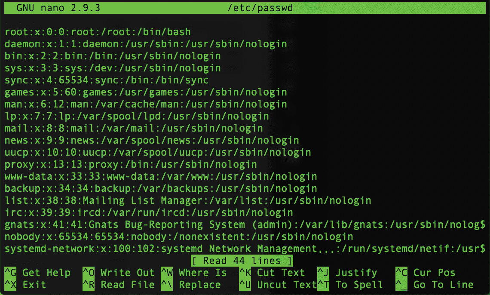

图 1-2

要创建一个新文件，请按如下方式运行 `nano`：

```
# nano
```

当你完成文件编辑后，输入 `Ctrl-S` 保存文件，然后按 `Ctrl-X` 退出。要打开现有文件，请使用快捷键 `Ctrl-R`。

如果你倾向于在 GNOME 桌面环境中使用图形化编辑器，`gedit` 是执行基础编辑任务的良好起点。要从桌面启动 `gedit`，按 `Alt-F2` 显示“运行命令”窗口，如图 1-3 所示：

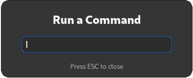

图 1-3

在文本字段中输入 `gedit` 并按回车键。稍后，`gedit` 将加载并准备好打开、创建和编辑文件：

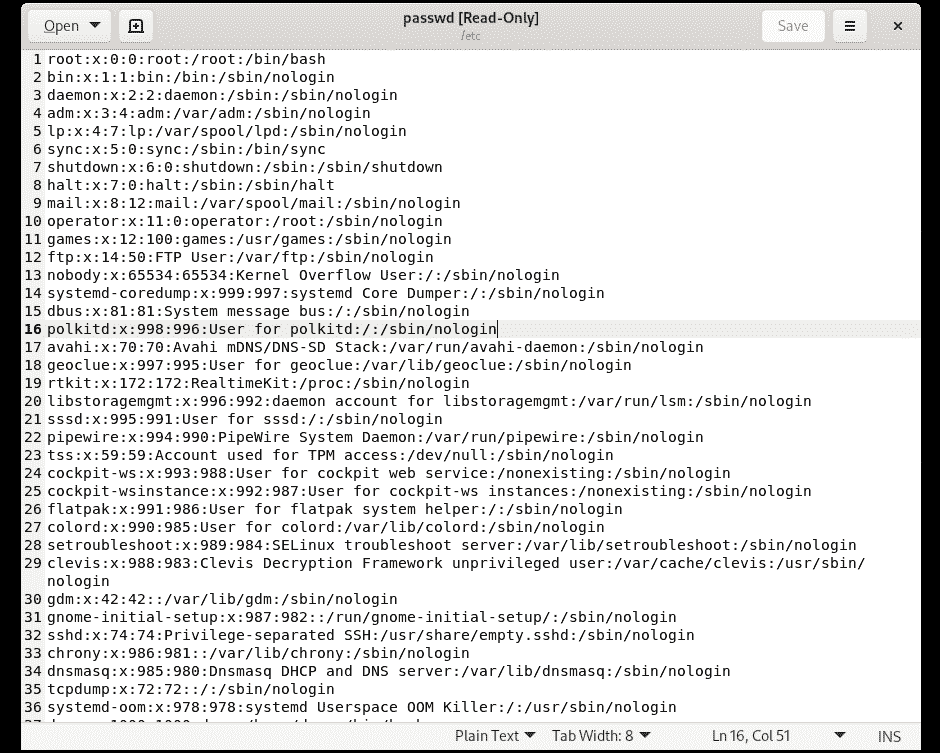

图 1-4

或者，也可以从终端窗口启动 `gedit`，带或不带要打开的文件路径：

```
# gedit

# gedit /etc/passwd
```

## 1.4 反馈

我们希望你对购买本书满意。如果你在书中发现任何错误，或有任何意见、问题或担忧，请通过 `feedback@ebookfrenzy.com` 与我们联系。

## 1.5 勘误

尽管我们尽力确保书中内容的准确性，但一本涵盖如此规模和复杂领域的书籍不可避免可能会包含一些错误和遗漏。书中任何已知问题将在以下 URL 列出并给出解决方案：

`https://www.ebookfrenzy.com/errata/almalinux9.html`

如果你发现勘误列表中未列出的错误，请通过邮件向我们的支持团队 `feedback@ebookfrenzy.com` 告知我们。

# 2. AlmaLinux 简史

AlmaLinux 9 是 Linux 操作系统的几种变体（也称为发行版）之一。它基于红帽企业 Linux (RHEL) 发行版的源码，该版本由一家名为 Red Hat, Inc. 的美国公司开发。该公司位于北卡罗来纳州罗利，成立于 20 世纪 90 年代中期，通过当时 Marc Ewing 和 Bob Young 拥有的两家合并合并。然而，Linux 的起源可以追溯。本章将概述 Linux 操作系统和红帽的历史，然后解释 AlmaLinux 是如何融入这一图景的。

## 2.1 到底什么是 Linux？


Linux 是一个操作系统，就像 Windows 是一个操作系统一样（尽管 Linux 和 Windows 之间几乎没有相似之处）。“操作系统”一词用于描述在计算机硬件与我们日常运行的应用程序之间充当层作用的软件。当程序员编写应用程序时，他们与操作系统交互以执行诸如将文件写入硬盘和在屏幕上显示信息等任务。如果没有操作系统，每位程序员都必须编写代码来直接访问系统硬件。此外，程序员必须能够支持自以来创造的每一件硬件，以确保应用程序能够在任何可能的硬件配置上运行。由于操作系统处理了所有这些硬件复杂性，应用程序开发变成了一项简单得多的的任务。Linux 今天许多不同操作系统之一。

## 2.2 UNIX 的起源

要理解 Linux 的历史，我们首先必须追溯到 20 世纪 60 年末的 AT&T 实验室。期间，AT&T 停止了对名为 `Multics` 的新操作系统的开发。然而，AT&T 的两位工程师肯·汤普森（Ken Thompson）和丹尼斯·里奇（Dennis Ritchie）决定将他们在 `Multics` 项目中学到的知识，创建一个名为 `UNIX` 的新操作系统，该系统迅速在企业和学术机构中流行并被广泛采用。

各种专有的 UNIX 实现最终进入市场，包括由 IBM (`AIX`)、惠尔惠 (`HP-UX`) 和太阳微系统 (`SunOS` 和 `Solaris`) 创建的版本。此外，安德鲁·S·塔能鲍（Andrew S. Tanenbaum）创建了一个名为 `MINIX` 的类 UNIX 操作系统，专为教育设计，并向大学提供源代码访问。

## 2.3 谁创建了 Linux？

Linux 的起源可以追溯到两个工作和哲学。Linux 操作系统的核心是被称为 `kernel`（内核）的内核。这是操作系统运行所需的核心功能集。`kernel` 管理系统资源并处理硬件与应用程序之间的通信。Linux `kernel` 由林纳斯·托瓦兹（Linus Torvalds）开发，他由于不喜欢 `MS-DOS`，并且对在新的 Intel 80386 微处理器上无法使用 `MINIX` 感到不耐烦，因此决定编写自己的类 UNIX `kernel`。当他完成 `kernel` 的第一个版本时，他以开源许可发布了它，允许任何人下载源代码并自由使用和修改，而无需向林纳斯支付费用。

大约时期，自由软件基金会的理查德·斯尔曼（Richard Stallman）是自由和开源软件的有力支持者，他当时正在开发自己的开源操作系统。然而，斯尔曼最初并没有专注于 `kernel`，而是从开发使用和维护操作系统所需的所有 UNIX 工具、实用程序和编译器的开源版本开始。当他完成这些基础设施的开发时，明显的解决方案是将他的工作与林纳斯编写的 `kernel` 结合，创建一个完整的操作系统。这种组合被称为 `GNU/Linux`。纯洁者坚持认为 Linux 应该被称为 `GNU/Linux`（事实上，曾有一次，理查德·斯尔曼拒绝接受任何未将 Linux 称为 `GNU/Linux` 的出版物的采访）。这并非没有，因为自由软件基金会开发的 `GNU` 工具构成了 `GNU/Linux` 中重要且至关重要的部分。遗憾的是，大多数人和出版物将 Linux 称为 Linux，这种情况可能会一直持续下去。

## 2.4 红帽的早期

1993 年，鲍·杨（Bob Young）创建了一家名为 `ACC Corporation` 的公司，根据杨的说法，他在“妻子的缝衣柜”里经营这家公司。`ACC` 这个名字旨在代表目录业务，但他妻子经营的一家名为“康涅狄格州古董与收藏品”的小企业的缩写。通过 `ACC` 目录业务销售的物品包括 Linux 光盘和相关的开源软件。

大约同一时间，马克·尤文（Marc Ewing）创建了自己的 Linux 发行版公司，将其命名为 `Red Hat Linux`（由于他在卡内基·梅隆大学期间习惯戴红色棒球帽而得名）。

1995 年，`ACC` 收购了红帽，采用了 `Red Hat, Inc.` 的名称，并经历了快速且巨大的增长。鲍·杨在公司于 1999 年 8 月上市后不久辞去了 CEO 职位，之后从事了许多商业和慈善活动，包括一家名为 `Lulu` 的按需打印图书出版公司以及两支加拿大职业运动队的所有权。2018 年，IBM 以 340 亿美元的交易价格收购了 `Red Hat, Inc.`。

## 2.5 红帽支持

早期的 Red Hat Linux 通过软磁盘和 CD 发送给客户（当然，这早于宽带互联网连接的普及）。当用户在使用软件遇到问题时，他们只能通过电子邮件联系红帽。事实上，鲍·杨经常开玩笑说，这在限制支持请求方面非常有效，因为当客户意识到需要帮助时，他们的计算机通常处于无法工作的状态，因此无法用来发送电子邮件向红帽支持团队寻求帮助。在随后的几年里，红帽提供了与付费订阅挂钩的更高级别，现在提供从“自救”（无支持）到高级支持的各种支持级别。

## 2.6 开源

`Red Hat Enterprise Linux 9` 是红帽目前的商业产品，主要针对企业级、任务关键型安装。它也是红帽所提供的不断扩展的程序和服务生态系统的基石。

`RHEL` 曾经是一个开源产品，这意味着任何人都可以免费下载源代码并自己构建软件（这项任务绝非易事）。这种情况在 2023 年发生了变化，当时红帽开始仅向付费客户提供源代码。

## 2.7 Fedora 项目

红帽还赞助 Fedora 项目，其目标是以 `Fedora Linux` 的形式提供免费的 Linux 操作系统（包括源码和二进制发行版）。`Fedora Linux` 还作为许多新功能的测试场，这些功能最终会被采用到 Red Hat Enterprise Linux 操作系统族和 `CentOS` 衍生中。

## 2.8 CentOS Stream

对于无法负担 Red Hat Enterprise Linux 订阅的用户，另一个选项是 `CentOS Stream` 操作系统。`CentOS` 项目最初是一个社区驱动的努力，但现在由红帽拥有，它获取 `Red Hat Enterprise Linux` 源代码，移除红帽标识和订阅要求，进行编译并提供发行版供下载。与 Fedora 一样，`CentOS Stream` 在新的操作系统功能包含在未来的 `RHEL` 版本之前对其进行现场测试。因此，它可能缺乏稳定性，但提供了获取尖端的功能。

## 2.9 AlmaLinux

`AlmaLinux` 由 `AlmaLinux OS Foundation` 于 2021 年创建，旨在提供 100% 兼容 Red Hat Enterprise Linux 的稳定 Linux 发行版。这最初涉及从 `RHEL` 源代码构建。现在 `RHEL` 源代码不再公开，目标已变为 100% 的二进制兼容。二进制兼容意味着，虽然 `AlmaLinux` 可能与 `RHEL` 不相同，但它可以运行与 `RHEL` 上运行的相同的软件和应用程序。

## 2.10 总结

Linux 操作系统的起源可以追溯到林纳斯·托瓦兹和理查德·斯尔曼的工作，表现为 Linux `kernel` 与 `GNU` 项目构建的工具和编译器的结合。


多年来，Linux 的开源特性导致了各种不同 Linux 发行版的发布。其中一种发行版是红帽企业 Linux（Red Hat Enterprise Linux），它由 Bob Young 和 Mark Ewing 创立的 Red Hat 公司创建。红帽专注于提供企业级 Linux 软件解决方案并结合广泛的技术支持服务。AlmaLinux 基于 Red Hat Enterprise Linux 并且与之 100% 二进制兼容。

# 3. 在空白磁盘驱动上安装 AlmaLinux 9

现在有两种方法部署 AlmaLinux 9 系统。一种方法是购买新硬件，或者重新利用现有的计算机系统以在其上安装和运行操作系统。另一种选择是使用 Amazon AWS、Google Cloud 或 Microsoft Azure（仅列举几个）等服务创建云操作系统实例。由于云实例通常是通过选择一个预配置的、针对云平台优化的即插即用操作系统镜像，并将其作为 AlmaLinux 9 系统的基础，因此情况下不需要执行手动安装操作系统。

另一方面，如果你计划在自己的硬件上安装 AlmaLinux 9，那么学习 AlmaLinux 9 道路上的第一步就是安装操作系统。

AlmaLinux 9 可以安装在空白磁盘环境（即清除整个磁盘上的所有现有分区并将其完全用于 AlmaLinux 9）或安装在双启动环境中（其中 AlmaLinux 9 与磁盘上的另一个操作系统共存，通常是 Microsoft Windows 系列操作系统的成员）。

本章将介绍从本地或远程安装介质进行空白磁盘安装的方法。与 Windows 11 系统的双启动安装将在 与 Windows 一起双启动 AlmaLinux 9 中介绍。

## 3.1 使用 Live 镜像尝试 AlmaLinux

如果你想在安装之前尝试 AlmaLinux，可以通过从 AlmaLinux Live 镜像启动来实现，该镜像可以从以下 URL 下载：

https://repo.almalinux.org/almalinux/9/live/x86_64

AlmaLinux Live 镜像适用于 KDE 和 GNOME 桌面环境（本书涵盖了 GNOME 桌面），但仅适用于 64 位 Intel (x86_64) 系统。一旦下载了镜像，请将其写入 USB 驱动器，并按照本章稍后概述的步骤从其启动。

当系统启动后，将显示下方图 3-1 所示的屏幕，提供启动会话的选项。选择启动选项时，AlmaLinux 将启动并加载桌面环境。虽然 AlmaLinux Live 功能齐全，但它使用虚拟磁盘驱动器，因此系统关闭或重启时，配置更改、数据和文件将会丢失。

```
image/almalinux_9_grub_live.png
```

图 3-1

## 3.2 获取 AlmaLinux 安装介质

可以通过项目网站使用以下 URL 下载 AlmaLinux 发行版：

https://almalinux.org/#downloads

安装介质以 ISO 镜像的形式提供，有以下几种：

- Boot ISO（引导镜像）：一个小型镜像，可以启动系统但通过互联网下载安装所需的所有包。对于修复损坏的 AlmaLinux 安装也有帮助。
- Minimal ISO（最小化镜像）：此镜像包含开始安装所需的必要文件，并需要访问远程服务器上的完整安装介质。引导镜像也可以对现有的 AlmaLinux 系统执行救援操作。
- DVD ISO：一个自包含的镜像，包含了安装 AlmaLinux 系统所需的所有包。

出于本书的目的，请下载 DVD ISO 镜像，其命名规范如下：

AlmaLinux-<version>-<architecture>-dvd.iso

例如，适用于 64 位 Intel 系统的 AlmaLinux 9 DVD 镜像命名如下：

AlmaLinux-9.2-x86_64-dvd.iso

镜像还适用于 ARM64 (aarch64)、ppc64le 和 s390x 架构。

下载镜像后，将其刻录到磁盘或使用下一节中的步骤将介质写入 USB 驱动器，配置你的虚拟化环境将其视为 DVD 驱动器，或使用本章稍后概述的步骤通过网络连接访问安装镜像。

## 3.3 将 ISO 安装镜像写入 USB 驱动器

如今，操作系统安装更有可能通过 USB 驱动器而非 DVD 进行。在下载了 AlmaLinux 9 的 ISO 安装镜像后，将镜像写入 USB 驱动器的步骤取决于驱动器连接到 Linux、macOS 还是 Windows 系统。本节剩余部分的步骤假设 USB 驱动器是新的或已重新格式化以删除任何现有数据或分区：

### 3.3.1 Linux

在 Linux 上向 USB 驱动器写入 ISO 镜像的第一步是识别设备名称。在插入 USB 驱动器之前，通过列出 `/dev` 中的设备来识别系统已检测到的存储设备：

```
# ls /dev/sd*
```

`/dev/sda /dev/sda1 /dev/sda2`

将 USB 驱动器连接到 Linux 系统并运行 `dmesg` 命令获取最近的系统消息列表，其中一个将是关于检测到 USB 驱动器的报告，类似于如下：

```
dmesg
```

`[406.2417] sd 6:0:0: Attached SCSI disk`

此输出告诉我们，我们预期的设备名称将包含 `sdb`，我们可以通过再次列出 `/dev` 中的设备来确认这一点：

```
# ls /dev
```

`/dev/sda /dev/sda1 /dev/sda2 /dev/sdb`

此输出显示 USB 驱动器已分配给 `/dev/sdb`。在将 ISO 写入设备之前的下一步操作，是运行 `findmnt` 命令以确保它没有被自动挂载：

```
# findmnt /dev/sdb
```

`/run/media/neil/d6bf9574-7e31-4f54-8b1 /dev/sdb ext3 rw,nosuid`

如果 `findmnt` 显示 USB 驱动器已挂载，请在继续之前将其卸载：

```bash
# umount /run/media/neil/d6bf9574-7e31-4f54-8b1
```

一旦文件系统已卸载，使用如下 `dd` 命令将 ISO 写入驱动器：

```
# dd if=/path/to/<image>.iso of=/dev/sdb bs=512
```

写入过程可能需要一些时间（长达 10-15 分钟），取决于镜像大小以及运行它的系统速度。镜像写入完成后，将出现类似如下的输出，USB 驱动器即可准备好安装 AlmaLinux 9：

```
5956+0 records in
5956+0 records out
3122659328 bytes (3.1 GB, 2.9 GiB) copied, 426.234 s, 7.3 MB/s
```

### 3.3.2 macOS

在连接到 macOS 系统的 USB 驱动器上写入 ISO 镜像的第一步是使用 `diskutil` 工具识别设备。在连接 USB 设备之前，打开终端窗口并运行以下命令：

```
$ diskutil list
```

/dev/disk0 (internal, physical):
# TYPE NAME SIZE IDENTIFIER
0: GUID_partition_scheme *1.0 TB disk0
1: EFI 209.7 MB disk0s1
2: Apple_APFS Container disk2 1000.0 GB disk0s2

/dev/disk1 (internal):
# TYPE NAME SIZE IDENTIFIER
0: GUID_partition_scheme 28.0 GB disk1
1: EFI 314.6 MB disk1s1
2: Apple_APFS Container disk2 27.7 GB disk1s2

/dev/disk2 (synthesized):
# TYPE NAME SIZE IDENTIFIER
0: APFS Container Scheme - +1.0 TB disk2
Physical Stores disk1s2, disk0s2
1: APFS Volume Macintosh HD 473.6 GB disk2s1
2: APFS Volume Preboot 42.1 MB disk2s2
3: APFS Volume Recovery 517.0 MB disk2s3
4: APFS Volume VM 1.1 GB disk2s4


在建立已检测设备的基准后，将 USB 驱动器插入 macOS 系统的端口并重新运行命令。将会出现相同的结果，但多了一个类似于下面的 USB 驱动器条目：

```
/dev/disk3 (external, physical):
   #: TYPE NAME SIZE IDENTIFIER
   0: *16.0 GB disk3
```

在上面的示例中，USB 驱动器被分配给 `/dev/disk3`。在继续之前，按照以下方式卸载磁盘：

```bash
$ diskutil unmountDisk /dev/disk3
```

disk3 上所有卷的卸载成功

最后，使用 `dd` 命令将 ISO 镜像写入设备，注意要引用原始磁盘设备（`/dev/rdisk3`），并在提示时输入用户密码：

```bash
$ sudo dd if=/path/to/iso/image.iso of=/dev/rdisk3 bs=1m
```

镜像写入完成后，USB 驱动器即就就绪了。

### 3.3.3 Windows/macOS

Windows 和 macOS 有多种免费工具可以将 ISO 镜像写入 USB 驱动器，但有一个专门为写入 Linux ISO 镜像设计的工具是 Fedora Media Writer，可以从以下 URL 下载：

[`getfedora.org/en/workstation/download/`](https://getfedora.org/en/workstation/download/)

安装完成后，插入目标 USB 驱动器，启动写入工具，并选择如图 3-2 中所示的“Select .iso file”选项：

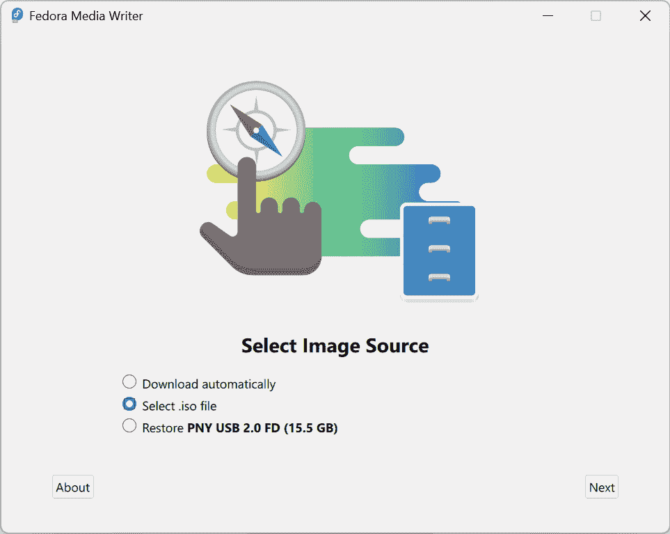

图 3-2

点击“Next”（下一步）进入“Write Options”（写入选项）屏幕，并在点击“Select...”按钮之前选择 USB 驱动器：

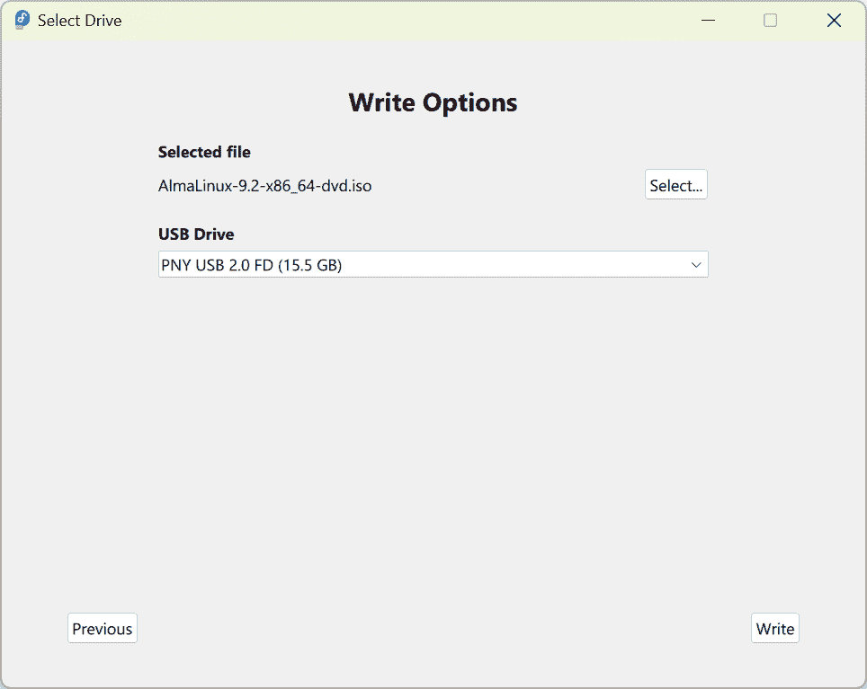

图 3-3

在弹出的文件选择对话中，导航并选择 AlmaLinux 9 安装 ISO 镜像，点击“Open”（打开）按钮。最后，点击“Write”（写入）按钮开始将镜像写入 USB 驱动器：

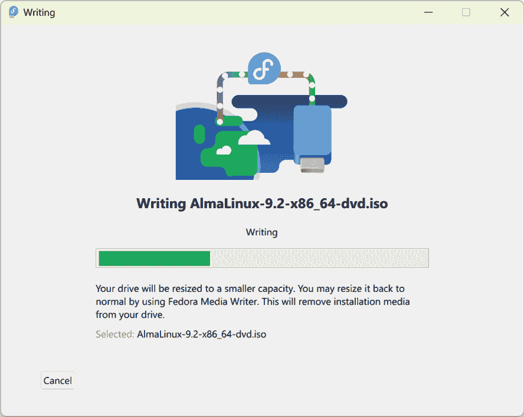

图 3-4

镜像写入完成后，设备即可进行安装。

## 3.4 安装 AlmaLinux 9

将 AlmaLinux 9 安装介质插入合适的驱动器并开启电源。如果系统尝试从硬盘启动，你将需要进入计算机的 BIOS 设置并更改启动顺序，使其从安装介质驱动器启动。系统启动后，你将看到以下屏幕：

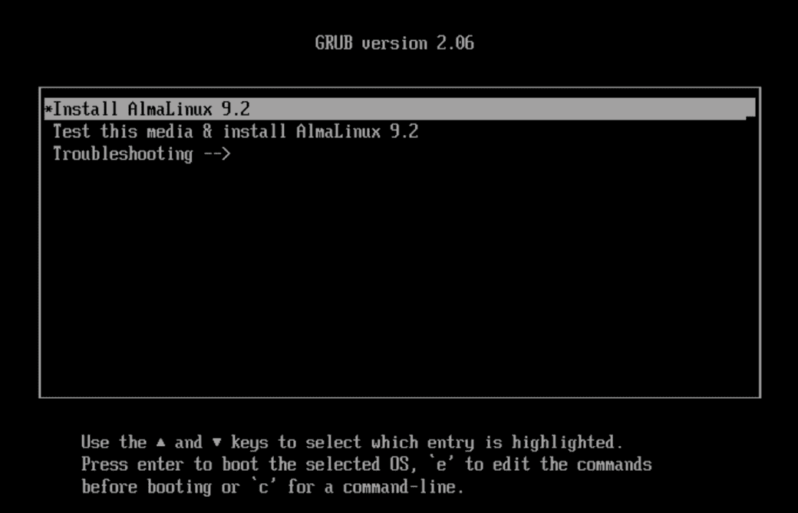

图 3-5

使用方向键在选项之间导航，并使用 `<Enter>` 键进行选择。例如，如果选择了“Troubleshooting”（故障排除）选项，将出现图 3-6 所示的屏幕，包括从本地驱动器上的当前操作系统（如果已安装）启动、测试系统内存或救兴已安装的 AlmaLinux 9 系统的选项。还有一个选项允许在没有图形控制台的系统上以基本图形模式进行安装：

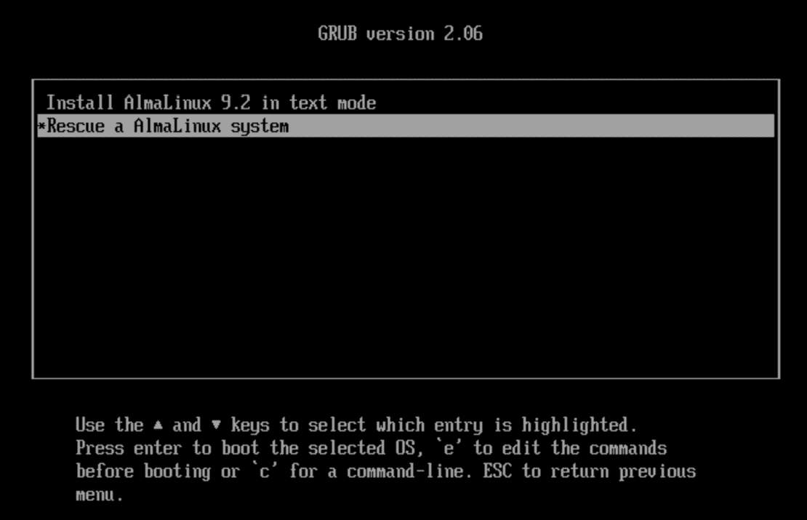

图 3-6

在主屏幕上选择安装 AlmaLinux 选项，稍等后，将出现图形化安装程序的第一个屏幕：

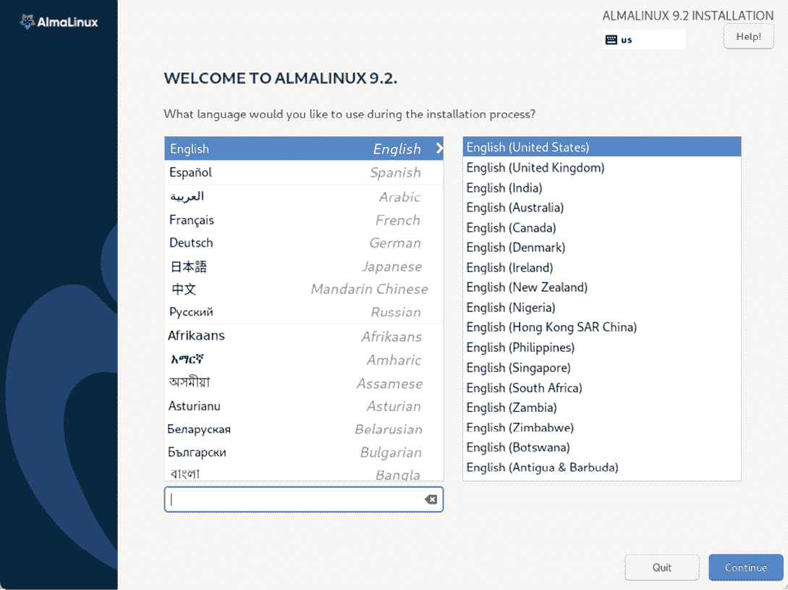

图 3-7

在第一个屏幕上选择你偏好的语言，然后点击“Continue”（继续）进入主安装屏幕，如图 3-8 所示：

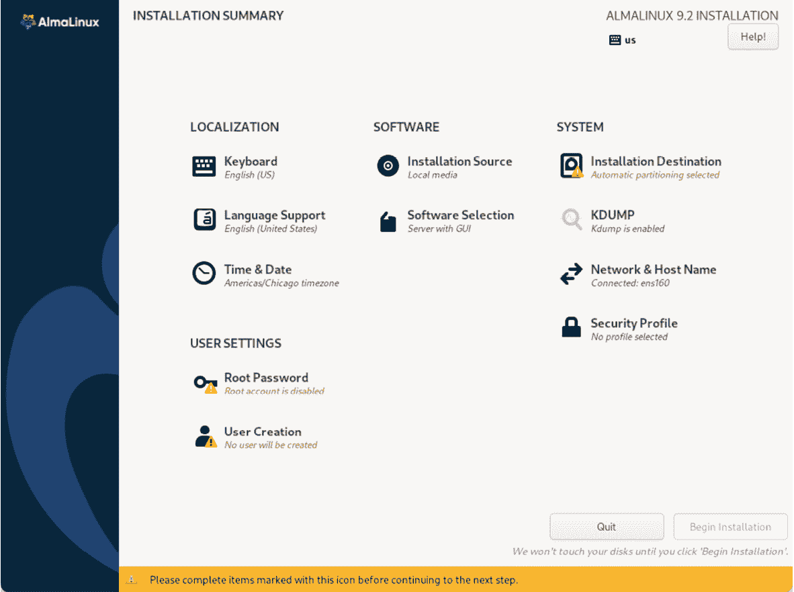

图 3-8

从“Network & Host Name”（网络与主机名）选项开始，启用系统上的网络设备并在点击“Apply”（应用）按钮之前输入主机名：

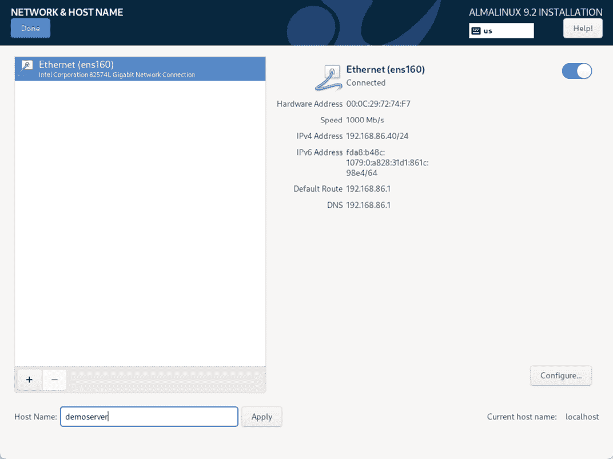

图 3-9

如果你的网络连接需要额外设置，点击“Configure...”（配置）按钮访问图 3-10 所示的高级网络设置屏幕：

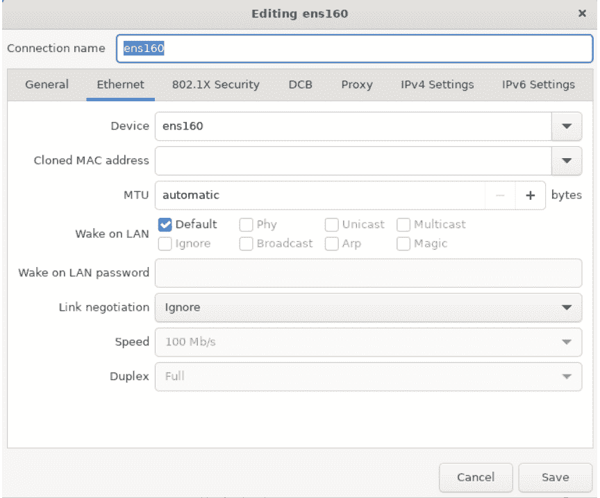

图 3-10

一旦定义了主机名并启网络连接，点击“Done”（完成）返回主屏幕。

如果你想更改键盘、语言或时间和日期设置，请从主屏幕的“Localization”（本地化）列选择相应的选项。在“Time & Date”（时间与日期）屏幕上，根据你的地理位置选择相应的选项。还提供了使用 Network Time（网络时间）选项，它会自动与外部网络时间协议服务器同步。

不需要更改 Installation Source（安装源）设置，因为安装是从本地介质执行的。要完成来自远程服务器的介质的安装，请选择“Installation Source”，启用“On the network”（在网络）选项，然后指定安装介质的位置和使用的 URL 类型。例如，安装介质可以是安装在远程 Web 服务器上的 ISO 镜像，或者是本地网络上使用 NFS 的系统（NFS 文件共享的主题在名为“在 AlmaLinux 9 上使用 NFS 与远程系统共享文件”的章节中详细介绍），或者是远程仓库的 URL（仓库本质上是组成操作系统的软件、软件包和应用程序的在线集合，通过它们可以在本地系统进行安装）。

默认情况下，安装程序将对 AlmaLinux 9 执行带 GUI 的服务器安装。要选择不同的配置，选择“Software Selection”（软件选择）选项以显示下面的屏幕：


图 3-11

使用左侧面板选择基本配置，使用右侧面板添加你确定在系统启动后需要的任何额外软件包。如果不需要桌面环境且你不确定要在系统上安装哪些包，请使用“Minimal install”（最小化安装）选项，并在启动后根据需要安装额外的包。这避免了安装任何可能永远需要的包。

“Security Policy”（安全策略）选项允许在系统上安装额外的安全软件包，从而对系统施加符合安全内容自动化协议（SCAP）标准的安全限制。虽然从列表中选择配置文件（profile）会安装必要的包，但在运行的系统上启用它们之前，策略限制将不会被执行。

Kdump 功能在启用时，会在系统崩溃时写操作系统内核的状态。此转储文件可以帮助识别崩溃原因，但在启用时会占用系统内存。除非你的系统内存有限，否则可以保持启用状态。

配置好基本设置后，下一步是决定如何划分硬盘以容纳操作系统。

## 3.5 为 AlmaLinux 9 分区

当选择“Installation Destination”（安装目标）选项时，安装程序将显示一个类似于下方图 3-12 所示的屏幕：

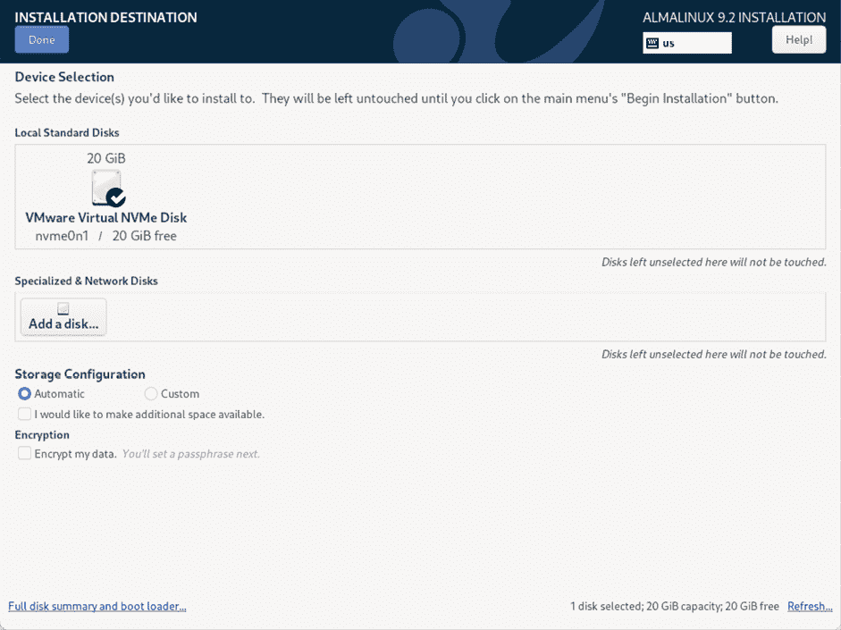

图 3-12

默认情况下，安装程序配置为使用当前选择磁盘驱动器的可用空间自动安装操作系统，并配置标准的分区大小。如果磁盘之前包含另一个操作系统，这些现有分区不会被删除，在 AlmaLinux 9 安装后，磁盘上可能会留下未使用的空间。要删除任何现有分区以便 AlmaLinux 9 回收并使用，请启用“I would like to make additional space available”（我想提供更多空间）选项并点击“Done”（完成）按钮，显示图 3-13 所示的对话框：

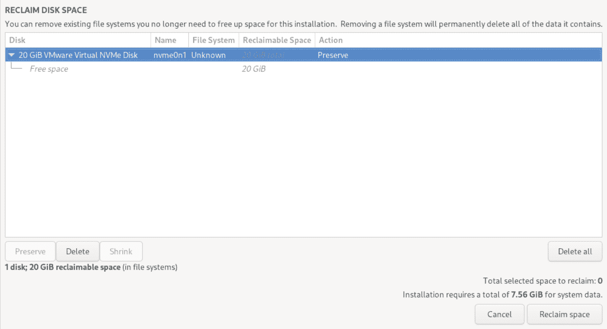

图 3-13


要回收空间，请选择不再需要的分区，并点击 `Delete` 按钮将其标记为删除。一旦选中了所有要删除的分区，点击 `Reclaim Space` 按钮执行删除操作。回收的空间现在将由 AlmaLinux 9 安装程序自动使用。

若要根据可用空间的分配方式手动配置磁盘布局，请将 `Storage Allocation` 设置从 `Automatic` 更改为 `Custom` 并点击 `Done` 显示手动分区界面（如图 3-14）：

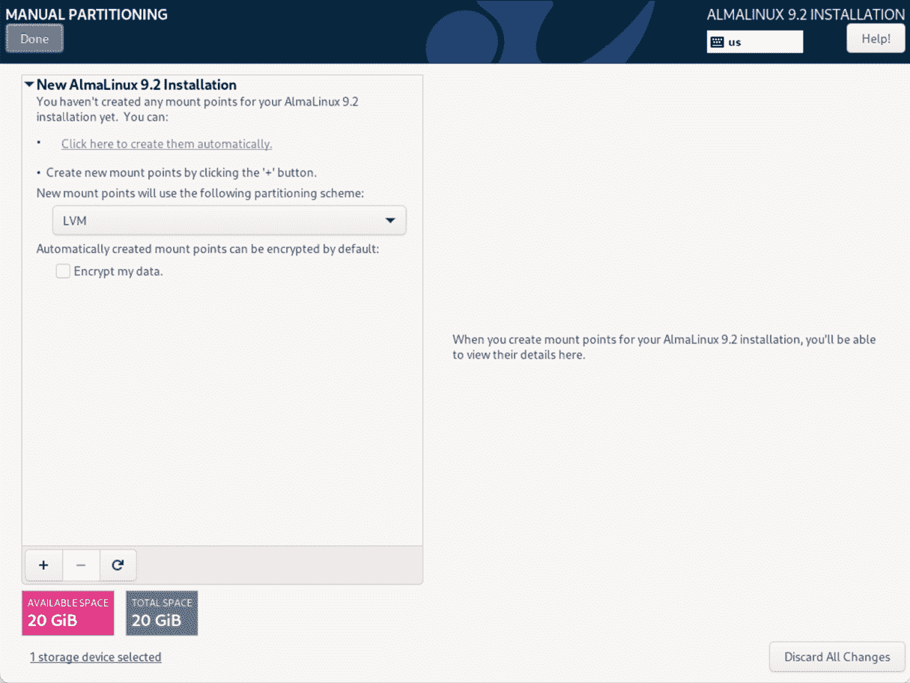

图 3-14

手动分区界面允许使用逻辑卷管理 (`LVM`）或标准分区来配置磁盘。`LVM` 是推荐的选项，因为它在系统运行后，管理分区大小方面提供了灵活性（LVM 将在名为“向 AlmaLinux 9 卷组和逻辑卷中添加新磁盘”的章节中详细介绍）。

一旦选定了分区方案，最后一步是决定分区的大小以及相应的文件系统挂载点。通常，`Click here to create them automatically` 提供的默认配置可以满足大多数系统需求。然而，若要手动创建分区并分配挂载点，请点击 `+` 按钮手动声明并分配每个分区。

另一个选项是选择自动分区，然后使用生成的界面根据需要手动更改分区配置。例如，图 3-15 显示了通过选择自动创建选项定义的分区配置，并在对磁盘进行任何更改之前修改每个分区的设置：

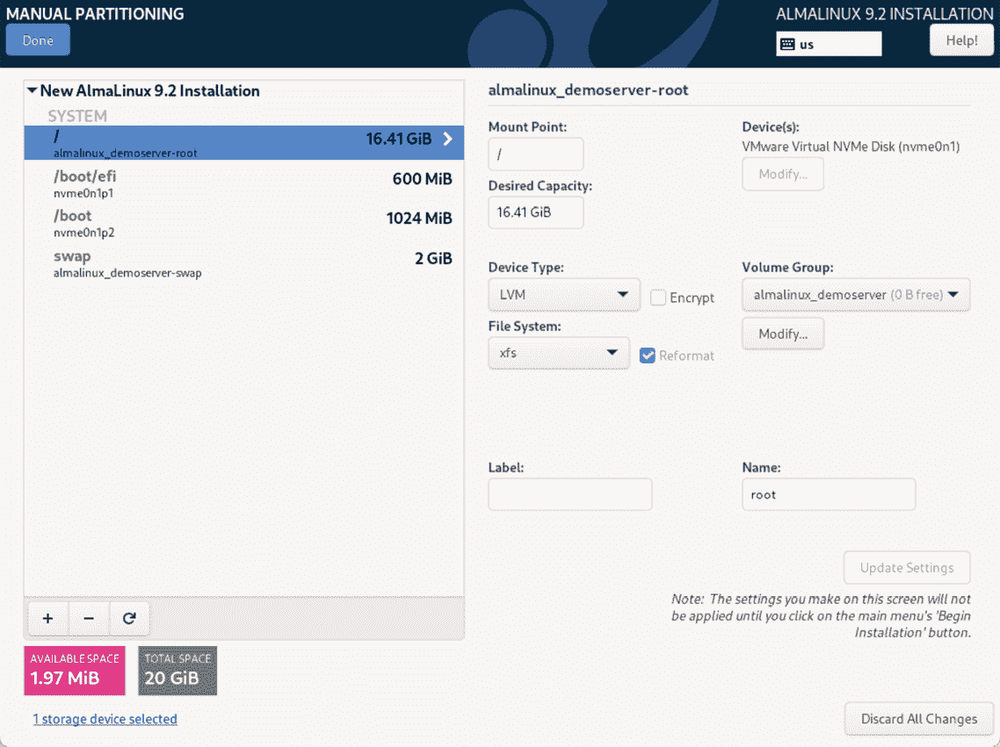

图 3-15

磁盘配置完成后，点击 `Done`，检查对磁盘进行的更改摘要（如图 3-16），然后点击 `Accept Changes` 按钮：

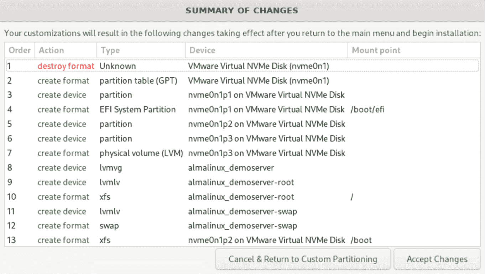

图 3-16

## 3.6 磁盘加密

AlmaLinux 9 还允许通过加密保护磁盘内容。这将在每次系统启动时要求输入密码。要启用加密，请在主安装目标界面上选择 `Encrypt my data` ，并在点击 `Done` 按钮后，在图 3-17 所示的对话框中输入密码：

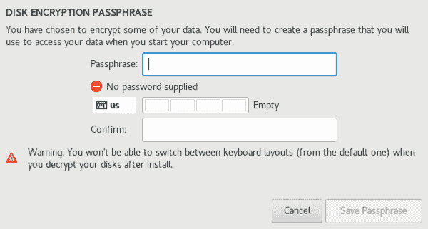

图 3-17

## 3.7 用户设置

在完成安装之前，必须创建一个 root 密码和一个可选的用户账户。root（或超级用户）账户是系统上具有管理权限的特殊用户。虽然你通常使用自己的账户登录系统，但在配置系统和执行其他管理任务时需要 root 权限。

选择 `Root Password` 选项并输入足够安全的密码。还有选项可以锁定 root 账户使其无法访问，以及允许通过密码验证通过远程连接访问 root 账户。通常，建议保持 root 账户解锁状态，但禁止使用密码进行远程 SSH 访问。如果需要远程 root 访问，应使用 SSH 密钥身份验证来实现，我们将在本书的“在 AlmaLinux 9 上配置基于密钥的身份验证”章节中涵盖这一主题。

接下来，选择 `User Creation` 选项并输入用户名和密码。如果你希望此用户能够使用 `sudo` 命令执行管理任务，请勾选 `Make this user administrator` 复选框。如果未启用此选项，用户必须使用 `su` 命令并输入 root 密码来获得 root 权限（假设未启用上述锁定 root 账户的选项）。如果你添加的用户需要执行管理任务，推荐使用 `sudo`，并启用该复选框。

## 3.8 物理安装

在选择适当软件包后，点击 `Begin Installation` 将开始分区磁盘并安装符合所选安装设置的软件包。在此阶段，将出现如图 3-18 所示的安装进度界面：

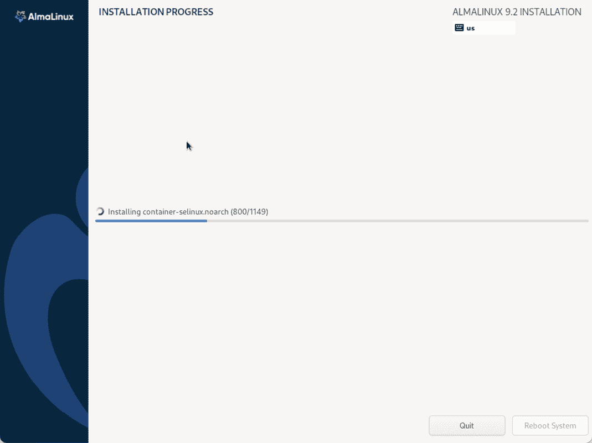

图 3-18

所有系统软件包安装并配置完成后，移除安装媒体并点击 `Reboot System` 重启系统。

## 3.9 最终配置步骤

系统启动时控制台上出现的内容取决于从软件选择界面中选择了哪个选项。如果在安装期间选择了 GUI 选项，将出现 GNOME 显示管理器 (`GDM`) 登录界面。相反，如果选择了最小或服务器配置选项，将显示基于文本的登录提示。无论配置如何，请作为安装过程最后步骤中创建的用户登录系统。

在 GUI 安装的情况下，GNOME 初始设置工具将启动并提供桌面环境的引导导览。

## 3.10 安装更新

与当今大多数操作系统一样，AlmaLinux 发行版的每个版本在公开发后都会继续演进。这通常表现为错误修复、安全更新，以及偶尔可以从互联网下载并安装到系统中的新功能。

最佳实践规定，安装 AlmaLinux 9 后的第一步是确保将任何可用更新应用到系统。这可以通过 Terminal 窗口中的命令行提示符使用 `dnf` 软件包管理器来实现。要检查可用更新，请运行以下命令：

```bash
dnf check-update
```

再次使用 `dnf` 工具应用任何待处理更新：

```bash
dnf update
```

执行后，`dnf` 工具将提供可用更新的软件包列表，并请求许可执行更新。

更新完成后，安装基本完成，AlmaLinux 9 已准备好使用。

## 3.11 显示启动消息

在启动过程中，AlmaLinux 9 将显示 Red Hat 图形启动 (`RHGB`) 屏幕，该屏幕会隐藏系统加载时生成的所有启动消息。若要在启动过程中显示这些消息（如图 3-19 所示），请在系统启动时按下键盘上的 `Esc` 键：

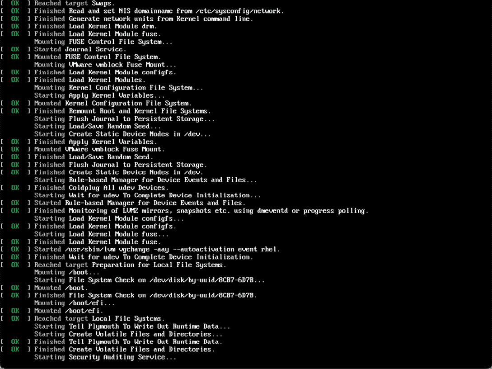

图 3-19

编辑 `/etc/default/grub` 文件并更改 `GRUB_CMDLINE_LINUX` 设置可以更改默认行为，该设置默认类似于如下：

```
GRUB_CMDLINE_LINUX="... rhgb quiet"
```

若要移除图形启动界面以便无需按 `Esc` 键即可看到消息，请从设置中移除 `rhgb` 选项：

```
GRUB_CMDLINE_LINUX="... rhgb quiet"
```

此更改将导致系统仅显示部分生成的启动消息。要显示系统生成的所有消息，请同时移除 `quiet` 选项：

```
GRUB_CMDLINE_LINUX="... quiet"
```

完成更改后，运行以下命令生成新的启动配置，以便在下次系统启动时生效：

```bash
grub2-mkconfig --output=/boot/grub2/grub.cfg
```

## 3.12 总结


使用 AlmaLinux 9 的第一步是安装操作系统。对于云端服务器，此任务通常在根据云服务提供商提供的系列选项为系统选择操作系统镜像时自动完成。然而，在您自己的硬件上安装则涉及下载为 ISO 镜像格式的安装介质，将该镜像写入合适的存储设备（如 DVD 或 USB 驱动器），并从其启动。一旦运行，安装过程允许配置一系列选项，包括网络设置、安装应从本地介质还是通过远程服务器或存储库进行、要安装的软件包以及磁盘分区。安装完成后，重要的是安装任何自原始安装镜像创建以来发布的操作系统更新。

# 4. 与 Windows 双启动 AlmaLinux 9

与大多数 Linux 发行版一样，AlmaLinux 9 能够非常乐意地与几乎任何版本的 Windows（最高到 Windows 11）共存在硬盘驱动器（HDD）上。这种概念被称为“双启动”。当您启动系统时，将看到一个菜单，提供启动 AlmaLinux 9 安装系统或 Windows 的选项。显然，您一次只能运行一个操作系统。尽管如此，值得注意的是，无论您的 Windows 分区是使用 NTFS、FAT16 还是 FAT32 格式化的，硬盘驱动器上 Windows 分区中的文件都可以从 AlmaLinux 9 使用。

这种安装方法涉及缩小现有 Windows 分区的大小，然后将 AlmaLinux 9 安装到回收的空间中。本章假设 AlmaLinux 9 正安装在当前运行 Windows 11 的系统上。

## 4.1 调整分区大小

为了在已包含 Windows 安装的磁盘驱动器上容纳 AlmaLinux 9，第一步涉及缩小 Windows 分区以腾出空间。建议的做法是在尝试安装 AlmaLinux 9 之前，使用 Windows 磁盘管理界面减小分区大小。

要在 Windows 11 上访问磁盘管理，右键点击开始菜单，并从生成的菜单中选择图 4-1 所示所示的选项：

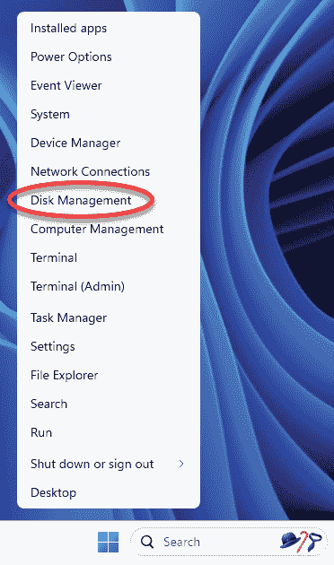

图 4-1

加载后，磁盘管理工具将显示系统上检测到的磁盘驱动器的图形表示：

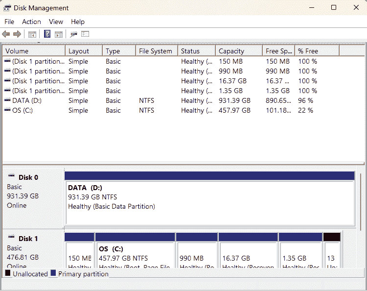

图 4-2

右键点击您想要缩小大小的分区，并从弹出菜单中选择 `收缩卷...`。工具将计算在不丢失数据的情况下卷大小可以减小的最大量（此过程取决于分区的总大小，可能需要几分钟）。一旦分析完成，将出现与下方图 4-3 所示类似的对话框：

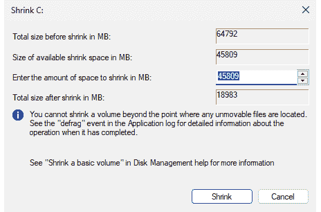

图 4-3

在 `输入收缩的空间量（MB）` 字段中指定一个值，并点击 `收缩` 按钮继续。一旦调整操作完成，使用 AlmaLinux 9 安装介质重启系统（如“在空白磁盘驱动器上安装 AlmaLinux 9”所述），并使用新的空空间进行安装。在 AlmaLinux 9 安装过程中，可以通过在“安装摘要”屏幕上选择 `安装目标` 选项并确保选择了 `自动存储配置` 选项来实现。这将 AlmaLinux 9 自动安装到 Windows 分区缩小后创建的未分配空间中。

一旦完成磁盘上的 AlmaLinux 9 并重启系统，将出现标准的 AlmaLinux 9 启动菜单，其中包含启动 Windows 系统的额外选项：

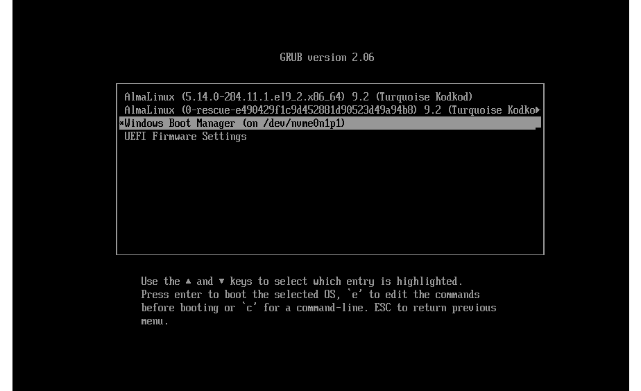

图 4-4

## 4.2 更改默认启动选项

系统启动时，会出现启动选项屏幕，并等待 5 秒让用户选择操作系统。如果在超时结束之前未进行任何选择，将启动默认操作系统。在新配置的系统上，默认操作系统将是标准（非救援）的 AlmaLinux 9 镜像。然而，可以在 AlmaLinux 9 内部更改此默认值。

一系列启动配置选项（包括 5 秒超时和“在空白磁盘驱动器上安装 AlmaLinux 9”中列出的启动 RHGB 设置）在 `/etc/default/grub` 文件中声明，新安装的读取内容如下：

```
GRUB_TIMEOUT=5
GRUB_DISTRIBUTOR="$(sed 's, release .*$,,g' /etc/system-release)"
GRUB_DEFAULT=saved
GRUB_DISABLE_SUBMENU=true
GRUB_TERMINAL_OUTPUT="console"
GRUB_CMDLINE_LINUX="crashkernel=1G-4G:192M,4G-64G:256M,64G-:512M resume=/dev/mapper/almalinux-swap rd.lvm.lv=almalinux/root rd.lvm.lv=almalinux/swap rhgb quiet"
GRUB_DISABLE_RECOVERY="true"
GRUB_ENABLE_BLSCFG=true
```

更改默认启动系统的第一步是在此文件中声明 `GRUB_SAVEDEFAULT` 设置：

```
GRUB_TIMEOUT=5
GRUB_DISTRIBUTOR="$(sed 's, release .*$,,g' /etc/system-release)"
GRUB_DEFAULT=saved
GRUB_SAVEDEFAULT=true
```

此设置将在启动配置中保存一个新的默认值。接下来，运行 `grub2-set-default` 命令，使用将第一个选项计为 0 的数字系统更改默认设置。例如，如果 Windows 11 选项是菜单中的第 3 个，则将 Windows 11 设置为默认启动选项的命令如下：

```bash
# grub2-set-default 2
```

运行以下命令检查新设置是否生效：

```bash
# grub2-editenv list
saved_entry=2
menu_auto_hide=1
boot_success=1
boot_indeterminate=0
```

注意 `saved_entry` 值现在已设置为 Linux 启动分区。更改默认值后，如下所示重新生成启动配置文件：

```bash
# grub2-mkconfig --output=/boot/grub2/grub.cfg
```

重启系统并验证启动菜单默认选择 Windows 选项，并且 Windows 在超时后加载。

## 4.3 从 AlmaLinux 9 访问 Windows 分区

在双启动配置下运行 AlmaLinux 9 时，可以通过命令行手动挂载分区来访问位于 Windows 分区上的文件。在此之前，需要在系统中安装一些额外的软件包。首先，需要下载并安装 `fuse` 内核模块：

```bash
# dnf install fuse
# modprobe fuse
```

接下来需要安装 Fuse NTFS 驱动。遗憾的是，该软件包未包含在标准的 AlmaLinux 9 中，因此需要如下所示向系统添加企业 Linux 额外软件包 (EPEL) 仓库：

```bash
# dnf config-manager --set-enabled crb
# crb enable
# dnf install \
  https://dl.fedoraproject.org/pub/epel/epel-release-latest-9.noarch \
  https://dl.fedoraproject.org/pub/epel/epel-next-release-9.noarch
```

添加 EPEL 仓库后，现在可以安装驱动程序：

```bash
# dnf install ntfs-3g
```

一旦安装了所需的软件包，下一步是创建一个目录作为 Windows 分区的挂载点。在本例中，我们将创建一个名为 `/mnt/windows` 的目录：

```bash
# mkdir /mnt/windows
```

使用以下 `fdisk` 命令识别分配给 Windows 分区的设备名称：

```bash
# fdisk -l
```

```Device Start End Sectors Size Type
/dev/nvme0n1p1 2048 206847 204800 100M EFI System
/dev/nvme0n1p2 206848 239615 32768 16M Microsoft reserved
/dev/nvme0n1p3 239616 49362943 49123328 23.4G Microsoft basic data
/dev/nvme0n1p4 132933632 134213631 1280000 625M Windows recovery environment
/dev/nvme0n1p5 49362944 51460095 2097152 1G Linux filesystem
```


```
/dev/nvme0n1p6 51460096 132933631 81473536 38.8G Linux LVM
```

在上述输出中，包含我们需要访问的文件的主 Windows 分区由 `/dev/nvme0n1p3` 表示。接下来，我们需要运行 `mount` 命令（假设 Windows 分区为 `/dev/nvme0n1p3`），如下所示：

```bash
mount /dev/nvme0n1p3 /mnt/windows
```

通过列出挂载点顶层目录的内容来检查挂载是否成功：

```bash
ls /mnt/windows
```

```
'$Recycle.Bin' ProgramData swapfile.sys
'Documents and Settings' 'Program Files' 'System Volume Information'
 pagefile.sys 'Program Files (x86)' Users
PerfLogs Recovery Windows
```

为了在每次系统启动时自动挂载，请向 `/etc/fstab` 文件中添加相应的挂载行：

```
/dev/nvme0n1p3 /mnt/windows ntfs defaults 0 0
```

要随时卸载 Windows 文件系统：

```bash
umount /mnt/windows
```

## 4.4 总结

AlmaLinux 9 可以通过创建双启动环境，与 Windows 操作系统在同一磁盘驱动器上安全共存。这涉及到在执行安装之前，缩小 Windows 系统的空间为 AlmaLinux 9 腾出空间。一旦安装了 AlmaLinux 9，必须修改启动菜单配置以包含从 Windows 启动的选项。要从 AlmaLinux 9 内部访问 Windows 文件系统，必须安装 Fuse NTFS 驱动程序并使用它挂载 Windows 分区。

# 5. 将 Windows 磁盘分区分配给 AlmaLinux 9

在上一节中，我们查看了在与 Windows 相同的磁盘上安装 AlmaLinux 9 方法。这种所谓的“双启动”配置允许用户在单个磁盘驱动器上安装两个操作系统，并在系统通电时提供启动其中一个的选项。

本章节适用于那些决定足够喜欢 AlmaLinux 9，从而完全从磁盘上删除 Windows 并并将空间用于 Linux 的用户。在接下来的章节中，我们将结合使用命令行工具和 gnome-disks 实用程序逐步完成这一过程。

## 5.1 卸载 Windows 分区

如果已按照“与 Windows 双启动 Ubuntu”章节中的步骤，在 AlmaLinux 9 内部挂载了 Windows 分区，则在继续本章节之前应采取措施卸载该分区。假设 Windows 分区已挂载为 `/mnt/windows`，可以如下进行卸载：

```bash
umount /mnt/windows
```

如果之前添加了 `/mnt/windows` 自动挂载，也应编辑 `/etc/fstab` 文件将其删除。

## 5.2 从磁盘上删除 Windows 分区

为 AlmaLinux 9 释放 Windows 分区的第一步是删除该分区。但在在此之前，必须从 Windows 和 AlmaLinux 9 分区备份任何需要保留的数据。完成这些后，即可安全地进行本章节。

要删除 Windows 分区，我们首先需要使用 `fdisk` 工具识别它们所在的磁盘：

```bash
fdisk -l
```

```
Disk /dev/nvme0n1: 64 GiB, 68719476736 bytes, 134217728 sectors
Disk model: VMware Virtual NVMe Disk
Units: sectors of 1 * 512 = 512 bytes
Sector size (logical/physical): 512 bytes / 512 bytes
I/O size (minimum/optimal): 512 bytes / 512 bytes
Disklabel type: gpt
Disk identifier: 7A38CD86-091E-4781-BFB0-928FD383C935
Device Start End Sectors Size Type
/dev/nvme0n1p1 2048 206847 204800 100M EFI System
/dev/nvme0n1p2 206848 239615 32768 16M Microsoft reserved
/dev/nvme0n1p3 239616 49362943 49123328 23.4G Microsoft basic data
/dev/nvme0n1p4 132933632 134213631 1280000 625M Windows recovery environment
/dev/nvme0n1p5 49362944 51460095 2097152 1G Linux filesystem
/dev/nvme0n1p6 51460096 132933631 81473536 38.8G Linux LVM
```

在上述示例输出中，系统包含一个由设备名称 `/dev/nvme0n1` 引用的物理磁盘。在该磁盘驱动器上，六个分区分别通过设备名称 `/dev/nvme0n1p1` 到 `/dev/nvme0n1p` 访问。根据 `Types` 列中的值，存在三个与 Windows 相关的分区。第一个是 Windows 系统分区，第二个大得多的分区是包含 Windows 操作系统和用户数据的 Windows 启动分区，最后是 Windows 恢复分区。

要删除分区，请使用包含该分区的磁盘设备名称（在本例中为 `/dev/nvme0n1`）启动 `fdisk` 工具，并按照指令再次显示分区和扇区信息：

```bash
fdisk /dev/nvme0n1
```

```
Welcome to fdisk (util-linux 2.37.4).
Changes 将仅保留在内存中，直到你决定写入它们。
在使用 write 命令前要小心。
Command (m for help): p
Disk /dev/nvme0n1: 64 GiB, 68719476736 bytes, 134217728 sectors
Disk model: VMware Virtual NVMe Disk
Units: sectors of 1 * 512 = 512 bytes
Sector size (logical/physical): 512 bytes / 512 bytes
I/O size (minimum/optimal): 512 bytes / 512 bytes
Disklabel type: gpt
Disk identifier: 7A38CD86-091E-4781-BFB0-928FD383C935
Device Start End Sectors Size Type
/dev/nvme0n1p1 2048 206847 204800 100M EFI System
/dev/nvme0n1p2 206848 239615 32768 16M Microsoft reserved
/dev/nvme0n1p3 239616 49362943 49123328 23.4G Microsoft basic data
/dev/nvme0n1p4 132933632 134213631 1280000 625M Windows recovery environment
/dev/nvme0n1p5 49362944 51460095 2097152 1G Linux filesystem
/dev/nvme0n1p6 51460096 132933631 81473536 38.8G Linux LVM
```

在上述示例输出中，系统包含一个由设备名称 `/dev/nvme0n1` 引用的物理磁盘。在该磁盘驱动器上，六个分区分别通过设备名称 `/dev/nvme0n1p1` 到 `/dev/nvme0n1p` 访问。根据 `Types` 列中的值，存在三个与 Windows 相关的分区。第一个是 Windows 系统分区，第二个大得多的分区是 Windows 启动分区，包含 Windows 操作系统和用户数据，随后是 Windows 恢复分区。

要删除分区，请使用包含该分区的磁盘设备名称（在本例中为 `/dev/nvme0n1`）启动 `fdisk` 工具，并按照指令再次显示分区和扇区信息：

```
Welcome to fdisk (util-linux 2.37.4).
Changes 将仅保留在内存中，直到你决定写入它们。
在使用 write 命令前要小心。
Command (m for help): p
Disk /dev/nvme0n1: 64 GiB, 68719476736 bytes, 134217728 sectors
Disk model: VMware Virtual NVMe Disk
Units: sectors of 1 * 512 = 512 bytes
Sector size (logical/physical): 512 bytes / 512 bytes
I/O size (minimum/optimal): 512 bytes / 512 bytes
Disklabel type: gpt
Disk identifier: 7A38CD86-091E-4781-BFB0-928FD383C935
Device Start End Sectors Size Type
/dev/nvme0n1p1 2048 206847 204800 100M EFI System
/dev/nvme0n1p2 206848 239615 32768 16M Microsoft reserved
/dev/nvme0n1p3 239616 49362943 49123328 23.4G Microsoft basic data
/dev/nvme0n1p4 132933632 134213631 1280000 625M Windows recovery environment
/dev/nvme0n1p5 49362944 51460095 2097152 1G Linux filesystem
/dev/nvme0n1p6 51460096 132933631 81473536 38.8G Linux LVM
```

在删除这些分区之前，请注意删除 Windows 分区的起始地址（即 `/dev/nvme0n1p1` 结束的 `/dev/nvme0n1p2`）：

```
Command (m for help): d
Partition 6 marked deleted.
Command (m for help): d
Partition 5 will be deleted.
Command (m for help): d
Partition 4 will be deleted.
Command (m for help): d
Partition 3 will be deleted.
Command (m for help): d
Partition 2 is deleted.
```
Command (m for help): n
Partition 2, 1st partition of disk /dev/nvme0n1
Type: LVM
First sector: 206848
Last sector (default 134217728): 49362943
Created new partition 2 on disk /dev/nvme0n1
# 2 206848-49362943 49156096 free (23.4 GiB)
Command (m for help): n
Partition 3, 2nd partition of disk /dev/nvme0n1
Type: Linux filesystem
First sector: 49362944
Last sector (default 134217728): 51460095
Created new partition 3 on disk /dev/nvme0n1
# 3 49362944-51460095 2097152 free (1. GiB)
Command (m for help): n
Partition 4, 3rd partition of disk /dev/nvme1n1
Type: Linux LVM
First sector: 51460096
Last sector (default 134217728): 132933631
Created new partition 4 on disk /dev/nvme0n1
# 4 51460096-132933631 81473536 free (38.8 GiB)
Command (m for help): p
Disk /dev/nvme0n1: 64 GiB, 68719476736 bytes, 134217728 sectors
Disk model: VMware Virtual NVMe Disk
Units: sectors of 1 * 512 = 512 bytes
Sector size (logical/physical): 512 bytes / 512 bytes
I/O size (minimum/optimal): 512 bytes / 512 bytes
Disklabel type: gpt
Disk identifier: 7A38CD86-091E-4781-BFB0-928FD383C935
Device Start End Sectors Size Type
/dev/nvme0n1p1 2048 206847 204800 100M EFI System
/dev/nvme0n1p2 206848 49362943 49156096 23.4G Linux filesystem
/dev/nvme0n1p5 49362944 51460095 2097152 1G Linux filesystem
/dev/nvme0n1p4 51460096 132933631 81473536 38.8G Linux LVM
```

在做出这些更改后，下一步是检查设置是否正确：

```
Command (m for help): w
The partition table has been altered.
Syncing disks.
```

要提交更改，现在我们需要将新的分区信息写入磁盘并退出 `fdisk` 工具：

```
Command (m for help): w
The partition table has been altered.
Syncing disks.
```

## 5.3 格式化未分配的磁盘分区


为了使新分区适用于 AlmaLinux 9 使用，需要在其上创建一个文件系统。当前版本 AlmaLinux 推荐的文件系统类型是 XFS，相关细节将在名为“向 AlmaLinux 9 系统添加新硬盘”的章节中进行详细介绍。使用 `mkfs.xfs` 命令按如下方式进行文件系统的创建：

```
mkfs.xfs -f /dev/nvme0n1p2

meta-data=/dev/nvme0n1p2 isize=512 agcount=4, agsize=1536128 blks
            = sectsz=512 attr=2, projid32bit=1
            = crc=1 finobt=1, sparse=1, rmapbt=0
            = reflink=1 bigtime=1 inobtcount=1
data = bsize=4096 blocks=6144512, imaxpct=25
            = sunit=0 swidth=0 blks
naming =version 2 bsize=4096 ascii-ci=0, ftype=1
log =internal log bsize=4096 blocks=3000, version=2
            = sectsz=512 sunit=0 blks, lazy-count=1
realtime =none extsz=4096 blocks=0, rtextents=0
```

## 5.4 挂载新分区

接下来，我们需要挂载新分区。在示例中，我们将将其挂载到名为 `/data` 的目录中。不过，你可以自由使用任何所需的有效挂载点来挂载新分区，或将其作为逻辑卷的一部分（相关细节将在名为“向 AlmaLinux 9 卷组和逻辑卷添加新硬盘”的章节中介绍）。首先，我们需要创建一个作为挂载点的目录：

```
mkdir /data
```

其次，我们需要编辑 `/etc/fstab` 中的挂载表，以便该分区在每次系统启动时都能自动自动挂载。在 `/etc/fstab` 文件的末尾添加以下行来挂载新分区（请根据你的环境修改 `/dev/nvme0n1p2` 设备）：

```
/dev/nvme0n1p2 /data xfs defaults 0 0
```

最后，我们可以手动挂载新分区（注意，在随后的重启中不需要这样做，因为由于我们之前在 `/etc/fstab` 文件中添加的设置，分区将自动挂载）：

```
mount /data
```

要检查分区，运行以下命令显示可用空间：

```
df -h /data
Filesystem Size Used Avail Use% Mounted on
/dev/nvme0n1p2 24G 200M 24G 1% /data
```

## 5.5 修改启动菜单

下一步是修改 AlmaLinux 启动菜单。由于这原初是一个双启动系统，因此菜单被配置为允许启动 Windows 或 AlmaLinux。现在 Windows 分区已经删除，我们必须移除此启动选项。在 AlmaLinux 上，可以通过以下步骤实现此目标：

```
rm -rf /boot/efi/EFI/Microsoft
grub2-mkconfig --output=/boot/grub2/grub.cfg
```

## 5.6 使用 GNOME 磁盘工具

`gnome-disks` 工具提供了一个用户友好的图形化界面，用于从命令行回收 Windows 分区。由于此处使用的示例将把 Windows NTFS 分区转换为 XFS 格式，第一步是按照如下方式安装 `xfsprogs` 包：

```
dnf install xfsprogs
```

安装好包后，打开终端窗口并启动 `gnome-disks` 工具：

```
gnome-disks
```

稍等片刻，`gnome-disks` 工具将如图 5-1 所示所示：

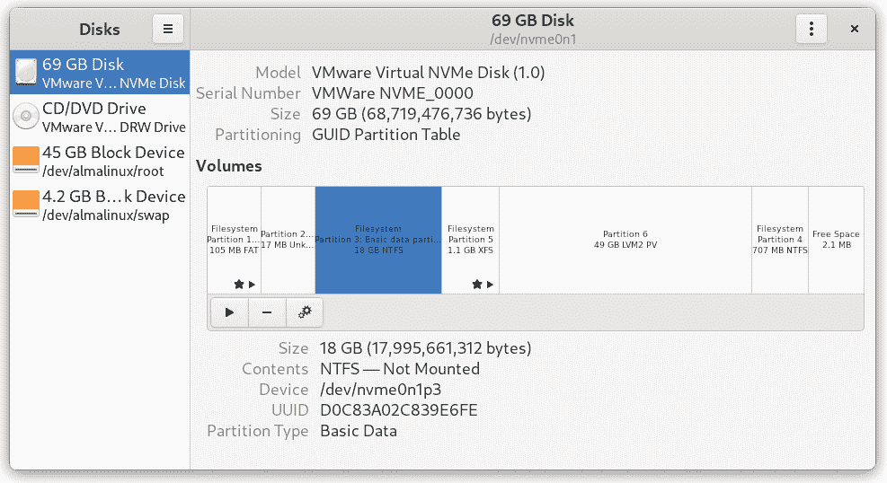

图 5-1

在上面的示例中，磁盘包含两个需要删除的 Windows NTFS 分区。磁盘图中显示带有星号的任何 NTFS 分区（如上图高亮的分区所示）在删除之前必须先卸载。这可以通过选择分区并点击下图中图 5-2 所示的卸载按钮来实现：

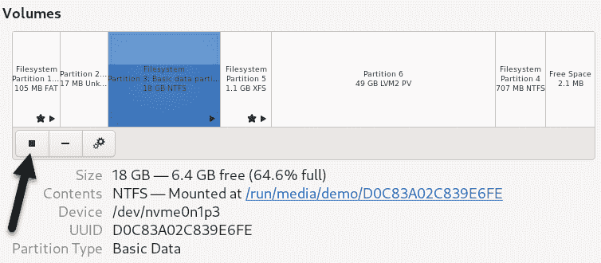

图 5-2

所有 NTFS 分区都卸载后，下一步是删除它们。选择磁盘中最左侧的 NTFS 分区，并点击如图 5-3 所示的删除按钮：

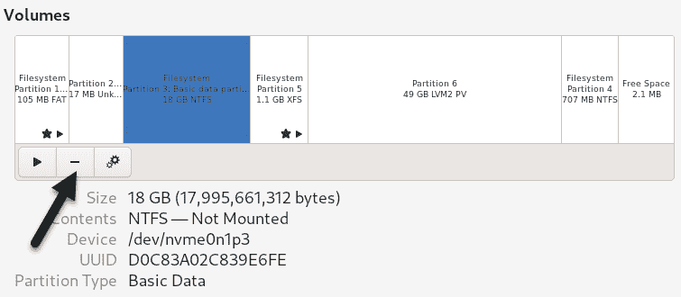

图 5-3

在点击删除按钮提交更改之前，请检查确认对话框中的信息。一旦删除了第一个分区，对任何剩余的 NTFS 分区重复此步骤。一旦删除了 NTFS 分区，磁盘中的空间应显示为空闲。现在需要创建一个新分区来使用这些空闲空间。选中空间后，点击新分区按钮（如图 5-4 中的箭头所示）：

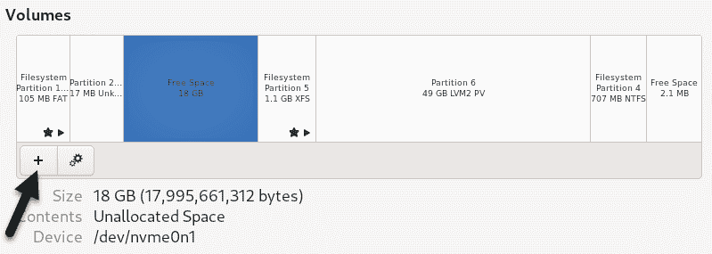

图 5-4

在“创建分区”对话框中，选择分区是应占据所有可用空间，还是在计划将该空间用于多个分区时减小尺寸：

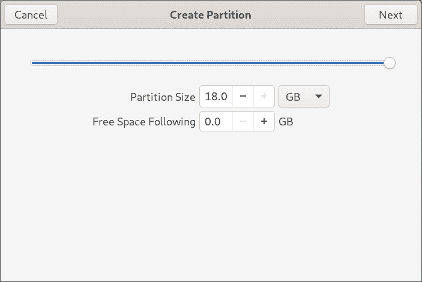

图 5-5

点击“下一步”，并在后续屏幕上为新分区输入名称，并选择在创建期间应擦除分区。这会导致创建过程花费更多时间，但这是一个推荐的选项。最后，为卷输入名称并选择文件系统类型。这通常是 ext4 或 XFS。考虑到 XFS 的优势，在点击“下一步”按钮之前选择“其他”。

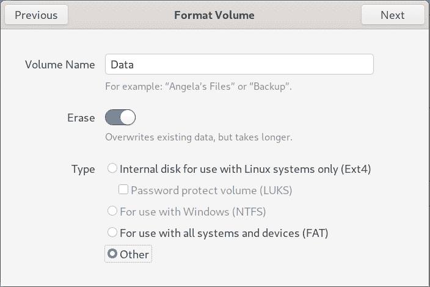

图 5-6

在下一个屏幕上，在点击“创建”按钮之前选择 XFS 选项：

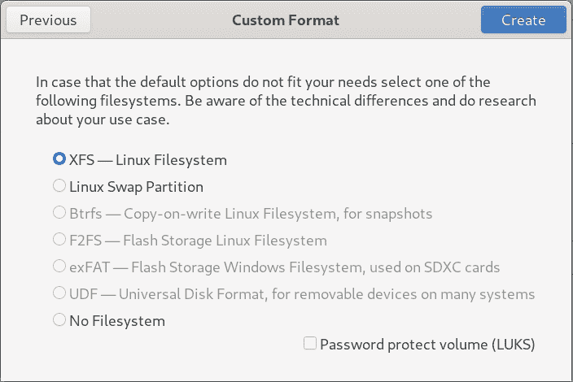

图 5-7

`gnome-disks` 工具将开始格式化过程并显示状态：

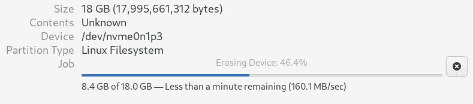

图 5-8

分区准备好后，可以使用命令行或 `gnome-disks` 工具进行挂载。要配置挂载点，选择分区并点击如图 5-9 所示的设置按钮：

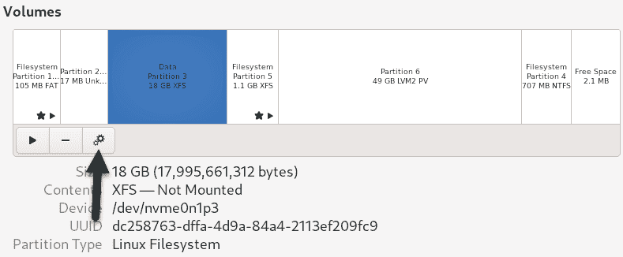

图 5-9

从设置菜单中选择编辑挂载选项...显示如图 5-10 所示的对话框：

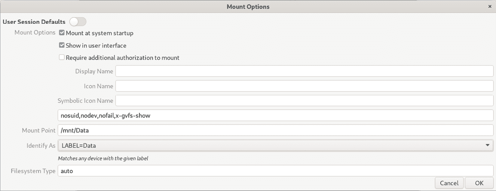

图 5-10

关闭用户默认开关，并根据你的需求配置挂载点。在上面的图中，分区在系统启动时挂载到 `/data`。

设置完成后，点击确定，然后点击如图 5-11 所示的挂载按钮：

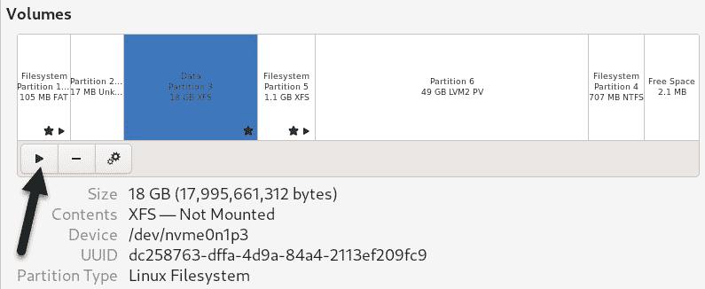

图 5-11

要检查分区现在已挂载并可以使用，运行以下命令显示可用空间：

```
df -h /data
Filesystem Size Used Avail Use% Mounted on
/dev/nvme0n1p3 17G 152M 17G 1% /data
```

最后，按照本章较早概述的步骤更新启动菜单以移除 Windows 。

## 5.7 总结

双启动配置中的 Windows 分区可以随时删除，通过识别哪些分区属于 Windows 并删除它们，可以为 AlmaLinux 9 系统释放空间。删除后，可以使用空闲空间创建新文件系统并进行挂载以便使用。

# 6. GNOME 40 桌面指南

AlmaLinux 9 包含了 GNOME 40 桌面环境。不像 Windows 和 macOS 桌面那样复杂，GNOME 40 提供了一个简洁直观的桌面环境，提供了窗口环境的所有功能，并且优点是易于学习。

在本章中，将涵盖 GNOME 桌面的主要功能，并概述基本任务的操作方法。

## 6.1 安装 GNOME 桌面

如果在安装 AlmaLinux 9 的过程中选择了工作站或带有 GUI 的服务器软件配置，则 GNOME 桌面将已安装，并在每次系统启动时自动启动。


如果在 AlmaLinux 9 安装过程中选择了任何其他软件配置，则系统安装的软件包中将不会包含 `GNOME` 桌面。对于没有连接显示器的服务器级系统来说，安装图形化桌面环境可能看起来是多此一的。然而，值得注意的是，远程访问 `GNOME` 桌面也是可行的；即使在无头服务器（即缺少显示器、键盘和鼠标的服务器）上，安装 `GNOME` 桌面软件包可能仍有益。关于建立远程桌面访问的话题将在本书的“使用 VNC 访问 AlmaLinux 9 桌面”章节详细介绍。

如果安装配置未包含 `GNOME` 桌面，可以使用以下命令随时进行安装：

```bash
dnf groupinstall workstation
```

`Workstation` 组是多个可用安装的包组之一。运行以下命令查看所有可用和已安装的包组列表：

```bash
$ dnf grouplist
```

`dnf grouplist`

可用环境组：
- Server（服务器）
- Minimal Install（最小化安装）
- Workstation（工作站）
- Virtualization Host（虚拟化主机）
- Custom Operating System（自定义操作系统）

已安装环境组：
- Server with GUI（带 GUI 的服务器）

已安装组：
- Container Management（容器管理）
- Headless Management（无头管理）

安装完成后，可以如下从显示器上的命令行提示符启动桌面环境：

```bash
$ startx
```

运行以下命令可以在重启时自动启动桌面环境（我们将在“管理 AlmaLinux 9 systemd ”](#Systemd_Targets_and_States.xhtml__idTextAnchor212)中详细探讨此命令）：

```bash
systemctl isolate graphical.target
```

## 6.2 GNOME 40 桌面概述

图 6-1 所示屏幕显示了在启动任何其他程序或更改配置之前，典型的新启动 `GNOME` 桌面会话的外：


图 6-1

主桌面区域（标记为 A）是启动应用程序和实用程序时窗口出现的地方与其他桌面环境不同，无法将文件或应用程序拖放到桌面，这提供了一个整洁且不杂乱的工作空间。

屏幕顶部的栏（B）称为 `top bar`（顶栏）。它包含 `Activities` 菜单（C）、日期和时间（B）以及一组状态图标（D），点击这些图标会显示一个包含更多选项的菜单。

此外，运行在桌面上的当前活动应用程序的应用程序菜单也会出现在顶栏中。例如，图 6-2 显示了 `Terminal` 程序的应用程序菜单：

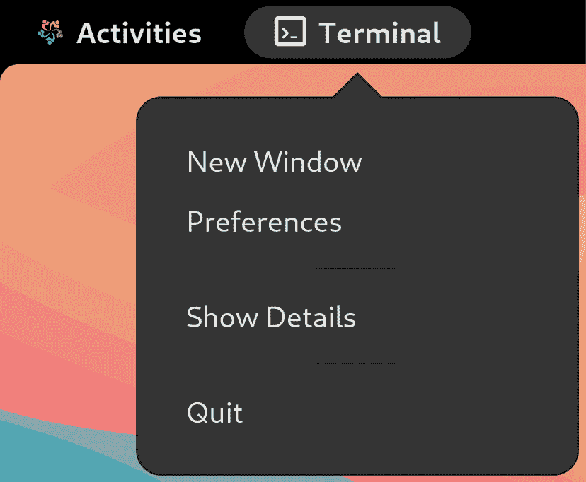
图 6-2

## 6.3 活动概览

应用程序和实用程序通过 `Activities Overview`（活动概览）启动可以通过点击顶栏中的 `Activities` 按钮或按下键盘上的特殊键来显示。在 Windows 键盘上，这是 `Windows` 键；在 macOS 上是 `Command` 键；在 Chromebook 上，是显示放大镜的键。

显示时，`Activities Overview` 将类似于下方的图 6-3：

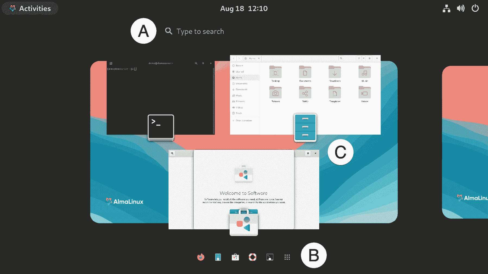
图 6-3

概览的中心区域（如上方图 6-3 中标记为 A）显示了所有当前打开的应用窗口。屏幕底部（B）是 `dashboard`（仪表板，也称为 `dash`），可以从中启动应用。默认情况下，`dash` 将显示一组定义的常用应用程序的图标以及任何正在运行的应用程序的图标。如果应用程序正在运行，图标下方将显示一个点。要启动应用程序，只需点击 `dash` 中的图标即可。

要找到 `dash` 中未包含的应用程序，一种方法是选择右侧的网格图标（由九个点组成的正方形）以显示可浏览的应用程序列表，如图 6-4 所示：


图 6-4

同样重要的是要意识到列表中的某些项目是包含其他应用程序的文件夹。可以通过拖放图标来重新定位网格中的项目。要将应用程序添加到文件夹中，请在网格中找到它并将其拖入文件夹。此外，拖动一个图标并将其释放到另一个图标上将创建一个包含这两个应用程序的新文件夹，并可以向该文件夹添加其他应用程序。

浏览应用程序的替代方案是使用搜索栏进行搜索（如上方图 6-3 中标记为 C），并在图中显示了操作过程：

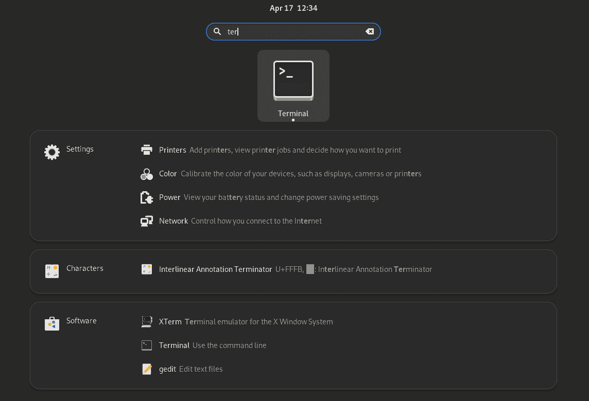
图 6-5

随着在搜索框中输入文本，可能的匹配项列表将不断精炼。

为了更方便地访问将应用程序添加到 `dash` 中，请找到应用程序的图标，右键点击它并选择 `Add to Favorites`（添加到收藏夹）菜单选项：

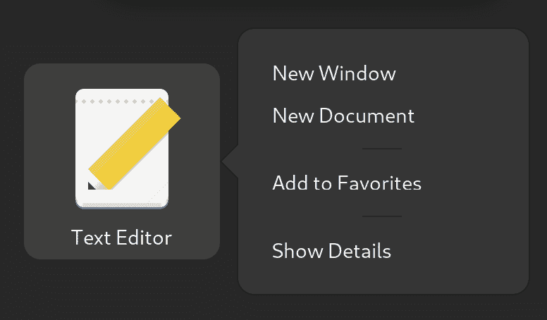
图 6-6

要从 `dash` 中移除应用程序，请右键点击 `dash` 中的图标并选择 `Remove from Favorites`（从收藏夹中移除）。或者，拖放图标进入或离开 `dash`。

## 6.4 窗口管理

与其他桌面环境一样，应用程序在 `GNOME` 中以窗口运行。当打开多个应用程序窗口时，`Super + Tab` 快捷键将显示切换面板（图 6-7），允许选择不同的窗口（`Super` 键是 `Windows` 键，如果是 Mac 键盘，则是 `Cmd` 键）：


图 6-7

如果一个应用程序打开了多个窗口，切换器会将这些窗口显示在第二个面板中以便选择特定窗口：

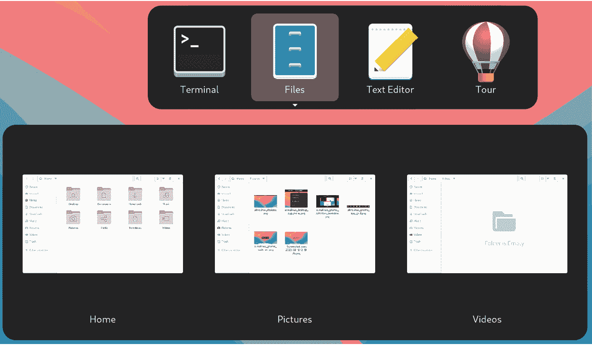
图 6-8

要在切换器中的图标之间循环切换，使用快捷键。

要最大化窗口以填充整个屏幕，点击标题栏并将窗口拖到屏幕顶部。要恢复窗口的原始大小，点击标题栏并向下拖动。或者双击标题栏切换窗口大小。同样，将窗口拖到屏幕的左侧或右侧将使其填充屏幕的一半。

## 6.5 使用工作空间

显示应用程序窗口的屏幕区域被称为 `workspace`（工作空间），GNOME 允许配置多个工作空间。要查看当前的工作空间，点击顶栏中的 `Activities`（如图 6-1 所示的 C）或按下键盘 `Super` 键显示以下屏幕：

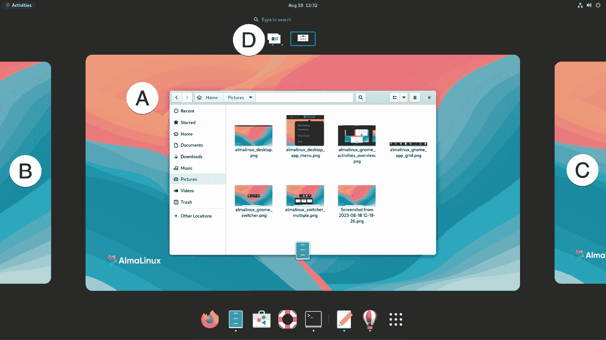
图 6-9

上方标记为 A 的区域是当前选择的工作空间。点击标记为 B 和 C 的区域将分别选择并显示上一个和下一个工作空间。中心工作空间面板（A）显示了当前活动的应用程序窗口。将鼠标指针悬停在窗口上将显示退出窗口按钮。要将窗口从一个工作空间移动到另一个，显示工作空间面板并将应用程序窗口拖放到目标工作空间。当窗口添加到空工作空间时，另一个空工作空间会被添加到工作空间面板，从而创建多个工作空间。

工作空间缩略图（D）提供了切换工作空间的方便方法，在处理许多工作空间时特别有用。

要删除工作空间，要么关闭该工作空间上的所有窗口，要么将它们移动到另一个工作空间。

显示应用程序屏幕也提供了访问当前工作空间的接口，如下图 6-10 所示：


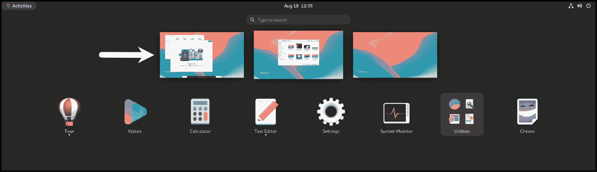
图 6-10

## 6.6 日历与通知

当系统需要通知你某个事件（例如系统或应用程序更新可用）时，工作区顶部会弹出一个弹出面板。此外，通过点击顶栏上的日期和时间可以访问日历和任何之前的通知，如图 6-11 所示：

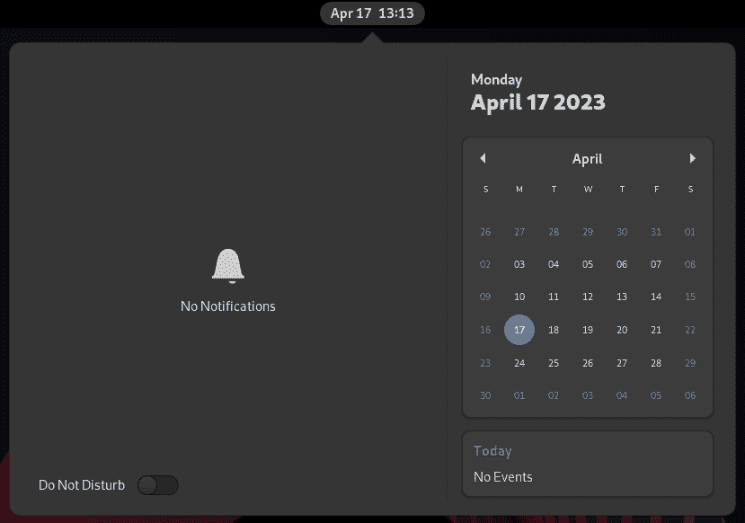
图 6-11

## 6.7 GNOME 桌面设置

要访问“设置”应用程序，点击顶栏右侧的图标行并选择“设置”，如图 6-12 所示：

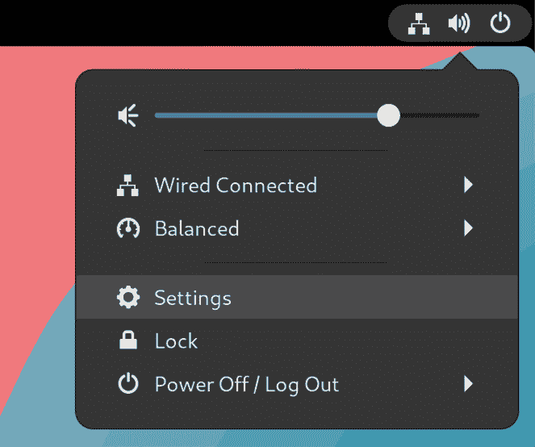
图 6-12

“设置”应用程序提供了许多选项，以太网和 WiFi 连接、屏幕背景自定义选项、屏幕锁定和电源管理控制以及语言偏好。要探索每个类别中的可用设置，请从“设置”窗口左侧面板选择一个选项：

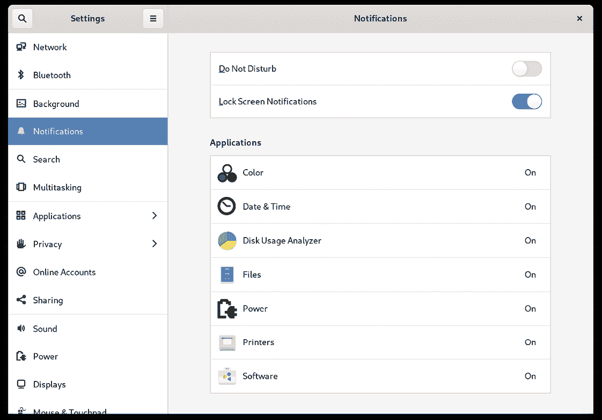
图 6-13

上述图 6-11 中显示的菜单还包括切换用户、调整音量、更改到不同的 WiFi 网络以及注销、重启或关闭系统的选项。

## 6.8 基础自定义之外

GNOME 40 桌面在设计上是一个简洁且不杂的环境，自定义选项极少。然而，对桌面进行额外的更改是可行的。GNOME 项目开发了一个名为 GNOME Tweaks 的工具来实现此目的。请使用以下命令安装并运行该工具：

```bash
dnf install gnome-tweaks
gnome-tweaks
```

一旦 GNOME Tweaks 加载，将出现如图 6-14 所示的界面：

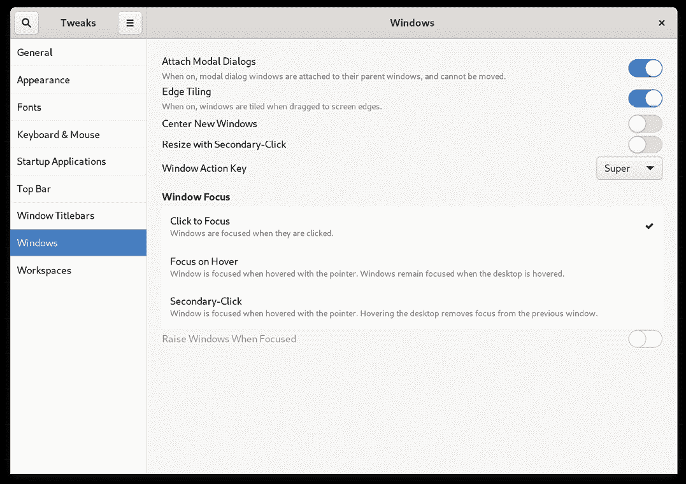
图 6-14

现在可以使用广泛的桌面自定义选项。由于选项过多，本章无法全部涵盖，因此在继续后续章节之前，请先尝试这些设置。

## 6.9 安装 GNOME 桌面应用

任何桌面环境如果没有应用商店都是不完整的，GNOME 桌面也不例外。GNOME 桌面的应用商店被称为“软件”（Software），可以从启动器（dash）中启动，如图 6-15 所示：


图 6-15

一旦加载，“软件”应用程序将如图 6-16 所示出现，允许你浏览并安装应用：

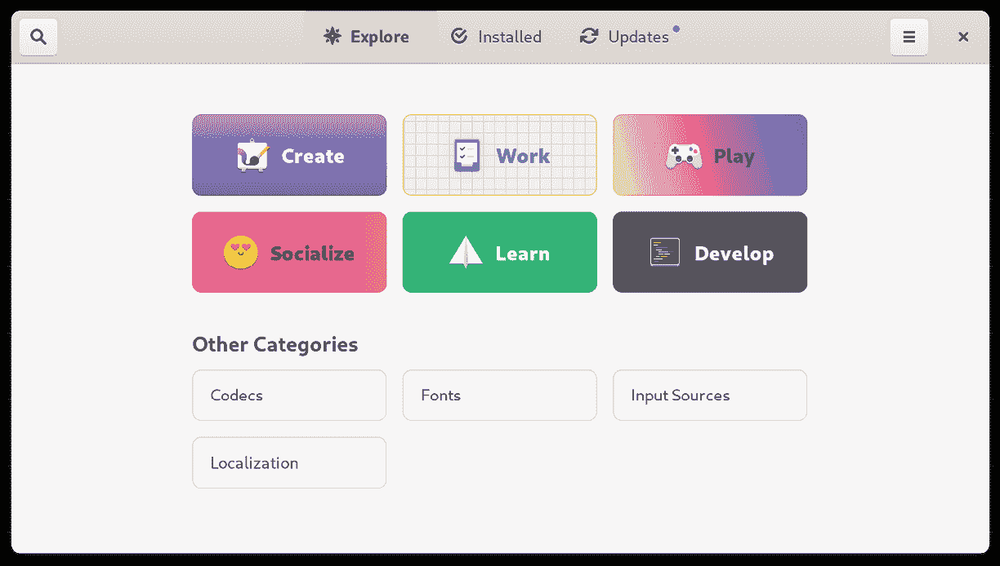
图 6-16

## 6.10 总结

AlmaLinux 9 包含了 GNOME 40 桌面环境，该环境可能在初始安装期间包含，也可以以后使用 `dnf` 组包安装功能进行。与大多数其他桌面环境不同，GNOME 40 旨在提供一个简洁且易于使用的窗口用户界面。GNOME 40 桌面的关键区域包括顶栏、活动概览和启动器。此外，GNOME 40 支持多个工作区，以保持运行中的应用程序井然有序并使屏幕整洁。“设置”应用程序中提供了各种配置选项，包括桌面背景设置、音频、网络配置和 WiFi 网络选择。

# 7. Cockpit Web 界面概览

尽管配备了最新的 Linux 桌面环境，但 AlmaLinux 9 很大程度上仍然服务器操作系统。因此，大多数 AlmaLinux 部署都是针对远程物理服务器或作为云端虚拟机实例运行的。不可避免的是，这些系统在没有键盘、鼠标或显示器的情况下运行，仅可以通过网络连接上的命令行提示符进行直接访问。这在从远程位置管理系统方面带来了挑战。虽然通过远程访问命令行和桌面环境确实可以实现许多功能，但对于在像 AlmaLinux 9 这样的企业级操作系统上必须每天执行的管理和监控任务，需要一个一致且统一的解决方案。

Cockpit 基于 Web 的管理界面提供了这种功能。本章将解释如何安装、配置和访问 Cockpit 界面，同时提供 Cockpit 关键特征的概述，其中许多特征将在后面的章节中进行更详细的介绍。

## 7.1 Cockpit 概览

Cockpit 是一个轻量级的 Web 界面，允许远程执行常规系统管理任务。安装并配置后，系统管理员打开本地浏览器窗口并导航到远程服务器上的 Cockpit 端口。在浏览器中加载 Cockpit 界面并登录后，可以使用管理和监控工具可视化的方式执行广泛的任务。

在后台，Cockpit 使用通常在命令行工作时使用的工具来执行任务，并自动更新以反映系统其他处的变化。这使得 Cockpit 可以与其他管理工具和技术配合，而无出现一种方法覆盖另一种方法的风险。Cockpit 还可以配置为访问多一台服务器，允许通过单个浏览器会话同时管理和监控多台服务器。

Cockpit 默认安装并捆绑了一系列工具，并允许根据需要安装额外的扩展插件。Cockpit 的设计还允许你结合 HTML 和 JavaScript 创建自己的扩展，以添加缺失或自定义机功能。

Cockpit 的模块化设计还允许许多功能嵌入到其他基于 Web 的应用程序中。

## 7.2 安装并启用 Cockpit

Cockpit 通常默认没有安装在 AlmaLinux 9 上，但可以通过几个简单的步骤进行设置和启用。第一步按照如下方式安装 `cockpit` 包：

```bash
dnf install cockpit
```

接下来，需要启用 `cockpit.socket` 服务：

```bash
systemctl enable --now cockpit.socket
```

最后，如果你的系统启用了防火墙，则需要在防火墙上打开必要的端口，以允许远程浏览器连接到达 Cockpit（有关防火墙的详情，请参阅“AlmaLinux 9 防火墙基础所示的登录页面：

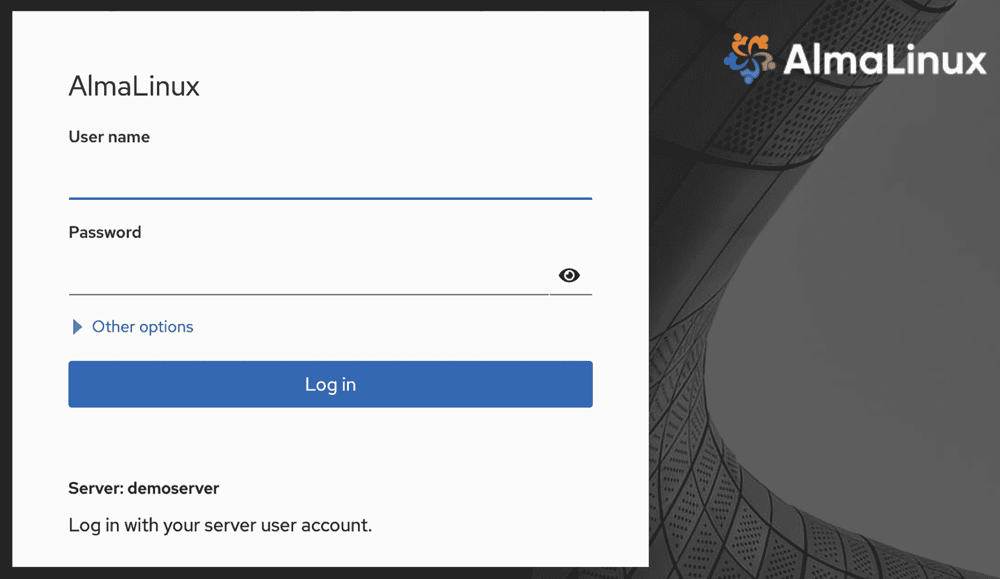
图 7-1

使用 root 或你的用户凭据登录 Cockpit 界面。注意，由于权限限制，以用户身份登录时 Cockpit 界面中的某些任务将受到限制。在这种情况下，Cockpit 控制台将显示名为“受限访问”的按钮，如图 7-2 所示：


图 7-2

要提升权限，点击受限访问按钮并在提示时输入你的密码：

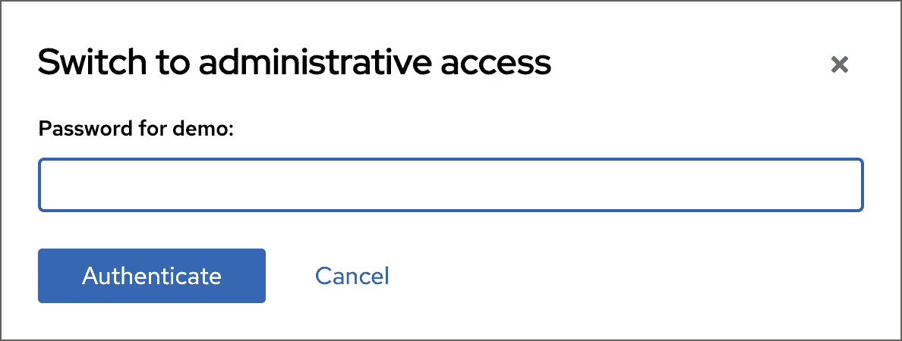
图 7-3

登录后，Cockpit 将显示概览界面。


## 7.4 概述

概述屏幕提供了当前系统的概览，包括对 CPU、内存、存储和网络活动性能指标的访问。此屏幕还包含有关系统的信息，包括底层硬件、主机名、系统时间以及系统软件是否为最新版本。此外还提供了重启或关闭系统的选项。

例如，图 7-4 显示了 Cockpit 界面的概述页：

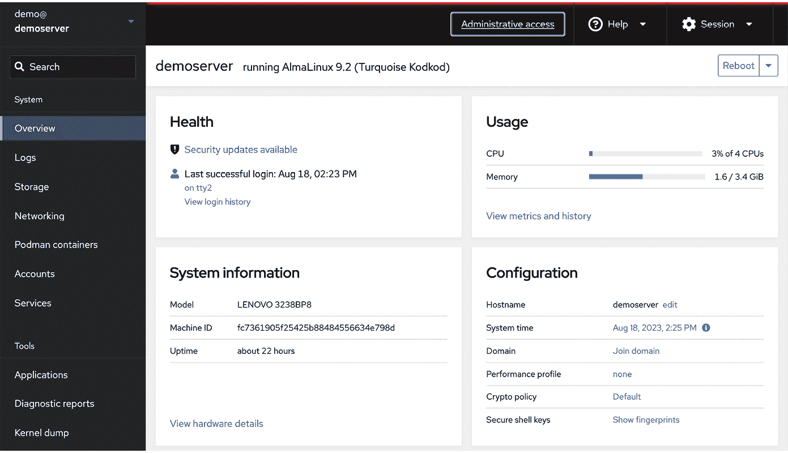

图 7-4

如需有关特定类别的更多信息，请点击相应的链接。例如，图 7-5 显示了系统性能历史屏幕：


图 7-5

## 7.5 日志

当选择“日志”类别时，Cockpit 会显示 `systemd` 日志的内容。选择一个日志条目将显示整个日志消息。日志条目按时间排序，最新的在最上方，并包含菜单用于根据不同的时间跨度和消息严重程度过滤日志。


图 7-6

## 7.6 存储

选择“存储”选项来查看和管理系统上的存储，包括磁盘、分区、卷组、网络文件系统 (NFS) 挂载和 RAID 存储。此屏幕允许实时监控磁盘 I/O 活动，并列出用于查询和管理存储设备的系统 `udisksd` 服务的日志输出：


图 7-7

## 7.7 网络

网络屏幕提供了各种网络相关配置和服务的信息，包括网络接口和防火墙设置。此外，它允许进行配置更改，例如创建网桥或设置虚拟网络：


图 7-8

## 7.8 账户

选择此选项查看配置在系统上的当前用户账户并为额外用户创建账户。用户管理的主题将在本章标题为 管理 AlmaLinux 9 用户和组”的章节中介绍：


图 7-9

点击现有账户查看详情并进行更改。用户账户详情页还可用于向用户账户查看和添加公共 SSH 密钥，以便远程访问服务器，正如章节“在 AlmaLinux 9 上配置基于密钥的身份验证”](#SSH_Authentication.xhtml__idTextAnchor270)所示概述。

## 7.9 服务

此屏幕显示运行在服务器上的系统服务列表，并允许对这些服务进行添加、删除、停止和启动。


图 7-10

服务的主题将在章节“管理 AlmaLinux 9 systemd 单元”](#Systemd_Targets_and_States.xhtml__idTextAnchor212)中进行详细介绍。

## 7.10 应用程序

如前所述，可以作为扩展向 Cockpit 添加额外功能。这些扩展可以是自开发的扩展，也可以是第三方提供的扩展。应用程序屏幕列出了已安装的扩展，并允许添加或删除扩展：


图 7-11

## 7.11 虚拟机

虚拟化允许多个操作系统实例在单个计算机系统上同时运行，每个系统都运行在自己的虚拟机中。虚拟机 Cockpit 扩展提供了一种创建和管理安装在服务器上的虚拟机客户端的方法：


图 7-12

虚拟机扩展默认不安装，但可以通过 Cockpit 应用程序屏幕或运行以下命令添加：

```bash
dnf install cockpit-machines
```

在 AlmaLinux 9 中使用虚拟化的内容将从章节“虚拟化技术概述”](#Virtualization_Overview.xhtml__idTextAnchor347)开始介绍。

## 7.12 软件更新

如果系统有任何可用的软件更新，它们将列在此处，并可以从此屏幕进行安装：


图 7-13

## 7.13 终端

顾如名，终端屏幕提供了命令行提示符的访问：


图 7-14

## 7.14 连接到多台服务器

可以配置 Cockpit 在单个会话中管理多台服务器。要向 Cockpit 会话添加另一个主机，请点击图 7-15 中突出按钮以显示主机面板：


图 7-15

点击“添加新主机 (Add new host)”按钮，输入其他系统的 IP 地址或主机名，并选择一种颜色将此服务器与之前添加到 Cockpit 的任何服务器区分开，然后点击“添加 (Add)”按钮：


图 7-16

如果是第一次连接到远程服务器，Cockpit 将要求您接受新的 SSH 密钥。接受密钥后，将提示您输入上方图 7-16](#Ubuntu_Cockpit_Overview.xhtml__idTextAnchor173)中指定的用户名密码。还提供了设置并授权密码保护的 SSH 密钥的选项，以便下次需要访问第二台主机系统时能够自动登录：


图 7-17

若要在主机之间切换，请显示主机面板（上方图 7-15](#Ubuntu_Cockpit_Overview.xhtml__idTextAnchor172)）并选择所需的系统。

## 7.15 启用存储的指标

在标准安装中，Cockpit 不保留图表覆盖的短窗口之外的任何性能指标数据。为了保留 Cockpit 收集的数据，需要安装 Cockpit Co-Pilot (PCP) 包。按照如下方式开始安装 `cockpit-pcp` 包：

```bash
dnf install cockpit-pcp
```

安装 cockpit-pcp 后，注销当前 Cockpit 会话并重新登录。

接下来，显示“性能指标”屏幕并点击“指标设置”按钮显示图 7-18](#Ubuntu_Cockpit_Overview.xhtml__idTextAnchor176)所示的屏幕，开启“收集指标 (Collect metrics)”选项并点击“保存 (Save)”：


图 7-18

在 Cockpit 有了足够的时间收集数据后，指标信息将如图 7-19](#Ubuntu_Cockpit_Overview.xhtml__idTextAnchor178)所示出现，按小时块分类：


图 7-19

## 7.16 总结

Cockpit Web 界面允许在浏览器内可视化地执行远程系统管理任务，而无需依赖提示符和命令行工具。一旦安装并启用，系统管理员只需打开浏览器，连接到远程服务器并登录 Cockpit 界面。在后台，Cockpit 使用与通过命令行提示符提供的相同的命令行工具，允许使用这两种方式而不会产生配置冲突的风险。此外，Cockpit 使用模块化框架，允许添加额外的扩展并开发和集成自定义扩展。Cockpit 会话可用于管理单台服务器，也可配置为同时访问多台服务器。

# 8. 在 AlmaLinux 9 上使用 Bash Shell


学习使用 AlmaLinux 9 以及通用 Linux 发行版的一个重要部分是熟练掌握 Shell 环境下的操作。虽然 Linux 自带的 GNOME 等图形桌面环境为操作系统提供了用户友好的界面，但 Shell 环境提供了比图形桌面工具无法实现的强大功能、灵活性和自动化能力。当桌面环境不可用时，Shell 环境还提供了与操作系统交互的手段，这在处理如 AlmaLinux 9 这种基于服务器的操作系统或无法完全启动的损坏系统时非常常见。

因此，本章旨在概述 AlmaLinux 9 上默认的 Shell 环境（特别是 `Bash` Shell）。

## 8.1 什么是 Shell（外壳）？

Shell 是一个交互式命令解释器环境，在该环境中，可以在提示符处输入命令，或将命令作为脚本输入文件并执行。Shell 的起源可以追溯到 UNIX 操作系统的早期。事实上，在 Linux 早期，在引入图形桌面之前，Shell 是是用户与操作系统交互的唯一方式。

多年来，人们开发了多种 Shell 环境。第一个广泛使用的 Shell 是由贝尔实验室的 Stephen Bourne 编写的 `Bourne shell`。另一个早期产物是 `C shell`，它与 `C 编程语言` 有一些语法相似之处，并引入了命令行编辑和历史记录等可用性增强。

`Korn shell`（由贝尔实验室的 David Korn 开发）基于 `Bourne` 和 `C shells` 提供的功能。

AlmaLinux 9 上的默认 Shell 是 `Bash` Shell（`Bourne Again SHell` 的缩写）。该 Shell 起初是 `Bourne shell` 的开源版本，由 Brian Fox 为 GNU 项目开发，并基于 `Bourne shell` 和 `C shell` 提供的功能。

## 8.2 访问 Shell

在 GNOME 桌面环境中，可以通过选择顶部栏中的 `Activities`（活动）选项、在搜索栏中输入 `Terminal` 并点击 `Terminal` 图标，从 `Terminal` 窗口访问 Shell 提示符。

例如，使用 `SSH` 远程登录 AlmaLinux 9 服务器时，用户将看到一个 Shell 提示符。标题为 在 AlmaLinux 9 上配置 SSH 密钥身份验证 的章节将介绍使用 `SSH` 访问远程服务器的细节。在启动未安装桌面环境的服务器系统时，用户在物理控制台终端或远程登录会话完成登录程序后将立即进入 Shell。

## 8.3 在提示符输入命令

在 Shell 命令提示符处，只需输入命令并按回车键即可输入命令。虽然某些命令会静默执行任务，但大多数命令在返回提示符之前都会显示某种形式的输出。例如，可以使用 `ls` 命令显示当前工作目录下的文件和目录：

```bash
$ ls
Desktop Documents Downloads Music Pictures Public Templates Videos
```

可用的命令要么内置在 Shell 本身，要么位于物理文件系统中。可以使用 `which` 命令识别命令在文件系统中的位置。例如，要查找 `ls` 可执行文件在文件系统中的位置：

```bash
$ which ls
alias ls='ls --color=auto’
/usr/bin/ls
```

显然，`ls` 命令位于 `/usr/bin` 目录中。请注意，还配置了 `alias`（别名），该主题将在本章稍后部分讨论。使用 `which` 命令定位 Shell 内置命令的路径将导致指示找不到可执行文件的消息。例如，尝试查找 `history` 命令的位置（该命令内置在 Shell 中，而不是作为文件系统上的可执行文件），将产生类似下面的输出：

```bash
$ which history
/usr/bin/which: no history in (/home/demo/.local/bin:/home/demo/bin:/home/share/Modules/bin:/home/local/bin:/usr/bin:/usr/local/sbin:/usr/sbin)
```

## 8.4 获取命令信息

Linux Shell 可用的许多命令看起来可能晦涩。要查找有关命令功能的详细信息以及如何使用，请使用 `man` 命令并将命令名作为参数。例如，学习更多关于 `pwd` 命令的信息：

```bash
$ man pwd
```

执行上述命令后将显示 `pwd` 命令的详细描述。许多命令在带有 `--help` 命令行选项运行时也会提供额外信息：

```bash
$ wc --help
```

## 8.5 Bash 命令行编辑

早期的 Shell 环境不提供任何形式的行编辑功能。这意味着如果你在长命令行的开头发现错误，你必须删除之后的所有字符，修正错误然后重新输入命令的剩余部分。幸运的是，`Bash` 提供了多种行编辑功能，如下表所示：

| 按键序列 | 操作 |
| :--- | :--- |
| Ctrl-b 或 左箭头 | 光标向左移动一位 |
| Ctrl-f 或 右箭头 | 光标向右移动一位 |
| Delete | 删除光标下方的字符 |
| Backspace | 删除光标左侧的字符 |
| Ctrl-_ | 撤销更改（可以重复撤销所有更改） |
| Ctrl-a | 光标移动到行首 |
| Ctrl-e | 光标移动到行尾 |
| Meta-f 或 Esc, 然后 f | 向右移动一个单词 |
| Meta-b 或 Esc, 然后 b | 向左移动一个单词 |
| Ctrl-l | 清除屏幕当前命令以外的内容 |
| Ctrl-k | 删除从光标到行尾的内容 |
| Ctrl-u | 删除光标之前的内容 |
| Ctrl-y | 粘贴最近删除的文本 |
| Meta-d 或 Esc, 然后 d | 删除光标后的单词 |
| Ctrl-w | 删除光标前的单词 |

表 8-1

## 8.6 使用 Shell 历史记录

除了命令行编辑功能外，`Bash` Shell 还提供了历史记录支持。可以使用 `history` 命令查看已执行的命令：

```bash
$ history
    1 ps
    2 ls
    3 ls –l /
    4 ls
    5 man pwd
    6 apropos
```

此外，可以使用 `Ctrl-p`（向上箭头）和 `Ctrl-n`（向下箭头）来遍历之前的命令。最后，当历史记录显示了所需的命令时，按回车键执行。

另一种选项是输入 `!` 字符，后跟要执行命令的前几个字符，然后按回车键。

## 8.7 文件名简写

许多 Shell 命令接受一个或多个文件名作为参数。例如，要显示名为 `list.txt` 的文本文件的内容，可以使用 `cat` 命令：

```bash
$ cat list.txt
```

同样，通过指定所有文件名作为参数可以显示多个文本文件的内容：

```bash
$ cat list.txt list2.txt list3.txt list4.txt
```

不需要输入每个名称，可以使用模式匹配指定符合某些标准的文件。例如，可以使用 `*` 通配符来简化上面的示例：

```bash
$ cat *.txt
```

上述命令将显示所有以 `.txt` 结尾的文件内容。这可以进一步限制为以 `list` 开头并以 `.txt` 结尾的文件：

```bash
$ cat list*.txt
```

可以使用 `?` 字符指定单个字符匹配：

```bash
$ cat list?.txt
```

## 8.8 文件名和路径补全


与其输入完整的文件名或路径，或使用模式匹配来减少输入量，shell 提供了文件名补全功能。要使用文件名补全，请输入文件或路径名称的前几个字符，然后按两次 Esc 键。随后，shell 将根据目录中匹配你所输入字符的第一个文件或路径名来为你补全文件名。要获取可能匹配项的列表，请在输入前几个字符后按 `Esc` 键。

## 8.9 输入和输出重定向

如前所述，许多 shell 命令在执行时会输出信息。默认情况下，这些输出将指向名为 `stdout` 的设备文件，该文件本质上是运行 shell 的终端窗口或控制台。相反，shell 从一个名为 `stdin` 的设备文件获取输入，默认情况下，该文件是键盘。

可以使用 `>` 字符将命令的输出从 `stdout` 重定向到文件系统上的物理文件。例如，要将 `ls` 命令的输出重定向到名为 `files.txt` 的文件，需要执行以下命令：

```
$ ls *.txt > files.txt
```

完成后，`files.txt` 将包含当前目录下的文件列表。同样，文件的内容也可以作为 `stdin` 输入到命令中。例如，要将文件内容作为输入重定向到命令：

```
$ wc –l < files.txt
```

上述命令将显示 `files.txt` 文件中的行数。

需要注意的是，`>` 重定向操作符在使用时会创建一个新文件或截断现有文件。如需向现有文件追加内容，请使用 `>>` 运算符：

```
$ ls *.dat >> files.txt
```

除了标准输出外，shell 还提供了使用 `stderr` 这种标准错误输出。当命令的输出重定向到 `stdout` 时，命令生成的任何错误信息都将重定向到 `stderr`。这意味着如果 `stdout` 被重定向到文件，错误信息仍然显示在终端上。这通常是期望的行为，但如果需要，也可以使用 `2>` 运算符重定向 `stderr`：

```
$ ls dkjfnvkjdnf 2> errormsg
```

命令执行完成后，`errormsg` 文件将包含一条提示找不到名为 `dkjfnvkjdnf` 文件的错误报告。

可以使用 `&>` 运算符将 `stderr` 和 `stdout` 都重定向到同一个文件：

```
$ ls /etc dkjfnvkjdnf &> alloutput
```

执行完成后，`alloutput` 文件将包含 `/etc` 目录内容的列表以及与尝试列出不存在的文件相关的错误信息。

## 8.10 在 Bash Shell 中使用管道

除了 I/O 重定向外，shell 还允许将一个命令的输出直接通过管道传输到另一个命令的输入中。管道操作通过在命令行中的两个或多个命令之间放置 `|` 字符来实现。例如，要统计系统上运行的进程数，可以将 `ps` 命令的输出通过管道传递给 `wc` 命令：

```
$ ps –ef | wc –l
```

命令行上可以执行的管道操作数量没有限制。例如，要查找文件中包含名字 "Smith" 的行数：

```
$ cat namesfile | grep Smith | wc –l
```

## 8.11 配置别名（Aliases）

随着对 shell 环境越来越熟练，你可能会频繁执行带有相同参数的命令。例如，你可能会经常配合 `l` 和 `t` 选项使用 `ls` 命令：

```
$ ls –lt
```

为了减少执行命令时的输入量，可以创建一个映射到该命令和参数的别名。例如，要创建一个别名，使得输入字母 `l` 就会执行 `ls –lt` 命令，可以使用以下语句：

```
$ alias l="ls –lt"
```

现在在命令提示符处输入 `l` 将将执行原始语句。

## 8.12 环境变量

shell 环境变量提供了数据和配置设置的临时存储。shell 本身设置了几个环境变量，用户可以更改这些变量来修改 shell 的行为。可以使用 `env` 命令获取当前定义的变量列表：

```
$ env
SSH_CONNECTION=192.168.0.1 61231 192.168.0.28 22
MODULES_RUN_QUARANTINE=LD_LIBRARY_PATH
LANG=en_US.UTF-8
HISTCONTROL=ignoredups
HOSTNAME=demo-pc.ebookfrenzy.com
XDG_SESSION_ID=15
MODULES_CMD=/usr/share/Modules/libexec/modulecmd.tcl
USER=demo
ENV=/usr/share/Modules/init/profile.sh
```


`#!` 被称为“shebang”，是一个特殊的字符序列，用于指示执行脚本所需的解释器路径是该行中的下一个项（在本例中，是位于 `/bin` 的 `sh` 可执行文件）。如果你想使用的解释器是 `/bin/csh` 或 `/bin/ksh`，那么同样可以是这些路径。

下一步是编写一个简单的脚本：

```bash
#!/bin/sh
for i in *
do
    echo $i
done
```

该脚本的作用是遍历当前目录下的所有文件，并显示每个文件的名称。可以通过将脚本名称作为参数传递给 `sh` 来执行此脚本：

```bash
$ sh simple.sh
```

要使该文件具有可执行权限（从而消除了通过将其传递给 `sh` 命令的需要），可以使用 `chmod` 命令：

```bash
$ chmod +x simple.sh
```

一旦在文件权限中设置了执行位，就可以直接执行它。例如：

```bash
$ ./simple.sh
```

## 8.14 总结

在《AlmaLinux 9 基础》的章节中，我们简要浏览了 Bash Shell 环境。在图形化桌面环境中，人们很容易忘记操作系统的真正力量和灵活性通常只有在放弃用户友桌面界面并使用 Shell 环境时才能利用。此外，对于管理和维护没有安装桌面的服务器系统，或者在尝试修复受损到导致桌面或 `Cockpit` 界面无法启动的系统时，熟悉 Shell 是必要的。

Shell 的功能远超本章涵盖的内容。如果你是 Shell 的初学者，我们强烈建议你寻找额外的资源。一旦熟悉了这些概念，你会很快发现，在终端窗口中使用 Shell 执行许多任务比在桌面上翻阅菜单和对话框快得多。

# 9. 管理 AlmaLinux 9 用户和组

在安装 AlmaLinux 9 期间，安装程序创建了一个 root 或超级用户账户并要求配置密码。安装程序还提供了为系统创建用户账户的机会。我们应该记住，AlmaLinux 9 是一个企业级的多用户、多任务操作系统。因此，为了充分利用 AlmaLinux 9 的功能，可能需要让多个用户访问系统。每个用户都应该有自己的用户账户登录、密码、主目录和权限。

用户进一步被分为组以便于管理，这些组可以具有不同级别的权限。例如，你可能有一个在财务部门工作的用户组。在这种环境下，你可以创建一个 `accounts` 组并将所有财务部门的用户分配该组。

本章将涵盖在 AlmaLinux 9 系统上添加、删除和管理用户及组的步骤。可以使用命令行工具、`Cockpit` Web 界面和桌面设置应用在 AlmaLinux 9 上管理用户和组。在本章中，我们将这些用户管理的每种方法。

## 9.1 从命令行管理用户

可以通过命令行使用 `useradd` 实用向 AlmaLinux 9 系统添加新用户。要创建一个新用户账户，请输入类似下面的命令：

```bash
# useradd john
```

默认情况下，这会在 `/home` 目录下为用户创建一个主目录（在本例中为 `/home/john`）。要指定不同的主目录，请在创建账户时使用 `-d` 命令行选项：

账户创建后，需要使用 `passwd` 工具分配密码，用户才能登录系统：

```bash
# passwd john
Changing password for user john.
New password:
Retype new password:
passwd: all authentication tokens updated successfully.
```

可以通过命令行使用 `userdel` 工具删除现有用户。虽然这会删除账户，但用户的文件和数据将完好保留在系统中：

```bash
# userdel john
```

也可以在删除过程中同时删除用户的主目录和邮件邮箱池：

```bash
# userdel --remove john
```

AlmaLinux 9 系统上的所有用户都是一个或多个组的成员。默认情况下，新用户会被添加到与用户同名的私有组中（在上面的示例中，为用户 `john` 创建的账户是一个同名为 `john` 的私有组成员）。然而，作为管理员，将用户组织成更有逻辑的组是有意义的。例如，所有销售人员可能属于 `sales` 组，财务人员可能属于 `accounts` 组，依此类推。可以使用 `groupadd` 命令行工具从命令行添加新组，例如：

```bash
# groupadd accounts
```

使用 `usermod` 工具从命令行将现有用户添加到现有组：

```bash
# usermod -G accounts john
```

要将现有用户添加到多个现有组中，请运行带有 `-G` 选项的 `usermod` 命令：

```bash
# usermod -G accounts,sales,support john
```

注意，上述命令会将用户从 `-G` 之后未列出但用户目前所属的补充组中移除。要保留任何当前的组成员关系，请使用 `-a` 标志追加新的组成员关系：

```bash
# usermod -aG accounts,sales,support john
```

可以使用 `groupdel` 工具从系统删除删除现有组：

```bash
# groupdel accounts
```

注意，如果要删除的组是任何用户的主组或初始组，则无法删除。在删除该组之前，必须先删除用户或使用 `usermod` 命令为其分配一个新的主组。可以使用 `usermod -g` 选项为用户分配新的主组：

```bash
# usermod -g sales john
# groupdel accounts
```

运行 `groups` 命令查找用户所属的组。例如：

```bash
$ groups john
john : accounts support
```

默认情况下，除非用户知道 root 密码，否则用户账户无法执行需要超级用户（root）权限的任务。但是，可以配置用户账户使用 `sudo` 命令执行特权任务。这涉及将用户账户作为 `wheel` 组的成员，例如：

```bash
# usermod -aG wheel john
```

一旦添加到 wheel 组，用户将能够通过 `sudo` 执行其他受限的任务，如下所示：

```bash
$ sudo dnf update
[sudo] password for demo:
Updating Subscription Management repositories.
...
```

可以通过编辑 `/etc/sudoers` 文件并找到以下部分来修改 wheel 组的 `sudo`set：

```bash
## Allows people in group wheel to run all commands
%wheel ALL=(ALL) ALL
```

要禁用所有 wheel 组成员的 `sudo`，如下所示注释第二行：

```bash
## Allows people in group wheel to run all commands
# %wheel ALL=(ALL) ALL
```

允许 wheel 组成员在不输入密码的情况下使用 `sudo`（出于安全考虑，不建议这样做），如下所示修改 sudoers 文件：

```bash
## Same thing without a password
%wheel ALL=(ALL) NOPASSWD: ALL
```

在背后，这些命令仅仅是更改系统上的 `/etc/passwd`、`/etc/group` 和 `/etc/shadow` 文件。

## 9.2 使用 Cockpit 管理用户

如果系统上安装并启用了 `Cockpit` Web 界面（该主题在“Cockpit Web 界面概述”章节中有所介绍），可以在所示的“账户”（Accounts）屏幕中执行若干用户和组管理任务：


图 9-1

屏幕将显示系统上任何现有的用户账户，并提供添加额外账户的按钮。要创建新账户，请点击 `Create New Account` 按钮并在弹出的对话框中输入所需信息。注意，还有一个选项是可以创建账户但稍后锁定：


图 9-2


要修改用户账户，请从主屏幕选择该账户并对账户详情进行任何修改：


图 9-3

此屏幕允许执行各种任务，包括锁定或解锁账户、更改密码或强制用户配置新密码。此外，如果选择了服务器管理员（Server Administrator）选项，用户将被添加到 `wheel` 组，并允许使用 `sudo` 执行管理任务。系统还提供了一个用于从系统中删除该用户的按钮。

如果用户使用带有密钥加密的 SSH 连接远程访问系统，则可以在此屏幕内添加用户的公钥。SSH 访问和身份验证将在后文“在 AlmaLinux 9 上配置基于密钥的身份验证” 中介绍。

## 9.3 使用设置应用管理用户

通过 GNOME 桌面设置应用可以使用第三种用户管理选项。通过点击 GNOME 桌面右上角的图标并选择“设置”（Settings）选项即可访问此应用，如图 9-4 所示：


图 9-4

当主设置屏幕出现时，点击左侧导航面板中的“用户”（Users）选项。默认情况下，设置将被锁定，无法对系统上的用户账户进行任何更改。要解锁“设置”应用，请点击下方图 9-5 中的“解锁”（Unlock）按钮并输入密码。注意，只有当您以具有 `sudo` 权限的用户登录时，才能解锁设置：


图 9-5

应用解锁后，点击“添加用户...”（Add User...）以显示如下方图 9-6 所示的对话框：


图 9-6

如果需要，选择“管理员”（Administrator）选项为新用户分配 `sudo` 权限；否则，保留选择“标准”（Standard）。接下来，输入用户的全名和用户名，并现在分配密码，或允许用户在首次登录账户时设置密码。输入信息后，点击“添加”（Add）按钮创建账户。

可以通过选择 `Users` 屏幕内相应的图标，随时查看、修改现有用户的设置或删除该账户，如图图 9-7 所示。系统还提供了查看用户登录活动的选项。注意，在对账户进行任何更改之前，必须再次解锁“设置”应用：


图 9-7

## 9.4 总结

作为一个多用户操作系统，AlmaLinux 9 的设计目标是支持对多个用户的受控访问。在安装期间，创建了 `root` 用户账户并分配了密码，同时还提供了创建用户账户的选项。可以使用 Cockpit Web 界面或 GNOME 设置应用通过一组命令行工具向系统添加额外的用户账户。除了用户账户外，Linux 还实现了“组”（groups）的概念。可以使用命令行工具添加新组，并将用户分配到这些组中，且每个用户必须至少属于一个组。默认情况下，标准非 `root` 用户没有权限执行特权任务。然而，特殊组 `wheel` 组成员的用户可以使用 `sudo` 命令执行特权任务。

# 10 AlmaLinux 9 软件安装与 AppStreams

难以确定一个新安装的 AlmaLinux 9 系统将包含执行其预期任务所需的所有软件包。即使已经安装了所有所需的软件，几乎可以确定，在系统的生命周期内，许多此类软件包的更新版本将会发布。在某些情况下，您需要确保系统上安装了这些最新的软件包版本，以修复任何漏洞。但在其他情况下，可能需要在系统中保留特定软件包的旧版本，以兼容其他软件。

本章介绍了 AlmaLinux 9 软件管理的基本概念，解释了如何解决这些问题，解释了存储库（repositories）、软件包以及 AlmaLinux 应用流（AppStream），并探索了如何列出、安装和删除构成 AlmaLinux 9 系统的软件包。

## 10.1 存储库 (Repositories)

Linux 本质上由基础包组成，这些包提供了操作系统的核心功能，以及一系列在基础操作系统之上添加功能和特性的包和模块。

在首次安装 AlmaLinux 9 时，将安装各种软件包，这取决于安装阶段选择的软件选项。然而，一旦系统运行，就可以根据需要安装额外的软件。通常，所有属于 AlmaLinux 9 的软件（换句话说，即第三方供应商未提供的软件）都是使用 `dnf` 命令下载并安装在系统上的。正如我们在前面的章节中看到的，这通常涉及在命令行提示符处执行类似下面的命令：

```bash
dnf install httpd
```

当执行此类命令时，将从远程存储库下载请求的软件并安装在本地系统中。默认情况下，AlmaLinux 9 配置从名为 `BaseOS`、`AppStream` 和 `Extras` 的存储库下载软件。例如，运行以下命令将提供系统当前配置用于下载软件时使用的存储库列表：

```bash
dnf repolist
```

| repo id | repo name |
| :--- | :--- |
| appstream | AlmaLinux 9 - AppStream |
| baseos | AlmaLinux 9 - BaseOS |
| extras | AlmaLinux 9 - Extras |

上面的示例显示系统上启用了 Appstream、BaseOS 和 Extras 存储库。请记住，可以为第三方软件添加存储库。

可以通过向 `/etc/dnf/dnf.conf` 文件写入条目，或者通过向 `/etc/yum.repos.d/` 目录添加 `.repo` 文件来向系统添加额外的存储库。或者，可以使用 `dnf config-manager` 工具，并将存储库的 `.repo` 文件 URL 作为命令行参数传递：

```bash
dnf config-manager --add-repo https://url/of/repo/file
```

## 10.2 BaseOS 存储库

该存储库包含构成操作系统核心功能的软件包。这些软件元素以红帽软件包管理器 (RPM) 包文件的格式下载，并安装在系统中。一个典型的 AlmaLinux 9 系统将安装约 1500 个 RPM 软件包。要查看系统中当前安装的所有 RPM 软件包列表，请按所示运行 `rpm` 命令：

```bash
rpm -qa | more
```

```text
libgcc-11.3.1-4.3.el9.alma.x86_64
fonts-filesystem-2.0.5-7.el9.1.noarch
linux-firmware-whence-20230310-133.el9_2.noarch
crypto-policies-20221215-1.git9a18988.el9.noarch
```

通过运行所示的 `dnf` 命令可以获取存储库中可安装的软件包列表：

```bash
dnf list
```

获取匹配搜索字符串的软件包列表，请如下使用 `dnf`：

```bash
dnf search "search string"
```

还可以识别哪个软件包包含特定文件：

```bash
dnf provides filename
```

在使用 `dnf provides` 时，在搜索文件时通常需要使用通配符字符 `*`。例如：

```bash
dnf provides */httpd.conf
```


要安装软件包，请运行以下命令：

```
dnf install packagename
```

同样，要删除软件包：

```
dnf delete packagename
```

当软件包有新版本可用时，它将在系统下一次更新时被下载并安装，通常通过 `dnf` 命令进行：

```
dnf update
```

任何更新的软件包都将替换系统上当前安装的旧版本。虽然在处理基础操作系统软件包时这通常是理想情况，但在处理其他软件包（例如编程环境或开发库）时，这并不一定是预期的行为，因为升级到新版本可能会与系统中已安装的其他软件包产生兼容性问题。这个问题通过 AppStream 仓库得到了。

## 10.3 AppStream 仓库

AppStream 仓库以软件包、模块（modules）、流（streams）和配置文件（profiles）的形式管理软件。正如前一节描述 BaseOS 时概述，AppStream 软件包再次是 RPM 软件包。另一方面，AppStream 模块是属于一组或之间存在依赖关系的包组（例如，在构建 Web 服务器时需要一起安装的包组）。每个模块可以有多个流，每个模块流代表软件模块的不同版本。

考虑一个例子，一个 AlmaLinux 9 系统托管了一个依赖于 7.2 版本 PHP 脚本语言的网站。服务器仍然需要接收 PHP 7.2 的任何更新以获得补丁和错误修复，但与最新版本的 PHP（8.1 版本）兼容。在引入 AppStream 之前，当发布新版本时，很难继续接收 7.2 版本的更新。

为了解决这个问题，AlmaLinux 9 软件管理工具可以使用 AppStream 仓库仅订阅特定模块的特定流（在这种情况下为 PHP 模块的 7.2 流）。

除了流之外，模块还可以通过模块配置文件进行子类划分。模块配置文件根据系统需求提供了组成安装模块的软件包的不同配置。例如，`nodejs` JavaScript 运行时环境模块可以使用开发（development）或最小化（minimal）配置文件进行安装。在运行 `nodejs` 进行开发的系统中，最可能会使用开发配置文件。当部署使用 `nodejs` 开发的软件时，可能会改为安装仅包含运行环境的最小化系统。

要查看可用安装的模块列表，请按如下方式使用 `dnf` 命令：

```
dnf module list
```

上次元数据过期检查：0:08:48 之前，时间为 2023 年 4 月 24 日周一 上午 10:33:24 EDT。

AlmaLinux 9 - AppStream

Name Stream Profiles Summary
maven 3.8 common [d] Java 项目管理和项目理解工具
nodejs 18 common [d], development, minimal, s2i Javascript runtime
php 8.1 common [d], devel, minimal PHP 脚本语言
ruby 3.1 common [d] 面向对象脚本语言的解释器

提示：`[d]`默认，`[e]`启用，`[x]`禁用，`[i]`已安装

列表的第一列是模块名称，第二列是流名称（通常是模块的版本）。流名称后的字母（`[d]`）表示该流是否为默认流（即如果没有引用特定流，则将使用该流进行安装），或者在执行安装时是否已已启用。第三列列出了对应软件包可用的配置文件，并指示了该配置文件是默认的、已安装还是已禁用。

用于列出特定模块信息的 `dnf` 命令结构如下：

```
dnf module list modulename
```

例如，以下输出列出了可用安装的模块信息：

```
dnf module list php
```

Name Stream Profiles Summary
php 8.1 [d] common [d], devel, minimal PHP 脚本语言

显然，PHP 8.1 版本将默认安装在系统中，且该模块在 common、development 和 minimal 配置中均可用。

要使用默认流和配置文件安装模块，可以使用以下语法的 `dnf` 命令：

```
dnf install @modulename
```

例如：

```
dnf install @php
```

或者，可以指定特定的流来执行安装：

```
dnf install @modulename:stream
```

例如：

```
dnf install @php:8.1
```

最后，还可以如下声明声明配置文件：

```
dnf install @modulename:stream/profile
```

例如，为 PHP 8.1 安装最小化的软件包集：

```
dnf install @php:8.1/minimal
```

使用上述命令安装模块后，PHP 模块现在将列出如下：

php 8.1 [e] common [d], devel, minimal [i] PHP 脚本语言

流列中的 `[e]` 标识告诉我们该流已启用，而配置文件列中的 `[i]` 显示已使用最小化配置文件安装了模块。

要在安装模块的情况下启用流，请按如下方式使用 `dnf`：

```
dnf module enable modulename
```

同样，可以如下方式禁用流：

```
dnf module disable modulename
```

要卸载模块，使用以下语法：

```
dnf module remove modulename
```

可以使用以下 `dnf` 命令识别模块的附加信息：

```
dnf module info modulename
```

要找到哪些 RPM 软件包构成了特定模块和流组合的不同配置文件，请如下方式使用 `dnf`：

```
dnf module info --profile modulename:stream
```

例如：

```
dnf module info --profile php:8.1
```

更新订阅管理仓库。
上次元数据过期检查：1:44:32 之前，时间为 2023 年 5 月 29 日周一 上午 04:02:44 EDT。
Name : php:8.1:920220706080036:9:x86_64
common : php-cli
          : php-common
          : php-fpm
          : php-mbstring
          : php-xml
devel : php-cli
          : php-common
          : php-devel
          : php-fpm
          : php-mbstring
          : php-pecl-zip
          : php-process
          : php-xml
minimal : php-cli
          : php-common

最后，要从一个模块流切换到另一个流，运行引用新流的安装命令如下：

```
dnf install @modulename:otherstream
```

此命令将下载新流的软件包并将现有软件包升级或降级到指定的版本。一旦过程完成后，重新同步新流的模块软件包：

```
dnf distro-sync
```

## 10.4 总结

AlmaLinux 9 系统由 RPM 格式的软件包组成，这些软件包从 AlmaLinux BaseOS、AppStream 和 Extras 仓库下载并安装。根据需要，可以在系统中添加额外的仓库以安装软件包。

BaseOS 仓库包含了实现操作系统的基础核心功能的软件包。另一方面，AppStream 软件包提供了额外的功能和特性，将根据配置系统的目的选择性地安装。在类这样的复杂系统中，可能存在大量的包依赖关系，部分系统可能需要特定版本的另一个软件包才能正常运行。AppStream 允许创建模块和配置文件，其中包含所有必要的依赖包，以便在正确的版本级别上一起安装特定功能。AppStream 还允许已安装的软件包接收当前版本的更新，而不必下载下一个主版本，从而避免破坏其他软件包的依赖关系。


要精练管理 AlmaLinux 9 系统，理解 `systemd` 单元的概念至关重要，特别是两种名为目标（targets）和服务（services）的特定类型。本章概述了 AlmaLinux 9 支持的不同 `systemd` 单元，以及如何配置在运行的 Linux 系统后台运行的服务。

## 11.1 理解 AlmaLinux 9 systemd 目标

AlmaLinux 9 可以配置为启动到若干状态之一（称为目标），每种状态都旨在提供特定级别的操作系统功能。系统管理员根据系统的用途，配置系统默认启动的目标。例如，桌面系统可能会被配置为使用图形用户界面目标启动。相比之下，云服务器系统更有可能启动到多用户（multi-user）目标级别。

在启动过程中，名为 `systemd` 的进程会在 `/etc/systemd/system` 文件夹中查找默认目标设置。确定默认目标后，它将开始启动与该目标相关的 `systemd` 单元，以便系统在运行所有必要进程的情况下完成启动。

对于熟悉旧版本 AlmaLinux 的用户来说，`systemd` 目标取代了旧的运行级别（runlevel）系统。

## 11.2 理解 AlmaLinux 9 systemd 服务

服务是一个通常在后台运行的提供特定功能的进程。例如，`sshd` 服务是一个为系统提供安全外壳（shell）访问的后台进程（称为守护进程 daemon）。不同的 `systemd` 目标被配置为自动启动不同的服务集合，具体取决于该目标需要提供的功能。

目标和服务都都是 `systemd` 单元的类型，这一主题将在本章稍后介绍。

## 11.3 AlmaLinux 9 systemd 目标描述

如前所述，AlmaLinux 9 可以启动到若干目标级别之一。系统配置的默认目标将反过来决定启动哪些哪些 `systemd` 单元。与系统启动和关闭直接相关的目标可以总结如下：

- `poweroff.target` - 该目标关闭系统。你不太可能将其作为默认目标。
- `rescue.target` – 导致系统在单用户模式下启动，在该模式下只有 root 用户可以登录。在此模式下，系统不会启动任何网络、图形用户界面或多用户服务。此运行级别是系统管理员执行系统维护或修复活动的的理想选择。
- `multi-user.target` - 将系统启动到具有文本控制台登录能力的多用户模式。
- `graphical.target` - 将系统启动到具有 X Window 系统能力的联网多用户状态。默认情况下，图形桌面环境将在启动过程结束时启动。这是桌面或工作站最常用的运行级别。
- `reboot.target` - 重启系统。这是另一个目标，由于显而易见的原因，你不太可能将其作为默认。

除了上述目标外，系统还包含约 70 个其他目标，其中许多是上述主目标使用的子目标（sub-targets）。例如，在后台，`multi-user.target` 会启动一个名为 `basic.target` 的目标，该目标反过来启动 `sockets.target` 单元，该单元是不同进程之间通信所必需的。这确保了 `multi-user` 目标依赖的所有服务在启动过程中也会启动。

可以通过在终端窗口中运行以下命令来查看特定目标所依赖的目标和服务列表：

```bash
systemctl list-dependencies <target>
```

例如，图 11-1 显示了图形目标 `systemd` 单元依赖的部分列表（完整列表包含了全功能的多用户系统所需的 140 多个目标和服务）：


图 11-1

列表以分级树的形式呈现，说明了某些依赖项具有自己的子依赖项。例如，滚动到列表底部会发现图形目标依赖于两个与网络文件系统相关的目标（即 `nfs-client.target` 和 `remote-fs.target`），每个目标都有自己的服务和目标子依赖项：


图 11-2

列表每个条目左侧的彩色点表示该服务或目标的当前状态，如下：

- **绿色** - 服务或目标处于活动并运行状态。
- **白色** - 服务或目标处于非活动（已死亡）。通常是因为服务或目标尚未启用、由于某些原因停止，或者服务或目标所依赖的条件未满足。
- **红色** - 服务或目标由于致命错误未能启动。

要了解更多关于 `systemd` 单元状态的详细信息，请使用 `systemctl status` 命令后跟单元名称，如下：

```bash
systemctl status systemd-machine-id-commit.service
```

```
systemd-machine-id-commit.service - Commit a transient machine-id on disk
      Loaded: loaded (/usr/lib/systemd/system/systemd-machine-id-commit.service; static)
      Active: inactive (dead)
      Condition: start condition failed at Thu 2023-03-30 08:41:05 EDT; 16min ago
               └─ ConditionPathIsMountPoint=/etc/machine-id was not met
```

## 11.4 识别和配置默认目标

可以使用 `systemctl` 命令如下识别 AlmaLinux 9 系统的当前默认目标：

```bash
systemctl get-default
```
multi-user.target

在上述情况下，系统配置为默认使用多用户目标启动。可以使用 `systemctl` 命令配合 `set-default` 选项随时更改默认设置。以下示例将默认目标更改为在下次系统启动时启动图形用户界面：

```bash
systemctl set-default graphical.target
```

```
Removed /etc/systemd/system/default.target.
Created symlink /etc/systemd/system/default.target → /usr/lib/systemd/system/graphical.target.
```

默认更改的输出显示了 `systemctl` 在后台执行以实施更改的步骤。当前默认是通过通过位于 `/etc/systemd/system` 中的 `default.target` 文件建立符号链接，指向 `/usr/lib/systemd/system` 中对应的目标文件（在本例中为 `graphical.target` 文件）配置的。

## 11.5 理解 systemd 单元和单元类型

如前所述，目标和服务都是 `systemd` 单元的类型。`/usr/lib/systemd/system` 文件夹中的所有文件都称为 `systemd` 单元配置文件，每个文件代表一个 `systemd` 单元。每个单元又被归类为特定的单元类型。AlmaLinux 9 支持 12 种不同的单元类型，包括本章已涵盖的目标和服务的单元类型。

单元文件的类型由下面的文件名扩展名表示：

| 单元类型 | 文件名扩展名 | 类型描述 |
| :--- | :--- | :--- |
| Service (服务) | .service | 系统服务。 |
| Target (目标) | .target | systemd 单元组。 |
| Automount (自动挂载) | .automount | 文件系统自动挂载点。 |
| Device (设备) | .device | 内内核识别的设备文件。 |
| Mount (挂载) | .mount | 文件系统挂载点。 |
| Path (路径) | .path | 文件系统文件或目录。 |
| Scope (范围) | .scope | 外部创建的进程。 |
| Slice (切片) | .slice | 管理系统进程的分层单元组。 |
| Snapshot (快照) | .snapshot | systemd 管理器的保存状态。 |
| Socket (套接字) | .socket | 进程间通信套接字。 |
| Swap (交换) | .swap | 交换设备或交换文件。 |


| Timer 器 | .timer | Systemd 定时器。 |

表 11-1

注意，目标单元（target unit）与其他类型的不同在于，它包含了一组 systemd 单元，例如服务或其他目标。

## 11.6 动态更改当前目标

之前介绍的 `systemctl set-default` 命令指定了下次启动系统将使用的目标，但不会更改当前系统的状态。要动态切换到不同的目标，请再次使用 `systemctl` 命令，使用 `isolate` 选项后跟目标目标。例如，要在不重启的情况下将当前系统切换到图形目标，可以使用以下命令：

```bash
systemctl isolate graphical.target
```

执行后，系统将启动图形桌面环境。

## 11.7 启用、禁用和掩蔽 systemd 单元

新安装的 AlmaLinux 9 系统将包含基础 systemd 服务单元，但不太可能包含系统在进入生产环境后最终需要的所有服务。例如，基础的 AlmaLinux 9 安装通常不会包含运行 Apache Web 服务器所需的包，而其关键元素之一是 `httpd.service` 单元。

系统管理员将通过以下命令安装必要的 httpd 包来解决这个问题：

```bash
dnf install httpd
```

配置好服务器后，下一个任务是检查 `httpd.service` 单元的状态，以识别它是否作为安装过程的一部分被激活：

```bash
systemctl status httpd.service
```

```
httpd.service - The Apache HTTP Server
    Loaded: loaded (/usr/lib/systemd/system/httpd.service; disabled; vendor preset: disabled)
    Active: inactive (dead)
      Docs: man:httpd.service(8)
```

注意，服务状态可能列为 loaded（已加载）但 inactive（未激活），这种情况发生在供应商首次安装时将其设置为禁用的。要启动未激活的服务，可以使用以下命令：

```bash
systemctl start httpd.service
```

现在检查状态将显示服务处于 active（激活状态）：

```bash
systemctl status httpd.service
```

```httpd.service - The Apache HTTP Server
    Loaded: loaded (/usr/lib/systemd/system/httpd.service; disabled; vendor preset: disabled)
    Active: active (running) since Fri 2019-02-15 11:13:26 EST; 8s ago
      Docs: man:httpd.service(8)
    Main PID: 10721 (httpd)
    Status: "Started, listening on: port 80"
    Tasks: 213 (limit: 13923)
    Memory: 24.1M
```

在上面的示例输出中，状态显示该服务被禁用了（disabled）。这意味着下次系统重启时，`httpd` 服务将不会自动启动，需要由系统管理员手动启动。

要配置服务在每次系统启动时自动启动，必须按照如下方式将其启用：

```bash
systemctl enable httpd.service
```

一旦服务被启用，状态输出中的 Loaded 部分将如下：

```
Loaded: loaded (/usr/lib/systemd/system/httpd.service; enabled; vendor preset: disabled)
```

```bash
systemctl status httpd.service
```

```●httpd.service - The Apache HTTP Server
    Loaded: loaded (/usr/lib/systemd/system/httpd.service; enabled; vendor preset: disabled)
    Active: active (running) since Thu 2023-03-30 09:04:21 EDT; 2min 17s ago
      Docs: man:httpd.service(8)
    Main PID: 4500 (httpd)
    Status: "Total requests: 0; Idle/Busy workers 100/0;Requests/sec: 0; Bytes served/sec: 0 B/sec"
    Tasks: 213 (limit: 22087)
    Memory: 35.4M
```

当前运行的服务可以随时按如下停止：

```bash
systemctl stop httpd.service
```

既然它已经被启用，下次系统重启到当前目标时，`httpd` 服务将自动启动。假设，该服务在系统运行多用户目标时被启用，那么 `httpd` 服务将作为另一个依赖项被添加到 `multi-user.target` systemd 单元。

在后台，`systemctl` 通过在 `/etc/systemd/system` 文件夹中为目标创建 `.wants` 文件夹的符号链接来向目标添加依赖项。例如，`multi-user.target` 单元在 `/etc/systemd/system` 中有一个名为 `multi-user.target.wants` 的文件夹，其中包含指向 `/usr/lib/systemd/system` 中其所依赖的所有 systemd 单元的符号链接。检查此文件夹将显示与在本章之前 `systemctl list-dependencies` 命令列出的依赖项之间的关联。

要配置服务使其不再作为目标依赖项自动启动，请按如下方式禁用：

```bash
systemctl disable httpd.service
```

此命令将删除 `.wants` 目录中指向 `httpd.service` 单元文件的符号链接，使其不再成为依赖项，从而在下次系统启动时不会启动。

`.wants` 文件夹包含的依赖项如果不存在不会阻止单元的启动和运行。强制依赖（换句话说，不存在会导致单元失败的依赖项）应该放在 `.requires` 文件夹中（例如 `multi-user.target.requires`）。

除了启用和禁用，还可以按如下方式掩蔽 systemd 单元：

```bash
systemctl mask httpd.service
```

掩蔽的 systemd 单元在任何情况下都无法启用、禁用或启动，即使它被列为另一个单元的依赖项。对于系统而言，就像掩蔽的 systemd 单元不再存在一样。这对于确保单元无论系统状况如何都不启动非常有用。重新访问服务的唯一方法是取消掩蔽：

```bash
systemctl unmask httpd.service
```

## 11.8 在 Cockpit 中处理 systemd 单元

除了本章介绍的命令行技术外，还可以从 Cockpit Web 界面内部查看和管理 systemd 单元。例如，假设 Cockpit 已经按照“Cockpit Web 界面概述”章节所述进行了安装和设置，可以通过登录 Cockpit 并选择左侧导航面板中标记为 A 的[图 11-3]中的`Services`选项来访问系统的 systemd 单元列表。


图 11-3

标记为 B 的选项行在标记为 C 的主区域显示特定类型的单元，每个单元的当前状态列在 State 列中。

从列表中选择一个单元将显示详细信息。例如[图 11-4]显示了 `httpd` 实例的详情界面，包括服务日志 (A) 以及用于执行启动、停止、启用/禁用以及掩蔽/取消掩蔽单元任务的开关和菜单 (B)：


图 11-4

## 11.9 总结

新安装的 AlmaLinux 9 系统包含了一组基础 systemd 单元，其中许多单元在后台运行以提供系统的大部分功能。这些单元按类型分类，最常见的是目标（targets）和服务单元（services）。目标单元是将被共同启动的其他单元组。系统有一个默认目标单元，定义了每次系统启动时要启动的其他单元。最常见的目标是那些将系统引导到多用户或图形模式的目标。此外，`systemctl` 命令行工具为执行 systemd 单元配置任务提供了系列选项，其中许多选项也可以通过 Cockpit Web 界面使用。

# 12. AlmaLinux 9 网络管理


很难想象一个没有任何一个网络连接的 AlmaLinux 9 系统，更难以想象这样一个孤立的系统如何具有多大的实用价值。简单而易的事实是，AlmaLinux 9 的设计目的是通过网络和互联网连接提供企业级服务。因此，学习如何管理 AlmaLinux 9 系统的关键部分涉及学习如何配置和管理系统上安装的网络接口。

本章概述了 AlmaLinux 9 上的网络管理，包括 `NetworkManager` 服务、工具以及其他一些实实用程序。

## 12.1 NetworkManager 简介

`NetworkManager` 是一项专门设计用于简化 Linux 系统网络配置管理的的服务和工具集，它是 AlmaLinux 9 上的默认网络管理服务。

除了运行在后台的服务外，`NetworkManager` 还包含以下工具：

• `nmcli` - 一个通过命令行与 `NetworkManager` 工作的工具。在无法访问图形环境时，该工具非常有用，也可以在脚本中使用进行网络配置更改。

• `nmtui` - 用于管理 `NetworkManager` 的基础文本用户界面。该工具可以在任何终端窗口中运行，允许通过菜单选择和输入数据进行更改。虽然它有助于执行基础任务，但 `nmtui` 缺乏 `nmcli` 工具提供的许多功能。

• `nm-connection-editor` - 一个完整的图形化管理工具，提供了对大多数 `NetworkManager` 配置选项的访问。

• `GNOME Settings` - GNOME 桌面设置应用程序中的网络屏幕允许执行基础网络管理任务。

• `Cockpit Network Settings` - Cockpit Web 界面的“网络”屏幕允许执行一系列网络管理任务。

虽然有多种方法可以管理 AlmaLinux 9 上的网络环境，但本章将重点介绍 `nmcli` 命令。虽然在访问桌面环境或已启用 Cockpit 时，图形化工具无疑很有帮助，但在只有命令行提示符的情况下，理解命令行界面是至关重要的。此外，图形化工具（包括 Cockpit）仅包含 `nmcli` 工具的部分功能。最后，一旦你熟悉了 `NetworkManager` 和 `nmcli`，这些技能在这些更直观的工具选项时可以轻松转换。而图形化工具选项则不能如此。例如，如果你只用过 `nm-connection-editor`，那么使用 `nmcli` 就会变得困难。

## 12.2 安装并启用 NetworkManager

大多数 AlmaLinux 9 默认都会安装了 `NetworkManager`。使用以下命令检查它是否需要安装：

```bash
rpm -q NetworkManager
```

NetworkManager-1.42.2-1.el9.x86_64

如有必要，按照如下方式安装包：

一旦安装了包，就需要启用 `NetworkManager` 守护进程以便在每次系统启动时启动：

```bash
systemctl enable NetworkManager
```

最后，启动服务并检查状态以验证启动成功：

```bash
systemctl start NetworkManager
systemctl status NetworkManager
```

● `NetworkManager.service` - Network Manager
      Loaded: loaded (/usr/lib/systemd/system/NetworkManager.service; enabled; preset: enabled)
      Active: active (running) since Thu 2023-08-17 16:12:54 CDT; 3 days ago
       Docs: man:NetworkManager(8)
      Main PID: 984 (NetworkManager)
      Tasks: 3 (limit: 22131)
      Memory: 8.2M
       CPU: 8.105s
      CGroup: /system.slice/NetworkManager.service
               └─984 /usr/sbin/NetworkManager --no-daemon

## 12.3 基础 nmcli 命令

`nmcli` 工具作为 `NetworkManager` 包的一部分安装，可以使用以下语法从命令行执行：

```bash
nmcli [Options] Object {Command | help}
```

在上述语法中，`Object` 将是 general、networking、radio、connection、monitor、device 或 agent 之一，可以缩写为单词的几个字母（例如，connection 可以写为 `con`，甚至只是字母 `c`）。例如，以下所有命令将输出与设备对象相关的帮助信息：

```bash
nmcli device help
nmcli dev help
nmcli d help
```

要检查系统上 `NetworkManager` 的整体状态，使用以下命令：

```bash
nmcli general status
```

STATE CONNECTIVITY WIFI-HW WIFI WWAN-HW WWAN
connected full enabled enabled enabled enabled

要检查系统上安装的设备状态，可以使用以下命令：

```bash
nmcli dev status
```

DEVICE TYPE STATE CONNECTION
eno1 ethernet connected eno1
wlp0s26u1u2 wifi connected zoneone
virbr0 bridge connected virbr0
lo loopback unmanaged --
virbr0-nic tun unmanaged --

输出也可以通过使用 `-p` (pretty) 选项进行修改，使输出更符合人类习惯：

```bash
nmcli -p dev status
```

=====================
  设备状态
=====================
DEVICE TYPE STATE CONNECTION
-------------------------------------------------------------------
eno1 ethernet connected eno1
wlp0s26u1u2 wifi connected zoneone
virbr0 bridge connected virbr0
lo loopback unmanaged --
virbr0-nic tun unmanaged --

相反，可以使用 `-t` 选项使输出更简练，并适用于自动化处理：

```bash
nmcli -t dev status
```

eno1:ethernet:connected:eno1
wlp0s26u1u2:wifi:connected:emilyzone
virbr0:bridge:connected:virbr0
lo:loopback:unmanaged:
virbr0-nic:tun:unmanaged:

状态输出显示系统安装了两个物理设备，一个以太网设备，另一个 WiFi 设备。

网桥 (`virbr`) 条目是用于为虚拟机提供网络的虚拟设备（虚拟化主题将从名为"虚拟化技术概述"的章节开始介绍）。最后，回环接口（loopback）是一个特殊的虚拟设备，允许系统与自身通信，通常用于执行网络诊断。

在使用 `NetworkManager` 时，理解设备（device）和连接（connection）之间的区别非常重要。如上所述，设备是物理或虚拟网络设备，而连接是设备所连接的网络配置。

以下命令显示系统上配置的连接信息：

```bash
nmcli con show
```

NAME UUID TYPE DEVICE
zoneone 2abecafa-4ea2-47f6-b20f-4fb0c0fd5e94 wifi wlp0s26u1u2
eno1 99d40009-6bb1-4182-baad-a103941c90ff ethernet eno1
virbr0 e13e9552-1765-42d1-b739-ff981668fbee bridge virbr0
zonetwo f940a2d1-8c18-4a9e-bf29-817702429b8a wifi --
zonethree fd65c5e5-3e92-4e9e-b924-1b0b07b7032 wifi --

上述输出显示 WiFi 设备 (`wlp0s26u1u2`) 连接到名为 `zoneone` 的无线网络，而以太网设备 (`eno1`) 连接到名为 `eno1` 的连接。除了 `zoneone` 之外，`NetworkManager` 还列出了另外两个名为 `zonetwo` 和 `zonethree` 的 WiFi 连接，目前没有设备连接到。

要查找分配给连接的 IP 地址，可以使用 `ip` 工具配合 `address` 选项：

```bash
ip address
```

上述命令也可以缩写：

```bash
ip a
```

3: wlp0s26u1u2: <BROADCAST,MULTICAST,UP,LOWER_UP> mtu 1500 qdisc mq state UP group default qlen 1000
      link/ether 74:da:38:ee:be:50 brd ff:ff:ff:ff:ff:ff
      inet 192.168.1.121/24 brd 192.168.1.255 scope global dynamic noprefixroute wlp0s261u2
      valid_lft 57584sec preferred_lft 57584sec

`ip` 命令将输出系统上检测到的设备的信息。例如，上述输出显示 WiFi 设备已分配了 IP 地址 192.168.1.121。

如果我们只想列出活动连接，可以使用 `-a` 配合 `nmcli` 命令：

```bash
nmcli con show -a
```


# 设备信息

| 名称 (NAME) | UUID | 类型 (TYPE) | 设备 (DEVICE) |
| :--- | :--- | :--- | :--- |
| zoneone | 2abecafa-4ea2-47f6-b20f-4fb0c0fd5e94 | wifi | wlp0s26u1u2 |
| eno1 | 99d40009-6bb1-4182-baad-a103941c90ff | ethernet | eno1 |
| virbr0 | e13e9552-1765-42d1-b739-ff981668fbee | bridge | virbr0 |

## WiFi 管理

要将 WiFi 连接从 `zoneone` 切换到 `zonetwo`，我们可以运行以下命令：

```bash
nmcli device wifi connect zonetwo -ask
```

密码：

`-ask` 会让 `nmcli` 提示用户输入 WiFi 网络密码。要在命令行中包含 WiFi 密码（特别是在脚本中执行命令时有用），请使用 password 选项：

```bash
nmcli device wifi connect zonetwo password <password here>
```

`nmcli` 工具还可以如下所示扫描可用的 WiFi 网络：

```bash
nmcli device wifi list
```

| 使用中 (IN-USE) | SSID | 模式 (MODE) | 通道 (CHAN) | 速率 (RATE) | 信号 (SIGNAL) | 强度 (BARS) | 安全 (SECURITY) |
| :--- | :--- | :--- | :--- | :--- | :--- | :--- | :--- |
| | zoneone | Infra | 6 | 195 Mbit/s | 80 | | WPA2 |
| * | zonetwo | Infra | 11 | 130 Mbit/s | 74 | | WPA1 WPA2 |

可以使用如下方式禁用当前活动连接：

```bash
nmcli con down <connection name>
```

同样，可以随时恢复非活动连接：

```bash
nmcli con up <connection name>
```

当连接关闭时，NetworkManager 会自动搜索另一个连接，激活它并将其分配到之前建立连接的设备上。要防止在这种情况下使用连接，请按如下方式禁用自动连接选项：

```bash
nmcli con mod <connection name> connection.autoconnect no
```

可以使用以下命令获取有关特定连接的附加信息。包括所有连接属性的当前值：

```bash
nmcli con show eno1
```

```text
connection.id: eno1
connection.uuid: 99d40009-6bb1-4182-baad-a103941c90ff
connection.stable-id: --
connection.type: 802-3-ethernet
connection.interface-name: eno1
connection.autoconnect: yes
connection.autoconnect-priority: 0
connection.autoconnect-retries: -1 (default)
connection.multi-connect: 0 (default)
connection.auth-retries: -1
connection.timestamp: 1554833695
connection.read-only: no
connection.permissions: --
connection.zone: --
connection.master: --
connection.slave-type: --
connection.autoconnect-slaves: -1 (default)
```

所有这些属性都可以使用 `nmcli` 的 `modify` 选项通过以下语法进行修改：

```bash
nmcli con mod <connection name> connection.<property name> <setting>
```

## 12.4 使用连接配置文件

到为止，我们已经探索了如何使用连接，但还没有解释如何配置连接。连接的配置被称为连接配置文件（connection profile），存储位于 `/etc/NetworkManager/system-connections` 目录下的文件中，其内容如下：

```bash
ls /etc/NetworkManager/system-connections
```

```text
zoneone.nmconnection eno1.nmconnection
zonethree.nmconnection zonetwo.nmconnection
```

例如，考虑 `eno1.nmconnection` 文件的内容：

```ini
id=eno1
uuid=99d40009-6bb1-4182-baad-a103941c90ff
type=ethernet
autoconnect-priority=-999
interface-name=eno1
timestamp=1679678184
[ethernet]
[ipv4]
method=auto
[ipv6]
addr-gen-mode=eui64
method=auto
[proxy]
```

该文件包含有关连接的基本信息，包括当前分配的设备（`eno1`）的类型（以太网），以及在系统启动时使用 DHCP 获取 IP 地址自动激活连接（`auto`）。可以通过修改此文件并指示 `nmcli` 重新加载连接配置文件来实现连接更改：

```bash
nmcli con reload
```

也可以手动创建或通过 `nmcli` 自动生成新的连接配置文件。例如，假设系统上安装了新的网络设备。发生这种情况时，NetworkManager 服务将检测到新硬件并为其设备。在下面的示例中，新设备被分配了名称 `eno2`：

```bash
nmcli dev status
```

| 设备 (DEVICE) | 类型 (TYPE) | 状态 (STATE) | 连接 (CONNECTION) |
| :--- | :--- | :--- | :--- |
| eno1 | ethernet | connected | eno1 |
| eno2 | ethernet | connected | Wired connection 1 |

NetworkManager 自动检测到设备、激活了它并将其分配到名为“Wired connection 1”的连接。这是一个默认连接，我们对其没有配置控制，因为在 `/etc/NetworkManager/system-connections` 中没有它的接口配置文件。因此，下一步是删除“Wired connection 1”连接，并使用 `nmcli` 创建新连接将其分配给设备。删除连接的命令如下：

```bash
nmcli con delete "Wired connection 1"
```

接下来，可以使用 `nmcli` 创建一个新的连接配置文件，可以配置为静态 IP 地址或从 DHCP 服务器获取的动态 IP 地址。要创建一个名为 `dyn_ip` 的动态连接配置文件，将使用以下命令：

```bash
nmcli connection add type ethernet con-name dyn_ip ifname eno2
```

连接 `dyn_ip` (`160d9e10-bbc8-439a-9c47-a2ec52990472`) 已成功添加。

要创建一个不锁定到特定设备的新连接配置文件，只需在命令中省略 `ifname` 选项即可：

```bash
nmcli connection add type ethernet con-name dyn_ip
```

创建连接后，名为 `dyn_ip.nmconnection` 的文件将被添加到 `/etc/NetworkManager/system-connections` 目录中。

或者，要创建一个名为 `static_ip` 并分配静态 IP 地址（在此情况下为 192.168.1.200）的连接，将使用以下命令：

```bash
nmcli con add type ethernet con-name static_ip ifname eno0 ip4 192.168.1.200/24 gw4 1
```

连接 `static_ip` (`41eca181-381c-4d12-b6c9-3044e986`) 已成功添加。对应的 `static_ip.nmconnection` 文件内容如下：

```ini
[connection]
id=static_ip
uuid=41eca181-381c-4d12-b6c9-3044e986e9f1
type=ethernet
interface-name=eno0
[ethernet]
[ipv4]
method=manual
address=192.168.1.200/24
gateway4=1
[ipv6]
method=auto
[proxy]
```

## 12.5 交互式编辑

除了带有命令行选项的 `nmcli` 外，该工具还包含一个用于创建和修改连接配置文件的交互模式。例如，下面的记录显示了如何使用交互模式创建一个名为 `demo_con` 的新以太网连接：

```bash
nmcli edit

可用连接类型: lowpan, 802-11-olpc-mesh (olpc-mesh), 802-11-wireless (wifi), 802-3-ethernet (ethernet), adsl, bluetooth, bond, bridge, cdma, dummy, generic, gsm, infiniband, ip-tunnel, macsec, macvlan, ovs-bridge, ovs-interface, ovs-port, pppoe, team, tun, vlan, vpn, vxlan, wimax, wpan, bond-slave, bridge-slave, team-slave

连接连接: ethernet

===| nmcli interactive connection editor |===
正在添加一个新的 '802-3-ethernet' 连接

输入 'help' 或 '?' 查看可用命令。
输入 'print' 显示所有连接属性。
输入 'describe <setting>.<prop>' 获取详细属性描述。

你可以编辑以下设置: connection, 802-3-ethernet (ethernet), 802-1x, dcb, sriov, ethtool, match, ipv4, ipv6, tc, proxy

nmcli> set connection.id demo_con
nmcli> set connection.interface eno1
nmcli> set connection.autoconnect yes
nmcli> set ipv4.method auto
nmcli> set 802-3-ethernet.mtu auto
nmcli> set ipv6.method auto
nmcli> save save

正在保存 autoconnect=yes 的连接。这可能会立即激活连接。仍然要保存吗？yes/no) [yes] yes
连接 'demo_con' (cb837408-6c6f-4572-9548-4932f88b9275) 已成功保存。

nmcli> quit
```

另一方面，下面的记录修改了之前创建的 `static_ip` 连接配置文件，使其使用与最初指定的不同的静态 IP 地址：

```bash
nmcli con edit static_ip

===| nmcli interactive connection editor |===
```


正在编辑现有的 '802-3-ethernet' 连接：'static_ip'

输入 `help` 或 `?` 可查看可用命令。

输入 `print` 显示所有连接属性。

输入 `describe [<setting>.<prop>]` 获取详细的属性描述。

你可以编辑以下设置：`connection`, `802-3-ethernet` (ethernet), `802-1x`, `dcb`, `sriov`, `ethtool`, `match`, `ipv4`, `ipv6`, `tc`, `proxy`

```
nmcli> print ipv4.addresses
ipv4.addresses: 192.168.1.200/24
nmcli> set ipv4.addresses 192.168.1.201/24
nmcli> save
Connection 'static_ip' (3fccafb3-e761-4271-b310-ad0f28ee8606) successfully updated.
nmcli> quit
```

修改现有连接后，请记住指示 NetworkManager 重新加载配置方案：

```
nmcli con reload
```

在使用交互模式时，了解可以使用广泛的内置帮助系统对于学习如何使用该工具非常有帮助。在 `nmcli >` 提示符下输入 `help` 或 `?` 访问帮助主题：

```
nmcli> ?
```

------------------------------------------------------------------------------

---[ 主菜单 ]---

- `goto [<setting> | <prop>]` :: 跳转到设置或属性
- `remove <setting>[.<prop>] | <prop>` :: 移除设置或重置属性值
- `set [<setting>.<prop> <value>]` :: 设置属性值
- `describe [<setting>.<prop>]` :: 描述属性
- `print [all | <setting>[.<prop>]]` :: 连接
- `verify [all | fix]` :: 验证连接
- `save [persistent|temporary]` :: 保存连接
- `activate [<ifname>] [/<ap>|<nsp>]` :: 激活连接
- `back` :: 返回上一级
- `help/? [<command>]` :: 打印此帮助
- `nmcli <conf-option> <value>` :: nmcli 配置
- `quit` :: 退出 nmcli

------------------------------------------------------------------------------

## 12.6 配置 NetworkManager 权限

除了让 AlmaLinux 9 的网络管理更加容易外，NetworkManager 还允许为连接指定权限。例如，以下命令将连接方案限制为 root 账户以及名为 `john` 和 `caitlyn` 的用户账户：

```
nmcli con mod static_ip connection.permissions user:root,john,caitlyn
```

一旦 NetworkManager 重新加载了连接方案，`static_ip` 连接只有在系统中至少有一个指定用户登录到活动会话时，才会激活并供其他用户访问。一旦这些用户中的最后一人注销，连接将关闭并保持非活动状态，直到其中一个用户重新登录。

此外，只有具有权限的用户才能更改连接状态或配置。

## 12.7 Summary

NetworkManager 服务负责 AlmaLinux 9 上的网络管理。`NetworkManager` 将网络视为由网络接口设备和连接组成。网络设备可以是物理以太网或 WiFi 设备，也可以是虚拟机客户端使用的虚拟设备。连接代表设备所连接的网络，并通过连接方案进行配置。配置方案除了其他设置外，还会定义连接是使用静态还是动态 IP 地址、网络使用的任何网关的 IP 地址，以及每次系统启动时是否应自动建立连接。

可以使用多种工具管理 `NetworkManager`，包括 `nmcli` 和 `nmtui` 命令行工具、`nm-connection-editor` 图形工具以及 Cockpit Web 界面的网络设置部分。通常，`nmcli` 命令行工具提供了最多的功能和灵活性。

## 13 AlmaLinux 9 防火墙基础

防火墙是单个计算机系统或计算机网络免受外部攻击（通常来自互联网连接）的关键组件。任何直接连接到互联网的计算机在理想情况下都应该运行防火墙以防止恶意活动。同样，任何内部网络与其外部互联网连接之间都必须有某种形式的防火墙。

AlmaLinux 9 内置了名为 `iptables` 的强大防火墙技术。关于配置 `iptables` 甚至可以编写整本书的书。如果你想学习 `iptables`，我们推荐以下内容：

https://www.linuxtopia.org/Linux_Firewall_iptables/index.html

本章将涵盖防火墙、TCP/IP 端口和服务的某些基本概念。AlmaLinux 9 上的防火墙配置将在标题为“AlmaLinux 9 Firewall Configuration with firewalld”的章节中介绍。

## 13.1 理解端口和服务

如今最主要的网络通信协议是 TCP/IP。它是互联网所使用的协议，因此扫清了大多数以前用于局域网（LAN）的流行协议。

`TCP/IP` 定义了总共 65,535 个端口，其中 1023 个被认为是良好端口。至关重要的是理解，这些不是连接网缆的物理端口，而是每个网络连接上的虚拟端口，应用程序和服务可以通过可以通过 TCP/IP 网络连接对其进行通信。事实上，流行的网络客户端和服务所使用的端口数量仅占良好端口组中更更小的子集。

操作系统可以提供几种不同的 TCP/IP 服务。本章末尾的表格提供了此类服务的完整列表。如此，这些服务包括用于运行安全 Web 服务器的 `HTTPS`、允许文件传输的 `FTP`、提供安全远程登录访问和文件传输的 `SSH` 以及用于传输电子邮件消息的 `SMTP`。每个服务随后被分配到一个标准的 TCP/IP 端口。例如，`HTTPS` 被分配给端口 443，而 `SSH` 通信发生在端口 22 上。

### 13.2 端口和服务的安全

服务器安全的大部分涉及定义角色，并根据角色定义应该启用哪些服务和端口。例如，仅作为 Web 服务器运行的服务器应该只运行 `HTTPS` 服务（可能还有用于远程管理访问的 `SSH`）。所有其他服务都应该禁用，并且理想情况下应从操作系统中完全删除（这使得入侵者难以重新启用该服务）。

确保系统安全涉及从操作系统删除任何不必要的服务，并确保使用防火墙阻塞与非本质服务相关的端口。定义哪些端口可访问以及在什么情况下访问的规则是使用 `iptables` 定的。

许多操作系统在安装时默认安装并激活了若干服务。在安装新的操作系统之前，必须对安装进行仔细规划。这种规划涉及决定哪些服务不需要，并识别哪些服务是默认安装并启用的。部署新操作系统安装绝不能仓忙。系统上可的服务和开放端口越少，攻击者的表面和机会就越小。

## 13.3 AlmaLinux 9 服务和 iptables 规则

默认情况下，新安装的 AlmaLinux 9 系统没有定义任何 `iptables` 规则来限制对端口的访问。可以在终端窗口执行以下命令来查看当前的 `iptables` 设置：

```
iptables -L

Chain INPUT (policy ACCEPT)
target prot opt source destination

Chain FORWARD (policy ACCEPT)
target prot opt source destination

Chain OUTPUT (policy ACCEPT)
target prot opt source destination
```


如上图所示的输出所示，目前尚未定义任何规则。虽然这看起来像是一个不安全的配置，但必须记住，新安装的 AlmaLinux 9 系统默认运行的服务较少，这使得端口对于潜在的攻击者来说是无用的。例如，访问新安装的 AlmaLinux 9 系统上的 Web 服务器是不可能的，因为默认没有安装或运行任何 Web 服务器服务。一旦系统上开始激活服务，通过定义 `iptables` 规则来建立防火墙策略将至关重要。

有多种方法可以定义 `iptables` 规则，包括使用命令行工具和配置文件。例如，要阻止来自 IP 地址 192.168.2.76 访问端口 25（用于 SMTP 邮件传输协议），可以在终端窗口中执行以下命令：

```
iptables -A INPUT -s 192.168.2.76 -p tcp --destination-port 25 -j DROP
```

如果我们现在检查当前规则，将看到该规则目前列在其中：

```
iptables -L

Chain INPUT (policy ACCEPT)

target prot opt source destination

DROP tcp -- 192.168.2.76 anywhere tcp dpt:smtp

Chain FORWARD (policy ACCEPT)

target prot opt source destination

Chain OUTPUT (policy ACCEPT)

target prot opt source destination
```

该规则随后可以按如下方式删除：

```
iptables -D INPUT -s 192.168.2.76 -p tcp --destination-port 25 -j DROP
```

考虑到 `iptables` 的复杂性，创建几个用户友好的配置工具来简化规则创建过程，这并不令人意外。其中一种工具是 `firewall-cmd` 命令行工具，它将在章节“使用 firewalld 配置 AlmaLinux 9 防火墙”中进行介绍。

## 13.4 常用端口和服务


在继续介绍更复杂的防火墙规则之前，首先值得花时间概述 AlmaLinux 9 系统提供的一些关键服务以及相应的端口号：

| 端口 | 分配 | 描述 |
| :--- | :--- | :--- |
| 20 | FTP | 文件传输协议（数据）- 文件传输协议提供了一种在连接网络的计算机系统之间传输特定文件的机制。传输通常使用 `ftp` 客户端进行。大多数现代网络浏览器也可以在远程 FTP 服务器上浏览和下载文件。FTP 使用 TCP（而不是 UDP）来传输文件，这被认为是一种非常可靠的传输机制。FTP 不加密数据，不被认为是一种安全的文件传输协议。强烈建议使用安全拷贝协议 (SCP) 和安全文件传输协议 (SFTP) 代 FTP。 |
| 21 | FTP | 文件传输（控制） - 传统上，FTP 分配了两个端口（端口 20 和 21）。端口 20 最初被认为是数据传输端口，而端口 21 分用于通信控制信息。然而，在现代实现中，端口 20 很少使用，所有通信都在端口 21 上进行。 |
| 22 | SSH | 安全 Shell - Secure Shell 通过 TCP/IP 网络为主机提供安全、加密的远程登录会话。原始远程访问机制是 Telnet 协议。然而，由于 Telnet 以明文传输数据，强烈建议不要使用它，而应使用安全 shell，它可以加密包括登录和密码凭据在内的所有通信。SSH 还提供了通过安全拷贝协议 (SCP) 安全传输文件的机制，并作为安全文件传输协议 (SFTP) 的基础。SSH 同时也替代了 `rsh` 和 `rlogin` 客户端。 |
| 23 | Telnet | Telnet - Telnet 是一种终端仿真协议，可以通过 TCP/IP 连接登录远程系统。该访问是基于文本的，允许用户在远程主机的命令提示符中输入，远程主机显示的文本显示在本地 Telnet 客户端上。Telnet 不加密客户端和服务器之间通信的密码或文本。因此，强烈建议不要 telnet。大多数现代系统都会关闭端口 23 并禁用 telnet 服务以防止其使用。应该用 SSH 代替 Telnet。 |
| 25 | SMTP | 简单邮件传输协议 - SMTP 定义了邮件消息从一个网络主机发送到另一个主机的机制。SMTP 是一种简单的协议，要求邮件服务在接收主机上始终可用。通常，接收主机会将传入的消息存储在存储池中，供收件人随后使用 `POP3` 或 `IMAP` 协议访问。此外，SMTP 使用 TCP 传输协议来确保消息无错交付。 |
| 53 | DNS | 域名系统 - TCP/IP 网络用于将主机名和完全限定域名 (FQDN) 翻译为 IP 地址的服务。 |
| 69 | TFTP | 简单文件传输协议 - TFTP 是文件传输协议 (FTP) 的精简版本。它具有减少的命令集且缺乏认证。TFTP 最显著的特征是它使用 UDP 传输数据。这导致了高速传输速度，但因此缺乏数据可靠性。TFTP 通常用于无盘工作站的网络启动。 |
| 80 | HTTP | 超文本传输协议 - HTTP 用于从 Web 服务器向网络浏览器下载文本、图形和多媒体内容。它定义了浏览器和服务器之间的命令和控制机制，定义了客户端请求和服务器响应。HTTP 基于 TCP 传输协议，因此是一种面向连接的协议。 |
| 110 | POP3 | 邮局协议 - `POP3` 是一种从服务器存储和检索传入的邮件消息的机制。在大多数企业环境中，传入的邮件存储在邮件服务器上，并在用户检查邮件时下载到运行在用户桌面或笔记本电脑上的邮件客户端上。然而，`POP3` 将所有新消息下载到客户端，不允许用户选择下载哪些消息、查看标头或仅下载部分消息。出于此原因，`IMAP` 协议越来越多地被用于替代 `POP3`。 |
| 119 | NNTP | 网络新闻传输协议 - 负责向 Usenet 新服务器（即托管在远程服务器上的新闻组和讨论论坛）发布和检索消息。NNTP 运行在 OSI 栈的应用层，并使用 TCP 确保消息无错检索和传输。 |
| 123 | NTP | 网络时间协议 - 一种旨在同步计算机时钟与外部时间源的协议。使用此协议，操作系统或应用程序可以向远程 `NTP` 服务器请求当前时间。远程 `NTP` 服务器通常基于核钟提供的时间。NTP 有助于确保网络中的所有系统设置为相同的准确的当天时间。这在安全情况下尤为重要，例如当对客户端或服务器上文件访问或修改的时间存在疑问时。 |
| 143 | IMAP4 | 互联网消息访问协议第四版 - `IMAP4` 是一种先进且安全的邮件检索协议。`IMAP` 类似于 `POP3`，允许用户访问存储在邮件服务器上的邮件消息。然而，`IMAP` 包含许多额外功能，例如选择性下载消息、查看消息标头、搜索消息和下载部分消息。此外，`IMAP4` 使用认证并完全支持 Kerberos 认证。 |


| 161 | SNMP | 简单网络管理协议 - 提供了一种机制，允许网络管理员收集有关网络设备（如集线器、网桥器、路由器和交换机）的信息。SN 协议允许运行在网络设备上的代理向中央管理器报告其状态，反之也允许管理器向设备代理发送新的配置参数。可以进一步配置代理，在某些特定事件（称为陷阱，traps）发生时通知管理器。SNMP 使用 UDP 发送和接收数据。 |
| 443 | HTTPS | 超文本传输安全协议 - 标准的 HTTP（非安全）协议以明文传输数据（即没有加密，且任何可能拦截流量的人都能看到）。虽然这对于大多数网页浏览用途是可以接受的，但当需要将信用卡详情等敏感信息从浏览器传输到 Web 服务器时，它会带来严重的安全风险。HTTPS 使用安全套接层（SSL）在客户端和服务器之间发送加密数据来解决这个问题。 |
| 2049 | NFS | 网络文件系统 - 最初由 Sun Microsystems 开发，随后在整个行业广泛采用。NFS 允许另一个系统通过网络访问远程系统上的文件系统，就像该文件系统位于本地磁盘驱动器一样。NFS 广泛用于 UNIX 和基于 Linux 的系统。后版本的 Microsoft Windows 也可以访问 UNIX 和基于 Linux 的系统上的 NFS 共享文件系统。 |

表 13-1

## 13.5 总结

新安装的 AlmaLinux 9 系统通常被认为是安全的，因为系统端口上没有运行任何服务。然而，一旦系统开始配置使用，确保通过实施防火墙来保护它是非常重要的。在配置防火墙时，理解各种端口及其相应的服务很重要。

有多种防火墙选项，最基础的是 `iptables` 防火墙接口的命令行配置。更直观、更高级的选项可以通过 `firewalld` 提供，我们将在下一章中介绍。

## 14. 使用 firewalld 进行 AlmaLinux 9 防火墙配置

防火墙对于保护计算机系统或计算机网络免受外部攻击（通常来自通过互联网连接的外部源）至关重要。例如，任何直接连接到互联网的计算机都必须运行防火墙以防止恶意活动。同样，任何内部网络都必须在其与外部互联网连接之间拥有某种形式的防火墙。所有的 Linux 发行版都提供了某种形式的防火墙解决方案。在 AlmaLinux 9 的情况下，这表现为 `firewalld` 服务。

虽然防火墙配置的主题可能很复杂，但幸运的是 AlmaLinux 9 提供了命令行、基于 Web 和图形工具来简化防火墙配置过程。本章将介绍 `firewalld` 的基本概念，并涵盖使用操作系统提供的工具配置防火墙所需的步骤。

## 14.1 firewalld 简介

`firewalld` 服务使用一组规则来控制入站网络流量并定义哪些流量应被阻止，哪些流量被允许通过系统，它是构建在名为 `iptables` 的更复杂的防火墙工具之上的。

`firewalld` 系统提供了一种管理入站流量的灵活方法。例如，可以将防火墙配置为阻止来自特定外部 IP 地址的流量，或者防止到达特定 TCP/IP 端口的所有流量。还可以定义规则将入站流量转发到不同的系统，或作为互联网网关来保护网络上的其他计算机。

与标准安全实践一致，默认的 `firewalld` 安装配置为阻止除 SSH 远程登录和系统用于获取动态 IP 地址的 DHCP 服务之外的所有访问（如果系统管理员要在完成安装后能够访问系统，这两项都是必不可少的）。

AlmaLinux 9 防火墙配置的关键元素是区域（zones）、接口（interfaces）、服务（services）和端口（ports）。

### 14.1.1 区域

默认情况下，`firewalld` 安装时带有一系列预配置区域。区域是一组可以随时应用于系统的预配置规则，以便快速实现特定场景的防火墙配置。例如，block 区域阻止所有入站流量，而 `home` 区域假设系统运行在更安全的环境中（预期会有更高水平的信任），实施较不严格的规则。可以向系统添加新区域，并修改现有区域以添加或删除规则。也可以从系统中完全删除区域。[表 14-1] 列出了 AlmaLinux 9 系统上默认提供的区域集：

| 区域 | 说明 |
| --- | --- |
| drop | 最安全的区域。仅允许出站连接，所有入站连接都会丢弃，且不向连接客户端发送任何通知。 |
| block | 与 drop 区域类似，区别是入站连接会被 `icmp-host-prohibited` 或 `icmp6-adm-prohibited` 通知后被拒绝。 |
| public | 用于连接到公共网络或互联网，且已知其他计算机不可信的场景。允许某些特定的入站连接。 |
| external | 当系统作为计算机网络的互联网网关时，外部区域被应用于连接到互联网的接口。在本章稍后概述中，该区域与内部区域配合实现伪装（masquerading）或网络地址翻译（NAT）。允许某些特定的入站连接。 |
| internal | 与外部区域配合使用，并应用于连接到内部网络的接口。假设内部网络上的计算机是信任的。允许某些特定的入站连接。 |
| dmz | 用于系统运行在非军事化区域（DMZ）。这些计算机通常是公开访问的，但与你内部网络的其他部分隔离开。允许某些特定的入站连接。 |
| work | 用于在工作环境网络上运行系统，此时其他计算机是信任的。允许某些特定的入站连接。 |
| home | 用于在家庭网络上运行系统，此时其他计算机是信任的。允许某些特定的入站连接。 |
| trusted | 最不区域。接受所有入站连接。 |
| nm-shared | 该区域由 `NetworkManager` 在实现连接共享时内部使用。 |
| libvirt | 用于虚拟网络，通常当服务器托管虚拟机时使用。 |

表 14-1

要查看区域的特定设置，请参考位于系统 `/usr/lib/firewalld/zones` 目录下的对应 XML 文件。例如，以下列出了 `public.xml` 区域配置文件的内容：

```xml
<?xml version="1.0" encoding="utf-8"?>
<zone>
  <short>Public</short>
  <description>用于公共区域。你不信任网络上的其他计算机不会伤害你的计算机。只接受某些特定的入站连接。</description>
  <service name="ssh"/>
  <service name="dhcpv6-client"/>
  <service name="cockpit"/>
  <forward/>
</zone>
```

### 14.1.2 接口


任何连接到互联网或网络（或两者）的 AlmaLinux 9 系统都包含至少一个物理或虚拟网络设备形式的接口。当 `firewalld` 激活时，这些接口每一个会被分配到一个区域（zone），允许为不同的接口分配不同级别的防火墙安全策略。例如，考虑一个包含两个接口的服务器；一个连接到外部互联网，另一个连接到内部网络。在这种情况下，面向外部的接口可能会被分配到限制更严格的外部区域，而内部接口可能会使用内部区域。

### 14.1.3 服务

TCP/IP 定义了一组在标准端口上通信的服务。例如，安全的 HTTPS 网页连接使用端口 `443`，而 SMTP 邮件服务使用端口 `25` 。为了有选择性地启用特定服务的入站流量，可以在区域中添加 `firewalld` 规则。例如，家庭区域（home zone）默认不允许入站 HTTPS 连接。可以通过向区域添加规则允许入站 HTTPS 连接来启用此流量，而无需引用特定的端口号。

### 14.1.4 端口

尽管在添加 `firewalld` 规则时可以引用常用的 TCP/IP 服务，但会出现需要允许在未分配给服务的特定端口进行入站连接的情况。可以通过添加引用特定端口而非服务的规则来实现。这种技术在“Cockpit Web 界面概述”章节中使用过，当时打开了端口 `9090` 以允许访问 Cockpit Web 界面。

### 14422 检查 firewalld 状态

`firewalld` 服务在所有 AlmaLinux 9 安装中默认安装并启用。可以通过以下命令检查服务的状态：

```
# systemctl status firewalld
```

● firewalld.service - firewalld -动态防火墙守护进程

      Loaded: loaded (/usr/lib/systemd/system/firewalld.service; enabled; preset>
      Active: active (running) since Thu 2023-08-17 16:12:54 CDT; 4 days ago
      Docs: man:firewalld(1)
      Main PID: 894 (firewalld)
      Tasks: 4 (limit: 22131)
      Memory: 37.1M
      CPU: 4.328s
      CGroup: /system.slice/firewalld.service
              └─894 /usr/bin/python3 -s /usr/sbin/firewalld --nofork --nopid

```

如有必要，可以如下安装 `firewalld` 服务：

```
# dnf install firewalld
```

`firewalld` 服务默认启用，并在安装后每次系统启动时自动启动。

### 14.3 使用 firewall-cmd 配置防火墙规则

`firewall-cmd` 命令行工具允许在终端窗口中查看 `firewalld` 配置信息，并对区域和规则进行更改。

在更改防火墙设置时，必须运行时（runtime）和永久（permanent）配置的概念。默认情况下，任何规则更改都被视为运行时配置更改。这意味着虽然更改将立即生效，但在下次系统重启或重载 `firewalld` 服务时（例如通过执行以下命令），将会丢失：

```
# firewall-cmd --reload
```

必须使用 `--permanent` 命令行选项来使更改永久。在 `firewalld` 服务重载之前，永久更改不会发生，但在手动更改之前它们将保持有效。

#### 14.3.1 识别并更改默认区域

要识别默认区域（换句话，除非专门选择了不同的区域，否则所有接口将被分配到的区域），请如下所示使用 `firewall-cmd` 工具：

```
# firewall-cmd --get-default-zone
public
```

将默认更改更改不同的区域：

```
# firewall-cmd --set-default-zone=home
success
```

#### 14.3.2 显示区域信息

列出系统中所有可用区域：

```
# firewall-cmd --get-zones
block dmz drop external home internal libvirt nm-shared public trusted work
```

按如下方式获取当前激活的区域及其分配的接口列表：

```
# firewall-cmd --get-active-zones
external
  interfaces: eth0
internal
  interfaces: eth1
```

可以如下方式列出当前为特定区域配置的所有规则：

```
# firewall-cmd --zone=home --list-all
home (active)
  target: default
  icmp-block-inversion: no
  interfaces: eth0
  sources:
  services: cockpit dhcpv6-client mdns samba-client ssh
  ports:
  protocols:
  masquerade: no
  forward-ports:
  source-ports:
  icmp-blocks:
  rich rules:
```

使用以下命令列出当前可包含在 firewalld 规则的服务：

```
# firewall-cmd --get-services
RH-Satellite-6 amanda-client amanda-k5-client amqp amqps apcupsd audit bacula bacula-client bgp bitcoin bitcoin-rpc bitcoin-testnet bitcoin-testnet-rpc ceph ceph-mon cfengine cockpit ...
```

列出当前为某个区域启用的服务：

```
# firewall-cmd --zone=public --list-services
cockpit dhcpv6-client ssh
```

按如下方式获取端口规则列表：

```
# firewall-cmd --zone=public --list-ports
9090/tcp
```

#### 14.3.3 添加和删除区域服务

要向区域添加服务（在本例中，向 public 区域添加 HTTPS），将使用以下命令：

```
# firewall-cmd --zone=public --add-service=https
success
```

默认情况下，这是一个运行时更改，因此添加的规则将在系统重启后丢失。要永久添加服务以便其在下次系统重启时仍然有效，请使用 `--permanent` 标记：

```
# firewall-cmd --zone=public --permanent --add-service=https
success
```

要验证服务已永久添加，务必在请求服务列表时包含 `--permanent` 标记：

```
# firewall-cmd --zone=public --permanent --list-services
cockpit dhcpv6-client http https ssh
```

请注意，作为永久更改，此新规则在系统重启或 firewalld 重载之前不会生效：

```
# firewall-cmd --reload
```

使用 `--remove-service` 选项从区域中删除服务。由于这是运行时更改，规则将在下次系统启动时重新恢复：

```
# firewall-cmd --zone=public --remove-service=https
```

要永久删除服务，请使用 `--permanent` 标记，并记住如果需要更改立即生效，则需要重载 firewalld：

```
# firewall-cmd --zone=public --permanent --remove-service=https
```

#### 14.3.4 使用基于端口的规则

要启用特定端口，使用 `--add-port` 选项。注意，在手动定义端口时，需要提供端口号和协议（TCP 或 UDP）：

```
# firewall-cmd --zone=public --permanent --add-port=5000/tcp
```

在向区域添加规则时，也可以指定端口范围：

```
# firewall-cmd --zone=public --permanent --add-port=5900-5999/udp
```

#### 14.3.5 创建新区域

通过运行以下命令可以创建一个全新的区域。一旦创建，就可以像管理任何预定义区域一样管理该区域：

```
# firewall-cmd --permanent --new-zone=myoffice
success
```

在添加新区域后，需要重启 firewalld 该区域才能变得可用：

```
# firewall-cmd --reload
success
```

#### 14.3.6 更改区域/接口分配

如前所述，系统上的每个接口都必须分配到一个区域。可以使用 `firewall-cmd` 工具更改接口分配的区域。在以下示例中，`eth0` 接口被分配到 public 区域：

```
# firewall-cmd --zone=public --change-interface=eth0
success
```

#### 14.3.7 伪装（Masquerading）


伪装（Masquerading）在网络管理领域广为人知的网络地址翻译（NAT）。当使用 AlmaLinux 9 系统作为计算机网络访问互联网的网关时，伪装允许所有内部系统在通过互联网时使用该 AlmaLinux 9 系统的 IP 地址。这样做的好处可以向恶意的外部实体隐藏任何系统的内部 IP 地址，并且避免了为网络上的每台计算机分配公共 IP 地址的必要。

使用以下命令检查防火墙是否已经启用了伪装：

```bash
firewall-cmd --zone=external --query-masquerade
```

使用以下命令启用伪装（如果需要更改永久生效，请使用 `--permanent` 标记）：

```bash
firewall-cmd --zone=external --add-masquerade
```

## 14.3.8 添加 ICMP 规则

互联网控制消息协议（ICMP）用于网络上的客户端系统之间发送信息（例如错误消息）。它也是 `ping` 命令的基础，网络管理员和用户利用它来检测特定客户端在网络上是否活跃。ICMP 类别允许阻塞特定的 ICMP 消息类型。例如，管理员可能会选择阻塞入的 ping（回显请求）ICMP 消息，以防止基于 `ping` 的拒绝服务（DoS）攻击的可能性（即服务器被恶意大量的 ping 消息冲击，导致无法响应合法请求）。

要查看可以包含在 firewalld 规则中的 ICMP 类型，请运行以下命令：

```bash
firewall-cmd --get-icmptypes
```

`address-unreachable bad-header beyond-scope communication-prohibited destination-unreachable echo-reply ...`

例如，以下命令为公共区域永久添加一条规则以阻塞 echo-reply（ping 请求）消息：

```bash
firewall-cmd --zone=public --permanent --add-icmp-block=echo-reply
```

## 14.3.9 实现端口转发

当 AlmaLinux 9 系统作为内部计算机网络访问互联网的网关时，端口转发与伪装配合使用。端口转发允许通过互联网特定端口到达防火墙的流量转发到内部网络上的特定系统。这通过示例来描述可能是最好的。

假设一个 AlmaLinux 9 系统作为内部计算机网络的防火墙，并且网络上的一个系统被配置为 Web 服务器。假设该 Web 服务器系统的 IP 地址为 `192.168.2.20`。托管在该系统上的网站的域名记录配置了 AlmaLinux 9 防火墙系统背后的公共 IP 地址。当 HTTP Web 页面请求到达 80 端口时，作为防火墙的 AlmaLinux 9 系统需要知道如何处理它。通过配置端口转发，可以将所有 Web 流量重定向到托管 Web 服务器的内部系统（在这种情况下，IP 地址为 `192.168.2.20`），可以继续使用 80 端口，也可以将流量重定向到目标服务器上的不同端口。事实上，端口转发甚至可以配置为将流量转发到防火墙同一系统上的不同端口（这一概念被称为本地转发）。

要使用端口转发，首先按照如下方式启用伪装（在这种情况下假设连接到互联网的接口已分配给外部区域）：

```bash
firewall-cmd --zone=external --add-masquerade
```

要从一个端口转发到另一个本地端口，将使用类似下方的命令：

```bash
firewall-cmd --zone=external --add-forward-port=port=22:proto=tcp:toport=2750
```

在上面的示例中，端口 22 上的任何 TCP 流量将转发到本地系统的 2750 端口。另一方面，下面的命令将本地系统的 20 端口转发到 IP 地址为 `192.168.0.19` 的系统的 22 端口：

```bash
firewall-cmd --zone=external \
             --add-forward-port=port=20:proto=tcp:toport=22:toaddr=192.168.0.19
```

同样，以下命令将本地 20 端口转发到 IP 地址为 `192.168.0.18` 的系统的 2750 端口：

```bash
firewall-cmd --zone=external --add-forward-port=port=20:proto=tcp:toport=2750:toaddr=192.168.0.18
```

## 14.4 从 Cockpit 接口管理 firewalld

到目前，本章提供了 firewalld 的概述，并探讨了如何使用 `firewall-cmd` 命令行工具管理防火墙区域和接口。虽然 `firewall-cmd` 提供了管理 firewalld 配置的最灵活的方法，但也可以在 Cockpit Web 控制台中查看和管理默认区域的服务。

要访问 firewalld 设置，请登录 Cockpit 接口并从导航面板中选择“网络（Networking）”。在网络页面上，找到下方[图 14-1]所示的“防火墙（Firewall）”部分并点击“编辑规则和区域（Edit rules and zones）”按钮：


图 14-1

防火墙页面显示默认区域配置的当前服务规则（允许删除服务）、向区域添加新服务，以及关闭防火墙：


图 14-2

## 14.5 使用 firewall-config 管理 firewalld

如果您可以访问图形桌面环境，也可以使用 `firewall-config` 工具配置防火墙。虽然默认未安装，但可以通过如下安装 `firewall-config`：

```bash
dnf install firewall-config
```

启动时，将出现如[图 14-3]所示的 `firewall-config` 主界面：


图 14-3

该工具的关键区域可以总结如下：

A - 显示所有当前激活的接口及其所属的区域。要将接口分配到不同区域，请从此面板中选择它，点击“更改区域（Change Zone）”按钮，并在生成的对话框中选择所需的区域。

B - 控制显示的信息以及工具内所做的任何更改是应用于运行时规则还是永久规则。

C - 系统上配置的区域、服务或 IPSets 列表。此面板中的信息取决于从工具栏 F 进行的选择。

D - 主面板包含有关工具栏 E 中当前选择类别的信息。在此示例中，面板显示了公共区域的服务。每个服务旁边的复选框控制服务是否在防火墙中启用。在这些类别面板中，可以添加新规则或配置或删除现有规则。

E - 控制面板 D 中显示的内容。从此栏中选择项目将显示所选类别的当前规则。

F - 控制面板 C 中显示的列表。

`firewall-config` 工具使用起来简单直观，允许在可视化环境中执行许多 `firewall-cmd` 可执行的任务。

## 14.6 总结

精心规划和实施的防火墙对于任何安全系统都至关重要。在 AlmaLinux 9 中，firewalld 服务提供了一个既灵活又易于管理的防火墙系统。


firewalld 服务使用“区域”（zones）的概念来对一组防火墙规则分组，并包含了一系列预定义的区域，旨在满足各种防火墙保护需求。可以对这些区域进行修改以添加或删除规则，也可以创建并配置全新的区域。系统上连接到网络或互联网的网络设备被称为“接口”（interfaces）。每个接口会被分配到一个区域。操作 firewalld 的主要工具是 `firewall-cmd` 命令行工具和 `firewall-config` 图形化工具。此外，通过 Cockpit Web 界面也可以极简的防火墙管理选项。

# 15 在 AlmaLinux 9 上配置基于密钥的身份验证

当首次安装 AlmaLinux 9 系统时，默认配置允许通过 Secure Shell (SSH) 连接进行远程命令行访问。SSH 为 root 账户以及安装期间添加的任何其他用户提供了密码保护和加密的系统访问。然而，这种安全级别是不够的，应该尽快升级为基于密钥的身份验证。

本章将概述通过实施基于密钥的 SSH 身份验证来提高 AlmaLinux 9 系统安全性的步骤。

## 15.1 Secure Shell (SSH) 概述

SSH 允许安全地远程访问系统，以获取 shell 访问并传输文件和数据。基础 SSH 配置由一个客户端（用于建立连接的计算机）和一个服务器（运行在要建立连接的系统上）组成。例如，用户可以使用运行在 Linux、Windows 或 macOS 系统上的 SSH 客户端连接到运行在 AlmaLinux 9 系统上的 SSH 服务器，以获取 shell 命令行提示符的访问或执行文件传输。客户端和服务器之间的所有通信（包括获取访问时输入的密码）都经过了加密，以防止外部人员截获数据。

基础 SSH 实现的固有缺陷是它完全依赖于分配给系统账户的密码强度。如果恶意一方能够识别出某个账户的密码（通过猜测、欺骗或暴力破解攻击），系统就会变得脆弱。通过实施 SSH 基于密钥的身份验证，可以解决这一缺陷。

## 15.2 SSH 基于密钥的身份验证

SSH 基于密钥的身份验证使用非对称公钥加密为远程系统访问增加了一层安全性。公钥加密的概念由 Whitfield Diffie 和 Martin Hellman 于 1975 年发明，基于使用一对私钥和公钥。。

在公钥加密系统中，公钥用于加密数据，只有私钥所有者才能解密。

在 SSH 基于密钥的身份验证情况下，宿主机持有 SSH 客户端所在的私钥，而相应的公钥则存储在运行 SSH 服务器的系统上。因此，保护私钥至关重要，因为密钥的所有权将允许任何人登录远程系统。作为额外的保护层，私钥还可以被加密并由密码保护，在每次连接到服务器时必须输入该密码。

## 15.3 设置基于密钥的身份验证

设置基于密钥的 SSH 身份验证共有四个步骤，总结如下：

1. 生成公钥和私钥。
2. 将公钥安装到服务器上。
3. 测试身份验证。
4. 在服务器上禁用基于密码的身份验证。

本章其余部分将为 Linux、macOS 和 Windows 客户端操作系统详细介绍这些步骤。

## 15.4 安装并启动 SSH 服务

如果系统尚未安装并运行 SSH 服务器，可以使用以下命令进行添加：

```bash
dnf install openssh-server
systemctl start sshd.service
systemctl enable sshd.service
```

## 15.5 从 Linux 和 macOS 客户端进行基于密钥的 SSH 身份验证

设置基于密钥的 SSH 身份验证的第一步是在客户端系统上生成密钥对。如果客户端系统运行 Linux 或 macOS，可以使用 `ssh-keygen` 工具实现：

```bash
ssh-keygen
```

该命令将产生类似下面的输出：

```
Generating public/private rsa key pair.
Enter file in which to save the key (/home/<username>/.ssh/id_rsa):
Press the Enter key to accept the default location for the key files. 这会在当前用户目录下的 .ssh 子目录下两个文件。私钥将存储在名为 `id_rsa` 的文件中，而公钥将存储在名为 `id_rsa.pub` 的文件中。
```

接下来，`ssh-keygen` 将提示输入用于保护私钥的短语。如果提供了短语，私钥将在本地磁盘上加密，并且在访问远程系统时需要该短语。因此，为了更好的安全，建议使用短语。

```
Enter passphrase (empty for no passphrase):
```

最后，`ssh-keygen` 工具将生成以下输出，表示密钥已生成：

```
Your identification has been saved in /home/neil/.ssh/id_rsa.
Your public key has been saved in /home/neil/.ssh/id_rsa.pub.
The key fingerprint is:
SHA256:FOLGWEEGFIjWnCT5wtTOv5VK4hdimzWghZizUEMYbfo <username>@<hostname>
The key’s randomart image is:
+---[RSA 2048]----+
|.BB+=+*.. |
|o+B= * . . |
|===.. + . |
|*+ * . . |
|.++ o S |
|..E+ * o |
| o B * |
| + + |
| . |
+----[SHA256]-----+
```

下一步是将公钥安装到远程服务器系统。可以使用 `ssh-copy-id` 工具如下实现：

```bash
ssh-copy-id username@remote_hostname
```

例如：

```bash
ssh-copy-id neil@192.168.1.100
/usr/bin/ssh-copy-id: INFO: Source of key(s) to be installed: "/home/neil/.ssh/id_rsa.pub"
/usr/bin/ssh-copy-id: INFO: attempting to log in with the new key(s), to filter out any that are already installed
/usr/bin/ssh-copy-id: INFO: 1 key(s) remain to be installed -- if you are prompted now it is to install the new keys
neil@192.168.1.100’s password:
Number of key(s) added: 1
```

现在尝试登录机器：`ssh 'neil@192.168.1.100'` 并检查只添加了你想要的密钥。

一旦安装了密钥，使用 ssh 客户端尝试远程登录以测试身份验证是否正常：

```bash
ssh -l <username> <hostname>
```

如果私钥已加密并受短语保护，在提示时输入短语以完成身份验证并建立对 AlmaLinux 9 系统的远程访问：

```
Enter passphrase for key '/home/neil/.ssh/id_rsa':
Last login: Fri Mar 31 14:29:28 2023 from 192.168.86.21
[neil@demosystem02 ~]$
```

对服务器上任何需要远程访问的其它账户重复这些步骤。如果其他客户端系统也需要访问，请将 `id_rsa` 私钥文件复制到其他系统上主目录下的 `.ssh` 子目录下。

按照目前的配置，仍然可以使用安全性较低的密码验证访问远程系统。一旦你验证了基于密钥的身份验证有效，则需要在系统上禁用密码身份验证。要了解如何更改此设置，请先打开 `/etc/ssh/sshd_config` 文件并找到以下行：

```bash
Include /etc/ssh/sshd_config.d/*.conf
```

这告诉我们 sshd 配置设置由 `/etc/ssh/sshd_config.d` 目录中的文件控制。这些文件名必须以数字开头并具有 `.conf` 文件扩展名，例如：

```
01-permitrootlogin.conf
50-cloud.conf
```


数字前缀指定了该文件相对于文件夹中其他文件的优先级，其中 `01` 优先级最高。这确保了如果某个配置文件包含与另一个文件冲突的设置，优先级最高的文件始终具有优先权。

在 `/etc/ssh/sshd_config.d` 文件夹中，创建一个名为 `02-nopasswordlogin.conf` 的新文件，内容如下：

```
PasswordAuthentication no
```

保存文件并重启 `sshd` 服务以实施更改：

```bash
systemctl restart sshd.service
```

从现在起，将仅允许使用 SSH 密钥认证远程访问系统，并且在进行此类操作时，无需输入密码。

## 15.6 管理多个密钥

在客户端系统中存在多个私钥是常见现象，每个密钥提供对不同服务器的访问。因此，在建立连接时，有多种方法可以选择特定的密钥。例如，可以在启动 `ssh` 客户端时如下指定要使用的私钥文件：

```bash
ssh -l neilsmyth -i ~/.ssh/id_work 35.194.18.119
```

或者，SSH 客户端用户配置文件可以将密钥文件与服务器关联。该配置文件名为 `config`，必须位于用户家目录下的 `.ssh` 目录，并可用于配置各种选项，包括私钥文件、连接时使用的默认端口、默认用户名以及用于引用服务器的简短别名。下面的示例配置文件为两个服务器定义了不同的密钥文件，并允许通过别名 `home` 和 `work` 引用它们。在工作系统的情况下，该文件还指定了验证时使用的用户名：

```
Host work
  HostName 35.194.18.119
  IdentityFile ~/.ssh/id_work
  User neilsmyth

Host home
  HostName 192.168.0.21
  IdentityFile ~/.ssh/id_home
```

在设置配置文件之前，用户会使用以下命令连接到工作系统：

```bash
ssh -l neilsmyth -i ~/.ssh/id_work 35.194.18.119
```

但现在，命令可以缩短为如下：

```bash
ssh work
```

运行以下命令可以查看配置选项完整列表：

```bash
man ssh_config
```

## 15.7 从 Windows 客户端进行 SSH 密钥认证

最近版本的 Windows 包含了部分大多数 Linux 和 macOS 系统使用的 OpenSSH 实现，作为 Windows PowerShell 的一部分。这允许从 Windows 客户端使用与适用于 Linux 和 macOS 类似的步骤来设置 SSH 密钥认证。

在 Windows 上，搜索 `Windows PowerShell` 并从结果中选择它。运行后，将出现 PowerShell 窗口，如图 15-1 所示：


图 15-1

如果您已拥有另一个客户端系统的私钥，请将 `id_rsa` 文件复制到 Windows 系统上名为 `.ssh` 的文件夹中。一旦文件到位，在 PowerShell 窗口中按如下方式测试认证：

```bash
ssh -l <username>@<hostname>
```

例如：

```powershell
PS C:\Users\neil> ssh -l neil 192.168.1.101
```

为密钥 'C:\Users\neil\.ssh\id_rsa' 输入密码短语：

在提示时输入密码短语并完成认证过程。

如果私钥尚不存在，请在 PowerShell 窗口中使用 `ssh-keygen` 工具按照适用于 Linux 和 macOS 的相同步骤生成新的私公钥对。一旦生成了密钥，它们将再次位于当前用户家目录的 `.ssh` 目录中，公钥文件 `id_rsa.pub` 需要安装在远程 AlmaLinux 9 系统上。遗憾的是，Windows PowerShell 不包含 `ssh-copy-id` 工具，因此此任务必须手动执行。

在 PowerShell 窗口中，切换到 `.ssh` 子目录并显示公钥文件 `id_rsa.pub` 的内容：

```powershell
PS C:\Users\neil> cd .ssh
PS C:\Users\neil\.ssh> type id_rsa.pub
```

```
ssh-rsa AAAAB3NzaC1yc2EAAAADAQABAAABAQDFgx1vzu59lll6/uQw7FbmKVsQ3fzLz9MW1fgo4sdsxXp81wCHNAlqcjx1Pgr9BJPXWUMInQOi7BQ5I+vc2xQ2AS0kMq3ZH9ybWuQe/U2GjueXZd0FKrEXrT55wM36Rm6Ii3roUCoGCzGR8mn95JvRB3VtCyDdzTWSi8JBpK5gV5oOxNTNPsewlLzouBlCT1qW3CKwEiIwu8S9MTL7m3nrcaNeLewTTHevvHw4QDwzFQ+B0PDg96fzsYoTXVhzyHSWyo6H0gqrft7aK+gILBtEIhWTkSVEMAzy1piKtCr1IYTmVK6engv0aoGtMUq6FnOeGp5FjvKkF4aQkh1QR28r neil@DESKTOP-S8P8D3N
```

高亮文件内容并使用快捷键 `Ctrl-C` 复制它。

留在 PowerShell 窗口中，使用密码认证登录远程系统：

```powershell
PS C:\Users\neil\.ssh> ssh -l <username> <hostname>
```

登录后，检查 `.ssh` 子目录是否存在。如果不存在，按如下方式创建：

```bash
mkdir .ssh
```

切换到 `.ssh` 目录并检查是否存在名为 `authorized_keys` 的文件。如果不存在，创建它并将来自 Windows 系统的公钥文件内容粘贴其中。

如果 `authorized_keys` 文件已存在，它可能包含其他密钥。如果是这样，编辑该文件并将新的公钥粘贴在文件末尾。例如，以下文件包含两个密钥：

```
ssh-rsa AAAAB3NzaC1yc2EAAAADAQABAAABAQCzRWH27Xs8ZA5rIbZXKgxFY5XXauMv+6F5PljBLJ6j+9nkmykVe3GjZTp3oD+KMRbT2kTEPbDpFD67DNL0eiX2ZuEEiYsxZfGCRCPBGYmQttFRHEAFnlS1Jx/G4W5UNKvhAXWyMwDEKiWvqTVy6syB2Ritoak+D/Sc8nJflQ6dtw0jBs+S7Aim8TPfgpi4p5XJGruXNRScamk68NgnPfTL3vT726EuABCk6C934KARd+/AXa8/5rNOh4ETPstjBRfFJ0tpmsWWhhNEnwJRqS2LD0ug7E3yFI2qsNKGEzvAYUC8Up45MRP7liR3aMlCBil1tsy9R+IB7oMEycZAe/qj neil@localhost.localdomain

ssh-rsa AAAAB3NzaC1yc2EAAAADAQABAAABAQDFgx1vzu59lll6/uQw7FbmKVsQ3fzLz9MW1fgo4sdsxXp81wCHNAlqcjx1Pgr9BJPXWUMInQOi7BQ5I+vc2xQ2AS0kMq3ZH9ybWuQe/U2GjueXZd0FKrEXrT55wM36Rm6Ii3roUCoGCzGR8mn95JvRB3VtCyDdzTWSi8JBpK5gV5oOxNTNPsewlLzouBlCT1qW3CKwEiIwu8S9MTL7m3nrcaNeLewTTHevvHw4QDwzFQ+B0PDg96fzsYoTXVhzyHSWyo6H0gqrft7aK+gILBtEIhWTkSVEMAzy1piKtCr1IYTmVK6engv0aoGtMUq6FnOeGp5FjvKkF4aQkh1QR28r neil@DESKTOP-S8P8D3N
```

一旦公钥安装在服务器上，在 PowerShell 窗口中登录服务器测试认证，例如：

```powershell
PS C:\Users\neil\.ssh> ssh -l neil 192.168.1.100
```

为密钥 'C:\Users\neil\.ssh\id_rsa' 输入密码短语：

一旦所有账户设置并验证了密钥认证，按照上一节最后在 AlmaLinux 9 系统上禁用密码认证。

## 15.8 使用 PuTTY 进行 SSH 密钥认证

对于没有 OpenSSH 或作为使用 PowerShell 更灵活替代方案的 Windows 系统，PuTTY 工具是一种广泛使用的替代方案。使用 PuTTY 的第一步是在需要 SSH 客户端的 Windows 系统上下载并安装它。PuTTY 是一个免费工具，可以通过链接下载：

https://www.chiark.greenend.uk/~sgtatham/putty/latest.html](https://www.chiark.greenend.uk/~sgtatham/putty/latest.html)

下载与您的 Windows 系统匹配的 Windows 安装程序（提供 32 位和 64 位版本），然后运行安装程序完成安装。

如果另一个系统中已存在私钥，请在当前用户家目录创建 `.ssh` 文件夹并将私钥 `id_rsa` 复制其中。接下来，需要使用 `PuTTYgen` 工具将私钥文件转换为 PuTTY 私钥格式文件。在 Windows 开始菜单搜索栏中输入“PuTTY Key Generator”来查找此工具并启动它：


图 15-2


启动后，点击 `Actions` 区域的 `Load` 按钮，并导航到之前复制到 `.ssh` 文件夹的私钥文件（注意，可能需要将文件类型过滤器更改为 `All Files (*.*)` 才能看到密钥文件）。找到后，选择该文件并将其加载到 `PuttyGen`。在提示时，输入最初用于加密该文件的口令（passphrase）。私钥导入后，点击 `Save Private Key` 按钮将其保存为 `PuTTY` 密钥文件。为了保持一致性，请将密钥文件保存到 `.ssh` 文件夹，但赋予一个不同的名称以与原始密钥文件区分来。

从开始菜单启动 `PuTTY`，在主界面输入远程服务器的 IP 地址或主机名，然后在左侧面板中选择 `Connection -> SSH -> Auth -> Credentials` 类别，如图 15-3 所示：


图 15-3

点击认证字段 `Private key` 旁边的 `Browse` 按钮，导航并选择之前保存的 `PuTTY` 私钥文件。然后，可选地滚动到左侧面板顶部，选择 `Session` 条目，在 `Saved Sessions` 字段中为会话命名，然后点击 `Save` 按钮。这将保存会话配置以便以后使用，而无需每次重新输入设置。

最后，点击 `Open` 按钮建立与远程服务器的连接，在提示时输入用户名和口令以完成认证。

## 15.9 使用 PuTTYgen 生成私钥

上一节探讨了在使用 `PuTTY` 时使用现有的私钥和公钥。如果不存在密钥，可以使用 `PuTTYgen` 工具创建，该工具包含在 `PuTTY` 主安装包中。

要创建新密钥，启动 `PuttyGen` 并点击图 15-4 中亮显示的 `Generate` 按钮：


图 15-4

按照指示移动鼠标指针以生成随机数据，然后输入可选的口令来加密私钥。密钥生成后，使用 `Save public key` 和 `Save private key` 按钮将文件保存到合适的位置。如上一节所述，私钥可用于 `PuTTY`。若要在远程服务器上安装公钥，请参考早些章节中关于 Windows 上 `PowerShell` 中 SSH 的步骤。

## 15.10 总结

对 AlmaLinux 9 系统的任何远程访问必须以提供高安全性的方式实现。默认情况下，`SSH` 允许使用基于密码的认证进行远程系统访问。然而，这使得系统受到任何能猜出密码或其他手段获取密码的人的影响。因此，建议使用基于密钥的认证来保护系统访问。基于密钥的认证涉及公钥和私钥的公钥加密。实施后，用户只有在使用与服务器上公钥匹配的私钥的客户端时才能连接到服务器。作为额外的安全层，私钥也可以被加密并受密码保护。一旦实施了基于密钥的加密，服务器系统将被配置禁用安全性较低的基于密码的认证。

本章概述了 `SSH` 基于密钥的认证，并概述了在 macOS、Linux 和 Windows 上生成密钥和配置客户端的步骤，以及在 AlmaLinux 9 服务器上安装和管理公钥的步骤。

## 16. 使用 VNC 访问 AlmaLinux 9 远程桌面

AlmaLinux 9 可以配置为通过网络或互联网连接提供图形桌面环境的远程访问。虽然默认未启用，但从网络或互联网上的任何其他系统显示并访问 AlmaLinux 9 桌面是相对简单的。无论该系统运行的是 Linux、Windows 还是 macOS，都可以实现这一点。甚至有适用于 Android 和 iOS 的应用程序，允许你从几乎任何有数据信号的地方访问你的 AlmaLinux 9 桌面。

远程桌面访问在许多场景下都很有帮助。例如，它允许你或他人从同一网络或通过互联网从另一台计算机系统查看并与你的 AlmaLinux 9 桌面环境进行交互。当你离开办公位（例如旅行期间）需要从电脑上工作时，这非常有用。当同事或 IT 支持技术人员需要访问你的桌面以解决问题时，这也会很有帮助。

当 AlmaLinux 9 系统运行在云服务器上时，它还允许访问桌面环境，作为使用命令行提示符或 `Cockpit` Web 控制台执行管理任务的替代方案。

AlmaLinux 9 的远程桌面功能基于称为虚拟网络计算 (`VNC`) 的技术。本章将涵盖在 AlmaLinux 9 中配置和使用远程桌面的关键方面。

### 16.1 安全与不安全的远程桌面访问

在本章中，我们将涵盖安全和不安全的远程桌面访问方法。假设你是在安全的内部网络内从一个系统访问另一个系统，则使用不安全的访问方法通常是安全的。另一方面，如果你计划通过任何公共网络远程访问桌面，则必须使用安全的访问方法，以避免你的系统和数据受到损害。

## 16.2 安装 GNOME 桌面环境

当然，只有在安装了桌面本身的情况下才可能访问桌面环境。例如，如果系统最初被配置为服务器，很可能没有安装桌面包。运行 `GNOME` 桌面所需软件包的最简单方法是执行组安装（group install）。安装包组以启用特定功能的关键是知道该组的名称。在编写时，AlmaLinux 9 上安装桌面环境有两个组：“Server with GUI”和“Workstation”。由于组名称可能会在不同的 AlmaLinux 版本之间发生变化，因此使用 `dnf` 工具获取已安装或可安装的组列表是有帮助的，如下所示：

```
dnf grouplist
```

可用的环境组：

    Server
    Minimal Install
    Workstation
    Virtualization Host
    Custom Operating System

已安装的环境组：
    Server with GUI

已安装组：
    Container Management
    Headless Management

可用组：
    RPM Development Tools
    .NET Development
    Console Internet Tools
    Scientific Support
    Legacy UNIX Compatibility
    Graphical Administration Tools
    Network Servers
    System Tools
    Development Tools
    Security Tools
    Smart Card Support

在上面的示例中，`Workstation` 环境组被列为可用（因此尚未安装）。若要在安装前查找有关组组内容的更多信息，请使用以下命令：

```
dnf groupinfo workstation
```

环境组：Workstation

描述：Workstation 是一个适用于笔记本电脑和 PC 的友好桌面系统。

强制性组：
    Common NetworkManager submodules
    Core
    Fonts
    GNOME
    Guest Desktop Agents
    Hardware Support
    Internet Browser
    Multimedia
    Printing Client
    Standard
    Workstation product core
    base-x

可选组：
    Backup Client
    GNOME Applications
    Headless Management
    Internet Applications
    Office Suite and Productivity
    Remote Desktop Clients
    Smart Card Support

确认这是正确的组后，可以按以下方式安装：

```
dnf groupinstall workstation
```


安装完成后，假设系统已添加显示器，可以使用以下 `startx` 命令启动桌面：

```bash
$ startx
```

若要在系统每次启动时都启动图形化桌面，请按照如下方式更改默认目标：

```bash
# systemctl set-default graphical.target
```

反，如果系统是台没有直接连接显示器的服务器，则运行和访问桌面的唯一方法是在系统上配置 VNC 支持。

## 16.3 在 AlmaLinux 9 上安装 VNC

访问远程桌面需要在远程系统上安装 VNC 服务器，在建立连接的本地系统上安装 VNC 查看器，并且（可选地）需要一个安全的 SSH 连接。虽然有多种 VNC 服务器和查看器实现版本，但红帽已将 TigerVNC 确定为标准，它为基于 Linux 的操作系统提供了服务器端和查看器组件。非 Linux 平台的 VNC 查看器客户端包括 `RealVNC` 和 `TightVNC`。

在 AlmaLinux 9 上安装 `TigerVNC` 服务包，请运行以下命令：

```bash
# dnf install tigervnc-server
```

如果需要，也可以按如下方式安装 `TigerVNC` 查看器：

```bash
# dnf install tigervnc
```

安装服务器后，必须配置系统运行一个或多个 VNC 服务，并在防火墙上打开相应的端口。

## 16.4 为用户分配端口

VNC 使用从 `5900` 开始的端口范围与远程客户端通信。当连接到 VNC 服务器时，这些端口被引用为显示数字（其中 `5901` 是显示 `:1`，`5902` 是显示 `:2`，依此类推）。

在 AlmaLinux 9 上设置 VNC 时，为每个远程用户分配特定端口将有助于保持访问的一致性。端口分配在 `/etc/tigervnc/vncserver.users` 文件中声明，并使用以下格式：

`display_number=user`

建议端口分配从 `5902` 开始。例如，`vncserver.users` 文件中的以下条目将显示 `:2`（端口 `5902`）分配给用户 `demo`：

```text
:2=demo
```

## 16.5 配置 VNC 服务器

安装 VNC 服务器包后，下一步是配置服务器。系统级设置可能会在 `/etc/tigervnc/vncserver-config-defaults` 文件中声明，而单个用户的设置可以放在 `$HOME/.vnc/config` 文件中。至少这些文件之一应包含以下条目：

```text
session=gnome
```

## 16.6 设置 VNC 密码

下一步是为远程桌面环境用户指定密码。以远程用户身份登录时，按如下方式执行 `vncpasswd` 命令：

```bash
[demo@demoserver ~]$ vncpasswd

Password:

Verify:

Would you like to enter a view-only password (y/n)? n
```

未使用只读密码

接下来，需要配置防火墙以为远程 VNC 查看器实例提供对 VNC 服务器的访问，例如：

```bash
# firewall-cmd --permanent --add-service=vnc-server
# firewall-cmd --reload
```

## 16.7 启动 VNC 服务器

创建服务配置文件后，需要按如下方式启动服务（将 `<number>` 替换为 VNC 显示数字）：

```bash
systemctl start vncserver@<number>
```

例如，以下命令启动显示 `:2` 的 VNC 服务器：

```bash
# systemctl start vncserver@:2
```

按如下方式检查服务是否已成功启动：

```bash
# systemctl status vncserver@:2
```

```text
● vncserver@:2.service - Remote desktop service (VNC)
      Loaded: loaded (/usr/lib/systemd/system/vncserver@.service; enabled; prese>
      Active: active (running) since Thu 2023-08-24 15:50:07 CDT; 21h ago
      Process: 1027 ExecStartPre=/usr/libexec/vncsession-restore :2 (code=exited,>
      Process: 1107 ExecStart=/usr/libexec/vncsession-start :2 (code=exited, stat>
      Main PID: 1114 (vncsession)
       Tasks: 0 (limit: 22131)
      Memory: 1.9M
         CPU: 38ms
      CGroup: /system.slice/system-vncserver.slice/vncserver@:2.service
               1114 /usr/sbin/vncsession demo :2
```

如果服务启动失败，运行 `journalctl` 命令检查错误消息：

```bash
# journalctl -xe
```

此外，在再次尝试之前尝试重启系统。如果问题仍然存在，检查位于用户 `$HOME/.vnc` 目录下的 VNC 日志文件中的诊断信息。

## 16.8 连接到 VNC 服务器

VNC 查看器实现适用于多种操作系统。因此，在互联网上快速搜索可能会提供许多有关如何在所选平台上获取和安装此工具的详细链接。

首先，验证远程用户已注销所有本地桌面会话（如果用户有活跃的桌面会话，VNC 服务器将启动）。

在安装了 `TigerVNC` 等 VNC 查看器的 Linux 系统桌面上，可以从终端窗口如下所示建立远程桌面连接：

```bash
$ vncviewer <hostname>:<display number>
```

在上述示例中，`<hostname>` 是远程系统的主机名或 IP 地址，`<display number>` 是 VNC 服务器桌面的显示数字，例如：

```bash
$ vncviewer 192.168.86.34:2
```

或者，运行不带任何选项的命令，以提示输入远程服务器的详细信息：


图 16-1

在 VNC 服务器字段中输入主机名或 IP 地址，后跟显示数字（例如 `192.168.86.34:2`），并点击连接按钮。查看器将提示输入用户的 VNC 密码以完成连接，此时此后一个包含远程桌面的新窗口将会出现：


图 16-2

本节假设是从 Linux 或 UNIX 系统访问远程桌面；相同的步骤也适用于大多数其他操作系统。

使用本节中的步骤连接到远程 VNC 服务器将导致客户端和服务器之间建立不安全、未加密的连接。这意味着在远程会话期间传输的数据容易被拦截。因此，需要额外的步骤来建立安全且加密的连接。

## 16.9 建立安全的远程桌面会话

本章探讨的远程桌面配置被认为是不安全的，因为没有使用加密。当远程连接不延伸防火墙保护的内部网络之外时，这是可以接受的。然而，当通过互联网连接需要远程会话时，需要更安全的选项。这通过通过安全壳 (SSH) 连接对远程桌面进行隧道传输来实现。本节将涵盖如何在 Linux、UNIX 和 macOS 客户端上执行此操作。

SSH 服务器通常在 AlmaLinux 9 系统上默认安装并激活。如果你的系统上并非如此，请参阅章节 “在 AlmaLinux 9 上配置基于密钥的认证”。

假设 SSH 服务器已安装并激活，现在是切换到另一个系统了。在另一个系统上，使用以下命令登录远程系统，将在两个系统之间建立安全隧道：

```bash
$ ssh -l <username> -L 5902:localhost:5902 <remotehost>
```

在上述示例中，`<username>` 指配置了 VNC 访问的远程用户账户，`<remotehost>` 是远程系统的主机名或 IP 地址，例如：

```bash
$ ssh -l neilsmyth -L 5902:localhost:5902 192.168.1.115
```

在提示时，使用账户密码登录。安全连接建立后，现在是启动 `vncviewer` 以使用安全隧道了。在另一个终端窗口中保持 SSH 会话运行，启动另一个终端并输入以下命令：

```bash
$ vncviewer localhost:5902
```

`vncviewer` 会话会在需要时提示密码，然后启动提供安全访问你桌面环境的 VNC 查看器。


尽管连接已经是安全且加密的，但 VNC 视器极可能仍然报告连接是不安全的。例如，图 16-3 显示了运行在 macOS 系统上的 RealVNC 视器显示的警告对话框：


图 16-3

遗憾的是，尽管连接现在是安全的，但 VNC 视器软件无法得知这一点，因此继续发出警告。然而，请放心，只要正在使用 SSH 隧道，连接确实是安全的。

在上面的示例中，我们在终端窗口中保留了 SSH 隧道会话。如果你希望在后台运行会话，可以在启动连接时使用 `-f` 和 `-N` 标志来实现：

```bash
ssh -l <username> -f -N -L 5902:localhost:5902 <remotehost>
```

上述命令将提示输入远程服务器的密码，然后在后台建立连接，将终端窗口留给其他任务使用。

如果你正从防火墙外部连接到远程桌面，请记住 SSH 连接的 IP 地址将是 ISP 或云托管提供商提供的外部 IP 地址，而不是远程系统的 LAN IP（因为该 IP 地址对防火墙外部的人不可见）。因此，你还需要配置防火墙，将端口 `22`（用于 SSH 连接）转发到运行桌面的系统的 IP 地址上。没有必要转发端口 `5900`。执行端口转发的步骤在不同防火墙之间不同，请参考你的防火墙、路由器或无线基站的文档以获取适用于你配置的细节。

### 16.10 在 Windows 上使用 PuTTY 建立安全隧道

从 Windows 系统到 AlmaLinux 9 服务器建立安全桌面会话也采用了类似的方法。假设你已经安装了 TightVNC 等 VNC 客户端，剩余的要求是一个 Windows SSH 客户端（在此例下为 `PuTTY`）。

一旦下载并安装了 `PuTTY`，第一步是在 Windows 系统和远程 AlmaLinux 9 系统之间建立一个配置了适当隧道的安全连接。启动 `PuTTY` 后，会显示以下屏幕：


图 16-4

输入远程主机的 IP 地址或主机名（如果你从防火墙外部连接，则输入网关的外部 IP 地址）。下一步是设置隧道。点击左侧对话框分类树中 `SSH` 旁的 `+` 号，并选择 `Tunnels`。屏幕随后应如下：


图 16-5

输入 `5902` 作为源端口（Source），`localhost:5902` 作为目标（Destination），并点击 `Add` 按钮。最后，点击 `Session` 返回主界面。在 `Saved Sessions` 文本字段中为会话输入名称并按 `Save`。点击 `Open` 建立连接。将出现一个带有远程系统登录提示的终端窗口。输入相应的用户名和密码凭据。

SSH 连接现在已建立。启动 TightVNC 视器，在 VNC Server 文本字段中输入 `localhost:5902` 并点击 `Connect`。视器将建立连接、提示密码，然后显示桌面。你现在正通过安全的 SSH 隧道从 Windows 访问 Linux 系统的远程桌面。

### 16.11 关闭桌面会话

要关闭 VNC Server 托管的桌面会话，请使用 `systemctl stop` 命令。例如，停止桌面 `:2`：

```bash
systemctl stop vncserver@:2
```

在用户尝试登录本地桌面会话之前，必须停止 VNC 服务器。如果用户的 VNC 服务器仍在运行，本地桌面会话将显示为空屏。

### 16.12 总结

可以使用虚拟网络计算（VNC）启用对 AlmaLinux 9 系统 GNOME 环境远程访问。VNC 由运行在远程服务器上的 VNC 服务器和本地主机上的相应客户端组成，允许访问运行在服务器上的多个桌面实例。

当通过公共连接使用 VNC 连接时，建议使用 SSH 隧道以确保客户端和服务器之间的通信是加密且安全的。

# 17 远程显示 AlmaLinux 9 应用程序 (X11 转发)

在上一章中，我们查看了如何在远程计算机上显示整个 AlmaLinux 9 桌面。如果你需要远程显示整个桌面，这种方法很好，但如果你只想显示单个应用程序，这可能显得大材小用。因此，本章将介绍如何在远程系统上显示单个应用程序。

## 17.1 远程显示 AlmaLinux 9 应用程序的要求

在一个 AlmaLinux 9 系统上运行应用程序并在另一个系统上显示它有一些前提条件。首先，显示应用程序的系统必须运行 X 服务器。如果该系统是运行带有桌面环境的 Linux 或类 Unix 系统，则这没有问题。但如果系统运行的是 Windows 或 macOS，你必须在从远程系统显示应用程序之前在其上安装 X 服务器。有多种商用和免费的 Windows 版 X 服务器可供选择，网络搜索可以提供选项列表。

其次，运行应用程序的系统（而不是显示应用程序的系统）必须配置为允许 SSH 访问。在 AlmaLinux 9 系统上配置 SSH 的细节可以参阅章节“在 AlmaLinux 9 上配置基于密钥的认证”。该系统必须运行来自 X.org 的 X Window 系统，而不是 Wayland。要在桌面内部启用 X.org 系统，请注销 Gnome 桌面，从登录界面选择你的用户账户，然后点击屏幕右下角的设置按钮：


图 17-1

在像往常登录之前，从菜单中选择 Standard (X11 display server) 。要恢复到 Wayland，请重复这些步骤，从登录界面设置菜单中选择 Standard (Wayland display server) 。

另一个选项是编辑 `/etc/gdm/custom.conf` 文件，取消所示 `WaylandEnable` 行的注释并重启系统：

```ini
# 取消下面行的注释以强制登录界面使用 Xorg
WaylandEnable=false
```

一旦重新登录桌面，打开终端窗口并运行以下命令以确认 X.org 系统已启用：

```bash
echo $XDG_SESSION_TYPE
```

上述命令将根据当前配置输出 `x11` 或 `wayland`。

最后，必须配置 SSH 以允许 X11 转发。这通过在发生转发的源系统上的 SSH 配置中添加以下指令来实现。在 AlmaLinux 9 默认情况下，`/etc/ssh/sshd_config` 文件包含一条指令，用于包含 `/etc/ssh/sshd_config.d` 目录下的所有配置文件：

```text
Include /etc/ssh/sshd_config.d/*.conf
```

在 `/etc/ssh/sshd_config.d` 文件夹中创建一个名为 `05_x11forwarding` 的新文件，并编辑它如下所示启用 `X11Forwarding` 属性：

```ini
X11Forwarding yes
```

进行更改后，保存文件并重启 SSH 服务：

```bash
systemctl restart sshd
```

一旦满足上述要求，就应该能够远程显示基于 X 的桌面应用程序。请记住，并非所有 GNOME 应用程序都兼容 X11 转发。如果应用程序不兼容，当你尝试使用 X11 转发运行它时，将出现以下错误：

```text
X11 connection rejected because of wrong authentication.
```

## 17.2 远程显示 AlmaLinux 9 应用程序


远程显示应用程序的第一步是移动到要显示应用程序的系统。在该系统上，建立一个到远程系统的 SSH 连接，以获得命令提示符。这可以通过 `ssh` 命令实现。在使用 `ssh` 命令时，我们需要使用 `-X` 标记来告诉系统我们计划通过连接隧道传输 X11 流量：

```bash
ssh -X user@hostname
```

在上面的示例中，`user` 是用于登录远程系统的用户名，`hostname` 是远程系统的主机名或 IP 地址。在登录提示处输入您的密码，一旦登录成功，运行以下命令查看 `DISPLAY` 设置：

```bash
echo $DISPLAY
```

该命令的输出应类似于以下内容：

```
localhost:10.0
```

若要显示应用程序，请从命令提示符中运行它。例如：

```bash
gedit
```

执行上述命令时，`gedit`将在远程系统上运行，但在本地系统上显示用户界面。

## 17.3 受信的 X11 转发（Trusted Forward）

你还可以通过在 `05_x11forwarding` 文件中添加以下行并重启 ssh 服务来启用受信的 X11 转发：

```
ForwardX11Trusted yes
```

受信的 X11 转发比不可信的转发快一点，但安全性较低，因为它没有参与 X11 安全控制。在使用受信的 X11 转发时，需要 `-Y` 标记：

```bash
ssh -Y user@hostname
```

## 17.4 压缩 X11 转发

在使用较慢的连接时，可以使用 `ssh -C` 标记对 X11 数据进行压缩以提高性能：

```bash
ssh -X -C user@hostname
```

## 17.5 在 Windows 上显示远程 AlmaLinux 9 应用

要在 Windows 上显示基于 AlmaLinux 9 的应用程序，必须在 Windows 系统上安装 SSH 客户端和 X 服务器。在 Windows 上安装和使用 `PuTTY` 客户端的内容在本书之前的 “在 AlmaLinux 9 上配置基于密钥的认证” 章节中介绍过。如果你尚未在 Windows 系统上安装 `PuTTY`，请参考该章节。

关于 X 服务器，有多种选项可供，尽管 `VcXsrv` 似乎是一个流行的选择，可以从以下 URL 免费获取：[`sourceforge.net/projects/vcxsrv/`](https://sourceforge.net/projects/vcxsrv/)

一旦安装了 `VcXsrv` X 服务器，桌面和开始菜单会出现一个名为 `XLaunch` 的应用程序。启动 `XLaunch` 并选择显示选项（最灵活的是 Multiple windows 选项，允许每个客户端应用在自己的窗口中显示）：


图 17-2

点击 Next 按钮继续后续屏幕，接受默认配置设置。在最后一个屏幕上，点击 Finish 按钮启动 X 服务器。如果出现 Windows Defender 对话框，点击按钮允许访问所选的网络。

运行后，`XLaunch` 将显示在任务栏中，可以通过右键点击图标并选择 `Exit...` 菜单选项来退出：


图 17-3

安装并运行 X 服务器后，启动 `PuTTY` 并输入远程主机的连接信息或加载以前保存的会话配置。然而，在建立连接之前，需要启用 X11 转发。因此，在 `PuTTY` 主窗口中，向下滚动左面板中的选项，展开 SSH 部分并选择 X11 选项，如图 17-4 所示：


图 17-4

开启图 17-5 中高亮的 Enable X11 forwarding 复选框，返回到会话屏幕并打开连接（如果你打算再次使用，请先保存会话）：


图 17-5

在 `PuTTY` 会话窗口中登录 AlmaLinux 9 系统并运行一个桌面应用。稍等片，该应用将以自己的窗口出现在 Windows 桌面上。应用程序打开的任何对话框也将出现在独立的窗口中，就像它们在 AlmaLinux 9 GNOME 桌面上的显示一样。例如，图 17-6 显示了在 Windows 11 系统上显示的 AlmaLinux 9 `nm-connection-editor` 工具：


图 17-6

## 17.6 总结

对于需要访问单个 AlmaLinux 9 桌面应用程序而非整个 GNOME 桌面的情况，X11 转发提供了一种远程显示图形应用程序的轻量解决方案。显示的系统必须运行基于 X Window 系统的桌面环境（例如 GNOME）或安装并运行 X 服务器。一旦在远程服务器上启用了 X11 转发，并在本地系统使用 X11 转发选项建立了安全的 SSH 连接，大多数应用程序就可以在本地 X 服务器上远程显示。

# 18. 在 AlmaLinux 9 上使用 NFS 与远程系统共享文件

AlmaLinux 9 提供了与网络上其他系统共享文件和文件夹的机制。一种方法是使用 Samba 技术。Samba 基于 Microsoft Windows 文件夹共享，允许 Linux 系统让 Windows 系统访问文件夹，并允许 Linux 访问基于 Windows 的文件夹共享。如果其他 Linux 和 UNIX 系统安装并配置了 Samba 支持，此方法也可用于在它们之间共享文件夹。这是异构网络环境中共享文件夹的最流行方法。使用 Samba 共享文件夹的内容在“使用 Samba 在 AlmaLinux 9 和 Windows 之间共享文件” 中介绍。

另一种显式针对 Linux 和 UNIX 系统之间共享文件夹的选项是网络文件系统 (NFS)。NFS 允许另一个 Linux 或 UNIX 系统通过网络连接访问一台 Linux 计算机上的文件系统。NFS 最初由 Sun Microsystems（现为 Oracle 公司的一部分）于 20 世纪 80 年代开发，一直是共享远程 Linux/UNIX 文件系统的标准机制。

NFS 与 Samba 的 Windows SMB 资源共享技术非常不同。本章将介绍使用 NFS 在 AlmaLinux 9 与其他 UNIX/Linux 系统之间进行网络文件夹共享。

### 18.1 确保 AlmaLinux 9 上的 NFS 服务运行

第一个任务是验证你的 AlmaLinux 9 系统上是否安装并运行了 NFS 服务。这可以通过命令行或 Cockpit 界面实现。

通过从终端窗口运行以下命令开始安装 NFS 服务：

```bash
dnf install rpcbind nfs-utils
```

接下来，配置这些服务以便它们在启动时自动启动：

```bash
systemctl enable rpcbind nfs-server
```

一旦启用服务，按如下方式启动它们：

```bash
systemctl start rpcbind nfs-server
```

### 18.2 配置防火墙允许 NFS 流量

接下来，需要配置防火墙以允许 NFS 流量。要实现此点，运行以下 `firewall-cmd` 命令，并将 `<zone>` 替换为防火墙和系统配置相应的区域：

```bash
firewall-cmd --zone=<zone> --permanent --add-service=mountd
firewall-cmd --zone=<zone> --permanent --add-service=nfs
firewall-cmd --zone=<zone> --permanent --add-service=rpc-bind
firewall-cmd --reload
```

## 18.3 指定要共享的文件夹

现在 NFS 已运行且防火墙已配置，我们需要指定 AlmaLinux 9 文件系统的哪些部分允许远程 Linux 或 UNIX 系统访问。这些设置可以在 `/etc/exports` 文件中声明，必须修改该文件以通过 NFS 导出目录。该文件中导出行的语法如下：

```
<export> <host1>(<options>) <host2>(<options>)...
```


在上述行中，`<export>` 被替换为要导出的目录，`<host1>` 是授予访问的系统名称或 IP 地址，而 `<options>` 代表要对该访问施加的限制（只读、读写等）。如果需要，可以在同一行上放置多个主机和选项条目。例如，下行为 IP 地址为 `192.168.2.38` 的主机授予了 `/datafiles` 目录的只读权限：

```
/datafiles 192.168.2.38(ro)
```

允许使用通配符将导出应用到多个主机。例如，下行允许所有外部主机对 `/home/demo` 拥有读写访问权限：

```
/home/demo *(rw)
```

在本章中，我们将按照如下所示的内容配置 `/etc/exports` 文件：

```
/tmp *(rw,sync)
/vol1 192.168.86.42(ro,sync)
```

配置完成后，需要使用 `exportfs` 命令根据最新的 `/etc/exports` 设置更新 NFS 服务器维护的导出文件系统表，如下：

```bash
exportfs -a
```

也可以使用 `exportfs` 工具从命令行查看当前的共享设置：

```bash
exportfs
```

上述命令将生成以下输出：

```
/vol1 192.168.86.42
/tmp <world>
```

## 18. 访问共享文件夹

可以通过从命令行手动挂载共享文件夹，从客户端系统访问这些文件夹。然而，在尝试挂载远程 NFS 文件夹之前，必须先在客户端系统上安装该包：

```bash
dnf install nfs-utils
```

要从命令行挂载远程文件夹，打开终端窗口并创建一个你想挂载远程共享文件夹的目录：

```bash
$ mkdir /home/demo/tmp
```

接下来，使用远程 NFS 服务器的 IP 地址或主机名输入挂载远程文件夹的命令，例如：

```bash
sudo mount -t nfs 192.168.86.24:/tmp /home/demo/tmp
```

远程 `/tmp` 文件夹将被挂载到本地系统。一旦挂载完成，`/home/demo/tmp` 文件夹将包含远程文件夹及其所有内容。

在挂载远程 NFS 文件系统时也可以指定选项。例如，以下命令挂载了相同的文件夹但将其配置为只读：

```bash
$ sudo mount -t nfs -o ro 192.168.86.24:/tmp /home/demo/tmp
```

## 18.5 在系统启动时挂载 NFS 文件系统

也可以通过编辑 `/etc/fstab` 文件，配置 AlmaLinux 9 系统在每次启动时自动挂载远程文件系统。当加载到编辑器中时，它可能如下：

```
/dev/mapper/almalinux-root / xfs defaults 0 0
UUID=bc3e41a5-24ff-47c7 /boot xfs defaults 0 0
UUID=78B1-8B87 /boot/efi vfat umask=0077,shortname=winnt 0 2
/dev/mapper/almalinux-home /home xfs defaults 0 0
/dev/mapper/almalinux-swap none
```

例如，要挂载位于 IP 地址为 `192.168.86.24` 系统上的路径为 `/tmp` 的文件夹到本地路径为 `/home/demo/tmp` 的目录中（注意该目录必须已经存在），请向 `/etc/fstab` 文件添加以下行：

```
192.168.86.24:/tmp /home/demo/tmp nfs rw 0 0
```

当系统下次重启时，远程系统上的 `/tmp` 文件夹将挂载到本地的 `/home/demo/tmp` 挂载点。此时可以像访问本地硬盘驱动一样访问远程文件夹中的所有文件。

## 18.6 卸载 NFS 挂载点

一旦使用 NFS 挂载远程文件系统，可以使用 `umount` 命令并将本地挂载点作为命令行参数进行卸载。例如，以下命令将卸载我们的示例文件系统挂载点：

```bash
$ sudo umount /home/demo/tmp
```

## 18.7 在 Cockpit 中访问 NFS 文件系统

除了使用命令行在客户端上挂载远程 NFS 文件系统外，也可以在 Cockpit 界面内部执行挂载操作。假设客户端系统已安装并配置了 Cockpit，从浏览器登录 Cockpit 界面，并从左侧导航面板选择“Storage”选项。如果没有显示“Storage”选项，则需要安装 `cockpit-storaged` 包：

```bash
dnf install cockpit-storaged
systemctl restart cockpit.socket
```

Cockpit 服务重启后，重新登录 Cockpit 界面，此时 Storage 选项应该是可见的。

选中后，主存储页面将包含一个列出所有当前挂载的 NFS 文件系统的部分，如图 18-1 所示：


图 18-1

要挂载远程文件系统，点击上方高亮的“+”按钮，并在生成的对话框中输入远程 NFS 服务器和文件系统共享的信息，以及本地挂载点任何必要的选项，然后点击“Add”按钮：


图 18-2

要修改、卸载或删除 NFS 文件系统共享，请从 NFS Mounts 列表（上方的图 18-1）选择相应的挂载项，以显示下方图 18-3 所示的页面：


图 18-3

在此屏幕中执行更改服务器或挂载点或卸载文件系统等任务。例如，“Remove”选项会卸载文件系统并从 `/etc/fstab` 文件中删除该条目，以便系统重启时不会重新挂载。

## 18.8 总结

网络文件系统（NFS）是一种基于客户端/服务器的系统，最初由 Sun Microsystems 开发，为 Linux 和 Unix 系统提供了通过网络共享文件系统的方法。NFS 允许客户端系统访问并在取决于权限修改远程服务器上的文件，就像这些文件存储在本地文件系统中一样。本章提供了 NFS 的概述，并概述了使用命令行或 Cockpit Web 界面配置客户端和服务系统的选项。

## 19. 使用 Samba 在 AlmaLinux 9 和 Windows 之间共享文件

尽管 Linux 在桌面市场取得了一定进展，但它的起源和未来很大程度上是基于服务器的。因此，AlmaLinux 9 可以作为文件服务器并不意外。AlmaLinux 和 Windows 系统在网络环境中并存使用也是常见现象。因此，一个常见的需求是 AlmaLinux 9 系统上的文件可以通过网络连接被 Linux、UNIX 和基于 Windows 的系统访问。同样，Windows 系统上的共享文件夹和打印机可能也需要被 AlmaLinux 9 系统访问。

Windows 系统使用 Server Message Block (SMB) 协议共享文件系统和打印机。为了让 AlmaLinux 9 系统能够向 Windows 系统提供此类资源，必须支持 SMB。这通过名为 Samba 的技术实现。除了提供 Linux 和 Windows 系统之间的集成外，Samba 还可以提供 Linux 系统之间的文件夹共享（作为上一章介绍 NFS 的替代方案）。

在本章中，我们将介绍在 AlmaLinux 9 系统上共享文件系统资源和打印机，以及访问 Windows 资源的步骤。

### 19.1 从 GNOME 桌面访问 Windows 资源

在详细介绍 Samba 共享之前，值得注意的是，如果你只是想在 GNOME 桌面内访问 Windows 共享文件夹，那么 GNOME Files 应用已经提供了这种支持。Files 应用位于任务栏（dash）中，如图 19-1
图 19-1

启动后，选择左侧导航面板中的“Other Locations”选项，然后点击主面板中的“Windows Network”图标以浏览可用 Windows 资源：


图 19-2


# 19.2 Samba 与 Samba Client

Samba 允许将 AlmaLinux 9 资源与 Windows 系统共享，同时也允许 Windows 资源与 AlmaLinux 9 系统共享。AlmaLinux 使用 Samba 客户端访问 Windows 资源。另一方面，通过安装和配置 Samba 服务，可以将 AlmaLinux 资源共享给 Windows 系统。

## 19.3 在 AlmaLinux 9 上安装 Samba

在 AlmaLinux 9 安装过程中使用的默认设置通常不会安装必要的 Samba 软件包。除非你特别要求安装 Samba，否则你的系统中很可能没有安装 Samba。要检查是否已安装 Samba，请打开终端窗口并运行以下命令：

```bash
rpm -q samba samba-common samba-client
```

任何缺失的包可以使用 `dnf` 命令行工具进行安装：

```bash
dnf install samba samba-common samba-client
```

# 19.4 配置 AlmaLinux 9 防火墙以启用 Samba

接下来，必须配置保护 AlmaLinux 9 系统的防火墙以允许 Samba 流量。可以使用 `firewall-cmd` 命令按照如下方式实现：

```bash
firewall-cmd --permanent --add-port={139/tcp,445/tcp}
firewall-cmd --reload
```

在启动 Samba 服务之前，需要执行一些配置步骤来定义 AlmaLinux 系统在 Windows 系统中的呈现以及与远程客户端共享的资源。大多数配置任务发生在 `/etc/samba/smb.conf` 文件中。

## 19.5 配置 smb.conf 文件

Samba 是一个高度灵活且可配置的系统，为控制 Windows 网络上的资源共享方式提供了许多选项。遗憾的是，这种灵活性可能会导致人们认为 Samba 过于复杂。然而实际上，典型的安装不需要许多配置选项，设置基础配置的学习曲线相对较短。

在本章中，我们将查看如何将 AlmaLinux 9 系统加入 Windows 工作组，并并设置一个目录作为特定用户可以访问的共享资源。这种配置被称为独立 Samba 服务器。还有更高级的配置，例如将 Samba 集成到 Active Directory 环境中，但这些内容超出了本书的范围。

配置 Samba 的第一步是编辑 `/etc/samba/smb.conf` 文件。

## 19.5.1 配置 [global] 段

`smb.conf` 文件分为多个部分。第一部分是 `[global]` 段，可以在此处指定适用于整个 Samba 配置的设置。虽然这些设置是全局的，但在其他配置文件的段中可以对其进行覆盖。

第一个任务是定义 AlmaLinux 9 资源将共享的 Windows 工作组名称。这通过 `[global]` 段的 `workgroup =` 指令控制，其默认配置如下：

```ini
workgroup =
```

如有必要，首先将其更改为实际的工作组名称。

除了 `workgroup` 设置外，其他设置表明这是一个独立服务器，用户密码将保护共享资源。在继续配置要共享的资源之前，还需要如下所示向 `[global]` 段中添加其他参数：

```ini
[global]
...
    netbios name = LinuxServer
```

`netbios name` 属性指定了服务器在网络上其他系统可见的名称。

## 19.5.2 配置共享资源

下一步是配置共享资源（换句话说，就是 Windows 网络上其他系统可以访问的资源）。为了实现这一点，需要为该段命名名称，并在共享时引用该名称。例如，如果我们计划共享 AlmaLinux 9 系统的 `/sampleshare` 目录，我们可能会将该段命名为 `[sampleshare]`。在此段中，可以使用各种配置选项。但对于本示例，我们将定义要共享的目录，指示该目录是可浏览且可写的，并声明该资源为公共以便访客用户访问：

```ini
[sampleshare]
    comment = Example Samba share
    path = /sampleshare
    browseable = Yes
    public = yes
    writable = yes
```

要限制特定用户的访问，可以使用 `valid users` 属性，例如：

```ini
valid users = demo, bobyoung, marcewing
```

## 19.5.3 移除不需要共享

`smb.conf` 文件预先配置了共享打印机和系统用户主目录的段。如果不需要共享这些资源，可以将相应的段注释掉，以便 Samba 忽略它们。在以下示例中，`[homes]` 段被注释了：

```ini
...
#[homes]
# comment = Home Directories
# valid users = %S, %D%w%S
# browseable = No
# read only = No
# inherit acls = Yes
...
```

# 19.6 为 Samba 配置 SELinux

SELinux 是默认集成到所有 AlmaLinux 9 系统 Linux 内核中的系统，为操作系统和用户文件提供了额外的安全保护。

从传统上讲，Linux 安全基于允许用户决定谁有权访问他们拥有的文件和其他资源。例如，考虑一个位于某个特定用户主目录并由该用户拥的文件。该用户可以控制该文件的访问权限，即系统上的其他用户是否可以读写该文件，或者在脚本或二进制文件的情况下可以执行该文件。这种安全类型被称为自主访问控制，因为资源访问权留给用户自行决定。

然而，通过 SELinux，访问由系统管理员控制，且不能由用户覆盖。这被称为强制性访问控制，由管理员使用 SELinux 策略进行定义。继续上一个的例子，只有在系统默认或管理员定义的 SELinux 策略允许的情况下，文件所有者才能对该文件执行操作。

可以使用 `sestatus` 工具按照如下所示的方法确识别 AlmaLinux 9 系统上 SELinux 的当前状态：

```bash
sestatus
```

```
SELinux status: enabled
SELinuxfs mount: /sys/fs/selinux
SELinux root directory: /etc/selinux
Loaded policy name: targeted
Current mode: enforcing
Mode from config file: enforcing
Policy MLS status: enabled
Policy deny_unknown status: allowed
Memory protection checking: actual (secure)
Max kernel policy version: 33
```

SELinux 可以运行在 enforcing（强制）或 permissive（宽容）模式下。启用时，enforcing 模式会拒绝所有 SELinux 策略未允许的操作。另一方面，permissive 模式允许通常会被拒绝的操作继续，但在日志文件中记录这些违规行为。

SELinux 安全基于上下文标签的概念。系统上的所有资源（包括进程和文件）都分配分配了由用户、角色、类型和可选安全级别组成的 SELinux 上文标签。例如，文件或文件夹的 SELinux 上下文可以如下所示：

```bash
$ ls -Z /home/demo
unconfined_u:object_r:user_home_t:s0 Desktop
unconfined_u:object_r:user_home_t:s0 Documents
```

同样，可以使用 `ps` 命令识别正在运行进程的上下文，在此例中为 `ls` 命令：

```bash
$ ps -eZ | grep ls
```

```
unconfined_u:unconfined_r:unconfined_t:s0-s0:c0.c1023 14311 tty1 00:00:18 ls
```

当一个进程（如上述 `ls` 命令）尝试访问文件或文件夹时，SELinux 系统将检查策略以识别是否允许访问。现在考虑 Samba 上下文：

```bash
$ ps -eZ | grep smb
```

```
system_u:system_r:smbd_t:s0 66576 ? 00:00:00 smbd
system_u:system_r:smbd_t:s0 66578 ? 00:00:00 smbd-notifyd
system_u:system_r:smbd_t:s0 66579 ? 00:00:00 cleanupd
```


SELinux 通过多种方式实现安全防护，其中最常见的是类型强制执行（type enforcement）。简单来说，当进程尝试对对象执行某些任务（例如，写入文件）时，SELinux 会检查进程和对象的上下文类型，并验证安全策略是否允许执行该操作。假设一个类型为 A 的进程尝试写入一个类型为 B 的文件。在这种情况下，只有当 SELinux 策略明确规定类型 A 的进程可以对类型 B 文件执行写入操作时，该操作才会被允许。在 SELinux 强制模式下，除非规则明确允许执行操作，否则所有操作均被拒绝。

SELinux 和 Samba 之间的问题在于，SELinux 策略未配置允许类型为 `smb_t` 的进程对 `samba_share_t` 以外的任何类型的文件执行操作。例如，上述的 `/home/demo` 目录将无法被 Samba 服务访问，因为它的类型是 `user_home_t`。要让 Samba 服务能够访问系统上的文件或文件夹，必须将这些特定资源的强制类型更改为 `samba_share_t`。

在本示例中，我们将创建之前在 `smb.conf` 文件中引用的 `/sampleshare` 目录，并更改强制类型使其供 Samba 服务访问。首先按照如下方式创建目录：

```
mkdir /sampleshare
```

接下来，检查目录当前的 SELinux 上下文：

```
$ ls -aZ /sampleshare/

unconfined_u:object_r:root_t:s0 .
```

在此情况下，文件夹的上下文标签被分配了类型 `root_t`。为了让 Samba 共享该文件夹，需要使用 `semanage` 工具将强制类型设置为 `samba_share_t`，如下：

```
semanage fcontext -a -t samba_share_t "/sampleshare(/.*)?"
```

注意在 `semanage` 命令中使用了通配符，以确保该类型适用于 `/sampleshare` 目录包含的任何子目录和文件。添加后，需要使用 `restorecon` 命令应用更改，并利用 `-R` 标志递归地应用更改到任何子目录：

```
restorecon -R -v /sampleshare
```

Relabeled /sampleshare from unconfined_u:object_r:default_t:s0 to unconfined_u:object_r:samba_share_t:s0

完成这些更改后，该文件夹已配置符合 `smb` 进程的 SELinux 策略，并准备好 共享。

## 19.7 创建 Samba 用户

任何需要访问 Samba 共享资源的用户必须配置为 Samba 用户并分配密码。此任务通过 `smbpasswd` 命令行工具完成。例如，假设需要一个名为 `demo` 的用户能够从 Windows 系统访问我们 AlmaLinux 9 系统的 `/sampleshare` 目录。为了满足这一要求，我们必须如下所示将 `demo` 添加为 Samba 用户：

```
smbpasswd -a demo
```

新 SMB 密码：

重输新 SMB 密码：

已添加用户 demo。

现在我们已经完成了基础 Samba 服务器的配置，是时候测试我们的配置文件并启动 Samba 服务了。

## 19.8 测试 smb.conf 文件

可以使用 `testparm` 命令行工具按照如下所示的方法检查 `smb.conf` 文件中的设置是否存在错误：

```
testparm
```

Load smb config files from `/etc/samba/smb.conf`

Loaded services file OK.

Weak crypto is allowed

Server role: ROLE_STANDALONE

Press enter to see a dump of your service definitions

```
# Global parameters

[global]
log file = /var/log/samba/%m.log
netbios name = LINUXSERVER
printcap name = cups
security = USER
wins support = Yes
idmap config * : backend = tdb
cups options = raw

[sampleshare]
comment = Example Samba share
guest ok = Yes
path = /sampleshare
read only = No

[homes]
browseable = No
comment = Home Directories
inherit acls = Yes
read only = No
valid users = %S %D%w%S

[printers]
browseable = No
comment = All Printers
create mask = 0600
path = /var/tmp
printable = Yes
```

## 19.9 启动 Samba 和 NetBIOS 名称服务

为了让 AlmaLinux 9 服务器在 Windows 网络中运行，必须启动 Samba (SMB) 和 NetBIOS 名称服务 (NMB)。可选情况下，还应启用这些服务，以便它们在每次系统启动时自动运行：

```
systemctl enable smb nmb
systemctl start smb nmb
```

在尝试从 Windows 系统连接之前，使用 `smbclient` 实用程序验证共享是否配置：

```
smbclient -U demo -L localhost
```

输入 WORKGROUP\demo 的密码：

Sharename Type Comment
--------- ---- -------
sampleshare Disk Example Samba share
print$ Disk Printer Drivers
IPC$ IPC IPC Service (Samba 4.9.1)
demo Disk Home Directories

## 19.10 访问 Samba 共享

现在 Samba 资源已配置好且服务正在运行，是时候从 Windows 系统访问共享资源了。在与 AlmaLinux 9 处于同一工作组的可用 Windows 系统上，打开资源管理器并点击侧边栏中的“网络”，以显示图 [19-3] 所示的内容：


19-3

选择“映射网络驱动器...”选项显示图 [19-4] 所示的对话框：


19-4

选择一个驱动器号并输入共享路径。例如，假设服务器名称为 `LinuxServer` 且 Samba 用户名为 `demo`，路径如下：

`\\LinuxServer\demo`

勾选“使用其他凭据连接”并完成。当网络凭据对话框出现时，输入之前使用 `smbpasswd` 分配的 Samba 用户名和密码：


19-5

建立连接后，将出现资源管理器对话框，包含共享文件夹的内容：


19-6

## 19.11 从 AlmaLinux 9 访问 Windows 共享

如前所述，Samba 是双向的，不仅允许 Windows 系统访问托管在 AlmaLinux 9 上的文件打印机，还允许 AlmaLinux 9 系统访问 Windows 上的共享资源。这是通过在本章开头安装的 `samba-client` 包实现的。如果尚未安装，请从终端窗口如下安装：

```
dnf install samba-client
```

在 AlmaLinux 桌面面上可以使用“文件”应用程序或命令行提示符使用 `smbclient` 和 `mount` 工具访问 Windows 系统的共享资源。本节的步骤假设 Windows 系统已开启适当的网络共享设置。

要使用 GNOME 桌面访问 Windows 系统的任何共享资源，启动“文件”应用程序并选择“其他位置”。这将显示图 [19-7] 所示的屏幕，其中包含“网络”图标（如果检测到的话）：


19-7

选择“网络”将显示网络上检测到的 Windows 系统并访问任何共享资源。


19-8

或者，可以使用“连接服务器”选项连接到特定系统。注意，远程系统的名称或 IP 地址必须以前缀 `smb://` 开，并跟随特定共享资源的路径，例如：

`smb://WinServer/Documents`

如果没有桌面环境，可以使用 `mount` 命令并指定 `cifs` 文件系统类型从命令行挂载远程 Windows 共享。例如，以下命令将名为 `WinServer` 的 Windows 系统上名为 `Documents` 的共享挂载到本地挂载点 `/winfiles`：

```
mount -t cifs //WinServer/Documents /winfiles -o user=demo
```

## 19.12 总结


在本章中，我们学习了如何配置 AlmaLinux 9 系统使其同时作为 Samba 客户端和服务器，从而与 Windows 系统共享资源。涵盖的主题包括安装 Samba 客户端和服务器包，以及将 Samba 配置为独立服务器。此外，我们还介绍了 SELinux 的基本概念，以及为共享资源提供 Samba 访问权限的步骤。

# 20. 虚拟化技术概述

虚拟化是在单台计算机系统上同时运行多个操作系统的能力。虽然这不是一个新概念，但虚拟化近年来变得非常突出，因为它提供了一种充分利用服务器系统 CPU 和资源容量的方法，同时提供了稳定性（即如果一个虚拟机客户系统崩溃，主机和其他任何虚拟机系统都将继续运行）。

虚拟化对于在不配置双启动环境的情况下尝试不同的操作系统也很有帮助。例如，你可以在虚拟机中运行 Windows 而无需重新划分磁盘，只需关闭 AlmaLinux 9 并从 Windows 启动。相反，你也可以启动一个虚拟化的 Windows 版本作为客户操作系统。同样，虚拟化允许你在 AlmaLinux 9 系统中运行其他 Linux 发行版，提供对两个操作系统的并发访问。

在决定实现虚拟化的最佳方法时，清楚了解目前可用的各种虚拟化解决方案至关重要。因此，本章的目的是从通俗的角度描述目前常用的虚拟化技术。

## 20.1 客户操作系统虚拟化

客户操作系统虚拟化（也称为基于应用程序的虚拟化）是最容易理解的概念。在这种情况下，物理主机运行标准的、未修改的操作系统，例如 Windows、Linux、UNIX 或 macOS。运行在该操作系统上的一个虚拟化应用程序，其执行方式与任何应用程序（如文字处理器或电子表格）在系统上运行的方式相同。在虚拟化应用程序内部，创建了一个或多个虚拟机，以便在主机上运行客户操作系统。

虚拟化应用程序负责启动、停止和管理每个虚拟机，并本质上代表每个虚拟机控制对物理硬件资源的访问。虚拟化应用程序还参与称为二进制重写的过程，这涉及扫描执行中的客户系统的指令流，并将任何特权指令替换为安全的模拟。这使得客户系统认为它是直接运行在系统硬件上，而不是应用程序中的虚拟机中。

下图说明了基于客户操作系统的虚拟化：


图 20-1

如上图所示，客户操作系统在虚拟化应用程序内的虚拟机中运行，而虚拟机反过来又像任何其他应用程序一样运行在主机操作系统之上。客户操作系统与底层主机硬件之间的多层抽象不利于实现高水平的虚拟机性能。然而，这种技术的优势是不需要对主机或客户操作系统进行任何更改，也不需要特殊的 CPU 硬件虚拟化支持。

## 20.2 Hypervisor（虚拟机程序）虚拟化

在虚拟机程序虚拟化中，虚拟机程序的任务是处理虚拟机的资源和内存分配，并为高级管理和监控工具提供接口。基于虚拟机程序的解决方案被分为 Type-1 或 Type-2。

Type-2 虚拟机程序（有时称为托管型虚拟机程序）作为软件应用程序安装并运行在主机操作系统之上，通过协调客户虚拟机对 CPU、内存和网络等资源的访问来提供虚拟化能力。图 21-2 展示了使用 Type-2 虚拟机程序虚拟化系统的典型架构：


图 20-2

为了理解 Type-1 虚拟机程序的工作原理，了解 Intel x86 处理器架构会有帮助。x86 系列 CPU 提供了一系列称为“环”（rings）的保护级别，代码可以在其中执行。`ring 0` 具有最高级权限，操作系统内核通常运行在该环中。在 `ring 0` 中执行的代码被认为运行在系统空间、内核模式或监督模式下。所有其他代码（例如运行在操作系统上的应用程序）都运行在权限较低的环中，通常是 `ring 3`。

与 Type-2 虚拟机程序相比，Type-1 虚拟机程序（也称为金属或原生虚拟机程序）直接运行在主机系统的硬件 `ring 0` 中。由于虚拟机程序占据了 CPU 的 `ring 0`，运行在系统上的任何客户操作系统内核必须运行在权限较低的 CPU 环中。遗憾的是，大多数操作系统内核被显式编写为运行在 `ring 0`，因为它们需要执行只有在该环中才能执行的任务，例如执行特权 CPU 指令和直接操作内存。近年来，针对这个问题设计了几种不同的解决方案，下面将分别描述：

### 20.2.1 半虚拟化

在半虚拟化下，客户操作系统的内核经过专门修改以运行在虚拟机程序上。这通常涉及将仅在 CPU `ring 0` 中运行的特权操作替换为对虚拟机程序的调用（称为 `hypercalls`）。虚拟机程序反过来代表客户内核执行任务。遗憾的是，这通常将支持限制在 Linux 等这种可以自由更改的开源操作系统，以及所有者已同意针对特定虚拟机程序进行必要代码修改的专有操作系统上。尽管存在这些问题，客户内核与虚拟机程序直接通信的能力比其他虚拟化方法具有更高的性能。

### 20.2.2 全虚拟化

全虚拟化为未修改的客户操作系统提供支持。“未修改”一词是指没有被修改以运行在虚拟机程序上的操作系统内核，因此它们仍然像运行在 CPU `ring 0` 中一样执行特权操作。在这种情况下，虚拟机程序提供 CPU 模拟，以处理和修改由未修改的客户操作系统内核执行的特权受保护 CPU 操作。遗憾的是，这种模拟过程运行需要时间和系统资源，导致与半虚拟化相比的性能水平较低。

### 20.2.3 硬件虚拟化

硬件虚拟化利用了 Intel 和 AMD 最新代 CPU 内置的虚拟化功能。这些技术分别称为 `Intel VT` 和 `AMD-V`，为运行未修改的客户虚拟机提供了必要的扩展，避免了全虚拟化 CPU 模拟中固有的开销。通俗地说，这些处理器提供了位于 `ring 0` 之上的一个额外权限模式（`ring -1`），虚拟机程序可以在其中运行，从而将 `ring 0` 留给未修改的客户操作系统使用。

下图说明了 Type-1 虚拟机程序的虚拟化方法：


图 20-3

如上图所示，除了虚拟机之外，管理操作系统或管理控制也运行在虚拟机程序之上，允许系统管理员管理虚拟机。

## 20.3 虚拟机网络


虚拟机始终需要连接到网络才能具有实际用途。一种方案是让客户连接到运行在主机计算机操作系统内部的虚拟网络。在此种配置下，虚拟网络上的任何虚拟机都可以相互可见，但网络地址转换 (NAT) 提供了对外部网络的访问。当使用虚拟网络和 NAT 时，每台虚拟机都将使用主机系统的 IP 地址在外部网络（即主机所连接的网络）上表述出来。这是 AlmaLinux 9 上 KVM 虚拟化的默认行为，通常不需要额外的配置。通常情况下，默认会创建一个单一虚拟网络，名称为 `default`，设备名称为 `virbr0`。

为了让客户在外部网络上显示为独立且独立的系统（即拥有它们自己的 IP 地址），必须将其配置为共享主机上的物理网络接口。实现这一目标的最快方法是将虚拟机配置为“直接连接”（direct connection）网络配置选项（也称为 MacVTap），这将为客户系统提供一个与主机相同网络上的 IP 地址。遗憾的是，虽然这允许虚拟机访问网络上的其他系统，但在使用 MacVTap 驱动时，无法在客户和主机之间建立连接。

更好的选项是在主机系统上配置一个网络桥接接口，让客户连接到该接口。这为客户提供了外部网络上的 IP 地址，同时允许客户和主机之间进行通信，该主题在名为“创建 AlmaLinux 9 KVM 网络桥接接口”的章节中介绍。

## 20.4 总结

虚拟化是在单个主机操作系统中运行多个客户操作系统的能力。目前已经开发了多种虚拟化方法，包括客户操作系统虚拟化和程序管理程序虚拟化。程序管理程序虚拟化又分为 Type-1 和 Type-2 两类。Type-2 虚拟化解决方案被分为半虚拟化、全虚拟化和硬件虚拟化，后者使用了某些 Intel 和 AMD 处理器型号的特殊虚拟化特性。

虚拟机客户操作系统在网络方面有多种选择，包括 NAT、直接连接（MacVTap）和网络桥接配置。

## 21. 在 AlmaLinux 9 上安装 KVM 虚拟化

早期版本的 Red Hat Enterprise Linux（AlmaLinux 基于此构建）提供了两个虚拟化平台：基于内核的虚拟机 (KVM) 和 Xen。在最近的发布中，对 Xen 的支持已被移除，使得 KVM 成为 AlmaLinux 9 提供的唯一内置虚拟化选项。除了 KVM 之外，VMware 和 Oracle VirtualBox 等产品也提供了第三方解决方案。然而，由于 KVM 是随 AlmaLinux 9 提供的，本章及后续章节将介绍这种虚拟化解决方案。

在安装和运行 KVM 之前，讨论它如何融入上一节概述的各种虚拟化类型是有意义的。

## 21.1 KVM 概述

KVM 被归类为 Type-1 hypervisor 解决方案，利用 Intel VT 和 AMD-V 硬件虚拟化支持，实现了对未修改客户操作系统的全虚拟化。

KVM 与许多其他 Type-1 解决方案的不同之处在于，它将主机 Linux 操作系统变成了 hypervisor，在运行完整的企业级主机操作系统的同时实现了裸金属虚拟化。

## 21.2 KVM 硬件要求

在继续本章之前，我们必须讨论在 KVM 环境中运行虚拟机的硬件要求。首先，KVM 虚拟化仅适用于特定的处理器。如前所述，这些处理器必须包含 Intel VT 或 AMD-V 技术。

要检查虚拟化支持情况，请在终端窗口中运行 `lscpu` 命令：

```bash
lscpu | grep Virtualization:
```

如果系统包含支持 Intel VT 的 CPU，上述命令将提供以下输出：

```
Virtualization: VT-x
```

或者，当检测到支持 AMD-V 的 CPU 时，将显示以下输出：

```
Virtualization: AMD-V
```

如果 CPU 不支持虚拟化，上述 `lscpu` 命令将不会任何输出。

请注意，虽然上述命令仅报告处理器是否支持相应功能，但并不表示该功能当前在 BIOS 中已启用。这是因为在实践中，大多数系统的 BIOS 默认通常禁用了虚拟化支持。因此，在继续本教程之前，您应该检查 BIOS 设置以确保已启用适当的虚拟化技术。

与双启动环境不同，虚拟化环境涉及在单台计算机系统中并发运行两个或多个完整的操作系统。这意味着系统必须具有足够的物理内存、磁盘空间和 CPU 处理能力，以舒适地并行运行所有这些系统。因此，在开始配置和安装之前，请检查 AlmaLinux 9 以及您选择的客户系统的最低系统要求，并验证您的主机系统有足够的资源来处理这两个系统的需求。

### 21.3 为 KVM 虚拟化准备 AlmaLinux 9

与 Xen 不同，不需要运行特殊版本的内核来支持 KVM。因此，通过安装 KVM 内核模块，标准内核已经可以用于 KVM 支持，从而消除了安装和从特殊内核启动的需求。

然而，为了避免冲突，如果系统当前运行着启用 Xen 的内核，在继续本章其余内容之前，请重启系统并在启动菜单中选择非 Xen 内核。

设置和维护基于 KVM 的虚拟化系统所需的工具，只有在 AlmaLinux 9 操作系统安装过程中显式选择时才会被默认安装。要从命令行提示安装 KVM 工具，请在终端窗口中执行以下命令：

```bash
dnf install qemu-kvm qemu-img libvirt virt-install libvirt-client
```

如果您可以使用图形化桌面环境，还建议安装 `virt-manager` 软件包：

```bash
dnf install virt-manager
```

### 21.4 验证 KVM 安装

在继续之前，检查 KVM 安装是否正常工作是有意义的。当 KVM 安装并运行时，将有两个模块被加载到内核中。可以通过在终端窗口中运行 `lsmod` 命令来验证这些模块的存在：

```bash
lsmod | grep kvm
```

假设安装成功，上述命令应生成类似下面的输出：

```
kvm_intel 409600 0
kvm 1134592 1 kvm_intel
irqbypass 16384 1 kvm
```

请注意，如果系统包含 AMD 处理器，`kvm` 可能会读取 `kvm_amd` 而不是 `kvm_intel`。

安装过程还应该配置了 `libvirtd` 守护进程在后台运行。再次使用终端窗口运行以下命令以确保 `libvirtd` 正在运行：

```bash
systemctl status libvirtd
```

```
● libvirtd.service - Virtualization daemon
     Loaded: loaded (/usr/lib/systemd/system/libvirtd.service; enabled; preset:>)
     Active: active (running) since Tue 2023-09-12 09:45:13 CDT; 3s ago
```

如果进程未运行，请按照以下方式启用并启动它：

```bash
systemctl enable --now libvirtd
```


如果可用桌面环境，可以通过选择“活动”（Activities）并在搜索框中输入“virt”来运行 `virt-manager` 工具。当虚拟机管理器图标出现时，点击它进行启动。加载后，管理器将如附所示：


图 21-1

如果没有列出 `QEMU/KVM` 项，选择“文件 -> 添加连接”（File -> Add Connection）菜单选项，并在弹出的对话框中点击“连接”（Connect）按钮之前选择 `QEMU/KVM` Hypervisor：


图 21-2

如果管理器未连接到虚拟化进程，右键点击列出的项并从弹出菜单中选择“连接”（Connect）。

## 21.5 总结

KVM 是一种 Type-1 虚拟机解决方案，它利用 `Intel VT` 和 `AMD-V` 硬件虚拟化支持，实现了对未修改客体操作系统的全虚拟化。它是 AlmaLinux 9 自带的默认虚拟化解决方案，可以快速方便地安装在任何具有适当处理器支持的 AlmaLinux 9 系统上。在安装并启用了 KVM 支持后，后续章节将概述在 AlmaLinux 9 主机上安装和管理虚拟机的某些选项。

## 22. 使用 Cockpit 在 AlmaLinux 9 上创建 KVM 虚拟机

可以使用 `virt-install` 命令行工具、`virt-manager` GUI 工具或 Cockpit Web 控制台的“虚拟机”模块在 AlmaLinux 9 上轻松配置基于 KVM 的虚拟机。本章将使用 Cockpit 在 AlmaLinux 9 主机上作为 KVM 客体安装操作系统。标题为“使用 virt-manager 在 AlmaLinux 9 上创建 KVM 虚拟机”的章节将介绍使用 `virt-manager` 工具创建新的虚拟机。

下一章使用 virt-install 和 virsh 创建 KVM 虚拟机”将介绍命令行创建虚拟机的方法。

### 22.1 安装 Cockpit 虚拟机模块

默认情况下，虚拟机模块可能未被包含在标准的 Cockpit 安装中。假设 Cockpit 已安装并配置完成，可以按如下方式安装虚拟机模块：

```bash
dnf install cockpit-machines
```

安装完成后，下次登录 Cockpit 界面时，导航面板中将出现“虚拟机”选项（图 22-1 中标记为 A）：


图 22-1

## 22.2 在 Cockpit 中创建虚拟机

要在 Cockpit 中创建虚拟机，点击图 22-1 中标记为 B 的“创建虚拟机”（Create VM）按钮显示创建对话框。

在对话框中，为机器输入名称，并选择安装媒体是通过 URL 访问的 ISO 格式还是本地文件路径，或者选择客体的操作系统信息并选择“下载操作系统”（Download an OS）选项，以便在安装过程中自动下载镜像。

此外，指定用于操作系统安装的虚拟磁盘驱动的大小以及分配给虚拟机的内存量：


图 22-2

KVM 提供系统（System）或用户（User）会话虚拟机的选择。系统虚拟机以 root 权限运行，并对硬件设备和网络具有完全权限，但被阻止将磁盘镜像存储在用户文件夹中。另一方面，用户会话限于用户权限，且网络和设备访问受到限制。然而，磁盘镜像可以存储在用户目录中。在本教程中，请选择“系统”（System）选项。

点击“创建并编辑”（Create and Edit）按钮构建虚拟机。创建过程完成后，从列表中选择新虚拟机以显示配置详情，如图 22-3 所示：


图 22-3

正如虚拟化技术概述”中所描述，KVM 在网络配置方面为虚拟机提供了多种选项。要查看并更改虚拟机的网络设置，滚动到客体概述屏幕的“网络接口”（Network interfaces）部分并点击“编辑”（Edit）按钮：


图 22-4

在弹出的对话框中，可以使用“网络类型”（Network Type）菜单更改网络连接类型，例如从虚拟网络（NAT）更改为直接附加（MacVTap）或桥接到局域网（Bridge to LAN）。

### 22.3 开始安装

要启动新虚拟机并从指定的安装媒体安装操作系统，点击概述页顶部的“安装”（Install）按钮。Cockpit 将启动虚拟机并更新控制台（Console）视图，客体系统的屏幕将出现在：


图 22-5

如果安装失败，请检查消息查看打开安装镜像时是否出错。这通常是因为 `QEMU` 仿真器以名为 `qemu` 的用户运行，该用户没有访问 ISO 安装镜像所在目录的权限。要解决此问题，打开终端窗口（如果是远程系统请通过 SSH 连接），切换到 ISO 镜像文件目录，并如下将 `qemu` 用户添加到父目录的访问控制列表 (ACL) 中：

```bash
cd /path/to/iso/directory
setfacl --modify u:qemu:x ..
```

进行此更改后，按如下方式检查设置：

```bash
getfacl ..
# file: ..
# owner: demo
# group: demo
user::rwx
user:qemu:--x
group::---
mask::--x
other::---
```

完成这些更改后，再次点击“安装”（Install）按钮完成安装。

要完成安装，请控制台（Consoles）视图中的屏幕进行交互，就像在物理硬件上安装操作系统一样。如果控制台太小无法容整个客体操作系统屏幕，请点击右上角的“展开”（Expand）按钮。

还可以使用 `virt-viewer` 工具从 Cockpit 浏览器会话外部连接并显示虚拟机的图形控制台。要在 AlmaLinux 9 系统上安装 `virt-viewer`，运行以下命令：

```bash
dnf install virt-viewer
```

`virt-viewer` 工具适用于 Windows 系统，可以从以下 URL 下载：[`virt-manager.org/download/`](https://virt-manager.org/download/)

如下所示运行 `virt-viewer` 以连接到运行在本地主机上的系统虚拟机：

```bash
sudo virt-viewer
```

`virt-viewer` 启动后，从弹出的对话框中选择您想要连接的虚拟机：


图 22-6

要列出并访问基于会话的客体，如下方式启动 `virt-viewer`：

```bash
virt-viewer --connect qemu:///session
```

或者也可以指定虚拟机名称并完全跳过选择对话框，例如：

```bash
sudo virt-viewer demo-vm-guest
```

要使用 SSH 将 `virt-viewer` 实例连接到运行在远程主机上的虚拟机，可以使用以下命令：

```bash
virt-viewer --connect qemu+ssh://<user>@<host>/system <guest name>
```

例如：

```bash
virt-viewer --connect qemu+ssh://root@192.168.1.122/system demo_vm_guest
```

在使用此技术时，请注意的是在完全建立连接之前会提示输入两次用户密码。

创建虚拟机后，Cockpit 界面可以监控机器并执行重启、关机或删除客体系统等任务。磁盘（Disks）面板也包含一个向虚拟机配置添加磁盘的选项。

## 22.4 处理存储卷和存储池


当创建虚拟机时，它通常会至少有一个虚拟磁盘驱动器。代表这些虚拟磁盘驱动器的镜像存储在存储池中。存储池可以可以是本地文件系统上的现有目录、文件系统分区、物理磁盘设备、逻辑卷管理（LVM）卷组，甚至是远程网络文件系统（NFS）。

每个存储池被划分为一个或多个存储卷。存储卷通常是单个映像文件，每个代表一个虚拟磁盘驱动器，但也可以以物理磁盘分区、整个磁盘驱动器或 LVM 卷组的形式存在。

使用前面的步骤创建虚拟机时，会创建一个默认存储池来存储虚拟机镜像。该默认存储池占用根文件系统的空间，可以在 Cockpit 虚拟机界面，通过选择上方图 22-1 中标记为 C 的面板顶部的“存储池”（Storage Pools）选项来进行查看。

选择后，将出现如下方图 22-7 所示的屏幕，其中包含系统当前配置的存储池列表：


图 22-7

在上述示例中，默认存储池位于根文件系统，并将虚拟机镜像存储在 `/var/lib/libvirtd/images` 目录。要查看池中包含的存储卷，请选择图 22-8 中高亮的“存储卷”（Storage Volumes）选项卡：


图 22-8

在演示客机的情况下，存储卷以名为 `demo-vm-guest.qcow2` 的映像文件形式存在。根据创建虚拟机时所的选择，池还可能包含一个包含安装 ISO 镜像的存储卷。要查找特定虚拟机使用哪个存储卷，返回虚拟机主屏幕，选择该虚拟机，并滚动到“磁盘”（Disks）面板，如图 22-9 所示：


图 22-9

虽然出于测试目的和早期实验考虑使用默认存储池是可以接受的，但建议为通用虚拟化用途创建额外的池。要创建新的存储池，在 Cockpit 中显示“存储池”屏幕，并点击“创建存储池”（Create storage pool）按钮以显示如图 22-10 所示的对话框：


图 22-10

在上述示例中，正在创建一个名为 `MyPool` 的新存储池，其使用了本地文件系统中挂载为 `/MyPool` 的文件系统分区（磁盘驱动器、分区和挂载点的主题将在后续名为“向 AlmaLinux 9 系统添加新磁盘驱动器”的章节中介绍）。一旦创建，该池将列在 Cockpit 存储池屏幕中，并在创建新虚拟机时包含存储卷。

## 22.5 总结

本章概述了如何使用 Cockpit Web 界面创建和管理基于 KVM 的虚拟机。Cockpit 界面的优势在于不需要访问运行在主机系统上的桌面环境。另一种选项是使用下一章中概述的 `virt-manager` 图形工具。

## 23. 在 AlmaLinux 9 上使用 virt-manager 创建 KVM 虚拟机

上一章探讨了如何使用 Cockpit Web 工具在 AlmaLinux 9 上创建 KVM 虚拟机。尽管一旦虚拟机 Cockpit 扩展完全实现后，`virt-manager` 可能会停止使用，本章将介绍如何使用该工具创建新的虚拟机。

### 23.1 启动虚拟机管理器

如果您尚未安装，请按照以下方式安装 `virt-manager` 软件包：

```bash
dnf install virt-manager
```

接下来，在终端窗口中通过运行 `virt-manager` 从命令行启动虚拟机管理器。加载后，虚拟机管理器将在显示以下屏幕之前提示输入当前活动用户的密码：


图 23-1

主屏幕列出了系统上运行的当前虚拟机。

默认情况下，管理器应该连接到系统的 `libvirtd` 实例。如果不是，请右键点击列表中的项并从弹出菜单中选择“连接”（Connect）以连接到主机系统。

要管理基于会话虚拟机，选择 `File -> Add Connection...` 菜单选项以显示如图 23-2 所示的对话框：


图 23-2

从“虚拟机监控程序”（Hypervisor）菜单中选择 `QEMU/KVM` 用户会话，并点击此对话框中的“连接”（Connect）按钮。返回 `virt-manager` 主屏幕后，`QEMU/KVM` 会话现在应如上方图 23-1 所示列出。

要创建一个虚拟系统，点击新建虚拟机按钮（工具栏上最左侧的按钮）以显示新虚拟机向导的第一个屏幕。在“名称”（Name）字段中，为虚拟系统输入一个合适的描述性名称。在此屏幕上，还要选择安装客操作系统的介质位置。可以是 CD 或 DVD 驱动器、本地主机访问的 ISO 映像文件、使用 HTTP、FTP、NFS 或 PXE 进行网络安装，或者来自现有虚拟机的磁盘映像：


图 23-3

### 23.2 配置 KVM 虚拟系统

点击“以前”（Forward）将显示一个请求有关安装过程额外信息的屏幕。显示的屏幕和所需信息将取决于在初始屏幕上进行的选择。例如，如果选择了 CD、DVD 或 ISO，此屏幕将询问 ISO 文件或物理介质设备的特定位址。此屏幕还会尝试根据指定的安装介质识别操作系统的类型和版本（例如 Windows 版本或 Linux 发行版）。如果无法识别，请关闭“从安装介质/源自动检测”（Automatically detect from installation media/source）选项，输入操作系统名称的前几个字符，并从可能的匹配列表中选择选项：


图 23-4

完成这些设置后，点击“以前”（Forward）按钮以配置 CPU 和内存设置。最佳设置取决于主机上存在的 CPU 数量和物理内存量，以及与新虚拟机并行运行的其他应用程序和虚拟机的需求：


图 23-5

在下一个屏幕上，可以使用选项创建指定大小的映像磁盘、选择预存卷或创建指定格式（`raw`、`vmdk`、`ISO` 等）的存储卷。除非您有使用特定格式的需要（例如，您以后可能需要使用 `vmdk` 迁移到基于 VMware 的虚拟化环境）或需要使用专用磁盘或分区，否则在此屏幕上指定大小通常足够：


图 23-6

如果在此使用默认设置，虚拟机将使用默认存储池内的存储卷作为虚拟磁盘驱动器。要使用上一章创建的自定义 `MyPool` 存储池，在点击“管理...”（Manage...）按钮之前启用“选择或创建自定义”（Select or create custom storage）选项。

在存储卷对话框中，在左侧面板选择 `MyPool` 项，然后点击主面板中的 `+` 按钮创建新的存储卷：


图 23-7


请注意，对话框左下角的 `+` 按钮也可用于创建新的存储池，作为使用 `Cockpit` 界面的替代方案。

在配置屏幕（图 23-8）上，命名存储卷，选择卷大小并点击 `Finish` 按钮创建卷并将其分配给虚拟机：


图 23-8

一旦完成这些设置，选择新卷并点击 `Choose Volume` 按钮。然后，再次点击 `Forward` 按钮。最后一个屏幕显示配置摘要。检查显示的信息。还可以使用高级选项来更改客 true 机的虚拟网络配置，如图图 23-9 所示：


图 23-9

### 23.3 启动 KVM 虚拟机

点击 `Finish` 按钮开始创建过程。虚拟化管理器将在启动客系统之前创建磁盘并配置虚拟机。最后，新的虚拟机将出现在主 `virt-manager` 窗口中，状态设为 `Running`，如图图 23-10 所示：


图 23-10

默认情况下，虚拟机的控制台应出现在虚拟机查看器窗口中。要在以后任何时候查看运行机器控制台，请确保在虚拟机列表中选择了它，并选择工具栏上的 `Open` 按钮。虚拟机查看器应准备好开始安装过程：


图 23-11

从现在开始，按照安装说明在 KVM 虚拟机中安装操作系统。

## 23.4 总结

在 AlmaLinux 9 宿主机系统上创建新的 KVM 虚拟机有多种方法。本章使用 `virt-manager` 图形工具来创建、配置和运行客户操作系统，包括创建一个新的存储卷。在涵盖这些基础知识后，下一章将介绍如何从命令行创建虚拟机。

# 24. 使用 virt-install 和 virsh 创建 KVM 虚拟机

在之前的章节中，我们探索了如何使用 `Cockpit` 和 `virt-manager` 图形工具在 AlmaLinux 9 宿主机上创建 KVM 客操作系统。本章将重点介绍使用 `virt-install` 和 `virsh` 命令行工具创建基于 KVM 的虚拟机。这些工具提供了 `virt-manager` 和 `Cockpit` 选项的所有功能，且优点可以在脚本中使用以自动化虚拟机的创建。此外，`virsh` 命令允许根据配置文件中的规范创建虚拟机。

`virt-install` 工具通过提供命令行选项列表来创建新的虚拟机。本章假设已安装了必要的 KVM 工具。请参阅章节“在 AlmaLinux 9 上安装 KVM 虚拟化” 了解有关这些要求的详情。

### 24.1 运行 virt-install 构建 KVM 客系统

`virt-install` 实用接受广泛的命令行参数，这些参数提供了与创建的虚拟机相关的配置信息。某些命令行选项是强制性的（明确要求必须提供 `name`、`memory` 和 `disk` 存储），而其他是可选的。

至少，`virt-install` 命令通常需要以下参数：

* `--name` - 分配给虚拟机的名称。
* `--memory` - 分配给虚拟机的内存量。
* `--disk` - 用于虚拟机存储的镜像文件名称和位置。该文件将由 `virt-install` 在虚拟机创建期间创建，除非指定了 `--import` 选项以指示要使用现有的镜像文件。
* `--cdrom` 或 `--location` - 指定包含客操作系统安装介质的本地路径或远程 ISO 镜像的 URL。

在运行 `virt-install` 时可用的所有参数摘要可以在 man 手页中找到：

```bash
$ virt virt-install
```

### 24.2 一个 AlmaLinux 9 virt-install 命令示例

参考上述命令行参数列表，我们现在可以使用使用 `virt-install` 工具的示例命令行结构。

注意，为了显示虚拟机并完成安装，在 `virt-install` 实用程序启动虚拟机后，必须连接一个 `virt-viewer` 实例。默认情况下，`virt-install` 会在虚拟机开始运行后尝试启动 `virt-viewer`。但是，如果 `virt-viewer` 不可用，`virt-install` 将等待到建立 `virt-viewer` 连接。例如，如果宿主机有图形桌面，`virt-viewer` 会话可能在本地运行，或者从远程客户端建立连接，正如章节“使用 virt-manager 在 AlmaLinux 9 上创建 KVM 虚拟机” 中概述。

以下命令创建了一个新的 KVM 虚拟机，其配置为使用 KVM 半虚拟化运行 AlmaLinux 9 客机。它创建一个新的 10GB 磁盘镜像，为虚拟机分配 2048MB 内存，并为安装介质 ISO 镜像配置了虚拟 CD 设备：

```bash
# virt-install --name demo_vm_guest2 --memory 2048 --disk path=/tmp/demo_vm_guest.img,size=10 --network network=default --cdrom ./AlmaLinux-9.2-x86_64-minimal.iso
```

当创建过程运行时，`virt-install` 命令将显示创建进度的状态更新：

```
Starting install...
Allocating 'demo_vm_guest.img' | 10 GB 00:00:01
Running graphical console command: virt-viewer --connect qemu:///system --wait demo_vm_guest
```

一旦客系统创建完成，`virt-viewer` 屏幕将出现，包含从指定安装介质加载的客操作系统安装程序：


图 24-1

从这里开始，按照客操作系统的标准安装程序进行。

### 24.3 从命令行启动和停止虚拟机

既然从命令行创建了虚拟机，推测以后可能也需要从命令行启动它。这可以通过 `virsh` 命令行工具实现，并引用创建时分配的名称。例如：

```bash
# virsh start demo_vm_guest
```

同样，可以通过以下方式向虚拟机发送关闭信号：

```bash
# virsh shutdown demo_vm_guest
```

假设虚拟机对关闭信号没有响应且没有开始正常关闭。在这种情况下，可以使用 `destroy` 指令强制停止虚拟机（伴随数据丢失的风险）：

```bash
# virsh destroy demo_vm_guest
```

## 24.4 通过配置文件创建虚拟机

`virsh create` 命令可以接受一个文件名作为参数，并以此为基础创建新的虚拟机。配置文件使用 XML 格式。创建配置文件的最简单方法是导出现有虚拟机的配置，并为新虚拟机进行修改。这可以通过 `virsh dumpxml` 命令实现。例如，以下命令将名为 `demo_vm_guest` 的虚拟机域配置数据输出到名为 `demo_vm_guest.xml` 的文件中：

```bash
# virsh dumpxml demo_vm_guest > demo_vm_guest.xml
```

一旦生成文件，将其加载到编辑器中检查并更改新虚拟机的设置。

至少必须更改 `<name>`、`<uuid>` 和镜像文件路径 `<source file>`，以避免与获取配置的原始虚拟机发生冲突。对于 UUID，可以从文件中删除该行。


虚拟化类型、内存分配以及 CPU 数量等仅列部分选项，根据需要也可以进行更改。一旦修改了文件，可以如下所示创建新的虚拟机：

```bash
virsh create demo_vm_guest.xml
```

## 24.5 总结

KVM 提供了 `virt-install` 和 `virsh` 命令行工具，作为使用 `Cockpit` 和 `virt-manager` 工具创建和管理虚拟机实例的快速高效替代方案。这些工具的优势在于可以在脚本内部使用，以实现虚拟机的创建和管理。`virsh` 命令还包含了从基于 XML 配置文件创建 VM 实例的选项。

## 25. 创建 AlmaLinux 9 KVM 网络化桥接接口

默认情况下，AlmaLinux 9 上的 KVM 虚拟化环境会创建一个虚拟网络，虚拟机可以连接到该网络。也可以使用 `MacVTap` 驱动配置直接连接。然而，正如虚拟化技术概述章节概述的，这种方法不允许主机和客机系统进行通信。

本章将介绍在 AlmaLinux 9 上创建网络桥接器的步骤，使客机系统能够共享主机的一个或多个物理网络连接，同时仍允许客机和主机系统进行通信。

在本章的剩余部分中，我们将解释如何为基于 KVM 的客操作系统配置 AlmaLinux 9 网络桥接器。

## 25.1 获取当前的 Network Manager 设置

可以使用 `NetworkManager` 命令行工具 (`nmcli`) 创建网络桥接器。`NetworkManager` 在 AlmaLinux 9 系统上默认安装并启用，负责检测和连接网络设备，并为管理网络配置提供接口。

主机系统上当前网络连接的列表显示所示：

```bash
nmcli con show
```

NAME UUID TYPE DEVICE
eno1 f8d7c1b3-994c-3b5a-87f1-f8430e49f992 ethernet eno1
lo 05d13946-2ae4-49b7-92b5-1ecfbe604adb loopback lo
virbr0 91d7e0e0-d953-446a-887b-62c2635951e2 bridge virbr0

上述输出显示主机已通过名为 `eno1` 的设备建立了以太网网络连接，以及名为 `virbr0` 的默认桥接接口，该接口提供了对 KVM 客机系统默认连接的 NAT 虚拟网络的访问。

同样，可以使用以下命令识别系统上当前配置设备（包括虚拟和物理设备）：

```bash
nmcli device show
```

GENERAL.DEVICE: eno1
GENERAL.TYPE: ethernet
GENERAL.HWADDR: 00:23:24:52:52:57
GENERAL.MTU: 1500
GENERAL.STATE: 100 (connected)
GENERAL.CONNECTION: eno1
GENERAL.CON-PATH: /org/freedesktop/NetworkManager/ActiveConnection/2
WIRED-PROPERTIES.CARRIER: on
IP4.ADDRESS[1]: 192.168.86.39/24
IP4.GATEWAY: 192.168.86.1
IP4.ROUTE[1]: dst = 192.168.86.0/24, nh = 0.0.0.0, mt = 100
IP4.ROUTE[2]: dst = 0.0.0.0/0, nh = 192.168.86.1, mt = 100
IP4.DNS[1]: 192.168.86.1
IP4.DOMAIN[1]: lan
IP6.ADDRESS[1]: fd1e:fe64:8988:2c34:223:24ff:fe52:5257/64
IP6.ADDRESS[2]: fe80::223:24ff:fe52:5257/64

上述部分输出表明执行命令的主机系统包含一个物理以太网设备 (`eno1`) 和一个虚拟桥接器 (`virbr0`)。

可以使用 `virsh` 命令列出系统上当前配置的虚拟网络：

```bash
virsh net-list --all
```

 Name State Autostart Persistent
----------------------------------------------------------
 default active yes yes

目前，唯一的虚拟网络是由 `virbr0` 提供的默认网络。现在已获取当前网络配置的一些基本信息，下一步是创建一个连接到物理网络设备（在此情况下为 `eno1`）的网络桥接器。

### 25.2 从命令行创建 Network Manager 桥接器

创建桥接器的第一步是在配置中添加新连接。可以使用 `nmcli` 工具实现，指定该连接为桥接器并为连接和接口提供名称：

```bash
nmcli con add ifname br0 type bridge con-name br0
```

一旦添加了连接，需要在物理设备 `eno1`（从设备）和桥接连接 `br0`（主设备）之间建立桥接从设备接口，如下：

```bash
nmcli con add type bridge-slave ifname eno1 master br0
```

连接 'bridge-slave-eno1' (07e588c0-14a1-4168-a9c6-e9056f55c11f) 已成功添加。

此时，`NetworkManager` 连接列表应如下：

```bash
nmcli con show
```

eno1 f8d7c1b3-994c-3b5a-87f1-f8430e49f992 ethernet eno1
virbr0 91d7e0e0-d953-446a-887b-62c2635951e2 bridge virbr0
br0 5eac7f23-d0fa-4df9-986b-b643f1b4d35b bridge --
bridge-slave-eno1 07e588c0-14a1-4168-a9c6-e9056f55c11f ethernet --

下一步是启动桥接接口。如果通过网络连接（例如通过 SSH）执行配置桥接器的步骤，则此步骤可能会出现问题，因为在调起桥接连接之前，必须关闭当前的 `eno1` 连接。这意味着在启用桥接连接进行替换之前，当前连接将丢失，可能导致远程主机无法访问。

如果你正在远程访问主机系统，可以通过创建一个 shell 脚本来执行网络更改以避免这个问题。这将确保 `eno1` 接口关闭后启用桥接接口，允许你在更改完成后重新连接到主机。首先创建一个名为 `bridge.sh` 的 shell 脚本文件，包含以下命令：

```bash
#!/bin/bash
nmcli con down eno1
nmcli con up br0
```

创建脚本后，如下所示执行它：

```bash
sh ./bridge.sh
```

当脚本执行时，当 `eno1` 连接关闭时连接将丢失。然而，等待几秒钟，一旦 `br0` 连接激活，就可以重新连接到主机。请注意，在某些情况下，桥接接口分配的 IP 地址与之前分配的不同。在尝试通过 ssh 重新连接时记住这一点。

如果你在主机本地操作，可以运行这两个 `nmcli` 命令而不会丢失连接性：

```bash
nmcli con down eno1
nmcli con up br0
```

一旦桥接启动，连接列表现在应该包含桥接和桥接从设备连接：

```bash
nmcli con show
```

NAME UUID TYPE DEVICE
eno1 f8d7c1b3-994c-3b5a-87f1-f8430e49f992 ethernet eno1
virbr0 91d7e0e0-d953-446a-887b-62c2635951e2 bridge virbr0
br0 5eac7f23-d0fa-4df9-986b-b643f1b4d35b bridge --
bridge-slave-eno1 07e588c0-14a1-4168-a9c6-e9056f55c11f ethernet --

请注意该连接仍在列表中，但不再激活。要从列表中排除非活动连接，在请求列表时使用 `--active` 标志：

```bash
nmcli con show --active
```

NAME UUID TYPE DEVICE
br0 5eac7f23-d0fa-4df9-986b-b643f1b4d35b bridge --
virbr0 91d7e0e0-d953-446a-887b-62c2635951e2 bridge virbr0

## 25.3 声明 KVM 桥接网络

此时，桥接连接存在于系统上，但对 KVM 环境不可见。运行 `virsh` 命令仍列出默认网络为唯一的可用网络选项：

```bash
virsh net-list --all
```

 Name State Autostart Persistent
----------------------------------------------------------
 default active yes yes

在虚拟机可以使用桥接器之前，必须将其声明并添加到 KVM 网络配置中。这涉及定义文件的创建，并再次使用 `virsh` 命令行工具。

首先为桥接网络创建一个名为 `bridge.xml` 的定义文件，内容如下：


```xml
<network>
  <name>br0</name>
  <forward mode="bridge"/>
  <bridge name="br0" />
</network>
```

接下来，使用该文件定义新网络：

```bash
virsh net-define ./bridge.xml
```

已从 `./bridge.xml` 定义了网络 `br0`

一旦定义了网络，启动它，并根据需要将其配置为每次系统重启动时自动启动：

```bash
virsh net-start br0
virsh net-autostart br0
```

再次列出网络，以验证桥接网络现在是否可以在 KVM 环境中访问：

```bash
virsh net-list --all
```

Name State Autostart Persistent
----------------------------------------------------------
br0 active yes yes
default active yes yes

## 25.4 在虚拟机中使用桥接网络

要创建一个使用桥接网络的虚拟机，请使用 `virt-install` 的 `--network` 选项并指定 `br0` 桥接名称。例如：

```bash
virt-install --name alma_vm_guest --memory 1024 --disk path=/tmp/alma_vm_guest.img,size=10 --network network=br0 --cdrom /home/demo/AlmaLinux-9.2-x86_64-minimal.iso
```

当客机操作系统运行时，它将出现在与主机系统相同的物理网络上，而不再位于基于 NAT 的虚拟网络上。

也可以在 Cockpit 界面中编辑虚拟机，找到 **Network interfaces**（网络接口）部分，并点击此处亮显示的 **Edit**（编辑）按钮（如下图 25-1),来选择桥接：


图 25-1

在生成的界面设置对话框中，将 `Interface type`（接口类型）菜单更改为 `Bridge to LAN`（桥接到局域网），并将 `Source`（源）设置为 `br0`，如图 25-2 所示：


图 25-2

同样，当使用 `virt-manager` 工具创建新虚拟机时，桥接将在 **Network**（网络）选择菜单中可用：


图 25-3

要修改现有虚拟机以使其使用桥接，请使用 `virsh edit` 命令。该命令将 XML 定义文件加载到编辑器中，可以在其中进行更改并保存：

```bash
virsh edit GuestName
```

默认情况下，文件将加载到 `vi` 编辑器。若要使用不同的编辑器，请更改 `$EDITOR` 环境变量，例如：

```bash
export EDITOR=gedit
```

要从默认虚拟网络更改，定位到文件的 `<interface>` 部分，对于基于 NAT 的配置，该部分内容如下：

```xml
<interface type='network'>
  <mac address='<your mac address here>'/>
  <source network='default'/>
  <model type='virtio'/>
  <address type='pci' domain='0x0000' bus='0x01' slot='0x00' function='0x0'/>
</interface>
```

或者，如果虚拟机使用的是直接连接，该条目可能如下：

```xml
<interface type='direct'>
  <mac address='<your mac address here>'/>
  <source dev='eno1' mode='vepa'/>
  <model type='virtio'/>
  <address type='pci' domain='0x0000' bus='0x01' slot='0x00' function='0x0'/>
</interface>
```

要使用桥接，在保存文件之前，将 `source network` 属性更改为：

```xml
<interface type='network'>
  <mac address='<your mac address here>'/>
  <source network='br0'/>
  <model type='virtio'/>
  <address type='pci' domain='0x0000' bus='0x01' slot='0x00' function='0x0'/>
</interface>
```

## 25.5 使用 nm-connection-editor 创建桥接网络

如果虚拟机可用，可以使用 `nm-connection-editor` 工具配置桥接。要使用此工具，请运行命令：

```bash
nm-connection-editor
```

要创建新连接，点击如图 25-4 所示的 `+` 按钮：


图 25-4

选中桥接选项后，点击如图 25-5 所示的 `Add`（添加）按钮：


图 25-5

在生成的对话框中，将 `name` 字段更改为 `br0`，如图 25-6 所示：


图 25-6

在设置中，将 `Connection type`（连接类型）更改为 `Ethernet`（以太网）并点击 `Add` 按钮：


图 25-7

在下一个对话框中，将 `Device` 设置为 `eno1`，如图 25-8 所示：


图 25-8

点击 `Save` 应用更改。返回主窗口后，桥接现在应列在其中：


图 25-9

只需使用以下命令禁用 `eno1` 连接并启用 `br0` 连接：

```bash
nmcli down eno1
nmcli up br0
```

还需要按照声明 KVM Bridge 部分的将桥添加到 KVM 网络。

## 25.6 总结

默认情况下，KVM 虚拟机连接到使用 NAT 的虚拟网络以访问主机系统所在的网络。如果需要虚拟机具有自己的 IP 地址出现在网络上，则需要将其配置为共享主机的物理接口。本章概述了使用 `nmcli` 或 `nm-connection-editor` 工具创建网络桥。

# 26. 使用 virsh 命令行工具管理 KVM

在之前的章节中，我们涵盖了在 AlmaLinux 9 上安装和配置基于 KVM 的虚拟机操作系统。本章探索了 `virsh` 工具中之前章节未涵盖的其他领域，以及如何从命令行管理 KVM。

## 26.1 virsh Shell 和命令行

`virsh` 工具既是一个命令行工具，也是一个交互式 shell 环境。在命令行模式下使用时，在提示符处输入带有适用于任务的参数命令：

```bash
virsh <option>
```

`virsh` 工具在 shell 模式下使用时，提供了一个可以执行命令序列的交互环境。要在 virsh shell 中运行命令，请运行以下命令：

```bash
virsh

Welcome to virsh, the virtualization interactive terminal.

Type: 'help' for help with commands
'quit' to quit

virsh #
```


在 `virsh` # 提示符下，输入您想要运行的选项。例如下面的 `virsh` 会话将列出当前的虚拟机，启动一个名为 `FedoraVM` 的虚拟机，然后再次获取列表以验证该虚拟机正在运行：

# virsh

```
欢迎使用 virsh，虚拟化交互式终端。

输入 'help' 获取命令帮助
       输入 'quit' 退出

virsh # list

  Id Name State
----------------------------------------------------
 8 RHEL9VM running
 9 CentOS9VM running

virsh # start FedoraVM

Domain FedoraVM started

virsh # list

  Id Name State
----------------------------------------------------
 8 RHEL9VM running
 9 CentOS9VM running
10 FedoraVM running
virsh#
```

`virsh` 工具支持广泛命令，可以使用帮助选项获取完整的命令列表：

# virsh help

通过在帮助指令后指定命令，可以获取有关每个命令语的更多细节：

# virsh help restore

```
  NAME
    restore - 从文件中保存的状态中恢复域

  SYNOPSIS
    restore <file> [--bypass-cache] [--xml <string>] [--running] [--paused]

  DESCRIPTION
    恢复一个域。

  OPTIONS
    [--file] <string> 要恢复的状态
    --bypass-cache 恢复时避免使用文件系统缓存
    --xml <string> 包含目标更新 XML 的文件名
    --running 将域恢复到运行状态
    --paused 将域恢复到暂停状态
```

在本章的剩余部分，我们将详细介绍其中的一些命令。

## 26.2 列出客户系统状态

可以使用 `virsh` 工具的 `list` 选项随时查看 AlmaLinux 9 虚拟化宿主机上客户系统的状态。例如：

# virsh list

上述命令将显示包含每个客户系统一行的输出，类似于所示：

```
virsh # list

  Id Name State
----------------------------------------------------
 8 RHEL9VM running
 9 CentOS9VM running
10 FedoraVM running
```

## 26.3 启动客户系统

可以使用 `virsh` 工具结合 `start` 命令启动客户操作系统。

## 26.4 关闭客户系统

顾其名，可以使用 `virsh` 工具关闭客户操作系统：

```
virsh shutdown
```

## 26.5 挂起和恢复客户系统

可以使用 `virsh` 工具挂起和恢复客户系统。例如：

```
virsh suspend
virsh resume
```

## 26.6 保存和恢复客户系统

可以使用 `virsh` 工具保存和恢复客户系统。这对客户来说是可能的。

## 26.7 重启客户系统

可以使用 `virsh` 工具重启客户系统：

```
virsh reboot
```

## 26.8 配置分配给客户系统的内存

要配置分配给客户的内存，请使用 `setmem` 选项。例如：

```
virsh setmem
```

## 26.9 总结

`virsh` 工具提供了创建、监控和管理虚拟机的各种选项。

## 27 Linux 简介

前面的章节介绍了虚拟化概念。本章将介绍相关的容器技术。

## 27.1 Linux 容器与内核共享

简单来说，容器是虚拟化的轻量级替代方案。虚拟机包含并运行整个客户系统。而虚拟机又运行在管理物理资源访问的超管理器之上。

为了理解内核共享和容器的工作原理，首先理解 Linux 或 UNIX  way 系统的两个主要组件会有帮助。操作系统的核心是内核。简单来说，内核处理操作系统与物理硬件之间所有的交互。第二个关键组件是根文件系统，它包含了操作系统运行所需的所有库、文件和实用。利用这种结构，每个容器都有自己的文件系统，但共享宿主机操作系统的内核。这种结构在下方的图 27-1 架构图中所示。


图 27-1

## 27.2 容器的用途和优势

容器的主要优势是它们所需的资源开销远小于虚拟化，允许在单个服务器上同时运行许多容器实例。它们可以根据需求水平快速高效地启动和停止。此外，容器具有高度的可移植性，可以在系统之间轻松地迁移。结合 Docker、OpenShift 和 Kubernetes 等容器管理系统，可以在跨越多个服务器和云平台的大范围内部署和管理容器，可能运行数千个容器。


容器经常用于为应用程序创建轻量级执行环境。在这种情况下，每个容器都提供了一个隔离的环境，包含了应用程序以及该程序运行所需的所有运行时和支持文件。随后，容器可以部署到任何其他支持容器执行的兼容主机系统，而无需担心目标系统可能缺少应用程序所需的运行时配置——因为应用程序的所有依赖已经包含在容器中。

容器在桥接开发环境与生产环境之间的差距也很有帮助。通过在容器中进行开发和质量保证（QA）工作，可以将它们安全地传递到生产环境并启动，因为应用程序运行在其开发和测试时相同的容器环境中。

容器还促进了大型和复杂解决方案的模块化部署方法。与其将应用程序作为单一的单体进行开发，可以使用容器将应用程序设计成一组相互作用的模块，每个模块运行在独立的容器中。

容器的一个可能缺点是客户操作系统必须与共享的内核版本兼容。例如，无法在 Linux 上的容器中运行 Microsoft Windows。同样，为 `2.6` 版本内核设计的 Linux 客户系统无法共享 `2.4` 版本的内核。然而，这些要求并不是容器的设计初衷。与其将这些限制视为局限性，不如将这些限制视为容器提供简单、可扩展且可靠的部署平台的一些关键优势。

## 27.3 AlmaLinux 9 容器工具

AlmaLinux 9 提供了多种用于创建、检查和管理容器工具。主要工具如下：

*   `buildah` – 用于构建容器镜像的命令行工具。
*   `podman` – 一个基于命令行的容器运行时和管理工具。执行诸如从远程仓库下载容器镜像、检查、启动和停止镜像等任务。
*   `skopeo` – 用于转换容器镜像、在仓库之间复制镜像以及在不下载的情况下检查存储在仓库中的镜像的命令行实用。
*   `runc` – 一个轻量级容器运行时，用于从命令行启动和运行容器。
*   `OpenShift` – 企业级容器应用程序管理平台，由命令行和基于 Web 的工具组成。

上述所有工具都符合开放容器倡议 (`OCI`)，这是一组旨在确保容器在竞争工具和平台之间遵循相同标准的规范。

## 27.4 Docker 注册表

尽管 AlmaLinux 9 提供了一套旨在替代 Docker 提供的工具的工具，但这些工具在构建容器时仍需要访问 AlmaLinux 镜像。为此，AlmaLinux OS 基金会在 Docker Hub 内部维护一组容器镜像。Docker Hub 是一个由多个仓库组成的在线容器注册表（registry），每个仓库都包含多种在构建容器时可供下载的容器镜像。仓库中的每个镜像都被分配了一个仓库标签（例如 `9.2`、`latest` 等），在执行镜像下载时可以引用该标签。例如，是 Docker Hub 中包含的最新 AlmaLinux 镜像的 URL：

`docker://docker.io/library/almalinux`

除了从 Docker 和其他第三方托管注册表下载（容器术语中称为“拉取”，pulling）容器镜像外，您还可以使用注册表来存储您自己的镜像。这可以通过托管自己的注册表，或者利用现有的服务来实现，例如 Docker、`Amazon AWS`、`Google Cloud`、`Microsoft Azure` 和 `IBM Cloud` 提供的服务（这众多选项中的几个）。

## 27.5 容器网络

默认情况下，容器使用容器网络接口 (`CNI`) 桥接网络栈连接到网络。在桥接配置中，运行在服务器上的所有容器都属于同一个子网，因此它们可以相互通信。容器还通过桥接主机系统的网络连接连接到外部网络。同样，主机可以通过虚拟网络接口（通常命名为 `podman0`）访问容器，该接口是在安装容器工具时创建的。

## 27.6 总结

Linux 容器提供了虚拟化的轻量级替代方案，并利用了 Linux 和 Unix 操作系统的结构。Linux 容器共享宿主机操作系统的内核，每个容器都有自己的根文件系统，其中包含文件、库和应用程序。因此，容器具有高效高效和可扩展性，为构建和部署模块化的企业级解决方案提供了理想平台。此外，还有多种工具和平台用于构建、部署和管理容器，包括第三方解决方案以及 AlmaLinux OS 基金提供的解决方案。

# 28. 在 AlmaLinux 9 上使用容器

在上一章介绍了 Linux 容器的基础知识之后，本章将演示如何在 AlmaLinux 9 上使用 `Podman`、`Skopeo` 和 `Buildah` 工具创建和管理容器。到本章结束，你将对如何在 AlmaLinux 9 上创建和管理容器有更清晰的理解。此外，你将获得知识基础，以便继续探索 Linux 容器的力量。

## 28.1 安装容器工具

在开始使用容器之前，第一步是使用以下命令安装上一章中概述的所有容器工具：

```bash
dnf install container-tools
```

## 28.2 拉取 AlmaLinux 9 容器镜像

本示例将从注册表拉取 AlmaLinux 9。然而，在拉取镜像之前，可以使用 `skopeo` 工具获取镜像仓库的信息，例如：

```bash
skopeo inspect docker://docker.io/library/almalinux:minimal
```

```json
{
    "Name": "docker.io/library/almalinux",
    "Digest": "sha256:0240ad1be8c11dda3af295a293e619f9bafcd6041f21c1123c6b5f2698298e49",
    "RepoTags": [
        "8.6-20220512",
        "9.1-minimal-20230407",
        "9.2",
        "9.2-20230512",
        "9.2-20230718",
        "9.2-minimal",
        "9.2-minimal-20230512",
        "9.2-minimal-20230718",
        "latest",
        "minimal"
    ],
    "Created": "2023-07-18T19:20:31.493826474Z",
    "DockerVersion": "20.10.23",
    "Labels": null,
    "Architecture": "amd64",
    "Os": "linux",
    "Layers": [
        "sha256:c5196fa8a2407565b9824e8b01912e41e0d1758fc1392c90795d704ff1b"
    ],
    "LayersData": [
        {
            "MIMEType": "application/vnd.docker.image.rootfs.diff.tar",
            "Digest": "sha256:c5196fa8a2407565b9824e8b01912e41e0d1758fc1392c90795d704ff1b",
            "Size": 3346621,
            "Annotations": null
        }
    ],
    "Env": [
        "PATH=/usr/local/sbin:/usr/local/bin:/usr/sbin:/usr/bin:/sbin:/bin"
    ]
}
```

该镜像是构建最小操作系统容器的 AlmaLinux 9 基础镜像，并将作为本章示例的基础。

```bash
podman search almalinux
```

NAME DESCRIPTION
docker.io/library/almalinux AlmaLinux OS 的官方构建版本。
docker.io/kasmweb/almalinux-9-desktop 用于 Kasm Workspaces 的 AlmaLinux 9 桌面。
docker.io/almalinux/8-base AlmaLinux OS 8 官方基础镜像。
docker.io/kasmweb/almalinux-8-desktop 用于 Kasm Workspaces 的 AlmaLinux 8 桌面。

在确认这确实是正确的镜像后，以下 podman 命令将将镜像拉取到本地系统：

```bash
podman pull almalinux:minimal
```


已将 "almalinux" 解析为别名（`/etc/containers/registries.conf.d/000-shortnames.conf`）

正在拉取 `docker.io/library/almalinux:minimal`...

正在获取镜像源签名
复制 blob `c5196fa8a240` 完成
复制配置 `ee68e22f25` 完成
正在将清单写入镜像目标
正在存储签名
`ee68e22f25ea07acd821995ad02bf292d1d78e241255447a1204fbe56e619f74`

通过让 `podman` 列出所有本地镜像来验证该镜像是否已存储：

```bash
podman images

REPOSITORY TAG IMAGE ID CREATED SIZE
docker.io/library/almalinux minimal ee68e22f25ea 3 months ago 88.8 MB
```

通过运行 `podman inspect` 命令可以获取本地镜像的详细信息：

```bash
podman inspect docker.io/library/almalinux:minimal
```

## 28. 在容器中运行镜像

从注册库拉取的镜像是一个完全可运行的镜像，无需修改即可在容器中运行。要运行该镜像，请使用 `podman run` 命令。在这种情况下，将指定 `--rm` 选项，表示我们希望在容器中运行镜像，执行一条命令然后让容器退出。在这种情况下，将使用 `cat` 工具输出位于容器根文件系统上的 `/etc/passwd` 文件内容：

```bash
podman run --rm docker.io/library/almalinux:minimal cat /etc/passwd
```

```
root:x:0:0:root:/root:/bin/bash
bin:x:1:1:bin:/bin:/sbin/nologin
daemon:x:2:2:daemon:/sbin:/sbin/nologin
adm:x:3:4:adm:/var/adm:/sbin/nologin
lp:x:4:7:lp:/var/spool/lpd:/sbin/nologin
sync:x:5:0:sync:/sbin:/bin/sync
shutdown:x:6:0:shutdown:/sbin:/sbin/shutdown
halt:x:7:0:halt:/sbin:/sbin/halt
mail:x:8:12:mail:/var/spool/mail:/sbin/nologin
operator:x:11:0:operator:/root:/sbin/nologin
games:x:12:100:games:/usr/games:/sbin/nologin
ftp:x:14:50:FTP User:/var/ftp:/sbin/nologin
nobody:x:65534:65534:Kernel Overflow User:/:/sbin/nologin
systemd-oom:x:995:995:systemd Userspace OOM Killer:/:/usr/sbin/nologin
```

将容器内的 `/etc/passwd` 文件与宿主机系统上的 `/etc/passwd` 文件进行对比。注意，它缺少了宿主机上的所有额外用户，这证实了 `cat` 命令是在容器环境中执行的。此外，请注意容器启动、运行命令并在几秒钟内退出了。将此与启动一个完整的操作系统、执行任务并关闭一台虚拟机所需的时间相比，你将开始体会容器的速度和效率。

要启动一个容器、保持其运行并访问 shell，可以使用以下命令：

```bash
podman run --name=mycontainer -it docker.io/library/almalinux:minimal /bin/bash
```

```
[root@16b6e7ffea1f /]#
```

在这种情况下，使用了一个额外的命令行选项为容器分配了名称 `mycontainer`。虽然是可选的，但与使用自动生成的容器 ID 相比，这使得容器更易于被识别和引用。

在容器运行期间，在不同的终端窗口中运行 `podman` 以查看系统上所有容器的状态：

```bash
podman ps -a

CONTAINER ID IMAGE COMMAND CREATED STATUS PORTS NAMES
16b6e7ffea1f docker.io/library/almalinux:minimal /bin/bash 3 minutes ago Up 3 minutes mycontainer
```

要从宿主机在正在运行的容器中执行命令，请使用 `podman exec` 命令，引用运行中容器的名称和要执行的命令。例如，以下命令在名为 `mycontainer` 的容器中启动了第二个 bash 会话：

```bash
podman exec -it mycontainer /bin/bash
```

```
[root@16b6e7ffea1f /]#
```

注意，尽管上面的示例引用了容器名称，但使用 `podman ps -a` 命令列出的容器 ID 也可以相同的结果：

```bash
podman exec -it 16b6e7ffea1f /bin/bash
```

```
[root@16b6e7ffea1f /]#
```

或者，`podman attach` 命令也会挂载到运行中的容器并访问 shell 提示符：

```bash
podman attach mycontainer
```

```
[root@16b6e7ffea1f /]#
```

一旦容器启动，就可以将其挂载到运行中的容器并访问 shell 提示符：

## 28. 管理容器

一旦容器启动，就可以将其挂载到运行中的容器并访问 shell 提示符：

一旦容器启动不再需要运行，可以使用 `podman stop` 命令停止它，例如：

```bash
podman stop mycontainer
```

在容器停止后，可以使用 `podman rm` 命令删除容器，例如：

```bash
podman rm mycontainer
```

一旦容器停止后，可以使用 `podman ps -a` 查看系统上所有容器的状态：

```bash
podman ps -a

CONTAINER ID IMAGE COMMAND CREATED STATUS PORTS NAMES
16b6e7ffea1f docker.io/library/almalinux:minimal /bin/bash 3 minutes ago Exited (0) 
```

要从宿主机在正在运行的容器中执行命令，请使用 `podman exec` 命令，引用运行中容器的名称和要执行的命令。例如，以下命令在名为 `mycontainer` 的容器中启动了第二个 bash 会话：

```bash
podman exec -it mycontainer /bin/bash
```

## 28. 将容器保存为镜像

一旦容器运行不再需要，可以使用 `podman commit` 将其保存为镜像，这将使用容器的名称或 ID 来实现，例如：

```bash
podman commit mycontainer my__image
```

一旦镜像保存完成，可以使用 `podman images` 检查它现在是否出现在本地仓库中：

```
podman images

REPOSITORY TAG IMAGE ID CREATED SIZE
localhost/my_image latest 038c40bccff About minute ago 88.8 MB
docker.io/library/almalinux minimal ee68e22f25ea 3 months ago 88.8 MB
```

保存的镜像现在可以用来创建与原始镜像相同的容器：

```bash
podman run --name=mycontainer -it localhost/my_image /bin/bash
```

## 28. 从本地存储中删除镜像

当镜像不再需要时，运行 `podman rmi` 命令将其从本地存储中删除，引用 `podman images` 列出的镜像名称或 ID。例如，要删除上一节创建的名为 `my_image` 的镜像，请运行 `podman`：

```bash
podman rmi my_image
```

在删除镜像之前，必须先删除基于该镜像的所有容器。


从零开始构建容器会创建一个空容器。一旦创建完成，就可以安装软件包以满足容器的需求。这种方法在创建一个仅需安装最少软件包的容器时非常有用。

从零开始构建的第一步是运行以下命令来构建空容器：

```bash
buildah from scratch
working-container
```

构建完成后，将创建一个名为 `working-container` 的新容器：

```bash
buildah containers
CONTAINER ID BUILDER IMAGE ID IMAGE NAME CONTAINER NAME
16b6e7ffea1f * ee68e22f25ea docker.io/library/almalinux:m... 16b6e7ffea1f9997ef8481e9eb56d1fb0c2213f3fe4ec021777e0acb125fd0bd
89bfb616d19f * ee68e22f25ea docker.io/library/almalinux:m... almalinux-working-container
5ce904577d32 * scratch working-container
```

空容器现在已准备好安装某些软件包。遗憾的是，这无法在容器内进行，因为里面甚至没有 `bash` 或 `dnf` 工具。因此，需要将容器文件系统挂载到主机系统，并使用 `dnf` 安装软件包，同时将系统根目录设置为挂载的容器文件系统。通过以下方式挂载容器文件系统开始此过程：

```bash
buildah mount working-container
/var/lib/containers/storage/overlay/5aff7bec2c6890219dfcdb974b5b0e49256c81ea3dcbf860ad88cc014aeb6261/merged
```

如果文件系统挂载成功，`buildah` 将输出容器文件系统的挂载点。现在我们已经可以访问容器文件系统，可以使用 `dnf` 命令通过 `--installroot` 选项指向挂载的容器文件系统，从而向容器安装软件包。例如，以下命令在容器文件系统上安装 `bash`、`CoreUtils` 和 `dnf` 软件包（其中 `<container_fs_mount>` 是之前 `buildah mount` 命令输出的挂载路径）：

```bash
dnf install --releasever=9 --installroot <container_fs_mount> bash coreutils dnf
```

注意，`--releasever` 选项指示 `dnf` 在容器内安装 AlmaLinux 9 的软件包。

安装完成后，按照以下方式卸载空文件系统：

```bash
buildah umount working-container
```

一旦 `dnf` 完成了软件包安装，就可以运行容器并按如下方式访问 `bash` 命令行提示符：

```bash
buildah run working-container bash
bash-5.1#
```

 28.10 容器桥接网络

如前一节所述，容器网络是使用容器网络接口 (CNI) 桥接网络栈实现的。以下命令显示了运行容器的宿主机系统上的典型网络配置：

```bash
ip a
1: lo: <LOOPBACK,UP,LOWER_UP> mtu 65536 qdisc noqueue state UNKNOWN group default qlen 1000
     link/loopback 00:00:00:00:00:00 brd 00:00:00:00:00:00
     inet 127.0.0.1/8 scope host lo
        valid_lft forever preferred_lft forever
     inet6 ::1/128 scope host
        valid_lft forever preferred_lft forever
2: eno1: <BROADCAST,MULTICAST,UP,LOWER_UP> mtu 1500 qdisc fq_codel state UP group default qlen 1000
     link/ether 00:23:24:52:52:57 brd ff:ff:ff:ff:ff:ff
     altname enp0s25
     inet 192.168.86.35/24 brd 192.168.86.255 scope global dynamic noprefixroute eno1
        valid_lft 68525sec preferred_lft 68525sec
     inet6 fd7f:886f:716a:0:223:24ff:fe52:5257/64 scope global dynamic noprefixroute
        valid_lft 1619sec preferred_lft 1619sec
     inet6 fe80::223:24ff:fe52:5257/64 scope link noprefixroute
        valid_lft forever preferred_lft forever
3: veth15d7e073@if2: <BROADCAST,MULTICAST,UP,LOWER_UP> mtu 1500 qdisc noqueue master podman0 state UP group default qlen 1000
     link/ether 3e:3a:54:b8:d8:e1 brd ff:ff:ff:ff:ff:ff link-netns netns-658a3069-5c69-185f-ef34-621107da5a71
     inet6 fe80::3c3a:54ff:feb8:d8e1/64 scope link
        valid_lft forever preferred_lft forever
6: podman0: <BROADCAST,MULTICAST,UP,LOWER_UP> mtu 1500 qdisc noqueue state UP group default qlen 1000
     link/ether 3e:3a:54:b8:d8:e1 brd ff:ff:ff:ff:ff:ff
     inet 10.88.0.1/16 brd 10.88.255.255 scope global podman0
        valid_lft forever preferred_lft forever
     inet6 fe80::45e:83ff:fe68:4067/64 scope link
        valid_lft forever preferred_lft forever
```

在上面的示例中，宿主机有一个名为 `eno1` 的接口，连接到 IP 地址为 `192.168.86.35` 的网络。此外，还创建一个名为 `podman0` 的接口，分配的 IP 地址为 `10.88.0.1`。在宿主机上运行相同的 `ip` 命令可能会得到如下输出：

```bash
ip a
1: lo: <LOOPBACK,UP,LOWER_UP> mtu 65536 qdisc noqueue state UNKNOWN group default qlen 1000
     link/loopback 00:00:00:00:00:00 brd 00:00:00:00:00:00
     inet 127.0.0.1/8 scope host lo
        valid_lft forever preferred_lft forever
     inet6 ::1/128 scope host
        valid_lft forever preferred_lft forever
2: eno1: <BROADCAST,MULTICAST,UP,LOWER_UP> mtu 1500 qdisc fq_codel state UP group default qlen 1000
     link/ether 00:23:24:52:52:57 brd ff:ff:ff:ff:ff:ff
     altname enp0s25
     inet 192.168.86.35/24 brd 192.168.86.255 scope global dynamic noprefixroute eno1
        valid_lft 68525sec preferred_lft 68525sec
     inet6 fd7f:886f:716a:0:223:24ff:fe52:5257/64 scope global dynamic noprefixroute
        valid_lft 1619sec preferred_lft 1619sec
     inet6 fe80::223:24ff:fe52:5257/64 scope link noprefixroute
        valid_lft forever preferred_lft forever
3: veth15d7e073@if2: <BROADCAST,MULTICAST,UP,LOWER_UP> mtu 1500 qdisc noqueue master podman0 state UP group default qlen 1000
     link/ether 3e:3a:54:b8:d8:e1 brd ff:ff:ff:ff:ff:ff link-netns netns-658a3069-5c69-185f-ef34-621107da5a71
     inet6 fe80::3c3a:54ff:feb8:d8e1/64 scope link
        valid_lft forever preferred_lft forever
6: podman0: <BROADCAST,MULTICAST,UP,LOWER_UP> mtu 1500 qdisc noqueue state UP group default qlen 1000
     link/ether 3e:3a:54:b8:d8:e1 brd ff:ff:ff:ff:ff:ff
     inet 10.88.0.1/16 brd 10.88.255.255 scope global podman0
        valid_lft forever preferred_lft forever
     inet6 fe80::45e:83ff:fe68:4067/64 scope link
        valid_lft forever preferred_lft forever
```

在上面的示例中，宿主机有一个名为 `eno1` 的接口，连接到 IP 地址为 `192.168.86.35` 的网络。此外，还创建一个名为 `podman0` 的接口，分配的 IP 地址为 `10.88.0.1`。在宿主机上运行相同的 `ip` 命令可能会得到如下输出：

（此处内容与上方 `ip a` 输出一致）

新的容器网络使用以下语法创建：

`podman network create <name>`

例如，创建一个名为 `demonet` 的新网络，将使用以下命令：

```bash
podman network create demonet
```

可以使用 `podman network ls` 命令验证新网络的存在：

```bash
podman network ls
NETWORK ID DRIVER
969293005dc bridge
```

在这种情况下，使用 `podman network inspect` 命令可以获取关于该网络的详细信息：

```bash
podman network inspect podman
[
    {
        "Id": "2f259bab25ea16b6e7ffea1f9997ef8481e9eb56d1fb0c2213f3fe4ec021777e0acb125fd0bd",
        "Name": "podman",
        "Created": "2023-04-11T08:49:20.489275482-04:00",
        "Driver": "bridge",
        "Scope": "local",
        "Labels": {},
        "IPAM": {
            "Subnets": [
                {
                    "Subnet": "10.88.0.0/16",
                    "Gateway": "10.88.0.1"
                }
            ],
            "Options": {}
        },
        "IPv6Enabled": false,
        "Internal": false,
        "DnsEnabled": false
    }
]
```

一旦创建了网络，可以按方式将其分配给容器：

```bash
podman network connect demonet myet
```

相反，可以使用 `podman network disconnect` 命令将容器从网络断开：

```bash
podman network disconnect demonet mycontainer
```

当创建新的容器网络时，`/etc/containers/networks` 目录下会生成一个 `<name>.json` 配置文件。在上述示例的情况下，将创建一个名为 `demonet.json` 的文件，内容如下：

```json
{
  "name": "demonet",
  "id": "9692930055dc6ceea5cc4d0720df548daa521fe6e23ca3659a9815664ca2f6",
  "created": "2023-04-10T16:54:35.618056082-04:00",
  "ipv6_enabled": false
}
```


```json
{
    "internal": false,
    "dns_enabled": true,
    "ipam_options": {
        "driver": "host-local"
    }
}
```

可以对此文件进行修改，以更改子网地址范围、IPv6 支持和网络类型（本例中设置为 bridge）等设置，实现不同的网络配置。

最后，我们可以使用以下命令删除自定义网络：

```bash
podman network rm demonet
```

## 28.11 在 Cockpit 中管理容器

除了本章概述的命令行工具外，还可以使用 Cockpit Web 界面创建和管理 Linux 容器。假设系统已安装并启用了 Cockpit（该主题在 "Cockpit Web 界面概览" 中介绍过），请登录 Cockpit 并选择 Podman Containers 选项。如果 Cockpit 中没有安装 Podman 模块，请打开终端窗口并运行以下命令：

```bash
dnf install cockpit-podman
```

如有必要，点击按钮启动 Podman 服务，此时屏幕应类似于图 28-1：


图 28-1

第一步是下载一个镜像作为容器的基础（除非已使用命令行工具下载了镜像）。要执行下载，请点击上方图 28-1 中由箭头标记的菜单按钮，并选择 Download new image（下载新镜像）选项。当搜索对话框出现时，在其中输入关键词。例如图 28-2 显示了搜索 AlmaLinux 9 镜像的结果：


图 28-2

一旦找到镜像，选中它并点击 Download 按钮从注册表中拉取。下载完成后，它将出现在镜像列表中，如图 28-3 所示：


图 28-3

要将镜像作为容器运行，点击 Create container（创建容器）按钮并在弹出的对话框中配置容器：


图 28-4

注意，提供的选项允许将主机端口映射到容器端口（例如，当容器托管 Web 服务器时非常有用）、限制分配给容器的内存，并指定用作容器存储的卷。还有一个选项可以指定容器启动时运行的程序。配置完成后，点击 Create and run（创建并运行）按钮启动容器。

容器运行后，它将出现在 Containers 部分，如下方的图 28-5 所示：


图 28-5

高亮显示的菜单按钮允许执行启动、停止、暂停和保存容器等操作。此外，还可以通过本章较早概述的步骤从命令行访问并管理容器。

## 28.12 总结

本章学习了如何使用 `podman`、`skopeo` 和 `buildah` 工具结合 Cockpit Web 界面，在 AlmaLinux 9 上创建和管理 Linux 容器，包括使用从仓库获取的容器镜像以及完全从零开始构建的新镜像。

# 29. 设置 AlmaLinux 9 Web 服务器

Apache Web 服务器是组成 AlmaLinux 9 操作系统的许多软件包之一。AlmaLinux 9 的可扩展性和韧性使其成为托管即使是流量最大的网站的理想平台。

本章将解释如何使用 Apache 配置 AlmaLinux 9 系统以作为 Web 服务器，包括安全的（HTTPS）和不安全的（HTTP）配置。

## 29.1 配置 AlmaLinux 9 Web 服务器的要求

要建立自己的网站，您需要一台计算机（或云服务器实例）、一个操作系统、一个 Web 服务器、一个域名、一个名称服务器以及一个 IP 地址。

如前所述，AlmaLinux 9 支持 Apache Web 服务器，一旦操作系统开始运行，就可以轻松安装它。此外，可以在任何域名注册服务处注册域名。

如果您在云实例上运行 AlmaLinux 9，提供商分配的 IP 地址将列在服务器概览信息中。但是，如果您托管自己的服务器，并且您的互联网服务提供商（ISP）为您分配了静态 IP 地址，则你必须将域名与该地址关联。这是通过使用名称服务器实现的，所有域名注册服务都会提供此服务。

如果您没有静态 IP 地址（即您的 ISP 为您提供频繁更改的动态地址），可以使用几种免费的动态 DNS（简称为 DDNS 或 DynDNS）服务之一，将您的动态 IP 地址映射到您的域名。

一旦配置了域名和名称服务器，下一步是安装和配置您的 Web 服务器。

## 29.2 安装 Apache Web 服务器软件包

AlmaLinux 的当前版本通常不会默认安装 Apache Web 服务器。要检查服务器是否已经安装，请运行以下命令：

```bash
rpm -q httpd
```

如果 `rpm` 生成了类似下面的输出，则说明 Apache 服务器已安装：

`httpd-2.4.57-2.el9.x86_64`

或者，如果 `rpm` 生成了“package httpd is not installed”的消息，下一步是安装它。要安装 Apache，请在命令提示符运行以下命令：

```bash
dnf install httpd
```

## 29.3 配置防火墙

在启动和测试 Apache Web 服务器之前，必须修改防火墙以允许 Web 服务器与外部世界通信。默认情况下，HTTP 和 HTTPS 协议分别使用端口 80 和 443，因此根据所使用的协议，需要打开其中一个或两个端口。在打开端口时，务必指定适用于面向互联网的网络连接的防火墙区域：

```bash
firewall-cmd --permanent --zone=<zone> --add-port=80/tcp
firewall-cmd --permanent --zone=<zone> --add-port=443/tcp
```

打开端口后，务必重载防火墙：

```bash
firewall-cmd --reload
```

在云托管服务器上，可能还需要在云控制台中为服务器实例启用相应的端口。请检查云提供商的文档以执行此操作的步骤。

## 29.4 端口转发

假设托管 Web 服务器的 AlmaLinux 9 系统位于受防火墙保护的网络（另一台运行防火墙、路由器或包含内置防火墙保护的无线基站计算机）。在这种情况下，您必须配置防火墙将端口 80 和 443 转发到您的 Web 服务器系统。执行此操作的机制在不同的防火墙和设备之间不同，请检查您的文档以了解如何配置端口转发。

## 29.5 启动 Apache Web 服务器

一旦安装 Apache 服务器并配置了防火墙，下一步是验证服务器正在运行，并在必要时启动它。

要从命令行检查 Apache 服务的状态，请在命令提示符输入以下：

```bash
systemctl status httpd
```

如果上述命令指示服务未运行，可以通过以下方式从命令行启动它：

```bash
systemctl start httpd
```

如果您希望 Apache httpd 服务在系统启动时自动启动，请运行以下命令：

```bash
systemctl enable httpd
```

## 29.6 测试 Web 服务器

安装完成后，下一步是验证 Web 服务器正在运行。


如果你可以（本地或远程）访问服务器的桌面环境，请启动网络浏览器并在地址栏中输入 `http://127.0.0.1`（`127.0.0.1` 是回环网络地址，告诉系统连接到本地机器）。如果一切设置正确，浏览器应该加载如图 29-1 所示的测试页面：


图 29-1

如果无法使用桌面环境，请从服务器所在本地局域网中的另一个系统进行连接，或者如果是远程托管的，请使用分配给该系统的外部 IP 地址。

## 29.7 为您的域名配置 Apache Web 服务器

设置 Web 服务器的下一步是为您的域名进行配置。要配置 Web 服务器，首先切换目录到 `/etc/httpd`，该目录包含若干文件和子目录。

## 29.8 安全网站的基础

本章创建的 Web 服务器和网站使用 80 端口的 HTTP 协议，因此被认为是不安全的。问题在于 Web 服务器与客户端（通常是用户的 浏览器）之间的流量是以明文传输的。换句话说，数据未经过加密且容易被截获。虽然这对于一般的网页浏览不是问题，但在执行登录网站或传输身份标识或信用卡详情等敏感信息任务时，这是一个严重的弱点。

如今，网站被要求使用 HTTPS，它使用安全套接层 (SSL) 或传输层安全协议 (TLS) 在 Web 服务器和客户端之间建立安全的加密通信。这种安全性是通过公共加密、私有加密、会话加密以及证书的使用建立的。

为了支持 HTTPS，网站必须拥有由受信任权威（证书颁发机构 CA）颁发的证书。当浏览器连接到安全网站时，Web 服务器会返回网站 SSL 证书副本，该证书还包含站点的公钥副本。随后，浏览器将向信任的证书权威验证证书的真实性。

如果证书有效，浏览器将使用服务器发送的公钥加密会话密钥并将其传递给服务器。服务器使用私钥解密会话密钥，向浏览器发送加密确认。一旦完成此过程，浏览器和服务器将使用会话密钥加密后续的所有数据传输，直到话结束。

## 29.9 为 Apache 配置 HTTPS

默认情况下，Apache 服务器不包含实现安全 HTTPS 网站所需的模块。因此，第一步按照如下方式在服务器系统中安装 Apache `mod_ssl` 模块：

```bash
dnf install mod_ssl
```

安装完成后重启以将新模块加载到 Apache 服务器：

```bash
systemctl restart httpd
```

使用以下命令检查模块是否已加载到服务器：

```bash
httpd -M | grep ssl_module
```

`ssl_module (shared)`

假设模块已安装，下一步是为网站生成 SSL 证书。

## 29.10 获取 SSL 证书

网站证书必须从证书颁发机构获取。有多种价格范围的选择。然而，目前最好的选项是从以下 URL 从 Let’s Encrypt 获取免费证书：

[`letsencrypt.org/`](https://letsencrypt.org/)

从 Let’s Encrypt 获取证书涉及安装和运行 `Certbot` 工具。该工具将扫描服务器上的 Apache 配置文件，并提供为系统上配置的任何虚拟主机生成证书的选项。它将生成证书并为相应的网站在 Apache 配置中添加虚拟主机项。

按照 Let’s Encrypt 网站上的步骤在您的 AlmaLinux 9 系统上下载并安装 Certbot，然后按照如下方式运行 `certbot` 工具以生成并安装证书：

```bash
certbot --apache
```

在请求电子邮件地址并寻求服务条款后，`Certbot` 将列出在 `httpd.conf` 文件中找到域名，并允许选择一个或多个要安装证书的站点。`Certbot` 然后在系统中获取并安装证书之前将执行一些检查：

您想为哪些名称激活 HTTPS？

- - - - - - - - - - - - - - - - - - - - - - - - - - - - - - - - - - - - - - - -

1: www.myexample.com

- - - - - - - - - - - - - - - - - - - - - - - - - - - - - - - - - - - - - - - - -

选择用逗号和/或空格分隔的数字，或留空输入以选择显示的所有选项（输入‘c’取消）：1

正在获取新证书

正在执行以下挑战：

http-01 challenge for www.myexample.com

等待验证...

清理挑战

已在 `/etc/httpd/conf/httpd-le-ssl.conf` 创建 SSL vhost

正在将证书部署到虚拟 Host `/etc/httpd/conf/httpd-le-ssl.conf`

通过向根配置中添加 Include 来启用站点 `/etc/httpd/conf/httpd-le-ssl.conf`

`Certbot` 还将在 `/etc/httpd/conf/` 目录下创建一个名为 `httpd-le-ssl.conf` 的新文件，其中包含每个已生成证书域名的安全虚拟主机项。这些项将类似于所示：

```apache
<IfModule mod_ssl.c>
<VirtualHost *:443>
    ServerAdmin feedback@myexample.com
    ServerName www.myexample.com
    DocumentRoot /var/www/myexample
    ErrorLog logs/myexample_error_log
    CustomLog logs/myexample_access_log combined
SSLCertificateFile /etc/letsencrypt/live/www.myexample.com/fullchain.pem
SSLCertificateKeyFile /etc/letsencrypt/live/www.myexample.com/privkey.pem
Include /etc/letsencrypt/options-ssl-apache.conf
</VirtualHost>
</IfModule>
```

最后，`Certbot` 将询问服务器是否应将未来的 HTTP Web 请求重定向到 HTTPS。换句话说，如果用户尝试访问 `http://www.myexample.com`，Web 服务器将用户重定向到 `https://www.myexample.com`：

请选择是否将 HTTP 流量重定向到 HTTPS 并移除 HTTP 访问。

- - - - - - - - - - - - - - - - - - - - - - - - - - - - - - - - - - - - - - -

1: 不重定向 - 对 Web 服务器配置不做任何更改。

2: 重定向 - 将所有请求重定向到安全的 HTTPS。新站点选择此项，或者如果您确定您的网站在 HTTPS 上正常工作。您可以通过编辑 Web 服务器的配置来撤销此更改。

- - - - - - - - - - - - - - - - - - - - - - - - - - - - - - - - - - - - - -

选择合适的数字 [1-2] 然后按 [enter]（按‘c’取消）：2

如果您目前正在测试 HTTPS 配置并希望保持 HTTP 版本运行到稍后，请选择“不重定向”选项。否则，通常建议重定向到 HTTPS。

一旦安装证书，请在浏览器中使用以下 URL 进行测试（将 `myexample.com` 替换为自己的域名）：

[`www.ssllabs.com/ssltest/analyze.html?d=www.myexample.com`](https://www.ssllabs.com/ssltest/analyze.html?d=www.myexample.com)

如果证书配置成功，SSL Labs 报告将提供高评分，如图 29-2 所示：


图 29-2

最后测试，打开浏览器窗口并使用 `https://` 前缀导航到您的域名。页面应像以前一样加载，浏览器应指示浏览器与服务器之间的连接是安全的（通常由地址栏中的锁图标指示，点击它可以查看更多信息）：


图 29-3

# 29.11 


一个 AlmaLinux 9 系统可以通过安装 Apache Web 服务器来托管网站。在 AlmaLinux 9 上可以部署不安全的 (HTTP) 和安全的 (HTTPS) 网站。安全网站使用安全套接层 (SSL) 或传输层安全 (TLS) 通过公共、私有和会话加密在 Web 服务器与客户端之间建立加密通信，并配合受信任证书颁发机构（CA）颁发的证书。

# 30. 配置 AlmaLinux 9 Postfix 电子邮件服务器

除了作为 Web 服务器，电子邮件是 AlmaLinux 9 系统的主要用途之一，特别是在业务环境中。鉴于电子邮件的重要性和普及，某些人发现 Linux 系统上的电子邮件结构如此复杂时会感到很惊讶。这种复杂性往往会让 AlmaLinux 9 的初学者感到无从。。

好消息是，大部分复杂性是为了让经验丰富的电子邮件管理员为大型企业级安装实施复杂的配置。然而，对于大多数 Linux 管理员来说，建立一个基础电子邮件系统相对简单，让用户能够发送和接收电子邮件。

《AlmaLinux 9 基础》的这一章将解释 Linux 电子邮件配置的基础知识，并逐步介绍配置基础电子邮件环境步骤。为了提供核心内容，我们将电子邮件系统的复杂性留给关于该主题的高级书籍。

## 30.1 电子邮件系统的结构

完整的电子邮件系统由几个组件组成。以下是每个组件的简单描述：

### 30.1.1 邮件用户代理 (MUA)

典型用户可能对系统的这部分最为熟悉。邮件用户代理 (MUA)，或邮件客户端是用于编写、发送和读取电子邮件消息的应用程序。任何在任何计算机上编写和发送过消息的人都使用过某种类型的邮件用户代理。

Linux 上典型的图形化 MUA 有 Evolution、Thunderbird 和 KMail。对于那些偏好基于的邮件客户端的用户，还有更传统的 Pine 和 mail 工具。

### 30.1.2 邮件传输代理 (MTA)

邮件传输代理 (MTA) 是电子邮件系统中将电子邮件消息从一台计算机传输到另一台计算机的部分（在本地局域网内或通过互联网传输到远程系统）。一旦配置正确，大多数用户只有在希望重新配置时才会直接与所选择的 MTA 交互。Linux 有许多 MTA 可选，包括 Sendmail、Postfix、Fetchmail、Qmail 和 Exim。

### 30.1.3 邮件投递代理 (MDA)

基础设施的另一个通常对用户隐藏的部分——邮件投递代理 (MDA)，在后台运行，并在邮件传输代理 (MTA) 和邮件客户端 (MUA) 之间对电子邮件消息进行过滤。MDA 最常见的形式是垃圾邮件过滤器，在到达用户邮件客户端 (MUA) 的收件箱之前从系统中删除所有不需要的电子邮件消息。流行的 MDA 有 Spamassassin 和 Procmail。需要注意的是，某些邮件用户代理应用程序（如 Evolution、Thunderbird 和 KMail）包含了了自己的 MDA 过滤。而其他（如 Pine 和 Basla）则没有。这可能是 Linux 初学者的困惑来源。

### 30.1.4 SMTP

SMTP 是简单邮件传输协议（Simple Mail Transport Protocol）的缩写。电子邮件系统使用此协议将邮件消息从一个服务器传输到另一个服务器。该协议是 MTA 用于通信以及往返传输消息的语言。

### 30.1.5 SMTP 中继 (SMTP Relay)

SMTP 中继是一种允许外部 SMTP 服务器发送电子邮件而不是托管本地 SMTP 服务器的协议。这通常涉及使用诸如 Mailjet、SendGrid 或 MailGun 等服务。这些服务避免了配置和维护自己的 SMTP 服务器，并通常提供分析等额外益处。

## 30.2 配置 AlmaLinux 9 电子邮件服务器

许多系统使用 Sendmail MTA 来传输电子邮件消息；在许多 Linux 发行版中，这是默认的邮件传输代理。遗憾的是，Sendmail 是一个复杂的系统，对于初学者和经验丰富的用户都难以理解和配置。因为它被认为处理电子邮件消息的速度比许多较新的 MTA 慢，它正逐渐失去青。

许多系统管理员现在使用 Postfix 或 Qmail 来处理电子邮件。两者都比 Sendmail 更快且更容易配置。

因此，本章我们将 Postfix 视为一种 MTA，因为它简单且流行。然而，如果你更倾向于使用 Sendmail，有很多专门研究该主题的书籍会比我们在本章中讲解得透彻。

作为第一步，本章将涵盖配置 AlmaLinux 9 系统作为完整电子邮件服务器的步骤。在章节后半部分，还将涵盖使用 SMTP 中继服务的步骤。

## 30.3 Postfix 安装前的步骤

在安装 Postfix 之前的第一步是确保 Sendmail 没有在你的系统上运行。你可以使用以下命令检查此项：

```bash
systemctl status sendmail
```

如果未安装 sendmail，该工具将显示类似下面的消息：

```
Unit sendmail.service could not be found.
```

如果 sendmail 在你的系统上运行，则在安装和配置 Postfix 之前有必要停止它。要停止 sendmail，运行以下命令：

```bash
systemctl stop sendmail
```

下一步是确保 sendmail 在系统重启时不会自动重启：

```bash
systemctl disable sendmail
```

现在 Sendmail 已关闭，并配置为在系统启动时不自动启动。可选情况下，要从系统中完全删除 sendmail，运行以下命令：

```bash
dnf remove sendmail
```

## 30.4 防火墙/路由器配置

由于发送和接收电子邮件消息涉及网络连接，必须配置防火墙以允许 SMTP 流量。如果 firewalld 已激活，请使用 `firewall-cmd` 工具：

```bash
firewall-cmd --permanent --add-service=smtp
```

配置，服务器与互联网之间的任何防火墙或路由器以允许连接也是必需的，并在必要时配置这些端口转发到电子邮件服务器相应的端口。

完成这些初始步骤后，我们现在可以安装 Postfix。

## 30.5 在 AlmaLinux 9 上安装 Postfix

默认情况下，AlmaLinux 9 安装过程为大多数配置安装了 postfix。要验证 postfix 是否安装，使用以下 `rpm` 命令：

```bash
rpm -q postfix
```

如果 `rpm` 报告未安装 postfix，可以通过以下方式安装：

```bash
dnf install postfix
```

该工具将下载并安装 postfix，并在 `/etc/passwd` 文件中配置特殊的 postfix 用户。

## 30.6 配置 Postfix

postfix 主配置位于 `/etc/postfix/main.cf` 文件。互联网上的许多资源提供了 postfix 的详细信息，因此本节将重点关注让电子邮件运行的基础选项。尽管 `dnf` 安装设置了一些基础配置选项，但它往往会漏掉某些设置并对其他设置进行错误的猜测，因此仔细检查 `main.cf` 文件。

`main.cf` 文件中的关键选项如下：

```
myhostname = mta1.domain.com
mydomain = domain.com
myorigin = $mydomain
mydestination = $myhostname, localhost.$mydomain, localhost, $mydomain
inet_interfaces = $myhostname
mynetworks = subnet
```

其他设置要么已由安装过程为你设置，或者只有在你尝试冒险并想要配置更复杂的电子邮件系统时才需要。

`myhostname` 的格式格式为 `host.domain.extension`。例如，如果你的 Linux 系统名为 MyLinuxHost 且你的互联网域名是 MyDomain.com，你应该如下设置 `myhostname` 选项：

```
myhostname = mylinuxhost.mydomain.com
```

`mydomain` 设置仅仅是上述设置的域名部分。例如：


`mydomain = mydomain.com`

`myorigin` 设置定义了邮件在收件人收件箱中时显示的发件人域名名称，它应该被设置为您的域名：

`myorigin = $mydomain`

最重要的参数之一 `mydestination` 与入站邮件有关，它声明了该服务器作为其最终投递目的地的域名。任何发送至列表中不在此列表的域名的入站邮件都将被视为中继中继请求（relay request），在受限于 `mynet` 设置（下文介绍）的情况下，这通常会导致投递失败。

`inet_interfaces` 设置定义了系统中允许 `postfix` 接收邮件的网络接口，通常被设置为 `all`：

`inet_interfaces = all`

`mynet` 设置定义了哪些外部系统被信任可以使用该服务器作为 SMTP 中继器。该设置的可能取值如下：

- `host`: 仅信任本地系统。所有外部客户端尝试使用该服务器作为中继的尝试都将被拒绝。
- `subnet`: 只有同一网络子网上的系统可以使用该服务器作为中继。例如，如果服务器的 IP 地址为 `192.168.1.29`，则 IP 地址为 `192.168.1.30` 的客户端系统可以使用该服务器作为中继。
- `class`: 同一 IP 地址类（A、B 和 C）内的任何系统可以使用该服务器作为中继。

信任的 IP 地址可以通过指定子网、地址范围或引用模式文件手动定义。以下示例将本地主机和子网 `192.168.0.0` 声明为信任 IP 地址：

`mynetworks = 192.168.0.0/24, 127.0.0.0/8`

对于此示例，将属性设置为 `subnet`，这样与服务器同一本地网络上的任何其他系统都可以通过 SMTP 中继发送邮件。相比之下，外部系统被阻止执行操作：

`mynetworks = subnet`

## 30.7 配置 DNS MX 记录

当您在注册商处注册并配置域名时，DNS 设置中将已经配置了几个默认值。其中之一就是所谓的邮件交换器（MX）记录。该记录定义了发送至您的域名的邮件应该发送到何处，通常默认设置为您的注册商提供的邮件服务器。如果您自己托管自己的邮件服务器，则 MX 记录应设置为您的域名或邮件服务器的 IP 地址。进行此更改的步骤取决于您的域名注册商，但通常涉及编辑域名的 DNS 信息，并添加或编辑现有的 MX 记录，使其指向您的邮件服务器。

## 30.8 在 AlmaLinux 9 系统上启动 Postfix

一旦在 `/etc/postfix/main.cf` 文件中配置了正确的设置，现在是启动 `postfix` 的时候了。可以通过以下命令行实现这一点：

```bash
systemctl start postfix
```

如果 `postfix` 已经在运行，请确保使用以下命令加载配置更改：

```bash
systemctl reload postfix
```

要配置 `postfix` 在系统启动时自动启动，请运行以下命令：

```bash
systemctl enable postfix
```

`postfix` 进程现在应该会启动。验证一切运行正常的良好方法是检查您的邮件日志。这通常在 `/var/log/maillog` 文件中，现在应该包含一条类似于以下输出的条目：

```
Mar 25 11:21:48 demo-server postfix/postfix-script[5377]: starting the Postfix mail system
Mar 25 11:21:48 demo-server postfix/master[5379]: daemon started -- version 3.3.1, configuration /etc/postfix
```

只要没有记录错误信息，您就成功安装并启动了 `postfix`，并准备好测试 `postfix` 配置。

## 30.9 测试 Postfix

测试 `postfix` 配置的一种简便方法是在系统的本地用户之间发送电子邮件消息。要进行快速测试，请如下所示使用 `mail` 工具（其中 `name` 和 `mydomain` 分别替换为系统上的用户名和您的域名）：

```bash
mail name@mydomain.com
```

在收到提示时，为邮件消息输入主题，然后输入邮件正文。要发送邮件，按下 `Ctrl-D`。例如：

```bash
mail demo@mydomain.com
```

Subject: Test email message

这是一条测试消息。

EOT
```

再次运行 `mail` 命令，这次使用另一个用户身份，并验证消息是否已发送并接收：

```bash
mail
Heirloom Mail version 12.5 7/5/10\. Type ? for help.
"/var/spool/mail/demo": 1 message 1 new
>N 1 root Mon Mar 25 13:36 18/625 "Test email message"
&
```

如果消息没有出现，请检查日志文件（/var/log/maillog`）是否有错误。成功的邮件投递将如下所示出现在日志文件中：

```
Mar 25 13:41:37 demo-server postfix/pickup[7153]: 94FAF61E8F4A: uid=0 from=<root>
Mar 25 13:41:37 demo-server postfix/cleanup[7498]: 94FAF61E8F4A: message-id=<20190325174137.94FAF61E8F4A@demo-server.mydomain.com>
Mar 25 13:41:37 demo-server postfix/qmgr[7154]: 94FAF61E8F4A: from=<root@mydomain.com>, size=450, nrcpt=1 (queue active)
Mar 25 13:41:37 demo-server postfix/local[7500]: 94FAF61E8F4A: to=<neil@mydomain.com>, relay=local, delay=0.12, delays=0.09/0.01/0/0.02, dsn=2.0.0, status=sent (delivered to mailbox)
Mar 25 13:41:37 demo-server postfix/qmgr[7154]: 94FAF61E8F4A: 
```

## 30.10 通过 SMTP 中继服务器发送邮件

SMTP 中继服务是配置邮件服务器处理发送邮件的另一种方案。如前所述，有许多服务可用，大多数可以通过搜索“SMTP Relay”找到。本部分假设 `postfix` 已安装在您的系统上，并且已完成所选 SMTP 中继的所有初始步骤。

首先编辑 `/etc/postfix/main.cf` 文件，并使用域名配置 `myhostname` 参数：

`myhostname = mydomain.com`

接下来，在 `/etc/postfix` 创建名为 `sasl_passwd` 的新文件，并添加包含中继服务提供的邮件主机、用户名和密码的行。例如：

`[smtp.myprovider.com]:587 neil@mydomain.com:mpassword`

注意上述条目也指定了端口 `587`。如果没有此设置，`postfix` 将默认使用端口 `25`。

创建密码文件后，使用 `postmap` 工具生成包含邮件凭据的哈希数据库：

```bash
postmap /etc/postfix/sasl_passwd
```

在继续之前，采取额外步骤保护您的 `postfix` 凭据：

```bash
chown root:root /etc/postfix/sasl_passwd /etc/postfix/sasl_passwd.db
chmod 0600 /etc/postfix/sasl_passwd /etc/postfix/sasl_passwd.db
```

再次编辑 `main.cf` 文件并添加条目以指定中继服务器：

`relayhost = [smtp.myprovider.com]:587`

在 `main.cf` 文件中，添加以下行以配置 SMTP 服务器的验证设置：

`smtp_use_tls = yes`
`smtp_sasl_auth_enable = yes`
`smtp_sasl_password_maps = hash:/etc/postfix/sasl_passwd`
`smtp_tls_CAfile = /etc/ssl/certs/ca-bundle.crt`
`smtp_sasl_security_options = noanonymous`
`smtp_sasl_tls_security_options = noanonymous`

最后，重启 `postfix` 服务：

```bash
systemctl restart postfix
```

服务重启后，尝试使用 `mail` 工具或您偏好的邮件客户端尝试发送和接收邮件。


一个完整的端到端邮件系统由邮件用户代理 (MUA)、邮件传输代理 (MTA)、邮件投递代理 (MDA) 和 SMTP 协议组成。AlmaLinux 9 为 MTA 解决方案提供了多种选择，其中最流行的是 `Postfix`。本章概述了如何在 AlmaLinux 9 系统上安装、配置和测试 `postfix`，使其作为邮件服务器，并使用第三方 SMTP 中继服务器发送和接收邮件。

# 31. 为 AlmaLinux 9 系统添加新硬盘驱动器

用户和系统管理员遇到的第一个问题之一是系统需要更多的磁盘空间来存储数据。幸运的是，磁盘空间现在是最廉价的 IT 基础商品之一。在本章和下一章中，我们将介绍如何配置 AlmaLinux 9 以使用安装新物理或虚拟硬盘驱动器时提供的空间。

## 31.1 挂载的文件系统或逻辑卷

在 AlmaLinux 9 系统上配置新硬盘驱动器有两种方法。一种直接的方法是在新驱动器上创建一个或多个 Linux 分区，在这些分区上创建 Linux 文件系统，然后将它们挂载到特定的挂载点以进行访问。这种方法将在本章中介绍。

另一种方法是向现有卷组添加新空间或创建一个新卷组。安装 AlmaLinux 9 时，会创建一个名为 `almalinux` 的卷组。该卷组内有三个名为 `root`、`home` 和 `swap` 的逻辑卷，分别用于存储 `/` 和 `/home` 文件系统以及交换分区。我们可以通过将新磁盘配置为卷组的一部分来增加现有逻辑卷的可用磁盘空间。例如，使用这种方法，我们可以通过将新磁盘的部分或全部空间分配给 home 卷来增加 `/home` 文件系统的大小。此主题将在向 AlmaLinux 9 卷组和逻辑卷添加新硬盘 中进行详细讨论。

## 31.2 查找新硬盘

本教程假设已经安装了一个新的物理或虚拟硬盘，并且操作系统可见可见。一旦添加，操作系统应该自动检测到新驱动器。通常，系统中的硬盘驱动器被分配为以 `hd`、`sd` 或 `nvme` 开头的设备名称，后跟一个字母来指示设备号。第一个设备可能是 `/dev/sda????`，第二个是 `/dev/sdb`，以此类推。

以下是一个仅连接到 SATA 控制器的典型系统的输出：

```bash
ls /dev/sd*
```

```
/dev/sda /dev/sda1 /dev/sda2
```

这显示由 `/dev/sda` 表示的硬盘驱动器被分为两个分区，分别由 `/dev/sda1` 和 `/dev/sda2` 表示。

以下是安装第二个硬盘驱动器后同一系统的输出：

```bash
ls /dev/sd*
```

```
/dev/sda /dev/sda1 /dev/sda2 /dev/sdb
```

新硬盘已分配到设备文件 `/dev/sdb`。该驱动器没有显示任何分区（因为我们尚未创建任何分区）。

或者，带有 NVMe 控制器的系统上的存储设备可能命名如下所示：

```bash
ls /dev/nvme*
```

```
/dev/nvme0 /dev/nvme0n1 /dev/nvme001p1 /dev/nvme0n1p2 /dev/nvme0n1p3
```

Linux 系统上的 NVMe 设备使用以下命名规范：

`/dev/nvme<device number>n<namespace>p<partition number>`

设备号由 Linux 在系统启动时根据检测到设备的顺序分配（`0` 表示第一个检测到的设备）。命名空间由 NVMe 控制器分配，代表连接到控制器的存储设备上的逻辑块地址 (LBA) 集合。在大多数情况下，NVMe 存储设备将包含单个命名空间。例如，第一个检测到的控制器将具有命名空间 1，第二个命名空间 2，以此类推。

每个命名空间进一步划分为一个或多个分区，从分区 1 开始。可以使用 `nvme` 命令管理和检查 NVMe 设备。例如，以下命令列出了所有检测到的 NVMe 设备：

```bash
nvme list
```

```
Node Generic SN Model Namespace Usage
---- ------- -- ----- --------- ----------------------
/dev/nvme0n1 /dev/ng0n1 SG21235 SAMSUNG 1 21.47 GB / 21.47 GB
```

可以使用以下命令列出有关特定设备的更详细信息：

```bash
nvme id-ctrl -H /dev/nvme0
```

```
NVME Identify Controller:
vid : 0x15ad
ssvid : 0x15ad
sn : VMware NVME_0000
mn : VMware Virtual NVMe Disk
fr : 1.3
rab : 0
ieee : 565000
cmic : 0
  [3:3] : 0 ANA not supported
  [2:2] : 0 PCI
  [1:1] : 0 Single Controller
  [0:0] : 0 Single Port
mdts : 8
```

以下是安装第二个 NVMe 存储设备后同一系统的输出：

```bash
ls /dev/nvme*
```

```
/dev/nvme0 /dev/nvme0n1 /dev/nvme0n1p1 /dev/nvme0n1p2 /dev/nvme0n1p3
/dev/nvme0n2
```

此时，我们可以在新驱动器上创建分区和文件系统并挂载它们以便访问，或者将磁盘作为物理卷作为卷组的一部分。要执行前者，请继续本章；否则，请阅读向 AlmaLinux 9 卷组和逻辑卷添加新硬盘 以了解配置逻辑卷的详情。

## 31.3 创建 Linux 分区

下一步是在新硬盘驱动器上创建一个或多个 Linux 分区。这是通过使用 `fdisk` 工具实现的，它接受要分区的设备作为命令行参数。

```bash
fdisk /dev/nvme0n2
```

```
Welcome to fdisk (util-linux 2.37.4).
Changes will remain in memory only, until you decide to write them.
Be careful before using the write command.
Device does not contain a recognized partition table.
Created a new DOS disklabel with disk identifier 0x1010c62c.
Command (m for help):
To view the current partitions on the disk, enter the p command:
Command (m for help): p
Disk /dev/nvme0n2: 20 GiB, 21474836480 bytes, 41943040 sectors
Disk model: VMware Virtual NVMe Disk
Units: sectors of 1 * 512 = 512 bytes
Sector size (logical/physical): 512 bytes / 512 bytes
I/O size (minimum/optimal): 512 bytes / 512 bytes
Disklabel type: dos
Disk identifier: 0x1010c62c
```

从上面的 fdisk 输出中可以看出，磁盘目前没有分区，因为它之前未被使用。下一步是在磁盘上创建一个新分区，通过输入 `n`（新建分区）和 `p`（主分区）完成此任务：

```
Command (m for help): n
Partition type
    p primary (0 primary, 0 extended, 4 free)
    e extended (container for logical partitions)
Select (default p): p
Partition number (1-4, default 1):
```

在这个示例中，我们只计划创建一个分区，这将是分区 1。接下来，我们需要指定分区的起始和结束位置。由于这是第一个分区，我们需要它从第一个可用扇区开始，由于我们想使用整个磁盘，我们将最后一个扇区指定为结束。注意，如果您想创建多个分区，可以按扇区、字节、千字节或兆字节来指定每个分区的大小：

```
First sector (2048-41943039, default 2048):
Last sector, %+sectors or +/-size{K,M,G,T,P} (2048-41943039, default 41943039):
Created a new partition 1 of type 'Linux' and of size 20 GiB.
Command (m for help):
```

现在我们已经指定了分区，需要使用 `w` 命令将其写入磁盘：

```
Command (m for help): w
The partition table has been altered.
Calling ioctl() to re-read partition table.
Syncing disks.
```

如果我们再次查看设备，将看到新分区显示为 `/dev/nvme0n2p1`：

```bash
ls /dev/nvme*
```

```
/dev/nvme0 /dev/nvme0n1 /dev/nvme0n1p1 /dev/nvme0n1p2 /dev/nvme0n1p3
/dev/nvme0n2 /dev/nvme0n2p1
```

下一步是在我们的新分区上创建文件系统。


我们现在安装了一个新磁盘，它在 `AlmaLinux 9` 中可见，并且我们已经在该磁盘上配置了一个 Linux 分区。下一步是在该分区上创建一个 Linux 文件系统，以便操作系统可以使用它来存储文件和数据。在分区上创建文件系统最简单的方法是使用 `mkfs.xfs` 实用：

# mkfs.xfs -f /dev/nvme0n2p1

```
meta-data=/dev/nvme0n2p1 isize=512 agcount=4, agsize=1310656 blks
        = sectsz=512 attr=2, projid32bit=1
        = crc=1 finobt=1, sparse=1, rmapbt=0
        = reflink=1 bigtime=1 inobtcount=1
data = bsize=4096 blocks=5242624, imaxpct=25
        = sunit=0 swidth=0 blks
naming =version 2 bsize=4096 ascii-ci=0, ftype=1
log =internal log bsize=4096 blocks=2560, version=2
        = sectsz=512 sunit=0 blks, lazy-count=1
realtime =none extsz=4096 blocks=0, rtextents=0
```

在这种情况下，我们创建了一个 XFS 文件系统。`XFS` 是一种高性能文件系统，它是 `AlmaLinux 9` 上的默认文件系统类型，并且在并行 I/O 性能和日志的使用方面具有若干优势。

## 31.5 日志文件系统概述

日志文件系统在磁盘写入期间，对文件系统所所的更改维护一个日志或记录，这些日志可以用于快速恢复由于系统崩溃或停电等事件可能发生的损坏。

使用日志文件系统有几个优势。首先，多年来存储在磁盘驱动器上的数据大小和容量呈指数级增长。非日志文件系统的问题在于，在崩溃之后，必须运行 `fsck`（文件系统一致性检查）工具。`fsck` 工具将扫描整个文件系统，验证所有条目，并确保块被正确分配和引用。如果它发现损坏的条目，它将尝试修复问题。这里的问题有两个方面：首先，`fsck` 工具并不总是能够修复损坏，你最终会在 `lost+found` 目录中得到一些数据。应用程序使用了这些数据，但系统不再知道它们是从哪里被引用的。另一个问题是时间问题。在大型文件系统上完成 `fsck` 过程可能需要很长时间，这可能导致无法接受的停机时间。

另一方面，日志文件系统在每次写入期间都会在磁盘上的一个日志区域记录信息（日志和记录不需要在同一设备上）。这在本质上是向文件系统“提交”数据的“意图”。日志中记录的信息量是可配置的，范围从不记录任何内容到记录所谓的“元数据”（即，所有权、时间戳信息等），再到记录“元数据”以及要写入文件的数据块。一旦日志更新，系统就会将实际数据写入适当的文件系统区域，并标记条目以表示数据已提交。

崩溃后，可以使用日志记录快速将文件系统恢复到在线状态，从而将使用 `fsck` 可能需要几分钟的时间缩短到几秒，而且优点是数据丢失或损坏的概率大大降低。

## 31.6 挂载文件系统

现在我们已经在新磁盘驱动器的 Linux 分区上创建了新的文件系统，我们需要挂载它以便进行访问和使用。为了做到这一点，我们需要创建一个挂载点。挂载点简单来说就是文件系统将要挂载的目录或文件夹。在本例中，我们将创建一个 `/backup` 目录以匹配我们的文件系统标签（尽管这些值不需要匹配）：

```
mkdir /backup
```

然后可以使用 `mount` 命令手动挂载文件系统：

```
mount /dev/nvme0n2p1 /backup
```

运行不带参数的 `mount` 命令将向我们显示所有当前已挂载的文件系统（包括我们新的文件系统）：

```
mount
proc on /proc type proc (rw,nosuid,nodev,noexec,relatime)
sysfs on /sys type sysfs (rw,nosuid,nodev,noexec,relatime,seclabel)
.
.
/dev/nvme0n2p1 on /backup type xfs (rw,relatime,seclabel,attr2,inode64,logbufs=8,logbsize=32k,noquota)
```

## 31.7 配置 AlmaLinux 9 自动挂载文件系统

为了设置系统在启动时自动挂载新文件系统，需要添加一个条目。fstab 格式如下：

`<device> <mountpoint> <type> <options> <dump> <pass>`

- `<device>`：文件系统设备。
- `<mountpoint>`：挂载点目录。
- `<type>`：文件系统类型。
- `<options>`：挂载选项。
- `<dump>`：是否进行备份。
- `<pass>`：fsck 检查顺序。

为了设置系统在启动时自动挂载新的文件系统，需要在 `/etc/fstab` 文件中添加一个条目。对于日志文件系统如 XFS，此检查项应设置为 `0`。

以下示例显示了我们的 fstab 设置：

```
UUID=d228403-efd9-4509-a6b7-eead32ecff09 / root defaults 0 0
/dev/mapper/almalux-swap none swap defaults 0 0
.
/dev/nvme0n2p1 /backup xfs defaults 0 0
```

`/backup` 文件系统现在每次重启都会自动挂载。

## 31.8 使用 Cockpit 添加磁盘

除了使用本章概述的命令行工具处理存储之外，还可以使用 Cockpit 控制台配置新的存储设备。要查看当前存储，请登录 Cockpit 控制台并选择 `Storage` 选项，如图 31-1 所示：


要找到新添加的存储，滚动到 `Storage` 页面底部直到 `Drives` 部分出现（注意 `Drives` 部分也可能位于屏幕右上角）：


在上述图的情况下，新驱动器是 15.5 GB 驱动器。选择新驱动器以显示 `Drive` 屏幕，如图 31-3 所示：


点击 `Create partition` 按钮并使用对话框指定为该分区分配的空间、文件系统类型（推荐 XFS）以及可选的标签、文件系统挂载点和挂载选项。注意，如果此新分区没有使用所有可用空间，可以在驱动器上添加更多分区。要更改是否为只读或在启动时挂载的设置，请更改 `Mount options` 部分的设置：


选择设置后，点击 `Create partition` 按钮提交更改。创建过程完成后，新分区将添加到磁盘上，相应的文件系统将创建并挂载到指定的挂载点，并且对 `/etc/fstab` 文件进行相应的更改。

31.9 总结


本章节介绍了如何向现有的 AlmaLinux 9 系统添加物理或虚拟磁盘驱动器。这是一个相对简单的过程，只需确保操作系统检测到新驱动器，在驱动上创建一个或多个分区，然后在这些分区上创建文件系统。虽然 AlmaLinux 9 提供了多种文件系统类型，但通常推荐 `XFS`。一旦文件系统就绪，就可以使用 `mount` 命令进行挂载。为了让新创建的文件系统在系统启动时自动挂载，可以在 `/etc/fstab` 配置文件进行添加。

# 32. 向 AlmaLinux 9 卷组和逻辑卷添加新磁盘

上一节中，我们查看了如何向 AlmaLinux 9 系统添加新磁盘驱动器、创建分区和文件系统，然后挂载该文件系统以访问磁盘。创建固定分区和文件系统的替代方案是使用逻辑卷管理 (`LVM`) 来创建由一个或多个物理/虚拟磁盘或分区空间组成的逻辑磁盘。使用 `LVM` 的优势是可以在逻辑卷中添加或删除空间，而无需将数据分散在多个文件系统上。

让我们以基于 AlmaLinux 9 的服务器文件系统为例。如果没有 `LVM`，该文件系统在安装操作系统时将以特定大小创建。如果安装了新磁盘驱动器，将无法将任何空间分配给 `/` 文件系统。唯一的选项是在新磁盘上创建新文件系统并将其挂载到特定的挂载点。在这种情况下，虽然新文件系统上有充足的空间，但 `/` 文件系统仍然几乎满额。唯一的选择是将文件移动到新文件系统。通过 `LVM`，可以将新磁盘（或其部分内容）分配给包含家目录文件系统的逻辑卷，从而动态扩展可用空间。

在本章中，我们将介绍向卷组和逻辑卷添加新磁盘空间所需的步骤，以便为 AlmaLinux 9 系统的家目录文件系统添加额外空间。

## 32.1 逻辑卷管理 (LVM) 概述

`LVM` 提供了一种灵活且高级的磁盘空间管理方法。与其将每个磁盘驱动器划分为固定大小的分区并在其创建固定大小的文件系统，`LVM` 提供了一种将磁盘空间分组为逻辑卷的方法，逻辑卷可以轻松调整大小和移动。此外，`LVM` 允许管理员通过向不同用户组分配不同的卷组或逻辑卷，来精确控制分配给不同用户的磁盘空间。当最初分配给卷的空间耗尽时，管理员可以增加空间，而无需将用户文件移动到不同的文件系统。

`LVM` 由以下组件组成：

### 32.1.1 卷组 (VG)
卷组（Volume Group）是一个高级容器，包含一个或多个逻辑卷和物理卷。

### 32.1.2 物理卷 (PV)
物理卷（physical volume）代表存储设备，如磁盘驱动器或其他存储媒体。

### 32.1.3 逻辑卷 (LV)
逻辑卷（logical volume）等于磁盘分区，与磁盘分区一样，它可以包含文件系统。

### 32.1.4 物理区 (PE)
每个物理卷 (`PV`) 都被划分为等大小的块，称为物理区。

### 32.1.5 逻辑区 (LE)
每个逻辑卷 (`LV`) 都被划分为等相同的块，称为逻辑区。

假设我们正在创建一个名为 `VolGroup001` 的新卷组。该卷组需要物理磁盘空间才能运行，因此我们分配了三个磁盘分区 `/dev/sda1`、`/dev/sdb1` 和 `/dev/sdb2`。这些成为 `VolGroup001` 中的物理卷。然后，我们在卷组内创建一个名为 `LogVol001` 的逻辑卷，由这三个物理卷组成。

如果 `LogVol001` 的空间耗尽，我们将更多的磁盘分区作为物理卷，并将它们分配给卷组和逻辑卷。

## 32.2 获取逻辑卷信息

作为在 AlmaLinux 9 中使用 `LVM` 的示例，我们将通过为标准 AlmaLinux 9 安装的 `/` 文件系统添加空间的示例。考虑到分区大小的灵活性需求，AlmaLinux 9 将 `/` 文件系统设置为逻辑卷（名为 `home`），位于名为 `almalinux` 的卷组中。然而，在对 `LVM` 设置进行任何更改之前，首先收集信息是关重要的。

运行 `mount` 命令将输出关于一系列挂载点的信息，包括关于家目录文件系统的条目：

```
/dev/mapper/almalinux-home on /home type xfs (rw,relatime,seclabel,attr2,inode64,logbufs=8,logbsize=32k,noquota)
```

可以使用 `vgdisplay` 命令获取卷组信息：

```bash
# vgdisplay

  --- Volume group ---

  VG Name almalinux
  System ID
  Format lvm2
  Metadata Areas 1
  Metadata Sequence No 4
  VG Access read/write
  VG Status resizable
  MAX LV 0
  Cur LV 3
  Open LV 3
  Max PV 0
  Cur PV 1
  Act PV 1
  VG Size 296.50 GiB
  PE Size 4.00 MiB
  Total PE 75904
  Alloc PE / Size 75904 / 296.50 GiB
  Free PE / Size 0 / 0
  VG UUID HSp6WF-NrHn-KHrv-NbI8-jDhe-WTpc-Lb1CNa
```

如我们在上面的示例所示，`almalinux` 卷组的物理区大小为 `4.00MiB`，总共有 `296.50GB` 可供分配给逻辑卷。目前已分配了 75904 个物理区，等于总容量。因此，我们必须添加一个或多个物理卷以增加分配给 `almalinux` 卷组中任何逻辑卷的空间。`vgs` 工具也有助于快速显示系统中卷组中可用空间的概览：

```bash
# vgs

  VG #PV #LV #SN Attr VSize VFree
  almalinux 1 3 0 wz--n- 296.50g 0
```

同样，可以使用 `lvdisplay` 命令获取卷组中逻辑卷的信息：

```bash
# lvdisplay

  --- Logical volume ---
  LV Path /dev/almalinux/swap
  LV Name swap
  VG Name almalinux
  LV UUID GwyCy4-JjCg-Nj1l-cmWf-GttL-MHwJ-YmaDYV
  LV Write Access read/write
  LV Creation host, time demoserver, 2023-08-17 15:48:07 -0500
  LV Status available
  # open 2
  LV Size 3.75 GiB
  Current LE 961
  Segments 1
  Allocation inherit
  Read ahead sectors auto
  - currently set to 256
  Block device 253:1
  --- Logical volume ---
  LV Path /dev/almalinux/home
  LV Name home
  VG Name almalinux
  LV UUID lHky-CV0Z-Wc4Z-fq3-je8e-EWoo-
  LV Write Access read/write
  LV Creation host, time demoserver, 2023-08-17 15:48:07 -0500
  LV Status available
  # open 1
  LV Size 222 GiB
  Current LE 57023
  Segments 1
  Allocation inherit
  Read ahead sectors auto
  - currently set to 256
  Block device 253:2
  --- Logical volume ---
  LV Path /dev/almalinux/root
  LV Name root
  VG Name almalinux
  LV UUID rGk5UZ-X0sJ-Lb3x-lhe8-
  LV Write Access read/write
  LV Creation host, time demoserver, 2023-08-17 15:48:09 -0500
  LV Status available
  # open 1
  LV Size 70.00 GiB
  Current LE 17920
  Segments 1
  Allocation inherit
  Read ahead sectors auto
  - currently set to 256
  Block device 253:0
```

如上例所示，`almalinux` 卷组中的 70 GiB 空间分配给了逻辑卷 `root`（用于 `/` 文件系统），大约 222 GiB 分配家目录卷（用于 `/home`），3.75 GiB 分给了 swap（用于交换空间）。

现在我们知道了哪些空间被使用了，了解哪些设备提供了空间（即哪些设备被用作物理卷）通常很有帮助。为了获取这些信息，我们需要运行 `pvdisplay` 命令：

```bash
# pvdisplay

  --- Physical volume ---
  PV Name /dev/sda2
  VG Name almalinux
  PV Size 296.50 GiB / not usable 4.00 MiB
  Allocatable yes (but full)
  PE Size 4.00 MiB
  Total PE 75904
  Free PE 0
  Allocated PE 75904
  PV UUID GboISU-O0WH-fdEU-3sre-mHr0-T1X9-ObypcW
```


显然，由逻辑卷 `almalinux` 控制的空间是通过位于 `/dev/sda2` 上的物理卷提供的。

现在我们已经对 LVM 配置有了更深入的了解，可以为卷组以及其中包含的逻辑卷添加空间。

## 32.3 从命令行为卷组添加额外空间

与之前收集 AlmaLinux 9 系统当前逻辑卷管理（LVM）配置信息的步骤一样，对该配置的更改也可以从命令行进行。

在本章的剩余部分中，我们假设系统已添加了一块新磁盘，并且操作系统将其识别为 `/dev/sdb`。我们还假设这是一块没有现有分区的磁盘。如果存在现有分区，应先对其进行备份，然后使用 `fdisk` 工具从磁盘上删除这些分区。例如，假设表示 `/dev/sdb` 的设备包含如下所示两个分区：

```
# fdisk -l /dev/sdb

Disk /dev/sdb: 14.46 GiB, 15525216256 bytes, 30322688 sectors

Disk model: USB 2.0 FD

Units: sectors of 1 * 512 = 512 bytes

Sector size (logical/physical): 512 bytes / 512 bytes

I/O size (minimum/optimal): 512 bytes / 512 bytes

Disklabel type: dos

Disk identifier: 0x4c33060b

Device Boot Start End Sectors Size Id Type

/dev/sdb1 2048 30322687 30320640 14.5G 83 Linux
```

一旦这些分区上的任何文件系统已卸载，就可以按照以下方式删除它们：

```
# fdisk /dev/sdb

Welcome to fdisk (util-linux 2.37.4).

Changes 将仅保留在内存中，直到你决定写入它们。

在使用 write 命令之前请要小心。

Command (m for help): d

Selected partition 1

Partition 1 has been deleted.

Command (m for help): w

The partition table has been altered.

Calling ioctl() to re-read partition table.

Syncing disks.
```

在移动到下一步之前，删除 `/etc/fstab` 文件中关于这些文件系统的条目，以便系统在下次重启时不会尝试挂载它们。

一旦磁盘准备就绪，下一步是使用 `pvcreate` 命令将此磁盘转换为物理卷（同时擦除可能存在的 dos 签名）：

```
# pvcreate /dev/sdb

WARNING: dos signature detected on /dev/sdb at offset 510\. Wipe it? [y/n]: y

  Wiping dos signature on /dev/sdb.

  Physical volume "/dev/sdb" successfully created.
```

如果创建失败并显示类似“Device /dev/<device> excluded by a filter”的消息，则可能有在创建物理卷之前使用 `wipefs` 命令擦除磁盘：

```
# wipefs -a /dev/sdb

/dev/sdb: 8 bytes were erased at offset 0x00000200 (gpt): 45 46 49 20 50 41 52 54

/dev/sdb: 8 bytes were erased at offset 0x1fffffe00 (gpt): 45 46 49 20 50 41 52 54

/dev/sdb: 2 bytes were erased at offset 0x000001fe (PMBR): 55 aa

/dev/sdb: calling ioctl to re-read partition table: Success
```

创建物理卷后，我们现在需要使用 `vgextend` 命令将其添加到卷组（在此例下为 `almalinux`）：

```
# vgextend almalinux /dev/sdb

  Volume group "almalinux" successfully extended
```

新的物理卷现在已添加到卷组中，并准备好分配给逻辑卷。要此此，我们运行 `lvextend` 工具，并提供我们想要扩展卷的大小。在此例中，我们想要将逻辑卷的大小扩展 14 GB。注意，我们需要提供逻辑卷的路径，该路径可以通过 `lvdisplay` 命令获取（在此例下为 `/dev/almalinux/home`）：

```
# lvextend -L+14G /dev/almalinux/home

  Size of logical volume almalinux/home changed from <223.34 GiB (57174 extents) to <237.34 GiB (60758 extents).

  Logical volume almalinux/home successfully resized.
```

最后一步是调整逻辑卷上文件系统的大小以使用额外空间。执行方法取决于文件系统类型，可以通过以下 `df` 命令并检查 Type 列来识别类型：

```
# df -T /home

Filesystem Type 1K-blocks Used Available Use% Mounted on

/dev/mapper/almalinux-home xfs 234070356 3345116 230725240 2% /home
```

如果 `/` 是使用 XFS 文件系统格式化的，则可以使用 `xfs_growfs` 工具对其进行调整大小：

```
# xfs_growfs /home

meta-data=/dev/mapper/almalinux-home isize=512 agcount=4, agsize=14636544 blks
          = sectsz=512 attr=2, projid32bit=1

          = crc=1 finobt=1, sparse=1, rmapbt=0

          = reflink=1 bigtime=1 inobtcount=1
data = bsize=4096 blocks=58546176, imaxpct=25

          = sunit=0 swidth=0 blks
naming =version 2 bsize=4096 ascii-ci=0, ftype=1
log =internal log bsize=4096 blocks=4096
```

## 32.4 总结

卷组和逻辑卷在物理存储之上提供了一个抽象层，允许灵活的磁盘管理。本章概述了卷组和逻辑卷的基本概念，并演示了如何管理它们。

## 33 添加和管理 AlmaLinux 9 交换空间

维护 AlmaLinux 9 系统性能的一个重要部分是确保有足够的交换空间（swap space）。因此，本章将提供交换管理的概述。

### 33.1 什么是交换空间？

计算机系统供操作系统使用的物理内存是有限的。当操作系统接近内存限制时，它通过将内存页写入磁盘来释放空间。当操作系统需要这些任何一个页时，它们会被重新读回内存。分配给此任务的磁盘区域称为交换空间。

## 33.2 AlmaLinux 9 推荐的交换空间

为 AlmaLinux 9 推荐的交换空间取决于几个因素，包括系统的内存量、施在内存上的工作负载以及系统是否需要支持休眠（hibernation）。AlmaLinux 9 交换空间的当前指南如下：

| 安装的 RAM 容量 | 推荐的交换空间 | 启用休眠时的推荐交换空间 |
| :--- | :--- | :--- |
| 2GB 或少 | 安装 RAM x 2 | 安装 RAM x 3 |
| 2GB - 8GB | 安装 RAM x 1 | 安装 RAM x 2 |
| 8GB - 64GB | 至少 4GB | 安装 RAM x 1.5 |
| 64GB 或更多 | 至少 4GB | 不建议休眠 |

表 33-1

当系统进入休眠时，当前的系统状态会被写入硬盘，然后关闭主机电源。

当随后开启电源时，系统状态将从硬盘恢复。这与挂起（suspension）不同，后者的系统状态存储在 RAM 中。

### 33.3 识别当前交换空间使用情况

可以通过方法识别 AlmaLinux 9 系统当前使用的交换空间。一种方法是输出 `/proc/swaps` 文件：

```
# cat /proc/swaps

Filename Type Size Used Priority

/dev/dm-1 partition 3932156 0B -2
```

或者，可以使用 `swapon` 命令：

```
# swapon

NAME TYPE SIZE USED PRIO

/dev/dm-1 partition 3.7G 0B -2
```


要查看交换空间相对于总可用 RAM 的数量，可以使用 `free` 命令：

```
free
              total used free shared buff/cache available
Mem: 3601420 1577696 1396172 404412 1273236 2023724
Swap: 3932156 0 3932156
```

## 33.4 向 AlmaLinux 9 系统中添加交换文件

通过创建一个文件并将其分配为交换，可以系统添加额外的交换空间。首先使用 `dd` 命令创建交换文件。可以通过调整 `count` 变量来更改文件大小。例如，以下命令行创建了一个 2.0 GB 的文件：

```
dd if=/dev/zero of=/newswap bs=1024 count=2000000
```

```
2000000+0 records in
2000000+0 records out
2048000000 bytes (2.0 GB, 1.9 GiB) copied, 29.3601 s, 69.8 MB/s
```

在将文件转换为交换文件之前，必须确保该文件设置了安全权限：

```
chmod 0600 /newswap
```

一旦创建了合适的文件，就需要使用 `mkswap` 命令将其转换为交换文件：

```
mkswap /newswap
```

```
Setting up swapspace version 1, size = 1.9 GiB (2047995904 bytes)
no label, UUID=28d314e9-492f-46f8-bdcf-3a734c4426db
```

创建并配置好交换文件后，可以使用 `swapon` 工具将其实时添加到系统中：

```
swapon /newswap
```

现在重新运行 `swapon` 应该报告新文件正在用作交换空间：

```
swapon
NAME TYPE SIZE USED PRIO
/dev/dm-1 partition 3.7G 1M -2
/newswap file 1.9G 0B -3
```

可以使用 `swapoff` 工具如下所示动态移除交换空间：

```
swapoff /newswap
```

最后，修改 `/etc/fstab` 文件并添加以下行，以便系统启动时自动添加新的交换空间：

```
/newswap swap swap defaults 0 0
```

## 33.5 将分区作为交换空间

作为指定文件作为交换空间的替代方案，也可以将整个磁盘分区指定为交换。实现此目的步骤与添加交换文件的步骤相同。在将分区分配给交换之前，请确保相应文件系统上的任何现有数据已备份或不再需要，并且该文件系统已卸载。

假设在由 `/dev/sdb1` 表示的磁盘驱动上存在一个分区，第一步将再次使用 `mkswap` 工具将其转换为交换分区：

```
mkswap /dev/sdb1
```

```
Setting up swapspace version 1, size = 14.5 GiB (15524163584 bytes)
no label, UUID=306b7fee-eb20-4679-9f14-f94548683557
```

接下来，将新分区添加到系统交换空间并验证其确实已添加：

```
swapon /dev/sdb1
swapon
```

```
NAME TYPE SIZE USED PRIO
/dev/dm-1 partition 3.7G 996K -2
/dev/sdb1 partition 14.5G 0B -3
```

再次，可以如下所示修改 `/etc/fstab` 文件，以便在启动时自动添加交换分区：

```
/dev/sdb1 swap swap defaults 0 0
```

## 33.6 为 AlmaLinux 9 LVM 交换卷添加空间

在运行逻辑卷管理（LVM）的系统上，通过文件或磁盘分区添加交换的替代方案是扩展用于交换空间的逻辑卷。

第一步是使用 `lvdisplay` 工具识别当前可用的交换数量，以及用于交换空间的卷组和逻辑卷（有关 LVM 的更多信息，请参阅名为“向 AlmaLinux 9 卷组和逻辑卷添加新磁盘”章节）：

```
lvdisplay
```
  --- Logical volume ---
  LV Path /dev/almalinux/swap
  LV Name swap
  VG Name almalinux
  LV UUID MlUJL2-OLJB-0bIV-CeWs-Qwel-wUdT-0nmOv0
  LV Write Access read/write
  LV Creation host, time localhost.localdomain, 2023-08-13 14:06:53 -0500
  LV Status available
  # open 2
  LV Size 2.00 GiB
  Current LE 512
  Segments 1
  Allocation inherit
  Read ahead sectors auto
  - currently set to 256
  Block device 253:1
```

显然，交换空间位于名为 `swap` 的逻辑卷上，它是名为 `almalinux` 的卷组的一部分。下一步是验证卷组上是否有可用空间可以分配给交换卷：

```
vgs
```
  VG #PV #LV #SN Attr VSize VFree
  almalinux 2 2 0 wz--n- <38.41g <6.00g
```

如果可用空间足以满足额外的交换需求，请关闭交换并扩展交换逻辑卷，以尽可能使用可用空间来满足系统的交换需求：

```
swapoff /dev/almalinux/swap
lvextend -L+8GB /dev/almalinux/swap
```
```
      Logical volume almalinux/swap successfully resized.
```

接下来，重新格式化交换卷并重新交换：

```
mkswap /dev/almalinux/swap
```
```
mkswap: /dev/almalinux/swap: warning: wiping old swap signature.
Setting up swapspace version 1, size = 12 GiB (12754874368 bytes)
no label, UUID=241a4818-e51c-4b8c-9bc9-1697fc2ce26e
```
```
swapon /dev/almalinux/swap
```

完成更改后，检查交换空间是否增加：

```
swapon
```
```
NAME TYPE SIZE USED PRIO
/dev/dm-1 partition 12G -2
```

## 33.8 总结

当内存资源受限时，交换空间对任何操作系统都是至关重要的。通过将内存区域交换到磁盘，系统可以继续运行并满足运行其上的进程和应用程序的需求。


AlmaLinux 9 提供了一组指南，根据系统安装的内存（RAM）容量建议应分配的磁盘交换空间（swap space）大小。当这些建议证明不足时，可以向系统添加额外的交换空间，通常不需要重启。本章概述了可以通过文件、磁盘或磁盘分区添加交换空间，或者通过扩展配置为交换空间的现有逻辑卷来添加。

# 34 章 AlmaLinux 9 系统与进程监控

运行和管理 AlmaLinux 9 系统的一个基本组成部分是监控内存、交换空间、存储和处理器使用方面的系统整体健康状况。这包括了解如何检查和管理在后台运行的系统进程和用户进程。本章将概述一些用于监控 AlmaLinux 9 系统资源和进程的工具和实用程序。

## 34.1 管理进程

即使 AlmaLinux 9 系统看起来处于空闲状态，许多系统进程也会在后台静默运行以保持操作系统的正常运行。例如，当你执行命令或启动应用程序时，会启动用户进程并一直运行到相关任务完成。

要获取当前在单个终端或命令提示符会话上下文中运行的活动用户进程列表，请如下所示使用 `ps` 命令：

```bash
$ ps

PID TTY TIME CMD
10395 pts/1 00:00:00 bash
13218 pts/1 00:00:00 ps
```

`ps` 命令的输出显示当前终端窗口或命令提示符会话上下文中运行了两个用户进程：输入命令的 `bash` 壳以及 `ps` 命令本身。

要列出当前用户运行的所有活动进程，请使用带有 `-a` 标志的 `ps` 命令。该命令将列出与用户相关的所有运行进程，无论它们运行在哪里（例如运行在其他终端窗口中的进程）：

```bash
$ ps -a

PID TTY TIME CMD
5442 tty2 00:00:00 gnome-session-b
6350 pts/0 00:00:00 sudo
6354 pts/0 00:00:00 su
6355 pts/0 00:00:00 bash
9849 pts/2 00:00:00 nano
9850 pts/1 00:00:00 ps
```

如上述输出所示，该用户正在运行与 GNOME 桌面、壳会话、`nano` 文本编辑器以及 `ps` 命令相关的进程。

要列出特定用户的进程，请运行带有 `-u` 标志的 `ps` 命令并跟随用户名：

```bash
# ps -u john

PID TTY TIME CMD
914 ? 00:00:00 systemd
915 ? 00:00:00 (sd-pam)
970 ? 00:00:00 gnome-keyring-d
974 tty1 00:00:00 gdm-x-session
```

请注意，每个进程都分配有一个唯一的进程 ID（PID），可以通过 `kill` 命令向该进程发送终止（TERM）信号来停止该进程。例如：


```bash
$ kill 13217
```

使用 TERM 信号结束进程的优点是它允许进程优雅地退出，从而可能保存任何可能丢失的数据。

如果标准终止信号未能终止进程，请重复使用带有 `-9` 选项的 `kill` 命令。该命令发送 KILL 信号，这应该导致即使是冻结的进程也会退出，但它没有给进程优雅退出的机会，可能会导致数据丢失：

```bash
$ kill -9 13217
```

执行以下命令列出系统上运行的所有进程（包括所有用户和系统进程）：

```bash
$ ps -ax

PID TTY STAT TIME COMMAND
1 ? Ss 0:22 /usr/lib/systemd/systemd rhgb --switched-root
2 ? S 0:00 [kthreadd]
3 ? I< 0:00 [rcu_gp]
4 ? I< 0:00 [rcu_par_gp]
5 ? I< 0:00 [netns]
```

要列出所有进程并包含进程所有者、CPU 和内存使用情况的信息，请使用 `-aux` 选项执行 `ps` 命令：

```bash
$ ps -aux

USER PID %CPU %MEM VSZ RSS TTY STAT START TIME COMMAND
root 2 0.0 0.0 0 0 ? S 09:59 0:00 [kthreadd]
root 3 0.0 0.0 0 0 ? I< 09:59 0:00 [rcu_gp]
root 4 0.0 0.0 0 0 ? I< 09:59 0:00 [rcu_par_gp]
root 5 0.0 0.0 0 0 ? I< 09:59 0:00 [netns]
root 7 0.0 0.0 0 0 ? I< 09:59 0:00 [kworker/0:0H-events_highpri]
root 9 0.0 0.0 0 0 ? I< 09:59 0:00 [kworker/0:1H-events_highpri]
demo 9788 0.1 1.4 763248 50480 ? Ssl 15:05 0:00 /usr/libexec/gnome-terminal-serv
demo 9814 0.0 0.1 224108 5664 pts/2 Ss 15:05 0:00 bash
demo 9849 0.0 0.0 222412 3588 pts/2 S+ 15:06 0:00 nano
demo 9873 0.0 0.1 233416 6280 pts/1 R+ 15:08 0:00 ps -aux
```

Linux 进程可以启动自己的子进程（称为产生），导致进程之间形成层次化的父子关系。要查看进程树，请使用 `ps` 命令并包含 `-H` 选项。以下是执行 `ps -aH` 时树输出的一部分部分：

```bash
$ ps -aH

PID TTY TIME CMD
10036 pts/3 00:00:00 ps
6350 pts/0 00:00:00 sudo
6354 pts/0 00:00:00 su
6355 pts/0 00:00:00 bash
5442 tty2 00:00:00 gnome-session-b
```

进程信息也可以通过 GNOME 桌面的“系统监视器”（System Monitor）工具查看。该工具可以通过桌面环境中搜索“System Monitor”来启动，也可以通过以下命令行启动：

```bash
$ gnome-system-monitor
```

一旦系统监视器启动，点击工具栏上的“进程”（Processes）按钮即可列出系统上运行的进程，如图 34-1 所示。

## 34.2 使用 top 进行实时系统监控

正如“Cockpit Web 界面概述”章节所概述，Cockpit Web 界面可以执行基础系统监控。上一节还解释了如何使用 GNOME 监视工具来监控进程和系统资源。本章还探讨了 `ps` 命令如何提供 AlmaLinux 9 系统上运行进程的快照。然而，`ps` 命令不提供进程和资源使用情况的实时视图。`top` 命令是从命令行提示符进行系统资源和进程实时监控的理想工具。

运行时，`top` 将根据系统资源使用情况对系统上运行的进程进行排序（需求最大的进程位于顶部）。屏幕上半部分显示内存和交换空间的使用信息，以及所有 CPU 核心的数据。所有这些输出不断更新，允许实时监控系统。

要将显示的信息限制为属于特定用户的进程，可以使用 `-u` 选项并跟随用户名启动 `top`：

```bash
$ top -u john
```

要查看 `top` 可功能的完整列表，请按键盘上的‘h’键或参考帮助手册（man page）：

```bash
$ man top
```


# 34.3 命令行磁盘与交换空间监控

可以通过 Cockpit 内部和使用 GNOME 系统监器监控磁盘空间。然而，要从命令行识别磁盘使用情况，`df` 命令提供了有用且快速的概览：

```bash
df -h

Filesystem Size Used Avail Use% Mounted on

devtmpfs 4.0M 0 4.0M 0% /dev
tmpfs 1.8G 0 1.8G 0% /dev/shm
tmpfs 704M 9.6M 694M 2% /run
/dev/mapper/almalinux-root 70G 6.3G 64G 9% /
/dev/mapper/almalinux-home 224G 1.8G 222G 1% /home
/dev/sda1 1014M 290M 725M 29% /boot
tmpfs 352M 144K 352M 1% /run/user/1000
```

查看当前交换空间和内存使用情况，运行 `free` 命令：

```bash
free

             total used free shared buff/cache available
Mem: 3823720 879916 1561108 226220 1382696 2476300
```

要持续监控内存和交换级别，请使用带有 `-s` 的 `free` 命令，指定每次更新之间的秒数（请注意，`top` 工具提供了实时查看这些数据的更好方法）：

```bash
free -s 1

Mem: 3823720 879472 1561532 226220 1382716 2476744
Swap: 2097148 0 2097148

             total used free shared buff/cache available
Mem: 3823720 879140 1559940 228144 1384640 2475152
Swap: 2097148 0 2097148
```

要从命令行监控磁盘 I/O，可以考虑使用 `iotop` 命令，其安装方式如下：

```bash
dnf install iotop
```

一旦安装并执行（`iotop` 必须以系统管理员权限运行），该工具将按进程显示磁盘 I/O 的实时列表：


图 34-8

## 34.4 总结

即使是一个看起来什么都没做的系统，后台也会有许多系统进程在运行。用户在系统上的操作会导致启动额外的进程。进程还可以产生自己的子进程。每个进程都会使用一些系统资源，包括内存、交换空间、处理器周期、磁盘存储和网络带宽。本章探索了一组工具，这些工具用于监控运行系统上的进程和系统资源，并在必要时杀死可能影响系统性能的错误进程。


# Buildah [215]

# C
# CA [231]
# `cat` [70]
# CentOS
# 历史 [7]
# `certbot` [232]
# 证书授权 [231]
# 切换根 [211]
# `chmod` [74]
# `chroot` [211]
# cifs 文件系统 [165]
# CNI [214], [221]
# Cockpit [95]
# 访问 [56]
# 账户 [60]
# 应用 [61]
# `cockpit-machines` [177]
# `cockpit-storaged` [151]
# 创建虚拟机 [177]
# 驱动 [249]
# 启用 [56]
# 扩展 [55], [61]
# 防火墙管理 [120]
# 安装 [56]
# 日志 [58]
# 多台服务器 [63]
# 网络 [59]
# NFS [151]
# 概述 [55]
# 持久化指标 [64]
# Podman 容器 [224]
# 端口 [56]
# 选择桥接 [201]
# 服务 [60], [95]
# 存储 [59], [248]
# 系统 [57]
# systemd [95]
# 终端访问 [62]
# 用户管理 [77]
# 虚拟机 [61]
# `cockpit-machines` [177]
# `cockpit.socket` [56]
# `cockpit-storaged` [151]
# 压缩 X11 转发 [145]
# 连接配置 [102]
# containerd [211]
# 容器网络接口 [214], [221]

# 容器
* 挂载镜像 [218]
* 桥接网络 [221]
* `buildah` [219]
* 网络 [221]
* 网络接口 [221]
* 概述 [211]
* 拉取镜像 [215]
* 移除镜像 [219]
* 运行镜像 [217]
* 保存为镜像 [219]
* 停止 [218]
* 上下文标签 [159]
* CoreUtils [220]
* CRI-O [211]
* C shell [67]

# D
* 守护进程 [89]
* dash [48]
* David Korn [67]
* `dd` [13]
* `DDNS` [229]
* 默认启动选项 [31]
* default.target [92]
* `df` [256], [270]
* 自主访问访问控制 [158]
* 磁盘驱动器 [243]
* 磁盘 I/O [271]
* 磁盘格式化 [38]
* 磁盘使用情况 [270]
* `diskutil` [14]
* `DISPLAY` 变量 [144]
* `dmesg` [13]
* dmz [114]
* `dnf` [25]
* groupinfo [134]
* groupinstall [134]
* grouplist [134]
* `dnf.conf` 文件 [84]
* DNS [110]
* DNS MX 记录 [239]
* Docker [211], [212]
* do 循环 [73]
* 域名服务器 [110]
* DoS [119]
* 双启动 [35]
* 双系统启动 [29]
* DVD ISO [12]
* 动态 DNS [229]
* DynDNS [229]

# E
* `echo` [72]
* 邮件服务器 [235]

# 加密
* 磁盘 [23]
* `env` [72]
* 环境变量 [72]
* EPEL [32]
* 错误列表 [4]
* Exim [235]
* `export` [72]
* `exportfs` [150]
* `ext2` [257]
* `ext3` [257]
* `ext4` [257]
* 企业级 Linux 额外软件包 [32]

# F
* FAT16 [29]
* FAT32 [29]
* `fdisk` [33], [35], [245], [255]
* 创建分区 [245]
* 列出分区 [245]
* Fedora Linux [9]
* Fedora Media Writer [15]


# 索引

Fedora 项目 9

Fetchmail 235

文件名简写 70

## 文件系统

- 创建 246
- 挂载 247
- 文件传输（控制） 109
- 文件传输协议（数据） 109
- `findmnt` 13

## 防火墙

- 接口 115
- 概览 107, 113
- 端口转发 119
- 端口 115
- 服务 115
- Web 服务器设置 230
- 区域 113
- `firewall-cmd` 109, 116
- 邮件设置 237
- Web 服务器设置 230
- `firewall-config` 121

### firewalld

- 默认区域 116
- 显示区域信息 116
- `firewall-cmd` 116
- `firewall-config` 121
- ICMP 规则 119
- 接口 113, 115
- 列出服务 117
- 概览 113
- 永久设置 116
- 端口转发 119
- 端口规则 117, 118
- 端口 113, 115
- 重载 116
- 运行时设置 116
- 服务 113
- 状态 115
- 区域创建 118
- 区域/接口分配 118
- 区域 113
- 区域服务 117
- 对于 73

- ForwardX11Trusted 145

- FQDN 110

- free 260
- `-s` flag 270

- 自由软件基金 8

- `fsck` 247
- `fstab` 151, 248
- FTP 107, 109

- 全虚拟化 170

- Fuse NTFS 驱动 32

# G

- GDM 25
- `gedit` 145
- `getfacl` 180

# GNOME

- 应用 54
- 软件应用 54
- GNOME 桌面 45
- 活动概览 47
- 启动器 48
- `gnome-tweaks` 53
- 设置 52
- 启动 45
- 切换器 50
- 调整 53
- 窗口 49
- GNOME 环境 133
- GNOME 显示管理器 25
- `gnome-system-monitor` 267
- `gnome-tweaks` 53

 GNU/Linux 8

- 项目 8
- 目标 113

- `groupadd` 113
- `groupdel` 113
- `groups` 113

# H

- IBM 7
- ICMP 119
- `id_rsa` 124
- `id_rsa` 125
- `id_rsa` 127
- `id_rsa.pub` 124
- `id_rsa.pub` 128

- if 语句 73

- IMAP 110
- IMAP4 111

- 输入/输出重定向 70

# 安装

- 磁盘分区 20

## 安装

- 清洁磁盘 11

- 安装软件包

- 列出 84

# I

- Intel VT 170
- Intel x86

- 权限环 169

- 互联网控制消息协议 119


# 互联网消息访问协议，第 4 版 111

# 互联网服务商 229

# I/O 重定向 71

# `iotop` 271

# 安装 271

# IPSets 122

# `iptables` 107, 109, 113

# 规则 108

# 工具 108

# ip 工具 100

# ISO 镜像
## 启动 12
## DVD 12
## 极简版 12
## 写入 USB 驱动器 13

# ISP 229

# J
## `journalctl` 137

## 日志文件系统 247

# K
## `Kdump` 20

## Kerberos 111

## 内核 7

## `kill` 266
## `-9` 标记 266

## KMail 235

## Korn shell 67

## Kubernetes 212

# KVM
## 硬件要求 173
## 安装 174
## 概述 173
## 虚拟机 178
## 用户话虚拟机 178
## `virt-manager` 174
## `kvm_amd` 175
## `kvm_intel` 175
## KVM 虚拟化 171

# L
## LE 252

## Let’s Encrypt 232

## `libvirt` 114

## `libvirtd` 185

## `libvirtd` 进程 175

## Linus Torvalds 8

## Linux 容器。见容器。

## 现场镜像 11

## 逻辑范围 252

## 逻辑卷 252

## 逻辑卷管理 251

## 回环接口 99

## lost+found 247

## `ls` 68, 71

## `lscpu` 173

## `lsmod` 174

## LV 252

## `lvdisplay` 253, 256, 261

## `lvextend` 256

## LVM 251

## `lxd` 211

# M
## macOS
## 将 ISO 写入 USB 驱动器 14

## MacVTap 171

## 邮件投递代理 235

## 邮件交换器 239

## 邮件传输代理 235

## 邮件用户代理 235

## `main.cf` 237

## `man` 68

## 强制访问控制 158

## Marc Ewing 8

## Martin Hellman 123

## MDA 235

## 极简版 ISO 12

## MINIX 7

## `mkfs.xfs` 38, 246

## `mkswap` 260, 261

## `mod_ssl` 232

## `mount` 33, 151, 164, 247, 252

## MTA 235

## MUA 235

## `multi-user.target` 90

## MX 239# N
## NAT 171

## NetBIOS 161

## NetBIOS names 161

## Network Address 171

## Network Bridge 178

## Network Manager 252

## Network enabling 271

## Network installing 271

## Network permissions 108

## Network News 111

## Network Time 111

## NFS 113

## Cockpit 137

## firewall settings 122

## nfs-client.target 90

## nfs-utils 151

## NMB 161

## `nmcli` 100, 175

## activate connection 252

## add bridge 178

## add connections 252

## command line options 108

## deactivate connection 252

## delete connection 252

## device status 99

## general status 99

## interactive 174

## modify connection 253

## permissions 108

## reload 253

## show connections 100

## switch connection 252

## wifi scan 100

## `nm-connection-editor` 100

## create bridge 178

## `nmtui` 100

## NNTP 111

## NTFS 29


# NTP [111]

# nvme [243]

# O
# OCI [213]
# 开放容器标准 (Open Container Initiative) [213]
# OpenShift [212], [213]
# OSI 栈 [111]

# P
# 半虚拟化 [169], [170]

## 分区 (Partition)
- 挂载 [38]
- passwd [75]
- PATH [72]
- 路径补全 [70]
- PE [252]
- 物理区段 [252]
- 物理卷 [252]
- 管道 [71]
- podman [213]
- attach [218]
- commit [219]
- exec [218]
- images [216], [219]
- inspect [217]
- 网络命令 [222]
- 网络连接 [223]
- 网络创建 [223]
- 网络断开 [223]
- 网络检查 [222]
- 网络列表 [222]
- 网络 rm [224]
- 暂停 [219]
- ps -a [217]
- pull [216]
- rm [219]
- run [217]
- stop [218]
- 解暂停 [219]
- Podman [215]
# POP3 [111]
# 端口转发 [119], [230]

## 端口 (Ports)
- 安全 [107]
- Postfix [235], [236]
- 配置 [237]
- 安装 [237]
- `main.cf` [237]
- postmap [240]
- `sasl_passwd` [240]
- 启动 [239]
- 测试 [239]
- postmap [240]
- 邮局协议 [111]
- `poweroff.target` [89]
- PowerShell [127]
- ppc64le [12]
- 私钥 [123]
- ps [71], [159]
- -a flag [265]
- -aux flags [266]
- -H flag [267]
- TERM 信号 [266]
- -u flag [265]
- 公钥 [123]
- 公钥加密 [123]
- PuTTY [129]
- 安全隧道 [140]
- X11 转发 [146]
- PuTTYgen [129]
- PuTTY 密钥生成器 [129]
- PV [252]
- pvcreate [256], [263]
- pvdisplay [254]
- pwd [68]
- PXE [186]

## Q
- QEMU [186]
- QEMU/KVM 虚拟机 [175]
- Qmail [236]

## R
- RealVNC [135]
- reboot.target [90]
- 红帽公司 (Red Hat, Inc.) [7]
- 红帽包管理器 [84]
- 红帽支持 [8]
- 远程桌面访问
- 不安全的 [133]
- 安全的 [133]
- remote-fs.target [91]
- 远程安装 [19]
- rescue.target [90]
- resize2fs [257]
- restorecon [160]
- RHGB [31]
- 理查德·斯托曼 (Richard Stallman) [8]
- rlogin [110]
- 指定 root 密码 [24]
- root_t [160]
- root 用户 [1]
- rpm [84]
- RPM [84]
- rsh [110]
- runc [213]

## S
- s390x [12]
- Samba [149], [156]
- 添加用户 [160]
- 防火墙设置 [156]
- 安装 [156]
- NetBIOS [161]
- SELinux [158]
- smbclient [161], [164]
- `smb.conf` [156]
- smbpasswd [160]
- smb_t [159]
- testparm [161]
- Samba 客户端 [156]
- samba_share_t [159], [160]
- `sasl_passwd` [240]
- 安全文件传输协议 (SFTP) [109]
- 安全 Shell (SSH) [110], [123]
- 安全套字层 (SSL) [231]
- Secure Sockets Layer [112]


# 安全隧道 140

## SELinux
- 上文标签 159
- `restorecon` 160
- `Samba` 158
- `sestatus` 158
- 类型强制 159

### SELInux
- 强制模式 159
- 许可模式 159

## Sendmail 235, 236

## 服务器消息块 155

## 带 GUI 的服务器 133

## 服务
- 加固 107
- `sestatus` 158
- `setfacl` 180
- 设置应用 79
- 用户 79
- SFTP 109
- `sh` 74
- Shell 脚本 73
- 简单邮件传输协议 110
- 简单邮件传输协议 236
- 简单网络管理协议 112
- `skopeo` 213, 215
- Skopeo 215
- SMB 155
- `smbclient` 161, 164
- `smb.conf` 156
- 测试 160
- `testparm` 160
- `smbpasswd` 160
- `smb_t` 159
- SMTP 107, 110, 115, 236
- SMTP 中继 236, 240
- SNMP 112
- `sockets.target` 90
- Solaris 7
- 派生 267

## ssh
- `-C` 参数 145
- X11 转发 144
- `-X` 参数 144
- SSH 107, 110, 123, 138
- Microsoft Windows 127
- 多密钥密钥 126
- VNC 138
- ssh 客户端 125
- `ssh-copy-id` 125, 128
- `sshd_config.d` 144
- sshd_config.d 目录 126
- sshd_config 文件 126
- sshd 服务 126
- `ssh-keygen` 124

### SSH 服务
- 安装 124
- 启动 124
- SSH 隧道 139

- SSL 112, 231
- SSL 证书 231, 232
- SSL Labs 234
- startx 46, 135
- stderr 71
- stdin 70
- stdout 70

## 存储设备
- 识别 13
- 存储池 182
- 存储卷 182
- `su -` 命令 1
- `sudo` 1
- wheel 组 76
- SunOS 7
- 超用户 1
- 交换空间 259
- 当前大小 259
- 空闲 259
- 逻辑卷 259
- 显示 259
- 创建 259
- 建议 259
- `/proc/` 259
- 启用 259
- 禁用 259
- 启用 259
- 单元 92
- 类型 92
- `systemctl` 91
- daemon-reload 136
- systemd 89
- 目标 89
- 系统监控 267
- 系统进程 265

## T
- TCP/IP 107, 115
- Well 知端口 109
- Telnet 110
- 终端窗口 2
- TERM 信号 266
- `smb.conf` 160
- TFTP 110
- TigerVNC 135, 137
- 安装 135
- 查看器 135
- TightVNC 135
- TLS 231
- `top` 269
- `-u` 参数 270
- 传输层安全 231
- 简单文件传输协议 110
- 可信 X11 转发 145
- 类型-1 虚拟机管理器 169
- 类型-2 虚拟机管理器 169
- 类型强制 159

## U
- UDP 109


# `umount` 13, 151

# UNIX
- UNIX 7, 67
- 7 的起源
- 更新包 85

# USB 驱动器
- 设备名称 13

# `userdel` 75
- `user_home_t` 159
- `usermod` 76
- 用户进程 265
- 用户与组 75

# V
- `VcXsrv` 145
- `VG` 251
- `vgdisplay` 252
- `vgextend` 256
- `vgs` 253, 263
- `virbr0` 197, 198
- `virsh` 193, 195, 200, 207
- `destroy` 195, 209
- `dumpxml` 195
- `edit` 202
- `help` 208
- `list` 208
- `reboot` 210
- `restore` 209
- `resume` 209
- `save` 209
- `setmem` 210
- `setmemmax` 210
- `shell` 207
- `shutdown` 195, 209
- `start` 195, 209
- `suspend` 209
- `virt-install` 177, 193, 200
- `virt-manager` 174, 185, 201
- 安装 174
- 新虚拟机向导 186
- 存储池池 188
- VirtualBox 173
- 虚拟化 167
- AMD-V 170
- 全虚拟 170
- 客户机 167
- 硬件 170
- 超调用 169
- 虚拟机层监程序 168
- Intel VT 170
- KVM 虚拟化 171
- MacVTap 171
- Type-1 168
- Type-2 168
- `virt-manager` 174
- 虚拟机网络 171
- 虚拟桌面计算 133
- `virt-viewer` 181, 194
- `vmdk` 187
- VMware 173
- VNC 133
- 安装 135
- PuTTY 140
- 安全 139
- 服务器关机 141
- `vncpasswd` 136
- `vncpasswd` 136

# VNC 服务
- 配置 136
- 停止 141
- `vncserver-config-defaults` 136
- `vncserver.users` 135
- `vncviewer` 139
- 卷组 251

# W
- Wayland 143
- `WaylandEnable` 144
- `wc` 71
- Web 服务器 229
- Well 知端口 109
- wheel 组 76
- `which` 68
- Whitfield Diffie 123
- 通配符字符 70
- 通配符 70

# Windows
- 从 Linux 访问分区 32
- 磁盘管理 29
- 双启动 29
- 缩减卷 30
- 写入 ISO 到 USB 驱动器 15

# Windows 分区
- 回收分区 35
- 卸载 35
- Windows PowerShell 127
- `wipefs` 256
# 工作站 133

# X
- X11 转发 143
- 压缩 145
- `X11Forwarding` 144
- x86 家族 169
- Xen 174
- XFS 文件系统 246
- XFS 文件系统 256
- `xfs_growfs` 256
- `XLaunch` 145
- X.org 143
- X Window 系统 143

# Y
- `yum.repos.d` 目录 84

