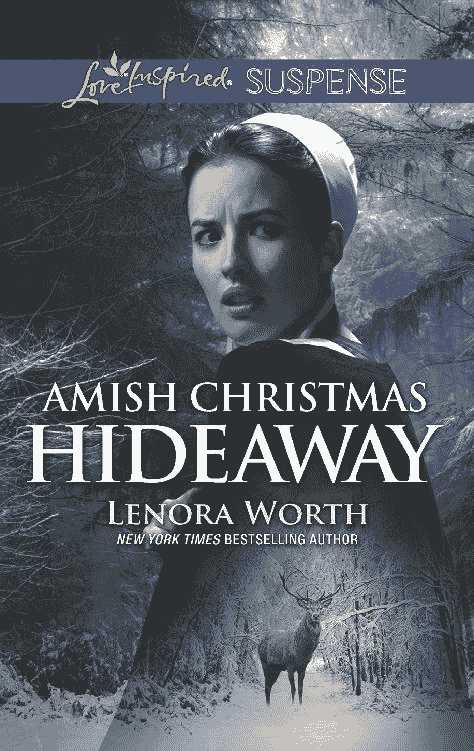

# 阿米什圣诞藏身处（爱情悬疑）

她正在躲避杀手的追杀……

她能在阿米士地区找到避风港吗？

当莉莎·布克斯顿（Alisha Braxton）目睹了一场双人杀时，一个欢快的夜晚很快变成了假日的噩梦。杀手冰冷的眼神预示着她是下一个目标。莉莎唯一托付生命的人是私家侦探内森·克雷格（Nathan Craig），那个她曾经爱过的男人。但在阿米士地区躲避时，他们能否智胜那个决心要让她活不过这个圣诞节的杀手呢？

“求你带我离开这里……拜。”

莉莎的汽车距离一个看起来像深渊的巨大落差只有几英寸之遥。

“我抓住你了，”内森说，“快，抓住我的手。”

她点了点头。“我的包。”

“好的，拿过来。但要小心。”

她拎起那个看起来公事风的大皮包，递给他。

“慢慢向我转过来，好吗？”

她点了点头，汽车随着她的动作摇晃着，在旧树干上又滑动了几英寸。

内森屏住了呼吸。那根旧树桩支撑不了多久了。

“数到三，”他说，“一，二……三。”

他用力将她拉了起来，然后将她拉离了正在剧烈摇晃的汽车。随着一声呻吟，汽车的前右保险杠擦在岩石上，然后滑过深渊边缘，重重地坠入下方。

金属破碎的声音在山丘上回荡。

“你还好吗？”

莉莎吐出一口长长的、颤抖的息气。“如果你没来，我可能就死了……”

`Lenora Worth` 出版了 70 多本书，印数量数百万，专门撰写屡获殊荣的浪漫小说和浪漫悬疑小说。她有三本书进入了 ACFW Carol 奖决赛，她的灵感浪漫悬疑小说 `Body of Evidence` 曾成为《纽约时报》畅销书。她在`Mistletoe Kisses`中的短篇小说让她成为了《美国今日周》畅销书作家。莉诺拉经常和退休的丈夫唐（Don）一起去冒险，并喜欢阅读、烘焙和购物……尤其是买鞋。

## Lenora Worth 的著作

### 灵感浪漫悬疑 (Love Inspired Suspense)

*   潜伏记忆 (Undercover Memories)
*   阿米士圣诞避难所 (Amish Christmas Hideaway)
*   纯蓝 K9 小组 (True Blue K-9 Unit)
*   深度潜伏 (Deep Undercover)
*   军事 K9 小组 (Military K-9 Unit)
*   救援行动 (Rescue Operation)
*   机密 K9 小组 (Classified K-9 Unit)
*   追踪者 (Tracker)
*   机密 K9 小组圣诞 (Classified K-9 Unit Christmas)
*   “杀手圣诞”(A Killer Christmas)
*   新手 K9 小组 (Rookie K-9 Unit)
*   真相与后果 (Truth and Consequences)
*   新手 K9 小组圣诞 (Rookie K-9 Unit Christmas)
*   “假日高度戒警”(Holiday High Alert)

访问 [Harlequin.com](http://Harlequin.com) 的作者简介页查看更多作品。

“世外人何要喧闹，万民岂要妄想？”
—— 诗篇 2:1

致我在创作阿米士小说期间结识的所有朋友。感谢我们忠实的读者们！

她随心所欲停在这里。在费城经历了一场漫长的证词录取后，疲惫的莉莎·布克斯顿计划找一杯浓咖啡。她需要保持清醒，以便从市里开车两小时到达兰卡斯特县的坎普顿溪（Campton Creek）小社区，和她的奶奶贝蒂·威利斯（Bettye Willis）一起过圣诞。

这个位于费城郊外的古雅圣诞集市正吸引着她，承诺那里有温暖的饮料，也许还有旅途途中可以吃的美味妙小吃。由于之前一直忙得没时间买礼物，她决定快速逛逛，给奶奶买件特别的礼物。也许也给坎普顿夫人买一份。

这两位老妇人住在坎普顿庄园的马车房里，现在被称为坎普顿中心。莉莎每周在中心做几个小时的免费志愿服务。这是一个和奶奶一起聊天并帮助社区的好机会。

但这周她不需要工作得那么勤。和奶奶在一起度过一整周——这是公司送给她的礼物。圣诞节还有五天。她的老板坚持如此，尽管莉莎喜欢她在 `Henderson and Perry` 律师事务所担任助理的职业，但她需要休息一下。

她期待在奶奶那里度过接下来的假期。奶奶曾一直是朱迪·坎普顿（Judy Campton）的助手，自从两人丧偶后就一直是她的伴侣。休息一个周后，她就要回到雷丁附近的一家小律师事务所工作了，她从法学院毕业起就在那里工作。那家事务所是费城总公司的一个分支机构。莉莎希望有一天能在那家大公司工作，但现在她正在付诸实践，在事务所的阶梯上向上爬。

看着曾经是费城郊外广场的集市旁排列的明亮霓虹，莉莎将她的蓝色小轿车停在一个看起来像是最后一个空车位的地方。一对情侣手牵手，笑着走过，手臂上挂着包裹。男人低头看着女人，然后拉了拉她的深色长发。

一阵渴望涌上莉莎的心头，让她坐在黑暗中，看着那对情侣在停在莉莎正对面的一辆白色运动跑车旁亲吻。在把包裹放入小小的后备箱后，男人帮助女人坐进座位，然后赶忙绕到车内。

他们看起来那么幸福，那么相爱。

她会拥有那样的吗？可能不会。她封锁了心，专注于工作。没有时间谈恋爱或任何后续活动。她曾爱过一次。只有一次。莉莎收起记忆，观察周围环境。

暮色降临在装饰小广场的闪烁圣诞树上，整个场景闪烁生辉。人们裹着围巾和外套在繁忙的露天集市里漫步，一边喝着热饮，一边笑着欣赏着迷人的节日陈列。美但如此具有欺骗性。她最近见过太多生活的阴暗面，已经无法欣赏这种商业圣诞日的强装门面。她确实不需要坐在这里渴望自己永远得不到的东西。

“我从什么时候开始变得如此世俗了？”她在打开车门前大声说道。她需要咖啡因，也许还有带南瓜香味的。

她的一只穿着靴子的脚踏在沥青停车场上，冰冷的空气随着 12 月的风扑面而来。莉莎希望朝这个方向来的暴雪暴还没到来，她看到一辆车高速驶来。黑色 SUV 在白色跑车后急刹停下，那辆跑车正试图从莉莎刚刚停入对面的停车位倒出来。

在她下车之前，SUV 的窗户降了。接着，空气被几声密集的快速射击声打破，目标直指那辆跑车。

莉莎尖叫一声，缩在座位上。当枪声持续不断时，她蹲下身，惊恐地看着跑车里的那对情侣忙着寻找掩护。

枪手继续射击。而他们无路可逃。

莉莎抬头，在闪烁装饰物的明亮灯光和路灯映照下，看到了枪手的脸。他冰冷、死死的目光停下并定格在她身上。

她看清了他的脸。

而且……他也看清了她。

莉莎缩回身，屏住呼吸。他也会杀她。她看到他了。正准备迎接子弹，她听到人们的尖叫声，听到行人试图逃离时脚步快速撞击在路面的声音。

*亲爱的主，请帮助这些人并保护我。请帮助我*。莉莎的祈祷似乎凝在了喉咙里，等待着更多的枪声。

相反，车辆引擎轰鸣起来，那辆黑色 SUV 旋转而去，轮胎发出吱吱声，橡胶燃烧的味道弥漫在空气中。只过了几秒钟，但这一幕在莉莎脑海中慢动作重放，她回想着那张脸，然后是小车内传出的尖叫声。接着……是令人震惊的瞬间寂静。

她听到有人跑步和尖叫。她颤抖着手迅速拿出手机，摇摇晃晃地站起来，拨打了 `911`，并冲向那辆现在看起来像经历过战争的汽车，车身上到处是弹孔，厚重的乙烯敞篷顶被裂破了。

“发生了枪击案，”她对调度员说，“在西费尔蒙特公园附近的圣诞集市。”她报出了街道名称并告诉调度员发生了什么。“我……我目击了枪击现场。”

人们聚在了一起，一名安保人员盯着车内看，脸上充满了震惊。“这到底发生了什么事？”

调度员确认了位置，并告诉艾丽莎（Alisha）保持通话。

“警察正在赶路上，”调度员告诉她后，艾丽莎对害怕的安保说道，“封锁现场，让这些人散开。”

她向后退了几步，那双座轿车内的惨状让她胃里翻江倒海。到处是血，两名乘客都瘫倒着，互相拥抱，身上布满了弹孔。几秒钟前他们还在微笑开心，而现在显然已经死了。

另一辆车早已远去，但在等待期间，她设法向调度员描述了特征。

“一辆黑色大型 SUV。”她报出了型号。“一个司机和一个枪手，但我没看清车牌号。我没看到车里还有别人。”

但她记得那个枪手的脸。浅浅的胡茬渣胡须，凌乱的黑色长发盖在一顶厚毛帽下。他的眼睛——像夜一样漆黑且毫无死气。内心早已死透了。

艾丽莎保持着电话接通，但听到警报声在寒冷的夜晚中回荡。当她试图扫描周围区域时，靴子在某些东西上咯吱作响。她低头看到那个精美的金边圣诞装饰品，它曾装饰在跑车上方已经破碎的路灯上。那是一个星形，闪烁着白光。

装饰品在她脚下破碎压扁。

***

几小时后，内坦·克雷格（Nathan Craig）听到耳朵里挥之不去的嗡嗡声。“停下，”他呻吟着，醒来发现一束微弱的月光透过卧室的黑暗。他揉了揉睡眼，盯着手表的表盘。

十一点。

经历了一整夜的监视和整天向客户汇报后，他精疲力竭，难得早回到自己的家里睡觉。现在他再也睡不着了。

这时他意识到手机在响。这并不奇怪。作为一名私家侦探，他会有很多来自客户或线人的深夜电话。有时也会来自他调查对象的愤怒电话。

他坐起来，抓起那个烦人的设备，低吼道：“最好是好事。”

“内坦？”

声音听起来很气喘且恐惧，他的名字是从一个沙哑的喉咙里低语出来的。但那个声音带着一种熟悉的语气，直击他的内心。

“艾丽莎？”

“是的。”

现在他完全清醒了。

知道除非遇到麻烦或再次对他生气，否则她绝不会给他打电话，他说：“艾丽莎，怎么了？”

“我……我觉得有人想杀我，”她说，她话语中的颤抖让他心碎。

他站起来抓起牛仔裤，脚趾撞到了椅子，咬了咬牙。“你在哪？他们现在正在追你吗？”

“我快到坎普顿溪（Campton Creek）了。离分叉口只有几英里。我知道他们在跟踪我，但我没看到后面那辆 SUV。他会回来的。我看到他的脸，内坦。我目睹了一个男人开枪杀了两个人。你知道这意味着什么。”

“等一下，”他说，大脑在飞速运转，恐惧紧紧揪住他的心，“我十五分钟内能到。一直和我的电话，好吗？”

“好的。”

接着她又改了主意。“你报警了吗？”

她深吸了一口气。“有警察护送跟着我，看着我的背部。两名警察。”

“他们现在在哪？”

“我想他们死了。有人打破了轮胎，他们在路边撞祸了。巡逻车爆炸了。我本应该停下来帮助他们的。”

内坦闭上眼睛试图集中注意力。“你没停。明智的做法。”

“我想停下来，但是……我看到了那辆 SUV。我加速绕过了绿山（Green Mountain）附近的大弯道。”她发出一声更像抽泣的叹息，道，“我进了一条土小路，但那里是死胡同。我觉得那辆 SUV 过去了，但我不敢回到主路上。”

内坦知道那个弯道。那里的时间足够让她避开任何跟踪她的车辆视线，但也是一个危险的地方，有人可以躲在那里等她。

“你给别人打电话了吗？”

“我给你打电话了，”她通过颤抖的哭泣说道，“因为内坦，这件事不会结束于当地警察。我目睹了一起看起来像暗杀的双重杀人案。那两个警察可能死了。FBI 可能会被介入，我将需要作证。”

`FBI`？现在他急得手忙脚乱。“艾丽莎，我知道你所在的路段。找一个阿米士农场并叫醒他们。在我到达之前一直待在那里。你听到了吗？”

她没有说话。

他把手机夹在耳朵和肩膀之间，一边找衣服，一边找到了武器和钱包。

“艾丽莎？”

“我知道一条捷径，”她听起来有力了一些，“到了转弯处我会走那条路。我保证尝试找一栋房子。我的手机没电了。我得走了。”

“艾丽莎，告诉我我要找什么。”

“黑色 Denali SUV。车上有两个人。我得走了。”

“艾丽莎，别——”

她挂了电话。

内坦站在黑暗中，脑海中闪过的画面是可怕的折磨。如果她出了什么事……

他以前经历过这种恐怖。他不会再经历一次。

心中怀着这个誓言，他穿好衣服冲了出去。

在两人都是青少年末期时，曾在溪边的一处公园相过面。

那时候的内坦还是个安米士人。

现在的内坦，在为这个世界伸张正义时已毫无顾忌了。

他不再住在安米士人社区，但在近十五年的时间里，他将帮助和保护安米士人视为他毕生的事业。因为他必须帮助他人寻找亲人，这样他们就不必再承受他内心深处的痛苦。

在内坦和父亲因为他与艾丽莎的关系发生争吵后，他的妹妹失踪了。几周后发现了汉娜的死体。

内坦归咎于自己。艾丽莎也带着同样的负疚感生活。

她不该在今晚给他打电话的。她的生活井井有条，有自己的规律，工作努力，很少社交。她学会了做自己的英雄。因为她再也不想经历那种痛苦了。

内坦可能会让这一切变得复杂。

他也可以救她的命。

艾丽莎再次检查了后视镜，试图保持冷静。她知道如何照顾自己。她已经向警察做了陈述，详细描述了她看到的车辆和男人，给警员和探员留下了联系方式，并获得了离开许可。

“布克斯顿小姐，你还好吗？”那个惨剧现场的一名探员曾问过她。

“回到我奶奶那里就没事了，”她回答道，环顾空旷的停车场。在犯罪技术人员搜查现场之前，市场一直处于关闭状态。那时当局已经问了所有证人，但大多数人只是听到了枪声，看到一辆 SUV 驶出停车场。

艾丽莎是那场谋杀案唯一的目击者。

“我们可以提供护送，”一名探员建议道。

“这可能会让我感觉好些，”她承认道，“离这里大约有两个小时车程。”

他们安排了一辆有两名警的巡逻车跟随她，保持距离。她通过后视镜看着他们的车，感到很安全，直到她听到轮胎的摩擦声和枪声。

然后她看着巡逻车冲出道路，撞入一片岩石斜坡。车辆燃起了大火。

现在她为那两名警官祈祷，但她心里清楚他们可能死了。如果车祸没有杀死他们，枪手也会确保他们死去。

下一个就是她。

*快点，内坦。*

当她看到一辆车靠近时，艾丽莎倒吸一口气，看着它快速逼近。深色、巨大、正在追上她。

艾丽莎不知道后面是谁，但司机脚法很大。在进入另一个弯道时，她扫了一眼后视镜。那辆大车仍然在追赶她。

然后她看到远处另一辆车的车灯，正从相反方向过来。她的出口在前方，但迎面而来的车可能是沿着原路折回的 SUV。她能在两辆车追上她之前逃脱吗？她必须加速并猛向右转。再次检查，她估量了距离并监控着迎来的车辆，希望在向右转弯之前超过它。与此同时，她祈祷身后的车辆会继续往前开，而不是跟踪她。

夜色漆黑多云，可能有一场暴雪正席卷整个州。在这里，几乎没有路灯，山丘和山谷看起来不祥且形状扭曲。丝带般的道路蜿蜒、回旋，像一条巨大的灰色巨蛇。

身后的车辆加速了。当它近到可以碰触她的保险杠时，艾丽莎倒吸一口气，紧握方向盘，准备迎接碰撞。但车辆并没有撞上她。司机保持着距离，但从未发生接触。

现在，或那时。

艾丽莎深吸一口气，握住方向盘寻找出口。随后，随着一次祈祷和又一次深呼吸，她减速到足以将车轮右转，进入那条窄路。她的车摇晃着并甩尾，她在努力保持控制时，心脏剧烈跳动。如果她失控了方向盘，她就会冲进深沟。或者更糟，撞向岩坡。

神经紧绷的艾丽莎设法找回了对汽车的控制并留在道路上。她舒了一口气，集中精神，看向后视镜。令她失望的是，那辆从相反方向驶而来的车现在正在跟踪她。

他们找到她了。

内坦再次击打方向盘，希望艾丽莎的手机还能用。她的电池可能终于耗尽了。他联系不上她。但在跟踪她两英里后，他抬头看到另一辆车正从山坡朝他们开来。

接着，他惊恐地看着艾丽莎一个急右转，在看着她的车剧烈失控时，他的心几乎停跳了。

她离开了主路，正当他准备跟随她时，一辆从相反方向来的黑色大 SUV 转进入了她刚刚经过的路线，冲到他的卡车前面挡住了内坦。

“不。”内坦猛刹车避免碰撞，然后再次踩下油门。“你在哪，卡森？”副警长现在应该到这里了。卡森也应该通知小镇警察，因为他没有逮捕权。

但如果那些人看到副警长跟踪他们，他们也可以向卡森开枪。

*主，请保护我的朋友。*

这无声的祈祷在内坦脑中显得既陌生又生涩。他最近很少祈祷，但他内心深处依然相信。现在，他需要主听听他的声音。

艾丽莎需要他。他必须去接她。

他滑入出口，留意艾丽莎的车去了哪里，每当回到这个曾经称之为家的地方，他的心不由得那样跳动。

卡森结束了电话，绕过内坦飞驰而去，向镇外主路上的小镇警察报警。内坦盯着前方的道路。如果说没别的，他的朋友也有权因为他们超速而拦下他们。但那些人很危险，卡森不应该冒那个险。让警察来这里才是明智之。

内坦专注于艾莉莎身后的那辆车。那辆大车撞击着艾莉莎的车。司机试图强迫她挤出路面。内坦猛踩油门，心想自己会撞上另一辆车。

太晚了。

他恐惧地看着那辆 SUV 再次猛烈地撞击艾莉莎的轿车。由于无能为力，内坦大喊着，看着她那辆小车在公路上旋转，最后冲进了一个深深沟。

“不，”内坦在赶到现场时猛按刹车道。

SUV 绝尘飞驰而去。小镇警察应该已经在前面等着了。内坦必须检查艾莉莎的情况。

内坦将仍在运转的卡车挂入 `Park`，让它保持熄火状态，然后跳下车冲向艾莉莎，拉开了驾驶座的车门。

他几乎喘不过气来，他喊道：“艾莉莎？”

“我没事，”她说，双手紧紧抓着方向盘，头垂在面前。“我没事的，内坦。”

她的声音听起来并不好。更像是呼吸困难且正处于休克中。“我去叫救护。”

“不。”她抓住他的胳膊说，“请快带我离开这里。”

他看着她，然后看向下方那片深色的深渊。她设法法让车停在一块凸出的岩石上，但车的大部分紧靠在一棵老而参差的树干上。那是一个腐烂且风化的树干，随时可能断裂。

距离那个看起来像巨大的深谷坠落点只有几英寸之遥。

“我会扶着你的，”他说，“快，握我的手。”

她点了点头。“我的包。”

“好的，拿过来。但要小心。”

她抱起那个看起来很公事的大皮包递交给他。内坦把包放在地上，轻轻地拉了拉她。“慢慢向我转过来，好吗。”

她点了点头，汽车随着她的动作而摇晃。当她扭过身体并成功将脚放在地上时，汽车呻吟着，又向老树干处滑动了一英寸。

内坦的心也随着车辆一起咯了一下，呼吸屏住了。那根老树桩撑不了多久了。“数三，”他说，“一，二，三。”

他的手现在按着她的腰，将她向上拉出，然后将她拉离那辆正在震抖的汽车。随着一声呻吟和轮胎与金属的嘶嘶声，汽车坠向了那根脆弱的树干，导致风化的木头崩成上百片干枯的粉末。内坦按住艾莉莎，听到汽车前右翼子擦过岩石的声音，它滑过深谷的边缘，在最后一次哀鸣中坠入下方。一声沉闷的撞击声，接着是金属破碎的声音在山丘间回荡。

他们一起掉在道路弯道附近的草地上。内坦紧紧抱住她，闭上眼睛，呼吸着她头发上甜美的香气。

“艾莉莎。”

她突然直起身来，从他身边开了。“什么？”

他躺在那儿检查她的状况，想要紧紧抱着她的冲动依然强烈。“你还好吗？”

“还好。但我的车……没了。”

内坦看着她散落在心形脸周围的深金色长发，有些凌乱。“对这件事我很抱歉，但我必须把你救出来。你的车已经太晚了，但我需要带你离开这里。”

拍掉她头发和衣服上的灰，她叹了一口长长的、颤抖的口气。“我那辆车还没还清呢。”

还是很务实，他心想，脉搏在耳边像电钻一样砰砰作响。“你有保险吗？”

她向他点了点头，此刻神情空洞。“你叫援军了吗？”

“叫了——附近有个朋友，当地人也在路口等着。如果身体哪里疼就告诉我。你撞到头了吗？”

“没有。我的意思是我撞到了东西，但我没事。当他们撞向我时，我试图把车转向一棵树。我发现了一块石头和一棵树。弹了一下。如果你没来，我可能就死了。”

她很受震惊，但内坦了解这个女人。坚强又固执。

“好了，但你没死。”他站起来向她伸出手。她犹豫了一下，然后抓住了，在他将她拉起来时，皮肤与手指的触感让他感到一阵清醒的震栗。“我叫了我的朋友卡森·班顿。他是一名副警官，经常帮我忙。”

“是非官方的，我确信。我希望他把他们赶走了。”

“是非官方，是的。我希望他们没射他。”

他打量着她，看着靴子和直筒黑裙、棕色皮夹克和黑色高领毛衣。优雅。“艾莉莎，听着，他们不知道你还活着。这给了我们时间。我们需要带你去一个安全的地方，好吗？”

“我要去坎普顿家。”

正如他想的那样，那是目前最近的隐藏处。“很好。坎普顿太太有一套先进的安全系统。”

“我知道。我告诉她安装系统是因为我们有些案件的性质很敏感。它有时也可以作为安全屋。”
“那将大有用处，因为在我想清楚这件事情之前，我们必须让你躲起来。他们认为你死在里面的时间越长越好。”

“你已经做了唯一能做的事——你逃脱了。对于现场去世的那个人来说，可能已经太晚了，希望另一个人也不会没事。”

他不想让她也遭遇同样的命运。

“这也会上新闻的。他那可怜的家人。在圣诞节失去了他。也许我应该回到雷丁（Reading）的。”

“不。”纳坦（Nathan）无法告诉她，他很高兴见到她，很高兴能帮她。“不。你现在需要和家人在一起。”

她点了点头，低着头。

“告诉我你今晚看到了什么，”他用温柔的语气说道，希望自己能触碰她，抱住她，让她感觉好受些。

但这将是他想过的最糟糕的主意，而他有时确实想过一些不妙的主意。

她点了点头开始说话，声音紧绷而疲惫。等她说完后，纳坦无法自持了。他伸出手握住了她的手。这闻起来像是一场职业暗杀。但在他进行一些调查之前，他不会告诉她。

“目前来说，你在`Campton` 是安全的。”

她盯着他的手，然后缩回了自己的手。“当然。那里很稳妥。”

“那具体是什么意思？”

“这意味着我们会在一起，”他轻笑着回答道，“因为我会呆在那里，直到我们找到那些杀手。”

“噢，不，”艾丽莎（Alisha）回答道，他这句话带来的震惊席卷了她的身体。“那是不会发生的。”

“会发生的，”他反驳道，绕开了她原本打算走的所有小路。“我不会丢你一个人。”

“我会是一个人的。我有我奶奶和`Campton`。”

“没错。两个需要坐电梯才能下楼的老妇人。”

他说得对，但艾丽莎还没准备好妥协。“还有良好的安保系统。”

“这有帮助，但我们都知道罪犯可以避开这些。”

没错。但艾丽莎不想让他流连于此。是的，她在恐慌的时刻叫了他，但理性正在占据主导地位。“我不愿意坐等看会发生什么。你愿意吗？”

她摇了摇头。“不。在圣诞节后回到`Reading` 之前，我还有一周时间。”

“给你你的老板打电话，把时间改成两周。只要到元旦为止。”

“我做不到。”

“你可以的。解释一下情况。休个假。”

“我会利用分配的时间，并会用这段时间去追踪那些杀手。你应该意识到圣诞节不是工作的时候，对吧？”

“是的。但在假期前五天目睹持枪歹扫射市场，确实有点让人扫兴。”

“你会把真相告诉那些女士吗？”

“我必须这样做，”她说，对这个想法感到厌恶。“她们需要被警示，这样才能保持警觉。”

“她们需要保护。也许我应该住在别的地方。不，这是目前最好的计划。但是艾丽莎，无论你喜不喜欢，我都会和你们住在一起。我知道主房子里有几间额外的卧室。我会睡其中一间。” 这是一个坏主意。可为什么仅仅知道他在附近，她就感到更安全了？

因为她感到恐惧、震动以及……她需要他的帮助。纳坦·克雷格（Nathan `Craig`）工作很出色，他可以去别人不敢去的地方。他能找到人。好人。害怕的人。迷失的人。有时还有那些最坏的人。

“我能看到你脑子里在转主意，”当她没有立刻反驳时他说，“你在想什么？”

当他们转入 `Creek Road` 时，她转头盯着他。“我没有多少选择。我需要你——我是说我需要你的经验和专业知识。”她的大脑告诉她要理性，而她的心在尖叫她确实需要他。她一直需要他。但从大四毕业后的那个夏天第一次见到他起，她一直在压抑这种需求。很有意思，在他生命的大部分时间里他都在她生活的边缘。在身边，却总是遥不可及。曾经，他们很亲密。青梅竹马。但他们现在都是成年人了。专业身份，正在处理案件。仅此于此。因为他们中没有人都可以付出。今晚，他救了她。艾丽莎无法忘记这一点。

“别担心，”他语气紧绷，仿佛他完全清楚她在想什么。“我会避开你的。我有足够的事情让自己忙。”

正义。这个男人总是想要正义。

嗯，她也一样，但她可没计划通过纳坦的帮助获得正义。她不想在假期里追捕杀手，但她的直觉告诉她，那些凶手会继续追捕她。

“我也会很忙的，”她说。“我只想结束。”

“你指的是这起谋杀案，还是指被迫留在我身边？”

“两者都是，”她承认道。

纳坦把卡车停在那座寂静、阴森的房子前，熄灭了引擎。“我们得叫醒她们，我需要把我的车停在车库里。”艾丽莎盯着那座装饰有白色圆柱的宏伟红砖豪宅，一排排高窗户现在看起来很脆弱，而不是慰藉，门上巨大的常青花环环让她想起她在这里度过的所有节日。

今晚有太多的回忆了，再加上纳坦就在她身边。巨大的疲惫和冲击感撞击着她的灵魂。“好。让我们进屋吧，做我们该做的事。”

贝蒂·威利斯在门廊门阶梯通往二楼交汇处那个宽敞的门厅遇见了他们。一张小桌子上放着一棵闪闪发光的陶瓷圣诞树，空气中弥漫着肉桂和香料混合花的气味。

贝蒂紧紧地抱住艾丽莎，给了她一个拥抱。“艾丽莎，我们开始担心了。”她后退了一步仔细打量着，道，“我已经让朱迪去睡觉了。”

接着，她的奶奶在阴影中看到了内坦。当惊讶的目光从艾丽莎移到他身上时，贝蒂问：“克雷格先生，你在这儿干什么？”

内坦对贝蒂露出了笑。“这是一个很长的故事，威利斯夫人。”

“他是来帮我的，奶奶，”艾丽莎说，希望奶奶不要再追问了，“我们早晨再解释。”

贝蒂轻笑着拒绝了。“我一整晚都在看书，”她说，“进厨房来，我给你们做点吃的。然后你们就可以告诉我到底发生了什么了。”

看到他们犹豫，她的奶奶双手叉着腰。“你们应该意识到，我虽然老了，但并不是完全没用和糊涂。艾丽莎，如果没有极其充分的理由，你不会在深夜把内坦·克雷格带到这里的。”

艾丽莎给了内坦一个警告的眼神。“那我会解释的，奶奶。没必要让你整晚都在那担心。”

***

“这太不可思议了，”在艾丽莎重述了发生的事情后，贝蒂说道。她转看向坐在一个吃了一半的烤牛肉三明治面前的内坦，拍了拍他的手。“内坦，我非常感谢艾丽莎想到了给你。”

内坦盯着盘子旁等着的饼干，又看了看艾丽莎，忧虑之感涌上心头。如果他当时没接电话呢？如果他当时不在木屋呢？

他不会去想这些的。他现在和她在一起，而她是安全的。“我也是，威利斯夫人。”

“叫我贝蒂就好，”那位年长的女性说道。她穿着一件蓝色的法绒睡袍，以抵御宽敞的艺术装饰风格厨房凌晨的寒意。“要再点咖啡吗？”

内坦举起杯子，心想今晚反正也睡不着了。“谢谢。”

艾丽莎抱着杯子坐着，感受着温暖。奶奶为她找了一件舒适的毛衣和一条牛仔裤。艾丽莎在这里留了一些衣服，因为她经常无偿工作到深夜，而且偶尔会过夜。

“所以，你要成为我们的保护者了，”贝蒂点头道，“我们早晨会向坎普顿夫人解释这一切。她一定会同意，这里现在对你们俩来说是最安全的地方。”

“我不想让你或她陷入危险，奶奶，”艾丽莎说。“这只是持续几天。”

“直到圣诞节后，”贝蒂说，“记得，你有一整周的假。”

“也许要到新年，”内坦重复道。

“我希望不要那么久，”艾丽莎回答道，绿色的眼中闪烁着固执的光。

“没关系，”她泼的奶奶回答道，“如你所知，艾丽莎，中心接下来几天都会关闭，我们有很多烘焙要做，还有包裹要包。圣诞节我们要拜访阿米人。你可以帮忙做这一切。”

“好的，奶奶，”艾丽莎说。但她的声音里没多少热情。她会没日没夜地解决这件事。

“我会住在主屋的一个房间，”内坦对贝蒂说，“但至少会在宅上。”

“我已经感觉好多了，”贝蒂回答道，“现在，让我们都安顿下来。你们一定累坏了。我们早晨继续讨论。”她起身补充道，“你们一定饿了。”

“我会把饼干留到以后吃，”内坦说。

“对不起，奶奶。很难吃。”艾丽莎把自己的三明治拿到水槽旁。“我去洗碗，然后回房间。”

内坦挑了挑眉，带着疑问。

“放松，”艾丽莎说。“我的房间就在奶奶房间对面。这地方有三个卧室。坎普顿夫人住的大套房和走廊对面的两间较小的卧室，它们之间有一个浴室和一个小休息室。”

“挺舒服的，”贝蒂耸了肩说。

“是啊，舒服。我隐约记得布局。”内坦想到了所有可能发生的意外。“进主屋需要钥匙或密码吗？”

“我给你看，”艾丽莎说，语气带着焦虑。

“那我就在这儿等，”贝蒂说，她祖母般的目光捕捉到了他们周围流动的各种暗流。“然后我们会锁好门。”

内坦点头感谢贝蒂的食物。“如果需要任何东西，我就在这里。”

记得以前在这里，内坦引导艾丽莎走向通往封闭走廊的玻璃门，走廊的两排窗户可以看到宽敞的前院，以及树木林立的后院和灯光池区。

“窗太多了，”他一边搂着她的肘，一边环顾四周。

“我以前没担心过这个，”艾丽莎承认道。“有你在身边，奶奶会感觉好些。”

他们来到了走廊另一侧配套的门，错过了藤编椅和高大的客厅蕨类植物。

艾丽莎输入了密码。

# 奶奶。如果有人伤害了她的奶奶怎么办？

决定带件武器比较好，以防万一，她匆匆回到那栋巨大黑暗的房子，来到主卧室。穿过壁灯发出的幽幽光亮，她站在卧室门口，看到了里面的大壁炉。然后，她急忙去找火拨。

她手里拿着那把易握的铁制火拨，溜到房间的窗户边，检查了倾斜的后院。影子在草坪和灌木上蔓延，透出一片寂静静安安全灯的黄色光芒给了她勇气。但她需要回到房子前面检查她奶奶和内坦的情况。已经过去五分钟了吗？

莉莎飞快地回到宽敞的走廊，路过楼梯。当她听到前院传来响声时，她停下了。她是应该下楼还是拨打`911`？

在她决定之前，一条有力的手臂将她拉近。她试着尖叫，但声音卡在喉子里。接着，一只手捂住了她的嘴，一个男人在她耳边呼吸。

莉莎惊了失措，试图举起火拨。

“别动，别出声。”

内坦。

他松开了她，手指抵住她的唇。然后他低声耳道：“我搞定了。”

莉莎松了一口气，但又想因为他吓她而踢他，她小声说：“外面是谁？”

“卡森，”他说，“他结束了搜索，决定开车过来看看我们是否安全到达了这里。但他确实发现了一个潜入者。我们在前院会合了。他还在外面转悠悠。”

“你为什么不直接说，非要吓我一下？”

“我不想吓到你导致你尖叫。”

“你怎么觉得我会尖叫？”

“你为什么不待在原地？”

她精疲力竭仍在发抖，瞪着他。“我去拿这个了，”她说道，举起火拨。她的手在抖，于是她又把它按了下去。

内坦的眉头锁得更紧。“告诉过你待在原地。”

“我很担心你和我奶奶。我必须做点什么。”然后她打量了他看。“发生什么了？”

“我没事。潜入者跑了，在离这里一个街区的地方上了一辆车。卡森下班了，正在利用自己的时间看看能不能找到任何指纹。”

他从她手里拿过火拨。“你还好吗？”

她点了点头，转向过道处。“我需要检查一下奶奶。”

“我找不到你的时候去过那里了，”他说，“她的门关着。下楼的门还锁着。那里一切都好。”

内坦的手机响了。“卡森，里面安全。我在正门接你。”

莉莎跟着内坦下楼，输入代码打开了门。

副警官走了进来，打着抖点了点头。“所以我们来了一位访客。”

“是的。”内坦转向莉莎。“莉莎，这是我的朋友卡森·班顿副警官。”

莉莎握男人的手，注意到他的年龄和内坦差不多，但他的头发剪得很短很整齐，身材像个橄榄球后卫。“感谢你的所有帮助，班顿副警官。”

“叫我卡森就好，”副警官笑着说，“事情很糟糕，但我们会处理的。镇上的警察想要获取你的陈述，布克斯顿小姐。我们可以在明天做。”然后他看了内坦一眼。“而且我们明天可以再详谈。我想提供帮助，但我需要信息。”

“为什么现在不？”莉莎说。“我睡不着，这里很安静。我们可以去办公室。”

卡森严厉的表情没有变，但他的目光转向了内坦。他必须得到那个私人侦探的批准吗？“我需要拨打负责你汽车翻车现场的警官电话。他们将负责案件的这一部分。”

“我希望你们都会遵循正确的程序，”莉莎回答道，挑衅内坦和她争论。

“你听见女士说了，”内坦道。然后转向莉莎。“我知道你很焦虑，如果不休息，你会崩溃的。”

“我想找到这些杀手，”她回答，走在他们前面。但她无法否认自己正迅速崩溃。在通向楼下的楼梯口她停下。“我越快完成这份报告，我就越*可以*休息。”

卡森摇头，对内坦耸耸肩。“我们都同意这一点。”他走到旁边，给之前在现场的一名警官打电话。

莉莎示意他们走过楼下的中央走廊。很快，他们就在曾经属于坎普顿上将的大办公室里坐了下来。她关上百叶窗，打开台灯，心里在想是否还有人躲在外面。

等另一名警官到达，他们都坐在桌子对面，安静而专注，直到进入正题。

坎托警官看起来很困，他黑白相间的头发浓密而凌乱。“一旦我拿到你的陈述，我就可以配合州警方进行这项调查。他们会对内坦描述的车辆发布`APB`通缉，就是你看到的那辆。费城警方对那两名嫌疑人发布了`BOLO`通令，他们正因为你目睹的双重杀人、杀害一名警察并伤害另一名，以及未遂杀杀而被捕。我们人在森林里搜寻，但我相信那里有他们。”

“我可能没法留在这里，”她反驳道，内心正经历着一场剧烈的战斗。“你可以继续去忙你的事了。”

“不，我不行，”他说，语气凌厉。“我已经陷在里了。他们知道我的车，也一定知道我带你来了这里。”

万一他们伤害了内丹怎么办？她并没有考虑过他也陷入了危险。“我不应该连累你。。我当时脑子不清醒。”

“我不介意被卷进来，我也和你一样想找到那帮人。我们必须合作，这意味着我们可能得一起离开。”

这样他就能保护她并寻求正义，而不是因为他想待在她身边。她真后悔自己从没有叫过他。“但我们不知道院子外到底是谁。”

“不，我们知道。他们派人来这里是因为他们现在对你了如指掌。当你看向那个职业杀手眼睛的那一刻，他们就开始调查了，而现在你已经在他们的名单之上了。”

“所以你认为这是一场职业暗杀？”她自己也怀疑过。

他抬起下巴。“按照你描述的情况，按照他们追你的方式，是的。必须是。”

艾莉莎靠在门框上。“这太糟糕了。我本应该离开这里去一个很远的地方。”

“但你没走。我很庆你没走。现在我可以帮你并保护你……当然，如果你愿意我的话。”

说完，他转身走向了那栋破旧老房子的另一侧。

艾莉莎打了个冷颤，关上了他们之间的门，心想他们之间的隔阂远不止房子里的一条走廊那么简单。

更像是跨越了一座无法修复的断桥，一辈子的遗憾与渴望。

*天啊，如果你必须送给我一个英雄，感谢你送来了这一个。尽管我并不想要他在这里。感谢你，主。*

脑海中回着这句祈祷，她走进那个一直喜爱的带窗户凹室的小房间，洗了个澡，换上一件旧睡衣，然后瘫倒在祖母铺就的紫色雪丝绒床单上。

随即陷入了不安的、如噩梦般的睡眠中。

*** *

内丹坐在与艾莉莎对面的房间窗边的椅子上，眼睛因疲劳而刺痛，却察觉着下方昏暗中发生的每一个微小细节。雪声屏蔽了大部分噪音，但多年埋伏和监视的经历让他在凌晨时分保持紧张警觉。他告诉过艾莉莎真相。他从没有睡得好过。

坐在阴影里，他想起了那个爱过的女孩。他曾为了这个女孩放弃生活方式，但事实证明，由于另一个原因不得不放弃阿米士社区。那个原因在艾莉莎和他之间拉开了深渊，所有的梦想在那个漫长而可怕的夜晚破碎了。

那个夜晚与现在截然不同，却充满了同样的恐惧和焦虑。

夏天。月圆高升，世界在脚下。

坐在那里，他陷入了睡梦，记忆是对他留下的家人的痛苦提醒。离这里只有几英里，却又显得如此遥远。

他想起了艾莉莎，她留着金棕色的长发和明亮的绿色眼睛，在风中笑，长裙摆飘逸。他那时就在这个花园里帮父亲耕种土地，为坎普顿夫人种一个蝴蝶花园。艾莉莎当时来探望她的祖母，她坐在池边看书，同时也看着他们工作。

在此之前，他曾短暂见过她一次，当时她的祖母来过他家。他从未忘记过看向她那双漂亮的眼睛。

现在她正凝视着他，对他微笑。

在他笨拙地摔落了一整箱植物并让泥土飞得到处都是后，她跳起来帮他在父亲发现发生经过之前抢救他能救回的东西。他们成了好朋友，内丹回家时，心里暗恋着一个被他禁止喜爱的女孩。

“你不一样，内丹。你不像我遇到过的任何人。”

他对她也是同样的感觉。一直如此。

*在那个夏天，我们是如此年轻无忧无虑。*

*是如此天真。*

内丹惊醒了来。他是听到外面有声音了吗？还是在做梦？

他站起身，痛苦地呻了一声，全身的肌肉都在抗议。揉了揉眼睛，他注意到手表上的时间。凌晨四点。他在这张软椅上睡了一个多小时。

现在完全清醒了，他观察着前院，发现那里已被积雪覆盖。警报器没有响，感应灯也没有触发。

他在幻听。

但他的直觉告诉他要谨慎，于是他洗了脸，决定在老房子里走一圈，等太阳日升起。

为了保险起见，他拿了武器。他已经持有隐藏武器的许可证多年了，但他很少用它。尽管如此，他已经学会了凌晨独自在外面可能是危险的。

他穿着袜子走上宽敞的楼上走廊，木地板在他的重量下发出吱呀声。

他来到主卧室，慢斯理地检查后院。后院像一条白毯一样延伸到流经小镇的深溪。他记得曾和弟妹们在那小溪里游泳钓鱼。

“抓到你了，你。”

“我会找到你的，”内丹会这样喊。

“相信我——脚印直接穿过了了院子。”

她睡眼惺忪地看着他，问道：“我们该怎么办？”

“现在什么也做不了，因为他们已经走了，我们并不知道他们只是路过还是真的那样。”他盯着咖啡。

“去泡杯咖啡吧，”她像读穿了他的心思一样说道。

很快，他们就窝在精致的起居室里。覆盖家具的深酒红色锦缎看起来既旧又舒服，在所有该磨损的地方都磨损得很好，但点缀着蕾丝和钩织毯等女性化的小品。他看着艾莉莎裹着其中一条毯子缩在子里，周围散落着纸张和文件夹。

内森吸了一口好咖啡，然后看着她，任由咖啡滑进胃里。“你一直都在忙什么？”

她收起纸张把它们推到一边。“一个关于离婚的案件。你不用担心。”

“那这个？”他指着一个项目符号列表，快速扫视了一下信息。“你正在为昨晚发生的事搜集证据，对吧？”

“我正在按照记忆记下事情，方便理清思路，是的。”

“你可真很有律师范。”

她长喝了一口咖啡。“内森，你睡过觉吗？”

“没有，但我唯一一次睡着的时候，结果某人决定在清晨去院子里散散步。我这可算是什么保镖啊。”

“你不用这样做。我不指望你 24 小时守着我。”

在短暂的瞬间，他想如果她能日夜守候在身边会是什么样的。但他推开了那个梦想，就像他总在凌晨三点感到孤独和绝望作痛时所做的那样。“我已经告诉过你了，我想做这件事。”

她拿起她的列表，研究了一会儿，然后把它扔回沙发。“我昨晚在那停在那儿去买咖啡。我一直很忙，所以想去买买东西。一切看起来都那么美。像像圣诞节一样。我想那能让我心情好起来。”

内森那颗早已坚硬且枯萎的心稍微软化了。她既没有准备好，也不愿意崩溃，她更不会当着他的面崩溃。她一直都很坚强，没错，而且很有安全感。而现在，她的世界破碎了。

现在他回到了她的世界里，而她每一步都会和他反抗。“你可以跟我说的，你知道的。”

她点头认同。“我甚至连害者的名字都不知道。我的意思是，我听到犯罪现场的人在聊天，但我记不住。我记得很多细节，可为什么就想不起这些呢？我需要查清楚那些人是谁。”

“我们可以办到，”内森说，心想冲击还在扰扰着她的大脑。“我们会拿到一份完整的报告，并将你告诉警察的内容与费城警察所拥有的资料进行比对。你可以和他们所有人保持联系，但你不需要离开这里就能做到。”

“如果我们不采取行动，什么也做不成。”

“我建议我们今天在这里低调，”他告诉她。“你需要花时间陪你奶奶相处。我会开始挖掘消息的。”

“我想和你一起挖。”

“好吧，我们可以这样做，但首先，试着放松并享受在这里，好吗？”

“昨晚之后这可能吗？”

“我说的是*试着*。”

“我不会让他们陷入危险的。”

“我会规划一条路线，让我们在需要时溜出这里。如果我们需要逃跑，我还会配合警察，加强他们的安保。”

“我不打算用余生来逃亡，”她说。她站起身，手里拿着杯子，看着黎明破晓，小心地避开窗帘的缝隙。“外面看起来那么和平，不是吗？”

“是的。”

“但这就是生活的真相。表面之下覆盖着更多东西。有那么多的暗流和隐藏的事情。昨晚那对夫妇显然拥有一切，但他们知道某些事——或者隐藏了某些事——导致了其他人想要杀他们。”

“或者他们可能做了一些让别人极其愤怒的事。”

内森也在想，那对夫妇是否目睹了他们不该看到的事件，或者他们是否成功让危险的人对他们下了杀手。可能两者兼有。

想到艾莉莎对生活的愤世嫉俗，他穿透了这个房间里的暗流。再次如此靠近艾莉莎，呼吸时胸口隐痛。尽管情况很严峻，处理这起谋杀案有助于他清醒头脑。他几乎没有时间去处理重新回到她的生活，或是处理她以如此震惊的方式回到他的生活中。他上一次在这里见到她时，他们都在处理一起涉及上路口阿米士社区遗弃婴儿的失踪案。他找到了那位年轻母亲，并让她和哥哥重聚，她哥哥现在结婚了，正和新妻子抚养着那个女孩的孩子。

他和艾莉莎合作过，尽管心不情愿。但他们想要的是同样的东西——正义和帮助需要的人。

“你饿了吗？”艾莉莎问，目光掠过他的脸后移开。

“饿极了。”

“我可以做些煎和吐司。也许还有培根。”

“我很乐意。”

他们走向厨房，在舒适的沉默中工作，因为艾莉莎不想吵醒她的奶奶或朱迪小姐。但咖啡和培根的味道就像闹钟一样。

“噢，我们这儿有什么？”

内森止不住地嘴角上扬。“听到了吗，小熊熊？顶尖高手准备的晚餐。我们有大餐吃了。”

“你再这么叫我，就没法被邀请吃晚餐了，”她反驳道，但眼神里闪过一丝笑意。

贝蒂露出了甜美的微笑，抿了一口咖啡。

内森想起很久以前，在听到艾莉莎的爷爷那样叫她“小熊熊”后，他也曾这么叫过她。

贝蒂·威利斯一定也记得，因为她看起来既自得其又自豪。在调查谋杀案期间做红婆。这可真是个新奇。

***

艾莉莎在洗早餐餐具时，心里默默地缩了缩。“小熊熊”？奶奶为什么又提起那个老昵号？

也许是因为坐在早餐桌旁的那个英俊男人让她祖母务实的大脑彻底了神了？

内森对人有这种魔力。这让他成为了一名出色的调查员，因为他能让人们开口，但也让他对大多数女性来说太危险了。

她应该很清楚。十年前她就对他魂牵梦萦，即便现在，当他们因为案件被迫面对面时，她也必须努力不让自己变回那个睁大眼睛的小学生。

在决定这种情况不能发生后，她匆忙穿好衣服收好文件，塞进公文包。她的奶奶希望她找到爱情并获得幸福，但把内森推回她身边并让艾莉莎回到那条路上。那个男人有一个占据他全部时间的使命。她也有自己的正义感，这意味着漫长的工作和不眠之夜。她仍然律师事务所的助理律师，因为她才执业几年。但总有一天，她希望能成为合伙人。这让她想起，她需要在新闻报道之前先给老板打电话，解释一下这里发生的情况。

“我很高兴我们能来这里，”当艾莉莎走出卧室时，奶奶从厨房里说道。奶奶在做肉桂卷面包，那是艾莉莎最喜欢的食物之一。屋子里弥漫着神圣的气息。

“我也是，”朱迪小姐坐在小壁炉旁精致的小椅子上说道。“真是个待家里烘焙的好日子。”

朱迪给了艾莉莎一个柔和的微笑。即便年事已高，朱迪·坎普顿依然是一个高贵、美丽的女性。她的头发已经白了，但剪成了整齐的短波头。她穿着一件蓝色羊绒衫，戴着她那条著名的珍珠项，经典而庄严。“亲爱的，在你上班前能来我身边坐坐吗？”

“当然可以。”艾莉莎穿过房间，坐在椅子旁的脚凳上。“我希望我们的消息没有让你们不快，朱迪小姐。我不会让你们任何一个发生事的。”

朱迪对此嗤之以鼻。“艾莉莎，和你奶奶都是坚强的老家伙。我们这辈子见过了很多。我们相信上帝掌控一切。”

“是祂的意志，而不是我们的，”贝蒂应道，她的手在面团上优雅地揉着。奶奶心里依然刻着安米教的教条。

朱迪拍了拍艾莉莎的手。“在这里你是安全的。你奶奶我会祈一整天，而你和你那位英俊的守护者去做该做的事。上帝给我们大脑是为了帮助祂的工作，你知道的。你可能感到恐惧，但他在那个时候让你出现在那个位置是有原因的，艾莉莎。你为弱者战斗，为那些无法自救的人战斗。你会让这些恶人受到法治。”

“我希望如此，”艾莉莎说。“这是我无法摆脱的想法。从法学院毕业后我处理了很多案件，但目睹谋杀会让我记住很久。”

“看到正义伸张会帮你接受那个画面，”朱迪说。“现在我们有安保，克雷先生也向我保证当局知道了情况。我可以安心享受电视上那些可爱的圣诞电影了。你知道的，它们非常浪漫。”

艾莉莎对此笑了。“我很少有时间看，但我的朋友有时会强我坐下来吃爆米花看爱情故事。”

“我们都有爱情故事，”朱迪点头道。“你自己就有一个。”

“我觉得我在爱情方面可能有点晚了，”艾莉莎说道，想起了房子另一头等她的那个男人。“我热爱我的工作，所以我还是快走了。”

“只顾工作没有浪漫会让女孩精疲力竭的，”奶奶说。“对内森好点，小熊熊。他还在乎你。”

艾莉莎不知道怎么回答，于是她说：“我很感激他在这里，这是肯定的。”

“是的，我们也是，”朱迪小姐宁静地微笑说道。“贝蒂，忙完，我们等面包发酵时看这部电影。”

艾莉莎留下她们互相谈论最喜欢哪部节假日电影。

她确实需要一份公文包之外的生活。她真的需要处理好内森同时让她的心跳加速又漏拍的那感觉。

*主啊，我正在经历一场战斗。请给我力量，远离诱惑。*

但当她到达街对面的办公室时，那份诱惑正坐在旧皮双人沙发上，闭着眼睛，双穿着皮靴的脚架在正前的脚凳上。

艾莉莎不得不咽了口水。他看起来那么平静，睡在透过百叶叶窗洒进来的阳光里。如此美丽，如此年轻，如此不可思议。

他是否像她感到那样灵魂疲惫？

上帝把他们聚在一起，除了寻找凶手外还有其他原因吗？

*工作吧*，她对自己说。“*专注于需要做的事*。”

“你说得对，”他说，转得太快，他不得不用手扶住她的手臂，才没有把她撞倒。他那样按着她，凝视着她的眼睛，脑海中充满了回忆。夏日夜晚的美妙记忆，微风吹起她的发丝。内坦不想放手——放开她，还是放开那些记忆。但他退后一步，接受了当时的他们很年轻，充满了理想主义梦想。自从那个甜蜜的夏天以来，一切发生了巨大的变化。

“我没事，”她说，推开他，快地从他身边经过。“我会没事的，内坦。请别大吵大闹。我们开始工作吧。”

“这是在暗示我退后吗？”

“不是暗示。是请求。我们必须保持专业，专注于这个案件。你必须信任我。”

“我信任你，但我也需要确保你不会发生意外。”

她走到大办公桌后面，在椅子上坐下。“什么都不会发生的，”她说，“我发自内心希望希望如此，我很感谢你愿意放下一切来帮助我。但你不能每次我离开房间你就恐慌。”

“好，知道了，”他吐了一口气说。“我是太累了，醒来却在一个不同的地方。不要对回城做任何冲动的决定。那是你现在最不需要去的地方，我不在乎你老板怎么想。”

“嗯，这可以理解，因为你累，我也一样。我不想表现出对为你所做的事毫无感激，但我至少还有另一个选择。我昨晚很恐慌。”

“如果你不恐慌怎么给我打电话呢，”他说，希望自己是她第一个拨打的人，而不是最后一个。

“我现在好多了，很后悔把你拖进这片旋涡。但即使是在办公室的沙发上，你也可以休息一下的。”

“抱歉，”他说。“那样醒来是我工作的一部分，因为我经常到处奔波。”

他没有告诉她自己经常在酒店房间醒来，但这次不一样。酒店房间是冷淡且无菌的，到了无聊的地步。这栋现在是社区中心的房子依然保留着他记忆中那种清晰的魅力和家的感觉。回到这里让这一切记忆再次涌现：他与艾莉莎度过的许多时光，在院子里散步，坠入爱河，并规划自己的未来。一个他希望与她共同拥的未来。他从未想过很久以前的那个夏天，与她在一起会从好和坏两个方面永远改变他的生活。

“我理解。”她绿色的眼睛柔和了。她也在回忆吗？“你停止想过她吗？”

“谁？”

艾莉莎凝视着他好几秒钟。“汉娜。”

内坦每次听到妹妹的名字，心脏都会剧跳一下。但听到艾莉莎带着安静的敬意说出那个名字，几乎要让他崩溃。于是他变得冷嘲热讽。“不。从不。”

“我猜也是，”艾莉莎说。“我也经常想她，特别是在节日期间。”

“我们可以换个话题吗？”他生硬地问道，希望自己能擦掉一些记忆。但看到她看起来如此心碎，脸颊泛起鲜艳的红色，他又补充道：“这依然很难，艾莉莎。我很抱歉。”

艾莉莎点头，研究着面前的笔记。“这更说明我们要记住为什么要坚持下去，并尽快解决它。”

“同意，”他说，想再和她争执几句。但他又做不到。她像他一样，自责于汉娜的失踪和死亡。但这并不是她的错。

妹妹在那个暴风雨交加的夏天离开家里，完全是他的错。汉娜是去找他的。她迷路了，然后……”

他闭上眼睛，试图把妹妹在身后呼唤他的画面从脑海中抹去，转而关注艾莉莎和她那打开的笔记本电脑。“你发现了什么？”

“我找到了受者的名字，”她说。“约书亚和蒂芙妮·韦斯特。”

“嗯。常见的名字。可能是化名。”

“你谁都不相信，对吧？”

“我生命中遇到过太多蒂芙妮了。”

“噢，真的吗？”

“这儿那里都有。”

“我会说这里的比那里的多。内坦，你经常约会吗？”

“这儿那里都有。嫉醋了？”

“没有。只是好奇。”

“你呢？生活里有特别的人吗？”

“`That`（那）是 `neither`（既不）here `nor` there（这里也不那里），”她反驳道，语气告诉他他对任何感情关系都带着一丝苦涩。

他想起了她的公文包以及她如何像盾牌一样拿着它。和自己一样，她嫁给了她的工作。他们都披着冷漠的盔甲，以此掩盖受伤的残酷。

回到正事。“你还发现了什么？”

“嗯，他们住在市里高端地区的一个新开发区。一栋大约八个月前建成的现代公寓。类似房产的价格在百万美元以上。”

“我睡觉的时候你是怎么发现这一切的？”

“我有我的来源，私家探 `Craig`，和你一样。我的公司非常愿意提供帮助。正如我所说，亨德森先生也向我提过保护。”

她的公司会有探员。“可能没我厉害。”

“他们找到了我需要的信息，而且还是在一个节日周。”

“得漂亮，”他说。

“如果你觉得 FBI 会介入，这可能将远超仅仅保护你的范畴。从坎普顿克里克警察到州警察，以及费城警方，每个人都会审问你。可能还有禁毒局（DEA）。”

“是的，”她说。“我会告诉他们我看到的一切。我只需要从这里到达那里。”

“是的，因为我们只能躲你多久。”

她按照他的话做了，而他则溜到前窗向外窥视。无人。内坦（Nathan）绕到门廊门口，输入代码打开门。溜出去后，他重置了代码，锁上了身后的门。

大大化日，竟然有人在骚扰他们。只要他们不采取行动，这种局面就不会消失。

轻声地穿过阴凉的门廊，尽管阳光明媚，他仍感到一丝寒意。当他听到车库西侧传来响声时，内坦绕过几株老根山茶花，贴在墙上。这时，他快速地向转角处瞥了一眼，发现了一个手持巨大相机的男人。

是一个记者，还是某个需要证明她还活着并躲在这里的人？

谋杀案的新闻已经传满了报纸、电视新闻和网络渠道。一定有人拿到了阿莉莎（Alisha）的名字。他会处理掉这个入侵者。

“嘿，”他从茶花丛中爬出来，手里的枪暴露得无遗，“你在干什么？”

男人对他嘲笑道。“我只是在工作。听说有个女人住在这儿，可能对那天晚在费城的那些谋杀案有些线索。”

“你听错了。这儿没人能和你说话。”

那个邋遢的男人走近了，胡须和帽子遮住了大部分的大脸。内坦观察着他。他看起来不不不苟，姿态中透着一股假装成摄影师的劲头。

内坦没有浪费时间。男人匆忙看了他一眼，随即动手，举起相机准备击，与此同时，内坦用单只手抓住他，将他推在砖房墙上，导致相机掉进了灌木丛。内坦将手枪抵住男人的肋骨，说道：“我建议你告诉我到底是谁，是谁让你来这儿的。”

***

阿莉莎从化妆手间出来，跑回办公室找手机。她套上厚毛衣，把手机塞进口袋。在搜遍房间后，她抓起一个小瓷像，那东西可能比上周的薪水还值钱。但它可以是一件很好的武器。

在搜完楼下所有的房间后，她回到楼梯口，穿过马房，输入代码打开了门。

“奶奶？”

“我们在这儿呢，阿莉莎。”

她叹了口气，冲进客厅，发现她的奶奶和坎普顿夫人正在玩一个圣诞为主题的拼图。“你们俩还好吗？”

“我们为什么不好呢？”朱迪小姐（Miss Judy）问道，挑起优雅的眉毛。“我们都喝了汤，该睡午睡了。你也应该休息了，你看起来精疲力竭。”

“你们听到什么动静了吗？看到相机闪光了吗？”

“我们听力不太好，”奶奶指出道。“而且为了保暖，我们把窗帘关上了。”

“很好，”阿莉莎说，快走到窗边。这时她看到一辆看起来很正式的 SUV 闪烁着灯，转进了通往房子的车道。

“现在我看到东西闪光了，”朱迪小姐指着阿莉莎站的地方说，“我们有客人了吗？”

“是州警察，”阿莉莎回答道，“内坦正拖着一个人朝车辆去。我最好下去看看。”

“不，姑娘，你就留在这儿陪我们，”奶奶告诫道，“无论是谁闯入我们财产，都不应该在这里看到你。他可能以为你在这儿，但他不需要验证这个事实。”

对她敏捷奶奶的思维方式留印象深刻，她说：“我觉得他已经知道我在这儿了。”她看着内坦把男人推向本顿副警（Deputy Benton）。“他的闪光灯提醒了我们。我猜内坦找到了他，显然也叫了警察。”

“你应该让内坦知道你和在一起，”奶奶点了点头说，“如果他找不到你，他会担心的。”

想起他今天早上有多担心，阿莉莎点了点头。“好主意。”

阿莉莎给内坦发了短信：`我和奶奶还有坎普顿夫人在一起。我们在马房里很安全。`

她观察并等待着。他掏出手机，读了她的信息，然后转向窗户。她没有露脸，而是迅速出手挥了挥，然后退后了去。他会对她生气的。又一次。

那似乎是他们目前拥有的唯一关系。一个让另一个感到恼火，通常涉及他违反规则，而她试图遵守法律。

但她知道内坦是一个诚实、善良的男人，会竭尽一切去帮助需要的人。包括她。

“一切还好吗？”坎普顿夫人用她一贯从容的方式问道。

“显然，入侵者已经被制服，现在正坐着一辆官方 SUV，”阿莉莎回答道。“介意我在这儿等内坦吗？我本应该被锁在化妆手间里的。”

她的奶奶站起来，把她拉近。“如果你能留在这儿我会放心些，但猴手间是个好主意。”

“他不喜欢我离开化妆手间。他让我待在原地，但当有人四处游荡时，我做不到。”

“男人认为保护他们关心的女性是他们的责任，”朱迪小姐用她一贯保持的这种从容说道。

阿莉莎退后一步，盯着他们两人，心中充满了爱意和一丝苦涩的遗憾。“你们两个是怎么做到的？”

“做什么？”奶奶问道，表情很困惑但很快乐。

“一辈子都爱同一个男人。”

她的奶奶看了朱迪小姐一眼，她们的眼神中含着某种秘密信息。

“噢，这很容易，”朱迪小姐笑着说。然后她又插了一块拼图。“这块拼图纠扰了我整整天！”

阿莉莎笑着耸了耸肩。“我觉得那是我的问题。”

“我感觉我的拼图少了几块。”

“你只需要找到合适的。”朱迪也耸了耸肩。

“我去给你们做点茶，”奶奶说，“我猜你还没吃午饭。”

阿莉莎尽管担心放松了下来。“听起来真不错，奶奶。”

她无法承认，但每当内坦冲出门去保护她时，她都会为他的安全感到担心，她记得曾经有多爱过他。

这意味着她在履行她的责任吗？

# 七

“所以我们的流浪摄影师不怎么说话，”那天晚，卡森告诉阿莉莎和内坦，他们坐在办公室里。“消息已经传开了，尽管当局正在低调处理。人们会发现阿莉莎还完好的，正躲在坎普顿溪（Campton Creek）。”

“关于今天早上被警察带走的男人，我们知道这些，”内坦，，必须一步一步来。新闻记者们闻到了好故事，他们想采访这些谋杀案的唯一目击者，即使这会让目击者处于危险之中。”

阿莉莎起抬头，准备好战斗。“告诉我全部。”

“科里·库珀（Corey Cooper）。他实际上是个记者兼摄影师，但他阴险的手段让他有一份相当可观的犯罪记录——一些小事，如侵入私有财产、非法入侵，以及自从他在工作中变得具有攻击性以来的一起袭击指控。”

“嗯，现在他有一份更令人印象深刻的犯罪记录，”卡森指出。“侵入和另一起近乎袭击——针对你。”

阿莉莎摇了摇头。“我猜他会通过获得所有人想采访的匿名目击者的独家新闻来赚钱——那就是我。”

“他被开除过几次，”内坦继续道，“现在他是自由职业者，生活拮据，绝望。他说雇佣他的人在费城的一家银行保险箱里留了一大笔钱。费城警察正在调查银行，因为经理需要根据客户的要求允许他进入。”

“所以他不说话是因为他不知道是谁雇佣了他？”阿莉莎问。

“或者他根本不说话，因为他*确实*知道是谁雇了他，而他担心自己会成为杀手名单上的下一个，”内坦回答道，他依然对她离开了洗手间感到有些不悦。他决定告诉这个女人该做什么是没意义的。她一直既独立又固执。

“可能是后者，”卡森说着，点头道，“他们需要你在这这儿的证据。雇佣一个有一定经验、以打听自己隐私而闻名的记者，可以让他们保持身份保密。”他站起身，对他们两人投了严厉的目光，“你们俩离开麻烦。我今天晚晚些时候会来来看你们。”

“谢谢你，”艾丽莎说，目光落在内坦身上，“我担心 C 太太和我奶奶，但她们似乎很从容地应对了这一切。”

“一对强大的组合，”卡森说，“那两个人的宗教信仰非常坚定。”

内坦没有说出内心的想法。他的父母的信仰也很坚定，但这并没有带回他的姐姐。内坦无法接受汉娜那未解的死亡是上帝的旨意。现在他对艾丽莎过度保护了。但一想到她可能出事，他就感到发凉。

艾丽莎看着他，仿佛能看穿他的每一个想法。“我不想继续下去了——让他们陷入危险之中。这些人人很残忍。”

“你现在处于最好的地方了，”内坦说，发自内心地，“陌生人在这里往往很显眼，而且消息传得很快。尽管没有人公开确认你们的身份，大多数人也不知道你在这儿，但我确定，无论我们是否意识到，整个小镇都在关注。枪击案已经传遍了整个州，因为这件事，我们失去了一名警察，还有一名送进了医院。更不用说离这不远处有一辆掉进山谷的汽车。”

“任何人都能通过车牌追溯到我身上，”艾丽莎摇摇头，“这真是一团糟。我应该躲到离这里很远的地方。”

“你知道他们会找到你的，”内坦说，“听着，这里是一个堡垒。卡森竭力帮助了我们，州警察也同意在物业周围部署警力。而且……我在这里。我不会让你独自出去的。”

她扭曲的眉头和直直的凝视表明了挫败，但她的眼中充满了忧虑。这些都是内坦感受的写照，但他不会告诉她。当然，他已经一次又向她展示了*他*的忧虑。难怪她准备好逃了。

“我得走了，”卡森说，“我确实有常规任务要执行。”

内坦陪他走到门口。“我们以后再对一下情况。”

卡森离开后，他转过身发现艾丽莎正盯着他，那张心形脸上带着严肃的表情。“怎么了？”

她从门框旁移开身体。“你和卡森把所有事情都告诉我了吗？”

“当然。我们说话期间，你一直都在这儿。”

“但你们之间有事。”

“有事？”

“是的。他竭力帮助你，甚至分享了某个正在进行中的悬案案件的细节。”

“很多执法人员都会与私家侦探和调查员分享信息。这是我们办事的方式。”

“我理解，但你们两个是怎么变成朋友的？”

内坦在她的审视下感到有些局促，他穿过她回到办公室。“我从小就认识他，当我离开坎普顿克里克溪时，他是我少数几个保持联系的人之一。他建议我成为一名私家侦探。”

“是因为你天生就适合做，还是因为你觉得需要帮助他人找到亲人？这样他们就不必经历你家人所过的遭遇？”

所以她想触及驱动他、让他运转的核心动力？他不想提起汉娜的死。“我想，两者兼有吧。我不想谈那个。”

“*那个*就像房间里的大象（避而不谈的话题），内坦。”

“那不关你的事。”

“对。汉娜永远是我关心的。”

“不，”他说，愤怒涌上心头，“她不是*你*关心的。”

“但我是那天晚上那个问题的一部分。”

“我那时和现在都试着告诉你——我不怪汉娜身上发生的事而怪你。”

“但是内坦，当……当他们找到她之后，你来公园里找我时，你怪过我。你说我们那天晚上根本不该在一起。”

他摇了摇头，沉默片刻后回答道。“我对世界很愤怒。我没有处理好一切。”他的表情柔和了，补充道，“我希望我能收回对你说过的话，但……也许我们之间的结果对大家都是好的。”

“那你为什么不跟我说话？对我诚实点。”

他做不到。现在不是，他已经很焦躁且紧张了。“艾丽莎，放手吧，好吗？她已经走了。我改变不了了。”

“所以你还是在怪我。”

他不想让她继续认为任何事都是她的错。汉娜的死责任在他身上，他们心里都清楚。“该被怪的人是我。只有我。如果那天我没有离开，那天晚上她绝不会冲进暴雨里。我们需要重新着手调查到底是谁想杀你。那是我现在的首要任务。”

“我希望我从没给你打过电话。”

“嗯，你打了，现在你被困跟我在一起了，所以这话听起来老调重弹。”

他们对视着，内坦知道他们之间从未达成过和解。尽管距离近在咫尺，却又如此遥远，内坦知道他们永远无法达成妥协。

***

两小时后，艾丽莎从烤箱里取出最后的糖饼干。“好了，奶奶，这批有六打。希望足够我们准备的篮子。”

厨房里弥满了糖和香料的味道，这种熟悉的味道让艾丽莎希望这是圣诞季节里平凡的一天。一个可以在溪边散步，或者在花园小径上漫步的日子。

艾丽莎想要帮忙送饼干，但内坦警告过她需要躲在这里。从小，她总是喜欢烘焙和装饰圣诞饼干，然后去送货。她的奶奶认识教徒社区的很多人，所以他们会穿上衣服，开着奶奶那辆稳固的旅行车去拜访几个教徒家庭，朱迪坐在后座感到既温暖又舒服。他们带着烘焙食品和手工工艺品回家。

她第一次见到内坦是在那次送货期间。高三毕业时，她对教徒已经痴迷已久。她的父母并不喜欢来这里，觉得这里很乡村很无聊，但艾丽莎喜欢这个宁静村庄及其背后的历史，尽管她在这里大的母亲对此感到反感。夏洛特·威斯·布莱克斯嫁给一位成功的波士顿律师，自己也是一名终身教授，她喜欢大城市和社交圈，但艾丽莎喜欢坎普顿克里克溪。

内坦的一个微笑就让她对教徒产生了更浓的兴趣。他也许跨越了栅栏，但当他现在微笑时，她看到了那个通过一篮现烤饼干赢得她内心的粗犷英俊男孩。

海军将爱德华·坎普顿上的祖父拥有蜿蜒溪流两侧的大部分土地，那条溪在社区中心的一座大拱桥处变得很深。在一个寒冷的冬日，一对带着六个饥饿孩子的教徒夫妇敲开了坎普顿宅邸的门时，坎普顿先生邀请他们进，他的妻子给了他们食物，然后他们让他们住在家里，直到为他们安排妥当。

这导致这对夫妇搬进了坎普顿家拥有的另一栋房子——那是他们最初的农场。这对夫妇在地上劳作，并在庄园里帮助他们以此报答。坎普顿先生将土地和那租房送给了他们，让这个阿米士家庭可以留下来。接着，消息就传开了。

很快，他开始向阿米士人出售土地，直到他手里只剩下庄园的土地。说法是，坎普顿爷爷从不拒绝任何需要的人，而这里的阿米士人一直守在他身边直到他去世。在海军上将去世后，他们帮助了他的遗孀，后来又帮助了朱迪小姐。当坎普顿唯一的儿子爱德华·小号（一名海军海豹突击队）在战斗中牺牲时，阿米士人是第一批出现并在他们悲痛时组织一切的人。

艾丽莎本很期待这一周，但现在她又在最糟糕的情况下回来了。

水壶粗鲁地鸣响起来，将她从回忆中拉了回来。艾丽莎泡了两杯茶，在小起室里发现了她的奶奶，那里还有两块树形状的冰镇饼干。

“你在这儿呢，”奶奶说，“让我们享受劳动的果实吧。顺便，我们也谈谈发生了什么。”

艾丽莎坐在沙发旁的软垫椅上。“一起谋杀案。这可我想在圣诞节带回的礼物。”

“我清楚那起可怕事件的一切，”奶奶回答道，眼神温暖而富有洞察。“我相信当局会找到那些邪恶之人的。我更担心你。”

“我会没事的，”艾丽莎说，想安慰她的奶奶，“我很小心，也很警觉，而且我们有人在照顾我们大家。”

“我的意思是你和内坦。”

“噢。”艾丽莎看了了一眼奶奶，“你觉得我向他寻求帮助是错了吗？”

“不，我很感谢你找内坦寻求帮助。”

“那你在担心什么呢？”

“我知道很久以前你们之间的关系变得多么激烈。你妈妈可能永远不会原谅我们中的任何一个。”

“妈妈很擅长记仇，但我改变不了，”艾丽莎说，“已经结束了，而且……我现在过得很好。”

“但你是孤独的，他也是。”

“现在必须是这样，奶奶。你不是在建议内坦和我——”

“复合？”她端庄的奶奶看起来有些过于愧疚。“这个念头确实闪过我的脑海。他不再是阿米士人了，而你还是单身。”

艾丽莎摇了摇头。“对不起，那不可能。我们现在是两个完全不同的人了。我有我的工作……他为了工作活着。”

“工作不是生活，亲爱的。”

“但我只有工作。”

艾丽莎手住嘴巴。“你居然强迫我说了那番告白，还用饼干来收买我。”

贝蒂笑了起来。“我想我确实是那样。”她放下瓷茶杯，将艾丽莎的手握在自己手里。“我为你感到骄傲，但我希望你获得快乐。不仅仅是满足，而是像你爷爷和我一样，真正的快乐。”

艾丽莎很久以前就放弃了那种幸福。“所以你从不后悔离开家庭吗？”

奶奶盯着房间另一角的那是她早早从妈妈那里收到的一张卡片，妈妈告诉她会永远爱她。她把那张卡片框了起来，那是一幅俄亥州阿米士地区的精美素描。“我不后悔任何事。无疑，我想念他们，我们也最终恢复了联系，我保持的联系足以让我参加葬礼并寄圣诞卡片，但我我知道我属于你爷爷，所以，不，我从未后悔过。我对他爱足够深，足以抛弃其他一切。”

艾丽莎在奶奶的眼里看到了那种爱。“我想那可能是我和内坦之间的问题，奶奶。他爱他的妹妹，现在她去世了。他觉得自己不配任何人的爱。而且他确实不想和我在一起，尤其是当我也有部分责任时。”

奶奶摇了摇头。“不，女士，不是你的错，内坦也不是。`Gott`的旨意。”

艾丽莎无法接受这一点。“所以上帝想让内坦的家庭遭受痛苦，自动接受汉娜的死亡，然后就此继续？”

“不，上帝知道他们的痛苦，也知道他们的力量。但我们不能质疑主的旨意。万物皆有因。我知道你那分析的大脑无法像我一样接受信仰，但也知道你和我一样依靠主。”

“我确实依靠上帝，因为你教过我，我每天都祈祷内坦能走出汉娜去世的阴影，最终在生活中找到某种平静。他总是在外面寻找，试图帮助他人。但为什么他不能治愈并继续自己的生活呢？”

公寓的门砰地一声关上了，导致艾丽莎从椅子上站起来并转过身。

内坦站在那里盯着她，愤怒之情让她真的后退了一步。“我是否找到了任何平静关你什么事？”他问道，“你不再了解我了，你完全不需要把祈祷浪费在我身上。`你`应该做的是放手你想要留下的那种沉重负罪。这与你无关。”

“内坦。”

他转过身又冲向门口。艾丽莎看了一眼奶奶。“我该怎么办？”

“复合？”她端庄的奶奶看起来有些过于愧疚。“这个念头确实闪过我的脑海。他不再是阿米士人了，而你还是单身。”

艾丽莎摇了摇头。“对不起，那不可能。我们现在是两个完全不同的人了。我有我的工作……他为了工作活着。”

“工作不是生活，亲爱的。”

“但我只有工作。”

艾丽莎手住嘴巴。“你居然强迫我说了那番告白，还用饼干来收买我。”

贝蒂笑了起来。“我想我确实是那样。”她放下瓷茶杯，将艾丽莎的手握在自己手里。“我为你感到骄傲，但我希望你获得快乐。不仅仅是满足，而是像你爷爷和我一样，真正的快乐。”

阿丽莎环顾四周，确保她的奶奶没有从后窗向外窥视。这时她发现了阳光房的门。“我把门留了一道缝。”

他视着她的眼睛。“我要移动位置，我想让你爬进凉亭，躲到其中一把椅子后面。”

“你呢？”

“别担心我。”

这简直就像是让她不要呼吸一样。自从从他告诉他要离开坎普顿溪那个晚上起，她一直很担心他。没有带上她。

“我告诉过你，没有你我是不会回屋里的，”她提醒他道。

“别那么固执了，听我的，”他回答道，语气中透着轻微的哀求。

阿丽莎不想因为固执给他们增添麻烦，于是妥协了。如果她真的进了屋，至少可以呼救了。“好吧，但是……别被中子弹。”

她知道他不在乎自己是否中子弹，但她会在乎。承认这一点给了她勇气。“好，让我站起来，我会躲在桌椅那边。”

内森点点头，抬起身体，眯着眼睛看向阳光明媚的森林。“我看到了一道闪光。可能是我们要的人。在东边那棵大橡树附近。”

“我听你的，”阿丽莎说，不敢移动。

“准备好了吗？”

“准备好了。”

内森最后看了她一眼，在他俯地翻滚时，手短暂地碰了她的脸颊。阿丽莎也这样做，翻身爬向旧凉亭的避难所，她的披肩被挂在皮肤和岩石土地上，撕裂了，阻碍了她的动作。幸好下面的椅子是紧密编成的黑色金属，提供了一定的保护。

另一声枪响响起，内森蹲下身朝她冲去。“我们被困住了，我没带手机。”

“我没带，”阿丽莎说，“我们和那扇门之间只有空旷地带。”她颤抖着，抓了抓破旧的披肩。披肩已经坏了，但还是很暖。

内森挪近一点，将她搂入怀中。“我在呢，阿丽莎。无论发生什么，你都要记住这一点。”

缩在他怀抱的安全感中，阿丽莎为这个勇敢而饱痛苦的男人祈祷。从她十八岁起，他就一直出现在她的余光里。但现在，她开始直视并清晰地看到他。

她用手指触碰他的下巴，说道：“我也在这里。你需要记住这一点。”

他眼中的黑暗发生了转变并变得亮了起来，当他凝视着她的眼睛时，一抹短暂的清醒闪过。

她的心也想起了最初为什么会爱上他。

“内森，我——”

另一声枪响打破了寂静冰冷的空气。子弹从其中一把旧椅子上反弹，掉进他们身后的灌木丛中。

“如果不是受过训练的狙击手，我们早就死了。但如果不收手，这个距离足以击中我们其中一个，”内森说道。

接着发生的事情让他们都直了起来注意到。

阳光房的门被撞开了，她的奶奶站在那里，手里拿着一把大口径步枪，戴着双光眼镜，眼睛对准准镜。贝蒂静静地站在，向森林发射了至少三轮。

阿丽莎听到奶奶在喊：“跑。快。我来掩护你们。”

他们飞快地跑着，贴着灌木丛直到靠近敞开的。贝蒂向后退，但一直让步枪对着森林。她一直射击，直到他们穿过门。当他们倒在花卉门廊的沙发上时，奶奶又发射了一轮齐射，然后用非常淑女的方式砰地关上门，让他们俩笑了起来。

“奶奶，你从哪里学到这种射法的？”

“从我这里，”身后传来一个声音。他们回头看向客厅，看到朱迪·坎普顿坐在轮椅上，大腿上放着一把光亮的小手枪。

***

“我永远不会忘记今天在这里见证的一切，”内森对阿丽莎说。

他们坐在厨房桌旁，安全而温暖，而两名警察在森林里搜寻弹壳，并对院子进行网格化搜索，希望能找到子弹交给弹道鉴定。射击者早已离开，只在溪边留下了些泥泞的脚印。

在与现场的警察交谈后，卡森告诉他们今天剩下的时间待在室内。阿丽莎选择留在奶奶身边，所以内森跟着她，他们就坐在这里，吃着晚餐并等待。

至少他们有有趣的话题可以聊。

“所以坎普顿夫人和你学会了通过射击来保护自己？”阿丽莎问，她的语气告诉内森她仍然很震惊。对整件事感到震惊，可能也对他对她说的话感到震惊。

“我其实是在阿米士教社区长大时学会的，”贝蒂解释道，“但朱迪和我完善了这门艺术。”

“所以你们这些年来一直在练习？”阿丽莎问。

“显然是，”朱迪带着平静的微笑说，“我教了她几招我从将军那里学到的窍门。”

贝蒂笑了摇摇头。“女孩不应该对枪枪感兴趣，但每当我的`爸爸`和兄弟们坐在一起清理猎用武器时，我都会看着听着。他们用它们狩猎或驱赶敌人。”

“但你从未用过枪？”阿丽莎问。

“我其实是在阿米士教社区长大时学会的。”

“有一天，男人都在镇上装载物资，我不得不硬着头学。我想那是一条响尾蛇。快把我的`妈妈`吓死了了。”

“你射中了蛇吗？”阿丽莎问，手里拿着涂了黄油的面圆包。

“我试了。前几次没中，但我想起了如果`爸爸`会怎样。所以我冷静下来，对准目标，砰的一声，那条蛇没命了。”

“你奶奶是个了不起的女人，”坎普顿夫人补充道。“当我们听到那个故事时，我们还很年轻，我的海员和你外爷爷就下定决心，要带我们去射击练习，以防将来有一天需要使用武器。”

“我多年没开过枪了，”奶奶摇摇头。

“嗯，今天你做了，”坎普顿夫人说。“幸好我们坚持了练习。”

“是的，幸好。”内森看着烤鸡和土豆泥站了起来。“女士们，谢谢你们的食物。但我得去看看法律发现了什么。”

阿丽莎看了他。“我会留在这里帮着清理桌子。我们回头聊。”

他点点头，他们之间的沉默显得格外突兀，那两个“安妮·奥克利”交换着神色。

他辞辞，转身离开，在他们强让他吃一块椰子蛋糕之前。食物很好，被照顾的感觉让他想起了家，但内森心里清楚，他必须控制这些在系统中流动的感性情绪。他会找到这些杀手的，然后继续离开，走向下一个案件。寻找人是他的专长。

但如果他找不到杀手呢？阿丽莎是否要余生都生活在这一威胁的阴影下？她已经对汉娜发生的事情感到自责了。

`那部分也是你的错`。

内森永远无法忘记她那雾蒙双眼中破碎的神情，也无法忘记他们最后一次站在公园里时，她脸上露出的痛苦与羞愧。

“内森，你还有我。”

“不，我现在不能和你在一起。不能是这样。”

她开始哭起来，但并没有求他留下来。不，艾丽莎决定自己做主。“那么你的生活里将不再有我了。我不想成为发生之事的提醒。我无法在你的怨恨中生活。”

说完，她转身跑回了坎普顿庄园。直到两年前将领去世时，他再也没有见过她。

## 决择

坎普顿庄园被捐赠作为社区中心。如果他能把它收回来……在听到汉娜被发现后的那个晚上，他对她说了一些过分的话。今天，他又对她说了另一句话。他不想分享这种折磨，他把它像盔甲一样紧紧护在心口。她变成某种殉道者，推开了他渴望加入的世界，并隔绝了那些最爱他的人。

他什么时候才能克制自己？还有她呢？内森给卡森发了短信，告诉他会在办公室。敲门声将内森从阴暗的思绪中拉回。卡森走了进来，身后带着寒意。“今晚会有，这样他们发现的子弹和弹壳就能提供一些线索。”

但没有枪手的踪迹？他一定是划着独木舟沿着小溪来到这里的。然后在开火后，他必须跳进船里，划向对岸躲起来。他们绕了一圈寻找并询问是否有人见过他。一无所获。但几个人确实听到了枪声。在这样一个安静的地方，很难听到。听着，内森，我有一个建议。

## 计划

消息会传开，会有更多人过来。媒体正渴望一个血腥的故事，而这一个完全符合要求。“所以？我觉得你和艾丽莎应该更深地藏起来。你觉得我们应该去哪里？”卡森挠了挠头，盯着内森的眼睛。“杀手会寻找你的最后一个地方是阿米人居住区。”

内森指出：“我们就在阿米人居住区。我的意思是，深入内部。穿上他们的装，扮演好角色，找一个你可以信任的人躲起来。阿米人不容忍暴力和不诚实。就在这里了。”

“那贝蒂和坎普顿夫人呢？她们不会离开，但镇上的警察可以在晚上对这里进行巡逻。”他耸了肩肩。“而且根据我今天听到的，我觉得如果情况危急，那些女性是可以自当其力的。”

内森转向火堆，盯着火焰。“艾丽莎不会喜欢这个。”

# 九

他们同时抬头，发现艾丽莎站在走廊里，她的眼里满是疑问，神情充满固执。“内森，现在到底发生什么事了？”艾丽莎看到了两个男人之间的眼神。“你们中最好有一个开始说话。”

内森挠了挠头，转向她。“我们需要躲开坎普顿庄园藏起来。“我完全同意，但你们两个都告诉我这里是我们现在最安全的地方。”内森回答道，眼睛闪烁着如暴雨般的蓝色。“但他们今天是从水路攻入庄园的，他们会找到别的办法。”

“那计划是什么？”她走向火堆问道，颤抖的手紧紧抓着。。“我们要去哪里？”内森看起来有些不确定，卡森则盯着地板。“卡森认为我们应该在大众视线下躲起来——在阿米人社区内部。”

艾丽莎感到一阵突如其来的震惊。“什么？还要让更多无辜的人处于危险之中？我不想这么做。我会回里丁（Reading）租一间酒店客房。或者我直接回费城。”

“你不能那样做，艾丽莎。他们会追踪你的一一动。而且你想在这里这样做吗？在外面，他们有更大的机会找到你，”内森说，目光中带着恳求。“阿米人不容忍暴力或危险，但他们会保护需要帮助的人。”

“这一定有更好的办法，”她说。“在某处有一间安全的避难所。”

“阿米人社区是安全的，”卡森终于说道。“如果我们能找到合适的家庭，而你们两个能够融入并遵守规则，你们应该是没事的。”

“但我们怎么找到合适的家庭？”艾丽莎在火旁踱步，靴子敲击着硬木地板。“我不干这个。让一个家庭陷入危险是不对的。”

“还有另一个选择，”内森说，眼睛盯着她。她直视着他，卡森看起来很困惑。“我听着。”

“我可以带你们去我的木屋。”

这让艾丽莎停下了脚步。“什么？”卡森摸了摸脸上的胡渣。“我不知道——”

内森抬起手止了他们两个。“在阿米人社区的边缘，深林深处。很少有人知道它在那里。我们可以穿得像阿米人的样子，天黑后溜出去。”他向艾丽莎点头。“我知道你这里留了阿米的衣服，以备不时。”

“你知道太多了，”她反驳道，这种和这个孤狼一起进入深山的想法让她以另一种方式感到恐惧。“但是的，我们有合适的衣服。”

卡森双手插腰。“你不能带你的车。在你把它藏进车库之前，他们可能在这里见过它。“我们走过去，”内森说。“我们会穿严实，走小路，不走主路。我的木屋离主路大约三英里。他们可以观察任何发生的情况。”

阿丽莎站了起来。“那我去和奶奶说说话，然后为我们找些衣服。”

内森抬了抬下表示认可。

离开办公室后，阿丽莎停下脚步，凝视着光线良好的后院。那些她一直喜欢的树木和老灌木丛现在散发着一种阴森、巨大的存在感。离开是唯一的出路。

但那些追她的人并不知道她已经离开了。如果他们再次来找她的奶奶怎么办？

她猛地转过身，撞进了内森怀里，抓住他的手臂。“我们需要把消息传，说我被安置在市里的一个安全屋里。”

起初，内森犹豫了一下，随即反应了过来：“所以他们就知道你已经不在这儿了？”

“是的，没错如此。这样他们就会去别的地方找我。你觉得卡森能办到这吗？”

“他也许可以。费城的当地人可能不喜欢这样。在这一切混乱中，我还没机会单独和你谈谈另一件发生的事情。”

“什么？”

“`FBI` 正在调查费城的案件，但他们对整件事儿都守口如瓶。正如我们所想的那样，他们会想要审问你。但他们也可能想让你进入保护性监管。”

“镇上的警察告诉他们我在哪了吗？”

“现在你被归类为不可供讯问，但你愿意配合。卡森和坎托警官都做了同样的陈述。”

“对，但卡森是非正式的帮助，”她说，眼中闪过怀疑。“我不想让你的朋友陷入麻烦。我需要和 `FBI` 会面，但我必须得活着才能做到这一点。”

内森点头，环视着窗户。“他们知道的，所以我们会等他们的消息。”

“但他们可能会出现在木屋。”

“我们不必告诉他们你在哪儿。他们会生气，然后继续执行任务。我们可以拖延。”

“看来你还是很擅长隐匿。”

“我这辈子大部分时间都在这样做。”

“我累得没力气争论了，”她承认，“让我去向奶奶解释，拜。”

你需要支援吗？”

“不需要。”

她转身要离开，但又转了。“谢谢你，内森。”

他点了点头，看着她穿过过道，然后在她进入公寓门时转过身。

无论如何，他们现在是同舟共济了。阿丽莎祈祷他们都能活着。

***

几小时后，阿丽莎全身严实，戴着深色兜帽和黑色斗篷；内森戴着帽子和厚大衣，他们消失在夜色中。

他们沿着阿米士人往返乡间的森林小径行走，内森将她护在自己和开旷田野之间。他有一个手电筒，但只有在路上的草丛茂密时才打开。

阿丽莎很安静，任由他握着她的手臂，在严寒中快速穿行。“你还好吗？”他低声问。

她点了点头。“奶奶很担心我，但她很勇敢。她为我们祈祷的。他们知道现在警察在前后巡逻，警报已经设好了。”

“卡森和我离开前最后检查了一切，”他说出口来安慰她。

阿丽莎踉跄了一下，内森将她按在胸前。她感到自己如此娇小而脆弱，但他知道这个女人内心蕴含的力量。

她仰着看他说道：“他们一直告诉我他们没事的。他们的信仰很坚固——像一墙一样。但我们都知道，信仰只能带你走多远。”

他那样抱了她一会，接受了她没有推开他，注视着她的眼睛以及她看起来是那么纯真。“信仰会带我们走完全，”他回答道。“那两个人知道无论如何，神的旨意和他们的信仰会带他们走到终点。”

她这时推开了。“我不想证明那种信仰。我不希望其中某一个人死去，即使他们已经准备好上天堂了。”

“别那样想，”内森引导着她往前走说道。“我们必须相信我们都会度过这一关。”

“我希望你我能有那种底气。我正在努力。”

他紧紧搂着她。“我也在努力。我很抱歉我今天发那么大气。你的话让我想到了我是多么骄傲，拒绝回到上帝身边——我的意思是彻底走回去，而不仅仅是在方便的时候。”

她的眼睛亮了，稀疏的光线穿过闪烁着，那是喜悦。“内森，我很高兴听到这个。”

“我猜回到这里和你和你奶奶在一起勾起了许多压抑的回忆。我从未放弃上帝，但我确实放弃了去教堂。我希望他能听一个坐在公园长椅上、满怀不满、精疲力竭的人的话。”

“我很确定他会听，”她回答道，给他一个希望的眼神。“我希望他能听一个疲惫的法律助理的话，即使在周日早上也要熬夜灯。”

内森对此笑了笑。“我猜当我们仅凭信仰走进森林时，他正在听。”

他们再次开始行走，虽然保持警惕但没那么疲惫。“从这边走，”内森说。“我们还有一英里的路。”

“这让我的信仰很软吗？”她问，声音变得很胆怯。“我之前说了关于不要考验信仰的话。”

“什么？因为你想让你奶奶安全吗？”

“是的。”

“不，阿丽莎，这让你拥有爱。”

“或者也许让你拥有了人性。”

她对他浅浅地一笑，伸出手。纳坦接住了她的手，仿佛抓住了救命稻草，心中涌起一阵感激。他们一言不发地穿过寂静的雪地，来到了那间木屋前。

“家，”纳坦低声说道。因为这是长期以来第一次，这个地方感觉像家一样。

# 十

阿丽莎站在门口旁，而纳坦在寻找灯开关。“我有电，”他说，“我没有完全脱离离网生活。”

“知道这个真好。”

他打开了一盏远离两扇前窗的小台灯，可能是为了不让任何人注意到他们在这里。“这东西不多，我也不常来这儿，但它能让我们保持暖和，希望如此，而且安全。”

“你有安保系统吗？”她问。

“有。”他举起他的`Beretta`。“这个。”

“噢，那真让人放心。”

“别担心。门上的锁很结，窗户也好几年没打开过了。如果有人闯进来，我们会听到它们嘎吱作响。”

她打量着令人印象深刻的壁炉、磨损的黑色皮革沙发，以及一张棕黑相间的格纹侧边椅。房间通向一个小型的紧凑厨房，厨房里另外两扇窗户挂着厚实的百叶窗。

“这间木屋一直都在这吗？”

“不是。我大约五年前造的。”

这个男人从未停止让她感到惊讶或惊喜。“我猜，是手工建造的。”

“是的。用回收的圆木和木材手工做的。它很结实。”

就像这个独自住在这里的男人一样结实。如果他真的会留在这里的话。“你常来这这儿吗？”

“只有不在办案的时候才会来，而那几乎没有。”

“你应该抽点时间，纳坦。留给你自己的时间。”

他克制地盯着她，说道：“等我确认你安全了，我会考虑一下的。”

阿丽莎没有逼着他。这个男人从不想谈论自己的生活。“我觉得在这里很安全，”她承认道。这间小木屋温馨如家，但有些简陋。

“卧室和浴室在那边，”他指向一扇敞开门说，“我睡沙发。”

“你没必要那样。”

“有必要的。我可以同时守住前后门。”

“既然这样，好的，我很乐意住卧室。”

他活动了一下，检查着阴影，调整窗帘和百叶窗。“如果你想换衣服，尽管去吧。我给我们做些咖啡，我们可以制定个计划。”

“计划？”

“以防我们得再次逃亡，”他在转身走向炉子之前说道。

阿丽莎摘掉了头巾和厚羊毛帽，但留着围裙和连衣裙。“我现在穿这身衣服没问题。”

纳坦迅速脱掉大衣，转头看向她。“哇。你头发向后梳，穿着这件深蓝色的连衣裙，看起来还真像个阿米教人。”

“比我平时穿的西装舒服多了，”她说，提了提宽大的裙摆。“我的衣服太多，所以我能欣赏这身衣服的简洁。”

“阿米教人有创新精神又务实。没有任何东西会被浪费。”

阿丽莎直视着他。“你自己看起来也挺像阿米人的。”

“这其实从未离开过我的身体。旧习性难。”

他穿着深蓝色长袖衫，内搭棕色宽腿裤和深色系带靴。看到他再次这样打扮，阿丽莎想起了许多记忆。

“这些衣服对你来说有点小，”当他清洗咖啡壶并找到一罐咖啡时，她注意到。

她怎么能忽略那衬衫穿得那么紧呢？纳坦一直很帅，但现在带着一种饱经世吸引力。她需要记住，他们不再是互相暗恋的孩子了。

但她也记得很久以前对纳坦的感情不仅仅是好感。分手后，她决定再也不卸下戒备。她现在不应该那样。

他转过身，留意着她的安静。“没错。不太合我的尺寸，但至少所有阿米教衣服都是宽松的。这很有帮助。”

“是的，我的裙子很大。”她从出神中醒来，转了个圈。“而且暖。”

现在是纳坦保持沉默。他的目光带着深情的温暖流过她的身体。他走近了一些：“你真漂亮。”

“谢谢。”他们在时尚话题上停了。“纳坦，你觉得他们会在这里找到我们吗？”

“我希望不会。卡森和一个长得像我的手下把我的车开到了主干路上的一家旅馆，警察在附近安排了两名便衣人员看谁会出现。所以我们看看他们会不会先去那里找。”

阿丽莎想是否有人看到他们离开庄园，但他们绕过小溪回来，穿过了那座主要的有盖桥，所以看起来就像他们是从附近的农场走过来的。深夜的时间会引起怀疑，但如果被拦下，他们借口说是探望病的亲戚直到深夜。

“如果发生了什么，你为什么让我逃到你父亲家里？”她问道，记得他之前的话。

“那是离这间木屋最近的地方，”他端来两杯深浓的咖啡时解释道。“穿过森林，就在木屋外面大约半英处。是一条小路，但就在。找那些鸟屋。”

他一直喜欢造鸟屋。她手里还留着他为她做的，那是一个白色的小房子，有蓝色的百窗，侧面画着花。他告诉她……

“聪明。我们可以交换一下信息。”接着他问：“你已经把这些情况都告诉你的公司了吗？”

“是的。我不想让我的老板在晚间新闻里听到我参与其中，或者担心我失踪了。我给总公司打了电话和他谈了话，然后请求那里的一个调查员协助我进行一些在线搜索。”

想起米切尔·亨德森（Mitchell Henderson）的担心，艾莉莎知道那位资深合伙人会站在她这边。“随时告诉我们进展，”他在交谈中说道，“这些人必须被被制住。”

他用他律师式的口吻询问了她，询问关于开枪者的细节。她告诉了他所知道的，除了描述之外，信息并不多。

“你信任你的同事会保守这个秘密吗？他们不能透露你的行踪。”

“当然。”在向内坦讲述她与 `Mitchell Henderson` 的谈话内容时，她点点道：“我凭什么不信任他们呢？他们知道现在的处境很糟糕。”

“因为幕后黑手冷酷无情，为了对付你会不择一切手段，包括渗透你的工作场所。”

“你觉得他们会对我的老板和同事下手吗？”

“为了对付你，有可能。但既然你已经警告了公司，我希望他们都保持了警惕。”

“了解亨德森先生，我几乎可以保证。我们在网上和现场都有顶级的安全协议。”

“好了，我只是需要在清单上勾掉这一项。”

“谢谢。现在我可以把‘担心那几十个和我一起工作的人’加入到`我的`清单里了。”

“别担心。他们只有在走投无路时才会采取手段。”

在她翻阅文件时，他调开了手机文件。“所以那个记者不会告诉我们太多事情，”内坦说，“我们只能以非法侵入罪扣留他，但我确定他已经请了律师。我们需要查出他的律师是谁，这能给我们提供线索。”

“像那种事怎么可能发生呢。”

艾莉莎研究着一名法律助理之前发给她的文件。“嘿，我有一份那个坏医的一些病人名单。根据我们发现的线，这些人都是一些不法分子，他们并不总是愿意通过正规程序获取药物。”

“什么样的药？”

“阿片类药物，”她说，放下手里正在读的那一页。“所以是一个成功的医生，拥有高层次高薪的客户，并且愿意为他们需要的任何东西开处方。”

内坦嗤之以鼻。“我管那叫郎医。”

“但根据他的银行账户，是个富有的郎医。在费城拥有房产（我们已经核实），并在开曼群岛拥有一栋豪华的海滨别墅。”

“当然了，开曼群岛。离岸资金之类的。更不用说还有一个卖药的妻子。”他揉了揉脸说道，“让我们看看名单上的前五位，看看能发现些什么。”

艾莉莎起身去找更多的柴油咖啡。她今晚要彻夜不眠，反正也睡不着。在找公包时，她找到了奶奶坚持要带上的那罐饼干，并带回了小休息区。“这些新信息可能解释了为什么 `FBI` 现在介入了此案。费城有严重的阿片类药物问题。”

他们迅速放大了叫 `Andrea Sumter` 的女性照片。内坦读出了他发现的内容。“一个有花不完钱的寡妇名媛，自己经常去开曼群岛旅行，有很多她在高级社交活动中与斯特夫妇在一起的照片。把她排在名单的前列吧。”

名单上的一个人已经死了。他们又排除了两个名字。但最后一个名字引起了内坦的注意。“迪克·加森。富得流油。黑钱。我在某些圈子里听过他的名字。”

“某些坏圈子？”她问道，递过饼干罐。

内坦接过罐子，发现了一块燕麦饼干。“我想是吧。你是唯一的目击者，如果他是我们要找的人，`FBI` 可能已经在调查此案，或者他们只是在窥探，希望最终能抓住他。”

“如果我们发现了这些人并带他们上法，他们会要求我作证。我永远不会忘记那天晚上发生的事。那些杀手必须坐牢。”

“这就是你躲起来的原因。我们要对付已经发现你并试图除掉我们两个人的危险分子。”

她不想如果她那强干的奶奶没有采取行动，早些时候会发生什么。“看看那个医生还和谁社交过。他可能把他的毒品交易——如果他是那样做的话——向他的正朋友隐瞒。我看到的那对夫妇看起来富有、自命不凡且放纵。他们的车、衣服、购物袋都说明了一切。”

“现在他们不能向任何人炫耀了。”

艾莉莎缩了缩肩膀，然后立刻收回了神。

内坦站了起来。“你冷吗？”

“不。只是……这太毛骨悚然了。我一直都在帮助别人，处理很多商业合同、一些离婚案和一些小罪犯。但从没有像这种。这是一个恐怖故事。”

内坦走过来坐在她身边。“休息吧，”他说将她拉入怀里。“休息休息。”

艾莉莎知道自己应该抗议，但再次待在他怀里带走了她这几天所有糟糕的记忆。在这个有内坦的小间木屋里，她感到很安全，火炉的温暖让她放松下来。但这不可能发生。

昨晚他曾想过抱住她，那种感觉是如此美好。如此正确，以至于他强迫自己移开了。接着，在守望和等待中，他在火炉旁的椅子上睡着了。他脖子的酸痛证明了这一点。

“我们挺过夜晚了。”

他看着四周，他用贝蒂为他们准备的新鲜面包做了简易吐司。他在储藏室里有一罐新鲜果酱。“是的，我们挺过了。所以我们就躲在这里，全力把这些事情拼凑起来。”

“希望没人打扰我们，”她回答道，语气中带着忧虑，眼神向窗外望去。

“是的。”

内坦在吃饭时保持着警觉。因为尽管他没有在木屋周围发现任何脚印，但这并不意味着他们是安全的。

他很确定，刚才他出去检查时，感觉到有眼睛在盯着他。当他在这里观察和等待时，有人可能正在森林里做着同样的事情。

# 十一

他们花了一整天的大部分时间回顾已知的信息，虽然不多，但每一条微小的碎片都勾勒出一幅画像：看起来像是一个医生利用他那“所谓的医药代表”妻子的帮助，在诊所过滤阿片类药物——这是一个完美的掩护。除了他的销商其中一个可能想要更多的钱，或者发现了这位好医生在暗中抽水。

“一切都指向迪克·加里森，”在他们整理好几页手写笔记后，他告诉艾丽莎。“他是西斯特医生的病人，他们处于同一个圈子里，妻子也经常在社交媒体上在一起。派对、度假、节日。圈子很紧。去过很多南美和开曼群岛。”

有很多可能的情况，但还没有具体的依据可依。他们没有枪手和司机的名字，所以除非艾丽莎回到费城，否则她无法识别他们。法律会要求她进来查看通缉照，但在内坦看来，在有杀手紧随其后的情况下，她无法做到这一点。

“我们怎么找到他？”当他们终于休息时她问道。

“我们让`当局`接手我们掌握，并追踪每一条线索。”

“噢，私探克雷格，你这口气可真是变了。”

“我必须按规矩处理这一桩，”他回答道，心想他必须走在底线上，保护她免受坏人和那个为了抓住这些犯罪分子就会向她索要一切系统的侵害。

现在，夜幕降临在雪后的森林和山丘，内坦认为他们不能无限留在这里。也许他应该尽快带她回到费城，让那里的当局接手。带她逃亡会引起大麻烦，但他还能怎么做呢？

“你看起来若有所思，”艾丽莎在厨房里说道。“还好吗？”

内坦从椅子上站起来，走到他用废料做的小餐桌旁。“只是在考虑我们的下一步行动。”

艾丽莎指了指她做的三明治和她在橱柜里找到的一罐汤。“花生酱果酱三明治配鸡汤。吃点，然后我们谈谈接下来。”

内坦揉了揉脖子，坐在其中一张旧得摇摇晃晃的高背椅上。看着她在这个通常孤单的厨房里忙碌，他的心感到一种灼烧灵魂的痛苦。他早已放弃了爱情和婚姻，也放弃了除了这里以外的家。

他是一个自我选择的流浪者。他无法再次经历失去所爱人的痛苦。他们在溪边发现汉娜幼小身体的夜晚仍然困扰着他的梦。那天晚上，他既失去了她，也失去了艾丽莎。而失去他们是因为他自己的自私行为。爱上一个远超自己的女孩改变了他的生活，让他意识到有些男人注定不属于家庭。所以他帮助其他家庭寻找失踪的亲人。

这套系统一直都是有效的。现在，他把艾丽莎抱在怀里，意识到他的心永远不会愈合了。在某些方面，第二次的痛苦甚至更。

“内坦？”

他抬头发现她正盯着他看，眼神中流露出明显的忧虑。

“怎么了？”

“有什么事没告诉我的吗？”

“没有。”他没有脱口说心里的话。“我们需要继续移动。我想是今晚。”看着她的衣服，他补充道，“你需要把裙子穿回去，以防我们需要快速离开。把你的帽子和斗篷放在身边。”

“你觉得外面有人，对吧？”

“我没看到任何人，但我的直觉告诉我是。”

她很惊讶，汤匙停在半空中。“我们下一步去哪儿？”

他审量着她，希望能让她一直留在这里，和他一起温暖、安全地待很久。“回费城。”

她把匙掉进汤里，说道：“什么？”

“我们需要带你进警察局，这样我们就能查看通缉照。他们会再次和你交谈，因为我们有了几次明显的事件支持了你的恐惧，并能证明我们的论点。找到这些人的最好方法是从头开始。再次。”

她静静地坐着，低着眼睛。“我明白。我不能一直逃。我从一开始就该直接去找他们的。”

他能看出她变得疲惫了。“你需要几天时间来汇报情况并撤退，为可能发生的事情做好心理准备。”

“除了我们已经完成了汇报和撤退，为可能发生的事情做好心理准备。”

在他来得及回答之前，一个洪亮的声音喊道：“内森·克雷格？`FBI`。我们知道你在里面。开门，否则我们就破门而入。”

内森转向艾丽莎。“他们可能不是`FBI`，”他指出道，“我的直觉告诉我要小心。”

“那就听你直觉的。”

他盯着后门。“我们可以逃跑掉，但……如果真的是`FBI`的话，他们需要一个答复，而我们已经做了很多调查。他们不会大度放过我们在破案此案件时无视他们。如果我们逃了，他们也会追踪到我们。”

“我同意，”她说，“但如果是那几帮恶棍，他们可能已经包围了我们，我们都会死掉。”

又是一声敲门。“克雷格，让我们进去。我们需要和艾丽莎·布克斯顿谈谈。”

“等我一下，”内森隔着门喊道。他转向艾丽莎，“拿出你的手机，戴上你的斗篷和头巾，准备好逃跑。找那些鸟屋。”

“我不带你就不走。”

“艾丽莎，别跟我争论。我得挡住他们。”

她摇了摇头，但走向后门旁的长凳，拿上祖母借给她的那深色斗篷。这不是标准的阿米士人服装，因为它有口袋，但奶奶是因为很暖才塞给她的。

为了保险起见，她把能带的任何东西都装进公文包，放在沙发后面，但把他们最新的手写笔记连同手机一起塞在围裙的口袋里。当她的手伸进箱子里时，手碰到了胡椒喷雾。她把它取出掉进斗篷的深口袋里，感谢上帝提供了那个秘密口袋。

又是一声敲门。接着门剧烈抖动起来。艾丽莎试图进行下一次呼吸时，脉搏在太阳穴处狂跳。

内森将一指放在唇边，示意让她躲在他身后。“记住，如果你必须逃跑，找那些鸟屋。它们标示了从木屋到我老家所在的小路。”

她点了点头，祈祷自己不需要离开他去往任何地方。

“我需要看身份证明，”内森喊道，“我会开门，你把证件递进来。”

艾丽莎听到了低语声和摩擦声。“我已经拿出证件了。”

内森锁着门上的链锁，只开了一了一条足以看到证件的缝。艾丽莎从他身后偷偷了一眼。

它看起来足够正式，但他们怎么能确定呢？

在内森确认之前，门“砰”地一声被撞开了，扯断了链锁并将他们两个撞倒在地板。艾丽莎倒了一口气，但她爬了起来，准备好如果内森和她一起走就行动。

接着是一声枪响，后门被开了，一个手持步枪对准他们的男人填满了冰冷的空间。在昏暗的灯光下，她看不清他的脸，但能看出他站得高大魁梧。空气像冰冷的呼吸一样打在艾丽莎温暖的皮肤上。没有路了。

内森设法握住他的枪，身体在艾丽莎蜷缩的地板前像一道结实的墙。“躲在我身后，艾丽莎，”他低声说，“但准备好跑。”

“你呢？”

“别担心我。我会分散他们的注意力。”

两个男人从前面进入房子，站在他们面前。内森把枪指向门口的男人，然后对刚射开后门锁的那个说：“那真没礼了。”

“你现在开始抱怨就太晚了，”第一个特探员再次闪出他的证件说道，“我们寻找布克斯顿小姐已经两天了。”

内森摇了摇头，然后坐了起来。“闯入房屋不是个好主意。用那支步枪指着我们只会让变得更糟。”

其中一个男人在身后身后关了门。第一个闪出证件的人说：“我是特探麦克·史密斯。”他指着身后补充道，“这是特探员斯科特·坎普，那边的那个哥们儿是亚当·贝克。孩子，放松点，放下那把枪吧。”

内森检查了他们短暂举起的身份证明，但他没有放下武器。“我想你们想审问我的客户。所以当你们也这么做时，我会放下我的武器。”

叫麦克的男人向拿步枪的男人点了点头。他放下了枪。内森小心地把武器放在地板上。

“可以这么说，”麦克·史密斯回答道，目光滑过艾丽莎，“如果不麻烦的话，我们确实需要询问你的客户。我的意思是，这是一个联邦案件，而你是唯一的目击者，布克斯顿小姐。你不需要逃避`FBI`。”

“谁告诉你们我在这里？”艾丽莎问道，语气坚定冷静，眼睛扫视着那些男人。她必须找到办法让他们离开这个困境，但他们被堵住了。

“我们四处打听，”麦克·史密斯微笑着说。

艾丽莎已经看出这些人不是`FBI`，但她的警觉升起来了。某些地方绝对不对劲。他们三个人都根据天气穿着了厚实的帆布外套和牛仔裤。但他们没有大多数`FBI`探员所遵循的那种整洁形象。两个后援看起来很邋遢。一个留着胡子，从她所见，站在最后的那个人留着长发。

艾丽莎观察着离得最近的两个，当她的目光移到另一个男人——亚当·贝克时——她看了他憔悴的面容，确认他留有一头凌乱的长黑发。她再次观察着离得最近的两个，当她的目光移到另一个男人——亚当·贝克时——她看了他憔悴的面容，确认他留有一头凌乱的长黑发。她再次观察着离得最近的两个，当她的目光移到另一个男人——亚当·贝克时——她看了他憔悴的面容，确认他留有一头凌乱的长黑发。

他费力地回到室内，压制住大脑中的眩晕感，一阵剧烈的疼痛像轰鸣的火车一样在太阳穴处跳动。他关上门，然后转向他看到阿丽莎射击其中一个闯入者的地方。那消失了，但在另一扇门外留下了一道血迹。

内森寻找毛巾，挣扎起身，试图止住右肩渗出的血。费了些力忍着阵阵袭来的眩晕，他匆忙用木屋里急救箱的物资进行清理并包扎。冷静下来后，他头部的伤口停止了流血，眩晕也消失了。但他不能停歇。

接着，他整理好装备，检查了枪上的弹匣，并为了头痛吃了一些止痛药。他曾尝试呼救，但手机没电了。现在已经来不及了。他必须追踪阿丽莎。不确定他们领先了多远，他最后检查了一次物资，冲向后门。在踉跄中，他的脚踢到了阿丽莎的公文包。

她曾说过她的命就在那个箱子里。现在，她没有它作为盾牌。他必须成为她的盾牌，并祈祷上帝能护佑他们。心脏急促地跳动着，内森将她的包塞进衣柜的衣服下面，戴上毛帽和外套，然后冲了出去，开始了一场在为时太晚找到阿丽莎的绝望奔跑。

她一直在留意那些鸟屋。

现在，阿丽莎在灰色的暮色中看到了前方的鸟屋。如果她打算逃跑，现在就是时机。她再次检查口袋，手指按在辣椒喷雾罐上。瓶子上有一个拉力手带，她已经把它套在了手指上。她平时主要在跑步时用到，但现在她很庆幸自己在公文包里多留了一瓶。在这一遭的推推搡搡中，她成功解锁了安全锁。她准备好了。

“继续走，”长头发——或者像他的朋友那样叫他阿西斯——吼道，推她一把。他们都有绰号：刀手马克、阿西斯和踏板车。“你的男人不会来救你的。”

“他不是我的男人，”她反驳道，“但他会找到我的。他擅长找人。”

“他现在可能已经死了，”另一个人说，“踏板车没受伤太重。”

她祈祷踏板车要么是匆忙离开了，要么是昏迷了。

阿西斯紧紧抓住她的手臂，那力道无疑会留下他粗壮手指形状的淤青，而另人在他们身后守着。除了告诉她如果她逃跑就会死，然后他们会杀死她的祖母，他们话并不不多。

阿丽莎必须信奉信念。她会逃脱的，她会找到帮助她并拯救奶奶的人。这不会在冰冷的森林里结束。她会按照内森告诉她的做法，沿着鸟屋小路跑，找到某个人，随便一个人回到他身边。

但当两个男人推着她走向计划采取的路径时，他们却向左转而不是右转。左边是几英里深邃的积雪森林。右边有路，代表着希望。她现在必须行动，否则他们会把她带回公路并关进车里。

那样，她再也没有机会救任何人。

阿西斯用力拽着她。“快点。快到了。”

阿丽莎深吸一口气，小声祈求勇气。然后她瘫软了下去。

“怎么了？”阿西斯咆哮道，眼中闪过一丝愤怒，“你最好别在装。”

“我觉得不太舒服，”她说，跪在地上。“我太累了，我需要点水。”

“我们没水，而且你得走路，”他说，试图拉她起来。“有人想见你。”

阿丽莎准备好了。她从口袋里掏出右手，朝他的眼睛喷了过去，然后转向另一个人，对他也做了同样的动作。

当他们都在痛苦地尖叫起来时，阿丽莎竭力奔跑。她必须到达施罗克农场。

*** *

内森追踪着足迹，感谢大雪停得足够久，为他留下了一条完美的路径。他落后大约二十分钟，体力每分钟都在减弱，但他必须继续。三组脚印，直到他们到达小路的分叉口。脉搏挤压着太阳穴，他忍着疼痛观察着路径。左侧路径约五英尺处有三组脚印，然后——

他停下来蹲下身，脑海中浮现出最坏的情况。这里的雪被弄乱且踩空了，似乎发生过搏斗。

阿丽莎逃脱了吗？

还是那两个个人把她拖进了左侧更深的森林？

他不知道该走哪条路。

*主，我需要你。请指引我。*

内森踉跄着走向另一条路，呼吸在面前散发成冰冷的雾气。身体每一步都在抗议，耳朵因疼痛而鸣响，头部剧痛。肩膀上的弹孔也不太乐观。

但他继续艰难地行走。

并发现一组脚印踩在加深的雪中。

“你逃掉了吗，阿丽莎？”

他环顾四周，发现自己正站在鸟屋路上。他眯着眼，一脚一脚地蹒跚向前，不知道那些脚印是否属于她。但这里还有谁呢？

当他听到前方有沙沙声时，内森离开了小路，躲在一片被雪覆盖的灌丛中。有什么东西在向东方移动。他屏住呼吸，手里紧握着阿丽莎留下的贝瑞塔。他能听到足迹声的回响。

大鹿在路路上走着，朝着内森走来的方向。大鹿停了下来，抬起头，鼻翼扇动，眼睛警觉。

然后它看向内森躲藏的地方。鹿没有移动，内森松了一口气。大鹿转身向右侧跑去。

内森决定跟随那只鹿。

大鹿留下了他，但内森看到了一条清晰的路。

也许主给了他另一个信号。

也许这一切都是她的梦。在她用胡辣椒喷雾喷他们后，那两个男人尖叫着，她确保喷到了他们的眼睛和脸上。

艾斯（Ace）抓住了她，将她推倒并拽了回去。

“我现在就此结束这一切。我受够了在这些恼人的山丘和溪间追逐你。为了这种事，给我再多钱也不够。”

她在他那双深邃、布满血丝的眼里看到了愤怒。恶意弥漫在他周围的空气中。他会毫不犹豫地杀了她。

这时，传来一声俯冲的声音，一个巨大而野性的生物向他们冲了过来，几乎直接撞倒了那个抱着她的男人。那个人来得太突然、太恐惧，尖叫着逃了。他的朋友在咒骂了几句后，也跟了上去。

那只长着巨大角的大鹿吓走了她的捕手。阿莉莎（Alisha）设法站起来，在深雪中尽力奔跑。

但她偏离了小路，现在天黑了，雪又开始持续地落下。筋疲力竭的她坐在一棵茂盛橡树的树下。

“我只是休息一下，”她对着夜色说道，“为了喘口气，找到离开这里的路。”

在甜美的睡意袭来之前，她最后的念头是内坦（Nathan）。*主啊，请保佑他平安。*

***

内坦念着他童年所有的祈祷，既有英语也有他长大时说的宾夕法尼亚荷兰语，同时，他用那小小的手电筒寻找阿莉莎的任何迹象。他本该在一小时前就找到她的，但他追踪的足印转入了东北方向的森林，新雪覆盖了痕迹。他失去了她的踪迹。

他迷路了，现在他担心阿莉莎也迷路了。

他也感到痛苦。他的手臂和肩膀在抽痛，但他不断敷上雪球，将一把白色雪泥按在外套袖子上，以此来冷却伤口，并希望它能止血。他的额头上起了一个包，随着每一次心跳而隐隐作痛。

但他继续沿着那只大鹿冲刺的方向艰难行进，因为大脑一片空白，内坦已经没有其他选择。他将跟随他在这片森林中唯一的盟友。

微弱的月光引导他进入森林深处。当他听到溪水顺着山坡流动的时，他停下来观察。他没有发现麦（Mack）和那个叫亚当（Adam）的人，但内坦知道罪犯是如何活动的。如果阿莉莎进了森林，他们要么躲起来等待机会，要么更有可能放弃了追捕。

一群懦夫，但他对此感到庆幸。他们的老板不会高兴，但内坦现在不在乎。如果他能在他们之前找到她，内坦就能把她藏在一个偏僻而安全的地方。

他来到了溪流穿过山脚的地方，用手电筒环顾森林，光束在树木和阴影间移动。当他在一个通往水边的空地上发现新鲜足迹时，他知道自己找对了路。

就在那时，他看到了她。

阿莉莎蜷缩在一棵树旁睡着，大雪覆盖了她的身体，毫无顾忌，毫无差别。

寒雪。

“阿莉莎？”他喊道，声音颤抖，心如被撕了一般。“阿莉莎？”

她没有回应。内坦顺着岩石山坡滑下，跌跌撞撞，直到倒在她躺的地方几英尺远处。他爬着向她走去，将阿莉莎抱进怀里。

“阿莉莎？”她很冷，脸冻得近乎蓝色。他揉了搓她的外套，又揉了搓她的脸。她没有戴帽子，也没有戴手套。

感受她的脉搏，当他感到微弱的跳动时，他舒了一口气。再过一小时左右，他可能就会永远失去她。现在他们可能有机会。

他抱起她，让她在怀里靠在树上，那种和她一起睡在这里的冲动如此强烈，他不得不用力眨眼来驱散这种念头。他的肩膀抗议地疼痛着，但他不能放她。“我们会没事事的。我们会避难所，你醒来时会温暖又安全。”

她没有动，也没有回应。

内坦不知道如何带她上山坡，但他会找到办法的。他不情愿地把她重新靠在树上，脱下自己的外套盖在她身上。他的长袖衫破了，满是血迹。他不在乎。

抬头，他将光投向山坡，寻找上山的路。看到树上方有一些凹槽和岩台，他决定那是最好的路。

他把光照得更高处，看到了另一个东西。

那只大雄鹿站在那里，鹿角对称地张开，深色的眼睛盯着内坦。

“谢谢你，”内坦用沙哑的声音低声唤道，“我们要回家了，留你在这里守卫。”

公鹿低下头贴地，喷了几口气，然后抖了抖鬃毛，像是一种告别的姿态。接着它跃跃而去，消失在森林中。

内坦找到了所需的体力。他拿回外套，用力将阿莉莎静止的身体抱进怀里，开始缓慢地带她上山，回到那条能带他们去温暖安全之地的小路上。

他父母的家。

他的第一次尝试失败了。他的靴子踩在一块湿滑的岩石上，滑了一下，坐在屁股上，阿莉莎还在怀里。

“不太顺利，”他挪了一下阿莉莎的位置说道。他站起来走上山坡。

“我希望他们在家。”意识到阿莉莎和大部分时间都在森林里，他说道，“快天明了，他们应该已经起床了。你知道的，农活。”

当他离房子只有几码远时，大门向开了。玛莎·施洛克从楼梯上跑下来，她那深色的连衣裙和黑色的围裙在她周围飘动着。“内森？”

内森点点头，踉跄着走近。“嗨，妈妈。是我。”

玛莎脸上充满了忧虑。“发生什么事了？”

“我会解释的，但我得先让她进屋暖暖和。”

玛莎在靠近他们时停下了脚步，看到他怀里抱着一个戴着深色兜帽的女人。“这位是谁？”

内森回头看了一眼路。“妈妈，我会解释一切的。我们可以进屋吗？她在寒风中受了一整晚的冻。”

他的父亲走到门廊，眉头紧锁。他的母亲转头看向丈夫。“内森回了，阿莫斯。他和这个女人需要帮助。”

清晨的空气中陷入了持续了两个心跳的时间。艾莉莎再次呻吟着，向内森怀里缩得更紧了。他一边带着她和母亲向前挪，一边不断回头张望，担心那些人会潜伏在附近。

最后，他说：“父亲，我需要你的帮助。我们可以请进屋吗？”

这句话中的恳求一定刺穿了他的母亲的心。她的眼里湿润了。她转向丈夫。“阿莫斯？”

“总是（Alleweil），父亲？”现在。

阿莫斯·施洛克盯着他们，没有移动。

“阿莫斯？”妻子的哀求听起来和内森一样心碎。“我们的儿子我们需要帮助。”

阿莫斯点了点头。“是的（Ja）。”

然后他转身回到屋内。

内森感到沮丧，向前走了。但让他惊讶的是，父亲拿着两条毯子出来，递给了玛莎。玛莎点了点头，无言，赶紧盖住他们。

“来（Kumm），让我们你们都暖起来。”

玛莎对丈夫露出甜甜的微笑。“谢谢（Denki），阿莫斯。”

阿莫斯点头引导他们上楼梯。进屋后，内森的父母转头看向怀里的女人。

玛莎倒吸了一口气，阿莫斯皱起眉头。

玛莎看向艾莉莎，认出对方的情绪涌上脸上，让她无言。“艾莉莎？”

艾莉莎睁开眼睛，集中注意力。“是的，施洛克夫人。是我。我很抱歉打扰你们。”

接着她再次昏了过去。

内森插话道，疲惫和眩晕侵袭了他。“我们遇到麻烦了，妈妈。”

玛莎再次忧虑地盯着艾莉莎，仿佛在说她已经知道了。然后她指了指房子后一楼的卧室。“哪里（Druwwel）？什么样的麻烦？”

内森感觉身体在摇晃，双腿发软。他跟着父母说道：“我……我需要让她躺下。”

他的母亲拉开被子，拍了拍枕头。“放在这儿。”

他轻轻地将艾莉莎放在床上，帮她脱掉斗篷，他的母亲则拉好盖在她们身上的毯子。艾莉莎醒了过来，睁大了眼睛。

“我在哪里？”

“你现在安全了，”内森说，声音沙哑，他从脖子往下盖好她，确保她很暖。“就像我承诺的那样。”

他眨了眨眼睛，撞在床边的高背椅上，因为抱了太久，手臂剧痛，肩膀像火烧一样。他推开毯子，试图站起来。但失败了。

“内森，你受伤了！”

他母亲疯狂的尖叫在他周围回荡，随后他倒在椅子上，再也无法睁开眼睛。

***

她在人声中醒来。

一个轻柔的声音。“那个可怜的女孩累坏了。难怪。她快被冻死了。还有你，肩膀还有个洞。”

一个刺耳的声音。“你把她带到我们家里来？你和你的英语世界？我今天早上别无选择才帮你，但我不想这样。你不能留在这儿，内森。”

一个疲惫的声音。“我告诉过你，我现在没有别处可去。她需要躲避一段时间。”

艾莉莎坐起来，环顾着整洁简素的卧室，阳光透过窗户闪烁。一张漂亮的床，铺着彩色的菱形图案被子，这在城市的商店里值数百美元，旁边还有一个床头柜、一把椅子和一个小衣柜。简单、质朴而美丽。一个充满爱的房子。

太阳高高挂在天空，告诉她已经是午后了。她睡了一整天吗？

她的大脑一片空白，记得了一些对话片段。内森在森林里在她耳边轻声细语。他的父母用毯子盖住他们，声音里充满了担忧和惊讶。

他们收留了她。这对很久以前就不认可她的父母，现在把她进了家。因为他们仍然爱着叛逆的儿子。

但她把冲突和困惑带回了这个家，而内森显然需要救赎和和平。她现在看得很清楚。就像插着几枝松枝的玻璃瓶一样清晰。一个用简单安静的方式庆祝圣诞节的动作。

“你打算什么？在我们院子里打死人吗？”

“足够了，”艾莉莎低声呢喃自语道。“足够了。”她必须离开这里，哪怕不是为了别的，为了内森。

她推开温暖的毯子，起床穿衣服，轻微的眩晕让她重新坐回床上。她用手理了理头发，在旧地板上走动。

他们获得了一个暂时的喘息。艾莉莎（Alisha）并不想要，也不配拥有。但内坦（Nathan）需要和父母共度这段时光，于是保持了沉默。

内坦看着父亲走出房间，然后目光转向艾莉莎。“你还好吗？”

“有点站不稳，”她说，扶着墙。

“过来到桌旁坐下，”他拉着她的胳膊说道。

她没有争辩。浓咖啡的气味吸引了她的注意力。看到咖啡壶，她没有表现得无礼，而是要了一杯。

内坦读穿了她的心思。“妈（Mamm），我能给艾莉莎倒点咖啡吗？”

“*Ja*，”他的母亲说，“我的礼数去哪儿了？”

她的语气和蔼但带着犹豫。在如此极端的情况下再次见到儿子，她一定很难过。

“我会非常感激的，”艾莉莎说，“我真不敢相信我睡了这么久。”

“你情况很糟糕，”玛莎（Martha）在给内坦递了两杯咖啡后说道，“内坦抱怨我帮他清理伤口时，你一直睡着。”

“很疼，”他微笑着承认道，“但妈有三个儿子，她很会照料受伤的儿子。”

“*Ja*，不是吗？”他的母亲轻笑了一下，然后给艾莉莎递了一块抹了苹果果酱的暖饼干。“这能让你撑到晚餐。”

内坦等她坐在长木桌旁后，接过了母亲递给的咖啡，坐在艾莉莎对面。“我已经发消息告诉了卡森（Carson）关于那些闯入者的事。他发现森林里鹿群观察哨上驻守的那名警官受伤了，但成功报告了情况。我离开后不久，有两名警察到达了木屋，但雪下得太大了，他们只能放弃当晚搜寻。”

艾莉莎记得那层厚实而冰冷的雪。感激现在流淌在周身的温暖，她问道：“你还好吗？”

内坦点了点头。“我经历过更糟的。”接着他继续报告。“我把他们使用的名字告诉了卡森，根据他们的描述和名字，他们会进行核查。在他们向路边回溯时搜遍了森林，发现了一个男人。他在附近的一家医院里被关押，但拒绝提供任何信息。”

当他的母亲忙于家务时，她低声耳语道：“显然，他们没有找到另外两个。”

“没有。但他们发现了被关押那个人留下的血迹。那至少可能给他们提供用来控诉他的 DNA 证据。他们还认为自己看到了那些男人开的那辆深色皮卡车。”

艾莉莎抑制住颤抖。“我在这里感觉不舒服。”

“你觉得在外面会更好？”

玛莎对他们喊道。“让她安静地吃饭吧，内坦。”

艾莉莎暂时放下了手中的东西，咬着饼干。饼干很好吃，但她似乎没吃多少。

玛莎看着她的儿子。“内坦，你去去找你父亲好吗？晚餐很快准备好了。”

内坦犹豫了一下，然后按照母亲的要求做了。

当他走出后门后，在他关上门之前，一阵冷风溜了进来，玛莎转向艾莉莎，指了指一个小凳。然后她端了自己的了自己的茶走过来。

“我觉得现在是你和我好好聊聊的好时机，艾莉莎·布克斯顿（Alisha Braxton）。”

艾莉莎不知道该跑回卧室，还是直接走出大门迎接命运。

玛莎等待着，蓝色的眼睛里带着的一丝挑衅。

“当然可以，施罗克夫人（Mrs. Schrock），”她说，拿起凳。

# 十四

当他在想他的*妈（mamm）*和艾莉莎独自在家里情况如何时，内坦静静地帮父亲检查动物并翻新干草。马匹、奶牛和山羊根据它们的饲养计划，大部分在今天早晨已经吃饱了大餐。他的父亲有一个生物闹钟，总是在旭日升起前就起床，检查动物并忙于农场的工作。内坦无法入睡，从楼上旧房间的窗外看着他的*爹（daed）*忙碌。他那时没有下去，担心父亲不想让他帮忙。

但现在，他已经克服了起初的犹豫。他的*爹（daed）*可能会怨恨他在这里，并不认同内坦现在的样子，但他回到家了，几天后就是圣诞节了。是时候拿出勇气面对他的父亲了。

于是他在这里做着那些像吃母亲做的煎饼一样轻而易举的家务。与此同时，他扫视着平线和森林边缘，寻找任何潜伏者或闯入者。他没有看到有卡车在路上巡游，但他不禁好奇谁会潜伏在山山谷之外。

但这片土地显得安稳宁静，就像他现在借穿的衣服一样老旧而舒适。没有被人等待攻击的迹象。他希望事情能保持一段时间的平静。

一旦阿莫斯（Amos）对动物满意了，他就走向鸡舍确保母鸡温暖安全。那只凶的公鸡追着阿莫斯跑，但他父亲忽略了那只傲慢的鸟。内坦跟在后面，等待他沉默的*爹（daed）*开口。

阿莫斯走到木堆旁拿起一把斧头。

他把斧头递给内坦，内坦既惊讶又欢喜地接过来，看着父亲又找到了另一把。他们一起劈木，用来支撑运行家用电器的丙气罐。他的母亲仍然爱着她的木炉，在冬天最寒冷的时候会用它。

“明天就是圣诞夜，然后是圣诞节，之后是探亲日，”阿莫斯指着显而易见的事说，“你可以留到圣诞节，但我希望你履行你的信仰，不要把*英语人（Englisch）*的暴力行为带进我们家。”

“我会尽力让这种情况保持非暴力状态。”

“如果那些男人出现在这里怎么办，内坦？”

“我会把他们引离房子，确保大家的安全。”

他希望如此。他必须找到自己的武器并制造吸引注意力。但内坦决定等战斗来临时了他去应对。

“你从事的暴力工作是如何荣耀主主的？”

“我的工作并不总是这样，”内坦试图解释道。“我帮助过很多人，主要是阿米士人（Amish），寻找亲人。我也通过寻找真相来帮助解决犯罪。”

阿莫斯看着田野。“像这一块这样？”

“是的，像这一块这样。”

效法父亲父亲，他把一根圆木放在劈木架上，然后看着父亲。“我从未停止过荣耀上帝。我只是换了一种不同的方式。”

“*英语人（Englisch）*的方式，”阿莫斯用力劈砍，木头轻易地裂成了柴。

“是的，不同的传统，但同一个上帝。”

“所以你经常去教堂吗？”

他在这一点上被问住了。“我有空的时候。”

“当你不在外面寻找恶人的时候？”

“或者寻找失踪的人时候。”内坦无法承认自己很久没有踏进教堂大门了。“是的，我有空的时候，”他重复道。

“你母亲很想你。”

劈，裂。劈，裂。

“我也很想你们。”

阿莫斯望向窗外荒芜且积雪的山丘。“他是个好孩子。他喜欢在俄亥俄州的生活。他妻子的家人张开双臂欢迎了他。他爱她的两个孩子就像爱自己的孩子一样。”

“我很高兴他们都很好，”内坦说道，发自内心地，“我去过过两次托马斯。一个很美的社区。”

阿莫斯筋疲力尽，用斧头拍在砍木桩上，转头面对内坦。“你最近怎么样，儿子？”

内坦的眼中泛起泪光，不知是因为寒冷的空气，还是因为父亲静静提问中的善意。

“我过得并不好，父亲。我不能让艾莉莎发生任何意外。”

阿莫斯摸了摸胡子。“所以直到今天，你对那个女人还有感情吗？”

“我永远对她有感情，”内坦承认道，“我们可能并不合适，但是……我无法忘记她。当她需要我时，我必须去她那里。”

“所以她`确实`让你卷入了这件事？”

内坦试图在父亲那风暴般的眼神中寻找责备，但惊讶而又庆幸地发现并无。“她目睹了一场可怕的谋杀，然后他们为了让她闭嘴而追杀她。他们试图开车把她撞出马路。”

阿莫斯点点头。“我们听说两名警官在绿山附近遭遇了严重事故。那和她有关吗？”

“他们一直在跟着她，确保她能安全到达这里。”

“有人导致了他们的事故？”

“是的。”内坦盯着房子，随着风力增强，寒意侵袭了他的身体。“她也目睹了那个。她在绝望中给我打了电话，父亲。我无法拒绝。”

阿莫斯拍了拍手，朝谷仓走去。他的眉头并没有表现出太多，但眼神已经柔和了。“对她来说，那一定是一个沉重的负担。我理解她为什么会向她信任的人求助。”

内坦大为震惊，只能点头。“我想是。”

艾莉莎信任他吗？她是在迫迫和恐惧中来到这这里的。但他知道她可能会逃跑，试图独自躲避那些人，以保护他的和她的家人。

当他们到达那扇巨大的双门时，阿莫斯环顾四周。“抱歉我之前那么严厉，但看到你出现在家门口既是喜悦也是震惊。不过，你`妈`说得对。我不能拒绝一个需要帮助的家人。你打算怎么办？”

“我走一步看一步，”内坦承认道，将父亲的道歉视为一种胜利。“如果我能在查清楚是谁在追我们之前把她藏起来，我们就能把他们关进去，她也能在法庭上作证那天晚上看到的一切。我真不敢相信在他们追得那么快的情况下，她还能安全地到达这里。”

“但她给`祖母`和坎普顿夫人带来了麻烦。”

“她需要一个避风港。他们并不质疑这一点。我们在坎普顿中心有全天候的安保和警察在巡逻。我们还放出话说我们要回到里丁，但不幸，那没骗过他们。”

“里丁？”

“她在那里的一家律所工作，那家律所在费城也有分公司。”

“你住在哪里？”

内坦想起了那间偏僻的小木屋。据他所知，他的家人并不知道那属于他。“我经常出差，住在租来的公寓或酒店里。”

“那不是生活之道。”

“这是我唯一知道的方法。”

阿莫斯等他进入谷仓。“但你现在回家了，儿子。对此，我很感激。”

内坦吐出了他憋了十多年的口气。“这意味着我离开的事被原谅了吗？”

“没有什么好原谅的。上帝会引导我们的。”

“但你曾那么生气——”

阿莫斯抬起手。“我对很多事都很生气，但那时起有很多夜晚在思考自己的行为。对我们所有人来说那段糟糕的日子，但我们接受上帝的安排。我不该把气发在你身上。”

内坦想问问父亲关于汉娜的事。他有没有想过为什么这种可怕的事情会发生在一个无辜的人身上？他是否相信发生在她身上的是上帝的旨意？但他忍住了。他不想在这样诚恳的交谈后让父亲心心。他会按照父亲建议的去做。他暂时接受现状，因为他必须保住艾莉莎，这样他们才能把那些人关进很久。

之后，内坦将再次变成那个流浪者，四漂泊，永不停歇。但他认为自己永远无法驱散痛苦。

***

艾莉莎看着玛莎·施罗克的眼睛，希望自己能弄清内坦母亲对她的真实想法是什么。“你想讨论什么？”她直奔主题地问道。

“你经历了一场可怕的磨难，”玛莎摇着摇头，“目睹了如此可怕的事。对你来说真是巨大的冲击。”

对玛莎蓝眼中流出的同情感到惊讶，艾莉莎点了点头。“发生得太快了，当他们追我时，我不得不躲起来。但我很担心我的祖母和朱迪小姐。所以我们再次开始逃亡，然后他们又来了。我想那种冲击终于击垮了我。”

“不仅仅是冲击，”玛莎回答道，起身去搅拌那锅闻气扑鼻的汤。

第二天下午，内森和艾丽莎坐在餐桌旁，换上了更多借来的安米士人衣服。那天早些时候，艾丽莎帮他的妈妈弄了洗衣机，那台机器靠一个手动的叶片驱动。玛莎教了她如何用碱性皂洗衣服。她们在厨房旁边的一个小侧间里一起工作，艾丽莎和内森曾轮流在那里洗漱休息。

这间房间被用于洗衣服、沐浴并兼作泥物房——衣服挂在绳子上，在一个小型丙气加热器上方晾干，外套、靴子和工作鞋整齐地排列在衣架下的墙边。一切都整洁利落而简单，但高效的室内管道被小心地隐藏在另一个小隔间后面。艾丽莎对此感激不尽。

在工作期间，玛莎提到了内森在这里和他的弟弟们一起长大的点。她甚至提了好几次汉娜。

“`Gut kinder`（好孩子），但很顽皮，”玛莎摇摇头说，“但内森对坎普顿溪之外的世界总是充满好奇。我想，那是流浪之情。我曾祈祷他在经历了`rumspringa`（成年礼）后能回家，但上帝对我儿子有其他的计划。”

艾丽莎想对他的妈妈说，她很抱歉干扰了那些计划。如果她没有成为他禁忌的恋人，他或许会回家的。

但在她开口之前，玛莎转向她，露出了迟疑的微笑。“不是他的错，你明白吗。也不是你的错。你们的离开是因为了一件可怕的事情。我想，上帝利用了现在这起可怕的悲剧，让你们两个都回了家。”

逻辑告诉艾丽莎，当她驶进那个小圣诞市集时，她是在错误的时间出现在错误的地方。两个可能卷入犯罪的人丧了命，而她恰好是现场唯一的目证者。但在这里，在这间安静的厨房里，另一种逻辑占据了上风。她那天晚真的完全待在她本该待的地方吗？

玛莎对视着她的眼睛。“你似乎对我说的话并不那么确定。”

“我想确定，”艾丽莎承认道，“但如果上帝想让我们聚在一起，为什么非要用这种暴力的方式？让恶人杀人、追杀我们并威胁我们所爱的人？”

“嗯，这种情况在圣经里似乎发生过几次，不是吗？”玛莎让这个观察悬留在空气中发酵，然后回到自己的工作中，灵巧的手拿着内森的衬衫在搓衣板上搓。

“有道理。”艾丽莎把昨天穿的裙子挂在绳子上，确保它不会滴得处都是。

“时间会告诉我们为什么的，艾丽莎，”玛莎回答道，语气坚定而冷静。她小心地把剩下的湿衣服挂在横跨泥物房的紧绳上。“但我相信，有时我们必须穿过火焰才能找到寻找的平静。想想吧。如果你们都能挺过这一关，你们就能生存一切，你们的感情将比任何时候都坚强。如果那是`Gott`（上帝）的旨。”

“如果其他人失去了生命呢？”

“上帝的意志永远如此——无论多么痛苦，我们必须接受。”

现在坐在这里，穿着干净的裙和围裙，头发扎成马尾并戴着白色的`kapp`（帽子），艾丽莎惊讶于内森的父母竟然让他们留下来。在这些坚固的墙壁内，她感到安全，仿佛被窗外的雪所包裹。他们现在的宽恕与她记忆中那个可怕的夏天形成了鲜明对比。这个家宽敞而简单，充满了上帝的恩典。为什么内森这么才回来？时间真的治愈一切伤口吗？

*如果没有你，他可能不会回来的*。

玛莎对此深信不疑。艾丽莎不得不考虑在这里至少是一种祝福。无论情况如何，内森回到了他喜爱的房子。她希望这能带给他一段疗愈时光。她预计他会回到安米士社区，但如果他还能和家人团聚并成为他们生活的一部分，这一切都是值得的。

艾丽莎环顾四周，对这个地方简单的美感到惊叹。“是圣诞夜了，”她脱口而出，目光看向内森，“我几乎快忘了。”

“是的，是圣诞夜。”他给了她微笑。“我们能在这里一起度过。”

他温柔的话让她脸红，但她无法顺从这些一直紧压在内心的不常冲动。于是，她转而环顾房间，寻找节日的迹象。

厨房简陋而整洁，有一张显然是多年前手工制作的大桌子，以及配套的高背椅。一个深的农场水槽里装有一个抽水泵，一台丙气驱动的冰箱装满了明天准备好的菜肴。艾丽莎提议晚饭后扫地，但玛莎把她开了。

“我每天早上都这样做，为了开启新的一天。如果你愿意，明天早上你可以做。”

家里有一些圣诞元素，但没有树或灯。来自家人朋友的圣诞卡（大部分是手工制作）排列在桌对面一个大餐边柜的木质边缘上。上面放着三个新烤的派——桃仁、红薯和苹果——以及两种不同的蛋糕——一个椰子层蛋糕和一个由正好一磅原料制成的磅蛋糕。明天，他们将吃顿大餐，有烤鸡、土豆泥、蔬菜烩以及各种其他配菜。

“在灵修和交换简单礼物之后，我们会一起用餐，”内森之前告诉过她，“如果圣诞节提前一天，我们就会去教堂了。”

艾丽莎渴望见到奶奶，但他们正试图规划下一步的行动。“我应该和奶奶一起过圣诞，在坎普顿溪，”内森低声说。这也是这也是我今年想要的唯一礼物。”她耸耸肩补充道，“我也是。”

他看着她，母亲在厨房忙碌，父亲坐在摇椅上读安米士报纸。艾丽莎能看出在这里对内森帮助很大。她不想破坏这种氛围。

“我很抱歉，”他说，他的手轻触碰了她的手。“如果能让这一切消失，那是我给你的礼物。”

“你的父母对我非常友善，”艾丽莎说，“所以我不是表现得不感激。我只是希望——”

“我们都有愿望，”他说，眼睛变成了深邃的蓝色，让她联起一片深湖。“我会很快带你奶奶那里的。”

内森没有用语言回答，但他的表情变得柔和并发生了变化，在那一瞬间，他看起来就像她记忆中的那个男孩。

她感到很困惑，而且对他过于在意，她反复读着那些男人的名字，思考着他们的衣服和脸庞。“我希望我们能在这些人中查到某个线索。他们简直阴魂不散。”

“他们在医院守护的那一个应该很容易识别，连 `Scott Kemp` 这个名字肯定也是假名。他们有他的指纹，所以可能能获得确定的结果。由于我们在这里无法上网，我希望很快就能收到消息。”

内森凑近了些。“圣诞节之后，我想我们应该回到原计划，前往费城。我们可以在那里与真正的 `FBI` 会面。我们必须小心，并且保持伪装。”

她看了一眼他的母亲，心她是否能听见他们的说话。“这是一起联邦案件，我们需要这三个人全部落网。如果我能识别出其中一个或多个，我将成为联邦证人。我不能再隐瞒这里发生的事情了。”

“好的，那我们计划这作为下一步。但要在圣诞节之后。我父母后天要去访客，大后他们会有很多访客，包括我的兄弟。等他们离开后我们留在这里，然后找去费城的方法。”

“好的，但我想让我公司那边派个人在那里代表我，并指导我通过审问。”

“好主意。”

这听起来是最好的解决方案。她的公司可以派法律学助理处理这件事，并雇佣人来保护她。她不能一直留在这里，继续让他们的两个家庭都处于危险之中。

“我后天一早就给我的老板打电话，”她说。“让他知道我需要他的帮助。” 如果必要，`Mitchell Henderson` 会在费城与他们见面。有一个让她信任的人来代表自己是明智的。

“你们两个在那边计划计划得好了吗？”玛塔问道，表情平静。“我需要帮忙处理几件事。”

“是的，妈妈，”内森说，“我希望没有打扰到你。”

“没有，”他的母亲回答道，“但这个话题太令人不安了。我希望你们都平平安安。”

内森起身帮母亲收起食物和烘焙具。“我们会把这件事推到圣诞节以后，”他说，给母亲露出了一个安心的微笑。

玛塔把手放在他的下颚上。“我觉得那是个直觉的计划，内森。明天我们不仅庆祝我们的主 `Jesus` 的诞生，还庆祝我们长子的回归。”然后她又补充道，“如果你不能留到第二个圣诞节，我理解。”

艾丽莎不由得听到。第二个圣诞节总是圣诞节之后的一天，会有更随意的拜访，但依然有很多食物和庆祝活动。那是访客日，也是他们离开的最佳时间，因为道路上会挤满阿米人的马车。

在帮玛塔移动了桌子增加额外的椅子以防明天有访客后，内森转向艾丽莎。“我要尝试联系 `Carson` 并让他跟上进度。我就在外面。”

“好的。小心点。”

“我会躲在走廊呈 L 型转角的角落里。”

她笑了。“当心圣诞老人。”

看着他离开，她的心不由地跳动了一下，每当他在身边时似乎都想这样做。她很久以前就抑制了对内森的情感，但即使在恐惧和危险之中，他依然让她心跳加速。他是她的保护者，她的朋友，是她她多年前就爱上的人，也是她从那以后就试图从脑海中忘掉的人。她从未梦想过他会如此巨大的方式回到她的生活。

她从未梦想过这种事会发生在她身上。直到现在，她一直自我专注工作，有时感到孤独，但满足且充实。

她现在感激这一切，甚至更多。

“`Kumm` 和我们坐一会儿，”玛塔说。“我椅子旁有几本书和灵修读物，如果你想读一会儿的话。”

“谢谢。”艾丽莎坐在他们对面。“感谢你所的一切。”

`Amos` 抬头看着她，但没有说话。玛塔点头并瞥向门口。“我很感谢你们都健康平安，并在这里和我们在一起。”

艾丽莎从桌上拿起一本书。一个关于助产士的故事。这让她想起了内森、婚姻、孩子以及……她不该考虑的事情。她假装在读书，脑海中却浮现出内森怀抱孩子的画面。他会是一个好父亲。

当内森推门进来时，她呼出了憋了一口的呼吸。她能在他家人面前感到真正的自在吗？他的父母显然也有同感，说了晚安就上楼睡觉了，留下他们单独相处。

“想坐在炉子旁吗？”他问道，示意她走到木炉还留有些热量的地方。

艾丽莎不知道为什么突然在他面前感到害羞。他们已经在一起几天了。但这里太安静了，安静得无法掩盖那种似乎在疲惫和焦虑表面下翻涌的觉知。

她坐在母亲离开的那个软软摇椅上，架子上当地制作的肉桂蜡烛味依然仍在空气中弥漫。“你和 `Carson` 说过了吗？”

他犹豫了一下，然后点了点头。“是的。起初他告诉我我的卡车正被 `24/7` 监控着。”

随后她无声地走下楼梯，发现他正在窗户旁来回巡视。

“外面有人吗？”

他点了点头，等待着，手指抵住唇示意安静。“回你的房间，但要站在门口。”

阿丽莎没有争辩。她必须保持安静。如果他的父母醒了，他们可能会卷入火火。

内坦走离开窗户，隔着半掩的门缝对她低声道：“听我的。我要去检查一下谷仓。如果我五分钟内没回来，就叫醒我的`dad`，好吗？”

她点了点头，焦虑让她的呼吸变得异常浅浅。“你父亲把猎用步枪放在哪了？”

“你不用担心那个。”

“内坦，我知道怎么用枪。”

他摇了摇头。“他把它们放在谷仓里，锁在柜子里。我们拿不到，所以乖乖在房间里。”

阿丽莎看着他小心翼翼地打开走廊尽头、泥物房后的后门。她无法静静下来，于是回到房间，从遮光帘的缝隙向外看，月光在白色的墙面上闪烁得格外明亮。

内坦弓着腰快步朝谷仓跑去。

接着，她看到一个孤独的影子在那座巨大建筑的西角移动。

她抓起丢在床上的披肩，匆冲向后门。她必须警告内坦。

# 十六

当她来到一棵巨大的老橡树下时，听到了低哼声，接着是动物的嘶鸣。在那之后，她听到了低声的私语。然后她又看到那个身影正朝森林跑去。内坦绕过谷仓，看着那个男人快速逃离并跃过了围栏栅。

内坦站在那里观察，然后转身回房子。当他走近时，她轻声唤道：“内坦？”

他大吃一惊，猛转身朝向躲在粗大树干后的她走来。“你为什么总是执意要离开岗位？”

“你为什么总是试着当英雄？”她反驳道。“你可能会死的。”

他将她拥入怀中紧紧抱住，大树挡住了他们与房子森林之间的视线。“你也是。”

阿丽莎紧紧抱住他，感受着他的心跳与自己同步。“你看清他了吗？”

“我听到几声低哼了，”她说，如释感涌上心头。“你觉得他离开了吗？”

“暂时离开了。他今晚要是再回来简直是傻瓜。”

阿丽莎抬头，看到内坦正俯视着她，在月光的闪烁下他的眼睛呈现出深蓝色。“我们不能再这样下去了，”她说，“因为他们不会放弃的。”

“我知道。”他打量着她，仿佛在努力记忆她的脸，然后伸出手，将手指插进她的头发里。“我知道。”接着他俯下身，嘴唇贴上她的。“我也不会放弃的，阿丽莎。”

他的触碰让阿丽莎紧紧拉住他并吻了回去。这与她记忆中过去青期的吻不同。这是一个成年男人将她抱在怀里，他的双唇传达了无法言说的情感，告诉她，自从他上次这样抱她以来，他们仿佛已经过了一百万辈子。

但这一刻结束得太快了。他退后再次凝视她，脸上满了深切灼热的痛苦。“冷了。我们应该进屋。”

阿丽莎无法说话。他把手按在她的背上，引导她走向后门。他们无声无息地回到屋内，房子温暖、安静而静止，仿佛在屏息，正如她此刻正屏住呼吸一样。

内坦再次拉着她走向房间的门。然后他把手枪塞进她手里。“把这个收好。我今晚睡在客厅。”

说完后，他就离开了，在她回应之前顺手帮她关上了上房门。

阿丽莎怀疑他们中没有任何一个能入睡着。他们之间还有许多问题——想要她性命的坏人，他的家人必须面对的这一切，以及他们都在努力压抑的情感。

她该如何熬过这一切？但如果没有他的帮助，她又怎么走到这一步的？

换上玛莎给她的那件宽松的睡裙后，阿丽莎躺在床上祈祷，那个午夜之吻的记忆在脑海中挥之不去。

*主啊，我们需要怜悯。我们需要指引。我们需要。我偏离了信仰。我沉陷于工作、孤独和生活。但我知道你一直在那里，永远都在。现在你需要作为我的盾牌。内坦需要你。他背负这个可怕的负担很久了，已经忘记了如何去。也许我们可以告诉他，爱依然可能。*

祈祷结束后，她闭上眼睛，回想着他抱她并吻她时的感觉。她感到像在家里一样平和。如果能永远这种感觉就好了。

* * *

第二天早上，阿丽莎早起帮玛莎在厨房忙碌。穿好衣服，将头发扎在白色`kapp`帽下面，让自己看起来尽可能像阿米士人后，她检查了围裙和裙子，决定穿上自己的黑靴子。

“他们现在应该已经到了，”阿莫斯说，“你确定你朋友能把他们送过来吗？”

“肯定的。我告诉他早点过来，”他回答道，揉了搓手，“但那两个人有自己的主意，他们的行动速度只有一种。”

“慢？”阿莫斯笑了起来，“他们是你的长辈，要留心点。”

“噢，我留了心的，”内坦说，“他们能应付得来。”

阿莫斯沉默了一会儿，一只旧靴子卡在了栅栏栏杆上。“昨晚你和艾莉莎一起去月光下散步了吗？”

内坦试图组织一个回答，决定说实话。“我们确实去了。我听到了动静，所以想去看看动物。她请求跟我一起去。”

他的父亲斜睨了他一眼。“我以为我听到了人说话声。你的`mudder`说那是我在做梦。”

“我们没有在这里待很久，”内坦回答道，两人共同接吻的记忆温暖了他的皮肤。“那天天气很冷。”

阿莫斯盯着他的眼睛。“你确定一切都还好吗？”

“今天，一切都很完美，”内坦回答道，祈祷着确实如此，“至少在他们到达时会是这样。”

他很奇自己的父亲是否知道更多，但决定稍后再解释。在亲了艾莉莎后，内坦感到试图保护每个人并处理日益增长的感情让他有些力不从心。他本以为已经将那些感情永远锁在了心里，至少他曾是这么想的。现在陷入这些痛苦的情绪中百无益。他希望艾莉莎能理解这一点。

阿莫斯看着路。“在那儿，儿子。他们到了。”

内坦的心充满了喜悦。他等不及要看到艾莉莎的脸了。她会喜欢他的圣诞惊喜吗？

“那我们开始吧，”他的`daed`带着温柔的微笑说道，“圣诞快乐，内坦。”

“圣诞快乐，`Daed`。”

他们赶回房子，刚进后门，就听到马车驶上车道。

玛莎转过身向他眨眨眼。“我们有一批非常早到的客人。”

内坦看向艾莉莎，看到了她眼中的忧虑。

“我们需要躲起来吗，内坦？”她问。

她声音中的恐惧席卷了他。他在骗谁？为了保护她，他可以走过火，再次将她拥入怀里。“我觉得我们安全。”

阿莫斯在空中挥了挥手。“不用躲。这些是`wilkum`客人。”

艾莉莎的皱眉从恐惧变成了好奇。她走到客厅前部，向窗外望去。“那是约西亚·费舍。他是带着家人来造访的吗？”

“`Neh`，”玛莎说，手捂住嘴，“他在帮一个朋友忙。”

内坦掩不住嘴角的微笑。“你会看到的。”

他走到她身边站着，这样她在看马车时就能观察她的表情。艾莉莎向他投来一个以前有过的质疑眼神……在他们再次变得亲密之前。

“放松点，”他低声说。“今天是圣诞节。今天我们不会发生任何坏事。”他会确保这一点。

然后他指了指马车。

***艾莉莎顺着内坦的视线等待。他现在想做什么？他打算带她走，并让约西亚也陷入危险吗？自从内坦帮约西亚找到了他失踪的妹妹乔西后，她就知道他们很亲密。现在，那个女孩和约西亚、拉莎以及拉莎的前岳母娜奥米住在一起。她曾帮助他们处理过同一个案件，那个案件涉及一个他们现在抚养的遗弃婴儿。一个幸福的结局。

但为什么要让约西亚介入`this`呢？

约西亚向他们挥了手，然后走到马车后部，解开了看起来像折叠轮椅的东西。接着内坦走出去，小心地帮助那两个阿米教妇女从封闭的马车里出来，这是一个缓慢的过程，因为她们看起来都是老人了。由于她们从头到脚都着兜帽、披肩和斗篷，看不清是谁，艾莉莎只是耐心地等待着。

毕竟，这不是她的房子。她不能提要求或跑去躲起来。其他人看起来那么兴奋，她推测这两个人一定是某种家族的女性家长。

在约西亚让其中一个妇女坐在轮椅上后，他转过身点头，俊的脸上掠过一丝微笑。接着那两个女人也笑了。

“我们去迎接她们吧，”玛莎说，走向门口。

内坦急忙回来，牵起艾莉莎的手。

她看着那两个女人看向房子，接着她看到了熟悉的脸孔。她倒吸一口气，看向内坦，他正拉着走向敞开的大门。“那是……我的祖母和坎普顿夫人？”

他点了点头。“是的。我送给你的圣诞礼物。”

“内坦。”她无法言言。她的眼里泛起了泪光。“内坦。”

他的眼睛也变得模糊了。“今天今天，我们假装一切都好。”

艾莉莎既惊讶又触动，伸出手吻了了他的下颚。“谢谢你。”

然后她走下楼梯，紧紧抱住了她的祖母。

接下来的几分钟是拥抱和幸福的模糊记忆，她的祖母和坎普顿夫人都在同时说话。

“我们策划了这一切——当然，是在内坦的帮助下。还有那个甜可甜的卡森。他是个真正的执法者——一个英雄。他一直让我们了解最新情况，并与我们的警察部门协调了事务，所以我们的地方被守卫包围了。”

“我们决定开心玩一下，装上伪装以防有人在看。但在我们家里一直很好。那些坏蛋知道你已经不在那里了，也知道我们有那些尽职的守卫一直在照看我们。”

“约西亚太好了，竟然离开家人带我们来这里。作为回报，他会得到额外的饼干。”

“她们留吃晚饭，”约西亚道别后玛莎解释道，他旁边马车座上放着一盒肉桂卷饼。“我们稍后会交换礼物。”

“我没有任何礼物可以送，”艾莉莎说，心中充满了对她们偷偷溜来到这里的勇敢之情。

“今天能和你们在一起就是最好的礼物，”奶奶说，眼里含着泪水。“我们为你们祈祷过，当卡森告诉我们你在这里时，我们太松了一口气。我们明白内坦受伤了，而你逃进了森林。”

当大家聚在暖炉旁的椅子上时，艾莉莎点了点头。玛莎和内坦在厨房准备咖啡、培根，以及自制的肉桂卷，用来垫饥直到大餐时间。她抬头看向内坦，心看到他的微笑是她能要求的最好的礼物。他冒了很大风险，把这些女性带来这里一起过圣诞节。

玛莎倒吸了一口气，向他伸出手。“从一直以来，它们就带给我这么多快乐，而且知道它们是我儿子做的。`Denki`，内坦。还有，现在知道你一直以来都在附近。这又是另一份值得珍藏的礼物。”

内坦紧紧握住母亲的手，但他没有说话。

很快，他们听说了整个故事。阿莫斯在嘈杂声中静静地坐着。“如果我可以说话的话，”他说道，语气温柔。

“当然可以，阿莫斯，”坎普顿夫人说，脸上洋着笑容。

“我很高兴我们找回了内坦。我一直为此祈祷。今天很高兴能和你们共用家。”

朱迪·坎普顿在椅子上坐直了身体。“但是？”

阿莫斯摇了摇头。“你凭什么觉得我还有话要说？”

“只是直觉，”坎普顿夫人回答道，等待着时机。

“但外面有危险。我们不容忍这种暴力，但是……正如我妻子所指出的，`Gott verlosst die Sein nicht.*` 上不会抛弃自己的孩子，所以我不能转身离开一个处于需要的爱人。”

“但你还是想让我们离开，对吧？”内坦走到艾莉莎坐的旁边说道。

“并不是我想让你们离开，”阿莫斯回答道，他粗糙的手摸着胡须。“我很感谢你的回来，但我希望外面的邪恶消失。”

“我们都是这样，”奶奶回答道。“我们都是。我们为此祈祷过，在内坦和当局的帮助下，我们希望这能实现。”

内坦看向了艾莉莎。“我们有一个新计划，我们不想让你们任何人参与其中，”他说。“那是另一一天的事了。艾莉莎我们需要这次喘息。这已经期待了很久了。”

“我们完全同意这一点，”阿莫斯站起身，“玛莎，`kumm`。”

内坦的母亲示意他们坐在桌旁。内坦和艾莉莎端咖啡、递食物，这对于安米士家庭的男人来说是不寻常的任务，但艾莉莎很感激他这样做。

很快，他们开始交换礼物。艾莉莎收了玛莎送的一些针织手套，内坦收到了一篮装满果酱和果胶的篮子。

“我会在这里为你留着的，”他的母亲低声说。“为了你回来吃带饼干和面包的家常菜。”

“那是计划，妈，”他告诉她。

每个人都收到了一份小礼物，没有人抱怨。艾莉莎把这个简单的圣诞节早晨作为她回到生活后的榜样。如果那一天真的会到来。

这一天过得太快，虽然她的奶奶和坎普顿夫人很强健敏捷，但她们需要休息。因此在早晚餐宴结束后，阿莫斯提议在暮色降临前送他们回家。

“这对你来说不安全，”贝蒂摇摇头。

“如果你们愿意去的路程，那我完全可以这样做，”阿莫斯反驳道。“我甚至不需要伪装。”

“我会和你一起去，”内坦提议道。“我可以戴上帽子外套，没人会知道是我。”

“你觉得这明智吗？”玛莎问道。

艾莉莎的心跳加速了。“内坦，也许我们应该告诉约西亚？你受伤了，左臂几乎无法使用。”

“约西亚说过，如果我们需要他，他会回来，”贝蒂补充道。“我带着手机，以防万一。”

内坦低下头思考着。“我不应该留下你们单独，但我不想让父亲一个人进镇子。”

“那你应该去，”艾莉莎回答道。“约西亚知道我们会用电话亭或奶奶的手机拨打瑞莎的工作手机，如果我们需要他的话。”

内坦带她到旁边。“把他们送回去我会放心些。我的`daed`会坚持去的，所以我应该跟他一起。如果发生任何事，用我昨晚给给你的枪。我们应该在一个小时内往返回来。”

最后，艾莉莎无法反驳他。她希望她的奶奶和坎普顿夫人平安回到家。于是她紧紧抱住她们，感谢她们承担了这种风险。然后她和玛莎站在一起向他们挥手告别，她的心被许多不同的方向拉扯，她不确定是否还能恢复正常呼吸。

是内坦让这一切发生了的。在亡命逃生的途中，他带给了她一份永远不会忘记的礼物。

现在她只需要担心内坦和他父亲能否平安无事地回来。

# 十七

玛莎走向艾莉莎站在前窗旁的地方。

近一个小时过去了，雪花再次以轻柔、无声的片片落下。很快就要全黑了。

“给你，”玛莎举起一杯茶。“草甸茶，主要是薄荷和糖，但有助于让我们冷静下来。”

“晚了，”艾莉莎接过茶，眼睛仍然盯着路。“谢谢你，施罗克夫人。”

“叫我玛莎吧，”另一个女人说。“我们在这里不讲客气。”

艾莉莎转离窗口，太阳最后微弱的光芒在雪雪的院子和森林上投下金色的光晕，而雪云悬浮，等待夜晚降临。“我想感谢你今天，”她对玛莎说。“内坦所做的以及你们如何欢迎我的奶奶和坎普顿夫人进入你们家，我深受感动。”

（注：原文后续存在大量重复的段落，已根据要求仅翻译核心内容并避免重复输出）

转过身面对玛莎，她的神情变得冰冷而平静。“是别人了。我们需要准备。”

玛莎采取了行动。“谷仓。阿莫斯告诉我，如果有人来，就往谷仓跑。”

“我不知道我们能不能逃脱，”艾丽莎回答道，搜视着前院。“我不知道外面到底有多少人。”

当他们听到宽敞的前门廊上有脚步声时，艾丽莎点点头。“谷仓里有武器。”

玛莎点点头。“是的，那里还有动物，它们会大吵大闹，能为我们赢得躲藏的时间。”

她冲进泥地室，抓起两件深色的斗篷。她把其中一件推给艾丽莎，低声说：“穿上这个。它能阻挡寒冷，并在暮色中遮住你。”

艾丽莎披上斗篷，冲回房间去拿内坦的`Beretta`。这件武器也能保护她。因为她将用它来保护内坦的母亲和她自己。

艾丽莎拉着玛莎的手，跟随那位年女性走出后门，然后将她拉进内坦以前打电话时躲藏的角落。在检查了院子和森林后，他们匆忙穿过几棵可以遮挡的树，冲向那座巨大、笨重的建筑正前方。在艾丽莎的注视下，玛莎开了沉重的合页，示意艾丽莎进入那座大而黑暗的谷仓。然后她小心地关上门，凝视着吞噬他们的黑暗。

等眼睛适应过来后，艾丽莎发现墙边立着一把大耙子。她抓起耙子，试图将它插进门的内部把手处。“为了争取一点时间，”她低声说，同时握住玛莎的手。“我们躲在哪儿好？”

玛莎引导她来到远远角落的一个空空隔间，那里堆叠的干草立在一堆饲料袋、挤奶桶和悬挂的马具后面。他们蹲下身，在饲料袋后方的干草堆旁挤在一起。奶牛们不安地躁动着，以为自己要被喂食或照顾了。

巨大的役用马抖着鬃毛，低声鸣叫。

玛莎是对的，正如坎普顿夫人提到森林里那头鹿时说的一样。动物察觉到了不对劲。

“他们可能会听到动物的声音并过来来看，”当她和玛莎蹲在枪柜附近的角落时，她低声说道。

玛莎调整了一下斗篷，从饲料袋的缝隙中快速环顾四周。“也许这些紧张的动物会把他们吓跑。我听过昨晚发生过这种情况。”

原来内坦告诉过他们这些。想起他们在橡树树下的那个吻，艾丽莎疑惑玛莎知道的可能比她表现出的更多。但这现在不重要。

在外面，山羊也发出了自己的警报，它们在咩叫和吠着，不满的情绪在混乱的和谐中聚集。

“那只老公羊不喜欢任何人打扰它的雌伴，”玛莎低声说。“它有一对尖得惊人的角。”

接着，两个女人听到有人试图从谷仓前方进入。通过那些门。

他们加固了主门，但没有加固通山羊房和围圈的门。“他们会绕过来尝试的。”艾丽莎开始寻找东西可以放在后门前。她可以移动几袋饲料来绊倒他们，或者在门上横跨一条绳子，把门撞回山羊那边。

“如果他们进入那个山羊围圈，会被撞到的，”玛莎笃定地说。“山羊会聚在一起挡住他们，直到我们可以逃跑。”

艾丽莎思考着，并试图制定一个能保护玛莎的计划。“我们得去森林边缘，靠近路的地方。然后我可以跑到电话亭。”

她后悔自己没拿手机，她倾听着脚步声。

他们听到门再次震动，这次撞击声和敲门声来得很快。随着一声闷哼，有人撞向了那扇巨大沉重的门。接着，艾丽莎听到了消音器发出的令人惊悚的声音。

“他们正试图把锁射掉。那没用，但耙子撑不了多久，”艾丽莎低声说。

玛莎给了她疑惑的眼神。“我们可以放役用马出去。”

“那些马。”艾丽莎一直佩服他们用来耕种的强壮役用马。“如果你的其中一匹马射中或受伤了怎么办？”

“比我们中有人遭遇同样的遭遇好，”玛莎回答道。

他们制定了一个计划。艾丽莎将把耙子从门把手上拔出，让那个男人冲进来。玛莎会唤醒那些大役用马让它们守在那里，然后在同一时刻，她会让它们冲出去。

希望动物们能把闯入者直接撞倒，这样他们就能逃脱，并帮助艾丽莎和玛莎逃生。然而，计划并没有比跑向森林更远了。

“数到三，”艾丽莎说道，他们向门缓慢移动。谷仓救了他们免受在室内遭到袭击，但现在，他们只有一次逃命的机会。

“如果这行不通，”艾丽莎在靠近沉重的门时说，“那么你跑吧，玛莎。拼命跑快，我会对付不管对方是谁。”

“我怎么能离开你？”玛莎问道，眼中闪烁着恐惧和不安。

艾丽莎降低了声音，但确保玛莎听见了。“去做吧。我不想让你的死也背在我的头上。”

***

内坦转着旧马车进入小巷，由于他们安好了贝蒂和朱迪而感到宽慰。这两个女人坚持要他们带蛋糕和饼干回家，尽管他们几乎没动他妈妈准备的那顿大餐。如果他再留在这里久一点，他会胖十磅。

他们匆忙走向谷仓，但当内坦看到两个披斗篷的人影出现时，他松了憋了一口的气。

“爸爸，是妈妈和阿丽莎！”

“内坦！”阿丽莎拉着玛莎快步向那两个男人走去，“内坦，你还好吗？”

他将她拥在怀里，他的父亲也那样抱着他的母亲。看到她活生生的视觉和感受让他不想再也不放手。“我们很好。发生什么事了？”

她迅速向他说了情况。“我们必须找到逃跑的方法。我们本在躲起来，但他一直试图闯进来。”

“留在这里。”内坦走到那名昏迷的男子身边，弯腰检查他的脉搏。

阿丽莎加入了他的，，而玛莎守在阿莫斯身边。“他还活着吗？”

“还活着。但他醒来后可能会非常痛苦。”那两个小稿人绕了回来，他的父母一起引导他们回了谷仓。“我需要报案，并叫一辆救护车过来。”

“这样现在医院里会有两个嫌疑人。”

“是的，之后他们就会进监狱。如果我们能留住他们足够久让他们开口的话。”

当他站起来时，阿丽莎碰了碰他的手臂。“内坦，这一切结束了。躲藏无法停止这一切。今晚又是死里逃。”

内坦点头，指了指地面。“是的，太险了。”

阿丽莎发现那个男子携带的枪上有消音器，倒吸了一口气。“我知道他有消音器。他曾试图射开谷仓门。”

“个高手，”内坦说，“他观察了好几天，今天，我给了他完美的机会。”

“够了，”阿丽莎说，“无论带不带你我都要离开这里，我会直接去费城警察局，并给联邦调查局办公室打电话，告诉他们我安好无恙，并准备好告诉他们我所知道的一切我们需要停止逃亡，既然那是我们的下一个计划，也是最好的计划，我必须配合。”

内坦拿出手机，意识到自己再次辜负了她。他一直试图保护她，但她已经好几次徘于死亡边缘了。他什么时候才能学会他一个人救不了任何人？不是他的妹妹，甚至不是阿丽莎。

他拨下号码，但内心却在向上帝祈祷。

*如鹿渴慕水，我的灵魂切慕于你，我的我的神*。

内坦无法独自面对。他需要上帝与他同在。

他也需要阿丽莎在他。他已经否认这一点多年了。

联系完当局后，他转向站在寒冷中颤抖的阿丽莎。“警察带着救护车正在路上了。我们进屋吧。”

“那他呢？”她说，盯着地上的男子。

“我会留在这里直到他们赶到。我们不应该移动他。”然后他检查了路况。“我们需要低调处理。”

“你可能需要这个，”她说，声音比现在坚强了。

内坦低下头看向她正把他的枪抵在自己的斗篷上。

“我没有开枪，”她说，“但我本会开。”

“我知道，”他回答道，“是时候带你去一个安全的地方了。”

“是的，一个不会让我们所爱的人再次受到伤害的地方。”

# 十八

为什么离开变得如此困难？

阿丽莎看着玛莎·施罗克甜美的眼睛，看到了一个母亲再次看着儿子离开时的痛苦。

“我不知道该如何感谢你，”她对玛莎低声说，她们聚在门口，守着那辆无牌车的到来。

现在还早，黎明很快就会到来。整个世界闪烁着白光，雪覆盖了一切，像一条雪丝毯子。远处的白色房屋和谷仓在天空映衬下像疲惫的巨人。风中带着刺骨的寒意，让阿丽莎的泪水顺着冰冷的脸无声滑落。

“不需要感谢，也不必期待，”玛莎回答道，握住阿丽莎的手。“无论发生什么，我们找回了内坦，那是我们无法夺走的礼物。”然后她凑近了一些。“我知道你会尽心去保护他。”

阿丽莎点头，无法言言。她的祖母和坎普顿夫人曾向她解释过这种爱。男人天生是保护者，但女性用发自内心的爱保护他们的男人——那是最烈的爱。

直到现在，阿丽莎才真正理解过那个概念。即使他们年轻且热恋时，她也是自私的。她太快地放弃了内坦，去做了她认为需要做的事。但她变得对爱变得世俗且批判，曾对抗过爱并关上心门。

这一次她不会那样做了，即使她和内坦无法维系下去。但她想要成功。“我会尽全力的，”她勉力说道。

玛莎紧紧抱住她。“传个信。”

阿莫斯没有抱阿丽莎，但他拍了拍她的手臂。“*Gott*会保佑你们的。”

内坦站在旁边，显得局促且显然很动摇。“我们会告诉你们进展情况的。”

他的母亲冲过去抱住他。“保重，内坦，尽快*kumm*回来看来看我们。”

“我会的，妈妈，”他在拥抱母亲时，目光搜寻着阿丽莎的脸。

阿莫斯清了清嗓子点了点头。内坦伸握了父亲的手。“*Denki,*，爸爸。”

阿莫斯没有说话……

当两个男人看到她眼中带着调侃的光芒时，他们对视了一眼。“他确实对我有很多诉求，是的。但我对他也有很多要求。我们认识彼此很久了。”

“我也认识他一段时间了，”她回答道，心里觉得现在已经更了解纳坦了，但她很奇纳坦是否真的对任何人敞开心扉。

“现在是‘欺负纳坦时间’吗？”他冲她笑着问道。

“只是试着活跃一下气氛，”卡森反驳道，“就像在玩一场回忆之旅的游戏。”

“别玩了，”纳坦提议道，“我们需要保持警惕。”

“有人试图跟上我们吗？”艾丽莎问道，希望自己不要回到现实。挖掘 `Nathan` 的心理活动要有趣有趣得多。

“目前为止一切正常，”卡森说。`“我没有告诉调查人员以外的任何人我要把你们带去哪里。”`

`Nathan` 检查了交通状况。“没有车在跟着我们，”他说，“等我们坐在市中心的警察局里时，我就知足了。”

“我也是一样，”艾丽莎说，“我想把‘亡里逃生’从我的遗愿清单上划掉。”

`Nathan` 拿起她的手握在手里，目光掠过她。他没有说话，但她知道他一定有同样的感受。

当他们停止逃跑时，事情会走向何方？那时怎么办？他们还没有时间去审视或探索这种新的常态。肾上腺素会消失吗，让他们后悔当初没有相处如此亲密吗？他会后悔再次和她纠在一起吗？

`Nathan` 的眼睛迎上她的眼睛，仿佛他也产生了动摇。“你准备好面对下一步了吗？”

她想告诉他她已经准备好不再隐藏了，不仅是为了躲避那些杀手，她还想停止隐藏自己的心，与这个她无法停止热爱的男人共度余生。

相反，她说：“我需要这样做，这样我才能继续生活并再次感到安全。是的，我准备好了。”

他的表情变了，只是细微的转变，瞬间暗淡了，仿佛云层遮住了太阳。随后那种消失消失，取而代之的是な担忧。“我也是。继续生活听起来不错。”

所以他还没有准备好全投入他们重燃的吸引力中？

艾丽莎应该感到松了一口气，但她感受到的只有内心深处的隐痛。他只是在等待机会，直到他可以履行职责，寻找正义并再次离开她。

***

所以她想继续她的生活？`Nathan` 想那种生活现在是否会包括他。他们在很短的时间内走了很远，他并不是在想象他们建立的这种亲密关系。但他知道逃亡和时刻保持警觉会干扰一个人的精神。回到正常可能会让她变回那种不惜一切代价回避他的样子。

而尽管他更想和她在一起。

“先带我们去警察局。之后我们可以入住我租的地方，”他告诉 `Carson`，并给了路线。“他们在那里认识我，但老板总是很谨慎，不会透露任何信息。等和警察谈完后，我们可以换衣服并洗洗脸。”

当 `Carson` 穿行在车流中，他的手机响了。“州警察。”他接了起来，希望是好消息。“`Nathan Craig`。”

`Nathan` 看着 `Carson` 沿着另一条小路通向 `Belmont Avenue`，然后转入 `Philadelphia police department` 的方向。

“我不想带来坏消息，`Craig`，”电话那头的警官说，“但那个闯入你家族财产的男人今天早上手术期间去世了。`Joe Watson`——职业罪犯，与宾夕法尼亚州的几名涉嫌毒品贩子有关。主要是阿片类药物，但在毒品运送者的地位很低。”

`Nathan` 深吸了一口气。“所以我们没有从他那里得到任何东西？”

“他没醒过来。”

`Nathan` 感谢警官的报告，然后告诉 `Alisha` 和 `Carson`。“一个守口如瓶，一个死了。”

艾丽莎颤抖了一下。“那些马马救了我们的命，但我希望我们能审问过他。”

“是啊，继续吧，”在 `Carson` 停好车后回答道，“我们要进入一个全新的领域了。我知道你可以应付任何 `LEO`（执法人员）。但我会在你身边。”

她点了点头。“如果一切按计划进行，`Mitchell Henderson` 应该在这里等我们。”

“那我们就做该做的事吧，”他说，希望自己知道她真实的感受。但像他一样，`Alisha` 也习惯于把最深处的想法藏在心里。

他们走进警察局，`Carson` 充当保镖，依然穿着他们的阿米派衣服。

`Nathan` 只希望计策成功了。现在除了寻找失踪人员，他还有更重要的事情要处理。保护他一生中最深爱的女人。他只希望她会同意那个计划。

一旦进入房间，他们就保持沉默。空气中弥漫着他们共同秘密的重量。`Nathan` 看着 `Alisha`，然后看着 `Carson`。

“我们需要动作快，”`Nathan` 低声说，声音很轻，“我们留得越久，他们发现我们的可能性就越大。”

`Alisha` 点头，尽管疲惫但意志坚定。“我准备好了。告诉我们需要做什么。”

“你觉得怎么呢？”艾莉莎反驳道。“有些危险人物在追我，而我是他律的律师。他在这里是为了保护我，确保我不会处于易受状态。我逃跑可能不是一个正确的决定，但我现在在这里了，我了解法律。”

“但你并没有被捕，我们也没有怀疑你有任何问题，”马瑟斯侦探指出，“你唯一的罪行就是事情发生那天晚上没有回到费城。”

“如果她真的那样做了，她现在已经死了，”内坦插话道。

“我听听也没有什么坏，”米切尔·亨德森回答道，语气坚定而礼貌。“艾莉莎见证了一起双重杀人，她是唯一的目击者。她在这里是为了配合工作并让这些人受到法治。我在这里是为了引导并向她建议。”

“行吧，”芬威克探员说，“我们开始这一切吧。既然我们两个最好的证人现在都死了，而你目睹了他们被暗杀，我想我们大家的想法都是一样的，布克斯顿小姐。那就是让你活下去。”

“不胜感激，”艾莉莎回答道。“克雷格私探和我根据我们自己的调查整理了一些笔记。德基·加里森（Deke Garrison）这个名字经常和斯特博士一起出现。他是我们嫌疑人名单上的高位。我们还注意到一个叫安德丽·萨姆特的女性，她是斯特博士的患者。”然后她告诉了他们那个闯入坎普顿中心的摄影师的情况。“我们要对比一下笔记吗？”

“我们不需要对比笔记，”芬威克探员回答道。“我们有一个可靠的案件，但还不能指认嫌疑人。我们正在等待更多证据。”

内坦看了艾莉莎一眼，又看向那些官员。“你说你们两个最好的证人现在都死了。你们是告诉我们，这次刺杀是针对两个为了出污作证的人吗？斯特夫妇正要交出一切吗？”

“是的，”芬威克探员说，她深色的眼睛里充满了恼躁。“他们想离开，我们向他们提供了辩交易。他们同意了，但在我们获得更多证据之前，他们必须继续演下去。他们计划在告诉我们一切后就去度假。他们本正准备在一个新地方，用一个新名字开始新生活。”

艾莉莎摇摇头。“所以他们*确实*参与了犯罪活动，但他们因为配合联邦调查局被杀了？”

“大体如此，”马瑟斯侦探回答道。“我们说论的是一个由几位社会知名成员组成的犯罪集团，并由为了金钱不择手段的下流罪犯资助。”

“你们为什么不保护斯特夫妇？”内坦问，脑海中的警报在作响。

芬威克探员倾身向前。“我们让他们低调行事，也派了人盯着他们，但他们选择了溜出去逛街。所以我们很高兴你决定和我们分享这些信息。因为相信我，你是杀手名单上的下一个。他们不希望你认出他们的任何杀手或他们中的任何一个人，在不能永久让你闭嘴之前他们不会停止。”

在完成陈述后，艾莉莎向一个速描画家描述了她看到的那些男人。当画家画完，艾莉莎点了点头。“那绝对是那个枪手。他们叫他阿斯（Ace），但他也使用亚当·贝克（Adam Baker）这个名字。”

马瑟斯侦探点头。“这和坎普顿溪溪镇警方官方报告上的记录吻合。”他把素描交给一名实验室技术人员，显然倾向于相信艾莉莎的故事。“看看我们能不能匹配。”

芬威克探员拿起她的笔记离开去处理案件的另一部分——主要是弄清楚他们是否有足够的证据将这些罪犯送上法庭。但她在打开的门前停住了。“这些细节都会帮助，我们会盯着那个被转到附近医院的男人。他除了一张未付的停车罚单外没有其他记录。他在这里那里到处打零工，所以我们没有他准确的工作经历。史特·坎普（Scott Kemp）是一个化名。他也叫史特·金凯德（Scott Kincaid）。”

艾莉莎抬起头。“你说金凯德？”

探员关上门回到桌旁。“是的。听起来眼熟？”

“听起来很熟悉，”艾莉莎说，目光落在内坦身上。“不知道。可能是客户？”

米切尔·亨德森已经去参加另一个预约了，他们无法问他。她的老板很长记名字。“史特·金凯德，”她说，摇头。“我知道我以前听过这个名字。”

芬威克探员等待着。“你认识这个人吗，布克斯顿小姐？”

艾莉莎给了她困惑的眼神。“如果我认识他，我会说的。为什么我感觉我在这里被当成了罪犯对待？”

内坦举起一只手。“因为你跑了，艾莉莎。你知道这是怎么运作的。你偶然撞上了他们的案件，事情就失控了。探员想要一个结果，所以她在施压你，因为你没有直接来这里，反而让自己陷入了更危险的。但她不愿让我们确切知道是谁在针对我们。可能也不对费城警方主导这件事感到太高兴。”

“我们可以像你一样保护证人，克雷格私探。从我们听到的消息来看可能做得更好。毕竟，这是我们工作的一部分。”

内坦眼中闪过愤怒。“噢，我正指望此此。”

艾莉莎站起来，手挡在他们之间。“行吧，”芬威克探员说，“我们开始这一切吧。既然我们两个最好的证人现在都死了，而你目睹了他们被暗杀，我想我们大家的想法都是一样的，布克斯顿小姐。那就是让你活下去。”

“不胜感激，”艾莉莎回答道。“克雷格私探和我根据我们自己的调查整理了一些笔记。德基·加里森这个名字经常和斯特博士一起出现。他是我们嫌疑人名单上的高位。我们还注意到一个叫安德丽·萨姆特的女性，她是斯特博士的患者。”然后她告诉了他们那个闯入坎普顿中心的摄影师的情况。“我们要对比一下笔记吗？”

“我们不需要对比笔记，”芬威克探员回答道。“我们有一个可靠的案件，但还不能指认嫌疑人。我们正在等待更多证据。”内坦看了艾莉莎一眼，又看向那些官员。“你说你们两个最好的证人现在都死了。你们是告诉我们，这次刺杀是针对两个为了出污作证的人吗？斯特夫妇正要交出一切吗？”

“是的，”芬威克探员说，她深色的眼睛里充满了恼躁。“他们想离开，我们向他们提供了辩交易。他们同意了，但在我们获得更多证据之前，他们必须继续演下去。他们计划在告诉我们一切后就去度假。他们本正准备在一个新地方，用一个新名字开始新生活。”

艾莉莎摇摇头。“所以他们*确实*参与了犯罪活动，但他们因为配合联邦调查局被杀了？”

“大体如此，”马瑟斯侦探回答道。“我们说论的是一个由几位社会知名成员组成的犯罪集团，并由为了金钱不择手段的下流罪犯资助。”

“你们为什么不保护斯特夫妇？”内坦问，脑海中的警报在作响。

芬威克探员倾身向前。“我们让他们低调行事，也派了人盯着他们，但他们选择了溜出去逛街。所以我们很高兴你决定和我们分享这些信息。因为相信我，你是杀手名单上的下一个。他们不希望你认出他们的任何杀手或他们中的任何一个人，在不能永久让你闭嘴之前他们不会停止。”

在完成陈述后，艾莉莎向一个速描画家描述了她看到的那些男人。当画家画完，艾莉莎点了点头。“那绝对是那个枪手。他们叫他阿斯，但他也使用亚当·贝克。”

马瑟斯侦探点头。“这和坎普顿溪镇警方官方报告上的记录吻合。”他把素描交给一名实验室技术人员，显然倾向于相信艾莉莎的故事。“看看我们能不能匹配。”

芬威克探员拿起她的笔记离开去处理案件的另一部分——主要是弄清楚他们是否有足够的证据将这些罪犯送上法庭。但她在打开的门前停住了。“这些细节都会帮助，我们会盯着那个被转到附近医院的男人。他除了一张未付的停车罚单外没有其他记录。他在这里那里到处打零工，所以我们没有他准确的工作经历。史特·坎是一个化名。他也叫史特·金凯德。”

艾莉莎抬起头。“你说金凯德？”

探员关上门回到桌旁。“是的。听起来眼熟？”

“听起来很熟悉，”艾莉莎说，目光落在内坦身上。“不知道。可能是客户？”

米切尔·亨德森已经去参加另一个预约了，他们无法问他。她的老板很长记名字。“史特·金凯德，”她说，摇头。“我知道我以前听过这个名字。”

芬威克探员等待着。“你认识这个人吗，布克斯顿小姐？”

艾莉莎给了她一个困惑的眼神。“如果我认识他，我会说的。为什么我感觉我在这里被当成了罪犯对待？”

内坦举起一只手。“因为你跑了，艾莉莎。你知道这是怎么运作的。你偶然撞上了他们的案件，事情就失控了。探员想要一个结果，所以她在施压你，因为你没有直接来这里，反而让自己陷入了更危险的。但她不愿让我们确切知道是谁在针对我们。可能也不对费城警方主导这件事感到太高兴。”

“我们可以像你一样保护证人，克雷格私探。从我们听到的消息来看可能做得更好。毕竟，这是我们工作的一部分。”

内坦眼中闪过愤怒。“噢，我正指望此。”

艾莉莎站起来，手挡在他们之间。“行吧，”芬威克探员说，“我们开始这一切吧。既然我们两个最好的证人现在都死了，而你目睹了他们被暗杀，我想我们大家的想法都是一样的，布克斯顿小姐。那就是让你活下去。”

“不胜感激，”艾莉莎回答道。“克雷格私探和我根据我们自己的调查整理了一些笔记。德基·加里森这个名字经常和斯特博士一起出现。他是我们嫌疑人名单上的高位。我们还注意到一个叫安德丽·萨姆特的女性，她是斯特博士的患者。”然后她告诉了他们那个闯入坎普顿中心的摄影师的情况。“我们要对比一下笔记吗？”

“我们不需要对比笔记，”芬威克探员回答道。“我们有一个可靠的案件，但还不能指认嫌疑人。我们正在等待更多证据。”

内坦看了艾莉莎一眼，又看向那些官员。“你说你们两个最好的证人现在都死了。你们是告诉我们，这次刺杀是针对两个为了出污作证的人吗？斯特夫妇正要交出一切吗？”

“是的，”芬威克探员说，她深色的眼睛里充满了恼躁。“他们想离开，我们向他们提供了辩交易。他们同意了，但在我们获得更多证据之前，他们必须继续演下去。他们计划在告诉我们一切后就去度假。他们本正准备在一个新地方，用一个新名字开始新生活。”

艾莉莎摇摇头。“所以他们*确实*参与了犯罪活动，但他们因为配合联邦调查局被杀了？”

“大体如此，”马瑟斯侦探回答道。“我们说论的是一个由几位社会知名成员组成的犯罪集团，并由为了金钱不择手段的下流罪犯资助。”

“你们为什么不保护斯特夫妇？”内坦问，脑海中的警报在作响。

芬威克探员倾身向前。“我们让他们低调行事，也派了人盯着他们，但他们选择了溜出去逛街。所以我们很高兴你决定和我们分享这些信息。因为相信我，你是杀手名单上的下一个。他们不希望你认出他们的任何杀手或他们中的任何一个人，在不能永久让你闭嘴之前他们不会停止。”

“现在你背后有了援军，就想办法要把我打掉？”

“不，只是给你个台阶下。”

“我已无法回头了，”他回答道。他看向艾丽莎（Alisha），脸上带着怀疑。“我不喜欢把事情交给当局。”

艾丽莎以一种全新的眼光审量着他。“连神也吗？”她问道。

“即使是那样，”他回答道，他的表情告诉她，他为了保护爱的人可以翻天覆地，“但因为你，因为神，因为我的父母、你的祖母和 C 太太，我正在学习重新信任祂。”

艾丽莎听后笑了，未流出的泪水在眼眶里打转。“我觉得很有意义。非常重要的意义。你意识到了家庭和信仰的价值。”

他的目光掠过她，眼神中透出的宁静告诉她，这几天来他发生了变化。他为了她付出了代价，而在在这个过程中，他的信仰也完成了一个轮回。

## 调查

汽车停在镇上一个普通区域的一条安静排屋街上。“我会送你到门口，”巡逻警说，“然后你就会由我们最专业的人来照顾了。”

在联排别墅门口，迎接他们的是一名女警，看起来她单手就能摔跤。“我是`Milly`，”红发女性露出勉微的微笑，“全程我都会陪着你们。”

“全程？”内坦（Nathan）问道，显然并不高兴`Milly`用缓慢的语气解释道，就像在对小孩说话一样，“有两个带防弹窗的卧室。但不要靠近它们。两个浴室和一个客厅。我会坐在门厅里，那里可以清楚地看到街道。”

“谢谢你，警官，”艾丽莎说，看着那个高个子抬起下巴走向岗位。“别试图离开，”`Milly`对着她的背说道，“后门也有守卫，我们每小时都有一次巡逻。”

在`Milly`关上门厅的门并在折叠椅上就位置后，内坦转向艾丽莎。“他们就像在把我们当人质。“他们是在试图救我们的命，”她提醒他道，“别这么郁闷。”

“他们让你处了险境，”他一边走动一边回答道，“但你做得很好。”最后，他打开冰箱，找到了冷鸡肉和水果沙拉。“你需要吃点东西。你也得放松一下，”她告诉他。“我现在感觉好多了。我们刚才只是在那里随波逐流。“我想是吧，”他说，把食物拿到柜台上。然后他找到了面包和奶酪。

## 夜幕

“这是一份不计回报的工作，”她回答道，一边撕下鸡肉一边咬着葡萄。疲惫感袭来，让她想蜷起来睡好久。但她认为好觉可能永远不会到来。内坦递给她饼干，转身去冲咖啡。“我不信任这里的任何一个人，”他承认道。“休息吧。我们不知道明天会发生什么。”

艾丽莎完全理解这一点。“我不认识`Scott Kincaid`（斯科特·金凯德），”她说，拿起公文包。“很高兴你能把这些带回来给我。现在我们在躲藏期间，至少可以有事可做了。”

她抬头时，恰好看到内坦眼中的觉察。`Milly`会对此皱眉的，不会。那一刻过去了，他说：“看看我们能找到些什么——吃完饭换好衣服之后。”艾丽莎看了看自己的打扮。“真的不想看了。”在那的一瞬间，她希望自己能回到内坦的童年时代，享受冬日夜晚的宁静，手牵着他的手。但那只是梦。一个她在这里永远无法拥有的愚蠢梦。

沉默像一根无法折断的丝线在他们之间延伸。艾丽莎想把他拥在怀里告诉他休息，但她知道那样会越过那条拉扯着他们的橡皮绳线。

“好了，晚安，内坦。”

他站起来送她到她的房间门口。“你真的怎么样？”

“那什么意思？”

“我担心你。”

“我很好。我活着，没有放弃。”

他一只手撑在门框上，眼睛直盯着她。“好。”

他想多说些什么？

“内坦？”

他伸手摸摸她的头发，说道：“休息吧。我们不知道明天会发生什么。”

## 事件

内坦听到“砰”的一声，接着是一声尖锐的撞击声。从床上跳起来，抓起枪走进书房，月光让他能进行快速搜索。艾丽莎走出卧室，还穿着她留在公文包里的`牛仔裤`和`卫衣`。

站在我身后，”他低声说。“我觉得有来客了。”

吃完饭洗完澡后，艾丽莎换上了她留在公文包里的`牛仔裤`和`卫衣`。“我们的衣橱真的很匮乏，”他走过空旷的书房说，一盏灯发出的微弱光线让他们看清彼此。“但我可以习惯在这里，”她回答道。“洗完澡感觉好点了吗？”

他闻起来很好闻——干净清新，留着湿润且无法理顺的头发。她也被他吸引了。为了转移对此事的注意力，她盯着笔记本电脑屏幕。“我找不到关于`Scott Kincaid`的任何信息。名字出现了，但通常是国家其他地区的人。就我所能找到的范围内，费城没有这类人。”

“可能是另一个化名……或者他被清理干净了。”

“你是说从互联网上抹除了？”

“是的。这种事发生过。隐匿了。”“为什么？”她问。“我知道他是个罪犯，但他到底有什么特别的？”你觉得他可能是那天晚的司机吗？你听到他们中的任何一个人说话，或者叫某个名字吗？”

“没有。他们没说话。只是停下，开枪，然后立刻离开了。“但他们一直盯着你，所以这意味着他们一定在附近。是的，但警察现在应该已经在监控录像中发现他们了。我确定他们躲在大眼皮底下。”

放下笔记本电脑，艾丽莎打了个哈。“我觉得我真的困了。”

“那你应该休息了，”他说，他的眼睛是深邃的海蓝色。“我会熬一会儿。让`Milly`歇会儿。”

“只要记住，”她喊道，“沙发我约了。”

他听后笑了。“好啦，糖熊，去睡觉吧。”

艾丽莎做了个鬼脸。“你不会让我忘记那个的，对吧？”

“我永远不会忘记，不。”

当他们在一家紧闭的店门口等候时，他将艾莉莎拉近了些，能感觉到她在发抖。“他们这次是怎么找到我们的？”

“总有人在监视着，”她说，声音颤抖着，“我们快没选择可用了。”

# 二十章

“我会处理好一切。”

艾莉莎对她的老板露出感激的微笑。“谢谢你，亨德森先生，”她说，太累了，没精力留意周围警局的喧嚣。

当他们回到市警察总部时，黎明已经迎接了他们。由于有人为提供了毯子和靴子，她现在应该很暖和了。但她无法停止颤抖。现在，去米切尔·亨德森的家似乎是正确的做法。温暖、保护，还有另一个可以信任的人。

但内坦对这个主意并不感兴趣。

“听着，我们已经尝试了一切，”他说，“有些地方不对劲。我觉得你需要全天候由安全小组包围，并躲在局里这里。”

“我就得睡在监房里了。”

“你会安全的。”

米切尔·亨德森坐在他们身边。“我保证艾莉莎的安全，克雷格先生。我的家是有围栏的。没有密码，谁也进不去。”

“我要和她一起去。”

米切尔甚至没有眨眼。“我早料如此。”

马瑟斯侦探走进来，瘫坐在椅子上。“米莉脑震了，但她会没事的。后门的守卫还在手术。”他耸耸肩，补充道，“入侵者逃脱了。没有指纹。什么都没有。我觉得你们正被某种知道 24 小时如何跟踪人的鬼魂追杀。”

“你觉得呢？”内坦问道，充满火气，“你想告诉我们你的嫌疑人是谁，好让我们能提高警惕吗？”

“我不能那样，”侦探回答道，他的脸就像房间两侧旧白色百叶窗一样苍白，隔绝警局的嘈杂和外的世界。”

米切尔站了起来。“听着，我的员工会照顾艾莉莎，并提供她和克雷格先生需要的一切。我也有经验丰富的调查员在跟进。你们中没有人能阻止这次袭击。现在轮到我介入保护我的员工了。艾莉莎是我法律团队中宝贵的成员。”

芬威克探员进入房间。“关于入侵者没有进展。我很抱歉，布莱克斯顿小姐。”

内坦从她看向侦探。“完全没招了？”

“我们正在整合信息，”芬威克探员回答道，“我觉得我同意亨德森先生的观点。但有一个条件。”

“什么条件？”艾莉莎问。

“我要和你们一起，”女探员说，她深色的眼睛挑衅着任何反对，“我不能让关键证人离开我的视线。昨晚证明了这一点。”

“我同意她，”马瑟侦探用拖长的、充满怨气的语气说道，“也会尽力帮助。宾夕法尼亚州的阿片类疫情很严重，但我们离抓住这些毒贩只有一步之遥了。我们都希望这些药丸工厂消失。”

“所以，我们达成共了吗？”芬威克探员向大家问道。

“我加入，”内坦说，“艾莉莎去哪，我就去哪。”

“我一样，克雷格私，”芬威克探员回答道，表情不容商量。

米切尔·亨德森环顾四周。“看来新年期间我的家里要住满了。”

在大家离开去安排之后，内坦看了看艾莉莎。“我不喜欢这样。他们同意得太快了。我觉得他们知道一些没告诉我们的事情。”

“比如什么？”

“比如——他们知道是谁在追我们，但他们不能说出来。他们正把我们当作钓鱼行动的一部分。如果他们搞砸了，就得对付我。”

“如果他们要设局我们，为什么让我们去米切尔家里？”艾莉莎问。

“也许他也参与其中，”内坦回答道，“他似乎藏得很深。”

“内坦，我们必须信任某人。”

“就像我们昨晚那样？”

“这些人疯狂，”她回答道，语气极其疲惫，“如果在米切尔家里发现了我们，那么，我就准备好讨论永久搬到一个不公开的地方了。”

“除非他们杀了你，艾莉莎。”

***

晚些时候，艾莉莎站在米切尔的女佣为她准备的大卧室中央。“亨德森夫人为你准备了一些衣服，”黑发女佣带着老练的微笑解释道，“六点吃晚餐。”

“你要替我感谢亨德森夫人，”艾莉莎说，心想这意味着要穿正式衣服吃晚餐。但为什么？她不是来这里社交的。想起内坦早些对她的冷酷的话，艾莉莎疑惑她以后该去何处。

无声的祈祷让她留在原地。**主啊，让这一切有一个好的结局，让那些死者得到公道，让恶人得到惩罚。**

“亨德森夫人不在城，”女佣回答道，让她从祈祷中神回来，“她表达了歉意，但嘱咐我借一些衣服给你

搞笑的是，米切尔没提到这一点，但艾莉莎很庆幸不需要和米里姆·亨德森闲聊。米里姆是一个善良、体贴的人，生活在自己的奢华泡泡里。

内森对房间进行了自己的周全搜查，然后拉出艾莉莎的椅子。“你觉得我们需要在这里呆多久？”他问向芬威克探员，芬威克探员正坐在对面整理她自己的椅子。

“只要你们是安全的，而且亨德森先生不介意我们躲在这里，我觉得可以待上一会儿。”她的目光从他们移向米尔切。“但多亏了你们的配合，我们已经很成功了。我们关押了一个人，并拿了`Corey Cooper`的口供。他开始意识到告诉我们他所知的事情是明智的。”

“`Corey Cooper` 是谁？”米尔切一边问，一边在每个盘子里盛上上排骨并分发给大家。

芬威克探员的目光落在内森和艾莉莎身上。毕竟，这位早早在坎普顿中心出现过的摄影师，或许能帮他们破译此案。“先生，我真的不能和您讨论此案的所有细节，您理解的。我不应该提到那件事的。”

“我明白了，”米尔切带着会会心的微笑回答道，“但`你`应该明白，艾莉莎已经给了我大部分大部分细节。我只是记不起那个特定的名字了。”

内森接过了话。“这房子真惊人。它是哪年建的？”

“一九四五年，”米尔切一边回答，一边上完剩下的菜。“它在我家族已经传了七多年了。”

那之后的晚餐进行得很快，期间只有些尴尬的寒暄。没有人留下来吃甜点和咖啡。

“我们应该找个地方谈谈，”芬威克探员在他们上楼时说，“布克斯顿小姐，我在你们套房后面看到一间小书房。在那儿见吗？”

“我们会等你的，”内森说。

在她回到房间后，他对艾莉莎补充道：“我去检查一下地方有没有窃器。”

“内森，别再那么偏执了，”艾莉莎说，她内心的怀疑也在困扰着她。“我们那个在木小屋袭击我们的人之一被关在附近的医院了，而且现在有了`Corey Cooper`的配合。如果他能证实我对其中任何一个人的身份识别，那很有进展，对吧？”

“对。”内森引导她进入那间小书房，圆窗向外可以看到泳池和后院外的山丘和平谷。但今晚厚重的百叶窗关着，安保灯的黄色光芒映在窗帘上。

在检查了灯具下方、摸了家具下方以及小壁炉上方后，他转头看向艾莉莎。“我有不好的预感，艾莉莎。我不喜欢这样。”

“内森，别吓我了，”她说，焦躁和疲惫让她发了火。“我们在这里很安全。”

“你不觉得奇怪吗？你的老板非要带我们来这里？他对这个案子了如指掌？”

“他了解我，”她回答道。“他正在和你做同样的事，试图保我的命。我需要提醒你吗，从这一切发生的那个晚上起，他就一直派了一支团队在跟进这件事？”

“不，我很清楚。”内森坐在一把软垫椅子上。“我觉得我们需要离开这里。”

芬威克探员走进来并关上门。“你们哪儿也去不了。这太危险了。”

“谢谢你保持了理智，”艾莉莎说。“内森不信任任何人。”

“好了，私家探`Craig`，你需要听听我准备分享给你的，”桑迪·芬威克说，“你需要明白，没有别人能知道这件事。”

“我们在听着，”内森说。

“艾莉莎，你无意中撞上了宾夕法尼亚州最大的几个药丸窝点之一的两个大人物。你在搜索中发现的所有人——`Wests`家族、`Deke Garrison` 和 `Andrea Sumter`——都是这个极高效网络的一部分。他们到处都是运毒的跑腿和间谍。他们雇佣流浪汉、临时工者、罪犯，凡你能想到的。他们通过诱正医生开具假处方来进行医疗保险诈骗，并给他们分成。`Wests`家族就是这样介入的——贪婪最终害了他们。这个药丸工厂像卖糖一样推芬太尼，他们专门经营从柯酮到海因的一切。”

她吸了一口气。“当我们正准备把他们收网时发生了这种。有人收到了消息并雇佣了这次暗杀。现在他们都四散了。”

“而且其中一个人因为艾莉莎所看到的而想让她死，”内森说，表情严峻。

“我觉得他们人都想让她死，”探员回答道。“我觉得艾莉莎身边的人一直在向他们透露风声。”

***

“你相信她吗？”在芬威克探员回房间后，内森后来问艾莉莎。她没有告诉他们她怀疑谁，但内森心里其实很有数。

“我无法想象谁会做这种事。我给你打了电话，然后`Carson`也介入了。我不相信坎普顿溪镇的警方会向任何人透露风声。”

“你奶奶和`Mrs. Campton`绝不会故意告诉任何人你的行踪。”

“不，你的家人也不会。”

“那就剩下一个人了，”内森说，他讨厌说出他直觉一直在叫嚣的答案。

“你不是认真的吧，”艾莉莎回答道。“米尔切？他当了多年我的导师，内森。他承诺法学院毕业后就给我找工作，而且他一直在没日没夜地帮助我们。”

“我以前问过你是否信任他，我看得出你信任他，但也许我们需要重新考虑一下。”

“那是什么意思？”她问道，表情固执，目光看向客厅外的大走廊。

她正准备回楼上，这时听到米切尔的声音从厨房里传出来。

“我不在乎付出什么代价。让金凯德闭嘴，”米切尔对着电话说道，他的背背对着从走廊通往厨房和早餐室的拱形门口。“我们必须平息这场乱子。”

金凯德？艾莉莎倒吸了一口气，转身想要逃跑，但由于太匆忙，她的腿撞到了走廊的桌子，细长的桌腿在地板上划出刺耳的声音。

向楼梯冲去时，艾莉莎回起了一段遥远的记忆。几年前，曾有一个男人来这栋庄园打杂工。整个办公室的人都受邀来到这里野餐。艾莉莎走进屋内去洗手间，听到米切尔在和那个男人说话——就在那个厨房里。那天他说的话几乎如模一样。

“把事情搞定，金凯德。我们不能让任何人看到这个乱子。”

米切尔在谈论谁是谁？当时，她以为是有人在这间整洁的房子里洒了什么食物或饮料，米切尔需要修理工来清理。

但如果那是更阴险的事情呢？

她爬到楼梯半程时，听到他在她身后说话。“艾莉莎，我们需要谈谈。”

***

内坦惊醒了。无论他掉落在哪里睡觉，他往往会产生这种反应。但这一次，他爬起来寻找他的枪。他听到了动静。门关上的声音，脚步声在屋里的移动声。

抓起衣服，他的膝盖撞到了床头柜，发出一声呻吟。你可能会以为他变得没那么笨拙了，因为这本是常有的。他单脚跳着，总算穿上了鞋。楼下的一扇门关上了。接着他听到引擎的轰鸣声。

冲出房间，他看到芬威克探员房间的门开着缝。内坦动作很快，推开了门。里面没人。

他急着朝楼梯去，看到一个女人躺在底部。没有动静。

内坦滑步停下，跪在地上。

探员躺在地上，血液从她的头上渗出来。“芬威克探员，能听见我说话吗？发生什么事了？”地板上的女人呻吟道。“他带走了她。他带走了艾莉莎。我试图阻止他，但……”

内坦不需要问是谁。他心里清楚。“我去追他们，”他说道，“我会叫援军的。”

“小心。他要杀了她。我本该警告你的。”

内坦站起来对着手机大喊，他的心脏在胸腔里剧烈撞击，让他几乎要晕过去。

他为什么让他让她留在这栋房子里？FBI 把艾莉莎当作诱饵来抓捕真正的杀手。

他为什么没有在她卧室门前放一把椅子并在那里坐一整晚？

这到底是怎么发生的？

*你又失败了。是你的错。*

脑海里的声音对他尖叫。但内心的声音告诉内坦要冷静，要信主，要尽全力祈祷。他现在不能失去艾莉莎。

他不会让那种事情发生。

于是他请求上帝保佑他，并守护艾莉莎，直到他找到她。

***
“自从我第一次雇佣他以来，斯科特老了，”米切尔语气克制地说。他推着艾莉莎穿过前方的雪林，一边走一边继续说。“你总是对细节很敏锐。我知道你早晚会记得的。”

“那天晚上在木屋时我没认出他，”艾莉莎说，在努力寻找逃生办法的同时希望能最终获得真相。在芬威克发现他拖着艾莉莎下楼梯后，米切尔击了芬威克的头部。她不确定内坦是否听到了什么。

“你和你的私家探确实很执着，”米切尔将枪抵在她的肋骨上。“可惜你们那天晚上决定在圣诞市集停手。这概率有多大？我的人不知道你是是谁。”

“米切尔，帮我理解一下，”她说，由于他推着她下山坡走向财产下方的溪流，她的呼吸变得急促。“为什么要参与这件事？”

“米里亚，”他说，语气现在变得颤抖起来。“她对处方止痛药有问题。那是她表演马时期留下的旧伤。她找到了约书亚·西斯特博士……然后就那样。上了阿片类药物瘾。”

艾莉莎的震惊让她停下脚步，转身面对他。“米里亚？真难以置信。”

“也很难掩盖，”他补充道，表情近乎疯狂。“她学会了向所有人隐瞒，包括我。”

“但你为什么要参与这场枪击案？”艾莉莎即便活不到能告诉任何人也必须知道真相。

“这很简单，艾莉莎。我雇了这次暗杀。我希望我的妻子安全健康，但西斯特博士不断给她提供药物，并向她收取高额费用。当我听到他和那个傲慢的妻子决定要反叛时，我愤怒了。”

艾莉莎的同情并没有阻止她的愤怒。“所以你从一开始就知道？你是那个一直想杀我的个人？”

“不，”他说推着她往前。“我不想杀你，曾试图保护你，但如果金凯德开口，他会供我是雇他的人。而且……你看到了那些男人。他们自作决定去找你。太晚了，我意识到他们是为了自保才试图灭你的口口。”

他呻吟着，举起枪向天空射了一枪。这给了她踢他并推他的时间，迫使他掉了枪。她连滚带爬地扑过去，刚拿到枪，这时他正向她扑来。

“住手，米切尔！求你停手。”

他吼着，继续冲过来。于是她朝他开了一枪。

他倒在她脚下，双手在冰冷溪床闪烁的水中挣扎着。然后，他再也没有动了。

* *

纳坦赶到了现场，手机发出的微弱光芒照在森林和溪流上。“艾丽莎？”

他祈祷着，脑海中无声的尖叫让他僵在原地。

“在这儿。”

艾丽莎！

“我来了。”他顺着岩石滑落，膝盖撞在一个扭曲的树枝上。但他达到了溪边，大声叫她的名字。“艾丽莎。”

“在这。”

纳坦这时看到了她，她正坐在一块石头上，低着头，双臂交叉抱胸。她手里拿着一把手枪，盯着躺在水边的男人。

“艾丽莎，”他说道，在她面前跪下，“你还好吗？”

她点了点头，吸了吸鼻子。“我杀了米切尔。”

纳坦将她拉进怀里。“没事的。一切都会好起来的

“看看他死死。”

纳坦放开了她，把那个年长的男人从水边拉开。“他的脉搏很弱，但他活着。”

艾丽莎咽着哭了出来。“是他，纳坦。是他雇佣了那些职业杀手。”

“我们以后再说这个，”纳坦说道，房子那边传来了警报声。“我现在得去求救。”

她再次点了点头，手伸向他。“我们接下来该怎么办？”

纳坦转过身将她抱进怀里，紧紧搂住她。“我们回家，艾丽莎。我们回家。”

## 跨夜

“你感觉怎么样，小宝贝？”

艾丽莎拉了拉奶奶早些盖在她身上的暖毯子。“我很好，奶奶。真的。”

“你睡了一个很舒服的觉，”贝蒂说道，眼中充满忧虑。“不再有噩梦了。”

艾丽莎想了想过去的几天。“没有。我睡得好多了。”

纳坦言出必行，在他们做完证词，且执法人员确认他们有足够的证据彻底终结那个药丸工厂后，纳坦就带她离开了医院，把她带了这里的坎普顿溪。

家。他把她带了家。

然后在她在睡觉时他离开了。那是两天前的事。她不知道他是否还会回来。

“我们的食物多到吃不完，”朱迪小姐坐在墙角的椅子上说道。“你饿吗，艾丽莎？”

“不，”艾丽莎回答，“现在不。”

“如果你愿意，我们今晚可以看电视庆祝活动，”奶奶建议道，目光与坎普顿夫人交汇。

“随你们便。”

“你们经历了一场巨大的考验，”坎普顿夫人说。“我相信纳坦正在外面协助当局结束这个案子。”

“也许吧。”

还有很多事情要处理，但现在，艾丽莎在享受完一个长长的热热水澡后，感到安全、温暖且干净。但尽管如此，她还是抖了抖。

奶奶看了看表。“晚饭时间。”

“你们吃吧，”艾丽莎说。“我就在这儿眯一会儿。”

“行吧。”奶奶敏捷地向厨房移动。坎普顿夫人也坐进轮椅，做了同样的动作。

那两个，总是在一起密谋。

门铃响了，意味着有人在楼下。

“艾丽莎，你介意去开门吗？”

“呃，好的。”艾丽莎强迫自己起来，拉了拉盖在厚格子打裤外面的黑色羊毛上衣。

她走下楼，打开门，盯着站在那里的男人。那个男人手里拿着一束玫瑰和一盒糖果。

“现在不是情人节，”她说，心中交织着喜悦与恐惧。

纳坦让门框充满了新鲜的空气和香料味。“不是，但今天是个值得庆祝的好日子。”

她看了一眼身后。“如果你是这么说的话。”

“我是这么认为，”他说。“你能跟我一起去吗？”

“我不确定。我的意思是，你没打招呼就走了。”

“我有些事情要处理。”

她感觉到厨房里那两个极度安静的女人参与了这场惊喜，所以她没费力告诉她们自己要去哪里。但她必须问问。“纳坦，你要带我去哪儿？”

“你会看到的的。”

他引导她穿过过道进入主屋。当他们到达大阳光房时，他停下了脚步。“新年快乐，艾丽莎。”

艾丽莎着迷地看着有人挂在房间里的闪烁灯光。一张摆着蜡烛和瓷器的小餐桌已准备就绪，旁边的柜子上放着盖好的菜肴。外面，后院看起来像童话世界，一切洁白、无暇且闪闪发光。

“是谁做了这一切？”

“我认识人，”他说，让她坐在椅子上。在他把花给她后，他把糖果放在旁边，坐在她对面。“我们从没有真正进行过一次正式约会，你知道的。”

艾丽莎把花放在侧边柜上，全神贯注地看着他。“就在你两天前走掉之后。”

握住她的手说道：“是的，没错，就在你两天前走掉之后。”

[Twitter.com/HarlequinBooks](http://www.Twitter.com/HarlequinBooks)

[HarlequinBlog.com](http://www.HarlequinBlog.com)

# 假期回归秘密

## 作者：Lynette Eason

### 第一章

侦探杰·霍利斯（Jade Hollis）将她的那辆无牌 SUV 驶进废弃纺织厂的停车场停了。。五分钟前，她接到电话，有人在那栋破旧的建筑里看到了“奇怪的光线”。尽管她已经下班，但离那个地址只有半英里，便主动顺路过去看看。

无疑，小镇上的流浪汉之一沃利·本杰明（Wally Benjamin）又决定去那里避难了。那里似乎是他的心头好，她也并不怪他。

十二月的夜晚很寒冷——今晚预报显示温度将在 20 摄氏度以上，并伴有雪。去年冬天，她多次把沃利和他几个流浪汉朋友从建筑里带出来，带到镇边缘的避难所。杰呼了一口气，关掉了车。暖气安静了，她坐了一会儿，恐惧着要用自己温暖的位置去换刺骨的寒风。

她皱了皱眉。越快处理完这件事，她就能越快回家。至少她有一个家——一个终于和她女儿住在同一个城市的家。她滑出驾驶座，走入旋旋的雪花中。有一刻，风停歇了，周围是一片死寂。在风刮起之前，她听到旧建筑内部传来刮擦声，随后，风猛将她的马尾辫甩在脸上，一阵寒颤侵袭了她的身体。她从后座拿过外套、手套和帽子。

在穿好所有衣服后，她确保自己能触碰到武器。她并不太担心会需要用到它，但尽管她几乎百分之百确定里面是沃利，她也不打算在毫无无防备的情况下进去。

但在过去的三个月里发生了几起与药物相关的死亡案，供应商像鳗鱼一样滑溜，从一个地方挪到另一个地方，从没有停留足够让警察找到并捣捕。他们似乎总是比执法部门快一步，这让所有相关人员都感到沮丧。

杰带着便携式无线电，准备好如果沃利需要医疗治疗就叫救护车——如果里面真的是沃利的话。去年，在某个寒冷的夜晚，他因为拒绝去避难所而导致了冻伤。她抬起下巴，决定今晚那个男人没得选。如果必须，她会逮捕他为了……呃……某事……为了他好。一个暖和的拘留室比那栋被宣布为危险区域的冰冷建筑里的泥地要好得多。如果那是沃利的话。她真的不应该做假设。

高功率手电筒的光束引导她走向前门所在的位置。她走进室内，用光扫过整个区域，然后拿起无线电呼叫调度员。“达琳，我是杰。报案者有说他在建筑的哪个部分看到光吗？这地方很大。”

无线电滋滋了几声，达琳的声音了出来。“在主楼，你通常在那儿能找到沃利。那个人又回了电话，说不仅有光，可能还有场小火。消防车正在路上。”

“10-4（收到）。谢谢。但你可以取消消防车了。这里没有火灾迹象。”至少在这栋建筑的这部分没有。“或者光。”尽管她也很好奇那个声音是什么。可能是老鼠吧。“如果我搞错了，我会回电给你。”如果需要，消防车几分钟内就能到达现场。

“10-4。注意安全。”

火可能是沃利取暖的尝试，但她没有闻到烟味。杰将光扫过天花板，注意到看起来足够结实。工业管道毫无章法地乱跑——至少是那些还连着的——但一排纺锭整齐地立着，仿佛在等人让它们运转。过去的碎片落在地上。大部分是坏掉的设备。

杰向里里走了几步。尽管窗户敞着，室内还是稍微遮挡了刺风。

“咔”的一声，接着刮擦声从这片巨大的空间内部某处传来，杰打了个颤。这一次，寒意与天气无关。“沃利？你在这吗？”她的声音在回荡。“是我，杰·霍利斯。”

一声轻微的闷响声传到，接着是沉默。

她脖子上的毛竖竖了起来，手摸向武器。她握住它，从那结实的重量感中感到安慰，拿起无线电。“达琳，给工厂派点增援，好吗。”

“10-4。”她发出了请求，然后又问道：“你还好吗？”

“我很好。”暂时如此。“只是谨慎一点。我听到了声音，但无法确定来自哪里，也不知道是什么发出的声音。”杰朝门口后退，光线左右扫动。当光线落在远处左侧墙边的一个旧箱子上时，她朝它走过去，注意到旁边有新堆起来的土和一大堆砖头。“真奇怪，”她喃喃自语。她回头了一眼，努力听着，希望增援能尽快到达。

土地上发生的一阵扭斗声将她的注意力引向左侧。“谁在那儿？”

没有回答。

“我是杰·霍利斯侦探。现身！”

一个动作捕捉到了她的余光，杰猛转过身，结果迎来的却是头部侧面的一记斜击和一次猛力的推搡，这一下推让她踉踉跄跄地向后撞在空空的纺锭上。当沉闷的脚步声远去时，疼痛传遍全身。

杰呻吟着，滚落并摸索她的无线电。

***

私家侦探布莱斯·金斯利（Bryce Kingsley）在接到电话时并没有打算在巡逻车上。他无法拒绝高中同学弗兰克·希普曼（Frank Shipman）的想法。

“发生什么事了？”当弗兰克提出这个主意时他问道。

“有警察在保护并贩毒。我需要你帮我搞清楚情况，以及是谁。”根据弗兰克的消息，已经进行过几次行动。第一个地方在他们到达之前就被清空了。第二次是一场伏击。一名探员库珀·彼得森（Cooper Peterson）在第二次行动中丧生。

“镇上人都认识你，”弗兰克说，“他们你消失了一段时间，所以当你回来时，他们会好奇，但他们想不到你会卧底。”

布莱斯明白了。“警察不信任记者。我不是说他们没有理由这么做，但真的，我不想伤害正直的警察。我想打掉那个坏蛋——或那几个。只要假装你想当警察，没人会反对你和他们待在一起。”

说实话，一想到新挑战，他的肾上腺素开始跳动了。

“好吧，我——”

“我要求的只是你安排巡逻，看看你有没有发现什么可疑的。如果没有，算了，但警察和当地毒品集团之间确实有问题，我需要你帮我搞清楚情况，以及是谁。”

当迪兰·菲茨杰拉德（Dylan Fitzgerald）警转动方向盘驶入旧磨坊的停车场时，布莱斯摇了摇头。大灯在建筑上投射出两道光，他打了个冷颤。这里就像他青少年记忆中一样阴森。雨刷器与落下的雪搏斗，布莱斯觉得它们清理挡风玻璃比十分分钟前要困难得多。

从座位上，他凝视着磨坊。这个地方在几年前就该拆除了。然而，历史协会的成员曾声嘶力竭地要求将这座建筑列入历史地标名录。他不知道他们是否做到了，坦率说，他并不关心。此刻他唯一关心的是他的前友杰德·霍利斯（Jade Hollis）请求了援军。前友？不，她不仅仅是那样。远得多。只是他发现得太晚，无能为力了。在他部署海外的前两周，他去大学给妹妹送别。杰德曾是克里斯蒂（Kristy）的室友，她的奶奶就在那天去世了。他发现她正在哭，本想安慰她，结果却在第二天早上共同度过了一个两人都后悔的意外夜晚。但正从那时起，他意识到杰德对他意味着什么。可惜太晚了。“她还好吗？”他问道，手伸向门把，将记忆抛在脑后。

“我会去确认的，”迪兰说道。他指指布莱斯，“你待在这里。”

“我们已经讨论过了。我受过训练，可以照顾自己。”布莱斯签署了一份免责声明，免除了部门对他可能遭受伤害的责任，因此迪兰没有争论，而是翻了个白眼。

“那带上那个手电筒。我们可能需要它，”那人说。

布莱斯抓起灯筒跟着迪兰走向门口，这时，建筑尽头的一声响引起了他的注意。一个身影从破损的窗户跃而出，翻滚着站起，冲进了磨坊后方的林木区域。

“你看到了吗？”布莱斯问。

“我看到了。”他朝那个人追了过去，“盯着杰德！注意好你的背后！”

布莱斯冲向开口处并走进室内，一只手按在腰间的武器上。他打开灯，环顾室内。“杰德？”

“在这儿。”她的声音传来，听起来虚弱而颤抖。

他向她走去，同时留意周围，以防那个逃掉的人有同伙。布莱斯绕过纺轴间的尽头，看到杰德坐在地上，捂着头。血在她的脸颊上抹了一道短痕。“你受伤了！”一时间，她只是呆呆地看着他，脸上满了震惊。“杰德？你好吗？”在她眼睛前挥了挥手。

她眨了眨眼。“布莱斯？”

“嗨。”他回头了一眼，然后将手电筒的光束扫过室内其他地方。当他没有发现其他人时，他重新聚焦在杰德身上。震惊还没有消退。

“你在这里？”

“是的。这并不完全我想告诉你我要回家的方式，但——”

“你在这里干什么？”

“我们可以以后再聊这个吗？专注于你和你头部受伤的事。”

“我……我没事。只是擦伤，但让我眼前金星了几钟。”

“你看到是谁了吗？”

“没有。我以为你在阿富汗。或者死了。或者类似的情况。”

“不是。以上都不是。”他顿了顿，“嗯，‘类似的情况’可能是准确的。”他能理解她的震惊。他们已经六年没见面了——而且那次见面并不算顺利。“这儿还有别人吗？”

“我不认为有。”

车门砰的一声关上。蓝色的光透过破窗旋转着，在混凝土和砖墙上弹跳。布莱斯扶她站起来。“让我们检查一下头。”

“等等。”他看到她正在平复情绪，他出现带来的冲击正在消失。“我需要看一些东西。”

他皱起眉。“好。”她滑开他，走向墙旁的一个旧箱子。他陪在她身边，当她静下来时，他让目光追随她的视线。“是什么？”

“撞我的人对这里的某种东西很感兴趣。”

布莱斯对着箱子前的铲子和被翻过的泥土点了点头。“看起来他正试图挖掘出什么。”身后传来脚步声，布莱斯猛地转身，拔出武器并打开手电筒照射。

“只是我，”迪兰举起双手，转过头避开强光。当布莱斯放下枪时，迪兰用手臂抹了抹额头，呼出一口在光束中清晰可见的气。

布莱斯将武器滑回肩带。“你抓到他了吗？”

“恐怕没有。他领先得太多了。”迪兰向前一步，眉头锁在鼻梁上。“你还好吗，杰德？”

“我很好。”她低低的声音将布莱斯的注意力回到她身上。她用铲子移开了箱子前的土。“在你看来这像什么？”

“看起来像有人挖过。”

“是的，但为什么？他们可能在这儿在找什么？”

“谁知道呢？”布莱斯研究着那堆泥土和砖块。“实际上，我不认为他们是在找什么。我觉得他们正处于`burying`某件东西的过程中。”

他皱了皱眉。“我经常执行卧伏。在那些任务中……”他摇了摇头，“不谈细节，大多数时候通信充其量断断续续。”

“当然了。”但他与弗兰克保持联系并没有困难。

迪兰响了响手指，她吓得跳了起来。“有人记得我们这儿有一个可能的犯罪现场吗？”他怒瞪着布莱斯。“一个你不应该知情的现场。”

“我受过训练的。我以前在刑事调查局，CID，记得吗？而且科尔森上尉也许可了。这对整个部队来说是很好的公关。所以，我们能集中注意力，好吗？”

迪兰脸上的阴沉没有消散。杰德没有理会他，走到洞边向下看去。“是衣服。掩埋衣服的唯一理由就是掩盖某些东西。让我们看看是什么。”她看向迪兰，“你有袋子吗？”

“在巡逻车里，”迪兰说道，“等一下，我去去拿。等我在外面的时候，我会让医护人员待命，告诉你需要治疗。”

她开始争论，但头骨内的剧痛已经加剧到她不介意吃点布洛芬的地步了。“好吧。”

布莱斯猛地抬头。“疼得那么厉害吗？”

“很糟糕。我们越快处理好这件事，我越快能找到冰袋。”

他点了点头，所有的烦躁消失得无踪。取而代之的是担忧。她咽了口唾，移开目光。那双眼里承载了太多记忆。那张脸……

布莱斯将手电的光束对准地上的洞，倒吸了一口气。

“怎么？”杰德问。迪兰带着袋回来，她从他手里接过来。他也给了她一瓶水和四片小橙色药物。“谢谢。”她吞下药，将注意力回到布莱斯身上，他跪在地上，脸色苍白。“布莱斯？”

“那看起来像弗兰克的球衣。”

杰德在他身边蹲下，眯起眼睛。她伸手进去抓住那件衣服，从土里拉了出来。黑豹队的球衣熟悉得令人心痛。“嗯，他有一件这样的，但很多人也有。这并不意味着是他的。”九号。弗兰克最喜欢的踢球员。

“看左袖，”布莱斯说，声音低沉而紧张，“弗兰克的那件有签名。”

她检查了袖子，咬了咬唇。“是的，有签名。”

“那是他的。”

她把它翻过来，倒吸了一口气。“不。噢，不。”

“什么？”

她咽了口唾沫。“洞。”

“什么样的洞？”布莱斯眯起眼睛向后退。

“我想是弹孔，”她沙哑道。“有两个。在胸部。还有……”她紧锁的喉咙让她无法说出更多话。

“还有？”迪兰和布莱斯几乎异口同声叫道

“而且，”她说，“正面浸透了血。它是干的，但那是血。”

Copyright © 2019 by Lynette Eason

ISBN-13: 9781488040825

阿米士圣诞避风港 (Amish Christmas Hideaway)

Copyright © 2019 by Lenora H. Nazworth

所有权利保留。通过支付所需的费用，您已被授予非独占、不可转让的权利，在屏幕上访问和阅读本电子书的文本。未经出版者 Harlequin Enterprises Limited (22 Adelaide St. West, 40th Floor, Toronto, Ontario M5H 4E3, Canada) 的明确书面许可，本文档的任何部分不得以任何形式或手段（无论是电子还是机械，无论现有还是此后发明）进行复制、传输、下载、反编译、逆向工程存储或引入任何信息存储和检索系统中。

这是一个虚构作品。姓名、人物、地点和事件都是作者想象的产物或虚构的，与实际人物（无论在亡）、商业机构、事件或地点的任何相似完全属巧合。本版本由 Harlequin Books S.A. 安排出版。

® 和 ™ 是出版者的商标。标有 ® 的商标已在美国专利商标局、加拿大知识产权局以及其他国家注册。

`www.Harlequin.com`
