# 农村光伏-柴油混合电站嵌入式交互式监控系统

## 致谢

我要向泰国的拉贾马格拉理工大学（`RMUT`，前身为拉贾马格拉理工学院，`RIT`）致以最基础且独特的谢意，该校为我的论文提供了资金支持。我非常感谢并深谢 `Jürgen Schmid` 教授（工程博士）在整个工作过程中提供的宝贵指导、引导和鼓励。

我还要感谢 `Albert Claudi` 教授在整个论文期间的大力支持和有用讨论。

主要研究工作是在德国卡塞尔大学高效能源转换系（`IEE-RE`）完成的，因此向 `IEE-RE` 的研究人员和同事表示感谢。

感谢我的家人和朋友一直陪伴我，并给予我的爱与理解。

`Boonyang Planglang`

## 摘要

自主光伏-柴油混合动力系统在全球范围内安装，用于为没有电网且交通通常不便的偏远农村地区提供电力。在这种环境下，以传统方式妥善监控光伏-柴油混合系统也非常困难。

为了保持光伏-柴油混合系统的正常可靠运行，有必要包含一个监控系统。本论文将描述一种基于嵌入式 `Linux` 系统的交互式 Web 技术，用于光伏柴油混合系统的远程监控。

在大多数远程监控系统中，信息从远程站收集到主站。大多数在某些类型监控下的光伏系统在安装后至少会运行几年。在此类农村地区的常见系统通过年度访问结合数据记录仪进行监督。在系统的整个生命周期内，监控成本大大超过了系统本身的成本。维护、修理和产品改进的响应时间较差。之前已经有一些监控系统作为 `SCADA`（监控、控制和数据采集）甚至基于卫星的系统提出。然而，这些方法公认的问题是：投资成本高、客户站需要特殊软件以及通信链路存在困难。

利用互联网进行监控是近期变得可行的另一种选择。然而，在偏远和农村地区将互联网与混合系统结合，在技术和经济上仍然是低效的。因为偏远地区没有电话线覆盖和互联网连接。此外，用于 Web 服务器的典型计算机消耗大量能量。

为了克服这些缺点，本论文研究并开发了一个带有交互式监控网站的嵌入式 `Linux` 模块。这是一个用于 `Apache` Web 服务器的极低功率输入的小型嵌入式 `Linux` 模块。该嵌入式模块提供常用的 Web 服务器和数据采集单元。监控数据库可以存储在 Web 服务器中，并通过 `GSM` 模块连接到工作站。通信将基于 `GSM` 技术。可以通过标准的浏览器访问监控数据库。访问网站时，操作员可以下载监控数据并向系统上传重要参数。

通过实施嵌入式 Web 技术，对监控系统的初始成本和运行成本均进行了研究。已经实现了通过标准 Web 浏览器在线访问数据并更改运行参数的能力。

嵌入式交互式监控系统的实施结果将作为标准，以证明其是否为缺乏基础设施的远程监控提供了合适的解决方案。将对被监控数据进行分析，以研究光伏柴油混合系统的行为，从而优化和改进系统。

## 摘要（德语原文）

全球范围内安装了离网型光伏-柴油混合系统，为偏远和农村地区提供电力，这些地区既没有接入供电网，也没有电话网络，而且通常难以到达。调节光伏柴油混合系统并保持良好的可靠运行变得越来越困难。

为了稳定可靠地运行光伏混合系统，有必要集成一个监控系统。本论文研究并开发了一种基于嵌入式 `Linux` 系统的交互式 Web 技术，用于光伏柴油混合系统的远程监控。

在大多数远程监控系统中，信息从远程站传输到主站。大多数光伏系统在安装后几年内接受某些类型的监控。此类农村地区的常见系统通过年度访问结合数据记录仪进行监督。在系统的整个生命周期内，监控成本显著超过了系统本身的成本。维护、维修和产品改进的响应时间较差。之前介绍过一些 `SCADA`（监控控制和数据采集）甚至基于卫星的系统。然而，这些方法已知的问题是：投资成本高、客户站需要特殊软件以及通信链路困难。

利用互联网进行监控是近期可行的另一种选择。但在偏远农村地区将互联网与混合系统结合在技术和经济上仍然是低效的。因为那里没有电话线覆盖和互联网连接。此外，典型的 Web 服务器电脑能耗很高。

为了克服这些缺点，本论文研究并开发了一个带有交互式监控网站的嵌入式 `Linux` 模块。这是一个具有极低功率输入的 `Apache` Web 服务器小型嵌入式 `Linux` 模块。该嵌入式模块提供了一个通用的 Web 服务器和数据采集单元。监控数据库可以存储在 Web 服务器中，并通过 `GSM` 模块连接到工作站。通信基于 `GSM` 技术。可以通过标准浏览器访问监控数据库。访问网站时，操作员可以下载监控数据并向系统上传重要参数。

通过实施嵌入式 Web 技术，对监控系统的初始成本和运行成本均进行了研究。已经实现了通过标准浏览器在线访问数据并更改运行参数的能力。

该嵌入式交互式监控系统的实施结果将作为标准，以证明其是否是缺乏基础设施的远程监控的适用解决方案。将对被监控数据进行分析，以研究光伏柴油混合系统的行为，从而优化和改进系统。

## 术语表

- `$C_{act}$` : 电池的实际容量 `[Ah]`
- `$C_p$` : 电池等效电路中的并联电容 `[$nF]`
- `$DOD$` : 放电深度 `(% )`

# 第 1 章：引言

## 引言

### 1.1 光伏 (`PV`) 与趋势

本文讨论了光伏的分散式利用，将其作为应对与发电和电力相关的当前环境问题的重要工具，并为现在和未来提供清洁能源 `[2]`。在 20 世纪的最后一个十年里，光伏在全球范围内的市场渗透率大幅增加，参见图 1-1, 1-2。

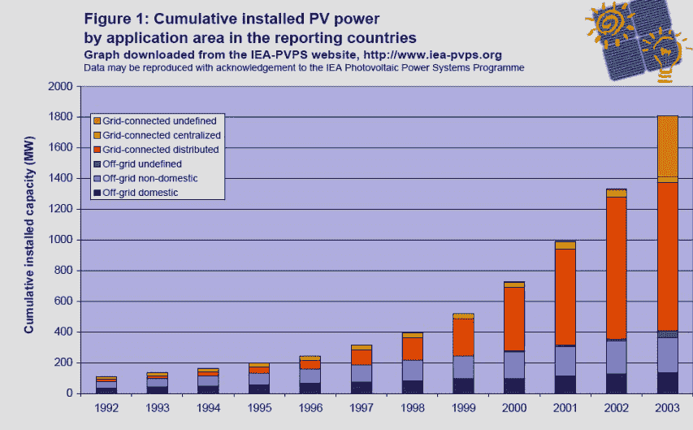

图 1-1：1992 – 2003 年全球光伏市场的发展

来源：`Paul Mayrock`, `PV NEWS` 光伏市场年度回顾，2004

#### 1995-2003 年世界光伏产量（占总量的百分比）

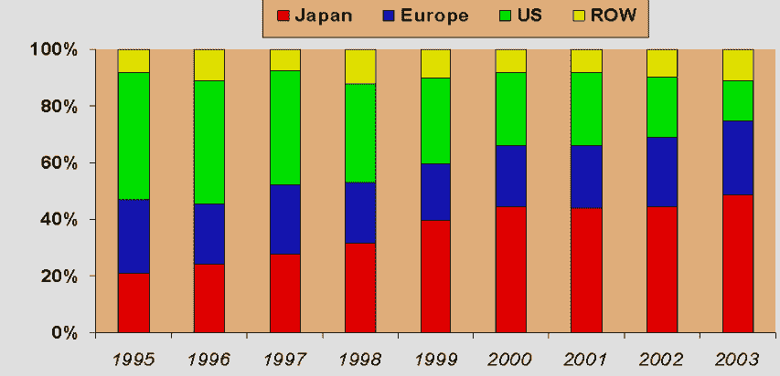

图 1-2：1995 – 2003 年不同地区光伏的发展

如图 1-1 所示，光伏市场增长迅速，到 2003 年底，全球光伏市场是 2001 年的两倍。图 1-2 表明光伏市场在每个地区都在增长，特别是日本。此外，可以认为按产品类别划分全球光伏市场的发展，超过 50% 的全球光伏产量用于小型分散式并网系统 (`SGCS`)（参见图 1-3）。在 1990 年，偏远地区主要是离网系统，通信和消费产品应用占主导。到年代末，`SGCS` 变得占主地位，如图 1-3 所示。

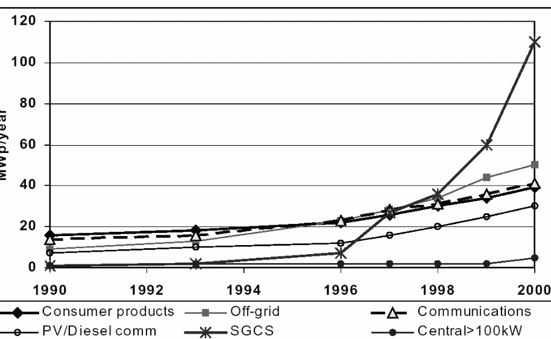

图 1-3：按产品分类全球光伏市场的发展以及小型并网光伏系统 (`SGCS`) 的相关性 `[2]`

这种发展是通过各种促销策略和传播计划实现的。特别关注的是，这些倡议是由非常不同的组织和机构发起的。国家和地方政府机构、公用事业公司以及 `NGO` 发起了这些策略 `[2]`。

图 1-4 显示了各国目前人均已装光伏容量。关于 `SGCS`，从图 1-4 可以清楚地看到，人口密度和/或电网连接良好的国家（例如 `NE`、`DE`、`CH`、`JP`）与低密度国家（例如 `SE`、`AU`、`FI`）之间存在巨大差异。也可以清楚地看到，最成功的国家是拥有最雄勃计划的国家：瑞士、日本和德国，或者在离网光伏具有效益的地方：澳大利亚。

### 1.1.1 成本随时间的发展

最感兴趣的是光伏成本未来将如何发展。为了预测未来的光伏趋势，了解投资成本过去的发展也很重要。图 1-5 显示了在某些开展全面推广的国家，容量为 3 `Kwp` 的小型并网光伏系统的成本发展情况。从图 1-5 可以看出，非常有趣的是系统价格大幅下降。

在图 1-6a 中，展示了模块成本的占比。可以看出，近年来非模块成本（例如逆变器、设计与规划、组装、施工工作、安装）的下降程度远大于模块成本。这表明了同时追求进一步降低模块价格以及降低设计和安装成本的重要性。

光伏制造正进入下一个发展阶段，以实现更大幅的成本削减：更大的制造设施以实现更好的规模效应和更高的自动化水平，以及制造低成本的光伏类型。

光伏模块证明了其在全球范围内正越来越多地使用。优势是，光伏模块的价格正在大幅下降。这些表明光伏系统在未来具有应用潜力。

#### 光伏系统成本（3 kWp 系统）

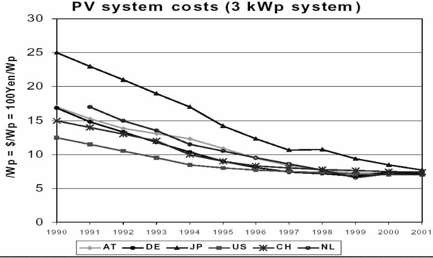

图 1-5：1990-2000 年德国、奥地利、美国、荷兰、瑞士和日本光伏系统价格发展（不含增值税) `[2]`

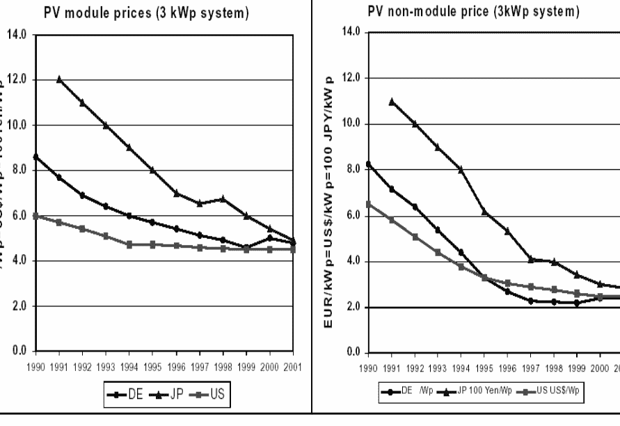

图 1-6：（a）1990-2000 年光伏模块系统价格发展（不含增值税），b）1990-2000 年光伏非模块价格发展（不含增值税）`[2]`

## 1.2 用于农村和偏远地区电气化的混合系统

能源是国家经济和社会的基本动力。然而，许多偏远和农村地区没有电力。为了有助于农村发展和创造就业机会，偏远村庄迫切需要能源。

偏远地区的概念在每个国家可能非常不同。通常，偏远地区远离城市和大多数人的居住地，而且缺乏电话线覆盖和电网供应。由于零售商偏远，偏远地区传统能源（如蜡烛、煤油、气、煤、电池）的价格通常比城市贵。在偏远地区提供电网通常意味着电网供应商成本更高。在许多情况下，偏远地区的电网化在财务上是无效的，特别是考虑到偏远地区的低消耗 `[1, 4, 5]`。

可再生能源如太阳能为偏远地区的电气化提供了切行的替代方案。可再生能源技术最有前景的应用之一是混合系统。在农村电气化的背景下，结合可再生能源和传统电源的光伏混合能源系统在竞争性发电方面具有巨大潜力。广泛使用的“混合系统”术语描述的是一种结合可再生能源、传统能源以及用于储能电池的独立能源系统。电池的使用通过缓冲部分再生能源产量以供以后使用，可以节省燃料，从而减少柴油发电机的净负载，允许柴油机关闭或以最高效率运行，同时为电池充电。

考虑到图 1-7 所示的发展中国家电气化的再生能源应用范围，它通过孤立电网的去中心化电气化将单一消费者和负荷的供应扩展到互联电网。

| 电力供应领域与互联程度 | | | | | 互联电网 | 跨洲网络 | 泛欧网络 | `HVDC` `DC` / ... `600kV` |
|---|---|---|---|---|---|---|---|---|
| 单一消费者与负荷组 | | | | | | | | |
| 最少消费者 | 独立系统 | | | | | | | |
| 太阳能家庭 | 本地电力供应 | | | | | | | |
| | 中小型负荷供应 | | | | | | | |
| | `3-` / `20kV` | | | | | | | |
| | `1-` / `230V` | | | | | | | |
| `DC/` ... `48V` | | | | | | `3-` / `380kV` | | |
| `10W` | `100W` | `1kW` | `10kW` | `100kW` | `10MW` | `100MW` | `1GW` | 功率范围 |

图 1-7：电气化电力技术分类 `[6]`

图 1-7 展示的电力供应领域分类包括对各种能源在整个功率范围内应用潜力的估计。通过这种，结合不同能源的单一系统混合系统提供了利用可用再生能源的最佳可能。混合系统技术主要涵盖独立系统以及中小型孤岛网。此外，混合系统可以扩展到区域性和跨区域电网。

根据上述优点，光伏柴油混合系统越来越多地用于全球偏远和农村地区的供电。考虑带电池的光伏柴油混合系统时的问题包括能源的高利用、燃料节省、系统可靠性和使用寿命考虑 `[4]`。

## 1.3 混合系统的监控

光伏柴油混合系统越来越多地用于偏远地区的供电。因此，对于消费者来说必须是一个技术可靠的系统。为了保持混合系统的可靠运行，有必要包含一个持续监控混合系统的系统。监控的主要目标 `[9]` 包括：

- 确保系统运行正常
- 评估系统组件性能，找出故障设备或性能低于额定的设备
- 允许校准
- 揭示设计改进并增加设计者的理解

在大多数远程监控系统中，信息从远程站收集到主站。农村地区的系统通常通过结合数据记录仪进行年度访问。但这种方法导致维护响应时间效率低下，而且产品改进较差。早有一些监控系统被提出，如 `SCADA`（监控控制和数据采集）或卫星监控 `[10,11]`。然而，这些方法的已知问题是：投资成本高、客户端站和通信链路需要特殊软件。所有这些劣势使得混合系统在经济性能上无效。

由于互联网已成为强大的信息源，互联网监控已引入混合系统 `[12]`。利用互联网技术，所有的劣势都可以被消除。互联网监控系统使用 `TCP/IP` 网络。大多数情况下，这种通信链路已经存在。因此，不再缺少通信链路。监控数据存储在 Web 服务器上。人员可以通过标准浏览器访问监控数据。

然而，互联网监控只有在提供互联网连接的地方才可能。在农村地区，由于基础设施，实施互联网监控很难。此外，安装 Web 服务器提供监控数据的计算机通常消耗大量能量。这对于能源有限的偏远地区监控系统是一个劣势。

因此，操作员具有在系统需要时对混合系统执行立即操作的能力。因此，为了满足所有需求，必须为偏远地区的混合系统开发一种适配的监控系统。

## 1.4 研究目标与方法论

如前所述，有必要为偏远地区的混合系统开发一种适配的监控系统，该系统能够提供被监测数据以及在线设置运行参数的能力。因此，可以提高混合系统的可靠性。下一节将描述开发监控系统的目标和方法论。

### 1.4.1 目标

本工作的目标是：

- 使用基于 Web 技术为偏远地区的光伏（`PV`）-柴油混合系统开发一种适用且有效的监控软件
- 开发一个交互式监控网站，提供通过标准 Web 浏览器下载数据以及在线设置运行参数的可能性
- 为 Web 服务器实现一个低功耗硬件模块，因为可以减少能量消耗。利用开源优势，网站监控系统采用了嵌入式 `Linux` 操作系统
- 由于光伏-柴油混合系统被用于在缺乏基础设施且没有互联网连接的偏远地区提供能源，提供了无线技术进行通信，项目选择了 `GSM` 调制解调器
- 实现交互式监控网站并对监测数据进行分析，以研究其结果

根据工作目标，监控系统将包含互联网技术以便在网站上提供监测数据。操作员可以通过 Web 浏览器访问数据。随着通信网络的扩大和质量的不断提高，偏远地区缺乏电话连接使得像 `GSM` 这样的网络变得更具吸引力。使用这种技术，数据直接传输到主站，网络不会为操作员产生任何额外费用。

本项目中的监控系统由监控单元（传感器单元）、数据采集单元和通信单元组成。数据采集单元将从传感器单元采集监测数据并将数据存储在 Web 服务器中。操作员能够通过网站在线下载数据以及在线设置运行参数。图 1-8 显示了目标和工具。

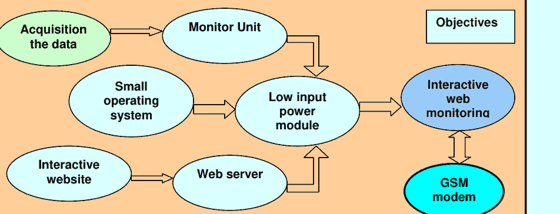

| 带有 `SMA` 逆变器的光-柴油混合系统 | 嵌入式 `Linux`、`C` 语言、`PHP` 语言、`Apache` Web 服务器、嵌入式计算机 | 标准浏览器（`Chrome` 或 `IE`），通过 `GSM` 链路 |
| --- | --- | --- |
| ![image] | 嵌入式 `Linux` 模块 | |
| 数据存储软件 | Web 服务器 | |
| | 网站 | |

图 1-8：目标与工具示意图

### 1.4.2 工具

图 1-8 展示了用于开发本工作目标的工具和方法论。执行本论文的方法论和工具描述如下：

- **光伏-柴油混合系统**：用于实现交互式监控网站。混合系统由光伏阵列、发电机、电池、`Sunny Boy` 逆变器、`Sunny Island`（电池逆变器）和负载组成。该混合系统用于模拟偏远地区的负载供电。
- **监控网站**：它是工作的核心。网站由超文本标记语言（`HTML`）编写。`HTML` 是一种代码格式语言，用于发布 Web 页面。它是一种基于 `SGML` 的标记语言（`SGML` = 标准泛化标记语言，参见 `ISO 8879`）。它允许 Web 浏览器确定如何显示文本和多媒体图像，以及读者与提供文档的 Web 服务器之间如何进行交互。为了实现交互式网站，`PHP` 语言被嵌入 `HTML` 文档中。`PHP` 语言的主要目标是允许 Web 开发人员编写动态生成的网页。它允许操作员将数据构建到网站中。提供交互式网站的 Web 服务器是 `Apache` Web 服务器，它是一个免费的开源 Web 服务器软件。用于收集数据的采集软件将数据从传感器单元采集并存储到 Web 服务器。
- **低功耗模块**：为 Web 服务器实现低功耗硬件模块，因为可以减少能量消耗。利用开源的优势，嵌入式 `Linux` 操作系统被用于网站监控系统。
- **标准浏览器（`Chrome` 或 `IE`），通过 `GSM` 链路**：使用这种技术，数据直接传输到主站，网络不会为操作员产生任何额外费用。
- **由于**：偏远地区缺乏电话连接，因此 `GSM` 这样的网络变得更具吸引力。

### 1.4.3 论文结构

论文结构如下章节组成：

第 2 章将回顾混合系统及其组件。本项目采用的光伏-柴油混合系统技术将在本章中介绍。

第 3 章将描述硬件与软件。

第 4 章将介绍系统的概念与工具。

第 5 章将介绍实现与结果。

第 6 章将总结工作的结论。

# 第二章：光伏-柴油混合系统技术

## 2.1 引言

光伏-柴油混合系统通过光伏阵列和柴电机组合发电。它们根据配置分类为：

### A) 直耦合混合系统，DC 总线配置

直耦合混合系统（图 2-1），柴电机和光伏阵列为电池组充电。逆变器将直流电压转换为交流电压供给负载。电池组和逆变器的容量应满足峰值负载。发电机的容量也应同时满足电池充电。

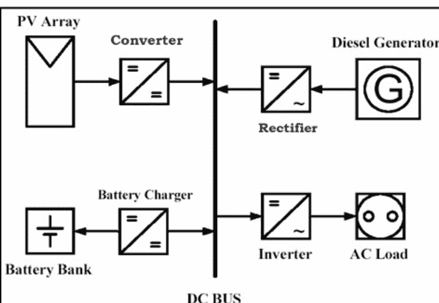

图 2-1：DC 总线配置

### B) 切换混合系统，DC/AC 总线配置

切换混合系统（图 2-2），电池组由柴电机充电。负载可以直接由柴电机供电。如果发电机的功率超过负载需求，剩余能量将用于为电池组充电。在低需求期间，电机关闭，负载由光伏阵列以及电池组存储的能量供电。在比较整体效率时，切换系统高于直耦合混合系统。

| 光伏阵列 | 转换器 | 整流器 | 发电机 |
|---|---|---|---|
| | | | |
| | | | 切换开关 |
| | 电池充电器 | 逆变器 | |
| | DC 总线 | AC 总线 | |

图 2-2：切换混合系统

### C) 交流耦合混合系统，AC 总线


交流耦合混合系统（图 2-3），柴电机可以直接供给负载。电池组需要一个双向逆变器来供给负载。在低能量需求期间，光伏阵列的剩余能量用于为电池组充电。当柴电机提供剩余能量时，双向逆变器也可以为电池组充电。交流耦合混合系统相比直耦合和切换混合系统有两个主要优势。容量是逆变器加上发电机的容量，而不是由单个组件的额定限制限制负载。其次，逆变器与发电机同步的能力为优化系统运行提供了更大的灵活性。本项目将采用此配置。

| 光伏阵列 | 逆变器 | 发电机 |
|---|---|---|
| | | |
| 电池组 | 双向逆变器 | AC 负载 |

图 2-3：`AC` 总线配置

离网电气化技术方案（偏远地区电源系统 `RAPS`）和混合系统方案可以作为远程电网延伸的经济替代方案。

## 第 2 章：光伏-柴油混合系统技术

在传统能源非常昂贵或传统电气化在某些情况下不适用的情况下。

光伏-柴油混合系统对于偏远地区的供电具有吸引力：与燃料发电机系统相比降低了运行成本；与仅可再生能源系统相比降低了投资成本；由于发电器的冗余增加了可靠性 `[14, 15]`。

## 2.2 系统组件

本节将描述光伏-柴油混合系统的不同组件，以便对组件及其运行某些方面进行理解，这对于混合系统的运行至关重要。请注意，除了组件运行外，负载管理和剩余能量的有效利用在系统运行中也同样重要。

### 2.2.1 光伏（`PV`）组件

光伏电池将太阳能转换为直流（`DC`）。然而，只有在有足够辐射的情况下，光伏能量才可用。光伏面板的功率范围很广，高达 `100 Wp`。在某些情况下，面板功率可达 `300 Wp` `[1]`。对于偏远地区的小功率需求，光伏系统可能具有成本效益。光伏电池的寿命取决于其类型，在 `10-20` 年之间。

光伏电池由至少两层半导体材料组成。一层带有正电荷，另一层带有负电荷。当光进入电池时，光中的光子被半导体原子吸收，释放出的电子从电池的负层流过外部电路并回到正层。这种电子流动产生了电流。图 2-4 显示了太阳能电池的结构。

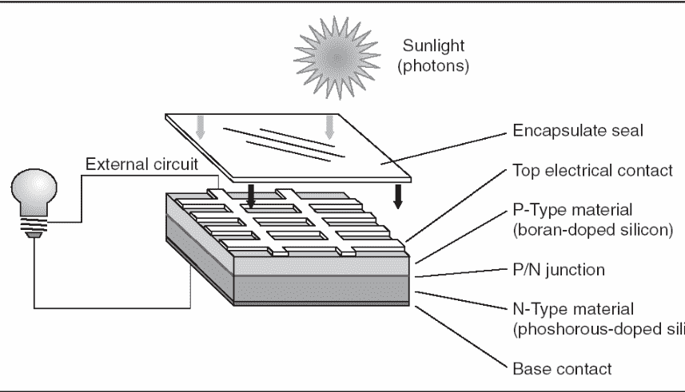

图 2-4：太阳能电池设计

更明确，光伏电池是一种通过光伏效应将太阳能转换为直流电的半导体器件。电池类型包括单晶硅、多晶硅、非晶硅（`a-Si`）、砷化镓（`GaAs`）、硒化铜铟（`CuInSe2`，“`CIS`”）、硫化镉，或叠层电池中两种材料的组合。目前，市场上有大量的硅电池 `[5]`。原则上，太阳能电池是大面积硅二极管。图 2-5 显示了二极管的电路图符号。

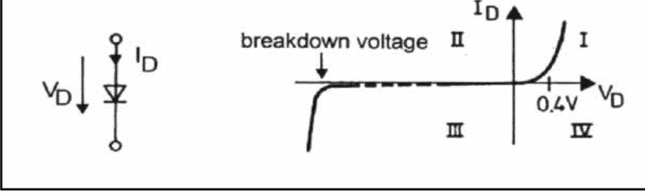

图 2-5：二极管的特性

二极管特性定义为方程 2-1。

```
$I_D = I_0 \cdot e^{\left(\frac{qV}{kT} - 1\right)} \quad (2.1)$
```

- $I_D$ 二极管电流 [A]
- $I_o$ 暗电流 [A]
- $q$ 元电荷 [$1.6\times10^{-19}$ 库仑]
- $V$ 电压 [V]
- $k$ 玻尔兹曼常数 [$8.65\times10^{-5}$ eV/K]
- $T$ 二极管温度 [K]

当光照射在太阳能电池上，由于光伏效应产生了自由电荷载子。这使得载流能够流过连接的负载。太阳能电池内部产生的光生电流与辐射强度成正比。图 2-6 描述了太阳能电池的等效电路图。

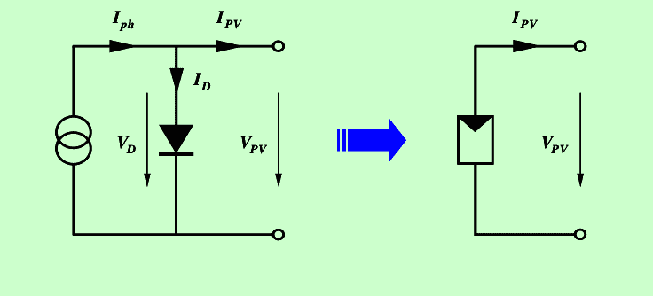

图 2-6：太阳能电池的等效电路图

理想光照下太阳能电池的数学过程得出以下方程：

```
$I_{PV} = I_{ph} - I_D = I_{ph} - I_0 \cdot \left(e^{\frac{qV}{kT}}-1\right) \quad (2-2)$
```

- $I_{PV}$ 光伏电流 [A]
- $I_{ph}$ 光生电流 [A]
- $I_0$ 暗电流 [A]
- $q$ 元电荷 [$1.6\times10^{-19}$ 库仑]
- $V$ 电压 [V]
- $k$ 玻尔兹曼常数 [$8.65\times10^{-5}$ eV/K]
- $T$ 温度 [K]

在特定的辐射下，达到最大功率点（`MPP`）的太阳能开路电压 $V_{oc}$ 可以推导出：

```
$V_{oc} = \frac{kT}{q} \cdot \ln\left(\frac{I_{ph}}{I_0}\right) \quad (2-4)$
```

- $q$ 元电荷 [$1.6\times10^{-19}$ 库仑]
- $k$ 玻尔兹曼常数 [$8.65\times10^{-5}$ eV/K]
- $T$ 温度 [K]
- $I_0$ 暗电流 [A]
- $I_{ph}$ 光生电流 [A]

每个光伏面板都有特定的电压-电流关系（`IV`-曲线）。相同模块的 `IV` 曲线在不同辐射下会有不同。图 2-11 显示了不同辐照下光伏电池的 `IV` 曲线。

## 2.2.2 光伏组件

如前所述，太阳能电池通过串联和并联形成一个光伏组件。串联电池的数量决定了组件的电压，而并联电池的数量决定了电流。如果许多电池串联，单个电池的阴影可能会导致被遮挡电池或材料的损坏，导致组件出现起泡和破裂。为了避免这种运行工况，如图 2-12 所示，将旁路二极管与太阳能电池反并连接。结果是太阳能电池的反向电流方向不会产生较大的电压差。在实践中，每 `15-20` 个电池连接一个旁路二极管就足够了。当光伏组件部分被遮挡时，旁路二极管还允许电流流过，即使电压和功率有所降低。旁路二极管不会引起任何损失，因为在正常运行下，电流不会流过它们。

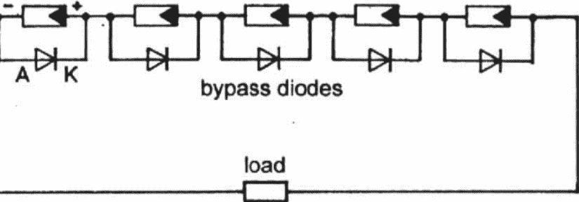

图 2-12：带有旁路二极管的串联光伏电池

如图 2-13 所示，串联配置的 `I-V` 特性曲线是给定辐射强度下的结果，对于三个太阳能电池是相等。

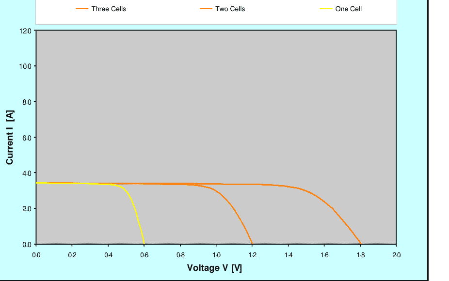

图 2-13：串联连接的 `I-V` 特性曲线

## 2.2.3 电池储能

有几种不同的电池化学类型，包括铅酸、镍铁（`NiFe`）、镍镉（`NiCd`）、碱性以及凝胶电池。电池分为密封式和透气式。简单来说，电池只有两种主要类型：启动电池和深循环电池。

启动电池的设计旨在提供高启动功率，但不适用于深循环。当作为储能使用时，它们在深循环应用中无法维持。启动电池使用大量极板以最大化电池的表面积。这允许产生非常大的电流，但会导致极板在循环时磨损。这种类型的电池不建议用于混合系统的能量存储。然而，它们被推荐作为备用机的启动电池。

深循环电池是适用于逆变器的电池类型。极板的物理尺寸更厚，储存电荷的活性材料密度更高，以增加循环寿命。“深循环”类型电池的设计是在充电之前使用其大部分容量。它们有许多尺寸，并分为“非密封”型或“密封”型。

普通电池针对单体额定电压为 `2.0` 伏的铅酸电池进行了优化。`NiCd`/`NiFe` 电池（称为碱性电池）的单体额定电压为 `1.2` 伏。通过调整电池数量，可以将 `NiCd`/`NiFe` 电池组的额定电压与铅酸电池组相同（`12` 伏使用 `10` 个电池，`24` 伏使用 `20` 个电池，`48` 伏系统使用 `40` 个电池）。然而，`NiCd`/`NiFe` 电池组必须充电到更高的电压才能完全充满，并且在放电期间其电压会比相同尺寸的铅酸型电池低 `[17]`。

### 2.2.3.1 铅酸电池

铅酸电池的基本等效电路由一个带有平衡电压 ($V_E$) 的电压源与内阻 ($R_{in}$) 串联建模（见图 2-14）。必须指出的是，这种配置只能描述电流状态，因为 $V_E$ 和 $R_{in}$ 的值实际上不是恒定的，而是许多参数的函数，例如电量 (`SOC`)、温度、电流密度和电池老化。

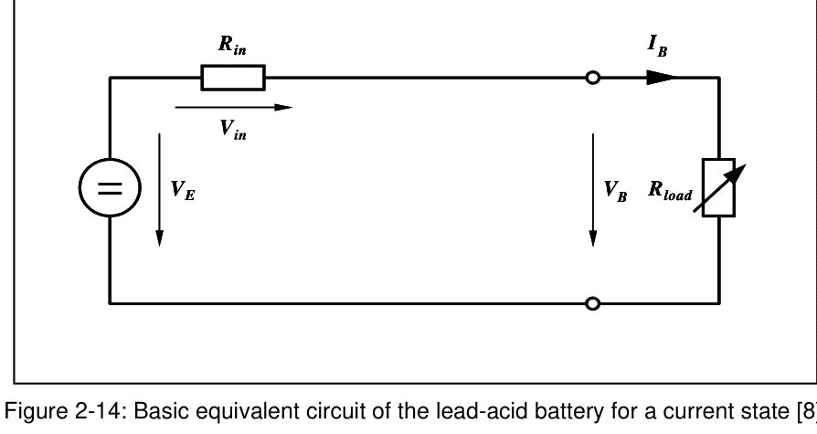

此外，还需要考虑这些参数也取决于电流方向（充电或放电）。当电池处于静止或开路状态时，$V_B = V_E$。当从电池提取电流时，电压将低于 $V_E$。当电流流入电池时，端电压将高于 $V_E$。因此，在放电阶段的每一个时刻，端电压可以推导出如下：

```
$V_B = V_E - V_{in}$ \hfill (2-5)
$V_B = V_E - R_{in} \cdot I_B$ \hfill (2-6)
```

其中：

- $V_B$ = 端电压 [V]
- $V_E$ = 平衡电压 [V]
- $V_{in}$ = 内损耗电压 [V]
- $R_{in}$ = 内阻 $[\Omega]$
- $I_B$ = 放电电流 [A]

显然，较高的放电电流会导致端电压降低。因此，为了通过电池电压确定电池状态，应该测量放电电流。

在光伏系统中，有必要了解电池长时间的性能。因此，考虑了额外的元件来解释动态和准静态过程（图 2-15）。

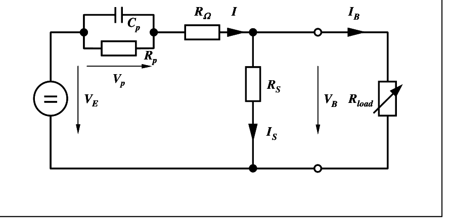


图 2-15：电池等效电路。此外，还需要考虑这些参数也取决于电流方向（充电或放电）。当电池处于静止或开路状态时，$V_B = V_E$。当从电池提取电流时，电压将低于 $V_E$。当电流流入电池时，端电压将高于 $V_E$。因此，在放电阶段的每一个时刻，端电压可以推导出如下：

## 第 2 章：光伏-柴油混合系统

此外，还需要考虑这些参数也取决于电流方向（充电或放电）。当电池处于静止或开路状态时，$V_B = V_E$。当从电池提取电流时，电压将低于 $V_E$。当电流流入电池时，端电压将高于 $V_E$。因此，在放电阶段的每一个时刻，端电压可以推导出如下：

```
$V_B = V_E - V_{in}$ \hfill (2-5)
$$V_B = V_E - R_{in} \cdot I_B$ \hfill (2-6)
```

其中：

$V_B$ = 端电压 $[V]$

$V_E$ = 平衡电压 $[V]$

$V_{in}$ = 内损耗电压 $[V]$

$R_{in}$ = 内阻 $[\Omega]$

$I_B$ = 放电电流 $[A]$

显然，较高的放电电流会导致端电压降低。因此，为了通过电池电压确定电池状态，应该测量放电电流。

在光伏系统中，有必要了解电池长时间的性能。因此，考虑了额外的元件来解释动态和准静态过程（图 2-15）。


图 2-15：电池等效电路。在准静态过程中，极板孔隙结构中的电解液会耗尽，其扩散速度不足以维持电池电压。

在准静态过程中，极板孔隙结构中的电解液会耗尽，其扩散速度不足以维持电池电压。

# 第 2 章：光伏-柴油混合系统技术

在准静态过程中，极板孔隙结构中的电解液会耗尽，其扩散速度不足以维持电池电压。

## 第2章：光伏-柴油混合系统技术

```
$SOC = \frac{C_{nom} - Q_{Bat}}{C_{nom}} \quad (2-9)
```

其中 $Q_{Bat} = \int I dt$

$C_{nom}$: 额定容量 (Ah)（即 C10）

$Q_{Bat}$: Ah 平衡（即自上次满电状态以来，净放电或充电的 Ah 数量），$I$ 为主反应电流 (A)。

- 相对电量：是实际容量差值与电荷平衡值之间的比值，如下式 (2.10) 所示。

```
$SOC = \frac{C_{act} - Q_{Bat}}{C_{act}} \quad (2-10)$
```

其中 $C_{act}$ 是电池的实际容量 (Ah)。该定义贯穿本文。

从系统运行的角度来看，在任何时刻确定电池电量的能力都非常重要。持续了解电量可以使系统的能量管理成为可能。此外，对于离网光伏系统，可以更准确地确定所需的电池容量，这意味着能源供应的可靠性更高，系统成本更低 [6]。

### 2.2.2.3 产气

当达到 $2.3 - 2.4$ V（即所谓的产气电压）时，电池电极会产生气体，水被分解为氢气和氧气。这两种气体在电池内混合形成爆炸性气体（极度危险！），并从呼吸塞的通风孔逸出。由于产气的产生，电池会失水，必须根据维护要求定期补充水。产气是充电过程中化学转换中不受欢迎的次生反应，因为电解会消耗电流，从而导致电池的储能效率不必要地降低。

超过产气电压后，电压保持近似恒定。在此期间的所有充电电流都会产生 $H_2$ 和 $O_2$，这被定义为损失。因此，产气可以用一个串联在电阻 $R_G$ 齐纳二极管来表示（图 2-17）。

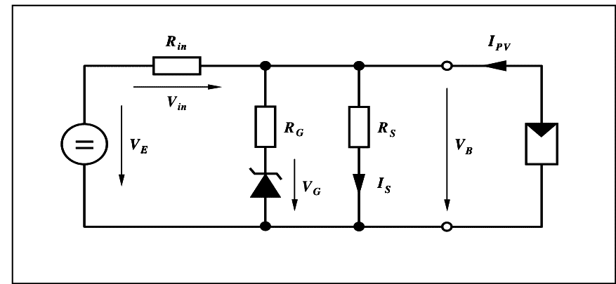

齐纳二极管处于反偏状态，因此在充电电压超过其击穿电压（即产气电压）之前不导电。此时它通过保持电压恒定起到稳压的作用，并允许电流通过，并在 $R_S$ 中以热量形式消耗。必须注意的是，此概念仅适用于铅酸电池，因为产气会破坏胶体电池（铅酸电池的密封类型）。

持续严重产气会损坏电池，因此制造商在数据表中给出了所谓的最大充电电压，充电过程中不允许超过此电压。该电压每单体 $2.3 - 2.4$ V（$20$ °C 时），对应 6 电池为 $13.8 - 14.4$ V。但在许多电池类型中，需要短时间的小量产气来混合电解液并确保整个电池体积的浓度均匀 [8]。

### 2.2.2 电解液结冰

对于低环境温度的应用，铅酸电池还必须防止电解液结冰。结冰风险取决于电量。图 2-18 展示了结冰极限随电量变化的函数。

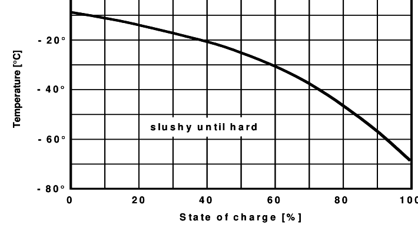

24

### 2.2.2.5 铅酸电池循环寿命

循环寿命是指电池在给定放电深度 (DOD) 下承受一定次数充放循环的能力。由于电池寿命还取决于循环期间的平均放电深度（以额定容量的百分比 (%) 表示），循环能力可以通过此平均放电深度乘以以循环次数表示的电池寿命更方便地表达。结果被称为额定循环能力，表示为等效 100% 额定容量循环次数。

启动电池的循环寿命通常较低，小于 100 次额定循环，这意味着它能够承受例如 500 次深度最大仅为 20% 的循环。适用于光伏应用的电池需要良好的循环能力，至少 500 次额定循环，这意味着它应该能够承受例如 1000 次深度最大为 50% 的循环。图 2-19 显示了循环寿命随 DOD 变化的函数。

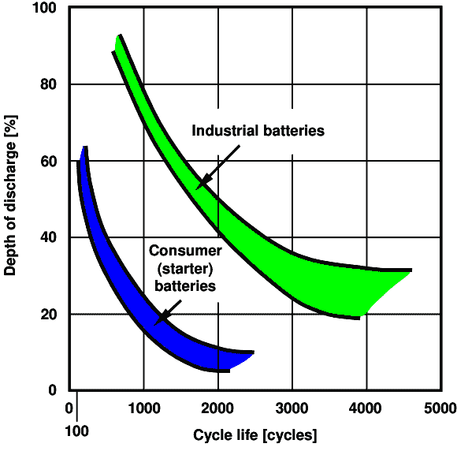

图 2-19：循环寿命随放电深的变化（来源：VARTA 特别报告 3/1987）

### 2.2.2.6 电池容量

此前，电池的存储容量用 Ah（安时）表示，显示了从充电电池中提取特定电流可以持续多久，直到电池放电，即电池电压下降到放电电压阈值。

现在，用放电能量表示电池容量（即 Wh（瓦时）或 kWh（千瓦时））可能更有利。这两种表示电池容量的方法是等价，因为它们通过电压相关联，即 `Ah = Wh`。

25

遗憾的是，电池容量并非恒量，而是取决于放电电流。因此，制造商根据特定的放电电流给出额定容量。额定容量是指标准条件下（`20` °C）以额定电流 `i_0` 放电 10 小时的容量。某些用于光伏应用的制造商会注明 100 小时容量。在比较此类容量时应记住，对于给定的电池，100 小时容量比 10 小时容量高 30%。此外，电池容量受温度影响：每低于 `20` °C 下降 1%。此外，极端温度会加速自放 [8]。

### 2.2.2.7 太阳能电池的要求

太阳能电池的典型包括：

- 低 `kWh` 容量

- 长寿命

- 高总效率

- 极低自放

- 维护成本

- 便于安装和操作

- 功率

- 特定 `kWh` 

通常是指整个寿命内的投资和运行成本总和除以存储的 `kWh`。

- 寿命

电池寿命应该是长的，特别是在偏远地区。

- 总效率

总效率 (`η`) 由安效率 (`η`) 和电压效率 (`η_v`) 得出：

```
`η = η · η_v`
```

(2-11)

50

安效率通常按从电池回收的电量 (`Q_D`) 相对于充电期间输入的电量 (`Q_C`) 来测量。自放会影响安效率。

`η_H = Q_D / Q_C`

(12-12)

电池通常需要的充电量比充满其起始点所需的要。离网光伏系统的典型安效率为 80–85%，冬季效率增加到 90–95%，这是因为当电池处于较低电量时，大部分电流直接进入负载而非进入电池。

电压效率由平均放电电压 (`V_D`) 和平均充电电压 (`V_C`) 决定。由于电池内阻的影响，`V_C` 通常低于 `V_D`。

`η_V = V_D / V_C`

(13-13)

总效率 (`η_H`) 应该尽可能高，以便将电池中由光伏发电器产生的能量大部分比例传递给消费者。

离网光伏系统中有多种类型的电池可供。表 2-1 给出的可用电池数据为近似值，仅供参考。

# 第 2 章：光伏-柴油混合系统

表 2-1：可用电池选择标准的比较 [8]

| 类型 | 达到 80% DOD 的循环寿命 | 投资成本 [€/kWh] | 单位能量成本 [€/kWh] | 效率 [%] | 自放电率 [%/月] | 温度范围 [°C] |

|---|---|---|---|---|---|---|

| 铅酸 (Pb) | 500...1500 | 350 | 0.17...1.00 | > 80 | 3.. | -15°...+50° |

| 镍镉 (NiCd) | 1500...3500 | 650...1500 | 0.30... | 71 | 6.. | - 40°...+45° |

| 镍铁 (NiFe) | 3500 | 1000 | 0.33 | 55 | 40 | 0°...+40° |

由于许多数值取决于充放电条件，直到目前这些数值尚未针对光伏应用和测试目的进行标准化。因此，电池之间的比较以及为每个应用选择最合适的电池并不容易。由于光伏应用在实际运行中的特殊性，制造商提供的（如表 2-1 所示）针对循环负载的循环寿命可能会减少一半以上。

根据表 2-1，可以得出结论：在大多数情况下，铅酸电池是光伏应用的最佳选择。合适选择的选择取决于应用目的。

## 2.2.3 燃料发电机

柴油发电机是全球大量小型和分散电源系统中最常见的发电设备，特别是在发展中国家 [6]。

根据可再生能源在总能量消耗中的比例，混合系统中柴油发电机的使用可以视为 [17]：

- 高再生能源渗透率系统：在这种情况下，发电机主要作为备用单元，不一定每天启动。

- 低可再生能源渗透率系统：发电机组为主发电机，每天运行数小时。应优化油耗和维护以降低成本。

- 中等可再生能源渗透率系统：发电机通常不定期运行。

即使在高再生能源渗透率系统中，可能也需要燃料发电机来临时增加系统的总功率，以运行某些偶尔的大负载。在这种情况下，需要发电机组与电池逆变器并运行，以便允许叠加所有可控单元的功率。

特性、与电池逆变器并运行的可能性以及可再生能源的渗透水平将决定发电机的尺寸。

在考虑发电机时，根据标准考虑是有意义的。国际标准 `ISO 8528` 将柴油发电机组分为三类：

第 1 类：

对电压和频率行为稳定性有轻微要求的用户的发电机组。（照明系统和简单电动驱动）

第 2 类：

对需要类似于公用网电压性的用户的发电机组，尽管在负载变化期间可以接受较大的偏差。（照明系统、电泵、风扇和电梯）

第 3 类：

对频率和电压稳定性有高要求的用户的发电机组。（电信设施、带有敏感电子电路的设备）

高再生能源渗透系统中的备用电源（小型混合系统 < 10 kW）通常由单相燃料发电机组提供。市场上上有多种不同功率输出特性的小型发电机组。这些发电机组的主要特征是：

- 电网质量：通常为第 1 类

- 发电机组并非设计用于连续运行。

- 有多种燃料选择：`LPG`、柴油和汽油。

- 使用多种类型的交流电发电机：永磁同步或容量励磁异步

- 机械或电子调速器。使用机械调速器，发动机转速将随输出功率的增加而增加。使用电子调速器，允许固定或变速发动机转速。

- 使用变频器：部分发电机带有逆变器来调节电机的功率输出。

- 转速：单速（50 Hz）、双速（低空闲和 50 Hz）或变速

- 与发电机组并运行：仅通过逆变器技术可行

- 与电池逆变器并运行：电网将具有发电机组的质量

此外，电网将具有发电机组的质量：

- 汽油、柴油：电网将具有发电机组的质量

- 手动（自动）：电网将具有发电机组的质量

- 空冷：电网将具有发电机组的质量

- 安装方式：电网将具有发电机组的质量

- 仪表：电网将具有发电机组的质量

- 静音：电网将具有发电机组的质量

- 转速 (`RPM`)：电网将具有发电机组的质量

- 油耗：电网将具有发电机组的质量

# 第 2 章：光伏-柴油混合系统技术

## 2.2.4 交流耦合系统的逆变器

功率转换器用于将来自光伏板和电池的直流电转换为交流电。常见的功率转换设备是电子逆变器、直流转交流逆变器、交流转直流逆变器和双向逆变器。

# 第 2 章：光伏-柴油混合系统技术

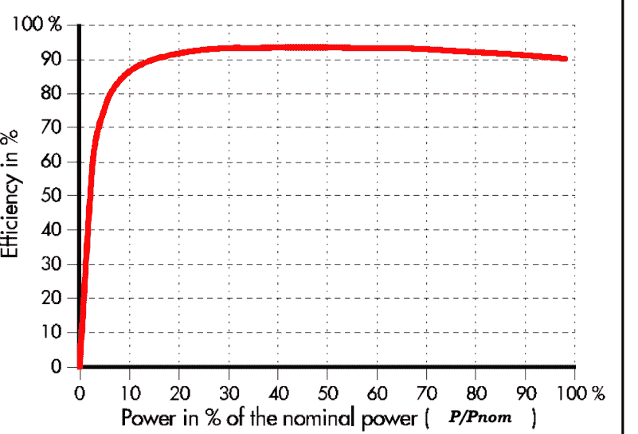

图 2-22：逆变器效率随容量 `Pac/Pac(nom)` 的示例 [SMA]

缓解低效率问题的方法是让逆变器仅在优化的输出水平运行。改进方法是某些逆变器包含了最大功率点跟踪器（`MPPT`）。最大功率点跟踪器（`MPPT`）用于强制光伏阵列的输出达到最大瞬时功率。`MPPT` 可以提高系统的效率。

此外，离立式逆变器也能够熔断保险丝。某些逆变器完美地实现了这一要求。

## 2.3 农村典型电力需求

负载曲线描述了随时间变化的电力需求。负载曲线估计是为偏远村庄选择合适电源系统的重要标准。每个偏远村庄的负载曲线可能有所不同。图 2-23 至 2-26 显示了欧洲和南亚不同地区的负载曲线信息 [13, 17]。


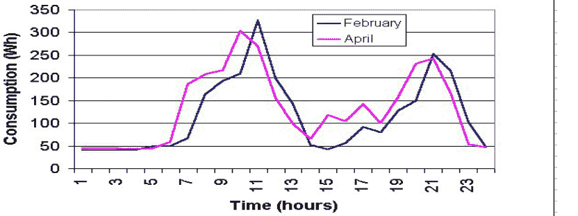

图 2-23：法国菲图图 (Fitou) 的负载曲线

# 第 2 章：光伏-柴油混合系统技术

### Starkenburg 木屋 - 每日消耗曲线 (1999年)

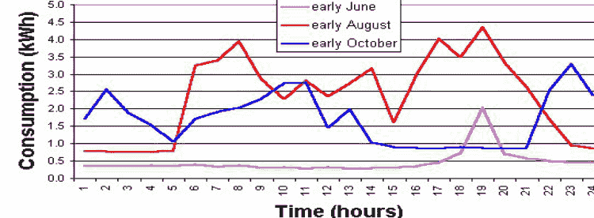

图 2-24：奥地利 Starkenburg 木屋的负载曲线

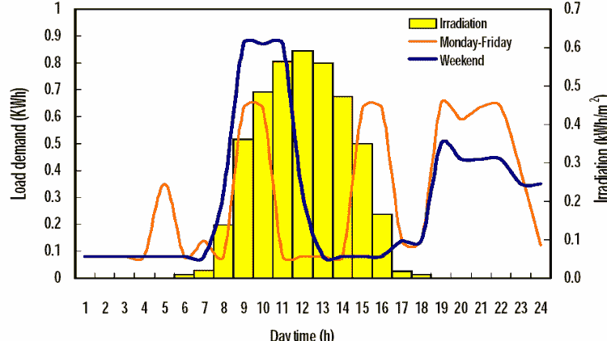

图 2-25：泰国披萨努鲁克 (Pitsanuluk) 能源的负载曲线

### Muara Ancalong 的 (2000年7月2日) 负载曲线

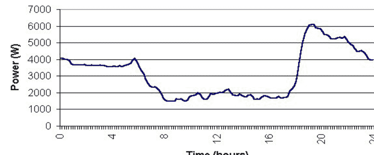

图 2-26：Muara Ancalong 的负载曲线

从负载曲线可以看出不同地区的电力需求存在差异。对于光伏-柴油混合系统，需要将负载分为以下几类：

- 住宅负载（日间负载或单用户曲线）

  （例如：洗衣机、冰箱）

- 专业应用负载（日间负载或多用户曲线）

  （例如：医院、酒店）

为了给偏远村庄提供足够的功率，必须考虑负载曲线的峰值需求。光伏-柴油混合系统的可靠性取决于光伏容量的匹配程度。如果容量过小，会导致效率下降；如果过大，则会增加成本。此外，光伏组件的维护也会影响系统效率。为了提高系统效率，可以考虑使用光电跟踪系统。如图 2-27 所示，光伏-柴油混合系统可以：

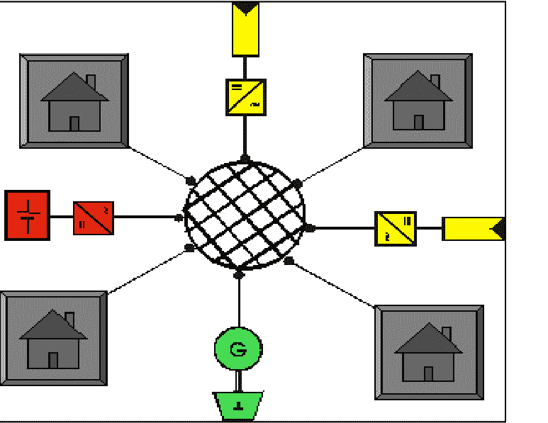

图 2-27：光伏-柴油混合系统 [17]

## 2.4 混合系统的损耗

离立式光伏柴油混合系统在存储和供应电力过程中需要平衡能量损耗。以下公式 (14) 显示了混合系统的能量平衡：

```
$E_{IN} \approx E_{OUT}$ (14)
```

其中：

```
$E_{IN} = E_{PV} + E_{MG}$

$E_{OUT} = E_{LOAD} + E_{LOSS}$

$E_{MG} = E_{LOAD} - E_{PV}$ (15)
```

为了最小化能量损耗，将损耗分为捕获损失（Capture losses）和系统损失（System losses）。捕获损失反映了未被利用的辐射部分。系统损耗定义了系统组件的能量损耗。

### 2.4.1 捕获损失

捕获损失反映了只有部分辐射被用于能量转换。损耗分类如下：

- 阴影

  阴影导致的损耗对应于无阴影模块接收能量的减少。这还会导致阵列内部的不匹配。

- 模块倾角

  模块倾角不垂直于太阳光会导致方向损耗。通过使用跟踪系统可以显著减少这种能量损耗。然而，任何机械跟踪系统都需要定期维护，并可能降低可靠性。因此，离立光伏系统通常不使用跟踪系统，而是选择固定的方向和倾角。

- 针对 AM 1.5 的光谱损耗

  制造商提供的模块特性是在标准条件（STC）下确定的，例如 AM 1.5 标准光谱。可用光谱与 AM 1.5 之间的差异会导致所谓的光谱损耗。

- 反射

  反射损耗是光伏模块表面的辐射损失，部分入射光被反射，无法用于能量转换。

- 表面污染

  脏组件会导致光透过率降低。

### 2.4.2 系统损失

系统损失涵盖了在输入能量（太阳辐射、化石燃料）转换为可用交流电过程中产生的所有损耗。分类如下：

- 逆变器和充电器转换损耗

  逆变器损耗源于逆变器的直流/交流效率。由于离立式逆变器从本地直流供电，因此静态功耗包含在内。电池充电器的交流/直流效率通常低于直流/交流逆变器效率。注意，交流/直流损耗只是从交流源充电产生的总损失的一部分；电池存储损耗（见下文）以及随后的直流/交流转换损耗发生在初始能量被消耗之前。

- 电池存储损耗

  存储损耗包括电池内部的所有能量损耗。由电池的充放电效率以及自放电特性决定。

- 辅助发电损耗

  辅助发电机的比燃油消耗取决于其运行模式。相应的发电机效率定义了相对于最大效率的辅助发电机损耗。

- 光伏-电池不匹配损耗

  许多离网光伏混合系统中，光伏发电机直接连接到储能电池（特别是，这是我们测试台采用的连接方案）。因此，模块的工作点由实际电池电压决定。光伏与电池之间的不匹配损失源于实际运行电压与最大功率电压 `Vmpp` 之间的差异；光伏阵列并未在与给定气象条件相对应的其最大功率点上运行。

  最大功率点跟踪器（MPPT）旨在减少光伏与电池之间的不匹配损失。然而，在使用此类设备时，必须考虑由于 MPP 跟踪器 `DC/DC` 转换效率导致的 MPPT 损失。

- 光伏阵列不匹配损失

  阵列不匹配损失是由形成光伏阵列的互联模块之间 `I-V` 曲线形状存在偏差引起的。因此，在给定的工作点下，阵列的总功率输出小于所有单个模块输出功率之和。

  光伏不匹配损失可能源于不同原因：(a) 相同类型模块的 `I-V` 曲线之间存在差异。这是由制造工艺的微小变化引起的；(b) 光伏发电机的局部阴影不仅由于辐射的空间变化产生不匹配损失（参见上文的捕获损失），还由于产生的温度差导致 `I-V` 曲线偏差；(d) 不同支路或子阵列之间的电缆长度和电阻差异会导致额外的不匹配损失。

- 布线损失

  布线损失包括系统组件之间所有的欧姆损耗。直流电缆电阻、继电器、开关或其他任何连接都导致了这种能量损失。光伏发电机并联支路中的反二极也构成了布线损失的一部分。由于交流电流通常低于直流电流，交流布线损失可以忽略不计。

  图 2-28 显示了典型光伏-柴油混合系统的能量流图。

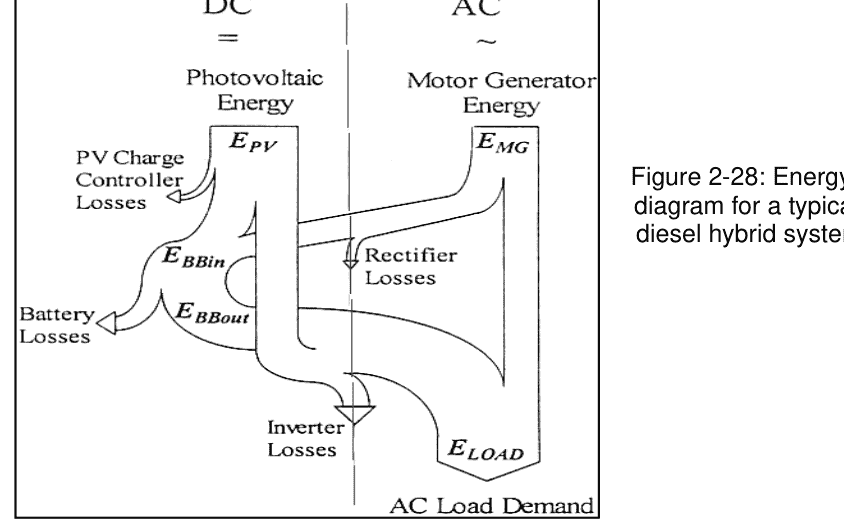

图 2-28：典型光伏-柴油混合系统的能量流图

## 2.5 本项目选用的光伏-柴油混合系统概述

本项目的光伏-柴油混合系统将根据小型交流母线光伏-柴油混合系统构建。发电单元包括一台柴油发电机、一个电池存储单元和几组光伏阵列。低压配电网为三栋不同的房屋提供电力。光伏场集成在房屋屋顶，其分布式理念是 `SMA` 的 `Sunny Island`（太阳岛）。

该项目的光伏-柴油混合系统包含以下组件：

- 1 个电池单元：`60V`, `300 Ah` (`Exide OPZV 300`)
- 1 台电池逆变器：`3.3 kW` (`SMA Sunny Island`)
- 2 组光伏场：`2 x 1 kWp`（朝向：垂直南向）
- 2 台光伏逆变器：`2x 850 W` (`SMA Sunny Boy 850`)
- 1 台备用发电机：`3 kVA` (`Honda EX3000`)
- 负载：`2` 台冰箱、风扇、电视机、灯光
- 负载控制：`EIB` 继电器和插座定时器

图 2-29 至 2-31 展示了安装在卡塞尔大学 `DeMoTec` 学院、用于项目实施的光伏-柴油混合系统。

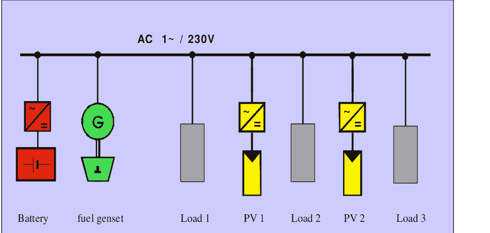

图 2-29：项目光伏-柴油混合系统示意图

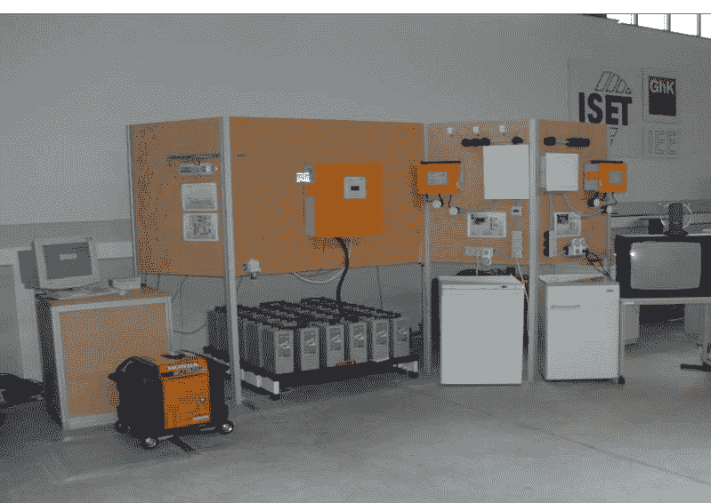

图 2-30：安装在卡塞尔大学 DeMoTec 大厅的光伏-柴油混合系统测试设施


图 2-31：用于系统的光伏模块

## 2.6 总结

光伏-柴油混合系统通过光伏阵列和柴油发电机的组合来发电。根据配置，可以将其分为三类：直流耦合混合系统、开关式混合系统和交流耦合混合系统。系统的主要组件包括光伏模块、电池、发电机和逆变器。

光伏-柴油混合系统对于偏远地区的供电非常有吸引力：与燃料机系统相比降低了运行成本；与仅可再生能源系统相比降低了投资成本；由于发电机的冗余增加了可靠性。

文献 [17] 给出了交流和直流母线系统的比较，对于没有燃料发电机的纯光伏系统，直流系统通常是优的。对于混合系统，随着太阳能比例的减少，交流系统相比直流系统变得越来越高效。因此，当柴油能量占比较高且白天使用大量能量时，应推荐交流系统；而在晚间消耗量且太阳能占比较高时，应优先选择直流系统。

为了给偏远村庄估计合适的功率供应系统，负载曲线是必要的。每个偏远村庄的负载曲线不同。必须对负载曲线的研究才能合理设计混合系统。

必须识别系统中的能量损失以避免这些损失。离网光伏混合系统中所有相关能量损失的分类被称为捕获损失。

光伏-柴油混合系统根据……安装。

# 第 3 章：嵌入式 Linux 模块：软件与硬件

## 3.1 引言

如所述，本项目的目标是描述嵌入式模块、软件和硬件。嵌入式系统最早于 20 世纪 60 年代用于通信领域的机械电话交换机。随着计算机行业过去十年的发展，嵌入式系统也随之进步，为小型提供了更多功能。

## 3.2 引言

嵌入式系统是用于控制特定问题或工作规范设备的计算机。通用计算机通常具有通用任务。嵌入式系统的任务是的。

## 3.3 操作系统的现状

如今大多数计算机使用 `Windows` 作为操作系统。操作系统是作为用户和计算机之间中介的程序。

## 3.4 嵌入式操作系统

嵌入式操作系统出现于 20 世纪 70 年代后期，今天有多种可行选择，如 `VxWorks`、`pSOS`、`Nucleus`、嵌入式 `Linux` 和 `Windows CE`。

## 3.5 为什么选择 Linux？

`Linux` 的强大、可靠、灵活和可扩展性，加上其对多种微处理器架构、硬件设备、图形支持和通信协议的支持，使 `Linux` 成为一个日益受欢迎的项目和产品平台。

`Linux` 是开放且免费的。其支持软件组件已经演进到能够适应 `Linux` 的市场和应用的多样需求。因此，`Linux` 是低成本运行的最佳选择。

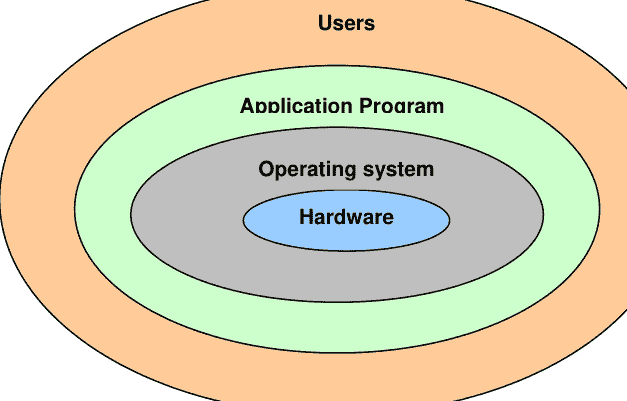

## 3.6 嵌入式 Linux

由于 `Linux` 支持多处理器系统并具有开源优势，它非常适合嵌入式网络设备。与通用计算机不同，嵌入式系统实际上只需要较少的软件即可完成一组特定的任务。这意味着软件对内存的需求较低，这对于不包含硬盘且内存存储有限的嵌入式系统至关重要。

嵌入式 `Linux` 是 `Linux` 的子集，经过精简后仅包含嵌入式系统中有用的 `Linux` 元素。例如，嵌入式系统通常使用 `FLASH` 驱动器代替硬盘文件系统。嵌入式 `Linux` 启动只需几秒钟，并适用于几兆字节的 `FLASH` 内存。嵌入式 `Linux` 携带任何特定产品所需的任何或全部功能，并可以运行任何适用于目标嵌入式系统且有用的 `Linux` 软件。图 3-2 显示了嵌入式 `Linux` 的市场状况。

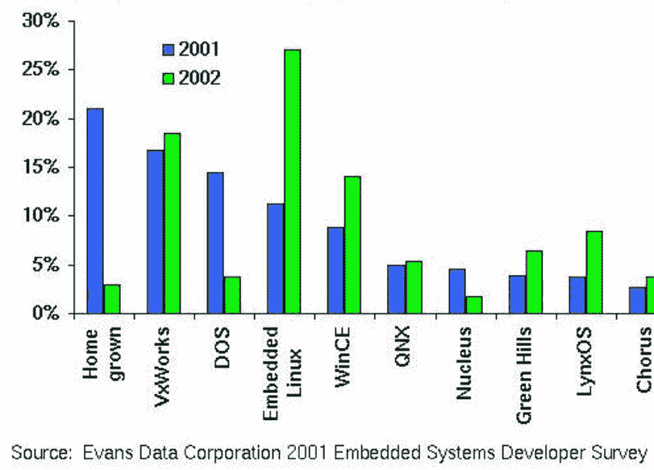

来源：`Evans Data Corporation` 2001 嵌入式系统开发者调查

图 3-2：嵌入式 Linux 状态

图 3-2 表明嵌入式 `Linux` 是嵌入式系统最喜欢的。`Linux` 是一个健壮的操作系统，已被证明具有高度可靠性。嵌入式 `Linux` 是一种高性能软件，通过包含专用功能或实时扩展，可以针对特定应用程序进行优化。它为项目的命运提供了安全保障 [7,26,28]。图 3-3 显示了开发者在嵌入式应用中使用嵌入式 `Linux` 的原因。

| 0% | 5% | 10% | 15% | 20% |
|---|---|---|---|---|
| 源代码可用（且免费） | | | | | |
| 无运行时版税 | | | | | |
| Linux 更健壮/可靠 | | | | | |
| Linux 具有出色的网络支持 | | | | | |
| 有更多驱动程序和工具可用 | | | | | |
| 许多程序员熟悉 Linux | | | | | |
| 它不是来自微软的 | | | | | |
| 其他 | | | | | |

来源：`LinuxDevices.com` 调查，2000年12月 - `http://www.linuxdevices.com/polls/`

图 3-3：使用嵌入式 Linux 的原因

图 3-3 显示，免费的源代码是使用嵌入式 `Linux` 的主要原因。

## 3.7 项目的嵌入式 Linux

如目标所述，项目需要一个小型嵌入式操作系统来支持监控系统的特定任务，且如前节所示，嵌入式 `Linux` 适用于嵌入式项目。为了为项目实现嵌入式 `Linux`，必须规范嵌入式 `Linux` 的要求和项目的要求。本节将介绍项目中的嵌入式 `Linux`。

### 3.7.1 嵌入式 Linux 要求

嵌入式 `Linux` 的原理与典型的 `Linux` 系统相同。典型的桌面 `Linux` 系统有三个主要的软件层 [7]：`Linux` 内核、`C` 和应用程序代码，如图 3-4 所示。

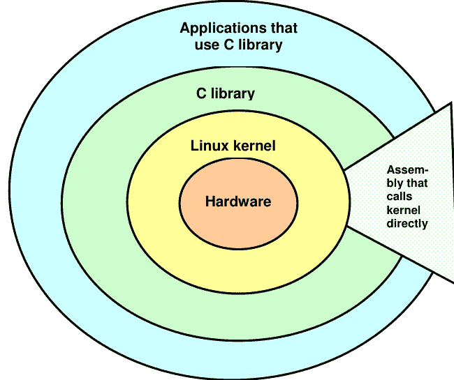

从图 3-4 可以看出，内核对硬件具有完全控制权。它的驱动程序代表应用程序与硬件通信。内核上的一层是典型 `Linux` 系统中的 `C` 库。除此之外，`C` 库会调用内核，将参数从应用程序代码传递给内核。最后，离硬件远的是应用程序代码。应用程序导致 `Linux` 内核（或某些应用程序中的硬件）执行预定任务。

在设计嵌入式应用时，重要的是意识到这种层次结构是打破的。对于某些不使用 `C` 库的应用程序，可以在内核本身中作为内核线程运行，但这不具有移植性。本项目中的监控系统，应用程序将使用 `C` 库。

### 3.7.2 项目要求

如第 1 章所述，交互式监控网站将使用互联网技术在网站上提供监控数据。操作人员可以通过网络浏览器访问数据。通信是通过 `TCP/IP` 网络上的 `GSM` 调制解调器。监控系统由监控单元（传感器单元）、数据采集单元和通信单元组成。数据采集单元将从传感器单元采集监控数据并存储在 `Web` 服务器中。操作人员有可能通过标准网络浏览器下载数据以及在线设置操作参数。因此，系统的要求可以规范如图 3-5 所示：

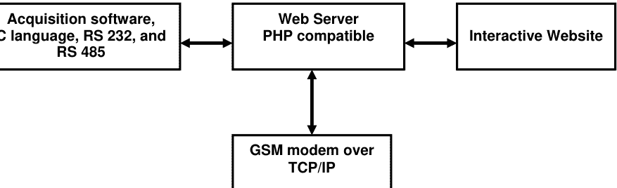

图 3-5：监控系统软件要求

### 3.7.3 嵌入式 Linux 选择

在批准项目要求后，嵌入式 `Linux` 准备满足所有要求。开发方向由内核移植、源代码和内核版本组成。所有 `CPU` 架构都必须存在内核端口，以便于选择硬件时具有灵活性。使用三个软件层（内核、`C` 库和静态链接的应用程序（或静态应用程序））的最小嵌入式 `Linux` 应用，是构建嵌入式 `Linux` 最简单的方法。

选择硬件的最佳主意也是考虑那些在嵌入式 `Linux` 上获得成功的硬件。互联网提供了关于嵌入式 `Linux` 的有用信息，例如嵌入式 `Linux` 联盟 `ELC` (`www.embedded-linux.org`)、`Linux` 设备 (`www.linuxdevices.com`)、嵌入式 `Linux` 日志 (`ELJ: www.embedded-linuxjournal.com`)。

根据 3-5 节的项目需求，为项目 `JUMPec PC-104 MOPS520` 选择了合适的硬件。以下是嵌入模块的规格 [27,42]。

- `32` 位 `Am586` `CPU`，带有 `16KB` 写回缓存
- `16/32/64MB` `SDRAM`（板载内存）
- `Phoenix BIOS`, `256KB Flash`
- 四个串口，一个并行端口，两个 `USB` 端口
- `Davicom DM9102A` 网络控制器，`32` 位快速以太网
- `100/10BASE-T` 自动协商
- `PC/104-Plus ISA/PCI` 总线连接（可扩展）
- 四个 `ISA/PC/104` 卡槽驱动能力
- 四个 `PC/104-Plus` 卡槽驱动能力
- 集成电子设备 (`IDE`) 接口
- `chipDISK 250 MB`
- 软驱器
- 键盘和 `PS/2` 鼠标
- 带有外部电池状态的实时时钟
- 看门狗定时器 (`WDT`)
- 仅 `5V` 运行，`900mA`，功耗小于 `5` 瓦
- (`P=5x0.9=4.5` 瓦，因此运行功率小于 `5` 瓦)

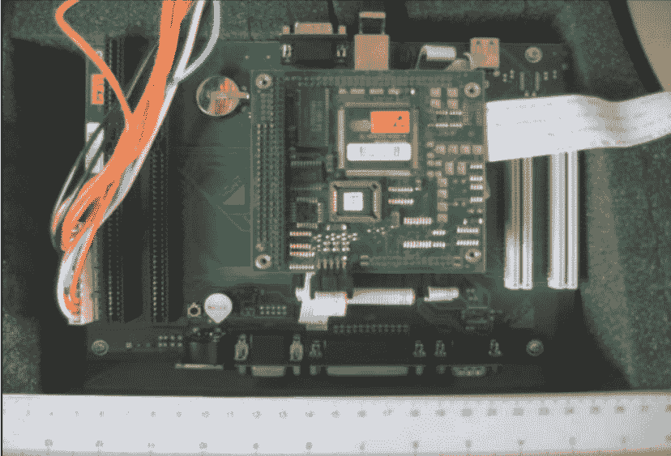

图 3-6: 嵌入模块

图 3-6 显示了嵌入模块 `PC-104 MOPS520`，图 3-7 是嵌入模块的结构图。

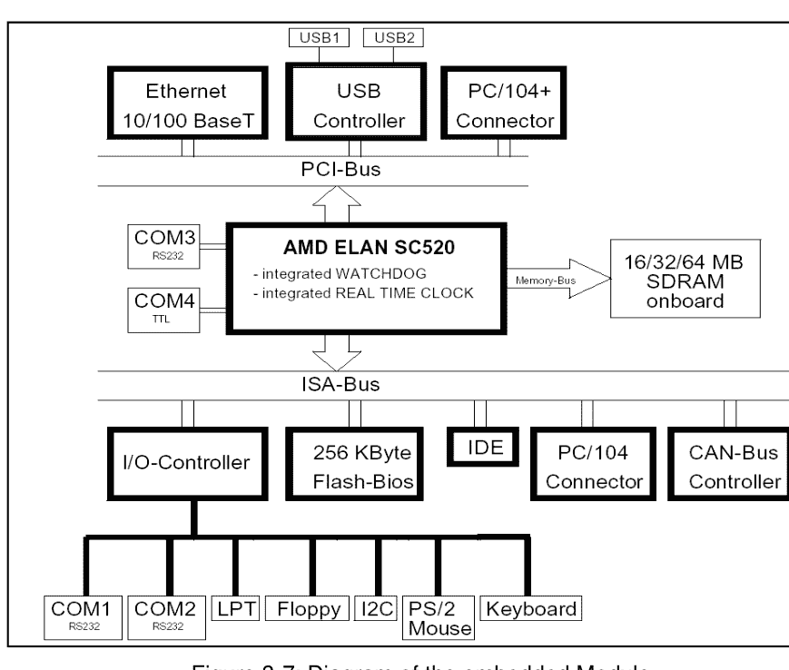

`PC-104 MOPS520` 的所有规格表明它支持项目需求的要求，且功耗极低。因此，该项目选择了 `PC-104 MOPS520`，因为它可以满足嵌入式软件和硬件的所有要求。在批准了嵌入式 `Linux` 和嵌入式硬件之后，下一步是考虑监控系统的其他运行软件。

## 3.9 Web 服务器概述

`Web` 服务器是运行在主机计算机上并提供网站服务的程序。换句话说，`Web` 服务器程序驻留并等待访问者浏览器对其拥有的对象发出请求，并将这些对象发送回供访问者查看。`Web` 服务器提供的对象包括 `HTML` 文档、纯文本、图像、声音、视频和其他形式的数据。`Web` 服务器和浏览器之间使用 `HTTP`（超文本传输协议，见下一节）进行通信，这是一种在网络上请求和传输数据的简单且有效的语言。因此，某些 `Web` 服务器被称为 `HTTP` 服务器。

`Web` 服务器有各种形状和大小。它们运行在不同的操作系统上，具有不同的功率复杂度，价格从昂贵到免费不等。`Web` 服务器通常被提到位于机房某处的具有强大处理能力内存的机器。它由：

> 整个 Web 服务器 = 计算机硬件 + 操作系统
> Web 服务器软件 + 信息内容

操作系统区分了 `Web` 服务器运行的平台（`Windows`、`UNIX`、`AS/400` 和大型机）。

`Web` 软件是一个持续循环的服务器，等待 `Web` 客户端（浏览器或其他）对网络文档的请求。它将解析请求、分类请求并执行相应的操作。操作可能是执行脚本、返回文档、访问远程数据库等。`Web` 服务器必须理解来自客户端的请求，必须保持相同的语言或协议：超文本传输协议 (`HTTP`)。


端口类似于电话分机。当客户端程序连接到网络上的服务器时，它会请求服务器程序的端口。该端口精确指示了源客户端想要连接到哪个服务器端口。数据随后写入出站端口（客户端计算机），到达服务器的入站端口并在那里被读取。Web 服务器有一个默认端口，如果客户端未指定连接到哪个端口，它将默认为端口 `80`。默认端口的另一种说法是“已知端口”。因此，Web 服务器的已知端口是 `80`。

信息内容是 Web 服务器提供的信息。它可以是来自本地磁盘、数据库或远程位置的数据，且对客户端透明。

## 3.10 超文本传输协议 (HTTP)

`HTTP` 定义了一种简单的请求-响应语言。Web 客户端通过 `HTTP` 与 Web 服务器建立连接。`HTTP` 定义了如何正确表述请求以及响应应该是什么样。它没有定义网络连接如何建立或管理，也没有定义信息如何实际传输；这些由较低的协议（如 `TCP/IP`）完成。

一个 `HTTP` 请求包含以下内容：

1. 方法，必须是一组合法操作之一
2. 通用资源标识符 (`URI`)，它是信息请求的
3. 协议版本
4. 可选的补充信息

一个 `HTTP` 响应包含以下内容：

1. 状态行，指示成功或失败
2. 响应的描述
3. 实际信息

注意，服务器回复信息。该语言的主要目标是允许开发者快速编写动态生成的 Web 页面。一个介绍示例见图 3-9。

## 3.11 HTML 文档

`HTML` 代表文本标记语言。`HTML` 是一种简单、通用的标记，允许发布者创建复杂的文本和图像页面，无论使用何种计算机或浏览器，任何人都可以在 Web 上查看这些页面。程序员可以编写代码向公众创建他们的文档。

## 3.12 PHP 语言

`PHP` 代表“`PHP`: 超文本预处理器”，是一种广泛使用的开源通用型脚本语言，特别适用于 Web 开发，并可以嵌入到 `HTML` 中。它的语法借鉴了 `C`、`Java` 和 `Perl`。该语言的主要目标是允许开发者快速编写动态生成的 Web 页面。一个介绍示例见图 3-9。

```html
<html>
<head>
<title>PHP Test</title>
</head>
<body>
<?php echo "Here is PHP<p>"; ?>
</body>
</html>
```


图 3-9: `HTML` 文档中嵌入的 `PHP` 脚本源代码

# 第 3 章：嵌入式 Linux 模块：软件与硬件

从 3-9 开始，`PHP` 脚本与 `Perl` 或 `C` 等语言编写的脚本不同，程序员不是编写包含大量命令来输出 `HTML` 的程序，而是编写带有一些嵌入代码的 `HTML` 脚本来实现某些功能（例如图 3-9 所示：输出“Here is PHP”）。`PHP` 代码封装在特殊的起始和结束标签中，这些标签允许程序进入和退出“`PHP` 模式”。

`PHP` 是一种服务器端技术。查看网页的用户不需要任何特殊的 `PHP` 程序或浏览器插件即可运行 `PHP`。`PHP` 兼容所有主流 Web 浏览器。任何 Web 开发人员都可以根据从第三方源（数据库或其他）收集的数据动态构建网页页面，然后通过互联网提供的几乎任何手段传输这些数据。这的真正好处在于，开发者可以在几乎不了解 `CGI`（通用网关接口）与与其通信的数据库之间内部原理的情况下，完成这些工作。

如前所述，`PHP` 是一个超文本预处理器。从非技术性的角度来说，这意味着当用户用浏览器访问网站时，`PHP` 有机会对用户看到的看到的页面进行“最后时刻”的修改。

图 3-10 展示了一个安装了 `PHP` 的 Web 服务器，它多了一个步骤，允许 `PHP` 在向用户显示文档之前处理所请求的文档。通过这一额外步骤，`PHP` 可以执行任何操作，包括访问数据库、发送电子邮件或连接到另一个互联网服务（如另一个 Web 服务器）。

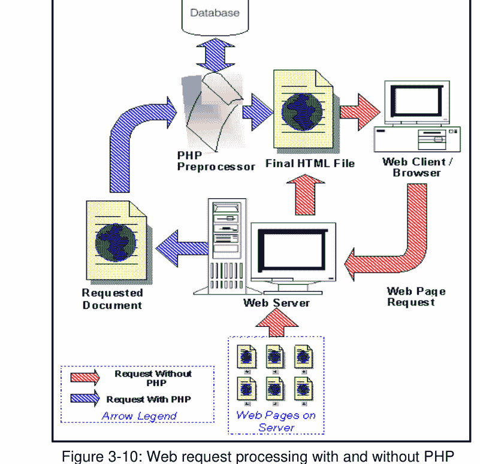

# 第 3 章：嵌入式 Linux 模块：软件与硬件

## 3.13 Apache Web 服务器

`Apache` 项目是一项协作软件开发工作，旨在创建一个稳健的、商业级的、功能且免费提供的 `HTTP` Web 服务器源代码实现。`Apache` 的特殊优势在于：

- **强大**：`Apache` 的性能和可靠性是传奇级的。
- **功能丰富**：`Apache` 服务器支持许多功能，包括：`XML` 支持、服务器端包含（`SSI`）、强大的 `URL` 重写和虚拟主机。
- **模块化**：用户可以找到可以添加所需功能的模块。
- **可扩展**：`Apache` 是开源的。所有所需的信息都可以在源代码和大量的在线资源中。
- **流行**：在本文写作时，`Apache` 占据了略低于 60% 的 Web 服务器市场（见图 3-11）。
- **免费**：这是用户不一定得到其所付费内容的实例之一。

如图 3-11 所示，`Apache` Web 服务器是目前最常用的 Web 服务器。

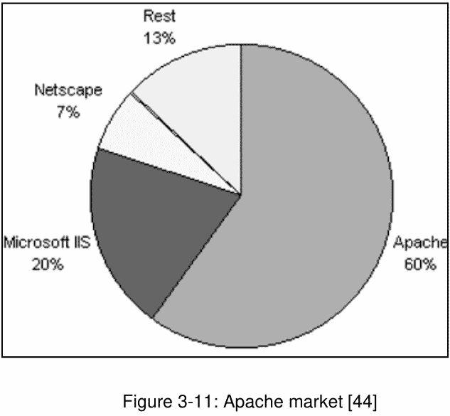

`Apache` Web 服务器以循环工作，客户端请求后是服务器响应。图 3-12 显示了 Web 服务器的循环。

# 第 3 章：嵌入式 Linux 模块：软件与硬件

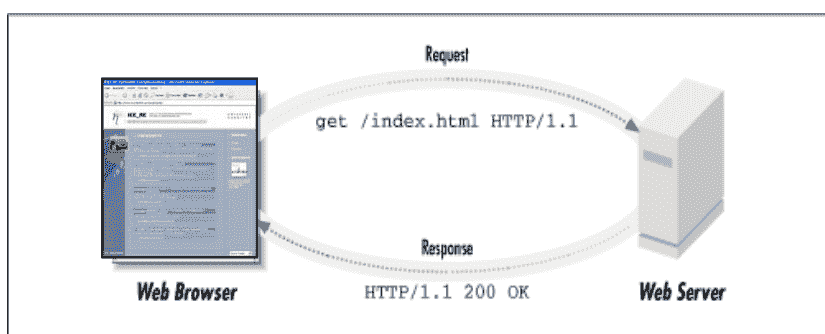

图 3-12：Web 服务器循环 [45]

`Apache` Web 服务器处理请求并创建响应如下：（见图 3-13）

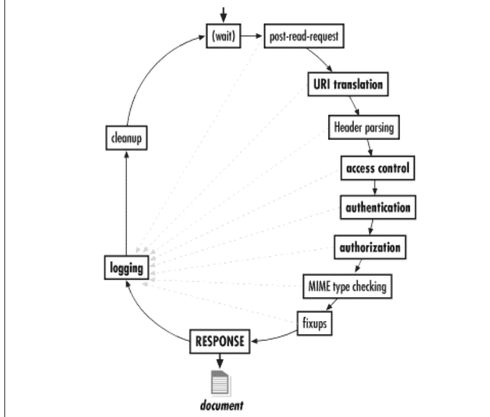

图 3-13：`Apache` 请求循环 [43]

从图 3-13 中：

1. `Apache` Web 服务器等待请求
2. 当请求到来时，发布并读取请求
3. `URL` 翻译
4. 头部解析
5. 访问控制
6. 身份验证
7. 授权
8. 检查 `MIME`（多用途互联网邮件扩展）
9. 修复并将文档响应给客户端
10. 回到日志记录和清理，等待另一个请求

此外，`Apache` 项目旨在为各种现代桌面和服务器操作系统（如 `UNIX` 和 `Windows NT`）开发和维护一个开源 `HTTP` 服务器，因此 `Apache` 非常适合实现 Web 服务器。

## 3.14 总结

得益于开源和免费可用选项的优势，`Linux` 现在已是世界上最先进、最进步的操作系统。

`Linux` 非常适合嵌入式系统，因为其支持多处理器系统以及开源的优势，因此项目选择了嵌入式 `Linux`。项目选择白矮星嵌入式 `Linux` 内核来实现，是因为它可以满足项目需求。

嵌入式系统是一种用于控制设备以解决特定问题或特定工作任务的计算机。与通用计算机不同，嵌入式系统只需要足够的软件来完成一组特定的任务。这意味着软件需要的内存较少。软件可以适应不包含硬盘且内存存储有限的嵌入式系统。没有硬盘的系统可以降低能耗。因此，嵌入式系统被用于监控系统。

`JumpTec PC-104 MOPS5220` 被选为嵌入式硬件，因为它与嵌入式 `Linux` 工作，满足了项目的所有要求。

凭借开源代码的优势，`Apache` Web 服务器适用于监控网站。`HTML` 文档和 `PHP` 脚本被用于监控网站。

## 第 4 章：农村混合系统的交互式网站

## 4.1 引言

如第 2 章所示，监控系统在全球范围内没有电网、没有电话线的农村地区。因此，为了满足监控目标，有必要开发一种合适的系统。

### 4.2 网站监控概念

如所述，已经展示了其他类型的监控系统（`SCADA`、卫星），以解决这些系统的许多问题，包括高投资成本、特殊软件需求以及通信链路困难。

通过提议的网站系统，上述问题都可以被消除。监控数据存储在 Web 服务器中，操作人员可以通过标准浏览器访问数据（见图 4-1），通信使用基于 `TCP/IP` 网络的标准 `GSM` 调制解调器。在大多数情况下，这种链路已经存在，系统不需要特殊软件。

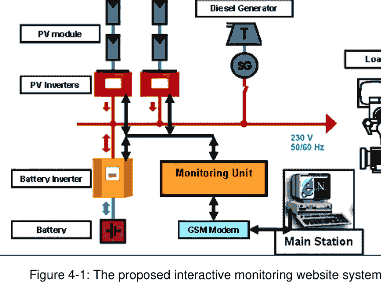

从图 4-1 可知，访问网站时操作人员可以轻松监控数据并向混合系统上传重要参数。使用 Web 技术和免费开源软件的优势使得监控投资非常低。

### 4.3 监控系统组件

项目的监控系统由监控单元（传感器单元）、数据采集单元和通信单元组成。随着无线网络的扩展和质量的提高，使用 `GSM` 网络进行通信变得更有吸引力。通过这种方式，数据直接传输到主站，网络不会为操作人员产生额外费用。

#### 4.3.1 监控单元

该单元用于测量系统的实际运行数据。根据目前的技术，该单元包含在逆变器中。本项目将包含 `Sunny Family` 系列组件。`Sunny Family` 产品了微控制器，可以持续监控混合系统的数据。`Sunny Boy` 是用于光伏模块的直流/交流逆变器，而 `Sunny Island` 是用于电池管理的双向直流/交流逆变器（包括充电控制特性）。由于图 4-2 是逆变器的图示。

从图中所示，逆变器测量系统的监控数据并定义充电电压设定点并自动启动油电机。

逆变器随时准备让数据采集单元随时从逆变器获取监控数据。

# 第 4 章：农村混合系统的交互式监控网站

## 4.3.2 数据采集单元

这是一个嵌入式 `Linux` 系统模块，包含数据采集软件、Web 服务器（在前章中描述）以及用于 `GSM` 调制解调器的硬件连接。它对输入功率的要求非常低。模块中安装了用于网站的 `Apache` 服务器。采集单元与逆变器之间的通信可以通过 `RS232` 或 `RS485` 接口实现。

数据采集软件有两个主要任务。首先，它将下载并记录所有测量数据，在项目中，这些数据将每一分钟采集一次。其次，软件将接收来自网站发送的新参数，然后并将这些参数发送到逆变器。数据采集软件或数据存储软件将在章节末尾介绍。

### 4.3.3 通信单元

它将基于基于 `TCP/IP` 网络 `GSM` 调制解调器。`GSM` 技术是一种工业级无线解决方案，适用于全球每一个 `GSM` 网络 [12]。在项目中，`GSM` 调制解调器集成了 `RS232` 接口，可以通过 `Linux` 操作系统控制。

## 4.4 监控数据与存储

第一个要问的问题是：“监控什么？”这通常分为两类：

- 系统产能（最基本的信息）
- 详细的工程信息，例如各种组件的性能（组件的输入、输出）
- 更具体的针对研究的信息（取决于所需信息，例如太阳辐射）

分析需求决定了监控变量。表 4-1 显示了项目监控变量的示例。

表 4-1：监控变量示例

| 变量 | 缩写 |
|---|---|
| `PV` 电压 | `Upv-lst` |
| `PV` 电流 | `Ipv-lst` |
| `AC` 电压 | `Uac` |
| `AC` 电流 | `Iac` |
| `AC` 频率 | `Fac` |
| 电池电压 | `Ubatt` |
| 电池电流 | `Ibatt` |

采集数据将以文本文件格式存储在嵌入式模块的内存中（例如：`data_date.txt`），因为文本文件可以使用多个程序打开。每个文件的名称将是监控日期。

由于嵌入式模块内存有限，网站将允许操作人员通过网站删除数据文件以管理内存存储。

模块内存存储容量足够存储十个月的数据，因此操作人员必须在十个月内下载监控数据，否则最旧的数据将被删除以提供下次存储的空间（事实上，这种情况不会发生，操作人员通常至少每月访问一次数据）。

监控系统开始运行后，应尽快开始系统数据分析。分析应该定期进行，例如每月一次。这不仅可以显示混合系统和监控系统是否工作正常，而且当发生问题时，操作人员可以立即对系统采取行动。

为了实现监控网站，通信网络是远站与主站之间的连接。因此，有必要理解通信网络。下一节将介绍通信网络概述以及监控网站的网络。

## 4.5 通信网络概述

计算机网络是一组相互连接的独立计算机（称为节点）、站点或主机，它们能够通过通信线路交换数据 [31]（见图 4-3）。

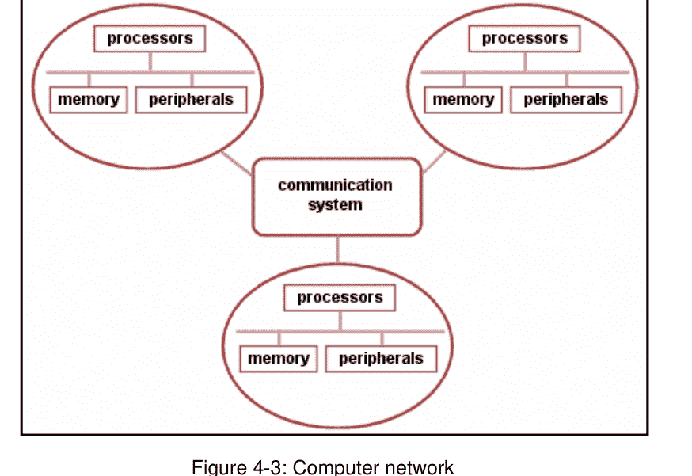

根据传输技术将网络分为两类：

- 广播
- 点对点（点对等，`PPP`）

广播网络的特点是所有机器共享同一个传输（逻辑）信道。因此，当一台机器在此类网络上发送消息时，所有机器无一例外地接收到它。此类网络上的机器使用地址进行标识。

点对点（点对等）网络的特点是通信信道仅连接两个特定的机器，这意味着消息必须从一台机器跳到另一台机器才能到达终点。本项目将考虑这种网络。

网络的基本概念是用户之间的通信和数据交换。通信系统负责信息的传输并准确交付最终用户。在这种背景下，有必要建立规则以便发送方和接收方能够相互理解。这些规则由协议机制管理。

协议对应于层的特定实现。层和协议的集合被称为网络架构。提到了两种重要的网络架构：`OSI`（开放系统互连）和 `TCP/IP` 参考模型。

### 4.5.1 开放系统互连 (OSI) 参考模型

`OSI` 参考模型由国际标准组织（`ISO`）于 20 世纪 70 年初开发。它为数据通信系统提供了一通用设计指南，并提供了一种描述数据通信系统不同部分（层）如何交互的标准方法。

计算机上构成 `OSI` 模型的协议分层结构被称为“栈”。栈中的某一层向其下方的层发送命令，并接收来自上层服务的命令。

从高到低七层依次为：应用层、表示层、会话层、传输层、网络层、数据链路和物理层（见图 4-4）。

- 应用层包括直接服务用户的软件，提供如 `API` 等功能。
- 表示层处理数据加密、压缩和翻译。
- 会话层管理应用程序之间的对话。
- 传输层确保端到端通信和错误恢复。
- 网络层确定数据的路径（路由）。
- 数据链路层提供节点到节点的交付和媒体访问控制（`MAC`）。
- 物理层提供传输的电机械接口。

### 4.5.2 TCP/IP 参考模型

`TCP/IP` 通常指网络架构，但这个缩写也指两个紧密结合的协议：传输协议 `TCP`（传输控制协议）和 `IP`（互联网协议）。“`TCP/IP` 模型”实际上是一种网络架构，其中四种协议起着主要作用，它们构成了最常见的实现。

`TCP/IP` 参考模型可以描述为四层架构（见图 4-4）：

- 应用层与 `OSI` 模型不同，这一层直接与传输层绑定，仅是因为会话层和表示层是没用的。
- 传输层的作用与 `OSI` 模型中的传输层相同；它用于使对端之间进行对话。正式地说，该层有两种实现：`TCP` 协议（传输控制协议）和 `UDP`（用户数据报协议）。
- 互联网或网络层是架构的核心。它在不建立连接的情况下实现远程（异构）网络的互连。它的作用是将数据包注入任何网络，并独立地将它们交付到各个终点。
- 主机网络或链路层，它似乎包含了 `OSI` 模型中的物理层和数据链路层。实际上，这一层并没有被具体规定；该层的唯一限制是允许主机发送网络中的 `IP` 数据包。

# 第 4 章：农村地区混合系统的交互监控网站

| OSI 模型 | TCP/IP 体系结构 | 协议 |
|---|---|---|
| 第 7 层 应用层 | | |
| 第 6 层 表示层 | 应用层 | `HTTP` | `SMTP` | `POP3` | `FTP` | ... |
| 第 5 层 会话层 | | |
| 第 4 层 传输层 | 传输层 | `TCP` | `UDP` |
| 第 3 层 网络层 | 网络层 | `IP` | `ICMP` |
| 第 2 层 链路层 | | `ARP`, `RARP` | 以太网 | `PPP` | ... |
| 第 1 层 物理层 | 数据链路 | |

图 4-4：`OSI` 和 `TCP/IP` 参考模型 [46]

### 4.5.3 两种模型的比较与评价

`TCP/IP` 和 `OSI` 模型都基于独立协议栈的概念。两者的功能是相同的。`TCP/IP` 模型是互联网世界的实际参考标准。与 `OSI` 模型相关的协议已很少被使用 [21, 31]。

`OSI` 模型可能是研究得最多、最受共同接受的网络结构，但它并不是真正实现并使用的模型。分析这一失败的专家们确定了四个主要原因：时机不恰、实现不当以及策略不当 [21]。

## 4.6 拟提监控系统的通信链路

由于监控系统需要与远程现场监控单元和主站进行通信，因此所提监控系统的通信网络是 `PPP` 网络。该链路将基于 `TCP/IP` 网络上的标准 `GSM` 调制解调器，如图 4-5 所示。

从图 4-5 可以看出，服务器将提供远程监控站点的监控数据。操作人员可以通过 `HTTP`（如第 3 章所述）访问信息。通信网络将基于 `TCP/IP` 网络模型。

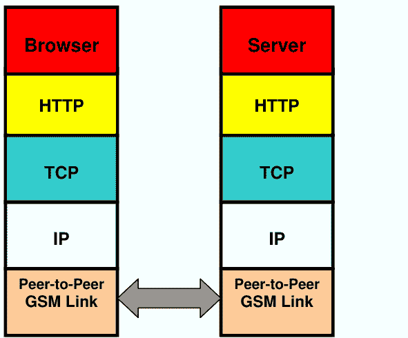

图 4-5：监控系统的网络层

## 4.7 世界维网（客户端与服务器对）

由于使用标准网站来访问监控数据，本节将描述互联网的原理，通常被称为“`www`”。世界维网通常被称为“`WWW`”或简称为“`Web`”。它为全球数百万人们在互联网上的通信提供了便利。用户只需使用网页浏览器并“点击”即可显示各种多媒体信息。网页浏览器可以看作是一个网页客户端，帮助用户访问互联网上的海量信息。另一方面，`Web` 服务器为成千上万的网页客户端提供服务。

`Web` 是去中心化的。它利用互联网连接客户端（客户）和服务器（提供者）。互联网由各种计算机和网络组成，它们相互操作，以便在它们之间交换数据。

`Web` 由以下关键技术组成：

- 地址系统，即通用资源定位符（`URL`），允许在互联网上检索不同类型的信息。
- 超文本传输协议（`HTTP`）定义了 `Web` 客户端和服务器交换多媒体信息的语言（协议）。
- 超文本标记语言（`HTML`）允许用户查看多媒体超文本文档。
- `TCP/IP` 作为互联网上的“低”层协议，允许 `HTTP` 和其他应用层协议运行在其之上，如下所示：

图 4-6 显示了 `Web` 通信的图。它概述了 `Web` 是是如何形成的。

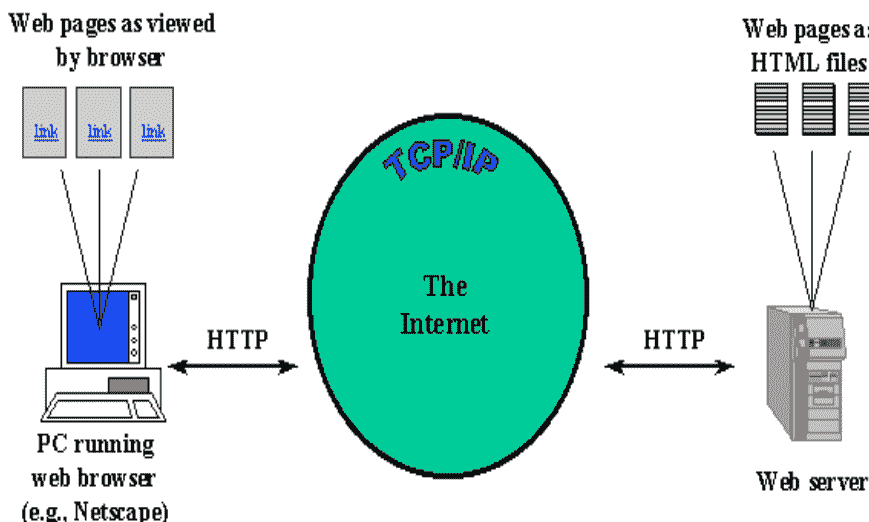

图 4-6：`Web` 通信

请注意，`Web` 服务器在信息（其交付）如何显示或使用方面的作用微乎其微。通常情况下，`Web` 服务器交付信息，而浏览器必须正确使用它。

## 4.8 交互式网站

由于使用标准网站来访问监控数据，本节将描述通常被称为“`www`”的互联网原理。世界维网通常被称为“`WWW`”或简称为“`Web`”。它为全球数百万人们在互联网上的通信提供了便利。用户只需使用网页浏览器并“点击”即可显示各种多媒体信息。网页浏览器可以看作是一个网页客户端，帮助用户访问互联网上的海量信息。另一方面，`Web` 服务器为成千上万的网页客户端提供服务。


# 第 4 章：农村地区混合系统的交互监控网站

| OSI 模型 | TCP/IP 体系结构 | 协议 |
|---|---|---|
| 第 7 层应用层 | 应用层 | `HTTP`, `SMTP`, `POP3`, `FTP` |
| 第 6 层表示层 | | |
| 第 5 层会话层 | | |
| 第 4 层传输层 | 传输层 | `TCP`, `UDP` |
| 第 3 层网络层 | 网络层 | `IP`, `ICMP` |
| 第 2 层链路层 | 数据链路层 | `ARP`, `RARP`, 以太网, `PPP` |
| 第 1 层物理层 | | |

图 4-4：OSI 和 `TCP/IP` 参考模型 [46]

### 4.5.3 两种模型的比较与评价

`TCP/IP` 和 `OSI` 模型都基于独立协议栈的概念。两者的功能是相同的。`TCP/IP` 模型是互联网世界的实际参考标准。与 `OSI` 模型相关的协议已很少被使用 [21, 31]。

`OSI` 模型可能是研究得最多、最受共同接受的网络结构，但它并不是真正实现并使用的模型。分析这一失败的专家们确定了四个主要原因：时机不恰、实现不当以及策略不当 [21]。

## 4.6 拟提监控系统的通信链路

由于监控系统需要与远程现场监控单元和主站进行通信，因此所提监控系统的通信网络是 `PPP` 网络。该链路将基于 `TCP/IP` 网络上的标准 `GSM` 调制解调器，如图 4-5 所示。

从图 4-5 可以看出，服务器将提供远程监控站点的监控数据。操作人员可以通过 `HTTP`（如第 3 章所述）访问信息。通信网络将基于 `TCP/IP` 网络模型。


图 4-5：监控系统的网络层

## 4.7 世界维网（客户端与服务器对）

由于使用标准网站来访问监控数据，本节将描述通常被称为“`www`”的互联网原理。世界维网通常被称为“`WWW`”或简称为“`Web`”。它为全球数百万人们在互联网上的通信提供了便利。用户只需使用网页浏览器并“点击”即可显示各种多媒体信息。网页浏览器可以看作是一个网页客户端，帮助用户访问互联网上的海量信息。另一方面，`Web` 服务器为成千上万的网页客户端提供服务。

`Web` 是去中心化的。它利用互联网连接客户端（客户）和服务器（提供者）。互联网由各种计算机和网络组成，它们相互操作，以便在它们之间交换数据。

`Web` 由以下关键技术组成：

- 地址系统，通用资源定位符（`URLs`），允许在互联网上检索不同类型的信息。
- 超文本传输协议（`HTTP`）定义了 `Web` 客户端和服务器交换多媒体信息的语言（协议）。
- 超文本标记语言（`HTML`）允许用户查看多媒体超文本文档。
- `TCP/IP` 作为互联网上的“低”层协议，允许 `HTTP` 和其他应用层协议运行在其之上，如下所示：

图 4-6 显示了 `Web` 通信的图。它概述了 `Web` 是如何形成的。


图 4-6：`Web` 通信

请注意，`Web` 服务器在信息（其交付）如何显示或使用方面的作用微乎其微。通常情况下，`Web` 服务器交付信息，而浏览器必须正确使用它。

## 4.8 交互式网站

由于使用标准网站来访问监控数据，本节将描述通常被称为“`www`”的互联网原理。世界维网通常被称为“`WWW`”或简称为“`Web`”。它为全球数百万人们在互联网上的通信提供了便利。用户只需使用网页浏览器并“点击”即可显示各种多媒体信息。网页浏览器可以看作是一个网页客户端，帮助用户访问互联网上的海量信息。另一方面，`Web` 服务器为成千上万的网页客户端提供服务。

`Web` 是去中心化的。它利用互联网连接客户端（客户）和服务器（提供者）。互联网由各种计算机和网络组成，它们相互操作，以便在它们之间交换数据。

`Web` 由以下关键技术组成：

- 地址系统，通用资源定位符（`URLs`），允许在互联网上检索不同类型的信息。
- 超文本传输协议（`HTTP`）定义了 `Web` 客户端和服务器交换多媒体信息的语言（协议）。
- 超文本标记语言（`HTML`）允许用户查看多媒体超文本文档。
- `TCP/IP` 作为互联网上的“低”层协议，允许 `HTTP` 和其他应用层协议运行在其之上，如下所示：

图 4-6 显示了 `Web` 通信的图。它概述了 `Web` 是如何形成的。


图 4-6：`Web` 通信

请注意，`Web` 服务器在信息（其交付）如何显示或使用方面的作用微乎其微。通常情况下，`Web` 服务器交付信息，而浏览器必须正确使用它。

如果参数发生变化，监控软件将检查此网页，监控软件会将所有新参数发送到逆变器。

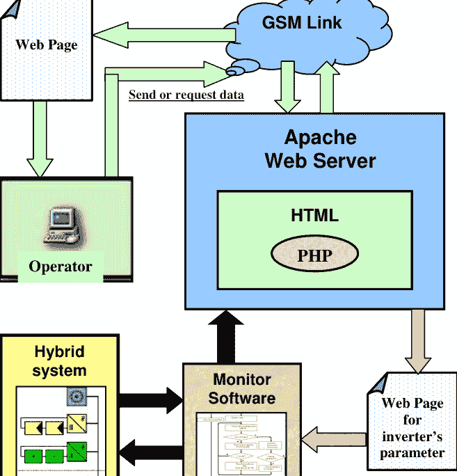

图 4-9：混合系统交互式监控网站图

从图 4-9 可以得出，所提出的交互式监控网站适用于并用于农村光伏柴油混合系统的监控。

## 4.10 总结

能源是国家经济和社会发展的基本动力。然而，在缺乏基础设施的偏远地区，接入公用电网的延伸并不是一个成本效益高的选择，有时在技术上也是不可行的。因此，农村地区使用自主光伏柴油混合系统电源来供电，而不是公用柴油发电。

当使用混合系统时，为了保持混合系统的可靠运行，有必要包含监控系统。监控的目的是从远程站将监控数据收集到主站。监控数据是操作员为了分析光伏柴油混合系统可靠性所需的数据。

这些农村地区的系统通常通过远程访问结合数据记录仪进行监督。但这种方法对于监控来说并不是成本效益高的选择。还介绍了其他类型的监控系统，例如 `SCADA`（监控、控制和数据采集）以及使用卫星技术的系统。使用这些系统，已经存在许多公认的问题，包括高额投资成本、对客户站的特殊要求以及通信链路的困难。

为了消除所有上述问题，提出了通过网站进行监控。网站监控系统可以提供更多优势。监控数据存储在 `Web` 服务器中。操作员可以通过标准的网络浏览器访问数据。通信链路使用通过 `TCP/IP` 网络的标准 `GSM` 调制解调器，通常这种链路已经存在。此外，不需要任何查看系统的特殊软件。

所提出的交互式监控网站由监控单元、数据采集单元和通信单元组成。监控单元用于测量混合系统的实际运行数据。根据当前技术，该单元包含在逆变器中。项目使用了 `SMA` 公司的 `Sunny` 逆变器。

数据采集单元是嵌入式模块，包含带有交互式网站的 `Apache Web` 服务器、数据采集软件（存储软件）以及与 `GSM` 调制解调器的连接。该数据采集软件将从逆变器读取监控数据并将数据存储到 `Web` 服务器中。

交互式网站通过 `HTML` 脚本和 `PHP` 脚本的组合将监控数据提供到互联网。操作员能够在线下载数据并在线上传运行参数。这可以提高混合系统的可靠性。

交互式监控网站的概念显示，它非常适用于偏远地区光伏混合系统的监控。

# 第 5 章：实现与结果

## 5.1 引言

如所述，交互式监控网站由监控单元（传感器单元）、数据采集单元和通信单元组成。监控数据存储在 `Web` 服务器中。操作员可以通过标准的网络浏览器访问监控数据，通信链路使用通过 `TCP/IP` 网络的标准 `GSM` 调制解调器。本章将实现交互式监控网站并描述其结果。

## 5.2 方案设计

根据上一章交互式监控网站的概念，所提出的交互式监控网站可以解释如图 5-1 所示。`Web` 服务器、网站和采集软件（存储软件）安装在嵌入式 `Linux` 模块中。

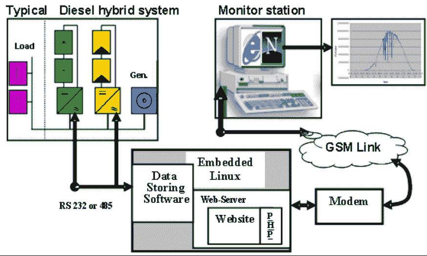

图 5-1：交互式监控网站图

从图 5-1，主站操作员可以通过标准的网络浏览器访问嵌入式 `Linux` 模块。通信网络是通过 `TCP/IP` 网络的 `GSM` 调制解调器。数据存储软件将负责监控来自混合系统逆变器的数据。监控数据将以每分钟一次的间隔作为文本文件存储在 `Web` 服务器中。监控文件的名为日期。

## 5.3 实现

一旦采集软件编译并安装到嵌入式模块，嵌入式模块就可以连接到系统逆变器。图 5-2 是光伏柴油混合系统与嵌入式监控模块的连接图。

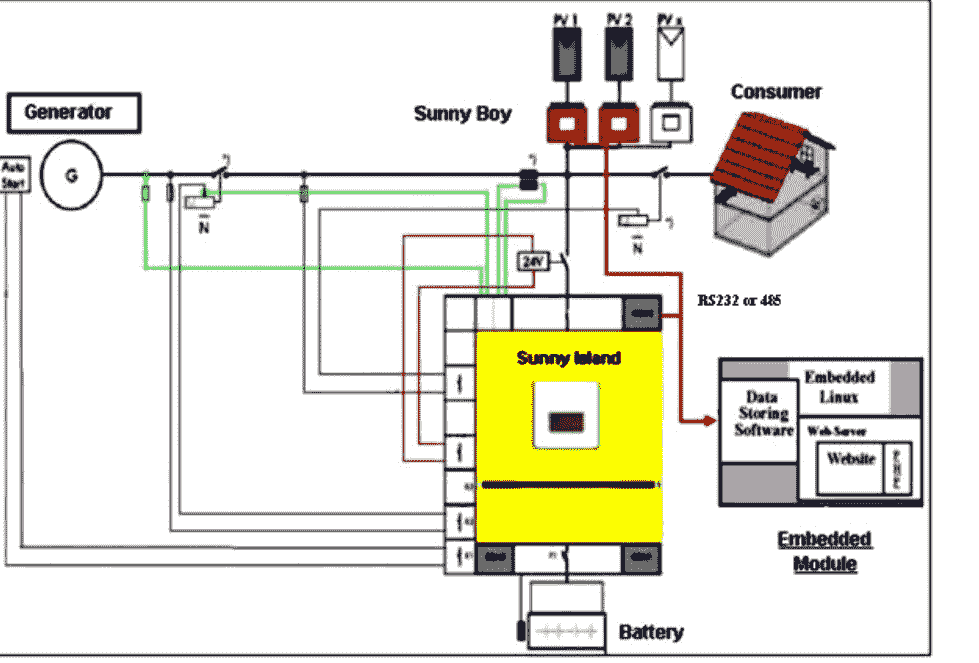

图 5-2：项目系统连接图 [SMA]

从图 5-2 可以，`Sunny Island` 逆变器连接到电池以管理电池电压。逆变器还连接到发电机的启动单元，以便系统需要时启动电机。此外，逆变器设计用于测量混合系统的电压和电流。

由于双向逆变器是系统的电池管理，因此必须特别注意连接，如果连接失败，系统将无法启动。

图 5-3 是电池连接图。操作员必须确保连接按照图 5-3 正确接线。在图 5-4 中显示了电池温度传感器的图片。

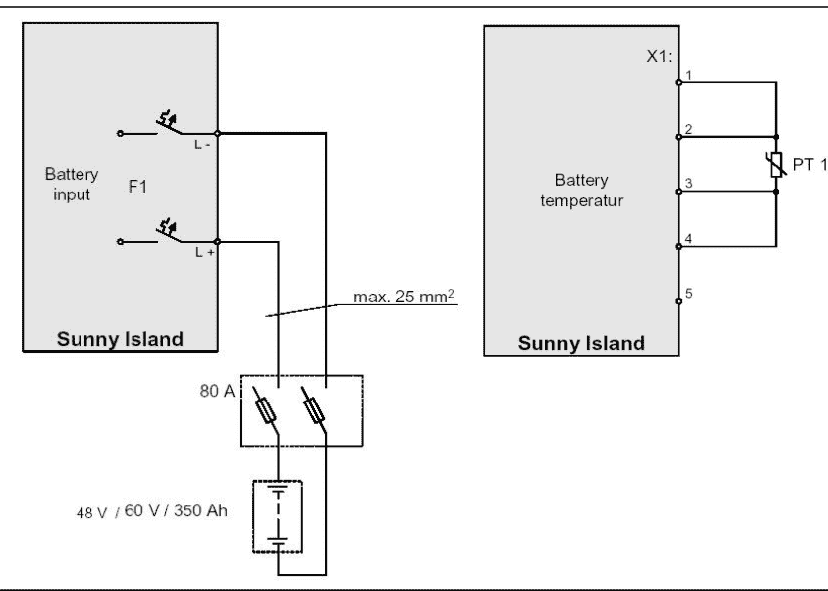

图 5-3：电池和温度传感器连接图 [SMA]

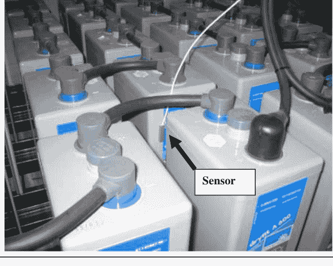

图 5-4：电池温度传感器 [DeMot]

从图 5-4，电池温度传感器连接到逆变器。这对于检测电池温度以防止逆变器受过热损坏非常重要。

此外，必须特别注意与发电机的连接。光伏柴油混合系统是太阳能和柴油发电机的组合。当负载很大且来自电池和光伏组件的能量不足以供应负载时，逆变器将激活柴油电机。因此，必须确保连接正确。图 5-5 是发电机的连接图。

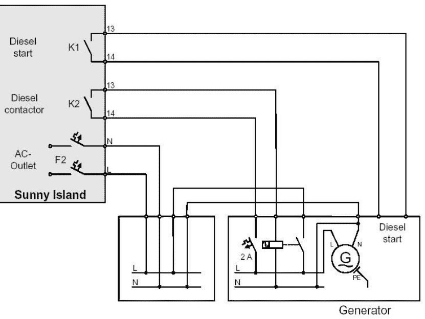

图 5-5：发电机连接 [SMA]

从图 5-5，为了启动电机，逆变器将激活接触器 `K1`。在这种情况下，操作员必须根据发电机类型正确地连接启动电路。电机启动后，逆变器将测量电机电压。逆变器将电机（`K2`）连接到系统电源线。如果混合系统连接和配置正确，混合系统应该正常工作。


在混合系统工作后，接下来实现监控系统。监控系统可以在混合系统启动之前或之后连接到逆变器。如所述，采集软件每分钟从逆变器获取监控数据，然后将其存储在嵌入式模块中。操作员可以通过通过 `TCP/IP` 网络的 `GSM` 调制解调器连接到 `Web` 服务器并将监控数据下载到主站。操作员可以通过 `Linux` 系统或 `Windows` 系统上的标准网络浏览器访问网站。

图 5-6 显示了实现交互式监控网站的测试设施图片。

``

图 5-6：实现的监控系统图

### 5.3.1 调制解调器拨入

由于调制解调器用于监控网站与主站之间的通信，因此嵌入式模块被设置为拨入调制解调器。操作员可以通过电话拨入嵌入式模块，然后通过浏览器访问嵌入式模块上的信息。

当操作员在连接了调制解调器的主 `PC` 上拨打嵌入式监控模块 `GSM` 调制解调器的电话时，嵌入式模块会接听并将 `PC` 连接到嵌入式模块。一旦连接，嵌入式模块会向 `PC` 发送登录提示。然后 `PC` 登录并访问嵌入式模块。嵌入式模块中处理拨入的程序称为 `getty`。

`getty` 是为拨入而运行的程序。它负责接听电话。有几个名称略有不同的 `getty` 程序。只有某些带有调制解调器的特定程序可用于拨入。此 `getty` 程序通常在启动时启动。它必须从 `/etc/inittab` 文件中调用。

# 第 5 章：实现与结果

有四个不同的 `getty` 程序：`mgetty`、`uugetty` 和 `agetty`。从中进行选择时必须使用带有调制解调器拨入的程序。`getty` 是这四个程序中最简单且最弱的，主要用于直接连接终端的调制解调器。`mgetty` 支持传真和语音邮件，但 `Ugetty` 不。`getty_em` 是 `ugetty` 的简化版本。因此，`mgetty` 是最佳选择。`mgetty` 的编写是为了作为 `mgetty` 出现之前存在的 `ugetty` 的替代品。

调制解调器拨入涉及以下子系统（见图 5-7）：

- `mgetty` 仅在电话铃响时“接听”电话并建立串口线路。之后，调用 `pppd` 进行拨入。
- `PPPd` 程序将互联网流量（`TCP/IP`）封装成串行数据包，数据包可以通过调制解调器线路设置到客户端。在连接开始时，它会验证用户身份。
  - 文件 `/etc/ppp/pap-secrets` 是允许通过调制解调器登录的用户列表。它提供了密码列表。
  - `PPPd` 程序通过互联网将网络流量转发到最终目标。

图 5-7 显示了拨入流程图。

``

图 5-7：拨入图

## 5.4 交互式监控网站的结果

一旦进入监控网站，通过 `HTML` 和 `PHP` 脚本的结合，交互式监控网站可以提供混合系统的最新数据（间隔为一分钟）。这非常重要，因为操作员可以在需要时对系统采取采取行动。交互式网站还提供了在线调整逆变器参数的可能性。图 5-8 显示了交互式监控网站首页的一项功能。

# 第 5 章：实现与结果

``

图 5-8：交互式监控网站首页

在操作员连接到嵌入式模块后，可以打开浏览器并输入 `Web` 服务器的地址以访问网站。一旦操作员在首页访问网站（见图 5-8），操作员就可以立即看到系统的一些重要监控数据。这可以帮助操作员判断系统正在运行。图 5-8 所示的网站功能通过 `Internet Explorer` 打开。

### 5.4.1 下载监控数据

在监控网站首页首页，操作员可以找到下载监控数据的链接。一旦操作员输入密码，就会看到数据管理页面。图 5-9 到 5-11 显示了下载数据的链接和数据管理页面。

``

> 图 5-9：下载链接

``

> 图 5-10：密码区域

``

> 图 5-11：数据管理页面

从 5-11 开始，操作员可以通过数据链接下载监控数据并保存到主站。如前所述，嵌入式模块内存有限，因此操作员应定期下载监控数据，然后删除旧数据以为下次监控提供空间。

要删除旧数据，数据管理页面为操作员提供了功能（如果操作员不删除旧数据且内存满了，采集软件将删除旧数据以便为第二天留出空间）。

要删除旧监控数据，操作员只需点击需要删除的监控数据，然后点击删除菜单。点击删除菜单将删除所选的监控数据。图 5-12 显示了删除菜单

``

> 图 5-12：删除菜单

### 5.4.2 设置参数

在设置参数链接处，操作员可以访问参数网页。访问此网页需要密码。操作员进入此页面后，可以选择要设置的逆变器。一旦操作员选择了逆变器，所有参数的当前值都将显示。这将帮助操作员在调整时不会出错。图 5-13 显示了首页的一项功能。该程序将通过项目使用。

``

> 图 5-13：首页功能

``

> 图 5-14：设置网页

``

图 5-15：来自电池、光伏组件组和发电机的功率

如图 5-16 所示，来自电池的功率 (`Pconv`) 及其 `SOC`（电量状态）。如第 2 章所述，`SOC` 表示电池中可用能量的多少。逆变器会监控电池的 `SOC`。如果设定点的 `SOC` 较低，逆变器将激活发电机。图 5-16 可以描述为：

- 当电池向负载供电时，电量状态 (`SOC`) 正在下降。在早上，当负载较高时，电池的功率迅速增加。此时，`SOC` 也在迅速下降。
- 当图上的 `SOC` 达到约 40% 的设定点时，发电机开始为系统供电。
- 来自发电机的功率也会为电池充电，因此 `SOC` 正在增加。
- 当电池功率达到约 80% 的高水位设定点时，发电机停止运行。

从图 5-16 的图表中，可以确保系统正在运行。此外，操作人员有可能通过网站更改 `SOC` 的设定点，以优化可靠性方面的功率输出。

``

图 5-16：来自电池的功率及其 `SOC`（电量状态）

混合系统的电池管理逆变器非常重要。它监控电流、电压和温度的限值。它根据 `SOC` 控制并监控充电情况。电池根据电池的类型进行充电。操作人员必须向逆变器输入正确的电池类型。电池的最终充电电压将根据相应的电池温度进行调整。温度高于 20 °C 以上，充电电压会降低。

逆变器有以下四种充电方法：

- 正常充电（尽可能频繁）
- 充满充电（约一个月）
- 均衡充电（约每 2-3 个月一次）
- 浮动充电（充电完成后）

当电池达到特定状态时，由电池管理系统初始化充电。图 5-17 显示了铅酸电池充电方法的图表。当 `SOC` 降至 70% 以下时进行正常充电。

默认情况下，每两周完成一次充满充电。充满充电会导致电池完全充满，以避免由于低 `SOC` 导致的不可逆老化。均衡充电大约每 180 天启动一次，以防止充电程度不一的单电池。浮动充电是根据电池的维持电压关闭充电。

``

图 5-17：电池的充电方法 [SMA]

从图 5-17 来看，当 `SOC` 低于 70% 时进行正常充电。从正常充电开始，当电池电压达到 2.55 V 时，充电方法可以进入浮动充电、充满充电或均衡充电。如果周期未处于充满充电或均衡充电，则充电方法将进入浮动充电。如果周期超过 14 天，充电方法将进入充满充电。在充满充电时，它将充电并将电池保持在 2.55 V 五个小时，然后进入浮动充电。如果周期超过 18 天，充电方法将进入均衡充电。在均衡充电时，它将充电并将电池保持在 2.45 V 十个小时，然后返回浮动充电。

此外，逆变器具有切换操作。`SOC` 决定了充电动作。图 5-18 显示了取决于 `SOC` 的切换操作图。

``

图 5-18：取决于 `SOC` 的切换操作 [SMA]

从图 5-18 来看，当 `SOC` 低于 44% 时，继电器 `N4` 开启，激活发电机为电池充电。如果电池低于 30%，继电器 `L1` 激活以关闭某些负载（万情况下，发电机未启动）。如果 `SOC` 低于 20%，继电器 `L2` 激活以关闭所有负载。如果 `SOC` 低于 10%，逆变器将停止激活。

如果 `SOC` 高于 100%，继电器 `01` 激活以开启负载卸载，如果 `SOC` 仍在增加，继电器 `02` 激活以关闭其他电源（如果适用的话）。

然而，继电器的操作计算也考虑了电池温度和 `SOC` 的设定点。铅酸电池在 `SOC` 的 40% - 70% 范围内运行良好。因此，操作人员应在此范围内调整设定点。

如所述，电池温度是系统最重要的参数之一。图 5-19 显示了系统的电池电压 (`Ubat` 平均值)、电池电流 (`Ibat`) 和电池温度 (`Tbat` 平均值)。

``

图 5-19：电池电压、电流和温度

从图 5-19 来看，当 `SOC` 低于 70% 时进行正常充电。从正常充电开始，当电池电压达到 2.55 V 时。充电方法可以。电池电压变化时，温度会增加。

电池电流产生热量：`$P = i^2R$`。其中 `$P$` 是功率，`$i$` 是电流，`$R$` 是电阻。

图 5-20 显示了系统频率 (`Fconv`) 和发电机功率 (`Pext`)。在电池充电期间，频率稳定在 50 Hz。

``

图 5-20：系统频率 (`Fconv`) 和发电机功率 (`Pext`)

频率波动是非常重要的。它应该符合国家标准。从图 5-20 来看，波动在 49.8 Hz 到 50.1 Hz 之间是可以接受的。

图 5-21 显示了没有光伏组件的情况。在没有光伏组件的情况下，电池电量尽，发电机必须启动。

- 系统正常向负载供电。
- 早上负载在增加。
- 直到中午，电池空电，因此发电机开始供电。
- 16:30 左右电池充满，发电机停止运行，电池向负载供电。

从图 5-21，在没有光伏组件的情况下，电池尽早为空，发电机必须尽早启动。通过这些监控数据，操作人员可以学习系统的行为以便未来改进。

``

图 5-21：未启动发电机时的电池功率 (`Pconv`) 和光伏功率 (`Ppv`)

图 5-22 是来自电池的转换功率及其电量状态，当电量状态达到设定点 40% 时，发电机开始为系统供电。

``

图 5-22：来自电池的功率及其 `SOC`（电量状态）

``

图 5-23：电池电压和电池温度。它表明当电池电压变化时，电池温度会增加，特别是在充电期间。

``

图 5-24：未启动发电机时的 `Pconv`, `Ppv` 及其 `SOC`

图 5-24 显示了未运行发电器的系统。在这种情况下，系统在白天从光伏模块接收功率。在一天结束之前，电池并不会耗尽。`SOC`（电池电量）未达到设定值，因此当天没有启动发电机。

### 5.5.2 来自光伏逆变器的监控数据

光伏逆器的监控数据指示了来自辐射的能量状况。由于光伏柴油混合动力系统是太阳能和柴油发电机的结合，因此分析光伏逆变器的监控数据对于评估系统能力和改进系统尺寸至关重要。

光伏逆器本身完全消耗能量。当辐射达到光伏逆器的启动电压时，光伏逆器将自动激活。当光伏逆器激活时，光伏电将供应给系统。当光伏电压低于光伏逆器的停止电压时，光伏逆器将去激活。光伏逆器的启动和停止电压可以通过网页进行调整。图 5-25 显示了光伏逆器的光伏功率图。

从图 5-25 可以看出，在上午 9:00 左右由于太阳辐射足够高，光伏逆器开始将光伏功率连接到系统，并在下午 19:30 左右由于辐射低于停止电压时与系统断开连接。当辐射通常在中午时，光伏功率会增加。

``

图 5-25：光伏模块的功率输出

图中间部分的许多峰值是因为天气原因。监控当天天气并不晴。

通过数据分析，操作人员可以确保系统运行正常。此外，操作人员可以从监控数据中学习，以优化系统并保持系统可靠运行。

## 5.6. 总结

利用带有嵌入式 `Linux` 系统的低输入功率嵌入模块用于光伏柴油混合动力系统的交互式远程监控网站。使用了基于 `TCP/IP` 网络的 `GSM` 调制解调器，允许数据直接传输到主站。由于使用了开源软件，监控系统所需的投资和运行成本非常低，且工作站不需要任何特殊软件。操作人员可以通过标准的浏览器访问监控网站。

交互式监控网站允许操作人员通过网页调整逆变器参数，并将监控数据下载到主站。操作人员有能力分析最新的监控数据。

访问、分析最新监控数据以及在线更改运行参数的能力，提高了混合动力系统的可靠性。操作人员可以确定混合动力系统正在正常工作。操作人员可以从分析中了解系统的行为。此外，这些优点可以提高公众对可再生系统的印象，激发他们对光伏领域的兴趣。

嵌入式交互监控网站被证明是一个非常合适的解决方案，特别是在缺乏基础设施的偏远地区。

# 第 6 章：结论与展望

本论文解决了两个问题：光伏模块发电技术的快速演进，以及用于偏远地区光伏柴油混合动力系统监控的基于网络的技术。

论文说明，在 20 世纪的最后十年里，光伏在全球的市场渗透率大幅增加，因为光伏可以提供清洁能源且不产生环境问题。此外，在偏远和农村地区，光伏柴油混合动力系统（一种结合太阳能、柴油发电机和蓄电池的独立能量系统）被用于供电。由于偏远地区的电网供应通常意味着电网供应商面临更高的成本，在许多情况下，偏远地区的电网电气化在财务上是无效的，特别是由于偏远地区消耗较低。因此，光伏柴油混合动力系统非常适合为偏远地区提供电力。

安装光伏柴油混合动力系统时，必须包含一个监控系统。本文的工作主要集中在安装于偏远农村地区的光伏柴油混合动力系统的交互式监控网站。

论文提出的交互式监控网站由监控单元、数据采集单元和通信单元组成。所提交互式监控网站的理念是监控数据存储在远程 `Web` 服务器上。操作人员可以通过浏览器访问监控数据，通信链路使用基于 `TCP/IP` 网络的标准 `GSM` 调制解调器。交互式监控网站允许操作人员通过网页下载监控数据并向系统组件上传运行参数。

本文阐述了嵌入式 `Linux` 交互式监控系统是一个非常合适的解决方案，特别是在基础设施匮乏的远地区。

## 展望

与本项目相关的未来工作应集中在以下方面：

- 还应考虑网络可用性和互联网安全问题等风险。
- `Linux` 和 `PHP` 的源代码均已开源并会定期更新，因此在未来可以对监控系统进行优化和改进。
- `Apache` `Web` 服务器会定期更新，因此可以针对监控系统对其进行优化和改进。
- 该项目的嵌入式硬件仍存在存储限制，这在未来可以考虑进行改进。
- 在与监控系统实施之前，可能需要对新版本的 `Sunny` 系列逆变器进行检查验证。
- 目前监控软件仅针对 `Sunny` 系列实现。要将监控软件应用于其他类型的系统组件，必须对软件进行扩展。

## 参考文献

- [1] Gabriele Seeling-Hochмут, *Optimization of Hybrid Energy Systems Sizing and operation control*, a dissertation at University of Kassel, Germany, 1998.
- [2] Report `IEA-PVPS T7-06:2002`, *Market deployment strategies for PV systems in the built environment*, `PVPS 2002`
- [3] S. Thawatchai, *State of word PV*, Seminar `KMITT Thailand 2003`
- [4] Sascha Bevergen, *Mini Grid Kit report-EMS strategy review*, University of Kassel, Germany, 2001.
- [5] Britta Buchholz, *Smart Web Index and data exchange options*, a dissertation at University of Kassel, Germany, 2001.
- [6] W. Kleinkauf, Mohamed I. A. Ibrahim, *Decentralized Hybrid Renewable Energy Systems*, a dissertation at University of Kassel, Germany, 2002.
- [7] John Lombardo, *Embedded Linux*, New Riders, 201 West 103rd Street, Indianapolis, Indiana 46290, 2001.


- [8] J. Schmid, Photovoltaic systems Technology, teaching script, a-RE, University of Kassel, Germany, 2002.

- [9] D. Thevenard, M. Ross, and G. Howell, A checklist for PV system monitoring, Numerical Optics Inc. Waterloo, Ont. Canada 1998-15.

- [10] S. Krauter, T. Depping, Monitoring of Remote PV-Systems by Satellite, conference PV in Europe, 7-11 Oct. 2002, Rome Italy.

- [11] C. Emrich, W. Wilson, and G. Ventre, Supervisory control and data acquisition using the advanced communications technology satellite: Lessons learned, Florida Solar Energy Center, 1679 Clearlake Road, Cocoa, FL 32922-5703.

- [12] C. Nyman, Lars B Mansner, PV system application using internet for monitoring, conference PV in Europe, 7-11 Oct. 2002, Rome Italy.

- [13] Nipon Ketjoy, Photovoltaic-Diesel Generator Hybrid system by the Energy Park, Naresuan University, Phitsanulok 65000 Thailand, 2001.

- [14] Daniel Hernandez Torrent, PV-Diesel Hybrid Systems-potential-dimensioning and rent ability in the Canary Islands, a master thesis at University of Kassel, Germany, 1999.

- [15] Jan Keydel, Potential and chances for rural electrification with renewable energy in Brazil, a master thesis at University of Kassel, Germany, 1999.

- [16] B. Plangklang. Solar energy for the future, ThaiSAC, Aachen, 2003.

- [17] Michel Vandenberg, Deliverable D7: Mini Grid Kit Manual, ISET Koenigsberg 59, 34119, Kassel, Germany, 2003.

- [18] Ingo Hahn, Softwareentwicklung eines innovativen 'Energiemagement-System' fuer autonome Energieversorgungsanlagen, a Master Thesis at University of Kassel, Germany, 2001.

- [19] Gabler H., Wiemken E.: Modelling of stand-alone PV-hybrid systems and comparison of concepts?, Proceedings of 2nd World PV Conference, January 1998.

- [20] Roger Mesger, Photovoltaic Systems Engineering, CRC Press, Florida, 2000.

- [21] Andrew s. Tanenbaum, Computer Networks, fourth edition, Prentice Hall, Upper River, NJ, 2003.

- [22] Farth Sheriff, Dave Turo, Monitoring Photovoltaic Hybrid Systems in Northern Site, CANMET, P.O.Box 4800, Varennes, Canada, 2002.

- [23] SMA Foundry, Brochure, Hannover, Germany.

- [24] Yasuke Matsuoka, Introduction to `TCP/IP`, `EE201A` Spring/2003.

- [25] Stig S. Bakken, `PHP` Manual, Published 2002.

- [26] Craig Hollabaugh, Embedded `Linux`, Hardware, Software, and Interfacing, Pearson Education, 201 W. 103rd Street, Indianapolis, IN 46290, 2002.

- [27] Product Manual, Copyright © 2002, elle Computertechnik AG.

- [28] `http://www.linux.org`

- [29] `http://www.linux.org`

- [30] `http://www.linux.org`

- [31] `http://www.linux.org`

- [32] `http://www.linux.org`

- [33] `http://www.linux.org`

- [34] `http://www.linux.org`

- [35] `http://www.linux.org`

- [36] `http://www.linux.org`

- [37] `http://www.linux.org`

- [38] `http://www.linux.org`

- [39] `http://www.linux.org`

- [40] `http://www.linux.org`

- [41] `http://www.linux.org`

- [42] `http://www.linux.org`

- [43] `http://www.linux.org`

- [44] `http://www.linux.org`

- [45] `http://www.linux.org`

- [46] Yasuke Matsuoka, Introduction to `TCP/IP`, `EE201A` Spring/2003.

# 附录 A：HTML 和 PHP 脚本

```html
<td height="38" bgcolor="#66FFFF"><div align="right"><font size="2" face="MS Sans Serif"><strong>-Uac-</strong></font></div><td border="#FF0000" bgcolor="#FFFFFC"><div align="center"><font size="2" face="MS Sans Serif"><strong></font></div></td>
<
```

```php
<?php $text=fgetline($FILE,16);
print($text);
?>
<td bgcolor="#9999FF"><div align="left"><font size="2" face="MS SansSerif"><strong>-Volts-</strong></font></div></td>
```

```html
<td height="38" bgcolor="#66FFFF"><div align="right"><font size="2" face="MS Sans Serif"><strong>-Pac-</strong></font></div><td border="#FF0000" bgcolor="#FFFFFC"><div align="center"><font size="2" face="MS Sans Serif"><strong></font></div></td>
<
```

```php
-?>
<?php $text=fgetline($FILE,16);
print($text);
?>
<td bgcolor="#9999FF"><div align="left"><font size="2" face="MS SansSerif"><strong>-</strong></font></div></td>
```

```html
<td height="38" bgcolor="#66FFFF"><div align="right"><font size="2" face="MS Sans Serif"><strong>-</strong></font></div><td border="#FF0000" bgcolor="#FFFFFC"><div align="center"><font size="2" face="MS Sans Serif"><strong></font></div></td>
<

```

```php
<?php $text=fgetline($FILE,16);
print($text);
?>
<td bgcolor="#9999FF"><div align="left"><font size="2" face="MS SansSerif"><strong>-</strong></font></div></td>
```

```html
<td height="38" bgcolor="#66FFFF"><div align="right"><font size="2" face="MS SansSerif"><strong>-</strong></font></div><td border="#FF0000" bgcolor="#FFFFFC"><div align="center"><font size="2" face="MS Sans Serif"><strong></font></div></td>
<
```

```php
<?php $text=fgetline($FILE,16);
print($text);
fclose($FILE1);
fclose($FILE2);
?>
</</td>
<td bgcolor="#9999FF"><div align="left"><font size="2" face="MS SansSerif"><strong>-</strong></font></div></td>
</tr>
```

```html
<table>
<table width="45%" border="3" align="center">
<tr>
<td bgcolor="#999966"><div align="center"><font size="1" face="MS Sans Serif">点击刷新菜单栏</td>
</tr>
```

```html
<p>&nbsp;</p>
<table width="22%" height="46" align="center">
<tr>
<td height="32" border="#366999"><div align="center"><font size="2" face="MS Sans Serif"><strong><a href="pass.htm">下载数据-</a></strong></font></div></td>
</tr>
```

```html
</table>
<table width="28%" height="44" align="center">
<tr>
<td height="30" bordercolor="#333399"><div align="center"><font size="2" face="MS Sans Serif"><strong><a href="pass_set.htm">设置参数-</a></strong></font></div></td>
</tr>
</table>
```

```html
<td>
</table>
<div align="center">...
```

## A.2 管理页面 HTML 和 PHP 脚本（下载和删除）

### A.2.1 下载页面代码

```html
<html>

<head>

...

```

```php
<?php
function puts($what, $color="black")
{
    print("<font color=$color>$what</font>");
}
if($folder!="")
{
    $url = $folder;
    $path = $folder;
}else{
    $url="http://localhost/data/";
    $path="/local/htdocs/data/";
}
$DIR=opendir($path);
echo"<b>目录</b><br>";
print("<a href=$url></a>\nprint("<br>当前文件夹 $folder</p>");
print("<form name=form method=get action=delete.php>");
print("<input type=\"hidden\" name=path value=\"$path\">");
print("<input type=\"hidden\" name=url value=\"$url\">");
echo"<table border=\"0\">";
echo"<tr bgcolor=\"yellow\">";
echo"<tr><td>名称</td><td>大小</td>编辑</td><td>删除</td></tr>";
echo"<tr><td></td><td></td><td></td><td></td>";
while($file=readdir($DIR)) &&($file!="..")
{
    echo"<tr>";
    if(is_file($path.$file))
    {
        echo"<td><a href='$url$file'>$file</a></td>";
        echo"<td>".filesize($path.$file)."</td>";
        if(is_executable($path.$file))
        {
            echo"<td>red</td>";
        }
        if(is_readable($path.$file))
        {
            echo"<td>blue</td>";
        }
        if(is_writable($path.$file))
        {
            echo"<td>green</td>";
        }
        print("<td><input type=\"radio\" name=del value=\"$file\"></td>");
    }
    elseif(is_dir($path.$file))
    {
        print("<td><b><a href=\"file_test.php?");
        print("folder='$url$file&path='$path\">$file</a></b></td>");
        print("<td><input type=\"radio\" name=del value=\"$file\"></td>");
    }
    echo"</tr>";
}
echo"</table>";
print("<input type=\"submit\" name=Submit value=\"删除文件\">");
closedir($DIR);
```

```php
?>
<p>&nbsp;</p>
<table width="28%" height="5" align="center">
<tr>
<td height="30" bordercolor="#333399"><div align="center"><font size="2" face="MS Sans Serif"><a href="index.php"></a>
返回 <a>主页</a></b></div></div></td>
</tr>
</table>
</form>
</font>
</body>
</html>
```

### A.2.2 删除数据的 HTML 和 PHP 脚本


# 附录 A：HTML 和 PHP 脚本

## A.3 删除文件

```html
<html>
<head>
<title>删除文件</title>
<meta http-equiv="Content-Type" content="text/html; charset=windows-874">
</head>
<body>
<font size="2" face="MS Sans Serif, Tahoma, sans-serif">
<?php
if ($del == "") {

    print("<b>无可删除！</b><br>");
    exit();
}

print("<URL:<<b>$url</b></a></a><br>");
print("<当前文件夹 <<b>$path</b></a>path<br>");

if(is_dir($path.$del)) {

    print("<删除文件夹: <b>$del</b></a><br>");
    if(rmdir($path.$del)) {

        print("<可以删除此文件夹！</a><br>");
    } else {

        print("<文件夹已删除！</a><br>");
    }
} else {

    print("<删除文件: <b>$del</b></a><br>");
    if(unlink($path.$del)) {

        print("<文件已删除！</a><br>");
    } else {

        print("<无法删除此文件！</a><br>");
    }
}
?>
<table width="28%" height="44" align="center">
<tr>
<td height="30" bordercolor="#333399"><div align="center"><font size="2" face="MS Sans Serif"><a href="file_test.php"></a></font>
返回文件管理器<b><a>文件管理器</a></b></div></td>
</tr>
</table>
</font>
</body>
</html>
```

## A.3 设置参数页的 HTML 和 PHP 脚本

```html
<html>
<head>
<title>设置参数 sunny</title>
<meta http-equiv="Content-Type" content="text/html; charset=windows-874">
</head>
<body>
<form name="form1" method="post" action="submit_island.php">
<div align="center">
<p style="font-size:5px">Ms Sans Serif, Tahoma, sans-serif</p>
Island/</p></p>
<table border="1">
<tr>
<td align="center">通道 | 参数 | 值</td>
</tr>
<tr>
<td><td>
<?php 
$FILE = ffopen("/home/boonyang/projects/sunny_logger/status1.txt", "r");
echo "<tr>";
echo "<<td>";
$text = fgets($FILE,60); // 读取整行
puts($FILE, "$text"); // 尚未知
print($text);
echo "</td></td>";
echo "</tr>";
?>
fclose($FILE);
</td></td>
</tr>
</table>
```

```html
<option> 柴油 t2 开始</option>
<option> 柴油 t2 结束</option>
</select>
</div></td></td>>
<td width="38%"><p align="center">
<input name="textfield11" type="text" maxlength="15">
</p></td>
<td width="38%"><p align="center">
<input name="textfield12" type="text" maxlength="15">
</p></td>
</tr>
<table>
<table width="51%" border="1">
<tr>
<td width="37%"><div align="center">
<select name="select2">
<option selected>----------</option>
<option> 转换电压额定</option>
<option> 外部电压额定</option>
<option> 外部电压最小值</option>
<option> 外部电压最大值</option>
<option> 环境温度额定</option>
<option> 外部温度额定</option>
<option> 外部温度最小值</option>
<option> 外部温度最大值</option>
<option> 充电最大电流</option>
<option>  {电最大电流</option>
<option> 电池电压最小值</option>
<option> 电池电压最大值</option>
<option> 满电时间</option>
<option> 等值时间</option>
<option> 充电充满时间</option>
<option> 充电相等时间</option>
<option> 充电充满电压</option>
<option> 充电相等电压</option>
<option> 柴油 t2 开始</option>
<option> 柴油 t2 结束</option>
</select>
</div></td></td>
<td width="38%"><p align="center">
<input name="textfield21" type="text" maxlength="15">
</p></td>
<td width="38%"><p align="center">
<input name="textfield22" type="text" maxlength="15">
</p></td>
</tr>
</table>
<table width="51%" border="1">
<tr>
<td width="37%"><div align="center">
<select name="select3">
<option selected>----------</option>
<option> 转换电压额定</option>
<option> 外部电压额定</option>
<option> 外部电压最小值</option>
<option> 外部电压最大值</option>
<option> 环境温度额定</option>
<option> 外部温度额定</option>
<option> 外部温度最小值</option>
<option> 外部温度最大值</option>
<option> 充电最大电流</option>
<option>  {电最大电流</option>
<option> 电池电压最小值</option>
<option> 电池电压最大值</option>
<option> 电池温度最大值</option>
<option> 满电时间</option>
<option> 等值时间</option>
<option> 充电</option>
<option> 充电充满时间</option>
<option> 充电相等时间</option>
<option> 充电</option>
<option> 充电充满电压</option>
<option> 充电相等电压</option>
<option> 柴油 t2 开始</option>
<option> 柴油 t2 结束</option>
</select>
</div></td></td>
<td width="38%"><p align="center">
<input name="textfield31" type="text" maxlength="15">
</p></td>
<td width="38%"><p align="center">
<input name="textfield32" type="text" maxlength="15">
</p></td>
</tr>
</table>
<p><strong><font size="5" face="MS Serif, Tahoma, sans-serif">字体</font></strong></p>
<form>
<input type="submit" name="设置参数">
</form>
<p>&nbsp;</p>
<div>
<body>
<html>
```

## A.4 软件安装

选择嵌入式模块后，可以进行软件安装。第一个安装是嵌入式 Linux 系统。

### A.4.1 嵌入式 Linux 安装

如所述，嵌入式 Linux 可以在线免费获取。准备好硬件后，按照 `http://www.whitedwarux.org` 链接安装 Dwarf Linux：

1. 在 BIOS 中设置正确的时间。如果没有完成，系统将认为硬盘文件系统已过期。密码和其他工具也会受到错误日期的影响。
2. 下载并创建启动盘和根镜像进行安装。使用 Linux 机器创建：

   ```
   dd if=boot.img of=/dev/fd0
   ```

   插入另一个软盘使用这些命令：

   ```
   mksfs /dev/fd0
   mount /fd0 /mnt
   cp root.tar.bz mnt
   umount /mnt
   ```

   从 DOS 机器使用 `.EXE`，在提示符处：`C:\> WRITE`。回答关于文件名的提示。对根盘执行相同的操作。
3. 使用启动盘启动。在启动过程中应出现以下内容：

   ```
   RAM disks 5000K size hda: SD-128, ATA ide0 at 0x1f-0x17, irq 14 hda:ST-12, 15MB Cache, CS=490
   ```

   如果没有出现上述信息，说明是硬件问题。应该继续启动并提示根盘或 cdrom。
4. 选择并格式化媒体。需要时使用退格键输入分区。
   - 当询问分区未完成时，选择 no，然后选择 yes。
   - 使用 `'d'` 命令删除现有分区。
   - 使用 `'n'` 创建新分区。
   - 分区编号应为一，大小应为默认。
   - 创建分区后使用 `'p'` 命令保存。它应该显示：
     ```
     Command (help): p
     Disk/dev/hda: 2 heads, 32 sectors, Units = 64 native cylinders
     ```
   - 使用 `'w'` 命令保存更改，需要时使用 `'q'` 退出。
   - 如果需要格式化分区，在提示提示选择 yes。
5. 选择网络安装。安装程序将运行 `'netconfig'` 命令。回答所有关于网络的问题。`netconfig` 后应出现以下内容：
   ```
   eth0: 尝试使用 Base-T (RJ45)
   ```
   安装程序将使用 `ping` 确保可以使用选定的主机。
6. 下载软件包。安装程序将安装一些软件包并允许从列表安装。
   - 完成后，移除所有软盘。
   - 按下重置。

现在硬件应该从 FLASH 驱动器启动 linux `2.4.18` (或 `2.2.20`) 并设置嵌入式 Linux 平台。

### A.4.2 HTML 和 PHP 安装

嵌入式平台完成后，可以安装 Web 服务器和 PHP。安装 PHP 后，需要 `gcc`、`Makefile` 等开发工具。此外，必须确保已安装开发工具。本节将描述带有 PHP 的 Apache Web 服务器安装。如所述，PHP 和 Apache 是开源，可以在网上免费获取。两个版本均由 `"xxx"` 表示。以下是安装步骤：

1. `gunzip apache_xxx.tar.gz`
2. `tar -xvf apache_xxx.tar.gz`
3. `gunzip php-xxx.tar.gz`
4. `tar -xvf php-xxx.tar.gz`
5. `cd apache_xxx`
6. `./configure --prefix=/www --enable-module=so`
7. `make`
8. `make install`
9. `cd ../php-xxx`
10. `./configure --with-mysql --with-apxs=/www/bin/apxs`
11. `make`
12. `make install`

- 如果操作员决定在安装后更改配置选项，需要重复最后三个步骤。

13. 设置 `php.ini` 文件：
    `cp php.ini-dist /usr/local/lib/php.ini`
14. 编辑 `httpd.conf` 以加载 PHP 模块。`LoadModule` 元素右侧的路径必须指向系统中 PHP 模块的路径。
    - 对于 PHP 4: `LoadModule php4_module libexec/libphp4.so`
    - 对于 PHP 5: `LoadModule php5_module libexec/libphp5.so`
15. 在 `httpd.conf` 的 `AddModule` 部分，`ModuleList` 下方添加此：
    - 对于 PHP 4: `AddModule mod_php4.c`
    - 对于 PHP 5: `AddModule mod_php5.c`
16. 告诉 Apache 解析某些扩展为 PHP。例如，让 Apache 解析扩展为 PHP：
    `AddType application/x-httpd-php .php .phtml`
    
    通常也会设置 `.php` 扩展以显示高亮的 PHP 源码，可以通过以下实现：
    `AddType application/x-httpd-php-source .php`

现在动态 Web 服务器（Apache 和 PHP）已就绪。

### A.4.3 Apache Web 服务器和 PHP 脚本初始化

- `/path/to/apache 停止`
- `/path/to/apache 启动`

# 附录 B：C 语言编程

## B.1 代码编程

```c
**** 数据记录器监控程序****

#include <stdio.h>
#include <time.h>

***** 包含 SMA 源码 *****

//include "string.h"

#include "os.h"
#include "smadata_layer.h"
#include "smadef.h"
#include "chandef.h"
#include "libyasdi.h"
#include "libdimaster.h"

******** 定义子函数 **********

void PrintDevList();
void DoCommands(int DetectCheck);
void PrintChannelValues(WORD ChanMask, DWORD DevHandle, DWORD DevCount);
void DoStartDetection(WORD void);
void SetParamValue(void void);
```

```c
DWORD ChanHandle[100]; //最大100个通道
char CharName[200];
char DevName[200];
int i;
int ChanCount;
//DWORD DevHandle;
double Value;
char TextBox[30];
DWORD MaxMaxValue = 10; /* 通道值的最大年龄（秒）... */
```

```c
printf("Device handle: %ld \n", DevHandle); // 测试
ChanCount = GetChannelHandles(DevHandle, ChanHandle, 100, ChanMask, 0);
GetDeviceName(DevHandle, DevName, sizeof(DevName)-1);
printf("设备 '%s' 有 %d 个 %s通道:\n", DevName, ChanCount, (ChanMask & CH_PARA) ? "参数" : "点位");
printf("读取通道值，请等候...\n");
printf("------------------------------------------------------------\n");
printf("通道句柄 | 通道名称 | 通道值 |\n\n");
if(ChanMask&0x090f) // 我们将在第一天存储这些数据
{
    time(NULL);
    //printf("当前时间是 %s。\n", asctime(time(&time)));
    tblock = localtime(&time);
    TimeDate = asctime(localtime(&time));
    //strncpy(DateCamp, TimeDate, 20);
}
```

```c
************ 保存数据到目录 ************
//usr/local/httpd/htdocs/data
sprintf(dir,"%s/%s/%02d%02d%02d.txt", "/usr/local/httpd/htdocs/data", DevHandle, tblock->tm_mday, tblock->tm_mon+1, tblock->tm_year+1900, ".txt");
//out_file = fopen(dir,"a");
if(DateCamp != tblock->tm_mday)
{
```


### 附录 B：监控软件的 C 语言编程

```c
    DevCount=0; // 设置在第一行写入描述

    DateCamp = tblock->tm_mday;

}
```

```c

**********************************************

//retstrcp(DateCamp,dir);

// 尝试在第一行写入数据描述

if(DateCamp != tblock->tm_mday)

{

    DevCount++;

    DateCamp = tblock->tm_mday; // 仅用于下次比较

    fopen(dir,"a"); // 在此处向文件写入数据描述

    out_file = fopen(out_file,"NULL");

    if (out_file == NULL)

    {

        printf("打开文件失败 \n"); // 测试

    }

    else

        fprintf(out_file,"%s", "");

    for(i=0;i<ChanCount;i++){

        GetChannelName(ChanHandle[i],ChanName, 200);

        fprintf(out_file,"%20s", ChanName); // 存储数据的描述

    }

    fprintf(out_file,"\n");

}

```

```c

fclose(out_file);

}

i=0;

while(isalpha(TimeDate[i])!=0 || (TimeDate[i]== 0x20)) {

    // 只需要日期和月份

    {

        i++;

        TimeDate[i]='0';

        /********* 写入数据的读取时间 *********/

        sprintf(DataTime,"%s%%02d/%s%%02d,%s%%02d,%s%%02d", TimeDate, tblock->tm_mday, tblock->tm_mon+1, tblock->tm_year+1900, tblock->tm_hour, tblock->tm_min, tblock->tm_sec);

    }

/**/

i=0;

while(TimeDate[i]!='\n') // 去除计时器中的 '\n'

    i++;

TimeDate[i]='0';

/******* // 尝试将数据写入文件

out_file = fopen(dir,"w");

out_file2 = fopen("status/sunny_status.txt","w");

out_file3 = fopen("status/monitor_body.txt","w");

if (out_file == NULL || (out_file2==NULL)) {

    printf("打开文件失败 \n"); // 测试

} else {

    fprintf(out_file,"%s", DataTime); // 存储时间

    for(i=0;i<ChanCount;i++) {

        GetChannelName(ChanHandle[i],ChanName, 200);

        if(SunnySleep<=100)

            /***** 夜间读取数据无响应结果为零 *****/

            /* 获取通道值... */

            res = GetChannelValue(ChanHandle[i], DevHandle,&Value, 30, MaxValue);

            if(res==0) {

                /* 状态文本？*/

                if(strlen(Value)==0)

                    printf("%f", Value);

            } else {

                if(ChanMask & CH_PARA) {

                    if (out_file2 != NULL)

                        fprintf(out_file2,"读取通道失败\n...代码=%d\n",res);

                }

                printf("读取通道失败\n...代码=%d\n",res);

                break;

            }

            strcpy(Value,"<unknown>");

            strcpy(Value,"0.00000"); // 这里不行，数据为零

            SunnySleep=100;

            fprintf(out_file2,"* Sunny 休眠\n");

        }

}

```

```c

if (SunnySleep==100)

    strcpy(TextValue,"0.00000"); // 如果不行，数据为零

printf("%d |%16s |%s\n", ChanHandle[i], ChanName, TextValue);

fprintf(out_file,"%20s", TextValue);// 放入文件

/* 想要在网页首页显示的值 */

if((strcmp(ChanName,"Up")) || !strcmp(ChanName,"Iac")) || !strcmp(ChanName,"Uac")) || !strcmp(ChanName,"Pac")) || !strcmp(ChanName,"Pac")) || !strcmp(ChanName,"Fehler)))

{

    fprintf(out_file,"%15s", TextValue);// 用于网页首页监控

    if((strcmp(ChanName,"Ubat")) || !strcmp(ChanName,"Ibat)))

    if (Check==1)

    {

        out_file=4;

        fopen("status/monitor.txt","w"); // 打开文件

        Check = 1;

    }

    fprintf(out_file,"%15s", TextValue);// 用于网页首页监控

}

/* 想要在网页首页显示的值 */

if (ChanHandle[i]==54 || ChanHandle[i]==59 || ChanHandle[i]==60 || ChanHandle[i]==56 || ChanHandle[i]==69 || ChanHandle[i]==74 || ChanHandle[i]==80)

    fprintf(out_file,"%15s", TextValue);// 用于监控

}

fprintf(out_file,"\n");

fprintf(out_file3,"\n");

if (Check==1)

{

    fprintf(out_file4,"\n");

    fclose(out_file4);

}

if (SunnySleep !=100)

    fprintf(out_file2,"Sunny 良好\n");

fclose(out_file);

fclose(out_file2);

fclose(out_file3);

}

else // 这里是 SMA 的操作

if (ChMask==0x04f)

/* // 将参数也存储到文件

{

    fprintf(dir,"%s%%%s", "show_parameter", DevHandle, ".txt");

    out_file=fopen(dir,"w");

    if(out_file==NULL)

    {

        printf("打开文件失败 \n"); // 测试

    }

    for(i=0;i<ChNameCount;i++)

{

    GetChannelName(ChanHandle[i],ChanName, 200);

    if(SunnySleep !=100)

    /* 获取通道值... */

        res = GetChannelValue(ChanHandle[i], DevHandle, &Value, 30, MaxValue);

    }

}

```

```c

if(res==0)

{

    /* 状态文本？*/

    if(strlen(TextValue)==0)

        printf(TextValue,"%f", Value);

}

else

{

    if (ChanMask & CH_PARA)

    {

        /* if (ChanMask==0x04f)

            if (out_file != NULL)

                fprintf(out_file,"读取通道值失败...代码=%d\n",res);

        */

        printf("读取通道值失败...代码=%d\n",res);

        break;

    }

    strcpy(TextValue,"<unknown>");

    SunnySleep=100;

    /*if(ChMask==0x04f)

    {

        if (out_file != NULL)

    }

    fprintf(out_file,"读取失败。Sunny 未响应\n");

    */}

/* if (SunnySleep==100)

{

    strcpy(TextValue,"<unknown>");

*/

if ((ChanMask==0x04f) && (out_file != NULL) && (SunnySleep !=100)

    fprintf(out_file,"%15s", TextValue);

else

    printf("%d |%16s |%s\n", ChanHandle[i], ChanName, TextValue);

}

fclose(out_file);

}

```

```c

************************************************

描述：打印设备列表

************************************************

void PrintDevList()

{

    int i;

    DWORD DevHandles[10];

    char NameBuffer[200];

    DWORD DevCount=0;

    printf("--------------------------------------\n");

    printf("设备句柄 | 设备名称 \n");

    printf("--------------------------------------\n");

    for(i=0;i<DevCount;i++)

    {

        GetDeviceName(DevHandles[i], NameBuffer, 200);

        printf("%ld | %s\n", DevHandles[i], NameBuffer);

    }

}

```

```c

************************************************

描述：打印通道的所有状态文本

************************************************

void printStatTexts (DWORD ChanHandle)

{

    int i;

    int TxtCnt = GetChannelStatCnt (ChanHandle);

    if (TxtCnt)

    {

        printf("该通道的所有状态文本：\n");

        for (i=0;i<TxtCnt;i++)

        {

            char StatText[30];

            GetChannelStat(ChanHandle, StatText, sizeof(StatText)-1);

            printf("%2d: %s\n", i, StatText);

        }

    }

}

```

```c

************************************************

描述：设置通道值

************************************************

void SetParamValue(void)

{

    char Device[5],value[50]={};

    DWORD ChanHandle,DevHandle;

    double ChanValue;

    int iResult,dev,check=0;

    FILE *in_file,*out_file_res;

    printf("写入参数：n\n");

    printf("设备句柄： "); scanf("%ld", &DevHandle);

    in_file=fopen("status/device.txt","r"); // 从文件读取设备

    fgets(Device,5,in_file);

    fclose(in_file);

    sscanf(Device,"i=%ld", &DevHandle);//拷贝数据并转换为整数

    DevHandle=i; // 手动设置

    printf("通道句柄： "); scanf("%ld", &ChanHandle);

    in_file=fopen("status/parameters.txt","r"); // 读取参数

    if(in_file == NULL)

    {

        printf("打开文件失败 \n");

    }

    else

    {

        out_file_res = fopen("status/result_set.txt","w"); // 将结果写入文件

        if (out_file_res == NULL)

            printf("打开文件失败 \n"); // 测试

    }

}

```

```c

else

{

    while (fgets(value, 4, in_file) != NULL && (check(100))) // 从文件获取 chan

        printf("%s ", read_data);//// 测试

        {

            sscanf(value, "%ld", &ChanHandle);

            printf("File:%ld", ChanHandle); // 测试

            printStatStats(ChanHandle); // 如果有错误则打印状态！

            printf("New channel: %s"); scanf("%s", value);

            sscanf(value, "%lf", &ChanValue); // 转换为浮点

            fgets(value, 20, in_file); // 我们也检查文件末尾

            sscanf(value, "%lf", &ChanValue);

            i=0;

            while (value[i] != 0x20) // 去除 value 中的空格

            {

                i++;

            }

            dev=1;

            while (value[i] != '0') // 复制

                value[i-dev]=value[i];

                i++;

        }

        /* 用户输入的是文本还是数值？ ?*/

        if (value[0] > '9' || value[0] < '0')

        {

            // 插入文本，查找该值的状态文本索引

            int TCnt = GetChannelStatCnt( ChanHandle);

            int i;

            ChanValue = -1;

            for(i=0;i<TxtCnt;i++)

            {

                char StatText[30];

                strcpy(StatText, GetChannelStatText(ChanHandle, i));

                GetChannelStatText(ChanHandle, StatText, sizeof(StatText)-1);

                Trim(StatText, strlen(StatText));
```


# 录 B：监控软件的 C 语言编程

以下代码片段处理状态文本读取与通道值设置：

```c
Trim(value, strlen(value));

if (strcmp(value, StatText)==0)
{
    ChanValue = i;
    printf("Readed channel value: %f\n", ChanValue);
    break;
}

if (ChanValue == -1)
{
    printf("Unknown status text!\n");
    printf("Sorry, the channel can not be written!\n");
    printf("Please type in a correct status text!\n");
    return;
}

/* 用户输入了数值，这很简单： */
printf("Please wait...\n");
```

```c
iResult = SetChannelValue(ChanHandle, DevHandle, ChanValue);

if (iResult==0)
{
    printf("Ok, channel: %d was written!\n", ChanHandle);
    fprintf(out_file_res, "Error, channel: %d was written!\n", ChanHandle); // 写入文件
    fprintf(out_file, "%15s", TextValue); // 写入文件
}
else
{
    printf("Error, channel was not written! Error code=%d", iResult);
    fprintf(out_file_res, "Error, channel was not written: Error code=%d", iResult);
    check=100;
}

fclose(out_file_res);
fclose(in_file);
```

## 函数：`DoStartDetection`

**描述**：开始设备检测（查找所有设备）  
**参数**：（无）  
**返回值**：（无）

```c
void DoStartDetection()
{
    int iErrorCode;
    int DevCnt;
    FILE *out_file;

    printf("Count of devices to search: ");
    scanf("%d", &DevCnt);

    printf("Searching, please wait...\n");

    /* 执行主命令并 yasiddoMasterCmdx("detect", DevCnt,0,0);) */
    iErrorCode = yasiddoMasterCmdx("detect", DevCnt,0,0);

    if (iErrorCode < 0)
    {
        printf("Sorry, but I have found less than %d devices... (please don't beat me)\n", DevCnt);
        out_file=fopen("status_connect_status.txt", "w");
        if(out_file!=NULL)
            fprintf(out_file, "I have found less than %d devices... (please don't beat me)\n", DevCnt);
    }
    else
    {
        printf(" I have found at least %d devices:\n", DevCnt);
        out_file=fopen("status_connect_status.txt", "w");
        if(out_file!=NULL)
            fprintf(out_file, "Ok, I have found %d devices:\n", DevCnt);
        else
            printf(" Failed to open the file \n"); // 测试
    }

    fclose(out_file);
    PrintList();
}
```

## 函数：`DoCommands`

**描述**：解释命令...  
**参数**：（无）  
**返回值**：（无）

```c
void DoCommands(int DetectCheck)
{
    FILE *out_file, *in_file;
    char Cmd,begin[25],Restart[25],
    command[]=begin,command2[]="restart", Device[5];

    int res;
    DWORD DevHandle;
    DWORD DevHandles[10];
    int DevHandles; // 注意参数
    DWORD i;
    DWORD DevCount=0;
    bool bend= false;

    struct block {
        time_t timer;
        int one_minute=0;
        static DWORD DevSet, HandleSet[10];
        char NameBuffer[200];
    };

    /* 获取所有设备句柄...（最多10个）*/
    DevCount = GetDeviceHandles(DevHandles, 10);
    DevSet = DevCount; // 静态

    for(i=0;i<DevCount;i++)
    {
        HandleSet[i] = DevHandles[i]; // 静态
        /* 获取此设备的名称 */
        GetDeviceName(DevHandles[i], NameBuffer, 200);
        printf("%d | %s\n", DevHandles[i], NameBuffer);
    }

    printf("---\n");
    printf("\n");

    while (!bend)
    {
        if (DetectCheck) // 检查是否连接
        {
            start:
            Cmd = '?'; // 安全起见，不应发生
            out_file=fopen("wait.txt", "r");
            if(out_file==NULL)
            {
                fgets(begin, 20, out_file); // 开始参数
            }
            else
                printf("Failed to open the file \n");
            fclose(out_file);

            out_file=fopen("restart.txt", "r");
            if(out_file==NULL)
            {
                fgets(Restart, 20, out_file); // 重启模块
            }
            else
                printf(" Failed to open the file \n");
            fclose(out_file);
        }
    }

    res=strcmp(begin, command); // 设置参数，比较
    res2=strcmp(Restart,command2); // 重启？
    if(res2==0)
    {
        int main(int argc
```

```c
for(i=0;i<DevCount;i++){
    PrintChannelValues(HandleSet[i], DevCount); // 仅通道
}
break;
```

```c
case 's':
    SetParamValue(); // 设置参数后在网页上打印新数据
    in_file=fopen("device.txt","r"); // 从设备读取
    if(in_file!=NULL)
    {
        fgets(Device, 5, in_file);
    }
    else
        printf(" Failed to open the file \n");
    fclose(in_file);
    sscanf(Device,"%ld", &DevHandle); // 复制到设备并转换为整数
    DevCount = GetDevHandles(DevHandles, 10);
    PrintChannelValues(DevHandle, DevCount); // 所有通道
    out_file=fopen("status.txt","w"); // 表示完成所有参数设置
    fprintf(out_file,"555555555555"); // 参数
    fclose(out_file);
    break;
```

```c
case 'r':
    yasdiReset();
    break;
```

```c
case 'q':
    bEnd = true;
    break;
```

```c
case 'x':
    DoMasterCmd("shutdown");
    //bEnd = true;
    break;
```

```c
case '?':
default:
    printf("Commands:\n");
    printf(" ? => 此列表...\n");
    printf(" s => 连接设备计数\n");
    printf(" d => 打印设备列表\n");
    printf(" a => 显示通道值\n");
    printf(" p => 显示参数通道值\n");
    // printf(" t => 显示通道值\n");
    printf(" s => 写参数\n");
    printf(" r => 重置\n");
    printf(" h => 停止/启动 <0|1>\n");
    printf(" x => 关闭\n");
    printf(" q => 退出\n");
    break;
```

## 函数：`main`

**描述**：这是启动（"main"）  
**参数**：（无）  
**返回值**：（无）

```c
int main (int argc, char *argv) {
    FILE *in_file;
    DWORD i;
    DWORD dDriverNum;
    DWORD Driver[10]; // 最多10个使用的驱动程序（COM端口?")
    char DriverName[30], DeviceCount[5];
    char InFile[50]="ini.ini";

    int iErrorCode;
    int DevCnt=0, DetectCheck=0;

    FILE *out_file;
    if (argv[2]==2) {
        strcpy(InFile,argv[1]);
    }
    printf("*******************************************************\n");
    printf("YASDI-Common-Shell-UI (Operating System: %s \n", os_GetSIIdentifier());
    printf("*******************************************************\n");

    /* 初始化 Yasidi 和 Yasidi-Master-Library */
    yasdiInitialize(InFile, &dDriverNum);

    /* 获取所有支持的驱动程序列表... */
    dDriverNum = yasdiGetDriver(Driver, 10);

    /* 将所有驱动程序在线（你只需要切换其中一个！）*/
    for(i=0;i<dDriverNum;i++) {
        /* 驱动程序的名称 */
        yasdiGetDriverName(Driver[i], DriverName, sizeof(Driver));
        printf("Try to put Driver '%s' in online state...", DriverName);
        if (yasdiSetDriverOnline(Driver[i])) {
            printf("success\n");
        } else {
            printf("false\n");
        }
    }
}
}
```

```c
sscanf(DevCount, "%d",&DevCnt);
/**** 开始检测设备 ****/
printf("Searching for: %d Device(s), please wait...\n", DevCnt);

/* 执行主命令并等待... */
//DevCnt = 2;
// // 如果它没有再次执行 2 次 */
do {
    iErrorCode = yasdiDoMasterCmdEx("detect", DevCnt,0, 0 );

    if (iErrorCode < 0) // 错误?
    {
        printf("Sorry, I have found only than %d devices\ndes....(please don't beat me)\n",
            DevCnt);
        out_file=fopen("status/connect_status.txt","w");
        if(out_file==NULL)
            printf(out_file,"I found less than %d devices\n", DevCnt);
        else
            printf(" Failed to open the file \n"); // test
        fclose(out_file);
    }
}
else
{
    printf("Ok, I have found %d devices:\n", DevCnt);
    out_file=fopen("status/connect_status.txt","w");
    if(out_file==NULL)
        printf(out_file,"Ok, I have found %d devices:\n", DevCnt);
    // 如果 0==零 K...为了在 index.php 中打印
    else
        printf(" Failed to open the file \n"); // test
        fclose(out_file);
}

    detectCheck++;
}while(iErrorCode<0 && DetectCheck<3);

PrintDevList();

/* “用户界面”... */

DoCommands(DetectCheck);

/* 关闭 YASI..., 再见 * */

yasdiMasterShutdown();

return (0);
```


# 录 C：电池逆变器；`Sunny Island`

- C.1 `Sunny Island` 的特性和结构图 ................................... C-2
- C.2 电气连接 ............................................................................ C-3
- C.3 发电机启动序列 ................................................................... C-5
- C.4 发电机选项图，类型 1、2 和 3 ................................ C-6
- C.5 电池外部充电图 ........................................ C-9
- C.6 技术数据 ....................................................................................... C-10

# 录 C：电池逆变器；`Sunny Island`

## C.1 `Sunny Island` 的特性和结构图

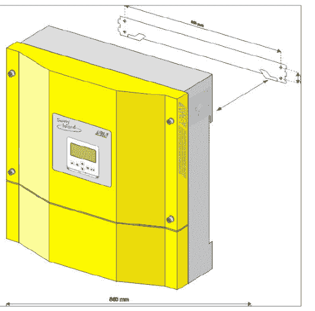

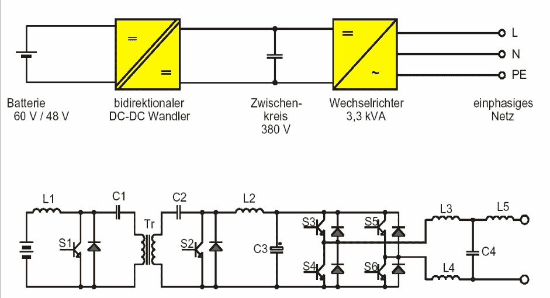

## C.2 电气连接

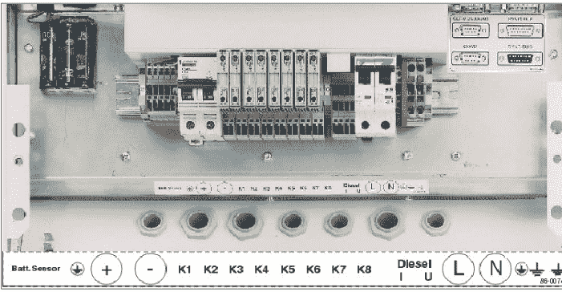

| 名称 |  | 注释 |
|---|---|---|
| `X1:1` | 电池温度 | `+` 返回 |
| `X1:2` | 电池温度 | `+` 发送 |
| `X1:3` | 电池温度 | `-` 发送 |
| `X1:4` | 电池温度 | `-` 返回 |
| `X1:5` | 屏蔽 | 可连接传感器电缆屏蔽的可能性 |

| 名称 |  | 注释 |
|---|---|---|
| `PE` | 机壳接地 | 接地，`2.5 mm²` |
| `F1: +` | 电池输入 | `63 A` 保险丝，`25 mm²` |
| `F1:-` | 电池输入 | `63 A` 保险丝，`25 mm²` |
| `K1:14` | 柴油启动 | 用于发电机启动的 `K1` 继电器，等 |
| `K1:13` | 柴油启动 | 用于发电机启动的 `K1` 继电器，等 |
| `K2:14` | 柴油接触器 | 用于“发电机–孤岛电网”接触器的 `K2` 继电器，等 |
| `K2:13` | 柴油接触器 | 用于“发电机–孤岛电网”接触器的 `K2` 继电器，等 |
| `K3:14` | 控制继电器 | 用于“公网–孤岛电网”接触器的 `K3` 继电器，等 |
| `K3:13` | 控制继电器 | 用于“公网–孤岛电网”接触器的 `K3` 继电器，等 |
| `K4:14` | 控制继电器 | 用于“孤岛电网–`Sunny Island`”接触器的 `K4` 继电器，等 |
| `K4:13` | 控制继电器 | 用于“孤岛电网–`Sunny Island`”接触器的 `K4` 继电器，等 |
| `K5:14` | 控制继电器 | 用于测量点选择 `K5` 继电器，等 |
| `K5:13` | 控制继电器 | 用于测量点选择 `K5` 继电器，等 |
| `K6:14` | 控制继电器 | 用于预热和启动柴油的 `K6` 继电器，等 |
| `K6:13` | 控制继电器 | 用于预热和启动柴油的 `K6` 继电器，等 |
| `K7:14` | 电池扇 | 用于电池房风扇的 `K7` 继电器，等 |
| `K7:13` | 电池扇 | 用于电池房风扇的 `K7` 继电器，等 |
| `K8:14` | 电池循环 | 用于电池泵的 `K8` 继电器，等 |
| `K8:13` | 电池循环 | 用于电池循环的 `K8` 继电器，等 |
| `X2:1 / -` | 柴油电流输入 | 通过探头测量电流，`K` |
| `X2:2 / +` | 柴油电流输入 | 通过探头测量电流，`L` |
| `X2:3 / L` | 柴油同步输入 | 通过探头测量电流，`L` |
| `X2:4 / N` | 柴油同步输入 | 通过探头测量电流，`N` |
| `F2:L` | `AC` 输出 | `16 A` 保丝 |
| `F2:N` | `AC` 输出 | `16 A` 保丝 |
| `PE` | 机壳接地 | 接地 `2.5 mm²` |
| `PE` | 机壳接地 | 接地 `10 mm²` |
| `PE` | 机壳接地 | 接地 `10 mm²` |

## C.3 启动序列

| 柴油状态 | 关闭 | 预热 | 启动 | 停止 | 锁定/故障 |
|---|---|---|---|---|---|
| 类型 1 运行 | `K1` 开启 | | | | |
| | | | | | |
| | | `K2` 开启 | | | |
| | | | | | |
| 类型 2 点火 | `K1` 开启 | | | | |
| | | | | | |
| | | `K2` 开启 | | | |
| | | | | | |
| | | `K3` 开启 | | | |
| | | | | | |
| | 启动* | `K6` 开启 | | | |
| | | | | | |
| 类型 3 停止网 | `K1` 开启 | | | | |
| | | | | | |
| | | `K2` 开启 | | | |
| | | | | | |
| | 启动* | `K6` 开启 | | | |
| | | | | | |

| 继电器 | 特殊功能 |
|---|---|
| `K1` | “负载 1”（用于微型热电） |
| `K2` | 接触器控制 `<>` 孤岛电网 |
| `K3` | 接触器控制 `<>` 孤岛电网 |
| `K4` | 预热/启动发电机（至 `BFR 09`） |
| | 接触器控制 `<>` `Sunny Island` |
| | 运行指示 |
| `K5` | 功率相关 |
| | 测量点选择 |
| `K6` | 预热/启动发电机（`BFR 10` 至 `BFR 49`） |
| | 运行指示 |
| | 功率相关 |
| | 预热/启动发电机（来自 `BFR 50`）“负载 2”（用于微型热电） |
| `K7` | 电池房风扇 |
| `K8` | 电解液泵 |

## C.4 发电机选项图，类型 1、2 和 3

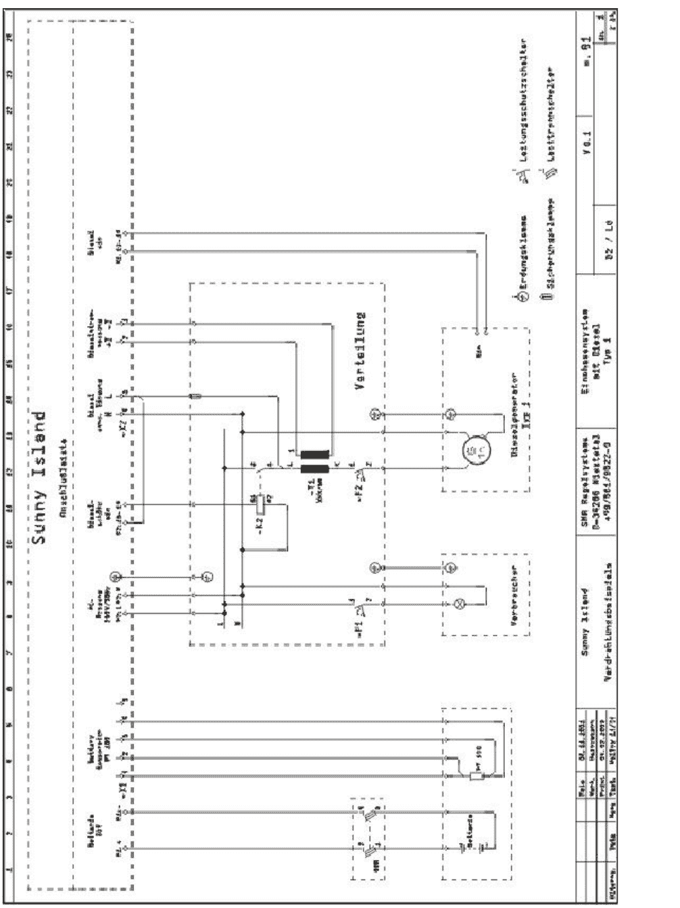


## `Sunny Island`


## C.5 电池外部充电图

外部充电步骤
* 1. 将 `Sunny Island` 置于“待机”工作状态
* 2. 关闭 `Sunny Island` 上的线路保护器
* 3. 连接接口
* 4. 开启 `Sunny Island` “启动”
* 5. 开启 `Sunny Island` 孤岛模式
* 6. 控制并接入外部电流

注意！
充电时不要开启发电机！
通过 `Sunny Island` 系统实现


# 录 C：电池逆变器；`Sunny Island`

## C.6 技术数据

### 功率单元

| | | |
|---|---|---|
| `AC` 输出功率 (`30 min @ Tu = 20 °C`) | `$P_{AC,30}$` | `4300 VA`*1 |
| 额定输出功率: | `$P_{nom}$` | `3300 VA` |
| 最大效率: | `$\eta_{max}$` | `$\geq$ 90 %` |

### 电压、电流

| | | |
|---|---|---|
| 额定电池电压: `$V_{Bat,nom}$` | `60 V =` |
| 电池电压范围: `$V_{Bat}$` | `46 V ... 81 V =` |
| 额定电池电流: `$I_{Bat,nom}$` | `60 A =` |
| 最大电池电流: `$I_{Bat,max}$` | `125 A =` |
| 额定 `AC` 电压: `$V_{ACnom}$` | `230 V - 253 V ~` |
| `AC` 电压范围: `$V_{AC}$` | `196 V - 253 V ~` |
| `AC` 额定电流: `$I_{ACnom}$` | `14.5 $A_{rms}$` |
| 额定频率: `$f_{nom}$` | `50 Hz` |
| 频率范围: `$f$` | `48 Hz ... 62 Hz` |
| 输出电压谐波失真: | `$K_{VAC}$` | `< 3 %` |

(with `$K_{UpgId} < 2 \%$`, `$P_{AC} > 0.5$ $P_{ACnom}$`)

# 附录 D：光伏逆变器；`Sunny Boy`

## D.1 `Sunny Boy` `SWR 700` 的特征与结构图


| 光伏面板 | `EMC` 滤波器 | 浪涌保护器 | 绝缘监测 | 升压器 | 逆变器 | `EMC` 滤波器 | 主阻抗监控 `MSD` | `AC` 和 `DC` 剩余电流保护器 | 电网 |
| --- | --- | --- | --- | --- | --- | --- | --- | --- | --- |
| `500 Vdc` | `EMC` | | `Rds` | | | `EMC` | `Zac` `Zac` `U` | `Ic` | | `AC` 电压（例如 `230 Vdc`） |
| `125 Vdc` | | | | | 微控制器 I | | 微控制器 II | | | |
| | 顺序控制系统 `SCS` | 模拟输入输出参数控制系统 | | | | | | | |

### D.1.1 光伏组串的连接


总组串 1

总组串 2

`Upv` max. `250 V DC`


部分组串 1.1

部分组串 1.2

部分组串 2.1

部分组串 2.2

`Upv` max. `250 V DC`

# 附录 D：光伏逆变器：`Sunny Boy`

## D.2 技术数据

### 输入值（太阳能发生器）

输入电压范围：`$U_{PV}$` `125 .. 250 V DC`
（对应 `700 WPACnom`）
可调为 `100 .. 200 V DC`
（对应 `560 WPACnom`）
或
`75 .. 150 V DC`
（对应 `420 WPACnom`）
取决于输入电压。`3.1` 到 `6.2 A`

输入电流：`$I_{PVnom}$`

### 输出值（主连接）

额定输出功率：`$P_{ACnom}$` `700 W`, `560 W`, `420 W`
工作范围，电网电压：`$U_{AC}$` `196 - 253 V AC`
工作范围，电网频率：`$F_{AC}$` `49.8 - 50.2 Hz`
输出电流畸真因子：`$K_{IAC}$` `< 3 %`
（在 `$K_{Umains}$` `< 2 %`, `PAC` `> 0.5 $P_{ACnom}$` 时）

相位偏移因子：`$Cos \phi$` `1`

`EMC`：`EN 50081`，部分 1
`EN 50082`，部分 1
`EN 60555`, `EN 55014`

电网反馈：`1.5 kV`

测试电压：

电网监控：根据 `VDEW` 的自动断开设备

### 功耗

运行期间的内部功耗：约 `4 W`
夜间运行期间的内部功耗：`0 W`

### 效率

最大效率：`$\eta_{max} \geq$ 93 %`

### 尺寸与重量

尺寸（宽 x 高 x 深）：约 `322 x 290 x 180 mm`
重量：约 `18.5 kg`

### 环境条件

允许的环境温度范围：`-25 °C` 至 `+60 °C`
允许的相对湿度：`0 .. 93 %`, 非冷凝

## D.3 参数列表

### 表 D.1 `Sunny Boy` `750` 的测量参数

| 名称 | 单位 | 描述 |
| --- | --- | --- |
| `Upv-lst` | `V` | 光伏输入电压 |
| `Upv-Soll` | `V` | 内部 `Upv` 控制的光伏设定的电压 |
| `Lac-lst` | `mA` | 馈网电流 |
| `Uac` | `V` | 电网电压 |
| `Fac` | `Hz` | 电网频率 |
| `Pac` | `W` | 馈电网功率 |
| `Zac` | `mOhm` | 电网阻抗 |
| `Riso` | `mOhm` | 绝缘电阻 |
| `Lpv` | `mA` | 光伏面板电流 |
| `E-Total` | `kW/h` | 能量产量 |
| `h-Total` | `Hour` | 总运行小时 |
| `Netz-Ein` | `Hour` | 系统总启动次数 |
| `Seriennummer` | `-` | `Sunny Boy` 号 |
| `Status` | `-` | 状态消息 |
| `Fehler` | `-` | 状态为“故障”时的描述 |

## D.4 状态参数

`Status` 参数是显示 `Sunny Boy` 如何工作的消息。这对于操作人员确定系统状态非常重要。状态消息见表 `E.2`。

### 表 D.2：状态消息

| 状态消息 | 描述 |
| --- | --- |
| `Stop` | 手动停止系统 |
| `Offset` | 电子元件的偏移校准 |
| `Warten` | 尚未（满足）电网连接要求 |
| `Netzeb.` | 正在检查电网（电网阻抗） |
| `Zuschalt` | 电子元件正在接入电网 |
| `MPP-Such` | 已确定并设置了光伏电压 |
| `MPP` | `Sunny Boy` 处于恒定电压模式 |
| `UKonst.` | `Sunny Boy` 处于恒定电压模式 |
| `Derating` | 减少馈电网的电流 |
| `Stoer.` | 故障 |

## D.5 错误消息

`Fehler` 参数是显示 `Sunny Boy` 故障的消息。故障消息见表 `E.3`。

### 表 D.3：错误消息

| 错误消息 | 描述 |
| --- | --- |
| `F-Bfr-Srr` | 微控制器之间的故障 |
| `F-EEPROM` | 无法读取或 `EEPROM` |
| `F-EEPROM dBh` | 无法读取或 `EEPROM` |
| `F-Fac-Bfr` | `BFR` 频率测量超出范围 |
| `F-Fac-Srr` | `SRR` 频率测量超出范围 |
| `F-dZac-Bfr` | `BFR` 阻抗突变——超出范围 |
| `F-dZac-Srr` | `SSR` 阻抗突变——超出范围 |
| `F-Imax` | 过流 |
| `F-NUW-UAC` | `BFR` 与 `SRR` 电压值不匹配 |
| `F-NUW-FAC` | `BFR` 与 `SRR` 频率值不匹配 |
| `F-NUW-Mess` | `BFR` 与 `SRR` `Zac` 值不匹配 |
| `K1-Schlies` | 继电器测试失败 |
| `K1-Trenn` | 继电器测试失败 |
| `F-NUW-ZAC` | `BFR` 与 `SRR` 阻抗值不匹配 |
| `F-Offset` | 电网电压或功率故障 |
| `F-Rechner` | `BFR` 或 `SSR` 故障 |
| `F-Riso` | 绝缘超出范围 |
| `F-Uac-Bfr` | `BFR` 电压测量超出范围 |
| `F-Uac-Srr` | `SSR` 电压测量超出范围 |
| `F-UpvMax` | 输入电压超过范围 |
| `F-Zac-Bfr` | `BFR` 阻抗测量超出范围 |
| `F-Zac-Srr` | `SSR` 阻抗测量超出范围 |
| `F-Watchdog` | 运行控制触发 |
| `F-ROM` | `ROM` 测试期间故障 |

特殊缩写：
`BFR` = `Betriebsrechner`（顺序控制系统）
`SRR` = `Stromregelungschner`（电流控制系统）

## D.6 设置参数

操作人员可以设置逆变器中的运行参数。参数见下表。

### 表 D.4：`Sunny Boy` `700` 设置参数列表

| 编号 | 名称 | 单位 | 范围 | 默认值（光伏输入） |  |
||---|---|---|---|---|---|
| | | | `von... bis...` | `125.250V` | `100.200V` | `75.150V` 可由... |
| `1` | `SMA-SN` | | | | | 固定 |
| `2` | `Upv-Start*` | `V` | `125.0` | | `150.0` | | |
| | | | `100.0` | `250.0` | `125.0` | | |
| | | | `75.0` | | | | |
| `3` | `T-Start` | `s` | `5.0` | `300.0` | `10.0` | `10.0` | 安装人员 |
| `4` | `Upv-Stop*` | `V` | `121.0` | | `120.0` | | | 安装人员 |
| | | | `98.0` | `250.0` | `97.0` | | 安装人员 |
| | | | `73.0` | | | `72.0` | 安装人员 |
| `5` | `T-Stop` | `s` | `1.0` | `300.0` | `2.0` | `2.0` | `2.0` | 安装人员 |
| `6` | `Usoll-Konst` | `V` | `100.0` | `250.0` | `140.0` | `140` | | 安装人员 |
| | | | `75.0` | | | | `140` | 安装人员 |
| `23` | `I-NilTest` | `mA` | `0` | | `6000` | `4500` | `3000` | 安装人员 |
| `28` | `Uac-Min` | `V` | `180` | `300` | `251` | `198` | `198` | 安装人员 |
| `29` | `Uac-Max` | `V` | `180` | `300` | `251` | `251` | `251` | 安装人员 |
| `30` | `Fac-Min` | `Hz` | `49` | `51` | `49.81` | `49.81` | `49.81` | 安装人员 |
| `31` | `Fac-Max` | `Hz` | `49` | `51` | `50.19` | `50.19` | `50.19` | 安装人员 |
| `32` | `Zac-Max` | `mOhm` | | `20000` | `1700` | `1700` | | 安装人员 |
| `33` | `dac` | `mOhm` | | `2000` | `350` | `350` | | 安装人员 |

# 附录 E：嵌入式硬件模块和调制解调器

`E.1` 嵌入式硬件：`MOPS/520` ................................................ `E- 2`
`E.2` `GSM` 调制解调器：`M20` ................................................................ `E- 5`
`E.3` `PPPd` 设置 ....................................................................................... `E- 9`
`E.4` 经济计算............................................................... `E-10`


## 附录 E：嵌入式硬件模块与模块

## `E.1.2` `MOPS520` 技术数据

### 技术数据

### 产品概述

`MOPS520` 是一款全新的 `PC/104` `CPU` 板，与 `PC/104` 产品系列完美集成。它基于频率为 `133 MHz` 的 `AMD™` `SC523C`，并提供了丰富的功能！这块高集成度板提供了 `4xCOM`、`2x` `USB`、`1x100` `Mbit` 以太网以及用于扩展的 `PC/104+`。

非常特殊的特性是已经集成了 `1` `MBR` `CAN` 总线。不需要额外的昂贵扩展卡。由于功耗低，`MOPS520` 不需要主动冷却。

所有 `PC/104` 板都具有相等的键盘、`COM12`、`44` 针 `IDE` 和 `LPE` 端口。可以与 `Kontron` `PC/104` 家族进行任何升级。

`MPS520` 提供 `32` 或 `64` `MByte` `SDRAM` 的配置。与我们的 `chipDISK`（最高 `25` `MByte` `Flash`）结合，可以实现非常坚固且可靠的系统，即使对于恶劣的应用环境也是如此。

板卡的 `CAN` 总线能够轻松与自动化和过程控制任务建立接口。

...始终领先！

- 总线：参考 `PC/104` 标准的 `16` 位-`ISA` 总线，以及用于 `PC/104plus` 的 `32` 位-`PCI` 总线
- 处理器：`AMD™` `SC523C` `133 MHz`，带风扇底座
- 系统内存：板载 `16` 或 `64` `MByte` `SDRAM`
- 功能：
  - `1x` `CAN` 总线 (`1` `MByte`)，带有包含 `CAN` 收发器的 `Intel™` `RS237` `CAN` 控制器（可选）
  - `chipDISK`：已准备好托管兼容 `IDE` 的闪存 `chipDISK`，容量高达 `25` `MByte`
  - `5x` `RS523C` 带 `FIFO`
  - `1x` `COM`
  - `1x` `ECP/EFP` 并行
  - `1x` 用于 `3.5"` 驱动器的 `FIO`
  - `2x` `USB`
  - `1x` `PS/2`
  - `1x` 本总线 `HDD`，最多支持两个硬盘
  - `1x` 全兼容键盘
  - `1x` 以太网/`100-Base-`
- `LAN` 启动
- `EEPROM` 中的设置和串口
- 门门狗
- 尺寸：`96 x 90 mm (3.8 x 3.6")`
- 功耗：`5 V`，在 `100 MHz` 下约 `750 mA`
- 温度：运行：`0°C` 至 `60°C`；存储：`-10°C` 至 `80°C`（非冷凝）；运行：`10%` 至 `90%`；存储：`5%` 至 `85%`（非冷凝）
- 湿度：

| 产品 | 部号 | 描述 |
| --- | --- | --- |
| `MOPS520` | `01265-1300-1-3` | 低功耗 `AMD™` `SC523C` `133MHz`，板载 `14 MByte SDRAM`，`3xRS523C`，`1xTTL`，`2xUSB`，`LPT`，`FOC`，`IDE`，以太网 (`10/100`) |
| `MOPS520` | `01265-3200-1-3` | 低功耗 `AMD™` `SC523C` `133MHz`，板载 `12 MByte SDRAM`，`3xRS523C`，`1xTTL`，`2xUSB`，`LPT`，`FOC`，`IDE`，以太网 (`10/100`) |
| `MOPS520` | `01265-4400-13-3` | 低功耗 `AMD™` `SC523C` `133MHz`，板载 `64 MByte SDRAM`，`3xRS523C`，`1xTTL`，`2xUSB`，`LPT`，`FOC`，`IDE`，以太网 (`10/100`)，`CAN` 总线，`PC/104+` |

`Kontron Embedded Modules GmbH`
`Brunweiesteg: 16`
`D-Sta-Dorfendorf`
`0800-saleskontron`
`0800-7253768`

`E-4`

## `E.2` `GSM` 调制解调器 `M20`


### `E.2.1` 功能

- 使用市售连接组件在系统环境中友好地集成
- 数据、语音、传真和短信服务 (`GSM` 第二阶段)
- `6` 针西方连接器上的电源/点火线 (`8 V` 至 `28.8 V DC`，`5%` 纹波，防浪涌至 `30V`)
- `12V` 下电流消耗：待机状态（已电压，尚未点火）`I=< 0.2 mA`；空闲模式：`I < 60 mA`；平均通话中：峰值：`I < 2 A (脉冲 t = 577µs，在 T = 4.61ms)`，算术平均：`I < 275 mA`
- `V.24` 接口上对应 `V.28` 的电平
- 带有 `9` 针 `SUB-D` 插座（螺栓）的保护 `V.24/V.28` 接口
- 带有内置抽屉的 `Mini` `SIM` 卡读器 (`3V`)
- `FME` 天线接口（母头），电缆引出（约 `10 cm`）
- `4` 针西方连接器上的接口（可通过 `AT` 命令/连接市售耳机设置参数）
- 从底部或顶部安装
- 抗电源极性反接

## 附录 E：嵌入式硬件模块与调制解调器

| 重量 | `145 g` |
| --- | --- |
| 尺寸（最大） | `LxWxH =107.0 x 63.5 x 31.3 mm` |
| 温度范围 | `-20°C - 55°C` |
| 防护等级 | `IP40`（见注意事项） |
| 机械振动 | `5-200 Hz` 正弦波幅 `7.5 mm` |
| 最大脉冲加速度 | `30g` 脉冲持续时间 `18 ms` |
| 空气湿度 | `5-95%` |

### `E.2.2` 电气描述

`M20` 具有以下功能：

| 引脚 | 用途 |
| --- | --- |
| `1` | 电源 |
| `2` | 音频 |
| `3` | 接地 |
| `4` | 点火 |
| `5` | 数据线 |
| `6` | `GND` |


# 附录 E：嵌入式硬件模块和调制调器

`2.` `RS232` 串口（调制调器）线。
`3.` 需要另一台连接了线路调制调器的 `PC`，或按照如下方式设置 `M20` 终端的第二台 `PC`，进行拨打以确认 `M20` 终端运行正常。

- 步骤
将 `M20` 终端连接到 `PC` 的串口端口（使用串口线）
注意正在使用的是哪个串口端口，例如 `COM 1`、`COM 2`、`COM 3` 等。
打开 `M20` 终端，指示 `LED` 将闪烁（约每秒闪烁一次），表示其正在 `GSM` 网络上注册。大约 `5` 秒后，`LED` 应该保持常亮。如果 `M20` 终端无法连接到网络，`LED` 将继续闪烁。这可能是因为 `SIM` 卡不对（检查是否为 `3` 伏 `SIM` 卡）
在 `PC` 上启动终端程序

设置计算机以便与 `M20` 终端通信
在终端程序中选择 `[communications]`（通信）`[settings]`（设置），或根据你的程序需要，设置以下配置：

| 连接器/端口 | `COM 1` 或 `COM 2`（指定正在使用的端口） |
|---|---|
| 波特率 | `19200` |
| 数据位 | `8` |
| 停止位 | `1` |
| 流量控制 | 无 (`none`) |

设置 `M20` 终端使其能够在手机网络上通信
输入以下内容

| 输入以下内容 | 注意事项 |
|---|---|
| `1` `AT&F[ENTER]` | 恢复 `M20` 出厂默认设置。应显示 `OK`。这确认了 `PC` 正在与 `M20` 终端通信 |
| `2` `AT [ENTER]` | |
| `3` `AT&V[ENTER]` | 显示当前的 `M20` 终端设置。 |

| 设置 `M20` 终端以进行 `3` 线串口连接（无硬件控制） |
|---|---|
| `4` `AT+IFC=0,0[ENTER]` | 关闭硬件握手和软件握手。 |
| `5` `AT&DO[ENTER]` | `M20` 终端忽略 `DTR` 线路的状态。 |
| `6` `AT&CO[ENTER]` | `M20` 终端保持 `DCD` 线路。 |
| `7` `AT&S0[ENTER]` | `M20` 终端保持 `DSR` 线路。 |
| `8` `ATS0=2[ENTER]` | 设置 `M20` 终端在 `2` 声响后接听来电 |

| 设置 `M20` 终端在手机网络上发送数据 |
|---|---|
| `9` `AT+CBST=7,0,1[ENTER]` | 选择手机承载服务的波特率 (`7`) `9600` 波特率 (`v.32`)，(`0`) 异步调制调器，(`1`) 非透明。 |
| `10` `AT&W0 [ ENTER]` | |

| `11` | `ATZ0 [ENTER]` | 将设置存储在 `M20` 终端内存中 |
| 将设置存储在内存位置 `0` |
| 加载内存 `0` 中的设置作为当前设置 |
| `12` | `AT&V [ENTER]` | 显示当前的 `M1` 设置。确认已已输入。
（建议打印设置以备日后参考） |

## `E.3` `PPPd` 设置

这是一个关于为点对点通信设置 `PPPd` 的简短教程。

- 所需软件：

+ 带有网络的性 `Linux` 系统 :-

+ * `mgetty`（前端）版本 `1.1.28`，使用 `AUTO_PPP` 编译
接受拨入电话并将控制权移交给 `pppd`。

+ * `pppd`（后端）版本 `2.4.1`
负责 `PPP` 网络相关事务。

### `1.` 服务器系统概述
--------------------------------

+ 服务器有一有一个连接到串口线上的调制调器。
`0.` 计算机启动并引导。
`1.` `/sbin/init` 接管并运行启动脚本等。
它还运行 `mgetty` 来监控调制调器。
`2.` `mgetty` 等待电话线上的铃声。
... 有人拨打了该号码 ...
`3.` `mgetty` 告诉调制调器接听电话。
`4.` `mgetty` 可能会中断自身并等待 `PPP` 包。
`5.` 检测到 `PPP` 包后，`mgetty` 将控制权移交给 `pppd`。这是一个“正常”的 `PPP` 会话。

### `2.` 设置 `/etc/init.abb` 和 `mgetty`
--------------------------------

`"mgetty"` 和 `"info mgetty"` 仅供参考！

将此行插入到 `/etc/init.abb`

```


## 串口配置

```
S0:345:respawn:/usr/sbin/mgetty ttyS0
```

对于 `ttyS0`（COM1，第一个串口端口）上的调制调器，或者

```
S1:345:respawn:/usr/sbin/mgetty ttyS1
```

对于 `ttyS1`（COM2）上的调制调器，以此此类推。

并将此行（如果不存在）存放在 `/etc/mgetty+sendfax/login.config`

`/AutoPPP/` - `pppuser` `/usr/sbin/pppd auth +pap`

### 3. 设置 `pppd`

`man pppd` 和 `PPP-HOWTO`

创建 `/etc/pppd/options.ttyS0`（或 `ttyS1` 等）并包含以下选项：

```
asyncmap 0
netmask 255.255.255.0
proxy
lock
crcts
modem
192.168.0.1:192.168.0.2
```

`192.168.0.2` 是客户端地址，`192.168.0.1` 是服务器。
同样在 `/etc/ppp/pap-secrets` 中加入此行

`ppuser "password" 192.168.0.2`

`ppuser` 是客户端用户名。将 `hostname` 替换为真实主机名！

### 4. 有用 URL
`http://www.linuxdoc.org`

## E.4 经济性

嵌入式模块（PV 逆变器）价格，Sunny 系统的占比：

| 逆变器 | 逆变器价格 (€) | 嵌入式模块价格 | 备注 |
|---|---|---|---|
| Sunny Boy 700 | 777 | 148.7% | |
| Sunny Boy 1100E | 826 | 139.9% | 项目， |
| Sunny Boy 1700E | 1069 | 108.1% | |
| Sunny Boy 2100TL | 1287 | 89.8% | |
| Sunny Boy 2500 | 1409 | 82% | |
| Sunny Boy 2800 | 1501 | 77% | |
| Sunny Boy 3000 | 1530 | 75.5% | 产品价格：550 € / 件 |
| Sunny Boy 3300TL | 1683 | 68.6% | |
| Sunny Boy 4200TL | 2461 | 46.9% | |
| Sunny Boy 5000TL | 2670 | 43.2% | |

# 附录 F：光能系统组件

+ `F.1` 光能系统布局 ................. `F-2`
+ `F.2` 发电机技术数据 ................ `F-3`
+ `F.3` 电池 `6 OPzV 300,dryfit A60` .......... `F-3`

## F.1 光能系统布局


## F.2 发电机技术数据

| 发电机 | Honda EX 3000 |
|---|---|
| 类型 | 同步 |
| 频率转换器 | 无 |
| 电容器 | 无 |
| AC 输出 (kVA) | 2.7 / 最大 3.0 |
| 柴油发动机 | 四冲程汽油 |
| 最大功率 (kW) | 5.8 |
| 调速器类型 | 机械 |
| 油箱容量 (升) | 19 |
| 额定负载下连续工作小时 | 10.3 |
| 外尺寸 | 长度 (mm) 910 / 宽度 (mm) 530 / 高度 (mm) 695 |
| 空重 (kg) | 109 |

## F.3 电池 6 OPzV300,dryfit A600

`F-3`

# 附录 F：混合动力系统组件

| 类型标识 | 零件号 | 额定电压容量 | 额定电流 (I0) | 放电电流 (I10) | 放电 (t) | 重量 (b) | 高度 (a) | 最大 (h) | 长度对 (B) | 内部电阻 | 短路端子 |
|---|---|---|---|---|---|---|---|---|---|---|---|
| `4 OPV DIN 4672` | `NGA60200H5SOFA` | 200 20°C | 200 | 125 | 126 | 360 | 398 | 113 | 1 | 0.94 | 2235 | F-M |
| `5 OPV` | `NGA60250H5SOFA` | 250 20°C | 250 | 250 | 138 | 360 | 398 | 134 | 1 | 0.78 | 2706 | F-M |
| `6 OPV` | `NGA60300H5SOFA` | 300 20°C | 300 | 300 | 147 | 368 | 396 | 155 | 1 | 0.60 | 3414 | |
| `7 OPV` | `NGA60350H5SOFA` | 350 20°C | 350 | 350 | 152 | 370 | 427 | 173 | 1 | | | |
| `8 OPV` | `NGA60420H5SOFA` | 420 20°C | 420 | 420 | 162 | 427 | 478 | 513 | 1 | | | |
| `9 OPV` | `NGA60490H5SOFA` | 490 20°C | 490 | 490 | 169 | 468 | 475 | 513 | 1 | | | |
| `10 OPV` | `NGA60600H5SOFA` | 600 20°C | 600 | 600 | 180 | 507 | 528 | 655 | 1 | | | |
| `12 OPV` | `NGA60100H5SOFA` | 1000 20°C | 1000 | 1000 | 212 | 635 | 650 | 688 | 2 | | | |
| `16 OPV` | `NGA60120H5SOFA` | 1200 20°C | 1200 | 1200 | 212 | 727 | 800 | 838 | 2 | | | |
| `20 OPV` | `NGA60150H5SOFA` | 1500 20°C | 1500 | 1500 | 212 | 727 | 800 | 838 | 2 | | | |
| `24 OPV` | `NGA60200H5SOFA` | 2000 20°C | 2500 | 2500 | 215 | 790 | 815 | 823 | 2 | | | |

# 简历

Boonyang Plangklang 先生于 1973 年 8 月 9 日出生于泰国东北部索善洪府沙旺丹丁县。他于 1996 年在泰国曼谷的拉贾曼格拉理工学院工程学院获得电气工程学学士（B.Eng）学位。1997 年，他在加拿大阿尔伯塔省埃德蒙顿市的北阿尔伯塔理工学院（NAIT）获得仪表技术文凭。2001 年，他在德国学术交流中心奖金的支持下，在德国帕德博大学（索斯特分校）联合英国博尔顿高等教育学院合作，获得了电子系统与工程管理理学硕士学位。他目前任教于泰国北陶府丹雅武里拉贾曼格拉理工大学（RMUT，原拉贾曼格拉理工学院）工程学院电气工程系讲师。
