# Kali Linux 初学者终极指南


# 免责声明

本电子书内容仅用于信息参考和学习目的。HackTechHub 不对本电子书内容的准确性、完整性或充分性提出任何声明、承诺或保证，也不因本电子书中的任何错误、遗漏或陈述承担法律责任或其他责任。本电子书中描述的方法均为 Ansh Goyal 的个人观点。这些方法并非旨在作为相关主题的权威操作指南。您可能会发现有多种方法和资源可以实现相同的结果。如果您希望应用本电子书中包含的任何概念、原则或想法，您需要完全对自己的行为负责。

HackTechHub 或作者无法保证您一定能达成目标，这只是一份旨在助您达成目标的指南。未经 HackTechHub 书面许可，不得以任何形式或任何方式（包括电子或机械方式，如复印、录音或通过任何信息存储和检索系统）复制或传播本电子书的任何部分。

# 作者简介

我叫 Ansh。我是一名应用程序开发者、游戏开发者、网页开发者、白帽子黑客、平面设计师、渗透测试人员以及 WordPress 网站开发者。我正在日复一日地提升我的技能。我还在各种在线课程创建平台（如 Udemy、Skillshare、Teachable 等）上进行教学。

我创作了 Google Play 上的畅销书《在线课程创建终极指南》和《网站开发终极指南》。

我教授了来自 150 多个国家的 14,000 多名学生，使用 40 多种语言教学。我可以保证，读完我的书后，您一定会学到一些新知识。

# 免费赠品

您将获得赢得 200 美元奖品的机会。

获取该福利的步骤位于书的最后一页。

我们书的结尾见！

# 常见问题解答

## 为什么选择 Linux 而不是 Windows 或 Mac？

当需要选择一个能处理多重 shell 任务且相比其他操作系统 bug 更少的操作系统时，Windows 和 Mac 是最少被选择的目标。Linux 系统拥有最高的 root 权限，这是执行某些渗透测试和白帽子黑客相关任务所必需的。

## 为什么选择 Kali Linux？

Kali Linux 是进行渗透测试和白帽子黑客操作时最受青睐的选择。由于操作便捷以及 Kali Linux 中提供了预装工具，使其成为白帽子黑客和渗透测试的理想选择。

## 我使用的是 Windows 或 Mac OS，我需要卸载它们并安装 Kali Linux 操作系统吗？

绝对不需要！您无需删除 Windows 和 Mac OS 中的文件并安装新的 Kali Linux，您可以轻松、可靠地在现有的 Windows 或 Mac OS 上使用 Kali Linux，这是 Linux 操作系统相对于其他操作系统的一个优势特性。

## 应用本书信息的系统要求是什么？

如果您希望高效且长期地学习知识，应该在自己的设备上动手实践。基本的系统要求包括一台 PC、互联网连接以及踏入 Kali Linux 世界的决心。

## 我是 Kali Linux 的新手，我该从何入手？

嗯，这正是我们要做的。让我们开始吧！

## 什么是虚拟机（VMs）？

虚拟机很棒。使用它们有很多优点。其中一个好处是能够同时运行多个操作系统（OSs）。您可以保持主机“不受影响”，仅与来宾虚拟机进行交互。另一个优点是当一切顺利时，你可以制作快照；当出现问题时，可以回滚恢复。

Virtual Box 是免费且开源的，是创建虚拟机的最佳选择。

通过访问 https://www.virtualbox.org/wiki/Downloads 在您的 PC（Windows 或 Mac）上下载 Virtual Box。

选择您使用的是哪种主机，Windows 主机还是 Mac 主机（OSX）。

现在，将该程序安装到您的电脑中，就像在 PC 上安装常规软件一样。

安装完成后，返回 https://www.virtualbox.org/wiki/Downloads 查找 **6.X.X Oracle VM VirtualBox Extension** 并下载扩展包。

下载完成后，双击下载的文件并将扩展安装到您的系统中。

这些扩展对于 Kali Linux 的流畅运行至关重要。

# 安装 KALI LINUX

有许多方法可以在 Virtual Box 中安装 Kali Linux。最简单的方法是使用预安装镜像文件。

通过访问 https://www.kali.org/get-kali/#kali-virtual-machines 下载最新的 Kali Linux 镜像文件。选择您的系统硬件（64 位或 32 位）。然后点击“Virtual Box”面板上的下载按钮。

这将下载一个扩展名为“ova”的文件。

下载完成后，双击下载的文件，它将在 Virtual Box 中打开。

会弹出一个窗口，看起来像这样：

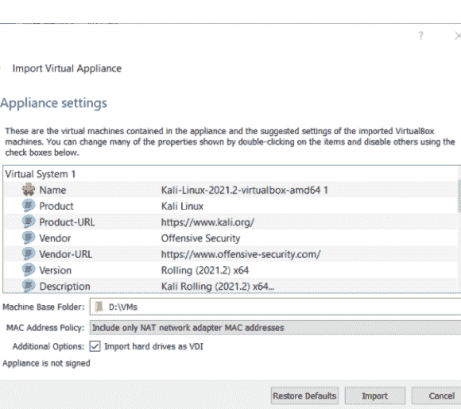

点击“Import”按钮，然后点击“Agree”，系统将开始将已安装的 Kali Linux 导入您的 Virtual Box。

导入完成后，您需要设置一些选项。前往已导入虚拟机的设置。

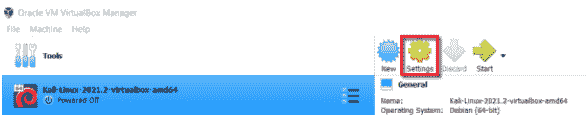

点击“System”并将基础内存增加到系统内存的一半左右。

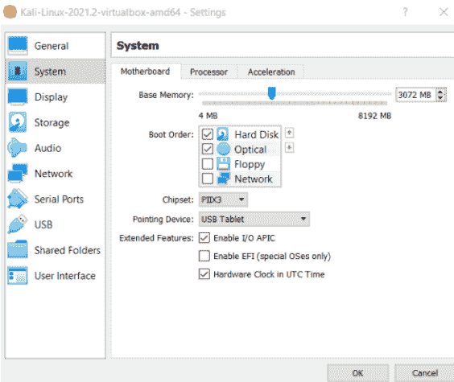

现在，前往“Processor”选项卡并将处理器增加到您系统容量的一半左右。这对于 Kali Linux 无故障运行至关重要。

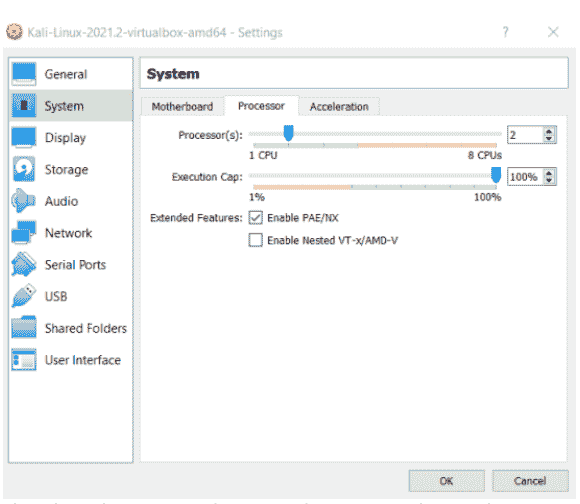

应用上述图片中显示的其他更改。这些更改可能会根据您的电脑处理器而有所不同。请根据以下图片应用其他设置：

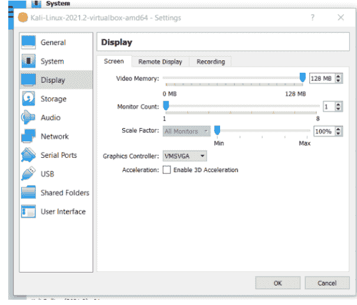

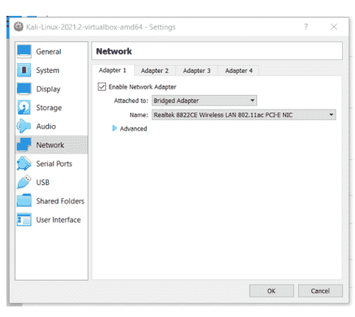

现在，您已成功将 Kali Linux 作为虚拟机安装到您的 Virtual Box 中。

# Linux 设置

如果您想成为一名严肃的渗透测试人员或白帽子黑客，那么您必须掌握 Linux 命令行，因为它们是发起攻击的基本要求。

Terminal（终端），顾名思义，是一个通过命令行与系统进行交互的应用程序。与 Windows 或 Mac OS 不同，Linux 并不提供带有图标和面板的图形用户界面来执行复制文件、删除文件甚至创建文件或脚本等各种任务。

终端提供了一个命令界面，用于输入我们将在后续章节中讨论的此类命令。

如果您是一位 Windows 用户，您可能会知道 Windows 也有一个名为 CMD（命令提示符）的终端。Linux 的终端在某种程度上与之相似。

因此，首先，点击 Virtual Box 中的“Start”来启动您的 Kali Linux。

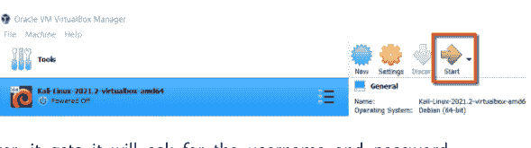

启动后，它会要求输入用户名和密码。

默认情况下，用户名和密码分别为“kali”和“kali”。之后点击登录。

现在，Kali 桌面界面将打开。

为了让您的 Kali Linux 具备未来兼容性，您需要安装 Guest Addition Tools（客户增强工具）。

请按照以下步骤安装 Guest Addition Tools。

点击 Virtual Box 的“devices”选项卡，然后点击“Insert Guest Additions CD Image...”

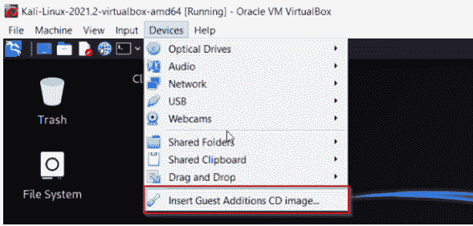

现在，桌面上将出现一个 CD 图标。双击它并记下该文件夹的路径。

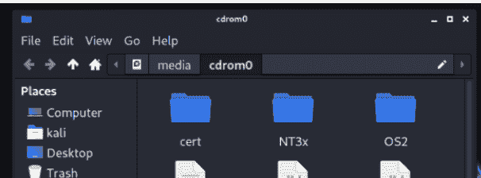

在我们的上下文中，该路径是“/media/cdrom0/”

点击下方图标打开终端。


# 安装 VirtualBox 增强功能

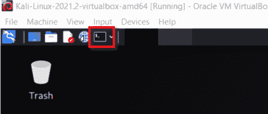

在终端中，输入以下命令并按下回车键。

```
cd /media/cdrom/
```

现在，键入以下命令并按下回车键。

```
sudo sh VBoxLinuxAdditions.run
```

系统现在会要求输入 Kali 的 sudo 密码，请从键盘上键入 “kali”。你输入的密码不会显示在屏幕上，但你必须自信地从键盘上键入 “kali” 并按下回车键。

将会出现几个命令处理过程，如果系统询问 “是或否”，请键入 “y” 并按下回车键。

VirtualBox Linux 增强功能现在已成功安装到你的 Kali Linux 机器上。

现在，重启你的 Kali Linux，你可以在终端中输入命令 “reboot” 或使用 Kali 中的电源图标来实现。

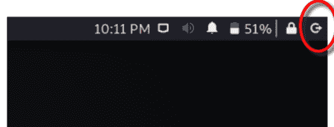

现在，分别输入用户名和密码 “kali” 和 “kali”，如前所述。

Kali 现已设置完成，可以使用了。你可能已经注意到我们之前使用了一些像 “cd”、“sh”、“sudo” 这样的命令。这些是在终端中执行任务时附加的基本命令。让我们在下一节中讨论一些命令。

# Linux 命令

我们将讨论在 Kali Linux 中入门所需的一些基本命令。

## 1. cd

此命令用于在终端中更改目录。它用于目录的路径，例如，将当前目录更改到桌面目录，我们会使用
`cd Desktop/`

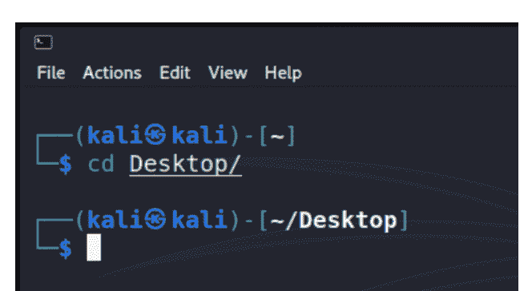

若要返回上一级目录，请使用命令
`cd ..`

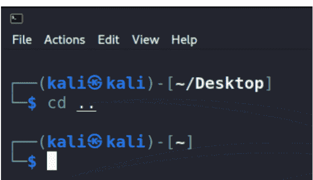

## 2. pwd

此命令用于打印终端正在运行的工作目录。你只需键入 pwd 并按下回车键即可。

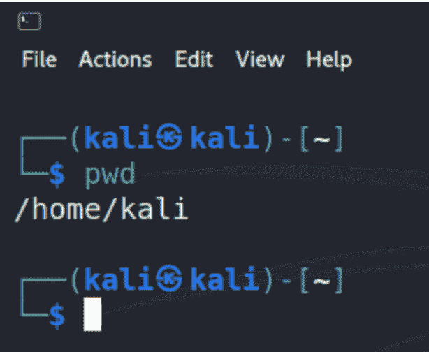

默认情况下，当我们使用终端图标打开终端时，它会打开在 “/home/kali” 目录中。因此，写入 pwd 会输出 “/home/kali”。

尝试将目录更改为 “Desktop/” 并打印工作目录。

## 3. ls

此命令用于列出当前工作目录内的文件夹和文件。此命令可以单独使用。键入 “ls” 并按下回车键，它会输出目录中你正在运行的终端内的文件夹和文件。

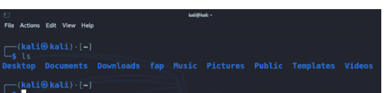

因为，我们当前在目录 “/home/kali/” 中运行终端，其中包含 Desktop、Documents 及其他文件夹。

尝试使用 “cd” 命令进入其他目录并打印工作目录。

你还可以键入

```
cd /
```

这将活动目录更改为系统文件所在的主目录。

有几种方法可以做到这一点，

首先，

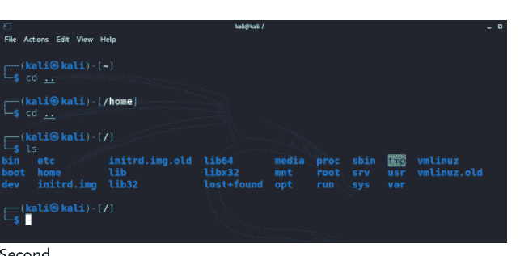

其次，

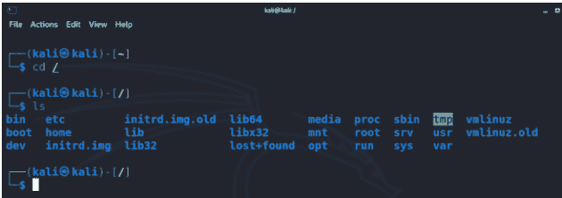

你可以查看输出结果。有多个文件夹，如 bin、dev、home 等。

“home” 文件夹包含重要的用户文件夹，即 “kali”

你可以通过键入 “cd /home/kali/” 返回 kali 目录。这将工作目录更改为你启动终端时打开的默认目录。

如果你想了解 “/” 文件夹包含的每个文件夹，请查看此链接 https://www.linux.com/training-tutorials/linux-filesystem-explained/ 。

## 4. clear

这是一个简单命令，清除终端上显示的所有内容。终端内部可能会有一些杂乱无章的内容，可能需要你关闭并重新打开终端，但键入 clear 命令只会清除文本内容。

## 5. sudo

这是 Kali 终端中最重要的命令。此命令为你提供 root 权限，或者我们可以说你已经获得了超级用户访问权限。如果你曾经尝试让你的安卓设备获取 root（越狱）权限（尽管不建议这样做），你可能听说过超级用户（SU box）。

Kali 中有一些工具需要 root 权限才能工作，否则它们会输出 “bash, command not found” 或 “请运行此命令时拥有 root 权限”。为了给这些工具提供 root 权限，我们必须在其后附加 “sudo”。之后你还需要输入密码 “kali”，正如我们在安装 VirtualBox 增强功能工具时所做的那样。我们将在下一个命令中更多地讨论 sudo。

## 6. ifconfig

此命令用于显示在 Kali 内部运行的活动网络适配器。尝试输入以下命令并按下回车键。

`ifconfig`

你可能会收到 “bash, command not found” 的错误。这是因为 “ifconfig” 命令至少需要 root 权限一次。尝试输入命令

`sudo ifconfig`

这将显示一些 IP 地址和 MAC 地址。这些 IP 和 MAC 地址在无线攻击和执行远程执行攻击（如 MSF venom、beef 等）中非常关键。如果你想执行无线攻击或破解无线路由器密码，你可以阅读我们在 Kali 中关于无线攻击的最终指南。

既然我们拥有了 root 访问权限，那么每次输入需要 sudo 或 root 访问的命令时，我们是否都需要输入 sudo 呢？

答案是：不需要！

你可以切换到 root 模式，并在每条命令前不写 sudo 的情况下输入任意数量的 root 命令。可以通过键入命令来实现

```
sudo su
```

这将使你进入 root 权限目录，即 root 目录。

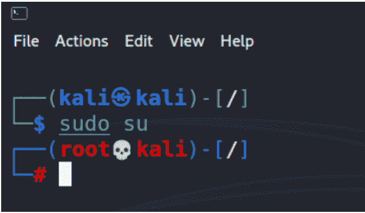

现在，你可以在每次输入 sudo 之前运行任意数量的 root 命令。要退出 root 模式，请输入

```
exit
```

并按下回车键。这将返回到普通用户模式。

## 7. touch

此命令用于在活动目录中创建一个文件。
让我们创建一个名为 “newfile” 的文件。为此，请输入命令

```
cd Desktop/
(将活动目录更改为 Desktop)
touch newfile
```

这将在桌面上创建一个名为 newfile 的空文件。
双击该文件，看看它是否是空的。目前它肯定是空的。

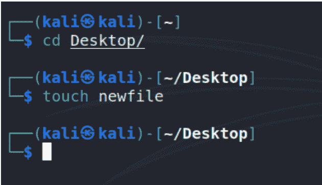

## 8. nano

此命令用于使用终端编辑器编辑文件。这与文本编辑器不完全相同，但当编辑无法使用普通文本编辑器编辑的 root 级别文件时，它是一个方便的命令。
输入命令
`nano newfile`
这将打开一个终端编辑器。在那里输入 “Hello World” 文本。

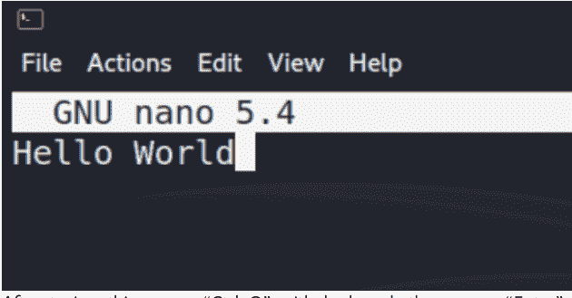

输入这些内容后，使用键盘按下 “Ctrl O”，然后按下 “Enter” 键。最后按下 “Ctrl X”。这些按键组合将把你带出终端编辑器，同时保存你输入的内容。

“nano” 命令也可以直接用于创建文件，而不需要使用 “touch” 命令。

若要使用 nano 命令创建文件，请输入

```
nano anotherfile
```

这将创建一个名为 “anotherfile” 的新文件，但你需要输入一些内容并保存该文件，该文件才会出现在活动目录中。

输入 “Hello There”，按下 “Ctrl O”，然后按 “Enter Key”，再按 “Ctrl X”。这将保存文件，并且该文件将出现在活动目录中。

以下是我们使用上述方法创建的两个文件。

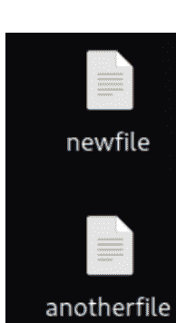

尝试双击桌面上的这些文件，看看每个文件是否包含我们写入的文本。

## 9. echo

此命令用于将任何文本或代码输入到指定文件中。其工作原理与 nano 终端编辑器相同。

让我们创建一个新文件名为 “file1”，并使用 “echo” 命令将文本 “Have a Great Day” 插入到 “file1” 中。

```
(kali@kali)-[~/Desktop]
$ touch file1

(kali@kali)-[~/Desktop]
$ echo Have a Great Day > file1

(kali@kali)-[~/Desktop]
$ 
```

这将创建一个名为 “file1” 的文件，并将 “Have a Great Day” 插入其中。

## 10. cat

此命令用于在终端中显示文件内容。

到目前为止，我们已创建了 3 个文件。

让我们使用此命令显示每个文件的内容。

为此，请输入以下命令，并在每条命令后按下回车键。

```
cat newfile
cat anotherfile
cat file1
```


## 11. mkdir

此命令用于在任何位置创建一个新的文件夹（目录）。

让我们通过输入以下命令并按回车键来创建一个文件夹。

```
mkdir NewFolder
```

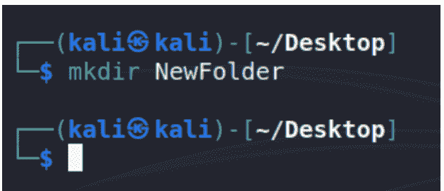

这将在当前目录中创建一个名为“NewFolder”的新文件夹，并且该图标将显示在当前目录中（在我们的上下文中即为桌面）。

## 12. rm

此命令用于从当前目录中删除文件或目录。

删除文件和文件夹的命令略有不同。

- a.) 要删除文件，请输入以下命令并按回车键。

```bash
rm newfile
```

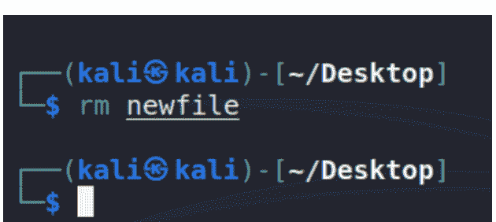

此命令将删除我们在上一节中创建的名为“newfile”的文件。类似地，你可以删除其他目录中的其他文件，但请确保**不要删除**“/”或系统文件文件夹中的任何内容。

- b.) 要删除文件夹，请输入以下命令并按回车键。

```bash
rm NewFolder -r
```

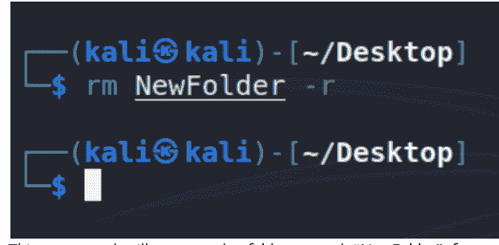

此命令将从桌面删除名为“NewFolder”的文件夹。

有一点你需要注意，在输入命令时，请仔细检查字母的大小写，是首字母大写还是小写，因为 Linux 发行版对文件的大小写非常敏感。

例如，在终端中输入命令时，“Newfolder”和“NewFolder”是完全不同的东西。你可能会收到“rm: cannot remove 'Newfolder': No such file or directory”（rm：无法删除 'Newfolder'：没有那个文件或目录）的错误。所以，请确保仔细输入所有字母。

现在，你已经学会了 Kali Linux 的基础知识，以及如何在未来的职业生涯中应用它们，成为道德黑客、渗透测试人员或安全分析师。

如果你想继续你的旅程，你可以阅读我们关于 Linux 系统和道德黑客的下一级别书籍。

持续学习
保持安全！

# 免费电子礼品兑换流程

访问：https://techbhole.com/hacktechhub-egift-redemption-guidelines/

之后，你按照链接中提到的所有步骤操作，你将收到礼品。

如有任何疑问，请联系：hacktechhub@gmail.com

# 不要错过！

点击下面的按钮，你可以注册以接收 Ansh Goyal 出版新书时的电子邮件通知。不收费且无义务。


https://books2read.com/r/B-A-EPYJ-LJETB


连接独立读者与独立作者。

